# Linux 安全速成指南

多任务处理系统管理员的完美参考指南

- 发现为什么“量二尺，切一刀”适用于 Linux 安全
- 全面涵盖操作系统加固、入侵检测系统实施以及数据库防御
- 避开那些对您的工作没有实际帮助的理论、历史和技术数据

James Stanger，CompTIA Linux+ 顾问委员会成员，Linux 专业协会 (LPI) 顾问委员会主席

Mohan Krishnamurthy

Eric S. Seagren

Raven Alder

Aaron W. Bayles

Josh Burke

Skip Carter

Eli Faskha

1 2 3 4 5 6 7 8 9 0

版权编辑：Andrew Williams

页面布局与艺术设计：Patricia Lupien

封面设计：Michael Kavish

索引编：：Michael Ferreira

## 贡献作者

Mohan Krishnamurthy

Madwachar (OPSA, OPST) 是巴林 Almoayed Group 网络安全部门总经理。Mohan 是他们项目部门的关键贡献者，并在组织的网络安全倡议中发挥着重要作用。Mohan 拥有深厚的网络、安全和培训背景。他在 Schlumberger Omnes 和 Secure Network Solutions India 等公司的任职增加了他在实施大型复杂网络安全项目方面的经验和专业知识。

Mohan 拥有系统、网络和安全领域的领先 行业标准和厂商认证。他是 IEEE 和 PMI 的成员。

Mohan 希望将本书的贡献献给他的兄弟 Anand、妻子 Preethi Anand 以及他们可爱的女儿 Janani。

Mohan 合著了两本书：*Designing & Building Enterprise DMZs* (ISBN: 1597491004) 和 *Configuring Juniper Netscreen & SSG Firewalls* (ISBN:159749118)，由 Syngress 出版。他在报纸专栏发表文章，并作为技术作家和主题专家为领先的内容公司做出贡献。

Eric S. Seabgren

(CISA, CISP-ISSAP, SCPN, CCNA, CNE-4, MCP+1, MCSE-NT) 拥有十年经验。他在 Schlumberger Omnes 和 Secure Network Solutions India 等公司的任职增加了他在实施大型复杂网络安全项目方面的经验和专业知识。

Eric 拥有系统、网络和安全领域的领先 行业标准和厂商认证。他是 IEEE 和 PMI 的成员。

Eric 希望将本书的贡献献给他的兄弟 Anand、妻子 Preethi Anand 以及他们可爱的女儿 Janani。

Eric 合著了两本书：*Designing & Building Enterprise DMZs* 和 *Configuring Juniper Netscreen & SSG Firewalls*。他还在报纸专栏发表文章，并作为技术作家和主题专家为领先的内容公司做出贡献。

Raven Alder

IOActive 的高级安全工程师，该公司专门从事安全设计和实施。他专注于深层防御的可扩展网络安全。他设计大型防火墙和 IDS 系统并进行漏洞评估。在空余时间，为开源项目教授网络安全。

Aaron W. Bayles

Sentigy, Inc. 的安全顾问。他在行业内已有九经验，负责漏洞评估和测试。他拥有计算机科学学士学位。

Skip Carter

Taygeteta Network Services（Taygeteta Scientific Inc. 的部门）总裁。Taygeteta Scientific Inc. 提供科学计算、智能仪器和专门数据分析领域的合同和咨询服务。Taygeteta Network Services 提供实时防火墙和 IDS 管理与监控、被动网络流量审计、外部安全审查、取证和事件调查等安全服务。

Eli Faskha（Security+, Check Point 认证架构师, CCSI, CCSE, CCSE+, MCP）。居住在巴拿马巴拿市，是 Soluciones Seguras 的创始人兼总裁，该公司专门从事网络安全，是 Check Point 金牌合作伙伴和诺基亚授权合作伙伴。他曾担任 Syngress 出版《Configuring Check Point NGX VPN-1/Firewall-1》（ISBN: 1597490318）的助理技术编辑，以及 Syngress 出版《Building DMZs for the Enterprise》（ISBN: 1597491004）的作者。Eli 是该地区经验丰富的 Check Point 认证安全讲师和诺基亚讲师，用英语和西班牙语教过来自二十多个国家的参与者。他于 1993 年毕业于宾夕法尼亚大学沃顿商学院，1995 年毕业于摩尔大学。他还还获得了乔治敦大学的工商管理硕士学位（MBA）。他拥有 8 年以上的互联网开发和网络经验，从 1999 年和 2000 年在巴拿马最大的门户网站进行 Web 开发开始，到 2001 年管理一家 Verisign 关联公司，从那时起运营自己的公司。Eli 为当地媒体写了多篇文章，并因对巴拿马互联网开发的贡献而获得认可。

- 使用防火墙增强功能 . . . . . . . . . . . . . . . . . . . . . . . . . . . . . . . . . 57
- 配置过滤 ................................................................................................................................................................................................................................................................................................................. 279
  - SSH: 371
  - 远程 GUI: 372

本章解决方案：
- 使用免费解决方案的成本是什么？
- 使用免费解决方案能节省多少费用？
- 免费解决方案与商业解决方案的对比
- “销售”一个免费解决方案
- 总结
- 解决方案快速通道
- 常见问题解答

## 引言

你可能正在寻找廉价的方法来解决安全问题，并想了解更多可用的免费工具。本书将引导你了解一些用于加固 Red Hat Linux 的最佳免费解决方案。在某些环境中，主动采取任何类型的安全措施都可能给你带来麻烦；即使有完美的计划，问题也可能出现。本章将帮助你获得所需的支持，以实施一种节省成本的解决方案。

无论你是负责更改的人并需要向经理推销这个“免费”解决方案，还是你是做决策的人并需要理解某个特定“免费”解决方案的真实影响，本章都将帮助你找到解决安全问题的方案。本章讨论了与免费解决方案相关的某些隐藏成本，并澄清了这些解决方案带来的价值。本章还提到了这样一个事实：在大多数情况下，免费软件包与商业产品之间进行同等比较是不可行的。有了这些信息，你应该能够很好地提出一个解决方案，并用一些有服力的业务论点来支持你的选择。

### 使用免费安全解决方案的成本

在安全解决方案方面，生活中有些东西是免费的。虽然你可能不需要为安全解决方案本身付费，但实施解决方案时相关的成本并不是显而易见的。在大多数情况下，你的安全需求决定了哪些解决方案是合适的；如果没有可用的免费解决方案，你就必须使用商业工具。坦率地说，有很多高质量的免费解决方案。后续章节包含的横面旨在提供具有各种复杂程度的解决方案。如果你深入研究，将获得一系列具有不同水平的解决方案。

在安全解决方案方面，生活中有些东西是免费的。虽然你可能不需要为安全解决方案本身付费，但实施解决方案时相关的成本并不是显而易见的。

免费解决方案。

## 培训成本

培训费用是实施免费解决方案时最大的开销之一。在大多数情况下，由于缺乏足够的知识，实施免费解决方案可能会比购买商业解决方案要贵得多。

免费解决方案。

培训费用是实施免费解决方案时最大的开销之一。在大多数情况下，由于缺乏足够的知识，。

免费解决方案。

## 咨询成本


你必须仔细权衡你的资金支出。这些费用最终会导致你聘请专家。实施、配置或修复免费解决方案可能会花费大量资金，比你购买商业解决方案要得多。考虑到商业防火墙的价格在 500 美左右，此后它就不再免费了。

## 阐述开源软件的业务理由

> 警告
> 
> 你应该始终谨慎削减预算。我见过为了省钱的尝试导致了更高的成本。在大多数情况下，聘请专家是最佳行动，从长远来看是成本效益最高的。如果你能找到你喜欢的专家，支付月费可能是一项不错的投资。

## 隐藏成本

免费解决方案的成本是什么？首先是功耗。我有一台仅作为打印服务器的 `Windows 98` 系统。我发现那台 PC 每月耗电大约 7 美元。专用打印服务器仅花费 30 美元且几乎不耗电，我在五个月内就能省回钱。运行 `Windows 98` 的 `Pentium II` 在技术上是“免费”的，但运行它的代价并非最低。某些安全工具并非以商业设备的形式提供，有些（例如，比标准台式电脑耗电低的成本防火墙由几家制造商提供）。你的电费会有不同。根据电费单，你可以准确地计算出设备的成本。

另一个考虑因素是供暖通风空调（`HVAC`）成本。`HVAC` 基本上是气候控制。额外的计算机产生额外的热量，这增加了空调费用。这与功耗的情况相同。如果独立设备不是选项，额外的 `HVAC` 要求是不可避免的成本；但在有更高效应用程序的情况下，通常产生的热量比普通工作站少。这同样适用于旧计算机和新计算机之间的差异。在重负载使用时需要更多电力和冷却的新系统通常集成了节能特性。

此外还有房地产的成本。一台废弃的全尺寸塔式 PC 占据的空间比雪茄盒大小的商业设备要大得多。你现在可能有充足的空间，但随着服务器房变得越来越拥挤，空间可能会变成问题。一台键盘、视频和鼠标（`KVM`）切换器节省的空间可能比它的成本更多。随着服务器排列得越来越密集，良好的空气流通和冷却将受到抑制，为了操作或维护进行物理访问也将变得困难。

效率低下是免费解决方案的另一个成本，因为支持人员可能不熟悉新的免费解决方案。当员工在...上执行任务时。

# 开源软件的商业案例介绍 • 第一章

对于新的防火墙，其操作时间要比熟悉该防火墙时更长。这种低效率的成本是浪费完成任务的时间；然而，如果发生停机或业务中断，这种延迟可能会导致利润或业务损失。在规划项目和其他活动时，也必须考虑到这些延迟。

免费解决方案通常由小规模组织或个人产生。这些解决方案在它们分配的角色中可能表现出色，但可能并不为人知。如果配置你免费解决方案的个人离开或在其他情况下无法提供，这可能成为一种负担。如果你有一台需要维护的 `PIX` 防火墙，找到相关资源可能并不困难。相反，如果你需要有人接手某个冷门免费解决方案的管理工作，寻找合适的人可能会很困难。这种困难可能会表现为隐性成本，即增加解决问题前的延迟、迫不得不向顾问支付高额费用，或任何其他形式的低效率。

## 使用免费安全解决方案的节约

本节将讨论免费安全解决方案如何为你节省资金。主要的节约是显而易见的：你不需要为产品付费；然而，还有额外的益处。本节将详细介绍使用免费软件的优势。通过评估预期的节省和成本，你可以对实施免费安全解决方案所获得的收益形成更实际、更准确的认知。

### 购买成本

购买成本是免费软件最大的成本节约之一。这方面的例子是防火墙。一个小型 `Linksys` 或 `Netgear` 防火墙成本约为 20.00 美元到 50.00 美元。它们几乎不耗，支持端口转发、执行网络地址转换（`NAT`）、作为动态主机配置协议（`DHCP`）服务器，并且是状态检测数据包过滤器。假设你使用 `Linux` 和 `netfilter` 免费运行防火墙。支付员工时间设置 `Linux` 防火墙的成本可能比购买 `Linksys` 防火墙的成本更高。防火墙是廉价商业解决方案是多么轻而易得的例子之一。

你可以在购买上节省资金。某些类型的产品，特别是入侵检测系统（`IDS`）、工作分析和报告工具，以及商业虚拟专用网络（`VPN`）解决方案，可能会花费巨额资金。在比较价格时，应尽可能对同类产品进行比较。使用可用最昂贵的“豪华版”软件套件作为决策依据是有误导性的。免费解决方案不会具备商业版本相同的功能和能力。以你认为需要的功能为起点，确定哪些商业产品是可行的。以这些产品的成本作为基础，来确定免费解决方案将为你节省多少费用。

### 维护成本

维护可能是昂贵的；年度合同的费用占购买价格的 10% 并不罕见。这个价格也会波动，几乎所有供应商都有具有不同响应时间和服务水平协议（`SLA`）的不同类型。然而，事实是，如果你选择免费解决方案并将这 10% 的费用转用于培训，你可能会从你自己的内部员工那里获得非常高的响应水平。确保供应商提供同等水平的响应和可用性可能会花费你一大笔资金。你自己的支持人员前往办公室或远程解决问题的速度可能比那些最大、最著名的供应商要快得多。如果供应商可以在两小时内派人员到达现场，那么等他们回你的电话以及紧急预约也需要时间。你可能更快地（甚至更快）联系到自己的员工。在估算通过不购买维护合同而节省的成本时，应该将你预期的服务水平考虑在内。

### 定制成本

定制化是一个可以提供巨大收益或无关紧要的领域，取决于你的情况。如果你购买商业产品，你可能会发现没有方法针对你的环境进行定制。如果可以进行某种程度的定制，通常不是免费的。此类服务的每小时费用是溢价的，假设是如果你愿意付费添加所需功能，那么你一定非常想要或需要它。对于某些免费解决方案，定制是可以的，但并非所有免费软件都可以定制。有时某个类别的最佳软件使用的是闭源代码，你无法进行任何定制。但并非所有软件是可以的，开源运动的巨大优势之一是任何人都可以自由编辑，源代码是免费获取的。当它是开源时，你可以下载并修改它。当它是开源时，源代码是免费的。当你想要时，你可以添加尽可能多的功能。显然，定制是一个优势，取决于你拥有足够的人员。是否可以定制，这取决于问题软件使用了不同的编程语言，可能在实施阶段之前就有了定制需求。通常情况下，如果提前了解了定制需求，就可以进行考虑。总的来说，这取决于是免费解决方案。

在估算通过不购买维护合同而节省的成本时，应该将你预期的服务水平考虑在内。

### 免费解决方案与商业解决方案的对比

# 第一章

在决定购买商业解决方案还是实施免费解决方案时，有一些额外的考虑因素。首先，要进行功能对等。不要将商业产品的豪华版与免费版本进行比较；它们没有相同的功能或硬件要求。最终，通过做出最客观、最合理的比较，将选择最佳解决方案。

## 免费解决方案的优势

免费解决方案相对于其商业对手的一个优势是开发速度。这因产品而异；并非所有免费产品都有快速的开发周期。开源软件包具有非常快的开发周期，并且比其商业对手更快地解决最新的安全问题。如果你想保持在前沿，免费软件（特别是开源软件）可能是比商业解决方案更好的路径。

之前我们讨论了某些免费软件的定制成本节约。这是因为你尝试自己定制，而不是让钱为你这样做。定制作为一项优势值得提及，它在成本之外。再次，并非所有免费软件是可以定制的。有时某个类别的最佳软件使用的是闭源代码，你无法进行任何定制。但开源运动的巨大优势之一是任何人都可以自由编辑，定制并改进软件。

免费解决方案的一个潜在优势是它们实施的速度（这与开发速度不同）。当我谈到免费软件的实施速度时，指的是加载并运行软件所需的时间。这不仅包括安装，还包括重大采购中涉及的官僚程序。例如，你正在试图建立一种对你的组织有利的业务伙伴关系。这种安排的本质是时间就是；伙伴关系完成越快越好。伙伴关系涉及网络连接以促进信息交换。在审查了如何执行的计划后，你的潜在伙伴犹豫了，因为你缺乏足够的防火墙保护。也许你的互联网连接是通过消费级家用路由器/防火墙过滤的，你需要一个具有更高级 `NAT` 规则和更好日志的独立隔离区（`DMZ`）。你可以联系供应商，等待回复，获取报价，并将其交给你的经理批准。在经理批准购买后，你将其交给财务部门，由他们进行购买并安排运输。货物到达后，你必须安装并配置新的防火墙，然后

# 第一章 ·阐述开源软件的业务价值

测试一下。一种更快的方法是从橱柜里拿出一台旧电脑，在上面下载并安装 `Linux`，然后配置防火墙。如果你的环境允许，实施免费解决方案可能会快得多。在那些对供应商、许可软件、许可硬件等有限制的环境中，获得免费解决方案的批准可能比商业解决方案更困难、更耗时。归根结底，你的环境将决定实施速度是否能真正转化为优势。


你可能认为所有免费软件都是由某个学生制作，而且是不稳定的，缺乏商业软件开发项目那样的质量控制。虽然这在某些时候确实如此，但在其他时候，规模更大、更成熟的开源项目会有成百上千程序员对代码进行修订、审查和修改。很少有商业公司能投入等量的资源到单个软件产品中。这意味着在很多情况下，你所获得的软件比同同的商业软件经过了更充分的同行评审和测试。这并非总是如此；在很多情况下，免费软件的质量控制非常少，你作为用户实际上真的在进行测试。基本上，这意味着免费解决方案的质量会有很大差异。为了增加不实施 Bug 软件的概率，请做好功课。如果你坚持使用那些有良好记录的产品，你无疑会改进你的选择。避免那些实现了重大架构更改的新版本可能也有帮助。你正在使用的产品当前版本包含了对最新芯片组的新支持，在将其部署到你的环境之前，先对其进行一些测试可能是明智的。关于免费软件优点的优秀且详尽的文章，请参阅 http://www.dwheeler.com/oss_f_why.html。事实上，某些免费产品并不适用于任何关键角色，而另一些可以从容应对。归根结底，并非所有免费软件都是“廉”软件；某些免费产品具有很高的技术质量。

### 免费解决方案的缺点

在生产环境中实施免费解决方案的缺点是支持，或缺乏支持。当你从网上下载东西时，通常没有电话可以拨打提问。这有时可以通过高质量的文档得到缓解，在某些情况下可以通过在线论坛，你可以在那里提问并获得包创建者或其他用户的帮助。另一方面，高质量的文档是例外而非常态，许多免费工具几乎没有任何文档。这一考量是管理层最担心的问题之一。通常来说，安全软件的角色越关键，你实施一个支持极少的解决方案就越犹豫。如果你是一家依赖互联网的公司，在实施免费 Linux 防火墙之前，你应该要求内部技术人员具备更高水平的专业知识，而另一家在店面赚钱并使用互联网上网的公司则如此。这并不是说免费软件的支持可以足够，或者说你不应该使用免费解决方案来满足关键需求，而是说你需要在仔细考虑和规划之后有意识地这样做。

免费软件解决方案的管理能力通常没有商业产品那么健壮。你的特定产品将决定这是否是一个实际考虑因素。通常，管理功能的存在与否在 IDS、防病毒和反间谍软件上最为明显。这里的共同点是这些产品需要频繁更新以维持其价值并有效工作。企业级防病毒程序将提供控制水平和功能更新，例如何时以及如何执行更新，以及检测到病毒时如何处理。免费解决方案通常更有限，通常需要手动执行扫描或更新过程，对检测结果的响应可能是一个交互过程，而不是自动化过程。

免费解决方案有时缺失的另一个领域是报告。虽然某些提供优秀的报告功能，但许多其他没有任何报告能力。在大多数情况下，你可以使用免费可用工具手动配置某些类型的报告。如果你能安排生成某些自动日志或报告，它不会像原生支持该功能的商业产品那样简单或原生。当你开始考虑免费解决方案时，你不仅要考虑你想要的日志功能，还要考虑你需要的那些。在很多情况下，如果你处于高度受监管的行业（如银行或医疗保健），缺乏足够的日志功能是导致选择商业软件的决定性因素。如果你有需要满足的审计员，在对解决方案做出战略决策之前，你将仔细研究你能够生成的审计跟踪。

之前，我们提到了免费解决方案通常不为人所知，以及这如何转化为咨询费中的隐藏成本。这种责任可能会超出咨询的范畴。如果你正在招聘一名新员工并规定他们需要了解 Cisco 设备，你无疑很快就能找到人。如果你规定想让他们熟悉熟悉你所实现的某个鲜为人知的免费解决方案，你可能会很难找到人。这并不是说他们不能被培训，但再次，这伴随着相关的成本和劣势。熟悉程度（或缺乏）还可能导致实施解决方案的时间比使用更广为人知的技术更长。实施速度被提到是一项潜在资产，但如果没有理解该解决方案的人，它很容易变成一种负债。归根结底，使用行业标准解决方案比部署得不广泛的产品是有优势的。

### 评估单个解决方案

在你进行研究时，你需要确定免费解决方案是否是最佳解决方案。有很多因素会影响这一判断。以下列表总结了判断免费解决方案是否适合你所需的步骤。

- 1. 识别你的选项：这可能是过程最困难的部分，即了解有哪些免费替代方案。希望这本书有所帮助，但也有在线网站可以帮助你寻找免费软件。最大的开源软件网站之一是 http://sourceforge.net/index.php。还可以查看 http://freshmeat.net/。你可以在一个专门针对 Linux 的网站上找到 www.icewalkers.com。一个免费软件目录位于 http://directory.fsorg/。一个针对 Microsoft Windows 的免费软件目录位于 http://oswin.sourceforge.net/。最后，一个包含 Windows 免费软件精选的站点位于 www.theopend.org。

- 2. 研究每个选项：通常，这意味着要对软件进行搜索。注意人们遇到了哪些问题以及这些问题是否得到了解决。检查开发者网站和文档。看看文档是否精良且完整。这是你剔除大部分候选者，并希望留下高质量选择列表的时候。

- 3. 比较产品：上一步旨在将最佳免费解决方案与其商业竞争品进行比较。在此处，你可能会排除某些价格昂贵或难以使用的产品。用于比较的指标包括：

- 功能性：产品必须满足你的业务需求才能被考虑。注意规模。产品可能实现你想要的功能，但不是以你要求的规模。考虑产品是否能与其他工具协作，或者它是否使用了专有的闭源方法、协议或算法。这些特性可能会限制并阻碍灵活性。

- 成本：这是你考虑免费解决方案的主要原因之一。在估计真实成本时尽可能准确，包括购买成本、维护、培训、升级等。

- 动量：该产品有多成熟？记住，这是免费软件和商业软件共同考虑因素。软件越成熟，其创建者在未来就越有保障。一个更成熟的项目通常会有更好的社区支持和可靠性。

# 开源软件的商业案例演示 • 第 1 章

看看这个项目的活跃程度。你可不想投入大量的精力和精力在一个可能销之匿灭的产品中。

- **支持**：支持的成本是多少？是否可用？支持的及时性如何？支持以什么格式提供（在线论坛、电子邮件、电话等）。

- **性能**：哪些解决方案的性能最好？这包括速度、效率和可靠性。一个每小时崩溃一次的强大软件包并不是一个可行的方案。

- **易用性**：该产品好用吗？如果学习曲线非常陡，你的培训成本将会增加。如果产品没有你喜的特性或功能，你可以对其进行定制并使其更符合用户习惯吗？

- **安全性**：即使是安全工具，你也必须考虑安全影响。该产品安全吗？它将处理安全数据吗？你是否开启了任何新的安全风险？它能产生什么类型的审计和日志？

- **法律和许可问题**：要注意并仔细审查许可协议。很多时候，如果你是企业，免费软件并不是免费的，或者它对安装数量或其他标准有特殊限制。如有疑问，请你的法律顾问为你审查许可协议。

- **个人标准**：这些是针对你环境独特的特殊需求或要求。对其他组织好的东西对你可能并不适用。

- **进行详细测试**：在这个阶段，你可能已经将范围缩小到一两个选择。现在是时候对它们进行真实测试，看看它们是否如所称的那样。这可以在实验室中进行，也可能在生产网络上进行，取决于涉及的风险和产品的性质。你需要根据自己的情况评估如何最好地详细测试。

- **得出结论**：在完成所有研究后，你可以对你认为最佳的解决方案做出决定。无论你是最终的审批者，还是需要将你的建议转交给他人审批，在此时你都应该收集好所有事实，以便做出明智的决策。

记住，上述步骤留下了很大的灵活性。它们可以以或或少的结构化方式形成。你可能没有正式地涵盖所有步骤，但以某种形式，这些步骤应该会发生。你对这些步骤的记录得越详尽，你就越能为自己的选择提供合理的理由。

现在我们已经讨论了免费解决方案成本可能高于或低于商业对应品的许多方式，让我们来看一个例子。假设你的经理想提供一种报告机制，以查看谁使用了大部分互联网带宽。你的经理还想知道相关用户在使用带宽做什么。你四处寻找，并了解到一个名为 nGenius Performance Manager 的产品，它是由 Netscout (www.netscout.com/products/pm_home.asp) 开发的。据你判断，它可以实现你的需求。它能生成的图表和统计图非常出色，并且对你的跨网络流量提供了极其细粒度的观察。在免费方面，你看了 ntop，它看起来很不错，虽然没那么好，但仍然免费提供相当的数据和报告。你给 netscout 打了电话，获取了 nGenius 设备的一些列表价格。服务器许可根据软件功能具有阶梯价格结构，你询问了他们提供的最高级服务器许可，价格为 20,000.00 美。你至少需要一个探针来嗅探和收集数据，这是另外 5,000.00 美。你需要在服务器上运行它，旧服务器可能无法工作，所以还有另外 2,000.00 美。年度维护合同将是购买价格的 10%，意味着另外 2,500.00 美，总计达到 29,500.00 美，尚未减去你可能获得的任何列表折扣。


如果你接着想告诉你的老板，并使用 30,000.00 美的价格来证明为什么你应该实施一个免费的流量报告和分析工具，那么你的陈述并没有说明整个情况。首先，没有任何免费产品能达到 nGenius 的性能和功能性，所以你并不是在比较同类产品。还有其他更便宜的替代方案，将其作为成本节省的比较基准将要准确得多。其次，即使钱不是问题，部署像 nGenius 这样的企业级解决方案可能不是最佳选择。与其令人印象的功能集的是相当陡峭的学习曲线。在实施此类解决方案后，你的内部员工学习如何使用它的难度可能比使用免费（且更简单）的解决方案更大。第三，你可能不需要 nGenius 提供的那种详细程度和复杂性。如果 ntop 或类似的免费解决方案可以提供你寻找的所有报告和指标，那么 ntop 将是你组织的最佳选择，但将这一选择呈现为节省 30,000.00 美的成本是远不准确的。

nGenius 是网络分析工具中的凯迪拉克。它拥有惊人的功能集，以及你可以在不进行实际编程的情况下进行的印象深刻的自定义水平。如果我有预算和需求，这将是我会使用的产品。尽管如此，ntop 同样强大吗？完全不是。但在小型组织中，nGenius 提供的额外功能可能永远不会被使用。以免费的价格，ntop 或其他许多免费替代方案之一可能已经完成所需的一切，而且学习曲线更平缓。

# 开源软件的商业案例演示 • 第 1 章

## “推销”免费解决方案

如果你处于一个不需要他人批准即可实施新解决方案的职位，你可能不需要阅读这一节。另一方面，如果你必须让某人批准你的计划，那么这一节会有帮助。如果你确实需要审批，你基本上是在像推销员一样“推销”你的解决方案，突出优点并现实地指出缺点。记住，演示解决方案的目标不是为了通过自己的方式来“赢”。目标是为决策者提供最完整准确的信息，以便做出最佳决策。你对环境和目标受众的判断将对你采取什么方法产生很大影响。希望关于如何获得批准的性指南可以提高你的成功几率。

### 通过实践来销售

演示给定解决方案的力量和有效性的方法之一是实际演示该解决方案。如果环境允许且你有资源，安装相关软件、生成报告并展示事实，同时演示该软件的功能可能是可行的。你不想做任何不当的事；如果变更控制程序不允许这种自发行为，你就需要修改你的方法。假设你有这种自由，说软件能生成图表、报告以及按协议和相关计算机划分的流量，其影响力远不如直接看到图表。这不仅提供了工具价值的事实证据，还展示了你的主动性和远见。

> 警告
>
> 让我们在这里彻底清楚一点，我并不是主张在政策规定不允许的情况下获得适当管理批准的情况下实施某些解决方案。你需要评估你的环境，并考虑气候、政策、风险、收益等因素，以判断在获得所有先期批准之前实施是否明智的。再次，在某些环境中这是完全没问题的，你的经理会对你的机智和主动性感到欣喜；而在另一些环境中，你可能会寻找新工作。

### 提交方案

如果你没有那种先实施某些功能再请求“批准”的奢侈，那么你就需要创建一个包含所有相关信息的方案。你完全可以两者兼顾，包括在方案中包含实用工具的示例数据。事实是，“提交方案”听起来非常正式，它确实可以很正式，但并非如此。某些机构的程序比其他机构要正式得多。提交你的方案可能非常结构化，例如使用标准模板进行填写和提交，或者通过带有 PowerPoint 演示文稿的会议。也可以同样轻松地在午餐时与经理聊天，告诉他你想做什么。

无论你为方案采用何种格式，都存在某些元素是你希望通过口头或书面形式涉及的。如果你能尽可能准确地解决这些问题，你的项目成功的几率将大大增加。至少，请尝试准备好涵盖以下关于你方案各个领域的信息和答案：

- 需要什么？成本是多少？实施需要多久？需要多少培训？是什么类型的培训？培训费用是多少？需要多长时间？可能需要哪些硬件？成本是多少？它会影响用户体验吗？如果是，将如何影响？
- 它能做什么？真实功能是什么，而不仅仅是销售噱头？从你的环境中提取实际样本，或者如果你能在网上找到某些东西，将大有帮助。硬数据总是比销售文案好。技术限制是什么？
- 假设：为了让按计划运行，还需要具备哪些其他因素？你需要实施方面的协助吗？需要外部顾问吗？
- 注意事项：缺点是什么？什么让你的解决方案吸引力降低？可能会出现哪些潜在问题？

## 摘要

实施免费安全解决方案的所有方面并不都是免费的。总是存在各种形式的成本，其规模和相关性根据你的个人情况而异。根结底，你不想成为另一个陷入开源或自由热潮的受害者。所谓的精英是指那些听说了某个“免费”产品并在没有进行充分研究的情况下就冲去实施它的人，结果导致一团糟子，使其运行或清理都变得非常昂贵。通过适当的研究和规划，免费解决方案可以在不花费大量资源的情况下为你提供一些强大的安全解决方案。真正的价值在于找到能够满足你需求的简单免费软件。

### 解决方案快速通道

#### 使用免费安全解决方案的成本

- 培训成本可能会迅速飙升，尤其是基于课堂的培训。
- 咨询成本并不总是可以避免的。有时，它们可以提供一种实施给定解决方案的高效方式，同时提供一些迫切需要的培训和文档。
- 无形资产也会累积。虽然像空调（HVAC）、电力成本和空间需求等项目不太可能让你倾家产，但这些仍然是你为了做出明智决策而应该意识到的考虑。

#### 使用免费安全解决方案的节省

- 最大的节省是没有任何软件费用。
- 无维护成本

#### 免费解决方案与商业解决方案的比较

- 根据制作和接收购买所需的时间，你通常实施免费解决方案的速度比实施商业产品更快。
- 免费解决方案的主要弱点是支持。由于没有拨打的免费热线，你只能自学，或付钱让具有相应技能的人提供帮助。通常稀少或不存在的文档有时会成为成功实施的主要障碍。

## 第1章 • 开源软件的商业案例演示

许多免费解决方案也是开源的，允许对相关软件进行无与伦比的灵活定制、修改或重写。

### “推销”免费解决方案

- 了解解决方案的优缺点，并对你的数据保持诚实。
- 记住，实施特定的解决方案并不是一场竞赛，目标是获取充分的信息，以便选择最佳解决方案。
- 现实案例总是比理论好。从你当前网络（在策略允许的情况下）提取示例数据图表，始终比一个说该产品将产生效果的要点更能说明问题。

### 常见问题

以下常见问题由本书的作者回答，旨在衡量你对本章所提概念的理解程度，并帮助你在现实生活中实施这些概念。如需让作者回答你关于本章的问题，请访问 www.syngress.com/solutions 并点击“提问作者”格式。

**问：我如何知道我已经找到了最佳解决方案？**

答：今天“最佳”的解决方案明天可能就不了。免费软件的选择在快速变化中。虽然某些领导者在可预见的未来将继续成为首选，但许多其他免费解决方案将来来去。做出正确决策的唯一方法是“做功课”，如果可能的话，请咨询你感兴趣领域的专家。

**问：如果这些免费工具这么好，为什么大家都不使用它们？**

答：对于大型组织来说，免费软件的功能或特性至关重要，对于某些人来说，商业解决方案可能是唯一的选择。对于免费解决方案可以满足其需求的小型组织，通常取决于了解有哪些选择。没有人付钱在计算机杂志上为免费产品做广告，因此通常经验最丰富的信息技术（IT）人员了解所有可用产品。

**问：免费软件真的是免费的吗？**

答：在每个意义上并不是。虽然软件本身可能不需要费用，但你必须考虑运行它所需的硬件以及所需的培训。

# 第2章

## 操作系统加固

本章解决方案包括：

- 更新操作系统
- 处理维护问题
- 手动禁用不需要的服务和端口
- 锁定端口
- 使用 `bastille` 加固系统
- 使用 `sudo` 审计 root 访问
- 管理日志文件
- 使用日志增强工具
- 安全增强 Linux
- 安全 Novell SUSE
- 主机入侵防御系统
- Linux 基准工具

## 引言

Linux 能够实现高级安全性；但必须修改出厂配置以满足安全需求。本章将向你展示如何使用手动方法和开源解决方案来保护 Linux 系统（即加固服务器）。不同服务（如电子邮件和超文本传输协议 HTTP）之间的步骤会有，但对于任何连接到网络的服务器来说都是关重要的。

更新服务包（Update Service Packages）将所有错误修正（errata）包含在一个包中，以保持您的系统最新。在支付服务费用后，您可以直接从 Red Hat 网站下载它们。要了解更多关于更新服务包的信息，请访问安全站点 www.redhat.com/apps/support/。

您也可以从任务栏的“应用程序” | **系统工具** | **软件更新器**启动**软件更新器**（Red Hat Enterprise Linux 5）。您必须在 RHN（红帽网络）进行注册并设置硬件和软件配置，以便 Red Hat 为您的系统推荐适当的更新。图 2.1 显示了通过软件更新器注册的过程。

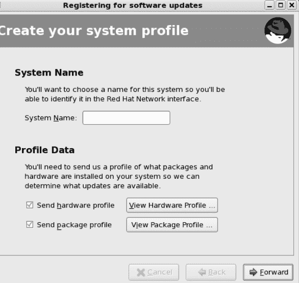

## 处理维护

在服务器部署后应用最新的服务包和更新，以确保安装了最新的补丁。操作系统公开的时间越长，恶意黑客利用漏洞的机会就越多。供应商尽可能快地修复这些漏洞；在某些情况下，补丁可以在发布当天获取。


管理员必须经常使用安全分析软件测试他们的系统。安全分析软件扫描系统以发现漏洞，并建议修复以关闭安全漏洞。本节讨论了确保您的系统免受互联网每日威胁的维护工作。

## 红帽错误修正：修复与公告

一旦您的 Red Hat 系统上线，就必须确保获取最新的红帽错误修正。这些错误修正包括错误修复、修正和更新。您应该始终检查 Red Hat 站点 `www.redhat.com/apps/support` 获取最新的错误修正。以下列表定义了在产品发布后发现的不同类型的错误修正：

- **错误修复**：这些红帽包工具（RPM）可以免费下载。错误修复为特定问题提供了修复，例如在完成操作系统任务时可能会出现某些错误消息。另一个有用的资源是红帽 bug 跟踪系统 `https://bugzilla.redhat.com/`。图 2-2 显示了用户的一个 bug 通知。

- **安全公告**：红帽建议所有管理员下载并安装安全升级，以避免由于输入验证不当导致 Netscape 联合专家小组（JPEG）代码引起的内存溢出、拒绝服务（DoS）和入侵攻击。安全更新位于 `http://www.redhat.com/security/updates/`。

- **包增强**：操作系统或特定应用程序的功能和特性提供了更新。包增强通常对系统的完整性至关重要；它们经常为 RPM 提供新功能。

### 图 2.2 通过 Bugzilla 的通知

Bugzilla 234616: RHEL 5 无法从显示器获取 EDI 并设置了低分辨率

| 最后评论 | 克隆 bug | 显示 bug 活动 | 打印格式 |
|---|---|---|---|

| | | 优先级 | 高 |
| 产品 | Red Hat Enterprise Linux | 严重 | 高 |
| 版本 | 5 | 状态 | 已分配 (ASSIGNED) |
| 组件 | xorg-x11-vesa | 解决 | |
| | | 抄送： | |
| 硬件 | i386 | cra@epi.edu | |
| 报告者 | (wdc@mit.edu) | dddongo@redhat.com | |
| 分配给 | ajax (alexson@redhat.com) | gneely@ncsu.edu | |

由 (wdc@mit.edu) 于 2007-04-13 14:41 EST 打开 [回复]

我安装了 RHEL 5，注意到有时 X 分辨率会正确地设置为我指定的 1200x1024，但通常在重启 X 服务器后，它会把分辨率降低到 800x600。

我将附上 `Xorg.0.log` 输出，显示 VESA BDE 读取被认为成功。

您还可以通过**bug 报告工具** 发送 bug。当您在系统上进行常规工作遇到错误时，该窗口会自动出现。图 2.3 显示了 bug 报告工具。

如果您点击“详细信息”，可能会发现所示信息（此处显示了部分输出）。这些信息基于 bug 的性质、软件和硬件配置，并因系统而异。虽然您可能无法识别报告工具捕获的所有内容，但红帽支持专家将能够解码这些信息并进行修复。

### 图 2.3 bug 报告工具


发行版: Red Hat Enterprise Linux server release 5 (Tikanga)

Gnome 版本: 2.16.0 2006-09-04 (Red Hat, Inc)

BugBuddy 版本: 2.16.0

内存状态: size: 147779584 size: 0 驻留: 147779584 共享: 0 rss: 64827776

rss_rim: 0

CPU 使用率: start_time: 1189756814 rtime: 0 utime: 2224 stime: 0 cutime: 0 cstime: 197_real_value: 0 frequency: 93

回溯轨迹生成自 `/usr/bin/yelp`

```
(no symbols found)
Using host thread library "/lib/thread_db.so."
(no symbols found)
[Thread debugging using thread_db.so]
(no symbols found)
[Thread debugging using thread_db.so]
[New Thread -120863 (LWP 3961)]
[New Thread -125504 (LWP 4181)]
[New Thread -1243567 (LWP 3963)]
[New Thread -1210463 (LWP 3962)]
(no symbols found)
(no symbols found)
```

一旦您在红帽网络注册了系统，您偶尔会收到“RHN 错误警报”邮件。这些警报针对您注册的系统包含了包含了摘要、详细描述以及解决问题的建议。

在此案例中，从红帽收到的以下邮件包含了系统所需的“内核安全更新”详情（部分输出）：

关于此错误修正的完整信息可以在此处找到：`https://rhn.redhat.com/rhn/errata/details/Details.do?eid=5984`

安全公告 - RHSA-2007:075-2

摘要：

重要：内核安全更新

修复 Red Hat Enterprise Linux 5 内核各种安全问题的更新后内核包现已提供。

红帽安全响应小组已将此更新评级为具有重要的安全影响。

描述：

Linux 内核处理操作系统的基本功能。

这些新的内核包包含对以下安全漏洞的修复：

- * Intel 显卡 DRM 驱动程序中存在一个漏洞，允许本地用户访问任何内存。要访问 DRM 功能，用户必须拥有 X 服务器的权限，该权限通过图形化登录授予。此问题仅影响带有 Intel 965 或更高版本图形芯片组的系统。（CVE-2007-3851，重要）

- * 64 位系统上的 VFAT 内核 ioctl 处理存在一个漏洞，允许本地用户损坏 `kernel_dirent` 结构并导致拒绝服务（系统崩溃）。（CVE-2007-2878，重要）

. . （输出已截断）

建议红帽企业 Linux 5 用户升级到这些软件包，这些软件包包含了用于修复这些问题的回向补丁（backported patches）。

参考文献：

`http://www.redhat.com/security/updates/classification/#important`

---

您可以通过两种方式解决此公告中概述的问题：

- * 通过点击以下位置列表中的名称选择您的服务器，然后为其安排错误更新（errata update）：`https://rhn.redhat.com/rhn/systems/SystemList.do`

- * 在每个受影响的服务器上运行更新代理（Update Agent）。

. . （输出已截断）

---

### 受影响系统列表

此错误公告可能适用于下方列出的系统。如果您知道此错误修复不适用于列出的系统，可能是该服务器的软件包配置（package profile）已过期。在这种情况下，您应该在相关系统上以 root 身份运行 `update -p` 以刷新您的软件配置。

“您的 RHN”中注册了 1 个受影响的系统（仅显示您显式启用错误告警的系统）。

| 版本 | 架构 | 配置文件名称 |
|---|---|---|
| 5Server | i686 | linux11 |

红帽网络团队

如您从上述邮件中注意到的，注册的系统需要内核安全更新。现在，您需要遵循“采取行动”部分列出的步骤来确保您的系统已更新。本案例公告建议对受影响的服务器安排错误更新并运行更新代理。

作为 Linux 管理员或安全管理员，定义以下内容至关重要：

- 服务器的角色（web、数据库、代理、ftp、dns、dhcp 或其他）

- 执行特定服务器角色所需的服务（例如，Apache 和锁定 Web 服务器）

- 需要开放的端口（例如，HTTP，80端口）

所有其他服务都应禁用，所有其他端口都应关闭。完成上述任务后，服务器将成为仅运行指定角色的专用服务器。

要加固服务器，必须禁用禁用不必要的服务和端口。此过程涉及移除任何不必要的服务（如 Linux 登录），并锁定不必要的传输控制协议/用户数据报协议（TCP/UDP）端口。一旦这些服务和端口安全，您必须定期维护系统。图 2-4 显示了红帽 Linux 中的服务配置。

系统 | 管理 打开服务配置工具。您可以选择或取消选择服务，启动、停止或重启，并编辑单个服务的运行级别（run level）。在图 2.4 中，您可能会注意到服务“iptables”已启用，并显示了服务的描述和状态。

### 图 2.4 服务配置

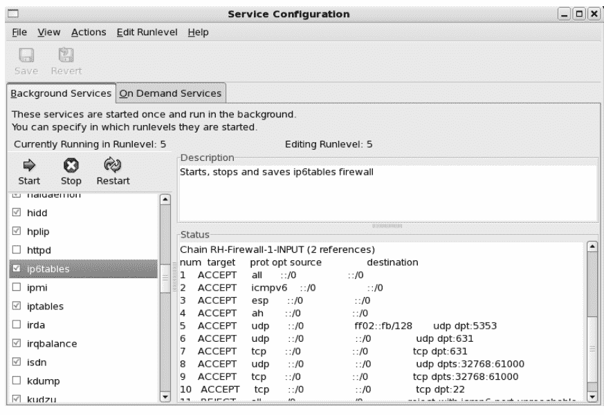

现代 Linux 发行版已经增强了 GUI 以涵盖大多数管理任务，但对于优秀的管理员来说，在没有 GUI 的情况下如何执行任务至关重要。让我们讨论如何手动禁用某些脆弱的服务器。


Linux 本质上比大多数操作系统更安全。尽管如此，每个新发布的 Linux 内核仍然存在不确定性，并且存在许多被发现的安全漏洞。大多数 Linux 服务不会受到这些攻击的影响。然而，管理员可以通过移除不必要的服务来减少风险。红帽 Linux 包含许多服务，因此管理员自定义系统以适应公司需求是合理的。请记住，当您移除不必要的服务时，就是在消除风险。

## xinetd.conf 文件

尽管现代 Linux 发行版提供了更复杂的网络管理工具，但 `/etc/xinetd.conf` 文件控制着许多 Unix 服务，包括文件传输协议 (FTP) 和 Telnet。它决定了系统提供哪些服务。`xinetd` 服务（类似于早期版本中的 `inet`）是一个“超级服务器”，负责监听一系列服务的入站网络活动。它确定所请求服务的实际性质并启动相应的服务器。此举的首要目的是避免启动和运行大量低流量的服务器。此外，`inetd` 按需启动服务的能力意味着只运行所需数量的服务器。

`/etc/xinetd.d` 使得禁用系统未使用的服务成为可能。例如，您可以通过注释掉各自文件中 FTP 和 Telnet 条目并重启服务来禁用 FTP 和 Telnet 服务。如果服务被注释掉，它将不会重启。下一节将演示如何禁用 Telnet、FTP 和登录服务。

## Telnet 和 FTP

大多数管理员发现通过网络登录到 Unix 机器进行管理是方便的。这允许管理员在远程工作的同时，维护网络服务。然而，在高度安全的环境中，可能只允许物理访问服务器。在这种情况下，应禁用 Telnet 交互登录工具。

1. 要禁用 Telnet，必须编辑 `/etc/xinetd.d/telnet` 文件。使用 `vi` 或您喜欢的编辑器打开 Telnet 文件。
2. 在 `service telnet` 行前添加数字（`#`）来注释掉该行：
3. 保存并退出文件。
4. 接下来，通过输入以下命令重启 `xinetd`：`/etc/rc.d/init.d/xinetd restart`

```
Stopping xinetd: [OK]
Starting xinetd: [OK]
```

5. 尝试使用 Telnet 登录系统。应该失败。
6. 注意，在 `xinetd.d` 目录中注释掉服务行可以禁用许多服务。

```
#service telnet
```

7. 使用相同的方法禁用 FTP 服务（例如编辑 `wu-ftpd` 文件，注释掉 `service ftp` 行并重启 `xinetd`）。
8. 尝试通过 FTP 访问系统。应该能够登录服务器。

远程登录 (`login`) 服务默认在 `/etc/xinetd.d/login` 中启用。`Rlogin` 存在安全漏洞，它可以绕过密码提示访问系统。与 `rlogin` 关联有两个服务：`login` 和 `RSH`（远程 shell）。要禁用这些服务，打开 `xinetd.d/login` 文件并注释掉 `service login` 行。然后，打开 `/etc/xinetd.d/rsh` 文件并注释掉 `service` 行。重启 `xinetd` 以确保您的系统不再提供这些服务。

TCP/IP 网络为每个服务分配端口，例如 HTTP、简单邮件传输协议 (SMTP) 和邮局协议 3 (POP3)。该端口被分配一个数字，称为端口号，用于入站数据。例如，如果客户端浏览器请求服务器的 Web 页面，请求将指向服务器的 80 端口。Web 服务接收请求并将 Web 页面发送给客户端。每个服务分配一个端口号，每个端口号都有 TCP 和 UDP 端口。例如，端口 53 用于域名系统 (DNS)，并有一个 TCP 端口或 UDP 端口。TCP 端口 53 用于 DNS 服务器之间的区域传输；UDP 端口 53 用于常见的 DNS 查询——将域名解析为 IP 地址。

### 表 2.1 各种类型的端口号范围

| 类型 | 端口号范围 |
| :--- | :--- |
| Well良端口 | 1–1023 |
| 注册端口 | 1024–65535 |

> 假设到端口号 1023 及以下内容的连接是以 root 级权限运行的。这意味着不信任的服务永远不应配置为 1024 以下的端口号。

### 表 2.2 常用已知的 TCP/UDP 端口号

| 协议 | 端口号 |
| :--- | :--- |
| FTP (默认数据) | 20 |
| FTP (连接对话，控制) | 21 |
| Telnet | 23 |
| SMTP | 25 |
| DNS | 53 |
| DHCP BOOTP 服务器 | 67 |
| DHCP BOOTP 客户端 | 68 |
| TFTP | 69 |
| Gopher | 70 |
| HTTP | 80 |
| POP3 | 110 |
| NNTP | 119 |
| NetBIOS 会话服务 | 139 |
| 互联网消息访问协议 (IMAP) 版本 2 | 143 |

## 确定要拦截的端口

在确定服务器要拦截的端口时，你必须首先确定你需要哪些服务。在大多数情况下，这些服务并不需要拦截所有端口。这很棘手，因为你很容易把自己排除在所需的服务之外，特别是当你像之前解释的那使用临时端口时。如果你的服务器是运行 SMTP 和 IMAP 的专用邮件服务器，你可以阻止除 25 和 143 之外的所有 TCP 端口。如果你的服务器是专用 HTTP 服务器，你可以阻止除 TCP 端口 80 之外的所有端口。在这情况下，你都可以阻止所有 UDP 端口，因为 SMTP 和 IMAP 专门使用 TCP 服务。

如果你想将服务器作为 HTTP 客户端（例如用于访问操作系统更新）或作为远程邮件服务器的邮件客户端，这样做将限制系统。客户端需要 DNS 的 UDP 端口，还需要用于与 Web 服务器建立连接的注册 TCP 端口。

如果你只开放相应的 UDP 端口 25、80 和 143，DNS 请求将被拦截，因为 DNS 查询使用 UDP 端口 53，而 DNS 答使用 UDP 注册端口（例如响应 `www.ingress.com=155.212.56.73`）。即使你开放了端口 53，每次回答都可能分配一个不同的注册端口。尝试允许访问随机分配的注册端口几乎是不可能的，而且浪费时间。对于需要临时端口的 TCP 连接也存在相同的问题。

因此，你应该要么开放所有 TCP/UDP 注册端口（以便你可以将服务器作为客户端），要么拦截它们（你所需的服务除外）并访问资源，例如。

## 拦截端口

要在 Linux 中拦截 TCP/UDP 服务，你必须使用防火墙。在 Red Hat Linux (RHEL) 中，防火墙由 `iptables` 提供。图 2.5 显示了防火墙配置。

### 图 2.5 安全级别与防火墙

![img/38c01dfda8509e44932f76845.png)

### 添加端口或服务

![img/38c01dfda8509e44932f76845.png)

## 独立服务

以下列表讨论了可以拦截的独立服务：

- `RPC` (远程过程调用)
- `NIS` (网络信息服务)
- `NFS` (网络文件系统)
- `Apache`
- `SSH` (安全外壳)

## 使用 Bastille 加固系统

`Bastille` 是一个交互式工具，简化了 Linux 系统的加固。它会提出一系列问题并根据用户的回答相应配置系统。

### Bastille 功能

以下列表强调了 `Bastille` 为保护系统提供的安全功能。你将在问答向导期间选择实现哪些功能。

- 对管理员实用应用限制性权限：仅允许 `root` 读取和执行如 `ifconfig`、`netstat`、`ping`、`traceroute` 和 `runlevel` 等常用工具。
- 禁用 `r-协议`：`r`协议允许用户使用基于 IP 的身份验证登录远程系统。这容易受到伪骗攻击。
- 实现密码年龄：Red Hat 默认允许密码在 9999 天后过期。`Bastille` 提议将其改为 180 天。
- 禁用 CTRL-ALT-DELETE 重启：禁用通过这种方法重启机器。
- 优化 TCP Wrappers：修改 `inetd.conf` 和 `/etc/hosts.allow`，使得 `inetd` 在运行服务之前使用 TCP Wrappers。

# 第 2 章 操作系统加固

## 2.7 配置为 180 天密码过期的 `/etc/login.defs` 文件


```
root@localhost:/etc *
# *REQUIRED:*
# 邮件邮箱所在的目录，或相对于主目录的文件名。
# 如果你定义了这两项，则 MAIL_DIR 优先级更高。
# QMAIL_DIR 用于 Qmail
#nQMAIL_DIR      Maildir
MAIL_DIR        /var/spool/mail
#PASS_FILE       mail
#n密码年龄控制：
# PASS MAX DAYS   密码可使用的最大天数。
# PASS MIN DAYS   密码更改之间允许的最小天数。
# PASS MIN LEN    最小接受的密码长度。
# PASS WARN AGE   密码过期前给出的警告天数。
#PASS MAX DAYS   180
PASS MIN DAYS   0
PASS MIN LEN    5
PASS WARN AGE   7
#nuseradd 中自动选择 uid 的最小/最大值
```

### 添加授权横幅（Authorized banners）
这些横幅在每次登录系统时都会自动出现。授权横幅有助于起诉恶意黑客，应该添加到您网络中所有允许访问网络的系统上。可以在美国能源部计算机事件咨询能力中心（CIAC）的网站找到信息简报：`http://ciac.inl.gov/ciac/bulletins/j-043.html`。该公告标题为“创建登录横幅”，解释了政府计算机登录横幅的要求。它还包含了如何创建横幅的方法，并提供了联邦政府计算机系统批准的横幅文本。

### 限制系统资源使用
如果限制了系统资源使用，可以减少 DoS 攻击导致服务器故障的概率。如果你在 Bastille 中选择限制系统资源使用，将发生以下变化：

- 单个文件大小限制为 40MB。
- 每个用户限制为 150 个进程。
- 允许的 `core` 文件数量被配置为零。`core` 文件用于系统故障排除。如果黑客获得了它们的控制权，它们体积很大且易于被利用：它们会增长并消耗您的文件系统。

### 限制控制台访问
任何可以访问控制台的人都有特殊权限，例如挂载 CD-ROM。Bastille 可以指定哪些用户账户允许通过控制台登录。

### 附加和远程日志
可以在 `/var/log/` 中添加两个额外的日志：

- `/var/log/kernel`（内核消息）
- `/var/log/syslog`（错误和警告级别的消息）

如果存在远程日志主机，你也可以记录到该主机。

### 进程计数设置（Process accounting setup）
允许你记录所有用户的命令。它还记录了命令执行的时间。此日志文件有助于追溯黑客进入系统的步骤，但文件可能会迅速变大。如果黑客拥有 `root` 权限，可以删除此计数日志。

### 禁用 NFS 和 Samba
允许你禁用 NFS 和 Samba 服务。Samba 提供了一个文件系统。除非配置了防火墙拦截数据包或管理员保护了这些服务，否则 Bastille 建议禁用这些服务。

### 加固 Apache Web 服务器
如果不需要该服务，应禁用 `http`。如果你决定使用 Apache，可以执行 Bastille 中“加固 Apache Web 服务器”侧边栏中所示的步骤来运行该服务。

## Bastille 版本

Bastille 当前发布的版本 `3.0.9` 包含了几个重要的更改，使程序更加强大且易用。本书中的示例使用的是 Bastille `3.0.9`。

## 实现 Bastille

Bastille 可以在 `www.sourceforge.net` 免费下载。该程序以 `tarball` 和 `rpm` 格式提供。它必须由 `root` 用户在其根目录下安装（`tarball` 是一个使用 Unix `tar` 程序归档并带有 `.tar` 扩展名的存档文件集合）。确保你的系统上安装了 `perl/tk` 库，因为 Bastille 是 Perl 脚本的集合。

程序根据对问题的回答自动实现管理员的偏好，并将其存在 `/root/Bastille/config` 文件中，如图 2.8 所示。

## 图 2.8 Bastille 配置文件

```
$ root@local.bastille.local:~/Bastille/and/backup/bfc
- Options:
Q? 你是否想运行 inchains 脚本？ [N]
Q? 你是否想下载并安装更新的 RPM 包？ [默认: 否]
- Permissions,inchains,ininit.sh
Q? 你是否想对管理实用程序设置更严格的权限？ [H]
- Permissions,general,admin
Q? 你是否想禁用 mount/amount 的 SUID 状态？ [Y]
- Permissions,subuid
Q? 你是否想禁用 ping 的 SUID 状态？ [Y]
Q? 你是否想禁用 dump 和 restore 的 SUID 状态？ [Y]
- Permissions,subuid
Q? 你是否想禁用 dect1 的 SUID 状态？ [Y]
- Permissions,subuid
Q? 你是否想禁用 DOSBox 的 SUID 状态？ [Y]
- Permissions,subuid
Q? 你是否想禁用 new-server-tools 的 SUID 状态？ [Y]
- Permissions,subuid
Q? 你是否想禁用打印工具的 SUID 状态？ [H]
- Permissions,subuid
Q? 你是否想禁用工具的 SUID 状态？ [Y]
- Permissions,subuid
Q? 你是否想禁用 usernet 的 SUID 状态？ [Y]
- Permissions,subuid
Q? 你是否想禁用 traceroute 的 SUID 状态？ [Y]
- Permissions,subuid
Q? 你是否想禁用 netctl 的 SUID 状态？ [Y]
- Permissions,subuid
Q? 你是否想禁用 umask 的 SUID 状态？ [Y]
- Permissions,subuid
Q? 你是否想禁用 mount 的 SUID 状态？ [Y]
- Permissions,subuid
Q? 你是否想禁用 backup 的 SUID 状态？ [Y]
- Permissions,subuid
Q? 你是否想禁用 config 的 SUID 状态？ [Y]
- Permissions,subuid
Q? 你是否想禁用 login 的 SUID 状态？ [Y]
- Permissions,subuid
Q? 你是否想禁用 mail 的 SUID 状态？ [Y]
- Permissions,subuid
Q? 你是否想禁用 password 的 SUID 状态？ [Y]
- Permissions,subuid
Q? 你是否想禁用 security 的 SUID 状态？ [Y]
- Permissions,subuid
Q? 你是否想禁用 hardening 的 SUID 状态？ [Y]
- Permissions,subuid
Q? 你是否想禁用 Bastille 的 SUID 状态？ [Y]
- Permissions,subuid
```


- **禁用 NFS 和 Samba** 允许你禁用 NFS 和 Samba 服务。Samba 提供了一个文件系统。除非配置了防火墙拦截数据包或管理员保护了这些服务，否则 Bastille 建议禁用这些服务。

- **加固 Apache Web 服务器** 如果不需要该服务，应禁用 http。如果你决定使用 Apache，可以执行 Bastille 中“加固 Apache Web 服务器”侧边栏中所示的步骤来运行该服务。

## Bastille 版本

Bastille 当前发布的版本 3.0.9 包含了几个重要的更改，使程序更加强大且易用。本书中的示例使用的是 Bastille 3.0.9。

## 实现 Bastille

Bastille 可以在 www.sourceforge.net 免费下载。该程序以 tarball 和 rpm 格式提供。它必须由 root 用户在其根目录下安装（tarball 是一个使用 Unix tar 程序归档并带有 .tar 扩展名的存档文件集合）。确保你的系统上安装了 perl/tk 库，因为 Bastille 是 Perl 脚本的集合。

程序根据对问题的回答自动实现管理员的偏好，并将其存在 `/root/Bastille/config` 文件中，如图 2.8 所示。

### 图 2.8 Bastille 配置文件

```
$ root@local.bastille.local:~/Bastille/and/backup/bfc
- Options:
Q? 你是否想运行 inchains 脚本？ [N]
Q? 你是否想下载并安装更新的 RPM 包？ [默认: 否]
- Permissions,inchains,ininit.sh
Q? 你是否想对管理实用程序设置更严格的权限？ [H]
- Permissions,general,admin
Q? 你是否想禁用 mount/amount 的 SUID 状态？ [Y]
- Permissions,subuid
Q? 你是否想禁用 ping 的 SUID 状态？ [Y]
Q? 你是否想禁用 dump 和 restore 的 SUID 状态？ [Y]
- Permissions,subuid
Q? 你是否想禁用 dect1 的 SUID 状态？ [Y]
- Permissions,subuid
Q? 你是否想禁用 DOSBox 的 SUID 状态？ [Y]
- Permissions,subuid
Q? 你是否想禁用 new-server-tools 的 SUID 状态？ [Y]
- Permissions,subuid
Q? 你是否想禁用打印工具的 SUID 状态？ [H]
- Permissions,subuid
Q? 你是否想禁用工具的 SUID 状态？ [Y]
- Permissions,subuid
Q? 你是否想禁用 usernet 的 SUID 状态？ [Y]
- Permissions,subuid
Q? 你是否想禁用 traceroute 的 SUID 状态？ [Y]
- Permissions,subuid
Q? 你是否想禁用 netctl 的 SUID 状态？ [Y]
- Permissions,subuid
Q? 你是否想禁用 umask 的 SUID 状态？ [Y]
- Permissions,subuid
Q? 你是否想禁用 mount 的 SUID 状态？ [Y]
- Permissions,subuid
Q? 你是否想禁用 backup 的 SUID 状态？ [Y]
- Permissions,subuid
Q? 你是否想禁用 config 的 SUID 状态？ [Y]
- Permissions,subuid
Q? 你是否想禁用 login 的 SUID 状态？ [Y]
- Permissions,subuid
Q? 你是否想禁用 mail 的 SUID 状态？ [Y]
- Permissions,subuid
Q? 你是否想禁用 password 的 SUID 状态？ [Y]
- Permissions,subuid
Q? 你是否想禁用 security 的 SUID 状态？ [Y]
- Permissions,subuid
Q? 你是否想禁用 hardening 的 SUID 状态？ [Y]
- Permissions,subuid
Q? 你是否想禁用 Bastille 的 SUID 状态？ [Y]
- Permissions,subuid
```

## 2.7 配置为 180 天密码过期的 /etc/login.defs 文件

```
root@localhost:/etc *
# *REQUIRED:*
# 邮件邮箱所在的目录，或相对于
# 主目录的文件名。
 如果你定义了这两项，则 MAIL_DIR 优先级更高。
# QMAIL_DIR 用于 Qmail
#nQMAIL_DIR      Maildir
MAIL_DIR        /var/spool/mail
#PASS_FILE       mail
#n密码年龄控制：
# PASS MAX DAYS   密码可使用的最大天数。
# PASS MIN DAYS   密码更改之间允许的最小天数。
# PASS MIN LEN    最小接受的密码长度。
# PASS WARN AGE   密码过期前给出的警告天数。
#PASS MAX DAYS   180
PASS MIN DAYS   0
PASS MIN LEN    5
PASS WARN AGE   7
#nuseradd 中自动选择 uid 的最小/最大值
```

- **添加授权横幅（Authorized banners）** 这些横幅在每次登录系统时都会自动出现。授权横幅有助于起诉恶意黑客，应该添加到您网络中所有允许访问网络的系统上。可以在美国能源部计算机事件咨询能力中心（CIAC）的网站找到信息简报：http://ciac.inl.gov/ciac/bulletins/j-043.html。该公告标题为“创建登录横幅”，解释了政府计算机登录横幅的要求。它还包含了如何创建横幅的方法，并提供了联邦政府计算机系统批准的横幅文本。

- **限制系统资源使用** 如果限制了系统资源使用，可以减少 DoS 攻击导致服务器故障的概率。如果你在 Bastille 中选择限制系统资源使用，将发生以下变化：
  - 单个文件大小限制为 40MB。
  - 每个用户限制为 150 个进程。
  - 允许的 core 文件数量被配置为零。core 文件用于系统故障排除。如果黑客获得了它们的控制权，它们体积很大且易于被利用：它们会增长并消耗您的文件系统。

- **限制控制台访问** 任何可以访问控制台的人都有特殊权限，例如挂载 CD-ROM。Bastille 可以指定哪些用户账户允许通过控制台登录。

- **附加和远程日志** 可以在 `/var/log/` 中添加两个额外的日志：
  - **/var/log/kernel**（内核消息）
  - **/var/log/syslog**（错误和警告级别的消息）
如果存在远程日志主机，你也可以记录到该主机。

- **进程计数设置（Process accounting setup）** 允许你记录所有用户的命令。它还记录了命令执行的时间。此日志文件有助于追溯黑客进入系统的步骤，但文件可能会迅速变大。如果黑客拥有 root 权限，可以删除此计数日志。

- **禁用 NFS 和 Samba** 允许你禁用 NFS 和 Samba 服务。Samba 提供了一个文件系统。除非配置了防火墙拦截数据包或管理员保护了这些服务，否则 Bastille 建议禁用这些服务。

- **加固 Apache Web 服务器** 如果不需要该服务，应禁用 http。如果你决定使用 Apache，可以执行 Bastille 中“加固 Apache Web 服务器”侧边栏中所示的步骤来运行该服务。


```
$ root@local.bastille.local:~/Bastille/and/backup/bfc
- Options:
Q? 你是否想运行 inchains 脚本？ [N]
Q? 你是否想下载并安装更新的 RPM 包？ [默认: 否]
- Permissions,inchains,ininit.sh
Q? 你是否想对管理实用程序设置更严格的权限？ [H]
- Permissions,general,admin
Q? 你是否想禁用 mount/amount 的 SUID 状态？ [Y]
- Permissions,subuid
Q? 你是否想禁用 ping 的 SUID 状态？ [Y]
Q? 你是否想禁用 dump 和 restore 的 SUID 状态？ [Y]
- Permissions,subuid
Q? 你是否想禁用 dect1 的 SUID 状态？ [Y]
- Permissions,subuid
Q? 你是否想禁用 DOSBox 的 SUID 状态？ [Y]
- Permissions,subuid
Q? 你是否想禁用 new-server-tools 的 SUID 状态？ [Y]
- Permissions,subuid
Q? 你是否想禁用打印工具的 SUID 状态？ [H]
- Permissions,subuid
Q? 你是否想禁用工具的 SUID 状态？ [Y]
- Permissions,subuid
Q? 你是否想禁用 usernet 的 SUID 状态？ [Y]
- Permissions,subuid
Q? 你是否想禁用 traceroute 的 SUID 状态？ [Y]
- Permissions,subuid
Q? 你是否想禁用 netctl 的 SUID 状态？ [Y]
- Permissions,subuid
Q? 你是否想禁用 umask 的 SUID 状态？ [Y]
- Permissions,subuid
Q? 你是否想禁用 mount 的 SUID 状态？ [Y]
- Permissions,subuid
Q? 你是否想禁用 backup 的 SUID 状态？ [Y]
- Permissions,subuid
Q? 你是否想禁用 config 的 SUID 状态？ [Y]
- Permissions,subuid
Q? 你是否想禁用 login 的 SUID 状态？ [Y]
- Permissions,subuid
Q? 你是否想禁用 mail 的 SUID 状态？ [Y]
- Permissions,subuid
Q? 你是否想禁用 password 的 SUID 状态？ [Y]
- Permissions,subuid
Q? 你是否想禁用 security 的 SUID 状态？ [Y]
- Permissions,subuid
Q? 你是否想禁用 hardening 的 SUID 状态？ [Y]
- Permissions,subuid
Q? 你是否想禁用 Bastille 的 SUID 状态？ [Y]
- Permissions,subuid
```

# 损害与防御（Damage & Defense）

## 在 Bastille 中记录

你在 Bastille 中实施的所有选择都记录在 `/root/Bastille/config` 文件中。我们强烈建议在运行 Bastille 之前对配置文件进行备份，并手动记录你的选择。如果系统出现故障，你可以访问这些副本并重新创建 Bastille 配置。

### 图 2.11 Bastille Linux 问答向

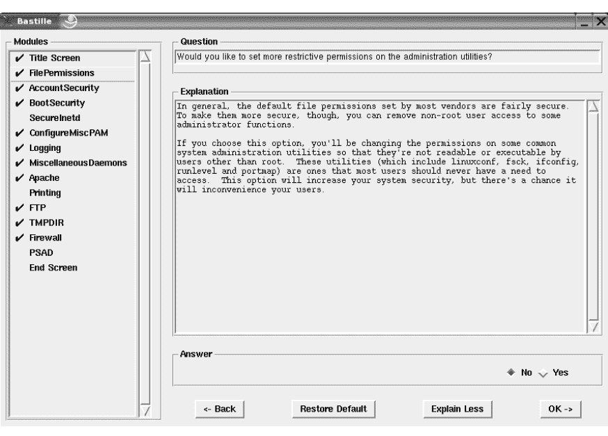

### 表 2.5 Bastille Linux 问题

# 问题

| ID | 问题 |
| :--- | :--- |
| 1 | 您是否想对管理实用程序设置更严格的权限？ |
| 2 | 您是否想禁用 mount/unmount 的 SUID 状态？ |
| 3 | 您是否想禁用 ping 的 SUID 状态？ |
| 4 | 您是否想禁用 at 的 SUID 状态？ |
| 5 | 您是否想禁用 r-tools？ |
| 6 | Bastille 是否应该禁用使用基于 IP 身份认证的明文 r 协议？ |
| 7 | 您是否想强制执行密码年龄？ |
| 8 | 我们是否应该在 ttys 1-6 上禁止 root 登录？ |
| 9 | 您是否想为 GRUB 提示设置密码保护？ |
| 10 | 您是否想禁用 CTRL-ALT-DELETE 重启？ |

# 第 2 章 • 操作系统加固

### 表 2.5 Bastille Linux 问题续

| 问题 | 问题 |
| :--- | :--- |
| 11 | 您是否想对 TCP Wrappers 和 xinetd 设置默认拒绝？ |
| 12 | 您是否想在登录时显示“授权使用”消息？ |
| 13 | 谁负责授予使用这台机器的授权许可？ |
| 14 | 您是否想对系统资源使用设置限制？ |
| 15 | 我们是否应该将控制台访问限制在少数用户账户？ |
| 16 | 您是否想添加额外的日志？ |
| 17 | 您是否有一个远程日志主机？ |
| 18 | 您是否想设置进程审计？ |
| 19 | 您是否想禁用 acpid 和/或 apmd？ |
| 20 | 您是否想停用 NFS 和 Samba？ |
| 21 | 您是否想停用此台机器上的 HP OfficeJet (hpoj) 脚本？ |
| 22 | 您是否想停用此台机器上的 ISDN 脚本？ |
| 23 | 您是否想安装 TMPDIR/TMP 脚本？ |
| 24 | 您是否想运行数据过滤脚本？ |
| 您是否已完成对 Bastille 配置的更改？ |

- 8. Bastille 会询问您是否希望实施这些更改，如图 2.12 所示。

### 图 2.12 执行 Bastille 更改

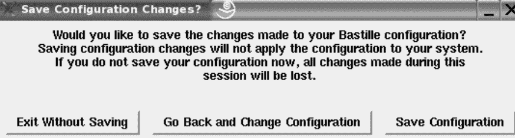

- 9. 如果您只想保存配置而不应用更改，请选择“保存配置”(Save Configuration)。如果您想放弃更改，请选择“不保存退出”(Exit Without Saving)。如果您想应用更改，请选择“返回并修改配置”(Go Back and Change Configuration)。

10. 如果您将密码年龄设置为 60 天，请通过输入以下命令观察 Bastille 对 `login.def` 文件所做的的更改：

```
/etc/login.defs | less
```

11. 按任意键显示下一页。按 `q` 访问提示符。

12. 您通过将单个用户限制为 150 个进程，并将允许的核心文件数量配置为零，对系统资源应用限制。通过输入以下命令观察 Bastille 对 `limits.conf` 文件所做的更改：

```
/etc/security/limits.conf | less
```

13. 按任意键显示下一页。按 `q` 访问提示符。

## 撤销 Bastille 更改

在本文编写时，Bastille 还没有可靠的自动撤销功能。要撤销更改，您可以重新运行配置问题并选择不同的答案。还有另外两种选项。Bastille 目录下有一个名为 `Undo.pl` 的 Perl 脚本，旨在撤销除 RPM 安装以外的所有更改。在 `/root/Bastille/undo/backup` 处有一个备份目录，其中包含了 Bastille 修改的所有原始系统文件。备份目录结构与系统目录相同，因此您可以轻松地手动替换文件。

您无法通过简单删除 Bastille 来撤销您的 Bastille 配置。如果您这样做，您的更改仍会被写入到特定的文件中。如果您想删除程序和您的设置，必须先撤销更改，然后删除 Bastille 目录。

以下步骤演示了撤销您在表 2.5 中实施的更改的三种方法。

- 1. 还原 Bastille 配置的一种方法是重新运行配置问题并选择不同的答案。

- 2. 第二种撤销 Bastille 配置的方法是运行撤销更改的自动化 Perl 脚本。该脚本名为 `Undo.pl`，旨在撤销除 RPM 安装以外的所有更改。运行 `Undo.pl` 脚本请进入 Bastille 目录并输入：

```
./Undo
```

- 3. 撤销 Bastille 配置的第三种方法是手动删除更改。这可以通过使用 Bastille 目录中的备份文件替换每个被更改的文件来实现。备份目录位于：

```
/root/Bastille/undo/backup
```

# 第 2 章 • 操作系统加固

备份文件包含了文件修改之前的原始文件，因此原始配置是完完的。Bastille 在文件被修改之前会为每个文件创建一个备份文件。

- 4. 例如，要将密码年龄改回 99 天，请使用以下命令：


```cp /root/Bastille/undo/backup/login.defs /etc/login.defs```

备份文件包含了被更改之前的原始文件，因此原始配置是完完的。`Bastille` 在文件被修改之前会为每个文件创建一个备份文件。

备份文件包含了被更改之前的原始文件，因此原始配置是完完的。`Bastille` 在文件被修改之前会为每个文件创建一个备份文件。

备份文件包含了被更改之前的原始文件，因此原始配置是完完的。`Bastille` 在文件被修改之前会为每个文件创建一个备份文件。

备份文件包含了被更改之前的原始文件，因此原始配置是完完的。`Bastille` 在文件被修改之前会为每个文件创建一个备份文件。

通过检查配置文件可以验证系统当前状态。`Bastille` 在文件被修改之前会为每个文件创建一个备份文件。备份目录结构与系统相同。

备份文件包含了被更改之前的原始文件，因此原始配置是完完的。`Bastille` 在文件被修改之前会为每个文件创建一个备份文件。

备份文件包含了被更改之前的原始文件，因此原始配置是完完的。`Bastille` 在文件被修改之前会为每个文件创建一个备份文件。

备份文件包含了被更改之前的原始文件，因此原始配置是完完的。`Bastille` 在文件被修改之前会为每个文件创建一个备份文件。

备份文件包含了被更改之前的原始文件，因此原始配置是完完的。`Bastille` 在文件被修改之前会为每个文件创建一个备份文件。

备份文件包含了被更改之前的原始文件，因此原始配置是完完的。`Bastille` 在文件被修改之前会为每个文件创建一个备份文件。

备份文件包含了被更改之前的原始文件，因此原始配置是完完的。`Bastille` 在文件被修改之前会为每个文件创建一个备份文件。

备份文件包含了被更改之前的原始文件，因此原始配置是完完的。`Bastille` 在文件被修改之前会为每个文件创建一个备份文件。

通过检查配置文件可以验证系统当前状态。`Bastille` 在文件被修改之前会为每个文件创建一个备份文件。（重复文本处理）

`Bastille` 在文件被修改之前会为每个文件创建一个备份文件。

备份文件包含了被更改之前的原始文件，因此原始配置是完完的。`Bastille` 在文件被修改之前会为每个文件创建一个备份文件。

备份文件包含了被更改之前的之前文件，illeilleille之前之前每个每个文件创建一个备份文件。

备份文件包含了被更改之前的原始文件，因此原始配置是完完的。`Bastille` 在文件被修改之前会为每个文件创建一个备份文件。

备份文件包含了被更改之前的原始文件，因此原始配置是完完的。`Bastille` 在文件被修改之前会为每个文件创建一个备份文件。

备份文件包含了被更改之前的原始文件，因此原始配置是完完的。`Bastille` 在文件被修改之前会为每个文件创建一个备份文件。

备份文件包含了被更改之前的原始文件，因此原始配置是完完的。`Bastille` 在文件被修改之前会为每个文件创建一个备份文件。

备份文件包含了被更改之前的原始文件，因此原始配置是完完的。`Bastille` 在文件被修改之前会为每个文件创建一个备份文件。

备份文件包含了被更改之前的原始文件，因此原始配置是完完的。`Bastille` 在文件被修改之前会为每个文件创建一个备份文件。（重复文本）

`Bastille` 在文件被修改之前会为每个文件创建一个备份文件。

通过检查配置文件可以验证系统当前状态。`Bastille` 在文件被修改之前会为每个文件创建一个备份备份文件。

备份文件包含了被更改之前的原始文件，因此原始配置是完完的。`Bastille` 在文件被修改之前会为每个文件创建一个备份文件。

备份文件包含了被更改之前的原始文件，因此原始配置是完完的。`Bastille` 在文件被修改之前会为每个文件创建一个备份文件。

备份文件包含了被更改之前的原始文件，因此原始配置是完完的。`Bastille` 在文件被修改之前会为每个文件创建一个备份文件。

备份文件包含了被更改之前的原始文件，因此原始配置是完完的。`Bastille` 在文件被修改之前会为每个文件创建一个备份文件。

备份文件包含了被更改之前的原始文件，因此原始配置是完完的。`Bastille` 在文件被修改之前会为每个文件创建一个备份文件。

`Bastille` 在文件被修改之前会为每个文件创建一个备份文件。（重复文本）

通过检查配置文件可以验证系统当前状态。`Bastille` 在文件被修改之前会为每个文件创建一个备份文件。

备份文件包含了被更改之前的原始文件，因此原始配置是完完的。`Bastille` 在文件被修改之前会为每个文件创建一个备份文件。

备份文件包含了被更改之前的原始文件，因此原始配置是完完的。`Bastille` 在文件被修改之前会为每个文件创建一个备份文件。

备份文件包含了被更改之前的原始文件，因此原始配置是完完的。`Bastille` 在文件被修改之前会为每个文件创建一个备份文件。

备份文件包含了被更改之前的原始文件，因此原始配置是完完的。`Bastille` 在文件被修改之前会为每个文件创建一个备份文件。

备份文件包含了被更改之前的原始文件，因此原始配置是完完的。`Bastille` 在文件被修改之前会为每个文件创建一个备份文件。

`Bastille` 在文件被修改之前会为每个文件创建一个备份文件。（重复文本）

通过检查配置文件可以验证系统当前状态。`Bastille` 在文件被修改之前会为每个文件创建一个备份文件。

备份文件包含了被更改之前的原始文件，因此原始配置是完完的。`Bastille` 在文件被修改之前会为每个文件创建一个备份文件。

备份文件包含了被更改之前的原始文件，因此原始配置是完完的。`Bastille` 在文件被修改之前会为每个文件创建一个备份文件。

备份文件包含了被更改之前的原始文件，因此原始配置是完完的。`Bastille` 在文件被修改之前会为每个文件创建一个备份文件。

备份文件包含了被更改之前的原始文件，因此原始配置是完完的。`Bastille` 在文件被修改之前会为每个文件创建一个备份文件。

备份文件包含了被更改之前的原始文件，因此原始配置是完完的。`Bastille` 在文件被修改之前会为每个文件创建一个备份文件。

## 使用 Sudo 进行控制和审计

`sudo` 命令允许用户以超级用户或其他用户的身份执行命令。所有的 sudo 配置都写入 `/etc/sudoers` 文件中。`sudoers` 文件指定了特定用户是否允许执行该命令。

为了使用 sudo，用户必须已经提供了用户名和密码。如果用户尝试通过 sudo 运行命令而该用户不在 sudoers 文件中，系统会自动向管理员发送电子邮件，指示有一个未经授权的用户正在访问系统。

一旦用户登录 sudo，默认会发放有效期五分钟的票据。用户可以通过 `-v` 标志来更新票据，这将验证有效期五分钟。命令格式如下：

如果未经授权的用户运行 `-v` 标志，不会向管理员发送电子邮件。`-v` 标志会告知未经授权的用户不是有效用户。如果用户仍然通过 sudo 输入命令，随后会向管理员发送电子邮件。

## 系统要求

安装和运行 sudo 需要一个类 Unix 系统。几乎所有的 Unix 版本都支持 sudo 分发版，包括几乎所有的 POSIX、BSD 和 SYSV 变体。你必须安装 C 编译器和 `make` 工具。

## 表 2.7 选定的 Sudo 命令选项

| 选项 | 选项名称 | 描述 |
| --- | --- | --- |
| -V | 版本 | 打印版本号并退出。 |
| -l | 列表 | 列出当前用户允许和禁止的命令。 |
| -h | 帮助 | 打印用法信息并退出。 |
| -v | 验证 | 为配置的时间更新用户票据。如果需要，用户必须重新输入用户密码。 |
| -k | 杀死 | 使用户的票据过期。完成此选项需要用户重新输入用户密码以更新票据。 |
| -K | 强制杀死 | 完全移除用户的票据。运行此选项后，用户必须使用用户名和密码重新登录。 |
| -u | 用户 | 以指定的用户名运行特定命令。指定的用户可以是 root 以外的任何用户。如果你想输入 uid，请输入 #uid 而不是用户名。 |

### 安装 Sudo

从 `www.gratis.us/sudo/download.html` 下载 sudo tar 包到你选择的任何目录。在本例中，sudo 已下载到 `/root` 目录。此操作是在 Red Hat Enterprise Linux 5.0 版本上执行。

- 1. 进入下载 sudo 的目录，并通过以下命令解压 tar 文件（你的 sudo 版本号将根据下载的 sudo 版本而异）：
- 2. 将创建一个名为 `sudo-1.6.3p5` 的目录。
- 3. 输入以下命令进入 sudo 目录：
- 4. 输入以下命令以创建 makefile 和 config.h 文件，这将允许你配置 sudo：

```
tar -zxvf sudo-1.6.3p5.tar.gz
```

```
cd sudo-1.6.3p5
```

```
./configure
```


- 5. 你可以向 `./configure` 命令添加选项来自定义你的 sudo 安装。只需将选项追加到你的 `./configure` 命令后即可。完整的选项列表可以在 `/sudo/INSTALL` 文件中找到。

- 6. 你也可以编辑 `makefile` 来更改安装的默认路径，以及 `/sudo/INSTALL` 文件列出的其他配置。如果你需要此更改，请用文本编辑器打开 `makefile`。例如：

`vi Makefile`

- 7. 找到 `makefile` 中的“Where to install things...（安装位置...）”部分，如图 2.14 所示。

### 图 2.14 Sudo Makefile

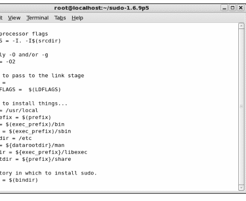

- 8. 如必要更改默认路径。在本例中，我们建议你使用默认路径。

- 9. 退出文件。如果你使用 `vi` 文本编辑器，输入：

`:q`

- 10. （可选）在运行 `./configure` 命令时也可以更改默认安装路径（你在上一步中运行了 `configure` 命令）。要执行此，在命令后输入一个选项。例如，默认情况下 `sudoers` 安装在 `/etc` 目录。你可以通过输入命令更改此位置：

```
./configure -sysconfdir=DIR
```

其中 `DIR` 是新目录。

- 11. 要编译 `sudo`，通过输入以下运行 `make` 命令：

`make`

- 12. （可选）如果你在源文件目录以外的目录安装 `sudo`，你可能需要 GNU。如果在安装过程中遇到错误，请阅读 `TROUBLESHOOTING`（故障排除）和 `PORTING`（移植）文件。

- 13. 要安装 `sudo`，你必须是 `root` 用户。通过输入 `make install` 命令来安装 `man` 页、`visudo` 和基础 `sudo` 文件：

```
make install
```

## 注意

> 任何现有的 `sudoers` 文件都不会被覆盖。

- 14. 你已经安装了 `sudo`。下一节将解释如何配置它以适应你的系统需求。

### 配置 Sudo

要配置 `sudo`，你必须编辑 `%/sudo-1.6.9p5/sudoers` 文件。`sudoers` 文件定义了允许执行命令的用户。只有 `root` 用户允许编辑该文件，并且必须使用 `visudo` 命令进行编辑。`sudo` 目录中包含一个示例 `.sudoers` 文件，如图 2.15 所示。

### 图 2.15 Sample.Sudoers 文件

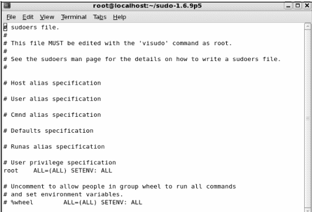

`visudo` 命令默认使用 `vi` 编辑器打开 `sudoers` 文件。使用 `vi` 命令来编辑和写入文件。你可以使用编译时选项更改 `visudo` 使用的默认文本编辑器。`sudo` 使用 `EDITOR` 环境变量。`visudo` 在编辑 `sudoers` 文件时执行以下任务：

- **检查解析错误** 如果存在语法错误，`visudo` 将不会保存更改。它将列出错误行号并提示你获取指导。你将获得一个“What Now?（现在怎么办？）”提示和三个选择：“e”重新编辑文件，“x”不保存并退出，以及“Q”退出并保存更改。语法错误的结果如示图 2.16 所示。

### 图 2.16 Visudo 解析错误

```
root@localhost:~/sudo-1.6.9p5

[root] ~/sudo-1.6.9p5# sudoers

root@localhost:~/sudo-1.6.9p5# sudoers

root@localhost:~/sudo-1.6.9p5# visudo
```

- **检查解析错误** （续）如果存在语法错误，`visudo` 将不会保存更改。它将列出错误行号并提示你获取指导。你将获得一个“What Now?”提示和三个选择：“e”重新编辑文件，“x”不保存并退出，以及“Q”退出并保存更改。语法错误的结果如示图 2.16。

（注：由于 OCR 文本存在大量重复和混乱，已根据上下文重建了 `visudo` 的逻辑流）。

# 操作系统加固 • 第2章

我们相信你已经接受了本地系统管理员的常规培训。这些内容通常归纳为以下三点：

- #1) 尊重他人的隐私。
- #2) 在输入之前先思考
- #3) 权力越大，责任越大

4. 出现密码提示。不要输入 `root` 密码。输入 `Bob` 的密码。
密码：

5. 图中列出了 `bob` 允许在主机主机上运行的命令，如图 2.18 所示。

### 图 2.18 用户 Bob 可以运行的命令：

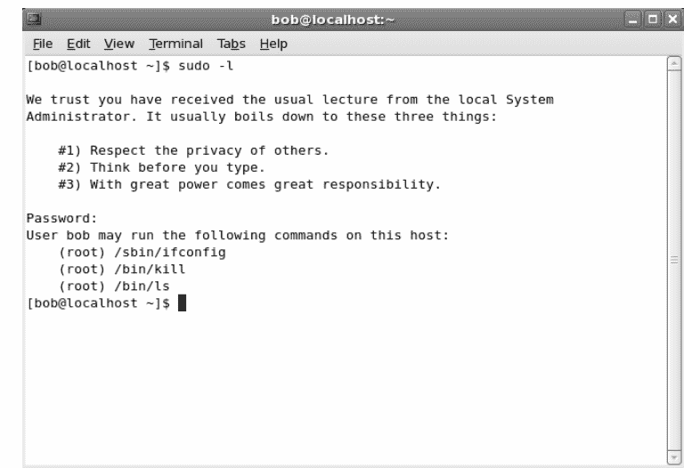

6. 要测试你的 `sudo` 配置，在不使用 `sudo` 的情况下运行一个需要 `root` 权限的 `ifconfig` 选项。输入：
`/sbin/ifconfig eth0 down`

权限被拒绝，因为 `bob` 不被允许禁用系统接口。

7. 要禁用接口，`bob` 必须使用 `sudo`。输入：
`/sbin/ifconfig eth0 down`

你将成功。请注意，如果 `bob` 的票已过期（默认为五分钟），`sudo` 将要求输入 `bob` 的密码。如果你在上次执行后的五分钟内运行此命令，将不会提示密码。

- 8. 重新激活。输入：
```bash
sudo /sbin/ifconfig eth0 up
```

- 9. 接下来，使用 `kill` 命令重启其中一个 `httpd` 进程，输入如下：
```bash
ps aux | grep httpd
```

- 10. 从出现的列表中选择一个 Apache PID（如果未安装 Apache，请选择其他服务进行重启）。输入：
```bash
kill -HUP [PID NUMBER]
```

- 11. 你不允许重启 `httpd` 进程，因为你不是 `root`。你将收到以下结果：
```bash
bash: kill: (PID NUMBER) - Not owner
```

- 12. 否则，使用 `sudo` 以 `root` 身份运行命令，输入：
```bash
sudo kill -HUP [PID NUMBER]
```
你应该会成功。

- 13. 接下来，你将使用 `ls` 命令以 `bob` 的身份列出 `root` 用户目录。输入：
```bash
ls /root
```
权限被拒绝，因为你不是 `root`。

- 14. 再次使用 `sudo` 以 `root` 身份运行命令：
```bash
sudo ls /root
```
权限已授予并显示了 `root` 用户的目录。

- 15. 要使 `bob` 的时间戳过期，输入命令 `sudo -k`。`bob` 下次使用 `sudo` 时必须输入密码。

## 无密码

在某些情况下，每次运行都输入密码是多余的，因为用户已经登录了系统。`Sudo` 提供了一种在 `sudoers` 文件中使用 `NOPASSWD` 标签来规避这项单调任务。

- 1. 要移除 `sudoers` 文件中的密码要求，请以 `root` 身份登录并输入：
```bash
visudo
```

- 2. `sudoers` 文件将在 `vi` 中打开。修改 `bob` 的用户权限规范以匹配以下内容（按 `i` 键插入文本）：
```
your-hostname = NOPASSWD: /sbin/ifconfig, /bin/kill, /bin/ls
```

- 3. 按回车。输入 `wq` 退出文件。

- 4. 以 `bob` 身份登录。使用 `sudo` 禁用接口：
```bash
sudo /sbin/ifconfig eth0
```
你不会被提示输入密码，命令将以 `root` 身份运行。

- 5. 重新激活接口。输入：
```bash
/sbin/ifconfig eth0 up
```

## Sudo 日志

如前所述，`sudo` 会记录哪些用户运行了什么命令。日志不会自动记录。你必须设置 `sudo` 和 `syslogd` 来记录命令。这涉及两个步骤。首先，你必须在 `/var/log/` 中创建一个 `sudo` 日志文件。其次，你必须配置 `syslog.conf` 来记录 `sudo` 命令。以下步骤显示了如何配置 `sudo` 日志。

- 1. 以 `root` 身份登录。在 `/var/log/` 中创建一个 `sudo` 日志文件。输入：
```bash
touch /var/log/sudo
```

- 2. 接下来，你必须在 `syslog.conf` 文件中添加一行，将日志重定向到你的 `sudo` 日志文件。通过以下命令打开 `syslog.conf`：
```bash
vi /etc/syslog.conf
```

- 3. 在 `syslog.conf` 文件末尾输入以下行（按 `i` 键插入文本）。空格必须使用 TAB 键而不是空格键。
```
local2.debug /var/log/sudo
```


进入`/path/to/xxx`目录，找到`xxx.json`。

在表达式`cvar = avar + bvar`中，加法运算符（`+`）将`avar`与`bvar`相加，得到它们的和`cvar`

在`List.of(arg0, arg1, arg2)`中，`List`接口的工厂方法`of()`接受一系列的元素，返回包含它们的只读列表。

之后我们这样调用`cmd`命令：`cmd arg0 arg1 arg2`。

```
if (condVar > someVal) {console.log("xxx")}
```
[/content]

Wait need process given text. The user gave a text to format. The example above is just example. Need process the provided text.

Let's reformat given text.

We need title hierarchy. Original has `- 4.` etc. Probably make headings.

Let's produce cleaned markdown.

[content]
- 4. 此 `syslog.conf` 条目会将所有成功和失败的 sudo 命令记录到 `/var/log/sudo` 文件。你也可以通过指定网络主机而不是本地目录来记录到网络主机。`syslog.conf` 文件如图 2.19 所示。

### 图 2.19 为 Sudo 日志编辑 Syslog.conf 文件

```text
root@localhost:~

# 记录 info 或更高级别的任何内容（邮件外）。

# authpriv 文件访问受限制。

authpriv.*                               /var/log/secure

# 将所有邮件消息记录在一个处。

mail.*                               /var/log/mailog

# 记录 cron 相关内容

cron.*                               /var/log/cron

# 所有人都能接收紧急消息

*.emerg                               *

# 将 crit 及更高级别的新错误保存到特殊文件中。

*.crit                        /var/log/news

# 将启动消息也保存到 boot.log。

local.*                               /var/log/boot

# 记录调试消息

local2.debug                           /var/log/sudo
```

- 5. 按 ESC 写入并退出。

- 6. 既然你修改了 `syslog.conf`，为了发送 sudo 信号，你必须知道 sudo。

- 7. sudo 记录了哪些用户运行了什么命令。

- 8. 以 bob 身份登录后，输入 PID 标识：
```bash
ps aux | grep sudo
```

- 9. 第二列显示了 PID。以 bob 身份登录后：
```bash
sudo /sbin/ifconfig eth0 down
sudo /sbin/ifconfig eth0 up
```

- 10. 重启一个 httpd 进程，输入：
```bash
ps aux | grep httpd
```

- 11. 从出现的列表中选择一个 Apache PID：
```bash
kill -HUP [PID NUMBER]
```

- 12. 否则，使用 sudo 以 root 身份运行命令：
```bash
sudo kill -HUP [PID NUMBER]
```

- 13. 接下来，你将使用 `ls` 命令以 bob 的身份列出 root 用户目录：
```bash
ls /root
```

- 14. 再次使用 sudo 以 root 身份运行命令：
```bash
sudo ls /root
```

- 15. 要使 bob 的时间戳过期，输入命令 `sudo -k`。bob 下次使用 sudo 时必须输入密码。

# 操作系统加固 • 第2章

`lastlog` 命令显示在你的机器上拥有账户的用户和服务。它列出了每个账户最后一次登录系统的时间，或者该账户是否曾经登录过系统。Linux 中的每个服务都分配有一个账户。这非常有帮助，因为如果某个服务在你不知情的情况下登录了，可能是黑客所为。这表明黑客控制了你的系统并正在对其进行利用。也可能意味着另一位管理员在没有通知你的情况下启动了该服务。

`messages` 文件是一个日志文件，显示系统最近活动的列表。例如，它会列出是否修改了密码以及是谁修改的。它会识别用户打开和关闭文件的时间。它还列出了每个事件发生的时间数据。可以通过输入以下命令来查看：

```
/var/log/messages
```

如果你倾向于使用 GUI 来查看日志文件，程序 SWATCH（默认未安装）允许对大型日志文件进行即时和实时显示。它可以查看你指定的任何日志文件，并在下一节中进行讨论。

应该频繁检查 Linux 日志，以确定系统是否发生了任何安全违规行为。日志并不提供解决方案，因此你必须分析数据并决定如何应对攻击。

## 使用日志增强工具

日志增强工具是那些通过允许过滤日志信息并通常以简化的格式显示来简化日志记录的工具。许多开源日志程序使系统管理变得简单得多。查看包含数百或数千条条目的文本文件是一项负担，特别是当你只想寻找一个特定的错误条目时。日志增强工具提供了更加友好的体验，并极大地扩展和自定义了你需要记录的信息。

接下来的章节将介绍管理员使用的三种流行的日志服务：SWATCH、scanlogd 以及下一代 syslog(ng)。

### SWATCH

Simple WATCHer 或 Simple WATCHdog (`SWATCH`) 是一个开源软件包，允许管理员高效地监控系统活动。它通过监控特定事件的日志，来监控系统（或大量系统）上的事件。`SWATCH` 的主要功能是在日志消息通过 Unix syslog 工具写入日志文件时，主动监控这些消息：`SWATCH` 需要 Perl 5 才能运行。

`SWATCH` 之所以高效率，是因为它允许管理员修改 `SWATCH` 配置文件 (`/etc/swatchrc`) 以过滤日志条目并报告事件。例如，`SWATCH` 可以监控系统中的异常登录尝试，并在发生此类身份验证失败事件时向管理员发送电子邮件。它可以监控并更改系统挂起和重启发生、用户切换到 su 命令、文件系统满以及有人在嗅探系统的情况。它可以从日志文件中监控任何所需内容。

要了解有关 `SWATCH` 并下载该程序，你需要访问 `SWATCH` 主页：http://swatch.sourceforge.net/ 。`SWATCH` 主页如图 2.22 所示。

# 图 2.22 SWATCH 主页

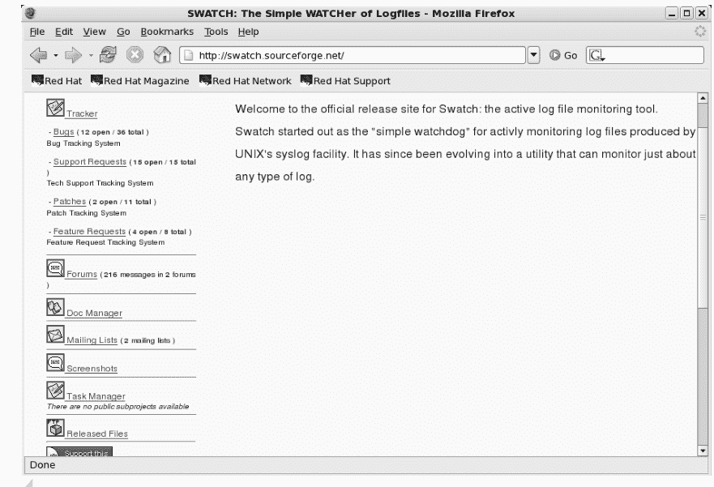

## 注意

> 在本文编写时，可以下载 `SWATCH` 3.2.2 版本。

`SWATCH` 使用两个必填字段：模式 (`patterns`) 和动作 (`actions`)。

- 模式 (`Patterns`)：`SWATCH` 配置文件在日志条目中查找特定模式。例如，异常登录尝试会显示“Failed Authentication”（身份验证失败）错误。
- 动作 (`Actions`)：每当发现模式时，`SWATCH` 会寻求相应的动作，例如向管理员发送有关登录失败尝试的电子邮件。

两个可选字段用于进一步自定义配置文件：

- 节流 (`Throttle`)：决定 `SWATCH` 在再次处理条目之前忽略重复条目的时间。这节省了管理员查看 300 个相同的“Failed Authentication”错误的时间。然而，安全的系统应该限制登录尝试次数。`throttle` 项定义为 `HH:MM:SS`，其中 H 代表小时，M 代表分钟，S 代表秒。
- 时间戳 (`Timestamp`)：定义时间戳的长度和位置。时间戳定义为 `start:length`。

以下是 `SWATCH` 配置文件中的两个示例。当这些消息通过 syslog 工具写入各自的日志文件时，`SWATCH` 会主动监控这些消息。第一个示例监控登录失败尝试的日志记录，并在发生登录失败尝试时向 root 发送电子邮件。

```
#Failed login attempts
watchfor
/failed/
echo bold
mail addresses=root,subject=Failed Authentication
```

第二个示例监控你的日志文件，并在用户尝试切换获取 root 权限时向 root 发送电子邮件。

```
#Users sued to gain root
watchfor
/su/
echo bold
mail addresses=root,subject=User sued to root
```


`SWATCH` 过滤日志文件，使管理员只接收他们所需的信息。一旦配置完成，它需要大量的时间精力，推荐给被日志文件淹没（可能由于某些原因未使用）的系统管理员。要下载 `SWATCH` 的 `RPM` 版本，请访问 `www.rpmfind.net`。

### Scanlogd

`Scanlogd` 是一个检测并记录系统上 `TCP` 端口扫描的开源程序。例如，它可以检测 `nmap` 扫描。`Nmap` 是黑客用来创建你的网络“地图”的程序。这通常是黑客在访问你的网络后采取的第一步，以确定要黑入哪个系统。`Nmap` 列出了网络上的系统和服务。

### 安全警报！

由于 `scanlog` 仅用于检测扫描，因此在你的系统上运行是安全的。它必须能够访问原始包才能运行，并可以捕获进出系统接口或系统所连接的网络的数据包。`Scanlog` 最初的设计是为了说明攻击，而不是修复它们。因此，尽管在系统上运行是安全的，它并不能阻止黑客。

当网络被扫描时，`scanlog` 可以提醒管理员，并使用 `syslog(3)` 机制记录每次扫描的时间。你可以在 `openwall/scanlogd` 了解 `scanlog` 并下载该程序。`scanlog` 主页如图 2.23 所示。

### 图 2.23 Scanlog 主页

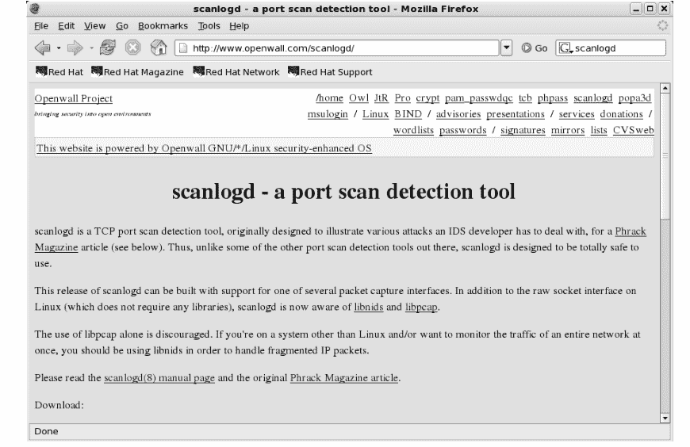

### Syslog-ng

`Syslog-ng` 是替代传统 `syslogd` 的日志守护。“ng” 是“下一代”的缩写。原始 `syslogd` 是一个缺乏 `syslog` 功能 `Unix` 日志守护，但难以配置。`syslog-ng` 更容易配置并提供了额外的日志功能，例如更多的配置。例如，`syslog-ng` 允许管理员根据优先级以及消息内容过滤消息。你还可以将日志转发到 `TCP`，将其分类到不同的目的地，并为各种主机创建直接日志流。`syslog-ng` 主页如图 2.24 所示，位于 `www.balabit.com/network-security/syslog-ng/`。

系统日志的基本问题是它们包含了许多不重要的信息。这些信息通常被称为“噪声”。许多事件由于埋没在噪声中而丢失。`syslogd` 使得只选择重要消息变得困难。

## 第 2 章 操作系统加固

如邮件（`mail`）、新闻（`news`）、认证（`auth`）等设施，优先级范围从告警（`alert`）到调试（`debug`）。许多程序使用这些设施；因此许多未使用的消息被写入到它们的日志中。在许多情况下，消息和设施甚至不匹配。`Syslog-ng` 除了根据设施/优先级对外，还根据消息内容对消息进行过滤。使用这种方法，只记录需要的消息。

### 图 2.25 Syslog-ng 平台

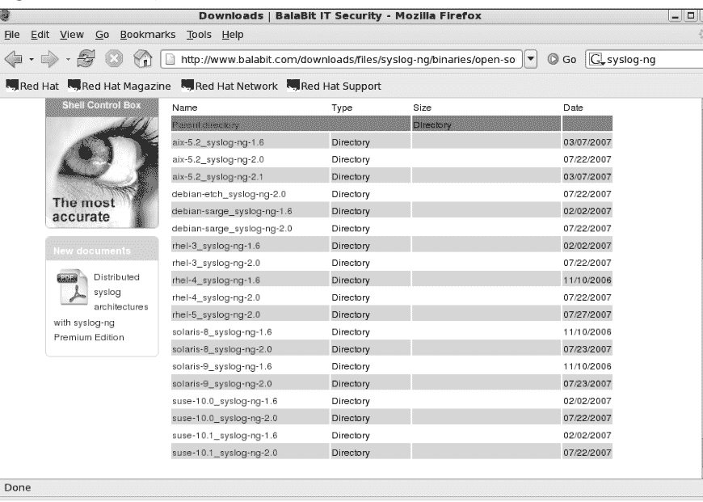

`Syslog-ng` 可用于 `AIX`、`Debian`、`Red Hat Linux 3, 4, 5`、`Sun Solaris 9` 以及 `Linux 10`。在本文编写时，最新版本为 2.0。你可以从 `www.balabit.com/support/documentation/` 了解更多关于 `syslog-ng` 的信息并下载手册。该产品提供开源版和高级版。在部署到生产网络之前，你也可以请求进行评估。可能需要额外的软件包（如 `libdi8`）和数据库规范。图 2-26 显示了从 `Balabit` 可下载的支持版本。

## 安全增强型 Linux (SELinux)

`Security Enhanced Linux` 或 `SELinux` 是美国国家安全局（`NSA`）的一项研究计划。该项目的建议已整合到各种 `Linux` 发行版中。该项目重点关注利用集成到内核子系统的强制访问控制（`MAC`）架构，而不是处理操作系统本身的安全漏洞。有关 `SELinux` 的信息、白皮书、演示文稿和下载请访问 `www.nsa.gov/selinux/index.cfm`。

`Red Hat` 已将 `SELinux` 整合到其发行中。如果你在安装阶段没有启用 `SELinux`，可以从此处启用。

让我们看看第 5 版本 `Red Hat Enterprise Linux (RHEL)` 中特有的 `SELinux` 组件。在此之前，你需要先启用 `SELinux`。

- 点击 `System | Administration | Security Level and Firewall` 以启用 `SELinux`。
- 点击第二个选项卡 `SELinux`。你会发现三个选项：`Enforcing`（强制执行策略）、`Permissive`（仅警告，不执行策略）和 `Disabled`（`SELinux` 策略完全禁用状态）。一旦启用了 `SELinux`，系统可能会为文件系统重新标记标签。这需要重启系统。
- 点击 `System | Administration | SELinux Management Tool` 管理 `SELinux`。该工具具有状态、布尔值、文件标记、用户映射、`SELinux` 用户、转换、网络端口和策略模块配置选项。打开的第一个屏幕是状态屏幕。它包括系统默认强制模式的当前状态、当前强制执行模式以及系统默认策略类型。在这种情况下，如图 2.26 所示，它是 `permissive`、`permissive` 和 `targeted`。当你启用 `SELinux` 后，文件系统已经重新标记了。你不需要再次勾选“relabel on reboot”复选框。
- 下一个是布尔（`Boolean`）屏幕。在此屏幕中，你可以选择单独的服务并启用或禁用（`yes` 或 `no`）特定的策略设置。这是你配置运行时布尔值的地方。例如，对于 `HTTPD` 服务，你可以允许 `HTTPD` `cgi` 支持、允许 `HTTPD` 读取家目录以及允许 `HTTPD` 支持内置脚本，如图 2.27 所示。

### 图 2.26 SELinux 管理工具

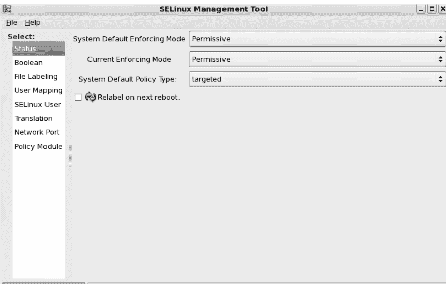

### 图 2.27 使用 Boolean 选项卡为 HTTPD 服务配置策略

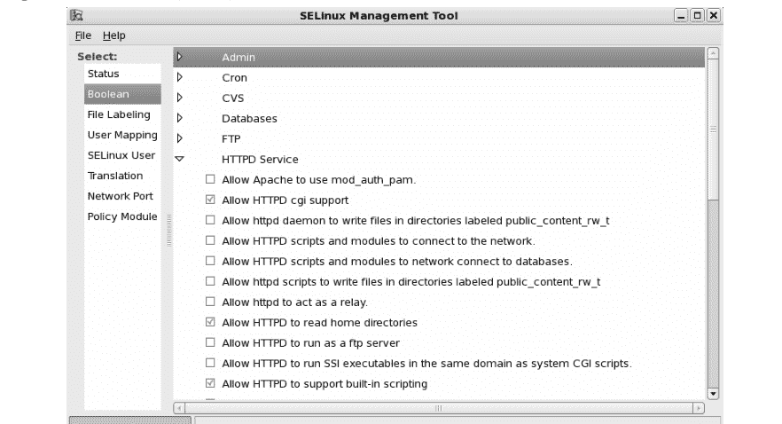

5. 你可以从文件标记（File Labeling）选项更改文件标记。你需要提供文件规范（通常是根目录、顶层目录和挂载点）、类型（所有文件、符号链接、目录、普通文件、字符设备等）、`SELinux` 类型和 `MLS`（多级安全，如绝机密、秘密、机密和未分类）详情。点击任意行并点击属性（`properties`）来编辑配置。图 2.28 显示了通过 `SELinux` 管理工具进行文件标记。

### 图 2.28 通过 SELinux 管理工具进行文件标记

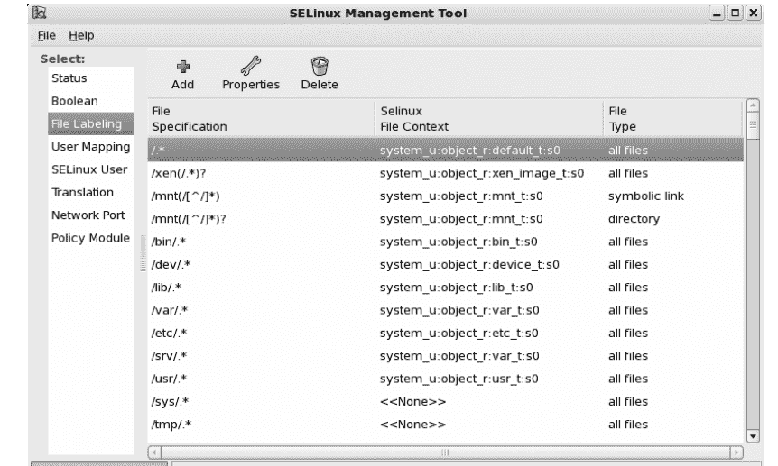

6. 用户映射（User Mapping）允许你对用户进行分类。例如，标记为“机密”的文件只能由具有相似分类的用户访问（前提是本地访问系统允许）。这被称为 `MCS` 或多类别安全。图 2.29 显示了用户映射。
7. `SELinux` 用户 选项允许你为用户分配 `SELinux` 角色。
8. 转换（Translation）选项允许你设置敏感性级别，如图 2.30 所示。

### 图 2.29 用户映射

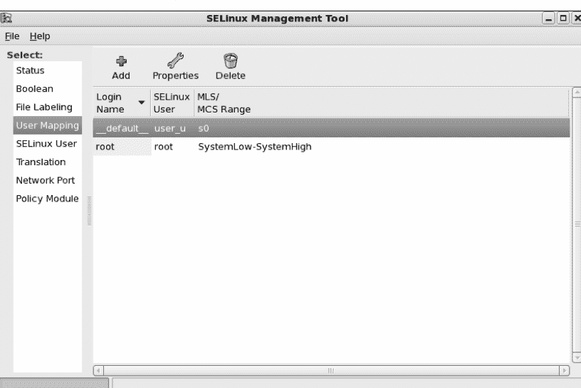

### 图 2.30 转换

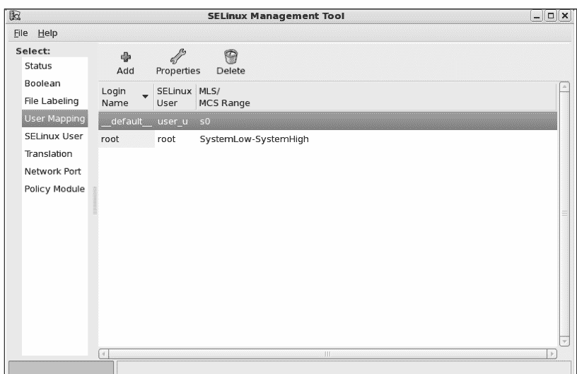

9. 网络端口（Network Port）选项允许你为不同的网络配置 `MLS/MCS` 级别。你需要指定端口号、协议类型（`tcp` 或 `udp`）、`SELinux` 类型以及 `MLS/MCS` 级别。端口号是 80，协议类型是 `tcp`，`SELinux` 类型是 `http_t`，`MLS/MCS` 级别是 `s0`。图 2.31 显示了网络端口。

### 图 2.31 网络端口

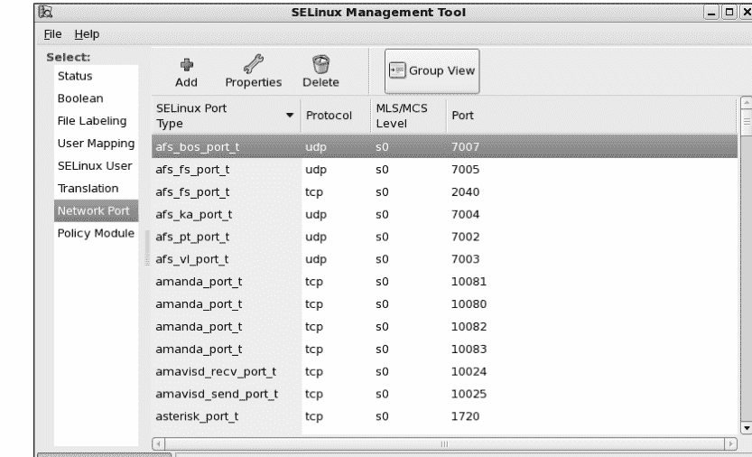

10. 策略模块（Policy Module）选项允许你对特定模块启用或禁用。这些额外的规则记录在日志文件中。注意：如需更多信息请参考 `Red Hat Linux 5` 部署指南。更多关于 `SELinux` 的信息请访问 `www.nsa.gov/selinux/`。

## 安全增强 Linux

`Security Enhanced Linux` 或 `SELinux` 是美国国家安全局（`NSA`）的一项研究计划。该项目的建议已整合到各种 `Linux` 发行版中。该项目重点关注利用集成到内核子系统的强制访问控制（`MAC`）架构，而不是处理操作系统本身的安全漏洞。

`Red Hat` 已将 `SELinux` 整合到其发行中。如果你在安装阶段没有启用 `SELinux`，可以从此处启用。

让我们看看第 5 版本 `Red Hat Enterprise Linux (RHEL)` 中特有的 `SELinux` 组件。在此之前，你需要先启用 `SELinux`。

- 点击 `System | Administration | Security Level and Firewall` 以启用 `SELinux`。
- 点击第二个选项卡 `SELinux`。你会发现三个选项：`Enforcing`（强制执行策略）、`Permissive`（仅警告，不执行策略）和 `Disabled`（`SELinux` 策略完全禁用状态）。一旦启用了 `SELinux`，系统可能会为文件系统重新标记标签。这需要重启系统。
- 点击 `System | Administration | SELinux Management Tool` 管理 `SELinux`。该工具具有状态、布尔值、文件标记、用户映射、`SELinux` 用户、转换、网络端口和策略模块配置选项。打开的第一个屏幕是状态屏幕。它包括系统默认强制模式的当前状态、当前强制执行模式以及系统默认策略类型。在这种情况下，如图 2.26 所示，它是 `permissive`、`permissive` 和 `targeted`。当你启用 `SELinux` 后，文件系统已经重新标记了。你不需要再次勾选“relabel on reboot”复选框。
- 下一个是布尔（`Boolean`）屏幕。在此屏幕中，你可以选择单独的服务并启用或禁用（`yes` 或 `no`）特定的策略设置。这是你配置运行时布尔值的地方。例如，对于 `HTTPD` 服务，你可以允许 `HTTPD` `cgi` 支持、允许 `HTTPD` 读取家目录以及允许 `HTTPD` 支持内置脚本，如图 2.27 所示。

### 图 2.26 SELinux 管理工具


### 图 2.27 使用 Boolean 选项卡为 HTTPD 服务配置策略


5. 你可以从文件标记（File Labeling）选项更改文件标记。你需要提供文件规范（通常是根目录、顶层目录和挂载点）、类型（所有文件、符号链接、目录、普通文件、字符设备等）、`SELinux` 类型和 `MLS`（多级安全，如绝机密、秘密、机密和未分类）详情。点击任意行并点击属性（`properties`）来编辑配置。图 2.28 显示了通过 `SELinux` 管理工具进行文件标记。

### 图 2.28 通过 SELinux 管理工具进行文件标记


6. 用户映射（User Mapping）允许你对用户进行分类。例如，标记为“机密”的文件只能由具有相似分类的用户访问（前提是本地访问系统允许）。这被称为 `MCS` 或多类别安全。图 2.29 显示了用户映射。
7. `SELinux` 用户 选项允许你为用户分配 `SELinux` 角色。
8. 转换（Translation）选项允许你设置敏感性级别，如图 2.30 所示。

### 图 2.29 用户映射


### 图 2.30 转换


9. 网络端口（Network Port）选项允许你为不同的网络配置 `MLS/MCS` 级别。你需要指定端口号、协议类型（`tcp` 或 `udp`）、`SELinux` 类型以及 `MLS/MCS` 级别。端口号是 80，协议类型是 `tcp`，`SELinux` 类型是 `http_t`，`MLS/MCS` 级别是 `s0`。图 2.31 显示了网络端口。

### 图 2.31 网络端口


10. 策略模块（Policy Module）选项允许你对特定模块启用或禁用。这些额外的规则记录在日志文件中。注意：如需更多信息请参考 `Red Hat Linux 5` 部署指南。更多关于 `SELinux` 的信息请访问 `www.nsa.gov/selinux/`。

## 加固 SUSE Linux

`SUSE Linux` 是另一种流行的 `Linux`，适用于服务器和桌面。`SUSE Linux` 提供了各种图形用户界面工具来配置安全设置。在本节中，让我们看看针对服务器的安全性任务。

- 1. `Novell Customer Center` 配置帮助你创建 `SUSE Linux` 配置文件并管理订阅。图 2.32 显示了 `Novell` 客户配置。

### 图 2.32 Novell Customer Center

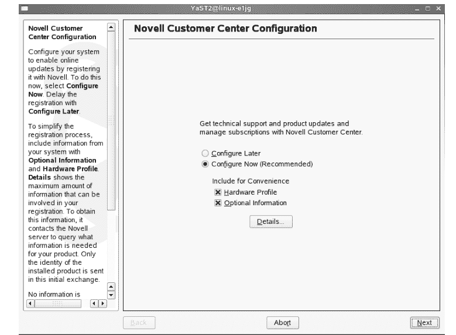

- 2. `YaST`（Yet another Setup）的系统服务（运行时）工具允许你启用或禁用服务。在本章之前我们已经看到了如何手动禁用服务。你也可以编辑单个运行级别。图 2.33 显示了服务配置工具。

### 图 2.33 YaST 系统服务

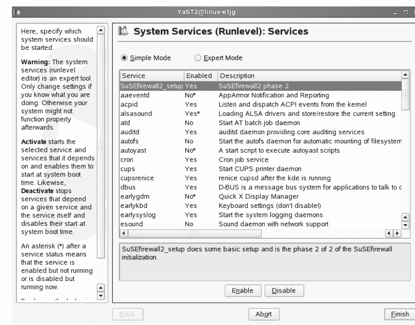

`Novell SUSE Linux` 提供了各种图形用户界面工具来配置安全设置。要配置本地安全设置，点击 `Computer | YaST | Security and Users | Local Security`。图 2.34 显示了你可以配置密码设置的界面。这些是你使用 `Bastille Linux` 执行的一些设置。

### 图 2.34 本安全设置

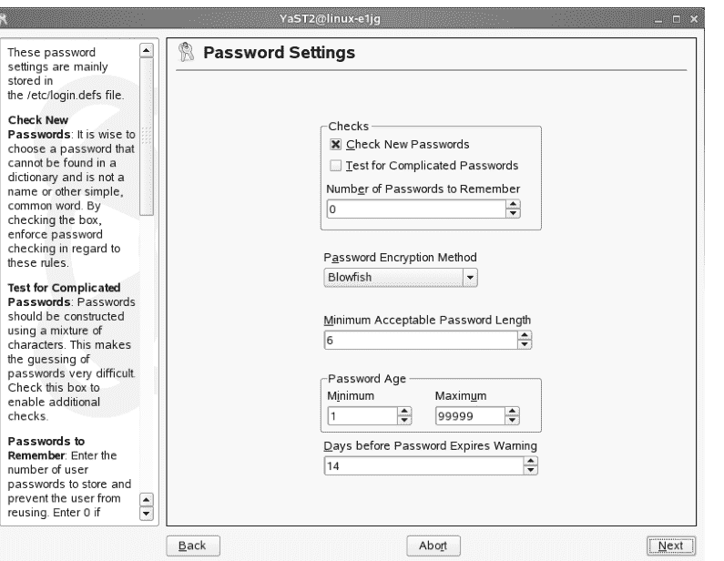

- 10. `Computer | YaST | Miscellaneous | View System Log`。这将打开 `/var/log/messages`。查找与你正在排错的服务相关的关键词。图 2.35 显示了日志消息。

### 图 2.35 日志

操作系统加固 • 第2章 71


`/var/log/messages`

Sep 11 10:44:52 linux-e1j syslog[2582]: Changing permissions on special file `/dev/tty10`

Sep 11 10:44:52 linux-e1j kernel init: type mismatch for d0000000:b0000000 old uncacheable web-combining

Sep 11 10:44:52 linux-e1j klogd [1441]: state changed

Sep 11 10:44:58 linux-e1j syslog[2593]: Daemon (WaMN): Not starting ready web server

Sep 11 10:46:10 linux-e1j gconfd[4267]: pam_demod: open `/dev/rand`: no such file or directory

Sep 11 10:46:11 linux-e1j gconfd[4628]: version 12.1; pid 4629 user root

Sep 11 10:46:11 linux-e1j gconfd[4629]: Resolved "read-only:/etc/gconf/gnome/gconf.xml mandatory" to a read-only configuration source at position 0

Sep 11 10:46:11 linux-e1j syslog[4629]: Resolved "read-only:/etc/gconf/gnome/gconf.xml defaults" to a read-only configuration source at position 2

Sep 11 10:46:15 linux-e1j syslog[4629]: Resolved "read-only:/etc/opt/gnome/gconf.xml mandatory" to a read-only configuration source at position 0

Sep 11 10:51:21 linux-e1j syslog[2522]: Set version 20050803, fixed bufs 32768, s/s seg 256

Sep 11 10:52:02 linux-e1j syslog[2592]: SIGHUP received, restarting sysloglog

Sep 11 10:52:03 linux-e1j syslog[1441]: new configuration initialized

Sep 11 10:52:03 linux-e1j syslog[2592]: SIGHUP received, restarting sysloglog

Sep 11 10:53:21 linux-e1j syslog[2582]: Installed Products Dump: $VAR1 =

[ "USER_SERVICE_NAME": "10", "0", "1686" ] :

Sep 11 10:56:20 linux-e1j su (to-scc-root) root on node

Sep 11 10:56:20 linux-e1j su (to-scc-root) root on node

Sep 11 10:56:21 linux-e1j gconfd(sue-ecc:6711): starting (version 2.12.1) user 'scc-ncc'

Sep 11 10:56:21 linux-e1j gconfd(sue-ecc:6711): Resolved address "read-only:/etc/opt/gnome/gconf.xml mandatory" to read-only configuration source at position 0

"read-only:/lib/YaST2/sue-ncc-fakhome/gconf/ to a writable configuration source at position 1

Sep 11 10:56:21 linux-e1j gconfd(sue-ecc:6711): Resolved address "read-only:/etc/opt/gnome/gconf.xml mandatory" to read-only configuration source at position 2

11. 计算机 | YaST | 杂 | 查看启动日志。这将打开 `/var/log/boot.msg`。这是定位启动期间启动或失败的服务相关的错误和状态的好地方。图 2.36 显示了启动消息。

# 第2章 · 操作系统

## 图 2.36 启动消息

`/var/log/boot.msg`

```
COLUMNS=123 PATH=/usr/sbin:/usr/bin:/sbin:/bin:x37 RUNLEVEL=5 PWD==
LINES=44 SHLVL=2
SPLASHCFG=etc/bootsplash/themes/SUSE-LES/config/bootsplash-1024x768.cfg PRELEVEL-N=44 SHLVL=2
HOME=/root splash=silent SPLASH=yes BOOTLINE_BLDEV=/dev/sda1/ionice DAEMON=/usr/sbin/cpupsd
Starting cupid...
<notice:killproc> exec=/usr/lib/systemd/systemd [machine=init] condev=console
<notice:killproc> kill:250,0
<notice:killproc> kill:252,1
<notice:killproc> kill:258,19
<notice:killproc> exec=/usr/lib/systemd/systemd [/bin/powersaved -d -f /var/run/acpid socket v 3 ] [HOME=/]
PATH=/usr/sbin:/usr/bin:/sbin:/bin SHELL=/bin RUNLEVEL=5 PRELEVEL-N= DAEMON=/usr/sbin/powersaved
Starting powered services...
Starting mail service...
<notice:killproc> exec=/usr/lib/systemd/systemd [/bin/powersaved -d -f /var/run/acpid socket v 3 ] [HOME=/]
PATH=/usr/sbin:/usr/bin:/sbin:/bin SHELL=/bin RUNLEVEL=5 PRELEVEL-N= DAEMON=/usr/sbin/powersaved
Starting crond...
DAEMON exec=/usr/sbin/cron [console] condev=console
ROOT_TYPE=rootfs TERMINAL=linux ROOT_FSYPE=ext4 CONSOLE_LC=POSIX_INT VERSION=vsynin2.6
COLUMNS=123 PATH=/usr/sbin:/usr/bin:/sbin:/bin:x37 RUNLEVEL=5 PWD==
SPLASHCFG=etc/bootsplash/themes/SUSE-LES/config/bootsplash-1024x768.cfg PRELEVEL-N=44 SHLVL=2
HOME=/root splash=silent SPLASH=yes BOOTLINE_BLDEV=/dev/sda1/ionice DAEMON=/usr/sbin/cron
done
Starting Firewall initialization (phase 2 of 2) Waiting.db=/usr/sbin/start iptables does not support state matching. Extended IPv6 support disabled.
done
Master Resource Control runlevel 5 has been reached
Skipped services in runlevel 5: smbfs nfs
<notice:killproc> kill(253)
```

## 防火墙配置


SUSE Linux 提供了一个图形界面来配置服务器防火墙。下节介绍了配置防火墙的可用选项。使用 `计算机` | `YaST` | `安全与用户` | 防火墙 来配置您的系统。

1. 使用启动页上的“启动时”单选按钮在服务器启动时启动防火墙。您也可以通过保存文件以后手动启动防火墙。图 2.36 显示了防火墙配置的启动界面。

操作系统加固 • 第2章

## 图 2.37 SUSE Linux 防火墙配置


2. 防火墙配置的接口可以在接口页面配置。在典型的防火墙服务器中，可能会找到多个接口。图 2.38 显示了防火墙配置的选项。

## 图 2.38 防火墙接口


3. 允许的服务允许为每个区域选择允许的服务。图 2.39 显示了外部区域的允许服务。您还有一个选项（图中未显示）可以启用内部区域保护。如果在列表中找不到服务，可以通过指定手动添加服务（端口）。点击“添加”提供 tcp、udp、rpc 端口和 ip 协议选项。

第2章 • 操作系统加固

## 图 2.39 允许的服务


1. `伪装 (Masquerading)` 选项允许您执行地址转换（地址隐藏）。您至少需要一个外部和一个内部接口来配置伪装。

2. 除了上述选项，您还可以配置广播、IPsec 支持和 `日志` 级别。

## Novell AppArmor

AppArmor 提供了一种保护应用程序免受漏洞影响的机制。Novell 称为“免疫”。要免疫您的系统，需要安装 AppArmor（Novell SUSE Linux Enterprise Server 10 默认安装）、设置 AppArmor 配置并重启系统。本节简述了在您的 SUSE Linux 服务器上配置 AppArmor 的过程。

大多数常用应用程序和服务都有 AppArmor 默认创建的配置。当您添加新的应用程序和服务时，可以为这些应用程序单独创建配置。在创建配置之前，确保已停止应用程序。创建配置时，AppArmor 会运行自动检测以分析并为应用程序创建初始配置。非常需要您进行手动配置，以避免限制过于细致导致应用程序无法访问执行功能所需的目录。AppArmor 具有学习模式，可以在您运行程序时监控其访问情况。学习模式收集的信息包含在 AppArmor 创建的初始配置中。为关键应用程序创建配置可以确保应用程序在安全环境中运行，防止随时间推产生的漏洞对系统造成损害。

您需要配置 AppArmor 来免疫可能授予权限、打开端口、定时作业、服务器守护进程和 Web 应用程序的程序。

1. 首先，您需要如图 2.40 所示启用 AppArmor。

操作系统加固 • 第2章

## 图 2.40 启用 AppArmor


2. 点击 `计算机` | `YaST` | `Novell AppArmor` 如图 2.41 所示。您有以下选项：

3. 添加配置向导、AppArmor 控制面板、AppArmor 报告、删除配置、手动添加配置和更新配置向导。

## 图 2.41 Novell AppArmor 配置


第 2 章 · 加固操作系统

4. 然后点击 `Edit Profile`（编辑配置）。选择 'netstat' 条目并点击 'Edit Entry'（编辑条目）。你可以看到应用程序 netstat 在 `/etc/networks` 文件上的权限。你拥有的选项有读、写、链接、mmap、执行、继承、离散配置、无限制、未训练（纯净执行）。图 2.42 AppArmor 配置文件对话框。

## 图 2.42 AppArmor 配置文件

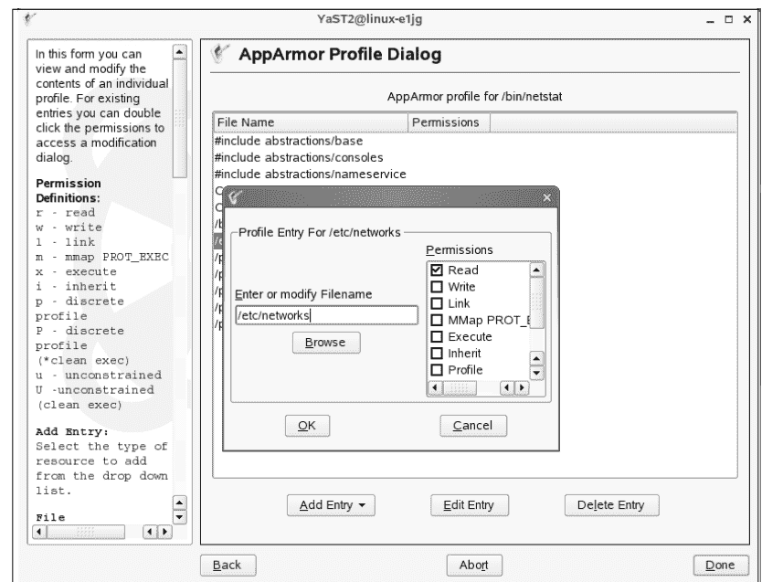

5. 最后，退出 `Edit Entry`（编辑条目）界面。你将看到应用程序 netstat 在服务器上运行的权限摘要。图 2.43 显示了 netstat 的配置。

## 图 2.43 用于 Netstat 的 AppArmor 配置文件

在此表中，你可以查看并修改单个配置的内容。对于现有条目，可以双击权限以访问修改对话框。

`权限定义：`

- r 读 (read)

- w 写 (write)

- m mmap_PROT_EXEC

- x 执行 (execute)

- ni 继承 (inherit)

- p 离散配置 (discrete profile)

- F : 离散配置 (discrete profile)

- *(clean exec)

- u- 无限制 (unconstrained)

- u- 无限制 (unconstrained)(clean exec)

`添加条目：`

从下拉列表中选择要添加的资源类型。

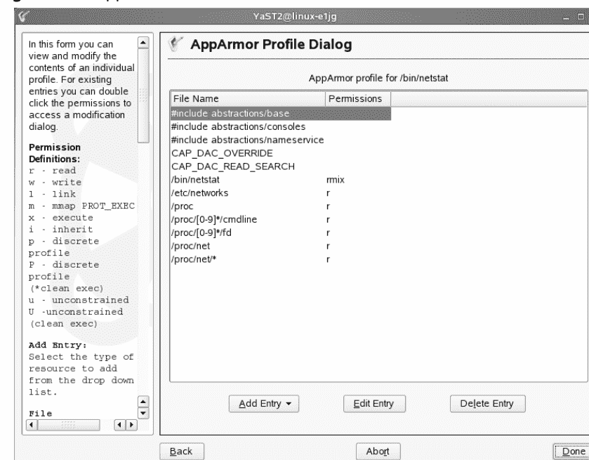

## 注意

更多信息请参阅 www.novell.com 上的 AppArmor 管理指南

## 主机入侵防御系统

主机入侵防御系统（俗称为 HIPS）通过在你的服务器周围建立一道屏障，确保系统不会发生恶意攻击或未经授权的更改。通过提供行为规则保护、基于特征的分析以及状态防火墙层级保护；HIPS 还能确保核心操作系统文件不会因未知漏洞利用而发生更改。商业级 HIPS 提供丰富的图形化报告、高级告警系统、集中化管理以及来自供应商的全天候更新和技术支持。许多安全厂商已针对 Unix/Linux 变体推出了 HIPS 解决方案。虽然讨论每个 HIPS 解决方案或其功能是本书的范围，以下是 HIPS 产品列表：Cisco、McAfee、ISS（现为 IBM ISS）和 Enterasys。还有针对 Web 服务器和数据库服务器的特定版本，帮助你防止 SQL 注入和目录遍历等攻击。这些不必也都适用于 Microsoft 平台。

Cisco Security Agent (CSA 版本 5.2) 除了 Microsoft Windows 外，还适用于以下 Linux 服务器版本。CSA 也适用于 Linux 桌面版本。

- Solaris 8 SPARC 架构（64 位内核）

- Solaris 9 SPARC 架构（64 位内核）

- Red Hat Enterprise Linux 3.0 ES 和 AS

- Red Hat Enterprise Linux 4.0 ES 和 AS

Enterasys Dragon Host Sensors 适用于以下操作系统：

- Linux

- AIX

- Solaris

- HP-UX

Enterasys Dragon Host Sensors 支持以下 Web 入侵防御：

- 适用于 Linux 的 Apache WebIPS

- 适用于 Solaris 的 WebIPS

IBM Internet Security Systems 除了 Microsoft Windows 外，还适用于以下 Unix 变体：

- Solaris 的 IBM RealSecure Server Sensor 7.0

- 适用于 HP-UX 的 IBM RealSecure Server Sensor 7.0

- 适用于 AIX 的 IBM RealSecure Server Sensor 7.0

McAfee 主机入侵防御：

可用平台包括：

- Red Hat Enterprise Linux 4.0（仅 32 位，仅服务器）支持的内核：

- 2.6.9-11.EL–2.6.9-11.EL-smp

- 2.6.9-22.EL–2.6.9-22.EL-smp

- 2.6.9-34.EL–2.6.9-34.EL-smp

- Sun Solaris（仅服务器）

- SPARC Solaris 8, sun4u（32 位或 64 位内核）

- SPARC Solaris 9, sun4u（32 位或 64 位内核）

- SPARC Solaris 10, sun4u（仅 64 位内核）

McAfee 主机入侵防御也适用于以下 Web 服务器平台：

- Apache 1.3.6 及更高版本

- Apache 2.0.42 及更高

- iPlanet 4.0 和 4.1

- Sun Java System（原 Sun ONE）6.0 和 4.1

## Linux 基准工具

互联网安全中心 (CIS) 是一家非营利组织，帮助机构降低由于安全措施不足导致的业务风险和电子商务业务中断。CIS 定期发布基准和评分工具。基准工具适用于操作系统、网络设备和应用程序。

下载基准和评分工具之前需要注册。CIS 将这些工具分为 1 级和 2 级。1 级工具适用于具有基础安全知识的管理员。这些工具在运行时不太引起任何中断，并可以通过 CIS 提供的工具进行监控。


CIS 在服务器或网络设备上运行系列测试，并生成 HTML 和 XML 报告。报告提供了以下方面的信息：

- 补丁
- 网络设备
- 内核调优
- 日志
- 文件权限
- 身份验证
- 用户账户
- 横幅
- 警告
- 重启

# 第 2 章 • 操作系统加固

## 2.46 测试结果

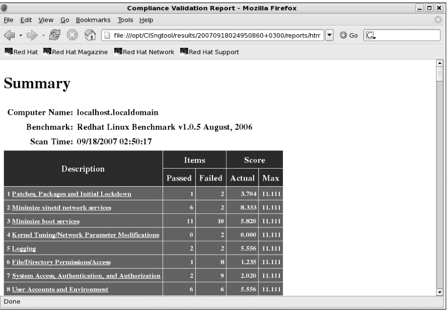

- 11. **点击**并**展开**视图查看各个类别的结果。图 2.47 显示了结果分类。你可能会注意到单个测试的状态，例如未测试、失败或通过。
- 12. **点击**并进一步**展开**视图以阅读单个测试的描述，例如，**点击**2.1 禁用标准服务。图 2.48 显示了测试的描述。

图 2.47 结果分类

| 描述 | 状态 |
| :--- | :--- |
| 1 补丁、包和初始锁定 | |
| 1.1 应用最新的操作系统补丁 | 未测试 |
| 1.2 在更改前验证您的系统 | 未测试 |
| 1.3 配置 SSH | 失败 |
| 1.4 启用系统审计 | 失败 |
| 1.5 安装并运行 Bastille | 通过 |
| 2 最小化 xinetd 网络服务 | |
| 2.1 禁用标准服务 | 失败 |
| 2.2 配置 TCP Wrappers 和防火墙以限制访问 | 失败 |
| 2.3 仅在绝对必要时启用 telnet | 通过 |
| 2.4 仅在绝对必要时启用 FTP | 通过 |
| 2.5 仅在绝对必要时启用 login/sh/cp | 通过 |

图 2.48 单个测试详情

| 2.1 禁用标准服务 | OVAL5 失败 |
| :--- | :--- |
| 描述 | |
| 2.2 配置 TCP Wrappers 和防火墙以限制访问 | 类型： |
| :--- | :--- |
| 状态: OVAL5 失败 | |
| 描述 | |
| TCP Wrappers 和基于主机的防火墙一起呈现，是因为它们在功能上相似且互补。 |

CIS 还提供了 SUSE Linux 和 Slackware 的下载。作为基准工具的一部分下载的 PDF 文档包含了在您的服务器上实现所需安全级别的逐步说明。这些建议将帮助您加固 Linux 服务器。通过定期运行测试，您可以确保您的服务器不会暴露在严重威胁之下。

> 注意
> 欲了解更多信息并测试 CIS 基准工具，请访问 www.cisecurity.org

## 总结

本章涵盖了使用 Linux 加固服务器以避免安全漏洞的基础知识。涵盖的主要部分包括禁用不需要的服务、锁定端口、Bastille、`sudo` 和日志增强器。

在安装任何程序之前，为操作系统安装最新的服务包或更新是极其重要的，这些更新修复了许多安全漏洞和错误。操作系统提供的许多服务并非必需，可以被移除。记住的关键是：运行的服务越少，潜在漏洞就越少。本章涵盖了 TCP/UDP 端口，以及特定服务如何使用每个端口。如果你在服务器上封锁端口，就会阻塞使用这些端口的服务。锁定端口是减少系统被利用的极佳方法。

维护服务器涉及安装服务包和更新，以及定期安装错误修复、安全补丁和软件更新。这些项目可以通过操作系统供应商获取，也可以通过你所实施软件的特定供应商获取。

Bastille 是一个促进 Linux 系统加固的开源程序。它执行了之前列出的许多任务，禁用系统功能中不需要的服务和端口。Bastille 功能非常强大，可以节省管理员对每个单独文件和整个操作系统进行配置的时间。管理员通过交互式图形界面回答一系列“是”和“否”的问题。该程序会根据对问题的回答自动实现管理员的偏好。

SuperUser (`sudo`) 是一种开源安全工具，允许管理员赋予特定用户或组以 root 或或其他用户身份运行命令的能力。该程序还可以记录指定系统用户输入的命令。`sudo` 的开发者表示，该程序的基本哲学是“尽可能给予最少的权限，但仍允许人们完成工作”。

日志增强器是简化日志记录的工具，允许过滤日志信息并通常以简化的格式显示日志。存在许多开源日志程序使系统管理变得更简单。在本章中，你接触了 SWATCH、scanlog 和 syslog-ng。

SWATCH 是一个允许管理员高效监控系统活动的开源包。它可以通过监控系统日志中的特定事件，来监控单个系统或大量系统上的事件。SWATCH 的主要功能是积极监控通过 Unix syslog 实用程序写入日志文件的消息。

Scanlog 是一个检测并记录系统上 TCP 端口扫描的开源程序。Scanlog 可以在网络被映射时提醒管理员，但它无法阻止入侵。

Syslog-ng 是传统 syslog 的替代日志守护进程。“ng”是“next generation”（下一代）的缩写。原始 syslog 是通用的 Unix 日志守护进程，处理 syslog 服务的请求，但很难配置。syslog-ng 更容易配置，并提供了额外的日志功能以及更多的配置。例如，syslog-ng 允许管理员根据优先级以及消息内容过滤消息。

增强 Linux (`SELinux`) 是美国国家安全局 (NSA) 与计算机安全研究社区共同的一项计划，旨在为操作系统提供增强安全性。`SELinux` 通过利用操作系统中的强制访问控制（MAC）来增强安全性。

# 加固操作系统 • 第 2 章

- 管理员通过交互式图形用户界面回答一系列“是”和“否”问题。程序将根据对问题的回答自动实现管理员的偏好。
- Bastille 可以对管理员实用程序应用限制权限；禁用不必要的服务和端口，以及其他许多功能。

# 使用 Sudo 控制和审计 Root 访问

- `Sudo`（Superuser Do）允许管理员赋予特定用户或组以 root 或另一个用户的身份运行某些命令的能力。
- `Sudo` 具有命令日志记录、命令限制、多个系统的集中管理等特许多功能。
- `sudo` 命令用于以超级用户或其他用户的身份执行命令。要使用 `sudo` 命令，用户必须提供用户名和密码。如果用户尝试通过 `sudo` 运行命令而该用户未在 sudo 文件中，系统将自动向管理员发送电子邮件，表明有未经授权的用户正在访问系统。

# 管理您的日志文件

- 日志记录允许管理员查看是谁以及什么访问了他们的系统。许多有用的 Linux 日志文件位于 `/var/log` 目录下。
- Linux 提供了允许管理员访问有用日志文件的命令。两个值得关注的命令是 `last` 和 `lastlog`。消息文件还提供了确定系统是否存在安全泄露的数据。
- 应频繁检查 Linux 日志，以确定系统上是否发生了任何安全违规。日志并不提供解决方案，因此你必须分析数据并决定如何应对攻击。

## 使用日志增强工具

- 日志增强工具是能够允许过滤日志信息并通常以简化的格式显示日志来简化日志记录的工具。
- 查看具有成百或数千条条目的文本文件可能是一项沉负担，特别是当你只想寻找一个特定的错误条目时。
- 管理员使用的三种流行的日志服务是 WATCH、scanlog 以及下一代 syslogd，即 syslog-ng。

## 安全增强型 Linux (SELinux)

- 安全增强型 Linux (`SELinux`) 是 NSA 和计算机安全社区的一个研究项目，并得到了主要 Linux 供应商的支持。
- `SELinux` 通过基于强制访问控制架构来增强安全性。
- 红帽企业 Linux (Red Hat Enterprise Linux) 提供了 `SELinux` 管理工具来配置 `SELinux`。

# 安全 Novell SUSE Linux

- Novell SUSE Linux 是另一种流行的 Linux 发行版。SUSE 提供服务器版和桌面版。
- Novell 提供了图形用户界面，用于安装、配置和管理 Novell 服务器。
- 大多数常见任务（配置操作系统安全设置和防火墙）都可以通过图形用户界面完成。

## Novell AppArmor

- `AppArmor` 用于创建特定应用程序的安全配置。
- `AppArmor` 执行静态分析以提供初始配置，该配置包含应用程序顺畅运行所需的 own系统权限。
- `AppArmor` 确保应用程序漏洞不会影响系统。

# 常见问题解答

以下常见问题由本书作者解答，旨在衡量你对本章所提概念的理解程度，并帮助你在现实生活中的实现中实现这些概念。如需让作者回答你对本章的疑问，请访问 www.syngress.com/solutions 并点击“询问作者”（Ask the Author）表单。

问：我有一台严格作为邮件服务器并使用 SMTP 和 POP3 的服务器。我想直接从供应商的网站下载安全补丁到服务器。尽管我开启了 TCP/UDP 端口 80 (HTTP) 和端口 53 (DNS)，我仍然无法在邮件服务器上下载补丁。

答：你可以从网络上的另一个系统下载更新，并通过光盘将更新安装到你的服务器上。

问：我应该将我的邮件服务器放在防火墙后面，还是放在服务网络（即“非军事化区”）中？


答：标准做法是将邮件服务器放在 DMZ 中。DMZ 通常由一个拦截大多数攻击（拒绝服务、系统扫描、针对 Microsoft NetBIOS 端口的攻击）的筛选路由器，以及一个权威阻止入站流量的防火墙设备组成，有效地将内部网络与外界隔离开。DMZ 存在于筛选路由器和防火墙之间。然而，将邮件服务器放在防火墙后面通常是最佳实践。但如果你这样做，必须确保你的防火墙配置正确。否则，恶意用户可能会利用配置不当的防火墙访问你的内部网络。

问：当我安装 Bastille 并运行 `configure` 时，为什么程序报告编译器无法创建可执行文件？

答：此错误最可能表明你的系统没有运行编译器。这通常是因为你没有许可证，或者无法找到编译器套件的一部分。请访问并查看 `config.log` 以确定原因。许多编译器组件位于 `/usr/bin/bin`。此路径可能未在环境变量 `PATH` 中标识。

问：默认情况下，`sudo` 使用 `syslog(3)` 进行记录。由于我在设置期间没有更改此默认，为什么我没有生成任何日志消息？

答：为了生成 `sudo` 日志文件，你需要创建一个 `/var/log/sudo` 文件，并在 `syslog.conf` 文件中添加记录。由于默认日志设施是 `local2`，你必须使用 TAB 键将设施（`local2.debug`）与目标（本地日志文件）分开。

```
local2.debug    /var/log/sudo
```

然后你必须重启 `syslogd` 以确保它重新读取该文件。

问：我厌倦了每次票据过期都要在 `sudo` 中输入密码。如何避免这种麻烦？

答：通过在命令列表之前插入标签，为特定用户和命令使用 sudoers `NOPASSWD` 标签。如果你想禁用所有 `sudo` 密码，有两种方法。你可以运行 `configure`，或者在 sudoers 中添加 `Default` 选项。

# 第 3 章 枚举与扫描您的网络

本章解决方案：

- 扫描
- 枚举

## 引言

你现在已经使用开源工具加固了系统。系统不断发生变化。此外，恶意用户不断发现并利用漏洞。对你的网络进行渗透测试将帮助你从攻击者的角度查看潜在漏洞。你将学习如何扫描网络。最后，你将学习如何部署 Nessus 扫描器。在本章结束时，你将拥有一个相当安全的系统。

## 扫描

在扫描阶段，你将收集网络的信息，特别是它提供了哪些端口（可能的服务）。在此阶段收集的信息传统用于确定操作系统（或固件版本）。从指纹阶段收集的活动目标列表将作为此阶段的目标列表。这并不是说你不能针对许可范围内的任何主机，而是说扫描一个可能不存在或从你的网络位置无法的系统可能会浪费时间。通常，你的渗透测试时间有限，因此你的步骤应尽可能精简以保持高效。

## 枚举

那么，什么是枚举？枚举是一个高级术语，用于列出和识别网络提供的特定和服务。你通过一组参数执行枚举，例如 IP 地址或特定的域名系统 (`DNS`) 条目以及系统开放的端口。你枚举的目标是已知且从源可访问的服务列表。从这些服务开始，你进入更深层次的扫描，包括安全扫描和指纹识别，这是渗透测试的核心。横幅抓取和指纹识别等属于枚举范畴。与枚举相关的常用工具包括 `nmap`，使用 `-sV` 和 `-O` 参数运行。

成功的枚举示例是从主机 `10.0.0.10` 开始，TCP 端口 `22` 开放。枚举后，你应该能够说明 OpenSSH v3.91 运行协议版本 1、1.5 和 2。进入指纹识别，理想结果将是 Linux v10.1，内核 2.4.30。鉴于此，通常你的枚举无法达到这一步

# 枚举与网络扫描 • 第 3 章

详细程度，但你仍然应该将其设定为目标。获取的信息越多越越好。

在渗透测试期间，记录良好的笔记非常重要，在这一阶段尤为重要。如果你使用的工具无法输出日志文件，请确保使用诸如 `tee` 的工具，它可以让你将命令的输出重定向到终端和日志文件中，如图 3.1 所示。有时，你可能想知道运行工具时使用的精确标志（flags）或开关，或者详细输出内容是什么。

### 图 3.1 tee 命令的演示

```
Session Edit View Bookmarks Settings Help
root@[knoppix]# echo "this is test output" | tee output.file
this is test output
root@[knoppix]# cat output.file
this is test output
root@[knoppix]#
```

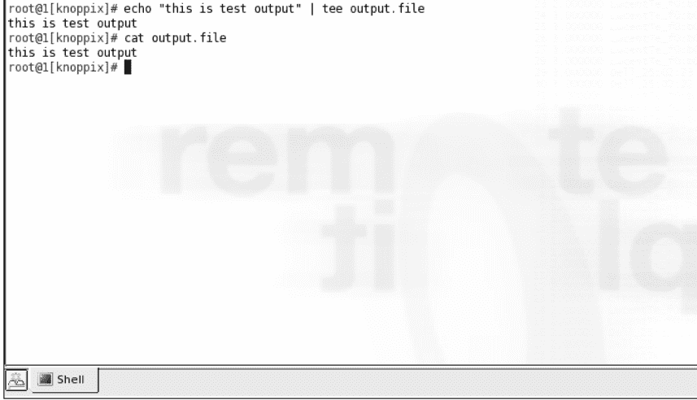

你可以使用主动或被动方法进行枚举。代理方法也可以被认为是被动的，你收集的信息将来自第三方源，而不是从目标本身截获的。然而，真正的被动扫描不应包含从主机系统发送的任何数据。主动方法是更为常见的，即你发送特定类型的数据包，然后接收返回的数据包。

一旦枚举完成，你将获得一个目标列表，并将用于下一阶段：扫描。你需要确定正在运行的特定服务、这些服务的版本，以及你能确定的任何主机或系统指纹。在没有这些信息的情况下继续进行可能会阻碍你后续的利用工作。

## 扫描的工作原理

从指纹侦入（footprinting）阶段获取的潜在目标列表可能非常大。为了简化扫描过程，首先确定系统是否在线并有响应是有意义的。可以使用几种方法来测试 TCP/IP 连接系统的可用性，但最常用的技术是使用互联网控制消息协议（ICMP）数据包。对于任何类型的网络故障排除，根据请求注释（RFC） 793，ICMP 回显请求数据包是实现和响应的基础包包。在现实中，许多内部和外部网络都会拦截 ICMP 请求以防御 Dos 攻击。如果 ICMP 数据包被拦截，也可以使用 TCP ACK 包。目标应该响应 RST，表示目标是活跃的。当你对范围内的活动目标结合使用 ICMP 或 TCP ping 方法时，应该部署此类扫描并将其捕获到指定 IP 地址的日志文件中。

## 端口扫描

尽管有许多不同的扫描器，它们的操作方式都是相同的。端口扫描有几种基本类型，最常见的是 SYN 扫描（“SYN 隐隐扫描”）。这种类型的扫描开始向目标发送一个 SYN 包。目标接收到 SYN 包，如果端口是开放的，则通过 SYN/ACK 响应；如果端口是关闭的，则响应 RST。这是大多数扫描的典型行为；发送数据包，分析返回结果，并对系统或端口的状态做出判断。SYN 扫描相对快且相对具有隐蔽性，因为没有发生三次握手，目标上的服务看不到连接，因此没有机会建立连接。其他可能用于特定情况的端口扫描（我们将在本书稍后部分讨论）包括设置了各种 TCP 标志的端口扫描，例如 FIN、PUSH 和 URG。不同系统对这些端口的响应不同，因此在使用由特定 TCP 标志发起的这些标志时，存在操作系统（OS）检测的元素。表 3.1 是不同 `nmap` 选项及其扫描类型的总结。

### 表 3.1 nmap 选项与扫描类型

| nmap 开 | 发送的数据包类型 | 开放时的响应 | 关闭时的响应 | 备注 |
| :--- | :--- | :--- | :--- | :--- |
| `-sT` | 基于 OS 的 connect() | 连接 | 连接拒绝或超时 | 基础非特权扫描类型 |
| `-sS` | TCP SYN 包 | SYN/ACK | | root 权限的默认扫描 |
| `-sN` | 裸包（无标志） | 连接超时 | RST | 用于绕过非状态防火墙 |
| `-sF` | 带有 FIN 标志的 TCP 包 | 连接超时 | RST | 用于绕过非状态防火墙 |
| `-sX` | 带有 FIN, PSH 和 URG 标志的 TCP 包 | | RST | 用于绕过非状态防火墙 |
| `-sA` | 带有 ACK 标志的 TCP 包 | RST | RST | 用于映射防火墙规则，不一定是开放的系统端口 |
| `-sW` | 带有 ACK 标志的 TCP 包 | RST | RST | 使用报头中 TCP 窗口值（正值或零）来确定过滤端口是开放还是关闭 |
| `-sM` | TCP FIN/ACK 包 | 连接超时 | RST | 适用于某些 BSD 系统 |
| `-sI` | TCP SYN 包 | SYN/ACK | RST | 使用“僵尸”主机，将显示为扫描 |
| `-sO` | IP 包报头 | 任意协议的响应 | ICMP 不目的 (Type 3, Code 2) | 用于映射主机使用了哪些 IP 协议 |

### 表 3.1 续 nmap 选项与扫描类型

| nmap 开 | 发送的数据包类型 | 开放时的响应 | 关闭时的响应 | 备注 |
| :--- | :--- | :--- | :--- | :--- |
| `-b` | 基于 OS 的 connect() | 已建立连接 | 连接拒绝或超时 | FTP 弹跳扫描，用于隐藏源扫描 |
| `-sU` | 空 UDP 报头 | ICMP 不目的 (Type 3, Codes 2, 9, 10, 13) | ICMP 不目的 (Type 3, Code 3) | 由于超时可能较慢 |


# 第 3 章 枚举与网络扫描

| `-sV` | 子协议特定探测（SMTP, FTP 等） | N/A | N/A | 用于确定服务，可以使用 banner 信息 |
| `-O` | TCP 和 UDP 包探测 | N/A | N/A | 使用多种方法确定操作系统/固件版本 |

## 深入枚举的背后

枚举基于从开放端口获取信息的能力，要么通过在连接开放端口时直接获取 banner，要么通过对返回数据包的构造进行推断。这里并没有多少真实，因为服务应该以可预测的方式响应；否则它们将无法使用这一切始于受保护的主机和端口。

## 服务识别

现在已经获取了开放端口，你需要能够验证这些端口上运行着什么。你通常认为 SMTP 运行在 TCP 25 上，但如果系统管理员试图混淆服务并运行隧道呢？检查端口状态最简单的方法是获取 banner。在连接到服务时，捕获响应并与已知服务列表进行对比，例如响应

## 图 3.2 检查 OpenSSH 服务的 banner

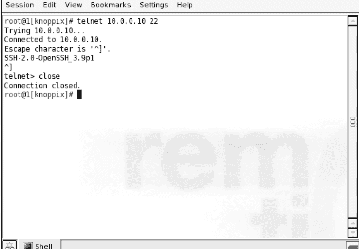

## RPC 枚举

某些服务封装在其他框架中，例如远程过程调用（RPC）。在 Unix 类系统中，开放的 TCP 端口 111 表明了这一点。Unix 风格的 RPC（广泛用于 Solaris 等系统）可以使用 `rpcinfo` 命令进行查询，或者扫描器可以在 RPC 绑定端口上发送 NULL 命令来枚举该 RPC 服务的功能。

## 指纹识别

指纹识别的目标是确定操作系统的版本和类型。系统指纹识别有两种常用方法：主动扫描。更常用的主动方法使用对 TCP 或 ICMP 数据包的响应。TCP 指纹识别涉及设置报头中的标志，不同的操作系统和版本对此的响应不同。通常会发送多个不同的 TCP 包，并将响应与已知基准（或指纹）对比，以确定远程操作系统。通常，基于 ICMP 的方法使用的的数据包比 TCP 方法少，且当你需要更具隐蔽性并允许不精确的指纹时，可以使用 ICMP

通过结合 TCP/UDP 和 ICMP 方法可以实现更高精度的准确性，前提是你和目标之间没有设备对数据包进行重塑导致签名不匹配。

为了实现极致的隐蔽检测，可以使用被动指纹识别。与主动方法类似，这种指纹识别不发送任何数据包，而是依靠嗅探技术来分析网络流量中传输的信息。如果你的目标正在运行公开的服务，被动指纹识别可能是开始指纹识别的好方法。被动指纹识别的缺点是它的准确性低于针对性的主动指纹会话，并且依赖于现有的流量。

## 开源工具

现在我们已经描述了一些理论，现在是时候用开源工具来实现它们了。我们将查看几种工具，将其分为两类：扫描和枚举。

## 扫描

我们将首先开始讨论辅助评估扫描阶段的工具。请记住，这些工具将扫描目标列表，以确定哪些主机处于在线状态，以及哪些端口和服务是可。

### Fyodor 的 nmap

端口扫描器接受目标或范围作为输入，向指定端口发送查询，然后为每个端口创建一个响应列表。最流行的扫描器是由 Fyodor 编写的 `nmap`，可以在 `www.insecure.org` 获取。Fyodor 的多功能工具已成为渗透测试人员和网络审计员的标准配置。虽然我们的意图不是教你使用 `nmap` 的所有方法，但我们将专注于几种扫描类型和选项，以便充分利用你的扫描时间并获取最佳信息。

#### nmap：Ping 扫描

在扫描即使是 `/16` 范围内的目标之前，你可能需要这些额外时间进行测试。这在图 3.3 中所示，对 C 类网络进行仅 TCP 和 TCP/ICMP 扫描分别耗时 4.021 秒和 5.384 秒。

##### 图 3.3 nmap Ping 扫描

| 会话 编辑 视图 签签 设置 帮助 |
| :--- |
| root@[knoppix] # `nmap -sP -P0 -P5 10.0.0.0/24` |
| Starting nmap 3.75 (http://www.nmap.org/nmap/) ~ 2005-01-11 16:16 EST |
| Host gw.homelan.net (10.0.0.1) appears to be up. |
| MAC: 00:02:25:75:9E:58 (Linksys Group) |
| Host server.homelan.net (10.0.0.10) appears to be up. |
| MAC: 00:02:31:48:08:88 (Intel) |
| Host box.homelan.net (10.0.0.185) appears to be up. |
| MAC: 00:02:25:75:9E:58 (Linksys Group) |
| Nmap run completed --- 4 IP addresses (4 hosts) scanned in 4.021 seconds |
| root@[knoppix] # `nmap -sP 10.0.0.0/24 -oA ping-sweep` |
| Starting nmap 3.75 (http://www.nmap.org/nmap/) ~ 2005-01-11 16:16 EST |
| Host 10.0.0.255 seems to be a subnet broadcast address (returned 2 extra pings). |
| Host gw.homelan.net (10.0.0.1) appears to be up. |
| MAC: 00:02:25:75:9E:58 (Linksys Group) |
| Host server.homelan.net (10.0.0.10) appears to be up. |
| MAC: 00:02:31:48:08:88 (Intel) |
| Host box.homelan.net (10.0.0.185) appears to be up. |
| MAC: 00:02:25:75:9E:58 (Linksys Group) |
| Host 10.0.0.255 seems to be a subnet broadcast address (returned 2 extra pings). |
| Nmap run completed --- 256 IP addresses (4 hosts) scanned in 5.384 seconds |
| root@[knoppix]# |

#### nmap：ICMP 选项

如果 `nmap` 无法扫描目标，除非使用 `-P0`（不 ping）选项，否则它将不会扫描。使用 `-P0` 选项可能会产生问题，除非 `nmap` 能够扫描目标的每个端口，即使目标在线。为了达到良好的平衡，请考虑使用 `-P` 选项来选择另一种类型的行为。例如，`-PP` 选项将使用 ICMP 时间戳请求，而 `-PM` 选项将使用 ICMP 下一个请求。在对网络范围执行完全扫描之前，对已知的 IP 地址（如 Web 服务器、DNS 等）进行一些限制可能有用，这样你就可以简化 ping 扫描并减少发送的总数据包数量和扫描时间。

#### nmap：输出选项

捕获扫描结果极其重要，因为你将在后的测试中引用这些信息。捕获所有必要信息的简单方法是使用 `-oA` 选项，它将以三种格式输出结果：普通文本 (`.nmap`)、可搜索文本 (`.grepable`) 和 XML (`.xml`)。XML 格式非常有用，当你需要使用其他工具处理数据时。

#### nmap：隐身扫描

当 `nmap` 无法扫描目标时，除非使用 `-P0`（不 ping）选项，否则它将不会扫描。使用 `-P0` 选项可能会产生问题，除非 `nmap` 能够扫描目标的每个端口，即使目标在线。为了达到良好的平衡，请考虑使用 `-P` 选项来选择另一种类型的行为。例如，`-PP` 选项将使用 ICMP 时间戳请求，而 `-PM` 选项将使用 ICMP 下一个请求。在对网络范围执行完全扫描之前，对已知的 IP 地址（如 Web 服务器、DNS 等）进行一些限制可能有用，这样你就可以简化 ping 扫描并减少发送的总数据包数量和扫描时间。


# 第 3 章 枚举与网络扫描

通过结合 TCP/UDP 和 ICMP 方法可以实现更高精度的准确性，前提是你和目标之间没有设备对数据包进行重塑导致签名不匹配。

为了实现极致的隐蔽检测，可以使用被动指纹识别。与主动方法类似，这种指纹识别不发送任何数据包，而是依靠嗅探技术来分析网络流量中传输的信息。如果你的目标正在运行公开的服务，被动指纹识别可能是开始指纹识别的好方法。被动指纹识别的缺点是它的准确性低于针对性的主动指纹会话，并且依赖于现有的流量。

## 开源工具

现在我们已经描述了一些理论，现在是时候用开源工具来实现它们了。我们将查看几种工具，将其分为两类：扫描和枚举。

## 扫描

我们将首先开始讨论辅助评估扫描阶段的工具。请记住，这些工具将扫描目标列表，以确定哪些主机处于在线状态，以及哪些端口和服务是。

### Fyodor 的 nmap

端口扫描器接受目标或范围作为输入，向指定端口发送查询，然后为每个端口创建一个响应列表。最流行的扫描器是由 Fyodor 编写的 `nmap`，可以在 `www.insecure.org` 获取。Fyodor 的多功能工具已成为渗透测试人员和网络审计员的标准配置。虽然我们的意图不是教你使用 `nmap` 的所有方法，但我们将专注于几种扫描类型和选项，以便充分利用你的扫描时间并获取最佳信息。

#### nmap：Ping 扫描

在扫描即使是 `/16` 范围内的目标之前，你可能需要这些额外时间进行测试。这在图 3.3 中所示，对 C 类网络进行仅 TCP 和 TCP/ICMP 扫描分别耗时 4.021 秒和 5.384 秒。

##### 图 3.3 nmap Ping 扫描

| 会话 编辑 视图 签签 设置 帮助 |
| :--- |
| root@[knoppix] # `nmap -sP -P0 -P5 10.0.0.0/24` |
| Starting nmap 3.75 (http://www.nmap.org/nmap/) ~ 2005-01-11 16:16 EST |
| Host gw.homelan.net (10.0.0.1) appears to be up. |
| MAC: 00:02:25:75:9E:58 (Linksys Group) |
| Host server.homelan.net (10.0.0.10) appears to be up. |
| MAC: 00:02:31:48:08:88 (Intel) |
| Host box.homelan.net (10.0.0.185) appears to be up. |
| MAC: 00:02:25:75:9E:58 (Linksys Group) |
| Nmap run completed --- 4 IP addresses (4 hosts) scanned in 4.021 seconds |
| root@[knoppix] # `nmap -sP 10.0.0.0/24 -oA ping-sweep` |
| Starting nmap 3.75 (http://www.nmap.org/nmap/) ~ 2005-01-11 16:16 EST |
| Host 10.0.0.255 seems to be a subnet broadcast address (returned 2 extra pings). |
| Host gw.homelan.net (10.0.0.1) appears to be up. |
| MAC: 00:02:25:75:9E:58 (Linksys Group) |
| Host server.homelan.net (10.0.0.10) appears to be up. |
| MAC: 00:02:31:48:08:88 (Intel) |
| Host box.homelan.net (10.0.0.185) appears to be up. |
| MAC: 00:02:25:75:9E:58 (Linksys Group) |
| Host 10.0.0.255 seems to be a subnet broadcast address (returned 2 extra pings). |
| Nmap run completed --- 256 IP addresses (4 hosts) scanned in 5.384 seconds |
| root@[knoppix]# |

#### nmap：ICMP 选项

如果 `nmap` 无法扫描目标，除非使用 `-P0`（不 ping）选项，否则它将不会扫描。使用 `-P0` 选项可能会产生问题，除非 `nmap` 能够扫描目标的每个端口，即使目标在线。为了达到良好的平衡，请考虑使用 `-P` 选项来选择另一种类型的行为。例如，`-PP` 选项将使用 ICMP 时间戳请求，而 `-PM` 选项将使用 ICMP 下一个请求。在对网络范围执行完全扫描之前，对已知的 IP 地址（如 Web 服务器、DNS 等）进行一些限制可能有用，这样你就可以简化 ping 扫描并减少发送的总数据包数量和扫描时间。

#### nmap：输出选项

捕获扫描结果极其重要，因为你将在后的测试中引用这些信息。捕获所有必要信息的简单方法是使用 `-oA` 选项，它将以三种格式输出结果：普通文本 `.nmap`、可搜索文本 `.grepable` 和 XML `.xml`。XML 格式非常有用，当你需要使用其他工具处理数据时。

#### nmap：隐身扫描

当 `nmap` 无法扫描目标时，除非使用 `-P0`（不 ping）选项，否则它将不会扫描。使用 `-P0` 选项可能会产生问题，除非 `nmap` 能够扫描目标的每个端口，即使目标在线。为了达到良好的平衡，请考虑使用 `-P` 选项来选择另一种类型的行为。例如，`-PP` 选项将使用 ICMP 时间戳请求，而 `-PM` 选项将使用 ICMP 下一个请求。

### nmap: 脚本功能

当你指定扫描目标时，`nmap` 会接受特定的 IP 地址、CIDR 格式的地址范围以及使用 `192.168.100–200` 样式表示法的范围。如果你有一个主机文件（该文件可能是由你之前的 ping 扫描生成的，提示，提示），你也可以使用 `-IL` 标志来指定它。市面上还有其他更正式的 `nmap` 解析程序，但图 3.6 显示了如何使用 `awk` 从 `nmap` ping 扫描结果中创建一个快速且粗略的主机文件。脚本可以是任何工具的非常强大的补充，但请记住在做大量工作之前先检查所有可用的输出选项，因为某些繁重的工作可能已经为你完成了。

#### 图 3.6 awk 解析 nmap 结果文件

```
Session Edit View Settings Help
root@[knoppix]## grep "appears to be" ping-sweep-home.nmap | awk -F' ' '{print $2}' | awk -F' ' '{print $1}'
> valid-hosts
root@[knoppix]## cat valid-hosts
10.0.0.1
10.0.0.10
10.0.0.13
10.0.0.185
root@[knoppix]# █
```

#### nmap: 速度选项

`nmap` 允许用户指定扫描的“速度”，即从发送探测到接收回复的时间，从而决定了数据包发送的速度。在快速的局域网上，你可以通过将 `-T` 选项设置为 `4`（激进 Aggressive）来优化扫描，通常不会在发送期间丢失任何数据包。如果你发现由于入站过滤或防火墙设备导致普通扫描花费很长时间，你可能想要开启敏捷扫描（Agile）。如果你知道你和目标之间有一个 IDS，并且你想尽可能隐蔽，那么使用 `-T0`（偏执狂 Paranoid）应该可以满足你的需求；然而，完成扫描将花费很长时间，可能需要几个小时，取决于你的扫描参数。

默认情况下，带有 Auditor 的 `nmap 3.75` 会扫描 `1663` 个端口以查找常见服务，这将捕获世界上大多数开放的 TCP 端口。然而，狡猾的系统可能会运行在不常用的端口上，通过隐蔽性来实现安全。如果不扫描这些不常用的端口，你可能会错过这些服务。如果你有时间，或者怀疑系统可能正在运行其他服务，请运行带有 `-p1-65535` 参数的 `nmap`，这将扫描所有 6.5 万个 TCP 端口。即使在有响应系统的局域网上，这也会需要 30 分钟到几小时不等。在互联网上进行此类测试可能需要长时间，这也为系统所有者或监控者提供了更多时间注意到异常流量并关闭系统。

## netenum: Ping 扫描


如果你需要一个非常简单的 ICMP ping 扫描程序供应用程序使用，`netenum`可能会很有用。它执行基本的 ICMP ping 然后回复可达目标。`netenum`的一个特性是它要求为整个测试指定一个超时时间。如果没有指定超时，它将输出以 CR 分隔符分隔的输入地址转储。如果你有不接受 CIDR 格式地址范围的工具，可以使用`netenum`将其扩展为单个 IP 地址列表。图 3.7 显示了`netenum`在 ping 扫描模式和网络扩展模式下的基本用法。

## 图 3.7 netenum

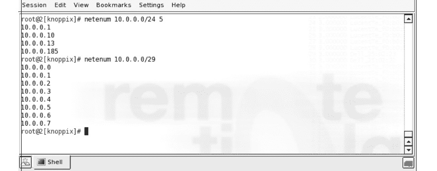

### unicornscan: 端口扫描

`unicornscan`与标准的端口扫描程序不同，它允许你指定更多信息，例如源端口、每个发送的数据包数量以及源 IP 信息的随机化（如果需要）。因此，它可能不是初始端口扫描的最佳选择，而更适用于后期“模糊测试”（fuzzing）或实验性数据包生成与检测。图 3.8 显示了`unicornscan`的运行，执行基本的 SYN 端口扫描。`unicornscan`可能更适合扫描 IDS 测试，在那种情况下数据包伪造能力可以更有用武。除非你有一些可以用于外部测试的“弃用”IP 地址；如果是的话，尽管去伪造吧！

## 图 3.8 unicornscan

```
root@[knoppix]# unicornscan 10.0.0.10 -q
Open                sssh: [22]             From 10.0.0.10 ttl 64
Open                http: [80]             From 10.0.0.10 ttl 64
Open                netbios: [139]         From 10.0.0.10 ttl 64
Open                microsoft-ds: [445]   From 10.0.0.10 ttl 64
```

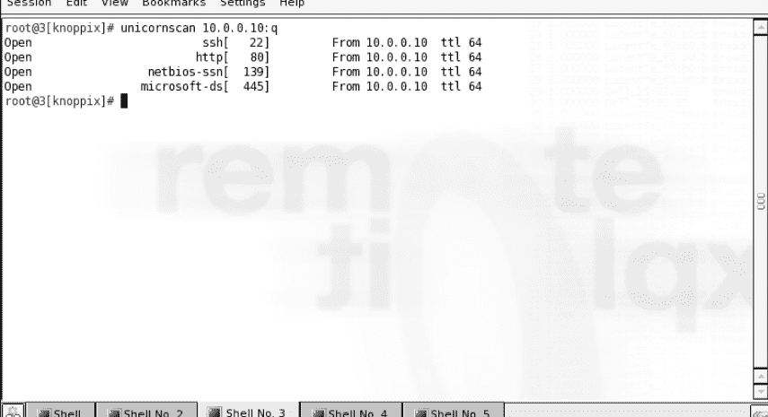

### scanrand: 端口扫描

与`unicornscan`类似，`scanrand`提供了典型端口扫描器不同的选项。它实现了两个扫描进程，一个用于发送请求，另一个用于接收请求。由于这种分离，进程可以异步运行，从而提高速度。数据包用数字签名编码，允许进程跟踪请求并防止伪造响应产生虚假信息。图 3.9 显示了`scanrand`的扫描。

## 图 3.9 scanrand

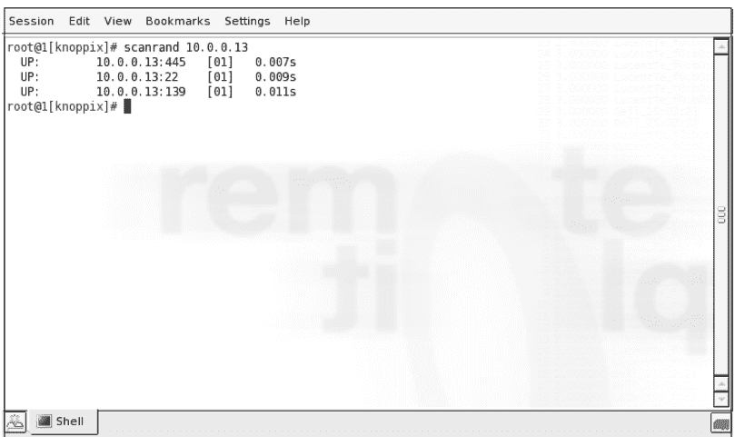

`scanrand`的另一个很棒的功能是能够限制带宽。在执行非常受限的扫描时，`scanrand`的这种限制带宽的能力是非常重要的。在图 3.10 中，使用`-b`限制`scanrand`的带宽，这对于连接来说是合理的。这种扫描方式会显示所有开放或关闭的端口。

## 图 3.10 scanrand 限制带宽

```
Session Edit View Settings Help
root@[knoppix]## grep "appears to be" ping-sweep-home.nmap | awk -F' ' '{print $2}' | awk -F' ' '{print $1}'
> valid-hosts
root@[knoppix]## cat valid-hosts
10.0.0.1
10.0.0.10
10.0.0.13
10.0.0.185
root@[knoppix]# █
```

## 枚举

接下来，我们将讨论辅助枚举阶段的工具。记住，这些工具将扫描目标列表和端口以获取有关目标的更多信息。枚举阶段通常会发现漏洞。

### nmap: Banner 取

`nmap`的版本扫描功能通过`-sV`标志调用。根据返回的 banner 或对`nmap`提供探测的特定响应，可以在服务响应与`nmap`指纹之间建立匹配。这是一个较新的功能，且 IDS 供应商正在为这种行为编写签名文件，因此请谨慎使用。图 3.11 显示了使用`nmap -sV`对 Linux 服务器进行的成功扫描。它执行了 SYN 端口扫描、版本扫描以及 OS 指纹识别，并带有详细输出。

## 图 3.11 枚举与扫描你的网络

OS 扫描假设端口 22 开放，20 关闭且未被防火墙拦截。

主机服务器：homelan.net (10.0.0.18) 似乎在线 ... 良好。

homelan.net (10.0.0.18) 的感兴趣端口：

（下方未显示的 1654 个扫描端口状态为过滤）

| 端口 | 状态 | 服务 | 版本 |
|---|---|---|---|
| 20/tcp | closed | ftp | |
| 21/tcp | closed | ftp | OpenSSH 3.9p (intel, 2.0) |
| 22/tcp | open | ssh | |
| 80/tcp | open | http | Apache http 2.0.53 (Fedora) |
| 139/tcp | open | netbios-ssn | |
| 137/tcp | open | netbios-ssmb | Samba 3.X (workgroup: HOMELAN) |
| 445/tcp | open | netbios-ssmb | Samba 3.X (workgroup: HOMELAN) |
| 631/tcp | closed | i | |

MAC 地址: 00:02:B8:A3:41:08

OS 类型: 通用

运行: Linux 2.4.X

OS 详情: Linux 2.4.6

TCP 序列预测: 随机正增

IPID 序列生成: 全零

难度:19342 (祝运！)

# 第 3 章 • 枚举与网络扫描

## 图 3.12 pof 操作系统检查

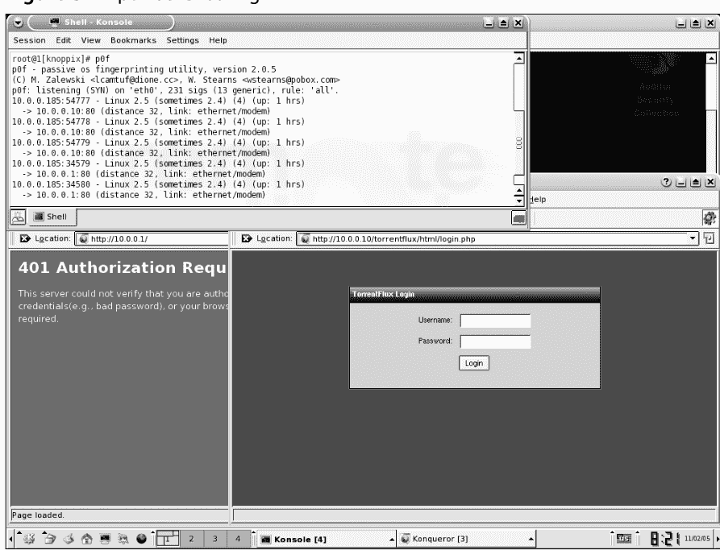

### Xprobe2: 操作系统指纹识别

`Xprobe2`主要是一个操作系统指纹识别工具，但也内置了基本的端口扫描功能，用于识别已开放或关闭的端口。你还可以指定已知的开放或关闭的端口，`Xprobe2`会对这些端口执行多种基于 TCP、UDP 和 ICMP 的测试，以确定远程操作系统。Auditor 提供的版本比最新版后一个版本，但较新版本具有更多的指纹。你可能希望为`Xprobe2`提供一个已知的开放或关闭的端口，以便其确定远程操作系统，如图 3.13 所示。


```bash
root@[knoppix]## nmap -p tcp:80 10.0.0.1
nmap v0.22.rc1 Copyright (c) 2002-2023 fygrave@tigerteam.net, ofir@sys-security.com, meder@areopag.net

[*] Target is 10.0.0.1
[*] Loading modules...
[*] Following modules are loaded:
[1] ping_icmp ICMP echo module
[2] tcp_ping TCP-based fingerprinting module
[3] ping_udp UDP-based fingerprinting module
[4] infarget_ttl TCP and UDP TTL distance calculation
[5] infarget_portscan TCP and UDP PortScanner
[6] fingerprint_echo ICMP echo fingerprinting module
[7] fingerprint_ipt Time request fingerprinting module
[8] fingerprint_msac MAC Address request fingerprinting module
[9] fingerprint_info ICMP information fingerprinting module
[10] fingerprint_icmp_port Port unreachable fingerprinting module
[11] fingerprint_tcp_hsake TCP Handshake fingerprinting module
[*] 11 modules loaded
[*] Initializing scan engine
[*] Running scan engine
ping_udp no closed/open UDP ports on 10.0.0.1. Module test failed
[*] Host: 10.0.0.1:80 is open (Guess probability: 100%)
[*] Host: 10.0.0.1:80 open. Roundtrip 0.00326 sec
[*] Selected round-Trip time: 0.00726 sec
[*] Primary query
Host: 10.0.0.1:80 Running 05: "HP JetDirect G.0.61 EEROM G.07.29" (Guess probability: 78%)
Host: 10.0.0.1:80 Running 05: "HP JetDirect G.0.19 EEROM G.07.29" (Guess probability: 78%)
Host: 10.0.0.1:80 Running 05: "HP JetDirect G.0.19 EEROM G.08.03" (Guess probability: 78%)
Host: 10.0.0.1:80 Running 05: "HP JetDirect G.0.17 EEROM G.08.28" (Guess probability: 79%)
Host: 10.0.0.1:80 Running 05: "HP JetDirect G.0.22 EEROM G.02.31" (Guess probability: 79%)
Host: 10.0.0.1:80 Running 05: "HP JetDirect G.0.88 EEROM G.08.04" (Guess probability: 78%)
Host: 10.0.0.1:80 Running 05: "HP JetDirect G.0.13 EEROM G.04.09" (Guess probability: 75%)
Host: 10.0.0.1:80 Running 05: "HP JetDirect G.0.11 EEROM G.05.16" (Guess probability: 75%)
Host: 10.0.0.1:80 Running 05: "HP JetDirect G.0.54 EEROM G.05.35" (Guess probability: 75%)
[*] Cleaning up scan engine
[*] Modules deinitialized
[*] Execution completed
root@[knoppix]#
```

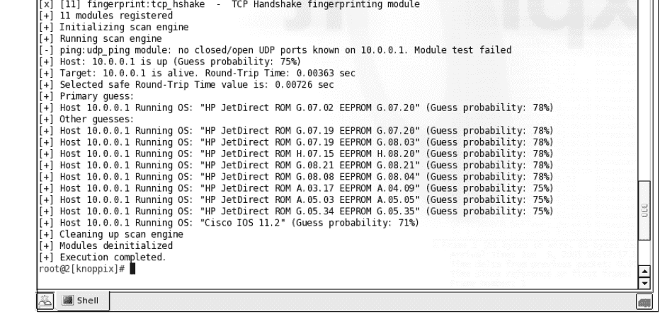

### httpprint

假设你遇到了一个 Web 服务器，并想知道运行的 HTTP 守护进程，但不想加载可能会触发 IDS 传感器的大型指纹工具？`httpprint` 正是为此设计的。它只对 HTTP 服务器进行指纹识别，并同时完成抓取特征和与可能的签名文件进行签名匹配。在图 3.14 中，我们对 `10.0.0.10` 的 Web 服务器运行了 `httpprint`，使用 `-h` 参数，并用 `-s /audit/httpprint/signatures.txt` 指定了签名文件。生成的 banner 显示为 Apache 2.0.53 (Fedora)，而最接近的匹配是 Apache 2.0.x，这是吻合的。在该输出下方是我们识别出的所有签名，以及针对该签名的得分和置信度。

#### 图 3.14 httpprint Web 指纹

```bash
root@[knoxpix]# httpprint -h 10.0.0.10 -s /audit/httpprint/signatures.txt
httpprint v0.2.1 (c) 2002-2023 various authors
Scanning 10.0.0.10...
Banner: Apache/2.0.53 (Fedora)
Matches:
Apache/2.0.x (Score: 100, Confidence: 90%)
Apache/2.0.53 (Score: 100, Confidence: 100%)
Signatures:
Signature 1 (Score: 80, Confidence: 70%)
Signature 2 (Score: 70, Confidence: 60%)
```

## IKE-scan: VPN 评估

更常见的 VPN 实现之一使用 IPsec 隧道。不同的制造商对 IPsec 的使用略有不同，可以通过 `IKE-scan` 进行发现和指纹识别。`IKE` 代表互联网密钥交换（Internet Key Exchange），用于为建立 IPsec 连接提供基础。`IKE` 可以以两种模式运行：主模式 (`-M`) 和激进模式 (`-A`)，这可以识别不同的 VPN 实现。两种模式都基于以下原理：VPN 服务器尝试与仅发送 IPsec 握手部分的客户端通信。发送初始 IKE 数据包（激进模式下还会指定 UserID），根据经过的时间和响应类型，VPN 根据指纹做出响应。除了 VPN 指纹识别外，`IKE-scan` 还包含 `psk-crack`，这是一个用于字典破解 VPN 登录预共享密钥（`psk`）的程序。`IKE-scan` 并没有所有 VPN 厂商的指纹，而且由于指纹随版本增加而变化，你可能找不到特定 VPN 的指纹，但它仍然可以提供有用信息，例如使用的身份验证类型和加密算法，如图 3.15 所示。

## Windows 枚举：smbdgetserverinfo/smump

如果 TCP 端口 `135`、`137` 或 `445` 是开放的，这表明目标机器基于 Windows，或者最可能运行着类似于 Windows 的服务。如果你发现这些端口已开放，应该尝试通过这些服务枚举系统名称和用户。在 Windows 中，如果注册表 `RestrictAnonymous` 和 `RestrictAnonymousSAM` 被设置为 `0`，匿名用户就可以空会话（null session）连接到系统，并导出本地用户帐户和共享文件夹列表。配合 Auditor 使用 `smb*` 工具在枚举这些服务方面表现出色。然而，这些工具在 Windows 2000 及更早版本上的效果好得多，因为 Windows XP 锁定了空会话。图 3.17 显示了 `smbdgetserverinfo` 在 Windows XP 机器 (`10.0.0.13`) 和运行 Samba 的 Fedora Core 3 Linux (`10.0.0.1`) 上返回的信息类型。

#### 图 3.17 smbgetserverinfo 示例

| 会话 编辑 查看 签签 设置 帮助 |

| root[1]-# smbgetserverinfo |

  SMB - ServerInfo WB9.9-1 by (patrik.karlsson@ixsecurity.com)

  用法: `smbgetserverinfo -i [options]`

  `-i` IP地址

  `-s` 服务器名称

  `-v` 详细模式

  `-vv` 更加详细模式


`root[1]-# smbgetserverinfo -v -i 10.0.0.13`

ERROR: SMBTC createAndX()

10.0.0.13 的服务器信息

Server Name : *SMBSERVER

Server OS : Windows 5.1

Workgroup/Domain : WORKGROUP

`root[1]-# smbgetserverinfo -v -i 10.0.0.10`

10.0.0.10 的服务器信息

Server Name : SERVER

Server OS : Unix

Workgroup/Domain : HOMELAN

`root[1]-# | | |`

通过空会话（null session）连接到 Samba 服务器，你可以获取 Samba 名称和操作系统版本。`smbdumpers` 程序可以显示如图 3.18 所示更多信息。尽管 Windows XP 目标没有返回任何信息，但 Linux 目标返回了所有本地用户列表，尽管没有显示 `aaron` 的本地 Samba 账户。虽然这些工具对旧环境可能有用，但在攻击新的 Windows 环境时，应该使用 `nbtscan` 和 `Nessus` 等其他工具。

# 第 3 章 • 网络的枚举与扫描

## 图 3.18 smbdumpusers 示例

| 会话 编辑 查看 签签 设置 帮助 |

|---||

| `root[#] smbdumpusers -1 10.0.0.13`

ERROR: SMBNTCreateAndX())

ERROR: SMBNTCreatatAndX())

`root[#] smbdumpusers -1 10.0.0.10`

Administrator

nbody

Domain Admins

Domain Users

Domain Guests

root

bin

bin

daemon

adm

sys

lp

adm

sync

tty

shutdown

disk

halt

lp

mail

mem

news

known

uuucp

uucp

wheel

operator

games

mail

gosher

news

ftp

uucp

mail

floppy

games

slocate

utmp Shell |

## xSMBBrowser

如果发现目标存在 SMB，你需要尝试获取更多关于所提供共享的信息。`xSMBBrowser` 提供了一个 GUI 环境，用于连接和枚举组内或域内的系统。启动 `xSMBBrowser`，并选择 Samba Config 以开始浏览。它将执行 `nmlookup` 来搜索工作组/域，返回的任何系统将通过 `smbclient` 运行，以列出并连接远程共享。根据目标系统的安全设置，你将能够查看和浏览共享，如图 3.19 所示。

## 图 3.19 xSMBBrowser 查找与枚举

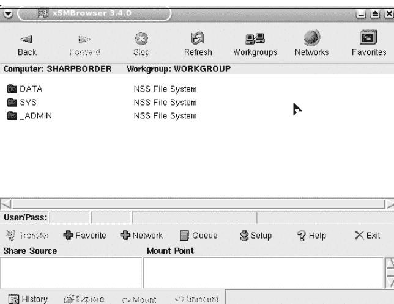

## smbclient

如果你正在枚举一个目标并确定有一个可访问的文件共享，你如何访问它来检索或发送文件呢？最旧的方法之一是使用 `smbclient`，它是一个用于 SMB 网络的文件传输客户端，工作方式类似于 FTP 客户端。使用 `-U` 参数并使用 `-I` 指定目标主机。图 3.20 显示了使用 `smbclient` 成功连接到目标系统，用于发送后续可能在渗透测试中使用的文件。

# 第 3 章 · 网络的枚举与扫描

## 图 3.20 smbclient 发送文件

```
Shell - Net utils
会话 编辑 查看 签签 设置 帮助
root@[kno]# smbclient -I 192.168.1.1 -U Administrator\\192.168.1.1\$
Password:
Domain:[NYYPDC1] OS:[Windows 5.0] Server:[Windows LAN Manager]
smb:\> cd system32
smb:\winnt> cd system32
smb:\winnt\system32> put /tmp/trojan.exe
put /tmp/trojan.exe as \winnt\system32\RUNME.EXE (0.0 kb/s) (0.0 kb/s)
smb:\winnt\system32>
```

## 总结

在本章中，我们介绍了许多工具，以及这些工具不同的开关/参数。表 3.2 列出了这里提到的所有工具、使用的开关及其预期用途。

| 工具 | 开关 | 预期用途 |
|---|---|---|
| `tee` | `-a` | 追加写入文件 |
| `nmap` | `-sp` | 使用 ICMP 和 TCP ACK (root) 扫描 |
| | `-P0` | 在扫描前进行 ICMP ping |
| | `-PS` | 使用 TCP ACK 作为探测 |
| | `-PP` | 使用 ICMP 时间戳探测 |
| | `-PM` | 使用 ICMP 掩码探测 |
| | `-oA` | 输出所有类型的日志、标准文本、XML 和可 grep 文件 |
| | `--resumefile` | 恢复之前取消的 nmap 扫描 |
| | `-sT` | 基于连接的扫描，默认用户权限 |
| | `-sS` | SYN 扫描，默认 root 权限 |
| | `-b` | 从服务器跳跃扫描 |
| | `@server:ftpport` | |

# 表 3.2 工具、开关与用途（续）

| 工具 | 开关 | 预期用途 |
|---|---|---|
| `-` | `-` | |
| | `-sl zombiehost:port` | 空空主机扫描 |
| | `-O` | 使用操作系统指纹识别 |
| | `-IL hostfile` | 使用主机列表作为目标列表 |
| | `-T[0,1,2,3,4,5]` | 设置扫描计时，从谨慎 (T0) 到疯狂 (TS) |
| | `-p[ports]/portlist/port1-port2]` | 扫描 [ports]/portlist/port1-port2] |
| | `-p[ports]/portlist/port1-port2]` | 扫描 [ports]/portlist/port1-port2] |
| | `-p[ports]/portlist/port1-port2]` | 扫描 [ports]/portlist/port1-port2] |
| | `-p[ports]/portlist/port1-port2]` | 扫描 [ports]/portlist/port1-port2] |
| | `-p[ports]/portlist/port1-port2]` | 扫描 [ports]/portlist/port1-port2] |
| | `-p[ports]/portlist/port1-port2]` | 扫描 [ports]/portlist/port1-port2] |
| | `-p[ports]/portlist/port1-port2]` | 扫描 [ports]/portlist/port1-port2] |
| | `-p[ports]/portlist/port1-port2]` | 扫描 [ports]/portlist/port1-port2] |
| | `-p[ports]/portlist/port1-port2]` | 扫描 [ports]/portlist/port1-port2] |
| | `-p[ports]/portlist/port1-port2]` | 扫描 [ports]/portlist/port1-port2] |
| | `-p[ports]/portlist/port1-port2]` | 扫描 [ports]/portlist/port1-port2] |
| | `-p[ports]/portlist/port1-port2]` | 扫描 [ports]/portlist/port1-port2] |
| | `-p[ports]/portlist/port1-port2]` | 扫描 [ports]/portlist/port1-port2] |
| | `-p[ports]/portlist/port1-port2]` | 扫描 [ports]/portlist/port1-port2] |
| | `-p[ports]/portlist/port1-port2]` | 扫描 [ports]/portlist/port1-port2] |
| | `-p[ports]/portlist/port1-port2]` | 扫描 [ports]/portlist/port1-port2] |


| | `-p[ports]/portlist/port1-port2]` | 扫描 `[ports]/portlist/port1-port2]` |

| 工具 | 开关 | 预期用途 |
|---|---|---|

| 132 |
| - | - | |
| | `-sl zombiehost:port` | 空空主机扫描 |
| | `-O` | 使用操作系统指纹识别 |
| | `-IL hostfile` | 使用主机列表作为目标列表 |
| | `-T[0,1,2,3,4,5]` | 设置扫描计时，从谨慎 (`T0`) 到疯狂 (`TS`) |
| | `-p[ports]/portlist/port1-port2]` | 扫描 `[ports]/portlist/port1-port2]` |

# 第 4 章

# 介绍入侵检测与 Snort

本章包含的解决方案：

- IDS 如何工作
- Snort 处于何种位置
- Snort 系统要求
- 探索 Snort 的功能
- 在你的网络上使用 Snort
- Snort 与你的网络架构
- 运行 Snort 的陷阱
- Snort 的安全考量
- 总结
- 解决方案快速通道
- 常见问题

## 引言


# 入侵检测系统概述

`IDS`（入侵检测系统）相当于高科技防盗报警，用于监控信息网关、敌对活动和已知的入侵者。`IDS`是一种专门工具，知道如何解析和解释网络流量/或主机活动。这些数据范围从网络数据包分析到路由器、防火墙和服务器的日志内容、本地日志访问和调用、网络流数据等。此外，`IDS`存储了一个已知攻击特征的数据库，并可以将其监控的数据中看到的活动、流量或行为模式与这些特征进行比较，以识别特征与当前或近期行为之间何时紧密匹配的情况。此时，`IDS`可以发出警报或采取行动，采取各种自动化行动，从关闭互联网链接或服务器以进行回溯，以及进行其他主动尝试以识别攻击者并收集其邪恶活动的证据。

类比起来，`IDS`对网络起的作用就像防病毒软件对对系统起的作用一样：它检查网络流量的内容以寻找并偏离可能的攻击，就像防病毒软件软件包对入站邮件附件、活动 Web 内容等进行打包，以寻找病毒特征（匹配恶意软件的模式）或可能的恶意行为（至少是可疑的、如果不是完全不可接受的行为模式）。

更具体地说，入侵检测意味着检测对系统或网络的未经授权的使用或攻击。`IDS`设计用于检测此类攻击，或对系统、网络及相关资源的未经授权使用，并在许多情况下如果可能的话偏离或确定它们。像防火墙一样，`IDS`可以是基于软件的，也可以以预安装和预配置的独立`IDS`设备的形式将硬件和软件相结合。`IDS`软件可能会运行在运行防火墙、代理或其他边界服务的相同设备或服务器上，尽管独立的`IDS`传感器和管理器更为流行。尽管如此，未运行在同一设备上或未安装防火墙或其他服务的设备上的`IDS`将以特别的关注和细心监控这些设备。虽然此类设备往往被部署在网络边缘，但`IDS`能够检测并处理内部攻击者以及外部攻击，并且在检测违反安全策略和内部威胁方面通常非常有用。

你可能在领域遇到几类`IDS`。首先，可以根据它们监控的活动类型、流量、交易或系统的类型来区分`IDS`。监控网络链路和骨干网攻击特征的`IDS`称为基于网络的入侵检测系统 (`NIDS`)，而在主机上运行并防御操作系统和文件系统入侵迹象的`IDS`称为基于主机的入侵检测系统 (`HIDS`)。作为远程传感器并向中央管理站报告的`IDS`组被称为分布式入侵检测系统 (`DIDS`)。网关`IDS`是部署在你的网络与另一个网络之间网关处的网络`IDS`，监控通过传输点进出你网络的流量。侧重于根据应用程序逻辑流以及底层协议理解和解析特定流量的`IDS`通常称为应用`IDS`。

在实践中，大多数商业环境使用基于网络、主机和应用的`IDS`的某种组合，以观察网络上发生的情况，同时更紧密地监控关键主机和应用程序。`IDS`可以根据它们对事件分析的不同方法进行区分。某些`IDS`主要使用特征检测来识别和阻止文件、程序或活动 Web 内容进入计算机系统，不同在于它们使用与已知攻击相关的流量或活动模式数据库，称为攻击特征。事实上，特征检测是商业`IDS`技术中使用得广泛的方法。另一种方法称为异常检测。它使用规则或预定义的“正常”和“异常”系统活动概念（称为启发式）来将异常与正常系统行为区分开来，并在异常发生时进行监控、报告或阻止。某些异常检测`IDS`实现了用户配置文件。这些配置文件是正常活动的基准，可以使用统计采样、基于规则的方法或神经网络来构建。

数百家供应商提供各种形式的商业`IDS`实现。最有效的解决方案结合了基于网络和基于主机的`IDS`实现。同样，绝大多数实现是基于特征的，在特定产品或解决方案中存在有限的异常检测能力。事实上，大多数现代`IDS`都包含一些有限的自动响应能力，尽管这些功能通常集中在自动流量过滤、阻止或作为最后的手段断开。虽然某些系统声称能够对攻击发起反击，但最佳实践表明，自动识别和回溯设施是这些设施提供的最有用的方面，也是最可能被使用的方面。

`IDS`按其功能分类，并大致分组为以下几个大类：

- 基于网络的入侵检测系统 (`NIDS`)
- 基于主机的入侵检测系统 (`HIDS`)
- 分布式入侵检测系统 (`DIDS`)

# IDS 如何工作

我们在对现有不同类型`IDS`的综述中已经某种程度上接触了这一点，但让我们具体看看是什么让`IDS`运行的。首先，你必须理解`IDS`在观察什么。特定的数据输入类型取决于`IDS`的类型（事实上，`IDS`监控什么信息是用于分类的标志之一），但总来说有三个主要部分：

- 应用程序特定的信息，例如应用程序流
- 主机特定的信息，例如系统调用、本地日志
- 网络特定的信息，例如线缆上的数据包

`IDS`可能会监控这些任何或全部内容，取决于`IDS`传感器是什么。`IDS`可以使用各种技术来收集这些数据，包括数据包嗅探（通常在混杂模式下以捕获尽可能网络数据）、本地日志解析、内核中的系统监控以调节应用程序的行为，以及为了检测权限的文件系统监控。

在`IDS`收集数据后，它使用多种技术来发现入侵。像防火墙一样，`IDS`被设置为识别已知良好或已知的策略。对于前者技术，许多异常检测引擎采用这种模型，在发生定义统计参数之外的情况时触发警报。某些复杂的协议模型也运行在已知良好策略上，定义协议允许的流量并在破坏该模式时触发警报。基于语言的应用逻辑模型也倾向于结构化为已知良好策略，对预定义操作结构中不允许的内容触发警报。

已知不良策略要简单得多，因为它们不需要完整的允许模型，并且仅对有问题的数据或流量触发警报。大多数基于特征的`IDS`引擎通过不良模型工作，具有不断扩展恶意攻击特征数据库。

最后，我们应该考虑`IDS`在发现尝试攻击时会做什么。响应有两种一般类型：被动响应，可能会生成警报或日志条目但不干预或操纵网络流量；主动响应，可能会发送重置包以中断传输控制协议 (`TCP`) 连接、如果`IDS`是线性的则丢弃流量、将攻击添加到阻止列表，或其他主动与可疑活动的交互。

在概述了这些原则后，让我们来看看一些真实的基于网络的攻击。

# IDS 能为我做什么

`IDS`的优势在于它们能够持续监控你网络上的数据包，以二进制理解它们，并在可疑匹配匹配特征时向你发出警报。

# 介绍入侵检测与 Snort • 第 4 章

这种情况会发生。与人类分析师不同，`IDS`的检测速度允许几乎立即进行告警和响应，即使是在凌晨 3 点且所有人睡觉的时候。（`IDS`的告警能力允许你分页人员并唤醒他们；或者，如果你正在部署在线`IDS`或入侵防御系统 [`IPS`]，它可以阻止可疑流量，以及可能来自攻击主机的其他流量。）`IDS`可以允许你每天读取数 GB 的日志，从中寻找特定的问题和违规行为。计算和分析能力的增强是巨大的，一个调优良好的`IDS`将成为胜任的系统/网络管理员或安全人员的力倍增器，允许他们监控来自更多系统的数据。通过在看起来你受到攻击时迅速通知你，可以防止或最大限地减少潜在的损害。

必须意识到，无论你调优得有多好，`IDS`都可能产生海量数据。如果没有调优，大多数`IDS`将产生如此多的数据和假报，以至于分析时间可能会在虚假告警的海洋中淹没对合法告警的响应。一个新的`IDS`几乎就像一个婴儿——它需要大量的照顾和喂养才能以高效且健康的方式成熟。如果你不调优你的`IDS`，你可能根本用不上它。

`IDS`的另一个积极特性是，它允许熟练的分析师在大量数据中发现其他可能被注意到的细微趋势。通过注意告警与主机之间的相关性，`IDS`可以显示出通过其他网络分析手段可能无法的模式。这是`IDS`如何补充你的网络防御的一个例子，通过协作工作实施深度防御策略。

## IDS 的局限性

没有任何`IDS`可以替代对精通安全知识的人员的需求。你需要熟练的分析师来处理`IDS`产生的那些告警，确定哪些是真实威胁，哪些是假报。尽管`IDS`可以从网络分段上的许多设备收集数据，但它们不会理解威胁对每台机器的影响，或网络上每台服务器的重要性。你需要机智、老练的人员根据`IDS`提供的信息采取行动。

此外，没有任何`IDS`能捕获所发生的每一次攻击，或阻止人们尝试攻击你。任何类型的`IDS`局限性，以及新攻击的开发与在异常检测系统可接受参数内隐藏的时间差，使得极有可能存在一个小的窗口，`0-day`攻击不会被给定的`IDS`检测到。互联网是一个残酷且敌对的地方，尽管实施强大的网络防御并准备好受到攻击是建议的，但`IDS`毕竟无法通过心灵感应让人们决定不攻击你的网络。在大多数情况下，`IDS`不会自动阻止攻击的成功，因为它的功能主要是检测和告警。有一些机制可以解决这个问题——例如，内线式`IDS`（inline `IDS`）或`IPS`——但在大多数情况下，`IDS`不会自动为你击败攻击。这就是为什么`IDS`应该被视为其他网络设备（如防火墙、防病毒软件等）的补充，而不是它们的替代品的原因之一。

## Snort 的位置

`Snort`是一种开源网络`IDS`，能够在基于网际协议 (`IP`) 网络上执行实时流量分析和数据包记录。`Snort`可以执行协议分析和内容搜索/匹配，你可以用它来检测各种攻击和探测，例如缓冲区溢出、隐蔽端口扫描、通用网关接口 (`CGI`) 攻击、服务器消息块 (`SMB`) 探测、操作系统指纹识别尝试等。`Snort`正在迅速成为入侵检测的首选工具。


你可以在三种模式下配置 Snort：嗅探器模式（`sniffer`）、数据包记录器模式（`packet logger`）和网络入侵检测模式。嗅探器模式从网络上读取数据包并在控制台上以连续流的形式显示它们。数据包记录器模式将数据包记录到磁盘。网络入侵检测模式最为复杂且可配置，它允许 Snort 分析网络流量以匹配与用户定义的规则集的项，并根据它所看到的内容执行几种操作之一。

除了 Snort 提供的社区签名和供注册用户下载的 Sourcefire VDB 签名外，你还可以使用 Snort 编写自己的签名以适应你网络的特殊需求。这种能力增加了巨大的定制性和灵活性，以满足你自己的独特需求。此外，还有几个在线社区，领先的入侵分析师和事件响应人员在其中交换他们最新的用于检测漏洞和近期病毒的 Snort 规则。

Snort 的模式匹配行为具有即时的实际应用价值。例如，它允许检测感染了具有独特行为的病毒或蠕虫主机。由于许多蠕虫通过扫描互联网并攻击它们认为脆弱的主机来传播，因此可以针对这种扫描行为或漏洞利用尝试本身编写签名。虽然清理受感染机器不是 IDS 的工作，但这种识别能力可能非常有用。在大规模病毒感染的情况下，在假设的病毒清理后观察相同的行为可以帮助确认清理是否成功。

Snort 还有匹配已知网络侦查和利用工具网络行为的签名。尽管大多数情况下，规则编写者努力匹配漏洞的签名而非特定工具的签名，但有时能够识别扫描或攻击你的工具是有帮助的。例如，某些规则可以识别 SolarWinds 扫描器倾向于将其名称嵌入其扫描的互联网控制消息协议（ICMP）数据包的载荷中，从而易于进行设备识别。最终进入 Metasploit 等流行工具的绝大多数漏洞在 Snort 规则中都有签名，它们可以通过网络行为被检测到。

## Snort 系统要求

在获取系统之前，你需要了解几点。首先，Snort 数据可能会占用大量空间，其次，你需要能够远程访问系统。因为我们很懒，不想走下楼，我们希望安全地进行远程维护。（对于 Linux 和 UNIX 系统，这意味着安全外壳（`SSH`）和安全套接层（`SSL`）。对于 Windows，这意味着终端服务和 Internet 信息服务 [`IIS`]）。

### 硬件

在获取系统之前，我们很难为运行 Snort 需要的硬件提供硬性要求，因为硬件需求根据流量情况巨大变化。在最低水平上，Snort 不需要任何操作系统本身不具备的特定硬件要求。使用更快的处理器运行任何应用程序通常会让运行更快。然而，你的网络和硬盘将限制你收集的数据量。

你需要的东西之一，特别是当你以 NIDS 模式运行 Snort 时，是一个大且足够快速的硬盘。如果你将数据存储为 syslog 文件或数据库，你需要大量的空间来存储 Snort 检测引擎用于检查规则违规所需的所有数据。如果你的硬盘太小，你很可能无法将告警写入数据库或日志文件。例如，我们目前针对高流量企业 Snort 传感器的设置是 `/var` 分区 100GB（对于不熟悉 Linux/UNIX 系统的人来说，var 是最可能存储日志的地方）。一些高级部署甚至使用 RAID 列进行存储。

你需要一个与你的网络一样快的网网卡（`NIC`）来收集网络上的所有数据包。例如，如果你在 100MB 网络上，你需要一个 100MB 的 `NIC` 来收集正确的数据包。否则，你将丢失包并无法准确地收集告警。Snort 的一个高度推荐的硬件组件是双以太接口。一个接口用于典型的网络连接（`SSH`、`Web` 服务等），另一个

# 第 4 章 • 引入入侵检测与 Snort

`interface` 接口用于嗅探（Snorting）。此传感接口检测“嗅探”的是你的 Snort 传感器。为传感器管理和网络嗅探设置独立的接口可以增强安全性，因为这允许你严格限制哪些机器可以访问管理接口，而不会干扰你在“嗅探”接口上的混杂模式数据包嗅探。

鉴于 Snort 引擎的新改进，我们还建议不要在内存上过于紧缩。由于 Snort 的内存占用比之前的版本大，因此要确保你的传感器有足够的 RAM 来处理你收到的流量。如果你注意到性能延迟，很有必要确保系统没有在进行频繁的内存交换。

### 操作系统

Snort 被设计为一种轻量级网络入侵系统。Snort 可以运行在 x86 系统上：Linux、FreeBSD、NetBSD、OpenBSD 和 Windows。其他支持系统包括 Spar Solaris、x86 Mac OS X、PowerPC Mac OS X 和 MKLinux 以及 PAR-RISC HP-UX。简而言之，Snort 可以运行在任何现代操作系统上。对于本书，我们将重点关注 Linux。

关于运行 Snort 的哪个操作系统更好，一直存在争议。在一段时间之前，*BSDs 拥有更好的 IP 栈*，但自从 Linux 采用 2.4 内核以来，IP 栈已经不相上下了。

### 其他软件

一旦安装了基础操作系统，你就可以开始了。在安装之前，请确保你已具备前提条件：

- `autoconf` 和 `automake`

- `gcc`

- `lex` 和 `yacc`（分别对应 GNU 的实现版本 `flex` 和 `bison`）

- 来自 `tcpdump.org` 的最新 `libcap`

> 注意
>
> 这些仅在你从源代码进行编译时才是需要的。如果你使用的是 Linux `RPM` 包、`Debian` 软件包或 Windows 端口安装程序，则不需要这些。**而且你不应该在生产环境 IDS 传感器上拥有它们！**一旦你编译并部署了 Snort，应该从任何预计要投入生产环境的传感器中移除所有用于编译的工具。

# 引入入侵检测与 Snort • 第 4 章

你还可以安装以下可选的软件产品：

- `MySQL`、`Postgres` 或 `Oracle`（SQL 数据库）

- 如果使用 WinPopup 消息，则安装 `smclient`

- `Apache` 或其他 Web 服务器

- 如果你有需要它们的插件，则安装 `PHP` 或 `Perl`

- 用于远程访问的 `SSH`（或 Windows 的 Terminal Server）

- 具有 `SSL` 能力的 `Apache` 用于监控（或 Windows 的 `IIS`）

有关安装的更多细节见第 5 章“安装 Snort”。

## 探索 Snort 功能

在引言中，我们简要概述了 Snort 使其非常强大的最重要的功能：数据包嗅探、数据包日志和入侵检测。在学习 Snort 功能的细节之前，你应该先了解 Snort 的架构。Snort 具有几个作为预处理器和告警插件的重要组件，这些组件可以通过你特定的 Snort 实现的插件进一步自定义。这些组件使 Snort 能够处理数据包，以便内容更容易被检测引擎和告警系统管理。一旦数据包通过了预处理器、检测引擎并发送到告警系统，就可以由你选择的任何处理告警的处理器进行处理。这听起来很复杂，但一旦你理解了架构，Snort 就会变得意义得多。Snort 的架构由四个基本组件组成：

- 嗅探器（`sniffer`）

- 预处理器（`preprocessor`）

- 检测引擎（`detection engine`）

- 输出器（`output`）

在最基础的形式下，Snort 是一个包嗅探器。然而，它的设计是接收数据包并通过预处理器对其进行处理，然后根据一系列规则（通过检测引擎）检查这些数据包。

图 4.1 提供了 Snort 架构的高层视图。在最简单的形式下，Snort 的架构类似于一台机械硬币分类器。

- 它接收所有的硬币（来自网络骨干的数据包）。

- 然后它将它们通过一个滑道，以确定它们是否为硬币以及如何滚动（预处理器）。

- 接下来，它根据硬币类型对硬币进行分类。这是为了存储四角、镍角、一角和美分（在 IDS 上，这就是检测引擎）。

- 最后，决定如何处理这些硬币是管理员的任务——通常你会把它们卷起来并存储（日志记录和数据库存储）。

# 图 4.1 Snort 架构

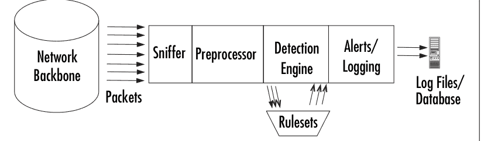

Snort 的预处理器、检测引擎和告警组件都是插件。插件是编写为符合 Snort 插件 API 的程序。这些程序曾是 Snort 核心代码的一部分，但将它们分离出来是为了让对核心源码的修改更加可靠且更容易实现。

### 包嗅探器

包嗅探器是一种用于接入网络的设备（无论是硬件还是软件）。它的工作方式与电话窃听类似，但它是用于数据网络而非语音网络。网络嗅探器允许应用程序或硬件设备监听数据网络流量。在互联网情况下，这通常包括 IP 流量，但在本地局域网（LAN）和旧网络中，它可以是任何其他协议，例如 IPX 和 AppleTalk 流量。

由于 IP 流量包含许多不同的协议（包括 TCP、UDP、ICMP），嗅探器会分析这些流量。在互联网情况下，这通常包括 IP 流量，但在本地局域网和旧网络中，可以是任何其他协议，例如 IPX 和 AppleTalk 流量。嗅探器具有用途：

- 网络分析和故障

- 性能分析和基准测试

- 监听明文密码

# 引入入侵检测与 Snort • 第 4 章

加密你的网络流量可以防止他人嗅探你的数据包。与任何网络工具一样，嗅探器可以用于善，也可以用于恶。


正如 Marty Roesch 所说，他命名这个应用程序是因为它不仅仅是嗅探——它还在“嗅（snorts）”。嗅探器需要配置以获取尽可能的数据包。作为一个嗅探器，Snort 可以保存数据包以便日后处理和查看。图 4.2 展示了 Snort 的嗅探能力。

## 图 4.2 Snort 的嗅探功能

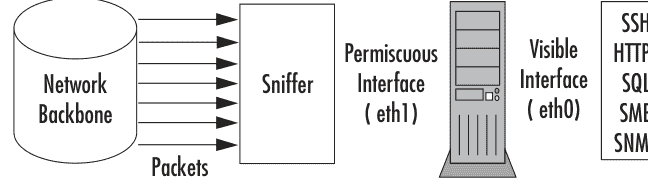

## 预处理器

此时，我们的分类器已经获得了所有的硬币（来自网络包），并准备好将包通过滑道。在滚动硬币（检测引擎）之前，分类器需要确定它们是否为硬币，以及如果是，属于什么。

这是通过预处理器完成的。预处理器获取原始数据包并根据插件进行检查（例如 RPC 插件、HTTP 插件和端口扫描器插件）。这些插件检查数据包的特定类型行为。一旦确定数据包具有特定类型的“行为”，它就会被发送到检测引擎。从图 4.3 中你可以看到预处理器如何使用其插件检查数据包。Snort 支持许多种预处理器及其相关的插件，涵盖了协议处理、端口扫描和流量控制以及对丰富协议的深度检查（例如 HTTPInspect 预处理器）。

对于 IDS 来说，这是一个非常实用的功能，因为插件可以在处理器级别启用或禁用，从而以最适合你网络的水平分配计算资源并生成告警。例如，假设你厌倦了网络中不断的端口扫描，你不想再看到那些告警了。事实上，你再也不想听到任何关于端口扫描的消息。如果是这样，你可以说你不在乎从外部世界进入你网络的端口扫描，并禁用该插件，同时继续使用其他插件检查其他网络威胁。

## 图 4.3 Snort 的预处理器

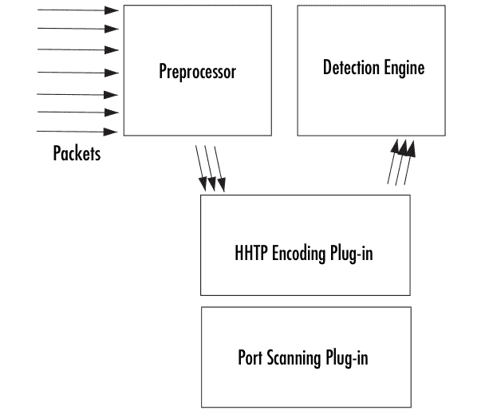

## 检测引擎

一旦数据包被所有启用的预处理器处理完毕，它们就会被交给检测引擎。检测引擎是 Snort 中基于特征的 IDS 的核心。检测引擎接收来自预处理器及其插件的数据，这些数据将通过一组规则进行检查。如果规则与数据包中的数据匹配，它们将被发送到告警处理器。

在本章的早些部分，我们将 Snort 描述为一种基于特征的 IDS。基于特征的 IDS 功能通过各种规则实现。规则集按类别（木马、缓冲区溢出、对各种应用程序的访问）分组，并定期更新。规则本身由两部分组成：

- `rule header`：规则头部基本上是要执行的操作（记录或告警）、网络数据包类型（TCP、UDP、ICMP 等）、源和目的 IP 地址以及端口。
- `rule option`：选项是数据包中应使数据包匹配规则的内容。

检测引擎及其规则是学习和理解 Snort 时新信息中最大的部分（也是学习曲线最陡峭的部分）。Snort 在其规则中使用了一套特定的语法。规则语法可能涉及协议类型、内容、长度、头部以及各种元素，包括用于定义缓冲区溢出规则的垃圾字符。

一旦你让它运行并学会了如何编写 Snort 规则，你就可以精调并自定义 Snort 的 IDS 功能。你可以定义针对你环境的规则，并自定义你想要的任何内容。

检测引擎是硬币分拣器中实际上根据类型滚动硬币的部分。常见的美国硬币有季度币、美分、镍币和分。然而，你可能会得到一个不匹配的硬币（例如肯尼迪半美元），并将其丢弃。这在图 4.4 中所示。

## 图 4.4 Snort 的检测引擎

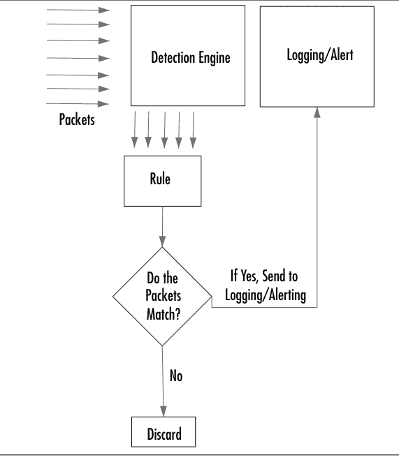

## 告警/日志组件

Snort 数据经过检测引擎后，它需要去往某个地方。如果数据与检测引擎中的规则匹配，就会触发告警。告警可以发送到日志文件、通过网络连接、UNIX 套接或 Windows 弹出窗口 (SMB) 或 SNMP 陷阱。告警也可以存储在 MySQL 和 Postgres 等 SQL 数据库中。

你可以配合 Snort 使用额外的工具，包括 Perl、PHP 和 Web 服务器的各种插件，通过 Web 界面显示日志。日志存储在文本文件中（默认位于 `/var/log/snort/`）或存储在 MySQL 和 Postgres 等数据库中。

与检测引擎和预处理器一样，告警组件使用插件将告警发送到数据库并通过 SNMP 陷阱和 WinPopup 消息等网络协议。参见图 4.5 以其工作原理。

此外，通过 Swatch 等 syslog 工具，Snort 告警可以通过电子邮件发送，实时通知系统管理员，这样就不需要日夜监控 Snort 的输出了。

表 4.1 列了一些实用的第三方程序和工具示例。

## 表 4.1 有用的 Snort 插件

| 输出查看器 | URL | 描述 |
| --- | --- | --- |
| SnortSnarf | www.silicodefense.com/software/snortarf | 由 Silicon Defense 开发的 Snort 分析器，用于诊断。输出为 HTML 格式。 |
| Snortplot.php | www.snort.org/dl/contrib/data_analysis/snortplot.pl | 一个能够对你的攻击进行图形绘制的 Perl 脚本。 |
| Swatch | http://swatch.sourceforge.net | 实时 syslog 监控器，通过电子邮件提供实时告警。 |
| ACID | http://acidlab.sourceforge.net | 入侵数据库分析控制台。为 Snort 提供日志分析。需要 PHP、Apache 和 Snort 数据库插件。由于这些信息通常很敏感，强烈建议使用 Apache 的 mod_ssl 或 Apache-SSL 对这些信息进行加密。ACID 基本已弃，目前不再进一步开发；我们强烈建议你使用 BASE。 |
| BASE | http://sourceforge.net/projects/secureideas/ | 基于 ACID 代码库的后来的 Snort Web 前端，基础分析与安全引擎 (BASE) 是我们目前查询和分析 Snort 告警的首选方式。 |
| Demarc | www.demarc.com | 一种提供与 ACID 类似界面的商业应用程序。它也需要 Perl，并且强烈建议也加密 Demarc 会话。 |
| Razorback | www.intersectalliance.com/projects/RazorBack/index.html | 一个基于 GNOME/X11 的 Linux 实时日志分析程序。 |
| Incident.pl | www.cse.fau.edu/~incident | 用于创建报告的 Perl 脚本。 |
| Loghog | http://sourceforge.net/projects/loghog | 实时 syslog 监控器，通过...提供实时告警。 |
| Oinkmaster | www.algonet.net/~oinkmaster | 用于跟踪的工具。 |
| SneakyMan | http://sneak.sourceforge.net | 一个基于 GNOME 的配置器。 |
| SnortReport | www.circuits.com/download.html | 生成报告的模块。 |

## 图 4.5 Snort 的告警组件

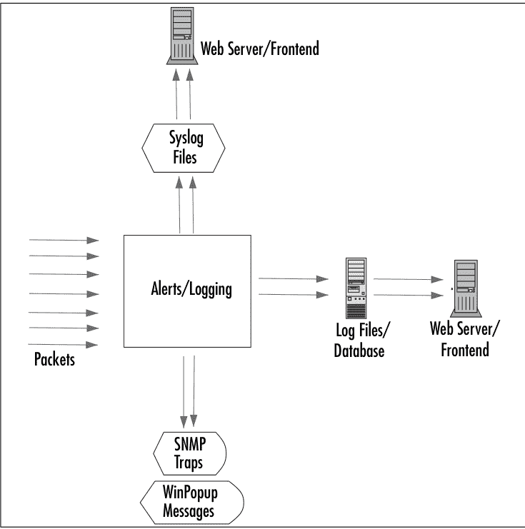

## 在网络中使用 Snort

然后还有另一种情况：当 Snort 没有检测到你系统上的攻击时会发生什么？拿你运行的另一个 UNIX 系统为例。有一个运行着带有 FrontPage 扩展的 Apache（噢！）。有人发现了 FrontPage 上一个新的溢出漏洞，编写了零日攻击，然后他或她入侵了你的机器。没有任何 IDS 是完美的，Snort 也不会捕获所有攻击

# 第 4 章 • 介绍入侵检测与 Snort

如果目前还没有编写预处理器或特征来覆盖它们。这就是为什么尽可能保持规则更新非常重要的主要原因之一——如果你拥有最新的规则，检测到攻击的机会就越大。因为随着新攻击在互联网上不断出现，规则会不断开发，Snort 的检测能力也会随着新攻击的演变不断改进。

### Snort 的用途

Snort 有三个主要用途：

- 数据包嗅探器 (packet sniffer)
- 数据包记录器 (packet logger)
- 网络入侵检测系统 (NIDS)

所有规则之间都相互关联并相互构建。然而，将包嗅探器和数据包记录器放在同一类是最简单的——基本上它们的功能是相同的。区别在于，通过记录功能，你可以将数据包保存到文件中。相反，你也可以用 Snort 读取数据包日志。

### 将 Snort 作为嗅探器和记录器使用

在最简单的形式下，Snort 是一个数据包嗅探器。尽管如此，它是最简单的入门方法。嗅探数据包的命令行非常好记：

```
snort -d -e -v
```

注意 `-v` 选项是必须的。如果你在没有任何选项的命令行上运行 Snort，它会在你的主目录下查找配置文件（`.snortrc`）。Snort 配置将在第 5 章中讨论。

表 4.2 列出了 Snort 选项及其功能。


| 选项 | 功能 |
|---|---|
| `-v` | 将 Snort 置于包嗅探模式（仅限 TCP 头） |
| `-d` | 包含所有网络层头部（TCP、UDP 和 ICMP） |
| `-e` | 包含数据链路层头部 |

你不能在不使用 `-v` 选项的情况下同时使用 `-d` 和 `-e` 选项。如果你这样做，你得到的输出与不带任何选项的情况下运行 `snort` 相同：

```
florida:/usr/share/doc/snort-doc# snort -de
Log directory = /var/log/snort
Initializing Network Interface eth0
using config file /root/.snortrc
Parsing Rules file /root/.snortrc

++++++++++++++++++++++++++++++++++++++++++++++++++++

Initializing rule chains...

ERROR: Unable to open rules file: /root/.snortrc or /root//root/.snortrc

Fatal Error, Quitting..
```

现在，如果你带有 `-v` 选项运行 `snort`，你会得到这些：
```
whiplash-: root# snort -v
Running in packet dump mode
```

--- Initializing Snort ---

Initializing Output Plugins!

Verifying Preprocessor Configurations!

***

*** interface device lookup found: en0

***

Initializing Network Interface en0

OpenPcap() device en0 network lookup:

en0: no IPv4 address assigned

Decoding Ethernet on interface en0

=== Initialization Complete ---

' ' --> Snort! *-

" ) Version 2.6.0 (Build 59)

By Martin Roesch & The Snort Team: http://www.snort.org/team.html

(C) Copyright 1998-2006 Sourcefire Inc., et al.

01/22-20:27:44.4727934 192.168.1.1:1901 -> 239.255.255.250:1900

UDP TTL:150 TOS:0x0 ID:1 IpLen:20 DgmLen:257

Len: 277

++++++++++++++++++++++++++++++++++++++++++++++++++++++++++++++++++++

01/22-20:27:44.4723807 192.168.1.1:1901 -> 239.255.255.250:1900

UDP TTL:150 TOS:0x0 ID:1 IpLen:20 DgmLen:353

Len: 333

[]
```

过了一会儿，文本会滚出屏幕。一旦你按下 `Ctrl-C`，你就会得到一个输出摘要，总结了 Snort 捕获到的数据包，按网络类型（TCP、UDP、ICMP、IPX）、数据链路信息（包括 ARP）、无线数据包以及任何数据包分进行分类。

Snort 分析了 56 个 56 个数据包，丢弃了 0(0.000%) 个包
按协议分类：操作统计：

```
TCP: 0 (0.000%) ALERTS: 0
UDP: 44 (78.571%) LOGGED: 0
ICMP: 0 (0.000%) PASSED: 0
ARP: 1 (1.786%)
EAPOL: 0 (0.000%)
IPv6: 0 (0.000%)
IPX: 0 (0.000%)
OTHER: 11 (19.643%)
DISCARD: 0 (0.000%)
```

===============================================================================
无线统计：
按类型分类：

```
Management Packets: 0 (0.000%)
Control Packets: 0 (0.000%)
Data Packets: 0 (0.000%)
```

================================================================
分片统计：
分片的 IP 数据包: 0 (0.000%)
重组的 IP 数据包: 0 (0.000%)
丢弃的: 0
超时丢弃的: 0
重组的: 0
================================================================
TCP 统计:
================================================================

# 介绍入侵检测与 Snort • 第 4 章

性能有了显著提高。由于 `BPF` 过滤是在操作系统的低层进行的，数据包在进入高层进行大量处理之前就会从处理过程中被消除。要配合 `BPF` 过滤器使用 Snort，请使用以下语法：

```bash
### snort -vd -r <file> <bpf_filter>
```

为了帮助你上手，这里有一些 `BPF` 过滤器的示例。它们通常用于忽略数据包，并配合表达式（and, or, not）工作。
如果你想忽略发往一个 IP 地址的所有流量：

```bash
### snort -vd -r <file> not host 10.1.1.254
```

如果你想忽略从 10.1.1.0 网络到目标端口 80 的所有流量：

```bash
### snort -vd -r <file> src net 10.1.1.1 and dst port 80
```

如果你想忽略来自主机 10.1.1.20 端口 22 上的所有流量：

```bash
# snort -vd -r <file> not host 10.1.1.20 and src port 22
```

有关 `BPF` 过滤器及其语法的更多信息，你可以阅读 `tcpdump` 的手册页，它使用了相同的语法（www.hmug.org/man/8/tcpdump.html）。

## 将 Snort 作为 NIDS

现在你已经了解 Snort 的基本选项，就可以可以看到 IDS 何何发挥作用了。要制作一个 Snort IDS，请将其添加到数据包日志功能：即配置文件。

```bash
# snort -dev -1 /var/admin/snort/logs -h 10.1.0.0/24 -c /root/mysnort.conf
```


你的规则位于配置文件中，它们是触发告报的关键。

## Snort 与你的网络架构

那么，如何让 Snort 尽可能好用呢？在你的网络中有战略性地部署传感器，使其在你的部署中尽可能看到尽可能的关键网络流量。这取决于几个因素：你的网络有多大，以及你能够让管理层为 Snort 系统投入多少资金。

如果你无法获得足够的资金购买足够的 Snort 系统来实现图 4.6 所示的最优设计，你需要从实际角度考虑你能做什么。如果你需要限制支出，可以放弃路由器内部的系统，只需确保在你想要保护的子网内部拥有 Snort 系统即可。通常情况下，将传感器放置在关键资产附近将更容易看到这些系统发送和接收的内容。如果你无法在所有子网上放置传感器，请明智地选择，并在你最重要机器的网段上放置传感器来保护它们。

## 第 4 章 • 介绍入侵检测与 Snort

许多网络管理员设置一个筛选路由器，作为“廉价防火墙”，并在网络层级拦截数据包，通常是根据其已知端口来做的。这样做的问题是，许多数据包可以通过其他端口进行重路由。

然而，如果数据包确实到达了你的筛选路由器，在那里放置一个 IDS 传感器来记录这一事实是有用的。IDS 传感器使你能够检测你认为是攻击的内容，同时允许某些过滤，以期发现路由器的一些问题。图 4.6 显示了带有筛选路由器的 IDS 网络架构。

### 图 4.6 带有筛选路由器的 IDS 网络架构

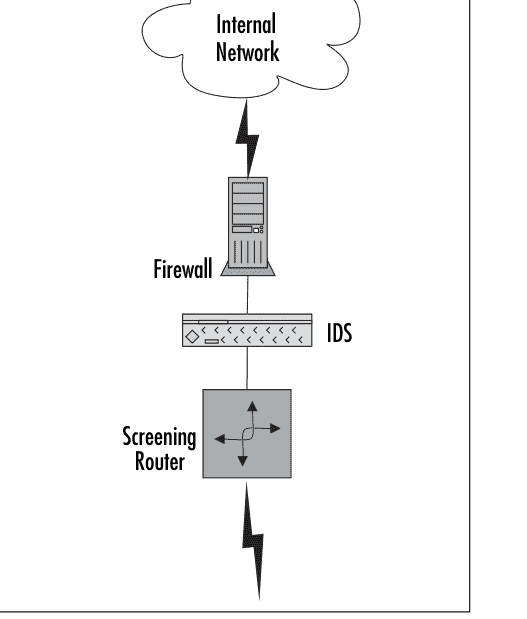

在这种情况下，你可能想在防火墙内部放置一个 IDS 系统，并在你的外部路由器和防火墙之间放置另一个。在这里，我们还假设你的路由器也通过访问控制列表（`access lists`）过滤了某些流量。你不希望你的 Snort 系统位于网络外部，因为这会增加你的误报率，并使你的 Snort 系统更容易受到攻击的风险（见图 4.7）。最重要的是防火墙内部的 Snort 系统。这是你应该频繁监控是否有攻击的系统。该系统应该只对潜在合法的攻击触发告报，并且产生的误报会少得多。

许多网络架构都有一个非军事化区（DMZ），用于提供如 Web 服务器、FTP 服务器和应用服务器等公共服务。DMZ 也可以用于外接网（即到另一个组织的半信任连接），但在本例中，我们将坚持公共服务器 DMZ 架构。这在图 4.8 中所示。

### 图 4.8 带有 DMZ 的防火墙网络

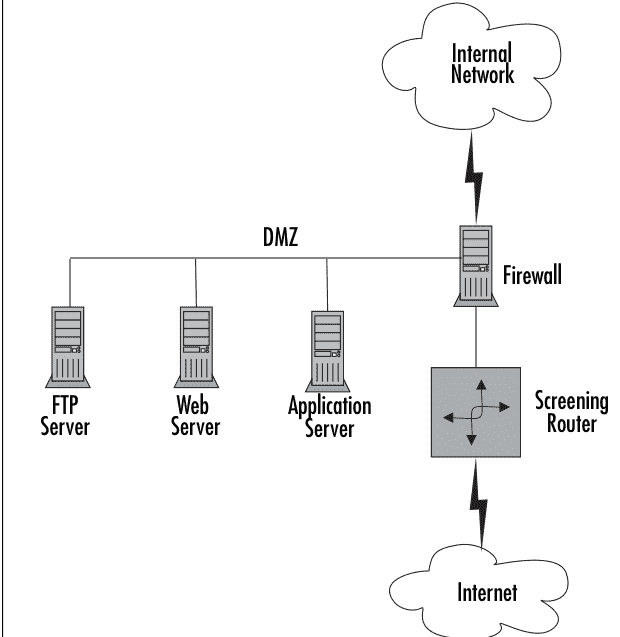

在这种情况下，你可能需要三个 Snort 系统：一个在路由器内部，一个在 DMZ 内部，一个在防火墙内部。增加额外的 IDS 机器是因为你有一个额外的子网需要防守。因此，优化 Snort 部署的一个良好经验法是：

- 路由器内部一个
- 每个你想要保护的子网内部一个

这在图 4.9 中所示。

### 图 4.9 带有 DMZ 和 Snort 的防火墙网络

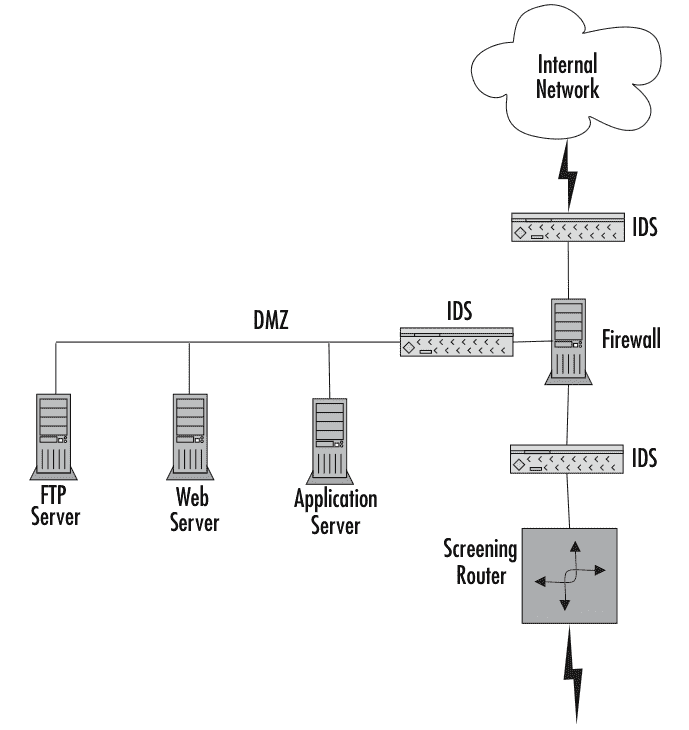

## Snort 与交换式网络

要意识到这样一点：如果你选择安装多个网卡来监控网段，你可能会创建一个备用数据路径，使流量绕过防火墙。在加固 Snort 主机时，你必须确保没有启用路由，以便 Snort 无法将流量从它监控的一个网段转发到另一个网段。

## 介绍入侵检测与 Snort • 第 4 章

在不幸的部署案例中，毫无经验的分析师会将每个产生噪音的规则标记为误报并忽略它，而不是去弄清楚触发规则的原因，并针对允许的流量编写针对性的通过规则（`pass rule`）。这种方法对任何人都没有帮助，并且可能会抵消使用 IDS（入侵检测系统）的大部分优势。

### Snort 的安全考量

尽管你正在使用 Snort 来提高安全性，但确保你的 Snort 系统尽可能安全将使数据更可信。如果有人入侵了你的 Snort 系统，你就没有理由相信它发送的警报，从而导致在你说擦除磁盘并重新安装一切之前，该系统变得完全毫无用。

## Snort 易受到攻击

尽管如此，典型的 Snort 安装都会受到攻击，这包括 Snort 本身以及底层操作系统。为什么呢？你可能想要远程登录（SSH），并且可能想将警报存储在数据库中（MySQL 或 Postgres）。此外，你可能想通过一个快速的界面来查看警报，这可能需要一个 Web 服务器（Apache 或 IIS）。任何监听服务都是可能的攻击面，某些驱动程序攻击甚至可以针对完全没有发布任何服务的监听接口。这使得你的 Snort 系统就像任何其他应用程序一样，因此，对于你选择的任何平台，都要关注安全漏洞公告和操作系统安全公告，就像你对待任何其他关键网络设备一样。

现在，基于这些信息，你的 Snort 系统可能开启了多个端口：SSH（`22` 端口）、HTTP（`80` 端口）、HTTPS（`443` 端口），以及可能还有 MySQL（`3306` 端口）或 Postgres（`5432` 端口）。任何可以访问网络的人都可以直接在你的非混杂模式接口上扫描你的 Snort 嗅探器。这就是我们提倡将管理接口与嗅探接口分开，并对管理接口进行锁定以尽可能地限制访问和服务的的原因之一。减少潜在的攻击面将有助于保持你的 IDS 安全。

这是一个需要解决的问题，因为从历史上看，上述应用程序都存在相当严重的安全问题。除了确保你的应用程序是最新版本外，你还需要确保你的内核配置正确并且也是最新版本。

## 第 4 章 • 介绍入侵检测与 Snort

> 来自底的笔记……

## Snort 安全漏洞

所有应用程序最终都会被发现一些较少的缺陷。Snort 也不例外。虽然 Snort 本身的漏洞相对较少，但几年的一些漏洞值得关注。2003 年的 RPC 预处理器漏洞（`xforge.iss.net/xforge/alerts/id/advise141`）允许拒绝服务或潜在的主机被攻破。2005 年后台订单处理中的漏洞（`www.osdb.org/displayvul.php?ids=23004`）可能由单个较早的 UDP 数据包触发，而今年的 `frag3` 预处理器数据包重组漏洞（2006年）可能允许恶意流量不被检测到（`www.osdb.org/displayvul.php?id=23501`）。由于此类问题的存在，关注漏洞研究和公告列表，并在新软件发布时及时为系统打补丁是至关重要的。

## 加固你的 Snort 系统

尽管你的 Snort 实现已经经过了锁定，但你的系统本身可能还没有。确保你尽了基础工作。这里是你需要做的一些：

- 关闭你不需要的服务：如 Telnet、Berkeley R 服务、FTP、NFS 和 NIS 等服务不应运行在你的系统上。此外，确保没有运行任何无用的服务；例如 echo、discard 和 charge。
- 维护系统完整性：`Tripwire` 是一个免费应用程序，可以检查那些你不怀疑的后门和木马。有很多免费应用程序，如 `Tripwire-AIDE` 和 `Samhain` 是两个值得提到的。
- 对你使用的服务进行防火墙防护或 TCP Wrap：SSH 和 MySQL 等服务应该被 TCP Wrap 或防火墙保护，因为它们也有自己的安全漏洞，并且访问应该限制在尽可能少的必要用户范围内。对于无法进行 TCP Wrap 的服务（如 Apache），确保你已尽可能安全地配置了它们。`IPTables` 是最新版本的 Linux 防火墙，有许多关于如何实现它的参考。
- 尽可能使用加密并使用公密钥认证：你应该只为 OpenSSH 启用公密钥认证。当你使用 Apache 查看日志时，你可能还想考虑的另一件事是使用

> ### 来自底的笔记……

#### 系统加固
你可以独立执行所有操作，也可以使用一些方便的工具，如 Bastille Linux（`www.bastille-linux.org/`）来为你完成大部分必要的加固工作。（更多关于 Bastille 的信息请参见第 2 章。）

## 总结

本章提供了关于 Snort 这个开源 IDS 的实用知识，以及它如何帮助你解决安全顾虑。你学习了 Snort 的历史、Snort 架构的工作原理以及系统要求。

此外，你学习了 Snort 的不同用途，包括将 Snort 作为数据包嗅探器、数据包记录器和 IDS。你还学习了 Snort 的陷阱，包括误报。

最后，本章还涉及了运行 Snort 系统时应该考虑的安全问题。作为一个活跃的数据包记录器或 IDS，保持系统尽可能安全至关重要的。

## 解决方案是快速通道

## 什么是 Snort？

- Snort 是一个数据包嗅探器、数据包记录器和网络入侵检测系统。
- 我们强烈建议准备一个大磁盘用于数据存储。
- 还建议在系统上设置两个接口：一个运行在混杂模式下，另一个用于网络连接（例如 SSH 和 HTTPS）。

## 探索 Snort 的功能

- Snort 的主要组件是预处理器、检测引擎以及警报/日志组件。Snort 的所有组件都以插件的形式实现，以增加灵活性。
- 预处理器用于获取数据包数据，并在数据与规则比对之前对其处理。
- 检测引擎通过将每个数据包中的数据与规则集比对来工作。Snort 带有一套标准规则，但管理员也可以编写自己的规则。
- 警报/日志组件获取数据与规则比对后的输出结果。数据可以直接以文本或二进制（TCPDump 数据）格式写入日志文件。此外，数据可以存储在 SQL 数据库中，或通过 SNMP 陷阱或弹出消息发送到网络。

## 在你的网络上使用 Snort

- Snort 可以以多种方式用于你的网络。除了网络入侵检测外，你还可以将其作为数据包嗅探器或数据包记录器。
- Snort 可以以文本和二进制模式写入数据包。二进制模式也称为 TCPDump 数据格式。这种格式人类不可读，但它是 Snort、TCPDump 和 Ethereal 都用于读写网络数据的标准。除了写入数据外，Snort 还可以将二进制格式过滤为人类可读格式。
- 作为 IDS 的 Snort 需要部署在你计划监控的每个私子网上。在筛选路由器之后放置一个 Snort 系统也有帮助。

### Snort 的安全考量

- 与任何其他应用程序一样，Snort 会受到安全漏洞的影响，包括缓冲区溢出和 DoS 攻击。
- 应该定期升级 Snort，保持最新的签名和应用程序本身的最新漏洞修复。
除了加固 Snort 应用程序，你还需要保护操作系统。这包括禁用不需要的服务、定期应用补丁以及正确的配置。它还包括加密敏感流量，如 SSH 登录会话和基于 SSL 的 HTTP 流量。

## 常见问题

以下常见问题由本书的作者解答，旨在衡量你对本章所介绍概念的理解程度，并帮助你在现实生活中实现这些概念。

问：为什么要用二进制格式记录 Snort 日志？我从中能什么？

答：Snort 的二进制格式也称为 TCPDump 数据格式。将数据包记录为二进制格式可以加快数据包收集。这意味着你可以在收集后对数据进行查看和过滤，而不是在收集过程中。以二进制格式记录可以节省时间，因为 Snort 不需要实时将数据从二进制转换为人类可读的格式。

问：Snort 如何使用插件？

答：Snort 以多种方式使用插件。预处理器可以使用插件将 HTTP 数据等数据转换为更具可读性的格式，或者可以使用插件来检查特定模式（例如检查端口扫描）。检测引擎可以接受各种类型的规则集，也可以接受插件。告警/日志组件是你会看到插件最明显的地方。告警/日志插件包括针对 SQL 数据库、SNMP 陷阱和 WinPopup 消息的功能。

问：我如何保持我的 Snort 系统安全？

答：保持 Snort 系统安全只需做好良好的系统管理。这包括适当的配置、禁用不需要的服务、定期更新以及加密敏感数据。

## 第 5 章

## 安装和配置 Snort 及插件

本章的解决方案：

- 部署你的 IDS
- 在 Windows 系统上配置 Snort
- 在 Linux 系统上配置 Snort
- 其他 Snort 插件
- 演示效性演示

- 总结
- 解决方案快速通道
- 常见问题

## 部署你的 NIDS

在实现诸如 Snort 这样的网络入侵检测系统（NIDS）时，决定其有效性的最大因素是它在网络中的部署位置。NIDS 的价值在于识别恶意流量，显然，如果它看不到流量，就无法做到这一点。这意味着你希望将 NIDS 放置在一个能够最大化其所能看到数据的位置。

> 来自地底的笔记……

进一步考虑：记住，IDS 就像任何其他系统一样，也是黑客的目标，甚至如此。因此，IDS 主机系统应该尽可能进行加固和锁定。

要意识到这样一点：如果你选择安装多个网卡来监控网段，你可能会创建一个备用数据路径，使流量绕过防火墙。在加固 Snort 主机时，你必须确保没有启用路由，以便 Snort 无法将流量从它监控的一个网段转发到另一个网段。有多种方法防止这种危险。简单的方法是使用网络分流器（`network tap`）而不是插上普通的网线。分流器是一种特殊的硬件，它只监听不传输。

## 图 5.1 使用 IDS 绕过防火墙

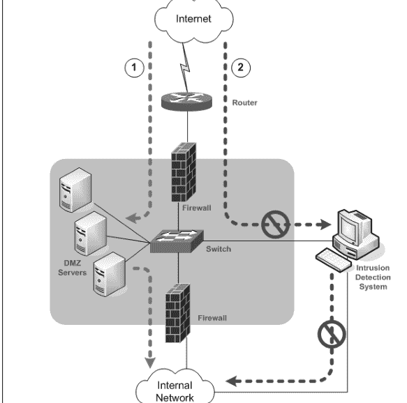

第一条虚线（数据流 #1）代表预期的（安全的）数据流。来自外部的流量只能终止在 DMZ 区域的服务器，进入内部网络的流量只能来自 DMZ 区域的服务器。通过这种配置，来自互联网的流量永远无法直接通过到内部网络的主机。第二条数据流 #2 代表配置错误的 IDS 可能会被用于将来自外部（不可信）网络的流量路由到内部网络。

在部署你的 IDS 时，你需要意识到交换机（`switch`）和集线器（`hub`）之间的区别。集线器的工作原理是将其收到的任何流量发送到每个其他端口。因此，使用集线器时，IDS 将看到通过该集线器的所有流量，这通常是你的 IDS 的。交换机比集线器更先进，大多数现代设备都是交换机。交换机会监听并学习哪些机器连接到它。然后它使用这些信息来构建转发表。一旦它学习了给定主机位于哪个端口，它将只把指向该主机的流量发送到特定端口。这意味着，在不进行任何额外配置的情况下，当你将 IDS 插入交换机端口时，它将看不到多少流量。

## 第 5 章 安装 Snort 及插件

幸运的是，有一些方法可以解决这个问题。大多数企业级交换机都支持端口镜像。描述此功能的术语随制造商而异，Cisco 将其称为交换机端口分析（SPAN）。这允许你配置一个特定端口来镜像其他端口。在具有 24 个端口的 Cisco 3750 交换机上，可以通过执行以下命令来配置镜像：
```


```
switch(config)# monitor session 1 source interface gig1/0 - gig123
switch(config)# monitor session 1 destination interface gig1/24
switch(config)# end
```

这种设置非常直观。指定要镜像的端口，并参考特定交换机硬件的用户指南查看是否支持端口镜像，以及如何配置它。

## 在 Linux 上配置 Snort

你需要下载适用于你系统的最新版本 Snort。如果你使用的是 Fedora Core 5，只需输入 `yum install snort`，或者从 `snort.org` 下载并安装 `.rpm` 包。

## 配置 Snort

下一步是使用 Snort 配置文件配置决定 Snort 行为的各种选项。该配置文件非常详细且易用。要让 Snort 按照你的要求运行，请遵循以下简单步骤：

1. 首先打开 Snort 主配置文件。默认情况下，它位于 `/etc/snort/snort.conf`。
2. 如果需要，配置 `HOME_NET` 变量。`HOME_NET` 变量定义了哪些网络是信任的内部网络。它配合签名判断内部网络是否受到攻击。默认情况下，`HOME_NET` 设置为 `snort.conf` 中的任何网络。将其准确反映你的内部地址空间可以减少收到的虚假告警。一个常见的例子是 `var HOME_NET 192.168.1.0/24` 或者可能是 `var HOME_NET[192.168.1.0/24,192.168.2.0/24]`。
3. 如果需要，配置 `EXTERNAL_NET` 变量。这是你预期攻击来自的网络。建议将其设置为所有（`any`）。

# 安装与配置 Snort 及其插件 第 5 章

除非使用以下内容定义你的 `HOME_NET`：`var EXTERNAL_NET !SHOME_NET.`（默认: `var EXTERNAL_NET any.`）

4. 接下来，定义哪些服务器运行特定服务。例如，通过将 `HTTP_SERVERS` 设置为特定服务器，Snort 将仅监控这些服务器的 HTTP 攻击。如果你希望查看未运行受影响服务的攻击服务器，请保留默认值，即监控指向任何内部服务器的攻击。（默认: `var DNS_SERVERS $HOME_NET`。）如果你在 `192.168.1.11` 和 `192.168.1.12` 上运行了 Web 服务器，可以通过设置以下变量来告诉 Snort 仅查找针对服务器的 HTTP 攻击：`var HTTP_SERVERS [192.168.1.11/32,192.168.1.12/32]`。
5. 如果需要，配置服务可用的特定端口。例如，HTTP 的默认值在以下行定义：`var HTTP_PORTS 80`。与上一节定义服务器类似，这将告诉 Snort 仅查找特定端口的攻击。在默认配置下，Snort 将忽略针对 `8080` 端口的 HTTP 攻击。再次，此设置将帮助集中 Snort 查找不同类型攻击的覆盖范围。
6. 如果你对检测 AOL 即时通讯器（AIM）的感兴趣，AIM 服务器的各种 IP 地址定义在 `snort.conf` 文件中。这是因为 IP 地址变化频繁，通过使用变量，规则就不需要在每次 IP 地址更改时都进行更新。如果你不想根据 AIM 使用触发告警，则不必担心更改这些 IP 地址。
7. 从 `http://snort.org/rules` 下载 Snort 规则。点击页面右侧的“Download Rules”（下载规则）。在下载规则页面上，向下滚动到标记为 `[Sourcefire VRT Certified Rules (unregistered user release)]`（`Sourcefire VRT` 认证规则（未注册用户发布版））的部分。下载最新规则。
8. 将规则（以及 `/docs`）提取到你选择的位置，通常为 `/etc/snort/rules` 和 `/etc/snort/docs`。
9. 配置 `RULE_PATH` 变量，它告诉 Snort 在哪里查找触发事件的规则。你可以使用相对路径如 `var RULE_PATH ...rules`，或使用绝对路径如 `/etc/snort/rules`。
10. 下一节包含注释掉的行，用于禁用对某些常见类型流量的检测。除非你的告警出现问题，或者你的 IDS 资源低 {，否则保持默认（启用）配置通常没有问题。
11. 下一节允许你为资源有限的系统配置检测引擎。除非出现问题，否则可以忽略此选项。

# 第 5 章 • 安装与配置 Snort 及其插件

12. 之后是配置文件的部分，用于启用或禁用特定功能并检测特定类型的攻击，例如分片攻击、状态检查和流重组等选项。
13. 标记为 `#4` 的部分包含 Snort 的输出选项。取消注释 `output alert_syslog: LOG AUTH LOG ALERT`（默认值）。尽管你在此处配置了事宜设施（facility）和级别（severity），`snort` 告警将以 `auth.info` 的形式生成。你还需要在命令行中包含 `-v` 参数以启用 syslog 日志记录。我们将在第 8 章更详细地讨论 syslog。如果你没有用于记录的 syslog 服务器，只需记住该设置，并在你的 syslog 服务器设置好后再回来。

使用上述 `LOG_AUTH` 和 `LOG_ALERT` 示例，你需要在 `syslog.conf` 文件包含包含内容，以便日志记录到 `192.168.1.99` 的 syslog 服务器：

如果你使用 `syslog-ng`，你需要在 `syslog-ng.conf` 文件中一个日志定义、一个捕获每个事件的过滤器和一个日志语句。该配置的示例如下：
```
destination d_lab { udp("192.168.1.99") port(514)); }
filter f_most { level(emerging); }
log { source(s_sys); filter(f_most); destination(d_lab); };
```
14. 编辑第 `#2` 节中动态加载库的路径，使其指向正确的路径。根据你使用的 Linux 发行版和安装方法，这些路径可能不是默认值。例如，在 Fedora Core 5 上使用 `yum` 安装 Snort，设置将使用以下路径：`dynamicpreprocessor /usr/lib/snort/dynamicpreprocessor` 和 `dynamicicengine /usr/lib/lib_engine.so`。如果在运行 Snort 时收到错误 `Unknown route type: dynamicpreprocessor` 或 `Unknown route type: dynamicicengine`，则你的 Snort 安装未配置为使用动态加载处理器。在这种情况下，只需在上述两行前面加一个 `#` 将其注释掉即可。
15. 最后一部分（步骤 `#6`）包含各种 `include` 语句，这些语句指定了要检查的规则。某些规则默认是禁用的，例如 `chat.rules`，它会在使用各种即时通讯客户端时触发。要启用或禁用给定的规则集，只需在 `include` 行开头添加或删除 `#` 即可。此条目可以留为相对路径（例如 `include $RULE_PATH/local.rules`），因为 `RULE_PATH` 变量将被展开为绝对路径。

# 安装与配置 Snort 及其插件 第 5 章

16. 如果你需要任何标准 Snort 发布未包含的自定义规则，可以从 Snort 网站下载规则。你现在准备好启动 Snort 并查看其运行效果了。启动 Snort 时，可以使用 `-i` 参数指定要监听的接口，例如 `-i eth0`。如果不指定，它将使用第一个接口。使用 `-c` 选项告诉 Snort 使用哪个配置文件。对于特殊情况，准备不同的配置文件可能是很有用的。另一个重要的选项是 `-A`，它告诉 Snort 生成什么类型的告警。选项有 `fast`（快速）、`console` 或 `none`。

下面的命令示例将显示 Snort 在第一个接口（未使用 `-i`）上监听，使用 `/etc/snort/snort.conf` 配置并在控制台输出 `-l` 参数告诉 Snort 日志目录的位置。`-K` 参数告诉 Snort 生成什么类型的日志：ASCII 日志更易于人类阅读，但记录需要一些时间。如果不是考虑速度，ASCII 日志可能是易读的。
```
snort -A console -c /etc/snort/snort.conf -l /etc/snort/ -K ascii
```

你应该能在控制台上看到触发的消息，并记录到你的 syslog 服务器。如果你在行末尾添加 `~` 参数，它将告诉 Snort 将日志记录到你在 `snort.conf` 中配置的 syslog 服务器；但它将不再显示在 snort 控制台上。如果你想为了测试创建一个规则以查看结果，可以创建一个名为 `TESTING.rules` 的文件，并将其放在规则文件夹（在本示例中为 `/etc/snort/rules`）中。在此文件中，你可以放置以下行，它将触发任何 ping 其他系统的尝试。
```


# 第 5 章 — 安装和配置 Snort 及其插件

`Alert icmp any -> -> any (msg:"TEST rule");`

编辑 `snort.conf` 创建你的新规则，在文件末尾插入以下语句：`include $RULE_PATH/TESTING.rules` .

最后一步是编辑 `snort\sid-msg.map` 文件。此文件提供了 snort 告警消息与告警 ID 之间的映射。自定义告警应使用超过百万的 ID 数字。在文件末尾添加以下行：

```
1000001
```

放置 ID 数字是 Snort 不输出错误的最低要求。你完全可以填写它的所有其他字段，并以现有的消息映射作为指南。完成后，你需要停止并重启 Snort。这里是单次 ping 及其响应的控制台输出部分显示。

```
10/12-21:29:35.911089 [] [1:0] TEST rule [][] [Priority: 0] {ICMP
192.168.1.99 -> 192.168.1.103
```

```
08/10-18:22:20.284438 [*] [1:0] TEST rule [][] [Priority: 0] {ICMP
192.168.1.103 -> 192.168.1.99
```

你也可以将自己的自定义规则添加到 `local.rules` 文件中。当你打开该文件时，你会发现它本质上是空的，仅供你将自定义规则放在其中。`local.rule` 默认在 `snort.conf` 中“包含”，因此你不需要在其中添加它，但对于放置在 `local.rules` 中的任何规则，仍然需要编辑 `sid-msg.map` 文件。

`-A` 选项允许在控制台上显示警报，而 `-K` 选项控制如何将警报记录到日志目录。你应该尝试不同的格式，以找到一个对 Snort 主机产生最小影响且能提供足够信息的格式。对于日常操作，你可能需要在日志文件中使用快速警报（fast alerts），这与发送到控制台的选项类似。可选警报模式和日志格式列在这里以便方便参考：

- `-A Console` 以以下格式日志到控制台：

```
10/12-21:29:35.911089 [*] [1:0] TEST rule [][] [Priority: 0] {ICMP
192.168.1.99 -> 192.168.1.103
```

- `-A fast` 以与控制台相同的格式日志，但将警报写入 `/snort/alert` 文件，且不输出到控制台。
- `-A full` 以以下格式日志到 `/snort/alert` 文件：

```
[][] [1:0] TEST rule [**]
[Priority: 0]
10/12-21:38:53.741606 192.168.1.103 -> 192.168.1.99
ICMP TTL:64 TOS:00 ID:6350 IPLen:20 DgmLen:60
Type:0 Code:0 ID:512 Seq:7936 ECHO REPLY
```


`- - -K cap` 如果你没有为命令行指定替代格式，`cap` 是默认模式。此文件将包含完整的警报数据包。你可以使用 Wireshark 等网络嗅探器打开此文件。

`- - -K ascii` 会为每个 IP 地址创建一个 `/log` 文件夹。在该文件夹内，每条规则将创建一个日志文件。日志条格式与“full”警报格式相同。

`- - -K none` 不创建任何日志文件。

恭喜你！你现在有了一个可以工作的 IDS。图 5.2 显示了 Kiwi Syslog Daemon 控制台中来自 `TESTING.rule` 的 syslog 警报。

# 图 5.2 Kiwi Syslog Daemon 控制台中的 syslog 警报

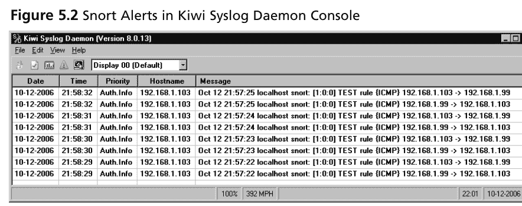

## 使用 GUI 前端使用 Snort

类似于 Snort 的 Windows 版本，如何通过实现更健壮的 GUI 界面来改进 Snort 的管理？有多种 GUI 可供选择，用于配置 Snort 以及解释 Snort 警报。有些工具仅提供了配置 Snort 命令行选项的按钮，提供的额外功能很少，而另一些则带来了非常强大的功能。我们将在下一节中讨论一些优秀方案的操作。

## 基础分析与安全引擎

基础分析与安全引擎 `BASE` 可以从 `http://base.secureides.net/about.php` 下载。在本节中，我们将让你运行起 `BASE`，然后在第 9 章中进行更详细的介绍。`BASE` 的目的是提供一个基于 Web 的前端，用于分析 Snort 生成的警报。`BASE` 源于 `ACID` 项目（插入数据库分析控制台）。`ACID` 是一个用于查看和搜索事件的通用前端，而 `BASE` 是一个针对 Snort 的工具。配置 `BASE` 的指令假设你已经安装并配置了 Snort。必须带有 `--mysql` 参数安装 MySQL，因为 Snort 默认不支持 MySQL 输出。Snort 网站为某些操作系统提供了包含 MySQL 支持的 RPM 包。这是运行 `BASE` 的依赖列表：`httpd`, `Snort`（带 MySQL 支持），`MySQL`, `php-gd`, `pcre`, `php-mysql`, `php-pdo`, `php-pear`, `graphviz` 和 `php-adodb`。按照以下步骤让 `BASE` 运行起来：

- 下载并安装 MySQL 和 BASE
- 编辑 `/snort/snort.conf` 文件。取消注释并编辑以下行：`output: log, mysql, user=snort password=snort dbname=snort host=localhost`

- 3. 接下来的几步与设置 MySQL 数据库设置有关。安装 MySQL 后，在命令行中输入 `mysql` 进入 MySQL 命令。这会将你置于交互命令模式。所有命令末尾必须有 `;`。默认情况下，MySQL 安装程序会提示密码。

- 4. 接下来是设置 MySQL 数据库。
- 5. 
- 6. 
- 7. 
- 8. 
-
- 1. 
- 2. 
- 3. 
- 4. 
- 5. 
- 6. 
- 7. 
- 8. 
- 9. 
- 10. 
- 11. 
- 12. 

## 安装和配置 Snort 及插件 • 第 5 章

如果所有条目都显示“off”，则该服务被配置为不启动。请尝试 `service snort start`。

- 某些配置更改可能需要重启 `httpd` 才能生效；如果不确定，为了安全起见请重启它：`service httpd restart`。
- `httpd` 访问日志和错误日志位于 `/etc/httpd/logs`。
- 你可以通过编辑 `/etc/httpd/conf/httpd.conf` 来控制 `httpd` 的日志级别。

`LogLevel debug`

- 如果你遇到无法找到 URL 的问题 `/etc/httpd/conf.d/base-php4.conf` 文件告诉 Web 服务器将 `/base/` 别名为目录 `/usr/share/base-php4`。

第一次启动 `BASE` 时，尚未创建任何数据库表。你将看到类似于图 5.3 所示页面。

### 图 5.3 BASE 设置

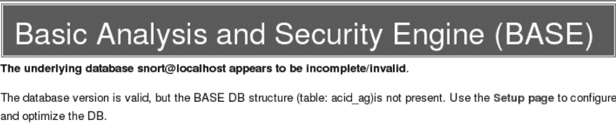

- 13. 点击 Setup（设置）页面链接。
- 14. 点击右侧的 Create BASE AG 按钮。你会看到如图 5.4 所示的几条成功消息。

### 图 5.4 BASE 成功

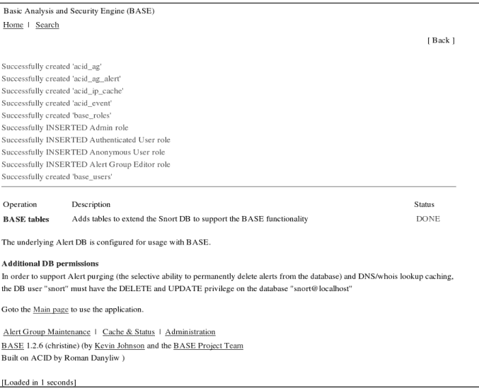

- 15. 点击 Main Page（主页）链接。这将带你进入图 5.5 所示的 BASE 主界面。

尽管此窗口并不华丽，但你可以发现丰富的信息。大多数字段实际上都是链接。例如，点击 Today's alerts（今日警告）右侧，可以获取唯一警告的排序列表、所有警告列表，或按源地址或目的 IP 排序的列表。左侧的其他表头提供类似的功能。特别注意按源地址排序的 Most Frequent 15 addresses 链接，这将让你快速看到哪些系统产生了大部分警告。如果你打开该窗口（图 5.6 所示），还有几个额外的字段也是超链接的。

### 图 5.5 BASE 主页 安装和配置 Snort 及插件 • 第 5 章

### 基础分析与安全引擎 (BASE)

| 今日警告: | 唯一 | 列表 | 源 IP 目的 IP | 已向告报缓存添加 0 条警告 |
| :--- | :--- | :--- | :--- | :--- |
| 过去 24 小时警告: | 唯一 | 列表 | 源 IP 目的 IP | 查询于：2006年11月20日 周三 25:59:11 |
| 过去 72 小时: | 唯一 | 列表 | 源 IP 目的 IP | 数据库升级：2007年2月27日 01:57:27 |
| 最近 15 条警告: | 任意协议 | TCF | ICMP | 时间窗口：[2006-11-29 22:14:54] - [2006-11-29 23:18:02] |
| 最后源端口: | 任意协议 | TCF | UDP | |
| 最后目的端口: | 任意协议 | TCF | UDP | |
| 最频繁源端口: | 任意协议 | TCF | UDP | 搜索 |
| 最频繁目的端口: | 任意协议 | TCF | UDP | 绘图所有 |
| 最频繁 15 个地址: | 源 目的 | | | |
| 最近 5 条唯一警告 | | | | |
| 最频繁 5 条唯一警告 | | | | |

传感器/总计: 1 / 1 | 协议流量概览 |
唯一警告: 2 | TCP (2%) |
类别: 2 | |
告警总数: 359 | UDP (97%) |
- 源 IP 地址: 35 | ICMP (0) |
- 目的 IP 地址: 3 | |
- 唯一 IP 链接: 4 | |
- 源端口: 348 | | 流量 (0%) |
- TCP (6) UDP (38) | |
- 目的端口: 2 | |
- TCP (1) UDP (1) | |

### 图 5.6 安全引擎 (BASE) Linux 最频繁项

### 基础基础分析与安全引擎 (BASE) Linux

首页 | 搜索 [ 返回 ]

已向告报缓存添加 0 条警告
查询于：2006年11月30日 09:35:22

| 元数据标准 | 任意 |
| :--- | :--- |
| IP 标准 | 任意 |
| 第 4 层标准 | 无 |
| 载荷标准 | 任意 |

显示 15 个最频繁的 IP 地址

| 源 IP 地址 > | 传感器 # | 总计 > | 唯一警告 > | 目的地址 > |
| :--- | :--- | :--- | :--- | :--- |
| 192.168.1.1 | 1 | 348 | 1 | 1 |
| 192.168.1.105 | 1 | 9 | 1 | 2 |
| 192.168.1.99 | 1 | 2 | 1 | 1 |

[ 操作 ] | 选中屏幕上所有

告报维护 | 缓存 & 状态

---

### 使用 Oinkmaster

告报维护 | 缓存 & 状态
告报维护 | 缓存- 状态
- 注意
- 注意

## 第 5 章 - 安装和配置 Snort 及插件

`crontab -u <user> -e`

将 `<user>` 替换为你运行 Oinkmaster 的用户名。这将打开该用户的 crontab。在 crontab 中添加以下行将导致 Oinkmaster 在每天凌晨 2:00 运行。如果你愿意意，也可以使用更多可用的 GUI 控制台来配置 cron 守护进程，例如 gnome-schedule。

```
```


```
0 2 * * * oinkmaster.pl -C /etc/oinkmaster/oinkmaster.conf -o /etc/snort/rules
```


现在，你的 Snort 规则应该会保持更新了。请记住，如果你更改了 Snort 版本，相应规则的 URL 可能会发生，在这种情况下，你可能相应地更新 `oinkmaster.conf`。

## 警告

由于 `oinkmaster.conf` 文件包含了更新 Snort 规则的路径，如果该文件没有安全的访问权限，任何可以编辑文件的人都可能让你的 IDS 失效。有了编辑配置文件的权限，恶意用户可以将 URL 指向他们选择的任何地址，并使用不会触发任何内容的空规则，甚至更糟糕——使用运行完美但忽略攻击者 IP 地址的规则。请确保 `oinkmaster.conf` 文件是安全的，并且只有运行 Oinkmaster 的账户有权访问该文件。

### 额外研究

如果我们涵盖的 Snort 工具不能完全实现你想要的所有功能，还有其他替代方案。市出的工具有些比其他工具更易用。这里有几个备受推崇且在运行 Snort IDS 时可能有所帮助的额外工具，包括基于 Windows 和 Linux 的。

- ACID 代表入侵数据库分析控制台（Analysis Console for Intrusion Databases）。你可以从 http://acidlab.sourceforge.net/ 下载并加载 ACID。BASE 基于 ACID 的代码，因此界面非常相似。如果你只是想查看 Snort 日志的 Web 前端，ACID 相比 BASE 可能没有提供额外优势。然而，如果你计划为额外的非 Snort 源导入数据，ACID 具备此方面的灵活性。
- Barnyard 可以从 http://sourceforge.net/project/showfiles.php?group_id=34732 获取。它基本上是一个从 Snort 卸载日志开销的工具。使用 Barnyard，你可以配置 Snort 记录二进制数据（这是 Snort 日志最快的方式，但对人类不可读），然后 Barnyard 将获取这些二进制日志并转换为人类易读的 ASCII 或将其导入数据库。对于 IDS 告警量较小的小环境，可能不需要 Barnyard。Snort 支持使用 Barnyard 原生将日志记录到 MySQL 数据库。
- Sguil (https://sguil.sourceforge.net/) 的发音为“sgweill”，代表面向新手的 Snort GUI（Snort GUI for Lamerz）。它也被网络监控分析控制台。sguil 的目标不仅提供查看 Snort 告警的控制台，还让分析人员能够深入研究告警和所有捕获的数据包，以便调查。基本上，sguil 将多个安全工具集成到一个界面中以便于访问。Sguil 提供了一个演示传感器，你可以连接到 Web 来查看 sguil 的运行情况。要使用它，只需下载并安装 sguil 客户端，然后连接到端口 7734 的传感器演示 demo.sguil.net。在提示时，你可以输入任何用户名和密码，然后在控制台上选择传感器名称“reset”。Sguil 是调查 Snort 告警的强大工具，但其配置和设置并不适合胆小的人。
- Snortsnarf 这是一个专门针对分析 Snort 日志的日志分析器。你可以从 https://www.snort.org/dl/contrib/data_analysis/snortarf/ 下载它。

## 有效性

在网络数据收集方面，一个老老的话题是传感器的放置位置。这适用于 IDS 传感器和像 PRTG Grapher 这样的报告传感器。最常见的分歧是你应该将传感器放置在边界防火墙之外还是内部。这很重要，因为在两种情况下你看到的数据会有巨大差异。如果将传感器放置在边界防火墙之外，你将看到来自互联网指向你的所有流量，包括防火墙拦截的所有流量。如果传感器放置在边界防火墙内部，你将只看到成功通过防火墙的流量。

毫无疑问，大多数安全相关性的流量是那些成功穿过防火墙进入你内部网络的流量。这些潜在的攻击、探测等需要严密检查和监控，以确保网络不被破坏。如果一切配置得当，边界内部的 IDS 看到的流量非常少，除非是与 IT 策略相关的触发器，例如文件共享或即时消息协议。因此，如果所有数据安全官认为“有趣”的数据都在内部，你可能会奇怪外部传感器能带来什么价值。

将传感器放置在外部的最佳价值实际上是公关方面的。遗憾的事实是，涉及到网络安全时，如果一切都处理得恰当，没有人会看到任何东西。没有闪烁的灯光或报警器显示网络运行正常且安全。如果你将 IDS 放置在边界外部，你可以根据 IDS 看到的流量提取报告。这些报告可以向管理层展示，以说明安全工作正在起效。虽然这不会让 IDS 变得无懈可击（因为它仍需要加固），但这种配置将使攻击变得更加困难。

## 总结

Snort 在开源 IDS 领域拥有无可争议的领先地位。因此，它拥有许多优势。其中一个优势是非常庞大且多样化的用户群。这个用户群让你能够找到许多关于运行、配置和自定义 Snort 的帮助和信息。虽然 Snort 可能不像商业软件包那样具有开箱用的特性，但你可以组合几个工具和程序，将 Snort 构建成企业级 IDS。在没有软件费用的情况下，你可以拥有一个行业标准的 IDS，具有大型签名库以及创建自定义签名的能力。签名可以自动更新以保持时新，你可以使用几个 GUI 前端在中心位置远程配置和管理多个 Snort 传感器。所有这些都增加了大量价值并提高了安全性，且没有额外的软件成本。

## 解决方案快速通道

### 配置入侵检测系统

- IDS 的放置将是关键。如果 IDS 放置不当，你将错过告警，并可能认为自己比实际情况更安全。
- 你的 IDS 可能是书中讨论的所有设备中需要资源最多的主机（防火墙紧随其后），因此在选择用于 IDS 的硬件时要相应计划。
- 记住，即使放置得当，你也需要一个 Hub 以便 IDS 能够看到通往其他设备的流量，或者如果你使用交换机而不是 Hub，则要启用端口镜像。

### 在 Linux 系统上配置 Snort

- 你可能希望考虑像 BASE 这样的 Snort 告警前端来查看告警。
- 如果你的环境主要是 Windows，这将允许你从 Windows 系统访问告警，而无需在 Linux 主机上查看 Snort 控制台。

### 其他 Snort 插件

- 如果没有人注意它产生的告警，一个功能完备的 IDS 将毫无价值。一个易于使用的告警控制台可以为你的 IDS 增加很多价值，因为它可能会增加告警获得的关注。

# 第 5 章 安装与配置 Snort 及其插件

- 我建议使用 Oinkmaster 来自动保持您的 Snort 签名流为最新。

## 演示有效性

- 在网络数据收集方面，传感器的放置是一个老老的话题。
- 最常见的意见分歧点是，您应该将传感器放置在外部防火墙之外还是内部。
- 不可否认，安全性最高的流量是那些成功穿过您的防火墙并进入内部网络的流量。这些是潜在的攻击、探测等，需要进行严密的检查和监控，以确保网络不受到破坏。

## 常见问题

以下常见问题由本书的作者解答，旨在衡量您对本章所介绍概念的理解程度，并帮助您在现实中实现这些概念。如果您想让作者解答您关于本章的问题，请访问 www.synergy.com/solutions 并点击“Ask the Author”（询问作者）表单。

Q：我如何配置 Snort 发送电子邮件警报？

A：你不需要。Snort 不包含发送电子邮件警报的原生方法。这是一个有意决定，因为处理电子邮件警报会给 Snort 进程带来过重的负担，可能导致数据包丢失和警报遗。相反，实现此点的最简单方法是使用日志解析工具，例如 watch。

Q：我如何将 Snort 变成 IPS 而不是 IDS？

A：Snort (www.snort.net/) 设计用于根据某些 Snort 警报自动调整防火墙上的规则。它是一个成熟工具，开发相对活跃。还可以查看 Snort 网站上的用户贡献部分，获取位于 www.snort.org/dl/contrib/patches/ 的各种实用。Snort 本身具有有限的动作能力，特别是在以“内联模式（inline mode）”运行运行时。关于 Snort 的原生 IPS 支持，请参阅 www.snort.org/docs/snort_htmanuals/htmanual_260/node7.html 的文档。关于 Snortams 的更多信息，请参见第 11 章。

Q：我如何编写一个 Snort 规则来触发“X”应用程序的流量？

A：从在线搜索开始；你通常可以找到别人已经做好的规则。如果没有，通用步骤是进行数据包捕获（例如使用 Wireshark），然后检查数据包。困难的部分是识别出所有数据包（如果不是所有，至少是初始数据包）共有的特征。某些可以唯一标识该应用程序数据包与其他任何数据包的字符串。然后，您使用 payload 选项将此字符串放置在规则中。关于规则选项字段的更多信息，请查看在线 Snort 手册。

Q：我如何让我的 Snort 传感器更安全？

A：有许多方法。首先，在传感器上配置防火墙以保护其自身。您只需要过滤目标为传感器的流量，这样您就不会意外过滤掉您想要触发警报的流量。您还可以让 Snort 在没有 IP 地址的接口上监听；这会让攻击者针对传感器变得变得困难得多。（参阅 Snort 主要 FAQ 获取如何如何操作的说明。）

# 第 6 章

# 高级 Snort 部署

本章解决方案：

- 引言
- 监控网络
- 为 Linux 配置通道绑接（Channel Bonding）
- Snort 规则集
- 预处理器插件（Preprocessor Plug-Ins）
- 检测插件（Detection Plug-Ins）
- 输出插件（Output Plug-Ins）
- 解决特定的安全需求
- 总结
- 解决方案快速上手指南
- 常见问题

## 引言

您只需通过构建和安装标准源码并使用通用规则集，就可以有效利用 Snort。然而，如果您愿意编写自定义规则，或编写专用插件来增强预处理、检测或后处理，那么一个可能用途的新世界将呈现在您面前。我们将通过查看各种安全需求以及可能如何实现它们来研究其中的一些可能性。

首先，让我们看看什么是增强元素，以及它们能为我们做什么。

### 监控网络

关于如何实际上将被监控的数据包物理地引入 Snort， 一直存在一个问题。使用网络集线器（hub），只需将其连接到您打算作为 Snort 监控端口的以太网接口即可。如今，集线器仅出现在流量不大的微型网络中。真正的问题是对于交换机网络该怎么办。关于如何监控交换网络的问题是 Snort 官方 FAQ 之一。

答案取决于您拥有的交换机类型、Snort 系统的功能；如果您有管理型交换机，可以轻松将其设置为一种模式，使所有流量都通过交换机端口（即您连接 Snort 监控接口的地方）。这种配置在 Cisco 交换机上称为 SPAN；其他制造商使用镜像（mirroring）或监控（monitoring）等术语。在 Cisco 交换机上，可以使用名为 VACL（VLAN 访问控制列表）的类似模式。在繁忙的网络上使用这种模式可能会有问题，因为它给交换机的 CPU 带来了沉重负担并可能影响交换机的性能。当然，如果通过交换机的总流量超过 1GB（在高速连接中常见），那么无论您做什么，镜像端口都无法处理。如果您的网络使用多个 VLAN，您需要为每个 VLAN 设置单独的 SPAN 端口。

## VLAN

将集线器接入交换机并将 Snort 接入并不是一个好主意，除非仅用于监控跨越 DMZ 的流量，而不是子网内部。这是因为在交换环境中引入此类集线器会对网络性能产生巨大影响。

另一种选择是使用被动网络分流器（tap）。这种硬件聚合交换机上的数据并供监控使用。被动分流器为用户提供了一个特性：它们对被监控的网络是完全不可见的。网络分流器的问题在于，它们要求 Snort 系统拥有两个监控接口——每个数据在网络上移动的方向一个。现在，需要合并这两个数据流，以便获取网络上发生的完整情况。通道绑接（聚合，即 trunk）将两个网络接口合并为一个逻辑接口（这通常是为了提高网络吞吐量）是实现这种数据流合并的一种有效方法。

## 为 Linux 配置通道绑接

在 Linux 系统上设置通道绑接非常简单。首先，必须配置内核以支持绑接。在配置内核时，应设置网络设备菜单下的绑定驱动程序支持选项。如果绑定驱动程序设置为模块（这是最容易管理的），则将有一个名为 bond0 的模块。一旦内核支持绑定并加载了绑定模块，就可以启动接口。对于像 Red Hat 等使用配置控制的发行版，需要执行以下操作来启动接口：

- 首先，在 `/etc/sysconfig/network-scripts` 目录下创建一个 `ifcfg-bond0` 文件。该文件内容所示：


DEVICE=bond0

BOOTPROTO=none

ONBOOT=yes

NETWORK=192.168.10.0

NETMASK=255.255.255.0

IPADDR=192.168.10.254

USERCTL=no

```
这设置了虚拟接口，在本例中为 `bond0`。如果内核将绑定作为模块，`modules.conf` 文件应包含别名 `bond0 bonding`，这会将模块与此虚拟接口关联。您仍然需要定义哪些物理接口应该合并以实现虚拟接口。对于 `eth0`，应将 `ifcfg-eth0` 修改为：
```

```
DEVICE=eth0

BOOTPROTO=none

ONBOOT=yes

MASTER=bond0

SLAVE=yes

USERCTL=no
```

剩余接口（`eth1`, `eth2` 等等）的配置文件应该以类似的方式进行编辑。其他发行版的配置设置同样直观。

## 第 6 章 高级 Snort 部署

### Snort 规则集 (Rulesets)

Snort 在标准安装中提供了许多规则。通过订阅 `www.snort.org`，可以获得更多的规则和更频繁的更新。这些规则不仅涵盖了基础知识，还涵盖了许多类型的事件，例如 Web 或 SQL Server 滥用、指示病毒的特征码、P2P 协议的使用等。当互联网上出现新的安全威胁时，通常在几小时内就能获得新的 Snort 特征。此外，编写自己的规则并没有那么。

你可能对 Snort 规则的基础知识很熟悉；你设置一个模式，如果匹配到就会触发告报消息。例如：

```
alert icmp $EXTERNAL_NET any => $HOME_NET any (msg:"ICMP JPEG data tunnel"; type:8; content:"JFIF"; clasype:string-detect; count:1000000; rev:1);
```

当 `ICMP` Ping 包携带一个 `JPEG` 图像试图在不被检测到的情况下传输数据时，此规则将生成告报（你可以这样做，而且它确实会发生）。

这种经典规则可以被设置为在各种条件下触发告报。它使用协议和包内容作为触发器。其他触发器包括各种 `TCP` 标志或选项、数据包大小、源和目的。真正有趣的规则具有特殊函数，这些函数通过规则中的特殊关键字调用。例如，`react` 触发器可以用于让 Snort 以某种方式对数据包做出反应，取决于需求。该触发器将尝试关闭连接，并可能向源系统发送可见的警告。

> 如果你使用 `react` 关键字，它应该是规则选项列表中的最后一个。

该类中的其他关键字还有 `resp`、`logout` 和 `tag`。`resp` 关键字与 `react` 类似，因为它尝试关闭连接。然而，`resp` 可以配置为向源或目的发送 `TCP` 重置（`reset`）包，或向连接的末端任一端发送 `ICMP` 不可达消息。`resp` 和 `react` 都会尝试关闭连接。根据网络流量和你的 Snort 系统的速度，Snort 可能无法足够快地做出反应以成功关闭该连接——特别是当连接到一个只有几个数据包的小型 Web 页面时。因此，不应依赖这些关键字来确保关闭连接。

`logto` 关键字允许你将触发包含该关键字的规则的数据包记录到其自己的文件中。当 Snort 处于二进制日志模式时，该关键字会被忽略。

`session` 关键字将跟踪由规则触发的 `TCP` 会话，并允许记录整个连接。`tag` 关键字与 `session` 类似，但一旦被触发，它将跟踪从源或到目的地的*所有*流量，而不仅仅是当前会话，持续时间指定的时间或数据包数量。`session` 和 `tag` 都会给 Snort 带来沉重负担，应该用于对 Snort 二进制文件或 `tcpdump pcap` 文件进行后处理分析，而不是用于实时使用。我们将在本章处理某些特定安全场景时讨论这些关键字的使用。

从 `2.6` 版本开始，你还可以在 Snort 运行时添加/修改规则。这些动态规则使用新的类 C 语言语法编写。与简单规则的旧语法相比，这种新语法相当人生畏，且非常冗长。然而，对于复杂的规则，新语法更容易处理。

这里是一个随 Snort `2.6.0` 源码附带的示例。该规则用于 `SID 637`，并以注释形式显示了传统语法下的规则。

```c
+   * sid637.c

* Copyright (C) 2006 Sourcefire, Inc

* Steven A. Sturges <ssturges@sourcefire.com>

* 本程序是免费软件；你可以重新分发和/或修改

* 遵循由 Free Software Foundation 发布的

* GNU Public License 术语；是该许可证的第 2 版本，或

* (根据你的选择) 任何后续版本。

* 发布本程序的目的是希望它是有用的，

* 但不提供任何保证；甚至没有关于

* 适销性或针对特定用途的适用性的隐式保证。更多信息请参阅

* GNU General Public License。

* 你应该随本程序一起收到了一份 GNU General Public License

* 副本；如果没有收到，请写信给 Free Software

* Foundation, Inc., 59 Temple Place - Suite 330, Boston, MA 02111-1307, USA.

* Description:

* 此文件是动态加载规则库示例的一部分。

+   * NOTES:
```
```c
#include "sf_snort_plugin_api.h"
#include "sf_snort_packet.h"
#include "detection_lib_meta.h"
```
```c
/*
 * 用于 SID 637 的 C 语言示例
 *
 * alert udp $EXTERNAL_NET any -> $HOME_NET any \
 * (msg:"SCAN Webtrends Scanner UDP Probe"; \
 * content:"0A|help|0A|quite|0A|"; \
 * reference:arachnid,308; clastype:attempted-recon; \
 * sid:637; rev:3);
 */
```
```c
/* content:"0A|help|0A|quite|0A|";/* */
static ContentInfo sid637content = 
{
    "|0A|help|0A|quite|0A|",/* 要搜索的模式 */
    0,
/* depth */
    0,
/* offset */
    CONTENT_BUF_NORMALIZED,
/* 用于 boyer/moore 信息的容器 */
    NULL,
/* 用于 "\n\n" 字节表示的容器 */
    NULL,
0,
/* 用于字节表示长度的容器 */
    0,
/* 用于增量长度的容器 */
};
```
```c
static RuleOption sid637option1 = 
{
    OPTION_TYPE_CONTENT,
    {
        &sid637content
    }
};
```
```c
/* 用于 sid 637 的引用 */
static RuleReference sid637ref_arachnids =
{
    "arachnids",       /* 类型 */
    "308",             /* 值 */
};

static RuleReference *sid637refs[] =
{
    &sid637ref_arachnids,
    NULL
};

RuleOption *sid637options[] = 
{
    &sid637option1,
    NULL
};

Rule sid637 =
{
    /* 协议, any any */
    IPPROTO_UDP,       /* 协议 */
    EXTERNAL_NET,      /* 源 IP */
    ANY_PORT,           /* 源端口(s) */
    1,                 /* 方向 */
    HOME_NET,          /* 目的 IP */
    ANY_PORT,           /* 目的端口(s) */
},
/* 元数据 */
{
    3,                 /* genid */
    637,               /* sigid */
    3,                 /* 版本 */
    "attempted-recon",  /* 分类 */
    0,                 /* 优先级 */
    "SCAN Webtrends Scanner UDP Probe", /* 消息 */
    sid637refs         /* 引用指针 */
};
```


```c
},
sid637options, /* 选项指针 */
NULL,             /* 使用 eval func */
0,                /* 内部使用的未初始化标记 */
0,                /* 内部使用的选项计数 */
0,                /* 内部使用的 flowbits */
NULL,             /* 内部使用的规则数据 */
};
```

## 插件 (Plug-Ins)

插件是软件模块，允许你对捕获和解码后的数据包运行自定义函数。要学习如何应用插件，你首先需要理解 Snort 内部的数据流。当数据包被 Snort 捕获时，它会被解码并传递给后续模块。当 Snort 在内联模式运行时（针对 Linux），捕获引擎是 `iptables`。

紧接着是预处理器模块、检测引擎和输出模块。这三个模块都可以补充你自己的模块插件。

> 注意
>
> 在 Snort 2.6 版本之前，你必须将插件直接编译到 Snort 可执行文件中。在之前的版本中，为了向系统添加插件，你必须重新构建 Snort 二进制文件，停止旧实例，安装新二进制文件，然后启动。从 2.6 版本开始，你现在可以拥有动态插件（如果在编译 Snort 时使用了 `--enable-dynamic-plugin` 选项）。对于动态插件，你构建插件，将其安装到文件系统的正确位置，修改配置文件（或你使用的命令行），然后重启 Snort。原始静态插件和动态插件的 API 略有不同。我们在这里关注动态插件。

## 预处理器插件

预处理器插件是在数据包被捕获和解码后运行的分析模块。这些插件运行在收到的数据包上；`snort` 规则对它们没有影响。这些预处理器可以用于各种目的，但它们是

### 高级 Snort 部署 • 6 章

通常用于复杂到无法通过规则来易于表达的语文中。标准 Snort 包含了几个预处理器，例如 `Frag3`、`Stream4`、`Flow`、`Portscan` 以及几个用于处理特定协议（如 HTTP）的处理器。`Frag3` 用于在进一步分析之前对分片包进行重组。数据包在网络传输过程中分片是自然的结果，但它们也可以被故意分片以试图避免被简单的 IDS（入侵检测系统）注意。`Stream4` 和 `Flow` 用于跟踪连接并跟踪其从打开到关闭过程中的所有状态变化。

编写自己的预处理器插件实际上非常简单。对于动态插件，有三个函数需要编写，其中一个函数的格式是固定的。第一个是向 Snort 注册插件的初始化函数。让我们来看一下 Snort 手册中的示例。

```c
#define DYNAMIC_PREPROC_SETUP ExampleSetup
extern void ExampleSetup();
extern DynamicPreprocessorData _dpd;

void ExampleInit(unsigned char);
void ExampleProcess(void *, void);

void ExampleSetup()
```

> * 向 Snort 注册初始化函数 */

`dpd.registerPreproc("dynamic_example", ExampleInit());`

```c
DEBUG_WRAP(_dpd.debugMsg(DEBUG_PLUGIN, "Preprocessor: Example is setup\n"));
```

Snort 知道要调用这个特定的函数，因为编译模块符号表将 `DYNAMIC_PREPROC_SETUP` 等于 `ExampleSetup`。Snort 在启动时会调用 `ExampleSetup()` 并从文件系统加载这些模块。这是配置文件中的 `dynamicpreprocessor` 关键字告知的。例如

`dynamicpreprocessor directory /usr/local/lib/snort_modules/`

将加载 `/usr/local/lib/snort_modules` 目录下的所有模块。

当 Snort 在配置文件中遇到预处理器设置行时（例如 `preprocessor dynamic_example: port 123`），它将运行作为注册函数第二个参数传递的函数，在此例中为 `ExampleInit()`。该函数将解析配置文件中与你的预处理器相关的任何关键字，如果配置设置满意，它还应该注册主处理函数。

```c
u_int16_t portToCheck;
```

```c
void ExampleInit(unsigned char *args)
{
    char *arg;
    char *argEnd;
    unsigned long port;

    _dpd.logMsg("Example dynamic preprocessor configuration\n");

    arg = strtok(args, " \t\n\r");

    if(!strcasecmp("port", arg)) {
        arg = strtok(NULL, " \t\n\r");
        if (!arg) {
            _dpd.fatalMsg("ExamplePreproc: Missing port\n");
        }

        port = strtol(arg, &argEnd, 10);
        if (port < 0 || port > 65535) {
            _dpd.fatalMsg("ExamplePreproc: Invalid port %d\n", port);
        }
        portToCheck = port;
    }
    _dpd.logMsg(" Port: %d\n", port,portToCheck);
    } else {
        _dpd.fatalMsg("ExamplePreproc: Invalid option %s\n", arg);
    }

    /* 注册预处理器函数，传输层，ID 10000 */
    _dpd.addPreproc(ExampleProcess, PRIORITY_TRANSPORT, 10000);

    DEBUG_WRAP(_dpd.debugMsg(DEBUG_PLUGIN, "Preprocessor: Example is initialized\n"));
}
```

### 高级 Snort 部署 • 6 章

注意，此函数最终将 `ExampleProcess()` 为处理函数。该函数将为每个解码的数据包被调用。是否处理该数据包取决于插件。在这个简单的示例中，你只处理 TCP 包，并且每当端口与配置文件指定的端口匹配时，就会生成一个警报。

```c
#define SRC_PORT_MATCH 1
#define SRC_PORT_MATCH_STR "example_preprocessor: src port match"
#define DST_PORT_MATCH 2
#define DST_PORT_MATCH_STR "example_preprocessor: dest port match"
```

```c
void ExampleProcess(void *pkt, void *context)
{
    FSnortPacket *p = (FSnortPacket *)pkt;

    if (!p->ip4_header || !p->ip4_header->proto != IPPROTO_TCP || !p->tcp_header)
    {
        /* 与我无关，返回 */
        return;
    }

    if (p->src_port == portToCheck)
    {
        /* 源端口匹配，记录警报 */
        _dpd.alertAdd(GENERATOR_EXAMPLE, SRC_PORT_MATCH,
            1, 0, 3, SRC_PORT_MATCH_STR, 0);
        return;
    }

    if (p->dst_port == portToCheck)
    {
        /* 目的端口匹配，记录警报 */
        _dpd.alertAdd(GENERATOR_EXAMPLE, DST_PORT_MATCH,
            1, 0, 3, DST_PORT_MATCH_STR, 0);
        return;
    }
}
```

该相同插件的静态版本如下：

```c
extern void ExampleSetup();

void ExampleInit(unsigned char *);
void ExampleProcess(Packet *p);
```


```c
void ExampleSetup()
{
    /* 向 Snort 注册初始化函数 */
    RegisterPreprocessor("static_example", ExampleInit);
}
```

这与动态版本中的注册函数类比。静态版本的初始化函数以相同的方式工作；它解析传递的参数并注册主处理函数。静态版本的初始化函数还需要注册两个额外的函数——一个在重启时调用，另一个在 Snort 退出时调用。

```c
void ExampleCleanExit();
void ExampleRestart();
u_int16_t portToCheck;
```

```c
void ExampleInit(unsigned char *args)
{
    char *arg;
    char *argEnd;
    unsigned long port;

    LogMessage("Example static preprocessor configuration\n");

    arg = strtok(args, " \t\n\r");

    if(!strcasecmp("port", arg)) {
        arg = strtok(NULL, " \t\n\r");
        if (!arg) {
            FatalError("ExamplePreproc: Missing port\n");
        }
    }
}
```

```c
port = strtol(arg, &argEnd, 10);
if (port < 0 || port > 65535) {
    FatalError("ExamplePreproc: Invalid port %d\n", port);
}
portToCheck = port;
```

```c
LogMessage(" Port: %d\n", portToCheck);
} else {
    FatalError("ExamplePreproc: Invalid option %s\n", arg);
}
```

```c
/* 注册预处理器函数 */
AddFuncToPreprocList(ExampleProcess);
AddFuncToCleanList(ExampleCleanExit, NULL);
AddFuncToRestartList(ExampleRestart, NULL);
```

```c
void ExampleCleanExit()
{
}
```

```c
void ExampleRestart()
{
}
```

处理函数本身也与动态版本相似：

```c
void ExampleProcess(Packet *p)
{
  if (!p->ip4_header || p->ip4_header->proto != IPPROTO_TCP || !p->tcp_header)
  {
    /* 与我无关，返回 */
    return;
  }

  if (p->src_port == portToCheck)
  {
    /* 源端口匹配，记录警报 */
    LogMessage("example_preprocessor source port (%d)\n", p->src_port);
    return;
  }

  if (p->dst_port == portToCheck)
  {
    /* 目的端口匹配，记录警报 */
    LogMessage("example_preprocessor destination port (%d)\n", p->dst_port);
    return;
  }
}
```

正如在这里看到的，动态和静态预处理器插件之间的代码差异微乎其微。真正的区别在于它们如何被“安装”。正如我们之前看到的，安装动态插件只需在 Snort 配置文件中指向编译对象文件的位置，然后重启 Snort。对于这种静态插件，你需要遵循更加侵入性的过程。首先，主函数必须在头文件中声明（例如 `spp_example.h`）。

```c
#ifndef SPP_EXAMPLE_H
#define SPP_EXAMPLE_H

void ExampleSetup();
void ExampleInit(char* args);

#endif
```

然后将该文件添加到 Snort 源目录 `src` 下 `plugbase.c` 的包含列表中。

```c
#include "preprocessors/spp_example.h"
```

接下来，你需要在 `InitPreprocessors()` 函数的类似函数调用列表中添加注册函数 `ExampleSetup()` 的调用。

最后，你需要编辑预处理器源文件的 `Makefile`，以便你的新预处理器源文件位于预处理器列表中。

然后，你自然需要重新编译 Snort 并安装新的二进制文件。显然，这是大量工作；因此，开发了一种动态加载插件的技术。目前，这种方法的选择仅适用于预处理器插件。

# 检测插件

检测插件是在处理捕获的网络数据包的检测阶段运行的软件模块。这些规则取决于规则集，或者更准确地说，它们影响规则集。标准检测插件包括处理所有特殊规则关键字 `react` 的插件，以及处理各种网络数据包头部值（包括 TTL）或比较声明的数据大小与实际数据大小的插件。Snort 文档和源代码没有提供示例检测插件，因此要编写一个，你需要参考标准插件的源代码。

在本节中，我们将使用 `sp_ttl_check` 作为模型展示检测插件的要素元素。注册函数如下：

```c
void TtlCheckInit(char * OptTreeNode *, int);
```

```c
void SetupTtlCheck(void)
{
  RegisterPlugin("ttl", TtlCheckInit());
}
```

该函数与我们之前看到的相似，但重要的区别在于它让 Snort 知道规则关键字 `ttl`。此外，函数 `TtlCheckInit()` 将被调用，为其使用的每个规则实例解析该关键字的选项。`TtlCheckInit()` 函数将解析关键字的选项并注册每个选项调用什么。在 TTL 检查模块的实际实现中，许多支持代码与本文讨论无关，但要记住，`TtlCheckInit()` 的调用最终会导致该关键字的每个有效选项将自己注册到 Snort 需要理解的选项列表中，

```c
AddOptFuncList( CheckTtlGT, on);
```

其中第一个参数是要调用的函数名称（在此情况下当 TTL 关键字传递 `>` 参数时），第二个参数是传递给 `TtlCheckInit()` 的 `OptTreeNode` 参数。

检测插件的安装方式与静态编译的预处理器插件完全相同。

## 输出插件

输出插件（也称为预处理器插件）运行在 Snort 检测引擎之后。这些插件控制分析结果的发送去向。结果可以是日志文件、数据库或用于与其他进程通信的套接字。目前，这些插件必须在构建 Snort 时被静态编译其中；它们不能被动态加载。

数据库插件对于将 Snort 用于特殊目的特别有用。它们允许将关于网络活动的大部分有用信息导入 SQL 数据库。然后，可以使用其他应用程序提取并分析这些信息，或者用于对网络上的事件进行历史分析（例如：我们第一次看到针对端口 0 的探测是什么时候？）。

输出插件的 API 与静态预处理器插件的 API 非常相似。它们注册用于主处理、清理退出以及必须注册的重启的模块和函数。输出插件没有明确的文档和示例，你仍然需要查看标准输出插件的源代码。这并不像听起来那么困难；如果你擅长创建静态预处理器插件，那么当你确实需要创建一个新的输出插件时，编写它也不会有任何问题。

通过恰当结合自定义规则、预处理插件、检测插件和后处理插件，你可以创建一个高度定制的 Snort 安装版本，将其用于提供的标准 IDS 功能之外的许多特殊目的。

## Snort 内联

Snort 上被用作 IDS，但也可以在你的网络安全中发挥主动作用，充当入侵防御系统。使用此模式必须特殊编译 Snort，并且你必须运行在支持 `iptables` 的 Linux 系统上。一旦编译并安装了 Snort inline，你就拥有了一个可以作为集成 IDS 和防火墙系统的系统。在此模式下运行时，你可以使用三种额外的规则类型。

第一种是 `drop`，它将丢弃任何符合规则的包。第二种是 `reject`，当规则触发时，它将向发送者发送 TCP 重置信号或 ICMP 不可到达消息并丢弃包。这两种形式都会 Snort 日志中记录该事件。第三种规则类型是 `sdrop`，它将丢弃包而不进行记录。

Snort inline 模式能够有限地替换数据。原始包和新包的长度必须相同。尽管如此，这为策略执行提供了一些测试可能性。例如，你可以有一个如下例所示的规则：

```
alert udp any any <> any 53 (msg:"udp replace"; content:"forbidden.com"; replace "xxxxxxxxxxxxxx"; )
```


此规则将防止任何人解析 `forbidden.com` 域名。

## 解决特定的安全需求

现在我们已经熟悉了增强 Snort 效用的不同方法，我们将查看一些特定的安全需求以及我们可能如何使用规则和插件来解决这些问题。

## 策略执行

安全策略执行由两个部分组成：违规检测和在违规发生时采取行动。检测违规是 Snort 的传统用途。你可以针对简单的情况使用适当的完成检测，或者针对更复杂的策略使用插件。在违规发生时采取行动取决于本地安全策略以及违规行为的威胁程度。行动可以是简单的记录事件，也可以涉及如之前描述的那种主动响应，从而阻止违规连接。

## 捕获内部策略违规者

监控违反本地安全策略的内部系统在 Snort 的用途上可能仅次于入站 DMZ 流量。要使用 Snort 进行此类监控，你使用一系列修改本地安全规则的规则，然后就大功告成了。例如

```
alert tcp $HOME_NET any <> $EXTERNAL_NET 1863 (msg:"CHAT MSN message"; flow:established; content:"msg"; depth:4; content:"Content-Type|3A"; nocase; content:"text/plain"; distance:1 classt:policy-violation; sid:540; rev:11;)
```

当内部系统连接到 MSN Messenger 时将触发此规则。

这种类型执行非常严格，因此请务必检查你正在编写规则是否已经包含了你需要的内容。监控哪些协议和 P2P 协议的规则往往相当复杂，因为许多此类协议可以使用多个网络端口，或在用于其他协议的端口（通常是 80 端口，HTTP 端口）上建立隧道，以便轻松绕过防火墙。

## 被禁 IP 地址黑名单

使用 Snort 监控与被禁 IP 地址的通信最简单的方法为每个地址创建一个规则集。

```
alert tcp $HOME_NET any <> $BANNED_NET any (msg:"TCP Traffic to banned network";nclassype:policy-violation; sid:1000001; rev:1)
alert udp $HOME_NET any <> $BANNED_NET any (msg:"UDP Traffic to banned network";nclassype:policy-violation; sid:1000002; rev:1)
```

此类规则的问题在于，如果被禁网络（或 IP 地址）列表非常大，维护一个巨大的被禁目标列表会很麻烦。如果你预计要维护大型被禁目标列表，更优雅的处理方法是将黑名单存储在数据库中，并编写一个插件。

## 网络支持

使用 Snort 支持网络操作主要是为了进行性能测量。

## 取证与事件处理

取证问题呈现了一个有趣的问题。通常情况下，当我们谈论取证时，我们是在分析事实发生之后的情况。万一你没有记录适当的信息或将其存入数据库，你就没办法了。然而，如果你正在处理一个正在发生的事件，你可以很好地利用 Snort 的功能。对于正在发生的事件，人们并不总是知道寻找什么，因此使用特殊规则运行 Snort 并不是最好的方法。相反，在这种情况下 Snort 应该以数据嗅探模式运行，将所有内容存储到二进制文件 `pcap`，然后进行分析：

首先，

```
snort -q logfile.pcap
```

然后，

```
snort -r logfile.pcap -c special.conf
```

配置文件 `special.conf` 将包含适当的规则。特别是，这组规则将涉及 `log` 和 `session` 选项。例如，如果你有理由相信本地系统 `192.168.100.78` 的 telnet 会话发生了值得调查的事情，那么 `special.conf` 将包含如下规则规则：

```
log tcp 192.168.100.78 any <> any 23 (session:printable; )
```

这将记录 telnet 会话中的所有可见字符。

## 警告

> 如果你发现必须进行这种数据嗅探，请确保这样做不会违反组织的安全隐私政策。如果你是为客户提供服务的外部安全顾问，请确保客户组织已授予你明确的具有法律约束力的书面许可以便进行调查。这种“免死牌”应包含相关条款，要求客户在因你的调查结果而引起的任何诉讼中为你辩护。你可希望任何因你的调查而被解雇的客户员工（我们见过这种情况！）通过起诉你来回应！正确处理这一点非常重要。请律师提供帮助，并在执行任何工作之前确保客户签署许可单。

安全事件处理与取证情况非常相似，只是目标不同。我们并不是试图重构事件序列并记录过程中发生的一切，而是专注于发现有关事件的足够信息以缓解局面（尽管，你可能发现需要将事件处理升级为全面的取证分析）。

## 总结

通过结合自定义规则和插件带来的额外功能，可以极大扩展 Snort 的有效性和实用性。这个过程并不困难，但 Snort 最新版本的更改让你可以在原始方法和新方法之间进行选择。规则集现在可以使用两种不同的语法进行编写——原始的传统语法和新的 C 语言风格语法。C 风格语法看起来更冗长，但它的优势是可动态加载的。更丰富的语法使得处理复杂的规则变得更加容易。当数据包需要以一种不适合规则的方式进行处理时（例如，根据跨多个数据包看到的内容触发告报），预处理插件就非常有用。预处理插件也可以通过两种不同的方式实现。原始方法要求将插件直接静态编译到 Snort 二进制文件中；新方法则允许 Snort 在运行时查找并加载插件。动态方法开发起来要容易得多，因为不需要为了添加插件而重新构建 Snort。检测和输出插件只能作为静态编译的模块进行开发。

## 解决方案快读

### 监控网络

- 如果你有一台托管交换机，通常可以将其设置为某种模式，所有通过交换机的流量都可以镜像到其中一个交换机端口（这就是你连接 Snort 监控接口的地方）。
- 将集线器接入交换机并将 Snort 接入集线器并不是一个好主意，除非仅仅为了监控穿越网络的流量。
- 被动式网络分路器（Taps）减轻了交换机聚合数据的负担，实际上为用户提供了一个很好的特性：它们对被监控的网络完全不可见。

### 配置 Linux 链路聚合（Channel Bonding）

- 在配置内核时，应该设置网络设备支持菜单下聚合驱动程序的支持选项。
- 如果将聚合驱动程序设置为模块（这是最容易管理的），则会有一个名为 `bonding.o` 的模块。
- 一旦支持聚合的内核运行或加载了聚合模块，就可以启动接口。

# Snort 规则集

- Snort 规则集是自定义 Snort 安装的基本方法。
- 新的 C 风格规则语法提供了动态加载规则的能力，并使得处理复杂规则变得更容易。

# 预处理插件

- 预处理插件在解码器运行后运行，它们在每个数据包上运行。
- 预处理插件对于处理规则集难以处理的复杂场景非常有用。
- 预处理模块可以静态编译到 Snort 中，也可以动态加载。

# 检测插件

- 检测插件通过添加要调用的函数来增强规则，以便为规则实现额外的关键字。
- 自定义检测插件必须静态编译到 Snort 二进制文件中。

## 输出插件

- 输出插件用于为 Snort 创建特殊的输出机制，标准输出机制包括写入各种数据库。
- 自定义输出插件插件必须静态编译到 Snort 二进制文件中。

# 解决特定的安全需求

- 安全策略执行由两个部分组成：违规行为检测以及在违规发生时采取行动。
- 在 Snort 的用途方面，等待违反本地安全策略的内部系统可能仅次于监控入站的 DMZ 流量。
- 使用 Snort 监控与被禁 IP 地址的通信，最简单的方法可能是为每个地址创建一个规则集。

## 常见问题

以下由本书作者回答的常见问题，旨在衡量你对本章介绍的概念的理解程度，并帮助你在现实生活中实现这些概念。如需让作者回答你关于本章的问题，请访问 www.syngress.com/solutions 并点击“Ask the Author”表单。

- Q: 什么时候应该使用预处理插件？
A: 预处理插件在所有解码后的数据包上运行。它们通常用于处理 Snort 规则集处理过于复杂的流量分析。
- Q: 什么时候应该使用检测插件？
A: 检测插件可以用于向 Snort 规则集添加新的关键字行为，以丰富标准规则集的语法。
- Q: 什么时候应该使用输出插件？
A: 输出插件应该用于增强 Snort 告报的输出选项；例如，写入某些 Snort 通常不支持的特殊数据库系统。
- Q: Snort 可以配合防火墙使用创建主动入侵防御系统 (IPS) 吗？
A: 可以，Snort 可以以线路模式配合 Linux iptables 使用。

# 第 7 章

# 网络分析、故障排除与数据包嗅探

本章解决方案包括：

- 什么是网络分析和嗅探？
- 谁在用网络分析？
- 它是如何工作的？
- 防范嗅探器
- 网络分析与策略
- 总结
- 解决方案快读
- 常见问题

# 第 7 章 • 网络分析、故障排除与数据包嗅探

## 引言


“为什么网络这么慢？”“为什么我无法访问我的电子邮件？”“为什么我进不去共享驱动器？”“我的电脑运行很奇怪？”如果你是系统管理员、网络工程师或安全工程师，你已经听过无数次这些问题。这就是枯燥且有时痛苦的故障排除之旅。你开始尝试从你的电脑上复制问题，但你无法连接到……

现在考虑这种情况：你来到主交换机或边界路由器，并为一个未使用的端口配置镜像。你插上笔记本电脑，启动网络分析仪，看到成千上万个带有不同互联网协议 (`IP`) 地址的传输控制协议 (`TCP`) 数据包。你进行调查发现网络上有一个病毒通过电子邮件传播，并立即应用过滤器阻止这些数据包进入或离开你的网络。坦率地说，由于你对网络分析仪的知识和使用，你很快解决了问题。

# 什么是网络分析和嗅探？

网络分析（也称为流量分析、协议分析、嗅探、数据包分析、监听等）是捕获网络流量并仔细检查以确定网络发生情况的过程。网络分析器以可读格式解码数据包。嗅探是监控数据的程序。未经授权嗅探对网络安全是危险的，因为它们难以检测且几乎可以插入任何地方，这使其成为黑客的最爱武器。

网络分析器可以是带有专用软件的独立设备，也可以是安装在桌面或笔记本电脑上的软件。网络分析器之间的差异取决于支持协议的数量、用户界面以及其图表功能。其他差异包括推理能力（例如专家分析功能）以及数据包解码的质量。虽然多个网络分析器解码相同的协议，但某些对你的环境可能效果更好。

# 网络分析、故障排除与数据包嗅探 • 第 7 章

## 注意

`Sniffer™`商标（Network General 所有）指的是 Sniffer 产品线。在计算机行业，`sniffer`指的是捕获和分析网络流量的程序。

图 7.1 显示了 Wireshark 分析窗口。典型的网络分析通过三个面板显示捕获流量：

- `Summary`：此面板显示捕获单行摘要。字段包括日期、时间、源地址、目的地址以及最高层协议名称和信息。
- `Detail`：此面板为数据包包含的每一层提供所有详细信息（树形结构）。
- `Data`：此面板以十六进制和文本格式显示原始捕获数据。

图 7.1 Wireshark 分析器显示

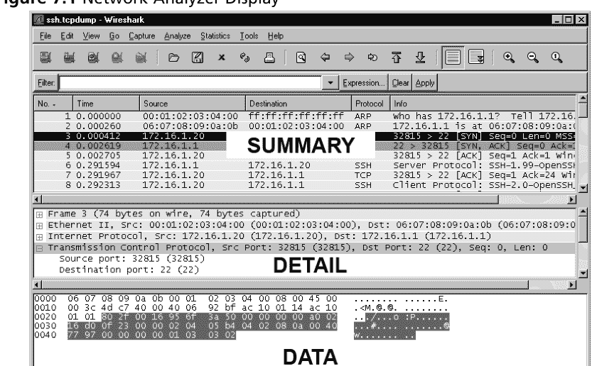

*

# 第 7 章 · 网络分析、故障排除与数据包嗅探

网络分析仪是硬件和软件的结合。尽管每个产品之间存在差异，但网络分析仪由五个基本部分组成：

- **硬件**：大多数网络分析仪是基于软件的，配合标准的操作系统（`OS`）和网络接口卡（`NIC`）工作。然而，某些网络分析提供额外优势，例如分析硬件故障（如循环冗余检查（`CRC`）错误、电压问题、电缆问题、抖动、异常发射、协商错误等）。某些网络分析仪仅支持以太网或无线适配器，而另一些支持多个适配器并允许用户自定义配置。根据情况，你可能需要集线器或电缆分路器来连接现有电缆。
- **采集驱动**：这是网络分析仪负责从电缆捕获原始网络流量的部分。它过滤掉你想保留的流量并将捕获的数据存储在缓冲区中。这是网络分析仪的核心——没有它你就无法捕获数据。
- **缓冲区**：此组件存储捕获的数据。数据可以存储在缓冲区中直到满，或者以旋转方法（例如“轮询”）存储，即最新数据替换旧数据。缓冲区可以是基于磁盘或基于内存的。
- **实时分析**：此功能在数据离开电缆时对其对其进行分析。某些网络分析仪用它来发现网络性能问题，网络入侵检测系统（`IDS`）用它来寻找入侵者活动的迹象。
- **解码**：此组件显示网络流量的内容（带有描述），使其具有可读性。解码器特定于每个协议，因此网络分析仪支持的解码器数量各异。然而，新的解码器不断被添加到网络分析仪中。

> 注意
> 抖动（Jitter）是用于描述信号定时随机变化的术语（例如，电磁干扰和与其他信号的串扰可能会导致抖动）。异常发射（Jabber）是用于描述设备不当处理电信号从而影响网络其他部分的术语（例如，故障的 `NIC` 可能会导致异常发射）。

# 谁在使用网络分析？

系统管理员、网络工程师、安全工程师、系统操作员和程序员都使用网络分析仪，这些是诊断和排除故障、解决系统配置问题以及应用程序困难的宝贵工具。历史上，网络分析仪是专用硬件设备，价格昂贵且难以使用。然而，技术的进步允许基于软件的网络分析仪的发展，使得管理员能够更方便、更便宜地有效排除网络故障。它带来了网络分析的能力。

网络分析的艺术是双刃剑。虽然网络、系统和安全专业人员使用它进行网络故障排除和监控，入侵者将网络分析用于有害目的。网络分析仪是一种工具，就像所有工具一样，它可以被用于善意或恶意。

网络分析仪用于：
- 将数据包中的二进制数据转换为可读格式
- 排除网络上的故障
- 分析网络性能以发现瓶颈
- 网络入侵检测
- 记录网络流量以供取证和证据
- 分析应用程序的运行情况
- 发现故障网卡
- 发现病毒爆发或拒绝服务（`DoS`）攻击的源头
- 检测间谍软件
- 开发阶段的网络编程调试（`debug`）
- 检测被攻破的计算机
- 验证是否符合公司政策
- 在学习协议时作为教育资源
- 反向工程协议以编写客户端和支持程序

# 入侵者如何使用嗅探器？

当嗅探器被恶意分子利用用时，它们可能对网络安全构成重大威胁。网络入侵者使用嗅探捕捕捉机密信息，“嗅探”和“窃听”术语通常与这种做法相关。然而，嗅探正变成一个非负面的词汇；大多数人交叉使用嗅探和网络分析术语。

以非法方式使用嗅探器被视为*被动攻击*，它不直接接口或连接网络上的任何其他系统。嗅探器也可以作为*主动攻击*攻破网络上计算机的一部分被安装。嗅探器的被动性使得检测它们变得困难。（检测嗅探器的方法将在在本章稍后的部分详细介绍）。

入侵者在网络上使用嗅探器的目的是：
- 捕获明文用户名和密码
- 发现网络上用户的使用模式
- 破坏专有信息
- 捕获并重放 IP 电话（`VoIP`）会话
- 绘制网络布局
- 被动操作系统指纹识别

除非你是渗透测试员，你的工作是发现并报告此类类型的弱点，否则上述所有都是嗅探器的非法用途。

要发生嗅探，入侵者必须首先访问目标系统的通信电缆，这意味着位于同一个共享网络网段上，或者在通信路径之间的电缆某处进行分路。如果入侵者没有物理出现在目标系统或通信接入点（`AP`），仍有方法嗅探网络流量，涉及：
- 侵入目标计算机并安装远程控制的嗅探软件。
- 侵入通信 `AP`（例如互联网服务提供商 [`ISP`]）并安装嗅探软件。
- 在 `ISP` 定位一个已安装嗅探软件的系统。
- 使用社会工程获取 `ISP` 的物理访问权限以安装数据包嗅探器。
- 让目标计算机机构或 `ISP` 的内部同谋安装嗅探器。
- 重定向或复制通信，以通过包含入侵者计算机的路径。

嗅探程序包含在大多数安装在受感染系统上的*根内核（`rootkits`）*中。根内核通过替换命令和实用程序以及清除日志条目来掩盖入侵者的踪迹。入侵者还安装其他程序作为嗅探器、记录器和后门访问软件。Windows 嗅探可以作为远程管理员木马（`RAT`）`SubSeven` 或 `Back Office` 的一部分完成。入侵者经常使用配置为检测特定内容（例如密码）的嗅探程序，然后通过电子方式发送给入侵者（或存储起来供入侵者稍后检索）。此类活动的易受协议包括 `Telnet`、`文件传输协议（FTP）`、`邮局协议 3（POP3）`、`互联网消息协议（IMAP）`、`简单邮件传输协议（SMTP）`、`超文本传输协议（HTTP）`、`远程登录（rlogin）` 和简单网络管理协议（`SNMP`）。

根内核的一个示例是 `TornKit`，它可以在 Solaris 和 Linux 上运行。该根内核的嗅探器被称为 `tornis`，安装在隐藏目录 `/usr/sec/`。另一个根内核示例是 `Rootkit 5 (Lrk5)`，它带有 `lsniffer` 安装。

入侵者通常使用嗅探器控制后门。一种方法是在目标系统上安装嗅探器监听特定信息并将后门控制信息发送到相邻系统。由于嗅探器的被动性，这种类型的后门控制很难检测。

`cd00r` 是后门嗅探器的示例，它在非混杂模式下运行，使其更难检测。使用像网络映射应用程序协议（`Nmap`）这样的产品向多个定义的端口发送系列 `TCP` 同步（`SYN`）包，将触发预配置端口上的后门打开。关于 `cd00r` 的更多信息可以在 `www.phenolit.de/stuff/cd00rc` 找到。

## 注意

> 根内核是一组木马程序，用于通过替换受感染系统上的合法程序以避免检测。一些常见的被替换命令有 `ps`、`ifconfig` 和 `ls`。根内核还可以安装额外的软件作为嗅探器。

# 嗅探到的数据看起来是什么样？

理解嗅探器概念最简单的方法是观察一次操作。图 7.2 显示了从笔记本电脑到 Linux 系统简单 `FTP` 会话的捕获。突出显示的数据包显示嗅探用户名和密码是多简单（例如，“root”和“password”）。

## 第 7 章 · 网络分析、故障排除与数据包嗅探

### 7.2 嗅探连接

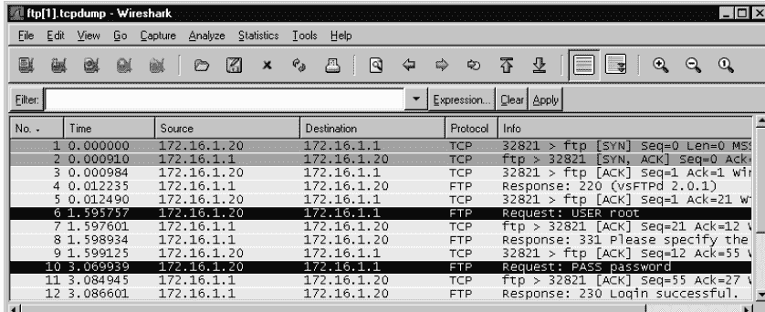

| 序号 | 时间 | 源 | 目的 | 协议 | 信息 |
|---|---|---|---|---|---|


| 1 | 0.0000000 | 172.16.1.20 | 172.16.1.21 | TCP | 3281 > [SYN] Ack-len 0 |
| 2 | 0.0000910 | 172.16.1.20 | 172.16.1.21 | TCP | 3282 < [SYN] Ack-seq 1 |
| 3 | 0.0009894 | 172.16.1.20 | 172.16.1.21 | TCP | 3283 > [ACK] Ack-seq 1 wr |
| 4 | 0.0123456 | 172.16.1.20 | 172.16.1.21 | TCP | 3284 < [ACK] Response: 120 (Full) 1 |
| 5 | 0.0124940 | 172.16.1.20 | 172.16.1.21 | TCP | 3285 > [ACK] Ack-seq 1 w |
| 6 | 0.1069929 | 172.16.1.20 | 172.16.1.21 | TCP | 3286 < [SYN] Response: PASS password... |
| 7 | 1.7957601 | 172.16.1.20 | 172.16.1.21 | TCP | 3287 > [ACK] Ack-seq 2 v |
| 8 | 1.8998934 | 172.16.1.20 | 172.16.1.21 | TCP | 3288 < [SYN] Response: Please specify t |
| 9 | 1.9999933 | 172.16.1.20 | 172.16.1.21 | TCP | 3289 > [ACK] Ack-seq 1 w |
| 10 | 3.1069929 | 172.16.1.20 | 172.16.1.21 | TCP | 3290 < [SYN] Request: PASS password |
| 11 | 3.1286601 | 172.16.1.20 | 172.16.1.21 | TCP | 3291 > [ACK] Response: Login successful. |

- 数据帧 18 (线路上 54 字节, 54 字节)
- 以太网 II, 源: 00:01:02:03:04:05 (目的: 00:00:00:00:00:00) (06:07:08:09:0a:0b)
- IP 协议, 源: 172.16.1.20 (目的: 172.16.1.21), : 172.16.1.1 (172.16.1.1)
- 传输控制协议, 源端口: 3281, 目的端口: 21, 序列: 28, 长度: 0

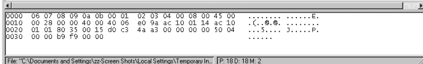

> 文件: `C:\Documents and Settings\Temporary\Screens`

## 常用网络分析仪

在 [securityfocus](https://securityfocus.org/category/4) 搜索可以发现嗅探工具的多样性和数量。最著名的包括：

- `Wireshark` 是最出色的嗅探工具之一，它是免费且商业级的。它具有丰富的功能、图形用户界面 (GUI)，可以解码超过 400 种协议，非常适合在生产环境中使用。它运行在 Unix 系统、Mac OS 和 Windows 上。请访问 [Wireshark](https://www.wireshark.org)。
- `WinDump` 是 tcpdump 的 Windows 版本，它使用 Wincap 库并运行在 Windows 95、98、ME、NT、2000 和 XP 上。
- `Network General Sniffer` 是流行的商业嗅探工具之一。现在是一套企业级网络捕获工具，产品线见 [Network General](https://www.networkgeneral.com)。
- `Windows 2000` 和 `2003 Server Network Monitor` `Windows 2000 Server` 和 `Windows 2003 Server` 内置了用于网络分析的程序。它位于“管理工具”文件夹中，默认未安装，因此你需要从安装光盘添加。
- `EtherPeek` 是由 WildPackets 开发的商业网络分析仪。Windows 和 Mac 版本以及其他网络分析产品可访问 [WildPackets](https://www.wildpackets.com)。
- `Tcpdump` 是最老且最常用的网络嗅探工具，由伯克利国家实验室 (LBNL) 的信息与计算科学部门 (ICSD) 网络研究小组 (NRG) 开发。它是基于命令行的，运行在包括 Mac OS 在内的 Unix 系统。它活跃开发并维护，访问 [Tcpdump](https://www.tcpdump.org)。
- `Snoop` 是随 Sun Solaris 提供的命令行网络嗅探工具。
- `Snort` 是一种广泛用于网络分析的入侵检测系统 (IDS)。它是开源的，拥有庞大的社区支持。它活跃开发并维护，访问 [Snort](https://www.snort.org)。
- `Nessus` 是一种漏洞扫描器，用于识别计算机系统中的安全缺陷。它是安全审计最流行的工具之一。
- `Nmap` 是一种网络发现和安全审计工具，用于发现计算机网络上的主机和服务。

# 第 7 章 网络分析、故障排除与数据包嗅探

图 7.3 对应 OSI 模型的七层。

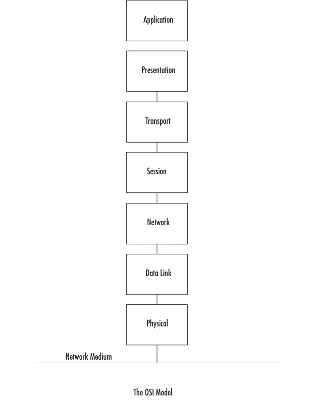

> 注意：OSI 模型并不一定反映应用程序和系统的实际编写方式。事实上，某些安全工具利用协议实现上的差异从计算机（包括其操作系统）以及可能安装的特定补丁和服务更新包中提取信息。

我们仍然在讨论七层模型，因为它是一个便于讨论的模型，但这与任何现实生活中的软件工程完全没有关系。换句话说，它是一种讨论问题的方式，而不是实现它们的方法。这很重要。规范是讨论问题的基础，但它们不是实现软件的基础。

— Linus Torvalds，Linux 内核项目协调员，来自 2005 年 9 月 29 日的一封邮件。

后续章节定义了 OSI 模型的七层。

## 第 1 层：物理层

OSI 模型的第一层是物理层，它规定了跨传输介质（电缆或电波）传输数据位的电气和机械要求。它涉及在载体上发送和接收数据流，无论该载体使用的是电（电缆）、光（光纤）、无线电、红外还是激光（无线）信号。物理层规范包括：

- 电压变化
- 电压变化的时机
- 数据速率
- 最大传输距离
- 连接传输介质的物理连接器（插头）
- 网络的拓扑结构或物理布局

许多复杂问题在物理层解决，包括数字与模拟基带、宽带信号、数据是同步还是异步传输，以及信号如何被划分为通道（多路复用）。

在物理层运行的设备处理（例如，网卡上的收发器）、中继器、基础集线器以及连接电缆分段的简单连接器。物理层处理的数据是 1（一）和 0（零）位，这些位通过光脉冲或电压变化表示，并根据这些脉冲的状态（开启表示 1，关闭表示 0）来确定。

这些位如何排列和管理是 OSI 模型数据链路层（第 2 层）的功能。

## 第 2 层：数据链路层

第 2 层是数据链路层，负责维护两台计算机（通常称为主机或节点）之间的数据链路。它还定义并管理了往返数据包的位顺序。帧包含以组织方式排列的数据，这为跨越介质发送数据位提供了一种有序且一致的方法。如果没有这种控制，数据将具有随机的大小或配置，且一端的数据无法在另一端解码。数据链路层管理数据包的物理寻址和同步。它还负责物理层的流量控制和错误通知。流量控制也是管理数据发送和接收时机的过程，以确保其不会超过物理连接的容量（速度、内存等）。由于物理层只负责将数据物理地移动到网络介质上和离开，数据链路层还接收并管理与数据包物理交付相关的错误消息。

在这一层运行的网络设备包括二层交换机（交换式集线器）和网桥。二层交换机通过向目标计算机连接的端口发送数据，而不是向所有端口发送数据，从而减少了网络拥塞。网桥通过根据 MAC 地址定义哪些计算机位于网桥的哪侧来构建表，提供了将网络分割为两个部分并过滤流量的方法。

数据链路层分为两个子层：逻辑链路控制（LLC）子层和 MAC 子层。

### MAC 子层

MAC 子层为访问传输介质提供控制。它负责跨共享传输介质（如以太网或光纤）将数据包从一个网卡移动到另一个网卡。

物理地址在 MAC 子层处理。每个网卡都有唯一的 MAC 地址（也称为物理地址），用于识别网络上的特定网卡。网卡的 MAC 地址通常固化在网卡的只读存储器（ROM）芯片中。每个网卡制造商都提供一组唯一的 MAC 地址，因此从理论上说，每个制造的网卡都有一个唯一的 MAC 地址。为了避免任何混淆，MAC 地址被永久地固化在网卡的内存中，这有时被称为固化地址（BIA）。

## 注意


在以太网网卡上，物理或 `MAC` 地址（也称为硬件地址）表示为 12 个十六进制数字，每对一组，每对之间用冒号分隔（例如 `12:3A:4D:66:3A:1C`）。前三组数字代表制造商，最后三位代表该制造商制造的唯一网卡。

`MAC` 指的是用于为计算机分配网络访问的方法，同时防止它们同时传输导致数据冲突。常见的 `MAC` 方法包括以太网使用的载波侦听多路访问/冲突检测（`CSMA/CD`）、`AppleTalk` 网络使用的载波侦听多路访问/冲突回避（`CSMA/CA`），以及令牌环和光纤分布式数据接口（`FDDI`）网络使用的令牌令牌传递。（`CSMA/CD` 将在本章稍后讨论。）

### LLC 子层

`LLC` 子层为数据链路提供逻辑；它控制数据链路层的同步、流量控制和错误检查功能。该层管理面向连接的事务；然而，该层也可以提供无连接服务。无连接操作是 I 类 `LLC`，而 II 类则可以处理面向连接的操作。每个 `LLC` 帧都会被确认。接收端的 `LLC` 子层跟踪其收到的 `LLC` 帧（即协议数据单元 `PDU`）；因此，如果检测到帧在传输过程中丢失，它可以向发送计算机发送请求重新传输，从未到达的 `PDU` 开始。

`LLC` 子层位于 `MAC` 子层之上，作为上层与运行在 `MAC` 子层上的协议（例如以太网、令牌环等）之间的纽带。`LLC` 子层由电气电子工程师学会（`IEEE`） `802.2` 定义。链路寻址、排序以及服务访问点（`SAP`）的定义也发生在这一层。

## 第 3 层：网络层

下一层是网络层（第 3 层），数据包在此处进行排序并进行逻辑寻址。逻辑地址是非永久的、通过软件分配的地址，只能由管理员更改。互联网上 `TCP/IP` 协议使用的 `IP` 地址，以及 `NetWare` 网络上 `IPX/SPX` 协议使用的互联网包交换（`IPX`）地址都是逻辑地址的示例。这些协议被称为可路由，因为它们包含了识别网络或子网络上特定客户端的寻址方案。其他网络/传输协议（例如 `NETBIOS` 扩展用户界面 `NetBEUI`）没有复杂的寻址方案，无法在不同类型的网络中进行路由。

> 为了理解物理地址和逻辑地址的区别，请考虑这个类比：房子有一个物理地址，可以标识其确切位置。房子还有一个由邮政分配的逻辑地址，由街道名称和门号组成。邮政偶尔会更改

## 第 7 章 · 网络分析、故障排除与数据包嗅探

街道名称或对位于其上的房屋重新编号。这类似于分配给网络接口的 `IP` 地址。

网络层还负责在点或节点之间建立虚拟虚路（即逻辑连接，而非物理连接）。节点是具有 `MAC` 地址的设备，通常包括计算机、打印机和路由器。该层还负责路由、三层交换和数据包转发。路由是指将数据包从一个网络或子网络转发到另一个网络。没有路由，计算机只能与同一网络上的计算机通信。路由是全球互联网的关键，也是网络层最重要的职责之一。

最后，网络层提供了额外级别的流量控制和错误控制。如前所述，从这一点开始，实现 `OSI` 模型架构的主要方法是软件而非硬件。

在该层运行的设备包括路由器和三层交换机。

## 第 4 层：传输层

第 4 层是传输层，负责将数据从一个节点传输到另一个节点。它在节点之间提供透明的数据传输，并管理端到端的流量控制、错误检测和错误恢复。

传输层协议启动不同计算机上特定端口之间的接触并建立虚拟虚路。每个主机上的传输协议都会验证发送数据的应用程序是否有权访问网络，并确保两端已准备好启动数据传输。当这种同步完成后，数据就会发送。在数据传输期间，每个主机上的传输协议会监控数据并观察传输错误。如果检测到传输错误，传输协议将提供错误恢复。

传输层执行的功能对网络通信非常重要。由于数据链路层提供了较低的可靠性和面向或无连接通信，传输层在更高层次上执行相同的工作。与传输层最常见的两个协议是 `TCP`（面向连接的）和用户数据报协议（`UDP`，它是无连接的）。

## 网络分析、故障排除与数据包嗅探 · 第 7 章

## 注意

面向连接的协议和无连接协议之间的区别是什么？面向连接的协议（例如 `TCP`）在发送数据之前会在两台计算机之间建立连接，并使用确认信号（`ACK`）验证数据已到达目的地（即接收计算机发回给发送者以确认收到的消息）。无连接协议发送数据，并信任它会到达正确的目的地，或者由应用程序来处理重传和数据验证。

考虑这个类比：你需要向一位业务伙伴发送一封包含贵重纸文件的信件。你给他打电话告知你要寄信，让他知道应该收到这封信（建立连接）。几天后，你的朋友打电话告诉你他已收到的信件，或者你收到了回执条（`ACK`）。这就是面向连接通信的工作方式。在给朋友寄明信片时，你将其投入信箱，它就会到达收件人处。你不预期或要求任何确认。这就是无连接通信。

传输层还管理端口的逻辑寻址。想象建筑内的套房号或公寓号，它精确定义了数据应该去何处。

## 表 7.1 常用互联网端口

| 互联网 (IP) 端口 | 协议 | 描述 |
|---|---|---|
| 80 | TCP | HTTP，常用于 Web 服务器 |
| 443 | TCP | 超文本传输协议安全套字 (HTTPS)，用于安全 Web 服务器 |
| 53 | UDP 和 TCP | 域名服务器/服务 (DNS)，用于将名称解析为 IP 地址 |
| 25 | TCP | SMTP，用于发送电子邮件 |
| 22 | TCP | 安全外壳 (SSH) 协议 |
| 23 | TCP | Telnet，一种不安全的管理协议 |
| 20 和 21 | TCP | 不安全的 FTP |
| | | 续 |

## 表 7.1 续常用互联网端口

| 互联网协议 (IP) 端口 | 协议 | 描述 |
| --- | --- | --- |
| 135–139 和 445 | TCP 和 UDP | Windows 文件共享、登录和远程过程调用 (RPC) |
| 500 | UDP | 用于安全互联网协议 (IPsec) 私有网络 (VPN) 的互联网安全关联和密钥管理协议 (ISAKMP) 密钥协商 |
| 5060 | UDP | 用于某些 VoIP 的会协议 (SIP) |
| 123 | UDP | 网络时间协议 (NTP)，用于网络同步 |

计算机可能同时运行多个网络应用程序（例如，Web 浏览器向 Web 页面发送请求，电子邮件客户端发送和接收电子邮件，以及文件传输程序从 FTP 服务器上传或下载信息）。确定哪些数据包属于哪个应用程序的机制是端口号的功能。Web 浏览器和电子邮件客户端使用不同的协议（例如 `HTTP` 和 `POP3` 或互联网消息访问协议 [`IMAP`]），这些协议有自己的分配端口；因此，目标为 Web 浏览器的信息不会误入电子邮件程序。端口号由 `TCP` 和 `UDP` 使用。

最后，传输层处理名称解析。大多数用户倾向于通过名称而非 `IP` 地址识别计算机（例如使用 `www.microsoft.com` 而不是 `207.46.249.1`）。

## 第 5 层：会话层

传输层在两台计算机之间建立连接后，会话层（第 5 层）负责建立、监控和终止会话。数据包上带有头信息，会话层在发送者和接收者之间执行同步。

会话层的另一个重要功能是控制会话内的通信是全双工还是半双工。半双工通信在两个方向上进行，但一次只能向一个方向传输（例如无线电通信，你按住麦克风传输，但听不到另一端）。全双工通信中，信息可以同时向两个方向发送（例如电话对话，双方都可以说话和听）。

由于传输层建立机器之间的连接，而会话层建立进程之间的连接。应用程序可以同时运行多个进程。

## 第 6 层：表示层

翻译是表示层（第 6 层）的主要活动。当数据从发送者发送到接收者时，在表示层进行翻译（即从发送者的应用程序数据到表示层，在此处转换为通用格式）。当在另一端接收数据时，表示层将其从通用格式转换回应用程序所需的格式。协议翻译（即将数据从一种协议转换为另一种协议，以便在使用不同平台或 OSE 的计算机之间交换）发生在此。

表示层也是网关服务运行的地方。网关是使用不同平台或应用程序的网络之间的连接点（例如，电子邮件网关、系统网络架构 (`SNA`) 网关以及跨平台或文件系统的网关）。网关通常通过软件实现，如 `NetWare` 网关服务 (`GSNW`)。软件重定向器在此层运行。

在此层进行数据压缩，这减少了必须通过网络介质传输到接收者的比特。数据加密和解密也在表示层进行。

## 第 7 层应用程序层

应用程序层是用户应用程序与网络交互的点。不要将网络模型与应用程序本身混淆。应用程序进程（例如文件传输或电子邮件）在用户应用程序内部启动（例如电子邮件程序）。然后，该进程创建的数据被交给网络软件的应用程序层。在此级别发生的一切切都是特定应用程序的（例如，文件

## 第 7 章 • 网络分析、故障排除与数据包嗅探

共享、远程打印机访问、网络监控与管理、远程过程调用以及所有形式的电子消息。

`FTP` 和 `Telnet` 都运行在应用层，正如 `SMTP`、邮局协议（`POP`）和 Internet `IMAP` 也是如此，它们都用于发送或接收电子邮件。其他应用层协议还包括 `HTTP`、网络新闻传输协议（`NNTP`）和 `SNMP`。

你必须区分上述协议与具有相同名称的应用程序，因为有许多不同的软件供应商制造了许多不同的 `FTP` 程序，它们都使用 `FTP` 来传输文件。


OSI 模型是通用的，可以解释所有的网络协议。为了这个目的，各种协议族通常被映射到 OSI 模型上。在网络分析、比较和故障排除中，理解 OSI 模型至关重要。然而，重要的是记住，并不是所有协议都能很好地映射到 OSI 模型（例如，TCP/IP 设计时是为了映射到美国国防部（DoD）模型）。20 世纪 70 年代，DoD 开发了它的四层模型。核心互联网协议遵循这一模型。

DoD 模型是 OSI 模型的精简版本。它的四层是：

- **进程层 (Process Layer)**：该层定义了实现用户级应用程序的协议（例如电子邮件传递、远程登录和文件传输）。
- **主机间层 (Host-to-host Layer)**：该层管理连接、数据流管理以及丢失数据的重传。
- **网络层 (Internet Layer)**：该层跨越连接两台机器的物理网络，将数据从源主机传递到目标主机。
- **网络访问层 (Network Access Layer)**：该层管理通过特定硬件介质传输的数据交付。

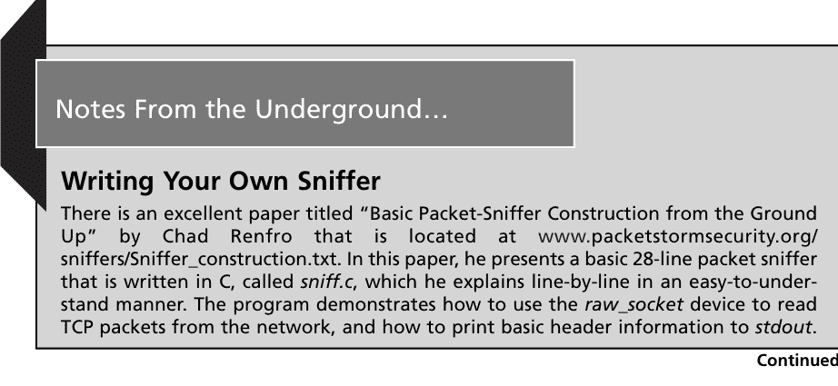

## 网络分析、故障排除、数据包嗅探 • 第 7 章

为了简单，程序以非混杂模式运行；因此，你首先需要使用 `ifconfig eth0` 命令将接口设置为混杂模式。

还有一个文件必须复制到 `sniff.c` 所在的目录下，该文件提供了标准结构来访问 IP 和 TCP 头部，以便识别 IP 和 TCP 头部中的每个字段。

要运行该程序，将 `sniff.c` 和 `headers.h` 文件复制到同一个目录，然后执行 `gcc -o sniff.c`。这会编译程序并创建一个名为 `sniff` 的可执行文件，通过输入 `./sniff` 来运行。以下文本显示了尝试 Telnet 和 FTP 连接时 sniff 程序的输出：

```
Bytes received :: 48
Source address :: 192.168.1.1
IP header length :: 5
Protocol :: 6
Source port :: 1372
Dest port :: 23
Bytes received :: 48
Source address :: 192.168.1.1
IP header length :: 5
Protocol :: 6
Source port :: 1374
Dest port :: 21
```

一旦你开始捕获数据，可以通过输入 Ctrl-C 结束程序。你可能还想通过输入 `ifconfig eth0 -promiscuous` 命令将接口退出混杂模式。

## CSMA/CD

以太网使用 CSMA/CD 协议以便设备在网络上交换数据。“多路访问”（multiple access）一词是指连接到同一网段的许多网络设备都有机会传输。每个设备都获得平等的机会；没有设备优于其他设备。“载波监听”（Carrier sense）描述了网络设备上的以太网接口在传输前如何监听电缆。网络接口在传输前确保电缆上没有其他信号，并在传输的同时进行监听，以确保没有其他网络设备同时传输数据。当两个网络设备同时传输时，就会发生冲突。由于以太网接口在传输时会监听介质，它们可以通过冲突检测（collision detection）识别其他设备的存在。如果发生冲突，传输设备将等待很短的随机时间后再重传。这种功能被称为随机退避（random backoff）。

## 第 7 章 • 网络分析、故障排除与数据包嗅探

传统上，以太网操作是半双工的，这意味着接口可以传输数据或接收数据，但不能同时进行。如果网段上一个一个网络接口尝试同时传输，根据 CSMA/CD 原则会发生冲突。当使用交叉线连接两个设备，或将单个设备连接到交换机端口时，网段上只有两个接口需要传输或接收；不会发生冲突。这是因为设备 A 的发送端（TX）连接到设备 B 的接收端（RX），而 B 的发送端（TX）连接到 A 的接收端（RX）。因此，不再需要冲突检测方法，接口可以被设置为全双工模式，允许网络设备同时传输和接收数据，从而提高性能。

## 主要协议：IP, TCP, UDP 和 ICMP

接下来的四个协议是当今互联网运作的核心。

> 注意：互联网上还使用了其他不同的协议，并不断创建新协议以满足特定需求。其中之一是网际协议第 6 版 (IPv6)，它试图通过提供更多 IP 地址以及通过加密提高跨越互联网的网络连接的安全性来改进现有的互联网协议族。有关 IPv6 的信息，请参阅 http://en.wikipedia.org/wiki/IPv6。

IP 是一种无连接协议，负责管理从一点到另一点的地址数据，并将大量数据分组成较小的、可传输的数据包。互联网数据报的主要组件包括：

** `IP 标识 (IPID)`**：尝试唯一地标识一个数据报。
- **协议 (Protocol)**：描述数据报中包含的更高层协议。
- **生存时间 (TTL)**：尝试防止数据报在环路中路由。当 TTL 达到 0 时，数据报会被丢弃。TTL 允许路由跟踪通过发送逐渐递增的 TTL 数据报来识别网络中的每个路由器，并跟踪 TTL 超出的情况。
- **源 IP (Source IP Address)**：创建数据报的主机 IP 地址。
- **目的 IP (Destination IP Address)**：数据报的目的地。

## 网络分析、故障排除与数据包嗅探 • 第 7 章

## 笔记

IP 伪造可以伪造 IP 数据报的任何部分；但最常用的伪造 IP 组件是源 IP 地址。此外，并不是所有协议在伪造 IP 地址的情况下都能运行（例如，TCP 等连接型协议在传输数据之前需要握手，从而降低了基于伪造攻击的有效性）。

伪造还可以用于 Do 攻击。如果网络 A 向网络 B 发送数据报，源 IP 伪造为网络 C 的主机，网络 C 将看到来自网络 B 的流量，而完全没有表明网络 A 参与了其中。

网络管理员的最佳实践是确保网络仅产生具有正确源 IP 地址的数据包（即网络自身的 IP 地址）。

## 互联网控制消息协议

互联网控制消息协议 (ICMP) 管理在 IP 网络之间发生的错误。以下是常见的 ICMP 消息类型：

- **回显请求/响应 (Echo Request/Reply)**：程序作为 ping 使用，计算到达另一个 IP 地址的延迟。
- **目的不可到达：网络不可到达和端口不可到达 (Destination Unreachable: Network Unreachable and Port Unreachable)**：当无法到达网络或端口时发送给包的源 IP 地址。这发生在防火墙拒绝包或出现网络问题时。目的不可到达消息有很多子类型，有助于诊断通信问题。
- **超时 (Time Exceeded)**：当包到达 0 时发生。

TCP 数据包是连接型的，最常用于传输数据。TCP 数据包的连接特性使其成为源 IP 地址伪造的糟糕选择。许多应用程序都使用 TCP，包括 Web (HTTP)、电子邮件 (SMTP)、FTP、SSH 以及许多 Windows FTP。

## 第 7 章 网络分析、故障排除与数据包嗅探

## TCP 握手

TCP 的一个重要概念是握手。在主机之间交换数据之前，它们必须同意通信。主机 A 向主机 B 发送一个带有 SYN 标志的数据包。如果主机 B 意愿并能够通信，它将返回 SYN 包并添加 ACK 标志。主机 A 开始发送数据，并向主机 B 表示它也收到了 ACK。当主机之间的通信结束时，会发送一个带有 FIN（结束）标志的包包，并遵循类似的确认过程。

## TCP 序列号

TCP 的另一个重要组件是序列标识，发送的每个数据包都是序列的一部分。通过这些数字，TCP 可以处理重传、确认和排序等复杂任务。

## UDP

UDP 数据包是 TCP 的无连接等效物，用于许多用途，最重要的一点是 DNS 大部分工作使用 UDP。DNS 负责查找主机名对应哪个 IP 地址（例如，www.example.com 无法在 IP 数据报内部作为 IP 地址进行路由；但通过 DNS 系统，它可以找到用于路由流量的 IP 地址）。UDP 的其他用途包括 VoIP 以及许多在线游戏和流媒体类型。

## 硬件：电缆分接器、集线器和交换机

电缆分接器是辅助连接网络的硬件设备。测试访问点（Taps）使用此设备连接计算机、集线器、交换机、路由器和其他设备之间的任何电缆。分接器提供全双工或半双工10、100 和 1000 Mbps 以太网链路。它们还有多种端口尺寸。以下是流行的电缆分接器产品列表：

- Net Optics 提供多种适用于铜缆和光纤的网络分接器，可以在 www.netoptics.com 获取。
- Finisar 系列提供多种适用于铜缆和光纤的分接器，可以在 www.finisar.com/nt/taps.php 获取。


集线器是一种允许你在共享介质（例如以太网）上连接多个主机的设备。当计算机发送信息时，信息会传输到集线器，集线器将信息转发给连接到它的所有其他计算机。目标计算机将识别数据包头中的 MAC 地址并接受数据。集线器转发所有信息的区域被称为冲突域（也称为广播域）。集线器对所有流量只有一个共享的冲突域。图 7.4 显示了与集线器相关的冲突域的网络架构。大量的碰撞会让嗅探更容易，并产生性能问题，如带宽被占用或集线器流量过大。

## 图 7.4 集线器冲突域

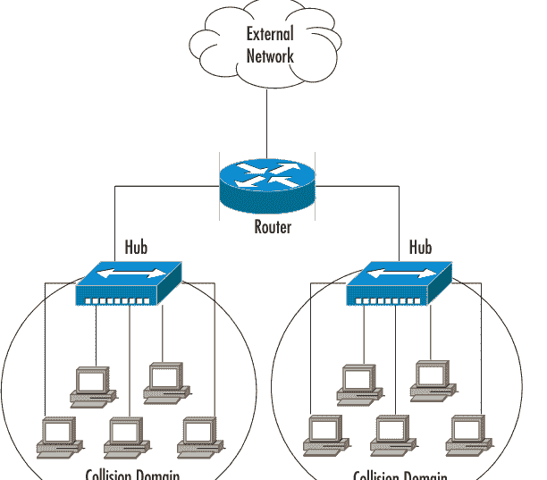

交换机也用于在共享介质上连接计算机；然而，当交换机接收信息时，它不会盲目地发送给所有其他计算机；它查看包头以找到目标 MAC 地址，并在交换机上维护一个连接计算机的 MAC 地址和对应端口列表。然后它将数据包转发到指定的端口。这把冲突域缩小到单个端口（见图 7.5）。这种冲突域为每个连接提供了固定的带宽，而不是集线器上的共享带宽。由于交换机的价格在过去几年大幅下降，没有理由用交换机替换集线器，或者在购买新设备时选择交换机。此外，某些较昂贵的交换机包含更好的技术，使其更能抵抗嗅探攻击。

## 图 7.5 交换机冲突域

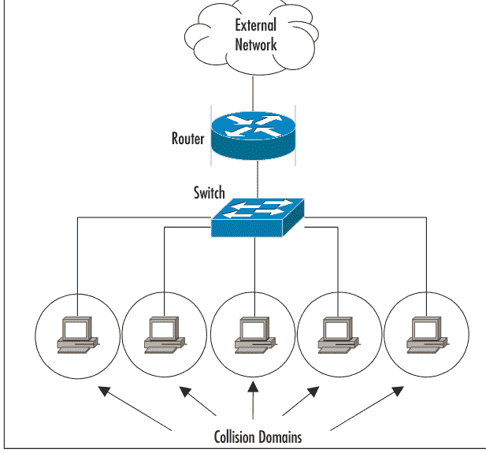

从图图中可以看出，集线器让嗅探更容易，而交换机让嗅探更困难。然而，正如“欺骗交换机”部分讨论的，交换机是可以被骗的。

## 端口镜像

如果你在一个使用交换机的网络上工作，大多数交换机和路由器都支持端口镜像（也称为端口复制）。要镜像端口，你必须配置交换机，将你要监控的端口的流量复制到你连接的端口。

使用端口复制不会干扰交换机的正常运行，但你应该始终检查你正在配置的确切交换机的文档，并定期检查设备日志。你不会影响交换机，但你会增加特定目标端口的流量量，因此，确保你正确配置了网络分析仪，以学习启用端口镜像的准确命令（见图 7.6）。交换机配置为将所有端口 1 的流量镜像到端口 5，网络分析仪可以看到进出计算机 A 的所有流量。有时管理员会镜像交换机上的上行端口，以便他们可以看到进出交换机及其所有端口的所有流量。

## 图 7.6 端口镜像

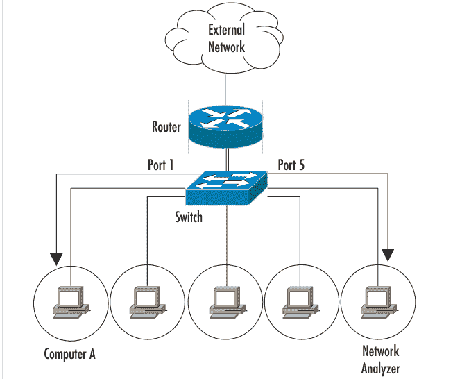

> Span 代表交换式端口分析器（Switched Port Analyzer）。Cisco 使用 span 一词描述端口镜像。在 Cisco 术语中，扩展端口等同于镜像。

## 欺骗交换机

如前所述，使用交换机使嗅探变得困难。有方法可以回避这一点。以下列表描述了几种可以欺骗交换机的方法：

- 交换机泛洪（Switch Flooding）：某些交换机可以配置为像集线器一样工作，广播所有数据包。这可以通过大量伪造 MAC 地址溢出交换表（称为 MAC 地址泛洪）来实现，从而移除所有安全措施。该工具可以从 `www.monkey.org/~dusniff` 下载。
- ARP 重定向：当计算机使用计算机的 MAC 地址时，它会发送地址解析协议（ARP）请求。每台计算机都维护一个存储与其通信的计算机地址的 ARP 表。ARP 在交换机上广播；但交换机上的所有设备都能看到请求和响应。有几种方法使用 ARP 欺骗交换机将流量发送到不该去的地方。入侵者可以通过发送声称为或其他路由器的 ARP 来欺骗交换机。
- ICMP 重定向：有时计算机位于相同的物理段和交换机，但在不同的逻辑段。这意味着它们处于不同的 IP 子集中。当计算机 A 想与计算机 B 通时，它通过路由器发送请求。路由器知道它们在同一个物理段，因此可以向 A 发送 ICMP 重定向，告诉它可以直接发送包。入侵者（计算机 X）可以向 A 发送伪造的 ICMP 重定向，告诉它将 B 的数据包发送到 X。
- ICMP 路由器公告：这些广告告诉计算机使用该路由器。入侵者随后发送声称为该路由器的广告，此时计算机开始将所有包转发给入侵者。
- MAC 地址欺骗：入侵者可以通过伪造 MAC 地址来假装使用不同的计算机。发送带有受害者源地址的数据包会欺骗交换机。交换机会将欺骗信息输入表并开始将数据包发送给入侵者。但仍在交换机上的受害者发送导致交换机改回表的更新怎么办？这可以通过某种 DoS 攻击使受害者下线，并重定向交换机并继续通信来解决。入侵者还可以广播其收到的流量，以确保受害者仍接收数据包。

# 网络分析、故障排除与数据包嗅探 • 第7 章

在限制物理端口访问的环境中，它在管理性与安全性之间取得了极佳的平衡。

在 Linux 或 Solaris 上伪造你的 MAC 地址可以使用以下 `ifconfig` 命令：

```
ifconfig eth0 down
ifconfig eth0 hw ether 00:02:b3:00:00:AA
ifconfig eth0 up
```

通过广播 ping 在所有主机上注册 MAC 地址：`ping -c 1 -1b 192.168.1.255`。

现在你可以嗅探所有发送到拥有此 MAC 地址的计算机的流量。

- **重新配置交换机端口生成（Port Spanning）** 如前所述，交换端口可以通过指向其他端口的流量进行配置。入侵者可以通过 Telnet 或其他默认后门连接到交换机来实现此。如果 SNMP 未经过保护，入侵者可以使用它。
- **线缆分接器（Cable Taps）** 如前所述，可以使用线缆分接器物理接入交换机。对交换机上的上行链路分接可以看到进入和离开该交换机的所有流量。

击败交换机的方法有很多，取决于交换机的工作方式，特别是对于那些技术先进的新型交换机。Dsniff 的常见问题解答（FAQ）提供了关于在交换环境中嗅探的有用信息，可以在 `www.monkey.org/~dugsong/dsniff/faq.html` 找到。

# 嗅探无线网络

从机场到咖啡馆，从图书馆再到你的下一个邻居，无线网络无处不在；因此，无线安全是一个严重关注的问题。安全协议中存在历史性的漏洞，因为入侵者不再需要进入建筑内部即可攻击内部网络。然而，无线网络仍然是一个网络，除了少数例外，它可以很好地映射到以 和 OSI 模型。

# 硬件需求

虽然大多数以太卡能够在混杂模式（promiscuous mode）下进行包嗅探，但许多无线芯片组无法使用监听模式（monitor mode），它是混杂模式的无线对应物。更为复杂的是，无线网卡芯片组制造商通常不会以易获取的形式列出他们使用的芯片组。此外，芯片组在同一系列中也可能不同。最好是先选择你想使用的软件，然后识别哪些芯片组和特定的制造商型号与运行该软件所需的特定驱动程序配合得最好。

# 第7 章 • 网络分析、故障排除与数据包嗅探

以下是关于芯片组兼容性的一些通用指南：

- Atheros：此芯片组兼容大多数软件，并在许多适配器中广泛可用。
- Prism2：这是与 Host AP 驱动配合的最强大的芯片组之一。它不仅被大多数软件支持，还 AP 模式下运行。
- Orinoco：最早支持监听模式的芯片组之一。被大多数软件支持。无法接收 802.11g 流量。
- Broadcom：Linux 对此芯片组没有原生支持。在使用带的驱动程序的情况下，如 Kismet 等工具无法对其工作。你可能可以通过网络驱动程序接口（NDIS）兼容封装（例如商业级的 DriverLoader）使用 Windows 驱动，该程序可以 `www.linuxant.com/driverloader` 下载。

# 软件

硬件、软件和驱动程序的正确组合将使你能够有效地嗅探线缆网络流量。以下工具可能会有所帮助：

- Netstumble：Netstumble 与说是一个网络扫描器不如说是网络嗅探工具，但它对于列出从你所在地可以检测到的网络很有用。Netstumble 是一个主动网络扫描器，发送可被他人检测到的探测。它可以从 `www.netstumble.org` 免费下载。
- Kismet：Kismet 是一个开源、免费的无线网络扫描器和漏洞检测器，跟踪无线客户端及其网络关联。与其他扫描器不同，它是一个完全被的网络扫描器，可以从 `www.kismetwireless.net` 下载。
- Wireshark：Wireshark 拥有许多用于无线管理流量的解析器；然而，它不支持服务标识（SSID），也不显示信号强度。
- CommView for WiFi：CommView for WiFi 是一种商业无线网络监控和扫描器，可以导出为 tcpdump 格式，Wireshark 可以轻松导入并读取。CommView for WiFi 可以从 `www.tamos.com/products/commview/` 下载。

# 网络分析、故障排除与数据包嗅探 • 第7 章 233

## 注意

# 可启动光盘 - 只读存储器 (CD-ROMs)

有几种可启动的 Linux 发行版带有无线和有线嗅探所需的正确驱动程序和软件。所有这些都包含了 Kismet 或 Wireshark。以下是一些可用且免费的选项：

- Backtrack：是两个备受推崇的可启动渗透工具结合的成果，将努力整合为一个统一的可启动 CD。欲更多信息，请访问 `www.remote-org`。


- Professional Hacker's Linux Kit (Phrack)：包含许多安全工具和无线审计。欲更多信息，请访问 `phrack.org`。

- Kali Linux 安全发行版 (STD)：可启动 Linux 镜像上的通用安全工具集。欲更多信息，请访问 `wkali.org`。

# 协议解析

现在我们已经回顾了 OSI 模型第 1 层到第 4 层的许多关键部分，应该注意你可能通过 `Wireshark` 运行的一些协议。你嗅探的网络越大，你可能遇到的协议类型（以及异常情况）就越多。

# DNS

DNS 将主机名转换为 IP 地址，反之亦然。大多数 DNS 流量以客户端/服务器模式通过端口 53 转发。DNS 可以被认为是正向或反向的。正向将主机名转换为 IP 地址，反向将 IP 地址转换为主机名。要从给定的主机名获取 IP 地址，DNS 系统（也称为解析器）会向 DNS 服务器请求 `(A)` 记录。在下面的示例中，我们使用 `www.example.com` IP 地址的权威名称服务器。在 `tcpdump` 格式中，我们看到：

```
IP 192.168.0.1.33141 > 192.0.43.53: 42827 A? www.example.com.
IP 192.0.43.53 > 192.168.0.1.33141
```

## 第 7 章 • 网络分析、故障排除与数据包嗅探

根延迟: 0.0000 sec

时钟扩散: 0.0039 秒

参考时钟 ID: 未识别的参考源 'INIT'

参考时钟更新时间: NULL

起始时间戳: 2006年3月29日 06:09:01.6976 UTC

接收时间戳: 2006年3月29日 06:09:01.7563 UTC

发送时间戳: 2006年3月29日 06:10:07.7525 UTC

网络时间协议 (NTP)

标志: 0x24

00.. .... = 跃变指示：无警告 (0)

.10... = 版本号: NTP 版本 4 (4)

...100 = 模式：服务器 (4)

对端时钟层级：次级参考 (5)

对端轮询间隔: 6 (64 秒)

对端时钟精度: 0.000008 秒

根延迟: 0.0000 sec

时钟扩散: 0.0122 秒

参考时钟 ID: 127.127.1.0

参考时钟更新时间: 2006年3月29日 06:09:48.4681 UTC

起始时间戳: 2006年3月29日 06:10:07.7525 UTC

接收时间戳: 2006年3月29日 06:10:07.6674 UTC

发送时间戳: 2006年3月29日 06:10:07.6675 UTC

## HTTP

HTTP 是支持 Web 的广泛使用的协议。HTTP 仅使用 TCP 传输数据，在默认配置下它使用 80 端口。从 Web 服务器获取的每个对象（例如：Web 页面、图像、音频）都通过独立的 HTTP 会话进行传输。

要启动 HTTP 会话，客户端会在 80 端口上建立常规 TCP 连接，并发送一个设置了 SYN 标志的数据包。Web 服务器返回一个数据包，并在 SYN 标志上添加 ACK 标志。最后，客户端发送一个设置了 ACK 标志的数据包，然后发送另一个数据包请求特定的 HTTP 对象。

以下是客户端向 HTTP 服务器请求的示例：

```
GET /index.html HTTP/1.1
```

客户端使用 HTTP v1.1 请求 `index.html` 页面：

```
Host: www.example.com
```

在浏览器中输入的主机名允许服务器在单个 IP 地址上托管多个 Web 服务：

```
User-Agent: ELinks/0.11.0 (textmode; Linux; 80x25-2)
```

`User-Agent` 向服务器描述 Web 浏览器版本。某些浏览器允许用户更改主机名，但认为这样做是不可靠的。

```
Accept-Encoding: gzip
Accept-Language: en
Connection: Keep-Alive
```

这些行告诉 Web 服务器，客户端支持对请求的对象进行压缩，接受英语页面，并且 Web 服务器在完成对象请求后不需要断开连接。

Web 服务器向客户端发送以下信息：

```
HTTP/1.1 200 OK
```

Web 服务器使用 HTTP/1.1 状态码“200 OK”响应，这指示浏览器对象已成功获取。其他代码包括“403 Forbidden”（服务器没有权限将对象发送给客户端）和“404”（服务器找不到客户端请求的对象）。

```
Date: Thu, 30 Mar 2006 05:23:29 GMT
Last-Modified: Wed, 29 Mar 2006 16:22:05 GMT
Server: Apache/2.2.0
```

这些行允许客户端高效地缓存内容。它告诉客户端服务器向其提供了什么内容，以及内容最后一次修改的时间。服务器还识别了其产品（Apache）和版本（2.2.0），尽管这些可以由服务器管理员进行更改。

```
Accept-Ranges: bytes
Content-Length: 40
Connection: close
Content-Type: text/html; charset=UTF-8
<HTML><body>Hello, world!</body></HTML>
```

如果需要重启服务器，服务器会告诉客户端它以什么格式请求文件的部分（在这种情况下它接受）。随后，服务器告诉客户端在数据传输完成后关闭连接。实际的 HTTP 数据随其后，从“Content-Type”行开始。

## SMTP

SMTP 是大多数电子邮件在互联网上发送的机制。SMTP 仅使用 TCP 传输数据，在大多数情况下，服务器使用 25 端口。整封邮件（标头和内容）都在一个 SMTP 会话中发送。可以使用 `Telnet` 程序连接到电子邮件服务器的 25 端口来轻松模拟 SMTP 会话。

将 SMTP 连接想象成通过普通邮件寄送备忘录。信封外部有发件人地址和目的地址。发件人地址和目的地址也可能在信封内部重复，但邮员并不关心信封内部的内容。在 SMTP 连接中，消息就是信封。以下是 SMTP 会话的示例：

```
220 example.com
HELO example.com
250 OK
MAIL FROM:<person@example.com>
250 OK
RCPT TO:<another@example.com>
250 OK
DATA
```

客户端发送 `DATA` 命令，告诉服务器正在传输内容。标头通常在此处重复，从这里开始是电子邮件内容：

```
Date: Wed, 29 Mar 2006 21:47:56 -0500
From: "person" <person@example.com>
To: another@example.com
Subject: Example E-Mail subject.

Example e-mail contents.

.

250 OK
QUIT
221 Bye
```

结束电子邮件，服务器指示客户端发送一个换行符、一个点另一个换行符。客户端礼貌地发出 `QUIT` 命令，服务器告别。

## 防止嗅探

到为止，你已经学习了什么是嗅探以及它是如何工作的。你还学习了一些入侵者可能用于嗅探的技巧，以及一些并不完全可靠的检测嗅探的方法。这些都没有为你保护网络和数据的困境带来积极的进展。然而，你的网络中某些方法可以提供防止嗅探的保护。

我们讨论了使用交换机代替集线器，并学习了破解交换机的方法。使用交换机是一种网络最佳实践，可以提高性能和安全性。虽然交换机为普通嗅探设置了障碍，但保护数据的最佳方法是使用加密，这是防止公共网络和内部网络拦截的最佳形式。入侵者仍然可以嗅探流量，但数据是不可读的。只有预期的接收者才能解密并读取数据；然而，某些加密方法留下了明文，允许入侵者查看源和目的地址并绘制地图。然而，数据包包含的数据受保护。

VPN 使用加密和身份验证在不安全的网络上提供安全通信。VPN 保护在互联网和内部网络上的数据传输。然而，如果入侵者破坏了 VPN 的任一端节点，保护将失效。

## 第 7 章 • 网络分析、故障排除与数据包嗅探

这些是可变的，但可以将它们组合并多次使用。以下列表描述了今天用于保护您的数据免受嗅探的某些 VPN 方法：

- SSH：SSH 是一种运行在 TCP 之上的应用层 VPN，用于确保客户端到服务器之间事务的安全性。它通常被用于系统登录和远程管理服务器，并通常被用于替代 `Telnet`、`FTP` 和 BSD r 命令。然而，任何任意 TCP 协议都可以通过 SSH 连接进行隧道传输，并用于许多其他应用程序。SSH 使用 Rivest、Shamir 和 Adleman (`RSA`) 或数字签名算法 (`DSA`) 非对称密钥进行身份验证，并为保护通过网络传输的数据和密码提供了多种加密选项。SSH 会话中的报头没有经过加密，因此入侵者仍然可以查看源地址和目的地址。


## 安全协议概述

- 安全套接层 (`SSL`)/传输层安全协议 (`TLS`)：`SSL` 最初由 Netscape 开发，用于为互联网会话提供安全和隐私保护。如 `RFC 2246` 所述，它已被 `TLS` 取代。`TLS` 在传输层提供安全保障，并克服了 `SSL` 的某些安全问题。它被用于封装高层应用程序的网络流量，例如 `HTTP`、轻量级目录访问协议 (`LDAP`)、`FTP`、`SMTP`、`POP3` 和 `IMAP`。它通过数字证书和数字签名提供身份验证和完整性，且 `SSL` 会话中的源和目的 `IP` 报头未加密。

- `IP` 安全协议 (`IPSec`)：`IPSec` 是一种网络协议，它在数据包级别将安全性整合到 `IPv4` 和 `IPv6` 协议中，扩展了 `IP` 包报头。这允许加密任何高层协议。它已被集成到路由设备、网关和客户端中，用于确保受信任网络之间的安全。`IPSec` 提供了多种身份验证和加密手段，支持许多公钥认证证书和对称加密密码密钥。它可以在隧道模式下运行，提供新的 `IP` 报头，除了传输的数据外还可以掩盖源和目的地址。由于 `IPSec` 使用 `TCP` 和 `UDP` 以外的协议，让 `IPSec` 流量通过防火墙或 `NAT` 设备可能会面临挑战。

- `OpenVPN`：`OpenVPN` 是一种隧道 `SSL` `VPN` 协议，它可以加密数据包的内容及其报头。`OpenVPN` 使用单个 `TCP` 或 `UDP` 端口；因此，在具有匹配 `NAT` 和防火墙架构的环境中更容易使用。此外，它还可以充当虚拟网络桥接（二层 `VPN`）。

一次性密码 (`OTP`) 是防止嗅探的另一种方法。`S/key`、万物一次性密码 (`OPIE`) 以及其他一次性密码技术可以防止密码被收集和重复使用。它们采用挑战-响应机制，并且每次需要身份验证时都会传输不同的密码。嗅探者收集的密码最终是无用的，因为它们只使用一次。智能卡是实现一次性密码的一种方法。然而，`OTP` 技术无法在您输入密码后保护您的密码。

电子邮件保护是公司和个人关注的热点。保护电子邮件的两种方法（即在传输和存储过程中进行加密）是良好的隐私 (`PGP`) 和安全多用途互联网邮件扩展 (`S/MIME`)。这些每种方法还通过数字签名提供身份验证和完整性。

## 网络分析与策略

在公司打开你新安装的网络分析器之前，请先阅读贵公司的策略！一份编写得当且全面的“恰当使用”网络策略将禁止你运行网络分析器。通常，唯一的例外是网络分析在你的职位描述中。此外，仅仅因为你为公司客户提供安全咨询服务，并不意味着你可以在公司网络上使用嗅探器。然而，如果你是管理员并被允许合法运行嗅探器，你可以用它来执行公司的安全策略。如果你的组织对嗅探器的规定不明确，请在使用它们或任何其他安全相关工具之前，花时间从相关部门获得书面许可。另一方面，如果贵公司的策略禁止文件共享应用程序（例如 `KaZaA`、`Morpheus`、`BitTorrent` 或如中继聊天 [`IRC`] 或即时消息 [`IM`] 等服务），你可以使用嗅探器来检测这类活动。

此外，如果你为客户提供安全服务，请确保使用嗅探器包含在你的参与规则 (`Rules of Engagement`) 中。要具体说明如何、在何处以及何时使用。此外，提供条款（例如非泄露协议），以免除你获取机密信息的责任。

确保你的嗅探活动不违反任何反窃听法律。在许多国家，窃听法的出台是在调制解调器是最复杂的网络访问设备的时代，因此法律的澄清和相关的监管要求可能非常复杂，并根据情况和涉及双方的不同而异。

## 注意

- 许多互联网服务提供商 (`ISP`) 在其“恰当使用”策略中禁止嗅探器。如果你发现自己在连接到他们的网络时在使用嗅探器，他们可能会切断你的服务。实验嗅探器的最佳地方是在未连接互联网的家庭网络上。你只需要两台之间连接着交叉网线的计算机，或者使用一个虚拟机应用程序。你可以将其中一台作为客户端，在另一台上安装服务器服务（例如 `Telnet`、`FTP`、`Web` 和电子邮件）。

## 备注

你可以从许多网站下载数据包跟踪文件，并用你的网络分析器读取它们，以熟悉分析和解释数据包。

位于 `www.project.honeynet.org` 的 `HoneyNet` 项目提供了每月的挑战和其他用于分析的数据。

`Wireshark` 的“wiki”也有许多描述的捕获文件，位于 `www.wireshark.org/SampleCaptures`

## 网络分析、故障排除与数据包嗅探 • 第 7 章

## 总结

网络分析是维护优化网络和检测安全问题的关键。主动管理可以帮助在问题变成损害数据的严重问题之前发现它们。除了识别攻击和可疑活动外，你的网络分析器还可以用于识别安全漏洞并执行公司的安全策略。嗅探日志可以与 `IDS`、防火墙和路由器日志关联，为取证和事件处理提供证据。网络分析器允许你从网络捕获数据（按数据包）、解码信息并以于理解的格式查看。网络分析器易于找到且免费可用，是任何管理员工具箱的重要部分。

本章涵盖了网络基础、以太网、`OSI` 模型以及网络架构中使用的硬件；然而，这只是触及一角。一本良好的网络协议参考书应该放在每个管理员的书架上。当你发现网络中有未知或异常流量时，它将非常有用。

作为一名管理员，你应该了解如何检测入侵者使用的嗅探器。你应该关注入侵者用来绕过防止嗅探的安全措施的方法。始终，你还需要确保你的计算机系统更新了补丁和安全修复，以防止根内核程序和其他后门。

本章还介绍了保护数据免受窃听嗅探的各种方法。关注最新的安全技术、加密算法和身份验证过程是非常重要的。入侵者不断发现破解当前安全实践的方法（例如破解数据加密标准 [`DES`] 加密方案及其后的三重数据加密标准 `3DES` 以及高级加密标准 `AES`）。

最后，记住网络分析的规则——只有在你获得许可且法律支持你时才进行。一个好奇的、初出茅庐的管理员很容易被误认为是入侵者。确保你拥有许可，或者使用你私有的网络进行实验。

## 解决方案快速通道

### 什么是网络分析和嗅探？

- 网络分析是捕获和解码网络数据。
- 网络分析器可以是硬件或软件，既有免费版也有商业版。
- 网络分析器界面通常有三个窗：摘要、详情和数据。
网络分析器的五个部分是：硬件、捕获驱动程序、缓冲区、实时分析和解码。

### 谁在使用网络分析？

- 管理员使用网络分析进行网络故障排除、网络性能分析以及入侵检测。
- 当入侵者使用嗅探器时，被认为是一种被动攻击。
- 入侵者使用嗅探器获取用户名和密码、收集机密数据并绘制网络地图。
- 嗅探器是根内核（`rootkit`）的常见组件。
- 入侵者使用嗅探器控制后门程序。

### 它是如何工作的？

- 以太网是一种使用 `MAC` 或硬件地址的共享媒介。
- `OSI` 模型有七层，代表了网络通信的标准。
- 集线器（`Hubs`）向分段上的所有主机发送信息，创建一个共享的冲突域。
- 交换机每个端口有一个冲突域，并维护一个与每个端口关联的 `MAC` 地址表。
- 端口镜像（`Port mirroring`）是一种允许你在交换机上进行嗅探的功能。
- 交换机使嗅探变得更加困难；但交换机架构中的安全措施可以通过多种方法克服，从而允许嗅探发往其他计算机的流量。
- 嗅探有线流量可以使用多种网卡（`NICs`）完成；无线嗅探则对芯片组和驱动程序等硬件细节需要更多关注。

### 检测嗅探器

- 有时可以通过查找 `PROMISC` 标志在本地系统中检测到嗅探器。
- 有多种可用工具尝试通过各种方法检测混杂模式。
- 仔细监控主机、集线器和交换机端口以及 `DNS` 反向查找有助于检测嗅探器。
- 蜜罐（`Honeypots`）是检测网络中尝试使用被破解密码的入侵者的好方法。
- 新的嗅探器足够智能，可以躲避传统的检测技术。

### 协议解析

- `DNS` 数据包可以使用 `TCP` 或 `UDP`，取决于查询目的和传输的数据量。
- `NTP` 数据传输通常客户端和服务器端口都使用 `UDP` 端口 `123`。
- 多个虚拟 `HTTP` 服务器可以监听同一个端口上。`Host:` 头部指示客户端意图连接到哪个虚拟服务器。
- `SMTP` 连接可以使用 `Telnet` 等简单的网络程序进行模拟。如果你的 `SMTP` 服务器在互联网上开放，它最终将会被用于发送垃圾邮件。

### 防御嗅探器

- 交换机对嗅探器的防护很小。
- 加密是保护你的数据免受嗅探攻击的最佳方法。
- `SSH`、`SSL/TLS` 和 `IPSec` 都是在 `OSI` 模型不同层运行的 `VPN` 形式。
- `IPSec` 隧道模式通过附加新头部来保护 `IP` 头部中的源地址和目的地址。

### 网络分析与策略

- 确保你有权限在非自己的网络上使用嗅探。
- 在使用前阅读你的 `ISP`（网络服务供应商）适当的使用政策。
- 如果你受雇评估计算机网络并计划使用嗅探器，请确保你已签署保密协议，因为你可能会接触到机密数据。
- 一次性密码使被破解的密码变得毫无用。
- 电子邮件在传输过程中应受到保护，并使用某种数据加密方法进行存储。

### 常见问题

以下常见问题由本书作者回答，旨在衡量你对本章介绍概念的理解程度，并帮助你在现实生活中实施这些概念。如果你想让作者回答你关于本章的问题，请访问 `www.syngress.com/solutions` 并点击“询问作者”（`Ask the Author`）表单。

**Q**: 我可以做什么来保护我的网络免受嗅探器的攻击？


### A
适当的网络安全是通过设计实现的，而不仅仅通过行动。有些人认为，你无法做任何事情让你的网络完全安全。结合如 `802.1x` 等网络访问控制、无处不在且机会性的加密，以及强力的策略和程序，将在保护你的网络免受嗅探器和其他安全问题方面大有帮助。使用多层安全被称为深度防御（`defense-in-depth`），是安全网络架构的标准最佳实践。

### Q
你说的这种机会性加密是什么？我在哪里可以买？

### A
机会性加密（`Opportunistic Encryption`）是一种实践，双方之间的通信变为加密，即使双方无法确认对方的身份。关于机会性加密的更多信息可以免费访问 `www.wikipedia.org/wiki/Opportunistic_encryption`。无处不在的机会性加密理论认为，任何网络通信都可以被加密，并且应该被加密。

### Q
我如何确保我的嗅探流量是合法的？

### A
确保你的嗅探活动合法的最好方法是寻求法律顾问。通常情况下，如果你正在嗅探的通信的所有方都承认他们对你的网络没有隐私预期，那么你就是安全的。这些承认可以出现在雇合同中，还应该设置为强化“无隐私预期”的横幅（`banners`）。建议你获得雇主的书面授权以使用嗅探软件。

### Q
嗅探器是否正在对我的网络进行安全违规？

### A
可能。检查嗅探活动的来源并验证拦截是否经过授权。黑客和其他网络不法分子使用嗅探器来协助他们自己。

被隐藏的信息被称为明文（`plaintext`）；一旦被加密，它被称为密文（`ciphertext`）。密文在传输过程中会避开窥探的目光到达预期的接收者处，并在那里被解密回明文。

# 第 8 章：密码学与加密基础

本章解决方案：

- 算法
- 加密概念
- 常见问题

## 引言

只要你一直在编写信息，就需要保持某些信息的秘密，要么通过隐藏其存在，要么通过改变其含义。对方法的研究就是密码学。加密作为密码学的一种形式，是指对信息进行混乱使普通观察者无法阅读的过程。算法和密钥是什么？算法是一组指令，将原始消息（明文）与消息密钥混合并重新排列，以创建混乱的消息（密文）。同样，加密密钥是用于明文加密为密文、密文解密为明文（或两者兼顾，取决于加密类型）的数据。

# 加密学与加密基础 • 第8章 251

为了抵御当前和未来的攻击，速度指的是加密和解密消息所需的处理能力和时间，而实现易用性指的是算法对硬件或软件使用的倾向（如果有的话）。每种算法都有不同的优缺点，没有哪种算法在所有方面都是完美的。本节讨论了关键算法，这些算法分为三大主类：

- 对称加密
- 非对称加密
- 哈希处理算法

## 什么是加密？

加密是密码学的一种形式，它将明文“扰乱”成无法理解的密文。加密是数字签名、数字证书以及公钥基础设施（`PKI`）等安全措施的基础，这些技术利用加密使计算机交易更加安全。基于计算机的加密使用密钥对数据进行加密和解密。密钥是一个变量（有时表示为密码），是一个大二进制数——越大越好。密钥长度以位（`bits`）衡量，位越多，越难“破解”。例如，在今天的标准下，40 位密钥被认为是安全的，但它的值介于 1 到 `2^140`（`1,099,511,627,776`，超过一万亿）之间。

密钥只是加密过程中的一个组件。它必须与加密算法（一个过程或计算）结合使用以产生密文。加密方法通常分为对称或非对称，取决于所使用的密钥数量。接下来的章节将讨论这两种基本的加密技术。

# 对称加密算法

最广泛使用的加密类型是对称加密，这个名字恰得当，因为它在加密和解密过程中都使用同一个密钥。对称加密也常被称为密钥加密和共享密钥加密，但所有术语指的同一类算法。

对称加密系统之所以存在，是因为其速度快且简单。对称加密的强度主要取决于算法中所使用的密钥大小，以及每个算法执行的循环周期次数。其核心准则是“越少越快”。

根据定义，所有对称算法在理论上都容易受到暴力破解攻击的影响，暴力破解攻击是对所有可能的密钥的穷举搜索。暴力攻击涉及猜测消息的密钥可能是什么。由于所有对称算法都有固定的密钥长度，有大量的可能密钥可以解锁消息。暴力攻击有条理地尝试检查每个密钥，直到找到解密消息的密钥为止。然而，暴力攻击通常是不可行的，因为搜索密钥所需的时间超过了隐藏信息的寿命。没有一种算法是真正不可破解的，但一种强大的算法破解它需要很长时间，以至于尝试它是不现实的。因为暴力攻击源于计算机，而且计算机的效率在不断提高，今天可能抵御计算机实施的暴力攻击的算法并不一定能抵御 5 到 10 年后计算机的攻击。

# 数据加密标准与三重数据加密标准

最古老且著名的加密算法之一是数据加密标准（`DES`），随着提供更高安全性算法的出现，`DES` 的使用率已经下降。`DES` 是基于 Horst Feistel 发明的 Lucifer 算法，该算法从未被广泛使用。本质上，`DES` 使用 64 位密钥——包含 56 位数据和 8 位校验位——并以 64 位为块对数据进行操作。该密钥被分成 16 个 48 位的子密钥，每轮一个，称为费斯泰尔循环（`Feistel cycles`）。图 8.1 给出了 `DES` 加密算法运行的原理图。

图 8.1 `DES` 加密算法图


每轮包含一个替换阶段（其中数据被密钥的片段替换）和一个置换阶段（其中被替换的数据被扰乱/重新排序）。替换操作有时称为混淆操作（`confusion operations`），在 S 盒中发生。同样，置换操作有时称为扩散操作（`diffusion operations`），被认为发生在 P 盒中。这两种操作都发生在数据的“F 模块”（`F Module`）中。`DES` 的安全性在于替换操作是非线性的，生成的密文看起来不像原始消息。置换操作通过扰乱已经部分加密的消息增加了另一层安全性。

三重 `DES` (`3DES`) 和 `DESX` 是旨在通过使用 `DES` 密文的方式增加其安全性的方法。三重 `DES` 使用三个 56 位密钥作为 168 位密钥，尽管有时密钥 1 和 3 是相同的，从而产生 112 位的安全性。`DESX` 增加了额外的 64 位密钥。`3DES` 和 `DESX` 的目的都是增强 `DES` 以抵御暴力攻击。解密 `3DES` 加密的数据需要很多年（取决于可用的计算能力）。然而，`3DES` 是低效的，因为它所需的开销是单个 `DES` 的两到三倍。

# 高级加密标准 (Rijndael)

由于只有 56 位，`DES` 无法抵御使用现代密码分析的暴力攻击；专用机器可以在一天内破解 `DES`。因此，美国国家标准与技术研究所（`NIST`）选择高级加密标准（`AES`）作为美国政府所有非秘密通信的授权联邦信息处理标准（`FIPS 197`），该标准于 2002 年 5 月生效。`AES` 具有以下重要特征：

- 对称密钥（类似于 `3DES`）
- 比 `3DES` 更强、更快
- 预期寿命至少为 20 年
- 支持 128 位、192 位和 256 位密钥
- 所有人免费；非专利所有
- 内存占用小；`AES` 可用于内存受限的环境

作为背景说明，`Rijndael`（读音为 "rain doll”）是由 `NIST` 从一个包含 `MARS`、`RC6` 和 `Twofish` 的小组中选出的。它由比利时密码学家 Joan Daemen 和 Vincent Rijmen 开发。那么 `AES`/`Rijndael` 是如何工作的呢？它没有使用费斯泰尔循环，而是使用了迭代轮，如 `IDEA`。数据处理 128 位块，这些块被分成四个 4 字节组。轮数也取决于密钥大小：128 位密钥为 9 轮，192 位密钥为 11 轮，256 位密钥为 13 轮。每轮包括一个 S 盒的替换，随后是组之间的位置换步骤。然后对每个组进行矩阵乘法，结果与该轮的密钥相加。

# IDEA

`IDEA` 是 `DES` 的对应算法。与 `DES` 不同，它被认为更快、更安全。`IDEA` 速度更快的原因在于每轮的操作比费斯泰尔循环简单。`IDEA` 使用了异或（`XOR`）、加法和乘法等简单操作，这些操作在软件中的实现比使用每轮 16 个子密钥更高效。`DES` 的替换和置换操作是计算机执行的最简单的二进制计算。异或 也是一种简单的操作，当两个输入不同时返回“1”，当两个输入均相同时返回“0”。

`IDEA` 处理 64 位块，使用 128 位密钥，加密/解密过程使用 8 轮，每轮 16 个子密钥。`IDEA` 算法在美国和欧洲均拥有专利，但允许免费非商业使用。`IDEA` 被广泛认为是 Good Privacy（`PGP`）的组件之一（见第 3 节）。

| 工具与陷阱 |
| 评估算法强度 |
| 算法安全性只能通过其对攻击的抵抗力来证明。由于对公开算法的攻击尝试要多得多，因此一个算法公开的时间越长，试图绕过或破解它的尝试就越多。薄弱的算法会被很快破解，通常在几天或几个月内，而更强大的算法可能可以使用几十年。然而，算法的开放性是一个重要的因素。破解一个算法要 |
| 续 |

当算法（无论强弱）的复杂度完全未知时，它就是安全的。因此，当你使用开放算法时，可以对其强度充满信心。这与私有算法形成对比，如果私有算法较弱，即使密码学家没有完全理解该算法本身，最终也可能被破解。显然，人们应该限制对私有算法的信任，以降低长期风险。正是由于这种审查机制，如今许多正在使用的专利算法的内部细节（例如 RSA 实验室的 `RCG`）都是公开可的。

## 非对称加密算法


使用对称加密算法最大的缺点在于密钥管理。为了确保双方之间通信的机密性，每对通信双方都需要一个唯一的密钥。随着通信双方数量的增加，需要管理的密钥数量与通信人数的平方相关，这会迅速变成一个问题。

非对称算法的开发是为了克服这一局限性。它也被称为公钥密码学，使用两个不同的密钥来加密和解密信息。如果明文使用实体的公钥加密，则可以使用其私钥解密；如果使用私钥加密，则只能通过公钥解密。基本原理是公钥可以自由分发，而私钥必须严格保密。私钥所有者可以加密明文以创建只能用其公钥解码的密文（确保来源的身份），或者使用私钥解密用其公钥编码的密文（确保数据的机密性）。尽管这些密钥是共同生成的且在数学上相关，但无法从公钥推导出私钥。

## 注意

多年来，已经开发了数以千计的不同加密算法。加密算法可以分类如下：

- `Encryption Algorithms`用于加密数据并提供机密性
- `Signature Algorithms`用于对数据进行数字“签名”以提供身份验证
- `Hashing Algorithms`用于提供数据完整性

算法还根据其在技术层面的工作方式进行分类（流加密和分组加密）。这种分类取决于算法应用于数据流（对单个位进行操作）还是应用于整个数据块。流加密速度更快，因为它们处理的是较小的数据单元。密钥被生成为密钥流，并与要加密的明文相结合。`RC4`是最常用的流加密。另一个是`ISAAC`。

`Block ciphers`取一个明文块并将其转换为密文块。（通常块的大小为64或128位。）常见的分组加密包括`DES`、`CAST`、`Blowfish`、`IDEA`、`RC5/RC6`、`SAFER`。大多数`AES`候选算法都是分组加密。

对称密钥加密依赖替换和置换技术，而非对称算法依赖于大整数数学问题。这些问题中的许多在单方向上很容易实现，但在反方向上很难实现。例如，将两个数字相乘很容易，但将它们分解回原始数字则困难得多，特别是当使用的整数包含数百位数字时。通常，非对称算法的安全性并不取决于暴力破解的可行性，而是取决于执行困难的数学逆运算的可行性以及可能提出新“捷径”技术的数学理论进展。

非对称加密比对称加密要慢得多。这有几个原因。首先，它依赖于秘密指数和公钥指数的幂运算，以及模数的生成。在计算上，幂运算是处理器密集型操作。其次，非对称算法使用的密钥通常比对称算法使用的密钥大，因为最常见的非对称攻击（分解）比最常见的对称攻击（暴力破解）更有效。

基于此，非对称算法通常用于加密少量信息。在本节中，我们将研究`RSA`、`Diffie-Hellman`和`El Gamal`算法。

## Diffie-Hellman

对称加密中最大的问题是密钥的安全性。显然，你不能通过与密文相同的媒介传输密钥，因为任何观察通信的未授权方都可以使用该密钥来解码消息。在非对称加密和`Diffie-Hellman`密钥交换开发之前，密钥是通过受信任的私人信使和其他带外方法交换的。

20世纪70年代中期，Whitfield Diffie（迪菲）和Martin Hellman（马·赫尔曼）发布了`Diffie-Hellman`密钥交换算法，使得密钥可以在不安全的线路上安全传输。这是公钥密码学的首次应用，也是密码学领域最大的进展之一。通过`Diffie-Hellman`算法，`DES`密钥（随`DES`加密的有效负载消息发送）可以由一方通过`Diffie-Hellman`加密，并仅由目标接收者解密。

由于非对称加密固有的缓慢性，`Diffie-Hellman`算法并非设计用于通用加密方案。相反，它的目的是跨不安全介质传输`DES`（或类似的对称算法）的私钥。在大多数情况下，Diff-Hellman不用于加密完整消息，因为取决于实现方式，它比`DES`慢得多。

在实践中，使用`Diffie-Hellman`进行密钥交换的过程如下：

1. 双方约定两个数字；一个是大质数，另一个是较小的整数。这可以在公开状态进行，因为不影响安全性。
2. 双方各生成另一个数字，并保持保密。这个数字等同于私钥。涉及私钥和之前的两个数字进行计算。将结果发送给另一方。该结果实际上是一个公钥。
3. 双方交换他们的公钥。然后他们结合自己的私钥和对方的公钥进行计算。生成的数字就是会话密钥。双方应该得到相同的数字。
4. 该会话密钥可以用另一种加密算法（如`DES`）的秘密密钥。监控交换的第三方在不知道其中一个私钥的情况下无法获得相同的密钥。

`Diffie-Hellman`最大的优势是任何人都可以知道发送者或接收者的公钥之一，而不会损害消息的安全性。公钥和私钥实际上都是非常大的整数。`Diffie-Hellman`算法利用了被称为离散对数的复杂数学函数，这种函数正向执行很容易，但反向执行极其困难。安全网协议（`IPsec`）结合Rivest, Shamir & Adleman (`RSA`)认证使用`Diffie-Hellman`算法来交换加密跨`IPsec`隧道流量的会话密钥。

## El Gamal

`El Gamal`算法本质上是基于离散对数的原始算法的更新和扩展版本。该算法的安全性与`RSA`算法相当。`El Gamal`有一些缺点，主要是它的输出较大且需要随机输入。加密后的`El Gamal`密文比原始明文长得多，因此不应在带宽受限的地方使用，例如在缓慢的广域网（`WAN`）链路上。`El Gamal`算法还需要合适的随机源才能正常运行。值得注意的是，数字签名算法（`DSA`）是基于`El Gamal`算法的。`DSA`是`RSA`的补充，广泛用于`OpenSSH`的安全外壳（`SSH`）协议实现。

## RSA

在`Diffie-Hellman`密钥加密系统出现不久后，Ron Rivest、Adi Shamir和Leonard Adleman提出了另一种公钥加密系统。他们的提议现在被称为`RSA`算法，以这三位研究人员姓名的首字母命名。

`RSA`算法与`Diffie-Hellman`算法有许多相似之处，`RSA`同样也基于大整数的乘法和因式分解。然而，`RSA`的速度明显快于`Diffie-Hellman`，这导致了非对称加密领域的分支：将`Diffie-Hellman`及类似算法称为公钥分发系统 (`PKDS`)，将`RSA`及类似算法称为公钥加密 (`PKE`)。`PKDS`系统用作会话密钥交换机制，而`PKE`系统被认为足够加密短消息。然而，像`RSA`这样的`PKE`系统被认为不够快到可以加密整个文件系统或高速通信线路等大量数据。


# 理解非对称密钥长度

`RSA`、`Diffie-Hellman`以及其他非对称算法使用的密钥比其对称对应的要大。常见的密钥长度包括`1024`位和`2048`位。密钥之所以这么大，是因为因式分解虽然仍然一项困难的操作，但其执行起来比对称算法使用的穷举搜索法要容易。`PKE`系统的运行缓慢也是由于密钥尺寸较大导致的。由于大多数计算机只能处理`32`位的精度，因此需要不同的“技巧”来模拟`1024`位和`2048`位整数。然而，这种额外的处理时间是值得的，出于安全考虑，`2048`位的密钥被认为是“永久”的。

## 哈希算法

哈希是一种技术，通过将某种算法（也称为哈希函数）应用于数据，以创建一个唯一的“指纹”，该指纹是一个固定大小的变量。如果任何人更改了数据中仅仅一个二进制位，哈希函数都会产生不同的输出（称为哈希值或消息摘要），接收者将知道数据已被更改。哈希可以确保完整性并提供身份验证。哈希函数无法被“逆向工程”；也就是说，你无法利用哈希值来发现被哈希的原始数据。因此，哈希算法被称为单向哈希。一个良好的哈希函数不会对两个不同的输入返回相同的结果（称为碰撞）。换句话说，该函数的碰撞域应该足够大，使得发生碰撞的可能性极低。（也就是说，在目前为止研究的加密算法中，无论是对称的还是非对称的都是可逆的，即只要使用适当的密钥，它们就可以从明文转换为密文并反之）。然而，哈希算法没有可逆的函数，因此原始材料无法被恢复。由于这个原因，哈希算法通常被称为*单向哈希函数*。然而，不可逆技术对于确定数据完整性和身份验证是有用的。


# 工具与陷阱

# 理解单向函数

一个函数被认为是“单向的”意味着什么？首先，考虑长除法中的余数计算。具体来说，假设`5`除以`2`等于`2`余`1`。这个余数部分被称为*模*（`modulus`），或简称为`mod`，在单方向上很容易计算。但假设问题是“余数是`1`，求除法题”。你如何知道正确答案呢？这就是不可逆函数的含义。

还有一组稍微复杂的问题，比如“时钟算术”。假设你拥有的不是无限的直线（例如`1, 2, 3...100, 101...`），而是一条像时钟一样环回连接自身的数轴（例如`11, 12, 1, 2...10`）。在时钟上，`5 + 3`是`8`，`5 + 15`和`5 - 9`也是`8`。给定答案，你无法推导出一个唯一的问题。因此，时钟算术是单向函数的另一个例子。


有时，没有必要也不理想加密整组数据。假设有人想要传输大量数据，例如 CD 镜像。如果 CD 上的数据不敏感，他们可能不在乎被公开传输，但当传输完成后，他们想要确保镜像与原始镜像完全相同。这种比较最简单的方法是对两幅镜像计算哈希值并比较结果。即使存在一个一个比特位的差异，每个镜像的哈希值也会截然不同。只要它们产生相同的输出，即*碰撞*。创建的哈希（通常称为*数字指纹*）通常是较小且易读的尺寸。这些哈希值被称为*安全校验和*，它们的功能与普通校验和相同，但本质上更具抗篡性。

加密后的密码通常以哈希的形式存储。当为系统设置密码时，密码通常会通过哈希函数，仅存储加密后的哈希值。当人员稍后尝试身份验证时，会对密码进行哈希处理，并将该哈希与存储的哈希进行比较。如果它们匹配，则通过验证，否则将拒绝访问。理论上，如果有人获取了系统的密码列表，它将是毫无用的，根据定义，无法从其哈希值中恢复原始信息。然而，攻击者可以使用字典攻击和暴力破解攻击，通过系统地比较哈希值来实施。


# 加密与加密的基础

哈希有几种类型，包括除法余数、数字重排、折叠和基数转换。这些分类指的是获取哈希的数学过程。让我们看看这些哈希算法：

- `MD4`/`MD5` 消息摘要算法由 Ron Rivest 开发，用于数字签名。它们都有固定的 128 位哈希长度，但 `MD4` 算法存在缺陷，`MD5` 已被采用替代。
- `SHA` 这种哈希算法由美国政府（`NIST` 和国家安全局 `NSA`）创建，原理类似于 `MD` 算法。常用的是 `SHA-1`，它通常用于 `IPSec` 安装，长度为 160 位。


# 使用 MD5 进行数据完整性

几年前，使用 `MD5` 和来验证 `OpenSSH`（一种流行的开源 SSH 软件）的发行版是否感染了木马。软件本身没有被感染，只有发行版的文件。由于 `FreeBSD` 等某些操作系统会自动将下载源码的 `MD5` 和与软件包应有的已知 `MD5` 和进行比对，被感染的文件在感染发生六小时内就被发现并从发行源中移除。

## 密码学概念

`Cryptography`（加密）一词源自希腊语 kryptos（隐藏），密码学的使用比计算机时代早了数千年。事实上，密码学的历史可以追溯到 4000 多年前，那时它最初被用于埃及。朱利·凯撒甚至使用了自己的加密方法——凯撒加密。基本上，凯撒加密将字母表旋转了三位（例如 S 移动到 V，E 移动到 H）。按照今天的标准，凯撒加密非常简单，但它在那个时代对凯撒很有用。保持秘密一直是人类关注的问题，而加密的

# 密码学与加密基础 • 第8章

密码学的目标是隐藏信息或对其进行更改，使其对于非预期接收者来说无法理解。密码学技术包括：

- `Encryption`：涉及对明文应用称为算法的程序，将其转换为对于任何没有解密密钥的人来说看起来像乱码的内容。
- `Steganography`：一种隐藏数据冗余而不仅仅是其内容的方法。这通常通过将其隐藏在其他无害的数据中来实现。

> “密码学”`cryptography`和“加密”`encryption`这两个词经常互换使用，但密码学是一个比加密宽得多的术；加密是密码学的一种形式。换句话说，所有的加密都是密码学，但并非所有的密码学都是加密。

本节将介绍使用密码学背后的一些概念和动力因素。

## 机密性

密码学的第一个目标是机密性。通过使用密码学，用户能够确保只有预期的接收者才能“解锁”（解密）加密消息。大多数现代算法都足够安全，在没有消息“密钥”的情况下无法读取消息。因此，保持密钥（使用对称算法时）或私钥（使用非对称算法时）完全秘密极其重要。如果密钥或私钥泄露，消息基本上就会丧失所有的机密性。

> 不要将机密性与身份验证混淆。一个人是否允许访问某些内容是身份验证和授权过程的一部分。打个比方：你正在举办一个派对。因为你的房子上次被搞乱了，你想确保只有受邀请的人才能参加。这就是机密性，因为你预先决定了谁会被邀请。当人们来时，他们必须向门卫出示邀请函。这就是身份验证，因为每个宾客都必须证明他们是他们所声称的。通常，机密性是在用户尝试访问系统之前在身份验证发生之前计划好的。

## 完整性

保证消息的完整性是密码学的另一个重要方面。通过密码学，大多数非对称算法都有内置的方法来验证所有输出是否等同于输入。通常，这种验证被称为消息摘要 `message digest`，有时可能会受到中间人攻击 `MTM` 的影响。


## 密码学原理

加密系统被认为是弱或强，主要的区别在于系统所使用的密钥长度。在2000年1月，美国的出口管制得到了放宽。现在，可以出口强（非军事级）密码学，只要终端用户或客户不属于恐怖组织或受制裁的国家（例如古巴、伊朗、伊拉克、利比亚、朝鲜、塞尔维亚、苏丹和叙利亚）。`DES`最初的设计是为了让美国安全局 `NSA` 的超级计算机可以用于破解，前提是没有任何其他同类型的超级计算机处于公众手中或控制之下。

强加密产生的密文可以通过随机统计测试。因为密钥使用强健的数字生成器来产生唯一性，它们被发现的可能性接近于零。与其尝试猜测密钥的值，不如从存储处偷取密钥容易得多，因此必须对此类威胁采取额外的预防措施。

加密系统类似于信誉——人们使用它们是因为他们信任它们。你永远无法证明一个加密系统是不可破解的（这就像试图证明一个否定命题），但你可以证明加密系统具有抵抗攻击的能力。换句话说，今天没有完美的加密系统，但随着每次破解尝试的失败，信任的强度就会增长。一旦加密系统被破解（且该信息被共享），系统就会崩溃，没有人会使用它。最强的系统能够抵抗所有攻击，并经过了彻底测试以确保其完整性。加密系统的强度是通过所用密钥的大小和保密性来描述的，而不是保持算法本身的秘密。事实上，当发布一个新的加密系统时，算法也会被发布，以便人们检查并创建破解它的攻击策略（称为密码分析）。任何未经过严酷攻击的加密系统都应该被认为是可疑的。美国国家标准与技术研究院 `NIST` 最近宣布用新的 `AES` 取代老旧的 `DES` 系统（前文描述），这强调了密码学家为了建立对其加密系统的信心所付出的努力。

## 数字签名

数字签名用于强制执行数据完整性和不可否认性。数字签名确保收到的消息就是发送的消息，因为使用哈希算法对原始消息进行了哈希处理。此过程创建的哈希值由作者的私钥加密并附加在消息末尾。为了验证消息未被修改，接收者使用作者的公钥解密作者创建的哈希值。接收者还会创建消息体的哈希值。如果接收者的哈希值与作者创建的哈希值匹配，接收者就知道消息未被改动。参考图8.2查看数字签名验证过程。

## 图 8.2 数字签名验证过程


## 中间人攻击

某些类型的非对称算法对中间人攻击具有免疫，这种攻击只在两个人尝试通信的第一次成功。当第三方拦截两个试图通信的人之间的通信时，攻击者使用其自己的凭据来冒充原始通信者中的双方。

注意任何 `PKE` 系统使用的密钥交换机制。如果密钥交换协议没有验证连接的至少一方（最好是双方），它可能会受到中间人攻击的影响。身份验证系统通常使用某种形式的数字证书（通常为 `X.509`），并需要公密钥基础设施 `PKI`。

此外，请注意基于中间人的攻击只能发生在双方之间的初始通信期间。如果他们的第一次密钥交换顺利进行，那么每个伙伴将根据之前的通信验证对方的密钥，以验证发送者的身份。

## 糟糕的密钥交换

由于 `Diffie-Hellman` 算法中没有任何身份验证，使用 `Diffie-Hellman` 类型密钥交换但未经过某种身份验证的实现很容易受到中间人攻击。这种行为最显著的例子是 `SSH-1` 协议。虽然该协议本身不验证客户端或服务器，但有人可能窃听通信。这一缺陷是 `SSH-2` 协议从 `SSH-1` 完全重新开发的原因之一。`SSH-2` 协议验证客户端和服务器，并根据配置对可能的中间人攻击发出警告，因此客户端和服务器至少通信过一次。

中间人攻击的一个示例是，Charlie第一次给Al打电话并进行标准的 `Diffie-Hellman` 密钥交换，而Beth处于Al和Charlie之间所有流量都经过的位置。假设Beth没有干涉密钥交换，她将无法读取Al和Charlie之间的任何消息，但如果她拦截了Al和Charlie的公钥传输并使用她自己的公钥进行响应，Al会认为Beth的公钥是Charlie的公钥，而Charlie会认为Beth的公钥是Al的公钥。

当Al向Charlie发送消息时，他将使用Beth的公钥拦截它。Beth在读取消息后使用她的私钥进行解密。当Beth将消息传递给Charlie时，她可以根据意愿修改消息内容。

Charlie随后收到Beth修改后的消息，认为它来自Al。他回复Al并使用Beth的公钥加密消息。Beth拦截消息，使用她的私钥进行解密并对其进行修改。然后她用Al的公钥加密新消息并发送给Al，Al接收并认为它来自Charlie。


显然，这种类型的通信是不尽理想的，因为第三方不仅可以获取机密信息，还可以修改它。在这种类型的攻击中，没有任何加密被破解，因为Beth不知道Al或Charlie的私钥，所以`Diffie-Hellman`算法没有错。


## 身份验证

接收者能够验证发送者的身份吗？答案取决于加密类型。在对称加密的情况下，答案是否定的；但在非对称加密的情况下，答案是定的。在对称加密中，任何可以访问密钥的人都可以加密和解密消息。非对称加密可以通过发送者的私钥来验证其身份，前提是该密钥被保密。由于每个人都负责自己的私钥，因此只有该本人能够解密用其公钥加密的消息。同样，只有这些人可以使用其私钥对消息签名，并通过其公钥进行验证。

## 不否认性

非对称加密确保了一旦消息发出，作者就无法否认其曾签名或加密过特定消息，因为私钥是安全的。这又回到了一个事实：个人应该是其私钥的唯一拥有者。如果是这样，那么只有该本人可以使用其私钥对消息签名，因此，所有使用其私钥签名的消息都来源于该特定个人。

## 访问控制

此外，在有限范围内，加密可以为用户提供一些访问控制机制。某些系统以相同的方式使用 `X.509` 证书。其思想是，根据用户提供的经过签证书，可以识别并验证特定用户。一旦身份验证完成，就可以对用户应用软件访问控制。

## 一次性表单

有一种加密类型在数学上被证明是不可破解的。这种概念被称为一次性表单（`OTP`）。它要求你使用一组与要发送的消息等长的随机数。这种加密类型的问题在于，双方都需要访问随机数生成器，且随机数列表永远不能重复使用。目前尚未找到一种真正随机且不可预测的合适随机性源来对这一概念进行实地测试。考虑到 `OTP` 几乎是创建于近 100 年前（远早于大多数现代加密技术），并且已在军事和情报领域使用了多年，它是一个非常有趣的概念。

`OTP` 算法实际上是 `Vernam` 密码（`Vernam cipher`），由 `AT&T` 于 1917 年开发。`Vernam` 密码属于流密码族，因为它们以连续流的格式加密数据，而不是使用块密码的分种分块处理方法。然而，使用 `OTP` 有两个问题：你必须有一个真正的随机数据源，且该源的位长度必须与要编码的消息完全一致。你还必须传输消息和密钥（分别传输），密钥必须保持秘密，且密钥绝不能重用于编码另一个消息。如果窃听者截获了两个使用相同密钥加密的消息，那么窃听者恢复密钥并解密两条消息将轻而易举。`OTP` 密码没有更常用的原因是收集密钥所需的真正随机数困难，以及密钥安全分发的困难。

## 总结

本章研究了许多常见的加密算法和概念，这些概念有助于在必要且有效的情况下应用加密。

它讨论了三类不同的算法，包括对称加密（也称为密钥加密）、非对称加密（也称为公加密）和哈希算法。

具体来说，研究的对称算法包括 `DES`、`3DES`、`AES` (`Rijndael`) 和 `IDEA`。这些对称算法最重要的方面是它们使用单一密钥进行加密和解密，通常速度很快，密钥较小（通常在 128 位左右），并且容易受到暴力破解攻击。

研究的三种非对称算法是 `RSA`、`Diffie-Hellman` 和 `El Gamal`。非对称算法使用组合密钥进行加密和解密，速度较慢，使用大密钥（大于 512 位），并且容易受到基于分解的攻击和数学发现的影响。查看的一些哈希算法包括 `MD4`、`MD5` 和 `SHA-1`。哈希算法最用于验证文件完整性和加密系统密码。

还探索了加密背后的一些概念，包括机密性、完整性、身份验证不受否认性。机密性是指信息只有“知情需要”的人才能访问，而身份验证是验证某人或过程确实如其所称的行为。完整性意味着消息自作者发送以来未被修改过，而不否认性是完整性的推论，防止作者否认发送过消息或其部分内容。这些概念中的还与数字签名的讨论相关。数字签名是公钥加密的应用，它利用机密性、完整性和不否认性的概念创建一个可追溯的消息系统。还讨论了一些加密攻击，例如中间人攻击（`MITM attack`），这是一种针对非对称加密的常见攻击，允许第三方窃听双方之间的初始通信。

## 答案快速通道

### 算法

- 对称算法相对较快，且加密和解密仅使用单一密钥。每对通信双方使用单一密钥会导致复杂的密钥管理问题。对称算法的示例包括 `3DES`、`AES` 和 `IDEA`。
- 非对称算法在加密和解密过程中使用独立的密钥，速度较慢，且概念比对称算法新。非对称算法的示例包括 `Diffie-Hellman`、`RSA` 和 `El Gamal`。
- 哈希算法用于创建安全的固定长度校验和，通常用于完整性验证。示例包括 `MD4`、`MD5` 和 `SHA-1`。

### 加密的使用概念

- 数字签名是公钥加密的应用，可以证明消息来自某个特定个人。
- 机密性是指信息只有“知情需要”的人才能访问。
- 完整性意味着消息自作者发送以来未被修改过。
- 身份验证是验证某人或过程确实如其所称的行为。
- 不否认性是完整性的推论，防止作者否认他们写过消息。

## 第 8 章 · 密码学与加密基础

窃听者恢复密钥并解密两条信息。一次性密码（`OTP`）加密没有被更广泛使用的原因是收集密钥所需的真随机数困难（如本章的一个侧边栏中提到的），以及密钥安全分发的困难性。

问：`DES` 和 `3DES` 预计还能继续使用多久？

答：大多数系统都支持 `3DES` 或 `AES` 加密。这两者都被认为是安全且可靠的，在可预见的未来，目前使用的任何计算机系统无法破解它们。相比之下，`DES` 已经可以在一天内被破解，因此非常不建议使用它。在高性能机器、专用处理器和网卡面前，没有理由使用 `DES`。

问：为什么内容混淆系统（`CSS`，一种用于保护 DVD 免受未经授权复制的加密技术）能够被轻易破解？

答：基本上，DVD 复制保护之所以能被轻易破解，是因为其中一个实体——`Xing Technologies`——将他们的密钥随意遗弃在外面，正如我们在本章中看到的，这是大忌。在 DVD-Video 盘片上编码的数据使用 `CSS` 算法加密的，该算法可以使用 40 位密钥解锁。使用 Xing 的 40 位密钥，黑客能够以极快的速度破解并猜测其他 170 多个授权持有者的密钥。这样一来，对于许多供应商来说，可以说“魔鬼已经出了瓶子”，整个格式的加密基本上被破解了。由于有许多密钥可以选择，地下世界的其他人利用这些密钥开发 `CSS` 程序毫无困难，该程序允许从 DVD 复制的数据以未加密格式保存到另一种介质中。最终，`CSS` 方案注定失败。你不能将密钥放进数百万个 DVD 播放器并分发出去，却不指望最终有人把它出来。

## 第 9 章

## 边界安全、DMZ、远程访问与 VPN

本章介绍的解决方案：

- 防火墙类型
- 防火墙架构
- 实现防火墙
- 提供安全的远程访问
- 总结
- 解决方案快速通道
- 常见问题解答

## 引言

谈到网络安全时，首先想到的项是防火墙，它们是组织内部网络与外部世界之间的主要门卫。虽然一个实施得当防火墙可以是你武器库中最高效的安全工具之一，但它不应该是唯一的工具。“深度防御”的格言意味着你应该拥有多层安全。使用深度防御配置，如果你的防御的某个组件失败或被击败，仍然会有其他备用方案来保护你的网络。随着日益廉价的防火墙（如流行的 `Linksys` 电缆/数字用户线路 DSL 路由器）的出现，使用免费替代方案可能不如某些方案那么有吸引力。然而，只要稍微努力，你就会发现免费替代方案更具可配置性，比“家庭办公”级提供更大的灵活性和控制力。

本章侧重于保护你的网络边界。请记住，尽管实施防火墙的最常见方式是在内部网络和外部世界（互联网）之间，但你不应该将自己限制为仅在网络边缘放置防火墙。防火墙应该位于你想要限制流量的地方的地方。目前源自网络内部（通常是员工或前离职员工）的安全泄露趋势，正日益依赖于防火墙来隔离和过滤内部网络各个部分之间的流量。

本章回顾了一些基本的防火墙概念，并简要讨论了实现防火墙的不同架构方法。本章的核心内容讨论了在你的 Linux 系统上运行的免费防火墙的安装和配置。最后，一旦网络边界得到充分安全保护，我们将讨论如何为远程连接通过边界创建受控的、安全的路径，包括管理访问或远程办公室/居家办公场景。

## 防火墙类型

这种防火墙在这种语境下特别真实，因为它们可以让你更好地理解免费防火墙产品在光谱中处于什么位置。在网络意义上，防火墙基本上是任何限制网络流量流的组件（软件或硬件）。这是一个足够广泛的定义，允许人们所选择的实现防火墙的各种方式。某些防火墙在功能上是出名的局限性，而另一些则极难使用。

在防火墙领域，有许多限制网络流量的方法。这些方法大多数在应用于决策过程的智能水平上有所不同。例如，要根据哪个网络设备是发送者或接收者来允许或拒绝流量，你会使用数据包过滤防火墙。实际上，即使是最简单的数据包过滤防火墙通常也能根据源网际协议（`IP`）地址、目的 `IP` 地址以及源和/或目的端口号做出决策。虽然这种防火墙听起来可能过于简单，但考虑一下如果你有一个运行互联网网站的服务器。在大多数情况下，你需要允许服务器使用的唯一流量是目的端口为传输控制协议（`TCP`）80 或 443；因此，你可以配置防火墙仅允许该流量。这些端口分别用于 `HTTP` 和 `HTTPS`。因为服务器对互联网开放，所以你不能根据源地址或源端口过滤流量，因为这些端口对于每个连接都是不同的。


使用简单数据包过滤器的缺点是，数据包过滤防火墙依赖于非常原始的手段来确定何时应该允许流量（例如，同步 [SYN] 位或确认 [ACK] 位被设置）。虽然在安全还未引起关注的互联网早期这是足够的，但现在它不起灵了。使用免费获取的软件在数据包上设置位是轻而易举的，使流量看起来像是对另一个的回复。状态检测防火墙应运而生。这种类型的防火墙监控所有连接（入站或出站），当连接被允许（基于防火墙的配置规则）时，它会将此连接输入表中。当此连接的回复返回时，即使回复使用的是之前未允许的端口，它也能智能地识别出该流量是许可会话的响应并允许流量通过。

不幸的是，防火墙总会有黑客用来绕过它们的方法。没有漏洞：每个允许的端口都是你明确想要允许的。使用上一个例子，除了 Web 流量外，不允许访问 Web 服务器。听起来很好，但问题在于，即使防火墙是完全安全的，服务器可能不是。Web 服务器软件的缺陷允许攻击者发送一个长度为 10000 字符的 HTTP 请求，溢出缓冲区允许攻击者执行其选择的代码。用于传输 10000 字符 HTTP 请求的数据包在防火墙看来都是合法的 TCP 数据包；因此，它会允许通过到达 Web 服务器。防火墙演进的下一步是为了应对这种攻击。这些类型的防火墙是应用网关，或第 7 层防火墙。

这种类型的防火墙不仅根据标准的网络参数过滤网络流量，它们还理解数据包包含的高层协议信息，在本例中为 HTTP。防火墙本身知道合法的 HTTP 请求是什么样的，并可以过滤掉格式错误或恶意的请求，即使从网络角度来看，这可能是一个允许的数据包。这种方法也有缺点，即防火墙必须编程具备过滤正常流量所需的所有智能，此外防火墙还必须完全理解其正在检查的协议。这意味着对于你想要让防火墙理解的任何协议都需要额外的编程。大多数主要的应用网关都支持主要的诸如 HTTP、文件传输协议 (FTP) 和简单邮件传输协议 (SMTP) 等协议。

当你脑海中充斥着这些信息时，你可能在想哪种类型是免费的？通常情况下，你可以找到执行某些类型状态检查的免费防火墙。应用层网关通常无法免费获得。在现实中，很少有机构资金大量使用应用网关。不使用应用网关的一个后果是，你需要确保暴露在不信任流量下的服务配置得尽可能安全，并且服务器本身经过了加固以防止攻击。保持服务补丁更新将有助于减少应用级攻击成功的概率。

## 防火墙架构

如果网络设计得不当，即使是配置最完美的防火墙也无法提供多少保护。例如，如果防火墙被安装在一个允许绕过防火墙的备网络路径的环境中，那么防火墙提供的只是虚假的安全感。这是一种会让防火墙毫无用处的架构错误。简而言之，防火墙实施的位置与其如何实施同等重要。安装任何东西的第一步总是规划。接下来将是对最常见的防火墙架构的讨论，按安全性从低到高排序。请记住，这些章节讨论的是独立于防火墙类型的防火墙架构。例如，在下一节讨论的任何设计中，你都可以包过滤防火墙、状态检测防火墙或应用网关。

### 隔离子网

隔离子网是最简单、最常见的防火墙实现方式。大多数小型企业和家庭都使用这种类型的防火墙（见图 9.1）。这种设计将防火墙放置在网络的边缘，将所有内容（从防火墙的角度来看）划分为内部和外部，中间没有任何东西。

#### 图 9.1 隔离子网防火墙


隔离子网防火墙（或边缘防火墙）已经做到尽可能简单直观了。需要访问内部服务器（例如 Web、FTP、SMTP 等）的互联网用户必须通过防火墙才能访问。需要访问这些相同服务器的内部用户可以直接访问它们。目标不是任何 Web 服务器的互联网流量将在防火墙处被拦截，以防止对内部系统的攻击。所有内部用户在访问互联网时也必须通过防火墙。这与你在家里使用 Linksys 路由器后面的小网络时的防火墙架构类型相同。这种配置有几个优点。主要优点是简单。由于只有两个接口，访问控制列表 (ACLs)（定义允许或拒绝流量标准的过滤器）要简单得多。

尽管这种配置既有效又易于实现，但它并非没有缺点。此外，黑客有多次机会渗透你的网络。如果他或她能在防火墙中找到安全漏洞，或者防火墙配置不当，他或她可能获得内部网络的访问。即使防火墙执行得完美无缺，黑客还有第二次获得访问的机会。如果黑客能够攻破任何可用的 Web 服务并控制服务器，他或她就有了一个内部系统来发动额外的攻击。最后，如果服务器对业务功能至关重要，通过允许内部用户在不通过防火墙的情况下访问它们，你可能会失去防火墙本可以提供的某些审计能力。到目前，这种配置中最大的安全弱点是你暴露了任何 Web 服务：托管这些服务的服务器将频繁受到攻击，其中一个服务器的被攻破可能会暴露你的整个网络。

### 单脚式

单脚非军事化区（DMZ）仍然具有成本优势，因为你只使用一个防火墙来构建 DMZ（见图 9.2）。通常，防火墙接口被称为内部（Internal）、外部（External）和 DMZ。（有关配置 Linux 堡垒服务器的详情请参阅第 10 章。）

#### 图 9.2 单脚式 DMZ


通过这种配置你可以保留低成本的优势，同时为你的基于互联网的服务器增加一些隔离。内部用户必须通过防火墙来访问服务器或互联网。外部用户必须通过防火墙来访问 Web 服务器。这种配置的真正优势在于，如果托管 Web 服务的服务器被攻破，黑客仍然需要与防火墙斗以继续攻击内部网络。作为一个附加功能，由于所有用户（内部或外部）都必须通过防火墙访问 Web 服务器，你可能会从防火墙日志中获得更高层次的审计。如果你想提供更进一步的隔离，假设防火墙上有可用的接口，你可以为每个需要的 Web 服务器实现一个独立的 DMZ。

这种配置唯一的缺点是复杂性，以及在某种程度上的成本。随着你向防火墙添加接口，配置将变得越来越复杂。这种复杂性不仅增加了配置和维护的时间和人力，还增加了配置中出现错误的概率。作为顾问，你们通常会有与此相关的额外成本。在大多数情况下，这种成本是微不足道的，远少于增加一个防火墙，但对于某些高速接口，它们可能会变得非常昂贵。最后，尽管许多人认为这是微不足道的，在这种配置下，如果防火墙本身被攻破，整个网络将暴露暴露。

### 真 DMZ

真正的 DMZ 通常被认为是最安全的。在这种设计中，流量被夹在两个防火墙之间。这种设计一个防火墙面向互联网，另一个面向内部网络（见图 9.3）。

#### 图 9.3 真 DMZ


真正的 DMZ 是最安全的，因为它使用了两个防火墙。然而，它也是最贵且复杂的。请记住，虽然本章涵盖了基础知识，但对于

## 第 9 章 边界安全、DMZ、远程访问和 VPN

（如《Designing and Building Enterprise DMZs》，Synerg Publishing, 2006）防火墙架构、DMZ 设计和实现

## 工具与陷阱

### 意外会发生

我看到一个公司防火墙/DMZ 的连接完全绕过了。我不知道为什么发生这种情况，因为该机构并不缺乏受过训练的专业人员。这类错误可能是因为某人没有充分分析。可能是急于安装某些连接，或者是紧急维修，或者是某种“临时”修复。所有这些事情都表明程序不当。也可能是某人在建立该连接时没有意识到完整的网络布局，这可能表明网络文档不足等问题。无论如何，我们都是本该做得更好的受训专业人员，但意外会发生在每个人身上。

## 实现防火墙

在选择防火墙时，有很多因素需要考虑。对于商业产品，存在预付成本以及维护成本，在某些情况下这些是巨大的。某些商业产品运行在自己的基础之上（例如 Cisco PIX）。底层的 Linux 系统经过了大量的修改，现在是专用的。对于 Linux 防火墙，你还可以将防火墙软件安装在光盘（CD-ROM）或 U 盘上。这些步骤将在接下来的章节中详细讨论，并提供在 Linux 和 Windows 上设置免费防火墙的具体示例。

### 硬件防火墙与软件防火墙

另一个考虑因素是防火墙决策逻辑是作为在其他功能系统上的软件，还是防火墙是一个专用的硬件。在 Cisco PIX 防火墙的情况下，最小的型号只有雪茄盒大，除了 PIX 软件外没有操作系统。这是一个用于执行防火墙功能的专用硬件，也称为防火墙设备。另一种方案是防火墙不是专用设备，而是一个软件组件。许多流行的防火墙也采用这种方法，例如可以安装在 Windows 之上的 checkpoint 防火墙。

## 边界安全、DMZ、远程访问与 VPN • 第 9 章

系统。在这两种方法中，如果你想要一个免费的解决方案，那么选择已经为你你选好了。我没有听说过任何免费的硬件防火墙，因此你将使用软件防火墙。

## 配置 netfilter


涉及到基于 Linux 的防火墙，只有一种选择，那就是 `netfilter`。这种说法部分正确，因为在很长的一段时间里，它是可用的最佳选项。然而，从 2.4 版本开始，`netfilter` 已经内置在 Linux 内核中。即使许多商业防火墙也在其自己的自定义外壳内运行带有 `netfilter` 的修改版 Linux 操作系统。`netfilter` 是构成了 Linux 系统内置防火墙的底层理论。正是 `netfilter` 组件读取了网络数据包的内容并允许或拒绝流量。许多人错误地将防火墙称为 `iptables`，或者在此之前称为 `ipchains`。事实上，`iptables` 是用于配置规则的软件命令，`netfilter` 使用这些规则来做出允许或拒绝流量的决策，而 `ipchains` 是 `iptables` 的旧版本。即使在你已经确定了 Linux 作为你防火墙的基础操作系统，在开始任何配置之前，还有一些额外的选择需要做。

## 选择 Linux 版本

虽然所有版本的 Linux 都共享一些共同特征，但也会存在差异。取决于 Linux 发行版的不同，这些差异可能是巨大的，而且每个发行版都可能提供不同的软件包。关于不同发行版的极佳信息来源是 `www.distrowatch.com`。该网站包含了该发行版试图实现目标的简要总结，并包含了指向首页和下载位置的链接。由于有许多免费的 Linux 版本可用，除了下载和安装几个不同版本并查看你喜欢哪一个之外，不需要任何费用。在以下示例中，我使用 `Fedora core 5` 作为基础系统，这是许多公司使用的红帽企业 Linux（`Red Hat Enterprise Linux`）的免费版本。我选择这个发行版是因为它是最老且最稳定的发行版之一，如果你需要，它提供了支持文档。如果你只想看看 Linux 是否是你想要工作的东西，可以尝试像 `SLAX` 这样的实时光盘。在选择你想要使用的特定 Linux 版本时，这一决定必须与选择安装介质并行，因为并不是所有版本都支持所有介质。

## 选择安装介质

Linux 优于 Windows 最有趣的特性之一是它可以从各种介质运行。虽然 Windows 极难配置为从 CD-ROM 运行，但有一些 Linux 发行版能够从硬盘安装、CD-ROM、通用串行总线（`USB`）驱动器甚至软盘上运行。每种介质类型都提供某些安全优缺点，并不是每个发行版都能出现在每种介质上。如果你需要特定发行版的功能，而它没有出现在你偏好的介质上，你可能需要做出妥协。你需要研究不同的介质选项并选择一个适合你环境的。我们将回顾每种选项的一些优缺点。

## 全量安装

全量安装是系统硬盘的传统方法。与 Windows 不同，你启动安装光盘并通过引导式进行安装。大多数安装在硬盘上的 Linux 发行版都提供了图形化用户界面（`GUI`）程序，引导你完成安装步骤。除了硬盘大小允许你安装许多额外软件之外，使用这种类型的发行版并没有巨大的优势。对于防火墙来说，你通常希望保持运行的软件尽可能少，以确保安全，因此这不应该是一个主要的考虑因素。这种安装方式的优点还包括，如果需要，易于修改和更改配置。

缺点是，这种安装具有 Windows 堡垒机（bastion host）的所有缺点。也就是说，整个系统都位于硬盘上，如果黑客可以攻破 root 账户，他们就能在系统中安装病毒或木马，这些病毒可以在未来的重启后生存。这种类型的安装与你使用 Windows 作为你的堡垒机操作系统相比，并没有更好或更差。尽管有这些担忧，最常见的 Linux 安装类型以及大多数 Linux 版本都会默认安装防火墙。这意味着如果你下载了一个你喜欢的 Linux 版本并将其安装到硬盘上，当你完成后，你将有一个就待配置的防火墙。

> 在你发现防火墙已被攻破的情况下，最佳实践是擦除系统并从头开始重建。遗憾的是，除非你有某种手段来隔离所做过的所有更改，否则你无法确保让系统运行是安全的。黑客的首要步骤之一是安装后门，以便他们将来可以轻松地访问该设备。这些后门包括各种技术，例如修改各种系统命令，使得检测后门变得困难。因此，与其冒运行可能被攻破的系统的风险，建议进行完全格式化并重新安装。

## CD-ROM

虽然你可以从可启动的 CD-ROM 或实时光盘（live CD）上运行 Windows，但这比运行 Linux 要费力得多。有许多 Linux 版本专门设计为从 CD-ROM 运行，允许你将几乎任何机器转换为防火墙、路由器或通用 PC。将所有配置信息存放在只读介质上有一个显而易见的优势。即使黑客成功攻破了系统，只需重启即可恢复到之前的状态。系统仍然可能受到病毒或木马的侵害，但仅持续到重启为止。此外，如果防火墙发生硬件故障，例如处理器（`CPU`）故障，你只需要通过移动光盘来完成恢复。

基于 CD-ROM 安装的主要优势就是其主要缺点。如果你将整个操作系统和配置设置刻录到 CD 上，每当你需要进行调整时，都需要刻录新的 CD。CD 介质的成本可能不是问题，但配置更改可能会阻碍你管理系统，因为重启后的更改需要某人插入 CD。如果你需要实施并测试需要重启才能生效的更改，这种类型的设置会让事情变得困难。最后，由于 CD-ROM 简单的空间限制，你可能无法在 CD-ROM 上放入所有需要的软件或功能。尽管如此，如果防火墙规则相对静态且不频繁调整，光盘可能非常有吸引力。

## USB 驱动器

如果空间限制可以接受，基于 `USB` 磁盘启动的 Linux 可能在安全性和灵活性之间提供了最佳妥协。将操作系统和文件软件放在优盘上提供了与基于 CD-ROM 系统类似的灵活性，且存储容量比 CD-ROM 大。你可以像实时系统一样即时更改，并在完成后保护磁盘。随着 `USB` 驱动器存储容量的增加，你将可以使用功能日益增强的 `USB` 发行版。这种类型介质的一个关键考虑是，并不是所有系统都支持从 `USB` 磁盘启动。虽然大多数新系统都支持此选项，但许多你可能希望安装免费防火墙的旧系统并不支持。

## 软盘

虽然功能通常非常有限，但有许多 Linux 版本可以放入 3.5 英寸软盘中。这些发行版的主要优势是其资源需求低。通常，这些系统只需要 8 或 16 MB 内存和一个 486 处理器即可运行。软盘上的写保护开关也可以提供高程度的配置灵活性和安全性。考虑到软盘的不可靠性，如果停机无法，那么使用它可能并不合适。

被允许。在发生故障时，你至少应该准备双份的软磁盘备用。这些设备的另一个缺点是功能性。通常，这些基于软盘的发行版是单用途设备，缺乏很多功能。另一个考虑因素是，由于软磁盘的空间限制，这些基于软盘的发行版几乎总是是命令行界面的，没有用于配置或管理的 `GUI`。

# 第 9 章 · 边界安全、DMZ、远程访问与 VPN

## Linux 防火墙操作

在深入学习用于配置 Linux 防火墙的特定命令之前，我们将介绍一些 Linux 防火墙的基本词汇以及防火墙的工作原理。`netfilter` 包含了防火墙逻辑，而 `iptables` 是用于修改防火墙所用规则的程序。参阅 `www.netfilter.org` 上的 `netfilter` 主页。这些规则（或 `ACL`）定义了用于允许或拒绝数据包的规则，以及对被拒绝数据包如何做出反应。当前的 `iptables` 包含多个表（`Tables`）和链（`Chains`）。表是对数据包执行各种操作的处理块。不同的表处理不同的链。链是一组规则（或 `ACL`）。有四个内置表：`nat`、`mangle`、`filter` 和 `raw`，它们每一个都处理不同的链。

## 图 9.4 netfilter 表和链


下面的表和链没有按照特定顺序列出，因为数据包在处理过程中可能会受到多个表和链的影响。主要的内置链是 `INPUT`、`OUTPUT` 和 `FORWARD`。除了这些之外，你还可以创建自己的用户定义链。链名称大写是一种常见的惯例，但不是强制要求的。

附带了表和链作用的简要总结供参考。

- `Nat` 表（`Nat Table`）：该表通过用于创建新连接的数据包引用。
- `PREROUTING`：该链在接收到数据包后立即处理，并在做出任何路由决策之前处理。
- `POSTROUTING`：该链在做出路由决策后、将数据包发送到接口之前进行处理。
- `OUTPUT`：该链对本地生成的数据包进行处理。
- `Filter` 表（`Filter Table`）：这是 `iptables` 命令用于修改规则的默认表，在未指定备用表时使用该表。这是防火墙大部分处理消耗的地方。
- `INPUT`：该链对目标为本地系统的数据包进行处理。
- `FORWARD`：该链对通过本地系统的数据包进行处理。
- `OUTPUT`：该链对本地系统生成的数据包进行处理。
- `Mangle` 表（`Mangle Table`）：该表用于任何需要的特殊数据包修改。例如执行网络地址转换（`NAT`）或更改数据包内的位比特。
- `PREROUTING`：该链在做出路由决策之前对入站数据包进行处理。
- `POSTROUTING`：该链在数据包发送到接口之前最后处理。
- `OUTPUT`：该链在对本地生成的数据包做出路由决策之前进行处理。
- `INPUT`：该链对目标为本地系统的数据包进行处理。
- `FORWARD`：该链对通过本地系统的数据包进行处理。


- `Raw` 表（Raw Table）：该表主要用于免于连接跟踪的数据包，如果需要，它们会在任何其他 netfilter 表之前调用。

- `PREROUTING`：该链在接收到数据包后立即处理。

- `OUTPUT`：该链对本地生成的数据包进行处理。

在你查看了各种表和链之后，讨论整体数据包流是值得的。记住的关键在于并非所有数据包都会经过链。为了进一步增加复杂性，数据包经过不同链取决于它们源自 netfilter 主机、目标是 netfilter 主机还是仅仅通过 netfilter 主机。记住这一点将帮助你在以后排查防火墙规则时节省时间。请参考图 9.5，它是描述通过 netfilter 的包流的图。

## 图 9.5 Netfilter 数据包流


目标（Targets）是数据包匹配给定规则时应采取的操作。使用 `-j <target>` 语法指定目标（用于跳转）。防火墙使用的主要目标是 `ACCEPT` 和 `DENY`。

- `ACCEPT`：数据包被接受并由 TCP/IP 栈处理。

- `DENY`：数据包被丢弃，且不通知发送者。虽然这不符合 TCP/IP 协议规范，但被认为是最安全的选项，因为它拒绝了关于防火墙的有用信息。这种行为也有负面副作用，即如果系统尝试连接到被防火墙拦截的端口，则连接尝试必须在发起主机放弃之前超时。如果你使用 `REJECT`，互联网控制消息报协议（ICMP）将允许发起系统立即终止连接尝试。

- `LOG`：允许执行内核日志，日志显示在 syslog 日志中。进一步的选项允许你指定日志级别和日志条目的描述性前缀。

- `RETURN`：在规则中处理完该链的规则之后，在规则中的上一个链中继续处理。

- `QUEUE`：这是一个特殊目标，将保持数据包留以待处理。

与防火墙不同，netfilter 允许你对同一个数据包应用多个（链）。这看起来可能很奇怪，假设你有一个 ACL，并且你想允许来自 `192.168.1.11` 的所有流量，但 22、25、53、80 端口除外。这种行为也允许你利用规则顺序的优势。如果你反转规则顺序，`192.168.1.11` 将被拦截。

## 图 9.6 ACL

```
1. 100 permit 192.168.1.11 any 22
2. 100 permit 192.168.1.11 any 25
3. 100 permit 192.168.1.11 any 53
4. 100 permit 192.168.1.11 any 80
5. 100 permit 192.168.1.11 any 443
6. 100 drop 192.168.1.11
7. 100 permit 192.168.1.0/24
```

使用 netfilter 和 `iptables`，你创建了规则 #2，表示源地址为 `192.168.1.11` 的 `CUSTOM` 链。你创建了 `iptables -N CUSTOM` 命令。在 `CUSTOM` 链中，你检查允许的端口（规则 2.1–2.5）并拒绝其他所有内容（规则 2.6）。规则 2.7 没有标准，将匹配任何数据包并指示数据包返回 `FORWARD` 链。`FORWARD` 链 #3 允许来自 `192.168.1.0/24` 网络的所有数据包。这意味着源自 `192.168.1.11` 的包只需要检查规则 #2 就可以通过链，而不是检查所有规则。

## 图 9.7 netfilter 链

```
FORWARD Chain
CUSTOM Chain

1. iptables -A FORWARD -s 192.168.1.11 -j CUSTOM
2. iptables -A CUSTOM -p tcp -s 192.168.1.11 --dport 22 -j ACCEPT
3. iptables -A CUSTOM -p tcp -s 192.168.1.11 --dport 25 -j ACCEPT
4. iptables -A CUSTOM -p tcp -s 192.168.1.11 --dport 53 -j ACCEPT
5. iptables -A CUSTOM -p tcp -s 192.168.1.11 --dport 80 -j ACCEPT
6. iptables -A CUSTOM -p tcp -s 192.168.1.11 --dport 443 -j ACCEPT
7. iptables -A CUSTOM -p ip -s 192.168.1.11 -j DROP
8. iptables -A CUSTOM -j RETURN
9. iptables -A FORWARD -s 192.168.1.0/24 -j ACCEPT
```

在 `iptables` 中显示的实际规则可以通过以下命令查看：

```
# iptables -L

Chain INPUT (policy DROP)

target prot source destination

Chain FORWARD (policy DROP) -ip -s 192.168.1.11 -j DROP
```

# 边界安全、DMZ、远程访问与 VPN • 第 9 章

| 目标 | 协议选项 | 源 | 目的 |
| --- | --- | --- | --- |
| CUSTOM | tcp | 192.168.1.11 | 任意 |
| ACCEPT | tcp | 192.168.1.0/24 | 任意 |

链 `OUTPUT` (策略 `DROP`)

| 目标 | 协议选项 | 源 | 目的 |

链 `CUSTOM` (1 次引用)

| 目标 | 协议选项 | 源 | 目的 |
| --- | --- | --- | --- | --- |
| ACCEPT | tcp -- 192.168.1.11 | 任意 | tcp dpt:ssh |
| ACCEPT | tcp -- 192.168.1.11 | 任意 | tcp dpt:smtp |
| ACCEPT | tcp -- 192.168.1.11 | 任意 | tcp dpt:domain |
| ACCEPT | tcp -- 192.168.1.11 | 任意 | tcp dpt:http |
| ACCEPT | tcp -- 192.168.1.11 | 任意 | tcp dpt:https |
| DROP | all -- 192.168.1.11 | 任意 | |
| RETURN | all -- 任意 | | |

另一个优势是，对于你想要加入的规则 # 2，你可以做出某些在其他情况下无法做出的假设。例如，在 `CUSTOM` 链中，你将：

```
iptables -A CUSTOM -p tcp -s 192.168.1.11 --dport 22 -j ACCEPT
```

替换为：

```
iptables -A CUSTOM --dport 22 -j ACCEPT.
```

这是因为数据包如果没有匹配 `-p tcp` 和 `-s 192.168.1.11`（源 IP 地址），它将不会进入 `CUSTOM` 链。如果你想进一步微调 `CUSTOM` 链，规则 # 2.7 中的 `RETURN` 目标并不是严格要求的。如果数据包到达用户定义链的末尾而没有匹配项，它默认将 `RETURN` 到上一个链。如果数据包到达内置链的末尾而没有匹配项，它将使用策略目标（通常是 `DROP`）。现在你已经拥有 `iptables` 和 `netfilter` 的灵活性和威力，让我们来看一些实用的配置示例。

## 配置示例

下一步是演示如何配置 netfilter 防火墙。这是一个关键步骤，只有在底层操作系统安装、更新并加固之后，才应该安装和配置防火墙。这些指令假设你正在另一个安全系统上工作，并且现在需要配置防火墙功能。

为了确保防火墙已启用，你可以运行 `chkconfig --list`，它会列出所有服务以及它们被配置启动的根级别。例如，你会得到以下输出：

```
chkconfig --list | grep iptables

iptables 0:off 1:off 2:on 3:on 4:on 5:on 6:off
```

此输出告诉你 `iptables` 运行在级别 2–5 中。你可以通过使用 `chkconfig --level 2345 iptables` 命令将其设置为在运行级别 2–5 运行。如果你正在使用 GUI 窗口管理器，你可能有另一个图形应用程序来查看此信息。例如，在 Fedora Core 5 中，你可以导航到 System | Administration | Security Level and Firewall，这会打开图 9.8 所示的屏幕。

# 图 9.8 Fedora Core 防火墙 GUI


你可以通过进入 `Firewall Options` 选项卡并选择 `Enabled`（启用）或 `Disabled`（禁用）防火防火墙。Fedora Core 5 中的这个特定界面还允许你对防火墙进行有限的配置（例如，通过勾选 `Trusted Service SSH`，将添加一条规则以允许 TCP 端口 22 的入站连接）。由于提供的任何图形界面可能因发行版不同而异，我们使用命令行工具来配置防火墙。

# 删除规则和链

在许多 Linux 发行版中，`netfilter` 防火会被启用，但规则集是空的。在另一些版本中，它可能自带启用的防火墙并带有非常宽松的规则集。让我们通过删除任何存在的默认规则开始配置 Linux 防火墙。你可以使用 `iptables -L`（或 `--list`）来列出当前规则。一个空的默认规则集看起来像这样：

```
iptables -L
Chain INPUT (policy ACCEPT)
Target     prot opt source      destination
Chain FORWARD (policy ACCEPT)
Target     prot opt source      destination
Chain OUTPUT (policy ACCEPT)
Target     prot opt source      destination
```

如果有任何默认规则：

```
iptables -P INPUT DROP
iptables -P FORWARD DROP
iptables -P OUTPUT DROP
```

# 允许流量进入和离开防火墙

现在你已经有了一个干净的状态且默认策略为 DENY（拒绝），你想做的第一件事是确保允许管理流量进入防火墙本身。这样做是因为一旦你启用了默认策略为 DENY 的防火墙，在配置允许管理流量的防火墙规则之前，你将无法远程管理防火墙。这是针对 `INPUT` 链的，因为目标是 `netfilter` 本身。为了保护到防火墙的 (SSH) 连接，请使用以下命令：

```
iptables -A INPUT -p tcp -s 192.168.1.0/24
```

由于你已经有了一个干净的状态且默认策略为 DENY，你想做的第一件事是确保允许管理流量进入防火墙本身。这样做是因为一旦你启用了默认策略为 DENY 的防火墙，在配置允许管理流量的防火墙规则之前，你将无法远程管理防火墙。这是针对 `INPUT` 链的，因为目标是 `netfilter` 本身。为了保护到防火墙的 (SSH) 连接，请使用以下命令：

```
iptables -A INPUT -p tcp -s 192.168.1.0/24
```

由于你已经有了一个干净的状态且默认策略为 DENY，你想做的第一件事是确保允许管理流量进入防火墙本身。这样做是因为一旦你启用了默认策略为 DENY 的防火墙，在配置允许管理流量的防火墙规则之前，你将无法远程管理防火墙。这是针对 `INPUT` 链的，因为目标是 `netfilter` 本身。为了保护保护到防火墙的 (SSH) 连接，请使用以下命令：

（此处表格表格）

| ACCEPT | tcp -- 192.168.1.11 | 任意 | tcp dpt:ssh |
| ACCEPT | tcp -- 192.168.1.11 | 任意 | tcp dpt:smtp |
| ACCEPT | tcp -- 192.168.1.11 | 任意 | tcp dpt:domain |
| ACCEPT | tcp -- 192.168.1.11 | 任意 | tcp dpt:http |
| ACCEPT | tcp -- 192.168.1.11 | 任意 | tcp dpt:https |
| DROP | all -- 192.168.1.11 | 任意 | |
| RETURN | all -- 任意 | | |

另一个优势是，对于你想要加入的规则 # 2，你可以做出某些在其他情况下无法做出的假设。例如，在 `CUSTOM` 链中，你将：

```
iptables -A CUSTOM -p tcp -s 192.168.1.11 --dport 22 -j ACCEPT
```

替换为：

```
iptables -A CUSTOM --dport 22 -j ACCEPT.
```

这是因为数据包如果没有匹配 `-p tcp` 和 `-s 192.168.1.11`（源 IP 地址），它将不会进入 `CUSTOM` 链。如果你想进一步微调 `CUSTOM` 链，规则 # 2.7 中的 `RETURN` 目标并不是严格要求的。如果数据包到达用户定义链的末尾而没有匹配项，它默认将 `RETURN` 到上一个链。如果数据包到达内置链的末尾而没有匹配项，它将使用策略目标（通常是 DROP）。现在你已经拥有 `iptables` 和 `netfilter` 的灵活性和威力，让我们来看一些实用的配置示例。

## 配置示例

下一步是演示如何配置 `netfilter` 防火墙。这是一个关键步骤，只有在底层操作系统安装、更新并加固之后，才应该安装和配置防火墙。这些指令假设你正在另一个安全系统上工作，并且现在需要配置防火墙功能。

为了确保防火墙已启用，你可以运行 `chkconfig --list`，它会列出所有服务以及它们被配置启动的根级别。例如，你会得到以下输出：

`chkconfig --list | grep iptables`

`iptables 0:off 1:off 2:on 3:on 4:on 5:on 6:off`

此输出告诉你 `iptables` 运行在级别 2–5 中。你可以通过使用 `chkconfig --level 2345 iptables` 命令将其设置为在运行级别 2–5 运行。如果你正在使用 GUI 窗口管理器，你可能有另一个图形应用程序来查看此信息。例如，在 Fedora Core 5 中，你可以导航到 `System | Administration | Security Level and Firewall`，这会打开图 9.8 所示的屏幕。

# 图 9.8 Fedora Core 防火墙 GUI


你可以通过进入 `Firewall Options` 选项卡并选择 `Enabled`（启用）或 `Disabled`（禁用）防火防火墙。Fedora Core 5 中的这个特定界面还允许你对防火墙进行有限的配置（例如，通过勾选 `Trusted Service SSH`，将添加一条规则以允许 TCP 端口 22 的入站连接）。由于提供的任何图形界面可能因发行版不同而异，我们使用命令行工具来配置防火墙。

# 删除规则和链

在许多 Linux 发行版中，`netfilter` 防火会被启用，但规则集是空的。在另一些版本中，它可能自带启用的防火墙并带有非常宽松的规则集。让我们通过删除任何存在的默认规则开始配置 Linux 防火墙。你可以使用 `iptables -L`（或 `--list`）来列出当前规则。一个空的默认规则集看起来像这样：

```
iptables -L
Chain INPUT (policy ACCEPT)
Target     prot opt source      destination
Chain FORWARD (policy ACCEPT)
Target     prot opt source      destination
Chain OUTPUT (policy ACCEPT)
Target     prot opt source      destination
```

如果有任何默认规则：

```
iptables -P INPUT DROP
iptables -P FORWARD DROP
iptables -P OUTPUT DROP
```

# 允许流量进入和离开防火墙

现在你已经有了一个干净的状态且默认策略为 DENY（拒绝），你想做的第一件事是确保允许管理流量进入防火墙本身。这样做是因为一旦你启用了默认策略为 DENY 的防火墙，在配置允许管理流量的防火墙规则之前，你将无法远程管理防火墙。这是针对 `INPUT` 链的，因为目标是 `netfilter` 本身。为了保护到防火墙的 (SSH) 连接，请使用以下命令：

```
iptables -A INPUT -p tcp -s 192.168.1.0/24
```

（注：由于原文中存在重复段落，此处已根据要求去重处理并确保逻辑连贯）

## 第 9 章 边界安全、DMZ、远程访问与 VPN

```bash
iptables -A FORWARD -s 192.168.1.0/24 -i eth0 -o eth1 -j ACCEPT
```

```bash
iptables -A FORWARD -m state --state ESTABLISHED,RELATED -j ACCEPT
```

## 注意

始终记住，如果你为某个链（`chain`）配置了默认策略为 `DROP`（`-P FORWARD DROP`），你需要包含一条显式规则来允许回程流量。可以通过以下命令实现：


```bash
iptables -A <CHAIN> -m state --state ESTABLISHED,RELATED -j ACCEPT
```

因此，如果你想为 `FORWARD` 链允许回程流量，你需要输入：

```bash
iptables -A FORWARD -m state --state ESTABLISHED,RELATED -j ACCEPT
```

在排查 Linux 防火墙故障时，人们花费了大量小时来寻找一条允许回程流量的规则。

`INPUT` 链允许来自内部网的 80 端口访问防火墙本身。许多家庭路由器都有用于配置的 Web 界面，虽然你的配置可能没有向防火墙开放此端口，但将其包含在此处是为了强调不同链的用法。指定输入接口（`-i`）非常重要，这样外部攻击者就无法伪造源 IP。通过这种方式，你确保了即使数据包是用正确的源 IP 生成的；如果它来自外部接口（`eth1`），它将无法匹配规则且不会被允许。`FORWARD` 规则允许从内部网络到外部网络的所有出站流量。这种配置实现简单；然而，`192.168.1.0` IP 范围是一个私有范围，在互联网上是不可路由的。因此，这还允许从内部网络到互联网的流量。要让这个 Linux 防火墙成为家庭路由器的有效替代品，你需要启用 `NAT`，它允许你内部网络上的所有系统在与互联网通信时显示为单个 IP 地址。

让我们回顾一下 `NAT` 的各种形式。从原理上说，`NAT` 是简单的，但在复杂的环境中它可能会变得令人困惑。一如既往，良好的文档可以帮助保持思路清晰。基本上，`NAT` 意味着 `NAT` 设备（如 Linux 防火墙）将更改源 IP 地址（源地址 `NAT` [`SNAT`]）、目的 IP 地址（目的地址 `NAT` [`DNAT`]）或两者（双重 `NAT`）。例如，以家庭路由器为例。`NAT` 功能背后的目标是允许所有内部主机使用你的互联网提供商（`ISP`）提供的单个公共 IP 在互联网上进行通信。（在这种情况下，使用的是 `SNAT`。）当你私有网络上的每台主机向互联网服务器建立连接时，防火墙会更改源地址，使其看起来像你 `ISP` 提供的公共 IP。通过这样做，回程流量可以找到防火墙，并被翻译后发送到源主机（见图 9.9）。

# 图 9.9 SNAT


在图 9.9 中，内部主机的私有 IP 地址为 `192.168.1.11`。防火墙的公共地址为 `5.5.5.5`，由 `ISP` 提供。如果私有网络上的主机使用 Web 浏览器连接 `syn.ingress.com`，下一个数据包的源地址被设置为 `192.168.1.11`，目的地址为 `syn.ingress.com`。防火墙将源地址更改为自己的公共 IP 地址 `5.5.5.5` 并发送数据包。当服务器向目的地址 `5.5.5.5` 回复时，防火墙再次编辑数据包，这次插入了一个新的目的地址 `192.168.1.11`。

- `-A` 向链中追加规则。`iptables -A INPUT -p icmp -j ACCEPT` 将在 `FILTER` 表中 `INPUT` 链的末尾添加一条允许 `ICMP` 的规则。
- `-D` 从链中删除规则。`iptables -D INPUT -p icmp -j ACCEPT` 将从 `INPUT` 链中删除匹配的规则。`iptables -D INPUT 3` 将删除 `INPUT` 链顶部的第三条规则。
- `-I` 在链中插入规则。`iptables -I INPUT 5 -p icmp -j ACCEPT` 将此规则作为第 5 条规则插入 `INPUT` 链。
- `-R` 替换链中的规则。`iptables -R INPUT 4 -p icmp -j ACCEPT` 将此新规则替换 `INPUT` 链中的第四条规则。
- `-L` 列出规则。`iptables -L INPUT` 将列出所有规则，而 `iptables -L INPUT` 将仅列出 `INPUT` 链中的规则。
- `-t -n` 将仅列出 `nat` 表中的所有规则。
- `-F` 清空（删除）规则。`iptables -F` 将删除所有链中的所有规则。它不会删除计数器，只删除内部的规则。
- `-Z` 将数据包和字节计数器清零。`iptables -Z` 将删除所有计数器。`iptables -Z FORWARD` 将仅删除 `FORWARD` 链中的所有计数器。
- `-N` 创建新链。`iptables -N CUSTOMCHAIN1` 将创建一个名为 `CUSTOMCHAIN1` 的新链。
- `-X` 删除链。`iptables -X CUSTOMCHAIN1` 将删除名为 `CUSTOMCHAIN1` 的自定义链。
- `-P` 修改链的策略。`iptables -P INPUT ACCEPT` 将 `INPUT` 链的策略更改为 `ACCEPT`。

链策略不需要限制为 `ACCEPT` 或 `DENY`；如果需要，可以使用自定义链作为目标。

## 选项总结

- `-p` 指定要匹配的协议（与 `"!"` 配合使用）。`iptables -A FORWARD -p tcp` 将向 `FORWARD` 链添加一条用于匹配任何 `TCP` 数据包的规则。`iptables -A FORWARD -p ! tcp` 将匹配任何非 `TCP` 数据包。
- `-s` 指定要匹配的源地址（与 `"!"` 配合使用）。`iptables -A FORWARD -s 192.168.1.99` 将匹配源地址为 `192.168.1.99` 的任何数据包。`iptables -A FORWARD -s ! 192.168.1.99` 将匹配任何源地址不是 `192.168.1.99` 的数据包。

## 边界安全、DMZ、远程访问与 VPN • 第 9 章

- `-d` 指定要匹配的目的地址（与 `"!"` 配合使用），`iptables -A FORWARD -d 192.168.1.99` 将匹配目的地址为 `192.168.1.99` 的任何数据包。
- `-i` 指定接收流量的网络接口（与 `"!"` 配合使用）。`iptables -A FORWARD -i eth0` 将匹配任何进入 `eth0` 接口的数据包。
- `-j` 指定目标。`iptables -A FORWARD -p tcp -j DENY` 将会在 `FORWARD` 链的末尾创建一个规则，拒绝任何 `TCP` 数据包。
- `-o` 指定流出流量的网络接口（与 `"!"` 配合使用）。`iptables -A FORWARD -o eth1` 将匹配任何离开 `eth1` 接口的数据包。
- `-t` 指定要操作的表。`iptables -t nat -A POSTROUTING -p tcp -j DENY` 将 `NAT` 表中 `POSTROUTING` 链的末尾添加一条规则，拒绝任何 `TCP` 数据包。

如果不指定 `-f` 选项，`iptables` 假设你正在操作 `filter` 表。
- `-v` 详细模式。`iptables -L -v` 列出所有规则，并包括每个链和每个规则的数据包计数。
- `--line-numbers` 指定规则列表应编号：`iptables -L --line-numbers`。这使得更容易在需要以规则作为参数的命令（如插入、删除、替换等）中知道对应的编号。
- `-m` 将根据某些特定协议的标准匹配数据包。由于选项是协议特定的，因此 `-p` (`tcp/udp/icmp`) 必须配合 `-m` 使用。一些常见示例包括：
  - `-m --sport` 允许你根据 `TCP` 或用户数据报协议 (`UDP`) 源端口匹配数据包。
  - `-m --dport` 允许你根据 `TCP` 或 `UDP` 目的端口匹配数据包。
  - `-m multi-port` 允许在同一条规则中根据多个端口匹配数据包。`iptables -A FORWARD -p tcp -m multiport --dport 22,25,53 -j DROP` 将丢弃目的端口为 22 或 53 的 `TCP` 数据包。
  - `-m state --state` 允许你根据连接状态匹配数据包。`iptables -A FORWARD -p tcp -m state --state NEW -j LOG` 将记录任何用于建立新连接的 `TCP` 数据包。

共有四种识别的状态：`NEW`、`ESTABLISHED`、`RELATED` 和 `INVALID`。

## 边界安全、DMZ、远程访问与 VPN • 第 9 章


# 边界安全、DMZ、远程访问与 VPN • 第 9 章

共有四种识别的状态：`NEW`、`ESTABLISHED`、`RELATED` 和 `INVALID`。

## 图 9.13 Lokkit 定制界面


如果你尝试为接口配置 `MASQUERADE` 模式，则必须将其标记为受信任 `trusted`，否则 Lokkit 将生成错误。请记住，尽管 `MASQUERADE` 的功能有限，但它具有足够的灵活性，可以配置类似于典型的家庭防火墙/路由器设备。这意味着如果你需要快速配置简单的防火墙，Lokkit 是你工具箱中非常方便的小工具。由于它适用于许多 Linux 发行版，该工具的价值更高。

## Firestarter

`Firestarter` 是 `netfilter` 和 `iptables` 的 GUI 前端，其目标是让普通用户能够轻松配置防火墙并保护自己。`Firestarter` 运行在许多 Linux 发行版上，并支持许多自动化包管理系统（如 `yum`、`apt-get` 和 `portage`）。如果你的防火墙配置需求相对简单，`Firestarter` 是一个极佳的选择。如需手动安装，可以从 `www.fs-security.com/download.php` 下载。安装完成后，首次启动 GUI 界面时你需要进行一些初始配置。按照以下步骤配置 `firestarter`：

- 启动 `Firestarter` GUI。在 Fedora Core 5 中，通过导航到 应用程序 `Applications` | 系统工具 `System Tools` | `Firestarter`。这将启动防火墙向导。在“欢迎使用 Firestarter”界面上点击下一步 `Forward`。

### 第 9 章 边界安全、DMZ、远程访问和 VPN

2. 在下一个屏幕上，从“检测到的设备 `Detected device(s):`”下拉列表中选择你的 Internet 即外部网络设备，并勾选“IP 地址通过 DHCP 分配”框。这与家庭路由器/防火墙的配置方式类似。满意后，点击下一步 `Forward`。

## 9.14 Firestarter 网络设备设置


3. 下一个屏幕是“Internet 连接设置 `Internet connection setup`”界面，如果你想将所有出站数据包 NAT 到外部 IP 地址，请勾选“启用 Internet 连接共享 `enable internet connection sharing`”框。启用此选框后，你可以选择本地网络设备即内部接口。如果你只有两个接口，它会被默认选中。完成后，按下一步 `Forward`。

## 9.15 Firestarter Internet 连接设置


4. 在最后一个屏幕上，勾选“现在启动防火墙 `Start firewall now`”并点击保存 `Save`。这将安装一个服务，以便每次系统启动时启动 `Firestarter`。`Firestarter` 还会将链的默认操作更改为拒绝 `DENY`；因此，必须显式配置任何想要通过防火墙的端口。

主 `Firestarter` GUI 如图 9.16 所示。如你所见，界面非常直观。状态 `Status` 标签页提供高级信息，例如每个接口的发送和接收数据计数器以及活动连接列表。通过点击停止防火墙 `Stop Firewall` 按钮，所有 `iptables` 规则将被清除，默认操作将更改为接受 `ACCEPT`。如果问题与你的防火墙配置有关，这非常有用。

## 图 9.16 Firestarter GUI


“事件 `Events`”标签页列出了最近被阻止的连接尝试。“策略 `Policy`”标签页是你配置某些规则以允许所需流量的地方。

## 图 9.17 Firestarter 入站策略


例如，如果 Linux 主机上运行着 Web 服务器。“策略 `Policy`”标签页是你配置某些规则以允许所需流量的地方。

该策略的功能概述如下：

- `Allow Connections To Host`：此策略组用于允许或拒绝对给定主机、IP 地址或网络范围的访问。此策略使用目的进行匹配。
- `Allow Connections from Host`：此策略组用于允许或拒绝来自特定主机的所有流量。此策略使用源进行匹配。
- `Allow Service`：此策略组根据目的允许或拒绝流量。当你使用宽容模式 `permissive mode` 时，可以使用此策略组进行拦截。

对于任何高级数据包处理，使用 `Firestarter` 无法完成很多工作。如果你需要实现更高级的配置，请使用替代工具，或者使用 `Firestarter` 生成并使用这些链作为起点。

## 易防火墙生成器

Easy Firewall Generator 本身并非图形用户界面 `GUI`，但它可以帮助简化 `netfilter` 配置，并避免熟悉 `iptables` 语法。通过使用 `http://fwgen.moriz.net/index.php` 页面，你可以输入相关信息并点击 `Generate Firewall` 按钮。选择选项后，点击该按钮，页面将刷新并提供输入字段。输入所有所需信息后，页面将变为一个可以复制粘贴的文本页面。在 Fedora 5 上，`iptables` 配置存储在 `/etc/sysconfig/`。尽管这种方法需要替换发行版的默认配置文件，但非常简单。

## 防火墙构建器

`Firewall Builder` 是管理 `netfilter` 最完整的 GUI，功能与某些商业产品相当。通常情况下，这种功能是有价格的；就 `netfilter` GUI 而言，`Firewall Builder` 是最容易配置和使用的。然而，如果你想要更卓越的管理能力，额外的努力是值得的。从 `fwbuilder.org` 下载防火墙。`Firewall Builder` 支持 `ipfilter`、`OpenBSD` 以及 Red Hat、`Mandra`、`FreeBSD`、`Mac OS` 和 `Windows XP` 等流行的操作系统。

`Firewall Builder` 的运行方式与之前介绍的所有 GUI 不同。它采用基于对象的方法。本质上，你必须定义代表防火墙规则的任何实体。这意味着一个源、一个目的和一个服务 `端口`。配置和界面与 Checkpoint 防火墙非常相似。一旦定义了对象，你就可以将它们拖入规则中以允许或拒绝它们之间的通信。在本示例中，我们使用 `Windows XP` 主机运行 `Firewall Builder` 并配置 Linux `netfilter` 防火墙。

- 安装 `Firewall Builder`。
- 导航到 `Start | Programs | Firewall Builder` 进入 GUI，打开 `Firewall Builder` 窗口。它分为对象树 左面板 和对话框区域 右面板。

## 图 9.19 防火墙构建器


- 初始时，对话框区域是空的。为了添加第一个防火墙 在本例中为 `netfilter` 防墙，在运行 `Firewall Builder` 的同一主机上，选择对象树中的 `Firewalls`。
- 右键点击并选择 `New Firewall`，将打开新建防火墙对话框。

## 图 9.20 新向向


- 为新防火墙命名 在本例中为 `LAB01`。
- 对于防火墙软件，选择 `iptables`。
- 选择操作系统 `Linux 2.4/2.6` 并点击 `Next`。


### 8. 下一个窗口允许你配置防火墙接口。你可以手动操作，或者如果运行 SNMP，可以通过发现它们。选择 `Configure interfaces manually` 并点击 `Next`。

### 9. 手动接口窗口如图 9.21 所示。为每个网络接口输入相关信息。`name` 必须与实际接口对应（与在 Linux 主机上输入 `ifconfig` 一致），如 `eth0`。`Label` 是一个友好的名称，如 `OUTSIDE`。

## 图 9.21 手动接口


### 10. 输入所有接口信息后，点击 `Next`。

### 11. 为了允许出流量，右键点击规则 0 创建另一个规则。

### 12. 在对话框区域，选择对象树。

### 13. 现在对象已经定义，让 Firewall Builder 继续。

### 14. 右键点击 Action 列并选择 `ACCEPT`。

### 15. 在对话框区域，选择对象树。

### 16. 满意选择后，点击 `Next`。

### 17. 一旦定义了对象，你就可以将它们拖入规则中以允许或拒绝它们之间的通信。在本示例中，我们使用 Windows XP 主机运行 Firewall Builder 并配置 Linux netfilter 防火墙。

### 18. 右键点击 Action 列并选择 `ACCEPT`。

### 19. 在对话框区域的顶部面板，让我们定义允许入站流量的规则。

### 20. 对于端口 443 `HTTPS` 重复步骤 20 和 21。

### 21. 右键点击 Action 列并选择 `ACCEPT`。

### 22.

## 图 9.22 接口


### 23. 在对话框区域的顶部面板，右键点击并选择 `Insert Rule`。

### 24. 从对象树将 HTTP 和 HTTPS 拖到规则 0 的 Service 格中。

### 25. 现在从对象面板将 HTTP 和 HTTPS 服务拖到规则 0 的 Service 单元中。

### 26. 右键点击 Action 列中的红点并选择 `Accept`。

### 27. 为了允许访问，右键点击规则 0 创建另一个规则。

### 28. 从对象树将 HTTP 和 HTTPS 拖到一个规则的 Service 列。

### 29. 将对象树中的网络对象 `INTERNAL` 拖到新规则的 Source 列。

### 30. 你的策略应该像图 9.23 所示。

## 图 9.23 示例 FWBuilder 策略

| 策略 | NAT | 路由 | 源服务 | 接口方向动作 时间 | 选项 | 注释 |
| :--- | :--- | :--- | :--- | :--- | :--- | :--- |
| 0 | | Any | | WEB1 TCP HTTPS TCP HTTP | All | | Any | 入站 Web |
| 1 | | INTERNAL Any | TCP HTTPS TCP HTTP TCP HTTPS | All | | Any | 出站 Web |

## 工具与陷阱...

## 不要把自己锁在外面

任何花时间配置防火墙的人都通过惨痛教训了解到，配置规则时必须非常小心。在配置任何其他规则之前，创建一个允许 `PERMIT` 管理访问的规则始终是个主意。因为只要你将默认策略设置为丢 `DROP`，除非你已将其添加到访问列表中，否则你的 SSH 连接将不再被允许。如果你忘记这样做，在应用策略后，你可能会发现自己无法远程访问防火墙了。如果发生这种情况，你将无法远程更新策略并更改 ACL。

下一步是告诉 FWBuilder 在哪里找到 SSH 可执行文件，因为 FWBuilder 通过这种方式将配置上传到防火墙。你需要在防火墙和 FWBuilder 控制台上都能运行 SSH（假设它们在不同的系统上）。

### 34. 从菜单中选择 编辑（Edit） | 偏选项（Preferences）。

### 35. 选择 SSH 选项卡并点击浏览（Browse）按钮。

### 36. 导航到你所需的 SSH 工具位置（例如 `plink.exe`）并点击打开（Open）。请注意，如果你在 Windows 上作为 FWBuilder 主机，则不能选择 `PuTTY.exe`；你必须使用命令行 PuTTY 程序 `plink.exe`。

### 37. 选择 SSH 可执行文件后，点击确定（OK）。

### 38. 在对象树中右键点击 LAB01 防火墙，并选择安装（Install）。

### 39. 选择想要安装到的防火墙，并点击下一步（Next）。

### 40. 输入 SSH 连接的用户名和密码。

### 41. 所有其他字段均为可选；但建议勾选“在防火墙上存储 fwb 副本（Store a copy of the fwb on the firewall）”。对选择满意后，点击确定。

上传完成后，你将获得“成功（Success）”状态（见图 9.24）。检查你的防火墙（`iptables -L`）将显示列出的新规则。

# 第 9 章 边界安全、DMZ、远程访问和 VPN

## 图 9.24 策略安装成功


正如你可能看到的，一旦你完成了对象的准备工作，添加或修改规则就变得简单了。此外，与其他免费 GUI 工具不同，FWBuilder 允许你从一个位置集中且安全地管理你所有的（支持的）防火墙。当你使用上述策略时，图 9.25 显示了生成的 iptables 规则示例。

## 图 9.25 FWBuilder 生成的链

- Chain `FORWARD` <policy drop>

| target prot opt source destination |
| :--- | :--- | :--- | :--- | :--- |
| `ACCEPT` | all | any | anywhere | state, RELATED, ESTABLISHED |
| `RULE_0` | tcp | all | anywhere 192.168.1.0/24 any | tcp multiport dports hports,http state NEW |
| `RULE_1` | tcp | all | anywhere 192.168.1.0/24 anywhere | tcp multiport dports hports,http state NEW |

- Chain `RULE_2` <2 references>

| target prot opt source destination |
| :--- | :--- | :--- | :--- | :--- |
| `LOG` | all | anywhere | anywhere | LOG level info prefix 'RULE 2 ' |
| `ACCEPT` | all | anywhere | anywhere |

- Chain `RULE_1` <3 references>

| target prot opt source destination |
| :--- | :--- | :--- | :--- | :--- |
| `LOG` | all | anywhere | anywhere | LOG level info prefix 'RULE 1 ' |
| `ACCEPT` | all | anywhere | anywhere |

注意，默认链具有与你在 FWBuilder 中配置的规则匹配的规则，目标为 `RULE_<规则数字>`。这些额外的链用于配置日志。所有链的开头还有一条规则用于接受与已建立会话相关的流量。这通常是理想的，但仍然可以配置。要删除此自动生成的规则，请在对象树中选择防火墙并点击

## 边界安全、DMZ、远程访问和 VPN • 第 9 章

对话框区域中的防火墙设置。有一个默认选中的复选框“在第一条规则之前接受 ESTABLISHED 和 RELATED 包（Accept ESTABLISHED and RELATED packets）”。虽然你配置的 FWBuilder 策略可以处理你可能需要的任何基础规则，但仍然有一些基础工作需要完成。如果你需要使用 Linux 防火墙进行 NAT，使用 FWBuilder 配置它非常简单。按照以下步骤操作，使防火墙将来自内部网络的所有流量 NAT 到外部接口上使用的 DHCP 地址。此配置也称为源 NAT（source nat），因为更改的是源地址。

### 1. 在对话框区域选择 NAT 选项卡。

### 2. 右键点击并选择插入规则（Insert Rule）。这将添加 NAT 号 0。

### 3. 从对象树将你的 INTERNAL 网络对象拖到 NAT 策略中的原始源（Original Source）列。

### 4. 从对象树将防火墙上的外部接口拖到 NAT 策略中的“翻译后的源（Translated Source）”列。


保存、编译和安装新策略的操作到此结束。现在，来自内部网络的流量将 `NAT` 到外部接口上的 `IP`。虽然这种源 `NAT` 将允许你的所有用户访问互联网，但如果互联网用户需要访问内部服务器，你将需要使用目标 `NAT`（`destination NAT`）。因为内部服务器使用私有 `IP` 地址（在互联网上不可路由），你需要将此目标转换为外部用户可以访问的 `IP` 地址。要使用目标 `NAT` 将发往防火墙单一公网 `IP` 地址的数据包配置内部资源，请按照以下步骤操作。

- 1. 在对话框中选择 `NAT` 选项卡
- 2. 右键点击现有 `NAT` 规则的编号并选择在下方添加规则（`Add Rule Below`）。
- 3. 将防火墙的 `OUTSIDE` 接口拖入新规则的原始目标（`Original Destination`）列。
- 4. 将适当的服务（例如用于访问的 `HTTP`）拖入新规则的服务（`Service`）列。
- 5. 将内部服务器拖入新规则的翻译（`translated`）列。

## 第 9 章 边界安全、DMZ、远程访问和 VPN

- 1. 在对象树中，右键点击 `Time`，选择新建间隔（`New Interval`）。
- 2. 在“名称（`Name`）”字段中我们将此规则命名为 `LUNCH`。
- 3. 在提供的两个时间内，输入规则开始（`START`）的时间和停止（`STOP`）的时间。在这种情况下，我们将输入 `12:00` 和 `13:00`，并将日期字段留为 `-1`。完成后，点击应用（`Apply`）。
- 4. 将 `LUNCH` 时间间隔拖到规则 #1 的时间（`Time`）列。

现在，规则 #1（允许上网）将在中午到 `13:00` 之间生效。根据时间配置规则是一项非常强大的功能。如果组织严格遵守早上 `8:00` 到下午 `5:00`，你可以配置防火墙在非工作时间禁用所有访问。或者，某些非工作相关的协议（例如即时消息、文件共享等）可以在工作日结束后启用。

## 其他 GUI

虽然有很多网络 `GUI` 可以详尽介绍，但我尝试了其中最好的。如果这些一个都不符合你的要求，或者你只是喜欢尝试并看看有什么，你可能想研究一些其他方案。如果你运行 `KDE`，可以查看 `Guarddog`，它向新手介绍了通过名为“区域（`zones`）”的逻辑分组来定义安全策略。`Turtle Firewall` 项目 (`www.turtlefirewall.com/`) 允许你通过 Web 界面管理防火墙主机。虽然无法替代良好的 `iptables` 配置知识，但使用这些 `GUI` 进行简单的防火墙配置可以快速上手运行。

## Smoothwall

`Smoothwall` (`http://smoothwall.org/`) 本身就是一个防火墙，并且是 `SmoothWall Express` 的网站。`SmoothWall Express` 是一个免费的开源防火墙解决方案。`Smoothwall.net` 是 `SmoothWall Limited` 的所在地，该公司生产多种商业安全产品，包括 `Smoothwall` 防火墙。`Smoothwall` 与此处涵盖的其他解决方案不同，在于 `smoothwall` 是一个专用设备。使用 `netfilter` 和可选 `GUI` 配置防火墙的其他解决方案可以运行在工作站上。你可以将防火墙系统作为普通工作站使用，但不建议这样做。如果你想加固防火墙（你应该这么做），你需要从系统中删除不需要的服务和软件，并更新所有剩余软件。`Smoothwall` 在这些方面采取了不同的方法，这些工作都为你完成了。当你安装 `Smoothwall` 时，它

### 边界安全、DMZ、远程访问与 VPN • 第 9 章

它会擦除文件系统并在硬盘上安装一个安全版本的 `Linux`，并带有 `SmoothWall` 软件。`SmoothWall` 防火墙在系统中没有 `GUI`，只有命令行访问以及通过 Web 管理界面进行管理。`SmoothWall` 的设计初衷是作为一个防火墙，仅此而已。

考虑到这一点，这种方法有几个优点。首先，你不需要学习如何加固你的 `Linux` 发行版使其达到足够安全的运行水平。此外，与安装 `Linux` 并学习 `iptables` 语法不同，使用 `SmoothWall` 你并不需要了解 `Linux`。安装菜单会引导你配置最少设置，因此你不需要了解关于 `Linux` 的所有细节就能让 `SmoothWall` 运行起来（尽管了解一下也无无处）。`SmoothWall` 防火墙已经经过了精简，并移除了未使用的软件和服务，这意味着你可以在老旧电脑上发挥出最大性能，而无需花费大量时间去尝试调优某几个（常规的）`Linux` 发行版。

## 安装 Smoothwall

安装 `SmoothWall Express` 最简单的方法是从 `http://smoothwall.org/get/` 下载 `.iso` 镜像。建议配合位于 `http://smoothwall.org/docs/` 的手册一起阅读。`SmoothWall Express` 提供的文档在免费产品中是非常出色的，所有的安装界面都显示在 PDF 安装指南中。我们在介绍安装 `SmoothWall Express` 时将使用这种安装方法。

- 将此镜像刻录到 `CD-ROM` 后，在光驱中插入 `CD-ROM` 并启动预期的防火墙。
- 启动界面看起来与许多 `Linux` 发行版典型。它会警告你安装 `SmoothWall Express` 将删除硬盘上的所有数据。若要继续安装，请按 `ENTER`。
- 随后安装将切换到类似 `DOS` 的 `GUI` 界面。使用 `TAB`、`方向键` 和 `ENTER` 键进行导航。系统会提示你插入安装光并按 `OK`。如果你的系统无法从 `CD-ROM` 启动而你使用了启动软盘开始安装，则需要执行此操作。无论何种情况，请确保 `CD-ROM`（仍）在驱动器中，高亮 `OK` 并按 `ENTER`。
- 你必须两次选择 `OK`，硬盘将重新分区且所有数据将丢失。
- 收到提示时，选择 `Probe`（探测），允许安装程序查看可以检测到哪些网卡。

`SmoothWall` 使用接口颜色概念来表示其信任级别，在安装过程中你将开始看到这种方式的引用。例如，

你的内部接口被认为是信任流量，并被指定为 `GREEN`（绿色）接口。拨号或间接防御交换网络（`IDSN`）被指定为 `ORANGE`（橙色）接口。你也可以组合颜色来表示你的接口配置。你可以使用额外的以太网接口作为不可信（`OUTSIDE`）接口，在 `Smoothwall` 术语中这将 `GREEN + RED`。

文件成功安装后，你将获得从软盘恢复配置的机会。这在你升级或迁移到新硬件时非常有用。在这种情况下，我们将选择 `OK`。

- 1. 选择你的键盘布局（在我的情况下是“`US`”），并选择 `OK`。
- 2. 为防火墙选择一个主机名（例如 `smoothwall`）并选择 `OK`。
- 3. 下一个屏幕允许你输入代理服务器信息，以防防火墙需要通过代理来获取 Web 更新。如果你正在使用代理，请在此处输入适当的信息；如果没有，请选择 `OK`。
- 4. 接下来的几个屏幕允许你输入 `ISDN` 或 `ADSL` 连接的配置信息。安装过程的假设是你的 `INSIDE`（信任）接口将是一个以太网接口，而 `OUTSIDE`（不可信）接口将是以太网、`ISDN` 或 `ADSL`。如果你使用其中之一，请输入适当的信息。如果你的 `OUTSIDE` 接口是普通的以太网接口（例如来自电缆调制解调器），请为 `ISDN` 和异步数字线路（`ADSL`）配置方案选择 `DISABLE`（禁用）。
- 5. 下一个屏幕允许你检查并编辑网络配置。如果你两个都使用以太网接口，需要在网络配置中合理地选择 `GREEN + RED`。检查每个菜单选项，确保两个接口都被识别、安装了驱动程序并设置了 `IP` 地址。`RED` 接口使用 `DHCP`，`GREEN` 使用静态 `IP` 地址，因此内部主机可以将防火墙配置为访问 Internet 的默认网关。
- 6. 当你对所有设置满意时，选择 `DONE`。
- 7. 系统将询问你是否要启用 `SmoothWall` 防火墙作为 `DHCP` 服务器。这与作为防火墙-网关和 `DHCP` 服务器的家庭防火墙配置相同。如果你的网络中还没有 `DHCP` 服务器，请启用它。为各种字段填写所需的值。大多数设置并非任务关键，但有一个需要注意的设置是租约时间。租约时间过长，你将缓慢失去来自系统的 `IP` 地址，这些系统在离线之前没有获得释放地址的机会（例如崩溃或断电）。如果租约太长，这种 `IP` 地址损耗可能会耗尽 `DHCP` 范围，导致没有地址可用于其他用户。`24` 小时的租约并不常见，且通常情况下网络越大，你需要的租约时间就越短。如果你不确定 `DHCP`，可以保持禁用状态。`DHCP` 设置可以从 Web 界面轻松配置。
- 8. 接下来的几个屏幕允许你输入各种账户的密码。以下是这些账户的摘要：
  - `Administrator`（管理员）：用于通过 Web 界面管理防火墙。此账户无法直接登录操作系统。
  - `root`：用于命令行访问防火墙的本地账户。
  - `setup`：这是一个本地账户，登录 `setup` 时会自动启动设置程序。


- 9. 在配置完最终密码后，CD-ROM 将弹出系统将重启。当系统重新启动后，可以使用 `root` 账户直接登录，但首选方法是登录 Web 界面。默认 Web 界面位于 `http://smoothwall:81`，安全 HTTP 位于 `https://smoothwall:441`。`root` 和 `setup` 账户都可以通过 SSH 登录，默认配置在端口 `222`。

# 配置 Smoothwall

当你首次登录 `smoothwall` Web 界面时，界面如图 9.26 所示。

## 9.26 SmoothWall Web 界面

img/b38c01d2fda8509e8449e32f876ae148_334_0.png

登录之前可以使用一些，例如用户数量和防火墙的平均负载。一旦你点击顶部的菜单项，系统会提示使用 `admin admin` 进行身份验证。默认情况下账户名为 `admin`。你应该做的第一件事之一是启用 SSH 访问，它是默认禁用的。这在 Web 服务器或防火墙过滤器出现问题时提供了额外的管理防火墙方法。你可以通过点击 `Services` 标签页并选择 `Remote Access` 来启用 SSH。接下来，勾选 SSH 旁边的框并点击 `Save`。你可以通过点击 `About your smoothie` 标签页验证服务正在运行。该标签页下有三个屏幕。`Status` 显示显示正在运行的服务。`Advanced` 屏幕显示有关内存使用、硬盘使用、网络接口设置和运行时间的更详细信息。`Traffic graphs` 显示显示所有接口的输入和输出速率。

启用 SSH 后，你应该能够在端口 `222` 连接。使用示例：

```
ssh <IP> -1 root -p 222
```

# 边界安全、DMZ、远程访问与 VPN • 第 9 章

现在你已经有了进入防火墙的备份，下一个首要任务是更新防火墙。虽然你的配置并不多，不至于在应用补丁之前进行备份，但养成备份是一个良好的习惯。通过选择 `maintenance` 选项卡然后进入 `backup` 屏幕，你有几个选项。`Create floppy disk` 会将配置信息直接写入软磁盘。考虑到软磁盘相对不可靠的特性，你应该选择 `Create floppy image` 选项。这将创建并下载一个 `.img` 文件到你用于 Web 管理的系统中。你可以将此文件存储在更可靠的介质上，然后在以后使用如 `rawwrite` 等实用程序将镜像写入软磁盘。一旦完成备份，你就可以安全地应用防火墙更新了。

防火墙更新是 SmoothWall 人让操作变得轻松的另一个领域。点击 `维护` 选项卡，你将在更新屏幕上看到两个部分。顶部部分显示已安装的更新，底部显示可用更新。要更新防火墙，请访问 `http://smoothwall.org/get/`。在 `最新更新与补丁` 部分，有一个名为 `更新存档` 的小链接。点击该链接并在后续页面上，将所有可用更新下载到你的本地系统。

> 所有更新必须按顺序应用；SmoothWall 更新不是累积更新。先应用更新 1，然后是更新 2，依此类推，直到应用了你防火墙当前可用的所有更新。在编写本文时，有七个更新可下载。

`维护 | Updates` 页底部有一个上传更新的框。点击 `Browse` 并选择第一个更新，然后点击 `upload`。防火墙会在上传时自动安装补丁，完成后，页面将刷新并在 `Installed updates` 部分列出更新。继续此过程，直到完成所有更新。成功安装的更新部分列表见图 9.27。

# 第 9 章 · 边界安全、DMZ、远程访问与 VPN

## 9.27 SmoothWall 已安装更新


### 更新

查看 SmoothWall 的最新更新和修复，以及之前应用更新的安装历史。

| ID | 标题 | 描述 | 发布日期 | 已安装 |
|---|---|---|---|---|
| 001 | fixes1 update | 此更新包含更新到 2.4.24 版本的内核，以修复发现的本地可利用漏洞。它还修复了动态 DNS 的问题和一个问题。 | 2004-01-12 | 2006-11-26 |
| 002 | fixes2 update | 此更新包含更新到 2.4.25 版本的内核，以修复已发现的本地可利用漏洞。 | 2004-02-26 | 2006-11-26 |
| 003 | fixes3 update | 此更新包含更新到 2.4.26 版本的内核，以修复已发现的本地可利用漏洞。它还更新了 Apache 和 OpenSSL 以修复多个已发现的漏洞。此外，增加了对最新 Speed 调制解器（修订版 4）的支持。 | 2004-05-26 | 2006-11-26 |

任何防火墙设置中必须包含的最终配置是为防火墙提供一种同步时钟的好方法。准确的时间对于许多原因都很重要，其中之一是让你的日志具有准确的时间戳。如果没有准确的时间，如果发生入侵，以后重构事件将变得困难，甚至是不可能的。你应该使用下拉框在 `time` 屏幕上选择 `Services` 选项卡。虽然 SmoothWall 没有提供配置网络协议（NTP）的选项，但它提供了使用公共服务器的选项。通过这种方式，即使你获取的时间偏差很大（无论是无意还是恶意的），它在下次也会纠正。要让 SmoothWall 从公共服务器检索时间，请勾选 `Enabled` 复选框，然后点击 `Save`。

完成所有管理配置后，接下来是实际配置。SmoothWall 依靠接口的安全级别来实现访问权限。默认情况下，所有进入 `RED` 接口并指向 `GREEN` 接口的流量会被拦截，除非专门配置为允许。同样，从 `ORANGE` 接口到 `GREEN` 接口的流量默认也是被拦截的。从更安全的接口到不安全的接口的流量默认是允许的。这种与包括 Cisco PIX/ASA 在内的几个其他防火墙相似的行为意味着，为了让用户访问互联网，你配置任何内容。

另一方面，假设你想允许来自互联网上任何主机（`RED` 接口）访问 IP 为 `192.168.1.63` 的 Web 服务器（`GREEN` 接口）的入站访问。你可以通过选择 `Networking` 选项卡和 `Port Forwarding` 屏幕进行配置（见图 9.28）。

## 9.28 SmoothWall 端口转发


留空（ALL）并输入源端口 `80`。对于目标 IP，输入内部服务器的 IP `192.168.1.63`，对于目标端口，输入 `80` 代表 HTTPS。完成后，点击 `Add`。如果你需要允许 HTTPS，则需要重复此过程并使用 `443` 作为目标端口。通过使用 SSH 直接连接到防火墙（SmoothWall 使用端口 `22`），你可以使用 `iptables -L` 查看 HTTP 和 HTTPS 规则。

```
Chain forward
target source
ACCEPT tcp -- anywhere 192.168.1.63 state NEW dpt:http
ACCEPT tcp -- anywhere 192.168.1.63 state NEW dpt:https
```

如果是三接口设计，DMZ 接口标记为 `ORANGE`。如果你需要从 DMZ 访问信任（`GREEN`）网络，过程会有所不同。你会导航到 `networking | dmz` 屏幕。与端口转发非常相似，只是没有指定源端口。

有时，内部系统的权限可能允许它与防火墙外的设备（`RED` 接口）通信；然而你可能希望完全阻止这些通信。如果你这样做，对被阻止站点的访问将失败。你可以在 `Networking` 选项卡上使用 `ip block` 屏幕配置此项。输入 IP 地址或名称，并点击 `Add` 保存。你还可以启用拦截尝试的日志。


在配置了基础防火墙规则和管理后，免费产品中还有一些很好的“额外功能”。之一是内置的入侵检测系统（IDS）。因为它使用 Linux 作为操作系统，它方便地包含了 Snort IDS；你所做的是选择“服务（Services）”选项卡，然后是“入侵检测系统（Intrusion Detection System）”屏幕。在 Snort 旁边打钩并点击“保存（Save）”。Snort 告警和其他日志可以在“日志（logs）”选项卡上查看。有几个子部分包含一个下拉框，可以选择你想看到的日志子，例如 SSH、SmoothWall（带有最近应用的补丁）和其他。“Web 代理（Web proxy）”系统只有在使用防火墙的 Web 代理功能时才有用。“防火墙（firewall）”页面显示所有拦截的连接并允许按月过滤。最后，IDS 屏幕显示由 Snort 记录的事件。然而，商业版允许将日志导出到文本文件。有关 Snort 的更多细节请参阅第 3 和 4 章。另一个是动态 DNS 支持。各种 DNS 服务器允许你使用一致的 DNS 名称来引用系统的动态 IP 地址。要实现这一点，你通常需要在主机系统上安装一个小型程序。动态服务器随后使用这些信息更新你的 DNS 记录。SmoothWall 防火墙具有对主要动态 DNS 提供商执行更新的功能。你可以导航到 `services | dynamic DNS` 页面来配置动态 DNS。使用下拉菜单选择你正在使用的动态 DNS 服务，填写其余信息，并点击“添加（Add）”。

## 边界安全、DMZ、远程访问与 VPN • 第 9 章

这是“最佳少数防火墙”的候选名单之一。如果你希望在 Linux 上运行防火墙以获得效率，又不想学习如何保护你的 Linux 安装，可以尝试 SmoothWall。

## 提供安全的远程访问

早晚，你都会想要或具备远程工作的能力。提供远程访问必须非常谨慎地进行，因为一旦你允许员工连接到公司网络，你就在某种程度上将你的网络边界扩展到了他们的工作站。这意味着你网络的安全性完全取决于远程用户系统或网络的安全性。在很多情况下，这几乎等同于完全没有安全性。这就是为什么必须在经过仔细考虑和规划之后才授予远程访问。虽然不同类型的远程访问面临不同级别的安全风险，但有一些规划和配置步骤是所有类型通用的。

首要任务是确定哪种类型的远程访问合适。通过虚拟隧道网络（VPN），远程工作站就像在公司网络上一样。这种方式提供了最强大的功能，但也带来了最大的风险。如果远程系统被破坏，攻击者将实际上进入了你的公司网络。虽然你可以采取一些措施来减轻这些风险，但它们可能非常耗费时力和精力。在各种远程访问解决方案中，规划、配置并妥善保护 VPN 解决方案是最复杂的选择。

另一个选项是提供远程桌面功能。这允许远程用户查看并使用位于办公室的系统桌面。远程桌面的作用就像用户本人在办公室一样，而 VPN 的作用就像用户的电脑在办公室一样。这种类型的解决方案实施起来稍微简单一些，因为你通常可以将需要通过防火墙的许可流量隔离到单个 TCP 端口。许多风险仍然存在，例如攻击者可能获得访问权限以将信息移出网络或制造破坏。这种类型解决方案的另一个关键考虑因素是，你需要在家里有一台电脑，办公室也有一台电脑。而使用 VPN 选项你只需要使用一个系统，所以如果用户使用的是笔记本电脑，可以在他们远程工作时使用。

最后一种选项是远程 shell（远程命令行）。由于大多数普通用户并不经常（或根本不）操作控制台（即纯文本），这种类型的远程访问通常对网络管理人员最具可行性。虽然会计师可能无法在没有图形用户界面（GUI）的情况下运行他们的会计程序，但许多网络和大多数防火墙管理任务仅通过终端访问即可完成。由于广泛使用的 Telnet 协议以不加密的形式发送所有数据，因此任何敏感任务都应仅使用安全协议，如安全 shell (`SSH`) 或通过安全 Internet协议 (`IPSec`) 隧道运行的 Telnet。

## 提供 VPN 访问

虚拟专用网络（VPN）顾名其实义，你创建的网络连接是虚拟的，因为你可以在其他公共网络上使用它。基本上，你为 VPN 隧道选取两个端点，这两个端点之间的所有流量都将被加密，以确保传输的数据是私密的，且对于中间的系统不可读。不同的 VPN 解决方案使用不同的协议算法和加密算法来实现这种隐私性。VPN 至少在某种程度上是协议无关的，因为 VPN 配置不是基于端口的。相反，一旦你建立了 VPN 隧道，所有适用流量都将通过隧道进行路由，将你的内部网络边界扩展到远程主机。

在规划实施 VPN 解决方案时，你的首要考虑因素之一是网络设计。因为 VPN 隧道需要两个端点，所以其中一个是远程工作站，另一个是为该目的而特殊配置的设备。这被称为 VPN 集中器（VPN concentrator），因为它作为多个 VPN 隧道的公共端点。远程系统实际上是使用集中器作为进入内部网络的网关，因此集中器的放置位置非常重要。在高度安全的环境中，集中器放置在两个防火墙之间的 DMZ 中，其中一个防火墙面向互联网，另一个面向内部（见图 9.29）。虽然这种安排最安全，但它需要更多的硬件来实现。

### 图 9.29 VPN 集中器设计


## 边界安全、DMZ、远程访问与 VPN • 第 9 章

将 VPN 集中器放在 DMZ 内的另一种方法是使用防火墙上的额外接口作为“单腿”配置。这可以节省你实现额外防火墙的成本，但仍然提供了集中器与内部网络其他部分之间的隔离。在这种设计下，如果集中器被破坏，攻击者将拥有访问内部网络的权限，没有任何防火墙可以抑制他们的活动。

另一个考虑因素是你想要使用的 VPN 协议类型。`IPSec` 是应用广泛的技术是有原因的。作为一种广泛使用和测试的标准，`IPSec` 可以与几乎任何现代防火墙和操作系统配合。`IPSec` 的缺点是它有时难以配置，且配置上没有任何容错余地。`SSL` 是 VPN 领域中日益受欢迎的选择，很大程度上是因为它易于实现。一旦你选择了 VPN 技术，你将需要考虑提供远程访问带来的管理影响。还需要决定是否允许远程用户使用他们自己的个人电脑，还是他们使用公司提供的电脑进行远程访问。当远程用户将他们的电脑（通过 VPN）连接到公司网络时时，他们的系统中可能存在间谍软件或潜在的损坏状况。这就是为什么许多公司要求只允许公司资源连接到公司网络。对于远程用户来说，这通常意味着公司提供的桌面，但你也见过将桌面发送家里进行远程访问的实例。

最后的考虑因素是生产力应用程序通常会对远程处理器施加很大压力。对于 VPN 来说情况并非如此。单个 VPN 连接所需的开销很小，除非系统性能不足，否则很少会影响远程用户的系统。然而，VPN 集中器将处理多个连接的加密和解密，还要管理通过它访问的网络数据量。因此，如果你预计会有超过两个 VPN 连接被同时使用，你将希望测试并评估你的硬件需求。

## OpenSSL

最常用的开源 SSL VPN 之一是 OpenVPN，它使用 TAP 和 TUN 虚拟驱动。对于 Linux 2.4.x 或更高版本，这些驱动已经捆绑在内核中。OpenVPN 通过 UDP 端口传输隧道流量，并可以使用 TUN 驱动允许 IP 流量，或使用 TAP 驱动通过以太网流量。OpenVPN 需要在配置文件中设置。OpenVPN 有两种安全模式：第一种是基于 SSL/TLS 安全并使用如 RSA 等密钥；第二种是基于对称密钥或预共享密钥。RSA 证书和第一种模式的密钥可以使用 `openssl` 命令生成。有关这些证书或私钥的详情存储在 `.conf` 文件中，以建立 OpenVPN 连接。

`cert` 扩展表示证书文件，`key` 表示私钥。SSL-VPN 连接将在两个实体之间建立，其中一个是客户端（可以是你的笔记本电脑），另一个是运行在你的办公室或实验室的服务器。这两台电脑都使用 `.conf` 文件，它们定义了建立 SSL-VPN 连接所需的参数。对于服务器端，我们称该文件为 `tls-server.conf`，其详情见图 9.30。

### 图 9.30 服务器端 *.conf 文件配置

```
# 可用于注释（第 1 行）

tun

# 12.23.34.56 是服务器的 IP 地址（第 2 行）

# 12.23.34.57 是客户端的 IP 地址（第 3 行）

ifconfig 12.23.34.56 12.23.34.57

# VPN 存活时建立路由（第 4 行）

up -server.rtp

# 脚本用于服务器（第 5 行）

tls-server

# Diffie-Hellman 参数（第 6 行）

dh dh254.pem

# 证书权威文件（第 7 行）

ca noca.crt

# 我们的证书/公钥（第 8 行）

cert srv.crt

# 服务器私钥（第 9 行）

key srv.key

# OpenVPN 默认使用端口 5000

# 每个 VPN 必须使用不同的端口（第 10 行）

port 5000

# UID 和 GID 应初始化为 "nobody"第 11 行）

user nobody

ngroup nobody

# 详细级别（第 12 行）

# 0 - 除致命错误外静音

# 1 - 基本上保持安静，但可以显示非致命网络错误

# 3 - 中等输出，适用于正常运行
```


# 5 - 详细，适用于排错

`verb 5`

## 边界安全、DMZ、远程访问与 VPN • 第 9 章

`srvvr.up` 的配置（在第 4 行后提到）如图 9.31 所示。

### 图 9.31 `srvvr.up` 的配置

```bash
#!/#!/bin/bash
route add -net 12.0.1.0 netmask 255.255.255.0 gw $5
```

客户端侧的 `.cnf` 文件（我们称之为 `cl.cnf`）看起来类似于图 9.30。然而，该文件中的某些参数将进行修改。在第 3 行之后，`ifcnf` 的参数将更改为 `ifconfig 12.1.0.2 12.1.0.1` # 从客户端到服务器的 12.23.34.57 是客户端的 IP 地址，而 # 12.23.34.56 是服务器的 IP 地址。

第 4 行之后，修改将为：

```bash
up ./cnt.up
```

第 5 行之后，修改将为：

```bash
tls-client
```

再次，客户端上的证书将指向客户端的证书。如果 `local.crt` 存储了客户端的证书且客户端的私钥是 key `local.key`，那么 `cert home.crt`

```bash
key local.key
```

必须在第 8 行和第 9 行之后添加。

客户端侧配置文件的其余部分保持不变。

启动 VPN 服务器的 `clt.up` 配置如图 9.32 所示。

### 图 9.32 `clt.up` 的配置

```bash
#!/bin/bash
route add -net 12.23.34.0 netmask 255.255.255.0 gw $5
```

一旦配置好这些文件，在服务器端启动 VPN 请执行命令：

`$ open vpn -config tls-srvvr.cnf`

同样地，在客户端启动，请使用：

```bash
$ openvpn -config tls-clt.cnf
```

## 优点

SSL VPN 是传输信息的一种方式，因为可以使用浏览器建立 SSL VPN 连接。由于 SSL VPN 是无客户端的（`clientless`），它将节省成本，并可以配置允许从公司笔记本电脑、台式电脑或网吧中的任何计算机访问。SSL VPN 还支持多种身份验证方法和协议，其中包括：

- 活动目录 (`AD`)
- 轻量级目录访问协议 (`LDAP`)
- Windows NT 域管理器 (`NTLM`)
- 远程认证拨号用户服务 (`RADIUS`)
- RSA Security 的 `RSA ACE/Server` 和 `RSA SecurID`

许多 SSL VPN 还提供单点登录 (`SSO`) 功能。更复杂的 VPN 网关通过可下载的 ActiveX 组件、`Java applet` 和可安装的 Win32 应用程序提供额外的网络访问。这些插件帮助远程用户访问各种应用程序，包括：

- Citrix MetaFrame
- Microsoft Outlook
- NFS
- 远程桌面 (`Remote Desktop`)
- Secure Shell (`SSH`)
- Telnet

然而，请注意并非所有的 SSL VPN 产品都支持所有应用程序。

SSL VPN 还可以在应用层拦截流量，在网关处拦截虫和病毒。SSL VPN 再次不再绑定到任何 IP 地址；但与 IPsec VPN 不同，当客户端移动时，连接可以保持。SSL VPN 与 IPsec VPN 的区别在于它提供了精细的访问控制。通过使用 SSL VPN，可以以非常细粒度定义每个资源，甚至精确到 URL。SSL VPN 的这一功能允许远程工作人员访问内部网站、应用程序和文件服务器。这与 IPsec VPN 不同，因为可以在一个语句中定义整个公司网络。基于 SSL 的 VPN 使用 `HTTP:TCP` 端口 `443`。许多公司防火墙策略允许公司网络中的任何计算机通过 `443` 端口出站。此外，由于 HTTPS 流量是加密的，针对 SSL VPN 的防火墙规则将有限。

## 缺点

如你所知，基于 SSL 的 VPN 提供了更多的客户端选择且易于使用。然而，一个想要确保其通信通道加密且安全的组织绝不会假设网吧中的任何计算机都是可靠的。这种转变需要与不可信的客户端连接建立信任关联。为了解决不可信客户端的担忧，每当来自不可信平台的客户端连接到 VPN 时，客户端上会下载一个小小的 `java applet`，用于搜索恶意文件、进程或端口。根据对计算机的分析，该 `applet` 还会限制连接的客户端类型。这在理论上可能可行；但在实践中，它需要将防病毒软件和反间谍工具的策略映射到 VPN 使用的终端安全工具中。此外，这些程序 容易被规避并被绕过。然而请注意，你还需要管理员权限来执行删除文件、删除 cookie、清除缓存等许多操作。如果你在网吧拥有管理员权限，请放心，系统将配备击键记录器、复杂的恶意远程工具（例如使用 ICMP 作为通信通道并使用 RC4 加密有效负载的 B Orifice）。

通过使用 SSL VPN，用户可以下载敏感文件或机密、专有数据。当 SSL VPN Term 时，这些敏感数据必须从本地计算机删除。为了确保机密数据的安全，建议并使用沙箱（`sandbox`）。沙箱用于存储通过 SSL VPN 从公司网络下载的任何数据。SSL VPN 会话结束后，沙箱中的数据将被安全删除。会话结束后，所有登录凭据都将删除。

## 边界安全、DMZ、远程访问与 VPN • 第 9 章

服务器配置好后，下一步是下载并配置客户端以建立连接。虽然有其他替代客户端（包括一些命令行客户端），但我们将使用原始的 NoMachine 客户端，在本次练习中，该客户端安装在 Windows XP 上。下载客户端并按照以下步骤连接到 Linux FreeNX 服务器：

- 运行安装程序。安装过程平淡无奇，会要求你确认所有标准提示，如许可协议、选择安装目录、创建桌面快捷方式的选项等。
- 当你首次运行 Windows 上的 NX 客户端快捷方式时，它将启动 NX 连接向导，因为你还没有定义任何会话。向导将引导你建立连接。在第一个屏幕上点击“下一步（Next）”。
- 下一个屏幕允许你为会话配置一个名称。所有设置将以此此名称保存，供日后使用。此窗口还会询问主机和端口。除非你更改了它，否则将端口保持默认的 `22`，并在主机字段中配置适当的主机或 IP 地址。此屏幕如图 9.33 所示。

### 图 9.33 NX 客户端向导会话


- 输入所需信息后，点击“下一步（Next）”。
- 接下来是桌面设置窗口。选择你将要连接的操作系统以及窗口管理器。在本例中，它们是 Unix 和 GNOME。此窗口还提供了对所有流量启用 SSL 加密的的选项。除非你有理由不增加额外的安全性，否则你应该开启此选项。如果不启用加密，所有的 X11 数据都将是不加密的，这意味着某些使用嗅探器的人可以捕获并重建客户端与服务器之间的所有内容。此屏幕如图 9.34 所示。

### 图 9.34 NX 客户端向导桌面


- 当你对设置满意时，点击“下一步（Next）”。
- 向导的下一个屏幕是最后一个。选项包括在桌面创建快捷方式和/或显示高级配置对话框。为了为连接启用 SSL 加密，你需要勾选显示高级配置对话框的复选框，然后点击“完成（Finish）”。
- 高级配置对话框如图 9.35 所示。

### 图 9.35 NX 客户端高级对话框


- 在“服务器（Server）”部分的“常规（General）”选项卡上，点击**密钥（Key）**。你必须有一份 `client.id_dsa.key` 文件副本，可以在服务器的 `/etc/nxserver/` 或 `/var/lib/nxserver/home/.ssh/` 找到。
- 在密钥管理（Key Management）屏幕上，点击**导入（Import）**，并选择 `client.id_dsa.key`，然后点击**确定（OK）**，最后点击**保存（Save）**。
- 最后，点击**确定（OK）**提交此会话的设置。
- 完成高级配置后，你将看到如图 9.36 所示的客户端登录窗口。输入相应的用户名和密码，并点击**登录（Login）**。

### 图 9.36 NC 客户端登录


如果你以具有管理员权限的用户身份登录，将收到一个警告（见图 9.37），提示不符合最佳实践，使用非管理员账户会更安全。如果你收到此警告，可以点击**继续（Continue）**。

### 图 9.37 NC 客户端警告


如果你以具有管理员权限的用户身份登录，将收到一个警告（见图 9.37），提示不符合最佳实践，使用非管理员账户会更安全。如果你收到此警告，可以点击`继续（Continue）`。

边界安全、DMZ、远程访问和 VPN • 第 9 章 339

### 防火墙实现方式

- `screened subnet` 屏幕子子网是最简单且常见的防火墙实现方式。大多数小型企业和家庭都使用这种防火墙。
- 单腿去军事化区（DMZ）仍然具有成本优势，因为你只需要一个防火墙就能构建一个 DMZ。
- 真正的 DMZ 通常被认为所有防火墙架构中最安全的。在这种设计中，有一个外部防火墙和一个内部防火墙。在两者之间夹着任何可以访问互联网的设备。

## 实现防火墙

- `netfilter` 是执行防火墙逻辑的内置组件。`iptables` 是用于配置 `netfilter` ACL 的命令行接口。
- 存在许多 GUI 界面，其功能和复杂程度各不相同。我的建议是选择能满足你需求的最简单的一个。很有可能，“正确”的选择会随着时间的推移而发生变化。
- SmoothWall 独一无格，因为它能将 PC 转换为专用的防火墙设备，并且无需登录底层的 Linux 操作系统即可进行完全配置。

## 常见问题

以下常见问题由本书作者回答，旨在衡量你对本章概念的理解程度，并帮助你在现实生活中实现这些概念。如果你想让作者回答关于本章的问题，请访问 www.syngress.com/solutions 并点击“Ask the Author”（询问作者）表单。

- Q：我如何让 NX 客户端连接到现有会话？
- 答：目前，最常用的解决方案是让本地用户使用 NX 会话（到 localhost）。这样，他们所有的活动始终处于 NX 会话中，使得管理（终止、暂停、恢复）变得简单得多。再次强调，这并不优雅，但运行效果良好。
- Q：我喜欢某个特定版本的 VNC（或任何远程访问方法）的功能，但它不支持加密。我能做什么来确保安全？
- 答：最常用的方法之一是使用 SSH 端口转发功能。许多 VNC 变体也是这种方式在背后提供加密。

## 第 10 章

本章解决方案：

- 系统安装
- 最小化服务
- 额外的加固步骤
- 控制资源访问
- 资源访问审计
- 示例 Linux 主机配置
- 总结
- 解决方案快速通道
- 常见问题

## 引言

加固 Linux 堡垒机（bastion host）的基本概念与任何其他操作系统无异。你仍然需要最小化已安装的软件、更新并修补操作系统以及收紧安全设置。只有完成这些任务的具体方法在 Linux 堡垒主机和基于 Windows 的堡垒主机之间有所不同。加固任何堡垒主机（无论是 Linux、Unix、Windows 还是其他）的基本方法可以总结为以下高级步骤：

1. 计划先于行动。
2. 在所有阶段都记住堡垒机的作用。
3. 在系统上仅留出完成工作所需的最少组件。
4. 将剩余部分使其变得尽可能安全，在可行的情况下避免默认设置。

在某些方面，加固 Linux 作为堡垒主机可能比使用微软产品更困难，因为有太多的选择。如果你不完全熟悉这种情况，理清使用什么工具和配置的任务可能看起来望而却畏。另一方面，这种弱点——Linux 极大的灵活性——也是它的优势。那些同样令人困惑的选择为你在实现目标方面提供了近乎无限的灵活性。在本章中，我们将介绍加固 Linux 计算机并准备其担任堡垒机角的步骤。我们涵盖了你需要采取的特定步骤，并将其与相同的步骤进行对比。

## 分区

Linux 对分区有一些特定要求。通常，运行所需的内存比机器拥有的更多。幸运的是，操作系统有一种技术可以让它看起来像更多的内存。这种交换空间向应用程序呈现就像内存一样。在 Windows 中，交换空间是以文件的形式存在的，默认位于同一分区上。而 Linux 则期望交换空间位于独立分区上。Linux 发行版允许你使用普通文件作为交换空间，但使用独立分区提供了更显著的性能并增加了稳定性。

交换空间的大小根据加载的程序和你正在使用的功能而异。当你使用交换文件时，这意味着文件的大小需要经常更改，导致超出管理程序数据之外的磁盘读写，管理交换文件本身。相比之下，如果你使用独立分区，则不需要管理交换文件，只有程序使用交换空间所需的活动。使用独立分区也可以增强稳定性。如果包含交换文件的分区满了数据，可能会防止交换文件增长并为新加载的程序提供所需的交换空间。交换空间的专用分区提供了与用户数据的所需的隔离，并确保交换空间可用。

## 选择 Linux 版本

由于有许多不同的 Linux 版本可用，你有很多选择。不同的版本可能具有一些相同的内核组件，但每个版本提供不同的软件包 set，通常侧重于特定类型的功能——例如安全测试、通用办公效率或软件开发平台。这些变体被称为发行版（distributions），有时简称为 distro。关于各种发行版的一个信息来源是 www.distrowatch.com。该网站包含了发行版试图实现的简要摘要，并提供了指向主页和下载位置的链接。当然，你始终可以通过 Google 搜索找到你完全需要的发行版。对于本地安装的全量安装，Fedora core（我们在本章的示例中检查）提供了许多功能并有广泛的支持文档。如果你只是想尝试一下，Live CD（如 SLAX）是一种让你上手 Linux 的非常友的方法。

系统安装


# 第 10 章 • Linux 堡垒机

随着各种 Linux 发行版变得流行，决定使用 Linux 作为你的堡垒主机比以前任何时候都容易。互联网上充斥着帮助你设置 Linux 的文章和网站。许多发行版专门为了用户友好而配置。我们将介绍加固 Linux 的特定步骤，并将其与 Windows 相同的步骤进行对比。这假设你正在从头开始。如果你需要评估系统，重新开始可能不是一个选项，但许多过程可以帮助你。

## 选择发行介质

你可以找到可以在 CD-ROM 上运行的发行版、完全安装到系统硬盘的发行版，以及可以从 USB 驱动器甚至磁盘运行的发行版。每种介质类型都有某些安全优缺点，并不是每个发行版都适用于每种介质。如果你需要某个特定发行版的特性，但它并未出现在你偏好的介质上，你可能需要做出权衡。除非你有非常特定的要求，否则介质类型和发行版的选择将同时进行。你需要研究媒体选项并选择一个适合你环境的；我们将在后续章节中回顾每种类型的优缺点。

## 全量安装

传统的到系统硬盘的安装与 Windows 类似，你将启动安装 CD 并通过引导式安装过程。虽然情况并非总是如此，但大多数旨在安装到硬盘的发行版都提供了非常易于操作的 GUI 安装程序。使用这种类型的发行版没有太大的优势，仅仅是硬盘的大小允许你安装许多额外软件。在 DMZ 上的堡垒机上，这并不一定是理想的，在很多情况下，更小、更精简的发行版更为合适。

缺点是，这种安装方式将具有与 Windows 堡垒机相同的所有缺点——即：整个系统位于硬盘上，如果攻击者成功攻破了 root 账户，他可以在系统中安装病毒或木马，这些程序可以在未来的重启后依然存在，此外篡改内存中运行的内容。通常，如果你发现你的堡垒机被攻破，除非你有手段确保硬盘内容未被篡改，否则你必须从头重新安装整个系统以保证系统的完整性。这种安装类型与你使用 Windows 作为堡垒操作系统相比并没有更好或更坏。

## CD-ROMs

许多 Linux 版本专门设计为从 CD-ROM 运行，允许你将几乎任何机器转换为防火墙、路由器或通用个人电脑（PC）。将所有配置信息都存储在只读介质上有一个明显的优势。如果黑客成功攻破了系统，只需重启，你的配置就可以恢复到之前的状态。系统仍然可能受到病毒或木马的侵害，但在重启之前是安全的。此外，如果发生硬件故障，恢复系统就像将 CD 移动到新系统并重启一样简单。

这种同样的优势也是一种缺点。如果你将操作系统和配置设置刻在 CD 中，每当你需要进行任何调整时，都需要刻录并加载新的 CD-ROM 光盘。CD 介质的成本可能不是问题，因为 CD-ROM 非常便宜，但这种配置可能会碍你远程管理系统的能力。你只能对运行中的配置进行更改，而重启后保留的更改将需要本地人员刻录并更换 CD。如果你需要实现并测试在生效前需要重启的更改，这种设置会让事情变得稍微复杂一些。最后，由于 CD-ROM 简单的空间限制，你可能无法在 CD 上容纳所有需要的软件或功能。综上所述，如果你的堡垒机角色允许配置和数据保持相对静态，那么现场 CD（live CD）可能是一个非常有吸引力的选择。

## USB 驱动器

从 USB 磁盘启动的 Linux 堡垒机可以在安全和灵活性之间提供最佳折中。如果你购买带有物理写保护开关的 USB 磁盘，你可以像现场系统一样即时进行更改，并在完成后对磁盘进行写保护以防修改。随着 USB 磁盘存储容量的增加，你将能够使用功能不断增强的 USB 发版。无论你使用微硬盘版本还是固态 USB 磁盘，它们都比软盘更可靠，同时提供了切换写保护功能的相同优势。

## 软盘（Diskettes）

尽管它们可能无法提供你在 Linux 堡垒机中所需的功能，但大多数 Linux 版本都能装进 3.5 英制软盘中。这些发行版的主要优势是对资源的要求极低。这些系统通常只需要 8MB 或 16MB 内存即可运行。切换软盘上写保护开关的能力也可以提供高度的配置灵活性和安全性。不过，考虑到软盘不可靠的特性，它们可能不适用于任何关键角色。软盘的另一个缺点是功能简单。虽然它们可以作为简单的路由器或防火墙，但它们通常缺乏很多功能。通常，这些基于软盘的发行版是单用途设备。由于空间限制和占用小，基于软盘的发行版几乎全都是命令行界面，没有用于配置或管理的 GUI。

## 选择特定的发行版

结合要使用的介质，你还需要选择想要采用的精确 Linux 发行版。这一决定可以包括许多因素，如包含的功能、个人偏好、文档和支持的可用性以及技术支持的可用。某些发行版以对新手友好或支持更好的安全控制而闻名。选择 Linux 发行版作为堡垒机的关键区别因素之一是技术支持。某些发行版（如红帽企业版 Red Hat Enterprise）提供全面的技术支持，这对于企业级堡垒机来说是一个主要的考虑因素。

### 注意

红帽（Red Hat）是最老的仍在活跃 Linux 发行版之一。红帽企业版服务器的命名可能会令人困惑。红帽企业 Linux (RHEL) 是包含不同级别技术支持的商业产品。它有几种变体，例如 RHEL WS（适用于工作站）、RHEL AS（包含高级服务器功能，如数据库支持或应用程序服务器）以及 RHEL ES（适用于中小型服务器）。欲更多信息请访问 www.redhat.com/rhel/compare/。为了让情况变得更复杂，Fedora Core 发行版基本上是 RHEL 相同的软件，但没有任何任何支持。Fedora Core 是免费下载的消费者版本。请访问 http://fedora.redhat.com/ 获取信息和下载。

## 最小化服务

与 Windows 系统一样，你选择的 Linux 发行版可能会安装大量配置为自动运行的程序，无需人工干预。在 Windows 系统中，这些程序被称为服务；在 Linux 中，它们被称为守护进程。为了尽量减少运行软件的数量并减少黑客可能尝试利用的目标，应该禁用任何不需要守护进程。确定需要哪些守护进程需要一些调查和测试。你可以在 www.mjmwired.net/mjm-services-fc5.html 查看 Fedora Core 5 中的守护进程列表及简要描述。

要配置守护进程，请导航到 `System | Administration | Services`。Fedora 实际上使用 Windows 术语将守护进程称为 services。这将打开图 10.1 所示的 GUI 界面。

### 图 10.1 守护进程控制面板


在左侧窗格中高亮服务将分别在“描述”和“状态”窗格中调出描述和一些额外细节。取消相关服务旁边的复选标记，点击窗口右上角的 `Save`，然后重启系统。

### 注意

不同服务在更改生效时间上的处理方式不同。当对通过 xinetd 管理的服务进行更改时，xinetd 会立即重启；因此，你的更改将立即生效。如果服务不是由 xinetd 管理的，则如此。在这种情况下，你需要手动停止服务，在命令提示符中使用 `telnet <runlevel>` 并按回车键来重新初始化运行级别，或者直接重启。

如果你在没有 GUI 前端访问的情况下为堡垒机运行守护进程，你将需要通过启动脚本来控制守护进程。在没有 GUI 的情况下控制守护进程也是一个好主意，因为 GUI 界面随系统而异。启动脚本的方法也随发行版而不同。Fedora Core 中的启动服务由位于 `/etc/rc.d/init.d` 的启动脚本管理。你只需要通过在调用特定脚本的行前插入一个 `#` 来将其注释掉即可。你也可以编辑脚本本身来控制服务的初始化方式。Fedora Core 推荐的方法是使用 `chconfig` 工具，该工具在许多发行版中可用。你必须以 root 身份登录才能使用它。`chconfig` 的缩略输出如图 14.2 所示。

### 图 14.2 使用 chconfig 列出服务


```
@localhost -]# chconfig --list
NetworkManager 0:off 1:off 2:off 3:off 4:off 5:off 6:off
acpid 0:off 1:off 2:off 3:on 4:on 5:on 6:off
ananacron 0:off 1:off 2:on 3:on 4:on 5:on 6:off
apmd 0:off 1:off 2:on 3:on 4:on 5:on 6:off
atd 0:off 1:off 2:off 3:on 4:on 5:on 6:off
autofs 0:off 1:off 2:off 3:on 4:on 5:on 6:off
avahi-daemon 0:off 1:off 2:off 3:on 4:on 5:on 6:off
avahi-dsnsconfd 0:off 1:off 2:off 3:off 4:off 5:off 6:off
bluetooth 0:off 1:off 2:on 3:on 4:on 5:on 6:off
cpuspeed 0:off 1:on 2:on 3:on 4:on 5:on 6:off
crond 0:off 1:off 2:on 3:on 4:on 5:on 6:off
```

如你所见，`apmd` 用于监控和记录电池状态，配置为在运行级别二到五启动。由于我们的堡垒机没有电池需要监控，我们可以通过输入以下禁用所有运行级别下的 `apmd`：

```
chkconfig --level 123456 apmd off
```

如果你想从启动脚本中完全删除该服务，输入：

`chkconfig --del apmd`

## 可选软件

与 Windows 一样，你可能也会遇到一些像 Pirut 这样可以访问的内置 GUI 工具。通过导航到 `Applications | Add/Remove Software` 可以轻松完成软件删除。在完成对系统当前已安装内容的检查后，使用软件包管理器 `Package Manager` 窗口，它允许你搜索软件包、安装软件包或删除它们。当你使用“浏览”按钮时，你的界面是层级化的，看起来几乎像你安装操作系统时使用的界面一样。软件包管理器窗口如图 10.3 所示。

### 图 10.3 软件包管理器


# 第10章 · Linux 堡垒机 (Bastion Hosts)

- `sshd` 运行 OpenSSH
- `syslog` 用于系统日志
- `xinetd` 管理服务的启动


## 选择窗口管理器

既然我们在讨论清理不必要的软件，现在似乎是讨论窗口管理器的好时机。因为 Linux 原生是一个基于命令行的系统，因此桌面环境并不是操作系统的不可或缺部分。与现代版本的 Windows 不同，你可以完全移除 GUI。这有几个优点，其中最显著的一点是你将释放系统资源。最简单且最广泛的远程访问解决方案也仅限命令行，这进一步限制了对 GUI 的整体需求。最后，通过不为远程使用提供 X Window 会话，在你的堡垒机上就少了一个需要开放的监听端口，从而提高了安全性。

如果你决定图形界面是你必须拥有的，你仍然必须仔细选择。它们并非同等。总而言之，功能越全、视觉上越吸引人的桌面，在磁盘空间和系统资源要求方面也越大。`Gnome` 和 `KDE` 是目前功能最丰富、支持最广泛的桌面环境。`Gnome` 本身并不是窗口管理器，它标准带有 `Sawfish` 窗口管理器。这两个产品恰恰也是规模最大、资源消耗最频繁的。如果性能是一个考虑因素，你希望选择一个轻量且快速的窗口管理器，例如 `IceWM`（它感知 `Gnome`）或 `Fluxbox`。窗口管理器可能会导致不同底层桌面的某些功能丢失，你需要进行一些研究以做出明智的选择。

## 额外步骤

此时，基础系统已经准备就绪。你已经安装了所需的软件，并且应该移除了不必要的软件。接下来的步骤将允许你深入研究堡垒机加固的一些更细粒度的方面。现在让我们来看看在堡垒机上同步时间、保持系统补丁等的步骤。

## 配置自动时间同步

准确的系统时间对于你的堡垒机的正常运行至关重要。堡垒机准确的时间对于拥有准确的审计日志、执行准确取证的能力以及维护安全的（加密）通信至关重要。幸运的是，大多数 Linux 发行版默认都支持最新版本的 NTP。你可能在 Windows 章节中记得，不同版本的 NTP 提供不同级别的安全性：

- `NTPv1` 无安全功能
- `NTPv2` 基于 IP 地址的限制，NTP 流量经过加密
- `NTPv3` 对称密钥加密和认证
- `NTPv4` 同时支持对称加密和 PKI 加密

在 Linux 的情况下，你只需要安装 `NTPD` 服务（如果尚未安装），然后将其配置为在相应的运行级别自动启动。你可以通过导航到 `System | Administration | Date and Time`（系统 | 管理 | 日期时间）来配置一些 NTP 设置。然后你可以点击 `Network Time Protocol`（网络时间协议）选项卡，如图 10.5 所示。

### 图 10.5 NTP GUI 配置


遗憾的是，GUI 界面仅允许配置基本选项，例如添加时间服务器。你应该确保在 `Show Advanced Options`（显示高级选项）下仅勾选了 `Synchronize System clock before starting service`（启动服务前同步系统时钟）。要配置 NTP 安全设置，你需要编辑 `/etc/ntpd.conf` 文件以及位于 `/etc/ntp/` 的一些额外文件。要与 NTP 服务器进行安全同步，请执行以下步骤：

1. 编辑 `/etc/ntpd.conf` 并添加你想从中获取的时间服务器；包括与每个服务器使用的密钥，例如 `server outtimeserver.com key 12345`。
2. 确保 `/etc/ntpd.conf` 中有 `restrict default ignore` 以设置默认限制。
3. 如果需要，为任何想要接受其 NTP 请求的服务器添加 `restrict` 行。
4. 编辑 `/etc/ntp/keys` 并为每个时间服务器配置一个唯一的密钥，使用所需的算法；例如 `12345 A secretkey` 会将密钥 #12345 配置为长度在一到八个字符之间的 ASCII 字符串，值为 `secretkey`。此密钥必须同时存在 NTP 服务器和客户端的 keys 文件中才能生效。
5. 将密钥添加到 `/etc/ntpd.conf` 文件中。例如，添加 `key 12345` 作为受信任密钥，输入 `trustedkey 12345`。
6. 限制 NTP 配置文件的所有者为 root 且可读。

你可以通过输入 `npq -p` 查看详细的 `NTPD` 状态。如果你输入 `npq` 并查询关联（associations），它将显示所有关联的状态，包括一个指示认证是否正常运行的 auth 列，如图 14.6 所示。你可以在 `www.ntp.org` 找到更多信息。

### 图 14.6 查看 NTP 关联

```
# npq
tpq> associations
ind assID status conf reach condition last_event cnt
=====================================================
1 38100 9414 yes yes ok sys.peer reachable 1
2 38101 9614 yes yes none sys.peer reachable 1
```

## 补丁与更新

此时，基础系统已经准备就绪。你已经安装了所需的软件，并且应该移除了不必要的软件。接下来的步骤将允许你深入研究堡垒机加固的一些更细粒度的方面。现在让我们来看看在堡垒机上同步时间、保持系统补丁等的步骤。


遗憾的是，GUI 界面仅允许配置基本选项，例如添加时间服务器。你应该确保在 Show Advanced Options（显示高级选项）下仅勾选了 Synchronize System clock before starting service（启动服务前同步系统时钟）。要配置 NTP 安全设置，你需要编辑 `/etc/ntpd.conf` 文件以及位于 `/etc/ntp/` 的一些额外文件。要与 NTP 服务器进行安全同步，请执行以下步骤：

（注：从“你可以查看详细的 NTPD...”开始的文本是重复或损坏的 OCR。我将提供最后部分的清晰内容）。

# 第 10 章 • Linux 堡垒主机

## 更新软件

保持单个包为最新非常简单，有两种方法。最直接的方法是使用以下：

```bash
rpm -F 3.2.2.i6
```

## 更新内核

更新内核有两个基本选项。你可以下载整个最新内核并应用它，也可以从 www.kernel.org 下载内核补丁。你还应该检查你的特定发行版的网站，查看对内核的限制。补丁内核通常需要较高的技能和时间投入。

通过输入以下命令，你可以确定当前运行的内核：

```bash
# uname -r
2.6.15-2054_FC5
```

www.kernel.org 上最新的稳定内核是 2.6.17.4；然而，在 Fedora 网站，我们发现最新的 Fedora Core 发行版版本是 2.6.17-2145。你可以使用 Yum 或 RPM 以任何其他软件的方式更新内核。一个考虑因素是使用 RPM 会将每个内核镜像留在硬盘上；随着时间的推移，这可能会占用大量的磁盘空间。Yum 默认除了最新内核外还会保留上一个内核，并删除所有其他内核。（注：369-370 页的 OCR 文本包含大量重复和混乱。我已根据可见片段重构了逻辑部分）。

等等，查看指令：“查看详细的 NTPD...”是之前章节的重复。我应该提供原始语言的完整文本，以确保信息不丢失并修复错误。

## 删除 SUID 程序

设置了用户 ID (SUID) 位的程序将以*所有者*的权限运行，而不是执行该用户的权限。显然，这可能会带来重大的安全风险。如果攻击者找到一个设置了 SUID 位且所有者为 root 的脚本，并且攻击者能够找到修改该脚本的方法，他就可以像 root 一样对系统做任何他想做的事。虽然脚本是最可能的目标，但攻击者如果对设置了 SUID 位的二进制程序执行缓冲区溢出攻击，也可以获得 root 权限。对于设置了组 ID (SGID) 位的文件也同样的考虑。你可以通过输入以下命令创建所有 SUID 和 SGID 文件的列表：

```bash
find / -perm -4000 -print
```

列出设置了 SGID 位的文件，请使用以下命令：

```bash
find / -perm -2000 -print
```

列表可能很长，建议将输出重定向到文件中进行审查。遗憾的是，某些程序在没有设置 SUID 或 SGID 位的情况下无法运行。每个实例都需要进行研究，并可能需要在实验室环境中进行测试，以确定是否可以安全地移除该位。极有可能，某些文件仍然需要其中一个位，但将文件数量减少到最少会让堡垒更加安全。

考虑到使用 SUID 和 SGID 程序的明显风险，你可能会怀疑使用它们是否是一个好主意，还是必须面对的恶。这些位在适当的情况下可以提高安全性。例如，如果用户需要执行例行维护操作，通常他需要 root 密码来临时获得 root 权限并执行任务。通过设置文件 SUID 位并让所有者为 root，你可以赋予用户执行该文件的权限但不修改它。现在他可以在完全不知道 root 密码的情况下完成所需的任务。

## SELinux 策略开发

SELinux 全称为*安全增强 Linux* (security-enhanced Linux)，与国家安全局 (NSA) 合作开发。它通过内核本身强制强制性访问控制 (MAC) 来提供更高层次的安全，而不是在用户空间中运行额外的进程。由于执行是通过内核完成的，它可以限制任何进程的动作，甚至是超级用户（即 root）进程。事实上，就 SELinux 的底层组件而言，没有 root 用户的概念，只有安全策略和安全上下文。SELinux 适用于许多 Linux 发行版（可以在 http://selinux.sourceforge.net/redhat/php3 查看哪些发行），并包含在 Fedora Core 等发行中。你可以从 www.nsa.gov/selinux/info/faq.cfm 读取 NSA 的 FAQ 以获取更多信息。

理解 SELinux 是一个不断完善的过程很重要。目前，设置和配置可能相当复杂。你可以导航到 **System | Administration | Security Level and Firewall** 在 Fedora Core 上启用 SELinux。在 **SELinux** 选项卡上，你必须将设置从 Disabled 改为 **Enforcing**（强制）或 **Permissive**（许可）以启用 SELinux，如图 10.7 所示。

### 图 10.7 启用 SELinux


SELinux 使用 *xattr*标签来生成持久性标签，描述文件或目录的安全上下文。这些标签通常不被使用；因此，当你启用 SELinux 时，你会看到如图 10.8 所示的对话框。你必须选择 **Yes** 来启用 SELinux，然后在 **Security Level Configuration** 窗口中点击 **OK** 并重启。

### 图 10.8 重新标记警告对话框


如果你选择 Permissive（最初建议这样做），系统将根据 SELinux 策略生成日志，但不会实际限制任何活动。这对于在系统进入工作状态之前调整规则非常有用。一旦你对 SELinux 规则感到满意，就可以启用 Enforcing 模式，这将实际应用你配置的策略。策略可以定义为 targeted（目标）或 strict（严格）。strict 策略适用于系统上的所有进程和文件；targeted 策略仅适用于特定文件。strict 虽然安全，但被发现非常难以正确配置。targeted 更容易配置，并且是 SELinux 首次启用时的默认策略。你可以通过输入 status 来检查 SELinux 的状态。

如果你导航回安全配置窗口并点击 SELinux 选项卡，你将看到一组用于切换 SELinux 设置的选项。这些选项仅是用于 SELinux 策略文件中切换设置的有限配置选择。对于任何严肃的配置，你都需要手动编辑文件。你也可以从 SELinux Policy Editor Project (http://edit.sourceforge.net/index.html) 下载第三方 SELinux 策略编辑器。该包包含了一组简化的工具，其功能比普通软件包稍少一点。但是，你可以在两者之间切换。

通过查看日志，你可以看到如果策略被强制执行，它将拒绝哪些动作。如果未启用审计，则是访问向量缓存 (AVC) 消息。

## TCP/IP 栈加固

Linux 内核中的 TCP/IP 栈可以进行加固，以抵抗各种类型的攻击。这是通过使用 `sysctl` 工具调整几个内核参数来实现的。以下是你可能考虑的变量列表：

- `net.ipv4.tcp_retries`: 尝试完成三次握手时的重传次数。
- `net.ipv4.tcp_syn_backlog`: 在任何给定队列中可以存在的半打开连接数。
- `net.ipv4.icmp_echo_ignore_broadcasts`: 告诉系统不要响应针对广播地址的 ping。
- `net.ipv4.conf.all.accept_redirects` & `net.ipv4.conf.all.send_redirects`: 告诉系统不要监听 ICMP 重定向。
- `net.ipv4.conf.all.accept_source_route`, `net.ipv4.conf.forwarding` and `net.ipv4.conf.all.mc_forwarding`: 共同禁用源路由。
- `net.ipv4.conf.all.rp_filter`: 告诉系统，当源和目的在进入的接口上不合理时，丢弃数据包。
- `net.ipv4.conf.all.tcp_synccookies`: 启用 SYN cookie，允许在不使用备份队列的情况下建立连接。

## 自动化加固脚本

由于有许多需要调整和配置的设置，很容易漏掉步骤。因此，许多人开发了半自动脚本来帮助加固 Linux 系统。

# Linux 堡垒机 第 10 章


顶级的加固脚本是 Bastille-Linux。它已经从一个粗糙的脚本演变为一个带有 GUI 界面的完善加固系统。Bastille 目前支持 Red Enterprise Linux、Fedora Core、SuSE、Debian、Gentoo、Mandrake 和 HP-UX，Mac OS 版本正在中。你可以从 www.bastille-linux.org 读取并下载 Bastille。

你可以只向 Bastille 传递三个选项，每个选项都会告诉它以不同的模式运行。如果你使用 `bastille -report`，系统将生成一份关于主机当前“强度”的 Web 报告。`-c` 选项将在文本模式运行实际的加固脚本，而 `-x` 将以图形模式运行，如图 10.9 所示。

## 图 10.9 Bastille 图形化配置


你对 Bastille 需要做的就是启动，它就会呈现一系列你必须用“是”或“否”回答的问题。根据你的选择，Bastille 将自动配置各种安全设置。这些设置会从某些程序中移除 SUID 位，禁用不安全的服务（例如 rsh），更改用户过期时间等。在更安全的选择具有极高风险可能影响正常功能的情况下，脚本将始终选择“最安全”作为默认选项。当你回答完问题后，系统将提示你选择是否保存生成的 Bastille 配置。随后，系统将会提示你选择是否要应用该配置。

## 控制资源访问

到目前为止的大多数步骤都集中在控制用户如何与堡垒机交互上。目前为止的大多数步骤是在假设用户已经连接到堡垒机情况下进行的，在该处，程序已设置了 SUID 位到它们所使用的安全上下文，以及可用的服务。遵循深度防御哲学，下一步将是限制谁可以与堡垒机交互。通过限制谁可以与堡垒机通信，并限制他们在建立通信后能做什么，我们更接近于拥有一个防黑客攻击的系统。

## 基于地址的访问控制

从网络角度来看，限制访问的最常见方法基于远程系统的 IP 地址。传统的防火墙就属于这一类。在本节中，我们将讨论基于系统的 IP 地址来限制访问的方法。

## 配置 TCP Wrappers

TCP Wrappers 的功能类似于防火墙，不同于防火墙根据数据包 IP 头中包含的数据来允许或拒绝流量，而 TCP Wrappers 过滤对其运行主机上服务的访问。服务针对 `libwrap` 库编译以使用 TCP Wrappers。当启用时，TCP Wrappers 对访问给定服务的尝试将顺序比较 `/etc/hosts.allow` 文件，然后是 `/etc/hosts.deny` 文件。规则按顺序检查的。例如，如果你只想允许来自 Syngress 到你堡垒机 SSH 的连接，同时拒绝所有其他尝试，你会在 hosts.allow 和 hosts.deny 文件中包含以下行：

```
/etc/hosts.allow
sshd : .syngress.com
```

```
/etc/hosts.deny
sshd : ALL
```

这两个文件接受几个通配符，例如 `ALL`、`LOCAL`、`KNOWN`、`UNKNOWN` 和 `PARANOID`。你也可以在规则文件中启用日志记录，并配置日志条目的设施（facility）和严重性。由于 TCP Wrappers 功能和语法有限，你可能会奇怪为什么不直接使用 Linux 防火墙 IPTables 而要使用它。因为 IPTables 工作在数据包级别，如果你想拒绝访问特定进程（如 HTTP），你必须通过端口号拒绝。如果你使用 IPTables 显式阻止对端口 80 的尝试，然后启动 Web 服务器并告诉它监听端口 8080，则连接将是允许的。而使用 TCP Wrappers，你可以允许或拒绝对某个进程的访问。如果你有一个使用大量监听端口的服务，或者某种根据需要创建的且端口号并不总是一致的服务，或者如果数据包被封装在另一种协议中，导致无法通过端口号进行识别，这种区别可能证明是无价的。

## 配置 IPTables

IPTables 几乎在每个 Linux 发行版中都自带。它是一个功能强大的防火墙，具有令人印象深刻的功能和选项。要启用 IPTables 防火墙，只需导航到 `System | Administration | Security Level and Firewall`。在 `Firewall Options` 选项卡上，确保它是 `Enabled`，如图 10.10 所示。

**图 10.10** 启用 IPTables 防火墙


根据你选择的发行版，IPTables 的默认规则可能有所不同。在 Fedora Core 5 的情况下，默认规则集是允许所有出站流量并允许所有属于已会话的入站流量。如图 14.10 所示，SSH 被勾选。由于默认配置阻止了所有入站连接尝试，将创建一个规则来处理此情况，以允许 SSH (TCP 22) 的入站连接。除了预配置的端口（服务）外，你还可以在 `Other Ports` 部分添加你的自定义端口。此界面对于简单的数据包过滤效果良好。

首先，让我们复习一些 iptables 词汇。为了使用 `iptables -L` 命令，我们将查看内置链。具体来说，netfilter 是内核内部的一钩子，允许各种模块与网络栈交互。简而言之，这就是 netfilter。

- **Tables（表）**：用于包处理。有 NAT（用于 NAT）、filter（用于包过滤）和 mangle（用于特殊类型）。
- **Chains（链）**：基本上是告诉防火墙做什么的访问控制列表。自动处理的内置链有：`PREROUTING`、`INPUT`、`OUTPUT`。
- **Targets（目标）**：规定规则触发时应采取的操作。默认目标有 `ACCEPT`、`DROP`、`QUEUE` 和 `RETURN`。
- **Commands（命令）**：命令行上用于操作规则本身的特定选项，例如使用 `-A` 向链中追加规则，使用 `-D` 从链中删除规则等。
- **Options（选项）**：用于指定规则匹配标准的选项，例如 `-s` 用于源地址，`-p` 用于指定协议。

某些表默认处理某些链。我们为堡垒机关注的是 filter 表。如果你在添加规则时没有指定使用哪个表（`-table`），默认假设你正在使用 filter 表。filter 表处理 `FORWARD`、`INPUT` 和 `OUTPUT` 链。参考链列表，你可以看到内置链的目标是跳转到自定义的链。这意味着所有通过系统的数据包都将通过同一个链。你不必这样设置。跳转到自定义链可能更有效率。例如，假设你有一组只需要针对进入或来自会计子网的流量检查的规则。现在让这些规则放在一个名为 `ACCOUNTING` 的独立链中。你可以创建一个匹配该会计子网并跳转到包含长规则列表的 `ACCOUNTING` 链的单一规则。

IPTables 页面包含了丰富的知识，IPTables 网站也有非常出色的 FAQ。大量的特性和灵活性使得通过命令行管理有时会变得繁琐。有几种 GUI 工具用于创建和编辑 Netfilter 规则。最常用的包括 Firestarter、Firewall Builder (`fwbuilder`) 和 Guarddog。这些工具允许你更容易地创建规则集，而无需了解 IPTables 的所有命令行选项。要查看某些 GUI 像什么样，请看图 10.12 所示的 Firestarter 主窗口。

# 第10章 • Linux 堡垒机

## 图 10.12 主防火火启动控制台


## 资源访问审计

审计在网络安全中起着重要作用。它不仅能让你实时了解系统中正在发生什么，还能让你在事件发生后重构一系列事件，这在发生成功攻破后尤为重要。你基本上有两种类型的审计要做：一种是内核审计，它会记录系统调用；另一种是 syslog，它可以记录几乎所有的内容。

## 启用 auditd 守护进程

启用审计是一个非常直接的过程。如果你没有安装 `auditd`，请直接安装。它应该被设置为自动启动；如果不是，请配置为自动启动。`auditd` 的主配置文件是 `/etc/audit.conf`。该文件包含此类设置，例如日志写入位置（默认为 `/var/log/audit/audit.log`）、日志格式以及磁盘空间满时的处理方式。值得注意的参数有 `dispatcher`（调度器）、`disk_full_action` 和 `max_log_file_action`。`Dispatcher` 是审计守护进程用于将所有日志发送到 systemd 的程序。该程序将以 root 身份运行，因此程序需要保持安全并谨慎使用。`disk_full_action` 正如其名：当磁盘日志满时，守护进程应该做什么？`max_log_file_action` 则告诉守护进程当达到最大日志文件大小时该做什么。


如果 `auditd` 正在运行，SELinux 的日志将写入到 `audit.conf` 文件中指定的相同位置。如果 `auditd` 未运行，日志将写入 syslog 日志（默认位于 `/var/log/messages`）。你可以直接查看日志，或者在终端中输入 `dmesg` 来查看它们。

与审计守护进程相关的另一个重要文件是 `/etc/audit.rules`。该文件告诉审计守护进程何时审计事件。默认情况下，该文件不包含任何规则。例如，如果你想审计所有的 `mount` 调用，你可以在你的 `audit.rules` 文件中放置以下行：

- `tools,always -S mount`
- `-w /etc/fstab`

这基本上意味着向工具列表 (`-a`) 添加一条规则，并始终生成审计事件。`-S syscall` 用于监控 `mount`。`-w` 告诉它监控 `/etc/fstab` 文件的访问尝试并记录它们。严密监控更重要的系统调用的用处现在变得愈发明显。对于发现入侵尝试和其他表明有人正试图做不该做的事的操作，这是一个非常强大的工具。`watch` 选项接受通配符，因此 `/etc/*` 是不起作用的。

## 启用 syslog 守护进程

支持 `syslogd` 的守护进程。在目前的 Linux 发行版中，你很难找到一个没有默认启用 syslog 的版本，但你可以通过 `/etc/syslog.conf` 管理它。该文件相对简单。每行由一个设施（facility）、一个优先级（priority）和一个操作（action）组成。参考以下示例：

`Mail.* /var/log/maillog`

这将告诉守护进程将来自主系统（如邮件设施）的所有事件（无论优先级如何）记录到 `/var/log/maillog`。非常简单。有效的优先级示例包括 `debug`、`info`、`notice`、`crit`、`alert` 和 `emerg`，它们表示事件的整体严重程度。星号 (`*`) 代表所有设施或优先级，取决于它的使用位置。除非你的堡垒机上没有使用或不可某个设施，否则你应该为所有设施将日志指向某个地方。操作通常指向一个真实文件，但也提供其他选项。从安全角度来看，最显著的选项是远程机器操作（remote machine action）。这允许你将日志发送到远程机器，这是一个好主意。远程机器操作的语法简单为 `@host`。如果你的堡垒机被黑客破解，那么该主机上的任何日志都将变得可疑，在需要采取法律行动时其价值也会降低。通过将 syslog 事件发送到另一台机器上的 syslog 守护进程，你可以确保它们的完整性。

## 查看和管理日志

现在你已经启用了所有这些日志，希望你会生成有用的审计信息日志。问题变成了如何处理所有这些内容。你需要一种方法来筛选并挑选出最有趣的部分，并在必要时采取行动，最好是通过全自动化的方式。实现这一点的方法是通过几个沉重的日志工具。最简单的工具之一是 `dmesg`。它缺乏任何实际功能；它只是显示系统消息缓冲区的一种快速方式。

Tina Byrd 提供了一个关于日志分析的优秀网站 `loganalysis.org`。你可能可以找到可以实现你任何所需的日志操作的工具，例如为特定事件发送电子邮件、关闭进程或在控制台上对事件进行颜色编码。两个流行的工具是 `swatch` 和 `logwatch`。在这两者中，`swatch` 更轻量，易于设置且选项较少。`swatch` 实时解析日志并根据你指定的配置对发现的内容采取行动。`logwatch` 的作用略有不同：它的重点是分析和报告日志文件，而不是实时。

## 配置 Swatch

由于 `swatch`（simple watcher 的缩写）的目的相对集中，因此设置和配置非常简单。某些行为可以从命令行设置，但规则必须在配置文件中。调用 `swatch` 的示例是 `swatch -c /etc/swatch.conf -t /var/log/syslog`。如果你不指定配置文件，它将输出到控制台。如果你在配置中有以下行，它们会导致任何包含 `denied` 的行显示为黄色并响铃声：

```
watchfor
  denied/
echo yellow
  bell 1
```

如你所示，配置 `swatch` 并不困难。以下是安全考虑的一些关键命令：

- `script-dir=<path>`：在命令行中使用。当 `swatch` 运行时，它会创建一个临时脚本，默认写入用户家目录。你应该将监控脚本重定向到一个安全的目录。能够访问此临时脚本的黑客可以控制 `swatch` 如何报告并覆盖踪迹。
- `exec`：在配置文件中使用，这将导致执行另一个命令。这可以是使用分页软件，也可以运行自定义脚本来锁定 Netfilter 防火墙。
- `Throttle hours:minutes:seconds,[use=message | <regex>]`：这非常有价值，因为它控制了对重复消息的处理。这防止了暴力破解密码用不停停止的消息刷屏，可能填满你的日志分区。
- `Threshold events:seconds,[repeat=no | yes]`：另一个非常重要的参数。它允许你忽略匹配项直到超过给定的阈值；换句话说，`4:60` 在 60 秒内匹配四次之前不会执行任何操作。这对于错误密码等情况非常有用。你不希望因为管理员输错一次密码就触发各种警报，但在短时间内多次尝试将是黑客在案的迹象。

## 配置 Logwatch

`logwatch` 的设计初衷是一个报告工具而非实时监控工具。它有很多命令行选项。`logwatch` 会为你对输出进行某些格式化。例如，如果你输入 `logwatch --service --print`，你会得到如图 10.13 所示的输出。

### 图 10.13 Logwatch 输出

```
[root@localhost]# logwatch --service --print

################ LogWatch 7.1 (11/12/05) #################
  Processing Initiated: Mon Jul 10 23:19:05 2006
  Date Range Processed: yesterday
    ( 2006-Jul-09 )
```

# 第10 章 • Linux 堡垒机 (Bastion Hosts)

```
Period is day.
Detail Level of Output: 0
Type of Output: unformatted
Logfiles for Host: localhost.localdomain
############################################################
```

```
------------------------------------------------------------
SSHD Begin -------------------------------------------------

SSHD Killed: 1 Time(s)

SSHD Started: 1 Time(s)

Illegal users from these:
    192.168.1.108: 4 times

Users logging in through sshd:
    root:
    192.168.1.108: 7 times

------------------------------------------------------------

################### LogWatch End #################
```

如你所见，Logwatch 在帮助你整理海量日志并易于理解的格式提取有用信息方面具有巨大的价值。一个值得注意的命令行选项是 `--archives --range`。它告诉 Logwatch 不仅解析指定的日志文件，还解析该日志家族的所有归档文件。例如，如果配合 `--logfile messages` 使用，Logwatch 将解析 `/var/log/messages` 以及 `/var/log/messages.*` 变体，例如 `/var/log/messages.1`。

## 远程管理

你的堡垒机可能需要远程管理能力。任何管理活动的一个关键考虑因素都是确保未经授权的个人不会从这些活动中收集可以用于破坏堡垒机安全的信息。即使你直接登录到控制台，情况也是如此。机房里的“访客”可能会通过“窥视屏幕”（shoulder surfing）来获取你的密码。对于远程管理来说更是如此，因为从本质上说，你的活动必须跨多个设备，并且很可能经过敌对网络。在这种情况下，关键考虑因素是维护数据（在此情况下为管理会话）的机密性，并限制只有授权的人员访问。挑战变成了为管理员提供所需的功能，以便他们以安全的方式完成工作。在本节中，我们将介绍实现这一目标的最常用方法。

## SSH


SSH 在“华丽度”上的缺失通过纯粹的实用性得到了弥补。对于管理员来说，一个到远程主机的安全加密会话是无价的，而且由于 Linux 以命令行为向的设计，几乎不需要其他的远程访问。设置 SSH 非常简单。首先从安装 SSH 守护进程 (`sshd`) 开始。很有可能它已经安装了，因为大多数发行版默认都包含了它。应该配置一些命令行选项来影响守护进程的安全和运行。这并不是完整的选项列表，仅是从安全角度来看最重要的几个：

- `-f <configuration_file>` 指定配置文件；如果不指定配置文件，`sshd` 将不会启动。
- `-h <host_key_file>` 此选项指定包含主机密钥的文件。如果 `sshd` 不是以 root 身份运行，则你必须使用此选项。由于 `sshd` 可以在不以 root 身份运行时工作，请将其配置为非 root 账户并使用此选项。

下一步是为 `sshd` 创建配置文件，如果你没有使用 `-f` 选项指定替代路径，则默认为 `/etc/ssh_config`。以下是关键字的列表列表，仅包含最重要的安全设置。关键字和参数是对大小敏感的：

- `AllowGroups` 根据用户组名指定允许登录的组。支持通配符。默认是所有组。你应该创建一个专门针对 `sshd` 用户的组并进行适当的填充。
- `AllowUsers` 根据用户名指定允许登录的用户。默认是允许所有用户。你也可以指定 `USER@HOST` 以允许特定用户仅从特定机器登录。
- `Banner` 是一条典型的横幅消息，通常设置一些经过法律部门批准的阴森警告消息是个好主意。此消息在客户端登录之前发送给客户端，仅在 `sshd` V2 支持。
- `ClientAliveInterval` 指定了 `sshd` 向客户端发送消息请求响应之前，会话可以空闲的时间。默认值为 0，这意味着客户端永远不会看到这些请求，随后永远不会被断开（见下文）。此设置实际上不会断开客户端。
- `ClientAliveCountMax` 指定了在客户端断开之前，可以向客户端发送多少个响应请求而未收到响应。默认值为 3，因此如果将 `ClientAliveInterval` 设置为 20，则无响应的客户端将在 60 秒后被断开。
- `KeyRegenerationInterval` 指定了重新生成服务器密钥的频率。如果资源允许，取决于你想多大偏执，越低的设置越安全。
- `LoginGraceTime` 指定了守护进程等待客户端进行身份验证的时间。默认是 600 秒，这太长了，简直是在招揽拒绝服务 (`DoS`) 攻击。将其设置为较小的数字，例如 30 秒或更短。
- `PrintMotd` 这将在用户登录后打印 `/etc/motd`。之前描述的 `Banner` 选项也适用于某些考虑。

一旦你有了配置文件并使用所有适当选项启动了 `sshd` 守护进程，你就可以允许 `ssh` 监听端口（默认是 TCP22）上的入站连接。使用基于 GUI 的工具（如安全级别配置实用程序）非常简单。导航到 System | Administration | Security Level and Firewall。在“Trusted Services”旁边的“Firewall Options” 选项卡中，在 SSH 旁边打勾选。我们之前在图 14.9 中展示过这一点。完成后，点击 OK，当警告对话框出现时再次点击 OK。

```bash
iptables -A INPUT -p tcp -m state --state NEW --dport 22 -j ACCEPT
```

## 远程 GUI

尽管你可以通过 SSH 完成任何任务，但也许你更习惯使用 GUI。明显的问题是，如何访问 GUI？通常有两种方法：使用内置功能或使用专门为共享桌面设计的第三方软件。无论哪种情况，你都必须加密会话。免费版的 VNC 使用初始挑战响应来隐藏密码，但之后会话是完全不加密的。付费版本支持加密。另一种商业选择是 NoMachine NX 服务器。

`Cygwin/X` 是一个为 Windows 提供运行 X 客户端和 SSH 客户端的免费软件包。首先，你需要在 Linux 主机上开放 SSH 的入站端口。SSH 默认端口是 TCP 22。

X Server 还有自己的安全机制。你必须有一个允许连接到 X Server 的用户名和机器列表。此列表使用 `xhost` 工具进行修改。过程非常简单：输入 `xhost+bob` 将用户或机器添加到允许列表中。输入 `xhost-bob` 将其从列表中删除。最后，你需要确保 `ssh_config` 必须将 `ForwardX11` 设置为 `Yes`，以允许 X Server 通过 SSH 工作，在大多数情况下它应该默认为 `On`。

### Web 服务器配置

2. 配置防火墙以分别允许入站端口 80 和 443 对应的 HTTP 和 HTTPS 连接。你可以通过输入 `iptables -L` 列出链来验证端口是否已允许。应该会有类似下面的几行：

| ACCEPT | tcp | anywhere | start NEW tcp dpt:https |
| ACCEPT | tcp | anywhere | start NEW tcp dpt:http |

3. 如果你托管了一个域名，你将要把域名和你的服务器地址添加到 `/etc/hosts` 文件中。

4. Apache 使用配置文件来确定它如何处理网站。你应该访问 http://apache.org/docs/2.0/ 阅读可用文档以获取更多信息。该文件默认位于 `/etc/httpd/http.conf`。如有需要，编辑此文件。

5. 假设你想让 `httpd` 自动启动，请前往 System | Administration | Services，并在相应的运行级别下在 `httpd` 旁边打上勾选框。

6. 如果需要，为日志文件配置适当的监控（如 `swatch`）。日志文件的默认位置是 `/etc/httpd/logs/`。

7. 此时，你应该能够连接到 Web 服务器并看到 Apache 测试页面。下一步是配置 HTTPS。你可以向 `/var/www/html` 添加你自己的内容，并将权限设置为适用于 Web 访问的权限，通常是读取；如果使用了脚本，则为读取和执行；例如：`chown -R 755 /var/www/html`。

8. 安装 `mod_ssl`（Apache 的 SSL/TLS 模块）和 `openssl`。

9. 将你的 SSL 证书（从第三方 CA 获取）放置在你选择的目录中，并编辑 `/etc/httpconf/httpd.conf` 文件以包含以下行，这些行指向证书文件。你应该使用安全的根分区来存放你的证书文件。

```
SSLCertificateFile <path to certificate file>/server.crt
SSLCertificateKeyFile <path to certificate file>/server.key
```

10. 修改权限以确保服务器文件仅对 root 可。

## 配置 FTP 服务器

要将你的堡垒机配置为 FTP 服务器，请遵循以下步骤：

- 1. 选择并安装 FTP 服务器守护进程。两个很好的选择是 `vsftpd` 和 `pure-ftpd`，但还有许多其他可供选择。如果你正在使用 SELinux，`pure-ftpd` 包含了 SELlinux 支持，但必须单独下载。一些用户报告 `vsftpd` 的性能更好，因此我们将在此示例中使用它；更多信息请访问 http://vsftpd.beats.org/ 上的 `vsftpd` 网站。
- 安装守护进程后，确保该服务被设置为在相应的运行级别下自动启动。
- 在防火墙上启用 FTP 入站支持，TCP 端口 21。此时，你应该能够从远程主机连接到 FTP 服务器。
- 编辑位于 `/etc/vsftp/vsftpd.conf` 的 `vsftd` 配置文件（必须由 root 所有）。以下是一些需要注意的更以安全为导的设置。`vsftpd` 的默认设置是安全的。
- `anonymous_enable`：默认是 Yes，如果你注释掉这一行，默认仍然是匿名的，除非你将其设置为 No。
- `ssl_enable`：应设置为 Yes 以使用 SSL 加密传输。
- `dual_log_enable`：将此项设置为 Yes。它告诉 `vsftpd` 在 `/var/log/vsftpd.log` 之外还生成 FTP 格式的日志（`/var/log/xferlog`）。更多解析工具可以识别 FTP 格式的日志。
- `force_local_logins`：将此项设置为 Yes 将允许所有匿名登录使用 SSL。
- `syslog_enable`：将此项设置为 Yes 会将日志写入系统日志。
- `tcp_wrappers`：将此项设置为 Yes 将启用 tcp_wrapper 支持（`vsftpd` 必须编译了 tcp_wrapper 支持才能生效）。
- `userlist_deny`：此选项仅在 `userlist_enable` 设置为 Yes 时使用。将此选项设置为 No 意味着除非用户在用户列表文件 `/etc/vsftpd/user_list` 中显式列出，否则将被拒绝登录。还需要注意，用户在提示之前就会被拒绝。


`userlist_enable`：将此项设置为 `Yes` 会导致用户除非在用户列表文件 `/etc/vsftpd/user_list` 中显式列出，否则将被拒绝登录。

# 第 10 章 · Linux 堡垒机

## 创建用户

在示例中，我们将创建一个名为 `named` 的用户。同时也创建一个名为 `named` 的组。将该用户的 shell 设置为 `/bin/false` 或同样无效的路径，因为该用户永远不需要直接登录。将家目录目录设置为 `/chroot/named`。

## 创建禁闭环境目录结构

```
/chroot
+-- named
  ++-- dev
    ++-- etc
      +-- other
        +-- slave
  +-- var
      +-- run
```

## 移动配置文件

将 `named.conf` 移动到 `/chroot/named/etc`，并将区域文件移动到 `/chroot/named/etc/other`。

为 `/chroot/named/etc/other/slave`（对于任何命名服务器作为从服务器的区域）命名，并为 `/chroot/named/var/run` 写入统计信息。

## 创建设备节点

为 `/dev/null` 和 `/dev/random` 创建设备节点：

```bash
# mknod /chroot/named/dev/null c 2 2
# mknod /chroot/named/dev/random c 2 3
# chmod 666 /chroot/named/dev/{null,random}
```

将 `/etc/localtime` 拷贝到 `/chroot/named/etc`。

调整 `/chroot/named/named.conf` 中的文件位置以指向新的禁闭环境。

## 启用日志与启动配置

3. 通过编辑 `syslog` 的启动脚本并添加 `-a /chroot/named/dev/log` 在禁闭环境内部启用日志。

4. 修改 `named` 的启动脚本并添加 `-t /chroot/named -u named`。

5. 你需要定期更新 `root.hints` 文件。该文件可以从 `ftp://ftp.internic.org/domain.named.root` 下载。在更新 hints 文件后重载 `named`。

# 堡垒机的维护与支持

到此，你应该已经熟悉了安全管理 Linux 堡垒机所需的工具。必须按计划进行持续维护。变更应以系统化的方式处理。你应该定义维护窗口和变更控制策略，使补丁和升级经过批准、实施和审查。加入许多漏洞邮件列表之一将帮助你尽可能地获取新漏洞信息。你可以断定，安全黑客都是这些邮件列表的成员，所以你可能也应该是。

应该有一套日志收集和审查策略。日志应当被记录，最好存储在只读介质上以便归档。应定期审查日志并调查可疑活动。最后一点是关键；通常会生成大量日志，但在很多情况下没有人看它们。使用 `swatch` 和 `Logwatch` 等自动化工具可以帮助减少日志分析中涉及的人工工作，但仍会有某些需要更仔细查看的事件。记住，安全是一个持续的过程，需要不断教育和努力来尽可能防范黑客攻击。

# Linux 堡垒机检查清单

在加固你的 Linux 堡垒机时，使用以下清单。这些步骤不针对任何特定角色（如 Web 服务器或 SMTP 继器）。所有步骤都是至关重要的；缺失任何一个都可能导致你受到黑客攻击并导致系统被攻破。

- 研究你对 Linux 堡垒机的需求（支持、媒介、功能），并据此选择发行版。
- 规划分区布局，并为操作系统、交换分区、系统日志和系统数据预留空间。
- 安装操作系统，并移除和禁用任何可选软件和服务。
- 根据需要对系统内核和软件应用补丁和更新。
- 移除/最小化使用 SUID 或 SGID 标识位的进程。
- 如果需要强制性访问控制，请实施 `SELinux`。
- 加固 TCP/IP 栈。
- 配置 TCP Wrappers。
- 通过 GUI 或 IPTables 工具配置 Netfilter 防火墙。
- 对敏感数据应用所需的加密。
- 根据需要启用并配置审计。
- 实施定期维护以保持系统安全。

# 总结

如你所见，Linux 拥有许多免费且强大的安全工具可用。只要稍加用心和规划，Linux 堡垒机的安全性至少与 Windows 堡垒机一样，甚至更高。虽然它们可能需要一些时间适应，但包管理器提供了一种安装和更新包的强大方法。Windows 用户可能会觉得界面有点奇怪，但从单一界面下载防火墙、Web 服务器等更多免费软件的能力是大多数用户无法轻易拥有的。Netfilter 免费提供了一个内置许多高级功能的强大防火墙。在本章涉及的 Windows 操作系统中没有包含具有相当功能的防火墙。掌握了本章的知识，你应该能够将你的 Linux 堡垒机连接到互联网而不被黑，如果系统确实被攻破，你将会有日志看到它的发生，或者最坏的情况下，重建事件以防其再次发生。

# 解决方案快速通道

## 系统安装

- 注意除传统的硬盘安装以外的备用 OS 媒介。
- 研究特定发行版的优缺点并据此选择（并非所有发行版都是同质的）。
- 具有前见性地准备硬盘（如果需要），特别是考虑到日志记录。

## 移除可选组件

- 秉持最小化原则。如果你不需要某个软件，就将其移除。
- 对于你需要的服务，控制它们的运行时间。某些服务可以根据需要启用，而不需要在启动时运行。
- 务必确保无论如何都不运行任何“高风险服务”，并在需要时通过更安全的替代方案提供相当的功能。

## 额外的加固步骤

- 秉持最小化原则。如果你不需要某个软件，就将其移除。
- 对于你需要的服务，控制它们的运行时间。某些服务可以根据需要启用，而不需要在启动时运行。
- 务必确保无论如何都不运行任何“高风险服务”，并在需要时通过更安全的替代方案提供相当的功能。

（注：原文此处存在大量 OCR 重复，翻译时已去重处理）

# 常见问题

以下常见问题由作者回答，旨在衡量你对所述概念的理解并帮助你实际实施。

- Q：如果我在堡垒机上从 CD-ROM 运行 Linux，性能会比使用硬盘吗？

A：可能。许多现场光具有在 RAM 中运行的选项。如果有足够的硬件，这可以导致极快的系统。如果主机需要处理大量数据，使用硬盘是不可避免的；然而，你仍然可以从 CD-ROM 运行并自定义发行。

- Q：是 IPTables 还是 Netfilter？IPChains 是什么？

A：Netfilter 是防火墙组件，尽管人们经常将防火墙称为 IPTables。严格来说，IPTables 只是编辑 Netfilter 使用规则的命令行界面。IPChains 是 IPTables 的旧版本，应该不再使用。

- Q：使用 Netfilter 比 TCP Wrappers 更安全吗？

A：它们的功能并不相同。Netfilter 防火墙根据数据包的内容进行过滤。TCP Wrappers 根据源 IP 和监听入入的进程名称进行决策。两者的功能略有重叠，它们互为补充，结合使用两者提供了深度防御。

- Q：我为什么不想远程运行 Windows？我更喜欢使用 GUI 而不是命令行。

A：对于堡垒机，目标是尽可能减少受攻击的风险。就像在堡垒机上运行的任何软件一样，Windows 仅仅是攻击者可以针对的一个监听服务。使用 SSH 总是更安全的选择，尽管 Windows 在整个互联网上运行而不被攻破。最后，你只需要针对你的环境权衡优缺点。

# 第 11 章：Apache Web 服务器加固

本章提供的解决方案：

- 理解 Apache Web 服务器的常见漏洞
- 操作系统补丁与安全防护
- Apache 应用程序加固
- 监控 Web 服务器以实现安全运行

## 理解 Apache Web 服务器中的常见漏洞

所有软件系统都存在四种类型的漏洞。Apache 也不例外，可能会受到以下任何一个问题的负面影响：

- 应用程序配置不当
- 不安全的 Web 端代码
- Apache 固有的安全缺陷
- 基础操作系统漏洞

我们将在本章的剩余章节中详细研究这四种类型。

## 应用程序配置不当

Apache 有许多默认设置，需要修改以实现安全运行。Apache Web 服务器的几乎所有的配置信息都存在于 `httpd.conf` 文件以及相关的包含（Include）文件中。由于这些文件存在存在许多配置选项，很容易产生配置错误，导致应用程序暴露在攻击之下。

## 不安全的 Web 端代码

漏洞暴露的第二种方式是通过 Apache 服务器上实现不当的代码。通常，Web 开发人员对业务功能的关注远大于代码的安全性。例如，如果后端数据库查询中缺乏代码限制，编写糟糕的动态 Web 页面很容易成为攻击者的 DOS（拒绝服务）目标。在没有身份验证的情况下直接发布机密或潜在有害信息可能会为敌人提供攻击弹药。由于这些原因，你不仅必须审查和理解 Apache 应用程序，还要理解通过系统交付的信息和功能。

## Apache 固有的安全缺陷

与 IIS 服务器一样，漏洞可能存在于 Apache 应用程序代码本身。黑客有许多手段可以破解或禁用 Apache 系统，例如：

- 拒绝服务
- 缓冲区溢出攻击


## 针对漏洞脚本的攻击

## URL 操控

偶尔，Apache 或各种安全小组会发现并发布 Apache 安全缺陷。Apache 开发团队通常会迅速响应并针对事件发布补丁。因此，保持警惕并关注安全新闻组以及 Apache 安全告告网站（`http://httpd.apache.org/security_report.html`）是至关重要的。

## 基础操作系统漏洞

Apache Web 服务器中的另一个漏洞源可能是由于安装 Apache 的操作系统（OS）存在基础安全缺陷导致的。Apache 可以运行在任何操作系统上。你应该非常熟悉运行 Apache 的任何操作系统的特定安全漏洞。这引出了下一个章节，我们在其中我们将讨论微软操作系统补丁和安全防护的优点。

## 操作系统补丁与安全防护

代码缺陷可能存在于操作系统中并导致操作系统和应用程序漏洞。对新部署的系统进行完全补丁更新并保持所有发布的功能性和安全补丁更新是至关重要的。请定期彻底检查你操作系统厂商网站上已公布漏洞。

表 11.1 列出了某些操作系统及其各自的安全网站。

### 表 11.1 常用操作系统及其安全网站

| 操作系统 | 厂商安全信息网站 |
| :--- | --- |
| Sun Solaris | `http://sunsolve.sun.com/security` |
| Microsoft 微软 | `www.microsoft.com/technet/security/default.mspx` |
| Mac OS | `www.apple.com/support/security/` |
| Debian Linux | `www.debian.org/security/` |
| RedHat Linux | `www.redhat.com/security/` |
| SuSE Linux | `www.novell.com/linux/security/securitysupport.html` |
| FreeBSD | `www.freebsd.org/security/` |
| NetBSD | `www.netbsd.org/security/` |
| OpenBSD | `www.openbsd.org/security.html` |

订阅你操作系统厂商的邮件列表以接收安全更新，并监控安全新闻组以获取 0-day 漏洞可能是一个好主意。

## Unix、Linux 和 BSD 操作系统的补丁更新

由于 Apache 经常运行在各种 Unix、Linux 和 BSD 发行版上，我们包含了补丁步骤，以便你可以放心地在配置良好的操作系统上部署 Apache Web 服务器。通常情况下，厂商提供了完整的补丁工具包以帮助你保持更新。在执行这些通用操作后，在安装 Apache 之前，你需要完成一些快速任务。

## 配置安全的操作系统

就像补丁一样，操作系统中可能存在代码缺陷并导致操作系统和应用程序漏洞。在部署 Apache 之前，必须对用于运行 HTTP 和 HTTPS 的账户和组进行加固。通过锁定账户并提供不可用的 shell，此操作可以确保无人可以使用 Apache 账户登录 Web 服务器。加固包括以下步骤：

- 设置文件权限
- 锁定账户
- 建立操作系统安全策略
- 配置主机防火墙
- 禁用服务

现在在配置了操作系统后，我们将转向如何安全地配置 Apache。

## Apache 应用程序加固

Apache Web 服务器是一个通过其交付业务功能的强大应用程序。这种力量也伴随着被滥用和攻击的可能性。为了确保你的 Apache 服务器安全运行，我们编写了一系列加固步骤。在部署 Apache 服务器之前，你可能还想阅读优秀的指南：来自互联网安全中心（`www.cissecurity.org`）的 Apache 基准文档以及来自 `http://crc.nist.gov/checklists/1043.html` 的 NIST Apache 基准文档。

你应该遵循以下三个通用步骤：

- 为 Apache 服务器准备操作系统
- 获取、编译并安装 Apache 服务器
- 配置 `httpd.conf` 文件

## 为 Apache 服务器准备操作系统

在这些通用操作中，许多步骤将在后续章节中介绍。

对操作系统进行补丁和加固后，你需要在获取和安装 Apache 软件之前完成一些任务。安装 Apache 的关键部分是提供一个运行 Web 服务器的用户账户和组。确保你选择的用户和组是唯一的且低权限的，这至关重要。

> 警告 不要以 用户 用户运行 Apache Web 服务器。虽然这通常是系统管理员喜欢的运行 Apache 和其他服务的看似低权限的账户，但在某些操作系统中，Nobody 账户曾被用于 root 级操作，应应避免。

`img/b38c01d2fda8509e8449e32f876ae148_401_0.png`

使用以下 Unix 操作系统步骤选择并配置用户和组。在示例中，我们将 `wwwuser` 和 `wwwgrp` 分别作为 Apache 用户名和组名。

1. 以 root 身份在命令行输入 `groupadd wwwgrp` 添加组。
2. 输入 `useradd -d /usr/local/apache/htdocs -g wwwgrp -c “Apache Account” -m wwwuser` 添加用户。

第二步创建用户账户的同时会在 `/usr/local/apache/htdocs` 为用户创建一个家目录。

在创建用户和组后，你需要锁定用于 Apache 的 `wwwuser` 账户。通过锁定账户并提供不可用的 shell，此操作可以确保无人可以使用 Apache 账户实际登录：

1. 以 root 身份在命令行输入 `passwd -l wwwuser` 锁定 Apache 账户。
2. 输入 `usermod -s /bin/false wwwuser` 为 Apache 账户配置不可用的 shell 账户。

现在你已准备获取 Apache 软件并开始安装。

# 获取、编译和安装 Apache Web 服务器软件

由于 Apache 是开源软件，你可以自由地下载二进制文件或源代码并开始安装。虽然有许多地方可以直接下载该软件，但最好的方法始终是从 `http://httpd.apache.org/download.cgi` 列出的经批准的 Apache 基金会镜像站点获取 Apache 软件。

你需要决定是使用预先编译的二进制文件安装服务器，还是自己编译源代码。从安全和功能的角度来看，通常获取源代码并编译软件更好，因为这样做可以对安全特性和业务功能进行细微调整。在本节中，我们将讨论如何从源代码编译 Apache 服务器。

要下载源代码，请在之前列出的 URL 处选择浏览器，选择一个镜像，并选择最新的 Apache 源代码分发包。在 Apache 镜像站点时，也请下载 MD5 校验和，该文件应与源代码位于同一目录。校验和文件看起来与源代码的 tar 包相同，但文件扩展名为 `.md5`。我们将使用此校验和来验证 Apache 源代码的完整性。

# 验证源代码的完整性

要验证校验和，你需要一个名为 `md5sum` 的额外软件，它可能是你操作系统分发版的一部分。如果没有，你可以从 `www.gnu.org/software/textutils/textutils.html` 下载作为 GNU Textutils 的一部分。要验证 Apache 校验和，请执行以下步骤。在本例中，我们将使用 Apache 2.2.3 版本。

- 从命令行进入 **Root** 用户，切换目录到你下载 Apache 源代码 tar 包和校验和文件的目录。
- **输入** `cat httpd-2.2.3.tar.gz.md5 httpd-2.2.3.tar.gz` 查看 md5 校验和字符串。你应该能看到类似 `f72fb176e2dc7c32be16508c09f63c httpd-2.2.3.tar.gz` 的内容。
- 在同一目录下，输入 `md5sum httpd-2.2.3.tar.gz.md5` 来获取 tar 包的校验和。你应该会看到与步骤 2 所示相同的字符串。如果是，说明你下载的软件是真实的。

# 编译源代码

在下载并验证 Apache 源代码之后，你需要进行一些研究，以了解你想将哪些选项编译到 Web 服务器中。有许多模块，例如 `mod_access` 和 `mod_ssl`，可以添加到你的服务器中以提供额外的功能和安全性。Apache 基金会提供的模块完整列表可以在 `http://httpd.apache.org/docs/2.0/mod/` 找到。在选择模块时，务必只选择你需要的。编译额外的、不必要的模块只会导致 Web 服务器安全性降低、运行变慢。

# 警告

在编译时启用和禁用服务请务必小心。在在此之前，请确定你的 Web 服务器代码的依赖关系。例如，你的网站需要 CGI 功能吗？如果不理解运行所需的哪些服务，可能会导致关键功能的丢失。在生产服务器上禁用服务之前，先在实验室环境中测试你的配置可能是明智之举。


一旦你决定了使用哪些模块和配置，在构建软件之前，你应该完成最后一项任务：隐藏位于 `${ApacheSrcDir}`/include 目录下的 `ap_release.h` 文件中的 Apache 版本信息。要这样做，请 `vi` 该文件并修改以下行以更改软件供应商（Apache Software Foundation）的信息：

```
#define AP_SERVER_BASEVENDOR "Apache Software Foundation"
#define AP_SERVER_BASEPRODUCT "Apache"
```

通常情况下，你需要执行三个步骤来编译并安装你的 Apache Web 服务器，如下：

1. 从 `${ApacheSrcDir}` 目录运行 `./configure`。
2. 配置源文件后，运行 `make`。
3. 编译服务器后，运行 `make install`。

在第一步中，你将决定使用哪些模块。表 11.2 列出了你可以考虑添加或删除的模块：

| 模块名称 | 用途/功能 |
| :--- | :--- |
| mod_access | 基于客户端属性提供身份验证和授权 |
| mod_ssl | 为安全连接提供 SSL/TLS 支持 |
| mod_cgi | 允许执行 CGI 脚本 |
| mod_rewrite | 强大的 URL 重写和重定向 |
| mod_proxy | 允许 Apache 作为代理 |
| mod_headers | 允许操作 HTTP Header |

（注：上述表格内容是根据上下文重建的，因为提供的原始 OCR 文本是碎片化的。）

# Apache Web 服务器加固 • 第11 章

## 服务器指令

- 服务器指令 (Server Directives)
- 用户指令 (User Directives)
- 性能/拒绝服务 (DoS) 指令
- 服务器软件混淆指令
- 访问控制指令
- 身份验证机制
- 目录功能指令
- 日志指令

并不是所有指令在安全方面都起着重要作用。在接下来的章节中，我们将讨论影响您的 Apache 服务器安全性的指令。此外，由于我们在编译时禁用了许多功能，某些通常情况下是有危险的指令并不需要移除，因为它们没有被包含到编译后的 Apache 二进制文件中。可能还有其他名为包含文件（Include files）的配置文件与 `httpd.conf` 文件相关。由于我们启用了 `mod_security`，在名为 `modsecurity.conf` 的包含文件中有一长串的潜在配置需要进行，该文件通常位于 `${ApacheServerRoot}`/directory。

在本节中，我们包含了 Modsecurity.com 推荐的 `mod_security` 配置。有关如何配置此文件的更多信息，请参阅 `www.modsecurity.org/documentation/` 上的 `mod_security` 文档。

## 推荐的 modsecurity.conf 文件

```
# 开启 ModSecurity
SecFilterEngine On

# 拒绝状态为 403 的请求
SecFilterDefaultAction "deny,log,status:403"

# 一些合理的默认
SecFilterScanPOST On
SecFilterCheckURLEncoding On
SecFilterCheckUnicodeEncoding

# 接受所有的字节值
SecFilterForceByteRange 1 255

# 服务器掩盖是可选的
```

```
# SecServerSignature "OurServer"

SecUploadDir /tmp
SecUploadKeepFiles Off \
```

```
# 仅记录感兴趣的内容
SecAuditEngine RelevantOnly
SecAuditLog logs/audit_log
```

```
# 您通常不需要调试日志
SecFilterDebugLevel 0
SecFilterDebugLog logs/modsec_debug_log
```

```
# 仅接受我们知道如何处理的请求编码
# 我们在此处排除了 GET 请求，因为某些（自动）
# 客户端将文本 "text/html" 作为 Content-Type
SecFilterSelective REQUEST_METHOD "^(GET|HEAD)$" chain
SecFilterSelective HTTP_Content-Type \\
!("application/x-www-form-urlencoded$|"multipart/form-data;*")
```

```
# 不接受带有正体的 GET 或 HEAD 请求
SecFilterSelective REQUEST_METHOD "^(GET|HEAD)$" chain
SecFilterSelective HTTP_Content-Length "^\$"
```

```
# 要求每个 POST 请求必须提供 Content-Length
SecFilterSelective REQUEST_METHOD "^POST$" chain
SecFilterSelective HTTP_Content-Length "^\$"
```

```
# 不接受我们知道无法处理的传输编码
SecFilterSelective HTTP_Transfer-Encoding "^\$"
```

## 用户指令

您必须在 `httpd.conf` 中配置几条指令，以确保 Apache Web 服务器使用我们之前建立的特权用户账户运行（其他如此）。请检查您的 `httpd.conf` 文件，以验证以下语句是否出现在其中。请记住，我们决定以 `wwwusr:wwwgrp` 身份运行 Apache。

```
User wwwusr
Group wwwgrp
```

此外，使用有效的别名邮箱地址配置 `ServerAdmin` 指令，例如：

这将当您的客户在使用您的网站遇到问题时，为他们提供一个联系点。

## 性能/拒绝服务 (DoS) 指令

在 Apache `httpd.conf` 文件中有许多性能调优指令。作为安全专业人员，您应该将这些指令解释为 DoS 预防语句，因为它们控制了 Apache 服务器用户的资源分配。以下指令控制 Apache 服务器的性能：

- `Timeout`：配置 Apache 等待接收 GET 请求的时间、POST 或 PUT 请求中 TCP 数据包之间的时间，或者在响应响应中 TCP ACK 响应之间的时间。Apache 的默认值为 300 秒（5 分钟），但您可能希望将其缩短到 60 秒以缓解 DoS 攻击。
- `KeepAlive`：为所有 Web 请求配置符合 HTTP1.1 标准的持久性。默认情况下，此设置为 0 并应保持原样以简化 Web 通信。
- `KeepAliveTimeout`：确定在关闭非活动持久连接之前等待的最长时间。将此值保持在默认的 15 秒，因为增加它可能会导致繁忙服务器出现性能问题，并使您遭受 DoS 攻击。
- `StartServers`：设计 Apache 启动时启动的子进程数量。将此值设置得比默认值 5 可以提高服务器性能，但要注意不要设置得太高，因为这会饱和系统资源。
- `MinSpareServers`：此设置与 `MaxSpareServers` 设置一样，允许动态调整 Apache 子进程。`MinSpareServers` 指令 Apache 为新连接维持指定数量的空闲进程。除非在非常繁忙的服务器上，否则这个数字应该较低。
- `MaxSpareServers`：将 Apache 空闲进程维持在指定数量。对于 `MinSpareServers`，此值应该很低，除非是繁忙站点。
- `MaxClients`：顾如其名，此设置决定了到 Apache 服务器的最大并发请求数。我们将此保持默认值 256。

一旦您完成对 `httpd.conf` 文件此部分的编辑，您将看到类似下所示的内容：

```
Timeout 60
KeepAlive On
KeepAliveTimeout 15
StartServers 5
MinSpareServers 10
MaxSpareServers 20
MaxClients 256
```

## 服务器软件混淆指令

默认情况下，Apache 在传递 404（页面未找到）错误时会向用户告知其版本号。由于限制向潜在黑客提供的信息是一项良好的做法，我们将禁用此功能。请记住，我们已经修改了 Apache 服务器签名并且安装了 `mod_security`。这两个动作都足以混淆您的服务器，因为它们更改了默认行为。如果您想完全关闭服务器签名，可以随时将 `Serversignature` 指令设置为 `Off`，并将 `ServerTokens` 设置为 `Prod`。这将完全禁用 Apache 签名。

## 访问控制指令

Apache Web 服务器包含了控制服务器页面和功能的机制。您可以指定目录、默认访问是允许还是拒绝，以及每个访问的参数。有很多细粒度的控制选项，您可以通过阅读 `http.org/docs/2.0/mod/core.html` 来了解。


无论您向客户提供什么访问，在部署之前都应该保护根文件系统。在 `httpd.conf` 中，您应该在如下区域创建一个语句：

```
<Directory />
  Order Deny, Allow
  deny from all
</Directory>
```

此语句将防止有人故意或无意创建指向 `/` 的符号链接时访问根目录。

# 身份验证机制

Apache 还包含了多种使用您的 Web 服务器身份验证客户的方法，例如 LDAP、SecureID 和基础 `.htaccess`。要使用基础 `.htaccess` 以外的身份验证机制，在构建时必须编译额外的功能。与访问控制一样，身份验证机制是作为 `<Directory>` 指令的一部分指定的。

启用基础 `.htaccess` 用户验证的两个步骤是：

- 创建 `htpasswd` 文件以存储凭据。
- 在 `httpd.conf` 中添加 `<Directory>` 指令以保护目录。

让我们用一个示例来演示添加身份验证有多简单。在示例中，我们将保护一个名为 `/secure` 的目录，并仅允许 Elise 和 Margot 访问该目录。

首先，通过执行以下命令不在 Web 服务器文档根目录下创建一个 `htpasswd` 文件：

```
htpasswd -c /usr/local/apache/passwdfile elise
New password: *****
Re-type new password: *****
Adding password for user elise
```

接下来，我们将 Margot 也加入列表。这次我们不需要使用 `-c` 参数，因为我们的 `htpasswd` 文件已经存在

```
htpasswd /usr/local/apache/passwdfile Margot
New password: *****
Re-type new password: *****
Adding password for user Margot
```

现在我们建立了客户帐户后，我们将通过在 `httpd.conf` 中添加如下 `<Directory>` 指令来完成保护 `/secure` 目录：

```
<Directory /usr/local/apache/htdocs/secure>
AuthType Basic
AuthName "仅限经过验证的客户访问"
AuthUserFile /usr/local/apache/passwdfile
Require user margot Elise
</Directory>
```

现在，当任何人尝试访问 `/secure` 目录时，他们将被提示输入用户名和密码。因为我们专门要求 Margot 和 Elise，所以只有他们在通过了身份验证的情况下，才能被允许访问目录结构。

# 398 第 11 章 · Apache Web 服务器加固

让我们继续讨论其他几个与安全相关的 `<Directory>` 指令。

## 目录功能指令

在 `<Directory>` 指令内部，有一个子指令 `Options`，它用于控制 `<Directory>` 指令中指定的目录结构的功能。表 11.3 列出了可用的选项。

### 表 11.3 目录选项

| 选项 | 功能 |
| --- | --- |
| All | 默认设置；包含除 MultiViews 外的所有选项 |
| ExecCGI | 允许通过 mod_cgi 执行 CGI 脚本 |
| FollowSymLinks | 允许 Apache 遵循操作系统文件系统的符号链接 |
| Includes | 允许通过 mod_include 使用 SSI |
| IncludesNOEXEC | 允许 SSI 但拒绝 exec 和 exec cgi |
| Indexes | 在没有配置索引索引文件的情况下，允许使用 mod_autoindex 进行自动索引 |
| MultiViews | 允许使用 mod_negotiation 进行内容协商 |
| SimLinksOwnerMatch | 仅当链接和目标文件具有相同所有者时，允许 Apache 遵循操作系统文件系统的符号链接 |

列出的许多选项与您的安装并不相关，我们在编译期间禁用了 Includes 和 CGI。无论如何，这里显示了一个禁用了大多数选项的良好默认 `<Directory>` 指令：

```
<Directory "/usr/local/apache/htdocs">
Order allow, deny
Allow from all
Options -FollowSymLinks -ExecCGI -Includes -Indexes \
    -MultiViews
AllowOverride None
</Directory>
```

此时，您的 Apache 服务器应该处于相对安全的状态。让我们来讨论一些 Apache 日志指令，以便我们能够监控服务器。

## 日志指令

在 Apache 服务器上配置日志记录有很多原因。无论是为了帮助您查看访问量次数顶的页面、典型的高流量时段，还是仅仅为了了解是谁在使用您的系统，日志记录在任何安装中都起着重要作用。更重要的是，日志可以在安全事件期间或之后提供近乎实时的历史取证工具包。在本节中，我们将检查一些日志配置的最佳实践。

为了确保您的日志指令设置正确，我们将提供 Apache Web 服务器中 `Logging` 选项的示例。您应该阅读 `http://httpd.apache.org/docs/2.0/mod/mod_log_config.html` 来熟悉 Apache 的许多选项。这将帮助您理解在日志中记录最佳的输出数据。此外，请记住我们在编译 Apache 时使用了 `mod_log_forensic`，它在成功页面请求之前和之后提供了增强的细粒度和日志记录。

```
日志配置示例显示所示：
ErrorLog /var/log/apache/error.log
LogLevel
LogFormat "%h %u %t %s %%{Referer}i" "%{User-Agent}i" "{forensic-id}n" %v"
CustomLog /var/log/apache/access.log
ForensicLog /var/log/apache/forensic.log
```

这提供了一个自定义的日志格式，包含了详细输出，并将所有日志文件放置在 `/var/log/apache` 目录下。

> 将系统和 Apache 日志文件存档到备份位置是一个良好的做法。这可以防止意外删除或恶意活动导致关键取证数据的丢失。

## 移除默认/不需要的 Apache 文件

在安装并配置 Apache 服务器之后，您需要对可能代表安全威胁的文件进行快速清理。通常情况下，你不应该在文件上保留用于编译 Apache 的源代码。将文件打包并移动到安全服务器是一个好主意。一旦完成，请从 Apache Web 服务器中删除源代码。

您还想要移除 Apache Web 服务器安装的一些默认目录和文件。要这样做，请在您的 Web 服务器上执行以下命令。如果您已向文档根目录添加了内容，则应避免第一个命令：

```
rm -fr /usr/local/apache/htdocs/*
rm -fr /usr/local/apache/cgi-bin
rm -fr /usr/local/apache/icons
```

在删除文件后，让我们在启动服务器之前确保 Apache 文件具有正确的所有权和权限。

## 更新所有权/权限

如之前所述，Apache Web 服务器应该作为非特权唯一账户运行。在我们的示例中，我们为服务器使用 `wwwuser` 用户和 `wwwgrp` 组。运行以下命令确保权限设置正确：

```
chown -R root:wwwgrp /usr/local/apache/bin
chmod -R 550 /usr/local/apache/bin
chown -R root:wwwgrp /usr/local/apache/conf
chmod -R 660 /usr/local/apache/conf
chown -R root:wwwgrp /usr/local/apache/logs
chmod -R 664 /usr/local/apache/logs
chown -R root /usr/local/apache/htdocs
chmod -R 664 /usr/local/apache/htdocs
```

## 监控服务器以安全运行

即使有最好的防御和服务器配置，您的系统和应用程序也可能发生入侵。因此，您不能仅仅建立一个加固的 Apache Web 服务器就离开并认为一切都会良好。稳健且全面的监控也许在互联网上安全运行服务器和应用程序最重要的部分之一。

在整书中，我们讨论了确保 IT 安全的无数种技术。您必须在工作中充分利用所有的安全 DMZ 功能。

# 404

# 索引

- 开放系统互连模型（OSI）应用层, 221–223
- 非对称加密, 265
  非对称加密算法, 255–258
- Atheros, 232
- 攻击签名
  定义, 123
  检测, 123
- 攻击


暴力破解攻击, 251–252, 256

中间人攻击, 262–264

在 Snort 上的攻击, 151–152

SYN 攻击, 360

- 审计守护进程 (Audit daemon), 366–367
- 审计 (Auditing), 366–370
- 身份验证 (Authentication)
  - Apache Web 服务器的身份验证方法, 397–398
  - 描述, 261, 269
  - 授权用户横幅 (Banners), 34
  - 自动时间同步, 353–355

# B

- 横幅抓取 (Banner grabbing), 106–107
- Barnyard, 174–175
- BASE, 135
- 基础分析与安全引擎 (BSE), 165–172
- Bastille
  - 配置文件, 36
  - 描述, 32–33, 361
  - 下载站点, 35
  - 功能, 33–35
  - 图形用户界面, 37–38, 361
  - 实现, 35–41
  - 安装问题, 89
  - 在日志中记录配置, 36–37
  - 问题, 39–40
  - 总结, 84
  - 撤销更改, 41–42
  - 版本, 35
- 堡垒主机 (Bast host)
  - 对资源访问的审计, 366–370
  - 清单, 379
  - 配置, 373–378
  - 控制资源访问, 362–366
  - 描述, 342
  - DNS 服务器, 377–378
  - FTP 服务器, 374–376
  - 图形用户界面, 372–373
  - 加固脚本, 361–362
  - 日志, 368
  - 维护与支持, 379
  - 补丁, 355
  - 远程管理, 370–373
  - 设置用户 ID 程序, 357
  - SMTP 继发服务器, 376–377
  - 总结, 380
  - 系统安装, 342–369
  - 更新, 355–357
  - Web 服务器, 373–374
- 基准测试工具, 79–83
- 伯克利数据包过滤器 (BPF), 142–143
- 块芯片 (Block chips), 250, 256
- 端口拦截, 30–32
- 可启动光光盘, 233
- 广播域, 226
- 广播协议, 212
- Broadcom, 232
- 暴力破解攻击, 251–252, 256
- 漏洞 (Bug)
  - 修复, 20, 23–25
  - 通知, 21
- 烧录地址 (Burned-in address), 216

# C

- 缆分接 (Cable taps), 226, 231
- CD-ROM 安装, 280–281
- 网络安全中心 (CIS), 79–83, 85
- 通道绑定 (Channel bonding), 183–184
- Checkpoint 防火墙, 278–279
- 芯片组, 231
- `chkconfig`, 348
- 密码算法 (Ciphers)
  - 块加密, 250, 256
  - 流加密, 250, 255, 269
  - Vernam, 265–256
  - 密文, 250
  - Cisco 安全代理, 78
  - `clt.up` 文件, 329
  - 冲突域
    - 定义, 226
    - 集线器, 226–227
    - 交换机, 228
- 商业解决方案, 7–9
- CommView for WiFi, 232
- 计算机加密, 251
- 机密性, 261, 267, 253
- 混淆操作 (Confusion operations), 253
- 无连接协议, 218
- 面连接协议, 218
- 顾问, 3–4
- 成本考虑, 3–4
- 内容扰乱系统 (CSS), 200
- 成本
  - 定制, 6
  - 暖暖、通风与空调 (HVAC), 4
  - 维护, 6
  - 功耗, 4
  - 购买, 5
  - 培训, 2–3
- 密码分析, 262
- 加密算法, 255–256
- 密码学 (Cryptography)
  - 访问控制, 265
  - 非对称, 265
  - 机密性目标, 261, 267, 269
  - 定义, 250, 260
  - 加密. 见加密, 260–261
  - 完整性目标, 262–264
  - 不可否认性, 265
  - 一次性密钥, 265–269, 269–327
  - 原理, 262
  - 对称, 265
- 密码学系统, 262
- CSMA/CD, 223–224
- CTRL-ALT-DELETE 重启, 33
- 定制, 6–7

# D

- 守护进程 (Daemons), 347
- 数据加密标准 (AES), 252–253, 280
- 数据库插件, 196
- Debian Linux, 385
- 解密, 250
- 军事化区 (DMZ)
  - 描述, 7, 89
  - 带防火墙的内, 146–147
  - 功能, 145
  - 单脚模式的, 276–277
  - 真连接, 277–278
  - 私有网络集中器内部, 327
- 拒绝服务攻击 (DoS), 225
- 拒绝服务防御策略, 395–396
- 检测插件, 195–196, 202
- Diffie–Hellman 算法, 256–257, 289
- 扩散操作 (Diffusion operations), 253
- 数字指纹 (Digital fingerprints), 259
- 数字签名算法, 257
- 数字签名, 263
- 禁用服务, 26–28
- 离散对数, 257
- 分布式入侵系统, 123–124
- 发行版, 343
- `dmes`, 368
- DNS, 92, 233–234, 324
- DNS 服务器, 377–378
- Diff, 211
- 动态主机协议, 363

# F

- Feistel 结构, 252
- 文件 (Files)
  - CD-ROM 安装, 280–281
- 文件传输协议
  - 描述, 220
  - 禁用, 27–28
- 指纹识别, 92, 97–98, 100–101
- Finisar
- Fire 家族, 226
- Firestarter, 301–307
- 防火墙 (Firewalls)
  - 应用网关, 273
  - 架构, 274–278
  - Checkpoint, 278–279
  - 描述, 272
  - 全量安装, 280
  - 硬件, 278–279
  - 实现, 278–325
  - 数据包过滤, 272–273
  - 屏幕子网, 274–275
  - Smoothwall, 316–325
  - 带 Snort 的, 145–147, 176, 202
  - 软件, 278–279
- Easy Firewall Generator, 307
- 边界防火墙, 275
- 加密的
  - 基于计算机, 251
  - 定义, 250–251, 261
  - 机会性的, 246
  - 公钥, 152, 258, 263
  - 私有网络, 239
- 加密算法
  - 非对称, 255–258
  - 对称, 251–255
- 遍历 (Enumeration)
  - amap, 111–112, 118
  - 示例, 92–93
  - 指纹识别, 92, 97–98, 100–101
  - 指纹, 109–110, 117
  - IKE-scan, 110–111, 117
  - nmap: 横幅抓取, 106–107
  - 服务识别, 96–97
  - smbclient, 115–116, 118
  - Windows, 112–116
- 流 (Flow), 189
- 取证学, 198
- Frag, 189
- 图形用户界面
  - Bastille, 37–38

# H

- Haldaemon, 351
- 握手, 226
- 加固脚本, 361–362
- 硬件成本, 3
- 硬件防火墙, 278–279
- 哈希处理 (Hashing), 258
- 哈希算法, 258–260
- 暖暖、通风与空调成本, 4
- 启发式算法, 123
- 家庭网络路由器, 291–294
- HoneyNet 项目, 242
- 主机入侵防御系统 (IPS), 77–79,
- 主机入侵检测系统 (HIDS), 122
- 主机 (Hosts), 215
- HTTP, 236–237, 273
- `httpd.conf` 文件, 392–394
- httpprint, 109
- 集线器 (Hubs), 159, 226

# G

- 网关入侵检测系统, 122–123
- `.nmap`, 99
- 抓取, 92

# I

- IBM 安全系统, 78
- ICMP 重定向, 230
- IKE-scan, 110–111, 117
- 实现, 7
- 事件处理, 198–199
- 事件处理, 135
- 效率相关成本, 4–5


- 内部策略, 97
- 国际数据标准 (AES), 254
- 入侵检测系统
  应用, 223
  特征, 261
  定义, 250
  设计, 252
  分布式, 123–124
  带防火墙的, 146–176
  网关, 122
  主机, 158
  主机的, 122
  已知或未知的策略, 124–125
  机制, 123
  基于网络的, 152–158
  部署, 158–160
  签名检测, 123–137
  在 sn 的, 247
  总结, 177
- 入侵防御系统, 196
- IP, 224–225
- IP 地址列表, 198
- IPChains, 382
- IPSec, 110, 240, 327
- IpTables
  配置, 363–386
  描述, 290, 382

# J

- Jabber, 206
- Jitter, 206

# K

- KeepAlive, 395
- 超Timeout, 395
- 内核, 356–357
- 内核审计, 366
- 内核补丁, 355
- 密钥交换, 264
- 密钥管理, 255
- 密钥流, 256
- Kismet, 232

# L

- 缺乏支持, 8–9
- Linux
  自动时间同步, 353–355
  堡垒主机. 野生主机
  CD-ROM 安装, 280–281, 344–345, 382
  磁盘分区, 343
  发行媒体, 343–346
  软盘安装, 281–282, 345
  全量安装, 280, 344
  安装, 342–346
  精简服务, 341, 347–399
  可选软件, 349–352
  补丁, 386
  移除可选组件, 346–353
  安全增强的, 63–67, 85, 357–359
  版本, 343
  窗口管理器, 352–353
- 日志文件, 56–57
- 日志
  Apache Web 服务器, 398–399
  Snort, 133–136, 138–143
  Sudo, 53–56
- 日志增强
索引 409
- 57, 84 的定义
- Scanlogd, 59–61, 85
- SWATCH, 57–59, 85
- Syslog-ng, 61–62, 85
- Loghog, 135
- 逻辑地址, 217–218
- Logwatch, 368–370
- Lokkit, 300–301
- Lucifer 算法, 252
- CD-ROM 安装, 280–281
- 命令, 294–296
- 配置, 279–298
  描述, 279
  示例, 287–298
- 过滤表, 283
- 全量安装, 280
- 图形用户界面
  描述, 298
- Easy Firewall Generator, 307
- Firestarter, 301–307
- Firewall Builder, 307–316
- Lokkit, 300–301

# M

- MacSniffer, 212
- 维护
  堡垒主机, 379
  成本, 6
  处理, 19–25
- Mandra Linux, 33
- 中间人攻击, 262–264
- 材料, 2–3
- MaxClients, 395
- MaxSpareServers, 395
- 媒体访问控制地址
  描述, 212, 227
  伪装, 230–231
  安全级别配置, 298–299
  安装媒体, 279–298
- Mangle 表, 283
- Nat 表, 283
  运行, 282–287
  选项总结, 296–298
  数据包流, 284
- Raw 表, 283
- 规则与链, 288–289
- 表与链, 282
- TCP Wrappers, 382
- 进出防火墙的流量, 289–291
- 开放系统互连模型的媒体访问控制子层, 216–217
- Message Digest 4/Message Digest 5, 260
- MinSpareServers, 395
- mod_security, 391–392
- modsecurity.conf, 393–394
- USB 安装, 281
- Netstambler, 232
- 网络
  监控, 182–185
  开启 Snort, 136–138
  虚拟私有。参见虚拟私有网络 231–233

# N

- nbtscan, 118
- Ness, 119
- Net Optics, 226
- NetBSD, 385
- Netenum, 103, 117
- Netfilter
- 网络地址翻译, 5, 33, 292–293
- 网络分析
  定义, 204
  描述, 241
  总结, 243
  用途, 207
- 网络分析器
  描述, 204–206
  列表, 210–212
  Network General Sniffer, 210
- 网络接口卡
  描述, 127
  以太网, 216
  混杂模式下, 212
- 网络策略, 241
- 基于网络的入侵检测系统
  描述, 122
  部署, 158–160
  Snort, 243
- NFS, 35
- Genius, 12
- map
  封标记抓取, 106–107
  ICMP, 选项, 99
  选项, 95–96
  OS 指纹识别, 100–101
  输出选项, 99–100
  Ping 扫描, 98–99
  脚本, 102
  速度选项, 102–103
  隐身扫描, 100
  总结, 116–117
- 节点, 215
- NOPASSWD-Armor, 52–53, 90
- Novell AppArmor, 74–77, 85
- Novell SUSE Linux
  描述, 85
  防火墙配置, 72–74
  日志, 71
  补丁, 385
  加固, 68–74
- NTP, 235–236
- NX 技术, 332–337, 340

# O

- Oinkmaster, 135, 173–174
- 单臂非军事化区, 276–277
- 一次性密码, 265–266, 269–270
- 一次性密码, 240
- 单向函数, 259
- 单向哈希, 258–259
- 开放系统互连模型
  应用层, 221–223
  数据链路层, 215–217
  描述, 213–215
  LLC 子层, 217
  媒体访问控制子层, 216–217
  网络层, 217–218
  物理层, 215
  表示表示层, 221
  示意图, 214
  会话层, 220–221
  传输层, 218
- OpenBSD, 385
- OpenVPN, 240
- 操作系统。另参见操作系统
  安全的, 386
  更新, 18–19
- 机会性加密, 246
- Orin, 232
- OS 指纹识别
  被动式, 107–108
  扫描, 100–101
- 输出插件, 196, 202
- 软件包增强, 220
- 数据包嗅探，使用 Snort, 138–143
- 数据包过滤防火墙, 272–273
- 数据包, 212
- 被动攻击, 208
- 被动监控, 136
- 被动网络分接器, 182–183
- OS 指纹识别
- 加密密码, 259–260
- 补丁
  堡垒主机的补丁, 355
  Linux 系统补丁, 386
  操作系统的补丁, 385–386
  Unix 系统补丁, 386
- 渗透测试, 119
- Ping 扫描, 98–99, 103
- 明文, 250
- 插件，用于 Snort 数据库, 196
  定义, 188
  描述, 131, 156
  探测, 195–202
  动态, 188
  输出, 196, 202
  预处理, 188–195
- 端口(s)
  添加, 31
  阻塞, 30–32
  常用, 219–220
  数量, 29
  端口分析器, 147


- 端口镜像, 228–229
- 端口地址转换, 239
- 端口扫描
    - 描述, 94–96
    - 随机, 104–106, 117
    - 扫描, 103–114, 117
    - 端口跨越, 228
- 端口扫描, 189
- 功耗, 4
- 预处理器
    - 描述, 131–132
    - 插件, 188–195, 202
    - 规则集, 132–148
    - 安全问题, 151–153, 179, 197–199
- 传感接口, 128
- 传感器, 179
- 软件支持, 128–129
- 在子网中, 143
- 总结, 154–155
- 系统需求, 127–129
- 升级, 150–151
- 用途, 126

# R

- Razorback, 135
- 只读内存, 233
- 重启, 33
- Red Hat Linux, 346
    - 基准测试工具, 80–81
    - 描述, 33
    - 错误列表, 18
- 远程访问
    - 描述, 325
    - 虚拟私有网络, 326–337
- 远程管理员, 209
- 远程桌面功能, 225
- 远程日志, 35
- 远程过程调用枚举, 97
- 报告, 9
- Request for Comments 1700, 28
- Rijndael 算法, 253–254
- Rivest, Shamir, & Adleman 算法, 285
- Rlogin 服务, 28
- Rootkits, 208–209
- 可路由协议栈, 217
- 路由, 218
- Rpm, 351
- r-protocols, 33
- 规则集, 132, 184
    - 描述, 147–348
    - 禁用, 26–28
    - 独立, 31–32
    - Telnet, 27–28
- 会话密钥, 257
- 会话层，开放系统互连模型, 220–221

# S

- Samba, 35
- Scanlogd, 59–61, 85
- 扫描
    - 描述, 92, 94
    - Fyodor’s nmap，参见 nmap
    - netenum, 103, 117
    - 端口, 94–96
    - 速度, 102–103
    - 扫描, 103–104, 117
    - 随机, 104–106, 117
    - 屏接子网, 274–275
- 密密钥加密, 251
- 安全校验和, 259
- 安全哈希算法, 260
- 安全外, 371–372
- 安全套接层, 240
- 安全告告, 20
- 安全增强型 Linux, 63–67, 85, 357–359
- 序列识别, 226
- 共享密钥加密, 251
- 基于特征的入侵检测
    - 描述, 123, 137
    - 客户端, 115–116, 118
    - 倾储器, 112, 114, 118
    - 信息, 112–113, 118
    - nat, 118
    - 所有, 316–325
    - SMTP, 30, 238–239
    - 继, 376–377
- SneakyMan, 135
- 嗅探数据, 209–210
- 嗅探器
    - 描述, 207–208
    - 法律方法, 246
    - 数据包, 138–143
    - 无线网络, 231–233
    - 监听, 211
- Snort
    - 附加组件, 135–135, 172–174
    - 告警/循环组件, 133–136
    - 架构, 129–130
    - 基础分析与安全引擎, 165–172
    - 日志的二进制格式, 156
    - 社区签名, 126
    - 配置, 160–172
    - 检测引擎, 132–133
    - 有效性, 175–176
    - 邮件告警, 178
    - 误告警, 150
    - 配合防火墙, 147–202
    - 取证法, 198
    - 图形用户界面, 165–170
    - 硬件需求, 127–128
    - 事故处理, 198–199
    - 线路模式, 196–197
    - 作为入侵防御系统, 196
    - 日志, 133–138
    - 网络架构及, 143–149
    - 网络接口卡用于, 127
    - 网络模式匹配行为, 126
    - 网络用途, 136–138
    - 作为基于网络的入侵检测系统, 143
    - 交换网络, 147–149
    - 操作系统需求, 128
    - 选项配置, 160–172
    - 数据包嗅探器, 130–131, 138–143
    - falls, 149–151
    - 插件。参见插件
    - 策略执行, 197–198
- 预处理器
    - 描述, 131–132
    - 插件, 188–195, 202
    - 规则集, 132–148
    - 安全问题, 151–153, 179, 197–199
- 传感接口, 128
- 传感器, 179
- 软件支持, 128–129
- 在子网中, 143
- 总结, 154–155
- 系统需求, 127–129
- 升级, 150–151
- 用途, 126
- 版本 2.6, 188
- 漏洞, 152
- Snortplot.php, 143
- SnortReport, 135
- Snortams, 178
- SnortSnarf, 175
- 软件防火墙, 278–279
- 伪装
    - 定义, 213, 225
    - 媒体访问控制地址, 230–231
    - srv.up file, 329
- SSH, 240
- SSL VPN, 328–331
- 独立服务, 31–32
- StartServers, 395
- 状态检测防火墙, 273
- Stream4, 189

# 414

# 索引

SYN 攻击, 360
流密码器, 250, 255, 269
替换操作, 253
SYN 扫描, 94
Sudo
Syslog 守护进程, 367–368
命令, 44–45
Syslog.conf 文件, 54
配置, 47–50
Syslog-ng, 61–62, 85
定义, 42
描述, 84, 89–90

# T

下载站点, 42
特征, 43
TCP, 225–226
安装, 45–47
TCP Wrappers, 33, 152, 362–363, 382
日志记录, 53–56
TCPDump, 211
NOPASSWD 标签, 52–53, 90
TCP/IP
解析错误, 47–48
描述, 25
运行, 50–52
所使用的端口, 28–30
系统要求, 44
栈加固, 359–361
技术支持
Sudoers 文件, 47, 50
评估, 11
Sun 远程过程调用, 32
缺失, 8–9
Sun Solaris, 385
tee, 116, 118
SUSE Linux
Telnet
描述, 85
描述, 238
防火墙配置, 72–74
禁用, 27–28
日志, 71
测试, 11
补丁, 385
Throttle, 59
安全防护, 68–74
时间同步, 353–355
交换空间, 343
时间戳, 59
SWATCH, 57–59, 85, 368–369
存活时间 (TTL), 224
Swatch, 134
培训成本, 2–3
交换机
开放系统传输层,
击败, 229–231
互连模型, 218–220
定义, 159, 227
传输层安全 (TLS), 240
交换机冲突域, 228
交换机泛洪, 229–230
交换机端口, 231
三重数据加密标准 (3DES), 252–253
真军事化区, 277–278

# U

交换式网络
UDP 数据包, 226
原理图, 148
UDP 端口, 30
开启 Snort, 147–149
撤销 Bastille 更改, 41–42
Undo.pl, 41
交换端口分析器, 147, 160, 229
对称加密, 265
251–255
415
unicornscan, 103–104, 117

# W

Unix 系统, 386
Web 服务器, 373–374
更新服务包, 18–19
窗口管理器, 352–353
用户数据agram协议, 218
Windows

# V

枚举, 112–116
防火墙, 291
补丁, 385
Windows 2000 和 2003 服务器网络


虚拟专用网络 (VPN)

监控器, 211

评估, 110–111

定义, 326

无线网络，嗅探, 231–233

`WinDump`, 210

Vernam 密码, 265–266

`Wireshark`, 210, 232, 234, 242

所使用的加密和身份验证, 239

# X

网络设计考虑, 326

X Windows, 331–337, 382

`OpenSSL`, 328–331

`xinetd.conf`, 26–27

`OpenVPN`, 240

`.xml`, 99

所使用的协议, 327

`Xprobe2`, 108–109, 117

远程访问, 326–337

`xSMBBrowser`, 114–115, 118

查看内部流量的嗅探器, 247

`SSL`, 328–331

隧道, 326

# Y

`Yum`, 351

`Yum Extender`, 351

`VLAN`, 182–183

`VLANACL`, 182

`VNC`, 340

Visudo 解析错误, 47–48
