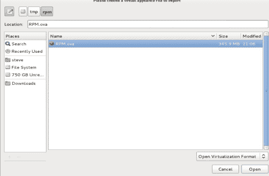
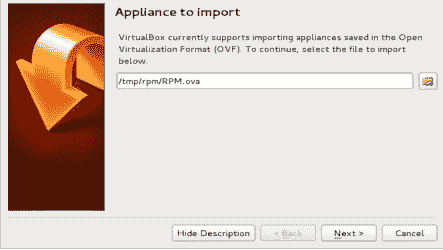
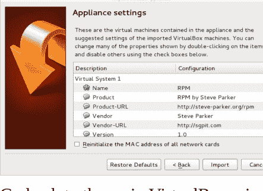
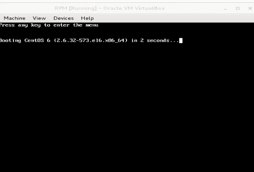
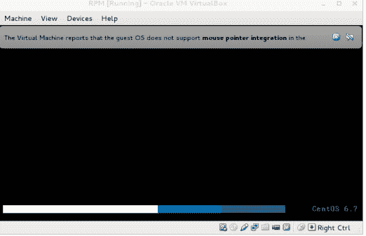

# 如何创建 RPM：Linux RPM 创建实用指南


献给我的妻子 Jackie。

# 本书使用的格式规范

本书中的格式规范相当标准；正文采用衬线字体，类似于你正在阅读的文本。系统文件和命令（如 `rpmbuild`）显示为等宽字体 `/etc/hosts` 等。

交互式会话的输出显示在浅灰色背景上；**粗体文本**的命令，例如在此处输入 "cd" 和 "mkdir rpmbuild"：

```
rpm@packaging ~]$ cd
rpm@packaging ~]$ mkdir rpmbuild
```

提示框显示在较浅的背景上，带有边框，并突出显示特定项目，包括关于从哪里下载文件的提醒：

> 如果你正在使用虚拟机镜像之一，文件可以在 ~/files/ 目录中找到。或者，从 howtocrepm 下载 "files" 软件包。

如果一行输入过长，无法在打印书籍的宽度内显示，则会显示反斜杠表示命令延续到下一行（该行将缩进）。你可以像下面这样直接输入，分成多行：

```
cp my-first-rpm-1.0 \
~/rpmbuild/SPECS
```

或者你可以删除反斜杠和换行，将它们全部写在一行，如下：

```
cp my-first-rpm-1.0.spec ~/rpmbuild/SPECS/
```

你可能会发现第二种方案更容易。你使用的任何 shell 都会接受这两种格式。有时，将提示符显示为单个 "$" 比其通常的更清晰，而不是这样：

```
rpm@packaging ~]$ mkdir ~/rpmbuild/my-first-rpm-2.0
rpm@packaging ~]$ cp COPYING ~/rpmbuild/my-first-rpm-2.0/
rpm@packaging ~]$ cp LICENSE ~/rpmbuild/my-first-rpm-2.0/
```

我们有时会这样显示命令，这样更易读：

```
$pwd
/home/rpm/
$ mkdir ~/rpmbuild/my-first-rpm-2.0
$ cp COPYING ~/rpmbuild/my-first-rpm-2.0/
$ cp LICENSE ~/rpmbuild/my-first-rpm-2.0/
```

注意，这里额外的 "pwd" 命令确认了当前位置是 /home/rpm/，因为从提示符中已经不再明显了。

# 简介

RPM 软件包的创建通常被 IT 行业的许多人视为一种“黑术”，特别是那些主要经验和专业知识并非来自（有时小众的）Linux 开发社区的人士。本书适用于以下人员，但不限于此：

- 需要分发代码的开发者
- 需要在服务器上安装和管理的系统管理员
- 需要为项目创建或修改 RPM 的 DevOps 工程师
- 想要了解这些机制的学生

以及其他对 RPM 感兴趣的人。

网上有一些优秀的（免费的）RPM 参考（见参考文献），但对于外部人士来说，这些内容显然并不容易获取。

本书是为那些只想能够创建 RPM 软件包的人士编写的；如果你想学习如何通过 RPM 完成更多工作而不只是安装几个文件，我们也涵盖了这些，并继续介绍你需要的所有细节，以便你根据需要随时查阅。你可能会发现，当你开始创建越来越强大且灵活的 RPM 软件包时，你会发现自己想要使用更多的功能。

# 为什么用 RPM?

相比于例如分发 tarball（.tar 压缩归包），RPM 有许多优势；本书更多侧重于创建 RPM 的实用性，而不是对任何特定技术的传道，但用一个词来说，RPM 的关键优势是“元数据”。

# 元数据

《牛津词典》将数据定义为“描述并提供其他数据信息的数据”。这就是为什么 RPM 比 tarball 或直接将执行文件复制到系统中有用得多。RPM 数据库跟踪已安装的软件包、它们提供的文件和功能，以及其他信息，例如创建者、许可情况以及许多细节。

将 tarball 与 RPM 文件比较，两者都包含所需的数据——安装的文件，但 RPM 还包含许多额外的元数据。虽然这给 RPM 创建者带来了额外负担，但其收益是巨大的，而且前期成本相对较低。一旦你开始更新 RPM，收益将显著增加，而成本将变得微乎其微。

通过提供关于软件软件包及其包含的文件的少量元数据，你可以比随意将软件套在系统上做得多得多。仅仅是升级软件包就能处理移除过时文件并部署新文件，就是一个巨大的胜利。

RPM 内部对配置文件的特殊处理是另一个优势——因为 RPM 知道哪些文件是文档、哪些是执行文件、哪些是配置文件，它可以对它们进行特殊对待并更智能地处理它们。

# YUM

Yum（以及它更新的替代品 DNF）是一个与 RPM 仓库工作的工具，它能够计算 RPM 之间所有的依赖关系，并安装或升级用户请求安装的 RPM 及其所有依赖项。本章将展示 `rpm-build` 软件包本身的安装，如果你想查看其工作原理，它还包括自动下载 `rpm-build` 的依赖项。

在没有 Yum 干预的情况下，手动安装 RPM 是完全可能的，但你很容易发现陷入了“RPM 地狱”——你找到了需要安装的 RPM，但它需要另一个库，因此你必须找到并下载正确版本库的 RPM。一旦你完成了这一步，你会发现这第二个 RPM 也有它自己的依赖，所以你必须继续寻找并下载它们，如此循环地掉进兔子洞。Yum 利用这些丰富的元数据来检查并确保它可以获取安装你所需软件包的全部必要 RPM。

# 准备工作

为了完成书中的示例，拥有一个可以操作的系统将非常有帮助。在创建 RPM 的系统上不需要 root 权限，但在安装 RPM 时，你需要 root 权限。

如果你已经有一个可以用来创建和安装 RPM 的系统，请跳到第 2 章；否则，请继续第 1 章，下载或创建一个虚拟机，并将其准备为我们创建 RPM 的环境。

你可以从 http://bit.ly/howtocreateanrpm 下载 Virtualbox 虚拟机，该虚拟机已经配置了必要的软件以及完成书书中示例所需的文件。

# 第 1 章：准备创建 RPM

## 第 1 步：安装 VirtualBox

你可以使用任何虚拟平台，也可以使用任何现有的基于 RPM 的 GNU/Linux 操作系统，无论是在物理服务器还是虚拟机上。如果你计划使用现有的系统（无论物理还是虚拟），可以跳到第 3 步“连接”。否则，请继续阅读关于安装 VirtualBox 以及下载本本书配套使用的准备虚拟机的说明。

如果你使用的是基于 Debian 的 Linux 系统（如 Ubuntu、Mint 或 Debian），你应该可以直接运行 `sudo apt-get install virtualbox`，或者在软件中心中搜索。对于 CentOS 和其他 Red Hat 派系，请参阅 https://wiki.centos.org/HowTos/Virtualization/VirtualBox 了解如何安装 VirtualBox。

如果你使用的是上述未提到的 Windows、Mac OSX GNU/Linux 发行版，可以从 https://www.virtualbox.org/wiki/Downloads 下载 VirtualBox。

## 第 2 步：下载镜像

为了本书的内容，我提供了一个 CentOS 6.7 VirtualBox 镜像，你可以从 http://bit.ly/rpmbuild 下载——这是一个 346M 的 CentOS 6.7 镜像，已安装了 rpmbuild 软件包，并配置了 EPEL 仓库但尚未启用——如果你想使用 EPEL 软件包，只需编辑 `/etc/yum.repos.d/epel.repo`，将第一个 `[epel]` 节中的 `enabled=0` 改为 `enabled=1` 即可。

root 密码为 `rpm`，尽管你不需要使用 root 账户来创建 RPM；系统配置了一个名为 `rpm` 的用户；密码为 `rpm`。`/etc/sudoers` 文件也配置为允许 rpm 用户通过 sudo 访问 root 账户（需要密码提示）。

该镜像配置了 8GB 的根磁盘，设置为根据需要扩展，尽管它会在虚拟机内部增加更多文件。因此，理想情况下，你应该在安装它的设备上留出最多 8GB 的空间。

要下载虚拟机，请将浏览器指向 http://bit.ly/rpmbuild，从那里你可以下载一个 OVA 镜像，并将其作为设备（Appliance）导入 VirtualBox。

请参考附录 A 获取安装 OVA 镜像的步骤。

你可能需要重新配置网络设备；它被设置为 DHCP 客户端并桥接到“eth1”设备。你的网卡可能不名为“eth1”；可能是“eth0”，或者在 Windows 上有更复杂的名称。

请参考附录 B 获取在虚拟机上设置静态 IP 地址的详情。

## 第 3 步：连接

VirtualBox 控制台本身不是最方便的操作的地方，你无法使用复制/粘贴功能，而且控制台小而笨；为了更灵活的工作环境，你可能希望通过网络登录。如果你在网络上有一个可以工作的 Linux 或 Mac 系统，可以使用 ssh 连接到虚拟机。第一次连接时，你需要将主机的 SSH 密钥添加到你的 .known hosts 文件中。当你对“Are you sure you want to continue connecting”回答“yes”时，这会自动完成。

```
steve@hostbox:~$ ssh root@192.168.1.30
(192.168.1.30)' can't be established.
The authenticity of host '192.168.1.30'
RSA key fingerprint 5d:a5:f4:c0:6d:75:3d:85:42:7e:34:6f:aa:25.
Are you want to continue connecting (yes/no?) yes
Warning: Permanently added '192.168.1.30' (RSA) to the list of known hosts.
root@192.168.1.30 password: rpm
Last login: Wed Aug 26 17:56:35 2015
[root@packaging]#
```

如果你是 Windows 主机，PuTTY 是一个很好的客户端。你可以从 http://www.putty.org 获取（在 Windows 上只需要一个独立的 .exe 文件）。

## 第 4 步：安装 rpm-build

如果你已经下载了 VirtualBox，可以跳过此步；如果你已有系统但未安装 rpm-build 软件包，则需要安装它。请注意，虽然提供了 rpmbuild 程序（不带连字符），但软件包名为 rpm-build（带连字符）。请参考附录 C 获取如何从本地 DVD 镜像设置仓库。


```
[root@packaging ~] yum -y install rpm-build
Loaded plugins: fastestmirror
Setting up mirror
Loading mirror list from cache
* base: centros.com
* extras: mirrorlist
* updates: mirroring
Resolving Dependencies
Running transaction check
--> Package rpm-build.x86_64 0:4.8.0-47.el6 will be installed
--> Processing Dependency: patch >= 2.5 for package: rpm-build-4.8.0-47.el6
--> Processing Dependency: elutils >= 128 for package: rpm-build-4.8.0-47.el6
--> Processing Dependency: xz for package: rpm-build-4.8.0-47.el6
--> Processing Dependency: unzip for package: rpm-build-4.8.0-47.el6
--> Processing Dependency: system-config for package: rpm-build-4.8.0-47.el6
--> Processing Dependency: threads for package: rpm-build-4.8.0-47.el6
--> Processing Dependency: Queue for package: rpm-build-4.8.0-47.el6
--> Processing Dependency: GetOpt for package: rpm-build-4.8.0-47.el6
--> Processing Dependency: Type for package: rpm-build-4.8.0-47.el6
--> Processing Dependency: Basename for package: rpm-build-4.8.0-47.el6
--> Processing Dependency: lz for package: rpm-build-4.8.0-47.el6
--> Processing Dependency: /usr/bin/perl/add-index for package: rpm-build-4.8.0-47.el6
Running transaction check
--> Package elutils.x86_64 0:161-3.el6 will be installed
--> Package gdb.x86_64 0.7-83.el6 will be installed
--> Package patch.x86_64 2.6-6.el6 will be installed
--> Package perl.x86_64 4:5.10.1-141.el6 will be installed
--> Processing Dependency: perl-libs = 4:5.10.1-141.el6 for package: 4:5.10.1-141.el6
--> Processing Dependency: perl-libs for package: 4:5.10.1-141.el6.x86_64
--> Processing Dependency: perl(version) for package: 4:5.10.1-141.el6.x86_64
--> Processing Dependency: perl(Pod::Simple) for package: 4:5.10.1-141.el6.x86_64
--> Processing Dependency: perl(Module::Pluggable) for package: 4:5.10.1-141.el6.x86_64
--> Processing Dependency: libperl.so(64bit) for package: 4:5.10.1-141.el6.x86_64
--> Processing Dependency: redhat-rpm-config noarch:9.0.3-44.el86.centos will be installed
-- Package unzip.x86_64 0:6.0-2.el86 will be installed
-- Package xz.x86_64 0:4.999.9-0.5.beta.20091007git.el6 will be installed
-- Package xz-lzma-compat.x86_64 0:4.999.9-0.5.beta.20091007git.el will be installed
Running transaction check
-- Package perl-Module-Pluggable.x86_64 1:3.90-141.el86 will be installed
-- Package Dependency:perl-Pod-Simple.x86_64 1:3.13-141.el86 will be installed
-- Processing Dependency:perl(Pod::Escapes) >= 1.04 for package: 4:perl-Pod-Simple-3.13-141.el86_64 4:5.10.1-141.el86 will be installed
-- Package perl-version.x86_64 3:0.77-141.el86 will be installed
Running transaction check
-- Package perl-Pod-Escapes.x86_64 1:1.04-141.el86 will be installed
-- Finished Dependency Resolution
```

## Dependencies Resolved

| Package Arch Version Repository Size |
|=======================================|
| Installing:rpm-build.x86_64 4.8.0-47.el6 base 130 k |
| Installing for dependencies:
elutils.x86_64 0:161-3.el6 base 237 k |
| gdb.x86_64 0.7-83.el6 base 2.3 M |
| patch.x86_64 2.6-6.el6 base 90 k |
| perl.x86_64 4:5.10.1-141.el6 base 10 M |
| perl-Module-Pluggable.x86_64 1:3.90-141.el86 base 40 k |
| perl-Pod-Escapes.x86_64 1:1.04-141.el86 base 33 k |
| perl-Pod-Simple.x86_64 1:3.13-141.el86 base 213 k |
| perl-libs x86_64 4:5.10.1-141.el86 base 578 k |
| perl-version x86_64 3:0.77-141.el86 base 52 k |
| redhat-rpm-config noarch 9.0.3-44.el86.centos base 59 k |

| unzip.x86_64 0:6.0-2.el86 base 149 k |
| xz.x86_64 0:4.999.9-0.5.beta.20091007git.el6 base 137 k |
| xz-lzma-compat.x86_64 0:4.999.9-0.5.beta.20091007git.el base 16 k |

## 下载软件包：

| (1/14) | elfutils-0.161-3.el6 | 27 KB | 00:00 |
| (2/14) | gdb-7.2-83.el86.x86 | 2.3 MB | 00:07 |
| (3/14) | patch-2.6-6.el16.x86 | 90 KB | 00:00 |
| (4/14) | perl-5.10.1-141.el6 | 10 MB | 00:04 |
| (5/14) | perl-Module-Pluggable | 40 KB | 00:00 |
| (6/14) | perl-Pod-Escapes-1.0 | 33 KB | 00:00 |
| (7/14) | perl-Pod-Simple-3.13 | 213 KB | 00:00 |
| (8/14) | perl-libs-5.10.141 | 578 KB | 00:01 |
| (9/14) | perl-version-0.77 | 52 KB | 00:02 |
| (10/14) | redhat-rpm-config-9 | 59 KB | 00:00 |
| (11/14) | rpm-build-4.8.0.0 | 130 KB | 00:00 |
| (12/14) | unzip-6.0.2.el6.x | 140 KB | 00:00 |
| (13/14) | xz-4.999-9.0.5. | 137 KB | 00:00 |
| (14/14) | xz-lzma-compat-4.99 | 16 KB | 00:00 |

总计 114 kB/s | 14 MB | 02:07

warning: rmpts_HdrFromHeader: Verify VSA/RSA Signature, key ID c01b5b9de:nkey

正在从 `/etc/pki/rpm/RPM-GPG-KEY-CentOS-6` 获取密钥

导入密钥 C01b5b9de:
用户 ID : CentOS-6 (CentOS 6 官方签名密钥) <centos-key@centos.org>
软件包 centos-release-6.7.el6.102.3.x86_64 (anaconda-CentOS15080422.x86_64/7)

来自： `/etc/pki/rpm/RPM-GPG-KEY-CentOS-6`
正在运行 rpm_check_debug
正在运行事务测试
事务成功
正在运行事务

- 正在安装：xz-4.999-9.0.5.beta.20091007 1/14
- 正在安装：xz-lzma-compat-4.999-0.5.b 2/14
- 正在安装：perl-Pod-Escapes-1.04.141.el6 3/14
- 正在安装：perl-version-0.77-141.el6 4/14
- 正在安装：perl-Module-Pluggable-3.90 5/14
- 正在安装：perl-libs-5.10.1-141.el6 6/14
- 正在安装：perl-Pod-Simple-3.13-141.el6 7/14
- 正在安装：perl-libs-5.10.141.el6.x86_64 8/14
- 正在安装：redhat-rpm-config-9-9.0.3.a 9/14
- 正在安装：unzip-6.0.2.el6.x86_64 10/14
- 正在安装：patch-2.6-6.el16.x86 11/14
- 正在安装：elfutils-0.161-3.el16.x86_64 12/14
- 正在安装：gdb-7.2-83.el86.x86 13/14
- 正在安装：rpm-build-4.8.0-47.el86.x86 14/14
- 正在验证：perl-Pod-Simple-3.13-141.el6 1/14
- 正在验证：gdb-7.2-83.el86.x86 2/14
- 正在验证：elfutils-0.161-3.el16.x86_64 3/14
- 正在验证：perl-version-0.77-141.el6 4/14
- 正在验证：perl-Module-Pluggable-3.90 5/14
- 正在验证：xz-lzma-compat-4.999-0.5.b 6/14
- 正在验证：patch-2.6-6.el16.x86 7/14
- 正在验证：unzip-6.0.2.el6.x86_64 8/14
- 正在验证：xz-4.999-9.0.5.beta.20091007 9/14
- 正在验证：perl-Pod-Escapes-1.04.141.el6 10/14
- 正在验证：perl-libs-5.10.1-141.el6 11/14
- 正在验证：4:perl-libs-5.10.1-141.el.x 12/14
- 正在验证：redhat-rpm-config-9.0.3-44.e 13/14
- 正在验证：4:perl-5.10.1-141.el6.x86_64 14/14

已安装：
rpm-build.x86_64 0:4.8.0-47.el6

已安装依赖：
elfutils.x86_64 0:0.161-3.el6
gdb.x86_64 0:7.2-83.el86
patch.x86_64 0:2.6-6.el16
perl.x86_64 0:5.10.1-141
perl-Module-Pluggable.x86_64 0:3.90
perl-Pod-Escapes.x86_64 0:1.0-141
perl-Pod-Simple.x86_64 0:3.13-141
perl-libs.x86_64 0:5.10.1-141
perl-version.x86_64 0:0.77-141
redhat-rpm-config.noarch 0:9.0.3-44
unzip.x86_64 0:6.0.2.el6
xz.x86_64 0:4.999-9.0.5.beta.20091007
xz-lzma-compat.x86_64 0:4.999-0.5.b

你现在拥有了创建 RPM 的必要工具。

# 第 2 章：创建一个 RPM

RPM 有两种类型：源 RPM（称为 SRPM）和二进制 RPM（后者是执行代码）。二进制 RPM 不包含任何源代码，它是最终的软件包。

开始之前，我们将为 RPM 构建创建一个目录：

```bash
mkdir -p ~/rpmbuild/BUILD ~/rpmbuild/RPGS ~/rpmbuild/RPMS ~/rpmbuild/SOURCES
```

然后进入该目录：

```bash
cd ~/rpmbuild
```

现在我们将创建一个 spec 文件。该文件是 RPM 的核心，告诉 `rpmbuild` 如何构建软件包。

```bash
vi my-rpm.spec
```

在 spec 文件中，添加以下内容：

```spec
Name: my-rpm
Version: 1.0
Release: 1
Summary: 这是一个测试 RPM
License: none
Description:
我的测试 RPM
```

保存 spec 文件后，我们将运行 `rpmbuild` 来创建 RPM：

```bash
rpmbuild -bb my-rpm.spec
```

这将 RPM 文件创建在 `~/rpmbuild/RPMS/` 目录下。

现在我们可以使用 `rpm -q` 命令检查该 RPM 文件：

```bash
rpm -q ~/rpmbuild/RPMS/x86_64/my-rpm-1.0-1.x86_64.rpm
```

输出将显示我们刚刚创建的 RPM 文件的元数据。

# 第 3 章：rpmbuild 的输出

`rpmbuild` 命令的输出将显示它构建软件包时正在执行的步骤。以下是输出示例：

（请参见上方的输出）

## 第 3 章：创建一个实用的二进制 RPM

现在你可以创建一个 RPM 文件了，你可以开始向其中添加文件，并开始为软件包指定各种看起来很专业的元数据。我们将从元数据开始。上一节末尾显示的许多 `rpm -qip` 输出看起来，这些 RPM 就像是由一个几乎不会制作 RPM 的人创建的，而且只要弄出一个稍微有点能用的东西就停止了。我们可以做得好得多，而且这并不困难！

在 `rpm -qip` 输出的左侧列中，我们的情况还不错。我们可以指定该包属于哪个包组（建议组的列表请参见附录 D）。

第二列是更多的管理信息，包括许可信息。许可这个主题值得稍微题题一下：

### 许可

在第二列中，我们没有指定供应商（Vendor）或许可类型（License）。如果打包者（Packager）与供应商不同，也可以指定打包者（例如，红帽公司可能会对 Apache 软件基金会创建的软件进行打包，以将其包含在 Red Hat Enterprise Linux 中，使 ASF 为供应商，而 Red Hat 为打包者）。对于软件包的第一个版本，我们实际上指定了许可为“none”，因为如果你不放入任何文本，`rpmdbbuild` 将拒绝创建软件包。在没有某种许可的情况下分发任何东西是没有意义的。GPL 和 BSD 许可是 GNU/Linux 发行版中最常见的。你也可以同样地在这里指定专有软件许可。通常情况下使用“Proprietary”一词。无论许可是什么，在软件包中包含一个许可文本文件是常见的。在基于 Red 的系统中，这通常位于 `/usr/share/doc/{name}-{version}/LICENSE`。例如，Red 6 上的 `ethtool` 包带有这些文件：

```
[rpmpackaging SPECS]$ rpm ql ethtool
/sbin/ethtool
/usr/bin/ethtool
/usr/share/doc/ethtool-3.5/AUTHORS
/usr/share/doc/ethtool-3.5/COPYING
/usr/share/doc/ethtool-3.5/ChangeLog
/usr/share/doc/ethtool-3.5/LICENSE
```


`/usr/share/doc/ethtool-3.5/NEWS`

`/usr/share/doc/ethtool-3.5/README`

`/usr/share/man/man8/ethtool.8.gz`

```
```

除了二进制文件本身（`/usr/sbin/ethtool`只是`/sbin/ethtool`的链接，以你想奇的话）和`ethtool.8.gz`帮助页外，`/usr/share/doc`中还有一组典型的文本文件随程序。spec文件中的`License`字段不需要过于详细，只需让人们知道软件包是在哪种许可下分发的即可。

## 构建软件包（第二次）

对于我的RPM的第二个版本，更新第一个spec文件，并添加更多细节。

> 如果你下载了我的镜像，可以在`files/chapter3/take2.spec`找到更新后的文件，也可以从http://build/howtocreaterpm的"files"压缩包中下载（所有这些文件都是）。

我们应该添加几行描述——这通常是一个段落，比单行格式允许更详细地描述软件包。

由于这本书是文档的，我还会说我的RPM本身是文档包组的一部分。你的RPM可能是`Applications/System`、`Amusements/Games`或其它——类别列表请参见附录E。

我还会添加一个`License`和`Vendor`。我将`Release`从1增加到了2。`Release`必须始终是一个整数，每当你从软件版本发布新版本时，它就会增加。如果软件本身发生了变化，那么`Version`也需要更新。你可以这样理解Releases和Versions：

| Event | Version | Release | RPM Name |
| :--- | :--- | :--- | :--- |
| 发布新软件 | 1.0 | 1 | name-1.0-1 |
| 软件更新到版本1.1 | 1.1 | 1 | name-1.1-1 |
| 版本1.1使用更好的描述重新打包 | 1.1 | 2 | name-1.1-2 |
| 软件更新到版本1.2 | 1.2 | 1 | name-1.2-1 |
| 版本1.2使用更新的依赖重新打包 | 1.2 | 2 | name-1.2-2 |
| 版本1.2使用符号符号链接重新打包 | 1.2 | 3 | name-1.2-3 |
| 软件更新到 | 1.3 | 1 | name-1.3-1 |

生成的`my-first-rpm-1.0-2.spec`文件现在像这样（我在构建机器的`/etc/hosts`中了主机名，这样我们在构建新RPM时就不会报错）。

```
Name: my-first-rpm

Release: 2

Summary: This is my first RPM

License: GPLv2

Version: 1.0

Vendor: Steve Parker

Group: Documentation
```

```
%description

这是我的第一个RPM包。我可以在这里更详细地描述它。通常将这些部分格式化为80列，以便在任何屏幕上轻松阅读。
```

```
%files

我们准备好构建软件包的第二个版本了。回到rpmbuild：
```

```
[rpmpackaging SPECS]$ rpmbuild -bb \
my-first-rpm-1.0-2.x86_64
Processing files: my-first-rpm-1.0-2.x86_64
Checking for unpackaged file(s): /usr/lib/rpm/check-files /home/rpm/rpmbuild/BUILDROOT/my-first-rpm-1.0-2.x86_64
Warning: Could not canonicalize hostname: packaging.sgit.com
Write: /home/rpm/rpmbuild/RPMS/x86_64/my-first-rpm-1.0-2.x86_64.rpm
Executing(%clean): /bin/sh -e /var/tmp/rpm-tmp.DK6SM
+ umask 0022
+ cd /home/rpm/rpmbuild/BUILDROOT
+ /bin/rm -rf /home/rpm/rpmbuild/BUILDROOT/my-first-rpm-1.0-2.x86_64
+ exit 0
```

当我们检查新软件包时，呈现效果现在好多了：

```
Name : my-first-rpm               Relocations: (not relocatable)
Version : 1.0                  Steve Parker
Release : 2                    Build Date: Sun Feb 14 2016 12:29:17 EST
Install: (not installed)         Build Host: packaging.sgit.com
Group                          Source: my-first-rpm-1.0-2.src.rpm
Size : (none)                   License: GPL2
Signature : This is my first ever RPM
Description:
This is my first ever RPM. I can describe it more thoroughly here. It is
normal to format these sections as 80 columns, so that it can easily
read on any screen.
```

## 添加一些文件

这个RPM仍然毫无用处，因为它仍然不包含任何文件。创建一个小的shell脚本，

> 再次，`my-first-program`（及其配置文件`first-program.conf`）可以在`files/chapter3/take3`中找到，或者从http://bit.ly/howcreaterpm下载。

```
#!/bin/bash

set USER_NAME
CONFIG=/etc/first-program.conf
[ -f $CONFIG ] && \
[ -z "$USER_NAME" ] && echo "Hello, ${USER_NAME}"
echo "This is a very simple script as an example of a packaged program."
```

像许多程序一样，它使用一个配置文件`/etc/first-program.conf`：

- 这是`first-program`的配置文件。
- 你可以在这里定义`USER_NAME`变量，例如：
- `USER_NAME=Fred`

它还有一些配套文档，一个README文件：

这是一个非常简单的程序。
如果在`/etc/first-program.conf`中定义了`USER_NAME`，它将通过你的名字向你问好。
它将显示一条消息。

由于这是一个GPL2许可程序，我还提取了之前在`ethtool`包中看到的`COPYING`和`LICENSE`文件。这是GPL许可软件的要求；如果你在打包某些现有软件，它应该带有其所需的任何许可文件。如果你在打包自己的软件，你应该为你选择的许可提供任何必要的文档。

由于我们更改了实际软件（第一次添加了一些内容！），`Version`增加了，`Release`号重置为1。因此这是版本2.0，Release1，也表示为`my-first-rpm-2.0-1`。

我们spec文件的第三次迭代如下：

| Name: | my-first-rpm |
| Release: | 1 |
| Summary: | This is my first ever RPM |
| License: | GPL2 |
| Version: | 2.0 |
| Vendor: | Steve Parker |
| Group: | Documentation |

%description
这是我的第一个RPM包。我可以在这里更详细地描述它。通常将这些部分格式化为80列宽，以便在任何屏幕上轻松阅读。

可在任何屏幕上阅读。

```
%files
/usr/bin/my-first-program
%config /etc/my-first-program.conf
%doc %name-%version/README
%doc %name-%version/COPYING
%doc %name-%version/LICENSE
```

我们将在下方的“构建软件包”部分讨论`%config`和`%doc`指令，尽管我确定你已经猜出它们的含义！

## 放置文件

为了将这些文件包含在RPM中，我们需要将它们放入`$HOME/rpmbuild/BUILDROOT`目录。至少，前两个文件是这样的；稍后我们将查看文档文件。

从名为`files/chapter3/take3`目录下的文件开始，将它们从所在地复制到名为`rpmbuild/BUILDROOT/$name-$version-release.arch`的目录中。在这种情况下，它是`$HOME/rpmbuild/BUILDROOT/my-first-rpm-2.0-1.x86_64`。我们创建一个文件系统的模拟根目录，它将用于创建软件包：

```
[rpmpackaging take3] pwd
/home/rpm/files/chapter3/take3
[rpmpackaging take3] ls -la
my-first-program.config
my-first-program-2.0-1.spec
LICENSE
my-first-program README
[rpmpackaging take3] mkdir -p ~/rpmbuild/BUILDROOT/\
my-first-rpm-2.0-1.x86_64/usr/bin/
[rpmpackaging take3] cp -rp ~/rpmbuild/BUILDROOT/\
my-first-rpm-2.0-1.x86_64/usr/bin/
[rpmpackaging take3] cp -rf my-first-program \
~/rpmbuild/BUILDROOT/my-first-rpm-2.0-1.x86_64/usr/bin/
[rpmpackaging take3] cp -rf my-first-program.config \
~/rpmbuild/BUILDROOT/my-first-rpm-2.0-1.x86_64/etc/
[rpmpackaging take3] $
```

文档文件是另一回事，因为我们没有在文件系统中指定指定它们的去向——`%{name}-%{version}/README`是相对路径，而不是绝对路径（它不以"/"开头）。当构建RPM时，`%docdir`默认决定位置（`/usr/share/doc`），但它可以位于任何地方。对于这些文件，我们将它们放入BUILD目录，因为那是RPM期望找到它们的地方：

```
$ pwd
/home/rpm/files/chapter3/take3
$ mkdir ~/rpmbuild/BUILD/my-first-rpm-2.0/
$ cp COPYING ~/rpmbuild/BUILD/my-first-rpm-2.0/
$ cp LICENSE ~/rpmbuild/BUILD/my-first-rpm-2.0/
```

现在整个树结构看起来像这样（上一次构建的1.0-1rpm文件仍然显示在这里）：

```
[rpmpackaging take3] cd ~/rpmbuild/
[rpmpackaging rpmbuild] find -type f
/BUILD/my-first-program-2.0/COPYING
/BUILD/my-first-program-2.0-1.x86_64/etc/my-first-program.config
/BUILD/my-first-rpm-2.0-1.x86_64/usr/bin/my-first-program
/RPM/x86_64/my-first-rpm-1.0-1.x86_64.rpm
[rpmpackaging rpmbuild] $
```

## 构建软件包（第三步）

我们现在准备好返回`files/chapter3/take3`目录并构建我们的软件包。输出内容比之前多得多，因此我再次对行进行编号，以便我们详细讨论：

| 行 | 文本 |
|---|---|
| 1 | `rpm@packaging take3]$ cd ~/files/chapter3\n[rpm@packaging take3]$ cd take3\n[rpm@packaging take3]$ rpmbuild -bb \ my-first-rpm-2.0-1.spec` |
| 2 | Processing files: my-first-rpm-2.0-1.x86_64 |
| 3 | Executing(%doc): /bin/sh -e /var/tmp/rpm-tmp.ryqrzs |
| 4 | + umask 022 |
| 5 | + cd /home/rpm/rpmbuild/BUILD |
| 6 | + nDOCDIR=/home/rpm/rpmbuild/BUILDROOT/my-first-rpm-2.0-1.x86_64/usr/share/doc/my-first-rpm-2.0 |
| 7 | + export DOCDIR |
| 8 | + rm -rf /home/rpm/rpmbuild/BUILDROOT/my-first-rpm-2.0-1.x86_64/usr/share/doc/my-first-rpm-2.0 |
| 9 | + /bin/mkdir -p /home/rpm/rpmbuild/BUILDROOT/my-first-rpm-2.0-1.x86_64/usr/share/doc/my-first-rpm-2.0 |
| 10 | + cp -pr my-first-rpm-2.0/README /home/rpm/rpmbuild/BUILDROOT/my-first-rpm-2.0-1.x86_64/usr/share/doc/my-first-rpm-2.0 |
| 11 | + cp -pr my-first-rpm-2.0/COPYING /home/rpm/rpmbuild/BUILDROOT/my-first-rpm-2.0-1.x86_64/usr/share/doc/my-first-rpm-2.0 |
| 12 | + cp -pr my-first-rpm-2.0/LICENSE /home/rpm/rpmbuild/BUILDROOT/my-first-rpm-2.0-1.x86_64/usr/share/doc/my-first-rpm-2.0 |
| 13 | + exit 0 |
| 14 | Provides: config(my-first-rpm) = 2.0-1 |
| 15 | Requires(rpmlib): mlib(CompressedFileNames) <= 3.0.4-1\nrpmlib(PayloadFiles) <= 2.0 |
| 16 | Requires: /bin/bash |
| 17 | Checking for unpacked files: /home/rpm/rpmbuild/BUILDROOT/my-first-rpm-2.0-1.x86_64 |
| 18 | Wrote: /home/rpm/rpmbuild/RPMS/x86_64/my-first-rpm-2.0-1.x86_64.rpm |
| 19 | Executing(%doc): /bin/sh -e /var/tmp/rpm-tmp.ryqrzs |
| 20 | + umask 022 |
| 21 | + cd /home/rpm/rpmbuild/BUILD |
| 22 | + rm -rf /home/rpm/rpmbuild/BUILDROOT/my-first-rpm-2.0-1.x86_64/usr/share/doc/my-first-rpm-2.0 |
| 23 | + exit 0 |
| 24 | [rpm@packaging take3]$ |

文档文件是另一回事，因为我们没有在文件系统中指定指定它们的去向——`%{name}-%{version}/README`是相对路径，而不是绝对路径（它不以"/"开头）。当构建RPM时，`%docdir`默认决定位置（`/usr/share/doc`），但它可以位于任何地方。对于这些文件，我们将它们放入BUILD目录，因为那是RPM期望找到它们的地方：

## 不要清理！

由于我们仔细将文件放在了那里，而且在现实生活中我们可能需要创建几次RPM达到要求，我们可以通过在spec中添加自己的`%clean`部分来停止这样做。让我们最后更新一次spec文件。

```spec
Name: my-first-rpm

Release: 2

Summary: 这是这是我的第一个RPM

License: GPLv2

Version: 2.0

Vendor: Steve

Group: Documentation

%description

这是我的RPM软件包。我可以在这里详细描述RPM。

%clean

echo "在此不进行清理。"

%files

/usr/bin/my-first-program
```


`%config /etc/my-first-program.conf`

`%doc %name-%version/README`

`%doc %name-%version/LICENSE`

```
我们可以移除重新配置的根目录并再次创建软件包：
```

```
[rpmpackaging take3] $ rpmbuild -bb my-first-spec-2.0-2.spec

[ 'you've seen the output already; committed this time ]

[rpmpackaging take3] $
```

现在我们检查 BUILDROOT，所有文件都留在原位。

```
$ rpm -iv ~/rpm/build/x86_64/my-first-rpm-2.0-2.x86_64.rpm

########################################### [100%]
Preparing...

[rpmpackaging take3] $
```

```bash
[rpmpackaging taking] cd - /rpmbuild/BUILDROOT

[rpmpackaging rebuild] find . -type \
/my-first-rpm-2.0-1.x64/usr/share/doc/my-first-rpm-2.0/LICENSE
/my-first-rpm-2.0-1.x64/usr/share/doc/my-first-rpm-2.0/README
/my-first-rpm-2.0-2.x64/usr/share/doc/my-first-rpm-2.0/COPYING
/my-first-rpm-2.0-2.x64/etc/first-program.conf
/my-first-rpm-2.0-2.x64/bin/first-program
/my-first-rpm-2.0-2.x64/usr/share/doc/my-first-rpm-2.0/LICENSE
/my-first-rpm-2.0-2.x64/usr/share/doc/my-first-rpm-2.0/README
/my-first-rpm-2.0-2.x64/usr/share/doc/my-first-rpm-2.0/COPYING
[rpmpackaging rebuild]
```

值得注意的是，尽管我们采取了措施来禁用该功能，但自动清理 BUILDROOT 目录是 `rpmbuild` 应该执行的正确操作，因为它假设我们正在使用它的所有功能，而且我们不希望留下之前构建中可能损坏的产物。我们在这里所做的是创建 RPM 的一种“坏习惯”捷径，但这种方法对于许多用途来说是**足够好 (Good Enough™)**，我发现像 `my-first-rpm-2.0-1.spec` 这样的 spec 文件几乎可以作为一个快速组装 RPM 包的有用模板。再进行三个微调——权限、安装脚本和日志——将使其变得更具实用性。这些将在接下来的三个章节中介绍。

## 第 4 章：权限 (Permissions)

默认情况下，打包文件的权限将与它们在你的 BUILDROOT 目录中的权限完全相同，就像 `tar` 命令一样。这在某种程度上是可以接受的，但文件的所有者可能是你自己的用户名，这可能不是你想要的。

当你没有提供任何直接要求时，可以通过在 `%files` 指令之后使用 `%defattr` 参数来指定文件的默认权限。你可以使用 `%attr` 指令对任何给定的文件覆盖此设置。例如，要将默认权限设置为 `0755`，所有者为 `root`，组为 `root`，但让配置文件的权限为 `0644`，你可以在 spec 文件中使用以下内容：

```
%files
%defattr(0755,root,root)
/usr/bin/my-first-program
%attr(0644,root,root)%config /etc/my-first-program
%doc %name-version/README
%doc %name-version/COPYING
%doc %name-version/LICENSE
```

将 `my-rpm-2.0-1.spec` 文件复制到 `my-rpm-3.0-1.spec`，将 Version 更新为 3，将 Release 重置为 1，并复制 BUILDROOT 以使其目录名称与新的 Release 匹配：

```bash
[rpm@packaging SPECS] $ cp my-rpm-2.0-1.spec my-rpm-3.0-1.spec
[rpm@packaging SPECS] $ vi my-rpm-3.0-1.spec (只是为了更新 Release)
[rpm@packaging SPECS] $ cd ../BUILDROOT/
[rpm@BUILDROOT] $ cp -r my-rpm-2.0-1.x86_64/ my-rpm-3.0-1.x86_64/
```

当你安装 RPM 时，你可以看到权限已设置在 spec 文件中：

```bash
$ rpm -bb my-first-rpm-3.0-1.spec
$ rpm -ivh RPM/x86_64/my-first-rpm-3.0.1.x86_64.rpm
$ ls -l /usr/bin/my-first-program
-rwxr-xr-x 1 root root 227 /usr/bin/my-first-program
$ ls -l /etc/my-first-program.config
-rw-r--r-- 1 root root 140 /etc/my-first-program.config
```

## 第 5 章：安装脚本 (Install-time Scripts)

除了 RPM 中的元数据外，包管理器其他用处之一是可以在包的安装、升级和卸载期间运行的脚本。因为 RPM 是围绕从源码编译软件的概念构建的，所以某些脚本类型专门用于处理我们将在书中后面介绍的功能。在本节中，我们只查看四种脚本类型：`%pre`、`%preun`、`%post` 和 `%postun`。它们分别在安装前、卸载前、安装后和卸载后运行。其他脚本类型处理源码的准备和构建。

默认情况下，这些脚本由 shell 使用 `-e` 选项执行，但你可以通过在 spec 指令中添加 `-p <interpreter>` 来定义任何其他解释器，例如：`%post -p /usr/bin/python`。注意：`-e` 选项意味着脚本中的任何命令失败，它将立即以非零状态码（表示失败）退出，而不处理任何后续操作。在 RPM 脚本中运行运行的命令设置完整路径是一个好主意；RPM 默认设置一组非常受限的目录：`/sbin:/bin:/usr/sbin:/usr/bin`。

通过创建一个如下的简单 .spec 文件，可以看到不同脚本是在安装的哪个阶段执行的。使用 "`rpmbuild -bb my-first-rpm-4.0-1.spec`" 构建它（假设 `my-first-rpm-4.0.spec` 是该 spec文件的文件名）：

```spec
Name: my-first-rpm
Release: 1
Summary: This is my first RPM
License: GPL
Version: 4.0
Vendor: Steve
Group: Documentation
%description
这是我的第一个 RPM 包。我可以在这里更详细地描述它。
将这些部分格式化为 80 列宽是正常的，这样在任何屏幕上都可以轻松阅读。
%preun
echo "In the %preun pre-uninstall script now."
```

```spec
%files
%defattr(0755,root,root)
/usr/bin/my-first-program
%attr(0644,root,root)%config /etc/my-first-program
%doc %name-version/README
%doc %name-version/COPYING
%doc %name-version/LICENSE
```

### 安装前脚本 (Preinstall Script)

在安装 RPM 中的任何文件之前，`%pre` 脚本会运行。它可以通过配置文件无法实现的方式准备系统。例如，`httpd` 包可以创建一个用户账户的预安装脚本。

标准情况下，如果安装脚本以某种方式失败，RPM 将不会安装。这并不是我们想要的行为，所以有多种方法可以绕过——一种方法是认为创建用户账户失败是一个严重问题，但不至于导致无法安装软件。在这种情况下，`%pre` 脚本可能如下：

注意：`|| true` 意味着如果命令失败，则改为运行 `true` 命令。`true` 命令是一个特殊的内置命令，返回成功（返回码 0），这使得 RPM 认为操作成功了。另一个命令是 `:`，它在本质上与 `true` 一，所以你会看到这种晦涩的 `||:` 语法。行尾的 `\` 只是为了换行——它意味着命令在下一行继续。

```bash
%pre
/usr/sbin/useradd -c "Apache" \
  -u 48 -s /sbin/nologin -r \
  -d /usr/share/httpd \
  apache 2> /dev/null || true
```

### 安装后脚本 (Postinstall Script)

`%post` 脚本在文件安装后执行。它可以完成任何必要的清理工作，并通常用于自定义配置文件，以及通过 `chkconfig` 命令注册启动脚本。一个示例可能是：

```
%post
/sbin/chkconfig --add httpd
```

### 卸载前脚本 (Pre-Uninstall Script)

`%preun` 脚本在文件从系统中删除之前执行。它仍然可以使用配置文件，并在必要时最后运行一次程序以进行任何清理工作。典型的任务包括停止服务、通过 `chkconfig` 取消注册，以及清理它在运行期间创建的任何额外文件。此部分也可以用于清理配置文件或数据文件，尽管这可能具有风险，因为你可能不想删除用户精心设计的配置文件，例如。一个示例脚本可以是：

```
%preun
/sbin/service httpd stop
/sbin/chkconfig --del httpd
```

### 卸载后脚本 (Post Uninstall Script)

卸载后脚本 (`%postun`) 完成了最后一步。它在所有文件都被删除后执行，因此有时会运行 `/sbin/ldconfig` 来更新系统关于已删除库文件的信息。有时也会运行 Red Hat 的 `update-alternatives` 脚本，例如这个来自 `antlr` RPM 的示例：

```
%postuninstall
if [ $1 -eq 0 ]; then
/usr/sbin/update-alternatives --remove antlr /usr/bin/antlr-java
fi
```

这里有一个条件语句。请继续查看下一节以了解 `$1` 变量在这些脚本中的含义。

## 安装计数 – 升级 RPM

上一个示例展示了 `$1` 变量。它会被传递给你所有的脚本，表示当前安装了该 RPM 的副本数量（可能同时安装了多个版本，例如一个库的 32 位和 64 位版本）。通过修改上方的 spec 脚本，我们可以轻松地看到在不同场景下该值是多少。

暂不考虑 RPM 的多架构问题，考虑一个典型的单架构 RPM。当你第一次安装一个新的 RPM 时，当安装脚本运行时，`$1`（安装变量）将为 0 (0)。初始安装期间不会运行卸载脚本，因此它们在下表中显示为“n/a”。当你升级时，安装脚本的值将为 2，卸载脚本的值将为 1。当你移除 RPM 时，卸载脚本中的该值将为 0（pre- 和 post- 脚本在卸载时不运行，因此它们同样是“n/a”）。

| 操作 | pre | post | preun | postun |
| --- | --- | --- | --- | --- |
| 初始安装 | 0 | 0 | n/a | n/a |
| 升级 | 2 | 2 | 1 | |
| 移除 | n/a | n/a | 0 | |

这些信息在升级 RPM 时最有用——尽管升级过程包含移除旧 RPM 和安装新 RPM，但在升级期间，卸载脚本会通过 `[ $1 -ne 0 ]` 知道在它们执行完成后仍会有该 RPM 的副本存在，因此不需要执行任何剧烈的清理工作（如上述 antlr 示例中从 update-alternatives 中注销）。

这可以帮助你创建健壮、稳定的 RPM，使其能够被安全且合理地安装、升级和移除，而不会给用户带来任何意外。

如果安装了其他实例 RPM——例如多个架构——数字将会更高以反映该状态。因此，最合理的方法（针对最常见的情况）是简单测试 `[ $1 -eq 0 ]` 是否成立，或者如果是升级测试 `[ $1 -gt 1 ]`（检查是否大于 1，而不是精确地等于 2）。

一个显示此信息的更新后的 .spec 文件示例与之前的 .spec 文件相同，但在 `echo` 语句中额外增加了一个细节。我还将它的 release 版本号从 1 增加到 2。

```
Release: 2
%pre
echo "In the %pre preinstall script now. ($1 copies installed)"
```

%post
echo "In the %post install script now. ($1 copies installed)"

%preun
echo "In the %preun pre-uninstall script now. ($1 copies installed)"

%postun
echo "In the %postun post-uninstall script now. ($1 copies installed)"
```

现在运行 `rpmbuild` 来创建新的 RPM：

```
$ rpm -bb my-first-rpm-4.0-1.spec
```

现在，当我们安装、升级和移除更新后的 RPM 时，我们可以看到计数的变化：

### 安装：

```
[rpm@packaging SPECS]$ sudo rpm -ivh \
../RPMS/x86_64/my-first-rpm-4.0-1.x86_64.rpm
Preparing...
############################################
[100%]
In the %pre preinstall script now. (1 copies installed)
1:my-first-rpm #################################
[100%]
In the %post postinstall script now. (1 copies installed)
[rpm@packaging SPECS]$
```

### 升级：

现在，将 `my-first-rpm-4.0-2.spec` 复制为 `my-first-rpm-4.0-3.spec`，并将 Release 从 2 增加到 3，这样我们就可以创建它。使用 `rpm -Uvh` 构建新 RPM 并进行升级：

```
[rpm@packaging SPECS]$ sudo rpm -Uvh \
../RPMS/x86_64/my-first-rpm-4.0.3.x86_64.rpm
Preparing...
############################################
[100%]
In the %pre preinstall script now. (2 copies installed)
1:my-first-rpm #################################
[100%]
In the %post postinstall script now. (2 copies installed)
In the %preun pre-uninstall script now. (1 copies installed)
In the %postun post-uninstall script now. (1 copies installed)
```

### 移除：

```
[rpm@packaging SPECS]$ sudo rpm -e my-first-rpm
In the %preun pre-uninstall script now. (0 copies installed)
In the %postun post-uninstall script now. (0 copies installed)
```

```
[rpm@packaging SPECS]$
```

## 第 6 章：ChangeLog

最后的一件事是向 spec 文件添加一个 `ChangeLog`。这是一个非常有用的部分，可以记录更改了什么、什么时候做的以及是谁做的。`ChangeLog` 的格式如下：

```
%ChangeLog
* Wed Oct 25 2023 Your Name <you@example.com> - 2
- Added copy count to echo statements.
* Tue Oct 24 2023 Your Name <you@example.com> - 1
- Initial build
```

请注意按日期倒序排列条目。

## 第 7 章：替换配置文件

在升级软件时，正在安装的新软件版本可能会在它的配置文件中引入新条目，甚至是一个完全全新的格式。如果用户没有更改过配置，升级将简单地将旧的默认配置文件替换为新的默认版本。如果用户在安装软件包后自定义了配置文件，RPM 将面临进退两难的境地：删除用户的更改是错误的，但更新后的 RPM 需要为新版本的软件安装新文件，否则用户将无法看到新的配置文件，以便其与现有的文件进行比较。


此外，还有一项性限制，即 RPM 在安装、删除或升级时，绝不应与用户进行交互。这是因为 RPM 可能会由安装程序（例如 Red Hat 的 Anaconda 脚本）启用。因此，像 Debian 软件包那样停下来并询问用户想要保留哪种配置，对于 RPM 来说并不是一个可行方案。

例如，如果你安装了 Apache httpd 服务器，然后对 `/etc/httpd/conf/httpd.conf` 进行了简单的编辑，将 `Listen` 指令更新为监听 81 端口而不是默认的 80 端口，那么（至少在理论上）升级 RPM 可能会将你的文件与要安装的文件进行比较（基于你所需的配置），并将该逻辑应用到新的 `httpd.conf` 文件中。然而，这很快就会变得复杂，对于某些相当复杂的内容，例如臭名昭著的晦懂的 `sendmail.cf`，为每种情况编写一个安全的升级脚本将几乎是不可能的。

在其他情况下，配置文件的格式可能会发生完全变化，某些旧功能可能已经过时，这是任何升级脚本都无法处理的。

因此，RPM 的做法是保持现有文件不变，并安装新文件，以便用户比较新旧版本。默认情况下，如果现有文件被编辑过，RPM 将将其保存为 `.rpmsave`（例如 `/etc/httpd/conf/httpd.conf.rpmsave`），并安装带有所有默认设置的新配置文件作为 `/etc/httpd/conf/httpd.conf`。

然而，这并不是最好的做法。

## 选择从 Google Drive 下载的 RPM.ova 文件



点击 Next（下一步）。

要导入的设备



**不要点击“重新初始化所有网卡的 MAC 地址” – 如果你点击了它，你将需要为这些 MAC 地址更新 `/etc/udev` 和 `/etc/sysconfig/network-scripts` 中的条目。点击 Import（导入）。**



返回 VirtualBox 主窗口，确保选择了你的虚拟机（VM），并点击 **Start**（启动）。操作系统将开始启动。



你可以忽略关于鼠标集成的消息；点击右上角的 [x] 它就会消失。可以通过安装 VirtualBox Guest Additions 来修复此，但对于本项目来说并不是必须的。



你现在可以使用 root 账户和默认密码 `rpm` 进行登录。机器应该已经启动并通过 DHCP 获取了 IP 地址；这里显示的 IP 地址为 192.168.1.30（最后一行）。如果在“eth0:” 段落下没有“inet”行，你需要分配静态 IP 地址。有关分配静态 IP 地址的详情，请参附录 B。

## 附录 B：配置静态 IP 地址

如果你让虚拟机具有静态 IP 地址，请以 root 用户登录，进入 `/etc/sysconfig/network-scripts` 目录并查看那里的 `ifcfg-eth0` 文件：

```bash
[root@packaging ~]# cd /etc/sysconfig/network-scripts
[root@packaging ~]# cat ifcfg-eth0
DEVICE=eth0
HWADDR=08:00:27:8a:6c:66
TYPE=Ethernet
ONBOOT=yes
PROTO=static
ADDR=192.168.1.30
NETMASK=255.255.255.0
GATEWAY=192.168.1.1
DNS=192.168.1.1
```

特别注意最后几行；它们可能适合你的环境，或者你可能需要不同的值来适应网络。复制 `ifcfg-eth0` 文件（这是系统启动时在为 eth0 设备实际读取的文件），并根据情况进行编辑：

```bash
[root@packaging ~]# cp ifcfg-eth0 ifcfg-eth0
cp: overwrite ifcfg-eth0
[root@packaging ~]# vi ifcfg-eth0
```

假设你熟悉 `vi` 编辑器，请继续设置适用于你网络对应的值，并重启网络服务：

```bash
[root@packaging ~]# service network restart
Shutting down interface eth0: [ OK ]
Shutting down loopback interface: [ OK ]
Bringing up loopback interface: [ OK ]
Bringing up interface eth0: Determining IP information for eth0... done. [ OK ]
[root@packaging ~]#
```

## 附录 C：为 rpm-build 配置存储库

要安装第 1 章中的 `rpm-build` 包，你需要安装以下 RPM 包：

- `rpm-build`

- `elfutils`

- `gdb`

- `patch`

- `perl`

- `perl-pluggable`

- `perl-simple`

- `perl-libs`

- `perl-version`

- `redhat-config`

- `unzip`

- `xz`

既然你正在阅读这本书，毫无疑问你知道不需要自己去寻找所有的 RPM。如果你正在使用我的 VirtualBox 镜像，一切都应该配置好为连接互联网以下载所需的 RPM。你也可以通过 VirtualBox 设备 → CD/DVD 菜单提供来自宿主机的物理 DVD 或 ISO 镜像，然后通过“`mount /dev/sr0 /media/cdrom`” 命令将其挂载到 `/media/cdrom`：

```bash
[root@packaging ~]# mount /dev/sr0 /media/cdrom
mount: block device /dev/sr0 is write-protected, mounting read-only
[root@packaging ~]# ls /media/cdrom
CentOS_BuildTag
RELEASE-NOTES-en-US.html
EFI
repodata
EULA
GPL
images
RPM-GPG-KEY-CentOS-6
RPM-GPG-KEY-CentOS-Debug-6
RPM-GPG-KEY-CentOS-Security-6
isolinux
RPM-GPG-KEY-CentOS-Testing-6
Packages
```

在 CentOS 上，你可以通过编辑 `/etc/yum.repos.d/CentOS-Media.repo` 并设置 "`enabled=1`"，然后像第 1 章所示运行“`yum -y rpm-build`”命令来使用 DVD 存储库安装包。

要在 CentOS 或其他基于 RPM 的发行版中通用启用存储库，你可以创建或编辑 `/etc/yum.repos.d/` 中的文件。它们必须赋予 `.repo` 扩展名，例如 `CentOS-Base.repo`。如下如下：

```ini
[base]
name=CentOS-$release - Base
mirrorlist=http://mirrorlist.centos.org/?release=$release&arch=$basearch&repo=$os&infra=$infra
#baseurl=http://mirror.centos.org/centos/$release/$basearch/base/
gpgcheck=1
enabled=1
gpgkey=file:///etc/pki/rpm-gpg/RPM-GPG-KEY-CentOS-6
```

"`enabled=1`" 标志表示该存储库已启用；"`enabled=0`" 表示它已配置但未未使用。

`$release`, `$basearch` 和其他变量由 RPM 从当前安装的操作系统版本中获取。

## 旁白：创建你自己的存储库

作为旁白，一个简单的 Repo 文件看起来如下：

```ini
[root@packaging /etc/yum.repos.d]# cat local.repo
[local-filesystem]
name=Local Filesystem Repo
baseurl=file:///usr/local/rpms
gpgcheck=0
enabled=1
```

为了使此工作，你可以向 `/local/rpms` 目录填充相关文件，然后运行 `createrepo /local` 命令来更新元数据：

```bash
[root@packaging ~]# createrepo /local
Spawning 0 pkgs
Finished
Gathering metadata
Saving metadata
```

你可以在 `repodata/` 中看到新创建的元数据：

```bash
[root@packaging ~]# ls repodata/
```

## 附录 D：软件包组

组通常（但并非总是）以二级格式提供，例如 `Applications/Editors` 或 `Development/Tools`。常用的组有：

- Amusements/Games

- Amusements/Graphics

- Applications/Archiving

- Applications/Communications

- Applications/Databases

- Applications/Editors

- Applications/Emulators

- Applications/Engineering

- Applications/File

- Applications/Internet

- Applications/Multimedia

- Applications/Productivity

- Applications/Publishing

- Applications/System

- Development/Debuggers

- Development/Languages

- Development/Libraries

- Development/System

- Development/Tools

- Public Keys

- System Environment/Base

- System Environment/Daemons

- System Environment/Kernel

- System Environment/Libraries

- System Environment/Shells

- User Interface/Desktops

- User Interface/X

你可以使用类似 `rpm -q --qf '%{group}' packagename` 的命令来列出软件包所属的组：

```bash
[root@packaging ~]$ rpm -q --qf '%{name} is in the "%group}" group\n' bash
bash is in "System Environment/Shells" group
```

## 附录 E：参考文献和进一步阅读

网上有很多关于 RPM 的文档；这里是一些精选的供阅读的 URL。

https://fedoraproject.org/wiki/How_to_create_an_RPM_package – 关于创建 RPM 包的非常好的指南。

https://fedoraproject.org/wiki/Features/DNF – YUM 的继任者NF

http://www.rpm.org/max-rpm（旧，但仍然很有参考价值）

http://docs.fedoraproject.org/en-US/Fedora_Draft_Documentation/0.1/html/RPM_Guide/index.html（较新，2011）

http://www.ucs.cam.ac.uk/docs/course-notes/unix-courses/archived/earlier/rpmbuild/files/rpmbuild.pdf – 一个创建 RPM 的示例示例。

# 感谢！

感谢购买本书，并一直读到最后！我希望这本书对你来说是有用的、信息量丰富的且有所帮助。

书籍需要读者评价来让潜在读者了解他们将获得什么。请考虑花五秒钟在 Amazon 上给这本书打一个星级评分，或者写一段评论——无论长短随你喜欢，一句话也可以，几个段落也可以。

你可能想提到的点：

- 这本书适合哪些群群，

- 你从书中收获了什么，

- 你如何看待这种写作风格，

- 你是否预计在未来再次阅读书中的部分，

- 这对你来说是否是一次高效的时间利用

# 反馈

我们随时欢迎任何反馈。请通过 `rpm@steve-parker.org` 与我联系并提供意见。

# 作者其他作品

Steve Parker 《Shell Scripting Tutorial》的作者 - 请在此处查看：http://steve-parker.org/sh/sh.shtml，该书也提供电子书和纸质版：只需在 Amazon 上搜索“Shell Scripting Tutorial”即可。

ISBN-10: 1499546653

ISBN-13: 978-1499546651

Steve Parker 还是 Wiley 出籍《Shell Scripting- Expert Recipes for Linux, Bash and more》的作者。

ISBN-10: 1118024486

ISBN-13: 978-1118024485
