# Ubuntu Linux 全能指南

## 关于作者

**Jeffrey Orloff** 是 Safewave, LLC 的技术总监兼该公司的创始人之一，在该公司，他负责监督 iLAND5.com 儿童网络的 IT 部门和安全工作。通过对 Safewave 和 iLAND5.com 项目的工作，他积极参与了 Safewave 基金——这是一个致力于促进儿童安全的非营利组织。

Jeffrey 还拥有超过13 年的教育技术工作经验，曾担任班级教师、帕姆海滩县学区的技术协调员、Survivors 特许学校的网络管理员，以及包括 IT 安全、Windows Server 和 GNU/Linux 在内的课程的高等教育讲师，并曾作为教育软件开发团队的一员。

## 关于技术编辑

自 1995 年以来，在黑暗的掩护下，**Bill Bruns** 一直担任技术编辑，编写过超过 125 本与操作系统、互联网、Web 服务器、HTML 和 Office 相关的书籍。在日常工作中，他是南伊利诺伊大学卡本代尔学生中心（www.siucstudent.org）的网站管理员。他还作为坚定的志愿者参与了其他几个非营利组织，经常被邀请承担网站管理员的挑战。多年来，他管理了各种服务器和工作站，并对 Linux 和 Ubuntu 的性能感到满意。Bill 拥有印第安纳大学的电信和英语文学学士学位，以及纽约大学的公共管理硕士学位。


想了解更多？

我们希望您喜欢本 McGraw-Hill 电子书！如果您想了解更多关于本书、作者或相关书籍和网站的信息，请点击此处。

这本书献给我的妻子 Jackie 和两个孩子 Priscilla 和 Jeffrey。感谢你们在我工作期间付出的牺牲。你们是我做一切的动力。

此页特留白

# 第一部分 认识 Ubuntu

## 第1章 Ubuntu 是什么？了解 Ubuntu ................................................................................................ 3

- Ubuntu 哲学 ....................................................................................................................................................................... 3
- GNU、Linux 与自由软件运动 ............................................................................................................ 4
- GNU/Linux 的历史 ...................................................................................................................................................... 6
- 进入 Ubuntu ................................................................................................................................................................................ 8
- 我思考，故我承诺…… ................................................................................................................................ 9
- Ubuntu 的发布周期 ..................................................................................................................................................... 10
- Ubuntu 社区 ..................................................................................................................................................... 12
- 贡献 ................................................................................................................................................................................ 12
- 帮助与信息 ................................................................................................................................................... 13
- 社区结构 ...................................................................................................................................................................................... 13
- Ubuntu 的诞生 ........................................................................................................................................................................................ 14
- 欢迎来到 GNU/Linux 社区 ............................................................................................................................................ 16

## 第2章 探索 Ubuntu 桌面 ................................................................................................ 17

- 获取 Ubuntu 副本 ................................................................................................................................................................... 17
- 下载 Ubuntu ...................................................................................................................................................................... 18
- 刻录你的 Ubuntu 文件 ...................................................................................................................................................... 20
- 申请 Ubuntu CD ....................................................................................................................................................... 21


### 购买 Ubuntu

### 从 Live CD 运行 Ubuntu

### 启动它！

### 初探 Ubuntu 桌面环境

### 顶部栏

### 主屏幕

### 屏幕底部

### 结束 Live CD 使用

### 第3章 个性化——根据你的喜好调整 Ubuntu 外观

#### 更改桌面背景

#### 安装新壁纸

#### GNOME 艺术管理器

#### 更改主题

##### 安装新主题

##### 在桌面上放置图标

##### 设置新的屏幕保护程序

##### 更改登录界面

##### 通用

##### 本地

##### 远程

##### 辅助功能

##### 安全

##### 用户

## 第二部分 管理 Ubuntu

### 第4章 内部维护：更新与维护 Ubuntu


# 为了安全的更新 53

# 为了更美好的世界的更新 54

# 更新管理器 55

# 维护 59

## `fsck` 60

## 清理部分安装包 60

## 残留配置包 61

## 孤立包 61

# 文件夹与文件 61

# 第5章 安装外围设备 65

## 什么是外围设备？ 65

## 外围设备与 GNU/Linux 早期 66

## 我可以在哪里得到好东西？ 67

### 寻找 Ubuntu 驱动 67

## 安装外围设备 71

# 第6章 基础之外：安装额外软件 75

## 预装软件 75

## 使用添加/删除工具 77

### 主组件 (Main) 77

### 限制组件 (Restricted) 77

### 宇宙组件 (Universe) 77

### 多宇宙组件 (Multiverse) 77

# 第 7 章 升级时刻：安装新硬件 85

## 选择合适的硬件 85

## 打开计算机机箱 87

## 这个东西该插在哪里？ 88

## CD、DVD 和硬盘驱动器 88


## 第 8 章 安全——加固 Ubuntu

- 使用扩展槽
- 计算机安全最佳实践
- 需要了解的术语
- 安装 Firestarter
- 安装防病毒软件
- 安装 ClamTk
- 更新签名文件
- 扫描计算机
- 备份与恢复
- 恢复数据

## 第 9 章 文字处理 Writer

- 什么是 OpenOffice.org？
- OpenOffice.org Writer 中 Windows 版 Microsoft Word 没有的功能
- 创建新文档
- 使用模板
- 格式化
- 插入图形
- 打开 Microsoft Word 文件
- 保存您的工作并与他人共享
- 结语

## 第 10 章 使用 Calc 展开表格

- 建立新电子表格
- 工具栏
- 电子表格


- 单元格和数据的格式化 128
- 字体和字体效果 128
- 对齐 129
- 边框 129
- 背景 129
- 修改行或列的大小 129
- 计算和排序数据 130
- 在行或列中求和 131
- 计算平均值 131
- 算术运算 131
- 排序数据 132
- 添加图表 134
- 与 Excel 协作工作 136

## 第 11 章 印象深刻 139
- 创建新演示文稿 139
- 幻灯片窗口 142
- 工作区 142
- 任务窗口 143
- 绘图工具栏 144
- 插入图形 144
- 更改幻灯片间的切换效果 145
- 为文本和图形添加动画 146
- 将您的演示文稿导出为 Flash 146
- 有效演示的技巧 146

## 第 12 章 基础 149
- 打开新数据库 149


## 第 13 章 迷上开源

- 创建表
- 创建表单
- 创建查询
- 创建报告
- 绘制简单形状
- 绘图格式化
- 更改颜色
- 添加阴影
- 渐变
- 修改线条粗细
- 保存截图
- 创建流程图

## 第 IV 部分 向外延伸

## 第 14 章 共享与共建——Ubuntu 网络

- 网络基础
- 配置以太网设置
- 配置
- IP 地址
- 子网掩码
- 网关地址

## 第 17 章 与 Windows 和谐相处

- 双启动
- 虚拟机
- 安装虚拟化软件包
- Fine Wine
- 安装 Wine
- 使用 Wine 安装和运行程序


- Wine 并非原生 227
- 结语 227

## 第五部分 在 Ubuntu 中玩乐

### 第 18 章 趣味与游戏——在 Ubuntu 上玩游戏 231

- Ubuntu 游戏 232
- 多人游戏 233
- 从仓库安装新游戏 235
- 玩为 Windows 设计的游戏 236
- Cedega 237
- 使用 Cedega 安装游戏 240
- GNU/Linux 游戏 242
- 安装第三方游戏 243
- 玩在线游戏 244

### 第 19 章 播放酷炫音乐——充分利用多媒体 245

- 从 CD 刻录音乐 246
- 播放音乐 249
- 从 CD 播放音乐 250
- 从库播放音乐 250
- 在线购买音乐 252
- 收听播客 253
- 收听网络电台 255
- 安装新的音乐播放器 255
- 在 Ubuntu 上观看视频 255
- 查看和编辑图片 259
- 导入图片 259
- 编辑照片 261
- 录制音频和视频 262
- 让你的 iPod 在 Ubuntu 中工作 263
- 添加文件夹和文件 264


- 将文件复制到计算机 266

## 第 20 章 变聪明！使用教育软件 269

- 在仓库中寻找教育软件 269
- GCompris 270
- Celestia 271
- KTouch 271
- 查看你的思维图 272
- GConjugate 273
- 在网络上寻找教育软件 273
- SchoolForge 273
- Linux4Kids 273
- 自由软件基金 274
- 其他提供教育软件的方法 274
- 它是教育性的 275

## 第六部分 高级 Ubuntu

## 第 21 章 走出 Shell——GNU/Linux Shell 命令指南 281

- 终端导航 282
- Ubuntu 目录树 284
- 创建目录 286
- 复制和移动文件 287


# 系统管理员工具
- 添加新用户
- 更改目录和文件权限
- 从 Shell 搜索
- Find
- 查找帮助
- 控制进程

# 第 22 章 Emacs 编辑器
- 安装 Emacs
- 重要的 Emacs 基础知识
- Emacs 布局
- 缓冲区 (Buffers)
- 区域 (Region)
- 光标 (Point)
- 窗口 (Windows) 与框架 (Frames)
- 在缓冲区中移动
- 创建新的 Emacs 文件
- 打开文件进行编辑
- 阅读 Gnus 邮件
- 用于邮件的 Emacs

# 附录 安装 Ubuntu
- 纯净安装
- 与 Ubuntu 双启动
- 安装驱动器
- 安装大小
- 桌面环境
- 语言
- 用户名
- 密码

# 致谢

当我开始写这书时，我很快发现写一本书不仅仅是“写完书”那么简单。过程中有许多人参与，我想花点时间感谢他们。

我需要从 Neil Salkind 说起，是他带我加入了这个项目。Neil，感谢你从一开始就做我如此优秀的导师和倡导者。感谢我在 McGraw-Hill Professional 的两位联系人 Roger Stewart 和 Carly Stapleton——我无法过度感谢你们表现得如此耐心，并在这个过程中指导我。我还想感谢我的编辑主管 Janet Walden，以及我来自 ITC 的项目经理 Aparna Shukla，感谢她们在制作过程中很好地协调了所有工作。你们的帮助是极出色的。

技术编辑 Bill Bruns，我非常感谢你投入的时间，确保我所有的指令都是清晰的，并且所有的运行方式都与我解释的一样。最后一件事，Bill——加油（White Sox）！我还想感谢我的校对编辑 Jan Jee，她确保了整本书的行文流畅顺畅。

感谢在整个过程中支持并鼓励我的家人和朋友，我怎么感谢你们都不够。妈妈、爸爸，感谢你们多年来的支持，以及阅读我呈给你们的每一个素材。我的兄弟 Todd 和 Ryan，感谢你们在我需要任何东西时都在那里。最后，我要感谢我的妻子 Jackie 和我的孩子 Priscilla 和 Jeffrey。Jackie，感谢你花这么多时间让我专注于写作。你们非常理解且非常有帮助。是的，书写好了！

# 引言

人们为什么选择使用 GNU/Linux？有些人选择它是因为他们想声明，一旦你拥有了它，就可以做你想的事。有些人想提高自己的计算技能并学习新东西。其他人使用 GNU/Linux 是因为大多数 GNU/Linux发行版是免费的！无论你选择 GNU/Linux 的理由是什么，选择 Ubuntu发行版都是你能做的明智的决定之一。

## Ubuntu 有何不同？


如果你正在阅读这本书，你可能知道 Ubuntu 与 Red Hat 或 SUSE 等发行版的区别在哪里。我会进行解释。在开源世界中，社区是王。大部分的支持、更新和教程都来自项目背后的社区。从一开始，Ubuntu 就明白这个名字源自南非洲语，意为“对他人的仁爱”。其他的 GNU/Linux 社区可能令人生畏，但 Ubuntu 非常平易近人，因为与某些基于文本的发行版相比，它的安装只需点击几次。

# 你可以期待学到什么

在整书中，我将带你完成许多从新手到高级用户所需的基础任务。在电脑上运行一个 Ubuntu 来跟随是有帮助的，因为通过实践比通过阅读学到的更多。我在各个章节中也负责了某些任务，希望你在需要时可以快速参考。记住，如果你对 GNU/Linux 几乎没有经验，可能会在这里出错。这没关系。深呼吸，直到做对为止。记住，如果你感到困惑，数百万社区准备为你提供帮助，尽管问！

# 第一部分 认识 Ubuntu

## 1 了解 Ubuntu？

如何……
- 理解 Ubuntu 是什么
- 理解什么是“免费”和开源软件
- 了解 GNU/Linux 的历史
- 了解 Ubuntu 的历史
- 成为 Ubuntu 社区成员

在深入研究 Ubuntu 之前，让我们花时间了解 Ubuntu 是什么。首先，你了解 Ubuntu 多少？如果你回答“名字很有趣”，那么你的方向对了。Ubuntu 的发音为“oo-BOON-too”，起源于南非语言。

### Ubuntu 哲学

Ubuntu 的意思是对他人的仁爱。然而，简单的解释有时会让人感到困惑。要真正理解 Ubuntu 的哲学，引用尼尔逊·曼德拉关于 Ubuntu 概念的一句话可能是明智的：

> 一个经过我们国家的旅行者在一个村庄停留，不需要要求食物或水。当他停留时，人们给他食物，招待他。这是 Ubuntu 的一个方面，但 Ubuntu 有许多方面。Ubuntu 并不意味着人们不应该富裕。因此，问题是：你这样做是为了让你周围的社区进步吗？

理解这种哲学与计算机有什么关系？表面上，但如果你理解 Linux、GNU 和自由软件运动背后的基本概念，就会发现 Ubuntu 的哲学在其根源和成功中起了很大作用。

人们说数字从不撒谎。如果真的是这样，那么 Ubuntu 无疑是全球用户最流行的 Linux 操作系统。在本书期间，估计有超过 800 万台电脑运行 Ubuntu 操作系统。如果这还不够，请考虑这样一个事实：2005年、2006年和2007年，Ubuntu 是 DistroWatch 网站（`www.distrowatch.com`）排名第一的 Linux发行版，到目前，它在2008 年也是第一。

“发行版”是公司对其产品的称呼。Ubuntu 与 Red Hat、SUSE、Slack 以及其他版本的 Linux 一样都是发行版。它不应与 Windows 或 Mac 世界中使用的“版本”或“发布”术语混淆。

Ubuntu 也赢得了应有的奖项，包括：
- 在 PC World 杂志 2007 年度百大产品中排名第16
- 在 PC World 杂志 2006 年度百大产品中排名第27
- 2007 PC Welt Awards 开源软件编辑选择奖
- 2006 Linux New Media Awards 最易用 Linux 发行版
- 2006和2005年 UK Linux and Open Source Awards 最佳/开源发行版
- 2006 年被 DesktopLinux 成员评为“最流行的 Linux发行版”
- 2006 Ars Technica Linux Awards 年度最佳社区、年度发行版、社区最佳新秀
- 2005 UX Magazine 读者选择奖
- 2005 Linux Journal 读者选择奖

# GNU、Linux 和自由软件运动

1983 年，一位来自 MIT、名为 Richard M. Stallman 的计算机程序员对电脑商店出售的几美元钱的商业软件软件包产生了怀疑。由于这些软件是商业产品，其源代码通常受到保护，并且禁止对代码进行修改或破解。作为计算机早期程序员之间相互共享软件代码的稳健产物，Stallman 鼓励使用所谓的自由软件，以给

# 第1章 Ubuntu 是谁？了解 Ubuntu

计算机程序员和开发者拥有一种再次修改程序源代码以进行改进的能力。自由软件并不意味着它不应该被出售，而是意味着允许使用该软件的人员查看并修改代码。斯尔曼认为，使用计算机和软件的人有四项基本自由，描述如下。

`自由 0` 出于任何目的运行程序的自由。斯尔曼希望确保那些编写、增强、黑客或使用自由软件的人可以以任何他们愿意的方式使用它。最终，这种自由也意味着软件可以运行在任何操作系统上。

不，那不是四项自由列表中的一种类型。斯尔曼利用数字 0 作为列表的开头，这作为一个小程序员的玩笑。在编写代码时，0 是一切的开始。

`自由 1` 研究软件源代码并根据你自己的意愿对其进行修改的自由。这也是开源运动背后的主要理念之一。研究程序源代码的能力意味着你可以阅读程序员编写软件时所使用的所有命令和编程内容。这对于许多人来说可能意义不大，但对于软件开发者来说，它不仅为他们提供了学习新知识的机会，还为他们构建更新、更好的程序奠定了基础。这是通过修改或“黑客”（hacking）源代码来实现的。对于早期程序员来说，“黑客”仅仅是指改变某些东西以便使其运行得更好。

`自由 2` 向他人分发软件副本的自由。这是一个至关重要的特征，因为早期计算机程序员的很大一部分重点是帮助计算机社区中的其他成员。在 Ubuntu 进入这个社区的很多年前，这种基本哲学就已经在那里了！

除了这项自由外，斯尔曼还表示，在能够自由分发软件的同时，也允许他人重新发布该软件和源代码。

`自由 3` 发布你对软件包所做修改的自由。再次，如果你通过黑客攻击和修改源代码让一个程序变得更好，请与他人分享你的发现！回想曼德拉关于 Ubuntu 的引言：“你这样做是为了让你周围的社区能够进步吗？”

在计算机世界的很大范围内，“黑客”（hacker）一词并不带有媒体所赋予的贬义含义。“黑客”实际上是一个用来描述那些研究网络或程序并对其进行修改以更符合他们需求的人的术语。自从这个词被用来描述那些不将计算机技能用于学习和修改，而是用于不道德目的的人之后，它就带有了负面定义。这些不道德个体的正式称呼是“破解者”（cracker）。

### 企鹅 Tux

Tux 出现在大多数致力于 Linux 的网站上，并被那些自由操纵艺术作品的用户穿上了许多不同的服装。


斯尔曼自由软件运动产生的最大项目之一是一个由他和和其他程序员在 1990 年称为 GNU 的操作系统，它是“GNU's Not Unix”（GNU 不是 Unix）的递归缩写。这个操作系统被设计成一个完全免费的操作系统。程序员们不仅有机会修改源代码，操作系统软件本身也将将不收我们任何一分钱！

> 递归缩写是指在缩写词中引用自身的词。

然而，这个操作系统尚未完成。它缺少一个被称为“内核”（kernel）的关键组件。这个操作系统的核心部分控制着计算机资源的分配、与硬件设备接口、访问程序以及安全等。GNU 团队在 1991 年由一位名为林纳斯·托瓦尔斯（Lin Torvalds）的程序员编写的内核中找到了他们操作系统的核心部分。这个内核被命名为“Linux”或 Unix。这种婚姻结生的操作系统被称为 GNU/Linux 操作系统。从以后，GNU 从名称中去掉了，操作系统被简单称为 Linux。然而，斯尔曼和他们仍然使用全称来指代这个操作系统。根据斯尔曼的观点，将操作系统统称为 Linux 是不妥的。

### GNU/Linux 的历史

尽管 GNU/Linux 操作系统尚未完全完成，它还缺少一个被称为内核的关键组件。


# 第1章 Ubuntu 是谁？了解 Ubuntu

计算机 第一和开发者

修改

## 第 1 章 Ubuntu 是谁？了解 Ubuntu

为了构建他的新操作系统，Shuttle 成立了一家名为 Canonical, Ltd. 的公司来赞助该项目并支付该软件初始开发者的费用。第一支团队是由他在 Debian 工作期间结识的一群程序员组成的。深知开源项目需要社区的努力才能成功，他们选择了 Ubuntu 这个名字。这个词源于 Shuttle 的家乡南非，体现了构建操作系统过程中涉及的社区流程，以及一种“对他人的仁爱”的哲学，这一松散的译义已成为 Shuttle 对慈善事业承诺的典范。

为了创建一个既能涵盖开源/自由软件运动精髓，又能兼顾专有操作系统用户友好性的操作系统，初始开发者小组根据他们认为理想操作系统应该具备的特征奠定了基础。他们认为对该发行版开发至关重要的特征包括：

- 用户可以信赖的频繁发布周期
- 一个易于使用的操作系统，并拥有熟悉的桌面
- 强调整社区关注，并与现有的开源/自由软件项目合作
- 社区能够回馈其所贡献的能力

该团队心勃勃地设定了六个月后的发布日期，但并未向公众公布此信息。由于周转时间如此短，该发行版难免会有“瑕疵”，他们将操作系统的第一个版本命名为 Warty Hedgehog。随后向公众发布的版本 4.10 立即走红，在 DistWatch.com 2004 年排名的第 13 位。在公开仅三个月后，它发现自己仅位于工业巨头红帽公司之后！

> 一个 GNU/Linux 发行版由 Linux 内核、来自 GNU 项目的库和工具以及由公司或社区组装的应用程序组成。版本代表了对发行版进行的更改。

### 我思考，所以我承诺……

到目前为止，关于 Ubuntu 背后的哲学以及非洲 Ubuntu 哲学已经有了很多讨论。既然你已经理解了这些哲学，那么驱动 Ubuntu 开发者的价值观以及他们对 Ubuntu 社区做出的承诺同样重要。Ubuntu 开发者哲学：

- 每一个计算机用户都应该有自由为了任何目的下载、运行、复制、分发、学习、共享、更改和改进他们的软件，而无需支付许可费用。
- 每一个计算机用户都应该能够使用他们选择的语言使用软件。
- 每一个计算机用户都应该获得使用软件的机会，即使他们残障工作。

即使是开发者的哲学也源自理查德·斯坦曼（Richard Stallman）提出的原始自由。遵循自由软件运动的精神，他们在现有的基础上进行了扩展。

开发者还对 Ubuntu 社区做出了几个承诺：

- Ubuntu 将始终保持免费，包括企业版发布和安全更新。
- Ubuntu 拥有 Canonical 以及全球数百家公司的全方位商业支持。
- Ubuntu 包含了自由软件社区能提供的最好的翻译和无障碍基础设施。
- Ubuntu 光光盘仅包含免费软件应用程序；我们鼓励你使用免费和开源软件，改进它们并传递下去。

### Ubuntu 的发布周期

为了符合对频繁发布计划的愿望，团队决定每六个月作为一个操作系统新版本的发布目标，如表 1-1 所示。

#### 表 1-1 Ubuntu 发布计划

| 版本 | 发布日期 | 代号 | 支持结束 |
|---|---|---|---|
| 4.10 | 2004年10月20日 | Warty Warthog | 2006年4月30日 |
| 5.04 | 2005年4月8日 | Hoary Hedgehog | 2006年10月31日 |
| 5.10 | 2005年10月13日 | Breezy Badger | 2007年4月13日 |
| 6.06 | 2006年6月1日 | Dapper Drake | 2009年6月 |
| 6.10 | 2006年10月26日 | Edgy Eff | 2008年4月 |
| 7.04 | 2007年4月19日 | Feisty Fawn | 2008年10月 |
| 7.10 | 2007年10月18日 | Gutsy Gibbon | 2009年4月 |
| 8.04 | 2008年4月24日 | Hardy Heron | 2009年10月 |
| 8.10 | 2008年10月21日 | Intrepid Ibex | 2010年4月 |

## 第一部分 认识 Ubuntu

### Ubuntu 社区

与任何开源项目一样，社区的贡献意味着成功。帮助 Ubuntu 变成今天的社区与众不同。鼓励社区成员贡献他们所能的。对某些来说，这意味着编写构成软件的代码。其他人通过在论坛回答问题来贡献。艺术家通过创建标志（见图 1-2）和软件主题来贡献。其他人帮助翻译其他语言。即使是普通用户也可以通过提交未来的版本名称做出贡献。

社区本身分为三个类别：贡献、帮助信息以及社区结构。在每个类别下，用户和贡献者都可以找到他们需要的内容。Ubuntu 社区主页可以在 `www.ubuntu/community` 找到。

#### 贡献

在贡献类别下，社区成员可以在四个领域中的任何一个工作。开发适用于那些希望向项目提交软件代码、测试软件或调试现有代码的人。这构成了软件的核心部分，是社区成员可以承担的最重要工作之一。在该领域有一些赏金程序员，为找到问题有效解决方案的人支付 100 至 500 美元不等的。不擅长编程的人也会提交其他程序员可以实施的想法，以帮助 Ubuntu 成为一个更好的操作系统。

对于有文字天赋的人，文档团队一直在寻求帮助编写 Ubuntu 文档或向 Ubuntu Wiki 贡献内容。除了编写实际内容外，社区成员还可以检查文本的语法错误并遵循书面指令以确保它们通通并按预期运行。

社区可以承担的最伟大任务之一是通过论坛中的提问或专门用于 Ubuntu 的即时聊天 `IRC` 频道支持其他社区成员。问题范围从寻找让 Ubuntu 运行的初学者，到希望将 Ubuntu 部署到其公司网络中的高级用户。许多问题和问题的答案可以在这些论坛中找到，供其他用户阅读。

![img/9d3cb4de39be7a8cb0681b91aae792bc_33_0.png)

图 1-2 由社区成员创建的 Ubuntu 标志

### Ubuntu 是什么？了解 Ubuntu

“贡献”类别的第四领域是艺术设计。熟练的平面艺术家不仅提交 Logo 创意，还会提交 Ubuntu 桌面界面使用的其他图形，包括桌面背景，以及让个人 Ubuntu 用户能够配置其桌面环境外观的主题。

#### 帮助与信息

“帮助与信息”中有两个领域与“贡献”类别重叠：文档和支持。“贡献”类别提供了更多关于个人成员如何在这些领域开展工作的信息，而“帮助与信息”则为寻求支持的社区成员提供了搜索解决方案的途径。此外，还有被称为“社区博客”和“新闻”的独特领域。

社区博客由 Ubuntu 开发者和贡献者维护。它们展示了社区成员的生活，并通常能就谁正在从事哪些项目以及 Ubuntu 的未来将如何提供见解。这些博客为其他社区成员提供了一个观察 Ubuntu 如何进展以及开发团队如何处理不同问题的平台。

“新闻”为社区成员提供了所有与 Ubuntu 相关的资讯渠道。Ubuntu 社区杂志《Full Circle》可以在这里作为 Ubuntu 的周报进行阅读。社区成员还可以阅读其他关于 Ubuntu 的新闻片段，例如即将举行的活动和其他相关信息内容。该新闻网站名为 The Fridge，因为在外部可以找到任何酷炫且新鲜的内容。

#### 社区结构

该类别定义了 Ubuntu 社区，并作为组织项目、成员以及 Ubuntu 运行的方式。与其他类别一样，“社区结构”被分为四个领域。

“治理与流程”定义了 Ubuntu 社区的组织结构，并规定了如何选择人员承担各种项目的特定职责。这相当于整个社区的章程。


“行为准则”规范了社区成员在处理与 Ubuntu 相关的任何事务时的行为标准。基本规则非常简单：

- 体恤他人。
- 尊重他人。
- 协作合作。
- 当你意见不一致时，咨询他人。
- 当你不确定时，寻求帮助。
- 体面地退出。

> 最后一条规则“体面地退出”意味着，如果你要离开某个项目或讨论，请以他人能够顺利接手你工作且产生极小或没有中断的方式离开。


# 第一部分 认识 Ubuntu

社区的“项目团队”区域提供了所有对 Ubuntu 成功做出贡献的不同团队列表。链接将社区成员引导至描述各种项目的页面，并包含个人如何做出贡献的信息。

“本地团队”提供了一个区域，让 Ubuntu 用户可以与其当地的其他社区成员进行互动。本地团队负责推广 Ubuntu 的使用，并尽一切可能改进操作系统。虽然不加入本地团队也可以做出贡献，但与其他 Ubuntu 爱好者面对面交流的能力增强了社区活力并对其成功做出了贡献。

## Ubuntu 的崛起

在一位亿万富翁慈善家的支持和庞大社区的支持下，Ubuntu 在开源和 Linux 社区中引起了难以置信的波动。它的人气在过去几年中飙升，以至于计算机制造商戴尔已经在法国、德国、英国和美国销售预装了 Ubuntu 的机器。

Ubuntu 的人气之高，甚至引发了几个衍生项目。其中第一个是 Kubuntu，这是一个使用 KDE 桌面环境的 Ubuntu 版本，该环境传统上对 GNU/Linux 系统的新用户来说更受欢迎，因为它与 Windows 或 Mac 的桌面环境非常相似。KDE 还运行一些独特的应用程序，某些用户认为这些程序比专门在 GNOME 环境中运行的对应程序更理想。虽然为 KDE 构建的应用程序可以在 GNOME 环境中运行，反之亦然，但它们需要安装相应的库。

基于 Xfce 的 Ubuntu 是为节省资源的系统（如旧电脑）设计的，它被认为是桌面环境中优于 GNOME 或 KDE 的最佳选择。由于这个桌面环境没有其他环境那些华丽的功能，从内存和 CPU 使用率来看，Xfce 被认为是一个资源消耗更低的界面。这也意味着 Xfce 并不像 GNOME 或 KDE 那样配备许多应用程序。该桌面环境的设计是为了让低预算计算机使用 GNU/Linux；但它也被认为是从 Windows 迁移到 GNU/Linux 的用户最自然的过渡。

Ubuntu 的第三个子集是 Edubuntu 版本的操作系统。Edubuntu 是为教室环境创建的，包含了额外的软件包，如 GCompris 教育软件套件，该套件包含数学、阅读、计算机、科学、地理等学科的 100 多项教育活动。Edubuntu 中包含的其他软件包还包括与 GCompris 类似的 KDE Edutainment 套件，以及 SchoolTool 日历，教师、学生和家长可以在其中连接并共享与日历相关的信息。Edubuntu 还配合 Linux 终端服务器项目使用，该项目允许多个客户端计算机从服务器运行软件。由于客户端比普通电脑便宜得多，它们是资金有限国家学校的理想选择。Edubuntu 利用终端服务器项目的另一个益处是，操作系统和软件都来自整个网络的一个中心位置，使得计算机和资源的管理更加高效。

由于有人抱怨 Ubuntu 在其软件包中没有完全使用自由软件，Ubuntu 团队发布了一个名为 Gobuntu 的项目。Guntu 由完全自由的软件组成。该项目完全尊重了自由软件社区的意愿，在该软件包中移除了 Mozilla 的 Firefox，因为 Firefox 浏览器使用的图像存在限制。

作为 Ubuntu Studio，还有其他针对特定用户群的项目。UbuntuUnity（读作 "juice"）是为了配合虚拟设备而创建的，而 Ubuntu Mobile 是为了配合移动设备而创建的。

除了 Ubuntu 支持的项目外，其母公司 Canonical, Ltd. 还提供了其他辅助信息技术的开源项目。最近，他们开始提供 Ubuntu 操作系统及其软件包的使用培训，并作为 IT 专业人士获得专业认证的路径。

### 使用论坛寻找答案

对于 GNU/Linux 社区来说，论坛提供了许多问题的答案。关键在于知道去哪里寻找。

使用 Google 等搜索引擎查看是否可以缩小搜索范围。搜索词要尽可能描述具体。如果你有特定的错误信息，请完整地输入搜索框。你可能需要筛选几个链接，但你会找到你想要的内容。

加入一个符合你需求的论坛。如果你在寻求有关 Ubuntu 的帮助，可以访问 `http://ubuntuforums.org`。你可以查看那里发布的帖子，看看是否有人问过和你相同的问题，或者搜索关键词。论坛本身有自己的帮助部分，如果你不确定如何提问，或者在知道答案时不知道如何发布解决方案，可以参考那里。

如果你找不到问题的答案，你需要在发布之前成为注册用户。作为 Ubuntu 用户，你也应该成为注册用户，因为这关关乎社区。注册后，你就可以发布问题了。在向论坛发布任何内容之前，务必阅读帮助部分，特别注意行为准则部分。论坛用户对寻求帮助的新用户非常有耐心，但不容忍违反行为准则的行为。

### 欢迎来到 GNU/Linux 社区

通过阅读和学习更多 GNU/Linux 操作系统的知识，你迈出了进入一个全新、开放的计算世界的第一步。虽然你在这个 GNU/Linux 社区还只是个新手（学者），但你很快就会发现，社区大多数成员都是为了帮助你成为这个备受推崇的社区的完全贡献型成员。如果你有问题，请将其发布在其中一个论坛上，观察专家如何迅速响应并提供建议。开源社区的成员对帮助他人解决与软件、硬件以及计算机总体使用相关问题感到非常自豪。访问论坛时不要感到畏惧，你可能会看到一些“垃圾话（吐槽）”，但这很正常。只要遵守论坛规则，你就能获得你需要的答案。

## 2. 探索 Ubuntu 桌面

### 如何...

- 下载 Ubuntu 副本
- 刻录你的文件使其能够引导电脑进入 Ubuntu
- 从 Live CD 运行 Ubuntu
- 浏览 GNOME 桌面环境
- 退出 Ubuntu

在决定投入使用 Ubuntu 操作系统的过程中，你已经完成了两个最重要的步骤。你的第一步是获取这本书，以指导你在电脑上使用 Ubuntu 的过程。第二步是理解 Ubuntu 在哲学上与你可能熟悉的其他操作系统有何不同。这在第 1 章中已经过，如果你跳过了，你可能想回去读读；这里讨论了关于 Ubuntu 的大部分内容。

### 获取 Ubuntu 副本

- Ubuntu 始终免费，包括企业版发布和安全更新。
- Ubuntu 拥有 Canonical 以及全球数百家公司提供的全方位商业支持。
- Ubuntu 包含了免费软件所能提供的最好的翻译和无障碍基础设施。
- Ubuntu CD 仅包含免费软件应用程序；我们鼓励你使用免费开源软件，对其进行改进并传递给他人。

# 第一部分 认识 Ubuntu

第一个承诺现在就适用于你。与你可能熟悉的许多专有操作系统不同，Ubuntu 不需要你支付任何费用。他们不会要求你提供信用卡并在稍后扣费，没有订阅费，没有月期付款。零，没有任何，什么都没有。那么有什么猫端呢？总会有猫端的，对吧？在这种情况下，Ubuntu 请求你为他们做一件小事：复制你的 Ubuntu CD 并把它给尽可能的人。听起来很公平，对吧？

PC 制造商也对 Ubuntu 日益增长的普及出了反应。一些公司已经开始销售预装 Ubuntu 的电脑。Dell 的客户现在在购买新电脑时可以在 Ubuntu 或 Windows 之间选择。锐星也在其新加坡市场开始销售带有 Ubuntu 操作系统的笔记本电脑。其他小型电脑制造商看到了 Ubuntu 的潜力，并开始向他们的客户提供 Ubuntu 作为操作系统的一种选择。更多知名电脑制造商和小公司也看到了为客户提供像 Ubuntu 这样选择的潜力。

第一个承诺现在就适用于你。与你可能熟悉的许多专有操作系统不同，Ubuntu 不需要你支付任何费用。他们不会要求你提供信用卡并在稍后扣费，没有订阅费，没有月期付款。零，没有任何，什么都没有。那么有什么猫端呢？总会有猫端的，对吧？在这种情况下，Ubuntu 请求你为他们做一件小事：复制你的 Ubuntu CD 并把它给尽可能的人。听起来很公平，对吧？

PC 制造商也对 Ubuntu 日益增长的普及出了反应。一些公司已经开始销售预装 Ubuntu 的电脑。Dell 的客户现在在购买新电脑时可以在 Ubuntu 或 Windows 之间选择。锐星也在其新加坡市场开始销售带有 Ubuntu 操作系统的笔记本电脑。其他小型电脑制造商看到了 Ubuntu 的潜力，并开始向他们的客户提供 Ubuntu 作为操作系统的一种选择。更多知名电脑制造商和小公司也看到了为客户提供像 Ubuntu 这样选择的潜力。

第一个承诺现在就适用于你。与你可能熟悉的许多专有操作系统不同，Ubuntu 不需要你支付任何费用。他们不会要求你提供信用卡并在稍后扣费，没有订阅费，没有月期付款。零，没有任何，什么都没有。那么有什么猫端呢？总会有猫端的，对吧？在这种情况下，Ubuntu 请求你为他们做一件小事：复制你的 Ubuntu CD 并把它给尽可能的人。听起来很公平，对吧？


## PC 制造商对 Ubuntu 的反应

PC 制造商也对 Ubuntu 日益增长的普及出了反应。一些公司已经开始销售预装 Ubuntu 的电脑。Dell 的客户现在在购买新电脑时可以在 Ubuntu 或 Windows 之间选择。锐星也在其新加坡市场开始销售带有 Ubuntu 操作系统的笔记本电脑。其他小型电脑制造商看到了 Ubuntu 的潜力，并开始向他们的客户提供 Ubuntu 作为操作系统的一种选择。更多知名电脑制造商和小公司也看到了为客户提供像 Ubuntu 这样选择的潜力。

## Ubuntu 的免费承诺

第一个承诺现在就适用于你。与你可能熟悉的许多专有操作系统不同，Ubuntu 不需要你支付任何费用。他们不会要求你提供信用卡并在稍后扣费，没有订阅费，没有月期付款。零，没有任何，什么都没有。那么有什么猫端呢？总会有猫端的，对吧？在这种情况下，Ubuntu 请求你为他们做一件小事：复制你的 Ubuntu CD 并把它给尽可能的人。听起来很公平，对吧？

### 下载 Ubuntu

下载 Ubuntu 这种方式对于宽带连接是最好的。如果你使用拨号上网，下载需要一些时间。

> 下载 Ubuntu
> 
> 还有其他的 Linux 发行版会收费吗？
> 
> 所有的发行版都是免费的。
> 
> 为什么下载 Ubuntu 是免费的？
> 
> 因为它是开源软件。
> 
> 我们可以下载 Ubuntu 
> 
> 下载 Ubuntu。
> 
> 软件。
> 
> > 问题。
> 
> 的。
> 
> 软件。
> 
> 情况下，下载 Ubuntu。
> 
> 下载。

1. 打开你的浏览器（Internet Explorer、Firefox、Safari 等）并访问 Ubuntu 网站。
2. 在下载页面，你将看到一系列问题。
3. 选择最新版本（例如 `04.04`）。
4. 在“你的电脑类型是？”下，选择相应的模型。大多数人选择 `64-bit`。
5. 最后一个也是也是选择是选择距离距离你近的服务器。
6. 点击“开始下载”。
7. 浏览器会询问你是是打开或保存文件。点击“保存”。
8. 选择你想保存下载的位置。Internet Explorer 的默认位置是我的文档。
9. Firefox 的默认位置是桌面。
10. 你现在会看到文件下载窗口，你可以去吃点零食。

### 刻录 Ubuntu 文件

现在你的文件已经下载好了，你准备好了。首先，你需要将文件刻录到 CD 或 DVD 中，以便电脑运行。一旦你从 ISO 创建了 CD 或 DVD，你的下载将作为一个 ISO 文件出现。ISO 文件是一个完整的磁盘镜像。与通常包含安装程序的程序不同，ISO 文件不能简单地通过刻录软件复制。需要使用特殊的 ISO 刻录软件。如果你购买了如 Roxio Easy Media Suite 或 Nero Ultra Edition 等刻录软件，你的软件可能包含了刻录 ISO 文件的功能。如果你的软件没有此功能，你可以从 `http://isorecoder.alexfeinman.com/recorder.htm` 获取名为 ISO Recorder 的免费 ISO 刻录程序。一旦你创建了 CD 或 DVD，就可以开始了，你可以跳转到“Ubuntu桌面”。

### 请求 Ubuntu CD

如果你选择不下载或由于某些原因无法下载 Ubuntu，你可以请求他们给你发送一份 CD 副本。从四个人并排躺着的图片下链接选择 Ubuntu，如图 2-1 所示。点击这里的“免费请求”标签页，会出现另一个页面，显示发送免费 CD 不需要任何费用，甚至没有运费和手续费，但交付时间可能长达十周。所以他们确实再次提供了下载 Ubuntu 的选项。

如果你选择“请求 Ubuntu CD”，会出现一个页面要求你登录 Launchpad，这是 Canonical 和 Ubuntu 使用的协作平台（见图 2-3）。

# 22 第一部分 认识 Ubuntu

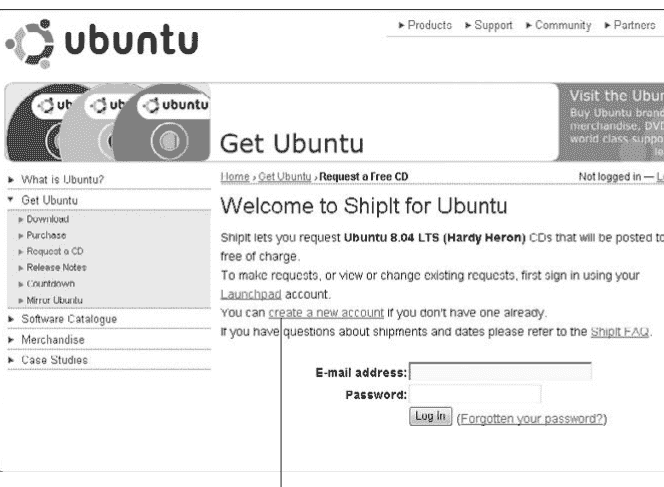

#### 获取 Ubuntu

欢迎来到适用于 Ubuntu 的 Shipt

Shipt 允许您申请 Ubuntu 8.04 LTS (Hardy Heron) 光盘，这些光盘将免费邮寄给您。若要进行请求、查看或更改现有请求，请先使用您的 Launchpad 账户登录。如果您还没有账户，可以创建一个新账户。如果您对发货和日期有疑问，请参阅 Shipt 常见问题（FAQ）。

新账户可以在[此处]创建和[此处]创建

图 2-3 登录 Launchpad

如果您以前向 Ubuntu 申请过免费光盘，可以登录并提交另一个请求。如果这是您第一次获得 Ubuntu 光盘，您将需要选择“新建”（Create A New）链接。

一旦进入 Launchpad 网站，系统会要求您在“尚未注册”（Not Registered Yet）标题下提交您的电子邮箱。输入有效的电子邮件地址并点击“注册”（Register）按钮，以便 Canonical 向您发送注册步骤。注册后几乎立即，您可以检查所提供的邮箱账户以获取完成注册的链接。

点击此链接后，您将进入一个页面，在其中选择您的显示名称和密码。完成后，将出现“从 Shipt 请求光盘”（Request CDs From Shift）页面，您现在可以使用注册时选择的电子邮件地址和密码登录。您只需要填写您的收货信息并点击“请求”（Request）按钮。您可以选择请求一张光盘或三张光盘。您应该选择三张，并给您的几个朋友也带一份 Ubuntu，让他们也能尝试一下。

#### 购买 Ubuntu

如果您无法下载 Ubuntu 且不想等待十周让订单到达，可以从不同的分销商购买 CD 或 DVD 版本的 Ubuntu

# 第 2 章 探索 Ubuntu 桌面 23


这些 Canonical 的工作。这些公司将 Ubuntu、Kubuntu、Edubuntu 和 Ubuntu 发行版封装在光盘上提供给客户，然后免费邮送给客户可以使用。

Ubuntu 网站列出了它们在该项活动中合作的公司，因此如果您打算购买 Ubuntu 副本，请确保从其中一个分销商处购买。既然可以免费获得，为什么还要买？由于您支付了运费，从分销商处购买软件将帮助您比 Canonical 发送给您所需的十周更快拿到 Ubuntu 副本。

Ubuntu 也对光盘收取费用。如果您需要大量的 Ubuntu 光盘，他们可能仍然免费邮寄给您。如果您是向学生分发光盘的老师，或者正在参加贸易展并希望发给参会者，您可以对 Ubuntu 光盘提出特殊请求。请求越合理，Canonical 就越可能为您提供光盘。

### 从现场光盘运行 Ubuntu

无论您是从 Canonical 订购的 Ubuntu，还是选择下载副本并从 ISO 镜像刻录 CD 或 DVD，您现在都拥有所谓的现场光盘（Live CD）或 DVD。您的光盘不会到处走并修复您；它不是那种“现场”的。相反，您可以启动操作系统并直接从光盘运行所有程序。您可以完成书中的大量活动，并在无需在计算机上安装操作系统的情况下在 Ubuntu 中打下坚实的基础！Ubuntu 为什么要这样做？回想他们的使命。他们想要开发一种可以作为市场上商业系统替代品的操作系统——即众所周知的“人性的 Linux”（Linux for Human Beings）。由于人类是怀疑的，特别是当它


### 现场光盘的用途

现场光盘在 GNU/Linux 世界非常常见。不仅是从 Microsoft Windows 或 Mac OS 切换过来的人用来测试 Linux 的方法，它们也被用于商业世界的工具。

许多 GNU/Linux 发行版是为特定任务构建的。FIRE（取证和事件响应环境）Linux 是一种现场发行版，用于从可能发生犯罪或违反条款和条件的计算机中提取数字证据。XORP 和 SENTRY 是现场发行版如何用作防火墙来保护网络的示例。Linux 可启动工具箱（Linux Bootable Toolbox）用于恢复崩溃的系统，以便恢复其存储的数据。甚至还有一个名为 Lin4Astro 的版本，用于天文研究。

当来到计算机时，他们让人们轻松地尝试这种新的操作系统。他们知道，一旦人们尝试了，就会切换。这像是一种“只要只管做，他们自然会来”的态度。

### 启动它！

拿着您的现场光盘，让我们打开 CD/DVD 驱动器并插入光盘，就可以开始工作了。您将看到 Ubuntu 启动屏，如图所示。

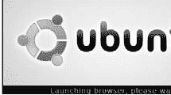

这将打开一个浏览器，允许 Microsoft Windows 和 Mac OS 用户试用光盘上的一些免费软件。我们将适时介绍所有这些应用程序。现在，我们想要进入 Ubuntu 操作系统；在启动屏之后，关闭它，然后重启您的系统。

> 我们在书中完成的所有工作都将使用 GNOME 桌面环境。出于教学目的，Kubuntu 的图像，
>
> 桌面环境一词用于描述操作系统的用户界面。Ubuntu 中的桌面一词用于描述类型。

探索第 2 章 25

# 第一部分 认识 Ubuntu

## 第 2 章 探索 Ubuntu 桌面

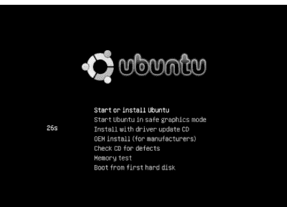

F1 帮助 F2 语言 F3 映射 F4 VGA F5 辅助功能 F6 其他选项

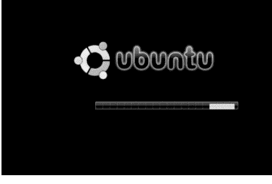

图 2-4 启动屏

一旦 CD 启动，你将看到浅棕色的桌面环境。你首先可能注意到它非常整洁。到处没有散落的图标。如果你是从 Microsoft Windows 切换到 Linux，还会注意到一些明显的区别。以 Microsoft Windows 为例。Windows XP 及之前的版本在屏幕左下角有一个所谓的启动按钮。启动按钮的作用是启动任何应用程序和其他系统程序。在 Mac OS 环境中，程序可以从底部的长条图标（称为 Dock）或从应用程序文件夹启动。Ubuntu 没有这些。在专有操作系统中，这些小功能是呈现出来的。相反，应用程序是从屏幕左上角启动。查看图 2-5 以获取 Ubuntu 桌面的扩展视图。

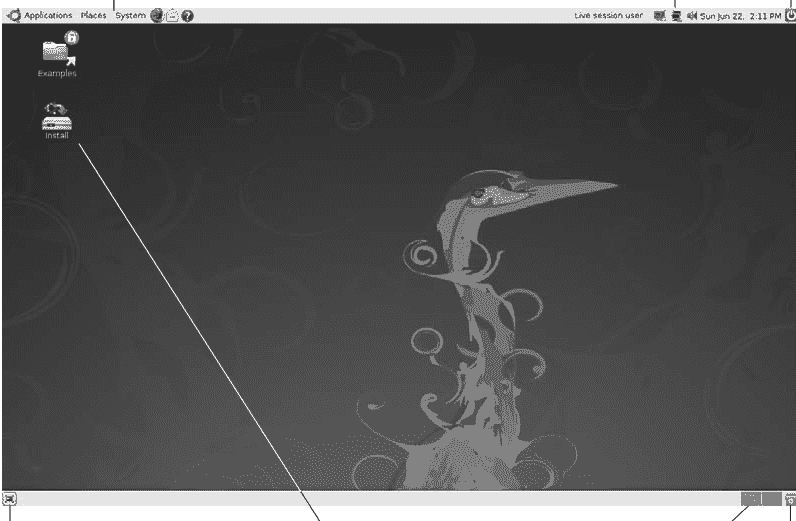

用于启动程序、浏览文件夹和查看系统信息的下拉菜单

网络信息 电源按钮

清除桌面 点击此处在计算机上启动 Ubuntu 安装过程 桌面切换器 垃圾桶

图 2-5 桌面环境

### Ubuntu 桌面环境初探

在下载了整个操作系统、将 ISO 文件刻录到 CD 并启动进入现场桌面环境后，花时间祝贺自己。你已经向全新的计算世界迈出了第一步。当你完成本章时，你就可以从普通电脑用户转变为受崇的计算机爱好者了！所以让我们开始吧。

我们将查看分为三个部分的 Ubuntu 桌面环境。屏幕顶部包含许多程序启动器和系统信息。桌面的主要部分由背景和图标组成。最后，屏幕的下部分包含一些桌面控制控件和垃圾桶。请返回图 2-5 查看屏幕的详细布局。

#### 顶栏

Ubuntu 桌面环境的顶栏（从左到右）包含：应用程序菜单、位置菜单、系统菜单、启动 Mozilla Firefox Web 浏览器的图标、启动 Evolution 电子邮件客户端的图标、帮助菜单、当前用户名称、网络信息、音量控制、日期和时间，以及电源按钮。

点击“应用程序”菜单将展开此部分，如下所示。

你可以看到，当你点击此项时，会显示随 Ubuntu 安装的不同不同软件程序类别列表。点击这些类别中的任何一个，都会弹出具体的程序：

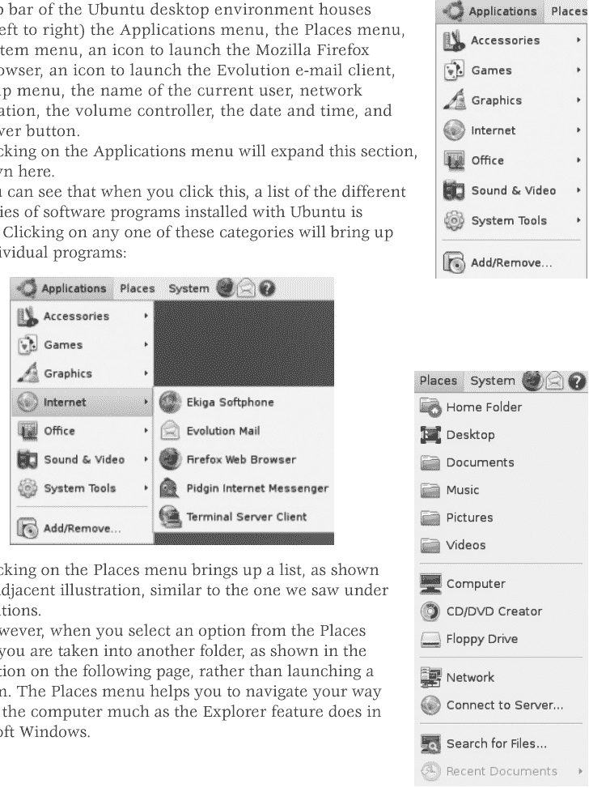

点击“位置”菜单会弹出一个列表（如相邻插图所示），与我们在“应用程序”下看到的相似。然而，当你从“位置”菜单中选择一个选项时，你将进入另一个文件夹（如下一页的插图所示），而不是启动程序。“位置”菜单帮助你导航电脑，就就像 Microsoft Windows 中的“资源管理器”功能一样。

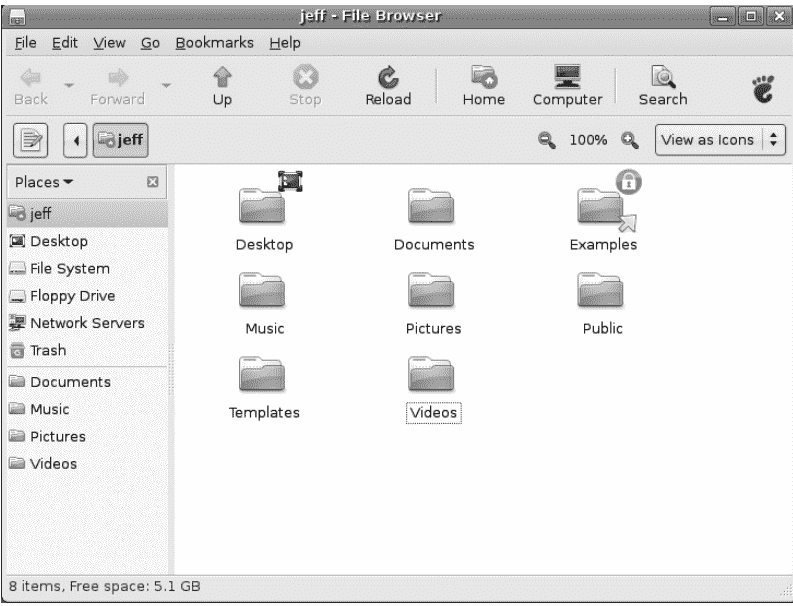

最后，屏幕右角的电源按钮为你提供了关机、休眠、注销等选项。你会发现，当你点击此按钮时，整个屏幕会变暗，并弹出此处所示的关机菜单：

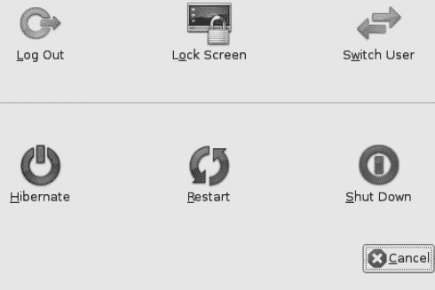

#### 主屏幕

主屏幕包含背景（在图 2-5 中默认为浅棕色）以及用于启动程序或显示已挂载驱动器的图标。在随后的章节中，你将学习如何将桌面环境的背景更改为基本上你想要的任何内容。你还将学习如何向桌面窗口添加图标，以便你能够轻松地启动程序并访问电脑上的文件夹。

#### 屏幕底部

在 Ubuntu 桌面的底栏上，你会在左侧找到“显示桌面”按钮，在右侧找到桌面切换器。“显示桌面”按钮是一个值得尝试的有趣工具。花点时间从应用程序菜单打开一个程序。例如，打开“图形程序”并打开 Gimp。现在将光标移动到“显示桌面”并点击它。你的桌面现在应该没有任何应用程序窗口了。这是在忙中最小化窗口的极佳方法。如果你正在处理某些重要事情，使用此工具无需担心丢失它。窗口只是被最小化了，可以通过点击屏幕底部的名称来恢复最大化。

桌面切换器旁边是垃圾桶。这与 Microsoft Windows 非常相似，将已删除的文件存储在一个容器中，以防需要恢复它们。

位于垃圾桶和“显示桌面”按钮之间的桌面切换器是 Ubuntu 桌面环境中最实用的工具之一。基本上，它的名称就解释了它的功能。该工具允许用户在一个桌面窗口中打开程序，然后只需通过点击底栏的小型预览框即可切换到另一个桌面窗口。在图 2-6 中，你可以看到一个桌面打开了音乐播放器。通过切换桌面，你可以打开另一个程序，如图 2-6 所示的国际象棋游戏。如果你需要同时运行工作或游戏的两个或多个程序，这会非常派用。

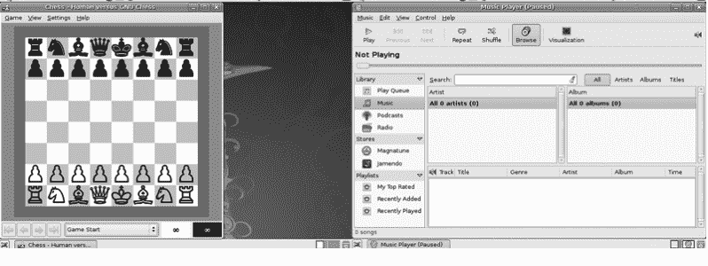

图 2-6 切换桌面

> 你知道吗？

#### 什么是挂载驱动器？

在 GNU/Linux 中，“挂载驱动器”一词描述如硬盘、CD-ROM 或 USB 驱动器等已由操作系统准备好使用的驱动器。该术语本身源于计算机早期时代，当时计算机操作员必须物理将磁带驱动器安装在转轴上，才能使用它来读取或写入数据。

在早期的 GNU/Linux 版本中，挂载驱动器需要大量关于操作系统和硬件本身的知识。在 Ubuntu 中挂载驱动器非常简单。随后的章节将向你展示，只需插入 USB 驱动器，Ubuntu 就会为你挂载驱动器，而无需任何配置。


花时间探索你的 Ubuntu 桌面驱动器环境。在变得更加熟悉之后，你会发现这是一个极其易用的工作环境。从其他桌面环境切换过来的人会发现，过渡比预期的要容易得多。

你可能记得，除了 GNOME 桌面环境外，Ubuntu 还发布了一个名为 Kubuntu 的 KDE 桌面环境以及一个他们称为 Xubuntu 的 Xfce 桌面环境。图 2-7 显示了这三个桌面环境视觉相似。Ubuntu 和 Kubuntu 获取方式与基于 GNOME 的 Ubuntu 相同。尽管 Xfce 环境是为没有现代计算机提供的资源的旧电脑创建的，但 KDE 和 GNOME 之间的差异相对较小，更多反映了。

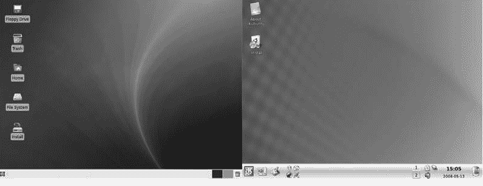

图 2-7 Ubuntu（左）和 Kubuntu（右）

GNOME 桌面环境在大多数发行版中都有，它是 Ubuntu 的默认设置。如前所述，Live CD 为你提供了关于 Ubuntu 的新介绍，并可以确保你的系统运行顺畅。但由于它对硬盘没有进行任何更改，在不进行任何重度配置的情况下，你无法自定义桌面或下载新软件。

### 结束 Live 会话

关闭 Live 会话非常简单。将光标移动到系统菜单并选择注销。你将看到一个启动界面，询问你是要注销、关机还是重启。由于你没有登录任何内容，请选择关机或重启。

# 第 3 章 个性化——根据你的喜味调整 Ubuntu 外观

如何……

- 更改桌面背景
- 安装新壁纸
- 更改 Ubuntu 主题
- 在桌面放置新图标
- 设置新的屏幕保护
- 更改登录界面
- 更改桌面效果

假设你现在已经在电脑上安装了 Ubuntu 副本。如果你还没有安装，请参考附录并按照本书中提供的安装步骤进行操作。如前所述，Live CD 为你提供了关于 Ubuntu 的新介绍，并可以确保你的系统运行顺畅。但由于它对硬盘没有进行任何更改，在不进行任何重度配置的情况下，你无法自定义桌面或下载新软件。

## 第一部分 认识 Ubuntu

Ubuntu 开发团队设置为默认背景的这种漂亮浅色背景既宁静又具有人性的象征意义，但它可能不是你的首选。

有些人将桌面背景称为“壁纸”。在 Ubuntu 操作系统中，这些词术语是可以通用的。

> 注意
>
> 对于使用 Microsoft Windows 等其他操作系统的用户来说，在 Ubuntu 中更改桌面背景非常相似。你只需要按照以下步骤操作：
>
> - 将鼠标指针悬停在桌面背景上，并右键点击它（按下鼠标右键）。完成后，屏幕上会弹出一个菜单，如图 3-1 所示。单击鼠标（点击左鼠标键一次）从列表中选择“更改桌面背景”。当你选择“更改桌面背景”时，屏幕会发生，你会看到“外观偏好”窗口，如图 3-2 所示。在这里，你可以从显示的壁纸列表中进行选择。如果你是 Ubuntu 新手，你的选择将仅限于默认的三种棕色。如你所见，你可以点击按钮向你的收藏中添加新壁纸，或者在不再需要它们时将其删除。你还可以为壁纸创建新的配色方案，以更好地反映你的个性或心情。更换新壁纸只需点击“外观偏好”菜单中的图像即可。尝试选择深棕色壁纸。你会发现一旦你选了此项，桌面背景立即发生了变化。

在图 3-2 的“外观偏好”屏幕上，你还可以看到屏幕左侧的“样式”选项。在这里，你可以在“居中”、“全屏”、“缩放”、“缩”和“平铺”之间进行选择。这些大部分选项都是一言自明的的。*居中*将图像放在桌面的中间。*全屏*将图像放大到整个背景，如果尺寸增加过大，可能会导致图片失真。*缩放*将尝试在保持原始图像尺寸的同时将图像尺寸增大以适应桌面。*缩*将按原始尺寸放大图像的特定区域，并重复图案直到填充整个背景。*平铺*将保持图像的原始尺寸，通常用于在整个桌面上创建图案。

| 创建文件夹 | | 创建启动器... | 创建文档 | 按名称清理 |
| :--- | :--- | :--- | :--- | :--- |
| ✓ 对齐 | | | | |
| 粘贴 | | | | |
| 更改桌面背景 | | | | |

图 3-1 在桌面背景上右键点击鼠标

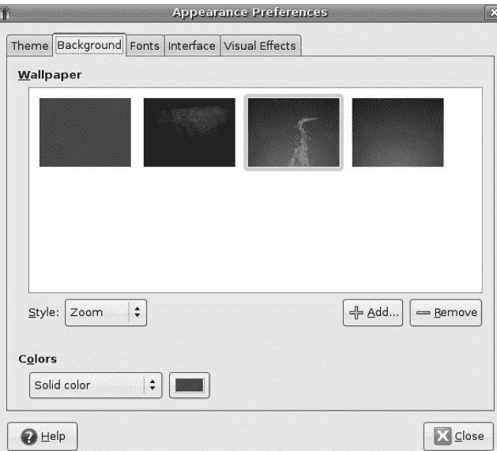

图 3-2 外观偏好屏幕

### 如何...传输文件到 Ubuntu

虽然我们将在第 4 章更详细地讨论文件管理，但你可能需要将一些照片传输到 Ubuntu，以便跟随本章的步骤操作。以下内容将为你提供该过程的快速教程：

- 将你想传输的文件放在 CD 或 USB 驱动盘上。
- 将 CD 或 USB 驱动盘插入运行 Ubuntu 操作系统系统的计算机。
- 当光盘或驱动器加载后，桌面左上角会出现一个带有光盘/驱动器名称的图标。先不要点击此图标。
- 图标出现后不久，文件浏览器窗口将会出现。文件浏览器窗口的左侧将列出所有可用文件夹。你刚插入的光盘/驱动器的内容将位于文件浏览器的主面板中。要传输文件，只需将文件从主面板拖到左侧的相应文件夹中。

5. 如果你需要创建一个文件夹来存放文件，请点击父文件夹。例如，你的主目录名为 jeff。这出现在文件夹列表的顶部。

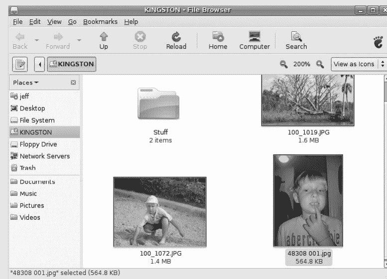

*48308_001.jpg* 已选中 (564.8 KB)

6. 现在主面板已打开主目录，你可以在主面板的任何地方右键点击并选择“创建文件夹”，一旦完成，你可以返回 CD 或 USB 驱动盘，并将文件拖到到新创建的文件夹中。

> Windows 用户注意：在 Windows 中，如果你右键点击一个文件，会看到“发送到”选项。Windows 允许将此文件发送到计算机上的另一个文件夹。在 Ubuntu 中，“发送到”选项允许你发送文件并弹出启动器到。

### 安装新壁纸

Ubuntu 带有三种默认壁纸：大象、带有海鸥图案的 Ubuntu 以及 Ubuntu。由于 GNU/Linux 是为性能构建的，许多硬核 GNU/Linux 用户不希望被永远不会使用的图片占用宝贵的空间。虽然其他操作系统可能提供大量的桌面背景选择，但 GNU/Linux 发行版提供的很少。相反，允许用户提供他们喜欢的图像作为壁纸。

桌面背景的第四种选择是无壁纸，这是一种纯棕色。

在 Ubuntu 中添加壁纸非常简单，你可以通过多种方式实现。

## 第 3 章 个性化——根据喜好调整 Ubuntu 外观

Ubuntu 带有三种默认壁纸：大象、带有海鸥图案的 Ubuntu 以及 Ubuntu。由于 GNU/Linux 是为性能构建的，许多硬核 GNU/Linux 用户不希望被永远不会使用的图片占用宝贵的空间。虽然其他操作系统可能提供大量的桌面背景选择，但 GNU/Linux 发行版提供的很少。相反，允许用户提供他们喜欢的图像作为壁纸。

桌面背景的第四种选择是无壁纸，这是一种纯棕色。

在 Ubuntu 中添加壁纸非常简单，你可以通过多种方式实现。

### 安装新壁纸

Ubuntu 带有三种默认壁纸：大象、带有海鸥图案的 Ubuntu 以及 Ubuntu。由于 GNU/Linux 是为性能构建的，许多硬核 GNU/Linux 用户不希望被永远不会使用的图片占用宝贵的空间。虽然其他操作系统可能提供大量的桌面背景选择，但 GNU/Linux 发行版提供的很少。相反，允许用户提供他们喜欢的图像作为壁纸。

桌面背景的第四种选择是无壁纸，这是一种纯棕色。

在 Ubuntu 中添加壁纸非常简单，你可以通过多种方式实现。

## 第一部分 认识 Ubuntu

Ubuntu 开发团队设置为默认背景的这种漂亮浅色背景既宁静又具有人性的象征意义，但它可能不是你的首选。

有些人将桌面背景称为“壁纸”。在 Ubuntu 操作系统中，这些词术语是可以通用的。

> 注意
>
> 对于使用 Microsoft Windows 等其他操作系统的用户来说，在 Ubuntu 中更改桌面背景非常相似。你只需要按照以下步骤操作：
>
> - 将鼠标指针悬停在桌面背景上，并右键点击它（按下鼠标右键）。完成后，屏幕上会弹出一个菜单，如图 3-1 所示。单击鼠标（点击左鼠标键一次）从列表中选择“更改桌面背景”。当你选择“更改桌面背景”时，屏幕会发生，你会看到“外观偏好”窗口，如图3-2 所示。在这里，你可以从显示的壁纸列表中进行选择。如果你是 Ubuntu 新手，你的选择将仅限于默认的三种棕色。如你所见，你可以点击按钮向你的收藏中添加新壁纸，或者在不再需要它们时将其删除。你还可以为壁纸创建新的配色方案，以更好地反映你的个性或心情。更换新壁纸只需点击“外观偏好”菜单中的图像即可。尝试选择深棕色壁纸。你会发现一旦你选了此项，桌面背景立即发生了变化。


在图 3-2 的“外观偏好”屏幕上，你还可以看到屏幕左侧的“样式”选项。在这里，你可以在“居中”、“全屏”、“缩放”、“缩”和“平铺”之间进行选择。这些大部分选项都是一言自明的。*居中*将图像放在桌面的中间。*全屏*将图像放大到整个背景，如果尺寸增加过大，可能会导致图片失真。*缩放*将尝试在保持原始图像尺寸的同时将图像尺寸增大以适应桌面。*缩*将按原始尺寸放大图像的特定区域，并重复图案直到填充整个背景。*平铺*将保持图像的原始尺寸，通常用于在整个桌面上创建图案。

| 创建文件夹 | | 创建启动器... | 创建文档 | 按名称清理 |
| :--- | :--- | :--- | :--- | :--- |
| ✓ 对齐 | | | | |
| 粘贴 | | | | |
| 更改桌面背景 | | | | |

图 3-1 在桌面背景上右键点击鼠标

## 第 3 章 个性化——根据喜好调整 Ubuntu 外观 35


图 3-2 外观偏好屏幕

### 如何...传输文件到 Ubuntu

虽然我们将在第 4 章更详细地讨论文件管理，但你可能需要将一些照片传输到 Ubuntu，以便跟随本章的步骤操作。以下内容将为你提供该过程的快速教程：

- 将你想传输的文件放在 CD 或 USB 驱动盘上。
- 将 CD 或 USB 驱动盘插入运行 Ubuntu 操作系统系统的计算机。
- 当光盘或驱动器加载后，桌面左上角会出现一个带有光盘/驱动器名称的图标。先不要点击此图标。
- 图标出现后不久，文件浏览器窗口将会出现。文件浏览器窗口的左侧将列出所有可用文件夹。你刚插入的光盘/驱动器的内容将位于文件浏览器的主面板中。要传输文件，只需将文件从主面板拖到左侧的相应文件夹中。
5. 如果你需要创建一个文件夹来存放文件，请点击父文件夹。例如，你的主目录名为 jeff。这出现在文件夹列表的顶部。


*48308_001.jpg* 已选中 (564.8 KB)

6. 现在主面板已打开主目录，你可以在主面板的任何地方右键点击并选择“创建文件夹”，一旦完成，你可以返回 CD 或 USB 驱动盘，并将文件拖到到新创建的文件夹中。

> Windows 用户注意：在 Windows 中，如果你右键点击一个文件，会看到“发送到”选项。Windows 允许将此文件发送到计算机上的另一个文件夹。在 Ubuntu 中，“发送到”选项允许你发送文件并弹出启动器到。

### 安装新壁纸

Ubuntu 带有三种默认壁纸：大象、带有海鸥图案的 Ubuntu 以及 Ubuntu。由于 GNU/Linux 是为性能构建的，许多硬核 GNU/Linux 用户不希望被永远不会使用的图片占用宝贵的空间。虽然其他操作系统可能提供大量的桌面背景选择，但 GNU/Linux 发行版提供的很少。相反，允许用户提供他们喜欢的图像作为壁纸。

桌面背景的第四种选择是无壁纸，这是一种纯棕色。

在 Ubuntu 中添加壁纸非常简单，你可以通过多种方式实现。

# 40 第一部分 认识 Ubuntu

3. 当“添加/删除应用程序”窗口打开时，确保列表顶部选中了“全部 (All)”。

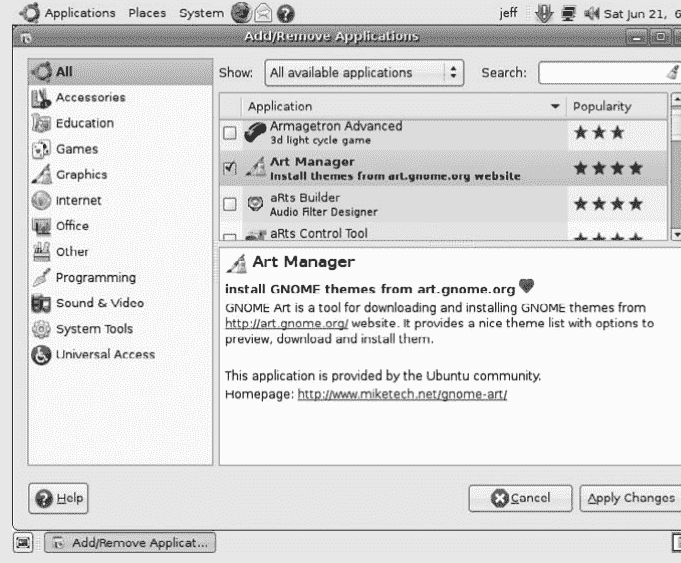

4. 在右侧，向下滚动字母列表找到“艺术管理器 (Art Manager)”，点击其旁边的框以插入勾选标记。
5. 点击“更改 (Changes)”按钮。
6. 系统会在另一个“应用以下更改”窗口中询问你是否要添加此应用程序。在此也选择“应用 (Apply)”。
7. 下一个窗口将显示“新应用程序已安装”。在这里你可以点击“关闭 (Close)”按钮。

现在点击顶部面板上的“系统 (System)”选项。当你将光标悬停在“偏好 (Preferences)”选项上时，你应该会在应用程序和工具列表中看到“艺术管理器”选项。选择“艺术管理器”，以便更深入地了解该程序的功能。

当你打开“艺术管理器”时，你会看到一个空白窗口。别担心，稍后你将在那里添加一些非常酷的内容。要向“艺术管理器”添加艺术品，点击选择框。这里的下拉菜单将列出“背景 (Backgrounds)”、“桌面主题 (Desktop Themes)”和“其他主题 (Other Themes)”。让我们从简单的开始，先选择“背景”，然后从下一个列表中选择“GNOME”。到此时，你的 GNOME 艺术窗口应该显示“正在准备下载”。这是因为 GNOME Art 正在获取不同图形文件的预览图。

# 第 3 章 个性化——根据你的喜好微调 Ubuntu 的外观 41

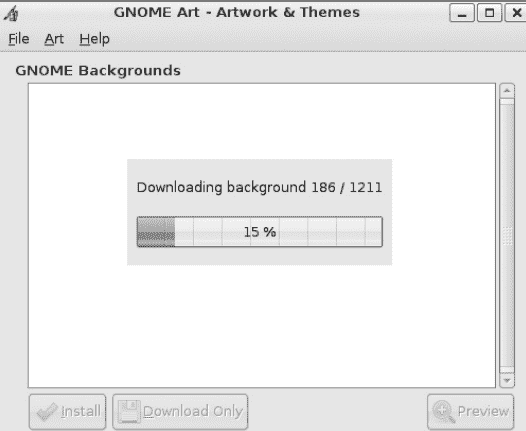

当你向下滚动列表时，你应该会注意到 GNOME Art 似乎下载了多个文件。在使用在使用程序填充其统计数据之前，请仔细观察一下。某些桌面背景（例如“蓝色 (Blue)”）是为不同的分辨率设计的。这张图片将完全地按照你设定的方式拟合到你的电脑屏幕。这种定制效果如何？

### 更改主题

操作系统桌面环境中色彩方案、图标、字体和其他显示项的组合被称为“主题 (theme)”。大多数操作系统，如微软 Windows 和 Mac OS，都允许你更改桌面主题。Ubuntu 也不例外。回看图 3-2。在默认选中的“背景”选项卡之前，你会看到一个名为“主题”的选项卡。在桌面上点击鼠标右键，选择“更改桌面背景”。现在选择“主题”选项卡。或者，你也可以选择“系统”，然后是“偏好”，最后是“外观”（简写为“系统 | 偏好 | 外观”）。

# 42 第一部分 认识 Ubuntu

你现在将看到一个不同主题的列表：紫色的 Crux、Inverse（看起来像照片负片）、Mist（雾）、Glossy（光泽）以及 Clearlooks（不同深浅的蓝色）、灰蓝色的 Glider，当然还有充满泥土气息 Human（人类）。

作为一种实验，依赖 Inverse 主题并点击它。注意你的桌面环境的窗口框和颜色发生了什么变化？它们应该都是黑色、白色和紫色。但桌面本身呢？它将保持你之前的设置。

花几分钟时间尝试 Ubuntu 为你提供的不同主题。你可能会发现一个完美契合你口味的主题。如果没有，你可以一直自定义直到你满意为止！如果你找到了可以作为基础的主题，点击主题窗口底部的“自定义 (Customize)”按钮。你现在可以从主题的控件、颜色、边框图标和指针的各种选项中进行选择。

主题的某些元素无法进一步自定义。例如，选择默认的 Human 主题。点击“自定义”并选择“颜色”。你会看到一个灯泡，并显示信息“此当前主题不支持色彩方案”。用通俗的话说，你无法对其进行进一步的自定义。

当然，你完全可以依靠 Ubuntu 社区获取更多主题。进行另一个快速实验：打开 Firefox 浏览器并访问 www.google.com，在搜索框中输入“Ubuntu Themes”或“Themes for Ubuntu”。你会惊讶地发现有这么多个不同的网站为你提供主题和壁纸供你安装到电脑上。

请记住，GNU/Linux 社区具有强烈的自由意识。这在你搜索主题或其他软件时遇到的某些网站上是显而易见的。虽然大多数致力于 Ubuntu 和 GNU/Linux 的网站不会显示任何可疑内容，但有些网站依赖于成人相关广告并推广替代思想。如果你对这类材料敏感，请避开包含可疑内容的网站，并向你的朋友推荐其他网站。

下载主题时，你将面临“打开文件”或“保存到磁盘”的选项。如果你选择“保存到磁盘”，Firefox 浏览器将默认将其保存到桌面。如果你选择“打开”，名为“归档管理器 (Archive Manager)”的程序将为你提取文件。在开始阶段，请保存你下载的文件。在你掌握 Ubuntu 操作系统之前，这将更有于你定位和处理这些文件。

你可以尝试寻找一个你想要安装到系统中的主题。如果你更喜欢自己搜索主题，请确保它是 GDM 主题，而不是壁纸或 GDM 壁纸（“GDM”代表“GNOME 显示管理器”）。寻找主题的一个极佳起点是 www.gnome-look.org。我们在书书中使用的 Vista-Ubuntu 主题就来自这里。该主题可以在 http://tinyurl.com/6adfdox 找到。

# 第 3 章 个性化——根据你的喜好微调 Ubuntu 的外观

一旦你在网站上找到了吸引你的的主题，点击下载链接。再次，在开始时“保存到磁盘”。文件下载后，你将在桌面上看到它。扩展名为 .tar.bz2。TAR 文件是 GNU/Linux 中 ZIP 文件的等价物。这些文件是压缩过的，这样下载速度更快。一旦压缩文件下载完成，就需要解压。这就是归档管理器派上用场的地方。在后续章节中我们将更多地使用归档管理器。现在你将使用“外观”偏好来解包并安装下载的主题。

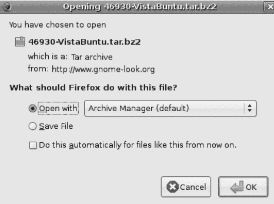

### 安装主题

安装新主题是一个简单的过程，只需点击几次。


进入`/path/to/xxx`目录，找到`xxx.json`。

在表达式`cvar = avar + bvar`中，加法运算符（`+`）将`avar`与`bvar`相加，得到它们的和`cvar`

在`List.of(arg0, arg1, arg2)`中，`List`接口的工厂方法`of()`接受一系列的元素，返回包含它们的只读列表。

之后我们这样调用`cmd`命令：`cmd arg0 arg1 arg2`。

```
if (condVar > someVal) {console.log("xxx")}
```


当你漫步于不同的 Ubuntu 或 GNU/Linux 论坛时，你可能会遇到名为 Beryl 的东西。Beryl 是一个3D 窗口管理器，可以安装在 GNOME、KDE 或 XFACE 之上。Beryl 是 GNU/Linux 中任何桌面环境的惊艳增强。由于 Beryl 的视觉效果非常出色，它需要一定的计算能力特定的显卡才能运行。如果你感兴趣在 Ubuntu 系统上安装 Beryl，请确保你的电脑至少有 512MB 内存，尽管建议使用 1GB。

同样，“视觉效果”选项卡允许你增强 GNOME 桌面环境的视觉效果。虽然许多人选择视觉上最美的桌面，但效果越增强，消耗的计算机资源就越多。高性能计算机可能感觉不到太大区别；但大多数家用电脑在开启这些效果时，速度会明显变慢。

对于非高端配置的电脑，可以将视觉效果设置为“无效果”（No Effects）以为其他程序最大化计算能力，或者设置为“简单效果”（Simple Effects），在美学和计算能力之间取得平衡。对于处理能力足够的电脑，视觉效果选项可以设置为“额外”（Extra）。“额外”选项会让桌面在视觉上尽可能刺激。

最后，还有一个“自定义”（Custom）选项，供想要为自己的电脑挑选视觉效果的用户。要确定哪个设置最适合你的电脑，请花时间尝试每一种。如果你觉得“额外”效果对处理器的要求过高，切换到“简单”，或尝试自定义效果，增强你需要的特性，而忽略那些不重要的特性。

# 第二部分

# 管理 Ubuntu

## 内部维护：更新和维护 Ubuntu

如何操作...

- 使用 Ubuntu 更新管理器
- 维护 Ubuntu
- 创建文件夹
- 组织文件

## 为了安全考虑更新

对于大多数公司而言，在竞争对手之前抢先将各自的软件软件包推向市场是开发过程中最重要的因素。无论软件是操作系统、生产力套件还是特定工具，利润往往取决于谁先上架。每当软件开发人员面临急于发布产品的巨大压力时，往往会有事情被忽略，像测试这样的步骤可能会被缩短。令消费者遗憾的是，这种抢夺市场的行为也被恶意黑客用来破坏计算机系统的许多漏洞原因。

幸运的是，大多数软件都带有一个自动更新包，在软件本身安装时安装在电脑上。对于熟悉 Microsoft Windows 的人来说，Windows Update 就是例子。每当微软开发者发布升级或补丁时，屏幕右下角就会弹出一个小图标，提醒用户可用更新。

当然，电脑本该是让你的生活变得更轻松。因此，对于那些不想被微软不断的警告和提醒骚扰的人，可以将更新设置为在特定时间自动下载并安装。通常，这个时间被设置为电脑空闲时，这样处理过程会快得多。

## 未修复的系统与 Sasser 蠕虫

在恶意软件横行的今天，安装新发布的补丁是必须的。未修复的系统可能发生的情况示例是 Sasser 蠕虫的影响，它于 2004年4月30日发布。Sasser 在网络和互联网上迅速传播，通过让计算机自动关机来禁用它们。移除蠕虫后，在重新连接公司网络或互联网之前，必须安装安全补丁。

这导致了航空公司取消航班、外国军事分支机构被禁用、金融机构无法交易，以及一家医院的成像系统关闭，导致其 X 光患者去另一家医院。

尽管 Ubuntu 不是由公司利润驱动，但开发者仍然为操作系统发布更新和补丁。虽然微软产品是恶意黑客利用其软件和操作系统漏洞进行的大多数攻击的目标，但 Ubuntu 则不是。为了应对这些漏洞，开发者会发布补丁。这种类型的“补丁”修复了软件中的漏洞或缺陷，使其免受特定攻击的影响。为了使操作系统更安全，每当有可用补丁或更新时，Ubuntu 都会提供通知。

对于 Ubuntu 的标准桌面和服务器版本，提供 18 个月的安全更新。像 Hardy Heron 这样的长期支持（LTS）版本提供了更长的安全更新寿命。桌面版本支持三年，而服务器版本支持五年。

## 为了更好的世界更新

并不是所有 Ubuntu 或或其他系统的更新都是为了响应安全漏洞。有时，开发社区会发布可以让操作系统变得更好的更新。Ubuntu 每六个月会对操作系统进行升级。这确保了 Ubuntu 社区获得操作系统的最新功能。

到目前，你应该有机会查看 Ubuntu 网站，并看到各种方式参与 Ubuntu 开发的机会。如果你还没有花一两分钟访问 `https://blueprints.launchpad.net/ubuntu/hardy`，你可以看到 Canonical 和社区为 Hardy Heron 接受的目标列表（见图 4-1）。作为 Ubuntu 社区的成员，你也可以建议更新。

Ubuntu 自引以为傲的一个特性是，它相信 Ubuntu 提供了“一张光盘上你所需的一切”。我们在前面的章节中讨论过，你收到的 Ubuntu 软件包包含了实用的生产力、娱乐，

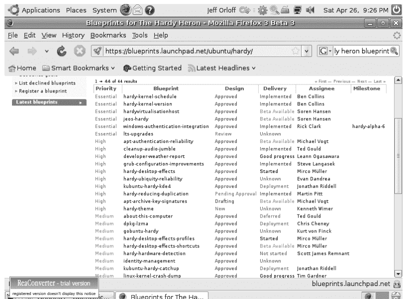

图 4-1 Hardy Heron 的 Ubuntu Blueprints 页面。在这里，社区成员可以查看更新的进展并提交自己的想法。

和软件。与 Microsoft Windows 等商业操作系统不同，当这些软件软件包以及操作系统有更新时，Ubuntu 会通知用户。如果 Gimp 有新版本，Ubuntu 将通知你这一点。

## Ubuntu 管理器

如前所述，当操作系统和其他软件有可用更新时，Ubuntu 将通知你，如图 4-2 所示。GNU/Linux 用户在想要更新操作系统时必须使用终端输入命令。诸类任务促使普通计算机用户使用更易更新的操作系统。随着 GNU/Linux 的流行开始进入非高级计算机用户的桌面，像弹出这样的图形界面将允许用户轻松地更新他们的软件软件。

## 56 第二部分 维护 Ubuntu

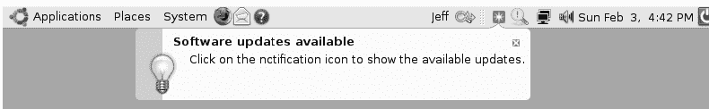

图 4-2 软件更新提示

作为一种基于 Debian 的操作系统，Ubuntu 使用“更新管理器”（Update Manager）作为图形化界面。图 4-3 显示了更新管理器软件运行后的外观示例；它的警报显示有 391 个更新可用。每当操作系统认为你有需要处理的更新时，此警报就会就会在桌面上弹出。

虽然 Ubuntu 会向你通知重要的更新，但有时你可能想手动检查是否有可更新的项。你应该觉得

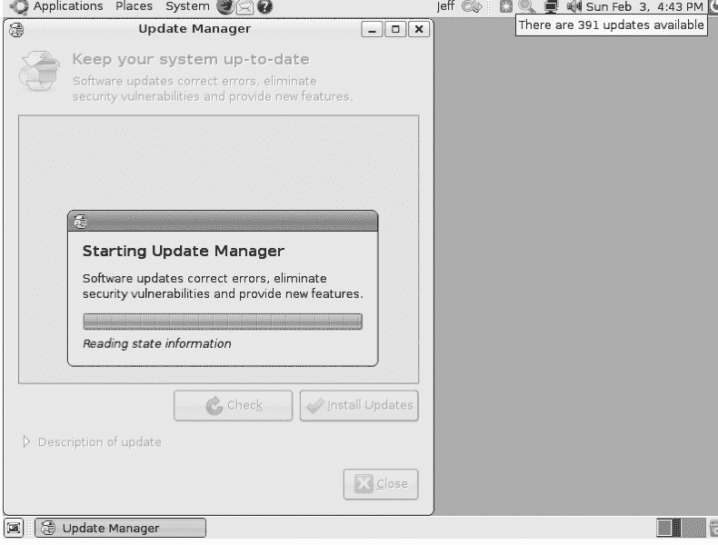

图 4-3 更新管理器检查系统软件的更新，直到用户被通知有更新可用。

## 第 4 章 维护：更新和维护 Ubuntu 57

当你需要自己启动更新管理器时，只需点击“系统 | 管理 | 更新管理器”。这将会让 Ubuntu 在软件源中搜索更新。如果你的自动更新失败或在尝试更新任何软件包时报告错误，这是一种良好的做法。

运行更新管理器可能需要一些时间，特别是当你有 391 个更新可用时。你可能想将更新管理器设置为在你可能 own使用电脑运行时。要做到这一点，你需要使用终端来编辑 `crontab` 文件中可用的命令。`crontab` 文件是一个文本文件，包含一个在 `crontab` 文件中特定时间运行的命令列表。如果你通过 `crontab` 文件设置命令运行，通过检查日志文件来确保它们正在运行总是好的。书中将涵盖更多这方面的内容。

请记住，编辑 `crontab` 文件来运行更新管理器严格来说是一项可选任务。如果你觉得通过终端编辑命令令你畏畏，请跳过本节的剩余部分并进入下一节。如果你选择这种做法，不要担心。大量的 GNU/Linux 用户从不触碰 `crontab` 文件，他们的系统运行依然良好。所以，如果你准备好进入 `crontab` 编辑器，让我们卷起袖子，大干一场吧。

现在的第一步是打开终端窗口。可以通过“应用程序 | 附件 | 终端”来实现。出现的窗口如图 4-4 所示。

在终端中，你应该能看到类似于图 4-4 中的 `jeff@jeff-desktop:-` 的内容。`jeff` 是当前登录的用户，`jeff-desktop` 是计算机的名字。`$` 是我们开始输入基本命令以调出 `crontab` 编辑器的地方。在你的终端中输入以下内容：

```
sudo gedit /root/.crontab
```

`sudo` 命令的名字是 "super user do"超级用户执行）的缩写。这允许你作为计算机上的用户，以计算机超级用户的安全权限运行程序。如果你漏掉了这部分命令，你将无法保存所做的任何编辑。`gedit` 仅仅意味着编辑。`/root/.crontab` 是你将编辑的文件。

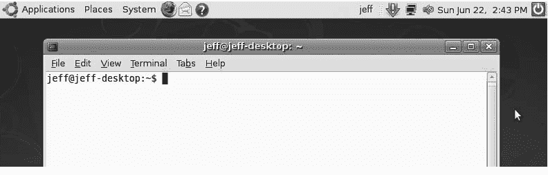

图 4-4 Ubuntu 终端程序 `$`

### Root 的含义

Root 在 GNU/Linux 中有两个含义。root 用户是计算机的管理员。Ubuntu 不创建 root 账户，因为以 root 身份登录时进行正常操作可能会导致破坏性的结果。

root 在 GNU/Linux 中的另一个定义也称为根目录（root directory），它是文件系统中最高级别的目录。在调整 `crontab` 文件时，你正在从根目录中获取它。


## 第二部分 维护 Ubuntu


图 4-2 软件更新提示

作为一种基于 Debian 的操作系统，Ubuntu 使用“更新管理器”作为图形化界面。图 4-3 显示了更新管理器软件运行后的外观示例；它的警报显示有 391 个更新可用。每当操作系统认为你有需要处理的更新时，此警报就会就会在桌面上弹出。


图 4-3 更新管理器检查系统软件的更新，直到用户被通知有更新可用。

## 第 4 章 维护：更新和维护 Ubuntu

当你需要自己启动更新管理器时，只需点击“系统 | 管理 | 更新管理器”。这将会让 Ubuntu 在软件源中搜索更新。如果你的自动更新失败或在尝试更新任何软件包时报告错误，这是一种良好的做法。

运行更新管理器可能需要一些时间，特别是当你有 391 个更新可用时。你可能想将更新管理器设置为在你可能使用电脑运行时。要做到这一点，你需要使用终端来编辑 `crontab` 文件中可用的命令。`crontab` 文件是一个文本文件，包含一个在 `crontab` 文件中特定时间运行的命令列表。如果你通过 `crontab` 文件设置命令运行，通过检查日志文件来确保它们正在运行总是好的。书中将涵盖更多这方面的内容。

请记住，编辑 `crontab` 文件来运行更新管理器严格来说是一项可选任务。如果你觉得通过终端编辑命令令你畏畏，请跳过本节的剩余部分并进入下一节。如果你选择这种做法，不要担心。大量的 GNU/Linux 用户从不触碰 `crontab` 文件，他们的系统运行依然良好。所以，如果你准备好进入 `crontab` 编辑器，让我们卷起袖子，大干一场吧。

现在的第一步是打开终端窗口。可以通过“应用程序 | 附件 | 终端”来实现。出现的窗口如图 4-4 所示。

在终端中，你应该能看到类似于图 4-4 中的 `jeff@jeff-desktop:-` 的内容。`jeff` 是当前登录的用户，`jeff-desktop` 是计算机的名字。`$` 是我们开始输入基本命令以调出 `crontab` 编辑器的地方。在你的终端中输入以下内容：

```
sudo gedit /root/.crontab
```

`sudo` 命令的名字是 "super user do"超级用户执行）的缩写。这允许你作为计算机上的用户，以计算机超级用户的权限运行程序。如果你漏掉了这部分命令，你将无法保存所做的任何编辑。`gedit` 仅仅意味着编辑。`/root/.crontab` 是你将编辑的文件。


图 4-4 Ubuntu 终端程序

### Root 的含义

Root 在 GNU/Linux 中有两个含义。root 用户是计算机的管理员。Ubuntu 不创建 root 账户，因为以 root 身份登录时进行正常操作可能会导致破坏性的结果。

root 在 GNU/Linux 中的另一个定义也称为根目录（root directory），它是文件系统中最高级别的目录。在调整 `crontab` 文件时，你正在从根目录中获取它。

在终端中输入此命令后，按回车键。现在你会被要求输入密码。使用你为账户设置的同一个密码。当你输入密码时，屏幕上不会显示任何字符。这是典型的 GNU/Linux 守护进程在你肩膀后观察你的密码有多少个字符。这是一项安全功能，防止人们窥视你的肩膀。这些“窥视者”可以通过这些信息对你的密码做出合理的猜测。再次输入密码后，按回车键。几秒钟后，你应该能看到 `crontab` 编辑器打开。点击编辑器窗口以确保你有光标并输入以下内容：

```
00 * * * * /usr/bin/apt-get update && /usr/bin/apt-get upgrade -y
```

在我们保存更改之前，让我们分析一下。该命令以一系列零开始。`crontab` 文件告诉我们什么时间运行命令。因此，`00` 意味着凌晨 12 点。如果你想设置在下午 4:30 运行此文件，命令应该运行 `16 30`。时间后面的三个星号赋予了我们控制日期、月份和/或星期几的能力。日期可以包含 1 到 31 之间的值，月份范围从 1 到 12，星期几可以在 0 到 6 之间，其中 6 是星期日。星号表示每天运行。

命令的其余部分告诉操作系统要做什么以及在哪里执行。文件位置是 `/usr/bin`，`apt-get` 是运行更新和升级你软件的实际程序。更新管理器是 `apt-get` 程序更新/升级部分的图形化界面。`-y` 意味着对过程中可能提出的任何问题回答“是”。

如果你想让你的命令在凌晨 12:00 运行，现在可以保持文件不动并点击“保存”。如果你想设置不同的时间，甚至调整日期，请继续调整此项然后保存你的文件。此文件已保存，你可以选择你的 `crontab` 编辑器和终端，然后为自豪，你再次进入了 GNU/Linux 的深层领域并活下来讲述了这一切！但要小心，当你终端中工作得越来越多时，你真的开始感觉到你对操作系统有多大的控制权。一段时间后，你可能会发现自己忽略了 Ubuntu 中的图形界面，并开始创建你喜欢的终端！

## 第 4 章 维护：更新和维护 Ubuntu


图 4-5 Ubuntu 终端程序


在我们保存更改之前，让我们分析一下。该命令以一系列零开始。`crontab`文件告诉我们什么时间运行命令。因此，`00`意味着凌晨12点。如果你想设置在下午4:30运行此文件，命令应该运行`16 30`。时间后面的三个星号赋予了我们控制日期、月份和/或星期几的能力。日期可以包含1到31之间的值，月份范围从1到12，星期几可以在0到6之间，其中6是星期日。星号表示每天运行。

命令的其余部分告诉操作系统要做什么以及在哪里执行。文件位置是`/usr/bin`，`apt-get`是运行更新和升级你软件的实际程序。更新管理器是`apt-get`程序更新/升级部分的图形化界面。`-y`意味着对过程中可能提出的任何问题回答“是”。

如果你想让你的命令在凌晨12:00运行，现在可以保持文件不动并点击“保存”。如果你想设置不同的时间，甚至调整日期，请继续调整此项然后保存你的文件。此文件已保存，你可以选择你的`crontab`编辑器和终端，然后为自豪，你再次进入了GNU/Linux的深层领域并活下来讲述了这一切！但要小心，当你终端中工作得越来越多时，你真的开始感觉到你对操作系统有多大的控制权。一段时间后，你可能会发现自己忽略了Ubuntu中的图形界面，并开始创建你喜欢的终端！

## 第4章 维护：更新和维护Ubuntu 59


图4-5 Ubuntu终端程序

### 第4章 维护：更新和维护Ubuntu 61

再次，打开终端并输入

```
sudo apt-get autoclean
```

现在，你应该会在终端中看到文件名。这些是你正准备丢进垃圾桶的残留文件。

### 遗留配置包 Residual Config Packages

当你从计算机上卸载一个软件包后，通常会遗留一些依赖包。依赖包是软件应用程序为了正常运行而需要的额外软件包。当主程序被卸载后，留在计算机上的依赖包被称为残留配置包。要删除残留配置包，请通过“系统 | 管理 | Synaptic包管理器”打开它。窗口打开后，点击左下角的“状态”按钮。在状态按钮上方列表中，你会看到“所有”、“已安装（自动删除）”、“已安装（本地和过时）”、“未安装”。你的计算机没有残留配置包。如果列表中包含“未安装（残留配置）”，则点击“未安装（残留配置）”，右侧将出现软件包列表。对于每个软件包，点击选框并选择“标记为删除”。在完成每个软件包的操作后，点击“应用”，Synaptic包管理器将为你删除这些文件。

#### 孤立包 Orphaned Packages

在Synaptic包管理器打开期间，点击“搜索”按钮并在搜索框中输入`gtorphan`。当应用程序出现在右侧框中时，点击选框并选择“标记为安装”。现在点击“应用”，让Synaptic包管理器为你安装`gtorphan`。

应用程序安装完成后，关闭包管理器并选择“系统 | 管理 | 移除孤立包”。选择想要删除的软件包，然后点击“确定”。

#### 文件夹和文件

你可以执行的最维护任务之一就是组织你的文件和文件夹。虽然这对改进或维护你操作系统的性能微乎其微，但它能让你更容易地在十分钟内找到为那个大型演示文所需的报告。

创建文件夹非常简单。使用鼠标在桌面的任何地方点击右键。出现菜单中的第一个选项是“创建文件夹”。只需点击它，你就会在桌面上看到一个“未命名文件夹”，等待你填充各种内容。与Microsoft Windows一样，你可以在文件夹内部创建更多文件夹以实现更好的组织。只需点击右键！如果你发现自己自己在创建文件夹时变得有些无从心，可以通过右键点击文件夹并点击“移动到垃圾桶”将它们丢弃。如果这对你来说还不简单，你也可以左键点击文件夹并在按住鼠标键的同时将文件夹拖到垃圾桶。文件也可以以同样的方式在文件夹之间移动。

有时，我们需要在现有的文件夹中创建文件夹。花一点时间点击桌面顶部菜单栏上的“位置”。图4-6显示了已经存在的供你使用的文件夹列表。其中大多数内容都是一目易懂的。“文档”文件夹留作存放书面材料。“音乐”可以存放你的歌曲库……嗯，你明白我的意思了。

你可能不熟悉的是列表顶部的“主目录”文件夹。这个文件夹是你的“文档”、“音乐”、“图片”和“视频”文件夹的主文件夹。它还包含一个名为“桌面”的文件夹用于存放你的桌面项目，一个“模板”文件夹，一个共享的“公共”文件夹，以及一个包含你可以做的一些内容示例的“示例”文件夹。

| 系统 |  |
|---|---|
| 主目录 | 桌面 |
| 文档 | 音乐 | 图片 |
| 计算机 | CD/DVD | 软盘驱动器 | 网络 |
| 搜索 | 文档 |

图4-6 Ubuntu位置。


当你从计算机上卸载一个软件包后，通常会遗留一些依赖包。依赖包是软件应用程序为了正常运行而需要的额外软件包。当主程序被卸载后，留在计算机上的依赖包被称为残留配置包。要删除残留配置包，请通过“系统 (System) | 管理 (Administration) | Synaptic 包管理器 (Synaptic Package Manager)”打开它。窗口打开后，点击左下角的“状态 (Status)”按钮。在状态按钮上方列表中，你会看到“所有 (All)”、“已安装（自动删除）(Installed (Auto Remove))”、“已安装（本地和过时）(Installed (Local and Obsolete))”、“未安装 (Not installed)”。你的计算机没有残留配置包。如果列表中包含“未安装（残留配置）(Not Installed (Residual config))”，则点击“未安装（残留配置）”，右侧将出现软件包列表。对于每个软件包，点击选框并选择“标记为删除 (Mark For Removal)”。在完成每个软件包的操作后，点击“应用 (Apply)”，Synaptic 包管理器将为你删除这些文件。

## 孤立包 (Orphaned Packages)

在 Synaptic 包管理器打开期间，点击“搜索 (Search)”按钮并在搜索框中输入 `gtorphan`。当应用程序出现在右侧框中时，点击选框并选择“标记为安装 (Mark for Installation)”。现在点击“应用 (Apply)”，让 Synaptic 包管理器为你安装 `gtorphan`。

应用程序安装完成后，关闭包管理器并选择“系统 (System) | 管理 (Administration) | 移除孤立包 (Remove Orphaned Packages)”。选择想要删除的软件包，然后点击“确定 (OK)”。

## 文件夹和文件

你可以执行的最维护任务之一就是组织你的文件和文件夹。虽然这对改进或维护你操作系统的性能微乎其微，但它能让你更容易地在十分分钟内找到为那个大型演示文所需的报告。

创建文件夹非常简单。使用鼠标在桌面的任何地方点击右键。出现菜单中的第一个选项是“创建文件夹 (Create Folder)”。只需点击它，你就会在桌面上看到一个“未命名文件夹 (Untitled Folder)”，等待你填充各种内容。与 Microsoft Windows 一样，你可以在文件夹内部创建更多文件夹以实现更好的组织。只需点击右键！如果你发现自己自己在创建文件夹时变得有些无从心，可以通过右键点击文件夹并点击“移动到垃圾桶 (Move To Trash)”将它们丢弃。如果这对你来说还不简单，你也可以左键点击文件夹并在按住鼠标键的同时将文件夹拖到垃圾桶。文件也可以以同样的方式在文件夹之间移动。

有时，我们需要在现有的文件夹中创建文件夹。花一点时间点击桌面顶部菜单栏上的“位置 (Places)”。图 4-6 显示了已经存在的供你使用的文件夹列表。其中大多数内容都是一目易懂的。“文档 (Documents)”文件夹留作存放书面材料。“音乐 (Music)”可以存放你的歌曲库……嗯，你明白我的意思了。

你可能不熟悉的是列表顶部的“主目录 (Home)”文件夹。这个文件夹是你的“文档”、“音乐”、“图片 (Pictures)”和“视频 (Videos)”文件夹的主文件夹。它还包含一个名为“桌面 (Desktop)”的文件夹用于存放你的桌面项目，一个“模板 (Templates)”文件夹，一个共享的“公共 (Public)”文件夹，以及一个包含你可以做的一些内容示例的“示例 (Examples)”文件夹。

再次，打开终端并输入

```
sudo apt-get autoclean
```

现在，你应该会在终端中看到文件名。这些是你正准备丢进垃圾桶的残留文件。

# 遗留配置包 (Residual Config Packages)

当你从计算机上卸载一个软件包后，通常会遗留一些依赖包。依赖包是软件应用程序为了正常运行而需要的额外软件包。当主程序被卸载后，留在计算机上的依赖包被称为残留配置包。要删除残留配置包，请通过“系统 (System) | 管理 (Administration) | Synaptic 包管理器 (Synaptic Package Manager)”打开它。窗口打开后，点击左下角的“状态 (Status)”按钮。在状态按钮上方列表中，你会看到“所有 (All)”、“已安装（自动删除）(Installed (Auto Remove))”、“已安装（本地和过时）(Installed (Local and Obsolete))”、“未安装 (Not installed)”。你的计算机没有残留配置包。如果列表中包含“未安装（残留配置）(Not Installed (Residual config))”，则点击“未安装（残留配置）”，右侧将出现软件包列表。对于每个软件包，点击选框并选择“标记为删除 (Mark For Removal)”。在完成每个软件包的操作后，点击“应用 (Apply)”，Synaptic 包管理器将为你删除这些文件。


## 孤立包 (Orphaned Packages)

在 Synaptic 包管理器打开期间，点击“搜索 (Search)”按钮并在搜索框中输入 `gtorphan`。当应用程序出现在右侧框中时，点击选框并选择“标记为安装 (Mark for Installation)”。现在点击“应用 (Apply)”，让 Synaptic 包管理器为你安装 `gtorphan`。

应用程序安装完成后，关闭包管理器并选择“系统 (System) | 管理 (Administration) | 移除孤立包 (Remove Orphaned Packages)”。选择想要删除的软件包，然后点击“确定 (OK)”。

## 文件夹和文件

你可以执行的最维护任务之一就是组织你的文件和文件夹。虽然这对改进或维护你操作系统的性能微乎其微，但它能让你更容易地在十分钟内找到为那个大型演示文所需的报告。

创建文件夹非常简单。使用鼠标在桌面的任何地方点击右键。出现菜单中的第一个选项是“创建文件夹 (Create Folder)”。只需点击它，你就会在桌面上看到一个“未命名文件夹 (Untitled Folder)”，等待你填充各种内容。与 Microsoft Windows 一样，你可以在文件夹内部创建更多文件夹以实现更好的组织。只需点击右键！如果你发现自己在创建文件夹时变得有些无从下手，可以通过右键点击文件夹并点击“移动到垃圾桶 (Move To Trash)”将它们丢弃。如果这对你来说还不简单，你也可以左键点击文件夹并在按住鼠标键的同时将文件夹拖到垃圾桶。文件也可以以同样的方式在文件夹之间移动。

有时，我们需要在现有的文件夹中创建文件夹。花一点时间点击桌面顶部菜单栏上的“位置 (Places)”。图 4-6 显示了已经存在的供你使用的文件夹列表。其中大多数内容都是一目了然的。“文档 (Documents)”文件夹留作存放书面材料。“音乐 (Music)”可以存放你的歌曲库……嗯，你明白我的意思了。

你可能不熟悉的是列表顶部的“主目录 (Home)”文件夹。这个文件夹是你的“文档”、“音乐”、“图片 (Pictures)”和“视频 (Videos)”文件夹的主文件夹。它还包含一个名为“桌面 (Desktop)”的文件夹用于存放你的桌面项目，一个“模板 (Templates)”文件夹，一个共享的“公共 (Public)”文件夹，以及一个包含你可以做的一些内容示例的“示例 (Examples)”文件夹。

维护 Ubuntu

维护 Ubuntu 61

再次，打开终端并输入

```
sudo apt-get autoclean
```

现在，你应该会在终端中看到文件名。这些是你正准备丢进垃圾桶的残留文件。

# 遗留配置包 (Residual Config Packages)

当你从计算机上卸载一个软件包后，通常会遗留一些依赖包。依赖包是软件应用程序为了正常运行而需要的额外软件包。当主程序被卸载后，留在计算机上的依赖包被称为残留配置包。要删除残留配置包，请通过“系统 (System) | 管理 (Administration) | Synaptic 包管理器 (Synaptic Package Manager)”打开它。窗口打开后，点击左下角的“状态 (Status)”按钮。在状态按钮上方列表中，你会看到“所有 (All)”、“已安装（自动删除）(Installed (Auto Remove))”、“已安装（本地和过时）(Installed (Local and Obsolete))”、“未安装 (Not installed)”。你的计算机没有残留配置包。如果列表中包含“未安装（残留配置）(Not Installed (Residual config))”，则点击“未安装（残留配置）”，右侧将出现软件包列表。对于每个软件包，点击选框并选择“标记为删除 (Mark For Removal)”。在完成每个软件包的操作后，点击“应用 (Apply)”，Synaptic 包管理器将为你删除这些文件。

With Feynman's skills, you can understand the knowledge points in depth in just `20 min`, and it is memorable and *hard to forget*.

运用费曼技巧，你只需花上`20 min`就能深入理解知识点，而且记忆深刻，*难以遗忘*。

```
if (condVar > someVal) {console.log("xxx")}
```

`if (condVar > someVal) {console.log("xxx")}`

- [费曼学习法](https://wiki.example.org/feynmans_learning_method)的灵感源于诺贝尔物理奖获得者理查德·费曼。

1. 运用费曼技巧，你只需花上`20 min`就能深入理解知识点，而且记忆深刻，*难以遗忘*。

```
if (condVar > someVal) {console.log("xxx")}
```


```
if (condVar > someVal) {console.log("xxx")}
```

- [Feynman's learning method](https://wiki.example.org/feynmans_learning_method) is inspired by **Richard Feynman**, the Nobel Prize winner in physics.
-[费曼学习法](https://wiki.example.org/feynmans_learning_method)的灵感源于诺贝尔物理奖获得者**理查德·费曼**。

# Chapter 4 Housekeeping: Update and Maintain Ubuntu 61
# 第 4 章 维护：更新和维护 Ubuntu 61

Again, open the terminal and type

```
sudo apt-get autoclean
```

再次，打开终端并输入

```
sudo apt-get autoclean
```


Now, you should see filenames in the terminal. These are the leftovers that you are throwing into the trash.

现在，你应该会在终端中看到文件名。这些是你正准备丢进垃圾桶的残留文件。

# Residual Config Packages
# 残留配置包

当你从计算机上卸载一个软件包后，通常会遗留一些依赖包。依赖包是软件应用程序为了正常运行而需要的额外软件包。当主程序被卸载后，留在计算机上的依赖包被称为残留配置包。要删除残留配置包，请通过“系统 (System) | 管理 (Administration) | Synaptic 包管理器 (Synaptic Package Manager)”打开它。窗口打开后，点击左下角的“状态 (Status)”按钮。在状态按钮上方列表中，你会看到“所有 (All)”、“已安装（自动删除）(Installed (Auto Remove))”、“已安装（本地和过时）(Installed (Local and Obsolete))”、“未安装 (Not installed)”。你的计算机没有残留配置包。如果列表中包含“未安装（残留配置）(Not Installed (Residual config))”，则点击“未安装（残留配置）”，右侧将出现软件包列表。对于每个软件包，点击选框并选择“标记为删除 (Mark For Removal)”。在完成每个软件包的操作后，点击“应用 (Apply)”，Synaptic 包管理器将为你删除这些文件。

# Orphaned Packages
# 孤立包

在 Synaptic 包管理器打开期间，点击“搜索 (Search)”按钮并在搜索框中输入 `gtorphan`。当应用程序出现在右侧框中时，点击选框并选择“标记为安装 (Mark for Installation)”。现在点击“应用 (Apply)”，让 Synaptic 包管理器为你安装 gtorphan。

应用程序安装完成后，关闭包管理器并选择“系统 (System) | 管理 (Administration) | 移除孤立包 (Remove Orphaned Packages)”。选择想要删除的软件包，然后点击“确定 (OK)”。

# Folders and Files
#### 文件夹和文件

你可以执行的最维护任务之一就是组织你的文件和文件夹。虽然这对改进或维护你操作系统的性能微乎其微，但它能让你更容易地在十分分钟内找到为那个大型演示文所需的报告。

创建文件夹非常简单。使用鼠标在桌面的任何地方点击右键。出现菜单中的第一个选项是“创建文件夹 (Create Folder)”。只需点击它，你就会在桌面上看到一个“未命名文件夹 (Untitled Folder)”，等待你填充各种内容。与 Microsoft Windows 一样，你可以在文件夹内部创建更多文件夹以实现更好的组织。只需点击右键！如果你发现自己自己在创建文件夹时变得有些无从心，可以通过右键点击文件夹并点击“移动到垃圾桶 (Move To Trash)”将它们丢弃。如果这对你来说还不简单，你也可以左键点击文件夹并在按住鼠标键的同时将文件夹拖到垃圾桶。文件也可以以同样的方式在文件夹之间移动。

有时，我们需要在现有的文件夹中创建文件夹。花一点时间点击桌面顶部菜单栏上的“位置 (Places)”。图 4-6 显示了已经存在的供你使用的文件夹列表。其中大多数内容都是一目易懂的。“文档 (Documents)”文件夹留作存放书面材料。“音乐 (Music)”可以存放你的歌曲库……嗯，你明白我的意思了。

What you may not be familiar with is the Home folder at the top of this list. This folder is a main folder for your Documents, Music, Pictures, and Videos folders. It also contains a folder called Desktop to hold your desktop items, a Templates folder, a Public folder that is shared, and an Examples folder that holds some samples of things you can do with.

## 第 5 章 安装外设 67

过了一段时间，GNU/Linux 社区壮大了。他们对用户之间共享驱动程序的热情传播。很快，人们不再需要知道如何编写设备驱动程序；他们只需要知道去哪里寻找它们即可。与计算机相关的其他方面一样，万维网让普通电脑爱好者能够更容易地为他们的 GNU/Linux 发行版找到驱动程序。最终，Red Hat、SUSE 和 Ubuntu 等 GNU/Linux 发行版的流行程度开始增长。这些以及其他发行版进入了世界各地的企业、政府和家庭。为了不错过这一增长的市场，许多硬件制造商开始在其产品中随附可与这些操作系统兼容的驱动程序。如今，如果用户想为他们运行 Ubuntu 的电脑买一个摄像头，他们都必须研究哪些型号已经写好了设备驱动程序。让我们设置电脑，看看寻找兼容 Ubuntu 的外设有多简单吧！

## 我们如何得到那些奇妙的玩具？

随着互联网变得触手可及，许多人已将其作为购物的一种，特别是电脑用品。数以千计的网站为网上购物者提供不同产品的客户评论、产品比较以及在哪里可以找到最低价。这些同样的技术也适用于专门为 GNU/Linux 操作系统提供驱动程序的外设设备。

一旦你确定了想要寻找的制造商和型号，你可以采取两条路线来确保你的设备与电脑协同工作。你可以采取的第一步是访问制造商的网站并进入下载驱动程序部分，或任何允许你下载设备驱动程序的区域。现在只需查看 Linux 是否列为提供设备驱动程序的操作系统之一即可。

> 大多数制造商的网站列出了 Microsoft Windows 2000 到 Windows Vista、Mac OS 家族、Linux 和 FreeBSD。将该操作系统称为 GNU/Linux 并不是错误。这仅仅是因为“Linux”已成为该操作系统的可接受术语。这一趋势让那些在操作系统早期开发中付出了巨大努力的人们感到非常沮丧。


## 寻找 Ubuntu 驱动程序

当你查看图 5-1 中列出的 GNU/Linux 发行版时，请没有没有通用的 GNU/Linux 驱动程序链接。相反，有 Red Hat、SUSE、Linscape 等其他链接。Ubuntu 在哪里都没有列出。尽管许多制造商已经意识到 Ubuntu 的流行及其产生的影响，但并非所有制造商都列出了此特定发行版的驱动程序。相反，他们列出了它所属的 GNU/Linux 家族的驱动程序。记得第 1 章我们学习 GNU/Linux 的历史时，我们看到 Ubuntu 是基于 Debian GNU/Linux 操作系统系统的。由于操作系统的核心源自 Debian，你可以使用 Debian GNU/Linux 驱动程序。这使得制造商为所有基于 Debian 的发行版提供一个链接，比为每个衍生发行版提供许多单独链接容易得多。

## 第二部分 管理 Ubuntu

Lexmark 很高兴宣布其消费级和商业打印机兼容 Windows® Vista。有关更多信息，请选择您的打印机类型。

| 商业打印机 | 消费级喷墨打印机 |
|---|---|
| Windows | Windows |
| Windows XP | Windows XP Professional x64 |
| Windows Vista (x64) | Windows Vista |
| Windows 2000 | Windows 98 |
| Windows 95 | Windows Server 2003 | Windows ME |
| Windows NT | | |

| Macintosh | |
|---|---|
| Mac OS X | Mac OS 9 |

| Unix/Linux | | |
|---|---|---|
| AIX | HP - UX | Red Hat Linux |
| Solaris | SuSE | Linux Linux |
| Red Flag Linux | Inspire | Debian GNU/Linux |

| 其他操作系统 | |
|---|---|
| Novell Net | |

请注意，此产品的驱动程序和其他下载内容仅适用于此页列出的操作系统。

图 5-1 Ubuntu 网站的支持部分，其收集了适用于特定打印机的驱动程序集。

我之前早时候提到过，在 GNU/Linux 早期，那些程序员如果想为他们的电脑添加外设设备，通常必须依靠他人为他们提供设备驱动程序。作为一种基于社区的 GNU/Linux 发行版，Ubuntu 有一个提供支持设备列表的 wiki。要访问此列表，请打开你的网络浏览器并访问 https://wiki.ubuntu.com/HardwareSupport。

你可以从图 5-2 中看到支持页面如何列出不同类的硬件设备。假设你正在为你新的 Ubuntu 电脑寻找一个摄像头。当你选择此类别链接时，你将进入下一个页面，该页面列出了不同的摄像头制造商和一些关于设备的信息。图 5-3 显示了 Ubuntu Wiki 上的摄像头页面。

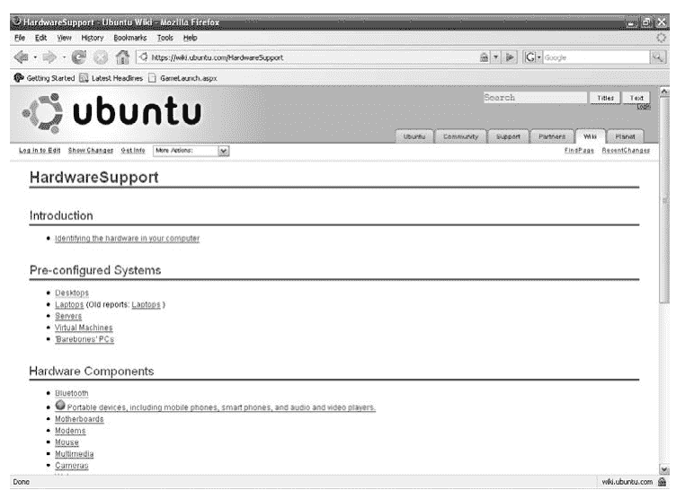

图 5-2 Ubuntu HardwareSupport 页面

图 5-3 让你直观了解 wiki 中 HardwareSupport 部分大部分页面的样子。它不仅列出了外设制造商及其指向它们的链接，还包含了有关设备类型和其他资源，可以帮助你为你可能已经拥有的产品找到正确的驱动程序。由于我们首先在寻找兼容 Ubuntu 的外设，让我们来看看其中一个制造商。Creative 是最广为人知的音视设备制造商之一。点击“Creative”的链接将带我们进入图 5-4 所示的页面。该页面按型号列出了 Creative 的摄像头以及是否支持、是否工作。注意某些摄像头需要 EasyCam 才能运行。

## 第 5 章 安装外设 69

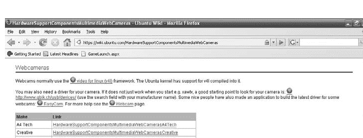

### 摄像头

自由软件基金推荐了一些不需要专用固件即可工作的摄像头。

### 5-3 摄像头制造商

| 品牌 | 型号 | 驱动 | 是否支持 | Ubuntu 版本 | 注释 | 最后更新 |
|---|---|---|---|---|---|---|
| Creative | Life Effects | video4 | 否 | v6.04 (Jasper) | EasyCam 不工作 | 2006-06-15 |
| Creative | Webcam | video4 | 否 | v6.04 (Jasper) | EasyCam 还是 easycam 都不行。遵循 ubuntu.com/showhow?id=118623 安装内核模块。摄像头可以工作，但质量很差 | 2006-07-27 |
| Creative | PW0101 | | | | v6.10 (Fierro) | USB 2.0 支持 gomeeting 和 val。你需要安装插件才能运行 gomeeting | 2006-05-04 |
| Creative | Webcam! | sp50 | 是 | | v5.04 (Hardy) | Logitech 不可用，我使用的是一个内置在内核驱动程序中的 | |
| Creative | Webcam no_ | sp518 | 否 | 是 | v6.06 (Jasper) | 注意此点：驱动程序有时有效 | 2006-04-10 |
| Creative | Webcam Play (Model P001) | | | | v6.06 (Jasper) | 你必须手动加载某些模块才能使其工作 | |
| LiveCam Cam Theater | gpsca | 是 | 是 | v7.04 (Fossa) | 开箱即用，作为 Elga 摄像头工作 | 2007-03-16 |
| Creative | Live Motion | | 否 | 否 | v7.04 (Fossa) | EasyCam 还是 easycam 都没有检测到 | 2007-06-26 |
| | | | | | | Optia 是 USB 视频类 (UVC) 标准设备，并支持 | |

### 5-4 摄像头列表

+   * 星号

# 第5章 安装外设 71

### 什么是 Wiki？

大多数对万维网熟悉的人都对“wiki”这个术语熟悉。Wiki 被定义为网页的集合或在线资源的集合，用户社区可以随时通过添加、删除或更改它来对其编辑。“wiki”一词源于夏威夷语，意为“快速”，因为它可以被快速地编辑。对于 Ubuntu Wiki，注册成员可以根据需要随时添加和更改页面。如果你访问了 https://wiki.ubuntu.com/HardwareSupport，内容可能与你在附图中看到的不同。这是因为社区成员可以每天向这个 wiki 添加内容。

Wiki 是极其方便的工具。Canonical 这样的公司使用 wiki 来支持它们的产品，但有些 包含随机信息，例如著名的维基百科（Wikipedia），这是一个基于 Web 的百科全书，任何注册成员都可以为其添加信息……

如果任何人都可以添加或编辑页面，你可能会担心 wiki 的准确性。这可能是一个问题，因为并不是每个人都能提供准确的事实。得益于社区的支持，wiki 条目中发现的错误通常会立即被纠正，以保持文档的完整性。毕竟，如果一个 wiki 充斥着不准确之处，没有人会继续使用它。

页面底部有一个指向列表不需要专有固件的 wiki 页面的链接。除了设备驱动外，外设设备还有帮助控制其运行的程序。固件程序并不运行在你的计算机上，而是存储在设备本身的电路中，通常在 ROM 芯片中。这些 wiki 与 GNU/Linux 发行版配合良好，并获得了维护此列表的自由软件会的额外支持。Ubuntu 发行版被认为是一个自由软件系统，本页列出的 http://www.sf.org/resources/hw/cameras 应该没有任何问题地运行。自由软件维护了许多其他与其他自由软件工作的设备列表。可以通过访问 http://www.sf.org/resources/hw 查看此列表。

自由软件会这样的组织依靠使用他们网站和信息的人。作为 GNU/Linux 社区的一员，你可能希望为其中一个或多个组织捐款或从事志愿者工作。他们乐意接受任何类型的捐赠，不必担心礼物太小。

### 安装外设设备

一旦你有了外设设备，你就需要安装它使其与你的计算机配合。像 Microsoft Windows 一，Ubuntu 具有即插即用的功能。即插即用意味着如果操作系统、BIOS 和设备都支持即插即用，

## 第二部分 管理 Ubuntu

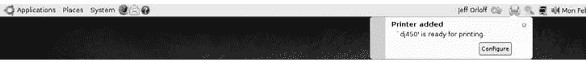

图 5-5 HP Deskjet 打印机的即插即用

并且驱动程序位于操作系统的数据库中，那么只需将设备插入计算机的 USB 端口就会启动安装过程。该过程将在极少或完全没有用户输入的情况下安装设备。如果操作系统的数据库中不存在驱动程序，则用户将必须找到驱动程序以继续安装。

Ubuntu 不仅支持即插即用，而且被大多数 GNU/Linux 爱好者认为它对这方面有最好的支持。某些设备可以插入计算机，几秒钟后，它就会要求你配置设备，因为它已经安装好了。这多方便啊！

图 5-5 精确地显示了当你想要安装设备时，将新的外设插入它时会出现的内容；Ubuntu 假设如果你将其插入计算机，你就想要安装它。它也不会通过一系列弹出窗口向你展示过程每一个步骤。记住，Ubuntu 的格言之一是“它很好用（It Works）”。

然而，一旦设备安装完成，无论是打印机、摄像头还是扫描仪，它都会为你提供配置。图 5-6 显示了当你配置设备时提供的各种选项。

图 5-6 配置打印机 # 第5章 安装外设 73

配置非常简单

*本页留白*

# 超越基础：安装额外软件

如何……

- 使用添加/删除工具安装软件
- 使用 Synaptic 软件包管理器安装软件
- 从 Ubuntu 仓库安装额外软件
- 从磁盘安装软件
- 从外部下载软件
- 解压并安装下载的软件
- 使用终端安装软件

我们购买和使用计算机是为了它们让我们做事情。无论我们想通过发送电子邮件让生活更容易，还是用它们玩游戏和听音乐，我们希望它们能做些什么。在我们学习了关于 Ubuntu 的一些有趣且重要的事情之后，我确定你们没有人安装这个操作系统是为了改变桌面的外观。不，你希望你的计算机运行它应该运行的。应用程序是程序员编写的为我们完成实际工作的程序。文字处理器、电子表格、数据库、多媒体播放器和视频游戏都是软件类型。为了让我们的计算机完整，我们需要为 Ubuntu 添加一些应用程序。

### 预装软件

当你启动计算机时，你的 Ubuntu 桌面顶部有三个标签。第一个是“应用程序”。这是我们在本章中花费大部分时间的地方。当我们点击“应用程序”标签时，我们会看到一个下拉菜单此列表包含了已安装在计算机上的应用程序类别。“添加/删除”中的最后一项是不包含已安装软件的。相反，该工具用于启动一个允许你安装和卸载位于下一节介绍的四个应用程序仓库中的软件。一些内置软件包括：

- Tomboy Notes 一个桌面笔记工具
- 象棋与数独 热门游戏
- GNU 图像处理程序（The GIMP）一个照片/图像编辑程序
- Firefox GNU/Linux 社区的首选浏览器
- Evolution Mail 一个电子邮件和日程程序
- OpenOffice.org 一个包含文字处理器、电子表格、演示文稿工具和绘图程序的办公套件
- Brasero Disc Burning 一个用于刻录 CD 的程序
- Movie Player 一个在计算机上观看电影的播放器程序

# 76 第二部分 管理 Ubuntu

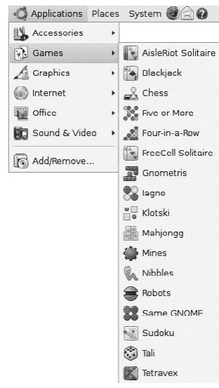

图 6-1 Ubuntu 的应用程序类别

## 第 6 章 基础之外：安装额外软件 77

当然，系统已经为你预装了许多其他应用程序。这些程序就像最流行的那些一样。如果你正在配合电脑进行操作，或者在方便的时候，可以点击其中一个类别标签，查看为你预装了哪些其他应用程序。

### 使用添加/删除工具进行安装

回看图 6-1，你会发现菜单中的最后一项是“添加/删除”（Add/Remove）。它提供了一个图形界面，用于从四个 Ubuntu 仓库中的任何一个添加/删除应用程序，或从你的计算机系统中删除软件。这些仓库根据 Ubuntu 支持该软件的能力以及该软件与 Ubuntu 自由软件哲学目标的匹配程度，被分为不同的类别，称为*组件*（components）。

#### 主组件 (Main)

主组件包含免费、可以自由分发并由 Ubuntu 团队支持的应用程序。这些应用程序由 Ubuntu 开发者精心挑选，并被认为足够重要，以便开发团队对这些软件包维护安全更新和技术支持。

#### 受限组件 (Restricted)

受限组件包含 Ubuntu 团队支持的常用应用程序，但它们不属于完全自由的许可证。例如，如果在 Ubuntu 上运行软件时出现问题，Ubuntu 开发者可能没有余地自行修复该问题。相反，他们必须将问题转发给软件开发者并与他们合作解决。受限组件中的某些软件包含在 Ubuntu CD 中。

#### 宇宙组件 (Universe)

宇宙组件中的软件应用程序来自开源/自由软件社区。该组件中有大量的软件是免费的；然而，你无法保证这些应用程序会有安全补丁或支持。

#### 多宇宙组件 (Multiverse)

该组件由非免费软件组成。这些软件不符合主组件或受限组件的许可条件。未能满足以下任何一项都将导致应用程序被列在此处：必须允许分发、不得要求任何费用或特许费、必须允许转移所有权利、不得歧视、不能依赖于 Ubuntu，且不能污染其他许可证。

#### 管理你使用的组件

在 Hardy Heron (08.04) 之前的 Ubuntu 版本默认只允许用户从主组件和受限组件安装应用程序。要安装宇宙组件和多宇宙组件，用户需要更改配置。在最新的 LTS 版本中，所有四个组件默认都是开启的。现在，用户可以选择关闭这些组件。可以通过导航到“系统 | 管理 | 软件源”（System | Administration | Software Sources）来实现，Ubuntu 会要求你输入密码，并向你展示从互联网下载的软件。你可以取消任何你不想下载的组件的勾选。你也可以通过选择“第三方软件”（Third-Party Software）标签页来添加第三方软件仓库。当然，你必须知道第三方网站的 URL。

如果你已开始安装应用程序，你需要打开“添加/删除”工具。对于 Ubuntu 新手来说，这是安装应用程序最简单的方法。通过点击桌面顶栏上的“应用程序”（Applications），你将看到图 6-1 所示的内容。现在，点击“添加/删除”项，这将带你进入类似于图 6-2 的“添加/删除应用程序”窗口。该窗口分为四个部分。第一部分是窗口顶部，你可以在这里搜索应用程序，并根据它们所属的组件选择要显示的应用程序类型。第二部分是窗口的左侧面板，为你提供了广泛的类别，你可以从中选择以缩小搜索范围。第三部分是窗口正中间的面板。在这里，你可以看到指定类别下的应用程序列表。最后，第四个面板位于窗口底部。此部分提供了所选软件包的详细描述。

所以，让我们在这里玩得开心并安装一个新游戏吧。你想做的第一件事是从列表中选择“游戏”（Games）类别。可用应用程序现在会出现在相应的面板中。滚动列表。注意每个游戏旁边都有星级。这些星星代表了每个应用程序的流行程度。如果你正在跟着操作，点击列出的游戏之一，你将在应用程序列表下方直接看到该游戏的描述。在浏览完游戏列表后，让我们选择 Potato Guy。描述看起来很有趣，所以我们可以点击应用程序旁边的选择框。在窗口右下角，你会看到“应用更改”（Apply Changes）按钮。在这种情况下，我们将文件提取到桌面。

## 82 第二部分 管理 Ubuntu

在 GNU/Linux 中，.tar（如“tar.gz”中的 tar）代表“归档包”（tarball）。.gz 代表“GNU zip”或“gzip”。一个 TAR 文件实际上是将许多文件归档成一个文件的集合。这个文件被称为归档包，然后使用类似 gzip 的工具进行压缩。这个压缩后的文件可以通过电子邮件或其他数据传输方法方便快速地发送。由于它经过了压缩，因此占用的存储空间也更小。新压缩的文件被命名为 file.tar.gz。

现在，要打开 `kfib-1.0.5.tar.gz` 文件，你需要使用 gzip 等工具对其进行解压，如图 6-5 所示。

现在你需要进入终端并安装此应用程序。首先，通过“应用程序 | 附件 | 终端”进入终端。在终端中，你需要导航到你提取应用程序的目录。在本例中，你将其提取到了桌面，所以让我们学习一些关于终端的知识。

当终端打开时，你会看到类似下面的内容：


`jeff@jeff-desktop:-$`

在你的电脑上，第一个“jeff”将是你的用户名，第二个“jeff”将是你的电脑名。当它出现在屏幕上时，按照提示输入 `ls`，然后按回车键：

```
jeff@jeff-desktop:$ ls
```

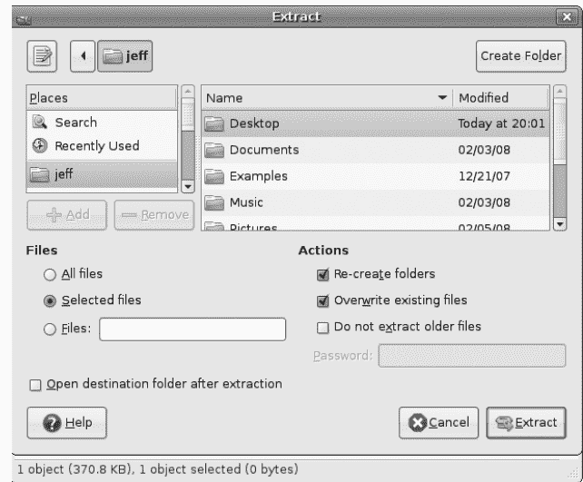

图 6-5 GNU zip (gzip) 解压工具

## 第 6 章 基础之外：安装额外软件 83

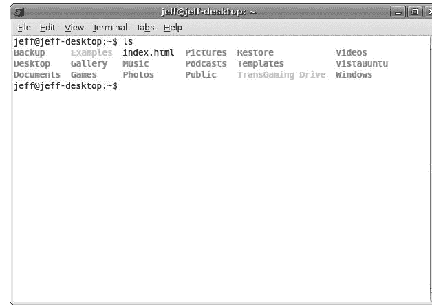

输出结果为你提供了该目录下的子目录。你会看到这里列出了 `Desktop`。要继续操作，你需要进入这个子目录。现在，你可以在提示符处输入 `cd Desktop`，如下所示：

```
jeff@jeff-desktop:-$ cd Desktop
```


> 在 GNU/Linux 的术语中，“desktop”与“Desktop”并不相同。一切对大小写敏感。

通过在提示符处输入 `ls`，我们看到了以下屏幕：

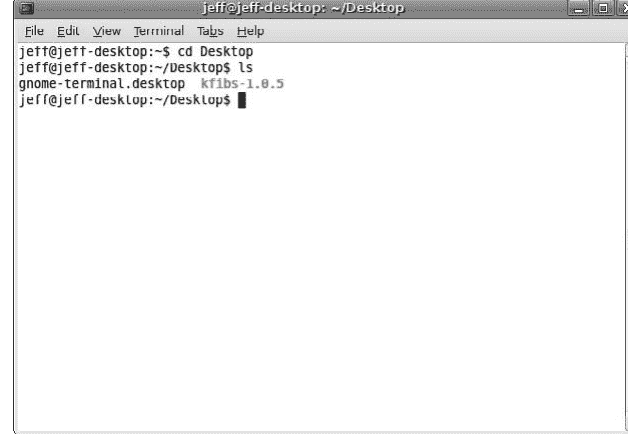

## 84 第二部分 管理 Ubuntu

现在我们看到 `sub-desktop:-$ cd kfibis-1.0.5`

`jeff@jeff-desktop:~` 我们进入了一个显示 `kfibis-1.0.5` 子目录内容的屏幕。在内容中，我们看到一个名为 `config` 的文件。这就是我们要找的。有了它，我们就可以开始安装。

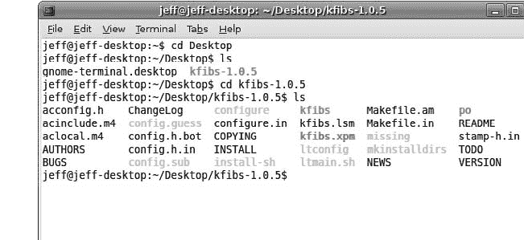

为了完成安装过程，我们需要遵循 `INSTALL` 文件列出的安装步骤。该文件可以在电脑桌面的 `kfibis-1.0.5` 文件夹中找到。只需打开文件夹并双击 `INSTALL` 文件。一个文本文件将打开，并引导你完成从终端安装应用程序的逐步过程。大多数 `INSTALL` 文件都会引导你进行安装配置、创建目录然后安装应用程序。这就是为什么之前提到的配置文件如此重要的原因。在安装任何内容之前，所有内容都需要经过配置。

> 如果安装无法运行，可能是因为你缺少安装该文件所需的包。这些包被称为依赖项。这些包可以通过 Synaptic 下载并安装。可能需要一段时间时间你才能学会通过终端安装软件，但一旦你能够无错误地完成，那将是一个非常有成就感的体验。

## 升级时机：安装新硬件

#### 如何...

- 选择合适的硬件
- 打开电脑机箱
- 安装新硬件
- 检查现有硬件

我们大多数人买的电脑都是开箱即用的。我们所做的只是将一切插到颜色对应的插座上并打开电源。在很一段时间内，以这种方式设置电脑仅限于运行 Microsoft Windows 和 Apple Mac OS 的电脑。使用 GNU-Linux 或 Unix 的冒险灵魂实际上需要安装自己的操作系统。现在，戴尔（Dell）和华硕（Acer）已与 Ubuntu 合作，为他们的台式机和笔记本预装了 Ubuntu，GNU-Linux 用户也可以加入开箱用的行列。

如果你购买的是配置好的电脑，可能会发生两种情况之一。第一种是硬件可能会损坏。在使用多年后，电脑产生的热量会导致各种与硬件相关的问题。很有可能，如果你接触电脑的时间足够长，你就见过硬件故障。第二种情况是，随着电脑用户技能的不断增加，你会感到升级某些旧硬件的需要。例如，你需要做好准备。本章将引导你了解安装硬件设备的基本知识；然而，对某些人来说，这可能是一项具有挑战性的任务。

## 选择合适的硬件

在第 5 章中，我们涵盖了选择添加到电脑中的外围设备。就像这些外围设备一样，你添加到电脑的任何硬件都需要设备驱动程序，以便软件和硬件协同工作。

## 86 第二部分 管理 Ubuntu

### 你知道吗？你需要保持凉

电脑内部电力产生的热量是硬件的第一号敌人，特别是中央处理器。为了防止部件过热，请确保空气不被阻塞。当你升级或更换硬件时，第一步应该是研究 Ubuntu 支持页面。如果你自己安装硬件，应该使用办公用品店购买的

img/9d3cb4de39be7a8cb0681b91aae792bc_107_0.png)

图 7-1 Ubuntu

## 第 7 章 升级时机：安装新硬件 87

- 主板
- 串口
- ATA 控制器
- 声卡
- 显卡
- 网卡

这些是你最可能需要处理的硬件设备。此列表中的唯一组件是 CD/DVD 播放器/录影机。当然，Ubuntu 列在这里。（硬件页面。）

> 注意 Hardwarelinux 确实为用户提供了注册选项。当你需要注册时，它会为网站提供一些额外功能。由于他们在注册过程中收集你的电子邮件地址，如果你计划注册这些网站，你可能希望设置一个新的电子邮件帐户。一旦你确定正在寻找的硬件与 Ubuntu 兼容，正如第 5 章提到的，寻找正确驱动程序的最佳地方之一是制造商的网站。记住，有些网站会将操作系统列为 Linux 或 GNU-Linux，但有些会更具体。常见的 GNU-Linux 发行版有 Red Hat、SUSE Linux、Mandriva 和 Debian。如果 Ubuntu 没有列在发行版中，最稳妥的方法是查找 Debian 的驱动程序。

这不是一个好主意。静电像热量一样，会破坏你的电脑。热量需要一段时间来慢慢侵蚀你电脑的功能，但静电是一个快速而安静的杀手。只需一次放电就足以损坏一个处理器。

除了保持区域清洁外，你很可能还需要一把小型十字螺丝刀。此外，现在是清理电脑内部的绝佳时机，所以身边准备一罐压缩空气来清除任何灰尘堆积是件好事。

要打开电脑，请务必遵循以下步骤：

- 1. 关闭电脑。在关闭操作系统后，检查电脑背部的电源供应器是否有开关。如果有，请将其关闭。
- 2. 从电脑上拔掉电源线、所有外部线缆和所有连接的设备。
- 3. 拆下固定侧板的螺丝。应该有四颗螺丝将每个侧板固定在机箱上，每个侧板两个。确保你没有拆下连接到电源的螺丝；你需要将电源固定在位。
- 4. 将侧板从电脑上滑出。

> 某些电脑（尤其是戴尔 Dell）不需要你拆卸任何螺丝即可打开机箱。这些电脑有一个按钮，你可以按住它打开机箱。如果你不确定如何打开电脑，请查阅用户手册或在网上搜索。

## 第二部分 管理 Ubuntu

#### 我该把这个东西插在哪里？

现在你的电脑已经拆成了零件散落在你面前，我曾考虑过在这里结束本章，看看你是学习如何使用 Ubuntu 社区寻求支持的。然而，我收到警告说，过多的邮件无疑会拖慢你的电子邮件账户，所以让我们学习如何把这些东西重新组装起来。

打开机箱后，你想要确保 (a) 将硬件设备安装在电脑的正确位置，(b) 使用正确的电缆将你的新硬件连接到主板。

#### CD、DVD 和硬盘驱动器

如果你正在添加额外的硬盘或正在安装 CD 或 DVD 驱动器，你需要通过电脑前面的其中一个驱动器槽将它安装在机上。如果你正在更换 CD、DVD 或硬盘，则不需要打开驱动器槽。如果你正在添加次要设备，则需要为新硬件打开一个槽。大多数电脑机箱都有一个可以拆下的塑料盖板，可以为 CD/DVD 驱动器腾出空间。只需取下盖子，并将驱动器滑入到位即可。

## 第 7 章 升级时刻：安装新硬件 89

> 你知道吗？你需要设置跳线帽

硬盘和 CD/DVD 驱动器是可启动设备，因此它们带有所谓的 `跳线帽`。请务必咨询随新硬件附带的文档，以获取设备正确的跳线帽设置。未正确设置可能会导致你的硬件无法正常工作。

一旦到位，请确保使用驱动器自带的螺丝将其固定在机箱上。硬盘也可以滑入到位并固定在机箱上。确保两边都拧好螺丝。只固定一侧会导致震动产生噪音。一旦设备安装在驱动器槽中，你将需要接入电源线、接口线，对于 CD/DVD 驱动器，如果你想从此设备播放音乐或电影，则还需连接音频线。如果它用作次要设备或录制设备，则不需要将音频线连接到声卡。

#### 使用扩展槽

大多数硬件设备（如显卡、网卡和声卡）使用电脑后部的扩展槽作为“家”，而不是驱动器槽。如果你向主板背面看，你会看到几个不同的端口或插槽，可以在这里安装这些设备。这些插槽位于主板上，通常不需要向它们连接线缆。

就像驱动器槽一样，扩展槽也有保护它们免受外界干扰的东西，称为“挡板”（blanks）。这些挡板通常由金属制成，需要移除时可以从机箱上拧下。图 7-2 显示了挡板的位置。有些人认为拆除所有挡板有助于保持电脑冷却，因为热量多了一个逃逸的地方。事实并非如此。设计机箱的工程师这样做是为了最大化气流。移除挡板而不用扩展卡填充将破坏电脑内部的气流。

 挡板的位置 7-2 所示

#### PCI (外设总线接口)

这是电脑上常用的插槽，可以连接各种设备。这种接口是以前的，可以更快传输。这种端口通常是棕色的。

#### AGP (加速图形接口)

这是一种广泛用于显卡的接口，可以更快传输。这种端口通常是白色的。

#### PCI Express

这是一种较新的卡，广泛用于显卡。这种端口通常是黑色的。

## 第 7 章 升级时刻：安装新硬件 91

当你把新硬件连接到电脑时，可能会感到有些畏惧。这些设备是脆弱且昂贵的。同时，为了让设备正常工作，必须将其固定。

#### 如何查看你拥有的硬件

无论你是否要为电脑添加硬件，你可能都想查看具体的硬件。Ubuntu 社区支持一个名为“设备管理器”的程序，它可以添加到菜单中。虽然设备管理器很好，但你也可以从终端获取关于电脑硬件的信息。这个程序提供了一个非常实用的界面。

通过终端获取信息也是另一种方法，所以请花点打开终端并输入：

| `lshw -short` | 提供硬件的简要摘要 |
| `lspci` | 提供通过 PCI 总线连接的设备列表 |
| `lsusb` | 提供连接到 USB 端口的设备列表 |
| `cat /proc/cpuinfo` | 提供有关处理器的信息 |
| `lshw -class network` | 提供有关网络设备的信息 |

（注意：确保在命令前加上 `sudo`，以超级用户身份运行。）

本页特意空白

## #8 保持安全——保护 Ubuntu

如何做到……

- 养成安全智能的习惯
- 安装和配置防火墙
- 安装和配置反病毒软件
- 安装和配置备份恢复软件

电脑安全在新闻、消费者电脑杂志、IT 杂志以及整个互联网上都被讨论。它是一个热门的话题，以人认为它被夸大了，以便安全供应商能向恐惧的人出售更多软件。毕竟，谁不想花 19.95 美元来确保黑客无法偷取他们的身份和信用卡呢？确实，那里有一些不道德的人在利用电脑安全浪潮，到处都是免费开源的弹出窗口声称“您的系统已感染——点击此处购买我的软件来清理和保护电脑”。然而，如果电脑安全威胁全是炒作，为什么自由开源社区会参与这一领域呢？

当我们连接到互联网时，电脑就会面临风险。风险包括病毒、木马、间谍软件、根内核、恶意黑客、网络钓鱼、网络钓网和社会工程学。IT 专业人员在讨论安全时常用的一种说法是“安全电脑的方法的方法将其封在钢箱子里”，基本上就是不使用电脑，你就安全了。这并不实际，因为我们每天都在使用电脑。与其恐惧，不如明智。理解什么是明智的习惯以及你应该采取哪些安全措施，可能是快乐电脑用户与丢失所有文件的人之间的区别。

### 电脑安全最佳实践

在我们学习如何保护运行 Ubuntu 的电脑之前，需要理解一些重要的术语，并了解一些基本原则。

## 第二部分 管理 Ubuntu

引起了你的注意。在读完这一节后，你可能会想：“你为什么要告诉我这些东西？这不就是常识吗！”正如我们所知，常识并不总是通俗的。如果是那样，我就没必要在书中包含这一章了。

### 需了解的术语

以下术语将贯穿全章。了解它们非常重要，因为它们在 Ubuntu 以及其他安全相关的论坛中被频繁使用。

- **僵尸网络 (Botnet)**：由另一台计算机或用户控制的计算机（僵尸）的集合。通常，这是通过使用病毒或其他类型的恶意软件实现的。
- **破解者 (Cracker)**：未经许可进入计算机系统的人。
- **漏洞利用 (Exploit)**：被破解者和恶意黑客利用以获取计算机系统或网络访问权限软件漏洞。
- **防火墙 (Firewall)**：一种软件或硬件程序包，其目的是防止对计算机系统或网络进行未经授权的访问。
- **黑客 (Hacker)**：使用技巧和才智解决复杂问题的人。
- **恶意软件 (Malware)**：“malware”一词是“malicious software”的缩写。基本上，它是任何可以损坏你计算机系统的软件。例如病毒、木马和蠕虫。
- **钓网劫 (Pharming)**：一种技术，更改网站的 DNS 条，使得使用户被重定向到他们想要访问的欺诈网站。这通常用于从毫无防备的用户那里收集银行和其他个人数据。
- **网络钓鱼 (Phishing)**：一种技术，向用户发送电子邮件或即时消息，假称自己是银行或服务等合法实体。消息通常要求用户发送账户信息和密码以解决其账户问题。这些消息可能还包含指向欺诈网站的链接，用户被要求输入这些信息供犯罪分子收集。
- **Root权包 (Rootkit)**：允许攻击者获得 GNU/Linux 机器的 root 权限的恶意软件。在 Windows 中，攻击者将获得管理员权限。
- **社会工程学 (Social engineering)**：骗局游戏的高科技版本。一种利用可能信息欺骗用户，从而获得“授权”访问计算机系统或网络的方法。
- **特洛伊木马 (Trojan)**：“Trojan horse”的缩写，一种以其他程序伪装安装的计算机程序。这种恶意软件随后允许攻击者通过它创建的后门进入。
- **病毒 (Virus)**：一种可以在操作者不知的情况下自我复制以感染计算机的软件。病毒可以破坏或更改其所感染计算机上的数据。
- **脆弱性 (Vulnerability)**：计算机系统、程序或网络防御中的缺陷，破解者可以利用这些缺陷获取访问权限。
- **蠕虫 (Worm)**：一种可以自我复制并在计算机网络中传播的恶意软件。
- **僵尸主机 (Zombie)**：被病毒感染并允许他人控制的计算机。

## 第 8 章 保持安全——加固 Ubuntu 95

如果你在互联网上花过时间研究 GNU/Linux 和 Ubuntu，你可能见过一些文章和论坛帖子，显示了该操作系统比微软 Windows 安全得多。如果你没见过，试着在 Google 上搜索“GNU/Linux + security”术语，你就会明白我在说什么了。

当用户安装微软 Windows 时，会被要求初始账户。该账户始终被赋予管理员权限，这意味着对于该用户账户来说没有什么是受限制的。因此，如果在此账户下运行恶意软件，它将在计算机上横意驰骋。Ubuntu 采取了不同的方法。安装过程中创建的初始用户不能随心所欲。记得当你从终端安装应用程序并必须输入“sudo”时——这是因为用户不是管理员，或者说我们在 GNU/Linux 中称之为 root。这与“添加/删除”工具或 Synaptic 软件包管理器在你尝试安装东西时要求密码是一样的。这个概念显然是有效的，因为微软现在在 Windows 操作系统中使用了类似的程序。

GNU/Linux 比 Windows 安全得多的另一个原因是影响 Windows 的恶意软件数量远大于 GNU/Linux。重要的是，这两个操作系统拥有不同类型的用户。微软 Windows 有许多不实践或不关注计算机安全的用户。使用 GNU/Linux 的人则不同——大多数人已经比普通计算机用户更进了一，深入探索更广泛的计算世界。这种好奇心带来了更多的意识。当然，这只是一个理论，世界上存在数百万采用 Windows 的用户。这个理论强调了用户在保持计算机安全方面的重要作用。作为用户，安装防病毒软件和防火墙是你的责任。你需要确保这些软件以及其他应用程序都频繁更新。最重要的是，使用这些安全应用程序是你的责任。

### 坦诚安装

我们并不是在安装德鲁·巴里摩早期作品的副本。我们正在安装健全计算机安全计划中最核心的部分之一——防火墙。多年来，“防火墙”一词被某些人误解。它有时被定义为一种限制访问网站的工具。尽管某些防火墙包含内容过滤器，但这并不是防火墙的主要目的。防火墙是一种通过控制计算机端口（其作为数据连接的端点）来限制访问计算机系统或访问的工具。在 Ubuntu 中，默认安装不会打开任何端口。大多数计算机系统不需要打开任何端口，因此在安装期间不打开端口不会影响计算机的性能。

## 第二部分 管理 Ubuntu

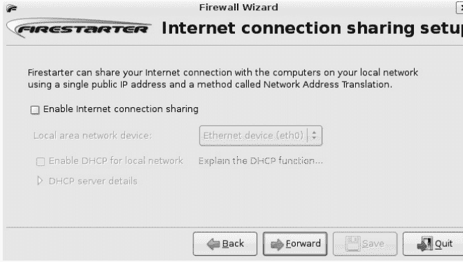

点击“保存”后，Firestarter 窗口将打开（见图 8-5）。你可以花些时间查看防火墙提供的不同选项，但不要更改任何内容，特别是策略。如果设置得不当，你可能会失去访问互联网的能力。虽然策略超出了本书的范围，但 Ubuntu 论坛提供了大量关于 Firestarter 的信息。再次强调，这是使用 Ubuntu 支持软件的用处之一。现在，如果你想看 Firestarter 实际执行某些操作，请保持此窗口打开，然后打开 Firefox 浏览器。访问几个网站，然后回到 Firestarter。

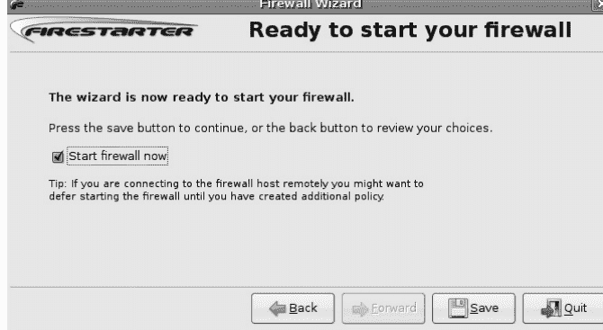

# 第 8 章 保持安全——加固 Ubuntu 99

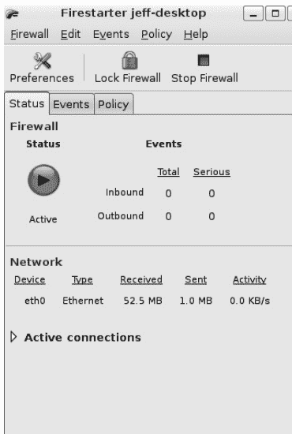

图 8-5 Firestarter 窗口

注意，“接收”（Received）和“发送”（Sent）字段已经发生了变化。这是因为该防火墙会记录活动网络设备上传输的数据量。这些信息可能很有帮助，因为当你没有连接互联网却发现网络设备上有大量流量时，可能某人或某物正在你不知情的情况下传输数据。

### 分析网络流量

安全专家判断计算机系统是否被入侵的一种方法是使用如 Wireshark 这样的网络流量分析工具。Wireshark 是一个开源工具，像 Firestarter 一样记录网络流量，但它还允许用户分析这些流量以及往返的数据包。由于计算机和网络通常会在其网络设备上传输一定数量的数据，网络管理员会建立一个基准，或一组正常的流量标准。当流量无缘无故地超出此基准时，他们就会开始寻找可能的入侵行为或恶意软件。

## 第二部分 管理 Ubuntu

图 8-6 Firestarter 正在运行。

一旦你熟悉了 Firestarter，请注意你工具栏上那个带有黑色箭头的蓝色圆圈（见图 8-6）。这是打开 Firestarter 窗口的图标，并让你知道防火墙处于激活状态。

如果你点击此图标，Firestarter 窗口将会消失，但防火墙仍会保护你的电脑。如果你关闭 Firestarter 窗口，你将会关闭程序并面临在没有防火墙保护下运行的风险。

### 安装杀毒软件

关于 GNU/Linux 的一个误解是该操作系统不存在病毒。这完全不是事实。在一段时间内，GNU/Linux 并没有像 Microsoft Windows 那样感受到恶意软件攻击的持续压力。虽然研究人员编写过可以感染 GNU/Linux 操作系统的病毒，但它们仅用于研究目的。然而，此后已经发布了能够感染运行 GNU/Linux 操作系统的计算机的病毒。越来越多的人开始在“野外”看到可以破坏这些操作系统的病毒。

> 向公众发布的病毒被称为“野外”病毒（in the wild）。虽然安全专家可以区分用于研究的病毒和意图破坏计算机系统的病毒，但部分人出于兴趣会收集“野外”的恶意软件，以便分析其恶意软件的代码并与其抗争。

请记住，Ubuntu 是基于 Ubuntu “开箱即用”（Just Works）的哲学构建的。为了让 Ubuntu 正常工作，需要为 Ubuntu 用户提供杀毒软件。杀毒软件以多种方式工作。首先，这种软件需要通过知道要寻找什么来检测计算机系统上的恶意软件。这些信息由软件自动下载并安装的签名文件（signatures file）提供。如果这些签名过期，计算机就会受到最新恶意软件的威胁。

签名文件也被某些杀毒程序称为“定义文件”（definition files）。

由于大多数杀毒软件制造商不仅对应用程序收费，还对病毒定义收取年度订阅费，找到一个符合 Ubuntu 软件模型的软件可能有些困难。幸运的是，许多公司选择不对家庭用户收取杀毒软件和定义的费用。从这个列表中，Ubuntu 社区选择了 ClamTk，因为它属于 GNU 许可证（GNU Public License）。

# 第 8 章 保持安全——加固 Ubuntu 101

### 安装 ClamTk

安装 ClamTk 非常简单。从“添加/移除”工具开始。你还记得如何进入那里吧？从左侧的分类中，选择“系统工具”（System Tools），然后向下滚动列表直到看到“病毒扫描器”（Virus Scanner）。从这里只需选择此应用程序，然后像以前做那样点击“应用更改”。好了！你已经保护了电脑免受恶意软件的侵害。

### 更新签名文件

现在你已经成功安装了应用程序，你可能想要更新签名文件。最简单的方法是打开终端窗口并输入以下命令：

```bash


`wget http://db.local.clamav.net/daily.cvd`

按下回车键后，你应该看到类似于图 8-7 的界面。这显示了病毒签名文件的下载过程。现在，你需要通过输入将文件移动到属性目录：
```bash
sudo mv daily.cvd /var/lib/clamav
```

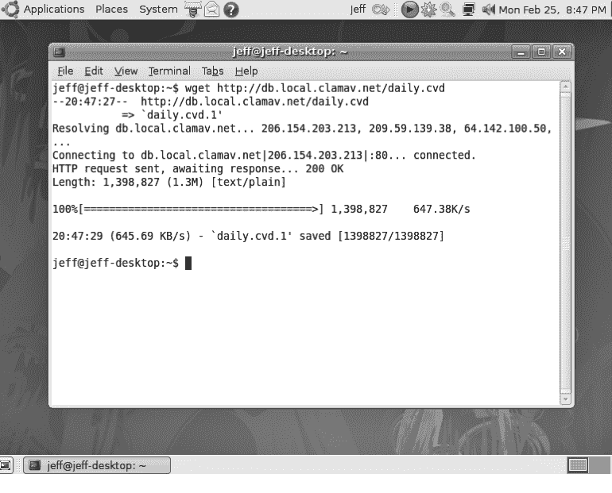

图 8-7 下载病毒签名

## 第二部分 管理 Ubuntu

这将更新后的文件放入 `clamav` 文件夹。当你按下回车键时，会提示输入密码。成功后，你将返回终端。

### 扫描计算机

大多数在 Microsoft Windows 上运行的杀毒软件会自动扫描计算机，而 `ClamTk` 则不会。相反，你需要手动让它扫描计算机。

对于你来说，Ubuntu 不容易崩溃。对于那些从 Microsoft Windows 转过来的用户，你可以完全忘记“蓝屏”（Blue Screen of Death）的日子。对于在 GNU/Linux 家族内部切换的用户，你可以预期与其他大多数发行版相同的稳定性。

既然 Ubuntu 和 GNU/Linux 如此稳定，谁还需要备份数据呢？意外会发生：火灾、洪水、飓风或任何自然灾害都会抹掉多年的照片和财务数据。而且我们都有

# 第 8 章 保持安全——加固 Ubuntu

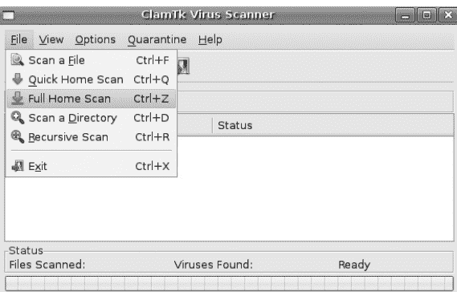

图 8-9 使用 ClamTk

现在 `ClamTk` 的应用程序窗口已打开（见图 8-9），选择“文件”然后“全扫描”。这将扫描你的主目录。如果你下载了可疑文件，也可以选择扫描单个文件或出于安全考虑扫描单个目录。

> 注意 你可能认识这个程序 `ClamAV`。`ClamAV` 在后台运行，而 `ClamTk` 是你使用的图形界面。

### 备份与恢复

快速举手，有多少人经常备份电脑上的文件？我猜是。备份数据和文件是每个人待办清单上的事情之一，但可能读这本书的每个人都遇到过那种时刻：断电了、电脑崩溃了、狗咬了硬盘。无论原因是什么，结果都是数据丢失了。

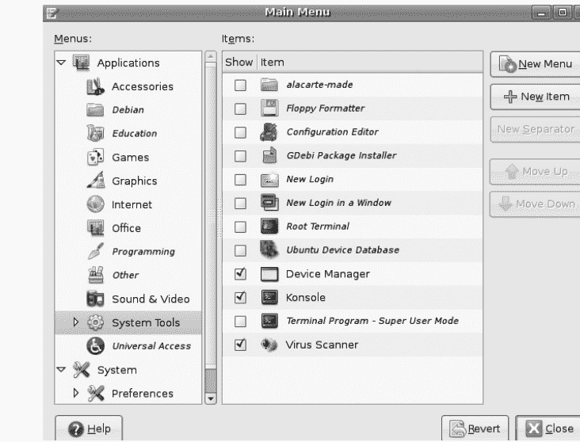

图 8-8 编辑菜单

要扫描计算机，你需要启动应用程序。在“病毒扫描器”旁边点击“关闭”并打开“应用程序”选项卡。选择“系统工具 | 病毒扫描器”来启动应用程序。如果你发现是这种情况，右键点击并选择“编辑菜单”，这将弹出一个如图 8-8 所示的窗口。现在选择“系统工具”，然后勾选

那些似乎始终无法上手电脑的家人。尽管他们表现出出色的英语能力，但他们仍然没有意识到“删除全部！”`Delete All!`）的意思是“清除”。

在 Ubuntu 存储库中，你有许多高质量的备份和恢复应用程序供选择。让我们进入“添加/移除”工具并搜索“备份（Backup）”一词。提供的前几个选项中包括“简单备份恢复”（Simple Backup Restore）和“主用户备份”（Home User Backup）。还有许多其他选项，但这些是最容易使用的。你将安装“主用户备份”和“主用户恢复”，所以如果你在跟着操作，请选择这两个软件包，然后点击“应用（Apply）”。

“简单备份恢复”和“主用户备份”都有额外的包需要安装。“简单备份恢复”需要你安装额外的“备份配置”（Backup Config）配置，而“主用户备份”需要“主用户恢复”。

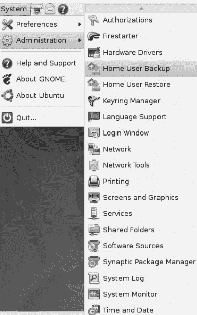

现在应用程序已安装，前往“系统 | 管理 | 主用户备份”来启动程序。

你可以选择备份主文件夹中的所有文件，也可以指定你想要备份的文件夹（见图 8-10）。你还可以指定你想将备份后的文件保存到哪里。

## 第 8 章 安全——保护 Ubuntu

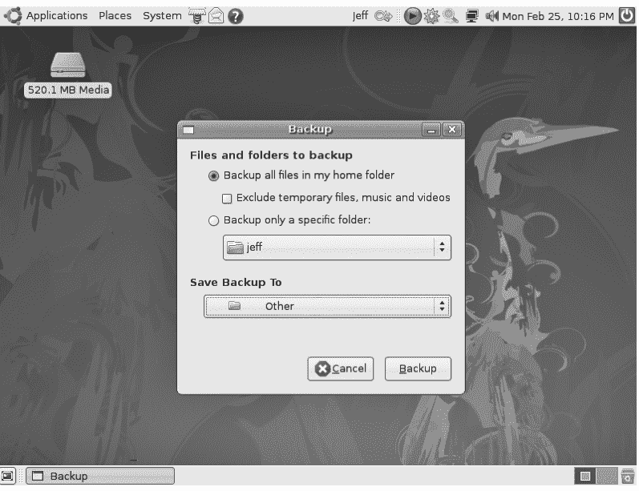

图 8-10 主用户备份

默认情况下，如果存在 CD/DVD 设备，“主用户备份”将保存到那里。我喜欢将文件备份到 USB 驱动器，如图 8-10 所示，我选择“其他（Other）”来进入我的 USB 驱动器。

如果你选择“其他”，将打开一个新窗口。在这里，你可以选择想要保存备份文件的地方。我选择了 520.1MB 介质驱动器（见图 8-11），这是一个 USB 驱动器。如果你在跟着操作，点击你想要保存备份的文件夹或驱动器，然后点击“打开（Open）”。

你将返回图 8-10 中的“备份”窗口，但“保存备份到（Save Backup To）”选项应该反映你所选择的位置。你现在可以点击“备份”开始该过程。第一次创建备份归包时，“主用户备份”会问你是否想验证其完整性。这是一个很好的选择，因为它会让你知道备份可以成功恢复。备份完成后，你应该有两个文件：`*jeff-master-archive.1.dar*` 和 `*jeff-master-catalog.1.dar*`，其中 `jeff` 将是你的计算机名称。如果你需要恢复数据，你将使用这些文件。

## 第二部分 管理 Ubuntu

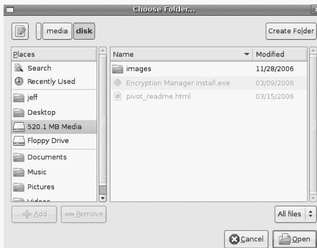

图 8-11 选择驱动器

### 恢复数据

虽然我们希望你永远不需要恢复丢失的数据，但有时这个过程是必要的。由于你已经承诺维护一致的备份计划，恢复数据应该是相当容易的。

> “主用户恢复”（Home User Restore）存在于应用程序菜单；然而然而在某些 Ubuntu 版本中，从那里启动该应用程序并不有效。相反，你可以从终端启动“主用户恢复”以避免任何问题。

要恢复你创建的备份文件，你需要通过选择“附件 | 应用程序 | 终端”来启动终端。在终端窗口中输入以下内容：
```
sudo -x /path/your_archive_file -R /path/targetfolder
```
在此示例中，`path` 将是你的归包文件路径，`target_folder` 将是你想要存放恢复文件的目标文件夹。使用我创建的文件并将其保存到桌面上名为“backup”的文件夹中，我将输入以下内容进行恢复：
```
sudo -x /path/your_archive_file
```

## 第 8 章 安全——保护 Ubuntu

> “主用户恢复”（Home User Restore）存在于应用程序菜单；然而然而在某些 Ubuntu 版本中，从那里启动该应用程序并不有效。相反，你可以从终端启动“主用户恢复”以避免任何问题。
```
sudo -x /path/your_archive_file -R/
```


Ubuntu 的 Writer 中在 Windows 版 Word 中未找到的功能

- 导出 PDF：选择“文件 | 导出 PDF”，Writer 将把你的文档转换为可以发布在网站上或任何拥有免费 Acrobat Reader 的人打开的可迁移文档。

### 如何... 加密文件

加密看起来是一个流行词汇，但实际上，如果你使用 Ubuntu，加密并不简单。

### 如何... 安装整个套件

## 第三部分 管理 Ubuntu

### OpenOffice 的功能

- 在 OpenOffice 中创建新文档
- 在文档中插入图形
- 打开文档
- 保存文档以便其他人阅读

虽然我们希望你永远不需要恢复丢失的数据，但有时这个过程是必要的。由于你已经承诺维护一致的备份计划，恢复数据应该是相当容易的。

# 第 9 章 写作之道 113

- **OpenDocument 标准**：与 Microsoft Word 不同，OpenOffice.org 的 Writer 使用一种更具移植性的格式存储文档。遗憾的是，它与 Word 使用的专有格式兼容性不好。

### 创建新文档

创建新 Writer 文档的第一步是打开应用程序。让我们从点击“应用程序”`Applications`选项开始。当菜单出现时，你会看到“Office”是列表选项之一。点击它并选择“OpenOffice.org 文字处理器”`Word Processor`。这将启动 Writer 应用程序。你会发现 Writer 窗口与其他商业文字处理器的非常相似。图 9-1 显示了它的用户界面与 9-2 所示的 Microsoft Word 界面有多相似。

Microsoft Office 2007 的用户界面与 OpenOffice.org Writer 的最新版本非常不同。太阳系统公司`Sun Microsystems`计划重新设计用户界面，使 Writer 更加现代化。

> 注意
> 当你打开 Writer 时，系统会自动带你进入新文档。这很简单，对吧？如果你愿意，可以直接从这个窗口开始打字。然而，商业文字处理器的另一个特性让人们感到很方便：模板`templates`。

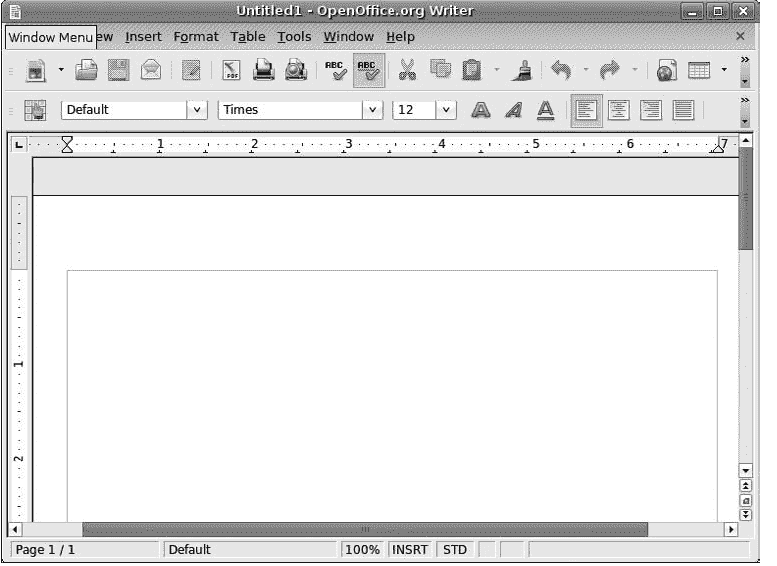
图 9-1 Writer 用户界面

# 第三部分 开启 OpenOffice 之门

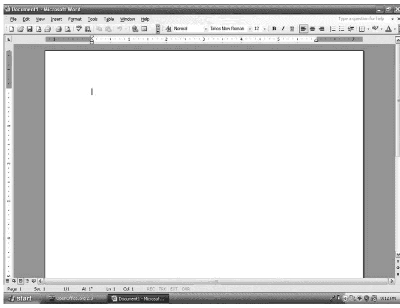
图 9-2 Microsoft Word 2003 用户界面

### 使用模板

模板是预先格式化的文档，人们可以使用它们来让工作变得轻松。如果你想写封信，可以使用模板，它会为你处理好所有的格式。你只需要覆盖模板中的占位符文本即可。几乎涵盖所有内容都有模板：发票、议程、报告、表格——只要你能想到的，就有对应的模板。如果 Open.org 计划与商业办公套件竞争，它最好拥有模板。

你可以通过点击文件 | 新建 | 模板和文档`File | New | Templates And Documents`打开新模板。一旦打开了图 9-3 所示的“模板和文档”窗口，你就可以根据正在工作的内容选择合适的模板。在这些模板的指导下，你会发现工作变得容易了一些。

### 寻找更多模板

如果你觉得 Writer 中的模板集已经足够，可以下载更多模板。将你的浏览器指向 `http://documentation.openoffice.org/Samples_Templates/User/template/index.html`，如对面的图像所示。

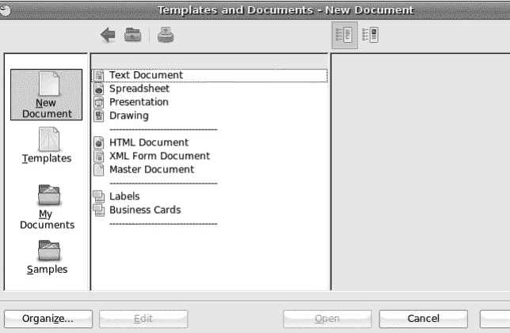
图 9-3 Writer 模板

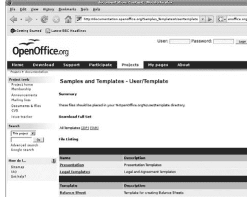

# 116 第三部分 开启 OpenOffice 之门

此页面允许你下载全套 OpenOffice.org 模板，也可以从插图底部不同的类别中选择模板。此外，该页面还准确地告诉你在将 TAR 文件解压到 `%OpenOffice.org/%user/template`。

> TAR 文件在第 6 章讨论过。如果你需要复习如何从 tarball 解压并安装，请参阅这些页面。

如果你没有找到寻找的模板，尝试搜索“OpenOffice.org + Templates”。此搜索将为你提供许多提供该办公套件模板的网站，而且，大多数是免费的！

#### 格式化

当我们谈论文档意义上的“格式化”时，我们指的是特定文档的页面和文本的布局及属性。页面布局的格式化可以指边距或方向等特征，而文本格式化可以包括字体类型、文本颜色或**粗体**或*斜体*等样式属性。在 Writer 中创建文档时，你可能会出于各种原因选择更改格式。

#### 页面格式化

如果你选择了模板，你可能会发现页面已经为你设置好了格式。如果你打开的是空白文档，你可以选择格式化页面以符合你的需求。从顶部栏，选择格式 | 页面`Format | Page`。现在从“页面样式”`Page Style`窗口中选择“页面”`Page`选项卡。在这里，你可以更改页面方向、页面大小、边距以及与页面格式相关的其他选项。样式窗口中的其他选项卡允许你更改页面背景颜色、添加页眉或页脚，或修改边框、添加列以及管理脚注。图 9-4 显示了新 Writer 文档默认设置的样式窗口。

#### 文本格式化

在创建文档时，更改文档文本属性是非常重要的。你可以将文本格式化为不同的字体类型以适应个人口味，或遵循广泛使用的指南，如 APA 样式`美国心理学会出版手册`或《芝加哥格式手册》`The Chicago Manual of Style`。*斜体*和**粗体**字体可以用于强调某些重要的词或短语。其他属性如单词加下划线或删除线也可以。

在 Writer 中，更改文本格式的能力是非常容易的。

# 第 9 章 写作之道 115


图 9-1 Writer 用户界面


图 9-2 Microsoft Word 2003 用户界面
（此处 OCR 文本重叠，将根据提供的流程进行对齐。）

# 第 9 章 写作之道 115


图 9-3 Writer 模板


# 116 第三部分 开启 OpenOffice 之门


图 9-1 Writer 用户界面
（实际上，我将根据提供的文本提供合并版本。）

## 120 第三部分 开启 OpenOffice 之门

在工具栏中，你会发现“插入图片”`Insert A Picture`命令提供了两个选项：来自文件`From File`和扫描`Scan`。如果你打算使用扫描仪在当前位置插入图片或图形形，则使用“扫描”。如果你已经将图片保存在计算机上，则选择“来自文件”。从这里开始，你需要导航到保存图像的文件夹。在这种情况下，我将它保存在图 9-7 所示左侧和上方主文件夹中的“文档”`Documents`文件夹中。

一旦我高亮想要插入的图片，就点击“插入图片”窗口底部的“打开”`Open`按钮。图片插入到文档后，我可以移动它、调整其大小并以许多方式对其进行修改。如图 9-8 所示，当你插入图片时，文档窗口顶部会出现一个图片工具栏

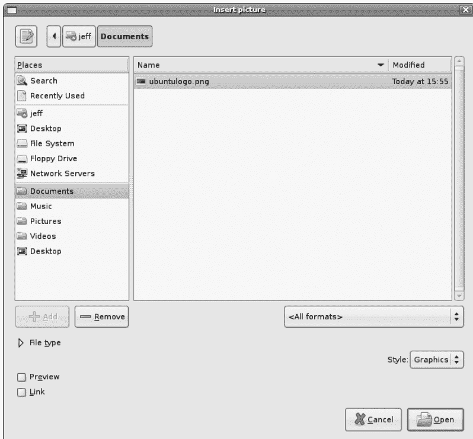

图 9-7 插入图片窗口

## 第 9 章 写作技巧 121

### 你知道吗？在哪里找到公有领域的图像

公有领域意味着这些内容（无论是文字作品、图片、电影还是其他媒体）都可以免费使用。寻找公有领域图像的最佳地点之一是维基共享资源`Wikimedia Commons`网站，`http://commons.wikimedia.org`。该网站充满了你所想象的任何事物的图像。虽然大多数图像完全没有版权，但某些贡献者要求在他们的图像被用于贡献者指定以外的其他用途时告知他们。

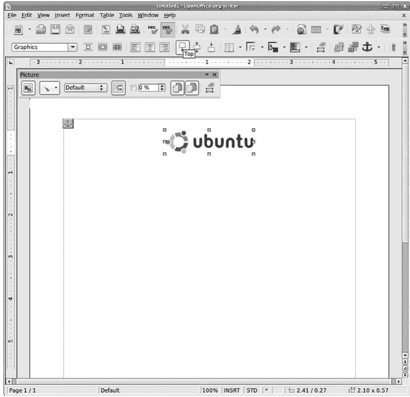

图 9-8 新插入的图片

## 122 第三部分 开启 OpenOffice 之门

出现在文档窗口的顶部。此工具栏允许你对刚刚插入文档的图片进行更改，甚至可以添加更多图片。

## 打开 Microsoft Word 文件

如果你经常使用计算机，迟早将需要打开 Microsoft Word 文档。OpenOffice.org 注意到了这一点，因此它允许你在 Writer 应用程序中打开这种格式的文档。Writer 功能足够强大，你也可以用 Writer 处理 Microsoft Word 文档。你可能需要重新格式化文档的某些部分，但这在 Microsoft 中打开 Word 文档时也会发生——而且它们是由同一公司制作的！

要打开 Word 文档，只需选择“文件 | 打开”`File | Open`。你将进入“打开”窗口`见图 9-9`，从那里你可以导航到存储文档的文件夹。一旦找到文档，只需选择并点击“打开”按钮即可。就这么，不需要转换。

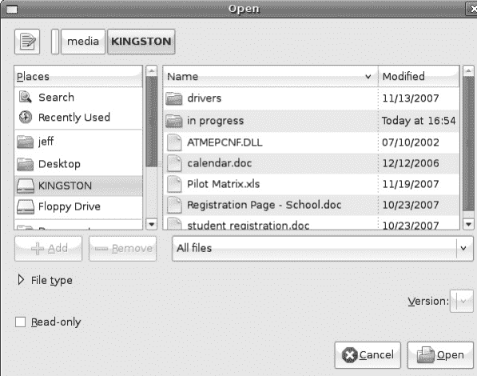

图 9-9 打开窗口

## 第 9 章 写作技巧 123

Microsoft Word 文件将具有 `.doc` 扩展名，而 OpenOffice.org Writer 文件将具有 `.odt` 扩展名。

## 保存工作并与他人共享

当你为老板完成那份很棒的报告，你可能想要保存该文档。保存文档就像打开文档一样简单。你只需要选择“文件 | 另存为”`File | Save As`。这将弹出所示的“保存”窗口。只需为你的文档命名，并选择你想保存它的文件夹；然后点击“保存”按钮。

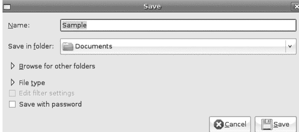

如果你之前保存过文档，就不需要执行“另存为”操作。对于随后的每次保存，你可以选择“文件 | 保存”`File | Save`，Writer 将以相同的名称和位置保存文档。

当你保存了报告并准备好发送给老板时，请记住你的其中一个客户使用 Microsoft Word。如果他收到一个用 Writer 创建的文档，它将无法打开。如果他没有得到这份报告的副本，你可能会丢掉红色订书机并沦落地下室。别担心，Microsoft Office 产品可能不识别 OpenOffice.org 文档，但 OpenOffice.org 的开发者考虑到了这一点。Writer 内置了将文档另存为其他格式的功能。再次选择“文件 | 保存”。这次点击文件类型旁边的箭头`见图 9-10`。在这里，你将看到一个从“开放文档文本”`OpenDocument Text`开始的列表。如果你向下滚动列表，你会发现其他可以保存的 Microsoft Word 格式。选择合适的格式然后点击“保存”按钮。它现在将具有可以在 Microsoft Word 中打开的 `.doc` 扩展名，而不是 Writer 的 `.odt` 扩展名。

## 124 第三部分 开启 OpenOffice 之门

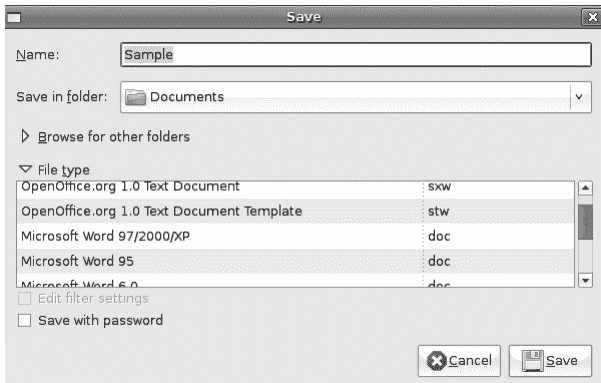

图 9-10 保存为 Word 文档

#### 结语

虽然这让你对 OpenOffice.org 的应用程序有所了解，但它绝不是该程序的完整教程。Writer 是一个极其丰富的应用程序，需要另一本书来涵盖它附带的每一个功能和工具。通过这些页面提供的内容，你可以浏览用户界面并学习如何利用该应用程序提供的一切。

如果你正在寻找关于 OpenOffice.org Writer 的更深入的帮助，请访问 `www.openoffice.org`。在这里你可以找到可以回答你问题的其他信息。运行 Windows 或 Apple Mac OS 的任何人都可以下载 OpenOffice.org 套件。当然，该软件对他们也是免费的！

## 10 使用 Calc 展开

如何操作...

- 创建新表格
- 格式化单元格
- 执行计算
- 添加图表
- 使用 Excel

一个允许你创建表格的应用程序是大多数业务离不开的工具。虽然常用的表格应用程序是 Microsoft Excel，但 OpenOffice.org 也确保在其办公套件包含了此工具。为了满足业务用户的需求，OpenOffice.org 包含了名为 Calc 的程序。

表格在单元格中收集数据。这些单元格由行和列组成。每个单元格通过其地址识别，列字母和行号。例如，第一列第一行的称为 `A1`。你可以在单元格中输入数据，包括文本、数字和公式。公式允许你对单元格数据执行计算。例如，像 `A1+B1` 的公式将相加单元格 `A1` 和 `B1` 的值。表格是组织和分析数据的强大工具。你可以使用它们创建预算、进度表等。你还可以使用它们创建图表来使你的数据可视化。OpenOffice.org Calc 是一个可以处理你需求的全面表格程序。

## 126 第三部分 开启 OpenOffice 之门

第三个工具栏是格式工具栏`所示`，允许你更改字体、对齐单元格文本、设置单元格边界以及与表格显示方式相关的任何其他。

#### 表格

在 Calc 中打开新表格与使用任何其他 OpenOffice 应用程序一样简单。打开 Calc 会自动带你进入空白表格。如果你已经在 Calc 中，可以通过选择“文件 | 新 | 表格”`File | New | Spreadsheet`打开新表格。

你可以通过“文件 | 打开”`File | Open`打开现有表格。你需要导航到保存表格的文件夹并选择它。当你点击“打开”按钮时，文件就会为你打开。

#### 工具栏

现在表格已打开，你会注意到四个与 Writer 类似的工具栏。所示的菜单栏位于顶部，让你能够运行 Calc 中的大多数基本命令，如打开新或现有表格；使用剪切、复制和粘贴命令；插入信息；格式化文本和单元格；排序数据以及许多其他功能。

| File | Edit | View | Insert | Format | Tools | Data | Window | Help |

菜单栏下方是标准工具栏。与菜单栏一样，标准工具栏让你访问新建、打开、打印等命令。然而，与菜单栏下拉样式不同，标准工具栏由所示的图形图标组成。点击这些图标之一将运行与其关联的命令。如果你不确定哪个图标对应什么，将指针悬停在图标上，它就会弹出。


## 第 10 章使用 Calc 展开 127

最后一个工具栏，也是电子表格真正大显威力的地方，是公式栏`Formula bar`。你可以在这里输入不同的数学公式来执行电子表格的所有计算。我们将在本章稍后的部分介绍它的工作原理。


`B10` `f(x)` `Σ` = `|`


### 电子表格

现在你已经理解了所有工具栏的作用，让我们来看电子表格本身（见图 10-1）。顶端是一系列字母，电子表格最左侧列是一系列数字。这些数字提供了单元格地址，该地址显示在公式栏末尾的地址框（Address box）中。就像棋盘上的格子一样，电子表格的单元格也被赋予了地址。电子表格中的第一个单元被称为 `A1`。向右移动两个单元格并向下五个单元格，你就到达了 `C6`。当我们开始计算时，地址是极其重要的。

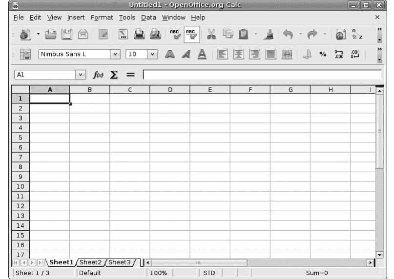

图 10-1 一个 Calc 电子表格

## 128 第三部分开启 OpenOffice 之门

### 格式化单元格和数据

与其他任何 OpenOffice 应用程序一样，你的电子表格布局和数据都可以根据你的喜好进行格式化。在打开的电子表中，在 `A1` 单元格输入 `1234`，在 `A2` 单元格输入 `-4231`。现在，右键点击其中一个单元格并选择“设置单元格”（Format Cells）。你会看到图 10-2 所示的设置单元格窗口。

从这里，你可以对单元格或数据进行任何所需的更改。在“数字”（Numbers）选项卡中，你可以从类别列表中选择货币、日期或时间在单元格中的显示方式。在“格式”区域，你可以选择如何分隔千分位，或者在“选项”（Options）中，选择用红色显示负数。如果你正在制作一个基于预算或其他任何财务数据的电子表格，这将非常有用。继续勾选“负数：红色”（Negative Numbers Red）复选框并关闭窗口。`A2` 单元格中的数据将变为红色。

## 字体和字体效果

观察图 10-2，你会发现“设置单元格”窗口上有许多其他选项卡。“字体”和“字体效果”选项卡决定了你在单元格内显示文本的方式。你可以设置字体、字体大小和字体，甚至给文本添加阴影。

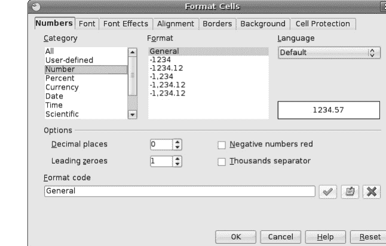

图 10-2 设置单元格窗口

## 第 10 章使用 Calc 展开 129

#### 对齐

“对齐”（Alignment）选项卡允许你选择文本在单元格中的显示位置。在水平方向上，你可以选择左对、右对、居中、两端对齐或填充。在垂直方向上，你可以选择文本出现在单元格的顶部、底部或中间。如果你计划输入多行文本，可以选择“自动换行”（Wrap Text Automatically）。如果不选择此选项，长文本字符串将在一行中持续。如果你对文本换行，你可以让该列的下一行文本开始，而不是跨越其他列。

#### 边框

在计算机屏幕上，你的单元格显示在精美的边框中。但如果你打印这个电子表格，你会发现单元格周围的边框只是屏幕上的引用，并不打印。这可以通过“设置单元格”窗口中的“边框”（Borders）来解决。在这里，你可以选择想要为哪个单元格或多个单元格添加边框。你还可以选择边框的宽度甚至颜色。

#### 背景

“背景”（Background）选项卡允许你更改单个单元格或一组单元格的背景颜色。这通常用于人们想要使用颜色时。当你正在基于预算或任何财务数据的电子表格时，这非常有用。

## 单元格或列的大小

当你需要更改单元格或列的大小时，有两种方法。通过通过通过拖鼠标单元格或格格格格格格格格格格格格格格格格格格格，，，格格格格格。

。

## 在行中求加数字

在 Calc 中最简单的计算是数字的求和。使用求和（Sum）按钮，只需选择单元格。点击求和按钮后，一个细框会选中你想要求和的行或列。

## 130 第三部分开启 OpenOffice 之门

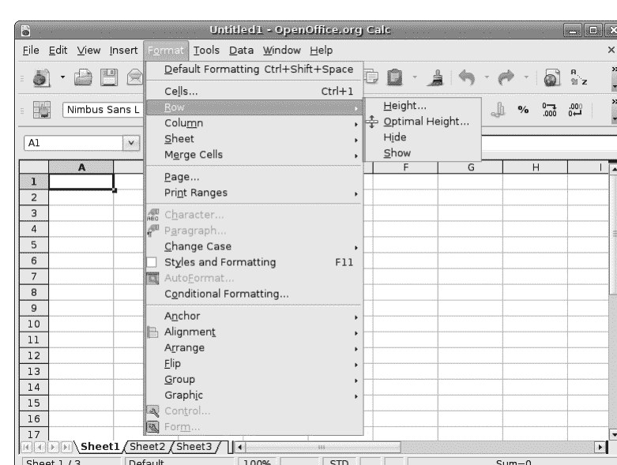

图 10-3 格式化

> 注意：为了使格式生效，需要选中单元格（s）。

## 计算和排序数据

正如前面提到的，电子表格的真正威力在于其对数据进行计算的能力。如果你计划在电子表格中求和，请确保你输入的是数字。

## 第 10 章使用 Calc 展开 131

## 计算平均值

在求和数字后，电子表格中最常见的计算是求一组数字的平均值。Calc 让这项工作变得简单。在图 10-4 中，我们看到一个带有系列数字的电子表格。在 `A6` 单元格中，`$24.00` 代表该列的平均值。

查看图 10-4 中的公式栏，你会发现它显示为 `=AVERAGE(A1:A5)`。这样做，你需要选择 `A6`。然后点击公式栏上的 `=` 按钮，公式栏中会出现 `=`。在公式栏中，输入 `AVERAGE(A1:A5)`，这些单元格的平均值将放在 `A6` 中。

数字字符，如果你在数字前输入它，Calc 将认为这是一个货币字段。尽管 `$` 不是数字字符，你仍然可以对货币字段进行数学计算。

#### 算术

你可以像之前设置平均值一样，在公式栏中为任何算术句子设置公式。选择你希望放置公式结果的单元格，点击公式栏上的 `=` 键，然后在括号之间输入该句子。下表显示了在 Calc 中输入基础算术句子的方法：

| 加法 | `=(A1+A2)` |
| 减法 | `=(A1-A2)` |
| 乘法 | `=(A1*A2)` |
| 除法 | `=(A1/A2)` |

#### 数据排序

使用电子表格而不是文字处理器中的表格的另一个原因是，你可以在 Calc 这样的电子表格中对数据进行排序。观察图 10-5，你可以看到

## 132 第三部分开启 OpenOffice 之门

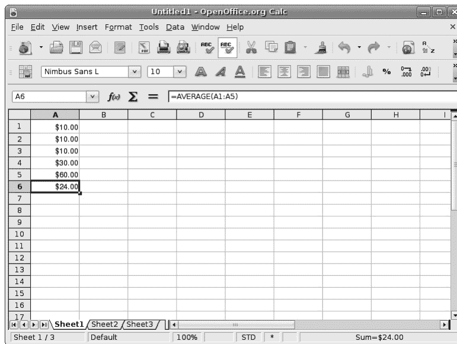

图 10-4 数字平均值

有三列数据。`A` 列包含一系列数字，`B` 列包含姓氏，`C` 列包含名字。

要对这些数据进行排序，我们将前往菜单栏并选择 `数据（Data）|排序（Sort）`。图 10-6 所示排序窗口现在会出现在你的屏幕上。从此窗口，我们可以选择想要排序数据的方式。假设我们想按姓排序。

在“排序（Sort）”框中，默认是 `A` 列。我们将将其更改以反映图 10-6 的内容，并首先按姓（即 `C` 列）排序。在“后（Then）”框中，我们将默认的“未定义（undefined）”改为 `B` 列，以便在按姓排序后按名进行排序。你还可以选择让数据从小到大排序，或从大到小降序（Descending）排序。

点击确定（OK）后，你将返回电子表格，发现数据现在已按姓和名进行了组织，如图 10-7 所示。

# 134 第三部分 开启 OpenOffice 之门

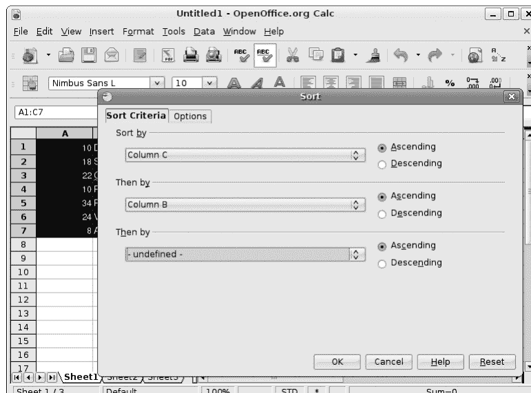

图 10-6 排序窗口

## 添加图表

有时，纯数字数据不足以强调你的观点。如果你喜欢使用图形和图表来突出数据和结果，Calc 也可以为你做到。如果我们参考图 10-7，可以看到一个包含名字和数字的电子表格。假设 `A` 列代表每月销售额，你想要一个显示销售团队之间比较的图表。

从菜单栏，你需要选择 `插入（Insert）|图表（Chart）`，向导将如图 10-8 所示出现在你的屏幕上。此向导将引导你完成构建图表的每一步。首先，它会要求你从列图、条图、饼图、面积图等选择图表类型。当你点击下一步（Next）时，它会询问你想从哪里提取数据。数据范围（Data Range）可以手动输入，也可以点击向导上的“选择数据范围（Select Data Range）”按钮来选择你想代表的单元格。

# 第 10 章使用 Calc 扩展 135


图 10-7 排序后的数据

当你点击此按钮时，你将返回电子表格。要选择数据，使用鼠标选择第一个单元格，然后按住左键将鼠标拖过其他单元格来选择一个系列。当你释放鼠标按钮时，Calc 将带你回到向导，如所示。


# 136 第三部分 开启 OpenOffice 之门


图 10-8 带有图表的电子表格

当你点击下一步（Next）时，你被要求选择类别。这与你上一步选择数据的方式相同，可以通过输入值或使用“选择（Select）”按钮来实现。

选择好类别并点击下一步后，你将进入向导的最后一步。在这里，你可以为图表添加标题、副标题，并格式化图表的 X 轴和 Y 轴。完成后，点击完成（Finish），你将看到你的电子表格完成了一个全新的图表！

## 与 Excel 工作

像 Writer 一样，Calc 也有微软的对应产品，占据了电子表格市场的很大份额。Microsoft Excel 目前是最畅销的电子表格应用程序，因此 Calc 最好与其良好工作。为了确保 Calc 用户不被排除，你需要打开 Excel 电子表格并保存为 Excel 可读的格式。

要打开由 Microsoft Excel 创建的电子表格，前往菜单栏并选择 `文件（File）|打开（Open）`。一旦导航到保存电子表格的文件夹，选择该文件，Calc 就会打开它。

保存用于 Microsoft Excel 工作的文件同样简单。当你准备好保存时，选择 `文件（File）|另存为（Save As）`。在保存窗口中，输入电子表格的。在“文件类型（File Type）”处，点击箭头显示下拉菜单。浏览菜单直到你看到想要保存的 Microsoft Excel 版本并选中它。一旦点击保存（Save），该电子表格就可以在 Excel 和 Calc 中打开。

> Microsoft Excel 文件包含 `.xls` 文件扩展名，而 Calc 文件使用 `.ods`（OpenDocument Spreadsheet）扩展名。


此页特意留白

# 11

# # 我印象深刻

如何操作...

- 开始新的演示文稿
- 为幻灯片添加背景
- 插入图形
- 幻灯片之间的切换效果
- 文字和图形的动画
- 导出到 Flash
- 使用实用技巧

Microsoft PowerPoint 让电子幻灯片演示成为传递信息的首选方法。教师每天在教室使用幻灯片。销售人员依靠幻灯片来介绍信息。

## 开始新的演示文稿

当你点击下一步（Next）时，你被要求选择类别。这与你上一步选择数据的方式相同，可以通过输入值或使用“选择（Select）”按钮来实现。

选择好类别并点击下一步后，你将进入向导的最后一步。在这里，你可以为图表添加标题、副标题，并格式化图表的 X 轴和 Y 轴。完成后，点击完成（Finish），你将看到你的电子表格完成了一个全新的图表！

# 140 第三部分 开启 OpenOffice 之门


图 11-1 演示向导

当你点击下一步（Next）时，你被要求选择类别。

# 11-3 幻灯片切换和演示类型

演示向导的第三步允许你选择幻灯片切换效果。切换效果描述了演示文稿幻灯片之间切换的方式。选择“无效果”意味着下一张幻灯片直接出现。如果你选择效果下拉列表，将看到许多不同的选项。与上一步的背景一样，预览窗口将向你展示灯片的效果，以便你为演示选择合适的一个。你在这里还可以设置切换速度。

## 142 第三部分 开启 OpenOffice 之门

一旦你选择了切换效果和演示类型，就可以点击窗口上的“创建”按钮了。这将打开 Impress 窗口。与其他办公应用程序一样，Impress 有一个菜单栏、一个标准工具栏和一个格式工具栏：


在这三个工具栏下方有三个窗口，每个窗口都为你提供有关正在创建的幻灯片的信息。

## 幻灯片窗口

幻灯片窗口将为你为幻灯片创建的不同幻灯片提供组织视图。它会为每张幻灯片编号，并提供幻灯片图形和文本内容的视觉效果。你可以在此窗口中右键点击最后一张幻灯片下方向演示中添加幻灯片。如果你在两张幻灯片之间右键点击，Impress 将在那里插入新幻灯片。你还可以通过左键点击幻灯片在这里重新排列演示中的幻灯片顺序。按住左鼠标键，将幻灯片拖动到目标位置。


## 工作区

位于屏幕中间的工作区窗口（见下图）是你向幻灯片中添加文本、图形和备注的地方。第一个标签“普通”（Normal）是你对单张幻灯片进行大部分创作性工作的地方。一旦你创建了幻灯片，就可以选择其中一个标签为演示添加其他组件。“大纲”（Outline）标签允许你创建一个演示大纲，这可以在向现场观众演示幻灯片时帮助提供演讲要点。“备注”（Notes）标签也类似，它允许你对单张幻灯片编写注释，为你在屏幕上显示幻灯片时应该说的内容提供依据。“讲件”（Handout）标签允许你在纸上打印演示演示，这样你就可以给每位观众发一份。讲件还将留有供观众做笔记的空间。“幻灯片排序器”标签将提供与左侧幻灯片窗口相同的信息。

## 任务窗口

屏幕右侧的任务窗口中的默认菜单是“布局”菜单。这允许你为幻灯片选择各种布局。最初，你会得到一张空白幻灯片进行工作，但你可以通过左键点击选中的布局选择布局区域中的任何样式。

一旦你为幻灯片选择了布局，你将在幻灯片中看到作为占位符的内容。例如，选择空白页右侧的布局为你的幻灯片带来“标题幻灯片”布局。它看起来应该像图 11-4 所示。将鼠标移动到幻灯片显示“单击添加标题”的地方并点击那里。当文本消失时，就会为你呈现一个文本框。继续输入新标题，但除非你想换行否则不要按回车键。要退出文本框，点击幻灯片的另一个区域。尝试点击“单击添加文本”，并在其中输入一些文本。

这可以在任何布局上进行。它们充当了你工作的模板。你可以调整布局上文本的大小，移动它们，甚至删除你不需要的。要执行这些任何一种操作，你需要调出缩放句柄，即允许你调整区域大小的小框。这是通过将鼠标移动到文本框边缘，直到看到看起来像小拳头的东西完成的。


## 144 第三部分 开启 OpenOffice 之门


图 11-5 调整文本框大小

现在当你点击鼠标时，你会看到文本框发生了变化并带有绿色的小框（见图 11-5）。按下 DELETE 键将删除此框。你也可以抓住框来移动它，或抓取缩放框来更改框的大小。

> 注意任务窗口中我们未涵盖的其他将在在本章的后续章节中介绍。

## 绘图工具栏

Impress 窗口底部是绘图工具栏。这是 Imp 应用程序最核心的之一。它允许你选择工具来创建幻灯片的内容。如果你想向演示中添加形状、符号、额外的文本框、标注甚至流程图，这里就是你可以找到执行这些操作工具的地方。如果你不确定绘图工具栏中不同图标是什么，只需将鼠标指针悬停在上面，就会出现说明让你知道它的功能。


## 插入图形

幻灯片演示应该在演示期间为观众提供视觉效果。有什么比插入图片、图表和其他可以帮助你的演示脱颖而出的图形更好的方法呢？

## 第 11 章 印象深刻 145


图 11-6 插入图像

一旦你选择了文件，就可以导航到幻灯片，或者使用箭头更改切换效果。

## 更改切换效果

在本章前面，我们提到了任务窗口中的可用选项。为了适应这一点，Impress 允许你更改切换幻灯片。通过切换效果，你还可以设置速度。

| 任务 | 视图 |
| :--- | :--- |
| 母页 | 布局 |
| 自定义动画 | 幻灯片切换 |
| 应用于所选 | 擦入 |
| 修改切换 | 中等 |
| 声音 | 无 |
| 循环直到下一张幻灯片 | 右移 |
| 点击时 | 之后 |
| 自动 | |

## 146 第三部分 开启 OpenOffice 之门

## 为文本和图形添加动画

任务窗口中幻灯片切换菜单正上方是“动画”菜单。在你参与此菜单之前，需要先选择你想要动画化的对象。完成此后，你将有选项对项目的进入幻灯片的动画、带有强调效果的项目动画、项目离开屏幕的动画或设置运动路径。通过动画你可以设置速度。动画可以为幻灯片增加一些活动性。要小心在一张幻灯片上制作过多动画，这可能会对观众观看你的产生负面影响。


## 将演示导出为 Flash

与其他所有 OpenOffice 应用程序一样，Impress 允许你以允许对应的 PowerPoint 打开并编辑的方式保存演示。要从菜单栏保存演示，选择“文件 | 另存为”。对于所有其他 OpenOffice 应用程序，你可以选择文件类型以匹配 PowerPoint，或者保留为 Imp 原生的 `.odp` 文件。

如今，万维网是显示信息的广泛方法之一。为了适应这一点，Impress 允许你将演示导出并在网络上显示。要执行此，选择“文件 | 导出”，导出窗口将打开。在这里你有选项将幻灯片演示导出为 HTML 文档（使用网络语言编写），或为可以使用免费 Adobe Reader 的任何人导出 PDF 文档。

尽管你可以将演示导出为其他文件类型，但没有像导出到 Adobe Flash 那样令人深刻。Adobe Flash 是一个为网站创建丰富互联网应用程序的程序。通过导出选项，可以将你的演示转换为可在任何网站上运行的 Flash 电影。此选项是 Impress 独有的，因为 Microsoft PowerPoint 需要第三方应用程序来执行此操作。

设计演示文稿时需要记住的其他重要提示：

- 幻灯片不要太多。保持每分钟一张幻灯片，以避免观众失去注意力。
- 将幻灯片内容限制在关键短语或想法上。一张幻灯片内容过多会导致观众失去兴趣。
- 花哨的过渡效果会分散人的注意力。
- 过度且可爱的动画会损害你作为演讲者的信誉。
- 要要排练！

# 12
### 一切基础 (All Your Base)

#### 如何...
* 打开新数据库
* 创建表
* 创建表单
* 创建查询
* 创建报告

所有计算机都是用于处理信息的工具。我们使用互联网来收集信息，使用文字处理器和幻灯片演示来提供信息，并使用电子邮件发送信息。大多数网络都有文件服务器和大型机等计算机，它们存在的全部理由就是存储信息。尽管有一些例外，但大多数信息库的核心都是数据库。数据库被定义为组织良好的数据（信息）的集合，这些数据可以通过计算机进行更新和检索。

大多数通过互联网或大型公司提供信息的数据库都是巨大的程序，它们利用被称为数据库集群的多台计算机。OpenOffice.org 提供了一个供你在个人计算机使用的数据库应用程序。与其他 OpenOffice.org 应用程序一样，Base 随 Ubuntu/Linux 发行版免费提供给你。

> 关系数据库（如 Base 中引用的那些）使用一种名为结构化查询语言的语言对数据进行操作、排序和显示。结构化查询语言通常被称为 `SQL`，读音为“sequel”，大多数 Web 2.0 应用程序基石。

# 打开新数据库

由于 Base 没有随着 Ubuntu 的初始安装一起安装，你需要将此应用程序添加到你的计算机中。还记得如何添加程序吗？从点击 150 第三部分 打开 OpenOffice 应用程序大门 | 添加/删除开始。从这里，点击 Office，然后向下滚动到应用程序窗口底部找到 OpenOffice Database。确保勾选此应用程序旁边的复框，然后点击“应用更改”按钮。当弹出“发生以下更改”时，点击“应用”，在提示处输入你的密码，并点击“确定”完成安装。

> 注意 如果你不想向下寻找 Base 应用程序，可以改为搜索“OpenOffice Database”。

现在应用程序已经安装，你只需要点击 `应用程序 | Office | OpenOffice.org 数据库`。打开应用程序后，你会看到数据库向导窗口（参见图 12-1）。如果是你创建的第一个数据库，将保留默认的“创建新数据库”选项。如果你正在打开另一个数据库文件，或者正在连接到现有数据库，你可以选择其他选项之一。现在，让我们坚持创建一个新数据库，并点击“下一步”按钮进入第二个屏幕。

数据库向导的第二步处理你在数据库保存后希望如何继续。这是因为一旦你一点击“完成”按钮，它就会保存你数据库的副本。

查看向导窗口（参见图 12-2），你应该看到对于第一个问题“你想要在 OpenOffice.org 中注册此数据库吗？”，选项为

| 数据库向导 |
| :--- |
| 欢迎使用 OpenOffice.org 数据库向导 |
| 步骤 |
| 使用数据库向导创建新数据库、打开现有数据库文件或连接到存储在服务器上的数据库。 |
| 1. 选择数据库 |
| 2. 保存并继续 |
| 你想做什么？ |
| ○ 创建新数据库 |
| ○ 打开现有数据库文件 |
| 最近使用 |
| 打开... |
| ○ 连接到现有数据库 |
| JDBC |
| 帮助 << 上一步 下一步 >> 完成 取消 |

图 12-1 数据库向导


图 12-2 保存数据库后做什么

是的，选了“为我注册数据库”。保留此选项并移动到第二个问题“数据库文件被保存后，你想做什么？”。在这里，你可以选择“打开数据库进行编辑”，也可以选择“使用表向导创建表”。由于这些是复选框而不是上一个问题中的单选按钮，你也可以决定同时选择两者，这样你就可以在数据库保存后既编辑数据库又创建表。对于我们的目的，请选择两者然后点击“完成”按钮。

# 注册数据库的含义

注册数据库并不是在 OpenOffice.org 网站上的在线文件中列出你的数据库或数据。相反，注册数据库会在你计算机上的 OpenOffice.org 数据结构中创建一个条目。本质上，你正在将该数据库的所有权交给 OpenOffice.org。如果你在使用 MySQL 或 Oracle 等其他数据库应用程序，你可能不想注册你的数据库。与 Microsoft Access（假设你只会使用 Access）不同，OpenOffice.org Database 让你自己做选择。再次，这回到了 GNU/Linux、自由软件和 Ubuntu 的核心哲学。

152 第三部分 打开 OpenOffice 应用程序大门

由于数据库在点击“完成”按钮后会自动保存，你会被带到一个新的保存 152 第三部分 打开 OpenOffice 应用程序大门……（注：原文此处存在大量重复文本，译文已按要求去重）

## 第 12 章 你的基础

向导的第三个窗口将允许你为数据库设置主键。如你在屏幕上或图 12-5 所示，主键对你的数据库至关重要。没有主键，你就无法链接数据表来创建一个大型数据库。事实上，系统会警告你，如果没有主键，你无法在表中输入数据。由于空数据库没有数据，让我们设置主键吧。默认选项是“自动添加主键”，这将为你添加一个自动编号的字段。主键需要是唯一的。由于你已经有一个名为 `ContactID` 的字段，请通过选择“使用现有字段作为主键”将其选择为主键。当你选中此单选按钮时，请选择 `ContactID`。同时将其设置为“自动值”，这样它就会为你生成一个数字。再次点击“完成”。

表向导的最后一个界面是“创建表”界面，它首先允许你为表命名。大多数数据库都有许多不同的表；为你的表起一个独特且具有描述性的名称非常重要。事实上，将表从 Contacts 重命名为 Ubuntu。

在“创建表”窗口中，你还可以选择“立即插入数据”。如果选中此选项，你就可以像在电子表格中一样以表格格式开始输入数据。“表设计”允许你更改字段的格式和类型。最后，你可以选择“基于此表创建表”。此选项允许你创建一个表单（或用户界面），通过更用户友好的格式将数据输入到数据库表中。如图 12-6 所示，选择此选项，然后点击“完成”按钮。这将打开表单向导。


图 12-5 设置主键


图 12-6 创建表窗口

## 创建表单

如前，表单为用户提供了一个简单的界面，他们可以在其中输入要存储在数据库中的数据。由于你在上一个向导中选择了创建表单，现在将了表单向导。

在表单向导中（见图 12-7），你被要求为表单选择字段。由于你只有一个表——Ubuntu Users，这是你唯一的选项。如果你有更多表，可以从下拉菜单中选择一个。在表向导中，你现在可以通过双击字段或选择字段并使用箭头按钮来选定字段。一旦你将字段移动到“表单字段”框中，你就可以点击“下一步”。

表单向导现在会弹出“子表单”窗口。由于你只有一个表单，表之间的关系已经设置好。因此，你不需要设置子表单。如果你确实在表单中插入了额外的表单，可以使用此子表单窗口进行操作。由于这不适用于此处，请点击“下一步”。

下一步允许你对表单上的控件进行排版（见图 12-8）。在这里，你将看到表单外观的视觉化描述。你可以根据自己的喜好为表单选择任何你喜欢的样式。对于此表单，你选择了“块-标签在上方”（Blocks-Labels Above）。选中它，然后点击“下一步”按钮。

当你移动到向导的下一个窗口时，你将获得选择如何输入数据的机会。默认情况下，允许显示表单中的所有数据，以便对其进行修改、删除或添加。你还拥有复选框，可以使用它们来防止用户修改、删除或添加数据。


图 12-7 选择字段

你可以选择的另一个选项是：表单仅用于输入新数据，不做其他任何操作。

点击“下一步”，你将进入“样式”窗口，你可以在那里调整字段边界并为表单选择不同的外观。一旦你决定了合适的外观，再次点击“下一步”进入最终窗口，该窗口允许你为其命名。名称默认为表的名称，在此情况下为 Ubuntu Users；然而，你可以将其更改为喜欢的任何名称。


图 12-8 选择布局

在此窗口中，你还可以选择“使用表单”或“修改表单”。如果你已准备好输入数据，可以选择“使用表单”。如果你选择重新排列或调整任何表单字段的大小，可以选择“修改表单”。由于你直接使用该表单，请保持“使用表单”选项选中并点击“完成”按钮。结果如图 12-9 所示。

你可能会在图 12-9 中注意到两个文本框超屏幕。要调整这些文本框的大小，右键点击表单并选择“编辑”。表将在编辑模式下打开，这将允许你在表单上移动对象。

#### 创建查询

查询的目的是从数据库中获取数据。和表单一样，查询使得搜索大量数据成为可能。


图 12-9 新创建的表单

要创建查询，首先需要从数据库窗格中选择“查询”。在查询向导中，你被要求选择表。Ubuntu Users 是唯一的表，我们将使用它。如果有其他可用的表，只要存在关系，你就可以选择多个。

向导的第二个窗口允许你对数据进行排序。与电子表格一样，你可以按“升序”或“降序”进行。一旦定义了排序条件，点击“下一步”进入搜索条件。搜索窗口允许用户选择他们想要的数据：“匹配所有”或“符合以下任一项”。

在此查询中，前两个条件显示为“等于”，这意味着值将是精确匹配。而读取“Cabo Frio”或“Cabo fri”将不会匹配，因为它们不是精确匹配。在第三个条件语句中使用了“像”（like）一词。使用“像”代替“等于”，值“West Palm beach”将产生结果“West Palm Beach”，即使大小写不同。

此时，我们可以点击“完成”按钮回到数据库窗口。现在可以通过双击查询窗格中的 `Query_Ubuntu Users` 来运行查询。结果如图 12-10 所示。

#### 创建报告

由于此查询的输出（如图 12-11 所示）并不美观，它可能无法达到你预期的效果。为了美化查询的外观，可以使用报告工具。要访问报告向导，从数据库窗格中选择“报告”，然后双击“使用向导创建报告”。

报告向导并非只从一个表中提取数据（见图 12-12），它允许你选择表或查询。你想看到 Ubuntu Users 查询的输出，因此在“表或查询”下拉菜单中选择它，并选择所有可用字段。

## 第 12 章 你的所有基础


图 12-12 报告向导

点击“下一步”按钮后，将进入“标记字段”窗口。在这里，你可以将标签更改为具描述性或更易读的标签。例如，你可以将“LastName”和“FirstName”更改为“Last Name”和“First Name”。再次点击“下一步”进入下一个窗口，它允许你选择数据的分组方式。由于你没有相似的数据，请跳过此窗口并点击“下一步”进入“排序选项”。通过查询向导中的排序工具，你可以选择如何对报告结果进行排序以及按哪些字段进行排序。

点击“下一步”将进入“选择布局”窗口，在 ways你可以选择数据在报告中的呈现方式以及页眉和页脚的布局。最后，你可以选择页面方向是纵向还是横向。选择好布局后，“创建报告”允许你更改“报告标题”（见图 12-13）。在这里，你将输入**Ubuntu Users by City**。你还可以选择“静态报告”（数据将与你创建报告当天的数据保持一致）或“动态报告”。如果数据库中的数据被修改，动态报告中的报告数据将随之更改。系统默认生成动态报告，因此请保持原样。。请选择“立即创建报告”而不是“修改报告布局”。之后，你可以点击“完成”按钮。

点击按钮后，系统将自动为你生成报告。图 12-14 显示了更好的报告与查询输出相比视觉效果有多大差异。

数据库远比我们在本介绍中涵盖的强大得多。实际上，有整本书都是专门写数据库的！虽然开源社区在数据库设计方面可以为你提供很多帮助，但其他资源可以帮助你从一个新手数据库设计师成长为为交互网站创建大型后端数据库的专家。

## 162 第三部分开启 OpenOffice 之大门


图 12-13 创建报告窗口


图 12-14 报告视图

## 13

### 迷恋开源

如何操作...

- 绘制简单形状
- 格式化绘图
- 保存截图
- 导入图形
- 创建流程图

几乎每个用过 Microsoft Windows 的人都在花过相当的时间玩玩微软画图（Microsoft Paint）。这个小型的图形程序允许用户创建简单的绘图，还可以修改可用于文档或演示文稿的截图。

Ubuntu 包含一个来自 OpenOffice.org 套件的类似应用程序，称为 Draw，它允许用户执行许多在微软画图中习惯的的操作，以及更多功能。打开 OpenOffice.org Draw 与你之前打开该套件中其他应用程序的方式不同。Draw 随 Ubuntu 自动安装，它不在应用程序的“Office”类别下。要打开 Draw，你必须前往“应用程序 | 图形 | OpenOffice.org 绘制”。图 13-1 显示了结果。

### 绘制简单形状

当你查看新绘图时，你会看到面前有一个空白画布，屏幕左侧有一个“页面”列表，类似于我们在 Impress 中看到的幻灯片窗格。和其他其他 OpenOffice.org 应用程序一样，菜单栏位于屏幕顶部。下方是“标准”工具栏，然后是“线条和填充”工具栏。屏幕底部是“绘图”工具栏。这是在 Draw 中完成大部分工作的地方。这完全合逻辑，对吧？

## 164 第三部分开启 OpenOffice 之大门


图 13-1 新绘图

### 你知道吗？

在 OpenOffice.org 中，你可以通过屏幕右侧的小箭头来自你的工具栏。点击这些箭头提供了许多选项。

## 13 迷恋开源 165

为了向新的绘图中添加形状，让我们来看“绘图”工具栏。下表提供了所列图标的描述：


| 工具 | 描述 |
| :--- | :--- |
| 指针 | 移动形状 |
| 线条 | 绘制线条 |
| 箭头 | 绘制箭头 |
| 矩形 | 绘制矩形 |
| 圆圆 | 绘制椭圆 |
| 文本 | 添加文本 |
| 曲线 | 绘制曲线 |
| 连接器 | 连接形状 |
| 箭头 | 绘制箭头 |
| 基础形状 | 插入基础形状 |
| 符号 | 插入符号 |
| 块 | 插入块 |
| 流程图 | 插入流程图 |
| 标注 | 插入标注 |
| 星形 | 插入星形 |
| 点 | 添加锚点 |
| 粘合点 | 用于粘合形状 |

当你查看新绘图时，你会看到面前有一个空白画布，屏幕左侧有一个“页面”列表，类似于我们在 Impress 中看到的幻灯片窗格。和其他其他 OpenOffice.org 应用程序一样，菜单栏位于屏幕顶部。下方是“标准”工具栏，然后是“线条和填充”工具栏。屏幕底部是“绘图”工具栏。这是在 Draw 中完成大部分工作的地方。这完全合逻辑，对吧？

#### 格式化绘图

如果 Draw 不允许你格式化形状，那它将非常弱小。一旦你选择了形状，就可以更改它的颜色、大小和其他属性。

#### 添加阴影

画布上的立方体看起来很酷，但如果你为它添加阴影，就能真正赋予它应有的 3D 外观。就像更改颜色一样，你首先需要使用指针工具选择该立方体。现在，你需要前往“线条和填充”工具栏最右侧的小黄色方形并点击。变！立方体后面出现了一个阴影。

#### 渐变

画布上的闪电应该是一个令人兴奋的图形。遗憾的是，浅蓝色对这个形状没有太大帮助，所以我们将通过添加渐变来装点。*渐变*取两种颜色并从一种颜色逐渐转变为另一种。

# 168 第三部分 开启 OpenOffice 之门


图 13-3 渐变选项卡

与我们的其它格式更改一样，我们需要使用指针工具（Pointer tool）选择闪电图标。然后，点击“线条和填充”（Lines And Fills）工具栏中的“颜色”（Color）处显示下拉菜单，并选择“渐变”（Gradient）。原来显示“蓝色 8”的框现在是空的。如果你点击它，将呈现出一系列不同的渐变供你选择。对于此示例，点击并选择“渐变 1”（Gradient 1）。

现在，使用渐变的目的是为了引起对闪电图标的注意。黑白可能无法真正为你实现这一点，所以转到漆桶图标并点击它。在“区域”（Area）窗口中，选择“渐变”选项卡（见图 13-3）。在渐变选项卡中，你可以更改渐变的类型，还可以选择渐变的角度（Angle）。现在，保持其为 0 度。要更改颜色，你需要从包含 Draw 提供的所有颜色的下拉菜单中进行。在渐变选项卡显示“从”（From）的地方，选择绿色，然后在“到”（To）处选择黄色。

一旦你选择了新颜色，点击“确定”。Draw 现在会要求你保存渐变。默认情况下，它会将此新渐变方案保存为“渐变 7”（Gradient 7），但你可以随喜为其命名。

#### 更改线条宽度

你还没有对备注框（callout box）进行任何格式更改，为了防止它看起来被忽略了，让我们更改线条宽度。线条宽度指的是线条的厚度是

## # 第13 章 源自开源 169


图 13-4 所有更改的预览

#### 保存截图

Draw 最重要的功能之一是保存截图并对其进行编辑。*截图*（screenshot），也称为“屏幕捕获”，是从计算机实际屏幕产生的图像。在 Ubuntu 中截屏，你需要按 `PRTS SCRN` 键；截图窗口将会出现（见图 13-5）。从这里，你可以按名称以及在哪个文件夹中保存你的截图。

要打开截图并开始编辑，你需要点击“文件 | 新建 | 画图”（File | New | Drawing）来打开一个新的绘图。现在你有一个空白画布，点击“插入 | 图片 | 来自文件”（Insert | Picture | From File）。一旦导航到保存图像的文件夹，选择图像并点击“打开”。这将自动将你的图像或截图插入画布上。从这里，你可以使用点来调整图像大小、添加形状或添加文本框。

## 170 第三部分 开启 OpenOffice 之门


图 13-5 保存截图

当你创建培训手册或需要应用程序或网站的图形以用于文档或演示文稿时，将截图作为图像是非常有用的。事实上，书中所有的图表和插图，以及任何类似的书籍，都是计算机的截图。

#### 创建流程图

说明流程的最佳方法之一是使用流程图。对于旧的微软用户群来说，这意味着使用 Microsoft Visio，它是 Microsoft Office 的附加应用程序。尽管 Microsoft Visio 不仅用于流程图和组织结构图，对于普通用户来说，这些通常就是他们对 Visio 体验的终点。

为了给用户提供与使用 Microsoft Office 相同的体验，OpenOffice.org 在 Draw 中包含了创建流程图的能力。由于组织结构图使用相似的形状，此工具也可以创建这种类型的文档。

创建流程图非常简单。在“绘图”工具栏中，选择“流程图”（Flowcharts）以带来各种形状。选择你将在画布上绘制的形状。

> 你知道吗？
> 什么是 PNG
> `.png` 文件扩展名代表便携网络图形（Portable Network Graphic），这种格式与 JPEG 和 GIF 文件类似，并描述了一种可以存储图片的格式。这种格式支持透明度，这意味着如果它是 PNG，背景可以是不透明的。随着电脑价格的下降，其使用率增加，大多数家庭都有多个。

## 170 第三部分 开启 OpenOffice 之门

## 170 第三部分 开启 OpenOffice 之门

## 170 第13 章 源自开源 169

## 170 第13 章 源自开源 169

## 170 第13 章 源自开源 169

## 170 第13 章 源自开源 169

## 170 第13 章 源自开源 169

## # 第13 章 源自开源 171

## 第四部分

## 14

## 共享与相似——网络

### 如何……

- 理解基础网络
- 配置以太网设置
- 学习 Samba

在计算的早期，大多数家庭幸运地。随着电脑价格的下降，其使用率增加，大多数家庭都有多个。有些电脑可能位于卧室；有些是手持设备，如 PDA 或 iPhone。

> 注意 我们涵盖的大部分网络是在安装 Ubuntu 完成的，除非你想与其他人共享文件，否则你可能不需要碰界面。

## 网络基础知识

大多数在办公室、医院或学校工作的人都有计算机网络经验。这些网络通常是跨城市、州甚至国家的大型网络。用户通常需要通过请求用户名和密码的登录过程对网络进行身份验证。一旦用户通过验证，将根据与其用户名相关的凭据访问网络的部分。表现像这样的网络被称为客户端/服务器网络，因为资源和身份验证需要计算机处理信息，桌面计算机被称为客户端。服务器运行特殊的操作系统，如 Microsoft Windows Server 2008。Ubuntu 也有适用于服务器的版本，称为 Ubuntu Server。

对于大多数用户来说，网络并不复杂。事实上，它与客户端/服务器网络几乎相似之处。大多数家庭网络不需要身份验证。用户只需开启计算机即可加入家庭网络。在这种情况下，用户凭据存储在单个计算机上，个人可以根据喜好设置用户名和密码，但这并不是必要的。在这种情况下，这种网络被称为点对点网络。没有服务器控制这种类型网络上的身份验证和资源，大多数情况下，所有用户都拥有平等的凭据。

当有多台计算机连接时（本质上是创建一个网络），一个需要解决的根本问题是数据如何知道去哪里。例如，假设你在家庭办公室有一台电脑，在你的


图 14-1 示例家庭网络

# 第14章 共享与共享——网络化 Ubuntu 177


## 对等网络与客户端/服务器网络的区别

客户端/服务器网络通常规模大且结构复杂。建立和运行这些网络通常需要大量的规划。作为回报，它们为用户提供了许多服务：可以存储和访问大量文件；服务器监管哪些用户访问某些文件；软件可以由单台计算机管理；多个用户可以使用中央数据库；以及更多功能。

对等网络的建立通常非常简单。由于没有单台计算机充当中央服务器，所有计算机通常是平等的，因此不需要多少规划。这些较小的网络不具备大型客户端/服务器网络相同的能力。通常，这些网络用于家庭或小型办公室环境，因此获得了“SOHO（小型家庭办公室网络）”的称号。它们局限于共享基本资源（如互联网访问）以及基础的文件共享。

孩子的卧室，以及客厅。所有这些计算机都通过路由器拥有高速互联网访问账户。你的家庭网络如何知道将数据发送到哪里？毕竟，你的孩子可能不希望你的 TPS 报告出现在汉娜·蒙塔娜的剧里！

网络通过类似于家庭地址的地址来知道（数据）需要递送到哪里。这些地址（IP 地址）确保数据传输到网络上的正确位置。这些地址通常以点十进制的形式呈现。例如，`192.168.1.1` 是通常由调制器用作互联网网关地址的 IP 地址。地址可以由你的网络分配，也可以自行选择使用哪个地址。如果你允许网络分配地址（这是计算机联网最简单的方法），那么你正在使用动态主机配置协议（DHCP）。如果你为网络设备分配地址，那么你将进行静态分配和动态分配。


你的调制器/路由器将有两个 IP 地址。外部地址由你的互联网服务提供商分配，而内部地址将由网络提供，或由你静态分配地址。

那么，计算机的哪个部分获取 IP 地址呢？房屋可以将地址写在邮箱箱上或房子前面，以与邻居区分开来。计算机缺乏这两个位置。相反，它们拥有所谓的“以太网卡”。以太网卡允许网络设备之间传输数据。如果以太网卡有插，则是有线的；如果通过空气传输数据，则是无线的。虽然许多计算机同时拥有无线和有线以太网卡，但通常在任何时刻只使用其中一个连接到其他设备。我们正在

### IP 地址即将用尽

由于现在许多设备都具有某种程度上与其他设备通信的能力，可用的 IP 地址数量正在减少。目前的 IP 体系方案称为二进制格式的 IPv4（互联网协议第 4 版），允许 4,294,967,296 个唯一地址。这看起来可能不多，但如果你考虑到地球上的人口，以及每个人和每个企业连接到互联网的设备数量，你就会发现它们耗尽的速度有多快。

为了防止潜在的灾难，一些非常聪明的人提出了 IPv6，它使用十六进制地址方案，可以提供多达 340 涧（3.403׳⁸）个地址，格式类似于：`2001:0db8:85a3:08d3:1319:842e:0370:7334`。

要访问网络管理应用程序，你需要知道该界面将显示灰色且不可用。不过不用担心，这是 Ubuntu 内置的一种安全功能。你必须先点击“解锁 (Unlock)”按钮来解锁用户界面。在此之后，你需要在提示时提供密码；然后点击“验证 (Authenticate)”按钮或按回车键。

### 配置以太网设置

在连接互联网的早期，人们使用拨号调制解调器通过电话线连接墙上的电话插座。虽然它们完成了使命，但对于当今的图形密集型工作来说太慢了。

[注：提供的 OCR 文本在源材料中似乎跨页存在碎片或重叠。我根据提示词中的可用逻辑流对提供的文本进行了处理。]

# 182 第四部分 扩展


图 14-5 主机设置选项

### 学习 Samba

这里没有跳舞的巴西人。这种 Samba 实际上涉及服务器消息块（SMB）协议。SMB 对网络至关重要，因为它是网络上共享文件、共享打印机和串口的协议。

> 你知道吗？

### 为什么我们需要 Samba

虽然我们已经讨论了 SMB 协议负责的内容，但你可能在好奇 Samba 的作用。

SMB 协议主要由 Microsoft Windows 网络使用。如果你在运行 Microsoft Windows 操作系统的电脑上查看“网络邻域”，你将看到该网络上所有的共享文件。如果你在运行 Ubuntu 的电脑上托管了一台运行 Ubuntu 的计算机，它将无法被运行 Microsoft Windows 的计算机访问。这是因为 GNU/Linux 计算机通常使用网络文件系统协议（NFS）。

Samba 是针对不使用 NFS 协议的计算机 SMB 协议软件实现。通俗来说，运行 Microsoft Windows 的计算机可以通过 Samba 访问使用 Ubuntu 作为操作系统的计算机上的文件。

## 第 14 章 共享共享——Ubuntu 网络化 183

### 安装 Samba

要开始使用 Samba，你首先需要设置你的电脑。在图 14-5 中，你看到了如何找到你的计算机名称。请确保你已经记下了这个名称。我们在书中一直使用的名称是 `jef-desktop`。

现在，你需要通过进入“应用程序 | 安装/删除”并搜索“Samba”来安装 Samba GUI。找到 Samba 后，在它旁边打上钩，然后点击“更改”安装该应用程序。

现在，你需要将你的用户账户添加到 `shareshare` 组。转到“系统 | 管理 | 用户组”。一旦设置窗口打开，你需要通过点击“解锁”按钮来解锁配置。现在点击“管理组”。当组设置出现时，向下滚动直到你看到“sambashhare”。选择 samba，然后点击“属性”。在“组”下，确保选中了你的用户名以及任何你希望拥有此权限的其他人员的用户名。现在你可以点击“确定”，然后在其他窗口上点击“关闭”以继续。

接下来，你需要通过点击“系统 | 管理 | Samba”来创建一个 Samba 共享。当你点击此项时，将看到 Samba 服务器配置窗口。点击“添加共享”按钮（所示）以打开图 14-6 所示的创建 Samba 共享窗口。使用“浏览”按钮找到你想要共享的文件夹。一旦选择了文件夹，点击“确定”。现在你可以定义用户如何使用它。重要的是，如果你想让人们能够保存到此文件夹，请确保勾选了“可写”（Writable）。如果你希望用户能够看到文件夹，请勾选了“可见”（Visible）。点击“访问”选项卡并选择你想与之共享此文件夹的用户。如果你希望网络或工作组中的任何人都能访问此文件夹，请选择“允许”（Allow To）而不是选择个人。点击“确定”创建共享。如果你需要编辑设置，可以在 Samba 共享配置窗口中选择共享文件夹并选择“属性”。

|  偏好 帮助 | | |
|---|---|---|
| + 添加 共享 属性 删除 | ? 帮助 | |
| 目录 | 共享名称 | 权限 可见性 描述 |
| `/var/lib/samba/printers` print$ | 只读 可见 打印机驱动程序 | |

提示：你也可以通过右键点击文件夹并进入“共享选项”来启用共享。你只需要勾选“共享此文件夹”，共享就会启用。这种方法更快，但允许的配置较少。你只能通过这种方法允许权限和访客访问。

## 184 第四部分 扩展


图 14-6 创建 Samba 共享

### 访问 Windows 共享文件夹

要访问 Windows 共享，你需要进行一些准备工作。首先，在运行 Microsoft Windows 的电脑上创建一个共享文件夹。可以通过右键点击你想要共享的文件夹并从菜单中选择“共享和安全”来实现。你将看到一个如图 14-7 所示的属性窗口。在这里，你需要确保勾选“在此”


图 14-7 创建 Windows 共享

## 第 14 章 共享共享——Ubuntu 网络化 185


图 14-8 带有共享文件夹图标的桌面

网络上的文件夹。你也可以在此窗口中更改共享名称，并赋予网络用户更改文件的能力。现在点击“应用”，然后点击“确定”。

现在 Windows 共享已经创建，让我们回到 Ubuntu。点击“位置 | 网络”，带你进入网络 –文件浏览器。你应该看到一个写有“Windows 网络”的图标。点击“Windows 网络”，你将看到另一个名为 WORKGROUP 或任何你家庭网络名称的图标，双击它。

现在，你需要挂载到共享文件夹。简单的方法是右键点击 Windows 共享并选择“挂载”。接下来，你需要提供密码然后点击“连接”。会出现一个指向你桌面的图标（见 14-8）。或者，你可以按 ALT+F2，这将弹出“运行”框。在这里输入 `smb://WindowsComputerName/FolderName`，其中 WindowsComputerName 是名称或 IP 地址。*FolderName* 是


## 186 第四部分 扩展

> 注意
每次重启电脑都必须重复挂载过程。

### 基础网络故障排除

计算机和网络会出现问题。如果你不熟悉计算机网络，有时这些简单的修复方法就能解决问题。为了结束本章，我们将介绍可能让你的网络恢复运行的一些基础故障排除步骤。如果这些方法无效，你总可以在联系你需要的技术支持人员时显得很专业。

这听起来可能很荒，但故障排除的第一步是检查所有连接是否已插入。不要假设，网络电缆可能会出问题，所以请确保它们牢固地插在电脑和路由器上。如果你使用的是无线连接，请确保它已连接。

如果所有连接都已插入，请检查你的路由器。指示灯都亮了吗？如果没有，你可能需要重启你的路由器。这可以通过关闭或拔掉电源 30 秒然后重新通电来实现。

如果一切看起来正常但仍有网络连接问题，可以在终端中使用以下命令来检查你的连接：

| 命令类型 | 描述 | 命令 |
|---|---|---|
| ping | 向另一个地址发送请求以测试数据传输 | `ping hostname -c4` -c4 表示将发送四次 ping。如果没有计数，它将无限发送。 |
| ifconfig | 列出网络连接的配置 | `ifconfig` |
| traceroute | 显示数据包通往目的地经过各个站点名称 | `traceroute hostname` |

> 注意
主机名可以是 `www.ubuntu.com` 等名称或 IP 地址。许多互联网服务提供商（ISP）不允许其计算机被 ping。原因是存在名为“死亡之 ping”的拒绝服务攻击，这种攻击可以向服务器发送大量的 ping 请求，直到导致服务器崩溃。

正如我所说，这些命令可以用于执行一些基础故障排除。结果可以告诉你你的网络问题是什么。如果你无法 ping 网络之外的计算机，你的路由器可能工作不正常。

如果你运行 `traceroute`，你可以看到数据包在哪里停止传输的。如果它在本地网络上停止，那就是你需要解决的问题。如果它在其他地方停止，那么可能是服务问题。`ifconfig` 可以让你知道你是否有 IP 地址以及该地址是什么。

如果你所有的故障排除努力仍然没有结果，请尽管致电你的技术支持部门。务必让他们知道你所采取的步骤以及产生的结果。当他们意识到你很懂行时，他们对你可能会采取完全不同的态度！

## 我们可以聊天吗？通信与互联网

### 如何操作...

- 使用 Firefox 浏览器浏览网页
- 发送和接收电子邮件
- 使用即时消息工具

在过去的几年里，互联网已成为商业、教育和社交交流的主要媒介。许多企业已经开发了电子商务网站，以便他们从任何地方直接向客户销售产品。如果一家企业没有在互联网上销售商品，你可以确定它至少有一个网络存在。学校、大学和其他教育机构也利用互联网，通过它们自己的网站和数据库向学生、家长和潜在学生传递信息。学生可以从幼儿园一直到博士阶段上学，而无需进入实体教室。无数的人利用互联网作为通信工具。任何人都可以通过专门设计的网页分享照片、追踪自己的家谱，或与世界各地的人联系。

Ubuntu 的开发者意识到互联网对于计算机用户有多么重要。为了确保他们版本的 GNU/Linux 用户有各种工具来利用互联网提供的各种功能。

在我们具体了解在 Ubuntu 中可以找到什么之前

### 使用 Firefox 查看网页

尽管万维网不是通过互联网通信的唯一手段，但它和电子邮件一起是最流行的方法之一。网页使用名为 HTML（超文本标记语言）的语言设计，看起来如下：

```


<!DOCTYPE HTML "-//W3C//DTD HTML 1.0 Strict//EN"

// SYSTEM "http://www.w3.org/TR/html/html-strict.dtd">

<html xmlns="http://www.w3.org/1999/xhtml" lang="en">

<head>

  <title>Ubuntu Home Page</title>

  <meta http-equiv="Content-Type" content="text/html; charset=utf-8" />

  <link rel="EDITURI" type="application/rdf+xml" title="RSD"

  href="http://www.ubuntu.com/blogapi/rdf/ />

  <link rel="shortcut icon" href="/ubuntu07/favicon.ico" type="image/x-icon" />

  <style type="text/css" media="all">@import "modules/book.css";</style>

```
此 HTML 示例取自 Ubuntu 网站 `www.ubuntu.com`。它反映了首页的一小部分，但它让你对网页实际看起来是什么样有一个概念。除非你有设计网页的经验，否则这些数字、字母和字符对你来说没有任何意义。你可以通过引人注目的和清晰的图形查看这些页面，HTML 必须通过一个名为 `web` 的应用程序进行转换。

当你购买一台使用 Microsoft Windows 作为操作系统的计算机时，会使用名为 `Internet Explorer` 的网络浏览器。由于 Ubuntu 仅依赖开源软件，他们为用户提供了一个名为 `Firefox` 的网络浏览器。

`Mozilla Firefox` 可以在运行 Windows 的计算机上使用。

在 Ubuntu 中启动 `Firefox` 非常简单。如果你查看 Ubuntu 桌面的菜单栏，你会在 `System`（系统）选项卡旁边直接看到 `Firefox` 图标（如图所示）。点击它将启动 `Firefox` 浏览器，允许你访问喜爱的网站并探索一些新网站。

如果你正在浏览网页但对 `Firefox` 还不熟悉，你可能会发现它和你过去使用的任何浏览器没有区别。当你首次启动 `Firefox` 时，你会被带到 Ubuntu 首页。你稍后将学习如何更改这一点，但让我们先了解 `Firefox` 中为你提供的不同工具。

在图 15-1 中，你可以看到 `Firefox` 界面的布局。在菜单栏上，你会看到各种选项卡，通过这些选项卡你可以更改 `Firefox` 的外观和功能。在这个工具栏下方，提供了各种帮助你浏览网页的图标。第三个工具栏为你的浏览器提供了额外的功能。

## 第15章 我们可以聊天吗？通信与互联网


图 15-1 `Mozilla Firefox` 浏览器

### 自定义 Firefox

`Firefox` 浏览器有许多不同的设置，你可以使用它们更改网络浏览器的外观以适应你的喜味。更重要的是，你还可以进行更改为 `Firefox` 增加功能。

可以通过 `View`（视图）选项卡以几种方式更改 `Firefox` 的外观。如果你将指针指向并点击 `View` 选项卡，会出现一个选项下拉菜单（见图 15-2）。第一个选项 `Toolbars`（工具栏）可用于更改工具栏上的图标、删除图标，甚至为浏览器添加额外的工具栏。移动列表，你可以使用 `Sidebar`（侧边栏）为浏览器添加书签侧边栏或历史侧边栏。

`Zoom`（缩放）选项允许你增大或缩小字体。如果你发现文本太小难以阅读，这非常有用。

### 使用 Firefox 查看网页

尽管万维网不是通过互联网通信的唯一手段，但它和电子邮件一起是最流行的方法之一。网页使用名为 `HTML`（超文本标记语言）的语言设计，看起来如下：

```
<!DOCTYPE HTML "-//W3C//DTD HTML 1.0 Strict//EN"

// SYSTEM "http://www.w3.org/TR/html/html-strict.dtd">

<html xmlns="http://www.w3.org/1999/xhtml" lang="en">

<head>

  <title>Ubuntu Home Page</title>

  <meta http-equiv="Content-Type" content="text/html; charset=utf-8" />

  <link rel="EDITURI" type="application/rdf+xml" title="RSD"

  href="http://www.ubuntu.com/blogapi/rdf/ />

  <link rel="shortcut icon" href="/ubuntu07/favicon.ico" type="image/x-icon" />

  <style type="text/css" media="all">@import "modules/book.css";</style>
```


此 HTML 示例取自 Ubuntu 网站 www.ubuntu.com。它反映了首页的一小部分，但它让你对网页实际看起来是什么样有一个概念。除非你有设计网页的经验，否则这些数字、字母和字符对你来说没有任何意义。你可以通过引人注目的和清晰的图形查看这些页面，HTML 必须通过一个名为 web 的应用程序进行转换。

当你购买一台使用 Microsoft Windows 作为操作系统的计算机时，会使用名为 Internet Explorer 的网络浏览器。由于 Ubuntu 仅依赖开源软件，他们为用户提供了一个名为 Firefox 的网络浏览器。

Mozilla Firefox 可以在运行 Windows 的计算机上使用。

在 Ubuntu 中启动 Firefox 非常简单。如果你查看 Ubuntu 桌面的菜单栏，你会在 System 选项卡旁边直接看到 Firefox 图标（如图所示）。点击它将启动 Firefox 浏览器，允许你访问喜爱的网站并探索一些新网站。

如果你正在浏览网页但对 Firefox 还不熟悉，你可能会发现它和你过去使用的任何浏览器没有区别。当你首次启动 Firefox 时，你会被带到 Ubuntu 首页。你稍后将学习如何更改这一点，但让我们先了解 Firefox 中为你提供的不同工具。

在图 15-1 中，你可以看到 Firefox 界面的布局。在菜单栏上，你会看到各种选项卡，通过这些选项卡你可以更改 Firefox 的外观和功能。在这个工具栏下方，提供了各种帮助你浏览网页的图标。第三个工具栏为你的浏览器提供了额外的功能。

# 第15章 我们可以聊天吗？通信与互联网


图 15-1 Mozilla Firefox 浏览器

## 自定义 Firefox

Firefox 浏览器有许多不同的设置，你可以使用它们更改网络浏览器的外观以适应你的喜味。更重要的是，你还可以进行更改为 Firefox 增加功能。

可以通过 View（视图）选项卡以几种方式更改 Firefox 的外观。如果你将指针指向并点击 View 选项卡，会出现一个选项下拉菜单（见图 15-2）。第一个选项 Toolbars（工具栏）可用于更改工具栏上的图标、删除图标，甚至为浏览器添加额外的工具栏。移动列表，你可以使用 Sidebar（侧边栏）为浏览器添加书签侧边栏或历史侧边栏。

Zoom（缩放）选项允许你增大或缩小字体。如果你发现文本太小难以阅读，这非常有用。

## 第 15 章 我们可以聊天吗？通信与互联网 195


图 15-5 隐私标签页

最后一个标签，*高级*（Advanced）标签页其实并没有那么高级。与其他标签页一样，你有一系列选项可以设置 Firefox 如何处理网页浏览的各个方面。不要被这个标签页吓到，它的使用难度与其他任何其他标签页没有区别。

### Evolution 电子邮件

电子邮件和 Web 一直自诞生以来一直是互联网的主要用途之一。Web 也并不新鲜。第一封电子邮件是由名为雷·托姆林森（Ray Tomlinson）的计算机工程师在 1971 年发送的！尽管邮件是由并排相邻的电脑发送的，但它仍然为我们今天使用的最重要的通信手段之一奠定了基础。

## 196 第四部分 联系


图 15-6 安全标签页

在 Ubuntu 桌面的顶部工具栏上，你会看到之前提到的 Firefox 图标。它旁边是一个小的白色信封图标。这是 Evolution Mail 的图标，点击它将启动该程序。第一次打开 Evolution 时，你会看到一个设置向导。对于前两个屏幕，你可以直接点击“前进”（Forward）按钮。当你到达“身份”（Identity）屏幕时，你必须提供一些信息。

在身份屏幕（图 15-7），Evolution 会询问你的全名（Full Name）和电子邮件地址（Email Address）。你在安装 Ubuntu 时输入的名称将是此处的默认值。如果需要，请直接更改名称。此外，添加你想要用 Evolution 管理的邮箱的电子邮件地址。如果你想添加组织信息（Organization information）和回复地址（Reply-To），你也可以这样做。完成后，点击“前进”按钮。

你可以用 Evolution 管理多个一个电子邮件地址。只需确保你选择最频繁使用的那个作为默认账户即可。

## 第 15 章 我们可以聊天吗？通信与互联网 197


图 15-7 提供你的电子邮件地址

> 很有可能你的电子邮件需要密码。即使你允许浏览器为你记住密码，而不需要每次登录都输入，但这并不认为是一个良好的做法。如果你允许像 Evolution 这样的应用程序记住你的密码，任何使用那台电脑的人都可以访问密码旨在保护的信息。

## 198 第四部分 联系


图 15-8 接收邮件选项

在你设置好 Evolution 电子邮件处理入站邮件后，你将进入一个名为“接收选项”（Receiving Options）的屏幕。此屏幕允许你决定 Evolution 多久检查一次邮件服务器是否有新邮件、显示哪些文件夹以及你可以使用的其他选项。你可能想设置 Evolution 检查新邮件的频率。5 到 10 分钟都可以。此外，如果你对邮件设置了任何过滤器，你将希望勾选“将过滤器应用于此服务器收件箱中的新邮件”（Apply filters to new messages in INBOX）。再次点击“前进”按钮。

> 注意：当 Evolution 询问你身份类型（Authentication Type）时，你可以点击“检查支持类型”（Check For Supported Types）按钮。Evolution 将查询邮件服务器此类信息以帮助你设置。你稍将在“发送”屏幕再次看到它。

## 第 15 章 我们可以聊天吗？通信与互联网 199

### 电子邮件程序有多智能

随着电子邮件日益成为我们日常生活的一部分，对于每天接收数百封邮件的人来说，有效地组织它们可能变成一种负担。为了帮助控制邮件，电子邮件程序通常允许用户为入站邮件设置过滤器。这些过滤器可以将指定地址的邮件发送到指定的文件夹，将带有特定主题邮件发送到另一个文件夹，并将带有附件的邮件发送到另一个文件夹。过滤器可以设置为查找邮件消息中的任何内容，并按照电子邮件程序指示的任何方式做出响应。

一旦你确定了 Evolution 如何处理入站邮件，就是时候配置它如何处理你从“发送”屏幕发送的邮件了（见图 15-9）。对于发送邮件服务器“服务器类型”选项，你可能会使用默认的 SMTP。在“服务器配置”下，你将在“服务器”框中输入发送服务器的名称。


图 15-9 发送邮件配置屏幕

## 200 第四部分 联系

名称。与入站邮件设置一样，这里的设置将由你的电子邮件供应商提供。再次，确保“身份验证”下的“用户名”是正确的并点击“前进”。

在你配置好 Evolution 处理入站邮件之后，就是时候配置它如何处理你从“发送”屏幕发送的邮件了（见图 15-9）。对于发送邮件服务器“服务器类型”选项，你可能会使用默认的 SMTP。在“服务器配置”下，你将在“服务器”框中输入发送服务器的名称。与入站邮件设置一样，这里的设置将由你的电子邮件供应商提供。再次，确保“身份验证”下的“用户名”是正确的并点击“前进”。

在你配置好 Evolution 处理入站邮件之后，就是时候配置它如何处理你从“发送”屏幕发送的邮件了（见图 15-9）。对于发送邮件服务器“服务器类型”选项，你可能会使用默认的 SMTP。在“服务器配置”下，你将在“服务器”框中输入发送服务器的名称。与入站邮件设置一样，这里的设置将由你的电子邮件供应商提供。再次，确保“身份验证”下的“用户名”是正确的并点击“前进”。

在你配置好 Evolution 处理入站邮件之后，就是时候配置它如何处理你从“发送”屏幕发送的邮件了（见图 15-9）。对于发送邮件服务器“服务器类型”选项，你可能会使用默认的 SMTP。在“服务器配置”下，你将在“服务器”框中输入发送服务器的名称。与入站邮件设置一样，这里的设置将由你的电子邮件供应商提供。再次，确保“身份验证”下的“用户名”是正确的并点击“前进”。

## 202 第四部分 联系方式

在选择好协议后，你需要提供用于即时消息服务的屏幕名称（Screen Name）、密码和本地别名（Local Alias）。如果你不想在每次使用协议时都输入密码，也可以选择“记住密码”（Remember Password）选项。如果你忘记了这些信息中的任何内容，可能需要通过你的服务商提供的客户端登录来完成。

“添加账户”（Add Account）窗口有一个“高级”（Advanced）选项卡，它允许你更改 IM 协议的端口号并更改代理选项。如果你是为账户设置这些内容，可能不需要担心“高级”选项卡。如果你是在公司安装这些内容，请咨询你的网络管理员以确认这些设置是否正确。

一旦你向 Pidgin 添加了账户，你就可以登录并开始通信了。如果你是即时消息的新手，你需要在列表中添加一些好友（Buddies）。要添加好友，你需要对方的屏幕名称。获取该名称后，前往“好友（Buddies） | 添加好友（Add Buddy）”。查看“好友”菜单，你可以从这里看到如何添加分组来组织你的好友、显示关于好友的不同信息、对其进行排序以及获取其他用户的信息。要发送消息，前往“好友（Buddies） | 新消息（New Message）”。你需要输入要发送 IM 消息的姓名，如果他们在线，你就可以发送消息了。由于即时消息经常取代电话通话，因此也可以传达强调和语气。在发送消息时，你可以使用“微笑（Smile）”按钮调出各种表情，从而为你的消息设定基调。表情符号在发送即时消息时非常流行。

### 如何……在 Pidgin 中屏蔽用户

遗憾的是，并不是所有人都负责任地使用网络通信。无数人通过电子邮件、即时消息和聊天室受到网络骚扰。大多数 IM 客户端都允许用户阻止另一个用户给自己发送消息，Pidgin 也不例外。

如果用户给你发消息，而你想阻止他联系你，请从消息窗口选择“对话”（Conversation）。然后选择“屏蔽（Block）”将要求你确认是否要屏蔽该用户，因此在提示时你需要再次点击“屏蔽（Block）”。这可以防止用户使用他们被屏蔽时使用的 IM 账户向你发送消息。如果被屏蔽的人创建了新账户再次联系你，你可以联系你的互联网服务提供商和当地部门反映骚扰问题。

# 16

# 掌控你的领域——网页设计工具

### 如何操作……

- 为你的网站获取托管服务和域名
- 安装网页开发程序
- 设计一个基础网站
- 将你的网站发布到互联网

在上一章中，你已经了解了如何使用 Ubuntu 自带的 Web 浏览器 Firefox 来查看托管在互联网上的网站。在本章中，你将学习如何创建自己的网站。你为什么想创建一个网站呢？最简单的答案是——向他人传递信息。企业创建网站是为了与客户交流，并为他们提供最新的信息。人们也会创建个人网站。你可能想与远方的家人成员分享信息，或者你可能有一个想与他人分享的爱好，也许你还想与他人分享你的观点和意见。无论出于什么原因，网站都能帮助你分享信息。

一旦你决定创建自己的网站，在开始设计之前对其进行规划是明智的。决定你想在网站中包含多少页面，以及你想在每个页面上显示什么信息。如果你的网站将包含图片和其他图形，也请将它们收集在一起。你在规划网站上投入的质量时间越多，它看起来就会越好，用户导航页面时也就越方便。网络上的许多资源可以帮助你规划网站。先对该主题进行一些阅读是明智的——就像在尝试组装家庭影院系统之前先读说明书一样。

### 创建网站

良好的网站设计

有些网站设计糟糕，色彩搭配混乱、页面混乱、链接失效等许多因素。互联网上关于易用性的研究可以帮助你。易用性（usability）指的是网站对用户是否友好，这取决于网站的设计、导航和功能。

### 寻找主机

除非你运行服务器，否则你需要找一家来托管你的网站。网站主机允许你上传制作网站的文件。

## 206 第四部分 扩展


图 16-1 KompoZer

如果你正在使用 Screen，可以从“应用程序 | 编程 | Screen”启动它。

> 注意事项

当你打开 KompoZer 时，在启动时你会看到一个提示。在最初几次运行时，点击“下一步 (Next)”按钮浏览几个这些提示也许是明智的。如果你不想在打开 KompoZer 时看到这些提示，请取消勾选“启动时显示提示 (Tips At Startup)”框。获取几个提示后，点击“关闭 (Close)”按钮即可开始。

网站使用名为 HTML（超文本标记语言）的语言编写。你可能记得我们在第 15 章中简单讨论过它。在 HTML 中（见图 16-2），内容通过标签进行格式化。这些标签告诉浏览器如何显示内容、文本、图像或你的页面包含任何内容。

在万维网的早期，每个网页必须手工编写 HTML 代码。随着 Web 的流行，软件公司开发了应用程序，允许对 HTML 了解很少或完全不懂的人通过让程序他们处理 HTML 来创建网页。这些应用程序被称为 WYSIWYG（“所见即所得”）程序。WYSIWYG 是“What You See Is What You Get”的缩写。Screen 和 KompoZer 都是 WYSIWYG Web 开发工具。要查看使用 KompoZer 是有多么简单，请看窗口中的“Hello World! Welcome to my first web page!”。当你保存此文件后，你就已经创建了你的第一个网页。如果你转到“文件 (File) | 浏览页面 (Browse Page)”，你新创建的网站将在你的网络浏览器中打开。见图 16-3。

## 第 16 章掌控你的领域——Web 设计工具 207


```html
```


# Ubuntu Home Page

```html
<!DOCTYPE html>

<html lang="en">

<head>

  <meta charset="UTF-8">

  <title>Ubuntu Home Page</title>

  <link rel="stylesheet" type="text/css" href="http://www.ubuntu.com/blog/css/main.css" />

  <link rel="stylesheet" type="text/css" href="http://www.ubuntu.com/modules/content/content.css" />

  <link rel="stylesheet" type="text/css" href="http://www.ubuntu.com/modules/system/default.css" />

  <link rel="stylesheet" type="text/css" href="http://www.ubuntu.com/modules/user/css.css" />

  <link rel="stylesheet" type="text/css" href="http://www.ubuntu.com/modules/layout/custom.css" />

  <script type="text/javascript" src="http://www.ubuntu.com/themes/ubuntu07/js/v1_11.js"></script>

</head>

<body>

  <div id="container">

    <div id="node-1">

      <ul>

        <li><a href="/products/whatis/ubuntu-7.04">Ubuntu 7.0</a></a>

        <li><a href="/products/whatis/what-is-ubuntu">What is Ubuntu?</a></a>

        <li><a href="/products/whatis/ubuntu04-features">Features</a></a>

        <li><a href="/products/whatis/ubuntu-serveredition">Server Edition</a></a>

        <li><a href="/products/softwarecatalogue">Software Catalogue</a></a></li>

      </ul>

    </div>

  </div>

</body>

</html>
```


图 16-2 来自 ubuntu.com 的示例 HTML


Hello World! Welcome to my first web page!

图 16-3 你的第一个网页

## 208 第四部分 扩展

由于网站通常由许多网页组成，浏览器需要定位你网站的首页以便首先打开。这是通过在保存时将你的首页命名为 `index.html` 来的。当在地址栏中输入域名时，浏览器会寻找这个名为 `index` 的文件并将其显示在屏幕上。

> 注意事项

回看图 16-1，你应该注意到屏幕底部有一系列标签页：普通 (Normal)、HTML 标签 (HTML Tags)、源代码 (Source)、预览 (Preview)。“普通”模式是你在 WYSIWYG 环境下工作的地方。如果你点击“HTML 标签”，你可以看到你的网页使用的所有标签以及对应的内容。点击“源代码”标签页会向你显示你网页的所有 HTML 代码。“预览”将让你一览你的网页看起来如何。

“普通”和“预览”很可能是相同的。

> 注意事项

现在你已经可以向网页中添加基本文本了，我们需要在“Web 设计”中体现真正的“设计”二字。让我们通过一些图像、表格和不同的字体来装饰一下页面吧。

### 插入图像

在拨号调制解调器是家庭 Internet 连接规则的年代，网页必须对其包含的图像大小极其小心。过大的图像会导致加载时间过长。现在大多数用户使用的是宽带连接，网页加载图像变得容易许多。在 KompoZer 中，插入图像是简单的。首先，将光标放在你想插入图像的地方。接下来，点击工具栏上的图像按钮。对于你想要使用的图像，你可以点击右侧的黄色文件夹来浏览。选择好图像后，你将需要输入“替代文本 (Alt Text)”以便浏览器使用。

### 如何……选项

在图像属性中，“尺寸 (Dimensions)”选项卡允许你更改图像的大小，“外观 (Appearance)”选项卡更改图像的外观，最后是链接 (Link)”选项卡用于。

## 230 第 16 章掌控你的领域——Web 设计工具 209


图 16-4 图像属性

### 更改字体

白色背景上黑色字体的普通网页不会吸引许多访问者。那些来的人可能停留不了多久。增强你网站设计的一种简单方法是更改字体，并可能添加两个链接。

让我们从更改“Hello World!”文本的大小开始。选择“Welcome”单词。点击“选择颜色 (Choose Color)”并选择一种新颜色。

> 避免对文本使用标准蓝色。人们会将这种颜色与链接联系起来。

在网页中添加链接体现了整个 Web 的概念。它被称为 Web是因为页面之间相互链接，本质上创建了一个网络。当你添加链接时（或者如他们说的链接），你正在应用这一概念。

要创建一个链接，将光标放在页面表格下方。然后点击“插入链接 (Insert Link)”。在显示链接的文本处，输入“Visit Ubuntu.com”（见图 16-6）。现在，在网页位置处，输入 `www.ubuntu.com`。在链接属性的目标 (Target)区域，你可以指定链接是否在新窗口中打开或在框架中打开。如果“在新窗口打开 (To Open be)”未勾选，链接将离开你的页面跳转到链接页面。当你完成所有设置后，点击“确定 (OK)”。图 16-7 显示了完成页面。

### 使用表格

如果你大量使用 Word 等文字处理程序，你很可能已经用过表格。表格也可以用于网页。当你准备好插入表格时，点击表格图标。

### 链接到网站内部的页面

网站通常由多个页面组成。为了导航到你网站内的其他页面，你需要在导航菜单中为你的用户提供这些页面的链接。

## 第 16 章 掌控你的领域——Web 工具 211


图 16-6 链接属性窗口

如果你正在创建一个网站，最好将所有文件放在一个文件夹中。这使得指向你其他页面的链接变得简单。在链接属性窗口的“链接位置”部分（见图 16-6），有一个文件夹图标，可以使用它来浏览到其他文件。使用你已经创建的想要链接的页面。设计人员会为他们网站内的所有页面创建一个框架。此外，设计人员通常会将所有的图片放在一个文件夹中，通常称为 *Images*。当他们向正在设计的页面中插入图片时，他们直接从 `Images` 文件夹中提取。当他们准备好上传网站时，他们会将 HTML 文件和图片一起发送，以便图片的路径保持不变。

在看到使用像 Kompozer 这样的 WYSIWYG（所见即所得）编辑器创建一个基础页面是简单之后，你可能会怀疑为什么要学习 HTML。答案取决于你想对 Web 设计做什么什么。如果你只是想在 Web 上为家人和朋友展示几个页面，那么了解 HTML 可能不是你的首要任务。如果你真的想了解如何精调你的网站，并转向一些高级的设计和编程技术，你将需要能够理解网页背后的代码。

学习 HTML 可以是一个相对容易的过程，有很多网站专门向初学者教授 HTML 代码的基础知识。查看 `www.w3schools.com`，可以获得关于 HTML 以及与 Web 设计相关的其他所有内容的极佳教程。

## 212 第 4  own 触及外界


图 16-7 完成的页面

## 发布你的网站

你是否曾经想过网页地址开头的 http 代表什么？HTTP 代表超文本传输协议（Hypertext Transport Protocol）。这是从服务器请求网页，然后将其从服务器发送到你浏览器的方法。当你在地址栏中输入网页地址时，大多数浏览器都会假设你正在使用 http。

为了发布你的网站，你将使用一种不同的传输协议 FTP（文件传输协议）。FTP 可用于从一台计算机发送程序、音乐、视频等到 FTP 服务器，文件也可以从那里被传输到其他计算机。其他一些文件就是构成你网站的文件。

要通过 FTP 传输文件，你需要一个 FTP 客户端、FTP 服务器的地址、一个用户名和一个密码。幸运的是，Kompozer 有一个 FTP 工具可以将你的网站发送到服务器。传输文件所需的其他信息可能是由你的托管公司发送给你的。如果你没有这些信息，请联系你的技术支持人员获取。

发布你网站的下一步是点击 Kompozer 工具栏上的发布图标，以启动“发布页面”（见图 16-8）。一旦启动了“发布页面”，你就需要提供一个站点名称。在这里使用任何名称都可以。接下来，“发布页面”将要求你的网站地址。以类似如下的格式输入完整的网站地址：`www.yoursite.com`。接下来，你需要输入发布服务器的地址。这就是你的 FTP 服务器。

## 第 16 章 掌控你的领域——Web 设计工具 213


图 16-8 发布页面选项

在这种情况下，将 http 和 www 替换为 ftp，看起来像这样：`ftp://ftp.yoursite.com`。通过发布页面的“选择目录”按钮，你可以选择选择你想要将文件发送到 FTP 服务器上的哪一个文件夹。

一旦输入了所有地址，为“发布页面”提供你的用户名和密码，然后点击“发布”按钮。如果你的主页命名为 `index.htm` 或 `index.html`，你应该能够向浏览器中输入你的网站地址并看到你所有的工作！

如果你不喜欢 KompoZero 为你提供的发布工具，请在 Ubuntu 仓库中查找其他 FTP 客户端，找到一个适合你需求的。

## 高级设计

好了，我们在这里创建的网页与 Web 上现规模巨大的数据驱动、动态网站相比，确实是非常基础的。不要气馁！如果 Web 设计是你感兴趣的，请从学习更多关于层级样式表（Cascading Style Sheets）知识开始。这不仅会让你的生活变得更容易，还能让你创建页面，只需点击几次鼠标即可更新整个网站。

如果你真的对功能感兴趣，Ubuntu 服务器版允许你设置 LAMP 环境来托管动态网站。LAMP 包含 Linux（你的 Ubuntu 操作系统）、Apache（Web 服务器）、MySQL（一个数据库）以及 PHP/Perl/Python（将一切连接在一起的脚本语言）。Web 设计改变了世界交流、购物、娱乐的方式，等等你能想到的所有事情。能够利用 Web 提供的能力是一项市场化的工具，可以带你去任何你想去的地方。

## 17

## 与 Windows 和好相处

如何操作...

- 安装 Wine

215

## Ubuntu 文件扩展名

如果你来自 Windows 环境，你习惯于在安装程序时使用 EXE 文件。Ubuntu 和其他 GNU/Linux 发行版一样，不支持 exe 扩展名。相反，GNU/Linux 发行版使用 `.deb` 或 `.rpm`。以 `.deb` 扩展结尾的软件包是专门为 Debian 发行版设计的。`.rpm` 包以 Red Hat 包管理器命名，并用于 Fedora、SUSE Linux 和 Mandriva 等发行版。

# 第17章 与Windows和睦相处

从微软购买 Windows Vista 副本的价格在 $129.95 到 $219.95 之间，取决于你想要购买的版本。然后你必须刻录光盘并下载文档。

这种方案的另一个问题是，每当你切换操作系统时都需要重启电脑。如果你正在用 Writer 编写一份业务报告并想访问某个 Windows 程序，你必须完成当前工作，重启电脑，选择 Windows，等待 Windows 启动。如果你想回到 Ubuntu，则必须重启、选择 Ubuntu 并等待它启动。如果你的目标是成为一个更有耐心的人，这无疑将是对你的极大考验。

双启动有一个优点。在这种情况下，软件在它被编写所在的环境中运行。如果你必不可少的程序是为 Windows 编写的，你可以在 Windows 中运行它。

### 虚拟机

虚拟机是计算领域中一个非常酷的概念，正成为企业计算的重要组成部分。虚拟机（VM）是通过软件包在宿主机计算机上模拟的计算机。这台模拟的、虚拟的计算机表现就像是一台完全独立的计算机一样。虚拟机在商业环境中非常有用，因为它们允许系统管理员设置测试系统，在这些系统中他们可以观察新程序、软件补丁或任何将安装在计算机上的内容如何影响操作系统或计算机本身：多个虚拟机可以同时运行以模拟网络环境，帮助网络管理员查看更改对网络以及单台电脑产生什么影响。

那么虚拟机是如何帮助我们的呢？与双启动方案类似，创建虚拟机将允许你在 Microsoft Windows 环境中运行为 Windows 设计的软件。虽然环境实际上是模拟的，但该程序运行起来就像直接安装在运行 Microsoft 系统的计算机上一样样。

由于要安装 Windows，你需要一个获得许可的操作系统。如果你有一份未使用的旧 Windows 副本，可以将其作为虚拟机使用。如果你手头没有多余的副本且要安装运行 Windows 的虚拟机，则你必须在安装之前购买许可证。

> 虚拟机不仅限于运行 Microsoft Windows。你可以创建几乎任何你能想象到的操作系统的虚拟机。

虚拟机优于双启动系统的优势在于，虚拟机可以与宿主机同时运行。用通俗的话说，你可以在宿主机 Ubuntu 操作系统运行时运行一个虚拟 Windows。你不需要在每次切换环境时重启电脑。


# 安装虚拟化软件包

由于虚拟化使用软件来模拟计算机硬件，因此需要安装一个软件包。如果你猜到你需要前往“应用程序 – 添加/移除”（Applications – Add/Remove），你是的！当“添加/移除”窗口出现时，进入下拉菜单并选择“可用应用程序”（Available Applications）。在搜索框中输入 VirtualBox。Ubuntu 将进入所有存储库寻找一个名为 VirtualBox 的免费开源虚拟化软件包，该软件由太阳微系统（Sun Microsystems）支持。

OpenOffice.org 也由太阳微系统支持。

一旦“添加/移除”找到 VirtualBox OSE，请勾选旁复选框。可能会询问你是否想要启用安装社区维护的软件。点击“启用”（Enable），然后点击“更改”（Changes）。当“执行更改”窗口出现时，点击“应用”（Apply）。如果要求提供密码，请在框中输入并点击“确定”。安装完成后，点击“关闭”。

要打开 VirtualBox，前往“应用程序 | 系统工具 | VirtualBox OSE”。当 VirtualBox 窗口出现时（见图 17-1），你应该能看到一个带有 Tux 企鹅的图形。


图 17-1 VirtualBox OSE

# 第17章 与Windows和睦相处

企鹅和 MSN 蝴蝶。要开始创建新虚拟机，点击窗口左上角的“新建”（New）按钮。点击“新建”按钮后，创建虚拟机向导将引导你完成整个过程。点击“下一步”（Next）开始。当你准备好进入窗口下一步时，系统要求你为虚拟机命名（见图 17-2）。如果你有多个虚拟机，请使用唯一名称，而只用“Windows.”。在文本框中输入虚拟机名称后，你需要选择将要安装的操作系统。提供的选项包括从 Windows 3.1 到 Windows Vista（包括所有服务器版本）、GNU/Linux、不同的伯克利软件发行版（BSDs）、Solaris、L4、DOS、OS/2 Warp 以及用于其他操作系统的“未知”。由于你正在创建一个 Windows Server 2003 虚拟机，因此选中了该项。点击“下一步”。

在 2.2、2.4、2.6 处，操作系统中的“Linux”指的是内核版本。之所以不显示“GNU/Linux”，是因为在这种情况下 VirtualBox 指的是内核。

img/9d3cb4de39be7a8cb0681b91aae792bc_240.png

在下一个窗口中，系统询问你想为虚拟机分配多少内存（RAM）。默认设置为 256MB（兆字节），我们将保持现状。为虚拟机分配过多内存会消耗宿主机的过多资源。再次点击“下一步”。

在虚拟磁盘屏幕（见图 17-3）上，系统要求你选择作为启动磁盘的硬盘。如果你之前创建过启动磁盘，可以重用。由于这是你第一次创建虚拟机，请点击“新建”按钮。

选择“新建”后，你将进入新建虚拟磁盘向导。这将引导你完成虚拟创建。在第一个屏幕，你将选择想要创建的磁盘类型：*动态映像*（Dynamic Image），它会根据虚拟机的需求增长；或*固定大小映像*（Fixed-Size Image），其大小是固定的。为了节省宿主机的资源，请保留默认的“动态映像”选项并点击“下一步”。

随后出现的窗口是“虚拟磁盘位置和大小”。你可以更改虚拟机存储的位置。例如，如果你将在多一台宿主机上使用该虚拟机，你可能想将其存储在移动硬盘或 USB 驱动器上。一旦确定了保存虚拟机文件的位置，你需要分配硬盘的大小。除非你使用的是旧电脑，否则保持默认的 20GB 即可。如有需要可以更改。一旦这些设置正确，点击“下一步”。在下一步，检查你的设置。如果你满意，点击“完成”。否则，你可以点击“上一步”返回修改。

img/9d3cb4de39be7a8cb0681b91aae792bc_241_0.png

图 17-3 创建新硬盘

一旦点击了“完成”，你将回到初始向导。你刚刚创建的虚拟磁盘应该列在屏幕的“启动磁盘（主主设备）”中。再次点击“下一步”继续。现在你应该处于最后一个屏幕。如果设置正确，点击“完成”，你将看到图 17-4 所示的图像。

img/9d3cb4de39be7a8cb0681b91aae792bc_242_0.png

img/9d3cb4de39be7a8cb0681b91aae792bc_242_1.png

图 17-4 Windows Server 2003 虚拟机

222 第四部分 扩展

如果你查看图 17-4 中的图像，你会发现在显示“CD/DVD-ROM”的地方，驱动器尚未挂载。如果你尝试在这里安装操作系统，在挂载驱动器之前它将无法读取该驱动器。在 VirtualBox 中挂载驱动器非常简单；只需双击 CD/DVD-ROM 弹出设置窗口。勾选“挂载 CD/DVD 驱动器”，然后点击“确定”。


## 如何... 安装模块

当你第一次尝试在虚拟机上安装操作系统时，可能会收到一条提示缺少 VirtualBox 模块的错误消息。不过不用担心，你只需要使用 Synaptic 软件包管理器（Synaptic Package Manager）来完成安装过程。如果你忘记了在第 4 章中是如何操作的，这里有一个快速的复习。选择系统 | 管理 | Synaptic 软件包管理器。当软件包打开时，搜索 VirtualBox。在 VirtualBox Modules And Packages（VirtualBox 模块和软件包）旁边勾选并选择“标记为安装”（Mark For Installation）。完成后，点击“应用”，软件包管理器将安装所有选定的软件包。

## 第 17 章 与 Windows 良好相处 223

回顾图 17-4，在左侧还会注意到显示 Windows Server 2002 处于关闭状态。要在你的虚拟机上开始安装客户操作系统，请确保安装 CD 或 DVD 在正确的驱动器中，并点击“启动”按钮。现在按照你正在安装的操作系统的安装说明进行操作。

## Wine

不，我们并不是要休息一下。相反，我们将看看在 Ubuntu 环境中运行为 Microsoft Windows 构建的程序的第三种方法。Wine HQ，或者常说的“Wine”，是另一个递归缩写，“Wine Is Not an Emulator”（Wine 不是模拟器）。Wine 是一种允许使用 Unix 类操作系统的计算机运行 Windows 应用程序，而不是模拟它们。它的工作原理是 Windows 应用程序编程接口（API）的一种实现。如果你的反应是“哈？应用程序接口实际上是一个程序（比如 Microsoft Word）与另一个程序（Microsoft）通信的接口”，那是正常的。当为 Microsoft Windows 编写的应用程序使用 GNU/Linux 系统无法理解的格式时，这就是由于 API 的原因。

Wine 实际上实现了这些 API，因此它充当 Ubuntu 等操作系统的翻译器。当 Windows 应用程序尝试执行 Ubuntu 不理解的操作时，Wine 会获取程序的指令并将其修改为 Ubuntu 能理解的内容。

这意味着什么？意味着通过 Wine，你可以在 Ubuntu 电脑上运行为 Microsoft Windows 设计的程序！没错，Microsoft Word、PowerPoint、Excel 甚至 Microsoft Access 都可以通过 Wine 运行在任何 Unix 类操作系统上。

> 尽管你在 Ubuntu 仓库中找到程序以及开源社区存在的许多其他程序可能是免费的，但许多为 Microsoft Windows 编写的应用程序并不是免费。如果你计划使用 Wine，请确保遵守所有许可和购买协议。因为使用免费操作系统并不意味着你所有的软件都是免费的。

使用 Wine 与我们讨论过的其他两种解决方案相比具有明显的优势。首先最重要的是，你不需要购买 Microsoft Windows 许可证。由于你没有安装 Windows 而是在模拟 Windows，所以你不需要许可证。Wine 和 Ubuntu 一样是免费的。

使用 Wine，你不需要重启电脑来配合双系统使用。此外，你的处理器不需要像依赖 VirtualBox 那样与虚拟机共享资源。虽然之前的两种解决方案都是稳健的且各有优劣，但我真的认为 Wine 对于家庭和小型企业用户来说是一个更好的解决方案。

224 第四部分 扩展

这并不是说使用 Wine 没有缺点。虽然 Wine 可以完美地运行某些程序，但某些程序在通过 Wine 运行时可能会遇到微小错误。此外，Wine 不会运行每一个为 Microsoft Windows 编写的程序。虽然无问题运行的程序列表不断增长，但它绝不是完整的。目前，Wine 数据库中接近 10,000 个应用程序；以下其中一些流行的程序：

| 应用程序 |  |
| --- | --- |
| Dreamweaver | Web 授权工具 |
| Flash | Web 动画工具 |
| Microsoft Office | 办公套件 |
| Kayako Live Response | 帮助台套件 |
| Timbuktu Pro | 计算机远程控制套件 |
| Counter-Strike | 流行游戏
| Madden NFL 08 | 流行游戏 |
| Inspiration | 学校使用的视觉思维软件 |
| ExamView | 用于创建测试的软件 |
| Encarta | 百全书 |

如果你想找到更多在 Wine 上运行的应用程序，请访问他们的网站获取完整的应用程序数据库以及运行情况的说明：http://appdb.winehq.org/appbrowse.php。

## 安装 Wine

虽然可以通过“添加/删除”工具安装 Wine，但你将通过终端安装它以获取最新且最稳定的软件包。在启动终端之前，请确保通过系统 | 管理 | 软件源启用了所有存储库。

现在通过应用程序 | 附件 | 终端启动终端。在终端窗口中，输入以下内容：


# 安装 Wine

```bash
sudo aptitude update
```

这将更新所有存储库的最新软件包。现在输入

```bash
sudo aptitude install wine
```

一旦 Wine 安装完成，你需要对它进行配置，所以：

```bash
winecfg
```

一旦目录创建，你应该会看到一个窗口弹出以完成软件的安装。这个配置文件夹实际上是一个位于 `C:` 盘的隐藏文件夹。


图 17-5 Wine 配置

## 使用 Wine 安装和运行程序

让我们从下载一个程序来使用 Wine 安装开始。虽然任何可执行文件（包含 `.exe` 扩展名的文件）都可以工作，但我们将使用 FileZilla。首先，启动 Firefox 并在地址栏输入 `http://filezilla-project.org/download.php`。当页面打开时，第一个可用选项是 Windows。选择名为 `FileZilla_3.0.9_win32-setup.exe` 的文件进行下载。

> 注意：你可以下载 ZIP 文件，但你需要一个工具来解压它们！

文件下载完成后后，在你的主文件夹中创建一个名为 `Windows` 的子文件夹。每当你下载一个 Windows 可执行文件时，将文件拖入 `Windows` 子文件夹，这样你就知道它在哪里了。一旦将 FileZilla 文件放在 `Windows` 文件夹中，启动终端。

在终端中，输入以下内容切换到 `Windows` 目录。记住，终端是区分大小写的，所以 `"windows"` 和 `"Windows"` 不一样！

```bash
cd Windows
```

现在你已进入 `Windows` 目录，你需要安装 FileZilla 文件。在终端中操作时，确保你输入的内容完全正确。如果你收到错误，或者可能可能输错了什么，请在感到沮丧之前回去检查一下。

```bash
wine FileZilla_3.0.9_win32-setup.exe
```


如果一切输入正确，你应该会看到一个窗口弹出以完成软件的安装。恭喜！按照应用程序给出的其余安装步骤进行操作。

如果文件询问你想将应用程序安装到哪个目录，输入 `C:\Program Files` 即可，就像你在 Microsoft Windows 中做的那样。

# 第 17 章 与 Windows 良好相处

要运行你的程序，只需打开 `应用 | Wine | 程序 | FileZilla FTP 客户端 | FileZilla`。每当你用 `Wine` 安装一个软件应用程序时，它都会出现在你的“程序”菜单中。尝试用 `Internet Explorer` 或 `Windows Media Player` 试试。这两个应用程序都是免费下载的，你可以通过 `Wine` 完美地运行它们。

## Wine 并非正版

如果你最近一直在使用 Microsoft Windows，那么你可能遇到过“Windows 正版优势”（Windows Genuine Advantage）。由于 Microsoft Windows 的普及及其软件的成本，微软产品经常被盗版。盗版软件是该软件的非法复制，其中包含了某种破解程序（`crack`）使其能够运行。虽然破解版软件运行时可能遇到很少或完全没有问题，但盗版的 Windows 产品无法通过 Windows 正版优势检查。

遗憾的是，在 `Wine` 下运行的某些微软产品也无法通过此检查。如果你想使用 `Internet Explorer` 或 `Media Player`，将没有任何问题。但如果你想运行 `Microsoft Office`，在下载 Office 办公套件模板时就会遇到麻烦。

### 结语

所以你可能在想：“如果我要迁移到 Ubuntu，为什么还要关心微软 Windows 应用程序呢？”如果你脑中闪过这个问题，太棒了！你已经开始意识到开源软件对于计算的未来是必须的。

然而，请记住，Ubuntu 的哲学涉及软件的使用以及其中涉及自由。因此，用户应该有权运行不符合开源哲学的软件。不支持一个为用户提供更多选择的应用程序，将违背构建 Ubuntu 的核心理念。我不是在说你必须`运行 Windows 程序`，或者说它们比开源程序更好，但如果你想使用它们或必须使用它们，你应该能够使用它们。

# 第五部分 在 Ubuntu 上享受乐趣

# 第 18 章 乐趣与游戏——在 Ubuntu 上玩游戏

如何操作...

- 寻找适用于 Ubuntu 的游戏
- 从仓库安装游戏
- 玩 Windows 游戏
- 寻找 GNU/Linux 游戏
- 在线玩游戏

自《太空入侵者》和《小行星》时代以来，视频游戏已经有了巨大的进步。至于《乒球》？忘掉它吧。如今，游戏机和电脑生成的图像看起来就像真人和真实的怪物。成像效果如此出色，如果你在秋天路过电视机，可能很难判断你的孩子是在玩 EA Sports Madden NFL 还是在看真正的比赛！虽然视频游戏通常被认为是浪费孩子写作业的时间，但现实是，相当多的成年人每天都享受玩视频游戏。无论是在玩在线 Flash 游戏还是一局《泰格·伍兹 '08》，孩子和大人都能从视频游戏中获得数小时的娱乐。在游戏界，GNU/Linux 曾被认为是一个糟糕的玩家平台，因为缺乏硬件支持以及缺乏为该操作系统编写的游戏。在整本书中，我们看到了 Ubuntu 和其他 GNU/Linux 操作系统如何竭力戳破这些硬件和软件的迷言。在游戏方面，这些迷言同样毫无根据。在本章中，我们将介绍游戏以及你如何让 Ubuntu 运行视频游戏，并获得与在 Microsoft Windows 操作系统运行时相同的图形效果和速度。当然，我们不能忽视那些专门为 GNU/Linux 编写游戏的人的努力。一旦你看到了专门为该平台编写的所有游戏，你可能甚至不想担心让你的 Windows 游戏在 Ubuntu 上运行了！

## Ubuntu 游戏

就像 Microsoft Windows 配备了接龙牌、扫雷和免费细胞龙等游戏一样，Ubuntu 为用户提供了大量的游戏，让他们不至于去完成 TPS 报告。如果你去 `应用 | 游戏`，你会看到一个与图 18-1 类似的列表。这些游戏都是 Ubuntu 预装的，因此玩它们不需要进行任何工作。你可以看到，即使是最狂热的免费细胞瘾者也能通过 Ubuntu 满足需求！

图 18-1 中的列表来自一个专为 GNOME 桌面创建的游戏集。该集合名为 `Gnome Games`，包含了几分钟就能玩完的小游戏。

| 游戏名称 | 描述 |
| :--- | :--- |
| AisleRiot Solitaire | 一系列接龙牌游戏。 |
| Blackjack | 经典扑游戏。 |
| Chess | 古老的策略棋盘游戏。 |
| Five or More | 一种消除匹配游戏。 |
| Four-in-Row | 一种策略益智游戏。 |
| FreeCell Solitaire | 一种接龙游戏。 |
| Gnometris | 一种消除匹配游戏。 |
| Iagno | 黑白棋（Reversi）的一个版本。 |
| Klotski | 滑动益智游戏。 |
| Mahjong | 传统的棋牌游戏。 |
| Mines | 扫雷的变体。 |
| Nibbles | 类似虫类的生长游戏。 |
| Robots | 一个你拆解机器的游戏。 |
| Sudoku | 一种逻辑数字谜题。 |
| Tali | 一种彩色益智游戏。 |
| Tetravex | 一种基于块的益智游戏。 |

你可以看到，即使是最狂热的免费细胞瘾者也能通过 Ubuntu 满足需求！

## 乐趣与游戏——在 Ubuntu 上玩游戏

| 游戏 | 描述 |
| :--- | :--- |
| Accessories | AisleRiot Solitaire: 一系列接龙牌游戏。 |
| Games | Blackjack: 经典扑克游戏。 |
| Graphics | Chess: 古老的策略棋盘游戏。 |
| Internet | Five or More: 一种消除匹配游戏。 |
| Office | Four-in-Row: 一种策略益智游戏。 |
| Programming | FreeCell Solitaire: 一种接龙游戏。 |
| Sound | Gnometris: 一种消除匹配游戏。 |
| System | Iagno: 黑白棋（Reversi）的一个版本。 |
| Add/Remove | Klotski: 一种滑动益智游戏。 |
| Places | Mahjong: 传统的棋牌游戏。 |
| System | Mines: 扫雷的变体。 |
| Quit | Nibbles: 类似虫类的生长游戏。 |
| | Robots: 一个你拆解机器的游戏。 |
| | Sudoku: 一种逻辑数字谜题。 |
| | Tali: 一种彩色益智游戏。 |
| | Tetravex: 一种基于块的益智游戏。 |

从这个列表中，你可以轻松地安装模拟游戏、赛车游戏，甚至是射击游戏。其中大多数游戏的质量与你在 `Gnome Games` 中找到的相当，但有些确实是非常有趣的选择。以 `SuperTux` 为例。如果你是一个视频游戏粉丝，那么记得任天堂的马里奥（Mario）是如何将游戏机从几乎注定的死亡中拯救回来的。`SuperTux` 则向使用 Tux 作为主角的设计致敬。

提到任天堂，Ubuntu 存储库包含一种独特类型的游戏：`ZSNES` 模拟器。这个程序的作用是在你的 Ubuntu 计算机上创建一个并模拟虚拟的任天堂娱乐系统（NES）。创建此应用程序是为了让人们通过下载游戏的 ROM 来玩经典视频游戏。ROM 是游戏本身只读存储芯片中的数据。在使用来自存储库的 `ZSNES` 模拟器时，你会发现该程序并没有附带任何游戏。这是因为使用 ROM 文件并不意味着你可以自由播放它们。我之所以将此包含在书中，是为了让你避免违反任何版权法。你可能更愿意直接避开这个应用程序，转而安装许多可供使用的免费游戏，它们玩起来也同样有趣。

## 为 Windows 设计的游戏

尽管我们知道 GNU/Linux 是一个更安全、更稳定的操作系统，并且相信用户有自由对他们拥有的产品随心所欲，但 Microsoft Windows 仍然是一个更流行的操作系统，这是一个事实。游戏行业简单的经济学导致了这样的情况：大多数制作视频游戏的开发者都是为 Microsoft Windows 平台工作的。

## 在 Wine 中运行的游戏需要配置

虽然 `Wine` 中的大多数应用程序只需安装并从应用程序菜单中启动即可，但视频游戏的安装可能并不那么简单。

不幸的是，视频游戏经常被非法复制和销售，这促使许多视频开发者在游戏中安装额外的复制保护程序。有时，游戏可能需要在 CD 驱器中通过 `Wine` 运行，或者它们可能依赖于注册表的更改来进行复制保护。

开发者不仅关注其作品被非法分发，还利用互联网来增强它。随着许多人在家里使用宽带互联网连接，开发者可以让游戏连接互联网并下载游戏的新内容。

如果你正在使用 `Wine` 运行游戏，你可能需要配置游戏如何与 Ubuntu 或你任何 GNU/Linux 发行版配合工作。在使用 `Wine` 安装游戏之前，请访问 `winehq.com` 并阅读有关让单个游戏在 `Wine` 上正常运行的说明。像大多数开源社区一样，`Wine` 社区对新手非常有帮助。

这是否意味着在你迁移到 Ubuntu 之后，像《世界兽》（World of Warcraft）、《反恐精英》（Counter-Strike）和 EA 体育系列等热门大作将不再出现在你的收藏中？当然不是。还记得在上一章中学过一个名为 `Wine` 的应用程序吗？同一个应用程序不仅将允许你在 Ubuntu 上运行 `Microsoft Word`，还能让你玩上你大部分的高端视频游戏。

## Cedega

在本书早期，我区分了并非所有开源软件都是免费的。`Cedega` 就是例子。`Cedega` 基于 `Wine` 代码构建，让 GNU/Linux 用户有机会在他们的计算机系统上运行适用于 Microsoft Windows 的应用程序。虽然 `Wine` 努力支持任何和所有的应用程序，但 `Cedega` 专注于许多视频游戏。

`Cedega` 采用按月订阅服务。通过支付订阅，你有权获得软件更新、产品支持，并访问制作 `Cedega` 的公司 `TransGaming` 的论坛。由于这是一个商业产品，创建更新和监控 `Cedega` 支持的人员是有成本的。

## 第 18 章 趣味与游戏——使用 Ubuntu 玩游戏

这是否意味着在你迁移到 Ubuntu 之后，像《世界兽》（World of Warcraft）、《反恐精英》（Counter-Strike）和 EA 体育系列等热门大作将不再出现在你的收藏中？当然不是。还记得在上一章中学过一个名为 `Wine` 的应用程序吗？同一个应用程序不仅将允许你在 Ubuntu 上运行 `Microsoft Word`，还能让你玩上你大部分的高端视频游戏。

## 第 18 章 趣味与游戏——玩转 Ubuntu 24.04

旨在自动启动。“你是否要运行它？””点击“取消”。这是 CD 上的自动运行程序，它将尝试启动 `EXE` 文件。记住，Ubuntu 并不知道如何处理 `EXE` 文件。

我们并不会让软件自动运行，而是点击 `Cedega` 顶部菜单栏的“安装（Install）”。当“安装软件”窗口弹出时，你需要提供一些信息。

### 游戏文件夹

输入你想要为游戏提供的文件夹名称。你可以在这里输入游戏的名称。

### GDDB 条目

从下拉菜单中选择游戏名称。这确保该游戏是 `Cedega` 游戏光盘数据库（Game Disc Data Base）的一部分。

### 安装程序

使用“浏览（Browse）”按钮在 CD 上找到游戏的安装程序。安装文件类似于 `setup.exe` 或 `install.exe`。

一旦你提供了所需的信息，点击“继续（Continue）”开始安装过程。像 `Wine` 一样，这将带你完成你将运行的游戏的单独安装过程。按照游戏提供的说明操作，以确保游戏正确安装。

游戏安装完成后，你可以通过选择创建的游戏文件夹，然后选择游戏的快捷方式来玩游戏。选中该快捷方式后，点击“播放（Play）”按钮启动游戏。

## GNU/Linux 游戏

在 Ubuntu 上寻找游戏最好的办法是打开 `Firefox` 并搜索“Linux games”或“best Linux games”。你将看到许多网站，它们为你提供直接在 GNU/Linux 上运行的游戏链接，而无需模拟 Windows 或通过其他应用程序运行。你可以为 Ubuntu 找到的一些游戏示例包括：

| 游戏名称 | 描述 |
| :--- | :--- |
| Battle for Wesn | 策略游戏，你通过建立军队来夺回 Wesn 的王位。你可以独自玩，也可以进入多人模式与你的最多七位朋友一起玩。 |
| Nexus | 类似于 Doom 或 Quark 的第一人称射击游戏。你可以独自玩，或选择多人模式与最多 63 名竞争者创建游戏。 |
| Tux Racer | 查看你能多快地操控 Linux 的吉祥物企鹅 Tux 穿过各种赛道。 |
| The Open Race Car Simulator | 与电脑对手或最多 3 位朋友进行 50 种汽车的比赛。 |
| Flight Gear | 开源飞行模拟器。 |
| Frets on Fire | 使用键盘在游戏中匹配音符，这款游戏将类似《吉他英雄》的内容带到了你的电脑上。 |

这只是你可以在 Ubuntu 电脑上下载和玩的游戏的一边角。

## 安装第三方游戏

在 Ubuntu 中安装第三方游戏就像安装任何其他软件一样。第一步是下载软件。由于我偏爱吉他游戏，让我们打开 `Firefox` 并在地址栏使用 `http://fretsonfire.sourceforge.net`。在“下载链接（Download Links）”下选择“完整版（Full Version）”。这不是一个 `DEB` 包，而是一个 `.zip` 包，你将获得“打开存档管理器（Archive Manager）”的选项。点击“确定（OK）”下载包。下载完成后，存档管理器将打开并允许你提取文件。为了方便管理，我总是创建一个文件夹来提取游戏。点击“创建文件夹（Create A Folder）”并将其命名为 `Games`。文件夹创建后，点击“提取（Extract）”。

| 文件名 | 大小 | 描述 |
| :--- | :--- | :--- |
| cdega-small-6.0.2-1.i386.rpm | 1800KB | 用于 Red Hat 和 Fedora Core 系统的 RPM 格式 Cdega 6.0.2。需要：python >= 2.3, pygtk2 >= 2.6, gt2 >= 2.6, wget, dbus。 |
| cdega-suse-6.0.2-1.x86.rpm | 1800KB | 用于 SuSE 系统的 RPM 格式 cdega 6.0.2。需要：python >= 2.3, python-gtk >= 2.6, gt2 >= 2.6, wget, dbus-python。 |
| cdega-mandriva-6.0.2-1.i386.rpm | 1800KB | 用于 Mandriva 系统的 RPM 格式 cdega 6.0.2。需要：python >= 2.3, pygtk2 >= 2.6, python-glade, wget. |
| cdega-small-6.0.2.all.deb | 1788KB | 用于 Debian、Ubuntu、Knoppix 和其他 Debian 系系统的 DEB 格式 cdega 6.0.2。需要：libc6 >= 2.2.4, xlibms3 或 libgl1, python >= 2.3. |

> 大多数情况下，Firefox 会为你提供打开下载文件的相应管理器。

要完成游戏的安装，打开终端并进入我们创建的 `Games` 文件夹，然后进入 `FretOnFire` 文件夹：

```bash
```


```
cd Games/FretOnFire
```


> 记住，命令是区分大小写的。

现在你位于 FretOnFire ，输入 `./FretOnFire`！

### 玩在线游戏

电脑上最流行的游戏有些是使用 Adobe（原 Macromedia）开发的 Flash 游戏。Flash 是一种动画工具，允许设计师在网站中嵌入电影和交互游戏。虽然以前的便携设备只能播放音乐，但今天的便携媒体播放器可以播放数字音乐、电影和电视节目、播客、音频书籍和电子书，并可以通过 RSS（简单信息订阅）让用户随时关注任何感兴趣的话题。

过去几年，便携媒体技术不仅有所改进，媒体类型也增加了。虽然 Shockwave 比 Flash 强大得多，但它并不流行。这对于 Ubuntu 用户来说是一件好事，因为目前还没有 Shockwave 插件。当你遇到使用 Shockwave 的网站时，会提示你安装。如果存在，你的生活就会变得简单。既然不存在，你可以选择跳过该网站，或者使用 Wine。

## 播放音乐——充分利用多媒体

如何...

* 从 CD 刻录音乐
* 播放音乐
* 安装音乐播放器
* 使用视频播放器
* 查看和编辑图片
* 录制声音和视频
* 让你的 iPod 观看 Ubuntu

打开 Sound Juicer，请选择“应用程序 | 声音和视频 | 音频 CD 提取器”。当应用程序打开时，你应该看到 CD 信息：CD 标题、艺术家、CD 长度、每条轨目的名称等。

# 第 19 章 畅享节奏音乐——充分利用多媒体 247


如果你的 Sound Juicer 打开时显示了这些信息，那是因为你的 CD 信息可以在 MusicBrainz 开源在线音乐数据库中找到。该数据库包含数千首歌曲的信息，为开源播放器的用户提供了一种组织音乐的方法。由于所有信息都已提供，你不需要手动提取它们；你只需要将它们发送到计算机的音乐库中即可。

要从 CD 刻制音乐，你需要选择想要提取的歌曲。默认情况下，如果有任何你不想提取的曲目，请取消它们旁边的选标记。一旦你选好了想要刻制到库中的曲目，点击“提取”按钮。Sound Juicer 将开始提取歌曲，根据所选歌曲的长度，这可能需要一段时间。当 Sound Juicer 从 CD 刻制歌曲时，选标记会被移除。当所有歌曲的选标记消失后，提取即完成。

> 注意：Sound Juicer 在提取按钮旁边有一个“播放”按钮。如果你愿意，可以将 Sound Juicer 作为音乐播放器使用；它是选择想要提取歌曲的极佳工具。虽然 Sound Juicer 可以作为音乐播放器，但 Rhythmbox 是一个更强大的音乐播放应用程序。

如果你打开 Sound Juicer 后，发现 CD 信息没有出现在相应的框中，那么 CD 信息不在 MusicBrainz 数据库中。如果你正在使用的 CD 出现这种情况，这是你回馈开源社区的绝佳机会！当你打开 Sound Juicer 时，你会收到曲目不在数据库中的提示。你有“提交专辑”或“取消”的选项。目前点击“取消”。在“标题”下，输入专辑名称。

# 248 第五部分 在 Ubuntu 中玩耍

在“艺术家”区域，输入艺术家名称。你也可以输入类型、年份；如果是多光盘集的一部分，输入 CD 编号；输入歌曲“标题”。一旦输入完信息，前往“光盘 | 提交曲目名称”。这将带你进入 MusicBrainz 网站以更新数据库中的信息。

你可能需要为 MusicBrainz 创建一个账户才能向其提交信息。这个过程完全取决于你。如果你决定不登录，当你将歌曲提取到库中时，CD 信息将保持保持附着在你的歌曲上。

要找到你刚刚刻制到计算机的音乐，点击“位置 | 音乐”。你应该看到一个以艺术家命名的文件夹；双击该文件夹。将显示专辑名称。双击专辑文件夹，你将看到你从该专辑中提取的所有曲目列表。参见图 19-1。

如果你查看音乐的文件扩展名，你会发现它不是 `.mp3` 或 `.wma`，而是 `.ogg`。这种文件格式由 Ogg Vorbis 处理，这是一种开源的音频格式。除了是一个开源项目外，OGG 文件比其他格式更小，可以减少带宽，而且据说音质更好。你可以通过选择“偏好”并更改“输出格式”来更改格式。


图 19-1 提取的音乐文件

# 第 19 章 畅享节奏音乐——充分利用多媒体 249

### 播放音乐

现在你计算机上已经有了一些音乐，可以开始听它们了。如果你回顾本章的第一部分，你可能记得，当你将音乐 CD 插入计算机时，Rhythmbox 音乐播放器会自动为你打开（见图 19-2）。Rhythmbox 允许你听 CD、听你从 CD 刻制的音乐、访问在线商店购买音乐、听播客以及听网络电台。Rhythmbox 还允许将 CD 音乐刻制到库中。当你插入 CD 时，可以点击菜单栏上的“复制到库”按钮。

虽然 Rhythmbox 会将曲目从 CD 刻制到库中，但它的主要功能是播放音乐。Ubuntu 社区对于是否使用 Rhythmbox 来刻 CD 存在相当争议。Sound Juicer 是为了提取曲目而编写的，这意味着对于此任务它是更好的程序。Rhythmbox 的理由是提取功能已经足够，而且使用一个程序更方便。


图 19-2 Rhythmbox

# 第 19 章 播放那些放克音乐——充分利用多媒体 253

与 Jamendo 类似，艺术家可以获得销售收入的 50%。这两家商店都出售符合知识共享许可协议（Creative Commons License）的音乐，在这两个网站上对音乐的使用和共享不像传统的版权许可那样受到限制。

从这些任何一个服务获取音乐都非常简单。点击 Jamendo 或 Magnatune 打开商店。你可以在窗口顶部的两个窗格按艺术家或专辑进行浏览，也可以浏览商店中的所有文件。在 Jamendo 中，你会注意到顶部菜单栏上有两个按钮：“下载专辑”和“向艺术家捐赠”。在 Magnatune 上，会出现“购买专辑”和“购买实体 CD”按钮。点击这些按钮中的任何一个都将带你进入你请求的相应网站。

## 收听播客

当我们想到多媒体时，音乐和媒体往往会出现在脑海中。随着 Apple iPod 的流行，一种新媒体类型出现了——播客（Podcast），它是“iPod”和“broadcast（广播）”的合成词。基本上，播客是一种数字录制的广播，类似于电台节目。与直播广播节目不同，播客通过互联网以文件的形式传输，可以存储、下载、作为流媒体音频或分发。任何拥有相应软件的人都可以按他们喜欢的任何主题创建播客。同样，任何拥有可以播放播客的媒体播放器的人都可以听它们。

> 互联网上有许多自称为专家的人。他们任何一个都可以创建播客。如果你依赖播客提供准确信息，请确保它来自可靠的来源。

要收听播客，你需要让 Rhythmbox 指向播客源。如果你点击库（Library）”菜单下的“播客（Podcasts）”，你会看到顶部菜单栏出现了两个新按钮：“新播客源”和“更新所有源”。如果你点击“新播客”，会弹出一个窗口，你可以在其中输入想要订阅的播客的 URL（见图 14）。当你将播客的 URL 输入或粘贴到文本框后，点击“添加（Add）”按钮。播客现在将为你下载播客的剧集。尽管你订阅了它们，但你也可以点击“更新所有源”按钮手动将你所有的播客更新到最新剧集。要查找其他播客，在搜索框中输入主题并按 ENTER。Rhythmbox 将为你搜索与该主题相关的不同播客供你收听。如果你想从 Rhythmbox 中删除某个播客剧集，只需选择你想删除的剧集，然后从工具栏选择“编辑（Edit） | 删除（Remove）”。

## 254 第五部分 在 Ubuntu 中享受乐趣


图 19-4 添加新播客

系统会询问你只想删除剧集还是删除剧集和文件。选择后者以从你的计算机中完全删除。要删除整个播客，右键点击该播客并选择“删除播客源（Delete Podcast Feed）”。你可以选择只删除源或删除源及所有文件。

> 你知道吗？

## 何处还能找到播客

寻找播客并不困难。互联网上相当热门的网站都为想要订阅其播客的人提供了 URL。你也可以使用 Google 搜索播客，只需输入 `podcast +` 你选择的主题。例如，输入 `Ubuntu + podcasts` 将为你提供你在图 19-4 中看到的播客 URL。

你也可以访问如 `www.PodcastDirectory.com` 这样的网站，它为观众提供了分类整理的播客页面，任何人都可以订阅。

# 第 19 章 播放那些放克音乐——充分利用多媒体 255

## 收听网络电台

虽然播客允许任何地方的人创建可以在互联网上分发的自己的音频内容，但广播电台已经利用了互联网上的内容分发。

# 258 第五部分 玩转 Ubuntu


### libdvdread (开发版)

`libdvdread` 提供了访问许多 DVD、解析 ISO 文件、读取 NaVBlocks 以及执行 CSS 认证和解密所需的功能。

`libdvdread` 使用 `libutil` 在运行时动态探测 `libdvdread`；如果找到，则将使用 `libdvdread` 来根据需要解密 DVD 的部分。

> 如果任何复选框显示为绿色（并标有 `libdvdread3` 字样），则意味着该包已安装在你的电脑上。

当你在将光盘插入 DVD 播放器时，Totem 已经准备好播放 DVD。为了防止出现 PEBKAC 错误，请确保你的电脑上已安装了 DVD 播放器！如果你只有 CD-ROM 播放器，是无法播放 DVD 的。

> “PEBKAC”是一个常见的计算机错误缩写，意思是“键盘和椅子之间存在问题”。

如果你想打开下载到电脑的视频文件，需要选择“电影 | 打开”（Movie | Open），然后导航到保存视频的文件夹。当然，最佳实践是将视频保存在 Ubuntu 在安装时为你创建的“视频”（Videos）文件夹下。如果你想在网上打开视频，可以选择“电影 | 打开位置”（Movie | Open Location）。当“打开位置”窗口出现时，在文本框中输入要查看的视频 URL，然后点击“打开”。

Totem 还自带许多你可能觉得很有用的功能。点击“视图”（View），你可以更改视频的宽高比例、在存在字幕时显示字幕、显示或隐藏控制控件，或者让 Totem 以全屏模式显示视频，而不是启动时提供的小窗口。

点击“编辑”（Edit），你可以选择“重复”（Repeat）模式以循环播放视频，或选择“随机”（Shuffle）模式随机播放播放列表中的视频。在“编辑”菜单中，你可以点击“偏好”（Preferences）菜单更改 Totem 的通用外观和功能、更改显示/色彩平衡以及更改你的音频偏好。在“编辑”菜单中，你还可以选择“插件”（Plugins），这允许为 Totem 添加插件以进一步增强视频播放体验。

最后，点击“转到”（Go）菜单将允许你在播放 DVD 时导航到不同的菜单，如主 DVD 菜单以及章节、标题、音频和角度菜单。你还可以使用“转到”菜单向前向后跳过场景和章节。

### 查看和编辑图片

拥有一台家用电脑最大的好处之一是，你可以在硬盘上存储数千张照片。随着数字摄影的发展，你不再需要出门购买胶片并支付冲洗费用。你可以轻松地将照片从相机传输到电脑。只要你有需要，可以随心所欲地制作照片的任何高质量副本，而无需出门。

与音乐、视频和文档一样，Ubuntu 为你创建了一个相应的文件夹，如果你猜得没错，这被称为 *图片*（Pictures）。这是你的数字照片以及任何其他带入电脑的图画的存储位置。

Ubuntu 不仅提供了一个存储图片的地方，Canonical 的人员还确保 Ubuntu 自带了一个可以帮助管理数字照片的应用程序。这个程序被称为 *F-Spot*，可以通过选择“应用程序 | 图形 | F-Spot 管理器”（Applications | Graphics | F-Spot Manager）访问。F-Spot 支持 16 种图形文件类型，包括 JPEG、TIFF、GIF 和 PNG。如果你在网上分享照片之前需要对其进行处理，你可以去除眼睛、裁剪图片、调整大小，甚至调整亮度和对比度。在 Ubuntu 的大部分功能中，你都能免费获得功能完备工具！

### 导入图片

要开始使用 F-Spot，你需要照片。首先启动 F-Spot。当应用程序窗口出现时（见图 19-6），插入包含你要导入照片的介质。点击菜单栏上的“导入”（Import）按钮弹出“导入”窗口。接下来，选择你的导入来源。在“源”（Source）下，使用下拉菜单选择 CD。一旦你选择了 CD，光盘上的照片就会开始加载。当 F-Spot 在加载照片时，你可以点击“导入”按钮。


图 19-6 F-Spot

如果你想直接从数字相机导入图片，请启动 F-Spot 然后将相机连接到电脑。一旦相机和电脑通信，你就可以点击“导入”按钮。这次，从“导入源”（Import Source）菜单中选择相机。照片加载完成后，点击“导入”将它们引入 F-Spot。

F-Spot 将照片存储在它的目录（Catalog）中。如果你想将照片移动到“图片”文件夹，需要先选择要发送到文件夹的照片。选中后，点击“文件 | 导出到 | 文件夹”（File | Export To | Folder）。“文件夹导出”窗口将打开；选择你想发送照片的文件夹。为了进一步组织，F-Spot 在你选择的文件夹中创建一个“画廊”（Gallery）。你可以随意重命名这个画廊。在“导出方法”（Export Method）下，你还可以创建一个可以上传到网站的网络画廊，或只导出照片本身。当你准备好后，点击“导出”（Export）按钮。


### 编辑图片

拥有一台家用电脑最大的好处之一是，你可以在硬盘上存储数千张照片。随着数字摄影的发展，你不再需要出门购买胶片并支付冲洗费用。你可以轻松地将照片从相机传输到电脑。只要你有需要，可以随心所欲地制作照片的任何高质量副本，而无需出门。

与音乐、视频和文档一样，Ubuntu 为你创建了一个相应的文件夹，如果你猜得没错，这被称为*图片*（Pictures）。这是你的数字照片以及任何其他带入电脑的图画的存储位置。

Ubuntu 不仅提供了一个存储图片的地方，Canonical 的人员还确保 Ubuntu 自带了一个可以帮助管理数字照片的应用程序。这个程序被称为 *F-Spot*，可以通过选择“应用程序 | 图形 | F-Spot 管理器”（Applications | Graphics | F-Spot Manager）访问。F-Spot 支持 16 种图形文件类型，包括 JPEG、TIFF、GIF 和 PNG。如果你在网上分享照片之前需要对其进行处理，你可以去除眼睛、裁剪图片、调整大小，甚至调整亮度和对比度。在 Ubuntu 的大部分功能中，你都能免费获得功能完备工具！

# 264 第五部分 玩转 Ubuntu

这将产生大量的输出。搜索这些内容以找到 iPod，并确定 Ubuntu 识别了该设备。它看起来类似于 `"/dev/sda"`，我们将使用它作为示例。iPod 极有可能有两个分区：第一个，即 `"/dev/sda"`， 包含设备的固件；另一个，即 `"/dev/sda2"`， 包含你的音乐和其他好东西。这就是你需要的挂载的分区。

回到终端，输入：

```bash


`sudo mkdir /mnt/ipod`

这将创建你用于挂载 iPod 的文件夹。输入：

```bash
sudo edit /etc/fstab
```

当编辑器打开时，添加：

```bash
/dev/sda2 /mnt/ipod vfat user,noauto,umask=000 0 0
```

务必保存此文件。现在，你可以在终端中输入以下命令来挂载你的 iPod：

```bash
sudo mount /dev/sda2
```


一旦挂载了 iPod，你就需要安装一个名为 `gtkpod` 的程序。该程序允许你从或向 iPod 传输文件。可以通过“应用程序”下的“添加/移除”工具安装 `gtkpod`。当“添加/移除”窗口打开时，在搜索框中输入 `gtkpod`。找到后，点击“应用”进行安装。如果你进入“应用程序 | 音频视频 | gtkpod”，你会看到图 19-8 所示的窗口。除了 iTunes 的花哨功能外，`gtkpod` 在功能上看起来并没有太大区别。

### 添加文件夹和文件

要向 iPod 添加整个文件夹，请点击“添加文件夹”图标。将打开一个窗口，显示整个 Ubuntu 文件系统，因此你需要导航到存储音乐的文件夹。这就是你组织文件变得重要的时刻。还记得当我们刻录 CD 时，我们将文件放在了“音乐（Music）”文件夹中吗？知道这一点后，我们就可以选择该文件夹并轻松找到“音乐”文件夹。一旦你找到了包含音乐文件的文件夹，请确保选中它并点击“确定”。

文件的添加方式非常相似。只需点击“文件（Files）”，你就可以导航到想要添加到 iPod 的特定歌曲曲目。对于那些你可能不想留在 iPod 上的 B 面单面曲单来说，这是一个非常棒的功能。

# 第 19 章 播放那首放克音乐——充分利用多媒体 265


图 19-8 `gtkpod`

# 如何……将 OGG 文件转换为 MP3

`OGG` 文件可能有助于节省文件大小，但如果你想在 iPod 上收听《威尼斯盲窗》（Venetian Blinds）的音频书版本，你需要将这些文件转换为 `MP3`。

打开“添加/移除”工具，并在搜索框中输入 `Sound Converter`（声音转换器）。记得将“显示”菜单设置为“所有可用”，否则将找不到该应用程序。一旦“添加/移除”定位了此程序，将其安装到你的电脑上。你可能需要 `MP3` 编码器包。要下载此包，你需要打开浏览器并指向 `http://converter.berlio.org/gstreamer-mp3-encoding-howto/`。当页面打开时，找到 Ubuntu 部分并点击“此处（Here）”。软件包管理器将打开一个窗口，询问你是否想要安装额外软件。点击“是”，软件包管理器将为你下载并安装。

现在一切都安装好了，导航到“应用程序 | 音频视频 | Sound Converter”。一旦打开 `Sound Converter`，进入“编辑 | 偏好”，并在“结果类型（Type Of Result?）”部分下选择 `MP3`，然后点击“关闭”。

现在你可以使用菜单上的图标来添加要转换的文件和文件夹。一旦选好所有内容，点击“转换（Convert）”，为你的 iPod 为所有 `OGG` 音乐文件创建一个 `MP3` 格式的副本。

### 将文件复制到你的电脑

关于 iPod 最大的抱怨之一是它不允许将歌曲从 iPod 复制到另一台电脑上。这样做是为了防止人们非法复制歌曲，从这方面是有道理；然而，如果你的电脑崩溃了，而你想从 iPod 恢复音乐库，你就没运气了。至少看起来是这样……

`Gkpod` 允许你将歌曲从 iPod 复制到你的文件系统中。一旦你迷上了 Ubuntu，这非常完美，你将不再需要原来的操作系统了。你可以轻松地传输。

要进行传输，选择文件夹并右键点击。


# 第 19 章 播放那首放克音乐——充分利用多媒体 267

# 20 变聪明！使用教育软件

如何……

- 在存储库中查找教育软件
- 下载教育软件
- 判断 Edubuntu 是否适合你

在马克·沙特沃思（Mark Shuttleworth）开始开发 Ubuntu 很久，他就用自己的部分资金创立了 Shuttleworth 基金，并相信“教育是开启创意和智慧潜力的关键”。虽然他的基金致力于改善其家乡南非的教育，但他的努力显然影响了 Canonical 对 Ubuntu 的开发。Ubuntu 不仅提供了许多教育应用程序，Edubuntu 版本还为学校提供了高成本、高维护操作系统的替代方案。

### 在存储库中查找教育软件

虽然可以使用，但你不需要安装 Edubuntu 就可以享受 Ubuntu 教育软件的好处。点击“应用程序 | 添加/移除”将带你进入安装 Ubuntu 时看到的窗口（见图 20-1）。在现在搜索软件之前，请确保“显示”菜单选择了“所有可用应用程序”。现在点击左侧的“教育（Education）”。


图 20-1 Ubuntu 的教育软件

# # GCompris

`GCompris` 是一个专为两岁到十岁儿童设计的教育套件。除了优秀的编程之外，`GCompris` 之所以优秀是因为它包含了涵盖广泛学科的程序。`GCompris` 曾获得过许多奖，包括 2003 年的自由软件奖。

# 第 20 章 变聪明！使用教育软件 271

较小的儿童可以通过计算机探索程序学习使用鼠标和键盘。年龄较大的儿童可以使用教授代数、科学、地理和阅读的程序。在学习休息期间，孩子们和大人可以玩游戏和解决谜题，以保持大脑敏捷。有超过 100 种活动供选择，并且仍在不断开发，你可以学到很多东西。

### Celestia

谁没有停下来抬头仰望星空呢？通过 `Celestia` 天文学软件，你可以以 3D 形式操控整个宇宙（见图 20-2）。你可以搜索任何天体，或随时间推移某个物体。

### KTouch

随着越来越多的人花时间坐在电脑前，你可能会认为他们自然地学会了打字。遗憾的是，许多人因为打字技巧生疏，在面对键盘时往往感到沮丧。多年来，我听过许多成年人咒骂在打字课上没有留神。


图 20-2 `Celestia` 中的木星

## 第五部分 玩转 Ubuntu 272

对于那些想要获得第二次机会的人，Ubuntu 提供了 `KTouch` 打字辅导师。该程序向你介绍几个字母以让你熟悉键盘，同时对你的准确率和时间提供反馈。

### ViewMind

`ViewMind` 允许你创建思维导图来帮助组织思路、产生新想法，并在操作时看起来非常有创意。思维导图用于帮助学生学习、解决问题和写作，它不限制他们的线性思维，而是鼓励他们跳出框架。使用思维导图的做法在列奥纳德·达芬奇那里非常流行。如果达芬奇可以使用 `ViewMind`，他就能瞬间创建思维导图。该程序的工作原理是用户创建一个中心主题，然后通过点击“添加子”（Add Child）按钮添加一系列分支。见图 20-3。


图 20-3 用 `ViewMind` 创建的简单思维导图

## 第 20 章 变聪明！使用教育软件 273

### 动词学习

既然你已经在第 14 章学习了 Samba，你也可以尝试一下葡萄牙语、西班牙语、法语，甚至是英语。虽然这些程序可能不会让你成为流利的多语言语言专家，但它们会教你新语言的基础知识。注意：当你从存储库安装教育软件时，Ubuntu 会在“应用程序菜单中添加“教育”（Education）子菜单。你将在那里找到你的软件。

### 在网上寻找教育软件

虽然 Ubuntu 存储库充满了用于教育目的的优秀应用程序，但你也可以下载并安装许多其他程序。这里过的网站包含开源软件，旨在教育他人，无论是儿童、青少年还是有兴趣学习新知识的人。

### SchoolForge

`www.schoolforge.net`

`SchoolForge` 是一个组织，它将开源软件的基本哲学应用于教育领域。他们的目标是汇聚倡导、使用和开发教育资源的组织和个人。由于该网站面向教育受众，它被分为不同的类别，包括办公工具、实用程序和其他学校会使用的东西。对于那些寻找增强学习能力的程序的人来说，“教育”（Educational）类别是必选之地。该网站分为两个子类别：教育娱乐（Edutainment）和游戏（Games）。请务必遵循安装任何软件的说明。如果你遇到任何困难，请访问应用程序的页面寻求帮助。虽然在该网站上找到软件主要面向 GNU/Linux 环境，但你会发现有适用于 Microsoft Windows 和 Mac OS 用户的许多版本。设计可在多种环境中使用的教育软件的努力表明了开源社区如何为人类的进步而奋斗。

### Linux4Kids

`www.filegate.net/linux4kids/`

`Linux4Kids` 项目由 FileGate 分网络支持，该网络向终端用户提供免费软件和开源软件。他们的网站美学可能不太吸引人，因为该网站仅仅是一个两列表格——一列包含软件名称和文件，另一列是软件描述。可以下载并安装 70 多个不同的程序，从打字辅导师到绘制复杂结构的程序等。虽然 `Linux4Kids` 提供了一个很好的教育软件库，但你可能会注意到这里所有的文件都是使用 ZIP 或 RAR 格式压缩的。在书的早期，我们讨论过这些文件格式不是 GNU/Linux 原生的，因此除非你安装了像 `Ark` 或 `Filleroller` 这样的程序，否则你无法解压它们。这两个程序都可以从 Synaptic 软件包管理器安装。

### 自由软件基金会

`http://directory.fs.org/category/educ/`

自由软件基金会的目的是支持用户有自由分析、学习和修改源代码的软件。由于学习和教育在自由软件基金会的使命中受到如此重视，难怪他们在与教科文组织（UNESCO，联合国教育、科学及文化组织）合作维护的自由软件目录中包含了大量的教育软件样本，并不意外。

自由软件基金会不仅拥有供你下载的最大的教育软件库，而且组织形式也比提到的其他网站要正式得多。“教育”（Education）类别分为八个子类别：在线（Online）、小学（Elementary）、中学（Secondary）、成人（Adult）、打字（Typing）、编程（Programming）、杂（Misc）和语言学习（Language Learning）。一旦你开始浏览子类别，就可以找到教育机构用于提供在线培训和课程的软件、学生管理系统以及成绩单软件，以适应学校、学院和其他教育机构的需求。

# 276 第五部分 玩转 Ubuntu


图 20-4 在 Edubuntu 中发现的较适合儿童的主题之一

许多学校都是旧型号电脑的接收者，老师经常发现这些电脑太旧了，无法运行最新版本的 Microsoft Windows。这正是 Edubuntu 大显身手之处。Edubuntu 包含了 Linux 终端服务器项目 (`LTSP`)。该项目允许学校将那些可能没有计算能力运行 Microsoft Windows、Microsoft Office 甚至 Ubuntu 的旧电脑转换为所谓的“瘦客户端”（thin clients）。瘦客户端是依靠中央服务器的处理器和存储器来运行的计算机。基本上，一台非常强大的计算机（即服务器）负责处理每个独立瘦客户端的所有计算任务和数据存储。学校借此节省了资金，因为它们不需要购买昂贵的电脑，而是依靠廉价的瘦客户端，甚至可以将旧电脑转变为瘦客户端。学校不仅在购买电脑上节省了钱，还通过减少管理成本节省了费用，因为它们只需要在服务器上安装和维护软件。此外，如果瘦客户端需要维修，只需将新的瘦客户端接入网络即可进行更换。

# 第 20 章 变聪明！使用教育软件 277

> 你知道吗？

### 绿色计算与瘦客户端

瘦客户端最吸引人的方面之一是它们使用的能量比标准电脑少得多。由于每个瘦客户端实际上是从中央服务器获取处理能力，因此瘦客户端几乎不消耗电力。对于寻求产生绿色影响的学校和企业来说，瘦客户端可能是一个解决方案。

虽然你可能选择不在家庭电脑上安装 Edubuntu，但你可以像运行其他版本的 Ubuntu 一样运行 Live CD。你可以访问 `www.edubuntu.org` 下载 Edubuntu 的 ISO 镜像。

# 第六部分

## 高级 Ubuntu

### 破壳而出——GNU/Linux Shell 命令指南

如何操作……

- 通过 shell 导航文件系统
- 创建目录
- 移动和复制文件及目录
- 创建用户
- 设置文件和文件夹权限
- 使用 `grep` 和 `find` 进行搜索
- 查找帮助
- 控制进程

到这里，你应该已经对 Ubuntu 非常熟悉了。你已经学会了安装程序、驱动程序、测试硬件，甚至使用过终端。把这一章看作是你从 GUI 毕业吧。你将不再被困在图形用户界面的盒子里。当你走过这个舞台并转动流苏时，你将进入 GNU/Linux 的世界，即 Bash（Bourne Again Shell）。这个名字是对 Unix 早期使用的一种名为 Bourne Shell 的 shell 的双关，由 Stephen Bourne 编写。Bourne Shell 是 GNU/Linux 操作系统和 Mac OS X 操作系统使用的默认 shell。

与为用户提供图形界面（TUI）的 GNOME 不同，Bash 依赖于文本用户界面，这意味着所有命令都是通过计算机的键盘输入的。在 GNOME 或 KDE 等图形用户界面开发出来之前，这是 GNU/Linux 用户操作电脑的方式。每当你已经有经验在终端输入 Bash 命令来做某些事情时，你一直在使用终端为 shell 输入命令！你到目前所做的大部分工作限于 `apt-get install` 命令，但请请期待，你对 shell 的了解将深入得得多。

为了进一步阐明，终端用于输入由 shell 为计算机解释的命令。

### 导航终端

学习导航终端是精通 Bash 力量 的第一步。毕竟，你必须知道你要去哪里以及如何到达那里。让我们先为终端创建一个启动器，因为我们在这一章中会经常使用它。首先，选择“应用程序 | 附件”。通常你会在在这里选择“终端”，这次右键点击终端并选择“将此启动器添加到桌面”。

# 第 21 章 GNU/Linux Shell 命令指南 285

例如，对于名为 "Ubuntu forum" 的目录，你需要进入该目录。进入包含空格路径的另一种方法是用引号将文件名括起来，例如 `"home/jeff/Documents/Ubuntu forum"`。

要在 shell 中自如操作，你必须对 Ubuntu 目录树有良好的理解。理解目录包含文件对于你探索和掌握 shell 至关重要。下文列出的将是根目录下的每个目录，以及其中包含的一些重要文件和子目录。

除非你正在对计算机进行高强度配置，否则你永远不需要进入某些目录；但是，了解它们的用途是有好处的，这样可以避免在 shell 中操作时意外地对正在处理的文件进行任何操作。


根目录（即 `/`）与根子目录之间存在区别。`/` 目录是所有内容分出的目录，这就是我们认为的根。`/root` 子目录是 root 用户的家目录。如果你过去使用过不同的 GNU/Linux 发行版，你可能被要求创建一个 root 账户。当你安装 Ubuntu 时，并没有创建该账户。这样做是为了防止养成以 root 身份登录的习惯，从而意外对此处提到的目录造成损坏。

- `/bin` `bin` 目录包含 GNU/Linux 中常用的命令和工具，如 `ls`、`cd` 和 `rm`。由于这些是可执行的二进制文件，因此该目录名称较短。

- `/boot` 目录包含 Linux 内核、引导加载程序配置文件以及系统启动（或引导）所需的所有其他文件。

- `/dev` 这是存储系统所有设备文件的地方。该目录是独特的，因为这些文件实际上是硬件设备本身，就像你可以读取和写入的文件一样。`/dev/sda`（或 `/dev/hda`）指的是计算机的第一块硬盘。SCSI 驱动器标记为 `sda`，IDE 驱动器标记为 `hda`。

- `/etc` 发音为 "et-see"，此目录是所有用户系统全局配置文件的所在地。例如，`/etc/passwd` 包含了定义所有用户账户的信息，而 `/etc/init.d` 是 Ubuntu 启动时运行的脚本。

- `/home` Home 是存放文件的地方——即用户文件。这里为每个用户存储了文档、音乐、图片、视频等。计算机上的每个用户在 `/home` 下都有自己的目录。

- `/lib` 共享库和内核模块存储在此目录中。这些文件类似于 Microsoft Windows 中的 DLL 文件。

# 286 第 VI 部分 Advanced Ubuntu

- `/media` `media` 目录作为 CD 或 DVD 等所有外部设备的挂载点。挂载到 `media` 目录的设备会自动完成。

- `/mnt` `mnt` 目录是存放临时挂载设备的地方，例如网络共享文件夹。挂载到 `mnt` 目录是手动完成的，而不是 `media` 目录那样自动完成。

- `/opt` `opt` 目录用于存储不由包管理器管理的软件。这些通常是用户从 Ubuntu 仓库之外下载的附加软件包。

- `/proc` `proc` 目录实际上是一个虚拟目录，为内核与计算机上运行的进程通信提供了手段。每个运行中的进程都会被分配一个编号条目，我们稍后会学习更多。

- `/sbin` 该目录包含与 `bin` 目录类似的文件和命令；但是，存储在 `sbin` 中的程序仅用于系统管理任务，并且需要超级用户权限才能运行。当你使用 `sudo` 命令运行某些程序时，很可能来自此目录。

- `/srv` 该目录是用于运行 HTTP、FTP 或 TELNET 等服务的数据文件所在地。

- `/sys` 这是另一个为即插即用设备添加的虚拟文件系统。它包含显示分配给系统上每个设备资源的文件。

- `/tmp` `tmp` 目录存储临时文件。仅此而已，不多无少。

- `/usr` 该目录存储了用户应用程序的所有内容，例如拼写检查器的词典、文档和源码文件。`/usr/bin` 和 `/usr/lib` 等子目录在这里存放每个独立用户的二进制文件和库。

- `/var` 系统运行期间发生变化的文件存储在此处。如日志文件、打印队列等。

### 创建目录

当你想要在 shell 中创建一个目录时，你可以使用 `mkdir` 命令。例如，如果你想创建一个名为 `documents` 的目录，可以输入：

```bash
```


`mkdir documents`

如果你想一次创建多个目录，可以在命令后列出它们：

```bash
mkdir dir1 dir2 dir3
```

若要创建一个嵌套的目录结构，可以使用 `-p` 标志，如果父目录不存在，它将创建父目录：

```bash
mkdir -p path/to/directory
```

要删除空目录，请使用 `rmdir` 命令：

```bash
rmdir directory_name
```

要删除包含文件的目录，请使用带有递归标志的 `rm` 命令：

```bash
rm -rf directory_name
```

### 复制和移动文件

要复制文件，使用 `cp` 命令。这会创建文件的副本。例如，复制文件：

```bash
cp file1 new_file
```

要将文件复制到另一个目录，请指定目标路径：

```bash
cp file /path/to/directory/
```

要移动或重命名文件，使用 `mv` 命令。例如，重命名文件：

```bash
mv old_name new_name
```

将文件移动到另一个目录：

```bash
mv file /path/to/directory/
```

要删除文件，使用 `rm` 命令：

```bash
rm file_name
```

### 系统管理员工具

作为一名真正的 GNU/Linux 系统管理员，你必须能够创建新用户并设置系统文件权限。当然，这可以通过 GNOME 完成，但真正的系统管理员会知道如何在 shell 中完成操作。由于 Ubuntu 服务器版本没有预装 GNOME 界面，你需要安装此应用程序或使用 shell。

### 添加新用户

通过 shell 添加新用户要求你在提示符处使用 `adduser` 命令。由于只有 root 用户账户可以创建新用户，你也必须使用 `sudo` 命令。在这里我们将添加一个名为 Jeffrey 的用户：

```bash
sudo adduser Jeffrey
```

一旦你按下回车键，系统会提示输入密码，就像你其他时候使用 `sudo` 命令一样。

## 第 21 章 GNU/Linux Shell 命令指南 289


图 21-2 通过终端添加新用户

输入用户的*全名*，你也可以为用户输入*电话号码*。图 21-2 显示了添加用户时的对话框。注意 Ubuntu 创建了用户 ID 号 1002，并为 Jeffrey 创建了主目录 `/home/jeffrey`。

### 更改目录和文件权限

系统管理员的另一个任务是在你的计算机上设置和更改目录及文件权限。通过权限，你可以确定哪些用户可以访问特定文件或目录，以及权限允许他们做什么。他们可以的操作包括*读取*、*写入*和*执行*。读取权限是非常自言易懂。如果你有权限，就可以打开文件或目录。写入权限意味着你拥有编辑能力，你可以对文件或目录进行更改并保存。*执行*意味着如果该文件是一个程序，它是可以被运行的。

在更改权限之前，让我们先学习目录和文件已经设置了哪些权限。通过查看我们 `/home` 目录下的子目录的权限。在终端中，你将使用 `ls` 命令，但这次为命令添加一个 `-l` 参数，这样当你将其输入终端时，它看起来像这样：

```
ls -l
```

`-l` 参数在这里将为你提供图 21-3 所示的权限信息。

290 第 VI 部分 应用丰富的 Ubuntu


```bash
jeff@jeff-desktop: ~ ls -l
total 68
drwxr-xr-x-2 jeff 4096 2008-06-09 20:24 Desktop
drwxr-xr-x-2 jeff 4096 2008-06-16 21:01 Documents
drwxr-xr-x-1 jeff 4096 2008-06-19 16:51 Examples -> /usr/share/example-content
drwxr-xr-x-1 jeff 4096 2008-06-15 22:52 hello
drwxr-xr-x-1 jeff 4096 2008-06-14 21:29 #Hello#
drwxr-xr-x-1 jeff 4096 2008-06-14 21:28 Hello-
drwxr-xr-x-2 jeff 4096 2008-06-18 19:44 Jacqueline
drwxr-xr-x-1 jeff 4096 2008-06-14 18:11 #jeff
drwxr-xr-x-3 jeff 4096 2008-06-15 18:33 Jeffrey
drwxr-xr-x-3 jeff 4096 2008-06-15 13:08 Mail
drwxr-xr-x-3 jeff 4096 2008-06-18 19:10 Music
drwxr-xr-x-2 jeff 4096 2008-06-13 22:55 News
drwxr-xr-x-2 jeff 4096 2008-06-20 20:24 Pictures
drwxr-xr-x-3 jeff 4096 2008-06-15 17:30 Podcasts
drwxr-xr-x-2 jeff 4096 2008-06-18 10:36 Prj
drwxr-xr-x-2 jeff 4096 2008-06-09 20:24 Public
drwxr-xr-x-2 jeff 4096 2008-06-09 20:24 Videos
jeff@jeff-desktop: ~
```

图 21-3 使用 `ls -l` 命令列出带有权限目录

要理解读取权限，你需要查看图 21-3 并找到列出的第一个目录 Desktop。如果你查看该图的左列，你会看到如下：`drwxr-xr-x-`。对其进行分析很简单：`d` 代表目录（directory）。如果第一个字符包含 `-`（横杠），那么它就是一个文件。`1` 意味着它是指向文件系统中其他地方的链接。在 `d` 之后，你将看到需要分成三组每组三个的字符。示例中的第一组包含 `rwx`。第一组权限属于文件或目录的所有者。第二组是 `r-x`。该组描述了拥有该文件的组的权限。最后一组权限属于所有其他用户。在示例中，其他用户也可以读取和执行，但不能写入。

## 第 21 章 GNU/Linux Shell 命令指南 293


**图 21-4 find Hello 的结果***

若要获取 shell 的整体帮助，在提示符后输入命令并紧跟命令名称，将调出 shell 手册供你阅读。你可以使用方向键或 PAGE UP 和 PAGE DOWN 键在页面间导航。例如，输入 `man grep` 将打开 grep 手册。输入 `man find` 将调出 find 命令的手册。想查看 `ls` 命令还可以使用哪些开关吗？尝试 `man ls` 吧。虽然这些手册不是教程，但它们提供了关于你可以在特定 shell 命令中可以使用的所有不同开关和选项的信息。

### 控制进程

有时，你运行的某个程序会卡死。在 Microsoft Windows 中，你会进入 Windows 任务管理器并结束任何产生问题的进程。在 Ubuntu 中，你需要杀死（kill）该进程。

在 shell 中杀死进程有两种方法：第一种是通过名称，第二种是根据进程编号。通过名称杀死进程非常简单。例如，你下载了新 Firefox 浏览器的测试版并想尝试一下。你安装并启动了它，却发现它卡住了，因为 bug 尚未修复。你尝试关闭程序，但它没有响应。

你不想重启整个电脑，那么该怎么办？打开终端并使用 `killall` 命令：

```
killall firefox
```

很简单，对吧？但如果运行的进程名是你你不认识的呢？这时使用 `kill` 命令的第二种方法派上用场了。首先，你需要找到所有正在运行的进程，因此输入以下内容：

```
ps -e
```


你应该能看到类似于图 21-5 的内容，列出了当前电脑上运行的所有进程。

如果你查看图 21-5 图像的最左侧，你会看到一列数字。每个数字都是每个运行进程的 `PID`（进程 ID）。一旦你确定了 Firefox `7073` 的 `PID`，就可以输入 `kill 7073`，它就会结束运行：


图 21-5 运行进程列表

> Firefox 的 `PID` 并不总是 `7073`。实际上，它可以是任何数字。确保在每次杀死进程之前都运行 `ps -e`，以便能够找到正确的 `PID`。

### 你知道吗？Shell 快捷键

`shell` 中有很多实用的快捷键可以帮助你更快地输入命令。要精通 `shell`，你应该学习其中一些快捷键。

| 键组合 | 执行的操作 |
| :--- | :--- |
| ALT-B | 光标在当前行向后移动一个单词 |
| ALT-F | 光标在当前行向前移动一个单词 |
| CTRL-A | 跳到当前输入行的开头 |
| CTRL-D | 退出当前 `shell` |
| CTRL-E | 跳到当前输入行的末尾 |
| CTRL-H | 等同退格键（BACKSPACE） |
| CTRL-L | 清除屏幕；类似于 `clear` 命令 |
| CTRL-W | 删除光标前的单词 |
| TAB | 自动补全文件和文件夹名称 |
| 上方向键 | 滚动查看使用过的命令 |

## 22 Emacs 文本编辑器

### 如何操作...

- 安装 Emacs
- 在缓冲区中移动
- 创建新的 Emacs 文件
- 打开并编辑 Emacs 文件
- 为新闻组配置 Gnus
- 配置 Gnus 发送和接收电子邮件

文本编辑器用于编写或编辑程序代码、编辑文件、编辑配置文件以及编写编辑标记语言。如果你是一个转用的 Microsoft Windows 用户，那么你可能对……有些熟悉（注意：OCR 文本根据提供的输入继续/变得碎片化）。

（注：提供的第 318-320 页的 OCR 文本包含大量的重复/乱码伪影和碎片。我已根据指令对连贯部分进行了处理。）

# 300 第六部分 高级 Ubuntu

### 点 (Point)

“点”是进行编辑的活动区域。如果你将光标置在“Ubuntu”中的 `$b$` 上，点将位于 `U` 和 `b` 之间。

### 窗口与帧

Emacs 中的窗口（`window`）是显示缓冲区的屏幕区域；它并不是我们传统上认为的窗口。当你启动 Emacs 时，屏幕上有一个窗口。要打开一个类似于图 22-2 所示下方的新窗口，你需要进入 `File | Split Window`（分割窗口）。要移除拆分窗口，选择 `File | Remove Splits`（移除拆分）。

在 Emacs 中，*frames*（帧）是我们通常所说的窗口。如果你进入 `File | New Frame`（新建帧），将打开一个 Emacs 。


# 第 22 章 Emacs 文本编辑器301

### 在缓冲区中移动

程序员发现使用鼠标会降低他们的速度。一切都通过按键完成。下表提供了一些在缓冲区区域移动的基本按键。在 Emacs 中，大字母 `C` 代表 `CTRL` 键，字母 `M` 代表 `meta` 键。除了 Sun Microsystems 的键盘外，键盘并没有 `meta` 键；然而，这个术语保留自早期的计算时代。要模拟 `meta` 键，请按下并释放 `ESC`，然后按下与你想要执行的操作相对应的键。或者，你可以同时按住 `ALT` 和相应的键，然后同时释放。你也可以使用键盘上的方向键在缓冲区中穿行。

| 快捷键绑定 | 使用的按键 | 功能 |
|---|---|---|
| C-B | CTRL-B | 向后移动一个字符。 |
| C-F | CTRL-F | 向前移动一个字符。 |
| C-P | CTRL-P | 向上移动一行。 |
| C-N | CTRL-N | 向下移动一行。 |
| C-A | CTRL-A | 移动到行首。 |
| C-E | CTRL-E | 移动到行尾。 |
| C-G | CTRL-G | 退出操作。 |
| C-V | CTRL-V | 向下移动一页。 |
| C-X C-S | CTRL-X 然后 CTRL-S | 保存缓冲区。 |
| C-X U | CTRL-X 然后 U | 撤销上次操作。 |
| M-V | ESC, V, 或 ALT-V | 向上移动一页。 |
| M-F | ESC, F, 或 ALT-F | 向前移动一个单词。 |
| M-B | ESC, B, 或 ALT-B | 向后移动一个单词。 |

> 注意：通常执行操作的按键组合被称为快捷键。在 Emacs 中，这些组合被称为按键绑定（key bindings）。

### 创建新的 Emacs 文件

由于 Emacs 首先是程序员的工具，我们将用它来写一个小程序。如果你过去做过任何编程，那么你可能已经对基础的 Hello World! 程序非常熟悉。我们将使用 Emacs 编写这个程序，然后返回终端运行它。所以，如果你跳过了第 21 章，现在是回去查看的好时机了！对于那些从未写过程序的人来说，你们有福了。大多数程序员无论学习用哪种语言，都是通过 Hello! 程序学习编程的。不要害怕，因为这个程序很容易写。

### 运行你的程序

要运行你的 Hello World 程序，你需要在终端中。如果你是在终端输入命令 `emacs` 启动 Emacs，你需要关闭 Emacs 并释放终端到命令行。或者，你可以打开一个新的终端。由于你启动了 Emacs，如果你在 Emacs 工具栏上选择 `File | Split Window`。初看，没有任何发生。如果你查看缓冲区区域，你会看到光标在闪烁；Emacs 显示

文件名：`~/`

为了运行这个程序，你需要输入

```
chmod 755 Hello
```
```
./Hello
```

你将在屏幕上看到“Hello!”。如果你想编辑它，你可以通过在 Emacs 工具栏上选择 `File | Split Window`。初看，没有任何发生。如果你查看缓冲区区域，你会看到光标在闪烁；Emacs 显示

文件名：`~/`

在光标闪烁处，输入 `Hello` 并回车。一个新的缓冲区将打开。在新缓冲区中，输入以下代码：

```
#!/bin/bash
# 我的第一个程序
echo "Hello, World!"
```

每一行对于运行程序很重要。在这种情况下，你正在使用 `/bin/bash`。其他语言可以是 Perl、Python 或其他。第二行是注释。程序员使用注释让其他人或其他程序员知道代码行的作用。程序不会看到注释。第三行是程序本身。

现在你已经输入了所有文本，使用相应的按键绑定保存文件。按住 `CTRL-X` 然后 `U`。Emacs 会在消息区域询问，“保存文件 `/home/yourusername/Hello`? (y, n, !, q, C-r, C-h)”你只需要按 `y`。

### 打开文件

现在你已经保存了文件，让我们打开它进行编辑。在 Emacs 工具栏上选择 `File | Split Window`。初看，没有任何发生。如果你查看缓冲区区域，你会看到光标在闪烁；Emacs 显示

文件名：`~/`

在光标闪烁处，输入 `Hello` 并回车。一个新的缓冲区将打开。在新缓冲区中，输入以下代码：

```bash
#!/bin/bash
# 我的第一个程序
echo "Hello, World!"
```

每一行对于运行程序很重要。在这种情况下，你正在使用 `/bin/bash`。其他语言可以是 Perl、Python 或其他。第二行是注释。程序员使用注释让其他人或其他程序员知道代码行的作用。程序不会看到注释。第三行是程序本身。

现在你已经输入了所有文本，使用相应的按键绑定保存文件。按住 `CTRL-X` 然后 `U`。Emacs 会在消息区域询问，“保存文件 `/home/yourusername/Hello`? (y, n, !, q, C-r, C-h)”你只需要按 `y`。

## 第 22 章 Emacs 编辑器304


### 阅读 Gnus

要阅读新闻组中的文章，双击新闻组名称，你将看到文章列表。导航到你想阅读的文章并双击它。你可以使用工具栏上的导航箭头移动到下一篇或上一篇文章。你还可以通过选择 `Post | Reply` 然后点击工具栏上的发送此消息图标对文章发表回复。

### 什么是线程

新闻组主题被称为线程（`thread`）。线程通常由一个人提出问题或评论启动；然后其他人对该帖子进行回复。保持帖子与主题相关被认为是良好的礼仪。如果你有新主题，请启动一个新线程。

### 使用 Emacs 收发邮件

由于能够执行的所有功能，Emacs 被称为 GNU/Linux 的“瑞士军刀”。发送和接收电子邮件是 Emacs 的另一个你可能想要使用的应用程序。需要注意的是，并非所有的邮件服务都支持将 GNU 或 Emacs 作为邮件客户端。在配置 `.gnus` 文件之前，请仔细检查你的邮件服务以查看其是否支持此。


# 配置 Gnus 邮件

如果你的邮件服务支持 Emacs 和 Gnus，让我们打开 `.gnus` 文件并进行修改，以便发送和接收邮件。要做到这一点，你将需要设置 Evolution 账户时使用的 SMTP 和 POP 服务器信息。如果你不再拥有这些信息，可以在你的邮件服务提供商的网站上找到这些信息。

一旦你打开了 `.gnus` 文件

```
(setq smtpmail-smtp-server "smtp.your isp.com"
(setq gnus-secondary-select-methods ('nnml "smtp.your isp.com"))
(setq smtpmail-local-domain "your.isp.com")
```

这将配置 Gnus 使用简单邮件传输协议 `SMTP` 发送电子邮件。请将示例中的 "your isp.com" 替换为你的互联网服务提供商名称。记住，并不是所有提供商都以 "com" 结尾；有些以 "net" 结尾。例如，如果你使用的是 Bell South，你需要输入 `bellsouth.net`。

为了能够接收邮件，你需要定义 ISP 使用的邮局协议 `POP` 服务器。一旦你获取了这些信息，你需要在 `.gnus` 配置文件中添加以下行：

```
(set mail-sources (:server "your.pop3server.com" :user "username\)))
```

在此配置下，每次启动 Gnus 时，都会要求你提供密码。你可以修改为自动输入你的密码；但并不建议这样做，因为任何使用你电脑的人都可以阅读你的邮件。

Gnus 现在将下载它为你创建的所有新闻组 `newsgroup`。通过打开此新闻组，你可以阅读下载的邮件。一旦你设置了 SMTP 服务器，可以通过工具栏并选择“发送消息” `Send Message` 来发送邮件。当你输入消息后，点击工具栏上的此图标。

如果你发现 Emacs 是一项非常有用的工具，请尽情使用它。Emacs 中提供了更多的键绑定和工具，我们可以在本文中涵盖。你越使用这个工具，它就越好用。学习键绑定就像学习第二语言，练习，练习，最终你发现自己可以使用键绑定来导航缓冲区 `buffers`，而无需参考快捷表。

# 安装 Ubuntu

Ubuntu 有多种方式安装在计算机上。你可以通过网络安装，你需要一个 USB 驱动器，甚至可以使用软盘安装 Ubuntu 系统。本指南将引导你通过 CD-ROM 完成安装过程。记住，Ubuntu 将免费提供 CD-ROM 副本，但可能需要一些时间。一旦你有了 Ubuntu 副本，你需要检查计算机是否符合 Ubuntu 的系统要求。大多数现代计算机超过了安装的推荐设置，但是。

## 最低系统要求

- 300 MHz x86 处理器
- 64MB 内存 `RAM`
- 硬盘至少 4GB 空间
- 支持 640×480 分辨率的 VGA 卡
- CD-ROM 驱动器或网卡

## 推荐系统设置

- 700 MHz x86 处理器
- 384MB 内存 `RAM`
- 硬盘 8GB 空间
- 支持 1024×768 分辨率的显卡
- 声卡
- 网络连接

## 纯安装

纯安装 Ubuntu 意味着在计算机上安装一个全新的操作系统副本。在这种情况下，不存在其他操作系统。要执行 Ubuntu 的纯安装，你必须设置 BIOS 从 CD-ROM 启动。完成后，将 Ubuntu CD-ROM 插入驱动器并启动计算机。

当计算机从 CD-ROM 启动时，你看到的第一个界面是语言选择菜单 `见图1`。默认是英语，如果你想更改，可以在这里进行。如果你保留英语，请按 `Enter`。

选择安装语言后，你将看到另一个菜单，询问你想做什么。使用向下方向键滚动到“安装 Ubuntu”，并按 `Enter`。见图 A-2。

如果你自己下载了 ISO，可以检查你的副本是否已下载并顺利刻录到 CD。CD-ROM 检查无误后，将被重启系统。你现在可以按下键盘上的任何键；不存在特定的键！如果 CD-ROM 有任何错误，你必须刻录新副本以确保安装顺利进行。当你检查 CD 时，你会看到类似图 A-3 的状态栏，显示“正在检查完整性” `Checking integrity`，这可能需要一些时间，下方

| | |
|---|---|
| 阿拉伯语 `Arabic` | 印地语 `Hindi` | 葡萄牙语 `Portuguese` |
| 白俄罗斯语 `Belarusский` | 罗罗地亚语 `Hrvatsatski` | 罗马尼亚语 `Română` |
| 保加利亚语 `български` | 匈牙利语 `Magyar` | 俄语 `Русский` |
| 孟加拉语 `Bengali` | 印度尼语 `Bahasa Indonesia` | 塞尔维亚语/塞尔 |
| 波斯尼亚语 `Bosanski` | 意大利语 `Italiano` | 斯洛文尼亚语 `Slovenina` |
| 加泰罗尼亚语 `Català` | 日语 | 斯洛洛伐亚克语 `Slovenščina` |
| 捷克语 `Čeština` | 阿尔维尼亚语 `Shqip` | 瑞典语 `Svenska` |
| 丹麦语 `Dansk` | 高棉语 `Khmer` | 斯瓦希里语 |
| 德语 `Deutsch` | 韩语 `한국어` | 泰米尔语 `Tamil` |
| 宗喀语 `Dzongkha` | 库尔德语 `Kurdi` | 泰语 `Thai` |
| 希腊语 `Ελληνικά` | 立陶宛语 `Lietuviškai` | 菲律宾语 `Tagalog` |
| 拉脱维语 `Latviski` | 土耳其语 `Türkçe` | |
| 马其顿语 `Македонски` | 乌克兰语 `Украська` | |
| 马雅拉姆语 `Malayalam` | 挪威语 `Norsk bokmål` | 越南语 `Tiếng Việt` |
| 尼泊语 `Nepal` | 沃洛语 `Wolof` | |
| 世界语 `Esperanto` | 中文(简体) | |
| 西班牙语 `Español` | 中文(繁体) | |
| 爱沙尼亚语 `Eesti` | 荷兰语 `Nederlands` | |
| 巴斯克语 `Euskkaraz` | 挪威新挪尔语 `Norsk nynorsk` | |
| 芬兰语 `Suomi` | | |
| | 巴西葡萄牙语 `Português do Brasil` | |
| 法语 `Français` | 旁遮普语 `Gurmukhi` | |
| 加利西亚语 `Galego` | 波兰语 `Polski` | |
| 古吉拉特语 `Gujarati` | | |
| 希伯来语 `Hebrew` | | |

图 A-1 安装语言选择菜单

## Ubuntu 安装菜单


按 `F4` 选择备启动和安装模式。

`F1` 帮助 `Help` `F2` 语言 `Language` `F3` 键盘布局 `Keymap` `F4` 模式 `Modes` `F5` 辅助功能 `Accessibility` `F6` 其他选项 `Other Options`


图 A-3 状态栏

## 如何操作：Ubuntu

一旦你按下 `Enter` 开始安装，你会看到一个小窗口提示“正在加载内核” `Loading Kernel`。一旦内核加载完毕，你将在屏幕上看到 Ubuntu 标志，一个橙色条从左向右移动 `见图 A-3`，显示进程正在运行。

当状态栏到达底部时，你将被带到欢迎界面，在其中你需要选择语言 `见图4`。这次你选择将哪种语言作为计算机的默认语言。选择你喜欢的语言，并点击“下一步”按钮。

下一个屏幕会询问“你在哪里？”见图 A-5。通过选择代表你时区的城市来回答这个问题。每个时区都有多个城市，因此请选择所在国家地理位置距离你最近的一个。默认是纽约。一旦选择了区域，点击“下一步”继续。

> 如果你犯了错误，可以使用“上一步”按钮返回上一个屏幕。如果你完全搞错了，可以使用“取消”按钮退出安装并重新开始。


图 A-4 选择默认语言的欢迎界面

## 安装 Ubuntu


## 图 A-5 在“你在哪里？”屏幕选择位置

下一个屏幕是处理硬盘为安装做准备 `见图 A-7`。如果 Ubuntu 是计算机上唯一的操作系统，选择“引导式 - 使用整个磁盘” `Guided – Use Entire Disk`。如果你正在对硬盘进行分区，你将需要“手动” `Manual`。一旦完成分区，点击“下一步”按钮。

# 312 如何做一切：Ubuntu


图 A-6 选择和测试键盘


图 A-7 选择如何划分硬盘

# 附录 安装 Ubuntu 313

当屏幕显示“你的名字是什么？”时，输入你的名字。你可以输入你的名、姓或或者兼有。接下来，系统会询问你“你想用什么名称登录？” 你的名字会自动显示在这里，但如果你想更改它，只需从此框中删除名字，并输入任何你想要使用的名称。
下一个输入框将指示你选择密码。在提供的两个框中输入你的密码。如果你在每个框中输入的密码不一致，你将收到通知，并且必须重复此步骤直到两个密码匹配为止。
为了获得最佳安全性，请使用由大写字母、小写字母、符号和数字组合而成的强密码。例如 `Jeff2008*$`。或者，你可以使用密码短语，如 `Mybirthday41972！`。这些通常更容易记忆。
设置好密码后，系统会询问你“这台电脑的名称是什么？” 安装程序会将计算机名称设置为 `username-desktop`（见图 A-8）。你可以通过删除此处的文本并输入你想给电脑的任何名称来更改它。完成所有操作后，点击“向前”按钮。


图 A-8 在“你是？”界面提供用户和计算机信息

# 314 如何做一切：Ubuntu


图 A-9 更改设置的最后修改

现在你将进入最后的安装设置屏幕。见图 A-9。这是你对设置进行任何更改的最后机会。如果你同意所有内容，就可以点击“安装”按钮。否则，你可以返回并进行任何必要的更改。你可能会注意到安装从第 5 步跳到了第 7 步。不用，这似乎是安装过程中的一个错误。
一旦你确认了设置并点击“安装”按钮，你将看到一个显示电脑上安装过程的窗口（见图 A-10）。进度条将显示安装完成的百分比。在进度条下方，Ubuntu 将不断告知你当前安装过程处于哪个阶段。


图 A-10 正在安装系统

# 附录 安装 Ubuntu 315


图 A-11 重启

安装完成后，你需要点击“立即重启”按钮（见图 A-11）。你的电脑现在将开始重启过程并首次启动到 Ubuntu。
CD-ROM 抽现在会打开，你会被指示取出 CD 并按下 `ENTER` 键（见图 A-12）。这将为你完成整个过程。电脑重启后，你将进入登录界面，现在你可以开始配置 Ubuntu 以符合你想要的外观和运行方式。恭喜！


图 A-12 安装前的最后的步骤

# 316 如何做一切：Ubuntu

## 与 Windows 双启动

如果你计划在已经在运行 Microsoft Windows 的电脑上安装 Ubuntu，在双启动的情况下，你可以让两个操作系统并行运行。如果你使用此选项，当电脑启动时，你将看到一个想要启动哪个操作系统的选项。使用箭头键选择你的选择并按 `ENTER`。如果没有及时做出选择，电脑将启动到默认操作系统，通常是先安装的那一个。
如果你计划设置双启动电脑，最好的方法是在不插入 CD 的情况下启动电脑。允许 Windows 完全启动，然后将 CD 插入光驱并关闭。Ubuntu CD 有一个 `autorun` 文件应该启动图 A-13 所示的 Ubuntu 菜单。如果禁用了 `autorun`，你可以点击“我的电脑”并双击 CD 驱动来启动，CD 现在应该有 Ubuntu 标志。从 Ubuntu 菜单，点击“安装”按钮开始安装过程。
选择双启动选项将覆盖你现有的 Windows 安装。

> 注意
双启动安装过程的下一步是定义你如何设置操作系统。呈现给你的每个选项已定义。见图 A-14。


图 A-13 Ubuntu 菜单


图 A-14 Ubuntu 设置

### 安装驱动

此选项允许你选择想要安装的硬盘。C 盘是默认硬盘，通常是唯一的选项。你还会被告知硬盘上有多少空间，这有助于你做出下一个选择。

### 安装大小

在这里你可以为操作系统指定所需的空间，以千字节（GB）为单位。这里的设置是 GB，但可以调整。

### 桌面环境

设置为 Ubuntu，如果你使用的是标准 CD，这是唯一的选择。

### 语言

此选项允许你设置操作系统的语言。默认是英语，但可以改为任何你喜欢的语言。

# 318 如何做一切：Ubuntu

### 用户名

Ubuntu 将自动填充你的用户名。如果你想更改，请删除现有名称并输入你选择的用户名。

### 密码

为你的操作系统选择密码。你需要在两个框中输入两次密码，否则无法继续。参见附录中关于密码的建议。
一旦你选择了 Ubuntu 的外观，就可以点击“安装”按钮开始安装过程。见图 A-15。出于任何原因停止安装，请点击“取消”按钮。Ubuntu 完成后，将要求重启电脑。你有“立即重启”或“稍后重启”选项。见图 A-16。如果你想开始使用和配置 Ubuntu，选择“立即重启”然后点击“完成”。你的电脑现在将弹出 CD。留意启动过程，因为会被要求选择想要启动的操作系统。当这个问题出现时，使用方向键选择 Ubuntu 并按 `ENTER`。


图 A-15 Ubuntu 安装

# 附录 安装 Ubuntu 319


图 A-16 完成 Ubuntu 设置

如果你将继续在 Microsoft Windows 中工作，可以选择“稍后重启”选项然后点击“完成”。这将保持你的 Windows 会话激活状态，并允许你在 Windows 环境中继续。当你下次重启电脑时，将获得一个想要启动的操作系统选项。
本页故意留白

# 索引

A

- 绝对路径，284
- 加速图形端口 (Accelerated Graphics Port)。见 AGP
- 辅助功能，登录界面，48
- 添加/删除工具，77–79
- Adobe Flash, 244
- 导出 Impress 演示稿到，146
- Adobe Shockwave, 244
- AGP, 90
- 空流，86
- 警报，更新，26
- Alien, 216
- 杀病毒软件，安装，100–103
- 艺术管理器 (Art Manager)，30–31
- 艺术品，12
- 身份验证，176
- 奖项，4
- Bash Shell，281–282
- 添加新用户，288–289
- 大小写敏感，283
- 更改目录和文件权限，289–291
- 控制进程，293–295
- 复制和移动文件，287–288
- 目录树，284–286
- `grep` 命令，291–292
- 创建目录，282–284
- 根目录和子目录，285
- 搜索，291–293
- 快捷方式，295
- 系统管理员工具，288–291
- Bert，50
- 空白，89
- 日志，13
- 启动 Ubuntu，24–25
- 双启动，215–217
- 僵尸网络，94
- 刻录 Ubuntu 文件，20–21

B

- 背景，更改，33–36
- 备份数据，103–106
- *参见* 恢复数据
- Base，112, 149
- 创建表单，156–158
- 创建查询，158–159
- 创建报告，159–162
- 创建表，152–156
- 数据库向导，150–151
- 表单向导，156–158
- 打开新数据库，149–152
- 查询向导，159
- 注册数据库，151
- 报告向导，159–162
- 表向导，153–155

C

- Calc，112, 125–126
- 在行或列中相数字，131
- 对齐，127–129
- 算术，131–132
- 背景，129
- 边框，129
- 计算平均值，131
- 单元格地址，127
- 图表，134–136
- 字体和字体效果，128
- 格式化，128–130

## 322 索引

Calc (续)

- 调整行和列的大小，129–130
- 排序数据，123–134
- 创建新电子表格，126–127
- 求和按钮，131
- 工具栏，126–127
- 与 Excel 操作，136–137
- Canonical, Ltd., 15
- 卡槽，89–91
- 层叠样式表 (CSS), 213
- 案例，打开，87–88
- CD 驱动器，安装，88–89
- 刻录 Ubuntu 文件，20–21
- 安装光盘，81
- Live CDs，23–24
- 从...播放音乐，250
- 请求 Ubuntu CD，21–22


# 索引

## 从...刻录音乐
- 246–248

## Cedega
- 237–240

## 安装游戏
- 240–242

## TransGaming
- 237

## Celeste
- 271

## ClAV
- 103

## ClamTK
- 101

### 安装，扫描计算机
- 102–103

### 上传签名文件
- 101–102

## 内容代码
- 113

### 解码器，安装额外的
- 256

## Collins, Richard
- 11

## 通信
- 189

## 电子邮件
- 195–201

## 即时消息
- 201–202

## 社区
- 贡献，12–13
- GNU/Linux，16
- 帮助和信息，13
- 结构，13–14

## 组件
- 77
- 管理，78

## 机箱，打开
- 87–88

## 内容过滤器
- 95
- 参见防火墙

## Cookie
- 194

## 破解者
- 5, 66, 94

## crontab 文件
- 57

## D

### 数据库，参见 Base
- 

### 定义文件
- 100
- 参见签名文件

### 依赖包
- 61

### 桌面环境
- 24, 26–31
- 更改背景，33–36
- 效果，49–50
- 字体，49
- GNOME，30–31
- 安装壁纸，36–39
- 放置图标，44–45
- 屏幕保护程序，45–46
- 主题，41–44
- 视觉效果，50
- 桌面切换器，29

### 开发
- 12

### 设备驱动程序
- 7

### 已定义
- 66
- 查找，67–71

### 设备管理器
- 91

### 发行版
- 7

### 发发行版
- 7

### 文档
- 12, 13

### 域名
- 204–205

### 下载 Ubuntu
- 18–20

### Draw
- 112, 163–164
- Area，167
- 更改颜色，166–167
- 绘制工具栏，165–166
- 流程图，170–171
- 渐变，167–168
- 热键，164
- 线宽，168–169
- 截图，167
- 阴影，167

### 驱动程序。参见设备驱动程序

### 双系统
- 215–217

### DVD 驱动器，安装
- 88–89

## E

### 编辑器大战
- 297, 298

### Ubuntu
- 14–15, 269, 275–277

## 323 索引

### 教育软件
- Celestia，271
- 在存储库中查找，269–270
- 在网络上查找，273–274
- GCompris，270–271
- GConjugate，273
- KTouch，271–272
- View Your Mind，272
- Web 应用，274–275

### 效果
- 49–50

### Emacs
- 297
- 缓冲区，299, 301
- 创建新文件，301–302
- 编辑缓冲区，299
- 编辑文件，302–304
- Emacs 窗口，298–299
- Gnus 新闻阅读读器，304–305
- 安装，298
- 键绑定，301
- 击键，301
- 消息区域，299
- 元键，301
- 模式行，299
- 光，300
- 区域，299
- 运行程序，302
- 对比 V3，298
- 窗口，300

### 电子邮件
- 195–201
- 以及 Emacs，306

### 徽标
- 44–45

### 加密文件
- 107

### 以太网卡
- 177

### 以太网设置
- 178–182

### Evolution
- 196–201

### Larry
- 6

### Excel.Sec; Microsoft Excel

### 漏洞
- 94

### 文件扩展名
- 216

### 权限
- 289–291

### 存储
- 63

### 存储和共享
- 123–124

### 传输到 Ubuntu
- 35–36
- 参见文件夹

### FileZilla
- 225–227

### 过滤器，电子邮件
- 199

### Firefox
- 190
- 自定义，191–195
- 禁用弹出块，194

### 安装 Firestarter
- 95–100

### 防火墙
- 94, 95
- 参见 Firestarter

### Flash.参见 Adobe

### 软件
- 71
- 添加到 iPod，264
- 创建，61–62
- Windows 文件夹，184
- 桌面环境，49
- 自由软件基金会，71, 274
- 自由运动，4–6
- soft，60
- Spot，259–262

### FTP
- 212–213

### 游戏
- 231–233
- Cedega，237–242
- Gaming Zone，235
- GNU/Linux，242
- 安装第三方游戏，243
- 多人游戏，233–235
- Nibbles，233–235
- 在 Wine 中播放，236
- 在线播放，244
- Superux，236
- GCompris，270–271
- GConjugate，273

## 324 索引

### 应用程序
- 79

### 桌面图标
- 44–45

### 桌面环境
- 30–31

### GNU
- 6

### GNU Emacs
- 298

### 在公共领域查找
- 121

### 在文档中插入
- 119–122

### 在网页中插入
- 208–209
- 参见图形

### Bash Shell
- 281–295

### 社区
- 16

### 游戏
- 242–243

### 历史
- 6–8

### 安全
- 95

### Gnus 新闻阅读器
- 304–305

### 动画
- 146

### 背景
- 140

### 绘制工具栏
- 144

### 导出演示文到 Flash
- 146

### Impress 窗口
- 142

### 尺寸柄
- 143

### Slides 窗口
- 192

### 演示向导
- 139–142

### Gobuntu
- 15

### 治理
- 13

### 在 Impress 中插入
- 144–145

### 在 Writer 中插入
- 119–122
- 参见图片

### 任务窗口
- 143–144

### 有效演示的技巧
- 146–167

### 切换
- 141, 145

### 工作区窗口
- 142–143

## H

### 黑客
- 5, 94

### 破解
- 4, 5, 66

### 硬盘驱动器
- 88–89

### 反病毒软件
- 100–103
- ClamTk，101

### 额外的解码器
- 256

### 安装 Firestarter
- 95–100

### 游戏
- 235–236

### 模块
- 222

### 音乐播放器
- 255

### OpenOffice.org
- 112

### 外围设备
- 71–73

### Samba
- 183–184

### 其他软件
- 81–84

### 使用添加/删除工具的软件
- 77–79

### 使用 Synaptic 包管理器的软件
- 80

### 主题
- 43–44

### 虚拟化软件
- 218–223

### 壁纸
- 36–39

### 网络软件
- 205–208

### Wine
- 224–225

### CD 槽
- 89–91

### CD、DVD 和硬盘驱动器
- 88–89

### 识别硬件
- 有，91

### 跳线帽
- 89

### 打开机箱
- 87–88

### 选择
- 85–87

### 硬件支持页
- 86–87

### Hardware4Linux
- 87

### 热量
- 86

### 帮助和信息
- 参见支持

### 家庭用户恢复
- 106

### HTML
- 190, 206, 207

### HTTP
- 212

### 超链接
- 210–242

### 即时消息
- 201–202

### 互联网
- 189
- 广播，255

### iPod
- 添加文件夹和文件，264
- 与 Ubuntu 连接，2263–264
- 将 OGG 文件转换为 MP3，265
- 将文件到计算机，266–267
- gtkpod，264, 265

### IPv4
- 178

### IPv6
- 278

## J

### Jamendo
- 252–253

### JavaScript
- 208

### 跳线帽
- 89

## K

### KDE 桌面环境
- 30

### 设备管理器
- 91

### 内核
- 66

### KompoZer
- 205–213

### KTouch
- 271–272

### ubuntu
- 14

## L

### LAMP
- 213

### Launchpad
- 21–22

### Linux Astro
- 23

### 链接到网页
- 210–212

### Linux
- 6

### Linux 引导
- 23

### Linux 终端 (LTSP)
- 276

### LinuxKids
- 273–274

### Live CDs
- 23–24

### 本地团队
- 14

### 登录屏幕
- 46–49

## M

### 维护
- 59

### 主组件
- 77

### 主屏幕
- 29

### Mandela, Nelson
- 3

### Microsoft Excel
- 136–137

### Microsoft Office
- 111

### Microsoft Paint
- 163

### Microsoft PowerPoint
- 139

### Microsoft Windows
- 215
- 共享文件夹，184
- 双系统启动
- 虚拟机，217
- Windows Advantage，227

### Microsoft Word
- 122–123

### 安装模块
- 222

### 挂载驱动器
- 30

### 鼠标
- 66


# 索引 327

## M
- 多多媒体，245–246
- 音乐播放器，255
- MusicBrainz，248
- 多人游戏，233–235
- 多重宇宙，77
- 在线购买，252–253
- 从 CD 播放，250
- 从库播放，250–252
- 播放列表，251–252
- 录音和视频，262
- 视频，255

## N
- 网络流量分析仪，79
- 网络，175–178
- 客户端，176
- 客户端/服务器网络，176, 177
- 网络 (续)
- DHCP，177
- DNS，180–181
- 十点进制，177
- 以太网卡，177
- 以太网设置，178–182
- 网关地址，180
- IP 地址，177, 178, 180
- 网络管理员，178
- 点对点网络，176, 177
- 服务器，176
- 设置主机名，181–182
- 子网掩码，180
- 故障排除，186–187
- 参见 Samba
- 安装，71–73
- 查看，65–66
- 即插用，71–72
- 参见设备驱动程序
- 权限，289–291
- 药物钓鱼攻击，94
- 哲学
- Ubuntu 的，3–4
- Ubuntu 开发者的，9–10
- 钓钓鱼，94
- 照片。参见图片
- 图片，259
- 编辑，261–262
- 导入，259–261
- 参见图形；图像
- PID，294–295
- Pidgin，201–202
- ping 命令，186
- 死亡之源，186
- 盗版软件，227
- 即插用用设备，71–72
- 参见外围设备
- PNG 文件，170
- 播客，253–254
- 禁用弹出块，194
- 端口，89
- 参见卡槽
- 电源按钮，28
- PowerPoint。参见 Microsoft PowerPoint
- 重装软件，75–77
- 项目团队，124
- 公共领域图像，121
- 购买 Ubuntu，22–23
- 新闻，13
- Gnus 新闻阅读读器，304–305
- 新闻服务器，305
- 线程，305
- NFS 协议，182
- nibbles，233–235

## O
- 将 OGG 文件转换为 MP3，265
- Ogg Vorbis，244
- 在线游戏，254
- OpenOffice.org，112
- Base，112, 149–162
- Calc，125–137
- draw，163–171
- mpress，112, 139–147
- 安装，112
- Math，112
- Writer，112–124
- 孤立页面，61
- 避免过热，286

## S
- Samba, 182
- SQL, 149
- 访问 Windows 共享文件夹, 188–186
- 183–184
- SMB 协议, 182
- Stallman, Richard M., 4–6, 298
- 开始按钮, 25
- Sasser 病毒, 54
- 扫描计算机, 102–103
- SchoolForge, 273
- 启动 Ubuntu, 24–25
- Steele, L., 98
- sudo 命令, 57, 205
- SuperTux, 236
- Screem, 205, 206
- 屏幕保护程序, 45–46
- 安全
- 支持, 12, 18
- 硬件支持页面, 86–87
- 切换桌面, 29
- synaptic 软件包管理器, 80, 222
- 最佳实践, 93–95
- 加密文件, 107
- 登录界面, 48
- 术语, 94
- 更新, 53–54
- 另见备份数据；恢复数据

## T
- 表格，在网页页中使用, 209–210
- TAR 文件, 43, 82
- SENTRY, 23
- Shockwave. 参见 Adobe Shockwave
- 显示桌面按钮，会话期间, 31
- Shuttleworth, 8–9, 11
- 签名文件, 100
- 更新, 101–102
- 幻灯片演示: 参见 Impress
- tarballs, 82
- 团队, 14
- 终端程序 (Terminal), 57–59
- 文本编辑器, 297–306
- 主题
- 更改, 41–43
- 安装新主题, 43–44
- 瘦客户端, 276, 277
- Tomlinson, Ray, 195
- 顶部栏, 27–28
- totem, 256–259
- traceenter 命令, 186
- 流量，分析网络流量, 99
- 将文件传输到 Ubuntu, 35
- TransGaming, 237
- 崩溃桶, 29
- SMB 协议, 182
- 社会工程学, 94
- 软件
- 反病毒软件, 100–103
- 组件, 77
- 教育, 269–277
- 自由软件运动, 4–6
- 从其他网站安装, 81–84
- 从 Ubuntu 安装光盘, 81
- 安装虚拟化软件, 218–223
- 安装 Web 开发软件, 205–208
- 使用“添加/删除”工具安装, 7–79
- 使用 Synaptic 软件包管理器安装, 80
- 盗版, 227
- 预装, 75–77
- Sound Converter, 265
- Sound Juicer, 246–248
- 电子表格. 参见 Calc
- Tucows, 81
- 企鹅 Tux, 6

## U
- Ubuntu
- 获得的奖项, 4
- 刻录文件, 20–21
- 社区, 12–14
- 开发者哲学, 9–10
- 发展, 8–9
- 下载, 18–20
- 双启动, 215–217
- 文件扩展名, 216
- 哲学, 3–4
- + Ubuntu (续)
- 预装, 18
- 承诺, 17–18
- 购买周期, 22–23
- 发布, 10–11
- 从 Live CD 运行, 23–24
- 衍生项目, 14–25
- 网站, 19
- + Ubuntu Studio, 267
- UbuntuJe, 15
- universe 组件, 77
- 更新管理器, 55–59
- 更新,
- + 操作系统升级, 54–55
- 安全, 53–54
- 降级, 59
- 另见更新
- 用户，登录界面, 48–49
- + Web, 189
- 使用 Firefox 查看网页, 190–195
- Web 应用, 274–275
- 安装 Web 开发软件, 205–208
- 网站, 203
- 高级设计, 213
- 域名, 204
- 查找主机, 204–205
- 字体, 210
- 超链接, 210–212
- 插入图像, 208–209
- 发布你的网站, 212–213
- 使用表格, 209–210
- 网站可用性, 204
- ikis, 释, 71
- Windows. 参见 Microsoft Windows
- + Wine, 223–224
- 安装, 224–225
- 使用 Wine 安装并运行程序, 225–227
- 在 Wine 中玩游戏, 236
- Wireshark, 99

## V
- + Vi, 297
- 对比 Emacs, 298
- 视频, 255–259
- 录制声音和, 262–263
- 游戏. 参见游戏
- 视频播放器, 256–259
- View Your Mind, 272
- + VIM, 297
- 虚拟机, 217
- 安装虚拟化, 218–223
- VirtualBox, 218–223
- 病毒, 94
- 反病毒软件, 100–103
- 视觉效果，桌面环境, 50
- VMs. 参见虚拟机
- 漏洞, 94
- + Word. 参见 Microsoft Word; Writer
- 虫, 94
- Writer, 112–113
- 创建新文档, 113–122
- 格式化, 116–119
- 插入图形, 119–122
- 打开 Microsoft Word 文件, 122–123
- 页面布局, 116
- 保存和共享文件, 123
- 模板, 114–116
- 文本格式, 116–119

## W
- + 壁纸
- 更改, 33–36
- 安装新壁纸, 36–39
- Warty Warthog, 9, 11

## X
- + Xfce 桌面环境, 30
- XORP, 23

## Z
- + 僵尸进程, 94
- ZSNES 模拟器, 236
