# Ubuntu 全面指南

Jeffrey Orloff


## 关于作者

Jeffrey Orloff 是 Safewave, LLC 的技术总监兼创始成员之一，在该公司他负责监督 iLAND5.com 儿童网络的 IT 部门和安全工作。通过对 Safewave 和 iLAND5.com 项目的工作，他积极参与了 Safewave 基金，这是一个帮助促进儿童网络安全的非营利组织。

Jeffrey 还从事了超过 13 年的教育技术工作，曾担任任级教师、帕姆海滩县学区的技术协调员、包括 IT 安全、Windows Server 和 GNU/Linux 在内的课程的讲师，并曾作为教育软件开发团队的一员。

## 关于技术编辑

自 1995 年以来，Bill Bruns 在黑暗的保护下担任技术编辑，编写了超过 125 本关于操作系统、互联网、Web 服务器、HTML 和 Office 应用程序的书。在日常工作中，他是南方伊利诺伊大学卡本德莱分校（www.siuccenter.org）学生中心的网站管理员。他还作为坚定的志愿者参与了其他几个非营利组织，并经常被邀请承担网站管理员的挑战。多年来，他管理了各种服务器和工作站，并对 Linux 和 Ubuntu 的性能非常满意。Bill 拥有印第安纳大学的电信和英语文学学士学位，以及纽约大学的公共行政管理硕士学位。


Jeffrey T. Orloff


## 想了解更多？

我们希望你喜欢这本 McGraw-Hill 电子书！如果你想了解更多关于此书、作者或相关书籍的信息，请点击此处。

本书献给我的妻子 Jackie 和我的两个孩子 Priscilla 和 Jeffrey。感谢我在创作此书期间你们所付出的牺牲。你们是我所做一切的动力。

本页特意留

- 更改主题 ................................................................................................................................................................................................................................................. 41
- fsck ....................................................................................................................................................................................................................................................................................................................................................................................................... 60
- 多源组件 ................................................................................................................................................................................................................................................................................................................. 77
- 插入图形 ................................................................................................................................................................................................. 119
- 保存工作并与他人共享 ................................................................................................................................ 123
- 任务窗口 ............................................................................................................................................................................ 143
- 即时消息 ........................................................................................ 201
- 寻找主机 ............................................................................................................................ 204
- 安装 Web 开发软件 ............................................................................ 205
- 高级设计 ........................................................................................................................ 213

### 第 17 章 与 Windows和谐相处 ................................................................ 215

- 虚拟机 ........................................................................................................................ 217
- 安装虚拟化软件软件包 ............................................................ 218
- Fine Wine ................................................................................................................................. 223
- 安装 Wine ........................................................................................................................ 224
- 使用 Wine 安装和运行程序 ................................................ 225
- 结语 ...................................................................................................................... 227
- 玩为 Windows 设计的游戏 ................................................... 236
- 在途中寻找教育软件 .......................... 273
- Linux4Kids ...................................................................... 273
- 其他交付教育软件的方法 ........ 274


- 进入 GNU/Linux Shell 命令 ........................................ 281

- Ubuntu 目录树 ...................................... 284

- 创建目录 ................................................... 286

- 拷贝和移动文件 ........................................ 288

- 系统管理员工具 ................................... 288

- 添加新用户 .................................................. 288

- 从 Shell 搜索 ..................................... 291

  光标 (Point) ................................................................................................................................................... 299

  创建一个新 Emacs 文件 ................................................................................................................. 301

  编辑一个文件 ................................................................................................................................. 302

  Emacs 邮件 ................................................................................................................................ 306

## 附录 安装 Ubuntu ................................................................................................ 307

  密码 ................................................................................................................................................... 318

## 致谢

当我开始写这本书时，我很快发现写这本书不仅仅是“写作”。我想感谢 Salkind，他从一开始就给了我支持。感谢 Roger Stewart，他在项目过程中非常有耐心。感谢 Janet Stapleton，她在项目过程中给予了指导。感谢 Aparna Shukla，她让项目变得更加完善。感谢 Bill Bruns，他让所有的内容变得清晰。感谢 Janet Walden，她在项目过程中给予了我巨大的帮助。感谢 Jan Jee，她让一切都运行得非常顺畅。感谢 McGraw-Hill 的所有成员，他们让我受益匪浅。感谢那些在写作过程中帮助我的人，我真的非常感谢。感谢我的家人和朋友，你们在写作期间支持并鼓励我。感谢 Mom 和 Dad，感谢你们一直以来的支持。感谢我的兄弟 Todd 和 Ryan，当我需要任何时候你们都在。最后，我要感谢 Jackie，她付出了这么多时间。感谢 Priscilla 和 Jeffrey，你们耐心读完这本书。是的，Jeffrey，书写完了！

## 引言

人们为什么选择使用 GNU/Linux？有些人选择是因为一旦你购买或拥有了它，就可以随心所欲。有些人想提高自己的计算技能并学习全新的知识。使用 GNU/Linux 是因为它是免费的！无论你选择 GNU/Linux 的原因是什么，选择 Ubuntu 发行版都是最明智的决定之一。

## Ubuntu 与其他发行版有何不同？

如果你正在读这本书，你可能已经了解 Ubuntu 与 Red Hat 或 SUSE 等发行版的区别。如果你还没有，我会解释。在开源世界中，社区就是一切。大多数支持、更新、手册和教程都来自于支持该项目的社区。Ubuntu 从一开始就意识到了这一点，它的名字源于一种南非语言，意为“仁爱”。整个社区在处理任何可能出现的问题时都遵循这一原则。虽然其他 GNU/Linux 社区可能会让人感到畏惧，但 Ubuntu 非常亲切，因为新用户是其发展的关键。

这种对新用户的态度在安装 Ubuntu 系统时显而易见。从一开始，你就会感到轻松，因为与某些发行版的繁琐文本安装相比，它的安装只需几次点击。

## 认识 Ubuntu

本页故意留白。

## Ubuntu 是谁？

### 了解 Ubuntu

你将学会……

- 理解 Ubuntu 的本质
- 理解什么是“免费”软件和开源软件
- 理解 GNU/Linux 的历史
- 理解 Ubuntu 的历史
- 成为 Ubuntu 社区的成员

在深入研究 Ubuntu 之前，让我们花一点时间了解 Ubuntu 到底是什么。首先，你对 Ubuntu 了解多少？如果你回答说“它的名字很有趣”，那么你已经走对路了。Ubuntu 的发音为“oo-BOON-too”，它起源于南非洲的班图语。

## Ubuntu 哲学

Ubuntu 意味着对他人的的人道主义。然而，简单的解释有时会让人感到困惑。为了理解 Ubuntu 的哲学，明智的做法是引用纳尔森·曼德拉的一句话，他在其中描述了 Ubuntu 的概念：

> 一位穿过我们国家的旅行者在一个村庄停下，他不需要要求食物或水。一旦他停下来，人们就会为他提供食物并款待。这是 Ubuntu 的一个方面，但 Ubuntu 还有许多方面。Ubuntu 并不意味着人们不应该富自己。因此，问题是：你这样做是为了让你周围的社区得到进步吗？

那么，这种哲学与计算机有什么关系呢？表面上看没关系，但如果你理解 Linux、GNU 和自由软件运动背后的基本概念，就会发现，Ubuntu 的哲学在其根源和成功中起着重要作用。

人们说数据不会撒谎。如果事实确实如此，那么 Ubuntu 无疑是全球用户最流行的 Linux 操作系统。据写作时估计，有超过 800 万台计算机运行 Ubuntu 作为它们的操作系统。如果这还不够，请考虑2005年、2006年和2007年，Ubuntu 是 DistWatch 网站（www.distrowatch.com）上排名第一的 Linux 发行版，到目前为止，它在2008年也是排名第一的 Linux。

发行版是 Linux 对产品的称呼。Ubuntu 与 Red Hat、SUSE、Slackware 以及其他 Linux 版本都是发行版。它不应与 Windows 或 Mac 世界中使用的“版本”（version）或“发布版”（release）等术语混淆。

Ubuntu 也获得了许多奖项，包括：

- 在《PC World》杂志2007年100大最佳产品中排名第16
- 在《PC World》杂志2006年100大最佳产品中排名第27
- 2007年 PC Welt Awards 开源编辑选择奖
- 2006年 Linux New Media 奖最易用 Linux 发行版
- 2006年和2005年英国 Linux and Open Source 奖最佳/开源发行版
- 2006年由 DesktopLinux.com 成员投票为“最受欢迎 Linux 发行版”
- 2006年 Ars Technica Linux 奖年度社区、年度发行版、社区最佳新秀
- 2005年 TUX Magazine 读者选票奖
- 2005年 Linux Journal 读者选票奖

当你继续读下去，驱动 Ubuntu 和 GNU/Linux 的哲学将得到更详细的解释。你也将更清楚地看到，这些驱动信念如何使 Ubuntu 成为世界上顶尖的 GNU/Linux 发行版。

## GNU、Linux 与自由软件运动

1983年，一位来自麻省理工学院（MIT）、名为 Richard M. Stallman 的计算机程序员对在商店里以几美元出售的商业软件软件包产生了怀疑。由于这些软件是商业产品，其源代码通常受到保护，且禁止对代码进行修改或“黑客行为（hacking）”。在计算机发展的早期，程序员之间会共享软件代码，Stallman 鼓励使用当时被称为“自由软件”的代码，以便让程序员能够通过修改软件代码来让程序变得更好。自由软件并不意味着它不能出售，而是意味着代码应该允许用户进行查看和修改。Stallman 认为使用计算机和软件的人享有四项基本自由，描述如下：

`自由 0` 为任何目的运行程序的自由。Stallman 想要确保编写、增强、修改或使用自由软件的人可以用他们想要的方式使用它。最终，这种自由也意味着软件可以在任何操作系统上运行。


> 不，那不是自由列表中的类型。Stallman 使用数字0来开始列表，这是一个程序员的小笑话。在编写代码时，0 开始了一切。

### 自由 1
学习软件源代码并根据意愿进行修改的自由。这是开源运动背后的核心理念之一，学习程序源代码的能力意味着你可以阅读程序员编写软件时使用的所有命令和程序。这对许多人来说可能意义不大，但对软件开发者来说，这不仅给了他们学习新知识的机会，还为他们构建更新、更好的程序提供了基础。这是通过修改、黑客行为来实现的。“黑客”

### 自由 2
分发软件副本的自由。这允许人们与他人分享软件，帮助社区成长。

### 自由 3
分发你修改过的版本副本的自由。这包括向公众提供改进版本的自由。

### 自由 4
改进程序并分发这些改进的自由。这让每个人都能从他人的工作中受益。

## 企鹅 Tux

Tux 是 Linux 的官方吉祥物。1996年，在吉祥物应该是什么经过激烈讨论后，Larry Ewing 创建了 Tux。争议通过一封名为“Linux 喜欢企鹅”的邮件迅速平息。Tux 这个名字被传为是“Torvalds' Unix”的缩写，但许多人认为这个名字只是“Tuxedo”（燕尾服）的缩写。

Tux 出现在许多致力于 Linux 的网站上，并被用户换上各种不同的服装。


为了将由数百名不同程序员编写的数百个小程序组合成一个完整的操作系统。有时，某些硬件会缺少一种名为“设备驱动程序”的关键软件导致无法工作。在这些情况下，个人必须自己编写程序才能让他们的计算机运行起来。

程序员们几乎立即意识到，许多计算机非专家在在使用 GNU/Linux 操作系统时面临着许多困难。同样，他们的社区意识再次被激发了，人们开始打包所有必要的程序，以成功安装 Linux 操作系统。这些程序集合被称为“发行版”（distributions），简称为“distros”。1992年，一家名为 Yggdrazil 的公司创建了第一个基于 CD-ROM 的 Linux 发行版。这为许多其他公司组合 Linux 发行版供人们使用打开了大门。多年来，流行的发行版包括 Red Hat、SUSE、Mandriva（原 Mandrake）以及 Debian，而 Ubuntu 发行版正是基于 Debian 的；图1-1 显示了它们的标志。

虽然发行版让操作系统的安装变得更容易，但名为 X Window 系统的程序的开发才让 GNU/Linux 从仅限专家的电脑扩展到了爱好者的电脑。X Window System 是一个始于1984年的项目，旨在为 Unix 操作系统提供图形用户界面（GUI）。从这个项目中，诞生了三个最流行的桌面环境：GNOME、KDE 和 Xfce。现在，GNU/Linux 用户不再局限于使用命令行工作。X Window System 现在为他们提供了一个可以与 Windows 和 Apple Mac OS 等商业操作系统相媲美的桌面体验。

尽管 GNU/Linux 操作系统是免费的，但它的使用仍然局限于真正的发热爱好者。在 Windows 早期，系统崩溃是许多微软相关笑话的素材，而 GNU/Linux 被认为是非常稳定的操作系统。尽管如此，GNU/Linux 的普及并没有增加。即使在病毒和蠕虫开始出现在 Windows 计算机和网络中的时代，良好的 GNU/Linux 操作系统仍然在局旁。


图1-1 一些早期 GNU/Linux 发行版的标志被 GNU/Linux 社区轻松辨认。

# GNU/Linux 比微软 Windows 更安全吗？

GNU/Linux 被认为比微软 Windows 更稳定、更安全的操作系统。这种说法的背后源于两种观点。第一种观点是开源/免费软件联盟使得 GNU/Linux 操作系统成为那些希望给商业企业支持的操作系统制造麻烦的攻击者的目标目标。

另一种观点认为，稳定性和安全性来自于许多开发者正在查看、探查和测试免费获取的源代码。由于有庞大的开发者社区审查代码，漏洞和错误能更快地被发现并修复。GNU/Linux 的反对者指出，一个未经许可的程序员可能会向项目中插入恶意代码。然而，审查源代码的人数之多，实际上在实务上确保了这种行为会立即被发现。

GNU/Linux 操作系统的另一个强大之处在于，它并不急于上市。许多软件软件包需要在特定日期之前发布以满足销售预测。安全专家认为，当软件被仓促发布时，没有花足够的时间来修复代码中的漏洞。而在 GNU/Linux 中，通常有数百名志愿者在仔细研究源代码以寻找这些漏洞。

# 进入 Ubuntu

2004年4月，一位名为 Mark Shuttleworth 的南非企业家构想了一种新型操作系统。Shuttleworth 在年轻时就创立了一家名为 Thawte 的证书机构和互联网安全公司发了财。通过他的工作，Thawte 成为 Web 上仅次于 VeriSign 的第二大证书机构。VeriSign 看到此后，为许多其他公司组合 Linux 发行版供人们使用（*注：此处原文逻辑似乎有混乱，已按字翻译*）。2004年4月，一位名为 Mark Shuttleworth 的南非企业家构想了一种新型操作系统。Shuttleworth 在年轻时就创立了一家名为 Thawte 的证书机构和互联网安全公司发了财。通过他的工作，Thawte 成为 Web 上仅次于 VeriSign 的第二大证书机构。VeriSign 看到此后，为许多其他公司组合 Linux 发行版供人们使用（*注：此处原文存在重复内容*）。Shuttleworth 成立了一家名为 Canonical 的公司赞助该项目，并获得了5500万万美元的投资（*注：此处原文数字跳跃*）。Shuttleworth 成立了一家名为 Canonical 的公司赞助该项目，并获得了5500万万美元的投资。

作为开源软件运动的支持者，Canonical 成立公司赞助该项目，并获得了5500万万美元的投资。Shuttleworth 成立了一家名为 Canonical 的公司赞助该项目，并获得了5500万万美元的投资。Shuttleworth 成立了一家名为 Canonical 的公司赞助该项目，并获得了5500万万美元的投资。

# 第1章 Ubuntu 是什么？了解 Ubuntu 7

Ubuntu 的目标是创建一个让每个人都能使用软件的操作系统，无论他们的技术水平如何。目标是创建一个易于使用、稳定且安全的操作系统。该操作系统是基于 Debian 的，但增加了图形界面。为了实现这一目标，Shuttleworth 成立了一家名为 Canonical 的公司赞助该项目，并获得了5500万万美元的投资。Shuttleworth 成立了一家名为 Canonical 的公司赞助该项目，并获得了5500万万美元的投资。Shuttleworth 成立了一家名为 Canonical 的公司赞助该项目，并获得了5500万万美元的投资。Shuttleworth 成立了一家名为 Canonical 的公司赞助该项目，并获得了5500万万美元的投资。Shuttleworth 成立了一家名为 Canonical 的公司赞助该项目，并获得了5500万万美元的投资。

Ubuntu 的目标是创建一个让每个人都能使用软件的操作系统，无论他们的技术水平如何。目标是创建一个易于使用、稳定且安全的操作系统。该操作系统是基于 Debian 的，但增加了图形界面。

（注：由于原文文本存在大量重复和逻辑混乱，此处已根据要求进行翻译）

## Ubuntu 的发布周期

为了满足频繁发布的需求，团队决定每六个月发布一次新版本的操作系统，如表1-1所示。

| 版本 | 发布日期 | 代号 | 支持结束 |

- 每个计算机用户都应该能够用语言使用软件。
- 每个计算机用户都应该获得使用机会，即使他们在有残障的情况下工作。（注：原文第31页OCR高度破碎，这些行是根据 Ubuntu 标准哲学语境解释的）。

你可能已经注意到，表 1-1 中的某些内容可能与关于发布周期的传统及之前的陈述略有不同。首先，版本号似乎没有遵循任何传统的命名方案。从初看之下，列出的版本号似乎毫无逻辑可言。毕竟，根本没有“版本号”！现在看一眼表格，你可能会发现“4.10”是欧洲对“2004年10月”的写法。每个不同的发行版都遵循这种方法。


某些名称有着有趣的历史背景。`Warty Warthog`（疣脸野猪）是根据 Mark Shuttleworth 和开发者 Richard Collins 之间的对话命名的。当被告诉 Ubuntu 将在六个月内发布时，Collins 认为这么短的时间将会有充足的时间来完善产品。Shuttleworth 回答道：“所以我们得给这个月份的发布版起个绰号。这个名字意味着这个版本将满是疣子。”`Hoary Hedgehog`（灰脸刺猬）源于第三个版本的名称变更。最初，它被打算 `Grumpy Hedgehog`（愤怒的刺猬），但 Shuttleworth 在 Ubuntu Wiki 上表示他不喜欢“grumpy”一词的内涵，而是选择了 `Breezy Badger`（微风的獾）。随后名称按照字母顺序排列以组织命名方案。Shuttleworth 和团队并没有保证会遵循字母表，但你可以相信这种概念在一段时间内将会持续。

说起这些名称，它们似乎有点奇怪，不是吗？发布版名称与涉及 Ubuntu 的其他所有事情一样，是由社区本身驱动的。社区成员建议“动物+形容词”的发布版名称并非以竞赛的形式，而是为了在 Ubuntu 项目的其他部分共同努力。记住，我们鼓励成员以任何可能的方式做出贡献。

其次，你会发现版本 `6.06` 并没有遵循传统的六个月发布周期。不，开发者们这次并不是在休长假。`Dapper Drake`（花纹水蛇）是所谓的长期支持（LTS）发布版，它包含了新版本的 Linux 内核以及新版本的 Office Mobile、Firefox、Xeon 和 GNOME。虽然对桌面的支持将持续到 2009 年，但对服务器版的支持将持续到 2011 年。

那么除了给每个发布版起一个响亮的名字外，还有什么变化？正如 Windows 和 Mac 有升级和新版本来修复操作系统中的缺陷、解决安全问题或为用户提供全新的、时尚的桌面环境一样，GNU/Linux 的创建者也这样做。作为一个这样一个由社区驱动的项目，Ubuntu 在创建新版本时会关注来自广大社区的请求和批评。每当操作系统升级时，开发团队都会解决某些问题。迄为止，Ubuntu 的运行方式或用户与操作系统的交互方式还没有发生任何根本性的变化。记住，Ubuntu 是为人类打造的 Linux。对用户查看操作系统的方式进行剧烈改变将违背所有的 Ubuntu 哲学。

### Ubuntu 社区

与任何开源项目一样，做出贡献的社区决定了项目的成功。帮助 Ubuntu 变成今天样子的社区也不无例外。鼓励社区成员尽所能地为 Ubuntu 的构建做出贡献。对某些人来说，这意味着编写构成操作系统软件的代码。另一些人通过在论坛上回答关于安装、配置和使用 Ubuntu 的问题来贡献。艺术家通过创建标志（见图 1-2）和软件主题来贡献。其他人帮助将文档翻译成其他语言。即使是那些偶尔使用的用户，也可以通过为操作系统的未来版本提交动物绰号来做出贡献。社区本身分为三类：贡献、帮助与信息以及社区结构。在这些每个类别下，用户和贡献者都可以找到他们确切需要的内容。Ubuntu 社区首页可以在 `www.ubuntu.com/community` 找到。

### 贡献

在“贡献”类别下，社区成员可以在四个领域中的任何一个工作。开发是针对那些希望向项目提交代码、测试软件或调试代码的人员的。贡献是社区的核心部分，也是社区成员可以承担的重要任务之一。

### 帮助与信息

在“帮助与信息”类别下，有两个领域与“贡献”类别重叠：文档和支持。“贡献”类别提供了更多关于个人成员如何在这些领域工作的信息，而“帮助与信息”则为寻求解决方案的社区成员提供途径。此外，还有被称为社区博客和新闻的独特区域。

社区博客由 Ubuntu 开发者和贡献者维护。它们展示了社区成员的生活，并通常对正在进行的项目以及 Ubuntu 的未来提供见解。这些博客为社区成员提供了观察 Ubuntu 如何进展以及如何解决问题的地方。

### 社区结构

这个类别定义了 Ubuntu 社区，并作为组织项目、成员以及 Ubuntu 运行的方式。与其他类别一样，“结构”分为四个领域。

治理和流程定义了 Ubuntu 社区的组织结构，并定义了人们如何被选择承担某些项目的特定职责。这被作为整个社区的一种类型章程。

行为准则规范了社区成员在参与与 Ubuntu 相关的任何事情时的行为。基本规则是：

- 体贴他人
- 尊重他人
- 合作
- 当产生意见分歧时，咨询他人
- 当不确定时，寻求帮助
- 主动退出

社区的项目团队区域列出了所有对 Ubuntu 成功做出贡献的不同团队列表。链接将社区成员带至描述各种项目的页面，并包含有关个人如何做出贡献的信息。

本地团队提供了一个区域，让 Ubuntu 用户能够与其当地的其他社区成员进行互动。本地团队被赋予了推广 Ubuntu 使用并尽一切可能改进操作系统的职责。虽然不加入本地团队也可以做出贡献，但与其他 Ubuntu 爱好者面对面交流的能力能够增强社区归属感，这对它的成功至关重要。

## Ubuntu 的出现

在一位百万富翁慈善家的支持和庞大社区的下，Ubuntu 在开源和 Linux 社区中取得了难以置信的进步。在过去的几年里，它的热度飙升，以至于计算机制造商戴尔开始在法国、德国、英国和美国销售预装 Ubuntu 的机器。

Ubuntu 的人气之高，以至于它催生了几个衍生项目。其中第一个是 `Kubuntu`，这是一个使用 `KDE` 桌面环境的 Ubuntu 发行版。对于 GNU/Linux 操作系统的新手来说，这个版本通常更受欢迎，因为它与 Windows 或 MacOS 的桌面环境非常相似。`KDE` 运行的一些应用程序也是其特有的，某些用户发现它们比专门在 `GNOME` 环境中运行的对应程序更好。虽然为 `KDE` 构建的应用可以在 `GNOME` 环境中运行，反之亦然，但它们需要安装相应的库。

基于 `Xfce` 的 Ubuntu 是为节省资源的系统（如旧电脑）设计的，被认为是比 `GNOME` 或 `KDE` 更好的桌面环境选择。这个桌面环境没有具备其他桌面所有的各种华丽功能，在内存和 CPU 使用方面，`Xfce` 被认为是一个资源消耗更低的界面。这也意味着 `Xfce` 不像 `GNOME` 或 `KDE` 那样配备许多应用程序。这个桌面环境的出现是为了响应 GNU/Linux 用于低预算计算机；然而，它也被认为是从 Windows 迁移到 GNU/Linux 的用户最自然的过渡。

Ubuntu 的第三个子集是 `Edubuntu` 版本操作系统。`Edubuntu` 是为教室环境创建的，包含了额外的软件包，如 `GCompris` 教育软件套件，该套件包含数学、阅读、计算机、科学、地理等领域的 100 多项教育活动。`Edubuntu` 中包含的其他软件包还包括与 `GCompris` 类似的 `KDE Edainment` 软件件，以及 `SchoolTool` 日历，教师、学生和家长可以在其中建立联系并共享日历相关信息。`Edubuntu` 还与 Linux 终端服务器项目合作，该项目允许多台瘦客户端从服务器运行软件。由于瘦客户端比普通电脑便宜，它们是资金有限学校的理想选择。`Edubuntu` 利用终端服务器项目的另一个优势是，操作系统和软件来自整个网络的一个中心位置，使得计算机和资源的管理更加高效。

由于有人抱怨 Ubuntu 的软件包中没有仅使用自由软件，Ubuntu 团队发布了一个名为 `Gubuntu` 的项目。`Gubuntu` 由完全自由软件组成。该项目完全尊重了自由软件社区的意愿，将 `Firefox` 排除在该包之外，因为 `Firefox` 浏览器使用的图像存在限制。

与 Ubuntu 一样，还有其他针对特定用户群的项目。`UbuntuJe`（读作 "juice"）是为了配合虚拟设备创建的，而 `Ubuntu Mobile` 是为了用于移动互联网设备创建的。

除了 Ubuntu 支持的子项目外，母公司 `Canonical, Ltd.` 还提供了其他辅助技术项目管理的开源项目。最近，他们开始针对 Ubuntu 操作系统及其软件包的典型用途提供官方 Ubuntu 培训，并作为 IT 专业人员获得 Ubuntu 认证专业人员的路径。

对于 GNU/Linux 社区来说，论坛提供了问题的答案。关键在于去哪里寻找。

使用 Google 等搜索引擎来查看你是否可以缩小搜索范围。在搜索词中尽可能详细。如果你有特定的错误信息，请在搜索框中输入。通过浏览几个链接，你可能可以找到答案，加入一个论坛以查看是否已经有人搜索过。如果你需要关于 Ubuntu 的帮助，请查看 `http://ubuntuforums.org`。你可以浏览主题，看看是否有人问过相同的问题。如果你找不到答案，你需要注册用户。作为 Ubuntu 用户，在发布任何内容之前，你应该阅读帮助板块。


## 欢迎 GNU/Linux 社区

通过了解更多 GNU/Linux 操作系统，你已经迈出了进入全新的开源计算世界的第一步。虽然你在 GNU/Linux 社区中还是一个 n00b（新手），你很快就会发现大多数社区成员都在那里帮助你成为一个全面的贡献者。如果你有问题，请将其发布到论坛，观察专家多快给出建议。开源社区的成员对于帮助解决软件、硬件和计算机使用的总体问题感到非常自豪。访问论坛时不要感到畏缩，可能会看到一些闲话，但那是正常的。只要遵守论坛规则，你就能得到答案。

如何...


你已经完成了尝试使用 Ubuntu 操作系统的过程中最重要的两个步骤。你的第一步是获取这本书来指导你在电脑上使用 Ubuntu。第二步是理解 Ubuntu 与你可能熟悉的其他操作系统在哲学上的区别。这在第一章中涵盖过，如果你跳过了，可能想回去重读；关于 Ubuntu 的大部分都在这里讨论。

现在是你需要采取的第三步。你需要获取一个用于电脑的 Ubuntu。Ubuntu 对所有使用其软件的人都有承诺。

## 下载方式选择

你现在可以选择点击浏览器窗口左上角的“立即下载”`Download Now`按钮，也可以从四个人并排躺着的图像链接中选择“获取 Ubuntu”`Get Ubuntu`，然后从列出的选项中选择下载。这种方法对如何通过其他方法获取 Ubuntu 副本提供了更详细的解释。

## 选择版本

选择最新版本`YY.MM`——例如，`8.04`是`2008`年`4`月发布的。

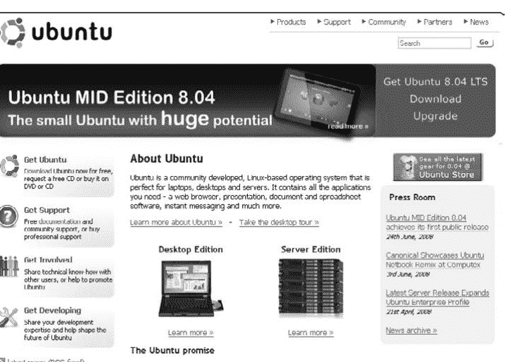

## 保存位置

选择你想要保存下载文件的位置。默认位置是桌面。这个选择让你的下载更容易完成。一旦选择了位置，就点击“保存”。`Internet Explorer`的默认位置可能是“我的文档”。`Firefox`的默认位置可能是“我的桌面”。

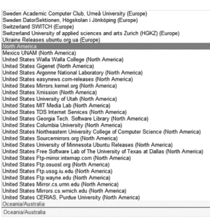

如果你购买了预装 Ubuntu 作为操作系统的新电脑，或者你已经在电脑上安装了 Ubuntu，你可能想直接跳到“初探 Ubuntu 桌面环境”章节。

如果你没有 CD 驱或无法刻录 ISO 文件，你还有其他选择。Ubuntu 可以从 USB 驱动器加载。Ubuntu 的赞助公司`Canonical`允许你下载软件副本，也可以请求通过邮寄发送最多三张 CD 给你。

如果你以前向 Ubuntu 请求过 CD，那么你就可以登录并提交另一个请求。如果这是你第一次获取 Ubuntu CD，那么你需要选择“新账户”`New Account`链接。

一旦到达`Launchpad`网站，你会被要求在“未注册？”`Not Registered?`标题下提交你的电子邮件。输入有效的电子邮箱地址并点击“注册”`Register`按钮，以便`Canonical`向你发送注册步骤。注册后几乎是立即，你可以检查所提供的电子邮件账户，查看以完成注册的链接。

点击此链接后，你会被带到一个页面，在其中选择你的显示名称和密码。完成后，会出现“请求 CD”`Request CDs`标签页，你现在可以使用注册时选择的电子邮件地址和密码登录。你只需要填写你的收货信息并点击“请求 CD”`Request CDs`按钮。你可以选择请求一张 CD 或三张 CD。你应该选择三张，并给你的朋友几个 Ubuntu 让他们尝试一下。

如果你无法下载 Ubuntu且不想等十周让订单到达，你可以从不同的分销商处购买 CD 或 DVD 版本的 Ubuntu 副本

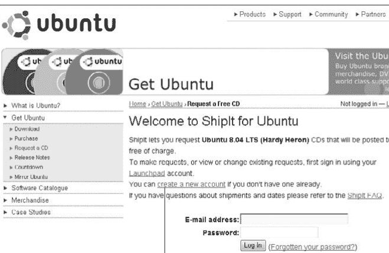

这些公司与`Canonical`合作。这些公司将 Ubuntu、`Kubuntu`、`Edubuntu`和 Ubuntu 发行版封装在光盘中供客户，然后提供免费的即插即用版本给客户。

Ubuntu 网站列出了它们在该项活动中合作的公司，因此如果您正在花钱购买一份 Ubuntu，请确保是从他们的某一个分销商处购买的。既然可以免费获得，为什么还要买呢？由于您支付了运费，从分销商购买软件将比`Canonical`发送副本给您所需的十周时间快得多，帮助您更快地拿到 Ubuntu。

Ubuntu 也对光 CD 收费。如果您需要大量的 Ubuntu CD，他们仍然可以免费发送给您。如果您是向学生分发 CD 的老师，或者正在参加贸易展会并希望向参会者分发，您可以对 Ubuntu CD 提出特殊请求。请求越合理，`Canonical`就越可能为您提供这些光盘。

无论你是从`Canonical`订购了一份 Ubuntu，还是选择下载一份并从 ISO 镜像刻录 CD 或 DVD，你现在拥有了所谓的`Live CD`或 DVD。你的光盘不会四处走动并修复你；它不是那种“活”的。相反，你可以启动操作系统并直接从光盘运行所有程序。你可以完成书中的大量活动，并在无需在计算机上安装操作系统的情况下在 Ubuntu 中建立坚实的基础！Ubuntu 为什么要这样做呢？回想他们的使命。他们想开发一种作为市场现有商业系统替代品的操作系统——正如众所知的，“人类的 Linux”`Linux for Human Beings`。由于人类对此持怀疑态度，特别是在涉及到计算机时，他们让人们很容易就能尝试这种新的操作系统。他们知道，一旦人们尝试了，就会切换。这是一种“只管去做，他们自然会来”的态度。

| 你知道吗？ | Live CDs 可用于 |
| :--- | :--- |
| Live CDs 在 GNU/Linux 世界非常常见。它们不仅为从 Microsoft Windows 或 Mac OS 切换过来的用户提供了测试 Linux 的机会，还被用作商业世界的工具。 | 许多 GNU/Linux 都是为特定任务构建的。`FIRE`取证与事件响应环境 Linux 是一种实 live 发行版，用于从可能发生犯罪或违反条款的计算机中提取数字证据。`XORP`和`SENTRY`是 live 发行版如何作为防火墙保护网络的示例。`Linux Bootable Toolbox`用于救助崩溃的系统，以便恢复存储在其中的数据。甚至还有一个名为`Lin4Astro`的版本，用于天文研究。 |

手里拿着 Live CD，让我们打开 CD/DVD 驱动器并插入光盘，这样你就可以工作了。你将看到 Ubuntu 启动界面，所示。

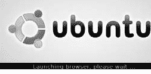

这会打开一个浏览器，允许 Microsoft Windows 和 Mac OS 的用户尝试 CD 上的可用免费软件。我们将适时介绍所有这些应用程序。现在，我们想要进入 Ubuntu 操作系统；在启动界面出现后，将其关闭，然后直接重启您的系统。

> 我们在书中中所完成的所有任务都将使用`GNOME`桌面环境。出于教育目的，将提供`Kubuntu`、`Xubuntu`和`Edubuntu`桌面的图像。

当大多数计算机在驱动器带有可启动 CD 的启动时，用户会看到“按任意键从 CD 启动”的选项。这样做将允许 CD-ROM 驱动器中的 CD 从硬盘接管启动过程。与安装不同，Ubuntu Live CD 不会对您的计算机进行任何更改。

图 2-4 显示了在 Ubuntu 启动时您看到的系列屏幕。与安装不同，Ubuntu Live CD 不会对您的计算机进行任何更改。如果 Ubuntu 加载较慢，这是正常的。除非您已经安装了 Ubuntu，否则不会有更改。

> 我们在书中中所完成的所有任务都将使用`GNOME`桌面环境。出于教育目的，将提供`Kubuntu`、`Xubuntu`和`Edubuntu`桌面的图像。

当大多数计算机在驱动器带有可启动 CD 的启动时，用户会看到“按任意键从 CD 启动”的选项。这样做将允许 CD-ROM 驱动器中的 CD 从硬盘接管启动过程。

Ubuntu 2桌面 25。

> 我们在书中中所完成的所有任务都将使用`GNOME`桌面环境。出于教育目的，将提供`Kubuntu`、`Xubuntu`和`Edubuntu`桌面的图像。

当大多数计算机在驱动器带有可启动 CD 的启动时，用户会看到“按任意键从 CD 启动”的选项。这样做将允许 CD-ROM 驱动器中的 CD 从硬盘接管启动过程。

Ubuntu 2桌面 25。

> 我们在书中中所完成的所有任务都将使用`GNOME`桌面环境。出于教育目的，将提供`Kubuntu`、`Xubuntu`和`Edubuntu`桌面的图像。

当大多数计算机在驱动器带有可启动 CD 的启动时，用户会看到“按任意键从 CD 启动”的选项。这样做将允许 CD-ROM 驱动器中的 CD 从硬盘接管启动过程。

Ubuntu 2桌面。

> 我们在书中中所完成的所有任务都将使用`GNOME`桌面环境。出于教育目的，将提供`Kubuntu`、`Xubuntu`和`Edubuntu`桌面的图像。

Ubuntu 2桌面25。

> 我们在书中中所完成的所有任务都将使用`GNOME`桌面环境。出于教育目的，将提供`Kubuntu`、`Xubuntu`和`Edubuntu`桌面的图像。

当大多数计算机在驱动器带有可启动 CD 的启动时，用户会看到“按任意键从 CD 启动”的选项。这样做将允许 CD-ROM 驱动器中的 CD 从硬盘接管启动过程。

Ubuntu 2桌面 25。

> 我们在书中中所完成的所有任务都将使用`GNOME`桌面环境。出于教育目的，将提供`Kubuntu`、`Xubuntu`和`Edubuntu`桌面的图像。

当大多数计算机在驱动器带有可启动 CD 的启动时，用户会看到“按任意键从 CD 启动”的选项。这样做将允许 CD-ROM 驱动器中的 CD 从硬盘接管启动过程。

Ubuntu 2-桌面 25。


> 我们在书中中所完成的所有任务都将使用 GNOME 桌面环境。出于教育目的，将提供 Kubuntu、Xubuntu 和 Edubuntu 桌面的图像。

当大多数计算机在驱动器带有可启动 CD 的启动时，用户会看到“按任意键从 CD 启动”的选项。这样做将允许 CD-ROM 驱动器中的 CD 从硬盘接管启动过程。

## 第一部分 认识 Ubuntu

下拉菜单 您可以启动程序

网络信息 电源按钮

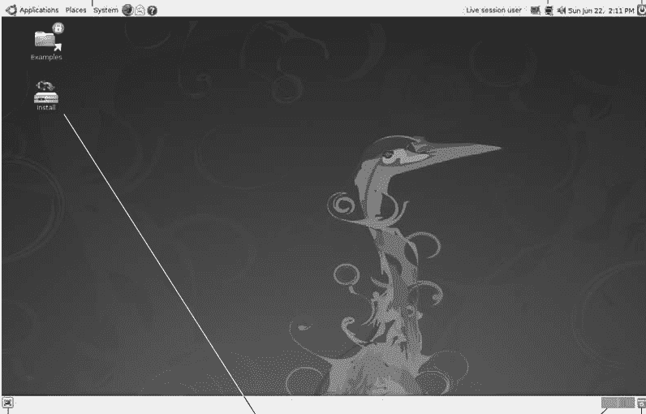

清除桌面 点击此处启动安装过程 桌面切换

2-5 桌面环境

## 初识桌面环境

在下载了整个操作系统、将 ISO 文件刻录到 CD 并启动到 live 环境后，花点时间祝贺自己。当你完成本章时，你就可以从普通电脑用户转变为受青爱的计算机爱好者。所以，让我们开始吧。

我们将查看分为三个部分的桌面环境。屏幕顶部包含许多程序启动器和系统信息。桌面的主要部分由背景和图标组成。最后，屏幕底部包含一些桌面控件和垃圾。

## 第 2 章 探索 Ubuntu 桌面

### 顶栏

Ubuntu 桌面环境顶栏从左到右包含应用程序菜单、位置菜单、系统菜单、启动 Mozilla Firefox 浏览器的图标、启动 Evolution 电子邮件客户端的图标、帮助菜单、当前用户名称、网络信息、音量控制器、日期时间和电源按钮。点击应用程序菜单将展开此部分，所示。

你可以看到当你点击它时，会显示安装了 Ubuntu 的不同软件类别列表。点击这些类别中的任何一个都将列出具体的程序：

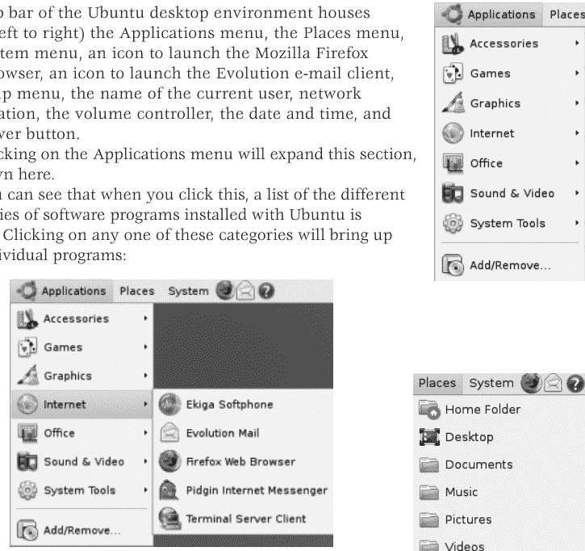

点击位置菜单会带出一个列表，如相邻插图所示，与我们在应用程序下看到的相似。然而，当你从位置菜单中选择选项时，你会被带到另一个文件夹，如下一页插图所示，而不是启动程序。位置菜单帮助你环游计算机，就像 Microsoft Windows 中的资源管理器一样。

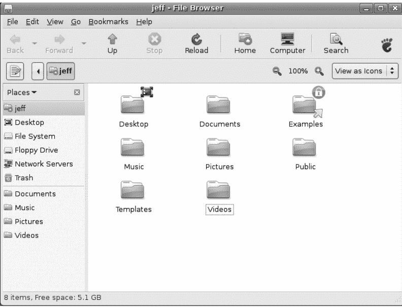

最后，屏幕右角的电源按钮为您提供了关机（Shut Down）、休眠（Hibernate）、注销（Log Out）等选项。你会发现，当你点击此按钮时，整个屏幕都会变暗，并弹出此处所示关机菜单：

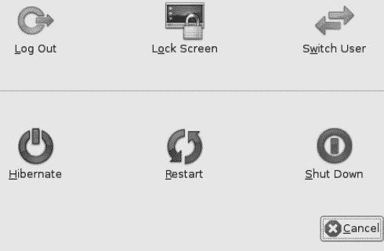

### 主屏幕

主屏幕包含背景（图 2-5 中默为浅棕色）以及用于启动程序或显示已挂载驱动器的图标。在随后的章节中，你将学习如何将桌面环境的背景更改为你喜欢的任何内容。你还将学习如何向桌面窗口添加图标，以便你能够轻松地启动程序和访问计算机上的文件夹。

### 屏幕底部

在 Ubuntu 桌面屏幕底部的栏上，你可以在左侧找到“显示桌面”（Show Desktop）按钮，在右侧找到桌面切换器（desktop switcher）。“显示桌面”按钮是一个值得尝试的有趣工具。花点时间从“应用程序”菜单打开一个程序。例如，打开“图形”（Graphics），然后打开 Gimp。现在将光标移动到“桌面”按钮并点击。你的桌面现在应该没有任何应用程序窗口了。这是急需最小化窗口的极佳方法。如果你正在处理某些重要事项，不必担心使用此工具会丢失它。窗口只是被最小化了，可以通过点击屏幕底部按钮上的名称来恢复最大化。

桌面切换器旁边是垃圾桶（trash can）。这与 Windows 非常相似，它将被删除的文件存储在一个容器中，以防以后需要恢复。

位于垃圾桶和“显示桌面”按钮之间的桌面切换器是 Ubuntu 桌面环境中最实用的工具之一。基本上，它的名称已经解释了用户可以在一个桌面窗口中打开程序，然后只需通过点击底栏中的缩略窗口切换到另一个桌面。在图 2-6 中，你可以看到在一个桌面上打开了音乐播放器。通过切换桌面，你可以打开另一个程序，如图 2-6 所示的国际象棋游戏。如果你在工作或娱乐时需要同时运行两个或多个程序，这会非常有用。

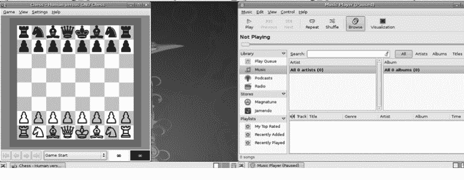

### 什么是挂载驱动器？

在 GNU/Linux 中，“挂载驱动器”（mounted drive）一词描述如硬盘、CD-ROM 或 USB 驱动器等由操作系统准备好可使用的驱动器。该术语源于计算机的早期时代，当时计算机操作员在读写数据之前，必须物理地将磁带驱动器安装在转轴上。

在 GNU/Linux 的早期版本中，挂载驱动器需要相当操作系统和硬件驱动器本身的知识。在 Ubuntu 中挂载驱动器非常简单。随后的章节将向你展示，只需插入 USB 盘，Ubuntu 就会自动为你挂载驱动器，无需任何配置。

花些时间自己探索 Ubuntu 桌面环境。在变得熟悉之后，你会发现这是一个非常友好的工作环境。从其他桌面环境切换过来的人会发现过渡比预期的要容易得多。

你可能记得，除了 GNOME 桌面环境外，Ubuntu 还发布了名为 Kubuntu 的 KDE 桌面环境以及一个名为 Xubuntu 的 Xfce 桌面环境。图 2-7 显示了这三个桌面环境在视觉上是多么相似。获取 Kubuntu 和 Xubuntu 的方法与基于 GNOME 的 Ubuntu 相同。尽管 Xfce 环境是为没有现代计算机资源的旧电脑设计的，但 KDE 和 GNOME 之间的差异较小，更多地反映了用户的个人选择，而非基于计算能力或用性。

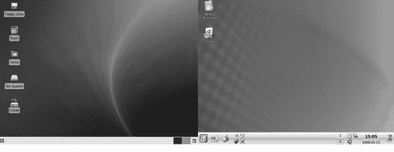

GNOME 环境包含在大多数 GNU/Linux 发行版中，并是 Ubuntu 的默认环境。在本书中，我们将一直使用 GNOME 桌面。由于使用开源软件完全取决于让用户感觉最好且对用户运行效果最好，请尝试其他桌面环境，看看哪一个符合你的个人需求和口味。

### 完成实时光盘（Live CD）的使用

当你玩了一段时间 Ubuntu 后，你可能对桌面环境做了一些更改。也许你添加了一些图标或更改了背景。你很可能还使用了 Open Office 创建了文档或电子表格。遗憾的是，在实时环境中，你无法将更改或工作保存到计算机的硬盘中。Live CD 的目的是让你体验 GNU/Linux，并并在安装软件之前检查它是否与你的计算机兼容。如果你坐下来进行实时会话并在 Writer 中完成了一部伟大的美国小说，或者在 Calc 中处理了你计算机的季度预测，也不要担心。你仍然可以将这些工作保存到 USB 驱动器或其他可移动介质上。然而，当你关闭实时会话时，桌面更改不会保留。

关闭实时会话非常简单。将鼠标光标移动到系统菜单并选择“注销”（Log Out）。你将看到一个启动界面，询问你是注销、关机还是重启。


# 28 第一部分 认识 Ubuntu


最后，屏幕右角的电源按钮为您提供了关机（Shut Down）、休眠（Hibernate）、注销（Log Out）等选项。你会发现，当你点击此按钮时，整个屏幕都会变暗，并弹出此处所示关机菜单：


# 第2章 探索 Ubuntu 桌面 29

## 主屏幕

主屏幕包含背景（图 2-5 中默为浅棕色）以及用于启动程序或显示已挂载驱动器的图标。在随后的章节中，你将学习如何将桌面环境的背景更改为你喜欢的任何内容。你还将学习如何向桌面窗口添加图标，以便你能够轻松地启动程序和访问计算机上的文件夹。

## 屏幕底部

在 Ubuntu 桌面屏幕底部的栏上，你可以在左侧找到“显示桌面”（Show Desktop）按钮，在右侧找到桌面切换器（desktop switcher）。“显示桌面”按钮是一个值得尝试的有趣工具。花点时间从“应用程序”菜单打开一个程序。例如，打开“图形”（Graphics），然后打开 Gimp。现在将光标移动到“桌面”按钮并点击。你的桌面现在应该没有任何应用程序窗口了。这是急需最小化窗口的极佳方法。如果你正在处理某些重要事项，不必担心使用此工具会丢失它。窗口只是被最小化了，可以通过点击屏幕底部按钮上的名称来恢复最大化。

桌面切换器旁边是垃圾桶（trash）。这与 Windows 非常相似，它将被删除的文件存储在一个容器中，以防以后需要恢复。

位于垃圾桶和“显示桌面”按钮之间的桌面切换器是 Ubuntu 桌面环境中最实用的工具之一。基本上，它的名称已经解释了用户可以在一个桌面窗口中打开程序，然后只需通过点击底栏中的缩略窗口切换到另一个桌面。在图 2-6 中，你可以看到在一个桌面上打开了音乐播放器。通过切换桌面，你可以打开另一个程序，如图 2-6 所示的国际象棋游戏。如果你在工作或娱乐时需要同时运行两个或多个程序，这会非常有用。


图 2-6 切换桌面

## 什么是挂载驱动器？

在 GNU/Linux 中，“挂载驱动器”（mounted drive）一词描述如硬盘、CD-ROM 或 USB 驱动器等由操作系统准备好可使用的驱动器。该术语源于计算机的早期时代，当时计算机操作员在读写数据之前，必须物理地将磁带驱动器安装在转轴上。

在 GNU/Linux 的早期版本中，挂载驱动器需要相当操作系统和硬件驱动器本身的知识。在 Ubuntu 中挂载驱动器非常简单。随后的章节将向你展示，只需插入 USB 盘，Ubuntu 就会自动为你挂载驱动器，无需任何配置。

花些时间自己探索 Ubuntu 桌面环境。在变得熟悉之后，你会发现这是一个非常友用的工作环境。从其他桌面环境切换过来的人会发现，过渡比预期的要容易得多。

你可能记得，除了 GNOME 桌面环境外，Ubuntu 还发布了名为 Kubuntu 的 KDE 桌面环境以及一个名为 Xubuntu 的 Xfce 桌面环境。图 2-7 显示了这三个桌面环境在视觉上是多么相似。获取 Kubuntu 和 Xubuntu 的方法与基于 GNOME 的 Ubuntu 相同。尽管 Xfce 环境是为没有现代计算机资源的旧电脑设计的，但 KDE 和 GNOME 之间的差异较小，更多地反映了用户的个人选择，而非基于计算能力或用性。


图 2-7 Ubuntu（左）和 Kubuntu（右）桌面

# 第2章 探索 Ubuntu 桌面 31

GNOME 环境包含在大多数 GNU/Linux 发行版中，并是 Ubuntu 的默认环境。在本书中，我们将一直使用 GNOME 桌面。由于使用开源软件完全取决于让用户感觉最好且对用户运行效果最好，请尝试其他桌面环境，看看哪一个符合你的个人需求和口味。

## 完成实时光盘（Live CD）的使用

当你玩了一段时间 Ubuntu 后，你可能对桌面环境做了一些更改。也许你添加了一些图标或更改了背景。你很可能还使用了 Open Office 创建了文档或电子表格。遗憾的是，在实时环境中，你无法将更改或工作保存到计算机的硬盘中。Live CD 的目的是让你体验 GNU/Linux，并并在安装软件之前检查它是否与你的计算机兼容。如果你坐下来进行实时会话并在 Writer 中完成了一部伟大的美国小说，或者在 Calc 中处理了你计算机的季度预测，也不要担心。你仍然可以将这些工作保存到 USB 驱动器或其他可移动介质上。然而，当你关闭实时会话时，桌面更改不会保留。

关闭实时会话非常简单。将鼠标光标移动到系统菜单并选择“注销”（Log Out）。你将看到一个启动界面，询问你是注销、关机还是重启。一旦你已经熟悉了 Ubuntu 桌面环境，你会发现它是一个极其易用的工作环境。

# 第3章 个性化——按喜好调整 Ubuntu 的外观

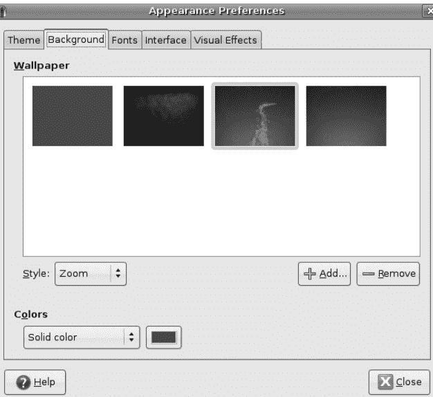

图 3-2 外观偏好界面

## 如何……传输文件到 Ubuntu

虽然我们将在第 4 章更详细地讨论文件管理，但你可能需要将一些照片传输到 Ubuntu，以便跟随本章的步骤操作。以下内容将为你提供关于此过程的快速教程：

- 将你想要传输的文件放在光盘或 USB 驱动盘上。
- 将光盘或 USB 驱动盘插入运行 Ubuntu 操作系统系统的计算机。
- 当光盘或驱动器加载后，桌面左上角会出现一个带有光盘/驱动器名称的图标。请先不要点击此图标。
- 图标出现后不久，文件浏览器窗口将会出现。文件浏览窗口左侧将列出所有可用文件夹。你刚刚插入的光盘/驱动器的内容将显示在文件浏览器的主面板中。要传输文件，只需将文件从主面板拖到左侧相应的文件夹中即可。

## 安装新壁纸

5. 如果你需要创建一个新文件夹来存放文件，请点击父文件夹。例如，你的家目录命名为 jeff。它显示在左侧文件夹列表的顶部。

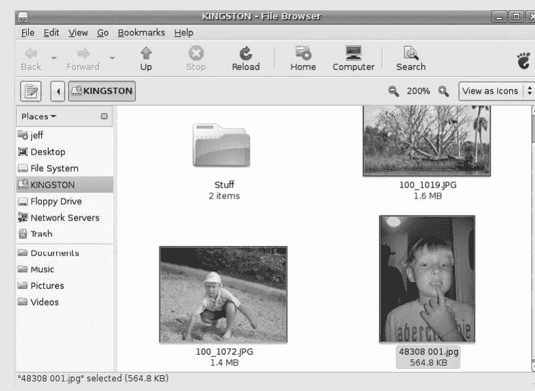

6. 现在家目录已经在文件浏览器的主面板中打开，你可以右键点击主面板中的任何位置并选择“新建文件夹”（Create A New Folder），或者转到“文件 | 新建”（File | Create A New Folder）。完成后，你可以回到光盘或 USB 驱动盘，并将文件拖到你新创建的文件夹中。

> 给 Windows 用户的提示：与 Windows 中一样，如果你在 Ubuntu 中右键点击文件，你会看到“发送到”（Send To）选项。Windows 允许你将文件发送到计算机上的另一个文件夹。在 Ubuntu 中，“发送到”选项允许你通过电子邮件发送文件，并弹出相应的启动器。

Ubuntu 自带三种默认壁纸：大象、带有苍鹭图片的 Ubuntu 以及 Ubuntu Logo。由于 GNU/Linux 是为性能构建的，许多硬核 GNU/Linux 粉丝欣赏这种不让几十张永远不会用于桌面背景的图片占用贵的存储空间。虽然其他操作系统可能提供大量的内置桌面背景选择，但 GNU/Linux 分发版提供的非常少。相反，它们允许用户提供自己想要的图像作为 wallpaper。

桌面背景还有第四种选择——无壁纸，即纯棕色。

在 Ubuntu 中添加壁纸非常简单，你可以通过多种方法实现。第一种是使用图 3-2 中的外观偏好菜单。在显示壁纸选项缩略图下方，你会看到两个按钮，“添加”（Add）和“删除”（Remove）。点击“添加”，你将进入文件管理器（见图 3-3）。现在你可以从左侧“位置”（Places）下显示的任何文件夹中选择图像。通常情况下，你双击“图片”（Pictures）文件夹并从生成的图片列表中选择。当然，如果你没有向你的 Ubuntu 操作系统保存过任何图片，此文件夹将是空的。（关于添加图片，请参见第 20 章。）

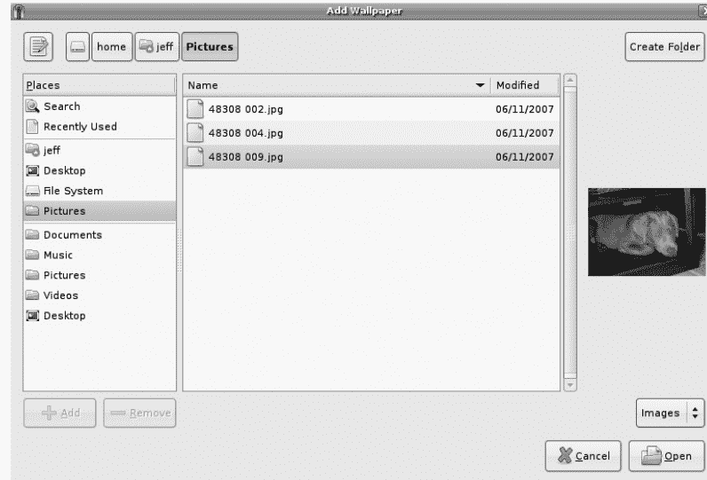

图 3-3 通过外观偏好窗口安装新壁纸


如果你在“图片”文件夹中有图片，或者你找到了另一张想使用的图像，可以双击文件名，或单击（下文统称为“点击”）名称然后点击“打开”（`Open`）。这将立即将此图像设置为你的新桌面背景。尝试外观偏好窗口上的“样式”（`Style`）选项，以设置你想要的屏幕显示效果。大功完成，你刚刚自定义了 GNU/Linux！

在参加完家庭郊游后，你可能想回到家里翻看你用新数码相机拍的所有照片，对吧？有时当我们从海量照片中筛选时，会遇到一张我们妈妈、爸爸、孩子、叔叔或任何足够幽默且让人尴尬但又不会伤到他们感情的照片。如果用我们那张拍的她反应的照片来提醒你的妻子，在七月四日她坐在土豆沙拉盆里，这难道不是没有比这更好的方法了吗？

将文件视图中的任何图片设置为壁纸也只需点击几次即可完成。首先，你必须打开一个包含图片的文件夹。找到你想要作为新壁纸的图片，并双击图像。现在你应该会看到图 3-4 中的图像查看器程序。

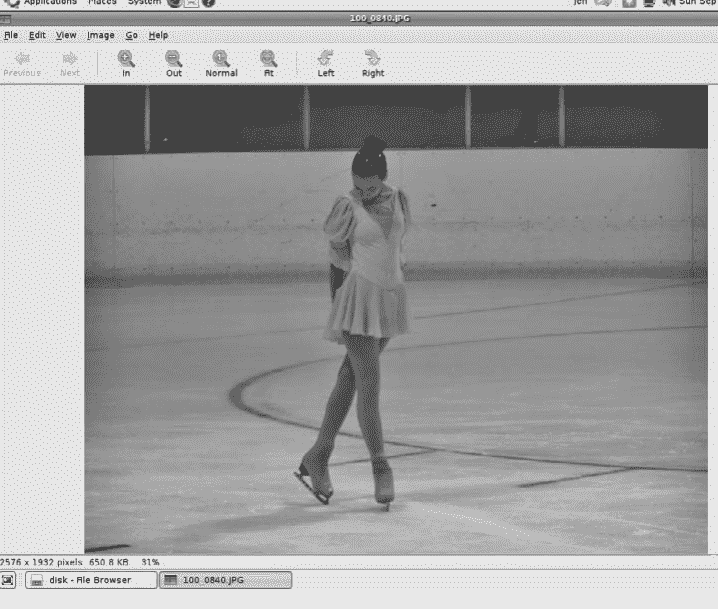

图 3-4 Eye of GNOME 图像查看器

在图像查看器顶部，点击“图像”（`Image`）菜单。你将看到一个下拉列表。在列表底部，选择“设置为壁纸”（`Set As Wallpaper`）。现在你的图片将作为你的桌面背景。

## GNOME Art

Ubuntu 的目标之一是自定义外观，开发者意识到桌面环境、图标和屏幕是非常重要的。在整本书中，“GNOME Art”和“Art 管理”（Art Manager）是交替使用的术语。此外，“GNOME Art”还是一个工具，允许你下载并安装不同的背景、桌面主题和窗口框。安装它就像选择壁纸一样简单。如果你现在就想使用它，可以跳到第 6 章。

GNOME Art 是一个允许你下载并安装不同的背景、桌面主题和窗口框的工具。对于用户来说，安装它非常简单。

## 如何……安装 GNOME Art

要安装 Art Manager，你必须学习如何在 Ubuntu 中安装程序。虽然这在第 6 章有更详细的介绍，但这里有必要进行简要介绍。要安装应用程序，请遵循以下步骤：

- 点击顶部面板上的“应用程序”（`Applications`）。
- 选择底部的“添加/移除”（`Add/Remove`）。
- 当“添加/移除应用程序”窗口打开时，确保顶部选中了“全部”（`All`）。

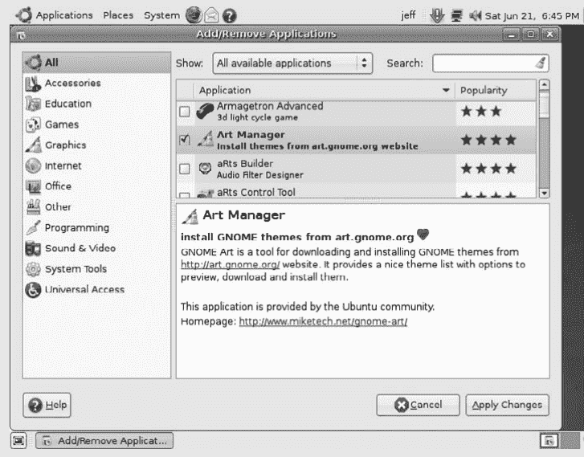

4. 在右侧，在字母列表中找到 Art Manager，点击选框插入标记。
5. 点击“应用更改”（`Apply Changes`）按钮。
6. 将询问是否要在另一个“应用更改”窗口中添加此应用程序。在这里也选择应用。
7. 下一个窗口将显示“新应用程序已安装”。在这里你可以选择“关闭”（`Close`）。

现在考虑顶部面板上的“系统”（`System`）选项。当你将光标悬停在“偏好”（`Preferences`）选项上时，你应该会在应用程序和工具列表中看到 Art Manager。选择 Art Manager，以便更深入地该程序的功能。

当你第一次打开 Art Manager 时，你会看到一个空白窗口。别担心，稍后我们会在那里添加一些很酷的东西。要向 Art Manager 添加艺术品，点击“艺术”（`Art`）选择。现在下拉菜单应该列出：背景、桌面主题和其它主题。让我们从简单的开始，选择“背景”，然后从下一个列表中选择“GNOME”。到此时，你的 GNOME Art 窗口应该显示“正在准备下载”。这是因为 GNOME Art 正在获取不同图形文件的预览。

## 第 3 章 个性化——根据你的喜好微调 Ubuntu 外观 41

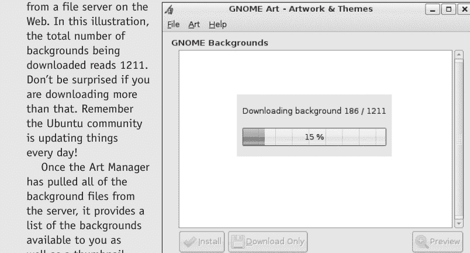

来自 Web 上的文件服务器。在这些插图中，正在下载的背景总数为 1211 个。如果你下载的超过了那个数字，请不要感到惊讶。记住，Ubuntu 社区每天都在更新内容！一旦艺术管理器（Art Manager）从服务器拉取了所有背景文件，它就会为你提供一个可用的背景列表，以及每个背景的缩略图预览，让你选择新桌面背景变得更加简单。当你滚动列表时，你应该会注意到 GNOME Art 似乎下载了多次该图像。在你在使用此应用程序填充它的主题集之前，请仔细观察。某些桌面背景（例如“蓝色 Blue”）是针对不同分辨率的。这使得图像能够完全按照你设置的方式适应你的电脑。这种定制功能真是太棒了！一旦你找到了喜欢的桌面背景，可以通过点击它的缩略图来选择。现在，你有两种选择：通过“仅下载”（`Download Only`）按钮将图像下载到你的个人文件夹，或者点击“安装”（`Install`）按钮直接将其安装到“外观偏好”（`Appearance Preferences`）中的背景存储库。现在请使用“安装”按钮，因为这对于初学者来说要简单得多。选择一个酷炫的背景，安装它，然后打开。

## 更改主题

桌面背景、图标、字体和其他视觉元素的组合被称为主题。在 Ubuntu 系统中，像 Windows 和 macOS 这样的操作系统都允许更改主题。Ubuntu 也不例外。当你想要更改主题时，可以进入外观偏好设置。

如果你想更改桌面背景，可以右键点击桌面并选择“更改背景”。这时，你将看到一个主题列表。

## 认识 Ubuntu

一旦你找到了喜欢的桌面背景，可以通过点击它的缩略图来选择。当你滚动列表时，你应该会注意到 GNOME Art 似乎下载了多次该图像。在你在使用此应用程序填充它的主题集之前，请仔细观察。某些桌面背景（例如“蓝色 Blue”）是针对不同分辨率的。这使得图像能够完全按照你设置的方式适应你的电脑。这种定制功能真是太棒了！

## 42 页 认识 Ubuntu

一旦你找到了喜欢的桌面背景，可以通过点击它的缩略图来选择。当你滚动列表时，你应该会注意到 GNOME Art 似乎下载了多次该图像。在你在使用此应用程序填充它的主题集之前，请仔细观察。某些桌面背景（例如“蓝色 Blue”）是针对不同分辨率的。这使得图像能够完全按照你设置的方式适应你的电脑。这种定制功能真是太棒了！一旦你找到了喜欢的桌面背景，可以通过点击它的缩略图来选择。现在，你有两种选择：通过“仅下载”按钮将图像下载到你的个人文件夹，或者点击“安装”按钮直接将其安装到“外观偏好”中的背景存储库。现在请使用“安装”按钮，因为这对于初学者来说要简单得多。选择一个酷炫的背景，安装它，然后打开。

和其他视觉元素的组合被称为主题。在 Ubuntu 系统中，像 Windows 和 macOS 这样的操作系统都允许更改主题。Ubuntu 也不例外。当你想要更改主题时，可以进入外观偏好设置。

如果你想更改桌面背景，可以右键点击桌面并选择“更改背景”。这时，你将看到一个主题列表。

## 认识 Ubuntu

一旦你找到了喜欢的桌面背景，可以通过点击它的缩略图来选择。当你滚动列表时，你应该会注意到 GNOME Art 似乎下载了多次该图像。在你在使用此应用程序填充它的主题集之前，请仔细观察。某些桌面背景（例如“蓝色 Blue”）是针对不同分辨率的。这使得图像能够完全按照你设置的方式适应你的电脑。这种定制功能真是太棒了！一旦你找到了喜欢的桌面背景，可以通过点击它的缩略图来选择。现在，你有两种选择：通过“仅下载”按钮将图像下载到你的个人文件夹，或者点击“安装”按钮直接将其安装到“外观偏好”中的背景存储库。现在请使用“安装”按钮，因为这对于初学者来说要简单得多。选择一个酷炫的背景，安装它，然后打开。

一旦你找到了喜欢的桌面背景，可以通过点击它的缩略图来选择。当你滚动列表时，你应该会注意到 GNOME Art 似乎下载了多次该图像。在你在使用此应用程序填充它的主题集之前，请仔细观察。某些桌面背景（例如“蓝色 Blue”）是针对不同分辨率的。这使得图像能够完全按照你设置的方式适应你的电脑。这种定制功能真是太棒了！一旦你找到了喜欢的桌面背景，可以通过点击它的缩略图来选择。现在，你有两种选择：通过“仅下载”按钮将图像下载到你的个人文件夹，或者点击“安装”按钮直接将其安装到“外观偏好”中的背景存储库。现在请使用“安装”按钮，因为这对于初学者来说要简单得多。选择一个酷炫的背景，安装它，然后打开。

一旦你找到了喜欢的桌面背景，可以通过点击它的缩略图来选择。当你滚动列表时，你应该会注意到 GNOME Art 似乎下载了多次该图像。在你在使用此应用程序填充它的主题集之前，请仔细观察。某些桌面背景（例如“蓝色 Blue”）是针对不同分辨率的。这使得图像能够完全按照你设置的方式适应你的电脑。这种定制功能真是太棒了！一旦你找到了喜欢的桌面背景，可以通过点击它的缩略图来选择。现在，你有两种选择：通过“仅下载”按钮将图像下载到你的个人文件夹，或者点击“安装”按钮直接将其安装到“外观偏好”中的背景存储库。现在请使用“安装”按钮，因为这对于初学者来说要简单得多。选择一个酷炫的背景，安装它，然后打开。


一旦你找到了喜欢的桌面背景，可以通过点击它的缩略图来选择。当你滚动列表时，你应该会注意到 GNOME Art 似乎下载了多次该图像。在你在使用此应用程序填充它的主题集之前，请仔细观察。某些桌面背景（例如“蓝色 Blue”）是针对不同分辨率的。这使得图像能够完全按照你设置的方式适应你的电脑。这种定制功能真是太棒了！

现在，你有两种选择：通过“仅下载”按钮将图像下载到你的个人文件夹，或者点击“安装”按钮直接将其安装到“外观偏好”中的背景存储库。现在请使用“安装”按钮，因为这对于初学者来说要简单得多。选择一个酷炫的背景，安装它，然后打开。

（此处主题。

## 更改主题

桌面背景、图标、字体和其他视觉元素的组合被称为主题。在 Ubuntu 系统中，像 Windows 和 macOS 这样的操作系统都允许更改主题。Ubuntu 也不例外。当你想要更改主题时，可以进入外观偏好设置。


# 第 3 章 个性化——根据你的喜好微调 Ubuntu 外观


来自 Web 上的文件服务器。在这些插图中，正在下载的背景总数为 1211 个。如果你下载的超过了那个数字，请不要感到惊讶。记住，Ubuntu 社区每天都在更新内容！一旦艺术管理器（Art Manager）从服务器拉取了所有背景文件，它就会为你提供一个可用的背景列表，以及每个背景的缩略图预览，让你选择新桌面背景变得更加简单。当你滚动列表时，你应该会注意到 GNOME Art 似乎下载了多次该图像。在你在使用此应用程序填充它的主题集之前，请仔细观察。某些桌面背景（例如“蓝色 Blue”）是针对不同分辨率的。这使得图像能够完全按照你设置的方式适应你的电脑。这种定制功能真是太棒了！一旦你找到了喜欢的桌面背景，可以通过点击它的缩略图来选择。现在，你有两种选择：通过“仅下载”（Download Only）按钮将图像下载到你的个人文件夹，或者点击“安装”（Install）按钮直接将其安装到“外观偏好”（Appearance Preferences）中的背景存储库。现在请使用“安装”按钮，因为这对于初学者来说要简单得多。选择一个酷炫的背景，安装它，然后打开。

## 更改主题

桌面背景、图标、字体和其他视觉元素的组合被称为主题。在 Ubuntu 系统中，像 Windows 和 macOS 这样的操作系统都允许更改主题。Ubuntu 也不例外。当你想要更改主题时，可以进入外观偏好设置。

如果你想更改桌面背景，可以右键点击桌面并选择“更改背景”。这时，你将看到一个主题列表。

## 认识 Ubuntu

一旦你找到了喜欢的桌面背景，可以通过点击它的缩略图来选择。当你滚动列表时，你应该会注意到 GNOME Art 似乎下载了多次该图像。在你在使用此应用程序填充它的主题集之前，请仔细观察。

## 第 3 章 个性化——根据你的喜好调整 Ubuntu 的外观

### 如何在桌面上放置图标

在 Ubuntu 中，可以为任何应用程序创建图标（或启动器）。为了练习这一点，让我们为 Ubuntu 国际象棋游戏创建一个启动器。这些方法适用于任何程序。

- 1. 点击“应用程序”并选择“游戏”。
- 2. 找到“国际象棋”并点击右键。
- 3. 选择“将此启动器添加到桌面”。

你现在应该能在桌面上看到一个国际象棋图标的副本。你也可以通过选择“将启动器添加到面板”来创建一个位于顶部面板的启动器。

会出现一个窗口用于控制特定的图标。尝试用你刚刚创建的图标进行此操作。在“国际象棋属性”窗口中，选择“徽章”。你现在应该看到一系列橙色徽章，它们可以附加到你的图标上。选择其中一个（例如星形），在方框中打钩，然后点击“关闭”。你会注意到你的启动器上出现了徽章。这些对于组织图标非常有用。

从桌面删除图标比添加图标要简单。只需右键点击图标并选择“移动到垃圾桶”。只需左键点击图标并按不释放，将图标拖到桌面右下角的垃圾桶。你也可以使用这种技术在桌面上移动图标，随心所欲。如果你将一个图标拖到顶部面板，它也会出现在那里以及桌面上。

### 设置屏幕保护程序

当图像在 CRT 显示器上停留时间过长时，屏幕可能会出现屏影。屏影会损坏图像覆盖区域并导致屏幕损坏。为了防止这种情况，许多人使用屏幕保护程序。屏幕保护程序通过在屏幕上显示图像来实现。LCD 显示器采用不同的技术，通常不会遭受屏影影响。

屏幕保护程序也是表达个性的好方法。通过选择“系统”然后“设置”，你可以进入屏幕保护程序，在这里你可以从屏幕保护程序列表中选择来保护你的显示器。如果你向下查看列表，将看到 1990 年代流行的屏幕保护程序版本。另一个类似于《黑客帝国》中的代码。

### 更改登录界面

一旦你选择了了喜欢的屏幕保护程序，点击“预览”按钮查看它在计算机上的样子。在预览模式下，你可以使用面板顶部的箭头切换上一个和下一个屏幕保护程序。你可以点击屏幕右上角的“全屏”按钮退出预览模式。

一旦进入了屏幕保护程序设置窗口，你可以在这里选择直到屏幕保护程序激活所需的时间。默认时间设置为 10 分钟、2 小时或之间的任何时间。

除了保护你的显示器外，屏幕保护程序也可以保护你的计算机。在屏幕保护程序设置窗口中，你有在屏幕保护程序激活时锁定计算机的选项。现在你需要密码来保护数据免受好奇目光的窥视。

登录界面（见图 3-6）是你启动 Ubuntu 操作系统时看到的内容之一。


图 3-6 Ubuntu 登录界面

由于登录界面就像第一印象，它应该反映个人特征。GNU/Linux 操作系统中的其他一切都可以配置。

与桌面壁纸或主题不同，登录界面允许更多的配置。虽然你仍然更改登录界面的外观，但还有许多其他选项。六个标签页中的每一个允许用户决定计算机在登录界面的反应。这些标签页——通用、本地、远程、安全和辅助功能——可以通过选择“系统”然后“窗口”来访问。

当你尝试进行任何系统更改时，会要求你输入密码。使用你在计算机上安装 Ubuntu 时创建的密码。


要了解如何根据你的喜好配置登录界面，了解六个标签页中每个可以更改的内容是非常重要的。

#### 通用

通用标签页包含一些你可以对登录界面进行的简单更改，以及一些在你拥有了更多 Ubuntu 经验之前不应该编辑的内容。

你可以做的第一个更改是是否想要用星号或圆圈来替换登录界面上的字符。可以通过勾选复选框或点击取消来进行更改。此时你唯一应该调整的另一个项目是“使用 24 小时时”。默认是“自动”，但你也可以选择“是”或“否”。

“禁用单用户多次登录”、“默认会话以及 GtkRC 文件这三个选项目前不应更改。这些是为高级用户准备的，在使用 Ubuntu 时可能会给你带来问题。

#### 本地

此标签页为你提供了最多的选择，因为你可以在这里更改实际的登录界面。你可以选择主题、背景颜色，甚至可以创建一个自定义的欢迎消息。这里也是你可以添加新登录的地方。默认情况下，本地登录是禁用的；但你可以按照你的意愿设置。

#### 远程

此选项决定了远程用户在登录时看到的内容。在此处只有三个选择。除非你计划设置远程登录，否则此标签页目前并不重要。

#### 辅助功能

辅助功能标签页提供了关于用户在登录时看到、听到以及可以做什么的选项。“启用辅助功能登录”选项应保持为未勾选状态。“主题”部分允许用户对其有更大的控制权。“声音”部分为你提供了最多的配置选项。

> 如果你将鼠标悬停在不同的选项上，将获得有关该选项作用的更多信息。在此标签页下提到了 GTK+。GTK 通用工具包用于创建图形界面 (GUI)。

#### 安全

安全部分帮助你保护计算机免受未经授权的登录尝试、空闲登录以及增强安全权限的影响。对于计算机来说，大量的安全是一件好事，但大量的常识通常更好。你可能倾向将所有安全设置设置为最严格的级别，但请记住，安全专家警告说，计算机（或网络）的安全级别越高，用户友好性就越低。

在安全标签页中，作为新手 Ubuntu 用户只需要关注两个部分。第一个是“启用自动登录”选项。默认情况下，此第一个选项是未勾选的。勾选它允许你选择一个你的 Ubuntu 计算机自动登录的用户。

#### 用户

用户标签页有两个功能；它允许你排除或包含出现在安全标签页列表中的用户。默认情况下，所有用户都包含在列表中。

# 第3章 个性化——按你的喜好调整 Ubuntu 的外观

“用户（Users）”选项卡的第二个功能是为未选择头像的用户设置默认头像图像。头像是出现在样式设置中用户名称旁边的图标。如果你想使用头像，需要更改默认登录界面。这可以通过返回“本地（Local）”选项卡并选择包含“人类列表（Human List）”等列表的登录界面来实现。

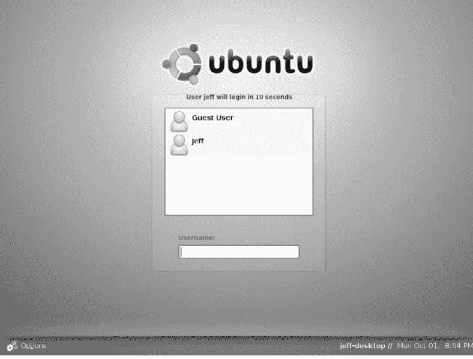

## 修改桌面效果


默认情况下，Ubuntu 提供了一个相当朴的桌面环境。正如我们在前面的页面中看到的，你可以对桌面进行一些装扮，以更好地符合你的味和风格。在桌面环境中，几乎任何东西都可以通过几次点击进行自定义。如果你通过右键点击桌面背景并选择“更改桌面”，或者通过“系统 | 偏好 | 外观”返回外观偏好，你可以看到两个我们还没有讨论过的选项卡。“字体（Fonts）”和“视觉效果（Visual Effects）”允许对桌面环境进行更细致的调整。

“字体”选项卡确实允许你更改桌面环境使用的字体。你可以进行全局更改，也可以单独更改每个特定的字体，例如应用程序字体、桌面字体、窗口标题字体等。

### 什么是 Beryl

当你逛遍不同的 Ubuntu 或 GNU/Linux 论坛时，可能会遇到名为 Beryl 的东西。Beryl 是一个三维窗口管理器，可以安装在 GNOME、KDE 或 XFCE 之上。Beryl 是 GNU/Linux任何桌面环境的惊艳增强。由于 Beryl 的视觉效果非常出色，需要大量的计算能力和特定的显卡才能运行。如果你对在 Ubuntu 系统上安装 Beryl 感兴趣，请确保你的电脑至少有 512MB 内存，建议使用 1GB。

同样，“视觉效果”选项卡允许你增强 GNOME 桌面环境的视觉效果。虽然许多人选择视觉上最美的桌面，但效果越增强，消耗的计算机资源就越多。高性能计算机可能感觉不到太大区别；但大多数家用电脑在这些资源耗尽时会明显变慢。

对于非高端配置的电脑，可以将视觉效果设置为“无效果（No Effects）”以为其他程序留出最大的计算能力；对于处理能力足够的电脑，可以将视觉效果设置为“简单效果（Simple Effects）”。“额外（Extra）”选项可以让桌面尽可能具有视觉冲击力。

最后，对于想要为自己的电脑挑选视觉效果的用户，还有一个“自定义（Custom）”选项。要确定哪种设置最适合你的电脑，请尝试每一种。如果你觉得“额外”效果对处理器的要求过高，请切换到“简单”，或者尝试自定义效果，增强你想要的功能而忽略那些不那么重要的功能。

# 第二部分 管理 Ubuntu

本页特意留空

## 维护：更新和维护 Ubuntu

### 如何操作...

- 使用 Ubuntu 更新管理器
- 维护 Ubuntu
- 创建文件夹
- 组织文件

### 为了安全考虑更新

对于大多数公司来说，将个人软件软件包抢在竞争对手之前推向市场是开发过程中最重要的因素。无论软件是操作系统、生产力套件还是特定工具，利润往往取决于谁先抢占货架。当软件开发者面临急于发布产品的巨大压力时，很多事情往往会被忽视，像测试这样的步骤也可能被缩短。对消费者来说的是，这种对市场的抢夺也被认为是恶意黑客用来破坏计算机系统的许多漏洞产生。

幸运的是，大多数软件都带有一个自动更新包，在软件本身安装时安装在计算机上。对于熟悉 Microsoft Windows 的人来说，Windows Update 就是例子。当 Microsoft Windows 开发者发布升级或补丁时，屏幕右下角的一个小图标就会弹出并提醒用户可用更新。当然，计算机本应该是让你的生活更轻松的。所以，对于那些不想被微软不断的警告和提醒骚扰的人，可以将更新设置为在特定时间自动下载并安装。通常，这个时间被设置为电脑未使用时，这样过程就会运行得快得多。

## 未打补的系统与 Sasser 蠕虫

在恶意软件横行的今天，安装新发布的补丁是必要的。未打补系统可能发生的情况的一个例子是 Sasser 蠕虫的后续，它于 2004 年 4 月 30 日发布。Sasser 在网络和互联网上迅速传播，通过让计算机自动关机来禁用它们。蠕虫被清除后，计算机在重新连接到公司网络或互联网之前，必须安装安全补丁。这导致了航空公司取消航班、外国军事分支机构瘫痪、金融机构无法交易，以及一家医院的 X 光检查患者不得不去另一家医院。

尽管 Ubuntu 不是由公司利润驱动的，开发者仍然为操作系统发布更新和补丁。虽然 Microsoft 产品是恶意黑客利用其软件和操作系统漏洞进行的大多数攻击目标，但 Ubuntu 并非如此。为了应对这些漏洞，开发者会发布补丁。这种类型的“补丁”修复了软件中的漏洞或缺陷，使其免受特定的攻击。为了让操作系统对用户更安全，每当有补丁或更新可用时，Ubuntu 都会提供通知系统。

对于 Ubuntu 操作系统的标准桌面版和服务器版，提供期 18 个月的安全更新。像 Hardy Heron 这样的长期支持（LTS）版本为安全更新提供了更长的寿命。桌面版本支持三年，而 LTS 版本的服务器支持五年。

## 为了更美好世界的更新

并非所有 Ubuntu 或其他操作系统的更新都是为了响应安全漏洞。有时开发社区会发布可以使操作系统更好的更新。Ubuntu 每六个月对操作系统进行一次升级。这确保了 Ubuntu 社区能够获得系统的最新功能。

到目前，你应该有机会查看 Ubuntu 网站，并看到各种参与开发的方式。如果你还没有去过，请花几分钟访问 `https://blueprints.launchpad.net/ubuntu/hardy`，查看由 Canonical 和社区接受的目标列表。作为 Ubuntu 社区的成员，你也可以建议更新。

Ubuntu 引以为傲的一个特性是相信 Ubuntu “一张光盘包含你需要的一切”。我们在前面的章节中讨论过，你收到的 Ubuntu 包包含了实用的生产力、娱乐和软件。与 Microsoft Windows 等商业操作系统不同，当这些软件包以及操作系统有更新时，Ubuntu 会通知用户。如果 Gimp 有新版本发布，你很可能会收到 Ubuntu 的此类通知。

## 更新管理器

如前所述，当操作系统和其他软件有可用更新时，Ubuntu 会自动更新，如图 4-2 所示。GNU/Linux 用户过去需要在终端中输入命令来更新操作系统。这些任务促使普通用户使用更易更新的操作系统。GNU/Linux 的流行开始进入非高级计算机用户的桌面，图形界面的出现允许用户轻松地更新他们的软件系统。

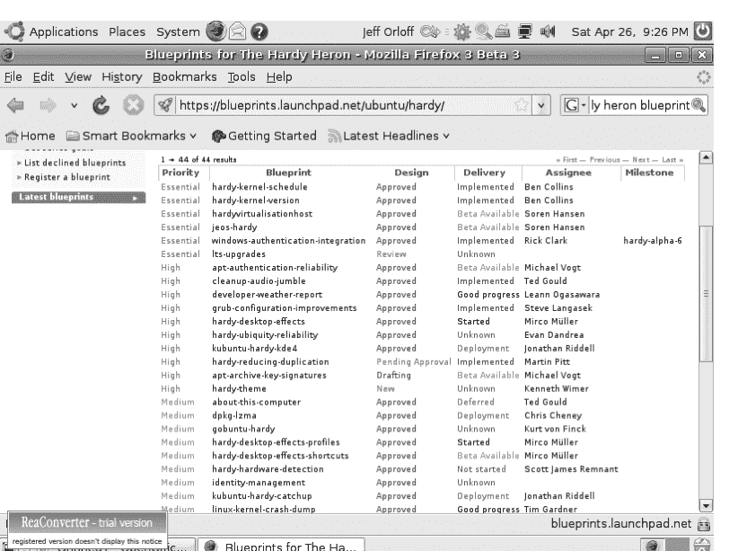

图 4-1

Hardy Heron 版本的 Ubuntu Blueprints 页面，社区成员可以看到即将发布版本的更新进度，并提出自己的想法。

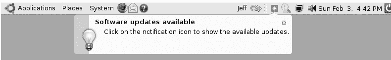

图 4-2 软件更新提醒

作为一个基于 Debian 的操作系统，Ubuntu 使用“更新管理器”（Update Manager）作为图形界面。图 4-3 显示了更新管理器打开后的外观示例；它的提醒显示有 391 个更新可用。每当操作系统出现任何你认为需要处理的更新时，此提醒就会在桌面上弹出。

虽然 Ubuntu 会通知你进行重要的更新，但有时你可能想手动检查是否有任何可用的更新内容。如果你觉得需要手动启动更新管理器，只需点击“系统 | 管理 | 更新管理器”。这将启动 Ubuntu 在软件源中搜索更新。如果你的自动更新失败，或者在尝试更新任何软件包时报告了错误，这是你应该养成的良好习惯。

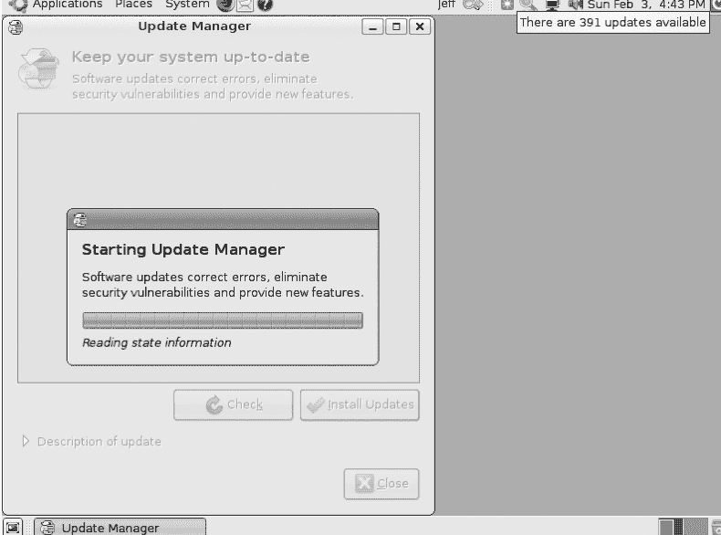

图 4-3 当用户收到更新可用的提醒时，更新管理器会检查系统软件的更新。

### 第 4 章 日常维护：更新和维护 Ubuntu 57

运行更新管理器可能需要一些时间，特别是当有 391 个更新可用时。你可能想让更新管理器在你不可能使用电脑时运行。要做到这一点，你需要使用终端来编辑所谓的 `crontab` 文件。`crontab` 文件是一个文本文件，包含了一组在 crontab 中指定时间运行的命令列表。这些文件会在指定的时间在后台运行。如果你通过 `crontab` 文件发送命令，通过检查日志文件来确保它们正在运行总是很有好的。这大部分内容将在本书中介绍。

记住，编辑 `crontab` 文件来运行更新管理器是一项完全可选的任务。如果你对通过终端编辑命令感到畏惧，请跳过本节的剩余部分并进入下一节。如果你选择这样做，请不要担心。许多 GNU/Linux 用户从未碰过 `crontab`，他们的系统运行得良好！所以如果你准备好进入 `crontab` 编辑器了，让我们卷起袖子大干一场吧。

第一步是打开终端窗口。这可以通过“应用程序 | 辅助工具 | 终端”完成。出现的窗口如图 4-4 所示。

在终端中，你应该看到类似于图 4-4 所示的 `jeff@jeff-desktop:-$`。`jeff` 是当前登录的用户，`jeff@jeff-desktop` 是计算机的名字。随其后的 `$` 是我们开始输入基本命令以调出 `crontab` 编辑器的地方。在终端中输入以下内容：

```bash
sudo edit /root/.crontab
```

`sudo` 命令的名字是 "super user do"超级用户执行）的缩写。这允许你作为计算机上的一个用户，以计算机超级用户的安全权限运行程序。如果你漏掉了这部分命令，你将无法保存所做的任何编辑。`edit` 仅仅意味着编辑。`/root/.crontab` 是你将编辑的文件。


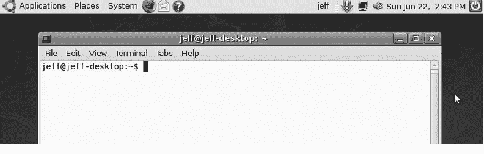

图 4-4 Ubuntu 终端程序

## Root 的含义

`root` 在 GNU/Linux 中有两个含义。根用户（root user）是计算机的管理员。Ubuntu 并不创建 root 账户，因为以 root 身份登录时的普通操作可能会导致破坏性的结果。

`root` 在 GNU/Linux 中的另一个定义也称为根目录（root directory），它是文件系统中最高级的目录。在调整 `crontab` 文件时，你正在从根目录中获取它。

在终端中输入此命令后，按回车。现在你会被要求输入密码。使用你为账户设置的同一个密码。当你输入密码时，屏幕上不会显示任何字符。这是追溯到 Unix 时代的 GNU/Linux 系统的典型。这是一种安全功能，防止人们从你肩膀后面查看你的密码有多少个字符。这些“窥视者”可以通过这些信息推测你的密码。再次在输入密码后，按回车。等待几秒钟后，你应该能看到 `crontab` 编辑器打开。点击编辑器窗口确保你有一个光标并输入以下内容：

```bash
00 * * * /usr/bin/apt-get update && /usr/bin/apt-get upgrade -y
```

在保存更改之前，让我们来分析一下这个命令。命令以一系列零开始。`crontab` 文件告诉系统何时运行命令。因此，`00 * * *` 意味着每小时。如果你想设置在下午 3:30 运行此文件，命令应该是 `* 30`。时间后面的三个星号赋予了我们控制日期、月份和星期的能力。日期可以包含 1 到 31 之间的值，月份范围为 1 到 12，星期可以在 0 到 6 之间，其中 0 代表星期日。星号意味着每天。命令的其余部分告诉操作系统做什么以及在哪里做。更新并升级你的软件。更新管理器是 `apt-get` 程序的图形界面。`-y` 意味着对过程中可能提出的任何问题都回答“是”。

如果你希望让你的命令在凌晨 12 点运行，那么你可以保持文件不变并选择保存。如果你想设置不同的时间，请继续调整并保存文件。你可以使用你的 `crontab` 编辑器和终端，然后再次感受你对操作系统有多大的控制权。过了一段时间，你可能会发现自己忽略了图形界面，开始将终端作为你的选择！

# 第 4 章 日常维护：更新和维护 Ubuntu

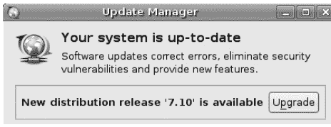

图 4-5 新发行版

你也可以从终端手动运行更新管理器。输入：

```bash
sudo apt-get update
sudo apt-get upgrade
```

到此时，你可能已经注意到 `update`（它可以与各种软件包的补丁、修复和新增功能相关）以及 `upgrade`。升级是指你从操作系统或其他软件的一个版本移动到最新发行版，或者当软件补丁可用时。Ubuntu 更新管理器的图形界面将为你处理这些。无论你是响应 Ubuntu 关于有更新的通知，还是手动启动了更新管理器，如果有操作系统的更新，你将看到一个与图 4-5 类似的弹出框。

> 使用 `apt-get` 时，`update` 会给你一份新的包列表，而 `upgrade`（或 `install`）则应用补丁。

请记住，这张照片是从一台运行 7.04 Feisty Hedgehog 并升级到 7.10 Gutsy Gibbon 的计算机拍摄的。当你升级 Ubuntu 发行版时，版本号可能会不同，以反映软件的最新版本。

## 维护

Ubuntu 本身是一个极其稳定的操作系统。如果安装正确，其他操作系统中常见的系统崩溃、性能缓慢和异常行为情况在 GNU/Linux 中不会发生。尽管如此，采取一些基本的维护步骤仍然很重要，以确保你的计算机继续顺利运行且无故障。请记住，与 Microsoft Windows 不同，这里没有注册表。因此，在维护方面要做的工作要少得多。

### fsck

`fsck` 是“file system check”（文件系统检查）或“文件系统一致性检查”的缩写。该命令将检查并交互式地修复不一致的文件系统。在正常情况下，文件系统是一致的，`fsck` 只报告文件、使用块和空闲块的数量。如果文件系统不一致，`fsck` 命令将显示它发现的不一致之处，并询问你是否修复。默认情况下，Ubuntu 操作系统每重启 20 次会自动运行 fsck；但如果你想手动运行此命令，你也有这个选择。手动运行 `fsck` 最简单的方法是使用终端并输入：

```bash
sudo fsck
```

当你从终端运行命令时，大多数命令都有可以附加到命令后的选项或标志，用于设置命令参数。在本章早些时候编辑的 `crontab` 文件中，该行：

```bash
00 00 * * /usr/bin/apt-get update && /usr/bin/apt-get upgrade -y
```

在这里 `-y` 是选项的一个示例。它告诉升级命令对任何问题回答“是”。`fsck` 有许多可以放在命令后的选项。这些选项是：

- `-N` 如果发现错误时不对文件系统执行任何更改，仅显示应如何修复。
- `-V` 提供详细输出。详细输出非常深入，并且运行此命令的时间会长得多。
- `-a` 自动修复文件系统而不提问。
- `-r` 交互式修复正在检查的文件系统。

以下命令将运行 `fsck` 并修复可能发现的任何损坏。请记住所有命令选项对大小写敏感。`-N` 不等于 `-n`。

```bash
sudo fsck -a
```

## 维护：更新与维护 Ubuntu

再次打开终端并输入

`sudo apt-get autoclean`

现在，你应该会在终端中看到文件名。这些是你没有将其丢进垃圾桶的残留文件。

### 残留配置包

当你从计算机上卸载一个软件包后，通常会留下一些依赖包。依赖包是软件应用程序为了正常运行而需要的额外软件包。当主程序已卸载时，留在计算机上的依赖包被称为残留配置包。要消除残留配置包，通过选择“系统 (System) | 管理 (Administration) | Synaptic 软件包管理器”来打开 Synaptic。窗口打开后，点击左下角的“状态 (Status)”按钮。在状态按钮上方的列表中，你将看到“全部”、“已安装（自动移除）”、“已安装（本地和过时）”、“未安装”。你的计算机上没有残留配置包。如果列表包含“未安装（残留配置）”，则点击“未安装（残留配置）”，右侧将出现软件包列表。对于每个软件包，点击复选框并选择“标记为完全删除”。完成每个软件包的操作后，点击“应用”，Synaptic 软件包管理器将为你删除这些文件。

### 孤立软件包

当 Synaptic 软件包管理器仍然开启时，点击“搜索”按钮并在搜索框中输入 `gtorphan`。当该程序出现在右侧的框中时，点击复选框并选择“标记为安装”。现在点击“应用”，让 Synaptic 软件包管理器为你安装 `gtorphan`。

应用程序安装完成后，关闭软件包管理器并选择“系统 (System) | 管理 (Administration) | 移除孤立软件包”。选择你想删除的软件包，然后点击“确定”。

### 文件夹和文件

你可以执行的最维护任务之一就是组织你的文件和文件夹。虽然这对改进或维护你操作系统的性能微乎其微，但它能让你更容易地在十分分钟内找到大大演示所需的报告。

创建文件夹非常简单。使用鼠标在桌面的任何地方点击右键。出现菜单中的第一个选项是“创建文件夹”。只需点击它，你就会在桌面上看到一个“未命名文件夹”，等待着你填入各种内容。与 Microsoft Windows 一样，你可以在文件夹内部创建更多文件夹以便进行更好的组织。只需点击右键！如果你发现自己在创建文件夹时变得有些无从从，可以通过右键点击文件夹并点击“移动到垃圾箱”来丢弃它们。如果这对你来说还不够简单，也可以左点击文件夹并按住鼠标按钮，将文件夹拖到垃圾桶。文件也可以同样的方式在文件夹之间移动。

有时，我们需要在已有的文件夹中创建文件夹。花一点时间点击桌面菜单栏上的“位置 (Places)”选项卡。图 4-6 显示了已供你使用的文件夹列表。其中大多数大多数都是自言易懂的。“文档 (Documents)”文件夹用于书面事务。“音乐 (Music)”可以存放你的歌曲库……嗯，你明白我的意思。

你可能不熟悉的是列表顶部的“主目录 (Home)”文件夹。这个文件夹是你的文档、音乐、图片和视频文件夹的主文件夹。它还包含一个名为“桌面 (Desktop)”的文件夹用于存放桌面项目、一个“模板 (Templates)”文件夹、一个共享的“公共 (Public)”文件夹以及一个包含一些 Ubuntu Ubuntu 操作示例的“示例 (Examples)”文件夹。

保持文件夹整需要勤奋。如果你从一开始就开始养成良好的习惯，将让你的计算体验压力小得多。根据需要使用大量的文件夹和子文件夹。一旦你熟悉了 GNU/Linux 系统的文件结构，你就会发现开发者可以将一个操作系统组织得如此良好，对你来说，将音乐与工作备忘分开将轻而易举。

| 位置 (Places) | 系统 (System) |
|---|---|
| 主目录 (Home Folder) | |


| 桌面 (Desktop) | |

| 文档 (Documents) | |

| 音乐 (Music) | |

| 图片 (Pictures) | |

| 视频 (Videos) | |

| 电脑 CD/DVD 刻录器 | |

| 软驱器 | |

| 连接服务器... | |

| 搜索文件... | |

| 最近文档 | |

图 4-6 Ubuntu 安装期间的文件夹

# 第 4 章 维护：更新与维护 Ubuntu

> 你知道吗？

## 如何保存文件

虽然有些文件夹已经为你命名好了，但图片不会自动保存到“图片 (Pictures)”文件夹。你需要指定在哪个文件夹中保存图片、文档、歌曲等。当你保存文件时，你可以在下面的插图中看到，它为你提供了保存到特定文件夹或浏览未列出的其他文件夹的机会。

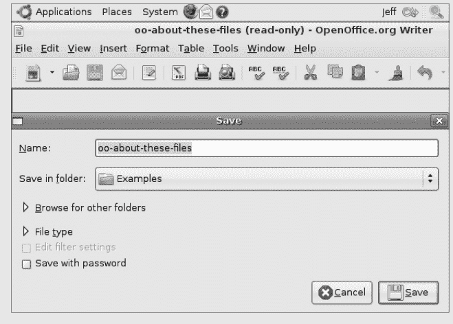

本页特意留

## 安装外设

如何操作……

- 了解什么是外设
- 理解设备驱动程序
- 寻找设备驱动程序
- 安装外设设备

由计算机、鼠标、键盘和显示器组成的系统时代早已远去。随着人们越来越习惯使用家用电脑，添加额外设备的需求日益增长。使用电脑打字写报告的孩子需要打印机。多媒体功能催生了摄像头、键盘、扬声器和麦克风。扫描仪的引入是为了将图像和文档数字化。然后，当然，游戏玩家需要游戏手柄和摇杆以便在与朋友在线对战时保持竞争力。虽然计算机执行工作并不总是需要外设设备，但它让拥有电脑变得有趣得多。

### 什么是外设设备？

在过去的几年里，典型的台式电脑已经扩展到包含各种设备，如打印机、相机、扫描仪、音乐播放器以及许多使计算机系统成为强大工具的其他组件。这些计算机系统之外的设备被称为外设设备，因为它们位于计算机的外围区域，而不是内部。

随着 USB 技术的出现，这些外设设备可以轻松插入或拔出计算机，而无需重启系统，允许用户切换设备。加上计算机现在标准配置至少有四个端口的事实，很容易看出大多数计算机系统配备了外部设备。

### 鼠标和键盘是外设吗？

大多数人认为打印机、扫描仪和摄像头是最常见的外设设备。在计算的早期，即个人电脑发展之前，基础系统由主板、中央处理器和内存组成。考虑到这一点，键盘和鼠标最初被视为外设。直到今天，仍有一些人认为这些设备是外设，因为它们中的许多设备都需要安装驱动程序。

### 外设与 GNU/Linux 早期

在本书的开头，我解释了在那个时代，GNU/Linux 被认为是计算机爱好者的操作系统。好吧，它被认为完全是为极客准备的。普通用户没有使用它的主要原因之一是缺乏对外设设备的支持。并不是这些设备不是为 GNU/Linux 操作系统制造的，而是拥有上某种 GNU/Linux 发行版的人需要为他们安装的硬件编写驱动程序，或者认识拥有可用驱动程序的人。很多时候，这些 GNU/Linux 先驱会破解现有的驱动程序来节省时间。

> 记住，“黑客/破解 (`hack`)”并不是一个负义词！破解意味着为了让它为你工作工作。大多数 GNU/Linux 的早期采用者是出于需要才破解程序的。

### 什么是设备驱动程序？

设备驱动程序是告诉计算机硬件部分和高级程序如何通过本质上传输这些通信计算机总线相互通信的程序。设备驱动程序取决于操作系统，Windows 的打印机驱动程序无法在 Ubuntu 上运行。关于 Ubuntu 驱动程序的后续章节将让你更好地了解这一过程是如何运作的。

# 第5章 安装外围设备 67

过了一段时间，GNU/Linux 社区壮大了。他们对社区内共享的热爱有助于驱动程序在用户之间的传播。因此，人们不需要知道如何编写设备驱动程序；他们只需要知道哪里寻找它们。对于与计算机相关的其他方面，万维网让普通电脑爱好者更容易为他们的 GNU/Linux 发行版找到驱动。最终，Red Hat、SUSE 和 Ubuntu 等 GNU/Linux 发行版的流行程度开始增长。这些和其他发行版进入了世界各地的企业、办公室和家庭。为了不错过这个不断增长的市场，许多硬件制造商开始在其产品中附带可在这些操作系统上运行的驱动程序。如今，如果用户想为运行 Ubuntu 的电脑买一个摄像头，他们只需要研究哪些型号已经写好了驱动程序。那么，让我们启动电脑，看看寻找 Ubuntu 友好的外围设备有多简单吧！

## 我如何得到那些神奇的玩具？

随着互联网变得如此容易获取，许多人已将其作为购物的一种方式，特别是电脑。数以千计的网站为网上购物者提供不同产品的客户评论、产品比较以及在哪里可以找到最低价格。这些同样的技术也可以用于寻找专门为 GNU/Linux 操作系统提供设备驱动的外围设备。

一旦你确定了正在寻找的制造商和型号，你可以采取两条路线来确保你的设备与你的电脑兼容。你可以采取的第一步是访问制造商的网站并进入下载驱动程序部分，或任何允许你下载设备驱动程序的章节。现在只需查看 Linux 是否被列为提供设备驱动程序的操作系统之一即可。

> 大多数制造商的网站列出了从 Windows 2000 到 Windows Vista、Mac OS 家族、Linux 和 FreeBSD。操作系统没有被称为 GNU/Linux 并不是错误。这仅仅是因为它已成为该操作系统接受的术语。这一趋势让那些在操作系统早期开发中工作如此努力的人感到非常沮丧。

## 寻找 Ubuntu 驱动

当你查看图 5-1 中列出的 GNU/Linux 发行版时，请注意可用驱动程序并没有通用的 GNU/Linux 链接。相反，有 Red Hat、SUSE、Linspire 等其他链接。Ubuntu 在哪里都没有列出。尽管许多制造商已经意识到 Ubuntu 的流行及其产生的影响，但并非所有制造商都列出了该特定发行版的驱动程序。相反，他们列出了它所属的 GNU/Linux 家族的驱动程序。记得在第 1 章我们学习 GNU/Linux 的历史时，我们看到 Ubuntu 是基于 Debian GNU/Linux 操作系统的。由于操作系统的核心源自 Debian，你可以使用 Debian GNU/Linux 驱动程序。这使得制造商为基于 Debian 的发行版提供链接，比为每个衍生发行版提供许多单独链接更容易。

我之前提到，在 GNU 早期，如果用户的精通程序员想为电脑添加外围设备，他们必须依靠他人来提供设备驱动程序。作为一个基于社区的 GNU/Linux 发行版，Ubuntu 有一个支持设备列表。要访问该列表，请打开浏览器并访问 `https://wiki.ubuntu.com/HardwareSupport`。

你可以在图 5-2 中看到支持页面如何列出不同的硬件设备。假设你正在为新的 Ubuntu 电脑寻找摄像头。当你选择此类别链接时，将进入下一个页面，其中列出了不同的摄像头制造商和关于设备的某些信息。图 5-3 显示了 Ubuntu Wiki 上的摄像头页面。

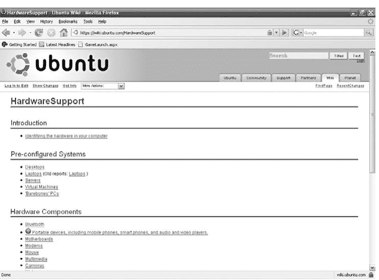

图 5-2 Ubuntu HardwareSupport 页面

图 5-3 为我们展示了 wiki 中 HardwareSupport 部分大部分页面的概貌。它不仅列出了外围设备制造商及其对应的链接，还对设备类型和其他资源附了注释，这些资源可以帮助为你可能已经拥有的产品找到正确的驱动程序。由于我们首先寻找的是与 Ubuntu 兼容的外围设备，让我们来看看其中一个制造商。Creative 是最广为人知的音视外围设备制造商之一。他们的产品可以在几乎任何销售电脑设备的商店中找到。点击“Creative”链接将带我们进入图 5-4 所示的页面。

此页面按型号以及是否支持、是否工作详细列出了了 Creative 的许多产品。列表显示了它们在哪个版本的 Ubuntu 上进行了测试，并包含了用户评论。请注意，自由软件基金推荐了几款不需要专有固件即可运行的摄像头。Lexmark 荣地宣布其消费级和商业打印机兼容 Windows® Vista。欲需更多信息，请选择您的打印机类型。

| 商务打印机 | 消费级喷墨打印机 | Windows |

| :--- | :--- | :--- |

| Windows XP | Windows XP 专业版 | Windows Vista (x64) |

| Windows 2000 | Windows Vista | Windows 98 |

| Windows 95 | Windows Server 2003 | Windows ME |

| Windows NT | | |

| Macintosh | | | | |

| :--- | :--- | :--- | | |

| Mac OS X | Mac OS 9 | | | |

| Unix/Linux | | |

| :--- | :--- | :--- |

| AIX | HP - UX | Red Hat Linux |

| Solaris | SuSE | Linux Linux |

| Red Flag Linux | Inspire | Debian GNU/Linux |

| 其他操作系统 | | |

| :--- | :--- | :--- |

| Novell Net | | |

请注意，此产品的驱动程序和其他下载仅适用于此页面列出的操作系统。


图 5-1 Ubuntu 网站的支持部分显示了适用于特定打印机的驱动程序集。

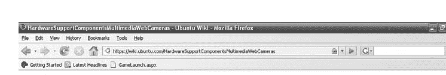

## 摄像头

| 品牌 | 链接 |
| :--- | :--- |
| AllTech | HardwareSupportMultimediaams |
| Creative | HardwareSupportMultimediaams |
| Genius | HardwareSupportMultimediaams |
| Helios | HardwareSupportMultimediaams |
| Jansport | HardwareSupportMultimediaams |
| Logitech | HardwareSupportMultimediaams |
| MediaFate | HardwareSupportMultimediaams |
| Micro Innovations | HardwareSupportMultimediaams |
| Philips | HardwareSupportMultimediaams |
| Samsung | HardwareSupportMultimediaams |
| Twin | HardwareSupportMultimediaams |
| Typhoon | HardwareSupportMultimediaams |

图 5-3 摄像头

| 品牌 | 型号 | 驱动 | 支持？ | Ubuntu 版本 | 最后更新 |
| :--- | :--- | :--- | :--- | :--- | :--- |
| Creative | Live Effects | No | No | v6.06 (Dapper) | 2006-06-15 |
| Creative | Webcam | No | No | v6.10 (Fancy) | 2006-06-26 |
| Creative | Webcam PQ001 |  | Yes |  | 2007-02-17 |
| Creative | Livestream! | yes | Yes | v5.04 (Hardy) | 2005-04-04 |
| Creative | Webcam no- | Yes | No | v6.06 (Dapper) | 2006-04-10 |
| Creative | Webcam Play (Model PQ050) | ps18 | No | v6.06 (Dapper) | 2006-04-10 |
| LiveCam Webcam | gspca | Yes | v7.04 (Feist) | 2007-03-16 |  |

图 5-4 Creative 摄像头列表

# 第 5 章 安装外围设备


## 什么是 Wiki？

大多数熟悉广维网的人都熟悉“wiki”这个术语。Wiki 被定义为一组网页或在线资源集合，用户社区可以随时通过添加、删除或更改内容来对其进行编辑。“wiki”一词源于夏威夷语，意为“快速”，正如“它可以被快速编辑”所意。对于 Ubuntu Wiki，注册的社区成员可以在需要时随时添加和更改页面。如果你访问 `https://ubuntu.com/HardwareSupport`，其内容可能与你在随附指南中看到的不同。原因在于社区成员每天都会向这个 wiki 添加内容。

Wiki 是非常实用的工具。像 Canonical 这样的公司使用 wiki 来支持它们的产品，但有些 wiki 包含随机信息，例如流行的 Wikipedia，它是一个基于 Web 的百科全书，任何注册成员都可以向其添加信息……

如果任何人都可以添加或编辑页面，你可能在担心 wiki 的准确性。这可能会成为一个问题，因为并非所有人每时候都能提供准确的事实。得益于社区的支持，wiki 条目中的错误通常会立即被修正，以保持文档的完整性。毕竟，如果一个 wiki 充满了不准确之处，将不会有人继续使用它。

页面底部有一个链接，列出了不需要专有固件的 wiki。除了设备驱动程序外，外围设备还有帮助控制其运行的程序。固件程序不运行在你的计算机上，而是存储在设备本身的电路中，通常在 ROM 芯片中。这些设备与 GNU/Linux 发行版配合良好，并获得了维护此列表的自由软件基金的支持。Ubuntu 发行版认为是一个自由软件系统，本页列出的 wiki `www.fsf.org/resources/hw/cameras` 应该没有任何问题地工作。自由软件基金还维护了许多其他与自由软件工作的设备列表。可以通过访问 `www.fsf.org/resources/hw/` 查看此列表。


像自由软件基金这样的组织依靠使用其网站和信息的人们工作。作为 GNU/Linux 社区的一员，你可能想要为其中一个或多个组织捐赠资金或担任志愿者。他们乐意接受任何类型的捐赠，不必担心礼物太小。

## 安装外围设备

一旦你有了外围设备，你就需要安装它使其与你的计算机协同工作。像微软 Windows 一样，Ubuntu 也具有即插即用功能。即插即用意味着如果操作系统、BIOS 和设备都支持即插即用，并且驱动程序在操作系统的数据库中，那么只需只需将设备插入计算机的 USB 端口就会启动安装过程。该过程将在极少或几乎没有用户输入的情况下安装设备。如果操作系统的数据库中不存在驱动程序，则用户将必须找到驱动程序以继续安装。

Ubuntu 不仅支持即插即用，而且大多数 GNU/Linux 爱好者还认为它在这方面拥有最好的支持。某些设备插入计算机几秒钟后，系统就会要求你配置设备，因为它已经安装好了。这多方便啊！

图 5-5 显示了当你将新的外围设备插入计算机时确切出现的内容。没有任何东西询问你是否想要安装该设备；Ubuntu 认为，如果你将其插入计算机，你就想安装它。它还不会通过一系列弹出窗口向你展示过程的每一步。记住，Ubuntu 的格言之一是“它能用工作（It Works）”。

然而，一旦安装了设备（无论是打印机、相机还是扫描仪），它将为你提供配置设备的机会。图 5-6 显示了在 Ubuntu 中配置打印机时可用的选项。

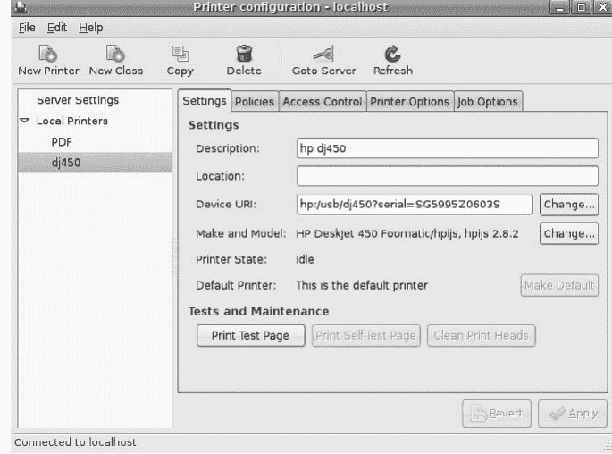

图 5-6 配置打印机

配置非常简单，类似于来自微软 Windows 环境的人习惯的操作。

与过去不同，GNU/Linux 及其支持它的社区在建立一个巨大的、能够与该操作系统无缝且完美运行的外围设备集合方面取得了巨大进展。现在 Dell 已开始提供预装有 Ubuntu 的全新计算机，你可以打赌更多的外围设备制造商将确保他们的产品与 Ubuntu 以及其他 GNU/Linux 发行版兼容。随着更多业务用户开始接受 GNU/Linux，更多业务级外围设备很快将准备好开箱即用与该操作系统工作。

当然，本章列出的资源仅仅接触了 GNU/Linux（尤其是 Ubuntu）在外围设备和使其正常工作方面从其社区获得的支持的一小部分。一个很好的作业是在互联网上搜索更多提供此类信息的网站。

如果你发现任何现有的设备无法工作，不要害怕在 Ubuntu 论坛发帖。让社区知道你是一个新手并需要帮助。通常情况下，答案会比你想象的要快。

# 第二 管理 Ubuntu


图 5-5 HP Deskjet 打印机的即插即用

## 基础之外：安装额外软件

如何……

- 使用 `Add/Remove` 工具安装软件
- 使用 `Synaptic` 包管理器安装软件
- 从 Ubuntu 仓库安装额外软件
- 从光盘安装软件
- 从外部来源下载软件
- 解包并安装下载的软件
- 使用终端安装软件

我们购买使用计算机是为了让它们为我们做事情。无论我们想通过电子邮件让生活更轻松，还是用它们玩游戏和听音乐，我们希望它们能做些什么。虽然我们已经学习了关于 Ubuntu 的一些有趣重要的知识，但我确定你们还没有安装这个操作系统。软件应用程序是程序员编写的为我们执行实际工作的程序。文字处理器、电子表格、数据库、多媒体播放器视频游戏都是常见的软件类型。为了让我们的计算机完整，我们需要添加一些应用程序。

### 预装软件

当你启动计算机时，你的 Ubuntu 桌面顶部三个标签。第一个是 Applications。我们在本章大部分时间都会在这里。点击 Applications 标签，我们会看到一个下拉菜单，其中包含了已安装在计算机上的应用程序类别。列表最后一项 `Add/Remove` 是唯一不包含已安装软件的项目。相反，此工具用于启动一个程序，允许你安装和卸载下一节介绍的四个应用程序仓库中的软件。


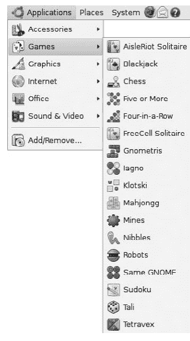

图 6-1 Ubuntu 的应用程序分类

一些预装软件包括：

- Tomboy Notes：桌面笔记工具
- 象棋与数独：热门游戏
- GNU 图像处理程序 (“GIMP”）：照片/图像编辑程序
- Firefox：GNU/Linux 社区的首选浏览器
- Evolution Mail：电子邮件和日程程序
- OpenOffice.org：一个办公套件，包含文字处理器、电子表格、演示文稿和绘图程序
- Brasero 刻录：刻录光盘的程序
- 电影播放器：在计算机上观看电影的程序

# 第 6 章 基础之外：安装额外软件

当然，系统还为你预装了许多其他应用程序。这些只是其中最流行的一些。如果你正跟着电脑一起进行操作，或者你有机会，可以点击分类标签之一，查看还为你预装了哪些其他应用程序。

## 使用“添加/删除”工具安装

回顾图 6-1，你会看到菜单中的最后一项是“添加/删除”`Add/Remove`。它提供了一个图形界面，用于从任何一个 Ubuntu 软件仓库添加/删除软件应用程序，或从你的计算机系统中删除软件。这些仓库根据 Ubuntu 支持该软件的能力以及该软件与 Ubuntu 自由软件哲学目标的匹配程度，被划分为不同的类别，称为“组件”。

### 主组件 Main Component

主组件包含免费软件、可以自由分发并由 Ubuntu 团队支持的应用。这些应用程序由 Ubuntu 开发者精心挑选，认为对开发团队维护这些软件包的安全更新和技术支持至关重要。

### 受限组件 Restricted Component

受限组件包含 Ubuntu 团队支持的非完全自由许可证的常用软件应用程序。例如，如果在 Ubuntu 上运行该软件时出现问题，Ubuntu 开发者可能没有权限自行修复该问题。相反，他们必须将问题转发给软件开发者并与他们合作解决问题。受限组件中的某些软件包含在 Ubuntu CD 中。

### 宇宙组件 Universe Component

位于宇宙组件中的软件应用程序来自开源/自由社区。该组件中发现了大量的软件；然而，你无法保证这些应用程序是否会有安全补丁或支持。

### 多重宇宙组件 Multiverse Component

该组件由非免费软件组成。这些软件不符合主组件或受限组件的许可条件。未能满足以下任何条件将导致应用程序被列在此处：必须允许分发、必须不要求任何费用或特许费、必须允许转移所有权利、不得歧视、不得依赖于 Ubuntu、且必须不能污染其他许可证。

## 管理你使用的组件

Hardy Heron `08.04` 之前的 Ubuntu 版本默认只允许用户用户从主组件和受限组件安装应用程序。要从宇宙组件和多重宇宙组件安装，用户需要更改配置。在最新的 LTS 版本中，所有四个组件默认都是开启的。现在，用户可以选择关闭这些组件。这可以通过导航到“系统 | 管理 | 软件源”来实现，Ubuntu 会要求你输入密码，然后将向你展示从互联网下载的软件。你可以勾选任何你不想从其下载的组件的标记。你可以通过选择“第三方软件”标签页来添加第三方软件仓库。当然，你需要知道第三方网站的 URL。

如果开始安装软件应用程序，你需要打开“添加/删除”工具。这是对于 Ubuntu 新手来说安装应用程序最简单的方法。通过点击桌面顶栏上的“应用程序”标签页，你将看到图 6-1 所示的内容。现在，点击“添加/删除”项，这将带你进入类似图 6-2 所示的屏幕，显示“添加/删除应用程序”。此窗口分为四个部分。第一部分是窗口顶部，你可以在那里搜索应用程序，并根据它们所属的组件选择要显示的应用程序类型。第二部分是窗口的左侧窗格，提供了广泛的类别，你可以从中选择以缩小软件搜索范围。第三部分是窗口正中间的窗格。你可以在这里看到指定类别下的应用程序列表。最后，第四个窗格位于窗口底部。此部分提供了所选软件包的详细描述。

所以，让我们在这里玩得开心点，安装一个新游戏吧。你首先想做的第一件事是从列表中选择“游戏”类别。可用应用程序现在会出现在相应的窗格中。你可以滚动列表。注意每个游戏旁边都有星号。这些星星代表每个应用程序的流行程度。如果你正跟着步骤操作，点击其中一个游戏，你将看到应用程序列表正下窗格中出现游戏的描述。浏览完游戏列表后，让我们继续选择“土豆人”`Potato Guy`。描述看起来很有趣，所以我们可以点击应用程序旁边的复选框。在窗口右下角，你会看到“应用更改”按钮。点击它开始安装。它会要求你输入管理员密码，然后安装应用程序。好了，你完成了！你可以从“应用程序”菜单访问新安装的应用程序。不仅通过“添加/删除”工具安装很简单，你猜怎么着？如果应用程序受到 Ubuntu 支持，当有更新时，它会通过“更新管理器”通知你。

如果你一次安装多个应用程序，可以在点击“应用更改”之前勾选所有框以一次性安装所有内容。


第 6 章 基础之外：安装额外软件 79

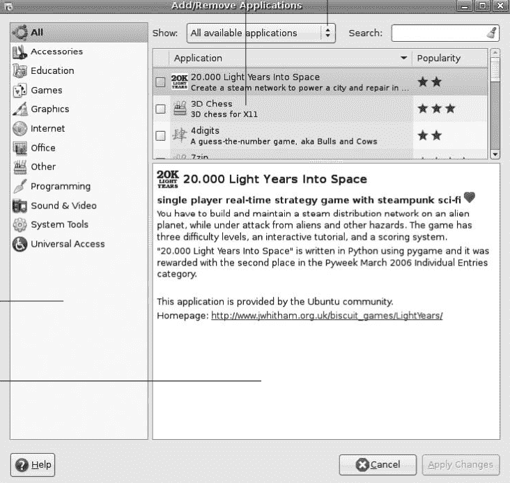

图 6-2 添加/删除应用程序

### KDE 和 Gnome

某些应用程序（如“土豆人”）被标记为“KDE”。如果你使用的是 Gnome，你可能会注意到窗口看起来像。这些应用程序是为 KDE 或 Gnome 编写的，但这并没有将它们限制在环境。


图 6-3 Synaptic 管理器

### 使用磁盘

有时你可能会发现无法连接互联网。没有连接，你将无法下载文件。要启用此功能，导航到“系统 | 管理 | 软件源”。现在勾选 CD/DVD 部分的复选框。

### 从外部世界安装软件

Ubuntu 的仓库中有数千个可用应用程序。对于某些需求来说，这可能还不够。假设你处于这种困境，你需要下载某个应用程序。例如，你将其解压到了桌面。

一旦文件下载完成，会弹出一个提供打开选项的对话框。如果你是从 Windows 迁移过来的，可能会注意到 ZIP 文件提取工具。选择你想要提取的文件夹，然后点击“提取”。例如，我们将提取解压到..


图 6-4 从 Ubuntu 下载

在“tar.gz”中的 `.tar` 在 GNU/Linux 中代表“tarball”`tarball`。`.gz` 代表“GNU zip”或“gzip”。TAR 文件实际上是将许多文件归档成一个文件。这个文件被称为 tarball，然后使用 gzip 等工具进行压缩。这种压缩文件可以通过电子邮件或其他数据传输方法方便快速地发送。由于它是压缩过的，占用的存储空间也较小。新压缩的文件命名为 `file.tar.gz`。

要打开 `1.0.5.tar.gz` 文件，你需要使用 gzip 等工具进行解压缩，如图 6-5 所示。

现在你需要进入终端并安装此应用程序。首先，通过“应用程序 | 附件”导航到终端。在终端中，你需要导航到解压文件的目录。例如，你解压到了桌面，所以让我们多了解一下终端。当终端打开时，你会看到类似这样的

```
jeff@jeff-desktop:$
```

在你的计算机上，第一个“jeff”将是你的用户名，第二个“jeff”将是你的计算机名称。当它显示在屏幕上时，在提示符处如下输入 `ls`，然后按回车：

```
jeff@jeff-desktop:$ ls
```

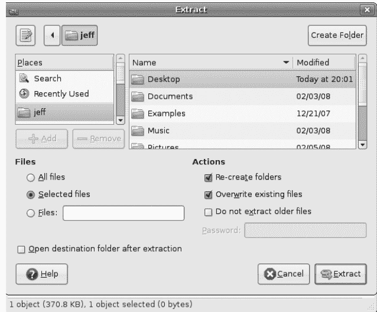

图 6-5 GNU zip `gzip` 提取工具

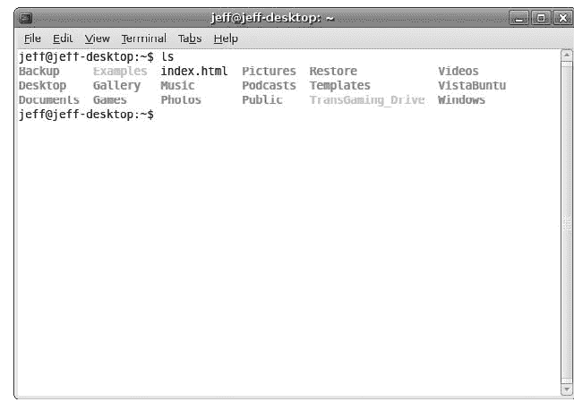

输出向你展示了该目录下的子目录。你会在这里看到列出的 Desktop。要继续操作，你需要进入这个子目录。现在，你可以在提示符处输入 `cd Desktop`，如下：

```bash
jeff@jeff-desktop:-$ cd cd Desktop
```

> 在 GNU/Linux 的术语中，“desktop" 和 "Desktop" 不一样的。所有内容对大小写均敏感。

通过在提示符处输入 `ls`，我们看到了以下屏幕：

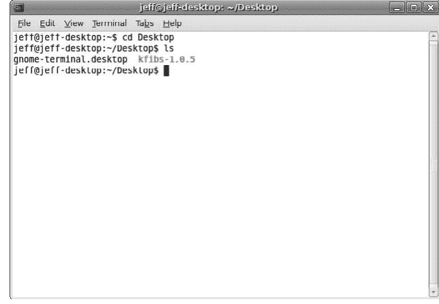

现在我们看到子桌面:~ `cd kfibis-1.0.5`

我们来到了一个显示 `kfibis-1.0.5` 子目录内容的屏幕。在这些内容中，我们将看到一个名为 `config` 的文件。这正是我们要找的。有了它，我们可以开始安装。


```
jeff@desktop:~/Desktop/kfibis-1.0.5
File Edit View Terminal Table Help
jeff@desktop:~$ cd Desktop
gnome-terminal.desktop kfibis-1.0.5
jeff@desktop:~/Desktop cd kfibis-1.0.5
jeff@desktop:~/Desktop/kfibis-1.0.5  ls
aconfig.h ChangeLog configure.in kfibis Makefile.am po
aclocal.m4 autoconf COPYING kfibis.xpm stamp-h.in
aclocal.m4 config.bot INSTALL
AUTHORS config.in ltcmfig mkinstaldirs TODO
BUGS config.sam install-sh itmain.sh NEWS VERSION
Jeff@desktop:~/Desktop/kfibis-1.0.5$ n
```


为了完成安装过程，我们需要遵循 `INSTALL` 文件中列出的安装步骤。该文件可以在电脑桌面的 `kfibis-1.0.5` 文件夹中找到。只需打开文件夹并双击 `INSTALL` 文件。一个文本文件将会打开，并引导你逐步通过终端安装应用程序的步骤。大多数 `INSTALL` 文件都会引导你完成安装配置、创建目录，然后安装应用程序。这就是为什么之前提到的配置文件如此重要的原因。在安装任何内容之前，所有内容都必须经过配置。

如果安装没有成功，可能是因为你缺少安装文件所需的包。这些包被称为“依赖项”。这些包可以通过 `Synaptic` 下载并安装。可能需要一段时间时间才能熟悉如何通过终端安装软件，但一旦你能够在没有任何错误的情况下完成操作，那将是一次非常有成就感的体验。

# 第 7 章 升级时机：安装新硬件

如何操作...

- 选择合适的硬件
- 打开你的电脑机箱
- 安装新硬件
- 检查现有硬件

我们大多数人买的电脑都是开箱即用的。我们只需要将所有东西插到颜色标记的插槽中并打开电源即可。在一段时间内，这种配置电脑的方法仅限于运行 Microsoft Windows 和 Apple Mac OS 的电脑。而追求 GNU/Linux 或 Unix 的冒险者需要实际安装自己的操作系统。现在，戴尔（Dell）和华硕（Acer）已与 Ubuntu 合作，提供预装 Ubuntu 的桌面级和笔记本电脑，GNU/Linux 用户也可以加入“开箱即用”的行列。如果你购买的是一台预配置好的机器，可能会发生两种情况之一。第一是硬件损坏。在使用多年后，电脑产生的热量会导致各种与硬件相关的问题。可能，如果你使用电脑足够长，你就见过硬件故障。第二种持续的情况是，随着电脑用户获得越来越多的技能，你会感到需要升级某些旧硬件。例如，你需要做好准备。本章将引导你了解安装硬件设备的基础知识；但对某些人来说，这可能是一项挑战性任务。

## 选择合适的硬件

在第 5 章中，我们介绍了如何选择添加到电脑中的外围设备。

## 第二部分 管理 Ubuntu

### 你是否需要冷却

电产生的热量是中央单元的最大敌人。为了防止你的部件过热，请确保气流没有被阻塞。当你升级或更换电脑内部部件时，不要使用吸尘器，因为它们可能会损坏你的电脑。

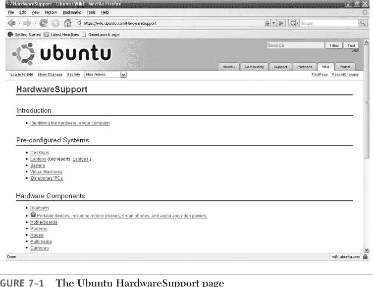

这不是一个好主意。静电像热量一样，会破坏你的电脑。虽然热量需要时间来慢慢侵蚀电脑的功能，但静电是一个快速而无声的杀手。只需一次放电就足以损坏一个处理器。

除了保持区域整洁外，你可能还需要一把小型十字螺丝刀。此外，现在是清理电脑内部的绝佳时，所以准备一罐压缩空气来清除积灰灰尘是明智的。

要打开电脑，请严格按照以下步骤操作：

1. 关闭电脑。在关闭操作系统后，检查电脑背部的电源是否有开关。如果有，请也将其关闭。
2. 拔掉电脑的电源线、所有外部线缆和所有连接的设备。
3. 拆下侧面板的固定螺丝。应该有四个螺丝将每个侧面板固定在机箱上，每个面板两个。确保你不要拆掉连接到电源的螺丝；你需要将其固定在那里。
4. 将侧面板滑出电脑。

> 某些电脑（尤其是戴尔电脑）在打开机箱时不需要拆卸任何螺丝。这些电脑有一个按钮，按住即可打开机箱。如果你不确定如何打开电脑，请查阅用户手册或在网上搜索。

## 我应该把这东西插在哪里？

现在你的电脑已经拆成了零件并放在你面前，我曾想过结束这一章，看看你利用 Ubuntu 社区支持已经学了多少东西。然而，我收到警告说，过多的言论会淹没我的邮箱账户，所以让我们学习如何把这些东西重新装起来。

打开电脑机箱后，你想要确保 (a) 将硬件设备安装在电脑的正确位置，(b) 使用正确的线缆将你的新硬件连接到主板。

## CD、DVD 和硬盘驱动器

如果你正在添加额外的硬盘或正在安装 CD 或 DVD 驱动器，你需要通过电脑前面的其中一个驱动器槽将其安装在电脑前部。如果你正在更换 CD、DVD 或硬盘，则不需要打开驱动器槽。如果你正在添加次要设备，将需要为新硬件打开一个插。大多数电脑机箱都有一个塑料盖，你可以将其取出以为 CD/DVD 驱动器留出空间。只需取下盖子，并将驱动器滑到位即可。

> 你知道吗？
> 你需要设置跳线帽

硬盘和 CD/DVD 驱动器是可启动设备，因此它们带有被称为跳线帽的东西。务必咨询随新硬件附带的文档，以获取设备设备的正确跳线帽设置。设置不当可能会导致硬件无法正常工作。

一旦到位，请确保使用随驱动器附的螺丝将其固定在机箱上。硬盘也可以滑到位并固定在机箱上。务必拧好两边的螺丝。只固定一侧会导致震动产生噪声。一旦设备安装在驱动器槽中，你需要将其连接到电源线、接口线，对于 CD/DVD 驱动器，如果你想从此设备播放音乐或电影，你还需要连接音频线。如果它作为次要设备或录制设备使用，则不需要将音频线连接到声卡。

## 使用扩展卡槽

大多数硬件设备（如显卡、网卡和声卡）使用电脑后部的扩展卡槽作为位置，而不是驱动器槽。如果你向主板背面看去，你会看到几个不同的端口或插槽，你可以在那里安装这些设备。由于这些插槽集成在主板上，通常不需要向它们连接线缆。

与驱动器槽一样，插槽也有东西保护它们免受外界影响——挡板。这些挡板通常由金属制成，需要移除时可以从机箱上拧下。图 7-2 显示了挡板的位置。有些人认为拆除所有挡板有助于保持电脑冷却，因为热量多了一个逃逸的地方。事实并非如此。设计机箱的工程师这样做是为了最大化气流。移除挡板而不使用卡进行，将破坏电脑内部的气流。

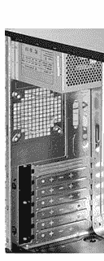

图 7-2 挡板

## PCI（外围组件接口）

这是电脑中最常见的插槽，也是最广泛使用的。它通常是白色的，如下所示：

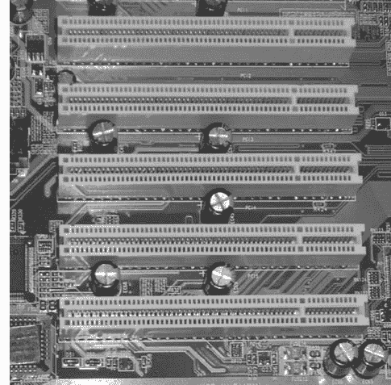

## AGP（加速图形端口）

此端口专门用于放置高端显卡。它比 PCI 端口更快，并且数据传输路径更大。此端口通常是浅棕色的。

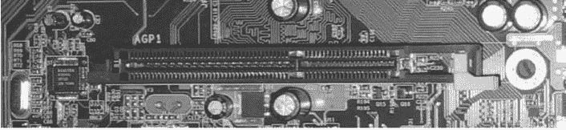

## PCI Express

这是一种较新的卡，通常用于显卡，但也可以帮助其他设备运行得快得多——速度超过 100%。

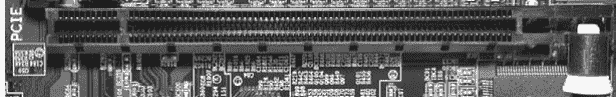

## 如何知道你拥有的硬件

| 命令 | 描述 |
| :--- | :--- |
| `lshw-short` | 提供硬件的简要摘要 |
| `lspci` | 提供通过 PCI 连接设备的列表 |
| `lsusb` | 提供通过 USB 连接设备的列表 |
| `cat /proc/cpuinfo` | 提供关于电脑处理器的信息 |
| `lshw-class network` | 提供关于网络的信息 |

要查看运行的硬件，你可能想在终端中使用：

```
sudo lshw
```

现在会要求你输入密码。一旦输入密码，你将获得电脑上所有硬件的长列表。使用 `lshw` 命令可以获取设备的适当信息。或者，你可以输入：

```
sudo lshw -class network
```


## 安全最佳实践

## 安全——保护 Ubuntu

如何……

- 实践安全、聪明的计算
- 安装和配置 Fire配置
- 安装和配置杀病毒软件
- 安装和配置备份恢复软件

电脑安全在新闻、消费者电脑杂志、IT 行业杂志以及整个网上都在被讨论。它是一个热门话题，以至于人们认为它被放大了，以便安全供应商向恐惧的人出售更多软件。毕竟，谁不想花 19.95 美元来确保黑客无法偷取他们的身份和信用卡呢？确实，那里有一些不道德的人正利用电脑安全浪潮，通过恐人的讨厌弹出窗口声称“您的系统已被感染——点击此处购买我的软件清理和保护电脑”。

当我们连接到互联网时，电脑就会风险。风险包括病毒、蠕虫、特木马、间谍软件、根内核、恶意黑客、钓鱼攻击和社会工程。IT 专业人士在讨论安全时常用的一种说法是，“安全电脑的唯一方法将其密封在箱子里”，基本上，不要使用电脑你就是安全的。我们知道这并不切实际，因为我们每天都使用电脑。所以，不要害怕，要变聪明。理解什么是聪明的计算实践以及你应该采取哪些安全措施，可能是快乐的电脑用户与丢失所有文件的人之间的区别。

在我们学习如何保护运行 Ubuntu 的电脑之前，需要理解重要的术语，并了解一些基本原则。

# 第二部分 管理 Ubuntu

引起了你的注意。在读完这一节后，你可能会想：“你为什么要告诉我这些东西？这些都是常识啊！”正如我们所知，常识并不总是常识的。如果是那样，我就没必要在书中包含这一章了。

### 需要了解的术语

以下术语将贯穿全章。了解它们很重要，因为它们在 Ubuntu 以及其他安全相关的论坛中被频繁使用。

- **僵尸网络 (Botnet)**：由另一台计算机或用户控制的计算机（僵尸）的集合。通常，这是通过使用病毒或其他恶意软件实现的。
- **破解者 (Cracker)**：未经许可进入计算机系统的人。
- **漏洞利用程序 (Exploit)**：被破解者和恶意黑客利用以获取计算机系统或网络访问权限的软件漏洞。
- **防火墙 (Firewall)**：一种目的是防止未经授权访问计算机系统或网络的软件或硬件包。
- **黑客 (Hacker)**：利用技能和才华解决复杂问题的人。
- **恶意软件 (Malware)**：“malware”一词是“malicious software”（恶意软件）的缩写。基本上，它是任何可以损害你计算机系统的软件。示例包括病毒、木洛马和蠕虫。
- **钓鱼术 (Pharming)**：一种更改网站 DNS 目的记录的技术，使用户重定向到欺诈网站而不是他们想要访问的网站。这通常用于从毫无防备的用户那里收集银行和其他个人数据。
- **网络钓鱼 (Phishing)**：一种向用户发送电子邮件或即时消息的技术，假称自己是银行或服务机构等合法实体。消息通常要求用户发送账户信息和密码以解决其账户问题。这些消息可能包含指向欺诈网站的链接，用户在其中输入这些信息以便收集。
- **根根包 (Rootkit)**：允许攻击者获得 GNU/Linux 机器 root 权限的恶意软件。在 Microsoft Windows 中，攻击者将获得管理员权限。
- **社会工程学 (Social engineering)**：高科技版本的骗局。一种欺骗用户提供信息的方法，可能导致获得“授权”访问计算机系统或网络。
- **木洛马 (Trojan)**：特洛伊木马的缩写，一种以其他程序伪装安装的计算机程序。这种恶意软件随后通过其创建的后门允许攻击者进入。
- **病毒 (Virus)**：一种可以在操作者不知情的情况下复制自己以感染计算机的软件。病毒可以破坏或更改其感染的计算机上的数据。
- **漏洞 (Vulnerability)**：计算机系统、程序或网络防御中的弱点，破解者可以利用这些弱点获取访问。
- **蠕虫 (Worm)**：一种可以自我复制并在网络中传播的恶意软件。
- **僵尸机 (Zombie)**：被病毒感染并允许他人控制的计算机。

## 第 8 章 保持安全——加固 Ubuntu

如果你花时间在互联网上研究过 GNU/Linux 和 Ubuntu，你可能看到过一些文章和论坛帖子，显示这个操作系统比 Microsoft Windows 安全得多。如果你没见过，请用“GNU/Linux + security”术语进行 Google 搜索，你就会明白我在说什么了。

当用户安装 Microsoft Windows 时，会被要求创建一个初始账户。该账户总是被赋予管理员权限，对于用户账户来说没有什么是限制的。因此，如果在此账户下运行恶意软件，它将在计算机上肆意驰骋。Ubuntu 采取了不同的方法。在安装过程中创建的初始用户不能随心所欲。记住，当你从终端安装应用程序并需要输入“sudo”时，这是因为用户不是管理员，或者我们在 GNU/Linux 中所称的 root。这与 Synaptic 软件包管理器（Synaptic Package Manager）中的添加/删除工具相同，当你尝试安装某些东西时它会要求密码。这个概念显然起作用了，因为微软现在在 Windows 操作系统也使用了类似的程序。

GNU/Linux 比 Microsoft Windows 更安全的另一个原因是，与 GNU/Linux 相比，感染 Windows 的恶意软件数量是不比例的。更重要的是，这两个操作系统的用户类型不同。伴随着巨大的市场份额，也存在许多不实践或不在意良好计算机安全的用户。使用 GNU/Linux 的人是不同的——大多数人已经从普通计算机用户更进了一步，深入探索更广泛的计算世界。这种好奇心通常伴随着安全意识。当然，这只是一个理论，有数百万 Windows 用户并非如此。但这一理论强调了用户在保持计算机安全方面所起作用的重要性。

安装 Firestarter 非常简单：

以下是防火墙必须遵守的规则：
- 阻塞新的入站连接。
- 允许防火墙建立新连接。
- 允许来自互联网的流量。

当你点击欢迎屏幕上的“下一步”（Forward）时，将要求你提供密码。一旦提供，你将看到图 8-1。（等等，OCR 文字在中间似乎断断了，让我们根据提供的流程重新对齐）。

[img/52abf93aab42475c48efdfda9a6ba9ad_117_0.png]

（根据文本流继续）

## 第 8 章 保持安全——加固 Ubuntu

当你勾选 Firestarter 附近的复选框后，必须同意社区应用程序。然后你可以点击“更改”（Changes）。你可能还会看到一个小窗口，显示 Firestarter 应用程序无法验证，且下载未经验证的软件具有潜在危险性。每当你下载未经验证的软件时，请确保它来自可靠的源。

当你点击欢迎屏幕上的“下一步”时，你将进入“网络设备设置”屏幕。在这个屏幕上，你将看到用于连接互联网的设备。大多数人会看到如图 8-2 所示以太网设备 (`eth0`)。如果你看到的是不同的，也没关系。Ubuntu 和 Firestarter 协同工作确定了你的计算机连接互联网的网络设备，因此你只需选择提供的网络设备设置屏幕。下一部分非常重要。如果你没有为网络设备分配 IP 地址，请勾选“通过 DHCP 分配 IP 地址”（IP Address Assigned Via DHCP）。如果你没有接收到 IP 地址，勾选此框。大多数人最终都会选这个框。现在你可以点击“下一步”。

如果你在上一个屏幕中选择了通过 DHCP 分配 IP 地址，“启用 Internet 连接共享”（Enable Internet Connection Sharing，见图 8-3）具有不同的含义。这是允许其他计算机通过你的设备连接的计算机。读这本书的人可能不需要选择此项，但如果有其他计算机通过你的计算机连接，请勾选此框。

你已到达最后的配置阶段。确保勾选了“现在启动防火墙”（Start Firewall Now，见图 8-4）并点击“保存”（Save）。

[52abf93aab42475c48efdfda9a6ba9ad_118_0.png]

# 第二部分 管理 Ubuntu

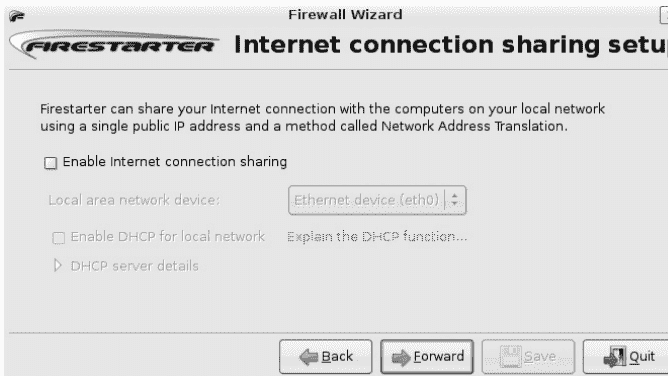

图 8-3 互联网连接共享设置

一旦点击“保存”，Firestarter 窗口就会打开（参见图 8-5）。你可以花些时间查看防火墙提供的不同选项，但不要更改任何内容，特别是策略（policies）。如果设置不当，可能会导致你无法访问互联网。虽然策略超出了本书的讨论范围，但 Ubuntu 论坛提供了大量关于 Firestarter 的信息。再次，这是使用 Ubuntu 支持的软件的好处之一。现在，如果你想看 Firestarter 实际发挥作用，请保持此窗口打开，然后打开 Firefox 浏览器浏览器。访问几个网站，然后返回 Firestarter。

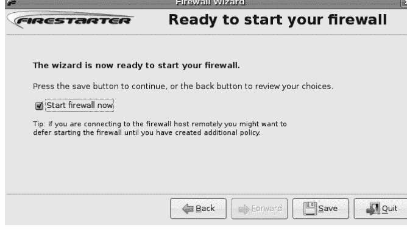

图 8-4 准备好你的防火墙

# 第8章 保持安全——保护 Ubuntu

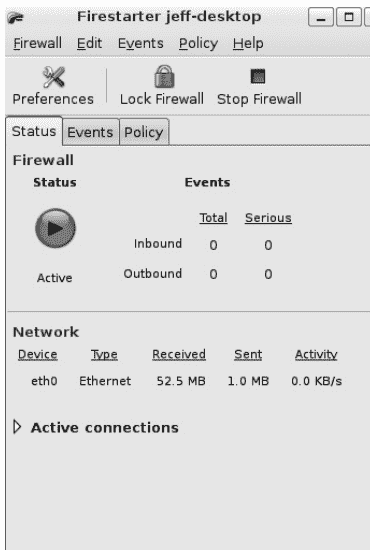

图 8-5 Firestarter 窗口

注意，“接收”（Received）和“发送”（Sent）字段已经发生了变化。这是因为该防火墙将记录活动网络设备上传输的数据量。这些信息很有帮助，因为如果你没有连接互联网，却注意到网络设备上有大量流量，那么可能有人或某物正在于你不知情的情况下传输数据。

### 分析网络流量

安全专家判断计算机系统是否被入侵的方法之一是使用如 Wireshark 等网络流量分析工具。Wireshark 是一个开源工具，像 Firestarter 一样记录网络流量，但它还允许用户分析这些流量以及往返传输的数据包。由于计算机和网络通常在其网络设备上会有一定的数据传输，网络管理员会建立一个基准（baseline），即一组正常流量。当流量无故超出此基准时，他们就会开始寻找可能的入侵或恶意软件。

图 8-6 Firestarter 正在运行。

一旦你熟悉了 Firestarter，请注意工具栏上带有黑色箭头的蓝色圆圈（参见图 8-6）。这是一个打开 Firestarter 窗口的图标，并让你知道防火墙处于激活状态。

如果你点击此图标，Firestarter 窗口将消失，但防火墙仍会保护你的电脑。如果你关闭 Firestarter 窗口，你将会关闭该程序并在没有防火墙保护的情况下运行。

### 安装杀毒软件

关于 GNU/Linux 的一个误解是该操作系统不存在病毒。这完全不是事实。在很一段时间内，GNU/Linux 并没有像 Windows 那样面临恶意软件攻击的持续压力。虽然研究人员确实创建了可以感染 GNU/Linux 操作系统的病毒，但它们仅用于研究目的。然而，已经发布了能够感染运行 GNU/Linux 操作系统的计算机病毒。越来越多的人开始在“野外”（in the wild）中看到能够损坏操作系统的病毒。

> 向公发布的病毒被称为“在野外”的。安全专家可以如何将用于研究的病毒与意图破坏计算机系统的病毒区分开来。纯出于爱好，人们会收集“野外”的恶意软件，以便分析其代码并对其进行斗争。

请记住，Ubuntu 是基于 Ubuntu “开箱即用”（Just Works）的哲学构建的。为了让 Ubuntu 正常工作，需要为 Ubuntu 用户提供杀毒软件。杀毒软件以多种方式工作。首先，此软件需要通过了解要搜索的内容来帮助检测计算机系统上的恶意软件。这些信息是由签名文件（signatures file）提供的，软件将自动下载并安装该文件。如果这些签名过期，计算机就会受到最新恶意软件的威胁。

> 签名文件也被某些杀毒程序称为“定义文件”（definition files）。

由于大多数杀毒软件制造商不仅收取应用程序费用，还收取病毒定义的年度订阅费用，寻找一个符合 Ubuntu 软件模式的可能有些困难。坦率地说，少数公司选择不向家庭用户收取杀毒软件和定义的费用。从列表中，Ubuntu 社区选择了 ClamTk，因为它符合 GNU 公用许可证（GNU Public License）。

# 第二部分 管理 Ubuntu

# 第8章 保持安全——保护 Ubuntu

### 安装 ClamTk

安装 ClamTk 非常简单。首先进入“应用程序”（Applications）选项卡。选择 ClamTk 所在的“系统工具”（System Tools），它可能没有列出。如果你发现如此，不要打开“应用程序”选项卡，而是右键点击并选择“编辑菜单”（Edit Menus），这将弹出一个如图 8-8 所示的窗口。现在选择“系统工具”，然后

### 更新签名文件

```bash
```


`wget http://db.clamav.net/daily.cvd`

当你按下回车键时，你应该看到类似于图 8-7 的界面。现在你需要将文件移动到

```bash
sudo mv daily.cvd /var/lib/clamav
```

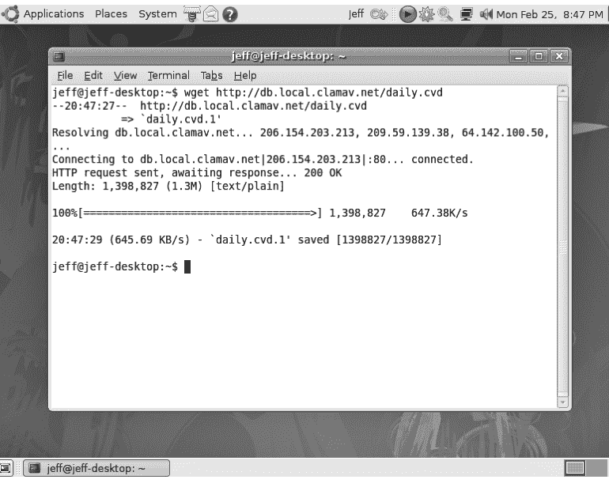

图 8-7 下载 ClamTk

# 102 第二部分 管理 Ubuntu

这将把更新的文件放入 `clamav` 文件夹中。一旦你按下回车键，系统会提示输入密码。输入后，你将返回终端。

## 扫描计算机

虽然大多数在 Windows 上运行的杀毒程序都会主动扫描，但 ClamTk 不会。然而，定期扫描计算机是一个好主意。如果你只下载软件，在“野外”感染病毒概率微乎其微。对于切换到 GNU/Linux 家族的用户，你可以预期与大多数其他发行版相同的稳定性。

### 备份与恢复

举举手，你们有多少人定期备份电脑上的文件？我想是如此。备份数据和文件是那些出现在每个人的清单上，但从未真正被勾选的事情之一。读这本书的每个人都经历过那种时刻：断电了、电脑崩溃了、狗吃了硬盘。无论原因是什么，结果都是数据丢失了。

幸运的是，Ubuntu 不易崩溃。对于从微软 Windows 过去的用户来说，你们基本上可以告别“蓝屏”的日子了。对于切换到 GNU/Linux 家族的用户，你可以预期与大多数其他发行版相同的稳定性。

既然 Ubuntu 和 GNU/Linux 如此稳定，为什么人们还需要备份数据呢？意外总会发生：火灾、洪水、飓风或其他任何自然灾害都会毁多年的家庭照片和财务数据。而且我们都有朋友和

# 103 第二部分 管理 Ubuntu

## 第8章 保持安全——保护 Ubuntu 104

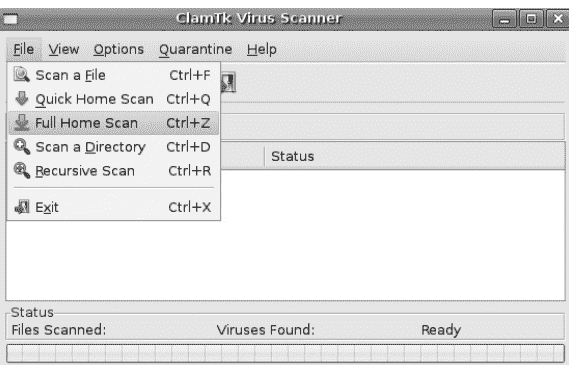

图 8-9 使用 ClamTk

现在 ClamTk 的应用程序窗口已打开（参见图 8-9），选择“文件”（File）然后点击“全扫描”（Full Scan）。这将扫描你的主目录。如果你下载了某些内容，也可以选择扫描单个文件，或者出于安全考虑扫描单个目录。

> 你可能认识这个程序是 ClamAV。ClamAV 在后台运行，而 ClamTk 是你使用的图形界面。

那些似乎无法接受电脑的家人成员。尽管他们展现了出色的英语能力，但仍然没有意识到“全部删除！”（Delete All！）的意思是“擦除”。

在 Ubuntu 仓库中，你有许多高质量的备份和恢复应用程序供选择。让我们进入“添加/移除”（Add/Remove）工具并搜索术语“备份”（Backup）。提供的前几个选项中包括“简单备份恢复”（Simple Backup Restore）和“用户备份”（Home User Backup）。还有许多其他可用程序，但这两个最容易使用。你将安装“用户备份”和“用户恢复”，因此如果你正在跟进操作，请选择这两个软件包，然后点击“应用”（Apply）。

“简单备份恢复”和“用户备份”都有额外的软件包需要安装。“简单备份恢复”需要你安装额外的“简单备份配置”（Simple Backup Config）配置，而“用户备份”需要“用户恢复”。

现在应用程序已安装完成，前往“系统 | 管理 | 用户备份”来启动程序。

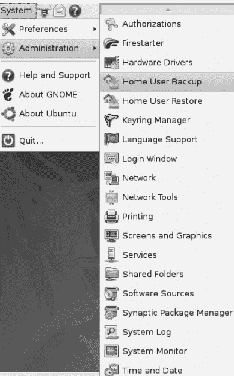

你可以选择备份主目录中的所有文件，也可以指定你想要备份的文件夹（参见图 8-10）。你还可以指定备份文件的保存位置。默认情况下，如果存在可写设备，“用户备份”将保存到 CD/DVD 设备。我喜欢将文件备份到 USB 驱动器中，正如图 8-10 所示，我选择了“其他”（Other）来进入我的 USB 驱动器。

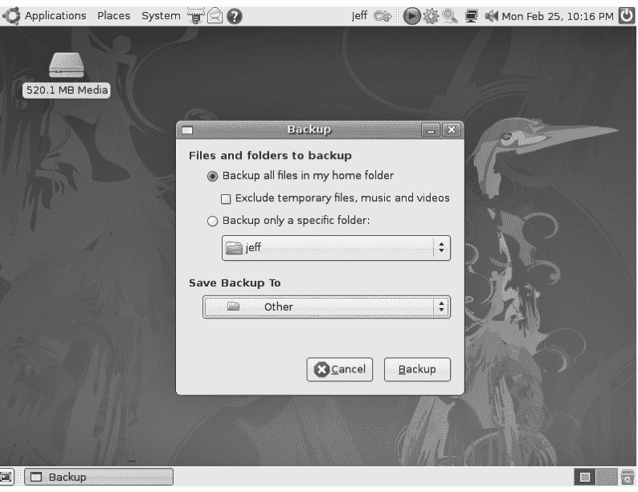
图 8-10 用户备份

如果你选择“其他”，将打开一个新窗口。在这里，你可以选择想要保存备份文件的位置。我选择了 520.1MB 媒体驱动器（参见图 8-11），这是一个 USB 驱动器。如果你正在跟进操作，请点击想要保存备份的文件夹或驱动器，然后点击“打开”（Open）。

你将返回图 8-10 中的备份窗口，但“保存备份到”（Save Backup To）选项应该反映你选择的位置。现在你可以点击“备份”（Backup）开始过程。当你第一次创建备份归档时，“用户备份”会询问你是否想要验证其完整性。这是一个很好的选择，因为它可以让你知道备份可以成功恢复。当备份完成后，你应该有两个文件，*jeff-master-archive.1.dar* 和 *jeff-master-catalog.1.dar*，其中 jeff 将是你的电脑名称。当你需要恢复数据时，将将使用这些文件。

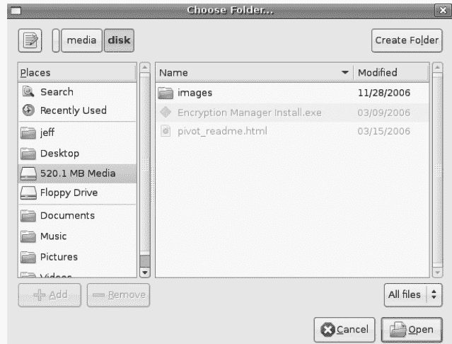
图 8-11 选择驱动器

### 恢复数据

虽然我们希望你永远不需要恢复丢失的数据，但有时这个过程是必要的。由于你已经承诺维护一致的备份计划，恢复数据应该是相当容易的。

> 提示：“用户恢复”（Home User Restore）存在于应用程序菜单中；然而但在某些版本的 Ubuntu 中，从那里启动该应用程序并不有效。相反，你可以从终端启动“用户恢复”以避免此类问题。

要恢复你创建的备份文件，你需要通过选择“辅助工具 | 应用程序 | 终端”来启动终端。在终端窗口中，输入以下内容：

```
sudo -x /path/your_archive_file -R /path/targetfolder
```

```
dar -x /home/backup/jeff-master-archive -R /home/Restore
```


> 注意：在你开始恢复过程之前，需要创建要恢复文件到的文件夹（在上面的示例中为 `Restore`）。恢复过程不会为你创建文件夹。

## 如何…… 加密文件

加密似乎是计算机世界流传的最新流行语之一，但实际上它是一个从尤利叶·凯撒时代就存在的概念，他首次通过要求接收者将信息缠绕在棍子上进行阅读来保护信息。如果棍子（密钥）的大小不一致，信息仍然是不可读的。

现代加密的工作原理也是一样。如果有人加密了电子邮件或驱动器上的数据，信息就会被乱码。解密的唯一方法是拥有正确的密钥。

要打开“密码和加密密钥”（Passwords And Encryption Keys）窗口，选择“应用程序 | 辅助工具 | 密码和加密密钥”。窗口出现后，选择“密钥 | 创建新密钥”。当“创建新密钥”窗口出现时，选择“PGP 密钥”并点击“继续”（Continue）按钮。当“新 PGP 密钥”窗口打开时，你会被要求提供全名和电子邮件地址。

现在，你需要为你的 PGP 密钥输入密码语。在“密码”框中输入短语。在“确认”框中输入相同的短语。如果它们相同，“确定”按钮将可用。点击“确定”，密钥将为你生成。

加密文件夹取决于你使用的客户端，但加密文件夹非常简单。在你想保护的文件夹上，只需右键点击该文件夹或文件并选择“加密”（Encrypt）。系统会询问你想使用哪个密钥。选择密钥并点击“确定”。如果你正在加密文件夹，系统会询问你想如何打包文件进行加密。选择压缩格式并点击“确定”。如果你正在加密单个文件，则不需要选择压缩格式。如果你有笔记本电脑，加密文件和文件夹是一个良好的习惯。

## 第三部分
## 进入 OpenOffice 世界

## 写作内容

如何……

- 在 OpenOffice 中创建文档
- 格式化页面
- 在文档中插入图形
- 打开 Word 文档
- 保存文档以便他人阅读

## 进入 OpenOffice 世界

## 什么是 OpenOffice.org？

如果没有类似的办公软件，GNU/Linux 在吸引用户从 Windows 切换时将困难。为了给 Ubuntu 用户提供可靠的办公软件，系统会自动安装一个名为 OpenOffice.org 的软件包。OpenOffice.org 是一个功能全办公套件，提供了 Writer、Calc、Base 和 Impress。Math 和 Draw允许用户创建复杂的数学函数并通过图形和图表进行交流。Math 是一个可以独立使用，也可以在 Writer 和 Impress 中使用的组件。Draw 是一个类似于 Visio 的程序，用于创建组织结构图、流程图等。本书的范围。

OpenOffice.org 不仅兼容 Microsoft Office 套件的大部分功能，而且完全免费使用。它没有试用期，也没有许可费用。如果你使用该发行版，你可以使用该软件、升级它并免费分发。OpenOffice.org 可用于 Microsoft Windows、Mac OS、Solaris 以及的 GNU/Linux。同样，支持 OpenOffice.org 的社区非常庞大且乐于帮助 Ubuntu。

## 第 9 章 写作之道 113

- OpenDocument 标准：与 Microsoft Word 不同，OpenOffice.org 的 Writer 将文档以一种可移植性更强的格式存储。遗憾的是，它与 Word 使用的专有格式兼容性良好。

## 创建新文档

创建新 Writer 文档的第一步是打开应用程序。让我们从点击“应用程序”（Applications）选项卡开始。当菜单出现时，你会看到 Office 是列出的选项之一。点击它，然后选择 OpenOffice.org 文字处理器。这将启动 Writer 应用程序。你会发现 Writer 窗口与其他文字处理器非常相似。图 9-1 显示了该用户界面与图 9-2 所示的 Microsoft Word 界面有多相似。

Microsoft Office 2007 的用户界面与 OpenOffice.org Writer 的最新版本完全不同。太阳公司计划重新设计用户界面，以使 Writer 变得更加现代化。

> 注意
当你打开 Writer 时，系统会自动带你进入新文档。这很简单，对吧？如果你愿意，可以直接从这个窗口开始打字。然而，其他商业文字处理器让人们感到方便的功能是：模板。

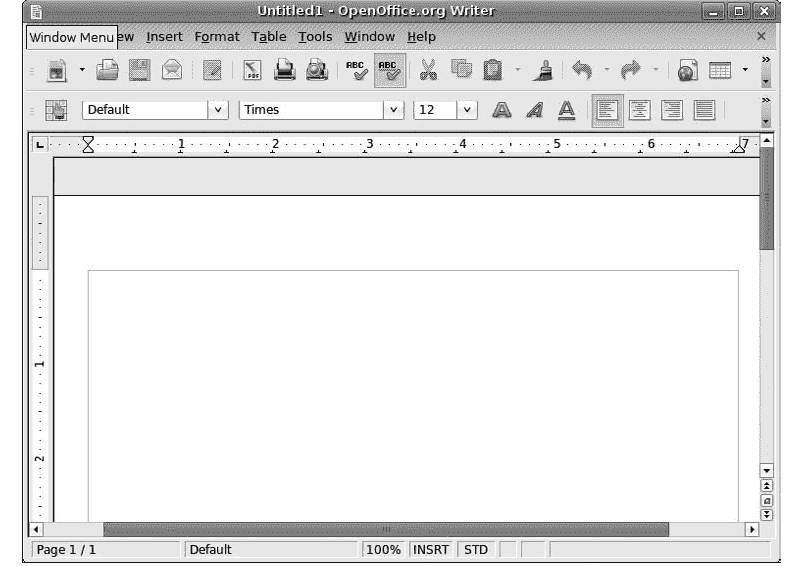
图 9-1 Writer 用户界面

## 114 第三部分 开启 OpenOffice 之大门

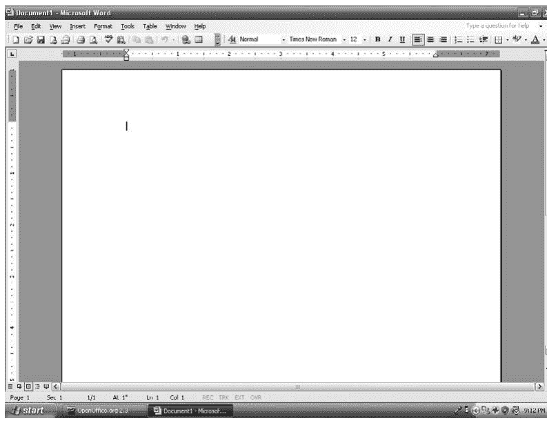
图 9-2 Microsoft Word 2003 用户界面

## 使用模板

模板是预先格式化的文档，人们可以使用它们来让工作变得轻松。如果你想写封信，可以使用模板，它会为你处理所有的格式设置。你只需要覆盖模板中的占位符文本即可。几乎对所有东西都有模板：发票、议程、报告、表单——只要你想到的，就有相应的模板。所以，如果 OpenOffice.org 计划与商业办公套件竞争，它最好准备一些模板。

你可以通过点击“文件 | 新 | 模板和文档”（File | New | Templates And Documents）来打开新模板。一旦打开了图 9-3 所示的“模板和文档”窗口，你就可以选择你正在工作所需的适当模板。有了这个模板作为指南，你会发现工作变得容易了一些。

## 寻找更多模板

如果你觉得 Writer 中的模板集已经足够了，可以下载更多模板。将你的 浏览器指向 http://documentation.openoffice.org/Samples_Templates/User/template/index.html，如对页上的图像所示。

## 第 9 章 写作之道 115

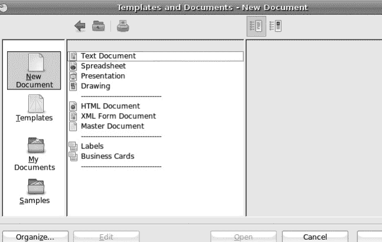
图 9-3 Writer 模板

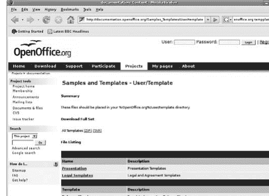

## 第三部分 开启 OpenOffice 之大门

此页面允许你下载全套 OpenOffice.org 模板，也可以从插图底部不同的类别中选择模板。此外，此页面还准确地告诉你要将 TAR 文件提取到哪里：`%OpenOffice.Org/%user/template`。

> TAR 文件在第 6 章中讨论过。如果你需要复习如何从 tarball 解压缩和安装，请参阅这些页面。

如果你没有找到你需要的模板，可以尝试搜索“OpenOffice.org + Templates”。此搜索将为你提供许多提供该办公套件模板的网站，而且，大多数都是免费的！

## 格式化

当我们谈论文档意义上的“格式化”时，我们指的是特定文档的页面和文本的布局及属性。格式化页面布局可以指页边距或方向等特征，而格式化文本可以包含字体类型、文本颜色或**粗体***斜体*等样式属性。在 Writer 中创建文档时，你可能出于各种原因选择更改格式。

## 页面格式化

如果你选择了模板，那么页面可能已经为你格式化好了。如果你打开的是一个空白文档，你可以选择格式化页面以符合你的需求。从顶部栏中，选择“格式 | 页面”（Format | Page）。现在从“页面样式”窗口中选择“页面”选项卡。从这里，你可以更改页面方向、纸张大小、边距和其他与页面格式相关的选项。“页面样式”中的其他选项卡允许你更改页面背景颜色、添加页眉或页脚，或修改边框、添加列并管理脚注。图 9-4 显示了设置为新 Writer 文档默认值的页面样式窗口。

## 文本格式化

在创建文档时，更改文档文本属性的能力是非常重要的。你可以将文本格式化为不同的字体类型以适应个人品味，或遵循广泛使用的指南，如 APA 样式（《美国心理学会出版手册》）或《芝加哥格式手册》。*斜体*和**粗体**字体可用于强调某些重要的词汇或短语。其他属性如给单词加下划线或删除线也可以使用。

在 Writer 中，更改文本格式的能力就像其本身一样简单。

## 138 第 9 章 写作之道 117

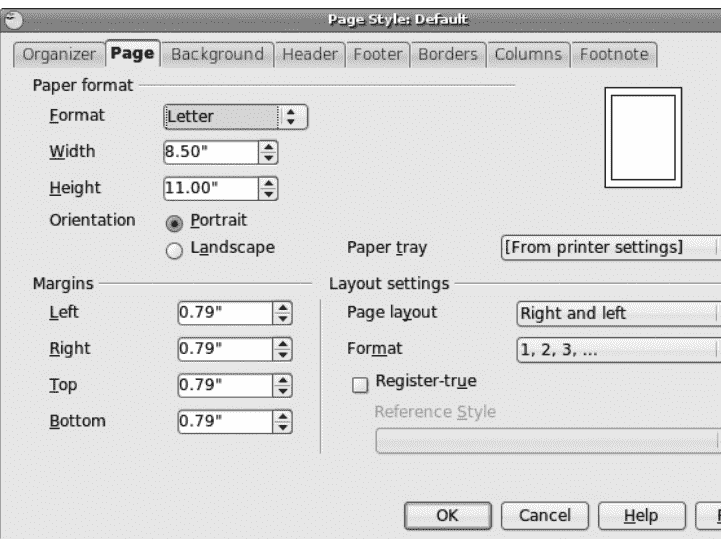
图 9-4 页面样式

## 118 第三部分 开启 OpenOffice 之大门

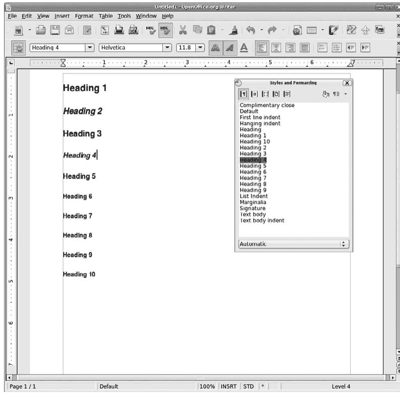
图 9-5 标题 1 到 10

再次，从左侧开始，你会看到数字 11.8。这定义了字体的大小。让数字越小字体就越小；反之，数字越大字体越大。你也可以在这里输入数字而不是使用下拉菜单。在字体大小旁边，你会看到三个蓝色 A。它们分别是你将字体更改为**粗体**、*斜体*和下划线的手段。

要更改字体颜色，你需要从顶部栏中选择“格式 | 字符”（Format | Character）。当字符窗口打开时，选择“字体效果”选项卡以显示图 9-6 所示的窗口。除了设置字体颜色外，你还可以在此区域对字体进行


各种字体操作；例如，你可以添加阴影、创建闪烁文本或添加删除线。如果你点击其他一些选项卡，可以创建超链接、更改文本位置、更改背景或调整字体大小和类型。

> 在 Writer 中格式化文档时，你还有许多其他选项。你可以更改文本的对齐方式、对齐和缩进；添加表格以及许多其他内容。

## 插入图形

如果一张画胜千言，那么学习如何将图片插入你的文档是值得的。如果你从顶部菜单中选择“插入 | 图片”（Insert | Picture）

# 第三部分 开启 OpenOffice 之门

那么，你会发现“插入图片”命令提供了两个选项：“从文件”和“扫描”。如果你打算使用扫描仪在此时插入图片或图形，则使用**扫描*。如果你已经将图片保存在计算机上，你将选择**从文件*。从这里开始，你需要导航到保存图像的文件夹。在这种情况下，我将它保存在图 9-7 左侧和顶部所示的主目录文件夹的“文档”文件夹中。

一旦我高亮想要插入的图片，我就点击“插入图片”窗口底部的“打开”按钮。在图片插入文档后，我可以移动它、调整它的大小并以许多不同的方式对其进行修改。如图 9-8 所示，当你插入图片时，文档窗口顶部会出现一个图片工具栏。


图 9-7 插入图片窗口

# 第 9 章 写作之道 121

### 你知道吗？
在哪里找到公有领域的图像

公有领域意味着内容（无论是文字、图片、电影还是任何其他媒体）都是免费使用的。寻找公有领域图像的最佳场所之一是 Wikimedia Commons 网站，http://commons.wikimedia.org。该网站充满了你能想象的任何任何内容的图像。尽管大多数图像完全不包含任何版权，但某些贡献者要求在他们的图像用于贡献者指定的用途之外时时通知他们。


图 9-8 新插入的图片

122 第三部分 开启 OpenOffice 之门

出现在文档窗口的顶部。此工具栏允许你对刚刚插入到文档中的图片进行更改，甚至可以添加更多图片。

# 打开 Microsoft Word 文件

如果你经常使用计算机，迟早你必须打开一个 Microsoft Word 文档。OpenOffice.org 注意到了这一点，因此它允许你在 Writer 程序中打开这种格式的文档。Writer 的功能足够强大，你也可以用 Writer 处理 Microsoft Word 文档。你可能需要重新格式化文档的某些部分，但在 Works 中打开 Word 文档时也会发生这种情况——而且它们是由同一公司制作的！

要打开 Word 文档，只需选择文件 | 打开。你将被带到“打开”窗口（见图 9-9），从那里你可以导航到存储文档的文件夹。一旦找到文档，你只需要选择它并点击“打开”按钮。这样，不需要任何转换过程。


| way | 修改日期 |
| --- | --- |
| drivers | 11/13/2007 |
| in progress | 今日 16:54 |
| ATMEPCNCF.DLL | 07/10/2002 |
| calendar.doc | 12/12/2006 |
| Pilot Matrix.xls | 11/19/2007 |
| Registration Page - School.doc | 10/23/2007 |
| student registration.doc | 10/23/2007 |

图 9-9 打开窗口

第 9 章 写作之道 123

Microsoft Word 文件具有 `.doc` 扩展名，而 OpenOffice.org Writer 文件具有 `.odt` 扩展名。

# 保存你的工作与他人共享

当你完成为老板输入那份漂亮的报告时，你可能需要保存该文档。保存文档和打开文档一样简单。你只需要选择文件 | 另存为。这将弹出接下来所示的“保存”窗口。只需为你的文档命名，并选择你想要保存它的文件夹；然后点击“保存”按钮。


注意：如果你之前保存过文档，则不需要再次执行“保存”操作。对于后续每次保存，你可以选择文件 | 保存，Writer 将以相同的名称和相同的位置保存文档。

当你保存了报告并准备发送给你的老板时，请想起你的其中一个客户使用 Microsoft Word。如果他收到一个用 Writer 创建的文档，它将无法打开。如果他没有得到这份报告的副本，你可能会失去你红色的 Swingline 订书机并最终进地下室。嗯，别担心。Microsoft Office 产品可能不支持 OpenOffice.org 文档，但 OpenOffice.org 的开发者意识到了。Writer 内置了将文档保存为另一种文件的功能。再次，选择文件 | 保存。这次，点击“文件类型”旁边的箭头（见图 9-10）。在这里，你将看到一个可滚动列表，以 OpenDocument Text 开始。如果你向下滚动列表，你会发现其他可以保存的 Microsoft Word 格式。选择合适的格式然后点击“保存”按钮。它现在将具有 `.doc` 扩展名，可以在 Microsoft Word 中打开。

145 第三部分 开启 OpenOffice 之门


图 9-10 文件类型

124 第三部分 开启 OpenOffice 之门

第 9 章 写作之道

### 你知道吗？
在哪里找到公有领域的图像

公有领域意味着内容（无论是文字、图片、电影还是任何其他媒体）都是免费使用的。寻找公有领域图像的最佳场所之一是 Wikimedia Commons 网站，http://commons.wikimedia.org。该网站充满了你能想象的任何任何内容的图像。尽管大多数图像完全不包含任何版权，但某些贡献者要求在他们的图像用于贡献者指定的用途之外时时通知他们。


图 9-8 新插入的图片

126 第三部分 开启 OpenOffice 之门

### 如何使用

- 创建新电子表格
- 格式化单元格
- 计算
- 添加图表

现在电子表格打开，你会发现与 Writer 类似的四个工具栏。所示的菜单栏位于顶部，提供了运行 Calc 中大部分基本命令的能力，如打开新的电子表格；使用剪切、复制和粘贴命令；插入信息；格式化文本和单元格；排序数据以及许多其他功能。

| 文件 编辑 视图 插入 格式 数据 帮助 |

菜单栏下方是标准工具栏。与菜单栏一样，标准工具栏提供了新建、打开、打印等命令。然而，与菜单栏的下拉菜单样式不同，标准工具栏是由图形图标组成的（所示）。点击这些图标中的一个将运行与其关联的命令。如果你不确定哪个图标对应什么，请将指针悬停在图标上，就会弹出许多说明。

第三个工具栏是格式工具栏（所示），它允许更改字体、单元格中的文本对齐、单元格框以及任何与你的电子表格显示方式有关的内容。


# 第10章 使用 Calc 展开数据 127

最后一个工具栏是公式栏，电子表格的真正威力在此处发挥作用。在这里，你可以输入不同的数学公式来执行电子表格的所有计算。我们将在本章的稍后部分详细介绍此项工作原理。


B10 f( Σ =


## 电子表格

现在你已经了解了所有工具栏的作用，让我们来看下电子表格本身（见图 10-1）。顶行是一系列字母，沿电子表格最左侧的一列是一系列数字。这些数字提供了单元格地址，该地址显示在公式栏左侧的地址框中。就像棋盘上的方格一样，电子表格的单元格也被赋予了地址。电子表格中的第一个单元格被称为 `A1`。向右移动两个单元并向下移动五个单元，你就变成了 `C6`。当我们开始计算时，这些地址是非常重要的。


图 10-1 一个 Calc 电子表格

### 第三部分 开启 OpenOffice 之门

### 设置单元格和数据的格式

与任何其他 OpenOffice 一样，你的电子表格的布局和数据都可以根据你的喜好设置格式。在打开的电子表格中，在 `A1` 单元格输入 `1234`，在 `A2` 单元格输入 `-4231`。现在，右键点击其中一个单元格并选择“设置单元格”。你会看到如图 10-2 所示的单元格窗口。

从这里，你可以对单元格或数据进行任何你需要的更改。在“数字”选项卡上，你可以从类别列表中选择货币、日期或时间在单元格中的显示方式。在“格式”区域，你可以选择如何分隔千分位，或者在“选项”下，你可以选择用用红色显示负数。如果你正在制作基于预算或其他任何财务数据的电子表格，这将非常有用。继续勾选“负数红色”复选框并关闭窗口。`A2` 单元格中的数据将变为红色。

### 字体和字体效果

查看图 10-2，你会发现“设置单元格”窗口上有许多选项卡。“字体”和“字体效果”选项卡决定了如何在单元格内显示文本。你可以设置字体、字体大小和字体颜色，甚至给文本添加阴影。


图 10-2 设置单元格窗口

### 第10章 使用 Calc 展开数据

#### 对齐方式

“对齐”选项卡允许你选择文本在单元格中的显示位置。水平方向，你可以选择左对齐、右对齐、居中、两端对齐或填充。垂直方向，你可以选择文本出现在单元格顶部、底部或中间。如果你计划输入多行文本，可以选择“自动换行”。如果不选择此选项，长字符串将继续在一行中显示。如果你换了行，你就可以增加高度，如果到达单元格末尾，Calc 将在相应列中向下开始下一行文本，而不是继续跨其他列。

#### 边框

在计算机屏幕上，你的单元格显示在精美的边框内。但如果你打印这个电子表格，你会发现单元格周围的边框仅供屏幕参考，不会打印。这可以通过“设置单元格”窗口中的“边框”来解决。在这里，你可以选择想要为单元格或多个单元格的部分添加边框。你还可以选择边框的宽度甚至颜色。

### 背景

“背景”选项卡允许你更改单个单元格或一组单元格的背景颜色。这通常用于人们想通过交替行使用颜色来使电子表格更容易阅读的情况。标题行的背景通常也会更改，以便将此行与包含实际数据的单元格区分开。

#### 行或列的大小

如果你需要更改行或列的大小，可以通过两种方法实现。第一种是将指针移动到两个列标题的边界上，直到显示调整工具的箭头。一旦箭头出现，你就可以拖动列到你需要的宽度。同样的方法也可以用于单元格的行，以增加或减少行的高度。

你还可以通过选择“格式 | 行”和“格式 | 列”来调整行和列的大小。从那里，你可以通过输入英寸或英寸分数的大小来分别设置高度和宽度（见图 10-3）。你还可以选择“最优”，让高度和或宽度自动设置以适应行或列的文本。

### 第三部分 开启 OpenOffice 之门


图 10-3 设置行格式

> 注意：为了使格式生效，需要选择目标单元格或文本。这通过鼠标点击单元格来实现。通过按住鼠标左键并将指针移动到你想要选择的任何地方，可以选择文本或多个单元格。

### 计算和排序数据

如前所述，电子表格应用程序的真正威力来自于它能够对你输入到单元格中的数据进行数学计算。当然，数据必须是数值才能进行计算。如果你计划在电子表格中进行总和或平均值计算，请确保输入的数据是数字。

### 第10章 使用 Calc 展开数据

#### 在行或列中相加

在 Calc 中可以执行的最简单的计算是数字的加法总和。虽然你可以输入一个相加单元格的公式，例如 `A1+A2`，但使用求和按钮要简单得多。

要使用求和按钮，只需选择你想要总和的单元格所在的单元格。在公式栏中输入类似 `=A1:A5` 的格式。另一种选择用于求和单元格的方法是，点击求和按钮后，会出现一个细蓝边框。使用鼠标，你可以拖动此边界以包含你想总和的行或列中的所有单元格。

#### 计算平均值

在对数字求和之后，电子表格中最常见的计算是求一系列数字的平均值。Calc 也让这项工作变得简单。图 10-4 显示了一个具有 A 列数字的电子表格。在 `A6` 单元格中，数字 `$24.00` 代表平均值。

查看 10-4 中的公式栏，你会发现它显示为 `"=AVERAGE(A1:A5)"`。要这样做，你需要选择 `A6`。然后点击公式栏上的 `=` 按钮，公式栏中会出现 `=`。在 `=` 之后输入 `AVERAGE(A1:A5)`，这些数字的平均值将放在 `A6` 中。

> 尽管 `$` 不是数值字符，但如果你在数字前输入它，Calc 将认为它是货币字段。即使 `$` 不是数值字符，你仍然可以对货币字段进行数学计算。

#### 算术

你可以像之前设置平均值一样，在公式栏中设置任何算术语句的公式。选择你希望放置公式结果的单元格，点击公式栏上的 `=` 键，然后在括号之间输入语句。下表显示如何在 Calc 中输入基本算术语句：

| 加法 | `=(A1+A2)` |
| 减法 | `=(A1-A2)` |
| 乘法 | `=(A1*A2)` |
| 除法 | `=(A1/A2)` |

### 排序数据

使用电子表格而不是文字处理器中的表格的另一个原因是，你可以在 Calc 等电子表格中对数据进行排序。查看图 10-5，你可以看到

#### 第10章 使用 Calc 扩展数据


图 10-5 未排序的数据

有三列数据。`A` 列包含系列数字，`B` 列包含姓氏，`C` 列包含名字。

要对这些数据进行排序，我们将访问菜单栏并选择“数据 (Data) | 排序 (Sort)如图 10-6 所示的排序窗口将出现在您的屏幕上。从此窗口中，我们可以选择数据的排序方式。假设我们想按姓氏排序。在“排序 (Sort)”框中，默认为 `A` 列。我们将将其更改为反映图 10-6 的设置，并按姓氏（即 `C` 列）排序。在“之后 (Then)”框中，我们将把默认的“未定义 (undefined)”更改为 `B` 列，以便在按姓氏排序后按名字排序。您还可以选择数据从升到大排序，或从大到小（降序）排序。

点击“确定 (OK)”后，您将回到电子表格，发现数据现在已如图 10-7 所示按姓氏和名字进行了组织。

### 第三部分开启 OpenOffice 之门


图 10-6 排序窗口

### 添加图表

有时，仅凭数字数据不足以强调您的观点。如果您喜欢使用图表和图形来突出数据和结果，Calc 也可以为您完成。参考图 10-7，我们看到一个包含名字和数字的表格。假设 `A` 列代表每月销售额，您希望显示一个显示销售团队比较的图表。

从菜单栏，您需要选择“插入 (Insert) | 图表 (Chart)”，向导将出现在屏幕上，如图 10-8 所示。向导将引导您完成图表的每一步。首先，它会要求您从列图、条图、饼图、面积图等选择图表类型。当您点击“下一步 (Next)”时，它会询问您从哪里提取数据。手动输入数据范围，或者您可以点击向导上的“选择范围 (Select Range)”按钮来选择您想要代表的单元格。

### 第10章 使用 Calc 扩展数据


图 10-7 排序后的数据

当您点击此按钮时，将回到电子表格。要选择数据，使用鼠标选择第一个单元格，然后按住左键将鼠标拖过其他单元格来选择一个系列。当您释放鼠标按钮时，Calc 将带您回到向导，所示。


### 第三部分开启 OpenOffice 之门


图 10-8 带有图表的电子表格

当您点击“下一步 (Next)”时，系统将要求您选择类别。这可以通过您上一步选择数据的方式完成，即通过输入值或使用“选择 (Select)”按钮。

在选择类别并点击“下一步 (Next)”后，您将进入向导的最后一步。在这里，您可以为图表添加标题、副标题，并格式化图表的 X 轴和 Y 轴。完成后，点击“完成 (Finish)”，您将看到看到全新的图表！

### 使用 Excel

在 Writer 之后，Calc 有一个微软对应的软件占据了电子表格市场的大份额。Microsoft Excel 目前是最畅销的电子表格应用程序，因此 Calc 最好能与其良好工作。为了确保 Calc 用户不被排除，您可以打开 Excel 电子表格并将其保存为 Excel 可读取的格式。

要打开由 Microsoft Excel 创建的电子表格，访问菜单栏并选择“文件 (File) | 打开 (Open)”。导航到保存电子表格的文件夹，选择文件，Calc 就会打开它。

保存与 Microsoft Excel 工作的文件同样简单。当您准备好保存时，选择“文件 (File) | 另存为 (Save As)”。在“保存”窗口中，输入电子表格的名称。点击箭头显示下拉菜单。浏览菜单，直到看到想要保存的 Microsoft Excel 版本并高亮它。一旦您点击“保存 (Save)”，该电子表格就可以在 Excel 和 Calc 中打开。

> Microsoft Excel 文件包含 `.xls` 文件扩展名，而 Calc 文件使用 `.ods`（OpenDocument Spreadsheet）文件扩展名。

## 我印象深刻了

### 如何...

- 开始新的演示文稿
- 为幻灯片添加背景
- 插入图形
- 更改幻灯片之间的切换效果
- 为文本和图形制作动画
- 导出到 Flash
- 使用实用提示

Microsoft PowerPoint 使电子幻灯片演示成为传递信息的首选方法。老师每天在教室使用幻灯片。销售人员依靠幻灯片来介绍他们的。

由于幻灯片非常受欢迎，OpenOffice 开发者已经包含了。在在上一步中选择背景后，“预览 (Preview)”窗口将向您显示幻灯片的样子，这样您就可以为您的选择正确的。

演示文稿向导允许您选择幻灯片切换效果。切换效果描述了演示文稿中的幻灯片如何切换。在在上一步中选择背景后，“预览 (Preview)”窗口将向您显示幻灯片的样子，这样您就可以为您的选择正确的。

演示文稿向导允许您选择幻灯片切换效果。切换效果描述了演示文稿中的幻灯片如何切换。在在上一步中选择背景后，“预览 (Preview)”窗口将向您显示幻灯片的样子，这样您就可以为您的选择正确的。

演示文稿向导允许您选择幻灯片切换效果。切换效果描述了演示文稿中的幻灯片如何切换。在在上一步中选择背景后，“预览 (Preview)”窗口将向您显示幻灯片的样子，这样您就可以为您的选择正确的。

### 第三部分开启 OpenOffice 之门


图 11-1 Impress 向导

### 开始新的演示文稿

当您打开向导时，选择“空 (Empty)”并点击“下一步 (Next)”。向导的下一步将要求您选择一种设计。

### 11 我印象深刻了


图 11-3 幻灯片切换和演示类型


图 11-2 选择幻灯片设计

### 切换效果反映了您的演示水平

很多时候，当我们创建幻灯片演示时，我们会陷入所设置的奇特切换效果中。在使用切换效果时，了解您的观众很重要。虽然棋盘格和对角正方形看起来很令人深刻，但它们并不被认为非常业务化。对于更正式的演示，请使用淡入和擦除效果，而不是具有大量活动的切换效果。

### 第三部分 开启 OpenOffice 之门

一旦你选择了切换效果和演示类型，就可以点击窗口上的“创建（Create）”按钮。这将打开 Impress 窗口。与其他办公应用程序一样，Impress 具有菜单栏、标准工具栏和格式化工具栏：


在这三个工具栏的下方有三个窗口，每个窗口都提供有关你正在创建的幻灯片的信息。

### 幻灯片窗口

幻灯片窗口将为你为演示创建的不同幻灯片提供组织视图。它会为每张幻灯片编号，并提供幻灯片图形和文本内容的视觉效果。你可以在此窗口中右键点击最后一个幻灯片向演示中添加幻灯片。如果你在两个幻灯片之间右键点击，Impress 将在那里插入新幻灯片。你还可以通过左键点击幻灯片来重新排列演示中的幻灯片。按住左鼠标键，将幻灯片拖动到目标位置。


### 工作区

位于屏幕中间的工作区窗口（见下图）是你可以在幻灯片上添加文本、图形和备注的地方。第一个标签“普通（Normal）”是你对单张幻灯片进行大部分创意工作的地方。一旦你创建了幻灯片，就可以选择其中一个标签为你的演示添加其他组件。“大纲（Outline）”标签允许你创建演示的大纲版本，这可以在向现场观众演示幻灯片时提供演讲要点。“备注（Notes）”标签类似，它允许你对单张幻灯片编写注释，可以作为幻灯片显示在屏幕上时你应该说的内容的依据。“讲义（Handout）”标签允许你将演示打印在纸上，以便给每位观众分发副本。讲义中还留有供观众做笔记的空间。“幻灯片排序（Slide Sorter）”标签将提供与左侧幻灯片窗口相同的信息。

### 任务窗口

屏幕右侧的任务窗口的默认菜单是“布局（Layouts）”菜单。这允许你为幻灯片选择各种布局。最初，你会得到一个空白幻灯片来工作，但你可以通过点击布局区域中的任何不同样式来选择不同的布局。一旦你为幻灯片选择了布局，你将看到一个它作为占位符的幻灯片。例如，选择一个幻片片，，让幻灯片显示在屏幕上时，当文本消失时，你会看到“点击添加文本（Click to add text）”。你可以通过将鼠标悬停在布局上，除非你想删除。点击文本框。这可以作为任何布局的模板。你可以可以布局布局的，你可以移动它们，甚至删除它们。要执行这些操作，通过将鼠标移动到幻灯片边缘你可以看到 Flash。


标题 片

### 第三部分 开启 OpenOffice 之门


图 11-4 标题幻灯片布局

调整文本框

现在，当你点击时，你会看到一个文本框（见图 11-5）。你可以按任务窗口来删除它。你可以在幻灯片上移动它。

> 注意：任务窗口中的其他项目我们将在后续章节中介绍。

### 绘图工具栏

幻灯片的底部是绘图工具栏。这是 Impress 的一个重要部分，允许你使用工具创建内容。如果你想在演示中添加形状、符号、额外的文本框、标注甚至流程图，可以在这里找到这些工具。为了显示幻灯片，将鼠标指针悬停在绘图工具栏上，会出现一个说明，让你知道它会做什么。


### 插入图形

幻灯片应该在演示期间为观众提供视觉效果。有什么更好的方法在演示中插入图形呢？

| 视图 | X |
|---|---|
| 母版 | 布局 |
| 自定义动画 | 切换效果 |
| 应用于幻灯片 | 无切换 |
| 向上擦除 | 中速 |
| 向右擦除 | 修改切换 |
| 声音 | 循环幻灯片 |
| 切换后 | 点击鼠标 |

### 为文本和图形添加动画

任务窗口切换菜单上方是“自定义动画”菜单，可以展开。现在，当你打开此菜单时，你需要选择你想要动画的项目。执行此操作后，你可以选择进入、强调、退出或设置路径来动画项目。通过切换还可以设置速度。动画可以为幻灯片增加一些活动。注意在单张幻灯片上过度动画，这会影响观众观看你的演示。


### 将演示导出为 Flash

与其他所有办公应用程序一样，Impress 允许你以这种方式保存演示，以便对应的程序 PowerPoint 打开文件。从菜单栏保存演示，选择“文件 | 存为”。如今，万维网是显示信息的广泛的方法之一。为了适应这一点，Impress 允许将你的演示导出到网上显示。要执行此操作，选择“文件 | 导出”，打开导出窗口。在这里，你有选项将你的幻灯片演示导出为 HTML 文档（使用网络语言编写），或者为任何使用免费 Adobe Reader 的人提供 PDF 文档。

虽然你可以将演示导出为其他文件类型，但没有比直接导出到 Adobe Flash 更令人深刻的。Adobe Flash 是为网站创建丰富互联网应用程序的程序。通过导出选项，你可以将演示转换为可以在任何网站运行的 Flash 电影。此选项是 Impress 特有的，因为 Microsoft PowerPoint 需要第三方应用程序来执行此操作。

### 有效演示的技巧

有时我们不得不看一场演示者逐字读取每张幻灯片的演示。这可能是对这种棒工具最糟糕的使用之一。幻灯片演示应该为观众提供参考，而不是为演讲者提供脚本。

- 不要有太多幻灯片。每分钟保持一张幻灯片，以避免丢失观众。
- 将幻灯片内容限制在关键短语或想法上。单张幻灯片内容过多会导致观众失去兴趣。
- 花哨的切换效果会分散注意力。
- 过度可爱的动画会损害你作为演讲者的信誉。
- 演练！

# 一切基础

如何操作...

- 打开一个新数据库
- 创建表
- 创建表单
- 创建查询
- 创建报告

所有计算机都是用于处理信息的工具。我们使用互联网收集信息，使用文字处理器和幻灯片提供信息，并使用电子邮件发送信息。大多数网络都有如文件服务器和主机之类的计算机，它们存在的全部意义就是存储信息。虽然有一些例外，但大多数信息存储库的核心都是数据库。数据库被定义为组织良好的数据——信息——的集合，可以由计算机进行更新和检索。

大多数通过互联网或大型企业网络提供的数据库都是巨大的程序，利用了被称为数据库集群的多台计算机。OpenOffice.org 提供了一个可以在你的个人计算机上使用的数据库应用程序。与其他 OpenOffice.org 应用程序一样，Base 随 GNU/Linux 发行版免费提供给你。

> 关系型数据库（如在 Base 中创建的数据库）使用结构化查询语言来对数据进行操作、排序和显示。结构化查询语言通常被称为 SQL，读音为“sequel”，它是大多数 Web 2.0 应用的石。

### 打开新数据库

由于 Base 在初始安装 Ubuntu 时没有安装，你需要将此应用程序添加到你的计算机中。还记得如何添加程序吗？从点击“应用程序 | 添加/删除”开始。在这里点击“办公”，然后向下滚动到应用程序底部找到 OpenOffice.org 数据库。确保勾选此应用程序旁边的框，然后点击“应用更改”按钮。当“以下更改”窗口弹出时，点击“应用”，在提示处输入密码，并点击“确定”完成安装。

> 如果你不想向下滚动寻找 Base 应用程序，可以改为搜索“OpenOffice.org Database”。

现在应用程序已安装，你只需要点击“应用程序 | OpenOffice.org 数据库”。
打开应用程序后，你会看到“数据库向导”窗口（见图 12-1）。如果这是你创建的第一个数据库，将保留默认选项“创建新数据库”。如果你正在打开另一个数据库文件，或者正在连接到现有数据库，你可以选择其他选项之一。现在，让我们先创建一个新数据库，并点击“下一步”按钮移动到第二个屏幕。
数据库向导的第二步处理你在保存数据库后想要如何继续。这是因为只要你一点击“完成”按钮，它就会保存你的数据库的副本。
查看向导窗口（见图 12-2），你应该看到对于第一个问题“你是否想在 OpenOffice.org 中注册数据库？”，该选项


FIGURE 12-1 数据库向导


FIGURE 12-2 保存数据库后该做什么

选择了“是，为我注册数据库”。留此此选项并移动到第二个问题：“数据库文件保存后，你想做什么？”在这里，你可以选择“打开数据库以进行编辑”，或者你可以选择“使用表向导创建表”。由于这些是复选框而不是上一个问题那样的单选按钮，你也可以决定同时选择这几项，这样你就可以在数据库保存后既可以编辑数据库又能创建表。为了我们的目的，请选择两项并点击“完成”按钮。

> 你知道吗？注册数据库意味着什么
注册数据库并不会将你的数据库或数据列在 OpenOffice.org 网站上的某个在线文件中。相反，注册数据库会在你计算机上的 OpenOffice.org 数据结构中创建一个条目。本质上，你正在赋予 OpenOffice.org 对该数据库的所有权。如果你在使用如 MySQL 或 Oracle 等其他数据库应用程序，你可能不想注册你的数据库。与 Microsoft Access 不同（后者假设你只会使用 Access），OpenOffice.org 让你自己选择。再次，这了 GNU/Linux、自由软件和 Ubuntu 的核心哲学。

由于数据库在你点击“完成”按钮后会自动保存，你会被带入一个新的“保存”窗口。在这里，你可以给数据库命名并选择你想保存它的位置。在这个示例中，将此数据库命名为 Ubuntu Users，并将其存在默认的“文档”文件夹中。在相应的框中输入此名称后，你可以点击“保存”。


### 创建表

在数据库中，表充当输入、存储和查询的数据的容器。在基本形式，表类似于电子表格，因为它是按行和列组织的。可以直接从数据库创建表。在“任务”面板中，你可以选择“在设计视图创建表”：


这允许你直接输入字段名称、字段类型和描述：


在“任务”面板中，你也可以选择“使用向导创建表”。如果你选择向导，它将引导你完成创建表的各种步骤。
由于你在数据库窗口中创建表，向导将引导你完成这些步骤。如你在屏幕上或图 12-3 所示，默认情况下，表类别被设置为“业务”，示例表将设置为“资产”。由于你正在创建数据库，通过菜单将资产改为“联系人”。现在，你可以从可用字段中选择字段。要选择字段，你可以双击字段，也可以单击字段然后点击 > 按钮。


FIGURE 12-3 选择字段

你还可以通过在“输入”部分选择“是”来使字段成为必填字段。如果将其设置为“是”，用户输入数据时必须在此字段中有内容，否则他们将收到错误消息。最后，你可以设置字段的长度。这个数字代表可以输入的字符数。现在，保持所有默认设置并点击“下一步”。


FIGURE 12-4 设置字段类型和格式

向导的第三个窗口允许你为数据库设置主键。如你在屏幕上或图 12-5 所示，主键对你的数据库至关重要。没有主键，你就无法链接表来创建大型数据库。事实上，你会收到警告，如果没有主键你就无法在数据库中输入数据。由于我们没有空数据库，让我们设置主键。默认是“自动添加主键”。这将添加一个自动编号字段，该字段的主键需要是唯一的。由于你有一个名为 ContactID 的字段，通过选择“使用现有字段作为主键”来选择它作为主键。当你选择此单选按钮时，它将让你选择 ContactID。还将此项设置为“自动值”，因为它会为你创建一个数字。点击“下一步”。


FIGURE 12-5 设置主键

### 第三部分 开启 OpenOffice 之门


图 12-6 创建表格窗口

### 创建表单

与之前一样，表单为我们提供了一个简单的界面，你可以在其中输入要存储在数据库中的数据。由于你已经在上一个向导中选择了创建表单，现在你将看到表单向导。

在表单向导中（参见图 12-7），你会看到被要求选择表单的字段。由于你只有一个表——Ubuntu Users，这是你唯一的选项。如果你有更多表，可以从下拉菜单中选择一个。在表格向导中，你现在可以通过双击字段或选择字段并使用箭头按钮来选择字段。一旦你将字段移动到“表单中的字段”（The Fields In Form）框中，就可以点击下一步。

表单向导会弹出子表单窗口。由于你只有一个表单，表之间没有建立关系。因此，你不需要设置子表单。如果你确实在表单中插入了一个额外的表单，可以使用此子表单窗口进行操作。由于这不适用于此处，请点击下一步。

下一步允许你排列表单上的控件（参见图 12-8）。在这里，你将看到表单外观的视觉化显示。你可以根据自己的喜好为表单选择任何你中意的样式。对于此表单，你选择了“区块-标签在上方”（Blocks-Labels Above）。选中它，然后点击“下一步”按钮。

当你移动到向导的下一个窗口时，你将有机会选择如何输入数据。默认情况下，你允许显示表单中的所有数据，以便对其进行修改、删除或添加。你还拥有复选框，可以使用这些框来防止用户修改、删除或添加数据。

### 第 12 章 所有的 Base


图 12-7 选择字段

你拥有的另一个选项是要求表单仅用于输入新数据，而不进行其他操作。
点击“下一步”，你将进入样式窗口，你可以在那里调整字段边界并为表单选择不同的外观。一旦你决定了合适的外观，可以再次点击“下一步”进入最终窗口，该窗口允许你为表单命名。名称默认为表的


图 12-8 选择布局

### 第三部分 开启 OpenOffice 之门

表名称，在本例中为 Ubuntu Users；但是，你可以将其更改为任何喜欢的名称。在此窗口中，你还可以选择“使用表单”（With The Form）或“修改表单”（Modify The Form）。如果你准备好输入数据了，可以选择“使用表单”。如果你选择重新排列或调整任何表单字段的大小，可以选择“修改表单”。由于你是原样使用该表单，请保持选中“使用表单”选项并点击“完成”按钮。结果如图 12-9 所示。

你可能会在图 12-9 中注意到文本框超出了屏幕边缘。要调整这些文本框的大小，请右键点击表单并选择“编辑”。表单将在编辑模式下打开，这将允许你在表单上移动对象。

### 创建查询

查询的目的是从数据库中获取数据。如果你在数据库中存储了大量数据，查询使你能够过滤掉所有不需要的内容，直接找到你正在寻找的内容。


图 12-9 新创建的表单

### 第 12 章 所有的 Base

要创建查询，首先需要从 Ubuntu 数据库的数据库面板中选择“查询”。在任务面板中，双击选择“使用向导创建查询”。

与表单一样，查询也是基于表的。在查询向导中，我们首先被要求选择要查询的表。同样，Ubuntu 是唯一的表，所以我们将使用它。从“可用字段”（Available Fields）中选择 City、FirstName 和 LastName，然后点击“下一步”。

如果有其他可用表，只要存在关系，你就可以从多个表中选择字段。关系是当数据库中的两个或多个表具有相同字段时，可以在它们之间创建的链接。

向导的第二个窗口允许你根据所选的一个或多个字段对检索的数据进行排序。与电子表格中的排序功能一样，你可以按升序或降序对数据进行排序。一旦定义了排序条件，点击“下一步”进入查询最重要的部分：搜索条件。

搜索窗口允许用户选择从查询中提取哪些数据。第一个选项询问查询是否应该“匹配以下所有字段”（Match All Of The Following）或“匹配以下任一字段”（Match Any Of The Following）。你可以选择你想要的字段、条件（Condition）以及数据的值（Value）。图 12-10 显示了你如何选择查询 Ubuntu Users 中的数据。

### 第三部分 开启 OpenOffice 之门


图 12-10 查询条件


图 12-11 Ubuntu 中的 City

### 第 12 章 所有的 Base


图 12-12 报告向导

### 创建报告

当你点击“下一步”按钮时，将进入标签窗口。在这里，你可以将标签更改为更具描述性或更容易阅读的内容。例如，你可以将“LastName”和“FirstName”更改为“Last Name”和“First Name”。再次点击“下一步”进入下一个窗口，允许你显示数据如何分组。由于你没有相似的数据，跳过此窗口并点击“下一步”进入排序选项。使用查询向导中提供的排序工具，你可以选择如何以及通过哪些字段对报告结果进行排序。

点击“下一步”进入“选择布局”窗口，在那里你可以选择数据在报告中的呈现方式，以及任何页眉和页脚的布局。最后，你可以选择页面方向是纵向（Portrait）还是横向（Landscape）。在选择布局后，“创建报告”允许你选择“报告标题”（Title Of Report）（参见图 12-13），在这里你输入“Users by City”。你还可以选择“静态报告”（Static Report），即数据自创建报告以来保持不变，或者选择“动态报告”（Dynamic Report）。如果数据在数据库中被修改，动态报告中的数据也会随之更改。动态报告是默认选项，所以保持原样。也选择“现在创建报告”而不是“修改报告布局”。你可以点击“完成”按钮。

点击“完成”按钮后，将会自动为你生成报告。图 12-14 显示了报告与查询输出的视觉对比。

数据库的功能远超我们在本介绍中涵盖的内容。实际上有整本书的书专门讲解数据库设计！虽然开源社区可以在数据库设计方面为你提供很多帮助，但其他资源可以帮助你从初级数据库设计师成长为能够交互式 Web 创建大型后端数据库的人才。

### 第三部分 开启 OpenOffice 之门


图 12-13 创建报告窗口

图 12-14 报告视图

# 迷上开源软件

如何操作...

- 绘制简单形状
- 格式化绘图
- 保存屏幕截图
- 导入图形
- 创建流程图

几乎每一位使用过 Microsoft Windows 的人都花过相当的时间在微软画图（Microsoft Paint）上玩耍。这个小型的图形程序允许用户创建简单的绘图，并修改可用于文档或演示文稿的截图。

Ubuntu 包含了一个来自 OpenOffice.org 软件包的类似的应用程序，称为 Draw，它允许用户执行许多他们在微软画图中习惯的各种，并提供更多功能。打开 OpenOffice.org 的 Draw 与你之前打开该套件中其他应用程序的方式不同。Draw 是随 Ubuntu 自动安装的，它不在应用程序的“Office”分类下。要打开 Draw，你必须进入 应用程序 | 图形 | OpenOffice.org 绘图。图 13-1 显示了结果。

### 绘制简单形状

当你看到新的绘图时，你会看到面前有一块空白画布，屏幕左侧有一个“页面”列表，这类似于我们在 Imp 中看到的幻灯片窗格。像其他 OpenOffice.org 应用程序一样，菜单栏位于屏幕顶部。下方是“标准”工具栏，接着是“线条和填充”工具栏。屏幕底部是“绘图”工具栏。这是在 Draw 中完成大部分工作的地方。这完全合理，对吧？

### 第三部分 开启 OpenOffice 之门


图 13-1 新绘图

### 工具栏可以自定义

在 OpenOffice.org 中，你可以通过工具栏最右侧的小箭头来自你的工具栏。点击这些箭头会为你提供下拉菜单，其中包含许多针对工具栏的各种选项。你可以添加或删除按钮、更改图标、分配热键，并以许多其他方式自定义你的工具栏。

> 注意：热键允许你使用快速组合键，以便在特定程序的不同功能之间切换。

### 第 13 章 迷上开源软件

为了向新绘图中添加形状，让我们来看“绘图”工具栏。下表提供了默认工具栏中列出的各种图标，以及它们功能的描述：


| 图标 | 描述 |
| :--- | :--- |
| 指针 (Pointer) | 允许你在 Draw 中移动和操作形状、文本框或任何其他项目 |
| 线条 (Line) | 用于绘制线条 |
| 箭头 (Arrow) | 用于在线上添加箭头 |
| 矩形 (Rectangle) | 用于绘制矩形和方形 |
| 圆圆 (Ellipse) | 用于绘制圆形形状 |
| 文本 (Text) | 允许插入文本框 |
| 曲线 (Curve) | 用于绘制形状和多边形 |
| 连接线 (Connector) | 允许将形状和框相互连接 |
| 线条和箭头 (Line and Arrows) | 使用线条和箭头工具激活的菜单；允许选择不同的线条和箭头 |
| 基础形状 (Basic Shapes) | 使用矩形或椭圆工具激活的菜单；允许选择基础形状 |
| 符号形状 (Symbol Shapes) | 用于插入预定义的符号 |
| 块箭头 (Block Arrows) | 用于在绘图中插入大型箭头 |
| 流程图 (Flowchart) | 让你插入流程图形状 |
| 标注 (Callout) | 允许插入标注框 |
| 星形 (Stars) | 让你从不同的星形中选择 |
| 点 (Points) | 允许操作不同形状上的点 |
| 胶点 (Glue) | 允许插入胶点以连接不同的形状 |

要绘制基础形状，你只需要从“绘图”工具栏中选择相应的工具，此时会出现十字准星。这个准星将作为你的起点。一旦将其放在画布上形状所在的位置，点击鼠标左键并拖动鼠标，直到形状达到你喜欢的大小。如果形状太大或太小，可以使用“指针”工具调整大小。使用“指针”工具，你可以将鼠标悬停在形状的某个点上，直到出现缩放箭头。现在只需按住鼠标左键即可调整大小。你也可以用“指针”工具移动对象，将指针移动到形状上，直到看到小手形指针。再次按住鼠标左键，并将形状拖动到画布上你想要的任何地方。你可以对 Draw 为你绘制的任何形状执行此操作。

### 格式化绘图

如果 Draw 只会为你绘制像图 13-2 所示的蓝色形状，那它的功能就非常弱了。无需费力，就可以更改颜色、添加阴影、添加渐变和更改线条来格式化不同的形状。

### 更改颜色

让我们来看图 13-2 中的正方形和云朵。假设你想更改这两个形状的颜色。使用“指针”工具，通过点击正方形来选择它。一旦被选中，你应该能在四个角和每个侧边的中间看到点。


图 13-2 各种形状

### 第三部分 开启 OpenOffice 之门

### 第 13 章 迷上开源软件


### 第三部分 开启 OpenOffice 之门


### 更改线宽

你还没有对标注框进行任何格式更改，所以为了防止它被忽略，让我们更改线宽。线宽指的是线条的厚细

### 第13章 迷向开源


图 13-4 所有更改的预览

...环绕一个形状。再次使用指针（Pointer）选择标注框，并找到“线宽”（Line Width）工具。它显示为 `*0.0"*` 并位于“线条和填充”（Lines And Fills）工具栏中（位于标准工具栏打印图标的下方）。使用向上箭头按钮，将线宽设置为`**0.12"**`。现在，环绕标注框的线条应该变厚许多（见图 13-4）。

### 保存截图

Draw 最重要的功能之一是能够保存截图并对其进行编辑。截图也称为“屏幕捕获”，是从计算机实际屏幕生成的图像。在 Ubuntu 中截取屏幕，需要按 `PRTSCN` 键；会出现截图窗口（见图 13-5）。在这里，你可以选择名称以及以及将截图保存到哪个文件夹。

要打开截图并开始编辑，你需要点击文件 | 新建 | 绘图来打开一个新的图形。现在你有了一个空白画布，点击插入 | 图像 | 从文件。一旦导航到保存图像的文件夹，选择该图像并点击打开。这将自动将你的图像或截图插入到画布上。在这里，你可以使用锚点来调整图像大小、添加形状或添加文本框。

170 第三部分 开启 OpenOffice 之大门


图 13-5 保存截图

当你编写培训手册，或者需要应用程序或网站的图形用于文档演示文时，将截图作为图像是非常实用的。事实上，书中所有的图形和插图，以及任何类似的书籍，都只是计算机的截图。

### 创建流程图

说明流程的最佳方法之一是使用流程图。对于老牌的微软用户来说，这意味着使用 Microsoft Visio，它是 Microsoft Office 的一个插件应用程序。尽管 Microsoft Visio 不仅用于创建流程图和组织结构图，但对于普通用户来说，这些通常就是他们使用 Visio 体验的终点。

为了给用户提供与使用 Microsoft Office 相同的相同的体验，OpenOffice.org 在 Draw 中包含了创建流程图的功能。由于组织结构图使用相似的形状，此工具也可以用于创建此类文档。

创建流程图非常简单。在绘图工具栏中，选择“流程图”（Flowcharts）菜单调出提供的各种形状。选择你想要使用的形状，并使用其他形状在画布上画出它们。

> 你知道吗？PNG 是什么？

> `.png` 扩展名代表*便携式网络图形*（Portable Network Graphic）文件，描述了一种你可以存储图片的格式。这种类型的文件与 JPEG 和 GIF 文件相似，它的创建是为了减少从服务器向计算机传输网页时的带宽消耗，因为它比 JPEG 具有更好的压缩性，同时提供了同样丰富的颜色。PNG 文件提供的颜色比 GIF 多，使得 PNG 文件的使用比竞争对手更具吸引力。

> 注意：如果你需要几个相同大小的框或其他形状，可以画出第一个形状并使用复制/粘贴功能重新创建几个相同大小的形状。

一旦你画好了流程，你就需要连接流程图中的形状使其正式化。为此，你需要点击“连接器”（Connector）工具来选择你将使用的哪种连接器。

当你选择连接器工具时，你会发现手柄以及形状上的小方块消失了，并被小 X 取代了（见图 13-6）。这些 X 是允许你将一个形状连接到另一个形状的胶点。使用连接器工具，将十字准放在一个胶点上，并点击左键。按住鼠标按钮，将连接器工具拖到想要连接的另一个形状的胶点上。你可以这样做来显示流程图中演示的整个过程。

与其他对 OpenOffice 提供的工具的介绍一样，Draw 具有许多许多功能可以创建极其丰富的图形，这些图形可以用于演示、文档和网页。像 OpenOffice.org 套件的所有其他产品一样，Draw 的最终结果可以用于 OpenOffice.org 的任何其他应用程序。


图 13-6 流程图

## 第四部分

## 拓展

# 14 共享与相同共享——Ubuntu 网络化

如何操作...

- 理解基础网络
- 配置以太网设置
- 学习 Samba
- 执行基础故障排除

在家庭计算的早期，大多数家庭幸运地有一台电脑供全家人共享。随着家用电脑成本的大幅下降及其使用量的成比例增加，大多数家庭都有多台电脑。有些电脑可能位于多个卧室中，作为学习工具；有些位于家庭室，作为多媒体计算机用于电影、音乐和游戏。（此处由于原文存在大量重复句子，翻译已按逻辑清理）。

### 我们的 IP 地址即将耗尽

由于如今许多设备都具有某种程度上与其他设备通信的能力，可用的 IP 地址数量正在减少。目前的 IP 体系方案称为 IPv4（互联网协议第 4 版），采用二进制格式，允许生成 4,294,966 个唯一地址。这看起来可能不多，但如果你考虑到地球上的人口，以及每个人和每个企业连接到互联网的设备数量，你就会发现它们是如何被快速用尽的。

为了防止潜在的灾难，一些聪明的人提出了 IPv6。它使用十六进制体系方案，可以提供多达 340 涧亿（3.403×10³⁸ 个地址），格式如下：`2001:0db8:85a3:08d3:1319:8a2e:0370:7334`。

使用 Ubuntu network-admin 中的图形化工具可以学习如何配置有以太网卡和无线以太网卡。要访问 network-admin 应用程序，你需要点击 System | Administration | Network。当你这样操作时，界面将变为灰色且无法使用。别担心，这是 Ubuntu 内置的一项安全功能。你必须首先点击 Unlock 按钮解锁用户界面。完成后，你需要在提示时提供密码；然后点击 Authenticate 按钮或直接按回键。

### 配置以太网设置

在连接互联网的早期，人们使用拨号调制调器，通过电话线连接到墙上的电话插座。虽然调制调器起到了作用，但它们对于如今图形密集型的网站来说速度太慢了，对于家庭网络来说也是不合理的选择。现在，用户通过高速 DSL 或电缆接入互联网。为了处理更高的速度，直接连接到高速调制调器的计算机利用以太网卡和更粗的电缆。其他计算机，特别是笔记本电脑，使用无线网络。无线网络的工作方式与有线连接相同，但不受电缆限制。

当 network-manager 工具解锁后，你会看到 Network Settings 窗口，其中列出了所有可用的网络连接。图 14-2 显示了 Wired Connection（有线连接，即以太网连接）和 Point To Point Connection（点连接，即计算机上的拨号调制调器）。是的，大多数计算机仍然安装了拨号调制调器。如果你的电脑上有无线连接或额外的有线以太网连接，它们也会出现。

### 第 14 章 分享与共享——Ubuntu 网络连接


图 14-2 带有典型网络设备的 Network Settings 窗口

如果你选择 Wired Connection 然后点击 Properties（属性），你可以在 eth0 Properties 窗口中开始配置此设备的网络设置（见图 14-3）。

> 注意：你的电脑没有打字错误或故障。“eth0”是你电脑上第一个以太网设备的名称。为什么是 O？记得第 1 章中的编程笑话？程序使用 O 作为第一个数字，而不是 1。


图 14-3 eth0 Properties 窗口

### 第四部分 触达

当你打开 eth0 Properties 窗口时，选项可能是灰色的。如果是这样，你需要取消勾选窗口顶部的 Enable Roaming Mode（启用漫游模式）选项。漫游模式通常默认启用。此选项允许 Ubuntu 使用可用的网络设置自动连接到当前网络。在 Connections Settings 下，你有四个选项：Configuration（配置）、IP Address（IP 地址）、Subnet Mask（子网掩码）和 Gateway Address（网关地址）。

### 配置

Configuration 提供了一个下拉菜单，你可以在其中选择 Static IP Address（静态 IP，允许手动输入网络设置）、Automatic Configuration (DHCP)(自动配置，允许使用 DHCP 服务器自动分配网络设置）以及 Local Zeroconf Network (IPv4LL)(本地零配置网络，如果网络上没有 DHCP 服务器，将自动配置网络设置）。

### IP 地址

如果你是静态分配网络设置，在此处输入 IP 地址。网络上的每个地址都必须唯一，以避免冲突。

### 子网掩码

当你静态分配网络设置时，在这里输入 IP 地址的子网部分。这在所有计算机上必须是相同的。对于特定的 IP 地址范围，有特定的公式查找子网掩码。虽然这超出了本书的范围，但互联网上有许多资源可以帮助你。

### 网关地址

Gateway Address 是你的路由器/调制调器的内部地址。这在网络上的每台计算机上都是相同的。如果你是静态分配 IP 地址，将在此处输入。

### DNS

如果你是静态分配 IP 地址，你需要为网络服务器提供 DNS 地址。大型网络通常在本地设有 DNS 服务器；但大多数家庭网络使用其互联网服务提供商 (ISP) 提供的 DNS 地址。如果你没有这些地址，你需要联系你的 ISP 获取。

### 第 14 章 分享与共享——Ubuntu 网络连接


图 14-2 带有典型网络设备的 Network Settings 窗口

如果你选择 Wired Connection 然后点击 Properties，你可以在 eth0 Properties 窗口中开始配置此设备的网络设置（见图 14-3）。

> 注意：你的电脑没有打字错误或故障。“eth0”是你电脑上第一个以太网设备的名称。为什么是 O？记得第 1 章中的编程笑话？程序使用 O 作为第一个数字，而不是 1。

（注：由于原始文本存在大量重复，已根据要求合并并翻译内容。）

### 第四部分 扩展


图 14-6 创建 Samba 共享

### 访问 Windows 共享文件夹

要访问 Windows 共享，你需要进行一些准备工作。首先，在运行 Microsoft Windows 的计算机上创建一个共享文件夹。这可以通过右键点击你想共享的文件夹，然后从菜单中选择“共享和安全”（Sharing And Security）来实现。你将看到如图 14-7所示的属性窗口。在这里，你需要确保勾选


图 14-7 创建 Windows 共享

### 第 14 章 共享与共用——Ubuntu 网络

应用程序 放置 系统 Jeff Orloff 4月1日，周二，晚上 10:15


[jeff@jeff-desktop:~] [.smbcrendials (~)] ...

图 14-8 带有共享文件夹图标的桌面

勾选“网络上的显示”框。你也可以在此窗口中更改共享名称，并赋予网络用户更改文件的权限。现在点击“应用”，然后点击“确定”。

现在 Windows 共享已经创建，让我们回到 Ubuntu。点击“位置 | 网络”调出“网络 – 文件浏览器”窗口。你应该能看到一个标有“Windows 网络”的图标。点击“Windows 网络”，你会看到另一个名为 WORKGROUP 或或你的工作组名称的图标，双击它。

现在，你需要挂载到共享文件夹。简单的方法是右键点击 Windows 共享并选择“挂载卷”（Mount Volume）。接下来，你需要提供密码并点击“连接”。指向你共享文件夹的图标将放置在桌面上（见图 14-8）。

或者，你可以按 ALT+F2，这里会弹出“运行应用程序”框。在这里，输入 `smb://WindowComputerName/SharedFolderName`，其中 WindowsComputerName 是托管共享文件或文件夹的计算机名称或 IP 地址。SharedFolderName 是该文件或文件夹的名称。


### 第四部分 扩展

> 注意：重启计算机并想要连接到 Windows 共享时，你必须重复挂载过程。

### 基础网络故障排除

计算机和网络会出现问题。有时，这些简单的修复方法就是解决问题的简单方法。但如果你不熟悉计算机网络，这些简单的修复方法并不那么简单。为了完善本章，我们将介绍一些基础故障排除步骤，这些步骤可能让你的网络立即运行。如果它们不起作用，你也可以向你需要拨打的技术支持人员表现得很专业。

这听起来可能很荒，但故障排除的第一步是检查一切是否已插好。不要假设，网络电缆可能会很麻烦，所以请确保它们牢固地插入计算机和调制解器/路由器中。如果你使用的是无线连接，请确保它已连接。如果一切都已插好，请检查你的调制解器/路由器。所有灯都亮了吗？如果没有，你可能需要重启你的调制解器/路由器。可以通过关闭或拔掉电源 30 秒，然后重新通电来实现。如果一切看起来正常，但你仍然有网络连接问题，可以在终端中使用以下命令检查你的连接。

| 命令类型 | 描述 | 命令 |
|---|---|---|
| Ping | 向另一个地址发送请求以测试数据传输 | `ping hostname -c4` c4 表示发送四次 ping。如果没有计数，它将无限发送。 |
| Ifconfig | 列出网络连接配置 | `ifconfig` |
| Traceroute | 给数据包到达目的地之前的各个站点名称 | `traceroute hostname` |

> 注意：主机可以是像 www.com 的名称或 IP 地址。许多 ISP 不允许其计算机被 ping。一种名为“死亡之”（Ping of Death）的拒绝服务攻击可以向服务器发送 ping 请求，导致服务器崩溃。

正如我所说，这些命令可以执行一些基础故障排除。结果可以告诉你你的网络问题是什么。如果你无法访问网络外的计算机，可能是你的路由器工作不正常。

### 第 14 章 共享与共用——Ubuntu 网络

如果你运行 traceroute，你可以看到数据包在何处停止传输。如果它在本地网络停止，那就是你需要解决的问题。如果它在其他地方停止，那么可能是服务问题。ifconfig 可以让你知道你是否有 IP 地址以及该地址是什么。

如果你所有的故障排除努力仍然没有结果，那么请致电你的技术支持部门。确保让他们知道你所采取的步骤和产生的结果。当他们意识到你很专业时，他们对你的态度可能会不同！

本页故意留白

# 190 第四部分 扩展

### 使用 Firefox 查看页面

### 我们可以聊天吗？

- 使用 Firefox
- 发和接收

在过去的几年里，互联网已成为主要的通信方式。尽管
- 使用 Firefox
- 发和接收

在过去的几年里，互联网已成为主要的通信方式。尽管
- 使用 Firefox
- 发和接收

在过去的几年里，互联网已成为主要的通信方式。尽管
- 使用 Firefox
- 发和接收

在过去的几年里，互联网已成为主要的通信方式。尽管
- 使用 Firefox
- 发和接收

在过去的几年里，互联网已成为主要的通信方式。尽管
- 使用 Firefox
- 发和接收

### 第15章 我们可以聊天吗？通信与互联网


图 15-1 Mozilla Firefox 网页浏览器

### 定制 Firefox

Firefox 浏览器有许多不同的设置，你可以使用它们更改网络浏览器的外观以适应你的口味。更重要的是，你还可以进行更改为 Firefox 增加额外功能。

可以通过*视图选项卡*中的几种方式来更改 Firefox 的外观。如果你将指针指向点击“视图”选项卡，会出现一个选项下拉菜单（见图 15-2）。第一个选项“工具栏”（Toolbars），可以更改工具栏上的图标、删除图标，甚至为浏览器添加额外的工具栏。移动列表，可以使用“侧边栏”（Sidebar）为浏览器添加书签侧边栏或历史侧边栏。

缩放（Zoom）是另一个你可能发现非常有用的选项。此选项允许你通过放大或缩小来增大或减浏览器窗口的大小。你也可以使用缩放选项仅调整网页的大小以提高可读性。

> > 在某些选项旁边，你可能会注意到类似 CTRL-R、F13 等内容。这些代表了各种选项的快捷键。例如，如果你想快速刷新网页，只需按住 CTRL 键并按 R 即可。

随着 Web 的普及，其功能也日益强大。如果你进入“编辑 | 偏好设置”（Edit | Preferences），会看到一个窗口，允许你按照如下方式更改 Firefox 处理这些不同功能。

图 15-2 “视图”下的可用选项

如图 15-3 所示，“主页”（Main）选项卡允许你更改主页。你可以点击“使用当前页面”（Use Current Page）将你当前访问的页面设置为主页。另一个选项是输入你希望设置为主页的网页地址。例如，在“主页”中输入 `www.google.com` 将 Google 设置为你的新主页。在“下载”（Downloads）下，你可以指定从互联网下载的文件将存储在哪里。


图 15-3 “主页”选项卡

> 提示：在你不熟悉导航文件系统之前，将文件下载到桌面是一个好主意。一旦你觉得可以找到文件和文件夹了，请更改此位置以防止桌面变得杂乱。

从这个窗口中可以做的最酷的事情可能是管理扩展程序（add-ons）。当你点击“管理扩展程序”（Manage Add-ons）按钮时，你将进入一个专门用于增强 Firefox 网页浏览器的应用程序库（见图 15-4）。当你点击“扩展/firefox; 浏览所有扩展”（Add-ons/ firefox; Browse All Add-ons），你会被带到 https://addons.mozilla.org/en-US/；在这里你可以搜索任何功能性且酷的工具，让 Firefox 更加高效、更有趣。当你找到想要安装的扩展时，点击“添加到 Firefox”（Add To Firefox）。就这么！下次你加载浏览器时，就可以使用该扩展了。


图 15-4 扩展

### 禁用你的弹出拦截器

弹出拦截器是极佳的工具，它们通过阻止在你访问 Web 时屏幕上不断弹出的烦人广告，拯救了许多冲浪者的理智。不幸的是，一些合法的网站使用了弹出技术。要绕过信任网站上的弹出拦截器，只需按 CTRL 键。这将临时禁用弹出拦截器。

下一个名为“标签页”（Tabs）的选项卡有趣的是，允许你设置标签页浏览选项。此功能允许你指定 Firefox 浏览器如何处理链接。通过标签页浏览，你可以在新窗口中打开链接，或者保持默认让页面在新标签页中打开，以便在一个窗口中组织你已打开的页面。

“内容”（Content）区域是一个重要的区域，因为它允许你决定浏览器如何处理许多让 Web 成为交互式场所的功能。在这里，你可以禁用浏览器中运行 JavaScript 和 Java，更改字体颜色，更改浏览器处理图像的方式，并控制 Firefox 弹出拦截器。

Java 和 JavaScript 默认启用启用。这允许许多网站具备某些功能，但可能会导致安全风险，因为你本质上是允许外部源在你的计算机上运行程序。虽然这些是很好的工具，但当你运行这些脚本和应用程序时，请确保你信任该网站。

Firefox 偏好设置中最重要的选项卡可能是“隐私”（Privacy）和“安全”（Security）选项卡。这些允许你设置浏览器如何处理密码、Cookies、浏览器历史和其他存储信息。Cookies 和你的历史对其他人可能有用，因为它们能让他们了解你的网络使用情况，并存储账户号码和密码等信息。通过“隐私”选项卡（见图 15-5）进行操作，你可以告诉 Firefox 何时以及如何清除这些数据，并通过点击“立即清除”（Clear Now）按钮进行手动清理。在“安全”选项卡（见图 15-6）中，你可以更改存储密码的处理方式，甚至更改针对可能的恶意网站的提醒方式。

Cookies 是下载到你计算机上的小文件。Cookies 和你的历史对其他人可能有用，因为它们能让他们了解你的网络使用情况，并存储账户号码和密码等信息。（此处原文存在大量重复的 Cookie 描述，已按翻译要求保持逻辑并忽略冗余）

最后一个选项卡“*高级*”（Advanced）选项卡其实并非其名。与其他选项卡一样，你有一系列选项可以设置不同的方面。

电子邮件与 Web 一样，从诞生以来一直是其主要用途之一。第一封电子邮件是由计算机工程师雷·汤姆林森（Ray Tomlinson）在 1971 年发送的。

图 15-2 “视图”下的可用选项

图 15-3 “主页”选项卡

图 15-4 扩展

图 15-5 “隐私”选项卡

图 15-6 “安全”选项卡

图 15-7 提供你的电子邮件地址

下一个选项卡“接收电子邮件”（Receiving Email）通过“服务器”（Server）下拉列表询问发送给你的邮件将如何由 Evolution 处理（见图 15-8）。你需要从你的电子邮件提供商处获取这些设置。如果你使用 Gmail 或 Yahoo! 的免费邮箱，你可能会使用 IMAP 或 POP。选择一个服务器类型，Evolution（在配置区域）会询问你服务器。这是处理入站邮件的邮件服务器名称。再次，你的电子邮件提供商会提供这些信息。用户名是你登录检查邮件时使用的名称。不要在此处创建一个新用户名。如果你的电子邮件需要密码，请将身份验证类型保留为“密码”。点击

> 你可以使用 Evolution 管理多个电子邮件地址。只需确保你将最经常使用的那个设置为默认账户即可。

### 第四部分 接触


图 15-8 接收邮件选项

在你设置好 Evolution 处理传入邮件后，你将进入一个名为“接收选项”的屏幕。此屏幕允许你确定 Evolution 检查邮件服务器新邮件的频率、显示哪些文件夹以及你可以使用的其他选项。你可能希望设置 Evolution 检查新邮件的频率。5 到 10 分钟之间都可以。此外，如果你对邮件设置了任何过滤器，你将希望勾选“对此服务器上收件箱中的新消息应用过滤器”。再次，点击“下一步”按钮。

> 当 Evolution 询问你身份验证类型时，你可以点击“检查支持的类型”按钮。Evolution 将查询邮件服务器获取此信息以帮助你完成设置。你将在稍后的“发送邮件”屏幕中再次看到它。

### 第 15 章 我们可以聊天吗？通信与互联网


### 电子邮件程序有多智能

随着电子邮件日益成为我们日常生活的一部分，对于每天接收数百封邮件的人来说，有效地组织这些邮件可能变得非常负担。为了帮助控制邮件，电子邮件程序允许用户为其传入邮件设置过滤器。这些过滤器可以将来自指定地址的邮件发送到指定的文件夹，将具有特定主题行的邮件发送到另一个文件夹，并将带有附件的邮件发送到第三一个文件夹。过滤器可以设置为查找邮件消息中的几乎任何内容，并根据电子邮件程序的指引以任何方式做出响应。

一旦你确定了 Evolution 如何处理传入邮件，就是时候配置它如何处理你从“发送”屏幕发送的邮件了（见图 15-9）。对于“发送邮件”服务器的“服务器类型”选项，你可能会使用默认的 SMTP。在“服务器配置”下，你将在“服务器”框中输入传出服务器的名称。作为传入邮件设置，这里的设置将由你的电子邮件提供商提供。再次，确保你在“身份验证”下的“用户名”是正确的并点击“下一步”。


图 15-9 发送邮件配置

### 第四部分 接触

在你配置好 Evolution 发邮件后，你将进入“账户管理”屏幕，你可以在那里为账户命名。完成后，点击“下一步”将带你进入“时区”，你需要在那里选择时间。点击“下一步”按钮将带你进入 Evolution 祝贺你的屏幕，你可以点击“应用”。对于那些不知道 IM 是什么的人来说，Evolution 正在询问你的电子邮件密码。再次，你面前有一个“记住密码”选项，可以勾选，这样当你登录时就不会被询问了。记住这是一个好主意，因为它降低了密码的有效性。

一旦完成设置，你将获得一个程序，它允许你管理传入和传出的邮件、联系人、日历、备忘录和任务（见图 15-10）。当你深入使用 Evolution 时，你会发现它不仅像 Outlook 这样的电子邮件程序，而且还提供相同的功能！


图 15-10 Evolution

### 第 15 章 我们可以聊天吗？通信与互联网

Evolution 邮件是一个很棒的程序，它是你的发行版自带的。不过，你可以获取其他免费邮件程序，如 Thunderbird（制作 Firefox 的同人）。IM 是一种很好的通信方式。如果你能读懂这些，你就是许多擅长通过即时消息通信的人之一。即时消息通过运行计算机上的一个小程序运行……与群聊不同，即时消息发生在两个人之间，而不是大群体。对于年轻人来说，即时消息已成为一种常见的通信形式。对于商业世界，即时消息允许通信与协作。

### 即时消息

如果你正试图弄清楚 IM 是什么，可以在互联网上快速搜索“IM 缩写”。

Ubuntu 用户可以在他们的计算机上安装任意数量的即时消息程序。虽然其中许多程序可以通过“添加/删除”工具安装，但 Ubuntu 预装了 Pidgin，以便用户可以立即开始与朋友进行 IM。Pidgin 实际上是一个协议即时消息客户端。ICQ、MSN、AIM 等其他常见的即时消息程序只能与运行相同程序的用户通信。例如，使用 ICQ 的人只能给其他 ICQ 用户 IM。不幸的是，大多数人使用一个以上的即时消息程序。一个人拥有 ICQ 账户、MSN 账户、AIM 账户和 Yahoo! 账户并不罕见。Pidgin 作为一个协议客户端，允许用户从一个客户端管理所有账户。

Pidgin 的名字源于“pidgin”一词，描述一种邻近国家之间为了贸易而发展的混合语言。通过选择“应用程序 | 互联网 | Pidgin”启动 Pidgin。如果这是你第一次打开 Pidgin，你将收到未配置任何账户的提醒。点击“添加”开始配置 Pidgin。

你可以随时向 Pidgin 添加更多协议，只需在主窗口中进入“账户 | 管理”。

### 第四部分 接触

在你选择协议后，你需要提供屏幕名称、密码和用于即时消息的本地别名。如果你不想每次使用协议时提供密码，还可以选择“记住密码”选项。如果你忘记了这些信息，可能需要登录服务提供的客户端来查找。

“添加账户”窗口有一个“高级”选项卡，允许你更改 IM 协议的端口号并更改代理选项。如果你在家里设置这些，你可能不需要担心“高级”选项卡。如果你在工作场所设置，请咨询网络管理员这些设置是否正确。

一旦你为 Pidgin 添加了账户，你就可以登录并开始通信了。如果你是消息新手，你需要向你的列表添加一些好友。添加好友需要对方的屏幕名称。一旦添加，转到“好友 | 添加好友”。你可以使用“好友”菜单组织列表、显示有关好友的不同信息、排序好友并获取其他用户信息。要发送消息，只需进入“好友 | 新消息”。你需要输入想要 IM 的人的，如果他们在线，你就可以发送消息。由于即时消息经常代替电话，，强调语气也可以传递。发送消息时，你可以使用“微笑”按钮调出各种表情，为你的消息设定语气。表情符号在发送 IM 时非常流行。

通过 Pidgin 好友列表的“工具”菜单，你可以设置 Pidgin 运行的偏好、添加插件、设置隐私选项，甚至向你的好友传输文件。所以如果没有其他问题了，就此到这里！

### 如何……在 Pidgin 中屏蔽用户

不幸的是，并不是所有人都负责任地使用互联网通信。无数人通过电子邮件、IM 和聊天室受到骚扰。大多数 IM 客户端都允许阻止另一个用户向他们发送消息，Pidgin 也不例外。

如果某个用户给你发消息，你想阻止他联系你，请从消息窗口中选择“对话”。然后选择“屏蔽”。Pidgin 会要求你确认要屏蔽该用户，因此你需要再次点击“屏蔽”。这防止了用户从你屏蔽他们时使用的 IM 账户向你发送消息。如果那个人创建一个新账户联系你，你可以联系你的互联网服务提供商和当地当局来举报骚扰。

## 主宰你的领域——网页设计工具

如何操作...

- 为你的网站获取托管服务和域名
- 安装 Web 开发程序
- 设计一个基础版网站
- 将你的网站发布到互联网

在上一章中，你已经了解了如何使用 Ubuntu 自带的 Web 浏览器 Firefox 来查看托管在互联网上的网站。在本章中，你将学习如何创建你自己的网站。你为什么想创建一个网站呢？最简单的答案是——向其他人传递信息。企业创建网站是为了与客户进行沟通，并为他们提供最新的信息。人们也会创建个人网站。你可能想与远方的亲友分享信息，或者你有一个想要与他人分享的爱好，又或许你希望与他人分享你的观点和意见。无论出于什么原因，网站都能帮助你分享信息。

一旦你决定创建自己的网站，在开始设计之前对其进行规划是明智的。决定你的网站包含多少个页面，以及你想在每个页面上显示什么信息。如果你的网站将包含图片和其他图形，请将它们收集在一起。你对网站规划投入的质量越高，它看起来就越好，访客导航页面时也就越方便。网络上的许多资源可以帮助你规划网站。先对该主题进行一些阅读是明智的——就像在尝试组装家庭影院系统之前阅读说明书一样。

### 创建设计良好的网站

有些网站专门用于指出互联网上设计最糟糕的网站。糟糕的配色、过多的图片、混乱的页面、断的链接以及许多其他因素足以让一个网站被列入这些“不要这样做”的集合中。为了避免同样的错误，对网页易用性进行一些研究可能会帮助。

网页易用性是指网站的易用程度，这考虑了网站的设计、导航和功能。再次，互联网上的大量资源可以让你了解这个主题。

### 寻找主机

除非你运行自己的 Web 服务器，否则你需要找人来托管你的网站。Web 主机允许你将网站的所有文件上传到他们的服务器上，你可以管理网站，而他们管理硬件。

你可以在两种 Web 托管服务之间选择：提供免费托管的公司或收费的公司。免费 Web 主机的明显优点是不向你收取任何费用。大多数此类主机都非常可靠，为你的托管网站提供足够的服务器空间，并提供许多额外功能帮助你的网站更具功能性。使用托管服务的缺点是，许多服务商会向你的网站强制投放你无法控制的广告，而且许多服务商提供的技术支持很少或没有。

支付托管费用通常并不昂贵。你可以预计每月向一家公司支付 5–10 美元来托管你的网站。这通常包含了技术支持。大多数托管服务如果你承诺签约一或两年，还会提供折扣。

### 你的域名

要有一个网站，就要给它起一个名字。你为网站注册的名字将成为域名地址的一部分。例如，Ubuntu 注册了 Ubuntu.com 作为他们的域名。这使得他们的网站地址变为 www.ubuntu.com。你也需要注册一个域名。某些收费的托管公司甚至会尝试通过免费或折扣注册你的域名来让你使用他们的服务。如果没有折扣，不收费的托管公司也可能给你一个免费域名，但这通常是一个子域名。例如，托管公司的域名可能是 jeff.com，那么你的网站就变成了子域名。

遗憾的是，多年来许多域名已经被注册了，所以你的首选可能不可用。如果是如此，请发挥创意。最终你会得到一个听起来不错且反映你网站的名称。一旦你注册了域名并加入了托管提供商，就可以开始构建你的网站了。

### 安装开发软件

Ubuntu 本身没有预装任何 Web 开发软件；但是可以安装一个名为 Pozer 的程序。虽然 Pozer 完全有能力帮助你构建网站，但我更喜欢 Pozer，但你必须从终端安装它。当终端打开时，输入：

```
sudo apt-get install pozer
```

记住 `sudo` 意味着“超级用户”。由于你告诉 Ubuntu 以超级用户运行此程序，它会要求你输入密码。正确输入密码后，Ubuntu 将开始安装过程。如图所示，安装将使用一定的磁盘空间。


`jeff@desktop:~$ apt-get install pozer`

```
[sudo] password for jeff: 

Reading lists... Done

Building dependency tree

Reading state... Done

The following extra packages will be installed:

The following NEW packages will be installed:

pozer

0 newly installed, 0 upgraded.

Need to get 866KB of archives.

After this operation, 2.7MB of additional disk space will be used.

Do you want to continue [Y/n]?
```

在 Ubuntu 中安装软件是常见的。当出现此信息时，按 `y`，然后按 `ENTER` 开始安装。安装完成后，你可以关闭终端窗口。要运行 Pozer，前往应用程序 | Pozer。图 16-1 显示了该窗口。


FIGURE 16-1 Pozer

如果你使用 Pozer，将从应用程序启动。

当你打开 Pozer 时，将收到启动提示。点击 Next 按钮查看几次提示是明智的。如果你不想在打开 Pozer 时看到这些提示，取消勾选“启动”框。在查看几个提示后，点击 Close 按钮开始。

网站用一种名为 HTML（超文本标记语言）的语言编写。你可能记得我们在第 15 章简要讨论过这一点。在 HTML（见图 16-2）中，内容使用标签格式化。这些标签告诉浏览器如何显示内容、文本或你的图像。早期网页必须用 HTML 手编码。随着 Web 的流行，软件公司开发了应用程序，让那些不太了解 HTML 的通过处理 HTML 来创建网页。这些应用程序被称为 WYSIWYG（所见即所得）程序。WYSIWYG 是“What You See Is What You Get”的缩写。Pozer 是 WYSIWYG 开发工具。要看到使用 Pozer 有多简单，在窗口中输入 Hello World！在保存此文件后，你就创建了你的第一个网页。如果你前往文件 | 浏览页面，你新创建的网站将在你的 Web 浏览器中打开。见图 16-3。


```
<!DOCTYPE html>
<html xmlns="http://www.w3.org/1999/xhtml" lang="en">
<head>
  <meta charset="UTF-8" />
  <title>Ubuntu Home Page | Ubuntu</title>
  <link rel="stylesheet" type="text/css" href="http://www.ubuntu.com/blogspot/res.css" />
  <link rel="stylesheet" type="text/css" href="http://www.ubuntu.com/themes/ubuntu/images/icon.css" />
  <link rel="stylesheet" type="text/css" href="http://www.ubuntu.com/modules/content/style.css" />
  <link rel="stylesheet" type="text/css" href="http://www.ubuntu.com/modules/system/default.css" />
  <link rel="stylesheet" type="text/css" href="http://www.ubuntu.com/modules/navigation/style.css" />
  <link rel="stylesheet" type="text/css" href="http://www.ubuntu.com/modules/user/style.css" />
  <link rel="stylesheet" type="text/css" href="http://www.ubuntu.com/modules/page/style.css" />
  <link rel="stylesheet" type="text/css" href="http://www.ubuntu.com/blogspot/style.css" />
  <link rel="stylesheet" type="text/css" href="http://www.ubuntu.com/themes/ubuntu07/signin.css" />
  <script type="text/javascript" src="http://www.ubuntu.com/themes/ubuntu07/js/menu_v1_1.js"></script>
  <script type="text/javascript" src="http://www.ubuntu.com/themes/ubuntu07/media/menu.js"></script>
</head>
<body>
  <div id="container">
    <div id="main-content">
      <ul>
        <li><a href="http://www.ubuntu.com/products/whatisubuntu/ubuntu-7.0">Ubuntu 7.0 LTS</a></li>
        <li><a href="http://www.ubuntu.com/products/whatisubuntu/What is Ubuntu?>What is Ubuntu?</a></li>
        <li><a href="http://www.ubuntu.com/products/whatisubuntu/804features/desktop">Desktop features</a></li>
        <li><a href="http://www.ubuntu.com/products/whatisubuntu/serveredition">Server Edition</a></li>
        <li><a href="http://www.ubuntu.com/products/whatisubuntu/softwarecatalogue">Software catalogue</a></li>
      </ul>
    </div>
  </div>
</body>
</html>
```

FIGURE 16-2 Sample HTML from www.ubuntu.com

FIGURE 16-3 Your first web page_ubuntu.com

# 208 第四部分 拓展 (Reach Out)

由于网站通常由许多网页组成，因此浏览器需要定位你网站的主页以便首次打开。这是通过在保存主页时将其命名为 `index.html` 来实现的。当在地址栏中输入域名时，浏览器会寻找这个名为 `index` 的文件并将其显示在屏幕上。

> 注意
>
> 如果你回看图16-1，你应该注意到屏幕底部有一系列标签：普通（Normal）、HTML 标签（HTML Tags）、源代码（Source）、预览（Preview）。“普通”是你用于所见即所得（WYSIWYG）环境中进行工作的地方。如果你点击“HTML 标签”，你可以看到网页使用的所有标签及其对应的内容。点击“源代码”标签可以显示你网页的所有 HTML 代码。“预览”则可以让你略览页面的外观。

“普通”和“预览”的内容很可能是相同的。

> 注意
>
> 现在既然你已经可以在网页上添加基础文本了，我们还需要在“网页设计”中落实“设计”。让我们用一些图像、表格和不同的字体来装饰一下页面吧。

## 插入图像

在拨号调制解调器是家庭网络连接主流的时代，网页必须对包含的图像大小非常小心。过大的图像会导致较慢的调制解调器加载时间，用户在等待时会感到沮丧。现在，大多数用户都使用某种高速互联网连接（电缆或 DSL），加载带有大量图像的网页已变得轻松。在 KompoZer 中，插入图像非常简单。首先，将光标放在你想放置图像的编辑器中。接下来，点击工具栏上的“图像”（Image）按钮。点击后，系统会要求你输入图像位置（Image Location）（见图16-4）。如果你不知道图像位置的路径，可以点击右侧的黄色文件夹来浏览你想使用的图像。一旦选择了图像，你就需要为无法显示图像的浏览器输入“替代文本”（Alternate Text）。输入你正在使用的图像的描述。你可以点击这里的“确定”按钮，图像将出现在页面上，或者你可以对图像进行编辑。

## 如何……更改高级图像选项


图像属性窗口中的“高级编辑”（Advanced Edit）按钮允许你更改图像源属性、对齐方式以及 HTML 允许的任何属性。点击该按钮将打开“高级属性编辑器”，如果你决定学习更多网页设计，这个工具将大有用处。你还可以为图像添加 JavaScript。JavaScript 是一种运行在网页内的编程语言，可以为页面提供额外的功能。

# 第16章 主宰领域——网页设计工具 209


图16-4 图像属性

在图像属性窗口中，你使用“尺寸”（Dimensions）标签更改图像大小，使用“外观”（Appearance）标签更改图像属性的外观，最后使用“链接”（Link）标签利用图像创建指向另一个网页或网站的超链接。

## 使用表格

如果你曾广泛使用过 Writer 或 Microsoft Word 等文字处理程序，那么很有可能在某个时候使用过表格来组织文档中的信息。网页也可以使用表格来组织信息。就像你向网页中添加图像一样，将光标置在你想插入表格的地方。

当你准备好插入表格时，点击菜单栏中的“表格”图标（此处原文误写为图像图标）。“插入表格”窗口将打开，第一个标签“快速”（Quickly）允许你通过鼠标选择行和列数来添加表格。如果你更喜欢通过指定行和列数来添加表格，可以选择“精确”（Precisely）标签。“精确”标签还允许你通过像素数或表格占据窗口的百分比来选择表格宽度。你还可以选择表格边框（Border）的厚度。如果没有边框，请选择0。“单元格”（Cell）标签允许你配置单元格和内容，包括单元格内容的垂直和水平对齐、单元格间距和内边距，并设置文本换行。将文本设置为“换行”（Wrap）意味着文本到达单元格末尾时将到下一行。“不换行”（Don't Wrap）则会让文本超出单元格边界。

图16-5 显示了插入表格窗口的所有三个标签。

# 210 第四部分 拓展 (Reach Out)


图16-5 打开了三个标签的插入表格窗口

## 更改字体

白色背景黑色字字的普通网页不会吸引太多访问者。那些进入网页的人可能留不了太久。增强网站设计的一种简单方法是更改字体，并可能添加一两个超链接。

让我们从更改“Hello World!”文本的大小开始。选择文本并进入“文本格式”工具栏。点击三次“增大字号”（Larger Font Size）。现在选择“Welcome”一词。点击“文本颜色”并选择一种新颜色。

> 避免使用标准蓝色作为文本颜色。人们这种颜色与超链接联系起来。

在网页上添加超链接体现了整个万维网的核心概念。它被称为“网”，是因为页面之间相互链接，从本质上创建了一个网。当你添加超链接（或所谓的“链接”）时，你正在应用这一概念。

要创建超链接，请将光标放在页面上的表格下方。然后点击“插入 | 链接”。在输入显示链接的文本处输入 Visit Ubuntu.com（见图16-6）。现在在输入网页位置处输入 `www.ubuntu`。在链接属性窗口的目标（Target）区域，你可以指定链接在新窗口中打开还是在框架中打开。如果未勾选“在新窗口打开”（Link Is To Be Open），链接将离开你的页面跳转到链接页面。当你设置好所有内容后，点击确定。图16-7 显示了完成后的页面。

## 链接到网站内部页面

网站通常由许多网页组成。为了导航到网站内的其他页面，你需要在导航菜单中为用户提供这些页面的链接。

# 第16章 主宰领域——网页工具 211


图16-6 链接属性

在图像属性窗口中，你使用“尺寸”标签更改图像大小，使用“外观”标签更改图像属性的外观，最后使用“链接”标签利用图像创建指向另一个网页或网站的超链接。

网站通常由许多网页组成。为了导航到网站内的其他页面，你需要在导航菜单中为用户提供这些页面的链接。

## 第 16 章 掌控你的领域——Web 设计工具 213


图 16-8 发布页面（Publish Page）选项

在此地址中，将 http 和 www 替换为 ftp，使其看起来像这样：`ftp://.yoursite.com`。通过发布页面的“选择目录”（Select Directory）按钮，你可以选择想要将文件发送到 FTP 服务器上的哪个文件夹。

在输入完所有地址后，为发布页面提供你的用户名和密码，然后点击“发布”（Publish）按钮。如果你的主页命名为 `index.html` 或 `index.html`，你应该可以在浏览器中输入你的网站地址并看到你所有的心血成果了！

如果你不喜欢 KompoZero 提供的发布工具，可以在 Ubuntu 存储库中查找其他 FTP 连接，以找到适合你需求的工具。

## 高级设计

好了，我们在这里创建的这个页面与 Web 上一些巨大的数据驱动型动态网站相比，确实非常简单。不要气馁！如果你对 Web 设计感兴趣，请从学习层叠样式表（Cascading Style Sheets）开始。这不仅会让你的生活变得更容易，还能让你创建一个只需点击几次鼠标即可更新整个网站的页面。

如果你真的热于功能性，Ubuntu Server 允许你搭建 LAMP 环境来托管动态网站。LAMP 包含了 Linux（你的 Ubuntu 操作系统）、Apache（一个 Web 服务器）、MySQL（一个数据库）以及 PHP/Perl/Python（将一切结合在一起的脚本语言）。Web 设计改变了世界交流、购物、娱乐的方式，凡是你能想到的都有。能够利用 Web 提供的功能是一项非常有市场竞争力的工具，可以带你去任何你想去的地方。

# 17

## 与 Windows 和睦相处

如何操作...

- 安装 Wine
- 在 Ubuntu 中运行 Windows 应用程序

在读完一页又一页关于 Ubuntu 多么强大的介绍后，你会感叹：“正当我以为自己要逃脱时，他们又把我拉了回来！”确实，许多开源和免费应用程序可以令任何 Windows 应用程序大相逊色。然而，有时你可能会遇到必须运行为 Windows 开发的应用程序的情况。遗憾的是，操作系统之间的差异让你无法直接在 Ubuntu 电脑上安装最新版本的 Microsoft Office。

如果你了解电脑历史，你可能记得 Apple Macintosh 刚发布时的日子。在取得初步成功后，Mac 的销量开始下降。导致销量低迷的主要原因之一是消费者觉得 Mac 的软件不够用。GNU/Linux 在早期也经历过这种情况。即使是那些不畏惧 GNU/Linux 的电脑爱好者，也对其主流用途望而远之，因为 GNU/Linux 上无法运行足够的程序来满足他们的需求。

这一切已经改变了。现在不仅 GNU/Linux 上有了丰富的软件，额外的工具还允许使用像 Ubuntu 这样的操作系统的用户安装并运行为 Microsoft Windows 构建的应用程序。当然，许多 GNU/Linux 社区成员会发誓，即使是微软专门编写的程序，在 GNU/Linux 上运行也更流畅、崩溃更少。这是真的吗？在我们深入探讨如何让 Ubuntu 与 Windows 应用程序完美结合时，由你来判断。

## 双启动

如果你是那些需要运行 Windows 软件的 Ubuntu 转换者，双启动是你可以考虑的选项之一。双启动是指两个或多个

## Ubuntu 文件扩展名

如果你来自 Microsoft Windows 环境，你习惯在安装新程序时使用 EXE 文件。Ubuntu 和其他 GNU/Linux 发行版一样，不支持 `.exe` 扩展。相反，GNU/Linux 发行版使用 `.deb` 或 `.rpm` 扩展作为软件软件包。以 `.deb` 文件扩展名结尾的包专门为基于 Debian 的发行版设计。`.rpm` 包以红帽软件包管理器（Red Hat Package Manager）命名，用于 Fedora Core、SUSE Linux 和 Mandriva 等发行版。虽然你可以安装带有 `.rpm` 扩展名的包，但它们并不是为 Ubuntu 或任何其他 Debian 分支（forks）设计的。安装 `.rpm` 包时，你需要通过一个名为 Alien 的程序将其转换为 DEB 包。

- 就像道路上的分叉口一样，不同的 GNU/Linux 发行版可能有自己的分支（forks）。这些分支是像 Ubuntu 这样从另一个发行版分化出来的发行版。由于 Ubuntu 是从另一个……构建的

## 安装虚拟化软件包

由于虚拟化使用软件来模拟计算机的硬件，因此需要安装软件包。如果你猜到需要去“应用程序（Applications）– 添加/移除（Add/Remove）”，你是正确的！当“添加/移除”窗口出现时，进入下拉菜单并选择“可用应用程序”（Available Applications）。在搜索框中输入 VirtualBox。Ubuntu 将在所有存储库中查找一个名为 VirtualBox 的免费开源虚拟化软件包，该软件包由 Sun Microsystems 支持。


OpenOffice.org 也由 Sun Microsystems 支持。

一旦“添加/移除”找到 VirtualBox，请勾选旁边的复选框。系统可能会询问你是否要启用安装社区维护的软件。点击“启用”，然后点击“更改”。当“以下更改（Following Changes）”窗口出现时，点击“应用”。如果要求你提供密码，请在框中输入并点击“确定”。安装完成后，点击“关闭”。

要打开 VirtualBox，前往“应用程序 | 系统工具 | VirtualBox OSE”。当 VirtualBox 窗口出现时（见图 17-1），你应该能看到一个带有企鹅 Tux 的图表。


图 17-1 VirtualBox OSE

## 第 17 章 与 Windows 和谐处

企鹅和 MSN 蝴蝶。要开始创建一个新的虚拟机，点击窗口左上角的“新建（New）”按钮。

点击“新建”按钮后，创建虚拟机向导将引导你逐步完成过程。点击“下一步（Next）”开始。当你准备好进入窗口窗口时，系统会要求你为虚拟机命名（见图 17-2）。如果你有多个虚拟机，请使用唯一名称，而不仅仅是用“Windows”。在文本框中输入虚拟机名称后，你需要选择将要安装的操作系统。提供的选项包括从 Windows 3.1 到 Windows Vista（包括所有服务器版本）、GNU/Linux、不同的伯克利软件发行版（BSDs）、Solaris、L4、DOS、OS/2 Warp 以及用于其他操作系统的“未知（Unknown）”。由于你正在创建一个 Windows Server 2003 虚拟机，因此选中了该项。点击“下一步”。

操作系统中“Linux”后面的 2.2、2.4、2.6 数字指的是所使用的内核版本。之所以没有读取“GNU/Linux”，是因为在这种情况下，VirtualBox 指的是内核，而内核完全是 Linux。


图 17-2 命名虚拟机并选择操作系统

## 第四部分 建立联系

在下一个窗口中，系统要求你为此虚拟机分配多少内存（RAM）。默认设置为 256MB（兆字节），我们将保持默认。选择低于默认值的任何值都可能导致虚拟机运行缓慢。为虚拟机分配过多内存会消耗主机计算机过多的计算资源。记住，这不是存储空间，而是 CPU 内存。再次点击“下一步”按钮。

在虚拟硬盘屏幕上（见图 17-3），系统要求你选择将作为启动盘的硬盘。如果你已经用 VirtualBox 创建了启动盘，可以选择它进行重用。由于这是你第一次创建虚拟机，请点击“新建”按钮。

选择“新建”后，你将进入“新建虚拟硬盘向导”。这将引导你完成虚拟机的启动部分的创建。在第一个屏幕上，你点击“下一步”按钮。移动到第二个屏幕，系统要求你选择想要创建种种磁盘：*动态映像（Dynamic Image）*，它从开始根据虚拟机的需求增长；或者*固定大小映像（Fixed-Size Image）*，其映像的大小是固定的。为了节省主机的资源，请保留动态映像选项并点击“下一步”。

随后出现的窗口是“虚拟磁盘位置和大小”屏幕。你可以更改虚拟机存储的位置。例如，如果你将在多一台主机上使用虚拟机，你可能想将其存储在便携硬盘或 USB 驱动器上。一旦确定了将虚拟机文件保存的位置，你需要分配虚拟机的大小。如果这些设置正确，点击“下一步”。如果要求你提供密码，请在框中输入并点击“确定”。安装完成后，点击“关闭”。


图 17-2 命名虚拟机并选择操作系统

# 第四部分 拓展

这并不是说使用 Wine 没有任何缺点。虽然 Wine 可以完美地运行某些程序，但某些程序在通过 Wine 运行时可能会遇到微小错误。此外，Wine 并不会运行每一个为 Microsoft Windows 编写的程序。虽然运行无问题的程序列表在不断增长，但它绝不是完整的。目前，Wine 数据库中已有近 10,000 个应用程序；以下是其中一些流行的程序：

| 应用 | 说明 |
| :--- | :--- |
| Dreamweaver | 网页授权工具 |
| Flash | 网页动画工具 |
| Microsoft Office | 办公套件 |
| Kayako Live Response | 帮助台套件 |
| Timbuktu Pro | 计算机远程控制套件 |
| Counter-Strike | 热门游戏 |
| Madden NFL 08 | 热门游戏 |
| Inspiration | 学校使用的视觉思维软件 |
| ExamView | 用于创建任务的软件 |
| Encarta | 百全书 |

如果你想找到更多在 Wine 上运行的应用程序，请访问他们的网站查看完整的应用程序数据库以及关于运行情况的说明：http://appdb.winehq.org/appbrowse.php。

## 安装 Wine

虽然可以通过“添加/删除”工具安装 Wine，但你将通过终端安装它，以便获取最新且稳定的包。在启动终端之前，请确保通过“系统 | 管理 | 软件源”启用了所有存储库。

现在，通过“应用程序 | 附件 | 终端”启动终端。在终端窗口中输入以下内容：

```
sudo aptitude update
```

这将使用最新软件包更新所有存储库。现在输入

```
sudo aptitude install wine
```

一旦 Wine 安装完成，你需要对其进行配置，因此输入

```
winecfg
```

一旦目录创建并更新，你应该会看到一个与你在 Microsoft Windows 中看到的界面极其极其相似的窗口。这个配置文件夹实际上是一个隐藏文件夹，其中包含一个虚拟的 C 盘以及注册表文件

## 第 17 章 与 Windows 和谐相处


图 17-5 Wine 配置

就像你在运行应用程序的 Microsoft Windows 版本中找到那些一样。要更改 Windows 版本，点击“应用程序”选项卡（参见图 17-5）。

## 使用 Wine 安装和运行程序

让我们从下载一个程序并使用 Wine 安装开始吧。虽然任何 Windows 可执行文件（包含 .exe 扩展名）都可以运行，但我们将使用 FileZilla。FileZilla 是一个免费的 FTP 客户端，适用于任何平台。首先，启动 Firefox 并在地址栏中输入 http://filezilla-project.org/download.php。当页面打开时，第一个可用选项是 Windows。选择名为 FileZilla_3.0.9_win32-setup.exe 的文件进行下载。

> 注意：你可以下载 ZIP 文件，但你将一个可以解压它们的工具！

## 第四部分 拓展

文件下载完成后，在你的主目录中创建一个名为 Windows 的子文件夹。每当你下载一个 Windows 可执行文件时，将该文件拖入 Windows 子文件夹中，这样你就知道它在哪里了。一旦你将 FileZilla 文件放入 Windows 文件夹中，就启动终端。

在终端中，输入以下内容切换到 Windows 目录。记住，终端是区分大小写的，所以 "windows" 与 "Windows" 不同！

```
cd Windows
```

现在你已进入 Windows 目录，你需要安装 FileZilla 文件。在终端中操作时，确保你输入的每一个字符都是正确的。如果你收到错误，很可能是你写错了某些内容，因此在感到沮丧之前回去检查。

```
wine FileZilla_3.0.9_win32-setup.exe
```

如果所有输入都正确，你应该会看到弹出的窗口来完成软件的安装。恭喜！按照应用程序提供的其余安装步骤操作即可。


如果文件询问你想要将应用程序安装到哪个目录，选择 `C:\Program Files` 就像在 Microsoft Windows 中这样做一样。

如果你认为用 Wine 安装程序很简单，那等你看到在 Wine 中运行程序是多么简单吧。你们都必须重新编译应用程序中包含的所有源代码，以便在 Linux 内核下运行，然后你们就可以准备就绪了！噢等等，Wine 为我们完成了这一切！

## 第 17 章 与 Windows 和谐相处

运行你的程序只需要进入“应用程序 | Wine | 程序 | FileZilla FTP 客户端 | FileZilla”。每当你用 Wine 安装一个软件应用程序时，它都会出现在你的“程序”菜单中。尝试一下 Internet Explorer 或 Windows Media Player。这两个应用程序都是免费下载的，你可以通过 Wine 完美地运行它们。

## Wine 并非正版


如果你最近一直在使用 Microsoft Windows，那么你可能遇到过“Windows 正版优势”（Windows Advantage）。由于 Microsoft Windows 的普及及其软件的成本，微软产品经常被盗版。盗版软件是软件的非法复制，包含某种允许其运行的破解程序。虽然破解软件运行时可能很少或完全没有问题，但盗版 Windows 产品无法通过 Windows 正版检查。

遗憾的是，某些在 `Wine` 下运行的微软产品无法通过此项检查。如果你想使用 `Internet Explorer` 或 `Media Player`，将不会有问题。如果你想运行 `Office` 模板，将会遇到麻烦。

# 结语

如果你最近一直在使用 Microsoft Windows，那么你可能遇到过“Windows 正版优势”。由于 Microsoft Windows 的普及及其软件的成本，微软产品经常被盗版。盗版软件是软件的非法复制，包含某种允许其运行的破解程序。虽然破解软件运行时可能很少或完全没有问题，但盗版 Windows 产品无法通过 Windows 正版检查。

遗憾的是，某些在 `Wine` 下运行的微软产品无法通过此项检查。如果你想使用 `Internet Explorer` 或 `Media Player`，将不会有问题。如果你想运行 `Office` 模板，将会遇到麻烦。

# 开源理念

所以你可能想：“如果我转用 Ubuntu，我为什么还要关心 Windows？”如果这个想法曾出现在你脑海，太好了！你已经开始意识到开源软件对未来是必要的。

然而，记住 Ubuntu 的哲学涉及到软件的使用和自由。因此，用户应该有权运行不符合开源标准的软件。不支持给用户更多选择的软件将违背 Ubuntu 构建的核心理念。我并不是说你必须运行 Windows 程序，也不是说它们比开源程序更好，但如果你想使用或必须使用它们，你应该能够使用它们。

本页留空

# 第五部分 在 Ubuntu 上玩耍

本页留空

# 乐趣与游戏——在 Ubuntu 上玩游戏

如何...

- 查找适用于 Ubuntu 的游戏
- 从存储库安装游戏
- 运行 Windows 游戏
- 寻找 GNU/Linux 游戏
- 在线玩游戏

视频游戏自《星际入侵者》和《小行星》时代以来已经取得了进步。至于《乒》？忘记它吧。如今，游戏机计算机生成的图像看起来完全像真人和真实的怪物。图像效果好到，如果你路过电视，可能很难判断你的孩子是在玩 EA Madden 还是在看真正的比赛！

虽然视频游戏经常被认为是浪费孩子耽误作业的时间，但事实是，成年人每天也会玩游戏。无论是在玩在线闪游戏还是一轮《老虎伍德'08》，大家都能从视频游戏中获得数小时的娱乐。

在游戏世界中，GNU/Linux 被认为是一个糟糕的游戏平台，因为缺乏硬件支持和缺乏为该操作系统编写的游戏。在本书中，我们已经看到 Ubuntu 和其他 GNU/Linux 操作系统如何付出巨大努力来破解这些硬件和软件神言。在游戏方面，这些神言也毫无根据。

## 232 第五部分 玩 Ubuntu 的乐趣

那些专门为 GNU/Linux 编写游戏的人。一旦你看到了所有专门为该平台编写的不同游戏，你可能甚至都不再想尝试让你的 Windows 游戏在 Ubuntu 上运行了！

## Ubuntu 游戏

就像微软 Windows 自带了纸牌牌、扫雷器和空接龙等游戏一样，Ubuntu 也为用户提供了丰富的游戏，让他们无暇去写他们的 TPS 报告。如果你进入“`应用程序 | 游戏`”，你将看到一个与图 18-1 类似的列表。这些游戏在 Ubuntu 上都是预装的，因此无需任何操作即可玩。查看该列表可以发现，即使是最狂热的空接龙成瘾者也能 Ubuntu 上获得满足！

图 18-1 中的列表来自一个专为 GNOME 桌面创建的游戏合集。该集合名为 `Gnome Games`，包含了一些几分钟内就能玩完的小型游戏。除了一些常驻游戏外，Gnome Games 还为 Ubuntu 用户带来了一些新的挑战。

| 游戏名称 | 描述 |
| :--- | :--- |
| AisleRiot Solitaire | 超过 80 种不同版本的接龙合集。 |
| Blackjack (黑杰) | 就像在赌场一样，只不过你不需要花钱。 |
| Chess (象棋) | 可以以 2D 或 3D 模式玩的象棋。 |
| Five or More (五或更多) | 益智游戏，你尝试将五个相同颜色的球对齐。 |
| Four-in-a-Row (四连) | 类似于连棋的益智游戏。 |
| FreeCell Solitaire (空接龙) | 经典的 Gnome 版本。 |
| Gometris | 基于俄罗斯方的游戏。 |
| Iago | 回黑棋（Reversi）的一种版本。 |
| Klotski (华容) | 用最少的步数解决滑动益智。 |
| Mahjongg (麻将) | 基于片的接龙游戏。 |
| Mines (扫雷) | 使用提供的数字作为线索在网格上定位地雷。 |
| Nibbles (吃蛇) | 你的虫每次吃掉钻石，它就会长大。 |
| Robots (机器人) | 避开杀手机器人！ |
| Same GNOME | 类似于宝石消除的游戏。匹配彩色球并让它们消失。 |
| Sudoku (数独) | 基于数字谜题热。 |
| Tali | 一种类似于骰子游戏的古罗马罗马游戏。 |
| Tetravex | 一种几何数字匹配益智游戏 | |
| 类别 | 游戏 |
| :--- | :--- |
| 附件 | AisleRiot Solitaire |
| 游戏 | Blackjack |
| 图形 | Chess |
| 互联网 | Five or More |
| 办公 | Four-in-a-Row |
| 编程 | FreeCell Solitaire |
| 音频与视频 | Gometris |
| 系统工具 | Iago |
| Wine | |
| 添加/移除... | Klotski |
| 所在位置 | Mahjong |
| 系统 | Mines |
| 退出... | Nibbles |
| | Robots |
| | Same GNOME |
| | Sudoku |
| | Tali |
| | Tetravex |

图 18-1 游戏列表

`Gnome Games` 最酷的方面之一是它们实际上支持多人网络游戏。你可以将计算机连接到服务器，通过与办公室里或世界其他的人游戏来展示你的技巧！

### 多人游戏

目前，`Gnome Games` 为 `Nibbles`、`Iagno`、`Four-in-a-Row` 和 `Chess` 提供多人支持。他们目前正在为 `Tali`、`Gometris` 和 `Mines` 添加此功能。

要与他人对战，你需要连接到服务器。让我们以 `Nibbles` 为例。当我们启动游戏时，屏幕顶部有一个菜单栏。


从菜单栏中，选择“`游戏 | 网络游戏`”。当网络游戏打开时，选择“首次登录”或“游客登录”。在此后的任何时候，你都可以选择你的配置文件并立即登录。当你第一次创建登录时，你需要提供一些信息。以访客身份登录不需要任何个人信息，但你无法保存统计数据，因为没有与游客登录关联账户。


为游戏创建一个单独的电子邮件帐户通常是好的。电子邮件地址经常被收集用于发送垃圾邮件。

如果你需要设置服务器配置或编辑现有配置，可以点击“编辑配置”按钮。你服务器配置的默认配置是 `GGZ Gaming Zone`。你正在连接的服务器名为 `gnome.ggzgamingzone.org`。`GGZ Gaming Zone` 的端口号为 `5688`。端口号是关重要的，因为它在服务器 `gnome.ggzgamingzone.org` 上开启，允许你进行连接。如果端口号错误，你将无法连接到服务器。

当你准备好登录时，点击“连接”，你将带你进入正在玩的游戏大厅。要加入游戏，你需要找到一个活跃的游戏并点击“加入”按钮。你也可以通过选择一个游戏并点击“观看”来观看正在进行的游戏。要结束话，只需点击“断开”。


### 从存储库安装新游戏

`Gnome Games` 集合可能有助于消磨时间，但你最终会发现一些新游戏。当你想要在 Ubuntu 上安装大多数应用程序时，你需要进入“`应用程序 | 添加/移除`”。在“显示”部分下，确保选择“全部”。选中此选项后，查看窗口左侧并点击“游戏”。应用程序部分现在应该填充了可用游戏。

从列表中，你可以轻松地安装模拟游戏、赛车游戏甚至射击游戏。大多数游戏的质量与你在 Ubuntu 中找到的相同。例如，Superux 如果你是视频游戏粉丝，你一定记得马里是如何死而复生的。Superux 使用 Tux 作为主角向他致敬。


提到天堂，Ubuntu 存储库包含一种独特的游戏，SNES 模拟器。这个程序的作用是在你的计算机上模拟一个虚拟的任天堂。ROM 是游戏本身的只读存储芯片的数据。在使用 SNES 模拟器时，你会发现应用程序没有自带任何游戏。这是因为 ROM 文件的法律区域。仅仅通过 ROM 文件获取游戏并不意味着你可以免费玩它们。我之所以将其包含在书中是为了让你规避任何版权法律。你可能想要避开这个应用程序，并安装你可用的且好玩的免费游戏。


## 运行为 Windows 设计的游戏

尽管我们拥有 GNU/Linux 这样一个更安全、稳定的操作系统，它认为我们有权对自己拥有的做任何事情，但残酷的事实是 Microsoft Windows 仍然是流行的操作系统。

## 在 Wine 中运行的游戏需要配置

虽然 `Wine` 中的大多数应用程序只需安装并从应用程序菜单启动，但视频游戏的安装可能没那么简单。

遗憾的是，视频游戏经常被非法复制和销售，导致许多视频游戏开发者在游戏中安装了额外的复制保护。

如果你使用 `Wine` 运行游戏，你可能需要配置你的游戏如何在 Ubuntu 或任何 GNU/Linux 发行版中运行。在使用 `Wine` 安装游戏之前，访问 `www.winehq.com` 并阅读让单个游戏在 `Wine` 中运行的说明。和大多数开源社区一样，`Wine` 社区对新手非常有帮助。

# 第 18 章 娱乐与游戏——在 Ubuntu 上玩游戏

这是否意味着一旦你迁移到 Ubuntu，像《魔兽世界》、《反恐恐精英》和 EA Sports 体育系列等热门游戏将不再存在于你的收藏中了？当然不是。还记得在上一章介绍过的一个名为 `Wine` 的应用程序吗？正是同一个程序将允许你在 Ubuntu 上运行 Microsoft Word，并让你玩大多数大多数的高端视频游戏。

## Cedega

在本书的开头，我曾说明过区别：并非所有开源软件都是免费的。`Cedega` 就是其中一个例子。`Cedega` 基于 `Wine` 代码构建，让 GNU/Linux 用户有机会在他们的计算机系统上运行为 Microsoft Windows 构建的应用程序。虽然 `Wine` 努力支持任何和所有应用程序，但 `Cedega` 主要专注于视频游戏。

`Cedega` 采用按月订阅的服务。通过支付订阅费用，你有权获得软件更新、产品支持以及制作 `Cedega` 的公司 `TransGaming` 的论坛访问。由于这是一个商业产品，创建更新和监控 `Cedega` 支持的人员是 `TransGaming` 的正式员工。

> 关于 `Cedega` 是否比 `Wine` 好还是反之，存在着许多观点。社区论坛中的许多人专注于尝试 `Wine`，因为它是免费的。另许多人建议使用 `Cedega`，因为它是专为游戏设计的，而且更容易配置。如果你注意到了，开源软件周围的社区可以提供很多帮助，但往往充斥着个人观点。取那些足够明智并使用最适合你的工具的人的建议。

要安装 `Cedega`，你必须订阅 `TransGaming` 的网站。打开 `Firefox` 并输入 `http://...` 进入 `TransGaming Technologies` 的主页，在首页你需要点击“`Register Now（立即注册）`”。你需要向 `TransGaming` 提供个人信息以及支付信息。一旦你购买了订阅，`TransGaming` 将向你发送临时密码和你的登录信息。登录 `TransGaming` 网站后，从顶部菜单栏选择“`Downloads（下载）` | `Cedega`”。然后你将被带到类似于图 18-2 所示的页面。

你也可以在需要时在这里下载 `Cedega` 的快速入门（Quick Start）和故障排除（Troubleshooting）指南。

从下载页面，你需要选择要安装的包：`cedega-small_6.0.2_all.deb`，并双击它。下载窗口将打开，并询问你想让 `Firefox` 对此文件做什么。由于它是一个 DEB 包，你可以选择默认的“`Open With GDebi Package Installer（使用 GDebi 包安装器打开）`”，也可以选择“`Save File（保存文件）`”，将包保存到桌面稍后打开。让我们选择默认值，选择“`Open With`”选项，然后点击 `OK`。这将启动包安装器窗口。

238 第五部分 Ubuntu 的乐趣


图 18-3 所示的图 18-2 `Cedega` 下载。点击窗口顶部的“`Install Package（安装包）`”按钮开始安装过程。

> 在配置 `Cedega` 之前，确保在 `Cedega` 网站上更改密码。要这样做，请点击“`Modify Account（修改账户）`”按钮然后选择“`Change Password（更改密码）`”。

要运行 `Cedega`，前往 `Applications（应用程序）` | `Graphics（图形）` | `TransGaming Cedega`。一旦你接受许可，你将进入 `Cedega` 设置向导。第一页将提供设置过程的概述。点击“`Forward（下一步）`”开始。在设置向导的第二个屏幕，你需要输入用户名和密码。这些信息是你在 `TransGaming.com` 创建账户时设置的。输入这些信息后，确保勾选了“`Check For Updates（检查更新）`”，然后点击“`Forward（下一步）`”。

> 在此阶段可能会弹出一个信息窗口要求你强制更新。这在可用更新时会发生，请点击 `OK`。现在你拥有了所有最新的包。你还需要接受安装的任何第三方包的许可。

第 18 章 娱乐与游戏——在 Ubuntu 上玩游戏 239


图 18-3 包安装器

设置向导的第三页涉及你计算机使用的硬件。图 18-4 给出了计算机上检测到内容的示例。尽管这些信息是被检测到的，但如果你觉得不准确，可以点击“`Autodetect（自动检测）`”按钮让 `Cedega` 运行此过程。一旦对硬件设置满意，点击“`Forward（下一步）`”。

`Cedega` 设置向导的第四页将运行一系列测试，以查看 `Cedega` 在你的计算机上的运行情况。点击“`Run Selected Tests（运行所选测试）`”按钮将开始测试。留选所有测试是明智的，尤其是由于你是第一次运行 `Cedega`。测试完成后，点击“`Forward（下一步）`”按钮完成设置向导。


第五部分 Ubuntu 的乐趣


图 18-4 硬件设置

> 如果你的计算机未通过任何测试，你可以点击“`More Info（更多信息）`”按钮查看原因。很多时候，测试失败的原因是计算机上的硬件

最后一个屏幕将通知你设置已完成。你现在可以点击“`Finish（完成）`”启动游戏。

## 使用 Cedega 安装游戏

当你启动游戏后，你可以看到图 18-5 所示的屏幕。要开始，插入此介质包含的 CD，当弹出“你想运行它吗？”时点击“`Cancel（取消）`”。这是预期的自动运行。

第 18 章 娱乐与游戏——在 Ubuntu 上玩游戏 241


图 18-5 `Cedega` 自动运行

与其让软件自动运行，我们将从顶部菜单栏选择“`Install（安装）`”。这确保了游戏是

## 游戏文件夹

输入你想为游戏提供的文件夹名称。

## GDB 条目

从下拉菜单中选择游戏名称。

## 安装程序

使用“`Browse（浏览）`”按钮找到 CD 上的安装程序。安装文件将类似于 "`setup.exe`" 或 "`install.exe`"。一旦你提供了这些信息，点击“`Continue（继续）`”开始安装过程。像 `Wine` 一样，这将引导你完成单独的安装过程。

## GNU/Linux 游戏

我们已经看到在 Ubuntu 计算机上运行为 Microsoft Windows 设计的游戏是可能的。这固然，但为 GNU/Linux 用户创建的游戏呢？由于 GNU/Linux 开发者社区如此庞大，有一些优秀的游戏可以在你的 Ubuntu 计算机上原生运行。在 Ubuntu 上寻找游戏的最佳途径是打开 `Firefox` 并搜索“`Linux games`”或“`best Linux games`”。你将看到许多网站提供为 GNU/Linux 开发的游戏链接，而无需模拟 Windows 或通过其他应用程序运行。你可以在 Ubuntu 上找到的一些游戏：

- Battle for Wesoth：策略游戏，你通过建立军队来夺回 Wesoth 的王位。你可以独自玩此游戏，也可以进入多人模式与最多 7 个朋友一起玩。

- Nex：类似于 Doom 或 Quark 的第一人称射击游戏。玩这一个，或者选择多人模式并与最多 63 名竞争者创建游戏。

- Tux Racer：看看你能多快地操控 Linux 图标企鹅 Tux 穿过各种赛道。


- Open Race Car Simulator：与电脑对手 50 种不同的汽车或最多 3 位朋友赛车。
- Flight Gear：开源飞行模拟器。
- Frets on Fire：使用键盘在游戏中匹配音符，将类似 Guitar Hero 的游戏带到你的计算机上。

这只是你可以在 Ubuntu 计算机上下载并玩的游戏的冰山一角。

# 第 18 章 趣味与游戏——在 Ubuntu 24.04 上玩游戏

## 安装第三方游戏

在 Ubuntu 中安装第三方游戏与其他安装任何软件一样。第一步是下载软件。由于我偏爱吉他游戏，让我们打开 Firefox 并在地址栏中输入 `http://fretsonfire.sourceforge.net`。在“下载链接”下选择“Full Version”（完整版本）。这不是一个 DEB 包，而是一个 GZ 包，你将获得打开归档管理选项。点击“确定”下载包。一旦下载完成，归档管理器将打开并允许你提取文件。为了方便管理，我总是创建一个文件夹来提取游戏。点击“新建文件夹”并将其命名为 `Games`。文件夹创建后，点击“提取”。

| 文件名 | 大小 | 文件描述 / 依赖 |
| :--- | :--- | :--- |
| `cedega-small-6.0.2-1.i386.rpm` | 1800KB | 用于 Red Hat 和 Fedora Core 系统的 RPM 格式 Cdega 6.0.2。依赖：python >= 2.3, pygtk >= 2.6, gtk >= 2.6, wget, dbus-python. |
| `cedega-suse-6.0.2-1.i386.rpm` | 1800KB | 用于 SuSE 系统的 RPM 格式 Cdega 6.0.2。依赖：python >= 2.3, python-gtk >= 2.6, gtk2 >= 2.6, wget, dbus-python. |
| `cedega-mandriva-6.0.2-1.i386.rpm` | 1800KB | 用于 Mandriva 系统的 RPM 格式 Cdega 6.0.2。依赖：python >= 2.3, pygtk2 >= 2.6, pygtk2-0libgrade, gtk2 >= 2.6, wget, dbus-python. |
| `cedega-small-6.0.2.all.deb` | 1788KB | 用于 Debian, Ubuntu, Lindows, Knoppix 及其他 Debian 系统的 DEB 格式 Cdega 6.0.2。依赖：lib6 >= 2.2.4, xlibmesa3 或 libgl1, python >= 2.3, python-gtk >= 2.6, python-glade, wget。推荐：python 2.4 和 python 2.4-dbus-python。 |

> 大多数情况下，Firefox 会为你提供相应的管理器来打开你正在下载的文件。

要完成游戏的安装，打开终端并导航到我们创建的 `Games` 文件夹，然后打开 `FretsOnFire` 文件夹：

```bash
cd Games/FretsOnFire
```

> 记住，终端中的命令是区分大小写的；`games` 和 `Games` 是不一样的！

现在你已经进入了 `FretsOnFire` 目录，输入 `./FretsOnFire` 即可安装游戏！

## 玩在线游戏

在个人电脑上玩的最受欢迎的游戏中是一些托管在网站上的小游戏。这些游戏利用了由 Adobe（前身为 Macromedia） 开发的两项技术，称为 Flash 和 Shockwave。Flash 是一种动画工具，允许网站设计人员在其站点中嵌入动画电影和交互游戏，为访问者提供更多内容。

由于 Flash 使用得非常频繁，Adobe 已为运行在 Ubuntu 和其他 GNU/Linux 版本的 Firefox 浏览器开发了 Flash 插件。自由软件基金还支持一个名为 Gnash 的开源 flash 播放器，可以在开源浏览器上运行的 GNU flash。当你使用不带 flash 播放器的浏览器时，将无法查看 flash 内容。当你遇到托管 Flash 游戏的网站时，系统会提示你从列表中安装至少一个 flash 播放插件。一旦安装了插件，当你遇到使用 flash 动画的网站时就不会有任何问题。

Shockwave 是与 Flash 类似的技术，由同一家公司开发。虽然 Shockwave 比 Flash 强大得多，但它并不流行。这对 Ubuntu 用户来说是一件好事，因为目前没有适用于 GNU/Linux 平台上的 Firefox 的 Shockwave 插件。

当你遇到使用 Shockwave 的网站时，系统会提示你“点击此处下载插件”。如果存在插件，你的生活会很轻松。由于没有，你可以选择跳过该网站，或者使用 Wine 作为变通方案。

如果你选择使用 Wine 来解决这个问题，请下载适用于 Microsoft Windows 版本的 Firefox。一旦你有了这个 EXE 文件，就可以像安装其他其他程序一样使用 Wine 安装它。当你遇到使用 Shockwave 动画的网站时，启动 Windows 版本的 Firefox 并从那里访问该网站。

## 听动感音乐——充分利用多媒体

### 如何……

- 从 CD 刻录制音乐
- 播放音乐
- 安装音乐播放器
- 使用视频播放器
- 查看和编辑图片
- 录制声音和视频
- 让你的 iPod 观看 Ubuntu

如今随处可见，你会看到人们耳朵上挂着笨重的便携式磁带播放器。人们不再担心只要移动便携式 CD 播放器，光盘就会跳槽。今天的多媒体播放器是精简的高科技设备，其功能比点 早期大多数家用电脑还要多。

在过去的几年里，不仅便携媒体技术得到了改进，可用媒体类型也增加了。以前的便携设备只能播放音乐，而今天的便携多媒体播放器可以数字录制音乐、电影、播客、声书甚至是 RSS（真正简单订阅），让你关注任何感兴趣的话题。

随着便携设备的多年增长，电脑制造商经常将多媒体能力作为卖点。毕竟，为什么要购买数字录像机 (DVR)、CD 播放器、DVD 播放器、相册来填充架子呢？

过去，GNU/Linux 不是多媒体应用的首选操作系统。虽然 Mac OS 通常被认为是多媒体顶级操作系统，但微软为其用户提供了 Windows Media Center。遗憾的是，GNU/Linux 在此被忽视了，导致其不实用的声誉流传。正如大多数神话一样，这并非事实。毕竟，GNU/Linux 社区并不缺少音乐、视频和多媒体粉丝。开源社区的程序员们非常努力，确保经验丰富的用户和新手都有各种工具。

为了让 Ubuntu 尽可能易用，Canonical 团队仅包含了他们认为最好的多媒体工具，但也允许 Ubuntu 用户添加其他应用程序。虽然软件库中充满了各种多媒体工具，但我们将涵盖 Ubuntu 安装自带的。尽管你可能对这些应用程序很熟悉，但也尝试一下其他程序。

## 从 CD 刻录音乐

在我们开始学习如何播放音乐或将音乐传输到便携媒体播放器之前，你必须先将音乐获取到电脑上。Ubuntu 自带许多东西，但你喜欢的 CD 不其中！

让我们从将音乐 CD 插入电脑的 CD 驱动器开始。这样做时，Ubuntu 会自动识别这是一个音频 CD 并打开播放器窗口 `Rhythmmbox`，我们将用它播放音乐文件。现在，我们要关闭这个窗口。我们不想用 `Rhythmmbox`，而是想打开一个名为 `Juicer` 的程序，它是 Ubuntu 默认的 CD 刻录工具。

对于那些字面理解一切的人，不要担心，CD 刻录机不会破坏 CD。CD 刻录机是从 CD 中提取音乐文件并将其转换为 MP3、WMA 或 Ogg 等格式，你的电脑音乐播放器或便携多媒体播放器可以读取并播放。

要打开 Sound Juicer，选择应用程序 | 音视频 | 音频提取器。当程序打开时，你应该检查 CD 信息：CD 标题、艺术家、CD 长度、每个曲目的名称等。


## 第 19 章 玩转动音乐——充分利用多媒体功能 247


如果你的 Sound Juicer 窗口打开时显示了这些信息，是因为你的 CD 信息已于 `MusicBrainz` 开源在线音乐数据库中。该数据库包含了成千上万歌曲的信息，为开源播放器的用户提供了各种组织音乐的途径。由于所有信息都是提供的，你不需要手动提取它们；你只需要将它们发送到计算机的音乐库中即可。

要从 CD 刻录音乐，你需要选择想要提取的歌曲。默认情况下，Sound Juicer 会选择所有歌曲。如果有任何你不想提取的轨道，请取消其旁边的勾选。一旦你选择了想要刻录到库中的轨道，请点击“Extract”（提取）按钮。Sound Juicer 将开始提取歌曲。根据所选歌曲的长度，可能需要一段时间才能完成。当 Sound Juicer 从 CD 刻录歌曲时，勾选会被移除。当所有歌曲的勾选都消失后，提取即完成。


Sound Juicer 在 `Extract` 按钮旁边有一个“`Play`”（播放）按钮。如果你愿意，可以将 Sound Juicer 作为音乐播放器使用；在选择想要提取的歌曲时，这是一个非常好用的工具。虽然 Sound Juicer 可以作为音乐播放器使用，但 Rhythmbox 是一个更强大的音乐播放应用程序。

如果你打开 Sound Juicer 后发现 CD 信息没有出现在相应的框中，那么如果你正在使用的 CD 确实是这种情况，这就是你回馈开源社区的绝佳机会！当你打开 Sound Juicer 时，会收到轨道不在数据库中的的提示。你可以选择“`Submit Album`”（提交专辑）或“`Cancel`”（取消）。现在先点击“`Cancel`”。在 `Title`（标题）栏目下，输入专辑名称。

# 第五部分 在 Ubuntu 中享受乐趣

在 `Artist`（艺术家）区域，输入艺术家名称。如果是多张光片组的一部分，你还可以输入流、年份和 CD 编号。在 `Track`（轨道）部分，输入歌曲的 `Title`（标题）。完成信息输入后，转到 `Disc`（光片）| `Submit Track Names`（提交轨道名称）。这会将带你进入 MusicBrainz 网站以更新数据库中的信息。

你可能需要为 MusicBrainz 创建一个账户才能向其提交信息。此过程完全取决于你。如果你决定不登录，在将歌曲提取到库中时，CD 信息将保持附带在你的歌曲上。

要找到你刚刚刻录到计算机的音乐，点击 `Places`（位置）| `Music`（音乐）。你应该能看到一个以艺术家命名的文件夹；双击该文件夹。将显示专辑名称。双击专辑文件夹，你将看到你从该专辑中提取的所有轨道列表。见图 19-1。

如果你查看音乐文件的扩展名，你会发现它不是 `.mp3` 或 `.wav`，而是 `.ogg`。这种格式由 Ogg Vorbis 支持，它是一种音频文件的开源格式。除了是一个开源项目外，OGG 文件比其他格式更小，可以减少带宽，而且据说它们具有更好的音质。你可以通过选择 `Preferences`（选项）并更改 `Output Format`（输出格式）来更改格式。


图 19-1 提取的音乐文件

## 第 19 章 玩转动音乐——充分利用多媒体功能 249

## 播放音乐

现在你的计算机上已经有了一些音乐，你可以开始听它们了。如果你回看本章的第一部分，你可能会想起，当你将音乐 CD 插入计算机时，名为 Rhythmbox 的播放器会自动为你打开（见图 19-2）。Rhythmbox 允许你听 CD、听从 CD 刻录的音乐、访问在线商店购买音乐、听播客以及收听网络广播电台。Rhythmbox 还赋予了你将音乐从 CD 刻录到库中的能力。当你插入 CD 时，可以点击顶部菜单栏上的“`Copy To Library`”（复制到库）按钮。

虽然 Rhythmbox 会将轨道从 CD 刻录到库中，但它的主要功能是播放音乐。Ubuntu 社区对于是否应该使用 Rhythmbox 来刻录 CD 存在相当争议。Sound Juicer 是专为提取音乐而编写的，这意味着它是执行此任务更好的程序。支持 Rhythmbox 的理由是，它的提取功能足够好，而且用一个程序处理所有事情更方便。


### 从 CD 播放音乐

当 Rhythmbox 打开时，播放 CD 非常简单。只需按下 `Play`（播放）！好了，那是引用了航空兵（Aerosmith）的词，但我们讨论的是音乐，不是吗？认真地说，点击顶部菜单栏上的 `Play` 按钮将开始播放选定的歌曲。你可以点击 `Next`（下一首）或 `Previous`（上一首）按钮，或通过点击歌曲进行高亮并在轨道之间切换。

当你从 CD 播放音乐时，专辑的前封面也可能出现。这是 MusicBrainz 提供的另一个功能。专辑封面会被下载到你的计算机，并在你播放该专辑的歌曲时显示。

### 从库播放音乐

虽然直接从 CD 播放音乐很容易，但从库中播放音乐需要几个额外的步骤，不过这是值得的。维护库意味着没有人需要处理你的 CD，因此降低了它们损坏的风险。你还可以为库中来自不同 CD 和不同艺术家的音乐创建播放列表。

> 在选择 `Import File`（导入文件）选项时，你可以按住 `CTRL` 键从一个文件夹中导入多个文件。当你按住此键时，可以使用鼠标进行多选。

现在，你可以通过选择底部库中的歌曲并点击 `Play` 在 Rhythmbox 中播放歌曲。或者，你也可以双击歌曲进行播放。如果你正在播放整个库中的歌曲，可以使用 `Shuffle`（随机播放）功能之一。如果你点击 `Shuffle` 按钮然后点击 `Play` 按钮，Rhythmbox 将从你的库中随机选择音乐并为你播放。

## 第 19 章 玩转动音乐——充分利用多媒体功能 251

## 播放列表

组织音乐的另一种方法是创建播放列表。播放列表仅仅是库中音乐文件的集合。它们的组织方式允许你一次性播放该播放列表中的全部音乐。播放列表非常适合按音乐流派或按心情组织音乐。通过这种方式，你可以确保当你想听激进摇滚时，它不会混入其中。

通过选择 `Music` | `Playlist` | `New Playlist` 开始创建播放列表。一旦窗口发生变化，你应该会在左下角看到“`Playlists`”（播放列表）。一个带有音符图标的区域被高亮。这是你的新播放列表，在此输入名称。例如，我将它命名为 `My Playlist`。

现在你需要为此播放列表添加一些音乐。点击 `Library` 标题下的 `Music` 回到 Rhythmbox 库。从库中找到一歌曲并右键点击。选择 `Add To Playlist` | `My New Playlist`。如果你有


图 19-3 创建 My New Playlist

## 252 第五部分 在 Ubuntu 中享受乐趣

一个播放列表，它们都会列在这里。你也可以通过选择 `New Playlist` 而不是现有列表创建新的播放列表。


为 `My New Playlist` 添加几首歌曲后，你可以从左侧的 `Playlist` 部分选择 `New Playlist`。所有的歌曲都会出现在这里，以及 Rhythmbox 框

当你创建一个播放列表并将歌曲添加到此列表时，它们并不会从主库中移除。音乐文件保留在主库中；播放列表实际上是音乐播放器识别的一组歌曲列表。

## 在线购买音乐

窗口左侧有一个名为 `Stores`（商店）的区域。与其他在线音乐商店不同，Jamendo 和 Magnatune 允许艺术家上传音乐进行在线销售。在 Jamendo 文件共享网站上推广音乐的艺术家可以从用户鼓励给艺术家的捐赠中获得 50%。Magnatune 实际上是一个独立唱片公司的门市。

## 第 19 章 播放放克音乐——充分利用多媒体 253

与 Jamendo 类似，艺术家可以获得销售收入的50%。这两家商店都根据知识产权许可（Creative Commons License）销售音乐，在这两个网站上音乐的使用和共享不受传统版权许可的限制。

从这些任何一个服务获取音乐都很简单。点击 Jamendo 或 Magnatune 即可打开商店。你可以在窗口顶部的面板按艺术家或专辑浏览，也可以浏览商店中的所有文件。在 Jamendo 中，你会注意到顶部菜单栏上有两个按钮：“`Download Album`”（下载专辑）和“`Donate To Artist`”（向艺术家捐赠）。在 Magnatune 上，会出现“`Purchase Album`”（购买专辑）和“`Purchase Physical CD`”（购买实体 CD）按钮。点击这些任何按钮都将带你进入请求所需的网站。

## 收听播客

当我们想到多媒体时，音乐和媒体通常会出现在脑海中。随着 Apple iPod 的流行，一种新的媒体形式出现了，播客（Podcast）是“iPod”和“广播（broadcast）”两个词的结合。基本上，播客是一种类似于广播节目的数字录制广播。与广播节目不同，播客通过互联网以文件的形式传输，可以被存储和下载，也可以作为流媒体音频。任何拥有相应软件的人都可以按选择的任何主题创建播客。同样，任何拥有播放播客的媒体播放器的人都可以听它们。

> 互联网上有许多自称为专家的人。他们任何一个都可以创建播客。如果你依赖播客提供准确信息，请确保它来自可靠的来源。


要收听播客，你需要让 Rhythmbox 指向播客源。如果你点击“库”（Library）菜单下的“播客”（Podcasts），你会看到顶部菜单栏出现两个新按钮：“新建播客源”（New Podcast Feed）和“更新所有源”（Update All Feeds）。如果你点击“新建播客源”，在你输入想要订阅的播客 URL 时会弹出一个窗口（见图 19-4）。当你将播客的 URL 输入或粘贴到文本框后，点击“添加”（Add）按钮。现在播客将为你下载剧集。虽然 Rhythmbox 会自动下载你订阅的章节，但你也可以点击“更新所有源”按钮手动将你的所有播客更新到最新章节。要查找其他播客，在搜索框中输入主题并按回。Rhythmbox 将为你搜索与该主题相关的不同播客供你收听。如果你想从 Rhythmbox 中删除播客剧集，只需选择你想删除的剧集，然后从工具栏选择“编辑 | 移除”（Edit | Remove）。

## 254 第五部分 玩 Ubuntu


**图 19-4** 添加新播客

系统会询问你是只想删除剧集还是删除剧集和文件。选择后者可以从你的计算机中完全删除。要删除整个播客，右键点击播客并选择“删除播客源”（Delete Podcast Feed）。你可以选择只删除源或删除源及所有文件。

### 在何处还能找到播客

寻找播客一点也不困难。互联网上有很多热门网站为那些想要订阅你播客的人提供了 URL。你也可以使用 Google 搜索播客，只需输入 **podcast +** 你选择的主题即可。例如，输入 **Ubuntu + podcasts** 将为你提供图 19-4 中所示播客的 URL。

你还可以访问像 www.PodcastDirectory.com 这样的网站，它为观众提供了分类播客页面，任何人都可以订阅。


## 第 19 章 播放放克音乐——充分利用多媒体 255

### 收听网络广播

虽然播客允许任何地方任何人创建可以在互联网上传发的自己的音频内容，但广播站也利用了互联网上的内容分发。通过直播节目，广播站和个人广播节目可以接触全球观众，而不是受广播站信号的限制。

在 Rhythmbox 窗口左侧的“库”部分，你可以点击“电台”（Radio）按钮打开程序的广播播放器。与“播客”部分一样，你可以搜索提供你喜欢的内容的电台。同样，你可以点击“新建网络电台”（New Internet Radio Station）来选择添加电台。同样，你需要想要添加到 Rhythmbox 的电台 URL。

### 安装新的音乐播放器

Rhythmbox 是 Ubuntu 操作系统的默认音乐播放器，但它不是唯一的音乐播放器。如果你选择“应用程序 | 添加/移除”（Applications | Add/Remove）来安装新软件，请从列表中选择“音频和视频”（Sound & Video）。在“显示”（Show）下，确保选择了“所有可用应用程序”（All Available Applications）。在搜索框中输入“音乐播放器”（Music Player）并按回。现在筛选各种音乐播放器，找到一个适合你的的。你有很多选择，但如果你在寻找 Rhythmbox 的替代品，最佳选择是 Banshee 或 Amarok。要安装其中一个或两者，在想要安装的音乐播放器旁边的框中打勾选，然后点击“应用更改”（Apply Changes）。接下来，点击“应用”并输入你的密码安装软件。正如我们在其他应用程序中看到的，音乐播放器将为你下载并安装供使用。

> 如果你安装了 Banshee，第一次运行时它将允许你。

### 观看视频

在 YouTube 和播客风靡之前，人们就使用媒体观看视频了。无论下载视频还是计划观看 DVD，你需要一个单独的播放器。这就是 Totem 的用场。Totem 是 Ubuntu 的默认电影播放器。

## 277 256 第五部分 玩 Ubuntu

如果你直接从 DVD 播放，你首先需要安装额外的软件，因为你购买的大多数商业 DVD 都为了防止盗版而进行了加密。为了安装解密 DVD 内容的软件，你首先需要通过“新点派（Synaptic）软件包管理器”（Synaptic Package Manager）添加包。在搜索框中输入 `libdvd`，你将看到如插图所示的许多不同选项。 | 管理 | 新点派软件包管理器。我建议你将它们都标记为安装，因为以后可能会用到一些很酷的应用，但你至少需要标记以下内容安装：`libdvd4`、`libdvdread3` 和 `gxine`。虽然 `libdvd*` 文件将解密 DVD 内容，但 `gxine` 将为 Totem 提供对 DVD 菜单功能的支持。一旦标记了所有想要安装的内容，点击“应用”。打开终端，输入以下内容，然后按回：

```
sudo /usr/share/doc/libdvdread3/install-css.sh
```

## 第 19 章 播放放克音乐——充分利用多媒体 257


图 19-5 Totem 电影播放器

# 258 第五部分 玩转 Ubuntu


### libdvdread (开发版)

`libdvdread` 提供了访问许多 DVD 所需的解析 ISO 文件、读取 NaV 块以及执行 CSS 认证和解密的功能。

`libdvdread` 动态使用 `libcd` 在运行时探测 `libdvdread`。如果找到，将使用 `libdvdread` 根据需要解密 DVD 的部分章节。

> 如果任何复选框（`libdvdread3` 的复选框）是绿色的，则意味着该软件包已安装在您的电脑上。

当您将光盘插入 DVD 播放器时，Totem 已经准备好播放 DVD。为了防止 PEBKAC 错误，请确保您的电脑上已安装了 DVD 播放器！如果您只有 CD-ROM 播放器，将无法播放 DVD。

> “PEBKAC”是一个常见的计算机错误术缩写，意思是“键盘和椅子之间存在问题”（Problem Exists Between Keyboard And Chair）。

如果您想打开下载到电脑的视频文件，需要选择“电影 | 打开”，然后导航到保存视频的文件夹。当然，最佳实践是将视频保存在 Ubuntu 在安装时创建的“视频（Videos）”文件夹下。如果您想在网络上打开视频，可以选择“电影 | 打开位置”。当“打开位置”窗口出现时，在文本框中输入您想要查看的视频 URL，然后点击“打开”。

Totem 还完整自带了许多您可能觉得非常有用的功能。点击“视图”，您可以更改视频的纵横比、在存在字幕时显示字幕、显示或隐藏控制控件，或者让 Totem 在全屏模式下播放您的视频，而不是使用启动时提供的小窗口。

# 第 19 章 播放那动动感的音乐——充分利用多媒体 259

如果您点击“编辑”，可以选择选择“重复”模式以连续循环视频，或选择“随机”模式以随机播放播放列表中的视频。在“编辑”菜单中，您可以点击“偏好”菜单来更改 Totem 的常规外观和功能、更改显示/色彩平衡以及更改您的音频偏好。在“编辑”菜单下，您还可以选择“插件”，这允许您为 Totem 添加插件，从而进一步增强您的视频播放体验。

最后，点击“前往”菜单将允许您在播放 DVD 时导航到不同的菜单，如主 DVD 菜单以及章节、标题、音频和角度菜单。您还可以使用“前往”菜单向前向后跳过场景和章节。

### 查看和编辑图片

拥有家用电脑的巨大好处之一是，您可以在硬盘上存储成千上万张照片。随着数字摄影的发展，您不再需要出去购买胶片或支付冲洗费用。您可以轻松地将照片从相机传输到电脑。如果您有需要，可以在不离开家的情况下随意制作照片的许多高质量副本。

就像音乐、视频和文档一样，Ubuntu 为您创建了适当的文件夹，在这种情况下被称为*图片（Pictures）*。正如您猜的样，这是您的数字照片以及您带入电脑的任何其他图形的存储位置。

Ubuntu 不仅为您提供了一个存储照片的地方，Canonical 的人员还确保 Ubuntu 自带了一个可以帮助您导入、组织、共享和编辑数字照片的应用程序。这个程序称为*F-Spot*，可以通过“应用程序 | 图形 | F-Spot管理器”访问，该管理器支持包括 JPEG、TIFF、GIF 和 PNG 在内的 16 种图形文件类型。如果您在网络上共享之前需要处理照片，可以去除边缘、裁剪图片、调整大小，甚至调整亮度和对比度。与 Ubuntu 中的大多数东西一样，我们为您提供了一个功能完全的免费工具！

### 导入图片

要开始 F-Spot，您需要一些照片。启动 F-Spot。当应用程序窗口出现时（见图 19-6），插入包含要导入照片的介质。点击图像菜单栏上的“导入”按钮打开导入窗口。接下来，选择从何导入。在“导入源”下，使用下拉菜单选择 CD。一旦您选择了 CD，光盘上的照片就开始加载。当 F-Spot 正在加载照片时，您可以点击“导入”按钮。

# 260 第五部分 玩转 Ubuntu


图 19-6 F-Spot

如果您想直接从数字照相机导入图片，启动 F-Spot 然后将相机连接到电脑。一旦电脑和相机开始通信，您就可以点击“导入”按钮。此时，从“导入源”菜单中选择相机。照片加载完成后，点击“导入”将它们引入 F-Spot。

F-Spot 将照片存储在它的目录（Catalog）中。如果您想将照片移动到“图片（Pictures）”文件夹，将需要选择要发送的照片。通过“文件 | 导出到 | 文件夹”，导出窗口将打开。选择要发送的文件夹。在“导出方法”下，您也可以为想要的文件重命名。一旦您准备就绪，点击“导出”。

### 282

在 F-Spot 目录打开的情况下，您可以选择需要处理的照片。当照片出现在主窗口时，只需查看底部的图标（见图 19-7）。在这里可以使用“裁剪”工具剪掉照片的一部分，使用“红眼消除”去除斑点，使用“调整照片”调整亮度和度，最后……


图 19-7 照片

## 录制声音和视频

如果您准备好成为下一个焦点，请插上摄像头并开始录制。一旦摄像头连接并安装了驱动程序，摄像头将打开。使用该软件，您可以录制视频和音频。这些视频可以保存在文件系统的“视频（Videos）”下。由于您可能需要对录制的视频进行编辑，为了编辑音频，您将需要某些应用程序。

### 262 第五部分 玩转 Ubuntu 283

根据您的意图，以下应用程序将帮助您创造历史：

- Diva 视频编辑器
- Kino 强大的数字视频编辑器
- PiVi 易用的视频编辑器
- Audacity 声音录制和编辑器，还可以将录带转换为数字格式
- DeVeDe DVD 制作工具
- 字幕编辑器为视频编辑创建字幕
- Stopmotion 使用定格动画制作视频

### 264 第五部分 玩转 Ubuntu

这将为你产生大量的输出。通过搜索找到 iPod，并确定 Ubuntu 是否识别了此设备。它看起来类似于 "`dev/sda`"，我们将使用它作为示例。iPod 可能有两个分区：其一 `/dev/sda` 包含设备的固件，另一个 `/dev/sda2` 包含你的音乐和其他好东西。这就是你需要挂载的分区。

```bash
sudo mkdir /mnt/ipod
```

这将创建你用于挂载 iPod 的文件夹。输入

```bash
sudo nano /etc/fstab
```

当编辑器打开时，添加

```
/dev/sda2 /mnt/ipod vfat user,noauto,umask=000 0 0
```

务必保存此文件。现在，你可以通过在终端中输入以下命令来挂载你的 iPod：

```
sudo mount /dev/sda
```

一旦挂载了 iPod，你需要安装一个名为 `gtkpod` 的程序。该程序允许你与 iPod 之间传输文件。你可以通过“应用程序”下的“添加/删除”工具来安装 `gtkpod`。当“添加/删除”窗口打开时，在搜索框中输入 `gtkpod`。找到后，点击“应用”进行安装。

如果你进入应用程序 | 声音与视频 | `gtkpod`，你会看到图 19-8 所示的窗口。除了 iTunes 的那些花哨功能外，`gtkpod` 在功能上看起来并没有太大区别。

## 添加文件夹和文件

要向你的 iPod 添加整个文件夹，请点击“添加文件夹”图标。将打开一个窗口，显示整个 Ubuntu 文件系统，你需要导航到存储音乐的文件夹。这是一个整理文件变得非常重要的实例。还记得当我们刻录 CD 光盘时，我们将文件存储在 Music（音乐）文件夹中。知道这一点，我们就可以选择文件夹并轻松找到 Music 文件夹。一旦你找到了包含音乐文件的文件夹，请确保高亮该文件夹并点击确定。

添加文件的方式非常相似。只需点击“添加文件”，你就可以导航到想要添加到 iPod 的特定歌曲曲目。对于那些你可能不想留在 iPod 上的 B 面单曲数字来说，这是一个非常棒的功能。

### 第 19 章 播放那首放荡的音乐——充分利用多媒体 265


图 19-8 `gtkpod`

## 如何……将 OGG 文件转换为 MP3

OGG 文件可能在节省文件大小方面很好，但如果你想在 iPod 上听《威尼斯百叶窗》（Venetian Blinds）的有声书，你需要将这些文件转换为 MP3。

打开“添加/删除”工具，并在搜索框中输入 Sound Converter（声音转换器）。记得将菜单设置为“所有可用”，否则将找不到该应用程序。一旦“添加/删除”找到此程序，请将其安装到你的电脑上。你你可能需要 MP3 编码器包。要下载此包，你需要打开网络浏览器并将其指向 `http://converter.bertios.de/gstream-mp3-encoding-howto/`。当页面打开时，找到 Ubuntu 部分并点击“点击此处”。软件包管理器将打开一个窗口，询问你是否想要安装额外软件。点击“是”，软件包管理器将为你下载并安装这些内容。

现在所有内容都已安装，导航到应用程序 | 声音与视频 | Sound Converter。一旦打开 Sound Converter，前往“编辑 | 选项”，并在“结果类型？”部分下选择 MP3，然后点击“关闭”。

现在你可以使用菜单上的图标来添加要转换的文件和文件夹。一旦你选好了所有内容，点击“转换”，为你的所有 OGG 音乐文件创建一个 MP3 格式的副本以供 iPod 使用。

## 将文件复制到你的电脑

关于 iPod 的最大抱怨之一是它不允许你将歌曲从 iPod 复制到另一台电脑上。这样做是为了防止人们非法复制歌曲，从这方面来说它是合理的；然而，如果你的电脑崩溃了，而你想从 iPod 恢复音乐库，你就没好运了。至少看起来是这样……

`Gkpod` 将允许你将歌曲从 iPod 复制到你的文件系统中。一旦你迷上了 Ubuntu，这就完美了，你将不再需要旧的操作系统了。

要传输音乐，在 iPod 中选择一首歌并点击右键。你也可以按住 CTRL 键并用鼠标选择多首歌。选择“将歌曲复制到文件系统”。找到你想保存这些歌曲的文件夹，或创建一个新的，然后保存。


你会收到警告，称复制你不拥有的文件是违法的。为了避免麻烦，请确保你从 iPod 复制到电脑的任何音乐都是你购买的。

### 第 19 章 播放那首放荡的音乐——充分利用多媒体 267

正如你所看到的，GNU/Linux 不是一个多媒体友好型操作系统的这种说法几乎站不住脚。没错，在那个一切都通过终端完成的时代，多媒体是不可能的。但记住，DOS 也是从命令行运行的。事情在变化，而涉及到计算机，它们变化非常快。

如果你感兴趣了解更多关于 Ubuntu 的多媒体功能，请查看 Ubuntu Studio。这个版本的操作系统专门为将使用多媒体工具的用户设计。要创建此发行版的 ISO，你需要一个 DVD 刻录机，因为它比其他镜像大得多。你可以在 `ubuntudio.org` 了解更多信息。

# 20

## 聪明点！使用教育软件

如何……

- 在存储库中查找教育软件
- 下载教育软件
- 判断 Eduntu 是否适合你

在 Shuttleworth 开始开发 Ubuntu 之前，他曾用自己的资金创立了沙特沃基金会（Shuttleworth Foundation），相信“教育是释放创造力和智力的关键”。虽然他的基金会专注于改善他家乡南非的教育，但他的努力显然影响了 Ubuntu 的开发。Ubuntu 不仅为用户提供了许多教育应用程序、学习工具，还为学校提供了一种高成本、维护维护系统的替代方案。

### 269

## 270 第五部分 玩转 Ubuntu


图 20-1 Ubuntu 的教育软件

当你这样做时，你会看到应用程序窗口充满了各种程序，允许你创建用于学习的卡片、模拟电路板、分析人工生命，或者只是玩简单的猜字游戏。

你可以像安装其他包一样安装它——通过使用“添加/删除”。只需勾选想要安装的应用程序框，然后点击“更改”按钮。不要认为你是成年人就不能使用任何可用的教育软件。有些应用程序是面向成年学习者的，而这里的有些只是让你回回了小学时代！作为一名教了十多年的老师，我可以证明，这里列出的应用程序是我见过的针对计算机用户最好的软件包。

### GCompris

`GCompris` 是一套为 2 到 10 岁儿童设计的教育套件。除了优秀的编程外，`GCompris` 的优秀之处在于它涵盖了广泛的学科。`GCompris` 曾获得过许多奖，包括 2003 年的自由软件奖。

### 第20 章 变聪明！使用教育软件 271

年幼儿童可以通过计算机探索程序学习如何使用鼠标和键盘。较大的孩子可以使用教授代数、科学、地理和阅读的程序。在学习的间隙，孩子们和大人可以玩游戏、解决谜题来保持大脑敏捷。有超过100 种活动供选择，并且更多活动正在开发中，你可以学到很多。


### Celestia（星空）

谁没有曾停下来仰望星空呢？通过 Celestia 天文学程序，你可以在 3D 界面中调用整个宇宙（见图 20-2）。你可以搜索任何天体，或者随时间跟踪某个物体。

### KTouch

随着越来越多的人花时间坐在电脑前，你可能会认为他们自然而然地学会打字。遗憾的是，许多人由于打字技巧生劣，面对键盘时往往会感到沮丧。多年来，我听过很多成年诅咒自己在打字课上没有留心注意。


图 20-2 Celestia 中的木星

对于那些想要第二次机会的人，Ubuntu 提供了 KTouch 打字辅导。该程序向你介绍几个字母以让你熟悉键盘，同时对你的准确度和速度提供反馈。

### View Your Mind（可视化你的思维）

View Your Mind 允许你创建思维导图来帮助整理思路、产生新想法，并在操作时看起来非常有创意。思维导图被用于帮助学生学习、解决问题、做决策和写作，它们不局限于线性思维，而是鼓励他们发散性。使用思维导图的做法在列奥纳德·达芬奇那里非常流行。如果达芬奇可以使用 View Your Mind，他就能瞬间创建基础的思维导图。该程序的工作原理是用户创建一个创建一个主题，然后点击“作为子分支添加”（Add Branch As Child）按钮添加一系列子分支。见图 20-3。


图 20-3 用 View Your Mind 创建的简单思维导图

### GConjugate（动词变化）

既然你已经在第 14 章学习了 Samba，不妨顺便学学葡萄牙语。之后，可以尝试西班牙语、日语、拉丁语、法语甚至英语：虽然这些程序可能无法让你成为精通多语言的人才，但它们会教你新语言的基础知识。

> 注意：当你从存储库安装教育软件时，Ubuntu 会在应用程序菜单菜单中添加“教育”子菜单。你可以在那里找到你的教育软件。

### 在网络上寻找教育软件

虽然 Ubuntu 存储库充满了许多用于教育目的优秀软件应用程序，但你也可以从开源世界下载并安装许多其他程序。这里过的网站包含免费的开源软件，旨在教育无论是学校里的孩子、大学里的年轻人，还是对学习新知识感兴趣的人。

### SchoolForge

www.schoolforge.net

SchoolForge 是一个将开源软件的基本哲学应用于教育的机构。他们的目标是汇聚“倡导、使用和开发用于教育的开源资源”的机构和个人。由于该网站面向教育受众，它被划分为不同的类别，包括工具、实用程序和其他学校可能需要的物品。想要寻找能增强学习的程序，去“教育软件”（Educational Software）部分就对了。该页面分为两个子类：寓教（Edainment）和游戏。在这里你会发现一些与 Ubuntu 存储库中相同的标题以及新的标题。请确保遵循你将安装的任何软件的说明。如果你遇到任何困难，请访问应用程序的主页寻求帮助。

虽然在该网站上找到软件主要面向像 Ubuntu 这样的 GNU/Linux 环境，但你也可以从开源世界下载并安装许多其他程序。这里过的网站包含免费的开源软件，旨在教育无论是学校里的孩子、大学里的年轻人，还是对学习新知识感兴趣的人。

# 第五部分 玩转 Ubuntu


图 20-4 在 Edubuntu 中发现的几个更适合儿童的主题之一

许多学校都是旧型号电脑的接收者，教师们经常发现这些电脑太旧了，无法运行最新版本的 Microsoft Windows。这正是 Edubuntu 可以派上用场的地方。Edubuntu 包含了 终端服务器项目 (LTSP)。它的作用是让学校将那些可能没有计算能力运行 Microsoft Windows、Microsoft Office 甚至 Ubuntu 的旧电脑转换为所谓的“瘦客户端”（thin clients）。瘦客户端是依靠中央服务器的处理和存储功能运行的计算机。基本上，由一台非常强大的计算机（即服务器）来处理每个独立瘦客户端的所有计算任务和数据存储。学校节省了资金，因为它们不需要购买昂贵的电脑，而是依靠廉价的瘦客户端，甚至将旧电脑转换为瘦客户端。学校不仅在购买电脑上节省了费用，还通过减少管理成本节省了费用，因为只需要在服务器上安装和维护软件。此外，如果瘦客户端需要维修，只需将新的瘦客户端接入网络即可更换。

# 第 20 章 变聪明！使用教育软件 277

> 你知道吗？

## 绿色计算与瘦客户端

瘦客户端最吸引人的特点之一是它们消耗的能量比标准电脑要少得多。由于每个瘦客户端实际上是从中央服务器获取处理能力的，瘦客户端几乎不消耗电力。对于寻求产生更绿色影响的学校和企业来说，瘦客户端可能是一个解决方案。

虽然你可能选择不在家庭电脑上安装 Edubuntu，但你可以像运行其他版本的 Ubuntu 一样运行 Live版 CD。你可以访问 www.edubuntu.org 下载 Edubuntu 的 ISO 镜像。

# 第六部分

# 高级 Ubuntu

# 破除束缚——GNU/Linux Shell 命令指南

如何操作...

- 通过 shell 导航文件系统
- 创建目录
- 移动和复制文件及目录
- 创建用户
- 设置文件和文件夹权限
- 使用 grep 和 find 进行搜索
- 查找帮助
- 控制进程

你现在应该对 Ubuntu 非常熟悉了。你已经学习了如何安装程序、驱动程序、硬件，甚至使用过终端。将这一章看作是从图形用户界面（GUI）的毕业。你不再会被困在图形用户界面的框子里。当你走过这个舞台并转动流苏时，你就进入了名为 Bash (Bourne Again Shell) 的 GNU/Linux shell 世界。这个名字是对 Unix 早期使用的一种名为 Bourne Shell 的 shell 双关，该 shell 由 Stephen Bourne 编写。“Again”（再次）代表了 GNU/Linux 操作系统和 Mac OS X 系统使用的默认 shell。

与为用户提供图形界面的 GNOME 不同，Bash 依赖基于文本的用户界面 (TUI)，这意味着所有命令都是通过计算机的键盘输入的。在 GNOME 或 KDE 等图形用户界面开发之前，GNU/Linux 用户就是这样操作电脑的。每当你已经有了一些 Bash 命令的经验，进入终端执行某些操作时，你其实一直在使用终端为 shell 输入命令！你到为止所做的大部分工作都局限于 `apt-get install` 命令，但请留留意，你对 shell 的知识将会深入得多。

为了进一步说明，终端用于输入由 shell 为计算机解释的命令。

## 导航终端

学习导航终端是精通 Bash 力量的第一步。毕竟，你必须知道你要去哪里以及如何到达那里。让我们先为终端创建一个启动器，因为我们在这一章中会经常使用它。首先，选择应用程序 (Applications) | 附件 (Accessories)。通常你会在这里选择终端 (Terminal)，这次右键点击终端，并选择“将此启动器添加到桌面”(Add This Launcher To Desktop)。这将在桌面上创建一个快捷图标，你可以在需要时随时使用。

现在，当你想在终端中工作时，只需双击终端启动器就可以了。

第一次打开终端时，你会看到类似“jeff@jeff-desktop:~$”的内容。这意味着用户 jeff 已经登录到名为 jeff-desktop 的电脑。现在你将输入你的第一个命令，它将显示当前目录的路径。在提示符处，输入字母 `pwd` (打印工作目录)。该命令非常有用，因为它能让你确切知道自己在文件系统中的位置。现在你已经输入了 `pwd` 命令，按下回车键，你应该看到以下输出：

```
jeff@jeff-desktop:-$ pwd
/home/jeff
jeff@jeff-desktop:-$
```

让我们看看 `/home/jeff` 目录下有什么文件和文件夹。在命令处，输入 `ls` 然后按回车键。`ls` 命令将列出当前工作目录下的所有文件和文件夹，如图 21-1 所示。

如果你想查看当前工作目录之外的文件夹中的文件，也可以使用 `ls` 命令来实现。例如，如果你想查看 Pictures 文件夹中有什么，你可以输入：

```
ls /home/jeff/Pictures
```

或者，你也可以通过输入 `./` 作为 `/home/jeff` 的替代符来访问它：

```
ls .Pictures
```

图 21-1 显示了在终端中输入这些命令时的输出。


# 第 21 章 GNU/Linux 命令指南 283


图 21-1 显示了在终端中输入这些命令时的输出。

img/52abf93aab42475c48efdfda9a6ba9ad_304.png

Ubuntu 目录树


目录树是类 Unix 系统中组织目录和文件的层次级结构。在任何组织图中，都有层次级。在 Ubuntu 目录中，顶端层级是根目录。如果你将目录树看作一棵真正的树，根是树干，子目录是主枝，而文件是小叶子。为了讨论，我们将经常使用目录树。

要从终端访问文件，你需要输入文件的路径。有两种类型的路径可以使用。第一类型是绝对路径。当你使用绝对路径访问文件时，它从根目录开始沿着树向下。例如，如果我的 Documents 文件夹中保存了一个文件，该文件的绝对路径将是 `/home/jeff/Documents`。斜杠 (`/`) 是根目录的符号。其下的文件夹是主目录，接着是当前用户（在我的案例中 `jeff`）。

> 根目录不要与 `root` 用户混淆。`root` 用户是拥有计算机或网络上所有文件和目录的用户，类似于 Windows 系统中的管理员帐户。当恶意黑客声称他们拥有系统的“root”权限时，我们指的就是这个；它对计算机或网络拥有完全访问权限。

相对路径是在不是从根开始，而是指向当前工作目录内的文件或目录时采用的路径。让我们使用之前的示例来展示相对路径。假设我们已经切换到 Documents 文件夹 `cd ~/home/jeff/Documents`。由于当前工作目录是 Documents，文件的相对路径将是 Ubuntu。

在导航 Ubuntu 目录结构时，一些特殊字符可能会有所帮助。`.` 代表当前目录，`..` 代表父目录，而 `~` 代表当前用户的主目录。此外，如果你的文件名包含空格，你需要在空格前使用反斜杠 (`\`)。

## 第 21 章 GNU/Linux Shell 命令指南

对于一个名为 Ubuntu forum 的论坛，你需要进入 Ubuntu 论坛。进入包含空格的路径的另一种方法是用引号将文件名括起来，例如 `"/home/jeff/Documents/Ubuntu forum"`。

要在 shell 中自由穿梭，你必须对 Ubuntu 目录树有良好的理解。理解目录包含文件对于你探索和精通 shell 至关重要。在下列表中，你将找到根目录下的每个目录，以及其中包含的一些重要文件和子目录。

除非你正在对计算机进行重度配置，否则你可能永远不需要这些目录；但是，了解它们的用途是有好处的，这样你就不会意外损坏它们或损坏你在 shell 中正在操作的文件。


根目录（即 `/`）和 `/root` 子目录之间是有的。`/` 目录是所有内容分出的目录。这就是我们所说的根目录。`/root` 子目录是 `root` 用户的家目录。如果你过去使用过不同的 GNU/Linux 发行版，你曾被要求创建一个 root 账户。当你安装 Ubuntu 时，并没有创建账户。这样做是为了防止你养成以 root 身份登录并意外损坏此处目录的习惯。

`/bin` `bin` 目录包含了 GNU/Linux 中最常用的命令和工具，如 `ls`、`cd` 和 `rm`。由于这些都是可执行的二进制文件，因此该目录命名为 `bin`（binary 的缩写）。

`/boot` `boot` 目录包含 Linux 内核、引导加载程序配置文件以及系统启动（或 引导）所需的所有其他文件。

`/dev` 这是存储系统所有设备文件的地方。这个目录非常独特，因为这些文件实际上是硬件设备本身，就像你可以读写的文件一样。`/dev/sda`（或 `/dev/hda`）标签指的是计算机的第一块硬盘。SCSI 驱动器标记为 `sda`，而 IDE 驱动器标记为 `hda`。

`/etc` 读作 "etc-see"，此目录包含针对所有用户的所有系统全局配置文件。例如，`/etc/passwd` 包含了定义所有用户账户的信息，而 `/etc/init.d` 是 Ubuntu 启动时运行的脚本。

`/home` Home 是存放文件的地方——即用户的文件。这里是为每个用户存储文档、音乐、图片、视频等的地方。计算机上的每个用户在 `/home` 下都有自己的目录。

`/lib` 共享库和内核模块存储在此目录中。此处的文件类似于 Microsoft Windows 中的 DLL 文件。

## 第六部分 进阶 Ubuntu

`/media` `media` 目录作为 CD 或 DVD 等外部设备的挂载点。挂载到 `media` 目录的设备会自动完成。

`/mnt` `mnt` 目录是临时挂载设备（如网络共享文件夹）的家目录。与 `media` 目录的自动完成不同，挂载到 `mnt` 目录是手动完成的。

`/opt` `opt` 目录用于存储不受包管理器管理的软件。这些通常是用户从 Ubuntu 仓库之外下载的附加软件包。

`/proc` `proc` 目录实际上是一个虚拟目录，为内核提供了与计算机上运行的进程通信的手段。每个运行的进程都会被分配一个编号条目，我们稍后会详细介绍。

`/sbin` 此目录包含与 `bin` 目录类似的文件和命令；但存储在 `sbin` 中的程序仅用于系统管理任务，并且需要超级用户权限才能运行。当你使用 `sudo` 命令运行某些程序时，它们可能来自此目录。

`/srv` 此目录包含用于运行 HTTP、FTP 或 TELNET 等服务的数据文件。

`/sys` 这是另一个为即插即用设备添加的虚拟文件系统。它包含了显示分配给系统每个设备资源的文件。

`/tmp` `tmp` 目录存储临时文件。仅此而已，不多无少。

`/usr` 此目录存储了用户应用程序所需的所有内容，例如拼写检查器的的字典、文档和源代码文件。`/usr/bin` 和 `/usr/lib` 等子目录也在这里，用于存放各个二进制文件和库。

`/var` 系统运行期间发生变化的文件存储在此处。日志文件、打印池、缓存文件以及任何可以被视为动态的文件都可以在 `var` 目录中找到。

## 创建目录

在使用 shell 时，你有时需要在你的文件系统上创建新目录。你可能想要组织你的音乐或图片，或者你可能需要为正在安装的特定应用程序创建一个目录。创建目录可以通过 GNOME GUI 完成，也可以在 shell 中完成。

要创建目录，请使用 `mkdir` 命令。如果你想在当前目录下创建一个名为 `Ubuntu` 的新文件夹，只需在终端窗口中输入：

```
mkdir Ubuntu
```

一旦你按下回车键，目录就创建了。你可以通过 `ls` 命令来检查目录是否已创建。

## 复制与移动文件

现在你可以通过 shell 创建新目录，你可以移动文件。你用于移动文件的第一个命令是 `cp`（复制）命令。`cp` 不移动文件，它只是创建一个。如果你想复制现有文件并将其命名为 `list2`，你需要：

```
cp list list2
```

> 注意 如果你正在操作，可以使用 `touch` 命令创建一个空文件。这会在当前目录创建一个：

```
touch list
```

要移动这些文件之一，请使用 `mv`（移动）命令。`mv` 命令会将文件之一移动到另一个目录。让我们把 `list2` 文件移动到 Documents 目录。首先，通过 `cd` 命令确保你在 Ubuntu 目录下。一旦你进入 Ubuntu，你需要使用 `mv` 命令。由于 Documents 目录在主目录下，你可以使用快捷方式：

```
mv list2 ~/Documents
```

如果你导航到 Documents 目录，你会发现 `list2`。

作为目录，文件可以通过 shell 删除。而不是使用 `rmdir`，你只需使用 `rm` 命令：

```
rm list
```

要重命名文件，你可以在 shell 中使用 `mv` 命令。在这里，通过简单输入将 `list` 重命名为 `catalog`：

```
mv list catalog
```

## 系统管理员工具


对于真正的 GNU/Linux 系统管理员来说，你必须能够创建新用户并设置系统权限。当然，这可以通过 GNOME 完成，但真正的系统管理员知道如何在 shell 中完成这一点。毕竟，Ubuntu 的服务器版本没有安装 GNOME 界面；你需要安装此应用程序或使用 shell。

## 添加新用户

通过 shell 添加新用户需要在命令提示符处使用 `adduser` 命令。由于只有 root 用户账户才能创建新用户，你还必须使用 `sudo` 命令。在这里我们将添加一个名为 Jeffrey 的用户：

```
sudo adduser Jeffrey
```

一旦你按下回车键，将提示你输入密码，就像其他任何时候使用 `sudo` 命令一样。在 Ubuntu 添加新用户后，你会被问一系列问题以完成用户账户。你需要为用户设置密码。

### 第 21 章 GNU/Linux Shell 命令指南 289


图 21-2 通过终端添加新用户

输入用户的全名，你也可以输入用户的电话号码。图 21-2 显示了添加用户时的对话框。注意 Ubuntu 为 Jeffrey 创建了用户 ID 号 1002，以及主目录 `/home/jeffrey`。

## 更改目录和文件权限

系统管理员的另一项任务是在你的计算机上设置和更改目录及文件的权限。通过权限，你可以确定哪些用户可以访问特定文件或目录，以及哪些权限允许他们做什么。他们可以的操作包括读取、写入和执行。读取权限非常自而易懂。如果你拥有权限，就可以打开该文件或目录。写入权限意味着你具有编辑能力。你可以对文件或目录进行更改并保存。执行意味着如果该文件是一个程序，则它可以被运行。

在更改权限之前，让我们先学习目录和文件已经设置了哪些权限。通过查看我们 `/home` 目录下子目录的权限。在终端中，你将使用 `ls` 命令，但这次为命令添加一个开关，这样当你将其输入终端时，它看起来像这样：

```
ls -l
```

此处看到的 `-l` 开关将为你提供图 21-3 所示的权限信息。

### 290 第六部分 应用系统高级 Ubuntu


图 21-3 使用 `ls -l` 命令列出带有权限的目录

要理解读取权限，你需要回看图 21-3 并找到列出的第一个目录 `Desktop`。如果你查看图的左侧列，你会看到：`drwxr-xr-x`。解析这些信息很简单：`d` 代表目录（directory）。如果第一个空格包含一个 `-`（连字符），那么它就是一个文件。`l` 意味着它是指向文件系统中其他地方的链接。在 `d` 之后，你将看到需要将字符分成三组。示例中的第一组包含 `rwx`，即读取、写入和执行。这第一组权限属于文件或目录的所有者（owner）。这组描述为 `r-x`。该组可以读取和执行，但不能写入。最后一组权限属于所有其他用户（others）。在示例中，所有其他用户都可以读取和执行，但不能写入。

如果你查看图 21-3 提供的列表，你会发现不同文件和目录的权限发生了变化；然而，读取权限的方法对每个都是相同的：所有者、组和其他用户。

要更改文件的权限，你需要使用 `chmod` 命令并配合 `rwx` 之外的几个设置。要指定所有者，将使用 `u`。对于组，使用 `g`。对于其他人，将使用 `o`，对于所有用户和组，将使用 `a` 设置。要添加权限，将使用 `+`；要移除权限，则使用 `-`。所以，如果你想给 Jackeline 目录所有的 `rwx` 权限，你可以输入

```
sudo chmod +rwx Jackeline
```

要取消其他用户在 Pri 目录下执行任何内容的权限，可以在终端中输入：

```
sudo chmod o-x Pri
```

更改权限的另一种方法是使用代表读取、写入和执行的二进制数。二进制数是计算机的语言，一切都由 1 或 0 表示。数字 1 可以表示“是”或电脉冲；数字 0 可以表示“否”、“关”或无电脉冲。计算机将所有的 1 和 0 转换成我们看到计算机执行的一切。以下数字也可用于设置权限：

| 权限 | 解释 |
| :--- | :--- |
| 7 | 二进制代码中的 111。这提供了读取、写入和执行权限。 |
| 6 | 二进制代码中的 110。这提供了读取和写入，但不执行。 |
| 5 | 二进制代码中的 101。允许读取和执行，但不写入。 |
| 4 | 二进制代码中的 100。仅允许读取。 |
| 3 | 二进制代码中的 011。允许写入和执行，但不可读取。 |
| 2 | 二进制代码中的 010。仅允许写入，但不可读取或执行。 |
| 1 | 二进制代码中的 001。仅允许执行，不可读取或写入。 |
| 0 | 二进制代码中的 000。不允许任何权限。 |

### 第 21 章 GNU/Linux Shell 命令指南 291

...（其余文本以类似方式处理） ...

### 第 21 章 GNU/Linux Shell 命令指南 293


图 21-4 `find Hello*` 的结果

### 294 第六部分 高级 Ubuntu

你不想重启整个电脑，那么该怎么办呢？打开终端并使用 `killall` 命令：

```
killall firefox
```

很简单，对吧？但如果运行的进程你不知道名称呢？这时使用 `kill` 命令的第二方法大显用场了。首先，你需要找到所有正在运行的进程，因此输入以下内容：

```
ps -e
```

你应该能看到类似于图 21-5 的内容，其中列出了当前计算机上运行的所有进程。

如果你查看图 21-5 图像的最左侧，你会看到一列数字。每个数字都是每个运行进程的 PID（进程 ID）。一旦你确定了 Firefox 7073 的 PID，你就可以输入 `kill 7073`，它就会为你结束。


图 21-5 运行中的进程列表

### 第 21 章 GNU/Linux Shell 命令指南 295

> 注意 Firefox 的 PID 并不总是 7073。实际上，它可以是任何数字。确保在每次要杀死进程时都运行 `ps -e`，以便找到正确的 PID。

## 你知道吗？Shell 快捷键

Shell 中有很多实用的快捷键可以帮助你更快地输入命令。要真正精通 shell，你应该学习其中的几个快捷键。

| 键位组合 | 执行的操作 |
| --- | --- |
| ALT-B | 光标在当前行向后移动单词 |
| ALT-F | 光标在当前行向前移动单词 |
| CTRL-A | 跳到当前正在输入的行开头 |
| CTRL-D | 退出当前 shell |
| CTRL-E | 跳到当前正在输入的行末尾 |
| CTRL-H | 等于 BACKSPACE（退格键） |
| CTRL-L | 清屏；类似于 `clear` 命令 |
| CTRL-W | 删除光标前的单词 |
| TAB | 自动补全文件名和文件夹名 |
| 方向方向键 | 滚动查看之前使用的命令 |

## Emacs 文本编辑器

如何...

- 安装 Emacs
- 在缓冲区中移动
- 创建新的 Emacs 文件
- 打开并编辑 Emacs 文件
- 为新闻组配置 Gnus
- 配置 Gnus 发送和接收电子邮件

文本编辑器用于编写或编辑程序代码、编辑文件、编辑配置文件，以及编写或编辑标记语言。如果你是一个转投的微软 Windows 用户，那么你可能对 Windows 系列使用的记事本（Notepad）文本编辑器有些熟悉。在本书中，我们使用了基于 GNOME 的编辑器 `gedit`。

文本编辑器看起来和文字处理器相似，而且许多人曾以这种方式使用它们。这好比用扳手去敲钉子。它可能行得通，但工具不对。文字处理器是为创建文档而设计的。你经常会调整字体大小或颜色。你会添加图形或视觉效果使文档脱颖而出。文字处理器是巨大的应用程序，启动时可能需要一些时间。相反，文本编辑器用于编写或修改文件的文本。它们是规模小得多的工具，可以快速启动，因此只需少量等待即可对文件进行更改。

虽然作为 Ubuntu 用户你有许多不同的文本编辑器可用，但 GNU/Linux 社区中最受欢迎的两个是 Emacs（编辑器宏）和 Vi Vim（两者都代表 Vi 增强版）。Emacs 和 Vi 都是编程或配置文件的极佳工具，但礼仪要求你选择其中一种使用，这两种编辑器的支持者已经引发了所谓的“编辑器大战”。

### 298 第六部分 高级 Ubuntu

> 你知道吗？Emacs 对阵 Vi：可乐/百事乐、圣母大学/南加大学、洋基队/红袜队，诸此类


人们热爱竞争。可乐/百事乐、圣母大学/南加大学，无论主题是什么，人们都要选边站并反对另一方。`Emacs` 和 `Vi` 也是如此。这两个之间的编辑器大战可以追溯到网上许多编程和黑客论坛中两者点燃的火花。火上加油的是 `Emacs` 创造者 `Richard Stallman` 创立的“`Emacs` 教会”。`Emacs` 的粉丝坚持他们的选择，因为其可定制能力和更丰富的命令库。`Vi` 的支持者反驳说，在处理 `CPU` 方面，`Vi` 更快、更高效。

> 注意 `Richard Stallman` 在 1976 年与 `Guy L. Steele` 编写了第一个 `Emacs` 文本编辑器。1984 年，他重新审视了 `Emacs` 文本编辑器并创建了 `GNU Emacs`。`GNU Emacs` 是组成 `Emacs` 家族的许多文本编辑器之一。

## 安装 Emacs

由于 `Emacs` 是 `Richard Stallman` 的心血，而且你可以通过 `Emacs` 做更多事情，我们将学习如何使用此应用程序。这并不是针对 `Vi` 编辑器家族。

`Ubuntu` 并没有内置 `Emacs`；但是你可以从 `Ubuntu` 仓库获取它。要安装 `Emacs`，请使用你在第 21 章创建的启动器打开终端，或者前往“应用程序 | 附件 | 终端”。一旦终端打开，输入以下命令进行安装：

```
sudo apt-get install emacs
```

## 重要基础 320

| 键位组合 | 执行的操作 |
| --- | --- |
| ALT-B | 光标在当前行向后移动单词 |
| ALT-F | 光标在当前行向前移动单词 |
| CTRL-A | 跳到当前正在输入的行开头 |
| CTRL-D | 退出当前 shell |
| CTRL-E | 跳到当前正在插入行末尾 |
| CTRL-H | 等于 BACKSPACE（退格键） |
| CTRL-L | 清屏；类似于 `clear` 命令 |
| CTRL-W | 删除光标前的单词 |
| TAB | 自动补全文件名和文件夹名 |
| 方向方向键 | 滚动查看之前使用的命令 |

## 布局 321


## 299 GNU/Linux

## 点

点是活跃的行。当你启动 `Emacs` 时，会有。

## 窗口和帧 300 第六部分 Ubuntu

帧是 我们通常称为窗口。当你启动 `Emacs` 时，会有。

## 区域

当你高亮文本时，被称为区域。

## 缓冲区

当你高亮文本时，被称为区域。

## 在缓冲区中移动 322

| 键绑定 | 使用的按键 | 功能 |
| --- | --- | --- |
| C-B | CTRL-B | 向后移动字符 |
| C-F | CTRL-F | 向前移动字符 |
| C-P | CTRL-P | 向上移动一行 |
| C-N | CTRL-N | 向下移动一行 |
| C-A | CTRL-A | 跳到行开头 |
| C-E | CTRL-E | 跳到行末尾 |
| C-G | CTRL-G | 退出操作 |
| C-V | CTRL-V | 向下翻页 |
| C-X C-S | CTRL-X then CTRL-S | 保存缓冲区 |
| C-X U | CTRL-X then U | 撤销上一次操作 |
| M-V | ESC, 或 ALT-V | 向上翻页 |
| M-F | ESC, F, 或 ALT-F | 向前移动单词 |
| M-B | ESC, 或 ALT-B | 向后移动单词 |

## 创建新的 Emac 文件

由于 `Emacs` 是 `Richard Stallman` 的心血，而且你可以通过 `Emacs` 做更多事情，我们将学习如何使用此应用程序。这并不是针对 `Vi` 编辑器家族。

`Ubuntu` 并没有内置 `Emacs`；但是你可以从 `Ubuntu` 仓库获取它。要安装 `Emacs`，请使用你在第 21 章创建的启动器打开终端，或者前往“应用程序 | 附件 | 终端”。一旦终端打开，输入以下命令进行安装：

```
sudo apt-get install emacs
```

# 如何... # 运行你的程序

要运行你的 `Hello World` 程序，你需要在终端中。如果你是通过在终端中输入 `emacs` 命令启动 `Emacs` 的，那么你需要关闭 `Emacs` 以释放终端并返回命令行界面。或者，你也可以打开一个新的终端来启动你的程序。

现在终端已打开到命令行界面，请输入 `ls` 确保它处于主目录。如果列表中列出了 `Hello`，你需要首先赋予 shell 运行此脚本的权限，然后输入运行脚本的命令。在提示符处，输入：

```bash
chmod 755 Hello
./Hello
```

在你的终端中，你应该能看到“Hello World!”字样。如果你看到了，那么就可以在 `Emacs` 中编写你的运行程序了！

在 `Emacs` 菜单栏中，选择 File（文件） | Visit New File（访问新文件）。起初，什么都没有发生。如果你查看消息区域（message area），你会看到光标在闪烁；`Emacs` 的消息显示为

Find file: ~/

在光标闪烁处，输入 `Hello` 并按 `ENTER`（回车）。将打开一个全新的空白缓冲区。在缓冲区中，输入以下代码：

```bash
#!/bin/bash
# My First Script in Emacs
echo "Hello World!"
```

每一行对于运行脚本的程序都非常重要。在这种情况下，你使用的是 `/bin/bash`。其他语言可能是 `Perl`、`PHP`、`Python` 等许多语言。第二行是注释。使用注释是为了让你或其他程序员知道某行代码的作用。程序不会读取注释。第三行是程序本身。

现在你已经输入了所有文本，使用你适当的快捷键绑定来保存文件。按住 `CTRL` 键，紧接着按 `x`，然后按 `s`。`Emacs` 会在消息区域提问你：“Save file /home/yourusername/Hello? (y, n, !, C-r or C-h)。”你只需要按 `y`，就会将文件写入你的主目录备用。

# 打开文件进行编辑

现在你已经用 `Emacs` 创建了一个文件并保存了它，让我们重新打开它并配置以读取其他内容。在你的 `Emacs` 编辑器中，选择 File（文件） | Open File（打开文件）。在消息区域，输入 `Hello`，因为这是我们要打开的文件名。按 `ENTER`，`Hello` 程序的代码将出现在缓冲区中，如图 22-3 所示。


图 22-3 在 `Emacs` 中编写的 `Hello World` 脚本

打开文件时，记住 `Emacs` 是区分大小写的。输入文本 `Hello` 将在编辑器中打开该程序。如果你输入 `hello`，将在消息区域收到 “[No match]”的错误消息。

让我们在这个文件中添加一点内容，这样你就能看到使用 `Emacs` 修改配置文件或程序是多么简单。首要工作是找到我们想要开始修改的地方。对于这个程序，我们想在 `echo "Hello World!"` 代码之后新起一行。使用快捷键，你可以按住 `CTRL` 并按 `n` 次，或者使用方向键移动到所需位置。

在新行上，输入以下代码：

```bash
echo "Welcome to Ubuntu The operating system of the FUTURE!"
```

你需要将缓冲区中的更改保存到磁盘，因此请使用正确的快捷键，按住 `CTRL` 并按 `x`，然后按 `s`。`Emacs` 然后会给你提示消息“Wrote /home/yourusername/Hello.”当你再次在终端中运行程序时，你会看到类似于图 22-4 的内容。


图 22-4 修改后的 `Hello` 程序

# 阅读 Gnus

除了用 `Emacs` 编写和修改文本文件，你还可以此此连接到不同的新闻服务器并阅读那里的帖子。新闻组（Newsgroups）是关于各种主题的消息板。当你订阅一个新闻组时，你可以阅读其他用户发布的消息并发布你自己的。基本上，它就像一个全球论坛，人们可以在那里提问、寻找答案并讨论观点。`Emacs` 为你提供了内置的新闻阅读器。要使用它，你必须创建一个名为 `.gnus` 的配置文件，它将保存在你的主目录中。当然，我们可以使用 `Emacs` 创建文件！让我们打开一个新文件并命名为 `.gnus`。在缓冲区中输入：

```elisp
(setq gnus-select-method '(news.com))
(setq user-name "yourname")
(setq user-email "youremail")
```

现在使用你的快捷键将文件写入磁盘。


有很多不同的新闻服务器供你选择。`news.com` 是一个用于演示的服务器，因此你在这里替换你喜欢的任何服务器。需要注意的是，新闻服务器通常会对它们托管的组进行审查，因此某些组可能会提供你认为不适当的内容。为了避免这种情况，请搜索仅包含你认为可以的组的服务器，或者确保使用此服务监控组订阅。

现在服务器设置好了，前往工具栏并选择 Read News（阅读新闻）。Emacs 现在将下载可用的新闻组列表。这可能需要一些时间，请耐心等待。

组加载完成后，选择 Groups（组） | List All Groups（列出所有组）。现在你应该能看到一个你可以订阅的不同组的长列表，以及每个组主题的简要描述。一旦你找到了想要订阅的组，从菜单栏选择 Groups（组） | Subscribe To Group（订阅组）。在消息区域，Emacs 会问你想要订阅哪个组。输入组的名称并按 ENTER，你就订阅了！当你重启 Gnus 时，你将看到你订阅的所有组（加上 Gnus 认为你可能感兴趣的额外组）。如果 Gnus 仍在运行，从菜单栏选择 Buffer（缓冲区） | Group（组），缓冲区将在新窗口中打开。

你可以使用快捷键 `C-s`（按 ctrl 和 s）来搜索组。现在在消息区域输入你想要搜索的术语。

要阅读新闻组中的文章，双击新闻组名称，你将看到文章列表。导航到你想阅读的文章并双击它。你可以使用工具栏上的导航箭头移动到下一篇或上一篇文章。你还可以通过选择 Post（发布） | Reply（回复）然后点击工具栏上的 Send Message（发送消息）对文章发表回复。

一个线程（thread）通常由一个人发布问题或评论开始；然后其他人回复该帖子。保持帖子相关性被认为是礼貌的。如果你有一个新话题，请开启新线程。

你可以通过选择工具栏上的 Threads（线程）菜单，并在 Go Next Thread（下一个线程）或 Go Previous Thread（上一个线程）。

# 用于邮件的 Emacs

由于它可以执行的所有功能，Emacs 被称为 GNU/Linux 的瑞士军刀。发送和接收邮件是你想要使用的另一个一个应用。需要注意的是，并不是所有的邮件服务都支持使用 Gnus 或 Emacs。在配置 `.gnus` 文件之前，请检查你的邮件服务是否支持。

如果你的邮件服务支持 Emacs 和 Gnus，让我们打开 `.gnus` 文件并修改它以发送和接收邮件。为此，你需要用于设置 Evolution 账户时使用的 SMTP 和 POP 服务器信息。如果你不再拥有这些信息，你的邮件提供商网站会有这些信息。

一旦打开 `.gnus` 文件，使用方向键或 `C-n` 快捷键（按住 CTRL 重复按 n）移动到文件的第一个空行。一旦光点位置正确，输入以下代码：

```elisp
(setq smtp-smtp-server 'smtp.isp.com)
(setq gnus-secondary-select-methods ('nimap 'smtp.isp.com))
(setq smtp-mail-local-domain 'your.isp.com')
```

这将通过邮件传输协议（SMTP）发送邮件。在示例说“your.isp.com”的地方，替换你的互联网提供商名称。记住，并不是所有供应商都使用 `.com`；有些以 `.net` 结尾。例如，如果你使用的是 Bell South，你应该输入 `bellsouth.net`。

为了接收邮件，你需要定义你的 ISP 使用的邮局协议（POP）服务器。一旦你有了这些信息，你需要在 `.gnus` 配置文件中添加以下行：

```elisp
(setq mail-sources ((server "popserver.com" :user "username")))
```

在这种配置下，你每次启动 Gnus 时都会被要求提供密码。你可以修改此行来自动为你输入密码；但这种并不是一种建议的做法，因为任何可以使用你电脑的人都能读取你所有的邮件。

# 安装 Ubuntu

Ubuntu 可以通过多种方式安装在计算机系统上。你可以通过网络安装，可以使用 USB 驱动器，甚至可以使用软磁盘安装 Ubuntu 操作系统。本指南将引导你完成使用光盘（CD-ROM）的安装过程。请记住，Ubuntu 会免费为你寄送光盘副本，但送达可能需要一段时间时间，因此他们建议你下载 ISO 镜像并刻制自己的副本。

一旦你有了 Ubuntu 的副本，你需要检查你的计算机是否符合 Ubuntu 的系统要求。大多数现代计算机的配置超过了推荐的安装设置，但确认一下是明智的。

## 最低系统要求：

- 300 MHz x86 处理器
- 64MB 系统内存 (RAM)
- 硬盘上至少 4GB 的磁盘空间
- 支持 640×480 分辨率的 VGA 显卡
- 光驱驱动或网卡

## 推荐系统设置：

- 700 MHz x86 处理器
- 384MB 系统内存 (RAM)
- 硬盘上 8GB 的磁盘空间
- 支持 1024×768 分辨率的显卡
- 声卡
- 网络或 Internet 连接

# 如何操作：Ubuntu

## 纯净安装

纯净安装 Ubuntu 意味着你正在计算机上安装一个全新的操作系统副本。在这种情况下，不存在其他操作系统。要执行 Ubuntu 的纯净安装，你必须确保已将 BIOS 设置为从光驱驱动器启动。完成后，将 Ubuntu 光盘插入光驱驱动器并启动计算机。

当你的计算机从 Ubuntu 光盘启动时，你看到的第一个界面是语言选择菜单。默认为英语，如果你想更改它，可以在此处进行。如果你继续使用英语，请按回车键（ENTER）。

选择完安装所需的语言后，你将看到另一个菜单，询问你想做什么。使用向下方向键，滚动到“安装 Ubuntu”（Install Ubuntu），并按回车键。见图 A-2。

> 如果你下载了 ISO，你可以通过“检查光盘缺陷”来检查副本是否已下载并干净地刻录到 CD 中。如果光盘检查结果无误，系统会提示你“按任意键重启系统”。你现在可以按下键盘上的任意键；不要寻找名为“Any...”的特定键……它并不存在！如果光盘有任何错误，你必须刻录一个新副本以便安装顺利进行。在检查 CD 时，你会看到一个类似图 A-3 的状态栏，下方显示“正在检查完整性”，这可能需要一些时间。


| | | |
|---|---|---|
| 阿拉伯语 | 印地语 | 葡萄牙语 |
| 白俄罗斯语 | 乌克兰语 | 罗马尼亚语 |
| 保尔加利亚语 | 匈牙语 | 俄语 |
| 孟加拉语 | 印度尼语 | 萨米语 |
| 波斯尼亚语 | 意大利语 | 斯洛洛伐克语 |
| 加泰罗尼亚语 | 日语 | 斯洛文尼亚语 |
| 捷克语 | | 世界语 |
| 丹麦语 | | 瑞典语 |
| 德语 | | 泰米尔语 |
| 藏语 | 韩语 | 泰语 |
| 希腊语 | 库尔德语 | 菲律宾语 |
| 26 s | 立陶宛语 | 土耳其语 |
| 国际语 | 马其其尼亚语 | 乌克兰语 |
| 西班牙语 | 马拉雅姆语 | 越南语 |
| 爱沙尼亚语 | 挪威语 | 沃洛夫语 |
| 巴斯克语 | 尼泊尔语 | 中文(简体) |
| 苏米语 | 荷兰语 | 中文(繁体) |
| 法语 | 挪威尼尔语语 | |
| 加利西亚语 | 波兰语 | 波兰语 |
| 古吉拉语 | 旁遮普语 (Gurmukhi) | 波兰语 |
| 希伯来语 | 巴西葡萄牙语 | |

图 A-1 安装语言选择菜单

# Ubuntu 安装菜单


按 `F4` 选择备用启动和安装模式。

`F1` 帮助 `F2` 语言 `F3` 键位 `F4` 模式 `F5` 辅助功能 `F6` 其他选项

图 A-2


图 A-3

状态栏

# 如何操作：Ubuntu

一旦你按下回车键（ENTER）开始安装，你将看到一个小窗口宣布“正在加载 Linux 内核”（Loading Linux Kernel）。内核加载后，你将在屏幕上看到 Ubuntu 标志以及一个从左到右移动的橙色条（见图 A-3），显示进程正在运行。

当状态栏到达末尾时，你将进入欢迎屏幕，在其中选择语言（见图 A-4）。这次你正在选择将哪种语言作为计算机的默认语言。选择你想要的语言，并点击“前进”（Forward）按钮。

下一个屏幕询问你“你在哪里？”（Where are you?）。见图 A-5。通过选择代表你时区的城市来回答这个问题。每个时区都有多个城市，因此请选择所在国家内地理位置离你的一个。默认是纽约。一旦选择了区域，点击“前进”按钮继续。

> 如果你犯错了，可以使用“后退”（Back）按钮回到上一个屏幕。如果你完全搞乱了，可以使用“取消”（Cancel）按钮退出安装并重新开始。


图 A-4 选择默认语言的欢迎屏幕

# 附录 安装 Ubuntu 311


图 A-5 在“你在哪里？”屏幕选择你的位置

下一个屏幕处理你的键盘布局（见图 A-6）。默认是美国（USA），但你可以从不同语言的各种键盘中选择。一旦做出了选择，使用文本框测试你的键盘是明智的。通过输入文本和符号来测试键盘。如果一切工作正常，点击“前进”按钮。

现在你需要为安装准备硬盘（见图 A-7）。如果 Ubuntu 是你计算机上唯一的操作系统，选择“引导 – 使用整个磁盘”（Guided – Use Entire Disk）。如果你将对硬盘进行分区，则需要选择“手动”（Manual）。分区完成后，点击“前进”按钮。

一旦你准备好硬盘，你将看到一个询问“你是谁？”（Who are you?）的屏幕。在这里你需要提供关于你和计算机的信息。

## 312 如何操作：Ubuntu


图 A-6 选择键盘


图 A-7 如何分区硬盘

## 附录 安装 Ubuntu 313

下一个框将要求你选择密码。在两个框中输入密码。如果你在两个框中输入的密码不同，系统会提示你并要求重新执行此步骤。

为了最好的安全性，请使用包含大写字母、小写字母、符号和数字的强密码。例如 `Jeff2008$`。或者，你可以使用短语 `Mybirthday1972!`。

在你选择了密码后，系统会询问“这台计算机的名称是什么？”（What is the name of this computer?）。安装会将计算机名称默认为 `you-desktop`。你可以删除此处的文本并输入你想要的名称。当所有操作完成后，点击“前进”按钮。


图 A-8 在“你是谁？”屏幕提供用户信息

## 314 如何操作：Ubuntu


图 A-9 设置的最后更改

现在你将被引导最后的安装设置。见图 A-9。这是你对设置进行更改的最后机会。如果你同意所有内容，就可以点击“安装”按钮。否则，你可以返回并进行任何更改。你可能会注意到安装从第 5 步跳到了第 7 步。担心，这似乎是安装过程中的一个漏洞。

一旦你批准了设置并点击“安装”按钮，你将看到一个显示你计算机上安装过程的窗口（见图 A-10）。进度条将显示安装完成的百分比。在进度条下方，Ubuntu 将告知你当前安装过程运行到哪个阶段。


图 A-10 安装系统

## 附录 安装 Ubuntu 315


图 A-11 重启

安装完成后，你需要点击“立即重启”（Restart Now）按钮（参见图 A-11）。您的计算机现在将开始重启过程并首次启动到 Ubuntu。

CD-ROM 驱器现在将打开，您将被指示移除 CD 并按回车键（参见图 A-12）。这将为您完成整个过程。计算机重启后，您将进入登录界面，现在可以开始按照您喜爱的外观和操作方式配置 Ubuntu。恭喜你！


图 A-12 Ubuntu 安装完成前的最后一步

## 如何操作：Ubuntu

### 与 Windows 双启动

如果你计划在已经在运行 Microsoft Windows 的电脑上安装 Ubuntu，你可以让两个操作系统在双启动场景下并排运行。如果你使用此选项，当计算机启动时，将向你展示一个想要启动哪个操作系统的选项。使用方向键选择你的选择并按回车键。如果没有及时做出选择，计算机将启动到默认操作系统，通常是第一个安装的系统。

如果你计划设置一台双启动电脑，最好的方法是在驱器槽中没有 CD-ROM 的情况下启动电脑。让 Microsoft Windows 完全启动，然后将 CD 插入驱器中并关闭驱器。Ubuntu CD 具有一个自动运行文件，它应该启动图 A-13 所示的 Ubuntu CD 菜单。如果自动运行被禁用，你可以点击“开始 | 我的电脑”并双击 CD-ROM 驱动器来启动 CD，此时该驱动器应该显示 Ubuntu 标志。

从 Ubuntu CD 菜单中，点击“在 Windows 内安装”（Install Inside Windows）开始安装过程。

选择双启动选项不会在您现有的 Windows 安装上覆盖 Ubuntu。

> 注意
>
> 双启动安装过程的下一步是定义你希望如何设置你的 Ubuntu 操作系统。呈现给你的每个选项定义请参见图 A-14。


图 A-13 Ubuntu CD 菜单


### 安装驱动器

此选项允许你选择希望将 Ubuntu 安装到哪个硬盘。C 盘是默认硬盘，通常也是你得到的唯一选项。你还会被告知此硬盘上有多少可用空间，这有助于你做出接下来的选择。

### 安装大小

在这里，你可以选择希望为你的 Ubuntu 操作系统分配多少空间（以 GB 为为单位）。这里的默认设置为 15GB，但可以根据你的选择进行调整。

### 桌面环境

此项设置为 Ubuntu，如果你使用的是标准安装 CD，这是你得到的唯一选项。

### 语言

此选项允许你设置操作系统的语言。默认是英语，但可以更改为任何你喜欢的语言。

## 如何操作：Ubuntu

### 用户名

Ubuntu 将自动用 Windows 用户名填充此空间。如果你想更改此内容，请删除现有名称并输入你选择的用户名。

### 密码

为你的 Ubuntu 操作系统选择密码。你需要两次输入密码，两个框中的必须相同，否则你无法继续。请参见本附录前面的关于选择良好密码的建议。

一旦你选择了你希望 Ubuntu 运行的状态，你就可以点击“安装”按钮并开始安装过程。参见图 A-15。如果由于任何原因你想停止安装过程，请点击“取消”按钮。

当 Ubuntu完成后，你会被要求重启计算机。你有“立即重启”（Reboot Now）或“我想稍后手动重启”（I Want To Manually Reboot Later）选项。参见图 A-16。如果你急于开始使用和配置 Ubuntu，请选择“立即重启”然后点击“完成”。你的电脑现在将弹出 CD-ROM 并重启。留意启动过程，因为会被要求选择启动哪个操作系统。当这个问题出现时，使用方向键选择 Ubuntu，然后按回车键。


图 A-15 Ubuntu 安装

## 附录 安装 Ubuntu 319


图 A-16 完成 Ubuntu 设置

如果你打算在 Microsoft Windows 中工作，可以选择“稍后手动重启”然后点击“完成”。这将保持你的 Windows 会话活动并允许你在 Windows 环境中继续。下次重启电脑时，将会被要求选择启动哪个操作系统。

# 索引

A

- 绝对路径，284
- 加速图形。参见 AGP
- 可访问，登录界面，48
- 添加/删除工具，77
- Adobe Flash，244
- Adobe Shockwave，244
- AGP，90
- 空气，86
- 警报，26
- Alien，216
- 防病毒软件，安装，100–103
- Art Manager，30–31
- 艺术，12
- 认证，176
- Bash shell，281–282
- 添加新用户，288–289
- 大小敏感性，283
- 更改目录权限，289–295
- 导航终端，291–293
- 复制和移动文件，287–288
- 目录树，284–286
- grep 命令，291–292
- 创建，282–284
- 根目录和子目录，285
- 搜索，291
- 快捷方式，295
- 系统工具，288–291

B

- Berry，50
- 空格，89
- 块，13
- 启动 Ubuntu，24–25
- 双启动，215–217
- 僵尸网络，94
- 写入 Ubuntu，20–21
- 背景，更改，33–36
- 备份数据，103–106
- Base，112，149
- 创建表单，156–158
- 创建查询，158–159
- 创建报告，159–162
- 创建表格，152–156
- 数据库向导，150–151
- 表单向导，156–158
- 打开新数据库，149–152
- 查询向导，159


# 索引

## C

- 报告向导，151–162
- `Calc`，112，125–126
- 在行或列中添加数字，131
- 对齐，129
- 算术，131–132
- 边界，129
- 计算平均值，131
- 单元格地址，127
- 图表，134–136
- 格式化，128–130
- 调整行和列大小，129–130
- 排序数据，123–134
- 开始新电子表格，126–127
- 按钮，136–137
- `CD` 驱动器，安装，88–89
- 写入 Ubuntu 文件，20–21
- 安装 `CD`，81
- `Live CDs`，23–24，31
- 播放音乐，250
- 请求 Ubuntu `CD`，21–22
- 刻录音乐，246–248
- `Cedega`，237–240
- 安装游戏，240–242
- `TransGaming`，237
- `Celestia`，271
- `ClamAV`，103
- `ClamTK`，101
- 扫描计算机，102–103
- 上传文件，101–102
- 内容代码，133
- 额外解码器，256
- Collins, Richard，11
- 通信，189
- 电子邮件，195–201
- 即时消息，201–202
- 社区
  - 贡献，123–128
  - `GNU/Linux`，16
  - 帮助和信息，13
  - 结构，13–14
- 组件，77
  - 管理，78
- 机箱，打开，87–88
- 内容过滤器，95
- `Cookie`，194
- 破解者，5，66，94
- `crontab` 文件，57

## D

- 数据库，参见 Base
- 定义文件，100
- 另见文件
- 依赖包，61
- 桌面环境，24，26–31
  - 更改背景，33–36
  - 效果，49–50
  - 字体，49
  - `GNOME`，30–31
  - 安装新壁纸，36–39
  - 放置图标，44–45
  - 屏幕保护程序，45–46
  - 主题，41–44
  - 视觉效果，50
- 桌面切换器，29
- 开发，12
- 设备驱动程序，7
  - 定义，66
  - 查找，67–71
- 设备管理器，91
- 发行版，7
- 发行版，7
- 文档，12，13
- 域名，204–205
- 下载 Ubuntu，18–20
- `Draw`，112，163–164
  - 区域，167
  - 更改颜色，166–167
  - 自定义工具栏，165–166
  - 流程图，170–171
  - 渐变，167–168
  - 热键，164
  - 线宽，168–169
  - 截图，167–170
  - 阴影，167
- 驱动程序，参见设备驱动程序
- 双启动，215–217
- `DVD` 驱动器，安装，88–89

## E

- 编辑器，297，298
- `Edubuntu`，14–15，269，275–277

## 索引 323

教育软件
文件扩展名，216
`Celestia`，271
权限，289–291
在存储库中查找，269–270
保存，63
在 Web 上查找，273–274
保存与共享，123–124
`GCompris`，270–271
传输到 Ubuntu，35–36
`GConjugate`，273
另见文件夹
`KTouch`，271–272
`FileZilla`，225–227
View Your Mind，272
过滤器，电子邮件，199
网络应用，274–275
`Fire Linux`，23
效果，49–50
`Firebox`，190
`Emacs`，297
自定义，191–195
缓冲区，299，301
禁用弹出窗口拦截器，194
创建新文件，301–302
`Firestarter`，安装，95–100
编辑缓冲区，299
防火墙，94，95
编辑文件，302–304
另见 `Firestarter`
`Emacs` 窗口，298–299
固件，71
用于电子邮件，306
Flash. 见 Adobe Flash
帧，300
添加到 iPod，264
Gnu news 阅读器，304–305
创建，61–62
安装，298
Windows 共享文件夹，184–186
按键绑定，301
另见文件
击键，301
字体，桌面环境，49
消息区域，299
论坛，15
Meta键，301
自由软件基金会，71，274
模式行，299
自由软件运动，4–6
点，300
区域，299
`F-Spot`，259–262
运行程序，302
`FTP`，212–213
vs. `VI`，298
窗口，300
电子邮件，195–201
以及 `Emacs`，306
游戏，231–233
图标，44–45
`Cedega`，237–242
加密文件，107
以太网卡，177
以太网设置，178–182
`Evolution`，196–201
从存储库中安装，235–236
安装第三方游戏，243
多人游戏，233–235
`Nibbles`，233–235
Ewing, Larry，6
Excel; Microsoft Excel
漏洞，94
文件，61–62
添加到 iPod，264
将 iPod 文件复制到电脑，266–267
`GCompris`，270–271
`GConjugate`，273
`gnash`，244
`gedit`，297
`GNOME` 应用程序，79
`G Manager`，39–41
桌面环境，30–31
游戏，232–233
`GNU`，6
`GNU Emacs`，298
`GNU/Linux Bash` 壳，281–295
游戏，242–243
历史，6
`gnus` 阅读器，304–305
以及电子邮件，306
治理，13
ubuntu，15
在 Impress 中，144–145
在 Writer 中，119–122
`targetpod`，264，265

## I

图标，放置于桌面，44–45
`ifconfig` 命令，186
在公域查找，121
在文档中，119–122
在网页中，208–209
动画，146
`Impress`，112，139
背景，140
绘图工具，144
导出到 Flash，146
`Impress` 窗口，142
调整句柄，143
Slides 窗口，142
使用演示向导启动，139–142
任务窗口，143–144
有效演示的技巧，146–147
过渡，141，145
工作空间，142–143
安装
防病毒软件，100–103
`ClamTK`，101
额外解码器，256
游戏，235–236
模块，222
`OpenOffice.org`，112
外围设备，71–73
`Samba`，183–184
其他网站的软件，81–84
使用 Add/Remove 工具，77–79
使用 Synaptic 包管理器，80
主题，43–44
虚拟化软件，218–223
Web 开发软件，205–208
`Wine`，224

## H

黑客，5，94
破解，4，5，66
硬盘，88–89
硬件
`CD` 插槽，89–91
`CD`，`DVD` 以及硬盘，88–89
识别我们的硬件，91
跳线器，89
打开电脑机箱，87–88
选择，85–87
硬件支持页，86–87
`HardwareLinux`，87
热量，86
帮助与信息
另见支持
Home Restore，106
`HTML`，190，206，207
`HTTP`，212
链接，210–245
即时消息，201–202
互联网，189
广播，255
添加文件夹和文件，264
与 Ubuntu 连接，226–264
将文件复制到电脑，266–267
`gtkpod`，264，265
`IPv4`，178
`IPv6`，178
维护，59
`fsck`，60
孤立包，61
恶意软件，94
Mandela, Nelson，3
Microsoft Excel，136–137
Microsoft Office，111
Microsoft Paint，163
Microsoft PowerPoint，139
Microsoft Windows，215
双启动，215–217
共享文件夹，184–186
虚拟机，217–223
Windows Genuine，227
`Jamendo`，252–253
`JavaScript`，208
跳线器，89

## K

`KDE` 桌面环境，33
设备管理器，91
内核，6
`KompoZ`，205–213
Touch，271–272
ubuntu，14，30
模块，安装，222
安装新播放器，255
互联网广播，255
pod，263–267
图片，259–262


播客, 253–254

录制音频和视频, 262

多人游戏, 233–235

多宇宙组件, 77

播放 CD, 250

从库播放, 250–252

从 CD 提取, 246

Sound Juicer, 246

音乐播放器, 安装, 255

MusicBrainz, 248

MyTV, 267

LAMP, 213

Launchpad, 21–22

链接到网页, 210–212

Linux, 6

Linux Toolbox, 23

Linux 终端服务器 (LTSP), 276

LinuxKids, 273–274

Live CDs, 23–24, 31

本地团队, 14

登录屏幕, 46–49

Magnature, 252–253

主组件, 77

主屏幕, 29

## N

网络流量分析器, 795

网络连接, 175–178

客户端, 176

客户端/服务器网络, 176,177

网络连接（续）

DHCP, 177

DNS, 180–181

点数, 177

以太网卡, 177

以太网设置, 178–182

网关, 180

IP 地址, 177, 178

网络管理员, 178

对等传输网络, 176

服务器, 177

设置主机名, 181–182

故障排除, 186–187

另见 Samba

安装, 71–73

概述, 75–77

Ubuntu 开发者, 9–10

哲学, 4–4

钓鱼, 94

照片. 见图片

编辑, 259–261

导入, 259–261

PID, 294–295

Pidgin, 201–202

`ping` 命令, 186

死亡之 ping, 186

盗版软件, 227

即插即用, 71–72

另见外围设备

PNG 文件, 170

播客, 253–254

弹出窗口, 194

端口, 89

另见 CD 插槽

targetpod, 264, 265

在 Impress 中, 144–145

在 Writer 中, 119–122

targetpod, 264, 265

新闻, 13

gnus 阅读器, 304–305

新闻服务器, 305

NFS 协议, 182

Nibbles, 233–235

## O

OGG 文件, 转换为 MP3

Ogg Vorbis, 265

在线, 254

OpenOffice.org, 112

Base, 271

Calc, 112, 149–152

Draw, 112, 163–171

Impress, 112, 139–147

安装, 112

数学, 172

PowerPoint. 见 Ubuntu

预装的, 75–77

公域, 121

购买, 255

## R

请求 CD, 226–264

残留包, 61

恢复, 58

相对路径, 55

远程登录, 47

分区, 50

根目录, 58

根用户, 54

## S

SQL, 323

Stallman, Richard, 4–6

启动按钮, 25

启动 Ubuntu, 24–25

Steele, L., 298

`sudo` 命令, 57

SuperTux, 236

支持, 12–14

切换桌面, 30

扫描电脑, 102–103

安全性, 94

更新, 53–54

另见备份数据；恢复数据

## T

表格使用网页, 209–210

TAR 文件, 43

tarballs, 82

团队, 14

终端程序, 57–59

文本编辑器, 297–306

主题

更改, 41–43

关闭实时会话, 31

Shuttleworth, 8–9

签名文件, 100

更新, 101–102

幻灯片. 见 *Impress*

社会工程学, 94

软件

防病毒软件, 100–103

组件, 277

教育软件, 269–277

自由软件运动, 4–6

从其他网站安装, 81–84

从 Ubuntu 安装 CD 安装, 81

通过虚拟化软件安装, 218–223

Web 开发软件, 205–208

Wine, 224

流量, 分析网络流量, 99

`tracerate` 命令, 186

# 328 索引

- Ubuntu（续）

  - 预装，18

  - 承诺，17–18

  - 购买周期，22–23

  - 从 Live CD 运行，23–24

  - 衍生项目，14–15

  - 启动，24–25

  - 网站，19

- Ubuntu Studio，267

- UbuntuJeOS，15

- universe 组件组件，77

- 更新管理器 (Update Manager)，55–59

- 更新 (updates)

- 网页 (Web)，189

  - 使用 Firefox 浏览网页，190–195

  - Web 应用程序，274–275

  - 安装 Web 开发软件，205–208

  - 网站，203

  - 高级设计，213

  - 域名，204–205

  - 寻找主机，204–205

  - 字体，210

  - 超链接，210–212

  - 插入图像，208–209

  - 发布你的网站，212–213

  - 表格，209–210

  - 网站可用性，204

  - 维 (wikis)，定义，71

- Windows。参见 Microsoft Windows

- 操作系统升级，54–55

  - 安全，53–54

  - 升级，59

  - 参见更新 (updates)

- 用户，登录界面，48–49

- Wine，223–224

  - 安装，224–225

  - 使用 Wine 安装并运行程序，225–227

  - 在 Wine 中玩游戏，236

- Wireshark，99

- Word。参见 Microsoft Word；Writer

- 蠕虫 (worms)，94

# V

- Vi，297

  - 与 Emacs 的对比，298

- 视频，255–259

  - 录制声音和，262–363

  - 视频游戏。参见游戏 (games)

- View Your Mind，272

- VIM，297

- 虚拟机，217

  - 安装虚拟化软件，218–223

  - VirtualBox，218–223

- 病毒，94

  - 杀病毒软件，100–103

- 视觉效果，桌面环境，50

- VMs。参见虚拟机 (virtual machines)

- 漏洞，94

- Writer，112–113

  - 创建新文档，113–122

  - 格式化，116–119

  - 插入图形，119–122

  - 打开 Microsoft Word 文件，122–123

  - 页面布局，116

  - 保存并共享文件，123

  - 模板，114–116

  - 文本格式化，116–119

# X

- Xfce 桌面环境，30

- XORP，23

- Ubuntu，14, 30

# W

- 壁纸

  - 更改，33–36

  - 安装新的，36–39

- Warty Warthog，9, 11

# Z

- 僵进程 (zombies)，94

- ZSNES 模拟器，236
