# 红帽Linux安装指南


## 前言
- 什么是Linux？ . . . . . . . . . . . . . . . . . . . . . . . . . 15
- 什么是红帽Linux？ . . . . . . . . . . . . . . . . . . . . . 16
- 本手册概述 . . . . . . . . . . . . . . . . . . . . . . . . . 17
- 快速入门信息 . . . . . . . . . . . . . . . . . . . . . . . . . 18
- 从较早版本的红帽Linux升级 . . . . . . . . . . . . . . 18
- 关于本版本 . . . . . . . . . . . . . . . . . . . . . . . . . 19
# 1 红帽Linux 6.1的新功能 . . . . . . . . . . . . . . . . . . . . 21
- 安装相关的改进 . . . . . . . . . . . . . . . . . . . . . . 21
- 完整的图形用户界面安装流程 . . . . . . . . . . . . . . . . 21
- 安装前完成全部配置 . . . . . . . . . . . . . . . . . . . . 21
- 创建用户账户 . . . . . . . . . . . . . . . . . . . . . . . . . 22
- 适用于工作站和服务器的灵活分区方案 22
- 定制化工作站选项 . . . . . . . . . . . . . . . . . . . . . . 22
- 可编写脚本的Kickstart安装 . . . . . . . . . . . . . . . . . . 22
- RAID支持 . . . . . . . . . . . . . . . . . . . . . . . . . . 22
- 新的系统功能 . . . . . . . . . . . . . . . . . . . . . . . . . 23
- 启动时自动检测硬件 . . . . . . . . . . . . . . . . . . . . 23
- Glibc 2.1.2 . . . . . . . . . . . . . . . . . . . . . . . . . . 23
- Linux内核2.2.12 . . . . . . . . . . . . . . . . . . . . . . . . 23
- 优化内核 . . . . . . . . . . . . . . . . . . . . . . . . . . . 24
- XFree86 3.3.5 . . . . . . . . . . . . . . . . . . . . . . . . . 24
- 交互式启动选项 . . . . . . . . . . . . . . . . . . . . . . . . 24
- LDAP认证支持 . . . . . . . . . . . . . . . . . . . . . . . . . 24
- 其他新功能 . . . . . . . . . . . . . . . . . . . . . . . . . 25
- KDE 1.1.1 . . . . . . . . . . . . . . . . . . . . . . . . . . . 25
- GNOME 1.0.15 . . . . . . . . . . . . . . . . . . . . . . . . . 25
- ISDN支持 . . . . . . . . . . . . . . . . . . . . . . . . . . 25
- PPP图形配置工具 . . . . . . . . . . . . . . . . . . . . . . 25
# 2 开始之前 . . . . . . . . . . . . . . . . . . . . . . . . . . . . 27
- 红帽Linux 6.1的组成组件 . . . . . . . . . . . . . . . . . 27
- 安装指南 . . . . . . . . . . . . . . . . . . . . . . . . . . . 27
- 光盘1和2 . . . . . . . . . . . . . . . . . . . . . . . . . . . 27
- 启动软盘 . . . . . . . . . . . . . . . . . . . . . . . . . . . 27
- 您需要了解的事项 . . . . . . . . . . . . . . . . . . . . . 28
- 基础硬件配置 . . . . . . . . . . . . . . . . . . . . . . . . . 29
- 借助Windows®了解您的硬件 . . . . . . . . . . . . . . . . 30
- 显卡配置 . . . . . . . . . . . . . . . . . . . . . . . . . . . 32
- 网络相关信息 . . . . . . . . . . . . . . . . . . . . . . . . . 33
- 安装程序用户界面 . . . . . . . . . . . . . . . . . . . . . . 33
- 文本界面 . . . . . . . . . . . . . . . . . . . . . . . . . . . 33
- 使用键盘导航 . . . . . . . . . . . . . . . . . . . . . . . . . 36
- 图形用户界面 . . . . . . . . . . . . . . . . . . . . . . . . . 36
- 磁盘分区 . . . . . . . . . . . . . . . . . . . . . . . . . . . 38
- 为红帽Linux预留空间 . . . . . . . . . . . . . . . . . . . 38
- 使用未分区的空闲空间 . . . . . . . . . . . . . . . . . . . . 39
- 使用未使用分区的空间 . . . . . . . . . . . . . . . . . . . 40
- 使用活跃分区的空闲空间 . . . . . . . . . . . . . . . . . . 41
- 分区命名规则 . . . . . . . . . . . . . . . . . . . . . . . . . 46
- 磁盘分区与其他操作系统 . . . . . . . . . . . . . . . . . . 47
- 磁盘分区与挂载点 . . . . . . . . . . . . . . . . . . . . . 47
- 应该创建多少个分区？ . . . . . . . . . . . . . . . . . . . . 48
- 最后一个注意事项：使用LILO . . . . . . . . . . . . . . . . 49
- 影响LILO的BIOS相关限制 . . . . . . . . . . . . . . . . . . 49
- 启动选项 . . . . . . . . . . . . . . . . . . . . . . . . . . . 51
- 默认启动 . . . . . . . . . . . . . . . . . . . . . . . . . . . 51
- 文本启动选项 . . . . . . . . . . . . . . . . . . . . . . . . . 51
- 专家启动选项 . . . . . . . . . . . . . . . . . . . . . . . . . 51
# 3 开始安装 . . . . . . . . . . . . . . . . . . . . . . . **53**
- 启动安装程序 . . . . . . . . . . . . . . . . . . . . . . . . . 53
- 引导安装程序 . . . . . . . . . . . . . . . . . . . . . . . . . 53
- 开始安装 . . . . . . . . . . . . . . . . . . . . . . . . . . . 55
- 选择语言 . . . . . . . . . . . . . . . . . . . . . . . . . . . 55
- 选择键盘类型 . . . . . . . . . . . . . . . . . . . . . . . . . 56
- 配置鼠标 . . . . . . . . . . . . . . . . . . . . . . . . . . . 57
- 欢迎界面 . . . . . . . . . . . . . . . . . . . . . . . . . . . 59
- 选择安装类型 . . . . . . . . . . . . . . . . . . . . . . . . . 60
# 4 安装红帽Linux 6.1 . . . . . . . . . . . . . . . . . . . . . . **63**
- 工作站安装 . . . . . . . . . . . . . . . . . . . . . . . . . . 63
- 分区设置 . . . . . . . . . . . . . . . . . . . . . . . . . . . 63
- 网络配置 . . . . . . . . . . . . . . . . . . . . . . . . . . . 65
- 时区选择 . . . . . . . . . . . . . . . . . . . . . . . . . . . 66
- 账户配置 . . . . . . . . . . . . . . . . . . . . . . . . . . . 67
- 服务器安装 . . . . . . . . . . . . . . . . . . . . . . . . . . 68
- 网络需求 . . . . . . . . . . . . . . . . . . . . . . . . . . . 68
- 安装流程 . . . . . . . . . . . . . . . . . . . . . . . . . . . 68
- 自定义安装 . . . . . . . . . . . . . . . . . . . . . . . . . . 68
- 使用Disk Druid分区工具 . . . . . . . . . . . . . . . . . . . 69
- “当前磁盘分区”区域 . . . . . . . . . . . . . . . . . . . . 69
- 其他分区类型 . . . . . . . . . . . . . . . . . . . . . . . . . 70
- “驱动器摘要”区域 . . . . . . . . . . . . . . . . . . . . . 70


- 磁盘德鲁伊的按钮 71
- 便捷功能键 71
- 添加分区 72
- 添加分区时遇到的问题 73
- 删除分区 74
- 编辑分区 74
- 重新开始 75
- 完成操作后 75
- 格式化分区 75
- 安装LILO 76
- SMP主板与LILO 78
- 向LILO引导命令行添加参数 78
- LILO的替代方案 79
- 网络、时区和账户配置 79
- 认证配置 80
- 选择并安装软件包 81
- 选择组件 82
- 选择独立软件包 82
- 获取软件包相关信息 83

## 5 完成安装
### X配置
- 选择显示器 85
- 测试配置 86
- 选项设置 86
- 安装软件包 87
- 格式化驱动器 87
- 软件包安装状态 88
- 引导盘制作 89
- 恭喜！90

## 6 查找文档
### 在线帮助 91
### 手册页 91
- 如何阅读手册页 94
### 软件包文档 95
### HOWTO与常见问题解答 96
### locate命令 96
### info页 97
### 互联网社区提供的帮助 98
- 红帽邮件列表 98
- USENET新闻组 99
- 红帽专属新闻组 99
### 系统配置 101
#### 使用Linuxconf进行系统配置 102
- 符号说明 102
- 运行Linuxconf 103
- 树形菜单界面 104
- 启用基于Web的Linuxconf访问 105
- 添加用户账户——快速参考 106
- 添加用户账户——总体概述 106
- 修改用户账户——快速参考 110
- 修改用户账户——总体概述 111
- 修改用户密码——快速参考 112
- 修改用户密码——总体概述 112
- 修改root密码——快速参考 113
- 修改root密码——总体概述 113
- 禁用用户账户——快速参考 115
- 禁用用户账户——总体概述 115
- 启用用户账户 116
- 删除用户账户——快速参考 116
- 删除用户账户——总体概述 116
#### 用户组 118
- 创建用户组——快速参考 118
- 创建用户组——总体概述 119
- 删除用户组——快速参考 121
- 删除用户组——总体概述 122
- 修改用户组成员 122
- 修改用户组成员——快速参考 123
- 修改用户组成员——总体概述 123
#### CD-ROM、软盘、硬盘和文件系统——内部详解 124
- 查看当前文件系统——快速参考 127
- 查看当前文件系统——总体概述 127
- 添加NFS挂载——快速参考 130
- 添加NFS挂载——总体概述 130
#### 网络连接（网络配置）132
- 添加调制解调器/PPP/SLIP连接——快速参考 132
- 添加调制解调器/PPP/SLIP连接——总体概述 132
- 修改PPP或SLIP配置——快速参考 139
- 修改PPP或SLIP配置——总体概述 139
- 其他网络连接——快速参考 140
- 其他网络连接——总体概述 140
- 域名服务器配置 143
- 日期和时间 147
### 使用控制面板进行系统配置 148
- 打印机配置 150
#### 内核守护进程配置 150
- 更改模块选项 157
- 更改模块 158
- 添加模块 158
- 重启kerneld 159
#### 网络配置 160
- 管理名称 161
- 管理主机 161
- 添加网络接口 162
- PPP接口 163
- SLIP接口 164
- PLIP接口 164
- 以太网、Arcnet、令牌环和Pocket适配器接口 165
- 管理路由 165
- 日期和时间 166

## 8 使用RPM进行软件包管理
### RPM的设计目标 168
### 使用RPM 169
#### 安装 169
- 软件包已安装 169
- 文件冲突 170
- 未解决的依赖关系 170
#### 卸载 170
#### 升级 171
#### 刷新 172
#### 查询 173
#### 校验 174
### 用RPM给你的朋友留下深刻印象 175
### 其他RPM资源 178

## 9 GnoRPM
### 启动GnoRPM 180
### 软件包显示 182
### 选择软件包 182
### 安装新软件包 184
### 配置 185
### 软件包操作 188
- 查询软件包 188
- 校验软件包 190
- 卸载软件包 191
- 升级软件包 193

### 第10章 系统管理
- 文件系统结构 ... 195
- FSSTND 概述 ... 195
- Red Hat Linux 中的 /usr/local 目录 ... 199
- Red Hat 特有文件位置 ... 199
- 用户、用户组与用户私有组 ... 199
- 标准用户 ... 200
- 标准用户组 ... 201
- 用户私有组 ... 202
- 用户私有组设计原理 ... 203
- 配置控制台访问 ... 204
- 软盘用户组 ... 206
- 基于 PAM 的用户认证 ... 207
- PAM 模块 ... 207
- 服务 ... 208
- 配置文件 ... 208
- Shadow 密码 ... 210
- Rexec 与 PAM ... 210
- Shadow 工具集 ... 211
- 编译自定义内核 ... 212
- 编译模块化内核 ... 213
- 制作 initrd 镜像 ... 216
- 编译单体内核 ... 217
- Sendmail ... 217
- 管控服务访问权限 ... 218
- 匿名 FTP ... 219
- NFS 配置 ... 220
- 启动流程、Init 与关机 ... 221
- Sysconfig 相关信息 ... 221
- /etc/sysconfig 目录下的文件 ... 221
- /etc/sysconfig/network-scripts/ 目录下的文件 ... 225
- System V Init ... 229
- Init 运行级别 ... 232
- Initscript 工具集 ... 233
- 开机自启动程序配置 ... 233
- 关机操作 ... 233
- 救援模式 ... 234
- 实用技巧 ... 234
## 附录A 制作安装软盘 ... 238
- 在 MS-DOS 系统下制作软盘 ... 238
- 在 类 Linux 操作系统下制作软盘 ... 239
## 附录B 磁盘分区入门 ... 241
- 硬盘基础概念 ... 241
- 重要的不是写入什么，而是写入方式 ... 242
- 分区：将单块硬盘划分为多个分区 ... 244
- 分区内的分区——扩展分区概述 ... 248
## 附录C 软件包列表 ... 251
#### 娱乐+游戏 ... 253
- 图形类 ... 255
#### 应用软件 ... 257
- 归档工具 ... 257
- 通讯工具 ... 259
- 数据库 ... 262
- 编辑器 ... 262
- 模拟器 ... 265
- 工程类 ... 266
- 文件工具 ... 267
- 互联网工具 ... 269
- 多媒体工具 ... 277
- 办公效率工具 ... 282
- 出版工具 ... 283
- 系统工具 ... 288
- 文本工具 ... 299
#### 基础组件
##### 开发工具 ... 302
- 调试器 ... 302
- 编程语言 ... 304
- 库文件 ... 308
- 系统类 ... 317
- 工具集 ... 318
#### 文档
##### 系统环境 ... 329
- 基础组件 ... 330
- 守护进程 ... 340
- 内核 ... 351
- 库文件 ... 352
- Shell 工具 ... 362
#### 用户界面 ... 364
- 桌面环境 ... 365
- X 硬件支持 ... 369
- X 窗口系统 ... 374
## 附录D 通用参数与模块 ... 379
- CD-ROM 参数 ... 380
- SCSI 参数 ... 382
- 以太网参数 ... 386
- 多网卡配置方法 ... 390
## 附录E 术语表 ... 391
### 附录F Kickstart 自动安装 ... 403
- Kickstart 文件的存放位置 ... 403
- 存放在软盘 ... 403
- 存放在网络位置 ... 404
- 启动 Kickstart 自动安装 ... 405
- Kickstart 文件说明 ... 405
- lang — 语言设置 ... 406
- network — 网络配置 ... 406
- 安装方法 ... 408
- nfs — NFS 安装方法 ... 408
- cdrom — CD-ROM 安装方法 ... 408
- device — 可选硬件信息 ... 409
- keyboard — 键盘类型 ... 410
- noprobe ... 410
- device —continue ... 410
- 分区配置 ... 411
- zerombr — 分区表初始化 ... 411
- clearpart — 按分区类型删除已有分区 ... 412
- part — 分区定义 ... 412
- install and upgrade — 安装/升级选择 ... 413
- mouse — 鼠标配置 ... 414
- timezone — 时区定义 ... 414
- xconfig — X 窗口配置 ... 415
- rootpw — 设置 root 密码 ... 416
- authconfig — 配置认证设置 ... 416
- lilo — LILO 配置 ... 417
- %packages — 软件包选择 ... 418
- %post — 安装后配置段 ... 419
## 索引 ... 421


### 《Red Hat Linux 安装指南》
### 前言
欢迎来到Linux Press出版的**《Linux安装指南》**！我们致力于为您提供最新、最优质的Linux文档。随着Linux操作系统的飞速发展与迭代，无论是资深用户还是海量新用户，都对与时俱进的文档有着持续的需求。这些用户来自各行各业，对Linux操作系统能为自己带来的价值有着各不相同的期待，其强大的功能、稳定的表现、丰富的应用生态，当然还有极高的性价比，都深深吸引着他们。
### 什么是Linux？
1991年8月，一名来自芬兰的学生在comp.os.minix新闻组发布了一则帖子，内容如下：
> 所有正在使用minix的朋友们大家好——我正在开发一个（免费的）操作系统（只是个业余爱好，不会像gnu那样做得庞大又专业），适用于386（486）AT兼容机。
这位学生就是林纳斯·托瓦兹，他所说的“业余爱好”最终演变成了如今我们熟知的Linux。Linux是一款功能完备、兼容POSIX的操作系统，它的开发工作不仅来自林纳斯，还汇聚了全球数百名程序员的贡献。其中有趣的是，这场规模宏大、覆盖全球的开发工作几乎没有统一协调。当然，内核相关的决策由林纳斯拍板，但Linux的内涵远不止内核本身：整个生态没有集中管理的架构，俄罗斯的一名学生买了新的主板，就会自行编写驱动来支持主板的某项实用功能；马里兰州的一名系统管理员需要备份软件，就自己开发了一款，免费提供给所有有需要的人。合适的事物总会在合适的时机出现。
另一件有趣的事是，Linux完全可以免费获取。没错，绝大多数软件都可以免费下载，只要你有时间和意愿去获取即可。但并非每个人都有这么多时间……
### 什么是Red Hat Linux？
Red Hat Linux已成为最受欢迎的Linux操作系统发行版。Red Hat最初的目标是让更多人能轻松尝试Linux。它并非单纯的Linux系统硬盘镜像，也不是一堆可提取系统各组成部分的软盘集合，而是基于软件包形式的发行版。Linux世界的软件开发节奏极快，旧软件的新版本会持续发布。使用其他发行版时，软件升级往往非常麻烦：完整升级通常需要清空硬盘上的所有内容，重新安装一遍系统。
每个软件包都对应一款独立的软件，已经过完整测试、配置完成，可直接运行。想尝试新的编辑器？下载对应的软件包并安装即可，几秒钟就能完成试用。不喜欢的话，只需执行一条命令，就能卸载该软件包。最新版本的Red Hat Linux采用了全新易用的图形化安装界面，整个安装流程最快仅需15分钟即可完成。系统本身非常灵活，通过Red Hat包管理器（RPM），你可以轻松安装、卸载单个软件包，操作成本极低。此外，借助RPM，Red Hat Linux也非常便于维护：不仅可以验证和修正已安装的软件包，软件包的安装、卸载操作也都简单可靠。另外，Red Hat Linux还易于管理，系统内置了丰富的管理工具，可大幅降低日常系统管理的工作负担。系统中所有可自由分发的组件都会提供完整的源代码。
### 本文档概览
本文档旨在引导你快速、轻松地完成Red Hat Linux的安装流程。为助你快速熟悉内容，我们先简要介绍各章节内容：
- **第1章** *Red Hat Linux 6.1 新特性*，介绍了Red Hat Linux 6.1新增的各项功能的相关信息。
- **第2章** *安装前准备*，介绍了启动Red Hat Linux安装前需要完成的任务相关信息。
- **第3章** *启动安装*，包含了启动Red Hat Linux安装流程的详细说明。
- **第4章** *安装Red Hat Linux 6.1*，介绍了从CD-ROM或硬盘安装Red Hat Linux的具体步骤。
- **第5章** *完成安装*，介绍了完成安装流程所需的最后几步操作。
- **第6—10章** 介绍了如何在系统中查找文档，以及如何使用Red Hat Linux附带的各类系统管理与运维工具；同时还会说明Red Hat Linux系统的特殊之处，包括特殊文件的存储位置等内容。
- **附录** 提供了关于Red Hat Linux的额外信息，包括Red Hat软件的支持服务说明、软件包列表等内容。
### 《Red Hat Linux 安装指南》
### 快速入门指南
如果你之前安装过Red Hat Linux/Intel，且想快速开始操作，只需从启动软盘引导即可（如果你的计算机支持从CD-ROM直接启动，也可以使用Red Hat Linux/Intel CD-ROM引导）。系统提供两张独立的启动盘，一张用于CD-ROM和硬盘安装，另一张用于NFS、FTP和HTTP方式安装。¹ 接下来选择你需要的安装方式，如果在安装过程中需要使用PCMCIA设备，则需要使用PCMCIA支持盘。²
### 从旧版Red Hat Linux升级
Red Hat Linux 6.1的安装流程支持从基于RPM技术的旧版Red Hat Linux（2.0至5.2版本，含两端）升级。升级系统时会安装模块化的2.2.x内核，同时还会更新你机器上已安装的所有软件包。升级过程会通过添加.rpmsave后缀（例如sendmail.cf.rpmsave）来保留原有配置文件，同时在/tmp/upgrade.log中留下日志，记录所有执行的操作。随着软件的迭代，配置文件格式也可能发生变化，因此在整合修改内容前，你需要仔细比对原有的配置文件与新版本的差异。
### 关于本版本
**《Red Hat Linux 安装指南》** 基于Red Hat Linux 6.0官方可自由分发的*《官方Red Hat Linux安装指南》*编写。我们对其进行了更新、修订和扩充，以适配Red Hat Linux 6.1版本的相关变化。在持续为用户提供最优质、最及时的Linux文档的过程中，我们欢迎你为我们推荐其他Linux相关书籍，也欢迎你指出我们可能遗漏的任何错漏。感谢你的支持，欢迎加入Linux革命！
## 1 Red Hat Linux 6.1 新特性
本章将介绍Red Hat Linux 6.1新增的功能特性。
### 安装相关优化
以下是Red Hat Linux安装流程的优化改进，让安装过程更加便捷：
- 全图形化安装流程
- 安装前完整配置
- 创建用户账户
- 工作站与服务器安装的灵活分区方案
- 自定义工作站选项
- 脚本化Kickstart
- RAID支持
下面我们逐一详细介绍这些优化项。
#### 全图形化安装流程
当前默认安装模式为全图形化界面，从第一个安装界面开始就可以通过鼠标进行操作。所有界面都更易于理解，还配备了屏幕内帮助窗口，让安装流程更加清晰明了。
#### 安装前完整配置
只有当所有配置信息都填写完成后，才会对硬盘进行实际操作。所有磁盘分区信息，以及安装过程中采集的其他信息，都会暂存在内存中，直到所有信息收集完成，此时才会正式启动安装流程。在此之前，你可以随时返回任意步骤修改配置信息，使其更符合你的实际需求。


## 1 红帽Linux 6.1新特性
### 创建用户账户
安装过程中的账户创建环节，现在需要你设置root密码，还可以为新系统创建任意数量的用户账户。这样系统就可以直接供新用户使用。
### 工作站和服务器的灵活分区
工作站安装和服务器安装均新增了手动分区选项，你可以像自定义安装时一样，自由控制这两种安装方式的分区设置。
### 自定义工作站选项
现在自定义安装提供了灵活的选项：你可以选择简易、标准、X Window系统，或者选择GNOME工作站或KDE工作站。无论选择哪种选项，系统都会自动安装对应类型所需的软件包。
### 可编写脚本的Kickstart
Kickstart现在支持新的脚本化格式，你可以向Kickstart进程传递Python对象来实现动态配置。如果你熟悉Kickstart，一定会觉得这个功能非常实用。
### RAID支持
现在在安装过程中设置分区时，你可以选择配置RAID设备（仅支持多硬盘环境）。该功能不适合新手使用，若要正常使用，需要你具备一定的RAID设备操作经验。
### 新系统特性
红帽Linux 6.1还新增了与安装流程无关的系统特性：
- 启动时自动硬件检测
- Glibc 2.1.2
- Linux内核2.2.12
- 优化内核
- XFree86 3.3.5
- 交互式启动选项
- LDAP认证支持
接下来我们逐一详细介绍这些特性。
### 启动时自动硬件检测
现在红帽Linux会在每次重启时使用Kudzu工具自动检测系统上的新硬件。Kudzu会通过弹窗标识出新硬件，并询问你是否要立即配置该硬件，让你可以轻松为系统安装新硬件。
### Glibc 2.1.2
本次发布的红帽Linux 6.1搭载了最新版本的Glibc 2.1.2。
### Linux内核2.2.12
红帽Linux 6.1搭载了Linux内核2.2.12版本，这是内核最新的稳定发行版。
### 优化内核
本次提供的Linux内核已针对奔腾（Pentium）和奔腾II（Pentium II）处理器进行了优化，编译时专门为这两类处理器提供了专属芯片支持。
### XFree86 3.3.5
红帽Linux 6.1搭载了最新版XFree86视窗系统3.3.5，该版本支持大量新驱动。
### 交互式启动选项
本次发布的红帽Linux 6.1在启动过程中新增了交互式模式，支持逐个启动服务，你可以调整服务的启动顺序，使其与常规启动流程不同，方便你测试新配置，或是查看特定服务的报错信息。
### LDAP认证支持
红帽Linux 6.1新增了基于客户端-服务器模型的轻量级目录访问协议（LDAP），用于处理账户信息服务。该协议基于TCP及其他互联网传输协议运行，可用于访问X.500目录或独立目录服务。
### 其他新特性
红帽Linux 6.1的其他杂项特性包括：
- KDE 1.1.1
- GNOME 1.0.15
- ISDN支持
- PPP图形配置工具
接下来我们逐一详细介绍这些特性。
#### KDE 1.1.1
红帽Linux 6.1搭载了最新版的KDE，为这款强大的图形界面提供了最新的小程序和工具。KDE提供了协调的桌面环境，将窗口管理器与KDE提供的其他所有工具进行了集成。
#### GNOME 1.0.15
最新版的GNOME同样提供了优秀的集成式桌面环境。除了新增小程序外，该版本GNOME还带来了新的控制中心工具，以及改进后的文件管理器和登录界面。
#### ISDN支持
现在红帽Linux 6.1已支持通过ISDN接入网络。
#### PPP图形配置工具
红帽Linux 6.1现在内置了RP3工具，该工具既可以监控已配置完成的网络设备，也可以轻松配置新的PPP连接。
## 2 安装前准备
虽然安装红帽Linux的流程并不复杂，但安装前花些时间做准备可以让整个过程更顺畅。本章将介绍安装前需要完成的步骤，涵盖内容包括：
- 红帽Linux 6.1组件
- 你需要了解的信息
- 磁盘分区
- 启动选项
### 红帽Linux 6.1组件
你正在了解的红帽Linux 6.1套装包含单卷手册*《红帽Linux安装指南》*以及2张CD-ROM光盘。
#### 安装指南
你正在阅读的就是*《红帽Linux安装指南》*，其中包含了安装红帽Linux所需的全部信息，还介绍了红帽Linux操作系统独有的相关特性。
#### 1号和2号光盘
这2张CD-ROM包含红帽Linux 6.1版的Linux操作系统，还有一张附赠光盘，内含精选的红帽Power Tools®以及其他实用文件。
#### 启动软盘
大多数新机器都可以通过光盘启动，因此除非你有特殊需求（例如需要网络访问），否则无需担心启动软盘的问题。光盘启动时会使用默认的启动镜像，如果安装程序需要处理网络配置，你可能需要制作一张启动软盘。第一张光盘的*images*目录下包含以下镜像文件：
- **boot.img**：该镜像是光盘启动时使用的镜像
- **bootnet.img**：使用该镜像文件制作的启动软盘可以识别除PCMCIA网卡之外的所有硬件，可用于启动网络安装
- **pcmcia.img**：使用该镜像文件制作的启动软盘可以识别你机器上的PCMCIA网卡
关于如何基于这些镜像制作启动软盘的更多信息，请参阅附录A。
### 你需要了解的信息
为了避免安装过程中出现意外问题，你在尝试安装红帽Linux前需要收集一些信息。这些信息大多可以在你的系统附带文档、系统供应商或制造商处获取。
> **请注意：** 红帽Linux支持的最新硬件列表可在红帽软件的官网http://www.redhat.com/hardware 查询，建议你在继续安装前对照该列表核对你的硬件配置。
### 基础硬件配置
你需要对电脑中安装的硬件有基本的了解，包括以下内容：
- **硬盘**：具体包括硬盘数量、容量和类型。如果你的电脑有多块硬盘，最好清楚哪块是第一块、哪块是第二块，以此类推。还需要知道你的硬盘是IDE还是SCSI类型。如果你使用的是IDE硬盘，需要进入电脑BIOS查看是否以LBA模式访问硬盘，进入BIOS的正确按键组合可以参考你的电脑文档。注意部分电脑的BIOS可能会用其他名称指代LBA模式，例如“大硬盘模式”，具体说明同样可以查阅你的电脑文档。
- **内存**：你电脑中安装的RAM容量。
- **CD-ROM**：最重要的是光驱的接口类型（IDE、SCSI或其他接口），如果是非IDE、非SCSI的CD-ROM，还需要知道其品牌和型号。IDE CD-ROM（也称为ATAPI）是近期生产的PC兼容电脑中最常见的光驱类型。
- **SCSI适配器**（如果有）：适配器的品牌和型号。
- **网卡**（如果有）：网卡的品牌和型号。
- **鼠标**：鼠标的类型（串口、PS/2或总线鼠标）、协议（Microsoft、Logitech、MouseMan等）以及按键数量；如果是串口鼠标，还需要知道它连接的串口端口。不过很多新系统的安装程序可以自动识别大部分硬件，不过还是建议你提前收集这些信息，以确保万无一失。


## 借助 Windows® 了解你的硬件
如果你的计算机已经安装了 Windows 9x 系统，你可以按照以下步骤获取额外的配置信息：
- Windows 运行时，使用鼠标次要按键（一般为右键）点击“我的电脑”图标，此时会弹出菜单。
- 选择“属性”，“系统属性”窗口会弹出（见图 2-1），请记录“计算机”下列出的信息，尤其是内存容量。
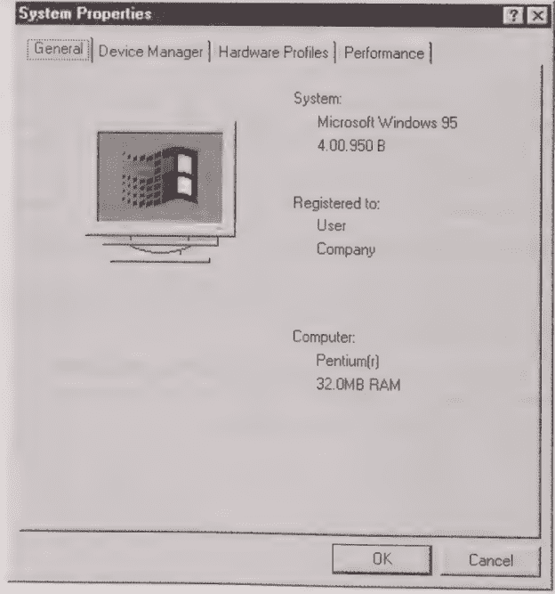
> **图 2-1**：Windows 系统属性窗口
### 2 安装前准备
- 点击“设备管理器”选项卡，此时会显示你计算机硬件配置的图形化界面，请确保选中“按类型查看设备”按钮。此时你可以双击图标（或单击加号 [+]）来查看每个条目的详细信息（见图 2-2），请在以下图标下查找更多信息：
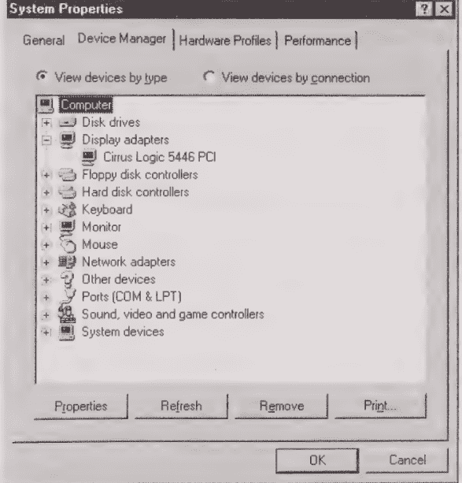
> **图 2-2**：Windows 95 下的设备管理器
- **磁盘驱动器**：此处可查看硬盘类型（IDE 或 SCSI）。（IDE 驱动的名称通常会包含“IDE”字样，SCSI 驱动则不会）
- **硬盘控制器**：此处可查看硬盘控制器的更多信息
- **CD-ROM**：此处可查看连接到计算机的所有 CD-ROM 光驱信息
> **请注意**：某些情况下可能没有 CD-ROM 图标，但计算机的 CD-ROM 光驱仍可正常使用，这是正常现象，取决于 Windows 最初的安装方式。这种情况下你可以查看计算机 config.sys 文件中加载的 CD-ROM 驱动来获取更多信息
- **鼠标**：此处可查看计算机所装鼠标的类型
- **显示适配器**：如果你打算运行 X 窗口系统，请记录此处查找到的信息
- **声音、视频和游戏控制器**：如果你的计算机支持音频功能，此处可查看相关更多信息
- **网络适配器**：此处可查看计算机网卡的额外信息（如果你配有网卡）
- **SCSI 控制器**：如果你的计算机使用 SCSI 外设，此处可查看 SCSI 控制器的额外信息
虽然这种方法无法完全替代打开机箱物理检查每个组件的操作，但在多数情况下，它足以提供继续安装所需的信息。
> **请注意**：你也可以点击“打印...”按钮打印这些信息，此时会弹出第二个窗口，你可以选择打印机以及报表类型（“所有设备和系统摘要”类型的报表是最完整的）
### 显卡配置
如果你打算安装 X 窗口系统，你还需要了解以下信息：
- **你的显卡**：显卡的品牌和型号（或其使用的显示芯片组），以及显存容量。（大多数基于 PCI 的显卡会被安装程序自动识别）
- **你的显示器**：显示器的品牌和型号，以及水平和垂直刷新率的允许范围
### 网络相关信息
如果你要连接到网络，请确保你了解以下信息：
- **IP 地址**：通常由四个用点分隔的数字组成，例如 10.0.2.15
- **子网掩码**：同样是由点分隔的四组数字，例如 255.255.248.0
- **网关 IP 地址**：同样是四组用点分隔的数字，例如 10.0.2.254
- **一个或多个域名服务器 IP 地址**：一组或多组用点分隔的数字，10.0.2.1 可能是域名服务器的地址
- **域名**：分配给机构的名称，例如红帽软件的域名为 redhat.com
- **主机名**：你的计算机的名称，例如计算机可以被命名为 pooh
> **请注意**：以上信息仅为示例！安装红帽 Linux 时请勿使用这些信息！如果你不知道网络对应的正确参数，请咨询你的网络管理员。
### 安装程序用户界面
虽然默认界面是图形用户界面，但对于少数图形设备不受支持的系统，仍然提供基于文本的界面。要使用基于文本的界面，只需在初次启动安装程序时，在启动提示符后输入 *text* 即可。
### 基于文本的界面
基于文本的安装程序使用屏幕化界面，包含了图形用户界面中常见的大部分屏幕控件。它们的外观可能与图形化版本略有不同；本文引入了图 2-3 和图 2-4 以便你更容易识别。以下是最重要的控件列表：
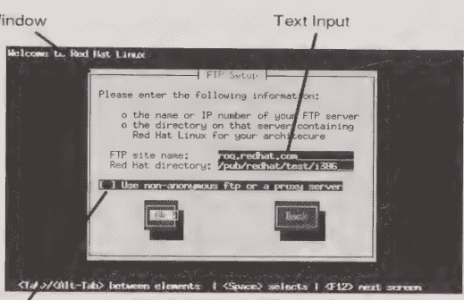
> **图 2-3**：安装程序控件
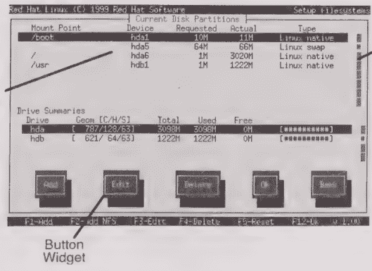
> **图 2-4**：更多安装程序控件
- **窗口**：整个安装过程中，窗口（本手册中也称为对话框）会出现在屏幕上。有时一个窗口会覆盖另一个窗口，这种情况下你只能操作顶层的窗口。完成顶层窗口的操作后，它会自动关闭，你就可以继续操作下层的窗口了。
- **文本输入框**：文本输入行是供你输入安装程序所需信息的区域。当光标位于文本输入行上时，你可以在该行输入或编辑信息。
- **复选框**：复选框用于选择或取消选择安装程序提供的特定功能。当光标位于复选框内时，按下 [Space] 键即可切换复选框的选中/未选中状态。
- **文本控件**：文本控件是专门用于显示文本的屏幕区域。有时文本控件内还会包含其他控件，例如复选框。如果文本控件包含的信息过多，无法一次性全部显示，此时文本控件旁边会出现滚动条；如果将光标定位在文本控件内，你可以使用 [↑] 和 [↓] 键滚动查看所有可用信息。
- **滚动条**：滚动条会直观显示你在文本控件所展示信息中的当前位置，当前所处位置由 # 字符标记，当你前后滚动时，该标记会在滚动条上上下移动。
- **按钮控件**：按钮控件是与安装程序交互的主要方式。通过“按下”这些按钮，你可以逐步推进由多个窗口组成的安装流程。当按钮被光标高亮时，即可按下该按钮。
- **光标**：虽然光标不属于控件，但它用于选择（以及交互）特定控件。当光标在控件之间移动时，可能会使控件改变颜色，你也可能只会看到光标本身位于控件内或控件旁。在图 2-3 中，光标位于“确定”按钮上；图 2-4 中，光标位于窗口顶部的文本控件第一行上。
根据我们对这些控件的描述你可能已经猜到，基于字符的安装程序不使用鼠标。这是因为基于字符的安装程序需要适配种类繁多的计算机，其中部分计算机甚至可能没有鼠标。下一节将介绍与基于字符的安装程序交互所需的按键操作。
### 使用键盘导航
你可以通过一组简单的按键在安装对话框中导航。你需要使用 [←]、[→]、[↑]、[↓] 等按键移动光标，也可以使用 [Tab] 和 [Alt]-[Tab] 在屏幕上的各个控件之间前后循环切换。大多数情况下，每个屏幕的底部都会显示可用功能键的汇总。要“按下”按钮，请先将光标定位到按钮上（比如使用 [Tab] 键），然后按下 [Space]（或 [Enter]）键。要从列表中选择条目，请将光标移动到要选择的条目上，然后按下 [Enter] 键。要通过复选框选择条目，请将光标移动到复选框上，按下 [Space] 键即可选中该条目，再次按下 [Space] 键则取消选中。按下 [F12] 键会确认当前输入的值并进入下一个对话框，这通常等同于按下“确定”按钮。
> **请注意**：除非对话框正在等待你输入，否则安装过程中请勿按下任何按键，否则可能导致不可预知的异常。
### 图形用户界面
安装过程默认提供的图形用户界面（GUI）具备基于文本的界面的所有功能，还额外支持通过鼠标操作界面中的按钮和控件。该界面提供的所有屏幕左侧还会包含一个帮助窗口，提供当前安装步骤的实用信息。

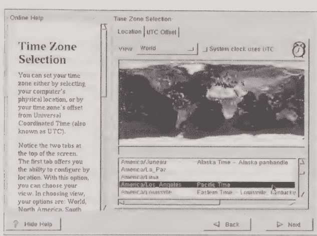
**图2-5：** 图形示例
上方的图2-5中的示例展示了*时区选择*屏幕的界面样例，用来说明图形界面屏幕的各项功能。该屏幕尤其展示了图形界面中提供的一些非标准选择方式。除了文本界面中的滚动条和按钮外，图形界面还在窗口顶部提供了“选项卡”选择器，可用于选择当前窗口中的不同信息屏幕。
该示例窗口特有的功能是地图选择器。使用鼠标点击地图上的圆点即可选中该圆点，进而将对应圆点所在的城市设为本地时区。这种方式可以直接选择时区，无需浏览完整的地点列表。按钮和滚动条也可以通过鼠标指针直接操作。请注意，点击*隐藏帮助*按钮可以收起帮助窗口，为屏幕其余区域腾出更多空间。

**磁盘分区**
几乎所有现代操作系统都会使用磁盘分区，红帽Linux也不例外。安装红帽Linux时，需要操作磁盘分区。如果您此前没有接触过磁盘分区（或是想快速回顾相关基础概念），请在继续操作前阅读附录B。
> **请注意：** 如果您计划执行工作站或服务器级别的安装，且已经有足够的未分区磁盘空间，则无需阅读本节，可以直接跳转至《关于内核驱动程序的说明》。否则，请阅读本节以确定为红帽Linux安装释放磁盘空间的最佳方案。

要安装红帽Linux，必须为其预留磁盘空间。该空间需要与电脑中安装的其他操作系统（如Windows、OS/2，甚至是其他版本的Linux）所占用的磁盘空间相互独立。实现方式是将一个或多个分区专用于红帽Linux。在开始安装流程前，必须满足以下任一条件：
- 计算机必须有足够的未分区磁盘空间可用于安装红帽Linux。
- 计算机必须有一个或多个可以删除的磁盘分区，从而释放出足够的磁盘空间用于安装红帽Linux。

## 2 开始前的准备
接下来我们看看如何完成相关操作。

### 为红帽Linux释放空间
尝试重新分区硬盘时，你可能会遇到以下三种情况：
- 存在未分区的可用空间。
- 存在未使用的分区。
- 正在使用的分区中存在可用空间。

### 使用未分区的可用空间
在这种情况下，已定义的分区并未覆盖整个硬盘，会留出一部分未分配空间，不属于任何已定义的分区。图2-6展示了这种情况的样子。
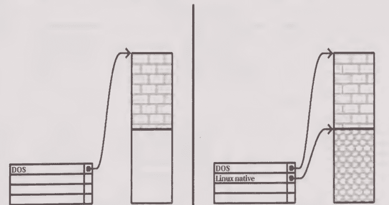
**图2-6：** 带有未分区可用空间的硬盘驱动器
细想之下，未使用的硬盘也属于这种情况；唯一的区别是全部空间都不属于任何已定义的分区。无论如何，你都可以直接从未分配空间中创建所需的分区。遗憾的是，这种情况虽然非常简单，但发生的概率并不高（除非你刚买了一块专门用于红帽Linux的新硬盘）。接下来我们来看一个更常见的情况。

### 使用未使用分区中的空间
这种情况可能发生在你有一个或多个不再使用的分区上。也许你过去曾尝试安装过其他操作系统，但你分配给该系统的分区如今早已无人使用。图2-7展示了这种情况。
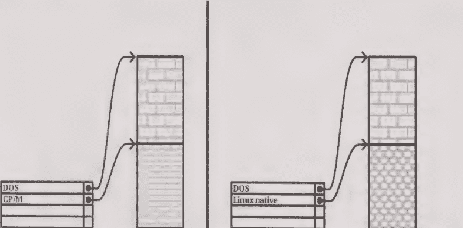
> **图2-7：** 带有未使用分区的硬盘驱动器
如果你遇到了这种情况，可以使用分配给未使用分区的空间。首先你需要删除该分区，然后在原位置创建合适的Linux分区。你可以使用DOS的fdisk工具删除分区，也可以在自定义级别安装的过程中删除分区。

### 使用正在使用的分区中的可用空间
这是最常见的情况，但遗憾的是，这也是最难处理的情况。主要问题在于：哪怕你有足够的可用空间，这些空间目前也已经被分配到了正在使用的分区中。如果你购买的电脑预装了软件，那么硬盘大概率会有一个超大分区，用于存放操作系统和数据。
除了为电脑新增一块硬盘外，你还有两种选择：
- **破坏性重分区** — 基本操作是删除单个大分区，再创建多个较小的分区。如你所想，原分区中的所有数据都会被销毁。因此必须提前做好完整备份。为了保险起见，建议制作两份备份，如果备份软件支持验证功能，请在删除分区前从备份中读取数据以确认备份可用。另外需要注意的是，如果原分区中安装过任何操作系统，也需要重新安装。为现有软件创建一个较小的分区后，你可以重新安装所有软件、恢复数据，然后继续执行红帽Linux安装流程。图2-8展示了这一操作过程。
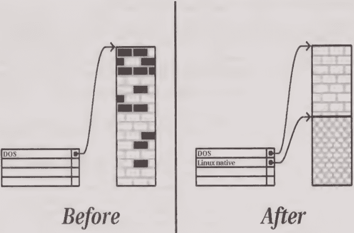
**图2-8：** 正在被破坏性重分区的硬盘驱动器
> **请注意：** 如图2-8所示，如果没有提前做好备份，原分区中的所有数据都将丢失！

- **非破坏性重分区** — 这种情况下，你需要运行一个看似不可能完成任务的程序：它可以在不丢失分区内任何已存储文件的前提下，缩小大分区的容量。很多人发现这个方法可靠且几乎没有问题。那么应该用什么软件来完成这个操作呢？市面上有多款磁盘管理类软件，你需要自行调研，找到最适合你当前情况的软件。

虽然非破坏性重分区的流程相当直观，但涉及多个步骤：
- 压缩现有数据
- 调整分区大小
- 创建新分区

接下来我们详细了解每个步骤。
**压缩现有数据** — 如图2-9所示，第一步是压缩现有分区中的数据。这样做的目的是重新排列数据，使分区“末端”的可用空闲空间最大化。

这一步至关重要；如果不执行这一步，数据的存储位置可能会阻碍分区调整到你期望的大小。另外需要注意，由于某些原因，部分数据无法被移动。如果出现这种情况（且它限制了新分区的大小），你可能不得不对硬盘进行破坏性重分区。
**调整分区大小** — 图2-10展示了实际的分区调整流程。虽然分区调整操作的最终结果会因所用软件的不同而有所差异，但在大多数情况下，新释放出的空间会被用于创建与原始分区类型相同的未格式化分区。


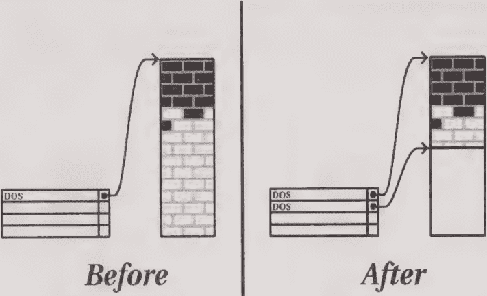
> **图2-10：分区调整后的磁盘驱动器**
### 调整前
### 调整后

了解你使用的分区调整软件会对新释放的空间做何处理非常重要，这样你才能采取相应的操作。在我们演示的案例中，最好的做法是直接删除新创建的 DOS 分区，再创建合适的 Linux 分区。

**创建新分区**——如上一步所述，你可能需要也可能不需要创建新分区。但除非你的分区调整软件支持识别 Linux 分区，否则你很可能需要删除调整分区过程中创建的新分区。图2-11展示了这一操作过程。
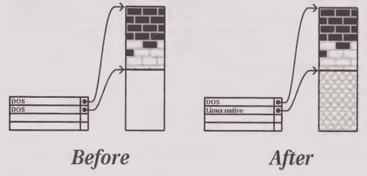
**图2-11：最终分区配置的磁盘驱动器**

fips 工具是为有需求的用户提供的便捷工具。这是一款可以调整 FAT（文件分配表）分区大小的免费程序，已包含在随附光盘的 dosutils 目录中。

> **请注意：** 许多用户已经成功使用 fips 重新划分了自己的硬盘分区。但由于 fips 执行的操作特性，以及它需要适配的硬件和软件配置种类极多，无法保证 fips 在你的系统上正常运行。尽管如此，如果你决定用 fips 重新划分硬盘分区，有两件事至关重要：
> - **做好备份**——将你计算机上的所有重要数据制作两份副本。副本应存储在可移动介质（如磁带、软盘）中，且在继续操作前要确保副本可正常读取。
> - **阅读文档**——完整阅读 fips 的说明文档，该文档位于随附光盘的 /dosutils/fipsdocs 子目录中。如果你决定使用 fips，需注意 fips 运行结束后，你的硬盘会存在两个分区：一个是原本调整过大小的分区，另一个是 fips 从新释放空间中创建的新分区。如果你想用这块空间安装红帽 Linux，则需要删除新创建的该分区，可以到你当前的操作系统中使用 fdisk 工具删除，也可以在自定义安装过程中设置分区时删除。

### 分区命名规则
Linux 使用字母和数字组合的方式来指代磁盘分区，这种方式可能让人困惑，尤其当你习惯了用“C 盘”来指代硬盘及其分区的表述时。在 DOS/Windows 系统中，分区的命名规则如下：
- 首先检查分区的类型，判断 DOS/Windows 是否可以读取该分区。
- 如果分区类型兼容，就会为该分区分配一个“盘符”，盘符从“C”开始。
- 之后就可以用该盘符指代这个分区，以及分区内包含的文件系统。

红帽 Linux 使用的命名规则比其他操作系统的方案更灵活，且能传达更多信息。该命名规则基于文件实现，文件名格式如下：
```
/dev/xxyN
```
以下是分区命名规则的解读方式：
- `/dev/`：这个字符串是所有设备文件存放的目录名称。由于分区位于硬盘上，而硬盘属于设备，因此代表所有可能分区的文件都存放在 /dev/ 目录下。
- `xx`：分区名称的前两个字母表示该分区所在的设备类型。你通常会看到 hd（代表 IDE 硬盘）或 sd（代表 SCSI 硬盘）两种标识。
- `y`：这个字母表示分区所在的设备编号。例如 /dev/hda 代表第一块 IDE 硬盘，/dev/sdb 代表第二块 SCSI 硬盘。
- `N`：最后的数字表示分区序号。前四个（主分区或扩展分区）的编号为 1 到 4，逻辑分区从 5 开始编号。例如，`/dev/hda3` 是第一块 IDE 硬盘上的第三个主分区或扩展分区；`/dev/sdb6` 是第二块 SCSI 硬盘上的第二个逻辑分区。

> **请注意：** 这套命名规则中没有任何部分是基于分区类型设定的；与 DOS/Windows 不同，所有分区都可以在红帽 Linux 下被识别。当然，这并不意味着红帽 Linux 可以访问所有类型分区中的数据，但在很多情况下，可以访问专为其他操作系统预留的分区中的数据。请牢记这一点，在你设置红帽 Linux 所需的分区时，这会让你更容易理解相关操作。

# 2 开始前的准备
如果你的红帽 Linux 分区需要和其他操作系统使用的分区共用同一块硬盘，大多数情况下不会出现问题。但某些 Linux 和其他操作系统的组合需要格外注意。关于创建与其他操作系统兼容的磁盘分区的信息，可以在红帽 Linux 光盘的 `doc/HOWTO` 和 `doc/HOWTO/mini` 目录中的多份 HOWTO 和 Mini-HOWTO 文档里找到。其中，名称以 Linux+ 开头的 Mini-HOWTO 文档非常有帮助。

如果你的机器上要同时安装红帽 Linux/Intel 和 OS/2 系统，你必须使用 OS/2 的分区软件来创建磁盘分区——否则 OS/2 可能无法识别这些磁盘分区。安装过程中不要创建任何新分区，但需要使用 Linux 下的 fdisk 工具为你的 Linux 分区设置正确的分区类型。

### 磁盘分区与挂载点
许多 Linux 新手感到困惑的一点是，Linux 操作系统如何使用和访问分区。在 DOS/Windows 中，这一点相对简单：如果你有多个分区，每个分区都会被分配一个“盘符”，你可以通过盘符来指代对应分区中的文件和目录。这与红帽 Linux 处理分区乃至整个磁盘存储的方式完全不同。

主要区别在于，每个分区都会被用作支撑单一文件目录集所需的存储的一部分。实现方式是通过名为“挂载”的过程，将分区与一个目录关联起来。挂载分区后，该分区的存储空间就会从指定的目录（称为“挂载点”）开始生效。

例如，如果将 `/dev/hda5` 分区挂载到 `/usr` 目录下，就意味着 `/usr` 下的所有文件和目录都会实际存储在 `/dev/hda5` 分区中。因此文件 `/usr/doc/FAQ/txt/Linux-FAQ` 会存储在 `/dev/hda5` 中，而文件 `/etc/X11/gdm/Sessions/Gnome` 则不会。沿用上面的例子，`/usr` 下的一个或多个目录也可能成为其他分区的挂载点。例如，可以将一个分区（比如 `/dev/hda7`）挂载到 `/usr/local` 目录下，这意味着 `/usr/local/man/whatis` 文件会存储在 `/dev/hda7` 中，而非 `/dev/hda5`。

### 需要创建多少个分区？
在准备安装红帽 Linux 的阶段，你需要考虑新操作系统要使用的分区数量和大小。“应该创建多少个分区”这个问题在 Linux 社区内一直争议不断，而且看不到争议结束的尽头，可以肯定的是，分区布局的方案数量和参与讨论的人数一样多。

有鉴于此，我们建议，除非你有其他理由，否则请创建以下分区：
- **交换分区**：交换分区用于支持虚拟内存。如果你的计算机内存小于等于 16MB，你必须创建一个交换分区。即使你的内存更大，也建议创建交换分区。交换分区的最小容量应等于你的计算机内存大小，或者 16MB（取二者中的较大值）。可用的最大交换分区容量约为 127MB，因此创建超过该容量的交换分区会造成空间浪费。但请注意，如果你的系统需要超过 127MB 的交换空间，你可以创建并使用多个交换分区。以下分区配置专用于红帽 Linux/Intel 架构的安装。


# 2 开始之前
- **/boot 分区** — 挂载在 /boot 下的分区包含操作系统内核，以及引导过程中用到的其他少量文件。由于大多数PC BIOS存在限制，创建一个小分区来存放这些文件是个好主意。该分区大小不应超过16MB。
**请注意：** 请务必阅读《磁盘分区与其他操作系统》——其中的信息同样适用于 /boot 分区！
- **根分区** — 根分区是挂载 /（根目录）的位置。在此分区方案中，除存储在 /boot 中的文件外，所有文件都存放在根分区。因此，尽量扩大根分区大小对你最有利。500MB的根分区可支持工作站级别的安装（可用空间非常有限），而1GB的根分区则允许你安装所有软件包。
## 最后一个细节：使用LILO
LILO（Linux引导加载器）是在基于Intel的系统上启动Red Hat Linux最常用的方法。作为操作系统引导加载器，LILO运行于任何操作系统“之外”，仅使用计算机硬件内置的基本输入/输出系统（BIOS）。本节介绍LILO与PC BIOS的交互，仅适用于Intel兼容计算机。
## 影响LILO的BIOS相关限制
LILO受大多数基于Intel的计算机中BIOS施加的一些限制。具体来说，大多数BIOS无法访问超过2块硬盘，也无法访问任何驱动上1023柱面之外存储的任何数据。注意，部分较新的BIOS没有这些限制，但这并非普遍情况。
LILO启动时需要访问的所有数据（包括Linux内核）都位于 /boot 目录中。如果你按照上述推荐的分区方案操作，或是执行工作站/服务器级别的安装，/boot 目录将被放在一个独立的小分区中。否则，它将位于根分区中。无论哪种情况，/boot 所在的分区
## 适用于Red Hat Linux的Linux安装要求
如果要使用LILO引导Red Hat Linux系统，Red Hat Linux必须符合以下规范：
- **位于前两块IDE硬盘上** — 如果你有2块IDE（或EIDE）硬盘，/boot 必须位于其中一块上。注意，这两块硬盘的限制也包括主IDE控制器上的任何IDE CD-ROM驱动器。因此，如果你有一块IDE硬盘，且主控制器上有一块IDE CD-ROM，那么 /boot 必须仅位于第一块硬盘上，即使你在次IDE控制器上还有其他硬盘。
- **位于第一块IDE硬盘或第一块SCSI硬盘上** — 如果你有一块IDE（或EIDE）硬盘和一块或多块SCSI硬盘，/boot 必须位于IDE硬盘或ID为0的SCSI硬盘上。其他SCSI ID均无法生效。
- **位于前两块SCSI硬盘上** — 如果你只有SCSI硬盘，/boot 必须位于ID为0或ID为1的硬盘上。其他SCSI ID均无法生效。
- **分区完全位于1023柱面以下** — 无论上述哪种配置适用，存放 /boot 的分区必须完全位于1023柱面以下。如果存放 /boot 的分区跨越1023柱面，你可能会遇到这种情况：LILO起初可以正常工作（因为所有必需信息都在1023柱面以下），但如果要加载的新内核位于1023柱面之上，LILO就会失败。
如前所述，部分较新的BIOS可能允许LILO在不满足上述规范的情况下运行。同样，即使配置不满足规范，也可以使用LILO部分较为冷门的特性来启动Linux系统。
> **请注意：** Disk Druid以及工作站和服务器级别的安装会考虑这些BIOS相关限制。但如果你决定改用fdisk，你需要自行负责牢记这些限制。
## 引导选项
安装镜像提供了多个引导选项。如果你在*boot:*提示符处仅需等待，默认系统就会启动，在整个安装过程中提供完全的图形界面。只有当你的特定显卡硬件未被识别时，才需要使用*text*选项，该选项将通过完全基于文本的界面完成相同的安装流程。如果你有特殊的硬件需求，或需要以特定方式安装硬件驱动，则需要*boot:*提示符下输入*expert*。
## 默认引导
默认引导流程是指在第一分钟内未进行任何键盘操作时触发的流程。该流程在后续安装过程中提供完全的图形界面，支持在选择和配置选项时使用鼠标。此引导流程依赖硬件的自动检测，可能因不兼容问题而失败。
## 文本引导选项
该引导选项适用于Red Hat安装流程无法识别你的显卡硬件的罕见情况。此选项提供完全基于文本的安装流程，收集的信息与图形用户界面完全一致。
## 专家引导选项
该选项适用于硬件未被正确识别、或需要传入特殊选项才能正常工作的罕见情况。此选项支持在开始自定义安装路径等操作前，安装专用驱动。
# 3 开始安装
本章介绍如何启动Red Hat Linux 6.1的安装流程。本章将涵盖以下内容：
- 启动安装程序；
- 选择安装方法。
学完本章后，安装程序将在你的系统中运行，且已选择好合适的安装方式。
### 启动安装程序
现在可以开始安装Red Hat Linux了。要启动安装，首先需要引导安装程序。开始前，请确保你已准备好安装所需的所有资源。如果你已经读过第2章并按照说明操作，那么你已经准备就绪。
#### 引导安装程序
要开始安装Red Hat Linux，请将引导软盘插入计算机的第一个软盘驱动器并重启（如果计算机支持，也可从Red Hat Linux CD-ROM引导）。你可能需要修改BIOS设置以允许从软盘或CD-ROM引导。等待片刻后，会出现包含 boot: 提示符的界面。该界面包含多种引导选项的相关信息。每个引导选项都对应一个或多个帮助界面。要访问指定帮助界面，请按下屏幕底部列出的对应功能键。
- 如果在第一分钟内未进行任何操作，初始界面将自动启动安装程序。要禁用此功能，请按下任意一个帮助界面功能键。
- 如果按下帮助界面功能键，由于需要从软盘读取帮助界面内容，会有少许延迟。
### 适用于Red Hat Linux的Linux安装方法
通常情况下，你只需按下[Enter]即可引导。请留意引导信息，查看Linux内核是否识别到你的硬件。如果内核未正确识别硬件，你可能需要在“专家”模式下重启安装。专家模式会禁用大部分硬件探测功能，允许你输入安装过程中加载的驱动对应的选项。可通过以下引导命令进入专家模式：
``` boot: expert ```
> **请注意：** 初始引导信息不会包含任何SCSI或网卡的相关内容。这些设备由安装过程中加载的模块提供支持。还可以向内核传入参数。例如，要指示内核使用128MB系统中的全部内存，请输入：
``` boot: linux mem=128M ```
不过，大多数计算机无需向内核传入此参数。大多数情况下，内核会自动检测系统的内存容量。要确保所有内存均被正确识别，请在shell提示符下输入：
``` cat /proc/meminfo ```
该命令会以total、used、free等形式显示内核检测到的内存容量。如果MemTotal的数值与你的系统不符，你需要修改lilo.conf文件，以在引导时向内核传入对应的内存参数。例如，如果你的计算机有96MB内存，你需要添加：
``` append="mem=96M" ```
输入所有参数后，按下[Enter]即可使用这些参数引导。如果你确实需要指定引导选项来识别硬件，请记下这些选项——后续还会用到。


## 3 开始安装
### 开始安装过程
启动后，安装程序首先显示欢迎消息。按[Enter]键开始安装。如果您此时希望中止安装过程，只需取出启动软盘并重新启动计算机即可。

### 选择语言
欢迎对话框之后，安装程序将要求您选择安装过程中使用的语言（参见**图 3-2：选择语言**）。使用[\uparrow]和[\downarrow]键选择合适的语言。语言列表右侧可能会出现滚动条——如果出现滚动条，表示条目数量多于一次能显示的数量。您将在整个安装程序中多次看到类似的滚动条。


### 选择键盘类型
接下来，安装程序将提供选择键盘类型的机会（参见**图 3-3：选择键盘类型**）。您可以使用与语言选择对话框相同的方式导航此对话框。选择合适的键盘类型后，按[Enter]键；您选择的键盘类型将在剩余的安装过程中以及每次启动 Red Hat Linux 系统时自动加载。如果您希望在安装 Red Hat Linux 系统后更改键盘类型，可以使用 `/usr/sbin/kbdconfig` 命令，也可以在 root 提示符下输入 `setup`。
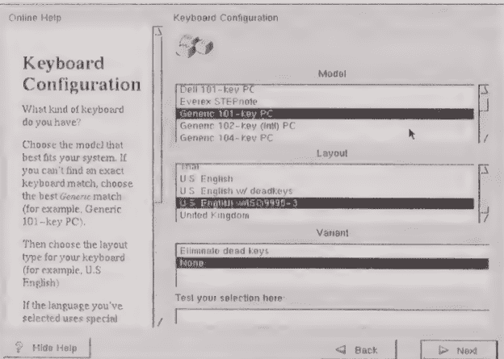

### 配置鼠标
接下来，系统将探测鼠标设备。某些鼠标可能会被自动检测到；在这种情况下，将显示一个对话框，显示检测到鼠标的端口。然后可能会要求您提供更多信息，例如您是否拥有双键鼠标，并希望将其模拟为三键鼠标。做出适当的选择，然后继续到下一节。更常见的情况是，您将看到类似于图 3-4 中所示的屏幕。
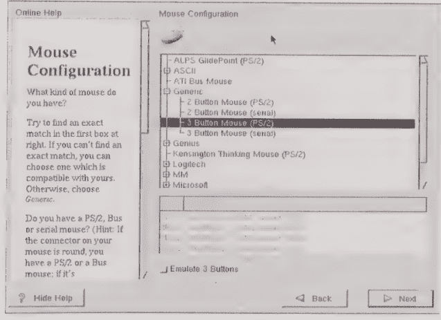
安装程序对系统鼠标类型的"最佳猜测"将被高亮显示。如果鼠标类型不准确，请使用[\uparrow]和[\downarrow]键在不同的鼠标类型之间滚动。通常，您应按照以下方法选择系统鼠标类型：
- 如果您在列表中找到了与您的鼠标完全匹配的条目，请高亮显示该条目。
- 如果您找到了确定与您的鼠标兼容的鼠标，请高亮显示该条目。
- 否则，请根据鼠标的按键数量和接口类型，选择相应的 Generic 条目。要确定鼠标的接口类型，请沿着鼠标线缆追溯到其插入系统的位置。如果鼠标线缆末端的连接器插入的是矩形连接器，则您使用的是串口鼠标。另一方面，如果连接器是圆形的，则您使用的是 PS/2 鼠标。如果您在笔记本电脑上安装 Red Hat Linux，在大多数情况下，定位设备将与 PS/2 兼容。
**模拟三键**复选框允许您将双键鼠标当作三键鼠标使用。通常，如果您拥有三键鼠标，使用 X Window 系统将最为便捷。如果您选中此复选框，可以通过同时按下两个鼠标按键来模拟第三个"中键"。如果您选择了串口接口的鼠标，接下来将看到类似于**图 3-5：串口鼠标端口选择**所示的屏幕。只需高亮显示适用于您鼠标的串口，选择"确定"，然后按[Space]键。
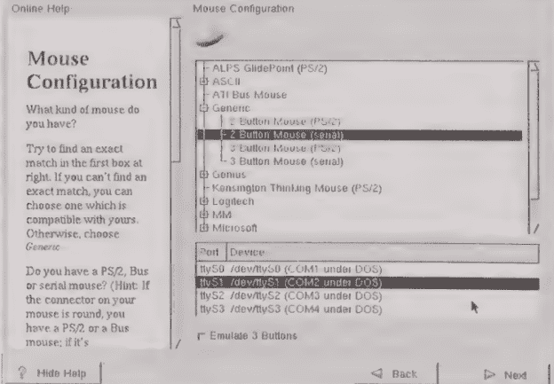

| 端口    | 设备                            |
| ------- | ------------------------------- |
| tty50   | /dev/tty50 (DOS 下的 COM1)     |
| ttyS1   | /dev/ttyS1 (DOS 下的 COM2)     |
| ttyS2   | /dev/ttyS2 (DOS 下的 COM3)     |
| ttyS3   | /dev/ttyS3 (DOS 下的 COM4)     |

**图 3-5：串口鼠标端口选择**

如果您希望在启动 Red Hat Linux 系统后更改鼠标配置，可以使用 `/usr/sbin/mouseconfig` 命令。如果您希望将鼠标配置为左手鼠标，可以重置鼠标按键的顺序。这可以在启动 Red Hat Linux 系统后通过输入 `gpm -B 321` 来完成。

### 欢迎界面
Red Hat 欢迎屏幕标志着安装过程的正式开始。从现在起，您将开始对最终系统的安装做出各种选择。
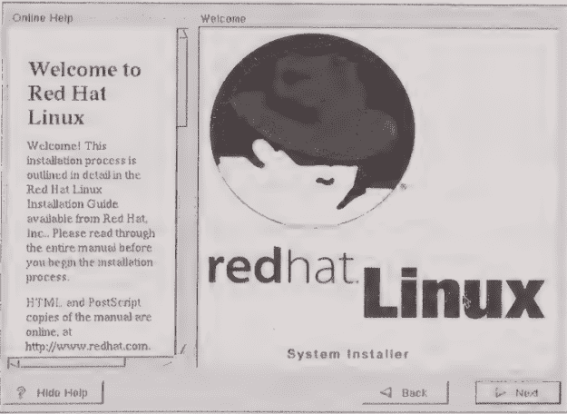

**图 3-6：Red Hat 欢迎屏幕**

### 选择安装类型
如果您已经安装了 Red Hat Linux 系统（版本 2.0 或更高），则可以通过在"安装路径"选择屏幕中选择"升级"路径，将当前系统升级到 6.1（参见**图 3-7：安装路径选择**）。
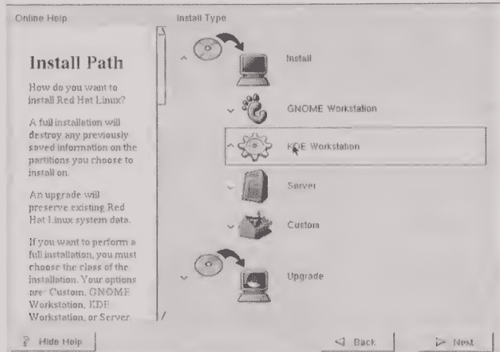
如果您正在进行 Red Hat Linux 6.1 的"全新"安装，则有以下几个选项可供选择：
- KDE 工作站
- GNOME 工作站
- 服务器
- 自定义
根据您的个人偏好，您可以选择安装基于 GNOME 或 KDE 的工作站。它们都是适合工作站使用的集成桌面环境。
"服务器"选项安装一个适合作为服务器使用的系统，不包含图形桌面的额外功能，而"自定义"安装则提供了两者的混合，以及额外的选项，例如开发工具，以及第三个图形界面选项（不包含任何桌面的 XFree86 系统）。选择其中任一选项将开始安装您指定类型的系统，但请放心，如果您发现安装的系统不符合预期，仍然可以返回并重新考虑这第一个问题。在您最终确认开始安装之前（安装过程的后半部分），您始终可以使用"返回"按钮回溯之前的步骤。

## 4 安装 Red Hat Linux 6.1
安装程序提供了三条主要的安装路径：
- 工作站安装
- 服务器安装
- 自定义安装
本章将详细讨论这些安装路径。

### 工作站安装
提供了两种不同的工作站安装方式。当选择*GNOME 工作站*时，安装程序将安装基于 GNOME 桌面的工作站。当选择*KDE 工作站*时，安装程序将安装基于 KDE 桌面环境的工作站。无论选择哪种方式，安装过程都是相同的，尽管最终生成的桌面当然会有所不同。

### 分区
选择桌面后，下一步任务是为新工作站找到放置位置。这些"位置"被称为分区。大多数 Linux 安装需要多个分区，Red Hat 也不例外。安装程序可以自行创建所需的分区，但代价是在这种情况下，预先存在的分区上的所有数据都将丢失。*分区选择屏幕*提供了此默认行为的替代方案。
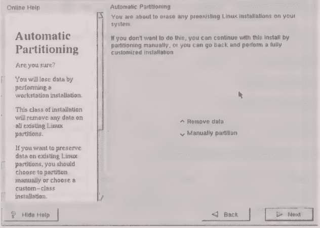

**图 4-1：分区选择屏幕**

默认选项*删除数据*将删除驱动器上的当前分区，并自动创建适合安装的分区。如果您希望控制新系统的分区方式，请选择*手动分区*选项，并阅读本章末尾**自定义安装**部分中关于 **Disk Druid** 的介绍。通过*手动分区*选项，您可以完全控制驱动器的分区方式，以便 Red Hat Linux 6.1 系统使用。一旦分区完成——无论是让安装程序自动完成还是由您手动操作——接下来的问题很可能是关于是否需要激活交换分区。此处通常的回复是"确定"。接下来显示的屏幕将告知哪些分区已安排进行全新格式化，并提供检查介质上坏块的选项。


### 网络配置
许多机器通过以太网卡接入各类网络。若要利用该网络连接并在安装过程中完成配置，你需要从其中一张“网络”启动软盘启动。如果你已经完成以上所有步骤，并且你的网卡已被内核识别，那么接下来出现的界面就是*网络配置*界面。如果情况并非如此，请直接跳至下一部分。
**图4-2：网络配置**
在该界面中，你可以设置接口的IP地址、指定域名服务器地址，还可以设置主机名。虽然其余大部分信息会根据你填写的字段自动计算生成，但你仍可能需要手动修改这些数值。这些数值包括网络地址、子网掩码、广播地址，以及网关和DNS地址。当你对该界面的设置感到满意后，网络配置阶段即完成。

## 时区选择
Linux被全球的计算机所使用，这就需要系统能够“调整”以适配当地时间。这一调整需要为系统指定时区来实现。下一个界面将提供设置系统时区的方法。
**图4-3：时区选择**
你可以通过世界地图选择你所处时区内的城市，（还可以查看除默认世界地图外的其他特定大洲），或者浏览按字母排序的城市及对应时区列表。点击界面左下角的“下一步”按钮，即可进入安装的下一个步骤。“返回”按钮会带你回到安装的上一个步骤，你可以返回修改之前的选择。选择“下一步”进入下一个界面。

## 账户配置
Linux是多用户系统，所有用户都通过*用户账户*进行管理。所有系统都有一个名为**root**的特殊用户（即*超级用户*），该用户在系统中拥有无限制的权限。为了区分并保护不同的账户，每个账户都会设置一个密码，仅授予需要访问该账户的用户。**root**密码的设置，以及额外*用户账户*的添加，都可以在**账户配置**界面完成。
**图4-4：账户配置**
在输入并确认root密码之前，该界面的“下一步”按钮不会处于可点击状态。虽然你可以根据需要向系统中添加任意数量的用户账户，但并非必须创建，你也可以不创建任何用户账户直接进入下一步。大多数情况下，建议你至少创建一个普通用户级别的账户，不要仅依赖root账户作为访问该设备的唯一途径。

## 服务器安装
选择*服务器*安装选项后，会出现与*工作站*安装基本相同的设置选项。**服务器安装**的流程与**工作站安装**部分描述的步骤、界面完全一致。

### 网络配置的必要性
除非你安装的服务器仅需支持拨号接入，否则你大概率需要配置网络。为确保你的网卡能被内核识别，你应该使用两张“网络”镜像中的一张启动。（参见第2章的启动软盘部分。）如果你进入*时区配置*界面时仍未看到*网络配置*界面，说明你的以太网卡未被识别，你需要尝试使用其他网络启动镜像。

### 安装流程
*服务器*安装的初始步骤与*工作站*安装的步骤完全一致。服务器安装的唯一区别在于，安装的最后阶段不会要求你配置X Window图形卡界面。磁盘分区、网络配置、时区信息设置、root密码设置以及新用户账户创建，这些操作都会使用之前描述的*工作站*安装对应的界面完成。

### 自定义安装
当你选择*自定义*安装，或在*自动分区*窗口中选择*手动*选项时，会弹出*Disk Druid*窗口，你可以通过该窗口管理硬件设备的磁盘分区。

## 使用Disk Druid
无论你通过何种方式打开Disk Druid，都会看到如图4-5所示的界面。初次看到该界面可能会觉得复杂，但实际上并不难。接下来我们逐段介绍Disk Druid的三个分区。
**图4-5：Disk Druid主界面**

### “当前磁盘分区”部分
“当前磁盘分区”部分的每一行都对应一个磁盘分区。你会发现该部分右侧有滚动条，这意味着分区数量可能超过单屏显示上限。如果你使用[↑]和[↓]方向键，就可以查看是否存在其他未显示的分区。该部分的每一行都包含五个不同字段：
- **挂载点** — 该字段表示Red Hat Linux安装并运行后，分区将被挂载到的位置。
- **设备** — 该字段显示分区的设备名称。
- **请求大小** — 该字段显示定义分区时要求的最小容量。
- **实际大小** — 该字段显示当前分配给该分区的空间大小。
- **类型** — 该字段显示分区的类型。

### 另一类分区
当你滚动浏览“当前磁盘分区”部分时，可能会看到“未分配的已请求分区”标题栏，其下方有一个或多个分区。顾名思义，这些分区是已经被请求分配，但因某些原因尚未完成分配的分区。出现未分配分区的常见原因是可用于该分区的剩余空间不足。无论如何，分区未分配的原因会显示在该分区的挂载点之后。

### “驱动器摘要”部分
“驱动器摘要”部分的每一行都对应你系统中的一个硬盘。每一行包含以下字段：
- **驱动器** — 该字段显示硬盘的设备名称。
- **几何参数** *[柱面/磁头/扇区]* — 该字段显示硬盘的几何参数，由硬盘报告的柱面数、磁头数和扇区数三个数值组成。
- **总容量** — 该字段显示硬盘的可用总空间。
- **已用空间** — 该字段显示当前分配给分区的硬盘空间大小。
- **可用空间** — 该字段显示硬盘上仍未分配的剩余空间大小。
- **柱状图** — 该字段以可视化形式展示硬盘当前已用空间，方括号内的井号（#）越多，代表可用空间越少。在图4-5中，柱状图显示该硬盘已无可用空间。
**请注意：**“驱动器摘要”部分仅用于展示计算机的磁盘配置，并非用于为指定分区选择目标硬盘的途径。相关内容会在*添加分区*部分更详细地说明。

### Disk Druid的按钮
这些按钮用于控制Disk Druid的操作，可以用来添加、删除分区，或修改分区属性。此外，还有用于确认你做出的修改、或完全退出Disk Druid的按钮。接下来我们按顺序介绍每个按钮的功能：
- **添加** — “添加”按钮用于申请创建一个新分区。点击该按钮后，会弹出包含必填字段的对话框。
- **编辑** — “编辑”按钮用于修改“当前磁盘分区”部分中当前高亮选中的分区的属性。点击该按钮后会弹出对话框，“编辑分区”对话框中的部分或全部字段可根据情况修改，具体取决于分区信息是否已经写入磁盘。
- **删除** — “删除”按钮用于删除“当前磁盘分区”部分中当前高亮选中的分区。点击该按钮后会弹出对话框，要求你确认删除操作。
- **确定** — “确定”按钮会将你对系统分区做出的所有修改写入磁盘。在Disk Druid重写硬盘分区表之前，会要求你确认修改。此外，你设置的所有挂载点会传递给安装程序，最终供Red Hat Linux系统用于定义文件系统布局。
- **返回** — 该按钮会终止Disk Druid的操作，不会保存你做出的任何修改。选择该按钮后，安装程序会带你回到上一个界面，你可以重新开始操作。

### 便捷功能键
虽然Disk Druid的按钮与可用功能键存在部分功能重叠，但有两个功能键没有对应的按钮：
- **[F2]（添加NFS）** — 该功能键用于将只读NFS提供的文件系统添加到Red Hat Linux系统的挂载点集合中。按下该键后，会弹出包含必填字段的对话框。
- **[F5]（重置）** — 该功能键用于丢弃你做出的所有修改。


## Red Hat Linux 安装指南
在 Disk Druid 中所做的更改可将分区列表恢复为从硬盘上的分区表中读取的内容。选中该选项后，系统会询问你是否确认要丢弃这些更改。请注意，任何你指定的挂载点都将丢失，之后需要重新输入。
> **请注意：** 你需要至少划分一个分区用于安装 Red Hat Linux，也可划分更多分区。相关内容在《分区命名规范》中有更详细的说明。
接下来我们来看看如何使用 Disk Druid 为你的 Red Hat Linux 系统配置分区。
## 添加分区
要添加新分区，请选中**添加**按钮，然后按下 [Space] 或 [Enter]。随后会弹出名为“编辑新分区”的对话框（见图 4-6），该对话框包含以下字段：
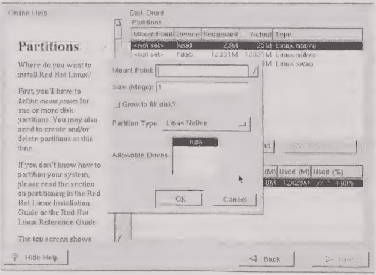
**图 4-6：创建新分区**
- **挂载点** – 选中该字段后输入分区的挂载路径。例如，如果该分区是根分区，输入 /；如果是 /usr 分区，输入 /usr，以此类推。
- **大小（MB）** — 在该字段中输入分区的大小（单位为 MB）。请注意，该字段默认预填了“1”，如果不修改，最终会创建出 1 MB 的分区。请使用 [Backspace] 键删除默认值，再输入你想要的分区大小。
- **可扩展？** — 该复选框用于标识前一个字段中输入的分区大小是分区的精确大小还是最小大小。按下 [Space] 可勾选/取消勾选该复选框。勾选后，分区会扩展以占满硬盘上所有可用空间。这种情况下，其他分区调整大小时，该分区的大小也会随之增减。请注意，你可以将多个分区设置为可扩展，此时额外的可用空间会在所有可扩展分区之间共享。
- **类型** — 该字段列出了不同的分区类型，使用 [↑] 和 [↓] 键可选择合适的分区类型。
- **允许使用的驱动器** — 该字段列出了你系统中安装的所有硬盘，每个硬盘旁都有一个复选框。如果某个硬盘的复选框被勾选，说明该分区可以创建在这块硬盘上；如果未勾选，则该分区永远不会创建在这块硬盘上。你可以通过设置不同的复选框选项，让 Disk Druid 按照你的意愿放置分区，或者由 Disk Druid 自动决定分区的存放位置。
- **确定** — 当你对分区的设置感到满意、希望创建该分区时，选中此按钮并按下 [Space]。
- **取消** — 当你不想创建该分区时，选中此按钮并按下 [Space]。
## 添加分区时遇到的问题
> **请注意：** 如果你在添加分区时遇到问题，可以查阅附录 B 获取更多信息。
如果你尝试添加分区但 Disk Druid 无法执行你的请求，会弹出如图 4-7 所示的对话框。对话框中会列出所有当前未分配的分区，以及它们无法被分配的原因。选中“确定”按钮并按下 [Space] 即可继续。请注意，未分配的分区也会显示在 Disk Druid 的主界面中（你可能需要滚动**当前磁盘分区**部分才能看到它们）。
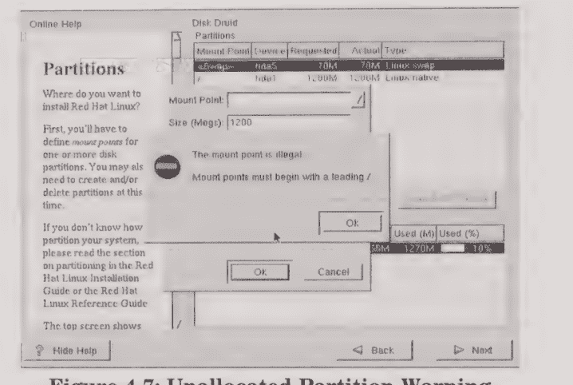
**图 4-7：未分配分区警告**
### 删除分区
要删除分区，请在**当前磁盘分区**部分选中目标分区，再点击**删除**按钮并按下 [Space]，系统会要求你确认删除操作。
### 编辑分区
要修改分区的设置，请在**当前磁盘分区**部分选中目标分区，再点击**编辑**按钮并按下 [Space]，会弹出一个与图 4-7 非常相似的对话框。完成相应修改后，选中**确定**并按下 [Space]。
**请注意：** 如果该分区已经存在于你的硬盘上，你只能修改分区的挂载点。如果想要进行其他修改，你需要先删除该分区再重新创建。
## 重新开始
如果你想放弃在 Disk Druid 中做的所有更改，转而使用 fdisk，可以选中**返回**按钮并按下 [Space]。如果你希望继续使用 Disk Druid 但重新开始配置，按下 [F5] 键即可，Disk Druid 会重置为初始状态。
## 完成配置后
完成分区配置和挂载点输入后，你的屏幕会显示为图 4-8 所示的样子。选中“确定”并按下 [Space]。
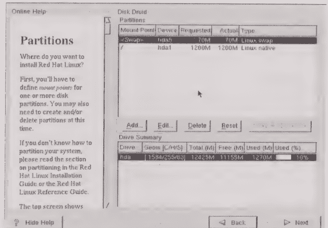
**图 4-8：** 已定义的分区与挂载点
## 格式化分区
下一个对话框会列出需要格式化的分区（见图 4-9）。所有新创建的分区都需要格式化。此外，所有包含不再需要的旧数据的已有分区也需要格式化。但如果**/home**或**/usr/local**这类分区包含你希望保留的数据，则绝对不要格式化它们。选中需要格式化的每个分区并按下 [Space]。如果你希望在格式化每个文件系统时检查坏块，请勾选**格式化时检查坏块**选项。完成后选中**确定**并按下 [Space]。
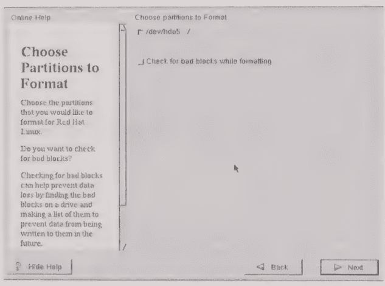
**图 4-9：格式化分区**
### 安装 LILO
要能够启动你的 Red Hat Linux 系统，通常需要安装 LILO（Linux 引导加载器）。LILO 可以安装在以下两个位置之一：
## 主引导记录（MBR）
除非 MBR 已经被其他操作系统引导加载器（例如 System Commander 或 OS/2 引导管理器）占用，否则推荐将 LILO 安装到主引导记录（MBR）中。主引导记录是硬盘上的一个特殊区域，计算机会自动通过 BIOS 加载该区域，这也是 LILO 能够接管引导流程的最早节点。如果将 LILO 安装到 MBR 中，机器启动时会显示 boot: 提示符，此时你可以启动 Red Hat Linux，或启动任何你配置 LILO 支持引导的其他操作系统（见下文）。
## 根分区的第一个扇区
如果你已经在系统中使用了其他引导加载器（例如 OS/2 引导管理器），则推荐将 LILO 安装到根分区的第一个扇区。这种情况下，其他引导加载器会先获得控制权，你可以配置该引导加载器启动 LILO，再由 LILO 引导 Red Hat Linux。
随后会弹出一个对话框，供你选择想要的 LILO 安装类型（见图 4-10）。选择你希望安装 LILO 的位置后按下**确定**。如果你不想安装 LILO，按下**跳过**即可。
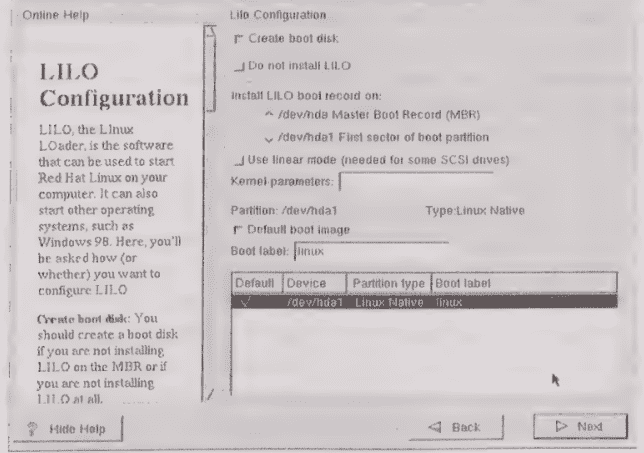
**图 4-10：安装 LILO**
> **请注意：** 如果你选择“跳过”，将无法直接启动 Red Hat Linux 系统，需要使用其他引导方式（例如启动软盘）。请仅在确认有其他方式可以引导 Red Hat Linux 系统时使用该选项！
### SMP 主板与 LILO
本节仅针对 SMP 主板。如果安装程序检测到你的系统使用的是 SMP 主板，会自动创建两条 lilo.conf 配置项（而非通常的一条），分别命名为 smp 和 linux，默认启动 smp 项。如果你在使用 smp 内核时遇到问题，可以选择启动 linux 项，此时你仍能保留之前的所有功能，仅使用单核处理器运行。
### 为 LILO 引导命令行添加选项
接下来，安装程序会询问你是否要为 LILO 引导命令添加默认选项（见图 4-10）。你输入的所有选项都会在每次系统启动时传递给 Linux 内核。如果你在《基础硬件配置》中查看计算机的 BIOS 设置时发现，计算机以 LBA 模式访问硬盘，请勾选“使用线性模式”选项。完成后选中“确定”并按下 [Space] 即可。
所有可能可启动的分区都会在列表中列出，包括其他操作系统使用的分区。存放 Red Hat Linux 系统根文件系统的分区的“引导标签”列会默认填充为“linux”，其他分区也可能有引导标签。
如果你想要为其他分区添加引导标签（或修改已有的引导标签），请使用方向键选中目标分区，再按下 [Tab] 键选中“编辑”按钮并按下 [Space]，随后会弹出一个小对话框，允许你输入/修改分区的引导标签。完成后按下“确定”即可。
另外还有一个名为“默认”的列，该列下只有一个分区会带有星号标记。如果没有用户输入，LILO 就会引导这个被标记为默认的分区。


启动过程。*最初*，你安装的Red Hat Linux的根分区会被选为默认分区。如果你想更改，使用方向键突出显示想要设为默认的分区，然后按下[F2]。星号会移动到选中的分区上。完成后，选择**确定**，按下[Space]。

## LILO的替代方案
如果你不想使用LILO来引导你的Red Hat Linux系统，有以下几种替代方案：
### 启动软盘
你可以使用安装程序创建的启动软盘（如果你选择创建了的话）。
### LOADLIN
LOADLIN可以从MS-DOS加载Linux；遗憾的是，它要求在MS-DOS分区上存有一份Linux内核副本（如果你有SCSI适配器，还需要有初始RAM磁盘）。完成这一操作唯一的方法是使用其他方式引导你的Red Hat Linux系统（例如从软盘上的LILO引导），然后将内核复制到MS-DOS分区上。
**LOADLIN**可以从`ftp://metalab.unc.edu/pub/Linux/system/boot/dualboot/`及关联的镜像站点获取。
### SYSLINUX
**SYSLINUX**是一个和LOADLIN非常相似的MS-DOS程序；它同样可以从`ftp://metalab.unc.edu/pub/Linux/system/boot/loaders/`及关联的镜像站点获取。
### 商用引导加载程序
一些商用的**引导加载程序**，比如System Commander，可以引导Linux（但仍需要将LILO安装在你的Linux根分区中）。

### 网络、时区和账户配置
如果已经使用网络启动软盘启动，接下来会显示*网络配置*界面。这和本章前面*工作站安装*部分所描述的界面相同。在这个界面之后，会依次显示*时区和账户配置*界面，流程和*工作站*或*服务器安装*一致。
### 认证配置
认证方法可以通过多种方式使用密码，以增强密码的安全性。所有系统都会以某种方式加密密码。Red Hat Linux 6.1提供了其中几种方法，可以通过以下界面进行配置：
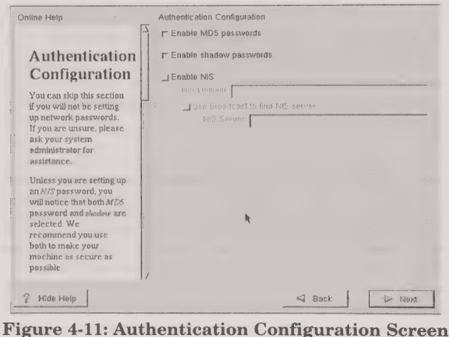
该界面提供了设置不同网络密码认证的选项：
- **启用隐藏密码** — 为你提供一种非常安全的密码存储方式。/etc/passwd文件会被仅root可读的/etc/shadow文件替代。
- **MD5密码** — 允许长密码最多使用256个字符，而非标准的8个或更少字符。

## 4 安装Red Hat Linux 6.1
- **启用NIS** — 允许你在同一个网络信息服务（NIS）域中运行一组使用通用密码和组文件的计算机。
- [x] NIS域 — 该选项允许你指定系统所属的域或计算机组。
- [x] NIS服务器 — 该选项会使你的计算机使用指定的NIS服务器，而非向局域网广播消息以寻找可用的服务器来托管你的系统。
> **请注意**：要配置NIS选项，你必须连接到NIS网络。如果你不确定是否已连接到NIS网络，请咨询你的系统管理员。除非你要设置NIS密码，否则你会发现隐藏密码和MD5都已被选中。我们建议你同时启用这两项，以使你的机器尽可能安全（见图4-11）。

### 选择并安装软件包
在分区配置完成并选定要进行格式化的分区后，你就可以选择要安装的软件包了。你可以选择按功能将软件包分组的组件，也可以选择单独的软件包，或者两者结合选择。
### 选择组件
组件会根据其提供的功能将软件包分组，例如**C语言开发**、**联网工作站**或**Web服务器**。选择你想要安装的每个组件，然后按下[Space]。选择**所有组件**（位于组件列表末尾）会安装Red Hat Linux附带的所有软件包（见图4-12）。选择所有软件包将需要接近1GB的可用磁盘空间。
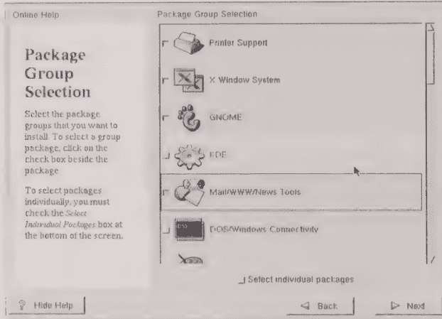
**图4-12：选择系统组件**
如果你想选择或取消选择单独的软件包，勾选**选择单独软件包**复选框。
### 选择单独的软件包
选定要安装的组件后，你可以选择或取消选择单独的软件包。安装程序会显示可用的软件包组列表；使用方向键选择要查看的组，然后按下[Enter]或[Space]。安装程序会显示该组内的软件包列表，你可以使用方向键突出显示某个软件包，然后按下[Space]来选择或取消选择它（见图4-13）。
> **请注意**：部分软件包（例如内核和某些库）是每套Red Hat Linux系统必需的，无法选择或取消选择。
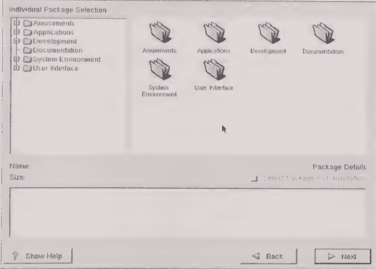
**图4-13：选择软件包**
完成单独软件包的选择后，在**选择组**对话框中按下**确定**。
### 获取软件包信息
你可以在下方的对话框中查看当前突出显示的软件的详细描述，该对话框包含软件的说明信息。如果描述内容超出屏幕范围，你可以滚动查看。

## 5 完成安装
在前面的章节中，我们已经讨论了各特定安装路径的流程。接下来会执行一些通用的安装步骤。
## X窗口配置
除非你安装的是*服务器*类型，否则会显示*X配置工具*界面来完成X Window系统的配置。尽管大部分配置已经自动完成，但显示器类型和部分自定义设置无法自动完成，图5-1所示的界面可用于配置这些项目。
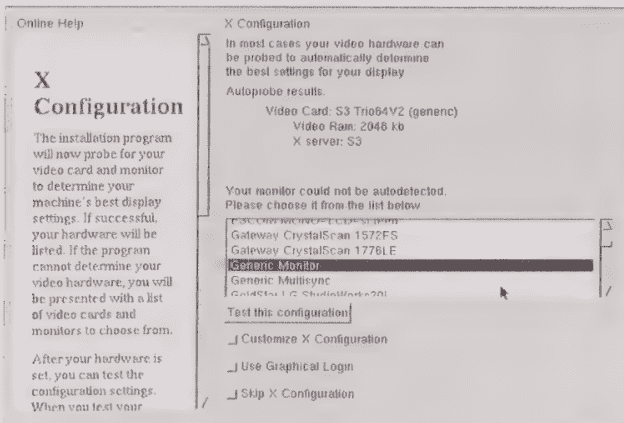
**图5-1：X配置工具**
### 选择显示器
图5-1界面中间的可滚动窗口按字母顺序列出了大量已知的显示器类型，选择与你显示器最匹配的选项即可。
### 安装软件包
X Window配置完成后，新系统的实际安装工作就会开始。
### 格式化驱动器
安装的第一步是在之前指定的分区上创建文件系统。
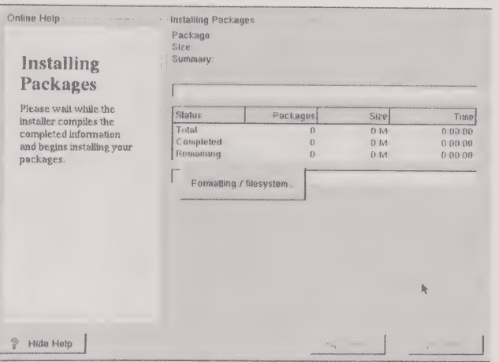
> **图5-2：驱动器格式化**。图5-4是你在该步骤中可能看到的典型界面。


### 软件包安装状态
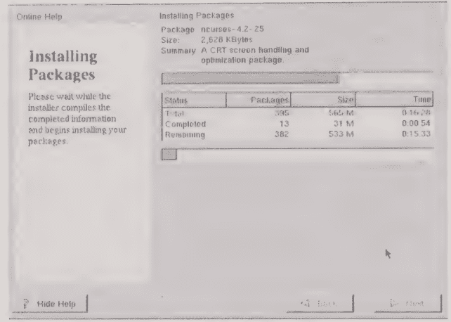
如图5-5所示，*安装状态界面*会显示当前正在安装的软件包，以及安装完成进度和剩余安装量的提示。现在正是去倒杯饮料、坐在舒适的椅子上等待的好时机，安装程序会执行你下达的指令。

### 启动盘创建
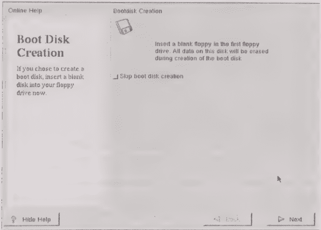
你需要一张全新、已格式化的软盘来创建启动盘。磁盘的质量非常重要，因为这是你的应急恢复方式，你肯定不希望它出现故障。按照界面显示的提示操作，你最终会得到一个启动软盘，可以用它来启动你新安装的系统。

### 恭喜！
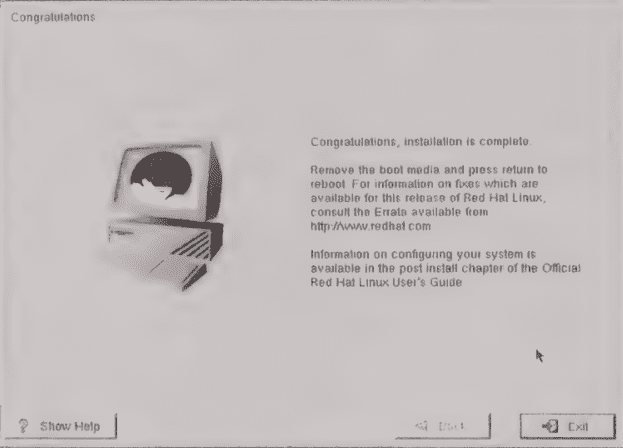
当你看到这个界面时，就说明你已经完成了安装流程的所有步骤，可以重启并进入全新的Red Hat Linux 6.1系统，马上开始使用了！

## 6 查找文档
Red Hat Linux附带了数千页在线文档，帮助你学习如何使用该系统。附带的手册页、info文档和纯文本文件涵盖了Linux几乎各方面的信息。如果你安装了Linux文档项目生成的文档，Red Hat Linux也会包含这些内容。

### 在线帮助
当你需要查找有关命令和错误消息的通用帮助时，最佳起点就是你的系统本身。你随手就能找到多个不同的信息来源：
- **手册页** — 命令、文件格式和系统调用的权威参考资料。
- **软件包文档** — 许多软件包包含额外文档，RPM可以帮助你找到它们。
- **操作指南与常见问题解答** — 来自Linux文档项目的有用信息。
- **locate命令** — 能够帮你关联命令及其对应文档的工具命令。
- **info页** — 无需联网的超文本文档。
让我们逐一了解这些信息来源。

### 手册页
你系统中的几乎所有命令都有对应的“man”手册页。如果你有疑问或遇到问题，可以随时查阅这些文档。例如，如果你在使用`ls`命令时遇到问题，可以通过输入`man ls`来获取更多信息，这会调出ls对应的手册页。手册页通过`less`程序查看（该程序支持逐屏前后翻页），因此在查看手册页时，所有`less`程序的选项都可以使用。`less`程序常用的重要快捷键包括：
- 按下[q]退出
- 按下[Enter]逐行向下翻页
- 按下[Space]逐页向下翻页
- 按下[b]向上翻一页
- 输入[/]后接搜索字符串，再按[Enter]即可搜索指定字符串
- 按下[n]查找上一个搜索内容的下一处匹配

有时候从纸质材料上阅读内容会更方便。如果你有可用的打印机，也可以打印手册页。如果你没有PostScript打印功能，只想打印ASCII内容，可以使用以下命令打印手册页：
```man COMMAND | lpr```
如果你有PostScript打印机，可能会更倾向于使用以下命令打印：
```man -t COMMAND | lpr```
在这两条命令中，将“COMMAND”替换为你需要查询帮助的命令即可。

有时候你会发现某些系统组件有多个手册页。下表展示了用于划分手册页的章节：
| 章节 | 内容 |
|---------|----------|
| 1 | 用户命令 |
| 8 | 系统命令 |
| 2 | 系统调用 |
| 3 | 库调用 |
| 4 | 设备 |
| 5 | 文件格式 |
| 6 | 游戏 |
| 7 | 杂项 |
| 9 | 内核内部接口 |
| n | Tcl/Tk命令 |

这也是手册页的搜索顺序。这一点非常重要，举个例子：
假设你想查看swapon系统调用对应的手册页，因此你输入`man swapon`。实际上你会得到`swapon(8)`的手册页，这是用于控制交换功能的命令。根据上表，你要查找的是“系统调用”，位于第2章节。因此你可以输入`man 2 swapon`。出现这种情况的原因是，man命令会按照上述顺序搜索手册目录，也就是说`swapon(8)`的手册页会先于`swapon(2)`的手册页被找到。

你也可以搜索手册页中的字符串，使用以下命令：
```man -k string_to_search_for```
不过，如果makewhatis数据库未被创建，这个命令将无法使用。在Red Hat Linux中，这一操作由夜间自动运行的cron任务完成。如果你没有让系统整夜运行，该数据库将不会被创建。如果是这种情况，请以root用户身份运行以下命令：
```/etc/cron.weekly/makewhatis.cron```
完成上述操作后（注意可能需要一些时间），你可以输入`man -k swapon`。该命令将返回以下内容：
```bash
# man -k swapon
swapon, swapoff (2) - start/stop swapping to file/device
swapon, swapoff (8) - enable/disable devices and files for paging and swapping
```
由此你可以看到，第2章和第8章都有与swapon（以及本例中的swapoff）相关的手册页。

### 如何阅读手册页
手册页用极少的篇幅提供了大量信息，也因此可能较难阅读。以下是一般手册页主要章节的快速概览：
- **名称（Name）** — 手册页所文档化的程序名称。如果多个程序紧密相关，可能会列出多个名称。
- **概要（Synopsis）** — 程序的命令语法概览，展示所有选项和参数。
- **描述（Description）** — 程序功能的简短说明。
- **选项（Options）** — 所有选项的列表，每个选项附带简短说明（通常与上一节合并）。
- **参见（See Also）** — 如果存在，列出与该程序相关的其他程序名称。
- **文件（Files）** — 如果存在，包含程序使用和/或修改的文件列表。
- **历史（History）** — 如果存在，说明程序开发过程中的重要里程碑。
- **作者（Authors）** — 编写该程序的人员。

如果你是Linux新手，不要指望能用手册页作为教程，它们的设计是作为简洁的参考资料。试图通过手册页学习Linux，就像通过阅读词典学习说英语一样。不过对于刚接触Linux的用户，还有其他更有用的信息来源，让我们继续查找文档……

### 软件包文档
许多软件包的源码包中会包含README文件和其他文档。为Red Hat Linux构建的软件包会定义标准的文档安装位置，因此你无需在源码中搜索即可找到这些文档。所有包含文档的软件包（手册页和需要放在特定位置的除外）都会将文档放在/usr/doc的子目录中。子目录的名称取决于软件包名称和版本号。例如，tin软件包的版本可能是1.22，因此其文档的路径是/usr/doc/tin-1.22。大部分情况下，/usr/doc中的文档是ASCII格式的，你可以使用`more 文件名`或`less 文件名`命令查看。

这个专门的文档区域非常方便，但如果你要查找某个特定命令（或文件）的文档，却不知道这个命令来自哪个软件包怎么办？没问题！举个例子，文件/usr/bin/rtin，你不知道它属于哪个软件包，但想了解更多相关信息，只需输入：
```rpm -qdf /usr/bin/rtin```
该命令会返回包含文件/usr/bin/rtin的软件包的所有文档（包括手册页）列表。RPM能实现的功能远不止这个简单示例，要了解RPM的更多信息，请参阅第8章。

当然，这种信息可能不是你要找的，如果你更关注面向任务的文档，请继续阅读……


### 操作指南与常见问题解答
如果你选择安装相关内容，Linux文档项目（LDP）的大部分内容都可以在你系统的/usr/doc目录下找到。/usr/doc/HOWTO目录包含了制作你的红帽Linux光盘时可用的全部操作指南的ASCII版本，你可以通过`less`命令查看这些文件。
```bash
less Installation-HOWTO
```
你可能会遇到后缀为`.gz`的文件，这些文件是使用`gzip`压缩以节省存储空间的，因此阅读前需要先解压。如果不想在磁盘中存储大量解压后的文件，也可以使用`zless`命令来直接阅读压缩后的操作指南：
```bash
zless 3Dfx-HOWTO.gz
```
`zless`命令的快捷键和`less`一致，因此你可以轻松地在操作指南中前后翻页。/usr/doc/HOWTO/mini目录包含了所有可用的迷你操作指南的ASCII版本，这些文件未经过压缩，可以使用`more`或`less`命令查看。/usr/doc/HOWTO/other-formats/html目录包含了所有操作指南以及*Linux安装与入门指南*的HTML版本，你可以使用任意你喜欢的网页浏览器来查看这些内容。/usr/doc/FAQ目录包含了一些热门常见问题解答（包括RedHat-FAQ）的ASCII版本（部分还有HTML版本），你可以使用`more`或`less`命令查看，HTML文件也可以使用任意你喜欢的网页浏览器打开。

### `locate`命令
当你不知道某个命令或文件的完整名称，但又需要找到它时，通常可以使用`locate`命令查找。`locate`会通过数据库检索你系统中的所有文件。正常情况下，这个数据库会在每晚通过定时任务自动更新。但如果你不是一直用Linux系统启动你的机器，就不会自动执行这个更新任务。因此这种情况下，你可能偶尔需要手动运行以下命令：
### 6 查找文档
```bash
/etc/cron.daily/updatedb.cron
```
执行此操作时你需要拥有系统的root权限。这样`locate`命令才能正常工作。因此如果你需要查找所有名为"finger"的文件，可以运行以下命令：
```bash
locate finger
```
该命令通常会返回如下结果：
```bash
/usr/bin/finger
/usr/lib/irc/script/finger
/usr/man/man1/finger.1
/usr/man/man8/in.fingerd.8
/usr/sbin/in.fingerd
```
不过需要注意，`locate`不仅会匹配文件名，还会匹配路径名。因此如果你的系统中存在/home/djb/finger/目录，该目录及其下的所有文件也都会被返回。

### info手册页
虽然man手册页是最常见的文档格式，但info手册页的功能要强大得多。它提供了超文本链接，让阅读长文档变得更加便捷，同时也为文档编写者提供了诸多功能。红帽系统的各个层面（尤其是GNU项目的相关部分）都有非常完整的info文档。
要阅读info文档，可以直接不带任何参数运行info程序，它会列出所有可用的文档。如果找不到你需要的文档，很可能是你尚未安装包含该文档的软件包，你可以通过RPM安装对应的软件包后重试。
如果你习惯使用Emacs，它内置了info文档浏览器，你可以按下[Ctrl-h] [i]组合键来打开它。
info系统是基于超文本的系统，所有高亮显示的文本都是指向更多信息的链接。你可以按下[Tab]键将光标移动到链接上，再按[Enter]键即可跳转到对应链接内容。按下[p]键会返回上一页，[n]键跳转到下一页，[u]键则返回上一级文档。要退出info，按下[Ctrl-x] [Ctrl-c]组合键（即先按control-x，再按control-c）。
学习使用info的最佳方式就是阅读关于info本身的info文档，只要你阅读了info启动后显示的第一屏内容，就能快速上手。

## 互联网社区帮助
### 红帽邮件列表
如果你在网上找不到对应问题的帮助，且你有万维网访问权限，可以访问http://www.redhat.com/support/mailing-lists，在这里你可以搜索redhat-list的归档内容，很多问题在那里已经有了答案。
红帽邮件列表的订阅地址遵循以下格式：
```
<list-name>-request@redhat.com
```
你只需要将<list-name>替换为以下列表中的一个即可：
- apollo-list
- applicware-list
- axp-list
- blinux-list
- cde-list
- gnome-announce
- gtk-list
- hurricane-list
- linux-alert
- linux-security
- m68k-list
- pam-list
- redhat-announce-list
- redhat-devel-list
- redhat-install-list
- redhat-list
- redhat-ppp-list
- rpm-list
- sound-list
- sparc-list
要订阅某个列表，向该列表的订阅地址发送邮件，且在邮件主题栏填写subscribe即可。要退订，向对应列表的地址发送邮件，且主题栏填写unsubscribe即可。如果要向列表发送公开邮件，只需向去掉`-request`后缀的地址发送邮件即可。

### USENET新闻组
另一个不错的信息获取渠道是USENET上的comp.os.linux层级分区，如果你对新闻组有所了解，可以去那里看看。

### 红帽专属新闻组
红帽公司目前托管了多个专门面向红帽软件用户的新闻组，你可以直接从news.redhat.com阅读这些新闻组的内容，也可以请求你的新闻组管理员将redhat.*层级分区添加到他们的新闻服务器上。

## 7 系统配置
安装完红帽Linux系统后，你很容易误以为安装过程中做出的选择都是刻在石板上、永远无法更改的，事实远非如此！Linux的一大核心优势就在于该系统几乎可以被配置成任何你想要的样子。红帽公司一直致力于让系统配置尽可能简单易用。
为此，他们在两个方面付出了诸多努力：
- 自主研发系统配置工具；
- 与全球顶尖的系统配置工具外部开发者开展合作。
任何使用红帽Linux多年的用户，应该都见过他们所谓的“控制面板”类系统配置工具，这些工具由红帽公司开发，旨在简化系统配置流程。尽管这些工具确实给红帽Linux用户带来了便利，但红帽公司始终在寻找灵活性更高、功能更强大的系统配置工具。
1998年6月，随着Linuxconf被集成到红帽Linux 5.1中，他们的寻找终于告一段落。如今，在这个版本的红帽Linux中，他们已经可以使用Linuxconf来更完整地记录系统配置的常用功能。请注意“常用功能”这一表述：Linuxconf最大的优势之一——其所能控制的配置选项之多令人咋舌——恰恰也是全面记录这些配置的难点。但请放心，随着新版本红帽Linux的发布，红帽会持续扩充Linuxconf的相关文档。
那控制面板类工具呢？它们仍然存在。虽然目前Linuxconf几乎可以实现控制面板工具的所有功能，但在两个领域控制面板仍更具优势：
- 打印机配置
- 内核守护进程控制
因此，本书将控制面板的相关文档保留在本章的后半部分。现在，让我们来了解Linuxconf……

### 使用Linuxconf进行系统配置
Linuxconf是一款可以让你配置并控制系统各项功能的实用工具，能够处理大量程序和任务。要对Linuxconf进行全面记录，本身就需要一本单独的书籍，显然超出了本章的覆盖范围。因此我们将聚焦于常见任务场景，比如添加新用户、接入网络等。
关于Linuxconf的更多信息，包括其开发状态、最新版本等，都可以在Linuxconf项目的主页找到：http://www.solucorp.qc.ca/linuxconf/
该网站包含了大量关于Linuxconf的信息，除了软件本身之外，还提供了功能描述、设计理念、开发历史、联系人列表等诸多其他信息。该网站由Linuxconf的创作者Jacques Gelinas维护，是互联网上获取Linuxconf相关信息的最佳来源。

#### 符号说明
准确描述Linuxconf中特定页面的位置并不难，但由于Linuxconf是层级结构，描述会显得很长。如果将其结构比作家族树，大多数数据录入页面处于第四代。要说明添加新用户对应的页面路径，我们可以写成：
> 在主屏幕选择“Config”选项，然后选择“用户账户”选项；在弹出的用户账户页面中，选择“普通”选项，再选择“用户账户”选项。
这样的描述十分冗长，不够直观。考虑到其结构与家族树的相似性，我们也可以写成：
> 主窗口衍生出“用户账户”标签页，再衍生出“普通”标签页……
但“衍生出”出现了太多次。因此，我们将使用以下格式：
```
[Config] -> [Users accounts] -> [Normal] -> [User accounts]
```

### 运行 Linuxconf

要运行 Linuxconf，您必须拥有 root 权限。如果您并非以 root 用户身份登录，有一种简单的方法来处理这种情况。使用 `su` 命令切换到 root 用户。如果您还不熟悉该命令，请在 shell 提示符下输入 `su` 并按 `[回车]`。它询问您的是 root 帐户的密码。一旦正确输入密码，您将拥有非凡的宇宙力量！无论如何，至少能完全控制您的系统。总之，在 shell 提示符下输入 `linuxconf` 即可启动程序。Linuxconf 具有以下用户界面：

-   **命令行** — Linuxconf 的命令行模式便于在脚本中操作系统配置。
-   **字符单元格** — 使用与 Red Hat Linux 安装程序相同的用户界面风格，字符单元格界面使您能够轻松导航 Linuxconf，即使您没有运行 X 窗口系统。
-   **基于 X 窗口** — Linuxconf 可以利用 X 窗口系统，为您提供一个易于使用的“点击”树形菜单界面。这种导航形式在 Linuxconf 中是新的。更多信息请参阅*树形菜单界面*小节。在本章的插图中，我们将使用此界面。
-   **基于 Web** — 基于 Web 的界面使远程系统管理变得轻而易举。Web 界面甚至能与 Lynx 字符单元格 Web 浏览器配合良好！

Linuxconf 通常会以字符单元格或 X 模式启动，具体取决于 `DISPLAY` 环境变量。首次运行 Linuxconf 时，会显示一条介绍性消息；尽管它只显示一次，但从主屏幕访问帮助将为您提供相同的基本信息。

Linuxconf 提供上下文相关的帮助。有关 Linuxconf 任何特定方面的信息，请从您需要帮助的屏幕中选择**帮助**。请注意，并非所有帮助屏幕在目前都是完整的；随着帮助屏幕的更新，它们将被包含在 Linuxconf 的后续版本中。

### 树形菜单界面

新版本的 Linuxconf 配备了完整的树形菜单界面。

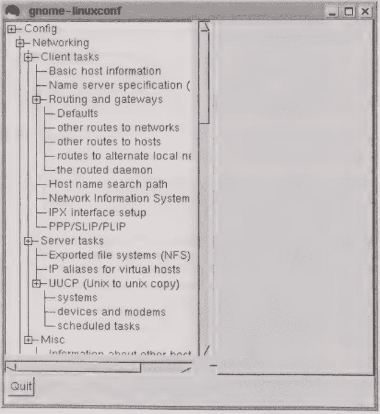

图 7-1：Linuxconf 入口屏幕

找到相应的面板应该简单快捷。您可以通过单击菜单项图标来折叠和展开各个部分。单击一次图标即可激活该特定子菜单。再次单击将折叠它；再单击一次则会再次展开。选中的条目将作为选项卡出现在右侧面板中，并会一直保留直到关闭。这将大大减少 Linuxconf 通常造成的桌面窗口混乱。如果您打开的选项卡太多，只需在每个选项卡底部点击**取消**即可在不做任何更改的情况下关闭它，或者点击**接受**以应用更改。

> **请注意：** 如果您仍然喜欢之前的 X 窗口系统界面，它仍然可用。要返回该界面：

1.  在 shell 提示符下输入 `linuxconf` 启动 Linuxconf。
2.  打开 [控制] -> [控制文件和系统] -> [Linuxconf 模块]。
3.  取消选中 treemenu 模块的“此模块处于活动状态”复选框。
4.  单击接受。
5.  单击退出。
6.  重启 Linuxconf。

### 启用基于 Web 的 Linuxconf 访问

出于安全原因，基于 Web 的 Linuxconf 访问默认是禁用的。在尝试使用 Web 浏览器访问 Linuxconf 之前，您需要启用访问权限。以下是通过文本模式界面启用访问的方法：

1.  在 shell 提示符下输入 `linuxconf` 启动 Linuxconf。
2.  打开 [配置] -> [网络] -> [杂项] -> [Linuxconf 网络访问]。
3.  在 **Linuxconf html 访问控制** 对话框中，输入任何应被允许访问 Linuxconf 的计算机的主机名。如果您希望在本地使用基于 Web 的界面，这也将包括您自己的系统。通过选择图中所示的复选框，与 Linuxconf 相关的 Web 访问可以记录到系统的 `htmlaccess.log` 文件中。
4.  选择 **接受** 按钮并按 [空格]。然后在每个对话框上选择 **退出** 按钮以退出菜单层级。当您看到标有 **系统状态** 的对话框时，按 [回车] 接受默认操作，即应用您所做的更改。

此时，基于 Web 的访问已启用。要测试它，请转到您添加到访问控制列表中的其中一台系统。启动您的 Web 浏览器，并输入以下 URL：

```
http://<主机>:98/
```

（当然，将 `<主机>` 替换为您系统的主机名。）

您应该会看到 Linuxconf 主页面。请注意，您需要输入系统的 root 密码才能访问第一页之后的内容。

### 添加用户帐户 — 快速参考

1.  在 shell 提示符下输入 `linuxconf` 启动 Linuxconf。
2.  打开 [配置]->[用户帐户]->[普通]->[用户帐户]。
3.  选择添加。
4.  输入帐户的登录名和全名。
5.  仅在必要时在其他字段中输入信息。
6.  选择接受。
7.  输入帐户的初始密码。
8.  在确认字段中重新输入帐户的初始密码。
9.  选择接受。

### 添加用户帐户 — 概述

添加用户是您在系统管理中会遇到的最基本的任务之一。要添加用户：

-   在 shell 提示符下输入 `linuxconf` 启动 Linuxconf。
-   打开 [配置]->[用户帐户]->[普通]->[用户帐户]。这将打开 **用户帐户** 选项卡（参见图 7-3）。
-   如果系统上有超过 15 个帐户，Linuxconf 将为您提供一个过滤屏幕（参见图 7-2）。您可以使用此屏幕选择比完整列表更小的帐户范围。要获取完整列表，请在不更改任何参数的情况下选择 **接受**。有关各种过滤器的详细信息，请在过滤器控制屏幕上选择 **帮助** 按钮。
-   选择 **添加**。这将打开 **用户帐户创建** 选项卡（参见图 7-4）。

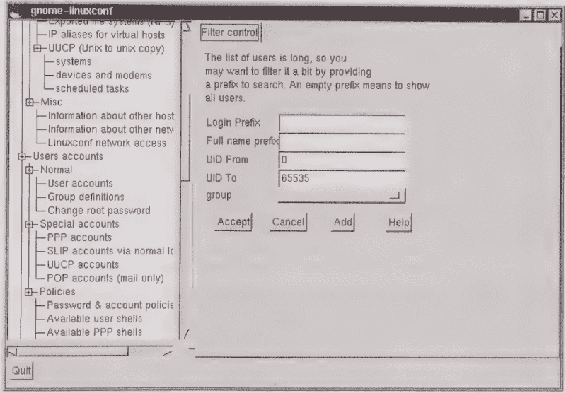

**图 7-2：过滤器控制屏幕**

**用户帐户创建** 选项卡是您输入新帐户所有信息的地方。有许多您应该注意的字段，有些是必需的，有些是可选的。

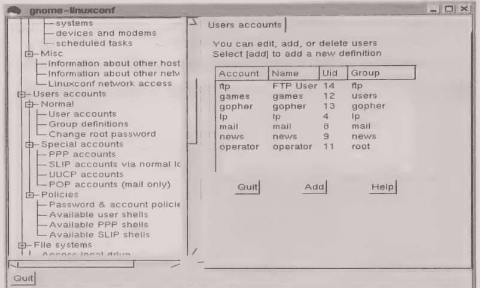

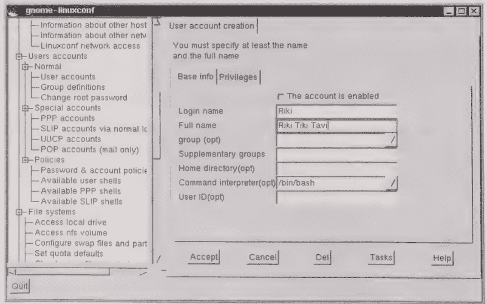

### 必需字段：

-   **登录名** — 帐户的名称。通常全部使用小写字母。名字、姓氏、首字母缩写或它们的某些组合是相当常见的登录名。对于一个名为 John T. Smith 的用户，“smith”、“john”、“jts” 或 “jsmith” 都是常见的用户名。当然 “spike” 或其他名称也可以。您也可以使用数字，因此如果有第二位具有相同首字母的人，“jts2” 也可以。此字段没有默认值。

### 可选字段：

-   **全名** — 这是用户或帐户的名称。对于个人，将是他们的名字，例如 “John T. Smith”。如果帐户代表一个职位而非个人，全名可能是头衔。因此，名为 “webmaster” 的帐户的全名可能是 “Red Hat Webmaster” 或仅 “Webmaster”。此字段没有默认值。
-   **组** — 在这里您可以指定与帐户关联的组。默认是一个与登录名相同的组。因此 “jsmith” 的组将是 “jsmith”。
-   **补充组** — 在这里您可以指定任何附加的组。我们建议，如果您想将用户添加到一个或多个组，应在此处操作，而不是更改组字段。组名应使用空格分隔。此字段的默认值为空，表示没有补充组。
-   **主目录** — 指定帐户的主目录或登录目录。默认值为 `/home/登录名`，其中 `登录名` 被替换为实际的登录名。主目录是您登录时在目录结构中的起点，或者在 X 窗口系统中，是每个打开的 xterm 窗口的起点。这里也是存储帐户特定偏好设置文件的地方。
-   **命令解释器** — 指定命令解释器的位置。命令解释器通常被称为 shell。默认值显示在下拉框中。
-   **用户 ID** — 与每个用户帐户关联的数字。这是在创建帐户时由系统自动生成的。

**用户帐户创建** 屏幕有许多字段；只有登录名是必需的，但强烈建议填写 **全名** 字段。一旦您输入了登录名和任何其他所需信息，请选择屏幕底部的 **接受** 按钮。如果您决定不创建新用户，请改用 **取消**。


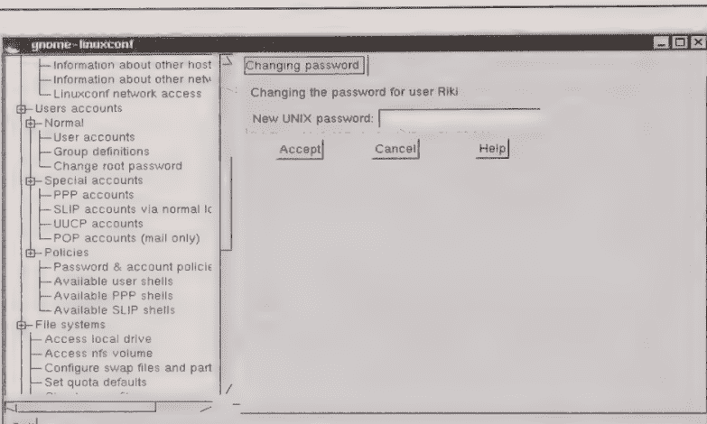
**图7-5：修改密码界面**
点击**确定**按钮后，Linuxconf会提示你输入密码。还有一个名为**确认**的输入框，你需要在此再次输入密码，这是为了防止你输错密码。
密码长度至少为6个字符，可以包含数字，也可以包含小写字母和大写字母的组合。输入完成后点击**确定**按钮。

### 修改用户账户——快速参考
**请注意：**虽然你可以更改任意用户账户的设置，但通常不建议修改预创建的账户设置。最好在你自己创建的账户中更改设置并探索各项选项。
- 在shell提示符后输入`linuxconf`启动Linuxconf
- 打开[配置] -> [用户账户] -> [常规] -> [用户账户]
- 选择要修改的用户账户
- 按照需要修改各项设置
- 点击**确定**按钮

### 修改用户账户——总览
- 在shell提示符后输入`linuxconf`启动Linuxconf
- 打开[配置] -> [用户账户] -> [常规] -> [用户账户]，这会打开用户账户标签页（见图7-3）
- 如果系统上的账户超过15个，Linuxconf会显示筛选界面（见图7-2）。你可以用该界面筛选出比完整列表更小的账户范围。如需查看完整列表，无需更改任何参数，直接点击**确定**按钮即可。如需了解各类筛选器的详细信息，请点击筛选控制界面上的**帮助**按钮
- 选择你想要修改的账户，这会打开用户信息标签页
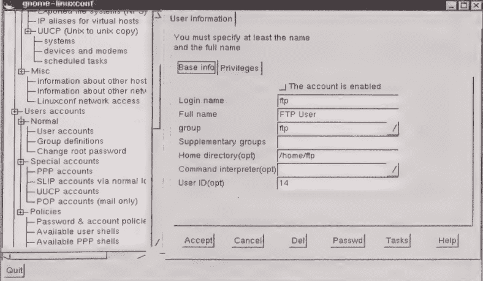
**图7-6：用户信息界面**
在**用户信息**界面中，你可以根据需要修改相关信息。修改完成后点击**确定**按钮应用更改，如果不想做任何修改，点击**取消**按钮，这样可以确保不会产生任何更改。

### 修改用户密码——快速参考
- 在shell提示符后输入`linuxconf`启动Linuxconf
- 打开[配置] -> [用户账户] -> [常规] -> [用户账户]
- 选择对应用户账户
- 点击**Passwd**（密码）选项
- 输入用户的新密码
- 在**确认**输入框中再次输入新密码
- 点击**确定**按钮

### 修改用户密码——总览
- 在shell提示符后输入`linuxconf`启动Linuxconf
- 打开[配置] -> [用户账户] -> [常规] -> [用户账户]，这会打开**用户账户**标签页（见图7-3）
- 如果系统账户超过15个，Linuxconf会显示筛选界面（见图7-2）。你可以用该界面筛选出比完整列表更小的账户范围。如需查看完整列表，无需更改参数，直接点击**确定**按钮即可。如需了解各类筛选器的详细信息，请点击筛选控制界面上的**帮助**按钮
- 选择你要修改密码的账户，这会打开**用户信息**标签页（见图7-6）
- 从界面底部的选项中选择**密码**选项，之后Linuxconf会提示你输入新密码。还有一个名为**确认**的输入框，你需要在此再次输入密码，这是为了防止输错密码。密码长度至少为6个字符，可以包含数字，以及小写字母和大写字母的组合。如果不想修改密码，直接点击**取消**按钮即可。输入完新密码后，点击**确定**按钮。

### 修改root密码——快速参考
- 在shell提示符后输入`linuxconf`启动Linuxconf
- 打开[配置] -> [用户账户] -> [常规] -> [修改root密码]
- 输入当前的root密码
- 点击**确定**按钮
- 输入新的root密码
- 在**确认**输入框中再次输入新的root密码
- 点击**确定**按钮

### 修改root密码——总览
修改root密码的流程和修改普通用户密码不同。由于root权限的重要性以及相关的安全考量，Linuxconf要求你验证当前是否拥有root账户的访问权限。
- 在shell提示符后输入`linuxconf`启动Linuxconf
- 打开[配置] -> [用户账户] -> [常规] -> [修改root密码]
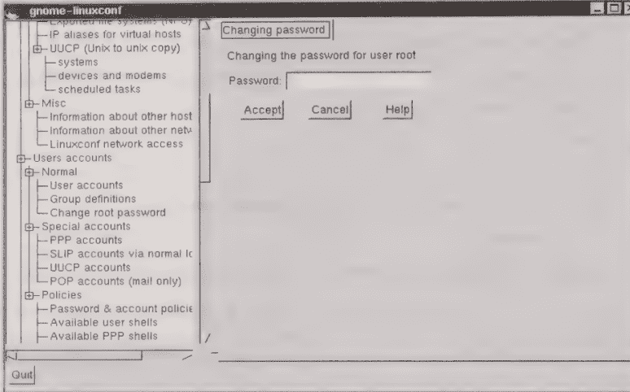
**图7-7：root密码验证界面**
这个界面有些容易让人困惑，因为无论是标题还是说明都没有真正解释这个界面的用途。Linuxconf看起来是在要求你输入新密码，但实际上并非如此，它是需要你输入当前的root密码，以验证你对root账户的访问权限。运行Linuxconf确实需要root权限，但一旦程序启动，如果使用Linuxconf的人离开电脑一分钟，任何人都可以操作这台计算机，潜在风险极大！如果原本使用Linuxconf的用户退出了root登录，他们将无法再次进入root账户。如果没有验证环节，任何修改了root密码的人都能完全控制这台计算机。
输入当前root密码后，系统会提示你输入新密码。还有一个名为**确认**的输入框，你需要在此再次输入密码（见图7-5），这是为了防止你输错密码。密码长度至少为6个字符，可以包含数字，以及小写字母和大写字母的组合。如果不想修改root密码，直接点击**取消**按钮即可。输入完新密码后，点击**确定**按钮。更改会立即生效，不仅会影响root的登录，还会影响使用`su`命令切换到root的操作。

### 禁用用户账户——快速参考
- 在shell提示符后输入`linuxconf`启动Linuxconf
- 打开[配置] -> [用户账户] -> [常规] -> [用户账户]
- 选择要禁用的账户
- 取消勾选**账户已启用**复选框
- 点击**确定**按钮

### 禁用用户账户——总览
为什么要禁用账户？好问题！这个问题没有唯一答案，但我们可以说明提供这个选项的原因。最大的原因是安全。例如，你可能创建了一个特殊账户，供客户、同事或朋友访问你系统上的特定文件。这个账户偶尔会被使用，但应该只在确实有需要的时候才启用。保留一个长期未使用的账户会成为试图入侵你系统的人的目标。如果删除该账户，每次需要使用的时候你都需要重新创建它。而禁用账户功能可以解决这两个问题，你只需要勾选或取消勾选对应复选框即可。
禁用账户的操作步骤如下：
- 在shell提示符后输入`linuxconf`启动Linuxconf
- 打开[配置] -> [用户账户] -> [常规] -> [用户账户]
- 取消勾选标注为**账户已启用**的复选框，点击窗口底部的**确定**按钮即可完成操作。该账户会被禁用，后续可以通过类似的方法重新启用。

### 启用用户账户
默认情况下，所有新创建的用户账户都是启用状态。如果你需要启用某个账户，可以使用Linuxconf来完成：在shell提示符后输入`linuxconf`启动Linuxconf，打开[配置] -> [用户账户] -> [常规] -> [用户账户]，选择你想要启用的账户，勾选**账户已启用**复选框，然后点击界面底部的**确定**按钮即可。

### 删除用户账户——快速参考
在shell提示符后输入`linuxconf`启动Linuxconf，打开[配置] -> [用户账户] -> [用户账户]，选择你想要删除的账户，在用户信息界面点击**删除**按钮，在「删除账户...」界面中，选择对应的账户数据处理选项，最后点击**确定**按钮。

### 删除用户账户——总览
> **请注意：**虽然有一些选项可以保留与账户关联的文件，但任何被删除的信息或文件都会彻底丢失且无法恢复，使用该功能时请务必谨慎！

删除账户的操作步骤如下：
- 在shell提示符后输入`linuxconf`启动Linuxconf
- 打开[配置] -> [用户账户] -> [用户账户]
- 在**用户账户**界面（见图7-3）中选择你想要删除的账户
- 在**用户信息**界面（见图7-6）的底部点击**删除**按钮来删除账户，之后Linuxconf会弹出选项列表供你选择

## 7 系统配置
图7-8：删除账户界面
默认选项是归档账户数据，归档选项的效果如下：
- 将用户从用户账户列表中移除；
- 将用户主目录中的所有内容进行归档（使用tar和gzip压缩），生成的压缩包会存储在名为oldaccounts的目录中。对于名为useraccount的账户，文件名类似：useraccount-1999-10-10-497.tar.gz。其中的日期表示账户被删除的时间，后面的数字是实际执行删除操作的进程ID。oldaccounts目录会和所有用户目录创建在同一位置，且首次使用该选项删除用户账户时会自动创建；
- 不属于用户主目录但由该用户拥有的文件会保留，这些文件的所有者为被删除账户的用户ID（UID）。如果你新建账户时专门指定该UID为已删除账户的UID，那么该新账户将成为所有剩余文件的所有者。

## 如何在红帽Linux上安装Linux
在**删除账户** <账户名> 界面（见图7-8）中选择**删除账户数据**将执行以下操作：
- 从用户账户列表中移除该用户；
- 删除用户的主目录及其所有内容。
> **请注意：** 不属于用户主目录但由该用户拥有的文件会保留在系统中，这些文件的所有者仍为被删除账户的用户ID（UID）。如果你新建账户时专门指定该UID为已删除账户的UID，那么该新账户将成为这类“孤立”文件的所有者。

在**删除账户** <账户名> 界面（见图7-8）中选择**保留账户数据原地**将执行以下操作：
- 从用户账户列表中移除该用户；
- 保留用户的主目录（含其中所有文件）在原位。
> **请注意：** 由被删除账户的用户ID（UID）拥有的文件和目录会保留在系统中，如果你新建账户时专门指定该UID为已删除账户的UID，那么该新账户将成为这些“孤立”文件的所有者。

### 用户组
所有用户都属于一个或多个用户组。就像每个文件都有特定的所有者一样，每个文件也属于特定的用户组。用户组可能是文件所有者专属的，也可能是所有用户共享的。对文件的读、写、执行权限可以分配给用户组，这与所有者权限相互独立。例如，文件所有者可以编辑文档，而其他组员可能只有读取权限。

### 创建用户组——快速参考
- 在 shell 提示符中输入`linuxconf`启动Linuxconf工具；
- 打开[配置] -> [用户账户] -> [常规] -> [用户组定义]；
- 选择**添加**；
- 输入用户组名称，也可选择输入备用成员；
- 选择**确定**。

### 创建用户组——总体概述
创建新用户组的步骤如下：
- 在 shell 提示符中输入linuxconf启动Linuxconf工具；
- 打开[配置]->[用户账户]->[常规]->[用户组定义]，如果你的用户组数量超过15个，系统会提供通过输入前缀筛选用户组的选项。
图7-9：用户组筛选界面
你可以直接在该界面添加用户组，也可以进入**用户组**界面操作；若要进入下一级界面，无需输入前缀或输入前缀后选择**确定**选项；若要添加新用户组，选择**添加**选项。

图7-10：用户组界面，在用户组界面底部选择添加。
图7-11：用户组配置界面
| 用户组配置 |  |  |
| :--- | :--- | :--- |
| **基础信息** |  |  |
| 用户组名 | Riki |  |
| 用户组ID | 2285 |  |
| 备用成员（可选） |  |  |
| **确定** | **取消** | **删除** | **帮助** |
输入用户组名称，你也可以在“备用成员”栏指定组员，用户列表需用空格分隔，即每个用户名之间需用空格隔开。完成输入后选择“确定”，即可完成用户组的创建。

### 删除用户组——快速参考
- 在 shell 提示符中输入linuxconf启动Linuxconf工具；
- 打开`[配置]` -> `[用户账户]` -> `[常规]` -> `[用户组定义]`；
- 选择要删除的用户组；
- 选择“删除”；
- 确认删除操作。

### 删除用户组——总体概述
删除用户组的步骤如下：
- 在 shell 提示符中输入linuxconf启动Linuxconf工具；
- 打开[配置] -> [用户账户] -> [常规] -> [用户组定义]。如果你的用户组数量超过15个，系统会弹出筛选界面（见图7-9），你可以通过输入前缀缩小用户组的可选范围；
- 无论是否输入前缀，均在界面底部选择“确定”；
- 在用户组界面（见图7-10）中选择要删除的用户组；
- 系统会弹出用户组配置界面（见图7-11）；
- 选择“删除”即可删除用户组，随后Linuxconf会提示你确认删除操作，选择“是”即可完成删除。用户组的文件会保留，文件所有者仍对文件拥有唯一控制权，用户组名称会被替换为被删除用户组的ID，你可以通过chgrp命令将这些文件分配给新的用户组。在shell提示符中输入info chgrp或man chgrp命令即可查询chgrp的更多相关信息。如果新建用户组时指定了被删除用户组的ID，那么新用户组将可以访问被删除用户组的文件。不用担心，Linuxconf不会像回收旧用户ID一样回收旧用户组号，因此不会出现误分配的情况。

### 修改用户组成员
修改用户组成员列表有两种方式：你可以逐个更新用户账户，也可以更新用户组定义。通常情况下，更新用户组定义是更快的方式；如果你需要修改的不仅是用户组信息，还有其他用户相关信息，那么逐个更新用户账户会更简单。

### 修改用户组成员——快速参考
### 在用户组界面操作
- 在 shell 提示符中输入linuxconf启动Linuxconf工具；
- 打开[配置] -> [用户账户] -> [常规] -> [用户组定义]；
- 选择要添加或移除用户的用户组；
- 在**备用成员（可选）**栏中添加或移除用户，注意所有用户名之间需用空格“ ”分隔；
- 选择**确定**。

### 在用户界面操作
- 在 shell 提示符中输入linuxconf启动Linuxconf工具；
- 打开[配置] -> [用户账户] -> [常规] -> [用户账户]；
- 选择要添加或移除用户组的用户，相应调整*附加用户组*栏，注意所有用户组名称之间需用空格“ ”分隔；
- 选择**确定**；
- 对其余需要添加的用户重复步骤3至5。

### 修改用户组成员——总体概述
我们首先介绍通过用户组定义修改的方法。
- 在 shell 提示符中输入linuxconf启动Linuxconf工具；
- 打开[配置] -> [用户账户] -> [常规] -> [用户组定义]，如果你的用户组数量超过15个，系统会弹出筛选界面（见图7-9），你可以通过输入前缀缩小用户组的可选范围；
- 无论是否输入前缀，均在界面底部选择**确定**；
- 选择要修改的用户组，系统会弹出**用户组配置**界面（见图7-11）。

- 从**备用成员**栏中添加或移除对应用户，注意所有用户名之间需用空格“ ”分隔；
- 完成操作后，选择界面底部的**确定**选项，系统会自动更新所有用户账户：如果用户组被添加，该组会出现在用户的*附加用户组*栏中，如果被移除则会从该栏消失。你也可以通过修改单个用户账户的方式添加或移除用户组；
- 在 shell 提示符中输入`linuxconf`启动linuxconf工具；
- 打开[配置] -> [用户账户] -> [常规] -> [用户账户]，如果系统中的用户账户数量超过15个，linuxconf会弹出筛选界面（见图7-2）；
- 在用户账户界面（见图7-3）中选择要修改的用户，系统会弹出用户信息界面（见图7-6）；
- 在*附加用户组*栏中添加或移除所需的用户组，各用户组名称之间需用空格“ ”分隔；
- 完成所有修改后，选择界面底部的“确定”选项，系统会自动更新用户组定义。对其余用户重复上述操作即可。

### CD-ROM、软盘、硬盘与文件系统——深入了解
文件系统由文件和目录组成，所有内容都从单一的根目录开始。根目录可以包含任意数量的文件和其他目录，每个目录下也可以包含同样结构的文件和目录。典型的文件系统通常形似倒置的树木，目录是树枝，文件是树叶。文件系统存储在软盘驱动器、硬盘、CD-ROM等大容量存储设备上。


例如，在DOS和Windows机器上，软盘驱动器通常使用`A:\`来指代。这同时代表设备本身（`A:`）和该设备上的根目录（`\`）。同一系统的主硬盘通常被称为“C盘”，因为第一块硬盘的设备标识符是`C:`。要指定C盘的根目录，需要使用`C:\`。按照这种规则，存在两个文件系统——分别位于`A:`和`C:`上。要指定DOS/Windows文件系统中的任意文件，你必须要么明确说明文件所在的设备，要么文件必须位于系统的默认驱动器上（这也是DOS鼎鼎大名的C提示符的由来——单硬盘系统的默认驱动器就是该位置）。

在Linux系统中，可以将多个大容量存储设备上的文件系统合并为一个更大的单一文件系统。实现方式是将一个设备的文件系统“挂载”到另一个设备文件系统的某个目录下。因此，虽然在DOS机器上软盘驱动器的根目录可以被称为`A:\`，但在Linux系统上同一块驱动器可能以`/mnt/floppy`的形式被访问。这种合并文件系统的过程被称为挂载。设备完成挂载后，系统用户就可以访问它。被挂载设备的文件系统所依附的目录被称为挂载点。上一段中的例子里，`/mnt/floppy`就是软盘驱动器的挂载点。需要注意的是，挂载点的命名没有限制（除通用惯例外）。我们完全可以把软盘挂载到`/long/path/to/the/floppy/drive`路径下。

需要记住的一点是，设备上的所有文件和目录都是相对于其挂载点的。请参考以下示例：
- Linux系统
  - `/` — 系统根目录
  - `/foo` — CD-ROM的挂载点
- CD-ROM
  - `/` — CD-ROM的根目录
  - `/images` — CD-ROM上的图片目录
  - `/images/old` — CD-ROM上的旧图片目录

因此，如果上述内容描述的是各个独立的文件系统，将CD-ROM挂载到`/foo`下后，新的操作系统目录结构将是：
- 已挂载CD-ROM的Linux系统
  - `/` — 系统根目录
  - `/foo` — CD-ROM根目录
  - `/foo/images` — CD-ROM上的图片目录
  - `/foo/images/old` — CD-ROM上的旧图片目录

要挂载文件系统，请确保以root用户身份登录，或使用`su`命令切换到root用户。选择后者的话，在shell提示符下输入`su`，然后输入root密码即可。切换为root用户后，输入`mount`命令，后接设备名，再后接挂载点。例如，要将第一块软盘驱动器挂载到`/mnt/floppy`，你需要输入以下命令
```bash
mount /dev/fd0 /mnt/floppy
```

安装时，红帽Linux会自动创建`/etc/fstab`文件。该文件包含设备及其关联挂载点的信息。这个文件的优势是可以缩短挂载命令的输入：借助`/etc/fstab`中的信息，你只需要输入`mount`命令，再接挂载点或设备名即可，mount命令会自动在`/etc/fstab`中查找其余所需信息。可以手动修改该文件，也可以使用Linuxconf工具修改。要使用Linuxconf，请参阅紧随其后的《检查当前文件系统》章节。

### 检查当前文件系统 — 快速参考
1. 在shell提示符下输入`linuxconf`启动Linuxconf。
2. 打开[配置] -> [文件系统] -> [访问本地驱动器]；若要查看网络环境，请打开[配置] -> [文件系统] -> [访问NFS卷]。

### 检查当前文件系统 — 总体概述
我们先查看当前的目录结构。
- 在shell提示符下输入`linuxconf`启动Linuxconf。
- 打开[配置] -> [文件系统] -> [访问本地驱动器]。

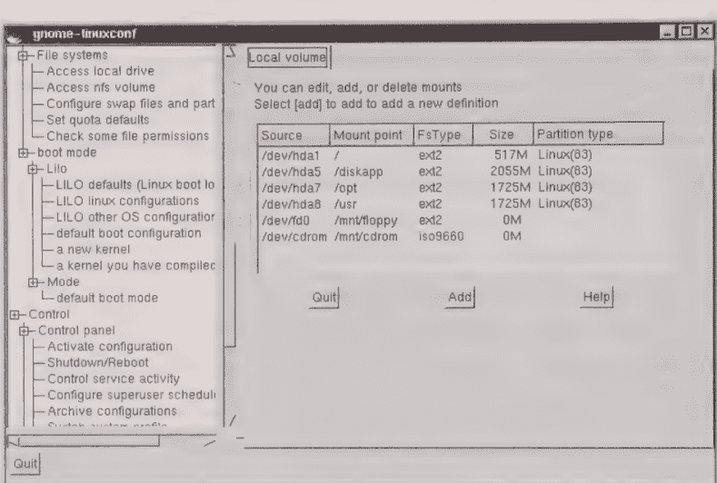

### 图7-12：本地卷界面
各字段说明如下：
- **源（Source）** — 物理硬件；`hd`表示IDE硬盘，`fd`表示软盘驱动器，`cdrom`通常表示CD-ROM驱动器。如果系统配备SCSI硬盘，则会显示`sd`标识。同一类型的多个驱动器会用字母区分，因此`hda`代表第一块IDE硬盘，`hdb`代表第二块。某些情况下，这些字母后会附带数字；在硬盘上，数字代表该硬盘上的分区，而对于软盘驱动器，这个数字指的是实际的设备单元。
- **挂载点（Mount point）** — 驱动器挂载后在系统中映射的位置。
- **文件系统类型（FsType）** — 用于指明文件系统类型。标准Linux分区使用ext2文件系统类型。`vfat`文件系统类型表示支持长文件名的DOS文件系统，而`fat`文件系统类型用于支持传统8.3文件名的DOS文件系统。`iso9660`文件系统类型对应CD-ROM驱动器，如图7-12所示。
**请注意：**红帽Linux 6.1可以通过`vfat`文件系统类型访问FAT32文件系统。
- **大小（Size）** — 表示文件系统的大小，单位为兆字节（M）。对于软盘、CD-ROM驱动器等可移动媒体设备，标注的大小为0。
- **分区类型（Partition type）** — 该分区所用文件系统的描述。网络上其他机器的文件系统也可能可用，规模可以小到单个目录，大到完整的卷。这些分区的Size（大小）和Partition type（分区类型）信息同样无法获取。这些文件系统的额外信息（如果有的话）可以在以下位置找到：
```
[配置] -> [文件系统] -> [访问NFS卷]
```

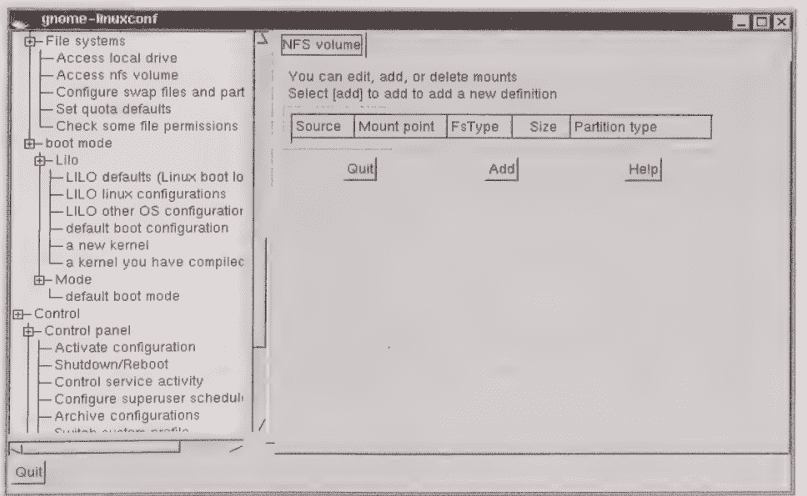

### 图7-13：NFS卷界面
该界面与**本地卷**界面（见图7-12）类似，只是各条目提供的信息有明显区别：
- **源（Source）** — 这是提供文件系统的机器名称，后接远程目录。例如：`foo:/var/spool/mail`，其中`foo`是共享该目录的机器，`/var/spool/mail`是被共享的目录。
- **文件系统类型（FsType）** — 此处始终为“nfs”。

### 添加NFS挂载 — 快速参考
1. 在shell提示符下输入`linuxconf`启动Linuxconf。
2. 打开[配置] -> [文件系统] -> [访问NFS卷]。
3. 选择**添加**。
4. 输入文件系统所在的主机名。
5. 在“卷”字段中输入远程文件系统的路径，例如`/var/spool/mail`。
6. 指定你系统上的挂载点，例如`/mnt/foo`。选择**接受**。

### 添加NFS挂载 — 总体概述
NFS是网络文件系统（Network FileSystem）的缩写。它是一种让计算机在网络中共享本地文件系统部分内容的方式。这些共享部分可以小到单个目录，也可以大到包含数千文件、结构庞大的目录层级。例如，许多公司会部署一台独立的邮件服务器，将每个用户的邮件文件作为NFS挂载共享到用户的本地系统中。要添加NFS挂载，请按以下步骤操作：
- 在shell提示符下输入`linuxconf`启动Linuxconf。
- 打开[配置] -> [文件系统] -> [访问NFS卷]。
- 在**NFS卷**界面（见图7-13）中，选择**添加**。

## 7 系统配置
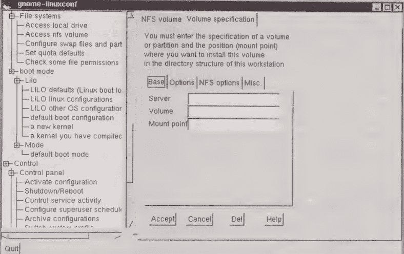

**图7-14：** 卷规格界面
“Base”选项卡上的三个字段是你需要关注的：
- **服务器（Server）** — 所需文件系统所在机器的主机名，例如`foo.bar.com`。
- **卷（Volume）** — 你想要添加的文件系统，例如`/var/spool/mail`。
- **挂载点（Mount point）** — 你希望远程文件系统在你的系统中可访问的位置，例如`/mnt/mail`。

创建挂载只需要以上信息即可。Linuxconf会自动相应地更新你的`/etc/fstab`文件。如果你知晓其他额外要求，请阅读**卷**规格界面上的帮助文件，并查阅`mount`命令的手册页获取更多信息。输入完信息后，选择**接受**。


## 红帽Linux安装指南
### 网络连接（网络配置）
接入网络时首先要确定你是要连接到局域网（比如办公室里的一组计算机）还是广域网（比如互联网）。继续操作前，你需要明确自己拥有的硬件以及打算采用的连接方式。
如果打算拨号接入其他计算机，请确保调制解调器已正确安装、线路摆放妥当。如果使用的是网卡，请确保网卡安装正确、线路连接无误。无论你指定何种网络配置，只要电话线或网线没有接好，就无法成功连接。接下来我们会先介绍调制解调器连接，再讲解网卡的使用。
#### 添加调制解调器/PPP/SLIP连接
##### 快速参考
1. 在命令行提示符下输入`LinuxConf`启动LinuxConf工具。
2. 打开[配置] -> [网络] -> [PPP/SLIP/PLIP]。
3. 选择*添加*。
4. 选择连接类型。
5. 输入电话号码、登录名和密码。
6. 仅在必要时选择*仅使用PAP认证*（仅PPP账户支持此选项）。
7. 选择[确认]。
##### 总体说明
要让PPP或SLIP账户正常工作，你需要从网络服务提供商（ISP）或系统管理员处获取若干信息。部分服务商可能会让你查阅如何在Linux系统上配置PPP连接的指南，还有部分ISP没有为Linux用户提供足够的支持。不必担心，你依然可以完成连接，只要从你的ISP处获取一些额外信息即可。以下是配置红帽Linux连接所需的信息：ISP的工作人员可能会告诉你不需要这些信息，或者认为你需要更多信息。红帽通过智能默认设置和LinuxConf等工具简化了所需信息，让配置流程更便捷。除非ISP有针对红帽Linux的专属文档，否则你只需要索取以下信息即可继续操作。
具体来说，你需要准备以下信息：
- 域名服务器（DNS）的IP地址；
- 需要拨打的电话号码；
- 你的登录名和密码；
- 如果你要连接的网络不会为你分配动态IP，则需要准备你设备的IP地址；
- 你的ISP是否使用PAP、CHAP或MS-CHAP这类认证方式。如果使用的话，你需要准备一个用于启用认证的“密钥”，密钥可以是单词或字符序列。
目前LinuxConf不支持CHAP和MS-CHAP，且这两种方式很少被使用。
可选的非必需信息包括备用域名服务器地址和搜索域。
当你准备好所有信息后，就可以开始配置连接了，请按以下步骤操作：
- 在命令行提示符下输入`LinuxConf`启动LinuxConf工具。
- 打开[配置] -> [网络] -> [PPP/SLIP/PLIP]。
- 选择*添加*。
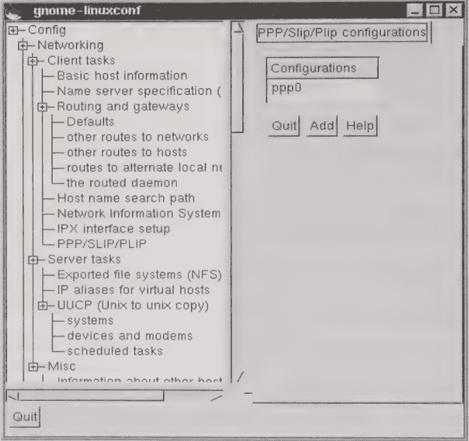
**图7-15：PPP/SLIP/PLIP配置界面**
初始状态下还没有任何配置项，当你选择**添加**后，会弹出PPP、SLIP和PLIP的选项供选择。
### 7 系统配置
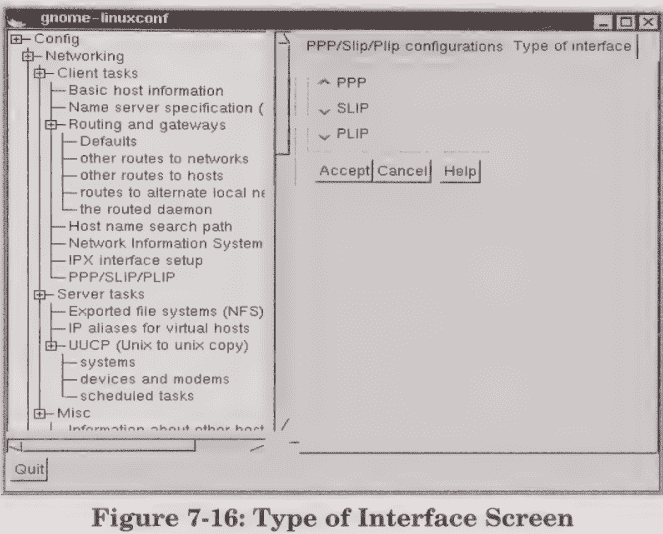
**图7-16：接口类型选择界面**
PPP是最常用的接口类型，也是默认选项。要配置PPP连接，请选择PPP后点击[确认]。
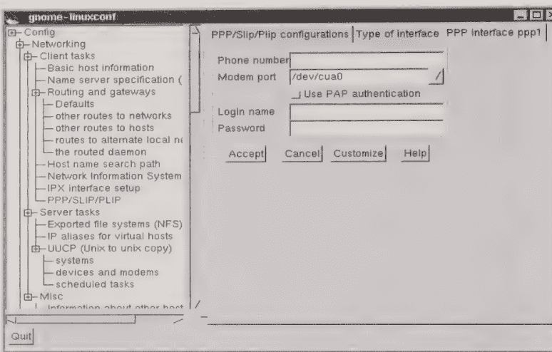
**图7-17：PPP接口配置界面**
你会看到以下字段：
- 电话号码：用于接入远程系统的号码；
- 调制解调器端口：指示你的调制解调器所在的端口，通常已经预设好；
- 使用PAP认证（复选框）：如果你知道拨号接入的系统要求使用该认证，请勾选；
- 登录名：你的PPP账户登录名；
- 密码：你的PPP账户密码。
请注意标题栏显示的是**PPP接口ppp0**。ppp0是第一个PPP接口，ppp1是第二个，以此类推。如果你有多个接口，记录当前使用的接口非常重要。SLIP连接的接口前缀使用sl而非ppp。除了PAP认证选项不同外，添加PPP账户和SLIP账户的配置界面是相同的。
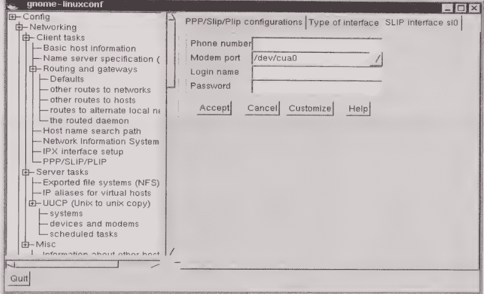
**图7-18：SLIP接口配置界面**
输入远程计算机的完整电话号码，请确保包含接入外线所需的所有前缀数字。例如，如果你需要先拨“9”再拨目标号码，而你要连接的计算机的电话号码是“555-0111”，那么你需要输入“95550111”。接下来需要设置调制解调器端口，这是一个可选可用端口的下拉菜单。如果你使用的是双系统（Linux/Windows）计算机，并且知道调制解调器对应的COM端口，可以参考以下Windows COM端口对应表：
- cua0 — MS-DOS下的COM1；
- cua1 — MS-DOS下的COM2；
- cua2 — MS-DOS下的COM3；
- cua3 — MS-DOS下的COM4。
登录名是你的PPP账户登录名。你输入的密码会以明文显示，因此输入时请注意周围是否有他人！如果你需要使用PAP认证，请勾选对应复选框；输入其他必填信息后，点击屏幕底部的[自定义]按钮。其余信息可以在各个标签页中找到，也可以在自定义界面中设置，不过在主界面一次性查看所有信息会更加便捷。
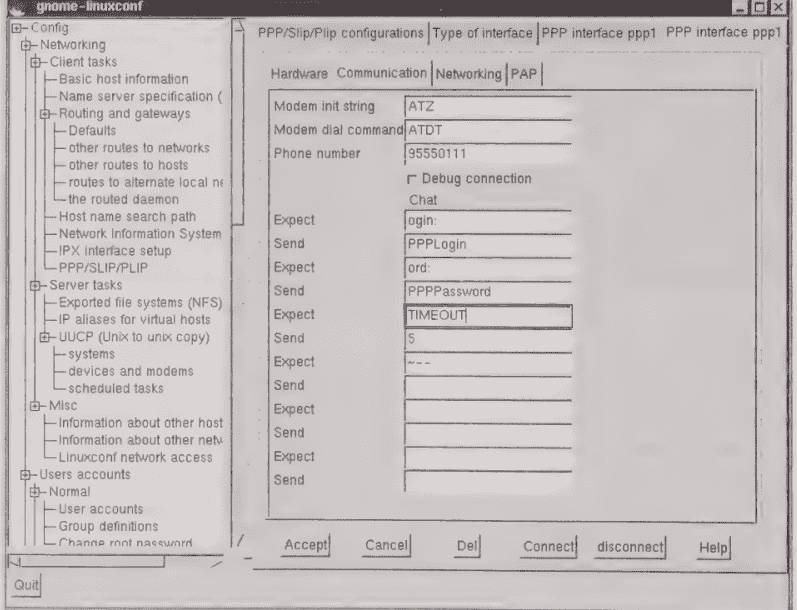
**图7-19：PPP接口自定义配置界面**
选择**PAP**标签页，输入你的用户名，然后在**密钥**栏中输入ISP提供给你的密钥。其他默认设置通常已经足够使用，如果有需要，你也可以通过**自定义**选项修改初始设置。
##### 修改PPP或SLIP配置——快速参考
1. 在命令行提示符下输入`LinuxConf`启动LinuxConf工具。
2. 打开[配置] -> [网络] -> [PPP/SLIP/PLIP]。
3. 选择要修改的配置项。
4. 修改需要的设置，大部分设置在“通信”标签页中。
5. 选择[确认]。
##### 修改PPP或SLIP配置——总体说明
你可以在**PPP/SLIP/PLIP配置列表**界面中选中已有配置，对其进行编辑或删除操作：
- 在命令行提示符下输入`LinuxConf`启动LinuxConf工具。
- 打开[配置] -> [网络] -> [PPP/SLIP/PLIP]。
- 随后会弹出**PPP/SLIP/PLIP配置列表**界面（见图7-15），选择你想要修改或删除的配置项，即可打开对应的接口配置界面。如果你想删除配置，屏幕底部有便捷的**Del**按钮。
调制解调器端口位于**硬件**标签页中，是一个下拉菜单。如果你想修改最初创建配置时输入的其他设置，请选择**通信**标签页。第一个**Send**字段填写的是你的登录名，下一个**Send**字段填写的是密码。**Expect**字段对应登录提示（login:）和密码提示（password:），也就是界面中显示的login:和password:填写项。
> **请注意：** 你系统中的login:和password:填写项可能不同。不同的**ISP/PPP**服务器使用的提示文本可能不同，需要根据你要登录的服务器类型进行调整。你也可能看到User ID、authentication这类提示。
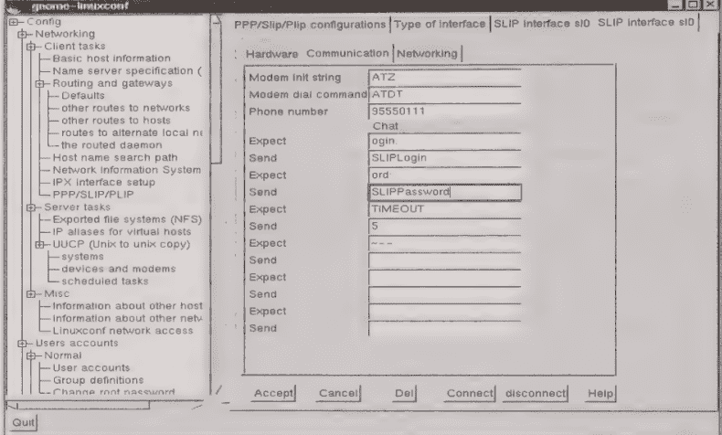
**图7-20：SLIP接口自定义配置界面**
完成修改后，你可以测试配置是否生效。点击屏幕底部的**连接**按钮，系统会尝试用你输入的信息接入远程系统。完成配置和测试后，我们建议你日常使用usernet工具来管理拨号网络连接，更多信息可以查看usernet的手册页。
##### 其他网络连接——快速参考
由于可选配置和子配置较多，本节不提供快速参考。
##### 其他网络连接——总体说明
以太网网络连接的配置方式完全不同。令牌环网、弧形网（arcnet）的网络连接配置流程与此类似，本书不做赘述。


- 首先你需要安装一块以太网卡。
- 在shell提示符下输入linuxconf启动linuxconf。
- 打开[配置] -> [网络] -> [客户端任务] -> [基本主机信息]。“Host name”选项卡会请求主机名，除非你在安装过程中没有配置网络，否则该名称会默认指定。如果尚未设置，请现在就花时间完成配置，然后跳过此选项卡，选择**适配器 1**选项卡。
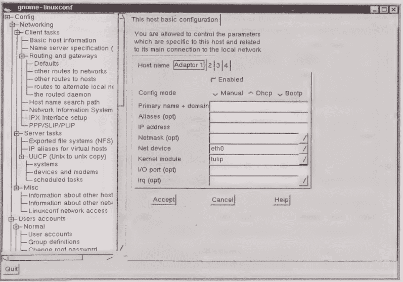
### **图 7-21：适配器 1**
此屏幕上的第一个选项是复选框，用于标识该适配器是否启用。若要使用该适配器，请勾选此框。下方是配置模式选项：**手动**表示你需要自行提供并输入所有配置信息；**DHCP**和**bootp**会从对应类型的远程服务器自动获取配置信息。如果不确定该选择哪个选项，请咨询你的系统管理员。
### DHCP 与 bootp
必填字段：
- **网络设备** — 你正在使用的网卡类型；例如eth0是使用第一块以太网卡的合适选项。
- **内核模块** — 与你网卡匹配的正确模块；更多信息可参阅下方的列表。
对于DHCP和bootp配置，你只需要指定**网络设备**和**内核模块**。对于**网络设备**，你需要从列表中选择：带`eth`前缀的条目对应以太网卡，带`arc`前缀的指定ARC网卡，带`tr`前缀的指定令牌环网卡。网卡与对应模块的完整列表可参阅D节**以太网参数**，最新列表可访问红帽官网获取：http://www.redhat.com
网络掩码信息会默认配置，但根据你配置的网络类型或即将加入的网络，你可能需要手动指定该信息。如果你连接到ISP，请向对方索取对应信息，最常见的取值为255.255.255.0（默认值）。
### 手动配置的必填字段：
- **主名称 + 域名** — 主名称是你计算机的主机名，域名是你网络的标识。例如在`foo.bar.com`中，`foo`是主名称，`bar.com`是域名。
- **IP 地址** — 这是设备的唯一地址，格式为x.x.x.x，例如192.168.0.13。
- **网络设备** — 你正在使用的网卡类型；eth0是使用第一块以太网卡的合适选项。
- **内核模块** — 与你网卡匹配的正确模块。网络设备和内核模块的相关信息已在上述内容中说明。
合适的主名称+域名和IP地址取决于你是将计算机添加到现有网络还是创建新网络。要连接到现有网络，请联系你的系统管理员获取相关信息。将网络连接到互联网超出了本书的范围，我们推荐以下入门资料：*《TCP/IP 网络管理（第2版）》，作者Craig Hunt（欧莱礼出版社）*。如果你要设置一个永远不会连接到互联网的私有网络，那么你可以选择任意你喜欢的主名称+域名，并有多种IP地址可选（见图7-22）。
| 可用地址范围 | 示例 |
| :--- | :--- |
| 10.0.0.0 - 10.255.255.255 | 10.5.12.14 |
| 172.16.0.0 - 172.31.255.255 | 172.16.9.1, 172.28.2.5 |
| 192.168.0.0 - 192.168.255.255 | 192.168.0.13 |
### 图 7-22：私有地址范围
上述三组地址段分别对应A类、B类和C类网络，这些类别用于描述可用IP地址的数量以及对应类别的地址范围。上述地址段已专门为私有网络保留。
> **请注意：** 如果你要接入互联网，请勿使用这些IP地址——192.168.0.* 和 192.168.255.* 并不被公认为有效的私有地址。如果你希望网络后续可接入互联网，或认为未来可能需要联网，请现在就申请非私有地址，避免后续产生麻烦。
### 名称服务器配置
搭建网络连接还需要配置名称服务器和默认域。名称服务器用于将主机名（如`private.network.com`）解析为对应的IP地址（如192.168.7.3）。默认域用于告知计算机，在未指定完全限定主机名时该到哪个域中查找。“完全限定”指的是提供了完整的域地址，因此`foo.redhat.com`是完全限定主机名，仅写`foo`则只是主机名。如果你将默认域设置为`redhat.com`，那么仅使用主机名也可成功连接。例如，如果你的搜索域是`redhat.com`，那么输入`ftp foo`就足够，若未设置则需输入`ftp foo.redhat.com`。
要配置名称服务器，请打开[配置] -> [网络] -> [名称服务器指定（DNS）]。
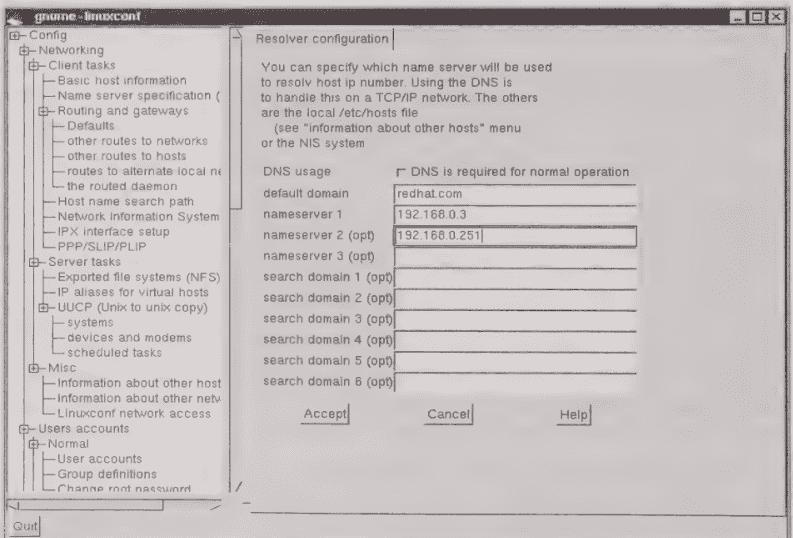
### 图 7-23：解析器配置屏幕
名称服务器会按照访问优先级排序，因此如果配置了多个名称服务器，看到它们被划分为主、次、第三等等级是很正常的。这些字段都需要填写IP地址，不能是域名。计算机在连接到名称服务器前无法解析该域名。这一点看似显而易见，但当人们仅被要求提供一台计算机的地址时，偶尔会忽略这一点。
此外，除了默认域，你还可以配置搜索域。搜索域的工作逻辑不同，它们的优先级从1到6依次排序，和名称服务器的分级逻辑类似。但所有搜索域的优先级都高于默认域！配置搜索域时请牢记这一点。搜索域的使用场景不多。
还有一个未提及的选项是DNS使用的复选框。如果你运行的是没有接入互联网的小型私有网络，那么使用`/etc/hosts`文件并保持所有条目同步是可行的。随着添加的机器越来越多，管理复杂度会持续升高，直到让一台机器运行DNS的成本比继续同步`/etc/hosts`文件更低。不选择DNS还有另一个原因，如果你的网络打算用NIS替代的话。请注意，NIS可以和DNS同时使用。
综上，除非你确认在自身场景下使用`/etc/hosts`或NIS是更优选择，否则DNS会是更合适的方案。你可以通过Linuxconf添加、修改或删除`/etc/hosts`文件中的条目，操作路径为：[配置] -> [网络] -> [其他] -> [其他主机信息]。
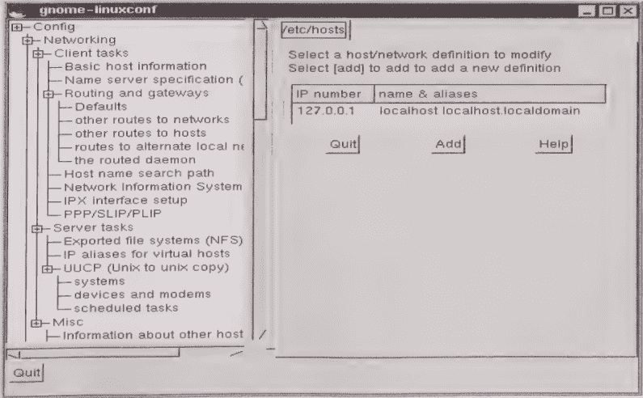
要修改或删除条目，请先选中目标条目。要删除条目，请在**主机/网络定义**界面底部选择**Del**。
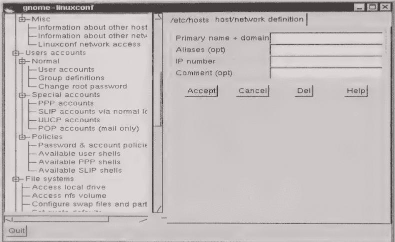
> 图 7-25：主机/网络定义屏幕
## 7 系统配置
要修改条目，请按需更改对应信息。要添加新条目，请在`/etc/hosts`界面底部选择**Add**，这会打开**主机/网络定义**界面。
### 必填字段：
- **主名称 + 域名** — 主名称是计算机的主机名，域名是其所属网络的标识。例如在`foo.bar.com`中，`foo`是主名称，`bar.com`是域名。
- **IP 编号** — 也即IP地址，是设备的唯一地址，格式为x.x.x.x，例如192.168.0.13。
### 可选字段：
- **别名** — 完全限定域名的简写形式，通常和主名称一致。例如完全限定域名为`foo.bar.com`时，你可以选择`foo`作为别名。
- **注释** — 关于该设备的备注信息。例如“远程名称服务器”。
你需要填写主名称+域名和IP编号，其余字段为可选。填写完成后，选择**Accept**。
### 日期和时间
要进入**日期和时间**控制面板：
- 启动Linuxconf，在shell提示符下输入linuxconf。
- 出现密码提示时输入root账户的密码（如果尚未以root身份登录）。
- 打开[控制] -> [日期与时间]。


**区域**字段是一个内容很长、范围很广的下拉列表。通常先指定大区域，再指定其中的城市或子区域。示例包括`Europe/Vienna`和`US/Eastern`。
有一个复选框，用于**以GMT格式将日期存储在CMOS中**。
小时从0（午夜）到23（晚上11点）指定。月份也以数字形式指定。年份请填写四位数字。其余所有字段均为自解释字段。
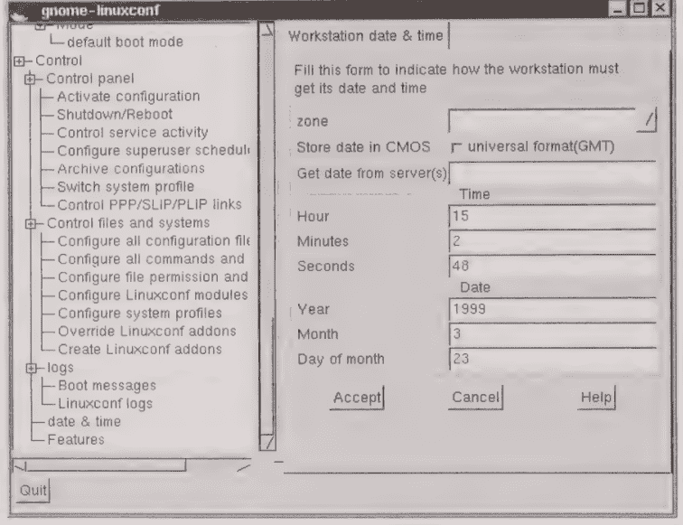
图7-26：工作站日期和时间

## 使用控制面板进行系统配置
**请注意**：控制面板应用能完成的大部分操作，也可以通过Linuxconf完成。此外，Linuxconf同时支持字符界面和图形用户界面。有关Linuxconf的介绍，请参阅**使用Linuxconf进行系统配置**。

## 7 系统配置

图7-27：控制面板
控制面板是多个不同系统管理工具的启动入口（见图7-27）。这些工具无需记忆配置文件格式和繁琐的命令行选项即可完成配置，让操作更便捷。
要启动控制面板，需以root用户身份运行`startx`启动X Window系统，然后在xterm中输入`control-panel`。成功运行控制面板工具需要root用户权限。
如果已经以普通用户身份运行了X系统，也可执行上述操作：只需输入`su -c control-panel`，在提示时输入root密码即可。如果计划以root身份执行其他任务，也可以在提示时输入`su`，然后输入root密码。
**请注意**：如果未以root身份运行X系统，可能需要为系统X服务器授予root访问权限。执行此操作时，在*非root*终端窗口中输入以下命令：
``` xhost +localhost ```
启动控制面板后，只需点击图标即可启动对应工具。请注意，系统不会禁止启动同一工具的多个实例，但这会导致同一文件被两个实例同时编辑，最终覆盖你自身的修改，因此是非常不可取的操作。
如果不慎启动了同一工具的第二个副本，应立即退出。此外，在工具运行期间，不要手动编辑任何由控制面板工具管理的文件。同样，不要在工具运行期间执行其他可能会修改这些文件的程序（例如*Linuxconf*）。

### 打印机配置

图7-28：打印工具
打印配置工具（printtool）用于维护`/etc/printcap`文件、打印假脱机目录和打印过滤器。过滤器支持打印多种类型的文件，包括：
- 纯文本（ASCII）文件
- PostScript文件
- TeX .dvi文件
- GIF、JPEG、TIFF及其他图形格式文件
- RPM包文件
换言之，只需使用`lpr`命令打印GIF或RPM文件，打印机就会自动完成正确的处理。
要创建新的打印队列，请选择**添加**。然后选择要添加的打印机类型。
printtool支持配置以下四种打印队列：
- **本地**打印队列：用于连接到Red Hat Linux系统打印机端口或串行端口的打印机。
- **远程**打印队列：用于连接到可通过TCP/IP网络访问的其他系统的打印机。
- **SMB**打印队列：用于连接到使用LAN Manager类型（SMB）网络的其他系统的打印机。
- **NCP**打印队列：用于连接到使用Novell NetWare网络技术的其他系统的打印机。

**图7-29：选择打印机类型**
选择打印机类型后，会弹出对话框要求填写打印队列的更多信息（见图7-30）。所有类型的打印队列都需要填写以下信息：
- **队列名称**：队列的命名。多个名称之间用`|`（管道符）分隔。
- **假脱机目录**：打印前文件存储在本地机器上的目录。注意不要多个打印队列共用同一个假脱机目录。
- **文件大小限制**：可接受的最大打印作业大小，单位为千字节（1 KB = 1024字节）。数值为0表示不限制大小。
- **输入过滤器**：过滤器用于将打印文件转换为打印机可处理的格式。点击**选择**按钮选择适配你打印机的最佳过滤器（见图7-31）
除了配置可打印图形和PostScript输出的打印队列外，你还可以配置仅打印纯ASCII文本的纯文本打印机。大多数打印机驱动程序无需先将ASCII文本转换为PostScript即可直接打印；在配置过滤器时只需选择**快速文本打印**即可。
**请注意**：此功能仅适用于非PostScript打印机。
**抑制页眉**：如果不想在每个打印任务开始时打印页眉页，请勾选此选项。对于本地打印机，还需要填写以下信息：
- **打印机设备**：通常为`/dev/lp1`，即打印机所连接端口的名称。串行打印机通常连接在`/dev/ttyS?`端口上。注意你需要手动配置串行参数。

图7-30：添加本地打印机

**图7-31：配置打印过滤器**
对于远程打印机，对话框包含额外字段，请填写以下信息：
- **远程主机**：承载打印机的远程计算机的主机名。
- **远程队列**：远程计算机上目标打印队列的名称。远程计算机必须配置为允许本地计算机在目标队列上打印，通常由`/etc/hosts.lpd`控制该权限。


**图7-34：添加SMB打印机**
| 配置项 | 值 |
| --- | --- |
| 队列名称（多个名称用`|`分隔） | windows |
| 假脱机目录 | /var/spool/lpd/window |
| 文件大小限制（单位KB，0=无限制） | 0 |
| 打印服务器主机名 | windows.redhat.com |
| 服务器IP地址（可选） | |
| 打印机名称 | HP4 |
| 用户 | guest |
| 密码 | ******** |
| 工作组 | USERS |
| 输入过滤器 | 选择 |
| 抑制页眉 | |
对于SMB和NCP打印机，请填写以下信息：
- **打印服务器主机名**：你要使用的打印机所连接的计算机名称。
- **服务器IP地址**：你要使用的打印机所连接计算机的IP地址；此字段为可选，仅适用于SMB打印机。
- **打印机名称**：你要使用的打印机的名称。
- **用户**：访问打印机所需的登录用户名（Windows服务器通常为`guest`，Samba服务器通常为`nobody`）。
- **密码**：使用打印机所需的密码（如有要求，通常为空）。如果你不知道密码，可以联系相关人员获取。
> **请注意**：如果SMB（LAN Manager）或NCP（NetWare）打印队列需要用户名和密码，这些凭据会以明文形式存储在本地脚本中，因此其他人可能获取到用户名和密码。建议打印机使用的用户名和密码与本地Red Hat Linux系统上的用户账户凭据不同，这样即便发生安全泄露，也仅会导致打印机被未授权使用。如果SMB服务器存在文件共享，建议文件共享使用的密码也与打印队列的密码不同。
添加打印队列后，你可能需要重启打印机守护进程（`lpd`）。要执行此操作，请在**lpd**菜单中选择**重启lpd**。你可以为任何已配置的打印队列打印测试页，在**测试**菜单中选择要打印的测试页类型即可。

图7-35：打印测试页

## 内核守护进程配置
Red Hat Linux包含**kerneld（内核守护进程）**，它会在需要时自动将部分软件和硬件支持加载到内存中，不再使用时自动卸载。
图7-36所示工具用于管理kerneld的配置文件。虽然kerneld无需显式配置即可加载部分内容（如文件系统），但在接收到通用硬件请求时，需要明确告知它要加载哪些硬件支持。


## 7 系统配置

## 图 7-36：内核模块管理
| 类型 | 模块 | 参数 |
|-------|--------|-----------|
| scsi_host | BusLogic | |
| eth0 | 3c59x | |
| eth1 | 3c503 | xcvr=1 io=0x300 irq=5 |

例如，当内核要加载以太网支持时，kerneld 需要知道你拥有哪块以太网卡，如果你的以太网卡需要特殊配置，它也必须要了解相关信息。

### 更改模块选项
要更改模块加载时传入的选项，请点击对应行选中它，再点击**编辑**按钮。kernelcfg 会弹出如图 7-37 所示的窗口。kernelcfg 识别的所有选项（通常是所有可用选项）都会各自对应一个输入字段。通常你不需要理会「其他参数」字段。部分模块默认不接收参数；为了保险起见，它们提供了「参数」字段，允许你输入配置信息。

## 图 7-37：编辑模块选项

### 更改模块
要更换用于提供通用服务（如以太网卡或 SCSI 主机适配器模块）的模块，你需要先删除旧模块再添加新模块。要删除模块，请点击选中它，然后点击**删除**按钮。接着点击**添加**按钮添加新模块，具体操作见下一节的说明。如果你更换了 SCSI 控制器（scsi_hostadapter），请记得使用第 11 章**制作 initrd 镜像**中介绍的 `/sbin/mkinitrd` 命令重新生成初始 ramdisk。

### 添加模块
要添加任意类型的模块，请点击**添加**按钮。你会看到如图 7-38 所示的对话框，提示你选择模块类型。以太网对应 eth，令牌环网对应 tr，SCSI 控制器对应 scsi_hostadapter，以此类推。点击**确定**进入下一个对话框。


如果你选择的模块类型有多个可用模块，你会看到如图 7-39 所示的对话框，提示你选择要使用的模块，还可能询问模块的具体类型；例如以太网场景下，你需要从 eth0、eth1 等选项中选择。完成选择后，再次点击**确定**进入下一个对话框指定模块选项，该对话框与编辑模块的对话框一致。


### 重启 kerneld
你通过内核守护进程配置工具做的所有修改都会写入 `/etc/conf.modules` 文件，kerneld 每次启动时都会读取该文件。完成修改后，你可以点击**重启 kerneld**按钮重启 kerneld。该操作**不会**重新加载当前正在使用的任何模块，只会通知 kerneld 在后续加载更多模块时使用新配置。

### 网络配置
**请注意：** 使用 Linuxconf 进行网络配置的相关文档可参阅**接入指南（网络配置）**。如图 7-40 所示的网络配置工具（`netcfg`）可以便捷地修改 IP 地址、网关地址、网络地址、域名服务器以及 `/etc/hosts` 等参数。


网络设备可以进行添加、删除、配置、激活、停用和别名设置操作。支持以太网、Arcnet、令牌环网、袖珍（ATP）、PPP、SLIP、PLIP 和回环设备。大多数硬件上 PPP/SLIP/PLIP 支持运行良好，但部分硬件配置可能出现不可预知的行为。使用网络配置工具时，点击**保存**可将修改写入磁盘；若不修改直接退出，请选择**退出**。

### 管理名称
网络配置工具的**名称**面板有两个核心功能：设置计算机的主机名和域名，以及确定用于查找网络中其他主机的域名服务器。该网络工具不支持将计算机配置为域名服务器。要编辑字段或向字段添加信息，只需用鼠标左键点击对应字段，然后输入新内容即可。


### 管理主机
在**主机**管理面板中，你可以对 `/etc/hosts` 文件中的主机条目进行添加、编辑或删除操作。添加和编辑条目的操作完全一致，会弹出编辑对话框，你只需输入新内容，完成后点击**完成**即可。示例可参阅图 7-41。

### 添加网络接口
如果在安装 Red Hat Linux 后你为计算机新增了网络接口，或是安装时未配置以太网卡，你可以通过几次鼠标点击完成配置。
> **注意：** 你可能需要配置 kerneld 来加载你要添加的网络接口（如 eth0）的驱动，更多信息可参阅**内核守护进程配置**。
要开始添加接口，请点击主面板中的「接口」选项，会弹出已配置设备的窗口，其中包含一排可用选项，可参阅图 7-42。

## 图 7-42：已配置的接口

要添加设备，请先点击**添加**按钮，然后在弹出的列表中选择你要配置的接口类型（可参阅图 7-43）。

**图 7-43：** 选择接口类型
> **请注意：** 当前 netcfg 中提供了**克隆**按钮。该按钮可用于创建已有接口的「克隆副本」。通过使用克隆接口，笔记本电脑可以配置一个用于工作局域网的以太网接口，以及一个用于家庭局域网的克隆以太网设备。

### PPP 接口
添加 PPP 接口非常简单，只需在图 7-44 所示的**创建 PPP 接口**对话框中提供电话号码、登录名和密码即可。如果 PPP 连接需要使用 PAP 认证，请选择**使用 PAP 认证**。多数情况下，建立 PPP 连接都需要进行一定程度的自定义设置。点击**自定义**按钮即可修改 PPP 接口的硬件、通信和网络相关设置。

## 图 7-44：创建 PPP 接口

### SLIP 接口
配置 SLIP 接口时，你需要先提供电话号码、登录名和密码，这些会作为建立 SLIP 连接所需的聊天脚本的初始参数。当你点击**完成**后，会弹出标题为**编辑 SLIP 接口**的对话框，你可以在此进一步自定义 SLIP 接口的硬件、通信和网络参数。

### PLIP 接口
要向系统添加 PLIP 接口，你只需提供 IP 地址、远端 IP 地址和子网掩码即可。你还可以选择是否在启动时激活该接口。

### 以太网、Arcnet、令牌环网和袖珍适配器接口
如果你要向计算机添加以太网、Arcnet、令牌环网或袖珍适配器，你需要提供以下信息：
- **设备：** 该参数由 netcfg 根据已配置的设备自动确定。
- **IP 地址：** 输入你的网络设备的 IP 地址。
- **子网掩码：** 输入你的网络设备的子网掩码。网络地址和广播地址会根据你输入的 IP 地址和子网掩码自动计算。
- **启动时激活接口：** 如果你希望设备在计算机启动时自动配置，请勾选该选项。
- **允许任意用户（取消）激活接口：** 如果你希望所有用户都能激活或停用该接口，请勾选该选项。
- **接口配置协议：** 如果你的网络上有 BOOTP 或 DHCP 服务器，且希望用它来配置接口，请选择对应选项；否则请选择**无**。
提供新设备的配置信息后，点击**完成**。该设备会以未激活状态显示在你的**接口**列表中（「激活」列应显示为**否**）。要激活新设备，请先用鼠标点击选中它，再点击**激活**按钮。如果设备未正常启动，你可能需要点击**编辑**按钮重新配置。

### 管理路由
在路由管理界面中，你可以添加、编辑或删除静态网络路由。添加和编辑路由的操作与「主机」面板完全一致，会弹出编辑对话框，你只需输入新内容，完成后点击「完成」即可。示例可参阅图 7-45。


## 图 7-45：添加/编辑路由
### 时间和日期
> **请注意：** 有关使用Linuxconf设置系统时间和日期的文档可在*控制面板系统配置*的*时间和日期*部分找到。时间设置工具允许你通过点击时间和日期显示的相应部分，再点击箭头来修改数值。在点击**设置系统时钟**按钮前，系统时钟不会发生变更。点击**重置时间**可将时间设置工具的时间恢复为系统的时间。
>
> **请注意：** 修改时间可能会严重干扰依赖时间正常流逝的程序，甚至可能导致问题。因此在修改时间或日期前，请尽量关闭尽可能多的应用程序和进程。

## 8 使用RPM进行软件包管理
**红帽软件包管理器（RPM）** 是一个开放式的打包系统，所有人均可使用，不仅可在**红帽Linux**上运行，也支持其他Linux和UNIX系统。**红帽软件**鼓励其他厂商花时间了解RPM，并将其用于自身产品。RPM可在GPL条款下分发。对于终端用户而言，RPM提供了诸多功能，让系统维护变得前所未有的轻松。安装、卸载和升级RPM软件包都只需一行命令，所有繁琐的细节都已被自动处理。RPM会维护已安装软件包及其文件的数据库，让你能够对系统执行强大的查询和验证操作。升级过程中，RPM会特殊处理配置文件，因此你绝不会丢失自定义设置——这是普通的.tar.gz压缩包无法实现的功能。对于开发者而言，RPM允许你将软件的源代码打包为源码包和二进制包，供终端用户使用。这一过程非常简单，仅需基于你创建的一个单一文件和可选的补丁即可完成。随着软件新版本的发布，将“原始”源码、你的补丁和构建指令清晰划分，极大简化了软件包的维护工作。

> **请注意：** 虽然了解RPM背后的原理并无坏处，但安装、卸载和升级软件包也有替代方案。如果你更偏好图形界面而非命令行，我们建议你使用**GnoRPM**。更多相关信息请参阅**第9章**。

### RPM的设计目标
在尝试了解如何使用RPM之前，先了解其设计目标会大有帮助。
#### 可升级性
使用RPM，你可以升级系统的单个组件，而无需完全重装系统。当你获取基于RPM的操作系统新版本（如红帽Linux）时，无需像其他基于不同打包系统的操作系统那样重装机器。RPM支持智能、全自动的就地升级系统，软件包中的配置文件会在升级过程中保留，因此你不会丢失自定义设置。

#### 强大的查询功能
RPM还设计了强大的查询选项。你可以搜索整个数据库来查找软件包，或仅查找特定文件。你也可以轻松得知某个文件属于哪个软件包、来源是什么。RPM软件包包含的文件存储在压缩存档中，带有自定义的二进制头部，包含有关软件包及其内容的实用信息，让你能够快速便捷地查询单个软件包。

#### 系统验证
另一项强大功能是软件包验证能力。如果你担心误删了某个软件包的重要文件，只需验证该软件包即可，任何异常情况都会收到通知。此时如有需要，你可以重新安装该软件包，重新安装过程中你修改过的所有配置文件都会被保留。

#### 原始源码
一项关键的设计目标是支持使用软件原始作者发布的“原始”软件源码。使用RPM时，你会获得原始源码、所用过的所有补丁，以及完整的构建说明。这一点具有多重优势：例如，当程序发布新版本时，你不必从零开始重新编译，只需查看补丁就能了解需要做哪些修改。所有内建的默认设置，以及为让软件正常构建所做的所有改动都能通过这种方式轻松查看。这个目标看似仅对开发者重要，但最终也能让终端用户获得更高质量的软件。我们要感谢BOGUS发行版的团队首创了原始源码这一概念。

### 使用RPM
RPM有五种基本操作模式（不包括软件包构建）：安装、卸载、升级、查询和验证。本节将概述每种模式。要了解完整的细节和选项，可以尝试运行`rpm --help`，或参阅**其他RPM资源**获取更多RPM相关信息。

#### 安装
RPM软件包的文件名通常类似于`foo-1.0-1.i386.rpm`，其中包含软件包名称（foo）、版本（1.0）、发布号（1）和架构（i386）。安装软件包的操作非常简单：
```bash
# rpm -ivh foo-1.0-1.i386.rpm
foo #############################
```
如你所见，RPM会先输出软件包的名称（该名称不一定和文件名一致，文件名也可能是1.rpm），然后软件包安装过程中会打印一连串的#符号，作为进度指示器。软件包安装设计得十分简单，但你可能遇到几种错误：

##### 软件包已安装
如果软件包已经安装，你会看到：
```bash
# rpm -ivh foo-1.0-1.i386.rpm
error: package foo-1.0-1 is already installed
error: foo-1.0-1.i386.rpm cannot be installed
#
```
如果你确实想要安装该软件包，可以在命令行中使用`--replacepkgs`参数，该参数会告诉RPM忽略此错误：
```bash
# rpm -ivh --replacepkgs foo-1.0-1.i386.rpm
foo #############################
```

##### 文件冲突
如果你尝试安装的软件包包含的文件已被其他软件包安装，你会看到：
```bash
# rpm -ivh foo-1.0-1.i386.rpm
/usr/bin/foo conflicts with file from bar-1.0-1
error: foo-1.0-1.i386.rpm cannot be installed
#
```
要让RPM忽略该错误，请在命令行中使用`--replacefiles`参数：
```bash
# rpm -ivh --replacefiles foo-1.0-1.i386.rpm
foo ################################################################
```

##### 未满足的依赖关系
RPM软件包可能“依赖”其他软件包，这意味着它们需要其他软件包已安装才能正常运行。如果你尝试安装存在未满足依赖关系的软件包，你会看到：
```bash
# rpm -ivh bar-1.0-1.i386.rpm
failed dependencies:
foo is needed by bar-1.0-1
#
```
要处理此错误，你应该安装所需的软件包。如果你仍然想要强制安装（这不是好主意，因为软件包可能无法正常运行），请在命令行中使用`--nodeps`参数。

#### 卸载
卸载软件包和安装一样简单：
```bash
# rpm -e foo
#
```
注意我们使用的是软件包名称“foo”，而不是原始软件包文件的名称“foo-1.0-1.i386.rpm”。如果其他已安装的软件包依赖你正在尝试移除的软件包，卸载时可能会遇到依赖错误。例如：
```bash
# rpm -e foo
removing these packages would break dependencies:
foo is needed by bar-1.0-1
#
```
要让RPM忽略该错误并强制卸载软件包（这同样不是好主意，因为依赖它的软件包可能无法正常运行），请在命令行中使用`--nodeps`参数。

#### 升级
升级软件包和安装几乎一样：
```bash
# rpm -Uvh foo-2.0-1.i386.rpm
foo ##############################################
```
上述操作中你没看到的是，RPM会自动卸载foo软件包的所有旧版本。实际上你可能希望始终使用`-U`参数来安装软件包，因为即使没有安装过该软件包的旧版本，该参数也能正常使用。由于RPM会对带配置文件的软件包进行智能升级，你可能会看到如下消息：
```bash
saving /etc/foo.conf as /etc/foo.conf.rpmsave
```
这意味着你对配置文件的修改可能与软件包中的新配置文件“向前不兼容”，因此RPM会保留你的原始文件，同时安装新的配置文件。你应该尽快排查并解决两个文件之间的差异，以确保系统能持续正常运行。由于升级本质上是卸载和安装的组合，你可能会遇到上述两种模式下的所有错误，还多了一种错误：如果RPM认为你正在尝试升级到旧版本的软件包


## 如何在红帽 Linux 上安装 Linux 你会看到：
```# rpm -Uvh foo-1.0-1.i386.rpm
package foo-2.0-1 (which is newer) is already installed
error: foo-1.0-1.i386.rpm cannot be installed
#
```
如果要强制 RPM 执行“升级”操作，可在命令行中添加`--oldpackage`参数：
```# rpm -Uvh --oldpackage foo-1.0-1.i386.rpm
##########################################
```
### 刷新安装
刷新安装包和升级操作类似：
```# rpm -Fvh foo-1.2-1.i386.rpm
##########################################
```
RPM 的刷新选项会比对命令行中指定的软件包版本与您系统中已安装软件包的版本。如果已安装的软件包存在更新版本，RPM 的刷新选项会将其升级到新版本。不过，如果没有安装过同名的软件包，RPM 的刷新选项不会安装该软件包。这与 RPM 的升级选项不同：升级操作无论是否已安装旧版本软件包，都会安装软件包。RPM 的刷新选项既适用于单个软件包，也适用于一组软件包。如果您刚下载了大量不同的软件包，只想升级系统中已安装的那些，这个功能会非常方便。使用刷新选项意味着您无需在下载的软件包中逐个筛选、删除不需要的软件包后再使用 RPM 处理。这种情况下，您只需执行以下命令：
```# rpm -Fvh *.rpm
```
RPM 只会自动升级已安装的软件包。
### 查询
查询已安装软件包数据库可使用`rpm -q`命令。最简单的用法是`rpm -q foo`，该命令会打印已安装的 foo 软件包的名称、版本和发行号：
```# rpm -q foo
foo-2.0-1
```
除了指定软件包名称外，您还可以在`-q`后搭配以下选项来指定要查询的软件包，这些选项被称为*软件包指定选项*：
- `-a`：查询当前已安装的所有软件包。
- `-f <文件>`：查询拥有指定`<文件>`的软件包。
- `-p <软件包文件>`：查询指定的`<软件包文件>`对应的软件包。
查询软件包时，有多种方式可以指定要显示的信息。以下选项用于选择您感兴趣的信息，这些选项被称为*信息选择选项*：
- `-i`：显示软件包的基本信息，包括名称、描述、发行号、大小、构建日期、安装日期、供应商以及其他杂项信息。
- `-l`：显示该软件包“拥有”的文件列表。
- `-s`：显示软件包内所有文件的状态。
- `-d`：显示标记为文档的文件列表（包括 man 手册页、info 手册页、README 文件等）。
- `-c`：显示标记为配置文件的文件列表。这些是安装后需要修改以适应您系统的文件（如 sendmail.cf、passwd、inittab 等）。
对于上述显示文件列表的选项，您可以在命令行中添加`-v`参数，以熟悉的`ls -l`格式输出列表。
### 验证
验证软件包会将已安装的文件信息与原始软件包中的对应信息进行比对，其中包括文件大小、MD5 校验和、权限、类型、所有者和所属组等信息。`rpm -V`命令可用于验证软件包。您可以使用查询功能中列出的任意`Package Selection Options`来指定要验证的软件包。最简单的用法是`rpm -V foo`，该命令会验证`foo`软件包中的所有文件是否与最初安装时的状态一致。
例如：
- 验证包含特定文件的软件包：`rpm -Vf /bin/vi`
- 验证所有已安装的软件包：`rpm -Va`
- 将已安装的软件包与 RPM 软件包文件进行比对验证：`rpm -Vp foo-1.0-1.i386.rpm`
如果您怀疑 RPM 数据库已损坏，这个命令会很有用。如果所有验证都正常，将不会有任何输出。如果存在任何差异，系统会显示相应提示。输出格式为：8 个字符组成的字符串，可能附带一个表示配置文件的“c”，后跟文件名。这 8 个字符分别对应文件的一个属性与 RPM 数据库中记录的该属性值的比对结果。单个“.”（英文句号）表示测试通过。以下字符表示对应测试失败：
- `5`：MD5 校验和不匹配
- `S`：文件大小不匹配
- `L`：符号链接不匹配
- `T`：文件修改时间不匹配
- `D`：设备不匹配
- `U`：用户不匹配
- `G`：用户组不匹配
- `M`：权限模式不匹配（包含权限和文件类型）
如果您看到任何验证输出，请根据实际情况判断是否需要卸载并重装软件包，或是采取其他方式修复问题。
## 使用 RPM 进行软件包管理
### 用 RPM 技惊四座
RPM 是一款非常实用的工具，既可以用于管理系统，也能用于排查和修复问题。要弄懂所有选项的用法，最好的方式就是看一些实际示例。
- 假设你不小心删除了一些文件，但不确定删除了什么。如果你想验证整个系统的文件完整性，查看可能缺失的内容，只需输入：
```rpm -Va```
如果发现文件缺失或已损坏，你通常需要重新安装对应的软件包，或是先卸载再重新安装。
- 假设你遇到了一个不认识的系统文件，想要知道它属于哪个软件包，只需输入：
```rpm -qf /usr/X11R6/bin/xjewel```
输出结果会类似：
```xjewel-1.6-1
```
- 我们可以把前面两个示例结合起来看这样一个场景：假设你使用的`/usr/bin/paste`程序出了问题，想验证拥有该程序的软件包是否正常，但不知道对应的软件包是什么，只需输入：
```rpm -Vf /usr/bin/paste```
系统就会自动验证对应的软件包。
- 如果你正在使用某个程序，想了解更多关于它的信息，可以输入以下命令来查看拥有该程序的软件包附带了哪些文档（本示例中以 ispell 程序为例）：
```rpm -qdf /usr/bin/ispell```
输出结果如下：
```
/usr/man/man4/ispell.4
/usr/man/man4/english.4
/usr/man/man1/unsq.1
/usr/man/man1/tryaffix.1
/usr/man/man1/sq.1
/usr/man/man1/munchlist.1
/usr/man/man1/ispell.1
/usr/man/man1/findaffix.1
/usr/man/man1/buildhash.1
/usr/info/ispell.info.gz
/usr/doc/ispell-3.1.18-1/README
```
- 你下载了一个新的 koules RPM 软件包，但不知道它是什么。想要查看它的相关信息，请输入：
```rpm -qip koules-1.2-2.i386.rpm```
输出结果如下：
| 属性 | 值 |
| --- | --- |
| 名称 | koules |
| 发行版 | Red Hat Linux Colgate |
| 版本 | 1.2 |
| 供应商 | Red Hat Software |
| 发行号 | 2 |
| 构建日期 | 1996年9月2日 周一 11:59:12 |
| 安装日期 | （无） |
| 构建主机 | porky.redhat.com |
| 分组 | 游戏 |
| 源码 RPM | koules-1.2-2.src.rpm |
| 大小 | 614939 |
| 简介 | 基于 SVGAlib 的动作游戏；支持多人、联网 |
| 描述 | |
- 现在你想查看 koules RPM 软件包安装了哪些文件，请输入：
```rpm -qlp koules-1.2-2.i386.rpm```
输出结果如下：
```
/usr/man/man6/koules.6
/usr/lib/games/kouleslib/start.raw
/usr/lib/games/kouleslib/end.raw
/usr/lib/games/kouleslib/destroy2.raw
/usr/lib/games/kouleslib/destroy1.raw
/usr/lib/games/kouleslib/creator2.raw
/usr/lib/games/kouleslib/creator1.raw
/usr/lib/games/kouleslib/colize.raw
/usr/lib/games/kouleslib
/usr/games/koules
```
以上只是几个示例，在你使用系统的过程中，还会发现 RPM 的更多用途。
## 其他 RPM 相关资源
想要了解更多 RPM 相关信息，可以查看 man 手册页、帮助界面（`rpm --help`），以及 RPM 官方文档（访问地址：http://www.rpm.org/）
此外还有一本关于 RPM 的书籍可供阅读，名为*《RPM 权威指南》*，由红帽软件公司发行，也可以在各地书店买到。书中包含了大量面向终端用户和软件包构建者的 RPM 相关知识。该书的在线版本可访问 http://www.rpm.org/ 获取。
此外还有一个用于讨论 RPM 相关问题的邮件列表，地址为`rpm-list@redhat.com`。该邮件列表的存档可访问 http://www.redhat.com/support/mailing-lists/ 查看。如需订阅，请发送邮件至`rpm-list-request@redhat.com`，邮件主题中请包含`subscribe`字样。


## 9 GnoRPM
GnoRPM 最早发布于 Red Hat Linux 6.0 版本，并在该版本中仍可使用。它是一个运行在 X Window System 下的图形化工具，由 James Henstridge（james@daa.com.au）开发，GnoRPM 取代了此前的 GLINT 工具。尽管 GnoRPM 与 GLINT 有一些相似之处，但它的运行速度更快、功能更强大，且拥有更友好的用户界面。GnoRPM 符合 GNOME 规范，这意味着它可以无缝集成到 X Window System 的桌面环境 GNOME 中。

使用 GnoRPM，你可以轻松完成以下操作：
- 安装 RPM 软件包
- 卸载 RPM 软件包
- 升级 RPM 软件包
- 查找新的 RPM 软件包
- 查询 RPM 软件包信息
- 校验 RPM 软件包

该工具的界面包含菜单、工具栏、树形目录栏，以及显示当前已安装软件包的窗口。在 GnoRPM 中执行操作时，需要先找到并选中目标软件包，再通过工具栏上的按钮或菜单选择要执行的操作类型：
- 安装软件包时，会将该软件包的所有组件正确放置到系统的对应位置。
- 卸载软件包时，会移除该软件包的所有痕迹，仅保留你修改过的配置文件。
- 升级软件包时，会安装最新可用版本，同时卸载此前安装的所有旧版本，从而可以快速将软件包更新至最新发布版。

如需修改软件包安装、卸载的默认设置的相关信息，请参阅*软件包操作*。你还可以使用**网页查找**功能搜索互联网上最新发布的软件包。查找新软件包时，你可以指定 GnoRPM 搜索特定发行版的软件包。（如果你的网络连接速度较慢，该功能完全执行可能需要一些时间。）关于该功能的更多信息，请参阅*软件包操作*。
> **请注意：** 如果你选择使用**网页查找**功能，请务必谨慎，因为大量存储在各类软件仓库中的软件包无法验证其完整性。安装软件包前，你应该先查询该软件包的相关信息，以此判断其是否可信。非 Red Hat Software 出品的软件包，Red Hat Software 不会提供任何支持。

使用 GnoRPM 执行所有这些及其他多数操作，与在 Shell 命令行中使用 rpm 命令的效果相同。不过 GnoRPM 的图形化特性通常会让这些操作更易完成。使用 GnoRPM 的标准流程是：先显示可用软件包，选中要操作的目标软件包，再通过工具栏或菜单选择对应的操作选项。例如，你只需点击几次按钮，就能完成多个软件包的安装、升级或卸载操作。同理，你也可以同时查询和校验多个软件包。

### 启动 GnoRPM
你可以通过 X 终端窗口，或 GNOME 桌面面板中的「系统」选项启动 GnoRPM。若要通过 X 终端窗口启动 GnoRPM，只需在 Shell 命令行中输入：
```gnorpm
```
输入后即可弹出 GnoRPM 的主窗口（如图 9-1 所示）。
> **请注意：** 如果要安装、升级或卸载软件包，你需要使用 root 用户身份。最简单的方式是在 Shell 命令行中输入 su root，然后输入 root 密码即可。但查询和校验软件包无需使用 root 用户。

GnoRPM 的界面包含以下几个部分：
- **软件包面板**
  位于界面左侧；可用于浏览和选择系统中的软件包。
- **显示窗口**
  位于软件包面板右侧；显示面板中文件夹的内容。
- **工具栏**
  位于显示窗口和面板的上方；以图形化形式展示各类软件包操作工具。
- **菜单栏**
  位于工具栏上方；包含文本类命令，以及帮助信息、偏好设置和其他配置项。
- **状态栏**
  位于面板和显示窗口的下方；显示当前选中的软件包总数。


# 图 9-1：GnoRPM 主窗口

### 软件包显示区域
左侧树形视图中的每个文件夹图标都代表一组软件包。每组软件包还可以包含子组。分组的目的是将功能相似的软件包归类到相同位置。例如，Editors 文件夹中包含 ed、vim、GXedit 等文本编辑器。在左侧树形视图中，你可能会在 Editors 文件夹下找到名为 Emacs 的子文件夹，其中包含 emacs 和 emacs-X11 两个软件包。树形视图支持展开和折叠，方便你快速浏览各类软件包。如果文件夹旁显示有 + 符号，说明该分类下还有子文件夹。要查看某组软件包及下属子组，用鼠标左键单击对应文件夹或 + 符号即可，显示窗口会随即展示该文件夹的内容。默认情况下，软件包会以图标形式展示。你可以通过「操作 -> 偏好设置」下的**界面**选项卡，选择**以列表视图显示**选项，将展示形式切换为列表视图。这样你就可以在树形视图中自由浏览，展开包含应用程序、游戏、工具等内容的文件夹，对应文件夹的内容会在右侧显示。

### 选择软件包
要选中单个软件包，用鼠标左键单击该软件包即可。你会发现软件包标题周围会出现高亮效果（如图 9-2 所示），即表示该软件包已被选中。取消选中该软件包的方式有两种：一种是用鼠标左键单击显示面板的空白区域，另一种是单击工具栏上的「取消选中」按钮。取消选中后，高亮效果就会消失。

# 图 9-2：在 GnoRPM 中选择软件包

你可以在树形面板的多个文件夹中，同时选中或取消选中多个软件包。如果要递增选择多个软件包，按住 Control 键的同时用鼠标左键单击对应软件包，你就能看到每个新增选中的软件包周围都会出现高亮效果。如果要“全局”选择多个软件包，即选中某个文件夹内的一片连续软件包，可以先鼠标左键单击其中一个软件包，然后按住 Shift 键的同时，鼠标左键单击你希望选中的最后一个软件包。这样你就会发现，起始和结束选中位置之间的所有软件包都会被高亮选中。使用该方式选择一批软件包，比逐个选中效率高很多。GnoRPM 底部的状态栏会显示你当前选中的软件包总数。

### 安装新软件包
要安装新软件包，需要单击工具栏上的**安装**选项，此时会弹出一个新窗口，显示可用于安装新软件包的区域。但请记住，安装、升级和卸载软件包都必须使用 root 用户身份登录。然后单击**添加**按钮。默认情况下，GnoRPM 会在`/mnt/cdrom/RedHat/RPMS`路径下搜索新软件包。（你可以在「偏好设置」对话框的**界面**选项卡中找到该选项。关于该功能的更多信息，请参阅配置相关章节。）如果默认路径下没有可用的软件包，会弹出**添加软件包**窗口，你可以在该窗口中选择新软件包的对应位置。要选择对应项，可以用鼠标左键双击该项目，或者单击**添加**按钮。选中的软件包会被添加到**安装**窗口中。你也可以通过相同方式安装多个软件包，每次选中的软件包都会被添加到**安装**窗口中。除了在**安装**窗口中直接选择要安装的软件包外，你也可以先查询选中的软件包，再执行安装操作。单击**查询**选项，会弹出**软件包信息**窗口，你可以在该窗口中查看要安装的文件的各类详细信息。这些信息包括软件包的来源、构建日期、大小等。在**软件包信息**窗口中，你可以选择安装或升级软件包：如果该软件包尚未在你的系统中安装，窗口底部会显示**安装**按钮。如果该软件包已在你的系统中安装，且你查询的是更新版本，**软件包信息**窗口会显示**升级**按钮，点击即可执行升级操作。你也可以从 GNOME Midnight Commander 文件管理器中“拖放”软件包到**安装**窗口中。要实现该操作，需要先打开文件管理器（例如，进入 GNOME 面板，单击 GNOME 图标，再打开**文件管理器**菜单即可）。找到存储目标软件包的目录，用鼠标左键单击左侧树形菜单中的对应目录。在右侧的显示窗口中，鼠标左键单击软件包名称，待其高亮后，按住鼠标左键“拖动”该文件
按钮，当你移出**安装**窗口时松开按键（同时释放软件包）。软件包安装过程中你会看到进度指示器。
## 配置
GnoRPM 提供了丰富的安装、卸载软件包、文档及其他功能的选项。你可以通过**偏好设置**对话框自定义 GnoRPM，该对话框可通过菜单中的「操作 -> 偏好设置」打开。要在偏好设置对话框中进行选择，只需勾选对应选项旁的复选框即可。
在**行为**标签页中，你可以找到多个用于配置 GnoRPM 安装、卸载及升级软件包方式的选项。行为标签页分为五个部分：安装、升级、其他、数据库和架构。注意，这些复选框默认处于未勾选状态。
在**安装选项**下，你可以进行如下选择：
- **不检查依赖关系**：选中该选项后，安装或升级软件包时将不会检查程序正常运行所需的其他类型文件。但除非你清楚自己在做什么，否则我们强烈建议你不要使用该选项，因为部分软件包正常运行需要依赖其他软件包提供的文件、库或程序。
- **不重排序**：如果 RPM 无法调整部分软件包的安装顺序以满足依赖关系，该选项会很有用。
- **不运行脚本**：预安装与后安装脚本是部分软件包中包含的、用于辅助安装的命令序列。该复选框与从 shell 命令行安装时使用的 `--noscripts` 选项功能相似。
在**升级选项**下，你可以进行如下选择：
- **允许替换软件包**：用软件包的新副本替换已有副本。该选项与 shell 命令行中的 `--replacepkgs` 选项功能相似。如果已安装的软件包已损坏或需要其他修复才能正常运行，该选项会很有用。
- **允许替换文件**：允许替换归其他软件包所有的文件。该 RPM 选项对应 shell 命令行的等效选项为 `--replacefiles`。当存在两个文件名相同但内容不同的软件包时，该选项可能会派上用场。
- **允许升级到旧版本**：与 shell 命令行的 RPM 等效选项 `--oldpackage` 类似，该选项允许你“升级”到更早版本的软件包。如果软件包的最新版本在你的系统中无法正常运行，该选项可能会很有用。
- **保留已弃用软件包**：防止被标记在 Obsoletes 头中的软件包被移除。
在**其他选项**中，你可以进行如下选择：
- **不安装文档**：与 `--excludedocs` 选项类似，该选项会排除手册页等与软件包相关的文档，从而节省磁盘空间。
- **安装所有文件**：安装软件包中的所有文件。
**数据库选项**和**架构选项**中的可用选项允许你决定是否要执行“测试”安装（该操作会检查文件冲突但不会实际执行安装），或是要排除适用于其他操作系统或系统架构的软件包等。
在**界面**标签页中，你可以选择软件包的显示方式：一种是图形化的图标视图，另一种是非图形化的列表视图，列表视图可以提供更多关于软件包的信息。在这些选项下方，你可以指定 GnoRPM 在你的系统中查找新 RPM 软件包的路径。当你使用 Red Hat Linux 光盘时，该路径通常为 `/mnt/cdrom/RedHat/RPMS`，这也是 GnoRPM 的默认路径。如果你从互联网下载新的 RPM 软件包，或是想通过挂载了 NFS 的光盘安装 RPM 软件包，该路径会有所不同。

**图 9-3：界面窗口**
要修改该路径，输入你希望处理的 RPM 软件包的完整路径即可。选择**应用**或**确定**按钮会保存该路径，使其成为后续会话的默认路径。修改路径并关闭对话框后，你可以使用**安装**按钮查看新位置中可用的软件包。另外，如果你的 RPM 软件包路径与偏好设置中的默认路径不匹配，系统会弹出一个浏览器窗口，允许你为新 RPM 软件包选择正确的路径。
除了使用文件对话框将文件添加到安装列表外，你还可以从 GNOME Midnight Commander 文件管理器中“拖拽”文件来将其添加到列表中。
在**Rpmfind**标签页中，你可以找到与**Web 查找**功能对应的设置和选项。**元数据服务器**选项用于设置搜索时使用的服务器。**下载目录：**输入框允许你指定文件的存储位置。**本地主机名：**输入框允许你设置主机名（以便**Rpmfind**推测最近的镜像站点）。此外，你还可以指定厂商、发行版名称，以及是否要查找源码和/或最新文件。

带有**行为**、**界面**、**Rpmfind**和**发行版**标签的**偏好设置**窗口。
| 名称 | 标识 | 评分 | 镜像 |
|------|----|--------|--------|
| DLD 5.4 | dld/5.4/i386 | 0 | ftp://rpmfind.net/linux/dld/5.4/i386 |
| Freshmeat | freshmeat | 0 | ftp://rpmfind.net/linux/freshmeat |
| Libc5 Contrib Sources | contrib/src | 0 | ftp://rpmfind.net/linux/contrib/libc5/SRPM |
**发行版设置** - 名称：Freshmeat - 来源：ftp://freshmeat.net/pub/freshmeat/rpms - 源码： - 评分：3 - 优先镜像：ftp://rpmfind.net/linux/freshmeat
**[确定]** **[应用]** **[关闭]** **[帮助]**
**图 9-4：偏好设置中的发行版设置**
在**发行版设置**标签页中，你可以设置选项，用于从 Rpmfind 返回的候选中选择最合适的软件包，以及选择要使用的镜像站点。你为所选项目设置的评分越高（如图 9-4 所示），其优先级就越高；如果设置较低的评分，比如 `-1`，则表示不推荐对应的软件包。
## 软件包操作
### 查询软件包
查询软件包最简单的方法是使用顶部菜单中的**查询**选项。如果要查询多个软件包，先完成所有选择，再点击菜单中的**查询**按钮即可。你会看到如图 9-5 所示的窗口。查询的软件包越多，**查询**框中的“标签页”就越多，每个标签页对应一个软件包的**查询**窗口。
**软件包信息** **ghostscript-fonts** **ghostscript-fonts-4.03-1** - **大小：** 3767703 - **构建主机：** porky.redhat.com - **发行版：** Manhattan - **安装日期：** 1998年12月21日周一 11:46:58 GMT - **构建日期：** 1998年7月2日周四 09:24:54 GMT - **厂商：** Red Hat Software - **组：** 应用程序/图形 - **打包者：** Red Hat Software 这些字体可供 GhostScript 解释器在文本渲染时使用。
| D | C | S | 路径 |
|---|---|---|---|
| | | | /usr/share/ghostscript/fonts |
| | | | /usr/share/ghostscript/fonts/COPYING |
| | | | /usr/share/ghostscript/fonts/Fontmap |
**图 9-5：查询窗口**
软件包的名称位于窗口顶部居中位置。下方区域分为两列信息列表；信息列表下方是显示软件包文件的区域。在信息列表的左列中，你可以找到文件大小、文件所在主机、软件包发行版名称以及其功能所属的组。在右列中，你可以找到软件包在你的机器上的安装日期、软件包的构建日期、厂商名称以及打包该软件包的组的名称。如果软件包未安装在你的机器上，对应位置会显示“未安装”。描述下方是该软件包包含的文件列表。如果路径左侧的对应列中出现字母 D，说明该文件是文档文件，阅读它有助于了解应用程序的使用方法。如果对应列中出现字母 C，该文件是 适用于Red Hat Linux的配置文件。在S列下，你可以查看软件包的状态；如果软件包内有文件被标记为“缺失”，此处会显示相关信息（这通常意味着该软件包存在问题）。如果你查询的是已安装的软件包，窗口底部还会额外显示两个按钮：**验证**和**卸载**。如果你查询的是尚未安装的软件包，底部的按钮会标记为**安装**、**升级**和**检查签名**。如需关闭查询窗口且不执行任何操作，请左击窗口栏右上角的**X**按钮。
## 验证软件包
验证软件包时会检查软件包内的所有文件，确保其与你系统中现有的文件一致。校验和、文件大小、权限、所有者属性都会与数据库进行比对。当你怀疑某程序的文件因故损坏时，就可以使用该检查功能。
选择要验证的软件包和选择要查询的软件包操作一致：在显示窗口中选中要验证的软件包，点击工具栏中的“验证”按钮，或通过菜单栏的“软件包 -> 验证”选项即可执行操作。会弹出如图9-6所示的窗口。

**图9-6：** 验证窗口
软件包校验过程中，你可以在**验证**窗口中查看进度。如果校验过程中发现任何问题，会在主显示区域列出具体说明。
## 卸载软件包
卸载软件包会将对应应用程序及其关联文件从你的设备中删除。软件包卸载时，其中被其他系统软件包不再使用的文件也会被一并删除。修改过的配置文件会被复制到`<filename>.rpmsave`中，方便你后续复用。
> **请注意：** 请记住，你必须以root用户身份才能卸载软件包。
如果卸载某软件包会破坏“依赖关系”（可能导致依赖该软件包内被删除文件的其他应用无法正常运行），系统会弹出对话框要求你确认是否删除。如果你没有在**偏好设置**菜单中勾选“不检查依赖”选项（如图9-7所示），就会出现上述情况。

**图9-7：** 偏好设置中的行为标签页
你可以通过多种方式卸载选中的软件包：通过菜单栏的**软件包**选项、工具栏按钮，或是**查询**功能均可操作。如果你想一次性卸载多个软件包，可以选择增量选择或全选模式，操作方式和安装、查询、验证软件包时一致。你选中的软件包总数会显示在主窗口底部的状态栏中。由于支持批量卸载，请谨慎选择，仅勾选你确定要删除的软件包。

**图9-8：** 卸载窗口
开始卸载后，GnoRPM会要求你确认操作，弹出如图9-8所示的窗口。窗口中会列出所有即将被卸载的软件包，请你逐一核对，避免误删需要保留的软件包。点击**是**按钮即可开始卸载流程。卸载完成后，已删除的软件包及所属分组会从所有显示它们的窗口中消失。
## 升级软件包
当软件包发布新版本时，你可以很方便地在系统中安装。选择可用软件包窗口中的对应软件包，操作方式和选择要安装的软件包一致。点击工具栏中的**升级**按钮，或通过菜单栏的**操作 -> 升级**选项，即可启动升级流程。你只需按照安装新软件包的方式添加对应的软件包即可。升级过程中你会看到进度提示，和安装软件包时的进度条一致。升级完成后，原有旧版本的软件包会被自动删除，除非你另行指定（更多信息可参考**软件包操作**章节）。相较于先卸载旧版本软件包再安装新版本，使用升级选项要稳妥得多。升级功能可以确保你对软件包配置文件所做的修改被妥善保留，而先卸载再重新安装新软件包则可能导致这些修改丢失。
如果安装过程中磁盘空间不足，安装流程会失败。不过，出错时正在安装的软件包可能会残留部分文件。如需清理这些残留文件，请腾出足够磁盘空间后重新安装该软件包。
## **10 系统管理**
本章将对Red Hat Linux系统进行概览，介绍你可能不了解的系统特性，以及该系统与其他UNIX系统存在差异的部分。
### **文件系统结构**
红帽公司遵循《Linux文件系统标准》，该标准是由多方协作制定的文档，明确了众多文件和目录的名称与存储位置。我们会持续跟进该标准的更新，确保Red Hat Linux始终符合规范。符合该标准的意义有很多，其中最重要的是两点：一是与其他符合标准的系统兼容，二是支持将`/usr`分区以只读方式挂载。`/usr`分区存储了通用可执行文件，本就不允许用户随意修改。因此，`/usr`分区可以通过CD-ROM，或通过只读NFS从其他设备挂载。
现行《Linux文件系统标准》（FSSTND）文档是所有符合FSSTND标准的文件系统的权威参考，但该标准仍有不少未作明确规定、可灵活扩展的部分。本节将对该标准进行概览，并说明标准未覆盖的文件系统部分。完整的标准文档可访问以下网址查看：http://www.pathname.com/fhs/
### **FSSTND概览**
此处列出的目录和文件仅为FSSTND文档中规定内容的一小部分，你可以查阅最新的FSSTND文档获取最全面、最新的信息。
### **`/dev` 目录**
`/dev`目录下存储了代表系统已连接设备的文件系统条目，这些文件是系统正常运行的必要组成部分。
### `/etc` 目录
`/etc`目录用于存储仅适用于本机的配置文件，不得在其中存放二进制可执行文件。过去放在`/etc`目录下的二进制可执行文件，现在应移至`/sbin`目录，部分也可放入`/bin`目录。`X11`和`skel`目录应为`/etc`的子目录：
``` /etc
├── X11
└── skel ```
`X11`目录用于存放X11配置文件，例如XF86Config。`skel`目录用于存放“骨架”用户文件，即用户首次创建时用于生成其主目录的模板文件。
### `/lib` 目录
`/lib`目录中仅应存放执行`/bin`和`/sbin`目录中二进制可执行文件所需的依赖库。
### `/proc` 目录
`/proc`目录下存储了特殊文件，可用于提取内核信息或向内核发送信息。通过`cat`命令可以轻松访问该目录中的操作系统相关信息。
### `/sbin` 目录
`/sbin`目录用于存放仅限root用户使用的可执行文件，且仅存放系统启动、挂载`/usr`分区及执行系统恢复操作所必需的文件。
FSSTND标准规定：
> “/sbin通常除了包含/bin中的二进制可执行文件外，还存放系统启动所必需的文件。在确认/usr已成功挂载（无故障）后执行的任何程序，都应放置在/usr/sbin中。仅限本地使用的系统管理二进制文件，应放置在/usr/local/sbin中。”
至少，以下程序应存放在`/sbin`目录中：
- clock
- getty
- init
- update
- mkswap
- swapon
- swapoff
- halt
- reboot
- shutdown
- fdisk
- fsck.*
- mkfs.*
- lilo
- arp
- ifconfig
- route
### `/usr` 目录
`/usr`目录用于存放可在整个站点范围内共享的文件。`/usr`目录通常拥有独立的分区，且应以只读方式挂载。以下目录应为`/usr`的子目录：

X11R6 目录用于存放 X 窗口系统（红帽 Linux 上为 XFree86），bin 目录用于存放可执行文件，doc 用于存放非 man 页的杂项文档，etc 用于存放全站范围的配置文件，include 用于存放 C 语言头文件，info 用于存放 GNU info 文件，lib 用于存放库文件，man 用于存放 man 手册页，sbin 用于存放系统管理二进制文件（即不属于 /sbin 的那些），src 用于存放源代码。
``` /usr
├─ X11R6
├─ bin
├─ dict
├─ doc
├─ etc
├─ games
├─ include
├─ info
├─ lib
├─ local
├─ man
├─ sbin
├─ share
└─ src
```
### /usr/local 目录
> "/usr/local 层级是系统管理员本地安装软件时使用的目录，系统软件更新时该目录下的内容不会被覆盖。该目录可用于存放一组机器间共享、但 /usr 目录中没有的程序和数据。"

/usr/local 目录的结构与 /usr 目录相似，包含以下子目录，用途与 /usr 目录下的对应子目录一致：
``` /usr/local
├─ bin
├─ doc
├─ etc
├─ games
├─ include
├─ info
├─ lib
├─ man
├─ sbin
└─ src
```
### /var 目录
由于 FSSTND 要求可将 /usr 挂载为只读，因此任何需要写入日志文件、或需要使用假脱机目录和锁目录的程序，都应将相关文件写入 /var 目录。
FSSTND 规定 /var 用于存放“……可变数据文件，包括假脱机目录和文件、管理与日志数据，以及临时和瞬态文件。”
以下目录应为 /var 的子目录：
``` /var
├─ log
├─ catman
├─ lib
├─ local
├─ named
├─ nis
├─ preserve
├─ run
├─ lock
├─ tmp
└─ spool
    ├─ at
    ├─ cron
    ├─ lpd
    ├─ mail
    ├─ mqueue
    ├─ rwho
    ├─ smail
    ├─ uucp
    └─ news
```
wtmp、lastlog 等系统日志文件存放在 /var/log 中。/var/lib 目录还包含 RPM 系统数据库。格式化后的 man 手册页存放在 /var/catman 中，锁文件存放在 /var/lock 中。/var/spool 目录包含多个子目录，用于存放不同系统需要存储的数据文件。
除了存放在 /var/lib/rpm 中与 RPM 系统相关的文件（见第 9 章）之外，红帽 Linux 还有两个专属位置用于配置和运行相关文件。
控制面板及相关工具会在 /usr/lib/rhs 中存放大量文件，该目录下的内容通常不需要手动编辑，大多是小型脚本、位图和文本文件。
另一个专属位置是 /etc/sysconfig，用于存放配置信息，该目录下的文件主要由启动时运行的脚本使用。虽然可以手动编辑这些文件，但更推荐使用对应的控制面板工具操作。
### 用户、用户组与用户私有组
传统上，管理用户和用户组十分繁琐。红帽 Linux 提供了一些工具和规范，让用户和用户组的管理更简单、更实用。管理用户和用户组最简单的方式是通过 Linuxconf（见第 8 章），你也可以使用 adduser 命令从命令行创建新用户。
### 标准用户
图 10-1 列出了安装过程预设的标准用户（本质上就是 `/etc/passwd` 文件的内容）。表中的组 ID（GID）是该用户的主组，关于用户组的使用细节，请参阅**用户私有组**部分。
| 用户 | UID | GID | 主目录 | Shell |
|------|-----|-----|----------------|-------|
| root | 0 | 0 | /root | /bin/bash |
| bin | 1 | 1 | /bin |  |
| daemon | 2 | 2 | /sbin |  |
| adm | 3 | 4 | /var/adm |  |
| lp | 4 | 7 | /var/spool/lpd |  |
| sync | 5 | 0 | /sbin | /bin/sync |
| shutdown | 6 | 0 | /sbin | /sbin/shutdown |
| halt | 7 | 0 | /sbin | /sbin/halt |
| mail | 8 | 12 | /var/spool/mail |  |
| news | 9 | 13 | /var/spool/news |  |
| uucp | 10 | 14 | /var/spool/uucp |  |
| operator | 11 | 0 | /root |  |
| games | 12 | 100 | /usr/games |  |
| gopher | 13 | 30 | /usr/lib/gopher-data |  |
| ftp | 14 | 50 | /home/ftp |  |
| nobody | 99 | 99 | / |  |
**图 10-1：标准用户**
### 标准组
图 10-2 列出了安装过程预设的标准用户组（本质上就是 /etc/group 文件的内容）。
| 用户组 | GID | 成员 |
|-------|-----|---------|
| root | 0 | root |
| bin | 1 | root、bin、daemon |
| daemon | 2 | root、bin、daemon |
| sys | 3 | root、bin、adm |
| adm | 4 | root、adm、daemon |
| tty | 5 |  |
| disk | 6 | root |
| lp | 7 | daemon、lp |
| mem | 8 |  |
| kmem | 9 |  |
| wheel | 10 | root |
| mail | 12 | mail |
| news | 13 | news |
| uucp | 14 | uucp |
| man | 15 |  |
| games | 20 |  |
| gopher | 30 |  |
| dip | 40 |  |
| ftp | 50 |  |
| nobody | 99 |  |
| users | 100 |  |
| floppy | 19 |  |
**图 10-2：标准用户组**
## 用户私有组
红帽 Linux 采用用户私有组（UPG）方案，让 UNIX 用户组的使用变得更加简单。UPG 方案没有对 UNIX 处理用户组的标准方式进行任何新增或修改，只是提供了一种新的用户组处理规范。
创建新用户时，系统会默认为其分配一个专属用户组，该方案的规则如下：
``` umask = 002
```
传统 UNIX 的 umask 值为 022，该值会阻止其他用户以及用户主组的其他成员修改用户文件。由于 UPG 方案下每个用户都有专属的私有用户组，因此这种“组级保护”不再需要。umask 设为 002 可阻止用户修改其他用户的私有文件，umask 的配置位于 `/etc/profile` 文件中。
### 目录的 setgid 位
如果为目录设置 setgid 位（使用 `chmod g+s` 目录名 命令），则在该目录下创建的文件所属组会自动设置为该目录的所属组。
大多数计算场所会为每个重大项目创建专属用户组，并将人员分配到对应需要的组中。但传统的文件管理方式较为繁琐，因为用户创建文件时，文件所属组默认为该用户的主组。当一个人同时参与多个项目时，很难将文件所属组设置为对应项目的用户组。
UPG 方案下，文件所属组会按项目自动分配，让项目组文件的管理变得非常简单。例如，你有一个名为 devel 的大型项目，多名成员需要在 devel 目录下编辑 devel 项目的文件。你可以先创建一个名为 devel 的用户组，再将 devel 目录的所属组设为 devel（使用 `chgrp` 命令），最后将所有 devel 项目成员加入 devel 用户组。这样一来，所有 devel 项目的成员都可以编辑 devel 目录下的文件、在该目录中创建新文件，且这些文件的所属组始终为 devel，因此其他 devel 项目成员也始终可以编辑这些文件。
如果你有多个类似 devel 的项目，且存在同时参与多个项目的用户，这些用户无需修改自己的 umask 值即可正常完成工作。


团队或群组在项目间迁移时也适用。每个项目主目录上的setgid位会“选择”对应的群组。由于每个用户的主目录归属于该用户及其私有群组，因此为主目录设置setgid位是安全的。但默认情况下，新建文件的所属群组为用户的主群组，因此setgid位在这种情况下是多余的。

### 用户私有群组设计原理
- 假设你希望让一组人员在比如`/usr/lib/emacs/site-lisp`目录下处理一批文件，你只信任少数人操作该目录，绝对不希望所有人都能访问。
- 因此你执行如下命令：`chown -R root:emacs /usr/lib/emacs/site-lisp`，然后把需要的用户添加到该群组中。
- 为了允许用户在目录中创建文件，你执行：`chmod 775 /usr/lib/emacs/site-lisp`
- 但用户新建文件时，文件所属群组会被设为用户的默认群组（通常是users）。为了避免这种情况，你执行`chmod 2775 /usr/lib/emacs/site-lisp`，这样目录内所有新建文件的所属群组都会是“emacs”。
- 但要让emacs群组内的其他用户能编辑新建文件，文件权限需要设置为664。为此你需要将默认umask设为002。
- 以上操作本来都能正常工作，但如果你的默认群组是“users”，那么你在主目录下创建的所有文件都会被“users”群组内的所有用户（通常是全部用户）写入。
- 为了解决这个问题，你需要为每个用户设置一个“私有群组”作为其默认群组。这样一来，只要将默认umask设为002，并为所有用户分配私有默认群组，你就可以轻松设置用户可以使用的群组，无需任何特殊操作。只需要创建群组、添加用户，然后对群组的目录执行上述chown和chmod命令即可。

### 配置控制台访问权限
当普通（非root）用户本地登录计算机时，会被授予两类特殊权限：可以运行原本无权运行的程序，也可以访问原本无法访问的特定文件（通常是用于访问软盘、CD-ROM等的特殊设备文件）。
由于一台计算机有多个控制台，而且可以有多个用户同时本地登录，因此必须由其中一个用户“赢得”文件访问权限。第一个登录控制台的用户拥有这些文件的所有权，当第一个用户注销后，下一个登录的用户将获得这些文件的所有权。
相比之下，所有登录控制台的用户都被允许运行通常仅限root用户运行的程序。默认情况下，这些程序会要求用户输入密码。如果X服务器正在运行，该验证过程会以图形界面形式进行，因此可以将这些操作设置为图形用户界面中的菜单项。系统默认提供的可被控制台访问的程序包括`shutdown`、`halt`和`reboot`。

### 禁用控制台程序访问权限
在控制台本身已经做了安全防护的环境下（设置了BIOS和LILO密码、禁用了Ctrl+Alt+Del、禁用了电源和重启开关等），可能不希望允许控制台前的任意用户运行shutdown、halt和reboot命令。要禁用控制台用户对所有控制台程序的访问，你需要执行以下命令：
```bash
rm -f /etc/security/console.apps/*
```

### 禁用所有控制台访问权限
要禁用所有控制台访问权限（包括程序访问和文件访问），你需要在`/etc/pam.d/`目录下注释掉所有引用pam_console.so的行。以下脚本可以实现该功能：
```bash
cd /etc/pam.d
for i in * ; do sed 's/^[^#].*pam_console.so/#&/' < i > foo
mv foo i
done
```

### 定义控制台
`/etc/security/console.perms`文件用于定义控制台群组。该文件的语法非常灵活，你可以编辑该文件，使上述说明不再适用。但默认文件中有如下一行内容：
```bash
<console>=tty[0-9][0-9]* :[0-9].[0-9] :[0-9]
```
用户登录时，会连接到某种命名终端，可能是名为:0或mymachine.example.com:1.0的X服务器，也可能是/dev/tty0或/dev/pts/2这类设备。默认配置将本地虚拟控制台和本地X服务器定义为本地设备，但如果你希望连接在/dev/ttyS1端口的串口终端也被视为本地设备，可以将该行修改为：
```bash
<console>=tty[0-9][0-9]* :[0-9].[0-9] :[0-9] /dev/ttyS1
```

### 设置文件可被控制台访问
在`/etc/security/console.perms`文件中，有一个包含如下内容的段落：
```bash
<cdrom>=/dev/cdrom
```
你还可以添加自定义行：
```bash
<scanner>=/dev/sga
```
（当然，请确保`/dev/sga`确实对应你的扫描仪，而不是比如你的硬盘。）这是第一部分。
第二部分是定义对这些文件执行的操作。查看`/etc/security/console.perms`文件的最后一部分，找到类似如下内容的行：
```bash
<console> 0600 <cdrom> 0600 root
```
然后添加如下行：
```bash
<console> 0600 <scanner> 0600 root
```
之后当你登录控制台时，你将成为`/dev/sga`设备的所有者，权限为0600（仅你自己可读可写）。当你注销后，该设备的所有者会变为root，权限仍为0600（此时仅root可读可写）。

### 为其他应用程序启用控制台访问权限
如果你想除了shutdown、reboot和halt之外，还允许控制台用户访问其他应用程序，你需要多做一点工作。首先，控制台访问仅对位于`/sbin`或`/usr/sbin`目录下的应用程序生效，因此你希望运行的程序必须放在这两个目录中。将你的应用程序名称链接到`/usr/bin/consolehelper`应用程序，执行命令：
```bash
cd /usr/bin
ln -s consolehelper foo
```
创建文件`/etc/security/console.apps/foo`
```bash
touch /etc/security/console.apps/foo
```
在`/etc/pam.d/`目录下为foo服务创建PAM配置文件。我们建议你先复制shutdown服务的配置文件，如果需要修改行为再进行调整：
```bash
cp /etc/pam.d/shutdown /etc/pam.d/foo
```
现在，当你运行`/usr/bin/foo`时，它会调用consolehelper，后者会在`/usr/sbin/userhelper`的帮助下对用户进行身份验证（如果`/etc/pam.d/foo`是`/etc/pam.d/shutdown`的副本，就会要求用户输入密码；否则会完全按照`/etc/pam.d/foo`中的配置执行），然后以root权限运行`/usr/sbin/foo`。

### 软盘群组
如果出于某些原因，控制台访问不适合你的场景，你需要授予非root用户访问系统软盘驱动器的权限，可以通过floppy群组实现。只需使用你选定的工具将用户添加到floppy群组即可。以下示例展示了如何使用gpasswd将用户fred添加到floppy群组：
```bash
[root@bigdog root]# gpasswd -a fred floppy
Adding user fred to group floppy
[root@bigdog root]#
```
用户fred现在就可以访问系统的软盘驱动器了（例如可以使用mtools工具集）。

### 基于PAM的用户身份验证
任何需要授予用户某种权限的程序，都必须能够对用户进行身份验证。当你登录系统时，需要提供用户名和密码，登录流程会使用这些信息完成身份验证——确认你的身份与你声称的一致。除密码外，也可以使用其他验证方式，密码也可以采用不同的存储方式。PAM（全称为“可插拔身份验证模块”）是一种允许系统管理员设置身份验证策略的方案，无需重新编译执行身份验证的程序。通过PAM，你可以通过编辑配置文件来控制模块如何插入到程序中。大多数Red Hat Linux用户无需修改这一配置文件。当你使用RPM安装需要执行身份验证的程序时，这些程序会自动完成正常密码身份验证所需的配置修改。但如果你需要自定义配置，就需要了解该配置文件的用法。

### PAM模块
PAM标准定义了四类模块：
- auth（身份验证）模块：执行实际的身份验证操作，可能会要求用户输入并校验密码，同时设置“凭证”，例如群组身份或Kerberos“票据”。
- account（账户）模块：检查身份验证是否被允许（例如账户是否已过期、用户是否允许在当前时间段登录等）。
- password（密码）模块：用于设置密码。
- session（会话）模块：用户完成身份验证后启用，允许用户使用其账户，例如挂载用户主目录或开放用户邮箱访问权限。
这些模块可以堆叠使用，即同时使用多个模块。例如，rlogin通常会使用至少两种身份验证方法：如果“rhosts”身份验证成功，就允许建立连接；如果失败，则执行标准密码身份验证。可以随时添加新模块，支持PAM的应用程序也可以被配置为使用这些新模块。例如，如果你有

### PAM一次性密码计算器系统
你可以编写一个模块来支持它（系统包含编写模块的文档）；支持PAM的程序可以使用新模块，并与新的一次性密码计算器配合工作，无需重新编译或进行任何其他修改。

### 服务
每个使用PAM的程序都定义了自己的“服务”名称。登录程序定义服务类型为 `login`，ftpd定义服务类型为 `ftp`，等等。通常，服务类型是用于访问服务的程序名称，而不是（如果存在差异的话）用于提供服务的程序。

## 配置文件
目录 /etc/pam.d 用于配置所有PAM应用程序。（在早期的PAM版本中，这曾经是 /etc/pam.conf；虽然如果没有找到 /etc/pam.d/ 条目，仍会读取 pam.conf 文件，但其使用已被弃用。）每个应用程序（实际上是每个服务）都有自己的文件。文件看起来像这样：
```
# auth required /lib/security/pamsecuretty.so
auth required /lib/security/pampwdb.so shadow nullok
auth required /lib/security/pam_nologin.so
account required /lib/security/pampwdb.so
password required /lib/security/pamcracklib.so
password required /lib/security/pampwdb.so shadow - nullok useauthtok
session required /lib/security/pampwdb.so
```
第一行是注释。任何以 # 字符开头的行都是注释。第二行到第四行堆叠了三个模块用于登录授权。第二行确保如果用户尝试以root身份登录，他们登录的tty必须在 /etc/securetty 文件中列出（如果该文件存在）。第三行要求用户输入密码并进行验证。第四行检查 /etc/nologin 文件是否存在，如果存在，则显示该文件的内容，并且如果用户不是root，则不允许其登录。请注意，所有三个模块都会被检查，*即使第一个模块失败*。这是一个安全决策——旨在不让用户知道其身份验证被拒绝的原因，因为知道原因可能使他们更容易突破身份验证。你可以通过将 `required` 更改为 `requisite` 来更改此行为；如果任何 requisite 模块返回失败，PAM会立即失败，而不调用任何其他模块。第五行执行任何必要的记账操作。例如，如果启用了影子密码，pam_pwdb.so 模块将检查账户是否已过期，或者用户是否未更改其密码且更改密码的宽限期已过期。第六行对新更改的密码进行一系列测试，以确保它不能，例如，轻易被基于字典的密码破解程序破解。第七行（我们不得不换行）指定如果登录程序更改了用户密码，它应使用 pam_pwdb.so 模块来执行此操作。（它只有在 auth 模块确定密码需要更改时才会这样做——即，如果影子密码已过期。）第八行也是最后一行指定应使用 pam_pwdb.so 模块来管理会话。目前，该模块不执行任何操作；它可以被任何必要的模块替换（或通过堆叠进行补充）。请注意，每个文件中行的顺序很重要。虽然在 `required` 模块被调用的顺序上并不太重要，但还有其他可用的控制标志。虽然 `optional` 很少使用，并且从未在 Red Hat Linux 系统上默认使用，但 `sufficient` 和 `requisite` 会使顺序变得重要。

让我们看看 rlogin 的 auth 配置：
```
auth required /lib/security/pamsecuretty.so
auth sufficient /lib/security/pamrhostsauth.so
auth required /lib/security/pampwdb.so shadow nullok
auth required /lib/security/pam_nologin.so
```
这看起来*几乎*像 `login` 条目，但有一行额外的行指定了一个额外的模块，并且模块的指定顺序不同。首先，`pam_securetty.so` **阻止root在不安全的终端上登录**。这实际上禁止了所有root的rlogin尝试。如果你希望允许它们（在这种情况下，我们建议你要么不连接到互联网，要么位于一个好的防火墙后面），你可以简单地删除那一行。其次，`pam_nologin.so` **检查 `/etc/nologin`**，如上所述。第三，如果 `pam_rhosts_auth.so` **验证了用户身份，PAM会立即向rlogin返回成功，而无需进行任何密码检查**。如果 `pam_rhosts_auth.so` 未能验证用户身份，则忽略该失败的身份验证。最后（如果 `pam_rhosts_auth.so` 未能验证用户身份），`pam_pwdb.so` 模块执行正常的密码身份验证。请注意，如果你不想在securetty检查失败时提示输入密码，你可以将 `pam_securetty.so` **模块从 `required` 更改为 `requisite`**。

### 影子密码
`pam_pwdb.so` 模块将自动检测你正在使用影子密码，并进行所有必要的调整。请参阅**影子工具**了解更多信息。

### Rexec 和 PAM
出于安全原因，Red Hat Linux 6.1 中未启用 rexec。如果你希望启用它，你需要在文件 `/etc/pam.d/rexec` 中注释掉一行。以下是该文件的示例（请注意，你的文件可能略有不同）：
```
# auth required /lib/security/pampwdb.so shadow nullok
auth required /lib/security/pam_nologin.so
account required /lib/security/pampwdb.so
```
要启用 rexec，必须注释掉引用 pam_nologin.so 模块的行：
```
# auth required /lib/security/pampwdb.so shadow nullok
#auth required /lib/security/pam_nologin.so
account required /lib/security/pampwdb.so
```
修改此文件后，rexec 将被启用。

> **请注意：** 如果你的 /etc/pam.d/rexec 文件包含引用 pam_securetty.so 模块的行，你将无法以root身份进行 rexec。要做到这一点，你还必须注释掉引用 pam_securetty.so 模块的行。

### 更多信息
这仅仅是PAM的介绍。更多信息包含在 /usr/doc/pam* 目录中，包括一份*系统管理员指南*、一份*模块编写者手册*、一份*应用程序开发者手册*以及PAM标准 DCE-RFC 86.0。此外，可从 Red Hat 网站 http://www.redhat.com/linux-info/pam/ 获取文档。

### 影子工具
Red Hat Linux 6.0 版本中对影子密码的支持得到了显著增强，并且在最新版本中仍然可用。影子密码是一种通过将加密密码（通常位于 /etc/passwd）移动到具有更严格文件访问权限的另一个文件来提高系统安全性的方法。在安装过程中，你可以选择在系统上设置影子密码保护。shadow-utils 包包含许多支持以下功能的工具：
- 从普通密码转换为影子密码以及反向转换（pwconv，pwunconv）。
- 验证密码、组和相关的影子文件（pwck，grpck）。
- 行业标准的添加、删除和修改用户帐户的方法（useradd，usermod 和 userdel）。
- 行业标准的添加、删除和修改用户组的方法（groupadd，groupmod 和 groupdel）。
- 管理 /etc/group 文件的行业标准方法（gpasswd）。

> **请注意：** 关于这些工具还有一些额外的要点：
- 无论是否启用影子功能，这些工具都能正常工作。
- 这些工具已进行轻微修改，以支持 Red Hat Software 的用户私有组方案。有关修改的描述，请参阅 useradd 手册页。有关用户私有组的更多信息，请参阅**用户私有组**。
- adduser 脚本已被替换为指向 `/usr/sbin/useradd` 的符号链接。

### 构建自定义内核
随着 Linux 2.2.x 内核中模块化的引入，在构建自定义内核方面发生了一些重大变化。过去，如果你想要访问特定的硬件或文件系统组件，你需要将支持编译到内核中。对于某些硬件配置，内核的大小可能很快达到临界水平。要求随时支持仅偶尔使用的项目是对系统资源的低效利用。利用 2.2.x 内核的能力，如果某些硬件组件或文件系统使用频率不高，可以按需加载它们的驱动程序模块。有关处理内核模块的信息，请参阅第7章“系统配置与控制面板”部分中的**内核守护程序配置**小节。许多刚接触Linux的人经常问，“为什么我应该构建自己的内核？”鉴于在使用内核模块方面取得的进步，对这个问题最准确的回答是，“除非你知道为什么需要构建自己的内核，否则你可能不需要。”


除非你有特定理由构建定制内核（或者你只是好奇心重），你可以直接跳到**Sendmail**部分。
### 构建模块化内核
这些说明将帮助你掌握通过内核模块化获得的强大功能和灵活性所需的知识。如果你不想利用模块化特性，请参阅**更改模块选项**了解构建和安装单体内核的不同方面的说明。
我们假设你已经安装了kernel-headers和kernel-source软件包，并且所有命令都在`/usr/src/linux`目录下执行。
使用处于已知状态的源代码树开始内核构建非常重要。因此，建议你先执行`make mrproper`命令。该命令会删除所有配置文件，以及之前构建遗留的散落在源代码树中的残留文件。
现在你需要创建一个配置文件，用来确定新内核要包含哪些组件。根据你的硬件和个人偏好，有三种内核配置方法可用：
- `make config`：交互式文本程序。程序会逐项展示组件，你需要输入**Y**（是）、**N**（否）或**M**（模块）作答。
- `make menuconfig`：图形化菜单驱动程序。组件以分类菜单的形式呈现，你按照Red Hat Linux安装程序的相同方式选择所需组件：切换对应要包含项目的标签为**Y**（是）、**N**（否）或**M**（模块）。
- `make xconfig`：X Windows程序。组件按不同层级的菜单列出，可通过鼠标选择组件。同样，选择**Y**（是）、**N**（否）或**M**（模块）。
> **请注意：** 若要使用kerneld（详情参见**内核守护进程配置**）和内核模块，你必须在配置中为kerneld支持和**模块版本（CONFIG_MODVERSIONS）**支持选择**是**。

### 在Red Hat Linux中安装Linux内核
> **请注意：** 如果你正在使用兼容处理器（例如Cyrix或AMD生产的处理器）的机器上（为该机器）构建Linux/Intel内核，建议选择**处理器类型为386**。
如果你希望使用上述任一方法已创建的配置文件（`/usr/src/linux/.config`）构建内核，可以跳过`make mrproper`和`make config`命令，改用`make dep`后接`make clean`命令来准备用于构建的源代码树。
下一步是将源代码组件实际编译成机器可用于启动的可运行程序。此处描述的方法是最容易在出现问题时恢复的。如果你对其他方法感兴趣，可以在Linux系统的Kernel-HOWTO文档或`/usr/src/linux`目录下的Makefile中找到相关细节。
- 使用`make boot`命令构建内核。
- 使用`make modules`命令构建你配置的所有模块。
- 将旧的模块集移走，命令如下：
```bash
rm -rf /lib/modules/2.0.36-old
mv /lib/modules/2.0.36 /lib/modules/2.0.36-old
```
当然，如果你升级了内核，请将2.0.36替换为你正在使用的版本。
- 使用`make modules_install`命令安装新模块（即使你没有构建任何模块也需要执行）。
如果你有SCSI适配器且将SCSI驱动做成了模块，请构建新的initrd镜像（参见**制作initrd镜像**；注意，在定制内核中将SCSI驱动模块化的实际用途很少）。
为了提供冗余启动源以防新内核出现可能的错误，建议你保留原始内核。将内核添加到LILO菜单非常简单，只需将`/boot`目录下的原始内核重命名，将新内核复制到`/boot`目录，在`/etc/lilo.conf`中添加几行内容，然后运行`/sbin/lilo`即可。Red Hat Linux自带的默认`/etc/lilo.conf`文件内容如下：
```conf
boot=/dev/hda
map=/boot/map
install=/boot/boot.b
prompt
timeout=100
image=/boot/vmlinuz
label=linux
root=/dev/hda1
read-only
```
现在你需要更新`/etc/lilo.conf`。如果你构建了新的initrd镜像，必须告知LILO使用该镜像。在本示例的`/etc/lilo.conf`中，我们在文件中间添加了四行内容，用来指定另一个可启动的内核。我们将`/boot/vmlinuz`重命名为`/boot/vmlinuz.old`，并将其标签改为`old`，同时为新内核添加了`initrd`配置行：
```conf
boot=/dev/hda
map=/boot/map
install=/boot/boot.b
prompt
timeout=100
image=/boot/vmlinuz
label=linux
initrd=/boot/initrd
root=/dev/hda1
read-only
image=/boot/vmlinuz.old
label=old
root=/dev/hda1
read-only
```
现在当系统启动时，如果你在LILO启动提示符处按下[Tab]键，将会显示两个选项：
```bash
LILO boot: linux old
```
要启动新内核（`linux`），只需按下[Enter]键，或等待LILO超时即可。如果要启动旧内核（`old`），输入`old`后按下[Enter]键。以下是操作步骤总结：
- `mv /boot/vmlinuz /boot/vmlinuz.old`
- `cp /usr/src/linux/arch/i386/boot/zImage /boot/vmlinuz`
- 编辑`/etc/lilo.conf`文件
- 运行`/sbin/lilo`命令
你可以通过重启电脑并观察启动消息来确保硬件被正确识别，从而开始测试新内核。

### 制作initrd镜像
初始化ramdisk（initrd）镜像用于在启动时加载SCSI模块。如果满足以下条件，shell脚本`/sbin/mkinitrd`可以为你的机器构建合适的initrd镜像：
- 回环块设备可用。
- `/etc/conf.modules`文件中包含你SCSI适配器的配置行；例如：`alias scsihostadapter BusLogic`
要构建新的initrd镜像，请像下面这样运行带参数的`/sbin/mkinitrd`命令：
```bash
/sbin/mkinitrd /boot/newinitrd-image 2.0.36
```
其中`/boot/newinitrd-image`是新镜像要使用的文件，2.0.36是其模块（来自`/lib/modules`）要被用在initrd镜像中的内核版本号（不一定是当前运行内核的版本号）。

### 构建单体内核
构建单体内核的步骤与构建模块化内核基本相同，仅需做以下几处修改：
- 配置内核时，所有问题只回答**是**或**否**（不要将任何组件设置为模块）。
- 跳过以下步骤：`make modules`和`make modules_install`。
- 编辑`/etc/rc.d/rc.sysinit`文件，在`depmod -a`行开头插入`#`注释掉该行。

## Sendmail
默认情况下，`sendmail.cf`文件会被安装到`/etc`目录中。默认配置适用于大多数仅使用SMTP的站点，但不适用于UUCP站点；如果你必须使用UUCP邮件传输，需要生成新的`sendmail.cf`文件。
生成新的`sendmail.cf`需要安装`m4`和sendmail源码包。关于创建sendmail配置文件的更多细节，请阅读sendmail源码中的`README`文件。此外，O'Reilly & Associates出版社出版了由Bryan Costales撰写的优秀sendmail参考书，书名为*sendmail*。
一种常见的sendmail配置是让单台机器充当整个网络中所有机器的邮件网关。例如，在红帽软件公司，`mail.redhat.com`服务器负责处理所有邮件。在这台机器上，我们只需要将`mail.redhat.com`要负责处理邮件的机器名称添加到`/etc/sendmail.cw`文件中即可，示例如下：
```conf
# sendmail.cw - include all aliases for your
# machine here.
torgo.redhat.com
poodle.redhat.com
devel.redhat.com
```
然后在torgo、poodle和devel这几台其他机器上，我们需要编辑`/etc/sendmail.cf`文件，让其在发送邮件时“伪装”为`mail.redhat.com`，并将所有本地邮件处理转发到`redhat.com`。找到`/etc/sendmail.cf`中的`DH`和`DM`配置行，按如下方式修改：
```conf
# who I send unqualified names to
# (null means deliver locally)
DRmail.redhat.com
# who gets all local email traffic
DHmail.redhat.com
# who I masquerade as (null for no masquerading)
DMredhat.com
```
采用这种配置后，所有发送的邮件都会显示为从`redhat.com`发出，发送到`torgo.redhat.com`或其他主机的邮件都会被投递到`mail.redhat.com`。请注意，如果你将系统配置为伪装为其他主机，那么从你的系统发送到你系统的任何邮件都会被投递到你伪装的机器上。例如，在上述配置中，cron守护进程定期发送到`root@poodle.redhat.com`的日志文件会被发送到`root@mail.redhat.com`。

### 控制服务访问权限
出于安全考虑，大多数网络服务都由名为TCP wrapper的防护程序管理。受保护的服务是`/etc/inetd.conf`中指定的使用`/usr/sbin/tcpd`的服务。tcpd可以根据请求来源以及`/etc/hosts.allow`和`/etc/hosts.deny`中的配置，允许或拒绝访问服务。


## 红帽Linux安装指南
默认情况下，红帽Linux允许所有服务请求。要禁用或限制服务，你可以编辑`/etc/hosts.allow`文件。以下是一个`/etc/hosts.allow`文件的示例：
```
ALL: redhat.com .redhat.com
in.talkd: ALL
in.ntalkd: ALL
in.fingerd: ALL
in.ftpd: ALL
```
该配置允许所有来自`redhat.com`和`*.redhat.com`主机的连接，同时允许所有主机发起talk、finger和ftp请求。`tcpd`支持更精细的访问控制，通过结合使用`/etc/hosts.allow`和`/etc/hosts.deny`实现。要了解完整信息，请阅读`tcpd(8)`和`hosts_access(5)`手册页。

### 匿名FTP配置
设置匿名FTP非常简单，你只需要安装`anon-ftp` RPM软件包（你可能在安装时已经完成安装）。安装完成后，匿名FTP就会自动启动并运行。你可以编辑以下几个文件来配置FTP服务器：
- `/etc/ftpaccess` — 该文件定义了FTP服务器的大部分访问控制规则，可实现的功能包括：设置逻辑“组”来控制不同站点的访问、限制同时进行的FTP连接数、配置传输日志等。要了解完整信息，请阅读`ftpaccess`手册页。
- `/etc/ftphosts` — `ftphosts`文件用于允许或拒绝来自不同主机的特定账户的访问。详细信息请阅读`ftphosts`手册页。
- `/etc/ftpusers` — 该文件列出了所有不允许登录你这台机器的FTP用户。例如，`root`默认被列入`/etc/ftpusers`，这意味着你无法通过FTP登录你的机器并使用root账户。这是一项良好的安全措施，但部分管理员更倾向于将该文件中的root条目删除。

### NFS配置
NFS是网络文件系统（Network File System）的缩写，是一种可在不同机器之间共享文件的机制，如同文件存储在本地硬盘中一般。Linux既可以作为NFS服务器，也可以作为NFS客户端，这意味着它既可以将文件系统导出给其他系统，也可以挂载其他机器导出的文件系统。

#### 挂载NFS文件系统
使用mount命令可以挂载来自其他机器的NFS文件系统：
```bash
mkdir /mnt/local # 仅当/mnt/local目录不存在时需要执行此步
mount bigdog:/mnt/export /mnt/local
```
在上述命令中，bigdog是NFS文件服务器的主机名，`/mnt/export`是bigdog导出的文件系统，`/mnt/local`是你本地机器上用于挂载该文件系统的目录。mount命令执行完成后（且你拥有来自bigdog的相应权限），你可以执行`ls /mnt/local`命令，查看bigdog上`/mnt/export`目录中的文件列表。

#### 导出NFS文件系统
用于控制导出文件系统的配置文件为`/etc/exports`，其格式为：
```
directory hostname(options)
```
其中(选项)部分为可选。例如：
```
/mnt/export speedy.redhat.com
```
```
/mnt/export speedy.redhat.com(ro)
```
上述第一条配置允许speedy.redhat.com挂载`/mnt/export`，而第二条配置仅允许speedy以只读方式挂载`/mnt/export`。每次修改`/etc/exports`后，你必须通知NFS守护进程重新读取该文件以获取新信息。最简单的方式是重启NFS守护进程：
```bash
/etc/rc.d/init.d/nfs stop
/etc/rc.d/init.d/nfs start
```
以下命令也可以实现相同效果：
```bash
killall -HUP rpc.nfsd rpc.mountd
```
要了解更多详情，请阅读以下手册页：nfsd(8)、mountd(8)和exports(5)。另外推荐参考O'Reilly & Associates出版社出版的Hal Stern所著的*《管理NFS与NIS服务》*。

### 系统启动流程、Init与关机
本节介绍红帽Linux系统启动与关机过程中发生的事件的相关信息，首先我们将介绍`/etc/sysconfig`目录下的文件。

### Sysconfig相关信息
### /etc/sysconfig目录下的文件
`/etc/sysconfig`目录下通常包含以下文件：
- /etc/sysconfig/clock
- /etc/sysconfig/keyboard
- /etc/sysconfig/mouse
- /etc/sysconfig/network
- /etc/sysconfig/pcmcia
- /etc/sysconfig/amd
- /etc/sysconfig/tape
接下来我们逐一介绍这些文件。

#### /etc/sysconfig/clock
`/etc/sysconfig/clock` — 该文件用于控制系统读取时钟值后的解释逻辑。早期版本的红帽Linux使用如下配置（现已弃用）：
- **CLOCKMODE=*模式***，其中*模式*是以下值之一：
  - **GMT** — 表示时钟设置为UTC时间。当前推荐使用的配置值为：
    - **UTC=*布尔值***，其中*布尔值*是以下值之一：
      - **true** — 表示时钟设置为UTC时间，其他任意值均表示时钟设置为本地时间。

#### /etc/sysconfig/keyboard
`/etc/sysconfig/keyboard` — 该文件用于控制键盘行为，可使用以下配置值：
- **KEYTABLE=*文件***，其中*文件*是键表文件的名称。例如：
  ``` KEYTABLE="/usr/lib/kbd/keytables/us.map" ```

#### /etc/sysconfig/mouse
`/etc/sysconfig/mouse` — 该文件用于指定可用鼠标的相关信息，可使用以下配置值：
- **MOUSETYPE=*类型***，其中*类型*是以下值之一：
  - **microsoft** — 微软鼠标。
  - **mouseman** — MouseMan鼠标。
  - **mousesystems** — Mouse Systems鼠标。
  - **ps/2** — PS/2鼠标。
  - **msbm** — 微软总线鼠标。
  - **ogibm** — 罗技总线鼠标。
  - **atibm** — ATI总线鼠标。
  - **logitech** — 罗技鼠标。
  - **mmseries** — 旧款MouseMan鼠标。
  - **mmhittab** — mmhittab鼠标。
- **XEMU3=*仿真模式***，其中*仿真模式*是以下值之一：
  - **yes** — 需要模拟三个鼠标按键。
  - **no** — 鼠标本身已带有三个按键。
此外，`/dev/mouse`是指向实际鼠标设备的符号链接。

## 10 系统管理
#### /etc/sysconfig/network
`/etc/sysconfig/network` — 该文件用于指定所需的网络配置信息，可使用以下配置值：
- **NETWORKING=*选项***，其中*选项*是以下值之一：
  - **yes** — 启用网络配置。
  - **no** — 禁用网络配置。
- **HOSTNAME=*主机名***，其中*主机名*应为FQDN（完全限定域名），但也可以是任意你想要的主机名。
  > **请注意：** 为兼容你可能安装的旧版软件（如trn），`/etc/HOSTNAME`文件中的值应与此处保持一致。
- **FORWARD_IPV4=*选项***，其中*选项*是以下值之一：
  - **yes** — 启用IP转发。
  - **no** — 禁用IP转发。（当前红帽Linux安装默认将该值设为"no"（符合RFC规范），但如果完全未设置FORWARD_IPV4参数，则会启用转发功能，以兼容红帽Linux 4.2及更早版本使用的配置文件。）
- **GATEWAY=*网关IP***，其中*网关IP*是网络网关的IP地址。
- **GATEWAYDEV=*网关设备***，其中*网关设备*是网关对应的网络设备（例如eth0）。
- **NISDOMAIN=*域名***，其中*域名*是NIS域名。

#### /etc/sysconfig/pcmcia
`/etc/sysconfig/pcmcia` — 该文件用于指定PCMCIA配置信息，可使用以下配置值：
- **PCMCIA=*选项***，其中*选项*是以下值之一：
  - **yes** — 启用PCMCIA支持。
  - **no** — 禁用PCMCIA支持。
- **PCIC=*PCIC类型***，其中*PCIC类型*是以下值之一：
  - **i82365** — 计算机配备i82365架构的PCMCIA插槽芯片组。
  - **tcic** — 计算机配备tcic架构的PCMCIA插槽芯片组。
- **PCIC_OPTS=*选项***，其中*选项*是插槽驱动（i82365或tcic）的时序参数。
- **CORE_OPTS=*选项***，其中*选项*是pcmcia_core的选项列表。
- **CARDMGR_OPTS=*选项***，其中*选项*是PCMCIA卡管理器（cardmgr）的选项列表。

#### /etc/sysconfig/amd
`/etc/sysconfig/amd` — 该文件用于指定amd（自动挂载守护进程）的运行参数，可使用以下配置值：
- **ADIR=*路径***，其中*路径*是amd的目录，默认应为`/.automount`，通常无需修改。
- **MOUNTPTS=*挂载点***，其中*挂载点*例如`/net/etc/amd.conf`。
- **AMDOPTS=*选项***，其中*选项*是AMD的任意额外参数。

#### /etc/sysconfig/tape
`/etc/sysconfig/tape` — 该文件用于指定磁带相关的配置信息，可使用以下配置值：
- **DEV=*设备名***，其中*设备名*是磁带设备（例如`/dev/nst0`）。请使用非倒带设备用于这些脚本。SCSI磁带设备的路径为`/dev/nst#`，其中`#`是你想使用的磁带驱动器的编号，如果只有一台，则使用`/dev/nst0`。IDE磁带设备的路径为`/dev/ht#`，其中`#`是你想使用的磁带驱动器的编号，如果只有一台，则使用`/dev/ht0`。软盘磁带驱动器使用`/dev/ftape`。
- **ADMIN=*账户***，其中*账户*是备份失败时用于接收通知邮件的用户账户，通常设置为`root`。


## 10 系统管理
- SLEEP=*time*，其中*time*是磁带操作之间的休眠时间。部分驱动器所需时间略长于其他驱动器，但“5”的设置在8mm、4mm和DLT磁带上都能正常工作。
- BLOCKSIZE=*size*，其中*size*是磁带驱动器的最佳块大小。“32768”的设置在8mm、4mm磁带上表现良好，在DLT磁带上同样适用。最佳设置一般与你驱动器单次写入的数据量相当。
- SHORTDATE=*date*，其中*date*是会被求值为短日期字符串的变量，用于备份日志文件名。默认设置为：“$(date +%y:%m:%d:%H:%M).”
- DAY=*date*，其中*date*是会被求值为日期字符串的变量，用于日志文件目录。默认设置为：“$(date +log-%y:%m:%d).”
- DATE=*date*，其中*date*是会被求值为常规日期字符串的变量，用于日志文件。默认设置为：“$(date).”
- LOGROOT=*path*，其中*path*是日志目录的根路径。
- LIST=*file*，其中*file*是增量备份用于存储增量列表的文件名，其后会附带一个序列号。
- DOTCOUNT=*count*，其中*count*是用于计数操作的文件名，用于确定要使用哪份增量列表。
- COUNTER=*count-file*，其中*count-file*用于在操作完成后倒带。
- BACKUPTAB=*file*，其中*file*是存储待执行备份列表的文件名。

### /etc/sysconfig/network-scripts/ 目录下的文件
- /etc/sysconfig/network-scripts/ifup
- /etc/sysconfig/network-scripts/ifdown
- /etc/sysconfig/network-scripts/network-functions
- /etc/sysconfig/network-scripts/ifcfg-<interface-name>
- /etc/sysconfig/network-scripts/ifcfg-<interface-name>:<clone-name>
- /etc/sysconfig/network-scripts/chat-<interface-name>
- /etc/sysconfig/network-scripts/dip-<interface-name>
- /etc/sysconfig/network-scripts/ifup-post
- /etc/sysconfig/network-scripts/ifdhcpc-done

*我们逐一来了解每个文件的作用。*

`/etc/sysconfig/network-scripts/ifup`、`/etc/sysconfig/network-scripts/ifdown` —— 分别是`/sbin/ifup`和`/sbin/ifdown`的软链接。它们是该目录下仅有的两个可直接调用的脚本，其余脚本均由这两个脚本按需调用。这些软链接仅用于向后兼容，后续版本大概率会移除，因此当前应仅使用`/sbin/ifup`和`/sbin/ifdown`。这两个脚本通常接收一个参数：设备名称（例如 "eth0"）。在系统启动过程中，它们会接收第二个参数"boot"，这样可以在启动时跳过不需要自动启动的设备（ONBOOT=no，[见下文]）。

`/etc/sysconfig/network-scripts/network-functions` —— 并非公开文件。其中包含脚本用于启用和禁用网络接口时调用的函数，尤其是包含了处理备用接口配置、以及通过netreport发送接口变更通知的大部分代码。

`/etc/sysconfig/network-scripts/ifcfg-<interface-name>`、`/etc/sysconfig/network-scripts/ifcfg-<interface-name>:<clone-name>` —— 第一个文件用于定义接口，第二个文件仅包含“克隆”或备用接口定义中不同的部分。例如，网络地址可能不同，其余配置完全相同，因此仅需将网络地址写入克隆文件，所有设备信息均保存在基础`ifcfg`文件中。可在`ifcfg`文件中定义的条目取决于接口类型，以下数值是所有基础文件通用的配置项：
- **DEVICE**=*name*，其中*name*是物理设备的名称（动态分配的PPP设备除外，此时为“逻辑名称”）。
- **IPADDR**=*addr*，其中*addr*是IP地址。
- **NETMASK**=*mask*，其中*mask*是子网掩码值。
- **NETWORK**=*addr*，其中*addr*是网络地址。
- **BROADCAST**=*addr*，其中*addr*是广播地址。
- **GATEWAY**=*addr*，其中*addr*是网关地址。
- **ONBOOT**=*answer*，其中*answer*为以下值之一：
  - yes —— 该设备应在启动时激活。
  - no —— 该设备不应在启动时激活。
- **USERCTL**=*answer*，其中*answer*为以下值之一：
  - yes —— 允许非root用户控制该设备。
  - no —— 不允许非root用户控制该设备。
- **BOOTPROTO**=*proto*，其中*proto*为以下值之一：
  - none —— 不应使用启动时协议。
  - bootp —— 应使用bootp协议。
  - dhcp —— 应使用dhcp协议。

以下数值是所有PPP和SLIP文件通用的配置项：
- **PERSIST**=*answer*，其中*answer*为以下值之一：
  - yes —— 该设备应始终保持激活状态，即使在调制解调器挂断后未被停用。
  - no —— 该设备无需始终保持激活状态。
- **MODEMPORT**=*port*，其中*port*是调制解调器端口的设备名称（例如 "/dev/modem"）。
- **LINESPEED**=*baud*，其中*baud*是调制解调器的线路速率（例如 "115200"）。
- **DEFABORT**=*answer*，其中*answer*为以下值之一：
  - yes —— 创建/编辑该接口的脚本时插入默认中止字符串。
  - no —— 创建/编辑该接口的脚本时不插入默认中止字符串。

以下数值是所有PPP文件通用的配置项：
- **DEFROUTE**=*answer*，其中*answer*为以下值之一：
  - yes —— 将该接口设为默认路由。
  - no —— 不将该接口设为默认路由。
- **ESCAPECHARS**=*answer*，其中*answer*为以下值之一：
  - yes —— 使用预定义的异步映射（asyncmap）。
  - no —— 不使用预定义的异步映射（这是一个简化接口，不允许用户指定需要转义的字符。不过几乎所有人都可以使用全零的异步映射00000000，如果需要，还可以通过设置PPPOPTIONS来使用任意异步映射。）
- **HARDFLOWCTL**=*answer*，其中*answer*为以下值之一：
  - yes —— 使用硬件流控。
  - no —— 不使用硬件流控。
- **PPPOPTIONS**=*options*，其中*options*是任意选项字符串。它会被放在命令行最后，因此可以覆盖之前指定的其他选项（例如asyncmap）。
- **PAPNAME**=*name*，其中*name*会作为pppd命令行中"name $PAPNAME"的一部分。注意，"remotename"选项始终指定为逻辑PPP设备名称，例如"ppp0"（如果先前启动了其他PPP设备，它可能对应物理设备ppp1……），这使得pap/chap文件的管理更加便捷 —— 名称/密码对会与逻辑PPP设备名称关联，方便统一管理。原则上，逻辑PPP设备名称没有限制必须为"ppp0"这类格式，也可以使用"worldnet"或"myISP"这类自定义名称。
- **REMIP**=*addr*，其中*addr*是远程IP地址（通常不指定）。
- **MTU**=*value*，其中*value*是要用作MTU的数值。
- **MRU**=*value*，其中*value*是要用作MRU的数值。
- **DISCONNECTTIMEOUT**=*value*，其中*value*表示连接成功建立后会话终止、到重新建立连接所需等待的秒数。
- **RETRYTIMEOUT**=*value*，其中*value*表示上一次连接尝试失败后，到重新发起连接尝试所需等待的秒数。

`/etc/sysconfig/network-scripts/chat-<interface-name>` —— 该文件是PPP或SLIP连接的chat脚本，用于建立连接。对于SLIP设备，会基于chat脚本生成DIP脚本；对于PPP设备，会直接使用chat脚本。

`/etc/sysconfig/network-scripts/dip-<interface-name>` —— 该只写脚本由`netcfg`基于chat脚本生成，请勿修改此文件。未来该文件可能会消失，改为在运行时基于chat脚本动态生成。

`/etc/sysconfig/network-scripts/ifup-post` —— 任意网络设备（SLIP设备除外）启动时会调用该文件。它会调用`/etc/sysconfig/network-scripts/ifup-routes`来启用依赖该设备的静态路由。会为该设备启用别名。如果主机名尚未设置，且能找到该设备IP对应的主机名，则会设置主机名。会向所有请求网络事件通知的程序发送`SIGIO`信号。可以根据需要扩展其功能，例如修复名称服务配置、调用任意脚本等。

`/etc/sysconfig/network-scripts/ifdhcpc-done` —— `dhcpcd`完成DHCP配置后会调用该文件；它会基于`dhcpcd`写入`/etc/dhcpcd/resolv.conf`的版本，生成`/etc/resolv.conf`。

### System V 初始化
本节简要介绍启动流程的内部原理，详细说明机器如何使用`SysV` init启动，以及旧版Linux发行版使用的init与`SysV` init之间的差异。Init是内核在启动时运行的程序，负责启动所有需要在启动时运行的正常进程，包括允许用户登录的getty进程、`NFS`守护进程、`FTP`守护进程，以及你希望机器启动时运行的其他任何程序。SysV init正快速成为Linux世界中控制启动时软件启动的标准，原因是其

红帽Linux相较于传统的BSD init系统更易用，功能更强大、灵活性更高。SysV init系统和BSD init系统的另一处区别在于，其配置文件存放在/etc的子目录中，而非直接存储在/etc目录下。这个目录名为rc.d，其中包含rc.sysinit文件以及以下目录：
``` init.d rc0.d rc1.d rc2.d rc3.d rc4.d rc5.d rc6.d ```
init.d目录下存放着一系列脚本。简而言之，每个需要在开机时或切换至其他运行级别时启动的服务，都需要对应一个脚本。服务包括网络、nfs、sendmail、httpd这类程序，setserial这类仅需运行一次即可退出的程序不属于服务范畴，这类程序应放置在rc.local或rc.serial中。rc.local文件需存放在/etc/rc.d目录下，大多数系统都自带该文件，哪怕它几乎不执行什么操作。如果需要在开机时执行串口专属操作，你也可以在/etc/rc.d目录下添加rc.serial文件。

系统启动的流程如下：
- 内核会从多个位置查找init程序，并运行第一个找到的init
- init程序会运行/etc/rc.d/rc.sysinit
- rc.sysinit会执行一系列必要的初始化操作，随后运行rc.serial（如果该文件存在）
- init程序会运行默认运行级别对应的所有脚本
- init程序会运行rc.local

默认运行级别在/etc/inittab文件中设定，该文件靠近顶部的位置通常会有一行如下配置：
``` id:3:initdefault: ```
从这行配置的第二列可以看出，大多数系统的默认运行级别为3。如果需要修改默认运行级别，你可以手动编辑`/etc/inittab`文件，更改其中的数字3即可。乱改inittab文件时务必谨慎，如果误操作导致配置错误，你可以重启系统后执行以下操作修复：
``` LILO boot: linux single ```
执行该操作后即可进入单用户模式，进而修复inittab文件。接下来讲解系统如何运行对应运行级别的正确脚本：如果你在rc3.d目录下执行`ls -l`命令，可能会看到类似如下内容：
``` lrwxrwxrwx 1 root root 17 3:11 S10network -> ../init.d/network lrwxrwxrwx 1 root root 16 3:11 S30syslog -> ../init.d/syslog lrwxrwxrwx 1 root root 14 3:32 S40cron -> ../init.d/cron lrwxrwxrwx 1 root root 14 3:11 S50inet -> ../init.d/inet lrwxrwxrwx 1 root root 13 3:11 S60nfs -> ../init.d/nfs lrwxrwxrwx 1 root root 15 3:11 S70nfsfs -> ../init.d/nfsfs lrwxrwxrwx 1 root root 18 3:11 S90lpd -> ../init.d/lpd.init lrwxrwxrwx 1 root root 11 3:11 S99local -> ../rc.local ```
你会发现该目录下并没有实际的“文件”，所有条目都是`init.d`目录下对应脚本的软链接。这些软链接的名称开头都有一个字母“S”加数字，“S”代表启动对应脚本，“K”则代表停止对应脚本。链接名称中的数字仅用于排序，init程序会按照软链接出现的顺序启动所有服务。你可以使用重复的数字，但这只会让你感到困惑。你只需使用两位数字，搭配大写字母“S”或“K”，即可启动或停止你需要的对应服务。

那么`init`程序是如何启动和停止服务的呢？其实很简单：每个脚本都被编写为可接受“start”（启动）和“stop”（停止）参数。事实上你也可以手动执行这些脚本，命令示例如下：
``` /etc/rc.d/init.d/httpd.init stop ```

### 如何通过红帽Linux停止httpd服务
init程序仅会读取软链接的名称：如果名称以“K”开头，就会给对应脚本传入“stop”参数来停止服务；如果名称以“S”开头，就会传入“start”参数来启动服务。为什么要设置这么多运行级别呢？这是因为部分用户希望能够便捷地将机器配置为多用途模式：你可以设置一个“服务器”运行级别，仅启动httpd、sendmail、网络等服务；也可以设置一个“用户”运行级别，启动xdm、网络等服务。

### 系统运行级别
通常情况下，红帽Linux默认运行在3级运行模式——完整多用户模式。红帽Linux中定义的运行级别如下：
- **0** 停机
- **1** 单用户模式
- **2** 无NFS的多用户模式
- **3** 完整多用户模式
- **4** 未使用
- **5** 完整多用户模式（带基于X的登录界面）
- **6** 重启
如果你的机器因为/etc/inittab配置错误无法启动，或者因为/etc/passwd文件损坏、忘记密码而无法登录，你可以在LILO启动提示符处输入linux 1进入单用户模式。启动后系统会进入非常精简的状态，你会获得一个shell终端，通过该终端即可修复相关问题。

### 初始化脚本工具
`chkconfig`工具是一款简洁的命令行工具，用于维护`/etc/rc.d`目录层级结构，它可以让系统管理员无需直接操作`/etc/rc.d`下的大量软链接。此外还有`ntsysv`工具，它提供交互式界面，与chkconfig的命令行界面形成互补。更多相关信息请参阅chkconfig和ntsysv的手册页。

### 开机时运行程序
`/etc/rc.d/rc.local`文件会在所有其他初始化操作完成后、开机时以及每次切换运行级别时自动执行。你可以在此文件中添加额外的初始化命令，例如启动额外的守护进程、初始化打印机等。此外，如果需要配置串口，你可以编辑`/etc/rc.d/rc.serial`文件，该文件会在开机时自动执行。默认的`/etc/rc.d/rc.local`文件仅会生成包含当前内核版本和机器类型的登录欢迎横幅。

### 系统关机
要关闭红帽Linux系统，请执行`shutdown`命令。你可以在shutdown的手册页中查看完整用法说明，其中最常用的两种用法如下：
``` shutdown -h now ```
``` shutdown -r now ```
两条命令都会正常关闭系统，关闭完所有进程后，第一条命令会让机器停机，第二条命令会让机器重启。尽管现在`reboot`和`halt`命令已经足够智能，在系统处于1-5运行级别时执行会自动调用`shutdown`命令，但养成这种使用习惯并不好，因为并非所有类Linux操作系统都具备该特性。

### 救援模式
当系统出现故障时，有多种方式可以用于修复问题。但这些方式都要求你对系统有足够的了解。本手册无法教你具体的修复操作，但我们会介绍如何使用我们的产品进入救援模式，你可以在救援模式中运用自身知识修复系统。

### 通过LILO引导
如果你的系统能够正常启动，但启动完成后无法登录，你可以使用单用户或紧急引导选项。在LILO的boot:提示符处输入linux single即可进入单用户模式。在单用户模式下，本地文件系统会被挂载，但网络不会被激活。在紧急模式下，几乎不会配置任何服务，仅会挂载根文件系统，且根文件系统处于只读状态。

### 紧急启动软盘
红帽Linux 6.1安装过程中创建的启动软盘可用作救援软盘组的一部分。更多相关信息，请阅读红帽Linux 6.1安装光盘/doc目录下的rescue.txt文件，或参阅《红帽Linux入门指南》。

### 实用技巧
你是否曾经重新编译过内核，在迫不及待想试用新内核时，还没运行LILO就重启了系统？而且你的lilo.conf文件中还没有旧内核的启动项？那么请继续往下读：这里有一个实用技巧。多数情况下，你可以通过红帽Linux启动软盘启动红帽Linux/Intel系统，且根文件系统会自动挂载就绪。操作方法如下：
在启动软盘的boot:提示符处输入以下命令：linux single root=/dev/hdXX initrd=（将/dev/hdXX中的XX替换为你的根分区对应的字母和数字即可）。这条命令的作用如下：首先，它会以单用户模式启动系统，并将根分区设置为你指定的根分区；空的initrd参数会跳过启动软盘上与安装相关的镜像，从而让你直接进入单用户模式。

这个技巧有缺点吗？很遗憾，是有的。因为红帽Linux启动软盘中的内核仅内置了IDE支持，所以使用SCSI硬盘系统的用户无法使用这个技巧。这种情况下，你需要使用上文提到的启动/救援软盘组合来解决问题。


## 附录A 制作安装软盘
有时需要从镜像文件制作软盘（例如，你可能需要使用从红帽Linux勘误表获取的更新软盘镜像）。顾名思义，镜像文件是包含软盘内容精确副本（或镜像）的文件。由于软盘除了文件中存储的数据外，还包含文件系统信息，因此镜像文件必须写入软盘后才能使用。
制作软盘前你需要准备以下物品：一张已格式化好的空白高密度（1.44MB）3.5英寸软盘；一台配备3.5英寸软盘驱动器、能够运行DOS程序，或是大多数类Linux操作系统中自带的`dd`工具程序的计算机。
镜像文件位于你的红帽Linux光盘的以下目录中：
- images目录：包含红帽Linux的启动镜像和PCMCIA支持镜像
选好合适的镜像后，就可以将镜像文件写入软盘了。如前所述，这一操作可以在支持DOS的系统上完成，也可以在运行类Linux操作系统的系统上完成。
### 在MS-DOS系统下制作软盘
要在MS-DOS下制作软盘，请使用红帽Linux光盘`dosutils`目录中包含的`rawrite`工具程序。
首先，给一张已格式化好的空白3.5英寸软盘贴上合适的标签（例如“启动软盘”“补充软盘”等），将其插入软盘驱动器。然后，使用以下命令（假设你的光盘盘符为`d:`）：
```
C:\> d:
D:\> cd \dosutils
D:\dosutils> rawrite
Enter disk image source file name: ..\images\boot.img
Enter target diskette drive: a:
Please insert a formatted diskette into drive A: and press -ENTER- : [Enter]
D:\dosutils>
```
`rawrite`首先会提示你输入软盘镜像的文件名，请输入你想要写入的镜像所在的目录和名称（例如`..\images\boot.img`）；接着会提示你输入要写入镜像的软盘驱动器盘符，请输入`a:`；最后会要求你确认选定的驱动器中已经插入了已格式化的软盘，按下`[Enter]`键确认后，`rawrite`就会将镜像文件复制到软盘上。
如果需要制作另一张软盘，就给另一张软盘贴好标签，再次运行`rawrite`并指定对应的镜像文件即可。
### 在类Linux操作系统下制作软盘
要在Linux（或其他任意类Linux操作系统）下制作软盘，你需要拥有代表3.5英寸软盘驱动器的设备的写入权限（在Linux中该设备为`/dev/fd0`）。
首先，给一张已格式化好的空白软盘贴上合适的标签（例如“启动软盘”“补充软盘”等），将其插入软盘驱动器（但不要执行挂载命令）。挂载红帽Linux光盘后，切换到包含目标镜像文件的目录，并使用以下命令（根据实际情况修改镜像文件名和软盘设备名称即可）：
```
# dd if=boot.img of=/dev/fd0 bs=1440k
```
如果需要制作另一张软盘，就给另一张软盘贴好标签，再次运行`dd`并指定对应的镜像文件即可。
## 附录B 磁盘分区入门介绍
磁盘分区是个人计算机领域的标准组成部分，这一情况已经持续了很长时间。不过，由于如今很多人购买预装了操作系统的计算机，了解分区工作原理的人相对较少。本章将尽量通俗地讲解磁盘分区的工作原理，让你的红帽Linux安装过程尽可能简单。
### 硬盘基本概念
硬盘的功能十分简单——存储数据，并按指令可靠地读取数据。讨论磁盘分区这类问题时，了解一些底层硬件知识非常重要；但不幸的是，人们很容易被各种细节绕晕。因此，我们先用一张简化的磁盘驱动器示意图来解释其内部的工作原理。

**图B-1：未使用的磁盘驱动器**
看起来没什么特别的，不是吗？但如果我们要从基础层面讲解磁盘驱动器的话，这张图足够了。假设我们想把一些数据存储到这块驱动器上，以目前的情况来看是做不到的，我们首先需要做点什么……
### 重要的不是写什么，而是怎么写
在座的资深用户可能第一次就猜到了：我们需要格式化驱动器。格式化（在Linux术语中通常称为“创建文件系统”）会向驱动器写入信息，为未格式化驱动器的空白空间建立秩序。

**图B-2：带有文件系统的磁盘驱动器**
如图B-2所示，文件系统带来的秩序是需要付出一定代价的：
- 驱动器的少量可用空间会被用于存储文件系统相关的数据，这部分可被视为额外开销。
- 文件系统会将剩余空间分割为大小固定的小段，在Linux中，这些小段被称为*索引节点*¹。
由于文件系统让目录、文件这类功能成为可能，这些代价通常被视为微不足道。
另外需要注意，不存在通用的、唯一的文件系统；如图B-3所示，一块磁盘驱动器上可能写入的是多种不同文件系统中的任意一种。正如你可能想到的，不同文件系统往往互不兼容；也就是说，支持某一种（或少数几种相关类型）文件系统的操作系统，可能不支持另一种文件系统。不过最后这句话并非绝对规则。例如，红帽Linux支持多种文件系统（包括许多其他操作系统常用的文件系统），让数据交换变得简单。
¹ 索引节点的大小确实完全一致，和我们的示意图不同。另外请注意，普通磁盘驱动器包含数千个索引节点，但出于本文讨论的需要，请忽略这些小差异。

**图B-3：带有不同文件系统的磁盘驱动器**
当然，向磁盘写入文件系统只是第一步，这一过程的最终目标是实际存储和读取数据。我们来看看写入一些文件后的驱动器是什么样。

**图B-4：已写入数据的磁盘驱动器**
如图B-4所示，原本为空的14个索引节点现在已经存有数据。我们无法确定这块驱动器上存有多少个文件——可能是1个，也可能是14个，因为每个文件至少会占用一个索引节点。另一个需要注意的重要点是，已使用的索引节点不必是连续的，已使用和未使用的索引节点可能会交错排列，这种情况被称为碎片化。在尝试调整现有分区大小时，碎片化可能会产生影响。
和大多数计算机相关技术一样，磁盘驱动器也在不断演进，其中有一个具体变化尤为明显——它们的容量越来越大了。这里的“大”不是指物理尺寸变大，而是指容量提升，正是容量的提升推动了磁盘使用方式的变革。
### 分区——将一块驱动器拆分为多个
随着磁盘驱动器容量飙升，有人开始觉得把所有空间放在一块大分区里并不是个好主意。这种想法是由几个问题催生的，既有观念层面的，也有技术层面的。从观念层面看，超过一定尺寸后，更大容量驱动器提供的额外空间似乎只会让事情变得更杂乱。从技术层面看，部分文件系统从一开始就不支持更大的驱动器；还有些文件系统虽然能支持更大的驱动器，但文件系统带来的额外开销会过高。
解决这个问题的方法是把磁盘划分为多个分区，每个分区都可以像独立的磁盘一样被访问，这是通过添加分区表实现的。
> **请注意：** 虽然本章的示意图将分区表与实际磁盘驱动器分开绘制，但这并不完全准确。实际上，分区表存储在磁盘的最开头，在任意文件系统或用户数据之前。但为了便于理解，我们在示意图中仍会将其分开绘制。

**图B-5：带有分区表的磁盘驱动器**
如图B-5所示，分区表被划分为四个部分，每个部分可以存储定义一个分区所需的信息，也就是说分区表最多能定义4个分区。


每个分区表条目都包含分区的几个重要特征：
- 分区在磁盘上的起始和结束位置；
- 分区是否处于“激活”状态；
- 分区的类型。
接下来我们逐一详细了解这些特征。
起始和结束位置实际上决定了分区在磁盘上的大小与位置。“激活”标记被部分操作系统的引导加载程序使用，换句话说，标记为“激活”状态的分区中的操作系统将会被引导启动。
分区类型可能有点容易让人困惑：它是用于标识分区预期用途的数字。如果这句话听起来有些模糊，那是因为分区类型的含义本身确实存在一定的模糊性：部分操作系统会将分区类型用于表示特定文件系统类型、标记分区与特定操作系统的关联、表明分区包含可引导操作系统，或是上述三种用途的组合。
图B-6列出了部分常见（以及冷门）的分区类型及其对应数值：
| 分区类型 | 数值 | 分区类型 | 数值 |
| --- | --- | --- | --- |
| 空 | 00 | Novell Netware 386 | 65 |
| DOS 12位FAT | 01 | PC/IX | 75 |
| XENIX根分区 | 02 | 旧版MINIX | 80 |
| XENIX用户分区 | 03 | Linux/MINIX | 81 |
| DOS 16位FAT（≤32M） | 04 | Linux交换分区 | 82 |
| 扩展分区 | 05 | Linux原生分区 | 83 |
| DOS 16位FAT（≥32M） | 06 | Linux扩展分区 | 85 |
| OS/2 HPFS | 07 | Amoeba | 93 |
| AIX | 08 | Amoeba BBT | 94 |
| 可引导AIX | 09 | BSD/386 | a5 |
| OS/2启动管理器 | 0a | OpenBSD | a6 |
| Win95 FAT32 | 0b | NEXTSTEP | a7 |
| Win95 FAT32（LBA模式） | 0c | BSDI文件系统 | b7 |
| Win95 FAT16（LBA模式） | 0e | BSDI交换分区 | b8 |
| Win95扩展分区（LBA模式） | 0f | Syrinx | c7 |
| Venix 80286 | 40 | CP/M | db |
| Novell? | 51 | DOS访问 | e1 |
| Microport | 52 | DOS只读 | e3 |
| GNU HURD | 63 | DOS辅助分区 | f2 |
| Novell Netware 286 | 64 | BBT | ff |

> **图B-6：分区类型**

现在你可能疑惑，这些额外的复杂性通常被用在哪里？可以参考图B-7的示例。

> **图B-7：** 单分区磁盘驱动器

没错——多数情况下，整个磁盘仅有单个分区，这几乎和分区技术普及前的旧有模式如出一辙。分区表仅有一个有效条目，该条目指向分区的起始位置。我们将该分区标记为“DOS”类型，尽管从图B-6可以看出这种分类略显简化，但足以支撑本次的讨论需求。这是绝大多数预装了Windows系统的全新计算机的典型分区布局。
### 分区内的分区——扩展分区概述
当然，随着时间推移，4个分区显然不够用了。随着磁盘容量不断增大，用户很容易在配置完4个大小合适的分区后，仍剩余大量未分配的磁盘空间。因此亟需一种创建更多分区的方式，扩展分区应运而生。
你可能已经在图B-6中注意到，存在一种“扩展”分区类型，这种类型正是扩展分区的核心，其工作原理如下：
## 附录B：磁盘分区入门
当创建分区并将其类型设置为“扩展”时，系统会生成一张扩展分区表。本质上，扩展分区就像一块独立的磁盘驱动器——它自带分区表，该表指向完全位于扩展分区内部的一个或多个分区（这些分区现在被称为逻辑分区，与4个主分区相对）。
图B-8展示了一块磁盘的布局：其中包含1个主分区、1个扩展分区，扩展分区内部还有2个逻辑分区，以及部分未分区的空闲空间。
> **图B-8：带扩展分区的磁盘驱动器**

如图中所示，主分区和逻辑分区存在区别：系统中最多只能有4个主分区，但逻辑分区的数量没有固定上限。（不过，实际使用中，在一块磁盘上定义并使用超过12个逻辑分区通常不是个好主意。）
## 附录C：软件包列表
本附录列出了构成红帽Linux的所有软件包，每个条目包含以下信息：
- 软件包名称
- 软件包所包含软件的版本号
- 软件包的大小，单位为千字节（KB）
- 软件的简要说明
此外，部分软件包名称旁会附带以下一种或多种标识：
- [B] 该软件包属于红帽Linux基础组件，意味着它会被默认安装。
- [W] 工作站类安装会包含该软件包。
- [S] 服务器类安装会包含该软件包。

> **请注意：** 本软件包列表是在红帽Linux 6.0投入生产前不久自动生成的。由于生成时间紧张，你可能在列表中看到一些轻微的排版问题。6.1版本发布时，大量软件包已升级至更新版本，下文已对这些新的版本号进行了修正，但未对软件包大小的变更做任何调整。部分软件包已从发行版中移除，相关说明也已从下文内容中删除。此外，还有部分软件包出现在CD中，但未被GnoRPM收录，因此也未添加到这些列表中。如果你认为发行版中包含某个软件包但列表中找不到，可以查看CD中的RPM目录。
### 安装后使用软件包列表
即便你已经安装了红帽Linux，这份列表依然有用，你可以用它来查找文档，方法如下：
1. 在本列表中查找目标软件包。
2. 记录软件包名称（即每个软件包描述开头以**粗体**显示的第一个内容）。
3. 输入以下命令，注意要完全按照列表中显示的格式输入软件包名称（软件包名称区分大小写）：
```rpm -qd package-name```
（当然，需要将`package-name`替换为实际的软件包名称。）
如果你已经安装过该软件包，会得到一份文件名列表，每个文件都包含对应软件包的相关文档。以下是你会看到的常见文件名类型：
- `/usr/man...something.n` —— 这是man手册页，你可以使用man命令查看（例如`man something`）。部分情况下你可能需要在man命令中加入文件末尾的数字（如`man n something`）。
- `/usr/X11R6/man...something.nx` —— 这是X Window System部分组件的man手册页，查看方式和普通man手册页一致。
- `/usr/doc/something...` —— `/usr/doc`目录下的文件可能属于多种不同格式，有时文件名末尾能提示你如何查看：
  - **.html** —— HTML文件，可使用任意浏览器打开查看。
  - **.txt** —— 文本文件，可使用cat或less命令查看。
  - **.ps** —— PostScript文件，可打印到PostScript打印机，或使用gv工具查看。
  - **.gz** —— gzip压缩文件，如果你复制了原文件，可使用gunzip命令解压（为节省空间，你可能需要保留原压缩文件）。解压后即可正常查看文件。zless命令集成了gunzip和less的功能，无需生成临时副本即可阅读压缩文本文件。还有其他更优雅的压缩文件处理方式，但这种方法对于刚接触Linux的用户来说已经足够实用。
总的来说，你找到的大部分文档文件都属于上述类型之一。如果无法确定文件类型，它大概率是文本文件，你可以使用file命令来识别文件内容类型。
- `/usr/info...` —— `/usr/info`目录下的文件需使用info命令（或Emacs的Info模式）查看。如果你使用Emacs，按下`[Ctrl]-[I]`后再按下`[I]`即可打开主Info界面。


## 附录C：软件包列表
### 娱乐
本节列出了能为全球红帽Linux系统用户提供乐趣和娱乐的软件包。

### 游戏
- **cxhextris** — (版本 1.0.0, 39K) CXHextris是热门游戏xhextris的彩色版本，这是一款类似俄罗斯方块的游戏，使用六边形而非正方形方块。CXHextris可在X Window System中运行。如果你喜欢玩俄罗斯方块或同类游戏，并希望在自己的系统上玩，请安装cxhextris。游玩CXHextris需要先安装X Window System。
- **fortune-mod** — (版本 1.0.0, 2,342K) fortune-mod包含一直广受欢迎的fortune程序。想在登录时获得随机的智慧格言吗？fortune就是为你准备的程序。喜欢搞怪的系统管理员可以将fortune添加到用户的`.login`文件中，让用户每次登录都能收到一条智慧格言。如果你想要一个能随机推送这些趣味格言的程序，请安装fortune。
- **gnome-games** — (版本 1.0.40, 3,356K) [W] GNOME是GNU网络对象模型环境。虽然名字听起来花哨，但GNOME实际上是一款好用的GUI桌面环境。它功能强大、界面友好且易于配置，能让你的电脑使用起来更轻松。这个软件包会在你的系统上安装一些GNOME游戏，例如gnothello、纸牌、俄罗斯方块等。
- **gnuchess** — (版本 4.0.pl80, 1,428K) gnuchess软件包包含GNU国际象棋程序。默认情况下，GNUchess使用基于curses的文本界面。此外，GNUchess可以搭配xboard用户界面和X Window System使用，实现图形化棋盘。如果你想在电脑上玩国际象棋，应该安装gnuchess软件包。你还需要安装curses软件包。如果你想用GNUchess的图形界面，还需要安装xboard软件包和X Window System。
- **kdegames** — (版本 1.1.2, 5,289K) K桌面环境的游戏包。该软件包包含的游戏有：kabalone、kasteroids、kblackbox、kmahjongg、kmines、konquest、kpat、kpoker、kreversi、ksame、kshisen、ksokoban、ksmiletris、ksnake、ksirtet。
- **trojka** — (版本 1.1, 16K) Trojka是一款下落方块游戏。游戏目标是移动下落过程中的方块，让三个相同方块横向或斜向相邻即可。当方块填满整个游戏区域时，游戏结束。如果你想玩一款非X的下落方块游戏，请安装trojka软件包。
- **xbill** — (版本 2.0, 183K) xbill游戏考验你的反应能力，你需要在游戏中找出并消灭所有形式的Bill，建立新的操作系统，勇敢前往极客从未踏足之地。随着Linux时代的发展，xbill变得越来越受欢迎，在红帽公司内也很受青睐。
- **xboard** — (版本 4.0.3, 601K) xboard是基于X Window System的图形化棋盘程序，可与GNUchess、Crafty国际象棋程序、互联网国际象棋服务器（ICS）、邮件国际象棋对弈，或是你自己的存档对局配合使用。如果你需要图形化棋盘，请安装xboard软件包。
- **xboing** — (版本 2.4, 1,043K) xboing是一款基于X Window System的游戏，类似街机游戏Breakout。游戏目标是让球在砖块上弹跳，直到击碎所有砖块。
- **xgammon** — (版本 0.98, 3,282K) xgammon是一款基于X Window System的双陆棋游戏。你可以和电脑对战，也可以和其他玩家对弈。xgammon还支持与远程X终端上的玩家对弈，并在该终端上显示第二块棋盘供对方使用。
- **xjewel** — (版本 1.6, 52K) xjewel是一款基于X Window System的游戏，类似于Domain/Jewelbox、世嘉Columns或俄罗斯方块。游戏目标是移动或旋转下落过程中的方块，让宝石在静止时形成三个一组的图案。
- **xpat2** — (版本 1.04, 456K) xpat2是适用于X Window System的通用接龙（Solitaire）游戏。xpat2支持不同的规则集，可以用来玩蜘蛛纸牌、克朗代克接龙以及其他纸牌游戏。
- **xpilot** — (版本 4.1.0, 1,617K) xpilot是一款基于X Window System的多人在线空战游戏。游戏目标是击落其他玩家，你也可以使用竞速模式仅自由飞行。xpilot类似Commodore 64的Thrust游戏，也类似于雅达利的Gravitar和Asteroids游戏（注：此处拼写无误）。除非你的网络中已有xpilot服务器，否则你需要在一台机器上搭建服务器，然后在所有玩家的机器上配置xpilot客户端。
- **xpuzzles** — (版本 5.4.1, 469K) 一套适用于X Window System的几何谜题和益智玩具。xpuzzles包含魔方版本以及各种其他类魔方的几何谜题。
- **xtrojka** — (版本 1.2.3, 216K) xtrojka是一款基于X Window System的下落方块游戏，类似Xjewel或俄罗斯方块。

### 图形
本节列出了视觉效果有趣的图形类软件包。
- **mxp** — (版本 1.0, 55K) mxp（曼德博探索器）是一款适用于X Window System的应用程序，用于计算和探索曼德博集合。mxp支持缩放/取消缩放、绘图窗口动态调整、配置保存/加载、异步图像生成、GIF输出、动画、九种配色方案、颜色旋转、颜色调整选项以及详细统计数据。如果你需要一款适用于X Window System的曼德博集合生成器，请安装mxp软件包。
- **xdaliclock** — (版本 2.14, 80K) xdaliclock程序显示数字时钟，时间变化时数字会融合为新数字。xdaliclock支持12小时或24小时制显示时间，按住鼠标按钮不松开还会显示日期。xdaliclock内置两种大号字体，也支持为其他字体制作动画。如果你想要一款带有融化特效的大尺寸时钟，请安装xdaliclock软件包。
- **xearth** — (版本 1.0, 192K) xearth是一款基于X Window System的图形程序，可以展示地球仪，包含主要城市和红帽软件公司的标记。地球的明暗会根据当前太阳位置正确渲染，显示的图像每五分钟更新一次。
- **xfishtank** — (版本 2.0, 388K) xfishtank程序可以在屏幕上展示动态水族箱背景。xfishtank适用于X Window System。
- **xloadimage** — (版本 4.1, 255K) xloadimage工具可以在X Window System窗口中显示图像，将图像加载到根窗口，或将图像写入文件。xloadimage支持多种图像格式（GIF、TIFF、JPEG、XPM、XBM等）。如果你需要一个用于显示图像或将图像加载到根窗口的工具，请安装xloadimage软件包。
- **xlockmore** — (版本 4.14, 759K) xlockmore工具是标准xlock程序的增强版，可以锁定X会话，防止其他用户访问。xlockmore会在你输入密码前运行提供的屏保程序。如果你需要一个锁定程序来保护X会话，请安装xlockmore软件包。
- **xmorph** — (版本 1996.07.12, 127K) [W] xmorph是数字图像变形（又称morphing）程序。xmorph提供了创建变形效果所需的工具和易懂的说明：将一张图像变为另一张图像。xmorph可在X Window System下运行。如果你需要一款能生成变形图像的软件，请安装xmorph软件包。
- **xscreensaver** — (版本 3.17, 3,172K) [W] xscreensaver软件包包含多种屏保，供你消磨时间、放松神经时观赏使用。如果你需要适用于X Window System的屏保，请安装xscreensaver软件包。
- **xwpick** — (版本 2.20, 50K) xwpick程序允许你从X Window System窗口中选择图像或图像的一个矩形区域，然后将图像以多种格式写入文件，包括PostScript(TM)、GIF和PICT。如果你需要从X Window System屏幕截取截图并保存为文件，请安装xwpick程序。

### 应用程序
本节包含为红帽Linux提供各类应用的软件包。


### 归档
本部分包含与文件的高效存储和/或拷贝相关的软件包。
### cpio — (版本 2.4.2, 70K) [B]
GNU cpio 可将文件复制进或复制出 cpio 或 tar 归档文件。归档文件是包含一组其他文件及相关信息的文件，例如文件名、所有者、时间戳和访问权限。归档的目标可以是磁盘上的另一个文件、磁带或管道。GNU cpio 支持以下归档格式：二进制格式、旧版 ASCII 格式、新版 ASCII 格式、CRC 格式、HPUX 二进制格式、HPUX 旧版 ASCII 格式、旧版 tar 格式以及 POSIX.1 tar 格式。默认情况下，cpio 会创建二进制格式的归档文件，以确保与旧版 cpio 程序兼容。从归档文件中提取文件时，cpio 会自动识别所读取的归档类型，也可读取在其他字节序机器上创建的归档文件。如果你需要一款用于管理文件归档的程序，请安装 cpio。
### dump — (版本 0.4b4, 153K)
dump 软件包包含 dump 和 restore 两个工具。dump 会检查文件系统中的文件，判断哪些需要备份，并将这些文件复制到指定的磁盘、磁带或其他存储介质。restore 命令执行与 dump 相反的功能：它可以恢复文件系统的完整备份。后续的增量备份可以叠加在完整备份之上。也可以从完整或部分备份中恢复单个文件和目录子树。如果你需要一套既能备份文件系统、又能在备份后恢复文件系统的方案，请安装 dump。
### lha — (版本 1.00, 56K) [W]
LHA 是一款针对 LHarc 格式归档的归档与压缩工具。LHA 多用于 DOS 环境，但也支持在 Linux 下从 LHA 归档文件中提取 DOS 文件。如果你需要从 LHA 归档文件中提取 DOS 文件，请安装 lha 软件包。
### ncompress — (版本 4.2.4, 31K) [B]
ncompress 软件包包含 compress 和 uncompress 两个文件压缩/解压工具，它们兼容原版 UNIX 的 compress 工具（文件扩展名为 .Z）。这些工具无法处理 gzip 压缩的文件（扩展名为 .gz），但 gzip 可以处理 .Z 格式的压缩文件。
### rmt — (版本 0.4b4, 12K) [B]
rmt 工具可为 dump（文件系统备份程序）、restore（从备份中恢复文件的程序）和 tar（归档程序）等程序提供对磁带设备的远程访问权限。
### sharutils — (版本 4.2, 221K) [W][S]
sharutils 软件包包含 GNU shar 工具集，这是一组可将文件包（二进制或文本格式）编码/解码为名为 shell 归档（shar）的特殊纯文本格式的工具。这种格式可通过电子邮件发送（普通二进制文件通过邮件传输常会出现问题）。shar 工具支持大量功能（压缩、uu 编码、拆分长文件以支持多部分邮件发送、提供校验和），在创建 shar 文件时非常灵活。文件发送完成后，unshar 工具会扫描邮件，查找其中的 shar 文件。Unshar 会自动去除邮件头和介绍性文本，随后解包 shar 文件。如果你经常通过电子邮件发送二进制文件，请安装 sharutils。
### taper — (版本 6.9a, 847K)
Taper 是一款带有友好用户界面的备份与恢复程序。文件可备份到磁带驱动器或硬盘。选择待备份/恢复文件的界面和 Midnight Commander 的界面非常相似，可轻松浏览目录。Taper 支持目录的递归选择。Taper 还支持备份 SCSI、ftape、zftape 及可移除驱动器的数据。默认情况下，Taper 配置为增量备份，并支持自动恢复最新版本。如果你需要一款用户友好的文件备份与恢复程序，请安装 taper 软件包。
### tar — (版本 1.13.11, 474K) [B]
GNU tar 程序可将多个文件合并为一个归档文件，也可从归档中恢复单个文件（或所有文件）。tar 还可用于向归档中添加补充文件，以及更新或列出归档中的文件。tar 支持多卷备份、自动归档压缩/解压、远程归档功能，以及增量备份和完整备份功能。如果需要使用 tar 进行远程备份，你还需要安装 rmt 软件包。建议你安装 tar 软件包，因为它的压缩/解压工具是处理文件时必不可少的。
### unarj — (版本 2.43, 26K)
UNARJ 程序用于解压 .arj 格式的归档文件。.arj 格式的归档文件多用于 DOS 机器。如果你需要解压 .arj 格式的归档文件，请安装 unarj 软件包。
### unzip — (版本 5.40, 370K) [W]
unzip 工具用于列出、检测或提取 zip 归档中的文件。zip 归档在 MS-DOS 系统中十分常见。zip 软件包中包含的 zip 工具可用于创建 zip 归档。zip 和 unzip 均兼容 PKWARE(R) 为 MS-DOS 开发的 PKZIP 工具创建的归档文件，但二者的选项和默认行为在某些方面存在差异。如果你需要列出、检测或提取 zip 归档中的文件，请安装 unzip 软件包。
### zip — (版本 2.2, 217K) [W]
zip 程序是一款压缩与文件打包工具。zip 相当于 UNIX 的 tar 和 compress 命令的组合，兼容 PKZIP（一款面向 MS-DOS 系统的压缩与文件打包工具）。如果你需要使用 zip 程序压缩文件，请安装 zip 软件包。
### 通信
本部分包含与通信相关的软件包。
### dip — (版本 3.3.7o, 88K) [W][S]
Dip 是一款调制解调器拨号工具。Dip 可处理 SLIP、PPP 等拨号 IP 链路所需的连接。Dip 可处理呼入和呼出连接，并为呼入连接提供密码安全验证。Dip 可用于配置 PPP 和 SLIP 连接，但这两类连接并不强制要求使用它。Netcfg 使用 dip 配置 SLIP 连接。如果你需要一款可处理拨号 IP 连接的工具，请安装 dip。
### efax — (版本 0.9, 205K)
Efax 是一款轻量型 ANSI C/POSIX 程序，可通过任意 1 类、2 类或 2.0 类传真调制解调器收发传真。如果你需要收发传真，且拥有 1 类、2 类或 2.0 类传真调制解调器，则需要安装 efax。
### getty_ps — (版本 2.0.7j, 127K) [B]
getty_ps 软件包包含 getty 和 uugetty 两个程序，它们是 Red Hat Linux 系统上完成登录流程的基础程序。Getty 和 uugetty 用于接受控制台或终端上的登录请求。Getty 由 init 进程调用，用于打开 tty 线路并设置其模式、打印登录提示符并获取用户名，以及为用户启动登录流程。uugetty 的功能和 getty 基本一致，区别在于 uugetty 会创建并使用锁文件，避免两个或多个进程同时使用同一 tty 线路时发生冲突。Getty 和 uugetty 也可处理调制解调器的拨入连接响应，但针对该用途更推荐使用 mgetty。
### kpilot — (版本 3.1b9, 876K)
KPilot 可让你将 PalmPilot 掌上电脑与桌面设备同步。它支持备份和恢复各类数据库（地址簿、待办列表、备忘录等），也支持向掌上电脑安装应用程序。软件包还包含两款针对第三方应用 KOrganizer 的“conduit（数据通道）”，可让你将待办列表和日历与该程序同步。
### lrzsz — (版本 0.12.20, 391K) [W][S]
Lrzsz（由 lrz 和 lsz 组成）是基于公共领域的 rzsz 软件包修改而来的 zmodem/ymodem/xmodem 工具包，仅做了外观层面的调整。Lrzsz 的推出是为了给 Linux 系统提供可用的 GNU Copyleft 许可的 Zmodem 解决方案。如果你要安装使用 lrzsz 的 Zmodem 通信程序，则需要安装 lrzsz。如果安装 minicom，则需要安装 lrzsz。
### mgetty-sendfax — (版本 1.1.21, 272K)
Sendfax 是一款独立的后端程序，用于发送传真文件。mgetty 程序（一款用于处理串口登录的 getty 替代工具）搭配 sendfax，即可通过 2 类调制解调器发送传真。如果要通过 2 类调制解调器发送传真，你需要安装 mgetty-sendfax 和 mgetty 软件包。
### mgetty-viewfax — (版本 1.1.21, 94K)
Viewfax 可在 X11 窗口中显示通过 mgetty 接收的传真文件。Viewfax 支持缩放显示的传真内容。如果安装 mgetty-viewfax 软件包，你还需要安装 mgetty。


- **mgetty-voice语音包** — （版本1.1.21，651K）mgetty-voice语音包包含vgetty系统，它能让mgetty和你的调制解调器支持语音功能。简单来说，vgetty可以让你的调制解调器充当应答机。系统的运行效果取决于你的调制解调器，它可能支持也可能无法支持这类实现。如果你想尝试让调制解调器充当应答机，可以连同mgetty一起安装mgetty-voice包。
- **minicom** — （版本1.82.1，302K）[W][S] minicom是一款简单的基于文本的调制解调器控制和终端仿真程序，与MSDOS Telix有些相似。minicom包含拨号目录、完整的ANSI和VT100仿真、一种（外部）脚本语言以及其他功能。如果你需要一个简单的调制解调器控制程序或终端仿真器，应当安装minicom。
- **pilot-link** — （版本0.9.0，2,222K）这套工具可以让你在*类Unix*机器和USR Pilot设备之间上传和下载程序及数据文件。它还提供了一些额外的实用工具，可以实现将Pilot的日历应用与Ical同步等功能。注意，如果你需要Python、Tcl或Perl的绑定库，可能仍需要查阅pilot-link的源代码。
- **sliplogin** — （版本2.1.1，54K）sliplogin工具会将标准输入上的终端线路转换为通往远程主机的SLIP（串行线路互联网协议）链路。sliplogin通常用于支持拨号接入的SLIP连接。如果你需要支持拨号接入的SLIP连接，请安装sliplogin包。
- **uucp** — （版本1.06.1，2,079K）[W][S] uucp命令用于在系统之间复制文件。uucp主要被远程机器用于向本地机器下载和上传电子邮件及新闻文件。如果你需要使用uucp在机器之间传输文件，请安装uucp包。

### 数据库
- **postgresql** — （版本6.5.2，6,918K）[S] postgresql包含创建和运行PostgreSQL服务器所需的程序，而该服务器可以让你创建和维护PostgreSQL数据库。PostgreSQL是一款高级对象关系型数据库管理系统（DBMS），支持几乎所有的SQL结构（包括事务、子查询、用户自定义类型和函数）。如果你想创建和维护自己的PostgreSQL数据库和/或自己的PostgreSQL服务器，应当安装postgresql。如果安装postgresql，还应当安装postgresql-data，它可以帮助你快速上手PostgreSQL。

### 编辑器
- **GXedit** — （版本1.23，570K）这是一款快速、易用且兼顾网络功能与高安全性的编辑器。GXedit是一款图形化文本编辑器，具备工具栏、网络栏、工具提示、拼写检查、内联帮助、将文本作为电子邮件发送的功能、宏以及其他更多特性。GXedit在设计时平衡了这些以及众多其他功能，不会显得过于臃肿。使用GXedit需要GTK+环境。
- **emacs** — （版本20.4，17,340K）[W][S] Emacs是一款功能强大、可定制、自文档化的无模式文本编辑器。它包含专用的代码编辑功能、一种脚本语言（elisp），以及无需离开编辑器即可阅读邮件、新闻等內容的能力。这个包包含运行Emacs编辑器所需的库，因此如果你打算使用Emacs，就需要安装这个包。你还需要安装实际的Emacs程序包（emacs-nox或emacs-X11）。如果不使用X Window System，请安装emacs-nox；如果使用X，请安装emacs-X11。

## 附录C：软件包列表
- **emacs-X11** — （版本20.4，5,782K）[W] emacs-X11包含适用于X Window System的Emacs文本编辑器程序（它提供对鼠标及其他GUI元素的支持）。emacs-X11也可以在X环境外运行Emacs，但其内存占用量大于非X版Emacs包（emacs-nox）。如果你打算在X Window System下使用Emacs，请安装emacs-X11。如果你打算在有无X的环境下都运行Emacs，也应当安装emacs-X11（它在两种环境下都能正常运行）。要运行Emacs，你还需要安装emacs包。
- **emacs-el** — （版本20.4，21,631K）emacs-el包含主Emacs文本编辑器包中附带的许多elisp程序的emacs-elisp源代码。只有当你打算修改任何Emacs包或查看elisp示例时，才需要安装emacs-el。
- **emacs-leim** — （版本20.4，4,216K）该包包含用于多种国际字符脚本输入法的Emacs Lisp代码。
- **emacs-nox** — （版本20.4，2,434K）[W][S] emacs-nox是不支持X Window System的Emacs文本编辑器程序。只有当你打算完全在无X Window System的环境下使用Emacs时，才需要安装这个包（emacs-X11可在X环境内和X环境外运行，但emacs-nox只能在X环境外运行）。要运行Emacs，你还需要安装emacs包。
- **gedit** — （版本0.5.4，340K）[W] gEdit是一款小巧但功能强大的文本编辑器，专为GNOME设计。它具备分屏模式、插件API（可在保持核心轻量的同时扩展支持众多功能）、通过标签式笔记本实现的多文档编辑等特性，还有更多功能。使用gEdit需要GNOME环境（需要Gnome-Libs和Gtk+）。
- **gnotepad+** — （版本1.1.4，189K）[W] gnotepad+是一款易用且功能相对丰富的简单文本编辑器，适用于运行X11并使用GTK+的系统。它的设计尽可能避免臃肿，同时仍提供许多现代GUI文本编辑器常见的功能。
- **jed** — （版本0.98.7，140K）Jed是一款基于slang屏幕库的快速、轻量型编辑器。Jed的功能包括：模拟Emacs、EDT、WordStar和Brief编辑器；支持通过slang宏、颜色、按键绑定等方式进行大量自定义；以及多种支持语法高亮的编程模式。如果你之前用过Jed并且喜欢它，或者你之前没使用过任何文本编辑器、还在挑选适合自己的编辑器，就应当安装Jed。你还需要安装slang库。
- **jed-common** — （版本0.98.7，1,502K）jed-common包包含所有jed二进制文件运行所需的文件（例如.sl文件）。
- **jed-xjed** — （版本0.98.7，166K）Xjed是适用于X Window System的Jed文本编辑器版本。如果你喜欢Jed并希望在X环境下使用它，就应当安装xjed。你还需要安装X Window System。
- **joe** — （版本2.8，282K）Joe是一款易用的无模式文本编辑器，非常适合新手使用。它采用与Borland开发环境相同的WordStar按键绑定。如果你之前用过Joe并且喜欢它，或者你还在挑选适合自己的文本编辑器，或者你偏爱WordStar，就应当安装Joe。如果你是新手，很可能应当安装Joe，因为它非常易用。
- **vim-X11** — （版本5.4，1,395K）VIM（改进型可视化编辑器）是vi编辑器的更新改进版。vi是UNIX上第一款真正的面向屏幕的编辑器，至今仍非常流行。VIM在vi的基础上新增了诸多功能：多窗口、多级撤销、块高亮等。vim-X11是可在X Window System内运行的VIM编辑器版本。如果安装这个包，你可以将VIM作为X应用程序运行，拥有完整的GUI界面和鼠标支持。如果你想尝试带图形和鼠标功能的vi版本，请安装vim-X11包。你还需要安装vim-common包。
- **vim-common** — （版本5.4，4,355K）[B] VIM（改进型可视化编辑器）是vi编辑器的更新改进版。vi是UNIX上第一款真正的面向屏幕的编辑器，至今仍非常流行。VIM在vi的基础上新增了诸多功能：多窗口、多级撤销、块高亮等。vim-common包包含所有VIM二进制文件运行所需的文件。如果你要安装任何版本的VIM编辑器，还需要安装vim-common包。


- **vim-enhanced** — （版本 5.4，1,297K）[B] VIM（Visual editor Improved，可视化增强编辑器）是 vi 编辑器的更新改进版本。Vi 是 UNIX 上第一个真正的全屏编辑器，至今仍然非常流行。VIM 在 vi 的基础上增加了许多新功能：多窗口、多级撤销、块高亮显示等。vim-enhanced 包含一个带有额外新增功能的 VIM 版本，如 Python 和 Perl 解释器。如果你希望使用包含最近新增功能（如 Python 和 Perl 脚本语言解释器）的 VIM 编辑器版本，请安装 vim-enhanced 包。你还需要安装 vim-common 包。

- **vim-minimal** — （版本 5.4，445K）[B] VIM（Visual editor Improved，可视化增强编辑器）是 vi 编辑器的更新改进版本。Vi 是 UNIX 上第一个真正的全屏编辑器，至今仍然非常流行。VIM 在 vi 的基础上增加了许多新功能：多窗口、多级撤销、块高亮显示等。vim-minimal 包含 VIM 的最小化版本，安装在 **/bin/vi** 中，用于仅存在根分区时的场景。

### 模拟器
本节包含与其他操作系统模拟相关的软件包。

- **dosemu** — （版本 0.99.13，1,812K）[W] Dosemu 是一个 DOS 模拟器。安装 dosemu 后，输入 **dos** 命令即可启动 DOS 模拟器。如果你使用 DOS 程序并希望在 Red Hat Linux 系统上运行它们，你需要安装 dosemu。你可能还需要安装 dosemu-freedos 包。

- **dosemu-freedos** — （版本 0.99.13，8,194K）通常，dosemu DOS 模拟器要求系统中安装了某个版本的 DOS，或者系统分区已使用 DOS 进行格式化和安装。如果你的系统不满足以上任一条件，你可以使用 dosemu-freedos 包，该包包含一个 hdimage 文件，将安装在 **/var/lib/dosemu** 目录中。该 hdimage 文件已经可以用 FreeDOS 启动。你需要编辑 **/etc/dosemu.conf** 文件，将该镜像添加到 dosemu 使用的磁盘"驱动器"列表中。如果你要安装 dosemu 包，但系统中没有可用的 DOS 版本，且系统分区未使用 DOS 进行格式化和安装，请安装 dosemu-freedos。

- **xdosemu** — （版本 0.99.13，26K）[W] Xdosemu 是 dosemu DOS 模拟器的 X Window System 版本。Xdosemu 提供 VGA 图形和鼠标支持。如果你需要在系统上运行 DOS 程序，并希望利用图形支持和鼠标功能来方便地使用，请安装 xdosemu。

### 工程
本节包含与工程学相关的软件包。

- **bc** — （版本 1.05a，128K）[B] bc 包含 bc 和 dc。Bc 是一种任意精度数值处理算术语言。Dc 是一个交互式任意精度基于栈的计算器，可用作文本模式计算器。如果你需要其数值处理功能，或者想使用其文本模式计算器，请安装 bc 包。

- **gnuplot** — （版本 3.7.0.1，918K）Gnuplot 是一个命令行驱动的交互式函数绘图程序，特别适合科学数据可视化。Gnuplot 可以用多种不同格式绘制二维和三维的函数和数据点。如果你需要一个用于科学数据可视化的图形包，请安装 gnuplot。

- **units** — （版本 1.55，25K）Units 可以将一个单位的量转换为另一个单位，或者告诉你需要进行什么数学运算才能从一个单位转换到另一个单位。Units 只能处理乘法比例变化（即，它无法告诉你如何从摄氏度转换到华氏度，因为这除了乘法转换外还需要一个加法步骤）。Units 是一个方便的小程序，包含大量单位换算，从天文单位到秒差距，从汤匙到杯。你可能不需要安装它，但它有时会派上用场。

- **xlispstat** — （版本 3.52.12，2,871K）xlispstat 包包含 XLISP-PLUS，这是 Lisp 编程语言在 X Window System 上的一个实现。XLISP-PLUS 还包含用于执行高级统计计算的扩展。如果你需要带有统计扩展功能的 X 平台 Lisp 编程语言版本，请安装 xlispstat 包。

## 附录 C：软件包列表
### 文件
本节包含与文件操作相关的软件包。

- **bzip2** — （版本 0.9.5c，233K）Bzip2 是一个自由可用、无专利的高质量数据压缩工具。Bzip2 可以将文件压缩到与最佳压缩技术相当的水平（压缩后体积为原始大小的 10% 到 15%）。此外，bzip2 的压缩速度大约是这些技术的两倍，解压速度大约是六倍。Bzip2 不是最快的压缩工具，但它在速度和压缩能力之间取得了良好的平衡。如果你需要高质量的压缩工具，请安装 bzip2。

- **file** — （版本 3.27，206K）[B] file 命令用于根据文件包含的数据类型来识别特定文件。File 可以识别许多不同的文件类型，包括 ELF 二进制文件、系统库、RPM 包和不同的图形格式。你应该安装 file 包，因为 file 命令是一个非常实用的工具。

- **fileutils** — （版本 4.0，1,283K）[B] fileutils 包包含许多常见和流行的文件管理工具的 GNU 版本。Fileutils 包含以下工具：chgrp（更改文件的组所有权）、chown（更改文件的所有权）、chmod（更改文件的权限）、cp（复制文件）、dd（复制和转换文件）、df（显示文件系统的磁盘使用情况）、dir（提供简短的目录列表）、dircolors（ls 命令彩色版本的设置程序）、du（显示磁盘使用情况）、install（复制文件并设置权限）、ln（创建文件链接）、ls（以彩色方式列出目录内容）、mkdir（创建目录）、mkfifo（创建 FIFO，即命名管道）、mknod（创建特殊文件）、mv（重命名文件）、rm（删除文件）、rmdir（删除空目录）、sync（同步内存和磁盘）、touch（更改文件时间戳）以及 vdir（提供详细的目录列表）。你应该安装 fileutils 包，因为它包含许多你将经常使用的文件管理工具。

## 如何为 Red Hat Linux 安装 Linux

- **findutils** — （版本 4.1，118K）[B] findutils 包包含帮助你在系统上定位文件的程序。find 工具搜索目录层级结构以查找符合特定条件（如文件名模式）的文件。locate 工具搜索数据库（由 updatedb 创建）以快速找到匹配给定模式的文件。xargs 工具根据标准输入参数（通常是 find 命令生成的文件名列表）构建并执行命令行。你应该安装 findutils，因为它包含在系统中查找文件的非常有用的工具。

- **git** — （版本 4.3.17，715K）[W] GIT（GNU Interactive Tools，GNU 交互工具）提供了一个可扩展的文件系统浏览器、一个 ASCII/十六进制文件查看器、一个进程查看器/终止器以及其他相关工具和 shell 脚本。GIT 可用于提高复制和移动文件及目录的速度和效率，以及调用编辑器、压缩和解压缩文件、创建和展开归档、编译程序、发送邮件等。GIT 使用标准 ANSI 颜色序列（如果可用）。如果你对使用其文件管理功能感兴趣，应该安装 git 包。

- **gzip** — （版本 1.2.4，242K）[B] gzip 包包含流行的 GNU gzip 数据压缩程序。Gzip 压缩的文件具有 .gz 扩展名。你的 Red Hat Linux 系统应该安装 gzip，因为它是一个非常常用的数据压缩程序。

- **slocate** — （版本 2.0，19K）[B] slocate 通过一个中央数据库（每晚更新）搜索匹配给定 glob 模式的文件。这使你可以快速找到系统中任意位置的文件。

- **stat** — （版本 1.5，6K）[B] stat 工具输出指定文件的文件系统级信息，包括大小、权限、链接数、inode 等。


## **树工具** — (版本 1.2，19K)
该工具会以树状结构递归显示目录的内容。
树工具本质上是DOS系统下tree工具的UNIX移植版本。
如果你认为以树状结构查看指定目录的内容对你很有用，可以安装tree。

## **互联网**
本章节包含与互联网相关的软件包。

### **Elm邮件客户端** — (版本 2.5.1，616K) [W][S]
Elm是一款流行的终端模式邮件用户代理，包含所有标准邮件处理功能，包括通过metamail实现的MIME支持。
Elm目前仍有部分用户在使用，但已停止开发。
如果你之前使用过Elm并且对它情有独钟，可以安装elm软件包。
如果你希望使用metamail的MIME支持，还需要安装metamail软件包。

### **exmh邮件客户端** — (版本 2.0.3，1814K) [W][S]
exmh为功能丰富的电子邮件处理系统MH/nmh提供了X图形界面。
exmh几乎支持MH的所有功能（但不完全支持），包括：查看文件夹中的邮件、读取/删除/重新归档邮件，以及在阅读邮件前将新到邮件分类到不同文件夹。
exmh会高亮显示有新邮件的文件夹，并标注未读邮件（这样你不会丢失分类好的未读邮件）。
如果你喜欢MH/nmh邮件系统，建议安装exmh，它能大幅提升MH/nmh邮件系统的易用性。
如果你偏好为邮件客户端使用图形用户界面，也可以选择安装exmh。
注意：你还需要安装nmh软件包。

### **Faces列表监控工具** — (版本 1.6.1，144K)
Faces是一款可视化列表监控程序，通常用于监控收到的邮件列表、打印队列任务列表或系统用户列表。
Faces共有五种运行模式：新邮件监控、整个邮件文件监控、指定打印队列监控、单台机器用户监控以及自定义监控。
Faces还附带一个工具，可用于在邮件中添加头像（压缩后的扫描图片）。
这类图片需要按照特定方式压缩，之后可在邮件程序中即时解压并显示。
Faces的这个功能通常与exmh邮件处理系统搭配使用。
如果你希望使用Faces的列表监控功能或头像嵌入功能，可以安装该软件包。
如果你希望将头像添加到电子邮件中，还需要安装faces-xface软件包。
如果你希望开发xface应用程序，还需要安装faces-devel软件包。

### **faces-xface头像处理工具** — (版本 1.6.1，21K)
faces-xface包含邮件用户代理程序处理X-Face邮件头所需的工具。
当邮件程序读取到邮件中的X-Face头字段时，会调用这些工具来显示邮件中附带的头像。
如果你希望邮件程序能显示Faces的X-Face头像，需要安装faces-xface软件包。

### **fetchmail远程邮件工具** — (版本 5.1.0，538K) [W][S]
fetchmail是一款远程邮件获取和转发工具，适用于SLIP或PPP这类按需建立的TCP/IP连接。
fetchmail支持当前互联网上所有在用的远程邮件协议（POP2、POP3、RPOP、APOP、KPOP、所有IMAP协议、ESMTP ETRN）进行邮件获取。
随后fetchmail会通过SMTP转发邮件，你就可以通过常用的邮件客户端阅读邮件了。
如果你需要通过SLIP或PPP连接获取邮件，可以安装fetchmail。

### **fetchmailconf配置工具** — (版本 5.1.0，55K)
fetchmailconf是一款基于tcl/tk开发的图形化应用程序，用于配置.fetchmailrc偏好设置文件。
Fetchmail拥有大量配置选项，新手可能会感到无所适从。
这款工具可以减少配置fetchmail时的盲目尝试和繁琐操作。

### **finger用户信息查询工具** — (版本 0.10，32K) [W][S]
finger是一款实用工具，用户可以通过它查看系统用户的相关信息（包括登录名、主目录、姓名、系统登录时长等）。
finger软件包包含标准的finger客户端和服务器。
服务器守护进程（fingerd）通过/etc/inetd.conf配置运行，需要修改该文件才能禁用finger请求。
如果你的系统有多名用户使用，且希望开放finger信息查询功能，可以安装finger软件包。

### **FTP客户端** — (版本 0.15，89K) [W][S]
ftp软件包提供了标准的UNIX命令行FTP客户端。
FTP（文件传输协议）是互联网上广泛使用的文件传输与归档协议。
如果你的系统连接了网络，建议安装ftp以实现文件传输功能。

## **附录C：软件包列表**

### **fwhois查询工具** — (版本 1.00，8K) [W][S]
fwhois是与whois程序风格不同的另一款查询工具。
fwhois和whois都会查询互联网whois数据库，以获取系统用户的相关信息。
fwhois比whois体积更小、更轻量，且运行方式不同。
如果你或系统的用户需要查询whois数据库的工具，可以安装fwhois。
你也可以同时安装whois，自行选择更偏好的工具。

### **gFTP客户端** — (版本 2.0.4，553K) [W]
gFTP是一款基于Gtk开发的、适用于X Window系统的多线程FTP客户端。
它支持同时下载、断点续传、文件传输队列，配备了非常实用的连接管理器，还具备更多其他功能。

### **ircii聊天客户端** — (版本 4.4，997K)
ircii是一款流行的互联网中继聊天（IRC）客户端。
IRC客户端通过与IRC服务器通信，让用户可以通过互联网进行即时聊天。
如果你想加入聊天室，可以安装ircii。

### **KDE网络套件** — (版本 1.1.2，7317K)
K桌面环境的网络应用套件，包含以下组件：
- karchie（FTP档案搜索工具）
- kbiff（邮件送达通知工具）
- kfinger（“finger”查询工具）
- kmail（邮件客户端）
- knu（网络工具集）
- korn（邮箱监控工具）
- kppp（简易PPP连接配置工具）
- krn（新闻阅读器）
- ktalkd（talk服务守护进程）
- ksirc（IRC客户端）

### **kpppload负载监控工具** — (版本 1.04，88K)
监控PPP连接的负载，界面与xload非常相似。

### **Lynx文本浏览器** — (版本 2.8.2，2011K) [W][S]
Lynx是一款基于文本的网页浏览器。
Lynx不会显示任何图片，但支持框架、表格以及大多数其他HTML标签。
相较于图形化浏览器，Lynx的优势在于速度：启动和退出都非常快，网页显示速度也很迅捷。
如果你想尝试这款快速、非图形化的浏览器，可以安装lynx（你可能会发现它的诸多优点）。

### **mailx邮件工具** — (版本 8.1.1，89K) [B]
mailx软件包会安装/bin/mail程序，该程序用于快速发送电子邮件（无需打开功能完整的邮件用户代理）。
mail程序常用于shell脚本中。
mailx的快速邮件发送功能实用性很高，如果你计划编写shell脚本，建议安装该软件包。

### **metamail多媒体邮件工具** — (版本 2.7，341K) [W][S]
metamail是一套基于mailcap文件的多媒体邮件处理系统。
metamail会读取mailcap文件，该文件会告知metamail在处理特定类型的非文本邮件时需要调用哪个辅助程序。
注意：metamail还可以为部分非邮件程序添加多媒体支持。
如果你需要通过mailcap文件为邮件程序和其他部分程序添加多媒体支持，可以安装metamail。

### **Mutt邮件客户端** — (版本 1.0.pre3us，1369K) [W][S]
Mutt是一款文本模式邮件用户代理。
Mutt支持彩色显示、邮件线索梳理、自定义按键映射以及大量个性化配置。
如果你之前使用过Mutt并且偏好这款工具，或者你是邮件程序的新用户、尚未选定要使用的工具，可以安装Mutt。

### **nc网络工具** — (版本 1.10，105K)
nc软件包包含Netcat（程序实际名为nc），这是一款基于TCP或UDP协议、可在网络连接上读写数据的简易工具。
Netcat是一款可靠的后端工具，既可直接使用，也可被其他程序和脚本轻松调用。
同时Netcat也是一款功能丰富的网络调试与探测工具，支持创建多种不同类型的连接，内置大量实用功能。
如果你正在管理网络，需要使用网络调试和探测相关功能，可以安装netcat软件包。

### **ncftp客户端** — (版本 3.0beta19，725K) [W][S]
ncftp是一款改进版FTP客户端。
ncftp的改进功能包括支持命令行编辑、命令历史记录、递归下载、自动匿名登录等。
如果你使用FTP传输文件，希望尝试ncftp的额外功能，可以安装该软件包。


## 附录C：软件包列表
## **netscape-common — （版本4.61，7,128K）** [W][S]
本软件包包含网景导航者（Netscape Navigator）网页浏览器与网景通信者（Netscape Communicator）工具套件（含导航者网页浏览器、电子邮件客户端、新闻阅读器和网页编辑器）的共享文件。如果你正在安装网景导航者和/或网景通信者程序，请安装本netscape-common软件包。

## **netscape-communicator — （版本4.61，13,522K）** [W][S]
网景通信者（Netscape Communicator）是行业领先的网页浏览器，支持最新的HTML标准、Java、JavaScript以及部分样式表。此外，它还内置了功能齐全的Usenet新闻阅读器和完整的电子邮件客户端。网景通信者的许可证信息可在文件/usr/doc/netscape-common-4.51/LICENSE中查看。

## **netscape-navigator — （版本4.61，7,242K）**
网景导航者（Netscape Navigator）是行业领先的网页浏览器，支持最新的HTML标准、Java、JavaScript以及部分样式表。网景导航者的许可证信息可在文件/usr/doc/netscape-common-4.51/LICENSE中查看。安装本软件包将安装基础版网景导航者网页浏览器。如果你需要Usenet新闻阅读器、HTML编辑器等额外功能，请安装netscape-communicator软件包。

## **nmh — （版本1.0，4,646K）** [W][S]
Nmh是基于MH邮件系统的电子邮件系统，旨在作为MH的（大部分）兼容直接替代品。Nmh并非单一的综合程序，而是由多个结构简洁、功能单一的程序组成，可用于发送、接收、保存、检索以及处理电子邮件。你可以将nmh命令自由穿插在其他shell命令中使用，也可以编写调用nmh命令的自定义脚本。如果你要将nmh作为正式的电子邮件用户代理使用，还需要安装exmh为其提供用户界面——nmh仅提供命令行界面。如果你希望在shell脚本中使用nmh命令，或是希望将nmh和exmh搭配作为你的电子邮件用户代理，请安装nmh。

## **pine — （版本4.10，3,427K）** [W][S]
Pine是一款非常流行、易于使用、功能齐全的电子邮件用户代理，内置了名为pico的简易文本编辑器。Pine支持MIME扩展，也可用于阅读新闻。此外，Pine还支持IMAP、邮件以及MH格式的文件夹。Pine是使用十分广泛的电子邮件用户代理，目前仍处于开发维护中，建议安装。

## **rsh — （版本0.10，127K）** [W][S]
rsh软件包包含一套程序，可让用户在远程机器上执行命令、登录到其他机器以及在多台机器间复制文件（对应rsh、rlogin和rcp三个命令）。这三个命令均使用rhosts风格的身份验证。本软件包包含所有这些服务所需的客户端和服务器程序，还包含用于rexec服务的服务器，rexec是一种替代的远程命令执行方式。所有这些服务器均由inetd托管，通过`/etc/inetd.conf`和PAM进行配置。rexecd服务器默认处于禁用状态，其余服务器默认启用。如需启用到其他机器的远程访问，请安装rsh软件包。

## **rsync — （版本2.3.1，223K）**
Rsync使用快速可靠的算法，可极快实现远程与本地文件的同步。Rsync的速度很快，因为它仅通过网络传输文件的差异部分（而非传输完整文件）。Rsync常被用作功能强大的镜像工具，或是功能更完善的rcp命令替代品。本软件包包含一份描述rsync算法的技术报告。如果你需要功能强大的镜像程序，请安装rsync。

## **slrn — （版本0.9.5.7，425K）** [W][S]
SLRN是一款功能强大、易于使用的线索式互联网新闻阅读器。SLRN高度可定制，支持设计复杂的过滤规则来分类或屏蔽新闻文章。SLRN在慢速网络连接下表现良好，内置了离线阅读新闻的工具。如果你需要功能齐全的新闻阅读器、网络连接速度较慢，或是希望通过离线阅读节省在线时间，请安装slrn。

## **slrn-pull — （版本0.9.5.7，66K）**
本软件包提供slrnpull程序，可用于搭建小型新闻spool以实现离线新闻阅读。

## **talk** — （版本0.11，33K）** [W][S]
ntalk软件包提供了互联网会话协议（Internet talk protocol）的客户端和守护进程程序，可让你与不同系统上的其他用户聊天。Talk是一款通信程序，可将一行内容从一个终端复制到另一个用户的终端。如果你希望通过Talk与不同系统上的用户聊天，请安装ntalk软件包。

## **tcpdump** — （版本3.4，214K）** [W][S]
Tcpdump是一款用于监控网络流量的命令行工具，可捕获并显示特定网络接口或所有网络接口上的数据包头部，也可选择显示所有数据包头部，或是仅显示符合特定条件的数据包头部。如果你需要用于监控网络流量的程序，请安装tcpdump。

## **telnet** — （版本0.10，180K）** [W][S]
Telnet是一种通过互联网登录远程系统的常用协议。telnet软件包提供了命令行telnet客户端以及telnet守护进程，可支持远程登录到主机。telnet守护进程默认启用，你可以通过编辑/etc/inetd.conf文件来禁用该守护进程。如果你需要远程登录到其他机器，或是需要支持其他机器远程登录到你的主机，请安装telnet软件包。

## **tin** — （版本1.4_990216，1,193K）** [W][S]
Tin是一款基础的、易于使用的互联网新闻阅读器，可通过NNTP（网络新闻传输协议）服务器本地或远程阅读新闻。如果你需要基础的新闻阅读器，请安装tin。

## **traceroute** — （版本1.4a5，27K）** [W][S]
traceroute工具可显示IP数据包前往指定网络（或互联网）主机所经过的路径，会展示数据包沿途经过的机器的IP地址与主机名（如果可获取）。traceroute是一款网络调试工具，如果你遇到网络连接问题，traceroute可以显示故障在路径上的具体位置。如果你需要用于诊断网络连接问题的工具，请安装traceroute。

## **trn** — （版本3.6，446K）** [W][S]
Trn是一款支持线索化显示的基础新闻阅读器，该版本已配置为从NNTP新闻服务器读取新闻。如果你需要一款能以线索化格式显示新闻组帖子的基础新闻阅读器，请安装trn。

## **urlview** — （版本0.7，37K）**
urlview可从给定的文本文件中提取URL，并呈现URL菜单，用户可通过自定义命令查看这些URL。

## **wget** — （版本1.5.3，335K）**
GNU Wget是一款文件获取工具，支持HTTP或FTP协议。Wget的功能包括：用户注销后仍可在后台运行、递归获取目录、支持文件名通配符匹配、远程文件时间戳存储与对比、与FTP服务器配合使用REST、与HTTP服务器配合使用Range以在慢速或不稳定连接下获取文件、支持代理服务器，以及高度可配置。如果你需要使用HTTP或FTP获取大量文件，或是需要用于镜像网站或FTP目录的工具，请安装wget。

## **xchat** — （版本1.2.1，205K）** [W]
X-Chat是X Window系统的又一款IRC客户端，采用Gtk+工具包开发。与其他Gtk+ IRC客户端相比，X-Chat非常易于使用，界面设计也十分出色。

## **xmailbox** — （版本2.5，33K）** [W][S]
xmailbox是X Window系统下的程序，可在新邮件到达时向你发送通知。xmailbox的功能与xbiff程序类似，但提供了更多功能和通知选项。如果你需要X下的图形化程序，用于在新邮件到达时发送通知，请安装xmailbox软件包。

## **xrn** — （版本9.01，253K）** [W][S]
xrn是一款适用于X Window系统的简易Usenet新闻阅读器，支持通过鼠标点击完成新闻的阅读、回复和发布操作。如果你需要X下的简易新闻阅读器，请安装xrn。


## 附录 C：软件包列表

### ytalk — (版本 3.1, 68K)

YTalk 程序本质上是一个多用户聊天程序。YTalk 的工作方式与 UNIX 的 talk 程序类似，甚至可以与相同的 talk 守护进程通信，但 YTalk 允许多个连接（不同于 UNIX talk）。YTalk 还支持将程序输出重定向到其他用户，以及一个易于使用的命令菜单。如果您需要一个用于多用户的聊天程序，请安装 ytalk 软件包。

### 多媒体

本节包含与多媒体相关的软件包。

### ImageMagick — (版本 4.2.9, 3,150K) [W][S]

ImageMagick 是一个强大的图像显示、转换和处理工具。它在 X 会话中运行。使用此工具，您可以查看、编辑和显示各种图像格式。此软件包安装运行 ImageMagick 所需的文件。

### aktion — (版本 0.3.6, 314K)

K 桌面环境的电影播放器。需要 'xanim' 才能运行。

### aumix — (版本 1.22.1, 65K) [W]

Aumix 是一个基于 tty 的、交互式的声卡混音器控制方法。它允许您调整来自 CD、麦克风和板载合成器的输入电平，以及输出音量。Aumix 可以从命令行、脚本或在控制台或终端上通过基于 ncurses 的全屏界面交互式地调整音频混音器。如果您需要控制音频混音器，请安装 aumix。如果您安装 aumix，您还需要安装 ncurses（因为 aumix 的界面基于 ncurses）和 gpm（用于鼠标支持）。

### awesfx — (版本 0.4.3a, 299K) [W]

awesfx 软件包包含 AWE32 声卡驱动程序所需的实用工具。如果您必须使用 AWE32 声卡驱动程序，则应安装此软件包。

### cdp — (版本 0.33, 39K) [W]

cdp 程序可在您计算机的 CD-ROM 驱动器中播放音频 CD。Cdp 包括一个全屏界面版本和一个命令行版本。安装 cdp 以在您的系统上播放音频 CD。

### desktop-backgrounds — (版本 1.0.0, 5,451K) [W]

如果您使用像 GNOME 这样的桌面环境，您可以使用这些图像来美化您的桌面背景。

### ee — (版本 0.3.10, 450K) [W]

ee 软件包包含适用于 GNOME 桌面环境的 Electric Eyes 图像查看器。Electric Eyes 主要是一个图像查看器，但它也允许许多类型的图像操作。Electric Eyes 可以处理几乎任何类型的图像。如果您需要图像查看器，请安装 ee 软件包。

### giftrans — (版本 1.12.2, 22K)

Giftrans 将现有的 GIF87 文件转换为 GIF89 格式。换句话说，Giftrans 可以使 .gif 图像中的一种颜色（通常是背景色）变为透明。如果您需要一个快速、小巧、单一用途的图形程序来将现有的 .gif 文件制作成透明的 .gif 文件，请安装 giftrans 软件包。

### gimp — (版本 1.0.4, 8,060K) [W]

GIMP 是一个图像处理程序，适用于照片修饰、图像合成和图像创作。许多人发现它在创建网页标志和其他图形方面非常有用。GIMP 具有许多您期望在类似商业产品中找到的工具和过滤器，以及一些有趣的附加功能。GIMP 提供了一个大型图像处理工具箱，包括通道操作和图层、效果、子像素成像和抗锯齿以及转换，所有操作都支持多级撤销。此版本的 GIMP 包含脚本功能，但许多附带的脚本依赖于我们无法分发的字体。GIMP ftp 站点有一个字体包，您可以自行安装，其中包含运行附带脚本所需的所有字体。一些字体有特殊的许可要求；所有许可都在软件包中说明。如果您愿意，请获取 ftp://ftp.gimp.org/pub/gimp/fonts/freefonts-0.10.tar.gz 和 ftp://ftp.gimp.org/pub/gimp/fonts/sharefonts-0.10.tar.gz。或者，在运行脚本之前选择系统上已有的字体。

### gimp-data-extras — (版本 1.0.0, 7,825K)

用于 gimp 的图案、渐变等。此软件包不是必需的，但包含了许多用于 gimp 的好东西。

### gnome-audio — (版本 1.0.0, 828K) [W][S]

如果您使用 GNOME 桌面环境，您可能需要安装这个包含补充声音的软件包。

### gnome-media — (版本 1.1.40, 291K) [W]

GNOME (GNU Network Object Model Environment) 是一套用户友好的应用程序和桌面工具，与用于 X Window 系统的窗口管理器配合使用。GNOME 在目的和范围上与 CDE 和 KDE 相似，但 GNOME 完全基于开源软件。GNOME 强大的环境赏心悦目，易于配置和使用。此软件包将安装 GNOME CD 播放器等多媒体功能。

### kdegraphics — (版本 1.1, 2,685K)

K 桌面环境的图形应用程序。包括：kdvi（显示 TeX .dvi 文件）；kfax（显示传真文件）；kfract（分形生成器）；kghostview（显示 PostScript 文件）；kiconedit（图标编辑器）；kpaint（一个简单的绘图程序）；ksnapshot（屏幕截图工具）；kview（用于 GIF、JPEG、TIFF 等的图像查看器）。

### kdemultimedia — (版本 1.1, 2,277K)

K 桌面环境的多媒体应用程序。包括：kmedia（媒体播放器）；kmid（MIDI/卡拉OK播放器）；kmidi（MIDI 转 WAV 播放器/转换器）；kmix（混音器）；kscd（CD 音频播放器）。

### libr-progs — (版本 2.0.13, 1,580K) [W][S]

libr-progs 软件包包含一组用于处理 libr 库所支持格式的图形文件的脚本。例如，libr-progs 包含 rasttopnm 脚本，该脚本将 Sun 光栅文件转换为可移植任意映射。Libr-progs 包含许多其他用于将一种图形文件格式转换为另一种格式的脚本。如果您需要使用这些转换脚本，您应该安装 libr-progs。您还需要安装 libr 软件包。

### libungif-progs — (版本 4.1.0, 336K)

libungif-progs 软件包包含用于处理 GIF 格式图像文件的各种程序。如果您需要处理 GIF 格式图像文件，请安装此软件包。您还需要安装 libungif 软件包。

## mikmod — (版本 3.1.6, 784K) [W]

MikMod 是用于类 UNIX 系统的最佳且最著名的 MOD 音乐文件播放器之一。此特定发行版旨在在 Linux 环境中相当轻松地编译。MikMod 使用 OSS /dev/dsp 驱动程序（包括所有最新内核）进行输出，也可以写入 .wav 文件。支持的文件格式包括 MOD、STM、S3M、MTM、XM、ULT 和 IT。该播放器使用 ncurses 进行控制台输出，并支持从 gzip/pkzip/zoo 压缩包透明加载以及播放列表的加载/保存。如果您需要 MOD 音乐文件播放器，请安装 mikmod 软件包。

## mpg123 — (版本 0.59r, 207K) [W]

Mpg123 是一个快速、免费且可移植的 Unix 音频播放器，用于播放 MPEG 音频。它支持 MPEG 1.0/2.0 第 1、2 和 3 层（"mp3" 文件）。要实现完整的 CD 质量播放（44 kHz，16 位，立体声），需要 Pentium CPU。在 486 CPU 上可以实现单声道和/或降低质量的播放（22 kHz 或 11 kHz）。有关 MP3 许可的信息，请访问：http://www.mpeg.org/

## multimedia — (版本 2.1, 344K) [W]

multimedia 软件包包含几个用于处理多媒体文件的 X Window 系统工具：xplaycd、xmixer 和 xgetfile。Xplaycd 是一个 CD 播放器，用于在您机器的 CD-ROM 驱动器上播放音频 CD。Xmixer 控制您机器声卡的音量设置。Xgetfile 是一个多功能的文件浏览器，旨在用于 shell 脚本。如果您需要音频 CD 播放器、声卡音量控制器或用于 shell 脚本的文件浏览器，请安装 multimedia 软件包。

## playmidi — (版本 2.4, 133K) [W]

Playmidi 通过声卡合成器播放 MIDI（乐器数字接口）声音文件。此软件包包含用于简单 FM 合成器的基本鼓样本。如果您想使用计算机的声卡播放 MIDI 文件，请安装 playmidi。

## playmidi-X11 — (版本 2.4, 39K) [W]

Playmidi-X11 提供了一个 X Window 系统界面，用于通过声卡合成器播放 MIDI（乐器数字接口）声音文件。


## 附录C：软件包列表

**playmidi-X11** — 该包包含适用于简单FM合成器的基础鼓采样。如果你希望使用X界面通过计算机声卡播放MIDI声音文件，请安装playmidi-X11。

**sndconfig** — (Version 0.38, 221K) [W] Sndconfig是一个基于文本的工具，用于配置Red Hat Linux系统上使用声卡所需的配置文件。它可以为使用/dev/dsp、/dev/audio和/dev/mixer设备的程序设置正确的声音类型。声音设置由aumix和sysV运行级别脚本保存。如果你需要配置声卡，请安装sndconfig包。

**sox** — (Version 12.16, 233K) [W] SoX（Sound eXchange）是适用于Linux、UNIX和DOS PC的声音文件格式转换器。这款被称为“声音工具界瑞士军刀”的软件可以在多种不同的数字化声音格式之间转换，并执行包括音效处理在内的简单声音处理功能。如果你需要转换声音文件格式或处理声音，请安装sox包。

**transfig** — (Version 3.2.1, 292K) transfig实用工具会创建一个makefile，将FIG（由xfig生成）或PIC图形转换为指定的LaTeX图形语言（例如PostScript(TM)）。transfig用于创建可移植的TeX文档（即可以在多种不同的环境中打印）。

**xanim** — (Version 2.80.1, 847K) [W] XAnim是X Window System的动画/视频/音频查看器，支持显示多种动画、音频和视频格式。如果你需要查看动画、视频或音频文件，请安装xanim包。

**xfig** — (Version 3.2.2, 2,545K) xfig是X Window System的矢量图形创建工具，支持创建贝塞尔曲线、线条、标尺等基础矢量图形。生成的图形可以保存、在PostScript打印机上打印，或转换为多种其他格式（例如X11位图、封装PostScript、LaTeX）。如果你需要一个简单的矢量图形创建程序，请安装xfig包。

### 生产力
本节包含与提升生产力相关的包。

**xpaint** — (Version 2.4.9, 448K) [W] XPaint是X Window System的彩色图像编辑程序，支持大多数标准绘图程序的功能，还包括图像处理算法等高级特性。XPaint支持同时编辑多张图像，兼容PPM、XBM、TIFF、JPEG等多种图像格式。如果你需要在X环境下使用绘图程序，请安装xpaint包。

**gnome-pim** — (Version 1.0.10, 673K) [W] GNOME个人信息管理器由一组应用程序组成，可以更轻松地管理繁忙的日常事务。当前包含以下应用：
- *gnomecal*：个人日历和待办事项列表
- *gnomecard*：朋友及商业伙伴的联系人列表

**gnumeric** — (Version 0.35, 5,008K) [W] GNOME是GNU网络对象模型环境，这个强大的环境既易于使用也易于配置。该包将安装GNOME电子表格程序Gnumeric，该程序旨在替代商业电子表格，因此投入了大量开发工作。如果你想要使用GNOME电子表格Gnumeric，请安装此包。

**ical** — (Version 2.2, 790K) [W][S] Ical是基于X Window System的日历程序，支持轻松创建/编辑/删除条目、创建重复条目、提醒即将到来的预约、打印和列出条目出现情况、支持不同用户共享日历。如果你需要一个日历程序来跟踪日程，请安装ical。使用ical需要先安装X Window System。

**korganizer** — (Version 1.1, 1,220K) KOrganizer是KDE的完整日历和日程安排程序，支持通过行业标准的vCalendar文件格式与其他日历应用程序交换数据。

### 出版
本节包含与出版相关的包。

**enscript** — (Version 1.6.1, 1,515K) enscript是一个打印过滤器，可以将ASCII输入格式化为PostScript输出，还支持将两个ASCII页面并排打印在同一张物理页面上、更改字体等实用转换功能。

**ghostscript** — (Version 5.10, 3,330K) [W][S] Ghostscript是一个软件集，提供PostScript(TM)解释器、实现PostScript语言图形功能的C程序库（Ghostscript库）以及便携式文档格式（PDF）文件的解释器。Ghostscript可以将PostScript代码转换为打印机或屏幕可识别的多种常见位图格式，通常用于显示PostScript文件，或将PostScript文件打印到非PostScript打印机。如果你需要显示PostScript文件或将其打印到非PostScript打印机，请安装ghostscript。安装ghostscript时还需要安装ghostscript-fonts包。

**ghostscript-fonts** — (Version 5.10, 1,490K) [W][S] 这些字体供GhostScript解释器在文本渲染时使用，是GhostScript与X11共享字体的补充。

**groff** — (Version 1.11a, 2,842K) [B] groff是一个文档格式化系统，可将标准文本和格式化命令作为输入，生成可在显示器上显示或打印到打印机的格式化输出。其格式化命令支持指定字体类型和大小、粗体、斜体、页面列数和大小等。如果你需要使用文档格式化系统，请安装groff，groff还可用于格式化man页。如果将groff与X Window System一起使用，还需要安装groff-gxditview包。

**groff-gxditview** — (Version 1.11a, 73K) gxditview可以在X Window System显示器上显示groff文本处理器的输出。如果你要将groff作为文本处理器使用，请安装gxditview以在X环境中预览处理后的文本文件，同时还需要安装groff包和X Window System。

**gv** — (Version 3.5.8, 424K) [W] [S] gv为ghostscript PostScript(TM)解释器提供了用户界面，源自ghostview程序，支持使用X Window System显示PostScript和PDF文档。如果你需要在系统上查看PostScript和PDF文档，请安装gv包，同时还需要安装ghostscript包和X Window System。

**lout** — (Version 3.08, 3,452K) Lout是一种高级文档格式化语言，可读取风格类似LaTeX的文档高级描述，生成用于打印的PostScript(TM)文件或纯文本。Lout支持排版包含浮动图形、表格、图表、旋转/缩放文本或图形、脚注、页眉页脚、索引、目录、参考文献、交叉引用、数学方程和统计图的文档。Lout支持通过更易编写的定义进行扩展，支持带连字的多种语言：捷克语、丹麦语、荷兰语、英语、芬兰语、法语、德语、挪威语、俄语、斯洛文尼亚语、西班牙语和瑞典语。如果你想要尝试Lout文档格式化系统，请安装lout包。除非你已经是Lout专家，否则建议同时安装包含Lout文档的lout-doc包。

**lout-doc** — (Version 3.08, 2,069K) lout-doc包包含Lout文档格式化语言的所有文档，包括面向普通用户和专家的手册，以Lout编写并以PostScript(TM)文件形式提供。文档提供了使用Lout编写大型文档的良好示例。如果安装lout包，建议同时安装lout-doc包。

**mpage** — (Version 2.4, 90K) [W] [S] mpage实用工具可将纯文本文件或PostScript(TM)文档作为输入，缩小文本后在同一张PostScript打印纸上打印多页，非常适用于查看大型打印件以节省纸张，支持多种页面布局选项。如果你需要一个查看长文本文档且不浪费纸张的工具，请安装mpage包。


## 附录C：软件包列表
### printtool — （版本3.41，113K）[W][S]
printtool是一个带图形用户界面的打印机配置工具。Printtool可以管理本地和远程打印机，包括Windows（SMB）和NetWare（NCP）打印机。如果您需要管理本地和远程打印机，应安装printtool。
### rhs-printfilters — （版本1.57，101K）[W][S]
rhs-printfilters包包含一组打印过滤器，主要设计用于配合Red Hat打印工具使用。这些打印过滤器为用户处理多种文件格式的打印提供了便捷方式。
### sgml-tools — （版本1.0.9，1,877K）
SGML工具包是一个基于SGML（标准通用标记语言）的文本格式化软件包。SGML工具包可以从单一源文件生成LaTeX、HTML、GNU info、LyX、RTF、纯文本（通过groff）及其他格式的输出。SGML工具包适用于编写技术软件文档。如果您需要一个能从单一源文件生成多种不同格式的文本格式化程序，请安装SGML工具。如果您打算撰写技术软件文档，也建议您安装并试用SGML工具。
### tetex — （版本1.0.6，39,613K）[W]
teTeX是Linux或UNIX系统的TeX实现。TeX将文本文件和一组格式化命令作为输入，生成与设备无关的.dvi（DeVice Independent）文件作为输出。通常，TeX会与LaTeX或PlainTeX等更高级的格式化软件包搭配使用，因为TeX本身对用户不够友好。如果您想使用TeX文本格式化系统，请安装teTeX。如果您安装teTeX，还需要安装以下配套包：tetex-afm（用于TeX的PostScript(TM)字体转换器）、tetex-dvilj（用于将.dvi文件转换为HP PCL格式，以便在HP及兼容打印机上打印）、tetex-dvips（用于将.dvi文件转换为PostScript格式，以便在PostScript打印机上打印）、tetex-latex（为TeX提供更易用接口的高层级格式化软件包）以及tetex-xdvi（用于在X Window系统中预览.dvi文件）。除非您是TeX使用专家，否则您可能还希望安装包含TeX文档的tetex-doc包。
### tetex-afm — （版本1.0.6，3,030K）[W]
tetex-afm提供了afm2tfm工具，用于转换PostScript字体度量文件。PostScript字体配套有描述每种字体特征的.afm字体度量文件。要在TeX中使用PostScript字体，TeX需要包含类似信息的.tfm文件。afm2tfm会将.afm文件转换为.tfm文件。如果您为了使用TeX文本格式化系统而安装teTeX，则需要安装tetex-afm。您还需要安装tetex-dvilj（用于将.dvi文件转换为HP PCL格式，以便在HP及兼容打印机上打印）、tetex-dvips（用于将.dvi文件转换为PostScript格式，以便在PostScript打印机上打印）、tetex-latex（为TeX提供更易用接口的高层级格式化软件包）以及tetex-xdvi（用于在X窗口中预览.dvi文件）。除非您是TeX使用专家，否则您可能还希望安装包含TeX文档的tetex-doc包。
### tetex-doc — （版本1.0.6，29,426K）
tetex-doc包包含TeX文本格式化系统的相关文档。如果您想使用TeX但并非使用专家，应安装tetex-doc包。您还需要安装以下配套包：tetex包、tetex-afm（TeX的PostScript字体转换器）、tetex-dvilj（用于将.dvi文件转换为HP PCL格式，以便在HP及兼容打印机上打印）、tetex-dvips（用于将.dvi文件转换为PostScript格式，以便在PostScript打印机上打印）、tetex-latex（为TeX提供更易用接口的高层级格式化软件包）以及tetex-xdvi（用于预览.dvi文件）。
### tetex-dvilj — （版本1.0.6，351K）[W]
Dvilj及其同系列工具（包含在本包中）可将TeX文本格式化系统输出的.dvi文件转换为HP PCL（HP打印机控制语言）指令。使用dvilj，您可以将TeX文件打印到HP LaserJet+及完全兼容的打印机上；使用dvilj2p，可以打印到HP LaserJet IIP及完全兼容的打印机；使用dvilj4，可以打印到HP LaserJet4及完全兼容的打印机。如果您为了使用TeX文本格式化系统而安装teTeX，还需要安装tetex-dvilj。此外，您还需要安装tetex-afm（用于转换PostScript字体描述文件）、tetex-dvips（用于将.dvi文件转换为PostScript格式，以便在PostScript打印机上打印）、tetex-latex（为TeX提供更易用接口的高层级格式化软件包）以及tetex-xdvi（用于在X窗口中预览.dvi文件）。如果您正在安装TeX但并非TeX专家，也希望安装包含TeX文档的tetex-doc包。
### tetex-dvips — （版本1.0.6，856K）[W]
Dvips可将TeX文本格式化系统（或其他处理器如GFtoDVI）生成的.dvi文件转换为PostScript(TM)格式。通常，生成的PostScript文件会直接发送到您的打印机。如果您为了使用TeX文本格式化系统而安装teTeX，还需要安装tetex-dvips。此外，您还需要安装tetex-afm（用于转换PostScript字体描述文件）、tetex-dvilj（用于将.dvi文件转换为HP PCL格式，以便在HP及兼容打印机上打印）、tetex-latex（为TeX提供更易用接口的高层级格式化软件包）以及tetex-xdvi（用于在X窗口中预览.dvi文件）。如果您正在安装TeX但并非使用专家，也希望安装包含TeX系统文档的tetex-doc包。
### tetex-latex — （版本1.0.6，7,898K）[W]
LaTeX是TeX文本格式化系统的前端。相比TeX更易使用，LaTeX本质是一组TeX宏，为用户提供了便捷的预定义文档格式。如果您为了使用TeX文本格式化系统而安装teTeX，还需要安装tetex-latex。此外，您还需要安装tetex-afm（用于转换PostScript字体描述文件）、tetex-dvilj（用于将.dvi文件转换为HP PCL格式，以便在HP及兼容打印机上打印）、tetex-dvips（用于将.dvi文件转换为PostScript格式，以便在PostScript打印机上打印）以及tetex-xdvi（用于在X窗口中预览.dvi文件）。如果您并非TeX专家，可能还希望安装包含TeX文档的tetex-doc包。
### tetex-xdvi — （版本1.0.6，1,030K）[W][S]
Xdvi允许您在X Window系统中预览TeX文本格式化系统输出的.dvi文件。如果您为了使用TeX文本格式化系统而安装teTeX，还需要安装tetex-xdvi。此外，您还需要安装tetex-afm（TeX的PostScript字体转换器）、tetex-dvilj（用于将.dvi文件转换为HP PCL格式，以便在HP及兼容打印机上打印）、tetex-dvips（用于将.dvi文件转换为PostScript格式，以便在PostScript打印机上打印）以及tetex-latex（为TeX提供更易用接口的高层级格式化软件包）。如果您并非TeX专家，也可能希望安装包含TeX文本格式化系统文档的tetex-doc包。
### texinfo — （版本3.12h，799K）[W][S]
Texinfo是一个文档系统，可以从单一源文件同时生成在线信息和打印输出。通常情况下，您需要编写两份独立的文档：一份用于在线帮助或其他在线信息，另一份用于排版手册或其他印刷作品。使用Texinfo，您只需编写一份源文档，后续需要修订时也只需修改这一份源文档。GNU项目的大部分文档都使用Texinfo文件格式。如果您需要一个能从同一源文件生成在线和打印文档的文档系统，和/或您打算为GNU项目编写文档，请安装texinfo。
### xpdf — （版本0.90，1,351K）
Xpdf是一个基于X Window系统的可移植文档格式（PDF）文件查看器。PDF文件有时也被称为Acrobat文件，得名于Adobe Acrobat（Adobe的PDF查看器）。Xpdf是一款轻量高效的程序，使用标准X字体。如果您需要PDF文件查看器，请安装xpdf包。
### 系统
### SVGATextMode — （版本1.8，852K）
SVGATextMode是一个用于重编程（S）VGA硬件的实用工具，可以改善文本控制台的显示效果。如果您想要调整文本控制台的外观，应安装SVGATextMode。该工具使用配置文件（Xconfig或XF86Config）来设置更高分辨率、更大字体、更高显示刷新率等的文本模式。尽管SVGATextMode可用于设置任意尺寸的文本模式，但最终效果取决于您的VGA显卡。
### arpwatch — （版本2.1a4，104K）
arpwatch包包含arpwatch和arpsnmp两个工具，二者均为网络监控工具。这两个工具都会监控以太网或FDDI网络流量，构建以太网/IP地址对数据库，并可通过电子邮件报告特定变更。如果您需要能自动监控网络中IP地址流量的网络监控工具，请安装arpwatch包。


## 附录C：软件包列表
- **bind-utils** — （版本 8.2.1，1320K）[W][S] bind-utils 包含一组用于查询 DNS（域名服务）名称服务器以获取互联网主机信息的工具。这些工具可提供给定主机名对应的 IP 地址，以及有关注册域名和网络地址的其他信息。如果你需要从 DNS 名称服务器获取信息，应安装 bind-utils。
- **console-tools** — （版本 19990302，1393K）[B] 该软件包包含用于加载控制台字体和键盘映射的工具，还附带多种不同的字体和键盘映射。
- **control-panel** — （版本 3.11，186K）[W][S] 红帽控制面板是 X 窗口系统的配置程序启动器，便捷实用，可让你轻松访问红帽 Linux 系统中包含的大量基于 X 的系统管理工具。后续你会用到许多系统管理工具，该软件包可帮助你查找并启动其中大部分工具。
- **dialog** — （版本 0.6，88K）[W] dialog 是一款实用工具，可在 TTY（文本模式）界面中显示包含问题或消息的对话框，由 shell 脚本内部调用。目前已实现的对话框类型包括：是/否、菜单、输入、消息、文本、信息、复选框、单选列表和进度条。如需创建 TTY 对话框，请安装 dialog。
- **ext2ed** — （版本 0.1，288K）ext2ed 是一款提供文本和窗口界面的程序，用于检查与编辑 ext2 文件系统。ext2ed 据称比 debugfs 更易使用，但 debugfs 功能更强大。注意：仅限具有丰富文件系统操作经验的用户使用此程序。如需检查或编辑 ext2 文件系统，且你清楚自己在做什么，可安装 ext2ed。
- **fbset** — （版本 2.0.19990118，34K）fbset 是一款用于查询和修改 fbcon 控制台视频模式的实用工具。
- **gnome-linuxconf** — （版本 0.23，320K）[W][S] GNOME（GNU 网络对象模型环境）是一套用户友好的应用程序和桌面工具，需与 X 窗口系统的窗口管理器配合使用。gnome-linuxconf 软件包包含 Linuxconf 系统配置工具的 GNOME 图形前端。
- **gnome-utils** — （版本 1.0.13，774K）[W] GNOME 即 GNU 网络对象模型环境，这一功能强大的环境既易于使用也易于配置。该软件包将安装部分 GNOME 实用工具，例如日历和计算器。
- **gnorpm** — （版本 0.9，374K）[W][S] Gnome RPM 是 RPM 的图形前端，与 Glint 类似，但基于 GTK 构件集和 GNOME 库开发。该工具目前仍处于开发阶段，部分功能尚不完善，但当前已支持查询文件系统和数据库中的软件包、安装、升级、卸载及验证软件包。
- **gtop** — （版本 1.0.3，267K）[W] GNOME 即 GNU 网络对象模型环境，这一功能强大的环境既易于使用也易于配置。该软件包将安装 GNOME 系统监视器 gtop，可显示内存图表和进程信息。
- **hdparm** — （版本 3.5，37K）[B] hdparm 是一款实用的系统工具，用于设置（E）IDE 硬盘参数。例如，可使用 hdparm 优化硬盘性能，或让硬盘停转以节省电量。
- **ipxutils** — （版本 2.2.0.16.a，53K）[S] ipxutils 软件包包含在 Linux 下配置和调试 IPX 接口与网络所需的工具（ipx_config、ipx_internal_net、ipx_interface、ipx_route）。IPX 是 Novell NetWare 文件服务器系统用于数据传输的低级协议。如需在你的网络中配置 IPX 网络，请安装 ipxutils。
- **isicom** — （版本 1.0，38K）用于 Multitech 智能串行内部（ISI）数据文件的二进制镜像及加载器。
- **kdeadmin** — （版本 1.1.2，1378K）K 桌面环境的系统管理工具。该软件包包含：kdat（磁带备份工具）、ksysv（sysV 初始化编辑器）、kuser（用户管理工具）。
- **kdeutils** — （版本 1.1.2，2977K）K 桌面环境的实用工具集。包含：ark（tar/gzip 压缩包管理器）、kab（地址簿）、karm（个人时间追踪工具）、kcalc（科学计算器）、kedit（简易文本编辑器）、kfloppy（软盘格式化工具）、khexedit（十六进制编辑器）、kjots（笔记工具）、klipper（剪贴板工具）、kljettool（惠普打印机配置工具）、klpq（打印队列管理器）、knotes（桌面便签工具）、kpm（进程管理器，类似 top 但功能更强大）、kwrite（增强版文本编辑器）。
- **kernelcfg** — （版本 0.5，58K）[W][S] kernelcfg 软件包包含一款基于 X 窗口系统的图形化工具，用于配置内核守护进程（kerneld）。kerneld 会在需要时自动将部分硬件和软件支持加载到内存中，不再需要时自动卸载。该内核配置工具可指定 kerneld 在接到通用硬件请求时加载对应的硬件支持。kernelcfg 是管理内核守护进程的实用工具，建议安装。
- **knfsd-clients** — （版本 1.4.7，10K）knfsd-clients 软件包包含 showmount 程序。showmount 可查询远程主机上的挂载守护进程，获取该主机上 NFS（网络文件系统）服务器的相关信息。例如，showmount 可显示已挂载到该主机上的客户端。挂载 NFS 卷不需要此软件包。如需使用 showmount 工具查询 NFS 服务器，请安装 knfsd-clients。
- **linuxconf** — （版本 1.16r3.2，11322K）[B] Linuxconf 是一款功能非常强大的系统配置工具，提供四种可选界面：命令行、字符单元界面（类似安装程序）、基于 X 窗口系统的图形用户界面和基于网页的界面。Linuxconf 可管理系统中绝大部分操作，包括网络、用户账户、文件系统、启动参数等，能简化系统配置流程。除非你非常满意手动配置系统的方式，否则建议安装 Linuxconf 软件包并使用它进行配置。
- **macutils** — （版本 2.0b3，218K）macutils 软件包包含一组用于处理 Mac 机器常用文件的工具，包括 binhex、hexbin、macunpack 等。如需处理 Mac 机器常用文件，请安装 macutils。
- **mkisofs** — （版本 1.12b5，153K）mkisofs 是预 mastered 阶段工具，即用于生成 ISO9660 文件系统。它会提取指定目录树的快照，生成对应的二进制镜像，将该镜像写入块设备后即可得到符合 ISO9660 标准的文件系统。mkisofs 用于刻录 CD-ROM，支持创建可启动的 El Torito CD-ROM。如需刻录 CD-ROM 的程序，请安装 mkisofs 软件包。
- **mkxauth** — （版本 1.7，15K）[W][S] mkxauth 实用工具用于创建和维护 X 认证数据库（.Xauthority 文件）。它可用于创建 .Xauthority 文件，或将其他本地或远程 .Xauthority 文件中的密钥合并进来。xauth 面向用户的访问控制程序会基于 .Xauthority 文件的内容授予或拒绝访问 X 服务器的权限。如果打算使用面向用户的访问控制来保障 X 窗口系统的安全（这是个好主意），应安装 mkxauth 软件包。
- **modemtool** — （版本 1.21，15K）[W][S] modemtool 是一款简易图形化配置工具，用于选择调制解调器连接的串行端口。如果使用调制解调器，请安装 modemtool。


## **mt-st** —（版本 0.5b，67K）[B]
mt-st 软件包包含用于管理磁带驱动器的 mt 和 st 程序。mt（针对磁带驱动器）和 st（针对 SCSI 磁带设备）可控制倒带、弹出、跳过文件和块等操作，还可执行更多磁带管理功能。安装该软件包可帮助你管理磁带驱动器。

## **mtools** —（版本 3.9.1，486K）[W]
mtools 是一组用于访问 MS-DOS 文件的实用工具。它允许你读写 MS-DOS 文件系统中的文件（通常位于 MS-DOS 软盘上），并在其中自由导航。mtools 支持 Windows 95 风格的长文件名、OS/2 Xdf 磁盘和 2m 磁盘。如果需要使用 MS-DOS 磁盘，应当安装 mtools 软件包。

## **ncpfs** —（版本 2.2.0.16.a，553K）[S]
ncpfs 是一个能够识别 Novell NetWare™ NCP 协议的文件系统。从功能上看，NCP 在 NetWare 中的作用与 NFS 在 TCP/IP 网络中的作用相同。要在 Linux 系统上挂载 NetWare 文件系统，需要专门的挂载程序。ncpfs 软件包包含此类挂载程序，以及其他用于配置和使用 ncpfs 文件系统的工具。如果需要使用 ncpfs 文件系统访问 Novell NetWare 文件或服务，请安装 ncpfs 软件包。

## **netcfg** —（版本 2.21，165K）[W][S]
netcfg 是 Red Hat Linux 的工具，可为你的机器提供图形化用户界面，用于设置和配置网络。

## **open** —（版本 1.4，13K）
open 命令可在第一个可用的虚拟控制台中启动指定命令，也可在你指定的虚拟控制台中运行。如果你经常使用虚拟控制台运行程序，请安装 open 软件包。

## **pciutils** —（版本 2.0，120K）
pciutils 软件包包含多种用于检测和配置连接到 PCI 总线的设备的实用工具。该软件包要求内核版本不低于 2.1.82（需支持 `/proc/bus/pci` 接口）。
`/proc/bus/pci`

## 如何在 Red Hat Linux 上安装 Linux

### **procinfo** —（版本 17，54K）
procinfo 命令可从 /proc 目录（即内核文件系统）中获取系统数据，将其格式化后输出到标准输出。你可以在系统运行过程中使用 procinfo 从内核获取系统信息。如果需要使用它收集并显示系统数据，请安装 procinfo 软件包。

### **procps** —（版本 2.0.4，298K）[B]
procps 软件包包含一组用于提供系统信息的系统实用工具，其中包括 ps、free、skill、snice、tload、top、uptime、vmstat、w 和 watch。
- ps 命令可显示正在运行的进程的快照。
- top 命令可重复更新正在运行的进程的状态信息。
- free 命令可显示系统中空闲和已用内存的数量。
- skill 命令可向指定的进程组发送终止信号（若未指定信号则发送 SIGTERM）。
- snice 命令用于修改指定进程的调度优先级。
- tload 命令可将当前系统平均负载的图形输出到指定的 tty 终端。
- uptime 命令可显示当前时间、系统已运行时长、当前登录用户数，以及过去 1 分钟、5 分钟和 15 分钟的系统平均负载。
- w 命令可显示当前已登录用户列表及其正在运行的程序。
- watch 程序可监控指定程序的运行状态。
- vmstat 命令可显示与进程、内存、分页、块 I/O、陷阱和 CPU 活动相关的虚拟内存统计信息。

### **procps-X11** —（版本 2.0.4，0K）
procps-X11 软件包包含 XConsole shell 脚本，这是 xconsole 程序的向后兼容封装脚本。

### **psacct** —（版本 6.3，87K）
psacct 软件包包含多个用于监控进程活动的实用工具，包括 ac、lastcomm、accton 和 sa。
- ac 命令可显示用户登录时长的统计信息。
- lastcomm 命令可显示此前执行过的命令的相关信息。
- accton 命令可开启或关闭进程记账功能。
- sa 命令可汇总此前执行过的命令的相关信息。
如果需要使用这些工具监控系统中的进程活动，请安装 psacct 软件包。

### **psmisc** —（版本 18，46K）[B]
psmisc 软件包包含用于管理系统进程的实用工具：pstree、killall 和 fuser。
- pstree 命令可显示系统中所有正在运行的进程的树状结构。
- killall 命令可向按名称识别的进程发送指定信号（若未指定信号则默认发送 SIGTERM）。
- fuser 命令可识别正在使用指定文件或文件系统的进程的 PID。

### **rdate** —（版本 0.960923，5K）[W][S]
rdate 实用工具可使用 RFC 868 中描述的协议，从网络中的其他机器获取日期和时间。如果以 root 用户运行 rdate，它会将你机器的本地时间设置为被查询机器的对应时间。注意，rdate 的精度并不高。如果对毫秒级精度有要求，请改用 xntpd 程序。

### **rdist** —（版本 6.1.5，141K）[W][S]
rdist 程序可在多台主机上维护完全一致的文件副本。如果可行，rdist 会保留文件的所有者、所属组、权限以及修改时间，并且能够更新正在运行的程序。

### **rhmask** —（版本 1.0，8K）
rhmask 实用工具可根据原始文件和更新后的文件生成掩码文件。这类掩码文件可能是软件的最新版本，之后可被自由分发到公共互联网服务器上。掩码文件仅对已经持有原始软件包副本的用户有用。rhmask 实用工具使用简单的异或方案生成文件掩码，并通过文件大小和 md5 校验和确保结果的完整性。如果需要用于生成文件掩码的工具，请安装 rhmask 软件包。

### **screen** —（版本 3.9.4，368K）
screen 实用工具允许你在单个终端上维护多个登录会话。对于需要通过 telnet 登录到某台机器，或是通过哑终端连接，但需要使用多个登录会话的用户来说，screen 非常实用。如果需要可在单个终端上支持多个登录会话的工具，请安装 screen 软件包。

### **setconsole** —（版本 1.0，3K）[B]
setconsole 是一款基础系统工具，用于配置 /etc/inittab、/dev/systty 和 /dev/console 文件以支持新的控制台。该控制台可以是本地终端（即通过显卡直接连接到系统的终端），也可以是串行控制台。

## 如何在 Red Hat Linux 上安装 Linux

### **setserial** —（版本 2.15，37K）[B]
setserial 是一款基础系统工具，用于显示或设置串口信息。它可以显示特定串行设备正在使用的 I/O 端口和中断请求（IRQ），并允许你修改这些参数，还具备其他功能。建议你安装 setserial，因为在检测和/或修改设备信息时你可能会用到它。

### **setuptool** —（版本 2.7，17K）[B]
setuptool 是一款用户友好的文本模式菜单工具，可让你访问 Red Hat Linux 操作系统中包含的所有文本模式配置程序。建议你安装 setuptool 软件包，因为你会发现它的功能在系统管理工作中不可或缺。

### **statserial** —（版本 1.1，289K）[W][S]
statserial 实用工具可显示标准 9 针或 25 针串口上的信号列表，并指示握手线的状态。statserial 适用于调试串口和/或调制解调器问题。如果需要用于调试串口或调制解调器问题的工具，请安装 statserial 软件包。

### **swatch** —（版本 2.2，129K）
Swatch 实用工具可监控系统日志文件，过滤掉不需要的数据，并根据日志内容执行指定操作（例如发送邮件、运行脚本等）。如果需要能够监控日志文件并在特定情况下向你发出提醒的程序，请安装 swatch 软件包。

### **symlinks** —（版本 1.2，212K）
symlinks 实用工具可用于维护符号链接。它会检查符号链接问题，包括指向不存在文件的悬空符号链接。symlinks 还可以自动将绝对符号链接转换为相对符号链接。如果需要用于维护系统中符号链接的程序，请安装 symlinks 软件包。

### **time** —（版本 1.7，18K）[B]
GNU time 实用工具可运行其他程序，收集该程序运行过程中使用的资源相关信息并显示结果。time 可帮助开发者优化他们的程序。


- **时间配置** — (Version 3.0, 107K) [B] 时间配置包包含两个实用工具：timeconfig 和 setclock。timeconfig 提供了一个简单的文本模式工具，用于配置 /etc/sysconfig/clock 和 /etc/localtime 中的时间参数。setclock 工具会将系统硬件时钟设置为系统时钟中存储的当前时间。
- **时间工具** — (Version 2.7, 22K) [W][S] 时间工具实用程序为您的系统设置当前日期和时间提供了图形用户界面。
- **tksysv** — (Version 1.0, 35K) [W][S] tksysv 是一个基于 X 窗口系统的图形界面，用于编辑不同运行级别提供的服务。tksysv 用于设置在系统不同运行级别中停止哪些服务、启动哪些服务。如果您想使用图形工具编辑运行级别服务，请安装 tksysv 包。
- **tunelp** — (Version 1.3, 9K) tunelp 实用程序可为 lp 设备（/dev/lp0、/dev/lp1、/dev/lp2）设置各种参数。tunelp 可以设置 lp 设备的中断使用、轮询速率等参数。如果您需要用于设置 lp 设备参数的实用程序，请安装 tunelp 包。
- **ucd-snmp-utils** — (Version 3.6.1, 253K) [W][S] ucd-snmp 包包含多个可用于 UCD-SNMP 网络管理项目的实用程序。如果您需要使用 SNMP 协议管理网络的实用程序，请安装此包。您还需要安装 ucd-snmp 包。
- **usermode** — (Version 1.15, 94K) [W][S] usermode 包包含多个面向用户的图形工具：userinfo、usermount 和 userpasswd。userinfo 允许用户修改其 finger 信息。usermount 让用户可以挂载、卸载和格式化文件系统。userpasswd 允许用户修改密码。如果您想为用户提供用于特定账户管理任务的图形工具，请安装 usermode 包。
- **vlock** — (Version 1.3, 9K) vlock 程序可以锁定控制台上的一个或多个会话。vlock 可以锁定当前终端（本地或远程）或整个虚拟控制台系统，这将完全禁用所有控制台访问。当输入启动 vlock 的用户的密码或 root 密码时，vlock 程序会解锁。如果您需要禁用对一个控制台或所有虚拟控制台的访问，请安装 vlock。
- **which** — (Version 2.8, 7K) [B] which 命令会显示指定程序的完整路径名，前提是指定程序在您的 PATH 中。
- **xcpustate** — (Version 2.5, 33K) xcpustate 实用程序是一个基于 X 窗口系统的监视器，可显示 CPU 在不同状态上花费的时间。在 Linux 系统上，xcpustate 会显示一个条形图，指示 CPU 使用的空闲、用户、nice 和系统时间量（从左到右）。如果您想使用水平条形样式的 CPU 状态监视器，请安装 xcpustate 包。
- **xosview** — (Version 1.7.1, 109K) xosview 实用程序会显示一组条形图，展示当前系统状态，包括内存使用率、CPU 使用率、系统负载等。xosview 在 X 窗口系统下运行。如果您需要一个用于监控系统性能的图形工具，请安装 xosview 包。
- **xsysinfo** — (Version 1.7, 22K) xsysinfo 是 X 窗口系统下的图形内核监控工具。xsysinfo 会针对特定内核参数显示垂直条形图：CPU 平均负载、CPU 负载、内存和交换分区大小。如果您想使用图形内核监控工具，请安装 xsysinfo 包。
- **xtoolwait** — (Version 1.2, 10K) xtoolwait 是一个实用程序，可在后台启动 X 客户端，等待窗口映射到根窗口后退出。xtoolwait 可以提升自动启动一批 X 客户端（例如 xterm、xlock、xconsole 等）的用户在 X 会话启动时的性能。如果您想尝试加快 X 会话的启动时间，请安装 xtoolwait。

### diffutils — (Version 2.7, 152K) [B]
diffutils 包含四个实用工具：diff、cmp、diff3 和 sdiff。diff 会比较两个文件并逐行显示差异。cmp 命令会显示两个文件不同的偏移量和行号，也可以显示两个文件之间不同的字符。diff3 命令会显示三个文件之间的差异。当两个人对同一个原始文件进行了独立修改时，可以使用 diff3，它可以生成包含两个人修改内容的合并文件，以及冲突警告。sdiff 命令可用于交互式合并两个文件。如果您需要比较文本文件，请安装 diffutils。

### ed — (Version 0.2, 102K) [B]
ed 是一个面向行的文本编辑器，用于创建、显示和修改文本文件（支持交互式和通过 shell 脚本操作）。对于大多数用途，ed 已经在日常使用中被全屏编辑器（例如 emacs 和 vi）取代。ed 是最初的 UNIX 编辑器，可能被某些程序使用。但总的来说，您可能不需要安装它，也不太会经常使用它。

### gawk — (Version 3.0.3, 2,303K) [B]
gawk 包包含 GNU 版本的 awk，awk 是一个文本处理实用程序。awk 会解释一种专用编程语言，以快速轻松地完成文本模式匹配和重新格式化任务。gawk 应与贝尔实验室研发的 awk 版本向上兼容，并且几乎完全符合 1993 年 POSIX 1003.2 awk 标准。如果您需要文本处理实用程序，请安装 gawk 包。gawk 被认为是 Linux 下处理文本的标准工具。

### grep — (Version 2.3, 287K) [B]
这是常用 grep 实用程序的 GNU 版本。grep 在一个或多个输入文件中搜索包含指定模式匹配的行，然后打印匹配的行。GNU 的 grep 实用程序包括 grep、egrep 和 fgrep。您应该在系统中安装 grep，因为它是搜索文本文件、执行系统管理任务等非常实用的工具。

### indent — (Version 2.2.0, 81K)
indent 是一个用于美化 C 代码的 GNU 程序，使代码更易读。indent 还可以将一种 C 书写风格转换为另一种风格。indent 能够识别正确的 C 语法，并尝试处理不正确的 C 语法。如果您正在开发 C 语言应用程序，并想自动格式化代码，请安装 indent 包。

### ispell — (Version 3.1.20, 4,049K) [W][S]
ispell 是 GNU 交互式拼写检查器。ispell 会检查文本文件的拼写和排版错误。当发现字典中不存在的单词时，它会针对拼写错误的单词给出正确拼写建议。如果您需要拼写检查程序（谁不需要呢……），请安装 ispell。

### less — (Version 340, 142K) [B]
less 实用程序是一个文本文件浏览器，与 more 类似，但功能更多。less 允许您在文件中向后以及向前移动。由于 less 在启动前不需要读取整个输入文件，因此比文本编辑器（例如 vi）启动更快。您应该安装 less，因为它是查看文本文件的基本实用程序，您会经常使用它。

### m4 — (Version 1.4, 120K) [W][S]
这是传统 UNIX 宏处理器的 GNU 实现。m4 对于编写可逻辑解析的文本文件很有用，许多程序在构建过程中都会将其作为组成部分使用。m4 内置了包含文件、运行 shell 命令、执行算术运算等功能。autoconf 程序生成 configure 脚本时需要 m4，但运行 configure 脚本不需要。如果您需要宏处理器，请安装 m4。

### mawk — (Version 1.2.2, 131K)
mawk 是 awk 编程语言的一个版本。awk 会解释一种专用编程语言，以快速完成文本模式匹配和重新格式化。mawk 在某些方面改进了 awk，有时性能会超过 gawk（Linux 下的标准 awk 程序）。mawk 符合 POSIX 1003.2（草案 11.3）对 awk 的定义。如果您使用 awk，请安装 mawk。

### rgrep — (Version 0.98.7, 17K)
rgrep 实用程序在搜索指定模式时，可以递归遍历目录。需要注意的是，这个功能会对 rgrep 的性能造成一定影响，


速度稍慢。rgrep 还会高亮匹配的表达式。如果你需要能够高亮匹配表达式的递归 grep，请安装 rgrep 包。

## **sed** — (版本 3.02, 68K) [B]
sed（流编辑器，全称 Stream EDitor）是一款流式或批处理（非交互式）编辑器。sed 以文本为输入，对文本执行一项或一组操作后输出修改后的文本。sed 执行的操作（替换、删除、插入等）可以在脚本文件中指定，也可以通过命令行指定。

## **textutils** — (版本 2.0, 694K) [B]
这是一组用于修改文件内容的 GNU 工具集，包含可用于分割、合并、比较和修改文件的程序。

## **Base**
本节包含与 Red Hat Linux 操作系统所有安装版本通用的部分相关的软件包。

### **redhat-logos** — (版本 1.1.0, 239K) [B]
redhat-logos（以下称“本软件包”）包含 Red Hat “影子人”标识和 RPM 标识（以下称“标识”）的相关文件。Red Hat、Red Hat“影子人”标识、RPM 及 RPM 标识均为 Red Hat 软件公司在美国及其他国家的商标或注册商标。Red Hat 软件公司授予您在本软件包被其他正常运行的软件程序调用时使用本软件包的权利。Red Hat 软件公司授予您复制和分发本软件包的权利及许可，但仅可在正常操作过程中复制或分发调用本软件包的其他额外软件包时配套进行。上述权利无偿授予您，但需满足以下条件：
- 您制作的每份副本都必须包含上述版权声明及本许可，且相关内容保持完整，不得以任何方式更改、删除或修改；
- 您不得以任何方式修改本软件包，或任何/所有标识的外观；以及
- 除本许可明确规定的情形外，您不得将任何/所有标识作为、或作为一部分用作商标、商号或商业标识，或以任何其他方式使用。

> 无担保。本软件包按“原样”提供，任何明示或默示的担保（包括但不仅限于对适销性和特定用途适用性的默示担保）均被明确否认。在任何情况下，Red Hat 软件公司均不对任何直接、间接、附带、特殊、惩罚性或后果性损害（包括但不仅限于采购替代商品或服务；使用、数据或利润损失；业务中断）承担责任，无论该损害因何种原因造成，也无论基于何种责任理论（包括合同、严格责任或侵权（包括过失或其他）），即使已被告知该损害的可能性，也不例外。

### **redhat-release** — (版本 6.1, 0K) [B]
Red Hat Linux 发布版本文件

## **Development**
本节包含与 Red Hat Linux 下软件开发相关的软件包。

### **Debuggers**
本节包含与 Red Hat Linux 下程序调试相关的软件包。

#### **gdb** — (版本 4.18, 1,171K) [W][S]
gdb 是一款功能齐全、命令驱动的调试器。gdb 允许您跟踪程序的执行过程，并在任意时刻检查程序的内部状态。gdb 适用于通过 GNU C 编译器 gcc 编译的 C 和 C++ 程序。如果您打算开发 C/C++ 程序并使用 GNU gcc 编译器，可以安装 gdb 来帮助您调试程序。

## **附录 C：软件包列表**

### **lslk** — (版本 1.19, 35K)
lslk 是锁文件列举工具，会尝试列出当前运行系统本地文件上的所有锁（即活跃 inode 上的锁）。如果您需要用于列举文件锁的工具，请安装 lslk 包。

### **lsof** — (版本 4.45, 547K)
lsof 是 LiSt Open Files（列举打开的文件）的缩写，功能正如其名，会列出 UNIX 系统上运行进程所打开的文件的详细信息。

### **ltrace** — (版本 0.3.6, 75K)
ltrace 是一款调试程序，会运行指定的命令直到该命令退出。命令执行期间，ltrace 会拦截并记录被执行的进程发出的动态库调用，以及该进程接收到的信号。ltrace 还可以拦截并打印进程执行的系统调用。如果您需要用于跟踪进程执行的系统管理工具，请安装 ltrace。

### **strace** — (版本 3.99.1, 123K) [W][S]
strace 程序会拦截并记录运行中进程发起和接收的系统调用。strace 可以打印每条系统调用、其参数及返回值的记录。strace 适用于问题诊断、调试以及教学场景。如果您需要跟踪进程发起和接收的系统调用的工具，请安装 strace。

### **xxgdb** — (版本 1.12, 103K) [W]
xxgdb 是 GNU gdb 调试器的 X Window System 图形化界面。xxgdb 提供可视化反馈，并为需要执行以下调试任务的用户提供鼠标操作支持：通过断点控制程序执行、检查与遍历函数调用栈、显示变量和数据结构的值、浏览源文件和函数。如果您希望使用 GNU gdb 调试器的图形化界面，请安装 xxgdb 包，同时您还需要安装 gdb 包。

## **如何在 Red Hat Linux 上安装 Linux**

### **编程语言**
本节包含与 Red Hat Linux 下可用的编程语言相关的软件包。

#### **cpp** — (版本 1.1.2, 135K) [W][S]
C 预处理器是一种“宏处理器”，会在实际编译前由 C 编译器自动调用，用于转换您的程序。它被称为宏处理器，是因为它允许您定义“宏”——即长代码段的缩写。C 预处理器提供四项独立功能，您可以根据需要选用：
- 头文件包含：这类文件包含声明，可插入到您的程序中。
- 宏扩展：您可以定义“宏”，即任意 C 代码片段的缩写，C 预处理器会在整个程序中将这些宏替换为其定义内容。
- 条件编译：通过使用特殊的预处理指令，您可以根据不同条件包含或排除程序的部分内容。
- 行控制：如果您使用程序将源文件合并或重排为中间文件后再编译，可以使用行控制功能告知编译器每行源代码的原始来源。
如果您是正在寻找此类宏处理器的程序员，请安装本软件包。

#### **egs** — (版本 1.1.2, 3,525K) [W][S]
EGCS 是一个自由软件项目，旨在通过开放开发环境推进 GNU 编译器的发展。egcs 软件包包含 egcs 编译器，该编译器旨在集成高性能、稳定开发环境所需的所有优化和功能。如果您希望使用实验性的 GNU 编译器，请安装 egcs。

#### **egcs-c++** — (版本 1.1.2, 5,912K) [W]
本软件包为 GNU C 编译器添加了 C++ 支持，包含对当前多数 C++ 标准的支持，包括模板和异常处理功能。本软件包包含静态标准 C++ 库和 C++ 头文件；用于动态链接程序的库需单独获取。

#### **egcs-g77** — (版本 1.1.2, 4,631K)
egcs-g77 软件包支持通过 GNU gcc 编译器编译 Fortran 77 程序。如果您打算进行 Fortran 开发，且希望使用 gcc 编译器，请安装 egcs-g77，同时您还需要安装 gcc 软件包。

#### **egcs-objc** — (版本 1.1.2, 1,969K)
egcs-objc 为 GNU C 编译器（gcc）提供 Objective C 支持。Objective C 是 C 语言的面向对象衍生语言，主要用于运行 NeXTSTEP 的系统。如果您打算进行 Objective C 开发，且希望使用 gcc 编译器，请安装 egcs-objc，同时您还需要安装 gcc 软件包。

#### **expect** — (版本 5.28, 748K) [W][S]
expect 是 tcl 的扩展工具，可用于自动化操作 telnet、ftp、passwd、fsck、rlogin、tip 等交互式应用程序，也适用于测试上述应用程序。expect 可以让脚本轻松控制其他程序并与之交互。如果您希望开发可与交互式应用程序交互的脚本，请安装 expect 软件包，同时您还需要安装 tcl 软件包。

#### **gnome-objc** — (版本 1.0.2, 497K)
本软件包会安装使用 Objective C 构建的 GNOME 程序所必需的基础库。GNOME 是 GNU 网络对象模型环境，是一个功能强大、美观易用、易于配置的桌面环境。

#### **guile** — (版本 1.3, 1,029K) [W]
GUILE（GNU 通用智能扩展语言，全称 GNU's Ubiquitous Intelligent Language for Extension）是 Scheme 编程语言的库实现，采用 C 语言编写。GUILE 提供了一个与机器无关的执行平台，可在构建可扩展程序时作为库链接进来。如果您希望为您正在开发的程序添加可扩展性，请安装 guile 软件包，同时您还需要安装 guile-devel 软件包。

#### **itcl** — (版本 3.0.1, 4,251K) [incr Tcl]
[incr Tcl] 是 Tcl 语言的面向对象扩展，旨在为 Tcl 提供更结构化的编程支持。Tcl 脚本超过几千行后就会极难维护，这是因为原生 Tcl 的构建单元是过程和全局变量，且所有这些构建单元都必须位于同一个全局命名空间中，不支持保护或封装功能。[incr Tcl] 引入了对象的概念，每个对象都是一组数据的集合，附带一组用于操作该数据的“方法”。具有相同特性的对象被组织为“类”，类之间可以相互继承功能。这种面向对象范式在基础变量/过程元素之上增加了另一层组织结构，使最终代码更易理解和维护。


## 如何在红帽Linux上安装Linux
- **kaffe — （版本 1.0.b4，1,671K）** Kaffe是一款免费的虚拟机，专为执行Java(TM)字节码设计。Kaffe支持两种配置模式：第一种模式下它作为纯字节码解释器运行（与Javasoft的虚拟机类似）；第二种模式下它会执行“即时”代码转换，将抽象代码转换为主机原生代码。第二种模式最终能让Java代码的执行速度达到标准编译代码的水平，同时保留代码独立性的优势与灵活性。如果你需要Java虚拟机，请安装kaffe软件包。
- **p2c-devel — （版本 1.22，26K）** p2c-devel软件包包含了开发p2c Pascal到C转换系统所需的文件。如果你需要进行p2c开发，请安装p2c-devel软件包。
- **[B] perl — （版本 5.00503，15,224K）** Perl是一种高级编程语言，源自C、sed、awk和shell脚本。Perl擅长处理进程和文件，尤其在文本处理方面表现突出。Perl的标志是实用性与高效性。虽然它被用于完成许多不同类型的任务，但Perl最常见的应用（也是它最擅长的领域）大概是系统管理工具和Web编程。网络上的大部分CGI脚本都是用Perl编写的。你的系统需要安装perl软件包才能处理Perl脚本。
- **PyGNOME — （版本 1.0.4，1,650K）** PyGNOME是Python的扩展模块，可让你访问GNOME基础库。这意味着你可以使用更多小部件、简单的配置接口、元数据支持等诸多功能。
- **PyGTK — （版本 0.6.2，2,259K）** PyGTK是Python的扩展模块，可让你访问GTK+小部件集。用C语言通过GTK+能编写的绝大多数功能，都可以用PyGTK在Python中实现（在合理范围内），同时还能享受Python的所有优势。
- **[W][S] python — （版本 1.5.2，5,829K）** Python是一种解释型、交互式、面向对象的编程语言，常与Tcl、Perl、Scheme或Java相提并论。Python包含模块、类、异常、非常高级的动态数据类型和动态类型系统。Python支持许多系统调用、库的接口，以及各类窗口系统（X11、Motif、Tk、Mac和MFC）的接口。程序员可以用C或C++为Python编写新的内置模块。Python可作为需要可编程接口的应用程序的扩展语言。这个软件包包含了绝大多数标准Python模块，以及用于连接Tk的Tix小部件集和RPM的模块。注意，Python的文档在python-docs软件包中提供。

## 附录C：软件包列表
- **[W][S] tcl — （版本 8.0.5，5,516K）** Tcl是一种简单的脚本语言，设计用于嵌入到其他应用程序中。Tcl设计用于和Tk（一个在tk软件包中提供的小部件集）配合使用。这个软件包还包含tclsh，一个简单的Tcl应用程序示例。如果你正在安装tcl软件包，并且想用Tcl进行开发，你还应该安装tk和tclx软件包。
- **[W][S] tclx — （版本 8.0.5，1,964K）** TclX是一组扩展，能让使用Tcl脚本语言完成常见的UNIX/Linux编程任务更加轻松。TclX增强了Tcl在文件、网络访问、调试、数学运算、列表和消息目录方面的支持。TclX可以配合Tcl和Tcl/Tk应用程序使用。如果你正在用Tcl/Tk开发应用程序，请安装TclX。你还需要安装tcl和tk软件包。
- **[W][S] tix — （版本 4.1.0.6，2,732K）** Tix（Tk接口扩展）是Tk小部件集的附加组件，包含超过40种小部件的大型集合。总体而言，Tix小部件比Tk提供的小部件更复杂、功能更强大。Tix小部件包括组合框、Motif风格的文件选择框、MS Windows风格的文件选择框、平铺窗口、笔记本、分层列表、目录树和文件管理器。如果你想试用Tk更复杂的小部件，请安装tix软件包。你还需要安装tcl和tk软件包。
- **[W][S] tk — （版本 8.0.5，5,289K）** Tk是X Windows小部件集，设计用于与tcl脚本语言紧密协作。它让你只需多花极少量编写文本界面的时间，就能编写出功能齐全的GUI程序。Tcl/Tk应用程序还可以在Windows和Macintosh平台上运行。
- **[W][S] tkinter — （版本 1.5.2，643K）** Tkinter（Tk接口）程序是Python脚本语言的图形用户界面。如果你想在Python编程中使用图形用户界面，请安装tkinter软件包。
- **[W] umb-scheme — （版本 3.2，1,211K）** UMB Scheme是Scheme编程语言的公有领域实现。Scheme是Lisp编程语言的静态作用域、正确尾递归方言，设计目标是拥有清晰简洁的语义和最少的表达式构成方式。如果你需要Scheme编程语言的实现，请安装umb-scheme软件包。

## 库
本节包含红帽Linux下软件开发过程中所使用的关联库对应的软件包。
- **ImageMagick-devel — （版本 4.2.9，1,594K）** 如果你想创建使用ImageMagick代码或API的应用程序，你不仅需要安装ImageMagick，还需要安装这些软件包。如果你只是想使用ImageMagick，这些额外软件包则不是必需的。ImageMagick-devel是ImageMagick的附加组件，包含了开发应用程序所需的静态库和头文件。
- **ORBit-devel — （版本 0.4.95，1,471K）** ORBit是高性能的CORBA ORB（对象请求代理），支持C语言。它允许程序与其他程序发送请求并接收回复，不受两个程序所在位置的限制。这个软件包包含了编写使用CORBA技术的程序所需的头文件、库和实用工具。
- **[W] XFree86-devel — （版本 3.3.5，7,875K）** XFree86-devel包含了开发X客户端程序所需的库、头文件和文档。XFree86包含基础Xlib库以及Xt和Xaw小部件集。O'Reilly & Associates出版了一系列X编程指南，你可能会觉得有用。如果你打算开发作为X客户端运行的程序，请安装XFree86-devel。
- **[W] Xaw3d-devel — （版本 1.3，657K）** Xaw3d是X Window系统的MIT Athena小部件集的增强版本。Xaw3d为应用程序添加了三维外观，只需极少甚至无需修改源代码。Xaw3d-devel包含了开发能充分利用Xaw3d特性的程序所需的头文件和静态库。如果你打算使用Xaw3d小部件集开发应用程序，请安装Xaw3d-devel。你还需要安装Xaw3d软件包。
- **apache-devel — （版本 1.3.9，269K）** apache-devel软件包包含了Apache 1.3.1 Web服务器的源代码，以及你构建Apache动态共享对象（DSO）所需的APXS二进制文件。如果你正在安装Apache Web服务器 1.3.1版本，并且想要编译或开发额外的Apache模块，你需要安装这个软件包。
- **audiofile-devel — （版本 0.1.9，100K）** 你可以使用这些库、头文件和其他资源来开发audiofile应用程序。
- **bind-devel — （版本 8.2，1,294K）** bind-devel软件包包含了bind 8.x.x版本DNS（域名服务）开发所需的全部头文件和库。如果你想开发bind DNS应用程序，请安装bind-devel。如果安装了bind-devel，你还需要安装bind。
- **control-center-devel — （版本 1.0.40，38K）** 如果你对开发GNOME控制中心的面板感兴趣，请安装这个软件包。control-center-devel可以帮助你创建控制中心使用的“capplets”。
- **e2fsprogs-devel — （版本 1.15，260K）** e2fsprogs-devel包含了开发第二扩展（ext2）文件系统专属程序所需的库和头文件。如果你想开发ext2文件系统专属程序，请安装e2fsprogs-devel。如果安装了e2fsprogs-devel，你通常还需要安装e2fsprogs。
- **esound-devel — （版本 0.2.14，45K）** 你可以使用这些库、头文件和其他资源来开发EsounD应用程序。


## 红帽Linux安装指南
### faces-devel — （版本 1.6.1，22K）[W]
faces-devel 包含Faces程序的开发环境（即静态库和头文件）。如果你想开发Faces应用，就需要安装faces-devel，同时还需要安装faces软件包。
### fnlib-devel — （版本 0.4，34K）
Fnlib的头文件、静态库及文档。
### freetype-devel — （版本 1.2，511K）
仅当你打算开发或编译依赖FreeType库的应用时，才需要安装该软件包。如果你只是要运行现有应用，则无需安装此包。
### gd-devel — （版本 1.3，7K）[W]
这是.gif图形库gd的开发库和头文件。如果你要安装gd图形库，就必须同时安装gd-devel。
### gdbm-devel — （版本 1.8.0，72K）[W]
gdbm-devel 包含GNU数据库系统gdbm的开发库和头文件。如果你计划使用gdbm数据库进行开发，这些库和头文件是必需的。如果你正在开发会用到gdbm数据库库的C程序，请安装gdbm-devel，同时你还需要安装gdbm软件包。
### gedit-devel — （版本 0.5.4，8K）
gEdit是适用于GTK+和/或GNOME的小巧但功能强大的文本编辑器。该软件包允许你开发在gEdit中运行的插件，插件可以创建新文档，也能以任意方式操作文档。
### gimp-devel — （版本 1.0.4，258K）
用于编写GIMP插件和扩展的静态库与头文件。
### glib-devel — （版本 1.2.5，309K）[W]
这是GIMP X库的支持库的静态库和头文件，该支持库可作为公共库使用。GLIB包含通用性很强的数据结构。
### glibc-devel — （版本 2.1.2，32,857K）[W][S]
要开发使用标准C库的程序（几乎所有程序都会用到），系统需要提供这些标准头文件和目标文件，用于生成可执行文件。
### glibc-profile — （版本 2.1.2，30,448K）
当使用gprof对程序进行性能分析时，程序必须使用这些库而非标准C库，这样gprof才能正确完成性能分析。
### gmp-devel — （版本 2.0.2，319K）
在应用中使用GNU MP任意精度库所需的静态库、头文件和文档。如果你想开发会用到GNU MP库的应用，就需要安装gmp-devel软件包，同时还需要安装gmp软件包。
### gnome-core-devel — （版本 1.0.39，122K）
用于创建GNOME面板的面板库和头文件。
### gnome-games-devel — （版本 1.0.40，42K）
该软件包包含开发部分GNOME游戏所需的库和文件。
### gnome-libs-devel — （版本 1.0.40，7,329K）
GNOME（GNU网络对象模型环境）是一套友好的应用程序和桌面工具集，需与X Window System的窗口管理器配合使用。GNOME在目标和使用范围上与CDE、KDE类似，但完全基于开源软件构建。gnome-libs-devel软件包包含开发GNOME应用所需的库和头文件。如果你想开发GNOME应用，应安装该软件包；如果只是要使用GNOME桌面环境，则无需安装。如果你计划开发GNOME应用，或者要使用GNOME桌面环境，还需要安装gnome-core和gnome-libs软件包。如果要在GNOME前端下使用Linuxconf，还需要安装gnome-linuxconf软件包。
### gnome-objc-devel — （版本 1.0.2，694K）
可用于开发Objective C版GNOME应用的库、头文件及其他文件。如果你有开发GNOME应用的需求，应安装该软件包。
### gnome-pim-devel — （版本 1.0.10，38K）
开发可通过CORBA与gnome-pim应用交互的应用程序所需的文件。
### gpm-devel — （版本 1.17.9，27K）[W]
gpm-devel包含开发鼠标驱动程序所需的库和头文件。该软件包允许你开发使用鼠标的文本模式程序。如果你需要开发会用到鼠标的文本模式程序，请安装gpm-devel，同时还需要安装gpm软件包。
### gtk+-devel — （版本 1.2.5，2,461K）[W]
gtk+-devel软件包包含开发GTK+（GIMP工具包）应用所需的静态库和头文件，其中包含glib（简化GTK+应用开发的例程集合）、GDK（通用绘图工具包，简化GTK+小部件的编写及在应用中使用GTK+小部件的接口）以及GTK+（小部件集合）。如果你需要开发GTK+应用，请安装gtk+-devel，同时还需要安装gtk+软件包。
### guile-devel — （版本 1.3，963K）
guile-devel软件包包含开发与GUILE可扩展库链接的应用所需的库、头文件等。如果你想开发会链接到GUILE的应用，就需要安装guile-devel软件包，同时还需要安装guile软件包。
### imlib-devel — （版本 1.9.7，547K）
开发Imlib应用所需的头文件、静态库和文档。Imlib是适用于X11R6的图像加载与渲染库。如果你想开发Imlib应用，请安装imlib-devel软件包，同时还需要安装imlib和imlib_cfgeditor软件包。
### inn-devel — （版本 2.2.1，1,737K）
inn-devel软件包包含INN（网络新闻）库，多个需要与INN交互的程序（例如newsgate和tin）运行时需要用到该库。如果你要安装的程序需要与INN新闻系统交互，应安装inn-devel。
### libghttp-devel — （版本 1.0.4，42K）
可用于libghttp开发的库和头文件。
## 附录C：软件包列表
### libgr-devel — （版本 2.0.13，320K）[W]
libgr-devel软件包包含开发可处理libgr库支持的各种图形文件格式的程序所需的头文件、静态库等。如果你想开发处理libgr库所支持图形文件格式的程序，应安装libgr-devel，同时还需要安装libgr软件包。
### libgtop-devel — （版本 1.0.3，326K）
GNOME（GNU网络对象模型环境）是一套友好的应用程序和桌面工具集，需与X Window System的窗口管理器配合使用。GNOME在目标和使用范围上与CDE、KDE类似，但完全基于开源软件构建。gnome-libs-devel软件包包含开发GNOME应用所需的库和头文件。如果你想开发GNOME应用，应安装该软件包；如果只是要使用GNOME桌面环境，则无需安装。如果你计划开发GNOME应用，或者要使用GNOME桌面环境，还需要安装gnome-core和gnome-libs软件包。如果要在GNOME前端下使用Linuxconf，还需要安装gnome-linuxconf软件包。
### libjpeg-devel — （版本 6b，233K）[W]
libjpeg-devel软件包包含使用libjpeg库开发可处理JPEG文件的程序所需的头文件和静态库。如果你要开发可处理JPEG图像的程序，应安装libjpeg-devel，同时还需要安装libjpeg软件包。
### libpcap — （版本 0.4，121K）
Libpcap提供了一套可移植的低级网络监控框架，支持网络统计收集、安全监控和网络调试。由于几乎所有系统厂商都提供了不同的数据包捕获接口，libpcap的开发者创建了这套系统无关的API，以简化移植工作，同时避免每个应用都需要多个依赖系统的数据包捕获模块。如果你需要对网络流量进行低级监控，请安装libpcap。


## 附录C：软件包列表
- **libpng-devel** — (版本1.0.3，485K) [W] libpng-devel软件包包含使用PNG（便携式网络图形）库开发程序所需的头文件和静态库。如果你需要开发处理PNG图像格式文件的程序，应当安装libpng-devel。你还需要安装libpng软件包。
- **libtermcap-devel** — (版本2.0.8，12K) [W] 该软件包包含开发访问termcap数据库的程序所需的库和头文件。如果你需要开发访问termcap数据库的程序，需要安装本软件包。你还需要安装libtermcap软件包。
- **libtiff-devel** — (版本3.4，1,614K) [W] 该软件包包含使用libtiff库开发处理TIFF格式图像文件的程序所需的头文件和静态库。如果你需要开发处理TIFF格式图像文件的程序，应当安装本软件包。你还需要安装libtiff软件包。
- **libungif-devel** — (版本4.1.0，271K) 该软件包包含开发使用libungif库加载和保存GIF格式图像文件的程序所需的静态库、头文件和文档。如果你需要开发使用libungif库函数实现GIF格式图像文件加载和保存功能的程序，应当安装本软件包。你还需要安装libungif软件包。
- **libxml-devel** — (版本1.4.0，127K) 该软件包包含可用于开发libxml应用程序的库、头文件及其他文件。
- **linuxconf-devel** — (版本1.16r3.2，3,742K) [W] Linuxconf是一款功能非常强大的系统配置工具，它提供了多种接口，你可以通过它配置Linux系统并管理系统的大部分操作。该软件包提供了在Linuxconf源码树之外开发Linuxconf模块，以及/或使用Linuxconf接口工具包开发独立工具所需的组件。如果你需要开发Linuxconf模块，请安装linuxconf-devel。你还必须安装Linuxconf。
- **ncurses-devel** — (版本4.2，7,149K) [W] 该软件包包含开发使用ncurses CRT屏幕处理与优化包的应用程序所需的头文件和库。如果你需要开发使用ncurses的应用程序，请安装ncurses-devel软件包。
- **newt-devel** — (版本0.50，120K) [W] newt-devel软件包包含开发使用newt的应用程序所需的头文件和库。Newt是一个文本模式用户界面开发库，基于slang库构建。如果你需要开发使用newt的应用程序，请安装newt-devel。
- **pilot-link-devel** — (版本0.9.0，1,635K) 该软件包包含用于构建pilot-link软件包的开发头文件，同时也包含构建静态Pilot应用所需的静态库。
- **popt** — (版本1.4，54K) Popt是一个用于解析命令行参数的C语言库。它深受`getopt()`和`getopt_long()`函数的影响，但在二者基础上做了改进，支持更强大的参数扩展。Popt可以解析任意的`argv[]`风格数组，并能根据命令行参数自动设置变量。Popt支持通过配置文件为命令行参数设置别名，还包含实用函数，可以使用类shell规则将任意字符串解析为`argv[]`数组。如果你是C程序员，想要使用其功能，可以安装popt。
- **postgresql-devel** — (版本6.5.2，662K) [S] 该软件包包含编译直接与PostgreSQL服务器交互的应用程序所需的头文件和库。如果你需要开发与PostgreSQL服务器交互的应用程序，请安装本软件包。
- **python-devel** — (版本1.5.2，3,499K) Python编程语言的解释器支持通过动态加载的扩展进行功能扩展，也可以嵌入到其他程序中。该软件包包含执行这类任务所需的头文件和库。如果你需要开发Python扩展，请安装python-devel。你还需要安装python软件包。你可能还想安装python-docs软件包，其中包含Python相关文档。
- **qt-devel** — (版本2.0.1，9,809K) 包含使用Qt开发应用程序所需的文件：头文件、Qt元对象编译器、手册页、HTML文档及示例程序。要了解Qt的更多信息，请访问http://www.troll.no，或查看位于`file:/usr/lib/qt/html/index.html`的HTML格式Qt文档。
- **readline-devel** — (版本2.2.1，261K) [W] readline库会从终端读取一行内容并返回。使用readline库可以让程序员为用户提供更易用、更直观的交互界面。如果你需要开发使用readline库的程序，需要安装readline-devel软件包。你还需要安装readline软件包。
- **rpm-devel** — (版本3.0.3，338K) [W] 该软件包包含RPM C语言库和头文件。这些开发文件可以简化编写操作RPM软件包和数据库的程序的流程，旨在降低创建图形化软件包管理器或任何其他需要深入了解RPM软件包才能正常运行的工具的开发难度。如果你需要开发操作RPM软件包和数据库的程序，应当安装本软件包。
- **slang-devel** — (版本1.2.2，1,192K) [W] 该软件包包含S-Lang扩展语言的静态库和头文件，如果你需要开发基于S-Lang的应用程序，就会用到这些文件。还包含有助于编写基于S-Lang的应用程序的文档。如果你需要开发基于S-Lang扩展语言的应用程序，请安装slang-devel软件包。
- **sox-devel** — (版本12.16，855K) 该软件包包含编译使用SoX声音文件格式转换器的应用程序所需的库。如果你需要开发使用SoX的应用程序，请安装sox-devel。
- **svgalib-devel** — (版本1.4.0，505K) [W] svgalib-devel软件包包含构建使用SVGAblib底层图形库的程序所需的库和头文件。如果你需要开发使用SVGAblib库的应用程序，请安装svgalib-devel软件包。
- **ucd-snmp-devel** — (版本4.0.1，275K) ucd-snmp-devel软件包包含与UCD-SNMP项目网络管理工具配合使用的开发库和头文件。如果你需要开发用于UCD-SNMP项目网络管理工具的应用程序，请安装ucd-snmp-devel软件包。你还需要安装ucd-snmp和ucd-snmp-utils软件包。
- **w3c-libwww-devel** — (版本5.2.8，1,512K) 供使用w3c-libwww的程序使用的静态库和头文件。
- **xpm-devel** — (版本3.4k，221K) [W] xpm-devel软件包包含开发使用XPM库的应用程序所需的开发库和头文件。XPM库被许多程序用于在X Window系统中显示位图。如果你需要开发使用XPM位图库的应用程序，请安装xpm-devel软件包。你还需要安装xpm软件包。
- **zlib-devel** — (版本1.1.3，165K) [W] zlib-devel软件包包含开发使用zlib压缩与解压库的程序所需的头文件和库。如果你需要开发使用zlib库的应用程序，请安装zlib-devel软件包。

### 系统
本节包含与在Red Hat Linux下构建系统级软件相关的软件包。
- **kernel-headers** — (版本2.2.12，2,692K) [W][S] kernel-headers包含Linux内核的C头文件。这些头文件定义了构建大多数标准程序所需的结构和常量，同时也是重建内核所必需的。
- **kernel-source** — (版本2.2.12，46,139K) kernel-source软件包包含Linux内核的源代码文件。这些源文件是构建大多数C程序所必需的，因为它们依赖于源代码中定义的常量。如果你有需求且清楚相关操作，还可以使用这些源文件构建更适合你特定硬件的自定义内核。


## 红帽Linux安装指南
### 工具
#### 附录C：软件包列表
- **ElectricFence** — (版本2.1，44K) + [W][S] 如果你了解什么是malloc()违规，会对ElectricFence感兴趣。ElectricFence是一款可用于C语言编程与调试的工具。它利用你系统的虚拟内存硬件，检测软件是否超出malloc()缓冲区边界，以及是否访问了free()释放的内存。一旦出现边界违规，ElectricFence会在导致违规的第一条指令处终止程序，你可以用常用的调试器查看出错的语句。该软件包会安装ElectricFence，如果你正在寻找可用于检测malloc()违规的调试器，就可以使用它。
- **autoconf** — (版本2.13，580K) + [W][S] GNU Autoconf是一款用于配置源代码和Makefile的工具。使用Autoconf，程序员可以创建可移植、可配置的软件包，因为构建软件包的人员可以指定多种配置选项。如果你正在开发软件，希望用它来创建可配置源代码软件包所需的shell脚本，就应当安装Autoconf。如果安装Autoconf，你还需要安装GNU m4软件包。注意：最终用户如果使用Autoconf生成的脚本来配置软件，并不需要Autoconf软件包；Autoconf仅用于生成脚本，而非使用脚本。
- **automake** — (版本1.4，867K) + [W][S] Automake是一款实验性Makefile生成器。它的设计灵感来自4.4BSD的make和头文件，目标是实现可移植性，并符合GNU的Makefile变量与目标标准。如果你正在开发软件，希望用它自动生成符合GNU标准的Makefile，就应当安装Automake。如果安装Automake，你还需要安装GNU的Autoconf软件包。
- **binutils** — (版本2.9.1.0.23，5165K) + [B][W][S] Binutils是一套二进制工具集，包含ar（用于创建、修改和提取归档文件）、nm（用于列出目标文件的符号）、objcopy（用于复制和转换目标文件）、objdump（用于显示目标文件的信息）、ranlib（用于为归档文件内容生成索引）、size（用于列出目标或归档文件的节大小）、strings（用于列出文件中可打印的字符串）、strip（用于去除符号）、c++filt（用于还原C++编码符号的名称修饰）、addr2line（用于将地址转换为文件和行号）以及nmconv（用于将目标代码转换为NLM格式）。如果你需要对二进制文件执行上述任何操作，就应当安装Binutils。大多数程序员都会需要安装Binutils。
- **bison** — (版本1.28，153K) + [W][S] Bison是一款通用语法分析器生成器，可将LALR上下文无关文法的语法描述转换为用于解析该文法的C程序。Bison可用于开发各类语言解析器，从简单的桌面计算器到复杂的编程语言均适用。Bison与Yacc向上兼容，因此任何编写正确的Yacc语法都可以无需修改地在Bison上运行。如果你熟悉Yacc，使用Bison不会有什么困难（但你需要非常精通C语言编程才能使用Bison）。许多程序在构建过程中都会用到Bison。仅开发用系统需要安装Bison。如果你的系统将用于C语言开发，你应当安装Bison，因为许多C程序的构建都需要用到它。
- **blt** — (版本2.4g，4007K) BLT是Tk工具包的扩展。BLT最有用的特性是为Tk提供了更多组件，同时也提供了更多几何管理器和各类其他命令。注意：使用BLT不需要对Tcl或Tk的源文件做任何补丁修改，但使用BLT需要先安装Tcl/Tk。如果你使用Tk工具包进行编程，应当安装BLT。使用BLT需要提前安装Tcl/Tk。
- **byacc** — (版本1.9，54K) + [W][S] Byacc（伯克利Yacc）是一款公有领域的LALR解析器生成器，许多程序在构建过程中都会用到它。如果你要在系统上进行开发，应当安装该软件包。
- **cdecl** — (版本2.5，80K) [W][S] Cdecl软件包包含cdecl和c++decl两个工具，可用于将英语翻译为C或C++函数声明，也支持反向翻译。如果你打算进行C和/或C++编程，应当安装Cdecl软件包。
- **cproto** — (版本4.6，85K) [W][S] Cproto可从C源代码生成函数原型和变量声明，也支持将旧风格的函数定义转换为ANSI C风格。不过该转换会覆盖原始文件，因此请务必提前备份原始文件，以防出现问题。由于Cproto使用了Yacc生成的解析器，因此它不会像其他原型生成器那样被复杂的函数定义难住。Cproto对C程序员非常有用，因此如果你要进行任何C编程，就应当安装Cproto。
- **ctags** — (版本3.2，146K) [W][S] Ctags可为C源代码和头文件中找到的C语言对象生成索引（或标签）文件。该索引让文本编辑器或其他工具可以轻松定位索引项。Ctags还可以生成交叉引用文件，以人类可读的形式列出C语言文件集合中找到的各类对象的相关信息。增强版Ctags改进了原版Ctags的功能，它可以查找所有类型的C语言标签，包括宏定义、枚举值（枚举内部的数值）、函数和方法定义、枚举/结构体/联合体标签、外部函数原型、类型定义名称和变量声明。与原版Ctags相比，增强版Ctags极难被包含#if预处理条件构造的代码误导。增强版Ctags支持输出Emacs风格的TAGS文件，也可用于打印源文件中找到的选定对象的列表。如果你要将系统用于C编程，就应当安装Ctags。
- **cvs** — (版本1.10.6，3088K) [W][S] CVS即并发版本系统，是一款版本控制系统，可以记录你的文件（通常但不限于源代码）的历史。CVS仅存储版本之间的差异，而非你创建的每个文件的所有版本。CVS还会记录变更的相关人员、时间、原因及其他信息。CVS对版本发布管理、多作者同时编辑源文件的管控非常有用。CVS并非为单个目录中的文件集合提供版本控制，而是为由纳入版本控制的文件构成的层级目录集合提供版本控制，这些目录和文件可以组合起来形成软件发布版本。如果需要使用版本控制系统，就应当安装CVS软件包。
- **diffstat** — (版本1.27，11K) diff命令会逐行比较文件。Diffstat会读取diff命令的输出，显示每个文件的插入、删除和修改的统计直方图。Diffstat通常用于为大型、复杂的补丁文件的变更提供摘要。如果你需要能够提供diff命令输出摘要的程序，就应当安装diffstat。你还需要同时安装diffutils软件包。
- **flex** — (版本2.5.4a，302K) [W][S] Flex程序用于生成扫描器。扫描器是能够识别文本中词法模式的程序。Flex以正则表达式和C代码的配对为输入，生成C源文件作为输出。输出文件经编译并与库链接后生成可执行文件。该可执行文件会扫描输入内容，查找正则表达式的出现位置，匹配到后执行对应的C代码。Flex的设计兼容Yacc和Bison，许多程序在构建过程中都会用到它。如果你要将系统用于应用程序开发，就应当安装Flex。
- **gettext** — (版本0.10.35，889K) [W][S] GNU Gettext软件包提供了一套用于在程序中生成多语言消息的工具和文档。工具包括一套关于如何编写程序以支持消息目录的规范、消息目录的目录和文件命名规则、支持检索翻译消息的运行时库，以及用于处理可翻译和已翻译字符串的独立程序。Gettext提供了易于使用的库和工具，用于创建、使用和修改自然语言目录，是程序国际化的强大且简单的方法。如果你希望对你开发的程序进行国际化，或为其加入多语言消息支持，就应当安装Gettext。
- **gperf** — (版本2.7，122K) Gperf是一款用C++编写的完美哈希函数生成器。简单来说，完美哈希函数是一种哈希函数和数据结构，允许在词集合中识别关键词时，仅需一次对数据结构的探测即可完成。如果你需要生成完美哈希函数的程序，就应当安装Gperf。


## 如何在红帽Linux上安装Linux？
### libtool — (Version 1.3.3, 973K)
libtool软件包包含GNU libtool，它是一组Shell脚本，可自动配置UNIX及类似UNIX的系统，以通用方式构建共享库。Libtool提供了一致、可移植的接口，简化了使用共享库的流程。如果您正在开发将使用共享库的程序，您需要安装libtool。
### make — (Version 3.77, 265K) [W][S]
Make是用于根据程序源代码生成可执行文件及其他非源文件的GNU工具。Make允许用户无需了解构建过程的细节即可构建和安装软件包。程序的具体构建规则会通过程序的makefile提供给Make。您的系统应当安装GNU make工具，因为它是简化程序安装流程的常用工具。
### patch — (Version 2.5, 99K) [W][S]
patch程序可将diff文件应用到原始文件。diff命令用于对比原始文件和修改后的文件，diff会列出对文件所做的更改。拥有原始文件的用户可以使用patch命令配合diff文件，将更改添加到原始文件中（即修补文件）。应当安装patch，因为它是升级应用程序的常用方式。
### pmake — (Version 2.1.33, 1,031K) [W][S]
Make是GNU工具，允许用户无需了解构建过程的细节即可构建和安装程序。程序的具体构建规则包含在程序的Makefile中。Pmake是Make的一个特定版本（BSD 4.4）。Pmake支持标准Make程序未包含的一些附加语法。部分伯克利程序的Makefile是为Pmake编写的。您的系统应当安装Pmake，以便能够构建需要使用Pmake而非Make的程序。
### pmake-customs — (Version 2.1.33, 982K)
Customs是PMake的远程执行工具。Customs设计用于运行在具备一致共享文件系统的机器网络上。Customs需要Sun RPC来使用XDR（外部数据表示）例程实现日志功能。系统会指定一台服务器作为主代理，额外负责记录机器宕机时间、各机器接受任务的来源，以及向请求客户端分配可用机器。主代理的职责不会固定分配给某台机器，而是在前一任主代理宕机时由所有活跃代理共同决定。提供的客户端功能包括：
- 修改本地机器的可用性标准（importquota）
- 查找网络上所有已注册主机的状态（reginfo）
- 中止、重启或ping网络上任意Customs代理（cctrl）
- 从Shell导出命令（export）
- 接收来自网络上所有主机的日志信息（logd）
### rcs — (Version 5.7, 536K) [W][S]
版本控制系统（RCS）是用于管理多版本文件的系统。RCS可实现文件修订的存储、检索、记录、识别和合并自动化。RCS对频繁修订的文本文件（例如程序、文档、图形、论文和格式信函）非常有用。如果您需要系统来管理不同版本的文件，应当安装rcs软件包。
## 文档
### bash2-doc — (Version 2.03, 2,275K)
这是GNU Bourne Again Shell的独立文档软件包。
### faq — (Version 6.0, 891K)
faq软件包包含SunSITE网站上关于Linux的常见问题（FAQ）文本（http://sunsite.unc.edu/pub/Linux/docs/faqs/linux-faq/Linux-FAQ）。Linux FAQ是关于Linux信息的绝佳来源。如果您希望在自己的机器上阅读Linux FAQ，请安装faq软件包。
### gimp-manual — (Version 1.0.0, 17,979K)
gimp-manual软件包包含HTML格式的GIMP（GNU图像处理程序）用户手册（GUM）。请注意GUM的HTML版本质量不如其他版本，其他版本可从GUM网站http://manual.gimp.org/pub/manual获取。在GUM网站上，手册提供HTML格式（用于在线查看GUM）、PostScript(TM)和PDF格式（用于打印）以及FM（FrameMaker）源代码格式。FrameMaker源代码面向希望为图形文档项目做贡献的人员提供。向GUM提交的内容需遵守手册中包含的许可协议和条款（文件名为COPYING）。GUM是使用GIMP的完整指南。此版本的GUM相比之前版本做出了改进。请务必查看新的Gallery章节，它提供了GIMP功能概览。Gallery展示精美图片，并为您提供使用GIMP创建这些图片的提示。如需了解GUM的更多信息，请访问GUM网站http://manual.gimp.org/。
### gnome-users-guide — (Version 1.0.5, 3,564K) [W]
此软件包会在您的电脑上安装GNOME桌面环境的用户指南。如果您计划使用GNOME且需要一份便捷的快速参考，您应当安装此软件包。
### helptool — (Version 2.4, 23K) [W][S]
helptool提供统一的图形用户界面，可用于搜索多种帮助来源（包括man页和GNU texinfo文档）。如果您希望使用它搜索帮助文件，请安装helptool。使用helptool需要预先安装X Window System。
### howto — (Version 6.1, 11,103K)
Linux HOWTO是详细文档，描述了配置或使用Linux的特定方面。Linux HOWTO是了解系统实用信息的绝佳来源。这些文档的最新版本位于http://sunsite.unc.edu/linux。如果您希望在自己的系统上访问Linux HOWTO文档，请安装howto软件包。
### howto-chinese — (Version 6.1, 13,445K)
howto-chinese软件包包含已翻译成中文的Linux HOWTO文档。Linux HOWTO是描述配置或使用Linux特定方面的详细文档。如果您希望使用中文版Linux HOWTO文档，请安装howto-chinese软件包。请注意并非所有HOWTO都已翻译。如果您需要完整的HOWTO合集，您需要安装英文版本（即howto软件包）。
## 附录C：软件包列表
### howto-croatian — (Version 6.1, 1,897K)
howto-croatian软件包包含已翻译成克罗地亚语的Linux HOWTO文档。Linux HOWTO是描述配置或使用Linux特定方面的详细文档。如果您希望使用克罗地亚语版Linux HOWTO文档，请安装howto-croatian软件包。请注意并非所有HOWTO都已翻译。如果您需要完整的HOWTO合集，您需要安装英文版本（即howto软件包）。
### howto-french — (Version 6.1, 29,195K)
此软件包包含已翻译成法语的Linux HOWTO文档。Linux HOWTO是描述配置或使用Linux特定方面的详细文档。如果您希望使用法语版Linux HOWTO文档，请安装howto-french软件包。请注意并非所有HOWTO都已翻译。如果您需要完整的HOWTO合集，您需要安装英文版本（即howto软件包）。
### howto-german — (Version 6.1, 22,361K)
此软件包包含已翻译成德语的Linux HOWTO文档。Linux HOWTO是描述配置或使用Linux特定方面的详细文档。如果您希望使用德语版Linux HOWTO文档，请安装howto-german软件包。请注意并非所有HOWTO都已翻译。如果您需要完整的HOWTO合集，您需要安装英文版本（即howto软件包）。
### howto-greek — (Version 6.1, 7,712K)
此软件包包含已翻译成希腊语的Linux HOWTO文档。Linux HOWTO是描述配置或使用Linux特定方面的详细文档。如果您希望使用希腊语版Linux HOWTO文档，请安装howto-greek软件包。请注意并非所有HOWTO都已翻译。如果您需要完整的HOWTO合集，您需要安装英文版本（即howto软件包）。
### howto-html — (Version 6.1, 12,824K)
此软件包包含HTML格式的Linux HOWTO文档，因此您可以使用网页浏览器查看它们。Linux HOWTO是描述配置或使用Linux特定方面的详细文档。如果您希望在自己的机器上使用网页浏览器查看Linux HOWTO，或者希望从您的Web服务器提供HTML格式的HOWTO，请安装howto-html软件包。


## 附录C：软件包列表
### Linux HOWTO文档
### howto-indonesian — （版本6.1，8491K）
该软件包包含已翻译成印尼语的Linux HOWTO文档。Linux HOWTO是详细文档，用于说明配置或使用Linux的特定方面。若你希望使用印尼语的Linux HOWTO，请安装howto-indonesian软件包。请注意，并非所有HOWTO都已完成翻译。如果需要完整的HOWTO全集，你需要安装英文版本（即howto软件包）。
### howto-italian — （版本6.1，21,596K）
该软件包包含已翻译成意大利语的Linux HOWTO文档。Linux HOWTO是详细文档，用于说明配置或使用Linux的特定方面。若你希望使用意大利语的Linux HOWTO，请安装howto-italian软件包。请注意，并非所有HOWTO都已完成翻译。如果需要完整的HOWTO全集，你需要安装英文版本（即howto软件包）。
### howto-japanese — （版本6.1，11,888K）
该软件包包含已翻译成日语的Linux HOWTO文档。Linux HOWTO是详细文档，用于说明配置或使用Linux的特定方面。若你希望使用日语的Linux HOWTO，请安装howto-japanese软件包。请注意，并非所有HOWTO都已完成翻译。如果需要完整的HOWTO全集，你需要安装英文版本（即howto软件包）。
### howto-korean — （版本6.1，19,242K）
该软件包包含已翻译成韩语的Linux HOWTO文档。Linux HOWTO是详细文档，用于说明配置或使用Linux的特定方面。若你希望使用韩语的Linux HOWTO，请安装howto-korean软件包。请注意，并非所有HOWTO都已完成翻译。如果需要完整的HOWTO全集，你需要安装英文版本（即howto软件包）。
### howto-polish — （版本6.1，9,474K）
该软件包包含已翻译成波兰语的Linux HOWTO文档。Linux HOWTO是详细文档，用于说明配置或使用Linux的特定方面。若你希望使用波兰语的Linux HOWTO，请安装howto-polish软件包。请注意，并非所有HOWTO都已完成翻译。如果需要完整的HOWTO全集，你需要安装英文版本（即howto软件包）。
### howto-serbian — （版本6.1，37K）
该软件包包含已翻译成塞尔维亚语的Linux HOWTO文档。Linux HOWTO是详细文档，用于说明配置或使用Linux的特定方面。若你希望使用塞尔维亚语的Linux HOWTO，请安装howto-serbian软件包。请注意，并非所有HOWTO都已完成翻译。如果需要完整的HOWTO全集，你需要安装英文版本（即howto软件包）。
### howto-sgml — （版本6.1，9,767K）
howto-sgml软件包包含SGML格式的Linux HOWTO文档。SGML格式的文档是“源”文件。其他文件格式（文本、PostScript(TM)、DVI、HTML）均由SGML文档转换而来。Linux HOWTO是详细文档，用于说明配置或使用Linux的特定方面。若你希望使用SGML格式的Linux HOWTO文档，请安装howto-sgml软件包。
### howto-slovenian — （版本6.1，3,791K）
该软件包包含已翻译成斯洛文尼亚语的Linux HOWTO文档。Linux HOWTO是详细文档，用于说明配置或使用Linux的特定方面。若你希望使用斯洛文尼亚语的Linux HOWTO，请安装howto-slovenian软件包。请注意，并非所有HOWTO都已完成翻译。如果需要完整的HOWTO全集，你需要安装英文版本（即howto软件包）。
### howto-spanish — （版本6.1，7,739K）
该软件包包含已翻译成西班牙语的Linux HOWTO文档。Linux HOWTO是详细文档，用于说明配置或使用Linux的特定方面。若你希望使用西班牙语的Linux HOWTO，请安装howto-spanish软件包。请注意，并非所有HOWTO都已完成翻译。如果需要完整的HOWTO全集，你需要安装英文版本（即howto软件包）。
### howto-swedish — （版本6.1，4,009K）
该软件包包含已翻译成瑞典语的Linux HOWTO文档。Linux HOWTO是详细文档，用于说明配置或使用Linux的特定方面。若你希望使用瑞典语的Linux HOWTO，请安装howto-swedish软件包。请注意，并非所有HOWTO都已完成翻译。如果需要完整的HOWTO全集，你需要安装英文版本（即howto软件包）。
### howto-turkish — （版本6.1，816K）
该软件包包含已翻译成土耳其语的Linux HOWTO文档。Linux HOWTO是详细文档，用于说明配置或使用Linux的特定方面。若你希望使用土耳其语的Linux HOWTO，请安装howto-turkish软件包。请注意，并非所有HOWTO都已完成翻译。如果需要完整的HOWTO全集，你需要安装英文版本（即howto软件包）。
### 适用于Red Hat Linux的Linux安装指南
### indexhtml — （版本6.1，6K）
[W][S] indexhtml软件包包含网页浏览器显示的欢迎页面的HTML页面和图形，该页面会在你成功安装Red Hat Linux后展示。indexhtml提供的网页会说明如何注册你的Red Hat软件，以及如何获取你可能需要的支持。
### install-guide — （版本3.2，1,373K）
install-guide软件包包含Linux文档项目（LDP）的HTML格式《入门指南》。LDP《入门指南》旨在作为Linux的安装手册和入门级指南。如果你正在安装Red Hat Linux操作系统，你应当忽略此处包含的安装说明，转而使用Red Hat的官方安装指南。如果你希望在自己的机器上通过网页浏览器使用LDP的HTML格式《入门指南》，或者希望在自己的Web服务器上提供该指南，请安装install-guide软件包。
### kernel-doc — （版本2.2.12，2,306K）
该软件包包含内核源文件中的文档文件。这些文件中记录了关于Linux内核及其附带设备驱动的各类信息。如果你需要查阅可在加载时传递给Linux内核模块的选项参考，你也可以安装该软件包。
### lpg — （版本0.4，1,739K）
lpg软件包包含一份HTML格式的Linux系统编程通用指南。你可以访问[Linux文档项目官网](http://sunsite.unc.edu/LDP/)获取更多信息及该编程指南的可能更新。如果你希望在自己的机器上通过网页浏览器查看存储在本地文件中的Linux编程指南，或者希望在自己的Web服务器上提供该指南，请安装lpg软件包。
### man-pages — （版本1.26，1,795K）
[W][S] 该软件包包含Linux文档项目（LDP）的大量man手册页（参考资料）。man手册页按以下章节组织：
- 第1节：用户命令（仅包含介绍部分）
- 第2节：系统调用
- 第3节：Libc调用
- 第4节：设备（例如hd、sd）
- 第5节：文件格式与协议（例如wtmp、/etc/passwd、nfs）
- 第6节：游戏（仅包含介绍部分）
- 第7节：规范、宏包等（例如nroff、ascii）
- 第8节：系统管理（仅包含介绍部分）


 # 附录C：软件包列表 ## nag — （版本1.0，1217K） nag软件包包含Linux文档项目（LDP）的《网络管理员指南》（以下简称NAG）。该指南涵盖了Linux网络领域的广泛内容，包括TCP/IP、UUCP、SLIP、DNS、邮件系统、NNTP与新闻系统，以及NFS。 请务必访问LDP官网http://sunsite.unc.edu/linux/ldp.html，查看该指南是否有更新内容。 如果你想在自己的机器上使用LDP的《网络管理员指南》，请安装nag软件包。 ## python-docs — （版本1.5.2，2611K） python-docs软件包包含Python编程语言和解释器的相关文档，文档以ASCII文本文件和LaTeX源文件的形式提供。 如果你想使用Python语言的官方文档，请安装python-docs软件包。 ## sag — （版本0.6，644K） 该软件包提供Linux文档项目（LDP）的《系统管理员指南》（以下简称SAG），格式为HTML。本文档是一份通用的Linux系统管理指南。 如需获取本文档的其他格式版本或最新更新，请访问Linux文档项目官网http://sunsite.unc.edu/LDP/ldp.html。 如果你想在自己的机器上使用LDP《系统管理员指南》的HTML版本，请安装sag软件包。 ## sendmail-doc — （版本8.9.3，1360K） sendmail-doc软件包包含Sendmail邮件传输代理（MTA）程序的相关文档，包括发行说明、Sendmail常见问题解答以及几篇关于Sendmail的论文，这些论文以PostScript(TM)和troff格式提供。 如果你需要Sendmail的相关文档，请安装sendmail-doc软件包。 ## specspo — （版本6.1，850K） specspo软件包包含用于Red Hat软件包国际化的可移植对象目录。 ## 系统环境 本节包含用于提供Red Hat Linux系统环境所需的软件包。 ### 基础组件 本节包含基础系统环境所需的软件包。 - **MAKEDEV** — （版本2.5，25K）[B] /dev目录包含对应你系统硬件的重要文件，例如声卡、串行或打印机端口、磁带驱动器、CD-ROM驱动器等。MAKEDEV是一个辅助脚本，可用于创建和维护/dev目录中的文件。这些是安装MAKEDEV所需的文件。 - **SysVinit** — （版本2.77，151K）[B] SysVinit软件包包含一组控制系统基础功能的进程。系统启动时，SysVinit是Linux内核启动的第一个程序，负责控制所有其他程序的启动、运行与关闭。 - **adjtimex** — （版本1.3，23K） adjtimex是内核时钟管理程序，超级用户可使用它修正系统时钟的漂移，普通用户也可使用adjtimex查看时间变量。 - **authconfig** — （版本2.0，27K）[B] authconfig是终端模式程序，用于在系统上配置网络信息服务（NIS）和shadow（更安全的）密码。它还会配置系统在启动时自动启用NIS。 - **basesystem** — （版本6.0，0K）[B] basesystem定义了基础Red Hat Linux系统的组成组件（例如引导阶段使用的软件包安装顺序）。它是系统上应安装的第一个软件包，且绝对不能卸载。 ## chkconfig — （版本1.0.7，69K）[B] chkconfig是基础系统工具，用于更新和查询系统服务的运行级别信息。它可操作/etc/rc.d目录下的众多符号链接，因此系统管理员无需频繁手动编辑这些符号链接。 ## chkfontpath — （版本1.5，18K）[W][S] 这是一个简单的终端模式程序，用于添加、删除和列出X字体服务器路径中的目录。它主要供RPM在添加或删除包含字体的软件包时内部使用，但在某些场景下也可作为独立工具使用。 ## crontabs — （版本1.7，4K）[B] crontabs软件包包含root用户的crontab文件。crontab是用于安装、卸载或列出驱动cron守护进程的配置表的程序。cron守护进程会检查crontab文件，确定特定命令的计划执行时间，若有已安排的命令则执行它们。crontabs负责系统基础功能，因此应安装在系统中。 ## dev — （版本2.7.10，7K）[B] Red Hat Linux操作系统通过文件系统条目来表示连接到计算机的设备（如CD-ROM、软盘驱动器等）。所有这些条目都位于/dev目录树中（尽管并非必须如此）。该软件包包含最常用的/dev条目。dev软件包是Red Hat Linux系统的基础组成部分，必须安装。 ## e2fsprogs — （版本1.15，1134K）[B] e2fsprogs软件包包含多个实用工具，用于创建、检查、修改和修正二级扩展（ext2）文件系统中的不一致问题。其中包含的工具如下：e2fsck（用于修复非正常关机后的文件系统不一致问题）、mke2fs（用于初始化分区以承载空的ext2文件系统）、debugfs（用于检查文件系统的内部结构、手动修复损坏的文件系统或为e2fsck创建测试用例）、tune2fs（用于修改文件系统参数），以及其他大部分核心ext2fs文件系统工具。如果你需要管理ext2文件系统的性能，请安装e2fsprogs软件包。 ## 如何在Red Hat Linux上安装Linux ## eject — （版本2.0.2，46K）[B] eject程序允许用户通过软件控制弹出可移动介质（通常是CD-ROM、软盘或Iomega Jaz/Zip磁盘）。eject还可以控制部分多盘CD切换器，甚至部分设备的自动弹出功能。如果需要通过软件控制弹出可移动介质，请安装eject软件包。 ## etcskel — （版本2.0，2K）[B] etcskel软件包是Red Hat基础系统的一部分，提供/etc/skel目录下的文件。创建新用户账户时，这些文件（.Xdefaults、.bash_logout、.bash_profile、.bashrc）会被复制到所有新用户的主目录中。 ## filesystem — （版本1.3.5，80K）[B] filesystem软件包是Red Hat Linux系统安装的基础软件包之一，包含Linux操作系统的基础目录结构，以及目录的正确权限配置。 ## genromfs — （版本0.3，12K） genromfs是用于创建romfs文件系统的工具，romfs是Linux内核支持的轻量级只读文件系统。 ## info — （版本3.12h，245K）[B] GNU项目的大部分文档都使用texinfo文件格式。info软件包提供独立的基于TTY的浏览器程序，用于查看texinfo文件。建议安装info，因为GNU的texinfo文档是了解系统上软件的宝贵信息来源。 ## initscripts — （版本4.48，148K）[B] initscripts软件包包含用于启动Red Hat系统、切换运行级别、正常关闭系统的基础系统脚本，还包含用于激活和停用大部分网络接口的脚本。 ## ipchains — （版本1.3.9，316K）[W][S] Linux IP防火墙链是对2.0和2.1内核版本常规Linux防火墙代码的更新（希望是改进版本），支持配置防火墙、IP地址伪装等功能。 ## isapnptools — （版本1.18c，237K）[B] isapnptools软件包包含用于配置符合PnP ISA 1.0a规范的ISA即插即用（PnP）卡/板的实用工具。ISA PnP卡使用寄存器而非跳线来设置板卡地址和中断分配，卡上还包含需要分配的资源的相关描述。你系统的BIOS或isapnptools会使用规范中描述的协议，查找所有PnP板卡并分配资源，避免资源冲突。需要注意的是，BIOS的资源分配能力并不完善。因此isapnptools适用于所有系统，无论是否搭载PnP BIOS。实际上，PnP BIOS会带来一些额外问题：它可能已经激活部分卡板以便驱动能够识别，此时这些工具若对其进行重新配置或修改设置，会导致各种不良后果。如果你已经可以正常使用PnP网卡，在使用isapnptools前请务必仔细阅读相关文档文件。如果你需要配置ISA PnP卡的实用工具，请安装isapnptools软件包。 ## kbdconfig — （版本1.9.2.1，40K）[B] kbdconfig是终端模式实用工具，用于设置系统的键盘映射。使用非美国默认键盘时，就需要配置对应的键盘映射。kbdconfig会在退出前加载选中的按键映射，并配置系统在重启后自动使用该映射。如果你需要修改键盘映射的工具，请安装kbdconfig。 ## ld.so — （版本1.9.5，247K）[B] 该软件包包含多个软件包都依赖的共享库配置工具ldconfig，此外还包含适用于Linux libc 5的共享库加载器和动态加载器。 


## 如何在红帽Linux系统上安装
### **ldconfig** — （版本 1.9.5，223K）
ldconfig 是一个基础系统程序，用于确定 ld.so 与共享库之间的运行时链接绑定。ldconfig 会扫描正在运行的系统，并建立用于正确加载共享库的符号链接。它还会生成缓存文件（`/etc/ld.so.cache`），可加快使用共享库的程序的加载速度。

### **lilo** — （版本 0.21，1095K）
LILO（LInux LOader，Linux 引导加载器）是一个基础系统程序，用于启动你的 Linux 系统。LILO 可以从软盘或硬盘加载 Linux 内核，启动内核并将系统控制权移交给内核。LILO 还可以引导其他操作系统。

### **logrotate** — （版本 3.3，52K）
logrotate 实用工具旨在简化对产生大量日志文件的系统的日志文件管理。logrotate 支持日志文件的自动轮转、压缩、删除和邮件发送。logrotate 可设置为按天、按周、按月，或在日志文件达到指定大小时处理日志。通常情况下，logrotate 以每日定时任务的形式运行。如果你需要一个工具来管理系统上的日志文件，请安装 logrotate 软件包。

### **losetup** — （版本 2.9u，8K）
Linux 支持一种称为环回设备的特殊块设备，它可以将普通文件映射为虚拟块设备。这使得该文件可以作为另一个文件内的“虚拟文件系统”使用。losetup 用于将环回设备与普通文件或块设备关联、分离环回设备，以及查询环回设备的状态。

### **mailcap** — （版本 2.0.3，34K）
mailcap 文件由 metamail 程序使用。metamail 会读取 mailcap 文件，以确定如何显示非文本或多媒体内容。本质上，mailcap 会将特定类型的文件与邮件客户端或其他程序可调用的特定程序关联，从而处理该文件。应安装 mailcap，以让部分程序能够处理非文本文件。

### **man** — （版本 1.5g，217K）
man 软件包包含三个用于查找 Linux 系统相关信息/文档的工具：man、apropos 和 whatis。man 系统会对系统上命令或函数的在线手册页进行格式化并展示。apropos 会在 whatis 数据库（包含系统命令的简短描述）中搜索指定字符串。whatis 会在其专属数据库中搜索完整单词。man 软件包应安装在系统上，因为它是查找文档的主要途径。

### **mgetty** — （版本 1.1.21，845K）
mgetty 软件包包含一个“智能”getty 程序，支持通过串行线（即通过调制解调器）登录。如果你使用的是 2 类或 2.0 级调制解调器，mgetty 可以接收传真。如果你还需要发送传真，需要安装 sendfax 程序。如果你会通过调制解调器拨号接入系统，应安装 mgetty 软件包。如果你想通过 mgetty 和调制解调器发送传真，需要安装 mgetty-sendfax 程序。如果你需要传真查看工具，还需要安装 mgetty-viewfax 软件包。

### **mingetty** — （版本 0.9.4，32K）
mingetty 程序是一个轻量、极简的 getty 程序，仅可在虚拟控制台上使用。mingetty 不适用于串行线（此类场景应使用 mgetty 程序替代）。

### **mkbootdisk** — （版本 1.2.2，5K）
mkbootdisk 程序可创建用于启动当前运行系统的独立启动软盘。创建的启动盘会在 `/etc/fstab` 中提及的设备上寻找根文件系统，并包含一个初始内存盘镜像，用于加载系统所需的任何 SCSI 模块。

### **mkinitrd** — （版本 2.3，7K）
mkinitrd 用于创建可用作初始内存盘（initrd）镜像的文件系统镜像。这些内存盘镜像通常用于预加载访问根文件系统所需的块设备模块（SCSI 或 RAID）。换句话说，可以构建通用内核，无需内置任何 SCSI 适配器的驱动，而是将 SCSI 驱动作为模块加载。由于内核需要读取这些模块，但在此场景下内核无法寻址 SCSI 适配器，因此需要使用初始内存盘。初始内存盘由操作系统引导加载器（通常是 LILO）加载，内存盘加载完成后即可被内核调用。内存盘镜像会加载对应的 SCSI 适配器，使内核能够挂载根文件系统。mkinitrd 程序会使用 `/etc/conf.modules` 文件中的信息创建此类内存盘。

### **mkkickstart** — （版本 1.3，4K）
mkkickstart 程序可从主机生成 kickstart 配置文件。该 kickstart 配置文件可在 CD-ROM 或 NFS 安装过程中使用，自动将主机的红帽Linux配置复现到一台或多台其他机器上。如果你想使用 kickstart 方法自动安装红帽Linux，请安装 mkkickstart 软件包。

### **mktemp** — （版本 1.5，8K）
mktemp 实用工具会获取给定的文件名模板，覆盖其中部分内容以生成唯一文件名。这使得 shell 脚本和其他程序能够安全地创建和使用 /tmp 目录下的文件。如果你需要使用 shell 脚本或其他程序创建并使用唯一的 /tmp 文件，请安装 mktemp 软件包。

### **mount** — （版本 2.9u，115K）
mount 软件包包含 mount、umount、swapon 和 swapoff 四个程序。系统上可访问的文件被组织成一个庞大树状结构或层级体系，这些文件可能分散在多个设备上。mount 命令可将某设备上的文件系统挂载到系统的文件树中，umount 命令可将文件系统从文件树中卸载。swapon 和 swapoff 分别用于启用和禁用用于分页与交换的设备及文件。

### **mouseconfig** — （版本 4.1，136K）
MouseConfig 是一个基于文本的鼠标配置工具。mouseconfig 用于配置红帽Linux系统上鼠标所需的文件和链接。该工具可用于为 gpm 等程序设置正确的鼠标类型，也可与 Xconfigurator 配合使用，为 X 窗口系统配置鼠标。

### **net-tools** — （版本 1.53，395K）
net-tools 软件包包含配置网络所需的基础工具：arp、rarp、ifconfig、netstat、ethers 和 route。

## 附录C：软件包列表
### **ntsysv** — （版本 1.0.7，23K）
ntsysv 用于更新和查询系统服务的运行级别信息。ntsysv 免去了系统管理员直接操作 `/etc/rc.d` 目录下大量符号链接的麻烦。

### **pam** — （版本 0.68，1850K）
PAM（Pluggable Authentication Modules，可插拔认证模块）是一款系统安全工具，允许系统管理员设置认证策略，无需重新编译执行认证操作的应用程序。

### **passwd** — （版本 0.63，28K）
passwd 软件包包含一个系统工具（passwd），可用于借助 PAM（可插拔认证模块）设置或修改密码。要使用 passwd，你的系统需要先安装 PAM。

### **pwdb** — （版本 0.60，417K）
pwdb 软件包包含密码数据库库 libpwdb。libpwdb 是一个实现通用用户信息数据库的库，专门为适配 Linux 的 PAM（可插拔认证模块）设计。libpwdb 支持对 `/etc/passwd`、`/etc/shadow` 等安全工具，以及包括 NIS 和 Radius 在内的网络认证系统进行可配置的访问和管理。

### **quota** — （版本 1.66，79K）
quota 软件包包含系统管理工具，可针对每个文件系统监控并限制用户和/或组的磁盘使用量。

### **raidtools** — （版本 0.90，151K）
该软件包包含在 Linux 下搭建和维护软件 RAID 设备所需的工具。该软件包仅支持 Linux 2.2 及以上版本内核，或是打了新版 RAID 补丁的 2.0 版内核。

### **rootfiles** — （版本 5.2，1K）
rootfiles 软件包包含放置在 root 用户账户中的基础必需文件。这些文件与 etcskel 软件包中放在普通用户主目录里的文件基本一致。


## 附录C：软件包列表
- **rpm** — (Version 3.03, 1,599K) [B] Red Hat Package Manager（RPM）是一款功能强大的命令行包管理系统，支持软件包的安装、卸载、验证、查询和更新。每个软件包均由文件归档以及包相关信息（如版本、描述等）组成。
- **setup** — (Version 2.0.5, 15K) [B] setup包包含一组非常重要的系统配置和初始化文件，例如passwd、group、profile等。你应当安装setup包，因为在进行系统管理时，你会频繁使用它的诸多功能。
- **shadow-utils** — (Version 19990827, 604K) [B] shadow-utils包包含将UNIX密码文件转换为阴影密码格式所需的程序，以及管理用户和组账户的程序。pwconv命令用于将密码转换为阴影密码格式；pwunconv命令用于逆转阴影密码转换，生成npasswd文件（即标准UNIX密码文件）；pwck命令用于检查密码文件和阴影文件的完整性；lastlog命令用于输出所有用户的最近登录时间；useradd、userdel和usermod命令用于管理用户账户；groupadd、groupdel和groupmod命令用于管理组账户。
- **shapecfg** — (Version 2.2.12, 6K) Shapecfg程序用于配置和调整流量整形带宽限制器。流量整形是指设置流量需要符合的参数，即设定带宽消耗的标准。要使用Shapecfg，你还必须安装支持shaper模块的内核（内核版本为2.0.36或更高版本，以及较新的2.1.x内核）。如果你需要设置流量带宽参数，且已安装对应的内核，请安装shapecfg包。
- **termcap** — (Version 9.12.6, 424K) [B] termcap包提供了/etc/termcap文件。/etc/termcap是一个数据库，定义了各类终端和终端模拟器的功能。部分程序会使用/etc/termcap文件来访问终端的各项功能（如响铃、色彩、图形等）。
- **tmpwatch** — (Version 2.0, 9K) [B] tmpwatch实用工具会递归搜索指定目录，并删除在指定时间段内未被访问的文件。tmpwatch通常用于清理用于临时存放文件的目录（例如/tmp）。tmpwatch会忽略符号链接，不会跨文件系统操作，仅删除空目录和普通文件。
- **utempter** — (Version 0.5.1, 21K) [B] utempter是一个实用工具，允许程序向特权文件（/var/run/utmp）写入日志信息，且不会损害系统安全。它通过在root权限与程序之间充当缓冲区的方式完成这一任务。
- **util-linux** — (Version 2.9w, 960K) [B] util-linux包包含大量Linux系统运行所需的底层系统工具。其功能包含fdisk配置工具、登录程序等。你应当安装util-linux，因为它提供了必要的系统工具。
- **vixie-cron** — (Version 3.0.1, 57K) [B] vixie-cron包包含cron的Vixie版本。cron是一个标准的UNIX守护进程，可以在预定时间运行指定程序。Vixie cron为标准版cron增进了安全性，并提供了更强大的配置选项。
- **yp-tools** — (Version 2.3, 161K) [W][S] 网络信息服务（NIS）是一个向网络中所有机器提供网络信息（登录名、密码、主目录、组信息）的系统。只要机器运行了NIS客户端程序，且用户的密码已记录在NIS的passwd数据库中，NIS就可以让用户登录到网络中的任意机器。NIS此前被称为Sun黄页（YP）。该包中的NIS实现基于FreeBSD的YP，是针对glibc 2.x以及5.4.21及更高版本libc的特殊移植版本。该包仅提供NIS客户端程序。要使用这些客户端，你的网络中需要已有一台NIS服务器在运行。NIS服务器由ypserv包提供。如果你需要网络中机器的NIS客户端程序，请安装yp-tools包。你还需要在每台运行NIS客户端程序的机器上安装ypbind包。如果你需要NIS服务器，需要在网络中的一台机器上安装ypserv包。

### 守护进程
本节包含与Red Hat Linux下运行的守护进程相关的软件包。
- **ORBit** — (Version 0.4.95, 1,273K) [W][S] ORBit是一款高性能CORBA ORB（对象请求代理）。它允许程序向其他程序发送请求并接收回复，无论这两个程序位于何处。如果你要编写使用CORBA技术的程序，你需要安装此包以及相关的头文件、库和工具。
- **XFree86-xfs** — (Version 3.3.5, 505K) [W][S] 这是XFree86的字体服务器。你可以通过此包向其他X服务器远程提供字体，远程系统将能够使用字体服务器上安装的所有字体，即使这些字体并未安装在远程计算机上。
- **am-utils** — (Version 6.0, 1,954K) am-utils包含流行的BSD自动挂载器Amd的更新版本。自动挂载器是一个维护已挂载文件系统缓存的程序：文件系统会在用户首次引用时挂载，在一段时间无操作后自动卸载。Amd支持多种文件系统，包括NFS、UFS、光盘和本地驱动器。如果你需要用于自动挂载和卸载文件系统的程序，你应当安装am-utils。
- **anonftp** — (Version 2.8, 1,540K) [S] anonftp包包含允许你的机器提供匿名FTP访问所需的文件。匿名FTP访问允许任何人无需用户账户即可从你的机器下载文件。匿名FTP是通过互联网分发程序的流行方式。如果你希望启用机器上的匿名FTP下载功能，你应当安装anonftp包。
- **apache** — (Version 1.3.9, 2,111K) [S] Apache是一款功能强大、特性完备、高效且免费提供的Web服务器，也是互联网上最流行的Web服务器。此包会在你的机器上安装Apache Web服务器。
- **apmd** — (Version 3.0beta9, 70K) 这是高级电源管理守护进程及相关工具。它可以监控你的笔记本电池，在电池电量低时向所有用户发出警告。已加入针对Rik Faith原版的补丁，可在系统挂起前关闭PCMCIA插槽。
- **at** — (Version 3.1.7, 64K) [B] at和batch命令从标准输入或指定文件读取命令。at允许你指定命令在特定时间运行（可指定为当前时间或未来的某个时间）。batch会在系统负载降至特定水平时执行命令。这两个命令均使用/bin/sh来运行命令。如果你需要具备面向时间作业控制功能的工具，你应当安装at包。注意：如果是需要每天/每周等固定时间重复执行的周期性作业，你应当使用crontab。
- **autofs** — (Version 3.1.3, 126K) autofs控制自动挂载守护进程的运行。自动挂载守护进程会在你使用文件系统时自动挂载，在一段时间无操作后自动卸载。文件系统可以包括网络文件系统、光盘、软盘等。如果你需要用于自动挂载和卸载文件系统的程序，请安装此包。如果你的Red Hat Linux机器处于网络中，你应当安装autofs。
- **bdflush** — (Version 1.5, 10K) [B] bdflush进程会启动内核守护进程，将脏缓冲区写回磁盘（即把所有未写入的数据写入磁盘）。这有助于防止缓冲区数据过于陈旧。bdflush是系统正常运行所必需的基础系统进程。


## 附录C：软件包列表
### **bind** —（版本 8.2.1，4370K）[S]
BIND 包含 named 域名服务器，可将主机名解析为IP地址（也支持反向解析），以及一套解析器库（系统库中的例程集合，为程序访问域名服务时提供接口）。域名服务器是一种网络服务，允许客户端为资源或对象命名，并与其他网络设备共享该信息。named 域名服务器可在工作站上作为缓存域名服务器使用，但通常整个网络仅需在一台机器上部署即可。注意，将 bind 配置为简单缓存域名服务器所需的配置文件包含在 caching-nameserver 包中。如果你需要为网络搭建域名服务器，请安装 bind 包；如果你希望 bind 作为缓存域名服务器运行，还需安装 caching-nameserver 包。
### **bootparamd** —（版本 0.10，18K）
bootparamd 进程提供 bootparamd 服务，可为无盘客户端提供成功启动所需的信息。bootparamd 会首先查询 /etc/bootparams 文件中对应客户端的条目；如果本地不存在该文件，则会查询对应的网络信息服务（NIS）映射。部分网络引导加载程序（尤其是 Sun 的）除了依赖 rarp 和 tftp 服务外，还需要服务器端运行特定的引导服务代码。该 bootparamd 服务进程与需要这类引导服务代码的 SunOS bootparam 客户端和服务器兼容。如果你需要为网络中的无盘客户端提供引导信息，请安装 bootparamd 包。
### **caching-nameserver** —（版本 6.0，3K）[S]
caching-nameserver 包包含可将 DNS 域名服务器 bind 配置为简单缓存域名服务器所需的配置文件。许多使用拨号连接的用户会同时安装 bind 和本包来实现该功能。如果你希望搭建缓存域名服务器，需要安装 caching-nameserver 包，同时还需安装 bind 包。
### **cleanfeed** —（版本 0.95.7b，107K）[S]
Cleanfeed 是一款面向 Usenet 新闻服务器和路由器（INN、Cyclone、Typhoon、Breeze 和 NNTPRelay）的自动垃圾邮件过滤器。Cleanfeed 配置灵活、易于修改且运行速度极快。它可以被配置为禁止向非二进制新闻组发布二进制帖子、撤销已被拒绝的文章，以及拦截部分本地用户发送的垃圾邮件。如果你需要为 Usenet 新闻服务器配备垃圾邮件过滤器，请安装 cleanfeed 包。
### **comsat** —（版本 0.15，17K）
biff 客户端和 comsat 服务器是一种过时的异步邮件通知方式。尽管该方式仍受系统支持，但大多数用户会通过 shell 的 MAIL 变量（或 C shell 的 mail 变量）检查新邮件，或是使用 xbiff、xmailbox 这类专用应用程序。如果未启用 comsat 服务，biff 将无法工作，你需要通过 MAIL 或 mail 变量检查邮件。如果你希望在收到邮件时收到通知，可以考虑安装 biff。但更建议你选用 xbiff 或 xmailbox 这类更现代的邮件通知方案。
### **dhcp** —（版本 2.0，257K）
DHCP（动态主机配置协议）是一种网络协议，允许IP网络中的设备从DHCP服务器获取自身的网络配置信息（IP地址、子网掩码、广播地址等）。DHCP 的核心目的是简化大型网络的管理工作。dhcp 包包含 DHCP 服务器和 DHCP 中继代理。如果你希望在网络中搭建DHCP服务器，请安装 dhcp 包。你还需要在客户端设备上安装提供DHCP客户端守护进程的 dhcpcd 包。
### **esound** —（版本 0.2.14，178K）[W][S]
EsounD（开明声音守护进程）是一种服务进程，允许多个应用程序共享同一块声卡。例如，当你正在用CD播放音乐时，如果收到来自ICQ的音频相关事件，各应用程序无需争抢声卡的占用权。EsounD 会将多条音频流混合后通过单一音频设备播放。如果你需要实现音频设备的此类事件共享功能，请安装 esound 包。
### **gated** —（版本 3.5.10，2434K）
GateD 是一款模块化软件，由核心服务、路由数据库和支持多种路由协议（RIP 1/2版、DCN HELLO、OSPF 2版、EGP 2版、BGP 2-4版）的协议模块组成。GateD 专为动态路由设计，通过路由协议交换的信息构建路由数据库。如果你需要路由守护进程，请安装 gated 包。
### **gpm** —（版本 1.17.9，258K）[B]
Gpm 为基于文本的Linux应用程序（如Emacs编辑器、Midnight Commander 文件管理系统及其他程序）提供鼠标支持。Gpm 还支持通过鼠标进行控制台剪切粘贴操作，并附带一个可点击鼠标按钮调出弹出菜单的程序。如果你打算在红帽Linux系统中使用鼠标，应安装 Gpm 包。
### **imap** —（版本 4.5，1485K）
imap 包提供了 IMAP（互联网消息访问协议）和 POP（邮局协议）两种邮件访问协议的服务守护进程。POP 协议采用“邮局”式服务器为用户收集邮件，允许用户将邮件下载到本地设备阅读。IMAP 协议具备POP协议的全部功能，还支持用户在不将邮件下载到本地设备的情况下，直接在远程设备上阅读邮件。如果你需要搭建支持 IMAP 或 POP 邮件访问协议的服务器，请安装 imap 包。
### **inews** —（版本 2.2.1，74K）
inews 程序被部分新闻程序（例如 inn 和 trn）用于向本地新闻服务器投递Usenet新闻文章。inews 会从文件或标准输入中读取文章，添加邮件头，执行一致性检查后，将文章发送至 inn.conf 文件中指定的本地新闻服务器。如果你需要向本地新闻服务器投递Usenet新闻文章，请安装 inews 包。
### **inn** —（版本 2.2.1，6246K）[S]
INN（网络新闻系统）是一套完整的Usenet新闻及/或私有新闻Feed服务系统。INN 包含 innd（NNTP（网络新闻传输协议）服务器）和 nnrpd（为每个客户端生成的新闻阅读进程）。innd 和 nnrpd 与NNTP协议存在微小差异，但这些差异并不容易察觉。如果你需要一套完整的Usenet新闻发布、阅读系统，请安装 inn 包。如果你要使用与INN交互的独立程序（如newsgate或tin），可能还需要安装 inn-devel 包。
### **intimed** —（版本 1.10，210K）
intimed 包包含一个名为 in.timed 的服务器，用于将联网设备的时钟与服务器时间正确同步。如果你需要网络时间服务器，请安装 intimed 包。
### **knfsd** —（版本 1.4.7，163K）[W][S]
这是*新的*内核NFS服务器及相关工具，相较于传统的Linux用户空间NFS服务器，其性能有大幅提升。
### **lpr** —（版本 0.41，180K）[W][S]
LPR 包是打印服务管理基础系统工具，可管理打印队列、向本地及远程打印机发送打印任务，并接受来自远程客户端的打印任务。如果你需要在该系统上进行打印操作，请安装 LPR 包。
### **mars-nwe** —（版本 0.99pl17，657K）[S]
mars_nwe（马丁·斯托弗的NetWare仿真器）包可使Linux为NetWare客户端提供文件和打印服务（即提供Novell NetWare文件服务器的功能）。mars_nwe 支持通过NetWare原生IPX协议栈，在Linux机器与Novell NetWare客户端之间共享文件。如果你需要在红帽Linux系统中搭建Novell NetWare文件服务器，请安装 mars-nwe 包。
### **mcserv** —（版本 4.5.39，122K）
如果远程机器运行了 mcserv 服务器程序，你就可以通过 Midnight Commander 文件管理系统像操作本地文件一样操作远程机器上的文件。mcserv 可为运行Midnight Commander的客户端提供对主机文件系统的访问权限。如果你希望使用 Midnight Commander 文件管理系统远程访问其他机器的文件系统，请在目标机器上安装 mcserv 包。
### **mod_perl** —（版本 1.21，1261K）
mod_perl 将Perl解释器集成到Apache Web服务器中，使Apache Web服务器能够直接执行Perl代码。mod_perl 将Perl运行时库链接到Apache Web服务器，并为Apache的C语言API提供面向对象的Perl接口。最终可缩短CGI脚本的周转周期，因为无需再启动外部Perl解释器。如果你正在搭建Apache Web服务器，且希望其直接集成Perl解释器，请安装 mod_perl 包。


## 附录C：软件包列表
### netkit-base — (Version 0.10, 61K) [W][S]
netkit-base 软件包包含基础的网络工具 ping 和 inetd。ping 命令会向指定的网络主机发送一系列 ICMP 协议的 ECHO_REQUEST 数据包，可以告诉你该主机是否在线且正在接收网络流量。inetd 会监听特定 Internet 套接字的连接请求，判断应由哪个程序处理每个请求，并启动对应程序。任何接入网络的设备都应安装 netkit-base 软件包。

### nscd — (Version 2.1.2, 33K)
nscd 会对名称服务查询进行缓存；使用 NIS+ 时它可以大幅提升性能，对 DNS 也有优化作用。由于内核侧线程支持存在缺陷，nscd 无法在 2.0 版内核上运行，且恰好会严重触发这些缺陷。

### pidentd — (Version 3.0.7, 129K) [W][S]
pidentd 软件包包含 identd，该程序实现了 RFC1413 标识服务器。identd 会查询特定的 TCP/IP 连接，返回连接所属进程的用户名或其他相关信息。

### portmap — (Version 4.0, 49K) [W][S]
portmapper 程序是一款安全工具，可防止通过 portmapper 窃取 NIS（YP）、NFS 及其他敏感信息。portmapper 负责管理 RPC 连接，NFS、NIS 等协议都会用到 RPC 连接。任何作为使用 RPC 的协议的服务器时，都应安装 portmap 软件包。

### ppp — (Version 2.3.10, 301K) [W][S]
ppp 软件包包含 PPP（点对点协议）守护进程及 PPP 支持相关文档。PPP 协议提供了在串行点对点链路上传输数据报的方法。如果你的设备需要支持 PPP 协议，则应安装 ppp 软件包。

### procmail — (Version 3.13, 207K) [B]
Red Hat Linux 使用 procmail 程序完成所有本地邮件投递。除邮件投递外，procmail 还可用于自动过滤、预排序及其他邮件处理任务。procmail 也是 SmartList 邮件列表处理程序的基础。

### pump — (Version 0.7.2, 30K) [B]
DHCP（动态主机配置协议）和 BOOTP（引导协议）是允许 IP 网络中单个设备从网络服务器获取自身网络配置信息（IP 地址、子网掩码、广播地址等）的协议。DHCP 和 BOOTP 的核心目的是简化大型网络的运维管理工作。pump 是集成了 BOOTP 和 DHCP 功能的客户端守护进程，可让设备从服务器获取配置信息。如果你的网络使用了 BOOTP 或 DHCP，则应安装该软件包。

### routed — (Version 0.10, 39K) [W][S]
routed 路由守护进程会处理传入的 RIP 流量，并广播包含网络路由信息的出站 RIP 流量，以维护最新的路由表。路由表对联网计算机至关重要，它能让计算机知道数据包需要发送到何处。任何联网设备都应安装 routed 软件包。

### rusers — (Version 0.15, 36K) [W][S]
rusers 程序可帮助用户查询本地网络中各设备的登录用户。rusers 命令的输出格式与 who 命令类似，但可针对指定主机列表或本地网络中的所有设备查询。如果需要追踪本地网络的登录用户，则应安装 rusers。

### rwall — (Version 0.10, 18K)
rwall 命令可向指定主机的所有登录用户发送消息。实际运作时，你设备上的 rwall 客户端会将消息发送到指定主机上运行的 rwall 守护进程，由该守护进程将消息转发给目标主机的所有登录用户。rwall 守护进程通过 /etc/inetd.conf 配置运行，在 Red Hat Linux 系统中默认处于禁用状态（要是你正忙着玩《雷神之锤》——哦不，正忙着干活的时候一直收到这类消息，可是非常烦人的）。如果需要向指定主机的登录用户发送消息，则应安装 rwall。

### rwho — (Version 0.15, 25K) [W][S]
rwho 命令会输出本地网络中所有运行 rwho 守护进程的设备的登录用户信息，格式与 who 命令类似。如果需要追踪本地网络的登录用户，则应安装 rwho 命令。

### samba — (Version 2.0.5a, 6,498K) [S]
Samba 提供了 SMB 服务器，可向 SMB（有时也被称为“Lan Manager”）客户端提供网络服务，支持的客户端包括各版本 MS Windows、OS/2 及其他 Linux 设备。Samba 还提供了一些 SMB 客户端，可对 Linux 内置的 SMB 文件系统形成补充。Samba 使用基于 TCP/IP 的 NetBIOS（NetBT）协议，**不需要** NetBEUI（微软原始 NetBIOS 帧）协议。Samba-2 版本具备接近可用的 NT 域控制能力，还包含全新的 SWAT（Samba Web 管理工具），可通过你常用的网页浏览器远程管理 samba 的 smb.conf 配置文件。目前该功能通过 inetd 在 TCP 901 端口启用。修复相关信息请查阅 WHATSNEW.txt 文档。本次二进制发行版包含加密密码支持功能，实现细节请查阅 docs 目录下的 smb.conf 配置文件和 ENCRYPTION.txt 文档。
> 注意：Red Hat Linux 5.X 使用 PAM，该系统已原生支持 Shadow 密码。**不要**启用 SHADOW_PWD 选项重新编译。Red Hat Linux 的 PAM 已内置磁盘配额支持。

### sendmail — (Version 8.9.3, 526K) [B]
Sendmail 程序是一款应用极为广泛的邮件传输代理（MTA）。MTA 的作用是将邮件从一台设备传输到另一台设备。Sendmail 并非用来阅读邮件的客户端程序。Sendmail 是后台运行的程序，负责将你的邮件通过网络或互联网传输到目标地址。如果需要重新配置 Sendmail，你还需要安装 sendmail.cf 软件包。如果需要 Sendmail 的相关文档，可以安装 sendmail-doc 软件包。

### sendmail-cf — (Version 8.9.3, 503K)
该软件包包含生成 sendmail 软件包附带的 sendmail.cf 文件所需的配置文件。如果需要重新配置并重建 sendmail.cf 文件，则需要安装 sendmail-cf 软件包。例如，默认的 sendmail.cf 文件未配置 UUCP 支持。如果未来需要使用 UUCP 收发邮件，则需要安装 sendmail-cf 软件包来辅助重新配置 Sendmail。如果需要重新配置 sendmail.cf 文件，则应安装 sendmail-cf 软件包。

### squid — (Version 2.2.DEVEL3, 1,861K)
Squid 是一款面向网页客户端的高性能代理缓存服务器，支持 FTP、gopher 和 HTTP 数据对象。与传统缓存软件不同，Squid 在单个非阻塞、I/O 驱动的进程中处理所有请求。Squid 会将元数据尤其是热门对象缓存到内存中，缓存 DNS 查询结果，支持非阻塞 DNS 查询，并对失败的请求实施否定缓存。Squid 支持 SSL、广泛的访问控制以及完整的请求日志记录。通过使用轻量级互联网缓存协议，Squid 缓存可以按层级或网格结构部署，进一步节省带宽。Squid 包含以下组件：主服务程序 squid、域名系统查询程序 dnsserver、FTP 数据获取程序 ftpgget，以及若干管理和客户端工具。squid 启动时会生成可配置数量的 dnsserver 进程，每个进程可执行一次阻塞式域名系统（DNS）查询，以此减少缓存等待 DNS 查询的时间。Squid 源自 ARPA 资助的 Harvest 项目。

### sysklogd — (Version 1.3.31, 112K) [B]
syslogd 软件包包含两个系统工具（syslogd 和 klogd），用于提供系统日志支持。syslogd 和 klogd 以守护进程（后台进程）形式运行，将系统消息记录到不同位置，例如 sendmail 日志、安全日志、错误日志等。

### tcp_wrappers — (Version 7.6, 270K) [W][S]
tcp_wrappers 软件包提供小型守护进程程序，可监控和过滤针对 systat、finger、ftp、telnet、rlogin、rsh、exec、tftp、talk 及其他网络服务的传入请求。如果需要用于过滤传入网络服务请求的安全工具，则应安装 tcp_wrappers 程序。

### tftp — (Version 0.15, 34K) [W][S]
简单文件传输协议（TFTP）通常仅用于启动无盘工作站。tftp 软件包提供了 TFTP 的用户界面，允许用户与远程设备之间传输文件。该程序和 TFTP 本身的安全防护能力极弱，除非有明确需求，否则不应启用。TFTP 服务器通过 /etc/inetd.conf 配置运行，在 Red Hat Linux 系统中默认处于禁用状态。


## 红帽Linux安装指南
### **timed** — （版本 0.10，74K）[W][S]
timed 软件包包含 timed 守护进程和用于控制 timed 程序的 timedc 程序。timed 可将主机的时间与本地网络中其他机器的时间进行同步。timedc 程序用于控制和配置 timed 的运行。如果你需要一个使联网机器时间保持同步的系统，请安装 timed 软件包。
### **ucd-snmp** — （版本 4.0.1，1504K）[W][S]
SNMP（简单网络管理协议，Simple Network Management Protocol）是用于网络管理的协议（这也正是其名称的由来）。UCD-SNMP 项目包含多种 SNMP 工具：可扩展代理、SNMP 库、用于向 SNMP 代理请求或设置信息的工具、用于生成和处理 SNMP 陷阱的工具、使用 SNMP 的 netstat 命令版本，以及 Tk/Perl MIB 浏览器。该软件包包含 snmpd 和 snmptrapd 守护进程、文档等内容。如果你需要网络管理工具，请安装 ucd-snmp 软件包。你可能还需要安装包含 UCD-SNMP 实用工具的 ucd-snmp-utils 软件包。
### **wu-ftpd** — （版本 2.5.0，398K）[S]
wu-ftpd 软件包包含 wu-ftpd FTP（文件传输协议，File Transfer Protocol）服务器守护进程。FTP 协议是用于在网络中及互联网上传输文件的方法。wu-ftpd 的功能包括：传输日志、命令日志、实时压缩与归档、用户类型与位置分类、每类限制、每目录上传权限、受限访客账户、系统级及每目录消息、目录别名、cdpath、文件名过滤和虚拟主机支持。如果你需要为远程用户提供 FTP 服务，请安装 wu-ftpd 软件包。
### **xntp3** — （版本 5.93，968K）
网络时间协议（NTP，Network Time Protocol）用于将计算机的时间与另一个参考时间源同步。xntp3 软件包包含可通过 NTP 协议和 NTP 服务器将你的计算机时间与协调世界时（UTC，Coordinated Universal Time）同步的实用工具和守护进程。xntp3 包含 ntpdate（一个通过网络从远程机器获取日期和时间的程序）和 xntpd（一个持续调整系统时间的守护进程）。如果你需要工具通过 NTP 协议保持系统时间同步，请安装 xntp3 软件包。
### 附录C：软件包列表
### **ypbind** — （版本 3.3，48K）[W][S]
网络信息服务（NIS，Network Information Service）是一个向网络中所有机器提供网络信息（登录名、密码、主目录、组信息）的系统。只要机器运行着 NIS 客户端程序，且用户的密码已记录在 NIS passwd 数据库中，NIS 就允许用户登录到网络中的任意一台机器上。NIS 以前被称为 Sun 黄页（YP，Yellow Pages）。该软件包提供 ypbind 守护进程。ypbind 守护进程会将 NIS 客户端绑定到 NIS 域。任何运行 NIS 客户端程序的机器都必须运行 ypbind。请在所有运行 NIS 客户端程序（包含在 yp-tools 软件包中）的机器上安装 ypbind 软件包。如果你需要 NIS 服务器，还需要在网络中的一台机器上安装 ypserv 软件包。
### **ypserv** — （版本 1.3.7，289K）
网络信息服务（NIS，Network Information Service）是一个向网络中所有机器提供网络信息（登录名、密码、主目录、组信息）的系统。只要机器运行着 NIS 客户端程序，且用户的密码已记录在 NIS passwd 数据库中，NIS 就允许用户登录到网络中的任意一台机器上。NIS 以前被称为 Sun 黄页（YP，Yellow Pages）。该软件包提供 NIS 服务器，该服务器需要在你的网络中运行。NIS 客户端不需要运行该服务器。如果你需要为你的网络提供 NIS 服务器，请安装 ypserv 软件包。你还需要在所有 NIS 客户端机器上安装 yp-tools 和 ypbind 软件包。
## 内核
本节包含与红帽企业版Linux所基于的Linux内核相关的软件包。
### **kernel** — （版本 2.2.12，9812K）[B]
kernel 软件包包含 Linux 内核（vmlinuz），它是你的红帽企业版Linux操作系统的核心。内核负责操作系统的各项基本功能：内存分配、进程分配、设备输入输出等。
### **kernel-BOOT** — （版本 2.2.12，5881K）
该软件包包含一个裁剪版的 Linux 2.2.5 内核。该内核仅用于安装启动盘，不应用于已安装的系统，因为受体积限制，该内核的许多功能都被关闭了。
### **kernel-pcmcia-cs** — （版本 2.2.12，561K）
许多笔记本电脑（以及部分非笔记本电脑设备）支持 PCMCIA 卡以实现扩展。PCMCIA 卡也被称为“信用卡适配器”，是用于从 SCSI 支持到调制解调器等各类功能的小型扩展卡。PCMCIA 卡支持热插拔（即无需重启系统即可更换），使用非常方便。kernel-pcmcia-cs 软件包包含一组可加载的内核模块，这些模块实现了应用程序接口、一组针对特定卡的客户端驱动，以及一个卡管理守护进程，该守护进程可通过按需加载和卸载驱动程序来响应卡的插入和移除事件。该守护进程还支持热插拔，因此可以随时安全地插入和弹出 PCMCIA 卡。如果你的系统使用 PCMCIA 卡，请安装 kernel-pcmcia-cs 软件包。
### **kernel-smp** — （版本 2.2.12，9494K）
该软件包包含 Linux 2.2.5 内核的 SMP 版本。该版本仅在配备两颗或更多CPU的机器上是必需的，不过它在单CPU机器上也能正常运行。
### **modutils** — （版本 2.1.121，841K）
modutils 软件包包含 kerneld 程序，该程序可在 2.0 内核下自动加载模块，在 2.0 和 2.2 内核下卸载模块，此外还包含其他模块管理程序。加载和卸载的模块包括设备驱动、文件系统以及其他组件。
## 库
本节包含与红帽企业版Linux下运行程序所需的库相关的软件包。
### **XFree86-libs** — （版本 3.3.5，2060K）[W][S]
XFree86-libs 包含大多数 X 程序正常运行所需的共享库。这些共享库被单独打包，目的是减少在没有 X 服务器（即通过网络运行）的机器上运行 X 应用所需的磁盘空间。如果你要在机器上安装 X Window 系统，就需要安装 XFree86-libs。你还需要安装 XFree86 软件包、XFree86-75dpi-fonts 软件包或 XFree86-100dpi-fonts 软件包（取决于你的显示器分辨率）、Xconfigurator 软件包和 X11R6-contrib 软件包。最后，如果你要开发作为 X 客户端运行的应用，还需要安装 XFree86-devel。
### **Xaw3d** — （版本 1.3，292K）[W][S]
Xaw3d 是适用于 X Window 系统的 MIT Athena 部件集的增强版本。Xaw3d 只需极少甚至无需修改源代码，即可为应用添加三维外观。如果你使用的应用集成了 MIT Athena 部件集，且希望为这些应用添加 3D 外观，请安装 Xaw3d。
### **audiofile** — （版本 0.1.9，183K）[W][S]
用于处理多种音频文件格式的库，被 esound 守护进程使用。
### **cracklib** — （版本 2.7，75K）[B]
CrackLib 会检测密码，判断其是否符合某些安全相关的特征。你可以使用 CrackLib 阻止用户选择容易被猜到的密码。CrackLib 会执行以下检测：
- 它会尝试从用户名和 gecos 条目生成单词，并将这些单词与密码进行比对；
- 它会检测密码中是否存在过于简单的模式；
- 它会检测密码是否为词典中的词汇。
CrackLib 实际上是一个库，其中包含用于检测密码的特定 C 函数以及其他 C 函数。CrackLib 不能替代 passwd 程序，必须与现有的 passwd 程序配合使用。如果你需要一个程序来检测用户密码是否符合最低安全要求，请安装 cracklib 软件包。如果你安装了 CrackLib，可能还需要安装 cracklib-dicts 软件包。
### **cracklib-dicts** — （版本 2.7，235K）[B]
cracklib-dicts 软件包包含 CrackLib 词典。CrackLib 需要使用适合你系统的词典，这类词典通常存放在 /usr/dict/words 路径下。cracklib-dicts 还包含创建新词典所需的实用工具。如果你要安装 CrackLib，同时也应该安装 cracklib-dicts。


## 如何在 Red Hat Linux 上安装 Linux
### 附录C：软件包列表
- **fnlib** —（版本 0.4，352K）[W] Fnlib 是一个为 X 系统提供全功能、可扩展 24 位彩色字体渲染能力的库。
- **freetype** —（版本 1.2，937K）[W][S] FreeType 引擎是一款自由、可移植的 TrueType 字体渲染引擎。它的开发目的是为大量不同的平台和环境提供 TrueType 字体支持。注意，FreeType 是一个库，而非独立应用程序，不过其中包含了一些实用工具程序。
- **gd** —（版本 1.3，314K）[B] Gd 是用于绘制 .gif 文件的图形库。Gd 允许你的代码快速绘制图像（线条、弧形、文本、多种颜色、从其他图像复制粘贴、泛洪填充），并将结果输出为 .gif 文件。Gd 在 Web 应用中尤为实用，因为 .gif 通常被用作内嵌图像。但请注意，gd 不是绘图程序。如果你正在开发需要绘制 .gif 文件的应用程序，请安装 gd。如果你安装 gd，你还需要安装 gd-devel 软件包。
- **gdbm** —（版本 1.8.0，28K）[B] Gdbm 是 GNU 数据库索引库，包含采用可扩展哈希技术的例程。Gdbm 的工作方式与标准 UNIX dbm 例程类似。Gdbm 对编写 C 应用程序、需要访问简单高效数据库，或是构建将使用此类数据库的 C 应用程序的开发者非常有用。如果你是 C 开发者，且你的程序需要访问简单的数据库例程，你应该安装 gdbm。你还需要安装 gdbm-devel 软件包。
- **gimp-libgimp** —（版本 1.0.4，173K）[W] 这些库用于 GIMP 与可作为“GIMP 插件”的其他程序之间的通信。
- **glib** —（版本 1.2.5，317K）[B][W] Glib 是一个方便实用的工具函数库。这个 C 语言库旨在解决一些可移植性问题，并提供大多数程序所需的其他实用功能。Glib 被 GDK、GTK+ 及大量应用程序使用。你应该安装 Glib，因为你的许多应用程序都会依赖这个库。
- **glib10** —（版本 1.0.6，54K）[W][S] glib 软件包包含一个实用的工具函数库，是 Red Hat Linux 系统上许多不同程序正常运行所必需的。
- **glibc** —（版本 2.1.2，25,792K）[B] 包含系统中多个程序使用的标准库。为了节省磁盘空间和内存，同时方便升级，通用系统代码会被集中存放在一个位置，供多个程序共享。这个软件包包含最重要的共享库集合：标准 C 库和标准数学库。没有这些库，Linux 系统将无法运行。它还包含国家语言（区域设置）支持和时区数据库。
- **gmp** —（版本 2.0.2，117K）[B] gmp 软件包包含 GNU MP，这是一个支持任意精度算术、有符号整数运算、有理数和浮点数运算的库。GNU MP 针对运算速度进行了优化，无论操作数大小。GNU MP 运算速度快的原因有以下几点：它以全字作为基本算术类型，采用了快速算法，针对大量 CPU 最常用的内部循环精心优化了汇编代码，并且在运算中普遍将速度优先于简洁性和优雅性。如果你需要一款快速的任意精度运算库，请安装 gmp 软件包。
- **gnome-audio-extra** —（版本 1.0.0，2,659K）[W] 这个软件包包含额外的声音文件，可用于自定义 GNOME 桌面环境发出的提示音。
- **gnome-libs** —（版本 1.0.40，2,210K）[W][S] GNOME（GNU 网络对象模型环境）是一套用户友好的应用程序和桌面工具，需与 X Window System 的窗口管理器配合使用。GNOME 在目的和范围上与 CDE 和 KDE 类似，但完全基于开源软件构建。gnome-libs 软件包包含 GNOME 所需的库。如果你想使用 GNOME 桌面环境，你应该安装 gnome-libs 软件包。你还需要安装 gnome-core 软件包。如果你想开发 GNOME 应用程序，你还需要安装 gnome-libs-devel 软件包。如果你想使用带 GNOME 前端的 Linuxconf，你还需要安装 gnome-linuxconf 软件包。
- **gtk+** —（版本 1.2.5，1,981K）[W][S] gtk+ 软件包包含 GIMP 工具包（GTK+），这是一个用于为 X Window System 创建图形用户界面的库。GTK+ 最初是为 GIMP（GNU 图像处理程序）编写的，但现在也被其他多个程序使用。如果你计划使用 GIMP 或其他使用 GTK+ 的程序，你需要安装 gtk+ 软件包。
- **gtk+10** —（版本 1.0.6，1,139K）[W][S] 这些是原本为 GIMP 编写的 X 库，现在也被其他多个程序使用。这个 RPM 是一组兼容性库，用于运行链接到 1.0 系列 gtk+ 和 glib 的应用程序。
- **gtk-engines** —（版本 0.7，2,387K）[W] 这些是各类 GTK+ 工具包主题的图形引擎。包含的主题有：
  - Notif
  - Redmond95
  - Pixmap
  - Metal（类 Swing 风格）
- **imlib** —（版本 1.9.7，423K）[W][S] Imlib 是一个与显示深度无关的图像加载和渲染库。Imlib 旨在简化和加速图像加载、获取 X Window System 可绘制对象的过程。Imlib 提供了许多简单的操作例程，可用于常见操作。如果你需要 X11R6 的图像加载和渲染库，请安装 imlib。你可能还想安装 imlib-cfgeditor 软件包，它可以帮助你配置 Imlib。
- **imlib-cfgeditor** —（版本 1.9.7，333K）[W] imlib-cfgeditor 软件包包含 imlib_config 程序，你可以用它来配置 Imlib 图像加载和渲染库。imlib_config 可用于控制 Imlib 如何使用颜色、处理伽马校正等设置。如果你正在安装 imlib 软件包，你也应该安装 imlib-cfgeditor。
- **kdelibs** —（版本 1.1.2，5,771K）K 桌面环境（KDE）的库：包含的 KDE 库有：kdecore（KDE 核心库）、kdeui（用户界面）、kfm（文件管理器）、khtmlml（HTML 组件）、kfile（文件访问）、kspell（拼写检查器）、jscript（JavaScript）、kab（地址簿）、kmgio（图像处理）、mediatool（声音、混音和动画）。
- **kdesupport** —（版本 1.1.2，2,138K）K 桌面环境的支持库，但不属于 KDE 核心部分。包含的库有：QwSpriteField、js（JavaScript）、uulib、mimelib、rdb；根据 Red Hat 版本的不同，库 gdbm、jpeg 和 gif 可能也被包含在内，或者需要使用 Red Hat 提供的版本。这个软件包还为 Red Hat Linux 提供额外的 KDE 支持：一个用户可运行的“usekde”脚本，用于将 KDE 设置为默认桌面（新用户创建时也会自动执行此操作），以及用于激活 KDE X 显示管理器“kdm”以替换“xdm”的脚本。
- **libPropList** —（版本 0.8.3，111K）PL 的目的是尽可能模仿 GNUstep/OPENSTEP 中使用的属性列表的行为（这些列表由 NSString、NSData、NSArray 和 NSDictionary 类构建），并保持充分兼容。PL 使使用配置文件或偏好文件的程序能够适配 GNUstep/OPENSTEP 的用户默认处理机制，而无需自身使用 Objective-C 或 GNUstep/OPENSTEP。
- **libc** —（版本 5.3.12，5,259K）[B] 较旧的 Linux 系统（包括 Red Hat Linux 2.0 到 4.2 的所有版本）基于 libc 第 5 版。libc 软件包包含 libc5 库及其他基于 libc5 的库。安装这些库后，需要它们的旧应用程序将能够在基于 glibc（libc 第 6 版）的系统上运行。应该安装 libc 软件包，以便你可以运行需要 libc 第 5 版的旧应用程序。


## 附录C：包列表
### Libelf — （版本0.6.4，76K）[W][S]
libelf 软件包包含一个用于访问 ELF 目标文件的库。Libelf 允许你访问 ELF 目标文件格式的内部结构，因此你可以查看 ELF 文件的不同分区。如果你需要访问 ELF 目标文件的内部内容，应安装 Libelf 软件包。
### libhttp — （版本1.0.4，85K）[W][S]
用于发起 HTTP 1.1 请求的库。
### libgr — （版本2.0.13，235K）[W][S]
libgr 软件包包含一个函数库，可为处理多种图形文件格式的程序提供支持，包括.pbm（便携式位图）、.pgm（便携式灰度图）、.pnm（便携式任意图）、.ppm（便携式像素图）及其他格式。
### libgtop — （版本1.0.3，431K）[W]
该库用于获取正在运行系统的相关信息，例如 CPU 和内存使用率、活跃进程等。在 Linux 系统上，这些信息直接从 /proc 文件系统中获取；在其他系统上，则会使用服务器从 /dev/kmem 等位置读取这些信息。
### libgtop-examples — （版本1.0.3，937K）
这些是 LibGTop 的使用示例，LibGTop 是一个用于获取系统信息（例如 CPU 和内存使用率）的库。
### libjpeg — （版本6b，239K）[W][S]
libjpeg 软件包包含一个用于处理 JPEG 图像的函数库，以及用于调用 libjpeg 函数的简易客户端程序。libjpeg 客户端程序包括 cjpeg、djpeg、jpegtran、rdjpegcom 和 wrjpegcom。cjpeg 可将图像文件压缩为 JPEG 格式；djpeg 可将 JPEG 文件解压缩为普通图像文件；jpegtran 可对 JPEG 文件执行多种实用的变换操作；rdjpegcom 可显示 JPEG 文件中包含的所有文本注释；wrjpegcom 可向 JPEG 文件中插入文本注释。
### libjpeg6a — （版本6a，137K）
该软件包是一个用于处理 JPEG 图像的函数库，同时附带用于操作 JPEG 图像的简易客户端。此版本的软件包仅包含维持与旧版 Red Hat Linux 向后兼容所需的库。
### libpng — （版本1.0.3，270K）[W][S]
libpng 软件包包含一个用于创建和处理 PNG（便携式网络图形）格式图像文件的函数库。PNG 是与 GIF 格式类似的位图图形格式，它的出现是为了替代 GIF 格式，因为 GIF 使用了受专利保护的数据压缩算法。如果你需要处理 PNG 格式的图像文件，应安装 libpng 软件包。
### libstdc++ — （版本2.9.0，3421K）[B]
EGCS 是一个自由软件项目，旨在通过开放的开发环境推进 GNU 编译器的发展。egcs 软件包包含 egcs 编译器，该编译器集成了高性能、稳定开发环境所需的所有优化与功能。EGCS 包含运行 C++ 应用所需的共享库，以及额外的 GNU 工具。如果你希望使用实验性的 GNU 编译器，可安装 egcs 软件包。
### libtermcap — （版本2.0.8，58K）[B]
libtermcap 软件包包含访问 termcap 数据库所需的基础系统库。termcap 库支持便捷访问 termcap 数据库，使程序能够以不依赖终端的方式输出字符显示。
### libtiff — （版本3.4，568K）[W][S]
libtiff 软件包包含一个用于处理 TIFF（标签图像文件格式）图像文件的函数库。TIFF 是位图图像广泛使用的文件格式，TIFF 文件通常以.tif 为扩展名，且文件体积往往较大。如果你需要处理 TIFF 格式的图像文件，应安装 libtiff 软件包。
### libungif — （版本4.1.0，80K）[W][S]
libungif 软件包包含一个用于加载和保存 GIF 格式图像文件的共享函数库。libungif 库可以加载任意 GIF 文件，但保存 GIF 时仅使用非压缩格式（即不会使用用于保存“普通压缩”GIF 文件的受专利保护的 LZW 压缩算法）。如果你需要处理 GIF 文件，应安装 libungif 软件包，同时还应安装 libungif-progs 软件包。
### libxml — （版本1.4.0，154K）[W][S]
该库可用于处理 XML 文件。
### ncurses — （版本4.2，2627K）[B]
curses 库例程是一种经过合理优化的、不依赖终端的字符屏幕更新方法。ncurses（新 curses）库是可以自由分发的、已停止维护的 4.4BSD 经典 curses 库的替代品。
### ncurses3 — （版本1.9.9e，330K）
curses 库例程是一种经过合理优化的、不依赖终端的字符屏幕更新方法。ncurses（新 curses）库是可以自由分发的、已停止维护的 4.4BSD 经典 curses 库的替代品。
### newt — （版本0.50，128K）[B]
Newt 是一个用于彩色文本模式、基于组件的用户界面的编程库。Newt 可用于向文本模式用户界面添加堆叠窗口、输入组件、复选框、单选按钮、标签、纯文本字段、滚动条等元素。该软件包还包含使用 Newt 构建的程序所需的共享库，以及一个名为 whiptail 的 /usr/bin/dialog 替代工具。Newt 基于 slang 库开发。
### p2c — （版本1.22，723K）
P2c 是一个将 Pascal 程序翻译为 C 语言的系统。P2c 可接受特定 Pascal 方言的输入源文件，包括 HP Pascal、Turbo/UCSD Pascal、DEC VAX Pascal、Oregon Software Pascal/2、Macintosh Programmer's Workshop Pascal 和 Sun/Berkeley Pascal。P2c 会输出一组由.c 和.h 文件构成的 C 程序，其功能与原始 Pascal 程序等效。后续可使用标准 C 编译器（例如 gcc）对该 C 程序进行编译。如果你需要将 Pascal 代码翻译为 C 代码的工具，可安装 p2c 软件包。
### pythonlib — （版本1.23，236K）[W][S]
pythonlib 软件包包含多种 Red Hat Linux 程序使用的 Python 代码。其中包括多域列表框、带有非标准键绑定的输入组件等所需的代码。
### qt — （版本2.0.1，2093K）
Qt 是一款图形用户界面（GUI）软件开发工具包。Qt 简化了为 X Window 系统编写和维护 GUI 应用的工作。Qt 使用 C++ 编写，是纯面向对象的，具备创建专业 GUI 应用所需的全部功能，且能帮助你快速完成开发。Qt 是一款跨平台工具包，使用 Qt 开发软件时，可将其运行在 X Window 系统（Unix/X11）、Microsoft Windows NT 或 Windows 95/98 上，只需在目标平台重新编译源代码即可。该软件包包含运行 Qt 应用所需的共享库，以及 Qt 的 README 文件。
### readline — （版本2.2.1，262K）[B]
readline 库会从终端读取一行内容并返回，允许用户使用标准的 Emacs 编辑键对行内容进行编辑。readline 库使程序员能够为用户提供更易用、更直观的交互界面。如果你需要开发使用 readline 库的程序，还需安装 readline-devel 软件包。
### slang — （版本1.2.2，250K）[B]
S-Lang 是一种解释型语言和编程库。S-Lang 语言的设计目标是可以轻松嵌入到程序中，为程序提供强大的扩展语言。本软件包提供的 S-Lang 库即提供了 S-Lang 扩展语言。S-Lang 的语法与 C 语言类似，因此如果需要，你可以轻松将 S-Lang 过程重写为 C 代码。
### svgalib — （版本1.4.0，489K）[W]
svgalib 软件包为 Linux 系统提供了 SVGAlib 底层图形库。SVGAlib 是一个允许应用在多种硬件平台上使用全屏图形的库，许多游戏和工具程序都使用 SVGAlib 实现图形功能。如果你使用的任何程序依赖 SVGAlib 提供图形支持，你需要安装 svgalib 软件包。
### w3c-libwww — （版本5.2.6，2097K）
Libwww 是一个用 C 语言编写的、适用于 Unix 和 Windows（Win32）系统的通用 Web API。其 API 具备高度的可扩展性和分层结构，可适配多种不同类型的应用，包括客户端、爬虫等。libwww 的目标是提供高度优化的 HTTP 示例实现以及其他互联网协议，并作为协议实验的测试平台。


## 红帽Linux软件安装指南
- **words** — (Version 2, 411K) [B]
words文件是`/usr/dict`目录下的英文单词词典。ispell等程序会调用该词库进行拼写检查。
- **xpm** — (Version 3.4k, 60K) [W][S]
xpm软件包包含X Window System使用的XPM位图库。XPM库可支持应用程序显示彩色位图图像，被诸多热门X程序所采用。
- **zlib** — (Version 1.1.3, 61K) [B]
zlib压缩库提供内存压缩与解压功能，包含未压缩数据的完整性校验。当前版本的该库仅支持deflate这一种压缩算法，后续可添加其他保持相同流接口的算法。zlib库被诸多不同的系统程序所使用。
### Shell程序
本节包含与红帽Linux命令行用户界面相关的Shell程序包。
- **ash** — (Version 0.2, 361K) [B]
ash Shell是伯克利Bourne Shell的复刻版本。ash支持所有标准sh Shell命令，体积远小于bash。ash Shell缺少部分功能（例如命令行历史记录），但所需内存要少得多。如果你需要一款功能与bash Shell相近、但体量更轻的Shell，可以安装ash。
- **bash** — (Version 1.14.7, 1,218K) [B]
bash是GNU项目推出的兼容sh的Shell，也属于命令行语言解释器。bash（Bourne Again Shell）整合了Korn shell（ksh）和C shell（csh）的实用功能，绝大多数sh脚本无需修改即可在bash中运行。相较于sh，bash提供了多项改进，包括命令行编辑、无限制大小的命令行历史、作业控制、Shell函数与别名、无限制大小的索引数组，以及支持2到64进制的整数运算。bash最终目标是符合IEEE POSIX P1003.2/ISO 9945.2 Shell与工具标准。bash是红帽Linux的默认Shell，因其普及度高且功能强大，建议安装，你最终大概率会使用它。
- **bash2** — (Version 2.03, 1,168K)
bash2是GNU项目推出的兼容sh的Shell，也属于命令行语言解释器。bash2（Bourne Again Shell）整合了Korn shell（ksh）和C shell（csh）的实用功能，绝大多数sh脚本无需修改即可在bash2中运行。相较于sh，bash2提供了多项改进，包括命令行编辑、无限制大小的命令行历史、作业控制、Shell函数与别名、无限制大小的索引数组，以及支持2到64进制的整数运算。bash2最终目标是符合IEEE POSIX P1003.2/ISO 9945.2 Shell与工具标准。
- **mc** — (Version 4.5.39, 2,449K) [W]
mc（Midnight Commander）是一款类文件管理器的可视化Shell，功能远优于普通文件管理器。它基于文本模式运行，若启动了GPM服务还支持鼠标操作。其最实用的功能是支持FTP传输、查看tar/zip压缩包、可直接从RPM包中提取指定文件。 :-)
- **pdksh** — (Version 5.2.14, 402K)
pdksh软件包包含PD-ksh，即Korn shell（ksh）的复刻版本。ksh是一款适用于交互式使用与Shell脚本编写的命令行解释器，其命令语言是sh命令语言的超集。如果你需要使用ksh Shell的某个版本，可安装pdksh软件包。
- **sash** — (Version 3.3, 402K) [B]
sash是一款轻量、独立、静态链接的Shell，内置ls、dd、gzip等简化版常用命令。由于采用静态链接，sash无需依赖共享库即可运行，因此特别适用于修复特定类型的系统故障，也可用于安全升级至新版本的共享库。
- **sh-utils** — (Version 2.0, 355K) [B]
GNU Shell实用工具是一组常用于Shell脚本的系统实用工具集。sh-utils软件包包含以下工具：basename（用于去除指定路径名的路径前缀）、chroot（用于切换根目录）、date（用于打印/设置系统时间与日期）、dirname（用于去除给定路径的最后一层目录或文件名）、echo（用于打印一行文本）、env（用于显示/修改环境变量）、expr（用于计算表达式值）、factor（用于输出质因数）、false（用于返回非成功退出状态）、groups（用于输出指定用户所属的全部用户组）、id（用于输出真实/有效uid/gid）、logname（用于输出当前登录用户名）、nice（用于修改调度优先级）、nohup（用于使命令在登出后继续运行）、pathchk（用于检查文件名的可移植性）、printenv（用于输出环境变量）、printf（用于格式化并输出数据）、pwd（用于输出当前所在目录）、seq（用于输出数字序列）、sleep（用于挂起执行指定时长）、stty（用于打印/修改终端设置）、su（用于切换为其他用户或超级用户）、tee（用于将输出发送至多个文件）、test（用于计算表达式值）、true（用于返回成功退出状态）、tty（用于输出终端名称）、uname（用于输出系统信息）、users（用于输出当前登录的用户名）、who（用于输出当前已登录用户的列表）、whoami（用于输出有效用户ID）、yes（用于无限循环输出指定字符串）。
- **tcsh** — (Version 6.08.00, 488K) [B]
tcsh是C shell（csh）的增强版本，同时完全兼容csh。tcsh是一款命令行语言解释器，既可作为交互式登录Shell使用，也可作为Shell脚本命令处理器。tcsh包含命令行编辑器、可编程的单词补全、拼写纠正、历史记录机制、作业控制以及类似C语言的语法。
- **zsh** — (Version 3.0.5, 956K)
zsh是一款命令行解释器，可作为交互式登录Shell或Shell脚本命令处理器使用。zsh与Korn shell（ksh）相似，但包含诸多增强功能，支持命令行编辑、内置拼写纠正、可编程命令补全、支持自动加载的Shell函数、历史记录机制等。如果你想要尝试其他Shell，可以安装zsh软件包。
## 用户界面
### 桌面环境
本节包含与红帽Linux可用桌面环境相关的软件包。
- **AfterStep** — (Version 1.7.142, 3,870K) [W][S]
AfterStep是Bo Yang最初开发的BowMan窗口管理器的后续项目。BowMan基于Robert Nation编写的fvwm窗口管理器，而fvwm又基于twm的代码开发……AfterStep最初旨在复刻NEXTSTEP用户界面的视觉风格与操作体验，此后不断迭代，新增了大量实用、应需求开发且界面整洁的功能，尤其在1.4版本中提升显著。构成AfterStep特色的改动最初属于BowMan的开发内容，但由于开发者希望摆脱单纯的复刻定位，将其打造为具备独特价值的专属窗口管理器，因此决定更改项目名称并持续推进开发。
AfterStep的核心功能包括：
- Wharf：可自由悬浮的应用程序加载器，支持“嵌入”正在运行的程序，也可收纳包含更多应用的“文件夹”。
- 带渐变填充的标题栏，配备5个功能按钮：帮助/关闭、操作/任务、图标化/最大化、折叠/置顶、关闭/销毁
- 带渐变填充的根窗口弹出菜单，可自由配置以适应不同的使用偏好与管理风格
- NEXTSTEP风格图标，可为整个桌面提供统一的视觉风格
- 支持桌面位图贴图的位图分页器
- 易用的外观配置文件，可轻松将你的桌面外观分享给好友
- 采用目录层级结构的开始菜单项
- WinList任务列表，支持横向或纵向排列
- 大量模块与小工具，可为你的X窗口系统提供更美观的显示效果

## 红帽Linux安装指南
### AfterStep-APPS — (Version 990812, 1,119K) [W][S]
没有酷炫小部件加持的炫酷窗口管理器算得了什么呢？……它本身依然很棒，但这些可在AfterStep的Wharf模块或Window Maker中使用的小部件，能为你常用的窗口管理器增添趣味和效率，比如实用的时钟、系统资源信息等。如果你已经安装了AfterStep的相关软件包，也建议一并安装这些软件包。尽情享用吧！
### AnotherLevel — (Version 1.0, 302K) [W][S]
AnotherLevel是广受欢迎的fvwm2窗口管理器的自定义配置。Fvwm是F Virtual Window Manager（F虚拟窗口管理器）的缩写，其中F可以填fast（快速）、flexible（灵活）、friendly（友好）、fabulous（极佳）任意一个词。该窗口管理器基于Greg J. Badros打造的TheNextLevel桌面配置，后者曾斩获1996年红帽桌面竞赛奖项。AnotherLevel的设计目标是让用户能轻松完成自定义配置。
### WindowMaker — (Version 0.61.0, 3,933K)
Window Maker是一款X11窗口管理器，复刻了NeXTSTEP™图形用户界面的外观与交互体验。它运行速度较快、功能丰富，配置和使用门槛都很低。Window Maker是官方GNU项目的组成部分，因此能够与GNOME等其他GNU项目实现互操作。Window Maker支持用户即时切换主题，可以将常用应用放置在应用停靠栏（和AfterStep的Wharf类似）或工作区停靠栏（即“剪贴栏”，可扩展应用停靠栏的功能）上。如果你将Window Maker用作窗口管理器，或是想尝试使用它，建议安装WindowMaker软件包。如果安装了WindowMaker软件包，也可以顺便安装AfterStep-APPS软件包，其中的小部件可在AfterStep和Window Maker两款窗口管理器中通用。
### control-center — (Version 1.0.40, 981K) [W]
control-center是用于轻松配置GNOME环境的工具。GNOME是GNU网络对象模型环境的缩写，名字听起来很复杂，但它实际上是非常友好的图形用户界面桌面环境。这个环境功能强大、配置简单，能帮你更轻松地使用电脑。

## 附录C：软件包列表
### enlightenment — (Version 0.15.5, 3,703K) [W]
Enlightenment是专为X Window System设计的窗口管理器，功能强大、可扩展、可自定义，外观也相当出色！它是图形化程度较高的窗口管理器之一。Enlightenment不止能管理窗口，还提供了实用美观的图形工作外壳。它的设计理念十分开放，不会强制设定规则，而是允许用户自定义每一个细节。安装该软件包即可获取Enlightenment窗口管理器。
### enlightenment-conf — (Version 0.15, 386K) [W]
Enlightenment的便捷配置工具。
### fvwm — (Version 1.24r, 573K) [W][S]
FVWM（其中F可以代表任意词汇，VWM是Virtual Window Manager（虚拟窗口管理器）的缩写）是X Window System的窗口管理器，由twm窗口管理器衍生而来。FVWM的设计目标是降低内存占用、提供带3D外观的窗口边框，以及支持简单的虚拟桌面，还可以配置为和Motif风格一致。如果你想使用FVWM窗口管理器，请安装fvwm软件包；安装fvwm后，你还需要同步安装fvwm2-icons软件包。
### fvwm2 — (Version 2.2.2, 1,730K) [W][S]
FVWM2（其中F可以代表任意词汇，VWM是Virtual Window Manager（虚拟窗口管理器）的缩写）是FVWM窗口管理器的改进版本，适用于X Window System，特性和FVWM一致。如果你想使用FVWM2窗口管理器，请安装fvwm2软件包；安装fvwm2后，你还需要同步安装fvwm2-icons软件包。
### fvwm2-icons — (Version 2.2.2, 408K) [W][S]
fvwm2-icons软件包包含FVWM和FVWM2这两款X Window System窗口管理器所需的图标、位图和像素图。如果你要安装fvwm和/或fvwm2，就需要安装fvwm2-icons软件包。

## 红帽Linux安装指南
### gmc — (Version 4.5.39, 7,078K) [W]
Midnight Commander是一款类文件管理器的可视化Shell，功能比普通文件管理器丰富得多，这里是GNOME版本。它最突出的功能是支持FTP传输、查看tar/zip压缩包、浏览RPM包内的指定文件。不过GNOME版本的Midnight Commander尚未开发完成。:-)
### gnome-core — (Version 1.0.39, 3,253K) [W]
GNOME（GNU网络对象模型环境）是一套用户友好的应用和桌面工具集，需与X Window System的窗口管理器搭配使用。GNOME的目标和覆盖范围和CDE、KDE类似，但完全基于开源软件构建。gnome-core软件包包含安装GNOME所需的基础程序和库。如果你想使用GNOME桌面环境，需要安装gnome-core软件包，同时还需要安装gnome-libs软件包。如果你想把Linuxconf和GNOME前端搭配使用，还需要安装gnome-linuxconf软件包。
### kdebase — (Version 1.1.2, 11,806K)
K桌面环境（KDE）的核心应用，包含以下组件：
- kdm（xdm的替代品）
- kwm（窗口管理器）
- kfm（文件管理器、网页浏览器、FTP客户端等）
- konsole（xterm的替代品）
- kpanel（应用启动器、桌面分页器）
- kaudio（音频服务器）
- kdehelp（KDE帮助文件、info文档、手册页查看器）
- 其他KDE组件（kcheckpass、kikbd、kvt、kscreensaver、kcontrol、kfind、kfontmanager、kmenuedit、kappfinder）
支持通过PAM服务kde进行PAM密码认证。
### switchdesk — (Version 1.7.1, 90K) [W]
Desktop Switcher是桌面切换工具，支持用户在不同已安装的桌面环境间快速切换。该工具支持GNOME、KDE和AnotherLevel环境，还支持在不同设备上设置不同环境，以及设定“全局默认环境”。
### switchdesk-gnome — (Version 1.7.1, 10K) [W]
为桌面切换工具提供GNOME风格的外观与交互体验。
### switchdesk-kde — (Version 1.7.1, 22K)
为桌面切换工具提供KDE风格的外观与交互体验。
### wmakerconf — (Version 2.1, 569K)
wmakerconf是基于GTK+的Window Maker窗口管理器图形配置工具，支持所有Window Maker属性的调整。它提供了字体选择器、像素图预览器、颜色选择对话框、快捷键对话框和文件选择对话框，还支持多语言工具提示。如果你使用Window Maker窗口管理器，建议安装wmakerconf软件包，它能让配置过程更便捷。
### wmconfig — (Version 0.9.7, 53K) [W][S]
wmconfig是辅助配置窗口管理器的工具程序，可生成对应配置所需的输出内容。它能够为指定的X窗口管理器生成菜单定义列表（目前支持FVWM2、FWM95、AfterStep、MWM、IceWM和KDE），生成的输出内容可以写入你的.rc配置文件，也可以用于其他配置场景。
### xfm — (Version 1.3.2, 706K) [W]
Xfm是X Window System下的文件管理器，支持目录树跳转、多窗口操作，以及文件的移动/复制/删除、程序启动等功能。如果你想使用图形化文件管理程序，可以安装xfm软件包。

## X硬件支持
本章节包含为红帽Linux下特定显卡提供硬件支持的相关软件包。
### XFree86-3DLabs — (Version 3.3.5, 2,211K)
适用于搭载3D Labs GLINT和Permedia芯片组显卡的X服务器，支持的型号包括：搭载IBM RGB526 RAMDAC的GLINT 500TX、搭载IBM RGB526和IBM RGB640 RAMDAC的GLINT MX、搭载IBM RGB526 RAMDAC的Permedia，以及Permedia 2（经典版、2a版、2v版）。
### XFree86-8514 — (Version 3.3.5, 1,743K)
如果你要安装X Window System，且设备中的显卡为较早期的IBM 8514或ATI等品牌的兼容型号，建议安装XFree86-8514软件包。安装X Window System需要同时安装XFree86软件包、至少一个XFree86字体包、X11R6-contrib软件包、Xconfigurator软件包和XFree86-libs软件包。如果你要开发X客户端应用，还需要安装XFree86-devel软件包。


## 红帽Linux X组件安装指南
### XFree86-AGX（版本 3.3.5，1,925K）
这是适用于AGX架构显卡的X服务器，支持Boca Vortex、Orchid Celsius、Spider Black Widow和Hercules Graphite等型号。如果你正在安装X窗口系统，且系统中的显卡为AGX架构，则需要安装XFree86-AGX。要安装X窗口系统，你需要安装XFree86基础包、一个或多个XFree86字体包、X11R6-contrib包、Xconfigurator包以及XFree86-libs库包。最后，如果你需要开发作为X客户端的应用程序，还需要安装XFree86-devel开发包。
### XFree86-FBDev（版本 3.3.5，2,001K）
这是适用于Amiga、Atari和Macintosh/m68k设备通用帧缓冲设备的X服务器，Linux 2.2内核同样也包含了其对Intel和Alpha架构的支持。
### XFree86-I128（版本 3.3.5，2,182K）
这是适用于#9 Imagine 128及同类型显示卡的X服务器。
### XFree86-Mach32（版本 3.3.5，1,886K）
XFree86-Mach32是适用于搭载ATI Mach32芯片的显卡的X服务器包，包括ATI Graphics Ultra Pro和Ultra Plus型号。如果你正在安装X窗口系统，且系统中的显卡基于Mach32芯片，则需要安装XFree86-Mach32。你还需要安装XFree86基础包、一个或多个XFree86字体包、X11R6-contrib包、Xconfigurator包以及XFree86-libs库包。此外，如果你需要开发作为X客户端的应用程序，还需要安装XFree86-devel开发包。
### XFree86-Mach64（版本 3.3.5，2,008K）
XFree86-Mach64是适用于搭载ATI Mach64芯片的显卡的服务器包，支持Graphics Xpression、GUP Turbo和WinTurbo等型号。注意：已知该服务器在部分Mach64芯片的显卡上存在问题，可访问http://www.xfree86.org获取该服务器的最新更新信息。如果你正在安装X窗口系统，且系统中的显卡基于Mach64芯片，则需要安装XFree86-Mach64。你还需要安装XFree86基础包、一个或多个XFree86字体包、X11R6-contrib包、Xconfigurator包以及XFree86-libs库包。此外，如果你需要开发作为X客户端的应用程序，还需要安装XFree86-devel开发包。
### XFree86-Mach8（版本 3.3.5，1,755K）
XFree86-Mach8是适用于搭载ATI Mach8芯片的显卡的X服务器，包括ATI 8514 Ultra和Graphics Ultra型号。如果你正在安装X窗口系统，且系统中的显卡基于Mach8芯片，则需要安装XFree86-Mach8。你还需要安装XFree86基础包、一个或多个XFree86字体包、X11R6-contrib包、Xconfigurator包以及XFree86-libs库包。此外，如果你需要开发作为X客户端的应用程序，还需要安装XFree86-devel开发包。
### XFree86-Mono（版本 3.3.5，2,052K）
XFree86-Mono是适用于VGA卡的通用单色（2色）服务器。该组件几乎兼容所有VGA显卡，但仅支持单色显示。如果你正在安装X窗口系统，且你的VGA卡暂不被支持，可根据你的显示器性能选择安装XFree86-Mono或XFree86-VGA16进行尝试。你还需要安装XFree86基础包、一个或多个XFree86字体包、X11R6-contrib包、Xconfigurator包以及XFree86-libs库包。此外，如果你需要开发作为X客户端的应用程序，还需要安装XFree86-devel开发包。
### XFree86-P9000（版本 3.3.5，1,945K）
XFree86-P9000是适用于搭载Weitek P9000芯片的显卡的X服务器，包括大多数Diamond Viper系列显卡和Orchid P9000显卡。如果你正在安装X窗口系统，且你使用的是基于Weitek P9000芯片的显卡，则应安装XFree86-P9000。你还需要安装XFree86基础包、一个或多个XFree86字体包、X11R6-contrib包、Xconfigurator包以及XFree86-libs库包。此外，如果你需要开发作为X客户端的应用程序，还需要安装XFree86-devel开发包。
### XFree86-S3（版本 3.3.5，2,431K）
XFree86-S3是适用于基于S3芯片的显卡的X服务器，支持的显卡包括大多数#9显卡、多款Diamond Stealth显卡、Orchid Fahrenheit、Micro Crystal 8S、大多数STB显卡，以及部分搭载内置图形加速器的主板（如IBM ValuePoint系列）。注意：如果你使用的是基于S3 ViRGE芯片的显卡，则需要安装XFree86-S3V而非XFree86-S3。如果你正在安装X窗口系统，且你使用的是基于S3芯片的显卡，则应安装XFree86-S3。你还需要安装XFree86基础包、一个或多个XFree86字体包、X11R6-contrib包、Xconfigurator包以及XFree86-libs库包。此外，如果你需要开发作为X客户端的应用程序，还需要安装XFree86-devel开发包。
### XFree86-S3V（版本 3.3.5，2,160K）
XFree86-S3V是适用于基于S3 ViRGE芯片组的显卡的X服务器。如果你正在安装X窗口系统，且你使用的是基于S3 ViRGE芯片的显卡，则应安装XFree86-S3V。你还需要安装XFree86基础包、一个或多个XFree86字体包、X11R6-contrib包、Xconfigurator包以及XFree86-libs库包。此外，如果你需要开发作为X客户端的应用程序，还需要安装XFree86-devel开发包。
### XFree86-SVGA（版本 3.3.5，3,097K）
适用于大多数普通帧缓冲SVGA设备的X服务器，支持的显卡包括搭载ET4000芯片、Cirrus Logic芯片、Chips and Technologies笔记本芯片、Trident 8900/9000芯片以及Matrox芯片的型号。适用型号包括Diamond Speedstar、Orchid Kelvin、STB Nitros和Horizons、Genoa 8500VL、大多数Actix主板、Spider VLB Plus等。该服务器还支持大量其他芯片和显卡，若你遇到兼容问题可尝试使用该服务器。
### XFree86-VGA16（版本 3.3.5，1,944K）
XFree86-VGA16是适用于VGA板的通用16色服务器。该组件几乎兼容所有VGA架构的图形卡，但仅支持低分辨率16色显示。如果你正在安装X窗口系统，且你的VGA显卡没有被其他X服务器包专门支持，可根据你的显示器性能选择安装XFree86-Mono或XFree86-VGA16。你还需要安装XFree86基础包、一个或多个XFree86字体包、X11R6-contrib包、Xconfigurator包以及XFree86-libs库包。此外，如果你需要开发作为X客户端的应用程序，还需要安装XFree86-devel开发包。
### XFree86-W32（版本 3.3.5，1,793K）
XFree86-W32是适用于搭载ET4000/W32芯片的显卡的X服务器，支持的型号包括Genoa 8900 Phantom 32i、Hercules Dynamite、LeadTek WinFast S200、Sigma Concorde、STB LightSpeed、TechWorks Thunderbolt以及ViewTop PCI。如果你正在安装X窗口系统，且你的VGA显卡基于ET4000/W32芯片组，则应安装XFree86-W32。你还需要安装XFree86基础包、一个或多个XFree86字体包、X11R6-contrib包、Xconfigurator包以及XFree86-libs库包。此外，如果你需要开发作为X客户端的应用程序，还需要安装XFree86-devel开发包。
### XFree86-XF86Setup（版本 3.3.5，596K）
[W][S] XF86Setup是用于配置XFree86服务器的图形用户界面工具。该工具可配置视频设置、键盘布局、鼠标类型等参数。注意：XF86Setup不兼容非VGA兼容显卡、固定频率显示器，也无法在OS/2系统下使用。如果你之前使用过该工具且希望继续用它配置X服务器，则可安装XF86Setup。如果没有XF86Setup的使用偏好，建议安装并使用Red Hat官方提供的X窗口系统图形配置工具Xconfigurator。
### XFree86-Xnest（版本 3.3.5，2,242K）
Xnest是可在X窗口中运行的X窗口系统服务器。Xnest属于“嵌套式”窗口服务器，本质上是真实X服务器的客户端，由真实X服务器管理Xnest的窗口和图形请求，而Xnest则管理其自身客户端的窗口和图形请求。如果你需要一个作为真实X服务器客户端运行的X服务器（例如用于测试场景），则需要安装Xnest。
### XFree86-Xvfb（版本 3.3.5，2,707K）
Xvfb（X虚拟帧缓冲）是可在无显示硬件、无物理输入设备的设备上运行的X窗口系统服务器。Xvfb利用虚拟内存模拟简易帧缓冲，不会开启任何物理设备，但其余表现与普通X显示器一致。Xvfb通常用于服务器测试：使用Xvfb无需借助支持目标色深的真实硬件，即可测试任意色深下的mfb或cfb代码。Xvfb还可用于测试X客户端在特殊色深和屏幕配置下的表现、作为后台渲染引擎执行批量处理、进行负载测试、辅助X服务器向新平台移植，以及为那些实际上不需要X服务器却强制要求存在的应用程序提供无侵入式运行环境。如果你需要测试X服务器或X客户端，可以考虑安装Xvfb。
### Xconfigurator（版本 4.2.8，433K）
[W][S] Xconfigurator是全屏、菜单驱动的程序，可引导你完成X服务器的配置流程。Xconfigurator基于XFree86的工具xf86config的源码开发。如果你正在安装X窗口系统，则应当安装Xconfigurator。


## 红帽Linux安装指南
### X窗口系统
本部分包含与X窗口系统图形用户界面相关的软件包。
### X11R6-contrib — （版本3.3.2，474K）[W][S]
如果你想使用X窗口系统，需要安装X11R6-contrib软件包。该软件包收录了来自X窗口系统11版第6版贡献磁带的大量实用程序，由不同用户贡献，包括listres、xbiff、xedit、xeyes、xcalc、xload、xman等。你还需要安装与你的显卡对应的XFree86软件包、一个或多个XFree86字体包、Xconfigurator软件包和XFree86-libs软件包。若你要开发作为X客户端的应用程序，还需安装XFree86-devel软件包。
### XFree86-100dpi-fonts — （版本3.3.5，1,228K）
如果你要使用X窗口系统，且你的显示器支持100 dpi的高分辨率，那么应该安装XFree86-100dpi-fonts软件包。该软件包包含大多数Linux系统使用的100 dpi字体集。安装X窗口系统时，你还需要安装基础XFree86软件包、与你的显卡对应的XFree86软件包、X11R6-contrib软件包、Xconfigurator软件包和XFree86-libs软件包。如果需要显示特定字体，你可能还需要安装其他XFree86字体包。最后，如果你要开发作为X客户端的应用程序，还需安装XFree86-devel软件包。
### XFree86 — （版本3.3.5，14,458K）[W][S]
如果要在你的机器上安装X窗口系统（TM），需要安装XFree86。X窗口系统是开发图形用户界面的基础技术。简单来说，X会在用户屏幕上绘制图形界面的各类元素，并建立将用户交互操作传回应用程序的机制。X还支持远程应用部署——即在一台计算机上运行应用程序，同时可在本地机器上查看该应用的输入/输出内容。X是一个功能强大的环境，支持多种不同类型的应用，例如游戏、编程工具、图形程序、文本编辑器等。XFree86是可在Linux及其他平台上运行的X版本。该软件包包含X工作站所需的基础字体、程序和文档。但该软件包不包含驱动你的视频硬件所需的程序。要控制你的显卡，你需要安装与你的计算机显卡对应的特定X服务器软件包。除了安装本软件包外，你还需要安装与显卡对应的XFree86软件包、X11R6-contrib软件包、Xconfigurator软件包和XFree86-libs软件包。你可能还需要安装一个XFree86字体包。最后，如果你要开发作为X客户端的应用程序，还需安装XFree86-devel。
### XFree86-75dpi-fonts — （版本3.3.5，1,060K）[W][S]
XFree86-75dpi-fonts包含大多数X窗口系统使用的75 dpi字体。如果你要使用X窗口系统，且你的显示器不支持100 dpi分辨率，那么应该安装该软件包。这种情况下，你也可以选择XFree86-100dpi-fonts软件包中的100 dpi字体。你可能还需要安装其他XFree86字体包。安装X窗口系统时，你需要安装基础XFree86软件包、与你的显卡对应的XFree86软件包、X11R6-contrib软件包、Xconfigurator软件包和XFree86-libs软件包。最后，如果你要开发作为X客户端的应用程序，还需安装XFree86-devel软件包。
### XFree86-ISO8859-2 — （版本1.0，77K）
如果你使用X窗口系统且需要显示中欧字体，应该安装XFree86-ISO8859-2软件包。该软件包包含完整的中欧字体集，符合ISO 8859-2标准。该软件包包含的字体可免费获取和使用，须遵守随附的版权声明：
版权所有（c）1996、1997年 BIZNET Poland公司。保留所有权利。
BIZNET是BIZNET Poland公司的注册商标。
你可能还需要安装一个或多个其他XFree86字体包。安装X窗口系统时，你需要安装基础XFree86软件包、与你的显卡对应的XFree86软件包、X11R6-contrib软件包、Xconfigurator软件包和XFree86-libs软件包。最后，如果你要开发作为X客户端的应用程序，还需安装XFree86-devel软件包。
### XFree86-ISO8859-2-100dpi-fonts — （版本1.0，1,003K）
XFree86-ISO8859-2-100dpi-fonts软件包包含适用于X窗口系统的100 dpi分辨率中欧（ISO 8859-2）字体。如果你需要在X窗口系统上显示中欧语言使用的特殊字符，且你的显示器支持100 dpi分辨率，那么应该安装该软件包。你可能还需要安装一个或多个其他XFree86字体包。安装X窗口系统时，你需要安装基础XFree86软件包、与你的显卡对应的XFree86显卡软件包、X11R6-contrib软件包、Xconfigurator软件包和XFree86-libs软件包。如果你要开发作为X客户端的应用程序，还需安装XFree86-devel。
### XFree86-ISO8859-2-75dpi-fonts — （版本1.0，877K）
XFree86-ISO8859-2-75dpi-fonts软件包包含适用于X窗口系统的75 dpi分辨率中欧语言字体集。如果你的显示器支持100 dpi高分辨率，建议安装该软件包的100 dpi版本。如果你要安装X窗口系统，且需要以75 dpi分辨率显示中欧语言字符，那么应该安装该软件包。你可能还需要安装一个或多个其他XFree86字体包。安装X窗口系统时，你需要安装基础XFree86软件包、与你的显卡对应的XFree86显卡软件包、X11R6-contrib软件包、Xconfigurator软件包和XFree86-libs软件包。如果你要开发作为X客户端的应用程序，还需安装XFree86-devel。
### XFree86-ISO8859-2-Type1-fonts — （版本1.0，1,905K）
XFree86-ISO8859-2-Type1-fonts软件包包含适用于X窗口系统的中欧Type1字体。该字体集被称为ulT1mo（或ultimo）合集。所有包含的字体版权归原作者所有，为免费软件。原始字体来自互联网或CD。如果你需要在X窗口系统上显示中欧语言字体，应该安装该软件包。你可能还需要安装一个或多个其他XFree86字体包。安装X窗口系统时，你需要安装基础XFree86软件包、与你的显卡对应的XFree86显卡软件包、X11R6-contrib软件包、Xconfigurator软件包和XFree86-libs软件包。最后，如果你要开发作为X客户端的应用程序，还需安装XFree86-devel。
### XFree86-ISO8859-9-100dpi-fonts — （版本2.1.2，1,142K）
XFree86-ISO8859-9-100dpi-fonts软件包包含适用于X窗口系统的100 dpi分辨率土耳其语字体集，符合ISO8859-9标准。如果你需要在X窗口系统上显示土耳其语字体，且你的显示器支持100 dpi分辨率，那么应该安装该软件包。你可能还需要安装一个或多个其他XFree86字体包。安装X窗口系统时，你需要安装基础XFree86软件包、与你的显卡对应的XFree86显卡软件包、X11R6-contrib软件包、Xconfigurator软件包和XFree86-libs软件包。如果你要开发作为X客户端的应用程序，还需安装XFree86-devel。
### XFree86-ISO8859-9 — （版本2.1.2，85K）
XFree86-ISO8859-9软件包包含土耳其语（ISO8859-9）终端字体、Q和F样式土耳其语键盘映射的modmap，以及一个用于修改modmap的简单工具。如果你需要显示土耳其语


## 附录C：软件包列表
如果你需要在X Window System中使用土耳其语字体，或者需要使用Q和F风格的键盘映射，你应该安装XFree86-ISO8859-9软件包。你可能还需要安装其他XFree86字体软件包。
如果你正在安装X Window System，你需要安装XFree86软件包、对应你显卡的XFree86显卡软件包、X11R6-contrib软件包、Xconfigurator软件包以及XFree86-libs软件包。如果你打算开发作为X客户端运行的应用程序，你还需要安装XFree86-devel。

### XFree86-ISO8859-9-75dpi-fonts — (Version 2.1.2, 1,032K) [W]
XFree86-ISO8859-9-75dpi-fonts软件包包含一套适用于X Window System的75 dpi分辨率的土耳其语（ISO8859-9）字体。如果你需要在X Window System中显示土耳其语字体，你应该安装该软件包。如果你的显示器支持100 dpi分辨率，你应该转而安装100 dpi的字体软件包。你可能还需要安装一个或多个其他XFree86字体软件包。如果你正在安装X Window System，你需要安装XFree86软件包、对应你显卡的XFree86显卡软件包、X11R6-contrib软件包、Xconfigurator软件包以及XFree86-libs软件包。最后，如果你打算开发作为X客户端运行的应用程序，你还需要安装XFree86-devel。

### XFree86-cyrillic-fonts — (Version 3.3.5, 301K)
该软件包包含XFree86 3.3.2及更高版本附带的西里尔字母字体。需要使用西里尔字符集语言的用户应安装该软件包。

### gdm — (Version 2.0beta2, 246K) [W]
GNOME显示管理器允许你在运行X Window System的情况下登录系统。它高度可配置，支持在你的本地机器上同时运行多个不同的X会话，还可以管理来自远程机器的登录连接。

### gqview — (Version 0.7.0, 186K) [W]
GQview是一款图形文件浏览器。支持单击查看图形文件，包含缩略图视图、缩放和过滤功能，还支持外部编辑器。

### kterm — (Version 6.2.0, 154K)
kterm软件包提供了适用于日语汉字字符集的终端模拟器。如果你需要日语汉字字符集终端模拟器，请安装kterm。你还需要已安装X Window System。

### rxvt — (Version 2.6.1, 490K) [W][S]
rxvt是一款适用于X Window System的彩色VT102终端模拟器。rxvt旨在为不需要xterm的冷门功能（如Tektronix 4014模拟、会话日志记录和工具包样式配置）的用户提供xterm的替代方案。由于不支持这些功能，rxvt占用的交换空间比xterm少得多。这在承载大量X会话的机器上是显著的优势。如果你想提升这类机器的性能，应在所有承载大量X会话的机器上安装rxvt软件包。

### urw-fonts — (Version 1.1, 2,160K) [W][S]
35款标准PostScript字体的免费版本。新版本的ghostscript会附带这35款标准Type 1 PostScript字体的高质量版本。这些字体由URW捐赠，并在GPL协议下授权。fonts.dir文件专门设计为匹配字体的原始Adobe名称，例如Times、Helvetica等。如果你使用X、LaTeX或Ghostscript，这些字体是必备的！

### x3270 — (Version 3.1.1.6, 561K)
x3270程序会在X Window System中打开一个窗口，模拟IBM 3278/3279终端的外观，该终端常用于大型机应用程序。x3270还允许你从x3270窗口telnet到IBM主机。如果你需要使用IBM 3278/3279终端模拟器访问IBM主机，请安装x3270软件包。

### xinitrc — (Version 2.4.3, 8K) [W][S]
xinitrc软件包包含xinitrc文件，这是一个用于配置X Window System会话或启动窗口管理器的脚本。如果你使用X Window System，你应该安装xinitrc软件包。

## 附录D：通用参数与模块
本附录旨在说明某些驱动程序可能需要的部分参数。需要注意，大多数情况下这些额外参数并非必需。附录中还包含了一份网络硬件列表以及这些硬件所需的相关模块。
请记住，如果你尝试使用的设备需要这些参数之一，且该设备的支持未编译进内核，那么将参数添加到LILO启动命令的传统方法将无效。以模块形式加载的驱动程序要求在加载模块时指定这些参数。Red Hat Linux安装程序允许你在加载驱动程序时指定模块参数。

**请注意：**并非所有列出的网卡都受支持。请访问Red Hat软件公司全球网站上的http://www.redhat.com/support/docs/hardware.html查看硬件兼容性列表，确认你的网卡受支持。
一个常用的参数`hdX=cdrom`可以在启动提示符下输入，因为它涉及IDE/ATAPI CD-ROM的支持，这部分属于内核的一部分。
在下方的表格中，大多数未列出参数的模块要么可以自动探测硬件，要么需要你手动修改模块源代码中的设置并重新编译。

### CD-ROM参数
| 硬件 | 模块 | 参数 |
| --- | --- | --- |
| ATAPI/IDE CD-ROM驱动器 | | hdX=cdrom |
| Aztech CD268-01A、Orchid CD-3110、Okano/Wearnes CDD110、Conrad TXC、CyCDROM CR520、CyCDROM CR540（非IDE） | aztcd.o | aztcd=io_port |
| 索尼CDU 31A或33A CD-ROM | cdu31a.o | cdu31a=io_port,IRQ[,PAS]<br>cdu31a_port=base_addr<br>cdu31a_irq=irq |
| 搭配cm260主机适配器卡的Philips/LMS 206型CDROM驱动器 | cm206.o | cm206=io_port,IRQ |
| Goldstar R420 CD-ROM | gscd.o | gscd=io_port |
| 搭配Sanyo/Panasonic、Sony或Mitsumi驱动器的ISP16、MAD16或Mozart声卡CD-ROM接口（OPTi 82C928和OPTi 82C929） | isp16.o | isp16=io_port,IRQ,dma,drive_type<br>isp16_cdrom_base=io_port<br>isp16_cdrom_irq=IRQ<br>isp16_cdrom_dma=dma<br>isp16_cdrom_type=drive_type |
| Mitsumi CD-ROM（标准版） | mcd.o | mcd=io_port,IRQ |
| Mitsumi CD-ROM（实验版） | mcdx.o | mcdx=io_port_1,IRQ_1,io_port_n,IRQ_n |
| Optics storage 8000 AT CD-ROM | optcd.o | optcd=io_port |
| “Dolphin”驱动器；Lasermate CR328A | | |
| 兼容SB Pro 16 | sbpcd.o | sbpcd=io_port,sb_pro_Setting |
| Sanyo CDR-H94A | sjcd.o | sjcd=io_port sjcd_base=io_port |
| 索尼CDU-535和531（部分Procomm驱动器） | sonycd535.o | sonycd535=io_port |

### CD-ROM模块使用示例
| 配置 | 示例 |
| --- | --- |
| 跳线设为主盘的ATAPI CD-ROM，挂载在第二个IDE通道上 | hdc=cdrom |
| 端口为340、IRQ为1的非IDE Mitsumi CD-ROM | mcd=0x340,11 |
| 使用实验版驱动的3个非IDE Mitsumi CD-ROM驱动器，I/O端口分别为300、304、320，IRQ分别为5、10、11 | mcdx=0x300,5,0x304,10,0x320,11 |
| 端口为340、无IRQ的索尼CDU 31或33 | cdu31=0x340,0 |
| （上述模块的参数） | cdu31_port=0x340 cdu31a_irq=0 |
| 端口为220的Aztech CD-ROM | aztcd=0x220 |
| 端口为220、接在SoundBlaster接口上的Panasonic类型CD-ROM | sbpcd=0x230,1 |
| I/O地址为340、IRQ为11的Philips/LMS cm206和cm260 | cm206=0x340,11 |
| I/O地址为300的Goldstar R420 | gscd=0x300 |
| 接在MAD16声卡上、I/O地址为330、IRQ为1、探测DMA的Mitsumi驱动器 | isp16=0x330,11,0,Mitsumi |
| I/O地址为320的索尼CDU 531 | sonycd535=0x320 |

> **请注意：**大多数新款Sound Blaster卡都自带IDE接口。对于这些卡，你不需要使用sbpcd参数，只需使用hdx参数即可。

### SCSI参数
| 硬件 | 模块 | 参数 |
| --- | --- | --- |
| NCR53c810/820/720 | 53c7,8xx.o | |
| NCR53c700/710/700-66 | 53c7,8xx.o | |
| AM53/79C974 PC-SCSI驱动程序 | AM53C974.o | AM53C974=host-scsi-id,<br>target-scsi-id,max-rate, max-offset |
| Qlogic PCI-Basic | | BusLogic_Options=option,option,... |
| 大部分带“BT”部件号的Buslogic（现Mylex）卡 | BusLogic.o | BusLogic_Options=option,option,...<br>（参见/usr/src/linux/drivers/scsi/README.BusLogic） |
| NCR53c406a | NCR53c406a.o | ncr53c406a=io_port[,IRQ[,FASTPIO]]<br>ncr53c406a io=io_port irq=IRQ fastpio=FASTPIO |
| Advansys SCSI卡 | advansys.o | |
| Adaptec AHA 152x | aha152x.o | aha152x=io_base,IRQ,scsi_id,reconnect,parity |
| Adaptec AHA 1542 | aha1542.o | aha1542=io_base,buson,busoff,dmaspeed |
| Adaptec AHA 1740 | aha1740.o | |
| Adaptec AHA-274x、AHA-284x、AHA-29xx、AHA-394x、AHA-398x、AHA-274xT、AHA-2842、AHA-2910B、AHA-2920C、AHA-2930/U/U2、AHA-2940/W/U/W/AU/U2W/U2/U2B/、U2BOEM、AHA-2944D/WD/UD/UWD、AHA-2950U2/W/B、AHA-3940/U/W/UW/、AUW/U2W/U2B、AHA-3950U2D、AHA-3985/U/W/UW、AIC-777x、AIC-785x、AIC-786x、AIC-787x、AIC-788x、AIC-789x、AIC-3860 | aic7xxx.o | aic7xxx=string |
| 数据技术公司DTC3180/3280 | dtc.o | |
| DTP SCSI主机适配器（EATA/DMA） | eata.o | eata=port0,port1,port2,...options |
| PM2011B/9X ISA、PM2021A/9X ISA、PM2012A、PM2012B、PM2022A/9X EISA、PM2122A/9X、PM2322A/9X | eata.o | eata io_port=port0,port1,port2,...option=value |


## 附录D：通用参数与模块
### SCSI主机适配器
| SCSI主机适配器 | 模块 | 参数 |
| --- | --- | --- |
| SmartRAID PM3021, PM3222, PM3224 | eata_dma.o | |
| DTP SCSI适配器PM2011, PM2021, PM2041, PM3021, PM2012B, PM2022, PM2122, PM2322, PM2042, PM3122, PM3222, PM3332, PM2024, PM2124, PM2044, PM2144, PM3224, PM3334 | eata_dma.o | |
| DTP EATA-PIO板卡 | eata_pio.o | fdomain=io_base,IRQ[,ADAPTER_ID] |
| 搭载Future Domain TMC-16x0芯片的卡<br>TMC-1800, TMC-18C50, TMC-18C30, TMC-36C70<br>Future Domain TMC-1650, TMC-1660, TMC-1670, TMC-1680<br>TMC-1610M/MER/MEX, TMC-3260 (PCI)<br>Quantum ISA-200S, ISA-250MG<br>Adaptec AHA-2920A (PCI)<br>(非AHA-2920C) | fdomain.o | fdomain=io_base,IRQ[,ADAPTER_ID] |
| NCR5380和NCR53c400卡 | g_NCR5380.o | ncr5380=io_port,IRQ,dma<br>ncr53c400=io_port,IRQ<br>ncr5380 io=io_port irq=IRQ dma=dma<br>ncr53c400 io=io_port irq=IRQ |
| GDT ISA/EISA/PCI磁盘阵列控制器 | gdth.o | gdth=IRQ0,IRQ1,IRQ2,...;options:values |
| IOMEGA MatchMaker并行端口SCSI适配器 | imm.o | |
| IOMEGA PPA3并行端口SCSI适配器 | ppa.o | |
| Always IN2000 ISA SCSI卡 | in2000.o | in2000=setup_string:value<br>in2000 setup_string=value |
| Initio INI-9X00/UW SCSI主机适配器 | initio.o | |
| AMI MegaRAID 418, 428, 438, 466, 762 | megaraid.o | |
| 搭载810/810A/815/825/825A/860/875/876/895芯片组的NCR SCSI控制器 | ncr53c8xx.o | ncr53c8xx=option1:value1,option2:value2,...<br>ncr53c8xx="option1:value1 option2:value2..." |
| Pro Audio Spectrum/Studio 16 | pas16.o | pas16=port,irq |
| Perceptive Solutions PSI-240I EIDE | psi240i.o | |
| QLogic Fast SCSI FASXXX | qlogicfas.o | |
| QLogic FASXXX for ISA/VLB/PCMCIA | qlogicfcas.o | |
| QLogic ISP2100 SCSI-FCP | qlogicfc.o | |
| QLogic ISP1020智能SCSI卡<br>IQ-PCI, IQ-PCI-10, IQ-PCI-D | qlogicsisp.o | |
| Seagate ST01/ST02 | seagate.o | controller_type=1 base_address=base_addr irq=irq |
| Future Domain TMC-885, TMC-950 | seagate.o | controller_type=2 base_address=base_addr irq=irq |
| 搭载sym53c416芯片组的卡 | sym53c416.o | sym53c416=PORTBASE[,IRQ]<br>sym53c416 io=PORTBASE irq=IRQ |
| Trantor T128/T128F/T228 SCSI主机适配器 | t128.o | |
| Tekram DC390及其他基于AMD53C974A的PCI SCSI适配器 | tmscsim.o | tmscsim=ID,SPEED |
| UltraStor 14F/34F SCSI主机适配器（14F、24F、34F） | u14-34f.o | u14-34f=io_port1,io_port2,...,io_port10<br>u14-34f io_port=io_port1,io_port2,...,io_port10 |
| UltraStor 14F、24F和34F | ultrastor.o | |
| WD7000-FASST2, WD7000-ASC, WD7000-AX/MX/EX | wd7000.o | wd7000=IRQ,dma,io_port<br>wd7000 io=io_port irq=IRQ dma=dma |

以下是一些这些模块的使用示例：
| 配置 | 示例 |
| --- | --- |
| 端口330、IRQ 11、SCSI ID为7的Adaptec AHA1522 | aha152x=0x330,11,7 |
| 端口330的Adaptec AHA1542 | bases=0x330 |
| 位于CA000、IRQ为10的Future Domain TMC-800 | controller_type=2 base_address=0xca000 irq=10 |

当参数包含逗号时，请确保逗号后不加空格。

### 如何在Red Hat Linux上安装Linux
#### 以太网参数
| 硬件 | 模块 | 参数 |
| --- | --- | --- |
| 3Com 3c501 | 3c501.o | 3c501=io_port,IRQ |
| 3Com 3c503和3c503/16 | 3c503.o | 3c503=io_port,IRQ<br>3c503 io=io_port_1,io_port_n irq=IRQ_1,IRQ_n |
| 3Com EtherLink Plus（3c505） | 3c505.o | 3c505=io_port,IRQ,DMA<br>3c505 io=io_port_1,io_port_n irq=IRQ_1,IRQ_2<br>dma=dma_1,dma_n |
| 3Com EtherLink 16 | 3c507.o | 3c507=io_port,IRQ<br>3c507 io=io_port irq=IRQ |
| 3Com EtherLink III | 3c509.o | 3c509=IRQ |
| 3Com ISA EtherLink XL | 3c515.o | |
| “Corkscrew” 3Com EtherLink PCI III/XL<br>Vortex（3c590、3c592、3c595、3c597）<br>Boomerang（3c900、3c905、3c595） | 3c59x.o | |
| 搭载82596芯片组的Apricot 680x0 VME | 82596.o | 82596=IRQ<br>82596 irq=IRQ |
| Ansel Communications AC3200 EISA | ac3200.o | ac3200=io_port,IRQ<br>ac3200 io=io_port_1,io_port_n irq=IRQ_1,IRQ_n |
| Alteon AceNIC千兆以太网驱动 | acenic.o | acenic=trace,link<br>acenic trace=trace link=val |
| Allied Telesis AT1700 | at1700.o | at1700=io_port,IRQ<br>at1700 io=io_port irq=IRQ |
| Tangent ATB-II、Novel NL-10000、Daystar Digital LT-200、Dayna DL2000、DaynaTalk PC (HL)、COPS LT-95、Farallon PhoneNet PC II、III | cops.o | cops=io_port,IRQ<br>cops io=io_port irq=IRQ |
| COSA或SRP同步串行卡的模块化驱动 | cosa.o | cosa=io_port,IRQ,dma |
| Crystal LAN CS8900/CS8920 | cs89x0.o | cs89x0=io_port,IRQ,MEDIA_TYPE<br>cs89x0 io=io_port irq=IRQ media=TYPE |
| EtherWORKS DE425 TP/COAX EISA<br>DE434 TP PCI<br>DE435/450 TP/COAX/AUI PCI<br>DE500 10/100 PCI | de4x5.o | de4x5=io_port<br>de4x5 io=io_port<br>de4x5 args='ethX[fdx] autosense=MEDIA_STRING' |
| 搭载DC21040（无SROM）、DC21041[A]、DC21140[A]、DC21142、DC21143芯片组的Kingston、LinkSys、SMC8432、SMC9332、Znyx31[45]和Znyx346 10/100网卡 | de4x5.o | |
| D-Link DE-600以太网口袋适配器 | de600.o | |
| D-Link DE-620以太网口袋适配器 | de620.o | de620 io=io_port irq=IRQ bnc=1 utp=1 |
| DIGITAL DEPCA&EtherWORKS DEPCA、DE100、DE101、DE200 Turbo、DE201 Turbo<br>DE202 Turbo TP/BNC、DE210、DE422 EISA | depca.o | depca=io_port,IRQ<br>depca io=io_port irq=IRQ |
| Digi Intl. RightSwitch SE-X EISA和PCI | dgrs.o | |
| Cabletron E2100系列以太网卡 | e2100.o | e2100=io_port,IRQ<br>e2100 io=io_port irq=IRQ |
| Intel i82595 ISA | eepro.o | eepro=io_port,IRQ,mem<br>eepro io=io_port irq=IRQ mem=mem |
| EtherExpressPro10/10+驱动<br>基于Intel i82557/i82558芯片组的PCI EtherExpressPro驱动 | eepro100.o | |
| Intel EtherExpress 16（i82586） | eexpress.o | eexpress=io_port,IRQ<br>eexpress io=port irq=IRQ |
| SMC EtherPower II 9432 PCI（83c170/175 EPIC系列） | epic100.o | |
| Racal-Interlan ES3210 EISA网卡 | es3210.o | es3210=io_port,IRQ,mem<br>es3210 io=port irq=IRQ mem=mem |
| ICL EtherTeam 16i/32 | eth16i.o | eth16i=io_port,mediatype<br>eth16i ioaddr=io_port mediatype=type |
| EtherWORKS 3（DE203、DE204和DE205） | ewrk3.o | ewrk3=io_port,IRQ<br>ewrk3 io=port irq=IRQ |
| Fujitsu FMV-181/182/183/184 | fmv18x.o | fmv18x=io_port,IRQ<br>fmv18x io=io_port irq=IRQ |
| Comtrol Hostess SV11的模块化驱动 | hostess_sv11.o | hostess_sv11=io_port,IRQ,DMABIT<br>hostess_sv11 io=port irq=IRQ dma=DMABIT |
| HP PCLAN/plus | hp-plus.o | hp-plus=io_port,IRQ<br>hp-plus io=io_port irq=IRQ |
| HP LAN以太网 | hp.o | hp=io_port,IRQ<br>hp io=io_port irq=IRQ |
| 100VG-AnyLan网卡<br>HP J2585B、J2585A、J2970、J2973、J2573<br>Compex ReadyLink ENET100-VG4、FreedomLine 100/VG | hp100.o | hp100=io_port,name<br>hp100 hp100_port=io_port hp100_name=name |
| IBM Token Ring 16/4 | ibmtr.o | ibmtr=io_port,IRQ,mem<br>ibmtr io=io_port irq=IRQ mem=mem |
| AMD LANCE/PCnet<br>Allied Telesis AT1500、HP J2405A、NE2100、NE2500 | lance.o | lance=io_port,IRQ,dma<br>lance io=io_port_1, io_port_n irq=IRQ_1, IRQ_2<br>dma=dma_1, dma_n |
| Mylex LNE390 EISA卡（LNE390A、LNE390B） | lne390.o | lne390=io_port,IRQ,mem<br>lne390 io=io_port irq=IRQ mem=mem |
| | ltpc.o | ltpc=io_port,IRQ<br>ltpc io=io_port irq=IRQ |
| NE1000 / NE2000（非PCI） | ne.o | ne=io_port,IRQ<br>ne io=io_port irq=IRQ |
| PCI NE2000网卡<br>RealTek RTL-8029、Winbond 89C940、Compex RL2000、KTI ET32P2、NetVin、NV5000SC、Via 82C926、SureCom NE34 | ne2k-pci.o | |
| Novell NE3210 EISA网卡 | ne3210.o | ne3210=io_port,IRQ,mem<br>ne3210 io=io_port irq=IRQ mem=mem |
| MiCom-Interlan NI5010以太网卡 | ni5010.o | ni5010=io_port,IRQ<br>ni5010 io=io_port irq=IRQ |
| 搭载i82586以太网芯片的NI5210卡 | ni52.o | ni52=io_port,IRQ<br>ni52 io=io_port irq=IRQ |
| NI6510、ni6510 EtherBlaster | ni65.o | ni65=io_port,IRQ,dma<br>ni65 io=io_port irq=IRQ dma=dma |
| AMD PCnet32和AMD PCnetPCI | pcnet32.o | |
| RedCreek Communications PCI | rcpci.o | |
| 采用RTL8129或RTL8139快速以太网芯片组的RealTek网卡 | rtl8139.o | |


## 附录 D：通用参数与模块
| 设备名称 | 内核模块 | 启动参数 |
| --- | --- | --- |
| Sangoma S502/S508 多协议帧中继（FR）设备 | sdla.o |  |
| Sangoma S502A、ES502A、S502E、S503、S507、S508、S509 | sdladrv.o |  |
| SysKonnet 令牌环 ISA/PCI 适配器、TR4/16(+) ISA 或 PCI 网卡、TR4/16 PCI 网卡以及较老的 SK NET TR4/16 ISA 网卡 | sktr.o | sktr=io_port,IRQ,mem<br>sktr io=io_port irq=IRQ |
| SMC Ultra 和 SMC EtherEZ ISA 以太网卡（8K、83c790） | smc-ultra.o | smc-ultra=io_port,IRQ<br>smc-ultra io=io_port irq=IRQ |
| SMC Ultra32 EISA 以太网卡（32K） | smc-ultra32.o |  |
| SMC 9000 系列以太网卡 | smc9194.o | smc9194=io_port,IRQ<br>smc9194 io=io_port irq=IRQ ifport=[0,1,2] |
| Compaq Netelligent 10/100 TX PCI UTP | tlan.o | tlan=io_port,IRQ,aui,debug |
| Compaq Netelligent 10 T PCI UTP | tlan.o | tlan io=io_port irq=IRQ |
| Compaq Netelligent 10/100 TX UTP | tlan.o |  |
| Compaq NetFlex 3/P | tlan.o |  |
| Olicom OC-2325、OC-2183、OC-2326 |  |  |
| Digital 21x4x 图灵 PCI 以太网卡 | tulip.o |  |
| SMC EtherPower 10 PCI(8432T/8432BT) | tulip.o |  |
| SMC EtherPower 10/100 PCI(9332DST) | tulip.o |  |
| DEC EtherWorks 100/10 PCI(DE500-XA) | tulip.o |  |
| DEC EtherWorks 10 PCI(DE450) | tulip.o |  |
| DEC QSILVER、Znyx 312 以太网阵列 | tulip.o |  |
| Allied Telesis LA100PCI-T | tulip.o |  |
| Danpex EN-9400、Cogent EM110 | tulip.o |  |
| 采用 VIA VT86c100A Rhine-II PCI 或 3043 Rhine-I 芯片的 VIA Rhine PCI 快速以太网卡，以及 D-Link DFE-930-TX PCI 10/100 网卡 | via-rhine.o |  |
| AT&T GIS（原 NCR）WaveLAN ISA 网卡 | wavelan.o | wavelan=[IRQ,0],io_port,NWID |

### 其他模块选项
- speed=10Mbs,100Mbs
- debug=0x0[1,2,4,8]
- aui=1
- duplex=[1,2]

以下是一些这些模块的使用示例：
| 配置 | 示例 |
| --- | --- |
| IO 地址为 300、IRQ 为 11 的 NE2000 ISA 网卡 | ne=0x300,11<br>ether=0x300,11,eth0 |
| IO 为 390、自动探测 IRQ、NWID 设为 0x4321 的 Wavelan 网卡 | wavelan=0,0x390,0x4321<br>ether=0,0x390,0x4321,eth0 |

## 如何安装红帽Linux
你可以在同一台机器上使用多块以太网卡。如果每块网卡使用不同的驱动（例如 3c509 和 DE425），你只需在`/etc/conf.modules`中为每块网卡添加 alias（以及可能的 options）行即可。更多信息请参阅第7章的*内核守护进程配置*。如果有任意两块以太网卡使用相同的驱动（例如两块 3c509，或 3c595 和 3c905），你需要要么在驱动的 options 行中提供两块网卡的地址（针对 ISA 网卡的情况），要么（针对 PCI 网卡）只需为每块网卡添加一条 alias 行。关于使用多块以太网卡的更多信息，请参阅《Linux 以太网 HOWTO》。如果在安装红帽Linux时你已经安装了 howto 软件包，你可以在`/usr/doc/HOWTO/Ethernet-HOWTO`文件中找到它。

## 附录 E
## 术语表
### Alpha
由数字设备公司（Digital Equipment Corporation）开发的 RISC（精简指令集计算机）架构。
### ATAPI
AT Attachment Packet Interface 的缩写。ATAPI 是 CD-ROM 驱动器通过 IDE 接口与计算机系统通信的协议。
### Binary
虽然计算机使用的双基计数系统被称为二进制，但该词通常指程序的可执行形式。与“源代码”相对。
### BIOS
Basic Input/Output System 的缩写。在 PC 兼容系统上，BIOS 用于在首次上电时执行所有必要的功能以正确初始化系统硬件。BIOS 还控制启动过程，提供底层输入/输出例程（因此得名），且（通常）允许用户修改系统硬件配置的相关细节。
### Boot
“bootstrap”的缩写。计算机在上电时启动运行操作系统的过程。
### Boot Diskette
用于启动多数红帽Linux安装流程的软盘。
### Bootstrap
参见“**启动**”。
### CISC
Complex Instruction Set Computer 的缩写。一种计算机设计理念，处理器被设计为可执行数量相对较多的不同指令，每条指令的执行时间因指令复杂度而异。与 RISC 相对。
### CMOS
最初为 Complementary Metal Oxide Semiconductor（互补金属氧化物半导体）的缩写——一种用于众多集成电路的半导体技术。现通常指存储个人计算机 BIOS 设置及计算机硬件时钟的底层硬件。
### Cylinder
指磁盘驱动器时，指磁盘驱动器读写磁头可在磁盘盘片上处于的不同位置数量。从盘片上方观察，每个磁头位置会在盘片表面形成一个直径不同的虚拟圆形；从侧面观察，这些圆形可视为一系列相互嵌套的圆柱体，因此得名。另见几何参数（Geometry）。
### Daemon
守护进程是一种无需人工干预即可运行以完成特定任务的程序。例如，lpd 是控制打印作业流向打印机的守护进程。
### Dependencies
指软件包时，依赖是软件包之间存在的需求关系。例如，软件包 foo 可能需要由软件包 bar 安装的文件。在此示例中，必须安装 bar，否则 foo 将存在未解决的依赖项。RPM 通常不允许安装存在未解决依赖项的软件包。
### Device Driver
控制连接至计算机或作为计算机组成部分的设备的软件。
### Disk Drive
参见硬盘。
### Disk Druid
Disk Druid 是红帽Linux安装程序的一个组件，用于安装过程中对磁盘驱动器进行分区。
### Diskette
采用可拆卸盒式结构的小型移动存储设备，可在兼容驱动中进行读写操作。
### Distribution
已打包以便于安装的操作系统（通常为 Linux）。
### Domain Name
域名用于标识计算机所属的特定组织。域名具有层次结构，层次结构中的每个层级通过句点（发音为“dot”）与其他层级分隔。例如，Foo Incorporated 的财务部门可能使用域名“finance.foo.com”。
### Driver
参见设备驱动。
### Dual Boot
配置计算机系统以启动多个操作系统的行为。该名称存在一定的用词不当，因为可启动的操作系统数量可超过“dual（双）”所暗示的两个。
### EIDE
Enhanced Integrated Drive Electronics 的缩写，是 IDE 接口标准的更新版本，也是 IDE 接口特定实现的另一个术语。EIDE 使得更大、更快的磁盘驱动器成为可能；如今销售的大多数系统均使用 EIDE。
### Errata
Errata 为拉丁语，意为“哎呀”。当发现软件存在错误时，通常会修复该软件并以勘误形式发布。红帽Linux也不例外；我们的勘误网页为 http://www.redhat.com/errata。
### Extended Partition
包含其他分区的磁盘驱动器部分。参见分区。
### FAQ
Frequently Asked Questions 的缩写。Linux 信息通常以问答列表的形式呈现，称为 FAQ。
### fdisk
fdisk 是一个实用程序，用于在磁盘驱动器上创建、删除或修改分区。
### Filesystem
文件系统是信息存储在磁盘驱动器上的方式。不同的操作系统通常使用不同的文件系统，这使得在两个操作系统之间共享磁盘驱动器的内容变得困难。但 Linux 支持多种文件系统，使得例如读写专用于 Windows 的分区成为可能。


## 红帽Linux安装指南
### **软盘**
一种略带历史感的术语，指可放入兼容驱动器进行读写的小型可移动存储设备，也见「软盘」。
### **格式化**
指在磁盘驱动器上写入文件系统的操作。
### **完全合格域名（FQDN）**
完全合格域名的缩略语。完全合格域名是包含计算机主机名及关联域名的人类可读名称。例如，若主机名为「foo」，域名为「bar.com」，则完全合格域名为「foo.bar.com」。
### **FTP**
文件传输协议的缩略语，也指一款程序的名称，该程序可将文件从网络中一个系统复制到另一个系统，正如其名称所暗示的。
### **网关**
网络术语中指将网络中的一台或多台计算机连接到其他网络的设备。该设备可以是专用硬件（如路由器），也可以是配置为网关角色的通用计算机系统。
### **磁盘几何参数**
指磁盘驱动的内部组织物理特性。注意磁盘驱动器可能报告与实际物理几何参数不同的「逻辑几何参数」，通常是为了规避BIOS相关限制。另见柱面、磁头和扇区。
### **组ID（GID）**
组ID的缩略语，是红帽Linux中各组件识别用户所属群组的方式。GID为数字，不过人类可读的名称存储在/etc/group文件中。
### **用户组**
用户组是为特定类别的用户分配专属访问权限的方式。例如，所有参与X项目的人员都可加入xproj用户组，分配给X项目的系统资源（如磁盘空间）可配置为仅允许xproj组成员完全访问。
### **硬盘**
硬盘包含高速旋转的磁性盘片，小型磁头悬浮在每片盘片表面，可在盘片旋转时对其进行读写操作。
### **磁头**
磁盘驱动术语中指驱动器内置的读写磁头数量。磁盘驱动器的每片盘片通常配备两个磁头（上下表面各一），不过也可能存在未使用的盘面。另见磁盘几何参数。
### **主机名**
主机名是用于标识特定计算机系统的人类可读字符序列。
### **I18n**
见「国际化」。
### **IDE（集成驱动电子设备）**
集成驱动电子设备的缩略语，是一种主要用于将磁盘、CD-ROM驱动器连接到计算机系统的标准接口。另见EIDE和ATAPI。
### **英特尔**
研发大多数PC兼容个人计算机所用微处理器的公司，其生产的处理器包括80386、80486、奔腾、奔腾Pro和奔腾II。
### **国际化**
指设计和编写可轻松配置为以多种语言与用户交互的程序的实践。因其英文名称首字母i和尾字母n之间共有18个字母，故常简写为i18n。
### **IP地址**
IP地址是TCP/IP网络中标识单个计算机系统（或更准确地说，是这些计算机上的网络接口）的方法。所有IP地址均由4个数字块组成，每个数字块取值范围为0到255，以英文句号分隔。
### **内核**
操作系统的核心部分，整个操作系统均基于该部分构建。
### **函数库**
计算机术语中指一组实现程序常用操作的例程集合。函数库可分为共享库和静态库：共享库的例程存储在独立于使用它的程序的文件中；静态链接的例程则会直接拷贝到程序中，这类静态链接的可执行文件无需依赖额外的库文件即可运行；而链接到共享库的程序只有在所需库文件已安装的情况下才能执行。
### **LILO引导加载器**
常用于基于英特尔兼容处理器的Linux系统的引导加载程序。
### **林纳斯·托瓦兹**
1991年还是大学生时创建了Linux操作系统。
### **Linuxconf**
由Jacques Gelinas开发的多功能系统配置程序，可通过多种不同的用户界面以菜单方式完成系统配置。
### **Linux**
由林纳斯·托瓦兹最初开发的全功能、稳定、免费的操作系统。
### **逻辑分区**
存在于扩展分区内的分区，另见「分区」和「扩展分区」。
### **主引导记录**
主引导记录（MBR）是磁盘驱动器预留的存储区域，用于存储个人计算机启动引导过程所需的信息。
### **MBR**
见「主引导记录」。
### **内存**
计算机术语中，内存泛指任何可存储数据供后续取用的硬件，本语境中特指随机存取存储器（RAM）。
### **MILO引导加载器**
常用于基于Alpha处理器的Linux系统的引导加载程序。
### **内核模块**
Linux中的内核模块是实现系统级功能的例程集合，可根据需要动态加载到运行中的内核或从中卸载。内核模块常包含设备驱动程序，且与内核版本高度绑定：大多数为某一内核版本编译的模块，在其他内核版本的系统上无法正常加载。
### **挂载点**
文件系统挂载后可被访问的上级目录。
### **挂载**
将文件系统暴露给系统用户访问的操作。
### **域名服务器**
TCP/IP网络术语中，域名服务器是指可将人类可读的名称（如foo.bar.com）转换为数字地址（如10.0.2.14）的计算机。
### **子网掩码**
子网掩码是由以英文句号分隔的4个数字块组成的值。每个数字通常对应8位二进制数的十进制表示，取值范围为0（8位全为0）到255（8位全为1）。所有IP地址均由两部分组成：网络地址和主机号，子网掩码用于确定这两部分的长度。子网掩码中置为1的比特位对应网络地址的预留空间，置为0的比特位对应主机号的预留空间。
### **NFS**
网络文件系统的缩略语，是一种将远程系统的文件系统在本地系统开放访问的技术。从用户视角看，NFS挂载的文件系统与直接连接的磁盘上的文件系统无差别。
### **操作系统**
控制计算机各类资源的软件集合。
### **软件包**
包含软件、采用特定格式编写的文件，支持软件的便捷安装与卸载。
### **PAM（可插拔认证模块）**
可插拔认证模块的缩略语，是控制红帽Linux系统访问权限的认证系统。
### **分区**
磁盘驱动器的一段存储空间，可像完整磁盘驱动器一样被访问。
### **分区表**
分区表是磁盘驱动器预留的存储区域，用于定义该磁盘上的分区信息。
### **分区类型**
分区中包含一个字段，用于定义该分区预期的文件系统类型。分区类型实际为数字，不过常以名称指代，例如Linux原生分区类型为82（注意该数字为十六进制）。
### **PC卡**
见PCMCIA。
### **PCMCIA**
个人计算机内存卡国际协会的缩略语，该组织制定了一系列标准，定义了可存储内存、调制解调器、网络适配器等组件的小型信用卡尺寸设备的物理、电气及软件特性。这类设备又称PC卡，主要应用于笔记本电脑（部分台式机也可使用PCMCIA卡）。
### **PCMCIA支持软盘**
在安装过程中需要使用PCMCIA设备的红帽Linux安装所需的软盘。
### **权限**
控制文件访问权限的标识符集合，权限包含三个字段：用户、群组和其他人。用户字段控制文件所有者对该文件的访问权限，群组字段控制与该文件群组规格匹配的用户的访问权限，其他人字段则如名称所示，控制其余所有用户的访问权限。每个字段包含相同的比特位集合，用于指定允许或禁止执行的操作，如读取、写入和执行。
### **PLIP（并行线路互联网协议）**
并行线路互联网协议的缩略语，是一种允许通过专用线缆利用计算机并行端口进行TCP/IP通信的协议。
### **POSIX（可移植操作系统接口）**
可移植操作系统接口的缩略语，是一套源自UNIX操作系统的标准。
### **进程**
从较简化的角度说，进程是Linux系统中正在运行的程序的单个实例。
### **PS/2鼠标**
PS/2鼠标的名称源于该类型鼠标首次应用的原始计算机——IBM PS/2。PS/2鼠标可通过线缆末端的圆形小接口轻松识别。


### **RAM（随机存取存储器）**
是Random Access Memory的缩写，用于程序执行时暂存程序、处理数据时暂存数据。RAM属于易失性存储器，即写入RAM的信息会在电脑关机后消失。
### **重启（Reboot）**
重新执行启动流程，参见「启动（Boot）」。
### **红帽软件公司（Red Hat Software）**
北卡罗来纳州的一家软件公司，为Linux操作系统研发并销售软件，包括红帽Linux。
### **救援软盘（Rescue Diskette）**
包含基础系统环境的软盘，顾名思义，救援软盘通常用于“救援”故障系统，避免不得不重装整个操作系统。
### **RISC（精简指令集计算机）**
是Reduced Instruction Set Computer的缩写，是一种计算机设计理念，其处理器经过优化，可在可预测的短时间内执行数量相对较少的各类指令。与复杂指令集计算机（CISC）相对。
### **ROM（只读存储器）**
是Read Only Memory的缩写，用于存储电脑关机后仍需保留的程序和数据。因ROM是非易失性存储器，下次开机时ROM中的数据不会发生变化。顾名思义，数据无法轻易写入ROM；根据ROM所用技术的不同，写入可能需要特殊硬件，甚至完全无法实现。电脑的基本输入输出系统（BIOS）可以存储在ROM中。
### **root用户（Root）**
拥有所有系统资源的完整、全部访问权限的登录账户名称，也用于指代名为“/”的目录，例如“根目录”。
### **RPM（红帽包管理器）**
是Red Hat Package Manager的缩写，同时也是一个程序的名称，可用于安装、升级和删除软件包。
### **SCSI（小型计算机系统接口）**
是Small Computer System Interface的缩写，是一种用于将多种设备连接到电脑的标准接口。尽管最常用的SCSI设备是硬盘，SCSI磁带驱动器和扫描仪也较为常见。
### **扇区（Sector）**
指硬盘驱动器中的存储单元，是磁盘驱动器读写磁头在一次磁盘旋转、且磁头位置不变的情况下，可访问的固定大小（通常为512字节）的存储区域。另见：磁盘几何结构（Geometry）。
### **串口鼠标（Serial Mouse）**
设计用于连接电脑串口的鼠标，可通过其线缆末端的矩形连接器轻松识别。
### **setgid**
一种系统调用，可用于设置进程的组ID（GID）。可编写使用setgid的程序，使其能够获取系统上任意组的组ID。
### **setuid**
一种系统调用，可用于设置进程的用户ID（UID）。可编写使用setuid的程序，使其能够获取系统上任意用户的用户ID。如果程序被设置为「setuid root」（即拥有root用户的执行权限），则被视为可能存在的安全风险。
### **影子密码（Shadow Password）**
通常情况下，每个用户的密码会以加密形式存储在/etc/passwd文件中。该文件必须对所有用户可读，以确保部分系统功能正常运行，但这也意味着用户的加密密码副本很容易被获取，使得运行自动化密码猜测程序破解密码成为可能。而影子密码则将加密密码存储在单独的受高度保护的文件中，大幅提高了密码破解的难度。
### **SILO**
基于SPARC处理器的Linux系统常用的引导加载程序。
### **SLIP（串行线路互联网协议）**
是Serial Line Internet Protocol的缩写，是一种允许通过串行线路（通常通过拨号调制解调器连接）进行TCP/IP通信的协议。
### **源代码（source code）**
是构成程序的指令的人类可读形式，也称为“源码”。如果没有程序的源代码，修改程序会非常困难。
### **SPARC**
由太阳微系统（Sun Microsystems）开发的RISC（精简指令集计算机）架构。
### **交换空间（Swap）**
也称为“swap space”，当程序需要的内存超过电脑的物理内存总量时，当前未使用的信息可以写入硬盘上的临时缓冲区（称为交换空间），从而释放内存。部分操作系统支持将数据交换到特定文件，但Linux通常将数据交换到专用的交换分区。需注意，“交换”这一术语在Linux中存在误用，其实际指代的是请求分页。
### **系统调用（System Call）**
是代表进程执行系统级功能的例程。
### **TCP/IP（传输控制协议/互联网协议）**
是Transmission Control Protocol/Internet Protocol的缩写，是如今互联网上广泛使用的网络标准的名称。
### **林纳斯·托瓦兹（Torvalds, Linus）**
参见林纳斯·托瓦兹（Linus Torvalds）。
### **UID（用户ID）**
是User ID的缩写，是用户向红帽Linux各部分标识自身的方式。UID为数字，尽管人类可读的名称会存储在/etc/passwd文件中。
### **UNIX（类UNIX操作系统）**
是一套类Linux操作系统，起源于某电话公司员工编写的初始版本。
### **卸载（Unmount）**
是指撤销对文件系统的访问权限的操作（注意，执行卸载文件系统操作的程序名为umount）。
### **虚拟控制台（Virtual Console）**
可提供多个“屏幕”，用户可在其上登录并运行程序。同一时间仅会在电脑显示器上显示一个屏幕，可通过按键序列切换不同虚拟控制台。
### **控件（Widget）**
指可由用户操作的标准屏幕控制元素表示。滚动条、按钮和文本框都是控件的示例。
### **X窗口系统（X Window System）**
也称为“X”，是一种图形用户界面，提供了如今多数计算机系统通用的“桌面窗口”隐喻。在X系统中，应用程序作为客户端运行，访问负责管理所有屏幕活动的X服务器。此外，客户端应用程序可以与X服务器位于不同系统上，支持应用程序图形用户界面的远程显示。
### **XFree86**
X窗口系统的免费实现。
## **附录F Kickstart安装**
出于自动化安装的需求，红帽软件公司研发了Kickstart安装方式。使用该方式，系统管理员可以创建单个文件，其中包含典型红帽Linux安装过程中会询问的所有问题的答案。Kickstart安装方式功能足够强大，通常单个Kickstart文件即可用于在多台机器上安装红帽Linux。
**请注意：** Kickstart安装仅支持通过CD-ROM和NFS方式执行，无法通过FTP、HTTP、SMB或本地硬盘安装方式以Kickstart模式实现自动化。
### **Kickstart文件的存放位置**
要使用Kickstart模式，首先需要创建Kickstart文件，并将其提供给红帽Linux安装程序。通常的做法是将Kickstart文件复制到启动软盘，或将其放到网络上供访问。基于网络的方案是最常用的方式，因为大多数Kickstart安装都是在联网的计算机上执行的。这种方式也便于在大量计算机上安装红帽Linux，因为Kickstart文件可以存储在单个服务器上，安装过程中由各台计算机自行读取。接下来我们详细了解一下Kickstart文件可以存放的位置。
### **软盘上**
要执行基于软盘的Kickstart安装，Kickstart文件必须命名为`ks.cfg`，且存放在启动软盘的顶层目录中。注意红帽Linux的启动软盘为MS-DOS格式，因此在Linux下使用`mcopy`命令即可轻松复制Kickstart文件（如果你坚持要用Windows也可以）。尽管没有技术上的强制要求，但大多数基于软盘的Kickstart安装都通过CD-ROM安装红帽Linux。


## 如何在红帽 Linux 上安装 Linux
### 网络安装
使用 kickstart 进行网络安装非常普遍，因为系统管理员可以轻松快速、无痛地自动化安装多台联网计算机。
通常情况下，最常用的方式是管理员在局域网内同时部署 BOOTP/DHCP 服务器和 NFS 服务器。
BOOTP/DHCP 服务器用于向客户端系统提供网络配置信息，NFS 服务器则提供安装过程中所需的实际文件。
通常这两台服务器会运行在同一台物理设备上，但这不是强制要求。
要执行基于网络的 kickstart 安装，你的网络中必须有一台 BOOTP/DHCP 服务器，且该服务器需要包含你要安装的目标机器的配置信息。
BOOTP/DHCP 服务器将用于向客户端提供网络信息，以及 kickstart 文件的位置。
如果 BOOTP/DHCP 服务器指定了 kickstart 文件，客户端系统会尝试挂载该文件路径的 NFS 共享，并将指定文件复制到客户端，将其用作 kickstart 文件。
所需的精确配置取决于你使用的 BOOTP/DHCP 服务器类型。
以下是红帽 Linux 自带的 DHCP 服务器配置示例：
```filename "/usr/new-machine/kickstart/"; next-server blarg.redhat.com; ```
注意，你应该使用 `filename` 指定 kickstart 文件的名称（或 kickstart 文件所在的目录），使用 `next-server` 设置 NFS 服务器的名称。
如果 BOOTP/DHCP 返回的文件名以斜杠（`"/"`）结尾，那么它仅被解读为路径。
这种情况下，客户端系统会通过 NFS 挂载该路径，并搜索具有特定名称的文件。
客户端搜索的文件名格式为：
```<ip-addr>-kickstart ```
文件名中的 `<ip-addr>` 部分需要替换为客户端的点分十进制 IP 地址。
例如，IP 地址为 10.10.0.1 的计算机对应的文件名为 10.10.0.1-kickstart。
注意，如果你未指定服务器名称，客户端系统会尝试将响应 BOOTP/DHCP 请求的服务器作为其 NFS 服务器使用。
如果你未指定路径或文件名，客户端系统会尝试挂载 BOOTP/DHCP 服务器上的 /kickstart 目录，并使用上述相同的 `<ip-addr>-kickstart` 文件名查找 kickstart 文件。
## 启动 Kickstart 安装
要开始 kickstart 安装，你需要使用红帽 Linux 启动软盘启动系统，并在启动提示符下输入特殊的启动命令。
如果 kickstart 文件存储在启动软盘上，正确的启动命令为：
```boot: linux ks=floppy ```
反之，如果 kickstart 文件存储在服务器上，合适的启动命令为：
```boot: linux ks ```
## Kickstart 文件
现在你已经了解了 kickstart 安装的基础背景，接下来我们来看一下 kickstart 文件本身。
kickstart 文件是一个简单的文本文件，包含一系列项目，每个项目都由一个关键字标识。
你可以通过编辑红帽 Linux 光盘 docs/ 目录下的 README.ks 文件副本来创建它，也可以从零开始手动创建。
你可以使用任何可以保存为 ASCII 文本格式的文本编辑器或文字处理器编辑它。
首先，创建 kickstart 文件时需要牢记以下基本规则：
- 项目必须按顺序指定。不建议尝试更改必需项目的顺序。
- 非必需项目可以忽略。
- 对于 kickstart 升级操作，以下项目为必需项：
  - 语言
  - 安装方式
  - 设备指定
  - 键盘设置
  - 升级关键字
  - LILO 配置
如果为升级指定了其他任何项目，这些项目都会被忽略（注意这包括软件包选择）。
如果省略任何必需项目，安装过程会像正常安装时一样提示用户回答对应问题。
如果出现这种情况，用户给出答案后安装就会继续自动执行（除非遇到其他缺失的项目）。
以井号（"#"）开头的行会被视为注释，并被忽略。
### lang — 语言设置
必须出现的第一个项目是语言设置。
你指定的语言不仅会在安装过程中使用，还会用于配置已安装系统的所有语言相关特性。
语言代码必须是两位的 ISO 语言代码，例如英语为 `en`、德语为 `de`、法语为 `fr`，以此类推。
例如，要将语言设置为英语，kickstart 文件需要包含以下行：
```lang en ```
### network — 网络配置
下一个项目是网络配置信息。
该行用于告知系统应如何自行配置网络。
该行是可选的，如果省略，系统将被配置为独立运行模式。
网络配置共有三种不同的方式：
- DHCP
- BOOTP
- 静态
DHCP 方式使用 DHCP 服务器系统获取网络配置。
顾名思义，BOOTP 方式与此类似，需要 BOOTP 服务器提供网络配置。
静态方式要求你在 kickstart 文件中输入所有必需的配置信息。
顾名思义，这些信息是静态的，既会在安装过程中使用，也会在安装完成后生效。
要让系统使用 DHCP 获取网络配置，请使用以下行：
```network --bootproto dhcp ```
要让计算机使用 BOOTP 获取网络配置，请在 kickstart 文件中使用以下行：
```network --bootproto bootp ```
静态网络的配置行更复杂，因为你需要将所有网络配置信息写在同一行中。
你需要指定以下内容：
- IP 地址
- 子网掩码
- 网关 IP 地址
- 域名服务器 IP 地址
以下是静态网络的配置示例：
```network --bootproto static \
-ip 10.0.2.15 \
-netmask 255.255.255.0 \
--gateway 10.0.2.254 \
--nameserver 10.0.2.1 ```
**请注意：** 所有网络配置必须写在同一行！这里为了便于阅读做了换行处理。
如果使用静态方式，你必须牢记以下两个限制：
- 所有静态网络配置信息必须写在同一行；例如，你不能使用反斜杠换行。
- 此处只能指定一个域名服务器。如果需要，你可以使用 kickstart 文件的 %post 部分（在第 H.3.22 节中有说明）添加更多域名服务器。
### 安装方式
下一个必需项目是安装方式。
该项目用于指导安装程序获取安装红帽 Linux 所需的其余文件。
有两种可选方式：NFS 或 CD-ROM。
我们依次来看这两种方式，首先看 NFS。
#### nfs — NFS 安装方式
使用 NFS 安装方式时，你必须指定 NFS 服务器的名称和要挂载的目录。
示例如下：
```nfs --server hostname.of.server --dir /path/to/RH/CD/image ```
#### cdrom — CD-ROM 安装方式
对于基于 CD-ROM 的 kickstart 安装，只需使用以下行：
```cdrom ```
### device — 可选硬件信息
kickstart 文件中的下一组项目用于指定可选的硬件信息。
对于大多数基于 PCI 的硬件，你可以省略这一步，因为这些信息可以直接从硬件获取。
注意 IDE 硬盘和常见的 PCI 网卡属于此类硬件。
其他任何硬件可能需要在此处指定。
要指定设备，首先输入 device 关键字，随后跟上设备类型：
- ethernet（适用于以太网卡）
- scsi（适用于 SCSI 卡）
- cdrom（适用于非 SCSI、非 IDE 的 CD-ROM 驱动器；通常指搭载私有 CD-ROM 接口的声卡）
如果设备需要内核模块支持，则在设备类型后跟上模块名称。
最后，如果设备需要指定参数，可以使用 `--opts` 选项来设置，参数需要放在 `--opts` 后的引号中。
我们会在下方展示一些示例。
注意，你可以在同一个 kickstart 文件中指定多种类型的设备。
例如，如果你知道你要通过 kickstart 安装的计算机配备了 Adaptec 1542 或 Buslogic SCSI 卡，你可以在 kickstart 文件中同时输入这两种设备。
但请注意，安装程序只会使用第一个找到的卡，因此请合理排序设备条目。
ISA 接口的 3com 以太网卡的示例如下：
```device ethernet 3c509 --opts "io=0x330, irq=7" ```
Adaptec 1542 SCSI 卡的配置行示例如下：
```device scsi aha154x ```
SoundBlaster CD-ROM 的示例如下：
```device cdrom --opts "io=0x240" ```


## 附录F：Kickstart安装
### keyboard — 键盘类型
接下来需要指定键盘类型的正确代码。对于美式键盘，类型为`us`。对于其他类型键盘，请在已安装的Red Hat Linux系统上运行`/usr/sbin/kbdconfig`程序查询对应代码。（另一种方法是将键盘类型设置为`us`，在安装完成后在已安装的系统上运行`kbdconfig`完成正确设置。）
``` keyboard us ```
### noprobe
如果你不希望系统自动检测设备控制器，可以执行以下命令：
``` noprobe ```
配置此命令后，系统将不会检测任何设备控制器（包括SCSI或其他类型设备）。该选项仅在你希望手动指定系统上的设备时使用。
> 请注意：系统在任何时候都不会提示你输入设备信息。你必须手动将这些信息添加到kickstart配置文件中，否则将无法继续安装。
### device --continue
系统默认设置为仅识别一种类型的设备。不做修改的情况下，kickstart配置只会加载一种类型设备的模块（例如仅加载一种SCSI适配器类型的模块），不会加载该类型设备的其他模块。若要加载多个适配器类型的模块（例如两种不同的SCSI适配器），你需要添加以下命令：
``` device --continue ```
例如，如果你需要同时使用Adaptec和BusLogic适配器的模块，则需要在两个设备的配置行中指定，并且在第一行配置后添加`-continue`参数：
``` device scsi aic7xxx -continue
device scsi BusLogic
```
但是，如果你有多个同类型适配器，则不需要配置这一选项，因为单个模块加载就足以控制该类型的所有适配器。例如，如果你有三块Adaptec适配器，仅需以下一行配置即可加载并让三块适配器都正常工作：
``` device scsi aic7xxx
```
### 分区
安装Red Hat Linux之前，必须对机器上的硬盘进行分区。本节将介绍如何在kickstart文件中指定磁盘分区。
### zerombr — 分区表初始化
首先，如果你在新机器上安装Red Hat Linux，应该使用`zerombr`关键字清除当前的分区信息。这是推荐操作，因为新硬盘的分区表通常是无效的。以下是在新系统上使用`zerombr`的示例：
``` zerombr yes
```
另一方面，如果你安装的机器带有有效的分区表，即使你只想修改其中部分（或全部）分区，也应该按以下方式使用`zerombr`：
``` zerombr no
```
### clearpart — 按分区类型删除分区
接下来的命令是可选的，但非常实用。如果你想删除所有分区，或者仅删除与Linux相关的分区，可以使用`clearpart`命令。例如，要清除所有“Linux原生”和“Linux交换”类型的分区，可以添加以下行：
``` clearpart --linux
```
要清除磁盘上的所有分区，使用以下行即可：
``` clearpart --all
```
`clearpart`仅支持`--linux`和`--all`两个选项。
### part — 分区定义
下一步是指定你要创建的分区。这些分区仅会使用系统上未分区的空闲空间创建（换句话说，如果机器上有Windows相关分区，且你已经执行了`clearpart --linux`，这些Windows分区将保持不变）。你需要每行输入一个分区，格式如下：
```
part <mntpt> --size <size in megs> [--grow] \
[--maxsize <size in megs>]
```
（该分区配置行被拆分以便阅读。）
`<mntpt>`是该分区在已安装系统中的挂载点（例如根分区的挂载点为`/`，你也可以指定其他分区的挂载点为`/home`）。`<size in megs>`是分区的大小，单位为MB。你可以通过添加`--grow`选项指定分区可自动扩容。需要注意的是，标记分区为可扩容并不意味着你之后可以手动调整其大小，而是指该分区会自动调整大小以使用所有未分区的空闲空间（在所有固定大小的分区创建完成后）。由于未分区空闲空间的容量可能不同，而你很可能希望全部使用这些空间，通过将分区标记为可扩容，你可以轻松确保没有空间被浪费。如果你有多个标记为可扩容的分区，空闲空间会在它们之间平均分配。你也可以通过可选的`--maxsize`参数限制可扩容分区的最大大小。
以下是一个kickstart分区配置的实际示例。假设你知道计划进行kickstart安装的一组机器中最小硬盘容量为1GB，且你希望使用同一个kickstart文件，可以采用以下分区方案：
```
zerombr no
clearpart --all
part / --size 250
part swap --size 50
part /usr --size 500 --grow --maxsize 800
part /tmp --size 100 --grow
```
按此方式配置时，安装程序会首先清除所有分区。然后创建250MB的根文件系统，接着是50MB的交换分区。随后安装程序会创建至少500MB的`/usr`分区（记住它是可扩容的），但最大不能超过800MB。最后一行会创建至少100MB的`/tmp`分区（同样可扩容）。因此对于1GB容量的系统，最终会得到250MB的根分区、50MB的交换分区、550MB的`/usr`分区和150MB的`/tmp`分区。如果另一台系统的硬盘容量为2GB，则会得到250MB的根分区、50MB的交换分区、800MB的`/usr`分区和900MB的`/tmp`分区。
### install and upgrade — 安装/升级选择
接下来需要指定你是执行全新安装，还是升级已安装的系统。执行全新安装时，使用：
``` install
```
升级现有系统时，使用：
``` upgrade
```
注意，对于升级操作，仅以下配置项是有效的：
- 安装介质（CD-ROM或NFS）
- 设备指定（如有需要）
- 键盘设置
- 安装/升级选项（此选项显然应设置为`upgrade`）
- LILO配置
### mouse — 鼠标配置
要定义系统的鼠标类型，必须使用`mouse`关键字。在已安装的Red Hat Linux系统上运行`mouseconfig --help`可以查看支持的鼠标类型列表。根据鼠标类型的不同，你可能还需要指定鼠标连接的设备。总线鼠标的默认设备设置是正确的。对于串口鼠标，默认设备是`/dev/cua0`，但可以通过`--device`选项后跟设备名称来覆盖，例如`cua1`。以下是几个配置示例：
三键PS/2鼠标使用：
``` mouse --kickstart generic3ps/2
```
双键PS/2鼠标使用：
``` mouse --kickstart genericps/2
```
连接在第二个串口的两键微软鼠标使用：
``` mouse --kickstart microsoft --device cua1
```
### timezone — 时区定义
Red Hat Linux支持时区设置，因此你需要指定系统运行的时区。这可以通过`timezone`关键字完成。时区选项众多，获取你需要的时区的最佳方式是在已安装的Red Hat Linux系统上运行`/usr/sbin/timeconfig`。如果你希望将系统硬件时钟设置为使用GMT/UTC时间，可以在时区配置行中添加`--utc`选项。以下是一个将时区设置为美国东部、系统时钟设为GMT的示例：
``` timezone --utc US/Eastern
```
### xconfig — X Window配置
下一步是X Window配置行。安装程序通常可以识别常见的PCI显示硬件，并知道要安装哪个X服务器。X配置的关键字是`xconfig`。如果你的显卡无法被正确自动检测，可以使用`--card`选项明确指定显卡型号。在运行的Red Hat Linux系统上执行`Xconfigurator --help`可以查看支持的显卡列表供你选择。如果你的显卡不在列表中，但受现有某个X服务器支持，你可以通过`--server`选项直接安装对应的服务器。同样，执行`Xconfigurator --help`可以查看服务器名称列表。你还需要指定显示器类型，如果不指定，安装程序会默认使用支持640x480@60hz的通用显示器。使用`--monitor`选项可以指定非默认的显示器。同样，`Xconfigurator --help`会列出所有有效的显示器类型。如果你的显示器不在列表中，你可以通过`--hsync`和`--vsync`选项分别输入显示器的水平和垂直同步频率。频率可以是单个数字（分别对应kHz和MHz，视情况而定）、逗号分隔的数字组，或者用连字符分隔的两个数字（表示一个范围）。例如：
``` xconfig --hsync "31.5,35.5,50-65" --vsync "50-70"
```
显卡可以被正确自动检测的机器的示例如下：
``` xconfig --monitor "tatung cm14uhe"
```
没有硬件被成功检测到的机器的示例如下：


## 如何在 Red Hat Linux 上安装 Linux
如果 Mach64 不在列表中，你可能正在使用的显卡驱动是：
```xconfig --server "Mach64" --hsync "31.5,35.5,50-65" --vsync "50-70"
```

## rootpw — 设置 root 密码
你可以在 kickstart 文件中以明文形式存放 root 密码（这种情况下，NFS 安装时密码会以明文形式在网络中传输），也可以指定使用加密密码。若要在 kickstart 文件中指定明文密码，请使用 `rootpw` 关键字，后跟明文密码：
```rootpw mypasswd
```
如果你希望使用加密密码，可以从 `/etc/passwd`（或你存储加密密码的任何位置）中获取加密后的密码，并添加 `--isencrypted` 选项：
```rootpw --isencrypted encryptedpasswordstring
```

## authconfig — 配置身份认证
设置完 root 密码后，你可以配置不同的网络密码认证方式：
- 启用 NIS — 允许你让一组计算机处于同一个网络信息服务（NIS）域中，共享通用的密码文件和组文件。这里有两个可选选项：
  - NIS Domain — 该选项允许你指定系统所属的域或计算机组。
  - NIS Server — 该选项会让你的计算机使用指定的 NIS 服务器，而不是向局域网广播消息询问可用的服务器来托管你的系统。
- 启用 Shadow 密码 — 提供一种非常安全的密码存储方式。

## 附录 F：Kickstart 安装
MD5 密码支持最长 256 位的密码，不再局限于传统的最多 8 位字符的限制。kickstart 的 authconfig 配置格式如下所示：
```auth --enablensis --nisdomain foo.redhat.com --nisserver server.foo.redhat.com [--useshadow] [--enablemd5]
```
**请注意：** 方括号中的命令为可选命令。如果你选择配置这些选项，则无需使用方括号。你可以通过以下命令修改 authconfig 以配置不同的密码选项：
| 选项 | 说明 |
|--------|-------------|
| --enablensis | 默认启用 NIS |
| --nisdomain <域名> | 默认 NIS 域 |
| --nisserver <服务器> | 默认 NIS 服务器 |
| --useshadow | 使用 Shadow 密码 |
| --enablemd5 | 启用 MD5 密码 |

### lilo — LILO 配置
对于使用 LILO 的计算机（基于 Intel 架构的系统），你可以使用 `lilo` 关键字指定 LILO 配置。默认配置行可以非常简单，如下所示：
```lilo
```
该配置会将 LILO 安装到硬盘的主引导记录（MBR）中，并自动为你的 Linux 安装配置引导条目，同时也会为已存在的 DOS 或 Windows 系统配置引导条目（如果存在的话）。如果你不希望将 LILO 安装到 MBR 中，可以使用 `--location` 选项实现。LILO 可以安装到以下三个位置：
- mbr — 将 LILO 安装到主引导记录（默认选项）
- partition — 将 LILO 安装到根分区的起始位置
- none — 完全不安装 LILO（这种情况下你需要使用其他方法引导已安装的系统）

你还可以使用 `--append` 选项，向 Linux 引导条目添加 `append=` 行。如果你需要设置内存大小等参数，这个选项非常方便。例如，要在拥有 128MB 内存的计算机上将 LILO 安装到 MBR，你需要添加以下 `lilo` 配置行：
```lilo --append "mem=128M" --location mbr
```
（由于 Red Hat Linux 6.0 使用了新的内核，通常不需要 `mem` 引导时参数，但我们这里需要一个示例。）

### %packages — 软件包选择
你可以使用 `%packages` 关键字开启 kickstart 文件中的一个章节，用于列出你想要安装的软件包（注意该功能仅支持全新安装，升级过程中不支持选择软件包）。软件包可以按组件或单个软件包名称指定。安装程序预定义了多个组件，用于归类相关的软件包。任意一张 Red Hat Linux CD-ROM 上的 `RedHat/base/comps` 文件中列出了所有可用组件。组件的定义规则为：以数字开头，后跟空格，然后是组件名称，该组件下的所有软件包会逐行列在组件定义行之后，直到出现 `end` 关键字为止。单个软件包的配置行没有组件行前的前缀数字。
大多数情况下，只需要列出所需的组件，无需列出单个软件包。注意 Base（基础）组件默认始终会被选中，因此无需在 `%packages` 章节中特别指定。以下是一个 `%packages` 章节的示例：
``` 
@ Networked Workstation 
@ C Development 
@ Web Server 
@ X Window System 
bsd-games 
```
如你所见，组件每行指定一个，以“@”符号开头，后跟空格，然后是 comps 文件中给出的完整组件名称。指定单个软件包时无需额外字符（上例中的 bsd-games 行就是单个软件包）。
**请注意：** 你还可以引导 kickstart 安装使用工作站级或服务器级的安装方法。要实现该功能，只需在 `%packages` 章节中添加以下任意一行即可：
- @ Workstation
- @ Server

### %post — 安装后配置章节
你可以选择添加一些命令，这些命令会在安装完成后在已安装的系统上运行。该章节必须位于 kickstart 文件的末尾，且必须以 `%post` 关键字开头。注意你可以在 `%post` 章节中访问网络，但此时名称服务尚未配置完成，因此仅能使用 IP 地址。以下是一个 `%post` 章节的示例：
``` 
# 向 /etc/motd 添加注释 
echo "Kickstart-installed Red Hat Linux `/bin/date`" > /etc/motd; 
# 添加另一个 nameserver 
echo "nameserver 10.10.0.2" >> /etc/resolv.conf 
```
该章节会创建一个当日消息文件，其中包含 kickstart 安装的日期，同时通过在 `/etc/resolv.conf` 中添加额外的 nameserver，绕开了 network 关键字仅支持单个 nameserver 的限制。

## 索引
## 符号
- /dev 目录 195
- /etc 目录 196
- /etc/hosts 文件，管理 161
- /etc/pam.conf 208
- /etc/pam.d 208
- /etc/sysconfig，其中的文件 221
- /lib 目录 196
- /proc 目录 196
- /sbin 目录 196
- /usr 目录 196
- /usr/local 目录 197, 199
- /var 目录 198
- 身份认证配置 80
- MD5 密码 80
- NIS 81
- Shadow 密码 80
- 自动引导 55
- autoconf 软件包 318
- autofs 软件包 341
- automake 软件包 318
- awesfx 软件包 277

## A
- 账户管理 106
- 账户修改 110, 111
- adjtimex 软件包 330
- 系统管理 195
- AfterStep 软件包 365
- AfterStep-APPS 软件包 366
- action 软件包 277
- am-utils 软件包 340
- AMD 214
- anonftp 软件包 340
- 匿名 FTP 219
- AnotherLevel 软件包 366
- apache 软件包 341
- apache-devel 软件包 309
- apmd 软件包 341
- 归档软件包 257
- arpwatch 软件包 288
- ash 软件包 362
- at 软件包 341
- audiofile 软件包 353
- audiofile-devel 软件包 309
- aumix 软件包 277
- authconfig 软件包 330

## B
- 基础软件包 301
- basesystem 软件包 330
- bash 软件包 363
- bash2 软件包 363
- bash2-doc 软件包 323
- bc 软件包 266
- bdflush 软件包 341
- bind 软件包 342
- bind-devel 软件包 309
- bind-utils 软件包 289
- binutils 软件包 319
- BIOS，与 LILO 相关的问题 49
- bison 软件包 319
- blt 软件包 319
- 引导过程 221
- 可引导 CD-ROM 53
- 引导
  - 救援模式 234
  - 一个小技巧 234
  - 使用软盘 234
  - 使用 LILO 234
  - 单用户模式 231
- 引导安装程序 53
- bootparamd 软件包 342
- byacc 软件包 319
- bzip2 软件包 267

## **C**
- caching-nameserver 软件包 342
- CD-ROM
  - 可引导 53
  - 模块参数 380
- cdecl 软件包 320
- cdp 软件包 277
- 修改密码 112
- 修改 root 密码 113
- 修改时间/日期 166
- chkconfig 软件包 331
- chkconfig 工具 233
- chkfontpath 软件包 331
- cleanfeed 软件包 342
- 克隆网络设备 162
- 通信软件包 259
- comp.os.linux 99
- comsat 软件包 343
- 配置
  - 匿名 FTP 219
  - 以太网 165
  - GnoRPM 185
  - 主机 161
  - kerneld 156
    - 添加模块 158
    - 修改模块 158
    - 模块选项 157
    - 重启 159
  - LAN 管理器打印机 155
  - 本地打印机 152
  - NCP 打印机 154
  - NetWare 打印机 156
  - 网络 160
  - 网络设备，添加 160
  - 网络路由 160
  - NFS 220
  - PLIP 164
  - 便携式网络适配器 165
  - PPP 163
  - 打印机 150
  - 打印机测试页 156
  - 远程打印机 154
  - 选择域名服务器 161
  - SLIP 164
  - SMB 打印机 155
  - 系统 101。*另见* Linuxconf
  - 令牌环 165
- 硬件配置 29
  - 使用 Windows 查找 30
- 显卡配置 32
- 配置控制台访问 204
- **控制台访问**
  - 配置 204
  - 定义 205
  - 禁用 204
  - 全部禁用 205
  - 启用 206
  - 使文件可访问 205
- console-tools 软件包 289
- 控制面板。*另见* controlpanel
- control-center 软件包 366
- control-center-devel 软件包 309
- control-panel 软件包 289
- controlpanel 149
- Costales, Bryan 217
- cpio 软件包 257
- cpp 软件包 304
- cproto 软件包 320
- cracklib 软件包 353
- cracklib-dicts 软件包 353
- crontabs 软件包 331
- ctags 软件包 320
- cvs 软件包 320
- cxhextris 软件包 253
- Cyrix 214

## D
- 守护进程，内核 156
- 守护进程软件包 340
- 数据库软件包 262
- **日期**
  - 设置 166
- dd，使用其创建安装软盘 239

## 调试器相关包 302
- 删除账户 116
- 删除组 121, 122
## 桌面相关包 365
- desktop-backgrounds 包 278
- 破坏性分区 41
- dev 包 331
## dhcp 包 343
## dialog 包 289
## diffstat 包 321
## diffutils 包 299
## dip 包 259
## 设备 - 网络、克隆 162
## 目录
- /dev 195
- /etc 196
- /lib 196
- /proc 196
- /sbin 196
- /usr 196
- /usr/local 197, 199
- /var 198
## Disk Druid
- 用其添加分区 72
- 按钮 71
- 当前分区界面 69
- 用其删除分区 74
- 驱动器概要界面 70
- 用其编辑分区 74
- 功能键 71
- 添加分区时遇到的问题 73
- 使用方法 69
- 完成操作后 75
## 软盘
- 引导盘制作 237
- 类 Linux 系统下制作软盘 239
- 用 MS-DOS 制作软盘 238
## 文档 91
- 常见问题解答（FAQs）96
- 查找方法 96
- 操作指南（HOWTOs）96, 97
- HTML 格式文档 96
- info 手册页 97
- locate 命令 96
- 用 makewhatis 搜索 93
## 文档相关包 323
## e2fsprogs 包 331
## e2fsprogs-devel 包 309
## ed 包 299
## 编辑器相关包 262
- ee 包 278
- efax 包 259
## egcs 包 304
## egcs-c++ 包 304
## egcs-g77 包 304
## egcs-objc 包 305
## eject 包 332
## ElectricFence 包 318
## elm 包 269
## emacs 97
## emacs 包 262
## emacs-el 包 263
## emacs-leim 包 263
## emacs-nox 包 263
## emacs-X11 包 263
## 模拟器相关包 265
- dosemu 包 265
- dosemu-freedos 包 265
- dump 包 257
## faces 包 269
## faces-devel 包 310
## faces-xface 包 270
## faq 包 323
## 常见问题解答（FAQs）96
- 查找方法 96
- 操作指南（HOWTOs）96, 97
- HTML 格式文档 96
- info 手册页 97
- locate 命令 96
- 用 makewhatis 搜索 93
## FAT32 文件系统，访问方法 128
## fbset 包 289
## fetchmail 包 270
## fetchmailconf 包 270
## file 包 267
## 文件相关包 267
## 文件系统
- 查看方法 127
- 标准文件系统 195
- 结构 195
## 文件系统格式，概览 242
## 文件系统包 332
## 文件系统
- NFS 导出 220
- NFS 挂载 220
## fileutils 包 267
## findutils 包 268
## finger 包 270
## fips 分区工具 45
## flex 包 321
## floppy 组，使用方法 206
## fnlib 包 354
## fnlib-devel 包 310
## 分区格式化 81
## fortune-mod 包 253
## freetype 包 354
## freetype-devel 包 310
## 常见问题解答，参见 FAQs
## 用 RPM 让朋友刮目相看 175
## FSSTND 195
## FTP
- 匿名访问 219
- ftpaccess 配置 219
- ftphosts 配置 219
- ftpusers 配置 219
## ftp 包 270
## fvwm 包 367
## fvwm2 包 367
## fvwm2-icons 包 367
## fwhois 包 271
## G
- 游戏相关包 253
- gated 包 343
- gawk 包 299
- gd 包 354
- gd-devel 包 310
- gdb 包 302
- gdbm 包 354
- gdbm-devel 包 310
- gdm 包 377
- gedit 包 263
- gedit-devel 包 310
- genromfs 包 332
- gettext 包 321
- 入门指南 18
- getty_ps 包 260
- gftp 包 271
- ghostscript 包 283
- ghostscript-fonts 包 283
- giftrans 包 278
- gimp 包 278
- gimp-data-extras 包 278
- gimp-devel 包 310
- gimp-libgimp 包 354
- gimp-manual 包 324
- git 包 268
- glib 包 355
- glib-devel 包 310
- glib10 包 355
- glibc 包 355
- glibc-devel 包 311
- glibc-profile 包 311
- GLINT，参见 GnoRPM 词汇表 391
- gmc 包 368
- gmp 包 355
- gmp-devel 包 311
- gnome-audio 包 279
- gnome-audio-extra 包 355
- gnome-core 包 368
- gnome-core-devel 包 311
- gnome-games 包 253
- gnome-games-devel 包 311
- gnome-libs 包 356
- gnome-libs-devel 包 311
- gnome-linuxconf 包 290
- gnome-media 包 279
- gnome-objc 包 305
- gnome-objc-devel 包 311
- gnome-pim 包 282
- gnome-pim-devel 包 312
- gnome-users-guide 包 324
- gnome-utils 包 290
## GnoRPM 179
- 配置 185
- 安装包 184
- 包显示 182
- 包操作 188
- 查询包 188
- 用其删除包 191
- 选择包 182
- 启动 180
- 用其卸载包 191
- 用其升级包 193
- 验证包 190
- gnorpm 包 290
- gnotepad+ 包 263
- gnuchess 包 253
- gnumeric 包 282
- gnuplot 包 266
- gperf 包 321
- gpm 包 344
- gpm-devel 包 312
- gqview 包 377
## 图形相关包 255
- grep 包 299
- groff 包 283
- groff-gxditview 包 283
- 组创建 118
- 组管理 118
- 组修改 122, 123, 124
## 组 199
- floppy 组，使用方法 206
- 标准组 200
- 用户私有组 199, 202
- 设计原理 203
## Red Hat Linux 安装指南
- 启用账户 116
- 工程相关包 266
- enlightenment 包 367
- enlightenment-conf 包 367
- enscript 包 283
- esound 包 343
- esound-devel 包 309
- etskel 包 332
- 以太网 165
- 以太网模块参数 386
- 以太网，支持多网卡 390
- exmh 包 269
- expect 包 305
- 专家安装模式 54
- 导出 NFS 文件系统 220
- ext2ed 包 289
- 扩展分区 248
- 关机 196, 233
## 硬盘
- 基本概念 241
- 扩展分区 248
- 文件系统格式 242
- 分区介绍 244
- 分区类型 247
- 分区操作 241
## 硬件配置 29
- 在 Windows 下查找硬件信息 30
## hdparm 包 290
## helptool 包 324
## 主机名 161
## 主机，管理 161
## hosts.allow 218
- 示例 219
## hosts.deny 218
## howto 包 324
## howto-chinese 包 324
## howto-croatian 包 325
## howto-french 包 325
## howto-german 包 325
## howto-greek 包 325
## howto-html 包 325
## howto-indonesian 包 326
## howto-italian 包 326
## howto-japanese 包 326
## howto-korean 包 326
## howto-polish 包 326
## howto-serbian 包 326
## howto-sgml 包 327
## howto-slovenian 包 327
## howto-spanish 包 327
## howto-swedish 包 327
## howto-turkish 包 327
## 操作指南（HOWTOs）96
## I
- ical 包 282
- ImageMagick 包 277
- ImageMagick-devel 包 308
- imap 包 344
- imlib 包 356
- imlib-cfgeditor 包 357
- imlib-devel 包 312
- indent 包 300
- indexhtml 包 328
- inews 包 344
- info 包 332
- info 手册页 97
- 网络信息 33
- 安装前信息 28
- SysV 风格的 init 系统 230
- initrd 216
- 初始化脚本工具 233
- initscripts 包 332
- inn 包 344
- inn-devel 包 312
- 安装 - 组件选择 82
- 包选择 82
- install-guide 包 328
- 安装 - kickstart，参见 *kickstart 安装*
- 语言选择 56
- 安装指南 27
- 安装模式，专家模式 54
- 安装程序 - 引导 53
- 无软盘引导 54
- 启动 53
- 用户界面 33
- 安装，启动 34, 55
- 安装包 82
- Intel 架构 214
- 互联网相关包 269
- intimed 包 344
- ipchains 包 333
- ipxutils 包 290
- ircii 包 271
- isapnptools 包 333
- isicom 包 291
- ispell 包 300
- itcl 包 305
## J
- jed 包 264
- jed-common 包 264
- jed-xjed 包 264
- joe 包 264
## K
- kaffe 包 306
- kbdconfig 包 333
- kdeadmin 包 291
- kdebase 包 368
- kdegames 包 253
- kdegraphics 包 279
- kdelibs 包 357
- kdemultimedia 包 279
- kdenetwork 包 271
- kdesupport 包 357
- kdeutils 包 291
- 内核 49
- 编译 212, 217
- 自定义内核 212, 217
- 对应 initrd 镜像 216
- 模块化内核 213
- 单体内核 217
- 内核守护进程 156
- 内核选项 54
- 内核包 351
## 内核相关包 351
- kernel-BOOT 包 352
- kernel-doc 包 328
- kernel-headers 包 317
- kernel-pcmcia-cs 包 352
- kernel-smp 包 352
- kernel-source 包 317
- kernelcfg 包 291
- kerneld 157
- 添加模块 158
- 更改模块 158
- 模块选项 158
- 重启 159
- 键盘类型选择 56
- 键盘映射，参见键盘类型选择
- kickstart 文件
  - authconfig 配置 416
  - cdrom 关键字 409
  - clearpart 关键字 412
  - device 关键字 409
  - 基于软盘 403
  - 文件格式 403
  - install 关键字 413
  - keyboard 关键字 410
  - lang 关键字 406
  - lilo 关键字 417
  - MD5 校验 417
  - mouse 关键字 414
  - network 关键字 407
  - 基于网络 404
  - nfs 关键字 408
  - NIS 配置 416
  - 包选择规范 418
  - part 关键字 412
  - 安装后配置 419
  - rootpw 关键字 416
  - 阴影密码 416
  - timezone 关键字 414
  - upgrade 关键字 413
  - xconfig 关键字 415
  - zerombr 关键字 413
- kickstart 安装 403
- --continue 参数 410
- 磁盘分区 411
- 基于软盘 404
- 文件格式 403
- 文件位置 403
- 基于网络 404
- noprobe 参数 410
- 分区 412
- 启动 405
- knfsd 包 345
- knfsd-clients 包 291
- korganizer 包 282
- kpilot 包 260

## 索引

### L
- **kppload** 软件包 271
- **kterm** 软件包 377
- **语言**
  - 选择 56
  - 语言包 304
- ld.so 软件包 333
- ldconfig 软件包 334
- LDP 91, 96
- less 软件包 300
- lha 软件包 257
- libc 软件包 357
- libelf 软件包 358
- libghttp 软件包 358
- libghttp-devel 软件包 312
- libgr 软件包 358
- libgr-devel 软件包 313
- libgr-progs 软件包 279
- libgtop 软件包 358
- libgtop-devel 软件包 313
- libgtop-examples 软件包 358
- **libjpeg** 软件包 358
- **libjpeg-devel** 软件包 313
- **LILO** 77, 196
  - /etc/lilo.conf 216
  - 添加选项 78
  - 替代方案 79
  - 商业产品 79
  - LOADLIN 79
  - SYSLINUX 79
- **BIOS 相关问题** 49
  - 安装 76
  - MBR，安装到 77
  - 分区相关问题 48
  - 根分区，安装到 77
  - SMP 主板 78
- lilo 软件包 334
- **Linux** 15
  - 定义 15
- **Linux 文档计划** 96（参见 LDP）
- **类 Linux 操作系统** 238
  - 使用其创建安装盘 238
- **Linuxconf** 102
  - 使用其进行账户管理 106, 107
  - 使用其修改账户 110, 111
  - 使用其配置 SLIP 132
  - 使用其设置时间 147
  - 树状菜单 104
  - 使用其添加用户 106
  - Web 访问 105
- linuxconf 软件包 292
- linuxconf-devel 软件包 314
- LOADLIN 79
- locate 命令，使用其查找文档 96
- logrotate 软件包 334
- losetup 软件包 334
- lout 软件包 284
- lout-doc 软件包 284
- lpg 软件包 328
- lpr 软件包 345
- lrzsz 软件包 260
- lslk 软件包 303
- lsof 软件包 303
- ltrace 软件包 303
- lynx 软件包 271

### M
- m4 软件包 300
- macutils 软件包 292
- mailcap 软件包 334
- mailx 软件包 272
- make 软件包 322
- MAKEDEV 软件包 330
- makewhatis 93
- man 软件包 335
- **手册页**
  - 如何阅读 94
  - 打印 92
  - 搜索 94
  - 章节 93
- man-pages 软件包 328
- mars-nwe 软件包 345
- 主引导记录（参见 MBR）
- mawk 软件包 300
- **《Maximum RPM》** 178
- mc 软件包 363
- mcserv 软件包 345
- metamail 软件包 272
- mgetty 软件包 335
- mgetty-sendfax 软件包 260
- mgetty-viewfax 软件包 260
- mgetty-voice 软件包 261
- mikmod 软件包 280
- mingetty 软件包 335
- minicom 软件包 261
- mkbootdisk 软件包 335
- mkinitrd 软件包 335
- mkisofs 软件包 292
- mkkickstart 软件包 336
- mkswap 196
- mktemp 软件包 336
- mkxauth 软件包 292
- mod_perl 软件包 345
- 调制解调器配置 132
- modemtool 软件包 292
- 模块
- PAM 207
- modutils 软件包 352
- mount 软件包 336
- 挂载点与分区 48
- 挂载 NFS 文件系统 220
- 鼠标，配置 57
- mouseconfig 软件包 336
- mpage 软件包 284
- mpg123 软件包 280
- **MS-DOS**
  - 使用其创建安装盘 238
- mt-st 软件包 293
- mtools 和软盘组 206
- mtools 软件包 293
- 多媒体软件包 280
- 多媒体软件包 277
- mutt 软件包 272
- mxp 软件包 255

### N
- nag 软件包 329
- **域名服务器**
  - 选择 161
- 域名服务器，指定 143
- nc 软件包 272
- ncftp 软件包 272
- ncompress 软件包 257
- ncpfs 软件包 293
- ncurses 软件包 360
- ncurses-devel 软件包 315
- ncurses3 软件包 360
- net-tools 软件包 336
- netcfg 软件包 293
- netkit-base 软件包 346
- 网络新闻，来自 99 的支持
- netscape-common 软件包 273
- netscape-communicator 软件包 273
- netscape-navigator 软件包 273
- **网络**
  - 接口
    - 别名 160
- 网络适配器，袖珍型 165
- 网络配置 132, 140, 159
  - 添加设备 161
- 网络设备，克隆 162
- 网络信息 33
- 网络路由，管理 165
- 网络 160
- newt 软件包 360
- newt-devel 软件包 315
- **NFS**
  - 配置 220
  - 导出 220
  - 挂载 220
- NFS 挂载，添加 129, 130
- nmh 软件包 273
- 非破坏性分区 42
- nscd 软件包 346
- ntsysv 软件包 337
- ntsysv 实用程序 233

### O
- 在线文档 91
- open 软件包 293
- 选项，内核 54
- **ORBit** 软件包 340
- ORBit-devel 软件包 308
- O'Reilly & Associates 217, 221
- OS/2 47, 77

### P
- **PAM** 207
  - 附加信息 211
  - 配置文件 208
  - 模块 207
  - rexec，访问权限 210
  - 服务 208
- p2c 软件包 360
- p2c-devel 软件包 306
- 使用 GnoRPM 操作软件包 188
- **软件包**
  - 依赖关系 170
  - 确定文件归属 175
  - 文档 95
  - 从 175 中查找已删除文件
  - 使用 RPM 刷新 172
  - 实用提示 175
  - 安装 82, 169
  - 查找其文档 176
  - 获取文件列表 177
  - 保留配置文件 171
  - 查询 173
  - 查询未安装的 177
  - 移除 171
  - 选择 82, 182
  - 选择单个 82
  - 使用 GnoRPM 卸载 191
  - 升级 171
  - 使用 GnoRPM 升级 193
  - 验证 174
  - 使用 GnoRPM 验证 188, 190
- 软件包，GnoRPM 184
- pam 软件包 337
- 参数，CD-ROM 模块 380
- 参数，以太网模块 386
- **分区**
  - /boot 49
  - 根分区 49
  - 交换分区 49
- **分区** 38
  - 基本概念 241
  - 破坏性 41
  - 介绍 244
  - 与 LILO 相关的问题 49
  - 非破坏性 42
  - 其他操作系统 47
  - 使用可用空间 39
  - 使用正在使用的分区 41
  - 使用未使用的分区 40
- **分区**
  - 基本概念 241
  - 扩展分区 248
  - 格式化 76
  - 有多少个 48
  - 介绍 244
  - 为 38 腾出空间
  - 挂载点与 47 的关系
  - 命名 46
  - 编号 48
  - 类型 247
- passwd 软件包 337
- **密码**
  - 影子 210
- patch 软件包 322
- pciutils 软件包 293
- pdksh 软件包 363
- perl 软件包 306
- pidentd 软件包 346
- pilot-link 软件包 261
- pilot-link-devel 软件包 315
- pine 软件包 274
- playmidi 软件包 280
- playmidi-X11 软件包 280
- **PLIP** 164（参见 PLIP）
- **ppp** 163（参见 PPP）
- **PPP 配置** 133
  - 修改 139
- ppp 软件包 346
- 安装前信息 28
- **打印机配置** 150
  - LAN 管理器 156
  - 本地 152
  - NCP 155
  - NetWare 156
  - 远程 153
  - SMB，Windows 95/NT 155
  - 测试页 156
- printtool 软件包 285
- **处理器**
  - AMD 214
  - Cyrix 214
  - Intel 214
- procinfo 软件包 294
- procmail 软件包 346
- procps 软件包 294
- procps-X11 软件包 294
- 生产力软件包 282
- psacct 软件包 294
- psmisc 软件包 294
- 出版软件包 283
- pump 软件包 347
- pwdb 软件包 337
- pygnome 软件包 306
- pgtk 软件包 306
- python 软件包 306
- python-devel 软件包 315
- python-docs 软件包 329
- pythonlib 软件包 360

### Q
- **qt** 软件包 361
- qt-devel 软件包 316
- 使用 GnoRPM 查询软件包 188
- 快速开始 18
- quota 软件包 337

### R
- **raidtools** 软件包 337
- rawrite，使用其创建安装盘 238
- rc.local，修改 233
- rcs 软件包 323
- rdate 软件包 295
- rdist 软件包 295
- 阅读手册页 94
- readline 软件包 361
- readline-devel 软件包 316
- README 文件 95
- Red Hat 新闻组 99
- **Red Hat 软件包管理器（参见 RPM）**
- **Red Hat 软件**
  - 邮件列表
    - redhat-install-list 98
    - rpm-list 98
    - apollo-list 98
    - applixware-list 98
    - axp-list 98
    - blinux-list 98
    - cde-list 98
    - gnome-announce 98
    - gtk-list 98
    - hurricane-list 98
    - linux-alert 98
    - linux-security 98
    - m68k-list 98
    - pam-list 98
    - redhat-announce-list 98
    - redhat-devel-list 98
    - redhat-list 98
    - redhat-ppp-list 98
    - sound-list 99
    - sparc-list 99
    - WWW 98
- Red Hat 特定文件位置 199
- redhat-logos 软件包 301
- redhat-release 软件包 302
- 使用 GnoRPM 移除软件包 191
- 救援模式 234
  - 使用技巧 234
  - 使用软盘 233
  - 使用 LILO 233
- 重启 kerneld 159
- rexec，访问权限 210
- rgrep 软件包 300
- rmask 软件包 295

# 索引
### B
- 编写于第178页的书籍
### D
- 依赖项 170
- 设计目标 168
- 确定文件所有权 175
### F
- 解决文件冲突 171
- 查找已删除文件 175
- 刷新 172
- 刷新操作 172
### H
- 实用技巧 175
### I
- 安装 169
### L
- 查找文档 176
### M
- 相关邮件列表 178
- 修改 133
### O
- 其他资源 178
### P
- 保留配置文件 171
### Q
- 查询 173
- 查询文件列表 177
- 查询已卸载软件包 176
### R
- rhs-printfilters软件包 285
- rmt软件包 258
- 修改root用户密码 113
- rootfiles软件包 337
- routed软件包 347
- 管理路由 165
- RPM。请参阅rpm
- rpm 167
- rpm软件包 338
- rpm-devel软件包 316
- rsh软件包 274
- rsync软件包 274
- rusers软件包 347
- rwall软件包 347
- rwho软件包 348
- rxvt软件包 378
### S
- sag软件包 329
- samba软件包 348
- sash软件包 363
- screen软件包 295
- SCSI 50
- sed软件包 301
- 选择组件 82
- 选择软件包 82
- 使用GnoRPM选择软件包 182
- sendmail 217
  - 别名 217
  - 地址伪装 217
  - 与UUCP配合使用 217
- sendmail软件包 348
- sendmail-cf软件包 348
- sendmail-doc软件包 329
- 服务 - PAM 208
- 控制服务访问权限 218
- setconsole软件包 295
- setserial软件包 296
- setup软件包 338
- setuptool软件包 296
- sgml-tools软件包 285
- sh-utils软件包 364
- 阴影密码 210
- 阴影工具 211
- shadow-utils软件包 338
- shapecfg软件包 338
- sharutils软件包 258
- Shell软件包 362
- 关机 196, 233
- slang软件包 361
- slang-devel软件包 316
- SLIP 164
- SLIP。请参阅SLIP
- SLIP配置 134
- 修改 133
- sliplogin软件包 261
- slocate软件包 268
- slrn软件包 274
- slrn-pull软件包 274
- sndconfig软件包 281
- sox软件包 281
- sox-devel软件包 316
- specspo软件包 329
- squid软件包 349
- 标准用户组 201
- 标准用户 200
- 开始安装 55
- 启动安装程序 53
- stat软件包 268
- statserial软件包 296
- strace软件包 303
- 文件系统结构 195
- 邮件列表支持 98
- Usenet支持 99
- svgalib软件包 361
- svgalib-devel软件包 316
- SVGAtextMode软件包 288
- 关闭交换空间 94, 196
- 开启交换空间 94, 196
- swatch软件包 296
- switchdesk软件包 368
- switchdesk-gnome软件包 368
- switchdesk-kde软件包 368
- symlinks软件包 296
- 系统配置信息 221
- sysklogd软件包 349
- SYSLINUX 79
- 系统管理 195
- System Commander 79
- 系统配置 101。请参阅Linuxconf
- 系统环境软件包 330
- 系统软件包 288, 317
- 系统关机 233
- SysV init 229
  - 其使用的目录 230
  - 其使用的运行级别 232
- SysVinit软件包 330
### T
- talk软件包 275
- taper软件包 258
- tar软件包 258
- tcl软件包 307
- tclx软件包 307
- TCP封装器 218
- tcp_wrappers软件包 349
- tcpd 218
- tcpdump软件包 275
- tcsh软件包 364
- telnet软件包 275
- termcap软件包 338
- 打印机测试页 156
- tetex软件包 285
- tetex-afm软件包 286
- tetex-doc软件包 286
- tetex-dvilj软件包 286
- tetex-dvips软件包 287
- tetex-latex软件包 287
- tetex-xdvi软件包 287
- texinfo软件包 288
- 文本类软件包 299
- textutils软件包 301
- tftp软件包 349
- 时间设置 166
- time软件包 296
- timeconfig软件包 297
- timed软件包 350
- 时间设置 148
- timetool软件包 297
- tin软件包 275
- tix软件包 307
- tk软件包 307
- tkinter软件包 308
- tksysv软件包 297
- tmpwatch软件包 339
- 令牌环 165
- 工具类软件包 318
- traceroute软件包 275
- transfig软件包 281
- tree软件包 269
- trn软件包 276
- trojka软件包 254
- tunelp软件包 297
### U
- ucd-snmp软件包 350
- ucd-snmp-devel软件包 317
- ucd-snmp-utils软件包 297
- umb-scheme软件包 308
- unarj软件包 259
- 卸载 170
- 使用GnoRPM卸载软件包 191
- units软件包 266
- unzip软件包 259
- 升级 171
- 使用GnoRPM升级软件包 193
- urlview软件包 276
- urw-fonts软件包 378
- Usenet 99
- Red Hat专属用户组 99
- 安装程序的用户界面 33
- 用户私有组 200, 202
- 用户私有组的设计原理 203
- usermode软件包 297
- 用户 199
  - 标准用户 200
- 添加用户 106
- utempter软件包 339
- util-linux软件包 339
- uucp软件包 261
### V
- 验证 174
- 使用GnoRPM验证软件包 190
- 显卡配置 32
- vim-common软件包 264
- vim-enhanced软件包 265
- vim-minimal软件包 265
- vim-X11软件包 264
- vixie-cron软件包 339
- vlock软件包 298
### W
- w3c-libwww软件包 361
- w3c-libwww-devel软件包 317
- wget软件包 276
- which软件包 298
- WindowMaker软件包 366
- Windows下查找硬件配置的方法 29
- wmakerconf软件包 369
- wmconfig软件包 369
- words软件包 362
- 相关官方网站 178
- wu-ftpd软件包 350
### X
- X硬件支持软件包 369
- X软件包 374
- X11R6-contrib软件包 374
- x3270软件包 378
- xanim软件包 281
- Xaw3d软件包 353
- Xaw3d-devel软件包 309
- xbill软件包 254
- xboard软件包 254
- xboing软件包 254
- xchat软件包 276
- Xconfigurator软件包 373
- xcpustate软件包 298
- xdaliclock软件包 255
- xdosemu软件包 266
- xearth软件包 255
- xfig软件包 281
- xfishtank软件包 255
- xfm软件包 369
- XFree86软件包 374
- XFree86-100dpi-fonts软件包 374
- XFree86-3DLabs软件包 369
- XFree86-75dpi-fonts软件包 375
- XFree86-8514软件包 369
- XFree86-AGX软件包 370
- XFree86-西里尔字体软件包 377
- XFree86-devel软件包 308
- XFree86-FBDev软件包 370
- XFree86-I128软件包 370
- XFree86-ISO8859-2软件包 375
- XFree86-ISO8859-2-100dpi字体软件包 375
- XFree86-ISO8859-2-75dpi字体软件包 376
- XFree86-ISO8859-2-Type1字体软件包 376
- XFree86-ISO8859-9软件包 376
- XFree86-ISO8859-9-100dpi字体软件包 376
- XFree86-ISO8859-9-75dpi字体软件包 377
- XFree86-libs软件包 352
- XFree86-Mach32软件包 370
- XFree86-Mach64软件包 370
- XFree86-Mach8软件包 371
- XFree86-Mono软件包 371
- XFree86-P9000软件包 371
- XFree86-S3软件包 371
- XFree86-S3V软件包 372
- XFree86-SVGA软件包 372
- XFree86-VGA16软件包 372
- XFree86-W32软件包 372
- XFree86-XF86Setup软件包 373
- XFree86-xfs软件包 340
- XFree86-Xnest软件包 373
- XFree86-Xvfb软件包 373
- xgammon软件包 254
- xinitrc软件包 378
- xjewel软件包 254
- xlispstat软件包 266
- xloadimage软件包 256
- xlockmore软件包 256
- xmailbox软件包 276
- xmorph软件包 256
- xntp3软件包 350
- xosview软件包 298
- xpaint软件包 282
- xpat2软件包 254
- xpdf软件包 288
- xpilot软件包 254
- xpm软件包 362
- xpm-devel软件包 317
- xpuzzles软件包 255
- xm软件包 276
- xscreensaver软件包 256
- xsysinfo软件包 298
- xtoolwait软件包 298
- xtrojka软件包 255
- xwpick软件包 256
- xxgdb软件包 303
### Y
- yp-tools软件包 339
- ypbind软件包 351
- ypserv软件包 351
- ytalk软件包 277
### Z
- zip软件包 259
- zlib软件包 362
- zlib-devel软件包 317
- zsh软件包 364

# 如何为Red Hat® Linux®安装Linux®
《如何为Red Hat® Linux®安装Linux®》是Linux出版社发行的热门Linux资源系列的最新力作。Linux操作系统凭借其高可靠性、小体积、强适配性和低成本，正在席卷整个计算领域。Red Hat Linux是革命性的Linux操作系统最受欢迎的发行版，是一款基于POSIX的系统，可作为UNIX®工作站，支撑家庭、办公及商业场景下的数千种应用。
本书将教你如何安装最新版本的Red Hat Linux，体验全球数百万个人和企业正在使用的稳定32位Linux操作系统。本书随附**2张光盘**，其中包含Red Hat Linux 6.1版本的Linux操作系统，以及一张附赠光盘，内含精选的Red Hat PowerTools®和其他实用文件。借助Red Hat的软件包管理器®（RPM®），你可以快速安装涵盖游戏、实用工具、互联网服务器、编程语言、C/C++及办公效率工具的各类文件。

## 《如何为Red Hat® Linux®安装Linux®》包含内容：
- 全新图形化安装流程
- 硬盘分区
- 使用RPM管理软件包
- 系统管理
- 系统配置
- 最新的稳定版2.2.x内核
- 自动硬件检测
- GNOME与KDE窗口管理器
- 包含700余款软件包
- 更多精彩内容……

**售价26.95美元（美国）** **17.99英镑（英国）** **ISBN** 0-9659575-5-1 **产品编号** 52695 **平台要求：** Linux i486或更高版本 **类别：** 操作系统 **包含2张光盘**
