# Linux 使用指南

## 使用指南

## 操作提示

在您学习期间，重新排列窗口似乎很复杂，但请使用“出厂设置”以获得更好的定位。

## 调整基本操作

右键点击可访问各种上下文菜单，并使用内置处理器选择您想要打开对话框的项目，或点击以查看选项。

## 拖放与释放

## 键盘输入

## 点击

## 移动文档

要将文件移动到不同的文件夹，只需将其拖放到资源资源管理器窗口中。如果您想复制，请选择它并按住鼠标键复制，然后右键点击并从您的文档中粘贴。通过 Windows 或网页删除文件目录时，StarOffice 允许您在任何地方配置移动和复制操作。

## 复制文档

选择文档后，它将出现在您的文件夹中。要创建副本，右键点击该项目并选择“复制”。然后前往目标位置，右键点击并“粘贴”。您的文档将出现在该区域。

## 已拖动到工作文件夹


## SAMS

## 添加模板

文档文件可能在“模板”窗口下。通过点击列表，您可以创建文档模板。

## 如何使用

现在您已经了解了所有文件夹类型而不仅仅是项目，您可以使用

## StarOffice

模板

## 删除

## 预览文本

元数据预览外观，然后在 11 月，点击其中的横向比例部分。

## 删除或

脆弱的复制只需右键点击该项目。

## 视觉上显示

全彩

## 您将学习的五大任务：


# 如何使用 Linux

Bill Ball


## 如何使用 Linux

02 01 00 4 3

## 商标

## 警告与免责声明

我们已尽力使本书内容尽可能完整和准确，但不隐含任何保证或适用性。所提供的信息按“现状”提供。作者和出版者对于因书中包含的信息或因使用随附的 CD 或程序而引起的任何损失或损害，对任何个人或实体均不承担责任。

执行编辑

Christopher A. Will

采购编辑

Tracy Williams

开发编辑

Kate Shout

主编辑

Brice. Gosnell

项目编辑

Sara Bosin

校对编辑

Michael Dietsch

索引员

Kevin Kent

校对

Andrew Beaster

技术编辑

Eric Richardson

软件开发

Michael Hunter

设计

Nathan Clement

排版技术员

Ayanna Lacey

Heather Hiatt

Trina Wurst

# 内容概览

- 6 查找文件和文本 67
- 8 使用 Netscape Communicator 89
- 20 使用 DR-OpenDOS 225 启动和运行 DOS 程序

配置 dosemu 和 DR-OpenDOS 226226

如何使用 DR-OpenDOS 帮助 228

### A 安装 Caldera OpenLinux 237

Linux 会在我的电脑上运行吗? 232

我该如何安装 OpenLinux? 234

我该如何启动 Linux? 234

安装 Linux 234

配置 X Window 系统 242

启动 X11 会话 253

### B 添加各种硬件 255

为音频配置 OpenLinux 256

添加并行端口 Zip 驱动器 258

为手持电脑设置 OpenLinux 261

### C 用于 Linux 和 OpenLinux 的互联网资源 263

Usenet 资源 264

WWW 资源 265

邮件列表 266

### D 术语表 269

### E GNU 通用公共许可证 279

前言 280

GNU 通用公共许可证 280

Linux 与 GNU 系统 285

http://www.archive.org/details/howtouselinux00ball

## 关于作者

Bill Ball 是畅销书《24 小时自自学 Linux》的作者。他拥有 20 年的技术撰稿人、编辑和杂志记者经验，曾在《Computer Shopper》和《MacTech Magazine》等杂志上发表文章。他从 1986 年开始为 Que 公司编辑书籍。他的最新作品包括 Que 的《Using Linux》以及 Sams 出版的《Red Hat Linux Unleashed》第三版。他住在弗吉尼亚州阿灵格顿县的 Shirlington 地区。作为经典英国 MGB 跑车的忠实粉丝，他也是一名狂热的飞钓钓鱼者，制作竹鱼竿并在附近的波特波马克河钓鱼。

## 致谢

感谢 Macmillan 出版社善良的人们：Theresa Ball、Lynette Quinn、Kate Welsh 和 Tracy Williams（所有作者都应该很幸运能与如此优秀的人合作），以及 Chris Will（感谢对这个项目的信任）。感谢 Richard M. Stallman；Linus Torvalds；XFree86 Project, Inc.；Larry Wall 以及全球数千万对 Linux 的成功和魔力做出贡献的程序员。最后，感谢 Cathy Taulbee，感谢在我早上喝咖啡之前忍受我。

## 献献

> 献 Ray 和 Lil——希望你们能忍受你们疯狂的新女婿。

## 告诉我们你的想法！

作为本书的读者，您是我们最重要的评论家和评论者。我们重视您的意见，并想知道我们做得对的地方、哪里可以做得更好、您希望我们出版哪些领域的内容，以及任何其他愿意为我们指引方向的建议。

作为 Macmillan 计算机出版社操作系统团队的执行编辑，我欢迎您的意见。您可以通过传真、电子邮件或直接写信的方式告诉我您对这本书的喜欢或不满意之处——以及我们可以做什么来让我们的书籍变得更强大。

请注意，我无法帮助您解决与本书主题相关的技术问题，而且由于收到的邮件量很大，我可能无法回复任何信息。

在您写信时，请务必包含本书的书名和作者，以及您的姓名和电话或传真号码。我会仔细审查您的意见，并将其与参与本书的作者和编辑分享。

传真：317-581-4663

电子邮件：lowop@mcp.com

邮件：Executive Editor

Operating Systems

Macmillan Computer Publishing

201 West 103rd Street

Indianapolis, IN 46290 USA

## 如何使用本书

## 完整的视觉参考

本书的每一章都由一系列简短的指令性任务组成，旨在帮助您理解所需的所有信息，以充分利用计算机硬件和软件。

- **点击 (Click):** 点击一次左键。
- **双击 (Double-click):** 快速点击两次左键。
- **右键 (Right-click):** 点击一次右键。
- **指针箭头:** 高亮步骤或任务中您需要指向或关注的屏幕项目。
- **选中 (Selection):** 高亮步骤或任务中讨论的屏幕区域。
- **点击并输入 (Click and Type):** 点击指示处并开始输入您的文本或数据。
- **如何拖动 (How to Drag):** 指向起始位置或对象。按住鼠标键（根据说明按左键或右键），将鼠标移动到新位置并释放按键。

每个任务都包含一系列易于理解的步骤，旨在引导您完成操作。

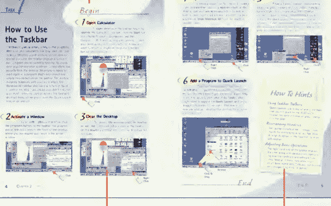


每个任务都包含一系列易于理解的步骤，旨在引导您完成操作。

- **点击:** 点击一次左键。
- **双击:** 快速点击两次左键。
- **右键:** 点击一次右键。
- **指针箭头:** 高亮步骤或任务中您需要指向或关注的屏幕项目。
- **选中:** 高亮步骤或任务中讨论的屏幕区域。
- **点击并输入:** 点击指示处并开始输入您的文本或数据。


## 操作说明

`如何拖动:` 指向起始位置或对象。按住鼠标键（根据说明按左键或右键），将鼠标移动到新位置并释放按键。

每个任务都包含一系列易于理解的步骤，旨在引导您完成操作。

- `点击:` 点击一次左键。
- `双击:` 快速点击两次左键。
- `右键:` 点击一次右键。
- `指针箭头:` 高亮步骤或任务中您需要指向或关注的屏幕项目。
- `选中:` 高亮步骤或任务中讨论的屏幕区域。
- `点击并输入:` 点击指示处并开始输入您的文本或数据。

通过遵循附录 A，“安装 Caldera”开始。安装 Linux 后，本书将帮助您学习如何配置和使用。

- 启动和关闭 Linux
- 启动 X 桌面
- 配置您的桌面
- 阅读帮助页和程序文档
- 管理窗口和程序
- 备份或 连接到互联网
- 创建文本和图形文档
- 设置打印机并打印文本和图形
- 使用 StarOffice 软件套
- 播放游戏和音乐

使用本书可以节省你上手 Linux 的精力和。每一章都包含若干任务，旨在帮助你构建 Linux 知识。每项任务将通过视觉引导、分步说明和图片来指导你完成。书中还包含了近 200 条实用的“如何做”提示、技巧、窍门和陷，你可以利用它们来避免或解决问题。

《如何使用 Linux》是第一本彩色的 Linux 教程，包含了 500 多张 Linux 运行时的截图。你会很快发现 Linux 已经准备就绪。欢迎来到 Linux 的世界！

## 任务

## 第一章 使用 Caldera OpenLinux

本章将向你展示如何开始使用 Caldera 系统的 OpenLinux Linux 发行版，包括多种启动并登录 Linux 的方法（安装 Linux 的说明和提示请参见附录 A，“安装 Caldera OpenLinux”）。你还将学习如何让 Linux 命令行变得更安全。此外，你将看到如何直接登录 Linux 的图形界面——X 窗口系统。在开始之前，请确保你已经正确配置了 X 以适配电脑显卡和显示器。务必遵循附录 A 中的说明！

当你首次登录 Linux 时，你处于主目录。该目录有一个位置，或路径名，例如 `/home/yourusername`，其中 `username` 是你首次安装 Linux 时选择的。

### 开始

### 如何启动 Linux

### 启动 Linux

此任务将向你展示使用 Linux 加载器提示符启动 Linux 或 LILO 的多种方法。此任务假设你已经在电脑硬盘上安装了 OpenLinux 和 LILO（参见附录 A），但如果你从软盘启动，每一步都同样适用。

打开电脑。当 Caldera OpenLinux 屏幕出现时，你会在屏幕底部看到启动提示符。如果你不输入任何内容，电脑将在 20 秒后启动进入 Linux。你会看到一个可用的启动镜像列表，按 `Tab` 键。要启动到 DOS，输入 `dos` 并按回车。要启动 Linux，输入 `linux` 并按回车。

```
Caldera
linux:~$ login
password:
Config: /var/sys/C-2-Systems, Inc.
~$
```

### 输入你的用户名和密码

### 配置你的环境


# 第一章：使用 CALDERA OPEN LINUX

输入你的用户名并再次按回车。你将回到 shell 命令行界面下的主目录（如果你选择 `bash` 作为默认 shell，对吧？）。如果你以前登录过，Linux 会告诉你你何时使用了哪个控制台（或终端）。

一些最基础的命令——例如用于复制文件的 `cp`、用于移动或重命名文件的 `mv` 或用于删除文件的 `rm`——可能是危险的。在控制台的命令行下，使用 `pico` 编辑器（来自 pine 邮件程序）通过输入 `pico .bashrc` 并按回车来打开 bash shell 的资源文件 `.bashrc`。

```
Caldera
user:~$ login
password:
Config: /var/sys/C-2-Systems, Inc.
root@linux:/home/user (192.168.1.100)~$ 
```


## 4 编辑 .bashrc

按下下方向键滚动到 `.bashrc` 的末尾。输入 `alias cp='cp -i'` 并按回车，为 `cp`（复制）定义别名。接着为 `rm`（删除）定义别名；输入 `alias rm='rm -i'` 并按回车。接下来，输入 `alias mv='mv -i'` 并按回车，为 `mv`（重命名）定义别名。完成后，按 `Ctrl+X`。`pico` 编辑器会询问你是否保存更改；按 `Y` 然后按回车保存文件。这些更改从现在起生效，重启并重新登录后，每条命令都会请求权限。

## 5 重启 Linux

如果你是 root way，只需输入 `shutdown` 命令并带有 `-r` 选项重启 Linux。如果你不是 root，可以使用 `su`（切换用户）命令来重启 OpenLinux。输入命令 `/bin/shutdown -r now` 并按回车。如果提示 root 密码，输入密码并按回车重启 Linux。

```
# 1.2                               文件: .bashrc                               
# 已修改                                                              
alias cp='cp -i'                                                
alias rm='rm -i'                                                
alias mv='mv -i'                                                
### 已修改缓冲区用于 SYSTEM LINUX
```

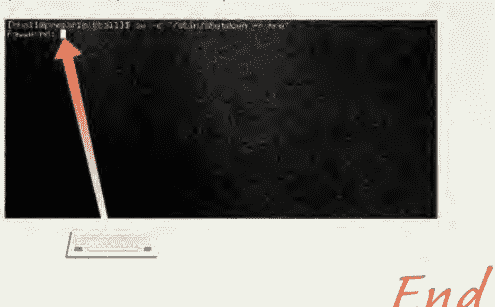

### 如何做提示

### 如何学习使用命令行？

有很多方法可以使用命令行，它被称为 shell。学习 Linux 的最佳方法之一是阅读《Linux 安装与入门指南》。你可以使用 `lynx` 浏览器读取安装 OpenLinux 时安装在硬盘上的副本；输入 `lynx /usr/doc/LDP/install-guide/install-guide-3.2/index.html` 按回车跳转到第 3 章。

### 如何更改我的密码？

在提示符处输入 `passwd` 并按回车。OpenLinux 将提示 `New Password`。输入新密码并按回车；通过再次输入并按回车验证新密码。不要忘记你的密码，尤其是 root 密码！

### 我应该知道哪些基础命令？

查看书中附的“常用 Linux 命令”文档，了解在学习 Linux 时应该掌握的命令列表。

如何启动 LINUX

# 任务

## 开始

### 如何启动 Linux 进入 X 窗口系统

#### 1 直接启动 X

启动电脑。在 LILO 启动提示符处，输入 `linux 5` 并按回车。当 Linux 启动完成后，屏幕清除，你会看到登录窗口。输入你的用户名并按回车。然后，输入密码并按回车使用管理器启动 X 会话。本任务教你如何使用 LILO 直接启动 X 窗口系统。你必须正确配置 X 才能直接进入 X（参见附录 A）。第二章“使用 X”将告诉你在启动 X 会话后做什么。

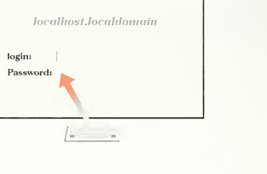

```
login:

Password:
```

#### 2 打开 /etc/init

#### 3 设置启动级别

以 root 用户登录。在命令行下，使用 `pico` 文本编辑器打开 `/etc` 目录下的 `init` 文件。小心！你应该先用 `cp` 命令为该文件创建一个备份；输入 `cp /etc/init /etc/initbak` 并按回车。编辑文件，输入 `pico -w /etc/init` 并按回车滚动文件。该条目通常包含 `init=3`，这会带控制提示符的多用户模式启动 Linux。将数字 `3` 改为 `5`。按 `Ctrl+X` 保存文件并按 `Y` 确认保存。下次启动 Linux 时，你将看到如步骤 1 所示的登录界面。

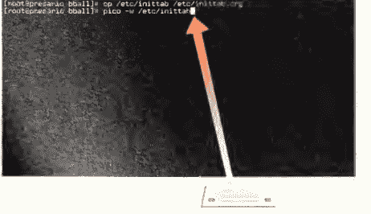

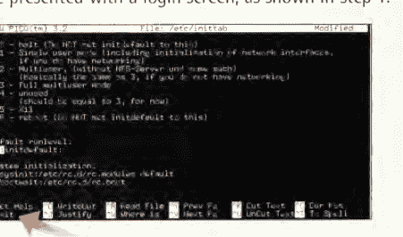

```
root:init:5

1: 单用户模式（不可用）

2: 单用户模式（网络可用）

3: 多用户模式（默认）

4: 无网络的多用户模式

5: 带图形界面的多用户模式（默认）

6: 运行级别，用于重启

7: 重启
```


| 文件名 | 目标 | 来源 | 最后修改时间 | 最后大小 |
| --- | --- | --- | --- | --- |

# 第一章：使用 CALDERA LINUX

## 设置默认启动为 KDE

### 启动到 kdm 登录

要配置 OpenLinux 直接启动到 KDE，请重复步骤 3，将运行级别改为 5。先不要保存 `init` 文件；而是滚动到文件末尾，直到使用运行级别 5 的 `xdm`。在这一行输入井号 (`#`)，并重新输入该行以告诉 OpenLinux 启动 `kdm` 登录管理器而非 XDM，输入 `x5:respawn:/opt/kde/bin/kdm-nodaemon` 并按回车。按 `Ctrl+X`、`Y`，然后按 `Y` 保存文件。

重启 Linux。当 Linux 重启时，会出现 K 桌面环境登录界面。点击你的用户名并输入密码。要启动到 KDE，点击按钮。

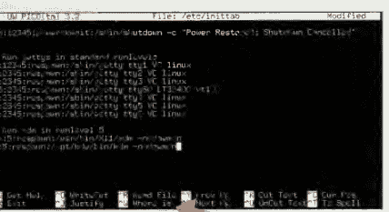

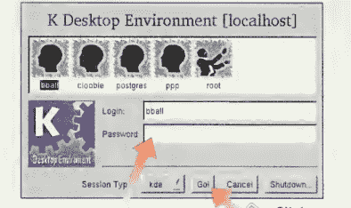


### KDE 登录让我无法登录！

KDE 使用 `kdm` 守护进程登录的配置可能不正确（这不是 Caldera Systems 的责任）。要退出登录界面，按 `Ctrl+Alt+F1` 并以 root 用户身份登录。你可以编辑 `/etc/init` 来正常启动 OpenLinux。然后，访问 http://www.calderasystems.com 并在支持部分查找有关使用 KDE 登录的帮助。

### 什么是 KDE？

KDE 是一个程序集合，包括一个名为 `kwm` 的 X11 程序（或客户端）。`kwm` 客户端是一个窗口管理器，用于在会话期间控制和管理你的桌面。更多信息请参见第三章“使用 K 桌面环境”。

### 什么是 X11？

X 窗口系统（被称为 X11 或 X）是一系列软件，包括程序、字体、文档和关键服务器。这个图形界面系统可以在独立台式机或笔记本电脑上运行，也可以配置为跨网络提供图形。在电脑上运行 X 对于享受 KDE 等软件至关重要，OpenLinux 没有 X 也可以高效使用。关于 X 的更多信息请参见第二章。

## 任务

5. 如何复制和粘贴图形 20
6. 如何更改你的桌面和鼠标 22

# 第 2 章

## X 窗口系统入门

本章将向你展示如何使用 OpenLinux 自带的 X 窗口系统（X Window System）。X窗口系统被称为 X11 或 X，是 Linux 的图形界面。有关如何配置 X 以与你的电脑显卡协同工作的信息，请参阅附录 A，“安装 Caldera OpenLinux”。虽然配置 X 需要一些精力，但这些付出是完全有回报的——在你的 Linux 会话期间，你将可以使用一个全新的图形化应用世界。

在本章中，你将学习如何启动不同的 X11 客户端（或程序），并控制这些程序在显示器上的呈现方式。你将发现如何设置桌面的背景颜色、查看字体并使用剪贴板复制和粘贴文本。你还将看到如何使用不同的窗口管理器（如 K Desktop Environment (KDE)）启动你的 X11 会话。窗口管理器是控制 X 处理桌面、客户端窗口以及 X 会话其他部分的 X11 程序。本书中使用 KDE 作为为默认窗口管理器，但本章讨论的技术适用于任何窗口管理器。

### 如何启动 X11 会话

此任务将向你展示如何使用不同的窗口管理器启动 X11 会话。你将学习如何启动默认窗口管理器，然后学习如何配置 OpenLinux 来启动你的窗口管理器。

### 使用 AfterStep 启动 X11

在控制台命令行输入 `startx` 并按回车。如果你根据附录 A 中的说明正确安装并配置了 X11，屏幕将会清除，并在运行 Looking Glass 桌面的 AfterStep 窗口管理器启动启动会话。(img/c48ad0dbc61332ca39f773da7141fe1_25.png)

### 使用 AfterStep 停止

要停止 X11 会话，点击桌面的空白区域，点击 Desktop（桌面），然后选择 Quit（退出）。你回到控制台。

### 使用 KDE 启动 X11

要使用 KDE 环境启动 X11 会话，使用 `kde` 命令。在控制台命令行输入 `kde` 并按回车。如果你安装了 KDE，屏幕将会清除，并在 KDE 桌面启动会话。(img/c48ad0dbc61332ca39f773da7141fe1_25.png)(img/c48ad0dbc61332ca39f773da7141fe1_22.png)

### 使用 KDE 启动 X11

点击桌面面板上的 Application（应用程序）按钮，然后点击 Logout（注销）。出现注销对话框。

- 应用程序（Applications）
- 游戏（Games）
- 多媒体（Multimedia）
- 其他（Other Apps）
- 设置（Settings）
- 用户（Users）
- 文件（Files）
- 主目录（Home Directory）
- 本地网络（Local Network）
- KDE 帮助（KDE help）
- 系统桌面（System Desktop）
- 锁屏（Lock Screen）
- 注销（Logout）

(img/c48ad0dbc61332ca39f773da7141fe1_26.png)

### 5 配置 .xinitrc 文件

使用窗口管理器启动 X11 会话，使用你喜欢的 Linux 编辑器（例如程序自带的 `pico` 编辑器）创建一个名为 `.xinitrc` 的文件。在你的命令行输入 `pico .xinitrc`。在 `pico` 窗口中输入以下三行：

```
xsetroot -solid lightblue

exec xterm &

twm
```


按 `Ctrl+X` 保存文件。然后在命令行输入 `start` 并按回车。((img/c48ad0dbc61332ca39f773da7141fe1_26.png)

### 6 使用 twm 停止 X11

要停止 X11 会话，点击桌面的空白区域并选择 Exit。

## 操作提示

(img/c48ad0dbc61332ca39f773da7141fe1_26.png)

当你使用 `startx` 启动 X 会话时，Open 使用 AfterStep 窗口管理器并运行 Looking Glass 图形桌面。Looking Glass 是一个你可以用来启动程序和组织文件的 X11 客户端。有关使用 Looking Glass 的更多信息，请从终端命令行输入 `netscape/usr/doc/html/Gallery_Info` 启动 Netscape 浏览器。你可以阅读 Reading Glass 用户指南。

### 有多少窗口管理器？

你不限于 OpenLinux 自带的窗口管理器。访问 http://www.poli.org/xwinman，你可以找到 60 多种不同的窗口管理器。运行 Linux 和 X 的巨大理由之一是你可以让你的电脑看起来像其他电脑或任何你想要的东西

## 如何启动 X11 终端窗口

此任务将向你展示在启动 X11 终端时使用不同的命令行选项。你将看到如何控制 X11 窗口的大小、位置、背景和前景颜色。终端窗口是 X11 会话期间的重要工具，因为它让你能够访问 OpenLinux 命令行。在开始之前，请使用 `startx` 命令启动 X11 会话。

- 1 启动终端
点击 Terminal 图标。出现一个 xterm 终端。点击标题栏并拖动窗口移动到桌面的不同部分。要调整窗口大小，点击窗口的边缘或角并拖动。

(img/c48ad0dbc61332ca39f773da7141fe1_27.png)

- 2 最小化终端
点击终端的控制按钮，然后选择 icon（图标）。终端变为桌面左下角的一个图标。要恢复终端，点击它的图标。使用 `fg` 和 `bg` 选项启动带有特定颜色的新终端。在终端命令行输入 `xterm -fg black -bg lightgreen`。出现一个浅绿色背景黑色文字的新终端。点击原始终端窗口并按 `Ctrl+C` 关闭终端。

(img/c48ad0dbc61332ca39f773da7141fe1_27.png)(img/c48ad0dbc61332ca39f773da7141fe1_27.png)

- 3 选择字体和背景
使用 `-fn` 选项启动不同字体的终端。在终端命令行输入 `xterm -fg black -bg lightgreen -fn 9x5` 并按回车。出现一个带有浅绿色背景黑色文字的终端。这是在 X11 会话中运行特定字体的终端。点击原始终端窗口。

(img/c48ad0dbc61332ca39f773da7141fe1_28.png)

- 4 使用特定尺寸和位置
使用 `-geometry` 选项启动带有特定尺寸的终端。你将看到控制 X11 窗口的大小、位置。在终端命令行输入 `xterm -geometry 800x600+100+100`。出现一个 800x600 像素、位置在 100+100 的终端。这是终端窗口在 X11 会话期间的一个非常重要工具。

(img/c48ad0dbc61332ca39f773da7141fe1_28.png)

- 5 在终端中运行程序
使用 `-e` 选项在终端中运行程序。在终端命令行输入 `xterm -e /usr/bin/pico`。出现一个运行 pico 编辑器的终端。

(img/c48ad0dbc61332ca39f773da7141fe1_28.png)

### 6 使用 twm 停止 X11

要停止 X11 会话，点击桌面的空白区域并选择 Exit。

## 查看调色板

使用 `cmap` X11 客户端查看显示器上当前可用颜色网格。点击桌面空白区域，选择应用程序 | 图形 |形（Graphics / Colormap）。你的桌面颜色将显示在一个窗口中。如果你点击网格中的某种颜色，它的红/绿/蓝（RGB）值将以十六进制（16进制）显示。

## 使用 xorsel 选择颜色

点击桌面空白区域，选择应用程序（Applications） | 图形（Graphics） | Xorselect。会出现一个窗口，列出可用颜色以及十进制（10进制）格式的 RGB 值。要查看某种颜色的 RGB 值，点击“抓取颜色”（Grab Color），然后点击颜色本身。xorselect 会显示颜色的名称和 RGB 值。

| 名称 | 描述 |
| --- | --- |
| white | 白色 |
| light gray | 浅灰色 |
| gray | 灰色 |
| dark gray | 深灰色 |
| black | 黑色 |
| cyan | 青色 |
| blue | 蓝色 |
| green | 绿色 |
| red | 红色 |
| orange | 橙色 |
| yellow | 黄色 |
| magenta | 品红色 |
| white | 白色 |


点击

```
$ xorselect

Input: 276, 238, 238 = white

Input: 115, 139, 139 = red

Input: 122, 135, 163 = cyan

Input: 172, 236, 236 = blue

Input: 272, 118, 250 = green

Input: 72, 118, 250 = red

Input: 272, 218, 250 = yellow
```


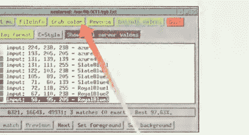

## 操作提示

### 列出你的系统字体

X11 字体位于 `/usr/X11/lib/X11/fonts` 目录下的几个子目录。要查看系统字体列表，将 `xfonts` 客户端的输出通过管道交给文本分页器，例如 `less`（使用此命令行：`xfonts | less`）。查看完列表后按 `Q` 键。

### 使用颜色——试试看！

你可以使用 RGB 值或颜色名称为你的根显示器（root display）构建有趣的背景。将 `bggen` 命令的输出通过 X11 图形程序 `xv`（在第 15 章“捕和创建图形”中介绍）发送如下：`bggen red green blue | xv -root -quit -.`。阅读 `bggen` man 页面获取更多示例。

## 如何复制和粘贴文本

此任务向你展示如何在 X11 窗口之间复制和粘贴文本。你将看到如何使用 `xcutsel` 和 `xclipboard` 客户端。复制和粘贴是在编辑器或程序之间传输长文件名或文本块的方便方法。

### 打开两个终端

启动两个 `xterm` 终端。使用你喜喜欢的文本编辑器（如 `pico`）为其中一个窗口打开文件 `mytextfile.txt`，方法是输入 `pico mytextfile.txt` 并按回车。在另一个窗口中打开另一个文件（不同的名称，如 `newfile.txt`）。

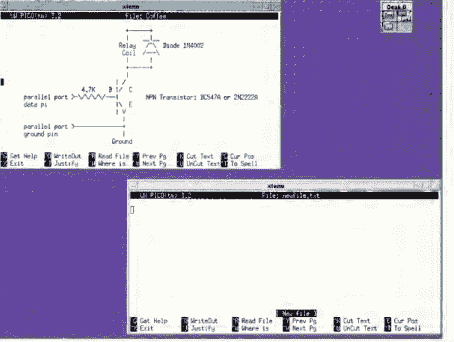

### 启动 xclipboard 客户端

点击桌面空白区域，选择应用程序（Applications） | 杂项（Miscellaneous） | 剪贴板（Clipboard）。

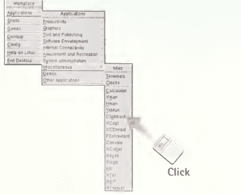

### 高亮并复制文本

点击并拖动高亮第一个终端窗口中的文本。然后将光标移动到 `xclipboard` 窗口并按下鼠标按钮（如果是双键鼠标，则同时按下左右键）。高亮的文本将显示在 `xclipboard` 的显示区域。

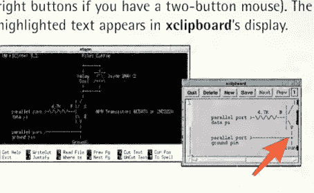

### 保存剪贴板文本

在剪贴板窗口中，点击“保存”（Save）。弹出一个小型对话框。点击“接受”（Accept）将文本保存到名为 `clipboard` 的文件中。

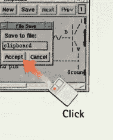

### 粘贴文本

将鼠标移动到另一个窗口，按下中间鼠标键（或者，你可以按 `Shift+In`）。复制的文本将出现在新窗口中。

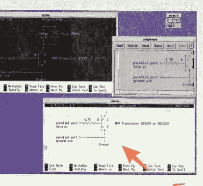

结束

## 操作提示

剪贴与直接粘贴
你可以通过先高亮一个窗口的一部分，然后在另一个窗口中按下中间鼠标键来复制文本。但使用 `xclipboard`，你可以保存复制的文本。这个程序非常有用，因为并不是所有的 X11...

### 易于高亮

使用点击并拖动高亮文本的替代方法是：用鼠标点击一个插入点，然后按住 `Shift` 键，点击显示器的不同区域。插入点和点击位置之间的所有文本都会被高亮。

### 图形怎么办？

查看下一个任务“如何复制和粘贴图形”，以学习如何在窗口之间复制。

## 任务

## 如何复制和粘贴图形

此任务向你展示如何在 X11 客户端之间复制和粘贴图形。你将学习如何使用 `xmag` 程序。复制和粘贴图像非常简单！

### 查看图形

使用 `xv` 客户端显示喜欢的图形。在终端命令行输入命令如 `nat.jpg &`（`nat.jpg` 是你想显示的文件名）并按回车。图形将显示在你的桌面上。

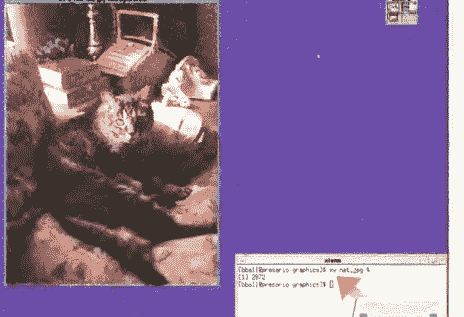

### 启动 xmag 客户端

在终端命令行使用 `xmag` 客户端捕获比例为 1:1 的 200x200 像素图形。输入命令如 `xmag -root -200x200 &` 然后回车。

### 复制图形

你的 X11 光标变为十字准。将鼠标移动到你想捕获的图形区域并点击。复制的图形显示在 `xmag` 窗口中。

```
xwin -root=nat.jpg &
```

```
xsetroot -image nat.jpg -200x200 &
```


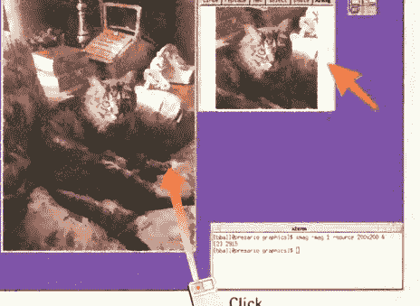

### 4 启动 xpaint 客户端

在终端命令行输入 `xpaint &` 启动 xpaint 客户端。打开文件（File）菜单，然后点击“新建”（New）。

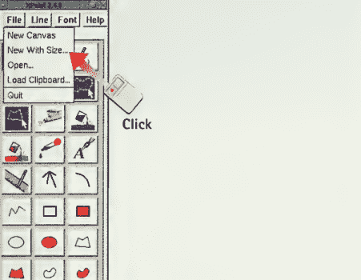

### 5 指定大小

清除宽度（Width）字段的内容并输入 100。接下来清除高度（Height）字段的内容并再次输入 100（这创建了一个 100x100 像素的图像，但如果你喜欢也可以创建更大的）。然后点击确定（OK）。

img/c48ad0dbc61332ca39f773da7141f4e1_34_1.png)

### 6 将图像粘贴到 xpaint

在 xmag 窗口中点击“选择”（Select），在 xpaint 窗口中打开文件（File）菜单并点击“粘贴”（Paste）。选择的图形出现在 xpaint 绘制窗口；根据需要进行编辑。

img/c48ad0dbc61332ca39f773da7141f4e1_34_2.png) # 操作提示

使用其他图形
查看第 15 章有关如何使用 X11 图形的信息。你也可以使用 xmag 程序将图形粘贴到 GNU 图像编辑器（GIMP）。

StarOffice 复制和粘贴
查看第 11-14 章学习如何复制粘贴文本、图形和 StarOffice 文档。在程序（如 StarWriter 和 StarCalc）之间执行复制粘贴操作要得多。

## 任务

## 如何更改你的桌面和鼠标

### 1 设置背景颜色

此任务向你展示如何更改桌面和鼠标外观。你将看到如何使用多个程序创建特殊效果或装饰你的 X11 桌面。点击桌面空白区域并选择桌面背景。你会看到背景颜色列表，例如 Steelblue 和 Slate（默认为 Blue）。点击其中一个来更改背景或根显示。

img/c48ad0dbc61332ca39f773da7141f4e1_35_0.png)

### 2 屏幕屏保背景

使用 `hopalong` 命令创建一个更有活力的显示。启动终端并输入 `hopalong-root`。按回车，你的桌面将通过分形显示变得活跃。要退出，按 `Ctrl+C`。

### 3 去钓鱼！

要让你的桌面真正活跃起来，点击桌面空白区域并选择桌面 | 背景 | 鱼缸。这会启动 `xfishtank` 客户端。几秒钟内，你的显示器就布满了海洋脊椎动物（以及一些外形奇异生物）。

img/c48ad0dbc61332ca39f773da7141f4e1_35_1.png
img/c48ad0dbc61332ca39f773da7141f4e1_35_2.png)

# 第 2 章：入门 窗口系统

### 显示可用光标

使用 `xfd` 显示可用光标。在终端命令行输入 `xfd-fn cursor` 并按回车。你会看到可用光标的网格。或者，你可以通过输入 `less /usr/X11/include/X11/cursorfont.h/` 读取光标名称列表。更改光标为，使用 `xsetroot -cursor_name spider` 并按回车。使用光标名称将光标恢复为默认。

### 配置鼠标

在终端窗口命令行输入 `xmouseconfig` 并按回车。出现一个对话框显示你当前的鼠标设置。当光标在 xwindow 上时，按下左、中、右鼠标键关闭三键仿真。点击 High、Medium 或 Low 更改鼠标的分辨率。除非确定点击（如 GlidePointPS2）适用于鼠标，否则不要更改鼠标类型——你可能会变得失效。完成后，点击应用（Apply）按钮。点击退出（Exit）离开。

img/c48ad0dbc61332ca39f773da7141f4e1_36_0.png
img/c48ad0dbc61332ca39f773da7141f4e1_36_1.png)

### 好的，我如何停止鱼群？

`xfishtht` 程序在后台运行。如果你再次选择鱼缸，你就会运行两个鱼缸，你的桌面会变得疯狂！停止 `xfisht` 的一种方法是退出 X 或使用 `Ctrl+Alt+Backspace` 停止服务器。

### 键盘鼠标

你可以使用键盘移动鼠标。按下并保持 `Ctrl+Alt`，然后按一个光标键。

### 使用桌面

当你使用 `startx` 启动 X 会话时，你有四个不同的桌面。点击桌面分页器窗口中的四个正方形之一移动到不同的桌面。分页器是显示器右上角的小正方形，显示代表运行程序的小矩形。你可以用一个用于文字处理，另一个用于图形，其他的用于其他程序。你也可以按 `Ctrl` 并轻点光标键移动到不同的桌面。

## 任务

## 章节

### 开始使用 KDE 桌面环境

K 桌面环境（或 KDE）是 Linux 和 X 窗口系统最新、最流行的图形界面程序集合。尽管有些人认为 KDE 是 X11 的一个窗口管理器，但它不仅仅是 X，远不止此。KDE 是 Linux 免费提供的图形环境之一，包含 70 多个程序（或客户端），并提供了一些可以帮助你提高工作效率的重要功能。其中一些功能包括：

这些功能中的某些将在后的第 4 章“管理你的 Linux 系统”中介绍。在本章中，你将学习如何配置 KDE，让它看起来和运行起来符合你的要求！

首先：为了使用 KDE，你必须先登录 Linux（第 1 章，“开始使用 Caldera OpenLinux”）。要使用 KDE，请在命令行输入单词 `kde` 并按回车。当图形化桌面出现时，你就可以工作了！

## 任务

### 如何配置你的桌面

当你使用 KDE 时，你会在电脑屏幕上看到不同的元素，例如 KDE 面板（位于底部）、任务栏（位于顶部）、几个图标（如垃圾桶），以及可能显示你主目录下文件或文件夹的窗口。请注意，你的根显示颜色（或自定义桌面背景）默认是蓝色的。你可以通过选择新颜色、显示图片、更改窗口外观以及选择字体来自定义此背景！

### 1 打开显示属性菜单

在桌面的空白区域点击鼠标右键，并从弹出的菜单中选择“显示属性”项。

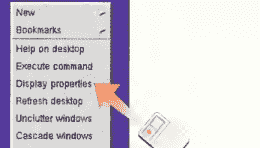

### 2 更改桌面字体

要更改 KDE 任务栏中文件名或程序使用的字体类型，点击“字体类型”下拉列表并选择不同的菜单。你将在“示例文本”区域看到字体的预览。如果你想让窗口、按钮或菜单像“其他”操作系统那样，请勾选对话框顶部“以 Windows 95 样式绘制部件”框中的“绘制部件”。要立即使用你的新设置，请点击“应用”按钮。

### 3 点击背景标签页

点击“背景”标签页。要将背景更改为图片，点击“壁纸”部分的下拉菜单。你将看到一个不同背景图案和图片的列表。滚动列表，点击其名称选择你想要使用的壁纸。对话框顶部会出现所选壁纸的预览。点击“应用”按钮更改你的显示器背景。

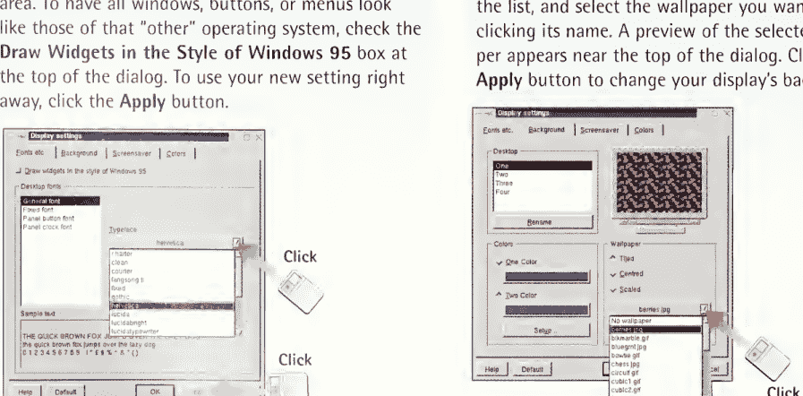

第 3 章：开始使用 KDE 桌面环境

### 选择屏幕保护程序标签页

点击“屏幕保护程序”标签页，滚动屏幕保护程序列表；对话框中会出现所选屏幕保护程序的预览。点击“设置”进入所选屏幕保护程序的各种参数。点击“测试”查看屏幕保护程序的运行效果。设置系统在屏幕保护程序出现之前的空闲时间，在“等待”字段中输入一个数字。勾选“需要”复选框，在屏幕保护程序启动后你需要密码才能工作。要使用所选的屏幕保护程序，点击“应用”。

### 更改窗口外观

点击“颜色”标签页，滚动颜色方案列表以更改窗口标题栏、框架、菜单或所选文本的外观。注意，当你点击每种不同的方案时，方案将显示预览。

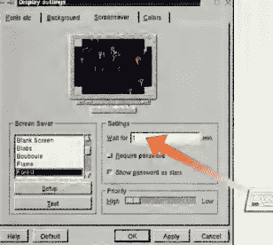

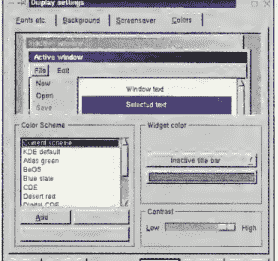

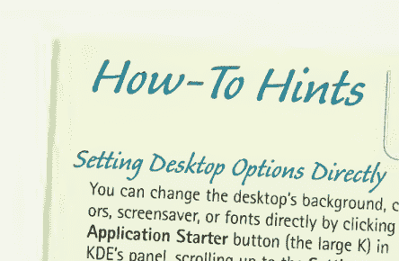

## 提示

## 提示

KDE 提供了 14 种颜色方案，但你可以通过选择特定项目并将颜色分配到“显示设置”对话框中“颜色”标签页的部件颜色区域来创建自己的方案。从下拉菜单中选择窗口元素，然后点击菜单之间的矩形显示“选择颜色”对话框。从“系统颜色调板”中选择颜色，或通过按住左鼠标键移动到对话框右上角的颜色框上来创建自己的颜色。当你对颜色满意时，点击“确定”按钮。要为所需的窗口项使用新颜色，点击“显示设置”对话框中的“应用”按钮。

## 直接设置桌面选项

你可以通过点击设置中的应用程序启动按钮（大 K）并点击鼠标来直接更改桌面的背景、颜色、屏幕保护程序或字体。

## 任务

### 开始

### 如何配置 KDE 面板和任务栏

### 1 隐藏 KPanel

隐藏面板是创建更多屏幕空间的的一种方便方法。将光标移动到面板的最左侧。注意应用程序启动器（大 K 按钮）旁边的小矩形。要隐藏面板，请点击该矩形。面板将消失并收缩为一个垂直按钮。要让面板重新出现，再次点击该按钮。

KDE 面板（或 KPanel）用于启动应用程序、控制和配置您的 KDE 会话、导航到“虚拟”桌面或程序窗口，以及退出 KDE。面板有许多控制控件：应用程序启动器按钮；弹出窗口列表；弹出程序菜单；注销、锁屏和虚拟桌面按钮；程序启动图标可以显示如何添加和删除面板程序，以及如何隐藏、调整大小或重新调整面板的方向。

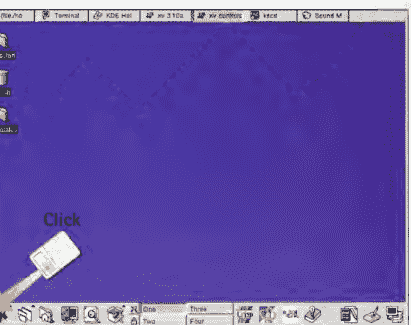

### 2 启动 KPanel 配置对话框

### 3 调整 KPanel 和任务栏的方向

如果你不想让面板显示在显示器的底部，可以将其置在屏幕的顶部或左侧；你可以在 KPanel 配置对话框中指定这些。你可以点击应用程序启动器按钮，滚动到“面板”项目，并选择“配置”。

要将面板重新调整到显示器的左侧，请点击 KPanel 配置对话框中“位置”部分的“左侧”按钮，然后点击“应用”按钮。要调整或隐藏任务栏的方向，请点击对话框中“任务栏”部分的相应按钮。“样式”部分中的按钮控制面板中图标的大小。为你的显示器选择所需的尺寸，然后点击“应用”按钮。

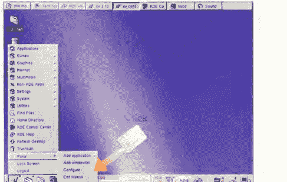

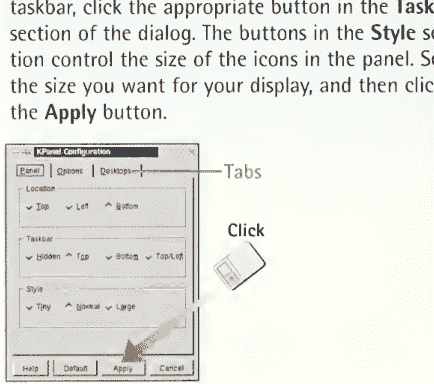

30 第 3 章：开始使用 KDE 桌面环境

### 4 更改 KPanel 选项卡

点击**选项**选项卡来设置其他选项，例如弹出帮助、自动隐藏和面板控制。点击**显示菜单工具提示**来切换面板控件的弹出帮助。拖动**延迟**滑块来设置帮助出现之前的时间（显然为 1000 ms 为一秒）。对于面板或任务栏的自动隐藏，请点击**其他**部分的相应按钮。当你隐藏面板或任务栏时，它只有在你的鼠标悬停在面板或任务栏的常规位置时它才会出现。不要忘记点击**应用**按钮。

### 5 更改桌面按钮

点击**桌面**选项卡来配置面板中的**桌面按钮**。这些按钮用于导航到不同的“虚拟”桌面——这就像同时拥有四个显示器一样！如果你需要四个以上的桌面，请拖动**可见**滑块来控制它，就会出现两个新桌面（你可以使用最多八个）。要控制面板中 X 按钮的大小，请向左或向右拖动**宽度**滑块。注意，默认桌面按钮是**一**、**二**和**三**。要更改桌面名称，点击你想要更改的桌面文本字段并输入你自己的名称。

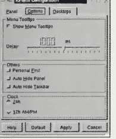

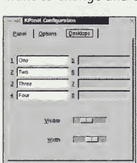


操作提示

默认的 KPanel 配置使用普通大小的图标。这意味着如果你在 800×600 像素的显示器上使用，可能看不到时钟（它在面板的最右侧）。要看到时钟，请在面板配置对话框中选择**极小**设置，从面板中删除不需要的图标，或尝试垂直使用面板。

小心操作！尽管在许多情况下你可以通过配置对话框中的**默认**按钮恢复 KDE 的原始设置，但这并不总是有效。在更改桌面之前记住你的原始设置。

使用和标记桌面

使用桌面和标记是组织工作的方便方法。例如，如果你在一个桌面运行 Netscape，在另一个桌面运行 StarOffice，将 Netscape 桌面标记为**互联网**，将 StarOffice 桌面标记为**办公**，不仅起到提醒作用，还能将活动保持在单个屏幕上。

如何配置 KDE 面板和任务栏

## 如何更改 KPanel

面板除了托管启动器菜单和其他控件外，还是你快速启动常用程序的方便工具。本节将向你展示如何从面板添加、移动、配置或移除按钮。

### 添加应用程序

要在面板中添加应用程序，选择启动器菜单，选择“添加应用程序”，然后从菜单中选择。要添加如 Paint 之类的应用程序，从菜单中选择它。图标将立即出现在面板桌面按钮右侧。现有按钮将向右移动。

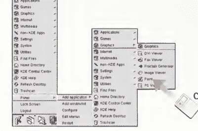

### 添加菜单

要在面板中添加菜单，再次打开启动器菜单，选择“面板”项目，然后选择“添加菜单”。从菜单中选择。菜单图标将出现在面板上。

### 移除应用程序或菜单

要从面板移除应用程序或菜单，右键点击图标并从弹出菜单中选择“移除”。

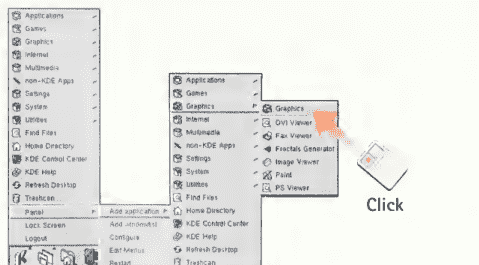

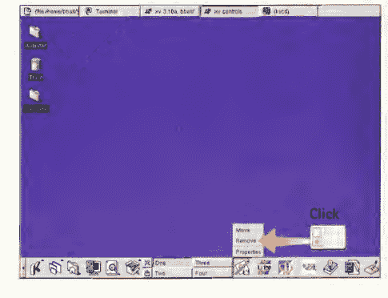

### 移动应用程序

要在面板上移动应用程序或菜单，右键点击图标并从弹出菜单中选择“移动”。然后，按住鼠标左键，将图标向左或向右移动，当图标到达想要的位置时释放。注意，移动图标右的任何图标都会向右移动以腾出空间。

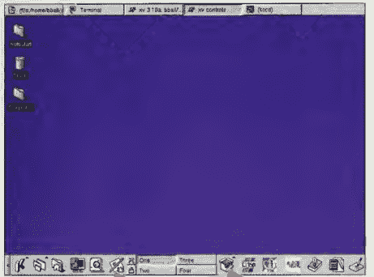

### 更改工具提示

要更改面板应用程序显示的弹出文本或工具提示，右键点击图标并点击“属性”。在 KDE 对话框中，点击“应用程序”选项卡。在“注释”字段输入新文本，然后点击“确定”。

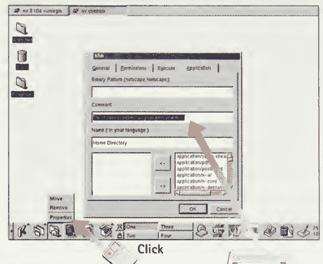

操作提示

KPanel：一种移动体验

面板上的所有项目都可以移动，包括桌面组按钮。只需右键点击桌面按钮并将它们拖动到你想去的地方。遗憾的是，注销和锁屏按钮也会跟着移动！

方向可以组织你的面板

默认水平面板将应用程序启动器和其他实用程序放在左侧，将重要程序放在右侧。这可能不是你想要的，特别是当你垂直使用面板时。在安排面板应用程序和菜单之前仔细考虑。

## 手动配置

如果你是高级用户，可以通过编辑位于主目录 `/.kde/share/config` 的 `kpanelrc` 文件来配置面板。

更改面板

### 如何编辑面板菜单

你已经学会了如何自定义桌面面板，但如果你想从面板菜单中添加或删除程序怎么办？本节将向你展示如何操作。

### 选择菜单编辑器

点击应用程序启动器按钮，选择“面板”，然后选择“编辑菜单”启动菜单编辑器。

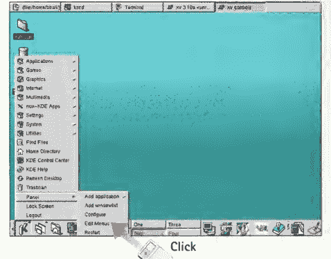

### 创建自定义菜单

菜单编辑器会询问（你可能会先收到请求目录位置的对话框——按回车键继续）。注意，你的初始菜单将被称为“空”。这不是它的名字，而是添加项目后出现的占位符。如需给你的菜单命名，请打开“选项”菜单，选择“更改名称”。

### 为你的菜单命名

在“更改名称”对话框中，点击“个人”文本字段，输入你想为菜单命的名称。完成后点击“确定”按钮。

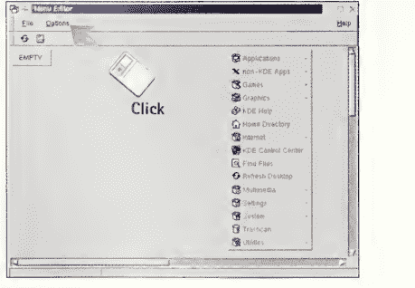

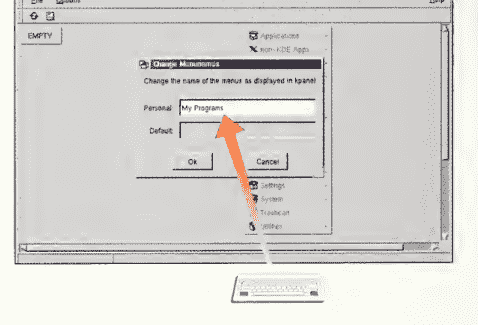

### 4 为您的菜单添加程序

快速构建您自己的菜单的最简单方法是从现有菜单中选择您喜欢的程序。要添加一组程序和子菜单，请从默认菜单（如“应用程序”）中选择一个菜单列表，点击鼠标左键并将菜单项拖动到您的**空**菜单上。您也可以使用复制和粘贴程序到您的菜单。只需在默认菜单中右键点击所需的程序，然后选择“复制”菜单项。接下来，将鼠标移动到新菜单，右键点击并选择“粘贴”，即可将程序粘贴到您的菜单中。

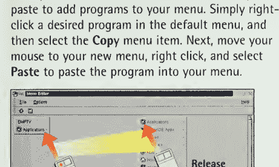

### 5 删除不需要的菜单项

完成菜单构建后，可以编辑掉任何不需要的项，例如初始的“空”菜单项。右键点击不需要的项，选择“删除”将其移除。

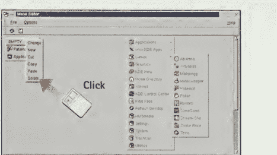

### 6 保存并使用您的新菜单

要保存您的新菜单，点击“文件”菜单并选择“保存”。然后通过点击“文件”、“退出”。您的新菜单将显示在“面板”菜单上方，名称为您在“重命名”对话框中选择的名称。此菜单与其他与其他与其他完全相同。请注意，当您将“应用程序”菜单复制到个人菜单时，其下的所有程序也都被复制了！

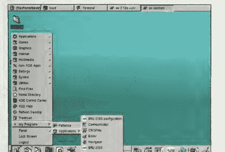

结束

## 技巧提示

## 菜单快捷键

如果您不想“到处点击鼠标”，可以使用方便的程序键盘快捷键。使用 Alt+F1 组合键将调出应用程序启动器。您可以使用方向键在菜单中向下、向左和向右滚动。当高亮了所需的程序时，按 Enter 键启动它。Esc 键将关闭每个打开的菜单。

## 隐藏程序

在完整的 Linux 安装期间，您的硬盘上会安装超过 2,000 多个程序——那是非常多的程序！（好吧，可能有一个一两个重复的，而且只有根操作符可以使用其中一些程序。）您在 KDE 中中安装的所有程序都在这里吗？注意：有关安装其他程序的详细信息，请使用 kmeditor（菜单编辑器）编辑器器“帮助”菜单，并阅读关于类型类型。您还应该阅读 kfm 帮助页面。

如何编辑面板菜单 35

## 如何管理桌面窗口

如您所见，您可以同时运行多个桌面，每个桌面都包含若干正在运行的程序。尽管您可以导航到每个桌面，按功能（如浏览、编辑等）管理和组织您的桌面，但您将学习如何直接导航到运行在另一个桌面上的程序。您还学学习如何管理您的桌面窗口。

### 选择 KPanel 的窗口列表图标

点击面板上的窗口列表图标。您将看到一个包含您的桌面名称以及任何正在运行应用程序的菜单。此程序是当前运行程序数量的方便索引。要跳转到另一个桌面上运行的应用程序，向上滚动列表并点击所需的程序。

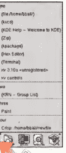

### 排列窗口

要管理或排列当前桌面中的窗口，请右键点击屏幕空白区域。桌面的根菜单将出现。要重新排列您的窗口，选择“取消杂乱窗口”或“层叠窗口”。

### 配置 KDE 窗口

要配置 KDE 如何绘制和处理您的窗口，从启动器菜单中启动 KDE 控制中心，然后在 KDE 控制对话框中展开“窗口”列表项。

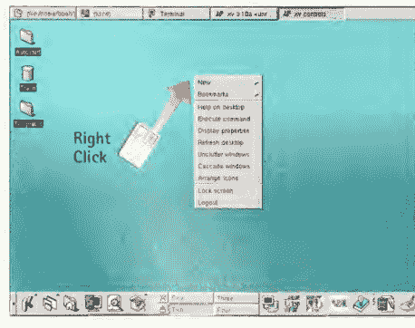

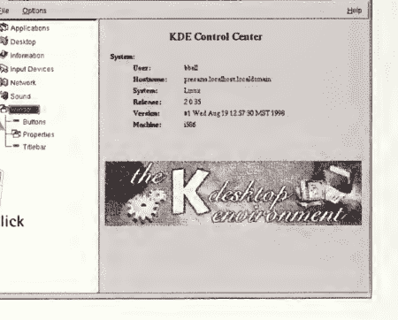

### 4 配置窗口按钮

在“窗口”列表项下选择“按钮”。当您使用 KDE 时，可以配置任何程序的窗口按钮。选择您想要移动或关闭的这些按钮，然后点击“应用”立即查看您的更改。

### 5 配置窗口属性

在“窗口”列表下选择“属性”。选择“不透明”选项使您的窗口变为实色。拖动动画滑块来控制窗口出现或消失的速度。选择“垂直最大化”告诉 KDE 如何在您的桌面上创建新窗口。选择“焦点策略”下拉菜单，当您跨桌面移动光标时，任何窗口将变为激活状态。

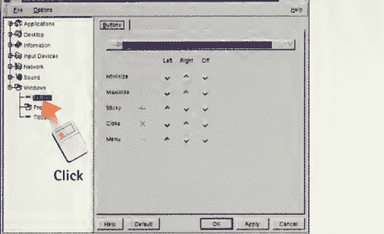

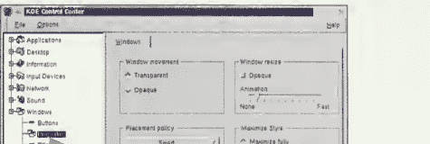

### 6 配置标题栏

在“窗口”列表下选择“标题栏”项，以配置您在 KDE 会话期间希望程序标题栏外观。标题栏可以以许多不同的颜色出现，看起来很简单，甚至有图片。“操作”允许您在标题栏上双击鼠标按钮时选择一种操作类型，例如调整大小、关闭或标识。将动画滑块向左移动以加速滚动，向右移动以减慢标题滚动。

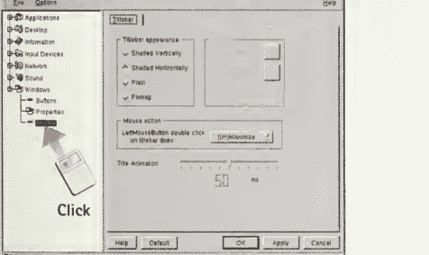

## 技巧提示

### 谁拥有按钮

在 KDE 中使用关闭、最大化和最小化按钮，您可能不想“到处点击鼠标”。

### 窗口操作简单

有几种键盘快捷键可以切换桌面。例如，使用 Tab 键切换窗口。要关闭窗口，按 Alt+F4。

如何管理桌面窗口 37

- 1. 管理文件 40
- 2. 管理用户 42
- 3. 管理软件 44
- 4. 管理方法 46
- 5. 管理桌面 48
- 6. 管理程序 50
- 7. 管理服务 52

## 管理 Linux 系统

此章节显示了如何处理您的 Linux。在开始之前，点击 KDE 桌面上的文件或文件夹。请查看第 2 节“应用程序”以获取更多详细信息。

第 4 章：管理您的 Linux 系统

### 管理文件

在 KDE 中，通过右键点击文件或文件夹来查看属性。

- 1. 查看 40
- 2. 重命名 42
- 3. 删除 44
- 4. 移动到 46
- 5. 复制 48
- 6. 创建链接 50
- 7. 快捷方式 52

### 查看文件

在 KDE 中，通过右键点击文件或文件夹来查看属性。

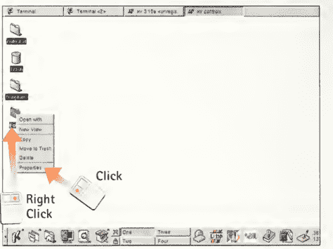

### 重命名文件

在名称字段中输入新文件名并点击确定。

### 删除文件

您可以通过两种方式删除文件。您可以将文件放入垃圾桶，也可以完全删除该文件。要将文件放入垃圾桶，右键点击它并在弹出菜单中选择“移动到垃圾桶”。文件将从桌面消失，垃圾桶图标会发生变化。KDE 会询问确认删除；点击“是”。

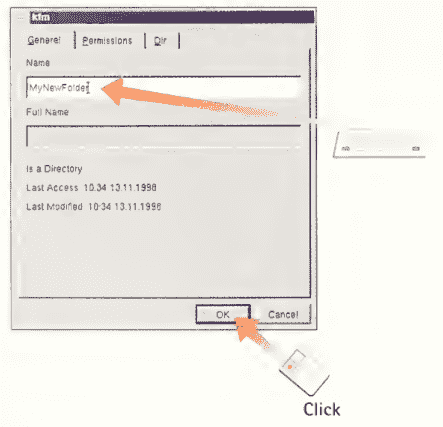

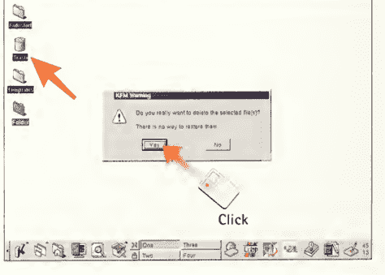

### 复制文件到桌面

KDE 桌面支持可拖放图标。这意味着您可以打开一个文件夹并在其中拖入拖出。通过将文件拖放到文件夹图标或打开的文件夹窗口，可以复制或移动文件。要复制文件，点击它，然后按住鼠标将其拖动到桌面。当您松开鼠标时，会出现一个小菜单。点击“复制”。

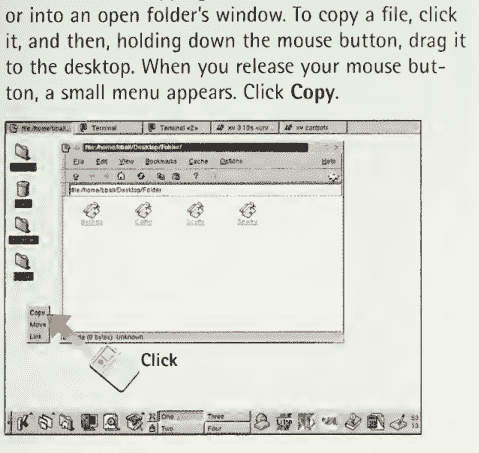

### 移动文件到桌面

注意文件仍在文件夹中，但桌面上也有了一个副本。要移动文件，重复上述步骤，但点击“移动”。注意文件已不在文件夹中。

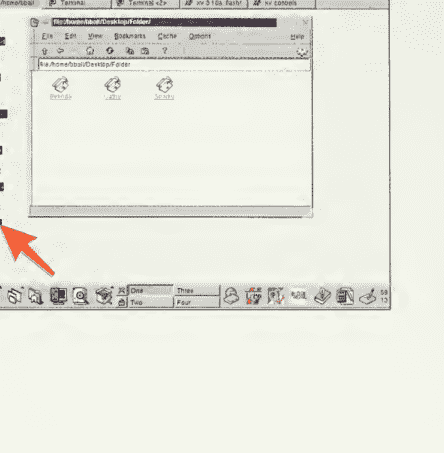

### 创建链接

重复之前的拖放操作，但这意味着在弹出菜单中点击“链接”。KDE 会创建一个与原始文件相同的新文件，但图标略有不同。链接是指向相应文件的指针。如果原始文件是文本文档，点击其链接将加载原始文档。如果您删除链接，则没有删除原始文件；但是，如果您删除了原始文档，链接将毫无用。

## 任务 2

### 开始

## 如何管理你的用户

### 1 启动 usercfg 

当你安装 OpenLinux 时，你就负责该系统。你的工作是保护 Linux 免受坐在计算机控制台、通过电话线或网络登录的人的影响。任务将向你如何为系统添加和更改密码。

以 root 操作员身份登录，输入 `usercfgs` 启动 `usercfg` 命令。出现主对话框。点击“添加”（Add）。

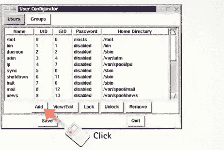

### 2 添加用户

### 3 配置密码管理

在“编辑用户”（Edit User）定义中，输入新用户的用户名（在 OpenLinux 登录提示符处输入的名称）、全名、办公室地点（或其他信息）、办公电话、家庭电话（或其他信息）以及用户 shell 的路径名。使用 Shell 下拉列表选择用户登录时使用的 shell。完成后，点击“影子密码文件”（Shadow）。

在“编辑账户管理”（Edit Account Management）对话框中，输入一个数字（天数）来控制用户密码的处理方式。完成后，点击“编辑账户管理”对话框中的“完成”（Done），再次在“编辑用户定义”对话框中点击“保存”（Save）。

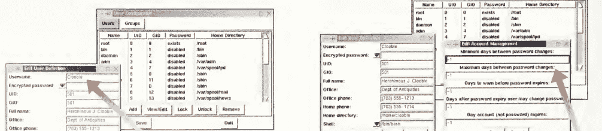

### 4 启动用户删除

启动 `usercfg`。在“用户配置器”（User Configurator）对话框中，滚动用户列表，高亮所需的用户并点击“删除”（Remove）。


| 姓名 | UID | GID | 密码 | 主主目录 |
|---|---|---|---|---|
| operator | 11 | 100 | 已禁用 | /home/operator |
| games | 12 | 100 | 已禁用 | /home/games |
| gopher | 13 | 100 | 已禁用 | /home/gopher-data |
| tip | 30 | 100 | 已禁用 | /home/tip |
| map | 15 | 100 | 已禁用 | /home/map |
| musician | 16 | 100 | 已禁用 | /home/musician |
| postgres | 17 | 100 | 已禁用 | /home/postgres |
| nobody | 65534 | 65534 | 已禁用 | /home/nobody |
| clible | 100 | 101 | 已存在 | /home/clible |

### 5 选择删除选项

在**删除用户**（Delete User）对话框中点击该用户的删除选项；完成后点击“完成”（Done）。


| 姓名 | UID | GID | 密码 | 主主目录 |
|---|---|---|---|---|
| operator | 11 | 100 | 已禁用 | /home/operator |
| games | 12 | 100 | 已禁用 | /home/games |
| gopher | 13 | 100 | 已禁用 | /home/gopher-data |
| tip | 30 | 100 | 已禁用 | /home/tip |
| map | 15 | 100 | 已禁用 | /home/map |
| musician | 16 | 100 | 已禁用 | /home/musician |
| postgres | 17 | 100 | 已禁用 | /home/postgres |
| nobody | 65534 | 65534 | 已禁用 | /home/nobody |
| clible | 100 | 101 | 已存在 | /home/clible |

- 处理主目录？
- 归档并压缩
- 删除用户的邮件？
- 将其设为 "nobody"
- 向 root 发送报告？

### 6 确认删除

系统将询问你是否确定删除用户 clible；点击“确实删除”（Really Delete）。


| 姓名 | UID | GID | 密码 | 主目录 |
|---|---|---|---|---|
| operator | 11 | 100 | 已禁用 | /home/operator |
| games | 12 | 100 | 已禁用 | /home/games |
| gopher | 13 | 100 | 已禁用 | /home/gopher-data |
| tip | 30 | 100 | 已禁用 | /home/tip |
| map | 15 | 100 | 已禁用 | /home/map |
| musician | 16 | 100 | 已禁用 | /home/musician |
| postgres | 17 | 100 | 已禁用 | /home/postgres |
| nobody | 65534 | 65534 | 已禁用 | /home/nobody |
| clible | 100 | 101 | 已存在 | /home/clible |

> 确保所有更改都已保存！

## 操作提示

### 在没有 X 的情况下添加用户
使用 **adduser** 命令**创建新用户。例如，命令 **adduser fred** 创建名为 fred 的用户。接下来，使用 **passwd fred** 分配密码。

### 使用 X 进行用户管理
你不需要使用 X 即可通过输入 usermod 命令直接进入系统的用户管理。你将看到查看、添加或更改用户的菜单。

### 安全你的系统
虽然允许任何人使用你的计算机的，但要明智地保护你的文件。确保经常备份，确保重要文件和目录具有正确的权限（参见 **chmod** 手页），并保护好你的密码。

## 管理用户


## 使用 kpackage 管理软件

### 1 启动 kpackage
点击桌面上的“应用程序”按钮，选择“工具”，然后点击 kpackage。对于 Linux 用户来说，所有软件的安装和卸载都由包管理器处理，或者由 rpm 命令在 /var/lib/rpm 下维护已安装软件数据库。本节介绍了如何使用 kpackage 图形界面运行 rpm。你必须以 root 操作员身份登录才能安装和删除软件。如果你没有以 root 操作员登录，请通过 X11 终端输入 `su - "kpackage"` 启动 kpackage。


### 查看软件包

### 获取包文件列表
出现 kpackage 窗口，列出了系统中安装的软件包。点击“归档”（Archiving）文件夹查看该组中的软件包。点击“文件列表”（File List）标签页；显示归档中的文件列表以及文件在 Linux 文件系统中的位置。


## 第 4 章：管理你的 Linux 系统

### 4 卸载软件包
要卸载软件包，点击屏幕右侧面板底部的“卸载”（Uninstall）按钮。在出现的对话框中，点击“卸载”。如果你想查看删除此软件包是否会导致其他程序运行，点击“测试”（Test）然后点击“卸载”。


### 5 启动软件包安装
打开计算机的 CD-ROM 槽，插入你的 OpenLinux CD-ROM。输入 `mount /mnt/cdrom` 挂载 CD-ROM，然后从“文件”菜单中选择。出现 kpackage 安装对话框。清除“位置”（Location）项 `/mnt/cdrom/Packages` 并按回车查看软件包列表，点击该文件，然后点击“确定”。


### 6 完成软件包安装
出现安装窗口；点击“安装”（Install）按钮。


## 操作提示

### 使用 rpm
`rpm` 命令可以在没有 X 窗口系统的情况下从命令行使用。这个灵活且强大的命令也可以用于生成有关已安装软件的报告。查看 rpm 页面，并阅读关于 rpm 查询的内容。

### 权威 rpm 指南
关于 rpm 的书籍是《Sam's RPM》，由 Ed Bailey 编写。这本 440 页的书介绍了如何使用 rpm 的所有功能。有关此书的详情，请浏览关于 rpm 的在线信息：http://www.mcp.com；http://www.rpm.org。

## 使用 KPACKAGE 管理软件

### 使用 glint 管理软件
`glint` 是 `rpm` 命令的图形界面程序。使用 `glint` 时，你必须以 root 操作员登录才能安装和删除软件。通过 X11 终端命令行输入 `su - "glint"` 启动 `glint`。

### 打开 glint 文件夹
`glint` 读取你的 OpenLinux 数据库并显示文件夹窗口。点击“管理”（Administration）文件夹，然后点击“归档”（Archiving）。

### 查看软件包信息
高亮磁带图标并点击“查询”（Query）按钮。出现一个包含软件包信息的查询窗口。阅读完成后，点击“关闭”（Close）。

### 删除软件包
点击“卸载”（Uninstall）。出现确认对话框；点击“是”（Yes）卸载软件包。

## 开始安装软件包

确保你的 CD-ROM 已挂载，然后点击“可用”（Available），`glint` 会在 `/mnt/cdrom/Packages` 目录搜索 rpm 文件。当 `glint` 搜索你的 CD-ROM 时，会出现一个小的扫描对话框，并出现“可用软件包”（Available Packages）窗口。

## 选择安装软件包

点击“管理”（Administration）文件夹，然后点击“存档”（Archiving）文件夹。要安装软件包，点击软件包图标，然后点击“安装”（Install）。


## 完成软件包安装

出现“安装软件包”窗口。点击“安装”（Install）。


## 提示

### 使用 glint 使用其他 CD-ROM
如果你想从其他 CD-ROM 或软盘驱动安装 rpm 软件包，启动 `glint`，然后点击“配置”（Configure）。在“软件包”字段中，输入路径如 `/mnt/floppy`，并点击“确定”。当你点击“可用”按钮时，`glint` 会搜索你的软盘。

### 如何挂载软盘
为了从软盘安装 rpm 文件，你应该先挂载软盘。例如，为了让软盘支持长文件名并将其挂载到 `/mnt/floppy` 目录，输入 `mount -t vfat /dev/fdb0 /floppy`。

OpenLinux 说不支持 vfat！

别担心。使用 `insmod` 命令通过输入 `su -c "/sbin/insmod vfat"` 来加载支持长文件名的 vfat 内模块。尝试重新挂载你的软盘。

结束

使用 GLINT 47 管理你的软件

### 开始

## 使用 Lisa 管理你的软件

`lisa` 命令是 `rpm` 命令的图形界面程序，不需要 X Window 系统。你必须以 root 操作员身份登录才能使用 `lisa` 安装和删除软件。在控制台命令行中输入 `su -c "lisa -pkg"` 启动 `lisa`。

### 1 选择删除软件包

`lisa` 命令直接进入“软件软件包管理”（Software Package Administration）对话框；向下滚动到第 4 项“删除已安装的软件包”，并按回车。

```


# 软件软件包管理

- `lisa` 的软件软件包管理功能 (全部)
- 按你的需要安装和删除软件包...
- 帮助帮助
- 关于可用软件包的信息
- 删除已安装的软件包


### 2 选择软件包

接下来，`lisa` 会查询你系统的 `rpm` 数据库，并在“卸载软件包”（Un-install Software Packages）对话框中显示已安装软件包的列表。滚动软件包列表并按空格键选择一个软件包。左侧列会出现一个 X。你可以使用空格键选择或删除多个软件包。完成后，按回车删除该软件包。

### 3 开始安装软件包

在“软件软件包管理”对话框中，选择“选择安装源”（Select Installation Source）并按回车。

--- 软件软件包管理

- `lisa` 的软件软件包管理功能 (全部)
- 按需要安装软件包。按 `F1` 获取更多详情。
- 选择安装源
- 安装额外的软件包
- 删除已安装的软件包


--- 未安装的软件包

选择要从列表中删除的未安装软件包 (全部)

未安装的软件包：

- Lisa 正在搜索并匹配软件包...
- Linux 系统工具和实用程序
- Linux内核相关工具
- Python 配置
- Python 开发
- Perl 开发
- C 开发库和头文件
- Python 开发
- Linux 开发用户空间


## 选择源

确保你的 CD-ROM 已挂载。在“选择安装源选择”对话框中选择“CD-ROM”并按回车。


## 选择源

接下来，`lisa` 确定你拥有的 CDROM 类型；按回车。会出现一个小的信息。


## 选择，安装软件包

滚动软件包列表。选择一个软件包，然后按回车。显示信息。


## 提示

### 获取信息
`lisa` 命令显示软件包。在“软件软件包管理”对话框中，向下滚动到第 4 项“删除已安装的软件包”，并按回车。

### 使用 Netscape 搜索
Lisa 正在搜索并匹配软件包... 在“可用软件包”中，滚动列表。按回车。


使用 LISA 49 管理你的软件

## 使用 BRU 2000 备份

如果你使用 Linux（如 `/dev/fd0`），你可以轻松做到。然而，这非常简单易用，你不需要手册！例如，要启动备份话并使用软盘作为备份介质，输入 `taper -r`。

### 1 配置

在“文件”（File）菜单中，点击“配置”（Configure）。显示信息。


### 2 启动设备

出现“软件软件包管理”对话框。点击“启动”（Start）。


### 3 选择设备

在“新设备”（New Device）对话框中，选择 `/dev/fd0`，并点击。


## 命名设备

点击“设备”字段，输入 Floppy，并点击。

## 选择新设备

在“新设备”对话框中，选择 `/dev/fd0`，并点击。


## 选择文件

在“备份到存档”（Backup to Archive）窗口中，选择要备份的文件或目录，并点击“添加”（Add）。完成后，将软盘插入电脑并点击“开始备份”（Start Backup）。BRU 2000 会询问存档标签，给你需要多少磁盘的估计，并开始备份。


## 提示

### BRU 2000 可使用的其他设备

BRU 2000 的配置文件列出了近 40 种备份设备，但你也可以自定义。你只需要知道 `dev` 下设备名称（例如用于并行端口驱动器的 `/dev/sda`）以及设备容量（每个磁盘 100MB）。

### 你可以使用另一个备份程序

使用 `taper` 命令 `-T` 后跟备份设备名称启动备份。`taper` 命令不需要 X Window 系统，可以从任何控制台命令行启动。确保阅读 `/usr/doc/taper` 目录下的 `taper` FAQ。然而，这非常简单易用，你不需要手册！

## 使用 tar 命令

你可以使用 `tar` 命令将文件备份到软盘驱动器。例如，使用命令 `cvf /dev/fd0 -m myfiles` 来备份 `myfiles` 目录的内容。M 选项告诉 `tar` 该备份是一个多卷存档。当第一张磁盘满时，按 `tar` 插入下一张磁盘。


使用 BRU 2000 备份文件 51

### 7

### 开始

## 如何管理您的服务

### 1 选择系统配置

Lisa 命令可以帮助你管理系统的几乎任何方面。本节将向你展示如何在系统上配置不同的软件服务。Lisa 程序不需要 X，因此你可以在控制台的命令行界面使用它。你必须以 root 操作员身份登录。

滚动到 LISA 主菜单窗口中的“系统配置”（System Configuration）项，并按回车。


### 2 选择系统配置（再次）

### 3 选择软件服务

出现系统配置菜单。滚动到“系统配置”并按回车。

滚动到“配置守护进程/服务器自启动”（Configure Daemon/Server Autostart），并按回车。守护进程是在你在启动 Linux 时经常启动的程序。它们在后台运行，仅在需要时激活，并且如果产生自身的副本和新进程（守护进程或已死亡但仍显示 `ps` 命令显示的进程表中进程），则被称为“僵尸进程”（zombies）。


## 查看当前服务

`lisa` 命令列出了几乎 30 种不同的软件服务（取决于你在系统中安装的软件）。在启动 Linux 时，至少至少至少四个服务启动：用于调度事件的 Cron；用于打印的 Print server；用于发送电子邮件的邮件传输代理（Mail Transfer Agent）；以及在 `/var/log` 目录下创建系统日志的 System Logger。

## 选择 Web 服务器

例如，为了让 Apache Web 服务器在下次启动 Linux 时启动，滚动到“Web Server (Apache)”项，按空格键，然后按回车。

```
Configure server autostart

Select all services that should be started automatically.

AutoMount Daemon (NFS) local

- AutoMount Daemon (NFS) local

  - Large filesystem support (ext3)

  - AutoMount Daemon (NFS) local

  - AutoMount

- network daemon (nell) local

  - network daemon (nell) local

  - network daemon (nell)

Continue
```


结束

## 提示

### 这些不同的服务是什么？
### 使用 Netscape 和 Apache 搜索在本计算机上安装的包？

OpenLinux 可以作为桌面计算机操作系统，或支持大容量和高需求互联网服务的平台。本书的 CD-ROM 包含了在个人计算机、高端图形工作站或网络服务器上使用 Linux 所需的所有软件。要了解更多关于如何管理 Linux 的知识，请使用喜欢的 Web 浏览器阅读《系统管理员指南》(`/usr/doc/html/sag/sag.html`)。要了解使用不同的网络服务，请阅读《网络管理员指南》(`/usr/doc/html/nag/nag.html`)。

如果你启动了 `Apache` Web 服务器，可以使用 `Netscape Navigator` 搜索已安装的包并获取有关所找到包的详细信息。这是你系统 `rpm` 数据库的一个方便的 HTML 接口。启动 `Apache`，然后启动 `Netscape`。浏览到文件：`/usr/doc/html/Caldera_info` 并点击“安装在本计算机上吗？”链接。会出现一个搜索页面，你可以对不同的程序输入查询。例如，使用如 `X11` 的搜索词将返回 `rpm` 数据库描述条目中包含 `X11` 的包的链接。

如何管理您的服务 53

## 任务

- 如何使用 `xman` 客户端 56
- 如何使用 KDE 帮助 58
- 如何阅读文档 60
- 如何阅读 HTML 和 PostScript 文件 62
- 如何阅读便携文档格式文件 64

## 第 5 章

## 获取帮助

在使用 OpenLinux 时，你可以找到很多帮助。某些程序有实用的弹出提示，而其他应用程序具有内置的帮助菜单——而且几乎每个命令都有相应的手册页。程序和过程的帮助文件字面上散布在你的整个 OpenLinux 文件系统中。你可以在以下目录下找到帮助文件、手册页和文档：

- `/usr/man`: 包含近 3,000 个程序、系统文件和编程函数的 10 多个手册页目录（manual pages）
- `/usr/info`: 几乎 500 个超链接的 GNU info 文件
- `/usr/doc`: 400 多个程序文档目录，包含 200 份 HOWTOs
- `/usr/X11r/man`: 1,200 多个手册页文件

有时问题是信息太多了！为了应对这种过载，你可以在各种不同的格式中找到信息，例如压缩文本、HTML、PostScript 或 scrot（用于格式化手册页）。本章向你展示如何找到所需的答案，以及如何阅读这些不同的文档文件格式。注意：本章假设你在 X 会话中使用 KDE（在第 2 章“开始使用 X 系统”和第 3 章“开始使用 KDE 桌面环境”中讨论）！

# 如何使用 xman 客户端

如果你启动了 `Apache` Web 服务器，可以使用 `Netscape Navigator` 搜索已安装的包并获取有关所找到包的详细信息。这是你系统 `rpm` 数据库的一个方便的 HTML 接口。启动 `Apache`，然后启动 `Netscape`。浏览到文件：`/usr/doc/html/Caldera_info` 并点击“安装在本计算机上吗？”链接。会出现一个搜索页面，你可以对不同的程序输入查询。例如，使用如 `X11` 的搜索词将返回 `rpm` 数据库描述条目中包含 `X11` 的包的链接。

# 阅读 Info 文档

`cp` info 页面出现。使用你的方向键和下方向键，或者拖动滚动条来浏览文档。请注意，KDE Help 工具栏上的几个节点现在处于激活状态。点击这些按钮可以导航 GNU info 结构，或使用“上一个”（Previous）按钮返回之前的页面。


## 'cp' 复制文件和目录

`cp` 命令用于独立于原始文件复制文件。你也可以将文件复制到目录并重命名它们。


```
cp [OPTIONS] SOURCE... DEST
```

如果最后一个参数是目录，`cp`将每个源文件复制到目标目录。如果最后一个参数不是目录且指定了多个源文件，`cp`将失败。


# 设置 KDE Help 选项

点击“选项”（`Options`）菜单设置各种 KDE 选项，例如在主窗口中出现的工具栏或信息字段。“常规偏好”（`General Preferences`）项允许你设置字体类型、大小以及显示帮助颜色。


## `cp` 复制文件和目录

`cp`命令用于独立于原始文件复制文件。你也可以将文件复制到目录并重命名它们。

```
cp [OPTIONS] SOURCE... DEST
```


如果最后一个参数是目录，`cp` 将每个源文件复制到目标目录。如果最后一个参数不是目录且指定了多个源文件，`cp` 将失败。


# 搜索帮助

KDE Help 最实用的功能之一是它的搜索功能。从 KDE Help 主窗口（参考步骤 1），点击“搜索关键词”（Search for Keyword）文本以显示 KDE Help 表单。输入一个术语（例如 floppy [软磁盘]），点击“在线手册”（Online Manuals）按钮，然后点击“提交”（Submit）按钮。在 KDE 窗口中，你将看到匹配你搜索的文件列表。点击主题或帮助手册页（man page）查看文档。


## 技巧提示

## 使用 KDE Help 浏览

如果你有活跃的互联网连接（参见第 7 章“连接到互联网”），在使用 KDE Help 期间点击网站或链接，你将直接进入该网站的 Web 页面！此功能称为“网络访问”（Network Access 或 NRA），内置在 KDE 中并受到包括 KDE Help 在内的许多应用程序支持。

## 使用 KDE Help 工具栏

KDE Help 提供了一个工具栏，其操作方式与网络浏览器工具栏相同。按钮包括“上一个文档”（Previous Document）、“下一个文档”（Next Document）、“上一个节点”（Previous Node）、“下一个节点”（Next Node）、“上节点”（Up Node）、“顶节点”（Top Node）、“帮助内容”（Help Contents）、“重新加载当前文档”（Reload Current Document）和“停止”（Stop）。这些按钮是你导航 GNU 文档的方便工具，可以省去记忆 GNU 键盘命令的麻烦。

如何使用 KDE HELP
59

# 如何阅读文档

当你使用 OpenLinux 时，会遇到许多不同的文档文件。当然，你已经学会了如何阅读页面和 info 文件，但你的系统上还有其他类型的文件。这些文件可以是文本、压缩文本、HTML、设备无关的、PostScript 或 SGML。在下面的示例中，查看如何从你的 KDE 桌面打开并阅读不同类型的文档。

## 读取文本文件

KEdit 启动并显示你的文件。使用光标方向键或用鼠标拖动垂直滚动条来阅读文档。


水平滚动条

## 打开文本文件

在桌面上右键点击文本（`.txt`）文件。在弹出的菜单中，KDE 建议了一个打开该文件的应用程序。选择“编辑器”（Editor）。


## 打开并读取压缩文本文件

要打开并读取压缩文件（通常是以 `.gz` 或 `.bz2` 结尾的文件），请点击文件图标。KDE 会启动 KZip 程序来解压文件，然后将文件加载到 KEdit 中读取。


垂直滚动条
双击

## 打开并查看 PostScript 文档

要查看 PostScript 文档（文件名名为 `.ps` 文件），点击文档图标。KDE 使用 `kghstview` 应用程序显示文件。点击 `kghstview` 窗口左侧的页码跳转到相应页面。


## 打开并查看 DVI 文件

要打开 DVI 文件（`.dvi`），用左鼠标键点击文档图标。KDE 在处理文件后将使用 `kdvi` 查看器（文档显示在屏幕上之前可能会有延迟）。


## 从命令行进行随意浏览

你也可以从控制台或终端窗口的命令行阅读文档。毫无疑问，最好的程序是 `less` 分页器，它提供了一种交互式在文件中向前、向后和左右移动的方法。该程序具有搜索和书签功能。要读取文件，可以使用如 `Hardware-HOWTO` 的命令。

## 无法读取压缩文本？

如果你使用 `less` 命令查看压缩文件，你会看到“这是一个二进制文件”的提示。实际上，在 `/doc` 目录下，使用 `less` 命令可以查看解压缩的文本内容，例如 `Hardware-HOWTO.gz`。

## 什么是 TeX？

TeX 是一种复杂的排版系统。在 `/doc` 目录下有许多 TeX 的排版字体。使用 `less` 命令可以查看关于 TeX 的大量字体排版信息。

技巧提示
Hardware-HOWTO
如何阅读文档
61

## 任务

## 使用 Netscape 阅读 HTML

Netscape 套件中的 Navigator 组件可以用于打开和浏览 HTML 文件。在命令行输入 `netscape` 后面跟上路径，例如：`/doc/html/index.html`。Netscape 拥有任何浏览器中功能最强大的。

## 使用 Amaya 阅读 HTML

Amaya 浏览器也可以用于显示 HTML 文件。从命令行输入 `amaya` 后面跟上路径，例如：`/doc/html/index.html`。

## 使用 KDE Help 阅读 HTML

你可以使用 KDE Help 浏览器来阅读 HTML 文件。在命令行输入 `kdehelp` 后面跟上路径，例如：`/doc/html/index.html`。通过 KDE Help 界面查看 HTML 文件。

第 5 章：获取帮助

## 使用 KDE Help 阅读 HTML

KDE Help 帮助可以用于读取 HTML 文件。在命令行输入 `kdehelp` 路径，例如：`/doc/html/index.html`。

## 使用 Lynx 的技巧

你知道 Lynx 浏览器可以读取 Usenet 新闻组吗？这个浏览器充满了技巧，其中一种是你可以在不加载页面显示的情况下获取 Web 页的内容！选择一个显示更新信息的网站。在命令行中，输入 `lynx` 后面跟上页面的 URL，并使用 Lynx 的 `-dump` 选项检索并将信息保存到文件中，例如：`lynx http://www.yahoo.com/headlines/news -dump > news.txt`

## 等一下！gv 可以读取压缩文档！

没错。`gv` 客户端可以解压并显示压缩的 PostScript 文档。它甚至还尝试对 PDF 文件进行可靠的工作！阅读 `gv` 手册页获取更多信息。

## 默认的 Navigator 主页

Calder 的人们可能像许多 Linux 用户一样喜欢 Netscape。当你启动 Netscape 时，它的主页配置为 `/doc/html/index.html`，这是学习 OpenLinux 的极佳起点！

# 如何阅读便携格式文件

### 开始

便携文档格式（PDF）是许多类型文档的流行媒介。这种文件格式包含 HTML 文件的链接，并支持嵌入图形、视频和音频。强大的 PDF 文件查看器是 Adobe Reader，你可以从 http://www.adobe.com/prodindex/adobe/readstep.html 下载它。按照 Adobe 网页上的说明下载适用于 Linux 的 `ar3021in.tar.Z`。如果你不想使用 Adobe 的软件，可以使用 `/usr/X11R6/bin` 目录下的 `xpdf` 客户端。

## 安装

将文件下载到你的主目录，然后输入 `xzvf ar3021in.tar.Z`。这会解压下载的 Acrobat 归包，创建一个名为 `ILINXR.install` 的目录。要进入新目录 `ILINXR.install`，请输入 `cd ILINXR.install`。


## 阅读许可协议

输入 `su - INSTALL`。输入 root 密码并按回车后，安装程序会显示许可文件。使用空格键滚动查看许可文件。

## 完成安装

输入单词 `accept` 并按回车。安装程序会询问安装目录（`/usr/local/Acrobat3`）。按回车。如果目录不存在，系统会询问你是否创建它。按回车，安装完成。


# 第 5 章：获取帮助

## Acrobat

在终端窗口的命令行中，输入 Acrobat 的完整路径：`/usr/local/Acrobat3/bin/acread &`。Acrobat 的主窗口将出现在显示器上。打开“文件”（File）菜单，选择 `reader.pdf` 项目显示 Acrobat 在线指南。要退出 Acrobat，打开“文件”菜单并选择“退出”（Exit）。

## 阅读便携文档文件

使用 `xpdf` 命令读取 PDF 文件。在终端窗口的命令行中，输入 `xpdf`，后接 `sopdf /usr/local/Acrobat3/Helper/reader.pdf &`。主窗口会出现。要浏览 PDF 文档，点击显示器左下角的“上一页”（Previous Page）或“下一页”（Next Page）按钮，或遵循页面上的文档链接。

更改视图按钮

下一页按钮


上一页

后退 10 页

向前

键盘中心 # 跳转到指定页

- 打印文档
- 下一页

## 结束

## 提示

## PDF 阅读器非常有用

美国的 Linux 用户在 4 月中旬特别需要 PDF 文档阅读器。美国税务局（IRS）每年发布 PDF 格式的新税务出版物和表格。


## 任务

- 1. 如何使用 kfind 客户端 68
- 2. 如何进行高级搜索 70
- 3. 如何搜索文档 72

# 第 6 章
查找文件和文本

如果你完整安装了 OpenLinux，你的硬盘上将会有 67,000 多个文件。这些文件包括 2,000 多个程序；11,000 个压缩文本文件；300 个未压缩文本文件；1,100 个设备文件以及 6,000 个图形文件。文件非常多！在某些时刻，你可能需要知道某个文件是否已安装、它在哪里或它包含什么。

本章将向你展示如何使用 `kfind` 查找文件以及搜索文件内容。通过少量练习，你应该能够在 OpenLinux 系统中找到任何内容。

## 如何使用 kfind 客户端

`kfind` 程序随 KDE 桌面环境一起提供，是一个搜索 OpenLinux 目录的方便工具。在使用 `kfind` 之前，必须启动 X11 会话。在控制台命令行输入 `kde` 启动 X 和 KDE。

### 1 启动 kfind

点击桌面上的“查找工具”（Find Utility）按钮。


### 2 输入搜索文件名

出现 `kfind` 窗口。要开始搜索，点击“命名”（Named）字段并输入文件的全部或部分名称。你还可以使用通配符搜索文件名。例如，要查找包含 PPP 字母的文件，在字段中输入 `PPP*`。


### 3 设置搜索位置

要告诉 `kfind` 在硬盘的哪里查找，点击 `kfind` 窗口上的“浏览”（Browse）按钮。弹出一个对话框。点击对话框顶部的菜单，选择 `/` 字符，然后点击“确定”（OK）。根目录 `/` 是 OpenLinux 系统的基础。选择此目录意味着 `kfind` 将搜索整个硬盘。


### 4 开始搜索

点击 `kfind` 工具栏上的“搜索”（Search）按钮。或者，你可以按 `Ctrl+F` 或从“文件”菜单中选择“搜索”项。


### 5 打开文件

`kfind` 窗口展开并显示找到的文件和目录列表。注意工具栏按钮是激活状态。这些按钮允许你打开文件、选择文件进行归档、删除文件（例如所有者或权限）、打开文件文件夹或搜索结果。在“文件”版本中，可以双击列表中的文件名。


### 6 打开文件

双击文件后，`kfind` 会启动相应的程序来显示文件（情况下是 `khostview` 或用于查看）。


## 提示

### 只想查找新文件
别担心。你可以使用 `kfind` 执行各种搜索。请参阅下一个任务“高级搜索”获取有关按日期搜索文件的详情。当然不是！事实上，你可以使用近十个其他程序来查找文件。最容易用的是 `where`。要了解使用 `where`（可在控制台或终端窗口的命令行运行），请阅读 man 页面（在提示符处输入 `man where`）。

### 如何进行高级搜索

你也可以使用 `kfind` 客户端对 OpenLinux 系统进行搜索。例如，你可以搜索最大的程序、查看过去 24 小时内创建的所有文件列表，或获取 OpenLinux 的所有音频文件列表。启动 `kfind` 的简单方法是点击桌面面板上的“查找工具”按钮。当 `kfind` 窗口出现时，点击“高级”（Advanced）标签页。


### 2 指定文件类型

点击“类型”（Type）字段的下拉菜单，然后滚动并选择你想查找的文件类型，例如 PDF 文档（便携文档文件通常带有 `.pdf` 扩展名，由 Adobe Acrobat 和 `xpdf` 阅读器使用）。点击“位置”（Location）标签页。要查找所有文件，在“命名”（Named）字段中放置星号 (`*`)。要搜索整个 OpenLinux 系统，指定根目录 `/`。点击“搜索”按钮开始搜索。找到的文件都会出现在 `kfind` 窗口中。


### 3 按日期搜索

`kfind` 的另一个方便功能是按日期搜索系统文件或目录。在 `kfind` 窗口中，点击 `kfind` 工具栏左侧的“新搜索”（New Search）以清除之前的设置，然后点击“修改日期”（Date Modified）标签页。要查找过去 24 小时内创建的文件，点击“所有创建或修改的文件”（All Files Created or Modified）然后点击“上一个”（Previous）按钮。默认天数是 1，但你可以通过在文本字段中输入任何数字来更改搜索。完成后，点击“位置”标签页并开始搜索。

### 删除找到的文件

你会惊讶于 OpenLinux 电脑在 24 小时内会有多少文件创建或修改，特别是如果你一直开启电脑！要删除文件或目录，选择文件列表中的名称，然后点击 `kfind` 工具栏上的“删除”（Delete）。幸运的是，`kfind` 会先询问你是否要删除该项。


### 获取文件信息

要获取有关文件或目录的更多信息，在文件列表中选择其名称，然后点击 `kfind` 上的“属性”（Properties）按钮。弹出的对话框将显示文件的常规信息。点击其他标签页查看文件的所有者（所有权）以及你可以对它做什么（权限）。


## 通配符搜索

在 Linux 搜索表达式中使用通配符是一门艺术。当你精通查找文件时，学习如何使用匹配字符。这些字符的字符串（例如 `*(a-z-9)*`）被称为正则表达式和扩展表达式。要了解更多关于创建和扩展表达式的信息，请参 `grep` 和 `ed` 页面。


## 3. 如何搜索文档

到此时，你应该已经知道在需要查找文件名时，`kfind` 有多大的帮助。但如果你想在文件内部查找某个单词或短语，而又不确定文件的所在位置或名称呢？别担心。你可以使用 `kfind` 快速定位你所需的文件。本任务将教你如何使用 `kfind` 在文件内部查找单词或短语——即使是压缩文件也可以！

### 开始

### 1 浏览搜索位置

假设你正在寻找关于如何删除文件的帮助信息。（这通常是一个徒劳的任务，但阅读关于取消删除的知识可能在将来对你有所帮助。）首先，找到 `kfind` 的“新搜索”（New Search）按钮。接下来，点击“浏览”（Browse）按钮，在“查找位置”（Look in）中指定你想要搜索的目录。


### 2 设置搜索位置

导航到 `/usr/doc/HOWTO` 目录，并点击“确定”（OK）按钮。


### 3 设置高级搜索

点击 `kfind` 窗口中的“高级”（Advanced）选项卡。在“包含文本”（Containing Text）字段中，输入 `undelete`。然后点击“开始搜索”（Start Search）按钮。


第 6 章：查找文件和文本

## 查看已找到的文件

你将看到一个找到的文件列表。注意，短语 `undelete` 并不在任何文件的名称中！通过点击来选择一个文件，例如 `Ext2fs-Undeletion.html`。

## 打开文档所在的文件夹

要打开文档所在的文件夹或目录，点击“打开所在文件夹”（Open Containing Folder）按钮。该文件的目录将显示在你的桌面上。


## 阅读文档

要阅读文件，双击 `kfind` 列表中的名称，选择该文件，然后点击工具栏上 `kfind` 的“打开”（Open）按钮。（在这种情况下，一个 HTML 文档将由相应的阅读器打开并显示。）


## 搜索并销毁

你可以同时搜索并销毁找到的文件。然而，在你磨炼搜索技能之前，不建议你这样做。当你准备好时，你可能准备好应对 `find` 命令了！这个程序有大量的命令行选项，并可以运行其他对找到的文件执行操作的命令。

## 任务 2

## 如何设置互联网连接

## X 会话

在你的控制台中启动 X 会话。输入 `kde` 并按回车键。

```


```
[bball@presario]$ kde
```

此部分将向你展示如何使用拨号工具 `kppp` 创建并配置互联网连接。在正确配置 `kppp` 后，你就可以通过鼠标点击登录互联网。

## 启动 `kppp` 工具

点击桌面上的**应用程序**按钮，选择**Internet**，并选择 `kppp` 项目。或者，你可以在 X11 终端命令行输入 `kppp` 并按回车键启动 `kppp`。

## 创建你的账户

在 `kppp` 对话框中，点击**设置**按钮。这会启动 `kppp` 配置对话框。


## 配置你的账户

注意 `kppp` 配置对话框中的五个选项卡：账户、设备、调制调器、PPP 和关于。点击**账户**选项卡，然后点击**新建**开始设置。


### 输入设置

在新账户对话框中，输入你的 ISP 名称（例如，Erol）以及调制调器将拨号的电话号码。如果你介意将互联网连接的密码存储在计算机上，请勾选存储。如果你想在连接或断开时自动运行程序（如浏览器），请在相应字段输入其名称。


### 选择你的 IP 地址

点击 IP 选项卡。在这里指定你的 IP 地址是动态的还是静态的。如果你的 ISP 提供了动态地址，点击动态 IP 地址按钮。如果你有静态地址，点击静态 IP 地址按钮并输入子网掩码（向 ISP 询问详情）。如果你希望你的计算机的主机名由 ISP 分配，请勾选自动配置主机名按钮（不勾选也可以）。

### 配置域名服务

点击 DNS 选项卡，然后输入你的 ISP 域名（这通常是你电子邮件地址中 @ 符号后面的内容）。接下来，在 DNS IP 字段中输入 ISP 的 DNS 数字，并点击添加。如果你有第二个 DNS 地址，输入它并点击添加。这些信息将在 PPP 会话期间临时插入 `/etc` 目录下的 `resolv.conf` 文件。


### 配置你的登录脚本

点击脚本选项卡。大多数 ISP 的计算机会在调制调器连接时发送提示：从对话框顶部文本字段旁边的下拉列表中选择 `Expect`，在文本字段中输入短语并点击添加。接下来，从弹出菜单中选择你的用户名（分配给你的 ISP），并点击添加。再次选择 `expect`，输入你的密码并点击添加。最后，选择 `Send`，输入你的密码并点击添加。完成后，点击确定按钮。

出现 `kppp` 配置对话框。点击设备选项卡显示用于连接 ISP 的串口设备。调制调器设备应设置为 `/dev/modem`，流控应设置为 CRCTS，线路结束应设置为 CRL。如果你有 56（或 V.90）调制调器，选择 115200 作为连接速度。调制调器超时值可以设置为 60 秒（这是你等待连接的时间）。帮助提示可以告诉你有关这些设置。


### 配置拨号设备

点击选项选项卡。在 `kppp` 设置区域，输入你希望 `pppd` 守护进程等待 PPP 连接的秒数（60 是一个合理的数字）。点击相应的按钮启用或禁用诸如断开时重拨、连接时固定面板或连接时最小化窗口等设置。完成后，点击确定。

返回 `kppp` 对话框，在其对话框中显示你的新账户和登录 ID。你可以通过点击设置按钮并遵循步骤 4-10 来定义额外账户。


### 设置 PPP 选项

### 定义额外账户

在 `kppp` 对话框中点击显示日志窗口来观察连接和登录过程。这对于查看来自 ISP 计算机的信息非常有帮助。要开始连接，点击 `kppp` 对话框中的连接按钮；将出现一个连接窗口和一个登录窗口。当你连接成功后，两个窗口都会消失。


## 提示

### 需要更多关于 `kppp` 的信息吗？

`kppp` 带有一个帮助部分。要查看更多信息，请点击 `kppp` 对话框中的帮助按钮。

### 关于 Linux 内核

为了连接互联网，你不仅需要 `kppp` 工具，还需要内核支持。在控制命令行通过 `dmesg` 搜索 PPP 支持输出如下：

```
[bball@presario]$ dmesg | grep PPP
```

你应该看到类似这样的：
```
PPP version 2.0 (copyright 1995)
```


## 如何启动、检查并停止互联网连接

### 1 启动 kppp

通过点击桌面上的应用程序按钮，选择 Internet，并选择 kppp 项目。在 kppp 对话框中，选择你的账户并点击连接来启动 kppp。

### 2 监控连接

点击 kppp 对话框中的连接按钮；将一个连接窗口和一个登录窗口。如果你在 PPP 选项卡中勾选了连接时最小化窗口，那么在连接成功后，窗口将最小化。

### 3 检查连接

通过点击桌面任务栏上的 kppp 监控器来查看状态。点击它的详细信息按钮。统计对话框将显示你当前的 IP 地址以及进出 PPP 连接的数据类型和数量。注意，窗口显示了你的连接速度和一个运行计时。

### 4 检查你的调制调器

如果你在 PPP 选项卡中勾选了连接时固定面板，你可以在会话期间监控调制调器活动。连接建立后，显示两个彩色圆的小指示器将嵌入你的面板。进出的数据会闪烁绿色圆。这对于确保你在下载大文件时仍保持连接非常有帮助。

### 5 停止 PPP 会话

至少有两种方法可以停止 PPP 会话。一种是点击桌面任务栏上的 kppp 连接对话框按钮。对话框出现后，点击断开按钮。另一种方法是右键点击面板上的 kppp 调制调器监控器，并在弹出菜单中选择断开。

# 如何安装和使用 AOL 即时通讯工具

### 1 注册

访问 http://www.aol.com/aim/home.html。通过选择显示名称和密码并输入你的电子邮件地址来注册该服务。从那里，按照提示进入下载部分并选择 Java 版本。

Linux 下最新且最有趣的互联网通信软件之一是 AOL 的即时通讯工具 Instant Messenger，简称 IM。你不需要订阅 AOL 即可使用即时通讯工具，但你可以用它与使用 AOL 或即时通讯工具的朋友进行即时聊天。该服务是免费的，你不需要付费。IM 的工作原理是不断检查并在朋友登录时即时通知。然后你可以发送即时消息进行聊天：


### 2 打开终端窗口

### 3 开始安装

点击应用程序启动器 Application，选择“实用工具” Utilities，然后点击“终端” Terminal 启动终端窗口。

要开始安装，请使用如 `sh aim_linux.sh` 的命令行。将出现一个许可协议。屏幕将滚动几页信息，IM 将安装在在你主目录下的名为 `in` 的目录中。


84 第 7 章：连接互联网

# 启动即时通讯

启动你的网络连接，然后输入 `aim/intent` 并按回车键启动 IM。将出现 IM 登录对话框。在“显示名称” Screen Name 字段输入你的用户名，按 Tab 键，然后输入密码并按回车键登录 IM。


# 回复邮件

将出现 IM 主对话框，以及登录对话框，它告知你为了使用 IM 的所有功能，可以通过回复发送给 AOL 的电子邮件消息来成为注册用户 使用邮件的详情请参见第 8 章。


# 配置 AOL 即时通讯工具

点击 IM 的“文件” File 菜单，然后点击“选项” Options 和“编辑偏好” Edit Preferences 来配置即时通讯工具。


# 添加 IM 好

当 IM 的设置对话框出现时，点击窗口左侧的“好友列表” Buddy List 项，然后点击“添加好友” Add Buddy 按钮。将出现一个高亮的“新好友” New Buddy 项。输入朋友的 AOL 显示名称，然后点击“应用” Apply 按钮将其添加到你的好友列表中。当好友列表中的名的用户登录时，IM 会通知你。


续上

如何安装和使用 AOL 即时通讯工具 85

# 如何安装和使用 AOL 即时通讯工具（续）

### 发送即时消息

### 选择隐私

点击窗口左侧的“隐私” Privacy 项以根据你的隐私偏好配置 IM。使用“允许” Permit 选项卡来指定当你登录 IM 时应该通知谁。使用“隐私” Privacy 选项卡进行其他设置，例如电子邮件或昵称。完成后，点击“确定” OK 按钮。对话框将消失，IM 将等待你的操作。当你的好友登录 IM 时，他们的名字将出现在好友列表中。点击对话框底部的 IM 按钮。输入你的消息并点击发送。


### 10 回复即时消息

### 11 退出 IM

当你的好友发送或回复即时消息时，你可以忽略该消息或点击“回复” Respond 按钮。窗口将分割，上方是好友的消息，下方是你的回复区域。输入你的回复并点击发送。注意有格式按钮，你可以格式化消息中的文本！要退出 IM，你可以注销或完全退出程序。退出 IM 请点击“文件”菜单并选择“退出” Exit。将出现一个对话框要求你确认。点击“确定” OK 按钮。


文本格式按钮

结束

第 7 章：连接互联网

# 如何安装和使用 AOL 即时通讯工具

## 提示

如果无法运行 IM，请检查你的 Java 安装。如果你有很多朋友，请使用好友列表管理他们。如果无法接收消息，请检查你的网络连接设置。

如何安装和使用 AOL 即时通讯工具 87

## 任务

- 1 如何配置 Netscape 90
- 2 如何设置 Netscape 邮件 92
- 3 如何使用 Netscape 发送消息 94
- 4 如何接收和回复邮件 96
- 5 如何阅读 Usenet 98
- 6 如何浏览 100

# 8

# 章

# 使用 Netscape

Netscape Communicator 是一套免费的工具工具，你可以用它浏览网页、发送电子邮件、阅读新闻，还可以创建自己的页面。互联网的许多魔力通过这些易用工具变得生。Netscape Communicator 在完整安装期间安装到 `/opt/netscape` 目录。你必须运行 X11 才能使用 Netscape。

在本章中，你将看到如何设置、配置和使用 Netscape Communicator 以充分利用在线时光。本章未讨论的组件是 Netscape Composer。但不要担心：关于使用 Composer 的教程，请选择 Communicator 的“帮助”菜单，点击“帮助内容”菜单，然后点击“编写和编辑网页”项目。

# 4 配置导航器

点击类别列表中导航器左侧的三角形以打开首选项屏幕。通过点击“浏览器启动” Browser starts with 部分中的相应按钮，选择您喜欢的启动方式。如果您的互联网服务提供商 ISP 为您提供了首页，请在“主页位置” Location of the Home page 部分输入其 Web 地址。在“历史记录” History 部分输入数字，告诉导航器应该记住您的页面多少天。


# 5 设置辅助应用程序


# 6 创建新的辅助应用程序

在“描述” Description 字段中输入 Acrobat PDF Files，在“后缀” Suffix 字段中输入 `application/pdf` 或 `pdf`。在“处理程序” Handled By 部分，点击“应用程序” Application，并输入 Acrobat 可执行程序的路径。如果您按照第 5 章的操作进行，路径将为 `/usr/local/Acro3/bin/acrobat %`。点击 OK 保存新的辅助应用程序，并再次点击退出 Communicator 首选项对话框。


## 技巧提示

使用 Netscape 命令行选项

如果您从 X11 终端窗口的命令行启动 Communicator，可以使用几个非常有用的命令行选项。例如，要启动 Communicator 但仅显示一个带有组件启动按钮的小型浮动工具栏窗口，请输入 `netscape &`

不想使用大型 Netscape 吗？使用 Communicator 的几何 geometry 选项来启动类似所示的小型窗口：`netscape -geometry 480x320 &`

使用 `-help` 选项查看其他命令行选项列表。

如何配置 NETSCAPE COMMUNICATOR 91

# 如何设置 Netscape Messenger 发送电子邮件

这将将向您展示如何配置 Netscape Messenger 以发送和接收电子邮件。注意：您首先需要与您的 ISP 建立 PPP 连接。您的地址 例如 bball@staffnet.com、您的 ISP 服务器的名称 例如 smtp.staffnet.com 以及您的 ISP 电子邮件服务器支持的电子邮件协议类型 例如 POP3。

# 选择邮件和组

启动 Netscape Communicator。选择“编辑” Edit 菜单并点击“首选项” Preferences。在首选项对话框中，点击类别列表中的“邮件与组” Mail & Groups。


# 输入您的身份

点击“邮件与组”下的“身份” Identity 项。输入您的姓名，并输入由 ISP 提供的完整电子邮件地址。


# 配置发出的消息

点击“邮件与组”下的“消息” Messages。在“消息属性” Message Properties 部分，指定您是希望以 HTML 格式发送消息，或者您希望如何处理回复，以及消息中每行文本的长度。点击“选项” Options 按钮查看其他消息格式选项。


# 输入您的邮件服务器

点击类别列表中的“邮件与组”列表项“邮件服务器”。在邮件服务器对话框中，输入您的邮件服务器名称 bballtauce.com。在“发出的邮件 SMTP”服务器中，输入 `localhost`。在“传入邮件服务器” Incoming Mail Server 字段中，输入您的 ISP 邮件服务器的名称 例如 pop.ecrol.com。选择合适的邮件服务器类型 POP3 或使用 IMAP。您可以从您的 ISP 获取所有信息。


# 输入您的组服务器

点击类别列表中的“组”项。在“组服务器”对话框中，输入您的 ISP 的新闻服务器名称 例如 news.ecrol.com，然后点击 OK。完成后，您现在可以开始使用电子邮件了。


结束

# 跳转到 Netscape 邮件

发送或接收邮件的简单方法是从终端窗口使用 Netscape 的 `-mail` 选项，例如：`netscape -mail &`。这将立即启动 Communicator 的 Messenger 组件。

# ISP 设置出现问题？

在配置 Netscape 或其他互联网软件时，确保从您的 ISP 获取尽可能多的信息。如果您只是在寻找某项服务，请询问您的本地用户组，或者访问 http://www.sccom/glue。需要支持吗？尝试访问 http://support.marko.net 并注册！

# 如何创建签名文件？

签名文件通常包含您的姓名、地址、组织，可能还有一段引言。

# 2 打开 Messenger 邮箱箱

# 3 撰写消息

在撰写窗口中，在“收件人” To 字段输入收件人地址，在“主题” Subject 字段输入主题，并在主文本区域输入消息。完成后，点击“发送” Send 按钮发送您的消息。


94 第 8 章：使用 NETSCAPE COMMUNICATOR

# 附件文件

要附加文件，点击撰写窗口上的“附件”按钮。将出一个对话框，允许您选择想要附件的文件。


# 将消息保存为草稿

将消息保存为草稿，点击“文件” File 菜单并选择“草稿” Draft。消息将存储在“草稿” Drafts 文件夹中。


# 发送您的消息

要发送消息，点击撰写工具栏上的“立即发送” Send Now 按钮。消息将发送到收件人的邮件服务器。


## 技巧提示

### 格式与邮件

如果您选择 HTML 作为消息的默认格式，您可以发送不同字体格式——但如果收件人未使用 Netscape，您的消息可能难以阅读。

### 如何发送延迟的消息？

如果您在撰写窗口中选择“稍后发送” Send Later，消息将存储在“未发送” Unsent 文件夹中。要发送时，进入“未发送”文件夹，选择该消息并点击发送。

结束

95 第 8 章：使用

# 如何接收和回复电子邮件

可以使用 Netscape Messenger。在开始，请登录您的 ISP 并启动互联网会。

# 1 打开 Messenger 邮箱箱

启动 Communicator，并在 Communicator 菜单中选择 Messenger。


# 2 点击 Get Msg 按钮

要获取邮件，点击 Messenger 窗口工具栏上的 Get Msg 按钮。Netscape Messenger 然后将要求输入密码。在您输入互联网账户密码并点击 OK 后，Messenger 将向您的 ISP 的请求以发送任何等待的邮件。

# 3 接收电子邮件

如果有邮件，将弹出一个窗口通知您有很多邮件可用，并且进度条将显示下载进度。Netscape 将已获取的邮件存储在“收件箱” Inbox 中，并按主题列表消息。要查看获取的消息，双击。


# 阅读消息

您的电子邮件将出现在 Messenger 窗口中。任何文件附件将列在消息文本下方。如果您点击消息顶部的回形针图标，消息底部将弹出一个窗口，显示代表附件的图标以及附件文件名。如果您双击回形针图标，且 Netscape 识别了附件类型，它将启动相应的辅助程序来处理该文件。例如，Adobe Acrobat 将打开附件的 PDF 文件。


# 回复消息

要回复消息，点击消息工具栏中的“回复”按钮。消息将出现在 Messenger Compose 窗口中；“收件人”和“主题”字段将自动填充，您将根据正在回复的内容输入您的回复，然后点击“立即发送”按钮立即发送消息。与之前一样，您可以进行拼写检查、保存或推迟消息。


# 取消回复

要取消回复，请关闭 Compose 窗口 打开“文件”菜单，然后选择“返回 Messenger”或“退出 Communicator”。在关闭之前，Netscape Messenger 会首先询问是否想将回复保存到“草稿”邮箱箱。若要丢弃回复，请点击“否”按钮。


## 操作提示

### 保存邮件还是刷新服务器？

您可以配置 Netscape，让您的 ISP 邮件服务器在您获取消息后保留这些消息。若要将消息保留在您的 ISP 计算机上，请打开 Communicator 的“编辑”菜单并选择“选项”。在类别列表中点击“邮件与群组”，然后点击“邮件服务器”列表项。在邮件服务器对话框中，切换“将邮件保留在服务器上”项目的推送按钮。注意：出于礼貌，您应该定期从您的 ISP 服务器上刷新您的邮件 此外，许多 ISP 对您在计算机上存储的消息大小或数量有限制。

如何接收和回复邮件

# 如何阅读 Usenet 新闻

除了浏览网页和发送电子邮件外，Netscape Communicator 还可以用于阅读 Usenet 新闻。Usenet 新闻是一个全球计算机系统，运行的软件用于存储、交换和更新文本文件集合 即新闻组，这些集合按类别和层级进行组织。新闻组名称可能看起来像 comp.os.linux.x，它的意思是“关于在 Linux 计算机操作系统中使用 X 窗口系统的讨论”。Usenet 新闻自史前时代 互联网时代以来一直存在。1986 年，大约有 500 个不同的新闻组——今天已经超过 40,000 个！

### 开始

### 1 打开讨论区

从 Netscape 的 Communicator 菜单中选择“消息中心”。要指定您想要加入或阅读的组，请点击 Netscape 消息中心工具栏中的“加入群组”按钮。


### 2 获取讨论组

将出现“获取讨论组”窗口。点击“添加服务器”按钮并输入您的 ISP 新闻服务器的名称，该名称显示在上一个窗口邮件文件夹下方。如果 Netscape Discussions 未开始检索新闻组列表，请点击对话框右侧的“获取讨论组”按钮。

### 3 浏览新闻组

当 Netscape 完成新闻组列表的检索后，将出现顶级新闻组部分的列表。点击“讨论组”字段并输入 comp.os.linux.a。Netscape 将自动滚动列表直到显示新闻组，然后展开 comp.os.linux 组以显示当前的组。


98 第 8 章节：使用 NETSCAPE COMMUNICATOR

### 订阅某些新闻组

点击组名称所在行的复选框以订阅该新闻组。将出现复选标记表示您已加入该讨论组。继续选择新闻组；完成后，点击“确定”。

### 打开讨论文件夹

点击消息中心文件夹名称前的加号。您订阅的新闻组将列在主窗口中。若要在某个新闻组中开始阅读，请双击该组的列表。


### 查看讨论列表

新闻组的消息列表将出现在“邮件与讨论”窗口中。点击主题左侧的加号以查看关于该主题的消息数量。点击“回复”回复当前消息。点击“新消息”在组中发布新消息。完成后，打开“文件”菜单然后选择“选择”。


## 任务

- 1. 如何配置 fax 104
- 2. 如何使用 OpenLinux 106 传真

# 第 9 章
## 发送和接收传真文件

大多数 并非全部 适用于 Linux 的调制调器都可以发送或接收传真文件。本章将介绍如何配置和使用 efax 程序族发送和接收传真。你需要先阅读第 7 章“连接互联网”，学习如何设置和测试你的调制调器。

你不需要使用 X Window 系统来发送、接收或打印传真，但你确实需要 X 来查看任何接收到的页面。遵循本章的任务操作，你很快就能学会传真！

## 如何配置 fax

设置传真的第一步是配置位于 `/usr/bin` 目录下的 fax 壳脚本。该命令使用 OpenLinux 自带的几个程序来为传真准备文档。以下任务显示了如何编辑和配置你的脚本。你必须是 root 操作员才能配置传真，因此在开始之前请以 root 身份登录。

### 打开 fax 脚本

使用你喜欢的文本编辑器 如 pico 打开 fax 命令 一种称为 shell 脚本的 Linux 命令。在控制台或终端的命令行中，输入 `pico -w /usr/bin/fax` 并按回车。


$ Terminal

`$root@boball:~# pico -w /usr/bin/fax`

```
```

### 配置你的调制调器

滚动到 `DEV=` 条目并输入传真调制调器的设备名称。例如，如果你的调制调器在 COM2 上，使用 `ttyS1`。使用 `linda` 命令配置 `/dev/modem` 符号链接，该条目应该是 `DEV=modem`。

### 选择调制调器类别

`fax` 命令支持三种传真协议：Class 1、Class 2 和 Class 2.0。通过删除对应类别前面的井号 (`#`) 为你的调制调器选择正确的类别。例如，如果你的传真调制调器支持 Class 2 协议，删除 `CLASS2=` 的井号。检查你的调制调器文档以查看支持哪些传真协议。确保只选择了一个协议，其他协议前面都有井号。

```
$ Terminal

$root@boball:~# linda /dev/modem

# 传真脚本的名称，efax 以及完整的路径

# 如果必要的话。

# /usr/bin/efax

# /etc/efax.conf

# 传真调制调器连接的设备，例如，对于

# COM2 上的外部调制调器使用 ttyS1。例如，如果

# 你的调制调器连接到内置串口，使用 ttyS1。因此，使用 dev-modem 或 dev-tty1。

DEV=modem

# 要使用的调制调器命令类型。取消其中之一的
```

```
$ Terminal

$root@boball:~# linda /dev/modem

# 要使用的调制调器命令类型。根据你的调制调器

# 取消以下行中其中一行的注释。

CLASS=2

# 你的国际格式格式的电话号码，最多 20 个字符。

# 例如，+1-555-5555，以及字符集。

# 你在页眉上应显示的名称

NAME=Fax from +1-555-5555
```

### 输入你的传真号码

滚动并在 `FROM=` 条目中输入你的传真号码。（替换已有的号码）。例如，如果你的号码是 1-703-123-1234，按此格式输入项目，不带连字符：`FROM=*1 703 123 1234`。


### 输入你的名称并保存

滚动并在 `NAME=` 条目中输入你的名称。（替换现有的名称）。例如，如果你的名字是 Joseph Piccolo，输入如下：`NAME=Joseph Piccolo`。然后按 `Ctrl+X`，按 `Y` 保存文件。


### 查看传真测试

使用 `fax` 命令的 `test` 选项测试你的设置。在终端命令行输入 `fax test`，然后输入 `type` 读取。完成后，按 `Q` 退出。


### 不同的文档大小

传真时，更改 `fax` 脚本中的 `PAGE=` 条目以使用不同的纸张尺寸（如 `legal`）。

### 其他选项

你可以在 `fax` 脚本中设置其他选项，例如用于打印传真的默认命令或查看传真的默认程序。OpenLinux 包含了如果你使用 `fax` 脚本所需的所有程序。

### 故障排除

设置传真时阅读 `efax` 页面提示（使用命令行作为 `efax`）。你也会通过 `fax` 脚本找到技巧。


## 如何使用 OpenLinux 传真

### 发送文本文件

此任务显示了如何使用 `fax` 命令发送、接收和打印传真文件。要查看传真，必须先启动 X11 会话。为了打印传真，打印机必须配置为适用于 Linux。设置打印机请查看“打印文本和图形”，并遵循“安装打印机”任务步骤。发送文本传真，使用 `fax` 命令及其 `send` 和 `-l`（小写 L）选项，后跟传真号码和文本文件的名称。例如，要将 `document.txt` 发送到 820-742，输入 `fax -l 820742 document.txt` 并按回车。`-l` 是低分辨率，传输更安全、更快。

```bash
$ fax document.txt

mydocument.txt: 11/27/98 13:27 1998 efax 16 Ed Cases

fax: 02: opened /dev/ttyS0

fax: 07: session 9600bps 8.5"B-rt44

fax: 12: dialing 820742

fax: 17: connected 820742 9300 bps (1 703 123 121)

fax: 27: sent 24-064 lines, 19380-bytes

fax: 32: header (11/27/98 13:26) Coastal Development (1 703 123 121)

fax: 37: sent -l document.txt

fax: 42: sent 24-064 lines, 19370+bytes

fax: 47: sent 24-064 lines, 19710+ bytes, S 9048 bytes

fax: 52: closed
```

### 发送 PostScript 文件

通过传真发送 PostScript 图形，使用 `fax` 命令及其 `send` 和 `-l` 选项，后跟传真号码和 PostScript 图形的名称。例如，将 `graphic.ps` 发送到 820-742，输入 `fax send -l 820742 tiger.ps` 并按回车。

### 设置接收传真

等待接收传真，在命令行使用 `fax` 命令的 `wait` 选项并按回车。`fax` 命令等待传入的传真。

```bash
$ fax tiger.ps -l 820-742

tiger.ps: 11/27/98 12:24 1998 efax 16 Ed Cases

fax: 02: opened /dev/ttyS0

fax: 07: session 9600bps 8.5"B-rt44

fax: 12: dialing 820742

fax: 17: connected 820742 9300 bps (1 703 123 121)

fax: 27: sent 24-064 lines, 19380-bytes

fax: 32: header (11/27/98 13:26) Coastal Development (1 703 123 121)

fax: 37: sent -l tiger.ps

fax: 42: sent 24-064 lines, 19370+bytes

fax: 47: sent 24-064 lines, 19710+ bytes, S 9048 bytes

fax: 52: closed
```


## 检查传真状态

检查是否使用过传真，使用 `fax` 命令的 `queue` 选项（输入 `fax queue` 并按回车）。`fax` 命令列出 `/var/spool/fax` 中的任何文件。传真的每一页都是一个文件。文件名的第一部分（代表日、月、时、分和秒）是相同的，但每个文件的扩展名不同。例如，11 月 24 日下午 1:57 接收的双页传真名为 `12143578.001`，而第二页为 `12143578.002`。

## 查看传真

要查看传真，你必须运行 X 系统。启动 X11 终端，并使用 `fax` 命令的 `view` 选项后跟传真名称来读取传真。使用上一步，你会输入 `fax 12143578.001` 并按回车。该命令会自动启动 `xv` 客户端显示你的传真。


## 打印传真文件

要打印传真，使用 `fax` 命令的 `print` 选项，后跟传真文件的名称。你的打印机必须配置为适用于 Linux。确保你的打印机连接到电脑并开启，输入 `fax print 12143578.001` 并按回车。

### 技巧

省略 `-l` 选项以更高的分辨率发送传真。低分辨率为 98 行/英寸（完全适用于文本文档）。高分辨率尝试以 200 行/英寸发送你的文档。传真分辨率取决于发送和接收介质的能力，请检查你的调制调器手册以获取更多信息。

## 我如何删除传真？

使用 `fax` 命令的 `rm` 选项以及传真文件的名称。使用星号通配符删除传真的所有页面，只需输入 `fax rm 12143578.*` 并按回车。不要在没有文件名的情况下使用 `rm` 选项，否则可能会删除当前目录下的所有文件！

## 任务

- 1 如何使用 `kedit` 程序 110
- 2 如何启动和使用 CRiSPlite 112
- 3 如何启动和使用 `emacs` 114
- 4 如何对文档进行拼写检查 116

# 第10 章

## 在 OpenLinux 上进行文字处理

文字处理是人们使用计算机完成的最任务之一（浏览网页和玩游戏之外）。你可以在本书的 CD-ROM 中找到大量丰富的文本编辑器和文字处理程序；本章将向你介绍其中一些程序。你可以使用这些编辑器生成简单的文本文件、编辑 OpenLinux 系统配置文件、开发计算机程序或制作排版文档。你还将学习如何对文档进行拼写检查，以及在系统的系统的字典中查找单词。

了解如何使用文本编辑器是非常重要的，因为在某些时候，你可能需要知道打开一个 OpenLinux 系统文件，然后进行更改并保存。其中某些编辑器（如 `kedit`）要求你使用 X Window 系统，而另一些则可以在使用或不使用 X 的情况下运行。你还应该阅读第 12 章“开始使用 StarWriter”，以了解更多关于使用 StarOffice 软件套进行文字处理的知识。

## 如何使用 kedit 程序

OpenLinux 包含的最易用的编辑器之一是包含在 K Desktop 环境（或 KDE）中的 `kedit` 文本编辑器。你需要使用 KDE 启动一个 X 会话来运行 `kedit`。在终端窗口的命令行中输入 `kde` 并按回车键启动 X 系统。点击“应用程序”（Application）按钮，选择“应用程序”（Applications）并选择“编辑器”（Editor）来启动 `kedit`。

## 选择、复制和粘贴文本

点击文本开头，然后按住左鼠标键拖动以突出所需的文本（要突出单个单词，请双击它）。要复制文本，打开“编辑”（Edit）菜单并点击“复制”（Copy）。选中内容完成后，点击你想粘贴文本的地方，然后使用“编辑”（Edit）菜单进行粘贴。

## 选择字体和系统

在文档的任何地方点击右键，并从弹出菜单中选择“字体”（Font）。默认字体是 Courier，但你可以使用“选择字体”（Select Font）对话框将你的文档字体更改为不同的族、粗细、大小或样式。注意，当你对所选字体满意时，点击“确定”（OK）按钮。你的文档文本将变为你选择的字体。


在 `kedit` 窗口中，点击空白区域并输入一个字母。

110 第10 章：在 OpenLinux 上文字处理

## 更改 kedit 的颜色

你可以更改文档文本的颜色以及 `kedit` 的背景颜色。打开“选项”（Options）菜单，选择“颜色”（Colors），并选择“前景”（Foreground）。会出现“选择颜色”（Select Color）对话框。从系统颜色选择器中点击一种颜色，或者点击彩虹框来选择颜色。完成后，对背景颜色执行相同的操作（在“选项 | 颜色”菜单中选择“背景”Background）。


## 保存你的文档

要保存文档，点击工具栏上的“保存文档”（Save Document）按钮，或打开“文件”（File）菜单并选择“保存”（Save）。在“另存为”（Save As）对话框的“位置”（Location）字段中，输入文档名称（例如 `newdocument.txt`）并点击“确定”（OK）按钮。


## 打印你的文档

要打印文档，打开“文件”（File）菜单并选择“打印”（Print）（或者按 Ctrl+P）。在“打印”对话框中，直接使用 `lpr` 点击打印，然后点击“打印文档”（Print Document）按钮。点击“确定”（OK）。


## 操作提示

### 设置文本换行

虽然 `kedit` 没有带有可拖动边距的可见栏，但你可以将换行边距设置为每行的字符数。打开“选项”（Options）菜单，然后点击“Kedit 选项”（Kedit Options）。在 `kedit` 对话框中，点击“设置填充列”（Set Fill-Column），输入你想设置换行边距的字符数。要使用自动换行，点击“单词换行”（Word wrap）按钮然后点击“确定”（OK）。

### 插入日期或文件

可以通过打开“编辑”（Edit）菜单并点击“插入文件”（Insert File）从另一个文件粘贴文本。在“打开”（Open）对话框中，双击另一个文件的名称；`kedit` 会将文件插入到当前光标位置。此外，你可以通过选择“插入日期”（Insert Date）来插入当前日期和时间。


## 任务

## 如何开始和使用 emacs

`emacs` 编辑器可编辑文本、安排日程、维护日记、浏览网页、阅读 Usenet 新闻、编写和发送电子邮件、计算月相、显示假期、编写计算机程序、玩游戏以及对你的情绪进行心理分析！你可以在没有 X Window 系统的情况下启动 `emacs`。在使用 KDE 时，点击任务栏中的应用程序启动器，选择“非 KDE 应用”，点击“编辑器”，然后选择 Emacs。

### 开始

#### 探索 emacs 窗口

注意，`emacs` 窗口有一个菜单栏，以及一个按钮工具栏。文本区域底部的单行条是状态栏。一旦你点击主窗口，显示就会清空。


#### 启动 emacs 教程

要启动 `emacs` 的内置教程，打开“帮助”（Help）菜单，选择“基础”（Basics），然后选择“教程”（Tutorial）。教程中提到的 META 键是指你键盘上的 Alt 键。要了解更多关于 `emacs` 的信息，请遵循教程操作。要停止教程，打开“文件”（File）菜单并选择“删除 BUFFER”。

#### 配置 emacs

要配置 `emacs` 进行文字处理，输入以下内容：

```
(setq default-major-mode 'text-mode)

(setq text-mode-hook 'turn-on-auto-fill)
```


选择“文件”（File） | “另存为”（Save As）。在“文件”（File:）提示处输入 `-emacs` 作为你下一个文件的名称。选择“文件”（File） | “退出 Emacs”（Exit Emacs）。最后，使用终端的命令行启动 emacs，后面跟上新文本文件的名称，如下：`emacs`


114 第 10 章：使用 OPENLINUX 进行文字处理

当 `emacs` 启动时，你会看到状态栏包含文档名称 `myocument.txt`，以及单词 `(Text Fill)`（文本填充）。这意味着它现在处于该模式，并启用了右边距。要设置右边距，双击它，然后按 `Esc` 并输入 `x`。在状态栏下方的命令行提示符处输入 `set-margin` 并按回车。在右边距宽度处输入一个数字（例如 `55`），然后按回车键。

### 显示日期和时间

如果你需要知道日期，打开应用程序（Apps）菜单，选择“日历”（Calendar），然后选择“三个月日历”（3-Month Calendar）。一个三个月的日历出现在你文本下方的新窗口中，并高亮显示当天。如果你想在文档的状态栏中显示时间，按 `Esc` 键，输入 `x`，然后在提示处输入 `display-time`。按回车。时间将出现在状态栏中。


### 自动换行

点击 `emacs` 工具栏上的“拼写”（Spell）按钮。该程序使用拼写检查器检查你的文档。可疑单词会被高亮，任何建议的替换词出现在你的文档上方。要忽略可疑单词，按空格键。要用建议的词替换可疑单词，输入建议词前的数字或字符。

### 启动拼写检查

### 操作提示 (How-To Hints)

哎呀！我犯错了！
你可以通过按 `Ctrl+U` 撤销任何错误。你可以反复按 `U` 来撤销编辑。打开“文件”（File）菜单并选择 `Delete BUFFER`（删除缓冲区）。如果你搞错了，按 `Esc`，输入 `x`，然后在提示处输入 `delete-buffer`。系统会询问你是否要恢复硬盘上的缓冲区。要用建议的词替换可疑单词，输入建议词前的数字或字符。


如何打印我的文档？

要打印文档，选择“文件”（File）并选择“打印”（Print）。

如何开始和使用 EMACS

## 如何对文档进行拼写检查

此任务介绍了 OpenLinux CD-ROM 自带的拼写检查器。该程序具有一个 30,000 词的基词字典，也可以使用你系统的 45,000 词字典。它可以在命令行启动，后面跟上要拼写检查的文本文档名称，如下：`ispell newdocument.txt`。

### 1 启动 ispell

当 `ispell` 启动时，第一个可疑单词将显示在文中。屏幕底部是命令菜单。要继续检查，按空格键。要用建议的词替换可疑单词，输入建议词前的数字或字符。

```
ispell newdocument.txt
```

### 2 替换单词

按 `R` 键用建议词替换单词。按回车后，`ispell` 会删除该单词并替换。

### 3 查找单词

按 `L` 键搜索单词。在 `Lookup` 提示处，输入单词的一部分并按回车。

### 显示帮助

查找任何匹配项后，`ispell` 会列出单词列表。按空格键继续。按问号键获取其自身的帮助。屏幕清空并显示 `ispell` 的命令列表。按空格键继续拼写检查。完成后，按 `X` 保存更改，或按 `Q` 退出。


包含任何相似单词，每个词旁边都列有一个数字。你可以通过选择建议词之一来纠正拼写错误。

+ 命令：
- 1 替换错误的单词
- 2 将单词添加到字典
- 3 接受单词并将其放入你的字典
- 4 用建议词之一进行替换
- 5 在忽略拼写错误的情况下纠正单词
- 6 删除文件并开始下一个文件
- 7 按标记进行确认。
- 8 退格
- 9 `Esc` 键
- 10 显示此帮助屏幕。

## 任务

- 1. 如何安装和启动 StarOffice 120
- 2. 如何为 StarOffice 124 安装打印机
- 3. 如何管理 StarOffice 桌面 126
- 4. 如何使用 StarOffice 模板 130
- 5. 如何使用 StarOffice 的自动向导 (AutoPilot) 132

## 章节

# 开始使用 StarOffice

OpenLinux 提供了多种办公自动化生产力套件。办公套件是集成程序的的集合，例如文字处理器、电子表格和演示文稿客户端。一个良好的办公套件的程序会使用许多相同的菜单命令（例如启动打印任务），具有统一的“感觉”，并在共享数据时良好地协同工作。一个优秀的办公套件会让你的计算体验变得更加高效、更有生产力。

本章将向你介绍 OpenLinux 最新且最好的办公套件之一——来自 Star Division GmbH 的 StarOffice。你可以在随书附的 CD-ROM 中找到它。你首先将学习如何安装、配置和使用 StarOffice 的一些基本功能，然后进入更高级的功能，例如自动创建文档和使用模板文档。

在接后的章节中，你将看到如何通过图形示例详细地使用 StarOffice 十种不同组件中的四个，包括 StarWriter 和 StarCalc。

# 如何安装和启动 StarOffice

StarOffice 可以通过多种方式安装，但最简单的方法是从 CD-ROM 安装。在控制台的命令行中输入 `kde` 并按回车键，启动一个 X 会话。

## 1 打开终端窗口

当 KDE 启动时，点击应用程序启动器（Application Starter），选择“工具”（Utilities），并选择“终端”（Terminal）以打开终端窗口。


## 2 开始安装

将 CD-ROM 插入计算机，并在终端窗口的命令行使用 `su` 命令挂载你的 CD-ROM，如下：`su -c "mount /mnt/cdrom"`。你需要输入系统的 root 密码。接下来，使用 `cd` 命令导航到 StarOffice 设置目录，如下：`cd /mnt/cdrom/StarOffice_40/english/prod_lnx`。通过输入 `./setup` 并按回车键使用 StarOffice `setup` 命令开始安装。

## 3 读取许可协议

通过滚动文本阅读 StarOffice 许可协议。完成后，点击“接受”（Accept）按钮。

| 许可协议 |
| :--- |
| 1 STAROffice 授予客户使用该软件的非独占、不可转让的许可。... |
| 2 许可将自日期起有效，且无需在许可设施中注册，以便注册为授权被持持人并获知软件更新版本的通知。 |
| 在线注册 | 取消 | 接受 |

```bash
sh
[user@premario:~$] cd /mnt/cdrom/StarOffice_40/english/prod_lnx
[user@premario:~$] ./setup
```


120 第 11 章：开始使用 StarOffice

# 点击继续

出现一个小型对话框，显示“欢迎来到安装程序”。点击“继续”（Continue）按钮继续，或点击“取消”（Cancel）按钮取消安装。

## 5 选择安装类型

当出现安装类型对话框时，点击你你所需的 StarOffice 类型旁边的复选框。建议标准安装，但本书将展示如何使用其中包含的许多功能。请注意，标准安装在硬盘上至少需要 171MB 的空闲空间。


## 6 选择位置

在下一个对话框中，确认安装 StarOffice 的目录。这应该是形如 `/home/your-name/office40` 的主目录，其中 `yourusername` 是你登录 Linux 时使用的名称。点击“确定”（OK）按钮继续。

## 7 监控安装

StarOffice 安装会显示进度条，并带有估计的剩余时间。你可以随时通过点击对话框的“取消”（Cancel）按钮取消安装。


如何安装并启动 StarOffice 121

# 如何安装和启动 StarOffice

## 完成安装

## 输入你的信息

StarOffice 完成将组件复制并解压到你主目录下的 `Office40` 目录，然后要求你填写姓名、地址、电话号码等。请尽可能准确地填写。完成后，对话框会提示你安装已完成。点击“确定”（OK）按钮。


| 地址 | |
| :--- | :--- |
| 公司 | OK |
| 街道 | 123 |
| 城市 | US |
| 州/国家 | 555 |
| 位置 | 555 |
| 电话 | 709 |
| 传真 | 709 |
| 电子邮件 | user@example.com |

## 启动 StarOffice

出现一个小型对话框，显示“欢迎来到安装程序”。点击“继续”（Continue）按钮继续，或点击“取消”（Cancel）按钮取消安装。

当安装类型对话框出现时，点击你你所需的 StarOffice 类型旁边的复选框。建议标准安装，但本书将展示如何使用其中包含的许多功能。请注意，标准安装在硬盘上至少需要 171MB 的空闲空间。


## 任务

### 开始

# 如何为 StarOffice 安装打印机

## 1 开始打印机设置

双击 StarOffice 桌面上的打印机设置（Printer-Setup）图标。

如果您打算使用 StarOffice 创建信函、手册、电子表格、图形等，并且有一台 Postscript 打印机，要做的第一之一就是为您的打印机配置 StarOffice。

注意，如果您没有 Postscript 打印机，并且已经根据第 16 章“打印文本文件和图形”安装了打印机，那么默认的 StarOffice 打印机配置应该是有效的。但是，您应该按照本任务的尝试打印页面。


## 2 添加打印机

## 3 配置打印机选项

出现“打印机安装”对话框。滚动现有打印机驱动程序列表。选择打印机并点击“添加”（Add）按钮将打印机添加到已安装列表列表中。要删除已安装的打印机，选择它并点击“删除”（Remove）按钮。

要配置已安装的打印机，从“打印机安装”对话框的“已安装打印机”列表中选择，并点击“配置”（Configure）按钮。“配置”对话框允许为您的 Postscript 打印机设置六不同的选项，包括纸张尺寸和分辨率。边界值以点或 DPI 为单位。完成后，点击“确定”（OK）按钮应用更改，或点击“取消”（Cancel）拒绝任何更改。


第 11 章：StarOffice 入门

## 重命名打印机

要重命名打印机，请从“打印机安装”对话框的“已安装打印机”列表中选择它，点击“重命名”（Rename）按钮，并在输入对话框中输入新的打印机名称（例如 `tree-eater`）。点击“确定”（OK）按钮应用更改。


## 测试页面

从“打印机安装”对话框的“已安装打印机”列表中选择一个打印机并点击“测试页”（Testpage）按钮。一两秒后，StarOffice 会向您的打印机发送测试页面。测试页面出现即确认成功。如果 StarOffice 报告错误或您的打印机未打印，请参考本任务的“操作提示”。


## 选择默认打印机

在确认测试页面后，从“打印机安装”对话框的“已安装打印机”列表中选择您想在 StarOffice 中使用的打印机，并点击“默认”（Default）按钮。点击“关闭”（Close）按钮退出。任何更改都保存在主目录下 `Office40/xp3` 目录下的 `Xdefaults` 文件中。


## 操作提示

### 排除打印机问题

您在安装 OpenLinux 期间应该安装了打印机。如果您选择不安装，请参阅第 16 章了解如何安装打印机的详情。如果您已安装了打印机但仍存在问题，请确保打印机已正确连接到计算机并已开启。确保您没有同时使用图像并行端口 Zip。尝试使用类似 `insmod` 命令（如 `so -c /sbin/insmod lp1`）来加载并行打印机内核模块。如果您听到打印机启动，请尝试再次打印测试页。如果 insmod 命令报告已名为 lp 的模块，则您的内核支持并行打印。如需详细的故障排查提示，请阅读 `/usr/doc/HOWTO` 目录下的 Printing-HOWTO（输入 `zless /usr/doc/HOWTO/Printing-HOWTO.gz`）。

结束

## 如何管理 StarOffice 桌面

StarOffice 桌面是 StarOffice 及其组件程序的主界面。本节将向您介绍不同的桌面元素，并展示您如何启动 StarOffice 项目。

## 探索桌面

桌面包含一个菜单栏和一个功能栏，功能栏包含一个显示路径或 Web 地址的文本字段，随后是各种按钮和控件。桌面的左侧区域称为“资源管理器”（Explorer），列出了 StarOffice 的程序和文档。工作区域（StarOffice 桌面的大区域）包含许多链接。


## 显示查看器 (Beamer)

您可以使用查看器查看资源管理器窗口列出的目录内容或图形。要打开查看器，点击查看器图标。


## 查看图形

点击画廊（Gallery）前面的加号。会弹出 StarOffice 的类别列表；点击一个类别，例如“旗帜与地图”（Flags & Maps）。


## 创建文件夹

为了帮助组织工作，StarOffice 支持将文件分组到文件夹中。要创建一个新文件夹，在工作区域右键点击并选择**新建**（New）。出现一个对话框，给它一个名称（例如 *Project*），并点击“确定”（OK）。文件夹将出现在工作区域中。要重命名文件夹，右键点击它并选择**重命名**（Rename）。

## 将文件夹放入

要将文件从工作区域移动到不同的文件夹，请选择文件并将其拖动到另一个文件夹。您也可以通过浏览资源管理器从其他目录（文件系统）复制文件。StarOffice 会要求您确认移动和复制操作是否覆盖文件。


## 创建文档

要创建一个新文档，在工作区域右键点击并选择**新建**（New）。出现一个对话框，选择文档类型并点击“确定”（OK）。文档将出现在工作区域中。

## 保存您的文档

要保存文档，按 `Ctrl+S`，或打开**文件**（File）菜单并选择**保存**（Save）。出现一个对话框要求输入文件名。


## 复制文档

保存文档后，其图标将出现在工作区域中。要复制您的文档，右键点击它并从弹出菜单中选择**复制**（Copy）。在空白区域右键点击并从弹出菜单中点击**粘贴**（Paste）。文档副本将出现在工作区域中。


## 删除一个或多个文档

要删除单个文档，右键点击它并从弹出菜单中选择**删除**（Delete）。要删除多个文档，使用多选功能：在工作区域某处按住鼠标按钮并在文档周围画一个矩形。右键点击其中一个文档并从弹出菜单中选择**删除**（Delete）。点击“全部确认”（Confirm All）删除所有文档或点击“是”（Yes）逐个删除。

## 查看回收箱

删除 StarOffice 是相对安全的，因为如果需要找回删除的文档，您会有第二次机会（从回收箱拖出）。要查看回收箱中有哪些文件，在资源管理器中选择回收箱，然后点击功能栏上的查看器。


## 清空回收篓

在运行 StarOffice 一段时间后，你可能需要回收被回收篓中的文档所占用的磁盘空间。要清空回收篓，右键点击回收篓，并选择**清空桶**，在弹出的对话框中确认你想要继续。如果你想在不查看确认对话框的情况下删除回收篓中的文件，请选择**立即清空**而不是**清空回收篓**。

## 操作提示

### 需要更大的工作区域吗？

如果你需要为文档或工作区域留更多空间，请使用功能栏上的**资源管理器**（位于 Beam 按钮左侧）。你也可以通过将鼠标光标移动到窗口的右边缘来缩小资源管理器。当你的光标从箭头变为带有左右箭头的垂直竖线时，按住鼠标左键，并拖动资源管理器窗口的右边缘向左移动以留出更多空间。


## 我的文档在哪里？

如果你点击屏幕桌面底部的**新建**按钮，文档将在默认工作文件夹中创建。如果你选择**文件 | 新建 | 文档**，文档也会在工作文件夹中创建。要确保项目文件夹中的某个文件夹或文档，请右键点击工作区域中的空白区域来创建文件或文件夹。

### 使用键盘对比鼠标

StarOffice 支持许多键盘命令。要访问桌面的菜单栏，按住 `Alt` 键并按下所需项目的第一个字母（通常带有下划线）。例如，要打开**文件** 菜单，请按 `Alt+F`。然后你可以使用光标键在菜单栏上左右或上下导航，或者你也可以输入所需菜单项的首字母（如果它有下划线的话）。要取消选择菜单，请按 `Esc` 键。如果你有多个打开的文档，可以使用 `Ctrl+Tab` 组合键之间进行切换。


# 结束

## 任务

# 如何使用 StarOffice 模板

现在你已经知道了如何创建、复制、移动和删除文档，你将学习如何以最少的精力创建看起来专业的文档。Star Division 的同事们付出了许多努力创建了 10 个模板类别，包含 70 多份方便用且随取随用的模板文档。你甚至可以从现有模板或从头创建自己的模板。

### 开始

# 1 访问模板

导航到你的工作区域。右键点击空白区域，选择“新建”，选择“文档”，并点击菜单上的“从模板”。当模板对话框出现时，滚动模板类别列表。每个类别都有不同数量和类型的分配模板。向下滚动到“杂项”类别，选择“新闻通讯”，并点击“更多”按钮。


# 2 预览模板

“新建”对话框会扩展，包含“预览”和“描述”部分。勾选“预览”框，几秒钟后就会出现新闻通讯模板的预览。要使用新闻通讯模板，点击“确定”按钮。模板文档将出现在带有你区域的文档窗口中。


# 3 创建并保存电话通话模板

你可以创建用于 StarOffice 文档的模板。首先在你的工作区域中创建一个新文档。通过打开资源管理器中的“画廊”文件夹，选择“技术与运输”类别，并将电话图形拖到你的文档上。然后，输入所需的文本。完成后，选择“文件 | 另存为”。在“另存为”对话框中，为你的模板字段输入名称。点击“文件类型”字段末处的箭头，选择“StarWriter 4.0 模板”。然后点击“保存”按钮保存你的模板。


第 11 章：开始使用 StarOffice

## 添加模板

从“文件”菜单中选择“模板”。出现“文档”对话框。从模板类别中选择“标准”，在“新建”字段中列出你的模板名称，并点击“确定”按钮。现在你有了一个可以从“文档”对话框中预览和使用的新模板！


# 开始模板

如果你没有模板，可以删除（或编辑）它。从创建一个新文档或打开现有文档开始，从“文件”菜单中选择“模板”。在“文档”对话框中，点击“新建”按钮。


# 或编辑模板


## 操作提示

我弄删了 StarOffice 模板！
如果你不小心模板，可以可以可以（（编辑它。。。

模板模板，从创建一个新文档或打开一个现有文档，，从“文件”菜单中选择“模板”。


# 结束

## 任务

# 如何使用 StarOffice 模板

现在你已经知道了如何创建、复制、移动和删除文档，你将学习如何以最少的精力创建看起来专业的文档。Star Division 的同事们付出了许多努力创建了 10 个模板类别，包含 70 多份方便用且随取随用的模板文档。你甚至可以从现有模板或从头创建自己的模板。

### 开始

# 1 访问模板

# 2 预览模板

# 3 创建并保存电话通话模板

...


# 3 电话通话模板

你可以创建用于 StarOffice 文档的模板。首先在你的工作区域中创建一个新文档。通过打开资源管理器中的“画廊”文件夹，选择“技术与运输”类别，并将电话图形拖到你的文档上。然后，输入所需的文本。完成后，选择“文件 | 另存为”。在“另存为”对话框中，为你的模板字段输入名称。点击“文件类型”字段末处的箭头，选择“StarWriter 4.0 模板”。然后点击“保存”按钮保存你的模板。


第 11 章：开始使用 StarOffice

## 添加模板

从“文件”菜单中选择“模板”。出现“文档”对话框。从模板类别中选择“标准”，在“新建”字段中列出你的模板名称，并点击“确定”按钮。现在你有了一个可以从“文档”对话框中预览和使用的新模板！


# 开始模板

如果你没有模板，可以删除（或编辑）它。从创建一个新文档或打开现有文档开始，从“文件”菜单中选择“模板”。在“文档”对话框中，点击“新建”按钮。


# 或编辑模板


## 操作提示

我弄删了 StarOffice 模板！
如果你不小心模板，可以可以可以（编辑它。

...

## 任务

- 1. 如何创建、格式化和保存 StarWriter 文档 136
- 2. 如何打开、检查拼写并打印你的文档 138
- 3. 如何创建商务信函 140
- 4. 如何自定义个人信函 142
- 5. 如何导入和导出文档 144

# 快速上手 StarWriter

StarWriter 是 Linux 系统的 StarOffice 办公自动化生产力套件中的文字处理部分。该程序集成在 StarOffice 桌面中，并与 StarOffice 的其他部分（如 StarCalc 或 StarOffice Presentations）共享信息。为了使用 StarWriter，您需要安装 StarOffice 并运行 X Window 系统。在开始本章之前，请花一点时间阅读第 11 章“快速上手 StarOffice”，这将帮助您熟悉 StarOffice 桌面的一些元素和功能。

本章将向你介绍 StarWriter。你将从使用 StarWriter 的基本功能开始，然后更高级的工具，例如使用拼写检查或同义词典。最后，你将看到如何使用模板和 AutoPilot 轻松创建专业的文档。

从终端窗口的命令行启动 StarOffice。输入 `/Office4/bin/soffice &` 并按回车键，开始吧！

# 如何创建、格式化和保存 StarWriter 文档

此任务将引导你完成创建、格式化和保存第一份 StarWriter 文档的基本步骤。

## 1 创建文档

双击 StarOffice 桌面上的“新建文档”图标。


## 2 输入文本

点击空白页并开始输入。注意，工作区域上方的尺子用于设置边距和制表位，格式化工具栏用于设置字体、字号、属性（如粗体、斜体和下划线）、对齐方式（如左对、居中、右对或两端对）。工作区域左侧的垂直工具栏用于插入表格、字段、图形或绘制对象；开始查找和替换；显示拼写检查；显示隐藏字符以及执行其他操作。

## 3 高亮某些文本

格式化文本的一种方法是突出显示并选择相应的工具栏图标。另一种方法是右键点击文本并从弹出菜单中选择属性。双击选择一个单词；三击选择一行。要选择行尾，按 `Shift+End`。要选择多行，点击插入点并按住鼠标键，向上或向下拖动以突出显示所需的文本。


136 第 12 章：快速上手 StarWriter

## 4 使用字符格式

选择所需的文本，打开桌面的“格式”菜单并选择“字符”。当字符对话框出现时，在字体部分之前滚动并点击所需的字体。选择所需的尺寸、样式、效果，并从 90 多种颜色中选择一种。你选择的效果将显示在预览中。如要选择更多效果，如间距、大小写、位置或更复杂的控制（如字间距），点击“字体”选项卡。如要选择彩色背景，点击“背景”选项卡。完成后，点击“确定”。


## 5 复制和粘贴文本

要复制一段文本，请突出显示它，然后打开“编辑”菜单并选择“复制”。要粘贴复制的文本，点击你想让文本出现的插入点，打开“编辑”菜单并选择“粘贴”。你也可以从其他 StarOffice 文档（如图形或电子表格）复制对象。


| 字体 | 效果 | 超链接大小 |
| :--- | :--- | :--- |
| arial | | |
| arial | Normal | |
| event bar | | |
| bold | bold italic | |
| Italic | Red | |
| Outline | | |
| Underline | | |
| Strikethrough | English | |


## 6 保存你的文档

要保存文档，打开“文件”菜单并选择“保存”。第一次保存新文档时，会看到保存对话框。注意在对话框顶部检查保存路径。默认情况下，新文档保存在桌面的“文件夹”中。输入文件名并点击“保存”。要关闭文档，打开“文件”菜单并选择“关闭”。

# 提示：退格键不起作用？

| 文件 | 类型 | 最后更改 |
| :--- | :--- | :--- |
| /home/bin/Office4/explorer/work_folder | | |
| filename | | |
| file type Starwriter | | |
| automatic file generator | | |


137 如何创建、格式化和保存 StarWriter 文档

# 如何打开、检查拼写并打印你的文档

在开始此任务之前，请确保你已为 StarOffice 安装了打印机，或者通过打印第 1 页所示的测试页确认打印机工作正常。本任务将显示如何打开文档、检查拼写并打印。

## 打开文档

有几种方法可以打开文档。首先是在资源管理器中点击文档文件夹，双击工作区域中的图标。或者，你可以按 `Ctrl+O` 或从“文件”菜单选择“打开”，从打开对话框中选择你的文档并点击“打开”。


## 启用自动拼写检查

打开文档后，通过启用自动拼写检查让 StarWriter 自动为拼写错误或可疑单词加上下划线。打开“工具”菜单，选择“拼写”，然后点击“自动拼写检查”。


## 检查拼写

要检查文档的拼写，打开“工具”菜单，选择“拼写”，然后点击“检查”。拼写对话框打开并显示第一个单词。注意该单词在你的文档中也被突出显示。点击相应的按钮来忽略、替换、全局忽略或替换文档中的单词。如果你确定单词拼写正确，点击“添加”按钮将单词添加到 StarWriter 的字典中。


## 修正拼写

对于拼写错误的单词或短语，选择建议的单词并点击“替换”按钮。如果拼写对话框的建议列表中没有出现建议，点击“忽略”，或者点击“替换”字段修正拼写并点击“替换”按钮。继续处理文档（如果你是从文档开头开始的，点击“向后”框检查到文档开头）。

## 打印预览

完成拼写检查后，通过从“文件”菜单选择“保存”或按 `Ctrl+S` 检查文档。要预览文档，打开“文件”菜单并选择“页面视图”。点击工作区域上的“关闭”按钮返回普通视图。


## 提示

## 拼写检查技巧

务必阅读 StarOffice 帮助文档中的“高级提示”部分，以充分利用拼写检查功能。打开“帮助”菜单，然后点击“内容”。在工作区域左侧的资源管理器索引中，点击“高级提示”、“文本文档高级提示”，最后点击“拼写检查、同义词典和连字符”。

## 在拼写检查期间添加了拼写错误的单词！

要从字典中删除单词，打开“工具”菜单，点击“常规”，然后点击“语言”选项卡。接下来，点击对话框右侧的中间按钮（称为“编辑”）。出现“编辑自定义字典”对话框。滚动单词列表找到拼写错误的单词，选择该单词，然后点击“删除”按钮。

## 打印文档

要打印你的文档，从“文件”菜单选择“打印”，或按 `Ctrl+P`。打印对话框列出了当前打印机（应为 Generic PostScript 打印机）。如果你想打印多份文档，点击“份数”部分的向下箭头更改数字。要打印文档的一部分，在“打印范围”字段中输入页码范围。要开始打印，点击“确定”按钮。


# 如何创建商务信件

此任务将引导你完成在 StarOffice 地址簿中输入地址，并使用 StarOffice 模板创建一封专业商务信件的过程。完成此任务后，你将能够轻松地创建其他可用于个人或专业业务的文档。

## 1 添加到你的地址簿

在创建商务信件之前，请将收件人输入到你的 StarOffice 地址簿中。打开“编辑”（Edit）菜单并点击“地址簿”（Address Book）。打开地址簿对话框，点击“新建”（New）按钮，尽可能获取有关收件人的信息。点击该按钮。


## 2 选择商务信件模板

打开“文件”（File）菜单，选择“新建”（New），并选择“从模板”（From Template）。当“新建”对话框出现时，在“类别”列表中选择“商务信函”（Business Correspondence），并在“模板”列表中点击“专业信件”（Professional Letter）。要查看更多关于模板的信息，点击“更多”（More）按钮。勾选“预览”框以查看预览。点击“确定”继续。

## 3选择收件人

StarOffice 会在工作区域自动创建一个专业信件。在工作区域上方的地址簿表格中，点击最左侧的按钮列选择你的收件人（已滚动）。会出现一个指向右侧的黑色三角形。


## 编辑你的信件

## 保存、合并并打印

将 <请输入主题> 替换为信件的主题，将 <在此处输入你的文本> 替换为信的正文。注意，StarOffice 使用了你的个人信息来创建页眉和标题。当你完成正文后，对信件进行拼写检查并保存。

在打印信件之前，你必须将你的收件人与信件合并。点击位于地址簿上方、打印机按钮左侧的“邮件合并”（Mail Merge）按钮。邮件合并对话框指定了你想合并的记录以及操作的输出，然后点击“确定”。出现打印对话框；点击“确定”打印。


点击
点击
点击

结束

## 操作提示

## 产生合并的冲动了吗？

你的地址簿是一个保存地址以备后用的方便工具。在选择地址簿中的不同条目时按住 Shift 键，你就可以从单个表单合并并打印自定义的信件。如果你想选择地址簿开头的某人和地址簿中间或结尾的某，在点击每个地址条目时按住 Ctrl 键。

## 时间戳变得简单

你可以快速轻松地将当前日期和时间以及其他信息片段插入到文档中。打开“插入”（Insert）菜单，选择“字段”（Field），并点击“其他”（Other）；你会发现超过 30 种不同的统计数据和信息片段，可以将它们粘贴到文档中。

## 感到需要改变？

不喜欢 StarOffice 在创建自定义信件时使用的个人信息？你可以通过打开“工具”（Tools）菜单、选择“选项”（Options）并点击“通用”（General）来更改你的信息。在通用选项对话框中点击“用户数据”（User Data）选项卡；你可以编辑你的个人信息。

## 如何自定义个人信件

现在你已经如何从模板创建信件，现在你将看到如何使用图形或其他信息来定制个人信件。

## 选择模板

打开“文件”（File）菜单，选择“新建”（New），并选择“从模板”（From Template）。当“新建”对话框出现时，在“类别”列表中选择“个人信函”（Personal Correspondence），并在“模板”列表中选择“个人信件”（Personal Letter）。点击“确定”。


## 插入框架

一个带有你的地址的空白个人信件填充了工作区域。为了在信件左上角为图形留出空间，你必须插入一个框架。打开“插入”（Insert）菜单并点击“框架”（Frame）。


## 配置框架

在框架对话框中，在“大小”部分选择图形的宽度和高度，并为你的框架选择合适的位置。预览显示了框架将出现在文档窗口或工作区域。你可以通过点击框架对话框顶部相应的选项卡设置各种选项。完成后，点击“确定”。


## 打开剪贴画库

框架出现在你的文档中。
点击文档的空白区域以选择表单，点击框架内部以激活插入点（闪烁的垂直光标）。接下来，点击资源管理器中“库”（Gallery）文件夹左侧的加号，双击“图标与符号”（Icons & Symbols）文件夹。画库显示了各种剪贴画供查找。要使用某件剪贴画，滚动画库，选择所需的图片，将其拖动到新框架上并释放。

## 调整图片大小并移动

图片出现在你的框架内。
点击并拖动其中一个锚点使你的图片变大或变小。完成后，点击框架的角并拖动图片。注意，图片和输入到框架中的任何文本都会随你想要的位置移动；完成输入后，拼写检查、保存并打印。


点击
锚点

结束

## 操作提示

## 我的图形看起来很奇怪

调整图形大小的最佳方法是使用等比例缩放。在图形框架中点击并拖动锚点时，按住 Shift 键。等比例尺寸的图形在打印时看起来更自然；当然，你总是可以扭曲图像以获得特殊效果。

## 你会翻转图形

如果你的图形朝向右，且你想让它朝向左，在你的框架中点击图片，在对话框中选择“垂直”（Vertical）或“水平”（Horizontal）。

## 创建自己的图形

StarOffice 具有许多功能。在打印信件时，点击工具栏左侧。查看第 14 章“使用 StarOffice”获取更多信息。

## 自定义个人信件

## 合并并打印

你的地址簿是一个保存地址以备后用的方便工具。在选择地址簿中的不同条目时按住 Shift 键，你就可以从单个表单合并并打印自定义的信件。如果你想选择地址簿开头的某人和地址簿中间或结尾的某，在点击每个地址条目时按住 Ctrl 键。

## 时间戳变得简单

你可以快速轻松地将当前日期和时间以及其他信息片段插入到文档中。打开“插入”（Insert）菜单，选择“字段”（Field），并点击“其他”（Other）；你会发现超过 30 种不同的统计数据和信息片段，可以将它们粘贴到文档中。

## 感到需要改变？

不喜欢 StarOffice 在创建自定义信件时使用的个人信息？你可以通过打开“工具”（Tools）菜单、选择“选项”（Options）并点击“通用”（General）来更改你的信息。在通用选项对话框中点击“用户数据”（User Data）选项卡；你可以编辑你的个人信息。

## 如何自定义个人信件

现在你已经如何从模板创建信件，现在你将看到如何使用图形或其他信息来定制个人信件。

## 选择模板

打开“文件”（File）菜单，选择“新建”（New），并选择“从模板”（From Template）。当“新建”对话框出现时，在“类别”列表中选择“个人信函”（Personal Correspondence），并在“模板”列表中选择“个人信件”（Personal Letter）。点击“确定”。


## 插入框架

一个带有你的地址的空白个人信件填充了工作区域。为了在信件左上角为图形留出空间，你必须插入一个框架。打开“插入”（Insert）菜单并点击“框架”（Frame）。


## 配置框架

在框架对话框中，在“大小”部分选择图形的宽度和高度，并为你的框架选择合适的位置。预览显示了框架将出现在文档窗口或工作区域。你可以通过点击框架对话框顶部相应的选项卡设置各种选项。完成后，点击“确定”。


## 打开剪贴画库

框架出现在你的文档中。
点击文档的空白区域以选择表单，点击框架内部以激活插入点（闪烁的垂直光标）。接下来，点击资源管理器中“库”（Gallery）文件夹左侧的加号，双击“图标与符号”（Icons & Symbols）文件夹。画库显示了各种剪贴画供查找。要使用某件剪贴画，滚动画库，选择所需的图片，将其拖动到新框架上并释放。

## 调整图片大小并移动

图片出现在你的框架内。
点击并拖动其中一个锚点使你的图片变大或变小。完成后，点击框架的角并拖动图片。注意，图片和输入到框架中的任何文本都会随你想要的位置移动；完成输入后，拼写检查、保存并打印。


点击
锚点

结束

## 操作提示

## 我的图形看起来很奇怪

调整图形大小的最佳方法是使用等比例缩放。在图形框架中点击并拖动锚点时，按住 Shift 键。等比例尺寸的图形在打印时看起来更自然；当然，你总是可以扭曲图像以获得特殊效果。

## 你会翻转图形

如果你的图形朝向右，且你想让它朝向左，在你的框架中点击图片，在对话框中选择“垂直”（Vertical）或“水平”（Horizontal）。

## 创建自己的图形

StarOffice 具有许多功能。在打印信件时，点击工具栏左侧。查看第 14 章“使用 StarOffice”获取更多信息。

## 自定义个人信件

## 任务

- 1. 如何创建、格式化和保存 StarCalc 电子表格 148
- 2. 如何为电子表格数据制作图 150
- 3. 如何创建个性化日历 152
- 4. 如何共享电子表格图表 154
- 5. 如何共享电子表格数据 156

# 13
## 章节
## 开始使用 StarCalc

StarCalc 是 OpenLinux 的 StarOffice 办公自动化效率套件中的电子表格组件。该程序集成在 StarOffice 桌面中，可以与 StarOffice 的其他部分共享信息，例如 StarWriter 或 StarOffice Presentations。使用 StarCalc 必须安装 StarOffice 并且必须运行 X Window 系统。在开始本章中的任务之前，务必阅读第 11 章“开始使用 StarOffice”，这样做会让你的 StarOffice 桌面操作变得更有趣！

本章将向你介绍 StarCalc。你将从使用一些基本的 StarCalc 特性开始，然后创建更复杂的表格并为电子表格数据制作图。接下来，你将看到如何使用模板快速创建自定义文档。最后，你将看到如何共享你的电子表格数据以创建外观专业的文档。

从终端窗口的命令行启动 StarCalc。输入 `Office40/bin/soffice &`，按回车键，开始吧！●

## 任务
## 如何创建、格式化和保存 StarCalc 电子表格

电子表格是存储和跟踪信息、进行预测或提供“如果……会怎样”计算的方便工具。

### 1 创建电子表格

创建新 StarCalc 电子最简单的方法是双击 StarOffice 桌面上的“新建电子表格”图标。或者，你也可以点击桌面左下角的“新建”按钮，或选择“文件”菜单，选择“新建”，然后点击“电子表格”。


### 2 输入数据

点击空白电子表格单元格输入一些数据、文本或数字。当前单元格中的数据显示在工作区域上方的数据输入字段中。按 Enter 键移动到当前单元格下方的单元格；按 Tab 键移动到当前单元格右侧的单元格。此外，你可以使用光标移动到表格中的不同单元格。

### 3 格式化你的数据

要格式化单个单元格，点击它并在格式工具栏上方选择格式选项。要选择多个单元格，选择一个单元格然后拖动。要同时格式化电子表格的两个或多个区域，点击第一个单元格并拖动选择第一个区域。然后按住 Ctrl 键，点击并拖动选择另一个区域，然后根据需要格式化单元格。


第 13 章：开始使用 StarCALC

### 4 对列数字求和

StarCalc 可以对你的数据进行快速求和。点击数字列底部的单元格并点击“求和”按钮（工作区域上方数据输入字段中等号旁边标记有 Σ 的按钮）。数据输入字段旁边会出现两个新按钮，一个带有 X，另一个带有勾选，其中已插入了 SUM。点击勾选按钮接受输入，或点击 X 取消。


### 5 对数字列求和

StarCalc 还可以快速对两列或多列数据求和。点击一组数字的底部，拖动选择相邻单元格并点击“求和”按钮。两列的总和都会出现，每个单元格都包含 SUM 公式。


## 提示

**快速求和也支持水平方向**
你也可以使用“求和”按钮对一行数字求和。跨越一行向左或右拖动到空白单元格，然后点击“求和”按钮。和将出现在空白单元格中。这是一个构建简单电子表格的高级功能。

**数据的快速复制**
不想使用键盘或菜单命令复制电子表格部分吗？点击并拖动选择所需的单元格，然后按住鼠标键，按下 Ctrl 键，当你松开鼠标键时，瞧！原始单元格被复制并放在新区域。

### 6 保存你的电子表格

打开“文件”菜单并选择“保存”。第一次保存电子表格时，会出现“另存为”对话框。默认情况下，StarOffice 电子表格以 StarCalc 格式保存，但通过使用文件类型字段中的下拉菜单，你可以将表格导出或保存为电子表格使用的格式。


结束
如何创建、格式化和保存 StarCalc 电子表格 149

### 开始
## 如何为电子表格制作图

跨越一行向左或右拖动到空白单元格，然后点击“求和”按钮。和将出现在空白单元格中。这是一个构建简单电子表格的高级功能。

点击并拖动选择所需的单元格，然后按住鼠标键，按下 Ctrl 键，当你松开鼠标键时，瞧！原始单元格被复制并放在新区域。

从终端窗口的命令行启动 StarCalc。输入 `Office40/bin/soffice &`，按回车键，开始吧！●

### 2 输入数据

点击空白电子表格单元格输入一些数据、文本或数字。当前单元格中的数据显示在工作区域上方的数据输入字段中。按 Enter 键移动到当前单元格下方的单元格；按 Tab 键移动到当前单元格右侧的单元格。此外，你可以使用光标移动到表格中的不同单元格。

### 3 格式化你的数据

要格式化单个单元格，点击它并在格式工具栏上方选择格式选项。要选择多个单元格，选择一个单元格然后拖动。要同时格式化电子表格的两个或多个区域，点击第一个单元格并拖动选择第一个区域。然后按住 Ctrl 键，点击并拖动选择另一个区域，然后根据需要格式化单元格。

### 4 创建电子表格

创建新 StarCalc 电子表格最简单的方法是双击 StarOffice 桌面上的“新建电子表格”图标。或者，你也可以点击桌面左下部分的“新建”按钮，或选择“文件”菜单，选择“新建”，然后点击“电子表格”。

### 5 对列数字求和

StarCalc 可以对你的数据进行快速求和。点击数字列底部的单元格并点击“求和”按钮（工作区域上方数据输入字段中等号旁边标记有 Σ 的按钮）。数据输入字段旁边会出现两个新按钮，一个带有 X，另一个带有勾选，其中已插入了 SUM。点击勾选按钮接受输入，或点击 X 取消。

### 5 对数字列求和

StarCalc 还可以快速对两列或多列数据求和。点击一组数字的底部，拖动选择相邻单元格并点击“求和”按钮。两列的总和都会出现，每个单元格都包含 SUM 公式。

### 6 保存你的电子表格

打开“文件”菜单并选择“保存”。第一次保存电子表格时，会出现“另存为”对话框。默认情况下，StarOffice 电子表格以 StarCalc 格式保存，但通过使用文件类型字段中的下拉菜单，你可以将表格导出或保存为电子表格使用的格式。

## 如何为电子表格制作图

电子表格是存储和跟踪信息、进行预测或提供“如果……会怎样”计算的方便工具。

跨越一行向左或右拖动到空白单元格，然后点击“求和”按钮。和将出现在空白单元格中。这是一个构建简单电子表格的高级功能。

点击并拖动选择所需的单元格，然后按住鼠标键，按下 Ctrl 键，当你松开鼠标键时，瞧！原始单元格被复制并放在新区域。

从终端窗口的命令行启动 StarCalc。输入 `Office40/bin/soffice &`，按回车键，开始吧！●

### 2 设置自动格式

AutoFormat 对话框将引导你完成图表。使用电子表格创建。接下来，你将看到如何使用模板快速创建自定义文档。最后，你将看到如何共享你的电子表格数据以创建外观专业的文档。

### 选择图表

3-D View 对话框出现。通过增加或减少角度来更改 X、Y 或 Z 轴的方向。

### 设置图表标题

在 Chart Title 字段中为你的图表命名。你还可以为 X、Y 或 Z 轴添加标题。要添加图例，点击是单选按钮，然后点击“创建”按钮让 StarCalc 绘制你的图表。

### 设置网格线或变体

点击 X Axis、Y Axis 或 Z Axis 复选框为图表添加线条。如果你愿意，点击一个变体，然后点击“下一步”按钮。注意，如果你改变主意，可以返回之前的对话框

### 预览、移动或调整图表大小

图表出现在你的电子表格中。点击电子表格的空白区域，然后点击电子表格启用图表的八个锚点。要调整图表大小，在按住鼠标键的同时拖动锚点。要删除图表，在显示锚点时按 Backspace 键或 Delete 键。

### 使用不同的视图视图

三维图表很漂亮，但有时需要旋转或拉伸以显示数据。要更改图表的视图，使用“格式”菜单并选择“3-D 查看”。3-D View 对话框出现。

### 修改图表字体

你可以通过右键点击想要更改字体的图表元素来更改。例如，如果你想更改图表标题的字体，点击选择标题，右键点击并从弹出菜单中选择“对象属性”。标题对话框出现。点击字符菜单并设置此字体的字体、样式、大小和颜色。这也适用于图例。要更改字体，使用“格式”菜单，选择“轴”，然后点击你想更改字的轴。

# 如何创建个性日历

此任务将向你展示 StarCalc 如何帮助你为任何月份或年份创建自定义日历。你可以使用 StarOffice 的模板功能来创建这些日历，并对它们进行编辑、保存或打印。

## 选择日历模板

首先打开“文件”菜单，选择“新建”，然后点击“从模板”。在“新建模板”对话框中，点击“电子表格”类别下的“年度/月度日历”模板。勾选“预览”复选框，然后点击“更多”查看预览和简短描述。点击。


## 选择日历类型

在“日历模板”对话框中，点击“日历”部分中的“年度概览”或“月度”。你还需要在“时间范围”中输入一个年份（或所需的月份和年份）。接下来，点击“个人数据”按钮。

## 输入个人数据

点击“事件”字段中，在相应的字段中输入事件的日期和月份。如果这是一次性事件，点击“一次性”复选框，这将允许你输入年份。点击“插入”按钮提交事件并输入另一个事件。要删除事件，请在列表中点击它，然后点击“删除”。完成后，点击“确定”。


第 13 章：上手 STARCALC

## 为你的日历选择图形

StarCalc 随后会创建你的日历。要添加图形，点击资源管理器中“画廊”左侧的加号，然后双击“杂项”。查看器将打开并显示多行图形。

## 在你的日历中插入图形

点击你喜欢的图形，然后按住左鼠标键，将图形从查看器拖动到你的电子表格中。按住 Shift 键并点击和移动图形（通过拖过表格）来调整图形大小。从“文件”中选择相应的命令来保存或打印你的日历。


| 双击 |
| 点击并拖动 |
| Release |
| 结束 |


## 我的显示器上图形丢失颜色！

如果图形在显示器上丢失颜色，请不要担心。当你将 StarOffice 图形打印到彩色打印机时，它们看起来是正常的。缺少颜色可能意味着你在 X 会话期间仅使用了 256 色，或使用了 8 位像素深度。如果你的电脑显卡支持超过 256 色颜色，则 XFree86_SVGA 服务器支持你的显卡；请为你的 X 会话使用更大的颜色深度。例如，要使用 KDE 桌面环境，使用 `kde` 和 `-bpp` 选项后跟如 16 等颜色深度，通过输入 `-bpp 16` 来实现。

## 今天是几几？

Linux 带有许多其他工具可以用来创建每周、月度或年度日历。从控制台命令行或 X 终端窗口使用 `cal` 命令，它可以打印当月的日历。如果你使用 `gcal`，会打印当月，但会高亮当天。如果你使用 `tcal`，则会高亮明天。要为周历、月历或年日历设置预约，请尝试 `cal X11` 客户端。如果你喜欢使用日程表，请尝试 `plan X11` 客户端。

如何创建个性日历 153

## 任务 4

## 如何共享电子表格

你可以将电子表格图形与其他 StarOffice 文档共享。在此任务中，你将学习如何将电子表格图形复制并粘贴到 StarWriter 文档中。从打开 StarCalc 电子表格开始。

### 1 复制图形到剪贴板
创建一个图形（或点击现有图形），然后打开“编辑”菜单并选择“复制”（注意也可以选择图形并按 Ctrl+C）图形现在位于 StarOffice 剪贴板中。


### 2 打开框架对话框
打开现有的 StarWriter 文档或创建一个。然后打开“插入”菜单并选择“框架”。框架对话框打开。默认情况下，你的框架有一个黑色边框。点击“边框”选项卡，然后点击“预设”中的左侧框指定不需要边框。完成后，点击“确定”。

### 3 选择粘贴
新框架出现在你的文档中。通过点击并拖动其八个锚点之一来调整框架大小。完成后，点击文档的空白区域并点击框架内部——你会看到闪烁的插入光标。打开“编辑”菜单并选择“粘贴”。


154 第 13 章：上手 STARCALC

## 任务

- 1 如何使用演示文自动导航 (Presentation AutoPilot) 160
- 2 如何创建证书 162
- 3 如何创建业务项目 164
- 4 如何导出您的 Impress 文档 166

## 第 14 章
### 开始使用 StarOffice 演示

StarOfficeImpress 是 StarOffice 软件套中包含的演示文应用程序。使用此程序结合 StarOffice 的美术库，可以快速创建幻灯片和图形。通过 StarOffice Impress 和 StarOffice AutoPilot（自动导航）功能，您以最少的精力创建复杂的文档。

本章将向您展示如何创建正式演示文、证书和业务报告。由于 StarOffice 需要 X Window 系统，您需要启动一个 X 会话。在终端窗口的命令行中输入 `Office40/bin/soffice &` 来启动 StarOffice。

## 如何使用演示文自动导航

此任务将引导您完成通过 Impress 创建 AutoPilot 演示文的关键步骤。完成文档创建后，您可以保存工作或打印最终产品。

### 开始

### 启动演示文自动导航

打开 StarOffice 窗口的“文件”菜单，选择“AutoPilot | 演示”。出现 AutoPilot 的欢迎对话框；点击“下一步”继续。


### 输入信息

在“基本概念”对话框中，点击每个字段并输入相应信息。点击“下一步”继续。


### 选择演示类型

点击您想要创建的演示类型旁单选按钮。当您点击每个类型时，“描述”字段中就会出现该演示的新描述。选择一个最适合您目的的，并点击“下一步”。


160 第 14 章：开始使用 STAROFFICE 演示

### 4 选择设计和时长

在“演示设计”部分下为您的演示选择一种设计，然后选择该设计。点击“下一步”继续。

### 5 选择演示媒介

点击您演示的媒介类型——无论是打印、投影仪还是幻灯片——然后点击“下一步”。


### 6 创建演示

下一个对话框告诉您您已完成。点击“创建”。StarOffice 将根据 AutoPilot 中指定的参数创建您的 Impress 文档。


### 自动驾驶

StarOffice 带有若干 AutoPilot 文档。要创建个人日历，请参见第 13 章“开始使用 StarCalc”。要查看如何创建业务信，请参见第 12 章“开始使用 StarWriter”。

### 使用桌面

要了解更多关于 StarOffice 桌面的信息，请参见第 11 章“开始使用 StarOffice”。您也可以从 StarOffice 帮助菜单获取更多信息。

### PowerPoint 97 用户

要打开 PowerPoint 97 文档，打开“文件”菜单，点击“文件类型”下拉菜单并选择 MS PowerPoint 97，然后点击您的 PowerPoint 文档并点击“打开”按钮。


### 使用幻灯片

要了解更多关于将您的演示制作为幻灯片，请阅读 StarOffice 用户指南中关于演示和图形的章节。您可以在 Linux CD-ROM 的 Star Office 目录下找到 StarOffice 用户指南。现在运行 Acrobat 或 xpdf X11 客户端来打开并阅读指南，该文档为 Adobe Acrobat 格式。

### 结束

如何使用演示文自动 161

## 任务 2

### 如何创建证书

您可以使用 StarOffice 模板创建其他类型的 Impress 文档。此任务将向您展示如何使用 StarOffice 的杂项模板之一创建一个简单的证书。

### 开始

### 1 选择模板菜单项

打开“文件”菜单，选择“新建”，并选择“从模板”。


### 2 选择证书模板

在“新建”对话框中，点击“类别”列表中的“杂项”，然后点击“模板”列表中的“证书”。勾选“预览”以查看示例文档图片。完成后，点击“确定”。


### 3 输入标题，选择布局

点击“名称”字段并为您的证书输入标题。您可以选择不同类型的布局，但为了练习目的，请使用 StarOffice 选定的默认类型。


### 输入收件人姓名

点击证书上的“收件人姓名”并输入收件人姓名。


### 输入目的

点击证书上的“或其他字段”并输入目的。


### 输入发件人

点击“发件人”项并输入姓名。完成后，点击证书侧的空白区域。


## 提示

### 其他模板

使用 StarOffice 模板创建其他类型的 Impress 文档。此任务将向您展示如何使用 StarOffice 的杂项模板创建一个简单的证书。

### 共享文档

由于 Imp 是 StarOffice 软件套件的一部分，您可以使用拼写检查来确保没有拼写错误的单词！当您在大纲模式下编辑演示时，从“工具”菜单选择“拼写检查”。

### 彩色打印

注意您可能想彩色打印证书。参见第 15 章“打印”。## 任务 3 创建业务项目

### 如何创建业务项目

使用 StarOffice 模板创建其他类型的 Impress 文档。此任务将向您展示如何使用 StarOffice 的杂项模板创建一个简单的证书。

### 开始

### 1 选择模板菜单项

打开“文件”菜单，选择“新建”，并选择“从模板”。


### 2 选择证书模板

在“新建”对话框中，点击“类别”列表中的“杂项”，然后点击“模板”列表中的“证书”。勾选“预览”查看示例文档图片。完成后，点击“确定”。


### 3 输入标题，选择布局

点击“名称”字段并为您的证书输入标题。您可以选择不同类型的布局，但为了练习目的，请使用 StarOffice 选定的默认类型。


### 输入收件人姓名

点击证书上的“收件人姓名”并输入收件人姓名。


### 输入目的

点击证书上的“或其他字段”并输入目的。


### 输入发件人

点击“发件人”项并输入姓名。完成后，点击证书侧的空白区域。


## 提示

### 使用数据图表

此任务展示如何通过更改虚拟图表的数据创建图表。要查看如何创建自己的图表，请参见第 12 章。您将学习如何创建自己的电子并使用 StarCalc 图表数据。

| 类别 | 模板 |
|---|---|
| 业务信函 | 新 |
| 个人信函 | 新 |
| 在线数据 | 新 |
| 演示文稿 | 新 |


### 2 输入标题，选择布局

点击“名称”字段并为您的证书输入标题。您可以选择不同类型的布局，但为了练习目的，请使用 StarOffice 选定的默认类型。点击“确定”。


### 3 选择演示媒介

StarOffice 将根据 AutoPilot 中指定的参数创建您的 Impress 文档。


### 添加图表

双击幻灯片上的图表框；会出现一个虚拟图表。打开“视图”菜单并选择“图表数据”。


### 编辑并更新图表

点击“图表数据”对话框中的每项，并编辑数据以适应您的项目。使用不同的按钮更改数据或行列。完成后，点击“传输数据”按钮更新您的图表。完成后，点击“图表数据”窗口右上角的“x”。

### 编辑演示文本

您的演示文大纲以文本形式出现。Impress 会根据您在第 1 到第 3 步中指定的演示类型自动生成大纲。编辑每张幻灯片的标题（由矩形表示）并输入您的演示。完成后，打开“视图”菜单，选择“母版视图”，并选择“绘制”。


# 任务 4
如何导出你的 Impress 文档

本任务将向你如何导出 StarImpress 文档供其他程序（如图形编辑器）使用。

### 开始
### 1 选择模板

点击“文件”（File），然后点击“新建”（New），“从模板”（From Template）。在“类别”列表中点击“杂项”（Miscellaneous），并在“模板”列表中选择“CD 封面”。点击“确定”。


## 2 输入名称

为你的主图形输入一个名称，然后点击“确定”。

## 3 编辑文档

输入相关信息，例如标题、名称或歌曲。然后从“文件”菜单中选择“导出”。


第 166 页 第 14 章：入门 StarOffice 演示文稿

## 导出文档

在“导出”对话框中，为你的文档输入一个文件名，例如 monty。然后从“文件类型”菜单中选择文件类型（如 JPEG）。点击“保存”（文件将被命名为 monty.jpg）。

## 选择图形选项

在“JPEG 选项”中，输入一个质量百分比，点击“灰度”或“真彩”，然后点击“确定”。完成后，通过退出“文件”菜单退出 StarOffice（如果你想导出它，请保存文档）。


## 使用 GIMP 加载图形

你可以使用 GIMP 加载图形。从 X11 终端窗口的命令行，输入 `Office40/explorer/Work/monty.jpg`。GIMP 将加载你的图形进行编辑。


## 转换图形

如果你想用导出功能支持以外的图形格式使用 StarImpress 文档，请参阅第 15 章。学习如何使用 OpenLinux 的其他程序将你的图形转换为七种以上图形格式之一。

## 图形格式

StarImpress 可以将每个幻灯片页面导出为 HTML、JPEG、WMF、BMP、GIF、PICT 或 MET 文件。流行的格式是 JPEG 和 GIF，尽管 Windows 和 Macintosh 用户也会使用 BMP 和 PICT 等格式。

## 创建图形

导出你的演示文稿或 StarImpress 文档只是创建图形的一种方法。所有 StarOffice 文档在工作区域左侧的垂直工具栏绘制工具，你可以使用它们绘制简单的图形。在操作 StarImpress 时，使用“绘制视图”（Draw view）来访问这些工具。


如何导出你的 IMPRESS 文档 167 页

## 任务

- 1. 如何捕取窗口或桌面 170
- 2. 如何查看图形 172
- 3. 如何使用 GIMP 打开图形 174
- 4. 如何使用 kpaint 客户端编辑图形 176
- 5. 如何转换图形 178

## 第 15 章
捕获与创建图形

图形是使用 Linux 的重要部分。图形用于图标、程序工具栏、桌面和文档。使用图形可以让使用 Linux 变得更有趣有趣。

本章将向你展示如何捕获、创建和转换图形文件。你会发现 OpenLinux 自带了丰富的图形编辑器和转换实用，其中某些——如 GIMP——可以与商业软件应用媲美。

你需要运行 X Window 系统来使用这些（但不是所有）程序。继续阅读查看如何开始你的图形之旅！

## 任务

### 开始
## 如何捕获窗口或桌面

### 1 开始 xwd

OpenLinux 安装的几个程序可用于捕获和保存显示器上的图形文件。本任务从简单的程序开始，向你展示如何使用更灵活的工具 xv。

`xwd` (X Window dump) 命令从 X 终端窗口的命令行启动。输入命令，使用 shell 的重定向运算符 `>` 将 xwd 的输出重定向到图形文件名，例如：`xwd > capture.xwd`。当你按下回车键时，光标会变成十字星。


## 2 捕获窗口

### 3 开始 xv

要捕获窗口，将十字星光标移动到窗口并点击左鼠标。要捕获整个桌面，使用带有 `-root` 选项的 xwd。你也可以使用 `-out` 选项后跟文件名。从终端命令行输入 `xwd -root desktop.xwd`。当你按下回车键时，整个桌面的图片保存为 `desktop.xwd`。该文件以 X Window dump 格式保存。

`xv` 是 OpenLinux 自带的一个强大的图形工具。从 X11 终端命令行启动 xv，会出现启动屏幕；右键点击显示打开 xv 对话框。点击“捕获”（Grab）开始。


第 15 章：捕获与创建图形

## 捕获窗口或桌面

要捕获窗口或整个桌面，点击 xv 对话框中的“捕获”（Grab）按钮，点击桌面上的窗口或空白区域分别捕获窗口或桌面图形。在点击“捕获”按钮之前点击“隐藏”（Hide）。这会隐藏 xv。

## 保存捕获的图形

捕获的窗口出现在新窗口中。要保存图形，点击 xv 窗口上的“保存”（Save）按钮。


## 提示

有 KDE 捕获程序吗？有！访问 http://www.kde.org/applications 下载 snapshot。这个方便的工具可以捕获窗口或桌面的图像，并以不同的图形格式保存。

xv 是免费的吗？与 OpenLinux 自带的大多数软件不同，xv 是免费的，但如果你将其用于工作，必须支付注册费。有关更多信息，请点击 xv 对话框中的“关于”（About），或阅读 doc 目录下的 xv 文档。

## 指定图形类型

当 xv 对话框出现时，点击保存字段并进行命名，例如 mygraphic。要以不同格式之一保存图形，点击“格式”（Format）按钮，从下拉列表中选择图形类型。不要在文件名末尾使用正确的扩展名 `.gif`。完成后，点击“确定”（OK）按钮。


捕获窗口或桌面结束 171

如何查看图形

使用 Linux 查看图形有多种方法。本任务将向你展示如何查看上一个任务中捕获的快照以及你可以对它们做什么。

### 开始
### 1 Dump窗口

当你使用 `xwud` 命令捕获并保存图形时，使用 `xwud` (X Window dump) 命令显示图形。在终端窗口命令行，使用 `xwud` 命令及其 `-in` 选项，后跟你的图形名称，例如：`xwud -in capture.xwud`。按下回车键后，图形显示在桌面的窗口中。


### 2 显示图形

OpenLinux 自带的 `ximage` 命令可以显示近二十种不同的图形格式。在终端窗口命令行输入 `ximage graphic.gif`（其中 `mygraphic.gif` 是你的图形名称）。按下回车键后，图形在桌面的窗口中播放。

### 3 将图像加载到桌面

你可以做的事情是将图像加载到桌面或根窗口。使用 `ximage` 命令同其 `-onroot` 和 `-fullscreen` 选项，后跟图形名称，例如：`ximage -fullscreen graphic.gif`。图像将放大以填满桌面的背景或根显示器。


## 修改捕获

OpenLinux 带有许多程序可以更改图形的外观。例如，要旋转图像 45°，使用 `display` 命令同其旋转命令：`display -rotate 45 mygraphic.gif`。`display` 命令有许多其他选项，查看 man页了解如何创建其他效果。


## 放大图标

另一个显示窗口或桌面部分的实用工具是 `xmag` 客户端。从终端命令行使用 `xmag` 并按下回车键。你的光标会变成十字星。点击显示器的一部分，`xmag` 将放大你点击的区域。


## 使用 kwiew 查看图形

KDE 粉丝绝对想使用 `kwiew` 工具查看图形。该程序支持拖放显示图形。点击桌面上的应用程序启动器，选择“图形”，然后点击“图像查看器”。kwiew出现了。如果你在桌面打开了主文件夹，选择一个图形文件并拖入 kwiew。双击 kwiew 中的图形名称，kwiew 将在单独窗口中显示它。

## 任务 3：如何使用 GIMP 打开图形

GNU 图像处理程序（简称 GIMP）是 Linux 下最新且最出色的工具之一，其功能可与图形应用程序相媲美。GIMP 拥有许多菜单、工具和过滤器，但在本任务中，你将学习到使用它是多么简单。在终端窗口的命令行中输入 `gimp &` 启动 GIMP。会出现一个对话框，提示 GIMP 将在你的主目录中安装一个配置目录。点击“安装”（Install）按钮继续。第二个对话框将显示已安装的内容。点击“继续”（Continue）按钮开始编辑。

### 阅读今日提示

在 GIMP 安装完目录并显示几张启动屏幕后，你将看到 GIMP 的今日提示。点击“关闭”（Close）按钮。


### 显示工具对话框

如果你计划花一些时间进行编辑，打开“文件”（File）菜单，选择“对话框”（Dialogs），并点击“画刷”（Brushes）。重复此步骤，直到“对话框”子菜单中列出的每个项目都显示。


### 打开图形文件

点击“文件”（File）菜单并选择“打开”（Open）来显示图形文件。滚动目录，点击 Gimp 的文件名，然后点击“确定”（OK）。


### 选择 GIMP 菜单

图像在 GIMP 窗口中显示。使用 GIMP 的浮动工具栏选择不同的工具，例如钢笔、铅笔、喷笔、油漆桶、橡皮擦。要访问完整的 GIMP 菜单，在图像上右键点击鼠标并按住按键。会出现一系列弹出菜单。

### 保存 GIMP 图形

要保存你的图形，右键点击它并从弹出菜单中选择“文件 | 另存为”（File | Save as）。在“保存图像”对话框中，点击“选择”字段并输入文件名。要选择不同的图形格式，打开保存图形的下拉列表，打开对话框的“选项”（Options）部分，完成后点击“确定”（OK）。


### 如何了解更多关于 GIMP 信息

GIMP 是一个复杂的图形应用程序，但如果你花时间阅读它的功能，你很快就能学会创建出色的图形。然而，为了学习更多（除了本简短手册中的信息外），必须访问 http://www.gimp.org 获取详情。你将在那里找到 GIMP 常见问题、大量的教程以及……

### 如何配置 GIMP？

启动 GIMP，打开“文件”（File），并选择“偏好”（Preferences）。你会发现许多可以更改的设置，例如默认图像大小和类型、支持多少级撤销（默认为五级），或使用哪些目录。

### 打开图形文件时我的系统变慢了！

你应该被警告，用 GIMP 打开大型图形会消耗大量的系统内存。当这种情况发生时，Linux 会使用你创建的交换文件，如果内存变得“紧张”，你会有大量的磁盘交换。简单来说：你拥有的内存（或 RAM）越多，在需要编辑图形文件时表现就越好。

## 如何使用 kpaint 客户端编辑图形

本节为你介绍 kpaint 程序，它随 K 桌面环境（KDE）一起提供，并读取五种不同的图形格式。你可以使用此程序创建图形，或编辑文件以供 KDE 使用。

### 打开文件

注意，kpaint 与其他 KDE 应用一样，有一个菜单栏和一个工具栏。程序还有一个额外的工具栏，包含基础绘图工具。打开“文件”（File）菜单并选择“图像”（Image）；会出现一个“打开”对话框。浏览你的文件夹并滚动查看图形文件。点击文件名，然后点击“确定”（OK）按钮打开文件。


### 1 启动 kpaint

点击应用程序启动器，选择“图形”（Graphics），并选择“画画”（Paint）。


### 3 查看图形

你的图形出现在 kpaint 的主窗口中。为了放大图形以便更方便的操作，点击 kpaint 工具栏上的“放大”（Zoom In）按钮。


### 编辑图形

图形放大了。点击显示器右侧的颜色选择按钮之一来设置轮廓或填充颜色。使用画笔工具，当你完成对图像的“绘画”后，选择“缩小”（Zoom Out）来查看你的作品。

### 保存图形

要覆盖原始文件，从“文件”（File）菜单中选择“保存图像”（Save Image）。要以不同的名称保存文件，选择“文件 | 另存为”（File | Save as）。要选择不同的图形格式，打开保存图形的下拉列表，打开对话框的“选项”（Options）部分，完成后点击“确定”（OK）。


## 任务

- 1. 如何安装打印机 182
- 2. 如何打印文本文件 186
- 3. 如何打印图形图像 188

# 打印文本文件和图形

在使用 OpenLinux 时，你执行的最重要任务之一就是安装和配置打印支持。如果你有一台可以在其他操作系统上运行且不是“WinPrinter”的并行口打印机，那么你很有可能可以使用 OpenLinux 打印文本和图形。

在配置打印支持上花费的时间和精力是非常有回报的，因为你最终将获得一个支持 PostScript 文档准备的打印系统，包括彩色 PostScript 图形！将此能力与如今彩色喷墨打印机的低成本相结合，你就能明白为什么许多人认为 OpenLinux 是非常划算的选择。

以 root 操作员身份登录，因为你需要权限来配置你的 OpenLinux 系统。这里讨论的某些程序还需要 X Window 系统，因此最好在开始之前启动一个 X 会话。

# 如何安装打印机

### 1 插入打印机

确保你的打印机已连接到电脑的并行端口并已开启。

启动 OpenLinux 并以 root 操作员身份登录。虽然不是必须的，但你可以启动 X。此任务将向你展示如何配置 OpenLinux 以支持你的打印机。打印的魔法在后台发生。当你打印时，文档会被转换为 PostScript 打印语言，保存在系统的打印大队目录 `/var/spool/lpd` 中，然后通过电脑的并行端口输送到打印机。


- 串口端口
- 并行端口

### 2 检测打印机设备

在 X11 终端窗口的命令行上，使用 `dmesg | less`。滚动查看信息直到找到类似 `lp1 at 0x0378 (polling)` 的行，这表示 OpenLinux 已检测到你的打印机为设备 `/dev/lpd`（它是 /dev 目录下的三个设备之一，例如 lp0 或 lp2）。

### 3 检查打印机设备支持

你可以通过列出 /proc 目录下的设备来检查你是否拥有打印机设备 (lp)。使用 `cat` 命令列出当前设备，并将输出通过管道交给 `grep` 并打印任何匹配项（查找 lp）。输入 `cat /proc/devices | grep lp`

```bash


`$ cat /proc/devices | grep lp`

```
6 lp1
```

```bash
$ dmesg | less
[ kernel] initializing modules...
[ kernel] SCSI disk partition tables
[ kernel] hda: hda1
[ kernel] root filesystem
Mounting root filesystem on hda1 read-only
Linux version 2.4.0-25-generic (build@root@local)
Jan 25 12:34:56 2001) x86
Version 2.4.0-25-generic SMP (gcc 2.4.4)
[ kernel] Kernel built by (root@local) Jan 25 2001
[ kernel] at Silicon Valley, California, Inc.
[ kernel] Linux devices registered
[ kernel] SCSI host 0:0:0: detected drive controller
[ kernel] SCSI: Port Couplers: 1 (1995, California, Inc.)
[ kernel] SCSI disk (0:0:0:0) [0:0:0] hda: hda1: 800MB Seagate III 1.0
[ kernel] Linux PCI Card Services 3.0.2
Linux version: 2.4.0-25-generic (Mar 14 17:22:09 1998) *
```


182 第 16 章：打印文本文件和图形

### 检查打印机支持模块

最后，你可以通过输入以下内容检查打印机支持模块 `lp` 是否已加载到内核中：

```bash
lsmod | fgrep lp
lp                                     0
```


在对 `lsmod` 命令（列出当前加载的模块）的输出进行管道处理后，查找包含 lp 的行。


### 5 启动系统配置

要开始安装打印机，可以在终端的命令行输入 `lisa` 来启动 Linux 安装和系统管理 (`lisa`) 工具。使用键盘上的下方向键移动光标，选择“系统配置”（System Configuration），并按回车。


### 6 选择硬件配置

在 `lisa` 的系统配置对话框中，选择“硬件配置”（Hardware Configuration）并按回车。


### 7 选择配置打印机

在硬件配置对话框中，使用下箭头移动光标并高亮第 6 项“配置打印机”（Configure Printer）。按回车。


# 如何安装打印机（继续）

### 选择端口

在硬件配置对话框中，使用下箭头移动光标并高亮第 6 项“配置打印机”。按回车。

在打印对话框中，使用你的光标选择打印机类型（并行或串口），选择最符合你的打印机。在打印对话框中，选择你的打印机设置。当你打印时，文档会被转换为 PostScript 打印语言，保存在你系统的打印大队目录 `/var/spool/lpd` 中，然后通过电脑的并行端口输送到打印机。


### 设置分辨率

有些打印机提供不同的分辨率。在默认设置对话框中，选择你的打印机。在默认大小对话框中，选择你的打印机。


### 测试打印机

要测试你的打印机，尝试通过 `cat` 命令发送列表。测试完成后，在打印对话框中选择。


184 第 16 章：打印文本文件和图形

# 打印提示

### 我的打印机无法打印！

在执行任何操作之前，确保你的打印机已开启。如果 `lpr` 报告错误，可能是因为打印大队未正确设置。更多信息请查阅 `lpr` 手页。

### 关于 Epson 打印机

某些 打印机（如 Stylus 打印机）需要特殊的设置才能工作。要设置你的打印机，请挂载 OpenLinux 并查看说明。

### 还能从哪里获取打印的帮助？

关于打印的更多信息，请查看 `/usr/doc/HOWTO` 目录。一种简单的方法是启动 Netscape Navigator，浏览 HOWTO 链接。如果你遇到问题，可以加入用户列表并提问。最后，如果你卡住了，可以检查 Calder 的网站 (http://www.calderystems.com) 获取最新的错误说明或修复。

# 安装打印机 185

# 如何打印文本文件

使用 OpenLinux 有多种方法可以打印文本文件。本节将向你展示如何使用命令行以及 OpenLinux 自带的不同程序来打印文档。

### 1 从命令行打印

从命令行打印文档的最佳方法是通过 `cat file.txt | lpr` 将文件通过打印大队 `lpr`。


### 2 使用 Emacs 打印文本文件

要打印创建或导入 emacs 文本编辑文档，打开文档并在文件菜单中选择缓冲区（Buffer）。使用 emacs 命令打印文档，按 Esc 然后按 X。在提示符处按 `lpr-buffer` 并按回车。要打印高亮文本，按 Esc 然后按 X 并输入 `print-region`。要将文档的 PostScript 版本直接发送到打印机，按 Esc 然后按 X 并在提示符处使用 `ps-buffer`。

### 3 使用 LyX 导入文本文件

要使用 LyX 编辑器打印文本文件，必须先将要打印的文件导入 LyX。要启动 LyX，在命令行输入 `lyn` 并按回车。要导入文件，你必须创建一个新文件并将要导入的文件内容“倒入”其中。从文件菜单选择“新建”（New）。在新文档对话框的文件名字段中指定新文件名并点击确定。从 LyX 的插入菜单选择“ASCII 文件”（ASCII File）并作为“行”（Lines）。

# 选择要打印的文件

在“插入”对话框中，输入你想要打印的文件内容的并点击“确定”（或者，你也可以简单地双击文件名）。

# 打印文件

使用 LyX 用不同的字体和样式格式化你的文档。完成后，从“文件”菜单选择“打印”。在“打印”对话框中，点击“打印机”字段中的“打印机”，然后点击“确定”开始打印。


## 提示

# 预览 PostScript 文本文件

你可以使用 `mpage` 命令在单个打印页上创建多页 PostScript 文档。在单页上打印多页文本不仅节省时间，还能节省纸。要生成一个以横向并排打印两页（带边框）的 PostScript 文件，输入 `mpage -2 -o myfile.txt >myfile.ps`。虽然你可以直接从命令行打印，但建议使用 `gs` PostScript 查看器查看你的文档。只需输入 `gs myfile.ps`。要将文件发送到打印机，从 `gs` 的菜单中选择“打印文档”并点击“打印”。

# 其他打印实用程序

许多 Linux 用户习惯用文字处理器格式化文本文档。你会高兴地发现，可以使用 OpenLinux 中的许多不同的排版软件软件包来生成精美的文档。首先，请查看 `griff` 或 `tex` 管理器。

# 哪些商业文字处理器？

有关使用商业软件创建和打印专业文档的更多信息，请参阅第 11-14 章，这些章节涵盖了 StarOffice 程序套件。此外，Corel (http://www.corel.com) 为个人使用免费提供 Linux 版 WordPerfect 文字处理器，名为 Appix (http://www.appliz.com) 的公司销售一种名为 Appliware 的办公套件。


# 打印管理

使用 `lpc` 命令查看有多少个打印作业正在等待打印，使用 `lprm` 命令杀死任何等待中的打印作业，并使用 `lpc` 命令控制你的打印机。务必阅读这些命令的帮助页（man pages）！

# 如何打印文本文件

187

### 开始

# 如何打印图形

# 1 使用 xv 选择打印模式

OpenLinux 包含许多不同的程序可以打印图形。本节向你展示如何使用三个不同的应用程序打印图形文件。你将看到如何预览 PostScript 图形并为打印准备其他文件。

启动 `xv` 并加载图形文件。图形图像显示在屏幕上。右键点击图像查看 `xv` 控制对话框，并点击“打印”按钮。在 `xv` 提示对话框中，点击一种打印模式，例如灰度。


`xv` - 一个从 stdin 包装文件并将其打印到指定打印机的命令。

```
xv -tpr 'filename' -dev
```


## 2 选择打印选项

在 `xv` `postscript` 对话框中，点击所需的方向和纸张大小。点击 `Center`（居中）、`Origin`（起始）或 `Max`（最大）按钮调整图像在打印页上的尺寸，并点击“确定”打印你的文档。

从命令行启动 `gv` 并加载示例图像（在本例中为 `tiger.ps`），输入 `gv /usr/share/ghostscript/4.03/examples/tiger.ps`。


## 3 使用 gv 加载图形

## 4 打印 PostScript 图形

从 `gs` 的“文件”菜单选择“打印文档”，并在打开的对话框中点击“打印”。


## 5 加载图形

启动 `display` 命令，指定图形图像名称例如：`display /usr/share/ghostscript/4.03/examples/tiger.ps`。按回车。当图形出现时，点击图像显示 `ImageMagick` 的菜单，并从菜单中选择“打印”。


## 6 选择几何形状并打印

点击打印机使用的纸张尺寸，然后点击“选择”按钮。出现一个较小的打印对话框。点击“打印”打印你的图形。


### 提示

### 其他图形程序

参阅第 15 章“捕捉和创建图形”获取有关 `GIMP` 的信息。这个专业的图形工具也可以将图像发送到你的打印机。要创建技术图和其他图像，请尝试 `xfig` 或 `xgif` 客户端。要作为位图文件打印其他图形，请尝试 `xpaint` 程序。所有这些软件包都包含在 `OpenLinux` 中。

### 图形转换

`Linux` 系统提供了许多在不同格式之间转换图形的工具。常用的工具是 `convert`，它是 `ImageMagick` 套件的一部分。你可以将图像转换为许多不同的格式，包括 `JPEG`、`PNG` 和 `GIF`。例如，将 `TIFF` 图像转换为 `JPEG`，你会输入：

```
convert input.tif output.jpg
```

另一个实用的工具是 `identify`，用于调整大小和旋转图像。例如，调整图像 50%，你会输入：

```
identify input.jpg -resize 50% output.jpg
```

还有从零创建图形的工具。例如，`GIMP` 是一个强大的图像编辑程序，`xfig` 是一个矢量图形编辑器。这两个程序 `OpenLinux` 都有，可创建各种图形。

### 如何打印文本文件

`Linux` 系统提供了多种打印文本文件的方法。最常用的方法是使用 `lp` 命令。将文件打印到默认打印机，输入：

```
lp filename
```

将文件打印到特定打印机，使用 `-d` 选项：

```
lp -d printer_name filename
```

可以使用 `-n` 选项指定份数：

```
lp -n 5 filename
```

如果需要横向打印文件，可以使用 `-o` 选项：

```
lp -o landscape=filename
```

`lp` 命令有许多其他可用选项，但这些是最常用的。

# 如何使用 KJots

此任务将向你展示如何使用 `KJots` 程序快速记笔记。使用此程序可以记录信息并在你的硬盘上不同的“书”`books` 中保存带索引的笔记。你应该知道，尽管你可以使用 `KJots` 保存大量信息，但它不是一个文字处理器，而是保存笔记的记事本！

## 1 启动 KJots

点击桌面面板上的“实用程序”`Utilities` 按钮并点击 `KJots`。


## 2 创建新书

出现 `KJots` 窗口。打开“文件”`File` 菜单并点击“新书”`New Book`。


## 3 为书 命名

点击“书名”`Book Name` 字段，并为你的新 `KJots` 留的书输入一个主题、日期或其他记忆符（例如“宠物” `Pets`），然后点击确定 `OK`。


## 输入主题

点击书名旁边的空白字段，输入一个简短、更具体的主题，例如“喂食计划”`Feeding Schedule`。接下来，点击空白字段并输入你的节点 `node`。


## 添加页面

打开“编辑”`Edit` 菜单并点击“新页面”`New Page` 为当前书籍添加一个页面。重复上一步操作，使用不同的主题和文本。


## 保存书籍并查看主题

完成记笔记后，按下 `Ctrl+S`，或打开“文件”菜单并点击“保存书籍”`Save Book`。要查看当前书籍的主题列表，点击“主题列表”`Subject List` 按钮。会出现 `KJots` 对话框，其中有主题列表。双击主题以添加更多文本，或点击关闭 `Close`。


## 操作提示

### Kjots 快捷键技巧

按下 `Ctrl+A` 为当前书籍添加新主题或新页面。要切换到不同的主题，点击 `KJots` 工具栏中的“下一个”`Next` 或“上一个”`Previous` 按钮。要显示当前书籍的主题列表，按下 `Ctrl+L`。

定期检查 `http://www.kde.org` 以查看是否发布了较新版本的 `KJots`。

### 其他功能

`Kjots` 还有“热列表”`HotList` 功能，你可以用它来切换不同的书籍。打开“帮助”`Help` 菜单并点击“内容”`Contents` 来阅读如何使用此功能和其他功能。


结束

如何使用 KJOTS 195

# 如何使用 KNotes 记笔记

此任务将向你展示如何使用 `KNotes`，它用于快速记笔记。它还有一些你可以用来保存或共享信息的功能。

## 1 启动 KNotes

点击桌面面板上的“实用程序”`Utilities` 按钮，然后点击 `KNotes`。


## 2 插入日期

右键点击 `note` 窗口，点击“插入日期”`Insert Date` 并输入文本。

## 3 打开菜单重命名

右键点击 `note` 窗口，然后点击“操作”`Operations` | 重命名笔记 `Rename Note`。


## 4 重命名笔记

点击空白字段并输入名称，然后点击“重命名”`Rename`。


## 5 设置闹钟

右键点击 `note` 窗口，然后点击“操作”`Operations` | 闹钟 `Alarm`。要设置闹钟，点击日、月、年和时间的上下三角形按钮，然后点击设置 `Set`。当闹钟触发三次后，会出现一个带有通知的小对话框。`KNotes` 还会启动并向你显示你的笔记。


## 6 邮件笔记

右键点击 `note` 窗口并点击“操作”`Operations` | 邮件笔记 `Mail Note`。出现一个小对话框。点击一个电子邮件地址并点击“邮件”`Mail`。


## 操作提示

### 粘签笔记

右键点击你的笔记并点击“置顶”`Sticky` 让你的笔记出现在桌面。点击“桌面”`Desktop`，然后点击“一”、“二”或“四”将 `KNotes` 设置到特定的桌面。要取消置顶，右键点击笔记。

### 选项

点击 `KNotes` 中的“选项”`Options` 可以设置字体、背景颜色等选项。

### 调整大小

将鼠标移动到 `note` 窗口角落，进行调整大小。

结束

如何使用 KNOTES 197

# 如何使用 karm 跟踪时间

此任务将向你展示如何使用 `karm` 来跟踪时间。

## 1 启动 karm

点击你桌面面板上的“实用程序”`Utilities` 按钮并点击 `karm`。出现一个点击你桌面面板上的“实用程序”按钮来查看任务的窗口。


## 2 添加新任务

点击任务名称字段，输入一个任务名称，输入你的时区偏移格林维治时间 `GMT` 的小时数。

## 3 删除任务

点击任务列表中的任务并点击删除 `Delete`。


## 跟踪任务

当你使用 `karm` 跟踪任务时，点击任务名称并点击启动 `Start`。


## 计划性任务

使用 `root` 的 `crontab` 文件设置计划性任务（如每日备份）。个人用户可以使用 `crontab` 命令来设置计划性任务。

结束

## 设置预约

点击月历中的某一天来设置预约。会出现调度对话框。要设置一次性预约，点击“时间”列下的框并输入时间 `hh:mm`（例如，输入 `10:07`）。接下来，点击“备注”字段并输入简短描述。完成后，点击“完成”。要设置闹钟，点击“完成”。重复此步骤以输入其他预约。


## 5 选择打印

你的计划表列出了所选日的每个预约时间和。要开始打印，打开“文件”并点击“打印”。


点击


## 6 打印月历

点击“月历”。接下来，点击“打印队列”字段并删除任何条目。输入 `lpr`，然后点击“打印”将计划发送到打印机。


点击


## 如何使用客户端

任务

- 1 如何播放音乐 CD 204
- 2 如何播放 MIDI 音乐 208
- 3 如何播放动画或电影 210
- 4 如何安装、配置和使用 RealPlayer 212

## 第 18 章

### 播放音乐和看电视

任何人都喜欢听广播或看电视，`OpenLinux` 用户也不例外！本章将向你展示如何将音乐 CD 电脑并听你喜爱的歌曲。如果你喜欢听广播或看电视，还可以查看如何在 `Linux` 上安装和使用 `RealPlayer` 软件。

为了使用本章讨论的程序，你必须配置 `Linux` 与电脑的声卡。有关配置 `Linux` 的更多信息，请参见附录 B，“添加各种硬件”。

这里讨论的一些程序还需要 `X Window` 系统和活动连接，因此最好在启动 `X` 会话并登录你的 `ISP`。

## 如何播放音乐 CD

使用 `Linux` 播放音乐 CD 不仅简单，而且有趣！此任务将向你展示如何使用 `ksd` 播放器。在使用 `ksd` 时最好连接（尽管你不需要）。为什么呢？如果连接，当你插入 CD 并启动 `ksd` 时，播放器会访问互联网，查询远程计算机并检索你的音乐 CD 名称、艺术家名称、曲目数量以及每首曲目的名称。你可以将这些信息保存在硬盘上。


### 1 检测 CD-ROM 设备

确保在启动 `Linux` 时 `OpenLinux` 找到了你的 `CD-ROM` 驱动器。在 `X11` 窗口的命令行中，输入 `dmesg |` 滚动信息直到找到下方圆圈的部分。

`hdc: TOSHIBA CD-ROM XM-19828, ATAPI cdrom drive` 这一行匹配 `/dev/hdc` 代表你的 `CD-ROM` 驱动器。如果你有 `SCSI` 设备，设备列表会有不同。

### 2 在 /dev 目录中查找 cdrom

通过输入 `ls -l /dev/cdrom` 检查 `/dev` 目录中是否存在名为 `cdrom` 的设备。输出中的 `dev/cdrom -> /dev/hdc` 部分表示默认 `CD-ROM` 设备正确指向了你的 `CD-ROM` 驱动器。

### 3 检查设置

为了确保一切无误，使用 `chmod` 命令更改 `CD-ROM` 的权限，以便你可以读取 `CD`。输入 `su chmod 664 /dev/cdrom` 将以 `root` 身份运行 `chmod` 命令并为你的 `CD-ROM` 设置正确的权限（否则，你将收到 `CD` 播放器的错误）。


### 4 启动计划

在开始之前，连接你的 `ISP` 并启动 `X` 会话。

### 5 艺术家和标题

当你插入 `CD` 并启动 `ksd` 时，播放器会访问互联网，查询远程计算机并检索你的音乐 `CD` 名称、艺术家名称、曲目数量以及每首曲目的名称。你可以将这些信息保存在硬盘上。

### 6 播放器控制

`ksd` 窗口显示了播放、停止、上一首、下一首、退出以及音量控制按钮。

### 7 配置远程

当 `ksd` 对话框出现时，注意“远程数据库”被选中。如果 `ksd` 连接数据库有问题，请选择另一个服务器。如果你不需要数据库，取消勾选远程数据库。


### 如何播放音乐 CD 续

### 查看你的轨道

点击“选项”选项卡切换 `ksd` 的颜色。在“选择颜色”对话框中，点击“系统”下的颜色框。要更改 `ksd`，点击“确定”。

### 配置显示

点击你的 `CD`。数据库编辑器对话框将填充关于你的 `CD` 的信息，例如艺术家和标题。


### 保存你的轨道

点击数据库编辑器上的“保存”按钮。在 `ksd` 对话框中，点击“音乐”类别，然后点击“确定”。然后，`ksd` 将信息保存在你选择的路径下。

### 切换显示

点击“磁盘”按钮切换 `ksd` 显示信息。默认显示当前曲目的已播放时间，你可以将其切换为当前曲目的剩余时间、`CD` 总播放时间。


### 12 按名称选择轨道

要按名称选择轨道，点击轨道名称并选择所需的轨道。


## 结束

## 提示

### OpenLinux 不识别我的 CD-ROM！

查看 `/usr/doc/HOWTO` 目录下的 `CDROM-HOWTO`。你将在那里找到解决 `CD-ROM` 驱动器问题的提示和建议。

### OpenLinux 还有其他音乐 CD 播放器吗？

是的。尝试 `cdplay`、`xplaycd` 或 `WorkMan`。你一定能找到喜欢的。`Linux` 还有许多音频 `CD` 播放器。浏览 `ftp://sun.unc.edu/pub/linux/apps/sound/cdrom` 获取几十种播放器的建议。

# 添加歌曲

在“集合管理器”`Collections Manager` 对话框中点击“添加”`Add` 按钮，会出现 `kmid` 的打开框。点击“位置”`Location` 字段，按退格键，输入 `/opt/kde/share/apps/kmid/` 并按回车键。会出现 `kmid` 文件列表。点击 `AlwaysOnClickTheBrightSideOfLife.kar`，然后点击“确定”`OK` 按钮。重复此操作直到添加完所有想要的歌曲。完成后，点击集合管理器对话框中的“确定”按钮。

# 播放歌曲

点击“播放”`Play` 按钮开始播放集合中的第一首歌。`kmid` 会播放歌曲，歌词中的每个单词都会高亮。


点击

点击

点击

结束

## 提示

# 其他 MIDI 播放器如何？

`OpenLinux` 包含了几个 `MIDI` 播放器。尝试 `playmidi` 或 `timidity`（强烈推荐）在不使用 `X Window` 的情况下播放 `MIDI` 文件。`KDE` 用户还可以尝试 `KMidi` 播放器，它的界面与 `kscd` 类似。尝试 `xplaymidi` 客户端或带有 `-ik` 命令行选项的 `timidity` 使用 `Tel/Tk` 图形界面播放 `MIDI` 文件。

# 在哪里可以更多 kmid 文件？

可以尝试的地方是 `kmid` 播放器作者的主页：`http://www.arrakis.is/~lrarrosa/midfiles.html`。要查找普通的 `MIDI` 文件，请使用你喜欢的 `Web` 搜索引擎。

如何播放 KARAO 音乐的 MIDI 209

# 如何播放动画或电影

`OpenLinux` 附带了几个你可以用来观看动画或电影的程序。本节向你介绍本书 `CD-ROM` 中包含的一些动画。你将看到如何运行几个演示程序。

# 启动 gnuplot 动画

`gnuplot` 数学建模和绘图程序可用于简单的动画。要查看演示，运行以下命令并按回车：

```


```
cd /usr/X11R6/lib/gnuplot/demo/gnuplot animate.dem
```


# 播放插图音频文件

你可以使用 OpenLinux 附带的 `iaplay` 客户端播放插图音频（Illustrated Audio）格式的同步电脑幻灯片和音频轨道。播放演示片段，执行 `cd /usr/share/data/illustrated-audio && iaplay`。按下回车键后，将播放每秒一个演示。

# 播放 MPEG 视频

使用 `mpeg_play` 客户端在桌面上播放运动图像专家组 (MPEG1) 视频动画。要播放视频片段，使用视频片段名称运行 `mpeg_play` 命令。例如，使用 `mpeg_play /usr/share/data/mpeg/RedsNightmare.mpg` 并按回车。


# 播放灰度 MPEG 视频

你也可以使用 `xmpeg` 客户端播放 MPEG1 视频。该程序有一个控制窗口，但可用于以多种显示模式（如灰度）播放视频。要播放演示视频片段，使用 `xmpeg` 命令后跟演示视频片段名称。例如，输入 `ffmpeg /usr/share/data/mpeg/RedNightmare.mpg` 并按回车。点击主窗口打开 xmpeg 的颜色控制对话框。通过名称选择视频显示模式，然后点击“确定”按钮。

# 播放 QuickTime 或 Active Movie 文件

你可以使用 `xanim` 客户端播放15 种不同格式之一的文件，包括 QuickTime MOV 文件或 Active Movie AVI 文件。在 X11 终端的命令行中，使用 `xanim` 后跟视频文件名。例如，输入 `xanim away.avi`。xanim 有几个控制按钮，包括暂停（Pause）、逐帧（Frame-by-Frame）和播放（Play）按钮。


# 如何学习制作电影

要了解更多关于制作视频的信息，请访问美国军高性能计算中心的图形与可视化实验室：`http://www.arc.edu/Software/mpeg.html`。该网站有许多指向电影软件的链接，并提供使用这些软件的教程。

# 制作电影的技巧

# 看起来如何？

在 X11 终端的命令行中，使用 `xanim` 后跟视频文件名。例如，输入 `xanim away.avi`。xanim 有几个控制按钮，包括暂停、逐帧和播放。

# 制作电影的技巧

# 如何播放电影的 MIDI 209

# 如何启动和玩 KDE 游戏

此任务将向你介绍 KDE 自带的游戏。你需要使用 KDE 启动一个 X 会话。如果你在控制台的命令行登录了 OpenLinux，请输入 `kde` 并按回车。

## 1 启动 kasteroids 游戏

点击桌面面板上的应用程序启动器按钮。点击“游戏”（Games），然后点击“小行星”（Asteroids）。

- 应用程序
- KDE 应用
  - 游戏
  - 图形
    - 小行星游戏
    - K 帮助
- 主目录
- Minplayer
- KDE 糖果中心
- 扑克
- 桌面
- 报告
- 数学
- Stream-Shi
- 系统
- T Tracker
- 工具
- 更新
- 窗格
- 登录屏幕
- 登录


## 2 玩 kasteroids

出现“小行星”窗口。打开“文件”菜单并点击“新游戏”。按回车开始游戏。控制方法如下：按空格键发射；移动光标加速；光标向左逆时针旋转；光标向右顺时针旋转。你有四条命。击中小行星会将其击碎碎片（你也必须击碎这些碎片）。随着等级增加，小行星的数量和速度也会增加。

## 3 玩 SameGame

点击桌面面板上的应用程序启动器按钮。点击“游戏”，然后点击“同色消除”（SameGame）。这款成瘾游戏的目标是移除屏幕上所有的球。将光标移动到一组至少两个相同颜色的球上，它们会旋转。点击这组旋转的球。如果你点击底部的一组球，顶部的球会掉下来，产生新的（或不同组合的）球。继续操作直到所有球消失。


## 玩麻将

点击桌面面板上的应用程序启动器按钮。点击“游戏”，然后点击“麻将”。这款游戏的目标是点击一个棋牌，然后点击匹配的棋牌将其移除。尽可能移除更多的棋牌。只有在极少数情况下你才能移除所有棋牌——但这是可能的！


## 玩 黑白棋 (Reversi)

点击桌面面板上的应用程序启动器按钮。点击“游戏”，然后点击“黑白棋”（Reversi）。游戏的目标是捕捉并反转对手的彩色棋子。你的默认颜色是蓝色。点击红色按钮另一侧（对角线、水平或垂直方向）的空白格，即可翻转空白格与你的蓝色按钮之间任何红色按钮的颜色。这里有一个提示：尝试占据网格的至少三个角来获胜。


## 玩 接龙 (Patience)

点击桌面面板上的应用程序启动器按钮。然后点击“接龙”（Patience）。这提供了不是一种，而是九种纸牌接龙游戏。默认游戏是熟悉的农场主接龙（Klondike）。要玩不同类型的接龙，打开“游戏”菜单，选择“选择新游戏”，并点击九种不同的纸牌游戏之一。

## 操作提示

KDE 还自带哪些游戏？

你还会在 KDE 发行版中找到其他游戏。这些包括奥斯棋（Abalone）、扫雷（Minesweeper）、扑克、四色消除（Shisen-Shiso，类似于麻将）、赛蛇大赛（需要大于 800x600 的显示器）以及流行的流行的掉块游戏——俄罗斯方块的版本。


## 获取游戏方面的帮助

每个 KDE 游戏都有一个菜单栏，在栏的最右侧有一个“帮助”菜单。打开“帮助”菜单，然后点击“内容”来阅读有关游戏的介绍。

结束

# 如何启动和玩棋盘游戏

## 1 启动 x Game

此任务将向你介绍 OpenLinux 自带的几种棋盘游戏。这些游戏从更传统的棋盘游戏（如国际象棋和跳棋）到更复杂的游戏（如 frisk）。

一个 X11 终端。在命令行，使用 `board -size small`，后面跟着一个如 `small` 的尺寸。输入 `board -size small` 并按回车。这将启动象棋游戏，拖动、点击并按住白色棋子，将其释放到棋盘的合法格上（你必须进行合法移动）。如果你有活跃的互联网连接，你可以与远程计算机和玩家实时（在线）或通过电子邮件玩国际象棋。


## 2 玩 Xgammon

在终端的命令行输入 `xgammon` 并按回车启动跳棋游戏。Xgammon 的启动像跳棋一样，通过掷骰子来决定谁先手。如果 Xgammon 先手，它会移动棋子并等待你点击骰子来决定你的点数。

## 3 启动 xpat2 接龙

在终端的命令行输入 `xpat2` 并按回车启动接龙游戏。xpat2 的启动像跳棋一样，通过掷骰子来决定谁先手。如果 xpat2 先手，它会移动棋子并等待你点击骰子来决定你的。


## 玩 xsok 推箱

在终端的命令行输入 `xsok` 并按回车启动推箱游戏。xsok 启动后是 X11 的推箱游戏。xsok 的目标是使用鼠标移动方块来推箱游戏。

## 启动 frisk

frisk 需要两个程序运行：`friskserver` 和 `frisk` 客户端。frisk 的启动像跳棋一样，通过掷骰子来决定谁先手。在命令行输入 `friskserver` 并按回车启动服务器。frisk 启动后会出现玩家注册对话框。在注册对话框中输入你的名字并点击 OK。frisk 需要至少两个玩家。要开始游戏，点击 frisk 窗口中的“游戏”。

| 等级 | 选择 | 模式 | 等级 | 存档 |
||---|---|---|---|---|
| | | | 最高分: 1027 | |


## xsboard 使用黑白板

KDE 或其他 X11 程序可能使用显示器的所有颜色。通过使用 `-bpp` 选项启动 X11 会话以获得比默认 256 更多的颜色。例如，`kde -bpp 16`

## 如何玩 frisk？

你可以通过你的计算机或通过网络玩 frisk，这是一种复杂的多人游戏。点击 frisk 窗口中的“帮助”，或者阅读随游戏提供的 frisk 手页。

## 操作提示

# 如何启动和玩 LinCity

此任务将教你如何玩精彩的 LinCity 模拟游戏。这款游戏类似于商业模拟游戏，在你控制和建造自己的城市或国家时提供了巨大的乐趣。你可以使用 lincity 客户端或 LinCity 程序在有或没有 X 窗口的情况下玩游戏。本任务使用了该游戏的 X11 版本。

在终端的命令行输入 `lincity` 并按回车。第一次运行 LinCity 时，它会询问是否可以在你的主目录下创建一个 `.lin-city` 目录。按 Y。


## 2 加载场景

出现 LinCity 启动界面。按任意键继续。在 LinCity 主窗口中有三个按钮可以启动模拟：“加载内置或保存的场景”、“从随机村开始”和“从空板开始”。当你保存场景时、玩随机游戏时，点击随机按钮。要建造自己的城市来开始游戏，点击棋板按钮。现在，点击棋板按钮加载保存场景。

## 3 加载 Good Times

窗口清除，你将在启动内置的“好时光”（Good Times）或“坏时光”（Bad Times）游戏之间进行选择。点击“好时光”。

## 观看并游戏！

你正面对一个活跃、健康的社区。屏幕底部的报告显示食物充足，且失业率极低。游戏的主要控制控件位于窗口的右下角。你可以点击 **FAST** 来保存模拟速率，或点击 **HELP** 阅读有关如何使用 LinCity（点击右上角的关闭按钮-x 退出游戏）。点击 **HELP** 查看帮助。

## 5 选择帮助

LinCity 提供了键盘帮助、按钮帮助（按钮位于窗口左侧，用于创建或拆除结构、道路、农场、住宅、机场、海港等）以及启动界面帮助（见第 2 步）。点击 **Here to See** 按钮索引页面。


游戏速度

## 提示

## 6 阅读帮助

### 颜色在我的显示器上失控了！

再次，这是在 256 色显示器上运行某些 X11 客户端时出现。尝试使用 `-bpp` 选项使用更多颜色启动 X11 会话。要配置 X11 支持超过 256 色，请另阅 XF8Config 页面。

### 如何了解 LinCity

阅读帮助页面。你会找到关于如何加入 LinCity 电子邮件列表的提示。你会在 `/usr/doc/lincity` 目录下找到一个简短的常见问题解答（FAQ）。


如何启动和玩 LINCITY

## 任务

## 如何启动和玩动作游戏

本任务将向你展示如何使用 OpenLinux 和 X11 启动并玩几款动作游戏。你会在本书的 CD-ROM 上找到许多快速街机游戏。

### 开始

### 1 启动 XGalaga 游戏

在终端的命令行输入 `xgalaga &` 并按回车。游戏的启动界面出现。按任意键开始。目标是射击屏幕上流下的飞船。使用鼠标向左或向右移动。点击鼠标射。


### 2 启动 Koules 游戏

在终端的命令行输入 `xkoules &` 并按回车。按任意键，出现 Koules 主界面。按回车开始游戏。目标是将小球击入游戏窗口两侧，直到没有小球为止。小心不要触碰到窗口边缘！

### 3 启动 XBoing 游戏

此游戏需要至少 1024x768 的 X11 显示器，但它为 OpenLinux 购买新显卡和显示器的成本换来了数小时的乐趣。首先输入 `xboing -speed 1 -sound &` 并按回车，以慢速并开启声音启动这款精彩的方块游戏。


222 第 19 章：玩游戏

### 启动 X Scavenger 游戏

此游戏类似于个人电脑早期的老游戏。在终端命令行输入 `scavenger &` 并按回车启动游戏。目标是在屏幕上奔跑、捡拾、挖掘和攀爬。控制键位于键盘的数字键盘上。空格键查看主菜单，FB 查看不同等级，F4 开始游戏，Alt+X 退出。


### 使用 xbl 玩 3D Blockout

在终端命令行输入 `xbl &` 并按回车启动 XBlockout 游戏。这是一款带有外星人掉落方块的三维游戏。目标是构建并完成平整关卡（类似于俄罗斯方块游戏）。


## 提示

关于其他游戏
OpenLinux 包含的另一款优秀游戏是 abuse。在终端命令行输入 `abuse &` 并按回车玩这款迷人的街机游戏。虽然屏幕很小，但动作很快，声音很大。不喜欢吵闹的游戏或不在乎炸掉外星人？尝试 oneko X11 客户端。你的光标会变成鼠标，一只小猫会在屏幕上追逐它。使用 `oneko-dog` 选项将光标变成骨头。

Doom 或 Quake 如何？
如果你是资深 PC 游戏玩家，你还会找到 Linux 版 Doom 和 Quake。访问 `http://www.idsoftware.com` 下载适用于 OpenLinux 的副本。

### 玩 Pacman

要玩这款老游戏的复杂版本，在终端命令行输入 `xpacman &` 并按回车。目标是在角色被幽灵抓住之前收集尽可能多的点。游戏说明在游戏的标题栏中。


## 结束

如何启动和玩动作游戏 223

## 任务

- 1 配置 dosemu 和 DR-OpenDOS 226
- 2 如何使用 DR-OpenDOS 228

使用 DR-OpenDOS 运行程序

OpenLinux 带有 Caldera 的 DR-OpenDOS，这是一个在 dosemu 模拟器下运行的操作系统 (DOS)。你可以在控制台或 X 会话期间运行。DR-OpenDOS 可以运行旧 DOS 程序、执行网络连接，甚至为你的 PC 构建可启动的 DOS 磁盘。本章将介绍如何配置 dosemu以便你或其他用户启动 DR-OpenDOS。你还会看到如何阅读 DR-OpenDOS 手册并获取 DOS 命令帮助。在 X 会话中使用 dosemu 是运行运行系统的方便方法。要实现这一点，首先从控制台命令行。

配置 dosemu 和 DR-OpenDOS

此任务让你开始 dosemu。OpenLinux 使用 rpm 命令在电脑硬盘上安装和使用 dosemu。虽然文件是从 CD-ROM 正确复制的，你仍需要编辑文件以使用 dosemu 和 DR-OpenDOS。默认配置非常严格；除了 root 用户外，无人可以使用软盘或删除 DOS 上的。

### 启动 DR-OpenDOS 会话

点击桌面上的 Application，选择 Applications 并点击 DR-OpenDOS。

- 应用程序
- KDE 2000
- 游戏
- KDE 2000 配置
- 图形
- 通器
- Dolphin
- DR-OpenDOS
- KDE 应用
- 编辑器
- 系统
- 导航
- 文件
- 主目录
- KDE 中心
- 刷新桌面
- 垃圾箱
- 应用
- 锁定屏幕
- 注销


## 读取错误消息

xmessage 命令报告了一个错误并让你联系系统管理员。是谁？当然是你！点击 okay 按钮。

```


应用程序 "`/home/billy/index`" 返回了：

对 billy. 你不允许运行 dosemu. 联系系统管理员


## 打开用户配置文件

在终端命令行，作为 root 用户使用 pico 编辑器打开 dosemu 配置文件（输入 `su pico -w /etc/dosemu.users`）。按回车编辑文件。

```
vi /etc/dosemu.users
```

这是一个 `/etc/dosemu.users` 示例文件

Billy 用于普通用户 !!!

如果你不允许运行 DOSEMU，是不安全的

`at = /etc/dosemu.users`

`[ config ] [ class { ... }]`

登录用户名

注释一个配置变量是

将值设置为使用

以 "c" 开头的变量类定义

- 更多详情请看此处

`root`

`password`

root 允许执行一切

`root = /etc/dosemu.users`

- 只允许运行 dosemu

`guest`

`password`

如果你想允许所有用户使用 dosemu，请使用以下行

将密码字段替换为 *


# 第 20 章：使用 DR-OPENDOS 启动和运行 DOS 程序

添加用户

滚动到 `guest` 条目并添加你的用户名（在示例中我输入 `billy`）。按空格键。为了获得对电脑软盘的访问权限，输入 `c_normal`。为了获得对 `dosemu` 所有功能的完全访问权限，输入 `c_all`。完成后，按 `Ctrl+X` 保存文件。

### 启动 DR-OpenDOS 会话

重复第 1 步。这次出现了一个名为 `DOS` 的窗口。你现在正在运行 `DR-OpenDOS`！


## 配置你的电脑

`dosemu` 和 `DR-OpenDOS` 使用的默认配置是 `80386` 类型电脑，带有 `1MB` 系统内存、`650KB` 可用 DOS 程序和 `7.7MB` 硬盘。你可以通过 `root` 用户编辑 `/etc` 目录下的 `dosemu.conf` 文件通过添加或删除 `80486` 中央处理器 `CPU` 来更改这些设置。如果你需要为 DOS 程序提供更多空间，还可以创建一个新硬盘（硬盘实际上是 `/var/lib/dosemu` 目录下一个名为 `image.od` 的 `7.7MB` 文件）。

## 提示

如何退出 DOS 会话？

`dosemu` 和 `DR-OpenDOS` 使用的 `C:` 盘包含两个目录：`EMUBIN` 和 `EMENDOS`。使用 `EXITEMU` 命令退出你的 DOS 会话。

如何找到更多关于 `dosemu` 信息？

阅读 `/usr/lib/dosemu/doc` 目录下的 `README.txt`，了解如何使用 `dosemu`、配置自定义设置以及使用 `setup-hdimage` 命令创建更大的硬盘详情。

如何访问我的软盘或 Linux 目录？

单软盘驱动将 `A:` 分配给第一个软盘。在双软盘系统中，`B:` 提供第二个软盘。驱动 `L` 定义为你的 Linux 驱动，输入 `L:` 且你需要位于根目录或 目录。使用 `cd` 命令导航到你的主目录，如下：`cd home/$username`

配置 `dosemu` 和 `DR-OpenDOS` 227

# 如何使用 DR-OpenDOS 帮助

在使用 `DR-OpenDOS` 时，只需几次击键即可获取帮助。本任务演示了如何使用 `DOSBook.EXE` 命令读取关于 OpenDOS 的信息。先使用 `DR-OpenDOS` 启动 DOS 会话。

## 1 启动帮助

在 `C:` 提示符下，输入 `help` 并按回车。帮助命令是一个名为 `HELP.BAT` 的 DOS 批文件，它使用 `C:\OPENDOS` 目录并运行 `DOSBook.EXE` 命令。你会发现 `DOSBook` 有三个菜单和四个按钮。点击 DOS 窗口中的 `CONTENTS` 项（或按向下箭头键直到该词被高亮），然后按回车。


## 2 导航目录

出现目录。使用光标方向键滚动列表。向下滚动到第 4 章的 `Commands`（命令），然后点击 `Commands` 单词。

## 3 读取命令信息

将出现关于使用命令的文本。要搜索特定命令的信息，打开 `Search`（搜索）菜单并选择 `Search Index`（搜索索引）。


`DR-OpenDOS` 包含四种类型的命令：内部、外部、文件和输入输出命令。

以下章节介绍了命令的类型及其使用方法。

228 第 20 章：使用 DR-OpenDOS 启动和运行 DOS 程序

## 运行搜索索引

点击闪烁的光标并输入搜索词，例如 `format`。然后点击 `Search`（搜索）。

## 点击命令单词

`FORMAT` 索引项被高亮。点击该项显示其帮助页面。


## 读取帮助

出现 `FORMAT` 命令的帮助页面。点击 `Exit`（退出）退出帮助。


## 操作提示

我如何使用我的串口或打印机？

作为根操作员，使用你喜欢的文本编辑器打开 `/etc` 目录下的 `dosemu.conf` 文件。你会发现一些章节，每个章节与键盘、串口、视频、内存、硬盘、打印机和磁盘访问有关。配置文件充满了有用的注释，请确保阅读 `/usr/lib/dosemu/doc/README.txt` 文件以获取特定细节。

我必须使用 DR-OPENDOS 吗？

没有哪个 Linux 自带 FreeDOS，这是一种类似于 DR-OpenDOS 的免费版 DOS。你会在文件 `hdimage.test` 文件中找到配置好的小型硬盘镜像，而不是 `/usr/lib/dosemu/etc` 目录。要使用 FreeDOS，请将 `/etc/dosemu.conf` 中的 `disk { partition "/var/lib/dosemu/hdhimage.test" }` 行改为 `disk { partition "/usr/lib/dosemu/etc/hdhimage.test" }`。

如何使用 DR-OPENDOS 帮助 229

## 附录

## 安装 Caldera OpenLinux

Linux 是林纳斯·托瓦兹（Linus Torvalds）1991 年在芬兰赫尔辛基大学就读期间向世界发布的内核。记住：Linux 是内核——随 Linux 内核一起提供的数千程序和支持软件包构成了所谓的 Linux 发行版。Caldera 的 OpenLinux 是 Caldera 系统的 Linux发行版。还有来自各种公司、组织甚至个人的其他 Linux 发行版。

你可以在这本书的 CD-ROM 上找到 Caldera 的 OpenLinux。本附录向你展示了计算机上安装 OpenLinux 的方法之一。然而，你应该记住在 PC 上安装和运行 Linux 有多种方法。你可以在这本书的 CD-ROM 上找到关于安装 OpenLinux 的所有文档和技术细节。

如果你在开始安装之前想了解更多关于 OpenLinux 的信息，请访问 http://www.calderasystems.com 并按照指向 OpenLinux 的各种链接浏览。要阅读《OpenLinux 入门指南》，请访问 http://www.calderasystems.com/doc/index.html 并点击 `Getting Started Guide` 链接。你可以用德语、英语、西班牙语、法语和意大利语阅读指南。阅读指南的第 2 章以获取安装 OpenLinux 的特定信息 ●

## Linux 在我的电脑上运行吗？

如果你的电脑可以运行 DOS 或 Win9x，你就可以安装并运行 Linux。其他计算机也有 Linux 版本，例如来自太阳微系统的版本，或使用其他中央处理器 `CPU` 如 Alpha 芯片的计算机。要了解更多除 x86 架构之外的其他计算机的 Linux 发行版，请访问 http://sunsite.unc.edu/LDP。

安装 OpenLinux 的一般要求是：

- `386` 或更高性能 CPU
- `16MB` 随机存存储器 `RAM` 尽管 Linux 可以在 `8MB` 下运行
- `3.5` 英制软 CD-ROM 驱动器
- 至少 `60MB` 硬盘空间——高达 `1GB`

## 如何安装 Linux？

安装 Linux 有多种方法。本节提供了这些方法的概述。

### 简单方法：使用 CD-ROM

安装 OpenLinux 的最简单方法是插入 CD-ROM 并按照提示操作。要开始安装，将 CD-ROM 插入计算机。

### 较难的方法：使用软盘

如果你无法从 CD-ROM 启动，可以制作软盘。首先，记下驱动器号（如 `D` 或 `E`）。制作软盘请执行以下操作：

- 在 DOS 命令行输入 `D:RAWWRITE`
- `RAWWRITE` 启动后，请求输入文件名。输入 `INSTALL.144` 并回车
- 请求目标 `A` 或 `B`；输入你的软盘驱动器号，如 `A`，并回车
- 请求插入目标磁盘。将空磁盘插入驱动器并按回车
- `RAWWRITE` 将 `INSTALL.144` 复制到你的软盘
- 完成后，移除磁盘或重启启动安装。要开始安装，将软盘插入其驱动器并重启。

> 如果你有 PCMIA CD-ROM 驱动器或需要其他支持，请对软盘重复这些步骤，但使用 `MODULE.144` 代替 `INSTALL.144`。这将创建一个包含 Linux 在首次安装期间识别外部 CD-ROM 所需软件的第二个磁盘。

## 其他方法

你也可以将 Linux 安装在现有的 DOS 分区上。这是一种安全的安装方法。关于此类安装的详情，请参见 OpenLinux CD-ROM 目录下的 README。

或者，你可以购买已经预装了 Linux 的新笔记本电脑或计算机。这可能成本较高，但如果你购买一台开箱即用的电脑，这是最好的选择。

## 朋友的帮助

如果这听起来太复杂，请你一位有 Linux 经验的朋友来帮你安装 Linux！这是一个分享信息的绝佳方法，有人的帮助可以让安装过程变得更简单。

或者，参加 Linux 用户组 `LUG` 的安装活动！查看你当地的电脑俱乐部以确定附近是否有 `LUG`。`LUG` 定期举办安装会议，你很快就能安装并配置好 Linux！访问 http://www.linux.org/users/index.html 寻找你附近的 `LUG`。如果没有，自己创建一个 `LUG` 吧！

如何安装 OpenLINUX 233

## 如何启动 Linux？

启动 Linux 有多种不同的方式：

- `LILO`：Linux 加载器 `LILO` 是一个用于跳快速启动的小型程序。它可以安装在 DOS 分区的主引导记录 `MBR` 中，也可以安装在硬盘上 Linux 分区的根分区中。
- `LOADLIN.EXE`：你可以使用 DOS 中的 `LOADLIN` 程序来启动 Linux。这意味着如果你使用此程序，就不需要安装 `LILO`，你也可以在 DOS 分区上安装 Linux。从 DOS 启动可以让你那些“即插即用（Plug-and-Pray）”的硬件能够正常工作。
- 启动盘：你可以轻松创建一个启动盘来启动 Linux。在安装过程中，你有一个选项可以将 `LILO` 保存到磁盘上。
- 软盘：不想安装 Linux 吗？浏览到 http://metalab.unc.edu/LDP 并搜索可以放入软盘的 Linux 发行版。你可以用单张软盘启动 Linux（但你无法获得 X 窗口系统）。
- System Commander：这是一个商业程序，你可以用它从单台计算机上启动多个操作系统。访问 http://www.systemcommander.com 了解详情。
- BootMagic：包含在 PowerQuest 公司的 PartitionMagic 中，BootMagic 可用于从单台计算机上启动多个操作系统。访问 http://www.powerquest.com 了解详情。

## 安装 Linux

本附录描述了安装和使用 Linux 加载器（或 `LILO`）来启动 Linux。本节不涵盖通过网络启动 Linux。

### 预检查清单

以下是在安装 OpenLinux 之前你应该了解的事项列表。遗憾的是，许多制造商没有记录其计算机的选特性，因此你可能需要翻阅电脑说明书、致电制造商或访问其网站来获取数据。安装 Linux 不需要所有这些信息，但稍后可能需要其中某些信息来配置任何 PC 卡、设置等。

- CPU 类型 `386` 等。
- 系统内存 `RAM` 容量 `单位：MB`。
- 硬盘大小 `单位：MB`。
- Linux 交换分区 `swap` 硬盘大小 `系统内存的两倍`。
- Linux 所在硬盘大小 `单位：MB`。
- 硬盘控制器类型 `IDE/SCSI` 等。
- CD-ROM 控制器类型 `ATAPI` 等。
- 串口端口数量 `注意：在本文编写时，Linux 还不支持 USB`。
- 键盘类型 `最可能是 PS/2`。
- 按键数量 `101, 102, 104` 等。
- 鼠标类型 `PS/2` 等。
- 红外端口。`COM1-COM4`，共享，等。`注意：Linux 目前支持通过红外进行网络连接和打印；预计不久后将支持串口通信`。
- 串口分配 `COM1-COM4`。
- 调制解调器类型。`传真、语音` 等。`注意：Winmodems 无法在 Linux 上工作。这些垃圾应该应该立即丢弃或捐赠给使用“另一种操作系统”的用户。如果你有一个，请把它处理掉。如果你的电脑内置了 Winmodem，那你就倒霉了（这在那个时代的笔记本行业中是不幸的命运）。买一个真正的调制解调器（适用于任何操作系统的解调器）。
- 并行端口分配 `0x378, IRQ 5` 等。
- 打印机类型 `PostScript, HPCL` 等。
- 使用的 PC 卡 `调制解调器、闪存` 等。
- PCMCIA 控制器类型 `TI` 等。
- 声卡类型 `SoundBlaster, ESS` 等。
- 声卡 I/O 地址 `0x220` 等。
- DMA 值 `0, 1` 等。
- 声卡 IRQ `5, 7` 等。
- 杂项地址 `如 MPU` 等。
- 显卡类型 `芯片组，用作 TUI9680` 等。
- 显存容量 `1MB, 2MB, 4MB` 等。
- 色彩深度能力 `256色, 16位, 24位` 等。
- 显示器水平刷新率 `31.5–60` 等。
- 显示器垂直刷新率 `70–100` 等。
- 显示器最大分辨率 `800×600, 1280×1024` 等。

## 其他考虑因素

Linux 是一个复杂且功能强大的操作系统，但不要抱过高期望，不要指望一切在开始时就能工作。虽然新的 Linux 用户可以轻松地安装并适应 Linux，但你可能会遇到偶尔的问题。成功安装 Linux 的基本障碍是：

- 硬盘分区：这是许多人认为安装 Linux 时最难的部分之一。没有习惯于其他操作系统的用户很少需要通过对硬盘分区来安装不同的操作系统。许多经验丰富的 Linux 用户根本不对硬盘分区，而仅仅将 Linux 作为唯一的系统。如果你不需要处理分区，安装 Linux 将是轻而易举。


- 配置 X11：窗口系统是 Linux 的默认图形界面，但事实并非如此。X 运行在许多不同类型的计算机上。幸运的是，Linux 用户受益于 XFree86 的努力。配置 X11：窗口系统是 Linux 的默认图形界面，但事实并非如此。X 运行在许多不同类型的计算机上。幸运的是，Linux 用户受益于 XFree86 的努力。这是许多人认为安装 Linux 时最难的部分之一。没有习惯于其他操作系统的用户很少需要通过对硬盘分区来安装不同的操作系统。许多经验丰富的 Linux 用户根本不对硬盘分区，而仅仅将 Linux 作为唯一的系统。如果你不需要处理分区，安装 Linux 将是轻而易举。

### 启动 Linux

在开始安装并启动 Linux 之前，请务必确保你已经备份了重要数据。硬盘分区是一个破坏性过程。如果你确定可以恢复原始数据，请选择 Yes 并按回车。

选择 No 以让 Linux 尝试探测你的硬件；否则，选择 Yes 并按回车。

## 驱动器分分区

在此处，你已经准备好对硬盘进行分区。只需执行以下操作：

1.屏幕清空，你发现自己处于磁盘分区程序的命令行界面。通过创建两个 Linux 分区来开始分区硬盘。第一个是你的交换分区 `Linux` 启动后用于临时存储计算机内存的部分。第二个是原生 Linux 分区 `OpenLinux` 所在的位置。
2.按下 `N` 创建新分区。
3.按下 `P` 创建主分区。
4.`fdisk` 命令询问分区号。如果你安装 OpenLinux 是为了同时启动 Linux 和另一个操作系统，请注意你的原始操作系统已经使用了分区 `1`。如果是这种情况，按下 `2` 并按回车。
5.你需要输入分区的第一个磁道的数字。提示可能如下所示：

第一个磁道 `254-525`:


按照如下方式输入第一个数字并按回车。

第一个扇区 `254-525`: `254`

- 9. 随后你会被要求输入第二个数字；提示可能看起来如下：

最后一个扇区或 `+size` 或 `+sizeM` `254-525`: 你可以输入结束扇区编号作为你的第一个 Linux 分区的大小；或者，你也可以输入一个大小，例如 `+500M`，这会告诉 `fdisk` 创建一个 `500MB` 的分区。你需要为 Linux 创建第二个第二个分区，称为交换分区 `swap partition`。因此，它的大小应该是电脑内存的倍倍，这很容易确定你应该输入什么。例如，如果你的电脑中有 `32MB` 的内存，请输入 `+64M` `或者，对于 16MB RAM 输入 +32M，对于 64MB 输入 +128M，以此此类推`。假设你按照如下输入了 `64M` 并按回车：

- 最后一个扇区或 `+size` 或 `+sizeM` 或 `+sizeK`
`~(254-525)`: `+64M`

- 10. 你现在回到了 `fdisk` 提示符。下一步是将新分区的类型设置为 Linux 交换 `swap`。要开始，按 `T`，然后按回车。

- 11. 你看到分区编号提示。输入你创建的交换分区的数字 `在本例中为 2`，并按回车。

- 12. 你看到如下提示：

十六进制代码 `按 L 列出代码`：
输入数字 `82` `代表 Linux 交换` 并按回车。
`fdisk` 命令报告

- 已将分区 `2` 的系统类型更改为 `82 (Linux swap)`。

- 13. 下一步是创建你的 Linux 原生分区。按 `N`，然后按回车。

- 14. 按 `P` 并按回车。

- 15. 在分区编号提示处，输入下一个较大的分区编号 `在本例中为 3`。然后你再次看到第一个扇区提示：

第一个扇区 `287-525`: `287`

- 16. 注意，在本例中，`fdisk` 在创建了 `64MB` 交换分区后重新计算了可用扇区的数量。第一个可用扇区现在是 `287` 而不是 `254`。要创建你的 Linux 分区，按照如下输入提示中的第一个数字并按回车：

第一个扇区 `287-525`: `287`

- 17. 你再次看到最后一个扇区提示。输入结束扇区 `在本例中为 525` 并按回车。

- 18. 你返回 `fdisk` 提示符。按 `T` 然后按回车来设置分区类型。

# 附录 A：安装 CALDERA OPENLINUX

- 19. 在分区编号提示处，输入 `3` `对应已创建的分区`

- 20. 在十六进制代码提示处，输入 `83` `告诉 fdisk 创建原生 Linux 分区` 并按回车。

- 21. 要查看分区列表，按 `P`。`fdisk` 命令列出当前分区表。

- 22. 要查看并写入你的更改，按 `W` 然后按回车。

- 23. OpenLinux 报告分区表已修改，你必须重启电脑。按回车继续。

- 24. 你看到硬盘选择对话框。选择“不再进一步更改硬盘” `No further hard disk changes` 并按回车。

- 25. 在重启系统对话框中，选择 Yes 按钮并按回车。你的系统正在重启。

# 继续安装

系统重启后，你可以继续安装：

- 1. 继续通过 OpenLinux 安装对话框 `见“开始安装”部分的第 1–10 步`

- 2. 当你被询问是否要更改硬盘的分区表时，选择相应的。

- 3. 在交换空间对话框中，OpenLinux 自动高亮了你创建的交换分区。

- 4. 询问安装源。

- 5. OpenLinux 列出 CD-ROM 驱动器。

- 6. 记录你使用的 CD-ROM 驱动器 `例如 /dev/sda`。

- 7. 回到根分区。格式化设备 `例如 /dev/sda`。

- 8. 在格式化对话框中，选择 Yes。

- 9. OpenLinux 询问你是否要检查。

- 10. 询问 root 分区。

- 11. 选择你使用的。

- 12. 询问 Linux 软件包。

- 13. 询问图形界面。

16. OpenLinux 显示启动设置分析界面。如果你正在将 OpenLinux 作为第二个操作系统安装，OpenLinux 将报告在你的硬盘第一个分区中发现了一个 DOS 启动加载程序。按 Enter 键继续。

17. 来自 Linux 加载程序 Boot Manager 的安装对话框。

18. 在 `LILO` 默认设置 `Defaults for LILO` 对话框中，滚动查看默认加载的启动镜像列表。高亮带有 `module` 单词的 Linux 内核镜像并按 Enter 键。当你启动或重启计算机时，`LILO` 将加载选定的启动。

19. 如果你想在重启电脑时在 `LILO` 提示符中输入 `*linux*` 以外的单词，请在 `LILO` 默认设置对话框中删除该单词并输入你想要使用的单词。如果你输入了新单词或默认的 `linux`，请按 Enter 键继续。

20. 下一个对话框要求输入启动参数，这些是你可以在 `LILO` 加载内核之前传递给 Linux 内核的消息。某些用户可能需要使用启动提示符，但大多数人不需要。如果你确定，请留空该项并按 Enter 键。

21. 在附加 `LILO` 条目 `Additional LILO entries` 对话框中，滚动启动镜像列表以高亮所需的镜像 `例如 DOS 镜像` 并按 Enter 键。`如果没有条目，选择“不再向 LILO 添加更多条目”并按 Enter 键。`

22. 你将看到 `LILO` 文件。滚动阅读它，寻找启动提示符，例如 `linux` 或 `dos`。还要注意，默认情况下，`LILO` 在显示你选择的启动镜像之前等待 `20` 秒。

23. OpenLinux 询问是否要按照配置安装 `LILO`。选择 Yes 并按 Enter 键。

24. 安装 `LILO` 后，OpenLinux 会向你发送一条提示消息。按 Enter 键继续。

25. 你必须选择在启动 Linux 时启动的服务。当服务被高亮时，按空格键选择或取消选择服务。你选择的所有服务都用括号中的大写字母 X `数量` 表示，按 Enter 键继续。

26. 为 X Windows 系统选择一个 X 服务器 `大多数用户想要 SVGA 服务器` 并按 Enter 键。

27. OpenLinux 让你为你电脑的显卡和显示器配置 X，或者等待到启动 Linux 后再配置。选择 No `即等待到你启动 Linux 之后` 并按 Enter 键。

28. 在 Call XF86Setup 对话框中，按。

> 注意 你现在可以跳过安装，但在启动后你需要使用 lisa 管理器将其安装在上面。

> 注意 这是 OpenLinux 超级用户的密码。不要忘记它！

> 注意 用户名由人名字的首字母组成，后面是该人的姓氏。例如，名为 Fred Smith 的人用户名通常为 `fsmith`。不过，你可以使用任何你喜欢的名称。

> 注意 登录后，你可以使用其他 shell 甚至更改你的默认 shell。

> 注意 这是你的密码，所以不要忘记它！

> 注意 如果你将 `LILO` 安装在 `MBR` 或 Linux 根分区中，当你启动或重启计算机时，`LILO` 将从你的硬盘加载。

> 注意 如果你将其安装在软盘上，你需要使用软盘来启动 Linux。

29. 如果你想保存配置以备后用，请移除安装软盘 `如果你使用了的话` 并将一个格式化好的空白磁盘放入驱动器中。选择 Yes 按钮并按 Enter 键。

30. 在下一个对话框中，按 Enter 键保存配置。

31. 在 OpenLinux 保存配置后，按 Enter 键。

> 注意 如果你使用启动加载程序 `如 System Commander 或 Boot Magic`，不要将 `LILO` 安装在 DOS 分区的 `MBR` 中。这些程序需要 `MBR`。你必须将 `LILO` 安装在 Linux 根分区上。

### 启动 Linux

恭喜！你已经完成了 OpenLinux 的安装。现在是重启电脑的时间了：

- 按 Enter 键。
- 如果你是通过 OpenLinux CD-ROM 启动安装的，请移除 CD-ROM。
- 移除软盘并按任意键启动 OpenLinux。
- 在若干消息滚动后，你会看到登录提示符。输入 `root` 并按 Enter 键。
- `LILO` 要求输入密码。输入密码并按 Enter 键。

# 测试 LILO

如果你没有配置 X，OpenLinux 将允许你登录并报告以下内容：

服务器未配置。
请收集有关你的鼠标、显卡和显示器的信息，并以 root 运行 X86Setup。

然而，你应该先重启电脑并重新登录，以查看 `LILO` 是否正常工作。请使用 `shutdown` 命令配合 `-r` `重启` 选项，后跟单词 `now` 或数字 `0`，如下：

```
shutdown -r now
```


`shutdown -r now`

这将重启你的电脑。你应该你应该看到 Caldera 的启动界面和 LILO 启动提示符。要启动 Linux，请使用你在 LILO 安装期间输入的标签并按 Enter 键启动 Linux：

```
boot: linux
```


# 配置 X窗口系统

本节显示了如何为 OpenLinux 配置 X窗口系统。虽然你可以使用 X86Setup 程序配置 X，但一个简单的程序...

> 注意 如果你选择了 DOS 镜像，OpenLinux 会要求你输入一个用于 LILO 启动提示符以启动 DOS（或 Win9x）。注意默认标签用于 DOS 分区。

# 附录 A：安装 CALDERA OPENLINUX

要确定哪种服务器适用于你的显卡，请查看 `/usr/X11/lib/doc` 目录。你会看到不同图形芯片组的 README 文件列表。如果你电脑视频使用的是 Trident 芯片组，请阅读 `README.trident` 文件获取有关设置 X11 的细节（特定的故障排除选项）。

> 注意 从 `XFree86 3.1.2` 开始，你可以使用新的 X11R6.1 KEYBOARD 扩展来管理键盘布局。如果你对以下问题回答“n”，则服务器将使用旧方法，你必须使用 `xmodmap` 调整键盘布局。

# 配置 X 窗口系统

3 KeyTronic FlexPro，美式编码
4 标准 101 键，美式编码并带有 ISO09995-3 扩展
5 标准 101 键，德语编码
6 标准 101 键，法语编码
7 标准 101 键，泰语编码
8 标准 101 键，瑞士语/德语编码
9 101 键，瑞士语/法语编码
10 以上均不适用

输入数字以选择键盘布局。

7. 输入与你的键盘相对应的数字（例如，对于 101 键美式键盘输入 1）并按回车。然后，你必须指定显示器的水平同步范围：

你必须指示显示器的水平同步范围。你可以选择与行业标准显示器类型对应的预定义范围之一，或者提供一个特定范围。

非常重要的是，不要指定一个水平同步范围超出你显示器能力的显示器类型。如果不确定，请选择一个保守的设置。

| 水平同步 (kHz) | 具有特征模式的显示器类型 |
| :--- | :--- |
| 1 | 31.5; 标准 VGA, 640x480 @ 60 Hz |
| 2 | 31.5 - 35.1; Super VGA, 800x600 @ 56 Hz |
| 3 | 31.5 - 35.1; 35.55 兼容, 1024x768 @ 87 Hz 隔存 (无 800x600) |
| 4 | 31.5, 35.15, 35.5; Super VGA, 1024x768 @ 87 Hz 隔存, 800x600 @ 56 Hz |
| 5 | 31.5 - 37.0; 扩展 Super VGA, 800x600 @ 60 Hz, 640x480 @ 72 Hz |
| 6 | 31.5 - 48.5; 非隔存 SVGA, 1024x768 @ 60 Hz, 800x600 @ 72 Hz |
| 7 | 31.5 - 57.0; 高频 SVGA, 1024x768 @ 70 Hz |
| 8 | 31.5 - 64.3; 可支持 1280x1024 @ 60 Hz 的显示器 |
| 9 | 31.5 - 79.0; 可支持 1280x1024 @ 74 Hz 的显示器 |
| 10 | 31.5 - 82.0; 可支持 1280x1024 @ 76 Hz 的显示器 |
| 11 | 输入自己的水平同步范围 | 输入你的选择 (1-11):

8. 输入与你的键盘水平同步范围对应的数字并按回车。如果你想输入自己的范围，输入 11 并按回车。你会看到以下内容：

请按照上方显示器类型表中所使用的格式输入你显示器的水平同步范围。

你可以指定一个或多个连续范围（例如 15-25, 30-50），或者一个或多个固定同步频率。

# 水平同步范围：

9. 输入自己的范围（例如 31.5-70）或单个数字（例如 31）并按回车。你需要为显示器指定垂直同步范围：

你必须指示显示器的垂直同步范围。你可以选择下方与行业标准显示器类型对应的预定义范围之一，或者提供一个特定范围。对于隔存模式，起作用的数字是较高的（例如 87 Hz 而不是 43 Hz）。

1 50-70
2 50-90
3 50-100
4 40-150
5 输入自己的垂直同步范围

输入你的选择：

10. 再次选择一个与你的显示器对应的范围。要输入自己的范围，输入 5 并按回车。

11. 输入你显示器的垂直范围（例如 50-70），并按回车。然后你会被要求输入几个描述字符串：

你现在必须输入几个标识符/描述字符串，即标识符、厂商名称和模型名称。直接按回车将填充名称。

这些字符串是自由格式的，允许空格。
为你的显示器定义输入标识符：
输入显示器的厂商名称：
输入你的显示器的模型名称：

12. 你可以对每一项按回车。完成后，你会被要求配置显卡设置：

现在我们必须配置显卡特定的设置。此时，你可以选择从显卡定义数据库中进行选择。由于相同型号显卡之间的 Ramacs 和时钟发生器可能存在差异，因此盲目复制设置（例如 Device 部分）是不明智的。因此，在你做出选择后，仍然会被询问显卡的组件，并将所选数据库条目的设置作为**强提示**呈现出来。

数据库条目包含了关于芯片组、运行何种服务器、Ramdac 和时钟芯片的信息，以及包含在 Device 部分的注释。然而，许多定义仅根据显卡所使用的芯片组提供提示，且未经过测试。

如果你在数据库中没有找到你的显卡，无需担心。你应该只选择与你的显卡型号完全相同的数据库条目；选择一个相似的只是坏主意（例如 GemStone Snail 64 在硬件上可能与 GemStone Snail 64+ 完全不同）。

你想查看显卡数据库吗？

13. 按 Y 然后按回车查看显卡数据库（包含 220 显卡的定义）：

| ID | 名称 | 模型 |
| :--- | :--- | :--- |
| 0 | The MaxColor S3 Trio64V | S3 Trio64V |
| 1 | 928Motive | S3 928 |
| 2 | AGX (generic) | AGX-014/15/16 |
| 3 | ALG-5434 (E) | CL-GD5434 |
| 4 | ASUS 3DeExplorer | RIVA128 |
| 5 | ASUS PCI-AV264CT | ATI-Mach64 |
| 6 | ASUS PCI-V264CT | ATI-Mach64 |
| 7 | ASUS Video Magic | S3-64 |
| 8 | ASUS Video Magic | S3-64 |
| 9 | ASUS-VT | ATI-3D |
| 10 | ATI-3D | ATI-Mach64 |
| 11 | ATI 3D Pro | ATI-Mach64 |
| 12 | ATI 3D Xression | ATI-Mach64 |
| 13 | ATI 3D Xression+ | ATI-Mach64 |
| 14 | ATI 8514 | ATI-Mach64 |
| 15 | ATI-In | ATI-Mach64 |
| 16 | ATI Graphics Pro | ATI-Mach64 |
| 17 | ATI Graphics Pro | ATI-Mach64 |

19. 你可以为每个项目按回车键。然后你会被要求指定 RAM-DAC 标识符：

RAMDAC 设置仅适用于 S3、AGX、W32 服务器以及 SVGA 服务器中的某些驱动程序。某些 RAMDAC 会由服务器自动检测。通过在 Device（设备）部分使用 Ramdac "identifier"标识符）行可以强制对 RAMDAC 进行检测。标识符显示下方 RAMDAC 类型表的右侧：

| # | 类型 | 标识符 (Identifier) |
| :--- | :--- | :--- |
| 1 | AT&T 20C490 (S3 和 AGX 服务器，ARK 驱动程序) | att20c490 |
| 2 | AT&T 20C498/21C498/22C498 (S3, 自动检测) | att20c498 |
| 3 | AT&T 20C409/20C499 (S3, 自动检测) | att20c489 |
| 4 | AT&T 20C505 (S3) | att20c505 |
| 5 | BrookTree BT481 (AGX) | bt481 |
| 6 | BrookTree BT482 (AGX) | bt482 |
| 7 | BrookTree BT485/948 (S3) | bt485 |
| 8 | Sierra SC15025 (S3, AGX) | sc15025 |
| 9 | S3 GenDAC (86C708) (自动检测) | s3gendac |
| 10 | S3 SDAC (86C716) (自动检测) | s3_sdac |
| 11 | ST-1700 (S3, 自动检测) | stg1700 |
| 12 | ST-1703 (S3, 自动检测) | stg1703 |

输入数字以选择相应的 RAMDAC。按回车键进入下一页，按 q 退出且不选择 RAMDAC。

20. 如果你的显卡没有 RAMDAC，请按 Q 并按回车。否则，输入与你的显卡对应的数字并按回车。无论哪种，你都需要输入时钟芯片（clockchip）设置：

Device 部分中的 Clockchip 行会强制对可编程时钟设备进行检测。启用 clockchip 后，任何所需的时钟都可以进行编程，而无需探测时钟或使用 Clocks 行。大多数显卡没有可编程的时钟芯片。请从以下列表中选择：

- 1. Chrontel 8391 (`ch8391`)
- 2. ICD2061A 及其兼容型号 (ICS9161A, DCS2824) (`icd2061a`)
- 3. ICS2595
- 4. ICS5342 (与 SDAC 相似，但不完全兼容) (`ics5342`)
- 5. ICS5341 (`ics5341`)
- 6. S3 GenDAC (86C708) 和 ICS5300 (自动检测) (`s3gendac`)
- 7. S3 SDAC (86C716) (`s3_dac`)
- 8. STG 1703 (自动检测) (`stg1703`)
- 9. Sierra SC11412 (`sc11412`)
- 10. TI 3025 (自动检测) (`ti3025`)
- 11. TI 3026 (自动检测) (`ti3026`)
- 12. IBM RGB 51x/52x (自动检测) (`ibm_rgb5xx`)

如果你不想进行 Clockchip 设置，直接按回车即可。你想要哪种 Clockchip 设置 (1-12)？

21. 如果你的显卡不需要时钟设置，请按回车键。如果你对时钟芯片进行设置，请输入与你的显卡时钟芯片对应的数字并按回车。然后你会被询问是否要探测你的时钟：

对于大多数配置，Clocks 行是有用的，因为可以防止服务器启动时进行缓慢且听起来刺妙的时钟探测。探测的时钟会在服务器启动时显示，以及其他服务器和硬件配置信息。你可以通过运行 `'X -probeonly 2=output_file'` 将此信息保存到文件中。请注意，时钟探测本质上是不精确的；某些时钟可能会略高（每次运行可能有所不同）。

此时我可以运行 `X -probeonly`，并尝试从输出中提取时钟信息。建议由你自己这样做，并在之后将 clocks 行（注意，时钟列表可能分布在多个 Clock 行中）添加到你的 Device 部分。注意，对于具有固定时钟集且默认不探测的驱动程序（例如 Cirrus），clocks 行并不适用。此外，对于 P9000 服务器，只需指定匹配你模式的 clocks 行。对于带有可编程时钟芯片的 S3 服务器，你需要一个 'Clockchip' 行而不是 Clocks 行。

你现在需要 root 权限才能运行 `X -probeonly`。

显卡定义说不要探测时钟。你想要我现在运行 `'X -probeonly'` 吗？

22. 根据你的显卡，会有一个模式（分辨率）列表。按 Y 或 N 并按回车。然后你会被要求检查显示深度：

对于每个深度，都有一个模式（分辨率）列表。服务器启动时的默认分辨率将是显示器和显卡支持的第一个模式。当前设置为：

```
```


`640x480"800x600" "1024x768" "1280x1024"` for 8bpp

`640x480"800x600" "1024x768"` for 16bpp

`640x480"800x600"` for 24bpp

`640x480"800x600"` for 32bpp

注意16、24和32bpp仅支持显示器或时钟配置。由于显示器或时钟限制无法支持的模式将自动跳过。

- 1. 更改 8bpp模式（256色）
- 2. 更改 16bpp模式
- 3. 更改 24bpp模式
- 4. 更改 32bpp模式

对于每个深度，都有一个模式（分辨率）列表。按 Y 或 N 并按回车。然后你会被要求检查显示深度：

23. 如果你的显卡不需要时钟设置，请按回车。如果你对时钟芯片进行设置，请输入与你的显卡时钟芯片对应的数字并按回车。然后你会被询问是否要探测时钟：

对于大多数配置，`Clocks` 行是有用的，因为可以防止服务器启动时进行缓慢且听起来刺妙的时钟探测。探测的时钟会在服务器启动时显示，以及其他服务器和硬件配置信息。你可以通过运行 `'X -probeonly 2=output_file'` 将此信息保存到文件中。请注意，时钟探测本质上是不精确的；某些时钟可能会略高（每次运行可能有所不同）。

此时我可以运行 `X -probeonly`，并尝试从输出中提取时钟信息。建议由你自己这样做，并在之后将 `clocks` 行（注意，时钟列表可能分布在多个 `Clock` 行中）添加到你的 `Device` 部分。注意，对于具有固定时钟集且默认不探测的驱动程序（例如 `Cirrus`），`clocks` 行并不适用。此外，对于 `P9000` 服务器，只需匹配你想使用的模式的 `clocks` 行。对于带有可编程时钟芯片的 `S3` 服务器，你需要一个 `'Clockchip'` 行而不是 `Clocks` 行。

你现在需要 root 权限才能运行 `X -probeonly`。

显卡定义说不要探测时钟。你想要我现在运行 `'X -probeonly'` 吗？

24. 如果你的显卡不需要时钟设置，请按回车。如果你对时钟芯片进行设置，请输入与你的显卡时钟芯片对应的数字并按回车。然后你会被询问是否要探测时钟：

对于大多数配置，`Clocks` 行是有用的，因为可以防止服务器启动时进行缓慢且听起来刺妙的时钟探测。探测的时钟会在服务器启动时显示，以及其他服务器和硬件配置信息。你可以通过运行 `'X -probeonly 2=output_file'` 将此信息保存到文件中。请注意，时钟探测本质上是不精确的；某些时钟可能会略高（每次运行可能有所不同）。

25. 如果你的显卡不需要时钟设置，请按回车。如果你对时钟芯片进行设置，请输入与你的显卡时钟芯片对应的数字并按回车。然后你会被询问是否要探测时钟：

26. 滚动你的 `XF6Config` 文件直到看到：

27. 使用文本编辑器编辑 `XF6Config` 文件。如果你选择使用 `pico`，输入 `pico -w XF6Config`。

28. 按 `Ctrl+X` 保存文件。

29. 输入 `cp XF6Config /etc` 将 `XF6Config` 文件复制到 `etc` 目录。

你完成了！

# 启动 X 会

你可以在命令行输入 `startx` 来启动 X1 会。要使用 K 桌面环境启动 X 会，请在命令行输入 `kde`，例如：

```
startx -bpp 16
```

```
kde -bpp 16
```

> 注意 如果你在配置 X 时遇到问题，请查看 `/usr/X11R6/lib/X11/doc` 目录。你可以在那里找到文档、故障排除指南以及其他关于显特定信息。

# 添加硬件

本附录提供了关于如何配置 OpenLinux 以支持内部声卡、外部 Iomega Zip 驱动器或 3Com Palm 等硬件的一些提示。你可以找到对适用于 OpenLinux 的多种类型硬件和配件的支持。然而，最初查找如何添加硬件或为 OpenLinux 配置声音可能会令人困惑。

查找技术信息的首选是 Caldera 网站。你可以找到让 OpenLinux 与你的电脑协同工作的最新技巧、提示和修复。首先可以访问 `http://www.calderasysystems.com/support/index.html`。对于技术信息，请尝试 `http://www.calderasysystems.com/techguide.html`。你可以在那里找到关于如何

* 使用 OpenLinux 使用真正的 PostScript 打印机
* 重建 Linux 内核
* 通过你电脑的并行端口安装 Linux
* 为 OpenLinux 配置声音
* 设置 OpenLinux 以进行拨号上网
* 设置 OpenLinux 连接到你的互联网服务提供

除非你使用的是离线或自装 PC，否则很有可能其他 OpenLinux 用户已经问过你作为新用户可能会的问题。你绝对应该阅读 Usenet 新组 `alt.os.linux.caldera`，以学习使用 OpenLinux 的新技巧、技巧或陷阱。要通过电子邮件参与关于 OpenLinux 的讨论，请参考附录 C，“Linux 和 OpenLinux 的网络资源”，获取如何订阅 `caldera-users` 摘要的指南。

## 为 OpenLinux 配置音频

OpenLinux 使用可加载代码模块为您的计算机提供音频支持。在登录并为显示器配置 X Windows 系统后，您应该做的工作之一就是配置 OpenLinux 支持音频。

幸运的是，如今大多数计算机在播放音频时都遵循通用协议。你应该能够轻松地配置 OpenLinux 通过计算机的声卡播放音频。如果您的计算机没有声卡，您可以重新编译 Linux 内核以通过电脑扬声器播放音频（诚然，声音很小，但总比没有要好）。

### 加载音频模块

OpenLinux 带有至少 17 个可加载的代码音频模块，位于 `/lib/modules/2.0.xx/sound` 目录下，其中 `xx` 是您的 OpenLinux 内核版本（或使用 `uname -r` 命令的输出）。在开始之前，你需要找到并记录计算机的 i/o 端口地址、IRQ、DMA 通道号以及任何其他音频子系统的 i/o 端口地址。

以 root 操作员身份登录。在控制台或 X11 终端窗口的命令行中，使用 `insmod` 命令加载音频内核模块。此过程适用于大多数带有 SoundBlaster 或同类显卡的计算机。输入以下内容（示例适用于 Compaq Presario 1240 笔记本电脑），将 `io`、`irq`、`-dma` 和 `mpu` 值替换为您计算机的值：

```
insmod sound
insmod uart401
insmod sb=0x220 irq=5 dma=1,0 mpu_io=0x330
```

### 测试音频

使用 `play` 命令测试您的声卡，如下：
```
play /usr/share/sounds/dingdong.au
```

如果您安装了 StarOffice4.0，请尝试这个：
```
play $HOME/Office40/gallery/sound/kongas.wav
```

如果您的音频配置不起，或者您输入了错误的设置，您必须重启 Linux 以恢复系统内存并重试。如果音频正常工作，太好了！您可以在这本书的 CD-ROM 上找到许多 OpenLinux 音频工具。一些实用的工具包括 KDE 的 `kmix` 以及控制系统音频平衡和来源的 `mixer`。

### 快速录制

这是一个短的录制脚本，可以使用内置或外接麦克风录制音频。该脚本通过使用 `dd` 命令将指定长度的数据（秒）保存并转换到您的硬盘。使用您喜欢的文本编辑器将此脚本输入文件：
```
echo -ne "recording"
echo -ne $$
echo -ne "seconds of sound to"
echo $2.au
/bin/dd bs=8k=$1 /dev/audio$2.au
```

将文件保存为名称（例如 `recordit`），并使用 `chmod` 命令使脚本可执行，如下：
```
chmod +x recordit
```

首先，使用 `kmix` 或 `mixer` 设置麦克风的输入电平。录制声音，输入 `record 5 myfirstsound`，后跟一个秒数，然后按回车，如下所示：
```
record 5 myfirstsound
```

脚本响应为：
```
recording 5 seconds of sound to myfirstsound
5+0 records in
5+0 records out
```

通过将音频发送到音频设备来播放，如下：
```
cat myfirstsound.au /dev/audio
```


## 更简单的方法

当然，有一种更简单的方法来配置 OpenLinux 音频。访问 http://www.opensound.com/linux.html。您可以找到手动音频配置的详细技术步骤，或者可以使用 Linux 的 Open Sound System 商业版，它支持 200 多种声卡（并为您节省了大量的时间和精力）。

关于通过计算机扬声器播放音频的少量信息，请阅读位于 `usr/doc` 目录下的 Sound-HOWTO。要下载最新的 PC Speaker 软件（`pcsndrv-1.0`），请访问 http://metalab.unc.edu/pub/Linux/kernel/patches

## 添加并行端口 Zip 驱动器

如果您具有并行端口版本的 Zip 驱动（http://www.im.com），OpenLinux 提供开箱支持。Zip 驱动是一个容量约为 100MB 的移动硬盘，连接到计算机的并行打印端口。默认 OpenLinux 内核（2.0）提供了 Zip 驱动的支持：
- SCSI 支持：已编译或作为可加载模块
- 并行打印机支持：可加载模块（在挂载 Zip 磁盘之前必须卸载 `lp`）
- `vfat` 模块位于 `/lib/modules`

## 挂载 Zip 磁盘

安装模块并挂载 Zip 磁盘，请确保 Zip 驱动器已连接到计算机并开启。以 root 操作员身份登录，使用 `mkdir` 命令为磁盘创建挂载点，如下：

```
mkdir /mnt/zip
```

将 Zip 磁盘插入驱动器。使用 `rmmod` 命令确保 `lp` 模块已卸载，如下：

```
rmmod lp
```

使用 `insmod` 命令加载模块，如下：

```
insmod lp
```

确保内核支持 `vfat` 文件系统，使用 `insmod` 命令加载 `vfat` 模块，如下：

```
mount -t vfat /dev/sda4 /mnt/zip
```

然后使用 `mount` 命令挂载 Zip 磁盘以指定文件系统类型、Zip 设备和挂载点

## 格式化 Linux 磁盘

您可以使用 Linux 原生格式格式化并挂载 Zip 磁盘（尽管它无法在其他操作系统中使用）。使用 `mkdir` 命令创建挂载点：

```
mkdir /mnt/zip
```

将 Zip 磁盘插入驱动器。确保模块已加载。使用 `mke2fs` 命令格式化磁盘，如下：

```
mke2fs /dev/sda4
```

使用 `mount` 命令挂载新 Zip 磁盘，如下：

```
mount -ext2 /dev/sda4 /mnt/zip
```

## 为您的 Zip 磁盘挤出空间

您无法同时打印和使用并行端口 Zip 驱动器。然而，解决方法是使用 `insmod` 和 `rmmod` 来加载和卸载模块。您可以使用 `mke2fs` 的 `-m` 选项设置为 0，在原生 Zip 磁盘上获得额外的 5MB 存储空间（默认情况下，`mke2fs` 保留卷或分区大小的 5% 给 root 操作员目录）。要完全格式化您的 Zip 磁盘，使用 `mke2fs` 命令。您可以使用名为 `dozip` 的脚本在打印机和 Zip 驱动器之间切换：

```bash
#!/bin/bash

option=$1

mke2fs -m /dev/sda4

if [ $option = "h" ]; then

    echo "usage: dozip [h|vfat|ext2]"

fi

if [ $option = "lp" ]; then

    # 我们想要打印，所以卸载任何 Zip 磁盘并加载打印模块

    echo "unmounting Zip disk"

    unmount /mnt/zip 2>&1

    unmount /mnt/zip2 2>&1

    echo "unloading lp driver"

    rmmod /dev/null 2>&1

    echo "loading line-printer driver"

    insmod lp

    echo "done"

fi

if [ $option = "vfat" ]; then

    # 我们想要使用 vfat Zip 磁盘，所以卸载 lp 并挂载到 vfat 目录

    echo "loading line-printer driver"

    rmmod lp /dev/null 2>&1

    echo "loading vfat driver"

    insmod ppa /dev/null 2>&1

    insmod vfat /dev/null 2>&1

    echo "mounting vfat Zip disk"

    # 创建目录（只需一次），然后挂载 vfat 磁盘

    mkdir /mnt/zip /dev/null 2>&1

    mount -t vfat /dev/sda4 /mnt/zip

    echo "done"

fi

if [ $option = "ext2" ]; then

    # 我们想要在 Linux 原生 ext2 中使用 Zip，所以卸载 lp 并挂载到 ext2 目录

    echo "loading line-printer driver"

    rmmod lp /dev/null 2>&1

    echo "loading ppa driver"

    insmod ppa /dev/null 2>&1

    echo "mounting Linux Zip disk"

    # 创建目录（只需一次），然后挂载 ext2 Zip磁盘

    mkdir /mnt/zip2 /dev/null 2>&1

    mount -t ext2 /dev/sda4 /mnt/zipe2

    echo "done"

fi
```

## Zip 磁盘密码保护

尽管您可以将 Zip 磁盘挂载为只读以保护其内容不被删除（参见挂载页面），但您可以使用 `zptool` 命令用密码进一步保护每个 Zip 磁盘。要使用 Zip 磁盘的密码功能，访问 http://sunsite.unc.edu/pub/Linux/utils/disk-management/。下载 `zptool-1.2.tar.gz` 并使用 `tar` 命令解压它，如下：

```
tar xvzf zip.gz
```

创建一个 `zptool-1.2` 目录。进入此新目录并编译安装 `zptool`，如下：

```
cd zip*2 ; make install
```

为了保护你的 Zip 磁盘并设置密码，请将 Zip 磁盘插入驱动器并使用如下 `ziptool` 命令：

`ziptool -rp /dev/sda`

该命令会要求输入密码（你可以最多输入 32 个字符）。按下回车键后，`ziptool` 会对你的 Zip 磁盘进行密码保护并将其从驱动器弹出。别忘记你的密码！

## 为 Palm 电脑设置 OpenLinux

3Com Palm 电脑席卷了手持电脑行业。现在有超过一百万 Palm 电脑的所有者。如果你使用的是 Palm Pilot、Palm Pilot Professional 或 Palm III 电脑，你会高兴地知道 OpenLinux 带有近乎两个可以在 Linux 下使用的支持程序。

这些程序中最简单的是 `pilot-xfer`，它可以备份、恢复、安装和列出你 Palm 的内容。要使用 `pilot-xfer`，请先以 root 用户身份登录。使用 `ln` 命令为连接 Palm 电脑的串口创建一个符号链接，如下所示：

```
ln -s /dev/ttySX /dev/pilot
```

其中 X 代表 `tty` 设备的数字 0、1、2 或 3。例如，如果你的 Palm 连接到 COM1，则 `/dev/pilot` 应该指向 `/dev/tty0`。接下来，为了确保最快的传输速率，请设置 `PILRATE` 环境变量，值为你的串口支持的最快波特率。例如，要使用 57600 波特率，可以使用 bash 的 `export` 命令：

```bash
PILRATE="57600"; export PILRATE
```

将 Palm 的底座连接到电脑的串口，并将 Palm 放入底座中。

## 备份你的 Palm

使用 `mkdir` 命令为 Palm 的内容创建一个备份目录（例如 `ppro`）。要备份你的 Palm，使用 `pilot-xfer -b` 命令，并在后跟目录名称，如下所示：

```
pilot-xfer -b ppro
```


要开始备份，按下 Palm 底座上的 HotSync 按钮。

## 安装文件

使用 `pilot-xfer -i`（或 `install` 选项），并在后跟一个 Palm PRC 或 PDB 文件的名称，以安装程序或数据库。例如，要安装 `teezee.prc`，可以使用如下 `pilot-xfer` 命令：

```
pilot-xfer -i teezee.prc
```


```
要开始安装，按下 Palm 底座上的 HotSync 按钮。

> 注意：使用 KDE？尝试一下 Kpilot
> 如果你使用 KDE 和 Palm 电脑，你绝对应该尝试 Kpilot 应用。访问 http://www.slac.com/pilone/home_page.html。你需要下载并安装该应用，但你将获得一个在 OpenLinux 和 KDE 下使用 Palm 的顶级界面。

为 PALM 电脑设置 OPENLINUX

# 附录

## Linux 和 OpenLinux 的互联网资源

想知道如何安装打印机？启动 PPP 连接时遇到困难？需要安装新版本的 OpenLinux？对使用哪种笔记本电脑好奇？本附录包含了一些有用互联网资源的提示，并可以帮助回答你关于 Linux 的问题。本节分为三个部分：

- *Usenet 新闻组资源——一份关于 Linux 的新闻组部分列表。注意，某些 ISP 并没有在其新闻服务器上提供所有的 Usenet 新闻组（本文写作时超过 40,000 个）。
- *万维网 站点——一些用于软件或文档的精选 Linux 网站示例。
- *邮件列表——Caldera 的 OpenLinux 电子邮件服务的说明和描述。

## Usenet 资源

这是一个当前的 Linux Usenet 新闻组列表。注意，该列表不包括其他语言（如法语、德语、意大利语或西班牙语）的国际新闻组。这里有一个小技巧：如果你的 ISP 不提供以下新闻组，请浏览 http://www.dejanews.com

- *alt.linux——关于 Linux 的替代观点。
- *alt.linux.slackware——关于 Slackware 发行版的讨论。
- *comp.os.linux.advocacy——Linux 拥护者、谩骂、赞美和争论。
- *comp.os.linux.alpha——关于数字设备 Alpha 处理器的讨论。
- *comp.os.linux.announce——商业、用户组和软件发布。
- *comp.os.linux.answers——最新的或更新的 Linux HOWTO、FAQ 以及其他文档来源。
- *comp.os.linux.development.apps——关于软件程序以及使用编译器或语言开发 Linux。
- *comp.os.linux.development.system——Linux 内核或其他编程信息，如模块或设备驱动程序。
- *comp.os.linux.hardware——关于 Linux 不同硬件的问题、答案和争论。
- *comp.os.linux.m68k——关于 Motorola 6800 系列 CPU 的新闻和开发信息。
- *comp.os.linux.misc——关于 Linux 硬件和软件的杂杂问题、答案和争论。
- *comp.os.linux.networking——关于通信和网络管理及配置等主题的讨论。
- *comp.os.linux.portable——关于笔记本电脑上使用 Linux 的讨论。
- *comp.os.linux.powerpc——关于 PowerPC 的新闻和开发信息。
- *comp.os.linux.setup——关于安装软件的问题、答案和争论。
- *comp.os.linux.user——Linux 用户的权威网站。
- *comp.os.linux.userwatch——想知道你喜欢的网站是否有更新吗？
- *comp.os.linux.x11——X Window 系统的权威网站。
- *comp.os.linux.xfree86——XFree86 项目的优秀人士不仅为 Linux 还为其他操作系统提供了 X Window 的免费发行版。
- *linux.redhat——关于 Red Hat, Inc. 的讨论。
- *linux.debian——这是下载 Debian 发行版的权威网站。
- *linux.misc——关于 Linux 硬件和软件的杂杂问题、答案和争论。
- *linux.powerpc——关于 PowerPC 的新闻和开发信息。
- *linux.setup——关于安装软件的问题、答案和争论。
- *linux.user——Linux 用户的权威网站。
- *linux.userwatch——想知道你喜欢的网站是否有更新吗？


要通过电子邮件参与关于 OpenLinux 的讨论并与其他 OpenLinux 用户交换信息，请向 majordomo@rim.caldera.com 发送邮件，并在邮件正文中包含以下行：

subscribe caldera-users youremailaddress@yourisp.com

你将收到一封电子邮件，要求你确认订阅。请根据邮件中的指示进行回复。

有关此项服务的更多信息，请向 majordomo@rim.caldera.com 发送邮件，并在邮件正文中包含以下行：

help

你将收到一封来自 Caldera 列表的详细回复。如需 Caldera OpenLinux 列表的摘要版本，请向 majordomo@rim.caldera.com 发送邮件，并在邮件正文中包含以下行：

subscribe caldera-users-digest youremailaddress@yourisp.com

# 术语表

# 符号

- # # 号 或井号。在 OpenLinux 配置文件中用作注释字符。
- $HOME 指向你登录目录的环境变量。
- $PATH 的 shell 环境变量，包含一组用于搜索 Linux 命令的目录。
- .1 以此扩展的文件包含手册页条目。实际扩展可以是 1 到 9 之间的任何值，并可以按字母排序（如 3x, Ty 等）。
- -:-) 笑脸。有数千种变体。用于在电子邮件或 Usenet 帖子中表示微笑。
- .ag Appliance 图形文件。
- .as Appliance 电子表格文件。
- .aw Appliance 文字处理文件。
- .bmp 位图图形文件。
- .C C 源代码。
- .C C++ 源代码。
- .cc C++ 源代码。
- .conf 配置文件。
- .cxx C++ 源代码。
- .db 数据库文件。
- .dvi 设备无关的 TeX 输出。
- .gif GIF 图形文件。
- .gz 使用 GNU zip 实用程序压缩的文件。
- .html HTML 文档。
- .jpg JPEG 图形文件。
- .m Objective C 源代码。
- .o 编译后的对象文件。
- .p Pascal 语言源代码。
- .pbm 便携式位图图形文件。
- .pdf Adobe Acrobat 文件。
- .ps PostScript 文件
- .tar tar 归档或磁带归档文件。
- .tgz Gzip 压缩的 tar 文件。
- .tif TIFF 图形文件。
- .txt 文本文档。
- .Z 使用 compress 命令压缩的文件。
- / 根目录。
- /dev 设备目录。
- /dev/null 发送那些不想看到的内容的地方；也是在你没有输入时获取输入的地方（需要某些输入的程序或命令）。这也被称为“位桶”（旧比特死掉的地方）。
- /dev/printer 本地打印请求的套接字。
- /etc/passwd 用于 C shell 的系统级资源文件。
- /etc/group 关于组的信息、组中包含的用户以及其他用户访问所需的密码。密码实际上可能在另一个文件中（即 shadow 组文件），以保护其免受攻击。
- .h C 或 C++ 头文件。

# /etc/inittab

该文件包含一个活动终端端口列表，Linux 在这些端口上显示登录提示。它还包含 UNIX 用于初始化的后台进程列表。某些版本的 UNIX 使用其他文件，例如 /etc/tty。

# B

进程通常以较低的优先级运行，且输入与交互式会话断开。任何输入和输出通常重定向到文件或其他进程。

- /etc/motd 日消息；通常包含系统管理员认为对你重要的信息。当用户登录系统时，会显示此文件。

- background 一个在 Linux 下运行且不需要用户交互的匿名后台进程。

- /etc/passwd 包含用户信息和密码。密码实际上可能在另一个文件中（即 shadow 密码文件），以保护其免受攻击。

- backup 将 Linux 系统、应用程序和数据存储在可移动介质上以便以后取回的过程。

- bash 用于 GNU Bourne Again Shell 的 shell，基于 Bourne shell (sh)，即原始的命令解释器。

- /usr/local 本地公共目录 de-

- biff 后台邮件通知实用程序。

- bison GNU 解析器生成器（yacc 的替代品）。

- /var/spool 各种溢存目录（如打印机）。

- boot 或 booting 启动操作系统的过程。

# A

- Bourne Linux 的标准用户界面（被称为 Bourne Again Shell），支持编程能力。

- alphabetic characters 字母 A Z 和 a z。

- BSD 伯克利软件发行版。

- alphanumeric 字母 A 到 Z 和 a z；数字 0 到 9。

- UNIX，由伯克利软件发行版开发并在加利福尼亚大学伯克利分校编写。

- ar 实用程序。

- bug 未文档的程序功能。

- ASCII 美国信息交换标准代码。用于在计算机内存中表示字符。

# C

- 由 Brian W. Kernighan 和 Dennis Ritchie 开发的编程语言。C 语言具有高度的可移植性，可在包括主机、PC 以及系统在内的许多平台上运行。

- ATET UNIX 由 AT&T 实验室（即 UNIX 实验室）开发的 UNIX 原始版本。许多当前的 UNIX 版本都是其后代；BSD UNIX 派源自早期的 UNIX。

- 由 Bill Joy 在伯克利编写的用于 UNIX 的 C shell 接口。它具有类似于 C 语言的语法。Open 包含一个名为 tsh 的兼容 shell。

- awk 由 A.V. Ho（霍文·霍）、P.J. Weiner 和 Brian W. Kernighan 开发的编程语言。该语言基于 C 语法构建，包含了 grep 的正则表达式字段，并添加了 C 语言缺失的高级字符串和数组处理函数。nawk、gawk 和 POSIX awk 是该语言的版本。

- CAD 计算机辅助设计。

- cat 合并文件。

- CD-ROM 紧凑光盘

- CGI 通用网关接口。Web 页面之间传输数据的方法。

- CPU 中央处理器。计算机的核心“大脑”和逻辑

- daemon 以 root 权限运行的系统相关后台进程，为其他进程提供服务。

- database 服务器用于运行数据库软件（通常是关系型数据库，如 Oracle、SQL Server 等）的系统。其他系统连接到它以获取数据（客户端应用程序）。

- device file 实现访问物理设备的文件。这为 Linux 下存储媒体提供了一致的方法；数据文件和设备（如磁带和通信设施）被实现为文件，例如位于 /dev 目录的文件。

- directory 组织和收集文件的手段。目录本身是一个文件，包含其中的文件列表。根目录 (/) 是顶层，每个目录都包含在其中（直接或间接地）。目录可以包含其他目录，称为子目录。

navigation 移动目录的过程被称为导航。当前目录被称为当前工作目录。你的登录目录被称为默认或主目录。使用 cd 命令，你可以在目录树结构中移动。


DNS 域名服务器（Domain Domain Server or Service）。用于将互联网上的机器名称（name.domain.com）转换为数字地址（123.45.111.123）。

DOS 磁盘操作系统（Disk Operating System）。基于磁盘存储命令的操作系统。

dpi 每英寸点数（Dots per inch）。

# E

vi 用于行文本编辑的常用工具。

emacs 现在是 GNU 软件发行版中的一个免费编辑器。最初由 Richard M. Stallman 在 20 世纪 70 年代末在麻理工学院（MIT）编写，适用于许多平台。它极具扩展性并有自己的语言；其名称代表使用宏进行编辑。

email 电子邮件。通过电子介质而非本地邮政发送的消息。有许多专有的电子邮件系统用于处理局域网（LAN）环境内的邮件；其中大多数也能通过互联网发送邮件。大多数（开源）邮件系统使用 MIME 来处理附件数据（可以是二进制文件）。

Ethernet 以太网。一种网络方法，其中系统都连接到单一共享总线上，且所有流量对每台机器都可见。数据包包含接收者的标识符，只有该机器应该处理该数据包。

expression 表达式。常量、变量或操作符的组合。用于设置值、执行计算或为比较设置模式（正则表达式）。

# F

FIFO 先进先出（First In, First Out）。

file 文件存储在设备（典型的）磁盘或磁带上的字节集合。它可以是源代码、可执行二进制文件或脚本，或者是数据。

file compression 文件压缩。对数据应用数学公式的过程，通常导致产生占用空间更小的形式。

filename 文件名。用于标识数据集合（文件）的名称。如果没有路径前缀，则假设它在当前目录下。

filename 指 shell 解释元字符（通配符）以提供匹配文件列表的过程。这被称为扩展（expansion）或通配匹配（globbing）。

filesystem 文件系统。在某时刻（有时在根目录下）连接（挂载）到目录结构中的磁盘存储集合。文件系统存储在磁盘分区中，被称为已分区。

finger 用户信息查询程序。

firewall 防火墙。一种从外部（通常是互联网）为内部网络提供受控入口的系统。这用于防止外部或未经授权的系统访问你的网络。

flags 标志。见 Options（选项）。

foreground 前台。在交互式会话期间运行的程序。

FSF 自由软件基金（Free Software Foundation），发行 GNU 软件。

FTP 文件传输协议或文件传输程序。一种通过 TCP/IP 在系统之间传输文件的平台无关方法。确保即使传输过程中出现错误，文件也能正确传输。通常可以处理字符集（ASCII/EBCDIC）以及 MS/PC-DOS 的终端分辨率返回和换行符。

# G

gateway 网关。硬件、软件和网络连接的组合，提供一种架构与架构之间的链接。网关通常用于连接局域网或 Linux 服务器与使用 SNA 网络的主机。网关也可以是内部和外部网络之间的连接（通常被称为防火墙）。见 firewall。

GB 吉字节。通常被认为是十亿字符，但实际上是 1024x1000,000 个字符。

GID ID 号。

globbing 通配匹配 :: *filename*。

GNU 代表 GNU Not UNIX，它是 UNIX 环境中某些自由软件包的名称，这些软件包由 MIT 的 GNU 项目发行，很大程度上归功 Richard Marshall 的努力。循环缩写词“GNU”包含 GNU 缩写作为其代表的词之一，是对斯大林著名的……的玩笑。

GPL 通用公共许可证（General Public License）。

grep 一种搜索模式的常用工具，grep 和 fgrep 是较新的版本。grep 允许使用扩展（带 e 前缀）正则表达式；fgrep 使用有限的表达式进行更快的（带 f 前缀）搜索。

GUI 图形用户界面（Graphical interface）。

IMHO 我个人拙见（In my humble opinion）。一种用于电子邮件或 Usenet 帖的表达式。

Internet 互联网。不同网络的集合，提供了在它们之间移动数据的能力。它建立在 TCP/IP 通信协议之上。

IRC 互联网中继服务器。基于服务器的应用程序，允许人们通过文本对话进行同时通信。IRC 类似于民用波段无线电或某些公告板上的聊天室。某些聊天可以是私密的（在受邀请的人之间），或者是公开的（任何人都可以加入）。IRC 现在支持文件以及文本；还可以用于信息交换。

ISP 互联网服务提供商（Internet service provider）。连接互联网的人。

ISV 独立软件供应商。除你的硬件供应商之外的软件供应商的通称。

# H-I

here document 此文档。`<<` 重定向符，被称为在此文档（here document），允许将程序的键盘输入（stdin）包含在脚本中。

HTML 超文本标记语言（Hypertext Markup Language）。描述描述网页。它是通过使用标签来定义互联网上可用页面的文档语言。浏览器解释 HTML 以显示所需的信息。

I-Phone 互联网电话（Internet phone）。这是一种通过互联网近乎实时传输远距离语音的方法。参与者向其 ISP 支付长途费用，并支付 ISP 服务费。

make C 预处理器的 `make` 工具接口，通常用于为 X Window 系统构建程序时。

Ktr Kernighan 和 Ritchie。见 C。

kernel 内核。操作系统的核心，处理内存分配、设备输入输出、进程分配、安全和用户访问等任务。Linux 是内核，而 OpenLinux 是 Calder 发行的 Linux 及相关程序的发行版。

Korn shell Korn 壳。一种具有广泛脚本（编程）支持的 UNIX 用户界面。由 David G. Korn 编写。该 shell 具有命令行编辑功能，并接受为 Bourne 编写的脚本。

LAN 局域网（Local area network）。定义区域内的网络硬件、软件和所有连接的集合。

LISP 列表处理语言（List Processing Language）。

login 登录。获取访问系统的进程。也可以指在提示符处输入的用户 ID。

LOL 大笑死（Laughing out loud）。一种用于 Usenet 帖的响应。

Ip 打印机控制。

Lpc 打印机守护进程。

Lpq 打印机作业。

LPRng 增强版的 ip 。

Is 列目录。

pathname 路径。表示文件在目录结构中的位置。如果没有指定路径，默为当前目录。

# O-P

options 选项。程序或命令特定的指示符，有时被称为 flags。命令的选项。

parameters 参数通过命令行传递给命令或程序的数据。这些可以是命令的选项（options）。某些根据在命令行中的位置具有特殊含义。

parent process 父进程。控制其他进程，通常被称为子进程（subprocess）。

parent process identifier 父进程标识符。在 ps 命令的头部中显示为 PPID。父进程的标识符是 parent process。

parent shell 父 shell（通常是登录 shell），控制其他 shell，通常被称为子 shell 或子进程（subprocess）。见 shell。

password 密码。用户 ID 配合访问 Linux 系统的安全代码。

man page 帮助页。Linux 下的在线参考工具，包含系统文档——即打印的手册。它以可搜索的形式存储，以提高定位能力。

manual page 见 man page。

MB 兆字节。通常被认为是百万字符，实际上是 1024 个字符。

metacharacter 元字符。对 shell 或命令有特殊含义的字符。它被 shell 或命令转换；星号（*）被 shell 转换为当前目录下所有文件的列表。

MIME 多用途互联网邮件扩展。一组在邮件中附加二进制数据（可执行程序、图像、声音文件等）或额外文本的协议或方法。

mot 今日信息（Message of the day）。

mtu 最大传输单元。

Netnews 新闻。松散控制的小组集合或 Usenet 新闻。

NFS 网络文件系统。将挂载到远程系统的磁盘连接到本地系统的方法，就像物理连接一样。

NIS 网络信息服务。为网络上的所有机器提供必要的信息。

NNTP 新闻传输协议。用于通过 TCP/IP 传输 Netnews。

Perl 由 Larry Wall 开发的编程语言。（Perl 代表 Practical Extraction and Report Language 或 Pathologically Eclectic Language；两者均有效）。该语言提供了 awk 和 sed 的所有功能，以及 shell 和 C 的许多功能。


权限（permissions）当被应用于文件时，它们是控制文件访问的属性。有三个访问级别：用户（文件创建者）、组（由系统管理员确定的相关组的人员）和其他（其他所有人）。权限通常为 r 表示读（read）、w 表示写（write）和 x 表示执行（execute）。权限标志也用于控制谁可以扫描目录。

重定向（redirection）将流从默认值进行重定向的过程。输入可以重定向到从文件获取数据或来自另一个程序的输出。标准输出可以发送到另一个程序或文件。错误可以发送到另一个程序或文件。

正则表达式（regular expression）一种用于文件（文件名通配符）、grep（文件搜索）、sed 和 awk 的指定和匹配字符串的方法。

管道（pipe）一种将一个程序的输出（重定向）发送并成为另一个程序的输入的方法。管道字符 ( | ) 告诉 shell 执行重定向。

root（根用户）使用操作系统并控制计算机的用户。操作系统的进程运行就就像有一个名为 root 的用户登录并启动了它们一样。root 用户是强大的，可以做任何他们想做的事。因此，他们通常被称为超级用户（supers）。root 也是目录树结构的最顶端。

POSIX 可移植操作系统接口，UNIX。POSIX 是基于 UNIX 的系列开放系统标准的代名称。该名称由 Richard Stallman 创建。由 IEEE Group 1003(POSIX)2的 POSIX Shell 和工具标准侧重于命令解释器和实用程序。

ROTFL Rolling on the flow language（笑得滚地上的语言）。用于回复电子邮件消息或 Usenet 帖的表达式。

PostScript Adobe Systems, Inc. 打印机语言。

RPM Red Hat Package Manager（红帽软件包管理器）。

PPP Point-to-Point Protocol（点点协议）。通过串行链路的网协议。

RTFM Read The Manual（去读手册）。在提问有文档说明的问题之前阅读程序手册的友善建议。通常用于对 Usenet 帖的回应。

pppd 点点协议守护进程。位于 /etc 目录下。

script（脚本）一种为 UNIX 实用程序编写的程序，包括 shells、awk、perl、sed 等。另请参见 shell 脚本（shell scripts）。

printcap 打印机能力数据库，位于下

SCSI 小型计算机系统接口。

process（进程）Linux 下的一个离散运行程序。用户的交互会话是一个进程。process 可以调用（运行）并控制另一个程序，该程序被称为子进程（subprocess）。最终，用户所做的一切都是操作系统的子进程。

sed 一个用于文本编辑的常用工具，具有类 语法。

SGID 设置组。

process identifier（进程标识符）显示在 ps 的标题中。分配给系统中运行的每个进程的唯一数字。

shell（外壳）Linux 中处理输入并调用其他程序运行命令的部分。它包括一种编程语言。另请参见 Bourne shell、C shell、Korn shell、tcsh 和 bash。


quota（配额）对系统施加的用户或进程限制的通性描述。它可以适用于磁盘空间、内存使用、CPU 使用、最大打开文件数以及许多其他资源。

shell environment（外壳环境）shell 程序（Bourne、C、tcsh 或 bash）、调用选项和预设变量，它们定义了 Linux 命令行和程序执行接口的特性、功能和特征。

RCS 版本控制系统。

# SHELL 环境

shell command prompt（shell 命令提示符）Linux shell 显示的单个字符或一组字符，用户可以在其中输入一个或多个命令。

shell scripts（shell 脚本）使用 shell 编程语言编写的程序，如 Bourne、Korn 或 C shell 支持的程序。

SLIP 线路协议。通过串行线（调制解调器）的互联网。该协议帧化并控制线路 TCP/IP 数据包的传输。

special characters（特殊字符）任何非字母数字的标点字符或可打印字符。包括空格、逗号、句号等许多。

special keys（特殊键）另请参见控制键。

stder（标准错误）程序的正常错误输出，发送到屏幕。

stdin（标准输入）程序的正常输入，来自键盘。

stdout（标准输出）程序的正常输出，默认发送到屏幕。它可以重定向到文件。

sticky（粘性）一种在执行时加载到内存的位。可以重定向到文件。

subdirectory（子目录）文件系统的一部分。允许用户访问的副本。

subprocess（子进程）在另一个程序的控制下运行的进程。另请参见 shell。

subshell（子外壳）在另一个程序的控制下运行的 shell。

SUID 设置用户 ID。

superuser（超级用户）root。

symbolic link（符号链接）指向另一个文件的别名目录项。

sysadmin（系统管理员）root（系统管理员）。负责操作系统和系统管理问题的人员。

tar 归档工具。

TCP 传输控制协议。

TCP/IP 传输控制协议/网协议。互联网基础的一对协议的通用名称。

tech 具有 C 类界面的互联网。

telnet 远程登录程序。

Telnet 用于交互式访问远程系统的协议。该终端器通常被称为 term100。

termcap 终端能力数据库。

terminal（终端）一个通常包含屏幕和键盘的、用于与计算机交互的硬件设备。

text processing（文本处理）一种带有嵌入命令的文档开发语言。通过嵌入命令生成格式化文档。包括 roff、RUNOFF、TeX、LaTeX。

tin 交互式新闻阅读。

top 一个用于显示系统进程常用工具。


X Window System（X窗口系统）由 MIT 开发的窗口和图形系统，用于客户端/服务器环境。

UID 用户 ID 号。

X Windows X Window System 的错误术语。另请参见 X Window System。

URL 统一资源定位符。一种 Web 地址，例如 http://www.caldera.com。在互联网上指定协议、格式、登录（通常省略）和位置的方法。

Xfree86 x86 计算机上网络图形界面 X Window System 的程序集合。

Usenet 另请参见新闻。

yacc 另一个解析器编译器。

UUCP UNIX到UNIX 复制程序。用于建立一个用于传输文件、电子邮件和新闻的早期正式网络。

virtual memory（虚拟内存）存在但你看不到内存，作为 Linux 的交换分区。使用辅助存储（磁盘）允许操作系统启用比物理可用更多的程序。

WAN 广域网。

Web 查看 WWW。

whitespace（空白字符）空格、和制表符，在没有引号的情况下通常用于分隔命令和文件名。

wildcard（通配符）通过操作系统确定某些字符来指定文件名的方法。多个文件匹配并供工具使用。

W9x 一个即将消失的商业计算机操作系统两个版本的缩写标签。

WWW Wide Web（万维网）。互联网上运行软件和服务的集合，使用通用协议 (HTTP) 进行通信。

WYSIWYG 所见即所得。


# 附录

# GNU 通用公共许可证

版本 2，1991年6月
版权所有 © 1989, 1991 自由软件会 (Inc.)
675 Mass Ave, Cambridge, MA 02139, USA
均允许复制和分发本许可证文件的逐字副本，但不允许对其进行修改。

# 序言

我们通过两个步骤保护您的权利：(1) 版权和 (2) 向您提供本许可证，赋予您法律许可来复制、分发和/或修改软件。

此外，为了保护每位作者以及我们，我们希望确保每个人都理解此自由软件不提供任何保证。如果软件被他人修改并传播，我们希望其接收者知道他们所拥不是原始版本，这样他人引入的任何问题就不会反映在原作者的名誉上。

大多数软件的许可证旨在剥夺您分享和更改软件的自由。相比之下，GNU 通用公共许可证旨在保证您分享和更改自由软件的自由——让软件对它的所有用户都是免费的。本通用公共许可证适用于自由软件会的大多数软件，以及任何其他承诺使用它的程序的作者。（另一些自由软件由 GNU 库通用公共许可证涵盖。）您也可以将其应用于您的程序。

最后，任何自由程序都受到软件专利的持续威胁。我们希望避免自由程序的分发者单独获得专利，从而实际上使程序变成专有软件。为了防止这一点，我们明确了任何专利必须许可供所有人免费使用，或者干脆不许可。

以下是复制、分发和修改的精确条款和条件。

# GNU 通用公共许可证

# 复制、分发和修改的条款和条件

+ 0. 本许可证适用于包含版权持有者声明的程序或其他工作，其可能根据本通用公共许可证的条款进行分发。下文的“程序”是指任何此类程序或工作，“而根据版权法基于程序或任何衍生作品的作品”是指：即包含程序或其部分的作品，无论是逐字复制的还是经过修改和/翻译成另一种语言的。（在此处，“修改”一词不受限制地包含了翻译。）每位被许可许可者都被称为“您”。

当我们谈论权利时，我们指的是自由，而不是价格。我们的通用公共许可证旨在确保您有自由分发自由软件副本的自由（如果您愿意，可以为此服务收费），确保您收到源代码或在想要时获得源代码，确保您可以更改软件或在自由程序中使用它的部分；并且您知道自己可以做这些。

为了保护您的权利，我们需要制定限制条件，禁止任何人剥夺您的这些权利或要求您放弃这些权利。这些限制转化为某些责任，即当您分发软件副本或对其进行修改时。

例如，如果您分发程序副本（无论是免费还是付费），您必须向接收者提供您拥有的所有权利。您必须确保他们也能或可以获得源代码。您必须向他们展示条款，让他们知道自己的权利。

复制、分发和修改之外的活动不受本许可证涵盖；它们在范围范围之外。运行程序的行为不受限制，程序的输出仅在当其内容构成基于程序的作品（独立于是否通过运行程序产生）时才被考虑。这是否真实取决于程序的功能。

一份包含适当版权声明和不提供保证声明（或者说，声明您正在提供保证）以及用户可以在这些条件下重新分发程序的公告，告知他们如何查看本许可证的副本（例外：如果程序是交互性的但不仅仅是打印此类公告，则您基于程序的作品不需要打印公告）。

+ 1. 您可以按照接收到的样子，在任何媒介上复制并分发程序源代码的逐字副本，前提是您在每个副本上显著且适当地发布一份适当的版权声明和保证免责声明；保留所有引用本许可证和不提供任何保证的告示；并向程序的任何其他接收者提供一份随附程序的本许可证副本。

这些要求适用于整个修改后的作品。如果程序中某些可识别的部分（而非源自程序的部分）在本身被合理地认为是独立且分离的作品，那么本许可证及其条款不适用于您将其作为独立作品分发时的这些部分。当您将这些部分作为基于程序的整体的一部分进行分发时，整体的分发必须符合本许可证的条款，本许可证对其他许可者的许可扩展到整个整体，因此扩展到每一个和整体的每一个和每一个部分，无论其由谁编写。

您可以对传输副本的物理行为收取费用，并可以根据您的选择收取费用以提供保证保护。

+ 2. 您可以修改它的任何部分或程序的副本，或形成基于程序的作品，并根据上述第 1 节的条款复制和分发此类修改或作品，前提是您也满足以下所有条件：
a) 您必须在修改后的文件中包含显著的告示，说明您更改了这些文件以及任何更改的日期。
b) 您分发或发布的任何（整体或部分地）包含或源自程序或其任何部分的作品，必须根据本许可证的条款，向所有第三方免费许可。
c) 如果修改后的程序在运行时通常以交互式方式读取命令，您必须使其在以最普通的方式进行此类交互式使用时，打印或显示

因此，本节的意图并不是主张权利或质疑您所写的权利；相反，意图是控制基于程序的衍生或集合作品的分发。

此外，在存储或分发介质上将任何非基于程序的作品（或基于程序的作品）聚合，不会将另一件作品纳入本许可证的范围。

+ 3. 您可以根据上述第 1 节和第 2 节的条款，以目标代码或可执行格式复制并分发程序（或根据第 2 节基于其的作品），前提是您还执行以下操作：

a) 附带完整的相应可读源代码，必须根据上述第 1 节和第 2 节的条款，在通常用于软件交换的媒介上分发；或者；
b) 附带一份对任何第三方的书面要约（有效期至少为三年），收取不超过您物理分发成本的费用，提供一份完整的机器可读源代码，以便根据上述第 1 节和第 2 节的条款，在通常用于软件交换的媒介上分发；或者；
c) 附带您作为要约接收的信息。（这种替代方案仅适用于商业分发，且仅在您以目标代码或可执行格式接收的情况下允许。）

作品的源代码意味着该作品进行修改的首选形式。对于可执行作品，完整的源代码意味着其包含的所有模块的源代码，加上任何接口定义文件，以及用于编译和安装的脚本。然而，作为一个特殊例外，分发的源代码不需要包含任何不必非与运行该可执行程序的操作系统主要组件（编译器、内核等）以（源代码或形式）一并分发的内容。

因此，本节的意图并不是主张权利或质疑您所写的权利；相反，意图是控制基于程序的衍生或集合作品的分发。

此外，在存储或分发介质上将任何非基于程序的作品（或基于程序的作品）聚合，不会将另一件作品纳入本许可证的范围。

如果分发是通过从任何指定地点提供副本来实现的，那么从同一地点提供复制源代码的等访问等同于源代码的分发，尽管第三方并不被强制与目标文件一起编译。

+ 5. 您不需要接受本许可证，因为您还没有签署它。然而，没有其他任何东西授予您修改或分发程序或其衍生作品的许可。如果不接受本许可证，法律禁止此类行为。因此，通过修改或分发程序（或基于程序的作品），您表示接受本许可证以进行这样做，并接受所有这些复制、分发或修改程序的条款和条件。

+ 6. 每当您重新分发程序（或基于程序的作品）时，接收者自动获得来自原始许可者的一项许可，根据这些条款和条件复制、分发或修改程序。您不能对授予接收者的权利施加任何进一步限制。您不对第三方遵守本许可证的情况负责。

+ 7. 如果由于法院判决、专利侵权指控或任何其他原因（不限于专利问题），对您施加了（通过法院命令或其他方式）与本许可证条件相矛盾的条件，这些条件并不能免除您本许可证的条件。如果您分发以充分履行您在本下许可证及任何其他相关义务下的义务，那么结果您可能


不分发程序。例如，如果专利许可不允许所有通过你直接或间接接收副本的人免版费地重新分发程序，那么你同时满足这两者以及本许可的唯一方法就是完全放弃分发该程序。

版本将与当前版本相似，但在细节上可能会不同，以解决新的问题或疑虑。

每个版本都有一个不同的版本号。如果程序指定了适用于它及“任何后续版本”的本许可版本号，你可以选择遵循由自由软件会发布的本许可任一或任何后续版本的条款和条件。如果程序没有指定本许可的版本号，你可以选择自由软件会发布过的任何版本。

如果本节的任何部分由于任何特定情况被认为无效或不可执行，则本节的其余部分应适用，且整个本节在任何情况下都应适用。

本节的目的并非诱导你侵犯专利或其他产权，亦非质疑此类主张的有效性；本节的唯一目的是保护自由软件分发系统的完整性，该系统是通过许可实践来实现的。许多人通过一致地应用系统对分发的各种软件做出了通用贡献；如果他或她由作者/捐赠者决定通过任何其他系统分发软件，则被许可者无法强制这种选择。

- 如果你希望将程序的部分整合到分发渠道不同的自由程序中，你需要向作者寻求许可。对于由自由软件会版权的软件，我们有时会对此破例。我们的决定将受到两个目标的指导：即维护我们自由软件的所有派生品的自由状态，以及促进软件的共享和重用。

# 无担保

本节旨在彻底阐明被认为是本许可其他部分产生的结果。

- 如果程序的分发和使用在某些国家受到专利或版权接口的限制，将程序置于本许可下的原始所有者可能会增加明确的地理限制以排除这些国家，从而仅允许在未排除的国家之间分发。在这种情况下，本许可包含了本许可正文中所示的限制。

- **由于程序是收费许可的，因此在适用法律范围内对程序不提供任何保证。除非另有书面说明，版权所有者和其他方按“现状”提供程序，不提供任何形式的保证，无论是明确还是暗示的，包括但不限于对可销性和特定用途的暗示保证。有关程序质量和性能的所有风险均由你承担。如果程序证明是有效的，你将承担所有必要的维修、修理或纠正费用。**

- 自由软件会随时发布修订的和/或新的通用公共许可证版本。此类新

GNU 通用公共许可证 283

除非法律规定或书面同意，任何版权所有者，或根据上述许可可能修改和/或重新分发程序的任何其他方，都对你对损害承担责任，包括由于使用或无法使用该程序而引起的任何一般、特殊、偶然或间性损害（包括但不限于数据丢失、数据变得不准确、你或第三方遭受的损失，或程序无法与任何其他程序一起运行），即使此类所有者或其他方已被告知可能发生此类损害。
损害。

# 条款和条件结束

# Linux 和 GNU 系统

该项目始于12 年前，目标是开发一个完整的自由类 Unix 操作系统。“自由”指的是自由，而不是价格；意味着你可以自由地运行、复制、分发、研究和改进该系统。

类 Unix 系统由许多不同的程序组成。我们发现某些组件已经作为自由软件可用——例如，X Windows 和 TeX。我们通过帮助说服开发者将其免费化获得了其他组件——或伯克利网络实用。其他组件是我们专门为 GNU 编写的——，Emacs、GNU 编译器、C 库、Bash 和 Ghostscript。这一类别的组件是“GNU 软件”。GNU 系统由这三类共同组成。

GNU 项目不仅仅是开发和分发自由软件。GNU 项目的核心是：软件应该是自由的，用户的自由是值得捍卫的。如果人们拥有自由但不重视它，他们将无法维持多久。为了让自由持续下去，我们必须教人们重视它。

GNU 项目的方法是自由软件和用户自由的理念相互支持。我们开发 GNU 软件，当我们遇到 GNU 程序或 GNU 系统并开始使用它们时，它们也考虑到 GNU 理念。软件证明了这种理念在实践中是可行的。同意这一理念的人可能通过软件体现这一理念，传播这些理念，并从这一理念中成长。

这种方法运作良好——直到有人将 Linux 内核与 GNU 系统（当时还没有内核）结合起来，并将这种结合称为“Linux 系统”。

Linux 内核是由 Linus Torvalds 编写的自由类 Unix 内核。它并不是专门为 GNU 项目编写的，但 Linux 内核和 GNU 系统实际上协同工作。事实上，将 Linux 添加到 GNU 系统中使系统变得完整：它提供了一个可用的、自由兼容的操作系统。

但讽刺的是，称为“Linux 系统”的做法决定了我们交流 GNU 理念的方式。从初看，“Linux 系统”听起来与“GNU 系统”完全不同。这也是大多数人的所想。

大多数对“Linux 系统”的介绍都承认了 GNU 软件所起的作用。但它们没有说整体在很大程度上就是 GNU 系统。GNU 项目已经编译了十年。所以大多数用户并不了解这些事情。

这导致许多用户将自己认同为一个独立的社区，区别于 GNU 社区。他们使用所有的 GNU 软件但不认为自己是 GNU 用户，这同样导致了问题——阻碍了软件协作。当用户为了特定系统修改 GNU 程序时，他们会将更改发送给程序的维护者；他们与维护者合作，解释这一理念并有时为了安装而重写。

但那些认为自己是“Linux 用户”的人可能发布 GNU 程序的“Linux 版本”，并认为工作已经完成。我们希望每个 GNU 程序都能在 Linux 系统上运行；但如果用户不帮助，这个目标将变得难以实现。

那么 GNU 项目应该如何应对？我们现在应该如何传播用户自由是重要的理念？

LINUX 和 GNU 系统 285

是为了长期维护这些自由。如果我们拥有这样一个自由系统，我们应该继续讨论共享和修改软件——教会其他用户重视这些自由。如果我们拥有多种自由软件，我们应该考虑鼓励编写额外的自由软件，而不是额外的专利软件。

我们不应该接受社区的分裂。相反，我们应该传播“Linux 系统”是变体的 GNU 系统——这些系统的用户是 GNU 用户，他们应该考虑产生这些系统的哲学。

这篇文章是实现这一点的一种方法。另一种方法是使用“基于 Linux 的 GNU 系统”（或“GNU/Linux 系统”，简称为“Lignux”）来指 Linux 内核和 GNU 系统的结合。

版权 1996 Richard Stallman

（只要保留此通知，允许逐字复制和分发。）

Linux 内核版权所有 1991, 1992, 1993, 1994 Linus Torvalds（其他人对内核的某些驱动程序、文件系统和其他部分拥有版权），并根据通用公共许可证的条款许可。


# # FreeBSD
版权

4.4BSD 和 4.4BSD-Lite 版本中包含的所有文档和软件版权均归加州大学董事会（The Regents of the University of California）。

Copyright 1979, 1980, 1983, 1986, 1988, 1989, 1991, 1992, 1993, 1994 加州大学董事会。保留所有权利。

允许以源代码或二进制形式、未经修改的形式重新分发和使用，但须满足以下条件：

- 1. 重新分发源代码必须保留上述版权声明、此条件列表以及后续免责声明。
- 2. 以二进制形式重新分发必须在分发时提供的文档和/或其他材料中复制上述版权声明、此条件列表以及后续免责声明。
- 3. 所有提及本软件功能或使用的公告必须显示以下感谢：

本产品包含由加州大学伯克利分校及其贡献者开发的软件。

- 4. 未经事先特定许可，未经使用大学名称或其贡献者的名称来背书或推广衍生自本软件的产品。

董事会和贡献者“按原样”提供软件，不提供任何明示或暗示的保证，但不限于对畅销性和特定用途适用性的暗示保证。在任何情况下，董事会或贡献者均对因使用本软件而引起的任何直接、间接、意外、特殊、惩罚性或后果性的损害（包括但不限于替代商品或服务的采购；使用、数据或利润的损失；业务中断）无论何种引起以及基于何种责任理论（无论是合同、严格责任或侵权（疏忽或其他）），均不承担责任，即使已被告知发生此类损害的可能性。

电气电子工程师学会（IEEE）和美国国家标准委员会 X3（信息处理系统）已允许我们重印其文档的部分。

在以下陈述中，“本文档”指的是系统文档的部分。

本文档的部分以电子形式从 BSD 网络发布版重印并复制，源自 IEEE Std 1003.1-1988，《计算机系统标准操作系统接口 (POSIX)》，版权所有 1988，电气电子工程师学会所有。如果这些版本与原始 IEEE 标准之间存在任何差异，以原始 IEEE 标准为准裁文件。

在以下陈述中，“本材料”指的是系统文档的部分。

本材料根据美国国家标准委员会 X3（信息处理系统）的许可复制。计算机和业务设备制造商协会 (CBEMA), 311 St. NW, Suite 500, Washington, DC 20001-2178。C 语言的开发工作由 X3J1 技术委员会完成。

软件和文档包含的观点和结论是作者的观点，不应解释为加州大学董事会明示或暗示的官方政策。

@www.FreeBSD.ORG

Copyright © 1995-1997 FreeBSD Inc. 保留所有权利。

$Date: 1997/07/01 03:02:05 $

FREEBSD 版权 287

# 索引

# 符号

- # (井号) 符号, 269
- $PATH 环境变量, 269
- :(微笑脸), 269
- / (正斜杠) 字符 (根目录), 68, 269
- | (管道) 字符, 275
- 3-D View 命令 (格式菜单), 151
- 3-D View 对话框, 151
- 4Front Technologies 网站, 236
- Acrobat。见 Adobe Acrobat
- Active Movie AVI (音频视频交织) 文件, 211
- Add Player 对话框 (frisk), 219
- 添加
    - 应用程序 (KPanel), 32
    - 菜单 (KPanel), 32
    - 任务
- KArm (KDE), 198
    - 例程, 199
    - 模板 (StarOffice), 131
    - 用户 42, 237
- 通讯录命令 (编辑菜单), 140
- 通讯录对话框, 140
- 通讯录 (StarOffice), 140
- 添加信件
- AutoPilot (StarOffice), 133
    - 邮件合并, 141
- adducer 命令, 43
- 调整时间命令, 255
- Adobe Acrobat
    - 解压缩, 64
    - 下载, 64
    - 退出, 65
    - 安装, 64
    - , 65
- Afterstep 窗口管理器, 12-13
- .ag 文件扩展名, 269
- 字母数字字符, 270
- alt.linux (新闻组), 264
- alt.linux.slackware (新闻组), 264
- altos.linux.caldera (Linux 新闻组), 255
- Amaya, 读取 HTML 文件, 62
- 信息交换标准代码。见 ASCII
- 动画。另见 TV, 观看：视频
- gnuplot, 启动, 210


- 关于 xv 按钮, 171
- abuse (X11 游戏), 223
- 访问目录 (home), 227
- 模板 (StarOffice), 130
- emacs
    - 配置文字处理, 114
    - 显示日期, 115
    - 显示时间, 115
    - 打印文档, 115, 186
    - 设置页边距, 115
    - 拼写检查, 115
    - 教程, 114
    - 撤销, 115
    - 窗口, 114
- 命令 (应用程序启动菜单), 112
- Applications|Editor 命令 (启动菜单), 110
- Applications|Navigator 命令 (启动菜单), 100
- Applications|Communicator, 90
- Applications|DR-OpenDOS, 226
- Applications|Editor, 110
- Applications|Navigator, (即时通讯) 聊天功能, 86
    - 配置, 85
    - 安装, 84-85
    -组织联系人名称
    - 登录, 84
    - 故障排除, 87
- Applications|DR-OpenDOS 命令 (启动菜单), 226
- Applications 网站, 187
- Appleware (产品), 创建 187, 82
- Games|Asteroids, 216
- Games|jong, 217
- Games|Patience, 217
- Games|Reversi, 216
- Graphics, 173, 176
- KDE 控制中心, 28
- KDE Help, 58
- 退出, 13
- Multimedia, 208
- Multimedia|CD Player, 205
- non-KDE Apps, 114
- Panel|Application, 32
- Panel|Configure, 30, 83, 123
- Settings|Desktop, 27
- Utilities|package, 44
- Utilities|Terminal, 84, 120, 快捷方式, 35
- commands|Calendar, 115
- apropos 按钮, 57
- 安排窗口 (KDE), 36
- asteroids (KDE), 216
- ASCII (信息交换标准), 270
- at 命令, 设置提醒, 199
- 字典, 117
- 替换单词, 116
- 保存原始文档, 117
- 启动, 16
- Panel, 32, 186-187
- 查找, 90
- 应用程序。另见 clients
- Autowrap, 112-113
- 配置打印机, 112
- 打印文件, 113
- 保存文件, 113
- 设置页边距, 112
- 启动, 112
-  daemons, 52
- Netscape Navigator (浏览器), 100, 101, 212
- 搜索软件, 53
- Usenet 功能 (新闻组), 98-99
- Netscape Messenger (电子邮件), 94-97
- AutoPilot Letter 对话框, 132-113
- AutoPilot|command (文件菜单), 132
- AutoPilot|Presentation command (文件菜单), 160
- Autowrap (CRISPlite), 112-113
- Boot Manager 安装对话框, 241
- BootMagic, 234
- Browse and Select a File对话框, 179
- AVI (音频视频交织) 文件, 211
- .bmp 文件扩展名, 269
- .aw 文件扩展名, 269
- awk (编程语言), 270
- Axis 命令 (格式菜单), 151
- Browse 按钮, 72
- brows。另见 Netscape Communicator
- Amaya, 62
- KDE Help, 59
- Lynx, 62-63


- .e 文件扩展名, 269
- C (编程语言), 270
- caches, 101
- CAD (Computer Allied), 270


- backgammon (X11 游戏), 218
- backgrounds KDE, 配置, 26
- 备份。另见文件
- BRU 2000, 50-51
- BRU 配置对话框, 50
- BSD (Berkeley Software Distribution), 270
- cal 命令 (日历), 153
- bc, 193
- dc, 193
- scale (KDE), 192-193
- limitations, 193
- Palm computers, 261
- taper commands, 51
- tamar commands, 51
- with BRU 2000, 50-51
- 在安装 Linux 之前, 236
- Caldera Systems 网站, 185, 231, 265
- .bashrc 文件, 编辑, 7
- Basic Ideas 对话框, 160
- Basic|Tutorial 命令 (帮助菜单), 114
- Beamer (StarOffice), 126
- Berkeley Software Distribution (BSD), 270
- bggen 命令, 配置
- X11 颜色, 17
- Calendar 命令 (Apps 菜单), 115
- Calendar Template 对话框, 152
- bugs, 270
- 按钮
- 关于 xv, 171
- Application Starter, 27, 58
- Apropos, 57
- Browse,72
- CDDB (数据库) 对话框, 206
- 启用远程 CDDB (at)
- dabase, 205
- Find Utility, 68
- Format, 178
- Grab, 170
- Insert Object, 150
- KDE

- calendars
- plan client
- 配置通知
- 闹钟, 201
- 配置时间, 200-201
- 打印, 201
- 设置预约, 201
- 启动, 200
- 查看, 200

- 配置, 31, 37
- 默认, 31
- 邮件合并, 141
- 手动页, 56-57
- Netscape Messenger
- Get Msg, 96
- 回复, 97
- 搜索, 72

- AutoPilot Letter 对话框, 132-113
- AutoPilot|command (文件菜单), 132
- AutoPilot|Presentation command (文件菜单), 160
- Autowrap (CRISPlite), 112-113
- Boot Manager 安装对话框, 241
- BootMagic, 234
- Browse and Select a File对话框, 179
- AVI (音频视频交织) 文件, 211
- .bmp 文件扩展名, 269
- .aw 文件扩展名, 269
- awk (编程语言), 270
- Axis 命令 (格式菜单), 151
- Browse 按钮, 72
- brows。另见 Netscape Communicator
- Amaya, 62
- KDE Help, 59
- Lynx, 62-63

# 索引

# 符号

# 索引


# StarCalc

- CDDB (CD Database) 列表 (ksc), 205
- chmod 命令, 204
- 创建, 152
- 播放器, 205
- 选择新游戏命令
- 图形, 153
- CDDB, Inc. 网站, 207
- (游戏菜单), 217
- 模板, 152
- 播放 CDs, 204–207
- 客户端。另见应用程序
- 调用 XF86Setup 对话框，241
- 中央处理单元, 271
- BRU 2000, 50–51
- 桌面
- 证书，创建, 162–163
- cmap, 显示可用颜色客户端, 171
- CGI (通用网关接口), 17
- xwd 命令 (X 窗口接口), 271
- fdisk, 分区硬盘, 237–239
- 更改菜单对话框, 34
- 图形
- 桌面, 170
- GIMP, 174–175
- glint, 46–47
- ksnapshot (KDE), 171
- gnuplot (动画), 210
- 窗口, 170
- 解压文件, 63
- xmag 命令, 210
- PostScript 预览器，窗口, 187–188
- xv 客户端, 171
- 读取 PostScript 文档, 63
- xwd 命令 (X 窗口转储), 170
- iaplay (图解音频), 210
- 敏感性，密码，ImageMagick, 240
- convert 命令, 179
- cat 命令, 182, 270
- 转换图形文件, 179
- cc 文件扩展名, 269
- cd 命令 (目录), 206
- display 命令, 189
- 打开文件, 179
- CD 数据库编辑器对话框。启动, 178, 206
- Visual Directory, 179
- CD 数据库列表 (ksc 播放器), 205
- kpaint, 176
- CD-ROM 驱动器
- 额外功能, 177
- chmod 命令，确定图形, 177, 204
- 保存文件, 177
- 设备设备检测, 204
- 启动, 176
- 声音
- 查看图形, 176
- CD 播放器应用程序, 207
- kpp (互联网连接), 236
- ksed 播放器, 204–207
- kiew, 查看图形, 173
- 故障排除, 207
- kwm, 9
- CD-ROMs
- LISA
- 安装 Linux, 232
- 配置打印机, 183
- 挂载, 120
- 安装软件, 48–49
- 查看软件, 49
- CDDB (CD 数据库) 对话框按钮, 206
- 检查互联网连接
- 统计 (KDE), 82
- 检查拼写。见拼写检查
- 象棋 (X11 游戏), 218
- lpq, 172
- lprm, 174
- LPrng, 274
- 
- 打印图形, 188
- 注册费, 171
- 保存按钮, 171
- 保存图形, 171
- 启动, 170
- xv Controls 对话框, 170-171
- xv Grab 对话框, 171
- xv Save 对话框, 171
- 命令行, 7, 9
- 命令行提示, 276
- 命令行参数, 271
- 命令行历史, 271
- 配置时间, 200-201
- 通知闹钟, 201
- 打印机, 201
- 设定预约, 201
- 启动, 200
- 查看图形, 200

## 命令
- adduser, 43
## 启动菜单
- Applications|Communicator, 90
- Applications|CRISpite, 112
- Applications|DR-OpenDOS, 226
- RealPlayer
- 配置, 213
- 配置环境, 212
- 在 Netscape Navigator 中配置, 212
- 下载, 212
- 安装, 212-213
- 启动, 213
- 剪贴板, 19
- 闹菜单命令|启动, 199
- 关闭命令 (文件菜单), 95, 127
## 编辑110
- Applications|Navigator100
- 小行星游戏
- Games|Mahjong, 216
- Games|Patience, 217
- Games|Reversi, 217
- Games|SameGame, 216
- 关闭
- Adobe Acrobat, 65
- AfterStep, 12
- 文档 (StarOffice), 127
- dosemu, 227
- DR-OpenDOS, 227
- KDE, 133
- 菜单快捷键, 375
- 终端窗口, 14-15
- wm 窗口管理器, 13
- 图形, 176
- Internet|Kpp, 78
- Internet|Kpp, 82
- KDE 控制中心, 28
- KDE 帮助, 58
- 退出, 13
- 多媒体, 208
- Multimedia|CD Player, 205
- 非 KDE 应用程序, 114
- Panel|Add Application, 32
- Panel|Configure, 30, 83, 123
- Panel|Edit Menu, 34
- 设置|实用, 44
- Utilities|Terminal, 84, 120
- Apps 菜单|日历, 115
- 设定提醒, 199
- 配置 X11, 17
- tgif, 177, 189
- X11, 153
- xam, 211
- coclipboard, 189
- cxorsel, 选择, 17
- xcutsel, 8
- cmap 客户端, 显示可用颜色, 17
- xfisishtank, 22
- xman, 56-57
- mpeg (MPEG 视频), 221
- xpaint, 217, 189
- xxdf, 65
- xxset, 29
- col/launch/dos 分区, 233
- Collections Manager, 208
- 菜单|组织, 208
- 显示光标, 23
- 颜色深度, 173, 216
- 颜色 (LISA), 163
- cmap 客户端, 17
- 桌面, 22
- KDE, 27
- 终端窗口, 14
- X11, 15
- 捕捉图形, 171
- 转换图形-, 178
- cal (日历), 153
- cat, 182, 270
- cd (切换目录), 145
- chmod, 204
- 闹钟菜单|启动, 199
- 菜单|组织, 208
- 菜单|选项, 111
- COM 端口, 76
- Communicator Messenger (Netscape), 94-96

## COMMANDS
- 配置菜单|调整时间, 200
- convert (ImageMagick), 179
- cp (复制), 6, 145, 205
- crontab, 添加任务, 199
- df, 257
- display, 173, 177, 189
- 显示时间 (emacs), 115
- dzip, 259-260
## 编辑菜单
- 地址簿, 140
- 复制, 110, 137, 154-156
- 插入日期, 111
- 插入文件, 111
- 新页面, 195
- 对象|编辑, 157
- 特殊粘贴, 156
- 粘贴, 110, 137, 154
- 偏好, 90, 92, 97, 212-213
- 传真配置, 104-105
- 默认纸大小, 105
- 输入传真名称, 105
- 高分辨率选项, 107
- 打印文件, 107
- 接收文件, 106
- 发送图形文件, 106
- 发送文本文件, 106
- 测试选项, 105
- 故障排除, 105
- 查看传真队列, 107
- 查看文件, 107
- fgrep, 182
## 文件菜单
- Adobe Acrobat, 65
- AutoPilot|Letter, 132
- AutoPilot|Presentation, 160
- 关闭, 95, 127, 137
- 配置 BRU, 50
- 对话框, 174
- 编辑消息, 95
- 编辑 Xemacs, 114
- 导出, 166
- 新, 186
- 新设备, 51
- 新游戏, 216
- 带大小的新, 221
- 新|文档, 129, 136
- 新|从模板, 140-152, 162-166
- 新|电子表格, 148
- 打开, 138, 161, 174
- 打开图像, 176
- 选项|编辑偏好, 85
- 页面视图, 239
- Postie, 251
- 偏好, 175
- 打印, 101, 111, 139-187, 201
- 打印缓冲区, 115, 186
- 打印文档, 187-189
- 退出, 35
- 保存, 179
- 另存为, 114, 130, 145, 175
- 保存当前, 195
- 保存草稿, 95
- 保存文件, 113
- 保存图像, 177
- 保存图像 os, 177
- 保存, 35, 111, 127, 137-149, 151
- 稍后发送, 95
- 开始搜索, 069
- 模板, 131
- Visual Directory, 179
## 格式菜单
- 3D视图, 151
- 轴, 151
- 字符, 137
- 框架, 155
- 图像, 155
- 游戏菜单|选择新游戏, 217
- grep, 173
## 帮助菜单
- 基础|教程, 114
- 内容, 195
## 插入菜单
- 字段|其他, 141
- 框架, 142
-  ASCII 文件, 186
- 图像|从列表, 175
- isod, 256
- ispell, 116
- kde, 122
- less, 161
- lpc (控制打印机), 187
- lpq (窗口打印查询), 187
- lpr (行打印机), 185
- lprm (杀死打印作业), 187
- is, 185
- isod, 256
- man, 56-57
- 页面, 187
- 
- 打印图形, 188
- 注册费, 171
- 保存按钮, 171
- 保存图形, 171
- 启动, 170
- xv Controls 对话框, 170-171
- xv Grab 对话框, 171
- xv Save 对话框, 171
- 命令行, 7, 91
- 命令行提示, 276
- 命令行参数, 271
- 命令行历史, 271
- 配置时间, 200-201
- 通知闹钟, 201
- 打印机, 201
- 设定预约, 201
- 启动, 200
- 查看图形, 200

## 命令
- adduser, 43
## 启动菜单
- Applications|Communicator, 90
- Applications|CRISpite, 112
- Applications|DR-OpenDOS, 226
- RealPlayer
- 配置, 213
- 配置环境, 212
- 在 Netscape Navigator 中配置, 212
- 下载, 212
- 安装, 212-213
- 启动, 213
- 剪贴板, 19
- 闹钟菜单命令|启动, 199
- 关闭命令 (文件菜单), 95, 127
## 编辑110
- Applications|Navigator100
- 小行星游戏
- Games|Mahjong, 216
- Games|Patience, 217
- Games|Reversi, 217
- Games|SameGame, 216
- 关闭
- Adobe Acrobat, 65
- AfterStep, 12
- 文档 (StarOffice), 127
- dosemu, 227
- DR-OpenDOS, 227
- KDE, 133
- 菜单快捷键, 375
- 终端窗口, 14-15
- wm 窗口管理器, 13
- 图形, 176
- Internet|Kpp, 78
- Internet|Kpp, 82
- KDE 控制中心, 28
- KDE 帮助, 58
- 退出, 13
- 多媒体, 208
- Multimedia|CD Player, 205
- 非 KDE 应用程序, 114
- Panel|Add Application, 32
- Panel|Configure, 30, 83, 123
- Panel|Edit Menu, 34
- 设置|实用, 44
- Utilities|Terminal, 84, 120
- Apps 菜单|日历, 115
- 设定提醒, 199
- 配置 X11, 17
- tgif, 177, 189
- X11, 153
- xam, 211
- coclipboard, 189
- cxorsel, 选择, 17
- xcutsel, 8
- cmap 客户端, 显示可用颜色, 17
- xfisishtank, 22
- xman, 56-57
- mpeg (MPEG 视频), 221
- xpaint, 217, 189
- xxdf, 65
- xxset, 29
- col/launch/dos 分区, 233
- Collections Manager, 208
- 菜单|组织, 208
- 显示光标, 23
- 颜色深度, 173, 216
- 颜色 (LISA), 163
- cmap 客户端, 17
- 桌面, 22
- KDE, 27
- 终端窗口, 14
- X11, 15
- 捕捉图形, 171
- 转换图形-, 178
- cal (日历), 153
- cat, 182, 270
- cd (切换目录), 145
- chmod, 204
- 闹钟菜单|启动, 199
- 菜单|组织, 208
- 菜单|选项, 111
- COM 端口, 76
- Communicator Messenger (Netscape), 94-96


- 键盘，137
- kmid (MID) 播放器，208-209
- ksc 播放器 (CDs)，205-206
- 邮件服务器，93
- 消息，92
- 调制解器
  - 传真，104-105
  - USB，76-77
- 鼠标
- Netscape Communicator
  - 外观偏好，90
  - 电子邮件，92-93
  - 辅助辅助程序（Web 浏览器），91
  - 通知闹钟（pan 客户端），201
- Palm 电脑，261
- 密码，42-240
- 个人信息
  - (StarOffice)，141
- 打印机
  - CRISprite，112
  - Epson 模型，185
  - 使用 Linux，38
  - StarOffice，124
- 系统配置，183
- 系统测试，185
- RealPlayer，212-213
- 系统信息，240
- 终端窗口，14-15
- 时间 (pan 客户端)，200
- 标题栏，37
- 用户名，240
- 用户，42
- X11
  - 显卡，236, 244-252
  - 键盘，244-255
  - 显示器，245-256
  - 鼠标，234-244
  - 服务器，248
  - 声卡，236
  - xf86config 命令，242
- 连接 (Internet)
  - 检查统计数据，82
  - 配置，78
  - 检查 PPP 支持，81
  - 拨号输入，79
  - 拨号设备设置，80
  - DNS 号，79
  - IP 地址，79
  - 登录脚本，80
  - PPP 选项，80
  - 断开连接，83
  - 建立连接，82
  - 监控，82
  - 故障排除，83
- # Contents 命令 (帮助菜单，195)
- # 控制中心 (KDE)
  - 配置控制，28
  - 控制键，271
  - 无鼠标鼠标，77, 235
  - 控制 (ksc 播放器)，205
  - 转换命令 (imageMag)，179
  - 转换图形格式，178, 189
- 复制并粘贴。参见复制
- 复制命令 (编辑菜单)，110, 137-154
  - 移动
    - 图表 (StarOffice)，154-155
    - 文档 (StarOffice)，128
    - 文件，41
    - 图形 (xmag 命令)，20
    - 电子表格数据，156
    - 文本
  - kedit，110
    - StarWriter，137
  - xclipboard 命令，18
- cp 命令 6, 145
- CPU (中央处理单元)，271
- 创建第一个账户对话框，240
- 创建根分区对话框。239
- 创建
  - 日历 (StarCalc)，152-153
  - 图表 (StarCalc)，150-151
  - 文档
    - AutoPilot，132, 140-141
    - 证书，162-163
    - 个人信件，143-
    - 演示文，160-161
    - StarOffice，127
    - StarWriter，136
  - 文件夹 (StarOffice)，127
  - 图形 (StarOffice)，167
  - 链接，41
  - Linux 安装软磁盘，233
  - 消息，94
  - 笔记 (KDE)，194-
  - 电子表格，148
  - 模板，130
- # CRISP 设置选项对话框。112
- # CRISPLite (编辑器)
  - Autowrap，112-113
  - 文件，13
  - 边距，12
  - 打印机，配置，12
  - 启动，112
- # CRISP: 设置对话框，112
  - crontab 命令，任务，199
- 光 光标
  - 更改外观，29
  - xfd 客户端，23
  - xset 命令，23
- # 296 CONFIGURING
  - 自定义。参见配置
  - 剪切并粘贴。参见复制：插入
  - .cxx 文件扩展，269
  - 删除。参见垃圾箱
  - 图表 (StarCalc)，151
  - 文档 (StarOffice)，128
  - 修复，107
  - 文件，40，
  - df 命令，123
  - 拨号设备设置，配置，80
  - 拨号，82
  - 配置默认文件夹，40 (KArm)，198
  - 模板 (StarOffice)，131
  - 对话框
    - 3-D 视图，151
    - 添加 (frisk)，219
    - 地址簿，140
    - 应用程序，212
    - 附加文件，95
    - 自动格式图表，150
    - AutoPilot 层，132-133
    - 基础概念，160
    - 启动管理器，241
 进程，52。参见客户端
  - Internet 连接，80
  - lnpd，274
  - 使用 find 命令，73
  - 桌面。参见 KDE (K桌面环境)
    - 捕获，170
    - 使用 xv 客户端，171
    - xwd 命令 (X Window dump)，170
    - 颜色，222
    - 图形，加载，172
    - Looking Glass，12-13
    - 移动项目 (KPanel)，33
    - StarOffice，122
    - Beamer，66
    - 配置，123
    - 拖放 (鼠标)，128
    - 资源管理器，126-127
    - 新文档图标，136
    - 新电子表格图标，148
    - 垃圾桶，128
    - 尺寸调整，123
    - 工作区域，126
    - 切换，36
    - xfht，223
- 浏览并选择文件，179
- BRU 配置，50
- 日历模板，152
- 调用 XF86Setup，241
- CD 数据库编辑器，206
- 命名，34
- 字符，137
- 图表数据，165
- 集合管理器，208
- 配置连接 (LISA)，184
- 配置交换空间，239
- 创建第一个账户，240
- 创建根分区，239
- CRISP 设置选项，112
- CRISP-打印机设置，112
- 默认页面大小 (LISA)，184
- 默认打印机分辨率 (LISA)，184
- LILO 默认，241
- 通知闹钟，201
- ppd，275
- 服务器，271
- 显示日期 (emacs)，115
- 日期化文档，141
- .db 文件扩展，269
- dd 命令，257
- 解压缩 Adobe Acrobat，64
- 文件，60
- 命令行，61
- 默认按钮 (KDE)，31
- 默认页面大小 (LISA)，184
- 默认打印机分辨率 (LISA)，184
- LILO 默认，241
- Deja News 网站，264
- 删除用户对话框，43
- 确定硬盘空间，123
- dev (设备) 目录，182, 204
- 设备无关 (DVI) 设备：
  - 检测 CD-ROM 驱动器，204
  - 打印机，182
- 格式化分区，239
- 帧，142, 154-155
- 普通选项，93
- 硬盘选择，239
- 主机名条，240
- 插入图片，157
- 安装源，49
- JPEG 选项，167
- KDE 控制中心，36
- KPanel 配置，30
- kppf 配置，78-80
- kppf 统计数据，82
- kscod，205-214
- ksc 配置，205
- 邮件服务器，93
- Netscape 下载，101
- Netscape 应用程序，213
- Netscape 偏好，140-142, 164
- 新模板，152
- 打开，111, 138, 176, 209
- 打开文件，178
- 段落，155
- 图片，143, 155
- 播放器 (frisk)，219
- 偏好，101, 213
- 打印，101, 119, 139, 187
- 打印机安装，124-125
- 重启系统，239
- 保存，177
- 存为，111, 130, 145,
- 保存图像，175
- 计划，201
- 选择组，240
- 选择额外的 LILO，241
- 选择颜色，27, 111, 206
- 选择设备，51
- 保存文件，113
- 选择过滤器，114
- 选择字体，110
- 选择 Logo，133
- 选择打印机驱动程序 (LISA)，184
- 设置：语言，44-48
- 拼写检查，138
- 系统配置 (LISA)，183
- 测试页，125
- 卸载包，48
- 用户配置器，43
- 用户登录名，240
- 欢迎 (AutoPilot)，160
- xv 控制，170-171, 188
- xv 提取，171
- xv 后处理，188
- xv 提示，188
- xv 保存，171, 178
- 对话框 (文件菜单)，174
- 字典 (ispell)，171
- 目录，271
- col/启动 (dev Linux 分区)，233
- dev (设备)，182, 204
- dosemu，访问，227
- /lib/modules/2.0xx/sound directory，256
- /mnt，123
- Office40/bin，122, 131
- StarOffice_40/english/documentation，133
- /proc，182
- /usr/doc/HOWTO (帮助)，207
- /usr/doc/LPRng (打印文档)，185
- /usr/info，55
- /usr/lib/dosemu (doosemu 文档)，227
- /usr/man，55
- /usr/Tex，61
- /usr/X11r/bin，56
- /usr/X11r/lib/x11，15
- /usr/X11r/lib/x11/fonts，176
- /usr/X11r/man，55
- /var/spool/fax (传真队列)，107
- /var/pool/ipd (打印机池化)，182
- # 断开连接 (KDE)，83
- # 磁盘操作系统 (DOS)，272
- FreeDOS，229
- RAWWRITE3.COM，创建 Linux 安装软磁盘，233
- 软磁盘，233-234
- 格式化，258-259
- 挂载，258-259
- 密码保护，260-261
- 显示 (视频)，色彩深度，211
- 显示命令，177
- 显示时间命令 (emacs)，115
- 显示。参见查看发行版
- 软磁盘大小，234
- OpenLinux，265


边距, 设置, 115
拼写检查, 115
启动, 114
教程, 114
撤销, 115
窗口, 114
文字处理, 配置, 114

回收桶, 清空, 128-129
窗口, 129

对话框, 174
编辑消息, 95
退出, 167
退出 XEmacs, 114
导出, 166
新建, 186
新书籍, 194
新设备, 51
新游戏, 216
带尺寸新建, 21
新建|文档, 129
新建|模板, 140-142, 152, 162-166
新建|电子表格, 148
打开, 138, 174

# 导出命令（文件菜单）, 166

邮件 (electronic mail), 配置 Netscape Communicator, 92-93. 另另阅

导出对话框, 167
在 StarOffice 中导出文档, 166-167
StarWriter, 144-145

清空垃圾箱 (StarOffice), 129. 另见删除: 垃圾箱
模拟器 (dosemu), 225
添加用户, 227
配置, 226-229
帮助, 227-229
写入, 222

扩展名 (文件名), 171, 269


页面图像, 176
选项|编辑偏好, 85
页面视图, 139
粘贴, 21

传真
删除, 107
传真命令
配置, 104-105
默认纸张大小, 105
传真号码, 105
传真查看, 106
传真, 107
发送文件, 106
高分辨率选项, 107
选择调制解器类型, 104
打开, 104
设置, 105
故障排除, 105
等待选项, 接收 传真, 106

偏好, 175
打印, 101, 111, 137-189, 201
打印缓冲区, 115
打印文档, 187-189
退出, 35
保存, 179
另存为, 114, 130, 145, 175
保存当前书籍, 195
保存文件, 113
保存图像, 177
另存为图像, 177
保存, 35, 111, 127, 137-139, 149-151

通过 ksc player 启用移动 CDDB (数据库), 205
结束. 另见

输入用户 ID 对话框, 240
输入主题 (Klots), 195

环境变量 ($PATH), 269

爱普打印机, 配置, 185

Esc 键, 35
建立 Internet 连接 (KDE), 81-82

退出命令
Adobe Acrobat 文件菜单, 65
文件菜单, 167

输入 XEmacs 命令（文件菜单）, 114
退出. 另见

管理器 (StarOffice)
文件夹, 放置, 127
画库图标, 126

fdisk 客户端, 分区驱动, 237-239
fgrep 命令, 182
字段|其他命令（插入菜单）, 141
FIFO (先进先出), 272
文件菜单命令
Adobe Acrobat, 65
AutoPilot|信件, 132
AutoPilot|演示, 160
关闭, 95, 127, 137
配置 BRU, 50

稍后发送, 95
启动崩溃, 69
模板, 131
可视化目录, 179
插入文件对话框, 187
文件传输协议 (FTP), 272
 站点, 100, 207. 另见 站点 (Web)
文件名扩展名, 171, 269
文件名, 272

# 另见文档

+ 活跃电影 AVI, 211
备份 (BRU 2000), 50-51
.bashrc
剪贴板, 19
命令行打印, 186
压缩文本, 60-61
配置, 编辑, 227
复制, 41
CRISpite, 113
解压缩, 60
命令行, 61
gv, 63
tar 命令, 64
删除, 41
显示属性, 71
下载, 91, 101
DVI 文档, 61
emacs, 186
文件名, 272
扩展名, 171, 269
GIF, 171
捕获, 170
格式转换, 178, 189
传真, 106
格式, 177
加载, 167
打印, 188-189
保存, 171-175
+ QuickTime MOV, 211
读取, 60-64
重命名, 40-41
rgb.txt (颜色名称), 15
搜索并删除 (find 命令), 73
按日期搜索, 71
按类型搜索, 70
按位置搜索, 70
按名称搜索, 70
+ 拖到管理器 (StarOffice), 127
重命名, 40
丢弃, 40
glint, 46
包, 44
字体, 137
KDE, 26
fontsel, 17
xfid 客户端, 16

# 字体命令（选项菜单）, 110
+ 3D 视图, 151
轴, 151
字符, 137
框架, 155

# 格式命令 3-15
+ 格式对话框, 239
转换, 178, 189
JPEG, 171
Implex 导出, 167
TIFF, 178
xwd (X 窗口), 170
+ HTML, 62-63
JPEG, 177
kfind, 69
innatab (默认级别), 8
LyX, 186-187
管理, 40
MIDI, 208-209
移动, 41
MPEG1, 210-211
Palm 电脑, 261
PDF, 65
PostScript, 61, 187-188
+ TIFF, 178
/usr/lib/dosemu/README.text (dosemu 文档), 229
查看 (k1), 44
.xric (X 启动) 13
xwd (X 窗口), 170
find 命令, 73
+ 查找替换词 (ispell), 116–117
先进先出 (FIFO), 272
翻转图形, 143
软磁盘
安装 Linux, 233
安装软件, 47
Linux 发行版, 234
挂载, 47
+ 创建文件夹, 127
删除, 40
+ 格式化框架 (StarWriter), 155
图形, 155
消息, 95
电子表格, 148
文本, 110–111
Zip 磁盘, 258–259
正斜杠 (/) (根目录), 269

# Fox News 网站 301

# 框架命令（格式菜单）, 155
框架命令（插入菜单）, 142, 154
框架命令（插入菜单）, 154
框架对话框, 142, 154-155 框架, 142
StarWriter 编辑, 155 插入, 154

自由软件基金 (FSF), 272
FreeDOS, 229
frisk (X11 游戏), 219
FSF (自由软件基金), 272
FTP (文件传输协议), 272 站点, 100, 207. 另见 站点 (Web)


画库图标 (StarOffice), 126 游戏菜单(选择新游戏, 217
游戏配置, 221
KDE, 216
配置, 219 帮助, 217
kaasteroids, 216
麻将, 217 纸牌, 217 反转, 216 SameGame, 216
LinCity 221
LinCity 程序 (非 X11 版本), 220 加载场景, 220 手册页, 221 玩, 220 启动, 220 xlincity 客户端, 220 Quake 下载站, 223 声卡, 215 X11
滥用, 223 配置颜色, 219 frisk, 219 Koules, 222 oneko, 223, 要求, 215 Scavenger, 223 XBlockOut, 223 xboard 国际棋, 222 Galaga, 222 gammon (双陆棋), 218 spat (纸牌), 218 xsos (纸牌), 219
Games|小星人命令（应用程序启动菜单）, 216
Games|麻将命令（应用程序启动菜单）, 217
Games|纸牌命令（应用程序启动菜单）, 217
Games|反转命令（应用程序启动菜单）, 217
Games|SameGame 命令（应用程序启动菜单）, 216
GB (千字节), 273
gcal 命令（日历）, 153
通用命令（工具菜单）, 139
通用选项对话框, 141
通用偏好（选项菜单）, 59
获取消息 (Netscape Messenger), 96
GID (组 ID 数字), 273
.gif 文件名扩展名, 269
千字节 (GB), 273
GIMP (图像程序) 配置, 175, 安装, 175, 查看, 174 启动, 175
图像程序. 另见 GIMP
GNU 许可证 (GPL), 273
gnuplot (绘图), 210
GNUs (UNIX), 273
图形用户界面 (GUIs), 273
图形, 188 桌面, 173
# 框架命令
编辑, 173, 177
传真, 106
游戏, 217, 221
GIMP 网站, 175
图形交换格式, 171
(GIF, 171)
GIMP 自定义, 59
加载, 167
链接到 站点, 59
导航, 58
打开, 58
JPEG, 177
kview, 73
读取 HTML 文档, 62
读取信息文档, 58–59
读取手册页, 58
移动, 143
搜索, 59
按日期搜索, 71
按类型搜索, 70
按位置搜索, 70
按名称搜索, 70
+ 拖到管理器 (StarOffice), 127
重命名, 40
丢弃, 40
xint, 173
xwd (X 窗口), 170
find 命令, 73
+ 查找替换词 (ispell), 116–117
先进先出 (FIFO), 272
翻转图形, 143
软磁盘
安装 Linux, 233
安装软件, 47
Linux 发行版, 234
挂载, 47
+ 创建文件夹, 127
删除, 40
+ 格式化框架 (StarWriter), 155
图形, 155
消息, 95
电子表格, 148
文本, 110–111
Zip 磁盘, 258–259
正斜杠 (/) (根目录), 269

# Fox News 网站 301

# 框架命令（格式菜单）, 155
框架命令（插入菜单）, 142, 154
框架命令（插入菜单）, 154
框架对话框, 142, 154-155 框架, 142
StarWriter 编辑, 155 插入, 154

自由软件基金 (FSF), 272
FreeDOS, 229
frisk (X11 游戏), 219
FSF (自由软件基金), 272
FTP (文件传输协议), 272 站点, 100, 207. 另见 站点 (Web)


主页。参见 sites (Web) holopangal 命令，22 组织联系人，87 图形，157

主机名输入对话框，240 主机名，84 在文档中，143 xmag cient，20-

HTML（超文本标记语言），273 文本快捷键，19

文档，导出，145 文件，读取 convert 命令，179 xclipboard, 18-19

Amaya, 62 display 命令，189 图形文件，179 表格，166

KDE Help, 62 开始，174 insmod 命令，256

Lynx, 62 视觉目录（Visual Directory），179 安装源选择

Netscape Navigator, 63 IMHO（依我拙见，273）

.html 扩展名，26269 导入 ASCII 文件命令

导入（插入菜单），186 安装类型，121

超文本标记语言。文档（StarWriter），144-145 安装 Adobe Acrobat, 64

参见 HTML 文件（LyX），273 文件（Palm 电脑），261 GIMP, 174

IM（AOL 即时通讯软件），84-85 Linux


备份数据，236 购买已安装系统，233 CD-ROMs，232 配置启动设置，241-242 配置系统信息，240 文档，

现有的 DOS 分区，233 软磁盘，233 安装所有包选项，239 LILO（Linux 引导器），241 Linux 作为一个唯一操作系统，233, 237 LUGs（Linux 用户组），233 最小操作系统，237 网络，232 并行线路终端，14 协议 (PLIP) 接口，232 选择安装类型，239

id software 网站，222

插图音频文件，播放，210

IM（AOL 即时通讯软件）聊天功能，85-86 配置，85 84-85 小型标准系统安装，239 标准系统安装，239 需要的系统信息，234-235

IP（互联网协议）地址，79

直接启动，9 应用程序启动器（Application Starter），27 配置，37 IRC（互联网中继聊天），273

ISP（互联网服务提供商），75, 93, 273 关闭，13 配置打印机，240 检查设备支持，182 设备检测，182 StarOffice, 124 RealPlayer, 212-213 软件软磁盘，47 glint, 26 软件包，45 USA, 48-49

背景，26 颜色，27

默认按钮，31 显示属性，26 显示设置对话框，27 字体，26

ispell 字典典，117 文档，保存原始文件，117 开始，116 单词，替换，116–117

KDE 控制中心，28 KPanel，30 鼠标，29 屏幕保护程序，27 选择颜色对话框，27 任务栏，31 xset,29

 访问 KDE，59 MIDI 文件，搜索，209


JPEG（联合图像专家小组），177

互联网连接。参见 connections (Internet) 电话（Phone），273 互联网协议地址（IP 地址），79 互联网中继聊天（IRC），273 互联网服务提供商（ISP），75, 93, 273 互联网工具（Netscape Navigator 浏览器），91, 100, 212 Netscape Messenger（邮件），92-97  组（groups），98–99 应用程序启动菜单（Application menu），78, 82 lomega 网站，258 lomega 驱动器，258

JPEG 选项对话框，167 .jpg 文件名，269 桌面，切换，36 复制，41 管理，40 移动，41 重命名，40 文件夹，40 桌面环境。参见 KDE Desktop Environment，27 开始，198 添加，198 删除，198 跟踪，198 配置颜色，219 帮助，217 小行星星，216 大麻将，217 翻牌，217 自定义，159 链接到互联网网站，59 导航，58 打开，59 kcalc，192–193 KCal 对话框，193 KDE (K Desktop Environment)。另参见桌面；特定的客户端读取 HTML 文档，62 读取信息，58–59 读取 man 页，58 工具栏，59 图标，41 通过电子邮件发送笔记，197 通知，197 调整窗口，197 便签笔记，197 开始，196 KDVI 查看器，61 kedit，60, 110-111 kedit 对话框，111 KEdit 选项（Options menu），111 互联网连接，78-81 建立，82 监控，82-83 故障排除，83 额外功能，177 编辑图形，177 JPEG 格式，176 打开文件，176 保存文件，176 查看图形，176 快照，171 kiew 图形，173 kwcm 客户端，9 内核更新网站，266 KArm 添加任务，198 删除任务，198 跟踪任务-199 kcale，192-193 键盘，137, 244-245DE，288 kdm 登录，9 KDVI 查看器，61 kedit，60 复制文本，110 格式化文本，111 边距，111 打印，111 开始，110 kZip，60 链接，创建，41 添加程序，35 命名，34 保存，35 开始 kde 命令，12 Netscape 计算器，90 网站，175, 195 键，271 kfind 删除文件，71 打开文件，69 读取文件，69 文件，72-73 按日期，71 按文件名，70 按位置，70 开始，68-70 kfind，68-73 khostview，61 创建笔记，194 编辑笔记，195 输入笔记主题，195 命名笔记，194 保存笔记，195 快捷键，195 查看笔记主题，195 kde 命令，12 安排，36 配置，36 属性，27 Windowlist 图标，36 KJots 帮助，195 创建，194 编辑，195 整理主题，194 命名，194 保存，195 查看主题，195 kde 命令，12 KDE 控制中心命令（应用程序启动菜单），28 KDE 控制中心对话框，36 KDE Help 命令（应用程序启动菜单），58 快捷键，195 开始，194 KNotes，196 配置，197 插入日期，196 KNotes 配置，197 插入日期，196 KDE 信息网站，177 kdm 登录（KDE），9

# 笔记命名，196 通过电子邮件发送，197 便签笔记，197 通知设置，197 调整窗口，197 开始，196 kppp 配置对话框。78-82 kppp 对话框，82 kppp 帮助，81 kppp 统计对话框，82 kscd 配置对话框，205 Kscd 对话框，205-206 kscd 播放器（音频 CD），204-205 CD 数据库编辑器对话框，206 CDBB（CD 数据库）对话框按钮，206 CDBB（CD 数据库）列表，205 CDBB, Inc. 网站，207 配置对话框，206 控制，205 启用远程 CDDB（数据库），205 kscd 配置对话框，205 Kscd 对话框，205-206 保存 CD 信息，206 选择颜色对话框，206 信件，地址（邮件合并），141 /lib/modules/2.0.xx/sound 目录，256 LILO（Linux 引导器），234 安装，241 prom，68 测试，242 LinCity 帮助，221 播放，221 场景，220 开始，xlclint 客户端（X11 版本），220 链接，126 也创建，241 符号，276 Koules（X11 游戏），222 kpackage 文件列表，44 软件停止，45 管理，44 卸载，44 查看，44 开始，44 kpackage 打开对话框，45

# Linux Caldera Systems 网站，231 发行版，软磁盘大小，234 备份数据，236 购买已安装系统，233 CD-ROMs，232 配置启动设置，241-242 配置系统信息，240 现有的 OS 分区，233 软磁盘，233 安装所有包选项，239 LILO（Linux 引导器），241 Linux 作为一个唯一操作系统，233, 237 LUGs（Linux 用户组），233 最小操作系统，233, 237 网络，232 并行线路终端，14 协议 (PLIP) 接口，232 选择安装类型，239


网络, 232
并行线路网络协议 (PLIP) 接口, 232
阅读文档, 231
选择系统类型, 239
小型标准系统安装, 239
标准系统安装, 239
所需的系统信息, 234-235

Linux 用户组 (LUGs), 233
Linux 用户注册网站, 265
linux.appletalk (新闻组), 265
linux.debian.announce (新闻组), 265
linux.debian. (新闻组), 265
linux.dev.* (新闻组), 265
linux.redhat.mic (新闻组), 265

GIMP, 167
xloadimage 客户端, 173
LinCity 场景, 220
声音模块, 256
LOADLINE.EXE, 234
局域网 (LANs), 273

登录, 6-7. 另参见 开始
登录脚本, 080
logos 网站, 265
退出命令 (应用程序启动菜单), 123
LOL (大笑), 274
Looking Glass 客户端, 12-13
Ip 命令 (行式打印机), 274
Ipc 命令 (控制打印机), 187
Lpd 守护进程, 274
Ip 命令 (查看打印), 187, 274
Lpr 命令 (行式打印机), 185

启动盘, 233
BootMagic, 234
软盘发行版, 234
LILO (Linux 加载器), 234
LOADLINE.EXE, 232
安装后重启, 242
System Commander, 234
系统要求, 232

配置打印机连接, 184
默认海报尺寸, 184
默认打印机驱动, 184
硬件配置, 183
选择打印机驱动, 184
系统配置, 183
inters, 配置, 183

Iprm 命令 (杀死打印作业), 187, 274
LPRng, 274
Is 命令, 185
Ismod 命令, 183
LUGs (Linux 用户组), 233
Lynx, 62-63
LyX, 186-187

# Linux 文档项目 (LDP), 232-234, 265

# Linux 安装与入门指南, 7
Linux 日志网站, 266
Linux 笔记本电脑用户网站, 266

软件安装, 48-49
管理, 48
卸载, 49
查看, 49
启动, 76
系统服务管理, 52
用户, 管理, 43

Linux 加载器 (LILO), 234
暂停, 241
提示符, 6-8
Linux 新闻, 99
Linux 在线网站, 233
Linux 更新信息网站, 266

LISP (列表处理语言), 273
列出新闻, 98
listservs, 266-267

Linux 支持团队的安装与系统管理工具。另参见 LISA 工具。

加载图形背景, 173
桌面, 172

.m 文件扩展名, 269
Mamillan 计算机出版网站, 266


放大图形 (xmag), 173

内存图形文件, 175
虚拟, 277

传真配置, 104-105
默认纸张, 105
高分辨率文档, 107

麻将 (KDE 游戏), 217
邮件合并 (StarOffice), 141

关闭菜单, 35
KDE 添加程序, 35
编辑, 34-35
命名, 40
保存, 35
KPanel, 32

接收面部, 106
发送图形, 106
发送文本, 106
测试选项, 105
故障排除, 105
kpppp 客户端, 236
LISA, 76-77
连接期间活动监控, 83
netcfg 工具, 236
Winmod (无控制器调制解调器) 兼容性, 77, 235

邮件服务器对话框, 93
邮件服务器, 配置, 93
邮件列表, 266-267

合并地址 (邮件合并), 141
每日消息 (motd), 274

消息带附件, 95
配置, 92
创建, 94
格式化, 97
阅读, 97
接收, 96
回复, 97
另存为草稿, 95
发送, 95

帮助手册页 (man pages), 274
LinCity, 221
阅读, 57-58

管理文件, 40
技巧, 44
ISA, 48
系统服务, 52
用户, 43

手册浏览器, 56
手册页按钮, 56-57
显示手册, 56
帮助手册页, 57-58, 221, 274

Messenger Mail (通讯器菜单), 94-96
MIDI (数字乐器接口), 208
播放器, 208
mid, 208
作者网站, 209
播放歌曲, 209
监控 状态 (KDE), 82
连接期间活动, 83
边距, 设置
edit,emacs, 115
显示器, 配置, 245-246

Master View|Draw (菜单), 165
motd (每日消息), 274
挂载 CD-ROM, 120
软盘, 47
Zip 磁盘, 258-259

Master View|Outline (菜单), 164
最大化 StarOffice 桌面, 123
最大传输单元 (mtu), 274
鼠标配置, 23, 244
MIME (Internet 扩展), 274
最小化终端 (xterm), 14
/mnt 目录, 123
移动文件, 211
拖动文件, 41
覆盖, 7
mv 命令, 6
外部, 236

MOVING 309

StarOffice, 128

Netscape 传输协议 (NNTP), 274

读取 HTML 文件, 63
图形, 143

Netscape Communicator RealPlayer

缓存, 101
配置, 212
安装, 213
菜单, 33
外观偏好, 90
搜索, 53
邮件, 92-93
Netscape Messenger, 94-97
Netscape Navigator, 91
MPEG1 (动态视频), 213
Netscape 偏好对话框,
浏览, 100-101
动画, 210
下载文件, 101
网络管理员指南, 53
mpcg_play video (MPEG1 视频), 210
网络文件系统 (NFS), 101
最大传输单元 (mtu), 274
读取 HTML 文件, 63
网络基础结构 (NIS)
软件, 搜索, 53
启动, 100
网络透明访问 (NTA), 79
快捷键, 93
新账户对话框, 79
启动 KDE, 90
新书籍命令 (文件手册), 194
X11 命令行, 91
新集合对话框, 208
Usenet 命令 (新闻组), 98-99
186
Netscape 下载对话框, Info 198
Internet 邮件扩展 (MIME), 274
Netscape 消息中心窗口, 98
命令 (应用程序启动菜单), 51
Netscape 通讯器 数字乐器消息
对话框, 140-141, 162-164
接口 (MIDI), 208
附加, 95
新文档图标, 136
创建, 94
新游戏命令 (文件菜单), 216
格式化, 95
阅读, 97
接收, 96


回复, 97
新页面命令 (编辑菜单), 195
另存为草稿, 95
启动, 94-96
新搜索按钮, 72
命名备注
Netscape Navigator, 91. 另参见
备注, 96
新模板, 152
导航 KDE, 58
Navigator. 参见 Netscape Communicator
浏览, 100-101
下载文件, 101
首页, 63
网络文件系统 (NFS), 101
最大传输单元 (mtu), 274
读取 HTML 文件, 63
网络基础结构 (NIS)
软件, 搜索, 53
启动, 100
网络透明访问 (NTA), 79
快捷键, 93
新账户对话框, 79
启动 KDE, 90
新书籍命令 (文件手册), 194
X11 命令行, 91
新集合对话框, 208
Usenet 命令 (新闻组), 98-99
186
Netscape 下载对话框, Info 198
Internet 邮件扩展 (MIME), 274
Netscape 消息中心窗口, 98
命令 (应用程序启动菜单), 51
Netscape 通讯器 数字乐器消息
对话框, 140-141, 162-164
接口 (MIDI), 208
附加, 95
新文档图标, 136
创建, 94
新游戏命令 (文件菜单), 216
格式化, 95
阅读, 97
接收, 96


## 页面查看命令

- PDF（便携式文档格式）
  - 便携式文档格式。参见（文件菜单），191
  - Adobe Acrobat Reader, 64文件，阅读，65
- PDF POSIX（便携式操作系统接口，UNIX）， 275
- 贴纸, 197
- Palm Pilots, 261
- 税务文件, 65
- PostScript 图形， 188
  - 预览，188
  - 打印，188
- gkhostview, 63
- Panel|添加应用程序命令（应用程序启动菜单），32
- .pdf 文件扩展名, 269
- 性能，图形文件, 175
- perl（实用提取和报告语言）， 274
- Panel|配置命令（应用程序启动菜单）， 30, 83, 123
- 图片命令（格式菜单），155
- Panel|编辑菜单命令（应用程序启动菜单），34
- 图片对话框，143, 155
- 段落对话框，156
- 图片|从...插入（插入菜单），157
- 并行链路网络协议 (PIP) 接口，232
- 管道 (^) 字符，275
- 在资源管理器中放置文件夹 (StarOffice)，127
- 并行端口
  - 打印/Zip驱动器冲突，259–260
- 计划，153, 200
  - 预约，201
  - 日历
- Zip 驱动器，添加，258
- 硬盘分区 (fdisk)， 235–239
  - 打印，200
  - 查看，200
- pland 守护进程
  - 通知告警，201
  - 启动，200
  - 时间，配置，200–201
- passwd 命令，43
- 密码
  - 大小写敏感性，240
  - 修改，7
  - 配置，42–430
  - Zid 磁盘，260–261
  - 通知告警，201
  - 启动，200
- play 命令，256
- 粘贴命令（编辑菜单），21, 110, 154
- 播放器注册对话框（frisk），219
- 粘贴内容对话框，156
- 特殊粘贴命令（编辑菜单），156
- 播放
  - 游戏。参见 games。
  - LinCity，221
  - 音乐。参见 sound。
  - 视频。参见 video
- 粘贴：插入。
  - 移动
  - Patience（KDE 游戏），217
- .pbmn 文件扩展名, 269
- PC Pepper 软件下载网站，257
- PLIP（并行链路网络协议）接口，232
- 点对点协议 (PPP)，75, 80–81, 275
- PowerPoint 命令，
  - 开启，161
- PowerQuest 网站，234
- PPP（点对点协议），75, 80–215
- pppd 守护进程，275
- 实用提取和报告语言 (perl），274
- 偏好命令（编辑菜单），90–92, 97, 212–213
- 偏好命令（文件菜单），175
- 偏好对话框，101, 213
- 演示文
  - 创建 AutoPilot，160–161
  - 模板，164
  - 编辑，165
  - PostScript，187
  - StarWriter，139
  - 图形，88
  - 模板（StarOffice），13

## 打印缓冲区命令（文件菜单），115, 186

## 打印命令（文件菜单），101, 111, 139, 187–189, 201

## 打印对话框，101, 119, 187

## 打印文档命令（文件菜单），187–189

- printcaps，275

## 打印机安装对话框，124–225
- 打印机，配置，124
  - CRISLite,182 Epson 模型，185
  - 系统配置，183 测试，185
  - 美国，183帮助，185
  - 安装，124, 240
  - 检查设备支持，182 设备检测，182
  - lp（行打印机），274
  - printcaps，275
  - StarOffice，124–125

## 打印日历（plan），201
- 目录列表（ls 命令），185
  - 颜色，163
  - emacs，115
  - kedit，111
  - PostScript，187
  - StarWriter，139
  - 传真，107
  - 命令行，186
  - CRISLite，113
  - LyX，187
  - emacs，186
  - 图形，188–189
  - ipc（控制打印），187
  - lpq（打印队列），187
  - iprm（打印作业），187
  - 测试页面，125
  - 网页信息，101
  - Zip 连接驱动器，259–260
  - /proc 目录，182

## 编程语言
- awk，270, C，270
- 程序
  - 文件，40, 71
  - 文件夹，40
  - windows，37
  - NNTP，270
  - PPP，275
  - SLIP，276
- TCP/IP，276

## 读手册（RTFM），275
- reader.pdf 命令（Adobe 文件菜单），65
- 读取行，61
- DVI 文档，61
- HTML 文件，62
- man 页面，57–58
- 格式，58–59
- 消息，97–99
- PDF 文件（xpdf），65
- 文本，57–60
- Real, Inc. 网站（RealPlayer），212
- RealPlayer，下载，212
- 环境，配置，212
- 安装，213
- 启动，213
- 接收传真，106
- 找到，257
- 回收箱，清空，128–129
- 提醒（at 命令），199
- 播放（RealPlayer），212–213
- 安装软磁盘，233
- RCS（版本控制系统），275

## 移除应用程序/菜单313
- 重命名为草稿，95
- 确认，7
- mv 命令，6,41
- 文件夹，40
- X11 配置，252–253
- Scavenger（KDE 游戏），223
- 屏幕保护程序（KDE），27
- 回复（Messenger），97
- 游戏（KDE），216
- SCSI（小型计算机接口），275
- 另存为命令（文件菜单），114, 130, 145
- 另存为对话框，130, 137, 145, 179
- 按钮，171
- 搜索（搜索菜单），228
- 通配符，71
- 搜索日期，71
- DR-OpenOffice，72–73
- 文件类型，70
- find 命令，73
- grep 命令，73
- kfind，68–73
- kit（kcd 播放器），206
- 名字，70
- 软件，53
- 通配符，71
- xman，57
- rgb.txt 文件（X11颜色）
- 章节，56
- 组对话框，240
- 格式，171
- kpoint，177
- 操作员，123
- xv 客户端，171
- ROTFL（大大笑），275
- RPM（红帽包管理器），275
- rpm 命令，44–45
- RTF（富文本格式），145
- RTFM（读手册），275
- 运行客户端，15

## 索引：重命名
- 选择颜色对话框，27, 111, 206
- 选择设备对话框，51
- 选择过滤器对话框，144
- 选择字体对话框，110
- 选择 Logo 对话框，133
- 选择打印机驱动对话框（LISA），184
- 选择颜色（xcolorsel），17
- 稍后发送（文件菜单），95
- 发送传真，图形，106
- 高分辨率，107
- 文本文件，106
- 消息，95
- 电子邮件笔记（KNotes），197
- 串口通信端口（COM端口），76–77
- 链路网络协议 (SLIP），276
- 服务器，9，配置，248
- 数据库，271
- 组，9
- 设置组 ID (SGID)，275
- 用户 ID (SUID)，276
- set-right 命令（emacs），115
- 设置预约，201
- 默认级别，64
- CRISLite，112
- emacs，115
- kedit，111
- StarWriter，139
- 设置（应用程序启动菜单），27
- 设置命令（选项菜单），112
- 设置命令（StarOffice），131
- 语言：特定语言编辑对话框，112
- KDE 信息
- Ken Lee 的 X/Motif 网站，266
- 内核更新，266
- kmid 作者网站，209
- kpilot 下载，261
- knapshot 下载，171
- LDP（Linux 文档项目），232–234
- Linux 日志，266
- Linux 笔记本用户，266
- Linux Online，233
- Linux 网站更新，信息，266
- Linux 用户注册，265
- Logo，265
- MacMillan 出版公司，266
- 旧 Linux 发行版，265
- PC Speaker 软件下载网站，257


## PowerQuest, 234

## LISA
- 声卡, 215, 236
- 打印, 101
- 安装, 48-49
- 声驱动程序, 下载, 236
- Real, In. (RealPlayer 下载), 212
- 管理, 48
- 特殊字符, 276
- System Commander, 234
- 卸载, 48
- 拼写检查
- 查看, 49
- emacs, 115
- 美国陆军 (U.S. Army's Highway)
- 使用 Netscape 搜索
- ispell
- 性能计算中心图形与可视化实验室 (Performance Computing Research Center's Graphics and Visualization Laboratory), 211
- 导航员 (Navigator), 53
- 字典, 117
- 保存原始文档, 117

## 软件软件包
- 管理对话框, 48-49
- 启动, 16
- 替换单词, 116-119
- StarOffice, 165
- 推箱子 (X1 游戏), 219
- 纸牌 (X1 游戏), 218

## Sound
- 自动拼写检查, 138
- 字典, 编辑, 139
- CD 播放器应用, 207
- 帮助, 257
- 卡拉OK, 208
- 拼写检查命令（工具菜单）, 165
- scsd 播放器, (CD), 204
- CD 数据库编辑器对话框, 206
- CDDB (CD 数据库) 对话按钮, 206
- CDDB (CD 数据库) 列表, 205
- CDDB, Inc. 网站, 207
- 配置显示, 206
- 控制, 205
- 拼写 (自动拼写检查命令（工具）菜单, 138)
- 启用远程 CDDB (CD 数据库), 205
- scsd 配置对话框, 205
- 电子表格
- KSD 对话框, 205-206
- 保存 CD 信息, 206
- 选择颜色对话框, 206
- 现场电台 (RealPlayer), 212-213
- 列，合计, 149
- 数据
- 图表化, 150-151
- 复制, 156
- 格式化, 148
- 编辑 (StarWriter), 157
- 新电子表格图标, 148
- 行，合计, 149
- 保存, 149
## 尺寸
- 桌面 (StarOffice), 123
- 资源管理器窗口 (StarOffice), 129
- 图形, 213
- 电子表格 (StarWriter), 157
- 窗口 (Knots), 197
- SLIP (串行线路协议), 276
- 小型计算机系统接口 (SCSI), 275
- 笑脸符号 :) , 269

## 办公命令
- (StarOffice), 122

## 软件
- 软磁盘, 47
- MIDI 播放器, 208
- kmid, 208-209
- MIDI 播放器应用, 209
- 安装, 47
- 管理, 46
- 卸载, 46
- 查看, 46
- 模块, 256
- OSS (开放系统), 257
- 包
- 安装, 45
- 管理, 44
- 卸载, 45
- 查看, 44
- PC扬声器软件下载网站, 257
- 录制, 257

## StarCal
- 日历，创建, 152
- 图表
- 配置, 151
- 复制, 154-155
- 删除, 151
- 保存, 151
- 测试, 256
- 列，合计, 149
- 行, 149 电子表格
- 删除, 128, 导出, 145, 166-167, 导入, 144-145
- StarOffice_40/english/ment_directory, 133 (soffice 命令), 122
- 复制数据, 156, 编辑数据, 157, 格式化数据, 148
- 打开, 138, 个人信, 142-143, 演示文, 164-165, 预览, 139, 打印, 139, 保存, 127-137
- 模板，访问, 130, 添加, 131, 业务, 164, CD, 162, 证书, 162, 创建, 130, 删除, 131, 编辑, 131
- 新电子表格图标, 148, 保存, 149, 按钮, 149
- 时间戳, 141, 文件, 128, 文件夹, 创建, 127, 拖动到资源管理器 (Work), 145
- 问候卡, 163, 信, 142, 预览, 130, 专业信, 137, 垃圾桶
- AutoPilot, 160-161
- 证书, 162-163, 导出, 166-167, 演示文, 164-165, 图形, 167, 打开 PowerPoint, 97, 文档, 161
- 创建, 167, 翻页, 143, 格式化, 155, 插入, 143, 移动, 143, 尺寸, 143, 查看, 126
- 开始命令（时钟菜单）, 199
- 开始按钮, 69
- 地址簿, 140, 写信, 133, 演示文, 160-161, 选择图形, 132, 启动, 132
- 开始命令（文件菜单）, 69, 桌面, 122, Beamer, 126, 配置, 123, 拖放（鼠标）, 资源管理器, 126-127
- 另另 Adobe Acrobat, 65, 修改单词, 7, AutoPilot (StarOffice), 132, 应用, 35, Open-DOS, 226-228, emacs, 114, 闪烁, 46, 幽灵 (动画), 210, ImageMagick, 178, ispell, 116, KDE, 9, kedit, 110, 查找, 68-70, , 194
- 新文档图标, 136, 新电子表格图标, 148, 帮助, 120-122, 键盘命令, 129, 邮件合并, 141, 个人信息, 141, 打印机, 124, 重命名, 125, 选择默认, 125, 测试页面, 126, 故障排除设置, 131, 拼写检查, 165, 字典, 139, 帮助, 139, 替换单词, 139
- 回收桶, 128, 工作区域, 126, 业务信, 140-141, 证书, 162-163, 关闭, 127, 复制, 128, 创建, 127-129, 136
- 切换桌面 (KDE), 36, 符号链接, 276
- 编辑电子表格, 175
- LILO (Linux Loader) 提示, 6-8, 导出, 144-145, 导入, 144-145
- LinCity, 220, 插入电子表格, 156
- 打开, 138, 启动盘, 234, 个人信, 142-143
- BootMagic, 234, 预览, 139
- 软磁盘发行版, 234, 打印, 139
- (LISA), 234, 调整电子表格尺寸, 159
- LILO (Linux Loader), 234, 时间戳, 141
- 系统变慢, 175
- LOADLIN.EXE, 234, 安装后重启, 234
- (LISA), 52, 编辑, 155, 格式化, 155, 插入, 142, 154, 移动, 143, 尺寸, 143
- LyX, 186

## 标记图像文件格式
- Netscape Communicator (TIFF), 178
- KDE, 90
- taper 命令, 51, 64
- X1 命令行, 91
- tar 命令, 51, 64
- Netscape Messenger, 94-96
- .tar 文件扩展名, 269
- Netscape Navigator, 100, 客户端, 200
- RealPlayer, 213
- 任务栏 (KDE), 重启, 7-9, 配置, 31, 隐藏, 30, KDE, 9, 移动, 30, X11, 8
- StarOffice (office-mandrel), 122, 添加, 198, 删除, 198, X11, 5, 跟踪, 198-199
- AfterStep, 直接启动到 KDE, 12, twm 窗口管理器, 13
- 贴贴 (KNodes), 197
- 停止按钮, 69
- SUID (Set user ID), 26
- STARTING 317
- StarWater


# UNIX-to-UNIX 拷贝 (UUCP), 277

- 管理系统服务, 52
- xfd 客户端, 23
- date (emacs), 115
- 更新网站缓存, 101
- 管理用户, 43
- 打印, 187,
- 传真队列, 107
- fexes, 107
- URLs (统一资源定位符), 277

## 工具|package 命令 (应用程序启动菜单), 44
- package, 44
- 属性 (properties), 71
- Usenet. 参见新闻组 (newsgroups)
- 用户配置对话框, 43
- 用户 ID 号 (UID), 277

## 工具|终端命令 (应用程序启动菜单), 120
- 文件夹
- glint, 46
- package, 44
- 用户登录名对话框, 240
- usercfg 命令, 42
- 用户名, 配置, 240

## 工具|终端命令 (启动菜单), 84
- UUCP (UNIX-to-UNIX 拷贝程序), 277
- 字体
- xfd 客户端, 16
- lxsfonts 客户端, 17
- 图形
- GIMP, 174
- pkprint, 176
- kview (KDE), 173
- StarOffice, 126
- xloadimage 客户端, 172
- xv 客户端, 270
- 用户
- 添加, 42-43, 227
- 配置, 42
- 删除, 63
- 管理 (LISA), 43


- user_guide_ (StarOffice), 133
- /usr/doc/HOWTO 目录 (帮助), 207
- /var/spool/fax (传真队列), 107
- /var/spool/lpd (打印机溢存), 182
- xw 命令 (X Window 倾储), 172
- /usr/doc/LPR 目录 (打印帮助), 185
- /usr/info 目录, 55
- /usr/lib/share/doc (文档), 227
- /usr/man 目录, 55
- 变量, 环境 ($PATH), 269
- HTML, 123
- 面板时钟, 31
- 索引, 56
- 页面, 57
- 软件
- glint, 46
- package, 44
- 主题，笔记 (Klots), 195
- 时间 (emacs), 115
- /usr/X11/bin 目录, 56
- /usr/X11/lib/X11 目录, 15
- /usr/X11/lib/X11/doc, 244
- /usr/X11/lib/X11/fonts, 17
- /usr/X11/man 目录, 55
- 色深, 211
- gnuplot (动画), 210
- MPEG 动画, 211
- mpeg_play 命令, 210
- xmpeg 客户端, 211
- 虚拟内存, 277
- 视觉目录 (ImageMagick), 179


- 视图命令, 157, 165
- 主视图|绘制, 165
- 主视图|大纲, 164
- WANs (广域网), 277
- Lisa, 76
- 颜色输入, 163
- 配置打印机, 183
- 管理软件, 48
- 日历 (plan 客户端), 200
- cmaps (cmap 客户端), 177
- 查看, 16
- 看电视. 参见 TV, 320

322  索引: UNIX-to-UNIX

- Web (WWW), 277
- Web 浏览器. 参见 站点 (sites)
- 所见即所得 (WISIWY), 277
- 通配符，表达式, 71
- xv 客户端, 171
- xwd 命令 (X Window 倾储), 170
- Explorer (StarOffice), 129
- 安排, 36
- 配置, 37
- 属性, 37
- 窗口列表图标, 36
- 帮助, 打开, 58
- 节点, 缩放, 197
- 管理器
- AfterStep, 12-13
- 站点, 13
- 浏览器, 56
- Netscape 消息中心, 98
- 显示日志 (互联网连接), 81
- 终端
- 关闭, 14-15
- 颜色, 14
- 字体, 15
- 位置, 15
- 运行中的客户端, 15
- 尺寸, 15
- 启动, 14-15

- Winmodems, 77, 235
- 文字处理. 参见 StarWriter
- WordPerfect, 核心站点, 187
- 工作文件夹 (StarOffice), 145
- 文本换行, 155
- WWW (世界维网), 277
- 所见即所得 (WISiWYG), 277


- X. 参见 X11
- X Window 倾储 (xdf) 文件格式, 170
- X Window 系统. 参见 X11
- X11, 277
- AfterStep, 12
- 启动密度, 8
- cmap 客户端, 17
- 配置, 17
- 名称, 15
- xorsel 客户端, 17
- 光标, 23
- cutsel, 18
- 桌面
- 配置颜色, 22
- hopaland 命令, 222
- xfd 客户端, 16
- fontsel 客户端, 16
- 游戏
- obuse, 223
- frisk, 219
- LinCity, 221
- oneko, 223
- Scavenger, 223
- XBlockOut, 223
- 国际棋, 218
- Xoing, 222
- XGalogo, 222
- gammon [双陆棋], 218
- Pacman, 223
- xpatat 2 (纸牌), 218
- xok (Soban), 219
- xmag, 20-21
- xpaint, 221
- 图标 (终端), 14
- 键盘, 244
- 鼠标, 243-244
- xterm 终端, 252-253
- xfig 客户端, 177, 189
- xishtank 客户端, 22-23
- Koules, 222
- XFree, 86, 277
- XFree8 Project, Inc. 站点, 266
```
