# HP-UX 11i 内部结构

> “内容令人印象深刻地详尽，无论是在概述一般性问题方面，还是在解释这些问题在 HP-UX 中是如何被解决的方面。”

> —Ronald McCarty，宾夕法尼亚州立大学计算机科学系主任


由 Internet Archive 数字化

2023年

资金支持来自

Kahle/Austin Foundation

https://archive.org/details/hpux11internals0000coop


319

### 仲裁

320

### 预仲裁

321

### 信号量

322

#### Alpha 信号量

323

#### Beta 信号量

326

### 同步信号量

328

### 摘要

328

# 第 13 章 内核服务

329

## 调用表

329

### 接口

329

### 数据结构

330

### 调用处理和过期

331

### 内核内存分配

333

### 桶分配器

333

#### 竞技场分配器

334

### 对象和对象头

336

#### 对象空闲列表

337

### 管理内核虚拟地址：Sysmap

338

### 摘要

340

## 第 14 章 信号

341

- 信号数据结构 342
- 信号预期 345
- 信号投递 346
- 信号识别 349
- 信号处理程序启动 350
- 信号处理程序返回 351
- 摘要 351

## 第 15 章 系统初始化

353

- ISL：初始系统加载器 354
- HPUXBOOT：次级加载器 355
- 实模式初始化 356
- 虚模式初始化 358
- 摘要 360

## 第 16 章 工具概述

361

- `adb` 361
- `q4` 363
- 检查数据和代码 363
- 获取数据类型信息 364
- 将结构加载到堆（Pile）中 364
- 显示堆的内容 365
- 使用 Skip 加载结构 365
- 加载多个结构 366
- 加载链表 366
- 使用堆中的值 366
- 操作堆 367
- 示例：获取进程的 `uarea` 368
- 跟踪堆栈 369
- 在 `q4` 中使用 Perl 脚本 370
- 摘要 371

## 索引

373

# 前言

尽管有许多关于 UNIX 内核不同版本的书籍，但这是第一本专门针对 HP-UX 和惠普 PA-RISC 架构的书籍。对于任何需要支持 HP-UX、编写内核模块或仅仅是想了解其工作原理的人来说，本书都是一份技术资料。它适合作为操作系统概念或 HP-UX 内部结构的课程教材。

# 第 1 章 PA-RISC 2.0 架构

第 1 章介绍了 PA-RISC 架构的一些重要特性，该架构仍然是 HP-UX 的主要硬件平台。内容涵盖寄存器集及其使用方式，然后解释虚拟内存概念、地址转换和缓存，以及架构提供虚拟内存支持的各种机制，还有部分常见的 PA-RISC 指令及其用途。

# 第 2 章 过程调用约定

本章探讨从一个过程调用到另一个过程时使用的约定：堆栈的使用方式及堆栈帧的建立，寄存器的使用，参数的传递，以及结果如何返回给调用进程。解释了窄模式和宽模式下的堆栈使用情况。

# 第 3 章 内核：基本组织

本章考察内核数据结构的基本组织，包括依赖于硬件的部分和不依赖于硬件的部分。讨论内容包括表、内核作为资源管理器以及内核内存分配。此外，还介绍了许多常见的内核算法和方法供读者参考。

# 第 4 章 程序、进程和线程

进程长期以来一直是 UNIX 环境的主力。现代 UNIX 操作系统已采用线程作为新的可调度实体。第 4 章考察了进程和线程，以及它们与资源和管理任务的关系。理解进程/线程环境最重要的方面之一是系统调用请求时控制流的走向。第 4 章详细考察了从用户模式到系统模式的转换以及返回用户模式的过程。

# 第 5 章 从进程视角看进程和线程管理

本章深入探讨进程和线程：它们是如何创建的，如何终止的，以及它们是如何被调度运行的。解释了用于跟踪进程和线程的内部数据结构。我们涵盖了进程的内存管理方式以及地址映射方法，并考察了进程优先级及其在进程生命周期中的变化。

# 第 6 章 内存管理

第 6 章通过查看全系统内存资源进一步深入探讨内存管理。它解释了每进程的内存区域如何从全系统内存中分配，以及这些内存如何映射到物理内存。本章讨论了物理内存和虚拟内存、页区域以及地址别名。

# 第 7 章 HP-UX 分页系统

为了完整介绍内核内存管理系统，第 7 章讨论了 HP-UX 分页系统（通常称为交换进程）。讨论内容包括：

- 请求分页
- 交换与分页的区别
- `lotstree` 和 `vhand`
- 解除分配
- 伪交换
- 交换块

# 第 8 章 文件和文件系统

本章考察了构成 HP-UX 文件系统的内存中和磁盘上的结构。HP-UX 支持多种文件系统布局。本章详细考察了 UNIX 文件系统（UFS）布局以及虚拟文件系统（VFS）层，后者使内核能够轻松处理各种文件系统类型。它还解释了各种缓存系统以及动态缓冲区缓存如何用于完成磁盘传输。

虽然 Veritas 文件系统（VxFS）是 HP-UX 的一部分，但其内部结构是 Veritas 的专有技术，因此本书未深入探讨。然而，本章讨论了日志文件系统以及基于 extent 的磁盘空间分配的优势。

# 第 9 章 进程生命周期，从摇篮到坟墓

第 9 章详细探讨了进程的生命周期：它如何创建，如何维持，以及如何终止。从进程角度讨论了共享对象，并详细介绍了以下内核例程和特性：

- `fork()`
- `exec()`
- `wait()`
- `exit()`
- 写时复制
- 访问时复制

# 第 10 章 I/O 和设备管理

第 10 章探索系统如何执行 I/O。它解释了在 PA-RISC 架构中底层 I/O 的执行方式，包括寻址、DMA 和中断。然后讨论了从应用程序角度看的 I/O 工作原理，包括设备文件和 I/O 配置。我们通过讨论设备驱动如何声明设备以及 I/O 请求如何从设备文件通过设备驱动到达物理 I/O 设备，来涵盖中间步骤。I/O 在通用 I/O 子系统的框架下呈现。

# 第 11 章 逻辑卷管理器

逻辑卷管理器（LVM）是一个磁盘管理子系统。它在物理磁盘和磁盘 I/O 系统之间提供了一层抽象。本章考察了 LVM 如何将物理磁盘组合成卷组，将这些卷组划分为逻辑磁盘卷，以及提供数据冗余镜像。讨论了内核内部使用的结构以及磁盘上的结构。

# 第 12 章 多处理与 HP-UX

本章涵盖了促进多处理的内核要素。我们考察了多个处理器共享主存和 I/O 设备的一些问题。然后详细考察了提供多个处理器之间一致访问这些资源的数据结构和接口。这包括用于控制资源独占访问的自旋锁和信号量，以及处理器之间的负载均衡。

# 第 13 章 内核服务

第 13 章研究了内核中支持进程间通信的机制：信号量、消息队列、共享内存和信号。解释了支持这些特性的内核结构以及控制它们的可调内核参数。我们考察了这些设施的用户接口，并检查了内核调用系统，该系统允许进程请求内核发出未来的信号。

# 第 14 章 信号

信号传统上是由一个进程发送给另一个进程的，通常意味着某个进程需要终止。随着线程的出现，整个信号系统变得更加复杂。第 14 章讨论了信号的传统用途和新用途以及方法。我们将依次讨论以下 HP-UX 内核支持的信号方案：System-V、Berkeley 和 POSIX。

# 第 15 章 系统初始化

HP-UX 在许多不同的平台设计下运行，使用多种启动序列。第 15 章解释了在满足特定启动条件且内核开始运行后发生的过程。这一事件序列被分解为实模式主程序、虚模式主程序和 I/O 初始化步骤。

# 第 16 章 工具概述

第 16 章解释了两个重要工具 `adb` 和 `q4` 的实际用法。

## 致谢

**Chris Cooper：**

我已在惠普公司（Hewlett Packard）工作二十年，很荣幸能与行业中顶尖的工程师、解决方案架构师、顾问、经理和设计师们共事并向他们学习。如果没有他们集体的支持以及惠普工作环境所倡导的知识分享精神，本书的完成是不可能的。

我要特别感谢惠普工程服务部门的高级技术顾问 Stephen Ciullo，他在 HP-UX 各方面知识的广度和深度上常常令我惊叹；以及 D. Paul Klein，他是惠普教育服务的顾问，也是 HP-UX 内部机制课程的首席讲师。过去几年里，我很荣幸能与他相识，并共同在企业级内部机制培训课程中教学。我还要特别感谢我的直属经理 DeeKo Patel，感谢她在这个项目期间给予我的支持和鼓励。


写书需要投入大量的时间和精力，我的家人分享了这一过程，他们允许我投入时间去完成这本书，对此我感激不尽。感谢我的妻子 Debbi Cooper 和女儿 Jessica Cooper 对我的爱与理解。

**Chris Moore：**

我要向惠普全球技术专家中心的成员们表示感谢。本书中呈现的资料源自并基于这群才华横溢的工程师所创造的大量信息。无数次地，我参考了该团队编写的信息，或向他们请教细节以寻求澄清。

我还要感谢 Actel Corporation 的 Glen Rosen、宾夕法尼亚州立大学的 Ronald McCarty 以及惠普的 Stan Moravec，感谢他们帮助审阅本书内容。他们的意见极大地提高了本书的准确性和可读性。

最后，我要感谢我的妻子 Carrie 以及我的儿子 Sean 和 Tommy，感谢他们在写作过程中无穷无尽的耐心。有许多时候，我作为作者的时间远多于作为父亲的时间，我很感激他们的支持和理解。

## 插图目录

### 第 1 章
- 图 1-1 处理器框图 3
- 图 1-2 32 位通用寄存器 6
- 图 1-3 64 位通用寄存器 7
- 图 1-4 控制寄存器 7
- 图 1-5 32 位地址空间布局 12
- 图 1-6 64 位地址空间布局 13
- 图 1-7 地址混淆 14
- 图 1-8 虚拟地址到物理地址的转换 15
- 图 1-9 通过 TLB 和缓存进行地址转换 16

### 第 2 章
- 图 2-1 窄模式下的栈使用 35
- 图 2-2 宽模式下的栈使用 37
- 图 2-3 调用 `PROC()` 时的栈使用 39

### 第 3 章
- 图 3-1 整体概览 43
- 图 3-2 虚拟内存对象：私有与共享 45
- 图 3-3 表和列表 48
- 图 3-4 资源映射 51
- 图 3-5 哈希表和链 54
- 图 3-6 分区表 57
- 图 3-7 B 树 60
- 图 3-8 稀疏表 62
- 图 3-9 跳表 64
- 图 3-10 操作数组：向量跳转表 66
- 图 3-11 内核内存表 68
- 图 3-12 内核进程表 71
- 图 3-13 内核文件系统表 73
- 图 3-14 内核 I/O 表 76

### 第 4 章
- 图 4-1 静态与动态 proc 表 81
- 图 4-2 将线程链接到其进程 82
- 图 4-3 线程模型 85
- 图 4-4 用户态到内核态的线程转换 87
- 图 4-5 系统调用：整体概览 88

### 第 5 章
- 图 5-1 内核进程表 104
- 图 5-2 内核进程表 105
- 图 5-3 kthread 表 108
- 图 5-4 将程序映射到逻辑空间 111
- 图 5-5 32 位应用程序的 Magic 112
- 图 5-6 `SHARE_MAGIC` 和内存窗口 116
- 图 5-7 Q3 私有地址空间 118
- 图 5-8 进程逻辑地址空间 120
- 图 5-9 vasm 区域列表 121
- 图 5-10 `region` 结构 124
- 图 5-11 `uarea` 结构 126
- 图 5-12 线程优先级 130
- 图 5-13 线程优先级 131
- 图 5-14 `SCHED_RTPRIO` 136
- 图 5-15 `SCHED_RTPRIO` 137
- 图 5-16 POSIX 全局实时运行队列 140
- 图 5-17 每处理器运行队列 141

### 第 6 章
- 图 6-1 内存类型 143
- 图 6-2 用区域填充 VAS 147
- 图 6-3 内核如何看待 `pdir` 148
- 图 6-4 哈希表 149
- 图 6-5 稀疏表 154
- 图 6-6 物理地址到虚拟地址的转换 155
- 图 6-7 虚拟地址别名 156
- 图 6-8 页框区域 157
- 图 6-9 `VFIDDB` 162
- 图 6-10 B 树 164
- 图 6-11 树的扩展 166
- 图 6-12 进程视图与内核视图的交汇 168
- 图 6-13 页框管理 169
- 图 6-14 页空闲数据，`p_fda` 170
- 图 6-15 `phash` 和 `phead` 173
- 图 6-16 池、池区、视图 174
- 图 6-17 页组 178
- 图 6-18 物理内存分配器 179
- 图 6-19 重新审视空闲列表 180

### 第 7 章
- 图 7-1 LOTSfree 185
- 图 7-2 每个 `pregion` 内部 189
- 图 7-3 链接所有的 `pregions` 190
- 图 7-4 保留与分配 192
- 图 7-5 一个简单的交换示例 193
- 图 7-6 将伪交换加入其中 195
- 图 7-7 交换内核结构 198

### 第 8 章
- 图 8-1 文件管理子系统 203
- 图 8-2 文件系统基础：i01 205
- 图 8-3 可用空间的碎片化 206
- 图 8-4 碎片化是我们的朋友 207
- 图 8-5 创建索引 208
- 图 8-6 元数据 209
- 图 8-7 超级块、索引节点、目录和用户数据 210
- 图 8-8 HFS 文件系统布局 212
- 图 8-9 `inode` 214
- 图 8-10 块和片段 219
- 图 8-11 内核文件系统表 222
- 图 8-12 挂载文件系统 222
- 图 8-13 特定类型的数据结构（HFS 示例） 225
- 图 8-14 `vnode` 228
- 图 8-15 构建无缝文件系统 232
- 图 8-16 系统文件表 233
- 图 8-17 缓冲缓存 235
- 图 8-18 缓冲缓存哈希 237
- 图 8-19 目录名查找缓存 241

### 第 9 章
- 图 9-1 父进程创建子进程 244
- 图 9-2 `fork()` 248
- 图 9-3 `vfork()` 255
- 图 9-4 进程生命周期 257
- 图 9-5 `exec()` 调用：处理旧的区域 259
- 图 9-6 `getfile()` 重建内存视图 261
- 图 9-7 可执行文件和内存映射文件 262
- 图 9-8 共享内存对象 263
- 图 9-9 `exit()` 267

### 第 10 章
- 图 10-1 PA-RISC I/O 框图 270
- 图 10-2 32 位 I/O 地址空间 272
- 图 10-3 64 位 I/O 地址空间 272
- 图 10-4 收敛的工作站和服务器 I/O 系统 277
- 图 10-5 Iotree 示例 279

### 第 11 章
- 图 11-1 逻辑卷管理器 288
- 图 11-2 映射区段 290
- 图 11-3 LVM 管理回顾 290
- 图 11-4 元数据磁盘布局 292
- 图 11-5 PVRA 和 VGRA 组件 297
- 图 11-6 LVM 伪驱动程序架构 301
- 图 11-7 工作队列 302
- 图 11-8 内核驻留配置结构 304
- 图 11-9 镜像写入一致性记录 310

### 第 12 章
- 图 12-1 典型的多处理器系统 314
- 图 12-2 自旋锁获取流程图 322
- 图 12-3 Alpha 信号量获取流程图 325

### 第 13 章
- 图 13-1 用于回调的每处理器结构 331
- 图 13-2 回调表头 332
- 图 13-3 空闲列表上的桶 334
- 图 13-4 内存区域对象和对象头 337
- 图 13-5 固定大小对象的空闲列表 338
- 图 13-6 可变大小对象的空闲列表 339

### 第 14 章
- 图 14-1 信号相关的数据结构 342
- 图 14-2 `kill()` 和 `siggqueue()` 系统调用 348

## 表格目录

### 第 1 章
- 表 1-1 处理器状态字位 8
- 表 1-2 32 位模式下的象限 11
- 表 1-3 64 位模式下的象限 12
- 表 1-4 空间寄存器和象限 14
- 表 1-5 中断和中断组（按优先级排序） 20

### 第 2 章
- 表 2-1 `LOAD` 和 `STORE` 指令 25
- 表 2-2 无条件分支 27
- 表 2-3 条件分支指令 28
- 表 2-4 `MOVB` 和 `MOVIB` 指令条件 28
- 表 2-5 `CMP` 和 `CMPIB` 指令的条件 29
- 表 2-6 `ADDB` 和 `ADDIB` 的条件 30
- 表 2-7 `BB` 指令的条件 31

### 第 5 章
- 表 5-1 优先级策略 129
- 表 5-2 nice 对优先级计算的贡献 134

### 第 10 章
- 表 10-1 `SPL` 级别 276

### 第 11 章
- 表 11-1 LVM 基于磁盘结构的内核参数 293

### 第 12 章
- 表 12-1 `m_info` 结构 315
- 表 12-2 信号量类型比较 323

### 第 13 章


### 表清单

#### 第 13 章
- 表 13-1 `kvmem_arena_attr` 结构 335

#### 第 14 章
- 表 14-1 `kill()` 系统调用的动作 347

#### 第 15 章
- 表 15-1 自动启动和自动搜索 354

#### 第 16 章
- 表 16-1 `adb` 格式 362
- 表 16-2 `q4` Perl 脚本 371

### 列表清单

#### 第 2 章
- 列表 2.1 窄模式过程调用示例 35
- 列表 2.2 宽模式过程调用示例 37

#### 第 4 章
- 列表 4.1 `# adb -k /stand/vmunix /dev/kmem ; gateway_page,400?ia` 92
- 列表 4.2 `# adb -k /stand/vmunix /dev/mem ; 26000,101?4X` 94
- 列表 4.3 `# adb -k /stand/vmunix /dev/mem ; 25000,0x4c?ia` 95
- 列表 4.4 `# more /usr/include/sys/scall_define.h` 98

#### 第 5 章
- 列表 5.1 `q4> fields struct proc` 106
- 列表 5.2 `q4> fields struct kthread` 109
- 列表 5.3 `q4> fields struct vas_window` 115
- 列表 5.4 `q4 fields struct vas` 122
- 列表 5.5 `q4 fields struct preigon` 124
- 列表 5.6 `q4 fields structure urea` 127
- 列表 5.7 `q4 fields structure mp_threadhd` 140
- 列表 5.8 `q4 fields structure mp_rp` 142

#### 第 6 章
- 列表 6.1 `q4> fields struct hpd4` 149
- 列表 6.2 `q4> fields struct hpdé_0` 151
- 列表 6.3 `q4> fields struct pf_to_virt_ptr` 155
- 列表 6.4 `q4> fields struct pf_to_virt_entry` 155
- 列表 6.5 `q4> fields struct alias` 156
- 列表 6.6 `q4> fields struct region` 158
- 列表 6.7 `q4> fields struct vfd` 162
- 列表 6.8 `q4> fields struct dbd` 162
- 列表 6.9 `q4> fields struct broot` 164
- 列表 6.10 `q4> fields struct brode` 165
- 列表 6.11 `q4> fields struct pfdat_ptr` 170
- 列表 6.12 `q4> fields struct pfdat` 171
- 列表 6.13 `q4> fields lmv_t` 175
- 列表 6.14 `q4> fields struct page_group` 178

#### 第 7 章
- 列表 7.1 `q4> fields struct devri` 199
- 列表 7.2 `q4> fields struct fspro` 199
- 列表 7.3 `q4> fields swdev_t` 199
- 列表 7.4 `q4> fields fswdev_t` 200
- 列表 7.5 `q4> fields swpt_t` 200
- 列表 7.6 `q4> fields swpm_t` 201

#### 第 8 章
- 列表 8.1 `q4> fields struct icommom` 215
- 列表 8.2 `# fsdb -F hfs /dev/vg00/vo101 session output` 217
- 列表 8.3 `q4> fields struct vfs` 223
- 列表 8.4 `q4> fields struct vfsoops` 224
- 列表 8.5 `q4> fields struct mount` 224
- 列表 8.6 `q4> fields struct fs` 226
- 列表 8.7 `q4> fields struct vnode` 229
- 列表 8.8 `q4> fields struct inode` 230
- 列表 8.9 `q4> fields struct file` 234
- 列表 8.10 `q4> fields struct fileops` 235
- 列表 8.11 `q4> fields struct bufhd` 237
- 列表 8.12 `q4> fields struct buf` (部分列表) 238
- 列表 8.13 `q4> fields struct nc_hash` 241
- 列表 8.14 `q4> fields struct ncache` 241

#### 第 9 章
- 列表 9.1 `q4> fields struct kthread` (经过编辑的列表) 254
- 列表 9.2 `q4> fields struct vforkinfo` (经过编辑的列表) 255

#### 第 11 章
- 列表 11.1 `q4> fields struct lv_v1vmmrec` 294
- 列表 11.2 `q4> fields struct lv_bootdata` 295
- 列表 11.3 `q4> fields struct VG_header` 297
- 列表 11.4 `q4> fields struct LV_entry` 298
- 列表 11.5 `q4> fields struct PV_header` 298
- 列表 11.6 `q4> fields struct PX_entry` 299
- 列表 11.7 `q4> fields struct VG_trailer` 299
- 列表 11.8 `q4> fields struct SA_header` 300
- 列表 11.9 `q4> fields struct mwc_entry` 300
- 列表 11.10 `q4> fields struct volgrp` 304
- 列表 11.11 `q4> fields struct lvol` 306
- 列表 11.12 `q4> fields struct pvol` 307
- 列表 11.13 `q4> fields struct volgrp` 310

#### 第 12 章
- 列表 12.1 `mpctrs` 的声明 316
- 列表 12.2 `struct mp_rq` 的声明 317
- 列表 12.3 自旋锁结构 319

#### 第 14 章
- 列表 14.1 `Process_Shared_fields` 结构 342
- 列表 14.2 `proc` 结构中与信号相关的字段 343
- 列表 14.3 `sigeount` 结构 344

## PA-RISC 2.0 体系结构

在深入探讨 HP-UX 本身之前，我们应该先了解一下底层的系统体系结构。操作系统本质上要求其必须感知其运行的体系结构。操作系统的内核将用户应用程序与硬件隔离开来，使体系结构对应用程序来说大多是透明的。但是内核本身必须直接处理硬件，因此必须针对特定类型的硬件进行设计。

HP-UX 已在多种平台上实现，其中包括 Motorola 68000 系列、HP 的 PA-RISC 系列以及新的 Itanium 系列。本书重点介绍 PA-RISC 体系结构。HP-UX 的 68000 版本早已过时，而 Itanium 版本尚且新颖，实际部署较少。绝大多数 HP-UX 系统都运行在 PA-RISC 硬件上。

为什么要在软件书籍中研究体系结构呢？内核包含有处理中断、处理 I/O 设备、管理多处理器问题以及其他许多任务的体系结构特定代码。事实上，出于性能原因，内核的某些部分是用汇编语言编写的。在深入了解内核工作原理之前，重要的是对硬件的工作方式至少有一个大致的了解。

我们不会深入探讨体系结构的每一个细节。Gerry Kane 的 *PA-RISC 2.0 Architecture* 一书[1]已对此进行了详尽的覆盖。在本书中，我们仅涵盖那些对于理解 HP-UX 内部机制至关重要的实现细节。特别是，我们将查看通用的硬件构建模块、可用的寄存器及其使用方式、虚拟内存寻址机制，以及对内核实现至关重要的一些汇编指令。

> Gerry Kane, *PA-RISC 2.0 Architecture* (Pearson Education POD, 1995).


我们还简要查看了 `PA-RISC 2.0` 和 `PA-RISC 1.1` 体系结构之间的差异。`PA-RISC 2.0` 将 `PA-RISC` 体系结构扩展为 64 位模型，并增加了许多增强功能以提高系统性能。基于 `PA-RISC 1.1` 体系结构构建的系统运行 32 位内核。`PA-RISC 2.0` 系统可以运行 32 位或 64 位内核。64 位内核进而可以运行 32 位或 64 位用户应用程序。

### RISC 体系结构

`PA-RISC` 如其名所示，是一种 `RISC`（精简指令集计算机）体系结构。但 `RISC` 不仅仅是指令集较小。所有 `RISC` 体系结构（包括 `PA-RISC`）具有一些共同特征，使这些系统快速且易于实现。其中包括：

- 固定指令长度——所有指令宽 32 位。
- 少量寻址模式——`PA-RISC` 仅有三种指定内存地址的方法。
- 简化的内存访问——访问内存的唯一指令是显式的加载和存储。计算操作在寄存器之间进行。

这些特征使得硬件实现快速且简单。然后可以通过流水线技术以及编译器对代码的优化来实现性能提升。

`PA-RISC` 体系结构还有许多通常与 `RISC` 无关的特性。指令集虽然比旧的 `CISC` 体系结构小，但包含许多专门设计用于简化常用指令序列的指令。此外，硬件旨在加速通常昂贵的指令，如位操作。

### 硬件模块

图 1-1 展示了一个典型的 `PA-RISC` 处理器。该体系结构提供转换后备缓冲器（`TLB`），用于辅助将虚拟地址转换为物理地址。包含缓存是可选的，但大多数 `PA-RISC` 处理器都至少有一些缓存。该体系结构还提供辅助处理器（如浮点处理器）以协助复杂操作。

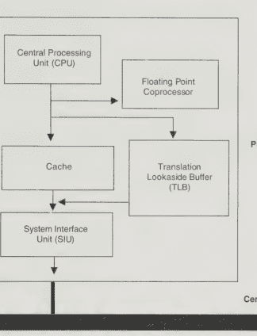

### 中央处理单元

`CPU` 本身包含系统寄存器组、控制逻辑和执行逻辑。寄存器组（将在下文详细讨论）是处理器中所有计算发生的地方。访问内存的唯一指令是显式的加载和存储操作。因此，要操作一个值，必须首先加载该值，进行操纵，然后存储。经常使用的数据保留在寄存器中，以绕过加载和存储操作。`CPU` 的控制逻辑负责获取和译码指令。`CPU` 可以预取指令，并且在 `CPU` 内部对多条指令进行流水线处理以实现并行执行。执行逻辑对数据执行实际操作。`CPU` 的这一部分由算术逻辑单元（`ALU`）、移位和合并单元、掩码寄存器以及执行指令的各种其他硬件组成。

`PA-RISC` 提供四个不同的特权级别，决定 `CPU` 允许执行哪些操作以及它可以访问哪些数据。`HP-UX` 内核仅使用其中两个特权级别：0 用于内核，3 用于用户。系统按页检查访问权限。系统中的每个内存页都有一个访问权限项，指示读取、写入或执行该页所需的特权级别。系统还提供网关指令，用于从一个特权级别提升到另一个级别。该指令是

内核从用户模式切换到内核模式时会使用此功能。此过程在第 3 章中详细讨论。

### 转换旁路缓冲器

转换旁路缓冲器（`TLB`）用于将虚拟地址转换为物理地址。`TLB` 中的每个条目包含虚拟页号、对应的物理页号以及该特定页面的访问权限。系统可以为指令（`ITLB`）和数据（`DTLB`）使用单独的 `TLB`，也可以使用组合的 `TLB`。

`PA-RISC 2.0` 版本包括对可变大小页面的支持。在 `PA-RISC 2.0` 之前，所有页面都是固定的 4 KB。`PA-RISC 2.0` 可以使用范围从 4 KB 到 64 MB 的页面。当使用非常大的数据结构时，这使得 `TLB` 的使用更加高效。大型数据结构可以放置在单个大页面中，并且仅使用一个 `TLB` 条目，而不需要多个。

当指令访问特定虚拟页时，会在 `TLB` 中查找该页以找到对应的物理地址和访问权限。如果不存在匹配的条目，将生成*`TLB` 未命中*中断。然后系统必须在页目录（`PDR`）中查找正确的条目，将该条目插入 `TLB`，然后重新启动该指令。关于这如何发生的细节在第 6 章“内存管理”中涵盖。

### 高速缓存

`PA-RISC` 使用可见高速缓存架构。处理器具有显式操纵高速缓存的指令，在需要时刷新或使高速缓存条目无效。系统可以拥有单独的指令高速缓存和数据高速缓存，或者也可以拥有单个组合高速缓存。

为了尽可能保证所需数据在高速缓存中，高速缓存能够预取数据和指令。为了确定应获取哪些数据，`PA-RISC` 处理器使用*分支预测*来猜测条件分支将走向哪条路径。编译器可以将预测编码到分支指令中。例如，如果一个分支用于循环，并且该循环将运行 100 次迭代，那么循环结束分支将被执行 100 次，而不是一次。编译器可以向处理器指示分支被执行的概率更大，然后高速缓存预取电路可以预取正确的指令。`PA-RISC 2.0` 还添加了*动态分支预测*功能。处理器跟踪分支实际走向编译器预测方向的次数。如果分支预测指标错误多于正确，则系统开始预取与分支预测指示方向相反的内容。

在多处理器系统中，高速缓存还必须感知其他处理器的内存活动。这被称为*高速缓存一致性*。高速缓存电路持续监视来自其他处理器的系统总线上的加载和存储指令。通过这种方式，它将根据是否因来自不同处理器的访问而导致高速缓存中的数据不再有效。

### 辅助处理器

`PA-RISC` 架构以辅助处理器的形式提供扩展性。定义了两种类型的辅助处理器：专用功能单元（`SFU`）和协处理器。`SFU` 是一种硬件模块，它可以直接访问 `CPU` 的一般寄存器，但在 `CPU` 的执行单元之外操作。尽管架构定义了 `SFU` 的实现方式，但目前没有任何 `SFU` 被使用。协处理器也是辅助处理器，但它与 `CPU` 的耦合程度较低。它拥有自己的一组寄存器，数据必须显式地传入和传出协处理器进行处理。

理解辅助处理器并非理解内核所必需，因此除了此处简要提及外，我们不再深入细节。只说 `PA-RISC` 处理器确实具有浮点协处理器，如果你在查看汇编代码时，可能会偶尔看到对它的引用。

### 寄存器

`PA-RISC` 架构提供多组寄存器。对我们特别感兴趣的是通用寄存器、空间寄存器和某些控制寄存器。

#### 通用寄存器

`PA-RISC` 具有 32 个通用寄存器。在 `PA-RISC 2.0` 中，这些是 64 位寄存器；在 `PA-RISC 2.0` 之前，这些寄存器是 32 位宽。架构本身仅为这些寄存器中的少数几个定义了特定用途：

- `GR0`—永久零。从此寄存器读取始终返回零。写入此寄存器的操作将被丢弃。
- `GR1`—`ADDIL` 的目标。当执行立即数加法长（`ADDIL`）指令时，结果总是放置在 `GR1` 中。此寄存器也可以用于其他用途。
- `GR2`—`B,L` 的目标。此寄存器用作分支并链接（`BRANCH AND LINK`）指令的目标，该指令用于过程调用。链接地址或返回地址放置在 `GR2` 中。此寄存器也可以用于其他用途。
- `GR31`—`BLE` 的目标。此寄存器类似于 `GR2`，但用于分支并链接外部（`BRANCH AND LINK EXTERNAL`）指令的返回地址。

除了这些要求外，还有一个软件约定规定了 `HP-UX` 将如何使用寄存器。这些约定对于 64 位版本的 `HP-UX` 略有不同。图 1-2 显示了 32 位内核中通用寄存器的使用，图 1-3 显示了 64 位内核中的使用。这些寄存器使用要求大多在执行过程调用时起作用，并在第 2 章“过程调用约定”中详细涵盖。`GR27`，数据指针，指向数据段的基址。对数据段的内存引用相对于 `GR27` 进行。这些主要是内核中的全局值。`GR30` 是栈指针。

| 寄存器 | 描述 |
| :--- | :--- |
| GR-0 | 参数零 |
| GR-1 | ADDIL 目标 |
| GR-2 | 返回指针 |
| GR-4 | 通用用途 |
| GR-5 | ... |
| GR-6 | ... |
| GR-7 | ... |
| GR-8 | ... |
| GR-9 | ... |
| GR-10 | ... |
| GR-11 | ... |
| GR-12 | ... |
| GR-13 | ... |
| GR-14 | ... |
| GR-15 | ... |
| GR-16 | ... |
| GR-17 | ... |
| GR-18 | 通用用途 |
| GR-19 | 通用用途 |
| GR-20 | ... |
| GR-21 | ... |
| GR-22 | 通用用途 |
| GR-23 | 参数 3 (`arg3`) |
| GR-24 | 参数 2 (`arg2`) |
| GR-25 | 参数 1 (`arg1`) |
| GR-26 | 参数 0 (`arg0`) |
| GR-27 | 数据指针 (`dp/qp`) |
| GR-28 | 返回值/帧指针 |
| GR-29 | 返回值 (double) |
| GR-30 | 栈指针 |
| GR-31 | BLE 链接 |

**图 1-2 32 位通用寄存器**

#### 空间寄存器

`PA-RISC` 提供 8 个空间寄存器。与通用寄存器一样，架构在 `PA-RISC 2.0` 上提供 64 位宽寄存器，在 `PA-RISC 1.1` 上提供 32 位宽寄存器。然而，在所有当前 `PA-RISC 2.0` 实现中，空间寄存器实际上仅为 32 位宽。空间寄存器与通用寄存器组合使用以构造虚拟地址。空间寄存器可以在指令中显式提供，也可以通过通用寄存器中的值隐含。空间寄存器的使用在“虚拟内存支持”部分中详细涵盖。

#### 控制寄存器


PA-RISC 提供 32 个控制寄存器（见图 1-4）。同样，在 `PA-RISC 1.1` 中这些是 32 位寄存器，但在 `PA-RISC 2.0` 中它们是 64 位寄存器。其中大部分在处理中断时使用，并在“中断处理”部分中详细讨论。

### 被调用方保存

| 寄存器 | 描述 |
| :--- | :--- |
| `CR-0` | 恢复计数器 |
| `CR-1` | `ADDIL` 目标 |
| `CR-2` | 返回指针 |
| `CR-3` | 通用用途 |
| `CR-4` | --- |
| `CR-5` | ... |
| `CR-6` | --- |
| `CR-7` | ... |
| `CR-8` | --- |
| `CR-9` | --- |
| `CR-10` | ... |
| `CR-11` | --- |
| `CR-12` | ... |
| `CR-13` | --- |
| `CR-14` | ... |
| `CR-15` | --- |
| `CR-16` | ... |
| `CR-17` | --- |
| `CR-18` | 通用用途 |
| `CR-19` | 参数 7 (`arg7`) |

### 调用方保存

| 寄存器 | 描述 |
| :--- | :--- |
| `CR-20` | 参数 6 (`arg6`) |
| `CR-21` | 参数 5 (`arg5`) |
| `CR-22` | 参数 4 (`arg4`) |
| `CR-23` | 参数 3 (`arg3`) |
| `CR-24` | 参数 2 (`arg2`) |
| `CR-25` | 参数 1 (`arg1`) |
| `CR-26` | 参数 0 (`arg0`) |
| `CR-27` | 数据指针 (`dp/dp`) |
| `CR-28` | 返回值/帧指针 |
| `CR-29` | 参数指针 (`ap`) |
| `CR-30` | 栈指针 |
| `CR-31` | `BLE` 链接 |

### 图 1-3 64 位通用寄存器

| 寄存器 | 描述 |
| :--- | :--- |
| `CR-0` | 恢复计数器 |
| `CR-1-CR-7` | 保留 |
| `CR-8-CR-9` | 保护 ID |
| `CR-10` | 协处理器配置记录 (`CCR`) |
| `CR-11` | 移位量寄存器 (`SAR`) |
| `CR-12-CR-13` | 保护 ID |
| `CR-14` | 中断向量地址 |
| `CR-15` | 外部中断启用掩码 (`EIEM`) |
| `CR-16` | 中断计时器 |
| `CR-17` | 中断指令地址空间队列 (`IIASQ`) |
| `CR-18` | 中断指令地址偏移队列 (`ILAOQ`) |
| `CR-19` | 中断指令寄存器 |
| `CR-20` | 中断空间寄存器 |
| `CR-21` | 中断偏移寄存器 |
| `CR-22` | 中断处理器状态字 |
| `CR-23` | 外部中断请求寄存器 |
| `CR-24-CR-31` | 临时寄存器 |

### 图 1-4 控制寄存器

## 处理器状态字

还有一个感兴趣的寄存器是处理器状态字（`PSW`）。这是一个 64 位寄存器（在 `PA-RISC 1.1` 上为 32 位），其位表示系统状态。其中一些位是 con- 些状态位由内核显式控制，而另一些则作为中断或分支取指等操作的结果被隐式设置。表 1-1（引自 Gerry Kane 的《`PA-RISC 2.0` 体系结构》）列出了 `PSW` 中的位及其含义。

### 表 1-1 处理器状态字（PSW）位定义

| 字段 | 描述 |
| :--- | :--- |
| `W` | 宽 64 位地址生成使能。当为 1 时，启用完整的 64 位偏移地址。当为 0 时，地址被截断为 32 位偏移，以兼容现有的 `PA-RISC 1.0` 和 `PA-RISC 1.1` 应用程序。 |
| `E` | 小端内存访问使能。当为 0 时，所有内存引用均为大端。当为 1 时，所有内存引用均为小端。此位的实现是可选的。如果未实现，则所有内存引用均为大端，且此位为保留位。 |
| `S` | 安全间隔定时器。当为 1 时，间隔定时器仅可由处于最高特权级别的代码读取。当为 0 时，间隔定时器可由处于任何特权级别的代码读取。 |
| `T` | 分支取指陷阱使能。当为 1 时，任何已执行的分支都会触发分支取指陷阱。 |
| `H` | 高特权转移陷阱使能。当为 1 时，只要下一条指令的特权级别更高，就会发生高特权转移陷阱。 |
| `L` | 低特权转移陷阱使能。当为 1 时，只要下一条指令的特权级别更低，就会发生低特权转移陷阱。 |
| `N` | 无效化。当此位为 1 时，当前指令被无效化。此位由无效化下一条指令的指令置为 1。 |
| `X` | 数据内存断点禁用。`X` 位在每条指令执行后置为 0，除了“从中断返回”(`RETURN FROM INTERRUPTION`)指令可能将其置为 1。当为 1 时，数据内存断点陷阱被禁用。此位提供了一种简单机制，用于在数据存储时触发陷阱，然后继续执行过该触发陷阱的指令。 |
| `B` | 分支已执行。`B` 位由任何已执行的分支指令置为 1，否则置为 0。这用于确保带有 `GATE` 完成器的 `BRANCH` 指令（提权指令）不能被用来破坏系统安全。 |
| `C` | 代码（指令）地址翻译使能。当为 1 时，指令地址被翻译并检查访问权限。 |
| `V` | 除法步长校正。`DIVIDE STEP`（整数除法原语）指令在此位中记录中间状态，以提供非恢复式除法原语。 |
| `M` | 高优先级机器检查掩码。当为 1 时，高优先级机器检查（`HPMCs`）被屏蔽。通常此位为 0，在发生 `HPMC` 后置为 1，在其他所有中断后均置为 0。 |
| `C/B` | 进位/借位位。以下指令根据 ALU 4 位数字的对应进位/借位输出更新 `PSW` 的进位/借位位：`ADD*`、`ADDI`、`DS`、`SHLADD*`、`SUB`、`SUBI`。标有星号的指令仅当未指定 i（逻辑）完成器时才设置进位/借位位。在执行加法且设置这些位后，如果其对应数字位产生进位，则该位被置为 1，否则置为 0。在执行减法且设置这些位后，如果其对应数字位产生借位，则该位被置为 0，否则置为 1。位 `[24..31]` 保存 ALU 上半部分的数字进位，位 `[48..55]` 保存下半部分的数字进位。 |
| `O` | 有序引用。当为 1 时，对应 TLB `O` 位为 1 的页的虚拟内存引用以及所有绝对内存引用都是有序的。当为 0 时，内存引用（除非明确标记为有序或强有序）可以是弱有序的。注意，对 I/O 地址空间的引用、对 TLB `U` 位为 1 的页的引用、信号量指令和 TLB 刷新指令始终是强有序的。 |
| `F` | 性能监视器中断解除掩码。当为 1 时，性能监视器中断被解除掩码并可能触发中断。当为 0 时，中断处于挂起状态。仅当性能监视器已实现且具备中断能力时，才要求实现此位。如果未实现，此位为保留位。 |
| `R` | 恢复计数器使能。当为 1 时，如果恢复计数器的第 0 位为 1，则发生恢复计数器陷阱。此位还启用恢复计数器的递减。 |
| `Q` | 中断状态收集使能。当为 1 时，收集中断状态。在处理中断并返回被中断代码时，此状态记录在以下寄存器中：中断指令地址队列（`IIAQ`）、中断指令寄存器（`IIR`）、中断空间寄存器（`ISR`）以及中断偏移寄存器（`IOR`）。 |
| `P` | 保护标识符验证使能。当此位和 `C` 位均等于 1 时，指令引用检查有效的保护标识符（`PIDs`）。当此位和 `D` 位均等于 1 时，数据引用检查有效的 `PIDs`。当此位为 1 时，探测指令检查有效的 `PIDs`。 |
| `D` | 数据地址翻译使能。当为 1 时，数据地址被翻译并检查访问权限。 |
| `I` | 外部中断、电源故障中断和低优先级机器检查中断解除掩码。当为 1 时，这些中断被解除掩码并可能触发中断。当为 0 时，这些中断处于挂起状态。 |

## 虚拟内存支持

在虚拟内存系统中，页面从一组地址（虚拟地址）映射到另一组地址（物理地址）。每次处理器访问内存时，都使用虚拟地址。该地址随后被翻译为物理地址。这种映射以页为单位进行。当程序寻址一个虚拟地址时，该地址首先被拆分为虚拟页号和该虚拟页内的偏移量。然后，虚拟页被翻译为物理页。虚拟页可能位于磁盘上而不是物理内存中。在这种情况下，会产生页错误（`page fault`），必须随后将页从磁盘调入内存。本节讨论地址如何被翻译。数据驻留在磁盘而非物理内存中的情况将在第 6 章中讨论。

`PA-RISC` 处理器工作在两种模式之一：窄模式（`narrow`）或宽模式（`wide`）。`PA-RISC 1.1` 处理器始终为窄模式，它们处理 32 位地址。`PA-RISC 2.0` 处理器可以随时处于窄模式或宽模式，具体取决于 `PSW` 中 `W` 位的设置。由于在这两种情况下地址的处理方式不同，我们将探讨这两种可能性。我们还探讨了内核模式和用户模式的内存布局。请记住，在 `PA-RISC 1.1` 系统中，内核和应用程序始终是窄模式（32 位）。在 `PA-RISC 2.0` 系统中，内核可以是窄模式或宽模式（64 位）；在宽内核中，应用程序可以是窄模式或宽模式。

### 虚拟内存布局，窄模式

如前所述，整个虚拟内存集合被划分为空间（`space`）。每个地址由一个空间和对该空间的偏移量组成。


在窄模式下，我们使用 32 位偏移量进入空间，这意味着每个空间的大小为 `$2^{32}$` 或 4 GB。这 4 GB 进而被划分为四个象限，每个象限为 1 GB。

系统中的每个进程都有四个象限的地址范围可以使用。这并不意味着它有 4 GB 的专用内存——只是拥有那么多可供访问的唯一地址。然而，这四个象限不一定位于同一个空间中。例如，一个进程可能拥有来自空间 `0x123` 的象限 1、来自空间 `0x234` 的象限 2、来自空间 `0x345` 的象限 3 和来自空间 `0x456` 的象限 4。与此同时，另一个进程可能将其象限 2 取自空间 `0x123`。换句话说，每个空间被划分为四个象限，每个象限属于不同的进程。当我们讨论显式和隐式寻址时，这样做的理由将变得明显。

象限的确定是通过将空间根据偏移量的高两位划分为四个相等的部分来完成的。表 1-2 展示了地址范围如何映射到象限。

### 表 1-2 32 位模式下的象限

| 象限 | 虚拟地址范围 |
| :--- | :--- |
| 象限 1 | `0x00000000` 至 `0x3fffffff` |
| 象限 2 | `0x40000000` 至 `0x7fffffff` |
| 象限 3 | `0x80000000` 至 `0xbfffffff` |
| 象限 4 | `0xc0000000` 至 `0xffffffff` |

### 虚拟内存布局，宽模式

在宽模式下，虚拟内存的概念与窄模式相同，但寄存器大小不同，且计算方式也不同。`PA-RISC 2.0` 体系结构允许高达 64 位的空间寄存器，尽管所有当前实现均使用 32 位的空间寄存器。在这 32 位中，仅使用高 22 位；低 10 位始终为零。用于偏移量的通用寄存器宽 64 位。然而，仅使用低 42 位作为偏移量。与窄模式一样，最高的两位指示象限。结果是每个象限为 4 TB，每个空间为 16 TB。表 1-3 展示了地址范围如何映射到象限。

### 表 1-3 64 位模式下的象限

| 象限 | 虚拟地址范围 |
|---|---|
| 象限 1 | `0x00000000 00000000` 至 `0x000003ff ffffffff` |
| 象限 2 | `0x40000000 00000000` 至 `0x400003ff ffffffff` |
| 象限 3 | `0x80000000 00000000` 至 `0x800003ff ffffffff` |
| 象限 4 | `0xc0000000 00000000` 至 `0xc00003ff ffffffff` |

### 32 位地址空间布局

图 1-5 展示了 32 位用户模式和 32 位内核模式下的内存布局。32 位内核模式仅用于 `PA-RISC 1.1` 系统。在 `PA-RISC 2.0` 系统中，内核本身始终处于 64 位模式。`PA-RISC 2.0` 系统上的应用程序可以是 32 位或 64 位应用程序。在 `PA-RISC 1.1` 系统上，应用程序始终处于 32 位模式。

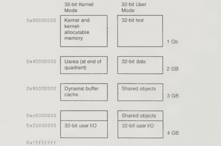

### 64 位地址空间布局

图 1-6 展示了 64 位模式下的内存布局，包括内核和 64 位用户应用程序。64 位用户模式的要求之一是，64 位应用程序必须能够与 32 位应用程序共享内存。这被称为混合模式访问。为了支持混合模式访问，在 64 位布局的象限 1 中预留了一个区域。该区域从 2 GB 偏移处开始，对应于 32 位模式下象限 3 的起始位置（也在 2 GB 偏移处）。

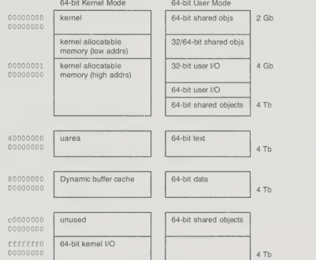

### 显式与隐式指针，窄模式与宽模式

在窄模式下，我们需要处理 16 位空间 ID 和 32 位偏移量，总共 48 位。出于性能考虑，希望有一种方法能用单个 32 位寄存器来指定地址。为此，`PA-RISC` 使用了*短指针*的概念。短指针使用寄存器的高两位来指定空间寄存器，其余 30 位用来指定偏移量。请记住，那高两位还指示地址所在的象限。表 1-4 展示了地址的高位、用于寻址的空间寄存器以及象限之间的关系。

举个例子，短指针 `0x40000782` 指的是空间寄存器 5 所指向空间中的偏移量 `0x782`。换一种说法，`0x40000782` 位于象限 2，该象限使用空间寄存器 5。

在宽模式下，我们的短指针长度为 64 位。我们仍然使用前两位来指示空间寄存器或象限，如表 1-4 所述。短指针中的接下来 20 位始终为零，随后是 42 位的偏移量。这赋予了一个象限内 4 TB 的地址范围。例如，地址 `0x40000001'201a39c3` 位于空间寄存器 5 所指向的空间中，偏移量为 `0x1201a39c3`。

### 表 1-4 空间寄存器与象限

| 位 0-1 | 空间寄存器 | 象限 |
|:---:|:---:|:---:|
| 00 | `SR4` | 象限 1 |
| 01 | `SR5` | 象限 2 |
| 10 | `SR6` | 象限 3 |
| 11 | `SR7` | 象限 4 |

### 地址 Swizzling（混合/转换）

地址 Swizzling 是将 32 位地址转换为 64 位地址的过程。当 32 位应用程序在 64 位内核上运行时，传递给内核的任何地址都必须 Swizzle 为 64 位。这个过程只需将 32 位地址的最高 2 位复制到 64 位地址的最高 2 位，将 64 位地址的接下来 32 位清零，并将 32 位地址的低 30 位复制到 64 位地址的低 30 位。参见图 1-7。

这个过程将 32 位值扩展为 64 位值，同时保持正确的象限。请注意，这只针对地址发生，而不适用于算术值，这意味着内核必须知道传入的值是一个地址。


### 全局虚拟地址

`PA-RISC 2.0` 引入了全局虚拟地址（Global Virtual Address，`GVA`）的概念。`GVA` 是空间值和偏移量值的组合，结果是一个 64 位唯一地址。在窄模式下，空间值长度为 32 位，偏移量长度为 32 位。我们只需将这两个值连接起来即可得到 64 位 `GVA`。例如，如果我们有一个地址为 `0x3120.0x7ff33aeb`，那么 `GVA` 就是这两部分的连接：`0x00003120'7ff33aeb`。

在宽模式下，请记住我们使用 32 位空间寄存器，但只有高 22 位被使用；低 10 位始终为零。偏移量是一个 64 位寄存器，但高 22 位被清零，只有低 42 位被使用。这允许我们将 22 位空间寄存器和 42 位偏移量连接起来以生成 64 位 `GVA`。我们只需将 32 位空间寄存器值与偏移量的高 32 位进行按位或运算即可得到 64 位 `GVA`。例如，如果我们有一个地址为 `0x624b400.0x3fe'ff7c34e8`，则生成的 `GVA` 为 `0x0624b7ff'ff7c34e8`。

这个 64 位 `GVA` 被用作地址转换的基础。在下一节中，我们将看到 64 位 `GVA` 是如何转换为物理地址的。

### 地址转换

地址转换是将虚拟地址转换为物理地址的过程。在开始转换过程之前，虚拟地址被分为虚拟页号（`VPN`）和该页内的偏移量。然后 `VPN` 被转换为物理页号（`PPN`），偏移量则用作该物理页内的偏移量。

在 `PA-RISC 1.1` 中，所有页面的长度固定为 4 KB。这意味着虚拟地址的偏移部分为低 12 位，而 `VPN` 为高 20 位。随着 `PA-RISC 2.0` 的引入，我们引入了可变大小页面的概念。这意味着物理页大小可以从 4 KB 到 64 MB 不等。然而，就地址转换而言，我们假设页面大小为 4 KB。因此，我们仍然使用高 20 位作为 `VPN`。一旦 `VPN` 被转换为 `PPN`，我们就可以确定实际页面的大小，从而确定地址中有多少位用作页内偏移量。图 1-8 说明了这一转换过程。

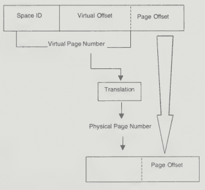

图 1-8 虚拟地址到物理地址的转换

### 地址转换组件

有几种组件用于将虚拟地址转换为物理地址。第一个是 `PDIR`，它是一个列出当前内存中页面的表。它包含每个页面的 `VPN` 和 `PPN`，以及指示条目状态的标志。

`PA-RISC` 系统还有一个 `TLB`（Translation Lookaside Buffer，转换旁路缓存）。这是 `PDIR` 的硬件版本。它的大小不足以容纳所有 `PDIR` 条目，但引用 `TLB` 比引用 `PDIR` 快得多。最近且频繁使用的 `PDIR` 条目会保留在 `TLB` 中以快速访问。以此方式，`TLB` 充当 `PDIR` 条目的缓存。

系统还有一个或两个内存缓存。系统可能有用于指令和数据的独立缓存，也可能有合并的缓存。虽然缓存并非严格用于地址转换，但它是根据虚拟地址查找所需数据过程的一部分。

当系统想要访问某个特定的虚拟地址时，它首先检查 `TLB`，看 `VPN` 是否在其中。如果没有，则前往 `PDIR` 查看是否存在该条目。如果在 `PDIR` 中找到该条目，则将其插入 `TLB` 并重新开始处理。如果在 `PDIR` 中找不到该条目，则产生页面错误，内核必须从磁盘调入该页。


一旦从 `TLB` 获取了 `PPN`，就会检查缓存，看地址是否在缓存中。如果在，则从缓存加载数据。如果不在，则从内存加载缓存并重启处理过程。图 1-9 中的流程图说明了这一过程。

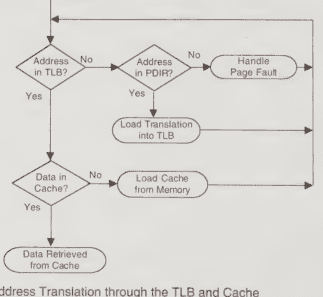

图 1-9 通过 `TLB` 和缓存的地址转换

### 转换旁路缓存

`TLB` 是一个保存虚拟页到物理页映射关系的硬件单元。每个 `TLB` 条目包含 `VPN` 和对应的 `PPN`。此外，`TLB` 条目还用于控制对页面的访问。每个条目都有一个访问权限字段和一个访问 `ID`。在 `PA-RISC 2.0` 中，由于其支持可变大小的页面，`TLB` 还必须有一个指示物理页大小的字段。最后，每个条目都有一组指示条目状态的标志。`TLB` 的实际布局和操作并不重要。为了理解 `HP-UX` 内核，只需知道 `TLB` 的存在及其功能即可。

### 访问控制

`TLB` 还负责控制对页面的访问。这在两个不同的层级上进行处理。第一层利用保护 `ID` 和 `TLB` 中的访问 `ID` 字段。这决定特定进程或上下文是否有权访问某个页面。第二层利用指令特权级别和 `TLB` 中的访问权限字段。这决定 `CPU` 当前的特权级别是否足以访问该页面。

每个 `TLB` 条目都有一个访问 `ID` 字段，在 `PA-RISC 1.1` 上长度为 15 到 18 位，在 `PA-RISC 2.0` 上长度为 15 到 31 位。每个处理器还有几个与之关联的保护 `ID`。这些保护 `ID` 存储在控制寄存器 8、9、12 和 13 中。每个保护 `ID` 长度为 32 位。在 `PA-RISC 1.1` 上，具有 32 位宽寄存器，因此有四个保护 `ID` 可用。在 `PA-RISC 2.0` 上，每个寄存器可以容纳两个保护 `ID`，总共八个。一旦在 `TLB` 中找到特定 `VPN` 的匹配项，系统就会将 `TLB` 中的访问 `ID` 字段与每个保护 `ID` 进行比对。访问 `ID` 必须与其中一个保护 `ID` 匹配，访问才允许通过。每个保护 `ID` 的最低位是写禁用位。如果操作是写操作，那么至少有一个匹配的保护 `ID` 的最低位必须为 0（off），表示该保护 `ID` 对写操作有效。

每个 `TLB` 条目还有一个访问权限字段，指示读取、写入和执行该页上地址所需的最小特权级别。请记住，`PA-RISC` 提供四个特权级别，但 `HP-UX` 只使用其中两个。特权级别 0 由内核使用，特权级别 3 用于用户进程。当前特权级别编码在指令地址的低 2 位中。因为每条指令长度均为 32 位，所以指令的地址必须是 4 字节的倍数。换句话说，指令地址的低 2 位对于寻址指令来说是多余的。相反，这 2 位用于编码当前特权级别。`TLB` 中的访问权限字段确保只有具有正确特权级别的进程才能访问页面。一个例子是，访问内核私有数据需要特权级别 0。如果用户进程试图直接访问内核数据，它将无法通过访问权限检查。

上述两个访问检查都必须通过，访问才会被允许。如果任何检查失败，将产生保护错误（`Protection Fault`）。

### TLB 未命中处理程序

回想一下，`TLB`（转换后备缓冲器）是一种有限资源，仅保存 `PDIR`（页目录）中翻译映射的子集。如果系统无法在 `TLB` 中找到其正在查找的 `VPN`（虚拟页号），就会生成一次 `TLB` 未命中。此时，必须从 `PDIR` 中检索相关信息并将其插入到 `TLB` 中。

一些 `PA-RISC 1.1` 系统配备了硬件 `TLB` 未命中处理程序，它可以在内存中的 `PDIR` 中搜索匹配项。`PDIR` 中的条目实际上是以哈希链结构存储的，这在第 6 章中有详细讨论。由于这一结构，硬件 `TLB` 未命中处理程序无法看到 `PDIR` 中的所有条目。此外，`TLB` 未命中处理程序并不执行访问权限检查，因此一旦新条目被插入 `TLB`，仍需要对其访问权限进行验证。

对于没有硬件 `TLB` 未命中处理程序的系统，以及硬件无法找到 `PDIR` 条目的情况，还存在软件实现的 `TLB` 未命中处理程序。

硬件和软件未命中处理程序执行的功能相同：在 `PDIR` 中检查 `VPN` 的翻译。如果找到翻译，将其插入 `TLB`。如果未找到翻译，则生成一次页面错误（`Page Fault`），以便从磁盘调入该页面。

`PA-RISC` 提供了用于向 `TLB` 插入条目和从 `TLB` 删除条目的指令。这些指令由 `TLB` 未命中处理程序用于管理 `TLB`。

### 缓存组织

一旦地址被转换，下一步就是从该地址检索数据。缓存将数据存储在称为*缓存行*的数据块中。缓存行是主内存和缓存之间传递的数据单位。该大小在不同系统间可能有所不同，但典型的实现使用 32 字节的缓存行。每个缓存行都配有一个伴随的*缓存标签*，用于描述数据。此缓存标签包括数据来自的物理页面，以及指示数据状态的标志。

缓存通过哈希函数使用 `VPN` 进行访问——这与 `TLB` 使用的哈希函数相同。这意味着给定一个 `VPN`，系统可以同时检查 `TLB` 中的翻译和访问权限，并在缓存中查找数据。一旦系统从 `TLB` 获得 `PPN`（物理页号）并从缓存获得 `PPN`，它就会比较两者，以查看缓存的数据是否确实来自正确的页面。由于哈希函数可以将多个 `VPN` 映射到单个条目，因此通过哈希函数找到的缓存数据可能属于另一个物理页面。

如果缓存和 `TLB` 中的 `PPN` 匹配，则系统可以使用缓存中的数据。如果 `PPN` 不匹配，则发生*缓存未命中*，系统必须从主内存检索数据。

`PA-RISC` 提供了将缓存刷新到内存的指令。如果缓存标签中设置了“脏”标志，表示缓存数据比内存数据更新，则缓存数据将被写入主内存。还有一个指令用于清除缓存数据，它仅仅将标签标记为无效。请注意，没有用于向缓存插入数据的指令。缓存插入是在访问主内存时由 `CPU` 自动处理的。

## 中断

通常，系统按顺序执行指令，一条接一条，除非遇到 `BRANCH` 指令。`BRANCH` 指令在第 2 章讨论程序调用约定时会被涵盖。系统中断正常处理流程的另一个时机是发生中断（`interruption`）时。一个例子可能是 `I/O` 卡片发出信号表明传输已完成，或者由于页面不在内存中而导致的页面错误。

中断被分为四个类别：

- 故障（`fault`）发生在由于临时问题（例如页面不可用）导致系统无法执行当前指令时。通常在条件纠正后，该指令将被重新执行。

- 陷阱（`trap`）发生在当前指令引发错误时，例如算术溢出或违反页面的保护权限。通常该指令不会被重新执行。

- 中断（`interrupt`）是由当前指令流之外的实体生成的，例如 `I/O` 卡片请求注意。

- 校验（`check`）发生在系统硬件检测到硬件故障（如奇偶校验错误）时。

虽然这些术语在 `PA-RISC` 体系结构中有明确定义，但在 `HP-UX` 内核中并未严格遵循。例如，`HP-UX` 将严格意义上的陷阱（`trap`）称为“保护故障”（`Protection Fault`）。然而，所有四种类型的中断都以相同的方式处理，所以这实际上只是术语问题。另外请注意，*interrupt* 和 *interruption* 这两个术语有时会被混淆。严格来说，导致控制流改变的事件（`BRANCH` 除外）被称为*中断*（`interruption`）。其中一种特定类型的中断是*打断*（`interrupt`），它是来自外部设备的信号。

系统内每种可能类型的中断都被赋予预定的优先级，各种类型被组织成中断组。表 1-5 摘自 Gerry Kane 的《`PA-RISC 2.0 Architecture`》，展示了中断组、中断编号以及中断类型的描述。

### 表 1-5 按优先级排序的中断和中断组

| 组 | 中断 | 描述 |
| :--- | :--- | :--- |
| 第 1 组: | 1 | 高优先级机器校验 |
| 第 2 组: | 2 | 电源故障中断 |
| | 3 | 恢复计数器陷阱 |
| | 4 | 外部中断 |
| | 5 | 低优先级机器校验 |
| | 29 | 性能监视器中断 |
| 第 3 组: | 6 | 指令 `TLB` 未命中故障或指令页面错误 |
| | 7 | 指令内存保护陷阱 |
| | 8 | 非法指令陷阱 |
| | 9 | 断点指令陷阱 |
| | 10 | 特权操作陷阱 |
| | 11 | 特权寄存器陷阱 |
| | 12 | 溢出陷阱 |
| | 13 | 条件陷阱 |
| | 14 | 辅助异常陷阱 |
| | 15 | 数据 `TLB` 未命中故障或数据页面错误 |
| | 16 | 非访问指令 `TLB` 未命中故障 |
| | 17 | 非访问数据 `TLB` 未命中故障或非访问数据页面错误 |
| | 26 | 数据内存访问权限陷阱 |
| | 27 | 数据内存保护 `ID` 陷阱 |
| | 28 | 非对齐数据引用陷阱 |
| | 18 | 数据内存保护陷阱或非对齐数据引用陷阱 |
| | 19 | 数据内存断点陷阱 |
| | 20 | `TLB` 脏位陷阱 |
| | 21 | 页面引用陷阱 |
| | 22 | 辅助模拟陷阱 |
| 第 4 组: | 23 | 更高特权级转移陷阱 |
| | 24 | 更低特权级转移陷阱 |
| | 25 | 已执行分支陷阱 |

### 中断向量表


PA-RISC 使用中断向量表（`IVT`）来确定如何处理每种类型的中断。`IVT` 起始地址存储在控制寄存器 `CR14` 中。表中的每个条目长度为 32 字节（8 个字）。请注意，这些条目不仅仅是指向例程的指针——它们是实际的代码，最多包含八条指令。在许多情况下，这些代码仅仅是分支（`BRANCH`）到正确的处理程序，但情况也不一定如此。

## 中断处理

当我们查看中断是如何处理时，四个不同的中断组变得尤为重要。

第 1 组仅包含 `HPMC`（高优先级机器校验）。当中断发生时，意味着硬件检测到了不可恢复的错误。它可能与指令流异步地随时发生，并立即得到响应。

第 2 组中断在指令周期开始时立即被检查。这些中断在获取下一条指令之前得到处理。

接下来系统检查 `PSW` 中的 `N` 位，该位指示指令被作废。作废指令是指应该被跳过的指令。在第 2 章中，我们将讨论如何使用它以及为什么要使用它。就目前而言，知道如果 `N` 位开启，下一条指令甚至不会被获取——我们只是递增程序计数器并开始下一个周期就足够了。

如果 `N` 位未设置，系统获取下一条指令，开始执行该指令并推进程序计数器。如果指令的执行导致第 3 组中断，程序计数器会递减，`PSW` 会重置为其先前的状态，并且该中断得到处理。这意味着当中断处理程序完成时，该指令将被重新开始。如果指令导致第 4 组中断，处理程序直接分支过去而不回退程序计数器，因此该指令不会被重新开始。

## 中断保存状态

当中断发生时，系统在分支到中断向量之前必须保存其当前状态。控制寄存器 17 到 22 用于保存中断状态。对于每个中断，系统执行以下操作：

- `PSW` 被保存在 `CR22` 中。对于第 2 组和第 3 组，这将是指令开始时的 `PSW`。对于第 4 组，将是指令结束时的 `PSW`。
- 清除 `PSW`，仅保留 `W-`、`E-` 和 `M-` 位。这起到了禁用所有较低优先级中断的作用。
- 当前的指令空间（instruction space）和偏移量（offset）存储在控制寄存器 17 和 18 中。
- 特权级被设置为 0。
- 中断发生时正在执行的指令存储在 `CR19` 中。
- 与中断相关的地址存储在控制寄存器 20（空间）和 21（偏移）中。这样，出错地址就被传递给故障处理程序。

### 摘要

我们详细研究了 PA-RISC 架构的基本构建模块、虚拟内存寻址方式以及中断处理方法。有了这些基础概念作为基石，我们准备好深入探讨内核如何在该架构中运行。

# 过程调用约定

在前一章中，我们讨论了系统架构——PA-RISC 硬件的设计和实现。但为了使其发挥作用，我们需要就如何使用硬件做出一些决策。例如，我们需要商定如何进行过程调用、如何传递参数以及如何返回返回值。这被称为系统的运行时架构。在本章中，我们将探讨这些约定，并查看一些常用的 PA-RISC 指令。

## 寄存器使用

回顾我们在第 1 章中关于 PA-RISC 架构的讨论，只有四个寄存器具有特定含义：`GR0`、`GR1`、`GR2` 和 `GR31`。运行时架构为其余的许多寄存器规定了使用准则。

寄存器 3 到 18 被指定为*被调用者*保存寄存器。这意味着如果这些寄存器将被覆盖，则*被调用者*或*被调用函数*有责任保存其内容。这些寄存器通常用于存储函数中的局部变量，在使用前会被存储到栈中。然后在返回调用程序之前，它们必须恢复到其原始值。

寄存器 19 到 26 是*调用者*保存寄存器。如果调用函数希望保留这些值，它必须在发出过程调用之前保存它们。被调用函数可以随意修改它们而无需保存。

对于大多数过程调用，在发出调用之前，调用的参数被放置在寄存器中。PA-RISC 1.1 指定了四个寄存器用于传递参数。参数 0 存储在 `GR26` 中，参数 1 存储在 `GR25` 中，参数 2 存储在 `GR24` 中，参数 3 存储在 `GR23` 中。许多工具使用这些寄存器的替代名称来表示其用途——用 `arg0` 代替 `GR26`，用 `arg1` 代替 `GR25`，等等。此外，工具通常将这些寄存器称为 `r26`、`r25` 等，而不是 `GR26` 和 `GR25`。在 PA-RISC 2.0 中，参数寄存器的数量增加了，因此参数 4 在寄存器 22（`GR22`）中，参数 5 在 `GR21` 中，参数 6 在 `GR20` 中，参数 7 在 `GR19` 中。如果过程调用使用的参数数量超过架构寄存器的数量，剩余的参数将通过将它们压入栈来传递。

通用寄存器 30 用作栈指针，并且经常通过助记符 `SP` 而不是 `GR30` 来称呼。栈向内存中的更高地址生长，因此当数据被添加到栈中时，`GR30` 的值变大，当数据从栈中移除时，`GR30` 的值变小。这有时令人困惑，因为按照惯例，我们将栈绘制为*向下*生长——较高的地址位于栈图的底部。PA-RISC 没有显式的 `PUSH` 和 `POP` 栈操作。通过递增或递减 `GR30` 来扩展或缩小栈。

## PA-RISC 指令

PA-RISC 指令集可以分为七类通用指令：

- 内存引用指令——显式地将数据移动进或移出内存的指令。
- 计算指令——执行基本算术、逻辑操作、移位和旋转以及位操作的指令。
- 分支指令——改变指令执行顺序的指令，可以是条件或非条件分支，无论是否保存指向当前指令流的返回链接指针。
- 多媒体指令——对打包在单个寄存器中的 16 位值执行多个并行操作的指令。这些指令旨在加速通常用于多媒体应用（如信号处理和压缩）的操作。
- 浮点指令——这些指令对存储在系统浮点寄存器中的值执行浮点操作。
- 系统控制指令——这些指令执行控制功能，例如处理中断以及管理缓存和 `TLB`。
- 长立即数指令——允许使用立即数值的指令。

要很好地掌握内核，你不需要了解所有可用指令的一切细节，但有一些指令是被常用到的，或者对于理解如何处理过程调用很重要。我们将更详细地查看内存引用指令、分支指令和长立即数指令。Gerry Kane 的*《PA-RISC 2.0 架构》*一书提供了所有指令的完整细节。

在深入指令细节之前，我们应该提一下助记符的格式。许多指令都有一个*完成符*（completor），以指示不同类型的相似指令。例如，分支指令的助记符仅仅是 `B`。如果我们想保存返回地址，称为分支和链接指令，助记符为 `B, L`。`L` 是分支指令的完成符。同样，存储字指令 `STW`，加上完成符 `M` 可以变为存储字并修改指令：`STW, M`。

一些工具也会使用简化的助记符。分支和链接指令用于调用过程，因此有时在列表中被显示为 `CALL` 指令。另一个例子是，PA-RISC 中没有“空操作”指令，但汇编器将使用 `OR 0,0,0` 作为空操作，并且该指令在汇编列表中经常被解码为 `NOP`。

### 内存引用指令

PA-RISC 架构使用显式的 `LOAD` 和 `STORE` 操作进行所有内存访问。`LOAD` 指令将数据从内存带到寄存器，`STORE` 指令将数据从寄存器移动到内存。由于 PA-RISC 使用内存映射 I/O，`LOAD` 和 `STORE` 指令也用于所有 I/O 操作。指令集中没有显式的 I/O 操作。

`LOAD` 和 `STORE` 可以操作字节、半字、字或双字。这些指令总结在表 2-1 中。

**表 2-1 LOAD 和 STORE 指令**

| 操作数大小 | 加载指令 | 存储指令 |
|---|---|---|
| 8 位 | `LDB` – 加载字节 | `STB` – 存储字节 |
| 16 位 | `LDH` – 加载半字 | `STH` – 存储半字 |
| 32 位 | `LDW` – 加载字 | `STW` – 存储字 |
| 64 位 | `LDD` – 加载双字 | `STD` – 存储双字 |

内存最常用的寻址模式使用*基址寄存器*和*位移量*来指定目标地址。位移量加到寄存器的内容上以得到目标地址。然后该地址处的数据被复制到指定寄存器（对于 `LOAD`），或者寄存器的内容被复制到该地址（对于 `STORE`）。一个例子是以下指令：

```
LDw 4(r31),r27
```

这指示系统将 4 加到 `GR31` 中的值上，将结果之和用作内存地址，并将该地址处的值加载到 `GR27` 中。这种基址和位移技术经常用于通过指针引用结构体的成员——这是内核中常见的操作。考虑以下代码示例：

```
struct mystruct {
	int	x;	/* 32 位整数 */
	int	y;
	int             z;
};
struct mystruct *s;
q = s->z;
```

在编译时，编译器知道结构体 `mystruct` 的成员 `z` 位于结构体开始位置后 8 字节处。要将 `s->z` 的值加载到 `q` 中，它首先将指针的当前值加载到一个通用寄存器中，例如 `GR3`。加载指令可能如下：

```
LDw  8(r3), r4
```

指令的位移量部分是从结构体开始处的偏移量，这在编译时是已知的。基址寄存器保存指向结构体开始的指针，这在运行时才确定。

### 基址寄存器修改

`STORE` 和 `LOAD` 指令的另一种变体提供*基址寄存器修改*。也就是说，除了将数据移动进或移出内存外，指令还修改指定的基址寄存器。如果位移量为正，则在加载或存储*之后*修改基址寄存器。这是一个*后置递增*操作。如果位移量为负，则在加载或存储*之前*修改基址寄存器。这是一个*前置递减*操作。

作为一个例子，考虑以下指令：

```
STW, M  r3, 0x80(r30)
```


这条指令告诉系统将`GR3`中的值存储在`GR30`指定的地址处，然后将`0x80`加到`GR30`上。

相反，考虑以下指令：

```
STW, M  r3, -0x80(r30)
```

因为偏移量为负，系统首先从`GR30`中减去`0x80`，然后将`GR3`的内容存储在该地址处。

我们经常会看到在每个被调用过程的开头有一个*`STW, M`*指令。编译器使用此指令来分配栈帧——即向前移动栈指针，以便为局部变量留出存储空间。当我们查看栈的使用时，我们会更详细地看到这一点。

### 分支指令

分支指令可以分为两类：条件分支和非条件分支。顾名思义，条件分支取决于某些条件是否满足，可能会或不会执行。非条件分支总是被执行。在这两类中，根据分支范围和是否保存返回地址，有几种不同的指令。

#### 无条件分支

表 2-2 展示了无条件分支的类型。外部分支用于跳转到不同空间中的位置：矢量分支跳转到寄存器中持有的地址；而链接分支将返回地址保存在寄存器中。

##### 表 2-2 无条件分支

| 指令 | 定义 |
| :--- | :--- |
| `B` | 分支 |
| `B,L` | 分支并链接 |
| `BLR` | 分支并链接寄存器 |
| `BV` | 矢量分支 |
| `BVE` | 矢量外部分支 |
| `BE` | 外部分支 |
| `B,E,L` | 外部分支并链接 |

当在指令上使用`L`补全符（completer）时，该指令必须指定哪个寄存器是链接寄存器——也就是说，哪个寄存器将获取返回地址。通常，在同一空间内的调用使用`GR2`，而在调用另一空间的函数时使用`GR31`。在`B, L`指令中使用`GR2`的原因是存在一种隐含使用`GR2`作为链接寄存器的`B, L`指令版本。通过这样做，指令中指定链接寄存器的 5 位比特就可以用于指定分支目标。当使用`GR2`作为链接寄存器时，`B, L`指令的范围为当前指令的 ±8 MB。寄存器`GR2`通常被称为`rp`，代表返回指针（return pointer）。

`BLR`和`BV`指令用于跳转到距离当前指令超过 8 MB 但仍在同一空间内的目标地址。`BLR`通过将偏移量加到任意通用寄存器上计算目标地址。该地址随后相对于当前指令使用。这扩展了分支的范围。`BV`指令不相对于当前指令——它使用两个寄存器（一个基址寄存器和一个位移寄存器）来计算目标地址。`BV`指令的一个常见用途是从过程调用中返回。通过使用`GR0`（始终为零）作为位移量，`rp`作为基址，我们分支回由发起调用的`B, L`指令保存的返回地址。该指令有时表示为`BV r0(rp)`，有时仅表示为`RET`。

分支指令的“外部”版本本质上相同。主要区别在于它们允许将空间和偏移量都作为目标地址进行指定，并且它们将返回地址的空间和偏移量都保存下来。它们还将返回地址的偏移量存储到`GR31`中，而不是`GR2`中。

#### 条件分支

`PA-RISC`中有四种类型的条件分支：

- 移动并分支
- 比较并分支
- 加法并分支
- 按位分支

每种都有两种形式：一种比较两个寄存器，另一种比较一个寄存器和一个立即数值。立即数值为 5 位，其范围为 −16 到 +15。分支条件作为分支指令的补全符指定。这些指令的操作码显示在表 2-3 中。

##### 表 2-3 条件分支指令

| 指令 | 定义 |
| :--- | :--- |
| `MOV B` | 移动并分支 |
| `MOV I B` | 移动立即数并分支 |
| `CMP B` | 比较并分支 |
| `CMP I B` | 比较立即数并分支 |
| `ADD B` | 加法并分支 |
| `ADD I B` | 加法立即数并分支 |
| `BB` | 按位分支 |

`MOV B`和`MOV I B`指令要么将寄存器复制到另一个寄存器，要么将立即数值复制到寄存器。然后根据移动的值，如果指定条件为真，则分支到目标地址。表 2-4 列出了`MOV`和`MOV I B`指令的可能条件。

##### 表 2-4 MOV B 和 MOV I B 指令条件

| 条件 | 定义 |
| :--- | :--- |
| `Never` |  |
| `=` | 字中所有位均为 0 |
| `<` | 字中最左位为 1 |
| `OD` | 字中最右位为 1 |
| `TR` | 始终 |
| `◇` | 字中某些位为 1 |
| `>=` | 字中最左位为 0 |
| `EV` | 字中最右位为 0 |

例如，指令 `MOV B, = r4, r5, main + 0x16` 会将`GR4`的内容移动到`GR5`。如果移动的值为零，则会分支到地址 `main + 0x16`；否则，执行将按顺序继续。

`CMPB`和`CMPIB`指令要么比较两个寄存器，要么比较一个立即数值和一个寄存器。如果指定条件为真，该指令分支到目标地址；否则执行按顺序继续。表 2-5 显示了`CMP`和`CMPIB`指令的可能条件。

##### 表 2-5 CMP 和 CMP IB 指令的条件

| 条件 | 定义 |
| :--- | :--- |
| `Never` |  |
| `=` | 操作数 1 等于操作数 2 |
| `<` | 操作数 1 小于操作数 2（带符号） |
| `<=` | 操作数 1 小于或等于操作数 2（带符号） |
| `<<` | 操作数 1 小于操作数 2（无符号） |
| `<<=` | 操作数 1 小于或等于操作数 2（无符号） |
| `SV` | 操作数 1 减去操作数 2 溢出（带符号） |
| `OD` | 操作数 1 减去操作数 2 为奇数 |
| `TR` | 始终 |
| `◇` | 操作数 1 不等于操作数 2 |
| `>=` | 操作数 1 大于或等于操作数 2（带符号） |
| `>` | 操作数 1 大于操作数 2（带符号） |
| `>>=` | 操作数 1 大于或等于操作数 2（无符号） |
| `>>` | 操作数 1 大于操作数 2（无符号） |
| `NSV` | 操作数 1 减去操作数 2 未溢出（带符号） |
| `EV` | 操作数 1 减去操作数 2 为偶数 |

例如，指令 `CMPIB, <= . 7, r3, main+0x18` 将比较`GR3`中的值与立即数值 7。如果 7 <= `GR3`（或者换种说法，如果 `GR3` > 7），该指令将分支到 `main+0x18`。

`ADDB`和`ADDIB`要么将两个寄存器相加，要么将一个立即数值加到寄存器上。如果结果满足条件，则进行分支。表 2-6 列出了 `ADDB`和`ADDIB`指令的可能条件。

##### 表 2-6 ADD 和 ADD IB 指令的条件

| 条件 | 定义 |
| :--- | :--- |
| `Never` |  |
| `=` | 操作数 1 等于操作数 2 的负值 |
| `<` | 操作数 1 小于操作数 2 的负值（带符号） |
| `<=` | 操作数 1 小于或等于操作数 2 的负值（带符号） |
| `NUV` | 操作数 1 加上操作数 2 未溢出（无符号） |
| `ZNV` | 操作数 1 加上操作数 2 为零或未溢出（无符号） |
| `SV` | 操作数 1 加上操作数 2 溢出（带符号） |
| `OD` | 操作数 1 加上操作数 2 为奇数 |
| `TR` | 始终 |
| `<>` | 操作数 1 不等于操作数 2 的负值 |
| `>=` | 操作数 1 大于或等于操作数 2 的负值（带符号） |
| `>` | 操作数 1 大于操作数 2 的负值（带符号） |
| `UV` | 操作数 1 加上操作数 2 溢出（无符号） |
| `VNZ` | 操作数 1 加上操作数 2 非零且溢出（无符号） |
| `NSV` | 操作数 1 加上操作数 2 未溢出（带符号） |
| `EV` | 操作数 1 加上操作数 2 为偶数 |

作为一个例子，考虑指令 `ADDIB, OD 17,r4,main+0x18`。数值 17 被加到`GR4`的内容上，结果放置在`GR4`中。如果结果为奇数，则分支到 `main+0x18`。

按位分支指令检查寄存器中的一位，并基于该位有条件地分支。该指令的参数是寄存器、位的位置和目标地址。表 2-7 列出了`BB`指令的可能条件。位置参数可以是固定的位位置，也可以是`SAR`，它指的是移位量寄存器（`CR11`）。

##### 表 2-7 BB 指令的条件

| 条件 | 定义 |
| :--- | :--- |
| `<` | 字中最左位为 1 |
| `>=` | 字中最左位为 0 |

### 延迟分支

`PA-RISC`中的所有分支都使用一种称为延迟分支的特性。这意味着即使分支被采取，分支紧跟其后的指令也会被执行。这个跟在分支后的指令被称为延迟槽。考虑以下代码：

```
LDW0x20(x30), r2
COMIB,>10,r2,main+80
LDw0x24(x30), r3
```

第一条指令将`GR30`偏移`0x20`处的值加载到`GR2`中。接下来，比较指令将该值与 10 进行比较，如果 `GR2` < 10，则分支到 `main+80`。下一条 `LDW`


`instruction` 是延迟槽中的指令。即使分支被采取，该指令也会被执行。因此，如果 `GR2` 实际上小于 10 并且我们分支到 `main+80`，那么在我们执行 `main+80` 处的指令之前，`GR3` 将从 `GR30` 偏移 `0x24` 处加载。当然，如果我们不采取分支，加载操作也会执行——我们将顺势执行到分支后的下一条指令。

这也适用于用于过程调用的分支并链接（branch and link）指令。非常常见的情况是，你会发现在延迟槽中的指令加载了调用参数之一。例如，考虑调用 `func1(x, y)`，其中 `x` 位于 `0x24(r30)`，`y` 位于 `0x28(r30)`。生成的指令可能如下所示：

```
LDW0x24(r30), r26
B, L      func1, r2
LDw       0x28(r30), r25
```

延迟槽中的 `LDW` 指令在执行过程调用之前将第二个参数加载到寄存器中。

通过使用分支上的 `N`（null）完成器，可以忽略或取消延迟槽中指令的作用。延迟槽中的指令是否被取消，取决于分支是否被采取以及分支的方向。如果分支是向前分支，那么当分支被采取时，延迟槽中的指令将被取消。这是因为对于向前分支，这种结构通常表示“如果此条件为真，则跳过后续代码”。

延迟槽中的指令是当条件为真时被跳过的代码的一部分。在条件未满足的正常情况下，我们按预期顺延执行下一条指令。

如果分支是向后分支，当分支未被采取时，延迟槽将被取消。其原因是向后分支通常位于循环底部。编译器通常会复制循环中的第一条指令到末尾测试的延迟槽中。然后，跳回循环顶部的分支将指向循环的第二条指令。通过这样做，我们利用了使用延迟槽带来的速度优势。如果测试失败且分支未被采取，我们将继续执行，取消延迟槽中指令的作用。

### 立即数指令

立即数指令是指其中一个操作数是常量值，并作为指令的一部分进行编码的指令。由于 PA-RISC 架构使用固定的 32 位指令大小，立即数操作数的大小仅限于 21 位。PA-RISC 有一些有趣的技巧来处理这一限制，我们将在此探讨这些技巧。

最常见的例子是立即数左移加法指令（`ADDIL`）。`ADDIL` 将 21 位立即数值左移 11 位，然后将其加到指定的寄存器中。结果始终放置在 `GR1` 中。这为系统提供了一种将 32 位值的高位部分作为立即数加载的方法。

在内核中，当加载全局变量时经常可以看到这种用法。全局变量的地址由编译器相对于数据指针（`GR27`）计算得出。然后编译器生成一条 `ADDIL` 指令将地址的高位部分加载到 `GR1` 中，接着生成一条相对于 `GR1` 的 `LDw` 指令来添加地址的低位部分。例如，

```
ADDIL   -0x2000,dp
LDW    0x328(r1),rp
```

这将 `dp - 0x2000 + 0x328` 或 `dp - 0x1cd6` 处的值加载到寄存器 `GR2` 中。某些反汇编工具能够识别这种指令组合并识别出正在加载的地址。例如，

```
ADDIL   -0x2000,dp          ; r1 = 0x891c40
LDW    0x328(r1),rp         ; rp = st_logging_enabled
```

### 过程调用模型

当进行过程调用时，必须执行以下步骤。

- 保存所有调用者保存寄存器（寄存器 19 到 26）。这意味着如果要保存这些寄存器中的信息，调用程序负责将其保存到栈上。

- 存储要传递的参数。传递给被调用程序的参数被放置在寄存器和/或栈上。前四个参数，`arg0` 到 `arg3`，被放置在寄存器 `r26` 到 `r23` 中。如果过程调用需要超过四个参数，剩余的参数将被放置在栈上。

- 分支到被调用程序。使用 `B, L` 或 `BE, L` 指令分支到被调用程序。分支的结果是将返回指针放置在 `GR2` 中。

- 保存返回指针。被调用程序首先将返回指针 `GR2` 保存到栈上。

- 为即将进行的调用分配栈帧。被调用程序接下来通过增加栈指针来在栈上分配空间。该空间用于本地存储以及它可能发起的任何过程调用。

- 保存将被使用的任何被调用者保存寄存器。任何将被该过程修改的被调用者保存寄存器（`GR3` 到 `GR18`）都必须保存到栈上。

### 过程返回模型

- 从栈帧中提取返回指针。在返回到调用程序之前，被调用程序首先从栈中检索返回指针并将其放置在 `r2` 中。

- 恢复任何被调用者保存寄存器。任何已被修改的被调用者保存寄存器将被恢复。

- 取消分配栈帧。为该过程分配的栈空间必须通过减少栈指针来取消分配。

- 分支到返回指针。使用指向 `GR2` 的 `BV` 指令分支回调用程序。

- 恢复调用者保存寄存器。任何在过程调用前保存的调用者保存寄存器将由调用程序恢复。

### 栈的使用

PA-RISC 使用栈来跟踪每个过程调用的本地数据和处理返回信息。PA-RISC 架构不提供显式的栈操作指令。为了管理栈，运行时架构规定使用通用寄存器 `GR30` 作为栈指针。该寄存器通常被称为 `sp` 寄存器。

PA-RISC 中的栈在内存中向上增长。也就是说，当数据添加到栈中时，它位于递增的地址上，并且栈指针增加。当数据从栈中移除时，栈指针减少。

每个被调用的程序开始时都会增加栈指针，从而为其分配本地数据存储和链接信息的内存。这个区域被称为*栈帧*。为栈帧分配的空间量取决于程序需要多少本地数据存储。

栈的使用在窄模式和宽模式下有所不同。我们首先讨论窄模式的栈使用，然后查看在宽模式下运行的差异。

#### 窄模式下的栈使用

图 2-1 显示了窄模式调用的栈帧。按照惯例，我们将栈画在页面的较低地址处较高，栈向较高地址方向增长。栈上的第一个事物是一个*帧标记*，它始终是八个字长。当前进程的帧标记位于 `SP-4` 到 `SP-0x20` 之间。帧标记中的空间预留给多种用途，但我们唯一需要关心的是位于 `SP-0x14` 的空间。`SP-0x14` 包含*被调用程序*的返回指针（`RP`）。换句话说，当调用一个过程时，它将返回指针保存在调用程序栈帧中的 `SP-0x14` 处。

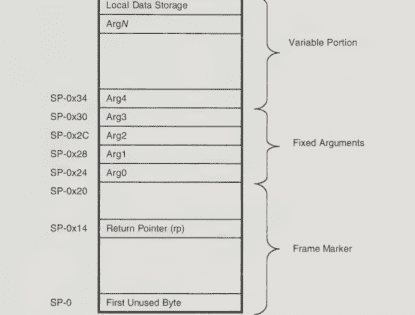

#### 图 2-1 窄模式下的栈使用

`SP-0x24` 到 `SP-0x30` 之间的区域预留给参数零到三。即使参数少于四个，这个空间也总是被分配。在此之后是一个可变大小的区域，用于存储超过四个的任何参数。只有当被调用程序需要超过四个参数时，才使用此区域。最后，在可变参数区域之后，被调用程序可以分配额外的空间来存储被调用者保存寄存器和用于本地数据存储。

列表 2.1 是一个 C 代码示例及其对应的汇编代码，展示了过程调用中的链接。

#### 列表 2.1 窄模式过程调用示例

```
#include <stdio.h>
int proc(int x);
main()
{
int i;
int j;
i = 10;
j = proc(i);
```

```
printf("j is %d\n", j);
}
int proc(int x)
{
int r;

r = 2*x;
return r;
}
```

`main` 从 `0x28d8` 开始：

+   +0x0 `NOP` 

+   +0x4 `STW rp,-0x1d(sp)` ; 保存返回指针 

+   +0x8 `LDO 0x40(sp),sp` ; 扩展栈 

+   +0xc `LDI 0xa, r1` ; i = 10 

+   +0x10 `STW r1,-0x38(sp)` ; 将 i 保存在栈上 

+   +0x14 `LDw -0x38(sp),arg0` ; arg0 = i 

+   +0x18 `LDIL 0x2800,r31` ; 计算 proc 的地址 

+   +0x1c `BE,L 0x124(sr4,r31)` ; 调用 proc 

+   +0x20 `COPY r31, rp` 

+   +0x24 `STW ret0,-0x34(sp)` ; 将返回值保存在 j 中 

+   +0x28 `LDIL 0x2800,r31` ; 加载常量的地址 

+   +0x2c `LDO 0x768(r31),arg0` ; 将字符串放入 arg0 

+   +0x30 `LDw 0x34(sp),arg1` ; 将 j 加载到 arg1 

+   +0x34 `LDIL 0x2800,r31` ; 计算 printf 的地址 

+   +0x38 `BE,L 0xc0(sr4,r31)` ; 调用 printf 

+   +0x3c `COPY r31, rp` 

+   +0x40 `LDw -0x54(sp),rp` ; 从调用者获取返回指针 

+   +0x44 `BV (rp)` ; 并跳转到该地址 

+   +0x48 `LDO -0x40(sp),sp` ; 恢复栈指针

`proc` 从 `0x2924` 开始：

+   +0x0 `NOP` 

+   +0x4 `LDO 0x40(sp),sp` ; 扩展栈 

+   +0x8 `STW arg0,-0x64(sp)` ; 存储 arg0 

+   +0xc `LDw -0x64(sp),r19` ; r19 = arg0 

+   +0x10 `SHLADD r19,1,0,r20` ; r20 = 2 * r19 

+   +0x14 `STW r20,-0x28(sp)` ; 保存 r20 


+   +0x18 LDw -0x28(sp),ret0 ; ret0 = r20 

+   +0x1c COPY ret0,ret0 

+   +0x20 BV (rp) ; 跳转到 rp 

+   +0x24 LDO -0x40(sp),sp ; 收缩栈

### 宽模式下的栈使用

图 2-2 展示了宽模式过程调用的栈使用情况。回想一下，在宽模式下，我们所有的寄存器宽度均为 64 位。栈上的每个条目也被视为 64 位双字。

宽模式的帧标记长度仅为两个双字，以便允许存储两个值。返回指针存储在 `SP-0x10` 处。`SP-0x08` 保留用于在需要时存储前一个栈指针。

在帧标记之后，分配了八个双字来存储八个参数。如果有超过八个参数，可能会分配额外的空间。与窄模式不同，这些参数存储在*递增*的地址中，而不是递减的地址中。此外，参数不再相对于栈指针进行寻址。相反，`GR29` 被设置为指向第九个参数的地址（即使少于九个参数，指针也被设置为指向为第八个参数保留位置之后的双字）。

在参数区域之后，是用于适应分配的内存、本地存储和被调用者保存寄存器的栈增长的可选区域。

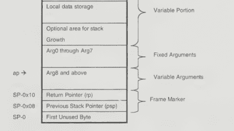

图 2-2 宽模式下的栈使用

列表 2.2 是上述相同代码的汇编语言，这次是在宽模式下编译的。请注意，*gr0* 在此工具中被解码为 *ret1*，因为它是作为返回值的另一种用途。

#### 列表 2.2 宽模式过程调用示例

```
main  starting at  0x400000000001e08:
+0x00           STD                     rp, -0x10(sp)
+0x44           STD,MA                 r3,0x90(sp)           ; save r3, grow stack
+0xC8      STD      r4,-0x89(sp)      ; save r4
+0xCc      COPY     ret1,r3
+0xD0      STD      dp,-0x80(sp)
+0x14      MEIFA    r1
+0x18      ADDIL    -0x800,r1
+0x1C      LDD      0x76c(r1),r31
+0x20      LDI      0xa,r19               ; i = 10
+0x24      STW      r19,-0x78(sp)         ; store i
+0x28      LDD      -0x78(sp),arg0        ; arg0 = i
+0x2C      BLL      0x1e88,rp             ; call proc()
+0x30      LDO      -0x30(sp),ret1        ; ap = SP-0x30

+0x34      LDD      -0x80(sp),dp
+0x38      STW      ret0,-0x74(sp)
+0x3C      ADDIL    -0x800,dp
+0x40      COPY     r1,ret0
+0x44      LDD      0x760(ret0),r19
+0x48      LDO      -0x74(sp),r20
+0x4C      COPY     r19,arg0
+0x50      COPY     r20,arg1
+0x54      BRL      0x1e78,rp
+0x58      LDO      -0x30(sp),ret1

+0x5C      LDD      -0x80(sp),dp
+0x60      LDD      -0xa0(sp),rp
+0x64      LDD      -0x88(sp),r4
+0x68      BVE      (rp)
+0x6C      LDD_MB   -0x90(sp),r3

proc starting at 0x400000000001e88:
+0x0       NOP
+0x4       STD_MA   r3,0x50(sp)           ; save r3,
+0x8       STD      r4,-0x48(sp)          ; grow stack
+0xC       COPY     ret1,r3               ; save r4
+0x10      NOP                            ; r3 = ap
+0x14      STW      arg0,-0x3c(ret1)      ; save arg0 at
+0x18                                           ; ap-0x3C
+0x1C      LDO      -0x3c(ret1),r19        ; r19 = arg0
+0x20      SHLADD   r19,1,0,r19           ; r19 *= 2
+0x24      STW      r19,-0x38(sp)         ; save r19
+0x28      LDO      -0x38(sp),ret0        ; ret0 = r19
+0x2C      COPY     ret0,ret0
+0x30      LDD      -0x48(sp),r4          ; restore r4
+0x34      BVE      (rp)                  ; branch to rp
+0x38      LDD_MB   -0x50(sp),r3          ; shrink stack,
                                           ; restore r3
```

图 2-3 展示了对 `proc()` 调用的栈使用情况。可以看到，栈首先扩展了 `0x50`；然后 `GR3`、`GR4` 和 `G26` (`arg0`) 被存储在栈上。`GR3` 和 `GR4` 是被调用者保存的寄存器，因此 `proc()` 必须在自己的栈中存储它们以便稍后恢复。`GR26` 存储在调用者的参数区域中。

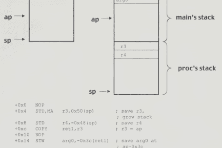

```
+0x0    NOP

+0x4    STD,MA  r3,0x50(sp) ; grow_stack

+0x8    STD     r4,-0x48(sp) ; save_r4

+0xc    COPY   retl,r3      ; r3 = ap

+0x10   NOP

+0x14   STM    arg0,-0x3c(retl) ; save_arg0

                                  ; ap=0x3c
```

图 2-3 对 `proc()` 调用的栈使用

### 总结

我们已经看到，尽管硬件并不明确支持栈，但 HP-UX 内核如何使用了栈架构。我们还研究了栈在过程调用中的使用方式——谁在何处存储什么。这些约定在用户应用程序和内核内部使用，保证以一种语言编写的过程能够调用另一种语言的过程。

我们还简要了解了 PA-RISC 汇编语言，这将有助于我们在深入研究内核时理解其工作原理。

### 第 3 章

## 内核：基本组织

研究现代操作系统会走向许多路径，并要求我们考虑多种不同的挑战及其解决方案。HP-UX 内核是一个多任务、多用户、多处理器、多线程、负载均衡、模块化的操作系统，并具有实时调度扩展——仅列出其中亮点。要支持这些功能，需要许多层级的设计抽象、数据表和列表，以及大量子系统、驱动器和动态模块。

在本章中，我们将考察内核的基本组织及其数据结构，并考虑哪些依赖于底层硬件平台（硬件依赖层，`HDL`），哪些是独立的（硬件独立层，`HIL`）。

在讨论 HP-UX 特定主题之前，让我们停下来思考一下操作系统究竟是什么。

### 通用概述

作为一个整体来接近操作系统可能会有点令人不知所措，所以让我们把它分解一下。简单来说，把操作系统看作一段可引导的应用程序代码。没错，它是一段相当大的应用程序代码，并且使用了许多多样化且复杂的功能（甚至包括自修改代码的抽象形式），但最终分析来看，它仍然只是一个可执行映像！

程序员必须设计和创建数据结构，以逻辑且高效的方式存储和操作数据，以支持程序的运行和设计目标。操作系统设计者面临同样的挑战，只不过程度更深。理解和识别由此产生的数据结构及其交互是本书的一个主要焦点。

UNIX 操作系统的设计非常简单。

这句话通常会引起各种各样的表情或评论；确实，有些人可能会质疑其基本前提，或者也许质疑说话者的资格！这句话旨在引出精髓是，在 UNIX 操作系统的设计中，有几个关键元素（见图 3-1）。


- 首先，也是最重要的，UNIX 操作系统负责各个执行线程的调度和管理。稍后，我们将讨论进程和线程，但现在让我们仅仅将执行线程视为一段操作代码，它是代表“用户”完成“工作”的东西。谁获得运行机会、何时以及运行多久，是操作系统控制下的问题。
- UNIX 是终极的控制狂——它是所有试图绕过其权威代码的检察官、法官和陪审团。内核管理对所有系统资源的访问。执行代码利用系统资源的唯一方式是通过定义良好的程序化内核钩子（称为系统调用）请求访问。
- 所有 I/O 都是文件 I/O。也就是说，所有设备都由“特殊”设备文件句柄定义，并被当作简单的文件对待。
- 所有形式的同步和异步中断都由内核例程处理。简而言之，如果它是意外的，那就让内核来解决它。
- 在可能的情况下，系统资源应以平衡的方式向所有请求者提供。

这些是 UNIX 内核设计陈述的首要指令。虽然这可能看起来是一种过度简化，但我们希望将这些元素作为我们的焦点，并将其他主题和功能与它们联系起来，从而保持在正轨上。

### 图 3-1 全局概览

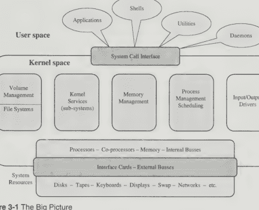

UNIX 内核在设计上和演进上都非常模块化。其设计在很大程度上受到了 C 编程语言的影响——C 语言本身也是一种高度模块化的语言——UNIX 内核代码的大部分都是用 C 语言编写的。最初的“内核黑客”（这一术语带着极大的敬意使用）所具有的许多特质，如今仍然深深植根于现代 UNIX 系统的核心与灵魂之中。

在学习 UNIX 操作系统时，务必要时刻警惕内核代码不同部分之间的相似性；也就是说，要寻找主题变体。随着后续章节内容的展开，比较和对照各种编程工具和行业技巧，将有助于你加深理解。

### 所有 I/O 都是文件 I/O

延续简化的主题，让我们思考一下进程 I/O 和 UNIX 内核的基本原理。作为资源管理职责的一部分，UNIX 内核负责监控所有形式的 I/O。为了简化这一任务，UNIX 将所有类型的 I/O 降低到了文件 I/O 的层面。通过将所有外部设备表示为文件，系统只需要一种访问控制机制。这就是臭名昭著的“rwx rwx rwx”，即用户、组和其他（或 UGO）安全模型，它出现在所有入门级的 UNIX 培训课程和书籍中。UNIX 基本上遵循了 KISS（保持简单，愚蠢）设计原则。

### 抽象：内核设计的基石

外部磁带驱动器或键盘上的按键是如何被缩减为一个文件路径的？通过抽象的使用，文件名（称为`设备文件或特殊文件`）引用了内核中的驱动程序，并向其传递操作参数（关于此点在第十章“I/O 和设备管理”中会有更多介绍）。就目前而言，可以这么说的是，事物往往并非初看时所呈现的那样。内核包含许多层抽象和间接引用——我的朋友，这都是烟雾和镜像（幻象）。我们的挑战是吹散烟雾，研究镜像中的反射（真实映射）。

### 是真实的还是虚拟的？

UNIX 操作系统的很大一部分致力于“真实”地址模式和“虚拟”地址模式之间的管理和转换。从进程的观点来看，所有可能的内存位置都落在逻辑地址范围内：32 位应用程序被称为`窄型`，而 64 位应用程序被称为`宽型`。内核也有窄型和宽型版本，通常由其所运行的处理器架构的宽度决定。

当程序源代码被编译时，对各个执行模块、库例程和数据元素的引用会被存储为符号名称。这种类型的代码模块被称为`目标模块`。需要一张符号表来定义表中每个项目的名称和属性。

当程序的所有相关模块被收集后，`链接装入器`会被用来创建最终的可执行映像。`装入器`排列可执行映像中的所有单个项目，而`链接器`将所有符号引用替换为已加载对象的逻辑地址。由此产生的“映像”固定在进程的逻辑地址范围内。由于内核及其所有进程必须共享可用的物理（或“真实”）内存，因此必须在进程的逻辑地址和系统的物理地址之间执行某种形式的`转换`。为了便于这种抽象，使用了一种地址转换方案。

大多数 UNIX 操作系统采用了一种称为`虚拟寻址`的概念。在虚拟内存系统中，内核维护并管理一个地址空间，其大小是硬件可寻址物理内存大小的许多倍。这个地址空间仅作为一种组织定义存在，在程序执行期间需要不断将其转换为真实的物理地址。虚拟内存系统不仅需要硬件支持，还需要在内核代码中实现。

实现虚拟内存系统的主要优势在于，它允许许多进程在虚拟地址空间（VAS）中共存。每个进程都允许拥有自己的逻辑视图。虚拟空间的一些区域为单个进程保留为私有区域；其他区域可能由内核维护为共享区域（见图 3-2）。这是共享代码和数据对象的基础，也是本书后面一整章的重点（第十章“内存管理”）。

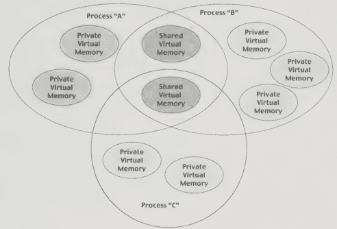

图 3-2 虚拟内存对象，私有和共享

#### 抽象层

我们使用了`抽象`这一术语，应该花一点时间谈谈它在内核设计中的含义。当我们考虑资源管理的任务时，我们必须确定希望在管理方案中实施的控制级别。该行业的一个诀窍涉及将系统资源的各个组件分组为大小均匀的块、片段、扩展区、页等。资源的可用性随后在这些细粒度单位的级别上进行跟踪，从而降低了内核数据结构的复杂性。

一个经典的例子是内存管理。计算机的物理 RAM 由代表单个数据位的电路组成；这些被组合成 8 位一组，称为字节。操作系统将字节组合成字（对于 HP-UX，一个字是 32 位，或 4 字节；这对于窄型和宽型内核都适用）。字仍然是一个非常小的存储空间，如果内核需要管理每个字（“管理”意味着跟踪哪些字当前正在使用、哪些是空闲的，以及谁在使用什么），那么构建此类结构所需的内存量可能轻松达到甚至超过被管理内存的空间！

为了减少这种管理开销，我们将被管理的单位大小设置为大于一个字。在 UNIX 中，这是通过将顺序的物理内存字组合成称为`页框`的单位来实现的（在 HP-UX 中，页框是 4096 字节，或 1024 个字）。现在，跟踪哪些是空闲的、哪些是正在使用的任务变得简单得多。这是一个非常基本的抽象层；内核管理页框，而我们都知道页框实际上是由每个 8 位字节组成的字的块。

现代 UNIX 内核可能使用多个抽象层。让我们继续讨论基本的内存管理。UNIX 内核经常采用一种方案，其中需要若干页框来保存其代码的进程会在虚拟页框映射中被分配一个适当大小的`区域`。虚拟页框通过处理器硬件和支持的内核表映射到特定的物理页框（本书稍后会有讨论）。这一额外的抽象层极大地简化了诸如允许两个或多个进程共享相同的可执行代码视图、共享库、共享内存以及其他进程级共享对象等问题。

内核中有一些结构用于跟踪每个抽象层中的每个元素。较高层实体简单地指向较低层的跟踪结构。较低层的资源属性由较高的抽象层继承。

在决定每个管理单元的大小时必须小心——太大可能会浪费有限的资源；太小则跟踪结构的开销可能会过大。内核设计者不断在便利性和效率之间走钢丝。当你研究资源管理时，请注意内核对其管辖资源的控制粒度。

#### 一些通用的内核技术

讨论操作系统内部结构给作者带来了许多挑战和机遇。我们的方法是讨论内核的每个领域，考虑内核设计者面临的挑战，然后探索通向最终在 HP-UX 代码中实施的解决方案的路径。

在讨论 HP-UX 的具体细节之前，让我们讨论一下内核设计者面临的一些通用挑战。与任何编程任务一样，通常有许多不同的方法来接近和解决问题。有时决策基于程序员过去的经验，有时则是由每个内核设计特性的具体要求决定的。随着操作系统的成熟，这些单独的局部解决方案通常会被修改或“调整”，以便调整内核的操作参数，使其与性能目标或系统基准测试指标保持一致。HP-UX 操作系统是一个持续改进过程的产物，该过程使其核心特性得以完善，并在多年来引入了许多增强功能和服务。

##### 内核数据结构

程序员通常使用算法，或从属于软件开发社区广泛的“专业知识”中借用编码技巧。这个共同的知识库包含许多对操作系统代码开发人员特别感兴趣的元素。让我们探索

内核程序员所面临的一些挑战，并尝试对其采用的几种常见编程解决方案建立基本理解。

##### 静态列表（静态表）

内核通常需要维护与某个数据结构或受管资源相关的大量参数列表。存储此类数据最简单的方法是创建一个有序的静态列表，包含列表中每个成员的属性。

每个数据结构根据分配给每个元素的独立数据部分进行定义。一旦每个参数被定义类型，结构的大小（以字节为单位）即可确定。这些结构随后存储在连续的`内核空间`中（作为结构数组），并且可以方便地通过索引快速访问。

作为一个一般性的观察，并非硬性规定，这些列表的命名约定可能类似于以下模式（参见图 3-3）。如果列表中单个成员的数据结构名称定义为 `data_t`，那么指向列表起始位置的内核指针将为 `data*`。该列表也可以通过名为 `data[x]` 的数组来引用，而元素数量则存储在 `ndata` 中。内核中的许多示例遵循此约定，但并非全部。

##### 优点

静态列表所需的空间必须在系统初始化期间分配，并且通常由`内核可配置参数`控制，该参数在内核映像构建之前设置。静态数据表中的第一项索引值为 0，这使得计算表内每个元素的起始地址变得容易（假设每个成员元素具有固定大小）。

#### 示例


假设每个数据结构恰好包含 64 字节的数据，且静态列表的起始位置由内核符号 `mylist` 定义。如果希望访问索引号为 14 的列表成员的数据，只需取内核指针 `mylist*` 中存储的地址，并加上 $14 \times 64$，即可到达列表中第 15 个元素开头的字节地址（请记住，列表索引从 0 开始）。如果结构被定义为数组，可以在代码中引用 `mylist[14]` 来简化访问。

### 缺点

这种方法的主要缺点是，内核必须为可能遇到的所有潜在场景提供足够的列表元素。虽然许多系统管理员被视为如同神明般无所不能，但真正具备预知能力的却寥寥无几！对于静态列表而言，其扩展的唯一方式是重建内核并重启系统。

另一个考量因素是，受管资源在内核中任何需要引用它的地方都必须关联一个索引号。虽然起初这可能看似简单，但请考虑初始分配、索引号重用、资源共享以及锁定等场景。

### 总结

尽管这种结构在历史上是最常见的一种，但由于缺乏动态大小调整能力且需针对最坏情况进行规划，它已成为许多内核改进项目的重点目标。

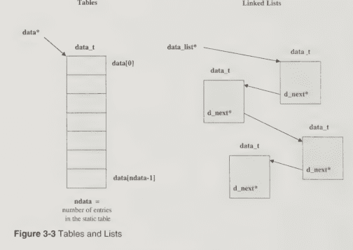

#### 图 3-3 表格和列表

### 动态链表（动态表）

列表的单个元素必须以允许内核监视和管理它们的方式维护。与静态列表中的元素不同，动态列表的所有元素并未整齐地分组在连续的内存空间中。它们的单个位置和相对顺序对内核来说是未知的或不可预测的（正如“动态”一词所暗示的那样）。

当请求到来时向列表添加元素是一个相对简单的任务（前提是内核拥有高效的**内核内存管理**算法，这将在后文讨论）。一旦分配了数据结构，它必须与同一列表中的其他结构链接起来。链接方法的复杂度和便利性各不相同。

一旦结构被分配并存储了正确的数据，挑战在于及时访问数据。由于列表单个元素的非连续性，简单的索引是不够的。选择是通过遵循插入到每个列表元素中的前向指针来“遍历”列表，以此建立通过列表的连续路径，或者实现某种其他类型的索引数据结构或哈希函数。虽然哈希大大减少了访问/搜索时间，但它是一种计算开销，并且每次需要列表中的项目时都必须使用。

额外的挑战来自于内核清理不再需要的结构时。如果列表的单个元素仅通过单一的前向链接指针简单连接，那么从列表中移除单个元素的任务可能会耗时。必须确定指向要移除元素的列表元素，以修复移除操作将在链中造成的断裂。这些要求促使了双向链接方案的开发，该方案允许更快的删除，但需要在设置和维护过程中付出额外的开销。

#### 优点

动态列表的主要吸引力在于，列表消耗的资源仅在需要时才分配。如果需要额外的列表元素，它们会即时分配，无需重建内核和重启。此外，当列表元素不再需要时，其空间可以归还给内核的可用内存池。这可以减少内核的整体大小，从而对内存大小受限的系统性能产生积极影响。

#### 缺点

编程代码没有什么免费的午餐！动态列表的便利性伴随着几项相关成本。内核必须拥有高效的方式来分配和回收不同大小的内存资源（不同的列表结构具有不同的元素大小需求）。

如何将单个列表元素链接起来的挑战增加了列表中每个数据结构的复杂性和大小（内核设计者有更多的选择需要评估！）。动态列表在搜索算法和索引领域带来了额外的挑战。

### 总结

目前的趋势明确指向完全动态的内核，这要求引入数量不断增加、种类日益多样的动态列表。现代内核设计者的挑战在于完善动态列表的使用和维护。这里有充分的机会打破常规思维，针对索引和链接挑战创造独特的解决方案。

## 资源分配

内核设计者早期面临的挑战之一是跟踪系统资源的使用情况。资源可以是内存、磁盘空间，甚至是可用的内核数据结构本身。在系统操作生命周期内可能被使用和重用的任何项目都必须由内核进行跟踪。

### 位分配映射

位图（bitmap）也许是跟踪资源使用情况最简单的手段之一。在位图中，每个位代表受管资源的固定单位，该位的状态跟踪其当前可用性。

资源必须量化为固定单位大小，并且必须定义位图的逻辑（0 位表示可用资源还是已使用资源？）。一旦这些基本规则确定，映射即可填充和维护。

#### 示例

在实践中，资源位图所需的维护开销相对较低。映射的实际大小将根据被映射的资源单位数量而变化。随着资源单位大小的增加，映射按比例变小，反之亦然。映射的大小在搜索时变得重要：映射越大，搜索所需时间可能越长。假设我们预留了一个连续的 32-KB 内核内存块，并希望在那里存储 32 字节的数据结构。分配一个 1024 位的位图结构（128 字节）来跟踪我们的资源使用情况是一个相当简单的问题。当需要找到一个可用的存储位置时，执行位图的顺序搜索，直到找到一个可用位，设置该位以指示空间现在已使用，并将其相对位置转换为表示内存块中可用的 32 字节区域。

#### 优点

位图方法的相对简单性使其在许多情况下成为有吸引力的首选解决方案。小型映射可用于跟踪相对较大的资源。大多数处理器都具备汇编语言级别的位测试、位设置和位清除功能，这便于位图的操作。

#### 缺点

随着位图大小的增加，定位可用资源所花费的时间也会增加。如果映射空间需要连续单位，分配算法将变得更加复杂。资源映射是一种程序化约定，而不是资源本身

采用任何手段进行锁定。内核代码中不遵守位映射协议的一个叛逆部分，可能会轻易地破坏位图及其所管理资源的完整性。

### 总结

如果系统资源是静态大小的，并且始终作为固定大小的单元使用，那么位图可能会证明是最具成本效益的管理方法。

### 资源映射表

另一种固定资源映射涉及利用一种称为*资源映射表*的结构（参见图 3-4）。以下是对该方法的通用说明，因为这种技术有许多不同的应用。在资源映射表的情况下，你拥有一个固定大小的资源，需要对其做出不同大小的单独分配。

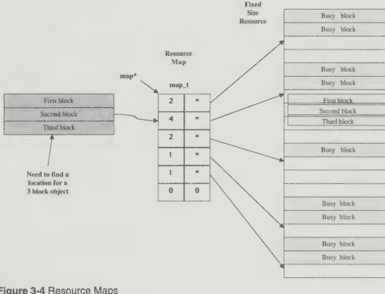

#### 示例

在我们的示例中，让我们考虑一个简单的留言板。留言板有 20 行可用于显示消息；每行容纳 20 个字符。总资源可容纳 400 个字符，但单独的消息必须在连续的线上显示。考虑发布以下两条消息：

House broken

Beagle puppy

Free to good home

12-year-old boy

Seeks lawn to mow

如果每条消息的行未在留言板上分配连续的空间，你可能会得到以下混乱的局面！

Beagle puppy

Seeks lawn to mow

House broken

12-year-old boy

Free to good home

为了避免这种情况，可以使用资源映射表来分配连续的线条。资源映射表中的每个条目将指向板上下一块可用的线（或线条组合）。

如果留言板是空白的，那么我们的资源映射表中将只有一个条目，指向第一行，并声明连续有 20 行可用。为了列出第一条消息，我们将分配板上的前三行，调整资源映射表条目指向第四行，并将计数调整为 17。为了在板上添加第二条消息，我们将再分配两行，并调整映射表中的第一个条目指向第六行，将计数调整为 15。

实际上，资源映射表指向资源中未使用的“空洞”。每个映射表条目所跟踪的资源块大小会根据使用模式而变化。

#### 优点

资源映射表需要相对较少的实际条目来管理大量资源。如果分配块的大小变化，并且需要连续分配，那么这可能是你的最佳选择。

#### 缺点

映射表条目不断地被插入和从映射表中删除。这要求不断地移动单独的映射表条目（这里的救命恩人是条目相对较少）。另一个关注点是资源映射表本身的大小：如果你用尽了条目，那么释放的资源可能未被计算在内，实际上会丢失（一种内存泄漏类型），直到重启才能被系统使用。

### 总结

资源映射表长期以来一直被 System V 进程间通信内核服务所使用，如果在 sizing 方面小心对待，它们非常高效。

### 搜索列表和数组

只要有数据结构的数组和列表，就需要搜索特定元素。在许多情况下，一个数据结构可能有一个指向相关结构的简单指针，但有时你所知道的只是所需结构的一个或多个属性，而不是实际地址。

#### 哈希表：线性搜索的替代方案

逐项搜索长列表（通常称为顺序或线性搜索）可能非常耗时。为了减少此类搜索的延迟，创建了*哈希列表*。哈希是一种索引类型，可与静态数组或链表一起使用，以加快定位列表中特定元素的速度。

要使用哈希，使用待搜索项的已知属性来计算哈希表中的偏移量（哈希数组的大小通常定为 2 的幂，以有助于计算和截断哈希值以匹配数组大小）。哈希表将包含指向列表中匹配哈希属性的成员的指针。此条目可能或不可能是你要查找的实际条目。如果你要找的是它，那么你的搜索就结束了；如果不是，那么可能存在一个向前的*哈希链*指针，指向列表中共享相同哈希属性的另一个成员（如果存在）。在这种情况下，你必须沿着哈希链指针遍历，直到找到正确的条目。虽然你仍然需要搜索一个或多个链接项，但你的搜索长度将缩短。

效率取决于用于哈希算法的属性在列表成员中的分布均匀程度。另一个关键因素是哈希表的总体大小。

#### 示例

假设你有一份朋友姓名和电话号码的列表。当你向列表中添加姓名和电话号码时，它们只是被放置在一个可用的存储槽中，并不以任何特定顺序存储。传统上，你可能在每次录入条目时按字母顺序对列表进行排序，但这需要“重新排列牌堆”。相反，考虑使用哈希表。


每当录入一个条目时，计算每个姓名中的字母数量；如果超过九个，则只保留计数的最后一位数字。同时维护一个具有 10 个条目的独立`哈希表`数组，其中包含指向列表中具有该`哈希计数`的名字的指针。每当一个名字添加到列表中时，它都会链接到列表中所有具有相同哈希计数的其他成员。参见图 3-5。

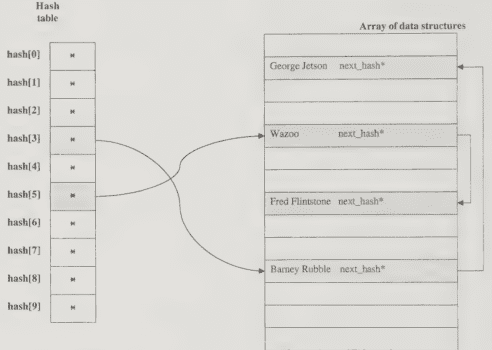

**图 3-5 哈希表和链**

如果你的列表中有 100 个名字，而你要寻找 *Fred Flintstone*，系统首先会对字符计数进行总和（*Fred* 有 4 个字符，*Flintstone* 有 10 个字符，包括名字之间的空格，总计 15 个），这将把我们带到 `hash[5]`。此条目将指向哈希计数为 5 的一个名字：如果这不是 *Fred Flintstone* 条目，你只需沿着嵌入的哈希链指针遍历，直到找到 Fred 的条目（或到达列表末尾并搜索失败）。

如果表中有 100 个条目，而哈希表中有 10 个条目，使用标准分布，则每条哈希链将有 10 个条目。平均而言，你需要沿着单独的链遍历其长度的一半来获取你想要的数据。在我们的例子中，那将是五重链接指针搜索。如果我们必须对无序数据执行顺序搜索，平均搜索长度将为 50 个元素！* 即使考虑到执行哈希计算所需的时间，这也可以带来可观的节省。

虽然这个例子大大简化了，但它确实展示了使用哈希头和哈希链来加快在随机分配的数据表中定位“正确”数据结构的基本原理。

### 优点

哈希算法提供了一种灵活的索引方法，不依赖于数字序列或字母顺序等基本概念。使用相关属性来计算哈希链头数组中的偏移量。头指针指向共享相同哈希属性的所有项目的链表，从而减少了在列表中定位特定项目所需的总体搜索时间。

### 缺点

用于哈希的特定属性在概念上可能有些抽象，必须仔细考虑，以确保它们不受人为影响，并且不会导致各个链的分布不均匀。如果被哈希的资源池大小增长，单个链的长度可能会变得过长，回报可能会减少。

虽然哈希的基本概念非常简单，但每种实现都基于特定属性，有些是数字的，有些是基于字符的，等等。这要求程序员仔细研究数据集，并确定使用哪个属性作为哈希的键。通常，最明显的属性可能不是最高效的。

## 总结

哈希将一直存在（至少在未来可预见的未来）。与这个概念达成和解，因为你会发现它在内核代码的各个领域中都有各种实现。

### 二分搜索

当谈到在固定列表中搜索值时，有许多方法。暴力方法是从第一个元素开始，以线性方式遍历整个列表。从理论上讲，如果列表中有 1024 个条目，平均搜索时间将是 512 次测试（有时你要找的项会在列表的前面，有时会在后面，所以平均值是 1024/2 或 512）。

另一种方法涉及使用`二分搜索算法`。算法采用的决策分支基于二元条件测试：正在测试的项目要么太高，要么太低。为了让二分搜索有效，列表中的数据必须以递增或递减的顺序排列。如果数据是随机分布的，则应使用另一种类型的搜索算法。

考虑一个 1024 个元素的列表。我们通过测试列表中间的元素（元素 512）开始搜索。根据此测试的结果，然后检查元素 256 或 768。我们将不断减半剩余的列表索引偏移量，直到找到所需的元素。

#### 优点

采用这种方法，我们理论上的 1024 个元素列表的最坏情况搜索长度为 10。相比之下，暴力线性搜索方法的最坏情况长度为 1024。

#### 缺点

尽管单次比较次数的减少令人印象深刻，但基本列表元素必须有序。这一点不应被低估，它对列表维护（向列表添加项目或从列表中移除项目）会产生影响。一个无序列表可以通过使用简单的 `空闲列表` 指针以及所有未使用元素之间的嵌入式链接指针轻松管理。如果列表是有序的，那么每次向列表添加或移除项目时，其许多成员可能需要移动。

## 总结

我们仅考虑了二进制搜索的一种非常基本形式。内核采用了许多这种主题的变体，每种变体都经过调整以匹配特定结构的需求。

### 分区表

现代架构为内核设计者带来许多挑战；其中之一是资源（包括连续和非连续资源）的映射。考虑跟踪系统中物理内存页帧的任务。如果物理内存是连续的，则可以创建一个简单的使用映射表，每个页帧一个条目，页号将等于数组中的索引。

在现代基于单元（cell-oriented）的系统中，可能存在位于独立总线上的多个内存控制器。通常，硬件设计规定每条总线分配一部分内存地址空间。这种地址分配方式可能会导致物理内存映射中出现“空洞”。使用 `分区表` 提供了一种高效绕过这些空洞的映射方法。

#### 示例

考虑图 3-6 中大大简化了的示例。为了管理 16 个项目的资源，我们可以使用一个简单的 16 元素数组（如图左侧所示）。在此示例中，资源分配中存在空洞；物理上，第 5 到第 14 个元素缺失。如果我们使用简单的数组方法，如果我们希望保持数组索引与资源对应地址之间的关系，仍然需要数组中的 16 个元素。

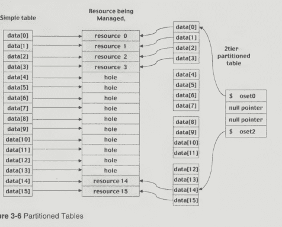

通过切换到两级分区表，我们可以映射空洞两侧的的资源，并减少所需的表空间量。第一级是一个由四个元素组成的简单数组，每个元素要么是指向数据结构块的有效指针，要么是表示相关资源块不存在的空指针。

除了指针外，每个元素中还存储了一个偏移值。这在空洞部分延伸到某个块的范围时使用（如我们示例中的最后一个指针）。偏移量允许我们跳过包含第一个有效数据结构的元素。

让我们比较一下定位数据结构所需的工作量。如果你需要与第 15 个资源相关的信息，并且正在使用简单数组方法，你只需要索引到数组的第 15 个元素（`data[14]`）。

如果使用分区方法，你将首先将元素地址除以第二级结构的大小。对于我们的示例，那是 `14/4`，这将得出商 3 余 2。然后你索引到第一级数组的第四个元素（索引 = 3），跟随在那里找到的指针，并使用余数将偏移定位到分区表的第三个元素（索引 = 2）。

在我们的简化示例中，单数组方法需要为 16 个数据结构留出空间，即使只有六个资源被映射。分区方法只需要为八个数据结构留出空间（两个各含四个元素的分区表）加上非常简单的第一级四元素结构。

乍一看，导航两个表所付出的额外努力似乎不值得其回报，但这只是一个非常简单的例子。正如我们之前提到的，该方法用于管理足够大的表，以映射现代企业服务器所有的物理页帧！可能有数百万个潜在页面需要它们自己的数据结构（并且可能存在大的空洞）。当我们讨论内存管理时，我们将看到分区表的实际使用。

##### 优点

分区表的价值在于减少了内核内存使用。内核使用的内存越少，可用给用户程序的内存就越多！

##### 缺点

该方法实际上很少有缺点；地图元素的引用现在是一个两步过程。地图元素编号必须除以每个分区表结构（第二级结构）中的元素数量，以得出第一级结构的索引。此操作产生的余数是从第二级结构中定位所需元素的偏移量。在实践中，分区表通常被设置为 2 的幂，这将偏移量的计算简化为简单的位移位操作。

## 总结

分区表是由架构决定的，是内核设计师工具包中必要的工具。

### B 树算法

$b$-树是一种较为先进的二进制搜索机制，涉及构建一系列按关系树形式排列的索引结构。每个结构被称为一个 $b$-节点；$b$-节点的数量取决于被管理的元素数量。第一个 $b$-节点由 $b$-根结构指向，该结构定义了整体树的宽度和深度。

$b$-树的一个有趣且强大的方面是它可以动态扩展，以适应被管理项目数量的变化。B 树可用于映射少量项目或数十万项目，只需调整结构的深度即可。

简单的 $b$-节点由键值对数组组成。键数据必须以升序或降序排列。为了定位所需的值，会在键上执行线性搜索。这似乎是一种老式的方法，但让我们看看随着数据集增长会发生什么。

第一个问题是 $b$-节点的大小。说某 $b$-树是特定阶数的。阶数是指数组结构中的键的数量（减 1——我们稍后在讨论简单示例时会解释这一点）。如果我们有第三阶 B 树，那么每次搜索最多只需检查三个键。当然，使用这种简单结构我们只能引用三个值！

为了扩展 B 树的用途范围，我们必须增加树的深度。一旦 B 树扩展超过其阶数，就会创建额外的 B 节点，并增加树的深度。

只有位于树最低层的 B 节点包含键值数据。所有其他层的 B 节点包含键指针数据。这意味着，为了找到特定值，我们必须对树的每一层 B 节点进行搜索。每次搜索平均需要的比较操作次数是该 B 节点中键数量（阶数）的一半。这意味着平均搜索长度定义为 (阶数/2) × 深度。通过调整 B 树的阶数和深度来实现优化。

#### 示例：扩展 B 树

从图 3-7 中，考虑一个非常简单的第三阶 B 树示例。原始 B 节点的键为：1, 2, 3。所有内容都适合单个 B 节点，因此深度 simply 为 1。

当我们向树添加第四个键 4 时，B 节点达到容量并导致树的扩展。如果 B 节点中的键数量超过阶数，则就该拆分节点并扩展树了。

为了扩展这个简单的树，我们创建两个新的 B 节点结构，并将现有键值对的一半移动到每个结构中。注意，数据被打包到每个新 B 节点的前两个条目中，这为扩展留出了空间。

接下来，我们必须调整定义树的 B 根数据结构中的深度值。原始 B 节点也必须重新配置。首先，它被清空，并创建一个单一键。


让我们更仔细地看看 `B` 节点结构。注意，实际上值插槽比键插槽多。这使得能够为每个键条目创建两个指针。如果你正在寻找较低值的键，则使用向左下方的指针。如果你正在寻找大于或等于该键的值，则使用向右下方的指针。

让我们尝试根据键 = 2 定位一个值：

- 跟随 `B` 根指针到第一层 `B` 节点。
- 搜索键 = 2。因为没有完全匹配，我们寻找大于 2 的键，并跟随该键左下方的指针到下一个 `B` 节点。
- 搜索键 = 2。这里的匹配将得出相应的值。我们知道这是一个值而不是另一个指针，因为 `B` 根结构告诉我们深度为二！

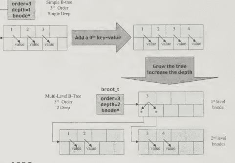

请注意，键值不必是连续的，只要有序，它们可以是稀疏的。在树的最低层进行的搜索会返回一个值或一条“未找到匹配”的消息。

对键的搜索总是试图找到一个完全匹配项，从而返回一个值或指向下一较低层级的指针。如果未找到匹配项且当前不在最低层，则使用以下逻辑。如果搜索键位于两个相邻键项之间，则指向下一层级的指针位于它们下方并介于两者之间。如果搜索键小于第一个键项，则使用 `bnode` 中的第一个指针。如果你的搜索键大于 `bnode` 中最后一个有效键，则使用最后一个有效指针。

## B 树优缺点

### 优点

`B` 树可以动态增长，而其表维护成本适中。这使得它们非常适合管理大小多变的内核结构。键值可以是打包或稀疏的，并可以在任何时间添加到表中，从而提供灵活的范围。

### 缺点

另一个好处是，给定足够大的阶数，`B` 树可以增长以管理大量项目，同时保持相当一致的搜索时间。以一个 15 阶 `B` 树为例：第一深度映射 16 个项目，第二深度映射 256 个项目，第三深度将产生 4096 的范围，而只需搜索三个 `b-node`！这种指数级的增长使其在管理小到大的资源方面非常流行。

`B` 树、二叉树和平衡树属于一系列相关的搜索结构。虽然 `B` 树由于其简单的自顶向下指针逻辑，维护开销适中，但其增长算法可能会导致 `b-node` 填充稀疏。这增加了映射给定数量数据值所需的节点数。与大多数方法一样，我们用表大小换取维护成本。

另一个问题是，虽然 `B` 树可以通过增加深度来跟上需求，但它不能改变其阶数（除非基本上将其砍倒并从头重建）。这意味着设计人员在选择实现中的阶数大小时，需要关注其潜在的使用情况。

### 总结

`B` 树在实现之前需要一些研究，但它提供了一种有效的方法来映射从微小到巨大的有序动态列表。当我们检查内核对虚拟内存区域结构的管理时，我们将看到 `B` 树的一个实际应用。

## 稀疏表

我们讨论了使用哈希来加速访问静态无序数组成员的方法。如果哈希大小被极大地增加（甚至增加到其引用的数组的大小或更大），会发生什么？起初，你可能会认为这是一个很好的解决方案：只需创建一个具有足够范围的哈希算法，查找就变成了单步过程。问题在于，为了保证唯一引用，内核数据数组及其对应的哈希可能会变得大得无法接受。

一种折衷方案是将数据结构尺寸设置得足够大，以容纳最坏情况下的元素计数，并希望哈希算法在本质上具有完全分布性。在理想情况下，没有两个活动元素共享相同的哈希。

在不太理想的现实世界中，会有两个数据元素共享相同哈希的情况。我们可以通过在固定数组之外动态分配一个附加数据结构，并创建一个指向它的正向哈希链链接来解决这个问题。

通常，如果哈希公式具有足够的分布性，这一步是不必要的。在实践中，正向指针可能只需要在非常小比例的案例中（少于 1% 或 2%）使用。在非常罕见的情况下，第三个元素必须共享相同的哈希时，额外的结构会链接到第二个，以此类推（参见图 3-8）。

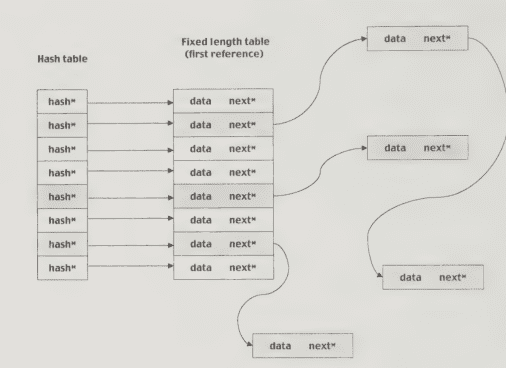

##### 图 3-8 稀疏表

**优点**

- 稀疏列表大大减少了在未排序表或列表中定位项目的平均搜索时间。

**缺点**

- 稀疏列表要求内核将可用的稀疏数据元素位置作为另一个内核资源进行管理。由于最初指向的数据元素可能不是你正在搜索的实际元素，目标结构必须包含足够的数据来验证它是否是你想要的。如果不是，就需要开发例程来“遍历链”。

**总结**

当所需数据集具有某些已知属性，并且这些属性可用于生成足够大且具有分布性的哈希值时，稀疏列表效果最好。随着哈希范围的增加，需要创建正向链指针的可能性大大降低。我们将在 HP-UX 内核的虚拟到物理页框映射中看到这种方法的一个例子。在实际使用中，找到一个包含三个以上链接元素的哈希链的概率只有百万分之一！

## 跳表

在搜索算法的世界里，跳表是一个新成员。其使用首先在 1990 年代由马里兰大学（University of Maryland）的 William Pugh 为《计算机协会通讯》（Communications of the Association for Computing Machinery，CACM）准备的一篇论文中概述。如需更多信息，请访问 ftp://ftp.cs.umd.edu/pub/skipLists/skiplists.ps.Z。

该算法可用于减少动态链表的搜索时间。单个列表元素必须根据某些有序属性分配给列表。这种方法对于仅有一 dozen 左右成员的链表效果很好，对于拥有数百个成员的列表也同样适用。

乍一看，跳表似乎只是一系列正向和反向链接指针。仔细查看后，我们发现有些指针直接指向邻居，而有些则跳过了几个中间结构。令人惊讶的是，跳过的元素数量是将指针结构随机分配给每个列表成员的结果，当它们链接到列表中时。

列表维护相当简单。要添加一个新的成员元素，我们只需跳过列表直到找到其相邻成员。然后我们将新结构链接在它们之间。移除成员遵循相同的逆向逻辑。

当添加新成员时，我们必须决定它在哪些层级上进行链接。HP-UX 区域列表中使用的实现使用了具有四个元素的跳指针数组。所有成员都有第一级正向指针。它有 1/4 的概率拥有第二级指针，这些指针中有 1/4 的概率拥有第三级指针，这些指针中有 1/4 的概率拥有第四级指针。由于元素可以随时添加或从列表中移除，指针的实际分布呈现出伪随机性质。

为了促进该方法，创建一个符号化的第一个元素，它始终在每个跳级别包含一个正向指针。它还存储一个指向列表最高活动级别的指针。参见图 3-9。

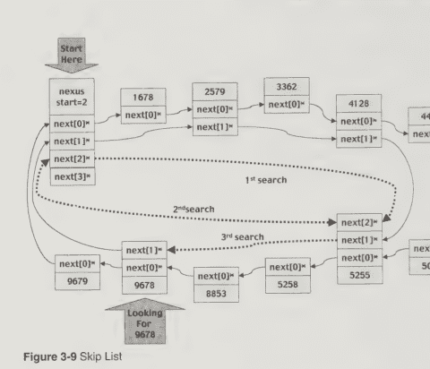

##### 图 3-9 跳表

### 示例

从图 3-9 中，假设我们需要定位属性为 9678 的结构。在列表枢纽结构中，我们看到最高的活动指针位于 `next` [2]，所以我们跟随它。这个结构的属性值为 5255，因此我们需要在此级别继续搜索。

我们回到起始点结构，因此我们回溯到 5255 结构，降低一级到 `next` [1]，并继续。

现在我们到达了具有 9678 属性的结构——它匹配！我们的搜索结束了。

在示例中，只用了三次搜索。简单的二分搜索需要四次搜索。

### 优点

跳表提供了一种有趣的搜索方法，与简单的二分法相比，通常能减少搜索时间。向列表添加和移除成员的速度相当快。

### 缺点

需要为前向链接创建一个多元素数组。指针分配的随机性没有考虑到各个列表元素的相对大小或使用情况频率。经常被引用的结构可能会因“运气”（即随机性）而被低效地映射（在我们的例子中，我们击败了二分法，但我们列表中的其他成员则不会：尝试搜索 5015 结构）。

### 总结

尽管这种机制具有随机性，但如果物品数量与层级数量的比例经过仔细调整，总体效果可能会带来净收益。

## 操作数组

现代内核通常被要求适应多种不同的子系统，这些子系统可能提供针对同一管理任务的竞争性或替代方案。一个典型的例子是内核需要同时支持多个文件系统实现。

为了实现这一目标，特定的文件系统可以通过虚拟对象在内核中表示。虚拟表示法使得对实际对象的所有引用都通过该虚拟对象进行。这很好，但如果内核例程需要与真实对象交互，而这需要依赖于类型特定属性的代码和支持数据怎么办？一个操作数组（或矢量跳转表）在此处可以提供帮助。

### 示例

请看图 3-10。在这里，我们看到一个简单的内核表，包含四个元素，每个元素代表一个虚拟列表的成员。每个列表成员都注册了其实际的 `v_type`、一个类型特定的 `v_data[]` 数组以及指向 `v_ops[]` 操作数组的指针。

为了使该模型正常工作，操作数组中的条目数量及其指向的函数必须与内核预期处理的每种类型相匹配。在我们的例子中，有四个操作目标函数：`open()`、`close()`、`read()` 和 `write()`。目前，我们的系统只有两种变体，标记为类型 X 和 Y。

当通过通过 `v_ops[x]` 引用的矢量跳转调用例程时，会传递虚拟对象的 `v_data[]` 数组的地址。这使得最终的类型特定函数能够处理它所能理解的数据集类型。

最终结果是，所有其他内核对象只需要请求调用 `v_ops[0]` 即可发起对虚拟对象的 `open()` 操作，而无需关心或了解它是类型 X 还是 Y。操作数组将处理调用的重定向。在实践中，我们将在内核中看到许多这种类型结构的例子。

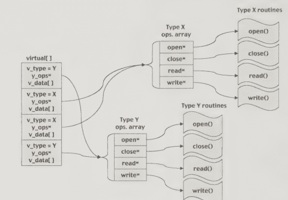

图 3-10 操作数组：一个矢量跳转表

### 优点


通过矢量跳转表重定向过程调用的成本非常低，而且对于使用它的大部分人来说几乎是透明的。

### 缺点

在调试过程中，这又是另一层需要应对的间接引用。

## 总结

矢量跳转表，即操作数组，在类型特定的内核驻留函数与其他内核子系统之间提供了一个非常有效的抽象层。

## HP-UX 内核概览

现在，我们已经花了些时间考虑通用的 UNIX 内核、行业工具以及内核设计者面临的一些挑战，让我们将注意力转向 HP-UX 内核的具体细节。

当前发布的惠普 HP-UX 操作系统是 HP-UX 11.1（实际修订号为 11.11）。我们关注当前版本，但鉴于许多生产系统仍在运行 HP-UX 10.20 和 HP-UX 11.0，我们在适当之处也尝试涵盖与这些版本相关的内容。

HP-UX 内核是一组子系统、驱动程序、内核数据结构和服务的集合，在过去 20 年中一直经过开发和改进。这一历史传承造就了我们在这本书中介绍的内核。多年来，内核几乎没有部分未受扰动：惠普的工程师和程序员展现了坚定的承诺，致力于定义 HP-UX 内核的持续流程改进循环。本书作者向他们的持续努力和愿景致敬。

在其当前形态中，HP-UX 主要运行在基于惠普精密架构（Precision Architecture）处理器系列的系统上。但这并非总是如此。早期版本运行在基于 Motorola 68xxx 系列处理器设计的工作站上。就像过去 HP-UX 被移植到 HP-PA RISC 芯片组一样，今天我们又站在了另一个即将发生的端口边缘：将该操作系统移植到新兴的新平台——Intel IA-64 处理器系列。在本书中，我们专注于 HP PA-RISC 实现。

### 基础内核数据结构：初步浏览

HP-UX 内核数据结构是我们讨论的重点。我们将它们分解为几个关键领域：内核内存表、进程表、磁盘空间表、文件系统表和输入/输出表。当我们探索这些不同领域时，请留意在方法和设计上的相似性。许多程序员团队负责内核的各个模块和子系统。他们经常相互借用方法和算法，似乎永远都在尝试对其进行细微调整和调优，以提高性能。这种类型的交叉授粉有助于内核的成熟和改进。

### 内核内存表

内核的一个主要关注点是系统内存资源的管理（见图 3-11）。内存有许多风味和类型：物理、虚拟和逻辑。

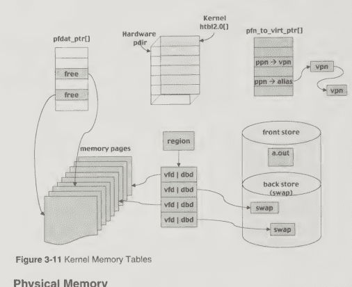

#### 物理内存

HP-UX 运行在具有 32 位指令字大小的处理器上。主要的内存分配大小称为物理页框（physical pageframe）。在当前 HP-UX 系统中，一个页框是 4096 字节（或 1024 个字）；多年来这一数值保持不变。虽然这减少了进程及其线程所需的按需换入操作数量，但它给内存管理方案带来了挑战。我们将在第 6 章中充分探讨这一点。

需要几个主要的数据结构来跟踪和映射系统的物理内存。`pfd_at_ptr[x]` 数组通常被称为空闲页表，用于跟踪哪些页当前正被内核使用，哪些已分配给进程。该表是一个分区表，以便将物理内存映射到物理内存映射图中的空洞周围。通常来说，如果表名以 `_ptr` 结尾，它很可能是一个分区表。

随着 HP-UX 11.1 的发布，在 newly introduced 可变页大小（VPS）特性下，进程可以被分配更大的连续物理页框集合。在一些销售和培训资料中，这也称为性能优化页大小（POPs）。为了适应这些特性，`pfd_at_ptr` 表已被修改，以允许将连续的空闲页汇集到更大范围的视图、池塘（ponds）和不同颜色的池（pools）中。

#### 虚拟地址空间

虚拟地址空间（VAS）不引用物理系统实体；相反，它是底层硬件平台（HP PA-RISC）和内核必须映射所有潜在使用区域的内存概念空间。当我们研究内核的工作原理时，掌握这个幻影映射是一个关键概念。

内核内存管理结构必须允许硬件将虚拟页框映射到包含当前进程代码或数据的物理页框。用于此任务的主要数据结构是 `htbl2_0[x]`。如果所需的页框当前不在内存驻留状态，则由内核负责处理由此产生的页面错误并尽快将其加载。

HP-PA RISC 硬件以及 HP-UX 内核都需要这种虚拟到物理的页框映射。硬件将此表称为页目录（或 `pdir[x]`），并使用其条目（定义为页数据条目或 `pde`）来更新 CPU 转换后备缓冲器（TLB）。硬件和内核的名称不同，以说明硬件没有指定此结构中各种位的用途：内核设计者将未定义的位用于自己的目的。

> **注意** 在较旧的 32 位基于 HP PA-RISC 的系统（称为窄系统）上，此表名为 `htbl1[x]`。

`htbl2_0[x]` 仅提供虚拟页框到物理页框的映射。虽然这是内核功能最常需要的转换方向，但有时需要识别哪个虚拟页框已被分配给特定的物理页框。`pfn_to_virt_ptr(x)` 表满足了这一需求。除了这个基本功能外，如果需要，它还用于链接别名数据结构。如果一个以上的虚拟页框映射到单个物理页框，则使用别名，这是一个重要的特性，允许在 `fork()` 系统调用期间实现写时复制（copy-on-write）语义。

#### 进程逻辑内存空间

作为一个概念，我们需要考虑进程对内存的视角。链接加载器创建可执行映像文件（对于 C 语言，通用名称是 `a.out`）。这些文件及其头文件包含关于程序运行所需系统资源的信息。为了让程序运行，其页面映像必须被加载到 VAS 中的连续页面中。这是因为在创建映像时，对数据和过程调用的所有引用都被编码为进程逻辑地址空间内的绝对地址。

为了促进进程代码、动态共享库代码、共享内存映射文件以及其他共享对象和相关程序映像中连续页面的共享，这些逻辑进程地址区域到内核管理虚拟内存区域的映射是内核许多区域数据结构的工作。

`region` 结构包含一个数据库，其中按页描述表明当前页面是位于物理内存中、作为前存储（可执行程序文件）中的镜像存储、作为后存储（交换页面）中的镜像存储，还是仍在等待初始化（用于未初始化的数据页面，即 BSS）。

### 管理内核内部使用的内存

到目前为止，我们仅讨论了用于管理系统众多进程使用的内存的结构。这种内存管理是以页框为粒度进行的。内核内部还使用了额外的结构，用于分配较小大小的内存块，供内核的众多动态表和链表使用。在 11.i 版本之前，HP-UX 使用了相当经典的“内核桶”内存分配方案。这已被一种“竞技场”分配方法所取代。这一变更旨在提高灵活性、减少浪费并促进页面回收。

#### 协同工作

乍一看，似乎许多结构都在同一个沙盘里玩耍。在某种程度上，这是一个准确的评估，为了让其正常工作，所有表必须协同合作！每个表都针对拼图块中的特定部分进行了优化，必须仔细管理以避免系统损坏。有许多层次的检查和平衡机制用于维护内存管理系统的完整性。

### 内核进程表

进程确实是 HP-UX 操作系统的王者，是内核管理的主要实体。一般来说，HP-UX 内核的首要指令是拉平起跑线，确保每个进程线程都有机会运行。

#### 进程表

线程是可调度实体，但拥有资源的是悠久的进程（至少在其活动期间是这样）。因此，进程表（参见图 3-12）是内核中所有与进程和线程管理相关活动的起点。HP-UX 11.i 具有动态进程表。条目根据需要创建，通过从内核内存竞技场分配内存并将其添加到活动进程链表来实现。进程链表的起始位置由内核指针 `proc_list*` 指向。

在 HP-UX 11.i 版本之前，进程表是一个固定长度的表，在系统启动时初始化，由内核指针 `proc*` 指向，并由可调内核参数 `nproc` 定义其大小。原始的 `nproc` 参数在当前的版本中得以保留，原因有几方面。有几个静态内核表的大小直接按进程表的比例设定。虽然进程表现在是动态的，但并非所有相关结构都做出了这一改变。可以合理假设，在未来版本中这可能不再是一个问题，但目前仍需要声明 proc。此参数还作为系统进程表增长的上限。

进程管理通过使用 `phash[x]` 来定位进程表中的特定条目开始。一旦我们找到了合适的 proc 结构，我们就沿着其指针追踪到其他关键内核表。

### kthread 表

`kthread` 结构也动态地从内核内存竞技场分配，并链接到活动 kthread 列表上。此外，属于单个进程的所有 `kthread` 结构彼此链接并链接到父进程 proc 结构。这样的线程通常称为兄弟线程。进程表包含指向其第一个和最后一个兄弟线程的指针，并维护其生成数量的计数。

在 HP-UX 11.i 之前，`kthread` 表也是在系统启动时分配的静态数组，大小由内核参数 `kthreadNTHREAD` 决定。

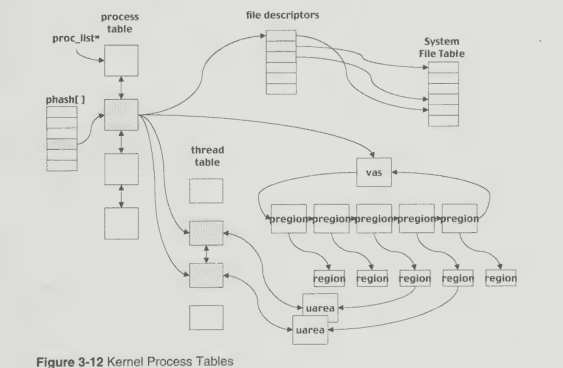

#### vas 和 pregion 表


在整体框架中，`pregion` 包含进程逻辑区域的地址偏移量和大小、访问标识符信息，以及指定使用模式的类型指示器。`pregion` 还将进程的逻辑区域映射到系统的 VAS，并创建进程虚拟内存元素的链表。当进程引发页面错误（请求访问当前不在内存驻留的虚拟页面）时，错误处理程序必须搜索进程的 `pregion` 链表，以确定哪个内核区域包含获取故障页面所需的数据。这些结构和底层的内核区域结构是内存错误处理的骨干，并针对功能和效率进行了优化。除了跟踪其线程外，进程表还必须提供其执行所需的每个内存区域的映射。为此，创建了一个名为 `vas` 的结构并链接到进程的 `proc`。`vas` 是由跳表连接的 `pregion` 结构链表的枢纽。每个 `pregion` 将进程及其线程链接到内核管理的 `region` 结构。`pregion-to-region` 抽象层促进了内核对共享对象的映射。

### 进程文件描述符

所有兄弟线程共享对其父进程名下打开的任何文件的访问权限。每次 `open()` 系统调用都会在进程的文件描述符表中生成一个条目。此表的大小由内核可调参数 `nfile` 控制，防止失控线程无限打开文件。

所有 I/O 都是文件 I/O，因此文件描述符表代表进程通往“现实世界”的门户。每次读写操作都需要文件描述符。例如，考虑 shell 的默认 `STDIN`、`STDOUT` 和 `STDERR` 描述符。与 shell 的情况一样，多个文件描述符可能指向相同的文件路径，有些用于读取，有些用于写入。

### urea 结构

这里引入的另一个结构是 `urea`。`urea` 实现为内核内存区域，与映射在父进程 `pregion` 链中的其他区域不同，对 `urea` 的访问是单个 `kthread` 私有的。如果有多个兄弟线程，则存在数量相等的 `urea pregions` 链接到进程的 `vas`。值得注意的是，`urea` 映射到进程的 `vas`，但从未被用户线程直接访问。内核拥有独占使用权限，并在上下文切换之前存储线程寄存器镜像，即进程控制块（`PCB`）。然后，在将下一个线程切换进来之前，从运行队列中下一个线程的 `urea` 加载其 `PCB`。

## 内核文件系统表

内核必须维护系统上所有打开文件、活动挂载点以及挂载内容的完整列表。性能要求许多文件系统结构不仅保存在各种表中，还保存在核心驻留的 inode 缓存和缓冲区缓存中。

### 系统文件表

每个独立的 open 系统调用都会导致系统文件表中的一个条目（参见图 3-13）。如果同一个文件被打开 20 次，表中将有 20 个单独的条目。需要单独条目，因为此表跟踪打开类型（读取或写入）、当前文件偏移量以及指向它的链接数。随着各个进程终止，它们的文件描述符被关闭，系统文件表中的链接计数递减。如果链接计数变为零，则该条目被放到空闲列表中，可供重用。

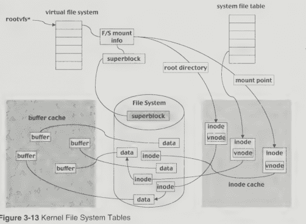

**图 3-13** 内核文件系统表

### 虚拟文件系统

HP-UX 内核支持访问几种不同类型的文件系统。在早期版本的操作系统中，每种支持的文件系统类型的具体细节都被嵌入到内核的核心映像中。更改文件系统属性是一项重大挑战，需要打补丁内核。为了摆脱对这种依赖关系的束缚，内核中设计和实现了一个虚拟文件系统接口。

虚拟文件系统对所有文件系统类型一视同仁。它主要关注它们的类型、挂载位置、指向可能需要用于管理这些文件系统的核心驻留元数据副本的指针、各自根目录的缓存副本，以及一个指向操作例程数组的指针，该数组是针对其特定类型定制的。

#### Inode 缓存

Inode 是 UNIX 文件的精髓；它包含了特定文件的所有属性信息。由于文件是所有 I/O 操作的基本对象，因此 inode 属性信息是系统中访问权限和数据安全的关键。

每当线程请求访问文件数据或修改 inode 数据本身时，都需要文件属性信息。为了加速此操作，系统为每个打开的文件维护一个 inode 数据的内核驻留副本。这就是所谓的 inode 缓存。

由于每种文件系统类型都可能定义不同的 inode 数据结构（不同的尺寸、不同的块位置方案、不同的立即数据存储方法），因此每个配置的文件系统类型都需要定义并构建自己的 inode 缓存。为了对内核的更高层屏蔽这种差异，增加了一个抽象层，其中每个文件都被分配了一个系统范围内的唯一虚拟节点（或 `vnode`）。针对 `vnode` 的操作通过操作数组被翻译为内核中针对文件系统类型特定的例程。

#### 缓冲区缓存

就像我们在 inode 缓存中保留文件属性的副本一样，系统维护并管理一个内存驻留的缓冲区缓存，以保存最近请求的文件数据副本。当进程请求读取或写入文件数据时，首先检查缓冲区缓存中是否存在副本。如果存在缓存副本，系统只需执行从或向程序数据空间传输所请求缓冲区的内存到内存传输。这种性质的内存到内存传输被称为逻辑读或逻辑写。如果请求的缓冲区不存在或缓冲区已满，则必须在缓冲区缓存和物理磁盘之间进行传输。这构成了物理读或物理写。

当读取或写入请求导致立即的物理操作时，称其为缓冲区缓存未命中。逻辑读写和物理读写之间的比率被称为命中率，可以使用 HP 的 glance 或 gpm 等工具进行查看。

#### 内核输入/输出表

HP-UX 内核不允许直接访问物理设备。所有 I/O 都必须通过适当的通道请求：系统调用接口。此模型的一个关键组件是内核的广泛驱动程序、设备映射以及整个系统的通用输入/输出（I/O）系统。

内核内存空间的大部分被这些组件占用。现代 HP-UX 内核提供了一些这些组件的动态映射功能（如果需要的话）。

##### I/O 树

一个关键的表恰当地被命名为*I/O 树*。这种树结构实际上是一个链接对象的集合，用于识别和映射系统硬件设备到特定的软件驱动程序。树的结构根源可追溯到系统初始化，甚至在 HP-UX 内核加载到内存之前就已经发生。该结构的一个子集是更基础的内存内核*I/O 树*，并在处理器相关代码（有时称为*bootrom*）可见的内存中创建，用于在系统崩溃时使用。

*I/O 树*的各个节点包含关于硬件地址的基本信息：其类型、哪个软件已声称拥有它（驱动程序关联）以及它属于哪个上下文。其他属性，如内核分配的实例号以及指向其父节点、兄弟节点和子节点的指针，也存在于其中。

*I/O 树*遵循对象模型：树结构中较低位置的节点从父节点继承属性，并将其传递给子节点。我们将在第 10 章“I/O 和设备管理”中详细探讨这一点。

##### 系统中断

除了*I/O*树之外，*I/O*子系统还负责检测和响应中断。您可能注意到我们使用*中断*（interruption）一词，而不是*中断*（interrupts）：HP-UX 将影响正常处理器执行的所有类别事件都描述为*系统中断*。它们分为四类：错误（faults）、陷阱（traps）、*中断*（interrupts）和时钟（clocks）。

为了进一步复杂化这个话题，还有内部中断（CPU 硬件、时钟、定时器等）和外部中断（*I/O* 设备、接口卡、物理设备），更不用说进程信号处理了。

如图 3-14 所示，内部*中断*由 CPU 注册，并导致矢量分支到包含在称为*中断向量表*（IVT）的数组中的内存驻留处理例程。该表中的每个条目由 32 字节的代码块组成，其中必须加载*中断*处理器的初始部分。还请注意，控制寄存器*CR14*包含*中断*向量地址（IVA），即 IVT 的起始地址。由于每个物理处理器都维护自己的寄存器组，因此可以为每个处理器设置特定的*中断*处理程序。虽然通常不是这种情况，但这确实是一个有趣的选项。

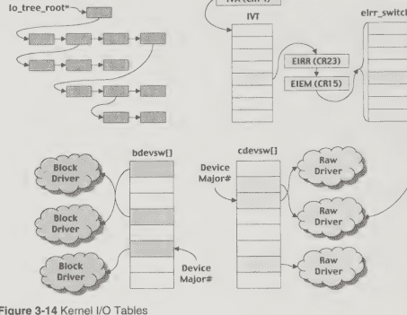

图 3-14 内核 I/O 表

一个有趣的中断（注册为内部中断 #4）被称为*外部中断*，它调用通过名为*外部中断接收寄存器开关表*或简称为 `eirr_switch[x]` 的数组进行矢量化的例程。在大多数情况下，这个矢量化的开关表指向与内核各种硬件驱动程序关联的中断处理例程入口点。另外两个控制寄存器协助注册和启用各种外部中断：CR23（`eirr`）和 CR15（外部中断启用掩码，或 `eierm`）。

##### 驱动程序和开关表

图 3-14 的下半部分显示了两个开关表。一个用于访问块设备驱动程序，另一个用于原始设备驱动程序。原始设备是指数据以可变大小的字节流形式进行传输的设备。

原始设备可能在一次传输中接收单个字节或许多兆字节（在当今的计算机环境中甚至是吉字节）。原始设备访问也用于在必要时与设备控制器和接口卡通信和配置。

块设备持有可挂载的文件系统。针对块设备的所有 I/O 都通过系统的缓冲区缓存进行，以便尽可能地将物理请求减少为逻辑请求，从而提高速度和便利性。


随着驱动程序被构建到内核图像中或注册以供将来动态加载，它们会被分配一个驱动程序号，通常称为`主`号。许多主号是保留的，并始终分配给特定的驱动程序；例如，逻辑卷管理器伪驱动程序始终被分配主号 64，而其他主号则从可用的动态号码池中分配。这个主号可以通过 `ll` 或 `ls -l` 命令看到。要列出 HP-UX 内核当前使用的所有主号，请输入 `lsdev` 命令。一般来说，拥有原始驱动程序的设备比拥有块驱动程序的设备多得多。

设备开关表是操作指针的数组。表中的每个条目由一个跳转点子数组组成。指向的例程按照文档规定的顺序排列，涵盖诸如打开、关闭、读取、写入等操作。如果听起来像是在谈论文件 I/O，那您绝对是对的——但请记住，在 HP-UX（以及一般的 UNIX）世界中，所有类型的 I/O 都被视为文件 I/O。无论驱动程序是为了处理什么类型的物理设备而创建的，对于系统进程线程来说，先打开它，然后对其进行读取或写入，完成后关闭它！

### 摘要

这结束了我们对内核设计者工具包的第一次遍历。了解这些结构和表以及它们的工作方式将有助于我们为深入研究 HP-UX 内核做准备。HP-UX 和一般的 UNIX 有很多角落和缝隙值得探索和了解。请在接下来的章节中遇到具体用法时，参考本章中提供的通用算法解释。

# 程序、进程与线程

研究 UNIX 内核可以从多个视角入手。一种方法是简单定义所有内核数据结构和其基本功能。虽然这为我们提供了一个合适的研究框架，但我们还希望从单个进程或线程的角度来考察内核的构建和利用。内核的视角范围是宏观的，而从进程或线程的视角则与用户或程序员的视角更为紧密相关。

## 参与者

曾经，进程是内核关注的可调度最小实体；然而如今，这一荣誉属于线程。在深入讨论 HP-UX 内核结构之前，我们必须先定义程序、进程和线程之间的关系。

### 程序

术语`程序`指的是存储可执行映像的文件。程序文件包含一个头部记录，定义了其编译目标架构、魔数（magic numbers），以及在其执行生命周期内需要访问的系统资源列表。

最初的 HP 系列 800 计算机基于当时新开发的 32 位 HP Precision Architecture (PA-RISC 1.x) 芯片组。该产品线被称为 Spectrum 计算平台。该架构的连接加载器（linking-loader）使用了一种专有头部格式，称为 Spectrum Object Module (SOM)。随着 64 位 HP Precision Architecture (PA-RISC 2.0) 的出现，采用的加载器格式是 POSIX 可执行链接格式 (ELF) 定义。出于兼容性原因，HP PA-RISC 平台上所有的 32 位可执行文件继续使用 SOM 格式，而 64 位可执行文件使用 ELF。

内核内存管理部分也将程序文件称为`前存区`（front store）。由于程序文件包含程序文本（或代码）页面的静态映像，内核分页系统在将程序加载到物理内存后，如果需要换出程序的文本页，会利用这些映像。这免去了从系统交换空间（又称`后存区`或 back store）为程序文本页分配存储位置的需要。只要进程处于活动状态，分页系统就依赖于对这些页面映像的访问，因此，只要程序在使用，程序文件就必须保持打开状态。分页和交换将在第 6 章“管理内存”中更详细地讨论。

### 进程

在 HP-UX 的世界中，术语`进程`用于定义组成系统中活跃程序的所有部分——即当前被允许利用系统资源并代表用户执行工作的部分。可以将进程视为一种用于组织和管理任务的容器。它记录正在使用的资源、执行当前任务所需的资源、优先级和调度信息，以及授予该进程的权限和授权。此外，进程还统计已使用的处理器时间、应进程请求执行的 I/O 量、发送给进程的挂起信号的状态，以及许多其他相关操作参数。

一旦内核进程表（或如本书中称的 `proc` 表，见图 4-1）中存在一个有效条目，进程即存在。这个表条目将进程与其分配的所有系统资源关联起来，真正是进程在整个生命周期中看待内核的枢纽。

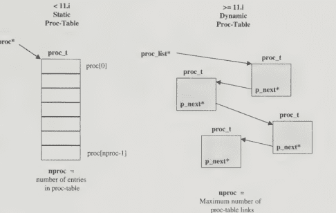

图 4-1 静态与动态 proc 表

在 HP-UX 11.1 版本发布之前，`proc` 表是一个静态表，其大小由系统可调参数 `nproc` 定义。该表是一个类型为 `proc` 的数据结构数组，其起始点通过内核指针 `proc*` 访问。当表满时，系统中无法启动额外的程序。增加允许进程的数量需要重新编译内核。当前的趋势是使许多内核结构动态化，以减少重新编译内核（以及重启次数）的需求。

从 HP-UX 11.1 开始，`proc` 表变成了动态链表（见图 4-1）。这种安排允许按需创建 `proc` 表条目，并动态链接到系统上活动进程的列表中。现在通过跟随内核指针 `proc_list*` 来访问第一个 `proc` 表条目。每个表结构仍然被定义为 `proc`（注意，该结构定义自先前版本以来已发生显著变化），现在包含指向下一个 `proc` 表条目的链接指针 `p_next*`。

内核可调参数 `nproc` 仍在使用，但其目的略有改变：现在它用于定义系统中可创建的 `proc` 表条目的最大允许数量。内核可以维护许多静态列表，这些列表需要足够大以处理内核的最坏情况需求。在初始化内核期间，`nproc` 参数一直用于辅助此项任务。直到这些表也成为动态结构之前，像 `nproc` 这样的参数都是必需的。

进程长期以来一直是 HP-UX 运行时环境的主力。随着 HP-UX 10.0 的发布，线程作为可调度实体被引入。

### 线程

线程是进程代码执行的一个实例，由内核进行调度。根据编程方式，单个进程可以拥有一个或几个线程。根据执行的是进程文本中的代码还是被称为系统调用的内核代码特权区域，线程在用户线程模式或内核线程模式下运行。

每个线程都需要在内核线程表中拥有一个活动条目。线程表条目按需创建，由结构 `kthread` 定义。为进程生成的所有线程被称为`兄弟线程`（siblings），它们各自的线程表条目通过其 `kthread` 结构中的条目形成链表。父进程在其 `proc` 结构中拥有指向该列表中第一个和最后一个 `kthread` 元素的链接指针（见图 4-2）。父 `proc` 表条目还包含其创建线程的计数，`p_threads_created`；该计数器在创建进程初始线程时设置为 0，并为每个生成的额外兄弟线程递增。

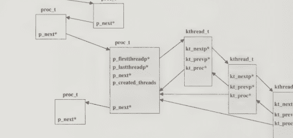

图 4-2 将线程链接到其进程

除了 `proc` 到 `kthread` 的链接外，系统上所有活动线程还相互链接形成一个活动线程列表。

与 `proc` 表一样，在 HP-UX 10.x 版本中，线程表也是一个静态表。指向第一个 `kthread` 的内核指针是 `kthread*`，线程表中的条目数量存储在 `kthreadnKTHREAD` 中，该值被设置为等于 `nproc`。与 HP-UX 11.1 中的 `proc` 表一样，线程表也被转换为动态列表。

## 进程及其线程

在 HP-UX 10.10 之前的操作系统版本中，内核调度进程在硬件上运行以完成其编程任务。在这种模型下，进程过着非常孤立的生活，程序员不必担心协调对进程私有系统资源的访问。虽然内核在进程视图之间提供了多种共享形式（仅举几例：共享内存、共享文件访问、内存映射文件和共享库），但进程私有数据只能被进程的单个执行线程使用或修改。

进程一次只能做一件事。如果它正在阻塞（或睡眠）某个物理操作，例如等待操作员输入或磁带驱动器倒带，则被称为处于`等待状态`或`睡眠`，只有当阻塞操作完成时，才能执行下一条指令。在计算机发展的早期，这种模型服务得相当好，因为大多数系统资源非常有限，只有单处理器，且响应时间相对较慢。

系统架构发展到包括由单一内核同时控制的多个处理器，称为对称多处理（SMP）系统（关于内核这一方面的更多细节，请参见第 12 章“多处理与 HP-UX”）。下一步是设计一种方法，使单个程序能够利用 SMP 并行性，同时在多个 CPU 上执行任务。这需要新一代的编程逻辑，并引发了操作系统设计的许多创新。在管理进程及其执行方面的并行性挑战促成了多线程内核的诞生。

线程基础结构首先随 10.10 版本引入 HP-UX 内核（内核的初始线程化仅支持每个进程单个线程，但这已迈出了第一步）。随着 HP-UX 11.0 的发布，内核变得真正多线程化；也就是说，如果在 SMP 系统上，单个进程可以拥有多个用户空间/内核空间线程对并行执行任务。即使在单处理器（UP）系统上，进程也可以生成多个线程，它们可以竞争系统资源：也许一个线程可以睡眠等待用户输入，而另一个线程处理现有数据。

基于线程的内核通过首先创建一个独特的进程容器来管理客户端程序，用它来跟踪和管理程序的全局属性和分配的系统资源。接下来，它创建一个或多个线程来执行程序的指令。这些线程是可调度实体。实际上，久负盛名的进程被提升到了管理职位——它不再实际执行工作，而是拥有资源，并监督和协调其下级线程的行为。


像 HP-UX 这样的操作系统（甚至在实现内核线程之前）被称为*多进程*或*多任务*，这是指其在完全独立的进程指令集之间进行切换或时间片轮转的能力。每个进程都使用系统资源，并在私有上下文中运行——不知道或不与其他驻留在系统上的进程交互。内核在一个上下文与另一个之间切换，仔细管理系统资源，以便每个进程都有自己对“现实”的私有视图，从而

它们不会打扰邻居的视野。内核在社区中维持和平，使每个进程都感觉自己仿佛占据山头的国王。这种类型的进程管理需要重量级的上下文切换系统调用。

线程化进程是指其中可能存在多个执行线程同时竞争系统资源。与旧的多进程环境不同，单个进程可能拥有一个或多个并发线程。同一进程的多个线程（称为兄弟线程）共享相同的系统资源视图。它们共享相同的代码，大部分相同的数据空间（每个线程确实拥有自己的堆栈空间和用户区），以及相同的库和系统资源。由于进程的​​所有线程都在同一个沙箱中玩耍，因此开发人员负责制定策略，以确保兄弟线程互不干扰。为帮助完成此任务，开发人员已经开发了许多编程辅助工具和库。线程已成为可调度实体，并且是程序指令和逻辑的运行时化身。

如今，许多操作系统内核（包括 HP-UX）在多进程和多线程环境中运行。内核必须管理许多不同的进程上下文，还必须管理具有多个线程的进程。为了实现这一目标，内核在调度时考虑的是单个线程，而不是进程。线程成为内核管理的活跃、工作、可调度的实体。这种从以进程为中心的视图转变为以线程为中心的视图的变化，是操作系统设计演变中的一个关键节点。

在 HP-UX 中，内核必须跟踪所有活动进程及其各自的线程。这是通过创建许多人认为操作系统内核中两个最基本的数据结构来实现的：进程表和内核线程表。

## 线程模型与 HP-UX

现代操作系统使用几种线程模型（参见图 4-3）。

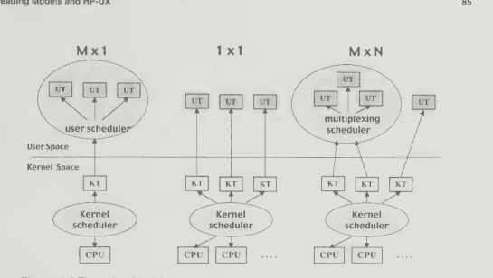

**M x 1** 线程允许每个进程使用单个内核级线程。在用户空间中，可以使用用户级调度器来模拟多线程环境的行为。程序员使用用户空间例程来实现伪调度和资源协调。库例程必须监控各个用户线程，如果当前活动线程即将执行导致阻塞操作的系统调用，则进行上下文切换。一旦进程的任何用户线程在调用上阻塞，整个进程就会进入等待状态。请记住，从内核的角度来看，这是一个单线程模型（因此 M x 1 标签中的 1）。所有调度都由用户模型完成，由于伪调度器不会遇到系统调用的额外开销，因此成本相对较低。虽然这是一个优势，但一个很大的缺点是，此模型不允许进程利用多 CPU 配置。

**1 x 1** 线程允许每个进程使用多个线程。在此模型中，内核线程和用户线程之间是一对一的关系，不允许使用用户空间调度器。内核调度器只处理内核线程，不了解用户空间中的活动。进程的​​用户线程与内核线程一对一绑定，进而由内核线程在特定 CPU 上调度。调度器在内核空间中运行，需要重量级的系统调用来管理每个处理器的运行队列。处理器运行队列通过创建内核线程（*kthreads*）的链表来构建，这些线程共享相同的优先级队列和处理器亲和力。最强活动优先级队列的头部线程将是下一个被调度的线程。一旦内核线程被调度，它可以将控制权传递给其用户线程。只有在用户线程发出系统调用，或者在收到系统中断时返回到内核本身时，才会返回到内核线程。虽然此模型大量使用系统调用，但它允许进程利用对称多处理（SMP）系统的并行执行。

**M x N** 线程将上述两个模型结合在一起。在此环境中，程序员可以选择使用用户空间调度器，或者简单地依赖内核调度器，或者同时使用两者。在 SMP 系统上，用户线程可以复用到多个内核线程，或者根据应用程序程序员的酌情安排，以一对一的方式绑定。这使程序员在尝试优化进程性能时拥有最大程度的控制。

**Hewlett Packard 正在逐步将线程引入 HP-UX 内核。**

**第一阶段** 随着 HP-UX 10.10 的发布而发生。这涉及修改内核的调度系统，使其与新创建的 `kthread` 表项一起工作。对于这个版本，每个 `proc` 表项只能存在一个执行线程。可以说，这并不是真正的线程化内核；实际上，当时我们只是在“为线程准备内核”。程序员此时还可以使用一种有限形式的线程化，称为用户线程，即 M x 1 模型（利用 DCE `libpthread` 库）。

**第二阶段** 随着 HP-UX 10.30/11.00 版本的发布而出现，该版本采用了一种称为 1 x 1 线程化的模型：对于用户进程创建的每个线程，都有一个唯一的内核线程。这种新功能允许进程生成多个兄弟线程，并首次使 HP-UX 系统上的进程能够充分利用 SMP 系统的并行性。为了促进此模型，实现了 POSIX 内核线程库 `libpthread`。

HP-UX 10.30 的发布（针对工作站开发者的早期版本）提供了对 POSIX 1003.1b API 的支持，用于多线程应用程序开发。随着 HP-UX 11.00 的完整发布，添加了更多线程功能以符合 POSIX 1003.1c 标准。

**第三阶段** 将在未来的版本中实现。此阶段将采用 M x N 线程模型。在此模型中，单个内核线程可以关联一个或多个单独的用户线程。这是一个非常灵活的模型，但灵活性也带来了编程复杂性的额外成本。M x N 线程将在不久的将来出现在 HP-UX 中。

## 系统调用接口

每个进程线程由一对绑定的用户/内核线程组成（除非使用用户空间调度器）。此线程在任一时刻执行来自进程用户内存空间或来自合法内核系统调用的特权内存空间的指令。除了许多基于进程的线程外，有时系统还需要停止当前已调度线程的执行，并切换到特定的仅内核线程，以执行中断处理、调度或许多其他与操作系统相关的任务。

这些不同操作模式之间的转换是系统调用接口和中断系统的研究内容（参见图 4-4）。我们在第 1 章“HP PA-RISC 体系结构”中讨论了内部系统级中断的发生和处理，并在第 10 章“I/O 和设备管理”中详细探讨了外部中断。

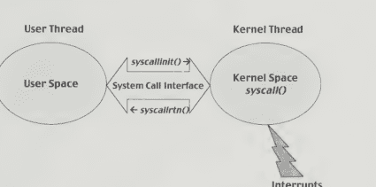

#### 图 4-4 用户到内核的线程转换

暂时考虑，处理器当前的执行模式从用户模式切换到内核模式只有两种方式。第一种是某些类型的系统中断，导致立即切换到内核上下文的结果。第二种是当前用户线程请求使用众多提供的内核例程之一的直接结果，即系统调用，`syscall()`。

无论哪个事件导致切换到内核模式，返回给最值得的用户线程都是由同一内核级机制 `syscall()` 控制的。此内核例程负责进程间信号的传递和通知、用户级上下文切换、从用户定义的信号处理例程返回、从系统级中断处理程序返回，以及从用户线程请求的系统调用返回。因此，它必须能够处理不同的用户和内核堆栈，以恢复用户线程的上下文（线程的运行状态上下文存储在进程控制块，即 `PCB` 结构中）。

在描述线程在系统调用执行期间执行的各种任务时，请参考图 4-5。

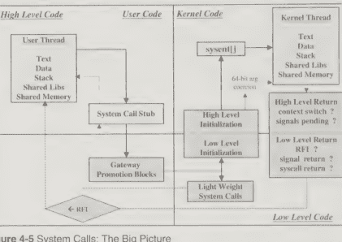

我们首先假设内核调度器已选中某个进程的用户线程，使其在可用的处理器上执行。当该用户线程在其内存空间中继续执行时，请求 HP-UX 系统调用服务变得必要起来。

### 系统调用存根（System Call Stub）

系统调用的数量以百计，通过系统调用库提供给用户线程。这些例程与常规库例程的不同之处在于，它们必须先将用户线程转换到内核线程，才能访问驻留在内核中的子例程。执行位于内核拥有页面上的代码需要特权级别 0。用户线程以特权级别 3 运行；内核线程以级别 0 运行。出于必要，设置线程特权级别的机制受到硬件和内核的严格控制，以防止未经授权的 使用。HP-UX 系统上文件 `/usr/include/sys/syscall.h` 提供了可用系统调用及其符号名称和编号的列表。

### 网关页（Gateway Page）

系统调用存根是一小段代码，在构建可执行映像时由链接加载器链接到线程的用户代码空间中。这个小存根表现为一个简单的模块内过程调用。每个系统调用都被分配了一个唯一的系统调用编号。编译器（或汇编语言程序员）的职责是将高级语言请求映射到适当的系统调用编号，并将其传递给存根（在 `GR22` 中），同时传递特定系统调用所需的正确数量和类型的参数。这个简单的存根代码盲目地将调用编号、调用寄存器上下文、返回指针和传入的参数转发给一个高度专业化的例程，称为*提升块*（promotion block）。当调用完成时，返回到请求用户线程调用上下文的路径是通过这个存根返回的。

窄（32位）内核的系统调用接口在近期内核版本发布中未发生变化；然而，宽（64位）内核的接口遵循本书前文讨论过的新过程调用约定。此外，窄内核和宽内核的网关页布局略有不同。我们首先考察 `B_GATE` 指令和提升块的概念。

HP PA-RISC 处理器家族（包括窄和宽架构）为分支指令提供了一个高度专业化的选项，称为 GATE 完成器（或简称为*网关指令*）。

**助记符：**

`B_GATE target, t`

**功能：** 分支到 *target* 地址，将当前特权级别存入通用寄存器 **t**，并根据当前页 TLB 访问权限的最右两位设置特权级别。

**示例：** `B_GATE .+8, r0`


该指令导致相对于 `B_GATE` 指令当前地址向前分支八字节（两个字）（`.+8`）。*当前*特权级别（对于用户线程，该值为 3）存储在 `GR0`（`r0`；在此示例中，它只是被写入系统寄存器中的“位桶”等价物），并且特权级别被设置为分支发生页的 `TLB` 访问权限的最右两位。

该方案的安全性基于这样一个简单事实：只有内核可以设置页的 `TLB` 访问权限。为了启用 `B_GATE` 完成器，*网关页*上的 `TLB` 访问权限被设置为 `PDE_AR_GATE` (`0x4C`)。仅当进程状态字 `C` 位被置为 1 时才会发生提升（这在实模式下禁用了网关提升）。为了最大化安全性考虑，内核在系统初始化期间（参考内核初始化期间的 `page()`）仅在系统调用网关页上设置 `TLB` 访问权限为 `PDE_AR_GATE`。

### 提升块（Promotion Blocks）

最初，单个系统调用是通过一个简单的四指令提升块进行分支跳转的。其基本功能是构建一个指向所需系统调用入口点的显式虚拟地址。由于内核代码位于调用线程虚拟内存映射范围之外，因此需要一个长的显式指针。窄内核的基本提升块如下所示：

```assembly
B_GATE    .+8, r0          # 分支到当前地址+8
                            # 并提升特权级别
LDIL      L$target, r1     # 开始在 r1 中
                            # 构建目标地址
BE R $target, (sr7,r1)     # 使用 sr7 完成目标地址
                            # 并分支
DEPI 3,31,2,r31            # 在存根的返回指针中
                            # 设置特权位为 3，注意
                            # 这发生在 BE 的延迟槽中
```

在窄系统中，线程的第四象限始终映射到虚拟空间 0（参见第 6 章），并且空间寄存器 7 (`sr7`) 始终可以假定为值 0。对于宽内核，情况已不再如此，因此我们必须向代码中添加一个额外步骤，以确保显式目标地址位于虚拟地址空间 0 的第一个象限（即内核空间）。我们为这项任务分配并初始化 `sr2`。宽 `HP-UX` 11.0 内核上的提升块形式如下：

```assembly
MTSP r0,sr2                # 为后续使用设置 sr2 (sr2=0)
B_GATE .+8,ro              # 分支到当前地址+8 并
                            # 提升特权级别
LDIL L$target,r1           # 开始在 r1 中
                            # 构建目标地址
BE,N R$target(sr2,r1)      # 完成目标地址
                            # 并分支
```

注意：`BE` 指令利用延迟槽的无效化（nullification）功能，以便紧密地打包四指令提升块。在存根返回指针中设置特权位（`DEPI`）的任务已移至目标例程的第一条指令（以保持四指令块的大小不变）。

随着 `HP-UX` 11.1 版本的发布，提升块编码发生了一项根本性变革。在宽内核上，新的提升块需要五条指令。为了增强安全性，`DEPI` 指令被重新移回网关页代码中。首先，是宽 11.1 系统上宽线程的新五指令块：

```assembly
B_GATE .+8,ro              # 分支到当前地址+8 并
                            # 提升特权级别
MTSP r0,sr2                # 为后续使用设置 sr2
LDIL L$target,r1           # 开始在 r1 中
                            # 构建目标地址
BE R$target(sr2,r1)        # 完成目标地址
                            # 并分支
DEPI 3,63,2,r31            # 在存根的返回指针中
                            # 设置特权位为 3
```

既然 `DEPI` 指令已移回 `gateway64_page`，`gateway_page` 也需要做同样的处理。为此，在该页空间中创建了一个小的附加例程（名为 `gateway_generic`），以保持窄提升块每条为四条指令。宽 `HP-UX` 11.1 系统上窄线程的提升块如下所示：

```assembly
B_GATE .+8,ro              # 分支到当前地址+8
                            # 并提升特权级别
LDIL I$target,r1           # 开始在 r1 中
                            # 构建目标地址
B(gateway_generic)         # 分支到我们的新代码块
LDO R$target(r1),r1       # 完成目标地址
                           # (gateway_generic)
MTPS r0,sr2               # 为后续使用设置 sr2
BE (sr2,r1)                # 分支到已构建的
                           # 目标外部
DEPI 3,63,2,r31            # 在存根的返回指针中
                           # 设置特权位为 3。
```

### 轻量级系统调用

为了最小化系统开销成本，某些系统调用通过称为轻量级系统调用的简单汇编语言例程来实现。轻量级调用只是从进程的 `proc_t`、`kthread_t` 或 `user_t` 中设置或返回一个值。它们永远不会阻塞、休眠，也不必担心多处理问题。对于 `HP-UX` 10.x 内核，轻量级调用包括 `siglock()`、`sigvector()`、`getpid()`、`gettid()`、`geteuid()`、`getgid()`、`getegid()` 和 `umask()`。

### 窄内核上的 gateway_page

在早期的 `HP-UX` 系统中，系统调用的数量较少，这允许单个系统内存页包含一个简单的重定向例程和最多 253 个独立的提升块。`gateway_page` 需要能从用户线程的内存映射中访问，因此它位于第四象限的开头，`VAS` 0（显式地址为 `0x0.C0000000`，隐式地址为 `0xC0000000`）。这个地址被硬编码在窄应用程序的系统调用存根代码中，并由编译器插入到所有 `SOM` 可执行文件中。

随着系统调用数量的增加并超过 253，`gateway_page` 开头的重定向代码被修改，使得所有大于 253 的系统调用编号都被发送到与系统调用 0 相同的地址。在内核侧，维护一个向量跳转表 (`bysent[]`)，并以系统调用编号（由系统调用存根在 `r22` 中传递）为索引，将请求引导到内核中的正确目标。

#### 32位 HP-UX 11.0 内核 gateway_page 的选定部分

列表 4.1 是使用 `adb` 实用程序创建的：

```
#### adb -k /stand/vmunix /dev/kmem >> temp
      gateway_page,400?1a
```

随后对生成的 *temp* 文件进行了编辑。添加了注释，并截断了冗余的推广块（promotion blocks）。请注意，`adb` 将 `B_GATE` 简单列为 `GATE`。

#### 列表 4.1 # adb -k /stand/vmunix /dev/kmem ; gateway_page,400?ia


```
0xC0000000:  B,N ffffffc0000018
#### Default jump to syscall#0 promotion block
0xC0000004:  SUBI,>=>253,r22,r0
#### is r22 <= 253 ?
0xC0000008:  B,N ffffffc0000018
#### if not then go to syscall#0
0xC000000C:  ZDEPr22,30,30,r1
#### else we need to caculate the jump
0xC0000010:  BLR,Nr1,r0
#### to the correct promotion block
0xC0000014:  NOP
#### these two instructions shift the value
#### of r22 2 bits to the left (x4) this
#### value is then used for a local branch
0xC0000018:  GATE ffffffc000020,r0
#### Promotion block for syscall#0
0xC000001C:  LDILL@x34800,r1
#### This is the call to sysint()
0xC0000020:  RE80(sr7,r1)
#### (a heavyweight call example)
0xC0000024:  DEPI 3,31,2,r31

0xC0000158:  GATE ffffffc000160,r0
#### Promotion Block for syscall #20
0xC000015C:  LDILL@x385000,r1
#### Notice the address is different
0xC0000160:  BE 648(sr7,r1)
#### This is a lightweight call example
0xC0000164:  DEPI3,31,2,r31

0xC0000FE8:  GATE ffffffc0000ef0,r0
#### Promotion Block for sysint #253
0xC0000FEC:  LDILL@x34800,r1
#### another heavyweight call
0xC0000FF0:  BE 80(sr7,r1)
0xC0000FF4:  DEPI 3,31,2,r31
0xC0000FF8:  BREAK
#### End of promotion blocks!
0xC0000FFC:  BREAK
0xC0001000:  # first address of the next page
```

注意：如列表所示，系统调用 1 到 253 各自定义了一个私有的推广块（promotion block），从而允许它们定义唯一的分支目标。大多数调用跳转至 `syscallinit`，但有些调用引用的是轻量级调用。所有高于 253 的调用共同使用系统调用 #0 的推广块。

此模型中的一限制是，不能为编号高于 253 的调用定义新的轻量级调用。另一个问题是，由于 `gateway_page` 的地址被硬编码在系统调用桩（stub）中，若未支持现有二进制文件，则无法重新定位该地址。

### 宽网关：64 位内核中的 `gateway_page`、`sysvec` 和 `gateway64_page`

随着 64 位 HP-UX 内核的出现，实现了新的网关页模型。为了解决分配高于 253 的轻量级系统调用编号的问题，创建了一个由系统调用编号索引的用户空间向量跳转表（`sysvec`），并由宽应用程序的新系统调用桩访问。`sysvec` 中包含的地址指向存储在新创建的 `gateway64_page` 上的推广块。内核仍包含 `sysent []` 向量跳转数组，因此 `gateway64_page` 只需包含所有重量级系统调用的通用推广块，以及每个不同轻量级系统调用对应的一个额外推广块。

为了继续支持现有的窄应用程序，`gateway_page` 位于虚拟地址 `0xC0000000`，而 `gateway64_page` 和 `sysvec` 页（或页）紧随其后。与窄系统不同，这些页不位于虚拟空间 0 的第四象限；相反，它们位于分配给窄过程和宽过程之间共享对象的第一个象限空间中。该空间编号存储在内核参数 `q1_64bit_spaceid` 中。

在内核初始化期间，`gateway_page` 和 `gateway64_page` 的 TLB 访问权限被设置为 `PDE_AR_GATE`。以下内核全局变量有助于定义宽内核中网关和 `sysvec` 页的位置和大小：

- `gate64_vaddr` – `gateway64_page` 的虚拟地址
- `gate64_pages` – 64 位推广块所需的页数
- `sysvec_vaddr` – 64 位 `sysvec` 表的虚拟地址
- `sysvec_pages` – `sysvec` 表所需的页数
- `sysvec_entries` – 64 位推广块的数量
- `q1_64bit_spaceid` – 持有网关页的虚拟空间编号

要在宽内核系统上列出上述任何页的内容，我们必须先发现其地址。如果内核已准备用于 q4 工作（参见第 16 章中的 `q4pxdb` 命令），q4 工具可能有助于这一努力。

#### 在宽系统上列出 `gateway_page`

第一步是使用 `q4` 查找 `gateway_page` 的地址：

```
q4> &gateway_page
044000	147456	0x24000
```

返回的最后一个值是内核中 `gateway_page` 的地址。可以与 `adb` 一起使用以创建列表：

```
$ adb -k /stand/vmunix /dev/mem > /tmp/gateway_page
24000,400?1a
```

我们未包含宽版 HP-UX 11.00 系统此输出的副本，因为其与窄内核的输出几乎相同，而后者我们已经展示过。

#### 来自 64 位 HP-UX 11.0 内核的 `sysvec` 页选段

使用 `q4` 查找 `sysvec` 页的地址：

```
q4> &sysvec
046000	1155648	0x26000
```

接下来，使用 `adb` 创建列表：

```
$ adb -k /stand/vmunix /dev/mem > /tmp/sysvec
26000,10174X
```

所需的输出格式为每行四个十六进制值。参见列表 4.2。

#### 列表 4.2 `$ adb -k /stand/vmunix /dev/mem ; 26000,10174X`

`sysvec`:

 0 25000 0 25000

 0 25000 0 25000

 0 25000 0 25000

 0 25000 0 25000

 0 25000 0 25000

 0 25000 0 25000

 0 25000 0 25000

 0 25000 0 25000

 0 25000 0 25000

 (idx=20) 0 (LW-Call) 25010 0 25000

 0 25000 0 25000

 (idx=24) 0 (LW-Call) 25020 0 25000

0 25000 0 25000

 (idx=28) 0 (LW-Call) 25030 0 25000

0 25000 0 25000

 (注意：许多条目已截断以示简洁)

0 25000 0 25000

sysvec_end:8000240000

#### 来自 64 位 HP-UX 11.0 内核的 `gateway64_page`

使用 `q4` 查找 `gateway64_page` 的地址：

```
q4 > &gateway64_page
    0450000             151552        0x25000
```

接下来，使用 `adb` 创建列表：

```
$ adb -k /stand/vmunix /dev/mem > /tmp/gateway64_page
25000,0x4c71a
```

列表 4.3 展示了 64 位系统调用的各个推广块。请注意，每种特定调用类型只有一个块。

#### 列表 4.3 `# adb -k /stand/vmunix /dev/mem ; 25000,0x4c71a`


```
----------
gateway64_page:
gateway64_page:				MTPD r0, sr2
gateway64_page+4:			GATE
gateway64_page+0x000C, r0
gateway64_page+8:			LDIL L\0x340000, r1
gateway64_page+0xC:			BE, N40(sr2, r1)
lw_getpid_gate64:
lw_getpid_gate64:			MTPD r0, sr2
lw_getpid_gate64+4:			GATE
lw_getpid_gate64+0x000C, r0
lw_getpid_gate64+8:			LDIL L\0x3b2000, r1
lw_getpid_gate64+0xC:			BE, N120(sr2, r1)
lw_getuid_gate64:
lw_getuid_gate64:			MTPD r0, sr2
lw_getuid_gate64+4:			GATE
lw_getuid_gate64+0x000C, r0
lw_getuid_gate64+8:			LDIL L\0x3b2000, r1
lw_getuid_gate64+0xC:			BE, N420(sr2, r1)
cnx_lw_pmon_read_gate64:
cnx_lw_pmon_read_gate64:		MTPD r0, sr2
cnx_lw_pmon_read_gate64+4:		GATE

cnx_lw_pmon_read_gate64+0x000c,r0		LDIL L%x3b3000,r1

cnx_lw_pmon_read_gate64+8:		BE,N 212(sr2,r1)

lw_getgid_gate64:		MTSP r0,sr2

lw_getgid_gate64+4:		GATE

lw_getgid_gate64+0x000c,r0		LDIL L%x3b2000,r1

lw_getgid_gate64+8:		BE,N728(sr2,r1)

lw_test_gate64:		MTSP r0,sr2

lw_test_gate64+4:		GATE

lw_test_gate64+0x000c,r0		LDIL L%x3b2000,r1

lw_test_gate64+8:		BE,N104(sr2,r1)

lw_mcas_util_gate64:		MTSP r0,sr2

lw_mcas_util_gate64+4:		GATE

lw_mcas_util_gate64+0x000c,r0		LDIL L%x3b3000,r1

lw_mcas_util_gate64+8:		BE,N1800(sr2,r1)

lw_set_usethreadid_gate64:		MTSP r0,sr2

lw_set_usethreadid_gate64+4:		GATE

lw_set_usethreadid_gate64+0x000c,r0		LDIL L%x3b2800,r1

lw_set_usethreadid_gate64+8:		BE,N996(sr2,r1)

lw_umask_gate64:		MTSP r0,sr2

lw_umask_gate64+4:		GATE

lw_umask_gate64+0x000c,r0		LDIL%x3b2800,r1

lw_umask_gate64+8:		BE,N 772(sr2,r1)

lw_lwp_getprivate_gate64:		MTSP r0,sr2

lw_lwp_getprivate_gate64+4:		GATE

lw_lwp_getprivate_gate64+4:		GATE

lw_lwp_getprivate_gate64+0x000c,r0		LDIL L%x3b2800,r1

lw_lwp_getprivate_gate64+8:		BE,M1656(sr2,r1)

lw_lwp_getprivate_gate64:		BE,M1656(sr2,r1)

lw_lwp_setprivate_gate64:		MTSP r0,sr2

lw_lwp_setprivate_gate64+4:		GATE

lw_lwp_setprivate_gate64+0x000c,r0		LDIL L%x3b2800,r1

lw_lwp_setprivate_gate64+8:		BE,N1544(sr2,r1)
```

`lw_lf_send_gate64:`

    MTPS r0, sr2

`lw_lf_send_gate64+4:`

    GATE

`lw_lf_send_gate64+0x000c, r0`

`lw_lf_send_gate64+8:`

    LDIL L\0x3b2800, r1

`lw_lf_send_gate64+0xC:`

    BE, N 2044 (sr2, r1)

`lw_sigvec_gate64:`

    MTPS r0, sr2

`lw_sigvec_gate64+4:`

    GATE

`lw_sigvec_gate64+0x000c, r0`

`lw_sigvec_gate64+8:`

    LDIL L\0x3b2000, r1

`lw_sigvec_gate64+0xC:`

    BE, N 1364 (sr2, r1)

`lw_sigblock_gate64:`

    MTPS r0, sr2

`lw_sigblock_gate64+4:`

    GATE

`lw_sigblock_gate64+0x000c, r0`

`lw_sigblock_gate64+8:`

    LDIL L\0x3b2800, r1

`lw_sigblock_gate64+0xC:`

    BE, N 420 (sr2, r1)

`lw_sigsetmask_gate64:`

    MTPS r0, sr2

`lw_sigsetmask_gate64+4:`

    GATE

`lw_sigsetmask_gate64+0x000c, r0`

`lw_sigsetmask_gate64+8:`

    LDIL L\0x3b2000, r1

`lw_sigsetmask_gate64+0xC:`

    BE, N 1036 (sr2, r1)

`lw_lwp_self_gate64:`

    MTPS r0, sr2

`lw_lwp_self_gate64+4:`

    GATE

`lw_lwp_self_gate64+0x000c, r0`

`lw_lwp_self_gate64+8:`

    LDIL L\0x3b2800, r1

`lw_lwp_self_gate64+0xC:`

    BE, N 1244 (sr2, r1)

`lw_lf_next_scn_gate64:`

    MTPS r0, sr2

`lw_lf_next_scn_gate64+4:`

    GATE

`lw_lf_next_scn_gate64+0x000c, r0`

`lw_lf_next_scn_gate64+8:`

    LDIL L\0x3b3000, r1

`lw_lf_next_scn_gate64+0xC:`

    BE, N 104 (sr2, r1)

`lw_get_thread_times_gate64:`

    MTPS r0, sr2

`lw_get_thread_times_gate64+4:`

    GATE

`lw_get_thread_times_gate64+0x000c, r0`

`lw_get_thread_times_gate64+8:`

    LDIL L\0x3b2800, r1

`lw_get_thread_times_gate64+0xC:`

    BE, N 1768 (sr2, r1)

`lw_nosys_gate64:`

    MTPS r0, sr2

`lw_nosys_gate64+4:`

    GATE

`lw_nosys_gate64+0x000c, r0`

`lw_nosys_gate64+8:`

    LDIR L0x3ae800, r1

`lw_nosys_gate64+0xC:`

    BE, N 304 (sr2, r1)

`lw_nosys_gate64+10:`

( This last promotion block is used to trap unimplemented

system calls)

列表 4.4 摘自文件 `/usr/include/sys/scall_define.h`，部分展示了系统调用及其编号。在查看上述推广块（promotion block）列表时，可将其作为参考：

### 列表 4.4 # `more /usr/include/sys/scall_define.h`

misc.dsc: 系统调用 0 是 nosys;

pm.dsc: 系统调用 1 是 exit;

pm.dsc: 系统调用 2 是 fork;

fs.dsc: 系统调用 3 是 read;

fs.dsc: 系统调用 4 是 write;


### 系统调用列表

`fs.dsc`: 系统调用 5 是 `open`;
`fs.dsc`: 系统调用 6 是 `close`;
`pm.dsc`: 系统调用 7 是 `wait`;
`fs.dsc`: 系统调用 8 是 `creat`;
`fs.dsc`: 系统调用 9 是 `link`;
`fs.dsc`: 系统调用 10 是 `unlink`;
`vm.dsc`: 系统调用 11 是 `exec`;
`fs.dsc`: 系统调用 12 是 `chdir`;
`pm.dsc`: 系统调用 13 是 `time`;
`fs.dsc`: 系统调用 14 是 `mknod`;
`fs.dsc`: 系统调用 15 是 `chmod`;
`fs.dsc`: 系统调用 16 是 `chown`;
`vm.dsc`: 系统调用 17 是 `brk`;
`fs.dsc`: 系统调用 18 是 `lchmod`;
`fs.dsc`: 系统调用 19 是 `lseek`;
`pm.dsc`: 系统调用 20 是 `getpid`;
`fs.dsc`: 系统调用 21 是 `mount`;
`fs.dsc`: 系统调用 22 是 `umount`;
`pm.dsc`: 系统调用 23 是 `stat`;
`pm.dsc`: 系统调用 24 是 `getuid`;
`pm.dsc`: 系统调用 25 是 `stime`;
`pm.dsc`: 系统调用 26 是 `ptrace`;
`signals.dsc`: 系统调用 27 是 `alarm`;
`pm.dsc`: 系统调用 28 是 `cnx_lw_pmon_read`;
`pm.dsc`: 系统调用 29 是 `pause`;
...

### 低级初始化

一旦选定了合适的推广块（promotion block），系统将要么将控制权转移给一个轻量级系统调用（也称为二级调用），要么进入内核 `syscall-init()` 函数（一级调用）以开始一级初始化。

对于轻量级调用，操作执行完成后会立即返回到系统调用子程序。实际上，在内核代码中花费的时间非常少，少到线程核算系统甚至不尝试将任何 CPU 利用率计入该线程的系统时间桶。相反，它仅仅被视为用户时间。

### 高级初始化

`syscallinit()` 包含一段汇编级别的初始化代码例程，旨在为进入内核更高层级时使用的保存状态和堆栈帧进行设置。由于相同的内核代码可能在 SMP（对称多处理）系统上被不同的用户线程同时调用，因此每个线程都自带一个私有的内核堆栈区域。这个 `kstack`（窄应用占三个页面，宽应用占六个页面）紧接在该线程的 `uarea` 之后（每个线程都有其独特的 `uarea`/`kstack` 内存区域，第 6 章将进行更详细的讨论）。`syscallinit()` 的主要任务是确保堆栈指针（`sp`）、子程序返回地址（`r32`）、原始调用者的返回地址（`xp`）、用户数据指针（`dp`）以及用户的空间寄存器得到安全存储，这样在所有操作完成后，我们就能返回到原始的调用上下文。下一步是调用高级初始化例程 `syscall()`。

`syscall()` 内核例程是用 C 语言编写的，它首先收集与该线程相关的性能指标。测量系统被初始化，现在我们将开始将 CPU 利用率计入该线程的“系统时间”桶。当前的系统调用编号保存在线程的 `uarea` 中（位于 `u_ssyscall`），并用作 `ysuent[]` 向量或跳转表的索引。内核还包含数组 `ysaxux[]`，其中包含有关待处理调用的特定 64 位信息，例如调用使用的寄存器数量。通过寄存器传递的额外参数会被复制到 `uarea`（`u_arg[]`）中，从而满足 32 位和 64 位调用约定之间的差异。一旦获取到实际的系统调用地址，就会调用 `setjmp`。

如果调用的用户线程是 32 位且我们运行的是 64 位内核，则可能需要参数强制转换（Argument coercion）。在大多数情况下，这一操作是透明的，因为存储在线程 `u_arg[]` 中的值会被符号扩展至 64 位。参数强制转换存根（stub）会对 `ysent[r22]` 中的地址索引执行实际调用。

## 系统调用

此时我们已到达请求的实际内核代码。在此阶段，可能会走许多不同的路径。我们可能正在请求 I/O 操作，这种情况下，我们的线程很可能会被挂起并被分配一个等待通道。我们可能只是执行完请求的任务并开始返回路径，或者一个中断可能会阻止我们的进度。无论如何，让我们盘点一下我们当前的状态以及对我们有利的工作成果。

线程目前处于内核模式，所需的堆栈空间由线程自己的私有 `kstack` 区域提供。原始上下文的保存状态安全地保存在 `uarea` 中，我们现在以完整的内核权限和特权继续执行。

下一步是开始返回之旅，以恢复在用户线程上下文中的执行。我们在此时可能处于几种不同场景的结果中。例如，可能收到了表示 I/O 操作完成的中断，导致其他线程被抢占；用户定义的信号处理程序可能已完成并调用了 `sig return()`；或者系统调用可能只是完成了其工作。关键在于，发起返回到用户线程的系统调用不一定是启动该序列的那个：内核中断系统、内存管理器、I/O 系统或众多系统服务中的任何一个都可能影响了事件序列。

### 高级返回

高级返回路径始于内核 `syscall()` 例程的中途。返回之旅从检查即将返回的线程是否接收到了任何信号开始。这是线程检查信号的唯一时刻，程序员可能选择忽略或阻塞某些信号。我们将在本书的另一章中全面介绍信号处理机制。目前，我们只是想指出这是检查信号的节点。

接下来，检查系统调用的返回值，看调用执行过程中是否发生错误，或返回是否因接收到信号而被中断。如果一切正常，系统调用的返回值会被放入保存状态结构中的 `ret` 字段（该结构在低级初始化期间创建），并通过低级返回代码传递回去。

在将控制权转移给低级返回代码之前的最后一项任务是检查处理器的 `rrun` 标志。该标志存储在每处理器的 `mp_info_t` 结构中（该结构在第 12 章中有详细说明），如果中断处理程序将线程放入处理器的运行队列，并注意到该线程属于比当前处理器正在运行的线程所在的运行队列更高优先级的运行队列，则该标志会被设置（请记住在 SMP 系统中，中断可能是为来自不同处理器的 I/O 请求处理的，而该线程正在另一个处理器上运行）。如果 `rrun` 标志被设置，当前线程将由 `setrq()` 内核例程重新放入其运行队列，并且调用内核例程 `switch()` 以切换到该处理器最强运行队列前端的 `kthread`。一旦 `syscall()` 确定它已识别出最值得运行的线程，测量系统将被指示开始将 CPU 利用率计入用户时间桶，并调用低级返回例程。

### 低级返回

`sysscalltrn()` 是一段汇编代码例程，基本上恢复进入低级初始化代码时保存的寄存器：堆栈指针（`sp`）、存根返回地址 (`r31`)、原始调用者的返回地址 (`rp`)、数据指针 (`dp`) 以及用户的空间寄存器在所有跳转回到系统调用桩的返回地址 (`r31`) 之前都已恢复。系统调用的返回值通过 `r2` 寄存器传递给原始调用线程，这正是系统调用桩用于传递系统调用编号的同一个寄存器。虽然这描述了正常的系统调用返回路径，但还有几种其他可能性导致我们到达此处。

如果我们是因为程序员定义了信号处理程序的信号陷入而到达这里的，我们将检查是否需要将保存状态放置到信号栈中以供将来参考，然后直接返回到处理程序例程。如果我们是从用户定义的信号处理程序返回的，则需要在完成返回之前从信号栈中恢复保存状态。

如果返回是上下文切换的结果，我们将恢复线程区域的保存状态，并直接返回到用户线程的上下文。同时也会检查标志，以查看该线程是否属于正在被跟踪的进程；如果是，则根据所使用的跟踪级别和类型采取各种措施。

最后一步涉及执行一条分支外部指令到 `r31` 中桩的返回地址。这完成了系统调用，在此过程中将线程降级到用户权限级别 3。

## 摘要

了解进程与线程的关系以及系统调用接口的功能，将有助于我们在深入研究内核的结构深度时提供帮助。请记住，在任何一个瞬间，处理器只是正在执行单条指令，且处理器处于用户模式或内核模式。进入内核模式只有两种方式：用户发起的系统调用，或者是系统中断（中断、故障或检查）的结果。内核在完成其任务后总是尝试返回用户模式。在此期间，它会评估哪个用户线程最值得运行。

既然我们已经理解了在两种模式之间切换的机制，让我们深入探讨 HP-UX 内核中关键子系统的内核表和数据结构。

# 从进程视角看进程与线程管理

在本章中，我们探讨用于管理分配给进程及其线程的资源的内核数据结构。我们看到进程的 *逻辑地址空间* 如何映射到内核的 *虚拟地址空间* (`VAS`)，为转换到硬件的 *物理地址空间* 做准备。随着内核被要求托管多个进程，单个 *lthread* 被放入根据处理器、优先级和类型组织的运行队列中。我们还考察了内核调度系统的整体实现、其规则以及 *nice、实时、分时* 和 *优先级衰减* 的概念。

### 进程及其资源

进程是一种容器，用于链接在其 *lthreads* 执行期间所需的系统资源。进程必须具有唯一的身份（其 `PID`，即进程标识符），内核需要一种方法来跟踪为进程使用而分配的系统资源。为此，内核采用多个链接数据结构来协调线程对代码、数据、共享内存对象、文件和 *I/O* 系统的访问。

从进程的角度来看，*proc* 表（进程表）是我们研究 HP-UX 内部结构的起点。如图 5-1 所示，*proc* 表将进程与其 *lthreads*、虚拟内存映射、打开的文件描述符以及其他系统资源和服务联系在一起。


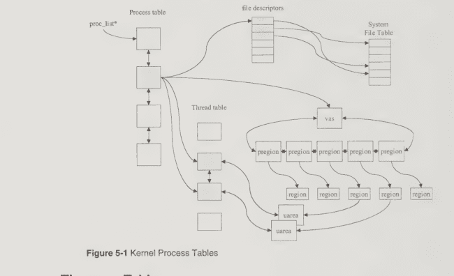

## proc 表

为了使进程存在（至少从内核的观点来看），必须将一个 `proc` 数据结构放置在系统 `proc` 表中。在 HP-UX 11i 之前，`proc` 表是一个静态数组。内核指针 `proc` 定义了它的开始，其大小通过内核参数 `nproc` 进行调整。`proc` 表是内核中最大的表之一（在 HP-UX 11.00 中，每个 `proc` 结构体为 700 字节），调整 `nproc` 可能会显著改变内核的大小。这种效应被放大了，因为许多其他内核数据结构的大小是根据 `nproc` 按比例调整的。

随着 HP-UX 11i 的发布，`proc` 表变得动态化（见图 5-2）。这意味着单个 `proc` 结构体在需要时从内核内存区域分配。此关键系统表的开头现在由 `proc_list` 指向，并且该结构体中添加了链接指针以创建动态链接列表。在 HP-UX 11i 中，`proc` 结构体已增长到 828 字节。

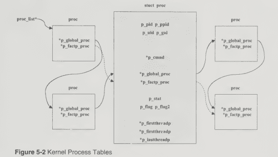

迄今为止，并非所有内核数据结构都已从静态转换为动态，这需要维护 `nproc` 参数以用于相关表的 sizing。此外，`nproc` 还作为内核预期可管理的进程数量的可调限制。

在当前实现中，分配给 `proc` 表的结构体在其进程终止时不会返回到内核内存池。相反，`proc` 结构体的状态被设置为 `SUNUSED`，并被放置在一个空闲列表中。目前的想法是，一旦分配了 `proc` 条目，它就代表系统活动的一种高水位标记，系统会简单地将其放在空闲列表中，以便下次进程计数较高时可以使用。让我们探索一下存储在那里的其他一些链接和参数。

`q4` 可用于检查实时系统上的进程表。

首先，启动 `q4`，传入内核映像文件 `/stand/vmunix` 和 `/dev/kmem` 作为参数（如果你尚未在系统中设置 `q4`，请参阅第 16 章“工具概述”了解过程说明）。

```
#### q4 /stand/vmunix /dev/mem
```

现在你可以检查 `proc` 结构体的字段：

```
q4> fields struct proc | more
```

要在 HP-UX 11i 系统上加载 `proc` 表的内容，

```
q4> load struct proc from proc_list next p_global_proc
max nproc (to load all entries)or

q4> load struct proc from proc_list next p_factp_proc
max nproc (to load active entries only)
```

对于 HP-UX 11.0（或更早）的系统，

```
q4> load struct proc from proc max nproc
```

以下 `q4` 字段列表（列表 5.1）已压缩并针对我们的讨论添加了注释。（`q4` 字段列表每行产生六个字段：字节偏移、位偏移、整数字节大小、额外位数、字段类型和标签数量。）

### 列表 5.1 q4> fields struct proc

```
Forward and previous pointers linking all the active processes
0 0 4 0 * p_factp
4 0 4 0 * p_actp
Various pointers to the process's thread(s)
8 0 4 0 * p_firstthreadp
12 0 4 0 * p_lastthreadp
32 0 4 0 int p_created_threads
Spinlock structures to protect access to proc and thread data
24 0 4 0 * thread_lock
28 0 4 0 * p_lock
The process flags (see enum proc_flag and proc_flag2 in proc_private.h)
proc_private.h)
enum proc_flag2
The process states are:
SUNUSED = 0 unused, proc available
SWAIT = 1 abandoned
SIDL = 2 in process creation( kernel routine
new_proc() )
SZOMB = 3 in process termination ( waiting for signal
from parent process)
SSTOP = 4 process is currently stopped
SINSUE = 5 proc entry in use
36 0 4 0 enum4 p_flag2
40 0 4 0 enum4 p_flag
44 0 4 0 enum4 p_stat
A partitioned pointer to the process's file descriptor(s)
56 0 4 0 * p_ofilep
This process's default priority and nice values and a
reference count (used by the kernel to determine when to call
freeproc() to cleanup the process)
72 0 2 0 u_short p_pri
74 0 1 0 char p_nice
```

| | | | |

|---|---|---|---|

| 76 | 0 | 4 | 0 int p_refcnt |

| | | | 连接所有活动 proc 结构体的前向链接 |

| 92 | 0 | 4 | 0 * p_global_proc |

| | | | 进程的凭证；用户 id，su id，进程组 id，进程 id，父进程 id，最大物理页帧数（称为驻留集大小），前向和后向哈希链链接（有一个哈希表用于在已知进程 id 时加速定位 proc 结构体条目），连接属于同一用户 id 的所有 proc 表项的前向和后向链接，以及指向此进程的虚拟地址空间头部（结构体 vas）的指针 |

| 176 | 0 | 4 | 0 int p_uid |

| 180 | 0 | 4 | 0 int p_guid |

| 188 | 0 | 4 | 0 int p_pgid |

| 192 | 0 | 4 | 0 int p_pid |

| 196 | 0 | 4 | 0 int p_ppid |

| 200 | 0 | 4 | 0 u_long p_maxrss |

| 204 | 0 | 4 | 0 * p_dhash |

| 208 | 0 | 4 | 0 * p_rdhash |

| 220 | 0 | 4 | 0 * p_uidlist |

| 224 | 0 | 4 | 0 * p_guidlist |

| 248 | 0 | 4 | 0 * p_vas |

| | | | 为此进程保留的内存和交换空间 |

| 252 | 0 | 2 | 0 short p_memresv |

| 254 | 0 | 2 | 0 short p_sresv |

| | | | 此进程的停用时间（如果已停用）以及连接所有停用进程的前向链接 |

| 264 | 0 | 4 | 0 int p_deadtime |

| 304 | 0 | 4 | 0 * p_nextdeadct |

| | | | 指向在 vfork() 调用期间使用的临时 vforkinfo 数据结构的指针 |

| 320 | 0 | 4 | 0 * p_vforkbuf |

| | | | 此进程线程的调度策略类型 |

| 324 | 0 | 4 | 0 u_int p_schedpolicy |

| | | | 指向进程命令行参数和进程基本名称的指针 |

| 456 | 0 | 4 | 0 * p_cmdv |

| 460 | 0 | 15 | 0 char[15] p_comm |

| | | | 计入此进程的时钟滴答数 |

| 504 | 0 | 4 | 0 int p_ticks |

此外，还有许多字段用于处理器亲和性调用、信号系统、System-V IPC 服务以及更多功能。

当我们继续探索内核时，我们会回到许多这些参数。我们旅程的下一站是 `kthread` 结构。

## kthread 表

最初，HP-UX 仅在进程级别管理作业，`proc` 表包含内核执行进程相关的所有信息。HP-UX 10.0 引入了 `kthread` 结构，作为实现完全线程化内核环境的第一步。尽管这只是迈向真正多线程环境的第一步，但它开启了将静态进程相关参数与动态线程相关值分离到不同结构中的过程。`proc` 表包含静态值以及指向所有线程平等共享的资源指针，而 `kthread` 结构则包含与其执行和运行时环境相关的动态信息。


首先，让我们查看 `proc` 表条目及其 `kthreads` 是如何链接在一起的。在图 5-3 中，我们可以看到这种关系的映射。`proc` 表维护一个指向第一个线程和最后一个（最近创建的）`kthread` 的指针。此外，还会记录已创建线程的数量。请注意，此计数不会为原始线程增加，因此，一个仅包含单个原始线程的进程将显示 `p_created_threads = 0`，直到第一个兄弟线程生成。

`kthread` 结构维护下一个/上一个链接，并且每个兄弟 `kthread` 都有一个指向其父 `proc` 结构条目的直接指针，以便快速访问。此外，每个 `kthread` 都通过 `pre gion` 结构拥有指向 uarea 结构的间接指针（这两者都将在本章稍后讨论）。

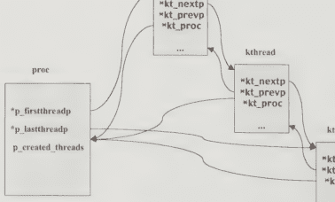

从 HP-UX 11.1 开始，`kthread` 表现在是一个动态链表。与 `proc` 表一样，不再需要的条目会被放入空闲列表（而不是将其空间返回给内核内存分配区域），当空闲列表为空时，按需分配新条目，直至达到可调整的限制。

让我们查看 `kthread` 结构中感兴趣的字段，如清单 5.2 所示。

### 清单 5.2 `q4> 字段 struct kthread`

```c
These forward and reverse links are used to place a thread into an appropriate run or sleep queue
4   0   4   0 *   kt_link
4   0   4   0 *   kt_rlink
As we mentioned, each kthread has a direct pointer to its proc structure and its uarea
8   0   4   0 *   kt_procp
52  0   4   0 *   kt_upreg
SMP systems make use of this spinlock to synchronize access to this structure
12  0   4   0 *   kt_lock
Next we see forward and previous linkage pointers connecting all the active kthreads
16  0   4   0 *   kt_factp
20  0   4   0 *   kt_pactp
All the sibling threads of a single process are linked through these two pointers.
24  0   4   0 *   kt_nexttp
28  0   4   0 *   kt_prevp
All kthread structures are linked to a global kthread list
64  0   4   0 *   kt_global_kthread
Thread status and flag values for the thread (see enum kthread_flag in kthread_private.h)
32  0   4   0 enum4   kt_flag
36  0   4   0 enum4   kt_cntxt_flags
44  0   4   0 enum4   kt_stat
180 0   4   0 enum4   kt_flag2
184 0   4   0 enum4   kt_flag_tl
Waiting threads maintain a sleep wait channel pointer and a forward and reverse pointer into a wait list (used by I/O drivers)
48  0   4   0 *   kt_wchan
236 0   4   0 *   kt_wait_list
240 0   4   0 *   kt_rwait_list
In addition, a reference count, the most recent user mode priority, the current internal priority, a thread id number, the current scheduling policy, number of ticks left before a voluntary timeslice will be requested, and the mysterious kt_cpu weighting factor (covered later) are maintained
```

```c
72  0   4   0 int       kt_refcnt
76  0   4   0 int       kt_deactime
80  0   4   0 int       kt_sleeptime
84  0   2   0 u_short   kt_usrpri
86  0   2   0 u_short   kt_pri
124 0   4   0 int       kt_tid
196 0   4   0 u_int     kt_schedpolicy
200 0   4   0 int       kt_ticksleft
88  0   1   0 u_char    kt_cpu
```

还有用于 MP 负载平衡、信号处理和 IPC 服务的其他参数。

我们游览的下一站是 `vax` 结构。

## 进程的逻辑视图

为了促进可重定位代码的概念，编译后的程序针对逻辑内存映像图进行链接。对于 32 位窄模式应用程序，逻辑大小为 $2^{32}$，即 4 GB；对于 64 位宽模式应用程序，理论大小限制在 $2^{64}$，即 16 EB。1 在这两种情况下，逻辑图都被划分为四个等大的象限。这不是任意配置。它由底层 HP PA-RISC 硬件平台及其虚拟内存系统的设计决定。

我们在下一章讨论虚拟内存到物理内存的映射，但首先我们必须查看控制程序的各个内存对象在逻辑空间中的放置规则选项。图 5-4 说明了窄模式和宽模式程序映像的这一概念。

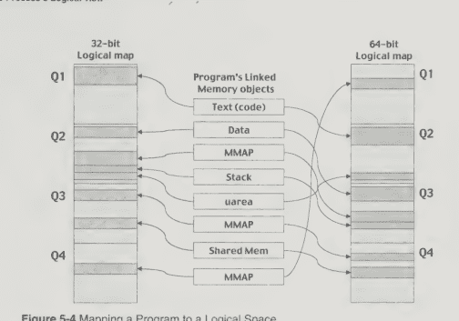

### 图 5-4 将程序映射到逻辑空间

单个程序对象模块的映射由臭名昭著的链接加载器完成。该程序通常随编译器一起编译，必须了解需要哪些模块以及在哪里找到它们。通常，可运行映像的构建由 `make` 实用程序和相应的 `Makefile` 控制。

在对可执行映像进行最终链接之前，编译器构建可重定位对象模块和一个骨架符号表。链接加载器必须确保链接后没有指向未链接到映像中的过程（或将在运行时通过共享库提供）的未定义外部引用。

链接加载器必须理解其正在构建可执行映像的目标系统架构。每个硬件平台处理虚拟内存段分配的方式都是独一无二的。实际上，程序的对象（代码和数据块）根据其功能、类型以及所需的级别安全进行分离。

大多数现代编译器将程序文本（指令代码）划分为一个对象，将程序数据划分为一个或多个额外对象。HP PA-RISC 系统根据页面框架映射到的象限，遵循访问权限和权限设置的某些默认值。

窄模式可执行文件和宽模式可执行文件以不同方式映射对象。这一变化是由于希望允许在同一机器上运行的 `narrow` 和 `wide` 进程共享数据对象的需求所必需的。为了实现这一目标，有必要为宽模式进程分配 `quadrant Q1` 用于共享对象（毕竟，窄模式进程的整个逻辑空间轻松容纳在宽模式进程的 `Q1` 的前 .01% 中）。

对于窄模式应用程序，默认设置如下：

- `Q1` 为共享只读访问，
- `Q2` 为私有读写，
- `Q3` 为共享读写，以及
- `Q4` 为共享读写。

对于宽模式应用程序，

- `Q1` 为共享读写访问，
- `Q2` 为共享只读，
- `Q3` 为私有读写，以及
- `Q4` 为共享读写。

如前所述，编译器必须意识到这些规则，但就像所有规则一样，可能存在例外！

你可能已经注意到，由于隐含的限制控制哪些程序对象可以放置在哪些象限中，程序内存对象的大小存在系统级限制。一般来说，单个对象不能大于其映射到的象限，并且在许多情况下，它必须与其他对象共享空间。在 64 位系统上，考虑到其当前硬件实现的 4 TB 象限大小，这目前并不是一个大问题，但对于具有 1 GB 象限大小的 32 位应用程序而言，这已成为某些应用程序的严重限制因素。

进程的私有数据象限的大小可能是一个问题，在某些情况下，系统中只有 1 3/4 个象限可供共享对象使用，这成为我们要运行的应用程序的限制因素（请记住，在窄内存映射的 Q4 中，最后 256 MB 保留给内存映射 I/O）。有一些行内技巧可以实施以解决某些限制。让我们变些魔术！

### SHARE_MAGIC, EXEC_MAGIC 和 SHMEM_MAGIC


我们要考虑的第一个编译器指令是 `SHARE_MAGIC`, `EXEC_MAGIC`。第一个是 HP-UX 编译器的默认值，第二个允许程序增加其可用的私有内存空间量。图 5-5 给出了这些选项逻辑映射的视觉对比。

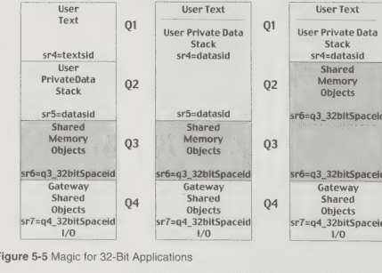

这些选项仅适用于窄程序（运行在 32 位或 64 位内核及硬件平台上）。

### `SHARE_MAGIC`

`SHARE_MAGIC` 指令是系统默认设置，无需向编译器或链接加载器传递特殊参数。此处使用的“share”（共享）一词指的是可执行映像应以将代码和数据分离到不同对象的方式构建。如果你希望允许多个相同的程序副本驻留在系统上，并让它们共享访问一个公共文本对象，从而降低整体系统内存利用率，那么这是必要的。这通常被称为多进程共享代码访问模型，并在大多数现代操作系统中实现。

在此模型中，各种内存对象根据默认访问设置分配到各个象限。程序的数据以及可能的空引用解除保护页面被放置在 Q1。从最低偏移量开始，Q2 包含进程的私有数据，由程序的已初始化数据、未初始化数据（或 BSS，这是一个古老的主机术语：按符号存储的块）以及进程堆空间的起始部分组成（可以使用如 `malloc()` 等调用在此处为运行中的进程分配额外的数据存储区域）。`uarea` 位于 Q2 的最高偏移量附近，从该位置向私有数据区回溯，我们遇到了进程的堆栈，其中包含一个“红区”（red zone）以及进程私有堆栈区域的空间。接下来，我们找到了任何私有内存映射对象。堆向上增长，映射向下增长，直到没有剩余空间为止。我们提到的红区是位于堆栈高地址端的一种缓冲区：此地址空间对进程是禁止访问的。如果发生堆栈溢出，内核必须终止该进程，红区空间在终止过程中由信号代码使用。

多个可调整的内核参数控制位于 Q1 和 Q2 中对象的大小。

- `maxtsiz` 限制 32 位进程的文本对象；默认值为 16384 页。
- `maxtsiz_64bit` 限制 64 位进程的文本对象；默认值为 16384 页。
- `maxdsiz` 限制 32 位进程的私有数据对象；默认值为 65536 页。
- `maxdsiz_64bit` 限制 64 位进程的私有数据对象；默认值为 65536 页。
- `maxssiz` 限制 32 位进程的堆栈对象；默认值为 2048 页。
- `maxssiz_64bit` 限制 64 位进程的堆栈对象；默认值为 2048 页。

如您所见，这些默认值相当保守。设置这些限制以及其他可调整参数的原因是为了让内核对其内部数据表需要分配的空间量有一个最佳猜测/模式。它随时可以根据需要分配更多页面，但在系统启动时从一个合理的数量开始总是好的。

Q4 和 Q3 象限用于共享库文本、共享内存、共享内存映射文件和其他共享对象。首先分配 Q4 空间，然后是 Q3（此顺序是在 HP-UX 10.0 版本中确立的；在早期版本中，先使用 Q3，然后使用 Q4）。

### `EXEC_MAGIC`

好的，如果你的进程数据无法放入分配的单个象限中，那么也许你需要一点执行魔法！

`EXEC_MAGIC` 指令改变了一些事情。我们注意到的第一件事是，进程的私有数据紧跟在其文本结束后的位置开始。在大多数情况下，程序不需要整个象限来容纳其文本对象（如果你试图打印出产生千兆字节机器码的程序的源代码，或者试图调试它时，我肯定不希望自己待在那种代码旁边）。因此，大多数进程在它们的第一个象限中有相当多的未使用空间。`EXEC_MAGIC` 指令允许进程利用这些空间。一般来说，这将私有数据空间增加到大约 1.9 GB（取决于 `text` 对象、`stack` 和 `varea` 的大小）。这个选项的一个有趣副作用是，进程的文本现在是可写的；如果你想尝试编写自修改代码（绝对不适合普通程序员！），这是一种可以探索的方法。

为了解决这个困境，惠普在 HP-UX 10.0 中引入了虚拟地址别名实践。`EXEC_MAGIC` 进程的物理文本页框架由内核映射到两个唯一的虚拟地址。这允许多个相同的程序实例共享访问公共物理页框架。由于这些页面映射到不同的“私有”虚拟象限，因此必须有一种机制来避免如果一个进程线程尝试写入该页框架时造成的损坏。这个问题通过一种称为 `read-only aliasing`（只读别名）的技术来处理。如果任何共享物理页框架的进程尝试写入，则称为 `copy-on-write`（写时复制）的内核机制只会创建物理页框架的一个重复副本，并将写入者的虚拟页面重新链接到该副本上。通过这种方式，只要我们只从页面读取，就可以避免数据损坏，并且我们可以享受共享文本页面的好处，从而减少整体内存压力（这总是件好事！）。为这种行为付出代价。我们现在将私有数据放入 Q1，并且需要更改访问权限为私有读写。在 HP-UX 10.0 之前，这意味着使用此指令编译的程序不允许在共享文本模式下运行：同一程序的两个实例需要在内存中放置文本的两个副本。

在 `EXEC_MAGIC` 的情况下，四个象限可以映射到四个不同的空间（其访问由四个空间寄存器控制，`sr4` 到 `sr7`）。对于 `EXEC_MAGIC` 进程，`Q1` 和 `Q2` 必须位于同一个虚拟空间（`sr4` 和 `sr5` 将具有相同的值），允许数据对象跨越 Q1/Q2 边界而无需不连续性。象限 `Q3` 和 `Q4` 可以分别映射到不同的空间。

如果你的大小问题不在于私有数据空间；相反，你只是需要更多可共享内存。`SHMEM_MAGIC` 可能就是你在寻找的技巧。

### `SHMEM_MAGIC`

`SHMEM_MAGIC` 指令与 `EXEC_MAGIC` 非常相似，因为它将文本和数据对象组合在进程的 Q1 中。主要区别在于 Q2 不包含私有数据，而是被转用于额外的共享对象。只运行一个编译了此选项的进程没有太大好处——毕竟，它能与谁共享这个新空间呢？

再次参考图 5-5，我们看到使用此选项时，所有四个象限都可以映射到不同的虚拟空间。通常，此选项与另一个相对较新的选项 Memory Windows（内存窗口）一起使用。我们稍后会研究内存窗口。

### 更多魔法

除了我们提到的三个魔法指令外，还有几个其他指令。专为 HP-UX 设计的编译器也理解 `DEMAND_MAGIC` 和 `SHL_MAGIC` 指令。这两个指令默认都是启用的，并涉及按需页面加载以及位于运行时定位和链接的共享库的使用问题。我们还有 `RELOC_MAGIC` 用于以仅重定位模式加载程序，`AR_MAGIC` 用于链接存档库，以及 `DL_MAGIC` 用于包含动态库。我们的魔法课程到此结束。让我们继续讨论内存窗口。

## 内存窗口

内存窗口系统在 HP-UX 11.0 中作为补丁（`PHKL_13810` 和 `PHCO_13811`）引入，并且是 HP-UX 11.1 版本的一部分。图 5-6 显示了一个实现了内存窗口的系统 VAS 的简化示例。要在系统上启用内存窗口，内核可调整参数 `max_mem_window` 必须设置为所需用户窗口数。内核将此值加 1，并在系统启动期间初始化一个内存窗口数组结构。

**注意** 内存窗口仅可用于 32 位窄应用程序内存映射。

内核指针 `*memWindows` 指向由类型为 `vas_window` 的单独窗口数据结构组成的数组。让我们看看清单 5.3 中的这个结构。

**清单 5.3** `q4> fields struct vas_window`

前三个字段用于映射象限 Q2（在 `SHMEM_MAGIC` 的情况下）

```
0   0   4   0   u_int   q2_32bitSpaceid
4   0   4   0   u_int   q2_32bitSpaceidInitial
8   0   4   0   *       q2_32bitMap
```

接下来的两个字段用于映射象限 Q3

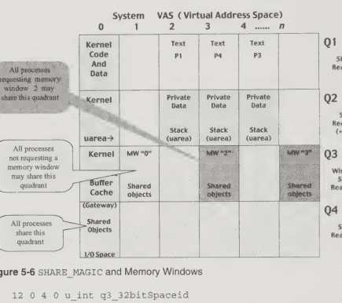

```c
12 0 4 0 uint q3_32bitSpaceId
16 0 4 0 * q3_32bitMap
The "key" is required to join a window
20 0 4 0 int key
This keeps track of how many processes are currently using the window.
24 0 4 0 int refCnt
This value keeps track of the last process to join the window (useful in debugging)
28 0 4 0 int lastSetpid
```

数组中的第一个窗口被保留作为全局窗口。它的 `Q3`（以及 `Q2`）空间 ID 是系统默认值，供所有未请求特定内存窗口分配的进程使用。

第二个窗口保留给 `q3_private` 进程使用（稍后将在讨论中详细介绍）。其余的窗口可通过系统调用或用户命令请求，直至达到配置的限制。


进程加入窗口有两种机制：`纯继承`指的是一个进程的子进程，该子进程继承了其父进程的窗口关联关系；`键关联`指的是进程要么执行了 `_set_mem_window()` 系统调用，要么有人代表它执行了 `setmenvindow` 用户命令。

从根本上说，当进程加入内存窗口时，其 **Q3**（对于 `SHMEM_MAGIC` 进程还包括 **Q2**）空间 ID 是从相应的 `vas_window` 数组元素中获取的。你可能已经注意到 `vas_window` 结构体中的 `*q2_32bitMap` 和 `*q3_32bitMap` 指针。这些指针指向用于管理窗口象限内地址范围可用性的资源映射。内核必须跟踪象限中哪些区域正在使用，哪些区域是空闲的，以便为处理新进程请求分配空间。资源映射方法已在第 3 章“内核：基本组织”中介绍过。

值得注意的是，在启用内存窗口的系统上，共享对象分配的基本算法会稍作修改。由于现在只有一个真正的全局象限（Q4），且其可用空间略低于 75%（请记住网关页和在此映射的 256 MB I/O 空间），共享库空间的分配成本略高。

对于非内存窗口系统，共享对象的分配例程如下：

- 1. 尝试在 **Q4** 中为对象查找空间（无论对象类型如何）。
- 2. 如果步骤 1 失败，则查找 **Q3**（对于 `SHMEM_MAGIC` 则在 **Q2** 中查找）。
- 3. 如果步骤 2 失败，则返回错误。

对于启用内存窗口的系统，新的例程如下：

- 1. 如果对象是共享库，尝试将其放入 **Q4**；如果 **Q4** 没有空间，则尝试 **Q3**（对于 `SHMEM_MAGIC` 则为 **Q2**）。
- 2. 如果不是共享库，则将其放入 **Q3**（对于 `SHMEM_MAGIC` 则放入 **Q2**）。
- 3. 如果步骤 2 失败，则将其放入 **Q4**。
- 4. 如果步骤 3 失败，则返回错误。

内核使用的策略由 `allocAddrPolicy` 控制，而它又是根据 `max_mem_window` 的值设置的。（如果 `max_mem_window = 0`，则禁用内存窗口，我们使用第一种策略；如果 `max_mem_window = 1`，则启用内存窗口，我们使用第二种策略。）除了可调参数外，内核参数 `maxMemWindow` 也被维护并设置为 `max_mem_window` 加 1（这为第二个 `q3_private` 窗口预留了空间）。

```
To use q4 to monitor memory window usage,
  q4> load struct vas_window from memWindows max maxMemWindow
  q4> printf rt -tx key refCnt
```

我们已提及 `q3_private` 这一术语几次——现在我们将深入探讨这一新选项。

### Q3 私有地址空间

随着 HP-UX 11.0 补丁 PHKL_20224 的发布以及后续版本，在 64 位 PA-RISC 2.0 硬件上由 64 位宽内核控制的 32 位窄应用程序有一个额外的映射选项可用（32 位内核将简单忽略此对大型私有数据的请求）。图 5-7 说明了此选项的基本原理。

经典的窄进程映射将 Q3 和 Q4 保留给共享对象，但如果进程需要异常大量的私有数据空间怎么办？由于有四个象限的硬性限制，增加进程私有数据空间的唯一方法是以牺牲其访问系统共享空间的能力为代价。

实现此新功能需要使用 `chattr` 命令行实用程序。`chattr` 添加了两个新选项：`+q3p <enable/disable> <process-name>` 和 `+q4p <enable/disable> <process-name>`。在发出这些命令之前，必须调整内核以允许新的、更大的私有数据大小，这是通过调整长期存在的参数 `maxdsiz` 来实现的。

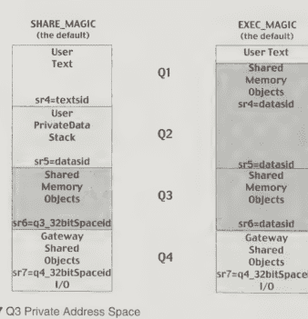

图 5-7 Q3 私有地址空间

对 `q3_private` 进程还有几项规定。即使是在 Q4 中，此类进程也不能共享未由另一个 `q3_private` 进程创建的对象，除非该对象是由非 `q3_private` 进程使用 `IPC_GLOBAL` 或 `MAP_GLOBAL` 标志创建的，这可能需要进行重新编译。如果重新编译不可行，那么所有需要在 Q4 中共享对象的进程都只需要变成 `q3_private` 进程（`chattr +q3p enable <process-name>`）。

在少数极端情况下，你可能希望进一步扩展进程的私有数据空间。这可以通过调用 `chattr` 的 `+q4p` 选项来完成（但必须极度谨慎且确实需要！）。使用 `+q4p` 预设已实现 `+q3p` 规则。这是一个极端的决定，因为在此模式下运行的进程将无法访问任何共享对象（I/O 空间和网关页除外）。

请注意，扩展数据空间的空间 ID 是相同的。实际上，这意味着逻辑数据大小可以超过以前的限制。虽然这带来了一些缓解，但事情并非全都有利可图。由于网关页的固定位置，即使调用了 `+q4p`，单个数据对象也不能延伸过第四个象限的开头。为了使用 Q4 中的额外空间，进程必须使用 `mmap (MAP_PRIVATE)` 或 `malloc ()` 进行私有内存映射调用，后者已被修改以解决此限制。

作为一个观察，如果你需要利用这些选项使进程适应 32 位窄环境，也许你的进程在告诉你一些事——比如，“我需要成为一个 64 位宽进程！”

### 构建逻辑映射

既然我们已经对进程对内存的视图的清晰度有所混淆，我们需要停下来考虑这些不同的映射策略如何与特定进程相关联。程序文件的标题包含有关编译期间使用的各种魔术选项的信息；内核在设置进程和 kthread 环境时会考虑这些因素。图 5-8 展示了逻辑地址空间和虚拟地址空间的模型。

我们讨论过的各种选项规定了进程的各个内存对象在虚拟映射中的分配位置。处理共享和隐私等问题是内核的职责。内核还必须跟踪什么在哪里以及属于谁；这些问题将在第 6 章中涵盖。目前，我们的注意力应转向将特定虚拟内存对象映射到进程逻辑映射的问题。为了理解这是如何做到的，我们必须查看内核创建的 `vas` 和 `preion` 结构，它们在进程创建时（通过 `fork ()` 或 `vfork ()` 系统调用）链接到进程的 `proc` 和 `kthread` 结构。让我们看看 `vas`！

### vas

`vas`（虚拟地址空间）结构体仅仅是 `preigion` 结构体列表的头，这些结构体进而定义了构建逻辑映射所需的各种内存资源的类型和位置。System VAS（虚拟地址空间）

| 逻辑映射 | 0 | 1 | 2 | 3 | ... | n |  |  |

|:--|:--|:--|:--|:--|:--|:--|:--|:--|

| Q1 | 文本 | 内核空间 | | 区域 | | | Q1 | 共享只读 |

| sr4=3 | | | | | | | | |

| | | | | | | | | |

| | | | | | | | | |

| Q2 | 数据 | | 区域 | | | | Q2 | 私有读/写 |

| sr5=2 | mmap | | 区域 | | | | | |

| | 堆栈 | | 区域 | | | | | |

| | uarea | uarea | | | | | | |

| | | | | | | | | |

| | | | | | | | | |

| Q3 | mmap | 动态缓冲区缓存 | | 区域 | | | Q3 | 共享读/写 |

| sr6=4 | 共享内存 | | | 区域 | | | | |

| | | | | | | | | |

| | | | | | | | | |

| Q4 | 网关 | 网关 | | | | | Q4 | 共享读/写 |

| sr7=0 | mmap | 区域 | | | | | | |

| | | | | | | | | |

| | | i/o | | | | | |

图 5-8 进程逻辑地址空间

进程的逻辑地址空间（见图 5-9）。现代编译器通过加载程序的离散组件到连续的地址块并将它们链接在一起来构建可执行映像。如果你希望实现共享库、内存映射文件、共享文本和共享内存——所有这些都是 HP-UX 内核的功能——这种方法就是必需的。

为了澄清并等同几个术语，连续寻址的逻辑内存块被映射到虚拟页对象。这些也称为内存区域。区域一词在 UNIX 内核历史中由来已久，并存在于几乎所有 UNIX 和 Linux 实现中。


使用 `vas` 结构体的一个例子发生在物理页错误时。内核的页错误处理程序必须定位缺失页所管理的特定内存区域（这将在第 6 章中更详细地讨论）。内核知道页错误发生时哪个 `kthread` 正在执行。`kthread` 结构体提供指向相关 `proc` 结构体的直接指针，进而提供指向 `vas` 结构体的指针，该指针位于定义进程逻辑地址空间的区域链表头部。接下来，页错误处理程序必须搜索区域结构链，以找到包含错误页地址的区域。一旦找到正确的区域，页帧特定信息包含在内核管理的区域结构中，该结构由进程的区域指向。为了加速这些链接结构的搜索，内核使用四级跳表。

当区域被添加到进程的 `vas` 链中时，它们被分配一个 0 到 3 之间的跳过级别。级别确定是伪随机的；一般规则是我们四

被分配为级别 0 的可能性是级别 1 的四倍，被分配为级别 1 的可能性是级别 2 的四倍，被分配为级别 2 的可能性是级别 3 的四倍。即使遵循这一经验法则，在内核分配之前，你也无法预测任何特定 `preig` 将拥有哪个级别。我们在本书前面讨论过跳表的机制。

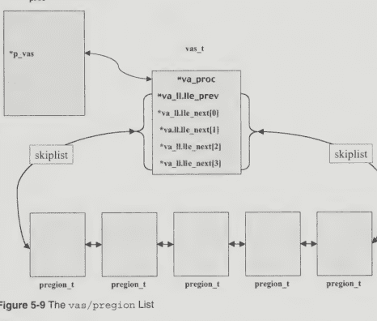

让我们从跳表指针开始检查 `vas` 结构（列表 5.4），注意有四个前向指针和一个单独的 `prev` 或反向指针。

### 列表 5.4 q4_fields struct vas

`va_hilevel` 记录该特定区域当前使用的最高跳过级别。

```
0   0 4 0 *    va_ll.lle_next[0]
4   0 4 0 *    va_ll.lle_next[1]
8   0 4 0 *    va_ll.lle_next[2]
12  0 4 0 *    va_ll.lle_next[3]
16  0 4 0 *    va_ll.lle_prev
20  0 4 0 int  va_hilevel
```

接下来是引用计数、共享驻留页帧的近似计数、私有驻留页帧的近似计数，以及交换区中私有页帧的近似计数。

```
40  0 4 0 int  va_refcnt
44  0 4 0 int  va_rss
48  0 4 0 int  va_prss
52  0 4 0 int  va_swap
```

为了快速访问，保留了指向 `proc` 结构的指针、指向内存映射文件 `vnode` 的指针，以及指向进程凭证的指针。

```
56  0 4 0 *    va_proc
64  0 4 0 *    va_fp
96  0 4 0 *    va_cred
```

接下来是硬件依赖的信息。

```
100 0 4 0 u_int  va_hdl.hdl_textsid
104 0 4 0 u_int  va_hdl.hdl_textpid
108 0 4 0 u_int  va_hdl.hdl_datarid
112 0 4 0 u_int  va_hdl.hdl_datapid
116 0 2 0 u_short va_hdl.v_hdlflags
120 0 4 0 int    va_ki_vss
124 0 1 0 u_char va_ki_flag
125 0 1 0 u_char va_stLocked
```

用户空间虚拟内存总量。

```
128 0 4 0 int  va_ucomm
```

运行环境信息。

```
132 0 4 0 enum4 va_runenv.r_machine
136 0 4 0 enum4 va_runenv.r_arch
140 0 4 0 enum4 va_runenv.r_os
144 0 4 0 enum4 va_runenv.r_amodel
148 0 4 0 enum4 va_runenv.r_magic
```

大页特定信息。

```
152 0 4 0 int  va_lpgg_env.lpgg_data_size
156 0 4 0 int  va_lpgg_env.lpgg_text_size
160 0 4 0 int  va_lpgg_env.lpgg_next_brk_inc
164 0 4 0 int va_lgpg_env.lgpg_user_brk_cnt
168 0 4 0 int va_lgpg_env.lgpg_next_stk_inc
```

内存窗口信息以及私有和共享页帧的内存引用组信息（进程可能在此处指向 Q3 寄存器值的特定内存窗口，以及可能的 Q2 空间寄存器）。

```
172 0 4 0 int va_winid
176 0 4 0 * va_winMap
180 0 4 0 * va_priv_mrg
184 0 4 0 * va_shar_mrg
```

让我们把讨论转移到 `pregion` 上。

### `pregion`（伪区域）

这是一个讨论伪结构含义的好时机。如前所述，内存管理可以从两个角度来理解。一个进程并不关心一个页是私有的还是共享的——它只是希望在代码执行需要其数据或文本时该页可供使用。从进程的角度来看，`vas` 应该提供到单个页帧管理数据的直接连接，但实际操作并非那么简单！

内核在内存管理方面也有其视角。我们将在第 6 章中全面探讨这一观点，但现在必须考虑内存区域的基本概念。区域是一组连续的虚拟页帧范围，以一致的访问权限和特权方式使用。为了提高内存利用效率并提供对内存对象的各种类型共享访问，开发出了私有区域和共享区域的概念。

在区域结构中保持一个引用计数，以跟踪当前指向它的 `pregions` 数量。如果此引用计数减少到零，内核将释放该区域结构及其控制的所有内存资源。

区域共享是通过在内核中创建一个额外的抽象层来实现的。为了声明对某个区域的访问，一个被称为 `pregion`（或伪区域）的结构被链接到进程的 `vas` 链中。进程中链中的每个 `pregion` 都指向映射到内核 VAS 的特定区域（见图 5-10）。

来自多个进程的 `Pregions` 可以指向同一个内核区域，从而在内核控制下创建一个共享内存对象。一个区域只知道它包含的页帧总数、它们在 kernel VAS 映射中的位置、它是私有还是共享，以及每个页帧的具体状态和位置。这些页面的实际用途（无论是文本、数据、内存映射还是共享内存）在此层级是未知的。

相反，`pregion` 从进程的角度维护了一个详细的属性列表，包括它链接到进程逻辑内存的位置、使用类型、大小和当前状态。

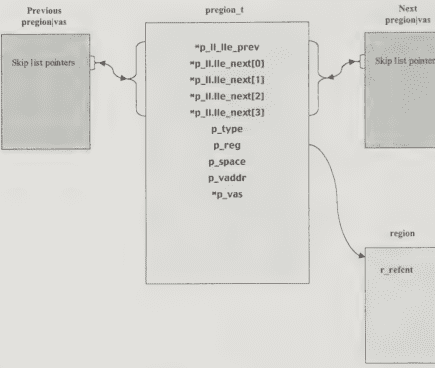

**图 5-10 pregion 结构**

让我们检查 `pregion` 字段（列表 5.5）。

### 列表 5.5 q4 fields struct pregion

```
与 vas 一样，pregion 结构中的第一个条目
保持跳表指针
0 0 4 0 *    p_ll.lle_next[0]
4 0 4 0 *    p_ll.lle_next[1]
8 0 4 0 *    p_ll.lle_next[2]
12 0 4 0 *   p_ll.lle_next[3]
16 0 4 0 *   p_ll.lle_prev
接下来是枚举标志
20 0 4 0 enum4 p_flags
每个区域根据其用途被分配一个类型号
24 0 4 0 enum4 p_type
类型号和枚举如下：
1=PT_UAREA  每线程内核管理区
2=PT_TEXT   共享，只读指令文本
3=PT_DATA   私有，读写进程数据区
4=PT_STACK  私有，读写进程堆栈区
5=PT_SHMEM  共享，读写内存区域
6=PT_NULLDREF 共享，只读空指针解引用
7=PT_IO 共享，读写 I/O 内存映射区
8=PT_MMAP 共享或私有，读写内存映射文件
9=PT_GRAPHLOCKPG 帧缓冲区锁页（某些图形设备使用）
10=PT_ANON SHMEM 共享，读写匿名共享内存
11=PT_GRAPDMA 图形 DMA 区域
12=PT_RESTACK RSE 堆栈（仅在 IA64 上的 HP 仿真）
13=PT_GATEWAY 共享，只读系统调用网关页
接下来，指向内核区域结构的指针，区域的虚拟空间，以及区域的起始虚拟地址
28 0 4 0 			p_reg
32 0 4 0 u_int 		p_space
36 0 4 0 			p_vaddr
接下来的 5 个参数由分页系统使用（稍后详细介绍）
40 0 4 0 int		p_off
44 0 4 0 int		p_count
48 0 4 0 int		p_agereamin
52 0 4 0 int		p_agescan
56 0 4 0 int		p_stescal
指向此 pregion 链接到的 **vas** 的直接指针
60 0 4 0 			p_vas
如果这是 **PT_UAREA**，指向拥有者 **kthread** 的直接指针
64 0 4 0 			p_thread
系统中所有的 pregrons 都由这两个指针双向链接；当内存压力触发分页系统变得活跃时，将搜索此主列表。
68 0 4 0 			p_fwd
72 0 4 0 			p_back
```


接下来，我们检查 `urea`。

#### `urea`

此快照包含通用寄存器、控制寄存器、程序计数器（在 PA-RISC 的情况下为空间和偏移量队列）、处理器状态字和空间寄存器的副本。该快照被称为进程控制块，或 **`pcb`**。任何多任务操作系统的 key 要素之一是在各个执行线程之间切换的能力。这个基本功能被称为上下文切换。术语 **context** 指的是特定线程执行时机的机器状态。如果我们暂停特定线程的执行，并在以后恢复，我们需要在暂停执行的瞬间对正在运行该线程的处理器的寄存器进行快照，并在想要恢复时将其返回到确切的此状态。

内核必须有一个安全的地方来存储处于睡眠或阻塞状态的进程 *pcb*，直到需要切换回处理器的寄存器进行上下文切换。为此，为每个进程线程创建了一个称为 *uarea* 的内存区域（见图 5-11）。

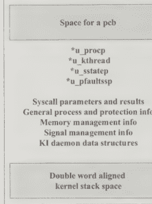

* uarea * 对进程的线程不可见，并且在激活线程（使其成为特定处理器上的运行线程）时映射到内核空间。当线程发起系统调用或内核抢占线程以处理中断时，它已经将当前线程的 *uarea* 映射到内核的内存视图。如果内核确定在返回用户空间之前需要执行上下文切换，则当前线程的 *pcb* 被存储在其 *uarea* 中。接下来，内核确定切换到哪个线程，并在转换到用户模式之前从该线程的 *uarea* 中恢复 *pcb*。管理这种“黑魔法”的内核例程称为 *switch*()，是内核可能执行的最昂贵但非常必要的操作之一！

* uarea * 由几个关键部分组成（见图 5-11）。第一部分是 *user* 结构，其中包含 *pcb* 和其他线程特定的内核管理数据的空间；第二部分是内核堆栈空间。每个线程必须为内核例程、驱动程序以及通过系统调用接口请求的内核服务提供一定量的堆栈空间。

试想一下两个独立线程向同一内核服务发出请求的场景，可能是磁盘读取或写入请求。当这两个线程进入网关页并从用户空间转换到内核空间时，它们实际上是以两个不同的程序上下文运行内核中完全相同的一组指令。

如果请求的服务需要进行过程调用（且内核采用了一套庞大的库例程集合），则必须分配一个新的堆栈指针，以容纳局部数据和寄存器溢出区域。如果我们能保证所有对内核的调用都以先进后出的顺序完成，那么就可以使用一个简单的线性堆栈，但实际情况可能并非如此。如果请求的磁盘事务以错误的顺序完成，对公共堆栈的展开可能会导致数据损坏！

为避免这种情况，每个请求内核服务（系统调用）的线程都应提供自己的本地化内核堆栈（或 kstack）空间。由于线程的 uarea 在线程运行时已经被映射到内核空间中，因此在此区域末尾添加最小 kstack 就是一件简单的事情。对于窄内核（32位），uarea 的大小被设定为四个页框（一个用于用户结构，三个用于 kstack）。对于宽内核（64位），则为八个页框（两个用于用户结构，六个用于 kstack）。

让我们检查用户结构中的 u_pcb 部分（清单 5.6）。

#### 清单 5.6 q4 字段结构 uarea

```
The u_pcb starts with storage space for the general registers, r1 through r31 (there is no need to store the value of r0 considering that it is the permanent zero source register!)
0 0 4 0 u_long                u_pcb.u_r1
  -  -  -  -
120 0 4 0 u_long              u_pcb.pcb_r31
Next, the 8 space registers, sr0 - sr7, are saved
124 0 4 0 u_long              u_pcb.pcb_sr0
  -  -  -  -
152 0 4 0 u_long              u_pcb.pcb_sr7
Control register cr1 and registers cr8 through cr31 are saved here. Control registers cr2 - cr7 are reserved for use by the hardware and not included as part of a thread's context
156 0 4 0 u_long              u_pcb.pcb_cr0
160 0 4 0 u_long              u_pcb.pcb_cr8
  -  -  -  -
252 0 4 0 u_long              u_pcb.pcb_cr31
Room is also allocated for the threads pc, psw, ipsw, pcsqe, pceqe, and ksp
256 0 4 0 u_long              u_pcb.pcb_pc
260 0 4 0 u_long              u_pcb.pcb_psw
264 0 4 0 u_long              u_pcb.pcb_ipsw
268 0 4 0 u_long              u_pcb.pcb_pcsqe
272 0 4 0 u_long              u_pcb.pcb_pceqe
276 0 4 0 u_long              u_pcb.pcb_ksp
The floating-point registers fr0 through fr31 come next
280 0 8 0 double              u_pcb.pcb_fr0
  -  -  -  -
528 0 8 0 double              u_pcb.pcb_fr31
```

`pcb` 以若干涉及信号系统和交换的杂项参数结束。在 `pcb` 之后，用户结构包含指向线程的 `proc` 结构、`kthread`、已保存状态以及最近已保存状态的指针。

| 584 0 4 0 * | u_procp |

| --- | --- |

| 588 0 4 0 * | u_kthreadp |

| 592 0 4 0 * | u_statep |

| 596 0 4 0 * | u_pfaultssp |

用户结构的其余部分包含一系列系统调用参数（包括线程最近发起的系统调用所传递的参数，这在调试崩溃转储时非常有用）、进程和保护信息、杂项内存管理信息、各种信号管理参数、KI 守护程序指标，最后但同样重要的是包含提供内核堆栈空间的联合体。

要使用 `q4` 检查特定线程的 `uarea`，首先找到其 `kthread` 结构：

`q4> load struct preg from kt_upreg` ← 加载 urea 的 pregion 结构

`q4> print -x p_space_p_vaddr` ← 打印虚拟地址信息

`q4> load struct user from <p_space_p_vaddr> from the previous print statement`

#### 额外资源指针

除了本章中提到的各种结构外，`proc` 结构还提供指向进程的文件描述符和内核信号结构的指针。这些将在本书后续章节中介绍。

### 进程/线程调度

现在，我们已经了解了用于定义进程逻辑空间和分配系统资源的基本结构，我们必须考虑线程执行调度的任务。这是内核的主要职责之一，需要大量的系统资源。传统上，UNIX 被设计为一个负载平衡操作系统：也就是说，内核试图以公平的方式将系统资源的访问分配给所有活动线程。虽然这是一个高尚的目标，但有时你可能希望某些线程获得内核更大（或更小）的关注份额。许多操作系统通过为任务分配优先级来实现这一点。UNIX 有优先级，但其工作方式可能与你想象的略有不同。

HP-UX 使用优先级将线程放入适当的运行队列。当处理器需要确定下一步做什么时，它只需前往其最强的活动运行队列，并切换到队列中的第一个线程。线程在运行队列中的位置可能会受到内核引起的优先级衰减、“自愿”时间切片（轮询队列）以及来自更强队列的被唤醒线程抢占的影响。在本节中，我们将解释各种调度器，并介绍 HP-UX 调整线程优先级的“神秘公式”。

在讨论优先级时，一种自然的倾向是以数字来思考。我们鼓励你改为仅考虑相对强度：一个优先级比另一个更强还是更弱？内核中正在使用几种不同的优先级方案。对于某些方案，零是最强的可能优先级，而对于其他方案，它是最弱的！（见表 5-1。）

| 调度器 | 策略 # | 策略标签 |

|---|---|---|

| HP-UX 分时 | 2 | SCHED_HPUX |

| | | SCHED_TIMESHAKE |

| | | SCHED_OTHER |

| | 8 | SCHED_NOAGE |

| HP-UX 实时 | 6 | SCHED_RTPRIO |

| | 0 | SCHED_FIFO |

| POSIX 实时 | 1 | SCHED_RR |

| | 5 | SCHED_RR2 |


现代 UNIX 系统的挑战在于将各种优先级方案整合到一个连续的模型中。HP-UX 使用三种主要调度方案的组合：传统的 UNIX 分时、HP 实时和 POSIX 实时方案。每种方案都将一个优先级范围映射到一系列运行队列；图 5-12 说明了这三种方案是如何合并成单个优先级连续体的。

每个运行队列都有内部和外部优先级值。POSIX 优先级给内核设计者带来了几个挑战。首先，POSIX 优先级的数量是一个可调参数；1 是最弱的优先级，随着数值增长到最大值 512，强度递增。对于其他现有的优先级方案，整数值越正，优先级越弱！这个难题通过将所有 POSIX 优先级的最大数量（512）加到现有的 HP 实时和分时优先级的数量（256）上来解决，从而得到新的 768 个可能值的总和。用于内部使用时，进程/线程优先级被分配一个 0 到 767 之间的值。等效的外部优先级使用内核宏计算，其范围在 −512 到 +255 之间。

要理解外部数值，我们需要稍微回顾一下 HP-UX 的历史书籍。早期版本的 HP-UX 只有 256 个优先级值——从 0 到 255，从最强到最弱——通过 `ps`、`top` 和 `glance` 等命令报告。遗留脚本和程序期望分时进程的优先级在 128 到 255 之间。为了保持这一标准并保护这些脚本和实用工具，需要开发一个外部数值方案。

决定将 POSIX 优先级报告为从 −1 开始递减到可调最大值 −512 的负整数值。这意味着以前外部报告为最弱优先级 255 的值仍然显示为 255。最强的 HP 实时优先级以前是 0，现在仍然是 0，而新的最强 POSIX 优先级报告为 −512。此模型的实现其实相当简单，因为 POSIX 实时优先级只是被反转并添加到此报告连续体的 −1 到 −512 范围内。这也保持了“数值越正，优先级越弱”的概念。

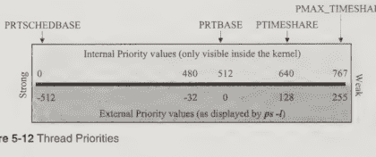

有若干内核参数与优先级系统相关：

- `PR_SCHED_BASE = 0`：最强内部优先级。
- `RT_SCHED_NUM_PRI_FLOOR = 32`：POSIX 队列的最小数量。
- `MAX_RT_SCHED_PRI = 512`：POSIX 队列的最大数量。
- `RT_SCHED_NUM_PRI_CEILING = ?`：可调的 POSIX 队列数量（默认为 32）。
- `PRT_BASE = 512`：最强 HP 实时优先级。
- `PTIMESHARE = 640`：最强分时优先级。
- `PMAX_TIMESHARE = 767`：最弱分时优先级。
- `pzero = 153`：不可中断睡眠上限。
- `puser = 178`：用户启动优先级的起始。
- `timeslice = ?`（默认为 10）：内核发起自愿上下文切换前，线程允许拥有的 10ms 滴答数。

由于优先级值根据其内部值存储在 `kthread` 结构（`kt_pri`）中，在查看转储或 `q1` 打印输出时，你可能需要进行转换。以下是两种方案之间的转换公式。

将内部优先级转换为外部优先级：

```
External-Priority = Internal-Priority − MAX_RT_SCHED_PRI
```

要将内部优先级转换为外部 POSIX 优先级（即在 `rt sched()` 系统调用或 `rt sched` 行模式命令中作为参数传递的优先级编号）：

> 外部 POSIX 优先级 = (MAX_RT_SCHED_PRI - 1) - 内部优先级

要将外部 POSIX 优先级转换为内部优先级：

> 内部优先级 = (MAX_RT_SCHED_PRI - 1) - 外部 POSIX 优先级

接下来，让我们检查调度方案。

### SCHED_TIMESHAKE 和 SCHED_NOAGE

经典的 UNIX 调度器在 HP-UX 中实现为 `SCHED_TIMESHAKE`。此策略有两个额外的别名：`SCHED_OTHER` 和 `SCHED_HPOX`。在图 5-13 中，我们介绍了时间片轮转调度器的基本原理，并展示了其在整体优先级系统中的位置。

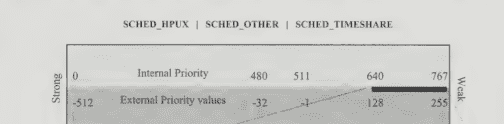

| | | HP-UX 时间片优先级 | 32 个队列，每个队列 4 个优先级 | | 252-255 |

|---|---|---|---|---|---|

| 128-131 | | | | | 255 |

| | | 系统、时间片 | | `PUSER` | 用户、时间片 |

| 128 | 延迟信号 153 | 154 唤醒以处理信号 177 | | | |

| `PZERO` | | | | | |

##### 图 5-13 线程优先级

此调度策略由 32 个运行队列组成。每个队列包含四个顺序优先级值。最强的队列处理优先级在 128 到 131 之间的线程，而最弱的队列处理优先级在 252 到 255 之间的线程。每个队列的四个优先级是早期 UNIX 开发工作（在旧版 Digital Equipment Corp. 硬件平台上完成）遗留下来的部分。系统设计用于处理 32 个独特的队列；这一数字贯穿了 UNIX 内核设计。当决定将优先级范围增加到 8 位值（0 到 255）时，现有的 32 个队列被分配到数值范围的上半部分，以便后续引入更高的优先级方案。

#### 系统级和用户级优先级

总体而言，`SCHED_TIMESHAKE` 队列分为两组。外部优先级 128 到 177 是系统级优先级；178 到 255 是用户级优先级。系统参数 `puser` 设置用户级的基础优先级（不应更改此值！）。系统级优先级保留给特权内核例程和代表用户线程运行的系统调用代码。

分配了用户级优先级之一的线程，其值可能会根据当前系统资源利用率水平或线程的行为模式由内核进行调整（稍后会有更多说明）。这种由内核进行的调整被称为*优先级衰减*。系统级优先级被称为非衰减型；也就是说，其优先级不会被内核调整。

系统级的线程可能落入两个额外的细分类别：那些将从睡眠队列唤醒以处理传入信号的线程，以及那些将延迟信号处理直到阻塞源唤醒它们的线程。你是否曾尝试用 `kill -9` 终止一个进程，但随后立即运行 `ps` 时却发现它仍然存在？如果是这样，那你可能正在观察一个处于不可中断范围（128 到 `pzero`）睡眠中的线程。

考虑一个内核驱动程序，它已设置接口卡以在磁盘上的数据块和当前映射到线程数据空间的物理地址范围之间执行直接内存访问（DMA）传输。如果允许在向该线程发送信号退出之前完成 DMA，内核可能会尝试将一个物理页框归还给空闲链表，而此时 I/O 接口正在影响其数据传输——这是一个令人不安的想法！出于这种原因，睡眠线程可能被放置在一个低于 `pzero` 的优先级，以确保 DMA 事务完成，并且相关的接口向内核 I/O 系统提交外部中断以唤醒睡眠线程（也称为解除线程阻塞）。当线程唤醒时，信号将在从内核空间转回用户空间之前被捕获，这在大多数情况下会导致进程及其线程的终止。内核参数 `pzero` 是延迟信号投递直到唤醒的组的上限。

#### HP-UX 调度中的时间基础：Tick

HP-UX 中的时间由内核以*tick*为单位进行测量。一个 tick 定义为 10 ms。CPU 的硬件时钟信号由一个可配置的计数器电路监控。计数器被设置为使处理器内部中断每 10 ms 发生一次。此中断由名为 `hardclock()` 的内核例程处理。每当硬时钟运行时，其运行期间发生的 tick 数量存储在线程的 `proc` 结构中的 `p_ticks` 字段中。此计数器电路也是网络时间协议服务的基础，系统通过它将其时间戳与另一个“服务器”系统进行比较。系统要么是对等的，要么属于不同的层级；较低层级的系统会对其计数器接口进行微调，以有效地加速或减速其 tick。这些调整会不断细化，直到较低时间层级的系统与较高层级的服务器同步。

#### 时间片轮转或循环队列

当同一个运行队列中存在多个线程时，通常观察到轮转调度方案。内核可调参数 `timeslice` 确定线程在重新排入其队列末尾之前允许运行的 tick 数量。`timeslice` 的默认值是 10 个 tick，即 100 ms。每个线程在其 `kthread` 结构中的 `kt_ticsleft` 中维护其剩余 tick 的计数，直到下一个时间片。

每次硬时钟中断发生时，每个处理器上正在运行的线程的 `kt_ticsleft` 都会减 1 并与 0 进行比较。如果线程的时间片已到期，则当前线程的 `kt_ticsleft` 重置为 `timeslice`，并且它从其运行队列的前端移动到末尾。实际上，同一运行队列中的线程以轮转方式轮流运行。如果一个队列中只有一个线程且其时间片到期，它只是被重新排入其自身队列的前端。内核意识到这种情况，并停止执行完整的上下文切换操作，而是简单地继续执行该线程。线程的 `kt_ticsleft` 被重置，倒计时重新开始，以防有新线程添加到队列中。

#### 优先级衰减、nice 和用户级优先级

HP-UX 源代码中包含一条有趣的注释，内容大致如下：


> 线程的优先级根据一种由内核黑客传承下来的神秘公式进行调整，作为口口相传的 UNIX 传统的一部分。

我们不声称自己是睿智的内核黑客，但我们希望对此稍作澄清。每个线程在其 `kthread` 中保持一个名为 `kt_cpu` 的参数。在早期的 UNIX 版本中，存在所谓的进程 `hog factor`（资源占用因子）。现在，每个线程的 `kt_cpu` 在某种程度上是这一理念的现代扩展，尽管实现方式略有不同。

`kt_cpu` 的值可能在 0 到 255 之间，每当内核需要重新评估线程的优先级时都会使用它。重新计算线程优先级的另一个因素是其 `nice` 值。`nice` 值是由用户提供的参数，可以通过系统调用以编程方式设置，也可以由用户从命令行设置。在进程首次启动时使用 `nice`，或使用 `renice` 来调整运行中进程的值。

系统为所有进程分配默认的 `nice` 值 20；该值存储在内核参数 `pnice` 中。`nice` 命令的整体范围是 0 到 39。普通用户只能将 `nice` 值在 20 到 39 之间增加，而超级用户可以“nasty”——即负的 `nice`——将进程的 `nice` 值调整到 0。好吧，每个线程都有一个 `nice` 值——那又怎样？以下是 `nice` 值和 `kt_cpu` 起作用的方式。

内核会定期停止，重新评估所有活跃等待在系统上运行的线程的优先级。这每秒发生一次，或者每 100 个 `hardclock()` tick 发生一次。名为 `stat_daemon()` 的内核例程调用 `sched_cpu()`，后者调用其辅助函数 `setpri()`，进而调用 `calculatepri()` 来评估和调整用户级线程的优先级。基本公式看起来像这样（记住 `puser = 178` 且 `p_nice` 为 20）：

> 新优先级 = (`puser` + `kt_cpu`/4) - 2(`pnice` - `p_nice`)

审视这个伪公式，我们立即看到，如果线程的 `p_nice` 值设置为默认的 20，那么 nice 程度对计算没有影响。

`nice` 值存储在线程的 proc 表结构中的 `p_nice` 字段中。因此，当你 `nice` 一个进程时，你实际上是将它的所有线程 `nice` 到相同的级别。`nice` 参数早于 HP-UX 内核中线程的引入。表 5-2 显示了 `nice` 值对线程计算优先级的贡献：

| | 0 | 5 | 10 | 15 | 20 | 25 | 30 | 35 | 39 |
|---|---|---|---|---|---|---|---|---|---|
| `p_nice =` | | | | | | | | | |
| 优先级调整 | -40 | -30 | -20 | -10 | 0 | 10 | 20 | 30 | 38 |

`kt_cpu` 的贡献也可以计算；它简单地等于 `kt_cpu`/4，并添加到基础用户级优先级 `puser`（178）上。要完全理解这一现象，我们只需问 `kt_cpu` 是如何设置的。很简单，对吧？如果真的是这样就好了。让我们引入那个神秘公式！

线程的 `kt_cpu` 在内核的意愿下进行调整。当进程请求内核服务、I/O、系统调用等时，被请求的内核例程可能会根据其“心情”调整请求线程的 `kt_cpu`。认真地说，如果资源目前需求旺盛，`kt_cpu` 可能会增加。如果流量适中，它可能保持不变；或者如果内核注意到使用率低，它可能会奖励该线程并减少其值。在 `stat_daemon()` 期间，会检查等待的线程是否因 CPU 时间而挨饿——距离它们上一次作为运行线程已经过去多久了。如果 CPU 利用率低，这段时间应该非常短；此时也可能对 `kt_cpu` 进行调整。内核使用这种方式来避免各种系统资源中的潜在瓶颈。内核当前活动水平和线程行为模式的总和最终决定了如何设置此参数。

我们的故事还没有结束。当评估并汇总这两个因素后，它们会根据最弱优先级（255）和用户级优先级的基础 `puser`（178）进行界限检查，并在这些界限内进行调整。

线程优先级衰减还有另一种方式：每当线程自启动以来使用的总 tick 数能被 4 整除时，其当前用户级优先级就会加 1。这意味着被困在 CPU 循环中的用户级线程的优先级会...

在累积了 16 个时钟滴答（160 毫秒）后，优先级衰减至下一个较弱的运行队列，假设它从运行队列中最强的优先级开始（请记住每个用户级运行队列有四个优先级）。

当两种机制——“四个滴答即失”机制和每秒一次的 `statdaemon(1)` 对所有可运行线程优先级的重新计算——结合使用时，奖惩的基本特性便显现出来：如果你是一个 CPU 密集型线程，你将频繁被时钟滴答捕获，优先级衰减会把你移出活动队列。如果你停止并让 CPU 执行大量的 I/O，你在硬时钟中断时成为运行中线程的可能性会大幅降低，你将被以温和得多的方式处理。

这里有一个模糊的表述值得反复强调：

> 通常，当线程被推离活动运行队列后，它将在当前 CPU 使用率（以秒为单位）的 4 倍时间内，恢复其丢失优先级分数的 90%。

换句话说，如果系统当前运行在 80% 的 CPU 使用率下，一个因衰减而损失了 10 个优先级分数的线程将在 3.2 秒内恢复其中的 9 个。这是一个非常粗略的描述，但准确性惊人。

### SCHED_NOAGE

现在你开始了解优先级衰减是怎么回事了，让我们介绍一位领域里相对新的成员。策略 `SCHED_NOAGE` 允许用户级运行队列中的线程被分配固定的时间片优先级。这些线程与 `SCHED_TIMESHARE` 中的其他线程链接到同一个运行队列，并一同竞争系统关注，但它们的优先级不会因我们刚才讨论的任何机制而改变。此功能最初是为支持数据库操作而引入的。在此选项出现之前，如果你希望为进程或其线程分配固定（或不衰减）的优先级，必须使用实时策略之一。`SCHED_NOAGE` 为线程提供了许多与实时运行队列相同的优势，但没有因实时线程行为不当而导致系统挂起的固有风险。

### SCHED_RTPRIO

多年前，惠普决定在经典的时间片方案之外实施一种实时调度策略。惠普在实时计算方面有着深厚的历史，特别是其运行专有实时执行系统（Real Time Executive operating system，简称 RTE-A）于 A 系列小型计算机上的 HP-1000 计算机系列。这些机器用于制造和过程控制系统。随着 HP-UX 进入这一领域并被确定是惠普的战略未来路径，必须开发 HP-UX 内核的实时扩展。惠普通过引入 HP-UX 7.0 版本中的 `rtprio()` 系统调用和 `rtprio` 行模式命令来应对这一挑战。在图 5-14 中，我们可以看到此调度器与整体优先级方案之间的关系。

实时调度器被命名为 `SCHED_RTPRIO`，并使用了之前未使用的优先级编号 1 到 127。由于惠普此时在制定自己的规则，决定为每个优先级编号分配一个唯一的数字。这些队列将使用轮询方案处理同一队列中的线程，方式与 `SCHED_TIMESLARE` 调度器相同，并利用 `sysvemdime` 时间片量子值。

由于 `SCHED_RTPRIO` 运行队列比系统级队列更强，当实时线程请求内核服务并需要被挂起（可能是等待 I/O 操作完成）时，挂起的内核例程会被提升到请求线程的实时优先级。这使得阻塞例程的中断处理程序在请求完成时间到来时，能够以更强的实时优先级进行响应。

实时优先级队列的另一个优势，至少从内核的角度来看，是 `statd` 守护进程在 100 滴答优先级调整周期中无需考虑它们。这里有个提示：在开发系统中，始终至少保持一个 shell 会话运行在比正在开发的代码更强的实时优先级下是个好主意；如果一个实时应用程序失控，只要 tty（键盘）中断处理程序也运行在更强的优先级下，就可以使用更强的 shell 向其发送终止信号。

### SCHED_RTPRIO

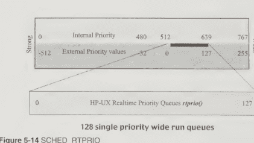

查看一个 HP-UX 11i 系统：哪个进程运行在绝对最强的优先级？它应该显示一个名为 ttiser 的进程，优先级为 −32。在大多数系统中，这是配置的最强 POSIX 实时优先级。这个例程是电报中断服务例程——无论如何，我们要确保能够检测到键盘输入！

说到 POSIX 实时优先级，它们在我们的列表接下来。

### POSIX 实时调度器

三大主要调度器中的最后一个——也是最新的一个——是 POSIX 实时调度器，图 5-15 展示了其在优先级连续体中的位置。此调度器具有三种不同的策略：`SCHED_FIFO`、`SCHED_RR` 和 `SCHED_RR2`。

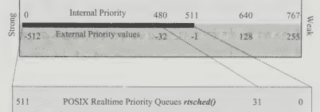

**图 5-15 SCHED_RTPRIO**

当 POSIX 委员会最初着手制定 UNIX 实时调度器规范时，它要求了以下几个关键特性：

- POSIX 调度器将具有多达 512 个单优先级运行队列。
- 队列数量可在 32 到 512 之间配置。
- 最弱的优先级为 1，最强的为 512。


分配到运行队列的每个线程在与其共享队列的其他线程中，可以选择三种调度策略之一：`FIFO`、`RR` 和 `RR2`。

`POSIX` 运行队列是系统范围的，不绑定到特定的处理器。当 `POSIX` 队列拥有活跃、可运行的线程且它是最强队列时，它将调度该线程在第一个可用的处理器上运行（除非该线程本身表达了特定的处理器亲和性）。

如前所述，这些设计目标的实现带来了一系列挑战。为了了解这些功能如何在 `HP-UX` 内核中实现，让我们把它们分解开来。

### 调整 POSIX 队列大小

`POSIX` 队列的大小由可调节的内核参数 `rtsched_npri` 控制。支持的最小值为 `RTSCHED_NUMPRI_FLOOR`，即 32，最大值为 `RTSCHED_NUMPRI_CEILING`，即 512。大多数系统仅将此参数保留为默认值 32。一旦设置此计数，内核就会构建 `POSIX` 运行队列。`POSIX` 运行队列被视为全局的，但应注意的是，在具有多个处理器集（`psets`）的大型系统上，会为每个 `pset` 创建一个唯一的 `POSIX` 运行队列。

### SCHED_FIFO

此策略严格按照线程放入队列的时间顺序调度队列中的线程。先入先出是这里的游戏规则。一旦线程获得 `CPU`，它将保留 `CPU`，直到它请求导致其阻塞（被放入睡眠队列）的系统调用，或者直到一个优先级更强的线程抢占它。当运行中的线程被抢占时，它被放置在队列的头部。如果它在系统调用上阻塞，醒后将 其放置在队列的尾部。

### SCHED_RR

`SCHED_RR`，即轮询队列策略，使用系统的时间片量子，并在时间片过期时将线程移至队列末尾。如果在此策略下运行的线程被抢占，它将在队列头部恢复操作。

### SCHED_RR2

此策略代表一种轮询调度器，区别在于时间片可以为每个队列进行不同的调整——至少这是初衷。当前的实现允许选择此策略，但没有内核代码来实现每队列的时间片量子值；它只是使用系统的时间片量子值。实际上，`SCHED_RR` 和 `SCHED_RR2` 以相同的方式运行。

此时需要提及一些一般的维护事项。随着 `POSIX` 实时扩展的引入，带来了 `rtsched()` 系统调用和命令行 `rtsched`。就像 `rtprio()` 调用一样，此调用需要特权组能力才能使用（参见手册页中的 `set_priv_grp` 和 `get_priv_grp` 命令）。为了稍微简化事情，`rtsched` 调用可以接收任何有效的调度策略名称作为参数，并将实施请求的策略。

时间片内核参数可以设置为 0，此时使用默认值 10 个滴答，也可以设置所需的滴答数（使用注意：在大多数情况下，此参数不应设置低于 5 或高于 30——这些情况都属于极端）。另一个有趣的选项是将时间片设置为 -1；这实际上会关闭系统的轮询调度。同样，我们不建议在大多数配置中使用此设置。

## 运行队列

我们在本章中频繁使用“运行队列”一词。让我们花一点时间了解什么是运行队列，它位于哪里，以及它是如何实现的。

运行队列并不作为单个结构存在。它是通过将系统中所有可运行线程链接到适当的队列头来构建的。哪个队列头对于一个可运行

`kthread` 根据其处理器亲和性、优先级、`kt_pri` 以及存储在 `kthread` 结构体中的调度策略 `kt_schedpolicy` 链接到其运行队列。为了进入处理器的运行队列，我们从 `mp_thread` 结构体开始。

这些结构体存储在一组数组中（取决于处理器数量和处理器集）。每个处理器运行队列包含 160 个 `mp_thread` 元素，而全局 `POSIX` 运行队列的大小由内核可调参数 `rtsched_numri` 控制（默认值为 32）。无论哪种情况，每个运行队列头都包含两个单词 `th_link` 和 `tn_rlink` [原文如此：可能是 `th_rlink`]。`th_link` 指向该特定运行队列中的第一个线程，而 `th_rlink` 指向当前在队列中的最后一个线程。维护双向链接便于将 `kthread` 链接到其相应队列的头部或尾部。线程通常被添加到队列的尾部，除了抢占的情况。

运行队列的主体由维护在每个单独的 `kthread` 结构体中的 `kt_link` 和 `kt_rlink` 指针组成。当单个线程的状态从可运行变为阻塞（睡眠）时，内核作为整体调度过程的一部分更新这些链接指针。这些相同的指针具有双重用途：它们将 `kthread` 链接到同一运行队列中的其他 `kthread`，或链接到阻塞在同一内核服务或 `I/O` 例程上的其他 `kthread`。阻塞在同一内核例程上的 `kthread` 被称为位于睡眠队列上。`kthread` 的当前状态（`kt_stat`）记录了它是在运行队列上还是睡眠队列上。

接下来，我们将探讨两种类型的运行队列：全局和每处理器运行队列。

### 系统范围 POSIX 运行队列

正如我们所说，`POSIX` 运行队列是一个全局实体（每个 `pset` 一个）。每个处理器开始搜索可运行线程时，首先检查 `POSIX` 运行队列，看看是否有等待的线程。如果没有，它检查自己的每处理器运行队列。图 5-16 展示了 `POSIX` 实时运行队列的基本原理。

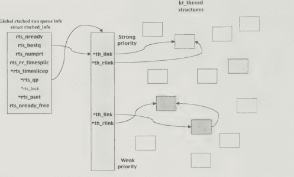

**图 5-16** `POSIX` 全局实时运行队列

从内核的角度来看，`POSIX` 运行队列的开头是一个名为 `rt_sched_info` 的数据结构：

#### 清单 5.7 q4 字段结构体 mp_threadhd

```text
    这是等待在此 POSIX 队列所有队列头中的可运行线程总数
    0 0 4 0 int rts_ready

    此索引指向 qp() 头数组，并指导内核搜索可运行 kthread 的最佳队列
    4 0 4 0 int rts_bestq

    这是存储可调整 POSIX 队列数量的地方
    8 0 4 0 int rts_numprq [原文如此：可能是 rts_numprt]

    SCHED_RR 策略的时间片值（设置为系统时间片值）
    12 0 4 0 int rts_rr_timeslice

    SCHED_RR2 策略的每优先级时间片（当前也设置为系统时间片值）
    16 0 4 0 * rts_timeslice [原文如此：可能是 int rts_timeslice[] 或类似内容，但 OCR 显示为指针符号，为了忠实度保留原样，除非是明显笔误。上下文表明是数组或指向数组的指针。如果代表指针字段则保留 OCR 文本中的 '*'，如果明显笔误则更正为 'int'。鉴于“每优先级时间片...设置为系统时间片值”，它可能是一个值。然而，后面的字段是指针。让我们坚持 OCR 文本但清理格式。]

    指向 mp_threadhd 数组结构体（头数组的头部）
    20 0 4 0 * rts_qp

    指向用于使此队列多处理器安全的自旋锁
    24 0 4 0 * rts_lock

    指向此运行队列附着的 pset
    28 0 4 0 * rts_pset

    未指定 `MPC_MANDATORY` 绑定偏好的等待 POSIX 线程计数
    32 0 4 0 int rts_ready_free
```

要使用 `q4` 检查 `POSIX` `rtssched` 运行队列，请针对运行中的内核启动一个 `q4` 会话：

```text
##### 加载所有 POSIX 运行队列
q4> load struct rtssched_info from &rtssched_info
q4> load struct mp_threadhd from rts_qp max rts_numpr1 [原文如此：可能是 rts_numprt]
q4> print -> addrfox [原文如此：可能是 addr0x 或 @th_link] th_link th_rlink
##### 接下来将所有非空运行队列上的线程堆叠起来
##### （提示：空队列指向自身。）
q4> keep th_think [原文如此：可能是 th_link] != addr0
q4> load thread_1 [原文如此：可能是 thread] from th_link next kt_link until addr0f [原文如此：可能是 addr0] max 100
##### 要看到 [原文如此：可能是 "see what" 或 "see much" 是 "see" 的笔误] 你应该在多处理器系统上运行
##### POSIX 实时进程
```

接下来，我们将查看每处理器运行队列。

### 每处理器运行队列

与 `POSIX` 队列一样，单独的 `kthread` 相互链接并链接到适当的 `mp_thread` 头结构体。这些头包含在 `mp_info` 结构体中的一个数组内。图 5-17 展示了每处理器运行队列的布局。

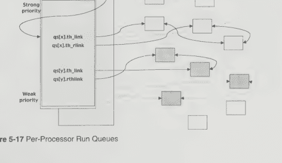

**图 5-17** 每处理器运行队列

就我们此处的目的而言，我们只对整体结构的一小部分感兴趣，即处理运行队列的结构体 `mp_rq`。


#### 清单 5.8 q4 字段结构体 mp_rq

```text
此索引指向 qs[] 头数组，并指导内核搜索可运行 kthread 的最佳队列
0 0 4 0 int bestq
这实际上是处理器的运行队列平均值
4 0 4 0 int neavg_on_rq
未锁定到任何 spu 的等待可运行 kthread 数量
8 0 4 0 int nready_free
alpha 信号量相关信息
12 0 4 0 int nready_free_alpha
锁定到此 spu 的等待线程数量
16 0 4 0 int nready_locked
用于 mp 同步的 alpha 信号量相关信息
20 0 4 0 int nready_locked_alpha
24 0 4 0 int asemq_ignored
由 mp 负载均衡器使用的线程迁移信息
28 0 4 0 u-int ticks_last_migration [原文如此：可能是 unsigned int]
32 0 4 0 u-long cycles_last_migration [原文如此：可能是 unsigned long]
指向 FSS 万花筒中下一匹马的指针（供 PRM 使用）
42 0 4 0 * nexthorse
此处理器运行队列的自旋锁
40 0 4 0 * run_queue_lock [原文如此：注意偏移量 40 在文本中位于 42 之后，可能是 OCR 或源文件的笔误。列表显示 42 然后 40。按照 OCR 文本块保留顺序。]
44 0 4 0 * qs[0].th_link
48 0 4 0 * qs[0].th_rlink
- - - - -
1316 0 4 0 * qs[159].th_link
1320 0 4 0 * qs[159].th_rlink
```

### 总结

现在，我们已经对提供进程逻辑地址空间视图的结构和表有了相当的了解，我们将探讨内核如何查看和管理这些内存资源。在第 6 章中，我们从单个页面框架开始，构建实现整个页面框架区域所需的管理结构；然后我们可以结合这两个视角，开始欣赏整体方案的复杂性。

# 内存管理

在本章中，我们通过查看系统范围内存资源来研究 HP-UX 内存管理。图 6-1 展示了内核必须管理的各种形式的内存。我们研究每进程内存区域如何从系统范围内存中分配，以及内核虚拟内存如何映射到物理内存。我们还查看空闲内存和交换空间是如何分配和管理的。


现在我们可以开始看到内核架构师面临的挑战。内存管理不仅仅是简单的“使用一个页面，释放一个页面”。

### 内存类型

为了便于使用可重定位代码、共享内存对象和私有数据区域，引入了各种抽象级别。为了支持这些抽象层，必须从逻辑、虚拟和物理页面级别管理内存。此外，当内核需要暂时将其移开时，内存页面映像可能作为“前存储”的一部分存储在磁盘设备上，或者存储在“后存储”中。

#### 逻辑内存

正如我们在第 5 章“从进程视角看进程和线程管理”中讨论的，进程对内存采取“逻辑”视图。就进程而言，它只关心自己的内存需求：我的代码在哪里？我的数据在哪里？我请求的共享库例程在哪里？

进程实际上并不知道内存对象是共享的还是私有的。这并不是说程序员不需要知道区别，但从单个进程的视角来看，只要获取下一条指令时它可用，其数据存在并被记录，且其系统调用得到满足，那么一切都好。内核必须更加务实，扮演“幕后操纵者”的角色，拉动杠杆并转动曲柄，以维持进程是其线程被选中运行时的终极大目标的表象。

`proc`表的`vas`和`pregion`列表提供了进程视角的映射，但硬件不理解这个观点。处理器只理解虚拟和物理内存寻址。正如我们在 PA-RISC 处理器的讨论中学到的，硬件专门设计为允许虚拟寻址（记得 TLB 和 PDIR）。如果要允许内核拥有调度各种线程执行的特权，则必须支持硬件的虚拟内存视图。让我们看看内核的虚拟内存视图。

#### 虚拟内存

在所有内存视角中，这个涵盖的范围最大。当你管理的是“虚构”事物时，大小不是限制因素。这并不是说虚拟内存是无限的；毕竟，我们需要建立一个寻址方案，并且它必须符合底层架构的能力。

在我们关于 HP PA-RISC 架构的讨论中，我们了解到虚拟地址空间（VAS）的范围取决于我们使用的具体处理器。在窄 32 位处理器的情况下，理论虚拟地址范围是 2^32 个空间，每个包含 2^32

字节。在实际应用中，大多数窄位 PA-RISC 处理器实现了 2^16 个空间（65,534 个），每个空间包含 2^32 字节（4 GB）。

对于宽位 64 位处理器，规模要大得多。每个空间由 2^64 字节（16 EB）组成，并且可能拥有 2^64 个空间。与窄位模式类似，当前处理器并未实现所有可用的虚拟地址范围。目前每个空间限制为 2^42 字节（16 TB），共有 2^22（400 万）个空间——这仍然提供了非常大的虚拟内存视角。

请记住，每个“空间”包含四个大小相等的象限。在窄位系统中，每个象限大小为 1 GB，而在宽位系统中，每个象限大小为 4 TB。这种配置要求使用偏移地址的两个最高有效位来确定正在引用哪个象限。这些位有时被称为**空间寄存器选择位**。

内核的职责是管理并映射此 VAS（虚拟地址空间），提供私有的和共享的虚拟内存区域。进程中的指针**区域**将进程连接到内核**区域**；这就是两种视角交汇的地方。

### 物理内存

物理内存是系统中最宝贵的资源之一，内核投入了大量的时间和精力来高效管理这一资源。

在 *V-Class* 系列计算机（以及紧随其后的 Super-Dome）推出之前，HP-UX 系统上的所有物理内存均由单个内存控制器管理，并映射到连续的物理地址范围。这种早期模型允许使用相当简单的数据结构来跟踪物理页面的使用情况。

随着 HP-UX 11.0 的发布，这种简单模型变得更加复杂，因为新的系统配置需要一种方法来跟踪非连续的物理内存块，同时允许系统配置更多的物理内存。在窄位系统上，最大物理内存限制为 4 GB，而较新的宽位系统可以映射 512 GB（大多数型号在物理上无法容纳如此多的 RAM，至少目前还不能）。

**注意** 当前宽位系统的规模限制是由于某些内核数据结构施加的约束造成的，并且随着这些结构的重定大小，可以大大扩展。请在我们继续本章讨论时尝试发现它们。

为了满足这些不断增长的需求，物理内存管理结构已被分区，以扩展其范围和灵活性。

### 前存储区与后存储区

这两个术语指的是物理内存页帧的碳基副本，它们作为程序文件的一部分存储，即**前存储区**，或临时放置在交换设备上，即**后存储区**。

其头部包含对其他可能需要运行该程序的记忆类型的引用，例如已初始化数据、未初始化数据和共享库例程。已初始化数据页从前存储区的副本中加载，而未初始化页必须由内核凭空生成。实际上，内核并不是魔术师，它只是在请求时找一个未使用的物理页来填充“0”。

当系统内存压力较高时（未分配或空闲内存页的数量相对较低），内核采用分页系统来释放空间。频繁使用率不高的已分配页会被识别并复制到可用交换空间中的后存储区图像上。内核的分页系统负责预留和分配后存储区页面。我们稍后会详细讨论分页，但接下来我们将看看为管理每种内存视角而创建的具体内核结构。

### 系统的虚拟地址空间

VAS 是一种组织概念，它通过单级地址抽象允许实现共享和私有内存对象。这种方法部分是 PA-RISC 处理器设计的一部分，并作为 HP-UX 内核代码中硬件依赖层的一部分得到支持。正如我们在 PA-RISC 计算平台讨论中学到的，VAS 在概念上排列成一个大网格，每一列代表一个包含四个象限（由四行表示）的唯一虚拟空间。

在图 6-2 中，我们看到了这种 VAS 模型的实际应用。当进程使用其 `vas` 和 `pregions` 将各种内存对象映射到其逻辑内存视图中的特定偏移量时，这些对象被映射到系统 VAS 中对应的虚拟页面区域。物理页面随后由硬件功能（`pdir` 和 `tlb`）映射到特定的虚拟页面，这些功能由内核故障处理器和资源管理器支持。

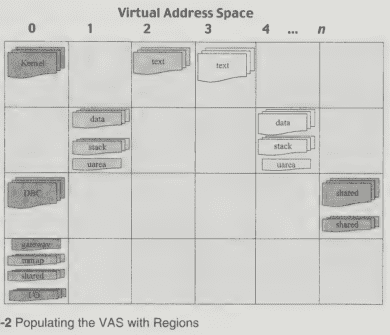

在执行期间，PA-RISC 硬件利用转换后备缓冲区（`tlb`）和页目录（`pdir`）将隐式虚拟地址转换为物理地址。当请求的虚拟地址*未驻留*或*不在内核中*时，硬件会发生*页面错误*。正是在此时，内核故障处理代码必须介入，找到（或创建）缺失的页面图像，将其加载到可用的物理页帧中，更新相关的硬件依赖层数据结构，更新内核硬件无关层数据结构，然后从故障处理器返回，以便硬件可以再次请求该地址。

内核必须跟踪哪些区域占据哪些空间中的哪些象限。这是通过内核维护的一系列位图和资源图来实现的。这种方法的一个关键特征是，尽管当底层硬件从 32 位增长到 64 位时虚拟寻址范围增加了几个数量级，但 VAS 概念几乎没有改变。确实，象限大得多，潜在空间多得多，但概念仍然保持一致。对于处理器硬件和内核而言，核心问题都是虚拟到物理的转换以及较小程度的物理到虚拟的映射。

### 虚拟到物理页表


虽然虚拟到物理的转换是在处理器硬件中完成的，但支持它的表驻留在内核的内存空间中，如果内核希望让进程进出活动，它必须相应地调整此表中的条目。图 6-3 展示了硬件的页目录或 `pd ir`（也即 `pdir`）在内核中被称为哈希表。

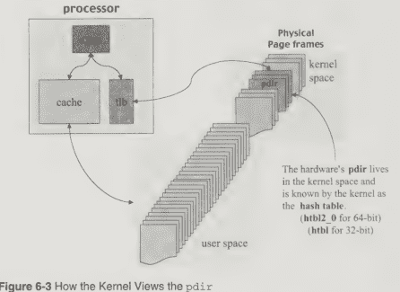

**图 6-3 内核如何看待 `pd ir`**

处理器在哈希表（`htbl`/`pdir`）中填充页面数据条目（`pde`），其中包含多种状态位、当前虚拟地址以及页面的当前物理地址（见图 6-4）。内核将此结构作为哈希的页面数据条目表进行引用和维护（在窄位系统上是 `hpde`，在宽位系统上是 `hpde2_0`）。

由于虚拟映射相对于物理映射来说非常大，将其尺寸设置得足以让每个虚拟页面拥有自己的 `pde` 是不切实际的。这就是我们使用哈希表的原因之一。诀窍在于将表的尺寸设置得足够大，以最小化两个虚拟地址哈希到同一条目的发生概率，同时又足够小，以避免浪费物理内存。

基本方法是按照系统预计在任何给定时间需要管理的转换数量来确定哈希表的尺寸。简单的答案是将它设置为配置到系统中的物理页面数量，但这没有考虑到可能需要转换的所有地址。别忘了 PA-RISC 处理器使用内存映射 I/O 方法；这些伪内存页也可能需要创建虚拟转换。尺寸按以下方式确定：

- 物理内存中页面的总数存储在内核参数 `npdir` 中。
- 每个 I/O 模块（总线控制器、图形设备等）都会轮询以确定其映射的内存需求，该值存储在内核参数 `niopdir` 中。
- 这两个参数的总和存储在参数 `nhtbl` 中。
- 我们还没有完全结束：为了简化哈希表索引掩码，`nhtbl` 会被调整为一个 2 的幂次。如果计算出的 `nhtbl` 恰好是一个 2 的幂次，则使用该值。在大多数情况下，计算值落在两个 2 的幂次之间；如果它小于两者之间差异的 25%，则使用较低的 2 的幂次值。如果大于差异的 25%，则使用较大的 2 的幂次值。

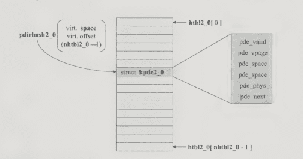

请注意列表 6.1 和 6.2 中对内核结构 `hpde` 和 `hpde2_0` 的注释研究。

### 列表 6.1 q4 > 字段 struct hpde

结构体的第一个字包含一个有效位，虚拟页地址的最高 15 位，以及用于虚拟空间号的 16 位。

```
0 0 0 1 u_int pde_valid
0 1 1 7 u_int pde_vpage
2 0 2 0 u_int pde_vspace
```

第二个字包含状态、保护和访问位。引用、已访问、引用陷阱和执行位用于指示该页面“正在使用中”，并促进“节俭缓存”算法。

```
4 0 0 1 u_int pde_ref
4 1 0 1 u_int pde_accessed
4 2 0 1 u_int pde_rtrap
```

脏位被置位以指示该页面在缓存中的内容已被修改，与其内存驻留副本不同步。

```
4 3 0 1 u_int pde_dirty
4 4 0 1 u_int pde_dbrk
```

访问权限由一个 7 位字段组成，具有如下转换：

- `0x00` `PDE_AR_KR` 内核只读
- `0x10` `PDE_AR_KRW` 内核读写
- `0x20` `PDE_AR_KRX`, `PDE_AR_KXR` 内核读执行，内核只读
- `0x30` `PDE_AR_KRWX`, `PDE_AR_KXRW` 内核读写执行
- `0x6f` `PDE_AR_UX` 用户只读
- `0x7f` `PDE_AR_UX` 用户仅执行
- `0xf` `PDE_AR_URW` 用户读写
- `0x2f` `PDE_AR_URX`, `PDE_AR_URXKR`, `PDE_AR_CWX` 用户读执行，内核只读，以及写时复制
- `0x3f` `PDE_AR_UWRX` 用户读写执行
- `0x4c` `PDE_AR_GATE` 在仅执行时提升（gateaway 页面）
- `0x73` `PDE_AR_NOACC` 不允许访问

```
4 5 0 7 u_int pde_ar
```

接下来我们可以标记不可缓存的页面

```
5 4 0 1 u_int pde_uncache
```

保护 ID 是一个介于 0 和 32767 之间的伪随机数。维护一个位图来跟踪哪些值正在使用 (`protid_map`)。如果找不到唯一的保护 ID，内核将 panic！

```
5 5 2 2 u_int pde_protid
```

执行位是节俭缓存刷新算法的一部分

```
7 7 0 1 u_int pde_executed
```

第三个字的第一个位用于指示 `pde` 数据更新正在进行中（这减轻了在使用哈希表更新时使用自旋锁的必要性），物理页号占据接下来的 20 位

```
8 0 0 1 u_int pde_uip
8 7 2 4 u_int pde_phys
```

修改位用于让内核知道自上次写入到后备存储（交换空间）以来，页面的内容已被修改

```
11 4 0 1 u_int pde_modified
```

滴流位和块位促进在具有硬件游走器和块 TLB 条目的特定 PA-RISC 处理器上的操作（仅在有限数量的较旧 32 位处理器上可用）

```
11 5 0 1 u_int pde_ref_trickle
11 6 0 1 u_int pde_block_mapped
```

如果设置了别名位，则表示该结构是虚拟页别名的结果

该结构的最后一个字是指向稀疏 `hpde` 条目的前向指针，如果需要的话。

```
12 0 4 0 * pde_next
```

#### 列表 6.2 q4> 字段 struct hpde_2_0

在宽硬件上，`hpde_2_0` 结构由四个双字组成。同样，第一个双字以“有效”位（实际上是“无效”位）开始，随后是虚拟页的高 20 位和包含虚拟空间号的 32 位。

```
0 0 0 0 1 u_int pde_invalid
1 4 2 4 u_int pde_vspace
4 0 4 0 u_int pde_space
```

第二个双字包含各种状态位、访问权限和保护 ID 密钥。

```
8 2 0 1 u_int pde_rtrap
8 3 0 1 u_int pde_dirty
8 4 0 1 u_int pde_dbrk
8 5 0 7 u_int pde_ar
9 4 0 1 u_int pde_uncache
```

PA-RISC 2.0 处理器允许为页面分配指令排序和分支预测提示。

```
9 5 0 1 u_int pde_order
9 6 0 1 u_int pde_br_predict
10 2 0 1 u_int pde_ref_tickle
10 3 0 1 u_int pde_block_mapped
10 4 0 1 u_int pde_executed
10 5 0 1 u_int pde_ref
10 6 0 1 u_int pde_accessed
10 7 0 1 u_int pde_modified
11 7 0 1 u_int pde_uip
12 0 3 7 u_int pde_protid
15 7 0 1 u_int pde_os
```

第三个双字以虚拟别名标志开始，具有 52 位用于物理页号（前 25 位目前未使用，标记为 `pde_phys_u`，代表“未使用”）。

```
16 0 0 1 u_int pde_alias
16 7 3 1 u_int pde_phys_u
20 0 3 3 u_int pde_phys
```

接下来的 5 位与性能优化的页面大小调整一起使用。

```
23 3 0 5 u_int var_page
```

第四个双字包含指向下一个稀疏条目的指针。

```
24 0 4 0 u_int unused_upper
28 0 4 0 u_int pde_next
```

让我们检查一下你对注释的观察力如何。你注意到 `*hpde*` 中存储的虚拟页号的大小（以位为单位）吗？它只有 15 位宽，这带来了一个挑战，因为每个空间有 $2^{20}$ 个虚拟页。这些位被注明是虚拟页号的高位 15 位。根据这个模型，似乎每 32 个页面中只有一个可以通过此表进行转换！这个故事肯定比表面看起来要复杂——确实如此。为了理解缺失的五个虚拟页地址位的秘密，我们需要检查硬件（并被内核理解）所使用的哈希算法。

### 内核视角：哈希表

名称 `pdir` 有点怀旧。最初，HP-UX 使用反向页目录，将物理页号映射到虚拟页号。这意味着虽然表的大小很容易确定（每个页面仅一个条目），但搜索特定虚拟地址是一个漫长的过程。为了减少搜索时间，创建了一个虚拟地址的哈希表。在这种格式中，使用虚拟页地址创建一个*哈希表索引*值。然后对该索引值与掩码值进行比较，以确保索引不超过哈希表的大小，结果被用作 `htbl`（或 `htbl2_0`）中的偏移量。

哈希算法根据硬件宽度而变化。对于窄系统，例程如下：

- `pdhashl_1(space, offset) & (mask)`
  - 我们将空间值左移 5 位。


- 偏移量右移 12 位（这是页内的字节偏移，因此不是虚拟页号的一部分）。
- 这两个值进行异或运算以创建初始哈希表索引。
- 为了确保索引不超过哈希表的大小，在初始索引值和掩码（表的大小，2 的幂）之间执行 AND 操作。

这就是我们之前提出的问题所在。通过将空间值左移 5 位，虚拟页号的最后 5 位直接转换为哈希索引。实际上这意味着 32 个连续的虚拟页号被映射到 32 个连续的 *htbl1* 条目中。

对于宽系统，

- `pdhash2_0(space, offset) & (mask)`
- `pdhash2_0` 将空间值右移 10 位（回顾我们在第 2 章“PA-RISC 2.0 体系结构”中对全局虚拟地址 (GVA) 形成的讨论，空间号的最低 10 位始终设置为 0）。
- 根据这是窄内核还是宽内核，会对偏移值执行额外的位操作（再次来自我们的 GVA 讨论，当前处理器仅实现了 30 个实际的虚拟页地址位：64 - 2 个空间寄存器选择位 - 20 个未实现位 - 12 个页偏移位 = 30 位）。
- 与窄版本一样，为了确保索引不超过哈希表的大小，在初始索引值和掩码之间执行 AND 操作。

在大多数情况下，索引计算涉及位移、异或和 AND。索引函数快速且粗糙，但请记住硬件执行的是这些操作的并行版本：每次请求隐式地址时，硬件以原子操作计算索引，其值暂时存储在 `CR28` 中。如果发生 `tlb` 故障，硬件将使用 `CR28` 作为内核哈希表的索引，试图找到正确的转换。内核需要能够复制这种努力的原因，仅在于它可以移动虚拟页进出物理内存映射，并保持 `htbl1`/`pdir` 与其所做的更改同步。

### 创建稀疏表

你可能会想知道，如果两个虚拟页号哈希到同一个索引，会发生什么，这是非常可能的。当这种情况发生时，前向链接指针将引导故障处理程序到一个扩展 `pde`。扩展 `pdes` 是从由内核管理的 `pde` 结构页面中分配的。哈希表页面和为扩展 `pde` 条目分配的页面统称为稀疏 `pdir`。

当需要存储扩展 `npde` 条目时，内核从 `pdir_free_list` 头部分配空间（见图 6-5）。为了维持这些结构的供应以备不时之需，使用了几个内核参数。`pdir_free_list` 和 `pdir_free_list_tail` 指向可用结构链接列表的前端和后端。每当可用条目数开始减少（低于 256）时，内核会分配额外的页面用于此目的，将其切割为 `npdes`，并将它们链接到自由列表中。

对于宽系统，自由列表是按 `spu`（系统处理器单元）维护的，指针为 `pd_f12_0(spu).head` 和 `pd_f12_0(spu).tail`。

#### 图 6-5 稀疏表

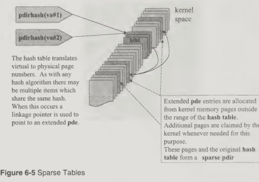

一旦内核为稀疏结构分配了内存页，它们就不会被返回到内存空闲列表中。在实际操作中，虚拟地址到物理地址的映射系统很少看到超过三个虚拟地址被哈希到同一索引。这种哈希稀疏表结构非常满足我们的需求，但如果你知道物理地址，并需要确定当前分配给它的虚拟地址（或多个虚拟地址）该怎么办？

### 页帧到虚拟页帧表

让我们来看看一种与底层硬件架构完全无关的结构。内核可能知道物理页号，并需要确定当前是否有虚拟页映射到它。这是在内核尝试在进程终止或崩溃后清理资源时的多个场景中会发生的情况。

在图 6-6 中，我们可以看到页帧号到虚拟地址表，或者说是其当前化身名称的 **pfn_to_virt_ptr**。在早期的 HP-UX 系统中，这是一个非常简单的表；它为系统中配置的每个物理页都有一个条目。如果存在关联的虚拟地址，物理页号就是获取该地址的索引。随着惠普（Hewlett-Packard）计算机硬件平台复杂度的增加，物理地址到虚拟地址映射的复杂度也随之增加。V 类系统引入了分区内存设计到 HP-UX 内核中，为了避免 **pfn_to_virt** 表的浪费，它被转换为分区设计，因此有了新名称 **pfn_to_virt_ptr**。


`pfn_to_virt_ptr` 结构仅仅指引我们到包含实际 `pfn_to_virt_entry` 结构的适当页分区表。分区的粒度由内核参数 `PFN_CONTIGUOUS_PAGES`（目前默认值为 4096）决定。为了找到正确的 `pfn_to_virt_entry`，我们需要将物理页号除以 4096 以找到索引和偏移量（余数）。首先，我们在 `pfn_to_virt_ptr` 中索引并找到指向包含我们 `pfn_to_virt_entry` 的 `pp_tbl` 结构的指针。余数是我们在 `pp_tbl` 中的索引。让我们看一下这两个结构（列表 6.3 和 6.4）的注释列表。

##### 列表 6.3 q4> 字段 struct pfn_to_virt_ptr

`pp_tbl` 指向一个"页帧号到虚拟"条目块，而 `pp_offset` 指引我们到块中的第一个有效条目。每个块映射 4096 个物理页转换（由内核参数 `PFN_CONTIGUOUS_PAGES` 决定）

```
 0 0 4 0 *  pp_tbl
 4 0 4 0 int pp_offset
```

##### 列表 6.4 q4> 字段 struct pfn_to_virt_entry

每个条目的第一个字包含虚拟空间号或 `INVALID_SPACE_ENTRY` (0xffffff)。第二个字是页偏移量或指向别名结构的指针

```
 0 0 4 0 u_int space
 4 0 4 0 u_long alias_or_offset.offset_page
 4 0 4 0 *     alias_or_offset.alias
```

### 虚拟地址别名

虚拟地址别名是在 HP-UX 10.0 发布时引入 HP-UX 内核的。此功能旨在促进进程创建中 `k()` 系统调用的"写时复制"场景。图 6-7 展示了这种实现所涉及的内核数据结构变化。

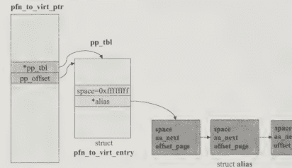

如果一个特定的物理页只分配了一个虚拟页号，则不需要别名结构。物理到虚拟的转换遵循前面讨论的模型。如果多个虚拟地址需要关联到一个物理页，则其 `pfn_to_virt_entry` 的 `space` 值将被设置为 `INVALID_SPACE_ENTRY` (0xffffff)。并且 `offset` 值将是一个指向别名数据结构的指针。别名结构将包含一个虚拟空间和偏移量，如果存在下一个别名结构，则包含指向它的指针（列表 6.5）。

##### 列表 6.5 q4> 字段 struct alias

```
0 0 4 0 * aa_next
4 0 4 0 u_int space
8 0 0 7 u_int aa_saver
8 7 3 1 u_int aa_saverpt
12 0 4 0 u_long offset_page
```

内核维护一个未使用的别名结构空闲列表，并由 `aa_entfreelist`（别名结构空闲列表）指向。另一个内核参数 `min_alias_entries` 为空闲别名结构设置了一个低水位标记。当可用计数 `aa_entcnt` 低于此限制时，内核分配新的一页别名结构。

当创建别名虚拟地址时，还必须在哈希表（`tbl1`/`pdir`）中添加一个条目。如果新的虚拟地址映射到已使用的哈希表条目，则必须分配一个稀疏条目。这些别名 `pde` 之一的空间是从 `aa_pdirfreelist` 而不是系统的 `pdir_free_list` 中分配的。`aa_pdirfreelist` 的维护是为了避免覆盖 `pdir_free_list`。系统拥有指向此空闲列表头和尾的指针，分别是 `aa_pdirfreelist` 和 `aa_pdirfreelist_tail`。对于宽系统，指针为 `aa_pdirfreelist2_0` 和 `aa_pdirfreelist_tail2_0`。

与别名结构一样，内核监控其使用和可用性。参数 `aa_pdircnt` 被监控：如果它低于 `min_alias_pdirs`（默认为 256），则分配新的一页别名 PDE。内核别名 PDE 的总数存储在 `max_aapdir` 中；该值随时间增长，但永远不会缩小。

分配给内核用于别名 PDE 或别名结构的页永远不会返回到空闲页列表。它们代表一种高水位标记，目前的观点是，如果你曾经需要它们一次，你可能再次需要它们。占用几个页的成本比重新分配页的开销更低。

现在，既然我们可以从虚拟地址转换为物理地址并反之，让我们考虑一下内核如何管理其许多虚拟页区域。

### 页区域

`region` 是内核内存管理子系统的主力。它代表了进程可用的最高级别的内存资源管理（通过进程 `pregion` 结构中的指针）。正如我们在图 6-8 中看到的，`region` 只是一组连续的虚拟页。每个区域在系统的 VAS 中占据唯一的地址空间。内核必须确保区域被分配给正确的象限类型。就 `region` 结构而言，只有两种类型的区域：共享和私有。


`region`结构包含用于管理它的组织指针和状态标志。让我们看一下`region`结构的注释列表。

### 列表 6.6 q4> 字段 `struct region`

区域标志表示当前区域状态：

- `0x00000004` `RF_ALLOC` 此区域结构已分配
- `0x00000020` `RF_UNALIGNED` 用于支持非对齐代码页
- `0x00000080` `RF_WAITNLOCK` 锁请求者正在等待
- `0x00000200` `RF_EVERSWP` 如果 b 树曾经被交换则设置
- `0x00000400` `RF_NONGSWP` 如果 b 树当前被交换则设置
- `0x00002000` `RF_IOMAP` 由 `iomap()` 调用创建的区域
- `0x00004000` `RF_LOCAL` front-store 是 NFS，但已为 text 分配了本地交换
- `0x00008000` `RF_EXCLUSIVE` 内存映射 `MAP_EXCLUSIVE`
- `0x00200000` `RF_SUPERPAGE` TEXT 使用可变页大小
- `0x00200000` `RF_PGSIZE_FIXED` 未使用可变页大小
- `0x01000000` `RF_MPROTECTED` 表示已为此区域调用 `mprotect()`

区域是 `RT_PRIVATE` (`0x1`) 或 `RT_SHARED` (`0x2`)

```
0 0 4 0 enum4 r_flags
```

```
4 0 4 0 enum4 r_type
```

此区域中的页数

```
8 0 4 0 int r_pgbsz
```

区域 b 树中当前有效 vfd 条目的数量

```
12 0 4 0 int r_nvalid
```

去激活时有效页的数量，被换入换出程序使用

```
16 0 4 0 int r_dnvalid
```

如果设置了 `RF_SWALZY` 标志（由 `chart` 命令控制），这是分配了实际交换页的页数量。如果未启用延迟交换，则这是该区域已分配和保留的页总数

```
20 0 4 0 int r_swalloc
```

在伪交换中分配和保留的页数量

```
24 0 4 0 int r_swapmem
```

```
28 0 4 0 int r_vfd swapmem
```

用于 `mlock()` 调用

```
32 0 4 0 int r_lockmem
```

链接所有使用伪交换区域的向前和向后指针（此列表的头由内核指针 `pswaplist` 指向）

```
36 0 4 0 * r_pswap
```

```
40 0 4 0 * r_rswap
```

指向此区域的所有 preigions 的引用计数

```
44 0 2 0 u_short r_refcnt
```

区域僵尸是指其 a.out 文件是远程的（nfs 挂载）且内容已被修改的区域

```
46 0 2 0 short r_zomb
```

对于从 vnode 映射的页对齐区域，这是区域第一页在文件中的偏移量。

```
48 0 4 0 int r_off
```

当前处于“核心”（in-core）状态且共享此区域的预区数量

```
52 0 2 0 u_short r_incore
```

如果 b-tree 已被移至交换区，此字段将指向其页列表中第一页的位置（随后每一页的交换位置都包含在前一页末尾的指针中）

```
56 0 4 0 u_int r_dbd
```

```
60 0 4 0 int r_scan
```

前向存储和后向存储值指向在此区域页面遭遇高内存压力时偏好的分页位置

```
64 0 4 0 * r_fstore
```

```
68 0 4 0 * r_bstore
```

所有活动区域通过以下两个指针相互链接（此链表的头节点是 reactive）

```
72 0 4 0 * r_frow
```

```
76 0 4 0 * r_back
```

非对齐区域可能通过 `TEXTHASH` 算法访问（内核结构 `texts(TEXTHSHSZ)` 中有 32 个哈希头），并通过此指针链接

```
80 0 4 0 * r_chain
```

接下来我们根据前向存储中的字节偏移量和长度定位文本映像

```
84 0 4 0 u_long r_byte
```

```
88 0 4 0 u_long r_bytelen
```

接下来是额外的锁定结构和标志。

```
92 0 4 0 * r_lock_interlock
```

```
96 0 0 4 u_int r_lock.delay
```

```
100 0 4 0 u_int r_lock.write waiters
```

```
104 0 4 0 int r_lock.read count
```

```
108 0 1 0 char r_lock.want write
```

```
109 0 1 0 char r_lock.want upgrade
```

```
110 0 1 0 char r_lock.waiting
```

```
111 0 1 0 char r_lock.rwl_flags
```

```
112 0 4 0 * r_lock.l_kthready
```

```
116 0 1 0 u_char r_mlock.l_lock
```

```
118 0 2 0 u_short r_mlock.order
```

```
120 0 4 0 * r_mlock.owner
```

当前针对此区域正在处理的页 I/O 数量

```
124 0 4 0 int r_poiP
```

指向 b-tree 根节点的指针（如果正在使用 b-tree）

```
128 0 4 0 * r_root
```

如果未使用 b-tree，键值可能为 `UNUSED_IDX` (`0x7ffffff`)；如果使用由 `r_root` 指向的 b-tree，则可能为 `DON'T_USE_IDX` (`0x7ffffffe`)。`r_key` 中的其他任何值都是与 `r_chunk` 关联的键

```
132 0 4 0 int r_key
```

```
136 0 4 0 * r_chunk
```

所有与 front-store vnode 关联的区域使用以下两个指针进行链接

```
140 0 4 0 * r_next
```

```
144 0 4 0 * r_prev
```

```
148 0 4 0 * r_preg_un.r_un_pregskl
```

```
148 0 4 0 * r_preg_un.r_un_pregion
```

```
152 0 4 0 * r_pskhl.l_header.n_next [0]
```

```
156 0 4 0 * r_pskhl.l_header.n_next [1]
```

```
160 0 4 0 * r_pskhl.l_header.n_next [2]
```

```
164 0 4 0 * r_pskhl.l_header.n_next [3]
```

```
168 0 4 0 * r_pskhl.l_header.n_prev
```

```
172 0 4 0 u_long r_pskhl.l_header.n_key
```

```
176 0 4 0 u_long r_pskhl.l_header.n_value
```

```
180 0 1 0 char r_pskhl.l_header.n_flags
```

```
181 0 1 0 char r_pskhl.l_header.n_cookie
```

```
184 0 4 0 * r_pskhl.l_tail
```

```
188 0 4 0 * r_pskhl.l_cache
```

```
192 0 4 0 * r_pskhl. cmfp
```

```
196 0 4 0 int R_pskhl.l_level
```

```
200 0 1 0 char r_pskhl.l_cookie
```

```
204 0 4 0 * r_excpnoc
```

```
208 0 4 0 * r_lchain
```

```
212 0 4 0 int r_mockswap
```

此处包含针对性能优化的页大小提示

```
216 0 4 0 int r_pgszhint
```

以下硬件依赖层（结构体 `hdregion`）包含在将区域附加到另一区域时使用的提示

```
220 0 4 0 u_int r_hdl.r_space
```

```
224 0 4 0 u_int r_hdl.r_prot
```

```
228 0 4 0 * r_hdl.r_vaddr
```

```
232 0 2 0 u_short r_hdl.r_hdflags
```

```
236 0 4 0 * r_mrg
```

```
240 0 4 0 int r_mrg_status
```

```
244 0 4 0 int r_dbd_asyncinflight
```

指向用于保护此结构的自旋锁的指针

```
248 0 4 0 * r_spinlock
```

在研究区域的各个字段时，您可能已经注意到，它并不包含虚拟地址的位置，只管理页帧的数量。从内核的角度来看，并不真正需要知道虚拟地址——只需要知道区域内的页面数量及其用途（您可能还记得，我们之前将 `VAS` 描述为用于内存管理的概念性设备）。

我们需要考察区域之间的链接关系，以解释区域如何共享。

### 共享对象

为了理解区域共享的机制，让我们回顾一下虚拟寻址。虚拟地址实际上只从进程的角度来看才重要。为了让进程线程运行，内核必须首先设置处理器空间寄存器以指向进程的四个象限。一旦线程的环境初始化完毕，该线程未来的上下文切换将简单地保存和恢复这些寄存器，作为线程进程控制块（`pcb`）在其区域中的一部分。将 `VAS` 表示为一个大型棋盘有助于我们可视化和讨论内存管理概念。


当进程将其逻辑区域映射到 VAS 时，进程的各个区域必须排序，使得在进程的逻辑视图中没有两个区域重叠。内核维护一个简单的分配映射，以确保每个进程为其私有象限获得唯一的空间编号。

系统共享象限拥有资源映射，以确保映射到它们的每个共享对象占用唯一的地址范围。内核空间的每个象限都存在资源映射，并且为前两个共享象限 2 和 3 创建特殊的映射（如果启用了内存窗口，将创建额外的映射）。其他所有象限映射都由进程 `p` 区域链中做出的地址分配来控制。

如果不同的进程需要共享一个区域，第二个进程简单地复制第一个进程的 `p` 区域，将其插入自己的 `p` 区域列表中，并递增区域结构中的 `r_refcnt`。

很容易迷失在区域结构的细节中，但我们需要记住这个结构的目的：将连续的虚拟页块映射到特定的物理 front-store 或 back-store 位置。为了完成这项任务，区域结构仅仅是一个头部，它引导我们找到虚拟页描述符（`vfd`）和磁盘块描述符（`dbd`）的对，每个页帧对应一对。

### 虚拟页定位器、VFD 和 DBD

关于“我的页面在哪里？”这个问题，有许多不同的答案。

当硬件或一级故障处理器无法确定虚拟页的位置时，就会发生缺页中断。然后内核必须找到负责管理缺失页的区域。区域结构只是每页对象的集合，定义了区域内每个页帧的当前状态和位置。图 6-9 展示了这些每页结构。

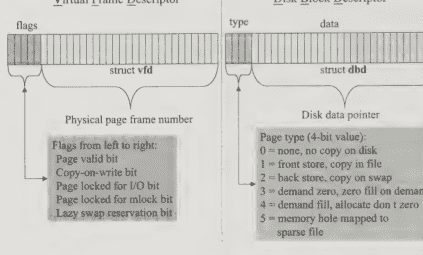

**图 6-9 VFD/DBD**

**区域**中的每一页都有一个 **vfd/dbd** 结构对；它们定义了页面的当前状态。让我们来看看这些结构的注释列表（列表 6.7 和 6.8）。

#### 列表 6.7 `q4> fields struct vfd`

```
第一位是有效位；它表示 vfd 中的数据是有效的
0 0 0 1 u_int pg_v
下一位为页面设置写时复制（copy-on-write）访问模式
0 1 0 1 u_int pg_cw
当页面因 I/O 操作而被锁定时，此位被设置
0 2 0 1 u_int pg_lock
如果针对区域调用了 mlock()，则此位被设置
0 3 0 1 u_int pg_mlock
如果已激活惰性交换并预留了交换页，则此位被设置
0 4 0 1 u_int pg_swresv
在窄系统中，物理页帧号可能仅使用 21 位（由于 32 位硬件的内存大小限制）。对于宽内核，这将是一个单一的 27 位字段
0 5 0 6 u_int pg_fill
1 3 2 5 u_int pg_pfn
```

#### 列表 6.8 `q4> fields struct dbd`

此结构的前四位表示页面类型：

```
0000 DBD_NONE 磁盘上没有此页面的副本
0001 DBD_FSTORE 页面的副本在前存储（front store）上
0010 DBD_BSTORE 页面的副本在后存储（back store）上
0011 DBD_DZERO 这将是一个“按需置零”（demand zero）页，当第一次请求时会填充零
0100 DBD_DFILL 页面类型为“按需填充”（demand fill）。首次分配时页面不会初始填充零（这仅用于初始化分配给 UAREA 使用的页面）
0101 DBD_HOLE 此页面将用于映射稀疏内存映射文件。读请求将返回零，但写操作会导致分配一个新的零填充页
0 0 0 3 u_int dbd_type
剩余的 28 位包含指向页面前存储或后存储映像的指针。
0 3 3 5 u_int dbd_data
```

**区域**的主要任务是以易于搜索的方式组织 **vfd|dbd** 数据。将 **vfd|dbd** 放在数组中并使用相对页码作为数组索引是非常容易的。如果所有区域的大小相似，这将是一个合适的解决方案，但事实并非如此。

之前我们了解到有几种类型的进程**精度**（precisions），由于关联责任（guilt by association），也有几种变体区域。这些区域的大小差异巨大，从 **uarea** 的区区 4 到 8 页，到大型宽进程数据区域中数以百万计的页。另一个挑战是，某些区域可能需要随着进程线程的执行而增长：想想 `malloc()` 调用或正在写入的内存映射文件。

现在我们看到了挑战：设计一个数据库，它可以从内核内存空间中轻松分配和释放，能够处理非常小和非常大的数据集，可以在线扩展，并提供低开销的搜索算法。很容易，对吧？

HP-UX 内核采用了一种称为 **b-tree** 的设计。让我们来看看。

#### b-tree

我们在第 3 章“内核：基本组织”中讨论了通用的 **b-tree**，现在我们需要应用用于映射 **vfd|dbd** 数据结构的具体细节。图 6-10 显示了内存管理 **b-tree** 的整体设计及其与 **region** 结构的关系。

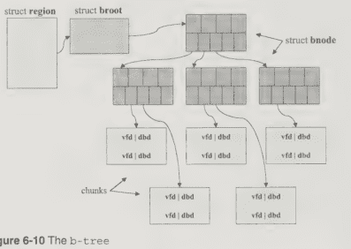

图 6-10 B 树

树的基底是它的**broot**。它设定了树的使用规则，并指引我们到达树中的第一层**bnode**。这个第一个**bnode**有时也被称为根**bnode**——请注意不要混淆这两个结构名称。

**bnode** 结构根据树的深度（在**broot**中定义）进行排序和排列，形成树的**branches**。沿着树的模型继续思考，**chunk** 结构可以被视为分支上的叶子。每个 chunk 包含 **vfd** | **dbd** 结构对；这些 **vfd** | **dbds** 是树成功搜索的结果。

#### Broot、Bnodes 和 Chunks

让我们查看列表 6.9 和 6.10 中的 B 树结构。

##### 列表 6.9 `q4> fields struct broot`

```
我们从指向根（第一个）bnode 的指针开始，并记录 B 树的深度
0 0 4 0 * b_root
4 0 4 0 int b_depth
接下来，我们找到映射的页面数量和为该树保留的交换页面数量
8 0 4 0 int b_npages
12 0 4 0 int b_rpages
页面列表指针指引我们到达该区域的页面列表，
nfrag 指向下一个可用的 chunk（如果需要扩展树，则必需）
16 0 4 0 * b_list
20 0 4 0 int b_nfrag

这个指针让我们返回到该 B 树服务的区域结构
24 0 4 0 * b_rp
28 0 4 0 int b_protoidx

当 B 树初始化或扩展时，有两套原型 dbd 结构；protoidx 提供了树中我们从使用第一个原型切换到第二个原型的索引
32 0 3 u_int b_proto1.dbd_type
32 3 3 u_int b_proto1.dbd_data
36 0 3 u_int b_proto2.dbd_type
36 3 3 u_int b_proto2.dbd_data

此数组存储关于需要设置其写时复制位的页面范围的信息
40 0 4 0 int b_vproto.v_start[0]
44 0 4 0 int b_vproto.v_start[1]
48 0 4 0 int b_vproto.v_start[2]
52 0 4 0 int b_vproto.v_start[3]
56 0 4 0 int b_vproto.v_start[4]
60 0 4 0 int b_vproto.v_end[0]
64 0 4 0 int b_vproto.v_end[1]
68 0 4 0 int b_vproto.v_end[2]
72 0 4 0 int b_vproto.v_end[3]
76 0 4 0 int b_vproto.v_end[4]

为了加速重复引用，两个最近的键/值数据对在此处缓存
80 0 4 0 int b_key_cache[0]
84 0 4 0 int b_key_cache[1]
88 0 4 0 * b_val_cache[0]
92 0 4 0 * b_val_cache[1]
```

##### 列表 6.10 `q4> fields struct bnode`

对于 29 阶 B 树，每个 **bnode** 包含 30 个键和 31 个值。值数组包含指向实际 **chunk** 结构的指针，或指向下一层 **b-tree structure** 的指针

```
0 0 4 0 int b_key[0]
4 0 4 0 int b_key[1]
-------------------------
112 0 4 0 int b_key[28]
116 0 4 0 int b_key[29]
此 bnode 中有效键/值的数量
120 0 4 0 int b_nelem
124 0 4 0 * b_down[0]
128 0 4 0 * b_down[1]
-------------------------
240 0 4 0 * b_down[29]
244 0 4 0 * b_down[30]
填充以对齐结构
248 0 4 0 int pad[0]
252 0 4 0 int pad[1]
```


既然我们已经定义了 B 树的各种部分，我们需要将它们组装起来。

### 页面列表

`chunk`、`bnode` 和 `broot` 结构具有相同的大小：在窄系统上为 256 字节，在宽系统上为 512 字节。在初始化 `region` 时，它将映射的总页面数（或至少它开始的页面数）用于计算其 B 树的深度。一旦确定了这一点，就需要分配 `chunks`、`bnodes` 和 `broot` 的空间。正如我们所指出的，这三种结构的大小相同。这为 `29th-order` `bnode` 留出了空间。每个 `chunk` 将根据架构包含 32 或 64 个 `fld|fld` `dbd` 结构对。

这些统一大小的结构可以方便地打包到完整的内存页面中。一旦确定了总空间需求，内核将分配足够的页面来容纳它们（见图 6-11）。这组已分配的页帧被称为页面 `list`。在大多数情况下，页面 `list` 中的所有空间并不会被 `chunk` 或 `bnode` 填满；如果树扩展，这些未使用的碎片将被利用。如果我们用完页面碎片，系统只是分配另一个页面并将其添加到 `region` 的页面 `list` 中。


这个模型的一个有趣特性是，B 树的页面像分配给用户进程的页面一样，从系统的空闲内存池分配。这些页面分配不会影响内核的内存 arena，而且由于一些 B 树必须非常大，这是一件好事。另一个特性是，如果进程被去激活，其页面 `list` 可能移动到交换空间。由于进程去激活仅在极端内存压力的情况下发生，能够回收这些额外页面有助于 `vhand` 执行其任务。

如果一个进程被去激活且其 B 树已被换出，我们必须能够找到这些页面并在进程重新激活时将其恢复到内存中。由于这些页面未由磁盘块描述符项定义，后备存储位置需要存储在区域结构中。由于区域结构具有静态大小，而页面列表中的页面数量可能根据整体区域页面数量而变化，因此实现了一种有趣的方法来寻找换出的页面列表页面。区域 `r_dbd` 包含一个磁盘块描述符以定位交换空间中的页面列表的第一个页面；第二个页面的磁盘块描述符存储在第一个页面的末尾，依此类推。

这呈现出一种异常。据说 HP-UX 内核页面永远不会被换出，内核始终在内核空间（in-core）中。现在我们看到，如果进程被去激活，区域的 B 树可能会被换出。由于页面列表被分配以容纳区域 B 树，且区域是内核结构，这些页面是内核页面。那么，HP-UX 内核是否会被换出？答案仍然是不，但有以下澄清。在启动时最初分配给内核的页面被视为静态内核页面；后来由内核分配的页面被视为动态内核页面。内核永远不会交换其静态页面，但在某些情况下，例如去激活时，一些动态页面可能会被换出。

这种设计的另一个好处是，当进程终止其页面列表时，页面会返回到系统内存池。

## 将内核视图与进程视图连接起来

我们终于准备好将进程逻辑视图与内核虚拟视图联系起来。回顾我们到目前为止看到的内容，当进程初始化时，系统根据存储在程序文件中的头信息创建区域结构的链接列表。此信息由构建程序文件的链接加载器创建并放置在可执行文件头中。如图 6-12 所示，每个程序的逻辑区域链接到一个底层内核区域结构。


正是在这个地址抽象级别上，第一层内存共享可能发生。如果同一程序的两个实例在系统上被授予进程状态，它们可能都共享指向相同文本区域的指针。此外，共享库对象可能被许多同时进行的进程映射。在物理层面可能发生另一层共享：这被称为虚拟地址别名。为了理解此特性，我们将注意力转向 HP-UX 内核的物理页面管理特性。

## 管理页帧：多种观点

如图 6-13 所示，有许多方式可以查看页帧。这完全取决于你是从内核还是进程的角度接近内存。在本章到目前为止，我们专注于内存管理的逻辑和虚拟方面。现在我们要深入到管理物理内存的细节中。

### 追踪空闲物理页帧


图 6-13 管理页帧

我们的第一个挑战是简单地知道有多少物理页面，哪些页面是空闲的，哪些已被分配给用户进程或内核使用。为了满足这一需求，HP-UX 使用了一个名为页空闲数据表（page free data table）或 `pfdt` 的古老结构的修改版本。`pfdt` 结构的概念自非常早期的 UNIX 版本以来就存在，甚至追溯到贝尔实验室系统（BLS）发行版。

此表是内核硬件独立层的一部分，并且不直接连接到虚拟内存转换系统。内核必须管理物理页面并将它们映射到虚拟内存空间，以符合内核及其进程的要求。

`pfdt` 的原始形式非常简单。每个页面都有一个 `pfdt` 结构，并且条目排列在一个简单的数组中。物理页帧编号用作索引到该数组。正如我们在讨论 `pfn_to_virt_ptr` 结构时提到的，现代 HP-UX 系统必须能够处理分区内存配置。随着当今具有物理和虚拟分区方案的基于单元的系统出现，这一要求正受到新的关注。图 6-14 说明了页空闲数据表的当前形式。

`pfdat_ptr` 分区大小由 `PFN_CONTIGUOUS_PAGES` 决定，当前默认为 4096 页，即 16 MB 的连续内存。只有那些可能被内核动态换入或换出的物理页框才具有 `pfdat` 结构。内核的静态页不需要包含在此表中，因为它们永远不会成为动态内存池的一部分。

这种两级结构的特性使得跳过内存页块变得轻而易举，例如内核静态内存页或物理硬件映射中的空洞。在 `pfdat_ptr` 中，`pp_tbl` 设为零仅表示对应的 16-MB 内存块未被动态映射。请注意，这并不意味着该内存物理上不存在，只是它不由此结构管理。

#### 列表 6.11 `q4_fields` 结构体 `pfdat_ptr`

`pp_tbl` 指向一个“页面空闲数据”条目块，而 `pp_offset` 指引我们找到块中第一个有效的条目。每个块映射 4096 个物理页转换（由内核参数 `PFN_CONTIGUOUS_PAGES` 决定）。

| 偏移量 | 位 | 大小 | 标志 | 字段 |
| :--- | :--- | :--- | :--- | :--- |
| 0 | 0 | 4 | 0 | * `pp_tbl` |
| 4 | 0 | 4 | 0 | int `pp_offset` |

一旦我们使用物理页号并跟随相应的 `pp_tbl` 指针，就会找到该页面的 `pfdat` 数据结构。让我们查看该结构的带注释列表（列表 6.12）。

#### 列表 6.12 q4> 字段 结构体 `pfdat`

哈希链链接指针

| 偏移量 | 位 | 大小 | 标志 | 字段 |
| :--- | :--- | :--- | :--- | :--- |
| 0 | 0 | 4 | 0 | * `pf_hchain` |

指向该页面所映射的设备文件 vnode (`devvp`) 的指针（如果适用）

| 偏移量 | 位 | 大小 | 标志 | 字段 |
| :--- | :--- | :--- | :--- | :--- |
| 4 | 0 | 4 | 0 | * `pf_devvp` |

空闲页框的双向链表

| 偏移量 | 位 | 大小 | 标志 | 字段 |
| :--- | :--- | :--- | :--- | :--- |
| 8 | 0 | 4 | 0 | * `pf_next` |
| 12 | 0 | 4 | 0 | * `pf_prev` |

连接所有共享同一 vnode 的页框的双向链表

| 偏移量 | 位 | 大小 | 标志 | 字段 |
| :--- | :--- | :--- | :--- | :--- |
| 16 | 0 | 4 | 0 | * `pf_vnext` |
| 20 | 0 | 4 | 0 | * `pf_vprev` |

在表维护过程中使用的锁定结构

| 偏移量 | 位 | 大小 | 标志 | 字段 |
| :--- | :--- | :--- | :--- | :--- |
| 24 | 0 | 1 | 0 | u_char `pf_lock.b_lock` |
| 26 | 0 | 2 | 0 | u_short `pf_lock.order` |
| 28 | 0 | 4 | 0 | * `pf_lock.owner` |

进程相关信息

| 偏移量 | 位 | 大小 | 标志 | 字段 |
| :--- | :--- | :--- | :--- | :--- |
| 32 | 0 | 2 | 5 | u_int `pf_pdk.p_fpn` |
| 34 | 5 | 1 | 3 | u_int `pf_pdk.pf_fill` |

使用此页面的区域数量（0 表示该页面应位于空闲列表上）

| 偏移量 | 位 | 大小 | 标志 | 字段 |
| :--- | :--- | :--- | :--- | :--- |
| 36 | 0 | 2 | 0 | short `pf_use` |

在请求页框锁之前递增

| 偏移量 | 位 | 大小 | 标志 | 字段 |


| :--- | :--- | :--- | :--- | :--- |

| 38 | 0 | 2 | 0 | `u_short pf_cache_waiting` |

页面映射自的磁盘块号（如果适用）

| 偏移量 | 位 | 大小 | 标志 | 字段 |

| :--- | :--- | :--- | :--- | :--- |

| 40 | 0 | 4 | 0 | `u_int pf_data` |

此页面及其页面组关联的 VFS 系统数据

| 偏移量 | 位 | 大小 | 标志 | 字段 |

| :--- | :--- | :--- | :--- | :--- |

| 44 | 0 | 6 | 0 | `u_int pf_sizeldx` |

| 44 | 6 | 0 | 5 | `u_int pf_size` |

| 45 | 3 | 0 | 5 | `u_int pf_size_fill` |

| 46 | 0 | 2 | 0 | `u_short pf_group_id` |

显示页框当前状态的标志：

| 值 | 标志 | 描述 |

| :--- | :--- | :--- |

| 0x001 | `P_FREE` 或 `P_QUEUE` | 页面位于空闲列表上 |

| 0x002 | `P_BAD` | 页面已被标记为损坏（请勿使用！） |

| 0x004 | `P_HASH` | 页面位于哈希队列上 |

| 0x008 | `P_CLIC` | 页面正被集群互连（Cluster InterConnect）使用 |

| 0x010 | `P_SYS` | 此页面属于内核 |

| 0x040 | `P_DMEM` | 页面被内存释放子系统锁定 |

| 0x080 | `P_ICOW` | 页面正被写时复制（copy-on-write）子系统重新映射 |

| 0x100 | `P_UREA` | 页面映射到线程的 UREA |

| 0x200 | `P_KERN_DYNAMIC` | 页面作为动态内核内存分配（可能稍后由内核归还） |

| 偏移量 | 位 | 大小 | 标志 | 字段 |

| :--- | :--- | :--- | :--- | :--- |

| 48 | 0 | 2 | 0 | `short pf_flags` |

| 50 | 0 | 1 | 0 | `u_char pf_fs_priv_data` |

`pf_hdl` 结构包含硬件依赖层数据。`hdl` 标志的值如下：

| 值 | 标志 | 描述 |

| :--- | :--- | :--- |

| 0x01 | `HDLpf_TRANS` | 存在虚拟地址转换 |

| 0x02 | `HDLpf_NOTIFY` | 虚拟 DMA，未被 HP-UX 使用 |

| 0x04 | `HDLpf_PROTECT` | 不允许用户访问 |

| 0x08 | `HDLpf_STEAL` | 当 I/O 完成时移除转换 |

| 0x10 | `HDLpf_ONULLPG` | 用于空数据引用模拟 |

| 0x20 | `HDLpf_MOD` | 设置 `pde_mod` 标志的快捷方式 |

| 0x40 | `HDLpf_REF` | 设置 `pde_ref` 标志的快捷方式 |

| 0x80 | `HDLpf_READA` | 预读页面正在传输中 |

| 偏移量 | 位 | 大小 | 标志 | 字段 |

| :--- | :--- | :--- | :--- | :--- |

| 52 | 0 | 2 | 0 | `u_short pf_hdl.hdlpf_flags` |

在别名操作期间，我们将原始页面的访问权限和保护 ID 位保存在此处

| 偏移量 | 位 | 大小 | 标志 | 字段 |

| :--- | :--- | :--- | :--- | :--- |

| 54 | 0 | 2 | 0 | `u_short pf_hdl.hdlpf_savear` |

| 56 | 0 | 4 | 0 | `u_int pf_hdl.hdlpf_saveprot` |

如我们在此结构中所见，页框链接到多个列表上。当然，有一个空闲列表以促进页面分配方案，所有与特定打开文件相关的页面也被链接在一起。另一个链接是结构顶部的 *`pf_hchain`*；让我们看看这个哈希是如何被利用的。

### 是否真的需要页面 I/O？(`phash` 和 `phead`)

为了确保在请求时始终有可用空闲页面，内核将其部分资源投入主动识别陈旧页面以及将这些页面传输到交换位置或后备存储中。在磁盘和物理内存之间移动页面在计算机指令周期时间和 I/O 带宽方面是一项非常昂贵的操作。然而，当需要页面却无法找到空闲页面时，真的会让工作流程陷入困境！作为页面换出操作的一部分，页面的 *`pfdat`* 结构被添加到哈希列表中（参见图 6-15）。页面根据其磁盘块描述符及其写入设备的设备指针进行哈希。实际的哈希算法如下：

```
(dhd_data >> 5) + dhd_data) xor (devvp >> 6) & phashmask
```


#### 图 6-15 *`phash`* 和 *`phead`*

为了最小化换页成本，在执行页面换入操作之前，会先搜索 *`phash`*，以防页框自其被换出后未被重新分配。如果在 *`phash`* 中找到所需的页面，它只需从空闲列表中移除并重新安置到 *`region_htbl`* 和 *`pfn_to_virt`* 表中。

如果你开始对逻辑到虚拟、虚拟到物理、前部存储和后备存储之间的关系感到得心应手，太棒了！这是本研究的目标，但我们需要深呼吸一下并继续前行。最新的发展为我们的管理这一宝贵资源的策略引入了另一层复杂性。

### 视图、池塘、池、页面

操作系统的物理页分配器必须能够与底层物理硬件协同工作。内核为其自身的内存区域方案以及为了满足其进程需求的动态分配而申请物理页。随着 HP-UX 从纯粹的专有架构 PA-RISC 向新的 IA-64 迁移，内存分配器必须修改以处理架构差异。为准备这一变化并促进最近引入的分区方案，内核内存分配器已被修改。图 6-16 展示了新模型的抽象。


#### **图 6-16** 池、池塘、视图

这个新模型包含视图、池塘、池和组的组合。让我们尝试定义这些术语和概念。

#### 物理内存视图

最高层级的组织是物理内存视图，或 **`pmv`**，它允许根据特定属性或根据物理配置将系统的物理内存划分为集合。一种用途是根据访问延迟划分内存。在 SMP（对称多处理器）或 UMA（统一内存访问）机器上，只有一个 **`pmv`**，而在多节点设计或 ccNUMA（非统一内存访问）平台上，每个节点（或单元）可能拥有自己的 **`pmv`**。迄今为止，此层级尚未在 HP-UX 内核中编码，在此提出仅供未来考虑。

#### 逻辑内存视图

逻辑内存视图，或 **`lmv`**，是 **`pmv`** 内的下一级划分。**`lmv`** 维护自己的空闲列表和锁定结构。目前，**`lmvs`** 与系统的处理器集对齐。通过让每个处理器集从其自己的空闲列表中分配内存并使用其自己的锁定机制，由于减少了锁竞争，系统整体性能得以提高。这是目前 HP-UX 内核中纳入的最高抽象层级。**`lmv`** 由一个在启动时分配的 **`lmv`** 结构数组管理。**`lmvs`** 的数量目前计算为总处理器数除以四。

### 内存池

每个 *`lmv`* 由一个或多个内存 *`pools`* 组成。内存 **`pool`** 的边界根据固有的硬件限制设置。例如，在 HP-UX 32 位内核上，物理内存的第一个吉字节属于一个 **`pool`**，而 1 GB 以上的内存属于另一个。为了允许内核页面的等效内存映射，要求它们必须位于物理内存的第一个吉字节中。通过这两个池，可以指示内存分配器始终从第一个池分配内核页面，从第二个池分配用户页面（除非没有可用空间，在这种情况下使用第一个池）。

在当前的 PA-RISC 系统上，只有两个池，一个用于等效映射内存，另一个用于非等效映射内存。在大型系统上，整个物理内存都可以等效映射，因为 64 位系统的地址范围相当大（$2^{42}$）。

页面池数据存储在 **`page_pool`** 结构数组中，这些结构位于其各自的 *`lmv`* 内。

### 内存池塘

如前所述，如果*`page`* 被换出以增加空闲页面的供应量，其 **`pfdst`** 结构会链接到 **`phas`**。这些页面称为*缓存*空闲页面。当页面被释放时，它们被分为两个内存池塘之一：一个用于缓存空闲页面，另一个用于非缓存页面。如果系统使用可变页面大小，则每个页面大小维护一个单独的空闲列表。每个 **`pond`** 创建的空闲列表头数量由内核可调参数 **`pf_offset_idx`** 决定，并在启动时设置。**`pond`** 结构作为其对应池结构中的一个数组包含在其中。

### 嵌套结构

在列表 6.13 中，我们可以看到 *`pond`* 数组嵌套在 **`pool`** 结构中，而 **`pool`** 结构又嵌套在 *`lmv`* 结构中。

#### 列表 6.13 q4> 字段 `lmv_t`

| 偏移量 | 位 | 大小 | 标志 | 字段 |


| :--- | :--- | :--- | :--- | :--- |
| 0 | 0 | 4 | 0 | `int lmv_npools` |
| 4 | 0 | 4 | 0 | `int lmv_id` |
| 8 | 0 | 4 | 0 | `int lmv_freeem` |
| 12 | 0 | 4 | 0 | `* lmv_fi_lock` |

此逻辑内存视图中的池数量。此逻辑内存视图的索引。此视图中的空闲内存量。指向自旋锁的指针，用于保护此视图的空闲列表。单个页面池结构（对于 PA-RISC，每个逻辑内存视图有两个池）。我们从池内所有页面组的链表开始，以及用于此目的的空闲列表自旋锁。

池（`pool`），此逻辑视图池中池的链表，

指向父 `lmv` 结构的指针，以及

此池的“已用”计数

`16 0 4 0 * lmv_pools[0].pp_next`

`20 0 4 0 * lmv_pools[0].pp_f1_lock`

`24 0 4 0 * lmv_pools[0].pp_next_pool`

`28 0 4 0 * lmv_pools[0].pp_lmv`

`32 0 4 0 * lmv_pools[0].pp_n_used`

在池结构中，我们有两个水塘（`pond`）结构。每个

水塘以其空闲链表头指针、此水塘的空闲计数、指向父池结构的指针

开头

`36 0 4 0 * lmv_pools[0].pp_ponds[0].pp_phead`

`40 0 4 0 * lmv_pools[0].pp_ponds[0].pp_n_free`

`44 0 4 0 * lmv_pools[0].pp_pools[0].pp_pool`

此外，还有一个索引计数，用于 `pp_phead[]` 中活动条目的数量

（允许的内核大小数量），此水塘的索引计数器，以及

由惰性合并例程使用的低水位和高水位标记

`48 0 4 0 u_int lmv_pools[0].pp_ponds[0].pp_max_idx`

`52 0 4 0 u_int lmv_pools[0].pp_ponds[0].pp_pool_index`

`56 0 4 0 u_int lmv_pools[0].pp_ponds[0].pp_lb_shift`

`60 0 4 0 u_int lmv_pools[0].pp_ponds[0].pp_ub_shift`

`64 0 4 0 * lmv_pools[0].pp_ponds[1].pp_phead`

`68 0 4 0 * lmv_pools[0].pp_ponds[1].pp_n_free`

`72 0 4 0 * lmv_pools[0].pp_pools[1].pp_pool`

`76 0 4 0 u_int lmv_pools[0].pp_ponds[1].pp_max_idx`

`80 0 4 0 u_int lmv_pools[0].pp_ponds[1].pp_pool_index`

`84 0 4 0 u_int lmv_pools[0].pp_ponds[1].pp_lb_shift`

`88 0 4 0 u_int lmv_pools[0].pp_ponds[1].pp_ub_shift`

每个池维护可用页帧的总计数

及其状态标志

`92 0 4 0 int lmv_pools[0].pp_pfdatum_num_entries`

`96 0 4 0 u_int lmv_pools[0].pp_flags`

`100 0 4 0 * lmv_pools[1].pp_next`

`104 0 4 0 * lmv_pools[1].pp_f1_lock`

`108 0 4 0 * lmv_pools[1].pp_next_pool`

`112 0 4 0 * lmv_pools[1].pp_lmv`

`116 0 4 0 * lmv_pools[1].pp_n_used`

`120 0 4 0 * lmv_pools[1].pp_ponds[0].pp_phead`

`124 0 4 0 * lmv_pools[1].pp_ponds[0].pp_n_free`

`128 0 4 0 * lmv_pools[1].pp_ponds[0].pp_pool`

`132 0 4 0 u_int lmv_pools[1].pp_ponds[0].pp_max_idx`

`136 0 4 0 u_int lmv_pools[1].pp_ponds[0].pp_pool_index`

`140 0 4 0 u_int lmv_pools[1].pp_ponds[0].pp_lb_shift`

`144 0 4 0 u_int lmv_pools[1].pp_ponds[0].pp_ub_shift`

`148 0 4 0 * lmv_pools[1].pp_ponds[1].pp_phead`

`152 0 4 0 * lmv_pools[1].pp_ponds[1].pp_n_free`

`156 0 4 0 * lmv_pools[1].pp_ponds[1].pp_pool`

`160 0 4 0 u_int lmv_pools[1].pp_ponds[1].pp_max_idx`

`164 0 4 0 u_int lmv_pools[1].pp_ponds[1].pp_pool_index`

`168 0 4 0 u_int lmv_pools[1].pp_ponds[1].pp_lb_shift`

`172 0 4 0 u_int lmv_pools[1].pp_ponds[1].pp_ub_shift`

`176 0 4 0 int lmv_pools[1].pp_pfdatum_num_entries`

`180 0 4 0 u_int lmv_pools[1].pp_flags`

`pp_phead[1]` 包含每个水塘的实际空闲链表指针。此数组中的第一个元素

具有一页帧空闲链表的 next 和 previous 指针，第二个条目

具有指向四页帧空闲链表的链接指针，第三个

指向 16 页帧空闲链表，依此类推，直到最大配置的内核大小。为了便于管理多种内核大小，

创建了一个名为 `memory page_group` 的附加结构。

### 可变内核大小

HP-UX 11.00 版本引入了可变内核大小（`vps`），也称为性能优化的内核大小分配（`pops`）。此功能使内核能够利用 PA-RISC 2.0 处理器中引入的新硬件特性。在新的宽处理器上，`tlb` 引入了一个附加字段，允许映射各种虚拟到物理的内核转换大小。基本页帧仍为 4Kbytes，但 `vps` 参数允许单个 `tlb` 条目以单条目将 4Kbytes 映射到最多 1048576 Kbytes 的连续物理内存。内核大小由 `ttbl/pdir` 条目中的 5 位字段确定。当前实现的内核大小范围从 1 到 256K 页帧（每个 progressively 更大的大小是前一个较小大小的 4 倍）。内核跟踪进程的内存使用量，并且可以调整程序或程序员使用的内核大小，或使用 `chptr` 命令调整内核大小。有几个内核可调参数用于控制此功能：

- `vps_pagesize` 此参数设置基本内核大小，默认为 4Kbytes
- `vps_ceiling` 此参数设置内核可能选择的最大内核大小，目前限制为 65536KBytes
- `vps_chptr_ceiling` 这是可通过 `chptr()` 请求的最大内核大小，限制为 1048576KBytes

就内核内存管理而言，各种大小被称为页组（`page group`）。正如我们在图 6-17 中看到的，`page_group` 结构帮助内核识别和管理连续的免费页块。


`page_group` 结构包含有助于内核决定此组是否可以与其“伙伴”合并以形成更大组的信息。让我们通过清单 6.14 查看该结构。

Listing 6.14 `q4> fields struct page_group`

```
连接池中所有组的链接指针
0 0 4 0 * pg_next
指向此组 pfdт 数组开头的指针
4 0 4 0 * pg_pfdт
此组中的页帧数量
8 0 4 0 int pg_npfns
此组中的第一个页帧
12 0 4 0 u_int pg_firstpfn
指向此组所属池的指针
16 0 4 0 * pg_pool
```

### HP-UX 11.0 中的物理内存分配器

既然我们已经检查了 `lmv` 的各种组件，我们必须将它们全部结合起来，并考虑内存分配和内存释放这两个任务。图 6-18 将这些结构结合在一个视图中。


Figure 6-18 物理内存分配器

#### 分配内存


内核例程 `allocate_page()` 负责分配特定请求大小的物理页。它与视图、池和水塘协同工作。基本算法工作原理如下：

- 尝试从所有池中所需大小（或更大）的缓存水塘中进行分配。初始池由 `CHOOSE_VIEW_AND_POOL()` 确定，该函数基于底层系统架构进行键控。
- 如果初始池无法满足请求，则调用 `NEXT_POOL_TO_TRY()` 来选择下一个受害者。
- 如果请求是等效映射的页，则首先尝试处理器自身的 lmv `EQUIV_MAPPED_POOL`；然后尝试其他 lmv `EQUIV_MAPPED_POOLS`。
- 如果请求是非等效映射的页，则先尝试我们自己的 lmv `NON_EQUIV_MAPPED_POOL`，然后是其他 lmv `NON_EQUIV_MAPPED_POOLS`，最后尝试 `EQUIV_MAPPED_POOLS`。
- 如果所有池的所有缓存水塘都已尝试，则尝试所有池的缓存水塘。
- 如果仍然无法找到所需的内核大小，则将请求降级到下一个较小的内核大小，并重复上述步骤。
- 如果仍然无法完成请求的分配，并且调用不允许阻塞，则返回 `NULL`，让线程处理失败。
- 如果允许阻塞，则在唤醒分页守护程序和反哈希守护程序后，线程将进入睡眠状态。

### 释放内存

当存在多个空闲链表以及合并页面以形成更大 `页组` 的额外挑战时，释放内存使此过程变得复杂。图 6-19 说明了多个空闲链表的概念。


用于此艰巨任务的内核例程是 `freepfld()`。

- `freepfld()` 的第一条规则是减少页的 `pfdt` 结构中的 `pf_use`。
- 如果 `pf_use` 现在为零，则物理页准备分配给空闲链表，前提是清理其 `哈希区域` 和 `pfn_to_virt` 表条目。
- 调用例程 `freeup_page()` 将页分配给适当的空闲池。
- 最后，全局空闲内存计数 `freemem` 在任何可能发生的合并之后增加。

### 合并空闲页

当页被放置在空闲链表上时，我们必须检查其邻居是否也是空闲的，并且它们是否可以合并以形成更大大小的空闲页。此过程称为 *页合并*。物理内存映射中彼此相邻的页称为伙伴，负责合并页的例程是 `place_on_freelist()`。`freeup_page()` 例程调用 `place_on_freelist()` 并传递它试图释放的物理页帧号。

- 找到该页的伙伴。这是一个简单的任务：修改对应当前页面大小的位，并检查它是否空闲。
- 确认要释放的页面及其伙伴位于同一个池塘中。
- 只有当缓存池塘中至少三分之一的页面当前处于空闲状态时，才会尝试对缓存池塘中的页面进行合并。对于非缓存页面，始终尝试合并。
- 然后将生成的页面（如果可以则合并）放置在相应空闲列表的末尾。

### 摘要

我们看到了内核管理并由进程线程和 PA-RISC 硬件使用的四种主要内存视图。如果我们无法在允许线程运行时分配物理内存，那么各种抽象层次都将毫无意义。

拥有充足的空闲页面对于整体系统性能至关重要。为此，内核采用交换或分页系统。接下来我们将对此进行考察。

# 第 7 章

## HP-UX 分页系统

经典 UNIX 引入了程序交换系统。当内核需要为进程运行在内核内存中腾出空间时，它会选择一个非活动进程或优先级较低的进程，将其从物理内存移动到磁盘上的临时存储位置。此时该程序被称为被*换出*。在进程再次运行之前，必须将其换回内存。这可能会占用系统大量 I/O 带宽。整个进程交换已被写入历史；现代内核利用*按需分页系统*。

### 按需页面

在按需分页系统中，系统不会在程序调度时加载程序的全部文本和数据，而是等待页面出错，然后仅加载所需的页面。这意味着在任何特定时刻，进程的页面中只有一小部分需要驻留在物理内存中。对页面的所有首次引用都会导致页面错误，但如果系统内存充足，最终进程的所有页面都会被映射到物理页面，性能将处于最佳状态。如果页面需求超过系统配置或可用内存，则在将新页面换入之前，必须将某些页面换出。

HP-UX 分页系统负责在页面首次被请求时加载页面，并监控和维护适量的空闲页面。如果空闲内存量低于可调整的系统阈值，分页系统必须识别要换出的页面。页面换入总会发生；只要新程序被调度就至少会发生，但大量的页面换出表明内存压力增加，整体系统性能将开始下降。这并不一定是坏事；这只是系统管理员必须理解的因果关系的体现。

当发生页面错误时，内核必须能够识别所请求页面的位置并采取纠正措施。正如我们在第 6 章“内存管理”中讨论 `ddb` 时所见，每个非常驻页面都是带类型的。分页系统理解这些类型以及如何恢复它们。让我们详细看看这些类型。

#### 从前端存储中读入页面

请求的页面可能是进程的文本映像的一部分，或者是已初始化的数据页。如果是这样，将在程序文件中找到相应的页面，并将其加载到空闲页框中。除了调度页面换入外，内核还必须更新 `hash`、`region`、`pfdat` 和 `pfn_to_virt` 表项。

该例程还处理预读页面请求：`preregion` 中的 `p_pagein` 根据文件是以随机方式还是顺序方式访问而进行调整，这是通过监控出错页面的地址来确定的。每次处理某个区域的错误时，其 `p_nextfault` 被设置为当前出错页面之后的下一个顺序页面地址（当前出错页码加上 `p_pagein`）。当该 `preregion` 发生下一个错误时，出错页面地址与此值进行比较。如果匹配，则正在执行顺序读取，此时 `p_pagein` 乘以 2（该值会与内核的 `maxpagein_size` 进行限制检查，默认为 64）。如果 `p_strength` 小于 100 并且检测到顺序操作，则递增。这让我们对访问的顺序性有一个概念。

如果下一个错误不是顺序的，`p_pagein` 除以 2（与 `minpagein_size` 进行限制检查，默认为 1），除非 `p_strength` 当前等于 $-100$，否则其值将递减。

从上述描述中我们可以看出，`p_strength` 可以在 $-100$（定义为 `PURELY_RANDOM`）和 $+100$（定义为 `PURELY_SEQUENTIAL`）之间变化，而 `p_pagein` 可以在 1 和 64 之间按 2 的幂变化。

#### 从后端存储（交换区）中读入页面

页面当前可能驻留在交换区。在调度页面换入之前，系统首先调用 `vm_no_io_required()` 检查 `pash`，以防页面已被交换但从未重新验证。如果是这种情况，页面仍在内存中，内核只需更新表格——无需实际的页面换入。这被称为*软页面错误*。如果错误不是软错误，则调度页面换入，并像前面提到的情况一样更新四个表格。

#### 读入零填充页面

如果请求的页面是未初始化的数据页，内核只需找到一个空闲页面，用零填充它，并更新四个表格。未初始化的数据页也称为符号块存储（`BSS`）页面，构成了进程私有数据区的大部分。

#### 读入无填充页面

除了这三种类型的页面外，内核还可能会被要求读入无填充页面。这与 BSS 页面错误类似，除了我们不需用零填充该页面。该页面仍将包含其前所有者留下的残留数据。因此，此选项仅适用于为内核使用而分配的页面，特别是仅用于作为 `uarea` 页面。`uarea` 对进程不可见，仅对内核可见，因此残留数据不会受到用户线程的审查。

#### 挖一个内存洞

最后一类页面称为*内存洞*，用于链接到稀疏内存映射文件。当针对这些页面之一调度读取时，请求者收到 0 或空值；当尝试写入时，遵循零填充页面的语义。

### 监控空闲内存

维护系统充足的空闲页面供应是内核的关键职责；为此，内核符号 `freeemem` 包含当前空闲列表上的页框总数。当内存压力高时，空闲列表上的空闲页面相对较少，内核必须采取纠正措施。图 7-1 给出了空闲页面监控系统的总体视图。


操作系统可用的内存总量在启动时确定，并存储在内核参数 `phys_mem_pages` 中。额外的设定点由内核计算并持续监控。

#### lotsfree

可调整参数 `lotsfree` 设置了分页系统首次被调用的点。如果空闲页面数 `freemem` 高于 `lotsfree`，则分页系统无事可做。`lotsfree` 的默认值取决于为系统配置的内存量。

对于具有 32 MB 到 2 GB 物理内存的系统，`lotsfree` 将为非内核内存的 1/16，但不超过 8192 页（32 MB）。对于内存超过 2 GB 的系统，`lotsfree` 设置为 16,384 页（64 MB）。

#### desfree


可调整参数 `desfree` 设置系统空闲页面的最小期望数量。当空闲页面数降至该限制以下时，`vhand` 代理已经以最大速率工作。换页程序开始评估潜在的非激活进程，但尚未进行非激活。

对于具有 32 MB 到 2 GB 内存的系统，`desfree` 设置为非内核内存的 1/64，但不超过 1024 页（4 MB）。对于内存超过 2 GB 的系统，`desfree` 设置为 3072 页（12 MB）。

### minfree

当触及可调整参数 `minfree` 的限制时，情况真的非常紧张。无论如何衡量，供应都跟不上需求。就内存可用性而言，我们处于第 11 小时（最后关头），因此内核要求换页程序开始进程非激活。希望此举能使 `freemem` 回到可接受的范围。

对于具有 32 MB 到 2 GB 内存的系统，`minfree` 设置为 `desfree` 的 1/4，但不超过 256 页。对于内存超过 2 GB 的系统，`minfree` 设置为 1280 页（5 MB）。

### gggslim

在启动时，该参数被设置为 `desfree` 和 `lotsfree` 之间四分之一处的值。当 `freemem` 降至 `lotsfree` 以下时，启动 `vhand` 守护程序，但此时它仅老化页面——不进行偷取。如果 `freemem` 降至 `gggslim` 以下，则激活 `vhand` 的另一部分，它偷取陈旧的页面。内核根据近期内存压力的当前趋势，在 `lotsfree` 和 `desfree` 之间调整 `gggslim`。（在早期版本的 HP-UX 中，此参数是可调整的。）

### 其他内核分页参数

有若干个其他内核参数需要提及：

- `freemem`（计算得出）：这是系统当前的空闲页面计数，即所有空闲列表中的页面框数量。
- `paolem`（计算得出）：这是当前时间处于待调出状态的页面计数。
- `vhandrunrate`（可调）：这是内核每秒启动 `vhand` 守护程序的次数，条件是空闲页面计数（`freemem` 加上 `paolem`）已降至 `lotsfree` 以下。默认值为 8。
- `memzeroperiod`（可调）：此参数以 1 秒为增量，确定内核调整 `pggslim` 的频率。每 $2 * \text{memzeroperiod}$ 秒，或者如果 `freemem` 两次以上达到零，`pggslim` 就会被调整。如果 `freemem` 在 `memzeroperiod` 内达到其目标限制，调整公式为 $[3 * \text{pggslim} + (\text{lotsfree}/4)]$；如果 `freemem` 未在 `memzeroperiod` 内达到其目标限制，公式为 $[3 * \text{pggslim} + (\text{desfree}/4)]$。默认值为 30，即每 3 秒。
- `hitzero/freemem`（内核）：在过去 `memzeroperiod` 内 `freemem` 达到零的次数。
- `targetcpu`（可调）：这代表我们愿意分配给 `vhand` 守护程序的最大 CPU 周期数。默认值为 100 个刻度（ticks），或总 CPU 时间的 10%。
- `maxqueuesize`（可调）：此数字控制待处理的 `paolem` 队列深度。值的单位为 1 秒，默认值为 10。这意味着系统将试图保持调出页面队列不超过系统在 1 秒内能处理的数量。
- `pageoutcnt`（计数器）：这是近期内核和用户请求的页面调出计数。
- `kpageoutcnt`（计数器）：这是近期已完成的内核请求页面调出（`vhand`）的数量。
- `pageoutrate`（计算得出）：这是当前的总页面调出速率。
- `kpagueoutrate`（计算得出）：这是当前的 `vhand` 页面调出速率。
- `maxpendpageouts`（计算得出）：`pageoutrate` \* (`maxqueuesize`/10)。
- `pgrateupdate`（可调）：将 `curr_pgrate` 复制到 `max_pgrate` 的秒数；默认为 60。
- `curr_pgrate`（计数器）：当前周期内观察到的最大 `kpageoutrate`。
- `max_pgrate`（计算得出）：在过去 `pgrateupdate` 周期内观察到的最大 `kpageoutrate`。如果其值较高且 CPU 利用率较低，则这可能是页面颠簸（thrashing）的指示器。
- `agehand`（内核）：这是指向下一个 `pregion` 的指针，`vhand` 可以对该区域进行老化（扫描）页面。
- `stealand`（内核）：这是指向下一个 preregion 的指针，vhand 可以从中窃取页面。
- `agerate`（内核）：这是交换程序（swapper）分配给 vhand 下一次运行的老化配额。
- `stealrate`（内核）：这是交换程序分配给 vhand 下一次运行的窃取配额。
- `handlaps`（内核）：这是在 pre 区域中扫描操作和窃取操作之间期望的滞后量。
- `targetlaps`（内核）：这是在 pre 区域中扫描操作和窃取操作之间的实际滞后量。
- `vhandinfoticks`（adb 可调）：此参数应仅通过 adb（由非常 knowledgeable 的用户）设置。如果其值为非零，则每隔 vhandinfoticks 次 vhand 会向系统控制台打印状态报告，包括 handlaps、targetlaps、agerate、pggslim、paolem、stealrate 和 freemem 的当前值。

`vhandrunrate` 在内核中设置标志，以适当的速率调用 `schedpaging()`。此例程检查 `freemem` 的当前值，如果它已降至 `lotsfree`（或在极端情况下 `pggslim`）以下，则调用 `vhand` 守护程序。让我们详细研究 `vhand`。

### 夜中的窃贼：vhand

`vhand` 内核守护程序实际上是一个封装中的两个操作。第一次扫描针对页面，如果其 `pde_accessed` 位仍然干净，则窃取它们；第二次扫描对目标页面进行老化。对页面进行老化意味着使所有处理器 TLB 中该页面当前的虚拟地址转换失效，并清除其哈希表项中页面的访问位（`pde_accessed = 0`）。当 `vhand` 发现自上次扫描以来该页面未被引用时，它会窃取该页面。然后它请求页面调出，如果该页面尚不存在交换位置，则分配一个交换位置。

页面通过它们的 `pre region` → `region` → `vfd` 链接进行老化和窃取。图 7-2 显示了 `vhand` 对 `pre region` 的视图。


#### 图 7-2 每个 pregion 内部

在这个简化模型中，我们看到 `pre gion` 的所有页面排列成一个圆，它们各自的 `vfd s` 作为时钟面上的数字出现。在我们的简单示例中，`p region` 有 32 个页面，足以解释 `vh and` 的操作。在 `p region` 结构中，`p_stealscan` 指向这个 `p region` 中的下一个页面，该页面可以被检查是否处于假释（parole）状态。`p_agescan` 指向 `vh and` 可以老化的下一个页面。当 `vh and` 进入 `p region` 时，只允许扫描可用页面的 1/16。

`p_stealscan` 必须比 `p_agescan` 的位置滞后 `[(p_count/16) * handlaps]`。保持这种滞后确保仍然需要老化页面的进程可以在页面被窃取之前访问它。滞后越大，`vh and` 窃取正在使用的页面的可能性就越小。

下次系统指向此 `pregion` 时，其页面的下一个 1/16 可以被扫描。单个 `pregions` 通过它们的 `p_forw` 和 `p_back` 指针在所有活动的 `pregions` 的全系统列表中双向链接。

#### 链接的 pregion 列表

内核跟随此双向链接列表以找到下一个要扫描的 `pregion`。图 7-3 阐明了这一概念。你可以将操作想象为两级时钟。主时钟上的指针是系统的 `agehand` 和 `stealhand`。每个 `p region` 内部都有对应的 `p_agescan` 和 `p_stealscan` 指针。分页例程的名称由此而来：`vh and` 代表 *virtual hand*（虚拟手）分页程序。


#### 图 7-3 链接所有的 *regions*


为了使 `region` 的所有页面都被老化，系统的 `agehand` 必须完成全系统 `region` 列表的 16 圈完整循环——因此术语 `handlap` 由此而来。`handlap` 值越大（最大为 15），`vhand` 老化页面与能够窃取它之间的滞后时间就越长。当内存压力降至 `pggslim` 以下时，`handlap` 的值会减小，直到 `_p_stealscan` 碰到 `_p_pagescan`（它绝不允许超过它）。

每次 `vhand` 被调度时，它都被分配老化和窃取页面的配额：分别为 `stealrate` 和 `agerate`。当它进入 `region` 时，它试图满足其配额。如果 `region` 没有足够的页面来满足配额，`stealhand` 只需移动到下一个 `region`。一旦达到配额，它就停止。`_p_stealscan` 的当前位置是下次扫描此 `region` 时的起点。老化过程也是如此。

配额也会根据 `freemem` 相对于 `pggslim` 和 `desfree` 的下降情况进行调整。当我们到达 `desfree` 时，handlaps 处于最小值，配额达到最大值（由 `targetcpu` 的设置决定），分页操作尽可能积极。如果这不足以让我们重新获得内存管理系统的青睐，那么停用可能有效。

程序开始时内存中没有页面。随着页面出现，请求的页面被加载；这是 `demand`（按需）分页的本质。随着时间推移，进程可能会在核心中拥有相当数量的页面。随着其他进程被调度，内存压力可能开始增加。当程序被停用时，其所有 `regions` 都被标记为已停用，并移动到 `stealhand` 列表的前面。下次 `vhand` 运行时，其所有页面都可能被倒出（pored，此处原文疑为 paged out 或类似含义，结合上下文指页面调出）。

一旦我们超过 `desfree` 限制，就会考虑对已停用进程进行重新激活。即使重新激活了一个大型进程，我们可能仍能保持在限制之上，因为页面是按需重新加载的。

### 保留空间与交换空间分配

在操作系统设计中，交换空间管理有许多变种。一些系统动态地从可用的文件系统空间分配交换空间，并在不再需要时将其返还。其他系统在启动时配置静态的专用交换空间，并强制系统在其边界内运行。还有一些系统允许动态地从专用卷中分配交换空间，或者通过在已挂载的文件系统下创建目录并在此创建交换文件来实现分配。

一个重要的设计考量是，当系统耗尽交换空间时如何响应。内核会崩溃，还是仅仅终止发出交换请求的进程？这可能对正在运行的应用程序造成严重影响，并破坏系统的正常运行时间。

最后的一个问题是，何时为进程页面分配交换页面。有些系统在运行第一条命令之前，会为程序创建一个完整的交换副本。这些已分配的交换页面在进程活动期间属于该进程，仅在进程终止时才由交换系统回收。另一种方法是按需分配交换位置，并在页面重新加载到内存后，立即将其归还到空闲列表。在这种模型中，一个页面在其生命周期内可能被交换多次，并且每次可能使用不同的交换位置。这意味着每次页面被交换时，我们都要承担分配带来的开销。我们也可以在需要时再分配页面，然后保持该分配直到进程终止。在最后这种模型中，我们只需要支付一次分配的代价。每种方法都有其优缺点。

HP-UX 采用了这两种方法的一些部分，并加入了一些自己的特性。HP-UX 的分页策略会跟踪其控制下的保留、已分配和空闲交换页面的数量。

当进程通过 `fork()` 或 `vfork()` 系统调用请求权限变为活跃状态时，系统会计算该进程可能需要的交换页面总数。它采用最坏情况计算，包含进程所有数据页面、`region` 页面列表、`aarea` 以及其他任何进程特定的可写内存页面的空间。这个数字随后从系统的交换保留限制中减去。通过这种方式，HP-UX 执行交换的预保留和后分配。

为了理解这种方法，可以想象一家高档餐厅。你计划星期五晚上 7:00 带 12 个人的团队去餐厅吃饭。如果你在星期五才出现并直接带着你的团队去，你可能需要等待很长时间才能入座。虽然你最终可能吃上饭，但长时间的等待可能会负面影响你的用餐体验。为了避免顾客不满，餐厅会提前接受座位预订。你在星期二打电话给餐厅，预订星期五你和团队的位置。当你联系领位员并请求星期五入座时，他或她会查看列表，并告知餐厅在该特定时间是否能容纳你们。如果可以，领位员会记下你的名字并确认预订。

现在让我们思考一下这个过程。领位员确切知道你们将坐在哪里吗？他知道你们会点什么菜或计划停留多久吗吗？领位员唯一能假设的是，餐厅的资源——桌椅、服务员和厨房的容量——需要容纳你的团队。该机构根据其容量确定预订限制。当你们实际到达餐厅时，决定在需要时为你分配具体资源。一旦入座，空间将属于你，直到你的晚餐结束。如果你起身去舞池跳舞或去洗手间，分配给你和你团队资源会被保持。当你付账离开时，资源会被收回并供下一批顾客使用。如果你没有在星期五出现，或者你的团队最终只有 8 个人而不是 12 个，资源并未浪费；它们只是保持可用状态，以按需容纳其他顾客。

这是 HP-UX 交换保留策略相当贴切的类比。一旦页面被分配以容纳特定页面，它将保留用于此目的，直到进程退出，然后作为空闲页面返回到交换映射中。在图 7-4 中，我们可以看到交换空间、保留和分配之间的关系。


在启动时，保留限制被设置为配置的交换空间总量。当系统被要求 `fork()` 一个新进程时，其潜在的交换需求会从交换保留中减去。如果这导致限制变为负数，`fork()` 将失败，返回的错误消息将指示失败是由于交换空间不足。

如果 `fork()` 成功，保留限制会被调整，进程被初始化。此时，实际上没有页面被分配，只是被保留。在物理内存充足的系统中，完全有可能进程永远不会分配交换页面。这是理想情况，因为它意味着系统内存压力从未触发自称页系统。

当一个页面第一次需要被交换时，内核从交换映射中分配一个页面，并将内存中的页面分页到新分配的交换页面。当这种情况发生时，分配计数增加，保留计数减少；保留限制保持不变。交换保留限制加上保留和已分配页面的数量，应始终等于系统配置的交换总量。一旦进行页面分配，它将保持直到进程终止。

### 一个简单的交换示例

图 7-5 展示了一个简单的交换场景：在我们模型中，三个程序想要运行。该模型配置了 12 页物理内存和 12 页交换空间。


当 progA 请求运行时，交换保留限制为 12。其交换需求为 4 页数据；12 - 4 = 8，因此保留限制被调整，该进程获得绿灯放行。

当 progB 请求运行时，其交换需求确定为 5 页。检查保留限制：8 - 5 = 3，因此该进程也获得绿灯放行。

当 progC 请求加入时，它被拒绝运行。其交换需求为 4 页。由于 3 - 4 = -1，这将导致交换保留限制变为负数，因此 `fork()` 失败。

你可能会问，我们为什么不直接让这三个都运行呢。总的内存需求似乎是 21 页，而我们算上物理内存和交换共有 24 页。如果我们将在分页回内存时释放的页面返还给交换映射，我们是可以运转的。HP-UX 采用的方法较为保守，但确保了合理的性能。停下来分配交换页面是一个及时操作，我们不希望对某个页面这样做超过一次。如果你的内核正在调度页面交换，HP-UX 选择了一种策略，允许我们在内存压力已经损害性能的时候，将页系统的开销降至最低。

另一个问题是，我们不希望发现自己处于需要交换页面但系统刚好没有交换空间的境地。当这种情况发生时，内核要么必须恐慌（panic），要么至少杀死导致内存压力的进程。HP-UX 的方法是，通过确保在允许进程启动之前配置足够的交换空间，来绝不允许这种情况发生。以当前磁盘存储的成本，大的交换空间不应被视为主要问题。

让我们重新审视我们的简单模型。假设你决定将系统的物理内存翻倍，这样你就永远不需要交换了。这听起来是个好主意，应该能保证在内存压力方面的最佳性能。问题出现在我们推演模型时：如果我们不增加交换空间，就不允许调度所有三个进程，因为我们在启动 progC 之前仍然会耗尽交换保留空间。在我们的模型中，调整交换空间似乎很简单，但在现实世界中，鉴于今天可用的大型可配置内存选项，这并不总是实用的。

在早期版本的 HP-UX 中，当你想要增加物理内存以消除对交换的需求时，你仍然需要提供交换空间以满足交换保留方案。客户不想购买可能根本不会使用的交换空间，这有什么好责怪他们的呢？在那些日子，磁盘空间是一种更有价值的商品。一种方法就是简单地关闭交换保留，但这会导致前面讨论的问题。HP-UX 内核设计者得出的答案是称为伪交换（pseudo-swap）的特性。

### 伪交换

伪交换方法是 HP-UX 内核中理解程度最低的特性之一；希望我们能让你熟悉其目的和功能。在 HP-UX 内核中，通过将内核参数 `swappemon` 设置为 1 来启用伪交换（这是新安装系统的默认值）。启用伪交换后，交换保留限制被调整，以包含所有物理交换加上系统可用内存的 75%（最新发行版为 87%）。这被称为“使用物理内存作为交换空间”。虽然这句话有基本的事实依据，但它没有讲述完整的故事。尽管伪交换可能


乍听之下似乎有些奇怪，但它比简单地关闭交换预留提供了多项优势。图 7-6 说明了在组合中加入伪交换（pseudo-swap）的情况。


引入伪交换允许将实际交换空间减少到物理内存的 25% 甚至更少。这并不是说你*应该*减少它，而是说你*可以*这样做。如果系统配置了充足的物理内存，那么减少交换映射的大小是没有危险的。然而，如果内存压力增加，而我们又没有足够的实际交换空间来处理它，事情可能会变得有点复杂。请考虑以下场景：

- **第一种场景：** 我们有足够的物理内存来满足所有系统和用户需求。伪交换已开启，设备交换被减少到可用内存的 25%。没问题——这应该能正常工作。
- **第二种场景：** 你已最大化了物理内存，但你的进程就是需要更多！这很容易解决：配置你的进程所需的交换量。在这种场景下，我们建议你禁用伪交换，因为你确实更希望设备交换来满足系统的分页需求。
- **第三种场景：** 最初我们有足够的内存，开启了伪交换，并将物理交换减少到最小。挑战在于，我们通过增加更多进程提高了对内存的需求，但我们没有升级内存或交换空间。当我们开始使用伪交换来满足系统需求时会发生什么？

当进程启动时，其交换空间需求会被计算并预留。只要有足够的设备或文件系统交换空间来覆盖此预留，一切正常。一旦我们超过物理交换限制，我们开始从伪交换区域分配。当为新区域预留交换空间时，如果它落在伪交换范围内，则其页面不会被预留；相反，它们从一开始就被分配。在这两种情况下，这都会对预留限制产生相同的净影响，但该区域相对于 vhand 的动态行为却截然不同。

伪交换的机制是：如果在创建内存区域期间无法针对可用的物理交换预留交换空间，则该空间被标记为在伪交换中预分配（这实际上记录在指向该区域的指针中）。表面上看，这听起来几乎合乎逻辑！我们需要在内存中腾出空间，所以我们把一个页面移到交换区，但如果我们把它移到的那个交换页在内存中（即伪交换），我们并没有得到任何好处——我们没有增加 freemem 计数。确实如此，但关键问题是交换没有失败。我们只是这次没有达成预期目标，因此希望 vhand 会继续尝试窃取一个具有实际预留或已分配后台页面的页。

一旦我们开始从伪交换分配，实际上可用于换入的页面数量就减少了。如果一个页面被标记为伪交换区域的某个区域映射，那么尝试交换其任何一个页面的尝试都只会导致该页面保持在其当前位置。从概念上讲，交换是成功的，但就增加 freemem 值而言，净收益为零。为了避免浪费 vhand 的时间，被识别为包含伪交换页面的区域没有资格纳入 vhand 算法。当 agehand 或 stealhand 指向伪交换区域的 pregion（`r_swapmem`）时，它只是继续处理链中的下一个区域。

随着伪交换被分配，它会减少在高内存压力时期可换出的物理页面数量。幸运的是，拥有位于伪交换区域页面的进程将继续运行且影响很小，因为它们的页面实际上被锁定在内存中。但是，驻留在剩余页面中的进程将遭受性能损失，因为它们的页面必须承担额外的负担，即面临被分页系统老化并窃取的风险。

## 解读 swapinfo 的输出

如果你运行 `swapinfo` 命令并启用了伪交换，你会看到一行报告可用内存交换量和当前使用量的信息。不要对即使在未分配物理交换的情况下报告伪交换使用情况感到惊讶。由于伪交换让我们“作弊”突破了限制，系统必须能够随着内核将动态页面移出循环来调整这种作弊，从而有效地减少可用内存计数。因此，系统将这些内核分配的页面报告为已分配的伪交换页面。这有效地减少了可用的交换预留限制，防止系统过度承诺其内存资源。

伪交换在其预期目的上工作良好，但如果你将其推向极限，整体系统性能会变慢——但所有东西仍然可以运行。不要害怕伪交换，但要确保你理解其目的。

## 设备交换

设备交换是专用的物理或逻辑磁盘卷。这些原始卷被配置为专用于交换系统。如果使用逻辑卷，你应该尝试每个物理磁盘控制器只配置一个交换空间。拥有一个大的卷比两个共享同一磁盘臂的小卷要好得多。

通常的做法是将交换设备也配置为转储设备；这可以通过在内核构建时包含在内核的 "system" 文件中，或者通过放置在 `/etc/fstab` 文件中的行来实现。使用 `/etc/fstab` 文件能给你更多的控制权，并使修改配置变得更加容易。如果向 `/etc/fstab` 添加交换区域，可以通过发出 `swapon -a` 命令来激活它。如果要删除 `/etc/fstab` 中的交换区域定义，则需要重新启动系统才能停止其使用。HP-UX 没有 `swapoff` 命令。

## 文件系统交换

顾名思义，我们还可以从已挂载文件系统上预留的交换文件中分配交换空间。交换文件的大小与交换块大小对齐（交换块是内核数据结构中用于跟踪交换的基本单位，我们稍后将详细讨论），并且可以根据需要动态分配。当初始化文件系统交换空间时，可以配置最小和最大空间量。也可以指定文件系统的预留空闲空间限制。

初始化后的文件系统交换表现为一个名为 `paging` 的目录，其中包含单独的交换文件。交换文件的命名规则有点意思。名称的根是系统的主机名，后跟一个点 `.` 以及该文件在系统交换表中代表的交换块编号。虽然文件系统交换空间功能完整，但它们确实带来了一些担忧。当文件系统 100% 满时，其性能会变得迟缓，并且拥有 `paging` 目录和交换文件的文件系统可能无法卸载。如果宿主文件系统采用了诸如 VxFS 日志记录等功能，这可能会进一步影响交换性能。在决定使用此功能之前，请记住这些问题。

完全可以在远程挂载的网络文件系统（NFS）上分配文件系统交换，但这通常不是一个好主意。网络带来的额外开销加上 NFS 挂载的无状态特性，会导致非常糟糕的后果！此外，NFS 服务器的管理员可能不会欣赏你消耗他们的磁盘空间来满足你的交换需求（这些连接很容易识别，并且按照使用的命名规则，确定哪个远程主机配置了远程交换是一件简单的事情）。

## 交换优先级

设备交换和文件系统交换两种类型的交换都可以分配 0 到 10 范围内的优先级。优先级为 0 的设备最先使用，10 最后使用。主启动交换设备被分配优先级 1，如果未向 `swapon` 命令指定优先级，它也假定默认优先级值为 1。在相同优先级下，设备交换优先于文件系统交换，但优先级更强的文件系统交换优先于优先级较弱的设备交换。

当两个或多个设备或文件系统交换区域共享相同的优先级时，空间将以轮询方式从它们中分配。这种轮询方案是在交换块级别实施的，而不是在单个页面级别。

## 在内核结构中跟踪交换

在图 7-7 中，我们可以看到管理交换空间所需的各种内核驻留数据结构之间的关系。


正如图中所示，hambone 连接到 knee bone（注：此处原文为幽默或特定术语，保留原意或直译，结合上下文可能是指内存层次结构中的特定组件，原文直译为“ham骨”和“膝骨”可能指代特定内部结构名称，故保留直译）。交换管理从交换设备表 `swdevt` 和文件系统设备表 `fswdevt` 中的条目开始。两个优先级数组的指针用于对交换设备的搜索进行排序。交换设备被分解为单独的交换块。内核可调参数 `maxswapchunks` 设置系统范围内的数量，并决定交换表的*大小*。每个交换块的大小由内核可调参数 `swchunk` 决定，默认为 2 MB，足以容纳 512 个换出页面。

每个独立的页面在块的交换映射（swap map）中都有条目。该映射还包含其页面的链式空闲列表。交换映射由系统交换表 `swaptab` 中的条目指向。交换表按照交换设备被启用的顺序填充，但根据优先级表指针所暗示的顺序进行搜索。如果两个设备共享相同的优先级，它们的块将以轮询（round-robin）方式进行搜索。

让我们在清单 7.1 至 7.6 中检查这些结构。

### 清单 7.1 q4> 结构体 dsvpri 字段

这些结构维护在数组 `swdev_pri[NSWPRI]` 中（默认值为 11）

- 0 0 4 0 * `first`: 指向此优先级下第一个交换设备的指针
- 4 0 4 0 * `curr`: 指向此优先级下下一个用于分配的设备的指针

### 清单 7.2 q4> 结构体 fspri 字段

这些结构维护在数组 `swfs_pri[NSWPRI]` 中（默认值为 11）

- 0 0 4 0 * `first`: 指向此优先级下第一个文件系统交换区域的指针
- 4 0 4 0 * `curr`: 指向此优先级下下一个用于分配的交换区域的指针

### 清单 7.3 q4> 结构体 swdev_t 字段

- 0 0 4 0 `int sw_dev`: 交换设备编号
- 4 0 4 0 `int sw_flags`: 交换设备标志（即 `SW_ENABLE`）
- 8 0 4 0 `long sw_start`: 磁盘设备上交换区域起始位置的 KB（`DEV_BSIZE`）偏移量
- 12 0 4 0 `long sw_nblksavail`: 设备上的块数量
- 16 0 4 0 `long sw_nblksenabled`: 启用用于交换的块数量
- 20 0 4 0 `int sw_nfpgs`: 空闲页面数量


### 清单 7.4 q4> 结构体 `fsdev_t` 字段

- 24 0 4 0 `int` `sw_priority`: 此设备的交换优先级
- 28 0 4 0 `int` `sw_head`: 此设备的第一个交换表条目
- 32 0 4 0 `int` `sw_tail`: 此设备的最后一个交换表条目
- 36 0 4 0 * `sw_next`: 指向下一个共享相同优先级的交换设备的指针

- 0 0 4 0 * `fsw_next`: 指向下一个具有相同优先级的文件系统交换区域的指针
- 4 0 4 0 `int` `fsw_flags`: 状态标志
- 8 0 4 0 `int` `fsw_nfpgs`: 空闲交换页面数量
- 12 0 4 0 `long` `fsw_allocated`: 已分配的块数量
- 16 0 4 0 `u.long` `fsw_min`: 预分配块的最小数量
- 20 0 4 0 `u.long` `fsw_limit`: 块分配限制
- 24 0 4 0 `u.long` `fsw_reserve`: 块预留限制（文件系统交换相当于最小空闲空间）
- 28 0 4 0 `int` `fsw_priority`: 此文件系统交换空间的优先级
- 32 0 4 0 * `fsw_vnode`: 指向文件系统挂载点的 vnode 的指针
- 36 0 4 0 `u.int` `fsw_bsize`: 底层文件系统的块大小
- 40 0 2 0 `short` `fsw_head`: 此交换空间的第一个交换表条目
- 42 0 2 0 `short` `fsw_tail`: 此交换空间的最后一个交换表条目
- 44 0 256 0 `char[256]` `fsw_mntpoint`: 底层文件系统挂载点的目录路径名

### 清单 7.5 q4> 结构体 `swpt_t` 字段

- 0 0 2 0 `short` `st_free`: 第一个空闲 `swpmap` 数组条目的索引
- 2 0 2 0 `short` `st_next`: 同一设备或文件系统交换区域的下一个块的索引
- 4 0 4 0 `int` `st_flags`: 状态标志 (`ST_INDEL|ST_FREE|ST_INUSE`)
- 8 0 4 0 * `st_dev`: 指向交换设备的指针
- 12 0 4 0 * `st_fsp`: 指向交换文件系统的指针
- 16 0 4 0 * `st_vnode`: 文件系统块 vnode 的设备
- 20 0 4 0 `int` `st_nfpgs`: 设备上的空闲页面数量
- 24 0 4 0 * `st_swmp`: 指向交换映射起始地址的指针

### 清单 7.6 q4> 结构体 `swpm_t` 字段

- 0 0 2 0 `u_short` `sm_ucnt`: 正在使用此页面的内核线程数量
- 2 0 2 0 `short` `sm_next`: 此交换映射中第一个空闲条目的索引

作为最后一点讨论，你是否注意到磁盘块描述符数据中所做的小手法？28 位字段如何在 `dbd` 中指向特定设备和设备上的偏移量？设备编号本身是 32 位的，而在现代磁盘上块地址可能非常大。这里使用的障眼法涉及多层间接寻址。`dbd` 数据的高半部分 `dbd_swptb` 指向适当的交换表条目。在这里，我们获取 `st_dev`（设备编号）和 `st_swpm`（指向此块交换映射的指针）。接下来，`dbd` 的 `dbd_swmp` 是交换块中的页面偏移量。

这意味着当前系统中可能配置的不超过 $2^{14}$ 个交换块，并且每个块最多只能容纳 $2^{14}$ 个页面。如果我们进行计算，这将最大设备交换空间限制为：

$$
2^{14} * 2^{14} * 4096 \text{ 或 } 2^{40} \text{ 或 } 1 \text{ TB}
$$

### 总结

正如我们所见，HP-UX 的交换保留策略结合内核可调整参数 `swapmem` 功能，允许管理员控制系统的分页动态行为。在许多情况下，交换空间是必要的恶务；它应根据可用的内存资源和系统进程负载的预期需求进行配置。

还有另一种我们尚未讨论过的内存类型：*辅助* 或 *非核心* 内存。我们指的是我们的老熟人，旋转磁性磁盘内存。磁盘为短期和长期存储提供非易失性内存。我们对 HP-UX 内部结构的考察的下一站是对内核文件管理子系统的深入探讨。

## 第 8 章

# 文件和文件系统

文件系统是操作系统的基本工作马（基础组件）。图 8-1 展示了 HP-UX 内核中文件管理子系统的整体概况。我们的研究分为三个阶段：首先，我们考察基本的文件系统概念；然后，我们重点关注经典 UNIX 文件系统（UFS）的设计和实现；最后，我们考察用于跟踪已挂载文件系统的内核驻留结构。


**图 8-1** 文件管理子系统

并非所有应用程序都存储相同类型的数据或遵循相同的数据利用模式。多年来，为了满足程序员的需求、提高可靠性并增加性能，人们创建了各种各样的文件系统类型。为了简化特定文件系统类型与内核其余部分之间的交互，实现了一个称为 *虚拟文件系统* (`VFS`) 的抽象层。当我们研究文件管理子系统时，请注意 `VFS` 结构与实现特定结构之间的过渡点。

### 文件系统概念

在我们开始具体研究文件系统和 HP-UX 的细节之前，我们需要花一点时间思考文件系统究竟是什么。

#### 挑战

自计算机操作系统诞生以来，一直需要将程序指令和数据存储在某种非易失性内存中，以便在需要时将其调取并加载到系统的 RAM 中。非常早期的系统通过纸带或“穿孔卡片”上打孔的模式来存储信息。这虽然有效但速度非常慢，并且为计算机操作员不断增长的职责清单增加了存储、整理和标记的任务。当旋转磁存储机制最初被创建时（早期的圆柱形旋转鼓演变为带有多个盘片的扁平磁盘），开发了基本的存储算法。

#### 文件系统：一种简单的方法

最初的磁盘驱动器只有很少的存储空间（一些最早的软盘驱动器仅容纳 140 KB 的数据¹），由于必要性，所采用的存储算法非常简单。图 8-2 概述了一种基本方法。

第一步是想出一种方法来识别操作系统控制下的特定驱动器。一种方法是为每个物理驱动器分配驱动器字母。一旦我们能够识别特定驱动器，我们就需要能够定位存储在其上的文件的目录信息。大多数早期的文件系统设计将指向磁盘目录数据的指针放置在机制的第一个物理扇区上（无论磁盘驱动器的整体大小如何，它们都有一个第一个扇区）。


唯一的文件路径描述符 → `A:F5`

#### 图 8-2 文件系统基础入门

早期目录结构的细节非常粗糙。基本上，每个文件都有一个条目，包含其名称、起始偏移量和文件的整体大小。这种方法被称为*扁平文件系统*，之所以这样命名，是因为文件系统只有一个目录，其所有文件都由这个目录进行管理。此外，构成特定文件的所有数据都存储在磁盘上的连续扇区中。一旦找到文件的开头，只需按顺序从磁盘读取其数据，直到到达文件末尾。虽然这种方法非常过时，但它仍有一些优点。如果文件是按顺序访问的，或者需要其全部内容，那么扁平文件系统中存储的连续性可以提供良好的性能。主要缺点是当文件从存储矩阵中删除或现有文件需要增长时发生的变化。

当删除文件时，会留下一个空洞。只要新文件的大小等于或小于空洞的大小，就可以将新文件放置在空洞中。大于空洞的新文件需要在磁盘其他地方找到可用的空闲空间。如果现有文件需要增长，如果有相邻的空闲空间，它就可以简单地扩展其大小；如果有更大的空闲空间区域可用，它也可以被移动到那里。

这种数据调度导致整体磁盘内可用空闲空间的碎片化。为了尽量减少这个问题，通常需要进行定期磁盘维护以整理磁盘碎片（见图 8-3）。


**图 8-3 可用空间碎片化**

虽然磁盘整理允许管理员将空闲空间空洞合并为驱动器末尾的连续空闲空间，但必须在该驱动器上所有文件处于静止状态下进行。这可能看起来不是大问题，但在当今 7x24 小时系统使用率和 99.999% 以上正常运行时间要求的环境下，磁盘整理是一个代价高昂的选项。

### UNIX 获得文件系统

在 20 世纪 70 年代早期，后来被称为 UNIX 的系统开发者面临为他们的新兴操作系统设计和实现文件系统的需要。当时使用的文件系统设计大多是扁平的，需要频繁进行磁盘整理。UNIX 的无畏开发者没有随波逐流，而是选择跳出思维定势，将碎片化变为其助力。图 8-4 展示了这种新方法的第一步。


图 8-4 碎片化是我们的朋友

首先，整个磁盘被划分为均匀的*磁盘块*（对于原始 UNIX 文件系统，块大小为 512 字节）。文件的数据存储在任意可用的磁盘块中。没有要求它们必须是顺序或连续的。磁盘的空闲块通过使用简单的位分配图轻松管理。每个块由位图中的位表示。如果位被设置，则块在使用；如果未被设置，则块可用。

这种设计的挑战在于跟踪属于文件的特定块及其分配顺序。为此，预留了一部分磁盘空间（在文件系统创建时）来保存有关每个文件的信息（见图 8-5）。


### 图 8-5 创建索引

这些索引信息节点（`inode`，索引节点）具有固定大小，并排列在磁盘存储空间中部的一个数组中。由于每个文件引用都需要通过定位磁盘中的部`inode`来访问文件的`inode`，因此整体磁盘访问时间得到了优化。

`inode`数组是我们所称的元数据的一个典型示例，元数据是管理文件系统用户数据所需的行政开销。额外的元数据结构在图 8-6 中显示。


图 8-6 元数据

如前所述，`inode`表位于磁盘的中部以改善整体访问时间；但由于并非所有磁盘驱动器的大小都相同，因此需要在所有可能包含文件系统的磁盘上的知名位置有一个元数据结构。为了满足这一需求，创建了几个额外的结构。

当机器启动时，它运行的是其启动 ROM 中的简化代码。启动 ROM 通常只有非常基础的驱动程序代码，并且只能读取设备的第一个块。因此，磁盘的第一个块被保留为启动块。接下来，分配一个称为超级块的块。超级块包含有关磁盘上文件系统具体信息的静态和动态信息。最重要的组件之一是指向`inode`表起始地址（字节偏移量）的指针。附加结构，如位分配图，也由超级块分配和映射。每种文件系统类型可能对超级块的内容有自己的特定添加，但无论文件系统类型如何，某些关键值位于超级块内的固定偏移量处。这些值由内核用于识别文件系统类型、版本和基本静态配置数据。

#### 在扁平文件系统上叠加目录层级

UNIX 开发者希望实现的另一个功能是分层文件系统。文件结构基本上基于扁平模型（每个文件系统只有一个`inode`表），因此需要开发一种方法来促进目录和子目录的使用。


这促成了`目录`这种特殊类型文件的创建。这是一个重要观点：在 UNIX 中，目录只是一种特殊类型的数据文件。

UNIX 系统上的每个文件都通过其文件系统的设备号和其`inode`号来识别。目录文件包含本地文件系统中文件名及其`inode`号的配对。让我们考虑定位路径名为`/home/chris/stuff`的文件内容所需的操作（见图 8-7）。

我们从`/`（根）文件系统的超级块开始搜索。超级块给了我们`inode`表起始位置的偏移量。作为标准，所有文件系统都使用`inode` 2 来指向其根目录数据块。`inode`的大小是固定的，第一个`inode`的索引为 0。因此，如果你知道一个`inode`号，你可以轻松计算其在磁盘卷上的位置。要找到`inode` 2，只需从超级块获取`inode`表偏移量，然后加上 2 * `inode-size-in-bytes`（`inode`的字节大小），你就得到了从文件系统开始处的字节偏移量。


**图 8-7 超级块、索引节点、目录和用户数据**

检查根目录发现，`home`目录文件的`inode`是 5。我们返回`inode`表，访问节点 5 并遵循块指针到达其数据块。这揭示了`chris`子目录的`inode`号。然后我们访问节点 10 并定位`stuff`目录的块指针。从这个块中我们知道`inode` 14 包含`/home/chris/stuff`文件的属性。现在我们只需遵循此`inode`中的各个块指针来访问文件的数据即可。

你可能注意到，`inode`包含指向磁盘数据块的指针和一个类型标志，让我们知道寻宝的下一步将引导我们找到目录文件还是普通文件。`inode`数据结构的具体细节因文件系统类型而异。接下来，我们将研究由 HP-UX 操作系统实现的层次文件系统（HFS）的具体细节。

### 全新且改进的 UNIX 文件系统

UNIX 开发的早期历史包括两种相互竞争的 UNIX 版本：原始的 AT&T/Bell Labs 版本和伯克利系统定义（BSD）。AT&T 的原始代码不能出售，因为反垄断法不允许 AT&T 在这一领域竞争，但该公司被允许免费其操作系统代码的副本，许多大学接受了这一提议。加利福尼亚大学伯克利分校成为 UNIX 开发工作的热点，它最早关注的领域之一是文件系统。

原始 UNIX 文件系统在文件数据管理方法上是独特的，但在设计上存在几个弱点。其中之一是它对至关重要的超级块的依赖。如果这个关键结构损坏，则对该文件系统上所有数据的访问都将丢失。此外，该设计允许单个文件的块分布在整个磁盘空间中，而不尝试以任何顺序保持相关块在一起。当内核试图确定将下一个数据块放在哪里时，这表现良好，但当需要完整访问文件（文件复制、备份等）时，必须付出性能上的代价。

随着磁盘变大，趋势是增加文件系统块大小，以将管理开销限制在可接受的范围内。只要没有大量非常小的文件，这都没问题。只有少量字节的文件需要整个块来存储。这可能导致磁盘空间利用效率低下。

伯克利文件系统（BFS）试图解决这些和其他性能问题。特此说明，以下名称均指同一文件系统实现：

- 高性能文件系统或层次文件系统（HP-UX 中的 HFS）
- 伯克利文件系统
- 快速文件系统（SYS V.4 中的 FFS）
- McKusick 文件系统
- UNIX 文件系统（UFS）

### HP-UX 的 HFS

HFS 长期以来一直是 HP-UX 内核的主要文件系统，确实，对于基于 PA-RISC 的系统，内核映像只能从 HFS 加载。虽然最近有一些竞争者挑战 HFS 作为 HP-UX 默认文件系统的地位，但我们在此研究它，因为它为 HP-UX 文件系统的特性和性能比较奠定了基准。图 8-8 以高层视角展示了这个模型。

文件访问时间取决于几个基本因素：首先，平均`寻道时间`。假设一个磁盘有 1,000 个不同的磁道。移动磁盘头从一个...

影响从一个磁道传输数据到另一个磁道所需时间的主要因素是**寻道时间**。有时你要寻找的数据只在一个磁道之外，而有时它可能在一千个磁道之外。平均寻道时间是磁头跨越其总磁道数 1/2（在我们这个 500 个磁道的例子中为 250 个磁道）进行重新定位所需的时间。

影响磁盘访问时间的另一个因素是`旋转延迟`。考虑一个旋转的磁盘盘片，其每个磁道周围分布着若干扇区。你需要的扇区可能是即将到达磁头下方的下一个，也可能刚刚经过磁头，在这种情况下，你必须等待磁盘完成一整圈的旋转。因此，平均旋转延迟是磁盘介质旋转半圈所需的时间。


### 图 8-8 HFS 文件系统布局

从设计者的角度来看，降低旋转延迟的唯一方法是使用更快的磁盘（最近你可能已经注意到 PC 市场中从 5400 rpm 硬盘向 10,000 rpm 或更高转速发展的趋势）。提高驱动器速度的缺点是磁头的公差必须增加，且速度意味着热量——驱动器转速越快，硬件设计者要处理的热量散失就越多。这两个问题导致了成本的增加。至于寻道时间，趋势是增加磁道数量而不是减少，因为硬件设计者始终在努力提高其驱动器的容量。

这正是文件系统设计者选择实施一种“软”解决方案来应对这一挑战的地方。通过将磁盘划分为多个柱面组，并尽可能在柱面组内分配 `inode` 及其相关数据块，平均寻道时间可以得到大幅改善。每个柱面组包含一部分 `inode` 表、一个冗余的超级块副本（`fsck` 实用程序可以使用这些副本之一来恢复损坏的超级块），以及用于管理和监视本地柱面组空间利用率的本地化元数据。

重新考虑我们的例子；假设整个磁盘被划分为 100 个柱面组。每个柱面组（CG）将映射到 10 个相邻磁道。虽然旋转延迟保持不变，但包含文件数据的所有单个数据块都将位于一个 10 磁道的区域内。对于访问这个单个文件，平均寻道时间将从移动 500 个磁道所需的时间减少到移动 5 个磁道所需的时间！仅仅通过遵循这些文件数据放置的惯例，我们就能看到访问时间的巨大改善。我们意识到这是一个过度简化的解释，但它将我们的思路引向了正确的方向。

### 直接和间接块指针

你可能会想知道固定大小的 `inode` 如何指向大小各异的文件的所有数据块。如果块大小是固定的，`inode` 大小也是固定的，那么似乎隐含了一个最大文件大小。为了解决这个问题，HFS `inode` 采用四种类型的块指针：

- 直接指针（每个 `inode` 12 个）
- 单重间接指针（每个 `inode` 1 个）
- 双重间接指针（每个 `inode` 1 个）
- 三重间接指针（每个 `inode` 1 个）

最初的 AT&T 文件系统具有 512 字节的块，`inode` 为 128 字节，并有空间容纳 15 个块指针（每个指针为 32 位）。让我们检查这种模型的限制（图 8-9）。


有 12 个直接指针定位包含文件数据的前 12 个块，允许存储 12 * 512，即 6 KB 的空间。如果文件增长超过此大小，则使用第 13 个指针（单重间接指针）指向一个可以容纳额外直接指针的数据块（块大小为 512 意味着一个间接块将容纳额外的 128 个指针）。第 14 个指针（双重间接）可以指向一个包含额外单重间接指针的块，第 15 个指针（三重间接）可以指向一个包含额外双重间接指针的块。通过这种方式，固定大小的 inode 可以映射非常大数量的文件数据块。


对于具有 8K 字节块的文件系统，最大文件大小为：

| 指针类型 | 计算方式 | 结果 |
| :--- | :--- | :--- |
| 12 个直接指针 | 12 x 8K | 96 KBytes |
| + 单重间接 | 2K x 8K | 16 MBytes |
| + 双重间接 | 2K x 2K x 8K | 32 GBytes |
| + 三重间接 | 2K x 2K x 2K x 8K | 64 TBytes |

### 图 8-9 Inode

使用最初的 512 字节块大小，我们获得以下能力：

- 直接指针 → 12 × 512 = 6 KB
- 单重间接 → 128 × 512 = 64 KB
- 双重间接 → 128 × 128 × 512 = 8 MB
- 三重间接 → 128 × 128 × 128 × 512 = 2 GB

使用更现代的 8-KB 块大小，我们获得以下结果：

- 直接指针 → 12 × 8 KB = 96 KB
- 单重间接 → 2 KB × 8 KB = 16 MB
- 双重间接 → 2 KB × 2 KB × 8 KB = 32 GB
- 三重间接 → 2 KB × 2 KB × 2 KB × 8 KB = 64 TB

### HFS Inode

inode 是定义文件时至关重要的元数据结构。文件的所有属性——所有权限、类型、大小、凭据、时间戳、链接计数和数据块指针——都存储在这个结构中。文件的唯一未在 inode 中存储的属性是它的名称！实际上，名称是一个用于定位特定文件数据的抽象概念，它的存在是为了方便人类引用文件。

通过保持文件属性（其 inode 数据）和其名称（目录项）之间这种程度的分离，创建指向同一个 inode 的多个文件名就变得很简单。这是创建硬链接的基础（由 `ln` 命令引用）。

为了研究 HFS inode 的结构，让我们看看 HP-UX 内核中的 `icommon` 结构（列表 8.1）。

### 列表 8.1 `icommon` 结构字段

```c
inode type (upper 4 bits) and access mode (lower 12 bits)
   0 0 2 0 u_short ic_mode

   0x1000 IFIFO       FIFO or named pipe
   0x4000 IFDIR       Directory
   0x6000 IFBLK       Block special file
   0x7000 IFCONT      Continuation inode
   0x8000 IFREG       Regular file
   0x9000 IFNWK       Network special file (retired)
   0xA000 IFLNK       Symbolic Link
   0xC000 IFSOCK      Socket

   current number of directory links (hard links) to this inode,
   2 0 2 0 short ic_nlink
   low 16 bits of the owner's UID and GID
   4 0 2 0 u_short ic_uid_lsb
   6 0 2 0 u_short ic_gid_lsb
   file size in bytes
   8 0 8 0 long ic_size
   timestamps (access, inode modification, and creation)

   Note: the modification timestamp refers to the last time the
   contents of the inode were modified and does not necessarily
   mean that the file's contents were changed

   16 0 4 0 u_int ic_atime.tv_sec
   20 0 4 0 u_int ic_atime.tv_usec
   24 0 4 0 u_int ic_mtime.tv_sec
   28 0 4 0 u_int ic_mtime.tv_usec
   32 0 4 0 u_int ic_ctime.tv_sec
   36 0 4 0 u_int ic_ctime.tv_usec
   next are the 12 direct block pointers
   40 0 4 0 int ic_un2.ic_reg.ic_db[0]
   44 0 4 0 int ic_un2.ic_reg.ic_db[1]
   48 0 4 0 int ic_un2.ic_reg.ic_db[2]
   52 0 4 0 int ic_un2.ic_reg.ic_db[3]
   56 0 4 0 int ic_un2.ic_reg.ic_db[4]
   60 0 4 0 int ic_un2.ic_reg.ic_db[5]
   64 0 4 0 int ic_un2.ic_reg.ic_db[6]
   68 0 4 0 int ic_un2.ic_reg.ic_db[7]
   72 0 4 0 int ic_un2.ic_reg.ic_db[8]
   76 0 4 0 int ic_un2.ic_reg.ic_db[9]
   80 0 4 0 int ic_un2.ic_reg.ic_db[10]
   84 0 4 0 int ic_un2.ic_reg.ic_db[11]
   followed by the single indirect, double indirect, and triple 
   indirect block pointers  
   88 0 4 0 int ic_un2.ic_reg.ic_un.ic_ib[0]  
   92 0 4 0 int ic_un2.ic_reg.ic_un.ic_ib[1]  
   96 0 4 0 int ic_un2.ic_reg.ic_un.ic_ib[2]

   If this is a fast symbolic link, the block pointers are replaced with  
   40 0 60 0 char[60] ic_un2.ic_gsymlink  
   A fast symbolic link allows the symbolic or “soft link” pathname to be stored in the inode  
   instead of a data block. This is possible as long as the linkage path doesn't exceed 59  
   characters in length.

   the status flags  
   100 0 4 0 int ic_flags  
   0x01 IC_FASTLINK enable fast symbolic links  
   0x02 IC_LARGEUIDS enable use of large UIDs

   blocks held  
   104 0 4 0 int ic_blocks  
   108 0 4 0 int ic_gen  
   upper 16 bits of the owner's UID and GID if large UIDs have  
   been enabled  
   112 0 2 0 u_short ic_uid_msb  
   114 0 2 0 u_short ic_gid_msb  
   116 0 4 0 int ic_spare[0]  
   120 0 4 0 int ic_spare[1]  
   continuation inode number (if needed)  
   124 0 4 0 u_int ic_contin
```


正如我们从这个列表中看到的，HFS inode 的大小为 128 字节。如果使用访问控制列表（ACLs），inode 中的最后四个字节指向一个延续 inode，该 inode 保存多达 13 个额外的访问控制设置。有关 ACL 的更多信息，请参考 `chacl` 和 `lsacl` 的手册页。

### 使用 fsdb 追踪元数据

研究文件系统内部结构的另一个有用工具是 `fsdb`。它类似于经典的 `adb` 调试实用程序，不同之处在于它是设计用来允许 root 用户检查驻留在磁盘上的元数据结构。为了加强关于 HFS inode 和文件系统元数据基本组织的知识，我们使用 `fsdb` 检查安装在 `/dev/vg00/lvol10` 上的 HFS 文件系统（列表 8.2）。该文件系统的挂载点是 `/chriss`，它下面存储着一个名为 `/chriss/stuff` 的数据文件，该文件包含以下三行文本：

这是

我的

数据文件

#### 列表 8.2：`fsdb -F hfs /dev/vg00/lvol10` 会话输出

首先，我们将把 `fsdb`（实际上是 `fsdb_hfs`）指向文件系统挂载点，然后检查 inode #2 的内容。

```text
fsdb -F hfs /dev/vg00/lvol10
```

← 这会打开位于 `/dev/vg00/lvol10` 上的文件系统供 `fsdb` 检查。注意：`fsdb` 没有提示符字符串。

```text
file system size = 53248 (frags)
isize/cyl group=160 (Kbyte blocks)
primary block size=8192 (bytes)
fragment size=1024 (bytes)
```

```text
2i
```

← 此命令列出 inode #2 的内容。

```text
no. of cyl groups = 7
i#:2 md: d---rwxr-xr-x ln: 4 uid: 0 gid: 0 sz: 1024
ci:0
a0 : 208 a1 : 0 a2 : 0 a3 : 0 a4 : 0 a5 : 0
a6 : 0 a7 : 0 a8 : 0 a9 : 0 a10: 0
a11: 0
a12: 0 a13: 0 a14: 0
at: Fri Aug 8 12:56:54 2003
mt: Fri Aug 8 12:46:22 2003
ct: Fri Aug 8 12:46:22 2003
```

```text
a0b.p0d
```

← 接下来，我们列出 "`a0`" 所指向的块，并将其格式化为目录数据。

```text
d0: 2 .
d1: 2 .
d2: 3 lost + found
d3: 1280 chris
```

```text
1280i
```

← 我们看到 inode #1280 是 "chris" 目录，并列出其内容。

```text
i#:1280 md: d---rwxrwxrwx ln: 2 uid: 0 gid: 3 sz: 1024 ci:0
a0 : B200 a1 : 0 a2 : 0 a3 : 0 a4 : 0 a5 : 0
a6 : 0 a7 : 0 a8 : 0 a9 : 0 a10: 0
a11: 0
a12:    0 a13:    0 a14:    0
at: Fri Aug 8 12:54:28 2003
mt: Fri Aug 8 12:54:35 2003
ct: Fri Aug 8 12:54:35 2003
```

```text
a0b.p0d
```

← 我们再次列出该目录的数据块。

```text
d0: 1280  .
d1: 2 . .
d2: 1281 s t u f f
d3: 1283 y y
```

```text
1281i
```

← 接下来，我们列出 inode #1281，即 "stuff" 文件的元数据。

```text
i#:1281  md: f--rw-rw-rw- ln: 1 uid: 0 gid: 3 sz: 22 ci:0
a0 : 8201 a1 : 0 a2 : 0 a3 : 0 a4 : 0 a5 : 0
a6 : 0 a7 : 0 a8 : 0 a9 : 0 a10: 0
a11: 0
a12: 0 a13: 0 a14: 0
at: Fri Aug 8 12:47:06 2003
mt: Fri Aug 8 12:46:55 2003
ct: Fri Aug 8 12:46:55 2003
```

```text
8201b.p0c
```

← 跟踪指向文件数据块的指针，并以字符格式将其转储。

```text
40022000 : T h i s i s m y \n d a t a
f i l e \n \0 \0 \0 \0 \0 \0 \0 \0
40022040 : \0 \0 \0 \0 \0 \0 \0 \0 \0 \0 \0 \0
\0 \0 \0 \0 \0 \0 \0 \0 \0 \0
...
40023740 : \0 \0 \0 \0 \0 \0 \0 \0 \0 \0 \0
\0 \0 \0 \0 \0 \0 \0 \0 \0 \0
```

### 块与碎片

如前所述，文件系统的块大小在多年来已从最初的 512 字节增加到典型的 8 KB。在 HP-UX 上，块大小可以在 2 KB 到 64 KB 之间针对每个文件系统进行调整。这种灵活性带来了在存储小文件时浪费文件空间的可能性，因此 HFS 文件系统支持分配文件系统块碎片。与块大小类似，碎片大小也是在创建文件系统时可调整的参数。碎片大小可以设置为与块大小相同，或为块大小的二分之一、四分之一或八分之一（硬性最小值为 1 KB）。为了适应碎片大小的变化，块指针的最后三位被保留用于寻址块内的碎片偏移。图 8-10 阐明了这一基本概念。

`inode` 使用 32 位有符号整数指向特定的磁盘块。最后三位是碎片偏移，剩下 28 位用于实际块号和一个符号位。注意，无论实际文件系统配置如何，这些位都保留用于碎片偏移。`inode` 中最后分配的直接指针才能指向碎片。


图 8-10 块与碎片

考虑一个大小为 27 KB 的文件。其 `inode` 中的前三个直接指针将指向完整的块（这将容纳前 24 KB，剩下 3 KB 空间待分配）。第四个直接指针可以将剩余的 3 KB 数据定位在任何一个具有三个连续碎片可用的碎片块中。随着文件增长，完整的空闲块会被分配；当文件关闭时，检查最后使用的直接指针，看其数据是否可以重新定位到现有的碎片块中，或者它是否是一个好的候选者，允许剩余碎片被其他文件使用。每个圆柱组都在其边界内维护一个碎片块列表。

碎片的分配和管理需要内核中的额外开销，一旦需要间接指针来映射数据，其收益就会减小。一旦文件增长到 `inode` 中所有 12 个直接指针都被使用，所有未来的分配都将是完整的磁盘块，并且不再尝试对该文件进行碎片化。

#### 分配策略

当请求 `inode` 或数据块时，内核使用专门的分配策略。`inode` 的分配如下：

- 为文件分配与其父目录位于同一圆柱组内的 `inode`。
- 为具有高于平均空闲 `inode` 数量且目录条目数量最少的圆柱组中的新目录分配 `inode`。

数据块分配遵循以下规则：

- 如果我们正在分配直接块，则在描述该文件的 `inode` 所在的圆柱组中分配该块。
- 如果块不可用或正在分配间接块，则在具有高于平均空闲块数量的组中分配该块。

遵循以下二级分配策略：

- 分配请求的块。
- 在同一圆柱组中分配旋转等效的块。
- 在同一圆柱组中分配任意块。
- 如果在请求的圆柱组中没有可用的数据块，则尝试另一个具有高于平均空闲块数量的圆柱组。

如果圆柱组内空间不足，则会做出这些策略的例外处理。通过这种方式，单个文件仍然可以占用整个可用的磁盘空间（在可调限制的范围内），但通常文件的所有块都倾向于存在于圆柱组的狭窄边界内。这改善了数据的局部性，并大大加快了复制和备份等操作或任何其他需要访问整个文件时的文件访问速度。内核中另一个可调整的文件系统参数是 `maxbpg`，其默认设置为 25%。该参数说明了圆柱组中可以分配给单个文件的最大空间百分比。这是一个咨询性限制，如果文件找不到其他可用块，则可能超过此限制。

#### 其他文件系统类型


有其他可以与 HP-UX 操作系统一起使用的文件系统类型。最常见的是 Veritas 文件系统 (`VxFS`)。这是一个第三方产品，因此我们不会在这本书中详细介绍 `VxFS` 的内部细节。总体而言，`VxFS` 提供的功能包括事务日志记录（或意图日志记录），以在系统崩溃后加快文件系统恢复速度，以及基于为存储大文件而分配大块连续磁盘空间的各种数据存储算法（也称为基于 extent 的文件系统）。

在惠普 (`Hewlett-Packard`) 和康柏 (`Compaq`) 最近合并后，康柏 `Tru-64` 操作系统中的功能，特别是高级文件系统 (`Advanced File System`)，正被考虑移植到 `HP-UX` 上。

### 文件系统实用程序包装器

由于各种文件系统实现使用的元数据可能大相径庭，用于操作、修复和监视它们的行政命令必须是针对其处理的具体类型特定的。当开发人员创建用于 `HP-UX` 内核的新文件系统类型时，她/他也负责创建与该特定文件系统配合使用的实用程序。为了使管理员不必为每种类型的文件系统学习一套不同的命令名称，大多数常见命令已被转换为命令包装器。

包装器命令只不过是特定文件系统类型可执行文件的前端。大多数包装器命令允许你将文件系统类型作为选项传递，或者如果不传递类型，它们简单地检查超级块中识别类型的魔术数字。一旦知道类型，包装器只是将控制权传递给特定类型的可执行文件。查看一个命令是否为包装器的一种方法是找到其 `man` 页面的 "另请参阅" 部分。对于 `fsdb` 命令，你会找到对 `fsdb_hfs` 和 `fsdb_vxfs` 等的引用。在大多数情况下，你还可以将特定类型的可执行文件名传递给 `man` 命令，以了解该命令的额外选项和标志。

### 内核对文件系统的视图

为了将内核的其余部分与各种文件系统类型使用的特定类型结构隔离开来，采用了一个虚拟文件系统 (`VFS`) 抽象层。图 8-11 给出了 `VFS` 组件的概述。

`VFS` 抽象层最初是由 Sun Microsystems 的工程师在开发网络文件系统 (`NFS`) 时引入 UNIX 的。他们希望本地用户和应用对所使用文件的实际位置毫不知情。当前的 UNIX 操作系统经常基于这种方法，在其内核中挂载的本地和远程文件系统类型的具体细节进行伪装。

`HP-UX` 内核使用许多 `VFS` 结构、虚拟 inode (`vnode`)、缓存和哈希头来促进文件访问。为了开始，我们检查虚拟文件系统的两个关键组件：`vfs` 挂载表和 `vnode`。

#### VFS 挂载表

`HP-UX` 文件管理子系统的起点是指针 `rootvfs`。这个内核符号将我们引导到 "/"（或根）文件系统的 `VFS` 数据结构（见图 8-12）。我们挂载的每个新文件系统都会在 `VFS` 结构的链表中创建一个额外的条目。一旦进行了挂载，其 `VFS` 条目将一直保留，直到内核重新启动，即使文件系统已取消挂载（如果后来重新挂载，原始 `VFS` 结构将被重用）。由自动挂载器配置的挂载点也会向列表中添加 `VFS` 结构。

##### 图 8-11 内核文件系统表


##### 图 8-12 挂载文件系统


`vfs` 结构中有几个值得注意的组件。其中包括指向下一个 `vfs` 的指针、一个类型值、以及指向操作数组（vector 跳转表）的指针，该数组映射了操作文件系统所需的具体类型的内核例程，还有一个指向其内核驻留数据结构的指针。内核驻留数据结构在不同的文件系统实现之间内容差异很大。由操作数组映射的特定类型例程知道期望什么以及如何与它们设计的细节协同工作。

列表 8.3 和 8.4 是 `vfs` 结构及其指向的 `vflops` 向量数组的注释列表。

###### 列表 8.3 `q4>` 字段 `struct vfs`

```text
指向下一个已挂载文件系统的前向链接（按
 时间顺序）
  0 0  4 0 *		vfs_next
用于快速查找的哈希链（用于在创建新的 vfs 结构
 之前检查是否已存在一个）
  4 0  4 0 *		vfs_hash
指向文件系统特定操作数组的指针
  8 0  4 0 *		vfs_op
指向该文件系统挂载所在的 vnode 内核副本的指针
 12 0  4 0 *		vfs_vnodedecovered
vfs 状态标志
 16 0  4 0 int		vfs_flag
```

- 0x01 `VFS_RDONLY`		只读

- 0x02 `VFS_MLOCK`		锁定此 vfs（保持子树稳定）

- 0x04 `VFS_MWAIT`		锁的等待者

- 0x08 `VFS_NOSUID`	禁用文件导出的 suid

- 0x10 `VFS_EXPORTED`	此文件系统已导出（NFS）

- 0x20 `VFS_REMOTE`		这是导入的文件系统（NFS）

- 0x40 `VFS_HASQUOTA`	此文件系统启用了配额

- 0x200 `VFS_MOUNTING`	与 `VFS_MLOCK` 结合使用

- 0x800 `VFS_LARGEFILES`	启用大文件的使用

```text
此文件系统的原生块大小
 20 0  4 0 int		vfs_bsize
对于导出的文件系统（NFS），这是远程“root”用户
 被重映射到的 UID 以及导出状态标志
 24 0  2 0 u_short	vfs_ecroot
 26 0  2 0 short	vfs_exflags
这指向文件系统的特定类型内核数据结构
 28 0  4 0 *		vfs_data
当前在文件系统的挂载点上睡眠的进程的引用计数
 32 0 4 0 int    vfs_icont
文件系统的特定类型（HFS、VxFS、NFS、CDFS 等）及其
 唯一 ID
 36 0 2 0 short  vfs_mtype
 40 0 4 0 int     vfs_fsld[0]
 44 0 4 0 int     vfs_fsld[1]
日志指针、最近的挂载时间戳、文件系统
 名称、设备号（主设备号=小设备号）以及指向引用此文件系统的 DNLC 条目的链
 指针
 48 0 4 0 *       vfs_loop
 52 0 4 0 int     vfs_mtime
 56 0 1024 0 char[1024] vfs_name
1080 0 4 0 int   vfs_dev
1084 0 4 0 *     vfs_ncachehd
```

###### 列表 8.4 `q4>` 字段 `struct vfsops`

```text
以下指针形成了指向内核中特定类型操作例程的向量跳转表
0 0 4 0 *   vfs_mount
4 0 4 0 *   vfs_unmount
8 0 4 0 *   vfs_root
12 0 4 0 *  vfs_statvfs
16 0 4 0 *  vfs_sync
20 0 4 0 *  vfs_vget
24 0 4 0 *  vfs_getmount
28 0 4 0 *  vfs_freeze
32 0 4 0 *  vfs_thaw
36 0 4 0 *  vfs_quota
40 0 4 0 *  vfs_mountroot
44 0 4 0 *  vfs_size
```

###### 特定类型的内核数据结构

每种文件系统类型都需要其特定的内核数据。图 8-13 说明了这一点。

一般来说，内核数据包含文件系统的超级块副本、指向内核中文件系统挂载所在的 inode/`vnode` 的指针，以及文件系统分配表的副本。

对于 `HFS`，内核驻留结构包括一个挂载结构（包含指向挂载点 inode/`vnode` 的指针）、一个指向文件系统 `vfs` 结构的反向指针，以及一个指向维护在缓冲区缓存中的超级块副本的指针（本章稍后会更详细地讨论缓冲区缓存）。让我们看看列表 8.5 和 8.6 中的 `HFS` 挂载和 `fs`（超级块）结构。


**图 8-13 特定类型的数据结构（HFS 示例）**

###### 列表 8.5 `q4>` 字段 `struct mount`


首先是前向和后向链接指针到一个哈希列表

```
0 0 4 0 *			m_hforw
4 0 4 0 *			m_hback
```

接下来是文件系统 `vfs` 结构的指针，文件系统所在的块设备号（主设备和次要设备号），以及指向映射文件系统超级块内核副本的缓冲区头指针

```
8 0 4 0 *			m_vfsp
12 0 4 0 int		m_dev
16 0 4 0 *			m_bufp
20 0 4 0 int		m_maxbufs
```

原始设备号也记录在这里

```
24 0 4 0 int		m_rdev
28 0 4 0 *			m_nodes.m_inodp
28 0 4 0 *			m_nodes.m_cdnodep
32 0 4 0 *			m_qinode
```

挂载标志存储在这里

```
36 0 4 0 int		m_flags
40 0 2 20 u_short m_qflags
44 0 4 0 u_int		m_btimelimit
48 0 4 0 u_int		m_mtimelimit
```

指向文件系统内核中根 `inode`/`vnode` 的指针、一个引用计数，以及指向挂载点内核中 `inode`/`vnode` 的指针

```
52 0 4 0 *    m_rootvp
56 0 4 0 u_int m_ref
60 0 4 0 *    m_used
```

### 列表 8.6 q4> 字段 `struct fs`

```
0 0    4 0 int fs_unused[0]
4 0    4 0 int fs_unused[1]
```

首先我们有文件系统的超级块地址、柱面组数据块的偏移量、`inode` 块，以及柱面组之后的第一个数据块

```
8 0    4 0 int fs_sbikno
12 0   4 0 int fs_cbikno
16 0   4 0 int fs_ibikno
20 0   4 0 int fs_dbikno
24 0   4 0 int fs_cgoffset
28 0   4 0 int fs_cgmask
```

接下来是最后修改时间戳、文件系统中的块数（总空间）和数据块数（减去元数据开销）

```
32 0   4 0 int fs_time
36 0   4 0 int fs_size
40 0   4 0 int fs_dsize
```

额外的静态和可调整参数包括每组柱面数、块和碎片大小、每个块中的碎片数（1,2,4,8）、最小保留空闲空间（仅适用于非超级用户分配请求）、写入顺序块的旋转延迟（也称为交错），以及驱动器速度（单位：转/秒）

```
44 0   4 0 int fs_ncg
48 0   4 0 int fs_bsize
52 0   4 0 int fs_fsize
56 0   4 0 int fs_frag
60 0   4 0 int fs_minfoee
64 0   4 0 int fs_rotdelay
68 0   4 0 int fs_rps
72 0   4 0 int fs_bmask
76 0   4 0 int fs_fmask
80 0   4 0 int fs_bshift
84 0   4 0 int fs_fshift
```

最大连续块数和单个文件在一个柱面组内分配的最大块数

```
88 0   4 0 int fs_maxcontig
92 0   4 0 int fs_maxbpg
96 0   4 0 int fs_fragshift
```

```
100 0 4 0 int fs_fabto
104 0 4 0 int fs_bs
108 0 4 0 int fs_cs
112 0 4 0 int fs_cs
116 0 4 0 int fs_cn
120 0 4 0 int fs_no
124 0 4 0 int fs_ospf
```

此文件系统唯一的标识符编号

```
128 0 4 0 int fs_id[0]
132 0 4 0 int fs_id[1]
```

主交换分区和“/”分区的镜像状态信息

```
136 0 4 u_int fs_mirror.state.root
136 4 0 u_int fs_mirror.state.rflag
136 5 0 4 u_int fs_mirror.state.swap
137 1 0 u_int fs_mirror.state.sflag
137 2 2 6 u_int fs_mirror.state.space
140 0 4 0 int fs_mirror.mirtime
144 0 4 0 int fs_featurebits
148 0 4 0 int fs_optim
```

柱面组摘要数组地址、摘要数组大小、柱面组大小

```
152 0 4 0 int fs_csaddr
156 0 4 0 int cs_cssize
160 0 4 0 int cs_csize
```

每个柱面组的轨道数、每个轨道的扇区数、每个柱面的扇区数、文件系统中的总柱面数、每组的柱面数以及每组的 `inode` 数

```
164 0 4 0 int fs_mtrak
168 0 4 0 int fs_msect
172 0 4 0 int fs_spc
176 0 4 0 int fs_ncyl
180 0 4 0 int fs_cpg
184 0 4 0 int fs_cpg
188 0 4 0 int fs_ipg
```

计算的柱面组总计（断电后必须对此进行审计）。

```
192 0 4 0 int cs_cstotal.cs_ndir
196 0 4 0 int cs_cstotal.cs_nfree
200 0 4 0 int cs_cstotal.cs_nfree
204 0 4 0 int cs_cstotal.cs_nfree
```

接下来是文件系统修改标志、干净/脏标志、只读标志、备用标志（当前未使用），以及一个保存当前文件系统挂载点的字符串

```
208 0 1 0 char fs_fmod
209 0 1 0 char fs_clean
210 0 1 0 char fs_ronly
211 0 1 0 char fs_flags
```

| 212 | 0 | 512 | 0 | char [512] | fs_fmmnt |

| 724 | 0 | 4 | 0 | int | fs_cgitoror |

| 728 | 0 | 4 | 0 | * | fs_csp |

| 732 | 0 | 4 | 0 | int | fs_csp_pad |

| 736 | 0 | 4 | 0 | int | fs_unused2 [30] |

| 856 | 0 | 4 | 0 | int | fs_qpc |

| 860 | 0 | 2 | 0 | short | fs_postbl [32] [8] |

| 1372 | 0 | 4 | 0 | int | fs_magic |

| 1376 | 0 | 6 | 0 | char [6] | fs_fname |

| 1382 | 0 | 6 | 0 | char [6] | fs_pack |

| 1388 | 0 | 1 | 0 | u_char | fs_rotbl [0] |

该文件系统的“魔数”（用于验证其类型）、其类型名称和包名

## vnode

接下来，我们将深入研究 `vnode` 结构的具体细节。我们已知 `inode` 包含文件的所有凭证和属性，因此它是文件系统中管理文件的关键。`inode` 号在单个文件系统的上下文环境中是唯一的，定义文件所需的全部信息即为 `inode` 号。在内核中，可能会挂载多个文件系统以组成一个看似无缝、更大的文件系统。在这个更大的上下文中，`inode` 号不再保证唯一。每个挂载的文件系统都可能有 `inode` 1、2 等。为了使内核能够通过唯一的句柄来引用已打开的文件，虚拟 `inode`（或称 `vnode`）应运而生。

类似于 `vfs` 结构，`vnode` 包含一个操作数组指针，指向内核中用于文件操作任务的特定类型例程（见图 8-14）。


图 8-14 `vnode`

`vnode` 的关键字段包括一个类型号、一个指向特定类型操作数组的指针，以及对文件 `*inode*` 数据内核副本的引用。列表 8.7 是一个带有注释的虚拟文件系统 `vnode` 列表：

### 列表 8.7 q4> fields `struct vnode`

```
0 0 2 0 u_short v_flag
0x01 VROOT 文件系统根目录
0x02 VTEXT vnode 是文本原型
0x04 VSWAP vnode 映射交换空间
0x08 VXOFFHOLD vnode 允许软保留
0x010 VEXLOCK 独占锁
0x020 VSHLOCK 共享锁
0x040 VLWAIT 锁上有等待者
0x080 VXDEVOK 允许跨设备重命名和链接
0x0100 VMMF vnode 是内存映射
0x04000 VNOBCACHE 数据缓存已禁用
0x08000 VN_MPSAFE 不需要信号量
```


### 共享锁计数、独占锁计数、私有数据计数和引用计数

```
2 0 2 0 u_short v_shlockc
4 0 2 0 u_short v_exlockc
6 0 2 0 u_short v_tcount
8 0 4 0 int v_count
```
如果此节点是挂载点，则指向 `vfs` 结构的指针
```
12 0 4 0 * v_vfsmountedhere
```
指向特定类型的 `vnode` 操作数组、`unix ipc socket`、`流头`以及文件所在的 `vfs` 的指针
```
16 0 4 0 * v_op
20 0 4 0 * v_socket
24 0 4 0 * v_stream
28 0 4 0 * v_vfsp
```
`vnode` 类型、设备号、特定类型的数据（`vfs inode`, `vxfs inode`, `rmdb`, ...）以及父文件系统类型
```
32 0 4 0 enum4 v_vtype
36 0 4 0 int v_rdev
40 0 4 0 * v_data
44 0 4 0 enum4 v_fstype
```
指向父伪 `vas` 的指针（如果此节点映射到可执行映像文件）
```
48 0 4 0 * v_vas
```
Beta 信号量锁结构
```
52 0 1 0 u_char v_lock.b_lock
54 0 2 0 u_short v_lock.order
56 0 4 0 * v_lock.owner
```

### 此文件的映射内存缓存缓冲区

```
60 0 4 0 * v_cleanblkhed
64 0 4 0 * v_dirtyblkhed
```
`vnode` 写入计数、`FS` 独立锁、软保留计数以及 `va_nodeid` 的副本
```
68 0 4 0 int v_writecount
72 0 4 0 * v_locklist
76 0 4 0 int v_scount
80 0 4 0 int v_nodeid
```
如果此 `vnode` 当前在目录名查找缓存中有描述，则是 DNLC 条目指针
```
84 0 4 0 * v_n cachelhed
88 0 4 0 * v_n cachehed
92 0 4 0 * v_pfdata
96 0 4 0 u_int v_last_fsync
```

## HFS 内存中的 inode 包含其 vnode

对于 HFS 文件，内存中的 `inode` 结构包含 `vnode` 结构及其驻留磁盘的 `inode` 的完整副本（即我们之前检查的 `i_common` 结构）以及其他附加信息字段（列表 8.8）：

```
Listing 8.8 q4> fields struct inode
0 0 4 0 * i_chain[0]
4 0 4 0 * i_chain[1]
```
此 `inode` 来源的设备号
```
8 0 4 0 int i_dev
```
`inode` 号
```
12 0 4 0 u_int i_number
```
状态标志、锁字以及最后一个锁定此 `inode` 的线程的 `tid`
```
16 0 4 0 u_int i_flag
20 0 2 0 u_short i_lockword
24 0 4 0 int i_tid
```
虚拟文件系统的该文件 `vnode` 存储在偏移 28 到 127 之间
`inode` 设备指针
```
128 0 4 0 * i_devvp
132 0 4 0 int i_diroff
```
继续 `inode` 指针
```
136 0 4 0 * i_contip
```
文件系统指针
```
140 0 4 0 * i_fs
```
配额指针
```
144 0 4 0 * i_dquot
148 0 4 0 int i_rdev
152 0 4 0 int i_un_if_lastc
```

```
152 0 4 0 * i_un.i_s_socket
156 0 4 0 * i_fr.if_fmode
160 0 4 0 * i_fr.if_fmod
164 0 4 0 * i_fsel.i_selp
168 0 2 0 short i_fsel.i_sflag
172 0 4 0 * i_fsel.i_selp
176 0 2 0 short i_fsel.i_sflag
180 0 4 0 * i_mout
```

基于磁盘的 `inode`（结构 `icommon`）的副本存储在偏移 184 到 311 之间

读者调用次数

```
312 0 2 0 u_short i_r_count
```

Beta 信号量锁结构

```
316 0 1 0 u_char i_b_sema_b_lock
318 0 2 0 u_short i_b_sema_order
320 0 4 0 * i_b_sema_owner
324 0 4 0 int filler[0]
328 0 4 0 int filler[1]
```

内存中 `inode` 数据与 `vnode` 之间的关系因文件系统类型而异，但 `vnode` 结构本身对所有支持的文件系统都是相同的。由于 `vnode` 使用操作数组指针，被引用例程的程序员必须对 `inode` 特定类型的内容有深入的了解。

当内核打开一个文件时，该文件由文件系统所在卷的设备号和其 `inode` 号来标识。通过使用这两个值，可以保证每个文件在操作系统范围内具有唯一的身份。

### 在内核中缓存 inode/vnode 数据

为了提高系统性能并减少访问磁盘元数据的时间，`inode`/`vnode` 数据维护在内核驻留的缓存中。每种类型的文件系统负责其 `inode`/`vnode` 缓存的分配和维护。在大多数实现中，缓存大小由内核可调参数或嵌入式公式确定。使用设备号和 `inode` 号形成哈希值。在从物理磁盘读取 `inode` 副本之前，始终检查 `inode` 缓存，看是否存在数据的副本。

### 障眼法：将文件系统抽象整合在一起

接下来，我们需要将这些抽象整合到一个无缝的 VFS 实现中（见图 8-15）。


**图 8-15 构建无缝文件系统**

让我们回顾一下之前的场景，只不过现在 `/home` 是挂载到系统根文件系统的一个独立文件系统。再次，我们的挑战是通过内核的虚拟结构跟踪路径名 `/home/chris/stuff`。

我们通过定位内核中 `/` `inode`（第一个卷上的 2）的副本来开始搜索。只要文件系统已挂载，所有挂载点和文件系统根目录的 `inode`/`vnode` 和根目录数据就会保留在缓存和缓冲区缓存中。为了加快此初始搜索速度，内核在符号 `rootdir` 中维护一个指向 `/` `inode`/`vnode` 缓存副本的永久快捷指针。

从此 `vnode`，我们确定文件系统设备号，并从相关的 `inode` 获取数据块指针。使用这两个数值，我们通过哈希方式进入缓冲区缓存，在那里找到根文件系统的根目录数据副本。我们将与 `/home` 目录相关的 `inode` 号和设备号用于通过哈希方式回到 `inode` 缓存，进行搜索的下一步。

当我们找到 `/home` 目录（第一个卷上的 5）的缓存 `vnode` 时，`v_vfsmountedhere` 指针有效，并将我们引导至内核挂载表和第二个已挂载卷（我们小时候玩的“滑滑梯”游戏了吗？）的 `vfs` 结构。然后我们跟随 `v_data` 指针找到已挂载 `/home` 文件系统的根 `inode`/`vnode`（第二个卷上的 2）和缓存数据块。

我们在 `/home` 文件系统内继续搜索，定位 `/home/chris` 目录的 `inode`/`vnode`（第二个卷上的 10）和缓存数据，最后定位 `/home/chris/stuff` 文件的 `inode`/`vnode`（第二个卷上的 14）和缓存数据。

搜索的最后两个步骤能否找到请求的数据，这取决于相应的缓存中是否已加载该数据。如果尚未加载，系统将使用操作数组和内核函数引用的例程，从磁盘加载副本到缓存中。至此，我们的搜索过程告一段落。接下来，我们将探讨如何将打开的文件附加到进程。

### 将打开的文件连接到进程

我们已经看到，`**proc**`（进程）结构体是所有与进程相关的内核结构体的基础。进程资源定义包括将打开的文件映射到每个进程的文件描述符（参见图 8-16）。

从内核的角度来看，每次独特的文件 `open()` 调用都必须被跟踪，这是通过在系统文件表中创建条目来实现的。从进程的角度来看，它只关心自己的文件描述符，但内核必须管理所有的 `open()` 调用。


单个进程可能拥有的文件描述符数量由内核可调参数 `max_files`（用于普通用户进程）和 `max_files_lim`（用于超级用户进程）控制，最大可设置为 60,000。默认值为 60，通常已足够，因为考虑到大多数进程只需要映射 `stdin`、`stdout` 和 `stderr`。

为了避免浪费内核内存空间，HP-UX 11.11 中进程的文件描述符是以每块八个进行存储的（HP-UX 11.0 每块使用 32 个描述符），这些块通过一个分区表进行引用，该分区表由 `proc` 结构体指向。内核会根据需要分配额外的块。

在 HP-UX 11.11 中，`file_descriptor_` 结构体包含：

- `fd_lock`: 自旋锁结构
- `*fd_file`: 指向系统文件表文件条目的指针
- `fd_locker_tid`: 指向锁持有线程的引用


- `fd_state`: 当前描述符状态

- `fd_file`: 对 `ofile` 分区条目的引用

内核文件系统表由 `nfile` 个条目（内核可调）组成，类型为 `file`。参见列表 8.9 和 8.10。

### 列表 8.9 q4> fields struct file

文件描述符表的标志为：

```
0 0 4 0 int          f_flag
```

- `0x01` `FREAD` 描述符可读

- `0x02` `FWRITE` 描述符可写

- `0x04` `FNDELAY` 非阻塞

- `0x08` `FAPPEND` 每次写入时追加

此条目表示的内核对象

```
4 0 2 0 short        f_type
```

- `0x01` `DTYPE_VNODE` 常规文件

- `0x02` `DTYPE_SOCKET` 伯克利 IPC Socket

- `0x03` `DTYPE_STREAMS` 流 `ftype` 类型

- `0x05` `DTYPE_UNSP` 用户消息控制

- `0x06` `DTYPE_LLA` 链路层 LAN 访问

来自消息队列的链接计数

```
6 0 2 0 short        f_msgcount
引用计数
8 0 4 0 int          f_count
类型特定的文件系统操作数组指针
12 0 4 0 *          f_ops
指向此文件的 vnode/socket 内核数据的指针
16 0 4 0 *          f_data
20 0 4 0 int         f_freeindex
24 0 8 0 long long  f_offset
32 0 4 0 *          f_buf
```

```
打开该文件的用户的凭证
36 0 4 0 *          f_cred
```

```
内核 beta 信号量
40 0 1 0 u_char     f_b_sema.b_lock
42 0 2 0 u_short    f_b_sema.order
44 0 4 0 *          f_b_sema.owner
数据截获审计标志
48 0 2 0 short      f_tap
```

### 列表 8.10 q4> fields struct fileops

```
0 0 4 0 * fo_rw
4 0 4 0 * fo_ioctl
8 0 4 0 * fo_select
12 0 4 0 * fo_close
```

### 缓冲区高速缓存

正如内核将打开的 inode 数据的副本保存在缓存中一样，它也维护着一个更大的缓存，用于存储最近访问过的文件数据块（或扩展区，具体取决于文件系统类型）。这个缓冲区高速缓存（Buffer Cache）是 HP-UX 操作系统的关键组件。图 8-17 提供了缓冲区高速缓存设计的概览。


UNIX 操作系统的一个基本前提是“一切皆文件”。这一模型服务于许多目的，并大大降低了操作系统的整体复杂性。基于此，我们可以理解任何旨在提高文件性能的措施都能带来巨大的回报。

#### 灵活性：动态缓冲区高速缓存

HP-UX 的缓冲区高速缓存实现遵循动态模型。缓冲区高速缓存被映射到内核地址空间，但分配给它的物理页面来自于与用户进程相同的可用内存池。通过这种方式，缓冲区高速缓存与用户代码竞争系统内存资源。

内核允许管理员设置可用于缓冲区高速缓存的最大和最小可用内存百分比。请记住，*可用内存* 是指内核在系统初始化期间为其独占使用分配页面后剩余物理内存的量。启用动态缓冲区高速缓存的内核可调参数包括：

- `dbc_min_pct`: 可用于缓冲区高速缓存的最小可用内存百分比

- `dbc_max_pct`: 可用于缓冲区高速缓存的最大可用内存页面百分比

如果 `dbc_min_pct` 设置为等于或大于 `dbc_max_pct`，则动态缓冲区高速缓存的大小将被限制在由 `dbc_min_pct` 决定的大小。这呈现出一个看似矛盾的问题：如果大小是固定的，它如何还能是动态的缓冲区高速缓存？虽然大小是固定的，但它只是一个目标值，而非绝对值。只要认为缓冲区高速缓存是动态的，在内存压力大的时候，`vhand` 守护进程可以对其页面进行老化并回收（偷取）。这意味着，虽然整体大小看起来是静态的，但分配给缓存的具体页面可能会随时间变化，因此它们被认为是动态的。

如果这两个动态可调参数未设置，则以下较旧的内核参数生效，且缓存被标记为静态；即，一旦页面分配给缓存，它们将保留在那里，`vhand` 无法扫描它们。

- `nbuf`: 缓冲区头部的数量

- `bufpages`: 缓冲区页面的数量

一旦缓冲区填充了文件数据的副本，内核就需要一种有效的方法来在缓存中查找它。这是通过使用哈希（至此你也就想到了，不是吗！）来实现的。

#### 缓冲区高速缓存哈希

图 8-18 展示了缓冲区高速缓存的基本设计。单个缓冲区由缓冲区头部指向，这些头部被组织成哈希链。在 `read()` 的情况下，哈希偏移量是使用请求磁盘数据的设备号和块偏移量（从 `vnode` 获得）计算得出的。


##### 图 8-18 缓冲区高速缓存哈希

一旦计算出色哈希值，就会搜索适当的哈希链，以查看请求的数据是否存在于缓存中。如果是未命中（miss），内核将与适当的硬件驱动程序协作，请求从磁盘进行物理数据传输，并分配一个空闲的缓存缓冲区来存储数据。由缓冲区高速缓存发起并满足的请求被称为*逻辑*读和写。缓冲区高速缓存内以及磁盘间的读和写被称为*物理*。

`write()` 请求以类似的方式处理。如果缓冲区已经启动，则执行简单的逻辑写入。当缓冲区已满，或者当 `sync` 守护进程在其定期扫描中发现脏缓冲区（其内容与磁盘上的对应内容不同）时，将调度物理写入。物理写入也可能由程序员明确请求，或在文件关闭时进行。

列表 8.11 和 8.12 展示了缓冲区头部和缓冲区结构的 q4 列表中的选定字段。

##### 列表 8.11 q4> fields struct bufhd

缓冲区头部状态标志

```
0 0 4 0 int b_flags
0x00800000 B_PAGEOUT 这是缓冲区头部，而不是缓冲区

哈希链的前向/后向链接指针
4 0 4 0 * b_forw
8 0 4 0 * b_back

修改时间戳
12 0 4 0 int b_checkdup
此缓冲区哈希链的锁结构
```

##### 列表 8.12 q4> fields struct buf（部分列表）

缓冲区状态标志

```
0 0 4 0 int b_flags
```

| 值 | 标志 | 描述 |
| :--- | :--- | :--- |
| `0x00000000` | `B_WRITE` |  |
| `0x00000001` | `B_READ` |  |
| `0x00000002` | `B_DONE` | 事务完成 |
| `0x00000004` | `B_ERROR` | 事务失败 |
| `0x00000008` | `B_BUSY` | 当前不在空闲列表上 |
| `0x00000010` | `B_PHYS` | 物理 I/O 正在进行中 |
| `0x00000040` | `B_WANTED` | 当不再处于 BUSY 状态时发送唤醒信号 |
| `0x00000100` | `B_ASYNC` | 不等待 I/O 完成 |
| `0x00000400` | `B_PRIV` | 由 LVM 使用 |
| `0x00004000` | `B_PFTIMEOUT` | LVM 断电超时 |
| `0x00008000` | `B_CACHE` |  |
| `0x00010000` | `B_INVAL` | 缓冲区无效 |
| `0x00200000` | `B_FSYSIO` | 缓冲区由 `bread` 或 `bwrite` 产生 |
| `0x00400000` | `B_CALL` | 从 `iodone()` 中调用 `b_jdone()` |
| `0x00800000` | `B_NOCACHE` | 不在缓冲区缓存中保留该块 |
| `0x01000000` | `B_RAW` | 原始访问 I/O |
| `0x02000000` | `B_BCACHE` | 缓冲区来自缓冲区缓存 |
| `0x04000000` | `B_SYNC` | 缓冲区写入是同步的 |


```
连接缓冲区到哈希链的连接指针
4 0 4 0 * b_frow
8 0 4 0 * b_back

连接缓冲区到空闲列表的连接指针
12 0 4 0 * av_frow
16 0 4 0 * av_back

连接缓冲区到 vnode 干净/脏列表的连接指针
20 0 4 0 * b_blockf
24 0 4 0 * b_blockb
28 0 4 0 * b_strategy
32 0 4 0 * b_un.b_addr
32 0 4 0 * b_un.b_words
32 0 4 0 * b_un.b_filsys
32 0 4 0 * b_un.b_cs
32 0 4 0 * b_un.b_cg
32 0 4 0 * b_un.b_dino
32 0 4 0 * b_un.b_dddir
36 0 4 0 int b_un2.b_sectno
36 0 4 0 int b_un2.b_byteno

40 0 4 0 int b_dev
44 0 4 0 int b_blkno
48 0 4 0 * b_sc
52 0 4 0 int b_bcount
56 0 2 0 u_short b2_flags
58 0 2 0 short b_error
60 0 4 0 int b_bufsize
64 0 4 0 int b_offset
68 0 4 0 * b_merge
72 0 4 0 * b_idone
```

自该缓冲区被分配以来返回到空闲列表的次数

错误编号（如果 `b_flags` 中设置了 `B_ERROR`）、缓冲区大小和偏移量

该指针包含当待处理的 I/O 完成时应例程的地址

### 空闲列表：分配新缓冲区

当缓冲区正在使用时，其 `b_flags` 被设置为 `B_BUSY`。一旦任何待处理的数据传输完成，它就会被返回到空闲列表。存在多个空闲列表。

当页面首次被分配到动态缓冲区缓存时，其缓冲区会被放置在 `BQ_EMPTY` 空闲列表上。扩展缓冲区缓存的请求取决于其使用程度。

一旦缓冲区被分配、使用并释放，它就会被放置在 `BQ_AGE` 列表中，其 `b_count` 会增加。一旦 `b_count` 超过 4，当缓冲区被释放时，它就会被放置在 `BQ_LRQ` 列表中。通过这种方式，为了满足真正随机访问读取请求而加载的缓冲区比正在处理顺序请求的缓冲区更有可能被重新分配。

每个处理器都有自己的一组空闲列表头。在固定缓冲区缓存的情况下，查找可用缓冲区的规则如下：

- 搜索处理器的 `BQ_AGE` 列表，然后是其 `BQ_LRU`。
- 接下来，搜索所有其他处理器的 `BQ_AGE` 列表。
- 最后，搜索它们的 `BQ_LRQ` 列表。

在动态缓冲区缓存的情况下：

- 检查当前处理器的 `BQ_AGE` 和 `BQ_LRU`。
- 接下来检查 `BQ_EMPTY`（我们等待检查它，因为向缓存分配新页面的操作是在后台执行的）。
- 假设我们在我们处理器之一的空闲列表上找不到缓冲区，我们接下来检查相邻处理器的 `BQ_AGE`，然后是它们的 `BQ_LRU` 列表。

如果我们仍然不成功，线程将阻塞，直到缓冲区可用为止。

一个有趣的观察结果是，缓冲区缓存中缓存的项目的行为不像大多数其他缓存中的项目那样。当缓冲区参与 I/O 操作时，它处于 `B_BUSY` 状态。其余时间，它被放置在空闲列表上。通过这种方式，缓冲区被引用的次数越多，它被重新分配的可能性就越小。如果缓存不忙，缓冲区在其使用后可能会持续相当长的时间；如果另一个进程过来请求数据，它可能会惊讶地发现数据已经在缓存中，并且可以逻辑访问。

第四个队列 `BQ_SENDFILE` 用于列出内核例程 `sendfile()` 正在使用的临时缓冲区。

### 更大并不总是更好

搜索哈希链所需的时间被逻辑读取或写入比物理事务快几个数量级的事实所抵消。缓存数据的“命中率”越高，该方案的收益就越大。对于以顺序方式访问的文件，命中率可能超过 90%！调整缓冲区缓存的大小可能有助于提高命中率，但应谨慎行事，以确保系统有足够的可用内存，并且增加缓冲区缓存不会导致页写出率增加，否则命中率的收益可能会因 *vhand* 增加的开销而失去。

另一个担忧是，如果缓冲区缓存变得太大，那么哈希链增加的长度需要更多的搜索时间。在某个点上，缓存的收益可能会减少。

在 HP-UX 11.11 之前，普遍的观点是缓冲区缓存不应超过 0.5 GB。最近对哈希表机制的修改（HP-UX 11.11）表明可以考虑 1 GB 到 2 GB 范围的尺寸。

### 目录名称查找缓存，DNLC

本章中我们要研究的文件系统的最后一个组件是目录名称查找缓存，即 DNLC（图 8-19）。正如内核维护数据块和 inode 的缓存以提高性能一样，它也维护一个最近引用的路径名的缓存。

我们已经看到用户提供的路径名是如何通过 VFS 由内核处理的。如果我们能跳过大部分虚幻的翻译任务，我们可以改善打开文件描述符所需的时间。


考虑一个已切换到工作目录并访问该目录中多个文件的线程。每次进行 `open()` 调用时，内核必须将路径名转换为适当的 vnode 和数据块。DNLC 缓存单个目录名称，并通过基于其名称字符串的哈希访问它们。

缓存中的条目以最近最少使用（LRU）的方式保留在空闲列表上。另一个限制是单个名称不得超过 39 个字符，即分配给目录名称的最大空间。可以使用更长的名称，但它们不会被缓存（在 HP-UX 11.0 之前，缓存名称的最大长度为 15 个字符）。

哈希链头存储在内核的 `nc_hash[]` 数组中。哈希函数使用 `vnode` 地址和文件/目录名称来计算它应该链接到的链头。

考虑 DNLC 结构的列表 8.13 和 8.14。

```
列表 8.13 q4> fields struct nc_hash

每个 nc_hash[] 数组元素包含两个连接指针
0 0 4 0 * hash_next
4 0 4 0 * hash_prev
```

```
列表 8.14 q4> fields struct ncache

首先，该条目链接到其哈希链
0 0 4 0 * hash_next
4 0 4 0 * hash_prev

所有条目都链接到一个最近最少使用列表
8 0 4 0 * lru_next
12 0 4 0 * lru_prev

这指向目录的 vnode
16 0 4 0 * vp

以及指向父目录的 vnode
20 0 4 0 * dp

接下来存储条目的长度、名称和凭据
24 0 1 0 char namlen
25 0 39 0 char[39] name
64 0 4 0 * cred

挂载点目录链接到虚拟文件系统表
68 0 4 0 * vfs_next
72 0 4 0 * vfs_prev

所有共享父目录的条目都是双链的
76 0 4 0 * dp_next
80 0 4 0 * dp_prev

所有共享 vnode 的条目都是双链的
84 0 4 0 * vp_next
88 0 4 0 * vp_prev
```

### 摘要

在本章中，我们研究了文件系统的关键组件。首先是磁盘上的文件 inode，以及一旦由内核打开后的 vnode。这两个基本上相同数据的化身定义了 HP-UX 环境中所有文件的凭据和属性。被称为目录的专用文件与内核的 VFS 结构相结合，允许创建一个无缝的层次目录结构，该结构可以包含来自各种本地和远程文件系统的文件。用户或应用程序无需了解挂载路径的具体细节或文件系统类型。

我们还发现，内核实现了多个缓存和哈希方案以提高系统性能水平。在下一章中，我们将基于迄今为止涵盖的主题，探讨进程/线程生命周期。

## 进程生命周期，从出生到消亡

到目前为止，我们已经讨论了 PA-RISC 硬件的基础架构以及构成 HP-UX 操作系统的许多内核数据结构。我们的讨论视角在内核与进程之间切换。现在我们已具备足够广阔的视野，来审视系统进程从诞生到终止的完整生命周期。

我们从进程的出生开始，这是调用 `fork()` 或 `vfork()` 系统调用的结果，需要建立唯一的进程表条目并创建进程的初始线程。随后，我们检查内核在创建新进程环境时执行的任务，包括创建新的内存区域和/或挂载到现有的可共享区域。最后，我们的研究以进程终止的讨论结束，包括解除引用链接、拆解系统资源，以及父进程在确认子进程死亡信号方面所起的关键作用。我们还将更深入地考察共享内存对象的机制。

### 进程的诞生

在启动新进程时，UNIX 操作系统环境提出了一个特殊的挑战。创建新进程的唯一方式是让现有进程请求系统制作一个副本，即进程环境的完整“克隆”（参见图 9-1）。父进程被称为“分叉（fork）”出一个“子”进程：这是生物体中细胞有丝分裂在计算机中的等价物。


**图 9-1 父进程创建子进程**


一旦分叉完成，在内核控制下就存在两个本质上相同的进程环境。它们具有相同的进程逻辑内存视图、相同的文件描述符（以支持管道和 I/O 重定向等功能），并且映射相同的共享内存对象。唯一的显著区别在于，新进程具有唯一的进程 ID（其 proc 结构中的 `p_pid`）和自身的虚拟内存视图，且其所有与调度相关的参数、性能计数器和待处理信号计数都已被初始化。

父进程和子进程共享相同的执行轨迹，并从相同的系统调用返回，但传递给它们的返回值不同。通过这种方式，每个进程都可以确定自己的角色。

父进程可以通过 `fork` 调用创建任意数量的自身相同副本，这在系统守护进程希望创建多个克隆以处理各个客户端请求时可能是可取的。由于我们可能想要运行的程序种类繁多，进程需要一种将自己变成不同进程的方式——换个说法，就是“改头换面”。为此，另一个调用在进程创建中至关重要：一旦子进程被创建并确定其功能是引入一个新的进程映像，它就会发出 `exec()` 系统调用。

当发出 `exec()` 调用时，内核被要求替换一个进程逻辑视图为另一个，同时保持其内核驻留运行环境和基本身份。换种说法，内核结构中那些使进程独特、用于管理进程并包含其环境凭证的部分会被保留，但所有直接与当前进程的文本和数据关联的部分会被移除。然后，内核根据新进程的需求（定义在其可执行程序文件中）重建逻辑视图。实际上，内核就像挥舞魔杖一样，将一个进程变成了另一个进程！

当一个进程的工作完成时，其其中一个线程必须发出最后一次系统调用 `exit()`。然后内核开始终止过程。此时，内核与正在拆解的进程的父进程之间会发生一次有趣的通信。当进程调用 `exit()` 时，内核会通知父进程其子进程即将死亡。在内核能够完成子进程系统资源的拆解和清理之前，父进程必须确认收到内核的信号并做出适当响应。如果未这样做，子进程将陷入中间状态，成为通常所说的*僵尸（zombie）*进程。大多数 UNIX 版本将此状态的进程标记为*已终止（defunct）*（政治正确性再次抬头——我们可不想冒犯亡灵！）。

在详细探讨这些系统调用之前，让我们先考虑一个简单的父子场景。

### 简单场景

考虑用户运行 POSIX shell 并发出以下命令的简单情况：

```
`$ more /etc/hosts`
```

起初，我们为初始 POSIX shell 程序拥有一个进程环境（`pid` = 100）。生成的子进程（`pid` = 101）将成为 *more* 程序的运行环境。让我们将其分解为具体操作：

- Shell 必须解析该行并隔离第一个参数。
- 必须将该参数与 shell 的内部 shell 关键字、别名和函数名列表进行比对。
- 假设没有匹配项，shell 必须查找匹配命令名的可执行文件；shell 的 *PATH* 变量的内容告诉它在哪里以及按什么顺序进行搜索。
- 一旦定位到可执行文件，就检查其访问权限。如果合适，父 shell 将通过 `fork()` 或 `vfork()` 系统调用创建自身的克隆。
- 在典型的交互式 shell 情况下，父进程请求休眠，并在子进程请求 `exit()` 时唤醒。这通常被称为在前景运行命令，是通过父进程在 fork 调用返回后立即使用适当参数执行 `wait()` 系统调用来实现的。
- 子进程在从 fork 调用返回后立即调用 `exec()`。它请求用 *more* 程序的进程环境*替换*自身的进程环境，并让 *more* 程序代码的第一行可执行指令继续执行。
- 一旦子进程完成其任务，它调用 `exit()`，导致父进程收到子进程死亡的通知，由于父进程当前正在等待此类信号，它将唤醒并继续执行。
- 内核现在可以自由地完成子进程的拆解并释放其资源。
- 在大多数情况下，shell 随后向用户发出另一个提示符，进程重新开始所有步骤。

顺便提一下，父进程可以选择不等待子进程死亡（称为在后台模式下运行子进程），但它仍然必须通过 `wait()` 系统调用的几种变体之一来响应收到子进程死亡信号。内核在收到父进程的 wait 握手之前无法完成子进程的拆解。当子进程调用 `exit()` 时，它会被置于僵尸状态，直到收到父进程的握手（或者直到系统重启）。

另一点需要考虑的是，如果进程是多线程的，无论父进程在调用时有多少活跃线程，由 fork 产生的子进程将只有一个初始线程。相关的一点是，如果多线程进程的任何活跃线程调用 `exit()`，则进程及其所有兄弟线程都会停止并拆解。调用 `exit()` 的进程和线程将保持僵尸状态，直到收到父进程的握手。

### 先有鸡还是先有蛋？

那么，现在回到那个古老的问题：先有鸡还是先有蛋？既然所有进程都始于父进程的克隆子进程，第一个进程是如何开始的？在 HP-UX（以及广义上的 UNIX）世界中，这个殊荣属于名为 `init` 的第一个用户级进程，其进程标识符为 `p_pid=1`。

`init` 进程在系统初始化期间由内核交接，并链接到进程和线程表结构（稍后会更详细讨论）。`init` 进程根据 `/etc/inittab` 文件获取指令，启动许多进程，包括臭名昭著的 `/sbin/rc` 程序，后者进而启动大多数系统守护进程和服务。下次有人问你“先有鸡还是先有蛋”时，只需露出一个心领神会的笑容并回答“init！”（如果你曾经对此存疑，你那些懂 UNIX 的朋友现在肯定知道你也是个极客！）

现在，在我们对进程生命周期有了初步了解之后，我们将更详细地检查每个相关系统调用。

### 回顾 fork() 调用的历史

最初的 UNIX `fork()` 调用要求复制调用进程的内核运行环境的全集。这包括分配新的进程和线程表结构，复制整个 `vas::pregion` 结构，以及为私有内存区域创建新的区域结构和其数据页副本。如果 `fork()`

在`exec()`调用的前奏中被调用，那么这些工作中的大部分几乎立即被解构，因为内核用新的进程视图替换了原始的进程视图。

### 另一种方法：伯克利虚拟 fork

随着伯克利虚拟内存 UNIX 内核的引入，一个新增的“虚拟”fork 调用被添加到不断增长的系统调用列表中。伯克利内核的黑客们决定，在“`fork()`”紧接着由`exec()`”的场景中，允许新的子进程在父进程的虚拟内存空间中运行，直到它开始构建自己的视图为止，这样是合理的。这种方法通过伯克利的 `vfork()` 调用实现。

`vfork()`背后的理念乍一看可能非常合乎逻辑，但它违背了许多基本的 UNIX 规则。基本的内核内存管理子系统专门设计用于确保一个进程不会破坏另一个进程的内存空间。在 `vfork()` 的情况下，父进程和新创建的子进程之间没有这种保护。`vfork()` 的子进程不应该修改父进程的任何数据，但这只是一个编程约定，在实际操作中没有保证。对一些人来说，伯克利 `vfork()` 的这一方面被认为是一个错误，而其他富有创造力的程序员则将其视为一个特性，并利用它提供一种非常原始的线程形式。我们完全不推荐这种方法！为了解决这些问题，惠普多年来对基本的 `fork()` 和 `vfork()` 调用进行了多次修改。

### 惠普全新且改进的 fork()

为了提高系统性能并避免在 `vfork()` 期间子进程可能破坏父进程数据的情况，惠普重新设计了基本 `fork()` 调用的机制，并将 `vfork()` 调用重定向到内核中的同一入口点。

惠普的 `fork()` 围绕父进程的写时复制（copy-on-write）和子进程的访问时复制（copy-on-access）概念构建（此后称为写/访问时复制）。与旧的 fork 模型以及图 9.2 所示的那样，分配一个新的进程结构，并复制父进程的 `vas`、`region` 和私有内存结构。这一版本的不同之处在于，虽然私有的内存 `region` 结构被复制，但它们当前的核心页并没有被复制。新复制的子 `region` 中活动的 `vfd` 条目指向与父进程相同的物理页。这意味着父进程和子进程可以访问相同的物理数据空间。为确保不发生数据损坏，所有常驻核心的数据页的 `pdir` 条目和 `tlb` 条目都被失效。

#### 图 9-2 fork()

当这些页之一发生页错误时，内核故障处理程序发现了一个有效的 vfd 条目。如果是父进程引发故障，pdir 中有一个条目；如果是子进程引发故障，则没有 pdir 条目，因为它使用的是新分配的空间 ID，因此拥有其独特的虚拟页号。这种看似矛盾的内核和进程内存映射结构同步问题被用来确定故障的处理方式。

如果任一线程（父进程或子进程）尝试首次写入，则复制页数据并将其映射到发生故障的线程的区域。父进程的首次读取请求是被允许的，但如果请求来自子进程（由缺乏有效的 pdir 条目指示），内核将为子进程复制数据页并将其映射到适当的核心表。通过这种方式，每个进程最终都会拥有其数据的私有副本，但创建页副本的开销推迟到实际访问时才发生。如果 `fork()` 后跟随 `exec()`，我们就不会浪费时间去不必要地复制页。


后来，惠普升级了其 `fork()` 调用，使其遵循完整的写时复制访问规则。由于父进程和子进程各自拥有其私有页象限和独特的空间 ID，内核需要能够将单个物理页别名到多个虚拟页。此功能是在 HP-UX 10.0 内核版本中引入的。真正的写时复制的优势在于，父进程或子进程的读取访问被允许以共享模式运行，从而避免页复制的开销。在写入请求的情况下，如果页显示当前映射了多个虚拟地址（这意味着最后访问该页的进程将获得原始副本），则会创建一个副本。


惠普方法的唯一复杂之处在于，由于我们创建新的私有内存区域，必须做出交换预留。当该功能几年前首次在一个工作站版本的 HP-UX 中引入时，它造成了一点困境。如果一个大型父进程程序（例如具有相对较大的私有数据区域的计算机辅助设计程序）需要 `fork()` 一个简单的子进程，比如执行一些琐碎的任务（如检查用户的电子邮件），初始的 `fork()` 会涉及大量的交换预留，而这立即被随后的 `exec()` 调用解构。这要求系统配置大量的实际未使用的交换空间。由于当时磁盘空间仍然相当昂贵，原始的伯克利 `vfork()` 被修补回内核中，以避免系统交换空间配置过多。

惠普还重新审视了 `vfork()` 调用并对其进行修改，允许子进程简单地将父进程的 `vas`、`region` 和 `region` 结构映射到其 `proc` 表。由于这赋予了子进程对父进程数据空间的无限制访问，该调用的唯一支持用途是在子进程的逻辑中紧接着由 `exec()` 或 `exit()` 跟随。

您可能已经意识到，这变得有点令人困惑，所以让我们稍微理清思路，创建一个各种 `fork()` 和 `vfork()` 变体（过去和正在使用的）的时间线。然后，我们检查每个调用的当前实现语义。

- HP-UX 7.x：`fork()` 使用原始 UNIX 模型并复制父进程的数据区域，而 `vfork()` 使用原始伯克利模型，在父进程和子进程之间共享数据区域。
- HP-UX 8.x：HP-UX 服务器和工作站使用了新的写/访问时复制 `fork()` 模型，该模型实现为处理 `fork()` 和 `vfork()` 调用。之前提到的交换预留问题导致操作系统工作站版本的补丁，该补丁实现了原始的 `vfork()` 代码。
- HP-UX 9.x：服务器使用组合的写/访问时复制 `fork()/vfork()` 调用，而工作站使用写/访问时复制 `fork()` 和原始伯克利 `vfork()`。
- HP-UX 10.x 及以后（至少到 11i，截至撰写时的当前版本）：服务器和工作站都使用新的、真正的写时复制 `fork()` 调用和较新的改进版 `vfork()` 调用。

### `fork1()` 内核例程

如今，两个系统调用 `fork()` 和 `vfork()` 在同一个点进入内核：`fork1()`。这个内核例程查找传入的 `forktype` 参数（设置为 `FORK_PROCESS` 或 `FORK_VFORK` 之一），以确定要遵循哪组规则。在两种情况下，都使用了大量的内核过程。让我们首先检查 `forktype = FORK_PROCESS`，即完整的写时复制版本的执行操作。

### `fork()` 系统调用机制

进入 `fork1()` 后，调用以获取唯一的进程和线程标识号。当前版本的 HP-UX 保留 `pid` 0 到 7 供系统使用（0 用于 swapper，1 用于 init，2 用于 page-out，3 用于 staddaemon，4 用于 unhash 守护进程，5 用于 netisr，6 用于套接字注册守护进程，7 用于 commit）。线程标识号在内核范围内是唯一的，同样，`tid` 0 到 7 保留给与前八个系统进程关联的系统线程。

> **注意** 将来，HP-UX 可能会修改为允许每个进程从 `kt_tid = 0` 开始为其线程编号，但目前所有线程都有唯一的 `tid`。

一旦我们有了唯一的进程和线程 ID，我们就分配进程表和线程表结构。内核例程通过跟随 `freeproc_list` 和 `freektthread` 指针来检查可用的结构。尽管这两种结构目前都作为动态列表维护，但当前实现并不将未使用的进程和线程结构返回到内核内存区域；相反，当它们的进程或线程终止时，结构被返回到适当的空闲列表。

这些空闲列表为结构利用率维护一种“高水位线”，在内核被要求查找新的进程或线程结构时节省时间。如果空闲列表为空且我们没有超过相应的内核参数 `nproc` 或 `nrktthread`（可调最大值），内核内存分配器会被要求提供新结构的空间。

当我们的新结构被分配时，它们被初始化并设置为空闲状态。新分配的 `proc` 和 `kthread` 结构链接在一起并附加到各种哈希链上。

- `tidhash[]` 根据 `tid` 将 `kthread` 结构链接到链上。
- `pidhash[]` 根据 `pid` 将 `proc` 结构链接到链上。
- `uidhash[]` 根据 `UID` 将 `proc` 结构链接到链上。
- `sidhash[]` 根据会话 ID 将 `proc` 结构链接到链上。

这些哈希表基于常见属性提供对进程和线程结构的快速访问。完成此工作后，进程和线程表条目被链接到其适当的活跃列表。

现在调用 `switch()` 将控制权传递给内核例程 `newproc()`。在我们继续创建新进程之前，会进行一项合理性检查，检查新子进程的 `kthread` 结构的线程状态。如果它不是 `kt_stat = TSIDL`，则内核会发生恐慌，因为在任何其他情况下我们都不应该在这里。假设我们通过此测试，子进程的 `proc` 和 `kthread` 结构从父进程的环境中继承基本数据，例如 `UID` 和 `GID`。我们重新加载子进程的调度和使用计数器，暂时

### 复制进程内存视图

禁用父进程的交换功能（毕竟，我们将把父进程的内存视图复制到子进程中，并不希望在制作副本期间 `whand` 试图将其换出）。现在，当我们绕过远端弯道并进入最后冲刺阶段时，控制权将交给 `proc_dup()`，在这里我们开始复制父进程的 `vas`、`pregion` 和私有区域结构，以为子进程创建一个新的内存视图。

内核管理用于多种目的的页面区域。每个进程维护自己的虚拟内存视图，通过为每个区域分配虚拟空间值来辅助，并与偏移地址协同工作。由于虚拟视图主要属于该进程，进程 `pregion` 会记录 `p_entry` 和 `p_vaddr`（用于创建虚拟地址的空间和偏移）。父进程整个 `vas/pregion` 结构必须为子进程复制并附接到其 `proc` 结构（使用 `p_was`）。

内核检查父进程列表中的每个 `pregion`，查看它是否指向类型为 `RT_SHARED` 或 `RT_PRIVATE` 的区域。对于共享区域，内核只需将 `pregion` 复制到子进程的列表中，并增加该区域的引用计数 (`r_refcnt`)。对于私有区域，内核必须构建一个重复的 `pregion` 和 `pregion`，并将其映射到子进程的列表中。这涉及复制该区域的页列表（包含 b-tree 的 `root`、`hnodes` 和 chunks），并为其以及它可能映射的潜在页数预留交换空间。还必须获得一个唯一的“空间”值，以便子进程拥有自己的虚拟视图。

这就是写时复制（copy-on-write）发挥作用的地方。当创建重复的私有区域时，其所有 `vfds` 都被设置为写时复制，核心内的页帧的引用计数被增加（在其 `p_fdat` 中 `pf_use++`）。页在 `pdix` 中的条目被标记为写时复制行为（在别名页的情况下，这包括更新多个 `pdexs`），并且任何现有的 `t1b` 条目都会被清除。这确保了在首次访问时发生页错误，并允许错误处理程序在必要时更新访问信息和物理页复制。在子进程立即执行 `exec()` 的情况下，我们最小化了 `fork()` 时进行的页复制量。

让我们看看当访问写时复制页时会发生什么。

#### 写时复制，来自父进程的首次读取访问

如果对该页的首次访问来自父进程，系统会遇到 `t1b` 错误（因为在区域复制过程中我们清除了 `t1bs`）。由此产生的错误会从 `pdix` 加载转换并设置写时复制访问位。我们再尝试一次，由于现在 `t1b` 中存在有效的转换，且这是一个读取请求，因此允许访问（有效地创建了 *共享读取* 访问模式）。

#### 写时复制，来自子进程的首次读取访问

如果对该页的首次访问来自子进程，会发生 `tlb` 错误，不会存在 `pde` 条目（子进程被放置在自己的空间中，其虚拟页号尚未在 `pdir` 中映射），接下来调用内核页错误处理程序。

该处理程序确定发生错误的线程身份，并沿其 `kthread` 结构中的指针指向 `pga` 结构、`vpa` 直至 `pregion` 列表。搜索 `preregions`（使用它们的跳表链接）以找到包含出错虚拟页的那一个。最后，我们计算区域内页的偏移量并搜索 b-tree 以定位出错页的 `vfda/dbc` 数据。此搜索将揭示一个带有 `pg_cw = 1` 的有效 `vfd` 条目。


由于这是首次访问，内核还需要在我们继续之前为该物理页添加一个别名词项到 `pfn_to_virt` 表项中。通过这种方式，我们推迟别名链接的创建，直到绝对必要时才进行。我们还在 `pdir` 中为新虚拟页号创建条目。如果初始散列指向新虚拟页的 `pde` 不可用且我们必须链接到稀疏 `pde`，则从 `aa_pdireelist` 分配它。

此时指令被重试，但由于 `tlb` 尚未更新，它将出错。处理程序在 `pdir` 中找到新的有效 `pde` 并使用它来更新 `tlb`，过程中设置写时复制访问位。我们再尝试一次，最终允许我们的读取请求。

### 写时复制，首次写入访问

与首次读取请求一样，虚拟页转换已从 `tlbs` 中清除。对于父进程，`pdir` 将存在；对于子进程，将不存在 `pdir` 条目。我们镜像刚才讨论的首次读取机制所采取的操作。

一旦到达拥有有效 `pdir` 和 `tlb` 条目的阶段，指令被重试，但这次由于访问保护错误（我们试图写入一个 `pg_cw` 位被设置的页）而失败。

一旦进入错误处理程序，将检查当前页的引用计数。如果 `pf_use=1`（在 `pfdat` 中），我们知道我们是最后一个引用该页的人，我们只需通过清除该页在 `tlb`、`pde` 和 `vfd` 中的写时复制位来更改访问权限。指令被重试，这次应该成功。然而，如果 `pf_use>1`，则内核必须为该进程创建页的副本。

为了复制页，我们首先需要获取写锁，以便在复制进行过程中无人修改其内容。我们移除该页当前的虚拟到物理转换（清除 `tlb` 条目，释放 `pdir`，并使 `vfd` 失效），因为我们将创建新的转换。接下来，我们找到一个空闲的 `pfd` 区域（或阻塞直到可用），并更新相应的虚拟到物理和物理到虚拟表。

我们将新页 `pde` 中的访问类型设置为 `PDE_AR_KRW`，以防止任何人在我们完成复制前将其作为用户数据访问。一旦复制完成，原始页的 `pf_use` 递减，新页的 `tlb` 被清除。清除 `tlb` 是必要的，因为它在复制过程中被设置，我们需要下次访问出错并重新加载从新创建的 `pdlr` 条目中获取的访问权限。现在，我们准备好使用我们的新私有数据副本继续了。

### 父进程的写时复制，子进程的访问时复制

在我们继续之前，让我们谈谈旧的写时复制/访问机制。在大多数情况下，它的行为与写时复制类似，除了不使用虚拟页别名条目，且子进程的所有首次访问都会导致创建私有副本。

如果内核参数 `COW`=1，则对所有 `r_type`=`RT_SHARED` 区域的复制使用写时复制。目前，HP-UX 内核默认 `COW`=0 并使用写时复制/访问。例外情况是 `EXEC_MAGIC` 程序中遇到的私有文本区域，它们始终使用写时复制（首次实现在 HP-UX 10.0 版本中）。该参数在 HP-UX 11.x 中不可由用户调节，只能使用 `adb` 更改（非胆大者勿试）。

在 HP-UX 10.x 中，`COW` 是一个用户可调参数。为什么要改变这一点仍然有点神秘，因为惠普声明其打算在未来完全转向写时复制。

是时候回到我们在 `voff()` 期间复制进程内存视图的讨论了。当要复制的区域持有当前线程的 `uarea` 时，存在一个特殊情况。

#### 创建新的 uarea

引用父进程 `uarea` 的 `pregion` 是某种特殊情况，它被替换为为子进程的初始线程创建的新 `uarea`。必须执行交换预留，以预留 `uarea` 及其 `b_tree` 结构的空间。当创建新的 `uarea` 时，其 `pregion` 被标记为 `PF_NOPAGE`，以防止 `vhand` 对其进行分页。线程的 `uarea` 可能会被分页，但仅在极端内存压力下整个进程被标记为释放/停用时才会发生。

#### 就绪，设置，运行队列

一旦所有新的内核结构创建完毕，我们就准备好让新线程参与运行时竞争。我们将它的 `proc` 表状态更改为 `p_stat`=`SINUSE`，线程状态更改为 `kt_state`=`TSRUN`，并根据其 `kt_spu_wanted` 值将 `kthread` 链接到相应运行队列的末尾。我们还标记父进程以允许再次交换，因为我们已经完成复制工作。

通常，新进程及其第一个线程与创建它的父线程在同一 `spu` 上启动。这是有道理的，因为两者最初共享相同的执行环境，并且需要访问相同的文本页来获取下一条指令。参见清单 9.1。

### 列表 9.1 `struct kthread` 中的 q> 字段（经过编辑的列表）

这些字段存储当前运行队列所在的 SPU 编号、该线程希望所在的 SPU，以及它希望加入的 SPU 组号（处理器集）。

- 92 0 4 0 int `kt_spu`

- 96 0 4 0 int `kt_spu_wanted`

- 100 0 4 0 int `kt_spu_group`

下一个字段用于表达一种强制处理器锁定策略（有时也称为处理器亲和力锁定）。

- 104 0 1 0 u_char `kt_spu_mandatory`

通过共享同一个处理器，我们可以最小化如果父线程和子线程被调度到不同处理器上可能引发的缓存一致性（cache-coherency）问题。HP-UX 内核采用各种负载均衡机制，以便在多处理器系统上将所有处理器和局部性域（locality domains）上的线程分散部署。我们在第 12 章“多处理与 HP-UX”中讨论多处理器系统时，将更详细地介绍处理器负载均衡。

当我们从这一连串的核程序调用中回溯时，会出现一种有趣的情况。我们踏上这条路径的起因是一个线程发起了 `fork()` 系统调用。在大多数情况下，每次调用最终都会在某个未来时间点产生一次返回。而对于 `fork()` 调用，成功的调用会导致两次独立的返回：一次在父线程上下文中，另一次在新创建的子线程上下文中。当从 `fork()` 返回时，新创建线程的 PID 会传递给父线程，而新的子线程则接收到 0，以告知它是“街区里的新成员”（意指它是新创建的）。

### vfork() 系统调用机制

当你调用 `vfork()` 时，你进入了相同的内核过程 `fork()`，但与刚刚考察过的 `fork()` 序列相比，存在几处偏差。第一个分叉点发生在控制权传递给 `newproc()` 时。对于 `fork` 类型为 `FORK_VFORK` 的情况，新创建的子线程共享父线程的内存视图。这是通过让子线程的 `proc` 表直接指向父线程的 `vas` 结构来实现的，如图 9-3 所示。


#### 图 9-3 vfork()

为了保持父线程数据的神圣性（即不被修改），内核分配了一个 `vforkinfo` 缓冲区。该结构用于保存关于 `vfork()` 的状态信息以及父线程的 `urea`（用户区）和堆栈的副本。参见列表 9.2。

### 列表 9.2 `struct vforkinfo` 中的 q4> 字段（经过编辑的列表）

第一个字段用于存储 `vfork` 的状态。由于这对父线程和子线程都可见，因此调用的当前状态只需在此一处保存。

- 0 0 4 0 enum `vfork_state`

接下来我们存储指向父线程和子线程 `kthread` 结构的指针。

- 4 0 4 0 * `pthreadp`

- 8 0 4 0 * `cthreadp`

我们还存储缓冲区页面的数量以及父线程 `urea`（将被存储在缓冲区中）的大小。

- 12 0 4 0 int `buffer_pages`

- 16 0 4 0 u_long `u_and_stack_len`

提供了空间来保存 `rp`（返回指针）以及指向最后一个 `vforkbuffer` 的指针（以处理 `vfork` 的嵌套）。

- 20 0 4 0 * `saved_rp_ptr`

- 24 0 4 0 long `saved_rp`

此指针指向缓冲区中 `urea` 副本的起始位置。

- 28 0 4 0 * `u_and_stack_buf`

接下来是指向之前的 `p_vforkbuf` 的指针。

- 32 0 4 0 * `prev`

最后是指向父线程 `urea` 的指针。

- 36 0 4 0 * `p_upreg`

当缓冲区初始化时，它通过父线程和子线程进程表中的指针 `p_vforkbuf` 进行链接，并且其状态被设置为 `vfork_state=VFORK_INIT`。该结构保持使用状态，直到子线程调用 `exit()` 或 `exec()`。当等待的父线程恢复操作时，父线程的 `urea` 和堆栈将从缓冲区中恢复，然后其空间被释放。

`vfork()` 序列中的下一步是检查父线程是否为多线程进程。如果是，该线程将获得对进程内存视图的独占写访问权，并暂停所有兄弟线程。这是必要的，因为子线程即将开始运行在父线程的内存视图中，共享其 `urea` 和数据区域——我们不能让兄弟线程也在同一个视图中工作！

这是一个重要的问题，程序员需要理解。当决定在多线程进程中使用 `vfork()` 时，在子线程调用 `exec()` 或 `exit()` 之前，父线程及其所有兄弟线程都将处于暂停状态。这种暂停应该持续非常短的时间，但在具有兄弟线程分布在不同处理器上的对称多处理器（SMP）环境中，这可能导致大量强制上下文切换的发生。


`vfork()` 的下一个偏差发生在控制权传递给 `procup()` 时，我们在 `vforkinfo` 缓冲区中设置 `vfork_state = VFORK_PARENT`。子线程被准备好运行，调用在父线程和子线程中返回。请注意，在 `vfork` 的情况下，没有花费时间复制 vas 和 pregion 结构，因为子线程的 proc 指针 `p_vas` 直接指向父进程的 vas。

在父线程返回后，会调用 `sleep()`。当进入此调用时，会进行检查以查看请求线程当前是否处于 `vfork` 中，以及 `vfork_state` 是否等于 `VFORK_PARENT`。如果是这种情况，将采取几个额外的步骤。首先，计算父线程 urea 和堆栈的大小，并将其复制到 `vforkinfo` 缓冲区中由 `vforkinfo_u_and_stack_buf` 指向的地址，以便在父线程唤醒时可以恢复它们。

现在我们将 `vfork_state` 设置为 `VFORK_CHILD`，父线程休眠，等待唤醒调用。`vfork()` 的正确用法是子线程在返回后立即调用 `exec()` 或 `exit()`。虽然程序员可以选择其他逻辑，但任何偏离规定用法的做法都不受惠普（Hewlett-Packard）支持！

在我们查看 `exec()` 之前，让我们花一点时间定义进程和 kthread 的状态。

### 进程和线程状态：空闲的手

*idle*（空闲）状态表示内核正在初始化进程/线程的运行环境中途。线程尚未被放入运行队列，但很快它将为参与调度考虑的其他线程做好准备。进程/线程在空闲状态下的持续时间非常短，很少看到 `ps` 命令报告此状态。常见的进程表状态 `p_stat` 包括：

- `SUNUSED = 0` 表项未使用（在空闲列表上）
- `SWAIT = 1` 表项已弃用
- `SIDL = 2` 创建过程中的中间状态
- `SZOMB = 3` 解构过程中的中间状态
- `SINUSE = 5` 表项正在使用

在内核线程出现之前，进程还可以处于 `SRUN` 状态（等待在活动运行队列上）；`SSLEEP` 状态（阻塞或休眠）；或 `SSTOP` 状态（停止）。随着内核线程的引入，这三个面向调度的进程状态被进程的综合 `SINUSE` 状态指示器所取代。

由于当前调度器直接处理内核线程，`TSRUN`、`TSSLEEP` 和 `TSSTOP` 状态是在线程级别设置的，并记录在 `kt_stat` 字段中。图 9-4 抽象地展示了整体进程生命周期以及各种状态之间的关系。


常见的线程表状态包括：

- `TSSUNUSED = 0` 表项未使用（在空闲列表上）
- `TSSLEEP = 1` 线程在睡眠队列上
- `TSRUN = 2` 线程在运行队列上
- `TSSIDL = 3` 构建过程中的中间状态
- `TSSZOMB = 4` 解构过程中的中间状态
- `TSSSTOP = 5` 线程已停止

还定义了状态 `TSSUSP`，但目前未使用。此时，被调试器或作业控制停止的线程报告的是 `TSSSTOP` 状态。

### 进程身份危机：exec() 系统调用

当一个已建立的线程希望用另一个程序的逻辑内存视图来替换自己的逻辑内存视图时，即所谓“改头换面”，它会发起 `exec()` 系统调用。`exec()` 调用传递可执行文件的名称。该文件可以是编译的二进制映像，也可以是作为脚本由解释器程序（如 POSIX shell 或 PERL）处理的文本文件。

对于编译程序的情况，文件以一个操作系统可识别格式编写的头部开始，其中包含一个“魔数”（magic number），指示代码编译所用的硬件平台、操作系统类型和版本。如果魔数与内核可接受的魔数不匹配，系统将生成一条“bad magic”（魔数错误）的错误消息，并且 `exec()` 调用失败。HP-UX 32 位可执行文件使用 Spectrum 对象模块（SOM）头部格式。该名称呼应了 PA-RISC 处理器设计的历史，最初被称为 spectrum 计算家族。当 64 位 PA-RISC 硬件（PA-RISC 2.0）引入时，HP-UX 采用 POSIX ELF-64 头部格式用于宽可执行文件（存在 ELF-32 定义，但 HP-UX 目前不使用它）。

### 内核的役马：getxfile()

`exec()` 调用在很大程度上依赖内核例程 `getxfile()` 来完成大部分工作。采取的操作序列取决于用于创建调用线程的 `fork` 类型。第一个挑战是确定传递的文件名是否适合运行。程序文件不能对任何进程处于打开写状态；该文件必须在系统上可执行（魔数检查），并且请求线程的 UID 或 GID 必须具有适当的执行凭证。假设在 `fork()`/`exec()` 的情况下通过了这些测试，必须解构 vas 和 pregion 列表；而对于 `vfork()`/`exec()` 的情况，我们必须从头创建 urea、vas 以及 pregion/region 列表。在这两种情况下，`getxfile()` 随后都必须在系统的虚拟空间中构建新的逻辑内存视图。

#### 在 vfork() 后立即调用 exec()

在 `vfork()` / `exec()` 的情况中（即 `vfork_state = VFORK_CHILD_RUN` 时），我们首先需要请求为该线程创建一个新的 uarea，以及包含最小 vareas、pre region 和 region 结构。接下来，父进程的 uarea（即我们当前正在使用的那个）的内容会被复制到新 uarea 中，然后调用另一个例程将线程的执行跟踪切换到新的 uarea 和内核栈。

`vfork_state` 会被更改为 `VORK_CHILD_EXIT`，我们启动父进程上下文的清理。一旦父进程的 uarea 和栈被恢复，父进程就会唤醒，并在恢复时释放 `vfork_info` 缓冲区。

#### 在 fork() 后调用 exec()

在调用 `fork()` 之后，新创建的子进程拥有 vareas、pre regions、私有和共享区域，以及初始线程和 uarea。在这种情况下，`getxfile()` 必须丢弃大多数现有的 pre regions 和 regions。此功能由内核过程 `dispreg()` 执行。图 9-5 显示了处理旧映像后进程内存视图的状态。


#### 移除 pre regions、regions 和 b-trees

移除 pre regions、regions 和 b-trees 的第一步是获取进程的写锁并终止任何现有的兄弟线程。接下来，我们遍历 pre region 列表，除了我们线程的 `p_type = PT_UAREA` 以外，丢弃所有其他区域。如果我们要执行 `exec_self`（定义为一个进程尝试执行同一程序映像的另一个副本），我们还会保存 `p_type = PT_TEXT` 和 `p_type = PT_NULLDREF` 的 pre region/region，以在重建新的逻辑视图时节省时间。

丢弃 pre region 涉及几个步骤。首先，它必须从活动列表中移除。如果 vhand 的 `agenda` 或 `sealand` 当前指向它，我们将移动到 `p_next`，以便 vhand 不会浪费时间。接下来，我们跟随 `p_reg` 指针找到其关联的 region 结构。

如果我们是指向该 region 的最后一个 pre region（`r_refcnt = 1`），我们安排其清理（如果其他对象仍然引用 `RT_SHARED` region，我们只是递减其 `r_refcnt`）。在处理完 region 之后，每个 pre region 结构也会被释放并返回内核内存区域。

实际清理 region 需要等待其页面上的任何待处理 I/O 操作完成。然后我们遍历 b-tree 并删除所有虚拟地址转换，清除处理器 TLB 中的条目并释放关联的 `pd_dir` 条目。如果虚拟到物理的 `pde` 是从别名或稀疏 `pd_dir` 条目分配的，则返回到相应的空闲列表。如果它位于机器可见的可哈希项中，则简单标记为无效（清除 `pde_valid`）。如果这是物理页的唯一虚拟引用（页的 `pfd` 中 `pf_use = 1`），我们必须释放物理页并调整系统的可用页计数。`freemem`（如果有进程线程当前阻塞，等待内存页，则唤醒它们）。`pdat_ptr` 和 `virt_to_virt_ptr` 中的页条目被更新，并对交换保留和分配结构进行相应的调整。

最后，我们释放用于持有 region 的 `pgs` 列表（持有 b-tree 节点和块所需的页）的任何保留或分配的交换和物理页。region 从指向系统范围 region 列表的前向和后向指针中解除链接，并将其结构返回内核内存区域。

##### 构建新的逻辑视图


此时，无论我们遵循哪条路径，`getxfile()`都会设置新的逻辑视图并将其映射到系统的虚拟地址空间中（见图 9-6）。为了盘点，我们有一个新的`proc`和`kthread`结构以及一个包含`a urea`的最小`proc`。

`exec`例程打开程序文件，并将其`vnode`连同其属性和来自头文件的加载特定信息一起传递给`getxfile()`。如果程序文件是文本文件，则`vnode`指向解释器程序的 executable image，该解释器程序将被运行以处理脚本。


图 9-6 `getxfile()`重建内存视图

现在是时候构建新的映像映射了！编译器 magic 类型告诉我们在定位 quadrant 中的 region 时使用什么类型的映射（`DEMAND_MAGIC`、`EXEC_MAGIC`、`SHMEM_MAGIC`、`SHARE_MAGIC`）。首先，配置和映射 null 解引用和文本区域（如果我们正在执行`exec` self，则这些区域将被保留）。接下来添加数据（初始化、BSS 和堆）和用户栈的私有区域。根据需求，为共享内存对象和内存映射文件（包括私有和共享类型）添加额外的区域。

转换现在完成，我们从`exec()`调用返回，穿着新的映像，准备好运行其代码。在检查进程生命周期中的最后调用`exit()`之前，让我们更仔细地看看共享内存对象如何映射到系统的虚拟空间并附加到进程的逻辑视图。

### 重新审视共享内存对象

当程序文件名被传递给`exec()`时，它必须找到文件（也称为前存储）并打开它。如果文件已经打开，内核内存中将为该文件存在现有的`vnode`。如果没有，则创建新的`vnode`、伪`varea`、单个`pre_region`和`region`，如图 9-7 所示。在大多数情况下，`varea`结构由`proc`结构（`p_vas`）指向，但在可执行文件或内存映射文件的情况下，引用它的是`vnode`（`v_vas`）。反过来，`varea`（`va_fp`）指向为其创建的`vnode`。


当进程需要将文本区域或内存映射文件附加到其虚拟视图时，只需复制文件的`region`结构并递增关联`region`的引用计数。

### 共享内存、System-V 和 POSIX

以非常相似的方式，System-V 共享内存区域也是通过首先从系统的共享内存描述符表`shmem[]`中分配条目来维护的。活动的表项指向创建的伪`varea`、`pre_region`和`region`，用于管理共享内存空间（见图 9-8）。System-V 共享内存的分配、附加、分离和释放请求通过此表及其相关结构进行映射。


图 9-8 共享内存对象

以下内核可调参数用于设置和配置 System-V 共享内存功能。

- `shmni`设置内核可能管理的共享内存区域的最大数量。
- `shmmax`设置共享内存区域的最大字节大小。
- `shms`设置单个进程可以同时附加到其虚拟视图的共享内存区域的最大数量。

System-V 共享内存区域作为独立的内核资源进行管理；也就是说，即使当前没有进程附加到它们，它们也可以继续存在。如果程序员决定使用共享内存区域，他或她负责其分配和最终的清理。管理命令`ipcs`和`ipcrm`可用于检查共享内存区域的状态，并在必要时将其从系统中移除。

请注意，某些编程方案涉及创建一个共享内存区域，并使其在启动各种守护程序或代理并暂时附加和分离时持续存在。在生产环境中，仅仅因为共享内存区域当前没有附加的进程，并不一定意味着你应该移除它！

POSIX 系统定义也有一组共享内存调用。这些调用在 HP-UX 上作为内存映射文件实现。鼓励程序员使用 System-V 共享内存调用而不是 POSIX 调用，但两者都可以正常工作。

## `exit()`系统调用机制

当线程发出`exit()`系统调用时，它请求自己从运行队列中移除，并将其累计的资源返还给内核，以便将其分发到相应的自由列表和区域中（图 9.9）。正如我们前面提到的，当多线程进程中的任何线程调用`exit()`时，其所有线程都会停止并被从内核表格和结构中移除。

实际上，有两种 exit 调用的变体，即原始的`exit()`和`__exit()`。当程序员编码调用`exit()`时，还会额外调用`atexit()`。其想法是，程序员可能希望将特定的函数作为退出过程的一部分来执行（例如，某些标准 I/O 库例程要求在程序终止时对缓冲区进行最终的“刷新”，以避免数据丢失）。由于`exit()`可能由内核代表线程调用（作为故障或信号的结果），或由另一个进程请求（通过`kill`命令或系统调用），程序员可能需要将清理操作安排在程序的退出逻辑中。此功能已嵌入到基本的`exit()`调用中。

在某些情况下，可能不希望执行这些清理操作，甚至它们可能会引起问题。何时正在执行的线程不在其自身的运行环境中？在`vfork()`期间。如果`vfork`的子进程在仍然运行在父进程上下文中时调用`exit()`，那么任何已安排的清理操作实际上都在修改父进程环境。一旦子进程完成退出，父进程可能会醒来并发现其上下文已被破坏。出于此原因及其他原因，创建了`__exit()`调用。此调用绕过了对`atexit()`的调用。它直接进行退出，不经过`atexit`，并且不收集`$200!`。在内核中，这两个调用都由`exit1()`处理。

### 走向最近的 `exit1()`，而非奔跑

作为内核机制的一部分，当线程调用`exit()`或`__exit()`，或者当故障导致内核代表线程调度`exit()`时，会引发一系列涉及内核、退出进程和父进程的事件。对于多线程进程，所有兄弟线程会立即停止，并且在所有情况下都会开始分解进程的资源。为进程获取写锁（我们不想让两个兄弟尝试同时退出）。我们设置`p_flag`=`SWEXIT`，忽略所有信号，释放信号量，取消挂起的调用，并释放我们的虚拟内存区域（前提是我们是引用它们的最后一个活跃进程；对于共享区域，这是“最后一个离开的人关灯”的情况）。我们关闭所有打开的文件描述符，执行请求的`Sysv`信号量撤销，并销毁任何被收养的进程。如果退出的进程有子进程，我们会将它们移交给`init`，如果有任何等待收割的新近被收养的僵尸进程，则向`init`发送`SIGCHLD`。最后，`kthread`和`proc`结构从它们的活跃列表中移除。

除了`proc`、`kthread`、`vas`以及剩余的一个`area`、`region`和`pregon`外，所有内核结构都被释放。`proc`和`kthread`结构中的状态分别设置为`p_stat`=`SZOMB`和`kt_stat`=`TSZOMB`。

存在一种特殊情况，即调用`exit`的线程是`vfork()`调用的第一代结果。在这种情况下（由`proc`结构中的`p_flag = SVFORK`指示），我们在`vforkinfo`缓冲区中设置`vfork_state=VFORK_CHILDEXIT`。内核销毁子进程并唤醒父进程。当内核下一次调度父线程运行并在上下文切换时，`switch()`调用`resume()`以恢复线程的保存状态。在`vfork_state=VFORK_CHILDEXIT`的情况下，保存状态来自`vforkinfo`缓冲区。缓冲区被释放，在`vfork`期间被挂起的任何兄弟线程被放回其运行队列，父线程继续执行。

## 僵尸之夜：负责任的育儿

此时，内核通知父进程（如退出进程的`p_ppid`字段所示）其子进程的死亡。这是通过向父进程发送信号来实现的。实际调用的信号是`SIGCHLD`。父进程有责任使用几个系统调用之一来响应此信号。

这些调用属于通用的`wait`标签，包含四种变体，尽管一旦越过系统调用接口，它们都由同一个内核过程`wait4()`处理。四个用户可调用的`wait`版本如下：

- `wait(*stat_loc)`：这是经典的等待调用，它挂起调用线程，直到可以返回其某个已终止或已停止子进程的状态信息。如果调用时存在等待的僵尸进程，则立即返回。
- `wait3(*stat_loc, options, *resource_usage)`：此调用允许请求线程指定它希望接收哪个子进程的状态信息。此外，可以传递三个可选标志：
    - `WUNTRACED`以接收因接收到信号而停止的子进程的状态信息
    - `WNOWHANG`（更正自 OCR 错误：WNOWAIT），如果没有子进程状态可用，防止调用线程挂起


- `WNOWAIT`（更正自 OCR 错误：WNOHANG），导致请求未被注册，如果与 `WNOHANG` 结合使用且子进程尚未准备好退出，则允许稍后对同一子进程再次请求等待

- `waitid(idtype, id, *infop, options)`：如果父进程希望等待子进程仅改变状态，则使用此调用。通过传递适当的 `idtype` 参数，允许三种聚焦选项：

    - `P_PID` 以指定特定的进程 ID

    - `P_PGID` 以指定特定进程组内的任何进程

    - `P_ALL` 以等待其任何子进程

    - 此外，可以指定以下选项：

    - `WEXITED` 仅等待已退出的子进程

    - `WSTOPPED` 等待已停止的子进程

    - `WCONTINUED` 等待子进程继续

- `WNOHANG` 和 `WNOWAIT`（更正自 OCR 错误：WNOWAIT），其功能与 `wait3` 调用中的功能相同

- `waitpid(pid, *stat_loc, options)`：如果传递的 `pid`=-1，此版本的功能与 `wait` 调用相同。如果 `pid`>0，则调用针对特定子进程。如果 `pid`< -1，则调用针对任何进程组等于 `abs(pid)` 的子进程（更正自 OCR 错误：pid \infty -1）。可用选项类似于 `wait3` 调用中的选项。

在所有四种 `wait` 变体中，版本控制通过系统调用接口传递给内核例程 `wait1()`，实际工作在此完成。首先，搜索僵尸子进程。如果找到，其状态传回给调用者，僵尸进程被安息。这被称为收割线程。根据实际调用指定的内容，还可以查找已停止、正在跟踪和已继续的子进程。

在 `wait1()` 修改任何子进程资源之前，必须获取一个锁，以确保线程仅响应单个请求而被收割。内核还会收割任何排队的被收养的僵尸进程。

### 死神来访

当内核收割具有 `kt_stat`=`SZOMB`（更正自 OCR 错误：根据前文，`kt_stat`=SZOMB 通常是 `TSZOMB`，但保持原文意图或更正明显的拼写错误？前文说 `kt_stat`=`TSZOMB`。这里说 `SZOMB`。标准 HP-UX 是 `TSZOMB`。我是更正为 `TSZOMB` 还是保留 `SZOMB`？文本说“收割具有 kt_stat=SZOMB 的 kthread”。从上下文看，对于线程 `TSZOMB` 是正确的，对于进程 `SZOMB` 是正确的。为了与前一段保持一致，我将更正为 `TSZOMB`，或者如果不确定则保留原样。看看前一页：“kt_stat=TSZOMB”。所以这很可能是一个拼写错误。为了与前面段落保持一致，我将更正为 `TSZOMB`。）的 `kthread` 时，线程的最终资源使用统计信息会被添加到其进程中，并通过调用 `kiss_of_death()` 使其安息。被收割的 `kthread` 结构被放置在 `freekthread_list` 上。接下来，进程本身以类似方式被收割。其资源使用统计信息被添加到调用 `wait` 的进程中，`proc` 结构被放置在 `freeproc_list` 上。调用 `abandon_child()` 将其从父进程的子女列表中移除。（你不觉得这部分内容很棒吗？我是说，多么暴力的代码啊。我们有守护进程、僵尸、旧进程、子进程死亡信号、被抛弃的子女，以及死刑之吻的调用。UNIX 内部实现不适合心软的人！）

需要注意的是，父进程可以选择忽略 `SIGCHLD` 信号。在这种情况下，其子进程将保持在 `SZOMB` 状态。虽然僵尸进程已释放了大多数系统资源，但它确实占据了进程和线程表中的一个位置。如果父进程在未发出必要的 `wait` 的情况下中止，子进程将无限期地冻结在僵尸状态——基本上直到系统重启，因为只有记录的父进程才能为僵尸子进程发出 `wait`。

另一种可能性是父进程可能在其子进程之前退出或中止。在这种情况下，HP-UX 通过将孤儿子进程的父进程 ID 重新分配给所有进程的监护人 `init` 来解决潜在问题。`init` 进程定期发出 `waitid(P_ALL...)`（更正自 OCR 错误：“p_ALL”）以清理任何被收养的僵尸进程。这种方法已将系统中意外僵尸的数量降至最低。限制因素是，仅当调用 `exit` 的子进程向内核传递无效的父进程 ID 号时，才会执行“收养”。如果父进程阻止了试图处理子进程死亡信号的尝试并中止而未处理它，子进程将仍然是僵尸。负责任的父母总是清理其子女的行为——或者至少将责任转移给他人！


图 9-9 `exit()` 函数

### 摘要

至此，我们已经涵盖了在 HP-UX 系统上进程/线程生命周期的创建、执行和解构。希望读者能够对 HP-UX 内核代表应用程序所进行的幕后工作产生赞赏之情，并建立起基本的理解。由于程序运行环境由许多组成部分构成，因此这些资源的分配、清理和平衡占据了内核的大部分时间。

熟悉这些问题的资深程序员可能会对其使用系统资源的方法做出细微的调整，从而提升性能。本章并不包含什么“银弹”或神秘公式，但相关知识有助于你有效地利用系统宝贵的资源。

接下来，我们将探讨 HP-UX 与 I/O 子系统中的设备文件（“特殊文件”）交互的方式。

# 第 10 章

# I/O 和设备管理

I/O 子系统是 HP-UX 操作系统中最复杂的组成部分之一。随着每一代新硬件的开发，都带来了新类型的总线、新的设备适配器和新的设备。随着时间推移，内核不得不改变以适应这些新的进展，同时保持与旧硬件的兼容性。结果，I/O 子系统发展成为一个庞大且复杂的框架，涉及许多较小的子系统，以及大量将其连接在一起的“粘合剂”。

## PA-RISC I/O 架构

PA-RISC I/O 架构对所有 PA-RISC 系统都有特定要求。这些要求旨在提供一套标准规则，规定 I/O 硬件如何工作以及如何与其他组件通信。

每个 PA-RISC 系统至少必须拥有一个中央总线，该总线上必须至少连接一个处理器模块和一个内存模块。如果系统拥有多个处理器或多个内存模块，它们都位于中央总线上。

此外，还存在多种可能的原生总线。原生总线是指遵循 PA-RISC I/O 架构的总线。自 PA-RISC 引入以来，随着硬件的演进，引入了多种新的原生总线。其中最早的一种是 HP Precision Bus（HP-PB），也称为原生 I/O（NIO）总线。其他例子包括高速连接（HSC）总线、Gecko System Connect（GSC）总线、Summit 总线和 runway 总线。每种总线提供不同的功能和性能点，但它们都是原生总线。

除了原生总线外，PA-RISC 系统还必须能够连接到各种并非专为 PA-RISC 设计的总线。这些被称为外部总线。一些例子包括扩展工业标准架构（EISA）、外围组件互连（PCI）和 Versa 模块欧卡（VME）。这些总线由多家非 HP 组织设计，并用于 PA-RISC 之外的许多类型系统中。由于它们不符合 PA-RISC 架构，我们必须拥有一些硬件来将其接口适配到 PA-RISC 系统。这些连接原生总线与外部总线的适配器称为总线适配器。

有时可能需要在两个不同的原生总线之间进行连接，例如为了扩展容量。PA-RISC I/O 架构规定，一个原生总线上最多只能有 64 个模块。为了突破这一限制，我们可以将一个原生总线连接到另一个原生总线上，就像有些人串联使用延长线和插线板以获得更多电源插座一样。连接一个原生总线到另一个总线的硬件称为总线转换器。

图 10-1 展示了典型 PA-RISC 系统的模块图。在此示例中，有两个处理器和两个内存模块连接到中央总线。还有一个 I/O 模块直接连接到中央总线，以及一个连接至原生总线的总线转换器和一个连接至外部总线的总线适配器。


所有这些组件都必须能够相互通信。这正是 I/O 子系统成为内核中庞大且复杂部分的原因之一。

## IODC 和 PDC

所有原生 I/O 模块都在卡上提供一块内存区域，称为 I/O 依赖代码（IODC）。IODC 通常驻留在接口卡的 ROM 中，但经常会被复制到主内存中并在那里被访问。IODC 有两个组成部分。第一部分是包含关于 I/O 模块信息的区域。通过检查这些信息，系统可以唯一地识别特定类型的模块，并确定如何与其交互。第二部分是一组标准入口点，可用于与该模块交互。并非所有模块都提供所有这些入口点。其中一些示例包括 `ENTRY_INIT`，它在系统启动时用于告知卡片初始化自身；以及 `ENTRY_IO`，它可在启动时用于通过模块进行读取或写入。最后这一点尤为重要，因为这是内核在启动时加载到内存的方式。为了使设备可启动，其连接的 I/O 卡必须拥有支持 `ENTRY_IO` 的 IODC。

### 处理器依赖代码（PDC）


在概念上与 `IODC` 类似，每个原生处理器也有一个处理器依赖代码（`PDC`）区域。它包含一组用于控制和查询处理器的标准入口点。其中包括用于重置处理器（`PDC_RESET`）、处理硬件错误或机器检查（`PDC_CHECK`）以及处理控制转移请求（`PDC_TOC`）的入口点。`PDC` 还提供了用于检索模型信息、控制系统机箱显示以及管理实时时钟的条目。

### I/O 地址空间

`PA-RISC` 使用内存映射 I/O 空间。这意味着系统中没有执行 I/O 的特定指令。相反，所有 I/O 模块占据内存空间的一部分，系统使用 `LOAD` 和 `STORE` 操作与内存模块交互。32 位和 64 位的地址布局略有不同，但概念相同。图 10-2 展示了 32 位布局，图 10-3 展示了 64 位布局。


### PA-RISC I/O 架构

两种地址空间模型都为 `PDC` 地址空间保留了一部分内存。在 32 位模型中，该范围是从 `0xEFFFFFF0` 到 `0xFFFFFF`。在 64 位模型中，它位于 `0xFFFFFFFF 00000000` 到 `0xFFFFFFFF FFFFFFF` 的范围内。此地址空间区域保留供 `PDC` 使用。该范围的内存既可用于 `PDC` 代码本身，也可用于数据存储。

两种模型还都保留了一组用于与 I/O 模块接口的地址范围。在 32 位模型中，该范围是从 `0xF1000000` 到 `0xFFFFFFF`。64 位模型拥有一组与 32 位范围对应的地址，但高字节被“扩展”为“F”。这给出了从 `0xFFFFFF F1000000` 到 `0xFFFFFF FFFFFFF` 的范围。这组 64 位地址范围被称为本地 I/O 地址空间。此外，64 位模型还有一对组成全局 I/O 地址空间的范围，仅可由 64 位进程访问。这些范围是从 `0x00000000 00000000` 到 `0xFFFFFFEF FFFFFFF` 以及从 `0xFFFFFFFF FFFFFFFF` 到 `0xFFFFFFFF EFFFFFF`。

如图所示，32 位 I/O 地址和 64 位模型中对应的本地 I/O 地址可进一步划分为四个区域：

- 用于寻址总线上模块的通用 I/O 空间
- 为系统中央总线保留的区域
- 用于与总线上所有模块通信的本地广播区域
- 用于与系统中所有模块通信的全局广播区域。

通用 I/O 空间根据系统拓扑进一步划分。系统中的每个总线被分配 256-KB 的内存块。这个 256-KB 块然后被划分为 64 个 4 KB 的块，每个块对应此总线上可能的一个模块。模块的空间被划分为 64 个寄存器组，每组有 16 个寄存器。当然，并非每个模块都会使用所有 1,024 个寄存器，但这是模块可用的空间。与模块关联的这些地址被称为模块的硬物理地址。

现在我们已经将所有这些地址划分为模块、寄存器组和寄存器，我们如何知道如何与 I/O 模块通信？这是每种模块类型独有的部分，这就是为什么每种模块类型都需要自己的驱动程序。系统可以查询模块中的 `IODC`，了解其模块类型，并将其分配给一个驱动程序，然后驱动程序知道哪些寄存器可用以及如何利用它们与卡片通信。

### 操作模式

在与 I/O 模块通信时，可以使用两种通用的操作模式。第一种是直接 I/O。直接 I/O 模块无法自行发起数据传输。为了传输数据，处理器（或其他总线模块）必须显式执行 `LOAD` 或 `STORE` 操作。直接 I/O 模块发起通信的唯一方式是向处理器发送中断。这对可以直接在 I/O 卡上执行的操作施加了严重的限制。这种卡的吞吐量较低，且对处理器的要求...

高昂的是，因为 CPU 必须参与每一次数据传输。不过，直接 I/O 也有一些优点。直接 I/O 在硬件上实现起来容易得多，特别是在接口连接那些并非专为 `PA-RISC` 架构设计的现有设备时。因此，它的成本也更低。对于连接并行端口和串行端口等工业标准低速设备而言，直接 I/O 是一个不错的解决方案。

当性能需求更高时，我们就转向另一类 I/O 卡：直接内存访问（`DMA`）。`DMA` I/O 卡可以自主发起通过总线的数据传输，通常是与内存模块之间进行。处理器可以给予 `DMA` I/O 卡诸如“读取”或“写入”及内存范围等指令，该卡将传输范围内所有的数据。当操作完成时，它通过中断信号通知处理器。在 I/O 进行期间，处理器可以自由地执行其他工作——在收到传输完成信号之前，它不需要参与传输过程。虽然这增加了模块上硬件的复杂性，但为了跟上磁盘和磁带等设备的速度，这是绝对必要的。

`PA-RISC` 进一步定义了两种不同类型的 `DMA` 模块。A 类 `DMA` 模块支持数据链接。这允许系统提供一个数据范围列表，而不是单个范围。当模块完成对某个范围的传输后，它开始传输下一个范围。当整个 `DMA` 链完成时，系统会收到信号。B 类 `DMA` 模块在此基础上前进一步。它们允许命令和数据列表的链接。因此，处理器可以将一系列待执行的命令列表、数据传输所用的内存范围列表传递给模块，然后让模块完成所有工作。随后，模块向系统返回一个完成列表，指示各种命令的状态。

### 外部 I/O 中断

现在，I/O 模块已连接到系统总线上。每个模块都有一个地址范围，系统通过这些地址与模块通信。当模块需要引起处理器注意时，它是如何做到的呢？这是通过外部中断过程完成的。

每个处理器都有一个称为外部中断请求寄存器（`EIRR`）的控制寄存器，以及另一个称为外部中断使能掩码（`EIEM`）的寄存器。在 32 位机器上，这些是 32 位寄存器；在 64 位机器上，它们是 64 位寄存器。这些寄存器中的每个位对应一个外部中断号。在系统初始化 I/O 模块的启动时，每个模块会被指示使用哪个中断号。所有直接 I/O 卡都使用相同的中断号：中断 3。它们还发送广播中断，意味着当直接 I/O 模块发送中断时，所有处理器都会接收到。另一方面，`DMA` 卡可以各自拥有独立的中断位，并且每个都可以分配给一个处理器。当这些卡发送中断时，它是针对特定处理器及其上的特定位的。模块的编程和中断本身都以相同的方式发生：通过写入 I/O 空间中的寄存器。每个模块都有一个名为 `TO_EIM` 的寄存器，它告知模块将中断发送到何处。作为初始化过程的一部分，处理器会向每个模块的 `IO_EIM` 寄存器写入一个值。为了生成中断，卡片向处理器的 `IO_EIR` 寄存器写入。请记住，处理器与其他任何模块一样，也是总线上拥有地址的一个模块。I/O 模块向处理器的 `IO_EIR` 寄存器写入以提升中断。

每条指令执行后，处理器会在其 `EIMR` 和 `EIRR` 寄存器之间执行逻辑与操作。如果 `EIRR` 中的某一位被置位，且该中断由 `EIE` 中对应位置位而启用，则生成中断。（处理器状态字，即 `PSW` 中的 `I` 位也必须为开，从而启用整个中断系统。）

当处理器被中断时，它做的第一件事是在 `PSW` 中关闭 `I` 位，防止在准备好之前发生进一步的中断。然后它分支到其收到的中断的第一级中断处理程序（`FLIH`）。此处理程序的地址可以在中断向量表（`IVT`）中找到，该表由中断向量地址（`IVA`）寄存器（控制寄存器 14）指向。回顾第 1 章“`PA-RISC 2.0` 架构”，处理器必须处理多种类型的陷阱和中断。每种类型都被分配一个陷阱号（陷阱类型）。因此，对于外部中断，`FLIH` 位于 `IVA` 指向的表中的第四项。在 `HP-UX` 中，这是例程 `handler()`。

系统中的每个处理器都有自己独立的中断控制栈（`ICS`）。当发生中断时，系统切换到使用 `ICS`，而不是用户进程的栈或内核的栈。然后，它将在当前系统状态保存至该栈中。接着，它调用三个中断处理程序之一：`mp_ext_interrupt()`、`up_ext_interrupt()` 或 `external_interrupt()`。调用哪一个取决于系统是多重处理还是单处理器，以及内核调试器是否正在运行。我们通过实际在启动时修补代码来实现这一小魔法。也就是说，启动过程的一部分是确定我们是单处理器还是多处理器系统，并将正确的分支地址填入 `handler()`。

无论使用三个错误处理程序中的哪一个，都会执行一系列特定的步骤。首先，我们确定正在处理的是哪个外部中断位。中断处理程序定位最高优先级的未屏蔽中断，以确定要处理哪一个。然后，它将 `EIRR` 中的该位关闭，表示已接收到中断。接下来，我们通过修改 `EIMR` 来屏蔽较低优先级的中断。这会在当前中断处理完成之前，暂时挂起任何较低优先级的中断。现在，我们可以重新打开 `PSW` 中的 `I` 位，从而整体启用中断。最后，我们准备好调用针对所接收外部中断的正确中断处理程序。

关于应屏蔽哪些内容以及在哪里找到特定处理程序的信息，保存在一个名为 `eirr_switch` 的表中。它是一个 `struct eirrswitch` 数组：

```c
struct eirrswitch {
    void            (*int_action)();
    unsigned long   eiem;
    void            *int_arg;
    unsigned long   io_int;
};
```


该数组中的每个条目包含指向中断处理程序的指针、应放入 EIEM 的值、传递给处理程序的参数，以及一个标志，指示该中断是否为 I/O 中断。这个标志是必需的，因为对于 I/O 中断，只传递来自 `int_arg` 的参数。对于其他中断，我们还传递位号和一个指向保存状态的指针。

加载到 EIEM 中的值有时称为系统优先级级别（SPL）。SPL 的值在文件 `/usr/include/machine/spl.h` 中定义，并在表 10-1 中汇总。较高的 SPL 级别限制更严格。也就是说，它们启用的可能中断更少。

### 表 10-1 SPL 级别

| SPL 级别 | 别名 | 值 |
|---|---|---|
| none | `SPLPREEMPTOK` | 0xffffffff |
| `SPL0` | `SPLNOPREEMPT` | 0xfffffff0 |
| `SPL1` |  | 0xffffffc0 |
| `SPL2` | `SPLSOFT` | 0xfffff100 |
| `SPL3` |  | 0xfffffe00 |
| `SPL4` |  | 0xfffffc00 |
| `SPL5` | `SPLIO` | 0xc1000800 |
| `SPL6` | `SPLSYS` | 0xc4000000 |
| `SPL7` | `SPLLWI` | 0xc0000007 |

我们看到了系统中的硬件模块如何相互通信。我们查看了 I/O 模块的地址空间、使用该地址空间的模块间通信，以及中断生成和处理机制。在下一节中，我们将退后一步，查看内核中用于管理各种驱动程序的框架。

## I/O 框架

在 HP-UX 10.0 版本之前，有两个截然不同的 HP 产品系列使用 HP-UX 操作系统。一个是工作站系列，即 S700 系统。这些系统源自基于 Motorola 68000 的单用户系统。另一个系列是服务器系列，即 S800 系统。这些是原始的 PA-RISC 机器，使用为 HP-UX 服务器和运行惠普专有操作系统 MPE 的系统开发的硬件。

随着时间推移，S700 系统迁移到了 PA-RISC 平台。显然，在服务器和工作站上都能运行的单一操作系统是合理的。在 7.0 版本中，HP-UX 已合并了两个平台之间的大部分内核功能。Hewlett-Packard 不再为这两个平台提供不同的版本。然而，I/O 系统仍然保持不兼容——工作站必须运行 7.0 的工作站版本，而服务器则运行 7.0 的服务器版本。

10.0 版最终统一了这两个 I/O 系统。这恰逢 K 类系统的发布，K 类是第一个拥有服务器和工作站平台 I/O 硬件的系统。

这种统一是通过创建一个框架来实现的，在该框架中，尽管这些驱动程序是在截然不同的环境中开发的，但它们可以共存。图 10-4 展示了这个 I/O 框架的框图。


### 图 10-4 统一的工作站和服务器 I/O 系统

该框架的关键组成部分是通用 I/O（GIO）系统和上下文相关 I/O（CDIO）系统。GIO 处理所有在系统级别执行的功能。CDIO 为驱动程序的运行提供环境。SIO CDIO 提供服务器 I/O 子系统的运行环境，而 WSIO CDIO 提供工作站 I/O 子系统的运行环境。此外，还有其他驱动程序环境和硬件总线类型的 CDIO。

CDIO 的一个特殊情况是中央总线 CDIO（CB-CDIO）。该 CDIO 负责系统平台硬件。在这个 CB-CDIO 环境中有一组平台支持模块（PSM）。当系统中添加了新功能——例如支持在线添加和替换（OLAR）的硬件——时会创建新的 PSM 来支持该功能。支持 OLAR 的系统会在内核中包含 OLAR PSM，以提供软件接口。

## 通用 I/O

如前所述，GIO 子系统为 I/O 系统提供全局功能。每个系统内核中都包含 GIO。GIO 的功能包括以下方面：

- **I/O 配置管理**：I/O 系统的整体配置是一个全局概念，由 GIO 进行管理。GIO 维护一个名为 `iotree` 的结构，该结构描述了系统中各模块之间的关系。
- **设备发现算法**：在系统启动时（或在 `ioscan` 命令请求时），系统必须探查 I/O 模块以确定存在哪些模块，并将硬件绑定到正确的驱动程序。GIO 监督这一过程，尽管实际的模块查询是由各个 CDIO 完成的。
- **系统管理接口**：用户和系统管理员必须能够看到所有 I/O 模块的一致视图。GIO 通过一个名为 `devconfig` 的伪驱动程序提供此功能。
- **服务**：GIO 提供可供所有 CDIO 使用的服务。这些服务包括 CDIO 间通信以及动态模块加载和卸载等。

GIO 不直接参与单独的 I/O 事务或单独的设备。它提供了一个 CDIO 运行的全局环境以及面向用户的统一接口。

### I/O 全局数据结构

GIO 提供的最重要的数据结构之一是 `iotree`。`iotree` 的数据结构是一个“对象”，即 GIO 提供了操作树结构的程序，并且该结构只能通过这些程序进行操作。

`iotree` 的基本构建块是 `iotree` 节点。树中的每个节点都有一个指向其父节点的指针、一个指向其第一个子节点的指针（地址最低的那个）以及一个指向其第一个同级节点的指针。每个节点还包含管理该节点的驱动程序的信息。图 10-5 是一个小型 `iotree` 的示意图，展示了指针结构。


### 图 10-5 Iotree 示例

该图说明树中的每个节点代表一个模块，并且对于每个这些模块，我们记录驱动程序名称、类别、硬件地址以及与该模块对应的 CDIO。

构建 `iotree` 的过程从例程 `io_virt_mode_config()` 开始，该例程在启动时由 `init_main()` 调用。该例程首先初始化 GIO，然后调用 `io_scan()` 开始扫描 I/O 总线。`io_scan()` 将树中的所有节点置为 SCAN 状态，然后调用 `gio_scan_subtree()`，开始配置中央总线。系统中的每个 CDIO 都有机会声明总线上的每个设备。每个设备的信息会被传递到 CDIO 中的一个扫描例程。如果 CDIO 识别出该设备，它就会声明该设备。

这种总线扫描是递归进行的。每当告诉某个 CDIO 扫描某个模块并给它机会声明该模块时，它也会调用该 CDIO 内部接口卡驱动程序的声明例程。这些驱动程序反过来又获得机会去声明它们在该总线上支持的接口卡。每当一个模块被某个驱动程序声明时，其 `iotree` 节点会被置为 CLAIMED 状态。一旦整个扫描完成，任何未被驱动程序声明的节点仍处于 SCAN 状态。这些节点随后会被移至 UNCLAIMED 状态，表明内核中没有支持它们的驱动程序。

GIO 维护的另一个重要数据结构是设备开关表。这对表用于将系统中的设备文件与设备驱动程序关联起来。每个设备文件（也称为*特殊文件*）具有三个特性：类型（块或字符）、主设备号和次设备号。当访问特殊文件时，系统根据文件类型使用块设备开关（`bdextvsw`）或字符设备开关（`cdextvsw`）。然后，它使用主设备号作为索引进入该表，以获取包含驱动程序信息的结构。块设备和字符设备的结构略有不同，但它们包含类似的信息。以下是字符设备开关的声明：

```c
struct cdevsw
{
    d_open_t        d_open;
    d_close_t      d_close;
    d_read_t       d_read;
    d_write_t      d_write;
    d_ioctl_t      d_ioctl;
    d_select_t     d_select;
    d_optionl_t    d_optionl;
    int            d_flags;
    void           *d_drv_info;
    pfilter_t      *d_pfilter_s;
    aio_ops_t      *d_aio_ops;
};
```

`bdevsw` 的声明如下：

```c
struct bdevsw
{
    d_open_t        d_open;
    d_close_t      d_close;
    d_strategy_t   d_strategy;
    d_dump_t       d_dump;
    d_psize_t      d_psize;
    int            d_flags;
    int            (*reserved)();
    void           *d_drv_info;
    pfilter_t      *d_pfilter_s;
    aio_ops_t      *d_aio_ops;
};
```


除了 `d_flags` 之外，这些字段的所有项都是指向处理特定操作的函数或驱动程序信息的指针。作为一个例子，`stape` 驱动程序的主设备号是 205。`cdevsw` 表中的第 205 项将有一个看起来像这样的条目：

```
{stape_open,
stape_close,
stape_read,
stape_write,
stape_ioctl,
NULL,
NULL,
stape_info,
NULL,
C_ALLOCLOSES | C_MGR_IS_MP,
}
```

这些条目中的前五项是处理 SCSI 磁带打开、关闭等操作例程的指针。最后一个条目，`d_flags` 字段，表明系统应为所有关闭操作调用 `stape_close` 例程，并且该驱动程序意识到多处理器系统并可以在该环境中使用。`stape_info` 条目是指向该驱动程序的 `drv_info_t` 的指针。

### 探索系统

- 加载所有 `cdevsw` 条目：

  `q4> load struct cdevsw from &cdevsw max 256`

- 保留主设备号 205 的条目：

  `q4> keep indexof == 205`

- 打印 `cdevsw` 数据：

  `q4> print -tx`

- 获取打开例程的名称：

  `q4> ex d_open using a`

块和字符开关表在上述描述的 I/O 发现过程中被填充。每当设备被驱动程序声明时，GIO 会将该驱动程序的信息放入相应的设备开关中。

### 上下文相关 I/O

CDIO 封装了特定于特定总线类型的功能或提供驱动程序环境的功能。并非所有 CDIO 都需要存在于内核中。内核仅包含为其构建的特定硬件所需的 CDIO。因此，S700 系统不会有 SIO CDIO，因为 S700 系统中不存在该硬件；同样，较旧的 S800 系统，如 G 类系统，也不会有 WSIO CDIO，原因相同。

每个 CDIO 必须提供一系列接口功能，以便 GIO 能够与其通信。这些功能由 GIO 调用以初始化 CDIO，也是设备发现过程的一部分。以下是用于 CDIO 初始化的功能：

- `install()`：对 CDIO 进行的第一次调用。此功能在系统...

### CDIO 初始化函数

- `install_drv()`：此函数同样在实模式下调用。这是 CDIO 执行在启动虚拟内存转换之前必须完成的任务的第二个位置。

- `init_begin()`：这是在虚拟模式下调用的 CDIO 中的第一个函数。这允许 CDIO 执行需要在虚拟转换开启时进行的任何配置。

- `install_drv()`：此函数仅由 W510 CDIO 使用。它允许 CDIO 在驱动程序安装之前建立所需的数据结构。

- `init_middle()`：此函数在所有驱动程序安装完成后被调用。CDIO 可以预期，在系统启动并运行之前，将不会发生更多的驱动程序安装。

- `init_end()`：这是针对 CDIO 的最后一次配置调用。CDIO 可以在此例程中执行任何配置后的清理工作。

一旦 CDIO 初始化完成，有三个函数作为设备发现过程的一部分被使用。这些函数允许配置 CDIO 内部的驱动程序：

- `scan()`：此函数由 G10 调用，允许 CDIO 声明 I/O 模块。G10 通过此调用将一个代表特定硬件路径的 `ionode` 传递给 CDIO。CDIO 探测连接到该硬件路径的硬件模块，寻找它希望声明的任何模块。如果找到要声明的硬件，它会为模块在 `iotree` 中创建一个节点。

- `config()`：此函数由 G1O 调用，告知 CDIO 配置与节点关联的驱动程序。

- `unconfig()`：此函数由 G1O 调用，告知 CDIO 取消配置某个驱动程序。这可能因为特定的硬件模块不再可用，或者这是为了准备卸载可动态加载的驱动程序。

这些例程的名称通常以 CDIO 的名称作为前缀，因此 WS10 的配置例程是 `wsio_config()`，S10 的是 `sio_config()`，CORE 的是 `core_config()`，等等。

当然，CDIO 中其余的功能是各 CDIO 特有的。例如，S10 CDIO 提供了一个名为 `io_send()` 的例程，所有 S10 驱动程序都使用它向 S10 子系统的其他部分发送消息。WS1O CDIO 提供 DMA 服务，所有 W510 驱动程序使用这些服务来简化 DMA 传输。每个 CDIO 提供一套适合在其环境下运行的特定驱动程序的功能集。

### 中央总线 CDIO

CB_CDIO 是 CDIO 的一个特例。它像其他 CDIO 一样安装，并以相同方式与 GIO 进行接口交互。但它的任务是管理系统的中央总线，而不是特定的 I/O 环境或一组驱动程序。每个系统都编译集成了 CB-CDIO。

在 HP-UX 11.0 版本之前，这些功能的大部分是由一个名为 Precision Architecture CDIO (PA-CDIO) 的 CDIO 提供的。此 CDIO 支持内核中特定于 PA-RISC 的部分。当惠普开始尝试将 HP-UX 系统移植到其他平台时，显然需要一个更通用的接口来支持平台硬件。因此，在 HP-UX 11.0 版本 990P 中，惠普移除了 PA-CDIO 并用 CB-CDIO 取而代之。

CB-CDIO 的关键功能之一是支持 PSM。PSM 是一段代码，就像设备驱动程序安装到其他 CDIO 中一样安装到 CB-CDIO 中。但与支持特定类型的设备不同，PSM 支持特定平台的具体功能。这些 PSM 可以支持某种特定功能，例如支持 OLAR 的 `o1ar_psm`，或者支持特定的系统硬件，例如支持特定可编程中断控制器 (PIC) 的 `sapic_psm`。将 PSM 作为模块提供，使其可以像驱动程序一样加载，允许内核仅包含特定平台所需的 PSM。事实上，PSM 可以在启动后动态加载，就像驱动程序一样，以启用新的平台功能。

CB-CDIO 为内核提供广泛的功能：

- `GIO` 接口：CB-CDIO 必须遵循所有 CDIO 的规则，因此它必须实现对 GIO 的标准接口。

- `PIK` 接口：平台无关内核 (PIK) 接口包含用于提供跨所有平台相同的内核功能服务的例程。

- `PDK` 接口：平台相关内核 (PDK) 接口为内核中特定于某个平台的独特部分提供服务。

- `PSI` 切换表：平台支持接口 (PSI) 切换表提供了对底层 PSM 的访问。

CB-CDIO 提供的另一个重要功能是 I/O 转发。I/O 转发是指将 I/O 请求分派给将在 I/O 完成时接收中断的处理器。请记住，每个 I/O 模块在启动时都会被告知应该生成什么中断以及应该中断哪个处理器。在这个意义上，每个模块都“属于”某个特定处理器。理想情况下，我们希望 I/O 在发起它的同一处理器上完成。这提高了性能，因为数据更有可能与 I/O 相关联并存在于缓存中。CB-CDIO 通过为每个处理器维护一个名为 `mp_io_queue` 的 I/O 队列来管理这一点。当驱动程序准备好将 I/O 请求入队以启动时，它调用 `ioforw_scheduled()` 将 I/O 放置在正确处理器的队列上。CB-CDIO 维护一个名为 `io_or_forw_map` 的映射，将设备映射到处理这些设备中断的处理器。`ioforw_sched()` 将 I/O 放置到正确处理器的 `mp_io_queue` 中，然后该处理器启动 I/O。这样，当 I/O 完成时从中断中返回时，该处理器很可能在其缓存中有相关数据。

### I/O 杂项

有一些 I/O 话题并不完全适合我们之前讨论过的类别，但它们值得了解。

#### 设备文件与设备切换表

HP-UX 中的设备文件由两个数字表示：主设备号和次设备号。在内核中，这两个数字连接在一起形成一个单一的 32 位值，称为 `dev_t`。`dev_t` 的前 8 位是主设备号，剩余的 24 位是次设备号。主设备号通过我们之前讨论过的设备切换表与驱动程序关联。次设备号作为参数传递给该设备驱动程序的例程。


作为一个例子，假设我们要对名为 `/dev/rmt/c0t3d0BESTnb` 的磁带设备执行 `open()` 系统调用。该设备的主设备号为 205（十进制），次设备号为 `0x0030c0`。在内核中，这是一个值为 `0xcd0030c0` 的 `dev_t` 值。内核通过查找设备切换表并找到条目 205，然后调用该条目中 `d_open` 字段指向的例程来处理此 open 请求：即函数 `stage_open()`。`stage_open()` 的第一个参数是我们正在打开的 `dev_t`。在这个例子中，SCSI 磁带驱动程序是 WSIO CDIO 的一部分，因此它可以访问公共 SCSI 服务。`stage_open()` 做的第一件事之一调用 `scsi_run_open()`，再次传递 `dev_t`。`scsi_run_open()` 将 `dev_t` 解码为卡号、目标 ID 和逻辑单元号 `LUN`，并执行必要操作以打开正确的目标 ID 和 LUN。`stage_open()` 随后以自己的方式解释 `dev_t` 中剩余的位，并确定这是一个无倒卷 Berkeley 磁带设备文件。

### iooconfig 文件

`iooconfig` 文件是 `iotree` 的持久化版本。也就是说，它是磁盘上的一个位置，可以存储 I/O 配置，使其在机器的一次启动到下一次启动之间保持存在。系统中实际上有两份 `iooconfig` 文件副本——一份在 `/etc/iooconfig`，另一份在 `/stand/iooconfig`。`/etc/iooconfig` 中的副本是权威副本，而 `/stand` 中的副本是备份，以防启动时 `/etc` 目录不可用。

在系统启动期间，`iointrlc` 从 `/sbin/iointrlc` 运行 `ioinit` 程序（`iointrlc` 本身由 init 启动）。`ioinit` 比较这两个文件以查看它们是否匹配。如果不匹配，

`/etc` 中的那个会覆盖 `/stand` 中的那个。然后 `iomin` 从该文件读取配置信息，并以此重建系统上次启动时的 `iottree` 条目。这确保了实例编号和主设备编号在一次启动和下一次启动之间不会发生改变。

### 实例编号

那么，`iocconfig` 为我们保留的这些实例编号究竟是什么呢？实例编号只是唯一标识特定卡的一种方法。声称某类卡片的驱动程序会为卡片类型分配一个类别。这个类别对于串行接口可能是 `tty`，对于局域网接口可能是 `lan`，对于像支持多个远程设备的 SCSI 卡这样的设备可能是 `ext_bus`。在这些类别内部，每张卡都被赋予一个实例编号，因此，例如，在某个特定的系统中，我们可能有 `ext_bus` 编号 0、1 和 2。每个编号对应一张特定的卡。这些编号在绑定到驱动程序时由 IOM 分配，并且它们不必是连续的。它们在一个类别内必须是唯一的，但在不同类别之间则不必如此，因此你只能有一个 `ext_bus0`，但你可以同时拥有一个 `lan0` 和一个 `tty0`。

这些编号通常表示为设备文件次设备编号的一部分。在我们的 SCSI 磁带示例中，`ext_bus` 实例为 0（对应 SCSI 卡 0），它由设备文件名的 `e0` 部分以及次设备编号高字节中的 `0x00` 来表示。

### 合并

这些实例编号一旦被发现，就不允许改变，这就是我们拥有 `iocconfig` 文件的原因。如果在每次启动时重新分配实例编号，那么移除一张卡或添加一张新卡都可能导致实例编号发生变化，这意味着设备文件将指向不同的设备。

I/O 合并是一种通过聚合连续的磁盘访问来提高磁盘吞吐量的技术。当一个新的磁盘 I/O 开始时，驱动程序不仅仅是将其追加到队列末尾，而是会查看等待开始的 I/O 队列，看看是否有任何 I/O 计划访问磁盘上的相邻数据。如果有，新 I/O 将与旧 I/O 合并，从而使系统执行一个较大的 I/O 操作，而不是两个较小的 I/O 操作。这利用了磁盘设备预先读取和缓存数据的能力，以及磁盘的物理特性。如果磁头不需要移动，磁盘访问会快得多。

当 I/O 完成时，有一个相应的过程将 I/O 拆分回原始请求。

## 摘要

在本章中，我们从不同的层级审视了 I/O 子系统。我们介绍了 I/O 系统的一些物理和架构方面，探讨了模块如何被访问、寻址以及被驱动程序声称。

我们研究了内核的 I/O 部分是如何由一个复杂的框架组成的，其中包括充当接口和监督者的 IOM；封装驱动程序的各种 CDD；以及管理 I/O 系统平台特定部分的 CB CDD。

最后，我们研究了 *I/O* 请求如何从用户请求到设备特殊文件，再到设备交换表，最终进入正确的驱动程序。

这让我们对之前章节中触及的一些 *I/O* 接口有了更详细的了解。第 15 章“系统初始化”探讨了这与启动时发生的其他事情是如何配合的。

# 逻辑卷管理器

什么时候设备不是设备？当它是伪设备时！

在逻辑卷管理器（LVM）中，我们看到了另一种类型的抽象层。HPUX 在磁盘卷上构建文件系统，分配交换空间，并允许原始数据存储。LVM 子系统允许管理员从物理卷的池化空间中创建逻辑卷。一旦配置了逻辑卷，就可以像使用物理卷一样使用它。逻辑卷管理赋予了管理员对单个文件系统、交换空间和原始空间的大小进行大量控制的能力。在本章中，我们考察了 LVM 使用的底层磁盘驻留和内核驻留元数据结构。

## LVM 设计概念

为什么要使用多个文件系统？大多数 UNIX 文件系统允许文件在其创建的卷的边界内增长。因此，单个失控的文件可能会完全填满一个文件系统。一个 100% 满的文件系统给内核管理空间带来了挑战。如果包含操作系统目录的文件系统被填满，内核在执行许多任务时可能会遇到困难，在极端情况下甚至可能崩溃。

为了避免这种情况，大多数管理员倾向于创建多个独立的文件系统，并将每个文件系统的大小调整得与其用途相匹配。这使得系统目录（例如 `/usr`, `/lib`）可以与用户目录（例如 `/home`）和应用目录（例如 `/opt`, `/var/opt`）隔离开来。然后，内核的虚拟文件系统层被用来构建一个对应用程序和用户看起来像是单一、无缝虚拟文件系统的结构。内核在处理文件打开调用时负责处理所有挂载点和目录结构的穿越。

传统上，一个物理卷只能容纳一个文件系统。这意味着为了拥有多个文件系统，你需要多个物理卷。另一个限制是文件系统的大小取决于底层物理卷的大小。

早期版本的 HP-UX 实现了一种非常有限的硬盘分区形式，允许将物理磁盘划分为最多七个不同的分区。每个分区随后可以用作文件系统、交换空间或原始存储。这种方法的问题在于缺乏灵活性。各种磁盘分区的大小在驱动程序中是硬编码的，管理员无法进行调整。随着新磁盘型号的推出，在驱动程序代码更新之前无法使用这些新磁盘。惠普引入了 LVM 来解决这些问题（HP-UX 8.x）。

LVM 子系统的基本功能（参见图 11-1）是将一个或多个物理卷的空间组合成一个卷组。一旦卷组被创建，其空间可以分配给一个或多个逻辑卷。


**图 11-1 逻辑卷管理器**

管理员可以调整各个逻辑卷的大小以满足其需求。此外，逻辑卷在初始创建后可以扩展或缩减。卷组也可以通过添加额外的物理卷来扩展，或通过移除物理卷来缩减。请记住，逻辑卷管理与文件系统维护是完全独立的问题。LVM 抽象层将卷管理器的机制与 HP-UX 上使用的各种文件系统的机制隔离开来。虽然逻辑卷和卷组可以扩展和缩减，但这些操作对驻留文件系统的影响必须由特定文件系统类型的实用程序来处理。在某些情况下，这可能要求归档文件系统的数据并完全重新创建文件系统，使其匹配新的卷大小。在尝试对卷组内的物理空间进行任何重新配置或重新分配之前，必须谨慎规划。

LVM 子系统是一个非常健壮的设计，极大地增强了管理员管理系统物理磁盘空间的能力。除了基本的大小调整逻辑卷外，LVM 还允许可选地创建镜像磁盘卷（单向镜像或双向镜像）以及卷数据条带化。正如你可能猜测的那样，在尝试使用 LVM 管理磁盘空间之前，管理员需要意识到许多问题和选项。

## LVM 区

与许多内核子系统一样，LVM 首先将其管理的空间划分为固定大小的*区*（extent）。虽然区大小是可调的（按卷组基础，可以是 1、2、4、8、16、32、64、128 或 255 MB），但默认值 4 MB 经常被使用。卷组中所有物理卷的物理区*（physical extents）*汇集到该组的*虚拟区*（virtual extent）池中。来自此池中的单个区被映射到逻辑卷的*逻辑区*（logical extent）映射。

## LVM 的烟雾与镜像


通过使用伪设备文件，对逻辑卷的请求被引导至内核中的 LVM 伪驱动程序（主设备编号 64）。在逻辑卷上创建的文件系统被映射到一组逻辑区（参见图 11-2），这些逻辑区反过来包含文件系统的块。LVM 的工作是将文件系统块号转换为逻辑区编号及区内偏移量。接下来，它必须确定逻辑区映射到哪个物理区。完成这些转换后，LVM 伪驱动程序将读/写请求传递给负责映射的物理区所在的物理磁盘的硬件驱动程序。通过这种方式，逻辑区内的偏移量被转换为物理区内的偏移量。当 LVM 在设备交换表提供的掩护下进行这些活动时，请求线程对发生的重定向和转换是盲目的。


### 图 11-2 映像范围映射

作为快速回顾，让我们查看初始化逻辑卷组和创建逻辑卷所需的命令。

### 构建卷组

要在 HP-UX 系统上创建新的卷组，需遵循以下基本步骤（参见图 11-3）。


### 图 11-3 LVM 管理回顾

- 首先，任何打算用于 LVM 的物理卷都必须进行物理卷初始化（使用 `pvcreate` 命令）。这种基本初始化包括在磁盘开头构建模板数据结构（参见图 11-4）。所使用的模板取决于该物理卷是否将用作可启动磁盘。一旦物理卷被指定用于 LVM（即完成 `pvcreate`），`mkfs` 和 `newfs` 命令将拒绝将其作为物理卷进行处理。这两个命令均提供 `-f` 选项，以强制覆盖此保护机制。
- 其次，必须创建设备文件，以允许访问卷组及其逻辑卷。这通过在与 `/dev` 下创建一个新目录（例如 `/dev/vg01`）来实现。我们还必须在新目录 `/dev/vg01` 下创建一个伪设备文件 `group`。新目录的名称是任意的（尽管通常建议新目录名以 `vg` 开头，以便在列出 `/dev` 内容时易于识别），但 `group` 文件名是必需的。
- 第三，我们使用 `vgcreate` 命令简单地创建卷组。传递给该命令的物理卷名称确定了卷组内每个物理卷的顺序。物理磁盘的顺序极大地影响卷组内范围资源的分配顺序。物理卷还可以被分配给整个卷组内的一个标记子组。这些“物理卷组”（PVG）在启用 `strict` 分配策略选项创建镜像范围时发挥作用。这确保了同一范围多个镜像不会位于同一物理磁盘上。
- 最后，我们准备好使用 `lvcreate` 创建逻辑卷。卷组有点像支票账户：只要不透支账户，你可以开具任意金额的支票。一般来说，LVM 简单地从其空闲池中分配虚拟范围。它们从第一个可用的物理范围中获取，这意味着第一个物理卷的范围会在第二个之前使用。值得注意的是，命令行选项使管理员能够对分配过程进行大量的控制。

你可能会注意到，在图 11-3 中，`mknod` 命令（用于创建 `/dev/vg01/group`）具有特定的主号和次号。对于 LVM，主号（8 位）始终为 64。次号包含三个 8 位段，通常表示为六位十六进制数。前两位（8 位）代表卷组编号。接下来两位始终设置为 `00`，最后两位反映逻辑卷编号。

卷组的 `group` 文件实际上是逻辑卷 0，被 LVM 管理命令利用，以提供访问路径至驻留在卷组物理卷上的 LVM 元数据。

### 磁盘驻留数据结构

我们从物理卷的布局开始检查 LVM 数据结构。图 11-4 展示了物理卷上 LVM 元数据结构概览。可启动的 LVM 磁盘使用 `pvcreate -B` 选项创建，并在磁盘的前 8 KB 处定位逻辑交换格式（LIF）文件系统头。

LIF 头实际上是一种古老的文件系统类型，由 HP-UX 引导加载程序使用。对于 LVM 磁盘而言，它是一个简单的目录结构，包含指向存储在可启动磁盘上的引导磁盘保留区域（BDRA）中引导文件的指针。


在引导块之后，我们可以看到物理磁盘保留区域（PDRA）。该结构包含 LVM 记录，其中存储关于此特定物理卷的信息以及磁盘上每个 LVM 结构的偏移指针。实际上，你可以将 LVM 记录视为磁盘的一种 LVM 超级块。此外，还有一个坏块目录，包含由 LVM 标识为需要替换的块的重新定位信息。如前所述，如果是可启动磁盘，则有一个 BDRA 区域。还请注意到每个结构的重复项。接下来是卷组保留区域（VGRA），其中依次包含卷组描述符区域（VGDA）、卷组状态区域（VGSA）和镜像一致性记录（MCR）。VGDA 结构对于 LVM 映射逻辑范围到物理范围的能力至关重要。大多数范围映射信息都存储在 VGDA 中，同时还包括关于磁盘所属卷组的信息。VGSA 包含过期范围和缺失物理卷信息。MCR 提供存储空间用于存储保存在驱动器上的镜像写缓存（MWC）一致性数据。与 PVRA 一样，每个结构都有重复项。图 11-5 更详细地说明了 PVRA 和 VGRA。

VGRA 之后是磁盘空间的大部分区域，即映射为物理范围的区域。在 LVM 中只能分配完整的范围，因此部分范围将保持未使用。最坏的情况是浪费的空间略小于基本范围大小。这是决定范围大小时需要考虑的一个因素：范围越大，可能的浪费越大。考虑到现代磁盘驱动器的容量是以 GB 为单位的，浪费少于 4 GB，甚至 8 或 16 MB 似乎并不是什么大问题。

结尾处是用于坏块重新定位的区域，称为坏块池，以及如果卷组与 HP Service Guard 集群环境配合使用，则用于集群锁定信息的小可选结构。LVM 控制下的坏块重新定位可以在配置期间禁用。鉴于大多数现代磁盘驱动器控制器都处理坏块重新定位，许多管理员选择禁用 LVM 内的坏块检查。

#### PVRA 和 VGRA

内核定义了 LVM 物理卷上几个关键结构的位置（参见表 11-1）。磁盘驱动器是面向块的设备。对其数据的访问必须逐扇区进行。基本大小是每个扇区 1 KB 或较新驱动器上的每个扇区 2 KB。主要 LVM 记录位于扇区 8。主要坏块目录在 1 KB/扇区驱动器上位于扇区 9，在 2 KB/扇区驱动器上位于扇区 10。次要 LVM 记录从扇区 72 开始。次要坏块目录在 1 KB/扇区驱动器上位于扇区 73，在 2 KB/扇区驱动器上位于扇区 74。PVRA 的总体大小设置为 128 个扇区，坏块目录设置为 55 个扇区。

##### 表 11-1 LVM 磁盘集结构内核参数

| 内核 | # define | 扇区号 |
|:---|:---|:---|
| 主要 LVM 记录 | `PVRA_LVM_REC_SN1` | 8 |
| 主要坏块目录 | `PVRA_BBDIR_SN1` | 9 (或 10) |
| 次要 LVM 记录 | `PVRA_LVM_REC_SN2` | 72 |
| 次要坏块目录 | `PVRA_BBDIR_SN2` | 73 (或 74) |
| 主要引导数据记录 | `BDRA_BDR_SN1` | 128 |
| 次要引导数据记录 | `BDRA_BDR_SN2` | 136 |
| BDRA 的总体大小 | `BDRA_SIZE` | 16 |
| 引导盘记录长度 | `BDRA_BDR_LENGTH` | 2 |
| 物理卷列表长度 | `BDRA_PVL_LENGTH` | 6 |

现在让我们更详细地检查磁盘驻留结构（列表 11.1 和 11.2）。我们使用我们的朋友 `qd` 来检查各种结构的字段。这些列表已加注释，在某些情况下冗余字段已被截断。PVRA 以 `lv_lvmrec` 结构开始。

##### 列表 11.1 q> fields struct lv_lvmrec

此结构的第一个元素是结构的魔数 ID，设置为 `LVMREC01`。其后是双字物理卷和卷组唯一 ID 号

```text
0 0 8 0 char[8] lvn_id
8 0 4 0 u_int pv_id.idl
12 0 4 0 u_int pv_id.id2
16 0 4 0 u_int vg_id.idl
20 0 4 0 u_int vg_id.id2
```

接下来是此磁盘上其他结构的指针和长度

```text
24 0 4 0 u_int laast_psn
28 0 4 0 u_int pv_num
32 0 4 0 u_int vgra_len
36 0 4 0 u_int vgra_psn
40 0 4 0 u_int vgda_len
44 0 4 0 u_int vgda_len
48 0 4 0 u_int vgda_psn1
52 0 4 0 u_int vgda_psn2
56 0 4 0 u_int mcr_len
60 0 4 0 u_int mcr_psn1
64 0 4 0 u_int mcr_psn2
68 0 4 0 u_int data_len
72 0 4 0 u_int data_psn
```

我们还看到了为此卷组配置物理范围大小以及附加结构指针


```
76 0 4 0 u_int pxxsize
80 0 4 0 u_int pxspace
84 0 4 0 u_int altpool_len
88 0 4 0 u_int altpool_psn
92 0 4 0 u_int maxdefects
96 0 4 0 u_int io_timeout
100 0 4 0 u_int bdra_len
104 0 4 0 u_int bdra_psn
108 0 4 0 u_int bdr_len
112 0 4 0 u_int bdr_psn1
116 0 4 0 u_int bdr_psn2
120 0 4 0 u_int pvl_len
124 0 4 0 u_int pvl_psn1
128 0 4 0 u_int pvl_psn2
132 0 4 0 u_int cl_lock_flags
```

136 0 4 0 u_int cl_lock_psn

140 0 4 0 u_int cluster_id

144 0 4 0 int conf_act_mode

148 0 4 0 u_int orig_pv_pv_id.id1

152 0 4 0 u_int orig_pv_pv_id.id2

156 0 2 0 u_short orig_pv_pv_pxcount

158 0 2 0 u_short orig_pv_pv_pxalloc

160 0 1 0 u_char orig_pv_pv_num

在坏块目录信息之后的是可引导磁盘的 BDRA。

#### 列表 11.2 q> 字段 `struct lv_bootdata`

同样，我们以一个魔数 ID（`HPLVMBDR`）、一个时间戳和一个版本号开始。

```
0 0 8 0 char[8] bd_magic
8 0 4 0 u_int bd_timestamp
12 0 2 0 short bd_version
```

接下来是根卷组的启动、转储和交换卷的标识（注意，其中一些字段目前未被使用，但已预留用于未来的增强功能）。

```
14 0 2 0 short bd_numrootPVs
16 0 2 0 short bd_numswapPVs
18 0 2 0 short bd_numdumpPVs
20 0 4 0 u_int bd_rootVGID.id1
24 0 4 0 u_int bd_rootVGID.id2
28 0 4 0 u_int bd_swapVGID.id1
32 0 4 0 u_int bd_swapVGID.id2
36 0 4 0 u_int bd_dumpVGID.id1
40 0 4 0 u_int bd_dumpVGID.id2
44 0 4 0 int bd_rootvg
48 0 4 0 int bd_swapvg
52 0 4 0 int bd_dumpvg
56 0 4 0 int bd_rootlv[0]
---
180 0 4 0 int bd_rootlv[31]
184 0 4 0 int bd_swaplv[0]
---
308 0 4 0 int bd_swaplv[31]
312 0 4 0 int bd_dumplv[0]
---
436 0 4 0 int bd_dumplv[31]
440 0 4 0 int bd_rootPVs
444 0 4 0 int bd_swapPVs
448 0 4 0 int bd_dumpPVs
452 0 4 0 u_int bd_rootPVsize
456 0 4 0 u_int bd_swapPVsize
460 0 4 0 u_int bd_dumpPVsize
464 0 4 0 int bd_rootPVcksum
468 0 4 0 int bd_swapPVcksum
472 0 4 0 int bd_dumpPVcksum
476 0 2 0 short bd_boot[0]
482 0 2 0 short bd_boot[3]
484 0 2 0 short bd_rootdisks[0]
546 0 2 0 short bd_rootdisks[31]
548 0 2 0 short bd_swapdisks[0]
610 0 2 0 short bd_swapdisks[31]
612 0 2 0 short bd_dumpdisks[0]
674 0 2 0 short bd_dumpdisks[31]
676 0 2 0 short bd_rootmaint[0]
738 0 2 0 short bd_rootmaint[31]
740 0 2 0 short bd_swapmaint[0]
802 0 2 0 short bd_swapmaint[31]
804 0 2 0 short bd_dumpmaint[0]
866 0 2 0 short bd_dumpmaint[31]
868 0 4 0 int bd_flags
872 0 4 0 int bd_reserved[0]
2040 0 4 0 int bd_reserved[292]
2044 0 4 0 int bd_checksum
```


### 图 11-5 PVRA 和 VGRA 组件

让我们把注意力转向 VGRA 及其组件。VGRA 的第一部分是 VGDA，它包含四个主要结构：`VG_header`、`lvol[]`、`pvol[]` 和 `VG_trailer`。每个卷组可配置的最大逻辑卷数和物理卷数分别用于确定 `lvol[]` 和 `pvol[]` 数组的大小。卷组可调参数 `max_lv` 和 `max_pv` 可以在执行 `vgcreate` 命令时设置。让我们看看列表 11.3 和 11.4：

#### 列表 11.3 q4> 字段 `struct VG_header`

```
首先是时间戳和标识符
0 0 4 0 int vg_timestamp.tv_sec
4 0 4 0 int vg_timestamp.tv_usec
12 0 4 0 u_int vg_id.id1
16 0 4 0 u_int vg_id.id2
接下来是卷组的最大逻辑卷数和物理卷数
16 0 2 0 u_short maxlvs
18 0 2 0 u_short numpvs
卷组的最大物理扩展数及其状态标志
20 0 2 0 u_short maxpexs
22 0 2 0 u_short flags
24 0 4 0 u_int reserved2
28 0 4 0 u_int reserved3
```

#### 列表 11.4 q4> 字段 `struct LV_entry`

我们从逻辑卷的最大大小及其状态标志开始

```
0 0 2 0 u_short maxlxs
2 0 2 0 u_short lv_flags
```

| 标志 | 描述 |

| :--- | :--- |

| `LVM_LVDEFINED` | 逻辑卷条目已定义 |

| `LVM_DISABLED` | lvol 不可用 |

| `LVM_RDONLY` | lvol 只读 |

| `LVM_NORELOC` | 坏块未重定位 |

| `LVM_VERIFY` | 所有写入均需验证 |

| `LVM_STRICT` | 在独立的 pvol 上分配镜像 |

| `LVM_NOMWC` | 此 lvol 不进行镜像一致性检查 |

| `LVM_PVG_STRICT` | 从不同的 PVG 分配镜像 |

| `LVM_CONSISTENCY` | 需要镜像一致性恢复 |

| `LVM_CLEAN` | lvol 没有待处理的写入 |

| `LVM_CONTIGUOUS` | 为此 lvol 分配连续的物理扩展 |

接下来是配置的调度策略（顺序或并行）

```
4 0 1 0 u_char sched_strat
```

镜像数量、条带数和条带大小记录在接下来三个参数中

```
5 0 1 0 u_char maxmirrors
6 0 2 0 u_short stripes
8 0 2 0 u_short stripe_size
10 0 2 0 u_short reserved2
```

超时值是计划 LV I/O 操作失败前允许等待的秒数

```
12 0 4 0 u_int lv_io_timeout
```

每个 `pvol[]` 条目由 `PV_header` 和 `PX_entry[]` 组成。`PX_entry[]` 数组的大小根据每个物理卷允许的最大扩展数进行调整（`max_pe` 可以在 `vgcreate` 命令中设置）。这个数组最终决定了哪个逻辑扩展映射到哪个物理扩展。`PX_entry[]` 数组的索引代表物理扩展号；数组数据包含其映射的逻辑卷和逻辑扩展 ID。参见列表 11.5、11.6 和 11.7。

#### 列表 11.5 q4> 字段 `struct PV_header`

物理卷标识符、扩展计数以及 pvol 标志

```
0 0 4 0 u_int pv_id.id1
4 0 4 0 u_int pv_id.id2
8 0 2 0 u_short px_count
10 0 2 0 u_short pv_flags
```


| 标志 | 描述 |
| :--- | :--- |
| `LVM_PVDEFINED` | 此条目已使用 |
| `LVM_PVNOALLOC` | 不允许分配扩展 |
| `LVM_NOVGDA` | pvol 包含 VGDA |
| `LVM_PVORELOC` | 新缺陷未重定位 |
| `LVM_PVMISSING` | pvol 缺失 |
| `LVM_NOATTACHED` | pvol 已附加 |
| `LVM_PVPOWERFAIL` | pvol 电源故障 |
| `LVM_PVNEEDSYNC` | pvol 需要重新同步 |
| `LVM_PVALIDLINK` | pvol 不是主链接 |
| `LVM_PVINUSE` | pvol 正在配置中 |
| `LVM_PVCFGTRSTOR` | pvol 已恢复配置数据 |
| `LVM_PVSWITCHLINK` | pvol 路径需要切换 |
| `LVM_PVMOSWBACK` | 不要将链接切换回 |
| `LVM_PVSPARE` | pvol 是备用卷 |
| `LVM_PVDATA_SPARED` | pvol 已故障，数据已使用备用卷 |

pvol 扩展映射中的条目数量

```
12 0 2 0 u_short pv_msizc
```

可重定位的最大缺陷数量

```
14 0 2 0 u_short pv_defectlim
```

### 列表 11.6 q4> 字段 `struct PX_entry`

物理扩展表条目映射到一个逻辑卷和一个逻辑扩展号

```
0 0 2 0 u_short lv_index
2 0 2 0 u_short lx_num
```

### 列表 11.7 q4> 字段 `struct VG_trailer`

尾结构是 VGDA 的收尾部分

```
0 0 4 0 int vg_timestamp.tv_sec
4 0 4 0 int vg_timestamp.tv_usec
8 0 4 0 u_int reserved1
12 0 4 0 u_int reserved2
16 0 4 0 u_int reserved3
20 0 4 0 u_int vgda_cksum
24 0 8 0 char[8] vgda_magic
```

你可能会好奇为什么许多驻磁盘的数据结构都有重复副本。当 LVM 伪驱动程序更新基于磁盘的结构时，每个物理卷上只写入一个副本（除非是只有一个物理卷的卷组，此时两个副本都会被更新）。当 LVM 驱动程序需要读取数据时，它会选择最新的那个副本。作为额外的健全性检查，会比对结构头部和尾部中的时间戳。如果它们匹配，我们可以假设对磁盘的最后一次写入是成功的；如果不匹配，则尝试另一个副本。请记住，卷组中的所有磁盘都包含相同的扩展映射信息以实现冗余。

在 VGDA 之后是 VGSA，它由 `SA_header` 和一个尾部组成（列表 11.8）。

### 列表 11.8 q4> 字段 `struct SA_header`

```
前两个结构保存时间戳
4 0 4 0 int sa_h_timestamp.tv_sec
8 0 4 0 int sa_h_timestamp.tv_usec

接下来是每个物理卷的最大物理扩展数以及卷组的最大物理卷数
8 0 2 0 u_short sa_maxpxs
10 0 2 0 u_short sa_maxpvs
12 0 4 0 u_int reserved1

结构中的最后一个组件是校验和
16 0 4 0 u_int sa_checksum
```

相应的尾部长度为 16 字节，由 VGSA 魔数（“VGSA0001”）和时间戳组成。

MCR 完成了 VGRA 中的主要结构，并包含来自 MWC 的数据磁盘副本。`mwc_entry` 结构（列表 11.9）包含镜像一致性缓存信息的磁盘副本。我们将在本章后面讨论这些记录的使用方式。

### 列表 11.9 q4> 字段 `struct mwc_entry`

```
时间戳包围着 126 组逻辑卷号、跟踪组移位和逻辑跟踪组号

4 0 4 0 int b_timestamp.tv_sec
8 0 4 0 int b_timestamp.tv_usec
10 0 2 0 u_short ca_pl[0].lv_number
12 0 2 0 u_short ca_pl[0].lrgshift
14 0 4 0 u_int ca_pl[0].lv_ltg
-----------------------------
1008 0 2 0 u_short ca_pl[125].lv_number
1010 0 2 0 u_short ca_pl[125].lrgshift
1012 0 4 0 u_int ca_pl[125].lv_ltg
1016 0 4 0 int e_timestamp.tv_sec
1020 0 4 0 int e_timestamp.tv_usec

最后是一个 1024 字符的填充
1024 0 1024 0 char[1024] pad
```

## LVM：内核视角

在图 11-6 中，我们可以看到内核中 LVM 伪驱动程序的组织概况。如前所述，应用程序线程通过引用文件系统路径名来请求打开文件。虚拟文件系统将其解析为内核文件系统表中的一个特定 vnode。vnode 包含文件所在文件系统的设备号。基于 LVM 的文件系统的设备号会通过内核的设备切换表将所有 I/O 请求定向到 LVM 伪驱动程序。一旦驱动程序接收到 I/O 请求，它必须将该请求通过多个层次传递。


**图 11-6** LVM 伪驱动程序架构

### 策略层

该层接收针对特定文件系统块的块 I/O 事务的初始请求。内核通过传递一个 `buf` 结构体来促进此请求，该结构体包含逻辑卷号 (`b_dev`)、定义事务的请求标志 (`v_flags`)、逻辑卷内的块号 (`b_blkno`)、请求的字节计数 (`b_bcount`) 以及各种选项 (`b_options`)。策略层必须验证请求，检查所请求卷的可用性以及其大小与卷块大小的匹配情况。

### 镜像一致性层

如果配置了逻辑卷镜像，则该层必须协调镜像写入。卷可以被配置为将镜像写请求缓存到 MWC（镜像写缓存）中。卷组被划分为逻辑轨组 (`LTG`)，缓存的写请求首先在内核内存中的 MWC 缓存记录（每个 LTG 一个）中注册，并写入卷组中某个物理卷上的 `mwc_entry`。最初，每个卷组有 32 个 LTG，但在 11.1 版本中，这一数字增加到了 126 个。

缓存的数据不包含用户数据，但它确实注册了更新磁盘数据的意图。当写入已完成到所有镜像副本后，缓存记录被清除。在系统崩溃并重启的情况下，物理卷上的缓存记录可用于识别哪些 LVG（逻辑卷组）可能处于不同步状态。如果不使用 MWC，则必须重新同步镜像上的所有逻辑区段。

### 调度层

该层充分利用基于内核的卷组配置信息副本。实际的镜像位置和数量被转换成一个或多个物理请求。策略层接受来自前一层级的 `buf` 指针，并引导其通过 LVM。

逻辑卷可以被配置为遵循几种调度策略之一。如果请求针对磁盘上的保留区域（用于配置和管理卷的实际元数据结构），则可能是 `LVM_RESERVED`。正常的读和写请求可能是 `LVM_SEQUENTIAL` 或 `LVM_PARALLEL`。这会影响用于镜像读和写请求的方法。最后，请求可能被标记为 `LVM_STRIPE`，用于并行条带化操作。

### 物理层

这个最后一层是“橡胶与路面接触”的地方。LVM 驱动程序将请求及其相关的 `buf` 结构体传递给负责映射物理卷的实际物理设备驱动程序。

### 工作队列：保持请求在轨道上

由于 LVM 伪驱动程序是一种内核资源，因此在任何时间点，它通常都会在处理各种层级的多个请求。除了为多个线程提供服务外，缓冲区还可能在等待访问物理设备或在 LVM 驱动程序内部传输到下一层时排队。

在图 11-7 中，我们可以看到请求可能会出现在许多队列中。


**图 11-7** 工作队列

它们可以分为四个不同的类别。

- **全局队列：** `pf_wait_Q` 包含所有可能由于电源故障而无法完成的请求。此队列上的请求正在等待终止和清理。

- **每卷组队列：** `vg_cache_wait_queue` 持有等待其卷组 MWC 中空闲条目的请求。`vg_cache_write` 队列提供了一个可供 MWC 更新到磁盘的物理卷链接列表。当 LVM 驱动程序需要将其卷组中的 MWC 数据存储到物理磁盘时，它会选择此队列头部的卷。

- **每物理卷队列：** 为特定物理卷调度的所有请求都链接到 `pv_read_Q`。`pv_cache_wait` 持有等待其 MWC 数据写入物理磁盘的请求。

LVM 系统支持一种称为物理卷链接（`pv links`）的功能。该功能允许在一个总线和备用总线之间自动切换；也就是说，当总线控制器发生故障时，如果系统有可用的备用路径，I/O 将切换到该路径。`pv_wait_Q` 持有等待 `pv links` 切换生效的请求。


目前，`pv links` 支持活动/备用模式的操作。这指的是同一时间只能有一个接口是活动的。如果它失效，备用被动接口将被激活。未来，这可能得到增强，以允许活动/活动配置，其中两个接口都可以用来共享负载并提高整体吞吐量，同时提供真正的热备用功能。

- **每逻辑卷队列：** `work_Q` 实际上是卷所有未完成请求的每逻辑卷数组。数组条目是各个请求当前链接到的其他队列。由于此主队列了解卷的所有当前未完成请求，内核策略层利用此信息尽可能地对 I/O 请求进行序列化。

`lv_read_Q` 是等待传递给伪驱动程序中 MWC 层的请求的暂存区。

接下来，让我们考虑存储在内核中以支持 LVM 子系统操作的数据结构。

### 内核驻留数据结构

当卷组被激活（在启动时或通过 `vgchange -a y` 命令）时，其元数据会被复制到内核驻留结构。图 11-8 展示了这些结构的概况。这些结构的起点是内核 `vol1grp[]` 数组。由于单个 `vol1grp` 结构是内核中最大的结构之一，其数量受内核可调整参数 `maxvgs` 限制，默认为 10。注意：如果您正在创建新的卷、组目录和 `vgoup` 文件，传递给 `mkcmd` 命令的卷组号（次号参数的前两位数字）不应超过此可调整值。卷组的编号用作内核驻留 `vol1grp[]` 数组的索引。


**图 11-8** 内核驻留配置结构

让我们从检查 `volgrp` 结构（列表 11.10）开始。

#### 列表 11.10 q4> fields struct volgrp

```text
We start with lock pointers and counters
 4 0 4 0 *        vg_lock.interlock
 4 0 4 0 u_int    vg_lock.delay
 8 0 4 0 int      vg_lock.read_count
12 0 1 0 char     vg_lock.want_write
13 0 1 0 char     vg_lock.want_upgrade
14 0 1 0 char     vg_lock.waiting
15 0 1 0 char     vg_lock.no_swap
Next a pointer to the lvol array (sized to 256), the number of
logical volumes, a lock, a pointer to the pvol array and its
size, the major number for the volume group pseudo-device file
(0x40, acts as a sanity check), the volume group identifier, a
count of the open volumes
16 0 4 0 *        lvols
20 0 4 0 u_int    num_lvol
24 0 4 0 *        vg_pvollistLock.lvc_lock
28 0 4 0 *        pvols
32 0 4 0 u_int    size_pvol
36 0 4 0 u_int    num_pvol
40 0 4 0 int      major_num
44 0 4 0 u_int    vg_id.id1
48 0 4 0 u_int    vg_id.id2
52 0 2 0 u_short  vg_extshift
54 0 2 0 u_short  vg_opencount
56 0 4 0 u_int    vg_flags

VG_LOST_QUORUM run quorum is lost
VG_ACTIVATED volume group is activated
VG_NOLOCKOPS disallow lvol opens
VG_READONLY volume group activated read-only

60 0 4 0 *        vg_intlock.lvc_slock
Total number of requests processed in the strategy layer and
the current pending requests
64 0 4 0 int      vg_totalcount
68 0 4 0 int      vg_requestcount
72 0 4 0 *        vg_ca_intlock.lvc_slock

Byte offset 80 through 539 holds a variety of MWC information structures. This section is examined later in this chapter.

Pointers and offsets to various related structures
540 0 4 0 *        vg_vgda
544 0 4 0 u_int    vg_LvEntry_off
548 0 4 0 u_int    vg_PvEntry_off
552 0 4 0 u_int    vg_PvEntry_len
556 0 4 0 u_int    vg_VGtrail_off

byte offset 560 through 1087 contains volume group status area data.

Configured limits for the volume group, logical volumes,
physical volumes, physical extents, extent size, data area
length, status area length, mirror cache size, the volume
group number (a quick sanity check for available physical
volumes, data area and status area block sizes, cluster
locking ID, and configuration mode (used in conjunction with
service guard configuration)
1088 0 2 0 u_short  vg_maxlvs
1090 0 2 0 u_short  vg_maxpvs
1092 0 2 0 u_short  vg_maxpxss
1100 0 4 0 u_int     vg_pxsize
1104 0 4 0 u_int     vg_vgda_len
1108 0 4 0 u_int     vg_ssa_len
1112 0 4 0 u_int     vg_mwc_len
1116 0 4 0 u_int     vg_num
1118 0 4 0 u_int     vg_npv_avail
1120 0 4 0 u_int     vg_npv_newavail
```

##### 列表 11.10 （接上页）

```
1120 0 2 0 u_short vgda_blkfactor
1122 0 2 0 u_short vgsa_blkfactor
1124 0 4 0 int vg_cluster_id
1128 0 4 0 int vg_config_mode
```

- `CLV_VG_CONF_STD` 非特殊模式

- `CLV_VG_CONF_EXCL` 独占激活模式

- `CLV_VG_CONF_SHAR` 共享激活模式

该结构的其余部分在适用时保存共享模式数据、卷组切换信息和备用信息。

`lvol` 和 `pvol` 数据来源于卷组物理磁盘上的 `PVRA` 和 `VGRA` 结构中的数据（列表 11.11 和 11.12）。

##### 列表 11.11 q4> 字段结构 lvol


### 各种队列指针和地址
```
0 0 4 0 * work_Q
4 0 4 0 * lv_ready_Q.lv_head
8 0 4 0 * lv_ready_Q.lv_tail
12 0 4 0 int lv_ready_Q.lv_count
```
### 逻辑扩展数组指针（用于重新同步操作期间）
```
16 0 4 0 * lv_lext
```
### 用于映射镜像扩展的三个物理扩展指针映射
```
20 0 4 0 * lv_exts[0]
24 0 4 0 * lv_exts[1]
28 0 4 0 * lv_exts[2]
```
### 指向计划队列、条带数量及条带大小的指针
```
32 0 4 0 * lv_schedule
36 0 2 0 u_short lv_stripes
38 0 2 0 u_short lv_stripesize
```
### 一组锁指针和原语
```
40 0 4 0 * lv_lock.interlock
44 0 4 0 u_int lv_lock.delay
48 0 4 0 int lv_lock.read_count
52 0 1 0 char lv_lock.want_write
53 0 1 0 char lv_lock.want_upgrade
54 0 1 0 char lv_lock.waiting
55 0 1 0 char lv_lock.no_swap
56 0 4 0 * lv_intlock.lvc_slock
60 0 4 0 int lv_complcnt
```
### 累计请求数、挂起请求数和当前状态标志
```
64 0 4 0 int lv_totalcount
68 0 4 0 int lv_requestcount
```
```
72 0 2 0 u_short lv_status 
74 0 2 0 u_short lv_allow_cfgcmd_rslvr 
76 0 2 0 u_short lv_ref 
78 0 2 0 u_short lv_rawavoid 
80 0 2 0 u_short lv_rawoptions
```

`lvol` 的物理扩展数量、逻辑扩展最大数量以及正在使用的逻辑扩展数量
```
84 0 4 0 u_int lv_curpxs 
88 0 2 0 u_short lv_maxlxs 
90 0 2 0 u_short lv_curlxs 
92 0 2 0 u_short lv_flags
```

- `LVM_RESERVED` 组文件 `lvol0` 策略
- `LVM_SEQUENTIAL` 顺序调度标志
- `LVM_PARALLEL` 并行调度标志
- `LVM_STRIPE` 启用条带化
- `LVM_DYNAMIC` 动态调度（当前未使用）
- `LVM_STRIPE_NEW` 新条带（当前未使用）

### 当前调度策略、镜像数量以及指向逻辑卷位分配图的指针
```
94 0 1 0 u_char lv_sched_strat 
95 0 1 0 u_char lv_maxmirrors 
96 0 4 0 * lv_bitmap 
100 0 2 0 u_short lv_partner 
102 0 2 0 u_short lv_mimwhit 
104 0 2 0 u_short lv_mimwcmiss 
108 0 4 0 u_int lv_mirxfers 
112 0 4 0 u_int lv_mircount 
116 0 4 0 u_int lv_mirwxfers 
120 0 4 0 u_int lv_mirwcount 
124 0 4 0 * lv_vg
```

字节偏移 `128` 至 `511` 包含原始缓冲区数据。

字节偏移 `512` 至 `895` 包含逻辑卷磁盘排序信息。

### 请求超时的秒数
```
896 0 4 0 u_int lv_io_timeout
```

## 列表 11.12 q4> 字段结构 pvol

### 指向卷组结构、lvmrec 结构以及此 pvol 的坏块目录的指针
```
0 0 4 0 * pv_vg 
4 0 4 0 * pv_lvmrec 
8 0 4 0 * pv_bbdbr
```

### 坏块目录中条目的最大数量和当前数量
```
12 0 4 0 u_int pv_maxdefects
16 0 4 0 u_int pv_curdefects
20 0 4 0 u_int pv_vgdates[0].tv_sec
24 0 4 0 long pv_vgdates[0].tv_usec
28 0 4 0 u_int pv_vgdates[1].tv_sec
32 0 4 0 long pv_vgdates[1].tv_usec
36 0 4 0 int pv_vgra_psn
40 0 4 0 int pv_data_psn
44 0 4 0 u_int pv_pxs
```

### pvol 的物理扩展总数和空闲扩展数量
```
48 0 2 0 u_short pv_pxcount
50 0 2 0 u_short pv_freepxs
52 0 4 0 * pv_intlock.lvc_slock
56 0 4 0 int pv_armpos
```

### 工作队列指针
```
60 0 4 0 * pv_ready_Q.lv_head
64 0 4 0 * pv_ready_Q.lv_tail
68 0 4 0 int pv_ready_Q.lv_count
```

### 到此 pvol 的累计传输次数、挂起请求数、状态标志以及 pvol 在其卷组中的索引号
```
72 0 4 0 int pv_totxrf
76 0 2 0 short pv_curxfs
78 0 2 0 u_short pv_flags
80 0 1 0 u_char pv_flags2
81 0 1 0 u_char pv_num
84 0 4 0 int pv_sa_psn[0]
88 0 4 0 int pv_sa_psn[1]
92 0 4 0 u_int pv_vgstats[0].tv_sec
96 0 4 0 long pv_vgstats[0].tv_usec
100 0 4 0 u_int pv_vgstats[1].tv_sec
104 0 4 0 long pv_vgstats[1].tv_usec
108 0 4 0 * pv_cache_wait.lv_head
112 0 4 0 * pv_cache_wait.lv_tail
116 0 4 0 int pv_cache_wait.lv_count
120 0 4 0 * pv_cache_next
124 0 4 0 * pvmwc_rec
128 0 4 0 u_int pv_mwc_latest.tv_sec
132 0 4 0 long pv_mwc_latest.tv_usec
140 0 4 0 int pv_mwc_flags
144 0 4 0 int pv_mwc_loc[0]
148 0 4 0 int pv_mwc_loc[1]
152 0 4 0 int altpool_pen
156 0 4 0 int altpool_next
160 0 4 0 int altpool_end
```

### 物理卷缺陷数组
```
160 0 4 0 * pv_defects[0]
-------------------------------------------------------
412 0 4 0 * pv_defects[63]
416 0 4 0 * freelist
420 0 4 0 * freelist_ptr
424 0 4 0 u_int freelistsize
428 0 4 0 u_int bbdresize
```

字节偏移 `432` 至 `523` 包含物理卷属性数据。

### vnode 和 pv-links 信息
```
524 0 4 0 * currentPhysicalLink
528 0 4 0 * pv_wait_Q.lv_head
532 0 4 0 * pv_wait_Q.lv_tail
536 0 4 0 int pv_wait_Q.lv_count
```

字节偏移 `540` 至 `927` 包含物理卷缓冲区数据。

### 读写请求的大小（1 kB 的倍数）
```
928 0 2 0 u_short pv_blkfactor
930 0 2 0 u_short sgio_flags
```

字节偏移 `934` 至 `1011` 包含物理卷备用信息。

现在，内核中已具备所有必要的配置数据，以允许从逻辑卷偏移量转换到物理卷偏移量。

## 单向和双向镜像机制及选项

镜像允许在 `LVM` 控制下对单个逻辑卷进行两个（单向）或三个（双向）镜像。镜像的基本前提非常直接，但幕后机制需要额外考量。

镜像操作的一个主要关注点是确保每个镜像副本具有相同的数据。这在请求写入时尤为关键。为确保数据在所有副本间保持一致，`LVM` 引入了 `MWC` 策略。当逻辑卷被配置为镜像时，可以配置使用三种镜像缓存策略之一。

- `NONE`：选择此策略将禁用所有内部一致性检查。激活时扩展不会被标记为过期，镜像也不会同步。这可能适用于交换卷。


### NOMWC
不保留 MWC 记录，正常操作期间无性能开销。在卷组激活时，除一个卷外，所有卷都将被标记为过期。由于所有过期卷的扩展都需要从非过期卷复制，激活过程可能需要一些时间。

### MWC
如果选择此策略，则对于镜像卷上的任何写入请求，在继续之前，请求会被传递给驱动程序 MWC 层。必须在 MWC 结构中创建一条条目，并将其复制到卷组的一个物理卷上，然后才能继续进入下一个 LVM 层。如果需要重新同步，则磁盘基于缓存数据的副本中表示的活动条目所代表的所有跟踪组都必须同步。在此，激活过程比 NOMWC 更快，因为只有包含不完整 MWC 条目的 LGT 需要同步。此处的性能代价在于要求 MWC 必须在 LVM 将请求通过其各个工作队列之前写入磁盘。

请注意，虽然所有镜像在重新同步后应该是相同的，但无法得知哪个镜像拥有最新数据。被选择用来复制给其他镜像的镜像是通过随机选择确定的。

物理磁盘上的 MWC 数据存储在本章前面考察过的 `mwc_entry` 结构中，其大小足以容纳 126 个独立条目（截至 HP-UX 11i）。此外，还有一个基于内核的此信息副本（见图 11-9）。


#### 图 11-9 镜像写入一致性记录

列表 11.13 是使用 `q4> fields struct volgrp.` 创建的**列表（带注释）**的提取部分。

##### 列表 11.13 q4> 字段结构 volgrp

```
此包含用于控制对此数据的多处理器访问的自旋锁结构
72 0 4 0 * vg_ca_intlock.lvc_slock
```

偏移量 80 到 463 包含了 `vg_cache_lbuf` 结构，该结构被 MWC（多写缓存）用于将 MWC 条目存储到物理卷中。

接下来是链接到 `vg_cache_wait` 或 `vg_cache_write` 等待队列的指针。

- `vg_cache_wait.lv_head`（偏移量 464，大小 4，对齐 0，类型指针）

- `vg_cache_wait.lv_tail`（偏移量 468，大小 4，对齐 0，类型指针）

- `vg_cache_wait.lv_count`（偏移量 472，大小 4，对齐 0，类型 int）

- `vg_cache_write.lv_phead`（偏移量 476，大小 4，对齐 0，类型指针）

- `vg_cache_write.lv_ptail`（偏移量 480，大小 4，对齐 0，类型指针）

- `vg_cache_write.lv_pcount`（偏移量 484，大小 4，对齐 0，类型 int）

`vg_mwc_rec` 指向 lmv 记录数据的内存驻留副本。

- `vg_mwc_rec`（偏移量 488，大小 4，对齐 0，类型指针）

这指向内存驻留缓存数组的开头，随后是指向列表中最近最少使用（LRU）元素的指针。

- `ca_part2`（偏移量 492，大小 4，对齐 0，类型指针）

- `ca_lent`（偏移量 496，大小 4，对齐 0，类型指针）

这是用于加速查找缓存条目的哈希列表。

- `ca_hash[0]`（偏移量 500，大小 4，对齐 0，类型指针）

- ...

- `ca_hash[7]`（偏移量 528，大小 4，对齐 0，类型指针）

当前空闲条目的数量、总条目数以及内存中已更改条目（脏条目）的数量。

- `ca_free`（偏移量 532，大小 1，对齐 0，类型 u_char）

- `ca_size`（偏移量 533，大小 1，对齐 0，类型 u_char）

- `ca_chgcount`（偏移量 534，大小 1，对齐 0，类型 u_char）

缓存标志。

- `ca_flags`（偏移量 535，大小 1，对齐 0，类型 u_char）

- `CACHE_ACTIVATED`：缓存已初始化

- `CACHE_INFLIGHT`：缓存正在写入磁盘

- `CACHE_CHANGED`：内存缓存当前为脏状态

- `CACHE_CLEAN`：有某些内容正在等待磁盘写入完成

- `ca_clean_lvnum`（偏移量 536，大小 2，对齐 0，类型 u_short）

### 总结

在我们结束对 LVM 的探讨之际，有几点观察值得提及。LVM 最初是在 HP-UX 8.x 中引入的，供服务器使用。直到 HP-UX 10.0 发布，才支持其用于所有 HP-UX 系统实现。它已成为当前配置的主要支柱和内核中的核心组件。提供扩展功能的其他卷管理器（如 Veritas VxVM）也可与当前的 HP-UX 内核配合使用。LVM 可能不具备其他卷管理器提供的全部功能或管理工具，但它是基于一个基本直白的模型构建的，并且具有相对较低的开销。LVM 正在不断接受审查和增强。

作为 LVM 基本坚实设计的证明，Linux 操作系统的卷管理器就是基于 HP LVM 实现建模的。

我们在多个代码列表中提到了锁结构。在第 12 章中，当我们讨论 HP-UX 内核中多处理的实现时，我们将进一步理解这一关键的内核机制。

## 第 12 章

# 多处理与 HP-UX

在实现多处理器计算机系统时，面临着许多挑战。首先要做出的决定之一是系统是对称的还是非对称的。在对称系统中，所有处理器对系统具有平等的访问权，并扮演平等的角色。在非对称系统中，一个处理器是“主导者”，它将工作分配给其他处理器。

除了某些启动任务外，HP-UX 是对称的。在启动期间，一个处理器执行初始启动，但一旦其他处理器启动，所有处理器都具有平等的访问权。（系统启动过程的详情请参阅第 15 章，“系统初始化”）。HP-UX 实现具有以下特征：

- 每个处理器对所有系统资源具有平等的访问权。

- 系统内存由所有处理器共享。

- 所有 I/O 设备由所有处理器共享。

- 所有处理器执行内核的单一副本。

与任何设计考虑一样，这种设计既有优势，也面临挑战。在本章中，我们将探讨如何利用多处理的优势，以及如何解决由多个处理器引起的一些问题。

### 硬件概述

图 12-1 展示了一个典型多处理器系统的示例。


#### 图 12-1 典型的多处理器系统

请注意，虽然多处理器共享系统内存和 I/O，但每个处理器都有自己的缓存和 TLB（转换后援缓冲区）。为了从缓存中获得必要的速度优势，缓存必须在物理上靠近 CPU。但这引出了另一个例子：如何在不同处理器的缓存之间保持一致性？例如，假设处理器 A 和处理器 B 在各自的数据缓存中缓存了相同的内存地址。如果处理器 A 修改了该地址处的数据，它会更改其缓存中的副本并将缓存标记为脏，但它不一定立即将该数据写入主内存。此时，处理器 B 缓存中的数据已不再有效。

我们通过*缓存一致性检查事务*来解决这个问题。每当处理器修改其缓存中的数据时，它都会发出一个缓存一致性检查事务。所有其他处理器都必须检查它们的缓存，看是否拥有该数据的副本。如果某个处理器的缓存中拥有该数据且已被修改，则该数据会立即刷新到主内存。然后，该缓存行被标记为无效，以便下次需要该数据时，必须再次从内存中读取。

结合上面的例子，当处理器 A 想要修改数据时，它首先发出缓存一致性检查事务。处理器 B 看到这个事务，并发现其缓存中有该地址。如果处理器 B 缓存中的缓存行是脏的（意味着需要写入内存），处理器 B 会立即将该缓存行刷新到内存。然后它将缓存行标记为无效，以便如果以后再次需要该数据，它必须从内存中加载。如果处理器 B 缓存中拥有该数据但未修改（它是“干净”的），则只需使缓存行无效即可。

### 多处理数据结构

每个处理器都有一个数据结构，用于跟踪该处理器特有的数据。该结构的类型为 `struct mpinfo`，typedef 为 `mpinfo_t`。全局变量 `mpproc_info` 被声明为指向 `struct mpinfo` 的指针。在启动时，系统分配足够的内存来容纳每个处理器的一个 `struct mpinfo`。然后它将 `mpproc_info` 指向此分配内存的开头。这样，通过使用处理器索引，`mpproc_info` 可以作为 `struct mpinfo` 的数组使用。例如，`mpproc_info[0]` 是系统中第一个处理器的 `mpinfo` 结构。`mpinfo` 结构有时也称为*每处理器数据指针*（PPDP）。

`mpinfo` 结构是一个巨大的结构——在 11.11 系统中超过 13 KB。其中很大一部分是 `ki_proc_info_data`。该结构用于内核剖析和跟踪，并有计数器来跟踪 `syscall` 和过程调用。表 12-1 列出了 `mpinfo` 结构中一些更常用和更有趣的成员。请注意，代码中“processor”和“SPU”这两个术语可以互换使用。SPU 是系统处理器单元。

#### 表 12-1 mpinfo 结构

| 类型和名称 | 描述 |
| :--- | :--- |


| `procpa` | 指向处理器的硬物理地址（HPA）的指针 |
| `iva` | 中断向量地址 |
| `procindex` | 处理器编号 |
| `spinlock_depth` | 持有的自旋锁数量 |
| `entry_int_level` | 获取第一个自旋锁时处理器的中断级别 |
| `spu_state` | SPU 的状态：`SPU_ENABLED`、`SPU_DISABLED`、`SPU_PENDING`、`SPU_INTR_ENABLED`、`SPU_DISABLED_HW_FAILURE` 之一 |
| `threadp` | 指向当前线程结构的指针 |
| `ureasid` | `urea` 结构的空间 ID |
| `prethreadp` | 指向前一个线程结构的指针 |
| `mpctras` | 每处理器计数器 |
| `mp_rq` | 运行队列 |

`mpctras` 成员包含一些有趣的信息，值得进一步查看（代码清单 12.1）。

### 代码清单 12.1 *mpcnts* 结构的声明

```c
typedef struct mpcnts {
    u_long fsreads;      /* # of actual reads to FS blocks */
    u_long fswrites;     /* # of actual writes to FS blocks */
    u_long nfsreads;     /* # NFS reads issued */
    u_long nfwrites;     /* # NFS writes issued */
    u_long bnfread;      /* bytes read via NFS */
    u_long bnfwrite;     /* bytes written via NFS */
    u_long phread;       /* physical reads issued */
    u_long phwrite;      /* physical writes issued */
    u_long runocc;       /* # of times rq occupied since boot */
    u_long runque;       /* cumulative len of rq since boot */
    u_long sysexec;      /* # of exec()'s since boot */
    u_long sysread;      /* # of read/read()'s since boot */
    u_long syswrite;     /* # of write/write()'s since boot */
    u_long sysnamei;     /* # of filename lookups since boot */
    u_long sysiget;      /* # of inode fetches since boot */
    u_long sysselect;    /* # of select calls since boot */
    u_long dirblk;       /* # of directory disk blocks read */
    u_long semcnt;       /* # of SysV semo ops since boot */
    u_long msgcnt;       /* # of SysV msg ops since boot */
    u_long mxintcnt;     /* # of max input xfers since boot */
    u_long muxcnt;       /* # of mux output xfers since boot */
    u_long ttyrawcnt;    /* # of raw chars read since boot */
    u_long ttycanoncnt;  /* # of canonical chars processed */
    u_long ttyoutcnt;    /* # of chars output since boot */
    long activeprocs;    /* # of proc table entries allocated */
    long activethreads;  /* # of thread table entries allocated */
    long activeinodes;   /* # of inode table entries allocated */
    long activefiles;    /* # of file table entries allocated */
} mpcnts_t;
```

这些统计数据对于比较不同处理器上的各种负载类型非常有用。请注意，这些数字是每处理器独立的，因此每个处理器都有自己的一组计数器。这些数字也是自启动以来的累计值。例外是四个以“active”开头的计数器：`activeprocs`、`activethreads`、`activeinodes` 和 `activefiles`。这些计数器代表当前由该处理器使用的各项资源数量。例如，当创建进程时 `activeprocs` 会增加，当进程被销毁时会减少。检查不同处理器的这些值可以告诉我们某种特定类型的活动是否被卡在了某个特定的处理器上。

## 探索系统

为了加载所有 `mpinfo` 结构并显示每个结构的一些数据：

```
q4> load struct mpinfo from mproc_info max nmpinfo
q4> print -x procindex$d prochpa spinlock_depth
```

为了显示特定处理器的 `mpctrls` 数据结构：

```
q4> load struct mpinfo from mproc_info max nmpinfo
q4> keep procindex == 1
q4> print -tx | grep mpctrls
```

`mpinfo` 结构中值得研究的另一部分是 `mp_rq` 成员。这是该处理器的运行队列结构。每个处理器都有自己的一组运行队列。正如我们在第 5 章《从进程视角看进程和线程管理》中讨论的，当线程变得可以运行时，它们会被放置到运行队列中。线程在运行队列上进出（移动）的细节在该章中有详细说明。在这里，我们查看队列本身的结构（清单 12.2）。

### 清单 12.2 struct mp_rq 声明

```c
struct mp_rq {
  int bestq;
  int neavy_on_rq;   /* 256X avg of neff_on_rq */
  int ready_free;    /* active, not locked to any sput */
  int ready_free_alpha; /* active, not locked, needs alpha */
  int ready_locked;  /* active, locked to this sput */
  int ready_locked_alpha; /* alpha, locked, needs alpha*/
  int asema_ignored; /* alpha related, see mp_policy.c */
  u_int ticks_last_migration; /* ticks_since_boot at last migration */
  ulong_t cycles_last_migration; /* IT at last migration */
  struct _horse *nexthorse; /* next horse in the carousel (FSS) */
  lock_t *run_queue_lock; /* lock for this processor's run queue */
  struct mp_threadhd qa[NQS];
  int fsid_active;
  int spare_s[9];
};
```

队列本身位于 `struct mp_threadhd` 成员数组中。值 `NQS` 是每个处理器的队列数量。`NQS` 目前定义为 160，因此有 160 个 `struct mp_threadhd`。`struct mp_threadhd` 只是指向线程的一对指针。它被用作线程双向链表的头：

```c
typedef struct mp_threadhd {
 struct kthread *th_link; /* linked list of running threads */
 struct kthread *th_rlink;
} mp_threadhd_t;
```


`th_link` 成员指向队列中的第一个线程，`th_rlink` 成员指向队列中的最后一个线程。在线程内部，`kthread->th_link` 是前向指针，而 `kthread->th_rlink` 是后向指针。

## 同步

多处理器系统面临的挑战之一是在处理器之间同步访问。在 UNIX 的早期，可以假设只有一个处理器和一个内核，并且一旦该内核开始运行，它就有系统的绝对控制权。如果内核有关键的指令序列，它可以关闭中断并在没有中断流程的风险下执行该代码。在多处理器系统中，即使关闭了中断，也有可能两个处理器试图同时访问相同的数据。关于为什么这是一个问题的例子，考虑以下代码，它将一个值存储到循环缓冲区中，增加缓冲区中的索引，如果索引超过末尾，则将其回绕到开头：

```c
buffer[index++] = new data;
if (index == BUFFER_SIZE) {
 index = 0;
}
```

这看起来相当合理，直到你考虑到两个处理器同时执行相同代码的情况。假设你的缓冲区有 200 个条目，因此 `BUFFER_SIZE` 是 200。你的缓冲区里有 199 个条目，所以 `index` 位于 199。处理器 A 将新数据存储到 `buffer[199]` 并将 `index` 增加到 200。现在处理器 B 将其新数据存储到 `buffer[200]`（超出缓冲区末尾）并将 `index` 增加到 201。接下来，处理器 A 进行测试，检查 `index` 是否等于 200。它不等于，是 201，所以它继续运行。处理器 B 做同样的事情。现在你的索引指向了缓冲区末尾之后，而且它永远不会回来。它只会继续覆盖内存，直到某处出错。

为了防止这种数据竞争，我们有两类通用的锁：自旋锁（`spinlocks`）和信号量（`semaphores`）。一般来说，自旋锁用于短时间等待，并保护免受其他处理器的访问。信号量可用于较长的等待，并保护免受任何处理器上其他线程的访问。以下是两者之间的一些主要区别：

- 自旋锁只能持有很短的时间。如果任何自旋锁被持有超过 60 秒，系统将会恐慌（`panic`）。信号量可以无限期持有。
- 如果系统试图获取自旋锁并发现它已被锁定，它将忙等待（`busy wait`）。在自旋锁空闲之前，它不会执行其他工作。如果它试图获取信号量并发现它已被锁定，它可以让当前进程睡眠并切换到另一个进程。
- 进程在持有信号量时可以睡眠。持有自旋锁的进程不允许睡眠。

让我们首先看看自旋锁的细节。

### 自旋锁

清单 12.3 是表示自旋锁的结构。

#### 清单 12.3 自旋锁结构

```c
struct lock {
volatile uintptr_t sl_lock;
volatile uintptr_t sl_owner;
char *sl_name_ptr;
volatile uint16_t sl_flag;
volatile uint16_t sl_next_cpu;
uint32_t sl_arena_alloc_flag;
};
```

此结构也被 `typedef` 为 `lock_t`，你将更常见地看到 `lock_t` 而不是 `struct lock`。

结构中的第一个字 `sl_lock` 指示锁当前是否已锁定。如果 `sl_lock` 为零，则自旋锁已锁定。如果它非零，则未锁定。当它未锁定时，该字段应包含最后持有它的处理器的每处理器数据指针（`PPDP`）。（请记住，`PPDP` 也是该处理器的 `mpinfo` 结构的地址）

第二个字段 `sl_owner` 执行与 `sl_lock` 相反的操作。当自旋锁锁定时，此字段包含所有者的 `PPDP`。当它解锁时，它包含零。

`sl_name_ptr` 是指向包含自旋锁名称的字符字符串的指针。每个自旋锁在分配时都会被赋予一个名称。在 HP-UX 版本 11.1 之前，使用该指针之前必须将其左移两位。从 11.1 开始，指针可以按原样使用。

你可能会问为什么我们用零来表示已锁定。零表示未锁定，非零表示锁定似乎更有逻辑。答案来自 PA-RISC 架构。为了实现任何类型的锁定机制，硬件必须提供用于测试值并设置值的原子操作。原子意味着它是单一操作——测试和设置都必须发生。指令不能在过程中被中断。许多硬件架构实现了 Test and Set（测试并设置）指令。在 PA-RISC 上，此操作通过 Load and Clear Word（加载并清零字，`LDCW`）指令完成。

指令给定一个寄存器和一个地址。该指令首先从给定地址将内存内容加载到给定寄存器中。然后它清除内存中的值——将其设置为零。当指令完成时，内存位置始终为零。寄存器将包含*在*指令执行*之前*内存中的值。我们使用此指令来设置自旋锁结构中 `sl_lock` 的值。在指令执行后，自旋锁将被锁定。当我们检查传递给 `LDCW` 指令的寄存器时。如果该寄存器为零，这意味着自旋锁已被其他某些处理器锁定。如果它非零，则它之前是未锁定的，现在被我们锁定。

那么，如果我们尝试锁定自旋锁并发现它已经锁定了，我们该怎么办？当然是自旋（`spin`）。更具体地说，我们调用 `wait_for_lock()`，它做一些记账，然后在一个紧密循环中等待锁空闲。当它发现锁空闲时，它尝试获取它。如果成功，`wait_for_lock()` 返回并且处理器继续。如果我们在尝试获取锁时发现无法获取，这意味着其他处理器比我们先一步。我们继续自旋。

在此自旋过程中，我们还保持一个计时器。如果在 60 秒后我们发现仍在等待锁，那么系统将因自旋锁死锁消息而恐慌。60 秒对于持有自旋锁来说太长了。如果我们无法在 60 秒内获取它，说明某些东西坏了。

请注意，一旦我们发现锁空闲，仍然有可能无法获取它，因为另一个处理器先到了。在非常繁忙的系统上，这可能会在热门自旋锁上引起问题。为了避免这种情况，系统使用了一种将自旋锁从一个处理器传递给另一个处理器的方法。处理器不仅仅是释放自旋锁，还可以检查是否有另一个处理器正在等待它。如果有，它可以将其分配给该其他处理器。这就是另外两个字段 `sl_flag` 和 `sl_next_cpu` 的使用之处。

如果有另一个处理器正在等待自旋锁，`sl_flag` 会被设置为 1。因此，当我们尝试锁定自旋锁并发现它已经锁定时，`wait_for_lock()` 所做的其中一件事是将 `sl_flag` 设置为 1。`spinunlock()` 代码在解除自旋锁锁定时检查此标志。如果标志为 1，表示有人在等待，代码不会只是释放自旋锁，而是将其捐赠（`donate`）给下一个处理器。

### 仲裁

选择将自旋锁捐赠给谁涉及拼图的两块其他部分：`sl_arb_array` 和 `sl_next_cpu` 成员。`sl_arb` 是指向自旋锁的指针的全局数组，系统中每个处理器有一个。当处理器开始等待自旋锁时，除了将 `sl_flag` 设置为 1 外，它还将自己的 `sl_arb` 数组条目设置指向它正在等待的自旋锁。现在，当 `spinunlock` 代码准备好将锁捐赠给另一个处理器时，它可以在 `sl_arb` 中查找指向正在释放的自旋锁的条目。当它找到一个时，那个处理器就是下一个获得锁的人。`sl_next_cpu` 成员用于决定在 `sl_arb` 数组的哪里开始查找。每次锁被捐赠给一个处理器时，该处理器的索引被放入 `sl_next_cpu`。下次我们执行该过程时

在寻找捐赠对象时，我们从 `sl_next_cpu+1` 开始。这样，我们通过轮询方式遍历等待处理器列表。上一次获得锁的处理器将是这一次最后获得锁的处理器。

### 预仲裁

到目前为止讨论的自旋和仲裁方法还有一个缺点。对于高使用率的自旋锁，许多处理器可能持续查看同一内存。这会导致那些处理器上的缓存之间发生竞争——缓存需要不断刷新和更新以验证正确性。为了避免这种竞争，在获取锁的过程中增加了一个步骤：预仲裁。类似于 `s1_arg` 数组，有一个名为 `pre_arbitration` 的全局数组，每个处理器对应一个条目。该数组中的每个条目都是 `struct pre_arbitration` 类型。此结构中包含指向锁的指针和一个序列号。

现在，当我们尝试获取锁并发现它被锁定时，我们首先调用 `preArbitration()` 例程。该例程在 `pre_arbitration` 数组中查找是否已有其他处理器正在等待此锁。如果没有找到，例程返回，我们进入常规的自旋锁代码，自旋等待锁释放。然而，如果确实发现有一个或多个处理器正在等待锁，我们会找到基于序列号排在队尾的那个处理器。然后，我们将自己的 `pa_lock` 字段设置为指示我们等待哪个锁，接着自旋，监视排在我们前面的那个处理器。我们查看该处理器的 `pre_arbitration` 结构中的 `pa_lock` 字段，等待其变为零。当我们看到排在我们前面的那个人的 `pa_lock` 字段变为零时，我们知道他现在已经获取了锁，而我们接下来要获取锁。我们退出 `pre_arbitration()`，并继续对自旋锁进行自旋，就像没有仲裁时那样。

每个 `pre_arbitration` 结构都经过对齐和大小调整，使其位于独立的缓存行上。这意味着只有一个处理器在该缓存行上自旋，并且不需要在其他处理器上进行更新。

整个过程听起来很复杂，但实际上并没有听起来那么糟糕。图 12-2 展示了获取自旋锁流程的流程图。


与获取锁相比，释放锁是一个相当简单的操作。首先，我们检查锁的 `s1_flag`，看看是否有人在等待。如果没有人等待，我们简单地将 `s1_owner` 设置为零，将 `s1_lock` 设置为我们的 `PDPD`。然后，我们恢复获取锁之前的中断掩码，递减自旋锁深度，操作完成。

如果发现有人在等待锁，过程也不会复杂多少。我们查看 `s1_arb` 数组以确定谁在等待。然后，我们将 `s1_owner` 设置为正在等待的处理器 `PDPD`，同时保持 `s1_lock` 为零。锁仍然处于锁定状态，但现在排队中的下一个处理器是锁的拥有者。回想一下，在 `wait_for_1_lock()` 中，处理器正在寻找 `s1_lock` 变为非零，或者


### 图 12-2 自旋锁获取流程图

`s1_owner` 与其自身的 `PPDP` 匹配。当它看到 `s1_owner` 变为自身 `PPDP` 时，它就知道了自己现在拥有该锁，可以继续执行。

#### 探索系统

显示 `io_tree_lock`：

```
q4> load struct lock from io_tree_lock
```

```
q4> print -tx
```

## 信号量

既然我们讨论了自旋锁，让我们看看内核提供的另一种同步原语：信号量。HP-UX 内核中的信号量大致可分为两类：互斥信号量（或互斥锁）和同步信号量。互斥信号量又进一步分为 alpha 信号量和 beta 信号量。

alpha 信号量和 beta 信号量的主要区别在于，alpha 信号量用于保护数据结构，这些数据结构在发生上下文切换时必须保持一致。假设在持有锁期间数据结构是不一致的。这就是锁的概念——防止在数据结构不一致时进行访问。因此，当持有 alpha 信号量时，进程不能睡眠。随着时间的推移，alpha 信号量已被 beta 信号量取代，目前只剩下一个：文件系统信号量，`filesys_sema`。alpha 信号量不再被正式弃用，因此不会创建新的 alpha 信号量。`filesys_sema` 是最后一个。

互斥信号量和同步信号量之间有几个区别。表 12-2 列出了主要区别。

### 表 12-2 信号量类型比较

| 互斥信号量 | 同步信号量 |
| :--- | :--- |
| 加锁和解锁操作始终由同一线程执行。 | 加锁和解锁通常由不同线程执行。当第一个线程对信号量加锁时，它会阻塞。当另一个线程对信号量解锁时，允许第一个线程继续。 |
| 信号量初始化为 1。第一次加锁将成功，随后的加锁都会阻塞。 | 信号量初始化为 0，因此第一次加锁将阻塞。 |
| 信号量只有两种状态：锁定或解锁。因此，这些也称为二元信号量。 | 信号量可以取任何值。因此，这些也称为计数信号量。 |

### Alpha 信号量

alpha 信号量的实际实现相当简单。棘手的部分——处理处理器之间的竞争——是使用自旋锁解决的。Alpha 信号量由 `struct` `sema` 数据类型表示，也称为 `sema_t`。`struct` `sema` 的第一个字段是指向自旋锁 `sa_lock` 的指针。这保护信号量结构免受并发访问。每当修改信号量结构时，代码首先获取 `sa_lock` 自旋锁，然后修改信号量，最后释放自旋锁。除了 `sa_lock` 字段外，还有另外两个字段——`sa_count` 和 `sa_owner`——它们实现了信号量功能的核心。如果信号量未锁定，`sa_count` 为 1；如果锁定，则为 0。如果信号量锁定，`sa_owner` 是指向拥有该信号量的线程的指针。

由于系统中只有一个 alpha 信号量，有几个 alpha 信号量例程不再使用。例如，`pxsema()` 和 `vxsema()` 用于在同一个操作中释放一个信号量并获取另一个信号量。由于只有一个信号量，从未需要这样做。以下是更有用的信号量函数：

- `initsema()` 初始化信号量。
- `psema()` 获取信号量。
- `vsema()` 释放信号量。
- `owns_sema()` 检查线程是否拥有信号量。
- `sema_add()` 将信号量添加到线程的信号量列表中。
- `sema_delete()` 从线程列表中移除信号量。

这些例程中的大多数都非常简单。`initsema()` 初始化信号量中的字段，将 `sa_count` 设置为 1 并为 `sa_lock` 分配自旋锁结构。`sema_add()` 和 `sema_delete()` 实际上比需要的更复杂。它们维护一个由线程拥有的信号量链表。`kt_thread` 结构有一个字段 `kt_sema`，指向拥有信号量的列表。在信号量内部，`sa_next` 和 `sa_prev` 指针延续该列表。然而，由于只有一个 alpha 信号量，该列表要么为空，要么包含一个条目，即 `filesys_sema`。`owns_sema()` 例程只是检查 `sa_owner` 字段是否等于当前线程。

使用 `psema()` 例程获取信号量可能很复杂。第一步是锁定与信号量关联的自旋锁。接下来，我们检查 `sa_count`。如果它是 1，表示它是自由的，则将其设置为 0，将 `sa_owner` 设置为当前线程，并释放自旋锁。如果我们发现信号量已经被拥有，则复杂的部分出现了。

因为信号量可能持有很长时间，我们不希望只是自旋等待——我们希望能够进行上下文切换，让处理器做其他工作。另一方面，改变上下文是一个昂贵的过程。如果等待时间较短，我们宁愿不做上下文切换。为了平衡这些需求，如果我们尝试获取信号量并发现它被锁定，我们做的第一件事是进行短自旋等待。调用例程 `psema_spin_1()` 自旋多达 50,000 个时钟周期以尝试获取锁。如果在 50,000 个周期后未能获取锁，则调用 `psema_switch_1()` 放弃处理器并让另一个进程接管。

当我们从 `psema_switch_1()` 返回时（当处理器再次轮到我们时），我们进入另一段自旋，这次通过调用 `psema_spin_n()`。`psema_spin_1()` 和 `psema_spin_n()` 之间的区别在于，`psema_spin_n()` 使用仲裁机制来确定自旋多久以及下一个谁应该获取信号量。信号量有一个字段 `sa_turn`，它说明等待者列表中哪个 `SPU` 是下一个。每次我们准备好自旋信号量时，我们首先查看信号量中的 `sa_missers[]` 数组。该数组按优先级顺序记录正在等待信号量的 `SPUs`。`sa_missers` 中较早的条目等待时间较长，因此具有获取信号量的较高优先级。如果当前 `SPU` 不在 `sa_missers[]` 数组中，它将被添加到列表末尾。现在，我们查看信号量中的 `sa_turn` 成员并找出下一个是谁。我们在 `sa_missers` 数组中找到该 `SPU`，如果它在列表中比我们更靠后，我们将 `sa_turn` 设置为我们的 `SPU`，表明我们是下一个。

这个 `sa_turn` 字段有两个影响。首先，当我们在等待信号量时自旋，如果轮到我们是时候，我们会自旋更长时间。如果 `sa_turn` 等于我们的 `SPU`，我们将自旋 50,000 个周期等待信号量。如果不是，我们只自旋 5,000 个周期。其次，一旦我们发现信号量是自由的，我们只有在 `sa_turn` 指向我们的 `SPU` 或其值为 `SA_NONE` 时才获取它。

在切换上下文之前，我们会经历九次“查明是谁的轮次，然后自旋”的循环。我们继续这样做，直到我们在信号量上获得轮次。图 12-3 展示了获取 alpha 信号量的流程图。


#### 图 12-3 Alpha 信号量获取流程图

与自旋锁的情况类似，释放信号量是很简单的。我们调用 `sema_delete()` 将信号量从线程列表中移除，然后将 `sa_count` 设置为 1，表示该信号量空闲。

在信号量代码中可以看到一个有趣的结构，实际上它在许多使用自旋锁的代码中都有使用。为了避免对自旋锁的争用，信号量代码只在必要时才获取自旋锁——也就是说，当它要对信号量进行更改时。读取信号量内容时不需要自旋锁，只有在修改它时才需要。然而，如果代码读取信号量并发现需要更改它——例如，当发现它是空闲的并打算锁定它时——则必须获取自旋锁以进行更改。但还有一个必须执行的测试：既然已经获取了自旋锁，就必须确保该结构自上次检查以来没有发生变化。这导致了如下代码：

```c
if (sema->sa_count == 1) {
  SPINLOCK(sema->sa_lock);
  if (sema->sa_count == 1) {
    sema->count = 0;
    sema->owner = u.u_kthreadp;
  }
  SPINUNLOCK(sema->sa_lock);
}
```

我们检查信号量；如果它是空闲的，我们就获取自旋锁。然后我们检查它是否仍然空闲，只有在那时我们才能为自己锁定该信号量。

#### 探索系统

要检查文件系统信号量：


```
q4> load struct sema from file_ sys_sema
q4> print -tx
```

## Beta 信号量

Beta 信号量的大多数功能与 alpha 信号量类似。不同的一个概念是*拆卸*（dismantling）信号量的概念。在某些情况下，必须获取并持有信号量，直到 I/O 操作完成。当 I/O 稍后完成并生成中断时，“当前线程”是在中断发生时正在运行的任何一个线程。在 I/O 开始之前，系统会拆卸信号量，使其保持锁定状态但没有拥有者。然后，当 I/O 稍后完成时，即使处于不同的线程上下文中，系统也可以解锁该信号量。

内部而言，alpha 和 beta 信号量之间存在一些差异。Beta 信号量结构本身有三个字段：`b_lock`、`owner` 和 `order`。`b_lock` 是一个位掩码值。如果信号量当前被锁定，则最低位为 1；如果有人在等待信号量，则第二位为 1。如果信号量未被锁定，*owner* 字段为零；如果信号量被锁定且已拆卸，则为负一；否则，它将指向拥有该信号量的线程。

`order` 字段用于确保如果线程获取多个信号量，它们是按正确顺序进行的。为了防止死锁情况，所有信号量都有一个顺序。每次获取信号量时，系统都会检查该线程已持有的所有其他信号量。新信号量的顺序不能低于任何已持有信号量的顺序。信号量顺序的检查需要额外时间，实际上不应该有必要。如果系统中没有 bug，信号量顺序永远不应该被违反。由于这个原因，这个功能在大多数内核中实际上是关闭的。当新内核处于开发阶段时，信号量顺序检查是打开的。当内核准备好发布时，内核在“性能模式”下重新构建，关闭此检查以消除开销。

Alpha 和 beta 信号量实现之间的另一个区别是 `b_sema` 结构中缺少自旋锁和等待者信息。这些信息保留在一个单独的结构中，即 beta 信号量哈希。系统维护一个关于 beta 信号量信息的单一表，称为 `b_sema_htbl`。此表是 `struct bh_sema` 的数组。每个 `bh_sema` 结构都有一个指向自旋锁的指针以及指向线程双向链表的前向和后向指针。通过运行信号量的地址通过哈希算法来访问此数组中的条目，以获取数组的索引。

此 beta 信号量哈希表中的自旋锁条目就像 alpha 信号量上的自旋锁一样使用。在修改信号量之前，代码必须获取自旋锁。在信号量更新后立即释放自旋锁。线程指针组成了等待该信号量的线程列表。`bh_sema->fp` 指向第一个等待线程，其余线程使用 `kthread->kt_wait_list` 指针链接。`bh_sema->rp` 指向列表的尾部，而 `kthread->kt_rwait_list` 是线程结构内的反向指针。

当线程试图获取 beta 信号量并发现它被锁定时，它会设置 `b_lock` 中的第二位或将 `b_lock` 与 `SEM_WAIT` 进行*或*运算。然后它将其线程指针插入等待者列表的末尾。当信号量变得可用时，`b_vsema()` 例程检查 `SEM_WAIT` 标志是否被设置。如果是，它转到等待者列表并从列表中获取第一个条目。然后它检查来自第一个等待者线程结构的 `kt_beta_misses` 值。该值表示线程尝试获取信号量、发现它被锁定并进入睡眠状态的次数。如果此值小于 10，则信号量简单地被释放。如果该值为 10，表示线程在等待信号量时至少睡眠了 10 次，则信号量被捐赠给该线程。

探索系统：

要显示 `pid_sema` beta 信号量：

```
q4> load struct b_sema from $pid_sema
q4> print -x b_lock order owner
```

要显示 `pid_sema` 的 beta 信号量哈希表条目：

```
q4> idx = ((($pid_sema) >> 6) & (64-1))
q4> load bh_sema_t from &bsema_htbl skip idx
q4> print -x beta_spinlock fp bp
```

### 同步信号量

互斥信号量通常用于保护数据结构免受同时访问，而同步信号量用于同步事件。其实现和使用与互斥信号量几乎相同。

同步信号量的数据结构是 `struct_sync` 或 `sync_t`。`struct_sync` 具有与其他信号量相同的许多字段。`s_lock` 是一个指向自旋锁的指针，用于在修改期间保护信号量；`count` 是信号量的当前值；`wait_list` 是指向等待信号量的线程列表的指针；`order` 是锁定顺序。

同步信号量的两个主要操作是 `psync()` 和 `v_sync()`。`psync()` 对应于互斥信号量上的锁定操作。`psync` 操作首先减少信号量中的 `count` 字段。如果结果小于零，则进程阻塞。如果结果大于或等于零，则进程继续。`v_sync()` 操作是相反的。它增加 `count` 字段中的值。

`count` 字段可以被认为是阻塞之前可以执行的 `psync()` 调用次数。由于 `count` 字段可以取 1 或 0 以外的值，您也可以将同步信号量视为跟踪特定资源的可用数量。在这种情况下，`psync()` 调用对应于使用资源，而 `v_sync()` 对应于释放一个资源。

还有一个额外的调用，`evsync()`，它是一个条件 `v_sync()`。只有当有线程等待该信号量时，它才执行 `v_sync` 操作。

如何使用的示例是，如果您有一个使用资源（如内存）的线程，以及另一个释放该资源的线程。如果第一个线程发现内存不足，它可以调用 `psync()` 等待更多内存可用。释放内存的线程在使更多内存可用后，可以调用一次 `evsync()`。此技术被调度器用于在内存关键时挂起自身，并等待 `statdaemon` 在内存可用时重新激活它。

### 摘要

我们探讨了多种管理系统中多处理器的技术以及它们之间的交互。虽然向系统添加更多处理器会增加处理能力，但它也引入了一些必须克服的非常复杂的问题，以保持系统的平稳运行。

## 第 13 章

## 内核服务

除了管理系统硬件和调度进程外，内核还为用户应用程序和内核子系统提供多种服务。我们最常与内核联系在一起的服务——系统调用——将在第 4 章“程序、进程和线程”中详细介绍。内核还向内核内部的子系统提供多种服务。本章将探讨其中一些服务的性质及其处理方式。

### 回调表（Callout Table）

内核有时需要安排在未来某个时间点发生的事件。例如，驱动程序可能对 I/O 操作设置超时。驱动程序启动 I/O，并在 I/O 完成时被 I/O 系统中断；但如果由于某种原因 I/O 未完成，驱动程序也需要知道这一情况。驱动程序会在未来若干个时钟滴答（ticks）后设置一个回调，并指定届时需要调用的例程。如果 I/O 成功完成，则该回调被取消。如果回调例程被调用，则表明驱动程序知道出了问题。

### 接口

设置超时的基本函数称为 `timeout()`。它接受三个参数：指向要调用的函数的指针、传递给该函数的 `void*` 参数，以及一个表示未来多少个时钟滴答后应调用该函数的整数。该例程还有其他几种变体，包括 `timeout_on_spu()`，它允许调用者指定超时函数应在哪个系统处理器单元（SPU）上运行。

此外，还有用于取消超时或查找超时的函数。`untimeout()` 函数接收函数指针和参数，这与 `timeout()` 的前两个参数相同。如果为某个函数和参数注册了超时，则该超时会被取消，返回值将为超时到期前剩余的时钟滴答数。`find_timeout()` 函数执行相同的操作，但移除超时是可选的。实际上，`untimeout` 只是调用 `find_timeout` 并将 `remove` 值设置为 1。

### 数据结构

回调使用的主要数据结构是 `struct callout`，即 `callout_t`。该结构用于两种不同的用途：要么是“真实回调”——即表示回调事件——要么是“回调头”（callout header）。在启动时，系统会分配固定数量的回调结构。该数量由系统可调参数 `ncallout` 决定。这些回调结构分配给各个 SPU，使得每个 SPU 拥有自己的回调结构池。将它们划分为每 SPU 池的原因是减少锁争用。如果使用单个池，则必须有一个单一的锁来控制对该池的访问。由于在一个 SPU 上调度的回调由该 SPU 触发，让每个 SPU 拥有自己的回调池是有意义的。一个 SPU 可以访问其池，而不会阻塞另一个 SPU 的操作。在 SPU 的 `mpinfo` 结构中，有一个名为 `callout_info` 的字段，它指向 `struct callout_info_spu`（类型为 `callout_info_spu_t`）。此结构维护与特定 SPU 相关的回调信息。该结构包含（除其他内容外）指向池中第一个 `callout_t` 的指针（`ci_callout`）、池中最后一个 `callout_t` 之后的位置（`ci_calloutEND`），以及指向空闲回调链表的指针（`ci_freelist`）。


当调度新回调时，系统从 `ci_freelist` 中获取一个可用的回调结构，填充适当的数据，然后将其附加到已调度的回调列表中。如果一个 SPU 的空闲回调用完，它可以前往属于其他 SPU 的池，从那些空闲列表中“借用”回调结构。

`callout_info` 结构还维护三组基于事件计划发生时间的活动事件链表。这些是：指向近期列表的 `ci_time_nr`，指向中期列表的 `ci_time_md`，以及指向远期列表的 `ci_time_ff`。将事件划分为这样的组可以避免在每次中断时搜索整个回调列表的开销。我们只需要搜索近期列表以查看是否有事件已到期。当近期列表为空时，我们从其他列表迁移事件。

为了能够找到特定的回调，还有一个哈希表和哈希链。哈希函数决定搜索哪一条哈希链来查找回调，然后搜索该链以查看回调是否在列表中。图 13-1 展示了 `mpinfo` 结构中的回调信息与各种回调列表之间的关系。

### 每处理器回调子系统


图 13-1 回调的每处理器结构

### 回调处理与到期

在前一节中，我们提到了三组回调——近期、中期和远期。虽然远期是单个链表，但中期和近期都是列表的集合。代码设计使得近期和中期可以具有不同数量的列表，但目前两者都有 128 个列表。这些列表集合排列成环形数组，如图 13-2 所示。


图 13-2 回调表头

你可以将这些类比为一个时钟。在时钟上，每当时分针完成一次完整旋转，时针就会向前移动一个刻度。类似地，中期轮中的每个列表代表的时长与整个近期轮相同。在近期轮中，在特定滴答时刻到期的所有回调都在同一个列表中。由于轮中有 128 个列表，这意味着在未来 128 个滴答内到期的任何事件都属于近期。`ci_time_nr_next` 指针跟踪下一个到期的列表。`ci_time_nr_futurelist` 指针是队列的末尾——即被视为近期的最晚到期的回调。每次发生时钟滴答中断时，我们都会检查 `ci_time_nr_next` 所指向的那些回调的到期时间。如果回调已到期（或已过期），我们调用回调函数，然后将 `ci_time_nr_next` 移动到下一个列表。

在中期轮中，每个列表代表 128 个滴答。当近期轮完成一次完整旋转——即当 `ci_time_nr_next` 追上 `ci_time_nr_futurelist` 时——由 `ci_time_md_next` 指向的所有回调都被移动到近期轮。我们实质上是将中期轮的指针向前移动了一格。当中期轮完成一次完整旋转时，我们转到远期列表。

远期列表只是一个按排序顺序维护的单链表。当中期轮需要补充时，回调会从远期列表移动过来。

所有这些机制都在每次时钟中断时发生。时钟中断调用 `per_spu_hardclock()`，进而调用 `expire_callouts_spu()`。`expire_callouts_spu()` 调用 `redistribute_buckets()` 来处理回调从一个轮移动到下一个轮的操作。

虽然这听起来工作量很大，但实际上的开销比替代方案小得多。过去，所有回调都保存在一个大的链表中，并按到期时间排序。使用该方法，只需检查列表头部即可判断下一个回调是否到期。问题在于保持列表排序的过程。鉴于列表中可能有数千个回调，遍历列表以找到插入新回调的正确位置在计算资源上变得非常昂贵。

### 内核内存分配

在第 3 章“内核：基本组织”中，我们讨论了内核如何管理虚拟内存和物理内存。内存被划分为每个 4 KB 的页。内核的页分配器负责为需要内存的进程分配内存页。然而，内核本身也需要动态内存，并采用不同的处理方式。内核的内存分配通常针对较小的内存区域——例如进程结构的大小或网络缓冲区的大小。每次需要一小块内存时直接调用页分配器并请求一页是不切实际的。这时就需要内核内存分配器。它处理来自内核的内存请求，在需要时从页分配器获取页面。然后将这些页面分割成更小的片段，以便高效使用。

从 HP-UX 版本 11.11 开始，追踪和分配内核内存的方法发生了变化。在 11.11 之前的 HP-UX 中，使用一种称为 McKusick & KareI 内存分配器的方案，也称为“桶分配器”（bucket allocator）。在 11.11 版本中，这一方案被新的区域分配器（arena allocator）所取代。

尽管本书的重点是 HP-UX 版本 11.11，但桶分配器的普及程度足以让我们简要了解一下。在不深入细节的情况下，我们先研究桶分配器，然后再考察较新的区域分配器。

### 桶分配器

桶分配器按大小将内存请求划分为桶，其中每个大小都是 2 的幂。因此，我们有 32 字节桶、64 字节桶、128 字节桶等。当内核子系统需要分配内存时，请求会向上取整到下一个 2 的幂。例如，如果请求是 100 字节，它将从 128 字节桶中分配。

数组 `bucket_32bit[]`（用于 32 位内核）和 `bucket_64bit[]`（用于 64 位内核）包含空闲内存区域列表的头。数组的索引是桶大小的 2 的幂次：2⁵ 是 32，因此 32 字节桶列表的头位于 `bucket_64bit[5]`，等等。

内存使用 `MALLOC` 宏进行分配。该宏检查空闲列表指针，以查看是否有请求大小的内存区域在列表中。如果有，则返回列表中的第一个地址。如果没有，则通过调用 `kmal_loc()` 从页分配器请求一个新页面。然后，该页面被分割成片段，片段被放入空闲列表，并返回其中的第一个给请求者。

当内存不再需要时，通过使用 `FREE` 宏将其返回到桶列表。如果进行大量内存分配然后释放，这可能会留下许多页面

堆桶空闲列表上的内存。`vhand` 进程会定期查找空闲列表中可以合并回页并返回到页池的内存块。

当内存位于空闲列表上时，内存区域的第一个字被用作指向下一个空闲区域的链接。图 13-3 展示了三个页面的示例，每个页面都被分割成四个 1-KB 的区域。在该图中，四个区域正在使用，八个区域位于空闲列表上。在此示例中，第三个页面将成为返回到页池的候选对象。


桶分配器的一个缺点是，如果已释放的指针被重新使用，可能会导致损坏的风险。当子系统释放内存时，该内存区域的第一个字现在被用作链表中的链接。如果指向该内存的指针在释放后被重新使用，结果将是整个空闲列表都会损坏。这种损坏会导致系统下次尝试从该桶中获取内存片段时引发恐慌（panic）。这类损坏非常难以追踪，因为当恐慌发生时，导致损坏的代码可能已经执行完毕。

#### 竞技场分配器

竞技场分配器相较于桶分配器有几个优势。使用这种分配方法时，每个子系统都会创建自己的内存“竞技场”。然后内存从该竞技场请求并返回到该竞技场。这允许分配器针对特定用途调整其性能，并有助于限制任何可能的内存损坏。一个竞技场中的问题不会影响另一个子系统。竞技场分配器将每个分配或释放的内存片段称为*内存对象*。

竞技场分配器的一个特性是它区分*固定大小*内存对象和*可变大小*内存对象。如果竞技场被创建为*固定大小*竞技场，则从该竞技场进行的所有分配都具有相同的大小。这在内核中是一种非常常见的操作——例如，一个名为 CALLOUT 的竞技场用于分配回调结构。固定大小竞技场可以比可变大小竞技场更有效地管理内存，因为每个内存页都可以针对该特定大小的数据对象进行最优划分。

竞技场中的每个对象都有一个与之关联的头部。当对象位于空闲列表上时，列表链接保存在此头部中，而不是像桶分配器那样保存在对象本身的第一个字中。通过将链接移到内存对象外部，我们减少了某人通过重新使用已释放指针而损坏空闲列表的可能性。

竞技场分配器将对象分为三个大小类别。*小对象*是指小于 4 KB 的对象。*大对象*是指 4 KB 到 32 KB 之间的对象。*超大对象*是指大于 32 KB 的对象。

##### 竞技场分配器数据结构

竞技场的顶层数据结构是结构体 `kmem_arena_globals`。系统中恰好存在一个这样的结构体，称为 `karena`，它在系统初始化时分配。这保存了系统全局竞技场信息，例如指向竞技场链表的指针和竞技场数量。

每个竞技场由结构体 `kmem_arena` 表示。`kmem_arena_create()` 函数创建一个新的 `kmem_arena`，对其进行初始化，并将其链接到系统中的竞技场列表上。`kmem_arena_create()` 接受四个参数：竞技场内对象的大小、竞技场的名称、指向 `kmem_arena_attr` 结构的指针，以及一个标志字段。对于存储可变大小对象的竞技场，大小将为零。

属性结构 `kmem_arena_attr` 允许对竞技场的属性进行大量调优。表 13-1 列出了 `kmem_arena_attr` 结构中的字段。

##### 表 13-1 kmem_arena_attr 结构

| 类型 | 名称 | 描述 |

| :--- | :--- | :--- |

| size_t | kat_struct_size | 属性结构本身的大小。 |


| `int (*)` | `kat_ctor` | 指向构造函数函数的指针，在创建新对象时调用。 |

| `void (*)` | `kat_dtor` | 指向析构函数函数的指针，在对象被销毁时调用。 |

| `long` | `kat_maxcnt` | 最大对象数量。 |

| `long` | `kat_minfent` | 保持在空闲列表上的最小对象数量。 |

| `long` | `kat_maxpgcnt` | 可变大小对象的竞技场中的最大页数。 |

| `long` | `kat_refillcnt` | 每次补充时创建的最小对象数量。 |

| `kat_flags_t` | `kat_flags` | 属性标志。 |

| `size_t` | `kat_align` | 对象的对齐要求。 |

### 对象和对象头部

如上所述，每个对象都有一个与之关联的对象头部。当对象位于空闲列表上时，此头部包含指向列表中下一个对象的指针。当对象正在使用时，头部指向其来源竞技场的空闲列表头部。头部的存储方式取决于对象的大小。

对于小对象，头部在内存中存储在对象之前。在这种情况下，头部只需要一个指针——如果空闲则指向空闲列表，如果在使用则指向空闲列表头部。我们不需要指向对象本身的指针，因为我们知道它紧接在头部之后。小对象头部看起来像这样：

```
typedef union kmem_obj_hdr {
  union kmem_obj_hdr *ko_fnext; /* Next element in free list */
  struct kmem_flist_hdr *ko_fhdr; /* Ptr to Free list header */
} kmem_obj_hdr_t;
```

对于大对象，我们有一个全局的两层结构用于指向对象头部。顶层 `kmem_lobj_hdr_tbl` 在系统初始化时分配。它是一个指向二级表的指针数组，而二级表又是指向对象的指针数组。要找到特定的对象头部，系统使用虚拟页号的高位在第一层表中找到正确的条目，然后跟随该指针，并使用虚拟页号的低位找到第二层表中的条目。这就是对象头部。

因为大对象的对象头部并不在对象本身旁边，我们需要在头部中增加另一个字段。除了指向空闲列表的指针外，我们还需要一个指向对象本身的指针。大对象头部基于小对象头部构建，但增加了这个额外的指针：

```
typedef struct kmem_lobj_hdr {
  union kmem_obj_hdr kl_ohdr; /* Object header for large objects */
  union {
    void *kl_vaddr; /* Virtual address of object. */
    size_t kl_objsize; /* Object size */
  } k1_un;
} knem_obj_hdr_t;
```

注意额外的对象 `size` 字段。这是用于超大对象的。超大对象不被缓存——也就是说，当它们被释放时，它们不会返回到空闲列表，而是直接释放。对于小对象和大对象，对象的大小保存在空闲列表头部中。但对于超大对象，我们没有空闲列表，因此也没有空闲列表头部，所以我们必须在此处存储大小。图 13-4 展示了内存中对象和对象头部的布局。

#### 小对象（< 4 K）


#### 大对象（>= 4 K）


图 13-4 内存竞技场对象和对象头部

这种对象和对象头部的组合比桶分配器提供了更好的性能和更好的内存控制。

### 对象空闲列表

对于固定大小对象，竞技场为每个 SPU 维护一个空闲列表。`knem_arena` 结构中的 `ka_objlist` 条目是指向 `knem_flist_hdr` 结构数组的指针，每个 SPU 一个。此头部包含指向第一个空闲对象的指针 `kfn_head`。此外，它还有用于管理列表的字段，如对象大小、当前页数以及指向其所属竞技场的指针。图 13-5 展示了固定大小对象的空闲列表。

可变大小对象的空闲列表是不同的。空闲内存对象的处理方式与桶分配器类似，使用一组桶指向不同大小对象的列表。这样，当需要新对象时，分配器可以访问空闲列表并获取一个已经是正确大小的对象。这种方案与旧版桶分配器的一个区别在于桶的大小不同。由于额外的开销...


关于对象头，使桶的大小恰好为 2 的幂次并没有意义。例如，如果你有一个 1024 字节的桶，那么在一个页面上只能容纳三个这样的对象。相反，如果我们使用 960 字节的桶，就可以高效地在一个页面上容纳四个最多 960 字节的对象。下一个更小的桶是 768 字节的桶，它可以在一个页面上容纳五个对象，以此类推。各种桶的大小存储在一个数组 `kmem_blk_default_size_map` 中。当创建竞技场（arena）时，创建者可以选择使用标准的 2 的幂次桶，如果出于与旧代码兼容性的需要必须使用这种布局，但这是一种不太高效的内存使用方式。

对于这些用于可变大小对象的桶列表，我们在竞技场结构中使用 `ka_varobjlist` 指针。它指向一个二维数组，以 CPU 编号和桶编号作为索引。然后，该数组中的条目是 `kmem_flst_hdr` 结构，与固定大小对象的结构相同。图 13-6 说明了可变大小对象的空闲列表。

竞技场分配器相比旧的桶分配器有所改进，因为它赋予了对对象大小和对齐更多的控制权，更高效地利用了内存，并有助于在内存使用方面隔离内核的一个竞技场与另一个竞技场。

## 管理内核虚拟地址：Sysmap

除了分配和释放内存外，内核还必须跟踪其自身的虚拟地址空间。回想一下，对于用户进程，这是由与每个线程关联的 VAS、region 和 region 结构来处理的。内核没有这些结构来管理其自身的地址空间。所有内核地址都在同一个空间中——空间 0，或 `KERNELSPACE`——并且它必须管理该空间内可用的虚拟地址。当物理页被分配给内核使用时，内核必须将新的虚拟地址映射到这些物理页，而当页面被释放时，虚拟地址也必须被释放。


内核使用资源映射表（resource map）来跟踪可用地址。资源映射表是一组结构的集合，每个结构都描述一个地址空间范围。资源映射表在系统初始化时分配，并具有固定的大小。映射表中的第一个条目是一个头部，它指向映射表的末尾，并包含指向映射表名称的指针：

```c
struct map {
    struct mapent *m_limit;  /* address of last slot in map */
    char *m_name;            /* name of resource - use in overflow warning message */
};
```

其余所有条目都包含一个大小和一个地址：

```c
struct mapent {
    unsigned long m_size;    /* size of this segment of the map */
    unsigned long m_addr;    /* resource-space addr of start of segment */
};
```

`m_addr` 字段是空闲地址范围起始处的地址，而 `m_size` 字段是该范围的大小。

内核将其动态和静态数据存储在零空间的第一象限中。在 32 位内核中，这是一个 1 GB 的范围；在 64 位内核中，它是 4 TB。名为 `sysmap_32bit` 的资源映射表管理此地址空间的前 1 GB。在 64 位内核中，还有一个名为 `sysmap_64bit` 的资源映射表，它管理第一象限中超过第一个 GB 的剩余部分。

资源映射表按地址排序排列。映射表中的条目会被移动，以便腾出空间插入新条目，并移以填补由删除条目留下的空洞。没有空白条目——映射表从第二个条目开始（第一个是头部），而映射表的末尾由 `m_addr` 值为零表示。由于零用作列表结束标记，所有实际的页号都递增了一，以便我们也能管理页零。因此，页零由 `m_addr` 为 1 表示，而页 0x33a7 由 `m_addr` 为 0x33a8 表示。

当需要新的虚拟地址范围时，内核使用“首次适应”（first fit）算法来查找一个范围。它从开头遍历 sysmap，寻找第一个足够大以容纳所需范围的范围。找到后，它使用该地址范围并调整 size 字段，以指示可用范围现在变小了。因此，例如，如果我们四个页面的地址，而在映射表中找到的第一个足够大的条目是 [9, 0x1b37,]，那么我们就找到了一个位于 0x1b37、长度为九页的范围。内核使用 0x1b37 到 0x1b3a 的页面来满足这四个页面的需求，并将 sysmap 中的条目修改为 [5, 0x1b3b]。


如果我们需要一个虚拟地址范围，而 `sysmap` 中没有足够大的条目，我们会 `panic` 并显示消息 `kalloc: out of virtual space`。如果 `sysmap` 变得碎片化，包含许多小段而没有大段，可能会导致这种情况。当然，如果确实没有可用的虚拟地址，也可能导致这种情况，但这很少发生，除非有故障的子系统失控并占用了所有地址范围。

随着内存被释放且与其关联的地址范围不再需要，这些地址范围会被放回表中。如果可能，内核会将相邻的范围合并为一个较大的范围；否则，一个新条目会被插入到表中。

`sysmap` 的大小在系统启动时固定。`nsysmap` 和 `nsysmap64` 可调参数设置 `sysmaps` 的初始大小。此外，这些数字在启动时会根据系统中的内存量向上调整。如果 `sysmap` 变得已满，它将无法接受新条目。同样，如果地址空间变得碎片化，使得表被许多小的、不连续地址耗尽，也可能发生这种情况。当内核需要释放一个地址范围且无法在 `sysmap` 中记录时，它会向 `syslog` 打印类似以下的消息：`sysmap: rmap ovflo, lost [3fe00, 3fea3]`。这告诉我们，该地址范围已丢失且无法再次使用。

### 总结

除了所有其他工作外，内核还为*用户进程和内核子系统提供一系列服务。* 这包括为应用程序提供的众多系统调用，以及为内核子系统管理超时和内核内存。

## 信号

信号是硬件陷阱或中断的软件等价物。它们是一种通知进程或线程某个事件已经发生的方式。就像它们的硬件对应物一样，信号可以由正在执行的指令或外部事件引起。

由当前指令引起的信号是*同步信号*。示例包括浮点异常和内存故障。另一种理解同步信号的方式是将其视为线程发送给自己的信号。

由外部事件引起的信号是*异步信号*。这些信号起源于当前线程之外——例如，由于终端数据就绪而产生的信号，或者另一个线程使用 `kill()` 系统调用发送的信号。

同步信号与异步信号的另一个方面与多线程进程有关。由于同步信号是由某个线程引起的，因此它也由该线程接收并处理。异步信号可以发送到进程内的任何线程。

同步或异步是信号传递方式的一个属性，而不是信号类型。`SIGSEGV` 信号通常由无效的内存访问引起，因此通常以同步方式发送——但它也可以以异步方式发送。进程可以使用 `kill()` 系统调用发送 `SIGSEGV` 信号。

一般来说，进程可以选择忽略信号、将信号保持挂起状态，或者通过调用信号处理例程来处理信号。对于每种信号类型，也有一个默认动作，进程可以请求默认处理。不同的信号具有不同的默认行为。当进程是多线程时，场景会变得稍微复杂。除了上述功能外，应用程序可以指定由哪个线程处理信号。这样，一个或多个线程可以专门用作信号处理程序，而其他线程允许在不被中断的情况下运行。

让我们看看信号是如何处理的——从设置信号处理程序到信号生成、传递和处理。

### 信号数据结构

在深入信号处理流程之前，让我们先看看相关的数据结构。图14-1展示了各种信号相关的结构以及它们与`proc`和`kthread`结构之间的关系。


**图 14-1 信号相关的数据结构**

随着 HP-UX 11.0 版本中多线程进程的引入，信号的概念变得更加复杂，并且创建了几个新的数据结构。与此同时，过去保存在 `proc` 结构中的许多数据被移动到一个称为 `struct Process_Shared_Fields` 的新结构中。`proc` 结构有一个字段 `p_shared`，指向 `Process_Shared_Fields` 结构。`Process_Shared_Fields` 主要由一组类型为 `ksigset_t` 的字段组成，`ksigset_t` 仅仅是一个用作位域的整数数组——每种信号类型占用一个位。内核中存在多种用于操作这些位域的例程——设置或清除单个位、设置或清除所有位、测试位等。`Process_Shared_Fields` 结构如清单 14.1 所示。

#### 清单 14.1 Process_Shared_fields 结构

```c
struct Process_Shared_Fields {
    ksigset_t pshared_sigignore;   /* signals being ignored */
    ksigset_t pshared_sigcatch;    /* signals being caught by user */
    int       pshared_nsig;        /* # of signals recognized by process */
    void    (*pshared_signal[_NSIG-1])(); /* disposition of signals */
    ksigset_t pshared_sighandmask[_NSIG-1]; /* signals to be blocked */
    ksigset_t pshared_sigreset;      /* reset handler after
                                       catching */
    ksigset_t pshared_sigpnowait;
    /* sigs to be delivered with siginfo */
    ksigset_t pshared_sigrestart;    /* restart interrupted sys
                                       call */
    ksigset_t pshared_sigmoder;      /* Do not block sig in
                                       handler */
    ksigset_t pshared_sigsontack;    /* Signals to take on
                                       sigstack */
    void (*pshared_sigreturn)();
    /* handler return address */
    proc_sigcontexttype_t pshared_sigcontexttype;
};
```

除了上述结构外，`proc` 结构中（清单 14.2）仍保留了一些与信号相关的字段。

#### 清单 14.2 proc 结构中与信号相关的字段

```c
struct proc {
    ...
    ksigset_t p_p_sig;              /* sigs pending on the
                                       proc */
    ksigset_t p_p_ksi_avail;       /* signals with signinfo
                                       available */
    ksigset_t p_p_kefil_allocated; /* signals with freelist
                                       entries */
    ksi_t *p_p_ksiactive;          /* active list of pending
                                       signals */
    ksi_t *p_p_ksifree;            /* free list of ksig_t*s */
    struct sigcount *p_p_sigcountp; /* # signals pending at
                                       receivers */
    ksiwait_t *p_p_sigwaiters;    /* list of sigwaiting
                                       threads */
    int p_p_cursig;                /* sig which caused proc
                                       stop/exit */
    ...
};
```


每个进程还可能拥有一个与其关联的 `struct sigcount`，由 `proc` 结构中的字段 `p_p_sigcountp` 指向。`sigcount` 结构用于跟踪进程有多少个未决信号——即已发送但尚未接收的信号。此结构仅用于通过 `sigqueue()` 系统调用发送的信号，该系统调用允许发送方在信号中附带数据。`kill()` 系统调用不使用 `sigcount` 结构。系统中存在一个这些结构的池，保留在空闲列表中。当进程发送信号时，从池中取出一个 `struct sigcount` 并附加到该进程。当最后一个信号被接收时，该结构被返回到池中。之所以它是一个独立的结构而不是仅仅在 `proc` 结构中的一个计数器，是因为进程可能发送了一个信号，然后在信号被接收之前退出。这为我们提供了已发送信号的持久记录。清单 14.3 是 `sigcount` 结构。

### 清单 14.3 sigcount 结构

```c
typedef struct sigcount {
    unsigned int    sc_count:16; /* sigs queued sent by this process and pending at a receiver */
    sc_owner_state_t sc_owner_state:1;
    unsigned int    sc_unused:7;
    unsigned int    sc_cookie:8; /* DS ID token */
    struct sigcount *sc_next;   /* for freelist management */
} sigcount_t;
```

除了 `sigcount` 结构之外，使用 `sigqueue()` 发送的信号还需要一个地方来存储随信号发送的数据。出于与 `sigcount` 相同的原因，这些信息必须位于 `proc` 结构之外——它必须在进程终止后仍然存在。保存此数据的结构是 `struct __ksi`，或称为 `ksi_t`。更有趣的字段包括指向与该数据关联的 `sigcount` 结构的指针、信号编号、信号的原因（用户生成、定时器生成、I/O 完成等）、可以与信号关联的 `errno`，以及两个数据字段。第一个字段 `si_value` 由 `sigqueue()` 系统调用使用。当用户使用 `sigqueue()` 发送信号时，他或她可以指定一个随信号发送的值。第二个数据字段是一个名为 `__data` 的大型联合，根据信号编号包含各种信息。一些示例是 `SIGSEGV` 或 `SIGBUS` 的故障地址，或者子进程为 `SIGCLD` 返回的状态。以下是 `ksi_t` 中内容的部分列表：

```c
typedef struct __ksi {
    struct sigcount *si_countp; /* sender’s pending signal count */
    int             si_signo;   /* signal number */
    signal_t        si_value;
    int             si_code;    /* cause of signal */
    int             si_errno;   /* associated errno */
    union {
        ...
    } __data;
} ksi_t;
```

每个 `kthread` 结构也包含一些与信号相关的数据。如下所示：

```c
struct kthread {
    ...
    char            kt_cursig;   /* number of current pending signal,
                                       if any */
    ksigget_t kt_sig; /* signals pending to this thread */
    ksigget_t kt_ksi_aval; /* signals with signifo available */
    ksi_t *kt_ksiactive; /* list of pending queued signals*/
    ksigget_t kt_sigmask; /* current signal mask */
    int kt_proc_sig; /* signo of sig directed at proc */
    ...
}
```

最后，我们有 `ksigwait` 结构。每个明确等待信号的线程——通过 `pause()`、`sgsigpause()`、`sigwait()` 或 `sgsigsuspend()` 系统调用——都将拥有其中一个结构。`ksigwait` 结构由 `proc` 结构指向，反过来它们又指向等待信号的线程。

### 信号预期

*信号预期*（*Signal anticipation*）是指应用程序可以为处理信号所做的规划。从应用程序的角度来看，规划信号的首选方法是使用 *sigaction()* 系统调用。还有其他可用的系统调用，但它们的功能基本上相同。*Sigaction()* 是 POSIX 标准，应在新开发中使用。

*Sigaction()* 期望三个参数：信号编号、一个包含用于该信号的新值的 `struct sigaction`，以及一个可以返回旧值的 `struct sigaction`。文件 `/usr/include/sys/signal.h` 包含信号编号的符号定义、*sigaction* 结构的定义以及各种其他与信号相关的声明。*sigaction* 结构包含指向处理例程的指针、一个指示在处理此信号期间应屏蔽哪些信号的掩码，以及一组用于修改信号处理行为的标志。我们很快就会看到这些是如何使用的。

如果用户为第二个参数指定了一个非 NULL 值，表示他或她想更改信号的现有值，*sigaction()* 首先会进行几项合理性检查，以确保通过 *sigaction* 结构传入的值是有效的。首先，我们检查用户是否试图更改 `SIGKILL`、`SIGSTOP` 或 `SIGCANCEL` 的操作。这些信号不能被捕获。任何试图将处理程序更改为 `SIG_DFL`（默认处理程序）以外的值的尝试都会导致 *sigaction()* 返回 `EINVAL`。接下来，我们验证标志，确保标志字段中没有设置不支持的位。如果设置了 `signal.h` 中定义的位之外的任何位，*sigaction()* 将再次返回 `EINVAL`。最后，如果用户试图更改 `SIGFALLFAULT` 信号的行为，他或她必须在标志字段中设置 `_SA_SIGFAALLFAULT` 标志。`SIGFALLFAULT` 由图形库使用，通常不应由用户应用程序更改。这个标志是一种表示“是的，我真的想更改 SIGFALLFAULT”的方式。

一旦通过了合理性检查，*sigaction()* 做的下一件事是调用 `setsgvec_setup()`。这个例程负责分配所需的内存，并获取确保操作是原子的且不会被中断所需的任何锁。

具体来说，如果设置了 `SA_SIGINFO` 标志，内核必须分配内存以存储传递给信号处理器的信号信息。这首先完成，因为在获取任何锁之前执行，因为它需要使用 `MALLOC` 内存，而当内存不可用时，`MALLOC` 可能会睡眠。接下来，如果被修改的信号是 `SIGCLD`，我们获取三个锁：`MTPROC_REAP_LOCK`、系统范围的 `sched_siglock` 自旋锁以及当前进程的 `exit_lock` 自旋锁。这是因为 `SIGCLD` 的更改会修改子进程退出时采取的行为。`MTPROC_REAP_LOCK` 确保进程当前未被回收；`sched_lock` 确保调度器无法修改它；`exit_lock` 确保进程当前并未试图退出。最后，我们获取控制进程结构的自旋锁：`p->p_lock`。完成所有这些后，我们就回到 `sigaction()`。

实际上设置和获取信号处理器值的操作相当简单。如果用户为 `sigaction` 的第三个参数传递了一个非 NULL 指针，表明他/她希望获取当前值，我们只需从进程结构（及其相关的 `Process_Shared_Fields` 结构）中提取处理器和标志值，并将其传回给用户。然后 `sigaction` 调用 `sigsetget` 设置新值，这同样相当简单。处理器被复制到 `p->p_shared->p_signal[sig+1]`。掩码被复制到 `p->p_shared->p_sighandmask [sig+1]`。然后我们遍历标志值，并将每个标志复制到其正确的位置——对于大多数标志来说，这是 `p->p_shared` 中的一个位。


`setsigvec()` 中有几个特殊情况。只有在信号值为 `SIGCLD` 时，才会检查 `SA_NOCLOSESTOP` 和 `SA_NOCLDWAIT` 标志。如果请求是关闭 `SA_SIGINFO` 标志，我们将遍历当前进程的每个非僵尸子进程，并删除保存 `siginfo` 数据的结构。如果动作被设置为 `SIG_IGN`，表示用户希望忽略此信号，则 `setsigvec()` 将遍历所有线程并移除该信号编号的待处理或阻塞信号。

此时，进程结构中的位域也会被更新。`p->p_sigignore` 是一个 `ksigset_t`，说明哪些信号被忽略；`p->p_sigscatch` 是一个 `ksigset_t`，说明哪些信号正在被捕获。注意，这些实际上位于进程结构本身中，而不是在 `Process_Shared_Fields` 中。

最后，在所有这些完成后，`sigaction()` 调用 `setsigvec_cleanup()` 以释放 `setsigvec_setup()` 中获取的任何锁。

现在我们设置好了信号处理器——我们保存了用户感兴趣的信号、他/她希望对该信号采取的操作，以及一组修改信号到达时发生的行为的标志和掩码。当我们研究信号处理时，将更详细地查看这些标志和掩码是如何处理的。但首先，让我们看看信号是如何被递送的。

### 信号递送

多线程进程的出现使信号递送变得更加复杂。内核必须支持向进程递送信号的传统范式，同时也必须支持向进程内的特定线程递送信号。由于 `kill()` 系统调用接口的复杂性，信号递送进一步变得复杂——对于只有一个两个参数的系统调用来说，这是一个相当不错的成就。

`kill()` 系统调用是进程发送信号的方式。第一个参数是要向其发送信号的进程的 PID，第二个参数是要发送的信号编号。复杂性来自 PID 参数，它可以取实际 PID 以外的值。如果指定的 PID 为零，信号将发送给与发送信号的进程属于同一进程组的所有进程。如果 PID 为 -1 且用户不是 root，信号将发送给属于该用户的所有进程。如果 PID 为 -1 且用户是 root，信号将除系统进程外的所有进程发送。如果 PID 是常量 `KILL_ALL_OTHERS`（定义在 `/usr/include/sys/signal.h` 中），其行为类似于 PID 为 -1 的情况，但信号不会发送给发送该信号的进程本身。最后，如果 PID 为负值但不是 -1 或 `KILL_ALL_OTHERS`，信号将发送给所有进程组为 PID 绝对值的进程。表 14-1 总结了 `kill()` 的各种操作。

#### 表 14-1 kill() 系统调用的操作

| PID | 有效 UID | 信号发送到 |
| :--- | :--- | :--- |
| >0 | 任意 | 特定进程 |
| 0 | 任意 | 当前进程组中的所有进程 |
| -1 | Root | 所有进程 |
| -1 | 非 Root | 所有具有相同 UID 的进程 |
| `KILL_ALL_OTHERS` | Root | 除发送者外的所有进程 |
| `KILL_ALL_OTHERS` | 非 Root | 除发送进程外所有具有相同 UID 的进程 |
| <0 | 任意 | 进程组 \|PID |

`kill()` 内核函数首先要做的是验证参数并确定信号应该递送到哪里。然后 `kill()` 调用 `kill1()` 并将信号编号、要发送信号的进程组或进程、一个指示信号是发送到组还是单个进程的标志，以及一个指示这是否为“杀死所有”信号的标志传递给它。

`kill1()` 的任务是解释来自 `kill()` 的参数，然后为每个应该接收信号的进程调用 `signalx()`。根据参数的不同，这可能意味着遍历进程组哈希以找到组中的所有进程，或者意味着遍历所有进程以查找正确的进程。

还有第二个系统调用，它提供了一种发起信号的方法：`sigqueue()`。`sigqueue()` 不具备 `kill()` 所拥有的广播功能——传递给 `sigqueue()` 的 PID 必须是一个有效的 PID，且只有该进程接收信号。然而，`sigqueue()` 确实具有随信号发送值的能力。该值的类型为 `union sigval`。在验证参数后，如果进程不存在 `sigcount` 结构，`sigqueue()` 会为其创建一个。然后它转到空闲的 `ksi` 结构列表中寻找一个可用的结构，并将 `sigval` 复制到其中。最后，它调用 `psignalx()` 来递送信号。`psignalx()` 例程是 `kill()` 和 `sigqueue()` 逻辑汇合的地方，如图 14-2 所示。


`psignalx()` 是 `pm_psignalx()` 的一个相对简单的前端。`psignalx()` 首先检查传入的指向 `ksi_t` 的指针是在栈上还是在分配的内存中。回想一下，我们维护每个进程的空闲 `ksi_t` 结构列表，用于保存 `siginfo` 数据。函数也可以仅声明一个 `ksi_t` 类型作为局部变量并使用它。如果 `psignalx()` 发现它接收到的 `ksi_t` 指针指向栈，它会将该数据复制到来自空闲列表的 `ksi_t` 中。然后 `psignalx()` 获取 `sched_lock` 并调用 `pm_psignalx()`，传入指向进程结构的指针、信号编号以及（可能是新的）指向 `ksi_t` 的指针。

`pm_psignalx()` 仍然不是执行实际工作的函数——它也是另一个前端。它锁定进程的锁，检查进程不是僵尸，然后调用 `pm_signal()`。

终于，在 `pm_signal()` 中，我们准备好实际发布信号了。信号可以发布到进程，也可以发布到进程内的特定线程。回想一下，进程结构有用于待处理信号的 `p_sig`，每个线程结构有用于待处理信号的 `kt_sig`。`pm_signal()` 的一个参数是指向 `kthread` 结构的指针。如果该指针为 NULL，则信号将被发布到进程……大致如此。我们很快会看到这条规则的一些例外。

`pm_signal()` 首先做的是查看进程是否有调用了 `sigwait()` 等待信号的线程。如果找到了，它只是对该线程执行唤醒，然后结束。对于处于 `sigwait()` 中的线程，除了唤醒睡眠线程外，不会对信号采取其他任何行动。

如果没有任何线程处于 `sigwait()` 中，那么我们会查找处于 `sigsuspend()` 中的线程（即正在等待此信号的线程）。如果在这里找到了某个线程，那么该线程将成为信号的目标。换句话说，即使信号是发送给进程的，如果有一个线程正在等待它，那么实际接收到该信号的将是那个线程。

接下来，我们要检查该进程是否为多线程的。如果进程中只有一个线程，那么该线程将成为信号的目标。如果存在多个线程，我们会检查每个线程是否已为该信号注册了处理程序。如果有，则该线程将接收信号。如果存在多个线程，没有线程在等待该信号，也没有线程为该信号注册了处理程序，那么我们将信号发送到进程本身。最后，我们通过设置 `p_sig` 或 `kt_sig` 中的相应位来准备实际触发信号。

接下来我们要做的是决定是否唤醒我们刚刚设置了位的线程。这取决于线程当前所处的状态以及我们要发送的信号的某种组合。这只是一个直接的案例语句，使其行为符合 man 页中描述的内容。

最后，只需进行一点清理工作。如果该线程是一个 *sigwaiter*（信号等待者）且我们已将其唤醒，那么我们将把它从 *sigwaiters*（信号等待者）列表中移除。如果我们在发送信号时附带了 *siginfo*（信号信息），这里就是将 *siginfo* 入队到接收线程列表的地方。并且，如果我们正在传递的信号是 `SIGKILL`，我们会将进程标记为正在终止，这样它就不会再返回用户空间运行了。

现在信号已经被传递了。接收信号的线程或进程已被设置相应的位以通知其信号已到达，并且如果合适的话已被唤醒。让我们现在来看看接收进程是如何处理该信号的。

### 信号识别

线程会在三个地方检查是否已被发送信号：在每次系统调用结束时、从睡眠中唤醒时，以及在处理某种陷阱（trap）之后。检查信号的例程是 `issig()`。内核例程 `real_sleep()`、`syscall()` 和 `trap()` 都会调用 `issig()` 来检查线程是否有挂起的信号。

`issig()` 的工作是确定应该处理哪个信号（如果有）。`issig()` 遍历 `p_sig` 和 `kt_sig` 中的位，查找挂起的信号。如果没有发现挂起的信号，它返回零。如果发现有挂起的信号，它返回该信号的编号。信号编号也会被放置在线程结构中，位于 `kt_cursig` 中。


虽然听起来这是一个相对简单的过程，但 `issig()` 还做了一些其他事情，增加了其复杂性。大多数信号的默认操作都由 `issig()` 处理。如果信号的操作设置为 `SIG_DFL`，`issig()` 会查看信号编号。默认操作由 `issig()` 为 `SIGSTOP`、`SIGTTIN`、`SIGTTOU`、`SIGSTOP`、`SIGCONT`、`SIGIO`、`SIGCANCEL`、`SIGPWR`、`SIGWINCH`、`SIGCLD`、`SIGURG` 和 `SIGILL` 进行处理。

操作为 `SIG_HOLD` 或 `SIG_IGN` 的信号也由 `issig()` 处理。如果操作是 `SIG_IGN`，该位会被重置，随之附带的任何 `siginfo` 都会被丢弃。对于 `SIG_HOLD`，不采取任何操作——位保持设置状态，`siginfo` 保留，但信号不会被执行。

一旦 `issig()` 发现了一个需要处理的信号，在返回之前它还有一个步骤要做。如果信号是针对进程的，那么与之附带的任何 `siginfo` 也会附加到进程上。`issig()` 在线程级别工作，因此当它返回一个信号编号时，它表示当前线程将接收该信号。在返回之前，`issig()` 将 `siginfo` 数据从进程移动到线程，以便实际处理信号的例程能够找到它。

信号识别的第二步由例程 `psig()` 处理。`psig()` 查看 `kt_cursig` 中的值以找到当前信号编号，然后使用该编号在 `proc` 结构中的 `p_signal` 数组中查找信号操作。如果操作是 `SIG_DFL`，`psig()` 采取默认操作——针对那些默认操作未被 `issig()` 处理的信号。这些包括 `SIGILL`、`SIGIOT`、`SIGBUS`、`SIGQUIT`、`SIGTRAP`、`SIGSEGV`、`SIGFPE`、`SIGSTKFLT`、`SIGSYS`、`SIGXCPU`、`SIGXFSZ` 和 `SIGFAULT`。在所有这些情况下，都会为进程生成核心文件，并且进程会被终止。

被忽略和被挂起的信号不会到达 `psig()`，而那些具有默认操作的信号现在已经由 `issig()` 或 `psig()` 处理了。我们剩下的就是一个安装了用户处理程序的信号。`psig()` 然后调用函数 `sendsig()` 为调用该处理程序做准备。

`psig()` 也是同步信号（如 `SIGSEGV` 或 `SIGILL`）进入信号处理程序的途径。这些信号是由线程试图执行无效操作引起的。无效操作被陷阱处理程序捕获，然后直接调用 `psig()`。通过这种方式，这些信号会被立即处理，而不是排队等待稍后被发现。这种检测发生在内核的 `trap()` 函数中——但这与上面提到的在 `trap()` 中检测异步信号不同。换句话说，`trap()` 可以通过两种方式生成信号：首先，对于任何种类的陷阱，`trap()` 检查是否有异步信号已排队并需要处理；其次，`trap()` 检查导致其被调用的异常是否应该立即生成一个同步信号。

### 信号处理程序启动

内核中安排调用信号处理程序的函数是 `sendsig()`。它的工作是为调用用户函数设置堆栈帧。它还必须确保当例程完成时，它返回到正确的位置以清理信号数据结构。它调用多种实用例程来完成需要做的任务。

第一个是 `sendsig_alloc_sigcontext()`，它在堆栈上分配空间来容纳 `sigcontext` 结构。根据该信号的标志，这个空间可以在用户堆栈上，也可以在单独的信号堆栈上。数据由 `sendsig_fillin_sim()`、`sendsig_copyoutsavesate()` 和 `sendsig_fillin_xsi()` 复制到这个 `sigcontext` 结构中。

用于调用用户函数的堆栈帧被设置得使得返回地址指向 `sigcleanup()` 例程。更具体地说，由于信号处理程序将在用户空间，而 `sigcleanup()` 是一个内核例程，因此返回地址指向 `libc` 中的一个存根（stub），该存根处理进入内核进行清理的回调。

我们还必须操纵一些东西才能真正进入信号处理程序。请记住，我们在内核代码中，并且我们通过陷阱、睡眠、唤醒或系统调用到达这里。这些是触发信号检测的原因。我们有一个保存状态（save state），它指回将我们送入内核的用户代码。（有关此处的详细信息，请参见第 4 章。）我们必须修改该保存状态，使得当我们离开内核模式时，我们转而进入用户的处理程序。`sendsig_setuphandler()` 通过修改保存状态中 GR 31——返回指针——的值来实现这一点。

`sendsig()` 在整个过程中都有健全性检查，以确保用户的堆栈未被损坏。如果任何实用例程失败，因为它无法操纵用户的堆栈，进程将立即被终止。这是由我最喜欢的例程之一——`sendsig_the_barbarian()` 完成的。即使是内核工程师也有幽默感。

### 信号处理程序返回

当用户的信号处理程序返回时，它分支回由 `sendsig()` 给定的返回指针。这向量地进入 `libc` 中的一个例程，然后进入一个系统调用，前往 `sigcleanup()` 内核例程。`sigcleanup()` 的工作相当简单——它本质上恢复了由 `sendsig()` 保存的保存状态，使得当它返回时，它将回到信号发生的位置。有一些健全性检查以确保用户没有以任何不应有的方式修改堆栈，并且再次 `sendsig_the_barbarian()` 在那里，以终止任何拥有无效堆栈的进程。

### 总结

信号的生成和处理是一个复杂的过程，涉及用户空间和内核空间之间的多次转换。内核必须处理可以被捕获、忽略或挂起的信号。它还必须确定哪个线程应该接收信号，并管理从发送者传递到处理程序的信息。

### 第 15 章

### 系统初始化

系统引导过程的第一步由处理器依赖代码（PDC）控制。在多处理器系统中，PDC 必须首先识别控制原生处理器，即 *君主*（*monarch*）。*君主*是第一个被初始化的处理器，它负责处理所有早期的引导过程。总线上的每个处理器都有一个称为 `BOOT_ID` 的值，该值在工厂设置为 2。*君主*的选择从寻找具有最高 `BOOT_ID` 的处理器开始。如果多个处理器具有相同的 `BOOT_ID`，则插槽编号最低的那个将成为 *君主*。由于 `BOOT_ID` 很少更改，因此 *君主*几乎总是位于最低插槽中的处理器。随后，*君主*处理器继续执行引导过程，而其他所有处理器则处于空闲状态，等待中断。

接下来，PDC 配置初始内存模块（IMM）。这是映射到物理地址零的内存模块。IMM 的选择与 *君主* 的选择过程类似，IMM 是最大的内存模块。如果多个模块的大小相同，IMM 是插槽编号较低的那个。在大多数较新的系统中，整个内存空间对系统而言表现为单个模块，因此此选择过程通常选择该唯一内存模块。该模块的软物理地址（SPA）被设置为 0，将其映射到物理地址零。

现在系统已识别出 *君主* 处理器并完成了内存映射，下一步是识别引导和控制台设备。这是由引导控制台处理器（BCH）完成的。BCH 在系统的稳定存储中查找系统控制台的硬件路径。一旦控制台路径初始化完成，它会显示一些系统状态信息，然后根据稳定存储中两个标志的设定继续进行：*Autoboot* 和 *Autosearch*。如果设置了 *Autoboot* 标志，BCH 将尝试在无需用户交互的情况下启动系统。如果没有 *Autoboot* 标志，BCH 会要求用户验证引导路径。*Autosearch* 允许 BCH 搜索所有 I/O 模块以查找可启动设备。如果没有 *Autosearch*，BCH 仅尝试从稳定存储中存储的主路径进行启动。表 15-1 总结了 `Autoboot` 和 `Autosearch` 的作用。

**表 15-1** `Autoboot` 和 `Autosearch`

| **Autoboot** | **Autosearch** | **别名** | **描述** |
|---|---|---|---|
| OFF | OFF | 手动启动 | BCH 与用户交互以获取引导路径。 |
| OFF | ON | 启动搜索 | BCH 查找所有可启动路径并向用户呈现一个列表。用户必须从列表中选择一个引导路径。 |
| ON | OFF | 自动启动 | BCH 尝试从主路径启动。如果启动失败，BCH 提示用户。 |
| ON | ON | 自动搜索 | BCH 首先尝试主路径。如果失败，BCH 搜索可启动设备并依次尝试启动每一个。 |

PDC 期望可启动设备以逻辑交换格式（LIF）卷开头。有关 LIF 卷格式的更多信息，可以在 `lif(4)` 手册页中找到。PDC 在可启动设备的开头寻找 LIF 头部。在这个头部中有一个称为 `IPL_ADDR` 的值，它是初始程序加载器（IPL）的偏移量。头部中还包含 `IPL_SIZE` 和 `IPL_ENTRY`，它们指定 IPL 程序的大小以及程序的入口点地址。PDC 将 IPL 程序加载到内存中，然后跳转到起始地址。


PA-RISC 平台可以运行多种操作系统，包括 HP-UX、MPE 和 Linux。每个操作系统的 IPL 程序都是不同的。对于 HP-UX，IPL 程序称为 ISL，即初始系统加载器。

## ISL：初始系统加载器

ISL 也使用 `Autoboot` 标志和 LIF 卷。在交互式启动中，ISL 显示一个提示并等待命令。从 ISL，用户可以执行各种低级维护功能，包括更新稳定存储标志、更改引导和控制台路径以及查看 LIF 卷内容。在自动启动中，ISL 在 LIF 卷中查找一个名为 `AUTO` 的文件。它读取该文件中的一行，并将其用作启动命令。

通常，`AUTO` 文件包含只有一行内容为 `hpxux` 的单行。`hpxux` 是 LIF 目录中负责引导过程下一步程序的名称：`HPUXBOOT` 次级加载器。`HPUXBOOT` 的头部包含其加载地址和入口点地址。

ISL 将 `HPUXBOOT` 加载到其加载地址 `0xd000000` 的内存中，然后跳转到其入口点地址。

## HPUXBOOT：次级加载器

次级启动加载器称为 `HPUXBOOT`，但有时也被称为 Mongoose，这是其在开发阶段使用的名称。有关 `HPUXBOOT` 的更多信息可以在 `hpx(1m)` 手册页中找到。它的任务是定位内核映像并将其复制到内存中，然后跳转到该位置。

它所做的第一件事是将其自身从固定的起始点 `0xd000000` 迁移到 IMM 的末尾附近。选择 `0xd000000` 地址是为了确保它能装入 16-MB 内存模块。但当内核被加载到内存时，它会被加载在 `HPUXBOOT` 之前，因此 `HPUXBOOT` 需要将自己移开。它计算新的地址，使其结束于 IMM 末尾减去 2 MB 处。

`HPUXBOOT` 现在必须定位 HP-UX 内核并将其加载到内存中。`HPUXBOOT` 的命令行参数——无论来自 `AUTO` 文件还是手动启动——可以指定内核的位置。在大多数情况下，`AUTO` 文件不指定 `HPUXBOOT` 的参数，在这种情况下，`HPUXBOOT` 会查找从其启动的设备上的内核。

`HPUXBOOT` 能够读取标准的 HFS 文件系统。它在两个不同的位置查找内核：`/stand/vmunix` 和 `/vmunix`。这些名称是相对于文件系统挂载点的，因此 `/vmunix` 的情况适用于 `/stand` 是与 `/` 分离的文件系统的配置。如果系统没有独立的 `/stand` 文件系统，则内核在根文件系统的 `/stand/vmunix` 中找到。如果 `/stand` 是独立的文件系统，则内核在该文件系统下的 `/vmunix` 中找到。

一旦 `HPUXBOOT` 定位到内核文件，它读取该文件的头部以找到内存中的加载点和入口点。内核的加载点始终是地址 `0x20000`。然后 `HPUXBOOT` 跳转到内核的入口点。

我们现在已经到达实际在内核代码中运行的点，但还有很长的路要走。以下是启动内核时我们的状态：

- 只有君主处理器在运行。所有其他处理器都在等待中断。
- 处理器处于窄模式，并且虚拟地址转换已关闭。
- 空间寄存器和大部分控制寄存器为零或未初始化。
- 通用寄存器 `arg0`、`arg1` 和 `arg2` 由 `HPUXBOOT` 设置。除此之外，所有通用寄存器均未初始化。
- 缓存处于干净或无效状态。
- 所有 TLB 条目均为无效。
- 唯一可用的内存是 IMM。

我们确实有来自 PDC 的内存信息可以使用——例如，IODC 例程的位置和内存大小。此外，`HPUXBOOT` 仍在内存中，并且我们有指向其 I/O 例程的指针，以协助进行磁盘 I/O。

## 实模式初始化

内核的入口点是一个名为 `rdb_bootstrap()` 的汇编语言例程。RDB 指惠普内部使用的远程调试器。这是内核中调试器可以开始管理内核的第一个点。`rdb_bootstrap()` 关闭中断并初始化中断向量表，以便我们可以随时处理传入的中断。它还创建第一个 `procinfo` 结构 `mproc_info[0]`，并填入有关君主的信息。它将 `CR24` 设置为指向此 `procinfo` 结构。如果内核编译为 64 位操作且硬件支持 64 位，`rdb_bootstrap()` 会打开处理器状态字中的 `w` 位以启用宽模式。

然后，`rdb_bootstrap()` 必须为调用 C 代码做好准备。它设置堆栈指针 `GR30` 和全局数据指针 `GR27`，创建调用栈帧，然后调用 `realmain()`。

`realmain()` 处理在开启虚拟地址转换之前必须在实模式下完成的内核初始化部分。`realmain()` 通过使用一个 `callist`——一个指向函数的指针数组——来完成其工作。`realmain()` 中唯一的语句是调用 `DoCallist()`，并将 `realmain_callist` 作为第一个参数传入。`DoCallist()` 遍历 `realmain_callist` 数组中的函数，依次调用每一个。该 `callist` 本身在内核编译时构建，使用一个类似英语的文件来描述初始化例程的顺序。该文件包含要调用的每个例程的名称以及执行顺序的约束——即它必须在哪些其他例程之前或之后运行。一个程序在编译时解析此文件并创建 `callist`。

`realmain callist` 包含接近 100 个例程。以下是 `realmain callist` 执行的一般功能摘要。

1. 设置内存第 0 页中的控制转移 `TOC` 向量。
2. 将 `HPUXBOOT` 传递的参数从 `HPUXBOOT` 的地址空间复制到内核的地址空间中。
3. 为 IMM 创建临时资源映射，表明当前由内核映像使用的内存处于繁忙状态，其余部分为空闲状态。这将在虚拟内存分配器设置之前用于分配内存。
4. 分配并初始化系统范围的自旋锁。
5. 为 IODC 分配缓冲区，以便在发生恐慌时转储内存。
6. 通过设置其 HPME 处理程序、填入处理器类型信息并启用其协处理器来初始化君主。
7. 清除 TLB，然后为内核和图形初始化 TLB 条目。

### 虚拟模式初始化

#### 预初始化步骤（续）

- 8. 调用 `pa_memory_init()`，该函数会扫描总线上尚未初始化的内存模块。找到的任何内存模块都会被初始化并添加到原生模块树中。
- 9. 创建另一个资源映射 `real_free_map`，用于在其余内存初始化完成后跟踪可用页面。之前使用的资源映射会被复制到这个新映射中。
- 10. 创建 32 位和 64 位资源映射 `sysmap_32bit` 和 `sysmap_64bit`。
- 11. 使用 `HPUXBOOT` 提供的例程，从 `/stand/rootconf` 读取 LVM 配置，并从 `/stand/ioconfig` 读取存储的 I/O 配置。
- 12. 执行一级 I/O 配置。这会调用 `pa_module_init()` 扫描系统总线以查找模块。每个模块都被添加到 `native_mod_tree` 中。如果模块是处理器，它会获得一个崩溃表项；如果是 I/O 模块，该模块会被重置，并为该模块设置中断处理程序。
- 13. `fixed_mod_table`（来自 `/stand/ioconfig`）会与包含已发现设备的 `native_mod_table` 合并。
- 14. 释放 `HPUXBOOT` 占用的空间——它不再需要了。
- 15. 分配并初始化一系列内核数据结构。这些包括：
    - `pgclass` 表，由 `crashconf(1m)` 用于标记在发生恐慌 `panic` 时应转储哪些页面
    - 非君主 `non-monarch` 处理器的 `mproc_info` 结构
    - `pdir` 锁、页目录以及 `pfn_to_virt` 表
    - I/O 别名表
    - 空间映射
    - 索引节点表
    - 文件表
    - 目录名查找缓存 `DNLC`
    - `proc` 和 `kthread` 表
    - `Physo` 的私有缓冲区池
    - 处理器保存状态区域
    - 回调例程
    - 象限 2、3 和 4 的资源分配映射
- 16. 手工构建 `proc[0]`，即交换进程 `swapper`。将其分配给 `kthread[0]`。为其创建虚拟地址空间，并手动映射到实际地址。
- 17. 分配并初始化处理器空闲堆栈和非君主中断堆栈。
- 18. 将任何额外的 I/O 寄存器组映射到虚拟空间。
- 19. 在实模式下到目前为止分配的每个页面都被插入到 `pdir` 中，并在 `sysmap_32bit` 中保留。

让我们看看当 `realmain()` 完成时我们处于什么状态：

- 我们已经发现并重置了所有 I/O 设备，但尚未为它们分配驱动程序。
- 虚拟内存系统已初始化并准备就绪。
- 君主 `monarch` 处理器仍然是唯一运行的处理器，尽管我们已经初始化了其他处理器的许多数据。
- 文件系统已初始化。
- 进程表和线程表已初始化，并且每个表中的第一个条目都被交换进程占用。


当 `realmain()` 完成时，它返回给其调用者 `rdb_bootstrap()`。`rdb_bootstrap()` 接下来所做的是通过设置 `W`、`D`、`C`、`P`、`Q` 和 `I` 位将我们放入虚拟模式。这为我们提供了宽模式、数据转换、代码转换、保护标识符验证、中断状态收集以及启用外部中断。系统现在运行在虚拟模式下。

一旦 `rdb_bootstrap()` 将系统置于虚拟模式，它还有几个步骤要执行。它刷新所有缓存，因为 `realmain` 例程进行了一些代码优化。这种内核修改自身代码的行为可能会导致缓存问题，因此我们刷新它们。我们还创建内核堆栈并切换到使用它而不是中断堆栈。最后，`rdb_bootstrap` 分支到 `main()`，即内核的虚拟模式主程序。

`main()` 类似于 `realmain()`，因为它从一个调用列表（calllist）中获取工作。这个列表被称为 `mainstreet_calllist`。`main` 中一个有趣的区别是它从不返回。调用 `mainstreet_calllist` 例程的线程最终会变成 `proc 0`，即交换进程。如果在 `main()` 中 `DoCalllist` ever 返回，我们将以消息 `main: Road Ends.` 进入恐慌状态。

与 `realmain` 和 `calllist` 一样，`mainstreet_calllist` 也有大量工作要做。调用列表上有超过 100 个条目。而不是列出所有条目，我们只总结更重要的功能。

第一步是初始化更多的系统级数据结构：信号量、每处理器运行队列、`t_tss` 数据结构和 `clocks`。然后，我们完成 `proc[0]`、`kthread[0]` 以及该线程用户区的数据填充。所有其他进程表和内核线程表条目都被放置在 `freeproc_list` 或 `freekthread_list` 中。我们设置外部时钟中断处理程序并启动时钟滴答。

此时，我们终于准备好启动非君主处理器了。它们是一个接一个启动的。对于每个处理器，君主执行以下操作：

- 为特定处理器设置 `procinfo` 结构和 `IVA`。
- 将全局变量 `boot_rendez_state` 设置为 `RS_RENDEZ_IN_PROGRESS`。
- 将内存第 0 页中的 `MEM_RENDEZ` 指针设置指向 `force_start()`。
- 通过 `EIRR` 位 0 向该处理器发送聚会中断（rendezvous interrupt）。
- 监控 `boot_rendez_state` 的值 10 秒。如果它变为 `RS_RENDEZ_ACK`，则处理器已唤醒。如果没有，则被认为是故障处理器。

当处理器接收到聚会中断时，它分支到 `MEM_RENDEZ—force_start()` 处的中断处理程序。这是一个汇编语言例程，执行了 `rdb_bootstrap()` 所做的许多事情——处理器进入宽模式，清除并使能中断，并设置其 `IVA`、堆栈和数据指针。然后它调用 `non_monarch_init()` 进行实模式初始化。`non_monarch_init()` 为处理器设置 `TLB` 并填充剩余的 `procinfo` 结构。然后它将 `boot_rendez_state` 设置为 `RS_RENDEZ_ACK`，以指示君主它已启动。

完成此操作后，处理器开始自旋，监视全局值 `mp_sync_after_rendez`。只要该值为 `WAIT_FOR_ALL_PROCESSORS`，它就继续自旋。我们稍后会看到这是如何发生的。

回到君主处理器，一旦所有非君主处理器都已启动，我们通过初始化调度器继续系统初始化。接下来，我们执行二级 I/O 配置，如第 10 章“I/O 和设备管理”中详细描述的那样。当此过程完成时，I/O 树将被完全填充，并且每个设备都映射有驱动程序。现在，我们准备好进行更多的子系统初始化！我们设置缓冲区哈希队列并分配缓冲区缓存，初始化 System V 信号量和共享内存，并初始化 `LVM`。

最后，我们准备好启动一些磁盘活动——从挂载根文件系统开始。我们遍历在二级 I/O 配置期间注册的所有文件系统，寻找具有空挂载点的 `vfs_mountroot`。当我们找到它时，调用该入口点，导致文件系统以只读方式挂载到 `/`。

接下来，我们派生（fork）一些系统守护进程——`vhand`、`stataemon`、`unhashdaemon` 和 `ttsr`。该过程与在用户程序中使用 `fork()` 系统调用非常相似。首先我们必须调用 `prepare_newproc()`，它初始化一个进程结构和一个 `kthread` 结构，并将这些新结构的指针返回给我们。当我们调用 `newproc()` 时，将新的进程和内核线程的指针传递给它。就像 `fork()` 一样，`newproc()` 返回两次：一次在父进程中，一次在子进程中。我们检查返回值 `FORKRN_CHILD` 以指示我们是新的子进程。如果我们子进程，则调用相应的例程——`vhand`、`stataemon`、`unhashdaemon` 或 `ttsr_daemon`——来执行守护进程功能。这些调用从不返回；它们运行直到系统关闭。

到目前为止，我们启动的所有进程都是内核进程。它们在内核地址空间中运行；使用内核堆栈；并且可以访问所有内核功能。下一步是启动第一个用户空间进程——`pre_init_rc` 进程。`pre_init_rc` 是 `/etc/pre_init_rc` 中的一个脚本，负责在根文件系统中执行 fscok。我们像以前一样开始，调用 `prepare_newproc()` 和 `newproc()` 来派生一个新的进程和内核线程。然后我们手工构建一个小数据空间——三个页面——并将其附加到线程。第一个页面获得一个固定的前言（preamble），用汇编编写，其中包含一些简单的支持例程。这些包括 `strlen()` 的版本、`bcopy()` 的版本，以及允许系统调用的接口。我们需要这个前言，因为进程是用户空间进程，因此无法直接访问内核的系统调用处理程序或像 `bcopy()` 这样的例程。同时，由于内核尚不知道这些库的位置，我们也没有访问 `libc` 或其他常见 C 库的权限。我们只挂载了根文件系统。紧随其后的是，我们要运行的代码被复制到该页面中。第二个页面保留用于进程数据，第三个用于堆栈。

三个页面的空间很小，但它不需要做太多事情。放入第一个页面的代码打开 `stdin`、`stdout` 和 `stderr`，然后执行 `execve()` 系统调用。对于 `pre_init_rc` 脚本，我们告诉 `execve()` 从 `/sbin` 运行 `sh`，并将 `pre_init_rc` 作为 `argv[1]` 传递。`execve()` 系统调用负责加载 shell 并根据需要扩展内存区域，然后 shell 运行 `pre_init_rc` 脚本。

在 `pre_init_rc` 脚本运行完成后，我们卸载根文件系统，然后再次挂载它，这次是可写的。现在我们准备好派生 `init` 进程了。

`Init` 基本上是以与 `pre_init_rc` 相同的方式派生的——通过创建一个进程，为它创建一个三页的用户空间，然后使用那个空间执行 `execve()` 系统调用以启动 `init`。

我们现在处于冲刺阶段。一旦 `init` 启动并运行，它开始派生用户进程。我们仍需启动其余的处理器——我们让它们一直自旋，监视全局变量 `mp_sync_after_rendez`。君主处理器现在将该全局变量设置为 `CONTINUE_EXECUTION`。所有其他处理器现在继续它们的启动过程，就像君主所做的那样——它们进入虚拟模式，启动时钟滴答，并最终调用 `idle()`，在那里它们循环查找要运行的进程。

君主在引导过程中做的最后一件事是调用 `sched()`。这导致该执行线程变成 `sched` 进程。注意，这与其他守护进程不同，其他守护进程是我们先派生然后子进程变成守护进程。我们为 `sched` 不派生，因此执行了所有这些工作的执行线程变成了 `sched`。

### 总结

我们已经审视了从系统通电到运行并准备启动用户进程的这一整个引导过程。大多数过程是相当例行的——创建和初始化系统级数据结构。某些步骤在其他章节中描述得更为详细，特别是 I/O 配置过程。我们还看到，在引导期间必须发生一些不寻常的事情，例如手工构建进程以及向用户空间飞跃以启动用户级进程。从关机到运行需要完成大量的工作，特别是在多处理器系统中。

### 第 16 章

## 工具概述

有几种工具可以帮助检查内核内部结构，从而更好地了解当前正在发生的事情。其中一些工具还可以用于修改进内存内核映像或磁盘上内核可执行文件中的参数。

使用任何可以修改数据的工具时，必须格外小心。如果误用这些工具，可能会导致严重的数据损坏，并使系统无法启动。Hewlett-Packard 的支持通常不涵盖由误用这些工具引起的问题。

### adb

绝对调试器 `adb` 并非专门的内核工具。它是一个通用调试器。它允许用户指定一个可执行文件和一个可选的核心文件，然后检查核心文件的内容并修改可执行文件的执行。但是，当可执行文件是 `vmunix` 且核心文件是 HP-UX 核心转储或 `/dev/mem` 时，`adb` 可用于检查内核变量和结构。


为了检查内核，`adb` 可以在核心转储或运行中的内核上使用。如果你想处理核心转储，请切换到转储所在的目录，并使用命令 `adb -m vmunix`（包括末尾的句点）。`-m` 指定多文件转储映像，`vmunix` 是可执行文件的名称，而（当前目录）是转储的位置。如果你想检查运行中的内核，请使用 `adb -k /stand/vmunix /dev/mem`。可选地，你可以包含 `-w` 参数，表示你希望能够修改内核或内存映像。这应谨慎使用——修改内核内存可能会导致系统恐慌或更严重的后果。

`adb` 中的命令即使按照 UNIX 标准来看也是晦涩难懂的。大多数版本的 `adb` 甚至没有提示符，因此你无法判断是否正在运行 `adb`。较新版本的 `adb` 使用 `adb>` 作为提示符，以便你知道当前的位置。它们还会在启动时提醒你，使用 `q` 退出，使用 `h` 获取帮助。

内置的帮助告诉你命令格式为 `[地址表达式] [,计数] [命令] [修饰符]`。地址表达式通常是一个符号（如 `main` 或 `proc`）或一个地址（如 `0x7f003843`）。最常见的命令是 `/`，用于检查内存映像中的值，以及 `?`，用于检查内核可执行文件中的值。

这两个命令的修饰符是输出应显示格式。表 16-1 列出了 `adb` 支持的一些更常用的格式。

**表 16-1 adb 格式**

| 格式说明符 | 含义 |
| :--- | :--- |
| `a` | 打印地址的符号名称。 |
| `b` | 以十六进制打印一个字节。 |
| `B` | 以八进制打印一个字节。 |
| `d` | 以十进制打印两个字节。 |
| `D` | 以十进制打印四个字节。 |
| `i` | 打印给定地址处指令的助记符。 |
| `o` | 以八进制打印两个字节。 |
| `O` | 以八进制打印四个字节。 |
| `s` | 打印以零结尾的字符串。 |
| `x` | 以十六进制打印两个字节。 |
| `X` | 以十六进制打印四个字节。 |
| `Y` | 打印日期/时间值。 |

地址后的计数字段是命令应重复执行的次数。你也可以在修饰符上放置计数。请注意，地址上的计数默认为十六进制，而修饰符上的计数默认为十进制。例如，`realm in,20?i` 解码从 `realm in` 开始的前 32 条指令，而 `realm in?20i` 解码从 `realm in` 开始的前 20 条指令。由于 `adb` 中数字默认基数的这种歧义，通过前缀 `0x` 表示十六进制和 `0f` 表示十进制来明确指定你使用的基数总是一个好主意。

`adb` 在检查内核可调参数方面非常方便。命令 `nproc/D` 给你 `nproc` 可调参数的当前值，`maxdsz/D` 给你当前的 `maxdsiz` 值，等等。在某些情况下，`adb` 也可以用于修改可调参数。这对于所有可调参数值都有效；例如，如果某个可调参数在启动时用于确定系统表的大小，那么后来更改它就不起作用了。事实上，如果内核运行超出表的末尾，后来将其更改为更大的值可能会导致系统恐慌。还要意识到，在运行中的内核中更改可调参数只会改变内存中的内核映像，而不会改变磁盘上的内核文件。下次你重启并重新加载内核时，你将回到旧值。

要能够修改值，你在运行 `adb` 时必须使用 `-w` 开关。这是一种额外的安全措施，防止你意外修改值。只有当你计划进行更改时，才应在命令行上使用 `-w`。你可以随时更改的一个可调参数示例是 `st_at8_enabled`，它启用磁带驱动程序中的自动磁带共享机制。此标志在每次打开磁带时都会检查，因此更改它会所有未来的磁带操作产生影响。要启用它，输入 `st_at8_enabled/W 1`；要禁用它，输入 `st_at8_enabled/W 0`。当然，你可以通过 `st_at8_enabled/X` 检查该标志的当前状态。

## q4

`q4` 是一个专为分析内核核心转储而设计的工具。但是，与 `adb` 一样，它也可以用于运行中的系统。你需要意识到，大多数内核数据结构是非常动态的，不断变化。因此，如果你查看的是活动内核而不是转储，你需要意识到你看到的数据是一个快照。

与 `adb` 类似，`q4` 接受内核文件和内存映像或核心转储目录作为参数。如果省略参数，它会在当前目录中查找 `vmunix` 和核心文件。因此，如果你正在查看核心转储，切换到包含转储的目录并只需输入 `q4`。如果你想对运行中的内核运行 `q4`，请输入 `q4 /stand/vmunix /dev/mem`。

`q4` 的一个非常实用的选项是 `-p`，它告诉 `q4` 启动 Perl 并设置与 Perl 进程的接口。这允许你在 `q4` 内部运行与 `q4` 交互的 Perl 脚本。许多 Perl 脚本与 `q4` 打包在一起，用于执行常见任务。你可能需要通过设置 `Q4_PERL_PATH` 来告诉 `q4` Perl 的位置，并且 `q4` 还需要一个可以通过环境变量 `Q4_STARTUP_SCRIPT` 指向的 Perl 启动脚本。如果你的文件位于 1.1 版本的常规位置，以下命令将在运行中的内核上以 Perl 模式启动 `q4`：

```
export Q4_PERL_PATH=/usr/contrib/bin/perl
export Q4_STARTUP_SCRIPT=/usr/contrib/../lib/Q4/sample.q4rc.pl
/usr/contrib/bin/q4 -p /stand/vmunix /dev/mem
```

### 检查数据和代码

`q4` 有一个检查命令，类似于 `adb` 中的数据显示命令。其格式为：

```
examine <地址> [for <计数>] using <格式>
```

例如，要显示 `nproc` 的值，请输入：

```
examine &nproc using D
```

注意符号 `nproc` 前的和号。`q4` 假设你提供的符号是一个指针。对于大多数内核值来说这是正确的，因为大多数内核空间是动态分配的。但对于像 `nproc` 这样的静态全局值，你需要使用取地址运算符，`&`。

如果你想查看函数的汇编代码，请使用 `code` 命令。这只是 `code <函数>`。例如，要获取 `realmain` 的汇编代码，你会输入：

```
code realmain
```

`q4` 本身不进行反汇编——它依赖 `adb` 来完成。但它确实为你计算出函数的长度，并且语法比 `adb` 命令更容易记忆。

### 获取数据类型信息

`q4` 的优势在于其对数据结构的感知。与需要处理内存中原始数据的 `adb` 不同，`q4` 可以以易读的格式显示复杂的内核数据结构。

我们可以使用 `fields` 命令查看内核数据结构中包含的内容。此命令接受结构体、联合体或类型作为参数，并显示结构的成员。例如，要查看 `spinlock` 结构体中的字段，我们会输入：

```
q4> fields struct lock
```

| 偏移量 | 大小 | 类型 | 名称 |
| :--- | :--- | :--- | :--- |
| **字节 + 位** | **字节 + 位** | | |
| 0 0 | 8 | 0 u_long | sl_lock |
| 8 0 | 8 | 0 u_long | sl_owner |
| 16 0 | 8 | 0 * | sl_name_ptr |
| 24 0 | 2 | 0 u_short | sl_flag |
| 26 0 | 2 | 0 u_short | sl_next_cpu |
| 28 0 | 4 | 0 char[4] | sl_pad |

`q4` 告诉我们结构中每个成员的偏移量、成员的大小、其类型及其名称。请注意，`q4` 知道像 `sl_name_ptr` 这样的指针，但它不知道它们指向的类型。

在 `q4` 中指定类型时，如果类型是结构体或联合体，必须包含 `struct` 或 `union` 关键字。在上面的示例中，我们使用 `struct lock` 来表示它是一个结构体。如果类型有 typedef，你可以使用那个替代，因此我们也可以说 `fields lock_t`。

### 将结构体加载到堆中

`q4` 处理的基本单元称为 `pile`。堆只是结构体的数组。你使用 `q4` 的 `load` 命令创建堆。`load` 命令需要知道什么类型的结构体

你想检查什么、要加载多少个以及如何找到它们。`load` 命令的最简单形式是 `load <type> from <address>`。类型可以是任何公开可见的内核结构体或 typedef。如果你使用的是结构体，必须包含 `struct` 关键字。地址可以是数值或符号。例如，要加载 `mproc_info` 数组中的第一个 `mpinfo` 结构体，我们会输入

```
q4> load struct mpinfo from mproc_info
```

因为 `struct mpinfo` 也被 typedef 为 `mpinfo_t`，我们也可以用


```
q4> load mpinfo_t from mproc_info
```

## 显示堆（Pile）的内容

一旦你拥有一个包含结构体的堆，就需要能够查看其中的数据。要打印该堆，我们使用 `print` 命令。不带参数的 `print` 命令会打印整个结构体。如果你要打印大量元素，可能希望给 `print` 命令添加 `-t` 标志。此选项告知命令按每行一个元素的方式输出，名称显示在左侧，而不是按列输出数据且名称显示在顶部。`mpinfo` 结构体非常大——它包含超过 2,000 个元素——因此即使使用 `-t` 选项，你也会得到超过 2,000 行的输出。幸运的是，你不必查看全部内容。

你可以通过 shell 命令管道处理 `q4` 命令。因此，在你加载好 `mpinfo` 堆之后，你可能想执行 `print -t | more` 以分页查看。你可以通过执行 `print -t | wc -l` 来查找 `mpinfo` 结构中有多少个项目。你还可以精确告诉 `q4` 要打印哪些项目。如果你输入 `print -t procindex prochnpa`，你会得到类似以下的结果：

```
procindex       0
prochnpa        0xfffffffffed21000
```

## 使用 Skip 加载结构体

到目前为止，我们已经将第一个 `mpinfo` 结构体加载到了堆中。但 `mpinfo` 是一个数组——如果你想查看其他处理器的 `mpinfo` 结构体怎么办？`skip` 关键字告诉 `q4` 跳过多少个数组元素。例如，如果你想查看第二个条目（即处理器 1 的条目），输入

```
q4> load struct mpinfo from mproc_info skip 1
```

现在，如果我们查看 `procindex` 和 `prochnpa`，我们会得到

```
procindex       0x1
prochnpa        0xfffffffffed61000
```

## 加载多个结构体

现在我们知道如何加载结构体并检查其内容。但堆可以包含多个结构体——你可以加载整个结构体数组。我们通过 `load` 命令的 `max` 关键字来实现这一点，它告诉 `q4` 要加载的结构体的最大数量；默认为一个。继续我们的 `mpinfo` 示例，我们可以利用全局符号 `n_mpinfo`（它告诉我们要有多少个）来加载所有处理器的 `mpinfo` 结构体：

```
q4> load struct mpinfo from mproc_info max n_mpinfo
loaded 2 struct mpinfo as an array (stopped by max count)
```

`q4` 会告诉我们要加载了多少个以及是什么导致了停止。

## 加载链表

链表在内核中是一种如此常见的结构，以至于 `q4` 内置了对链表的认知。要将结构体列表加载到堆中，你必须告诉 `q4` 结构体中的哪个元素指向列表中的下一个结构体。你使用 `next` 关键字来完成此操作。

举个例子，让我们看看进程表。在 HP-UX 发行版 11.11 之前，进程表是一个静态分配的条目表。从 HP-UX 11.11 开始，进程表成为一个链表。列表的头由符号 `proc_list` 指向，并且列表中的每个条目都有一个名为 `p_factp` 的成员，指向下一个条目。要加载当前所有进程表条目，我们输入

```
q4> load struct proc from proc_list next p_factp max 10000
loaded 155 struct proc as a linked list (stopped by null pointer)
```

`q4` 再次告诉我们要加载了多少个结构体以及为什么停止——在本例中是因为遇到了空指针。当找到空指针或找到一个指回列表中第一个条目的指针时，`q4` 会检测到链表的末尾。

注意 `max` 的值很大。在这种情况下，我们需要所有的 `proc` 结构体，因此我们选择一个足够大的 `max` 值，使其不会被超过。如果不指定 `max`，我们只会加载一个结构体。

## 使用堆中的值

除了使用全局符号外，我们还可以将当前堆中成员的名称指定为地址。由于很多情况下一个数据结构指向另一个，使用成员名称而不是输入地址是有意义的。例如，在 `proc` 结构体中有一个名为 `p_firstthread` 的成员，指向该进程的线程。一旦你在堆中拥有一个 `proc` 结构体，你可以通过输入以下内容来加载该进程的第一个线程：

```
q4> load struct kthread from p_firstthread
```

## 操作堆

每次执行 `load` 命令时，都会创建一个新的堆。之前的堆会被推入堆栈，因此在任何时候你都可以访问你创建的所有堆。`history` 命令列出堆栈中的堆。例如，

```
q4> history
HIST NAME    LAYOUT  COUNT  TYPE      COMMENTS
  1 <none>    array   1      struct    mpinfo  stopped by max count
  2 <none>    array   2      struct    mpinfo  stopped by max count
  3 <none>    array   2      struct    mpinfo  stopped by max count
  4 <none>    list   155     struct    proc    stopped by null pointer
```

编号最高的堆是当前堆。你可以使用 `recall` 命令调回之前的堆。`recall` 命令的参数是历史显示中 `HIST` 列中的堆编号。给定堆的副本会被推入堆栈并成为新的当前堆。根据前一个示例中的历史，我们可以调回第一个 `mpinfo` 堆：

```
q4> recall 1
copied 1 item
q4> history
HIST NAME    LAYOUT  COUNT  TYPE      COMMENTS
  1 <none>    array   1      struct    mpinfo  stopped by max count
  2 <none>    array   2      struct    mpinfo  stopped by max count
  3 <none>    array   2      struct    mpinfo  stopped by max count
  4 <none>    list   155     struct    proc    stopped by null pointer
  5 <none>    array   1      struct    mpinfo  copy of 1
```

堆也可以被赋予一个描述性的名称，该名称将显示在历史中。名称通过 `name` 命令应用于当前堆。语法就是 `name it <name>`。继续上面的示例，如果我们想将名称 `proc1` 分配给刚刚调回的堆，我们输入

```
q4> name it proc1
so named
q4> history
HIST NAME    LAYOUT  COUNT  TYPE      COMMENTS
  1 <none>    array   1      struct    mpinfo  stopped by max count
  2 <none>    array   2      struct    mpinfo  stopped by max count
  3 <none>    array   2      struct    mpinfo  stopped by max count
  4 <none>    list   155     struct    proc    stopped by null pointer
  5 proc1     array   1      struct    mpinfo  copy of 1
```

现在我们如果想调回该堆，就可以使用 `proc1` 代替堆编号。如果你有很多相同数据类型的堆，这会非常有用——因为很难区分它们。

另一组方便的命令是 `keep` 和 `discard`。对于这两个命令，参数都是一个表达式。会创建一个新堆，其中仅包含表达式为真（`keep`）或表达式为假（`discard`）的那些结构体。举个例子，假设我们想查看 PID 为 1 的进程表条目。我们可以调回堆栈中所有进程的列表，然后只保留 `p_pid` 等于 1 的那个：


```
q4> recall 4
copied 155 items
q4> keep p_pid == 1
kept 1 of 155 struct proc's, discarded 154
q4> history
HIST NAME   LAYOUT  COUNT  TYPE       COMMENTS
1 <none>     array   1 struct mpinfo stopped by max count
2 <none>     array   2 struct mpinfo stopped by max count
3 <none>     array   2 struct mpinfo stopped by max count
4 <none>     list   155 struct proc  stopped by null pointer
5 proc1      array   1 struct mpinfo copy of 1
6 <none>     list   155 struct proc  copy of 4
7 <none>     mixed?  1 struct proc   subset of 6
```

现在我们拥有一个包含进程一的进程表的堆。

### 示例：获取进程的 urea

让我们看一个涵盖这些步骤的示例。在这个示例中，我们获取 PID 为 2003 的进程的 urea。由于结构体是相互关联的，实现这一目标有很多方法，其中一些比这个示例更快捷、更容易，但这里的想法是展示多种 q4 命令。以下是我们要经过的步骤：

- 加载所有进程。
- 保留进程 2003。
- 通过 `p_vas` 指针获取该进程的 VAS 结构体。
- 使用 VAS 区域列表，加载该进程的所有区域。
- 保留类型为 `PT_UREA` 的区域。
- 打印该区域的空间和偏移量。
- 从该空间和偏移量加载一个 `struct user`。

```
q4> load struct proc from proc_list next p_factp max 10000
loaded 150 struct proc as a linked list (stopped by null pointer)
q4> keep p_pid == 2003
kept 1 of 150 struct proc's, discarded 149
```

`q4> load vas_t from p_vas`

加载了 1 个 `vas_t` 作为数组（因达到最大数量而停止）

`q4> load preg_ts from va_ll.ile_prev next p_ill.ile_prev max 100`

加载了 21 个 `preg_ts` 作为链表（因循环结束而停止）

`q4> keep p_type = PT_URENA`

保留了 21 个 `preg_ts` 中的 1 个，丢弃了 20 个

`q4> print -x p_space p_vaddr`

`p_space          p_vaddr`

`0x6546c00 0x400003fffffff0000`

`q4> load struct user from 0x6546c00.0x400003fffffff0000`

加载了 1 个 `struct user` 作为数组（因达到最大数量而停止）

### 堆栈跟踪

要获取堆栈跟踪，请使用 `trace` 命令。`q4` 可以跟踪四种对象：进程、内核线程、处理器和崩溃事件。请注意，`trace` 不会显示用户进程中的函数调用——这是内核堆栈。

如果你查看的是崩溃转储（crash dump）而不是运行中的内核，可以使用 `trace event` 命令获取崩溃事件的堆栈跟踪。给定一个崩溃事件编号，该命令将显示从进程进入内核空间到系统发生恐慌（panic）期间的堆栈跟踪。崩溃事件 0 通常是最有用的，但在某些情况下，你也需要查看其他崩溃事件。例如，以下是由数据页故障引发的恐慌事件的堆栈跟踪：

```
q4> trace event 0
event 0 的堆栈跟踪
崩溃事件为恐慌
panic+0x14
report_trap_or_int_and_panic+0x84
trap+0xd9c
nokgdb+0x8c
getnewbuf+0x1cc
ogtblk+0x110
getblk1+0x260
vx_getblk+0x50
vx_write_default+0x564
vx_write+0xd8
vx_rdwrs+0x164
vno_rw+0x84
write+0x104
syscall+0x28c
syscall_rt+0x0
```

在这里我们可以看到，该进程通过执行 `write()` 系统调用进入内核。内核依次经过 `vno_rw`、`vx_rdwrs` 等函数，直到进入 `getnewbuf`。在 `getnewbuf` 起始位置偏移 `0x1cc` 字节处，它执行了一条导致异常（trap）的指令——在此情况下为数据页故障。异常处理程序 `trap` 决定无法处理该异常，并调用 `report_trap_or_int_and_panic` 导致系统恐慌。

`trace processor` 命令接受单个参数，即你希望跟踪的处理器编号。q4 将打印出在该处理器上运行的任何程序的堆栈跟踪。

你可以使用 `trace process` 或 `trace thread` 命令后跟 `at` 来获取特定进程或线程的内核堆栈跟踪。`at` 后面的值应该是 `struct proc` 或 `struct _kthread` 的地址。跟踪进程将打印出该进程所有线程的堆栈跟踪。

你还可以使用 `trace pile` 来获取当前堆（pile）中任何内容的跟踪。堆中的结构体必须是 `struct proc`、`struct kthread`、`struct minfo` 或 `struct crash event_table_struct` 类型。以下是使用 `trace pile` 获取特定进程堆栈跟踪的示例：

```
q4> load struct proc from proc_list next p_factp max 10000
加载了 150 个 struct proc 作为链表（因空指针而停止）
q4> keep _p_pid == 2003
保留了 150 个 struct proc 中的 1 个，丢弃了 149 个
q4> trace pile
位于 0x0'42846040 的进程 (pid 2003)，线程位于
0x0'42847040 (tid 2104) 的堆栈跟踪
进程未在任何处理器上运行
__swtch+0xcx4
_sleep+0x318
fifo_rdwr+0x2f8
vno_rw+0x1ac
read+0x10c
syscall+0x204
syscall_rt+0x0
```

这表明该特定进程对 `fifo` 执行了 `read()` 系统调用。该 `fifo` 为空，进程已被挂起睡眠，当有数据可供读取时将被唤醒。

### 在 q4 中使用 Perl 脚本

q4 附带了一个目录，其中包含了许多 Perl 脚本，可以自动化一些常见操作。由于这些脚本是为惠普（Hewlett-Packard）内部使用而设计的，因此文档并不完善，且某些脚本的使用非常有限和具体。

Perl 文件通常位于 `/user/contrib/lib/q4`。每个脚本都是一个带有 `.pl` 后缀的文件。要使用这些文件，你必须首先使用 `include` 命令将它们读取到 q4 中。例如，要包含 `whathappened.pl` 脚本，请输入

```
q4> include whathappened.pl
```

文件包含后，你可以使用 `run` 命令来运行它：

```
q4> run WhatHappened
```

`run` 命令的参数是 Perl 文件中某个子程序（subroutine）的名称。在大多数情况下，这与文件名相同，但大小写有所不同，例如 `WhatHappened`。在其他情况下，你可能需要查看 Perl 文件以了解其工作方式。表 16-2 列出了一些更有用的 Perl 脚本。

#### 表 16-2 q4 Perl 脚本

| 文件名 | 命令 | 用途 |
| --- | --- | --- |
| `bucketwalk.pl` | `BucketWalk` | 检查桶分配器（bucket allocator）中的内存桶是否损坏。 |
| `callout.pl` | `callout` | 报告与回调（call-outs）相关的信息。 |
| `ioscan.pl` | `Ioscan` | 从转储中重新创建类似 ioscan 的信息。 |
| `lvm.pl` | `LVM` | 打印 LVM 配置的摘要。 |
| `netinfo.pl` | `Netinfo` | 模拟 lanscan 和 netstat。 |
| `openfiles.pl` | `OpenFiles` | 显示所有进程打开的所有文件。 |
| `sleep_queue.pl` | (多种) | 检查睡眠队列的各种命令。 |
| `whathappened.pl` | `WhatHappened` | 用于分析转储的通用信息。 |


| `wsioscsi.pl` | `WsIoSio` | 关于 WSIO SCSI 子系统状态的信息。 |

### 摘要

`adb` 和 `q4` 都让你能够在运行系统或崩溃转储中检查内核数据结构。`adb` 更适合简单任务，并允许修改内核值。`q4` 允许你深入了解内核，但它是只读工具。

## 索引

**A**

- 抽象层，45–46
- 访问控制，17
- `adb`（绝对调试器），361–363
  - 格式，362
- `ADDB` 指令，30–31
- `ADDIB` 指令，30–31
- 地址搅动（Address swizzling），14
- 地址转换，15–18
  - 访问控制，17
  - 缓存组织，18
  - 组件，16
  - 转换预取缓冲区（TLB），17
  - 缺失处理器（miss handlers），18
- 高级文件系统（Compaq），220
- `agehand` 参数，187, 189–190, 196
- `agerate`，190
- `aggrate` 参数，188
- `allocate_page()`，179
- 分配，与保留的对比，191–194
- Alpha 信号量，322, 323–326
- 获取流程图，325
- 仲裁，320–321
- 竞技场分配器（Arena allocator），334–336
  - 数据结构，335–336
- 算术逻辑单元（ALU），3
- 辅助处理器，5
- 自动引导标志（Autoboot flag），353–354
- 自动搜索标志（Autosearch flag），353–354

**B**

- 后备存储（Back store），145–146
  - 从中故障调入页面，184
- 基址寄存器（Base register），25
- 基址寄存器修改，26
- `bdevsw`，声明，280
- `BDR A`，292
- 伯克利文件系统（BFS），211
- 伯克利虚拟 fork，247
- Beta 信号量，322, 326–327
- 二进制搜索，55–56
- 位分配图（Bit allocation maps），50–51
- 按符号块存储（BSS）页面，184
- `BLR` 指令，27
- `bnode` 结构，58–61, 165–166
- 引导控制台处理器（BCH），353
- `BOOT_ID`，353
- 分支指令，24, 26–32
  - 条件分支，27–31
  - 延迟分支，31–32
  - 无条件分支，27
- 分支预测，4
- `broot` 结构，164–166
- B 树，163–164
  - 算法，58–61
  - 定义，58
  - 移除，259–260
- 桶分配器，333–334
- `buf` 结构，238–239
- 缓冲缓存，74, 235–240
  - 哈希，236–239
  - 缺失，74
- `bufd` 结构，237–238
- `BV` 指令，27

**C**

- 缓存，4
  - 缓冲区，74, 235–240
  - 一致性，4
  - 一致性检查事务，314
  - 行，18
  - 缺失，18
  - 标签，18
- 缓存组织，18
- 被调用者保存寄存器（Callee save registers），23
- 调用者保存寄存器（Caller save registers），23
- `callout()`，330
- 回调表，329–333
  - 回调处理和过期，331–333
  - 数据结构，330–331
  - 头部，331–332
  - 接口，329–330
- CB-CDIO，参见中央总线 CDIO (CB-CDIO)：
- `cdevsw` 表，280–281
- CDIO 系统，参见上下文相关 I/O (CDIO) 系统：
- 中央总线 CDIO (CB-CDIO)，277, 283–284
  - 功能，283
- 中央处理单元（CPU），3–4
- 检查，19
- `CHOOSE_VIEW_AND_POOL()`，179
- `chunk` 结构，164–166
- `CMFB` 指令，29
- `CMBB` 指令，29
- Compaq Tru-64 操作系统，220
- 计算指令，24
- 条件分支，27–31
  - 指令，28
- `config(3)`，以及 CADIO，282
- 上下文相关 I/O (CDIO) 系统，281–282
  - 功能，282
- 控制寄存器，6–7
- 写时复制，首次读取访问：
  - 来自子进程，252
  - 来自父进程，251
- 写时复制，首次写入访问，252–253
- 父进程写时复制，子进程访问时复制，253
- `core_config`，282

**D**

- 数据链接（Data chaining），274
- 数据结构：
  - 竞技场分配器，335–336
  - 回调表，330–331
  - 磁盘驻留，LVM，292–300
  - 内核，46–47, 67–70
  - 内核内存表，67–68
  - 管理内部内核使用的内存，70
  - 物理内存，68–69
  - 进程逻辑内存空间，69–70
  - 内核驻留，303–309
- 多处理，315–318
- 信号，342–345
- `dbc_max_pt`，236
- `dbe_min_pt`，236
- `dbd` 结构，162–163, 166, 201
- 延迟槽（Delay slot），31
- 延迟分支，31–32
- `desfree` 参数，186, 190–191
- `devconf`，278
- 设备文件，44

### D

- 设备文件/设备切换表，284
- 设备交换，197
- **`devpr`**，199
- 直接内存访问 (DMA)，132, 274
- 直接指针，213
- 目录名查找缓存 (DNLC)，240–242
- 磁盘块，207
- 驻留磁盘的数据结构，LVM，292–300
  - 全局队列，303
  - 内核参数，293
  - 驻留内核的数据结构，303–309
  - **`lv_bootdata`** 结构，295–296
  - **`LV_entry`** 结构，298
  - **`lv_lvmrec`** 结构，294–295
  - 元数据磁盘布局，292
  - **`mw_entry`** 结构，300
  - 每逻辑卷队列，303
  - 每物理卷队列，303
  - 每卷组队列，303
  - **`PV_header`** 结构，298–299
  - **`PVR`** 和 **`VGRA`**，293–300
  - **`PX_header`** 结构，299
  - **`SA_header`** 结构，300
  - **`SX_header`** 结构，297
  - **`VG_trailer`** 结构，299
  - 工作队列，302–303
- 位移，25
- 双重间接指针，213
- DTLB（数据转换查找表），4
- 动态分支预测，4
- 动态缓冲区缓存，235–236
- 动态链接列表（动态表），48–50

### E

- **`EQU_MAPPED_POOL`**，179
- `/etc/fstab` 文件，197
- **`exec()`**，244
- **`exec()`** 系统调用，258–261
  - t-res，移除，259–260
  - 在 fork() 后调用，259
  - 在 vfork() 后立即调用，259
  - `getfile()`，258
  - 机制，264–267
  - 新逻辑视图，构建，260–261
  - **`pregions`**，移除，259–260
  - **`regions`**，移除，259–260
- **`EXEC_MAGIC`** 指令，112–114
- 可执行链接格式 (ELF)，79–80
- **`exit()`**，244
- 显式和隐式指针，13–14
- 扩展工业标准架构 (EISA)，269
- 外部中断 7，76
- 外部中断使能掩码 (EIEIM)，274
- 外部中断接收寄存器切换表，76
- 外部中断请求寄存器 (EIRR)，274
- **`external_interrupt()`**，275

### F

- 故障，19
- 文件系统交换，197
- 文件系统实用工具包装器，221
- **`file_descriptor`** t 结构，233–234
- 文件/文件系统，203–242
  - Berkeley 文件系统 (BFS)，211
  - 概念，204–206
  - 文件管理子系统，203
  - 扁平文件系统，205
  - 在其上分层目录层次结构，209–211
  - 可用空间的碎片化，205–206
  - 高性能文件系统/分层文件系统 (HP-UX 中的 HFS)，211–213


### G
- 蜥蜴系统互连 (GSC) 总线，269
- 通用 I/O (GIO) 系统，277, 278–281
    - 设备发现算法，278
    - `bdsws`，声明，280
    - 块设备切换，280–281
    - `cdswst` 表，280–281
    - 字符设备切换，280–281
    - 声明，280
    - 功能，278
    - I/O 配置管理，278
    - I/O 全局数据结构，278–281
    - I/O `virt_mode_config()`，279
    - `iotcre`，278–279
    - 服务，278
    - 特殊文件，279
    - 系统管理接口，278
- 通用寄存器，5–7
- `getxfile()`，258
- GIO 接口，中央总线 CDIO (CB-CDIO)，283
- 全局队列，303
- 全局虚拟地址，14–15
- `ggslim`，190
- `ggslim` 参数，186
- GR0 寄存器，5, 23
- GR1 寄存器，5, 23, 33
- GR2 寄存器，5, 23, 27, 33, 34
- GR3 寄存器，26
- GR18 寄存器，33
- GR19 寄存器，24
- GR21 寄存器，24
- GR24 寄存器，23
- GR25 寄存器，23–24
- GR26 寄存器，23–24
- GR27 寄存器，5–6
- GR29 寄存器，37
- GR30 寄存器，6, 24, 34
- GR31 寄存器，5, 23, 27
- `组文件`，291

### H
- `handle` 参数，188
- `hardclock()`，132
- `硬件模块`，2
    - 辅助处理器，5
    - 缓存，4
    - 中央处理单元 (CPU)，3–4
    - 处理器框图，3
    - 转换查找表 (TLB)，4
- 哈希表，148–149
- 哈希表索引，152
- 哈希表，53–55
- `高性能文件系统/分层文件系统 (HP-UX 中的 HFS)`，211–213
    - 分配策略，219–220
    - 块，218–219
    - 直接/间接块指针，213–214
    - 文件系统布局，212
    - 文件系统实用工具包装器，221
    - 碎片分配/管理，218–219
    - `fsdb` 命令，216–218
    - `inode`，214–216
    - 与其他文件系统类型，220
- 高速互连 (HSC) 总线，269
- 命中率，74
- `hitzeroffsetmem` 参数，187
- 占用因子，133
- HP 精密总线 (HP-PB)，269
- `hpde`，148–152
- `hpde2_0`，148, 151–152
- `HP-UX 实现`，1
- `HP-UX 内核`。另见内核概览，66–67
- `HP-UX 分页系统`，183–201
    - 设备交换，197
    - 文件系统交换，197
    - 按需页面，183–185
    - 调入无填充页面，185
    - 从后台存储调入页面，184
    - 从前端存储调入页面，184
    - 调入零填充页面，184
    - 内存孔洞，185
    - 伪交换，194–196
    - 预留与分配，191–194
    - 交换优先级，197–198
    - 在内核结构中跟踪交换，198–201
- `HPUXBOOT`，355–356

### I
- 空闲状态，257–258
- `handler()`，275
- 立即数指令，32–33
- 核心内虚拟地址，147
- `init` 进程，246
- `init_begin()`，及 CDIO 初始化，282
- `init_drv()`，及 CDIO 初始化，282
- `init_middle()`，及 CDIO 初始化，282
- 初始内存模块 (IMM)，353
- 初始系统加载器 (ISL)，354–355
- `initsema()`，323
- `inode` 数组，208–210
- `inode` 缓存，74
- `inode` 结构，230–231
- `inode` 表，212
- `install()`，及 CDIO 初始化，282
- 实例号，285
- 中断，19
- 中断向量表 (IVT)，75, 275
- 中断，6, 19-21, 75
    - 类别，19
    - 中断处理，21
    - 中断保存状态，21
- 中断向量表 (IVT)，20
- 中断，19
- I/O 和设备管理，269-286
    - 设备文件/设备切换表，284
    - 实例号，285
- I/O 框架，276-284
    - 中央总线 CDIO (CB-CDIO)，277, 283-284
    - 上下文相关 I/O (CDIO) 系统，281-282
    - 通用 I/O (GIO) 系统，277, 278-281
    - `iocconf` 文件，284-285
- PA-RISC I/O 架构，269-275
    - 框图，270
    - 外部 I/O 中断，274-276
    - I/O 地址空间，271-273
    - I/O 依赖代码 (IODC)，271
    - 操作模式，273-274

- 内核视图，221–242
    - 分配新缓冲区，239–240
    - 缓冲区缓存，235–240
    - 缓冲区缓存哈希，236–239
    - 在内核中缓存 `inode/node` 数据，231
    - 目录名查找缓存 (DNLC)，240–242
    - 动态缓冲区缓存，235–236
    - 文件子系统抽象，类型组装，231–233
        - `inode` 结构，230–231
        - 打开文件，连接到进程，233–235
        - 类型特定的核心内数据结构，224–228
        - `vfs` 挂载表，221–224
        - `vnode` 结构，228–230
    - McKusick 文件系统，211
    - UNIX 文件系统 (UFS)，203, 206–209, 211
- 一级中断处理程序 (FLIH)，275
- 扁平文件系统，205
    - 在其上分层目录层次结构，209–211
- 浮点指令，24
- `fork()`，191–193, 243, 245
    - 历史回顾，246–247
- `fork()`，HP 重构版本，247–249
- `fork1()` 内核例程，249–256
    - 复制进程内存视图，251
    - 写时复制，子进程首次读取访问，252
    - 写时复制，父进程首次读取访问，251
    - 写时复制，首次写入访问，252–253
    - 父进程的写时复制，子进程的首次访问复制，253
- `fork()` 系统调用机制，250–251
    - 新 `urea`，创建，253
    - 就绪、设置、运行队列，253–254
- `vfork()` 系统调用机制，254–256
- 可用空间的碎片化，205–206
- 帧标记，34
- 空闲内存：
    - `desfree` 参数，186
    - `gpgslim` 参数，186
    - `lotisfree` 参数，186
    - `minfree` 参数，186
    - 监控，185–188
- 空闲物理页框：
    - 嵌套结构，175–177
    - `phas` 结构，172–173
    - `phead` 结构，172–173
    - `pound` 结构，175
    - `pool` 结构，175
- `freemem` 内核符号，180, 185, 190, 196
    - `freemem` 参数，187
- 空闲页表，68
- `freepfd()`，180
- `frecup_page()`，180
- 前端存储，80, 145–146
    - 从中调入页面，184
- `fs` 结构，226–228
- `ffsck` 实用工具，212–213
- `ffsdb` 命令，216–218, 221
- `fspr1`，199
- `fsdwey_t`，200
- `ffsdevt` 命令，198


- 处理器依赖代码 (PDC)，271
- I/O 合并，285
- I/O 树，75
- `io_virt_mode_config()`，279
- `ioconf` 文件，284-285
- I/O 依赖代码 (IODC)，271
- `iofw_map`，283-284
- `iofwr_sched()`，283-284
- `ioinit` 程序，284-285
- `iotree`，278-279
- `iotree` 节点，278-279
- `issig()`，349-350
- ITLB（指令转换查找表），4

### J
- 逻辑卷管理器 (LVM) 的任务，289

### K
- Kane, Gerry，1, 8, 19
- `kemem_arena_attr` 结构，335-336
- 内核，41-77
  - 抽象，定义，44
  - 抽象层，45-46
  - 二进制搜索，55-56
  - 位分配映射，50-51
  - B 树算法，58-61
  - 数据结构，46-47, 67-70
  - 内核内存表，67-68
  - 管理内部内核使用的内存，70
  - 物理内存，68-69
  - 进程逻辑内存空间，69-70
  - 驱动程序和切换表，76-77
  - 动态链接列表（动态表），48-50
  - 文件系统表，73-74
    - 缓冲区缓存，74
    - inode 缓存，74
    - 系统内存表，73
    - 虚拟文件系统，73-74
  - 通用概览，41-43
  - 哈希表，53-55
  - 输入/输出表，74-76
    - I/O 树，75
    - 系统中断，75-76
  - I/O，43-45
    - 窄/宽版本，44
  - 操作数组，65-66
  - 分区表，56-58
  - 进程表，70-71
    - `kthread` 表，71
    - `pregion` 表，71
    - 进程文件描述符，71
    - `uarea` 结构，71
    - `use` 表，71
  - 资源分配，50

### K
- 内核内存分配，333–340
  - 区域分配器，334–336
  - 数据结构，335–336
  - 桶分配器，333–334
  - 对象自由链表，337–338
  - 对象/对象头，336–337
  - 系统映射，338–340
- 内核内存表，67–68
- 内核进程表，104
- 内核驻留数据结构，303–309
  - `lvol` 结构，306–307
  - `pv01` 结构，307–309
  - `volgrp` 结构，303–306
- 内核服务，329–340
  - 回调表，329–333
  - 内核内存分配，333–340
- 内核线程模式，82
- 键关联，119
- `kpageout` 速率参数，187
- `ksig` 等待结构，345
- `kthread` 结构，264, 266
- `kthread` 表，108–110

### L
- 大对象，335
- 链接器，44
- `lvm` 结构，174–175
- LOAD 指令，25
- 加载器，44
- 逻辑地址空间，103, 119–120
- 逻辑互连格式 (LIF)，292, 354
- 逻辑映射：
  - 构建，119–128
  - 区域结构，123–125
- 进程/线程调度，128–138
  - nice 值，133–135
  - POSIX 队列，大小调整，137–138
  - POSIX 实时调度器，137
  - 优先级衰减，133–135
  - `SCHED_NOAGE`，131–132, 135
  - `SCHED_RTPRIO`，135–136
  - `SCHED_TIMESLARE`，131–132
  - 系统级/用户级优先级，132
  - 时钟滴答，132–133
  - 时间片轮转/循环队列，132–133
  - 用户级优先级，133–135
  - `lvol` 结构，125–128
  - `lvas` 结构，119–123
- 逻辑卷，144
- 逻辑读，74, 237
- 逻辑卷管理器 (LVM)，287–312
  - 抽象，288
  - 管理审查，290–291
  - 设计概念，287–292
  - 磁盘驻留数据结构，292–300
  - 全局队列，303
  - 内核参数，293
  - 内核驻留数据结构，303–310
  - `lv_bootdata` 结构，295–296
  - `lv_entry` 结构，298
  - `lv_lvrsec` 结构，294–295
  - 元数据磁盘布局，292
  - `mwc_entry` 结构，300
  - 每个逻辑卷的队列，303
  - 每个物理卷的队列，303
  - 每个卷组的队列，303
  - `PV_header` 结构，298–299
  - PVA 和 VGRA，293–300
  - `PV_header` 结构，299
  - `SA_header` 结构，300
  - `VG_header` 结构，297
  - `VG_trailer` 结构，299
  - 工作队列，302–303
  - 区，289
  - 职责，289
  - 内核视图，301–311
  - 逻辑卷，288
  - 单向/双向镜像机制和选项，309–311
  - 镜像缓存策略，309–310
  - `volgrp` 结构，310–311
- 物理卷，288
- 伪虚拟架构，301–302
  - 镜像一致性层，301–302
  - 物理层，302
  - 调度层，302
  - 策略层，301
- 障眼法（Smoke and Mirrors），289–290
- 子系统，287–288
  - 基本功能，288
- 卷组，288
  - 构建，290–291
- 逻辑卷，288
- 逻辑写，74, 237
- 长立即数指令，24
- `lotsfree` 参数，186
- `lv.bootdata` 结构，295–296
- `lv_entry` 结构，298
- `lv_lvmrc` 结构，294–295
- `lvcreate` 命令，291
- `lvol` 结构，306–307

### M
- `max_files` 参数，233
- `max_files_lim` 参数，233
- `max_pgrate` 参数，187
- `maxhbg` 参数，220
- `maxpendpageouts` 参数，187
- `maxqueuetime` 参数，187
- `maxswapchunks` 参数，198
- McKusick 文件系统，211
- 内存：
  - `bnode` 结构，165–166
  - `broot` 结构，164–166
  - B 树，163–164
  - 空闲内存，监控，185–188
  - 空闲物理页框，169–177
    - 跟踪，169–177
  - 逻辑内存视图，174
  - 嵌套结构，175–177
  - 页，173–174
  - `phash` 结构，172–173
  - 物理内存视图，174
  - `pond` 结构，175
  - `ponds`，173–174
  - `pool` 结构，175
  - `pools`，173–174
  - 视图，173–174
- 可哈希性，152–160
- 内核视图，152–167
  - 与进程视图的连接，167–169
- 映射，143–181
  - 页框，管理，168–169
  - 页列表，166–167
  - HP-UX 11.0 的物理内存分配器，178–181
    - 合并空闲页，180–181
    - 释放内存，180
    - 内存分配，179
  - 共享对象，161–163
    - 类型，143
      - 前店/后店，145–146
      - 逻辑内存，144
      - 物理内存，145
      - 虚拟内存，144–145
      - 可变页大小，177–178
  - 虚拟到物理页表，147–152
    - 页框到虚拟页框表，154–155
    - 页区域，157–160
    - 虚拟地址别名，156–157
- 内存空洞，185
- 内存管理，45
- 内存对象，334
- 内存引用指令，24, 25–26
- 内存窗口，115–119
- `memzero` 周期参数，187
- 元数据磁盘布局，292
- `minfree` 参数，186
- 镜像缓存策略，309–310
- 未命中处理程序，18
- `module_init()` 和 CDIO 初始化，282
- 君主（Monarch），353
- 监控空闲内存，185–188


- `mount` 结构，224–226
- `MOVB` 指令，28–29
- `mp_ext_interrupt()`，275
- `mp_rq` 结构，317
- `mpcnt` 结构，315–316
- `mpinfo` 结构，315–317
- 多媒体指令，24
- 多任务（多进程）操作系统，83
- 多处理器：
  - 数据结构，315–318
  - 硬件，313–314
  - 与 HP-UX，313–328
  - `mp_rq` 结构，317
  - `mpcnt` 结构，315–316
  - `mpinfo` 结构，315–317
  - 同步，318–328
    - Alpha 信号量，322, 323–326
    - 仲裁，320–321
    - Beta 信号量，322, 326–327
    - 预仲裁，321–322
    - 自旋锁，318, 319–320
    - 同步信号量，328
    - Muxes（复用器），322
- `mwc_entry` 结构，300

### N
- 原生 I/O (NIO) 总线，269
- `nc_hash` 结构，241
- `nache` 结构，241–242
- 嵌套结构，175–177
- 网络文件系统 (NFS)，197
- 新缓冲区，分配，239–240
- `NEXT_POOL_TO_TRY()`，179
- `nbhl`，149
- `nice` 值，133–135
- `niopdir`，149
- 无填充页，故障调入，185
- `NON_EQUW_MAPPED_POOL`，179
- `npdir`，148
- `nproc` 内核可调参数，81–82, 104

### O
- 对象自由链表，337–338
- 对象模块，44
- 对象/对象头，336–337
- `o1ar_psm`，283
- 单向/双向镜像机制和选项，309–311
  - 镜像缓存策略，309–310
  - `volgrp` 结构，310–311
- 在线添加和替换 (OLAR)，277, 283
- 操作数组，65–66
- `owns_sema()`，323

### P
- `p_agescan`，189–190
- `p_back`，189
- `p_forw`，189
- `p_stealscan`，189–190
- 页合并，180–181
- 页故障，147
- 页框，45–46
- 页列表，166–167
- `page_group` 结构，177–178, 180
- `pagecount` 参数，187
- PA-RISC 2.0 架构，1–22
  - 地址转换，15–18
  - 访问控制，17
  - 缓存组织，18
  - 组件，16
  - TLB 未命中处理程序，18
  - 转换后备缓冲器 (TLB)，17
  - 特性，2
  - 硬件模块，2
    - 协处理器，5
    - 缓存，4
    - 中央处理单元 (CPU)，3–4
    - 处理器框图，3
    - 转换后备缓冲器 (TLB)，4
  - 中断，19–21
    - 类别，19
    - 中断处理，21
    - 中断保存状态，21
    - 中断向量表 (IVT)，20
  - PA-RISC 定义，2
  - 寄存器，5–10
    - 控制寄存器，6–7
    - 通用寄存器，5–7
    - 处理器状态字 (PSW)，7–10
    - 空间寄存器，6
  - 虚拟内存支持，10–15
    - 32 位地址空间布局，11–12
    - 64 位地址空间布局，12–13
    - 地址抖动 (swizzling)，14
    - 显式和隐式指针，13–14
    - 全局虚拟地址，14–15
    - 内存布局，窄模式，11
    - 内存布局，宽模式，11–12
  - PA-RISC 2.0 架构 (Kane)，1, 8, 19
  - PA-RISC 指令：
    - 基寄存器修改，26
    - 分支指令，24, 26–32
    - 计算指令，24
    - 浮点指令，24
    - 立即数指令，32–33
    - 长立即数指令，24
    - 内存引用指令，24, 25–26
    - 多媒体指令，24
    - 系统控制指令，24
- `pnt` 参数，187
- 分区表，56–58
- `pde`，148
- `pde` 访问位，188
- `pdlr`，146–147, 148, 152
- PDK 接口，中央总线 CDIO (CB-CDIO)，283
- 性能优化页大小 (PoPs)，68
- 外围组件互连 (PCI)，269–270
- 每个逻辑卷的队列，303
- 每个物理卷的队列，303
- 每个处理器的运行队列，141–142
- 每个卷组的队列，303
- `pfdat` 结构，169–172, 180
- `pghadupdate` 参数，187
- `phash` 结构，172–173, 175
- `phased` 结构，172–173
- 物理地址空间，103
- 物理磁盘保留区 (PDRA)，292
- 物理内存，145
- 物理页号 (PPN)，15–16
- 物理读，74, 237
- 物理卷，288
- 物理写，74, 237
- PIK 接口，中央总线 CDIO (CB-CDIO)，283
- `place_on_freelist()`，180–181
- 平台支持模块 (PSMs)，277
- `pmv` 结构，174
- `pnic`，134
- `pond` 结构，175, 177
- `pool` 结构，157
- POSIX 队列，大小调整，137–138
- POSIX 实时调度器，137
- 预仲裁，321–322
- 前减操作，26
- `pegrain` 结构，123–125, 144–145, 157, 160, 189–190, 196
- 优先级衰减，132
- `proc` 结构，233, 244, 264
  - 信号相关字段，343
- `proc` 表，80–81, 104–108, 144
- 过程调用约定，23–39
  - PA-RISC 指令，24–33
  - 过程调用模型，33
  - 过程返回模型，33–34
  - 寄存器使用，23–24
  - 栈使用，34–39
    - 窄模式下，34–36
    - 宽模式下，37–39
- 进程控制块 (pcb)，125
- 进程生命周期，257
- 进程逻辑内存空间，69–70
- 进程表状态，257

### P
- `进程`，80–81
  - 创建，243–246
  - `fork()` 调用：
    - 历史回顾，246–247
    - HP 改进的版本，247–249
  - 身份危机，258–261
  - 内核进程表，104
  - `kthread` 表，108–110
  - 逻辑映射，构建，119–128
  - 逻辑视图，110–115
  - `SHARE_MAGIC` 指令，112–114
    - `EXEC_MAGIC` 指令，112–114
    - `SHMEM_MAGIC` 指令，112–113, 115
  - 内存窗口，115–119
  - `proc` 表，104–108
  - Q3 私有地址空间，118–119
  - 资源，103
  - 运行队列，138–142
    - *每处理器*，141–142
    - *系统级 POSIX*，139–141
  - 线程，83–84
- 处理器框图，3
- 处理器状态字（`PSW`），7–10
- 处理器相关代码（`PDC`），271, 353
- 进程/线程调度，128–138
- 可编程中断控制器（`PIC`），283
- 程序，79–80
- `pserrml()`，323
- 伪换页，194–196
- `swapinfo` 命令，196
- PSI 交换表，中央总线 CPIO（`CB-CPIO`），283
- `pssig()`，350
- Pugh, William，63
- 纯继承，116
- `PV_header` 结构，298–299
- `pcreate` 命令，291–292
- `pvol` 结构，307–309
- `PVR A` 和 `VGR A`，293–300
- `PX_header` 结构，299
- `pzero` 内核参数，132

### Q
- `q³` 私有地址空间，118–119
- `q4`，363–371
  - 获取数据类型信息，364
  - 检查数据/代码，363–364
  - 加载链接列表，366
  - 加载多个结构，366
  - 文件：
    - 定义，364
    - 显示内容，365
    - 将结构加载到其中，364–365


- 操作，367–368
- 使用其中的值，366–367
- 使用 `skip` 加载结构，365
- 跟踪堆栈，369–370
- 获取进程的 `uaera`，368–369
- 在其中使用 Perl 脚本，370–371

### R

- 实模式初始化，356–358
- 收割线程，266
- `region` 结构，69–70, 157–160, 166–167, 190, 196, 247
- 寄存器，5–10
  - 控制寄存器，6–7
  - 通用寄存器，5–7
  - 处理器状态字（`PSW`），7–10
  - 空间寄存器，6
- 保留与分配，191–194
  - 简单换页示例，193–194
- 资源分配，50
- 资源映射，51–53
- 返回指针（`RP`），34
- 旋转延迟，212
- 轮转排队，132–133
- 运行队列，138–142
  - *每处理器*，141–142
  - *系统级 POSIX*，139–141
- 失控总线，269

### S

- `SA_header` 结构，300
- `sapic_psm`，282
- `scan()` 和 CDIO，282
- `SCHED_NOAGE`，135
- `SCHED_RTPRIO`，135–136
- 搜索列表/数组，53
- 扇区，硬盘，288
- `sema_add()`，324
- `sema_delete()`，324
- 信号量，322–323
- `setnsemmode` 用户命令，116
- `SHARE_MAGIC` 指令，112–114
- 共享内存对象，161–163, 261–263
- 共享内存，System-V 和 POSIX，262–263
- 移位量寄存器（SAR），31
- `SHMEM_MAGIC` 指令，112–113, 115
- `shmmax`，263
- `shmni`，263
- `shmsseg`，263
- 短指针，13
- 兄弟进程，82
- `sig_return()`，100
- `sigaction()`，345–346
- `sigcount` 结构，344–345
- 信号，341–351
  - 数据结构，342–345
  - 定义，341
  - 投递，346–349
    - `kill()` 系统调用，347–348
    - `psmgnlx()`，348
    - `psignalx()`，348
    - `sigwait()`，348–349
  - kswapd 结构，345
  - proc 结构，信号相关字段，343
  - `Process_Shared_fields` 结构，342–343
  - 识别，349–350
    - `issig()`，349–350
    - `psig()`，350
  - `sigcount` 结构，344–345
  - 信号预知，345–346
  - 信号处理程序启动，350–351
    - `sendsig()`，350–351
    - `sigleapup()`，351
  - 信号处理程序返回，351
  - `sigqueue` 结构，344
- `SIGSEGV` 信号，341
- 单一间接指针，213
- `sio_config`，282
- 64 位地址空间布局，12–13
- 跳表，63–65
- 睡眠，83
- 小对象，335
- 软页错误，184
- 空间寄存器选择位，145
- 空间寄存器，6
- 稀疏表，61–62
- 特殊文件，44
- 特殊功能单元（SFUs），5
- 自旋锁获取，流程图，322
- `spinlock` 结构，319
- 自旋锁，319–320
- 堆栈使用，34–39
  - 窄模式，34–36
  - 宽模式，37–39
- `statdemon()`，134–135
- 静态列表（静态表），47–48
- `stealhead` 参数，188, 189–190, 196
- `stendart` 参数，188, 190
- `STORE` 指令，25
- Summit 总线，269
- 超级块，209
- 换页优先级，197–198
- `swapfn` 命令，196
- `swapmmon` 内核参数，194, 201
- `swapon` 命令，198
- `swaptab` 命令，199
- `swchunk` 命令，198
- `swdet_t`，199
- `swdet` 命令，198
- `swpt_t`，200–201
- 对称多处理（SMP）系统，83
- 同步，318–328
  - alpha 信号量，323–326
  - 仲裁，320–321
  - beta 信号量，326–327
  - 预仲裁，321–322
  - 信号量，322–323
  - 自旋锁，319–320
  - 同步信号量，328
- `syscall()`，87, 99, 100
- `syscallint()`，99
- `syscallturn()`，100–101
- `sysmap`，338–340
- 系统调用接口，86–101
  - 网关页，88–89
  - `gateway_page`，91–98
  - 高层初始化，99
  - 高层返回，100
  - 轻量级系统调用，91
  - 低层初始化，99
  - 低层返回，100–101
  - 提升块，89–91
  - `syscall()`，99
  - `syscallinit()`，99
  - 系统调用，99–100
  - 系统调用桩，88
  - `sysvec`，93–95
- 系统调用，42, 82
- 系统控制指令，24
- 系统文件表，73
- 系统初始化，353–360
  - HPUXBOOT，355–356
  - 初始系统加载器（ISL），354–355
  - 实模式初始化，356–358
  - 虚拟模式初始化，358–360
- 系统中断，75–76
- 系统优先级级别（SPL），276
- 系统级 POSIX 运行队列，139–141
- `SZOMB` 状态，266

### T

- `targetcpu` 参数，187, 190
- `targetpps` 参数，188
- 32 位地址空间布局，11–12
- 线程表状态，258
- 线程化进程，84
- 线程模型，84–86
  - 1 x 1 线程化，85
  - 与 HP-UX，86
  - M x 1 线程化，85
  - M x N 线程化，85–86
- 线程，83–84
- 滴答，132–133
- 时间片，132–133
- `timeout()`，329–330
- `tlb`，146–147
- TLB 未命中中断，4
- 工具，361–371
  - adb (绝对调试器)，361–363
  - 格式，362
  - q4，363–371
- 转换后备缓冲器 (TLB)，2, 4, 17, 69
  - 未命中处理程序，18
- 陷阱，19
- 三重间接指针，213

### U

- 29 阶 bnode，166
- `urea` 结构，125–128, 163, 185
- 无条件分支，27
- `unconfig()` 和 CDIO，282
- UNIX，42
  - 内核的模块化设计，43
  - 操作系统设计，41–42
- UNIX 文件系统 (UFS)，203, 206–209, 211
- `up_ext_interrupt()`，275

### V

- 可变页大小 (VPS)，68, 177–178
- `vas` 结构，119–123, 144, 146
- `vchange -ay` 命令，303
- Veritas 文件系统 (VxFS)，220
- 通用模块欧卡 (VME)，270
- `vfd` 结构，162–163, 166, 248
- `vfork()`，191, 243, 245, 247
- `vforkinfo` 结构，255–256
- vfs 挂载表，221–224
- `VG_header` 结构，297
- `VG_trailer` 结构，299
- `vgcreate` 命令，291
- `VGDA`，292
- `VGRA`，292
- `VGBA`，292–293
- `vhand` 内核守护进程，167, 188–190, 196
- `vhandinfo` ticks 参数，188
- `vhandrunrate` 参数，187, 188
- 虚拟地址别名，156–157, 168
- 虚拟地址空间 (VAS)，44, 69, 103, 144, 145–146
- 虚拟寻址，44
- 虚拟文件系统，73–74
- 虚拟文件系统 (VFS)，204, 240
- 虚拟内存，144–145
- 虚拟内存支持，10–15
  - 地址交换，14
  - 显式和隐式指针，13–14
  - 全局虚拟地址，14–15
  - 内存布局，窄模式，11
  - 内存布局，宽模式，11–12


- `64` 位地址空间布局，`12–13`
- `32` 位地址空间布局，`11–12`
- 虚拟模式初始化，`358–360`
- 虚拟页框，`46`
- 虚拟页号 (`VPN`)，`15, 17`
- `vnode` 结构，`228–230`
- `volgrp` 结构，`303–306, 310–311`
- 卷组，`288`
- `vp_char_ceiling` 参数，`177`
- `vp_ceiling` 参数，`177`
- `vp_pagesize` 参数，`177`
- `vsema()`，`323`

### W
- `wait`，用户可调用的版本，`265–266`
- 等待状态，`83`
- 工作队列，`302–303`
- 包装器，`221`
- `wsio_config`，`282`

### X
- `Xlarge` 对象，`335`

### Z
- 零填充页，调入，`184`
- 僵死进程，`245`


www.informit.com

### 您的IT参考资料指南

#### 文章

凭借数千篇免费文章、深度专题报道、访谈以及IT参考资料推荐，让您保持领先优势——所有这些内容均由您熟知并信赖的专家撰写。

#### 在线图书

InformIT在线图书提供600多本可完全在线搜索的图书，让您即刻获得答案。立即注册，免费体验14天。

由提供技术支持


#### 目录

浏览在线样章、作者简介和客户排名，从5000多种图书中选择最适合您的那一本。

# 如果全球领先的技术出版商联手，

在一个共同的数字参考资料平台上提供它们最好的技术图书，那该多好啊？

他们做到了。隆重推出由Safari提供技术支持的InformIT在线图书。

- 针对具体问题提供具体答案。
  InformIT在线图书强大的搜索引擎能在几秒钟内为您提供相关性排序的结果。
- 即时获取结果。
  使用InformIT在线图书，您可以选择所需的图书，并立即查看所需的章节或段落。
- 剪切、粘贴和添加注释。
  粘贴代码以节省时间并消除打字错误。在您认为有用的材料上做笔记，并选择是否与您的工作组共享。
- 为企业量身定制。
  为您、您的部门或整个组织定制图书馆。您只需为所需内容付费。

## 前14天免费试用！

InformIT在线图书向会员提供为期14天、无风险的10本图书订阅服务。访问`http://www.informit.com/onlinebooks`了解详情。


## 通过PHPTR在线保持最新

我们致力于站在专业计算机科学与工程领域发展的前沿。以下是访问`www.phptr.com`时您将发现的一些内容。

- **PHPTR有何新动向？** 我们不仅为专业社区出版图书，更是其中的一部分。查看我们的会议日程，关注您喜爱的作者，获取您感兴趣领域的最新书评和新闻稿。
- **特别兴趣领域** 提供我们最新的图书、图书系列、每月专题、相关链接以及其他有用信息，助您顺利完成工作。
- **用户组** 佩灵出版公司专业技术参考（Prentice Hall Professional Technical Reference, PTR）的用户组计划帮助志愿者和非营利用户组为其成员提供前沿技术的培训和信息。
- **配套网站** 我们的配套网站提供超越图书本身有价值的解决方案。在这里，您可以下载源代码、获取更新和勘误、与其他用户和作者就该书进行讨论，或发现关于该主题的其他网站链接。
- **需要查找书店吗？** 很有可能您附近就有一家书店，提供丰富的PTR书源选择。访问`www.phptr.com`查找您附近的Magnet书店。
- **立即订阅！** 加入PHPTR的*每月*电子邮件新闻通讯！希望与您感兴趣的领域保持同步？在我们的网站上选择一个特定类别，我们将向您通报您感兴趣领域的最新PHPTR产品、作者活动、书评和会议信息。

访问我们的邮件室立即订阅！[`http://www.phptr.com/mail_lists`](http://www.phptr.com/mail_lists)

> *“一本优质且良好的系统开发者、设备驱动开发者、内核开发者、编译器开发者以及希望了解更多技术细节的技术爱好者的教科书。”*
> *—— Glen S. Rosen，专业软件开发人员*
> *“向读者介绍HP-UX内部机制的正确方式。”*
> *—— Stanislav Moravec，惠普全球解决方案工程（GSE）工程师，HP-UX内核团队*

# HP-UX 11i内部机制

HP-UX引擎内部解析：用于优化和故障排除的实用洞察

Chris Cooper · Chris Moore

为了最大化HP-UX系统的性能、效率和可靠性，您需要了解其内部机制。《HP-UX 11i内部机制》超越了通用的UNIX内部原理，详细展示了HP-UX在PA-RISC环境中的具体工作原理。

两位惠普内部专家系统地阐明了HP-UX内核数据结构和算法，涵盖内存管理、进程和线程调度、I/O控制、文件和文件系统、资源管理等方面。他们专注于HP-UX 11i版本1.0，同时也为使用早期版本的用户提供了有价值的见解。

- PA-RISC体系结构：寄存器组、虚拟内存、关键指令以及过程调用约定
- HP-UX内核组织：硬件依赖和硬件无关的数据结构
- 进程和线程管理：进程表、内存管理、调度以及完整的进程/线程生命周期
- 系统级内存资源：分配和映射到物理内存
- HP-UX分页和交换
- 文件和文件系统
- I/O和设备管理
- 逻辑卷管理（LVM）
- HP-UX多处理：挑战、数据结构和接口
- 内核通信服务
- 复杂线程环境中的信号处理
- 系统初始化，从`vmunix`到`init`：在不同平台上运行HP-UX

无论您是管理、调优、排除HP-UX故障，还是为其编写内核模块，您都会发现《HP-UX 11i内部机制》不可或缺。

CHRIS COOPER，惠普高级教育顾问，是惠普教育服务部门的19年资深员工。他在惠普的大部分职业生涯中都致力于开发和讲授关于编程、系统管理、操作系统内部机制和网络方面的课程。他还曾担任解决方案架构师和顾问。

CHRIS MOORE，惠普全球解决方案工程团队专家中心工程师，专长于分析系统核心转储并识别故障原因。他在惠普内外开设第一核心转储分析（First Pass Dump Analysis）课程。

`$59.99` 美国    `$86.99` 加拿大

Prentice Hall

Upper Saddle River, NJ 07458

www.phptr.com

Hewlett-Packard® 专业图书

Prentice Hall 品牌

www.hp.com/itbooks
