# Web开发者的HTML5指南


> “我闻到声音了吗？”
> “是的，还有视频、语义、动态内容，都可以！”

本页有意留白。
## **6 SVG与MathML**
### 6.1 数学标记语言（MathML）
### 6.2 可缩放矢量图形（SVG）
摘要
## **7 地理定位（Geolocation）**
### 7.1 地理定位简介
#### 7.1.1 地理数据说明
#### 7.1.2 在线地图服务
### 7.2 首个实验：浏览器中的地理定位
### 7.3 位置确定的技术原理
### 7.4 在OpenStreetMap上显示当前位置
### 7.5 使用Google Maps进行位置追踪
### 7.6 示例：Geonames
#### 7.6.1 运行说明
#### 7.6.2 关键代码片段
### 7.7 浏览器支持
摘要
## **8 Web存储与离线Web应用**
### 8.1 存储
#### 8.1.1 "Storage"接口
#### 8.1.2 "sessionStorage"
### 8.2 离线Web应用
#### 8.2.1 缓存清单文件
#### 8.2.2 离线状态与事件
#### 8.2.3 调试
### 8.3 "localStorage"
### 8.4 "storage"事件
### 8.5 调试
### 8.6 浏览器支持
### 8.7 示例：点击打卡！
#### 8.7.1 应用使用方式：作为用户
#### 8.7.2 应用使用方式：作为管理员
#### 8.7.3 关键代码片段
#### 8.7.4 扩展选项
摘要
## **9 WebSocket**
### 9.1 WebSocket服务器
### 9.2 示例：广播服务器
#### 9.2.1 广播客户端
#### 9.2.2 广播服务器
摘要
## **10 Web Worker**
### 10.1 Web Worker简介
### 10.2 闰年查找
### 10.3 使用Canvas计算海拔剖面
#### 10.3.1 关键代码片段
摘要
## **11 微数据（Microdata）**
### 11.1 微数据语法
#### 11.1.1 "itemscope"与"itemprop"属性
#### 11.1.2 "itemtype"属性
#### 11.1.3 "itemid"属性
#### 11.1.4 "itemref"属性
### 11.2 微数据DOM API
摘要
 ## 12 完成润色：部分全局属性 273
- 12.1 “class”属性的新变化 274
- 12.2 用“data-*”定义自定义属性 275
- 12.3 “hidden”属性 276
- 12.4 “classList”接口 276
- 12.5 用“draggable”属性实现拖放 278
  - 12.5.1 结合“FileAPI”的拖放功能 284
- 12.6 “contenteditable”和“spellcheck”属性 288
- 总结 290
## 后记 293
## 索引 295
## 前言
2010年，HTML5成了Web开发者圈子里的*热门话题*。谷歌、苹果、微软等大公司都开始采用这项新技术。HTML5这个流行语的普及度不断攀升，这也离不开苹果和Adobe之间关于Flash是否会被HTML5取代的激烈争论。
在本书中，我们会为你全面讲解HTML5的全新功能。除了视频、音频、画布（canvas）、智能表单、离线应用、微数据等经典规范组件之外，这份概览还覆盖了与HTML5直接相关的周边主题——例如地理定位、Web存储、WebSockets和Web Worker。大量简洁清晰、实用的示例，帮你理解HTML5的新元素和新技术。无论你是想搭建个人博客、编写自己的音视频播放器，把浏览器当作图稿软件使用，处理地理数据，测试浏览器的性能极限，还是想通过拖放问答游戏或使用WebSockets玩*战舰游戏！*来满足你的玩乐天性，你都能在本书中找到适合的内容。我们还会为你提供大量关于JavaScript和DOM的实用技巧。
可以预见，为了在未来保持竞争力，所有浏览器迟早都会适配HTML5。因此我们决定，多数情况下不加入变通方法和兼容库。本书中你看到的是*纯正的*HTML5，我们的示例至少得到*一款*浏览器的支持，大多数情况下已经有多家厂商的浏览器支持。
如果你想获取最新的HTML新元素完整参考，可以查阅互联网资源，本书中相关文本段落会附上对应链接。
## 如何阅读本书
你要怎么阅读本书完全由你自己决定。各章节不一定要按顺序阅读，内容设计得通俗易懂，即使你还没读过其他章节也能看懂。因此，你可以按传统方式从头到尾读；也可以倒着读，或者按照自己的兴趣任意选读。
### 本书适合人群
你需要掌握HTML、JavaScript和CSS的基础知识；愿意换用不同的浏览器试试，而不只是用你习惯的那一款；最重要的是，要有探索新事物的热情。你可以试试本书里的新思路，也可以访问配套网站查看全彩的示例展示。
明确你想做什么，最重要的是，享受阅读的乐趣！配套网站的地址是http://html5.komplett.cc/welcome。
## 关于作者
本书的作者和他们所撰写的新Web标准一样多才多艺、涉猎广泛，他们敢于在标准仍在开发阶段时就着手撰写相关内容，着实勇气可嘉。
**克劳斯·弗斯特**是开源爱好者，供职于奥地利因斯布鲁克大学地理系。他曾多次出席SVG Open会议，担任演讲人、评审和研讨会负责人，还为PostGIS、GRASS GIS和SpatiaLite等自由软件项目贡献了SVG模块。
**贝恩德·奥格尔**是因斯布鲁克大学的讲师和系统管理员，曾合著过一本PHP与MySQL相关的书籍，在Web应用编程方面有多年经验。
本页故意留白

## 1 新Web标准概览
作为Web标准，HTML5的故事始于万维网联盟（W3C），更准确地说，始于2004年6月的W3C Web应用与复合文档研讨会。但和常规情况不同的是，HTML5的开发最初是在W3C外部进行的，因为W3C一开始对HTML5的想法完全不感兴趣。这是怎么一回事呢？
### 1.1 一切的起源
在联合立场文件中，Mozilla和Opera要求W3C确保继续开发HTML、DOM和CSS，作为未来Web应用的基础。鉴于W3C在6年前就已将HTML4搁置，转而支持XHTML、XForms、SVG和SMIL，这个建议被拒绝并不让人意外。最终投票结果非常接近，8票赞成、11票反对，但这个决定的影响却十分深远。之后的几年里，HTML5的开发将与W3C直接竞争。
当时支持这份立场文件的Ian Hickson，联合Opera的第二位代表Håkon Wium Lie和Mozilla的David Baron，在他的网络日志中回顾了这些事件，得出了这样的结论：
> 所有问题都已讨论完毕，立场都已表明，所有人都清楚彼此的态度，现在该放下争论，真正开始干活了。
在提到近期事件时，他最后写道：
> 哪个工作组会着手扩展HTML……
他指的是Web超文本应用技术工作组（WHATWG），该小组成立于2004年6月4日，也就是研讨会结束仅两天后。WHATWG将自己描述为由Safari、Opera、Mozilla三家浏览器厂商以及相关方组成的*松散的非官方开放协作组织*，其目标是持续开发HTML标准，并将这一流程的成果提交给标准化组织以实现标准化。WHATWG的创始成员包括Anne van Kesteren、Brendan Eich、David Baron、David Hyatt、Dean Edwards、Håkon Wium Lie、Ian Hickson、Johnny Stenbäck和Maciej Stachowiak。这个由浏览器和HTML社区开发者组成的小圈子，此后将与活跃的WHATWG社区共同影响HTML5的命运。
最初，由担任编辑核心角色的Ian Hickson负责，议程上有三个规范：作为HTML表单升级版的*Web Forms 2.0*；专注于HTML应用开发的*Web Apps 1.0*；以及围绕交互小部件制定的规范*Web Controls 1.0*。后者项目很快被叫停，*Web Forms*后来也被并入了*Web Apps*。
WHATWG的工作方式始终以社区协作为导向；如果你查看他们的主页（见图1.1），就能非常清楚地看到这一点。
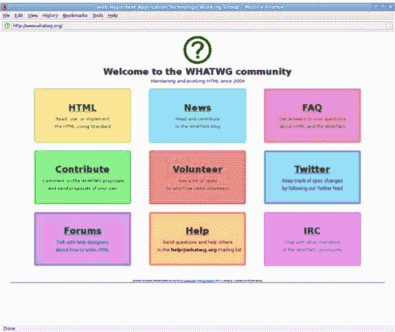
### **图 1.1** WHATWG主页，地址：http://www.whatwg.org
想要学习或使用HTML5寻求帮助的人，可以在FAQ、Help和Forums板块找到答案。隐藏在Volunteer按钮背后的Wiki目前还没那么实用，因为它更偏向开发议题，关于HTML5语言的文档很少。2010年时，通过News按钮访问的博客也显得有点无人问津，这可能是因为主要作者、来自谷歌的Mark Pilgrim当时正忙着撰写他的个人在线图书，如果你感兴趣的话可以访问http://diveintohtml5.org免费查阅。
好在2011年Anne van Kesteren重新运营了博客，发布标准的相关进展——这是追踪最新变更的宝贵资源。
最活跃的区域之一是通过IRC按钮链接的irc://irc.freenode.org/whatwg上的聊天频道。在这里，WHATWG社区的成员会和浏览器开发者一起协作，落实规范的实现。这里也是人们针对HTML5相关议题展开激烈辩论、发表立场声明，或者向批评者直抒己见的地方。
一个虚构的人物Mr. LastWeek，会在博客http://lastweekinhtml5.blogspot.com中发表有时言辞犀利的博文，评论相关事件，这些博文是对公开的IRC日志http://krijnhoetmer.nl/irc-logs的回应，任何人都可以阅读这些日志，也可以发表评论。只要点击你认为相关、有趣或重要的条目末尾的黄色框，就能将该条目标记为黄色。要浏览最新主题，标记条目的方法非常实用。


通过「贡献」板块链接的三个公开邮件列表是主要的沟通渠道——分别面向用户答疑、规范内容贡献，以及所有参与规范实现的工作者。如果你不想订阅邮件列表，也可以访问公开存档，所有资讯都会归档其中，支持检索和下载：
- 用户答疑邮件列表（help@whatwg.org）：http://lists.whatwg.org/listinfo.cgi/help-whatwg.org
- 规范贡献邮件列表（whatwg@whatwg.org）：http://lists.whatwg.org/listinfo.cgi/whatwg-whatwg.org
- 规范实现邮件列表（implementors@whatwg.org）：http://lists.whatwg.org/listinfo.cgi/implementors-whatwg.org

该规范的开发也是公开透明的——我们稍后会详细介绍这一点，实际情况并不像听起来那么简单。事实上，这并不是只有一份规范，而是存在多个版本。不过我们先回到HTML5的历史上来。

在WHATWG致力于更新HTML的同时，W3C的XHTML2工作组开始着手打造一个全新的Web。与致力于实现向后兼容的WHATWG不同，由史蒂文·彭伯顿（Steven Pemberton）领导的XHTML2工作组试图以另一种方式推进HTML的发展。新规范计划用XFORMS替代原有FORMS；用XFRAMES替换FRAMES；用全新的XML Events取代DOM Events。每个元素都可以同时拥有`src`和`href`属性，原有的`h1`到`h6`标题元素将被废弃，由全新`section`元素搭配`h`元素替代。手动换行原本用`br`实现，将改用`l`元素；`hr`元素将被重命名为separator；新增的`nl`元素将支持导航列表；为了丰富语义选项，还可以为每个元素分配带有预定义或可扩展命名空间关键字的`role`属性。

压垮XHTML2项目的致命一击是浏览器厂商的不支持，也为该项目留下了苦涩的一笔。这些尝试性的改动过于激进，完全没有考虑现有Web内容的兼容性。很快W3C也意识到，这条发展路线走不通。

2006年10月，万维网之父、W3C总监蒂姆·伯纳斯-李最终妥协，在自己的博客中写道：
> > 时隔数年再看，很多事会变得更加清晰。HTML必须渐进式演进。当初试图让全世界一次性切换到XML——包括属性值加引号、空标签加斜杠、全面启用命名空间——的做法并没有成功。

在承认XHTML2未能成为新一代Web语言后，他宣布成立一个新的HTML工作组——这次的工作组规模更大。该工作组将吸纳浏览器厂商参与，目标是逐步推进HTML和XHTML的发展。他在博客的最后一节强调，自己坚信这是正确的发展方向：
> 这将是Web技术皇冠上的明珠之一——这份重要规范上的重大合作。尽管最终会有数百人参与其中，但我们正在发展的技术，未来会被数以百万乃至数十亿人使用。有些时候，再多感谢的话似乎都不够说。但我们维护的是非常重要的东西，创造的会是更优秀的成果。

2007年3月，时机成熟：新的HTML工作组成立。该工作组宣布成立后不久，WHATWG的所有成员都收到了参与HTML WG的邀请，WHATWG也欣然接受了这一邀请。数月后，各方进行了投票，决定是否将WHATWG起草的规范作为新的联合HTML5规范的基础。与2004年研讨会上的投票结果不同，此次投票获得了多数支持：43票赞成，5票反对，4人弃权，1人明确否决。延宕三年之后，最初推进HTML发展的想法终于胜出。但这仅仅是开始：双方还需要找到新的合作方式——这一任务绝非易事，因为WHATWG和W3C的理念契合度非常有限。

两大阵营并非总能达成共识，这一点不仅体现在W3C自有、可公开访问的*public-html邮件列表*（http://lists.w3.org/Archives/Public/public-html）的大量讨论帖中，也体现在双方对HTML5项目路线图的评估差异上。尽管W3C在其章程中预计HTML5会在2010年第三季度成为正式推荐标准，但WHATWG的伊恩·希克森（Ian Hickson）预计所需时间要长得多。很多人曾预测这一时间会是2022年，但如此长的时间跨度被许多批评者认为是完全无法接受的。但如果考虑到HTML5的宏大目标——替换HTML4、DOM2 HTML和XHTML1三项规范并对其进行大幅扩展，创建包含数千项测试的测试套件，以及要求两份无缺陷的标准实现作为*概念验证*——这个时间跨度似乎就合理多了。

只要看一眼HTML WG的决策政策规则，你就能意识到两个小组推进规范开发的决策过程有多么复杂（http://dev.w3.org/html5/decision-policy/decision-policy.html）。2009年底XHTML2工作组解散后，愿意充分利用这一决策政策的批评者不断增多。因此，W3C的HTML WG正在追踪一份不断增多的所谓*议题*列表（http://www.w3.org/html/wg/tracker/issues）。这些议题需要在主席山姆·鲁比（Sam Ruby）、保罗·科顿（Paul Cotton）和玛吉·斯塔霍维亚克（Maciej Stachowiak）的监督下解决，之后才能发布“最终征求意见（Last Call）”公告。

在WHATWG方面，伊恩·希克森利用相对平稳的时期，暂时将自己的议题列表（http://www.whatwg.org/issues/data.html）缩减到了*零*，并于2009年10月向WHATWG宣布进入*HTML5最终征求意见阶段*。

事件复杂性的直观体现就是规范的现状。WHATWG的主规范是一份紧凑的文档，而到2011年初，W3C的HTML5规范包已经包含8个部分。其中两份直接源自WHATWG版本，标注有星号；其余部分为补充内容，并未被纳入WHATWG版本。

#### WHATWG规范：
- HTML——活标准：http://whatwg.org/html

#### W3C HTML WG规范：
- HTML5——HTML与XHTML的词汇表及相关API *：http://www.w3.org/TR/html5
- HTML5与HTML4的差异：http://www.w3.org/TR/html5-diff
- HTML：标记语言参考：http://www.w3.org/TR/html-markup
- HTML+RDFa 1.1：http://www.w3.org/TR/rdfa-in-html
- HTML微数据：http://www.w3.org/TR/microdata
- HTML Canvas 2D上下文 *：http://www.w3.org/TR/2dcontext
- HTML5：提供有用文本替代方案的技巧：http://www.w3.org/TR/html-alt-techniques
- 多语言标记：兼容HTML的XHTML文档：http://www.w3.org/TR/html-polyglot

WHATWG还有另一份文档，整合了所有WHATWG章节，以及*Web Workers*、*Web Storage*和*Web Sockets API*的附加规范。这份名为*Web Applications 1.0——活标准*的文档非常适合作为HTML渲染的耐力测试：该文档包含超过5MB的源代码和JavaScript代码，用于展示每个章节的实现进度，还支持为单个章节添加直接评论，足以压垮任何浏览器：http://www.whatwg.org/specs/web-apps/current-work/complete.html

> 如果你想减轻浏览器的负担，可以选择使用该文档的多页版本（http://www.whatwg.org/C），或者在网址末尾添加?slow-browser参数。这样会跳过动态组件，生成无交互元素的静态版本，加载速度更快。


如果你想追踪规范的变更，有多种方式可供选择。WHATWG提供了完整规范的*Subversion代码仓库*，你可以将仓库克隆到本地：
- svn co http://svn.whatwg.org/webapps webapps

你还可以通过Twitter、邮件列表，或是被称为*web-apps-tracker*的网页界面查看各个版本的提交信息：
- http://twitter.com/WHATWG
- http://lists.whatwg.org/listinfo.cgi/commit-watchers-whatwg.org
- http://html5.org/tools/web-apps-tracker

WHATWG的规范会随着每次修订持续更新，而W3C的草案则需遵循所谓的*心跳要求*，即W3C规范的新版本必须每3至4个月定期发布一次工作草案。等到本书出版时，下一次心跳发布很可能已经完成，说不定W3C甚至已经发布了*最终征求意见工作草案*。

如果你想了解HTML5的发展历史，「时间旅行」板块提供了一系列链接，可作为通往里程碑事件和历史资料的入口。题为《苹果为何押注HTML 5：Web发展史》的文章很好地对整个HTML历史进行了梳理。这篇文章发布在*AppleInsider*网站上，短链接为http://bit.ly/2qvA7s。

### 1.2 历史事件时间旅行
下列链接指向的内容涵盖了HTML发展史上的里程碑事件：
- **W3C Web应用与复合文档研讨会（2004年6月）：** http://www.w3.org/2004/04/webapps-cdf-ws/index
- **Opera与Mozilla关于HTML进一步发展的立场文件：** http://www.w3.org/2004/04/webapps-cdf-ws/papers/opera.html


## 第1章——新Web标准概述
- **伊恩·希克森在3篇博客文章中对本次研讨会的评估：** http://ln.hixie.ch/?start=1086387609&order=1&count=3
- **WHATWG（Web超文本应用技术工作组）的成立公告在研讨会结束后两天发布：** http://www.whatwg.org/news/start
- **蒂姆·伯纳斯-李2006年10月发布的博文《重塑HTML》：** http://dig.csail.mit.edu/breadcrumbs/node/166
- **W3C（万维网联盟）HTML工作组的重启（2007年3月）：** http://www.w3.org/2007/03/html-pressrelease
- **伊恩·希克森向WHATWG社区通知了重组一事：** http://lists.whatwg.org/htdig.cgi/whatwg-whatwg.org/2007-March/009887.html
- **向WHATWG发出的加入HTML工作组的官方邀请：** http://lists.whatwg.org/htdig.cgi/whatwg-whatwg.org/2007-March/009908.html
- **伊恩·希克森代表WHATWG就这一举措向W3C表示祝贺：** http://lists.whatwg.org/htdig.cgi/whatwg-whatwg.org/2007-March/009909.html
- **作为HTML5基础的《HTML设计原则》（2007年11月）：** http://www.w3.org/TR/html-design-principles/
- **W3C发布首份官方HTML5工作草案（2008年1月）：** http://www.w3.org/2008/02/html5-pressrelease
- **XHTML2工作组将解散的公告（2009年7月）：** http://www.w3.org/News/2009#entry-6601
- **WHATWG宣布HTML5进入最后征求意见阶段（2009年10月）：** http://blog.whatwg.org/html5-at-last-call
- **W3C发布8份工作草案，其中2份为新增草案（2010年6月）：** http://www.w3.org/News/2010#entry-8843
- **W3C公布最后征求意见阶段时间表，预计2011年5月底进入该阶段（2010年9月）：** http://lists.w3.org/Archives/Public/public-html/2010Sep/0074.html
- **W3C推出HTML5标识（2011年1月），引发争议：** http://www.w3.org/News/2011#entry-8992
- **伊恩·希克森宣布，WHATWG的HTML规范此后将直接称为“HTML”，可被视为“活的标准”（2011年1月）：** http://blog.whatwg.org/html-is-the-new-html5

### 1.3 直接切入主题
在前一章对HTML5历史的简要回顾之后，现在是时候直接着手处理HTML5的元素和属性了。没有什么比经典的*你好，世界！*示例更合适的了。它在HTML5中的样子如下：
```html
<!DOCTYPE html>
<html>
<head>
<meta charset="UTF-8">
<title>Hello world! in HTML5</title>
</head>
<body>
<p>Hello world!</p>
</body>
</html>
```
每个HTML5文档都以文档类型声明`<!DOCTYPE html>`开头，并且不区分大小写。你注意到的第二个创新是指定编码的简化方式——`<meta charset="UTF-8">`。其余的部分，比如html、head、title或body，你在HTML4中就已经很熟悉了，这引出了一个问题：*HTML5中真正的新内容有哪些？*

#### 1.3.1 有哪些新特性？
W3C在由安妮·凡·凯斯特伦（Anne van Kesteren）审核的规范《HTML5与HTML4的差异》中给出了答案。除新元素、废弃元素/属性的列表外，你还能找到关于新增或变更的API、规范外部内容的提示，以及最后的《HTML5变更日志》，它按时间顺序记录了各项功能被加入或移出规范的时间与方式：http://www.w3.org/TR/html5-diff/。这些表格包含大量细节，但没能给我们提供足够清晰的概览。因此，四个*词云*将引导你阅读完本章内容。这些词云均使用乔纳森·范伯格（Jonathan Feinberg）的Wordle小程序生成，该工具可在http://www.wordle.net免费获取。相关术语的频率通过新元素和属性的字体大小体现，字体大小由HTML5规范中与该功能相关的交叉引用数量决定。针对废弃的元素和属性，字体大小对应Opera在其*MAMA*项目《Web是由什么组成的？》（http://dev.opera.com/articles/view/mama）中调研的线上使用频率。

首先让我们看一下图1.2词云中呈现的新元素。毫无疑问，最受关注的是媒体类元素video、audio和canvas——后者本质上是一张可以用JavaScript编程的图片。 大量创新涉及结构元素，例如article、section、header、hgroup、footer、nav或aside。针对图片，你有figure搭配figcaption，还可以用details配合summary来显示或隐藏附加信息。你可以用progress表示进度，用meter表示任意类型的测量值，用time表示时间和日期。我们在英语国家不太会频繁遇到ruby、rt和rp元素，它们是主要在中日两国使用的排版注释系统，用于提供发音指导。对我们更有用的是mark元素，用于强调术语，或是wbr元素，用于在必要时指定可插入换行的位置。部分元素偏向Web应用，例如用于生成加密密钥对或数字签名的keygen、用于执行命令的command，或是作为表单及其他文档部分计算结果的output。作为option元素的容器，datalist可为表单字段提供不可见的选择列表。用于列出video和audio元素替代资源的source元素，浏览器会从该元素的资源列表中选择第一个支持的格式来播放文件。最后但同样重要的是Netscape引入的、现已完成修订的常用embed元素。

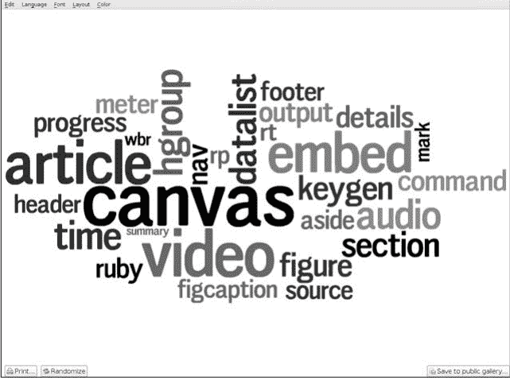
图1.2 新的HTML5元素

input元素也有诸多变更。以下是新类型的简要汇总：现在新增了多个用于指定日期的input类型，包括datetime、date、month、week、time和datetime-local。此外，还有用于搜索字段（search）、输入URL（url）、电子邮件地址（email）、电话号码（tel）、数字（number）或数值范围（range）、颜色（color）的类型。如图1.3所示，大量新属性与表单相关。由于form属性的存在，input元素可以位于关联表单之外，相当于链接到目标表单。min、max、step、required、pattern、multiple、autocomplete等属性决定了input元素的限制或规则，formnovalidate和novalidate属性会影响输入数据的验证，placeholder和autofocus属性则能提供实用的表单填写辅助。表单提交时的行为可通过input和button元素中的formmethod、formenctype、formtarget、formaction属性覆盖。list属性用于将用datalist创建的选择列表分配给对应的input组件。针对iframe的安全特性包括sandbox、srcdoc和seamless，这些特性会将嵌入内容与文档其余部分隔离开。如果你想异步加载脚本，可以使用async属性，ping属性则会在你点击超链接时，在后台打开ping属性中指定的URL列表。

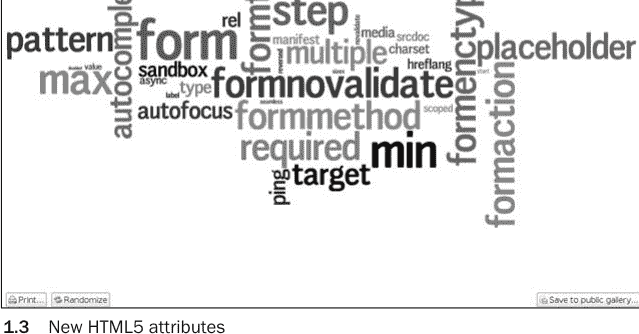
图1.3 新的HTML5属性

html元素的manifest属性看似不起眼，但影响深远：它通过引用配置文件来确定页面哪些部分应支持离线访问，为离线Web应用铺平了道路。带有scoped属性的style元素也非常实用，它会将指定样式的生效范围限制在其上级DOM节点及其所有子元素内。针对menu元素，type和label属性分别决定了菜单的类型（例如上下文菜单或工具栏）以及菜单的标签。小而美的改进包括：在meta标签中使用charset属性简化编码指定；可选择使用li元素的value属性指定明确的列表值；用start属性为ol元素指定起始序号；最后可通过reversed属性对列表进行反向排序。部分适用于所有元素的全局属性发生了明显变化。class、dir、id、lang、style、tabindex和title这些属性在HTML4中并非全局属性，如今已变为全局属性，但最大的变化是新增了大量全局属性。通过contenteditable属性，你现在可以直接编辑元素内容；contextmenu属性允许分配自定义菜单，该菜单以menu元素的形式定义；draggable属性可将相关元素标记为拖放操作的潜在对象；spellcheck属性则为对应区域的拼写检查提供支持。你可以隐藏在显示时无关或已不再相关的内容；可使用role或aria-*属性为辅助技术（例如屏幕阅读器）提供额外支持；保留的data-*前缀允许你自定义任意数量的属性。HTML5的另一重要组成部分是新编程API，例如canvas元素API、用于播放音频和视频内容的API，以及用于开发离线Web应用的接口。其他API则聚焦于拖放、文档编辑、浏览器历史管理等领域。该规范甚至包含了一些初看相当冷门的API，用于注册和应用自定义协议或MIME类型。我们还需注意，在HTML5中所有事件处理程序都是全局属性，同时对HTMLDocument和HTMLElement对象做了一些修改。通过getElementsByClassName()方法，你可以找到所有具有特定class属性的元素；还可以通过classList API操作class属性；如今innerHTML方法也支持在XML文档中使用。你可以通过activeElement和hasFocus属性判断文档中当前获得焦点的元素——二者均为HTMLDocument对象的属性，和getSelection()方法一样，该方法会返回用户当前选中的文本。


### 1.3.2 哪些特性已经过时？
讨论HTML5的创新之处时，我们也应当明确哪些特性不再需要使用。其他W3C规范中常使用*废弃*这一术语描述这类情况，但该术语在HTML5中并不适用。由于HTML5向后兼容，这类特性仍需浏览器正确展示。不过对于网页作者而言，HTML5与HTML4的差异说明提供了一份不应再使用（或可使用）的元素和属性列表，*淘汰*一词现已取代了*废弃*这一术语。

如果你看一下图1.4中的词云，就能发现**字体元素**和**居中元素**显然已经*过时*了。它们被更现代的CSS方案取代，**下划线元素**、**放大元素**、**删除线元素**、**基准字体元素**和**等宽字体元素**也是如此。现在，**内联框架元素**取代了**框架元素**、**框架集元素**和**无框架元素**；原本使用acronym元素的地方现在应当使用**缩写元素**，原本使用**目录元素**的地方现在应当使用**无序列表元素**，**单行输入元素**已经被弃用，转而使用表单提供的更优方案。
如果你疑惑为何词云中没有出现部分提及的元素，这是因为它们的使用频率极低，因此已不再属于HTML5的范畴。对于废弃属性而言，情况同样清晰：图1.5的词云中以**宽度属性**、**高度属性**、**对齐属性**（align、valign）、**间距属性**（cellpadding、cellspacing）和**着色属性**（bgcolor）为主。它们大多与table、td或body元素搭配使用，现在也像许多废弃元素一样被CSS取代。

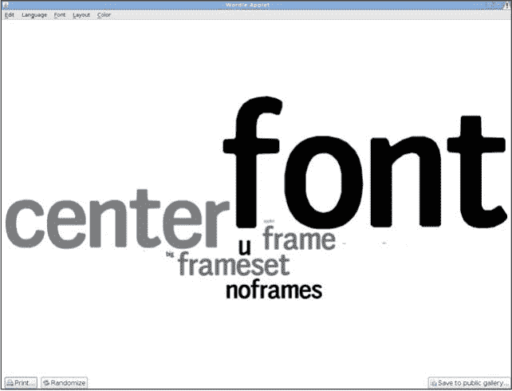
图1.4 HTML5中不再使用的元素

## 第1章——新Web标准概述

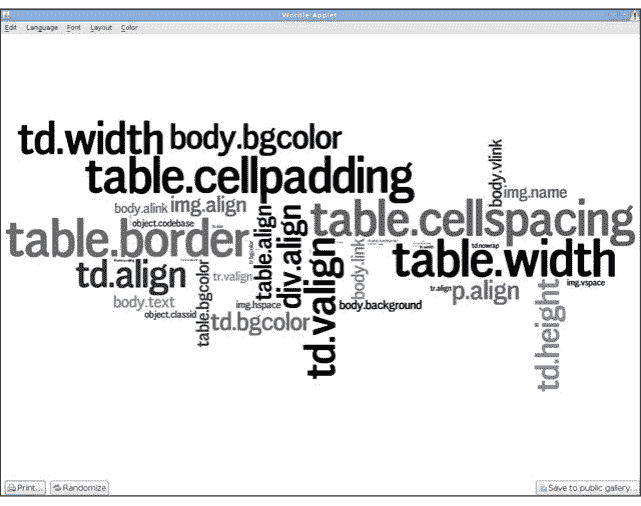
**图1.5** HTML5中不再使用的属性

我们如何才能详细知晓哪些元素和属性不应当再使用？如果每次都要翻查HTML5差异说明，会非常耗时。更好的解决方案是使用地址为http://html5.validator.nu的HTML5验证器：验证器能准确判断内容的正误。我们来试一下：选择输入模式为*文本域*，将预设HTML基础框架中的`<p></p>`一行替换为以下错误标记：
```html
<center>
<acronym>WHATWG</acronym>
</center>
```
它返回的错误信息如下——至少在本手册编写时是这样的：
- 1. 错误：center元素已废弃，请改用CSS替代。
- 2. 错误：acronym元素已废弃，请改用abbr元素替代。
*改用CSS替代*中的链接会直接导向WHATWG Wiki的*表现型元素与属性*页面，你可以在上面读到关于正确使用的详细说明。
验证器还会直接显示语法错误，你可以在接下来的测试中看到。我们来试试以下源代码：
```html
<!DOCTYPE html><title>
```
我们得到的错误回复是——这次的注释是文档尚未完成，因此无效：
- 1. 错误：遇到文件末尾时，期望看到文本或结束标签。
如果我们通过添加结束标签`</title>`修复这个错误，这条错误信息也会消失，我们就完成了最短的可运行HTML5文档：
```html
<!DOCTYPE html><title></title>
```
验证器的错误识别功能基于HTML5的核心特性——HTML解析器。与所有先前规范不同，该解析器被制定得十分详尽，长达90页，读起来就和当地电话簿一样枯燥。不过从技术角度看，本章内容至关重要，因为它定义了HTML5标记的解析方式，以及文档DOM树的构建规则。我们之前的小示例实际生成了一个完整的HTML5 DOM树，包含html、head和body元素。你可以使用另一个工具*HTML5实时DOM查看器*（地址为http://livedom.validator.nu）来验证这一点，不妨试一试！

### 1.3.3 那XHTML呢？
HTML5规范本质上定义了一种抽象语言，用于描述文档和Web应用，以及用于交互的API，这些都可以在*内存中*的DOM树中呈现。用于生成该DOM树的基础语法并不重要——HTML是其中一种，XHTML是另一种。重要的是解析后的结果，两种情况都会生成有效的DOM-HTML树。因此，创建文档时选择使用HTML还是XHTML由作者自行决定。HTML的使用更广泛，编写更简单，对小型语法错误更宽容，输出时要求的MIME类型为text/html。XHTML遵循严格的XML规则（关键词*格式良好*），必须使用XML MIME类型，例如text/xml或application/xhtml+xml，这在之前的XHTML 1.1中并不是强制要求。

XHTML5中的*你好，世界！*示例不需要DOCTYPE声明，但需要有效的XML声明，该声明可以包含编码信息，当然它还必须*格式良好*：
```xml
<?xml version="1.0" encoding="UTF-8"?>
<html xmlns="http://www.w3.org/1999/xhtml">
<head>
<title>Hello world! in HTML5</title>
</head>
<body>
<p>Hello world!</p>
</body>
```
你会发现它和HTML 4版本的差异并不大。这是因为我们在第一个*你好，世界！*示例中没有充分利用HTML代码允许的简化程度。在*懒人式*HTML5中，以下标记就足够了：
```html
<!DOCTYPE html>
<meta charset=utf-8>
<title>Hello World! in HTML5</title>
<p>Hello world!
```
如果属性值不包含空格或以下符号" ' > / =，我们可以省略属性值的引号。标签可以用大写或小写书写；有些标签甚至可以省略，就像前一个示例中的情况。如果你不确定，验证器仍然可以提供帮助。关于新的HTML5解析器的实现，Mozilla走在了最前面。Henri Sivonen开发的解析器（也是http://validator.nu的基础）被集成到了Firefox 4中。

### 1.4 现在就可以开始使用HTML5吗？
答案是既肯定又否定。HTML5远未最终完成，但与以往的惯例不同，HTML5标准的开发与其实现是同步进行的。谁能想到Internet Explorer 9（IE9）会支持SVG和Canvas，或者谷歌会开始在YouTube上提供HTML5视频呢？现在就可以使用许多新特性，前提是你可以自主选择浏览器。HTML5既可以用在公司内部的内网中，也可以用在仅限部分好友访问的个人主页上。Firefox、Chrome、Opera和Safari这四大浏览器已经广泛支持HTML5的诸多特性，而IE9也在2011年终于结束了微软长期对Web标准支持犹豫不决的状态。浏览器厂商及其开发者现在正积极参与标准的制定工作：他们首先在测试版本中实现新的规范草案作为*概念验证*，随后在WHATWG或W3C提交反馈和改进建议。这使他们成为开发生命周期中的重要参与者。任何无法实现的内容会从规范中移除，而其他组件会被调整并最终落地实现。

HTML5的早期使用者非常有必要熟悉各个浏览器的版本说明，因为在回答*接下来会出现什么新特性？*这个问题时，最可能的趋势会在这里显现：
- https://developer.mozilla.org/en/HTML/HTML5
- http://www.opera.com/docs/changelogs
- http://webkit.org/blog
- http://googlechromereleases.blogspot.com
- http://ie.microsoft.com/testdrive/info/ReleaseNotes

HTML5相关规范的发展时间线，结合浏览器版本的里程碑节点，发布时间间隔越来越短，这表明标准化与实现是紧密关联的（见图1.6）。接下来这两个领域会如何发展，值得期待。你可以在以下网址找到最新的时间线版本：http://html5.komplett.cc/code/chap_intro/timeline.html?lang=en

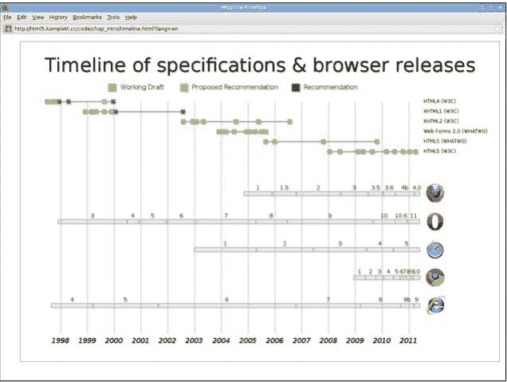
图1.6 规范与浏览器版本发布时间线


### 摘要
本章先简要介绍一些历史背景，随后概述HTML5规范为Web开发带来的整体变化。除了规范开发幕后的相关内容外，我们的核心重点是一系列新元素、属性和API。两个简短的*你好，世界！*示例演示了用HTML5和XHTML5编码的网站基本框架，最后同样重要的是，我们会解答这个问题：我现在就能开始使用HTML5吗？答案是肯定的，尽管存在一些小的限制。不过现在我们先进入HTML5的实际应用，首先从一大波创新点开始：为文档提供更多结构和语义！

## 2 文档的结构与语义

之前提到的Opera开展的*MAMA*调研，以及Google2005年的*Web创作统计*研究（http://code.google.com/webstats）均得出结论：当时业界普遍通过`class`或`id`属性来确定网站的页面结构。常用的属性值包括`footer`、`content`、`menu`、`title`、`header`、`top`、`main`和`nav`，因此将现有实践纳入新的HTML5规范、创建用于页面结构的新元素是合理的。最终成果是一组精简的新结构元素集——例如`header`、`hgroup`、`article`、`section`、`aside`、`footer`和`nav`——无需通过`class`或`id`绕路，即可实现清晰的页面结构。为说明这一点，我们会用一个虚构的、不算太正式的HTML5博客条目，提前展望2022年的场景（见图2.1）。但请大家少关注条目内容，多关注文档结构。

> 图2.1 虚构的HTML5博客
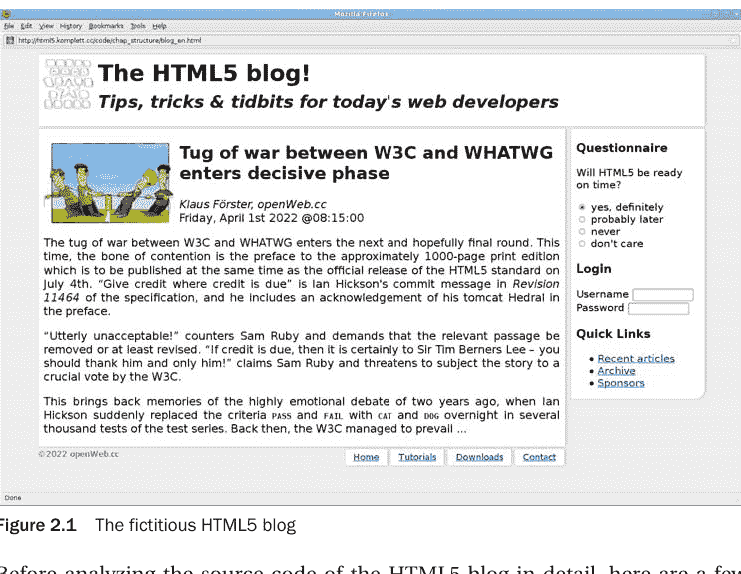

在详细分析HTML5博客的源代码之前，有一些重要的参考链接，例如指向规范*HTML：标记语言参考*（后续简称为*标记规范*，地址为http://www.w3.org/TR/html-markup）的链接。在这里，W3C HTML工作组的编辑兼团队联系人Mike Smith列出了每个元素的定义、现有限制、有效属性或DOM接口，以及CSS表示法中的格式规则（如适用）——这是我们会反复使用到的宝贵参考资料。HTML5规范也在以下章节中包含了新的结构元素：http://www.whatwg.org/specs/web-apps/current-work/multipage/sections.html
配套HTML5博客的`.html`和`.css`文件也可在以下地址在线获取：
- http://html5.komplett.cc/code/chap_structure/blog_en.html
- http://html5.komplett.cc/code/chap_structure/blog.css

乍一看，你可以在图2.1中看到四个不同的区块——页眉、文章主体、页脚和侧边栏。这四个区块中用到了所有新的结构元素。配合样式表`blog.css`中的简短CSS指令，它们共同决定了页面结构和布局。

### 2.1 包含`header`和`hgroup`的页眉
```
<header>

<hgroup>
<h1>
<h2>
</hgroup>
</header>
```


> 图2.2 HTML5博客页眉的基本结构

*标记规范*中定义的`header`指的是标题、附加介绍内容或导航辅助工具的容器。页眉不仅是页面顶部的页眉，也可以用在文档的其他位置。不允许嵌套页眉，也不允许在`address`或`footer`元素内部放置页眉。在我们的示例中，HTML5博客的标题由`header`元素结合作为`img`元素的logo，以及包含博客标题和副标题的`hgroup`元素包裹的两个标题（h1和h2）共同定义。此前的惯例是将h1和h2元素直接上下排列来表示主标题和副标题，这在HTML5中不再被允许。现在我们必须使用`hgroup`来给这类元素分组。`hgroup`元素的整体位置由最顶部的标题决定。`hgroup`内部还可以出现其他元素，但通常默认规则是使用h1到h6的标签组合。我们可以从*标记规范*中看到一个小但重要的细节：指南建议像所有其他结构元素一样，在CSS中将`header`元素格式化为`display: block`，这能确保甚至不知道如何处理新标签的浏览器也能正确显示相关元素。例如，我们只需要几行代码就能让Internet Explorer 8支持我们的新`header`元素：

```html
<!--[if lt IE 9]>
<script>
document.createElement("header");
</script>
<style>
header {
display: block;
}
</style>
<![endif]-->
```

当然也有针对这个兼容方案的详细JavaScript库，它不仅包含`header`，还包含许多其他新的HTML5元素。Remy Sharp将其面向IE浏览器发布在http://code.google.com/p/html5shim。

> **注意**
>
> 在计算机领域中，shim指的是针对应用程序的兼容性绕行方案。经常有人会错误地用shiv这个词代替。jQuery的创造者John Resig在一篇同名文章（http://ejohn.org/blog/html5-shiv）中提出了shiv这个词。目前还不确定他是否其实本意是shim。

在CSS方面，`header`没有特殊内容。logo通过`float: left`嵌入，h1和h2两个标题之间的垂直距离稍微缩短，副标题设置为斜体。

### 2.2 包含`article`的内容区域
`article`元素代表网页内的独立内容区块，例如新闻、博客条目或类似内容。在我们的示例中，博客条目的内容由这样一个`article`元素组成，还结合了`img`元素来丰富展示、一个h2标题作为主标题、`time`和`address`元素分别表示创建日期和版权信息，以及三个段落，其中还可以看到用于引用主角言论的`q`和`cite`元素。由于`content`元素缺失了——尽管它在Google和Opera的网页分析中排名非常靠前——不知为何最终没有进入HTML5规范。我们的博客条目被嵌入在一个外层div中（见图2.3）。因此完全可以在之后添加更多文章：

```
<div>
<article>

<h2>
<address>
<time>
</article>
</div>
```
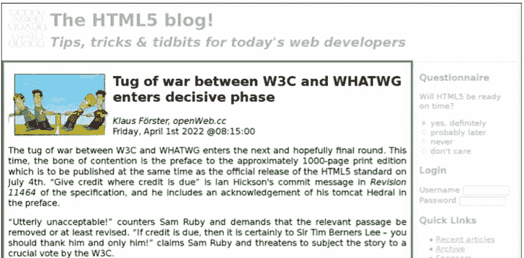

> 图2.3 HTML5博客内容的基本结构

按照定义，`address`元素包含联系信息，值得一提的是，它并非常见误解中的仅指邮寄地址，而是指联系人的相关信息，例如姓名、公司和职位。对于地址内容，规范建议用p元素包裹。`address`元素适用于距离最近的`article`元素；如果不存在`article`元素，则适用于整个文档。`time`元素在`pubdate`和`datetime`属性方面的行为类似，这两个属性共同构成我们文档的时间戳。关于这部分详情，请参见2.7.2节"time"元素。如果`article`元素相互嵌套，内部`article`原则上应与外部`article`主题相似。这类嵌套的一个例子就是，在我们的示例中，给博客添加一个针对相关条目的评论子文章。关于通过CSS的样式设置，需要说明的是，`article`同样需要设置为`display: block`，内容宽度通过外层div缩小到79%，该div还会用`clear: left`抵消logo的`float: left`效果。斜体的作者信息是`address`元素的默认格式导致的，并非通过em元素创建。图片通过`float: left`锚定在左侧，文本通过`align: justify`实现两端对齐，引用通过q元素嵌入。一个有趣的细节是，引号并不属于标记内容，而是由浏览器通过CSS伪元素:before和:after，按照q元素的样式规则自动添加的。CSS表示法中的语法再次反映了标记规范的要求：

```css
/* q元素的样式规则：*/
q {
display: inline;
}
q:before {
content: "\201C";
}
q:after {
content: "\201D";
}
```

### 2.3 包含`footer`和`nav`的页脚
在我们的HTML博客的页脚部分，我们看到了另外两个新的结构元素：`footer`和`nav`（见图2.4）。前者创建框架，后者提供到网页其他区域的导航。footer包含相关区块的附加信息，例如作者是谁（当然是用address元素）；是否有其他相关页面；需要注意什么（版权、免责声明）；等等。与人体结构不同（头部通常在顶部，脚在底部），文档中的页脚并不一定要放在文档末尾，也可以例如作为`article`元素的一部分。但不允许嵌套footer元素，也不允许在`header`或`address`元素内部放置`footer`。如果你想创建导航区块，实现通过文档内的跳转标签或外部相关页面进行页面导航，可以使用`nav`元素。和`footer`一样，`nav`也可以出现在文档的其他区域，你会在2.4节"包含`aside`和`section`的侧边栏"中看到相关内容——唯一的例外是`nav`不能放在`address`元素内部：

```
<footer>
<p>
<nav>
```


```html
<h3>
<div>
<a>
</div>
</nav>
</footer>
```
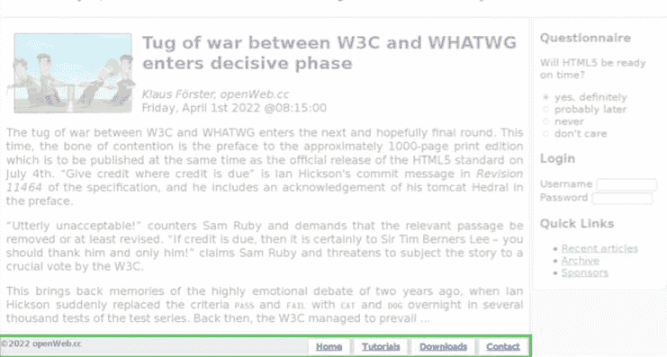
#### **图 2.4** HTML博客页脚的基本结构
在CSS方面，我们的HTML5博客页脚有一些特殊样式。例如，整个页脚使用和页面背景相同的浅灰色填充，仅链接设置了`background-color: white`样式。第一个`p`标签内的版权信息设置了`float: left`，导航栏设置了`text-align: right`，同时`nav`区块中的`h3`标题通过`display: none`隐藏。至于这里为什么要放`h3`元素，我们将在2.5节“大纲算法”中详细说明。
为了优化链接的样式，我们用`div`标签把它们包裹起来。另外，`header`和`nav`元素都设置了`display: block`，同时将`footer`元素的宽度缩减至79%。

### **2.4 使用“aside”和“section”实现侧边栏**
对于页面中与主内容关联度较低、可视为相对独立的部分，我们可以使用`aside`元素。在本示例中，它创建了一个经典的右侧侧边栏，包含问卷、登录和快速链接三个区块。
如果链接列表像预期的那样用`nav`元素实现，那么前两个区块会嵌套在另一个新元素中：`section`。
`section`元素用于包裹文档中主题相关的部分，比如文章的章节、选项卡式页面中的单个选项卡，通常还会包含一个标题。如果在`footer`中使用`section`元素，一般用于放置附录、索引、许可协议之类的内容。总的来说，如果某部分内容适合放在目录中，就可以使用`section`元素。
在本示例中，如图2.5所示，问卷和登录区块使用了`section`标签，而链接区块如前所述使用了`nav`标签：
```html
<aside>
<h2>
<section>
<h3><p><input>
</section>
<section>
<h3><label><input>
</section>
<nav>
<h3><ul><li><a>
</nav>
</aside>
```

#### **图 2.5** HTML5博客侧边栏的基本结构
与页脚中的`nav`区块原因相同（见下节），侧边栏的第一个问卷区块前直接放置了一个`h2`标题，通过CSS的`display: none`属性将其隐藏。
侧边栏的样式设置为`float: right`，宽度为20%，字体大小为`0.9em`。
侧边栏最突出的特点是右下角的圆角，这意味着我们不得不承认，这个HTML5博客也用到了CSS3：圆角只是用到的两个特性之一。
`rounded-bottom-right`类的CSS语法如下：
```css
.rounded-bottom-right {
-moz-border-radius: 0px 0px 20px 0px;
-webkit-border-radius: 0px 0px 20px 0px;
border-radius: 0px 0px 20px 0px;
}
```
第二个特性用于给四个区域添加柔和的阴影，在CSS文件中定义如下：
```css
.shadow {
-moz-box-shadow: 4px 0px 10px -3px silver;
-webkit-box-shadow: 4px 0px 10px -3px silver;
box-shadow: 4px 0px 10px -3px silver;
}
```
通过`-moz-*`和`-webkit-*`前缀重复三次CSS命令的做法非常显眼，这是因为CSS3尚未进入*候选推荐*阶段。只有当它进入标准化流程的这个阶段后，才能确保`border-radius`和`box-shadow`的属性不会再变更。在此之前，保留这些前缀是为了表明当前实现可能仍和标准存在细微偏差。
> **注意**
> 如果您想进一步了解CSS3规范中这两个备受期待的特性，可以访问以下链接获取更多信息：
> - http://www.w3.org/TR/css3-background/#the-border-radius
> - http://www.w3.org/TR/css3-background/#box-shadow
```

### **2.5 大纲算法**
尽管规范中关于文档*大纲生成*的细节描述看起来相当复杂，但*大纲生成*背后的思路其实很简单：它是对底层文档结构的机器可读摘要。该结构由所谓的*分节内容*（例如`body`、`article`、`aside`、`nav`和`section`元素）和*标题内容*（例如`h1`到`h6`标签或`hgroup`元素）组合决定，为大纲提供对应的条目。
如果我们用Geoffrey Sneddon开发的在线*HTML5大纲生成工具*（http://gsnedders.html5.org/outliner）检测我们的HTML5博客，会得到如下结构：
- 1. HTML5博客！
1. 链接区块
1. 问卷
2. 登录
3. 快速链接
- 2. W3C与WHATWG的拉锯战进入……
- 3. 导航
带有斜体标识的*链接区块*和*导航*条目，正是我们在布局中通过`display: none`隐藏的两个标题。如果我们完全删掉这两个标题，对应位置会显示*无标题区块*文本。但保留它们能让结构更完整，大纲也更容易阅读。
关于`h1`到`h6`标题的选择需要注意以下几点：原则上，任何*分节内容*都可以用`h1`作为起始标题级别，但这不是强制要求。在本示例中，标题级别对应大纲的层级关系：博客头部用`h1`；文章标题、链接区块和页脚导航用`h2`；其余标题用`h3`。
如果所有标题都用`h1`，生成的大纲是一样的，但页面布局会受到影响，还需要在CSS文件中手动调整样式。
使用`hgroup`元素时需要注意，大纲仅会收录`hgroup`中的最高级别标题。因此你无法在大纲中看到副标题*面向当代Web开发者的技巧、窍门与资讯*。
尽管目前还没有浏览器直接以任何形式使用大纲算法，但这并不意味着它在未来不会发挥更重要的作用。比如自动生成导航栏、生成简短精准的内容摘要，或是改进爬虫为搜索引擎提取相关内容的效率，都是可能的落地场景。在此之前，认真思考文档结构总归没有坏处。检测文档结构非常简单，为什么不现在就动手试试呢？

### **2.6 使用“figure”和“figcaption”添加插图**
`figure`和`figcaption`元素严格来说不属于结构性元素，但它们为独立图片、图表、示意图和代码列表的集成结构化提供了非常实用的新选项。
每个`figure`元素只能包含一个`figcaption`元素，该元素可以放在对应内容的前面或后面，由作者自行决定。
一段包含标记和浏览器渲染效果的简单示例如下（见图2.6）：
```html
<figure>


<figcaption>
Three magical sculptures in Niki de Saint Phalle's <em>Giardino dei Tarocchi</em> near Capalbio in the Tuscany region of Italy. The tarot cards from left to right: The World (XXI), The Choice (VI), and The Moon (XVIII)
</figcaption>
</figure>
```
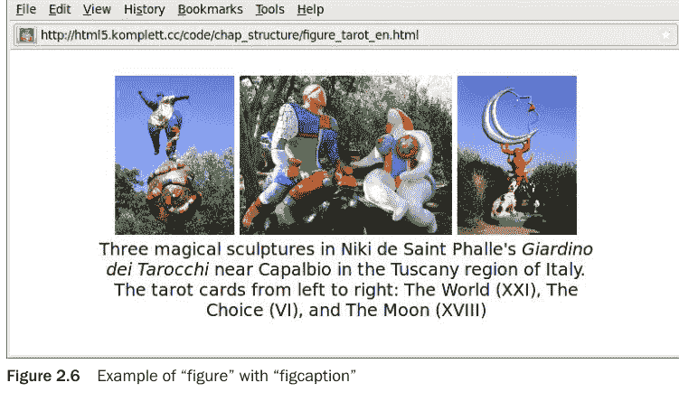
#### **图 2.6** “figure”与“figcaption”结合使用示例

### **2.7 文本级语义——更多新标签**
除了明确文档结构之外，HTML5规范同样重视语义化，试图为每个元素赋予特定的文本级含义，同时也规定了每个标签的可用和不可用上下文。
规范中新增了一些元素，也有部分元素被完全弃用（例如`font`、`center`和`big`），其余元素的定义也做了微调。下一章将介绍新增和变更的元素。之后我们会在表2.2中展示所有出现过的元素的典型用法。


规范的*文本级语义*章节。我们先从最新的元素中最独特的——**ruby（注音标注）**元素开始。
#### 2.7.1 “ruby”“rt”和“rp”元素
ruby术语指的是*排版注释系统*，即“与基准文本并列的短文本片段，通常用于东亚文档中标注发音或提供简短注释”（[Ruby规范](www.w3.org/TR/ruby)）。Ruby注音标注在中文和日语中用于显示汉字的发音，如图2.7左侧示例所示。
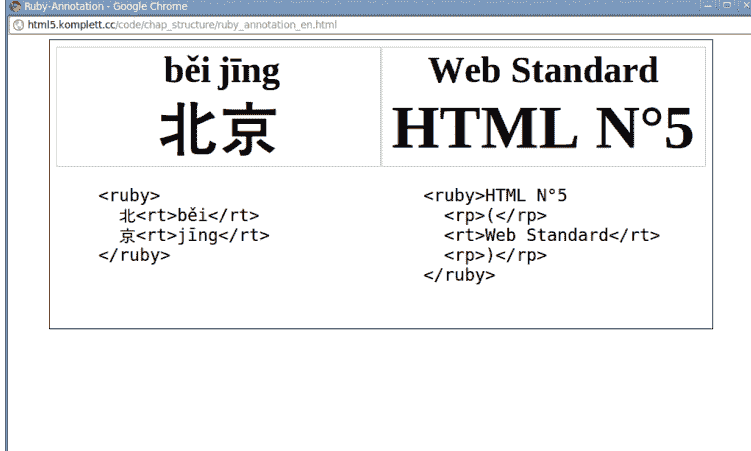
> **图2.7** 注音标注的两个示例
注音标注的标记包含`ruby`、`rt`和`rp`三个元素。首先，需要解释的表述会被放置在`ruby`元素内，随后由紧跟其后的`rt`元素提供解释内容；在支持ruby的浏览器中，`rt`元素的内容会显示在被注释表述的上方。如图2.7中的“北京”示例所示，连续的多个词语都可以采用这种方式进行注音。不支持ruby的浏览器（如火狐和Opera）会按顺序逐个显示各个组件，这可能导致词语难以辨认。由于人们不一定能意识到第二个词是第一个词的解释，因此需要对两个组件做视觉上的分隔，这正是`rp`元素的作用：它支持添加可选的括号，仅当浏览器不支持ruby时会显示这些括号。如图2.7所示，Google Chrome可以解析ruby并进行视觉分隔。而不支持ruby的浏览器则会将这些示例显示为“北 b i 京 j ng”和“HTML5（Web标准）”。
#### 2.7.2 “time”元素
`time`元素表示24小时制的时间，或带可选时间和时区组件的*公历*日期。它的作用是在HTML5文档中以机器可读的格式提供规范的日期时间信息。因此，诸如*2011年春季*或*千禧年到来前五分钟*这类模糊的时间表述是不被允许的。为确保机器可读性，我们可以使用`datetime`属性，其属性值可以被指定为时间、日期，或两者的组合。规范中对时间组件的语法有明确界定，相关内容见表2.1。
**表2.1** `time`元素的`datetime`属性的时间戳规则
| 组件 | 语法 | 示例 |
| :--- | :--- | :--- |
| 日期 | YYYY-MM-DD | 2011-07-13 |
| 带小时的时间 | hh:mm | 18:28 |
| 带秒的时间 | hh:mm:ss | 18:28:05 |
| 带毫秒的时间 | hh:mm:ss.f | 18:28:05.2318 |
| 日期和时间 | 用T连接日期和时间 | 2011-07-13T18:28 |
| 带GMT时区 | 末尾加Z | 2011-07-13T18:28:05Z |
| 带偏移时区 | +hh:mm / -hh:mm | 2011-07-13T18:28:05+02:00 |
`pubdate`属性是一个*布尔*属性，用于指明所标注的日期适用于层级结构中的上一级文章；如果不存在上一级文章，则该日期被理解为文档的发布日期。如果使用`pubdate`属性，必须同时存在`datetime`元素。如果不符合该要求，则`time`元素的开始标签与结束标签之间的内容必须包含有效的日期。

> **注意** 在HTML5中编写*布尔*属性时要格外小心：true和false都不是合法的属性值！只要解析器在*布尔*属性中发现属性名称，就会将其判定为true。因此，将*布尔*属性设置为true共有三种合法的书写方式：
#### 2.7.5 有微调的元素
存在微调的元素列表从`b`和`i`开始，这两个标签已经不再符合HTML5的设计理念，部分原因也在于它们的名称：`b`代表加粗、`i`代表*斜体*，都给出了明确的格式指令，而这在HTML5中并不推荐。如今*语义相关性*才是核心要求，因此我们应该使用`strong`和`em`（即*着重强调*元素）来凸显词汇的重要性。遗憾的是，`b`和`i`属于使用最广泛的标签，因此根本无法完全禁止它们的使用。最终的解决方案是折中处理：继续允许使用这两个标签，但修改了它们的含义：`b`现在指代以**加粗**显示的旁注文本，`i`指代以*斜体*显示的旁注文本。但如果你想编写规范的HTML5代码，未来应避免使用`b`和`i`，转而使用`strong`和`em`。其他细微调整包括：`cite`现在用于标识作品标题，且明确规定不能用于标注人物姓名；`small`现在不仅指*小号印刷文本*，也用于表示法律声明类的旁注或小字号文本，但不再表示该内容的重要性较低；`hr`现在表示主题分隔，而不再仅仅是用于拆分布局的水平线。该规范在*文本级语义*章节的结尾提供了各标签的使用说明及示例。为免你另行查阅，相关内容整理于下表2.2中。
**表2.2** 语义化文本元素用法
| 元素 | 用途 | 示例 |
|---------|---------|---------|
| `a` | 超链接 | 访问我的`<a href="drinks.html">饮品</a>`页面。 |
| `em` | 着重强调 | 我得说我真的<em>喜爱</em>柠檬水。 |
| `strong` | 重要性 | 这款茶<strong>非常烫</strong>。 |
| `small` | 旁注 | 这些葡萄会被酿成酒。<small>酒精具有成瘾性。</small> |
| `s` | 不准确的文本 | 价格：<s>4.50英镑</s> 2.00英镑！ |
| `cite` | 作品标题 | 本案<cite>《雨果诉丹尼尔案》</cite>与此相关。 |
| `q` | 引文 | 法官说<q>“你可以喝鱼缸里的水”</q>，但不建议这样做。 |
| `dfn` | 定义项 | 术语<dfn>有机食品</dfn>指的是无合成化学品生产的食品。 |
| `abbr` | 缩写 | 爱尔兰的有机食品由<abbr title="爱尔兰有机农民与种植者协会">IOFGA</abbr>认证。 |
| `code` | 计算机代码 | 可以用<code>fruitdb</code>程序<br>跟踪水果产量。 |
| `var` | 变量 | 如果碗里有<var>n</var>个水果，至少有<var>n</var>÷2个会成熟。 |
| `samp` | 计算机输出 | 计算机提示<samp>未知错误<br>-3</samp>。 |
| `kbd` | 用户输入 | 按<kbd>F1</kbd>继续。 |
| `sub` | 下标 | 水的化学式是H<sub>2</sub>O。 |
| `sup` | 上标 | 重水中的氢通常为<sup>2</sup>H。 |
| `i` | 替代语音 | 柠檬水的主要成分是<i>柠檬（*Citrus limon*）</i>。 |
| `b` | 关键词 | 拿一个<b>柠檬</b>，用<b>榨汁机</b>榨汁。 |
| `mark` | 高亮 | 接骨木浓缩果汁按<mark>1份</mark>浓缩汁兑<mark>10份</mark>水的比例调配，<mark>独</mark>具特色。 |
| `ruby, rt, rp` | 注音标注 | `<ruby>OJ<rp>(</rp><rt>鲜榨橙汁</rt><rp>)</rp></ruby>` |
| `bdi` | 文本方向隔离 | 推荐餐厅是`<bdi lang="fr">我的沙滩果汁咖啡馆</bdi>`。 |
| `bdo` | 文本方向格式化 | 提案要求用英语书写但顺序反转，此时“Juice”会变为“<bdo dir=rtl>Juice</bdo>”。 |
| `span` | 其他 | 在法语中我们称其为`<span lang="fr">接骨木糖浆</span>`。 |
| `br` | 换行 | Simply橙汁公司<br>美国佛罗里达州阿波普卡市 32703<br>美国。 |
| `wbr` | 换行机会 | www.simply<wbr>orange<wbr>juice.com |
### 总结
HTML5提供了大量新的结构元素，例如`header`、`hgroup`、`article`、`section`、`aside`、`footer`和`nav`。本章开头的详细示例——创建一个虚构的博客条目，直观展示了这些元素的使用有多么简单。以往无语义的`div`元素只有在与`class`属性结合时才有实际作用，现在我们使用语义化元素——`figure`和`figcaption`延续了这一设计理念，用于整合图片与图形。结合表2.2中的HTML5语义化文本元素完整列表及使用示例，我们简要介绍了最值得关注的新元素：包括用于注音标注的`ruby`、`rt`和`rp`元素；用于指定时间的`time`元素；用于标记文本片段的`mark`元素；以及用于标识可选换行点的`wbr`元素。


本页故意留白
## 3 智能表单

无论你是想预订航班、打理网上银行业务，还是在谷歌上输入搜索词，如果没有表单，这些服务都无法使用。自1995年HTML 2.0发布以来，交互式表单的大多数元素都未曾改变。这一方面说明蒂姆·伯纳斯-李的设计极具前瞻性；另一方面，我们也迫切需要追赶上来。HTML5规范为表单主题设置了专门的章节，这将大大减轻网页设计师的工作负担。尽管截至本文写作时，浏览器的支持度还不算高（目前只有Opera浏览器和谷歌Chrome的开发者版本提供了支持），但向后兼容的语法意味着我们现在就可以放心使用新的表单类型。
### 3.1 新的输入类型
HTML5规范增强了`input`元素，允许为type属性设置更多值。例如`date`、`color`和`range`这类新类型，能让浏览器厂商提供更易用的输入元素，同时还能让浏览器确保输入内容的类型符合要求。如果浏览器无法识别`input`元素的类型，就会回退到`type=text`，显示文本输入框，这在任何情况下都是有用的。甚至更早版本的浏览器也会呈现这种行为，因此我们完全可以立即使用这些新类型。
日期和时间类型或许是最实用的。目前互联网上有无数种或多或少的JavaScript日历版本。无论是预订航班、酒店房间，还是报名参加会议，舒适地输入日期都是一个至今都需要手动处理的问题。当然，像`jQuery`这样的JavaScript库提供了现成的日历组件，但这个功能本该由浏览器直接支持。截至本文写作时，只有一款桌面浏览器内置了日期输入的图形化输入组件：Opera浏览器。在图3.1中，你可以看到点击类型为date的输入元素时弹出的日历窗口。不过我们还是按顺序来介绍：表3.1概述了所有新类型；之后你可以在图3.1中看到它们在Opera浏览器中的样子。
**表3.1 HTML5中的新输入类型**
| 类型 | 描述 | 示例 |
|:-----------|:---------------------------------------------------------|:------------------------|
| tel | 无换行的文本 | +1 234 567890 |
| search | 无换行的文本 | 搜索词 |
| url | 绝对URL | http://www.example.com |
| email | 有效的电子邮件地址 | user@host.com |
| datetime | 日期和时间（始终为UTC时区） | 2010-08-11T11:58Z |
| date | 无时区的日期 | 2010-08-11 |
| month | 无时区的月份 | 2010-08 |
| week | 无时区的年份及年内周数 | 2010-W32 |
| time | 无时区的时间 | 11:58:00 |
| datetime-local | 无时区的日期和时间 | 2010-08-11T11:58:22.5 |
| number | 数值 | 9999或99.2 |
| range | 指定范围内的数值 | 33或2.99792458E8 |
| color | sRGB色彩空间下RGB值的十六进制表示 | #eeeeee |
### 3.1.1 输入类型“tel”和“search”
tel和search类型与普通文本输入框没有显著差异。两者都可以容纳不含换行的字符序列。即使是电话号码也不限于数字，因为电话号码经常包含括号或加号。对于tel类型，浏览器可以从本地通讯录中提供候选建议，这种情况在手机上尤其实用。推出search类型的目的是让浏览器的搜索输入框与对应平台的布局风格保持一致。例如，Mac OS X用户习惯于看到带圆角的搜索框。
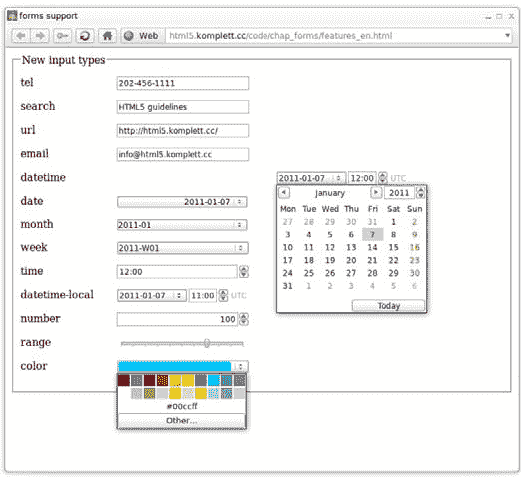
> **图3.1** Opera浏览器在新表单输入类型的实现上已经遥遥领先
### 3.1.2 输入类型“url”和“email”
除了提供候选建议外，浏览器还可以检查`url`和`email`类型的语法。由于电子邮件地址和URL形式的互联网地址都有明确的规则，浏览器可以在输入过程中就对可能的错误给出反馈（该话题的更多内容请参阅3.4节“客户端表单验证”）。
### 3.1.3 使用“datetime”、“date”、“month”、“week”、“time”和“datetime-local”处理日期和时间
接下来我们详细了解一下日期和时间格式。`datetime`类型包含日期和时间信息，时区始终设置为UTC。规范规定，浏览器可以允许用户选择其他时区，但输入元素的值必须转换为UTC格式。我们在2.7.2节*《time元素》*中讨论的`time`元素的`datetime`属性的时间信息规则在此同样适用，唯一的例外是字符串必须以Z结尾，Z是UTC的标识符。`date`和`month`类型则省略了时间和时区信息。根据规范定义，日期必须是所选月份内的有效日期，同时要考虑闰年的情况。年、月、日必须用减号分隔；年份至少为4位，且必须大于0。因此，与范围更广的国际标准ISO 8601不同，HTML5无法表示公元前（B.C.）的日期。`week`类型表示一年中的某一周，且年份必须写在周数前面。年和周之间同样用减号分隔。为了避免和月份混淆，周数前面必须加上字符W。`datetime-local`的工作原理和上文提到的`datetime`相同，唯一的区别是不指定时区。Opera浏览器使用日历窗口选择日期，时间可以手动输入，也可以通过方向键修改（参阅图3.1）。
### 3.1.4 输入类型“number”和“range”
`number`和`range`类型要求输入内容可以转换为数值，浮点数的表示法（例如2.99792458E8）也有效。对于`range`类型，规范规定精确值并不重要；该类型表示一个数值范围，而非精确数值，用户可以通过滑块轻松输入。Opera浏览器和基于WebKit的浏览器（如Safari、谷歌Chrome）都使用滑块来表示该类型（参阅图3.1和图3.2）。
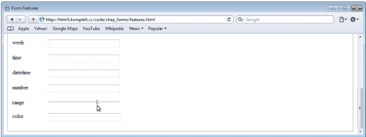
> **图3.2** Safari浏览器中的“range”输入类型
### 3.1.5 输入类型“color”
Opera的开发者再次走在前列，率先为color元素编程实现了图形化输入选项。如图3.1所示，Opera浏览器（11及以上版本）提供了一个矩形区域，可供选择常用颜色。你也可以调出和图像编辑程序中类似的颜色选择器。遗憾的是，其他浏览器仍未实现该输入元素。输入元素的值必须包含以#字符开头的8位RGB十六进制值，例如蓝色可以写作#0000ff。
### 3.1.6 新输入类型的实际应用
理论就说这么多：我们第一个示例会逐个展示这些新元素。因为这样做挑战性不够，我们还会测试每个元素的功能。技巧在于，浏览器会将未知元素的类型设置为text，这样我们就可以用JavaScript评估这些属性：
```html
<script>
window.onload = function() {
inputs = document.getElementsByTagName("input");
for (var i=0; i<inputs.length; i++) {
if (inputs[i].type == "text") {
inputs[i].value = "not available";
}
}
}
</script>
```

网页加载完成后，会循环遍历所有输入元素来分析其类型属性。如果该类型属性对应标准的 text 类型，就将其值设置为*不可用*。新输入元素对应的HTML代码如下：
``` <fieldset> <legend>New input types</legend> <p><label for=tel>tel</label> <input type=tel id=tel name=tel> <p><label for=search>search</label> <input type=search id=search name=search> <p><label for=url>url</label> <input type=url id=url name=url> <p><label for=email>email</label> ... ```
在图3.3中可以看到该测试在安卓手机上的结果。系统自带的基于WebKit的浏览器（左）声称支持 tel、search、url 和 email 类型，但在通过键盘输入电话号码时并不能提供实际帮助（中）。10.1测试版的Opera Mobile（右）支持 url、email 以及日期和时间类型。
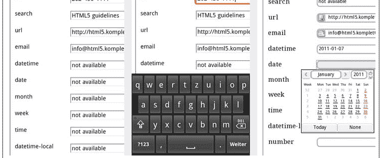
#### **图3.3** 安卓2.1手机上WebKit（左、中）与Opera（右）浏览器对新表单输入类型的支持情况
这一结果对于本就十分现代的安卓浏览器来说相当令人失望。iPhone上的测试结果则稍好一些：至少这款手机会根据输入类型适配软件键盘，尝试输入电话号码时会弹出数字键盘，输入类型为*email*时会添加@按键。在加拿大制造商黑莓公司（*Research in Motion，RIM*）生产的流行智能手机操作系统*BlackBerry*上，这一测试表现更好。如图3.4所示，黑莓同时支持`tel`、`number`类型以及日期类型，尤其是日期类型的界面呈现非常美观。其底层也是基于WebKit实现的：相关软件已经扩展了这些功能。
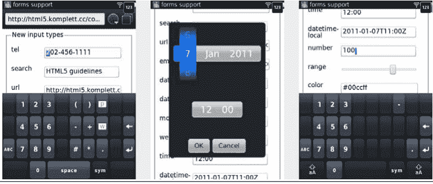
图3.4 黑莓智能手机（BlackBerry 9800模拟器）上的新输入类型
## 3.2 表单的有用属性
除新增元素和`input`元素的多种新类型外，HTML5还为表单元素提供了多个新属性。
### 3.2.1 使用“autofocus”实现自动聚焦
多年前，谷歌曾用一个简单的小技巧让搜索变得便捷许多，也让许多用户感到惊讶：页面加载时，光标会自动定位到搜索框中，用户无需先用鼠标点击输入框就能直接输入搜索内容。此前这一功能需要通过一小段JavaScript代码实现；而在HTML5中，现在可以通过`autofocus`属性实现：
``` <input type=search name=query autofocus> ```
和所有`boolean`（布尔）类型的属性一样，你也可以将该属性写作`autofocus="autofocus"`的形式（详见第2章2.7.2节“time元素”）。规范规定，一个网页中只能有一个元素可以包含autofocus属性。旧版浏览器不会出现autofocus相关的问题，因为它们会直接忽略这个未知属性。当然，只有新浏览器才能享受到这一提升用户体验的好处。
### 3.2.2 使用“placeholder”添加占位文本
HTML表单的可用性可以通过新增的占位符属性进一步优化：
``` <p><label for=email>Your e-mail address:</label> <input type=email name=email id=email placeholder="user@host.com"> <p><label for=birthday>Your date of birth</label> <input type=date name=birthday id=birthday placeholder="1978-11-24"> ```
*占位符*属性的值可以给用户提供快速填写提示，但它不应作为*标签*元素的替代品。在需要特定数据录入格式的字段中，该属性尤其有用。浏览器会在未激活的输入框中显示提示文本，一旦输入框被激活并获得焦点，该文本就会消失（详见*图3.5*）。
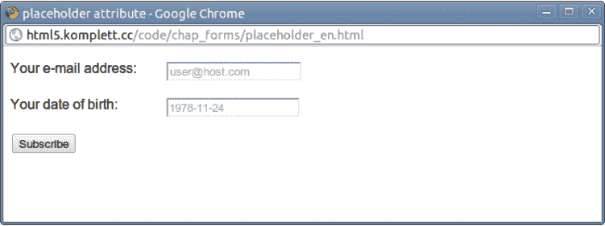
图3.5 谷歌Chrome浏览器中的“占位符”属性
### 3.2.3 使用“required”标记必填字段
required是一个*布尔*属性，它的名称已经说明了其全部功能：被添加该属性的表单元素必须填写。如果必填字段在表单提交时为空，则不符合提交要求，浏览器必须做出相应响应。更多相关内容请参阅3.4节*客户端表单验证*。
### 3.2.4 “input”元素的更多属性
`input`元素不仅新增了多种类型（详见3.1节“新输入类型”），还新增了多个简化表单操作的属性（见表3.2）。
| 类型 | 说明 | 属性 |
|------|-------------|------------|
| 字符串列表 | 指向包含建议选项的datalist元素的ID（详见3.3.3节“使用“datalist”创建选项列表”） | list |
| 数值/日期 | 数值字段和日期字段的最小值 | min |
| 数值/日期 | 数值字段和日期字段的最大值 | max |
| 数值 | 数值字段和日期字段的步长 | step |
| 布尔 | 允许多选 | multiple |
| 枚举类型（开启/关闭/默认） | 自动将已保存的数据插入表单字段 | autocomplete |
| 字符串 | 用于验证值的正则表达式 | pattern |
我们会在3.3.3节“使用“datalist”创建选项列表”中再次提到list属性，它指向datalist元素，用于提供可选的建议条目。min、max和step不仅适用于数值字段，也可用于日期和时间的录入：
``` <p><label for=minMax>Decimal number between 0 and 1:</label> <input type=number name=minMax id=minMax min=0 max=1 step=0.1> <p><label for=minMaxDate>Date in week steps:</label> <input type=date name=minMaxDate id=minMaxDate min=2010-08-01 max=2010-11-11 step=7> <p><label for=minMaxTime>Time in hour steps:</label> <input type=time name=minMaxTime id=minMaxTime min=14:30 max=19:30 step=3600> ```
在支持number类型`input`元素的浏览器中，第一个input元素（id=minMax）每次会递增0.1，可以通过点击输入框末尾的箭头按钮或按键盘上的方向键来实现。ID为minMaxDate的元素每次会向前跳转7天，Opera浏览器仅在日历中显示符合周循环的可选日期。设置该元素时，谷歌Chrome提供了和number类型`input`元素相同的导航方式：两个箭头按键可让日期向前或向后跳转7天。本示例中的第三个input元素将步长设置为3600，这会导致时间向前或向后调整1小时。尽管规范规定time类型的`input`元素通常以分钟为单位运行，但Opera和谷歌Chrome都将该数据解析为秒。我们从复制文件时就已经熟悉多选功能了，现在浏览器也支持这一选项。此前如果想在网站上一次性上传多个文件，需要为每个文件提供一个输入框；而multiple属性允许在文件选择对话框中同时选中多个文件。multiple选项原本是为select元素设计的，将其用于email类型的输入框是新增功能。但截至目前（本书编写时），所有常用的桌面浏览器都还未实现email类型的这一功能。
现代浏览器支持保存表单数据的功能，用户再次访问表单时可以直接调用已保存的数据填充，提升填写效率。这一预填充功能非常实用，但对于涉及安全敏感的输入框却并不合适（规范中举了核武器激活码的例子）。为了便于Web开发者管控这一行为，HTML5新增了autocomplete属性。如果为元素添加了autocomplete="off"属性，就意味着需要输入的信息属于机密内容，不应被浏览器保存。如果表单元素未明确autocomplete的开启或关闭状态，默认设置为显示建议内容。此外，也可以通过将autocomplete属性添加到form元素上，让该设置对整个表单生效。
新增的pattern属性支持非常灵活的输入验证。你可以指定一条*正则表达式*，表单字段的输入值会与该表达式进行匹配验证。正则表达式功能非常强大，但遗憾的是，它并不是一种容易上手的字符串解析方法。假设你要查找一个以大写字母开头、后接任意数量小写字母或数字、并以.txt结尾的字符串，用*regexp*（*正则表达式*的简称）就能轻松匹配到这类内容：
``` [A-Z]{1}[a-z,0-9]+\.txt ```

> **注意** 正则表达式的介绍远超本章的讨论范围，因此阅读后续章节时，我们默认你已经掌握了正则表达式的基础知识。如果你想查找简短的正则表达式在线入门教程，维基百科是不错的起点：可以访问http://en.wikipedia.org/wiki/Regular_expression。网站http://www.regexe.com提供了在线测试正则表达式的功能。


 使用带pattern属性的正则表达式时，需要记住搜索模式必须始终匹配表单字段的全部内容。规范还建议使用title属性给用户提供输入格式的提示。当鼠标指针悬停在字段上方时，Opera和谷歌浏览器会将这类信息以工具提示的形式展示出来。
讲完这些理论，下面是一个简单示例：
```html <p><label for=pattern>Your nickname:</label> <input type=text pattern="[a-z]{3,32}" placeholder="johnsmith" name=pattern id=pattern title="Only lower case, please; min. 3, max. 32!"> ```
pattern属性的规范要求字符串只能包含a到z之间的小写字母（即[a-z]），且长度最少3个、最多32个字符。不允许使用特殊字符或变音字母，像前面示例里的用户名场景，这个限制就很实用。如果你想加入某些特殊字符，比如德语中的变音字母，就需要把它们加入字符组中，例如[a-zäöüß]。在第3.4节“客户端表单验证”中，你可以了解到验证失败时会发生什么。

## 3.3 新元素
除了前面提到的新输入类型和新属性外，该规范还新增了表单元素，下一节我们会详细介绍这些元素。meter和progress元素可以创建图形对象，这类对象在过去只能通过或多或少复杂的技巧实现。datalist元素可以提供文本输入的建议，output元素则用于存放计算结果。keygen元素在万维网上已经存在很长时间了，直到HTML5才被纳入标准化。

### 3.3.1 使用“meter”元素展示测量值
meter元素用于图形化展示已知范围内的标量测量值。比如可以联想汽车上的油量表：指针会显示油箱内当前的油量，范围在0到100之间。过去，这类图形表示通常用嵌套的div元素在HTML中编码实现，这是一种相当不优雅的方案，div元素最初的用途应该也不是这个。状态显示也可以通过免费的网页服务以图形、图片的形式展示，比如谷歌图表的API。你可以在下面的示例中看到所有这些方案。
使用meter元素非常简单：你通过value属性设置需要的值，其余属性都是可选的。如果不设置min和max值，浏览器会默认将这两个属性分别设为0和1。因此，下面的meter元素表示的是一个半满的状态：
```html <meter value=0.5></meter> ```
除value、min和max外，还有low、high和optimum这几个属性，浏览器可以根据这些属性的值调整显示效果。比如谷歌浏览器（截至本文写作时，除Opera外唯一支持渲染meter元素的浏览器），如果当前值超过了optimum设定的最优值，就会将原本绿色的进度条显示为黄色。
下面的示例展示了一个图形化表示，呈现当前年份已经过去的百分比。该网站用四种不同的方式展示了输出结果的可视化效果：分别是带百分比数值的文本、使用新的meter元素、通过嵌套的div元素实现，以及用谷歌图表在线服务生成的图形。你可以在图3.6中看到最终效果。
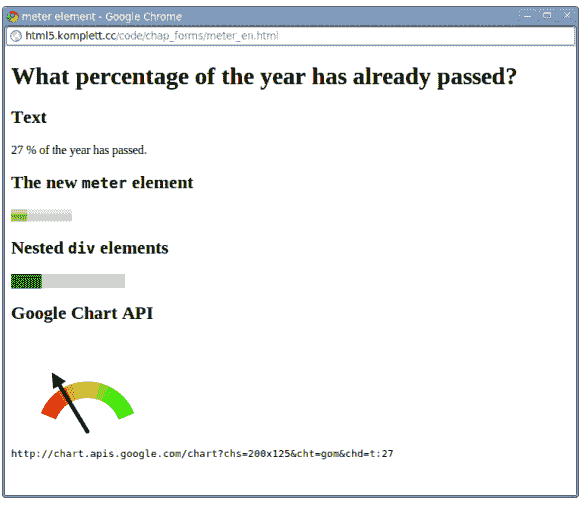
> 图3.6 “meter”元素及其他类似的状态展示方案
这个示例的HTML代码里包含尚未填充内容的元素，这些内容会通过JavaScript写入：
```html <h2>Text</h2> <p><output id=op></output> % of the year has passed.</p> <h2>The new <span class=tt>meter</span> element</h2> <meter value=0 id=m></meter> <h2>Nested <span class=tt>div</span> elements</h2> <div id=outer style="background:lightgray;width:150px;" > <div id=innerDIV></div></div> <h2>Google Chart API</h2>  <p id=googleSrc class=tt></p> ```
文本输出部分我们使用3.3.5节“使用‘output’元素进行计算”中介绍的output元素。但首先需要用JavaScript生成当前日期，并对meter元素进行初始化：
```javascript var today = new Date(); var m = document.getElementById("m"); m.min = new Date(today.getFullYear(), 0, 1); m.max = new Date(today.getFullYear(), 11, 31); // m.optimum = m.min-m.max/2; m.value = today; ```
today变量存储的是自UNIX纪元（1970年1月1日）开始以来的毫秒数。为了让meter元素有合理的刻度范围，我们将min值设为当年的1月1日，max值对应设为12月31日。代码最后一行设置了meter元素的值，现在图形表示就完成了。如果我们激活被注释掉的optimum属性（此处设为年中时间），你会看到显示效果会随脚本运行时间是上半年还是下半年而变化。
这个新元素的使用非常简单。现在我们来介绍HTML网页中的其他元素。我们希望把已经过去的天数占比赋值给ID为op的output元素。我们用Math.round()方法将百分比四舍五入到整数，这个精度对于本示例来说完全足够：
```javascript var op = document.getElementById("op"); op.value = Math.round(100/(m.max-m.min)*(m.value-m.min)); var innerDIV = document.getElementById("innerDIV"); innerDIV.style.width=op.value+"%"; innerDIV.style.background = "green"; ```
示例的其余部分和HTML5新特性无关，但为了内容完整，我们还是会进行说明。嵌套的div元素也需要填充百分比数值。背后的逻辑很简单：首先在HTML中定义一个固定宽度（此处为150px）的div区域。在这个元素内部嵌套另一个div元素，设置其背景为绿色，宽度为计算得到的百分比数值，这是一个简单却非常有效的技巧。
最后，我们还要加入谷歌图表API。要使用这个在线服务，需要指定图表尺寸（参数chs，本例中为200×125像素）、图表类型（参数cht，此处为gom，即谷歌油量表），以及图表数据（参数chd，此处为百分比数值op.value）。
```javascript var google = document.getElementById("google"); google.src = "http://chart.apis.google.com/chart?chs=200x125&cht=gom&chd=t:"+op.value; var gSrc = document.getElementById("googleSrc"); gSrc.innerHTML = google.src; ```

### 3.3.2 使用“progress”元素展示任务进度
progress元素的使用方式和前面介绍的meter元素类似，区别在于它用于展示任务的完成进度。这类任务可以是用户上传文件，也可以是应用程序所需的外部库下载等。为了快速演示，我们并不需要真的上传文件或下载大量数据，只要给自己设定一个任务并100%完成它就够了。
下面的示例定义了10个类型为checkbox的输入元素，一旦全部勾选，进度条就会显示100%：
```html <h1>Please activate all the checkboxes</h1> <form method=get> <input type=checkbox onchange=updateProgress()> <input type=checkbox onchange=updateProgress()> <!-- and 8 more --> <p> Progress: <progress value=0 max=10 id=pb></progress> </form> ```
progress元素初始值设为0，最大值设为10。一旦某个输入元素被勾选，就会调用updateProgress()函数，该函数的代码如下：
```javascript function updateProgress() { var pb = document.getElementById("pb"); var ip = document.getElementsByTagName("input"); } ```
```javascript var cnt = 0; for(var i=0; i<ip.length; i++) { if (ip[i].checked == true) { cnt++; } } pb.value = cnt; ```
ip变量是一个包含所有输入元素的NodeList。在for循环中会逐一检测这些元素的选中状态。如果元素被勾选（checked == true），计数器变量cnt就加1。最后，将progress元素的值设置为计数器变量的值。

### 3.3.3 使用“datalist”元素创建选项列表
表单领域期待已久的一项新功能是支持自定义条目的下拉菜单。由于大家熟知的select元素仅支持作为option元素指定的值，过去网页开发者们总是用各种JavaScript技巧，给文本字段添加可扩展的选择列表。HTML5规范现在为这个问题提供了非常优雅的解决方案。
新的datalist元素被定义为存放大家已经熟悉的option元素的容器。现在我们可以给每个input元素关联一个datalist元素，需要时就会展示对应的选择选项。不支持datalist元素的浏览器只会显示空的文本字段。清单3.1展示了这个新元素的使用方法。
这里的input元素类型为text，list属性对应关联的datalist元素的id（本例中为homepages）。页面加载时，autofocus属性会自动将光标定位到文本字段内（详见3.2.1节“使用‘autofocus’聚焦”），并至少会在Opera浏览器中确保选择列表显示出来（见图3.7）。
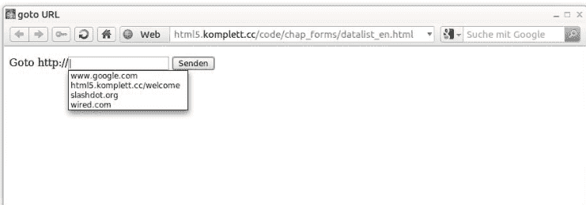
> 图3.7 Opera浏览器展示“datalist”元素的效果

对于 datalist 中的 option 元素，你只需填写 value 属性。虽然也可以添加其他属性和文本节点，但对于此用途并非必需。如果用户点击提交按钮，文本框中的内容将被加上 http:// 前缀，然后浏览器会重定向到生成的 URL（window.location）：

#### 清单 3.1 填写了 Internet 地址的 "datalist" 元素
```html
<form>
<p>
<label for=url>Goto</label> http://<input type=text id=url name=homepage list=homepages autofocus>
<datalist id=homepages>
<option value=www.google.com></option>
<option value=html5.komplett.cc/welcome></option>
<option value=slashdot.org></option>
<option value=wired.com></option>
</datalist>
<input type=submit onclick="window.location = 'http://'+document.getElementById('url').value; return false;" >
</form>
```

如果你想为不支持该功能的旧版浏览器提供一个选择列表，同时又不想重复 HTML 代码，可以采用以下技巧。因为支持 datalist 元素的浏览器会忽略其中包含的 select 元素，所以它们会显示新的 HTML5 select 元素。而旧版浏览器则会为文本框显示一个带有预定义链接的选择列表，当用户选择不同的选项时，相应的链接将被插入到文本框中。如清单 3.2 所示，我们需要为 option 元素添加文本节点，因为"旧版" select 元素不会显示 value 属性的内容，而是显示文本：

#### 清单 3.2 为旧版浏览器提供回退方案的 "datalist"
```html
<datalist id=homepages>
<select name=homepage onchange="document.getElementById('url').value = document.forms[0].homepage[1].value" >
<option value=www.google.com>www.google.com</option>
<option value=html5.komplett.cc/welcome>html5.komplett.cc/welcome</option>
<option value=slashdot.org>slashdot.org</option>
<option value=wired.com>wired.com</option>
</select>
</datalist>
```

select 元素中的 onchange 事件会将当前选中的菜单文本插入到文本框中（参见图 3.8）。

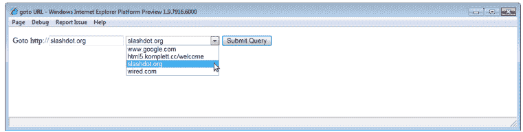

**图 3.8** "input" 与 "select" 元素组合而成的旧版浏览器回退方案（此处为 Internet Explorer 8）

#### 3.3.4 使用 "keygen" 生成密钥
keygen 元素在 Mozilla Firefox 浏览器中有着悠久的历史（自 1.0 版本起即已包含），但微软对于其在 HTML5 中的实现仍然表示了极大的担忧。keygen 用于生成密钥，这听起来很复杂，遗憾的是，它确实就像听起来那么复杂。简单来说，这个元素背后的原理是：浏览器创建一对密钥，一个是*公钥*，另一个是*私钥*。公钥会随其他表单数据一起发送出去，供服务器应用程序使用，而私钥则保存在浏览器中。在密钥交换之后，服务器和浏览器可以在不使用 SSL 证书的情况下进行加密通信。这听起来像是解决那些令浏览器不断报警的烦人的自签名证书的实用方案，但遗憾的是并非如此，因为服务器的身份只能通过由可信机构——*证书颁发机构（CA）*——签发的证书来验证。那么，如果 keygen 无法替代 SSL，这个新元素应该用来做什么呢？正如 Mozilla 文档中所述，keygen 元素有助于创建一个服务器可以签名的证书（*签名证书*）。为了使这一步完全安全，通常需要申请人亲自到证书颁发机构面前。由于签发签名证书是一项专业工作，我们将简要介绍这个元素及其属性。

以下是一个简短的 HTML 文档，用于创建一个 keygen 按钮：
```html
<!DOCTYPE html>
<meta charset="utf-8">
<title>keygen Demo</title>
<form method=post action=submit.html>
<keygen id=kg challenge=hereismychallenge name=kg>
<input type=submit>
</form>
```

除了常见的属性（如 autofocus、disabled、name 和 form）之外，keygen 元素还有两个特殊属性：keytype 和 challenge。其中 keytype 特别有趣，因为浏览器会根据此值来决定是否支持该元素的功能。目前只有一个有效的 keytype，即 rsa——一种于 1977 年在麻省理工学院（MIT）开发的加密系统。如果未指定 keytype（如前面的示例），则默认使用 rsa。规范还指出，浏览器可以不支持任何 keytype，这大概是因为微软对该元素的反对。可选的 challenge 属性用于增强密钥交换过程中的安全性。更多信息请参阅本节末尾注释中的链接。

如果浏览器支持 RSA 密钥生成，它可以提供一个选择列表，让用户选择密钥的长度，从而选择密钥的安全级别（参见图 3.9）。

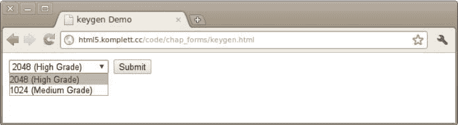

**图 3.9** 在 Google Chrome 中选择密钥长度

图 3.10 展示了表单提交后的结果：POST 变量 kg 包含了加密所需的公钥（此处通过非常实用的 Firefox 插件 Firebug 渲染显示）。

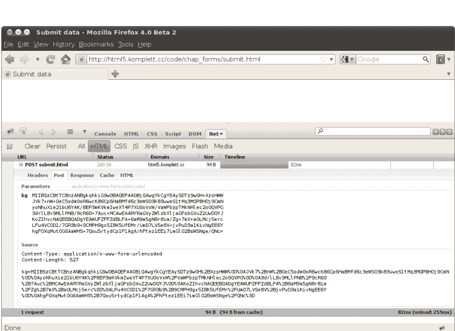

**图 3.10** "keygen" 元素的公钥，在 Firebug 中显示

**注意**
如果你之前对密码学了解不多，但想进一步了解，Wikipedia 始终是一个很好的起点。请查看[公钥基础设施](http://en.wikipedia.org/wiki/Public_key_infrastructure)和[质询-响应认证](http://en.wikipedia.org/wiki/Challenge-response_authentication)。


#### 3.3.5 使用 "output" 进行计算
"output 元素表示计算的结果。"这是 HTML5 规范中非常简短的解释，你将在大多数描述此新元素的网站上看到完全相同的文字。这一切听起来都很合理，但我们要处理的是什么样的计算呢？为什么需要一个专门的元素来做这些？一般来说，这些计算源自网站上的输入字段。大多数人都熟悉的例子是电子购物车，每种商品的数量可以在输入字段中输入。通过可选的 for 属性，你可以指定哪些字段参与计算。该属性引用文档中其他一个或多个字段的 id。

为了测试 output 元素，我们将编写一个包含三种不同商品的小型购物车。每种商品的数量可以通过输入字段更改，同时在购物车下方显示商品总数和总价。图 3.11 展示了一个包含五件商品的购物篮。


**图 3.11** 两个 "output" 元素分别显示商品总数和总价

我们示例的代码可以简单快速地解释：为了在数量每次更改时更新 output 元素，我们使用了表单的 oninput 事件：
```html
<form oninput="updateSum();">
<table>
<tr><th>Product</th><th>Price (US$)</th><th>Item number</th>
<tr><td>Keyboard</td><td class=num id=i1Price>39.50</td>
<input name=i1 id=i1 type=number min=0 value=0 max=99>
<tr><td>Mouse</td><td class=num id=i2Price>26.30</td>
```

output 元素定义在商品表格之后，并通过 for 属性引用输入字段的 ID：
```html
<p>Your shopping cart contains <output name=sumProd for="i1 i2 i3" id=sumProd></output> items. Total price: <output name=sum for="i1 i2 i3" id=sum></output> US$.
```

在 JavaScript 代码中，一个循环遍历所有输入元素，累加数量并计算总价：

```javascript
function updateSum() {
  var ips = document.getElementsByTagName("input");
  var sum = 0;
  var prods = 0;
  for (var i=0; i<ips.length; i++) {
    var cnt = Number(ips[i].value);
    if (cnt > 0) {
      sum += cnt * Number(document.getElementById(ips[i].name + "Price").innerHTML);
      prods += cnt;
    }
  }
  document.getElementById("sumProd").value = prods;
  document.getElementById("sum").value = sum;
}
```
我们通过相关表格列的`innerHTML`值直接获取产品价格，并使用JavaScript的`Number()`函数将其转换为数字。输入框（`ips[i].value`）中的值也做同样的处理，因为如果不进行此转换，JavaScript会将字符串直接相加，无法得到预期结果。计算得到的数值随后会被写入输出元素的`value`属性中。
## 3.4 客户端表单验证
表单新增的元素和属性的一大优势是，用户现在可以更轻松地输入数据（例如从日历中选择日期）。另一大优势是，可以在表单提交前检查表单内容，并向用户提示错误。你可能会说这类检查早就有了，算不上新鲜事物，确实如此，但直到现在，这一步都必须通过手动编写的JavaScript代码来实现。多亏了jQuery这类类似的库，这项任务变得简单多了，代码也更易维护，但你仍然需要依赖外部库。而HTML5彻底改变了这一现状：你在HTML中定义输入框的参数，浏览器会自动检查输入框的内容是否正确填写。这是向前迈出的重要一步，也让大量JavaScript代码变得多余。
```html
<form method="get" action="required.html">
  <p><label>Your e-mail address: <input type="email" name="email" required></label></p>
  <p><input type="submit"></p>
</form>
```
这个极简的例子就能让你信服：图3.12展示了如果在上一段代码的表单中未填写邮箱地址就提交，会出现什么情况。Opera浏览器会显示错误提示：*此为必填字段*。如果你将Opera的用户界面设置为了其他语言，错误提示也会以对应语言显示。当然，你也可以通过JavaScript自定义这些错误提示，更多内容详见3.4.3节。
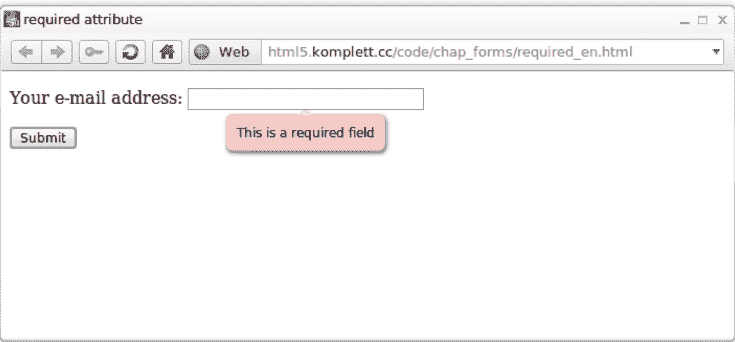
图3.12 带有“required”属性的空白输入框对应的错误提示（Opera浏览器）
但这还不是全部：由于该输入框被定义为`email`类型，因此如果输入了无效的邮箱地址，Opera也会返回错误提示，例如：*请输入有效的邮箱地址*（见图3.13）。
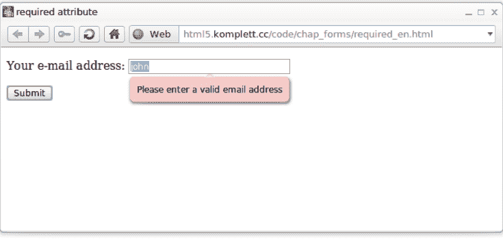
图3.13 在Opera中输入无效邮箱地址后的错误提示
基于WebKit的浏览器（如谷歌Chrome或Safari）目前支持表单验证，但不会显示错误提示。它们会给无效输入框添加边框，并将光标定位到该输入框内，至少提示用户输入内容存在问题。
> 尽管客户端表单验证的优势十分突出，但不要忘记这一步无法替代服务器端的校验。潜在攻击者几乎不需要什么技术成本就能绕过这些机制。

### 3.4.1 “invalid”事件
表单验证过程中，内容无效的元素会触发`invalid`事件，我们可以通过该事件对错误值进行单独处理：
```javascript
window.onload = function() {
  var inputs = document.getElementsByTagName("input");
  for (var i=0; i<inputs.length; i++) {
    inputs[i].addEventListener("invalid", function() {
      alert("Field "+this.labels[0].innerHTML +" is invalid");
      this.style.border = 'dotted 2px red';
    }, false);
  }
}
```
页面加载完成后，会生成所有输入元素的列表（与3.3.5节的示例一致）。我们会为每个元素添加事件监听器来处理错误。在本示例中，事件触发后会打开一个提示窗口，同时给对应元素加上红点边框，提示窗口中会显示该输入框的标签文本。这种处理方式在输入字段较多的表单中并不理想：用户必须为每个错误的输入点击确定按钮，然后再在表单中找到对应的字段重新填写。有时候，更实用的做法是在用户填写字段时，就立即提示输入内容无效，我们将在下一节尝试实现这一功能。
### 3.4.2 “checkValidity”函数
要触发输入元素的验证，只需调用该元素的`checkValidity`函数。当然你也可以“手动”触发表单提交时通常会自动执行的验证流程：
```html
<input type="email" name="email" onchange="this.checkValidity();">
```
如果你输入了无效的邮箱地址，然后将焦点移出输入框（无论是通过Tab键还是点击浏览器的其他区域），浏览器（目前至少Opera浏览器支持）会立即返回错误提示（见图3.13）。如果我们将输入检查函数绑定到所有输入元素的`onchange`事件上，错误处理会更加优雅：
```javascript
window.onload = function() {
  var inputs = document.getElementsByTagName("input");
  for (var i=0; i<inputs.length; i++) {
    if (!inputs[i].willValidate) {
      continue;
    }
    inputs[i].onchange = function() {
      if (!this.checkValidity()) {
        this.style.border = 'solid 2px red';
        this.style.background = '';
      } else {
        this.style.border = '';
        this.style.background = 'lightgreen';
      }
    }
  }
}
```
我们熟悉的循环会遍历所有输入元素，首先检查该元素是否可用于验证。如果`willValidate`的返回值不为`true`，循环会继续处理下一个元素。否则，会将一个匿名函数绑定到`onchange`事件上，该函数会调用`checkValidity`函数。匿名函数中的`this`指向对应的输入元素。如果校验不通过，会给元素加上红色边框；如果校验通过，则将元素的背景色设置为浅绿色。注意要将背景色和边框重置为空字符串，这样在用户修正错误的输入后，浏览器会将格式恢复为默认值。
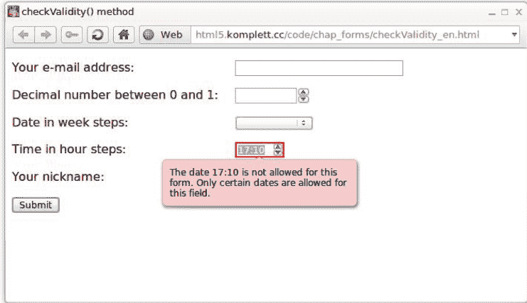
**图3.14** 输入错误的时间后Opera显示的错误提示（本例中是违反了“step”属性的规则）
如果你希望让错误处理更具交互性，可以使用HTML5新增的`oninput`事件替代`onchange`事件。`onchange`事件只有当输入框失去焦点时才会触发，而`oninput`事件在每次输入内容变化时都会激活。现在`oninput`事件可以实现之前需要借助`keyup`和`keydown`键盘事件才能实现的繁琐功能。`oninput`的另一大优势是，只需要为整个表单绑定一次事件监听器，而不需要为每个输入元素单独绑定。因此在我们之前的示例中，可以省略所有JavaScript代码，仅修改表单定义即可，如下所示：
```html
<form method="get" oninput="this.checkValidity();" action="checkValidity.html">
```
这意味着你无法再修改边框和背景色，但能大幅缩短源代码。在某些场景下，对每次按键都立即做出反应会很有帮助，但通常对于表单填写而言，在字段输入完成后再检查内容就足够了。
#### **3.4.3 使用“setCustomValidity()”进行错误处理**
如果你觉得之前介绍的所有错误处理方法仍然不够用，你也可以自行编写内容校验函数。在下面的示例中，我们定义了一个类型为`email`的输入框，该输入框

可确保浏览器对电子邮箱地址的有效性进行检查。此外，我们希望特别排除三个邮箱域名：
```javascript
var invalidMailDomains = [
    'hotmail.com',
    'gmx.com',
    'gmail.com'
];
function checkMailDomain(item) {
    for (var i=0; i<invalidMailDomains.length; i++) {
        if (item.value.match(invalidMailDomains[i]+'$')) {
            item.setCustomValidity('E-mail addresses from '+invalidMailDomains[i]+' are not accepted.');
        } else {
            item.setCustomValidity('');
        }
        item.checkValidity();
    }
}
```
`invalidMailDomains`数组中的每个元素都会与输入框的值进行比对。JavaScript的`match()`函数支持正则表达式，因此我们在域名后添加`$`符号，用于表示字符串的结尾。如果字符串匹配成功，就会调用`setCustomValidity()`函数并展示对应的错误提示。如果域名不在该数组中，就会传入空字符串调用`setCustomValidity()`。该操作会在内部将`validationMessage`变量绑定到输入元素上，随后Opera浏览器会展示该内容（见图3.15）。最后调用`checkValidity()`函数会触发有效性校验，进而展示上述错误提示。
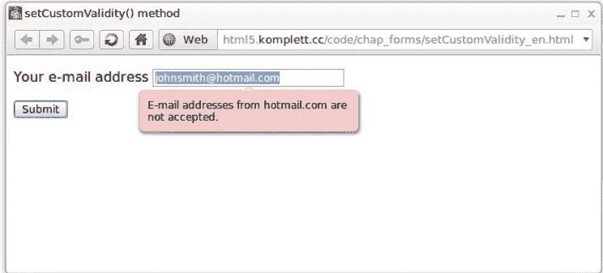
图3.15 Opera在手动错误处理（校验邮箱域名）过程中展示错误提示
#### 3.4.4 有效性校验总结
表3.3汇总了所有可用于有效性校验的输入属性、校验函数以及对应的触发场景：
| 属性/函数 | 问题 |
|:-|:-|
| `required` | 字段未输入任何值。 |
| `type=email`、`url` | 输入的值不符合要求的类型。 |
| `pattern` | 输入的值不符合要求的规则模式。 |
| `maxlength` | 输入的值超出允许的最大长度。 |
| `min`、`max` | 输入的值过小或过大。 |
| `step` | 输入的值违反了要求的步长规则。 |
| `setCustomValidity()` | 未满足为该字段设置的额外校验规则。 |
#### 3.4.5 还是不校验更好？“formnovalidate”属性
既然我们已经花了大量时间讨论错误处理，接下来就告诉你如何通过`formnovalidate`属性绕过所有校验规则。一开始，直接无视所有精心定义的规则、不经过校验就提交表单，可能看起来有些奇怪。相关规范给出了简短说明，很快就能解开这个谜团。跳过有效性校验的典型应用场景是用户无法或不想一次性填完的表单。给提交按钮添加`formnovalidate`属性后，就可以先保存已输入的内容，后续再继续填写。
> **注意** 如果使用`formnovalidate`提交表单，已填写的字段会被发送到服务器，服务器端应用负责临时保存这些数据。

举个例子，假设你要为出现故障的数码相机填写售后支持表单。当你花了很久填完所有故障相关细节后，网站却要求你提供相机的序列号。因为手头没有相机，又不想丢失已经输入的所有信息，你就可以点击保存按钮，然后安心去找相机。该按钮的定义如下：
```html
<p><input type=submit formnovalidate value="Save" name=save id=save>
```
### 3.5 示例：售后支持表单
本示例中的表单使用了之前介绍过的新元素和新属性。这类表单在扩展后可用于电子产品经销商的网站。首先，用户需要填写个人信息（本示例中仅包含姓名、电子邮箱地址、电话号码和传真号码）。表单第二部分涉及产品的技术数据和故障信息。网页底部展示了进度条，用于引导用户完成表单填写（见图3.16）。

> 图3.16 即将填写完成的售后支持表单
表单的HTML代码首先加载外部JavaScript文件，以及我们已经熟悉的`window.onload`调用：
```html
<script src="support.js"></script>
<script>
window.onload = function() {
    initEventListener();
}
</script>
```
`initEventListener`函数会遍历所有输入元素，并为`onchange`事件绑定匿名函数，用于校验对应元素的有效性：
```javascript
function initEventListener() {
    var inputs = document.getElementsByTagName("input");
    for (var i=0; i<inputs.length; i++) {
        if (!inputs[i].willValidate) {
            continue;
        }
        inputs[i].onchange = function() {
            this.checkValidity();
        }
    }
}
```
只有当元素支持有效性校验时，才会为其绑定事件监听器。在本示例中，两个提交/保存按钮不支持有效性校验，因此不会绑定`onchange`事件。如前所述，在用户填写完单个表单字段后再进行校验，比使用`oninput`事件校验整个表单更便捷。为了提升表单的易用性，我们希望突出标记为必填的元素，让用户一眼就能识别出最重要的字段。幸运的是，我们不需要给每个元素单独添加额外的样式。CSS3提供了专门用于此场景的新选择器`:required`。以下规则会给所有必填元素添加橙色边框：
```css
:required {
    border-color: orange;
    border-style: solid;
}
```
各个输入字段的定义没有什么特别之处。电子邮箱地址和电话号码有专属的类型，且为必填项；故障发生日期类型为`date`，因此可以通过日历窗口选择。网页顶部的两栏布局通过相邻的`div`元素实现。我们仍然希望使用Tab键跳转到下一字段的用户按从上到下的顺序填写表单，而不是按照HTML逻辑先填左栏再填右栏。我们可以通过`tabindex`属性实现这一效果：在某个字段中按Tab键，光标会跳转到`tabindex`值更大的下一个字段：
```html
<div style="float:left">
<p><label>Your name <input tabindex=1 type=text required autofocus placeholder="John Smith" name=name></label>
<p><label>Your e-mail address <input tabindex=3 type=email name=email required></label>
</div>
<div style="float:left;margin-left:10px;">
<p><label>Telephone number <input tabindex=2 type=tel name=tel required></label>
<p><label>Fax number <input tabindex=4 type=tel name=fax></label>
</div>
```
接下来`textarea`字段部分的代码更有意思。HTML5对这种元素没有做太多修改。但如图3.16所示，每个文本字段上方现在都有一个小型图形显示，提示你还可以输入多少字符。你可能立刻就想到了：这是通过3.3.1节“使用“meter”元素展示度量值”中介绍过的新元素`<meter>`实现的：
```html
<p><label>Error message <textarea placeholder="Lens error. Camera restart." name=errmsg required rows=5 cols=50 title="up to 200 characters"></textarea></label><meter value=0 max=200 tabindex=-1></meter>
```
`<meter>`元素初始化的最大值为200，恰好是`textarea`的`title`属性中指定的最大字符数。如果用户输入超出最大允许字符数，`<meter>`元素会变为红色，提示输入文本过长。由于我们没有对`textarea`设置字符限制，浏览器仍会提交所有文本。因此这只是一个提示，而非强制要求。用于更新`<meter>`元素的JavaScript函数是`updateTAMeters()`，会对所有`textarea`元素执行该函数：
```javascript
function updateTAMeters() {
    var textfs = document.getElementsByTagName("textarea");
    for(var i=0; i<textfs.length; i++) {
        textfs[i].labels[0].nextSibling.value = textfs[i].textLength;
    }
}
```

循环的优势在于我们现在可以添加任意数量的textarea元素，只要它们带有meter元素，这些元素就会自动更新。要实现这一效果，我们需要借助一个DOM技巧：前文清单中以粗体显示的代码访问了DOM的nextSibling方法，该方法指向下一个元素。让我们重新查看文本域和状态栏的HTML代码，以便更清晰地说明。textarea元素被label元素包裹，其后跟着我们需要的meter元素。要从textarea元素获取到meter元素，我们使用文本域的labels属性。这是一个NodeList数组，我们只需要关注第一个元素（索引为0），因为紧随其后的元素（nextSibling）就是meter元素。
如果你仔细看就会发现，这个流程并不像最初看起来那么复杂，但存在一些小问题。如果在包裹textarea元素的label元素和meter元素之间混入了多余的空白或换行符，我们的状态显示就会失效。此时nextSibling会变为文本节点，我们就无法在for循环中获取到meter元素了。
接下来我们想要实现表单末尾的进度显示功能。你大概已经猜到这会用到progress元素；更有趣的是，我们如何在JavaScript中优雅地实现对这个元素的更新。首先，这是该元素的HTML代码：
```html
<label>Progress: <progress id="formProgress" value="0" tabindex="-1"></progress></label>
```
我们给progress元素设置了id属性、初始值0（value属性）以及负数的tabindex，这意味着无法通过Tab键选中该元素。
JavaScript函数updateProgress()用于更新进度元素：
```javascript
function updateProgress() {
  var req = document.querySelectorAll(":required");
  count = 0;
  for (var i = 0; i < req.length; i++) {
    if (req[i].value != '') {
      count++;
    }
  }
  var pb = document.getElementById("formProgress");
  pb.max = req.length;
  pb.value = count;
}
```
由于进度条只需要统计绝对必填的元素，所以我们把字符串`:required`传递给querySelectorAll()函数。返回结果是一个NodeList，仅包含带有required属性的元素。接下来我们会遍历这些元素，检查其value属性是否匹配非空字符串。如果满足该条件（即已经输入了内容），计数器变量count就会加1。最后，将progress元素的max属性设置为所有必填字段的总数，value属性设置为已填写的非空元素的数量。
表单有两个提交按钮：保存和提交。我们已经在3.4.5节*或者干脆不验证更好？*中讨论过保存功能；这里新增的是accesskey属性：
```html
<p><input accesskey="T" type="submit" formnovalidate value="Save [S]" name="save" id="save">
<input accesskey="T" type="submit" name="submit" id="submit" value="Submit [T]">
```
键盘快捷键在HTML5中并非新功能，但至今使用率并不高。键盘快捷键的一个问题是，不同平台激活快捷键的按键组合不同，因此你永远不确定某个特定快捷键到底该按哪个键。HTML5规范提出了一种解决方案：accessKeyLabel属性的值应返回对应你所用平台正确按键的字符串。你可以把这个值用在按钮的标签或title属性中。不幸的是，在撰写本文时，还没有任何浏览器能够输出这个字符串。
### 总结
本章所提供的信息解释了HTML5为表单新增的诸多功能。Web开发者的好日子要来了，因为他们不再需要为了日期、时间等常见输入元素而折腾JavaScript库。尤其在移动设备上使用时，这些新表单功能会非常有帮助——移动设备上的文本输入通常比电脑上困难得多。浏览器端的表单验证也能显著提升代码的透明度，让代码更易管理。但不要忘记，客户端验证并不能提升服务器应用的安全性，潜在攻击者可以轻松绕过这些校验。如果你读完本章对表单功能产生了兴趣，想在自己的网站上实践刚学到的表单知识，完全可以放手去试。新元素和新属性的语法设计得十分友好，即使旧浏览器也不会报错。使用旧浏览器的用户虽然无法完整体验新输入元素的优势，但文本输入功能始终是可用的。

# **4 视频与音频**
YouTube的出现是在线视频展示领域的巨大飞跃。在这个视频平台出现之前，电脑新手几乎不可能通过互联网向他人分享视频文件。这些文件通常太大，无法通过电子邮件发送，就算真的发送成功，接收方也极有可能因为电脑上没有对应播放器而无法观看。而YouTube一方面提供了在线存储功能，方便你保存视频文件；另一方面还会转换不同的视频格式，让视频能够通过Adobe Flash Player播放。Adobe在多种操作系统上都支持Flash，为所有常见浏览器都提供了插件。浏览器插件总的来说是个很棒的创意，但插件和浏览器之间的通信有时会很困难，甚至完全无法进行。此外，Adobe Flash Player这类闭源插件并不受浏览器厂商欢迎，因为一旦出现崩溃，排查错误的难度会大很多。HTML5试图改善这一状况，很容易就找到了所需的新HTML元素：video。但这还不足以彻底解决问题。
## 4.1 首个示例
我们将给出一个简短示例，演示HTML5新video元素的使用有多么简单：
```html
<!DOCTYPE html>
<title>Simple Video</title>
<video controls autoplay>
<source src='videos/mvi_2170.webm' type='video/webm'>
<source src='videos/mvi_2170.ogv' type='video/ogg'>
Sorry, your browser is unable to play this video.
```
用极少的代码就能在浏览器中播放视频。在图4.1中你可以看到在Mozilla Firefox中的运行结果。这段HTML的语法几乎是不言自明的，我们将在下一节详细探究。
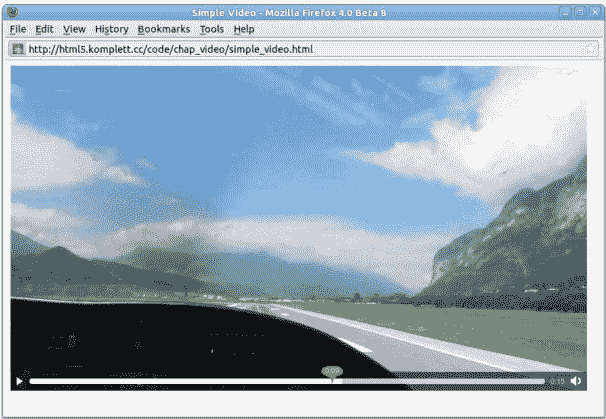
图4.1 Mozilla Firefox中播放WebM格式的视频
## 4.2 “video”元素及其属性
在前面的示例中，我们给video元素分配了两个属性：controls和autoplay。controls属性告诉浏览器显示视频的控制元件（见图4.1），autoplay属性则告诉浏览器在条件允许时立即开始播放视频。和canvas元素（见第5章“Canvas”）一样，video元素属于*嵌入式内容*类别，换句话说，它是并非直接隶属于HTML的内容之一。在嵌入式内容中，你可以添加备用方案（*fallback*），以防浏览器不支持video元素。如果我们在4.1节*首个示例*中的示例遇到这种情况，就会显示文本*抱歉，您的浏览器无法播放此视频*。除此之外，你也可以显示视频的静态截图。
接下来我们详细看一下video元素的可选属性（见表4.1）。
表4.1 “video”元素的属性
| 属性 | 值 | 说明 |
|-----------|-------|-------------|
| src | 链接 | 要播放的视频的URL。该属性为可选，可被一个或多个source元素替代，如我们的示例所示。 |
| poster | 链接 | 视频加载时浏览器显示的图片的URL。 |
| preload | none | 浏览器不会在用户点击播放按钮前尝试加载视频，可节省带宽。 |
| preload | metadata | 仅加载视频的元数据（例如视频时长、作者、版权信息）。 |
| preload | auto | 这种情况下，整个视频会在用户点击播放按钮前就加载完成。 |
| autoplay | 布尔值 | 浏览器在接收到足够的数据后就会开始播放视频。 |
| controls | 布尔值 | 显示视频的简易控制元件。该属性不指定控制元件的具体样式，通常由浏览器厂商自行决定。规范建议包含多个控制元件，例如视频播放/暂停控制、音量调节、跳转到视频其他时间点的选项（需内容支持）、全屏切换，以及可能的字幕按钮。 |
| loop | 布尔值 | 告诉浏览器在视频播放结束后重复播放。 |


**表 4.1** "video"元素的属性（续）
| 属性 | 取值 | 说明 |
|-----------|-------|-------------|
| `width` | *以CSS像素为单位* | 视频显示的宽度 |
| `height` | *以CSS像素为单位* | 视频显示的高度 |
| `audio` | *静音* | 使用户代理覆盖用户的偏好设置（如果存在），并始终默认将视频设为静音。 |

如果video元素没有`src`属性，浏览器会处理video元素内包含的一个或多个source元素。`src`、`type`和`media`属性就是用于此目的的（见表4.2）。反过来，如果存在source元素，则不得为`video`指定`src`属性。

**表 4.2** "source"元素的属性
| 属性 | 取值 | 说明 |
|-----------|-------|-------------|
| `src` | *URL* | 要播放视频的URL |
| `type` | *MIME类型* | 视频的MIME类型。你可以添加音视频编解码器的规范，例如`type='video/webm; codecs="vorbis,vp8"'`。如果存在多个source元素，浏览器会使用该属性（以及其他属性）来决定显示哪个视频。 |
| `media` | *CSS媒体查询* | 视频适用的输出介质 |

浏览器使用两个标准来决定显示现有source元素中的哪一个：视频的MIME类型，以及（如果存在的话）`media`属性，你可以在其中以*CSS媒体查询*的形式指定额外的限制条件。对于CSS3，媒体查询得到了显著扩展，因此现在除了*打印*、*屏幕*、*手持设备*、*投影*这类熟悉的关键字外，还可以编写更复杂的规则。示例如下：
```
media="screen and (min-width: 800px)"
```
这对视频输出来说非常有意思，因为根据浏览器尺寸的不同，可以提供不同分辨率的视频。借助这个技巧，即使是屏幕更小、网络连接更慢的移动设备也能完美播放。
```html
<!DOCTYPE html>
<title>Simple Video</title>
<video controls autoplay>
<source src='videos/mvi_2170.webm' type='video/webm' media="screen and (min-width: 500px)" >
<source src='videos/mvi_2170_qvga.webm' type='video/webm' media="screen">
Sorry, your browser is unable to play this video.
```
> CSS3媒体查询规范目前处于*编辑草案*阶段。因此部分细节可能会发生变化。你可以在W3C官网http://dev.w3.org/csswg/css3-mediaqueries查询该规范的当前状态。


决定显示哪个视频的第二个标准是MIME类型。可选添加所用编解码器可以让浏览器在加载之前就识别出该视频是否可解码。但这些编解码器是什么？下一节将尝试梳理编解码器丛林的脉络。

## 4.3 视频编解码器
现代视频格式使用*容器*文件来分别存储音视频内容。这种灵活的方式有多种优势。例如，一个文件可以保存多条音轨，允许用户在语言间切换（就像在视频DVD上操作一样）。图4.2展示了视频容器文件的示意图。在该容器文件中音视频的压缩方式被称为*编解码器*。

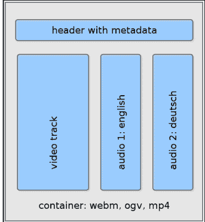

**图 4.2** 视频容器格式的示意图

在制定HTML5规范的过程中，一个争议焦点是允许的音视频编解码器的定义。这些争论一方面源于持有某些编码流程专利的公司的商业利益，另一方面源于选择高性能、高品质格式的诉求。更准确地说，阵营分为两组：一组支持受专利保护的视频编解码器*H.264*，另一组（由Mozilla团队牵头）呼吁采用开源的*Ogg Theora*格式。当伊恩·希克森意识到这场冲突可能危及重要的video元素时，他决定将格式的定义从规范中移除。如今由浏览器厂商自行决定支持哪些格式，以及愿意为哪些格式支付专利费。尽管Mozilla曾激烈抗争，试图避免重蹈图像格式GIF的覆辙——CompuServe后来曾就GIF格式索要专利费——但在新一代网络视频格式的竞争中，*H.264*似乎更受青睐。但谷歌不想被动等待潜在的专利侵权问题，决定主动解决这一难题。通过收购已经研发出重要视频格式的视频专业公司*On2 Technologies*，谷歌获得了尚未发布的*VP8*编解码器的所有权。在2010年谷歌开发者大会（*Google I/O 2010*）上，这家软件巨头终于揭开了谜底：基于*VP8*视频编解码器和*Ogg Vorbis*音频格式的新项目*WebM*作为开源项目在互联网上发布，网址为http://www.webmproject.org，不久后就被Firefox和Opera浏览器采纳。2011年初，谷歌更进一步，宣布将在后续版本的Chrome浏览器中移除对*H.264*编解码器的支持。这一出人意料的举措的理由是，谷歌希望推动开放式创新，认为万维网的核心技术需要基于开放标准，而H.264并非开放标准。

### 4.3.1 Ogg：Theora与Vorbis
当夫琅和费协会在世纪末开始向流行的MP3格式索要专利费时，*Xiph.Org基金会*开发了免费音频编解码器*Vorbis*。基于2002年发布的*VP3.2*视频编解码器（由前述公司*On2*研发），Xiph还创建了视频格式*Theora*。视频和音轨被合并在*Ogg*容器格式中，该容器可以包含一条或多条音视频轨道。Ogg视频文件的MIME类型为*video/ogg*，对应的文件扩展名为*.ogv*（*.ogg*扩展名也有效，但据Xiph.org介绍，我们应该避免使用该扩展名，转而使用更明确的*.ogv*作为Ogg视频的扩展名，*.oga*作为Ogg音频的扩展名）。注意不要将*Ogg Media*容器格式（文件扩展名*.ogm*）与本文讨论的Ogg容器混淆。Ogg Media（OGM）容器是一种扩展，支持大量额外的视频编解码器。乍听之下这非常实用，但确实会带来一些问题：Xiph坚持认为Ogg应该仅用于免费格式相关的场景，但Ogg Media并非如此，它也可以使用受专利保护的格式。

#### 4.3.2 MPEG-4：H.264与AAC
MPEG-4（MP4）容器是苹果操作系统常用的多媒体格式*QuickTime*的衍生版本。与Ogg容器类似，MP4可以包含音视频轨道；它更进一步，还可以嵌入图像和文本。MP4中最常见的编解码器是受专利保护的视频编解码器H.264和音频编解码器*高级音频编码（AAC）*。文件扩展名为*.mp4*，常见的媒体类型有*video/mp4*、*audio/mp4*和*application/mp4*。

> 苹果曾造成一些混淆：当*.m4a*扩展名的文件开始出现在iPod和其他苹果设备上时，这些文件是MP4文件，但苹果希望文件扩展名能表明这是纯音频文件。其他使用的文件扩展名还有：有声书用*.m4b*，iPhone铃声用*.m4r*。


主要是苹果移动设备（iPod、iPhone、iPad）的巨大成功推动了MP4文件格式的快速普及。为了在处理器性能较弱的设备（例如手机）上播放视频时获得可接受的性能，计算密集型流程被转移到独立芯片上。这种硬件加速能够节省能源，延长电池续航。H.264编解码器相关的专利问题不可小觑。该编码类型至少到2028年都受专利保护——这把达摩克利斯之剑悬在所有软件制造商头上，他们随时可能被要求为编码流程支付费用。

#### 4.3.3 WebM：VP8与Vorbis
正如本节开头所述，谷歌发起WebM项目曾引发业界的一片欢呼与狂热。视频编解码器VP8整体获得了非常不错的反馈，音频编解码器Vorbis也早已被验证是成功的。谷歌决定使用已经过充分验证的开源格式Matroska作为容器，但尽管Matroska格式支持多种不同的编解码器，WebM容器仅允许使用VP8视频编解码器和Vorbis音频编解码器。WebM视频的标准文件扩展名是.webm，对应的MIME类型为video/webm。谷歌发布公告后不久，Mozilla Firefox、Opera的浏览器厂商，甚至微软的Internet Explorer都宣布将支持WebM格式。不言而喻，谷歌自家的Chrome浏览器也支持WebM，因此截至本书撰写时，只有一款浏览器不支持这一新编解码器：苹果的Safari。

## 4.4 视频转换工具
由于大多数人的数码相机通常不会生成WebM或Ogg格式的视频，接下来将介绍不同的视频转换工具。除了Miro Video Converter之外，其余工具均为可在Windows、Mac OS和Linux系统上运行的开源产品。

### 4.4.1 FFmpeg
FFmpeg有时被称为视频转换领域的瑞士军刀，这一称谓名副其实，因为FFmpeg可读取和写入的音频、视频格式清单非常长。它还可以将多媒体文件拆分为各个组件，例如可以只提取电影的音频轨并进行转换。如果你正考虑将转换后的YouTube视频添加到你的MP3收藏中，需要提醒你：YouTube上音频轨的质量通常相当令人失望。由于FFmpeg的开发人员懒得费心去编程图形用户界面这种琐碎小事，用户完全不需要对使用命令行感到畏难。如果你不更改FFmpeg的默认设置，只需以下函数调用即可将现有的Flash Video（FLV）转换为WebM格式：
```bash
$ ffmpeg -i myflashvideo.flv myflashvideo.webm
```
FFmpeg也非常适合用于查询视频的格式：
```bash
$ ffmpeg -i myflashvideo.flv
...
Input #0, flv, from '/tmp/myflashvideo.flv':
Duration: 00:05:12.19, start: 24.8450, bitrate: 716 kb/s
Stream #0.0: Video: h264, yuv420p, 480x360 [PAR 1:1 DAR 4:3], 601 kb/s, 25 tbr, 1k tbn, 49.99 tbc
Stream #0.1: Audio: aac, 44100 Hz, stereo, s16, 115 kb/s
```
在这个示例中，我们处理的是一个约五分钟长的、封装在Flash容器中的视频，其中视频轨道使用H.264编码保存，音频轨道为AAC格式。自0.6版本起，FFmpeg就已支持WebM视频。但开发人员对仅使用谷歌提供的*libvpx*库并不满意：他们在现有FFmpeg代码的基础上重新实现了VP8编码，希望能获得更出色的视频转换性能。
> FFmpeg的参数列表实际上无穷无尽，无法在本书范围内逐一详细说明。如果你有兴趣了解更多，可以参考在线提供的优质FFmpeg文档，地址为http://www.ffmpeg.org/ffmpeg-doc.html。


FFmpeg项目的重要组成部分是*libavcodec*库，所有支持的音频和视频格式都存储在该库中。*vlc*、*mplayer*或*xine*等播放器均使用该库来播放或重新编码视频。

**表4.3** 一些重要的FFmpeg参数
| 参数 | 作用 |
| --- | --- |
| `-h` | 所有参数的帮助信息（列表非常长） |
| `-formats` | 所有支持的文件格式列表 |
| `-codecs` | 所有支持的音频和视频编解码器列表 |
| `-i` *file* | 将*file*设置为输入文件/流 |
| `-f` *fmt* | 将*fmt*设置为输出格式（例如webm、ogg或mp4） |
| `-ss` *start* | 将输入介质搜索到*start*对应的位置（单位为秒） |
| `-t` *duration* | 录制*duration*秒的内容 |
| `-b` *bitrate* | 视频质量（比特率，默认值：200千比特/秒） |
| `-r` *fps* | 每秒帧数（默认值：25） |
| `-s` *widthxheight* | 视频尺寸（单位为像素，以宽乘以高的形式指定，或使用*vga*等规格） |
| `-ab` *bitrate* | 音频质量（比特率，默认值：64千比特/秒） |

得益于无需用户交互即可运行的特性，FFmpeg尤其适合用于自动视频转换。

### 4.4.2 VLC
多年来，*VideoLan*项目一直在开发这款支持多种操作系统（Windows、Mac OS、Linux及其他UNIX变体）、带有简洁图形界面的流行媒体播放器**VLC**。该播放器使用了FFmpeg项目的*libavcodec*等库，因此也支持WebM格式。VLC不仅能播放不同格式、不同来源的视频，你还可以通过「转换/保存」菜单项转换多媒体内容。

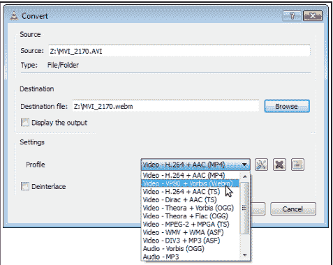

**图4.3** VLC中的视频转换对话框
如果你想更精确地设置视频的质量和尺寸，可以通过「工具」打开另一个对话框。如果你进一步研究VLC，会发现更多有趣的功能：例如，你可以选择将屏幕录制为视频（屏幕录像），记录你当前的操作，也可以通过不同的协议将视频串流到网络上。当然FFmpeg也能实现这些功能，但VLC还额外带有图形用户界面。你可以在http://www.videolan.org下载适配所有主流平台的VLC。

### 4.4.3 Firefogg
如果你不太习惯使用命令行，也不想安装VLC，可以使用Firefox扩展Firefogg。安装完成后，你可以访问http://firefogg.org/make，轻松选择你电脑上的视频并将其转换为Ogg或WebM视频格式。这种情况下Firefogg.org仅提供图形界面按钮，转换过程在本地计算机上完成。Firefogg安装时会下载一个经过适配的FFmpeg版本在后台运行。在「预设」菜单项中，你可以找到Ogg和WebM视频的高、低质量默认设置（见图4.4）。你还可以通过用户界面便捷地设置标题、作者、录制日期、版权等元数据。


**图4.4** Firefogg中的视频转换设置
但Firefogg不仅仅是FFmpeg的图形界面，该扩展附带一个JavaScript库，让网络开发人员可以非常轻松地为用户实现视频上传功能。其优势显而易见：无需先上传低压缩率的视频格式再在服务器端转换，转换过程会在上传前在客户端完成，这能节省Web服务器的带宽和算力。维基百科也在采用这一概念，因此我们可以期待Firefogg的开发能够持续下去。
> **注意** 网站http://firefogg.org/dev/chunk_post_example.html仅用几行源代码就展示了Firefogg JavaScript库的工作原理。Firefogg会将上传内容分割为1MB大小的块，这意味着如果网络连接中断，你无需重新上传整个视频。


#### 4.4.4 Miro 视频转换器
*Miro 视频转换器*是*Miro 媒体播放器*（http://www.getmiro.com）的衍生项目，后者是一款适用于所有主流操作系统的创新性开源音频视频播放器。目前 Miro 视频转换器仅支持 Windows 和 Mac OS 系统。
图 4.5 展示了其简洁的用户界面，不仅支持按视频编解码器筛选，还支持按设备（iPad、iPhone、PlayStation 以及安卓手机）筛选。
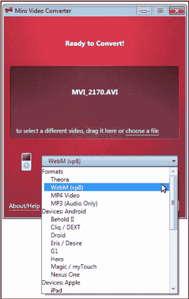
**图 4.5** 使用 Miro 视频转换器进行视频转换
通过拖拽加载视频文件，FFmpeg 就会开始转换。如果 FFmpeg 因任何原因（偶尔会发生）转换失败，FFmpeg 输出按钮可以帮到你：它不仅会显示准确的执行命令，还会展示所有转换状态信息（见图 4.6）。直接搜索对应的错误信息通常就能解决问题。
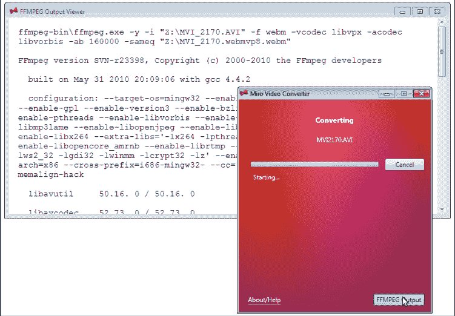
**图 4.6** Miro 转换过程中的排障操作

## 4.5 不同浏览器适用的视频格式？
如果希望视频能在尽可能多的浏览器中在线播放，目前你不得不针对 video 元素采用降级兼容方案。如表 4.4 所示，目前没有单一的视频格式能被所有主流浏览器支持。浏览器版本与发布日期的对应关系可参考引言章节末尾，或访问下方网站查看时间线：http://html5.komplett.cc/code/chap_intro/timeline.html?lang=en

| 编解码器 | 火狐 | 欧朋 | 谷歌浏览器 | Safari | IE | iOS* | 安卓 |
|---------|---------|-------|--------|--------|----|------|---------|
| OGG | 3.5 | 10.50 | 3.0 |  |  |  |  |
| MP4 |  | 3.0 |  |  | 3.0 |  | 2.0 |
| WebM | 4.0 | 10.60 | 6.0 |  | 9** |  |  |
| Flash | 插件 | 插件 | 插件 | 插件 | 插件 |  |  |

* 苹果移动设备操作系统，适用于 iPhone、iPad、iPod（2010 年 6 月后更名为 iOS，此前名为 *iPhone OS*）。
** 微软表示，与其他浏览器不同，WebM 编解码器需要安装到操作系统中才能使用。

## 4.6 旧版浏览器的临时解决方案
幸运的是，并非所有想要兼容不同平台或浏览器的 Web 开发者都需要完全重复造轮子。网上已有多个专注于解决该问题的免费库。目前，Kaltura 公司的 JavaScript 库 *mwEmbed* 已经发展得十分成熟，维基百科就用它来让大部分平台都能播放音视频内容。该库主要支持 Ogg 格式，如果你还需要提供 WebM 和 MP4 格式的支持，使用 *html5media* 库是个不错的选择。

### 4.6.1 mwEmbed
mwEmbed 库主要通过集成到维基百科获得了更广泛的认可。开发 mwEmbed 的 Kaltura 公司不仅为免费百科的 wiki 软件 *MediaWiki* 提供集成方案，还为 *Drupal*、*WordPress* 等常见 CMS 和博客软件提供了现成的插件。为了确保旧版浏览器也能兼容新的 HTML5 语法，本示例添加了 head 和 body 元素：
```html
<!DOCTYPE html>
<html>
<head>
<title>mwEmbed fallback</title>
<script type="text/javascript" src="http://html5.kaltura.org/js" >
</script>
</head>
<body>
<h1>mwEmbed fallback</h1>
<video controls autoplay>
<source src='videos/mvi_2170.mp4' type='video/mp4'>
<source src='videos/mvi_2170.webm' type='video/webm'>
<source src='videos/mvi_2170.ogv' type='video/ogg'>
Sorry, your browser is unable to play this video.
</body>
</html>
```
mwEmbed JavaScript 库会直接从项目网站（http://html5.kaltura.org/js）下载，自动判断视频的播放方式。无论哪种情况，视频底部边缘都会出现一个小的控制栏。图 4.7 展示了尚不支持 HTML5 video 元素的 Internet Explorer 8 的兼容效果：为了播放 Ogg 视频，它会加载名为 *Cortado* 的 Java 小程序。
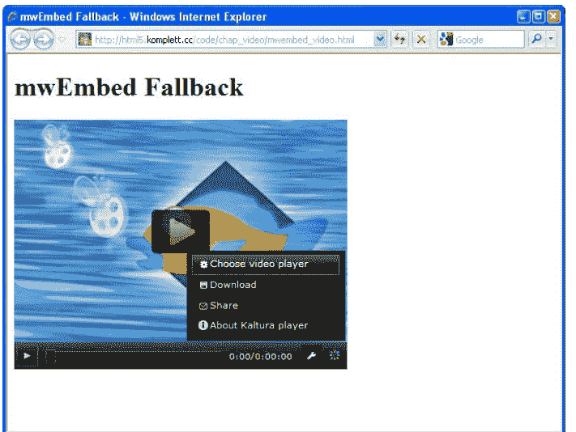
**图 4.7** 使用 Kaltura 的降级兼容库 mwEmbed 的 Internet Explorer 8
如果你不希望用 Java 小程序替代浏览器原生视频播放，可以改用 *html5media* 库。

### 4.6.2 html5media
html5media JavaScript 库比 mwEmbed 更加保守，只有当浏览器无法播放任何指定的视频格式时才会触发兼容逻辑。这种情况下，它会加载开源的 Flash 视频播放器 Flowplayer，并要求输入 MP4（H.264）格式的视频。遗憾的是，当前版本的该库存在一个 bug：如果指定了多个 source 元素，旧版浏览器会返回 JavaScript 错误且不输出任何内容：
```html
<!DOCTYPE html>
<html>
<head>
<title>html5media fallback</title>
<script type="text/javascript" src="libs/html5media.min.js" ></script>
</head>
<body>
<h1>html5media fallback</h1>
<video src="videos/mvi_2170.mp4" width=640 height=480 controls>
</body>
</html>
```
这种情况下必须指定 width 和 height 属性，否则 Flowplayer 的显示高度会只有几像素。图 4.8 是一个示例。
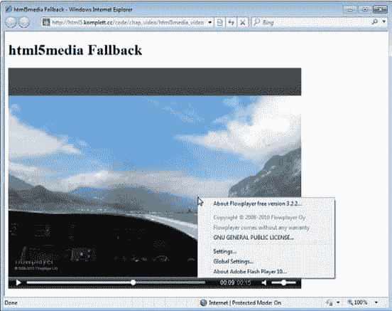
**图 4.8** Internet Explorer 8 中使用免费 Flowplayer 播放视频（Flash 降级方案）

## 4.7 视频与脚本——简易视频播放器
通过 HTMLMediaElement 接口，你不仅可以在浏览器中播放视频，还能直接用 JavaScript 控制视频。本节将介绍具体实现方法，我们会开发一个具备以下功能的简易 JavaScript HTML5 视频播放器：
- 播放和停止视频
- 在控制栏显示及设置播放进度
- 快进和快退
- 选择影片的特定片段
- 切换高、低音量及静音状态

我们很容易找到适合这个播放器的视频：《大雄兔》（*Big Buck Bunny*）——一部时长约 10 分钟的电脑动画短片，是一个免费电影项目的成果，其官网地址 http://bigbuckbunny.org 也印证了这一点。该项目由*Blender 基金会*发起，2007 年 10 月到 2008 年 4 月期间，7 名 3D 动画专家使用 *Blender*、*Gimp*、*Inkscape*、*Python* 等免费软件（均运行在 *Ubuntu* 系统上）制作了这部影片，并以开源许可协议将其发布到网上。基于“搞笑又毛茸茸”（*funny and furry*）主题的剧情梗概可以在维基百科 http://en.wikipedia.org/wiki/Big_Buck_Bunny 上查看。不过我们本节的重点是视频播放器，图 4.9 展示了它的最终效果。
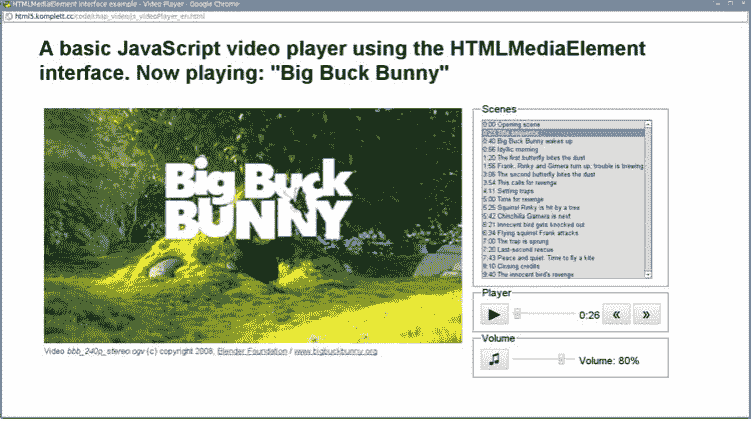
**图 4.9** JavaScript HTML5 视频播放器界面截图

该视频播放器的 HTML 页面、JavaScript 库和 CSS 样式文件可在本书配套网站找到，链接如下：
- http://html5.komplett.cc/code/chap_video/js_videoPlayer_en.html
- http://html5.komplett.cc/code/chap_video/js_videoPlayer.js
- http://html5.komplett.cc/code/chap_video/js_videoPlayer.css


### 4.7.1 嵌入视频
你可能已经很熟悉嵌入视频的 HTML 代码了，除了之后会发挥重要作用的 oncanplay 和 ontimeupdate 两个事件处理属性外，这里没有太多新内容：
```html
<video preload=metadata poster=videos/bbb_poster.jpg width=854 height=480 oncanplay="initControls()" ontimeupdate="updateProgress()">
<source src="videos/bbb_480p_stereo.ogv" type='video/ogg;codecs="theora, vorbis"'>
<!-- further source elements as alternatives -->
Sorry, your browser is unable to play this video.
```
设置 preload=metadata 时，我们只会先加载足够获取影片时长和至少第一帧的内容。加载期间会显示 poster 属性指定的图片，之后显示第一帧，我们案例中的第一帧完全是黑色的。设置 width 和 height 属性是为了演示目的，将下载后从 854×480 缩小到 428×240 的原视频重新放大回 854×480 像素。为什么要这么做呢？因为缩小后的版本只有 39MB，比 160MB 的原始视频更容易测试。另外，显式指定 width 和 height 属性也能帮助我们理解 80% 的 HTMLVideoElement 接口内容。这个接口仅包含 4 个视频尺寸属性、1 个封面帧 URL 属性（如果有的话），以及 1 个用于反映音轨是否静音的 audio 属性。假设 video 变量存储了对我们的 video 元素的引用，那么对应的属性值如下：
- video.width = 854（指定的宽度）
- video.height = 480（指定的高度）


- `video.videoWidth = 428`（原始宽度）
- `video.videoHeight = 240`（原始高度）
- `video.poster = bbb_poster.jpg 的 URL`（封面帧）

这些属性当然不足以实现我们的视频播放器。事实上，它们只是`HTMLVideoElement`的附加元素，而`HTMLVideoElement`同时也表示`HTMLMediaElement`——该对象包含了所有必需的方法和属性。如果你感兴趣，可以在规范文档中查阅相关内容：http://www.w3.org/TR/html5/video.html#htmlmediaelement。

真正的工作从`oncanplay`开始，它指的是浏览器可以播放视频时立即执行的JavaScript函数。在我们的示例中，这个函数是`initControls()`，它会创建对视频的引用并将其保存在全局变量`video`中。在实现视频播放器的过程中，我们后续还需要多次向`initControls()`中添加内容，但目前我们只需要以下代码：
```javascript
var video;
var initControls = function() {
  video = document.querySelector("VIDEO");
};
```

`document.querySelector()`方法属于*CSS 选择器 API*的一部分。它会将第一个视频元素的引用存入`video`变量中，让我们可以访问`HTMLMediaElement`接口，现在我们可以开始实现第一个功能——播放和暂停视频了。

### 4.7.2 播放与暂停视频
要实现播放和暂停功能，我们首先需要在HTML文档中添加一个可以响应用户点击的按钮：
```html
<input type=button value="&#x25B6;" onclick="playPause(this);" id="playButton">
```

`&#x25B6;`是Unicode符号*黑色右向三角*的字符引用，我们可以很方便地把它用作播放按钮。播放和暂停的功能被封装在`playPause()`函数中，这是一个每次点击都会调用的回调函数，会通过参数`this`传入按钮对象：
```javascript
var playPause = function(ctrl) {
  if (video.paused) {
    video.play();
    ctrl.value = String.fromCharCode('0x25AE','0x25AE');
  } else {
    video.pause();
    ctrl.value = String.fromCharCode('0x25B6');
  }
};
```

`video.paused`属性会告诉我们视频是否正在播放：如果视频处于暂停状态，该属性返回`true`，正在播放则返回`false`。这让播放和暂停的实现变得很简单。`video.play()`和`video.pause()`是合适的方法，它们会分别将`video.paused`设置为`false`和`true`。通过参数`ctrl`传入的按钮对象，会根据当前状态，通过修改`ctrl.value`将按钮切换为暂停或播放样式。如果直接赋值`&#x25B6;`，无法得到想要的效果，反而会让字符`&#x25B6;`作为按钮上的文字直接显示。在JavaScript中创建Unicode符号的正确方法是使用`String.fromCharCode()`，我们只需将需要的UTF-16十六进制编码以字符串形式、用逗号分隔后传入该方法即可。顺便一提，暂停按钮上的标签文本由两个黑色垂直矩形符号（`&#x25AE;`）组成。

### 4.7.3 显示与设置播放进度
要显示当前播放进度，我们使用第3章《智能表单》中提到的`range`类型输入框：
```html
<input type="range" min=0 max=1 step=1 value=0 onchange="updateProgress(this)" id="currentPosition">
```

`min`和`max`属性用于设置允许的数值范围，`step`属性决定用户拖动滑块时数值变化的步长。对应到我们的视频，`min`表示视频的起始位置，`max`表示视频的结束位置，因此我们需要将`max`的值设置为视频的总时长（单位为秒）。实现这个设置的最佳位置是`initControls()`函数，需要用到的属性是`video.duration`。因此我们在`initControls()`函数中添加以下代码：
```javascript
curPos = document.getElementById("currentPosition");
curPos.max = video.duration;
```

现在`max`的值是596.468017578125，说明这段视频大约有10分钟长。当用户拖动或点击滑块时，可以通过`onchange`事件处理回调函数`updateProgress()`直接设置播放位置：
```javascript
var updateProgress = function(ctrl) {
  video.currentTime = ctrl.value;
};
```

这里仅需一条指令即可实现：`video.currentTime`属性不仅可以反映当前播放位置，还支持直接赋值。我们可以从滑块的`value`属性中获取合适的数值。要实现MM:SS格式的当前播放位置显示，我们还需要完成以下步骤：
- 1. 在滑块旁添加一个span元素：<span id="timePlayed"></span>
- 2. 在`initControls()`函数中保存对该span元素的引用，并将变量`curTime`初始化为0:00：
  ```javascript
  curTime = document.getElementById("timePlayed");
  curTime.innerHTML = '0:00';
  ```
- 3. 每次调用`updateProgress()`时更新`curTime`的时间戳：
  ```javascript
  mm = Math.floor(video.currentTime / 60.0);
  ss = parseInt(video.currentTime) % 60;
  ss = (ss < 10) ? '0'+ss : ss;
  curTime.innerHTML = mm+':'+ss;
  ```

我们马上就要完成了。滑块还缺少一个核心功能：视频播放时，滑块需要与播放时长保持同步。解决方案存在于集成视频的HTML代码中，即`ontimeupdate`属性。规范要求，媒体流播放过程中，`timeupdate`事件的触发间隔应至少为15毫秒，最多不超过250毫秒。事件处理属性`ontimeupdate`用于指定要调用的回调函数。如果我们将其设置为`updateProgress()`，就找到了同步滑块的完美定时器。与手动点击或拖动滑块设置位置不同，现在我们不需要修改播放位置，而是要将滑块和时间显示设置为`video.currentTime`的值。

经过适配后的`updateProgress()`函数最终版本如代码清单4.1所示：

#### 代码清单4.1 修改与更新播放位置
```javascript
var updateProgress = function(ctrl) {
  if (ctrl) {
    video.currentTime = ctrl.value;
  } else {
    curPos.value = video.currentTime;
  }
  // Setting the time in format MM:SS
  mm = Math.floor(video.currentTime / 60.0);
  ss = parseInt(video.currentTime) % 60;
  ss = (ss < 10) ? '0'+ss : ss;
  curPos.innerHTML = mm+':'+ss;
};
```

这个if/else块的作用是判断`updateProgress()`是通过滑块触发还是通过`ontimeupdate`事件调用的。如果是前者，传入的滑块对象会被赋值给`ctrl`，此时我们需要将播放位置设置为滑块的取值；如果是后者，说明触发了`timeupdate`事件，此时我们需要将滑块设置为变量`curPos`中存储的当前播放时间。

现在播放控制和播放进度设置都已经完成了，你可以放松一下。花十分钟时间，用你自己制作的、接近完工的视频播放器去探索《大雄兔》（Big Buck Bunny）吧！

### 4.7.4 快进与快退
要实现这两个功能，我们首先需要在HTML文档中添加两个按钮。它们的标签同样使用Unicode符号，这次是尖角引号（guillemets）。Unicode名称已经描述了它们的外观：左双尖角引号（«）和右双尖角引号（»）。两个事件监听属性用于启动和停止快进/快退播放，分别在鼠标按下（onmousedown）时触发，鼠标松开（onmouseup）时结束：
```html
<input type="button" value="«" onmousedown="fastFwdBwd(-1)" onmouseup="fastFwdBwd()">
<input type="button" value="»" onmousedown="fastFwdBwd(1)" onmouseup="fastFwdBwd()">
```

JavaScript回调函数`fastFwdBwd()`非常简短，内容如下：
```javascript
var fastFwdBwd = function(direct) {
  _pause();
  _play();
  if (direct) {
    video.playbackRate = 5.0 * direct;
  }
};
```

有两个属性在视频加速播放中起着重要作用。其中一个在我们的回调函数中可以看到，即`video.playbackRate`，它代表当前的播放速率。第二个是`video.defaultPlaybackRate`，这是一个默认值，用于将视频的正常播放速度设为1.0。要实现加速播放，我们需要修改播放速率：例如2.0表示*两倍速*，4.0表示*四倍速*，以此类推。数值的正负（若适用）决定播放方向：正值为快进，负值为快退。

根据规范的定义，每次调用`video.play()`时，`video.playbackRate`属性都必须被设置为`video.defaultPlaybackRate`的值。因此，只要我们不去修改`defaultPlaybackRate`的值，就可以确保每次重新播放时都使用原始速度。所以要提升播放速度，我们只需要修改`video.playbackRate`即可。这让`fastFwdBwd()`的实现变得非常简单：首先短暂暂停视频，然后重新播放，如果将1或-1赋值给变量`direct`，就将`video.playbackRate`设置为对应的值，从而实现加速播放。

`_pause()`和`_play()`函数包含了之前封装在回调函数`playPause()`中的视频启停代码块。借助这两个函数，我们现在不仅可以通过点击播放按钮控制播放和暂停，还可以直接通过脚本控制。为了将这部分功能从播放按钮上剥离，我们需要在`initControls()`函数中通过`getElementById()`定义对按钮的引用，并将其作为变量`pButton`提供使用。拆分后的`playPause()`版本如代码清单4.2所示：

#### 代码清单4.2 启动与暂停视频
```javascript
var _play = function() {
  video.play();
  pButton.value = String.fromCharCode('0x25AE','0x25AE');
};
var _pause = function() {
  video.pause();
  pButton.value = String.fromCharCode('0x25B6');
};
```

var playPause = function() {
  if (video.paused) {
    _play();
  } else {
    _pause();
  }
};
## 4.7.5 选择影片中的特定场景
要选择单个场景，我们首先需要一个包含时间戳和标题的列表。下拉菜单提供了基础：
``` <select name="scenes" onchange="selectScene(this)" size=19>
<option value="0:00" selected>0:00 开场场景</option>
<option value="0:23">0:23 标题序列</option>
<!-- 17 other entries -->
</select> ```
剩下的部分很简单，由回调函数selectScene()处理。我们会将选中的条目作为参数传递给它。随后将其时间戳转换为秒，并将video.currentTime设置为转换后的数值。_play()方法再次发挥作用，会在目标位置开始播放视频：
``` var selectScene = function(ctrl) {
arr = ctrl.value.split(":");
video.currentTime = parseFloat((arr[0]*60)+(arr[1]*1));
updateProgress();
_play();
}; ```
## 4.7.6 设置高、低音量或静音
剩下的就是音量控制了。我们先从简单的练习入手——开关控制。同样，我们需要在HTML代码中添加一个按钮，标签使用Unicode符号，这次是符尾相连的八分音符（&#x266B;）：
``` <input type="button" value="&#x266B;" onclick="mute(this)"> ```
mute()函数使用video.muted的*读/写*属性，根据初始设置切换静音或开启声音。为了给用户视觉反馈，静音时按钮标签显示为CSS定义的银色，音量开启时显示为黑色：
``` var mute = function(ctrl) {
if (video.muted) {
video.muted = false;
ctrl.style.color = 'black';
} else {
video.muted = true;
ctrl.style.color = 'silver';
}
}; ```
设置音量同样不复杂。除了作为range类型的滑动条输入外，我们还需要控制一个span元素内的标签。基础的HTML结构如下：
``` <input type="range" min=0.0 max=1.0 step=0.1 value=1.0 onchange="adjustVolume(this)"/>
<span id="currentVolume"> </span> ```
与之前一样，我们在initControls()中定义一个指向该span元素的引用，并通过video.volume将音量初始化为100%：
``` curVol = document.getElementById("currentVolume");
curVol.innerHTML = "100 %";
video.volume = 1; ```
如果滑动条被拖动，回调函数adjustVolume()会响应变更。滑动条的min=0、max=1对应video.volume的精确取值范围，通过step=0.1可按10%的步长调整音量：
``` var adjustVolume = function(ctrl) {
video.volume = ctrl.value;
curVol.innerHTML = (Math.round(ctrl.value*100))+'%';
}; ```
我们的视频播放器现在已经完成了。这个实用示例让你有机会探索HTMLMediaElement接口近一半的属性和方法。还有一些有趣的属性和方法尚未介绍，我们接下来会讲解。
#### 4.7.8 “HTMLMediaElement”接口的其他属性和方法
所有媒体元素（不仅包括视频，还包括音频）都有五个共同属性，在HTMLMediaElement接口中有展示。除了作为*媒体流*源的`src`属性外，还有*布尔*类型的autoplay、loop、controls属性，以及preload属性，它有三个取值：none、metadata和auto。动态创建视频的代码可以如下所示：
``` var video = document.createElement("VIDEO");
video.src = 'videos/bbb_240p_stereo.ogv';
video.autoplay = false;
video.loop = true;
video.controls = true;
video.preload = 'metadata'; ```
但这个视频尚未加载。加载过程只有在调用HTMLMediaElement接口的下一个方法`video.load()`时才会启动。为了能在浏览器中查看视频，我们需要将其添加到DOM树中。因此我们在代码中添加两行：
``` video.load();
document.documentElement.appendChild(video); ```
视频播放器视频元素的oncanplay属性的动态对应项是一个事件监听器，包含事件类型、回调函数和一个标记，用于决定事件是否在捕获阶段激活。困惑吗？只需给第三个参数传入false，这会使事件监听器在*冒泡*阶段激活。如果你想知道事件顺序的工作原理的详细信息，可以在线查看http://www.quirksmode.org/js/events_order.html。我们的事件监听器监听canplay事件，随后立即开始播放视频：
``` video.addEventListener("canplay", function() {
video.play();
}, false); ```
> **注意**
> 我们这段简短代码示例的HTML版本当然可以在线找到：http://html5.komplett.cc/code/chap_video/js_dynamicVideo_en.html。
尽管这个示例看起来很简单，但加载媒体流的过程实际上相当复杂。规范区分了*网络状态*和*就绪状态*，在HTMLMediaElement接口中为这两个状态分配了两个`readonly`属性，并提供多个常量来描述对应的状态。
`networkState`属性用于监控网络状态。它可以随时被查询，返回表4.5中列出的可能值。
#### 表4.5 "networkState"属性的常量
| 值 | 常量 | 描述 |
|-------|----------|-------------|
| 0 | `NETWORK_EMPTY` | 视频/音频尚未初始化。 |
| 1 | `NETWORK_IDLE` | 已选择视频/音频源，但当前未加载。 |
| 2 | `NETWORK_LOADING` | 浏览器正在主动加载视频/音频。 |
| 3 | `NETWORK_NO_SOURCE` | 找不到合适的视频/音频源。 |
选择合适源时，需要记住有两种实现方式：要么通过相关元素的`src`属性，要么通过多个source元素，浏览器可以从这些元素中选择最合适的一个。如果我们为视频使用多个source元素，问题就来了：我们怎么知道浏览器实际选择了提供的哪个元素？答案就在`readonly`属性`video.currentSrc`中。在视频播放器的截图中，你可以在左下角、版权信息前看到它。
主动查询相关浏览器是否支持某种媒体类型，不仅可以在浏览器选择合适源元素时完成，程序员也可以通过脚本实现。我们使用的方法是`canPlayType(type)`，它需要一个对应的媒体类型作为参数。如果浏览器相当确定可以播放该格式，返回`probably`；如果浏览器不太确定，返回`maybe`；如果确定无法处理该格式，返回空字符串`''`。
> 你可以亲自查看`canPlayType(type)`为你的浏览器返回的常用类型有哪些，地址是
> http://html5.komplett.cc/code/chap_video/js_canPlayType.html。
`readyState`属性描述了媒体元素当前所处的状态。它的可能值如表4.6所示。
#### 表4.6 "readyState"属性的常量
| 值 | 常量 | 描述 |
|-------|----------|-------------|
| 0 | HAVE_NOTHING | 当前播放位置没有可用数据。 |
| 1 | HAVE_METADATA | 已存在长度、尺寸等元数据，但还没有可播放的数据。 |
| 2 | HAVE_CURRENT_DATA | 当前播放位置的数据可用，但还不足以开始播放。 |
| 3 | HAVE_FUTURE_DATA | 有足够的当前和未来播放位置的数据，可以开始播放。 |
| 4 | HAVE_ENOUGH_DATA | 浏览器确定只要网络状态保持不变，就可以不间断地播放媒体流。 |
如果在加载或播放过程中真的出现问题，会触发error事件，其code属性会明确对应的错误类型：
``` video.addEventListener("error", function(e) {
alert(e.code);
}, false); ```
因此这个回调函数会返回e.code中表4.7所示的可能值之一。
#### 表4.7 "MediaError"接口的"code"属性常量
| 值 | 常量 | 描述 |
|-------|----------|-------------|
| 1 | MEDIA_ERR_ABORTED | 加载被用户中止。 |
| 2 | MEDIA_ERR_NETWORK | 发生网络错误。 |
| 3 | MEDIA_ERR_DECODE | 解码媒体流时发生错误。 |
| 4 | MEDIA_ERR_SRC_NOT_SUPPORTED | 不支持该媒体格式。 |


## 第4章——视频与音频
我们已经几乎走完了HTMLMediaElement接口的学习之旅。剩余属性如下：
- 两个布尔属性，用于标识浏览器当前是否正在搜索其他数据（寻道中），或者是否已到达流的末尾（已结束）
- 一个用于提供流的起始时间信息的属性（initialTime）
- 一个以Date对象形式表示当前时间轴偏移的属性（startOffsetTime）
- 三个用于实现TimeRanges接口的属性，分别是buffered、played和seekable

TimeRanges的基本逻辑如其名所示，即记录时间段：
```interface TimeRanges {
  readonly attribute unsigned long length;
  float start(in unsigned long index);
  float end(in unsigned long index);
}; ```

以`played`属性为例可以帮助你理解它的工作原理：如果我们正在播放《大雄兔》视频的片头，然后点击暂停，就会得到第一个由起始时间和结束时间组成的时间段，对应的属性为`played.start(0)`和`played.end(0)`，此时`played.length`中已有时间段的数量为1。如果我们之后切换到第8章并继续播放一段时间，就会生成下一个时间段，对应`played.start(1)`和`played.end(1)`，此时`played.length`的值变为2。如果两个时间段出现重叠，它们会被合并为一个。所有时间段会在TimeRanges对象中排序。通过这种方式，我们就可以追踪媒体流中哪些区域处于已缓冲、已播放或已标记为可寻道的状态。
一个小型的在线示例可以在播放《大雄兔》视频时直观展示各个TimeRanges的内容，你可以访问http://html5.komplett.cc/code/chap_video/js_timeRanges.html查看。

#### 4.7.9 媒体事件长列表
媒体流在加载或播放的特定时间点触发的事件列表很长，这些事件基本对应HTMLMediaElement接口的三种主要状态。
在*网络状态*下，我们会遇到`loadstart`、`progress`、`suspend`、`abort`、`error`、`emptied`和`stalled`事件，它们的名称已经表明了各自出现的网络场景。
在*就绪状态*下的事件包括`loadedmetadata`、`loadeddata`、`waiting`、`playing`、`canplay`和`canplaythrough`，这些都直接与当前或未来播放位置的数据可用性相关。
在*播放状态*下的事件包括`play`、`pause`、`timeupdate`、`ended`、`ratechange`和`durationchange`，这些事件的名称同样不言自明，就像我们需要提到的最后一个事件`volumechange`一样。
每个事件的使用时机和方式完全取决于你的脚本用途。在我们的视频播放器中，只需要用到`oncanplay`和`ontimeupdate`这两个事件。但如果要细化功能，几乎肯定还需要用到其他很多事件。
如果想了解各个事件的详细信息，你可以参考规范中非常有帮助的*事件摘要*部分。在那里你不仅能找到每个事件的描述，还能看到**它实际被触发的时机说明**。
你可以访问http://www.w3.org/TR/html5/video.html#mediaevents查看。
如果想亲眼查看媒体事件的*实际运行效果*，可以访问W3C上Philippe Le Hégaret的*HTML5视频、媒体事件与媒体属性*测试页面：http://www.w3.org/2010/05/video/mediaevents.html。

## 4.8 音频部分要怎么处理？
HTML5中的音频没有太多新内容值得介绍。很方便的是，视频和音频共用HTMLMediaElement接口，这意味着我们之前讲过的所有视频脚本相关知识都适用于音频元素。
理所当然的，HTMLVideoElement接口中用于设置宽度、高度、音频和封面帧的额外视频属性会被省略。
可以通过构造函数轻松创建`audio`元素，同时为其指定`src`属性：
```javascript
var audio = new Audio(src);
```

沿用我们视频播放器的设计模式，接下来我们来为《大雄兔》的原声带编写一个音频播放器。它的进度条、时间显示、开始/停止功能都和视频示例中的实现方式一致。
新增功能是音轨选择菜单：会用到不同的音频文件，另外还有两个按钮用于在音轨列表中快进或快退。此外，我们还实现了所有音轨播放完毕后的*循环播放*功能，以及随机选择下一首音轨的功能。最终效果见图4.10。
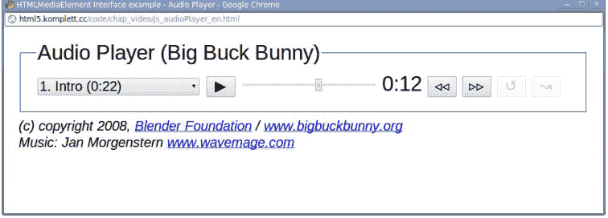
**图4.10** JavaScript HTML5音频播放器界面截图

> **NOTE** 这些单独的音频轨道是通过免费的跨平台音频编辑软件Audacity（http://audacity.sourceforge.net）从视频原声中提取的。私人用途也可以免费从原声作曲家Jan Morgenstern的主页http://www.wavemage.com/category/music下载去除背景噪音的原声文件。

这个音频播放器的界面截图看起来会很熟悉，因为新增的按钮同样使用了特定的Unicode符号作为标签。具体符号可参见表4.8。
**表4.8** 音频播放器按钮的Unicode符号
| 按钮 | 实体 | Unicode名称 |
|--------|--------|---------------|
| 快退 | `&#x25C3;` | 白色左指小三角 |
| 快进 | `&#x25B9;` | 白色右指小三角 |
| 循环 | `&#x21BA;` | 逆时针开口圆环箭头 |
| 随机播放 | `&#x219D;` | 右向波浪箭头 |

下拉菜单看起来也很眼熟，但这次我们不会像视频播放器那样跳转到播放时间的某个特定位置，而是切换整首音轨。
菜单和“快退”“快进”“循环”“随机播放”按钮都能实现切换音轨的效果，因此脚本逻辑会稍微复杂一些。

我们先从音频元素开始：
```html
<audio src="music/bbb_01_intro.ogg" oncanplay="canPlay()" ontimeupdate="updateProgress()" onended="continueOrStop()">
```

页面加载时，我们会将`src`属性设置为第一首音轨，并定义三个回调函数。你已经接触过**updateProgress()**函数，它的作用是移动进度条并更新时间显示（见清单4.1）。另外两个新的回调函数分别是**canPlay()**（音轨就绪可播放时调用）和**continueOrStop()**（音轨播放结束时决定下一步操作）。
`oncanplay`回调函数**canPlay()**非常短，代码如下：
```javascript
canPlay = function() {
  curPos.max = audio.duration;
  if (pbStatus.keepPlaying == true) {
    _play();
  }
};
```

显然，**curPos.max**的作用和视频播放器中一样，是调整进度条的**max**属性，但随后出现的`if`代码块有什么作用呢？答案很简单：我们试图将当前的播放状态纳入考量，只有当播放器原本处于播放模式时，才会继续播放。
因此播放按钮的状态决定了切换音轨后音频播放器是否自动开始播放。如果当前处于播放状态，切换音轨后应继续播放；如果处于暂停状态，则仅切换音轨并保持暂停。
这听起来可能有点复杂，但播放按钮回调中的实现非常简单，我们只需添加以下代码：
```javascript
pbStatus.keepPlaying = (pbStatus.keepPlaying == true) ? false : true;
```
这段代码会让状态变量**pbStatus.keepPlaying**在每次点击时在*true*和*false*之间切换，最终在**canPlay()**中做出正确的判断。

> **NOTE** 若要更好地理解音频播放器的结构和功能，你可以查看HTML、JavaScript和CSS源代码，这些资源的访问地址如下：
> - http://html5.komplett.cc/code/chap_video/js_audioPlayer_en.html
> - http://html5.komplett.cc/code/chap_video/js_audioPlayer.js
> - http://html5.komplett.cc/code/chap_video/js_audioPlayer.css

回到我们的示例。通过`canPlay()`和`pbStatus.keepPlaying`，我们现在可以控制音轨就绪时的播放情况。但如何实现音轨间的切换呢？
如前所述，实现音轨切换有几种方式：可以通过菜单选择、点击“快退”和“快进”按钮，或者根据“循环”和“随机播放”按钮的设置，在音轨播放结束时由音频播放器自动切换。
这些方式有一个共同点：都需要加载新的音轨，而加载音轨是通过`loadTrack()`方法实现的：
```javascript
var loadTrack = function(idx) {
  audio.src = 'music/'+tracks.options[idx].value;
  audio.load();
};
```

有两处细节需要说明：
- 参数`idx`对应的内容是什么？`idx`是变量`tracks`中下拉菜单里待加载音轨的索引，我们可以从中提取文件名。
- `audio.load()`的调用有什么作用？猜也能猜到，它会开始加载新的音轨，一旦音轨达到`canplay`状态就可以播放了。

> **NOTE** 为简化示例，我们只使用了Ogg Vorbis格式的音频文件。如果要提供多种格式版本，就需要先通过`canPlayType()`方法找到合适的格式，再进行加载。等你学完本章内容后，可以尝试把这个功能添加到脚本中！


`loadTrack()` 的调用方式有多种。首先，在菜单中通过`onchange`事件处理器`changeTrack(this)`直接切换曲目时会调用它：
```javascript
changeTrack = function(ctrl) {
  loadTrack(ctrl.options.selectedIndex);
};
```
当然，点击“快进”和“快退”按钮时也会调用该函数；它们各自的`onclick`事件处理器会调用回调函数`advanceTrack(n)`，通过参数`n`传入步进值，同时通过正负号传递所需的方向。两种场景下的步进值一致，即`-1`代表快退、`1`代表快进：
```javascript
advanceTrack = function(n) {
  var idx = tracks.options.selectedIndex + n;
  if (idx < 0) {
    idx = idx + tracks.options.length;
  }
  if (idx > tracks.options.length-1) {
    idx = idx - tracks.options.length;
  }
  tracks.options.selectedIndex = idx;
  loadTrack(idx);
};
```
确定新曲目的算法非常简单，分为两个阶段：我们首先将步进值`n`与当前选中曲目的索引相加，再处理由此产生的两种特殊情况：如果当前处于第一首曲目时点击“快退”，索引会变为负数，此时需要继续播放最后一首曲目；如果当前处于最后一首曲目时点击“快进”，操作同样无效，因此需要确保播放器将第一首曲目选为下一首播放曲目。`advanceTrack()`方法的优势在于，它甚至可以用到最后两项功能——曲目结尾循环和随机选曲。首先，我们需要快速明确这两个按钮如何标识未激活和激活状态。两种模式的切换通过`onclick`事件处理器完成，触发回调函数`toggleOnOff(node)`，并将对应按钮作为参数`node`传入：
```javascript
toggleOnOff = function(node) {
  var cls = node.getAttribute("class");
  node.setAttribute("class", (cls == 'off') ? 'on' : 'off' );
  pbStatus[node.id] = node.getAttribute("class");
};
```
如函数首行所示，按钮状态由元素的class属性决定，该属性通过CSS定义按钮外观。`on`和`off`对应的样式可以在样式表`js_audioPlayer.css`中找到：
```css
.off {
  opacity: 0.2;
}
.on {
  opacity: 1.0;
}
```
此外，对应按钮的当前状态还会记录在状态变量`pbStatus[node.id]`中，其中`node.id`标识为`loop`或`shuffle`，因此`pbStatus.loop`或`pbStatus.shuffle`会被赋值为`on`或`off`。响应这些状态的正确时机始终是曲目播放结束时。此时回调函数`continueOrStop()`会生效：
```javascript
continueOrStop = function() {
  if (pbStatus.shuffle == 'on') {
    advanceTrack( Math.round(Math.random()*tracks.options.length) );
  }
  else if (tracks.options.selectedIndex == tracks.options.length-1) {
    if (pbStatus.loop == 'on') {
      advanceTrack(1);
    } else {
      pbStatus.keepPlaying = false;
    }
  } else {
    advanceTrack(1);
  }
};
```
如果处于随机播放模式，将`Math.random()`的结果乘以总曲目数后四舍五入，会生成0到总曲目数之间的随机数。之后我们会通过`advanceTrack()`按该值跳转，即使超出目标范围也不需要特殊处理：例如，如果当前处于倒数第二首曲目，想要向前跳转5首，`advanceTrack()`中的算法会确保播放菜单中的第四首曲目。“是否循环？”这一问题仅在最后一首曲目时出现。如果对应按钮设为`on`模式，我们会通过`advanceTrack(1)`从头开始播放；如果为`off`模式，我们会在此停止，并将`pbStatus.keepPlaying`设为`false`。其他所有情况我们都只需跳转到下一首曲目并开始播放。至此，我们不仅完成了音频播放器的开发，也结束了视频与音频章节的内容。我们在视频和音频播放器中手动实现的许多功能，浏览器本身也已支持，通过`controls`属性就能更简单地启用。但了解背后的实现原理仍然很有必要，这能帮助我们探索通过脚本操作视频和音频时可用的各种选项。

### 摘要
借助视频和音频，此前需要插件支持的两项重要功能现已纳入HTML规范。目前还难以预测哪种视频编码格式最终会占据主流，但考虑到谷歌对WebM格式的支持，我们可以期待出现无专利的开放格式。如本章第二部分所示，HTMLMediaElement接口让视频和音频可以被脚本操作。通过JavaScript可以实现此前插件方案无法实现的交互功能。和所有HTML5主题一样，网上还有更多令人印象深刻的示例。不妨花些时间搜索并自行探索！阅读完本章后，你已经掌握了理解这些新奇而迷人的HTML5功能的基础知识。

## 5 画布

HTML5中最有趣、同时也是最古老的新元素之一就是*画布*。2004年7月，即WHATWG成立仅一个月后，苹果公司的David Hyatt发布了一款名为Canvas的专有HTML扩展，这一声明在尚且稚嫩的HTML5运动中引发了巨大争议。“真正的解决方案是将这些提案摆到台面上讨论”，这是Ian Hickson的第一反应，经过短暂的讨论后，苹果将该想法提交给了WHATWG。这为将Canvas纳入HTML5规范铺平了道路，首份草案于2004年8月发布。

> 你可以在以下地址找到苹果的Canvas发布声明以及Ian Hickson的回应：
> - http://weblogs.mozillazine.org/hyatt/archives/2004_07.html#005913
> - http://ln.hixie.ch/?start=1089635050&count=1

### 5.1 第一个示例
简单来说，Canvas是一个可编程的图像区域，你可以通过JavaScript API在其上进行绘制。除了通过`canvas`元素创建画布外，我们还需要一个`script`元素来存放绘制指令。首先来看`canvas`元素：
```html
<canvas width="1200" height="800">
  alternative content for browsers without canvas support
</canvas>
```
`width`和`height`属性以像素为单位确定`canvas`元素的尺寸，并在HTML页面上预留相应的空间。如果缺少其中一个或两个属性，则会使用默认值：宽度为300像素，高度为150像素。开始标签与结束标签之间的区域用于存放替代内容，如果浏览器不支持Canvas，则会显示这些内容。类似于图片的`alt`属性，这些替代内容应当描述Canvas应用的内容或展示合适的截图。诸如*您的浏览器不支持Canvas*这类没有任何额外说明的短语帮助不大，应当避免使用。

我们的画布现在已经搭建完成。下一步，我们可以在`script`元素中添加绘制指令。仅需几行代码就能实现我们的第一个、坦白说相当简单的Canvas示例：
```html
<script>
  var canvas = document.querySelector("canvas");
  var context = canvas.getContext('2d');
  context.fillStyle = 'red';
  context.fillRect(0,0,800,600);
  context.fillStyle = 'rgba(255,255,0,0.5)';
  context.fillRect(400,200,800,600);
</script>
```
即使我们还不了解Canvas绘制指令的语法，只要仔细看代码，图5.1的结果也不会让你意外。现在我们得到了一个红色矩形和一个透明度为50%的浅黄色矩形，两者重叠的部分呈现出橙色色调。

#### **图5.1** 两个重叠的矩形
> **提示** 本章中的所有图形都是使用Canvas绘制的HTML页面，你可以在屏幕截图显示的网址，或配套网站的索引页http://html5.komplett.cc/code/chap_canvas/index_en.html中找到它们。不妨看看源代码！

在画布上绘制之前，我们需要创建对它的引用。脚本中的第一行正是完成这个操作：在变量*画布*中，使用*W3C CSS选择器API*的方法`document.querySelector()`，保存了文档中找到的第一个`canvas`元素的引用：
```javascript
var canvas = document.querySelector("canvas");
```
除了`canvas.width`和`canvas.height`属性外，这个也被称为`HTMLCanvasElement`的对象拥有`getContext()`方法。通过传入*二维*作为上下文参数，我们可以接触Canvas的核心——`CanvasRenderingContext2D`：
```javascript
var context = canvas.getContext('2d');
```

现在我们已经定义了*绘图上下文*，可以开始绘制两个矩形了。无需深入介绍`fillStyle`属性或`fillRect()`方法的细节，两者的基本流程是一致的：先设置填充颜色，再添加矩形：
```context.fillStyle = 'red';
context.fillRect(0,0,800,600);
context.fillStyle = 'rgba(255,255,0,0.5)';
context.fillRect(400,200,800,600);```
当前Canvas规范仅定义了2D上下文（详见http://www.w3.org/TR/2dcontext处的*HTML Canvas 2D上下文*规范），但并未排除后续会推出其他类型的上下文，例如*3D*上下文。
Khronos集团已经启动了该方向的首批项目：他们正与Mozilla、谷歌、Opera合作，开发一款基于OpenGL ES 2.0的JavaScript接口，名为WebGL（http://www.khronos.org/webgl）。
这一新兴标准的首批实现已出现在Firefox、WebKit和Chrome中。
但回到2D上下文：*CanvasRenderingContext2D*接口的功能十分丰富，非常适合用来开发复杂的应用程序。
图5.2展示了一个简单的柱状图，我们将借助它讲解绘图上下文的前三个特性：矩形、颜色和阴影。
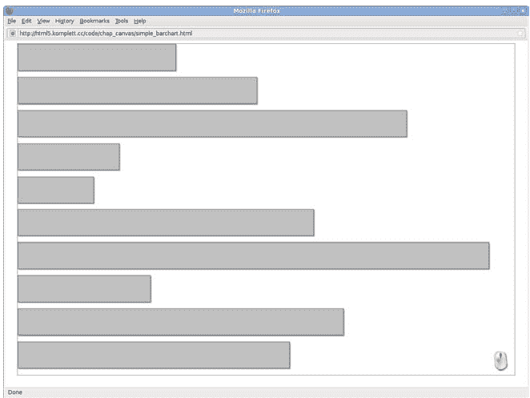
**图5.2** 包含十个横向柱条的柱状图
### 5.2 矩形
Canvas共有四种创建矩形的方法，本节我们讨论其中三种，第四种将在后续关联路径的内容中介绍：
```context.fillRect(x, y, w, h)
context.strokeRect(x, y, w, h)
context.clearRect(x, y, w, h)```
这些方法的名称顾名思义：fillRect()用于创建填充矩形，strokeRect()用于创建带边框无填充的矩形，clearRect()则像橡皮擦一样，用于清除已有内容的矩形。矩形的尺寸由四个数值参数决定：起始点x/y坐标、宽度w和高度h。
在Canvas中，坐标原点位于左上角，这意味着x坐标向右递增，y坐标向下递增（见图5.3）。
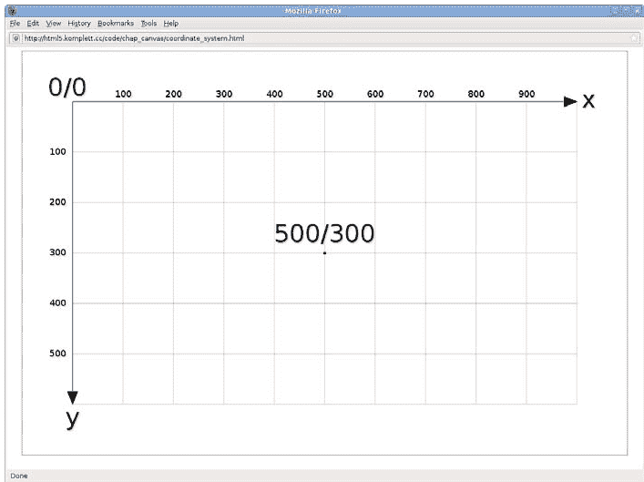
**图5.3** Canvas坐标系
参照第一个示例，我们首先在柱状图中获取canvas元素的引用，再获取绘图上下文。drawBars()函数负责完成核心工作——绘制横向柱条，我们将要绘制的柱条数量作为参数传入该函数：
```<script>
var canvas = document.querySelector("canvas");
var context = canvas.getContext('2d');
var drawBars = function(bars) {
context.clearRect(0,0,canvas.width,canvas.height);
for (var i=0; i<bars; i++) {
var yOff = i*(canvas.height/bars);
var w = Math.random()*canvas.width;
var h = canvas.height/bars*0.8;
context.fillRect(0,yOff,w,h);
context.strokeRect(0,yOff,w,h);
}
};
drawBars(10);
</script>```
调用drawBars(10)函数时，会先通过clearRect()清除所有已有内容，再在for循环中通过fillRect()和strokeRect()绘制十个带填充的矩形轮廓。
柱条的宽度w在0像素到canvas元素的完整宽度之间随机取值，随机值通过JavaScript的Math.random()函数生成。
Math.random()函数会生成0.0到1.0之间的随机数，因此非常适合根据canvas的尺寸生成宽度、高度和位置的随机值。
将随机数与对应的属性值相乘即可得到最终结果。
柱条等距水平排列的规则由canvas.height决定，柱条之间的间距通过将计算出的最大柱条高度h乘以系数0.8得到。
如第一个示例所述，canvas的宽度和高度可以通过canvas.width和canvas.height属性轻松获取。
同样地，我们可以通过绘图上下文的context.canvas属性访问HTMLCanvasElement，并在每次点击canvas时利用它生成新的柱条。
只需在drawBars(10)调用后添加三行代码即可实现：
```context.canvas.onclick = function() {
drawBars(10);
};```
我们已经了解了十个柱条的绘制方法，那么如何让它们呈现浅灰色填充、黑色边框的效果呢？我们可以通过查看Canvas中颜色赋值的相关选项找到答案。
### 5.3 颜色与阴影
fillStyle和strokeStyle属性分别用于指定填充颜色和线条颜色。颜色定义遵循CSS颜色值的规则，支持多种不同的格式。
表5.1以红色为例展示了所有可用的颜色选项：
| 方法 | 颜色值 |
| --- | --- |
| 十六进制 | #FF0000 |
| 十六进制（简写） | #F00 |
| RGB | rgb(255,0,0) |
| RGB（百分比） | rgb(100%,0%,0%) |
| RGBA | rgba(255,0,0,1.0) |
| RGBA（百分比） | rgba(100%,0%,0%,1.0) |
| HSL | hsl(0,100%,50%) |
| HSLA | hsla(0,100%,50%,1.0) |
| SVG（命名颜色） | red |
要在Canvas中设置当前的填充和描边颜色，只需将对应的颜色值作为字符串赋值给fillStyle和strokeStyle属性即可。
在柱状图示例中，我们将选用SVG命名颜色silver作为填充色，用RGBA格式的半透明黑色作为描边色。
我们希望所有柱条的外观保持一致，因此在drawBars()函数前定义样式：
```context.fillStyle = 'silver';
context.strokeStyle = 'rgba(0,0,0,0.5)';
var drawBars = function(bars) {
// code for drawing bars
};```
有效的透明度值范围为0.0（完全透明）到1.0（完全不透明），可以作为第四分量添加到RGB和HSL色彩空间中。
后者（HSL色彩空间）并非通过红、绿、蓝分量定义颜色，而是通过色相、饱和度、亮度的组合来定义。
> **注意** 你可以在http://www.w3.org/TR/css3-color处的*CSS Color Module Level 3*规范中，找到关于CSS颜色、HSL色板以及所有有效SVG颜色名称列表的更多信息。
如果仔细观察，你会发现柱条后方有阴影，这是由绘图上下文另外四个属性生成的：
```context.shadowOffsetX = 2.0;
context.shadowOffsetY = 2.0;
context.shadowColor = "rgba(50%,50%,50%,0.75)";
context.shadowBlur = 2.0;```
前两行通过shadowOffsetX和shadowOffsetY设置阴影偏移量，shadowColor用于指定阴影的颜色和透明度，shadowBlur则用于设置阴影的模糊程度。
通常来说，shadowBlur的数值越高，模糊效果越明显。
在进入下一节的颜色渐变内容前，我们需要说明柱状图和后续图形中的虚线边框是如何实现的。
答案非常简单：通过CSS实现。所有canvas元素当然也可以用CSS来设置样式，你可以像设置背景色和边框一样轻松地设置间距、定位和z-index属性。
在本示例中，以下样式属性用于创建虚线边框：
```<canvas style="border: 1px dotted black;">```
### 5.4 渐变
除了填充和线条的纯色外，Canvas还支持两种渐变：线性渐变和径向渐变。
我们可以通过一个从红色到黄色、橙色再到紫色的简单渐变示例，轻松演示Canvas中渐变的基本原理（见图5.4）。
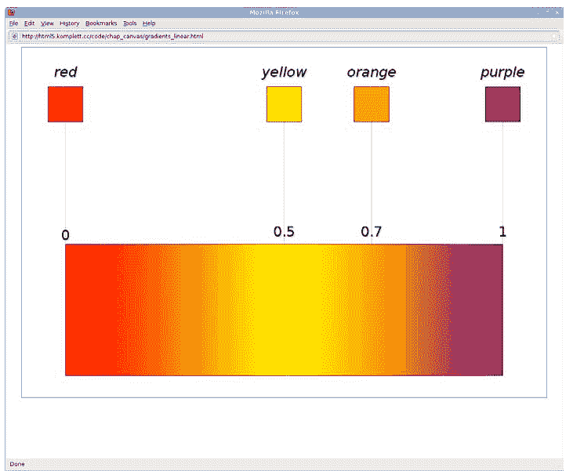
**图5.4** 包含四种颜色的线性渐变
首先，context.createLinearGradient(x0, y0, x1, y1)会创建一个CanvasGradient对象，并通过参数x0、y0、x1、y1确定渐变方向。接下来还需要指定颜色偏移量，因此我们将该对象保存在linGrad变量中：
```var linGrad = context.createLinearGradient(
0,450,1000,450
);```
下一步是调用CanvasGradient对象的addColorStop(offset, color)方法，在我们假想的渐变线上选择需要的颜色和偏移量。
偏移量0.0代表渐变起点x0/y0处的颜色，偏移量1.0代表终点x1/y1处的颜色，中间的所有颜色按照各自的偏移量分布，各颜色节点之间的过渡由浏览器在RGBA色彩空间内插值生成：
```linGrad.addColorStop(0.0, 'red');
linGrad.addColorStop(0.5, 'yellow');```

```javascript
linGrad.addColorStop(0.7, 'orange');
linGrad.addColorStop(1.0, 'purple');
```

颜色遵循CSS颜色值的规则指定，在我们的示例中为了增强可读性，使用了SVG命名颜色。我们的线性渐变现已完成，可以通过`fillStyle`或`strokeStyle`进行赋值：
```javascript
context.fillStyle = linGrad;
context.fillRect(0,450,1000,450);
```

与线性渐变不同，径向渐变的起始点和终点不是点，而是圆。因此，要定义径向渐变，我们现在需要使用方法 `context.createRadialGradient(x0, y0, r0, x1, y1, r1)` （参见图5.5）。
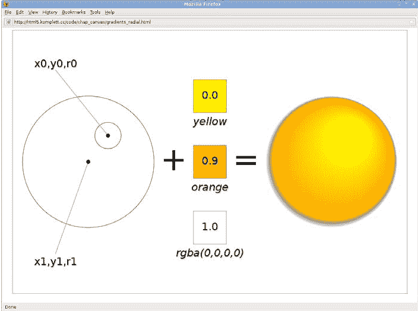

> **图5.5** 径向渐变的组成部分

在图的左侧，你可以看到起始圆和结束圆，中间是三个带有偏移值的颜色停止点，右侧是最终结果：一个看似发光的球体。一段清晰简洁的源代码就能生成一个非常吸引人的效果：
```javascript
var radGrad = context.createRadialGradient(
  260,320,40,200,400,200
);
radGrad.addColorStop(0.0,'yellow');
radGrad.addColorStop(0.9,'orange');
radGrad.addColorStop(1.0,'rgba(0,0,0,0)');
context.fillStyle = radGrad;
context.fillRect(0,200,400,400);
```

球体周围的阴影效果恰好是由最后两个颜色停止点创建的，从橙色插值到透明黑色，这意味着渐变的可见部分正好结束于外圆。在快速穿越了颜色和渐变的世界之后，我们现在转向其他几何图形：路径。

## 5.5 路径

在Canvas中创建路径的过程类似于在纸上绘画：你将铅笔放在纸上的一个点，绘制，将铅笔提起，然后在纸上的另一个点继续绘制。你绘制的内容可以从简单的直线到复杂的曲线，甚至是由这些线条形成的多边形。一个初步的示例说明了这个概念，将书写字母A的每一步转化为Canvas路径命令：
```javascript
context.beginPath();
context.moveTo(300,700);
context.lineTo(600,100);
context.lineTo(900,700);
context.moveTo(350,400);
context.lineTo(850,400);
context.stroke();
```

结果如图5.6所示。
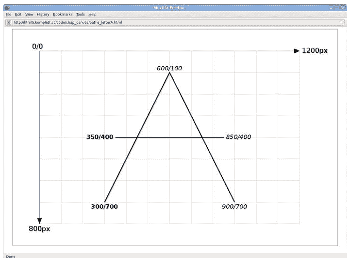

**图5.6** 字母A作为路径

让我们仔细看看这个示例的源代码。我们可以看到创建路径的三个阶段：
- 1. 使用 `beginPath()` 初始化一个新路径
- 2. 使用 `moveTo()` 和 `lineTo()` 调用定义路径几何形状
- 3. 使用 `stroke()` 绘制线条

每条路径都必须使用 `beginPath()` 初始化，然后可以包含任意数量的线段。在我们的示例中，我们有两个线段，通过组合 `moveTo()` 和 `lineTo()` 来重现书写时的手部动作。这首先创建了屋顶形状，然后是字母A的横线。然后，我们使用 `stroke()` 将定义的路径绘制到画布上。路径的线段是否以及何时被分隔成多个独立路径完全取决于布局。每条路径只能整体格式化。因此，如果我们希望字母A的横线具有不同的颜色，我们需要定义两条独立的路径。让我们更详细地了解主要的路径绘制方法。

### 5.5.1 直线

要创建像字母A示例中的直线，Canvas提供了 `lineTo()` 方法：
```javascript
context.lineTo(x, y)
```

该方法的效果如图5.7所示。
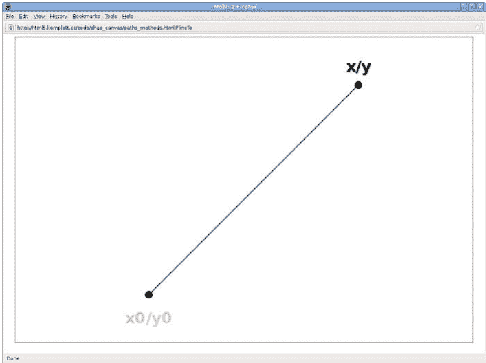

用文字表达，这意味着 *直线到点* **x/y**，这意味着我们必须已经用 `moveTo()` 定义了一个起始点，或者仍然有一个来自上一个绘制步骤的端点。绘制直线后，坐标 **x/y** 成为新的当前点。

> **注意**
> 在用于演示路径绘制方法的所有图形中，我们将起始点 `x0/y0` 标记为浅灰色，将新的当前点 `x/y` 标记为粗体。


### 5.5.2 贝塞尔曲线

Canvas知道两种贝塞尔曲线：二次和三次，后者被不正确地称为bezierCurveTo()。图5.8说明了前者，图5.9说明了后者。
```javascript
context.quadraticCurveTo(cpx, cpy, x, y)
context.bezierCurveTo(cp1x, cp1y, cp2x, cp2y, x, y)
```
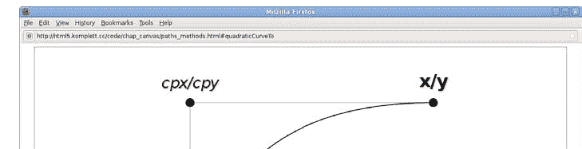

**图5.8** 路径方法“quadraticCurveTo()”
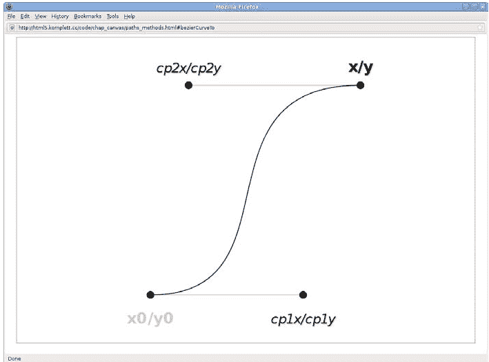

**图5.9** 路径方法“bezierCurveTo()”

要创建贝塞尔曲线，我们需要当前点作为起始坐标，加上一个目标坐标，并根据曲线类型，一个或两个控制点。在这两种情况下，坐标 x/y 在绘制曲线后成为新的当前点。

### 5.5.3 圆弧

创建圆弧的方法不太直观。第一个方法由两个坐标和一个半径定义：
```javascript
context.arcTo(x1, y1, x2, y2, radius)
```

如图5.10所示，arcTo() 创建新路径的方式如下：一个具有给定半径的圆被添加到从 x0/y0 到 x1/y1 然后到 x2/y2 的线段上，使得该圆恰好与线段相切于两点，即起始切线 t1 和结束切线 t2。这两点之间的圆弧成为路径的一部分，结束切线 t2 成为新的当前点。

122 第5章—Canvas
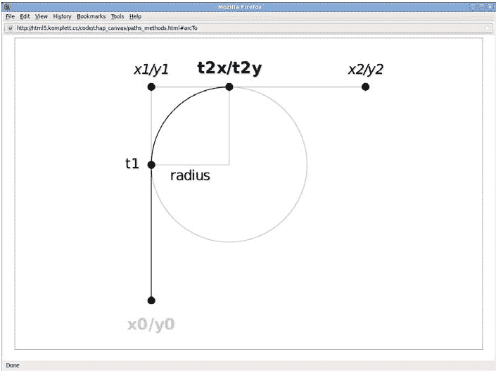

**图5.10** 路径方法“arcTo()”

在实践中，此方法对于绘制带圆角的矩形非常有用。一个可复用的函数将有助于完成图5.11所示的工作。
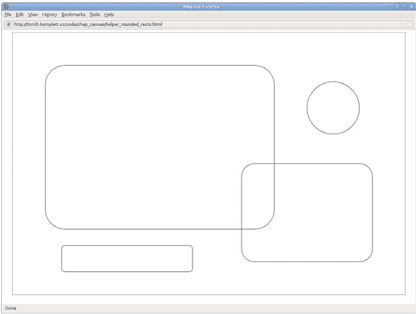

**图5.11** 四种不同的圆角矩形；圆形是圆角矩形的一个极端例子
```javascript
var roundedRect = function(x,y,w,h,r) {
  context.beginPath();
  context.moveTo(x,y+r);
  context.arcTo(x, y + r, x + w, y, r);
  context.arcTo(x, y, x + w, y, r);
  context.arcTo(x+w, y, x + w, y + h, r);
  context.arcTo(x+w, y + h, x, y + h, r);
  context.arcTo(x, y + h, x, y, r);
  context.closePath();
  context.stroke();
};
roundedRect(100,100,700,500,60);
roundedRect(900,150,160,160,80);
roundedRect(700,400,400,300,40);
roundedRect(150,650,400,80,10);
```

函数 `roundedRect()` 需要矩形的基本值以及用于圆角的半径。然后它使用 `moveTo()` 方法、四个 `arcTo()` 方法和一个 `closePath()` 方法绘制所需的矩形。你还没有遇到过 `closePath()` 方法：它通过将最后一个点连接回起始点来闭合矩形。

创建圆弧的第二种选项——`arc()` 方法——乍一看似乎更复杂。除了中心点和半径，我们现在必须指定两个角度和旋转方向：
```javascript
context.arc(x, y, radius, startAngle, endAngle, anticlockwise)
```

图5.12中圆弧的中心点是一个具有给定半径的圆的中心。从该点出发，角度 `startAngle` 和 `endAngle` 创建两个手柄，与圆相交于两点。这两个坐标之间圆弧的方向由参数 `anticlockwise` 决定，其中0表示顺时针，1表示逆时针。
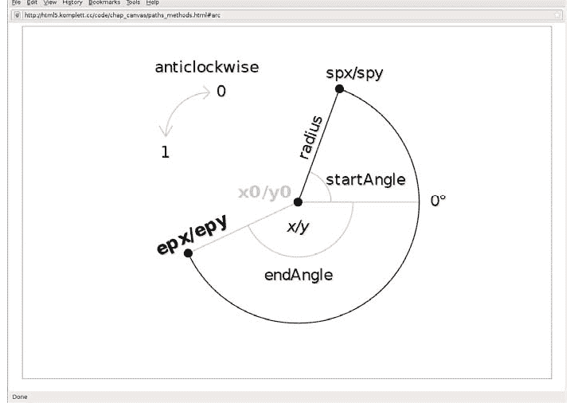

**图5.12** 路径方法“arc()”

生成的圆弧从圆心 x0/y0 处开始，通过直线将该点连接到第一个交点 spx/spy，然后从那里绘制一条圆弧到终点 epx/epy，该点现在成为新的当前点。创建圆弧最大的缺点是所有角度必须以弧度而非度为单位指定。所以这里有一个快速的辅助函数来帮助你回忆如何转换：
```javascript
var deg2rad = function(deg) {
  return deg*(Math.PI/180.0);
};
```

说到辅助函数，让我们再使用两个来方便绘制圆和扇形。对于圆，我们实际上只需要圆心和半径，其余部分将由函数 `circle()` 处理：
```javascript
var circle = function(cx,cy,r) {
  context.moveTo(cx+r,cy);
  context.arc(cx,cy,r,0,Math.PI*2.0,0);
};
```

特别是对于圆形图（也称为饼图），以弧度指定角度似乎不太直观。我们的函数 `sector()` 为我们完成了繁琐的转换工作，允许我们以度为单位指定起始角和结束角：
```javascript
var sector = function(cx,cy,r, startAngle,endAngle, anticlockwise ) {
  context.moveTo(cx,cy);
  context.arc( cx,cy,r, startAngle*(Math.PI/180.0), endAngle*(Math.PI/180.0), anticlockwise );
  context.closePath();
};
```

现在，只需几行代码就足以绘制圆和饼图而不会失去条理：
```javascript
context.beginPath();
circle(300,400,250);
circle(300,400,160);
circle(300,400,60);
sector(905,400,250,-90,30,0);
sector(900,410,280,30,150,0);
sector(895,400,230,150,270,0);
context.stroke();
```

图5.13显示了结果。


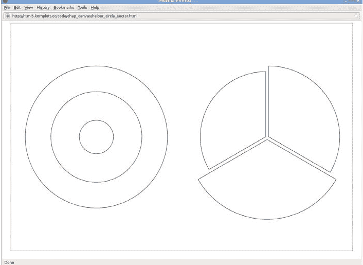
图 5.13 圆圈与扇形
### 5.5.4 矩形
rect() 方法的行为与我们的辅助方法有些类似，与其他方法不同：
``` context.rect(x, y, w, h) ```
与之前的路径绘制方法不同，使用rect()绘图时会完全忽略当前点x0/y0；矩形由参数x、y、宽度w和高度h共同定义。绘制完成后，原点x/y会成为新的当前点（见图5.14）。
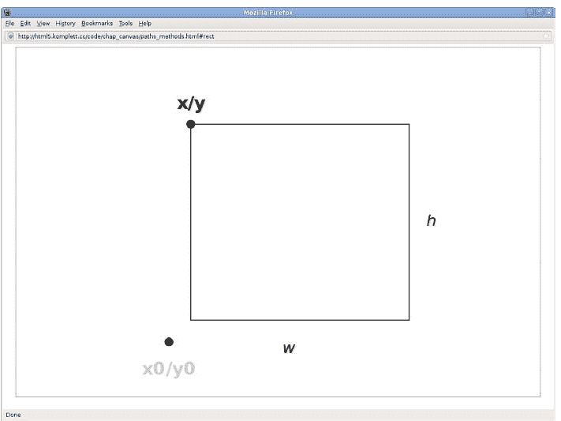
图 5.14 路径方法“rect()”
### 5.5.5 轮廓、填充与裁剪蒙版
回顾创建路径的三个阶段——初始化、确定路径、几何形状绘制与绘图，我们已经进入第三也是最后一个阶段：绘图。在此阶段我们决定路径的呈现效果。之前的所有示例中，我们在此阶段都选择绘制简单的轮廓，对应方法如下：
``` context.stroke() ```
线条颜色由*描边样式*属性决定。你还可以通过另外三个Canvas属性定义线宽（*线宽*）、线端样式（*线帽样式*）以及线条连接样式（*线条连接样式*）（星号表示默认值；后续我们会反复遇到该标记）：
``` context.lineWidth = [ Pixel ]
context.lineCap = [ *butt, round, square ]
context.lineJoin = [ bevel, round, *miter ] ```
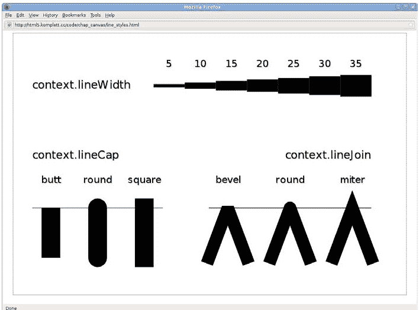
图 5.15 用于确定线条样式的属性
`线宽`以像素为单位指定，默认值为1.0。与其他两个线条属性类似，线宽不仅适用于线条和多边形，也适用于通过`strokeRect()`创建的矩形。如果我们要通过`lineCap`为线条添加线帽，可选择butt、round或square，其中butt是默认值。若选择round，会在线条末端添加一个半径为`lineWidth`一半的半圆形，使线条呈现圆头。若选择square，则用高度为线宽一半的矩形替代半圆形。要创建斜切的线条连接，可使用`lineJoin`属性并设置为bevel；也可以设置为round实现圆角连接，或设置为*miter*实现斜接连接，*miter*为默认值。为避免斜接线条的角度过尖，规范提供了`miterLimit`属性，默认值为10.0。该值是锥形端点长度（线条交点与端点的距离）与线宽一半的比值。若`miterLimit`超出限制，端点会被剪裁，效果与bevel一致。要使用颜色或渐变填充路径，我们首先需要通过`fillStyle`设置相应的样式属性，然后调用以下路径方法：
``` context.fill() ```
这听起来很简单，但如果路径自交或嵌套，情况会变得非常复杂。这种情况下，所谓的*非零*绕数规则将生效：该规则根据相关子路径的绕行方向，决定是否进行填充。
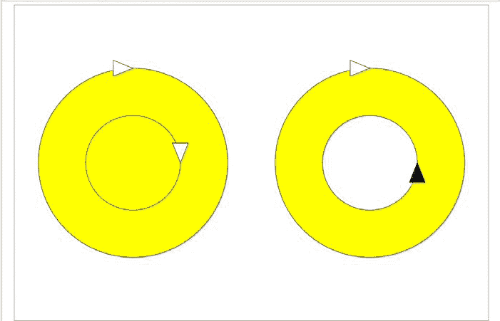
图 5.16 路径的非零填充规则
为帮助我们绘制带方向的圆形，我们使用了`arc()`部分的辅助函数，此次做了轻微修改：现在将期望的绘制方向作为参数传入。`anticlockwise`的有效取值为0和1：
``` var circle = function(cx,cy,r,anticlockwise) {
    context.moveTo(cx+r,cy);
    context.arc(cx,cy,r,0,Math.PI*2.0,anticlockwise);
}; ```
``` context.beginPath();
context.fillStyle = 'yellow';
circle(900,400,240,0);
circle(900,400,120,1);
context.fill();
context.stroke(); ```
在调用`stroke()`和`fill()`之后，绘制路径仅需再使用一个方法——`context.clip()`。该方法的作用如其名称一样简短：`clip()`会确保定义的路径不会被直接绘制，而是作为所有其他绘图元素的剪裁蒙版。蒙版内的内容保持可见，其余部分会被隐藏。你可以通过使用整个画布区域作为几何形状创建新的裁剪蒙版来重置蒙版。我们将在5.13节中遇到更优雅的方法，即使用`save()`和`restore()`。接下来我们转向文本主题，规范仅用4页篇幅介绍该主题。难道Canvas的文本支持不是很完善吗？
## 5.6 文本
乍看之下，Canvas的文本支持确实不算出色，因为Canvas中使用文本的选项非常有限，仅支持对简单字符串进行格式化和定位。它不支持带自动换行的连续文本，也没有段落格式或选择已有文本的功能。我们仅有三个属性可用于设置文本属性，两个方法用于绘制文本，还有一个方法用于计算考虑当前格式的字符串文本长度。看起来可用的功能不多，但仔细研究会发现，规范中的4页内容都是基于精心设计的细节。
### 5.6.1 字体
`font`属性的定义直接参考CSS规范，规定`context.font`的语法与CSS字体简写符号的语法一致：
``` context.font = [ CSS font property ] ```
通过这种方式，可以在单个字符串中轻松指定所有字体属性。表5.2列出了各个组件及其可能取值。
表5.2 CSS“font”属性的组件
| 属性 | 值 |
|----------|--------|
| font-style | *常规, 斜体, 倾斜 |
| font-variant | *常规, 小型大写字母 |
| font-weight | *常规, 粗体, 更粗, 更细<br>100, 200, 300, 400, 500, 600, 700, 800, 900 |
| font-size | 极小, 特小, 小, *中等,<br>大, 特大, 超大, 更大, 更小<br>em, ex, px, in, cm, mm, pt, pc, % |
| line-height | *常规, <数字>, em, ex, px, in, cm, mm, pt, pc, % |
| font-family | 字体族或通用字体族，如衬线体、无衬线体、手写体、花体、等宽字体 |
组合`font`属性时，仅`font-size`和`font-family`为必填属性，其余均为可选，若省略则默认使用表5.2中标记星号的默认值。由于Canvas文本不支持换行，`line-height`属性不起作用，始终会被忽略。因此，组合各属性的简化规则为：
``` context.font = [ font-style font-variant font-weight font-size font-family ] ```
关于`font-family`，与应用样式表中定义字体的规则一致：你可以指定任意字体族和/或通用字体族的组合，浏览器会从该优先级列表中选取第一个已知的字体。你可以通过使用Web字体，实现完全不依赖浏览器或对应平台及其字体的效果。Web字体一旦通过`@font-face`集成到样式表中，就会通过指定的字体名称在Canvas中作为`font-family`使用：
``` @font-face {
    font-family: Scriptina;
    src: url('fonts/scriptina.ttf');
} ```
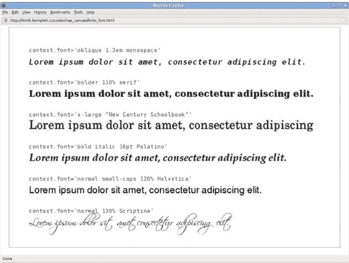
图 5.17 使用“font”属性的字体格式化
本文撰写时，没有浏览器能完美支持`@font-face`。例如在Firefox中，最后一行的Web字体*Scriptina*只有在HTML文档中至少使用过一次时，才会在Canvas中显示。Firefox也尚未正确实现*小型大写字母*，因此倒数第二个示例也无法正常显示。
### 5.6.2 水平锚点
`textAlign`属性决定了Canvas文本的水平锚点：
``` context.textAlign = [ left | right | center | *start | end ] ```
left、right、center三个关键词来自CSS的`text-align`属性，而start和end是CSS3的扩展属性，可根据对应语言的不同适配文本方向。部分语言的书写顺序并非从左到右，例如阿拉伯语和希伯来语就是从右向左书写的。


图5.18展示了文本流向为**ltr**（从左到右）和**rtl**（从右到左）时的水平锚点，说明了文本方向性对*start*与*end*属性的影响。

> **注意** 在浏览器中，可通过全局属性`document.dir`修改文档的文本方向性：`document.dir = [ *ltr | rtl ]`

*图5.18* 使用“textAlign”的水平锚点
### 5.6.3 垂直锚点
垂直锚点，以及所有字形对齐的基线，由第三个也是最后一个文本属性**textBaseline**确定：
```javascript
context.textBaseline = [ top | middle | *alphabetic | bottom | hanging | ideographic ]
```
前四个`textBaseline`关键字`top`、`middle`、`alphabetic`和`bottom`的含义不言自明。天城文、古木基文和孟加拉文这三种印度字母需要使用悬垂基线，它们分别用于书写梵语、印地语、马拉地语、尼泊尔语、旁遮普语和孟加拉语。表意文字书写体系包括中文、日文、韩文和越南文。图5.19展示了`textBaseline`垂直锚点。

*图5.19* 使用“textBaseline”的垂直锚点
### 5.6.4 绘制与测量文本
确定字体和锚点后，你只需要绘制文本即可。与绘制矩形类似，你可以选择填充和/或描边，还可以通过可选参数`maxwidth`指定文本的最大宽度：
```javascript
context.fillText(text, x, y, maxwidth)
context.strokeText(text, x, y, maxwidth)
```
最后，你可以通过`measureText()`方法测量文本的尺寸，该方法在考虑当前格式的前提下，至少可以确定文本的宽度。在图5.20的示例中，右下角的数值（759）就是通过该方法计算得出的：
```javascript
TextWidth = context.measureText(text).width
```

目前还无法确定*边界框*的高度和原点，但该功能可能会在规范的未来版本中与多行文本布局一同实现。Canvas规范中文本章节的最终说明看起来很有前景：该说明指出，未来文档片段（如格式化段落）也可以通过CSS传入Canvas。
Canvas API不仅在当下，也为未来提供了大量基于栅格格式在Canvas中工作的选项。除了嵌入图片和视频外，你还可以选择性地读写画布区域上的每一个像素。你可以在5.8节“像素操作”中了解具体操作方法。
## 5.7 嵌入图像
Canvas提供了`drawImage()`方法来嵌入图像，我们可以通过三组不同的参数集调用该方法（该方法可接受3个、5个或9个参数）：
```javascript
context.drawImage(image, dx, dy)
context.drawImage(image, dx, dy, dw, dh)
context.drawImage(image, sx, sy, sw, sh, dx, dy, dw, dh)
```
以上三种情况的第一个参数都需要图像、画布或视频元素，这些元素可以通过JavaScript动态引入，也可以在HTML代码中静态嵌入。动画图片或视频不会被渲染为动画，而是以静态形式显示，如果存在首帧或海报帧，则显示该帧。`drawImage()`方法的所有其他参数都会影响源图像的位置、尺寸或裁剪，以渲染到目标画布中。图5.21展示了各位置参数的可视化说明；前缀`s`代表源（source），`d`代表目标（destination）。

*图5.21* `drawImage()`方法的位置参数
现在我们通过三个简单示例来对比不同的`drawImage()`方法。通用设置是一张1200×800像素的图片，作为JavaScript对象动态创建（见图5.22）：
```javascript
var image = new Image();
image.src = 'images/yosemite.jpg';
```

*图5.22* 所有`drawImage()`示例的源图像
除了示例中会用到的像素尺寸外，图5.22还展示了优胜美地国家公园令人震撼的1000米高酋长岩岩壁：这张照片拍摄于塔夫特角。我们使用上述三种参数集之一，将这张图片绘制到600×400像素的目标画布上。第一种也是最简单的选项，通过`dx`/`dy`确定图片在目标画布中的左上角位置。在本例中，该位置为0/0：
```javascript
image.onload = function() {
  context.drawImage(image, 0, 0);
};
```
图像的宽高会直接从原图复制，由于我们的图片比目标画布大，因此画布上只会显示塔夫特角的左上四分之一区域，这并不意外（见图5.23）。

*图5.23* 优胜美地国家公园的塔夫特角
如果要在画布中完整显示整张图片，我们还需要在参数`dw`/`dh`中指定所需的宽度和高度。浏览器会自动将图片缩放至600×400像素，结果如图5.24所示：
```javascript
image.onload = function() {
  context.drawImage(image, 0, 0, 600, 400);
};
```

*图5.24* 带有酋长岩的优胜美地国家公园塔夫特角
与前两种可以通过CSS实现的`drawImage()`变体不同，第三种变体提供了完全全新的图像处理能力。现在我们可以将源图像的任意区域（`sx`, `sy`, `sw`, `sh`）复制到目标画布的指定区域（`dx`, `dy`, `dw`, `dh`）中，图像拼接完全可以实现：
```javascript
image.onload = function() {
  context.drawImage(image, 0, 0);
  context.drawImage(
    image, 620, 300, 300, 375, 390, 10, 200, 250
  );
};
```
结果如图5.25所示。

*优胜美地国家公园明信片*
第一个`drawImage()`调用会再次返回塔夫特角的左上四分之一区域；第二个调用会提取酋长岩的区域，将其作为图标绘制到右上角。带有阴影的文本完成了我们明信片的初步布局。如果你更希望让酋长岩处于前景，塔夫特角作为邮票放在右上角，只需稍作修改`drawImage()`的调用即可。在本示例中，你可以通过点击画布来实现这一效果：
```javascript
canvas.onclick = function() {
  context.drawImage(
    image, 600, 250, 600, 400, 0, 0, 0, 600, 400
  );
  context.drawImage(
    image, 0, 0, 500, 625, 390, 10, 200, 250
  );
};
```
这将生成如图5.26所示的图像。

*图5.26* 优胜美地国家公园明信片（替代布局）
以上是使用图像作为源的`drawImage()`方法的简要介绍。你可以在5.14.2节“使用`drawImage()`播放视频”中找到将视频元素作为`drawImage()`第一个参数的详细示例，不过我们首先会讨论如何获取画布区域像素值的读写权限。
## 5.8 像素操作
读取和操作像素值的方法有三种：`getImageData()`、`putImageData()`和`createImageData()`。由于这三个方法都包含ImageData这个术语，我们首先需要明确它的含义。
### 5.8.1 使用“ImageData”对象
我们通过一个2×2像素大小的画布来了解ImageData对象，在该画布上绘制四个1×1像素的矩形，分别填充藏青色（navy）、青绿色（teal）、青柠色（lime）和黄色（yellow）：
```javascript
context.fillStyle = 'navy';
context.fillRect(0, 0, 1, 1);
context.fillStyle = 'teal';
context.fillRect(1, 0, 1, 1);
context.fillStyle = 'lime';
context.fillRect(0, 1, 1, 1);
context.fillStyle = 'yellow';
context.fillRect(1, 1, 1, 1);
```
接下来，我们使用`getImageData(sx, sy, sw, sh)`方法获取ImageData对象，这四个参数以矩形形式确定所需的画布区域，如图5.27所示：
```javascript
ImageData = context.getImageData(
  0, 0, canvas.width, canvas.height
);
```

*图5.27* “ImageData”对象
ImageData对象具有`ImageData.width`、`ImageData.height`和`ImageData.data`三个属性，其中最后一个属性将实际像素值存储在所谓的CanvasPixelArray中。这是一个扁平数组，包含选中区域中每个像素的红色、绿色、蓝色和alpha值，从左上角开始，按从左到右的顺序

自上而下。所有数值的总数保存在`ImageData.data.length`属性中。通过简单的`for`循环，我们现在可以读取`CanvasPixelArray`中的每个独立数值，并通过`alert()`将其显示出来。从0开始，我们逐像素处理，每次循环将计数器增加4。RGBA数值是当前位置偏移的结果：红色位于计数器`i`处，绿色位于`i+1`处，蓝色位于`i+2`处，alpha分量位于`i+3`处：
```javascript
for (var i=0; i<ImageData.data.length; i+=4) {
 var r = ImageData.data[i];
 var g = ImageData.data[i+1];
 var b = ImageData.data[i+2];
 var a = ImageData.data[i+3];
 alert(r+" "+g+" "+b+" "+a);
}
```
修改像素值的方法完全一致：我们通过直接赋新值的方式原地修改`CanvasPixelArray`。在本例中，RGB值通过`Math.random()`设置为0到255之间的随机数；alpha分量保持不变：
```javascript
for (var i=0; i<ImageData.data.length; i+=4) {
 ImageData.data[i] = parseInt(Math.random()*255);
 ImageData.data[i+1] = parseInt(Math.random()*255);
 ImageData.data[i+2] = parseInt(Math.random()*255);
}
```
完成这一步后，画布看起来仍然没有变化。只有当我们通过`putImageData()`方法将修改后的`CanvasPixelArray`写回画布后，新颜色才会显示出来。调用`putImageData()`时，最多可以传入7个参数：
```javascript
context.putImageData(
 ImageData, dx, dy, [ dirtyX, dirtyY, dirtyWidth, dirtyHeight ]
)
```
前三个参数是必填项；除了`ImageData`对象外，它们还包含起始点的`dx`/`dy`坐标，`CanvasPixelArray`会通过自身的`width`和`height`属性从该起始点开始应用。可选的`dirty`参数只会截取`CanvasPixelArray`的指定区块，仅将该区块按缩减后的宽高写回。图5.28展示了我们4像素画布修改前后的状态，以及`CanvasPixelArray`的相关数值列表。

> **图5.28** 修改“CanvasPixelArray”中的颜色
你可以通过`createImageData()`方法直接初始化空的`ImageData`对象。其宽高对应传入的参数`sw`/`sh`，或调用时传入的`ImageData`对象的尺寸。两种情况下，`CanvasPixelArray`的所有像素都会被设置为透明/黑色，即`rgba(0,0,0,0)`：
```javascript
context.createImageData(sw, sh)
context.createImageData(imagedata)
```
因此我们也可以直接通过`createImageData()`创建图5.28中的2×2像素修改后画布，并通过`putImageData()`将其绘制到画布上：
```javascript
var imagedata = context.createImageData(2,2);
for (var i=0; i<ImageData.data.length; i+=4) {
 imagedata.data[i] = parseInt(Math.random()*255);
 imagedata.data[i+1] = parseInt(Math.random()*255);
 imagedata.data[i+2] = parseInt(Math.random()*255);
}
context.putImageData(imagedata,0,0);
```
枯燥的`CanvasPixelArray`理论就先讲到这里。实际应用中会更有意思：借助`getImageData()`、`putImageData()`、`createImageData()`和一点数学知识，我们甚至可以编写自己的颜色滤镜来操作图像。我们将在下一节介绍具体方法。
## 5.8.2 使用“getImageData()”、“createImageData()”和“putImageData()”进行颜色操作
所有示例的起始图片依然是优胜美地国家公园的照片，该图片会在`onload`事件触发时通过`drawImage()`绘制到画布上。第二步，我们通过`getImageData()`获取原始`CanvasPixelArray`，第三步对其进行修改。在`for`循环中，每个像素的RGBA值会按照特定数学公式计算，然后插入到之前通过`createImageData()`创建的`CanvasPixelArray`中。最后我们通过`putImageData()`将其写回画布。清单5.1提供了图5.29中所有滤镜的基础JavaScript框架。`grayLuminosity()`函数不属于本代码示例，会与其他滤镜在后续一起介绍：
```javascript
var image = new Image();
image.src = 'images/yosemite.jpg';
image.onload = function() {
 context.drawImage(image,0,0,360,240);
 var modified = context.createImageData(360,240);
 var imagedata = context.getImageData(0,0,360,240);
 for (var i=0; i<imagedata.data.length; i+=4) {
  var rgba = grayLuminosity(
   imagedata.data[i+0], imagedata.data[i+1], imagedata.data[i+2], imagedata.data[i+3]
  );
  modified.data[i+0] = rgba[0];
  modified.data[i+1] = rgba[1];
  modified.data[i+2] = rgba[2];
  modified.data[i+3] = rgba[3];
 }
 context.putImageData(modified,0,0);
};
```
> **注意** 图5.29右下角的服务器图标表示，如果你使用Firefox浏览器，本示例只能通过http协议的服务器访问。我们将在5.15.3节“安全方面”中解释原因。

**图5.29** 使用“getImageData()”和“putImageData()”进行颜色操作
要将颜色转换为灰度，免费图像编辑软件GIMP的文档在“去色”章节中提供了三种公式（参见网页链接http://docs.gimp.org/en/gimp-tool-desaturate.html），你可以通过*亮度、发光度*，或平均亮度（*平均值*）计算灰度值。如果我们在JavaScript中实现这些计算，就能得到前三个颜色滤镜：
```javascript
var grayLightness = function(r,g,b,a) {
 var val = parseInt(
  (Math.max(r,g,b)+Math.min(r,g,b))*0.5
 );
 return [val,val,val,a];
};
var grayLuminosity = function(r,g,b,a) {
 var val = parseInt(
  (r*0.21)+(g*0.71)+(b*0.07)
 );
 return [val,val,val,a];
};
var grayAverage = function(r,g,b,a) {
 var val = parseInt(
  (r+g+b)/3.0
 );
 return [val,val,val,a];
};
```
使用`grayLuminosity()`时，我们采用图5.29中的第二个公式，用新计算出的值替换每个像素的RGB分量。在本例及后续所有计算中，我们需要牢记RGBA值只能是整数；JavaScript的`parseInt()`方法可以保证这一点。`sepiaTone()`的算法来自Zach Smith的文章《*如何使用C#将图像转换为灰度与棕褐色调？*》（参见缩短的网页链接http://bit.ly/a2nxI6）：
```javascript
var sepiaTone = function(r,g,b,a) {
 var rS = (r*0.393)+(g*0.769)+(b*0.189);
 var gS = (r*0.349)+(g*0.686)+(b*0.168);
 var bS = (r*0.272)+(g*0.534)+(b*0.131);
 return [
  (rS>255) ? 255 : parseInt(rS),
  (gS>255) ? 255 : parseInt(gS),
  (bS>255) ? 255 : parseInt(bS),
  a
 ];
};
```
三个计算中，相乘后的分量相加可能得到大于255的数值；这种情况下，会将255作为新数值插入。使用`invertColor()`滤镜反转颜色非常简单：只需将每个RGB分量从255中减去即可：
```javascript
var invertColor = function(r,g,b,a) {
 return [
  (255-r), (255-g), (255-b), a
 ];
};
```
`swapChannels()`滤镜会修改颜色通道的顺序。我们需要首先在数组中定义所需的顺序作为第四个参数，其中0代表红色，1代表绿色，2代表蓝色，3代表alpha通道。要交换通道，我们使用带有对应初始值的`rgba`数组，然后按新顺序返回该数组。因此，如本例中将RGBA改为BRGA，可以通过`order=[2, 0, 1, 3]`实现：
```javascript
var swapChannels = function(r,g,b,a,order) {
 var rgba = [r,g,b,a];
 return [
  rgba[order[0]], rgba[order[1]], rgba[order[2]], rgba[order[3]]
 ];
};
```
最后一个方法`monoColor()`会将每个像素的RGB分量设为指定颜色，同时将起始像素的灰度值作为alpha分量。调用该函数时，第四个参数以RGB值数组的形式定义目标颜色——本例中为蓝色，对应`color=[0, 0, 255]`：
```javascript
var monoColor = function(r,g,b,a,color) {
 return [
  color[0], color[1], color[2], 255-(parseInt((r+g+b)/3.0))
 ];
};
```
我们这里介绍的滤镜还比较简单，仅修改单个像素的颜色值，没有考虑相邻像素的影响。如果将相邻像素纳入计算，就能实现更复杂的效果，比如锐化、USM锐化或边缘检测。

> > 详细介绍这类滤镜超出了本书的范畴。如果你想进一步探索，可以查看Jacob Seidelin的*Pixastic图像处理库*（http://www.pixastic.com/lib）。该库提供了30余款基于Mozilla公共许可证免费发布的JavaScript滤镜，等待你去发掘。
与此同时，我们转向托马斯·波特和汤姆·达夫这两位皮克斯工作室的大师，他们早在1984年就凭借一篇关于alpha混合技术的文章引发了轰动。他们描述的数字合成技术不仅为他们赢得了*美国电影艺术与科学学院*的奖项，还被纳入了Canvas规范。


## 5.9 合成
Canvas中的合成功能种类繁多，但你在互联网上只会找到很少几个优秀的使用案例。大多数示例都只介绍这些方法本身，作为入门内容，我们也会先从这部分开始。
图5.30展示了globalCompositeOperation属性的合法关键字、它们对应的Porter-Duff等效值（以斜体标注，标记为A、B），以及绘制后的结果。首先我们绘制蓝色矩形作为背景，接着设置需要的合成方法，最后添加红色圆形。针对第一个方法source-over，它同时也是globalCompositeOperation属性的默认值，代码如下：
``` context.beginPath(); context.fillStyle = 'cornflowerblue'; context.fillRect(0,0,50,50); context.globalCompositeOperation = 'source-over'; context.arc(50,50,30,0,2*Math.PI,0); context.fillStyle = 'crimson'; context.fill(); ```

**图5.30** “globalCompositeOperation”属性的取值
圆形是*源图形*（*A*）；矩形是*目标图形*（*B*）。我们使用Porter-Duff术语来解释不同方法，因为这类术语更直观，也能更精确地描述操作过程。使用`source-over`时，我们将*A*绘制在*B*上方；使用`source-in`时，只绘制*A*中位于*B*内部的部分；使用`source-out`时，只绘制*A*中位于*B*外部的部分；使用`source-atop`时，我们会同时绘制*A*和*B*，但仅保留*A*与*B*重叠的部分。第二行内容是前述所有操作的反向逻辑，因此无需重复说明。`lighter`方法会在重叠区域叠加颜色，使该区域颜色更浅。`copy`会消除*B*，仅绘制*A*；`xor`会移除*A*和*B*的交集。问号表示也允许使用厂商专属的合成操作，和`getContext()`方法的规则类似。不幸的是，目前没有任何浏览器完全实现了合成功能，这也让我们很难合理地展示所有方法。我们会挑选两种方法，看看`destination-in`和`lighter`这两个操作的使用示例。
如果我们使用`destination-in`来组合图像和文本，就能实现镂空效果，如图5.31所示。首先我们用`drawImage()`绘制图像，设置合成方法，然后插入最大宽度为1080像素的文本。文本格式设置为600px的字体大小，文本锚点位于顶部中心，边框宽度为60像素，线条端点和拐角均为圆角：
``` context.drawImage(image, 0, 0, 1200, 600); context.globalCompositeOperation = 'destination-in'; context.strokeText('HTML5', 600, 50, 1080); ```

**图5.31** 图像与文本的“destination-in”合成操作
浅灰色文本使用的是默认合成方法source-over，因此不受该效果影响。由于前面提到的浏览器实现缺陷，目前无法同时让多个文本作为镂空元素。
我们的第二个示例使用lighter方法，拓展了前面提到的图像颜色操作选项。使用lighter方法时，图5.32将优胜美地图片与16个标准命名颜色的矩形结合，提供了比5.8.2节《使用"getImageData()"、"createImageData()"和"putImageData()"进行颜色操作》中提到的单色过滤器`monoColor()`更省CPU的替代方案。因此我们可以用不同的方式实现该节中的示例，得到相似的结果：
``` context.drawImage(img,0,0,210,140); context.globalCompositeOperation = 'lighter'; context.fillStyle = 'blue'; context.fillRect(0,0,210,140); ```

**图5.32** 与16种基础颜色的“lighter”合成操作
我们会在5.11节“变换”中的图5.37的镜像效果中再次遇到合成操作`destination-out`。现在我们先来看Canvas中的用户自定义图案。

## 5.10 图案
要创建用于填充和线条的用户自定义图案，规范提供了`createPattern()`方法。和`drawImage()`类似，它接受图像元素、Canvas元素或视频元素作为输入，通过`repetition`参数定义图案的重复类型：
``` context.createPattern(image, repetition) ```
`repetition`参数的允许值和CSS规范的`background-color`属性一致，包括repeat、repeat-x、repeat-y和no-repeat。如果我们再次使用16种命名基础颜色，就能用几行代码创建棋盘格图案，每个图案包含两对颜色（见图5.33）。

**图5.33** 八种颜色组合的棋盘格图案
该图案以一块20×20像素宽度的内存画布创建，包含四个10×10像素的正方形。以绿色图案为例，这个步骤的操作如下：
``` var cvs = document.createElement("CANVAS"); cvs.width = 20; cvs.height = 20; var ctx = cvs.getContext('2d'); ctx.fillStyle = 'lime'; ctx.fillRect(0,0,10,10); ctx.fillRect(10,10,10,10); ctx.fillStyle = 'green'; ctx.fillRect(10,0,10,10); ctx.fillRect(0,10,10,10); ```
接着我们用`createPattern()`把画布cvs定义为重复图案，将其赋值给`fillStyle`属性，并用它填充正方形：
``` context.fillStyle = context.createPattern(cvs,'repeat'); context.fillRect(0,0,220,220); ```
图案会锚定在坐标原点，从该点开始应用。如果在前面的示例中，我们把`fillRect()`的起始点向右移动10像素，改为从10/0而非0/0开始，左上角的第一个颜色就会是绿色而不是浅绿色。
除了用户自定义的Canvas元素外，我们也可以使用图像作为图案来源。图5.34展示了使用`createPattern()`填充背景、为标题文本创建图案、以及裁剪熟悉的优胜美地图片单个区块的示例。另外两张图片*pattern_107.png*和*pattern_125.png*属于*Squidfingers*图案库，你可以在该库下载近160种其他精美的图案：http://www.squidfingers.com/patterns

**图5.34** 使用图像作为来源的图案
我们先来看看背景是如何创建的：
``` var bg = new Image(); bg.src = 'icons/pattern_125.png'; bg.onload = function() { context.globalAlpha = 0.5; context.fillStyle = context.createPattern(bg,'repeat'); context.fillRect(0,0,canvas.width,canvas.height); }; ```
前两行创建了一个新的Image对象，将其`src`属性设置为`icons`文件夹下的`pattern_125.png`图片。和`drawImage()`一样，我们需要确保在定义图案前图片已经完全加载。`bg.onload()`函数包含了生成重复图案的实际代码，我们会以50%的不透明度将其应用到整个画布区域。用同样的方式，我们用`pattern_107.png`图像填充标题文本*优胜美地！*。对于重叠的图像区块，我们直接把整张优胜美地照片`yosemite.jpg`作为图案，然后通过`for`循环遍历输入数组`extents`，该数组包含我们需要的区块的x、y、宽度和高度值。通过调用`fillRect()`，对应的图像区域会以填充图案的形式显示，再通过`strokeRect()`添加额外边框：
``` var extents = [ { x: 20, y: 50, width: 120, height: 550 } // and 7 others ... ]; var image = new Image(); image.src = 'images/yosemite.jpg'; image.onload = function() { context.fillStyle = context.createPattern( image,'no-repeat' ); for (var i=0; i<extents.length; i++) { var d = extents[i]; // short-cut context.fillRect(d.x,d.y,d.width,d.height); context.strokeRect(d.x,d.y,d.width,d.height); } }; ```
图5.34中使用了三种不同的图片，且这三种图片在使用前都必须完全加载，因此我们需要嵌套三个`onload`函数。这能确保我们在绘制时控制正确的顺序。可能的嵌套伪代码如下：
``` // create all images bg.onload = function() { // draw background image.onload = function() { // add image cutouts pat.onload = function() { // fill title with pattern }; }; }; ```
要避免这种嵌套的唯一方法是，将涉及的所有图片在页面的HTML代码中作为隐藏的`img`元素，通过`visibility:hidden`隐藏，在`window.onload()`中页面加载完成后，通过`getElementById()`或`getElementsByTagName()`引用它们。


## 5.11 变换
在进入Canvas规范的下一部分——*变换*之前，需要说明：当使用视频元素作为`createPattern()`的源时，若存在封面帧，则会使用视频的第一帧或封面帧作为图案，规则与`drawImage()`方法类似。

Canvas的变换操作会直接操控坐标系。移动矩形时，你并非仅移动实际元素，而是会先平移整个坐标系，之后再重新绘制矩形。三种基础变换为`scale()`、`rotate()`和`translate()`，如图5.35所示。


#### 图5.35 基础变换方法`scale()`、`rotate()`和`translate()`
```
context.scale(x, y)
context.rotate(angle)
context.translate(x, y)
```

通过`scale()`实现缩放时，需要传入两个乘数作为参数，分别对应x轴和y轴方向的尺寸变化；使用`rotate()`实现旋转时，需要传入以弧度为单位、顺时针旋转的角度；通过`translate()`实现移动时，需要传入x轴和y轴方向的像素偏移量。若组合使用这些方法，各类变换需按相反顺序执行：从JavaScript代码的视角来看，基本需要从后往前阅读。

若需先执行缩放、再执行旋转，代码如下：
```
context.rotate(0.175);
context.scale(0.75,0.75);
context.fillRect(0,0,200,150);
```
若需先执行旋转、再执行平移，JavaScript代码需写作：
```
context.translate(100,50);
context.rotate(0.175);
context.fillRect(0,0,200,150);
```

凡涉及旋转操作都需要特别注意，因为旋转始终以坐标原点(0/0)为中心执行。经验法则是`rotate()`通常作为最后一步操作。图5.36展示了同时使用三种基础方法的示例，从不同视角呈现了优胜美地（Yosemite）的图片，看起来类似跳台滑雪的布局。


#### 图5.36 旋转、缩放与平移

#### 清单5.2 图5.36所示变换的源代码
```
image.onload = function() {
  var rotate = 15;
  var scaleStart = 0.0;
  var scaleEnd = 4.0;
  var scaleInc = (scaleEnd-scaleStart)/(360/rotate);
  var s = scaleStart;
  for (var i=0; i<=360; i+=rotate) {
    s += scaleInc;
    context.translate(540,260);
    context.scale(s,s);
    context.rotate(i*-1*Math.PI/180);
    context.drawImage(image,0,0,120,80);
    context.setTransform(1,0,0,1,0,0);
  }
};
```

图片加载完成后，我们将旋转角度*rotate*定义为15°，起始缩放比例*scaleStart*为0.0，结束缩放比例*scaleEnd*为4.0，并由此推导出缩放的步长*scaleInc*，目标是完成一次完整旋转时达到4.0的最终缩放比例。在for循环中，我们会每次将图片逆时针旋转15°，缩放比例从0.0增长到4.0，并将其左上角定位在坐标(540, 260)处。那么为什么我们需要在for循环末尾调用`setTransform()`方法呢？

除`scale()`、`rotate()`和`translate()`三种基础变换外，Canvas还提供了另外两种可修改坐标系、进而修改变换矩阵的方法：`transform()`和`setTransform()`，这两个方法在清单5.2中已经提及：
```
context.transform(m11, m12, m21, m22, dx, dy);
context.setTransform(m11, m12, m21, m22, dx, dy);
```

这两个方法的共同参数为m11、m12、m21、m22、dx和dy，分别对应表5.3中列出的变换属性。

#### 表5.3 Canvas矩阵变换的组成组件
| 组件 | 含义 |
|-----------|---------|
| m11 | x轴缩放 |
| m12 | 水平剪切 |
| m21 | 垂直剪切 |
| m22 | y轴缩放 |
| dx | x轴平移 |
| dy | y轴平移 |

两者的核心区别在于：`transform()`会通过乘法运算修改当前变换矩阵，而`setTransform()`会用新矩阵直接覆盖现有矩阵。三种基础变换也可以表述为`transform()`或`setTransform()`的属性，本质上只是对应矩阵变换的便捷快捷方式。表5.4列出了这些属性，以及用于翻转（flipX/Y）和倾斜（skewX/Y）的其他实用矩阵，倾斜角度同样以弧度为单位指定。

#### 表5.4 基础变换及其他实用变换方法的矩阵
| 方法 | 变换矩阵（m11, m12, m21, m22, dx, dy） |
|--------|---------------------------------------------------|
| `scale(x, y)` | x,0,0,y,0,0 |
| `rotate(angle)` | cos(angle),sin(angle), -sin(angle), cos(angle),0,0 |
| `translate(x, y)` | 1,0,0,1,x,y |
| `flipX()` | -1,0,0,1,0,0 |
| `flipY()` | 1, 0, 0, -1, 0, 0 |
| `skewX(angle)` | 1,0,tan(angle),1,0,0 |
| `skewY(angle)` | 1,tan(angle),0,1,0,0 |

在通过详细示例进一步探索Canvas变换之前，需要说明：根据规范，`getImageData()`和`putImageData()`均不受变换影响。调用`getImageData(0,0,100,100)`始终会获取画布左上角的100×100像素正方形区域，无论坐标系是否经过了平移、缩放或旋转。`putImageData(imagedata,0,0)`的逻辑也相同，左上角作为应用imagedata内容的锚点。

接下来我们进入示例部分，演示如何应用上述所有变换方法。图5.37展示了最终效果——一张带有镜像效果的伪3D风格优胜美地图片三部分拼贴画。


#### 图5.37 带镜像效果的伪3D照片拼贴

首先我们裁切出塔夫特角（Taft Point）、默塞德河（Merced River）和酋长岩（El Capitan）的三个正方形区域，结果将保存在icons数组中：
```
var icons = [
  clipIcon(image,0,100,600,600),
  clipIcon(image,620,615,180,180),
  clipIcon(image,550,310,400,4)
];
```

`clipIcon()`函数负责裁切并调整不同尺寸图片区域的大小。在该函数中，我们首先创建一个尺寸为320×320像素的*内存中*画布，随后用`drawImage()`将适当缩小（或放大）后的图标复制到该画布上，最后添加一个15像素宽的白色边框：
```
var clipIcon = function(img,x,y,width,height) {
  var cvs = document.createElement("CANVAS");
  var ctx = cvs.getContext('2d');
  cvs.width = 320;
  cvs.height = 320;
  ctx.drawImage(img,x,y,width,height,0,0,320,320);
  ctx.strokeStyle = '#FFF';
  ctx.lineWidth = 15;
  ctx.strokeRect(0,0,320,320);
  return cvs;
};
```

第二步，我们为这三个图片区域分别创建镜像效果，结果保存在effects数组中：
```
var effects = [];
for (var i=0; i<icons.length; i++) {
  effects[i] = createReflection(icons[i]);
}
```

核心逻辑在`createReflection()`函数中实现，这段稍作修改的代码源自Charles Ying的博客（博客主题为艺术、音乐与科技艺术）中一篇介绍iPhone封面流效果的文章（参见短链接[短链接](http://bit.ly/b5AFW6)）：
```
var createReflection = function(icon) {
  var cvs = document.createElement("CANVAS");
  var ctx = cvs.getContext('2d');
  cvs.width = icon.width;
  cvs.height = icon.height/2.0;
  // flip
  ctx.translate(0,icon.height);
  ctx.scale(1,-1);
  ctx.drawImage(icon,0,0);
  // fade
  ctx.setTransform(1,0,0,1,0,0);
  ctx.globalCompositeOperation = "destination-out";
  var grad = ctx.createLinearGradient(
    0,0,0,icon.height/2.0
  );
  grad.addColorStop(0,'rgba(255,255,255,0.5)');
  grad.addColorStop(1,'rgba(255,255,255,1.0)');
  ctx.fillStyle = grad;
  ctx.fillRect(0,0,icon.width,icon.height/2.0);
  return cvs;
};
```

在`createReflection()`中，我们首先使用另一个*内存中*画布，对传入的icon参数对应的图片区域的下半部分进行翻转。回顾变换矩阵的快捷方式，我们可以通过`flipY()`对应的矩阵实现翻转。但本示例中我们使用了另一种创建镜像的方案，即`scale()`方法：`scale(1,-1)`对应`flipY()`方法，`scale(-1,1)`对应`flipX()`方法。渐隐效果通过从半透明白色到不透明白色的渐变实现，并使用合成方法`destination-out`将该渐变覆盖在图标上。
```
var grad = context.createLinearGradient(
  0,0,canvas.height
);
grad.addColorStop(0.0,'#000');
grad.addColorStop(0.5,'#111');
grad.addColorStop(1.0,'#EEE');
context.fillStyle = grad;
context.fillRect(0,0,canvas.width,canvas.height);
```

现在我们已经定义好各个图片区域，可以开始绘制了。中心区域接近纯黑色、向两侧过渡为白色的渐变会营造出3D空间的纵深感，我们再将三张图片放置在这个空间中：位于中间的默塞德河图片定位最为简单，通过`setTransform()`即可完成定位，之后我们可以为其绘制镜像效果：
```
context.setTransform(1,0,0,1,440,160);
context.drawImage(icons[1],0,0,320,320);
context.drawImage(effects[1],0,320,320,160);
```

右侧的酋长岩图片宽度缩放为原来的0.9倍，以获得更好的3D效果。之后通过`skewY()`对应的矩阵将结果向下倾斜10°，定位在中心区域右侧：
```
context.setTransform(1,0,0,1,820,160);
context.transform(1,Math.tan(0.175),0,1,0,0);
context.scale(0.9,1);
context.drawImage(icons[2],0,0,320,320);
context.drawImage(effects[2],0,320,320,160);
```

绘制左侧的塔夫特角图片则相对复杂。倾斜后，我们区域的左上角将作为锚点；之后需要将结果向上倾斜10°，再将其向下移动一定距离。我们可以通过勾股定理计算所需的dy值：该值等于弧度制下倾斜角的正切值乘以与图标宽度对应的直角边长度，即`Math.tan(0.175)*320`。此外我们还需要将图片右移320*0.1的距离，以补偿宽度缩放0.9倍带来的位置偏移：

```javascript
context.setTransform(1,0,0,1,60,160);
context.transform(1,Math.tan(-0.175),0,1,0,0);
context.translate(320*0.1,Math.tan(0.175)*320);
context.scale(0.9,1);
context.drawImage(icons[0],0,0,320,320);
context.drawImage(effects[0],0,320,320,160);
```
我们现在已经完成了迄今为止最复杂的Canvas示例，效果相当惊艳，因此最好将其保存为JPEG或PNG文件。不同于其他浏览器，Firefox提供了便捷的保存方式——只需在画布上右键点击即可保存你的创作成果。如果你点击“查看图像”，会出现一条非常、非常、非常长的怪异URL地址，以data:image/png;base64…开头，这也顺理成章引出了我们下一节要讲的内容——canvas.toDataURL()。
## 5.12 通过"canvas.toDataURL()"实现Base64编码
Base64是一种将二进制数据编码为ASCII字符串的方法。在Canvas中，它用于将原本仅以位图形式存在于内存中的画布内容转换为可处理的数据URL。实现这一功能的方法如下：
```javascript
canvas.toDataURL(type, args)
```
我们通过type参数传入所需输出格式的MIME类型，可选择image/png或image/jpeg。前者是默认编码格式，若省略type参数或指定浏览器不支持的格式，也会默认使用该格式。额外的参数可通过可选参数args传入，例如选择image/jpeg格式时，可传入0.0到1.0之间的有效数值来设置图像质量。toDataURL()的返回结果是一个Base64编码的字符串。以图5.27中 navy（藏蓝）、teal（青色）、lime（浅绿）、yellow（黄色）四种命名的颜色构成的2×2像素画布为例，其编码结果如下：
```base64
data:image/png;base64,iVBORw0KGgoAAAANSUhEUgAAAIAAAACCAYAAABtg0kAAAAF0lEQVQImQXBAQE AACCIKb33ADLFq1oPuYIemXXHEQAAAAASUVORK5CYII=
```
这类编码字符串可能会非常长。举个例子，我们带倒影效果的图片拼贴的Base64编码版本足足有1,298,974个字符，若按每页50行、每行80字符排版，可以填满本书的325页！那么toDataURL()有什么用呢？为什么要将二进制图像数据转换为字符串？答案很简单：通过toDataURL()，我们可以将仅在内存中短暂存在的画布内容永久嵌入HTML中，让用户或应用程序可以将其保存。toDataURL()的第一个用途是将Canvas图形复制到HTMLImageElement中，这是可行的因为img元素的src属性也支持data: URI格式。所需代码非常短，仅需一个空图像元素和一个动态创建的画布即可实现：
```html
<!DOCTYPE html>
<title>Copy canvas onto image</title>

<script>
var canvas = document.createElement("CANVAS");
canvas.width = 200;
canvas.height = 200;
var context = canvas.getContext('2d');
context.fillStyle = 'navy';
context.fillRect(0,0,canvas.width,canvas.height);
document.images[0].src = canvas.toDataURL();
</script>
```
代码清单中加粗的那一行是核心代码，体现了复制的便捷性——只需获取文档中第一个图像的引用，并将其src属性设置为canvas.toDataURL()即可。最终我们会得到一个普通的img元素，可以像处理浏览器中的其他图像一样将其保存为PNG格式。通过在画布元素上添加简单的onclick事件处理程序，我们可以演示toDataURL()的另一个用途——直接将生成的数据URI作为URL赋值，不过这次输出格式不是PNG，而是JPEG：
```javascript
document.images[0].onclick = function() {
window.location = canvas.toDataURL('image/jpeg');
};
```
这种方法的缺点是URL有时会变得非常长（还记得刚才说的130万字符吗？），而且这种格式的图像不会被存入浏览器缓存，因此每次调用都需要重新生成。toDataURL()还有其他潜在应用场景，例如与localStorage或XMLHttpRequest配合使用，可实现Canvas图形在客户端和服务端的保存与访问。此外，toDataURL()也适用于创建带background-image或list-style-image的CSS样式，我们可以将其作为url()的值插入其中。
## 5.13 "save()" 和 "restore()"
我们关于CanvasContext2D的探索即将接近尾声，仅剩两个方法需要讲解：context.save()和context.restore()。如果没有这两个方法，我们几乎无法完成复杂的Canvas图形的绘制，只要快速浏览一下各图例的源码你就能认同这一点。为了帮你更好地理解context.save()和context.restore()方法，我们首先需要回顾一下基础知识。通过canvas.getContext('2d')获取绘图上下文时，所有属性都会被赋予默认值，这些默认值会直接作用于绘图过程：
```javascript
context.globalAlpha = 1.0;
context.globalCompositeOperation = 'source-over';
context.strokeStyle = 'black';
context.fillStyle = 'black';
context.lineWidth = 1;
context.lineCap = 'butt';
context.lineJoin = 'miter';
context.miterLimit = 10;
context.shadowOffsetX = 0;
context.shadowOffsetY = 0;
context.shadowBlur = 0;
context.shadowColor = 'rgba(0,0,0,0)';
context.font = '10px sans-serif';
context.textAlign = 'start';
context.textBaseline = 'alphabetic';
```
同时，坐标系会通过单位矩阵完成初始化，还会创建一个覆盖整个画布区域的裁剪蒙版：
```javascript
context.setTransform(1, 0,0,1,0,0);
context.beginPath();
context.rect(0,0,canvas.width,canvas.height);
context.clip();
```
如果我们修改了属性、变换或裁剪蒙版，这些修改会一直生效，直到我们再次修改它们。在绘制更复杂的图形时，很容易搞混这些修改的状态，这时context.save()和context.restore()就派上用场了。通过context.save()，我们可以在任意时间点创建快照，保存当前设置的属性、变换规则以及当前的裁剪蒙版。之后我们可以通过context.restore()轻松调用这个快照。规范中将这种机制称为绘图状态栈，因为快照支持嵌套。这项技术在涉及变换或裁剪蒙版的场景中非常实用。对于阴影效果来说，使用context.save()和context.restore()一次性将四个阴影属性重置为默认值，比逐个设置属性要方便得多。在我们接下来要讨论的动画场景中，context.save()和context.restore()几乎是不可或缺的。
## 5.14 动画
不同于SVG或SMIL动画，Canvas动画完全依靠手动实现，需要的要素只有绘图函数和按固定间隔调用该函数的定时器。JavaScript提供了window.setInterval()方法来实现定时功能，其余部分就交给Canvas程序员的创造力吧。
### 5.14.1 多色球体动画
这是我们的动画首秀：不同颜色的球体会随机出现在画布上，慢慢淡出，并被其他球体覆盖。动画速度应与成年人静息心率一致，即每分钟约60次。作为附加功能，我们希望通过点击画布来暂停或重启动画，仅需约50行JavaScript代码即可实现。在开始分析清单5.3之前，我们先来看一下图5.38中的静态效果截图。

**图5.38** 多色球体动画
**清单5.3** 多色球体动画的JavaScript代码
```javascript
var canvas = document.querySelector("canvas");
var context = canvas.getContext('2d');
var r,cx,cy,radgrad;
var drawCircles = function() {
// fade existing content
context.fillStyle = 'rgba(255,255,255,0.5)';
context.fillRect(0, 0,canvas.width,canvas.height);
// draw new spheres
for (var i=0; i<360; i+=15) {
// random position and size
cx = Math.random()*canvas.width;
cy = Math.random()*canvas.height;
r = Math.random()*canvas.width/10.0;
// define radial gradient
radgrad = context.createRadialGradient(
0+(r* 0.15),0-(r* 0.25),r/3.0,
0,0,r );
radgrad.addColorStop(0.0,'hsl('+i+',100%,75%)');
radgrad.addColorStop(0.9,'hsl('+i+',100%,50%)');
```


```javascript
radgrad.addColorStop(1.0,'rgba(0,0,0,0)'); // draw circle
context.save();
context.translate(cx,cy);
context.beginPath();
context.moveTo(0+r,0);
context.arc(0,0,r,0,Math.PI*2,0,0);
context.fillStyle = radgrad;
context.fill();
context.restore();
}
};
drawCircles(); // draw first set of spheres
```
```javascript
// start/stop animation at pulse speed
var pulse = 60;
var running = null;
canvas.onclick = function() {
  if (running) {
    window.clearInterval(running);
    running = null;
  } else {
    running = window.setInterval(drawCircles(), 60000/pulse);
  }
};
```
在定义完canvas、context以及其他一些变量后，正式工作从drawCircles()函数开始。一个半透明白色矩形会淡去之前drawCircles()调用留下的现有内容，随后for循环会绘制新的球体。每个球体的位置和半径会再次通过Math.random()随机生成，球心始终落在画布区域内，半径限制为画布宽度的十分之一。为了让圆形看起来像球体，我们创建了径向渐变。其几何结构由右上角的高光点和整个圆形构成。for循环的增量选择是为了让渐变颜色停止点使用HSL色彩空间的颜色。每次循环时，颜色角度增加15°，从而实现从红色到绿色、蓝色再回到红色的色彩变化。随后我们可以根据亮度分别推导出两组匹配的颜色：第一组代表高光点，第二组代表球体边缘附近的深色。第三次调用addColorStop()会让球体的最边缘渐变为透明黑色。我们通过这种方式一共创建了24个球体；为了更清晰，球体的颜色组合如图5.39所示。


图5.39 多色球体动画的HSL颜色

随后球体以定义好的渐变被绘制为圆形。嵌套使用context.save()和context.restore()可以确保translate()产生的临时位移不会应用到后续的圆形上。现在drawCircles()函数已经编写完成，我们可以绘制第一组球体，接着处理定时器。仅需约15行代码，就能通过onclick事件监听器实现动画的启动和停止。第一次点击画布时，我们通过window.setInterval()以pulse变量设定的频率启动动画，并将唯一的间隔ID保存在running变量中。window.setInterval()的时间单位为毫秒，因此我们需要根据pulse变量中的每分钟节拍数进行转换。动画运行后，唯一的间隔ID会被赋值给running变量，下一次点击时我们就可以通过window.clearInterval(running)中断动画。如果我们将running重新设为null，下一次点击画布就会提示：当前没有动画在运行。这种情况下我们会重新启动动画，乐趣也随之再次开始。

## 5.14.2 使用"drawImage()"播放视频
正如你在5.7节《嵌入图像》中已经了解的，HTMLVideoElement也可以用作drawImage()的源。但如果你希望以此方式嵌入的视频能够自动播放，你会失望的，因为相关逻辑必须完全用JavaScript实现。这并不难，你可以从最后一个Canvas动画示例看出来——它是图5.25中优胜美地国家公园明信片的扩展版本。我们不再使用带有酋长岩的静态图像区域，而是在右上角放置了一段动态视频，提供来自塔夫特点的360°全景视图。视频播放时，10张正在播放的视频小截图会以画廊的形式沿着画布底部展示。视频播放结束后，你可以看到如图5.40所示的画面。


#### 图5.40 优胜美地国家公园视频明信片

> 这段视频由YouTube用户*pos315* 慷慨提供，通过*ffmpeg* 转换为*WebM* 格式，并缩放至320×240像素。你可以在线观看原视频：http://www.youtube.com/watch?v=NmdHx_7b0hO。

与至今都通过JavaScript的new Image()方法导入画布的图像不同，我们将全景视图直接作为video元素集成到HTML页面中。作为额外属性，我们需要预加载（preload）、作为事件监听器的oncanplay，来获取可以布局明信片、准备启动和停止的时机，以及一条用于隐藏嵌入的原视频的样式指令。我们仅使用原视频在播放过程中每隔短暂时间将当前视频帧复制到画布上。针对不支持视频的浏览器，替代文本会快速说明视频内容：
```html
<video src="videos/yosemite_320x240.webm" preload="auto" oncanplay="init(event)" style="display:none;">
```
为了确保oncanplay属性中引用的init(event)函数确实存在，我们将script元素放在video元素之前。这个实现明信片布局和功能的核心函数的概览结构如下：
```javascript
var init = function(evt) {
  // save reference to video element
  // create background image
  image.onload = function() {
    // draw background image
    // add title
    // draw first frame
    canvas.onclick = function() {
      // implement starting and stopping
      // copy video frames while playing
      // create icons at regular intervals while playing
    };
  };
};
```
video元素的video对象引用可以在evt.target中找到，我们将其保存在video变量中。和之前一样，我们通过new Image()创建新的背景图像，一旦图像完全加载，就继续绘制背景和标题。到这一步之前的步骤可能不需要额外解释，但或许我们应该说明第一帧的绘制过程：
```javascript
context.setTransform(1,0,0,1,860,20);
context.drawImage(video,0,0,320,240);
context.strokeRect(0,0,320,240);
```
我们首先通过setTransform()将坐标系统定位到右上角，随后使用drawImage()绘制带边框的第一帧。这个过程之后会在播放过程中反复执行，因此至关重要的一点是，drawImage()方法的HTMLVideoElement类型的video参数必须始终提供当前帧的图像。停止、启动，随后复制后台运行的原视频的当前帧，以及创建缩小版的图像区域，这些功能都通过点击画布触发canvas.onclick()函数实现。实现所有这些功能所需的JavaScript代码如清单5.4所示：
#### 清单5.4 动画化视频明信片的代码
```javascript
var running = null;
canvas.onclick = function() {
  if (running) {
    video.pause();
    window.clearInterval(running);
    running = null;
  } else {
    var gap = video.duration/10;
    video.play();
    running = window.setInterval(function () {
      if (video.currentTime < video.duration) {
        // update video
        context.setTransform(1,0,0,1,860,20);
        context.drawImage(video,0,0,320,240);
        context.strokeRect(0,0,320,240);
        // update icons
        var x1 = Math.floor(video.currentTime/gap)*107;
        var tx = Math.floor(video.currentTime/gap)*5;
        context.setTransform(1,0,0,1,10+tx,710);
        context.drawImage(video,x1,0,10,80);
        context.strokeRect(x1,0,107,80);
      } else {
        window.clearInterval(running);
        running = null;
      }
    },35);
  }
};
```
和第一个动画示例一样，变量running保存着window.setInterval()的唯一间隔ID，可用于控制动画。如果running被赋值，说明动画正在运行：我们会通过video.pause()暂停隐藏的视频，通过移除间隔停止帧复制，再将running重新设为null。否则，我们会在第一次或下一次点击时通过video.play()启动视频，每隔35毫秒在间隔的回调函数中将当前视频帧复制到画布上。整个过程会一直持续，直到视频播放结束或画布被再次点击。video对象中的video.currentTime和video.duration两个属性可以帮助我们判断当前播放位置是否仍小于视频总时长。复制视频的绘制会和第一帧的绘制并行执行在右上角。对于迷你截图条带，我们使用视频总长度和所需的截图数量计算间隔间隙，之后我们需要将锚点x1向右移动一个小间隙tx。只要x1的值不变，缩小版图像中的动画就会持续运行。如果x1向右移动，最后一帧会保持静止，动画则继续运行

从这个新位置开始。经过大约40秒的播放时长后，视频结束，此时已经绘制了十个新的迷你快照，点击画布即可重新从头开始整个序列。目前关于我们的视频明信片的内容就先到这里。但在结束本章前，我们还需要介绍几个其他主题。
## 5.15 真的没有遗漏内容了吗？
下一节将介绍isPointInPath()方法，同时还会探讨画布的无障碍性与安全性相关方面。本章最后会简要说明浏览器支持的最新进展，并为希望进一步了解画布的读者提供相关链接。
### 5.15.1 "isPointInPath(x, y)"
正如你从方法名能猜到的，isPointInPath()会根据指定的x/y坐标点是否处于当前路径内部，返回*true*或*false*。下面有一个简短的示例演示了该方法的用法，在这个例子中，alert()会返回true：
``` context.beginPath(); context.rect(50,50,100,100); alert( context.isPointInPath(75,75) ); ```
isPointInPath()的一个实际用途是判断用户是否点击了画布的特定区域。我们只需要一个onclick事件处理程序即可，它会通过鼠标的clientX/clientY坐标，以及画布元素的offsetLeft/offsetTop位置，计算相对于画布区域的当前x/y坐标：
``` canvas.onclick = function(evt) { context.beginPath(); context.rect(50,50,100,100); alert( context.isPointInPath( evt.clientX - canvas.offsetLeft, evt.clientY - canvas.offsetTop ) ); }; ```
遗憾的是，isPointInPath()不支持路径变换：即使我们在调用beginPath()指令之前将坐标系向右移动了200像素，点击75/75坐标时仍然会返回true。不过，它在判断路径内外时会考虑*非零*填充规则；正如前两个代码示例所示，待测试的路径不一定非要通过`fill()`或`stroke()`绘制。
### 5.15.2 画布的无障碍性？
本节标题中的问号是故意设置的：画布在无障碍性方面确实仍有不足。这部分原因在于，画布在概念设计阶段几乎没有被考虑无障碍性需求，另一部分则是问题本身的特性——基于栅格、没有DOM的格式天生就难以实现无障碍。在HTML5规范的语境下，具备DOM的SVG可能更适合用于实现无障碍内容。但实际应用证明，即使是大型项目，比如基于Web的代码编辑器*Skywriter*（https://mozillalabs.com/skywriter），为了性能也会选择使用画布而非SVG，这完全违背了HTML5规范画布章节开头提到的基本规则：*当文档中存在更合适的元素时，作者不应使用canvas元素*。第二个要求规定，*当作者使用canvas元素时，还必须提供在呈现给用户时，能与位图画布具备相同功能或目的的内容*，这一要求在实际中也未能落实。canvas开始标签和结束标签之间的区域本应用于承载这类替代内容，但通常只被用于指定不支持画布的浏览器的回退内容。对于交互式画布应用，HTML画布2D上下文规范还建议在回退内容中包含可聚焦的HTML元素，例如为画布的每个可聚焦区域添加一个input元素。作者应使用drawFocusRing()方法，为回退内容中当前获得焦点的画布区域添加环形标记。规范中列出的相关示例通过drawFocusRing()让几个复选框在回退内容和画布区域保持同步，这个例子充分展现了整个方案的复杂性，也让我们怀疑这并不是最优解决方案。自2009年7月起，*画布无障碍任务组*一直在努力改善这一不理想的状况。他们正在研究焦点和光标管理的潜在改进方案。第一批建议已经提交，正在激烈讨论中，很可能以某种形式纳入规范。但在这一目标实现前，我们只能先应对现状：*无障碍性——请稍等！*
### 5.15.3 安全方面
从安全角度来看，通过脚本跨域访问图片及其内容（像素）是画布中尤其突出的问题。规范将这种情况称为*信息泄露*，并试图通过*源清洁标志*来防止这类泄露。*源清洁*的概念分为两个阶段，主要基于特定方法调用和属性赋值，在脚本运行过程中将*源清洁标志*从true改为false。如果在这种情况下调用`getImageData()`或`toDataURL()`，脚本会抛出`SECURITY_ERR`异常并终止。主要的触发因素是`drawImage()`、`fillStyle`和`strokeStyle`。当涉及来自其他域的图片或视频，或者本身不具备*源清洁*属性的画布元素时，这三个方法会导致*源清洁标志*被重新定义。假设变量`image`存储了WHATWG标识的引用（地址为http://www.whatwg.org/images/logo），且脚本未运行在WHATWG服务器上，那么以下`drawImage()`调用会将*源清洁标志*设为false：
``` context.drawImage(image,0,0); ```
如果我们将该标识用作图案，`fillStyle`和`strokeStyle`属性也会产生相同的结果——*源清洁*变为false：
``` var pat = context.createPattern(image); context.fillStyle = pat; context.strokeStyle = pat; ```
此后每次调用`getImageData()`或`toDataURL()`都会不可避免地导致脚本终止。在Firefox浏览器中，这一机制的处理更为严格：所有通过`file://`协议加载的图片都被认定为不具备*源清洁*属性。那么这会对本书内容产生什么影响呢？所有右下角带有服务器图标的图形，如果通过`file://`协议本地打开，在Firefox中将无法正常显示，只能通过Web服务器才能展示。

> 如果你不想安装Apache服务器，且可以访问Python，只需一行代码即可在当前目录的8000端口启动一个简易Web服务器，之后通过网址http://localhost:8000即可在浏览器中访问该目录的内容：
```python python -m SimpleHTTPServer ```
### 5.15.4 浏览器支持
Firefox、Safari、Chrome和Opera的当前版本都支持大部分画布规范。如果你想在IE中查看画布效果，需要使用IE9，它提供了硬件加速的画布支持。这使得针对IE8的变通方案（比如Google的Chrome Frame插件（http://code.google.com/chrome/chromeframe）或JavaScript填充方案*explorercanvas*（http://code.google.com/p/explorercanvas））已经过时。正如你所料，已经支持画布的浏览器在实现程度上存在细微差异。Philip Taylor开发的*画布测试套件*是判断实现程度的有用资源，它包含约800个测试用例，以及主流浏览器的测试结果表格，地址为http://philip.html5.org/tests/canvas/suite/tests。本书画布章节的所有示例都是用Firefox创建的，你可以在截图中看到这一点。在本书撰写时，除了*小型大写字母*的字体渲染外，所有示例在Firefox中都能正常运行。Safari、Opera、IE9和Chrome在我们的示例中表现也相当不错，其中Safari和Opera的表现优于IE9和Chrome。由于主流浏览器的每次新版本发布都可能带来画布实现的改进，我们在配套网站http://html5.komplett.cc/code/chap_canvas/index_en.html的画布索引中，会定期更新本书示例在不同浏览器中的运行详情。
### 5.15.5 更多链接
探索画布的一个优质起点是CanvasDemos门户网站，它自称是*使用HTML 5 <canvas>元素的应用、游戏、工具和教程之家*，地址为http://www.canvasdemos.com，该网站提供了一系列有趣的链接。同样值得关注的是Mozilla*开发者中心*的全面画布教程，地址为https://developer.mozilla.org/en/canvas_tutorial，以及Mozilla社区专注于高级应用示例的博客http://hacks.mozilla.org/category/canvas。


如果你想深入了解Canvas的相关细节，最权威的参考资料是Canvas规范。这两份文档的现行版本可以在以下地址找到：
- http://www.w3.org/TR/html5/the-canvas-element.html
- http://www.w3.org/TR/2dcontext
如果你希望获取带有实现阶段、支持直接在各个章节留言或报告错误的交互式版本，可以前往WHATWG官网的以下地址查看：http://www.whatwg.org/specs/web-apps/current-work/multipage/the-canvas-element.html。

### 总结
我们探索Canvas世界的旅程到此告一段落。从绘制红黄两色重叠的矩形，到编写电子贺卡程序，我们走了很远。你学会了如何操作颜色、创建阴影效果，以及绘制直线、贝塞尔曲线、圆弧、矩形和剪贴蒙版。我们还花了大量时间探索Canvas的核心特性——通过结合像素操作方法、图案、变换和合成技术来操作图像、创建出彩的效果。我们甚至尝试了手写动画代码。但尽管本章是全书最长的一章，也只能带你窥探Canvas提供的无数可能性的冰山一角。互联网上还有许多令人惊叹的例子等待你去发现——快去探索吧！
*本页有意留白*


# 6 SVG与MathML
HTML5规范中仅用两段篇幅介绍了矢量标准*SVG*和数学标记语言*MathML*。然而，这两种XML方言的整合是通往未来Web应用道路上的另一座里程碑。MathML主要造福科学领域，而SVG则能让所有人受益：将标准化的矢量格式集成到浏览器中早已是迫在眉睫。仅SVG这一个主题就足以写满整本书，远超本书的涵盖范围，详细介绍MathML的指南也不适合放在这里。因此本章我们仅讨论SVG和MathML在HTML5文档中的集成方式。在HTML5中使用SVG和MathML的前提是浏览器已实现这两个组件，此外*解析器*还需要能识别svg和math元素，并将其值传递给*布局引擎*以渲染为图形。截至本书撰写时，仅Firefox 4满足了所有要求。图6.1展示了三个带对应SVG图形的MathML公式的运行效果。

图6.1 MathML与SVG运行效果

### 6.1 MathML
为了讲解必要的标记，我们以圆形为例：在清单6.1中你可以看到计算已知面积为A的圆半径r的公式源代码。
**清单6.1** 已知面积求圆半径的MathML标记与公式
``` <math> <mrow> <mi>r</mi> <mo>=</mo> <msqrt> <mfrac> <mrow> <mi>A</mi> </mrow> <mrow> <mn>&Pi;</mn> </mrow> </mfrac> </msqrt> </mrow> </math> ```
HTML5文档中的每个MathML块都以`<math>`开头，以`</math>`结尾。中间是可选的公式定义标签——本例中有六个不同的标签，将按照表6.1中的出现顺序依次介绍。
**表6.1** 清单6.1中的MathML标签及其含义
| 元素 | 名称 | 用途 |
|---------|------|---------|
| mrow | *row* | 用于分组表达式的元素 |
| mi | *i* 代表 *identifier（标识符）* | 变量、函数名或常量 |
| mo | *o* 代表 *operator（运算符）* | 等号、加号、减号、乘号等运算符 |
| msqrt | *sqrt* 代表 *square root（平方根）* | 平方根表达式 |
| mfrac | *frac* 代表 *fraction（分数）* | 分数、除法运算 |
| mn | *n* 代表 *number（数字）* | 数字 |
用于分组表达式的`mrow`元素出现了三次：一次用于整个表达式，另外两次用于在除法运算`mfrac`中区分分子和分母。半径$r$和面积$A$用`mi`元素表示，等号用`mo`元素表示，根表达式用`msqrt`元素构建。对于$\pi$，我们使用`mn`元素配合MathML实体`&pi;`——这是超过2000个MathML实体中的一个，我们也可以用Unicode符号`&#x03A0;`（*大写希腊字母Pi*）来表示它。
> **注意** 命名MathML实体转换为Unicode字符的表格可以在MathML规范的以下地址找到：http://www.w3.org/TR/REC-MathML/chap6/byalpha.html。

图6.1中计算正方形对角线的公式使用了另一个实体作为乘号：`&times;`（对应Unicode符号`&#x00D7;`，即乘号MULTIPLICATION SIGN）；而中间的示例中对矩形边长$a$、$b$进行平方运算时，我们使用了`msup`元素（*sup*代表*上标*）。当然，这三个MathML示例只是冰山一角。探索MathML世界的起点可以在以下网站找到：千万不要错过Mozilla项目演示页面上的*MathML基础*示例，你会发现MathML让编写复杂公式成为可能！要了解更多MathML相关内容，可以访问以下网站：
- **MathML规范：** http://www.w3.org/TR/MathML
- **W3C数学工作组：** http://www.w3.org/Math
- **MathML星球：** http://www.w3.org/Math/planet
- **MathML演示：** http://www.mozilla.org/projects/mathml/demo

### 6.2 SVG
在对应MathML公式的右侧，你可以看到展示公式构成元素的SVG图形。我们继续以圆形为例，查看图6.1中圆形图形对应的SVG代码，见清单6.2。
**清单6.2** 圆形图形的SVG源代码
``` <svg width="100" height="100"> <circle cx="50" cy="50" r="45" fill="none" stroke="black" /> <path d="M 50 50 h 45" stroke="black" stroke-dasharray="5,5"/> </svg> ```
SVG块的开头是`<svg>`，结尾是`</svg>`。与MathML不同，起始标签还会指定图形的宽度和高度，在HTML页面上预留出对应空间。圆形是circle元素，通过cx/cy属性指定圆心坐标，r属性指定半径。fill和stroke属性决定了圆形的显示样式。表示半径的虚线通过path元素创建，其几何数据在d属性中定义。与canvas元素类似，SVG不仅支持直线，还支持开放或闭合形式的复杂曲线和多边形。d属性中几何指令的语法用数字表示坐标，用字母标识路径类型，对应相关缩写：因此`d="M 50 50 h 45"`的含义是*移动到坐标50/50的位置，然后向右绘制一条长度为45的水平线*。正方形和矩形的示例表明，还有其他可用的表示法：大写字母表示绝对移动，小写字母表示相对移动。正方形的对角线通过`d="M 10 90 L 90 10"`创建，等价于*移动到坐标10/90的位置，然后绘制一条连接到坐标90/10的直线*。矩形的对角线通过`d="M 5 80 l 90 -75"`创建，含义是*移动到坐标5/80的位置，然后从该位置绘制一条直线，终点位于向右90像素、向上75像素的位置*。表示圆半径的虚线，以及正方形和矩形的对角线，都是通过`stroke-dasharray`属性创建的，这是Canvas规范中不幸缺失的特性。该属性的值决定了*绘制线段*和*插入空白*的切换，这一切换过程会重复直到线条绘制完成。更复杂的图案可以通过输入任意数量的逗号分隔值来实现。最后，正方形和矩形这两个几何图形都是`rect`元素，通过x、y、`width`和`height`属性定义，这说明我们已经涵盖了这些图形SVG代码中出现的所有元素和属性。当然，这里和MathML的情况一样：这仅仅是冰山一角，而且这次真的只是最顶端的那一小部分。在之下，潜伏着各式各样的几何图形、强大的路径绘制方法、文本布局、变换、可自由定义的坐标系、滤镜、渐变、符号、蒙版、图案、合成、剪贴、脚本、样式，甚至动画。如果你想深入了解SVG相关内容，一定值得投入一本SVG专业书籍。以下链接提供了在线探索该主题的更多起点：
- **SVG规范：** http://www.w3.org/TR/SVG11
- **现代浏览器SVG入门指南：** http://www.w3.org/Graphics/SVG/IG/resources/svgprimer.html
- **W3C SVG工作组：** http://www.w3.org/Graphics/SVG
- **学习SVG：Web图形标准：** http://www.learnsvg.com

### 总结
随着IE9的发布，这项诞生已有十年的矢量标准终于得到了所有浏览器的原生支持。我们希望MathML也能迎来这一天；它与HTML5规范的集成将发挥应有的作用，正如SVG曾经经历的那样。作为新Web平台的核心组成部分，MathML尤其是SVG，未来必然将发挥更重要的作用。


## 7 地理定位

地理定位API已从HTML5规范的核心部分移除，按照W3C的命名规则，它目前仍处于早期阶段。不过目前它已在大多数浏览器中得到支持，尤其在移动浏览器中普及度很高。实现速度快的可能原因是接口简洁抽象：仅需3个JavaScript调用即可覆盖全部功能。该规范并未规定浏览器需如何确定位置，仅明确了结果的返回格式。在简要介绍地理数据的特性后，我们会通过几个简短示例演示这些新功能。如果你在智能手机上尝试我们的示例，会很快感受到*顿悟效应*。

## 7.1 地理定位入门
本节将介绍地理定位的基础知识，涵盖地理数据和在线地图服务相关内容。
### 7.1.1 关于地理数据
你可能已经遇到过格式为N47 16 06.6 E11 23 35.9的坐标，这种位置采用度-分-秒格式指定。在本例中，目标位置的纬度为北纬47度16分6.6秒，经度为东经11度23分35.9秒。这类坐标被称为地理坐标。这些数值最大的缺点是难以计算，这不仅仅是因为我们习惯使用十进制数思考。由于坐标指定的是椭球体地球上的位置，计算距离时需考虑地球表面的曲率。为简化情况，实际中会采用投影坐标。地球椭球体被划分为若干条带，条带内可直接测量点之间的线性距离。许多国家会根据本地需求使用专属坐标系，例如奥地利的*奥地利联邦测量网*就是笛卡尔坐标系。所有通用坐标系都有一个数字标识符，即*EPSG代码*（由*欧洲石油调查组*管理）。显然，地理定位API无法兼容所有现有坐标系，因此x、y坐标不会采用投影坐标，而是以十进制度数的地理坐标形式指定。该标准将广泛应用的*1984年世界大地测量系统（WGS84）*指定为大地测量参考系统，它本质上是描述了底层的参考椭球，y值以该椭球上方米为单位指定。地球上任意表面或近地点的位置都可以通过该系统以足够精度描述。

### 7.1.2 在线地图服务
要在浏览器中呈现地理数据，有多种可选方案：SVG因其灵活的坐标系非常适用，也可通过Canvas将数据绘制为栅格图像。最简单的方案是使用现有的JavaScript库。在线上免费库中，我们会重点介绍Google 地图和OpenStreetMap。微软的地图服务*必应地图*需注册后才可使用，因此本文不做讨论。本章介绍的两个库均采用栅格与矢量数据混合的方式呈现内容。为加快加载速度，栅格图像会被划分为多个瓦片，并提前计算所有缩放级别下的内容，实现分步构建图像。矢量信息会根据浏览器的不同，采用SVG格式或Internet Explorer专属的VML格式呈现。

#### 7.1.2.1 Google 地图
Google 地图无疑是互联网上使用最广泛的地图服务，许多公司使用这项免费服务在地图上标注自身位置。但Google 地图的功能远不止放置位置标记这么简单。从http://maps.google.com/help/maps/casestudies网站可以看到，超过15万个网站正在使用Google 地图，其中包括《*纽约时报*》这类大型企业。该库当前的V3版本与早期版本差异极大：使用时不再需要API密钥（无需注册Google账号），且该库针对移动设备使用进行了优化。和大多数谷歌产品一样，它的编程非常简便。仅需几行HTML和JavaScript代码，即可实现中欧地区的简易公路地图，如清单7.1所示：

**清单 7.1** 使用Google 地图实现的中欧公路地图
```html
<html>
<head>
<script type="text/javascript" src="http://maps.google.com/maps/api/js?sensor=true"></script>
<script type="text/javascript">
window.onload = function() {
var map = new google.maps.Map(document.getElementById("map"), {
center: new google.maps.LatLng(47,11),
zoom: 7,
mapTypeId: google.maps.MapTypeId.ROADMAP
);
}
</script>
</head>
<body>
<div id="map" style="width:100%; height:100%"></div>
</body>
```
加载该库时，必须指定sensors参数。若将其设置为true，设备即可确定自身位置并通知应用程序，这对移动设备（如搭载GPS的智能手机）尤为实用。当整个页面加载完成后（window.onload事件触发），会创建一个类型为google.maps.Map的新对象，其构造函数的第一个参数是用于显示地图的HTML元素，第二个参数则用于设置地图的显示内容与呈现方式。本例中，地图中心被设置为北纬47度、东经11度，缩放级别为7（缩放级别0等同查看整个地球的视图），地图类型通过常量google.maps.MapTypeId.ROADMAP指定为公路地图。


> 由于地图对象的构造函数包含对HTML页面内容的引用，因此只能在网站加载完成后调用，即window.onload事件触发时。

#### 7.1.2.2 OpenStreetMap/OpenLayers
OpenStreetMap于2004年推出，其宏大目标是打造一个覆盖全球、免费的综合地理数据平台。它借鉴了维基百科的成功模式，旨在让用户能够轻松记录身边的地理元素并上传至线上。考虑到地理数据编辑的难度，该项目的当前成果令人印象深刻。数千名用户已将自己的GPS数据上传至openstreetmap.org平台，或是在网站上进行数据修正与标注。此外，具有合适许可的现有地理数据也被纳入数据库（例如美国的TIGER数据和Landsat 7卫星影像）。与该项目相关的多款工具也已开发完成，用户可从OpenStreetMap服务器下载数据，在获得许可的前提下，还可将数据上传并保存至服务器。开放的接口让软件开发人员能够轻松将产品集成到该系统中。OpenStreetMap能够成功的一个重要因素，是Web开发者可通过OpenLayers项目轻松将地图集成到自己的网站中。这个JavaScript库并不局限于OpenStreetMap，但通过与之结合能充分发挥其优势。通过OpenLayers，你还可以访问谷歌、微软、雅虎以及无数其他地理服务的地图（基于WMS和WFS标准）。

清单7.2中提供了使用OpenLayers和OpenStreetMap实现的中欧地区简易公路地图示例：

**清单 7.2** 使用OpenStreetMap和OpenLayers实现的中欧公路地图
```html
<!DOCTYPE html>
<html>
<head>
<title>Geolocation - OpenLayers / OpenStreetMap</title>
<script src="http://www.openlayers.org/api/OpenLayers.js"></script>
<script src="http://www.openstreetmap.org/openlayers/OpenStreetMap.js"></script>
<script>
window.onload = function() {
var map = new OpenLayers.Map("map");
map.addLayer(new OpenLayers.Layer.OSM.Osmarender("Osmarender"));
var lonLat = new OpenLayers.LonLat(11, 47).transform(
new OpenLayers.Projection("EPSG:4326"),
map.getProjectionObject()
);
map.setCenter (lonLat,7);
}
</script>
</head>
<body>
<div id="map" style="top: 0; left: 0; bottom: 0; right: 0; position: fixed;"></div>
</body>
</html>
```
本示例需要加载openlayers.org的JavaScript库以及openstreetmap.org的对应库。与Google 地图类似，我们需要将一个HTML div元素分配给OpenLayers.Map对象用于呈现，并添加Osmarender类型的图层——这是OpenStreetMap（OSM）的标准地图视图。此处会用到OpenStreetMap的一个特殊特性：如7.1.1节“关于地理数据”中所述，三维信息必须经过投影才能在屏幕上以二维形式呈现。虽然Google 地图不会向用户展示这些细节，你只需在十进制度数中指定x和y坐标即可，但OpenLayers要求你首先将十进制度数的数据投影到相关坐标系。从内部逻辑来看，OpenLayers（与Google 地图、雅虎地图、微软必应地图一致）使用所谓的*球形墨卡托*（*EPSG代码*3785）投影来生成地图呈现。在球形墨卡托投影中，坐标以米而非十进制度数管理，因此这里使用的度数值需通过`transform()`调用转换到地图所使用的坐标系（通过`map.getProjectionObject()`函数确定），并指定所需投影的*EPSG代码*（*EPSG:4326*）。

> **警告** 若按照HTML5规范在文档开头使用`DOCTYPE`，则用于显示地图的HTML元素必须设置为fixed或absolute定位。否则OpenLayers库将无法渲染任何内容。有趣的是，若不包含DOCTYPE，则该限制不生效。关于该主题的更多信息可查阅邮件列表中的相关帖子：http://openlayers.org/pipermail/users/2009-July/012860.html。


## 7.2 浏览器中的首次实验：地理定位
要测试浏览器的地理定位功能，你只需要用到清单7.3中的JavaScript代码：
**清单7.3** 使用`navigator.geolocation`输出位置的函数
```javascript
function $(id) {
 return document.getElementById(id);
}
window.onload = function() {
 if (navigator.geolocation) {
 navigator.geolocation.getCurrentPosition(
 function(pos) {
 $("lat").innerHTML = pos.coords.latitude;
 $("lon").innerHTML = pos.coords.longitude;
 $("alt").innerHTML = pos.coords.altitude;
 },
 function() {},
 {enableHighAccuracy:true, maximumAge:600000}
 );
 } else {
 $("status").innerHTML = 'No Geolocation support for your Browser';
 }
}
```
清单的第一行定义了一个辅助函数`$`，用于简化`document.getElementById()`函数的写法（类似于别名）。这个技巧来自常用的jQuery库，对我们的示例非常方便，因为网站上需要填充的元素都通过ID属性标记。和之前的示例（见清单7.1和7.2）一样，`window.onload`会确保在设置HTML元素的引用之前，网站内容已经完全加载。第一个if查询会检查浏览器是否支持地理定位API。如果不支持，就会向ID为`status`的元素写入相应的提示信息。否则，就会激活实际的位置确定函数：`navigator.geolocation.getCurrentPosition()`。根据规范，浏览器在调用此函数时必须询问你是否同意定位你当前的位置并共享给当前网站。图7.1展示了Mozilla Firefox中对应的对话框。

### 图7.1 Mozilla Firefox请求共享位置的权限
函数调用会传入三个参数：
- 位置成功确定后要执行的函数（*success callback*，成功回调函数）
- 若位置无法确定，可响应该错误的函数（*error callback*，错误回调函数）
- 影响位置确定方式的键值对
根据规范，后两个参数是可选的；*success callback*（成功回调函数）必须始终指定。为了不影响JavaScript执行序列，`getCurrentPosition()`必须在后台异步执行，只有在位置确定完成或出现错误后，才会调用对应的回调函数。在这个非常简短的示例中，两个回调函数都实现为*匿名函数*，未考虑错误情况。键值对`enableHighAccuracy: true`会告诉浏览器尽可能精确地计算位置。在安卓手机上，这个设置会触发内部GPS传感器（更多内容见7.3节“位置确定的技术原理”）。最后，`maximumAge`指定已确定的位置可以重复使用的时间（单位为毫秒）。该时间结束后，位置必须重新确定——在我们的示例中为每十分钟一次。
成功确定位置后，*success callback*（成功回调函数）中的变量`pos`会在所谓的Position接口中包含坐标数据（`pos.coords`）以及自1970年起的毫秒级时间戳（`pos.timestamp`）。图7.2展示了可用的属性及其对应值（如果存在的话）。

**图7.2** Mozilla Firefox中的地理位置输出
除了纬度、经度和海拔外，`pos.coords`还包含位置精度信息（`accuracy`、`altitudeAccuracy`）以及可能的速度和方向（`heading`）。Google Chrome仅支持规范要求的属性，而Firefox（此处为3.6版本）会输出大量额外信息，甚至包括地址详情（见清单7.4，为`JSON.stringify(pos)`的结果摘录）：
**清单7.4** Firefox 3.6中`JSON.stringify(pos)`的结果摘录
```javascript
{ "coords": ../ ... "address": {"streetNumber":"6","street":"Postgasse", "premises":null,"city":"Murnau am Staffelsee", "county":"Garmisch-Partenkirchen","region":"Bavaria", "country":"Germany","countryCode":"DE", "postalCode":"82418","contractID":"", "classDescription":"wifi geo position address object", // ... }, // ... }
```
浏览器提供了大量信息！这些信息的来源将在下一节说明。
## 7.3 位置确定的技术原理
如果你在国外访问http://www.google.com，可能会惊讶地发现你被自动重定向到你所在国家/地区的对应谷歌域名。即使你的浏览器不支持地理定位功能，这个功能也能生效：谷歌使用了一个简单的技巧，通过IP地址定位你的位置。支持地理定位API的浏览器可以利用其他技术选项实现更高的精度。目前有以下四种方法在使用中：
- 对于使用有线互联网的PC，通过IP地址定位位置。这种方式的位置确定精度较低，符合预期。
- 如果存在无线局域网连接，位置可以更精确地确定。谷歌已全球收集了公共和私人WLAN的数据。
- 如果硬件带有移动通信芯片（例如智能手机），会尝试在移动通信网络内计算位置。
- 如果硬件还带有GPS传感器，位置可以更精确地确定。GPS是基于卫星的定位系统，只要条件适宜（建筑物外、无遮挡地平线等），即使是廉价传感器也能达到米级精度。
只有GPS传感器可以*离线*工作；方法1-3需要互联网接入，通过服务器定位服务实现。这些服务由谷歌（谷歌定位服务，Firefox、Chrome和Opera均使用）和另一家美国公司*Skyhook Wireless*（Safari和早期Opera版本使用）提供。
但服务提供商如何获取无线和移动网络的位置信息呢？谷歌街景车在为*Street View*服务拍摄照片的同时，也会保存公共和私人WLAN的相关信息。2010年春季曝出，这些车辆不仅收集了WLAN的MAC地址和SSID，还收集了用户数据，这让谷歌蒙羞，不得不多次公开道歉。但这还不是全部：如果浏览器可以访问移动网络或无线局域网路由器的信息，每次调用服务时这些数据都会被发送。对谷歌来说，主要涉及搭载*Android*操作系统的移动通信设备；Skyhook则从iPhone用户处获利。上述方法的组合为这两家服务提供商提供了海量的地理数据，且通过*众包*（即使作为数据提供者的用户对此毫不知情）持续更新。

> **提示** Firefox有一个非常有用的扩展，即附加组件*Geolocater*，对开发应用特别有帮助。它允许输入位置，当调用地理定位API时，Firefox会返回这些位置。你可以通过下拉菜单选择位置，无需依赖谷歌的在线服务。你可以通过以下链接下载这个实用的附加组件：https://addons.mozilla.org/en-US/firefox/addon/14046
## 7.4 在OpenStreetMap上显示当前位置
在下个示例中，当前位置会显示在OpenStreetMap的地图上，并用标记标注。你可以看到不同的图层和OpenStreetMap的导航栏。图7.3展示了OpenStreetMap的*Mapnik*图层，位置标记位于浏览器中心。

© OpenStreetMap contributors, CC-BY-SA
**图7.3** 使用OpenLayers和OpenStreetMap显示的当前位置

## 7.5 使用谷歌地图进行位置追踪
与7.1.2节“在线地图服务”类似，本示例使用OpenLayers库来呈现OpenStreetMap项目的数据。加载完两个必需的JavaScript文件后，示例会初始化地图，并添加所需的控件元素：
```javascript
// Initialize map and add navigation
var map = new OpenLayers.Map("map");
map.addControl(new OpenLayers.Control.Navigation());
map.addControl(new OpenLayers.Control.PanZoomBar());
```
除了带四个箭头的导航控件外，我们还将缩放条附加到了地图变量（map）上。接着我们会创建用于切换不同图层的控件（Control.LayerSwitcher），并在地图中添加多个图层。map.addLayers()函数调用接收新创建的图层对象数组：
```javascript
// Layer selection with four map types
map.addControl(new OpenLayers.Control.LayerSwitcher());
map.addLayers([
    new OpenLayers.Layer.OSM.Mapnik("Mapnik"),
    new OpenLayers.Layer.OSM.Osmarrender("Osmarrender"),
    new OpenLayers.Layer.OSM.CycleMap("CycleMap")
]);
```
最后，为地图添加标记图层：
```javascript
var markers = new OpenLayers.Layer.Markers("Markers");
map.addLayer(markers);
```
成功定位后的成功回调函数如下所示：
```javascript
function(pos) {
    var ll = new OpenLayers.LonLat(
        pos.coords.longitude,
        pos.coords.latitude
    ).transform(
        new OpenLayers.Projection("EPSG:4326"),
        map.getProjectionObject()
    );
    map.setCenter(ll, zoom);
    markers.addMarker(
        new OpenLayers.Marker(
            ll,
            new OpenLayers.Icon(
                'http://www.openstreetmap.org/openlayers/img/marker.png'
            )
        )
    );
}
```
正如你在7.1.2节“在线地图服务”中所了解的，地理坐标系（lat/lon）的坐标必须转换为球形墨卡托坐标系。最后，标记会被放置在定位到的位置；标记对应的图标会直接从OpenStreetMap加载。
地理定位规范还包含另一个特别适用于移动对象的调用：navigator.geolocation.watchPosition()。下一个示例演示了如何使用谷歌地图API图形化呈现位置变化。我们的简易示例仅在移动设备上使用时才有意义。当然，你可以为了演示目的人为“让位置动起来”，但当你能够在移动过程中通过GPS和浏览器准确确定自己的位置时，你才有可能获得真正的成就感。下面实验的关键组件是一台在高速公路行驶过程中显示HTML页面的安卓智能手机。如图7.4所示，谷歌地图上标记了最近确定的五个位置。当用户离开屏幕显示的地图区域时，地图会以下一个点为中心。

图7.4 安卓手机上的谷歌地图API
地理定位API的调用同样在window.onload中完成，如下所示：
```javascript
var watchID = navigator.geolocation.watchPosition(
    moveMe,
    posError,
    {enableHighAccuracy: true}
);
```
实际的工作在`moveMe()`函数中完成：
```javascript
function moveMe(position) {
    latlng = new google.maps.LatLng(
        position.coords.latitude,
        position.coords.longitude
    );
    bounds = map.getBounds();
    map.setZoom(16);
    if (!bounds.contains(latlng)) {
        map.setCenter(latlng);
    }
    if (marker.length >= maxMarkers) {
        m = marker.shift();
        if (m) {
            m.setMap();
        }
    }
    marker.push(new google.maps.Marker({
        position: latlng,
        map: map,
        title: position.coords.accuracy + "m lat: " + position.coords.latitude + " lon: " + position.coords.longitude
    }));
}
```
`latlng`变量是谷歌地图API中的`LatLng`对象，当前坐标会被传递给该对象。如果当前位置不在显示范围内（`!bounds.contains(latlng)`），地图会重新以当前点为中心。数组`marker`和脚本开头的变量`maxMarkers`都被定义为全局变量，赋值为5。如果数组`marker`中的元素超过5个，就会用`shift`函数移除数组的第一个元素，再通过调用不带其他参数的`setMap()`将其从地图上删除。最后，会在当前位置向数组中添加一个`marker`类型的新对象。

## 7.6 示例：地理位置笔记
这个示例的创意源于作者带着新智能手机出国旅行时：该程序是一款数字旅行日记，会自动为每条记录添加地理坐标，还能在地图上展示所有记录。欧洲高昂的移动数据漫游费很快让我们不得不集成另一项HTML5相关技术——Web存储，以降低成本。通过*Web存储API*，记录会被存储在本地持久化内存中，即使没有数据连接，应用也能正常运行。有关Web存储API的详细说明，请参阅第8章“Web存储与离线Web应用”。

### 7.6.1 操作说明
该应用的结构非常简单（见图7.5）：在左上角的文本框中可以输入日记笔记。新的HTML5占位符属性会让浏览器显示输入新消息的提示。如果已经输入过笔记，右侧区域会显示谷歌地图的地图区块。下方是记录列表，不仅包含消息文本，还包含位置、录入时间和与当前位置的距离。你还可以选择删除消息，或在谷歌地图上放大显示对应位置。如图7.5所示，放大后的视图会用谷歌典型的标记来标注位置。位置标记周围的圆圈表示定位的精度。因为在开发应用时你不会频繁改变位置，7.3节“位置确定的技术原理”中介绍的Firefox插件*Geolocater*就非常实用。你可以在该插件中保存多个位置，这样在家就能测试应用。当然，该应用最理想的使用场景是带有GPS支持的智能手机。安卓手机和*iPhone*都满足必要条件。

图7.5 带附加地理信息的笔记

为了能立即测试该应用，你可以使用演示数据。这些记录部分是虚构的，部分是作者开发应用时记录的真实内容。

### 7.6.2 重要代码片段
该应用的HTML代码包含几个div容器元素，后续会用来存放消息（id='items'）和地图（id='map'）。如前所述，textarea元素包含了新的占位符属性，能让应用更易用。对应的onclick事件监听器被直接绑定到三个按钮元素上：
```html
<body>
    <h1>Geonotes</h1>
    <div class='text_input'>
        <textarea style='float:left;margin-right:30px;' placeholder='Your message here ...' cols="50" rows="15" id='note'></textarea>
        <div class='map' id='map'></div>
        <div style='clear:both;' id='status'></div>
        <button style='float:left;color:green;' id='save' onclick='saveItem()'>Save</button>
        <button onclick='drawAllItems()'>Draw all items on map</button>
        <button onclick='importDemoData()'>Import Demo Data </button>
    </div>
    <div class='items' id='items'></div>
</div>
```
JavaScript代码比这几行HTML代码有趣得多。它定义了一个辅助函数和三个全局变量：
```javascript
function $(id) {
    return document.getElementById(id);
}
var map;
var my_pos;
var diaryItem = {
    id: 0,
    pos: 0,
    ts: 0,
    msg: ''
}
```
你在7.2节“首次实验：浏览器中的地理定位”中已经见过$函数。它在这里也能省去很多输入工作，让代码更易读。变量map是对HTML区域的引用，该区域将用于展示谷歌地图。my_pos用于计算距离，包含调用脚本时的当前位置。diaryItem表示单条记录的结构。每条日记记录都会被分配一个ID（id）、当前位置信息（pos）、时间戳（ts）以及输入到文本框中的消息（msg）。


页面完全加载后，会确定当前位置并显示已有条目：
```javascript
window.onload = function() {
    if (navigator.geolocation) {
        navigator.geolocation.getCurrentPosition(
            function(pos) {
                my_pos = pos;
                showItems();
            },
            posError,
            { enableHighAccuracy: true,
              maximumAge: 60000 }
        );
    }
    showItems();
    if (localStorage.length > 0) {
        drawAllItems();
    }
}
```
`enableHighAccuracy` 选项会被激活以调用 `getCurrentPosition()`。已确定的位置最多可复用时长为1分钟。如果位置确定成功，先前定义的全局变量 `my_pos` 会被赋值为刚获取的位置信息，随后调用 `showItems()` 函数。位置确定出错时会调用 `posError()` 函数，该函数会在对话框中输出对应的错误提示。如果 `localStorage` 中的元素数量大于0，也会执行 `drawAllItems()` 函数，在谷歌地图上显示已有条目。

`showItems` 函数会拼接包含所有条目的字符串，并将其赋值给ID为 `items` 的HTML元素：
```javascript
function showItems() {
    var s = '<h2>'+localStorage.length+' Items for '+location.hostname+'</h2>';
    s+= '<ul>';
    var i_array = getAllItems();
    for (k in i_array) {
        var item = i_array[k];
        var iDate = new Date(item.ts);
        s+= '<li>';
        s+= '<div class="footer">';
        s+= '<p class="msg">'+item.msg+'</p>';
        s+= '<p class="i_date">'+iDate.toLocaleString()+'</p>';
    }
    ...
    $('items').innerHTML = s+'</ul>';
}
```
变量 `i_array` 会被 `getAllItems()` 函数的返回值填充，该函数会读取 `localStorage`，将内容以对象数组的形式返回，并按日期对对象排序：
```javascript
function getAllItems() {
    var i_array = [];
    for (var i=0;i<localStorage.length;i++) {
        try {
            var item = JSON.parse(
                localStorage.getItem(localStorage.key(i))
            );
            i_array.push(item);
        } catch (err) {
            continue; // skip this entry, no valid JSON data
        }
    }
    i_array.sort(function(a, b) { return b.ts - a.ts });
    return i_array;
}
```
调用 `localStorage.getItem()` 会从持久化存储中获取元素，再通过 `JSON.parse` 函数将其转换为JavaScript对象。要求保存时需通过 `JSON.stringify` 将对象转换为字符串（见下方代码清单）。为避免脚本因localStorage中存在未经过JSON编码的条目而终止，相关指令被包裹在 `try/catch` 代码块中。对象会通过 `i_array.push()` 添加到数组 `i_array` 的末尾，随后按日期排序。为了告知JavaScript `sort` 函数的排序规则，会为其传入一个匿名函数。变量 `ts` 用于对对象按时间排序，它存储的是自1970年1月1日以来的毫秒数，该数值由JavaScript函数 `new Date().getTime()` 生成。如果匿名函数返回负值，`a` 会排在 `b` 之后；若返回正值，`a` 会排在 `b` 之前。

我们还需要解答新条目如何创建和存储的问题。`saveItem()` 函数负责处理该逻辑，它会初始化一个局部变量 `d`，并为其赋值 `diaryItem` 结构：
```javascript
function saveItem() {
    var d = diaryItem;
    d.msg = $('note').value;
    if (d.msg == '') {
        alert("Empty message");
        return;
    }
    d.ts = new Date().getTime();
    d.id = "geonotes_"+d.ts;
}
```
```javascript
if (navigator.geolocation) {
    $('status').innerHTML = '&lt;span style="color:red"&gt;' +
        'getting current position / item unsaved' +
        '&lt;/span&gt;';
    navigator.geolocation.getCurrentPosition(
        function(pos) {
            d.pos = pos.coords;
            localStorage.setItem(d.id, JSON.stringify(d));
            $('status').innerHTML = '&lt;span style="color:green"&gt;item saved. Position' +
                ' is: '+pos.coords.latitude +','+pos.coords.longitude+
                '&lt;/span&gt;';
            showItems();
        },
        posError,
        { enableHighAccuracy: true,
          maximumAge: 60000 }
    );
} else {
    // alert("Browser does not support Geolocation");
    localStorage.setItem(d.id, JSON.stringify(d));
    $('status').innerHTML = "Browser does not support Geolocation/item saved.";
}
showItems();
```
如果文本字段为空（`d.msg == ''`），会弹出对应提示框，函数通过 `return` 终止。否则，会将时间戳设置为当前毫秒值，条目的ID由字符串 `geonotes_` 和时间戳拼接而成。如果有多个应用需要从同一服务器访问 `localStorage`，该字符串前缀可用于区分数据。位置确定成功后，`diaryItem` 对象中的 `pos` 变量会被填入坐标和对应的元信息，随后通过 `JSON.stringify()` 以JSON字符串的形式存入 `localStorage`。如果浏览器不支持地理定位API，应用仍会保存文本内容，并提示不支持该功能。最后的 `showItems()` 调用会确保消息列表完成更新。

### 7.7 浏览器支持
如前所述，定位功能为用户带来了诸多新的可能性，尤其在移动设备上的应用价值突出。截至本文撰写时，最重要的移动平台是苹果公司的产品（iPhone、iPad、iPod）以及安卓手机。谷歌浏览器（安卓平台默认浏览器）和苹果设备的Safari浏览器均支持地理定位API。桌面端浏览器也提供了较好的支持：Safari和谷歌Chrome从5版本起支持相关功能；Firefox从3.5版本开始支持地理定位；Opera从10.60版本起在浏览器中集成了该功能。只有微软仍未在浏览器中提供任何形式的地理定位支持，不幸的是，这一情况甚至适用于移动平台Windows Phone 7。

### 总结
本章你将会接触到新的地理定位功能，该功能尤其为移动设备开启了令人惊喜的全新可能性。随着智能手机的快速普及，基于位置的服务正在惠及越来越多的用户。这些服务让在外奔波的用户可以轻松获取信息，无论是查找最近的ATM机，还是查询最优的公共交通路线。目前这类任务仍由专门的应用程序完成，每个移动操作系统都需要单独开发并持续更新这些应用。而通过实现地理定位API，未来这类功能可以直接由浏览器处理。

本页留白


## 8 Web存储与离线Web应用
Web应用的复杂度不断提高，导致网络带宽消耗日益增加。尽管数据传输线路的容量也在持续提升，但仍需要找到优化传输、减少带宽占用的方法。目前为止，客户端侧存储信息的标准化方法只有一种：cookie。由于网站所属的每个cookie都会在每次访问站点时从客户端完整传输到服务器，因此cookie的尺寸不应过大。此外，Web服务器会限制HTTP请求字段的最大尺寸，例如Apache服务器的默认设置为8KB。

WHATWG提出的解决方案分为两类，本章将分别讨论这两类方案。一方面，WHATWG规划了“存储接口”，包含会话持久化存储以及不受会话限制的存储。另一方面，通过中央配置管控，可以定义浏览器本地存储的文件，即使没有网络连接也能访问这些文件。这两种方案都非常直观简单，同时又足够稳健。

### 8.1 存储
能够突破cookie存储限制的结构化客户端侧存储，很早就被作为万维网的扩展功能提出。Adobe在Flash Player 6版本中集成了本地数据存储功能，将该技术称为本地共享对象（Local Shared Object，简称LSO）。LSO的默认存储上限为100KB，经用户确认后可扩容至10MB。LSO通常也被称为Flash cookie，其问题在于仅能在Flash环境中使用，因此不在浏览器的安全模型覆盖范围内。即使用户删除了所有浏览器cookie，网站仍可以通过Flash cookie追踪用户。据维基百科统计，互联网上超过一半的顶级网站使用Flash cookie分析用户行为。

WHATWG已将相关讨论成果记录在*Web存储*文档中。尽管Web存储已从HTML5规范的核心部分中移除，但它仍与该规范高度相关。目前W3C的相关规范仍处于*编辑草案*阶段，但由于所有主流浏览器已稳定实现该功能有一段时间（见8.3节浏览器支持），未来不太可能出现重大变动。


> **注意** W3C的Web存储规范当前版本可查阅：http://dev.w3.org/html5/webstorage。WHATWG版本可访问：http://www.whatwg.org/specs/web-apps/current-work/complete/webstorage.html。

### 8.1.1 “存储”接口
“存储”接口定义了持久化存储的通用属性和访问方法。无论是 `sessionStorage` 还是 `localStorage` 对象，都包含表8.1中列出的方法或属性。


#### 表 8.1 “Storage 接口”的方法和属性
| 属性/方法 | 返回值 | 说明 |
| :--- | :--- | :--- |
| length | *整数* | 关联到该对象的键值对数量（只读访问） |
| key(n) | *DOMString* | 位置 *n* 处的键名 |
| getItem(key) | *数据* | 给定 *key* 对应的值（*DOMString* 类型） |
| setItem(key, data) | *void* | 保存 *key* 对应的 *data* 值 |
| removeItem(key) | *void* | 删除该 *key* 对应的内容 |
| clear() | *void* | 删除该对象的所有键值对 |

与 Cookie 类似，Storage 接口管理键值对，其中键的类型为 DOMString。根据 W3C DOM 规范，*DOM 字符串* 是采用 UTF-16 编码的字符串，这意味着你甚至可以使用特殊字符作为键值，例如德语变音字母（ü、ö、ä）。你当然可以这么做，但通常不建议这样做；更好的做法是仅使用 US-ASCII 字符集中的字符和数字。即便是空字符串也是合法的键，但通常不会特意选用。如果在 setItem 函数中使用了已存在的键，原有值会被新值替换。

除了 `setItem()` 和 `getItem()` 之外，*Web 存储 API* 还提供了另一种可读性通常更强的访问方式。例如，如果你想在 *localStorage* 中保存键为 *currentTemp*、值为 18 的数据，只需要下面这行代码即可：
```javascript
localStorage.currentTemp = 18;
```

不出所料，也可以通过这种方式读回值：
```javascript
alert(localStorage.currentTemp);
```

如果 *localStorage* 中包含未知数量的项，可以参考以下代码：
```javascript
for (var i=0;i<localStorage.length;i++) {
  var item = localStorage.getItem(localStorage.key(i));
  alert("Found item "+item);
}
```

规范中说明值可以是任意类型，但当前浏览器实现会将所有值以字符串形式保存。若要保存数组、对象等复杂数据类型，需要先将它们转换为字符串。实现该需求的优雅方式是借助 JSON 库：
```javascript
JSON.stringify(itemsObject)
```

浏览器应为网站预留多少磁盘空间，规范中仅给出了提示。每个 *源* 可使用的存储空间推荐上限为 5MB（见 8.1.3 节 “LocalStorage”）。当前浏览器实现均遵循该推荐。

### "sessionStorage"
使用 Cookie 的一个问题是，Cookie 直接与网站绑定，且独立于浏览器窗口。在以下场景中该问题会变得突出：电商网站会在浏览器的 Cookie 中保存用户的购物车内容。如果在购物过程中打开了第二个浏览器窗口，并在该窗口中以其他身份购物，原窗口中的商品信息也可能会发生变化。虽然 Cookie 可以适用于多个窗口，但 *sessionStorage* 的有效期仅限于当前浏览器窗口，这在很多场景下是更优的选择。图 8.1 通过一个简单示例展示了两种方案的差异。


图 8.1 示例的核心 JavaScript 代码如下：
```javascript
window.onload = function() {
  var currDate = new Date();
  sessionStorage.setItem("currenttime", currDate.toLocaleString());
  document.cookie = "currenttime="+currDate.toLocaleString();
  updateHTML();
}
function updateHTML() {
  document.getElementById("currenttime").innerHTML = sessionStorage.getItem("currenttime");
  document.getElementById("currenttimeCookie").innerHTML = getCookie("currenttime");
}
```

网站加载完成后（window.onload 函数触发），当前日期（含时间）会被同时保存在 sessionStorage 和 Cookie 中。updateHTML 函数会将相关值插入网站的两个 HTML 元素中。如果在两个不同的浏览器窗口中打开该网站，打开第二个窗口时会覆盖 Cookie 变量 currenttime。此时如果在第一个窗口中调用 updateHTML 函数，sessionStorage 和 Cookie 中的内容会出现差异。规范中规定 sessionStorage 归属于顶级浏览上下文。简单来说，该上下文可以视为已打开的浏览器窗口，或浏览器窗口内已打开的标签页。嵌套浏览上下文的例子是 HTML 文档中的 iframe。浏览器还必须确保每个网站只能访问自身的 sessionStorage，无法读取其他网站的内容。如果该上下文不再可访问（浏览器窗口或标签页被关闭），浏览器可以永久删除对应的数据。

### "localStorage"
与 sessionStorage 不同，localStorage 仅与网站的源绑定，而非浏览器上下文。源由 URL 衍生而来，包含小写的所用协议（例如 http）、服务器名称（同样为小写）和端口。如果未明确指定端口，则使用协议默认端口（HTTP 对应的默认端口为 80）。URL http://www.google.com/ 的源由 http、www.google.com 和 80 这三个值组成。这意味着上一段提到的形式的源，对于同一服务器上的所有网站是相同的。对于将所有用户托管在同一域名下的虚拟主机服务而言，这会引发安全问题，例如 Google 的免费服务 sites.google.com。由于不同用户的主页都位于同一目录 http://sites.google.com/site 下，不同用户可以访问相同的 *localStorage*。规范建议在这种环境下不要使用 *localStorage*。

### "storage" 事件
存储中的任何数据变更都会触发 `storage` 事件。storage 事件提供对以下内容的读访问权限：发生变更的键、变更前后的值、引发变更的脚本 URL，以及发生变更的存储对象的引用。当前浏览器对 storage 事件的实现只能说还处于比较初级的实验阶段。例如在 Firefox 3.6 中，该事件会被触发，但不会包含预期的值。在 Firefox 4 Beta 3 中，*事件处理函数* 不会被启动。Internet Explorer 8 不支持绑定事件处理函数的标准调用方式 `window.addEventListener`，必须改用 `window.onstorage`。之后需要从全局的 `window.event` 中读取预期的事件。Internet Explorer 9 的第三个 Beta 版本对这两种事件处理方式都没有响应。甚至 Safari 5 也没有返回 `storage` 事件的预期结果。只有 Opera（10.60 版）和 Google Chrome（6 版）会返回 `storage` 事件的预期数据。

### 调试
开发 Web 应用时，能够查看持久存储的当前内容会非常有帮助。可以通过 `getItem()` 获取单个元素并在 `alert()` 窗口中显示，但有时你只是想以简单表格的形式列出所有项。不同浏览器提供了不同的选项。Firefox 没有自带的图形界面用于显示存储内容，需要使用免费的扩展插件。Firebug 多年来一直是 Web 开发人员公认的 Firefox 浏览器必备扩展，自然也支持 *localStorage* 和 *sessionStorage* 的操作。要查看存储内容，只需在控制台中输入 *localStorage* 或 *sessionStorage*，就会出现包含存储当前值的 JavaScript 对象（见图 8.2）。如果不想安装 Firebug 插件查看存储内容，也可以使用 Firefox 的内置功能。数据在后台以 SQLite（版本 3）数据库的形式保存，可以通过命令行工具 *sqlite3* 查看。还有一款作为 Firefox 插件提供的 SQLite 图形界面工具：出色的 sqlite-manager。该 SQLite 数据库文件位于 Firefox 用户配置目录中，文件名为 `webappsstore.sqlite`。


#### **图 8.2** Firefox 扩展 Firebug 正在显示"sessionStorage"
> 你可以从以下互联网地址下载 Firefox 扩展：
- **Firebug**: http://getfirebug.com
- **sqlite-manager**: http://code.google.com/p/sqlite-manager

Safari 浏览器内置了调试功能，该功能需要先在「高级偏好设置」中启用。启用后，Safari 会新增「开发」菜单，其中的控制台可以像 Firebug 一样显示存储内容。Google Chrome 和 Opera 也内置了开发者工具，可以非常方便地访问所有网页元素。在这两款浏览器中，「存储」菜单会清晰详细地列出 *localStorage*、*sessionStorage* 和 *Cookies*，你还可以在表格中添加、修改或删除这些值（见图 8.3）。

**图 8.3** Opera 浏览器显示开发者工具的界面。

就连 Internet Explorer 9 也提供了*开发者工具*。除了 DOM 树、CSS 属性、脚本调试器和网络性能分析工具外，它还内置了浏览器控制台，使用方法与 Firebug、Safari、Chrome 和 Opera 中的类似。
> 最新版本的浏览器在开发者工具功能方面表现尤为出色。不仅能详细查看 cookies、*sessionStorage* 和 *localStorage* 的内容，这些工具在 Web 开发的其他许多领域也能提供很大帮助。
### 8.2 离线 Web 应用
要让应用在网络完全断开的情况下正常运行，需要将 HTML、JavaScript 和多媒体文件可靠地保存在客户端设备上。在此之前，所有浏览器都具备一定的内容缓存功能，但并没有对这种缓存内容的标准化访问方式。HTML5 规范针对这一问题进行了专项设计，专门设置了*离线 Web 应用*相关章节，并约定了一种可通过简单配置控制的独立离线存储机制。扩展名为`.appcache`的文件用于存储需要保存到离线存储中的内容，它作为`manifest`属性集成在`html`标签中，示例如下：
```html
<!DOCTYPE html>
<html manifest="menu.appcache">
<head>
```
*cache manifest*文件的内容示例如下：
```
CACHE MANIFEST
menu.html
menu.js
menu_data.js
```
该文件结构非常简单，既没有 XML 结构，也不是你熟悉的 Windows *.ini* 文件那样的语法格式，只是一个纯文本文件。最简单的场景下，文件中列出的所有内容都会被转移到离线存储中，且只有当 *.appcache* 文件变更时，离线存储才会更新。所有通过`html`元素引用该清单的文件都会被自动缓存，尽管规范建议显式再次列出这些文件。接下来我们详细看一下这个配置文件。
#### 8.2.1 缓存清单文件
缓存清单文件必须是采用*UTF-8*字符集编码的文本文件，且第一行必须包含字符串`CACHE MANIFEST`。Web 服务器输出该文件时，还需要使用`text/cache-manifest`作为 MIME 类型。如有需要，*.appcache* 文件中可以出现三个特殊关键字，每个关键字会引入一个独立的配置段落。快速示例如下：
```
CACHE MANIFEST
menu.html
menu.js
#### login requires network connection
NETWORK: login.php
FALLBACK: / /menu.html
CACHE: style/innbar.css
```
紧接在文件开头的已知内容之后，是一行以`#`符号开头的注释行。字符串`NETWORK:`标记着一个新段落的开始，该段落中的数据会被加入*白名单*，且必须始终从网络获取。在前面的示例中，该文件是`login.php`，因为我们的示例中只希望在联网状态下才能进行登录校验。如果浏览器处于离线状态，且目标内容不存在于*离线缓存*中无法访问时，就会触发 FALLBACK 段落。在本示例中，目标内容被定义为 Web 服务器的最顶层路径（/），因此会同时应用于该服务器上的所有文件。我们希望在无法访问资源时，显示 menu.html 文件。最后，配置文件中还包含 CACHE: 条目，它引入了另一个需要保存的内容段落。在本示例中，样式表 style/innbar.css 完全可以直接列在配置文件的最开头，此时甚至可以省略整个 CACHE 段落。
规范中描述了一个有趣的特殊场景，对应的缓存清单文件内容如下：
```
CACHE MANIFEST
FALLBACK: / /offline.html
NETWORK: *
```
通过这个技巧，你可以在 Web 服务器上构建一个类似完整 HTML 页面离线缓存的机制：所有引用该缓存清单的文件在首次加载时会保存在本地，只有当清单文件变更时，才会从服务器重新获取。FALLBACK 段落会将所有缓存中找不到的 HTML 页面的请求重定向到 /offline.html 页面。NETWORK 段落中的通配符（*）则是为了确保浏览器在线时页面也能正常显示。
#### 8.2.2 离线状态与事件
通过离线 Web 应用的应用程序编程接口（API），Web 开发者可以检查离线存储的状态，必要时还可以手动修改该状态。状态查询针对的是`window.applicationCache`对象对应的常量状态，其数值含义见表 8.2。
## **表 8.2** 应用缓存状态常量的含义
| 数值 | 名称 | 含义 |
|-------|------|---------|
| 0 | UNCACHED | 页面未存储在缓存中。可能是因为该页面不需要离线保存，或是尚未下载完成。 |
| 1 | IDLE | 浏览器已下载离线存储的最新版本。 |
| 2 | CHECKING | 浏览器正在检查缓存清单文件是否发生变更。 |
| 3 | DOWNLOADING | 浏览器发现缓存清单文件变更后，正在下载新的缓存内容。 |
| 4 | UPDATEREADY | 浏览器已下载完缓存所需的全部内容，但尚未启用新缓存。 |
| 5 | OBSOLETE | 如果缓存清单文件无法加载，缓存会被标记为*失效*，浏览器此时应当删除该缓存。 |
若要获取当前常量值，只需在浏览器控制台中输入其名称即可：`window.applicationCache.status`，该命令会输出对应的数值，结果如图 8.2 所示。为了控制应用缓存的行为，浏览器会触发特定的*事件*，我们可以在代码中监听这些事件：
```javascript
window.applicationCache.addEventListener("progress", function(e) {
  alert("New file downloaded");
}, false);
```
例如，*进度*事件会在每个新加载的文件触发，此时每下载一个文件就会弹出一个提示窗口。表 8.3 列出了所有相关事件。
## **表 8.3** 「离线 Web 应用」的事件列表
| 名称 | 描述 |
|-------|-------------|
| checking | 浏览器正在检查是否存在新版本的缓存清单文件。 |
| noupdate | 服务器上没有新的缓存清单文件。 |
| downloading | 浏览器正在下载待保存的文件版本。首次下载文件时也会触发该事件。 |
| progress | 每下载一个文件时都会触发该事件。 |
| cached | 缓存所需的全部元素已下载完成。 |
| updateready | 缓存所需的全部元素已重新下载完成（缓存清单文件已发生变更）。 |
| obsolete | 缓存清单文件无法加载。 |
| error | 下载缓存元素时发生错误。该错误可能由多种原因导致，例如缓存清单文件中存在错误条目。 |
在定位错误时，error 事件格外有用。如果缓存清单中列出的某个文件无法找到，浏览器就会触发该事件，并从此中断所有脚本的执行。这种情况在调试时你可能不会第一时间想到，更多调试相关内容可以参考 8.2.3 节「调试」。
JavaScript API 为缓存提供了另外两个方法：`update()` 和 `swapCache()`。使用这两个方法无需重新加载页面即可更新缓存，例如可以通过「更新」按钮触发。以下 HTML 代码片段用于创建该按钮：
```html
<button onclick="window.applicationCache.update();">
  update applicationCache
</button>
```
我们在 JavaScript 代码中监听 updateready 事件：
```javascript
window.applicationCache.addEventListener("updateready", function(e) {
  window.applicationCache.swapCache();
  alert("New Cache in action");
}, false);
```
一旦更新内容成功下载完成，`swapCache()` 函数就会用更新后的版本覆盖旧缓存。`update` 函数会首先检查缓存清单文件，如果该文件没有发生变更，无论缓存中的单个文件是否变化，都不会执行更新。重新加载页面可以达到与点击鼠标按钮相同的效果。在某些场景下，手动或自动控制缓存是更合适的选择，例如用于在公共场所展示实时新闻的无交互显示屏，可以通过持续重复执行函数（setInterval()）在后台更新缓存，这样无论是否有网络连接，系统都能可靠地显示 HTML 页面。
规范中规定了另一个用于标识浏览器在线/离线状态的属性：`window.navigator.onLine`。如果浏览器设置为不访问网络，或是确定无法访问网络，该属性会返回 *false*，其余所有情况下该变量会返回 *true*。
> > **注意：** 即使`window.navigator.onLine`的值为*true*，也不代表浏览器一定可以访问互联网。浏览器在私有网络中也可能处于*在线*状态，此时并不一定会连接到公共互联网。


现代浏览器具备切换至离线模式的功能。以Mozilla Firefox为例，该功能位于文件菜单中，名称为“离线工作”。如果浏览器从在线状态切换到离线状态，则会触发offline事件；反之，则会触发online事件：
```javascript
window.addEventListener("online", function() {
    alert("You are now online");
}, false);
window.addEventListener("offline", function() {
    alert("You are now OFFLINE");
}, false);
```
这个简短的示例会在浏览器切换在线状态时立即弹出提示窗口。支持离线运行的应用可以利用这些事件从服务器加载最新数据，或将本地保存的数据复制到服务器。

### 8.2.3 调试
Web开发者的各个阶段你可能都遇到过这样的问题：逐行修改源代码花费了大量时间，但尽管每次都在浏览器中重新加载了页面，结果却毫无变化。从服务器到浏览器的传输路径上，存在很多可以临时存储网页内容的节点。这在多数情况下是令人满意的优化，有助于节省带宽，但也让不少Web开发者熬了不少夜。糟糕的是，离线Web应用让这个问题变得更复杂了。由于新增了缓存组件，现在有更多节点可能导致元素更新或不更新。采用结构化的方法解决这个问题十分必要，可以帮你节省大量时间。

首先你需要确认Web服务器确实输出了当前版本的缓存清单。查看服务器日志文件即可，如下面Apache Web服务器的示例：
```apache
::1 - - [26/Jul/2010:14:50:46 +0200] "GET /code/chap_storage/menu.appcache HTTP/1.1" 200 491 "-" "Mozilla/5.0 (X11; U; Linux x86_64; en-US) AppleWebKit/534.3 (KHTML, like Gecko) Chrome/6.0.472.0 Safari/534.3"
::1 - - [26/Jul/2010:14:50:46 +0200] "GET /code/chap_storage/menu.appcache HTTP/1.1" 304 253 "-" "Mozilla/5.0 (X11; U; Linux x86_64; en-US) AppleWebKit/534.3 (KHTML, like Gecko) Chrome/6.0.472.0 Safari/534.3"
```
HTTP状态码200表示文件已被完全处理；而304则表示文件未修改，不会被重新处理。

接下来的调试选项集成在浏览器中。不同浏览器的状态显示方式各不相同，目前Firefox和Google Chrome的调试工具最为便捷。Google Chrome会在开发者工具控制台中跟踪*applicationCache*对象的当前状态。图8.4展示了首次调用页面时浏览器创建离线存储的过程，随后所有相关文档会被下载，每次下载都会触发progress事件（另见8.2.2节“离线状态与事件”）。重新加载页面会触发noupdate事件，因为缓存清单文件未被修改。Chrome会按顺序清晰列出所有事件。


图8.4 Google Chrome的离线存储状态消息

Mozilla Firefox的开发者将缓存信息直接集成到了浏览器中。在地址栏输入about:cache?device=offline，Firefox就会以列表形式展示该缓存中的所有元素。如果浏览器处于离线模式，你还能获取每个元素的更多详细信息，例如文件在硬盘中的存储位置（见图8.5）。


图8.5 Firefox显示的离线缓存中单个元素的信息

若要浏览器重新加载缓存清单，首先需要修改其内容。仅将相同内容的文件重新保存，或使用UNIX的touch命令更新文件最后修改日期是不够的。应用开发时，开发者往往只能在一行注释中添加一个字符，随后再删除该字符以触发重复加载请求——这种情况在开发阶段尚可理解，但如何将其在生产环境中自动化仍是个问题。

如果你在Web应用中使用Subversion这类版本控制工具，可能想到了ID、revision这类关键词，Subversion会在文件修改时自动替换这些关键词。但这类关键词只有在缓存清单文件内容发生变化时才会被更新——所以这同样是条死路。一种可行的辅助方案是编写脚本，在分发新版本应用时读取目录的版本号并将其写入缓存清单，前提是该目录下的所有内容都属于缓存范畴。UNIX下的shell命令可能如下所示：
```bash
SVN=$(svnversion -n) && \
sed -e "s/^## svn.*/## svn repo version $SVN/" \
-i menu.appcache
```
它会替换已有的注释行为当前目录的Subversion版本号。

### 8.3 浏览器支持
所有当前主流浏览器都支持Web Storage。即使是Internet Explorer，也从8.0版本开始提供该功能。如果需要兼容旧版本的Internet Explorer，你可以使用开源的*sessionStorage*JavaScript库，该库通过巧妙的技巧模拟了会话存储功能。更多信息及下载地址见http://code.google.com/p/sessionstorage。

遗憾的是，Internet Explorer尚不支持离线应用，即使是即将推出的9.0版本也不提供这些功能。表8.4汇总了支持Web Storage和离线应用的浏览器版本。如需查看浏览器版本与发布日期的对应关系，可查阅引言章末尾的时间线，或访问配套网站http://html5.komplett.cc/code/chap_intro/timeline.html?lang=en。

表8.4 不同浏览器对Web Storage和离线Web应用的支持情况
| | 火狐 | 欧朋 | 谷歌Chrome | Safari | IE |
|--------|---------|--------|--------|--------|-------|
| Web存储 | 3.0 | 10.50 | 3.0 | 4.0 | 8.0 |
| 离线应用 | 3.5 | 10.60 | 4.0 | 4.0 | |

### 8.4 示例：“Click to tick!”
为了完结本章内容，我们将通过一个示例综合展示前文介绍的两种技术。“Click to tick！”是一款学习类游戏，玩家可以通过无标注的地图查找地点或其他地理特征。在地图上，玩家尝试用鼠标点击以尽可能精确地标记目标，每轮命中目标越多，最终得分就越高。为了让儿童在长途乘车过程中能在*iPad*上玩这款游戏，游戏所需的图片、JavaScript和HTML等资源会被存入缓存以供离线使用（见8.2节“离线Web应用”）。最高分列表会保存在*localStorage*中（见8.1节“存储”），即使计算机关机，这些信息也不会丢失。一旦计算机重新连接互联网，新得分就会被上传到服务器，该功能将在8.4.4节“扩展选项”中介绍。通过浏览器提供的接口，程序还会检查是否有新的游戏目标，并在需要时将其下载到本地。通过应用HTML5相关的新技术，我们打造了一个独立程序，将浏览器作为其运行时环境，设备的硬件、软件及操作系统都退居次要位置，浏览器成为执行程序的核心组件。谷歌的*ChromeOS*、Palm的*webOS*等现代操作系统都采用了这一技术。借助离线存储和`.appcache`文件，该程序配备了自动更新功能，对开发者而言堪称喜讯。图8.6展示了游戏的运行状态：这一轮中，8个地点有6个被成功定位在巴黎市中心，表现不错！


**图8.6** “Click to tick！”程序运行时的界面

#### 8.4.1 应用使用：玩家视角
启动应用时，浏览器左侧会加载游戏区域，其中包含需要定位的目标交互式地图板块；右侧则会展示可用游戏列表以及当前得分。如果用户之前玩过这款游戏，还能看到历史最高得分百分比和已玩游戏次数。如图8.6所示，游戏还会显示浏览器当前的网络连接状态。如果网络可用，界面上会显示游戏更新按钮（“检查新游戏！”）。


游戏过程中，玩家需要寻找指定地点，可以点击地图来猜测目标地点的位置。每次点击鼠标后，地图上会出现一面小旗帜，标记玩家点击的位置。同时会有一个圆形标记标注正确目标位置。旗帜和圆形颜色相同，且以半透明形式绘制在地图上。如果两个标记重合，说明目标位置标注正确，任务完成。目标会被加入已找到目标列表，回答正确就打勾标记，回答错误就打*X*标记。该列表使用的颜色和地图上的颜色一致（参见图8.6）。所有题目回答完毕后，程序会给予玩家表扬，或鼓励玩家下次做得更好。反馈内容基于答对题目的百分比。玩家之后可以从选择菜单中选取新游戏，也可以重新加载页面再次挑战当前游戏。
#### 8.4.2 用户使用指南：管理员模式
如前文所述，本游戏设有特定模式，支持自定义新目标（`click2tick_creator.html`）。该管理界面会加载用户熟悉的谷歌地图视图，支持调整缩放比例、选择地图区域，之后即可在地图上标记多个点位。开始标记点位前，需要通过Record按钮固定当前地图区域。每个点位对应一行JavaScript代码，会显示在浏览器右侧，标注该点位的像素坐标和对应标识符。该页面区域被声明为`contenteditable`，因此可以直接在HTML页面中修改这些标识符（参见图8.7右侧带边框的区域）。

图8.7 使用管理界面创建新游戏
所有点位标记完成且标识符调整完毕后，管理员需要复制对应的JavaScript代码，将其保存为JavaScript文件，之后将文件引用添加到游戏HTML代码的head区域。相关运行细节可查看管理员网站的入门说明。让新游戏支持离线运行的最后一步，是将创建好的JavaScript文件添加到appcache文件中。要获取谷歌地图静态资源的正确地址，需要带着debug参数运行一次游戏。具体操作为在管理员网站的URL后添加以下字符串即可：`?debug=1`。在该模式下，当前使用的图片地址会显示在游戏区域下方。
> 若你希望进一步了解管理界面中谷歌地图API、Canvas和JavaScript的有趣交互逻辑，可查看以下地址的源代码：http://html5.komplett.cc/code/chap_storage/click2tick_creator.html。
#### 8.4.3 核心代码片段
以下章节将讲解*Click to tick!*游戏的核心部分。首先讲解HTML代码，其次介绍清单文件配置，最后解析JavaScript部分。
##### 8.4.3.1 游戏HTML代码
*Click to tick!*的HTML代码十分简洁。仅不到50行格式规范的代码就构成了应用的基础结构，如清单8.1所示。当然，应用的逻辑并不在HTML代码中，而是位于约300行的JavaScript文件内。HTML中主要编码了需要动态填充的元素占位符，具体如下：
**清单8.1** 《Click to tick!》游戏HTML代码摘录
```html
<!DOCTYPE html>
<html manifest="click2tick.appcache">
<head>
<meta charset="utf-8">
<title>Click to tick!</title>
<link rel="stylesheet" media="all" href="click2tick.css">
<script src="click2tick.js"></script>
<script src="click2tick_game0001.js"></script>
<script src="click2tick_game0002.js"></script>
...
<div id="map">
<fieldset>
<legend>Map</legend>
<canvas>This game requires a canvas capable browser</canvas>
</fieldset>
<p id="mapUrl"></p>
</div>
<div id="controls">
<fieldset>
<legend>Questions</legend>
<p>Choose a game: <select id="selGame" name="games"></select></p>
<ul id="gameResults"></ul>
<h3 id="curQuestion"></h3>
</fieldset>
<fieldset>
<legend>Status</legend>
<p>You are <span id="onlineStatus" class="online"></span></p>
<p id="localStorage"></p>
<p id="updateButton"><input type=button onclick="location.reload();" value="Check for new games!"></p>
</fieldset>
</div>
```
该清单开头是常见的DOCTYPE声明，之后引用appcache文件，其中标注了需要缓存的内容。每个游戏对应加载独立的JavaScript文件，例如本示例中的click2tick_game0001.js。清单后半部分可以看到canvas元素，这明确表明此处是交互式游戏区域。ID为selGame的select元素当前为空，游戏启动后会加载所有有效游戏的列表。其余ID为gameResults、curQuestion、onlineStatus和localStorage的HTML元素都是占位符，后续会由JavaScript函数填充内容。标有Check for new games!的按钮通过location.reload重新加载网站，同时自动检查清单文件是否被修改。
##### 8.4.3.2 清单文件
除必须首行外，缓存清单包含HTML代码、JavaScript文件和样式表的引用。之后为每个游戏添加对应的JavaScript文件和谷歌地图静态资源的引用，示例如下：
```manifest
CACHE MANIFEST
# application files
click2tick.html
click2tick.js
click2tick.css
# gamedata
# Downtown Paris
click2tick_game0001.js
http://maps.googleapis.com/maps/api/staticmap?sensor=false&maptype=satellite&size=640x480&center=48.864721,2.3105226&zoom=14
```
尽管谷歌地图的调用地址为动态URL，但生成的图片会保存在离线缓存中，离线状态下调用也能正常加载。

图8.8 谷歌Chrome开发者工具加载离线缓存
##### 8.4.3.3 游戏JavaScript函数
本示例的HTML部分并不复杂，游戏的JavaScript部分更有意思。前文提到的window.onload函数会初始化一个类型为click2tick的game新对象，随后调用该对象的init函数，代码如下：
```javascript
window.onload = function() {
var game = new click2tick();
game.init();
};
```
为了让JavaScript代码有更高的灵活性，整个游戏功能被封装在名为GameLib的库中，所有函数都以全局对象的形式暴露：
```javascript
(function () {
var GameLib = function () {
var elem = {};
var image, canvas, context;
...
};
// expose object
window.click2tick = GameLib;
}());
```
清单倒数第二行将GameLib类以新名称click2tick赋值给window对象。该类的init函数会加载已有游戏、初始化canvas元素，并启动第一个游戏（参见清单8.2）：
**清单8.2** GameLib库的init函数
```javascript
this.init = function() {
// build game-selection pulldown
var o = '';
for (var i=0; i<gamedata.length; i++) {
o += addOpt(i,gamedata[i].title);
}
_get('selGame').innerHTML = o;
_get('selGame').options.selectedIndex = 0;
_get('selGame').onchange = function () {
startGame(this.value);
};
// define empty image used for map later
image = new Image();
canvas = document.querySelector("CANVAS");
context = canvas.getContext('2d');
};
```

```javascript
canvas.onclick = function(evt) {
    checkPosition(evt);
};
// ...
startGame(0);
};
```
`addOpt()` 和 `_get()` 这两个函数对你来说可能是新面孔。它们是两个辅助函数：`addOpt()` 用于拼接新选项元素的字符串，`_get()` 可以通过元素的ID高效访问DOM树中的元素。
ID为 **selGame** 的HTML元素是所有游戏的选项列表。该列表默认选中第一个元素（selectedIndex = 0）。如果列表中选中了其他项目，就会用这个新值调用`startGame`函数。
画布元素绑定了鼠标点击事件的事件处理器，会调用`checkPosition`函数，随后启动第一个游戏。
由于GameLib的许多函数是为了保障游戏正常运行而设计的，和Web存储或离线缓存没有直接关联，因此我们不会在这里详细描述它们。如果你感兴趣，可以查看JavaScript库 *click2tick.js* 的源码。但和本章离线主题更相关的是涉及 *localStorage* 存储接口的JavaScript代码，我们会用它来保存游戏进度：
```javascript
// store basic data in localStorage, add hostname
// and timestamp
var ts = new Date().getTime();
var id = "click2tick_"+game.store.gid+"_"+ts;
game.store.hostname = location.hostname;
game.store.ts = ts;
localStorage.setItem(id, JSON.stringify(game.store));
```
为了确保 *localStorage* 中的键值唯一，我们通过组合前缀字符串（click2tick）、游戏ID（game.store.gid）和时间戳（ts），并用下划线（_）连接来生成键。`game.store` 结构会被保存为值，所有结果都以JSON字符串的形式存储。
下面的代码块展示了游戏结束时8道题答对5道后的存储值，该条目的键为 `click2tick_0001_1281026695083`（另见图8.8）：
```json
{
    "gid":"0001","game":"Downtown Paris",
    "questions":8,
    "correct":5,"percent":63,
    "hostname":"html5.komplett.cc",
    "ts":1281026695083
}
```
时间戳 `ts` 表示自1970年1月1日以来的毫秒数。
现在数值已经保存在 *localStorage* 中，如果用户再次尝试游戏，你就可以给用户显示对应的反馈信息：
```javascript
// get collected data
var games_done = [];
var max_percent = 0;
for (var i=0;i<localStorage.length;i++) {
    var key = localStorage.key(i);
    if (key.substring(0, 9) == "click2tick") {
        var item = JSON.parse(localStorage.getItem(key));
        if (item.gid == game.store.gid) {
            games_done.push(item);
            max_percent = Math.max(max_percent, item.percent);
        }
    }
}
// show collected data
var s = '';
if (games_done.length == 0) {
    s += 'You have not played this game.';
} else {
    s += 'You have played this game '+
        (games_done.length+1)+' times<br>';
    s += 'Your best hit rate till now: '+
        max_percent+"%\n";
}
_get('localStorage').innerHTML = s;
```
这个for循环会遍历localStorage中的所有条目。对于每个元素，先获取它的键，再检查键是否以字符串click2tick开头。这一步检查会跳过 *localStorage* 中该网站其他应用保存的条目。随后我们使用JSON.parse函数将有效条目转换为JavaScript对象。如果游戏ID和当前游戏的ID匹配（item.gid == game.store.gid），就会将该对象添加到games_done数组，并检查它的正确率是否高于之前记录的最高值（Math.max）。之后会拼接字符串s，用来展示游戏游玩次数和最高正确率的详细信息。
如图8.5所示，该游戏还会显示浏览器处于在线还是离线状态。这和我们的应用息息相关，因为玩家在离线模式下无法查找新游戏和更新内容：
```javascript
var setOnlineStatus = function() {
    if (navigator.onLine) {
        _get('onlineStatus').innerHTML = 'Online';
        _get('onlineStatus').className = 'online';
        _get('updateButton').style.visibility = 'visible';
    } else {
        _get('onlineStatus').innerHTML = 'Offline';
        _get('onlineStatus').className = 'offline';
        _get('updateButton').style.visibility = 'hidden';
    }
};
```
通过对`navigator.onLine`变量的检查（见8.2.2节“离线状态与事件”），可以决定是否显示应用更新按钮。
为了保障在线状态始终是最新的，我们为切换到离线模式和从离线模式切换回来这两种情况都定义了事件监听器：
```javascript
// control online-status
window.addEventListener("online", function() {
    setOnlineStatus();
}, false);
window.addEventListener("offline", function() {
    setOnlineStatus();
}, false);
```

#### 8.4.4 扩展选项
为了让游戏更有吸引力，你可以尝试添加以下可选扩展功能：
- **选择难度等级**。图中对象的有效判定区域以像素为单位定义，默认设置为15像素，适合中等难度。你可以通过使用HTML5新表单元素`range`制作输入框，让这个区域的大小可变。难度等级自然也需要被纳入高分榜的计算中。
- **增加可变尺寸/形状的目标**。由于需要查找的对象通常大小不一，可以为每个目标对象增加一个参数，用来指定需要搜索的区域的半径。如果圆形作为目标对象不够准确，你也可以将其他几何形状作为目标。
- **加入距离计分规则**：你可以将到目标的距离纳入计分规则：玩家的鼠标点击位置离地图上的目标越近，获得的分数就越高。
- **增加在线高分榜**：和 *offlineStorage* 相关的扩展功能是将应用接入在线高分榜，你需要一个可以访问Web服务器数据库的应用。
- **结合地理位置API**：这个扩展会让我们的示例更进一步：先以足够的精度定位玩家的当前位置（见第7章“地理位置”），再加载对应区域的谷歌地图板块。玩家的任务就是尽可能准确地在地图上找到自己的位置。这个版本的游戏不再支持离线运行，但非常适合移动设备。

### 总结
在本章中，你了解了两种不同类型的客户端存储：一种是供Web应用读写用的结构化存储——Web存储，另一种是可将整个Web应用或其部分临时保存在客户端的离线存储。
本章最后通过一个编程示例——游戏 *Click to tick!*，演示了离线缓存和 *localStorage* 的优势。通过使用这两种新技术，我们创建了一个可以在Web浏览器中运行、无需网络接入也能完全正常使用的应用。自动更新功能更是锦上添花，用户无需担心安装问题，也不需要管理员权限。


# 9 WebSockets
*超文本传输协议（HTTP）* 非常出色。它和FTP、SMTP、IMAP以及许多其他协议一样，都属于在TCP/IP应用层执行的文本协议大家族。在这些协议中，客户端和服务器通过文本形式的消息进行通信。
下面的代码块展示了和Web服务器“对话”HTTP是多么简单：
```bash
user@host:~> telnet www.google.com 80
Trying 209.85.135.103...
Connected to www.l.google.com.
Escape character is '^]'.
GET /search?q=html5 HTTP/1.0
```
要使用HTTP搜索 *html5* 相关的内容，我们首先连接到HTTP专用端口80上的 *www.google.com*。该请求分为三个部分：第一部分

GET方法用于定义请求类型，在本例中我们需要从服务器获取信息。第二部分是统一资源标识符（URI）；本例中我们调用search脚本，并传入参数q=html5。第三部分我们指定协议版本为1.0。服务器会立即返回如下信息：
```http
HTTP/1.0 200 OK
Cache-Control: private, max-age=0
Date: Fri, 28 Jan 2011 08:29:43 GMT
Expires: -1
Content-Type: text/html; charset=ISO-8859-1
....
```
```html
<!doctype html>
<head>
<title>html5 - Google Search</title>
....
```
消息的第一部分是头部，其中包含元信息，空行之后是负载数据（注意此时谷歌已经开始使用新的DOCTYPE声明）。这已经足够我们开发一款属于自己的浏览器。开个玩笑，该协议的简洁性是HTTP能快速普及并获得广泛使用的决定性因素。头部行几乎可以无限扩展，这让该协议具备良好的前瞻性。每个请求在得到响应后即视为完成。因此，加载一个引用了样式表和五张图片的HTML页面需要建立7次连接。这意味着需要重复建立7次连接，每次连接都会传输元数据和负载数据。HTTP 1.1版本通过持久连接（keepalive）功能对上述行为做了一定优化（无需每次都新建TCP连接），但每个对象的元信息仍需单独传输。要追踪用户会话，需要借助其他工具（会话、Cookie），因为HTTP并未集成该功能。上述考虑为开发新协议提供了起点，这个新协议并非要取代HTTP，而是对HTTP的补充。
*WebSocket协议*以连续流的形式传输不含元信息的数据，支持服务器到客户端、以及客户端到服务器的双向同步传输（全双工）。需要在浏览器中即时展示微小变化的Web应用可以尤其从这项新技术中受益。这类应用的典型例子包括聊天程序、股价展示、在线游戏等。此前只能通过专有插件或蹩脚的JavaScript技巧实现的功能，现在已经以标准化协议草案（IETF草案）和关联API的形式（当前为W3C编辑者草案）被正式规范。本文撰写时，这两项规范仍处于非常早期的阶段；不过WebKit引擎（因此也包含了谷歌浏览器和Safari）以及火狐Beta版都已经实现了可用的功能实现。我们不会深入探究WebSocket协议的底层细节，因为协议层面的通信本来就会由浏览器自动处理。不过我们会做一些补充说明以便理解：
HTTP请求需要来回传输多条头部行，而WebSocket仅需2个字节即可完成相同操作。第一个字节表示消息的起始位置，第二个字节表示消息的长度。这种字节和带宽上的节省，在你需要处理大量用户在短时间内访问站点时，会产生极大的影响。
> 如果想进一步了解WebSocket协议的细节，可以访问WHATWG网站阅读相关的*互联网草案*：http://www.whatwg.org/specs/web-socket-protocol

在不同应用场景下WebSocket的优势的相关统计数据请参阅以下地址的文章：http://soa.sys-con.com/node/1315473
作者甚至将WebSocket称为Web可扩展性上的巨大飞跃。

## 9.1 WebSocket服务器
现代浏览器已经内置了对WebSocket的客户端支持，但我们还缺少一个组件：WebSocket服务器。目前协议规范尚未最终定稿，但已经有不少可用的软件产品可供选择。你可以根据自己的偏好选择对应语言的服务器，无论是Java、PHP、Perl还是Python都可以（当然，目前所有产品仍处于测试阶段）。本书我们选择了一种特殊方案：使用*node.js*，这是一款无需浏览器即可运行的JavaScript解释器，其后台运行的是谷歌以*V8*为名开发的代码。由于本书之前的所有编程工作都仅使用JavaScript完成，因此用JavaScript编写服务器也是非常合理的选择。目前*node.js*还没有现成的二进制安装包，因此安装过程需要一些手动操作。在类UNIX操作系统上，安装过程通常很简单；而在Windows系统上，你仍需要借助UNIX模拟工具*cygwin*。
> 如需了解*node.js*安装过程的更多细节，可访问项目官网查看：http://nodejs.org

*node.js*尚未内置WebSocket服务器，但互联网上有现成的资源可以使用。在http://github.com/miksago/node-websocket-server可以找到一个小型库，该库实现了服务器端的当前WebSocket协议规范。node-websocket-server的三个JavaScript文件只需复制到一个子目录中，再通过以下代码加载即可：
```javascript
var ws = require(__dirname + '/lib/ws'), server = ws.createServer();
```
此后，变量server就包含了WebSocket服务器对象的引用。接下来还需要为服务器指定端口：
```javascript
server.listen(8887);
```
要启动服务器，需要使用*node.js*解释器调用该JavaScript文件：
```bash
node mini_server.js
```
现在我们最小化的WebSocket服务器已经启动，并在8887端口接受连接，但目前我们的服务器只能做这么多。接下来的示例会开发一个更实用的应用，我们会通过它来详细拆解各个组件。

### 9.2 示例：广播服务器
第一个小示例中，我们会和一个WebSocket通信，该WebSocket会将输入的文本发送给所有连接到该套接字的客户端。这不是一个真正的互联网聊天应用，但非常适合用来测试WebSocket的交互能力。

图9.1 WebSocket广播服务器的4个连接

#### 9.2.1 广播客户端
在HTML代码中，我们只需要一个用于输入待发送消息的文本框。为了展示WebSocket的能力，我们希望每个输入的字符都能立即发送给所有已连接的用户。要实现这个效果，我们会使用文本域的oninput事件，每次按键时都会调用sendmsg()函数，我们稍后会分析该函数：
```html
<h2>Broadcast messages</h2>
<textarea accesskey=t oninput="sendmsg();" onfocus="select()" rows=5 cols=40 id=ta placeholder="Please insert your message">
</textarea>
<div id=broadcast></div>
<p id=status></p>
<p id=debug></p>
```
JavaScript部分首先定义了之前遇到的、借用自jQuery库的$()函数。当整个文档加载完成后，WebSocket会被初始化并赋值给变量ws。本示例中我们使用地址为html5.komplett.cc的服务器，端口为特殊的8887。服务器通过URL指定，协议简写为ws://。和采用SSL加密的HTTPS类似，WebSocket也有加密通道，协议简写为wss://。本示例中我们使用非加密版本。URL中指定的路径（/bc）对本WebSocket服务器没有实际意义，因为该端口上的服务器仅用于服务本示例（更多关于服务器的内容参见9.2.2节“广播服务器”）：
```javascript
function $(a) { return document.getElementById(a); }
```
```javascript
var ws, currentUser, ele;
window.onload = function() {
  ws = new WebSocket("ws://html5.komplett.cc:8887/bc");
  ws.onopen = function() {
    $("status").innerHTML = 'online';
    $("status").style.color = 'green';
    ws.onmessage = function(e) {
      var msg;
      try {
        msg = JSON.parse(e.data);
      } catch (SyntaxError) {
        $("debug").innerHTML = "invalid message";
        return false;
      }
```
如果连接成功建立，WebSocket的onopen事件会被触发。本示例中的匿名函数会将字符串*在线*以绿色写入HTML文档末尾的状态栏。每次WebSocket收到消息时，都会触发onmessage事件。该函数可调用变量的data属性中包含了服务器发送的负载数据。本示例中，数据会通过JSON.parse转换为JavaScript对象，这意味着服务器需要发送JSON字符串（相关细节会在本节后续部分介绍）。如果转换失败，函数会终止，HTML页面会显示对应的错误信息。一条有效消息包含一个JavaScript对象，其中包含用户名（user）、消息文本（text）以及消息展示的颜色（color）。如图9.1所示，每个用户的消息都会单独成行，并使用各自专属的颜色。服务器会为用户分配颜色；新起一行的实现在客户端完成。随后的if判断会检查上一条消息的发送者是否和当前收到的消息发送者是同一个用户：如果是，就将收到的文本赋值给变量ele的innerHTML属性；如果是其他用户或者这是第一条消息，就会创建一个名为ele的新段落，并将其添加到ID为broadcast的div元素中；随后将currentUser变量的值设置为当前用户的用户名：
```javascript
if (currentUser == msg.user) {
  ele.innerHTML = msg.text;
} else {
  ele = document.createElement("p");
  $("broadcast").appendChild(ele);
  ele.style.color = msg.color;
  ele.innerHTML = msg.text;
  currentUser = msg.user;
}
}
};
```


```javascript
function sendmsg() {
  ws.send($("ta").value);
}
ws.onclose = function(e) {
  $("status").innerHTML = 'offline';
  $("status").style.color = 'red';
};
window.onunload = function(){
  ws.close();
};
```
sendmsg()函数会在文本域的每次按键输入时触发，将文本域的全部内容发送至WebSocket。若WebSocket连接因任何原因断开（例如网络连接丢失、服务器故障），WebSocket对象会触发*close*事件，进而调用*onclose*函数。在本例中，我们将状态栏设置为红色离线的状态。离开站点时（window.onunload事件触发时），我们会显式关闭WebSocket连接，即向服务器执行登出操作。

#### 9.2.2 广播服务器
要完成这个示例，我们还需要服务器端组件。如前文所述，本书的WebSocket示例使用*node.js*运行环境和*node-websocket-server*库。从教学角度来说这样非常合理，因为我们无需切换到其他编程语言。毕竟服务器代码也需要让你能轻松理解。与客户端类似，服务器同样基于*事件*驱动运行。每建立一条连接、每收到一条消息，都会分别触发连接事件和消息事件，我们会在JavaScript代码中响应该事件。脚本开头，我们会加载node-websocket-server库，该库存放在*lib/*目录下，文件名为ws.js。新的WebSocket对象会被赋值给server变量：
```javascript
var ws = require(__dirname + '/lib/ws'),
    server = ws.createServer();
var user_cols = {};
server.addEventListener("connection", function(conn) {
  var h = conn.manager.length * 70;
  user_cols[conn.id] = "hsl(" + h + ",100%,30%)";
  var msg = {};
  msg.user = conn.id;
  msg.color = user_cols[conn.id];
  msg.text = "<em>A new user has entered the chat</em>";
  conn.broadcast(JSON.stringify(msg));
```
第一个事件处理器（connection）用于处理新连接。如第8章8.5节「示例：点击勾选！」中所述，我们会使用HSL颜色模式逐步为用户分配颜色，每新增一位用户就向前跳转70度（用户数量可通过数组`conn._server.manager`获取）。颜色会以连接ID（`conn.id`）为索引，保存在`user_cols`变量中。`msg`变量会被赋予已生成的颜色值以及新用户进入的提示信息；随后通过`conn.broadcast`方法以JSON字符串的形式发送出去。该方法是`node-websocket-server`库的函数，作用是将消息广播给除触发当前事件之外的所有客户端，这正是我们此处需要的效果：所有用户都会收到新用户进入聊天室的提示：
```javascript
  conn.addListener("message", function(message) {
    var msg = {};
    message = message.replace(/</g, "&lt;");
    message = message.replace(/>/g, "&gt;");
    msg.text = message;
    msg.user = conn.id;
    msg.color = user_cols[conn.id];
    conn.write(JSON.stringify(msg));
    conn.broadcast(JSON.stringify(msg));
  });
});
```
响应消息事件的第二个函数会将传入字符串（message）中的HTML标签起始、结束字符进行替换，避免恶意脚本代码或其他类似手段被植入。可靠的应用程序需要对输入内容做更严格的校验，以防范潜在攻击。毕竟消息会广播给所有客户端并在其浏览器中展示，这是几乎完美的攻击场景。与连接事件类似，本地变量`msg`会被填充为目标内容，并以JSON字符串形式发送。但此处该操作会执行两次：首先通过`write()`方法发送给当前用户，再通过`broadcast()`方法发送给其余所有用户。WebSocket服务器即将完成。我们还缺少连接关闭事件处理器以及服务器的实际启动代码：
```javascript
server.addListener("close", function(conn) {
  var msg = {};
  msg.user = conn.id;
  msg.color = user_cols[conn.id];
  msg.text = "<em>A user has left the chat</em>";
  conn.broadcast(JSON.stringify(msg));
});
server.listen(8887);
```
与连接事件相同，所有用户在关闭事件触发时也会收到一条消息。该消息会告知用户有用户离开了聊天室。随后服务器会绑定至8887端口，此后即可接收请求。以上就是初步的极简示例。下一节我们将开发一款能更好利用WebSocket优势的游戏的示例。

## 9.3 示例：战舰游戏！
我们将通过一个更详细的WebSocket示例，来介绍这款通常只需纸笔就能玩的流行策略游戏——战舰游戏！
规则非常简单：每位玩家在10×10的游戏区域内，放置10艘不同尺寸的战舰。战舰之间不能相互接触，可水平或垂直摆放，长度为2至5格。摆放时需遵循规则：分别为1艘5格、2艘4格、3艘3格、4艘2格的配置。最先完成战舰摆放的玩家可通过选择对手的一块区域开始游戏。若选中的区域只有水，则轮到对手行动；若该区域有战舰或战舰的一部分，则当前玩家可继续猜测。以此类推，直到所有战舰的所有部位都被击中、全部击沉，游戏结束。要将战舰游戏转换为HTML5版本，客户端需要包含JavaScript库和CSS样式表的HTML文件；服务器端则使用我们在9.1节《WebSocket服务器》中提到的node-websocket-server库。该应用的所有相关文件可在配套网站通过以下链接获取：
- http://html5.komplett.cc/code/chap_websockets/game_en.html
- http://html5.komplett.cc/code/chap_websockets/game_en.js
- http://html5.komplett.cc/code/chap_websockets/game.css
- http://html5.komplett.cc/code/chap_websockets/ws/game_server.js
该游戏的运行效果如图9.2所示。

**图9.2** 《战舰游戏》运行效果
在HTML代码中，控件元素和游戏对话框被定义为`form`元素，会根据游戏阶段显示或隐藏。其中4个是消息窗口，通过`position:fixed`属性实现居中显示，用于发出游戏邀请、拒绝邀请，以及游戏结束时的祝贺或慰问。其余表单包括登录遮罩、玩家自身和对手的两块游戏区域、用于调整战舰摆放方向的组件，以及当前已登录用户列表和用户状态。页面加载时，会显示登录遮罩，提示你输入*nickname*（昵称），见图9.3。系统提供了两个特殊测试用户*test1*和*test2*，这两个用户的海战舰位会自动摆放，且用户*test1*总是可以先手开始游戏。辅助页面`test_game.html`可以从两位玩家的视角观察游戏，是非常好的测试工具。你可以通过嵌入的`iframe`元素以两个不同的用户名登录，相当于自己和自己对战。好处是你总能获胜，也能更轻松地理解应用的运行逻辑。该测试页面的地址为http://html5.komplett.cc/code/chap_websockets/game_test_en.html。

**图9.3** 《战舰游戏》的起始页面
登录后点击「确定」按钮，就会与WebSocket服务器建立连接。服务器仅负责在玩家之间传递消息、更新用户列表。用户列表会展示每位用户的连接ID、昵称和当前游戏状态。所有消息都以JSON字符串形式发送，大致分为两类：第一类是发送给所有用户的广播消息，内容为单个玩家游戏状态的变化。第二类是仅当前正在对战的两位玩家之间交换的私信。为此，我们给node-websocket-server的连接库新增了`writeclient()`方法，仅将消息发送给指定的用户。登录后，你的个人游戏区域就会立即显示。和对手的游戏区域一样，你的游戏区域也由10×10的按钮元素组成，按钮的value属性对应网格位置，取值范围为左上角的1,1到右下角的10,10。每个按钮都有class属性，会在游戏过程中多次变更。CSS样式表包含表9.1中列出的与游戏玩法相关的类。

| 类名 | CSS样式 |
|-------------|-----------------------------------------|
| .empty | *background-color: #EEE* |
| .ship | *background-color: slategray* |
| .water | *background-color: lightblue* |
| .hit | *background-color: salmon; pointer-events: none* |
| .destroyed | *background-color: darkseagreen; pointer-events: none* |


在开始布置战舰之前，我们需要先找到对手才能开局。具体操作是从已登录用户列表中选择一位玩家，然后点击「邀请玩家」按钮向对方发送对局邀请。该按钮的回调函数会获取选中玩家的ID，并向WebSocket服务器发送邀请消息：
```javascript this.invitePlayer = function() { var opts = document.forms.loggedin.users.options; if (opts.selectedIndex != -1) { wsMessage({ task: 'private', request: 'invite', client: opts[opts.selectedIndex].value }); } }; ```
被调用的wsMessage()函数会以JSON格式将消息发送到服务器。该函数还可以包含额外步骤，比如校验消息合法性之类的操作：
```javascript var wsMessage = function(msg) { game.websocket.send(JSON.stringify(msg)); }; ```
这段代码中的`game`变量是游戏核心对象，包含了所有和游戏相关的变量。在服务器端，邀请会被识别为私信，系统会附上发送方的数据，再将消息发送给被选中的玩家。如果服务器代码写在`game_server.js`里，相关逻辑如下：
```javascript else if (msg.task == 'private') { msg.from = USERS[conn.id]; conn.writeclient(JSON.stringify(msg), msg.client); } ```
被邀请的用户会看到一个询问是否和你对局的小弹窗（见图9.4）。如果用户拒绝，你会收到*“现在不想玩，谢谢”*的回复；如果用户接受，用户列表会隐藏，用于布置战舰的数字化组件会显示。我们先来看邀请对局的客户端代码，这部分代码位于所有服务器消息的onmessage回调函数中：
```javascript game.websocket.onmessage = function(e) { var msg = JSON.parse(e.data); if (msg.request == 'invite') { var frm = document.forms.inviteConfirm; var txt = '<strong>'+msg.from.nick+'</strong>'; txt += 'wants to play a game with you.'; txt += 'Accept?'; frm.sender.previousSibling.innerHTML = txt; frm.sender.value = msg.from.id; frm.sendernick.value = msg.from.nick; frm.style.display = 'inline'; } }); ```

> 图9.4 邀请你对战新对局的弹窗
因此发送邀请的用户的ID和昵称都会存入`inviteConfirm`表单中，消息弹窗会被正常显示。当另一位玩家点击“是”或“否”时，对应的回复会通过服务器发送回邀请方，并再次进入onmessage回调：
```javascript else if (msg.request == 'confirm') { if (msg.choice == true) { wsMessage({ task: 'setPlaying', client: msg.from.id }); prepareGame(msg.from.id, msg.from.nick); document.forms.loggedin.style.display = 'none'; } else { show('nothanks'); window.setTimeout(function() { hide('nothanks'); document.forms.users.style.display = 'inline'; }, 2000); } } ```
如果对局邀请得到了“是”的回复，服务器会收到两名玩家已开始对局的通知，完成游戏初始化，同时隐藏已登录玩家选择列表。如果回复是“否”，则只会显示*“现在不想玩，谢谢”*的消息，持续2秒。收到服务器发送的*“我们现在正在对局”*消息后，会触发后续流程，比如更新服务器上的玩家状态对象，告知所有用户这两位玩家当前无法参与其他对局。如果服务器代码写在`game_server.js`里，相关逻辑如下：
```javascript var setBusy = function(id) { USERS[id].busy = true; var msg = {task:'isPlaying',user:USERS[id]}; conn.broadcast(JSON.stringify(msg)); conn.write(JSON.stringify(msg)); }; ... else if (msg.task == 'setPlaying') { setBusy(conn.id); setBusy(msg.client); } ```
回到客户端，这条消息会在onmessage回调中被捕获，本地存储的已登录玩家列表会同步更新。更新完成后，这两位玩家将无法被选中，因为对应的选项元素会被`disabled`属性禁用：
```javascript else if (msg.task == 'isPlaying') { var opts = document.forms.loggedin.users.options; for (var i=0; i<opts.length; i++) { if (opts[i].value == msg.user.id) { opts[i].disabled = 'disabled'; } } } ```
如果双方都同意对局，就可以开始布置战舰了。如果你登录的用户是*test1*或*test2*，你的战舰已经提前布置完成；如果不是，会弹出一个下拉菜单，你可以通过5个按钮完成舰队的数字化布置。先选择每艘战舰的摆放方向是*横向*还是*纵向*，再点击想要布置的战舰类型，最后在游戏区域点击目标位置即可完成摆放。对应的区块会通过CSS类`ship`标记为战舰，相关数据会被记录在三个JavaScript变量中。`game.ships.isShip`变量用于记录预设的战舰位置，`game.ships.parts`变量以二维数组的形式记录每艘战舰对应的区块。游戏过程中会逐份处理这些数组的副本，存储在`game.ships.partsTodo`变量中，对局结束时败方的该变量只会剩下10个空数组，因为每次被击中就会删除对应的位置。每布置一艘新战舰，对应按钮的标签也会更新，显示该类型战舰剩余的可布置数量；当该类型所有战舰都布置完成后，按钮会消失。所有战舰都布置完成后，整个表单会隐藏，并向对手发送“准备开始游戏！”的消息：
```javascript if (game.ships.parts.length == 10) { document.forms.digitize.style.display = 'none'; game.me.grid['i-1'].parentNode.style.pointerEvents = 'none'; wsMessage({ task: 'private', request: 'ready', client: game.you.id }); game.me.ready = true; } ```
> *先布置完先手*是游戏座右铭，因此更快完成所有战舰布置的玩家可以先手开局，动作慢的玩家只能硬抗对方的第一波攻击。
为了让玩家攻击对手的战舰，双方都完成战舰布置后会显示第二个对局区域。攻击、击沉战舰的游戏逻辑完全在客户端实现，服务器仅会将对局操作以私信形式发送给参与的双方。玩家点击有效的对局区块时，会调用`reveal`函数：
```javascript this.reveal = function(evt) { wsMessage({ task: 'private', request: 'challenge', field: evt.target.value, client: game.you.id }); }; ```
服务器会将消息转发给对手，对手端会校验对方点击的区块是否有战舰：
```javascript else if (msg.request == 'challenge') { var destroyed = 0; if (game.ships.isShip[msg.field]) { game.me.grid[msg.field].setAttribute("class","hit"); } } ```

图9.5 演示模式的《战舰对战》
如果命中（`isShip`为true），玩家自身对局区域的对应按钮会被赋值`hit`类，按照样式表规则显示为红色。如果被击中的战舰还没有完全被击沉，对手会收到对应的提示消息：
```javascript wsMessage({ task: 'private', request: 'thisFieldIs', result: 'hit', field: msg.field, client: game.you.id }); ```
如果消息的`request`项为`thisFieldIs`，对手端会对此区块做对应处理：
```javascript else if (msg.request == 'thisFieldIs') { if (msg.result == 'water') { game.you.grid[msg.field].setAttribute("class", msg.result); deactivateField(); } else if (msg.result == 'hit') { game.you.grid[msg.field].setAttribute("class", msg.result); } } ... ```
对攻击方来说，*命中*的回复会将他点击的区块标记为红色；如果回复是*击沉*，该战舰对应的所有区块会从红色变为绿色，表示已被命中并击沉。同时，被攻击方的对局区域中，被击中的位置会标记为红色；如果战舰被击沉，所有之前红色的战舰区块会变为蓝色，表示该战舰已被击毁，替换为蓝色方块即*海水*。因此，你的对局区域中蓝色区块越多，局势越不利；对手对局区域中绿色区块越多，胜算越大。如果回复是*未命中*，当前回合就会轮到被攻击方反击（`deactivateField()`函数会阻止后续操作）。游戏反复轮流进行，直到其中一名玩家击沉对手所有战舰，被判定为获胜。如前所述，己方和敌方战舰的状态标记是通过每个按钮元素的CSS样式实现的。玩家可以轮流操作，是因为当前未参与对局的玩家对应的对局区域会被`pointer-events:none`和`opacity:0.2`禁用。

对局结束后，两名玩家会重新分离，状态会重置为*“可接受对局”*，可以再次发起对局邀请。当前版本的*《战舰对战》*还不支持和同一玩家连续进行多局对局，你可以尝试实现这个新功能。另一个不错的想法是增加“登出”按钮，如果你有足够的信心，还可以实现*多玩家模式*。这个应用还有很大的开发空间，你唯一能限制的只有你的想象力！

### 9.3 示例：《战舰对战》 247
这个示例出色地展示了WebSocket协议为开发交互式应用提供的新可能。我们之前举的例子都围绕用户间的交互展开，但你还可以轻松实现更多功能：让WebSocket服务器从互联网获取信息、处理后再发送给所有连接的用户。之前提到的实时推送股市价格的应用就是很好的例子，另一个可能的场景是展示Twitter接收到的新消息。这样做的优势非常明显：客户端通过消息事件就能收到通知，客户端和服务器之间的数据流非常精简，可以节省网络带宽。


### 摘要
WebSocket是一种新协议，如今已正式进入万维网的舞台。但这绝非意味着超文本传输协议就此退出历史舞台。WebSocket协议是为特定场景开发的，这类场景需要客户端与服务器之间实现低开销的双向通信。从我们后续展示的第一个简易聊天应用示例就能看出，服务端和客户端的API都非常易于编程。最后一个示例会呈现一款功能完备、支持多人在线的游戏《战舰！》，在这个示例中，客户端与服务器的通信同样只需要几行JavaScript代码就能实现，而代码量越少，出错风险自然也就越低。WebSocket的出现让网页应用开发变得简单，这类应用之前只能通过XMLHttpRequest或是频繁刷新网页的方式艰难实现。大量快速变化的数据如今可以通过单一网站进行监控，股票交易数据就是其中的典型应用场景。


## 10 Web Workers
如果你已经有过一些JavaScript开发经验，很可能见过类似这样的浏览器提示：*当前页面的脚本可能正忙，或是已停止响应*。这通常是编程错误导致的，比如存在死循环。但要是你的JavaScript代码没有错误，只是计算耗时比平时长一些，这时候该怎么办呢？Web Workers就是用来解决这类问题的。

### 10.1 Web Workers 简介
为了确保客户端的长时间计算不会阻塞浏览器，*worker（工作线程）*可以在后台运行，并通过消息向调用它的脚本汇报计算进度。Web Workers无法访问DOM API、`window`对象以及document对象。乍看之下这似乎是很大的限制，但深入思考就会发现这样的设计非常合理。如果并行运行的脚本都能访问并修改相同资源，就会引发非常复杂的并发问题。Web Worker的严格隔离机制，以及通过消息进行通信的机制，都让JavaScript代码更加安全。对操作系统而言，启动新的worker相对更消耗资源，而且每个worker占用的内存空间都比不使用worker直接执行相同函数时更多。但它的优势依然十分明显：浏览器可以始终保持响应，复杂的计算可以并行执行，这有望提升在现代硬件上的运行速度。

创建worker时，需要传入包含worker执行代码的脚本文件：
```javascript
var w = new Worker("calc.js");
```

这里的脚本`calc.js`中存放的是worker被调用时执行的JavaScript代码。可选地，worker可以包含`message`事件的事件处理器，用于响应调用脚本的请求。实际开发中，我们会通过这个处理器给worker传递计算数据，触发计算流程：
```javascript
addEventListener('message', function(evt) {
// evt.data 包含传入的数据
});
```

调用脚本与worker之间的数据传输是通过`postMessage()`函数实现的。要给worker `w`传递数据，可以使用如下调用：
```javascript
w.postMessage(imgData);
```

`JavaScript`对象可以作为参数传入`postMessage()`调用，浏览器会在内部将其转换为JSON字符串。需要注意的是，每次调用时这些数据都会被复制一次，如果数据量较大，这可能会造成明显的性能损耗。如前所述，worker无法访问`window`对象，唯一的例外是`WindowTimers`接口下的函数：`setTimeout()`/`clearTimeout()`和`setInterval()`/`clearInterval()`也可以在worker中使用。此外worker可以加载外部脚本，这也是`importScripts()`函数被引入的原因。可以给这个函数传入一个或多个`JavaScript`文件（用逗号分隔），worker会加载这些文件并使用其中的代码。Worker对`location`对象有只读访问权限，其中的`href`属性会返回当前运行worker的绝对URL。借助`XMLHttpRequest`，worker可以和网络服务进行通信。

### 10.2 闰年查找
根据规范，Web Workers分为专用工作线程（Dedicated Workers）和共享工作线程（Shared Workers）两类；其中后者可以从不同脚本接收消息，也可以向多个脚本发送自己的消息。本章只会介绍第一类——*专用工作线程*；关于*共享工作线程*的相关信息，可以参考规范中对应的章节：http://dev.w3.org/html5/workers/#shared-workers-introduction。

由于Web Workers的相关规范仍处于早期阶段，WebKit和Firefox中的现有实现也还不完整，因此我们会省略对API的详细描述，转而提供两个入门示例，展示Web Workers的基本运行方式。目前网络上已经有很多使用Web Workers计算质数和斐波那契数列的示例（你可以通过Google轻松找到相关内容），我们这次要介绍另一个同样有趣的任务。第一个示例是查找1970年1月1日之后的所有闰年。由于这个任务在现代硬件上只需要几百分之几秒就能完成，无法充分展现Web Workers的能力，因此我们给程序增加了难度：程序会以极短的时间跨度（秒级或分钟级）检查当前是否为2月29日，也就是闰年。我们需要选择时间跨度的步长，因为不同的硬件运行程序的速度也会不同。

**图10.1** 使用Web Worker查找闰年

点击“开始”按钮会执行startCalc()函数。该函数会读取选项字段中设置的步长值，然后使用date_worker.js脚本初始化名为worker的Web Worker：
```javascript
var opts = document.forms.stepForm.step.options;
startCalc = function() {
var step = opts[opts.selectedIndex].value;
var w = new Worker('date_worker.js');
w.postMessage(step);
};
```

调用时会传入选中的步长值作为参数的postMessage()函数，会和date_worker.js脚本中message事件的事件监听器进行通信，此时worker就会开始工作：
```javascript
addEventListener('message', function(evt) {
var today = new Date();
var oldMonth = -1;
for (var i=0; i<today; i+=Number(evt.data)*1000) {
var d = new Date(i);
if (d.getDate() == 29 && d.getMonth() == 1 && d.getHours() == 12 && d.getMinutes() == 0) {
postMessage(d.toLocaleString());
}
if (d.getMonth() != oldMonth) {
postMessage("y "+d.getFullYear()+"-" +(d.getMonth()+1));
oldMonth = d.getMonth();
}
}
}, false);
```

Worker中的for循环从第0秒运行到当前日期（today），通过Number()函数将postMessage()传入的值转换为数字，再乘以1000得到步长。对postMessage()传入数据的访问是通过data属性实现的，这个属性你在之前讲解WebSocket的章节中已经接触过。乘以1000是因为today变量存储的是当前时间的毫秒值，而非秒值。如果循环中识别到某个日期是2月29日，worker就会向调用脚本发送消息，并将该日期以格式化字符串的形式传入。为了展示当前的计算进度，每当循环进入新的月份时，程序会发送另一条消息，这条消息以字符串"y "开头，同时包含年份和月份。下面的代码展示了调用脚本如何区分这条进度提示消息和闰年通知：
```javascript
w.onmessage = function(evt) {
if (evt.data.substr(0,2) == "y ") {
```

```javascript
$("y").innerHTML = evt.data.substr(2); } else { $("cnt").innerHTML += "Leap year: "+evt.data+"\n"; }
```
`substr()` 函数会提取变量 `evt.data` 的前两个字符，并将其与值 `"y"` 做比对。如果匹配成功，就会更新用于显示日期的字段；如果不匹配，就会将日期作为新的一行追加到 ID 为 `cnt` 的字段中。和许多其他示例一样，我们使用 `$()` 函数作为 `document.getElementById()` 调用的缩写。如果 Web Worker 运行耗时过长（比如你的计算机运算速度不足），你可以点击停止按钮强制终止该进程：该操作会通过 `terminate()` 函数停止 Worker；此后，之前在计算过程中处于不可用状态的开始按钮会被重新激活：
```javascript
stopCalc = function() {
  w.terminate();
  $("start").removeAttribute("disabled");
}
```
下一个更复杂的示例展示了如何让多个 Worker 并行工作，完成比前一个示例更实用的计算。
## 10.3 使用Canvas计算海拔剖面图
Web Worker 尤其擅长的领域毋庸置疑包括音视频、图片文件的客户端分析。本例中我们使用了一张展示奥地利蒂罗尔地区的PNG图片，它有一个特殊之处：该图片的alpha通道存储了该地区的海拔信息。你可以在线获取这张图片：http://html5.komplett.cc/code/chap_workers/images/topo_elevation_alpha.png。通过Canvas，我们不仅能读取颜色值，还能读取alpha通道的值（详见第5章 Canvas），进而完成与该地区相关的计算。这类计算的一个简单示例是海拔剖面图，即提取某条线路上每个点的海拔值。本例中的剖面图由多个区段组成，我们可以通过网站上的文本框同时设置区段数量和剖面图数量，这样做是为了适配不同性能的计算机。单个剖面区段由图片内随机选取的点生成。我们希望程序在计算过程中显示进度条，并输出沿剖面计算出的最低和最高海拔。所有区段计算完成后，程序会返回找到的点的数量。网站会同时显示点的数量和计算剖面图所花费的时间。将完整的海拔剖面图作为结果返回给调用程序是合理的，但如果使用大量区段，剖面图会占用大量内存空间，还会显著拖慢程序运行速度，无法达到预期的演示效果。

**图10.2** Web Worker 同时计算两个海拔剖面图

如果要创建多个剖面图，我们可以让Web Worker并行完成计算，而没有Web Worker的分析则始终需要顺序执行。在现代硬件上，操作系统可以为CPU提供多核处理器，这意味着浏览器可以将工作负载分配到不同的核心上。图10.3展示了四核CPU系统下的这种情况。尽管使用Web Worker的调用会占用两个核心100%的性能（耗时约30秒），但我们可以看到第二种情况下，没有使用Web Worker时只有一个CPU核心被完全占用（耗时15秒）。最终结果是使用Web Worker的计算速度略快，且浏览器能在计算过程中响应用户输入，持续更新进度条。

**图10.3** 使用和未使用Web Worker时的CPU占用情况

### 10.3.1 重要代码片段
为了对比脚本在有无Web Worker下的表现，你可以用两种方式调用程序。首先需要将包含Worker代码的外部JavaScript文件（canvas_profile.js）引入调用网站的`<head>`部分。此后，`onmessage` 函数将全局可用——我们稍后会详细介绍Worker代码。首先来看程序的HTML代码：
```html
<script src="canvas_profile.js"></script>
...
<h1>使用Web Worker计算海拔剖面图</h1>
<p>剖面图数量 <input type=number id=profiles size=2 oninput="updateProgressBars();" value=2> 剖面图区段数量 <input type=number id=parts value=500 size=4 oninput="updateProgressBars();">
</p>
<h3>开始 <input type=button onclick="calcProfiles(true)" value="使用"> 或 <input type=button onclick="calcProfiles(false)" value="不使用"> Web Worker</h3>
```
每当两个类型为`number`的输入框内容发生变化时，就会触发调用 `updateProgressBars()` 函数。该函数会创建进度条和结果输出的占位符。两个分别标有“使用”和“不使用”的按钮会启动海拔剖面图的计算。

在JavaScript代码中，我们首先从PNG图片中提取海拔值，为此需要将图片加载到新的Canvas元素中：
```javascript
var canvas = document.createElement("CANVAS");
canvas.width = 300;
canvas.height = 300;
var context = canvas.getContext('2d');
var image = document.querySelector("IMG");
context.drawImage(image,0,0);
// document.querySelector("BODY").appendChild(canvas);
var elev = context.getImageData(0,0,canvas.width,canvas.height).data;
var alpha = [];
for (var i=0; i<elev.length; i+=4) {
  alpha.push(elev[i+3]);
}
```
`image` 变量中存储的是网站上唯一的``元素，它会被绘制到新创建的Canvas元素上。图片和Canvas都不会显示在网站上，因为``元素被设置了`display:none`，而Canvas也从未被添加到DOM树中。如果你激活前面代码中被注释掉的那一行，就能在页面底部看到这个Canvas。如你在*第5章 Canvas*中所了解的，`getImageData()` 函数会生成一个包含Canvas颜色值和alpha通道值的数组（每个像素对应4个条目）。由于本例中仅alpha通道值有效，我们通过`for`循环从数组中提取这些值。这种数据缩减是合理的，因为每个Worker都会收到该数组的一个副本。如果我们要并行启动4个Worker，内存占用会随Worker数量线性增长。

`calcProfiles()` 函数会根据传入的参数是 *true* 还是 *false*，决定是否使用Web Worker启动计算：
```javascript
calcProfiles = function(useWorker) {
  USE_WORKER = useWorker;
  startTime = new Date();
  for (var i=0; i<PROFILES; i++) {
    var imgData = {
      id : i,
      alpha: alpha,
      parts : PARTS,
      height : canvas.height,
      width : canvas.width
    }
  }
```
`PROFILES` 变量存储了对应输入框的值，用于控制核心`for`循环的执行次数。`imgData` 变量会传入图片的海拔值（`alpha`）、区段数量（`PARTS`）、Canvas高度（`height`）、Canvas宽度（`width`）以及一个ID（`id`），其中ID是剖面图的引用所需参数。随后程序逻辑分为使用Web Worker和不使用Web Worker两个分支：
```javascript
if (USE_WORKER) {
  imgData.useWorker = true;
  var worker = new Worker('canvas_profile.js');
  worker.postMessage(imgData);
  worker.onmessage = function(evt){
    if (evt.data.task == 'update') {
      progress.item(evt.data.id).value = evt.data.status*i;
    } else if (evt.data.task == 'newMin') {
      $('progDivMin'+evt.data.id).innerHTML = evt.data.min;
    } else if (evt.data.task == 'newMax') {
      $('progDivMax'+evt.data.id).innerHTML = evt.data.max;
    } else {
      showResults(evt);
    }
  };
} else {
  imgData.useWorker = false;
  showResults(
    onmessage({data:imgData})
  );
  progress.item(i).value = PARTS;
}
```
第一种情况下，会创建一个新的Worker，并通过 `postMessage()` 激活它，`imgData` 变量的完整数据结构会被传递给该Worker。随后定义一个事件监听器，用于接收4种不同的消息类型：类型为 `update` 的消息会更新进度条，`newMin` 和 `newMax` 会重置网站上的对应海拔值。所有其他消息会调用 `showResult()` 函数，该函数会计算计算耗时，并将其与海拔剖面图上的点的数量一同显示。如果要在不使用Worker的情况下启动调用，就会执行外部JavaScript文件中的 `onmessage()` 函数，此时 `imgData` 变量会被封装到JavaScript对象的 `data` 属性中。这样做是合理的，因为Worker中的 `postMessage()` 调用也会将数据封装到这种结构中，因此我们无需对外部代码做额外适配。外部JavaScript文件 `canvas_profile.js` 以 `onmessage()` 函数作为开头。在本文采用的写法中，该函数有两个作用：一是作为Worker消息事件的事件处理函数，二是作为全局函数，我们可以在没有Worker的情况下直接调用它。在该函数中，会生成各个区段的随机点：
```javascript
onmessage = function(evt) {
  ...
  var p1 = [Math.round(Math.random()*(evt.data.width-1)),
```

```javascript
Math.round(Math.random() * (evt.data.height - 1));
for (var i = 1; i < evt.data.parts; i++) {
  var p2 = [Math.round(Math.random() * (evt.data.width - 1)), Math.round(Math.random() * (evt.data.height - 1))];
  var len = Math.sqrt(Math.pow(p2[0] - p1[0], 2) + Math.pow(p2[1] - p1[1], 2));
  var profile = [];
  for (var j = 0; j < len - 1; j++) {
    ...
    var h = getHeight([x, y]);
  }
}
```
两个随机点（p1 和 p2）之间的像素距离（len）通过*勾股定理*计算，用到了JavaScript函数`Math.sqrt()`（用于计算平方根）和`Math.pow()`（用于计算乘方）。随后第二个循环会遍历该路径上的所有像素，并从数组中提取海拔值：
```javascript
var getHeight = function(p) {
  var pos = (parseInt(p[1]) * evt.data.width) + parseInt(p[0]);
  return evt.data.alpha[pos] * equidistance;
};
```
为了确定alpha通道值一维数组中的目标位置，我们需要将y值乘以画布宽度，再加上x值。细心的读者应该已经注意到了另一个细节：在返回确定的值之前，该值会与变量*等距间距*相乘。原因是，在8位图像文件中，每个通道只能存储256个不同的值。但奥地利因斯布鲁克周边的海拔差超过256米，因此这张PNG图片中的海拔以20米为步长进行标注。如果在剖面线上发现了新的最小值，会向调用脚本发送相应通知：
```javascript
if (h < min) {
  min = h;
  if (evt.data.useWorker) {
    postMessage({task: 'newMin', min: min, id: evt.data.id});
  }
}
```
对于新的最大值，逻辑当然也同理。每次遍历完所有区段后，都会更新进度条；一旦所有区段计算完成，存储在变量d中的结果就会被发回主脚本。如果脚本以web worker的形式运行，数据会通过`postMessage()`发送；如果不使用web worker，结果会通过*返回语句*返回给调用函数：
```javascript
if (evt.data.useWorker) {
  postMessage({task: 'update', status: i, id: evt.data.id});
}
...
if (evt.data.useWorker) {
  postMessage(d);
} else {
  return {data: d};
}
```
在客户端分析图像数据能够节省服务器算力和网络带宽。只要客户端有合适的硬件设备，用户就可以对带alpha通道的图像中的海拔剖面进行数字化处理，并实时将其以图形化方式呈现。如果这篇文章让你对web workers产生了兴趣，请注意：使用web workers比不使用worker的脚本消耗更多资源。worker与调用脚本之间通过消息传递数据的效率，远低于直接访问资源的脚本。

### 摘要
本章介绍了在浏览器中并行运行脚本的概念。在桌面应用中这类脚本被称为线程，在浏览器中则被称为web workers。对网站元素的访问存在一定限制，但调用脚本和各个worker之间可以通过消息传递机制便捷地交换信息。web workers对于大型Web应用尤其有用，这类应用中有需要在后台运行且不应阻塞用户输入的进程。举个例子，你在编辑文档时的自动保存功能，或是像Mozilla的Ace Web编辑器那样在编写代码时实时给代码着色的功能，都用到了web workers。

## 11 微数据
2010年10月9日，星期六，刚过晚上八点半。帕特·梅思尼（Pat Metheny）走上新泽西州莫里斯敦社区剧院座无虚席的舞台。舞台上铺着波斯地毯，挂着厚重的红色幕布。背景里可以看到一架钢琴、两台颤音琴、各种小型乐器，还有几件类似管风琴管、药剂罐或是火箭发射器的奇怪物件。这个布置看起来相当奇特，因为这位天才吉他手的多年老搭档们都不在场：没有鼓手安东尼奥·桑切斯，没有贝斯手史蒂夫·罗德比，也没有钢琴手莱尔·梅斯。我们看到的不是活生生的帕特·梅思尼乐队，而是一大批机器、小锤子和LED灯，它们依次被激活，让这些人类乐手的替身“活”了起来。等到我们听完了42弦吉他那段必弹的独奏，就在红幕拉开之际，整个《机械管弦乐队（Orchestrion）》项目的宏大维度才真正深入人心：这注定是一个充满惊叹与奇迹的迷人夜晚。
上面这段可能是某个虚构博客上某场音乐会的虚构评论的前两段：读者在阅读时，会自动对这两段包含大量信息的内容进行筛选和整合。文中明确了事件的时间与地点；舞台上的物件、乐器和活动被识别出来，文内提到的人物也自然而然地被判定为携带各自乐器的乐手。人脑经过训练，能够高效筛选信息；而计算机没有这种能力，需要借助辅助手段来过滤信息。这种辅助本质上就是标记和关联相关信息。哪些信息是相关的，完全取决于我们要从文本中提取出什么内容：如果是日记，相关信息就是事件名称、时间和地点；如果是通讯录，就是各位乐手的联系方式；如果是要搜索新CD添加到你的音乐收藏，那你需要的则是艺人及乐队的名称。
在相关语境下以机器可读的形式呈现文本核心内容的一种选择是*微数据*——这是HTML5中一项非常年轻、且饱受争议的特性。在许多批评者看来，微数据与另一种嵌入元数据的方式RDFa（资源描述框架）形成了直接竞争。RDFa与XHTML的紧密关联，使其很难适配HTML5的设计理念，因为HTML5没有RDFa中大量使用的*命名空间*。不出所料，两种方案的拉锯最终产生了两份规范：微数据既有WHATWG整合版本，也有W3C的*独立*版本，而RDFa仅在W3C中存在。相关规范的链接如下：
- http://www.w3.org/TR/microdata
- http://www.whatwg.org/specs/web-apps/current-work/multipage/links.html#microdata
- http://www.w3.org/TR/rdfa-in-html
RDFa中的“a”代表*属性*，这也就引出了两种技术的共同特性：RDFa和微数据都通过一组属性来定义元数据。在RDFa中，元数据以主体、谓词和对象的三元组形式存在。正如维基百科对资源描述框架的解释，主体指代资源（*帕特·梅思尼*），谓词指代资源的特征或属性（*音乐人*），对象则表达了主体与对象之间的关系（*《机械管弦乐队》*）。而在微数据中，信息最终以名称-值对的形式呈现，例如*帕特·梅思尼*：*音乐人*或*帕特·梅思尼*：*《机械管弦乐队》*。
最终哪种方案会占据主流尚不确定。两种技术各有利弊，也可以共存。但由于微数据已经可以无缝集成到HTML5中，本章我们将重点介绍微数据。

### 11.1 微数据的语法
如果我们采用本章开头的文本，再添加几个链接、一张图片和博客作者的签名，就会得到一篇完整的虚构博客文章，如图11.1所示。本章后续对微数据语法的讲解都会用到这篇示例。

**图11.1** 关于帕特·梅思尼《机械管弦乐队》巡演虚构博客文章的截图

#### **11.1.1 属性"itemscope"和"itemprop"**
我们首先需要定义与微数据相关的区域。结构元素和容器元素都可以作为可选的区域容器，例如`div`或`p`。在本示例中，我们选择了`article`元素，它包裹了整篇博客文章。用于定义范围的必需属性以*项*开头——其余四个微数据属性也是如此——类型为*布尔型*，逻辑上相当直观，名为itemscope：
```html
<article itemscope>
  ...
</article>
```
itemscope定义了一个新的名称-值对组，在规范中也称为*条目*。对应的值由`itemprop`属性提供。


此处*prop*指代*属性*。如果我们要将文中所有乐手标记为乐手
```html
<article itemscope>
...
<span itemprop="musician">Pat Metheny</span> steps onto the stage ...
<span itemprop="musician">Antonio Sanchez</span> on the drums ...
<span itemprop="musician">Steve Rodby</span> on the bass ...
<span itemprop="musician">Lyle Mays</span> on the piano ...
</article>
```
我们的首个微数据示例现在已经完成，接下来出现了这样一个问题：这些元数据会被用来索引博客文章的搜索引擎爬虫如何解读？
菲利普·雅根施泰特开发的在线微数据查看器（下文简称为*微数据查看器*）可以帮助我们将数据结构可视化。这是一款在线应用，我们只需将带有微数据内容的代码片段复制到文本框中，就能以JSON格式显示原本隐藏的微数据。你可以将链接http://foolip.org/microdatajs/live存为书签：后续测试所有代码示例时都会用到它。

> 为避免手动键入示例文本的繁琐，本章所有HTML代码片段均已上传为在线纯文本文件，可轻松复制到微数据查看器中使用。各片段按其在章中出现的顺序排列，文件链接为http://html5.komplett.cc/code/chap_microdata/fragments_en.txt。
若将文件*fragments_en.txt*中的第二个HTML片段复制到菲利普·雅根施泰特的微数据查看器中，JSON格式会显示如下结构：
```json
{
  "items": [{
    "properties": {
      "musician": [
        "Pat Metheny",
        "Antonio Sanchez",
        "Steve Rodby",
        "Lyle Mays"
      ]
    }
  }]
}
```
乍一看，大量的大括号和方括号可能会让人困惑，但只要仔细查看，它们就能非常清晰地展示元数据结构。每条条目（“items”）都由一组属性（“properties”）数组构成，而每个属性又由名称-值对组成：名称为属性名（“musician”），对应值为数组形式的多个取值（“Pat Metheny”、“Antonio Sanchez”、“Steve Rodby”、“Lyle Mays”）。一旦为HTML元素添加`itemprop`属性，部分元素会自动将指定属性的值设为对应的内容。接下来我们用博客的配图来测试微数据查看器，为其添加`itemprop`属性并设为`image`：
```html
<article itemscope>
  
</article>
```
此时该元素`src`属性的值会自动被设为`image`属性的值。除了`img`元素外，还有很多其他元素也适用此规则，具体可参见表11.1。
| 属性 | 适用元素 |
| :--- | :--- |
| src | audio、embed、iframe、img、source、video |
| href | a、area、link |
| datetime | time |
| content | meta |
| data | object |
我们再回到正在索引我们这条带微数据的博客的爬虫，它无法理解`musician`和`image`这两个条目的含义。原因是我们定义的微数据术语仅对我们自身有意义。要合理使用微数据，我们需要标准化的微数据方言，不仅要能被搜索引擎爬虫理解，还要能被智能邮件程序识别——比如当你把网址拖到地址簿时，它能自动提取以微数据编码的邮箱地址；还要能被日记应用识别，通过同样的方法识别日记日期。

#### 11.1.2 `itemtype`属性
寻找标准化方言的工作并不复杂，WHATWG的微数据规范已经包含了其中三种：用于联系人信息的*vCard（电子名片）*、用于事件日期的*vEvents（虚拟事件）*，以及第三种用于标注作品许可的方言。大量其他方言可在微格式社区http://microformats.org中找到。但不同于微数据的是，这些方言是在微格式体系下定义的，大量使用class和rel属性来确定元数据结构。通过`itemtype`属性，我们可以声明现有微数据遵循标准化的词汇表。作为属性值，`itemtype`需要传入对应标准的URL。
vCard和vEvent体现了微数据与微格式的紧密关联，因为规范中的两个配置文件都直接指向microformats.org：
- http://microformats.org/profile/hcard
- http://microformats.org/profile/hcalendar#vevent
接下来我们尝试为博客中的音乐会编写vEvent格式的微数据，需要添加正确的`itemtype`，并按照hCalendar规范指定`itemprop`属性：
```html
<article itemscope itemtype="http://microformats.org/profile/hcalendar#vevent">
  <time itemprop="dtstart" datetime="2010-10-09T20:30:00-04:00">
    Saturday, October 9th 2010, just before half past eight in the evening
  </time>
  ...
  <span itemprop="location">Community Theater</span> in <span itemprop="location">Morristown, NJ</span>...
  <span itemprop="summary">Orchestrion</span>
  ...
</article>
```
若将该微数据片段复制到微数据查看器中，除了JSON格式外，还可以看到另一种输出选项，即iCal格式，可直接导入到个人日历中：
```ical
BEGIN:VCALENDAR
PRODID:jQuery Microdata
VERSION:2.0
BEGIN:VEVENT
DTSTAMP;VALUE=DATE-TIME:20101227T205755Z
DTSTART;VALUE=DATE-TIME:20101009T2030000400
LOCATION:Community Theater
LOCATION:Morristown\, NJ
SUMMARY:Orchestrion
END:VEVENT
END:VCALENDAR
```
微数据到iCal格式的转换基于菲利普·雅根施泰特开发的JavaScript库*microdatajs*，该库也是微数据查看器的核心，下载地址为http://gitorious.org/microdatajs。借此机会，我们也可将该库的许可信息编写为微数据结构。词汇表的规则收录在WHATWG微数据规范的*授权作品*章节中，要求`itemtype`属性值为斜体标记的URL*http://n.whatwg.org/work*，同时将`work`、`title`、`author`、`license`作为`itemprop`属性的值：
```html
<div itemscope itemtype="http://n.whatwg.org/work">
  <a itemprop="work" href="http://gitorious.org/microdatajs">
    <span itemprop="title">microdatajs</span>
  </a>
  by <span itemprop="author">Philip Jägenstedt</span>
  <a itemprop="license" href="http://creativecommons.org/licenses/publicdomain/">
    (<span>Public Domain</span>)
  </a>
</div>
```
下一个示例展示了如何组合使用多种微数据方言。在音乐会评论的场景中，将事件编码为vEvent、将评论作者编码为vCard是合理的做法。方言嵌套的技术非常简单。如果我们要在hReview方言中将`itemProp`属性`reviewer`定义为vCard类型，只需在该元素上添加带有vCard方言`itemType`的`itemScope`属性，再添加vCard所需的对应条目即可。将vEvent嵌入hReview的逻辑也与此相同，可通过以下代码片段在微数据查看器中测试：
```html
<article itemscope itemtype="http://microformats.org/wiki/hreview">
  <div itemprop="item" itemscope itemtype="http://microformats.org/profile/hcalendar#vevent">
    <span itemprop="summary">Orchestrion</span>,
    <time itemprop="dtstart" datetime="2010-10-09T20:30:00-04:00">October 9th 2010 </time>:
  </div>
  <span itemprop="summary">A fascinating evening</span> rated with <span itemprop="rating">5</span> stars out of 5 stars.
  <div itemprop="reviewer" itemscope itemtype="http://microformats.org/profile/hcard">
    <span itemprop="fn">Nicos Thassofilakas</span>,
    <a href="http://openweb.cc" itemprop="url">openWeb.cc</a>
  </div>
</article>
```

#### 11.1.3 `itemid`属性
只要微数据结构包含`itemtype`属性，就可以通过**条目ID**属性为所用方言中的条目添加唯一标识。这类ID的示例包括用于书籍的**ISBN（国际标准书号）**、用于产品标识的**EAN（欧洲商品编号）**，以及用于亚马逊订单的**ASIN（亚马逊标准识别号）**。**条目ID**属性的合法值为URL，包括带`urn:`前缀的统一资源名称（URN）。使用虚构的书籍描述词汇表，可以通过唯一的ISBN号标识*帕特·梅思尼*的个人专辑《*静谧的一夜*》的乐谱：
```html
<div itemscope itemtype="http://vocab.example.net/book" itemid="urn:isbn:978-0634066634">
  <span itemprop="album">One Quiet Night</span> by <span itemprop="artist">Pat Metheny</span>
  (<time itemprop="pubdate" datetime="2005-04-01">2005</time>, <span itemprop="pages">88</span> pages)
</div>
```

#### 11.1.4 `itemref`属性
通常情况下，我们无法在同一个容器元素中容纳所有需要的微数据信息。以我们的博客文章为例，**条目作用域**属性位于包裹的`article`元素上，所有关联的**条目属性**都在文章内部。如果需要将**条目属性**放在文章元素之外，可以使用**条目引用**属性。该属性的值为用逗号分隔的元素ID列表，代表需要同时搜索微数据内容的元素。此时`itemscope`属性与容器元素的关联可以被完全移除：
```html
<article>
  <div id="location">
    <span itemprop="member">Pat Metheny</span>
  </div>
  <div id="intro">
    <span itemprop="member">Antonio Sanchez</span>
    <span itemprop="member">Steve Rodby</span>
```


```html
<span itemprop="member">Lyle Mays</span>
<span itemprop="band">Pat Metheny Group</span>
</div>
</article>
<div itemscope itemref="location intro"></div>
```

在此示例中，博客条目的两个段落被划分为两个具有 ID `location` 和 `intro` 的 `div` 元素。在这些 `div` 元素内，各个音乐家通过 `itemprop` 属性被识别为 Pat Metheny Group 乐队的成员。`itemscope` 属性位于 `article` 之外，并通过 `itemref` 属性引用那些包含实际信息的区域的 ID。在复杂的微数据结构中，此选项可能非常有用。

### 11.2 微数据 DOM API

正如您所料，文档的微数据结构也可以通过 JavaScript 的微数据 DOM API 进行探索。访问所有顶级微数据项（即那些具有 `itemscope` 属性且不是另一项一部分的项）通过 `document.getItems()` 方法进行。它返回一个按在 DOM 树中出现顺序排列的 `DOMNodeList` 元素。如果我们只关注特定类型的项，可以在 `getItems()` 调用中传递一个以逗号分隔的所需 `itemtype` 属性列表：
```javascript
var allNodes = document.getItems();
var vCards = document.getItems('http://microformats.org/profile/hcard');
```

结果的 `NodeList` 中的每个元素允许访问每个元素上存在的其他微数据属性。表 11.2 列出了属性名称及其内容。

| 属性 | 内容 |
| --- | --- |
| itemScope | `itemscope` 属性的值 |
| itemType | `itemtype` 属性的值（如果存在） |
| itemId | `itemid` 属性的值（如果存在） |
| itemRef | `itemref` 属性的值（如果存在） |

从相关的*顶级*项开始，我们可以接着处理通过 `itemprop` 定义的属性。我们可以在 `item.properties`（所谓的 `HTMLPropertiesCollection`）中找到它们，它允许通过其他接口访问每个属性的名称-值对。元素按照它们在 `DOM` 树中的位置排序。表 11.3 显示了所需的属性和方法及其内容。

表 11.3 列出了 `HTMLPropertiesCollection` 的属性和方法：

| 属性/方法 | 内容 |
| --- | --- |
| length | 集合中的元素数量 |
| item(index) | 集合中位置 *index* 处的元素 |
| namedItem(name) | 由 `itemprop` 属性值为 *name* 的元素组成的集合 |
| namedItem(name).values | 包含所有值为 *name* 的 `itemprop` 属性内容的数组 |
| names | 集合中所有 `itemprop` 属性值的 `DOMStringList` |
| names.length | `itemprop` 属性值的数量 |
| names.item(index) | 位置 *index* 处的 `itemprop` 属性值的名称 |
| names.contains(name) | 用于测试字符串 *name* 是否作为 `itemprop` 属性值存在的 *布尔* 属性 |

微数据 DOM API 中的最后一个属性是 `itemValue`。它允许访问具有 `itemprop` 属性的元素的内容。如果变量 `elem` 中的元素是一个容器——例如 `article`、`div` 或 `span`——那么 `elem.itemValue` 代表可以更改的文本内容。如果涉及嵌套项，则需要小心，因为相关元素也有一个 `itemscope` 属性，并且元素的内容必须独立解释，几乎就像一个*顶级*项。规范考虑到了这一点，并要求在这种情况下 `elem.itemValue` 提供一个新的项对象。第二个也是最后一个特殊情况涉及 HTML 元素，您已经在关于 `itemprop` 属性的部分中遇到过具有特殊状态的元素。`a`、`img`、`time`、`meta` 和 `object` 属于此类，与通常做法相反，它们将其 `href`、`src`、`datetime`、`content` 或 `data` 属性分配给 `elem.itemValue`。此类所有代表的列表见表 11.1。

### 总结

在本章中，我们仔细研究了微数据的语法，这是一种使用各种全局属性向文档添加语义标记的机制。从标记微数据相关区域并定义一个新的、空的名称-值对组（即所谓的*项*）的*布尔*属性 `itemscope` 开始，然后我们转到 `itemprop` 属性，它实际上通过其属性值定义了相应属性的名称。我们使用 `itemtype` 属性来表示标准化词汇表，如用于联系信息的 `vCard` 或用于事件日期的 `vEvents`，以及使用 `itemid` 属性在这些方言中用唯一 ID（如 `ISBN` 或 `EAN` 号码）标记项。最后但同样重要的是，我们用 `itemref` 结束了微数据属性主题，使我们能够指定一个以逗号分隔的元素 ID 列表，这些元素也将被搜索微数据内容。最后，我们通过微数据 DOM API 结束了本章，展示了如何通过 JavaScript 轻松访问您的微数据结构。不幸的是，在撰写本文时，没有浏览器支持微数据，因此探索本章中展示的众多示例的唯一方法是使用 Philip Jägenstedt 的 Live Microdata viewer，该查看器可在 `http://foolip.org/microdatajs/live` 获取。我们只能等待并观察微数据是否以及何时最终会确立。

此页有意留白。


## **12 最后的润色：一些全局属性**

在最后一章中，我们将探讨 `HTMLElement` 接口中一些看似无关紧要的全局属性。本章的主导思想将是开发一个简单的游戏，该游戏要求根据给定标准将术语按特定顺序排列，类似于流行电视节目《*谁想成为百万富翁*》的预赛环节。我们将我们的游戏称为《*1-2-3-4!*》。它涉及 27 个欧盟成员国的首都。你能按居民数量给首都排序吗？你知道哪个城市更靠北、南、西或东吗？如果不知道，在本章结束时你可能会知道。


> **注意** 游戏将包括 HTML 部分、脚本部分和 CSS 部分。当然，所有三个组件都在线提供，可供实验和检查。以下是链接：

- http://html5.komplett.cc/code/chap_global/1234_en.html
- http://html5.komplett.cc/code/chap_global/1234.js
- http://html5.komplett.cc/code/chap_global/1234.css

### 12.1 关于 "class" 属性的新内容

我们首先转向 `HTMLElement` 接口的一个新的 DOM 方法，它允许我们通过各自的 `class` 属性的内容轻松访问元素：`document.getElementsByClassName()`。它的使用再简单不过了，看起来像这样：
```javascript
var questions = document.getElementsByClassName('q');
```

这给了我们一个按在 DOM 树中的位置排序的列表，包含所有 `class` 属性值为 `q` 的元素。如果这个列表恰好由包含首都名称的 `li` 元素组成，那么实现我们游戏的第一步就完成了：在变量 `questions` 中设置了对游戏对象的实时引用。它反映了各个 `li` 元素的当前状态：
```html
<li id="de" class="q">Berlin</li>
<li id="at" class="q">Vienna</li>
<!-- 以及其他 25 个 -->
```

访问各个 `li` 元素有两种方式：通过列表中的偏移量或通过名称，这里我们指的不是节点内容，而是现有的 `id` 或 `name` 属性的值：
```javascript
questions.item(1).innerHTML => Vienna
questions.namedItem('de').innerHTML => Berlin
```

列表的长度可以在 `questions.length` 中找到，这意味着 `item(i)` 值的偏移量可以在 0 到 `questions.length-1` 之间。除了 `id` 属性，具有 `name` 属性的元素（例如表单元素）也可以通过 `namedItem(str)` 搜索此属性中的值。如果您想搜索多个类，只需在方法调用时传递以空格分隔的所需值即可。使用一个虚构的水果店示例，搜索定义为*红色*或*苹果*的*我喜欢*的水果，使用以下指令可能会成功：

```js var mmm = document.getElementsByClassName('red apple'); ```
这可以帮助我们找到所有红色的水果、所有苹果，当然也包括红苹果。

## 12.2 使用"data-*"定义自定义属性
此前HTML不支持在应用程序中自由定义自定义属性，但现在HTML规范提供了恰好能实现这一需求的机制：data-*属性。它的用法非常简单，只需要给所需属性加上`data-`前缀即可。
属性命名几乎没有限制：长度至少为1个字符，且不能包含大写字母。以我们游戏中27个首都城市之一的数据条目为例，表示人口数量、地理位置和所属国家的data属性可以写成如下形式：
```html
<li id=at class=q data-pop=1705080 data-geo-lat=48.20833 data-geo-lng=16.373064 data-country='Austria'>Vienna</li>
```
那要如何访问自定义属性呢？一种传统方法是使用`getAttribute()`和`setAttribute()`方法，但规范提供了更便捷的方案：`dataset`属性。通过`element.dataset`即可检索和设置元素的所有data属性：
```js
var el = q.namedItem('at');
var pop = el.dataset.pop; // 1705080
var lat = el.dataset.geoLat; // 48.208
var lng = el.dataset.geoLng; // 16.373
var ctr = el.dataset.country; // Austria
// 两年后或许可以这样修改……
el.dataset.pop = 1717034;
```
当你读到包含`el.dataset.geoLat`的第三行代码时，就会明白连字符在data属性中有特殊含义：不然`data-geo-lat`怎么会突然变成`dataset.geoLat`呢？连字符会被移除，且后一个字母会转为大写——这种大写方式的专业术语叫做驼峰命名法（CamelCase）。现在你知道为什么data属性中不允许出现大写字母了：在移除连字符时，大写字母可能会导致意料之外的问题。
遗憾的是，目前`element.dataset`的浏览器支持情况还不理想，截至本文撰写时，只有WebKit在其每日构建版中实现了`dataset` DOM属性。本游戏采用Remy Sharp开发的html5-data.js来规避这一缺陷，这是一款JavaScript填充脚本，至少能实现对data属性的读取；而设置data属性时仍需使用老牌的`setAttribute()`方法。

## 12.3 "hidden"属性
在*HTML工作组*中，`hidden`属性曾引发巨大争议。该属性一度进入了*ISSUE（问题跟踪）*状态，随后还举行了*反对意见Straw Poll（投票）*，最终仅在HTML工作组主席的裁定下才获得正式认可。批评者主要认为`hidden`属性是多余的。
我们很快就能证明hidden属性确实有用——本游戏的问题筛选就是通过`hidden`属性实现的。算法原理非常简单：首先用`hidden`隐藏所有条目，再随机选出4个条目重新显示。相关JavaScript代码如下：
```js
var showRandomNItems = function(q,n) {
  var show = [];
  for (var i=0; i<q.length; i++) {
    q.item(i).hidden = true;
    show.push(i);
  }
  show.sort(function() {return 0.5 - Math.random()});
  for (var i=0; i<n; i++) {
    q.item(show[i]).hidden = false;
  }
};
```
调用`showRandomNItems()`函数时，将存储`li`元素的列表传入变量`q`，将需要显示的条目数量传入变量`n`作为参数。接着我们将所有条目的`hidden`属性设为`true`来隐藏它们，再创建一个新数组，填入从0到`q.length`的所有索引值。随后对该数组进行随机排序，最终重新显示指定数量的首都城市条目。

## 12.4 "classList"接口
此前我们已经通过`getElementsByClassName()`了解了操作全局class属性的第一种方式。`classList`接口是另一种方案，它允许我们通过`item()`、`contains()`、`add()`、`remove()`和`toggle()`方法，在所谓的DOMTokenList中管理class属性的所有值。我们再次以虚构水果商店中某商品的class属性为例：
```html
<li class="red apple">
```
通过`li.classList`，我们可以获得以下属性：
```js
li.classList.length => 2
li.classList.item(0) => red
li.classList.item(1) => apple
li.classList.contains('red') => true
li.classList.contains('apple') => true
li.classList.contains('organic') => false
```
如果在定价时忘记给红苹果添加有机标签，我们可以后续为其添加：
```js
li.classList.add('organic')
li.classList.item(2) => organic
```
下一排货架上来自厄瓜多尔的香蕉被错误地归类为有机产品，我们可以轻松修正这个错误：
```js
banana.classList.remove('organic')
```
对于早上刚出炉、晚上就没那么新鲜的面包，我们可以用`toggle()`方法来切换对应状态的显示：
```js
// 早上刚出炉
bread.classList.add('fresh')
// 下午晚些时候
bread.classList.toggle('fresh')
bread.classList.contains('fresh') => false
// 第二天早上新货到货后
bread.classList.toggle('fresh')
bread.classList.contains('fresh') => true
```
在1-2-3-4!游戏中，我们会用classList来为选中的排序结果显示*正确*或*错误*标记。在介绍游戏核心的拖放功能之前，我们先快速调整游戏布局，在城市列表左侧添加4个区域，用于对城市进行排序。在排序环节，这4个`li`元素会添加`a`类（对应*answer（答案）*），和代表问题的`q`类对应，它们的编号使用`&#x2776;`到`&#x2779;`范围内的Unicode符号，也就是所谓的*带圈负号数字*：
```html
<ol>
  <li class=a>&#x2776;</li>
  <li class=a>&#x2777;</li>
  <li class=a>&#x2778;</li>
  <li class=a>&#x2779;</li>
</ol>
```
再添加少量CSS样式后，我们就完成了游戏的静态基础版本。图12.1展示了基础布局，在线版本可访问http://html5.komplett.cc/code/chap_global/1234_static_en.html 查看。


**图12.1** 1-2-3-4!游戏的静态基础布局


> **注意**
> 如图12.1标题栏所示，该截图是使用Firefox 4的测试版截取的，因为只有该版本的浏览器能满足游戏的运行需求。除`data-*`外（我们如前所述使用Remy Sharp的JavaScript*填充脚本*来兼容），该版本浏览器已实现游戏所需的所有属性和方法。

## 12.5 使用"draggable"属性实现拖放
浏览器中的拖放功能并不新鲜，该功能自1999年起就出现在Internet Explorer（IE）5.0版本中了。2005年，规范基于IE的实现纳入了拖放功能，目前除Opera外，所有主流浏览器都支持该功能。
本游戏需要用拖放功能按人口数量对城市排序，实现经典拖放操作的检查清单包含以下任务：
- 选择可拖拽的元素
- 拖放操作启动时，确定需要在后台随元素一起拖拽的数据
- 确定拖拽元素的可放置位置
- 用户结束在有效目标对象上的拖放操作时，提取相关数据
我们可以通过全局的`draggable`属性完成第一个任务，将`draggable`设为`true`即可标记对应元素为可拖拽到其他位置的候选元素。HTML中有两个元素默认支持拖拽：`img`元素和带有`href`属性的`a`元素，此前用户就可以将链接或图片拖拽到桌面并轻松保存。如果希望禁止这些元素的拖放功能，可以设置`draggable=false`。
要让城市列表中的条目支持拖放，首先需要为其添加`draggable`属性并设为`true`：
```html
<li id=be draggable=true>Brussels</li>
```
拖放操作本身不是目的，而是实现目标的手段：它的作用是将信息从一处转移到另一处。要转移的具体信息需要在拖拽操作启动时确定，因此我们需要给城市列表中的每个条目添加`dragstart`事件处理器。该处理器会调用回调函数`startDrag()`，并将DragEvent（拖拽事件）作为`event`参数传入：
```html
<li id=be draggable=true ondragstart="startDrag(event)">Brussels</li>
```
DragEvent在拖放功能中起着核心作用，因为它的`dataTransfer`属性可以让我们直接访问拖放API的DataTransfer接口，该接口提供了拖放所需的所有方法和属性。其中`setData(format, data)`方法用于指定从A点拖拽到B点时，需要在后台随元素一起传递的数据。在本例中，我们要传递的是格式为`text`的条目ID，之后就可以通过该ID访问原始数据：
```js
var dragStart = function(evt) {
  evt.dataTransfer.setData('text',evt.target.id);
};
```

```html
<li ondragenter="return false;" ondragover="return false;" ondrop="drop(event)">&#x2776;</li>
```
`dragenter`和`dragover`这两个事件主要作用是发出信号：*可以拖放到此处！* 在我们的案例中，这两个事件会通过`return false`立即终止。如果使用两个回调函数，我们可以提供额外的用户反馈，例如：`dragenter`事件触发时提示*可以拖放到此处！*，`dragover`事件触发时提示*你确定要放置吗？* 要在回调函数中终止事件，我们不使用`return false`，而是使用`evt.preventDefault()`，二者效果相同，都会触发`drop`事件。
这让我们完成清单中的最后一项任务：提取之前设置的数据，结合`ondrag`事件实现游戏逻辑。我们再次将DragEvent作为参数`event`传递给回调函数`drop()`，然后通过`getData()`访问在`dragstart`事件中保存的ID：
```javascript
var drop = function(evt) {
  var id = evt.dataTransfer.getData('text');
  var elemQ = questions.namedItem(id);
  var elemA = evt.target;
  elemA.setAttribute("data-id",id);
  elemA.setAttribute("data-pop",elemQ.dataset.pop);
  elemA.innerHTML = elemQ.innerHTML;
  // continue game logic
};
```
通过该ID，我们可以使用`questions.namedItem(id)`直接访问源对象，将其居民数量作为数据属性存储在目标对象中，并将其城市名称作为标签。两个变量`elemQ`和`elemA`是所涉及的两个`li`元素的*快捷方式*。请注意，Remy Sharp的用于数据属性的JavaScript *兼容垫片（shim）* 仅支持读访问，因此我们使用熟悉的`elemA.setAttribute("data-id",id)`来保存值，而非更优雅的`elemA.dataset.id=id`。
作为游戏逻辑的一部分，相关的两个按钮也会在此处停用，并给出视觉反馈——两种情况都通过CSS类实现，我们可以通过`classList.add()`方便地添加这些类。函数`drop()`中的附加代码如下：
```javascript
elemQ.classList.add('qInactive');
elemA.classList.add('aInactive');
```
CSS样式表中的对应格式如下：
```css
.qInactive {
  pointer-events: none;
  color: #AAA;
  background-color: #EEE;
  border-color: #AAA;
}
.aInactive {
  pointer-events: none;
  background-color: hsl(60,100%,85%);
  border-color: hsl(60,100%,40%);
}
```
在游戏的这一阶段，我们会检查所有城市是否已按居民数量顺序匹配完成：正确答案会以绿色高亮显示，错误答案会被移除并可以重新排列。对于正确答案的颜色变更，我们再次使用`classList.add()`，对应的CSS格式如下：
```css
.aCorrect {
  background-color: hsl(75,100%,85%);
  border-color: hsl(75,100%,40%);
}
```
一旦所有答案都正确，系统会向玩家祝贺成功，如果玩家点击`RESTART`按钮，会随机提供另外四个城市进行新一轮游戏。如果用户觉得居民数量太繁琐，可以从下拉菜单中选择另外两种游戏模式：按地理位置从*北到南*或*东到西*排列城市。有关JavaScript和CSS实现的详细信息，请参阅以下链接：
- http://html5.komplett.cc/code/chap_global/1234.js
- http://html5.komplett.cc/code/chap_global/1234.css

*图12.2 游戏“1-2-3-4!”运行效果*
如果你想扩展这个游戏，可以直接实现*选择城市数量*的扩展功能！届时左侧的静态列表需要动态生成。*祝你玩得开心！*
让我们回到最初的拖放主题。在这个简单实用的示例之后，还有一些细节尚未展开——例如，拖放操作还有另外三个可用事件：`drag`、`dragend`和`dragleave`。拖拽过程中，会以350毫秒（±200毫秒）的间隔触发`drag`事件；放下元素时会触发`dragend`事件。第三个事件`dragleave`与目标对象相关，在离开潜在放置区域时触发。
DataTransfer对象还提供了实用的方法和属性——例如，`setDragImage(element, x, y)`方法，我们可以用它来在拖拽过程中显示自定义图像作为反馈。`addElement(element)`也能实现类似效果，但这次我们可以拖动整个页面区块作为反馈指示器，而不仅仅是图像。通过`dataTransfer.types`，我们可以返回在`dragstart`事件中通过`setData()`分配的所有格式及其值的DOMStringList。在我们的游戏中，这个列表很短，只包含一个`text`格式的ID项，浏览器会自动将其解释为`text/plain`。格式并不完全局限于使用MIME类型，规范也允许不符合MIME类型的格式，因此我们可以使用所有带有表意名称的数据属性作为格式。以ID和居民数量为例，写法如下：
```javascript
evt.dataTransfer.setData('id', evt.target.id);
evt.dataTransfer.setData('pop', evt.target.dataset.pop);
```
之后通过`getData('id')`或`getData('pop')`来获取这些数据会更加方便。
> 拖拽带有*微数据（microdata）*属性的元素时，所有值会自动作为`JSON`字符串携带。你可以通过`getData('application/microdata+json')`轻松访问它们。

如果要在拖放操作过程中从列表中移除特定格式，我们可以使用`clearData(format)`方法来删除指定格式。如果完全省略`format`参数，所有现有格式都会被删除。
DataTransfer的两个属性`effectAllowed`和`dropEffect`听起来功能强大，暗示在拖放过程中会有吸引人的视觉效果。但仔细观察就会发现，它们仅用于在进入放置区域时控制光标的外观。`dropEffect`允许的关键字有`copy`、`link`、`move`和`none`，它们会在`dragenter`事件期间为光标分别添加加号、链接符号、箭头或无标识（选择`none`时）。通过一个小应用（见图12.3），你可以在线测试浏览器的行为：http://html5.komplett.cc/code/chap_global/dropEffect_en.html

*图12.3 “dataTransfer.dropEffect”测试应用*
`dropEffect`属性的值可以在拖放操作的任何阶段更改，但它必须始终与之前`effectAllowed`中指定的值对应。除了`copy`、`link`、`move`和`none`之外，`effectAllowed`还允许组合值，例如`copyLink`、`copyMove`或`linkMove`，表示这两类效果都有效。通过关键字`all`，你还可以允许所有效果。
在进入下一部分之前，这里有一些关于拖放安全问题的收尾思考：DataTransfer对象中的数据仅在`drop`事件中向脚本开放。因此，在将文档从A拖到B的过程中，数据不会被*恶意的*文档C截获。出于同样的原因，`drop`事件必须由用户通过放置对象显式触发，而不能由脚本自动触发。甚至脚本控制的鼠标位置下方窗口移动也不得触发`dragStart`事件，否则敏感数据可能会在用户未同意的情况下被拖入恶意第三方文档。
浏览器中的拖放功能开启了大量新的可能性。如果你想找一个将拖放与*Canvas*、*localStorage*、*离线缓存*及其他HTML5相关技术（如`XMLHttpRequest`或`FileAPI`）结合的震撼示例，一定不要错过Paul Rouget的博客《HTML5离线图像编辑器与上传应用》，其中的四分钟视频非常精彩。尽管它只是Firefox 3.6功能的*演示*，但它出色地展示了当前已经可以实现的功能。你可以在以下地址查看：http://hacks.mozilla.org/2010/02/an-html5-offline-image-editor-and-uploader-application。
现在，我们将更深入地了解这个演示的一个方面，向你介绍在文档中使用拖放，以及如何通过`FileAPI`从拖动的文件中提取数据。
## 12.5.1 与“FileAPI”结合的拖放功能
图12.4展示了本节我们将开发的应用程序的截图，该程序基于拖放和`FileAPI`构建，它允许我们将数码相机或移动设备中保存的本地图片直接拖入浏览器，然后显示其部分EXIF信息。相关文件仍可在线获取：
- http://html5.komplett.cc/code/chap_global/extract_exif_en.html
- http://html5.komplett.cc/code/chap_global/extract_exif.js
- http://html5.komplett.cc/code/chap_global/extract_exif.css
- http://html5.komplett.cc/code/chap_global/lib/exif.js
- http://html5.komplett.cc/code/chap_global/images/senderstal.jpg


# 12.5 使用“draggable”属性实现拖放功能
我们先来准备放置区，你可以在图12.4的截图中看到它位于右侧。它由Unicode符号“上一页”（&#x2397;）、若干CSS规则以及拖放功能所需的事件监听器属性构成：
```html
<div ondragenter="return false;" ondragover="return false;" ondrop="drop(event)">&#x2397;</div>
```
一旦将图片从桌面拖拽到该区域，就可以通过dataTransfer对象在回调函数drop()中获取被拖放的图片：
```javascript
var drop = function(evt) {
  var file = evt.dataTransfer.files[0];
};
```
此后我们就进入了FileAPI的范畴，因为files属性代表所谓的FileList对象，它是当前拖放操作所涉及的所有文件对象构成的数组。虽然Paul Rouget的演示支持同时加载多张图片，但本示例的放置区一次只能接收一张拖放的图片，因此对这个文件的引用始终位于files[0]。
我们使用FileAPI创建data: URI作为缩略图的src属性，相关内容在第5章《Canvas》中已讨论（见5.12节“使用canvas.toDataURL()进行Base64编码”）。我们首先定义一个FileReader对象，之后通过readAsDataURL()方法将图片异步加载到内存中。加载完成后，我们就把生成的data: URI赋值给图片的src属性。相关的JavaScript代码非常简洁易懂：
```javascript
var dataURLReader = new FileReader();
dataURLReader.onloadend = function() {
  imgElem.src = dataURLReader.result;
  imgInfo.innerHTML = file.name+' ('+_inKb(file.size)+')';
}
dataURLReader.readAsDataURL(file);
```
缩略图的宽度在CSS样式表中设置为250px，高度由浏览器自动适配。图片下方的文本展示FileAPI的file.name和file.size属性。file.size中的字节数需要除以1024，才能得到以千字节为单位的文件大小。辅助函数_inKb()会完成上述换算，同时在计算结果末尾添加单位“KB”。
要读取EXIF信息，需要将文件转为二进制格式。和readAsDataURL()类似，这里我们使用readAsBinaryString()方法，在onload回调中获取目标结果。但此时我们还无法访问EXIF数据，因为这些数据隐藏在二进制代码的某处，需要先将其提取出来。我们要感谢Jacob Seidelin开发的EXIF数据读取JavaScript实现，本示例正是基于该实现完成的。
> **注**
> 本示例使用的exif.js并非Jacob Seidelin开发的原始版本，而是Paul Rouget稍作修改后的版本。你可以在以下演示页面的链接中找到这两个版本：
> - http://www.nihilogic.dk/labs/exif
> - http://demos.hacks.mozilla.org/openweb/FileAPI
现在只需一行代码，通过findEXIFinJPEG()函数即可将现有EXIF信息提取为键值对形式。之后通过for循环处理该列表，借助辅助函数_asRow()将其转换为表格行，最终结果会被添加到exifInfo变量对应的结果表格中：
```javascript
var binaryReader = new FileReader();
binaryReader.onload = function() {
  var exif = findEXIFinJPEG(binaryReader.result);
  for (var key in exif) {
    exifInfo.innerHTML += _asRow(key,exif[key]);
  };
}
binaryReader.readAsBinaryString(file);
```
如图12.4截图所示，本示例仅列出了部分EXIF信息。除了相机型号、拍摄日期和时间、曝光时间、ISO感光度、闪光灯使用情况、图片尺寸等信息外，甚至包含相机拍摄时记录的GPS坐标。查看坐标和图片名称就能确定拍摄地点：奥地利蒂罗尔州因斯布鲁克西南部的斯图拜阿尔卑斯山脉卡尔克格勒山附近的森德尔山谷。图片中心的显著山峰是施瓦茨峰。
> **提示**
> 如果你在测试图12.4所示的应用时想显示自己图片的全部EXIF信息，只需移除extract_exif.js文件中`//showTags = '*'`这一项的注释符即可！

虽然FileAPI规范篇幅不长，但提供了不少实用功能。除了大家已经熟悉的以二进制模式或data: URI格式读取文件的方法外，还可以通过readAsText()读取文本文件。onprogress事件可用于在加载过程中实现进度展示的用户反馈，如果加载耗时过长，还可以通过abort()方法中止加载。此外，FileAPI还可以通过`<input type=file>`用于表单场景。这和拖放功能的规则一致：如果要实现更复杂的应用，就需要仔细研读规范中的细节。
FileAPI和拖放功能的相关内容可以在以下链接中找到：
- http://www.w3.org/TR/FileAPI
- http://www.w3.org/TR/html5/dnd.html

在了解了FileAPI的相关内容后，本章还要介绍两个实用的全局属性。和拖放功能一样，它们为我们打开了一个此前只有文字处理软件才能触及的全新领域。几年前谁会想到，HTML页面的内容可以直接在浏览器中编辑，还能即时进行拼写检查呢？

## 12.6 “contenteditable”和“spellcheck”属性
通过`contenteditable`属性可以让HTML页面可编辑，当然这些修改仅保存在内存中。如果需要先在线填写表单再打印，这个功能会非常实用，在内网场景下也一定有适用空间，尤其是可以通过脚本将修改后的内容回写的时候。本节不会涉及这么深入的内容，只会演示如何启用contenteditable属性。HTML代码中的语法非常简单：
```html
<p contenteditable=true>
  Text to be edited ...
</p>
```
点击该段落即可高亮可编辑区域，文本中会出现闪烁的光标。之后你可以使用快捷键或右键菜单，像在文本编辑器中一样剪切、粘贴、复制或删除内容，所有操作也都可以逐步撤销。
如果想同时启用拼写检查功能，需要添加spellcheck属性并将其设置为*true*：
```html
<p contenteditable=true spellcheck=true>
  Text to be edited ...
</p>
```
规范并未对拼写检查的具体实现方式作出规定，这部分由各浏览器自行决定。以Firefox 3.6为例，图12.5展示了这类实现的参考效果。当然你也可以在线测试该示例：http://html5.komplett.cc/code/chap_global/edit_page_en.html。
图12.5的截图展示了拼写错误的单词和陌生单词会被红色波浪线标记的效果。通过右键菜单可以切换语言、安装新词典，还可以从建议列表中选择选项来修正错误。陌生单词也可以添加到个人词典中。在Firefox中，个人词典位于用户的配置文件夹内，文件名为persdict.dat。尽管文件扩展名暗示其为其他格式，但这些文件实际上是每行一个单词的纯文本文档。遗憾的是，至少Firefox 3.6还不会在校正时列出个人词典中的条目。截至本文写作时，还没有浏览器能无错误地实现spellcheck属性。似乎浏览器会将页面中的所有文本区域都默认为拼写检查候选对象，无论是否设置spellcheck属性，右键菜单中始终会提供拼写检查选项。在测试的所有浏览器中，尝试通过spellcheck=false排除CSS代码的拼写检查均未成功。图12.6展示了不仅文本组件，CSS样式甚至图片也可以被设置为可编辑状态。


图12.6 样式和图片尺寸的“实时”编辑
目前图片的编辑功能还不太出彩。Firefox至少支持通过拖拽8个可用的锚点来修改图片尺寸。在`<style>`元素内*实时*修改样式的想法更有意思。这个想法来自安妮·范·克斯特伦（Anne van Kesteren），她曾通过一个小技巧首次演示了这一效果（见 http://bit.ly/dtnyIJ）。和安妮·范·克斯特伦的示例一样，我们应用中的*style*元素首先通过`display:block`设为可见，再通过`contenteditable=true`设为可编辑。效果非常惊艳，修改会立即生效。在我们的案例中，修改针对`code`元素的CSS指令后，对应的对象会以名为*teal*（青色）的颜色、`font-size`为180%的样式呈现。快来试试吧！

### 摘要
本书最后一章聚焦7个精选的全局属性（其中部分为新属性）及其JavaScript API。我们在开发1-2-3-4!游戏的过程中会深入了解其中5个。首先介绍`class`属性的新方法：`classList`接口，它能大幅简化对单个类组件的操作。`dataset`属性也是如此，它可以更轻松地管理带有特殊前缀`data-*`的自定义用户定义属性。我们的游戏用到了争议颇多的`hidden`属性，以及HTML5的核心特性之一：拖放。`draggable`属性、若干事件和`DataTransfer`接口不仅支持在浏览器内拖放元素，还能与底层操作系统交互。读取数码图片EXIF信息的惊艳示例就用到了这一特性，同时介绍了FileAPI。本章最后一节演示了HTML5页面的文本内容甚至CSS格式都可以直接在浏览器中编辑。为避免编辑时出现拼写错误，可以使用`spellcheck`属性激活浏览器内置的字典拼写检查功能。HTML5会不会正在演变成一个功能全面的办公套件？*本页故意留白*

## 后记
HTML5的发展速度非常快。该规范每日都在修订和完善，棱角被不断打磨，多余组件被移除，必要时还会新增功能。推动这一进程的核心是活跃的社区，包括WHATWG、W3C的代表、浏览器厂商、相关爱好者，当然还有该规范爱争论的编辑伊恩·希克森（Ian Hickson），他的决定经常引发激烈讨论。如果他如愿以偿，未来的HTML标准将以“活标准”的形式持续更新，不再带版本号。届时我们将不再使用HTML5、HTML6或HTML-Next这类描述，而直接统称为HTML。规范的实现应与其开发同步进行——这个愿望在实践中早已实现：尽管规范尚未完全定稿，但其大部分组件已被主流浏览器实现。如果W3C的*HTML工作组*准则得以落实，HTML5很可能在2011年5月进入*最后征求意见（Last Call）*阶段，届时W3C眼中哪些特性会纳入最终网络标准、哪些不会，应该会更加明确。尽管如此，WHATWG规范中的实验性特性仍有可能被纳入最终标准，最主要的是用于视频字幕或音频的`track`元素，其配套的格式为WebVTT（网络视频文本轨道）。此外，允许网站访问麦克风、摄像头等输入设备的`device`元素，未来也有望被纳入规范。目前Canvas、音频、视频的无障碍相关问题仍未解决，急需给出方案；同时还需决定微数据（microdata）、RDFa，或两者同时，是否有资格进入规范的最终版本。W3C和WHATWG的规范版本统一工作也早已迫在眉睫。无论末尾带不带5，HTML都显然是一个*正在进行中的项目*，距离成为未来互联网*事实标准*的目标每天都更近一步。如果你在阅读本书时发现任何不一致甚至错误之处，请告知我们。本书的配套网站http://html5.komplett.cc/welcome提供了充足的评论、反馈和创意提交空间，契合HTML规范的*参与式（join-in）*精神。期待你的访问！

## 索引
### 符号与数字
- @font-face，网络字体，131
- &#2776; - &#2779;（丁巴特负圈数字1-4），277
- &#x00AB;（左指双角引号），91
- &#x00BB;（右指双角引号），91
- &#xD7D;（乘号），181
- &#x03A0;（希腊大写字母Pi），181
- &#x219D;（右指波浪箭头），100
- &#x21BA;（逆时针开口圆箭头），100
- &#x2397;（上一页），285
- &#x25AE;（黑色垂直矩形），89
- &#x25B6;（黑色右指三角），88
- &#x25B9;（白色右指小三角），100
- &#xC3C;（白色左指小三角），100
- &#x266B;（八分连音符），93
- &&Pi;（MathML实体），181
- &times;（MathML实体），181
- $()，辅助函数，190, 253
- 2D上下文，110
- 3D上下文，110
- 8位图片文件，258

### A
- abort，事件，99
- abort()，方法（FileAPI），287
- 无障碍，Canvas，174
- accesskey，属性（表单元素），68
- accessKeyLabel，属性（表单元素），68
- add()，方法（DOMTokenList），276
- addColorStop()，方法（绘图上下文），115
- addElement()，方法（DataTransfer），282
- address，元素，23
- after，CSS伪元素，24
- all，关键字（effectAllow属性），284
- alpha通道，253, 256
- alphabetic，关键字（textBaseline属性），133
- Android，42, 191
- 动画，Canvas，166-173
- Apple，76, 107
- arc()，方法（绘图上下文），124, 129
- 圆弧，Canvas，121-126
- arcTo()，方法（绘图上下文），121-123
- article，元素，22-24
- 嵌套，24
- aside，元素，25-27
- Audacity，音频编辑器，100
- audio，99-105
- newAudio()构造函数，99
- autocomplete，属性（input元素），45-46
- autofocus，属性（表单元素），43-44, 51
- autoplay，属性
  - HTMLMediaElement，94-95
  - video元素，71

### B
- b，元素，33
- 向后兼容，13
- Baron, David，2
- Base64编码，Canvas，163-164
- before，CSS伪元素，24
- beginPath()，方法（绘图上下文），117-118
- Berners-Lee, Tim，4, 37
- bevel，关键字（lineJoin属性），128
- 贝塞尔曲线，Canvas，120-121
- bezierCurveTo()，方法（绘图上下文），120-121
- Big Buck Bunny，86
- BlackBerry，43
- Blender Foundation，86
- 布尔属性，有效值，31-32, 94-98, 263-265
- border-radius，CSS，27
- bottom，关键字（textBaseline属性），133
- box-shadow，CSS，27
- 广播发送器，234-239
- 浏览器支持
  - Canvas，176
  - HTML5，16-17
- buffered，属性（HTMLMediaElement），98
- butt，关键字（lineCap属性），128

### C
- 缓存清单文件，213-214
- CACHE，缓存清单，214
- canplay，事件，99
- canplaythrough，事件，99
- canPlayType()，方法（HTMLMediaElement），96
- canvas
  - 属性（HTMLCanvasElement），112
  - 元素，107-108
- Canvas，107
  - 测试套件，176
- CanvasGradient，接口，114-117
- CanvasPixelArray，接口，141-145
- CanvasRenderingContext2D，接口，109
- 层叠样式表（CSS）
  - canvas中的格式化，114
  - 媒体查询，72-73
  - 透明度，247
  - pointer-events，247
  - 必填，65
- center，关键字（textAlign属性），132
- challenge，属性（keygen元素），54
- charset，属性（meta元素），9, 12
- checkValidity()，方法（表单），59-61
- Chrome Frame插件，176
- Chrome，浏览器，16
- circle，元素（SVG），125-126, 182
- cite，元素，33
- class，全局属性，274
- classList，DOMTokenList，276-278
- clearData()，方法（DataTransfer），283
- clearRect()，方法（绘图上下文），111-112
- clip()，方法（绘图上下文），130
- 剪贴蒙版，Canvas，130
- close，事件，237, 239
- closePath()，方法（绘图上下文），123
- 编解码器，视频，73-76
- 图片颜色处理，Canvas，113-117, 145-148
- color，input类型，41
- 颜色
  - HSL色彩空间，113
  - RGB色彩空间，113
  - RGBA色彩空间，113
- 合成，Canvas，149-152
- connection，事件，237
- 容器文件，视频，73-76
- contains()
  - 方法（DOMStringList），270
  - 方法（DOMTokenList），276

## D
- contenteditable，全局属性，12、222、288-290
- controls，控件属性，HTML媒体元素，94-95
- video元素，71
- Cookie，205-206
- 坐标原点，画布，111
- copy，关键字，dropEffect属性，283
- effectAllow属性，283
- globalCompositeOperation属性，150
- copyLink，关键字（effectAllow属性），284
- copyMove，关键字（effectAllow属性），284
- 科顿，保罗，6
- createImageData()，方法（绘图上下文），144-148
- createLinearGradient()，方法（绘图上下文），115
- createPattern()，方法，152-156
  - 以画布为源，153
  - 以图像为源，154
  - 以视频为源，156
- currentSrc，属性（HTML媒体元素），96
- currentTime，属性（HTML媒体元素），90
- cx，属性（SVG圆形元素），182
- cy，属性（SVG圆形元素），182
- d，属性（SVG路径元素），182
- data URI，readAsDataURL()的返回结果（FileAPI），286
- URL，画布，163
- data-*，全局属性，275、278
- data，属性（ImageData），142
- datalist元素，51-53
- dataset，属性（data属性），275
- dataTransfer，属性（DataTransfer），279、282-284
- DataTransfer，接口（拖放），279
- 日期输入控件，Opera浏览器，38
- date，输入类型，40
- datetime属性（time元素），31
- datetime，输入类型，40
- datetime-local，输入类型，40
- 专用Worker，251
- defaultPlaybackRate，属性（HTML媒体元素），92
- 已弃用，元素和属性，13
- destination-atop，关键字（globalCompositeOperation属性），149
- destination-in，关键字（globalCompositeOperation属性），149
- destination-out，关键字（globalCompositeOperation属性），149
- destination-over，关键字（globalCompositeOperation属性），149
- 开发阶段，HTML5，16
- device元素，294
- 文档结构，大纲算法，27-28
- 文档类型声明，9
- document，对象，250
- document.dir，133
- document.getElementsByClassName()，274
- document.getItems()，方法（微数据DOM API），269
- document.querySelector()，88、109
- document.querySelectorAll()，67
- <!DOCTYPE html>，9
- DOM-NodeList，微数据，269
- DOMString，207
- DOMStringList，接口，270
- DOMTokenList，接口，276
- drag，事件，281
- 拖放，278
  - API，279
  - 与FileAPI结合，284
  - 微数据与JSON，283
  - 安全问题，284
- dragend，事件，281
- dragenter，事件，279
- draggable，全局属性，278-284
- dragleave，事件，281
- dragover，事件，279
- dragstart，事件，279
- drawFocusRing()，方法（HTMLCanvasElement），174
- drawImage()，方法，135-141
  - 3个参数，137
  - 5个参数，138
  - 9个参数，139
  - 位置参数，136
- 绘图上下文，109-110
  - 画布（=CanvasRenderingContext2D），110
  - 属性默认值，165
- drop，事件，279
- dropEffect，属性（DataTransfer），283-284
- Drupal，83
- 达夫，汤姆，148
- duration，属性（HTML媒体元素），89
- durationchange，事件，99
## E
- 爱德华兹，迪恩，2
- effectAllow，属性（DataTransfer），283
- 艾奇，布兰登，2
- em元素，33
- email，输入类型，40
- 嵌入内容，71
- 在画布中嵌入图像，135-141
- emptied，事件，99
- enableHighAccuracy，属性（PositionOptions接口），191、200；属性（TimeRanges），98；关键字（textAlign属性），132
- ended，属性（HTML媒体元素），98；事件，99
- EPSG（欧洲石油调查组织）代码，地理定位，186
- error，事件，99
- 示例
  - 画布中多彩球体的动画，166
  - 用画布绘制的柱状图，111
  - 战舰游戏，239
  - 计算海拔剖面图，253
  - 聊天应用，234
  - 基础色棋盘格图案，152
  - 《点击打钩！》，Web存储，220
  - 画布中的颜色滤镜，反色，147
  - 画布中的颜色滤镜，单色，148
  - 画布中的颜色滤镜，怀旧色，147
  - 画布中的颜色滤镜，灰度，146
  - 画布中的颜色滤镜，通道交换，147
  - 画布中通过合成实现的色彩变化，151
  - 将画布图形复制到HTMLImageElement中，164
  - 用画布实现的CoverFlow效果，161
  - 当前位置，地理定位，194
  - 用FileAPI读取EXIF信息的拖放示例，285
  - 拖放游戏1-2-3-4！（27个欧盟成员国首都），273
  - 使用figure和figcaption元素的插图示例，239
  - 地理笔记应用，197
  - 画布中绘制圆形的辅助函数，125
  - 将弧度转换为角度的辅助函数，124
  - 画布中绘制方向性圆形的辅助函数，129
  - 画布中绘制扇形的辅助函数，125
  - 用画布制作的图像蒙太奇，139
  - 基于JavaScript的HTML5音频播放器，100
  - 基于JavaScript的HTML5视频播放器，86
  - 画布中的线性渐变，115
  - 实时编辑CSS样式和图像尺寸，290
  - MathML标记，圆的半径公式，180
  - 包含多个容器元素和itemref的微数据示例，268
  - 微数据示例，结合hReview、vEvent和vCard格式，267
  - 微数据许可作品示例，267
  - 输出iCal格式的微数据vEvent示例，266
  - 用画布修改图像的RGBA值，143
  - 画布中以图像为源的图案，154
  - 带有镜像效果的伪3D图片拼贴，160
  - 用`drawImage()`在画布中播放视频，169
  - 位置追踪，196
  - 画布中的径向渐变，116
  - 用画布读取图像的RGBA值，143
  - 画布中的圆角，122
  - 闰年查找示例，251
  - SVG图形，圆的半径，182
  - 用于展示EXIF信息的测试应用，287
  - 用于测试拖放效果的测试应用，283
  - 画布中通过合成实现的文本裁剪效果，150
  - 虚拟HTML5博客，20
  - 三种基本画布变换的组合应用，157
  - 用JavaScript读取EXIF数据，284-287
  - exif.js，286
  - explorercanvas，176
## F
- FALLBACK，缓存清单，213
- 范伯格，乔纳森，9
- FFmpeg，76-80
- figcaption元素，28-29
- figure元素，28
- file，输入类型，与FileAPI配合使用，284-287
- FileAPI，285
- FileList，序列（FileAPI），285
- files，属性（FileAPI），285
- fill，属性（SVG），182
- fill，画布，128
- `fillRect()`，方法（绘图上下文），111
- `fillStyle`，属性（绘图上下文），113-114
- `fillText()`，方法（绘图上下文），134
- Firefogg，79-80
- Firefox
  - 附加组件，210
  - 浏览器，16
- Firebug，210
- Geolocater，194
- sqlite-manager，210
- Flash，69
- Flash Cookie，206
- Flash Player，206
- 翻转，画布，159、162
- Flowplayer，85
- font，属性（绘图上下文），13、130-132
- 字体，画布，130-132
- footer，24-25；footer元素，24-25
- 表单验证，57
- formnovalidate，属性（表单元素），63-64、68
- 表单，37
## G
- 地理坐标，186
- 地理定位，185
  - 浏览器支持，202-203
  - 众包，193
  - 位置追踪示例，196-197
- 栅格数据和矢量数据，186
- getContext()，方法（HTMLCanvasElement），109
- getCurrentPosition()，方法（地理定位），190、200
- getData()，方法（DataTransfer），280
- getImageData()，方法（绘图上下文），142、145-148
- 全局属性，273-274
- globalAlpha，属性（绘图上下文），154
- globalCompositeOperation，属性（绘图上下文），149-152
- Google位置服务，193
- Google地图，186-188、225
  - API V3，187
- Google街景，193
- GPS（全球定位系统），188、193、196
- 坐标，EXIF，287
- 渐变，画布，114
- 公历，31
## H
- H.264，视频编码，74-76
- hanging，关键字（textBaseline属性），133
- HAVE_CURRENT_DATA，常量（HTML媒体元素），97
- HAVE_ENOUGH_DATA，常量（HTML媒体元素），97
- HAVE_FUTURE_DATA，常量（HTML媒体元素），97
- HAVE_METADATA，常量（HTML媒体元素），97
- HAVE_NOTHING，常量（HTML媒体元素），97
- hCalendar，266
- header元素，21-22
- 标题内容，大纲算法，28
- height，属性
  - 画布元素，108
  - HTMLVideoElement，87
  - ImageData，142
  - SVG元素，182
  - SVG矩形元素，183
- Hello World! 示例
  - HTML5，9
  - 最小HTML5，16
  - XHTML5，15
- hgroup元素，21-22
- 大纲算法，28
- 希克森，伊恩，2、74、107、293
- hidden，全局属性，276
- high，属性（meter元素），48
- 历史事件，7
- 水平锚点，画布，132-133
- hr元素，33
- HSL，238
- HTML代码简化，16
- 可编辑的HTML页面，288
- HTML解析器，15
- HTML工作组（HTMLWG），5-7
  - 邮件列表，5
  - 心跳要求，7
- HTML5（超文本标记语言5）
  - DOM实时查看器，15
  - 解析器，SVG与MathML，179
  - 验证器，14
  - 视频，媒体事件与媒体属性，99
- html5-data.js，275
- html5media，85
- html5shim，22
- HTMLMediaElement，接口，88-89
- HTMLPropertiesCollection，接口，270
- HTMLVideoElement，接口，87
- HTTP（超文本传输协议），231-233
- 海厄特，戴维，2、107、293
## I
- i元素，33
- ideographic，关键字（textBaseline属性），133

## I
IE9 浏览器 16
iframe 元素 16
元素 240
ImageData 接口 141-145
`importScripts()` 方法（Web 工作线程）250
input 元素 38-43
invalid 事件 59
iPhone 76
isPointInPath() 方法（HTMLCanvasElement）173-174
item() 方法，
- DOMStringList 270
- DOMTokenList 276
- NodeList 274
itemid 属性（微数据）268
itemprop 属性，
- 微数据 263
- 特殊元素 265
itemref 属性（微数据）268-269
itemscope 属性（微数据）263-265
itemtype 属性（微数据）266-268
itemValue 属性（微数据 DOM API）270

## J
菲利普·耶根施泰特（Jägenstedt），264，267
JavaScript 错误消息 249
jQuery 57
JSON（JavaScript 对象表示法）201，236

## K
keepalive HTTP 232
安妮·范·凯斯特伦（Kesteren, Anne van），2p.，9，290
键盘快捷键 68
keygen 元素 53
keytype 属性（keygen 元素）54

## L
label 元素 44
最后审阅期 7
- W3C 294
- WHATWG 6
left 关键字（textAlign 属性）132
菲利普·勒埃加雷（Le Hégarets, Philippe），99
length 属性，
- CanvasPixelArray 142-143
- DOMStringList 270
- NodeList 274
- TimeRanges 98
libavcodec 77
哈康·维姆·李（Lie, Håkon Wium），2
lighter 关键字（globalCompositeOperation 属性）149-152
lineCap 属性（绘图上下文）128
lineJoin 属性（绘图上下文）128
lines 画布 119
lineTo() 方法（绘图上下文）119
lineWidth 属性（绘图上下文）128
link 关键字，
- dropEffect 属性 283
- effectAllow 属性 283
linkMove 关键字（effectAllow 属性）284
实时微数据查看器 264
load() 方法（HTMLMediaElement）95
loadeddata 事件 99
loadedmetadata 事件 99
loadstart 事件 99
本地共享对象（LSO）206
localStorage 206，209-210
localStorage 对象（地理定位）200
location 对象 250
loop 属性，
- HTMLMediaElement 94-95
low 属性（meter 元素）48
ltr 关键字（document.dir）133

## M
MAMA 调查（Opera）9，19
manifest 属性（html 元素）212
mark 元素 32
math 元素（MathML）181
MathML 179-180
- 实体 181
- 起始点 181
- 标签 181
Matroska 容器格式 76
max 属性，
- meter 元素 48
measureText() 方法（绘图上下文）134-135
MEDIA_ERR_ABORTED 常量（HTMLMediaElement）97
MEDIA_ERR_DECODE 常量（HTMLMediaElement）97
MEDIA_ERR_NETWORK 常量（HTMLMediaElement）97
MEDIA_ERR_SRC_NOT_SUPPORTED 常量（HTMLMediaElement）97
媒体事件 98-99
message 事件 236，250
元信息 HTTP 232
meter 元素 47-50，66-67
微数据 261
- 微数据 DOM API 269-270
- JSON 表示法 264
- 嵌套方言 267
- 规范 262
- 语法 263-269
- 查看器 264
- microdatajs 266-267
- 微格式 266
middle 关键字（textBaseline 属性）133
MIME 类型 视频 73
min 属性 45-46
meter 元素 48
Miro 视频转换器 81-82
miter 关键字（lineJoin 属性）128
miterLimit 属性（绘图上下文）128
month 输入类型 40
扬·摩根斯特恩（Morgenstern, Jan），100
move 关键字，
- dropEffect 属性 283
- effectAllow 属性 283
moveTo() 方法（绘图上下文）117-118
-moz-border-radius CSS 27
-moz-box-shadow CSS 27
MPEG-4（MP4）75-76
- MIME 类型 75
Mr. LastWeek 3
muted 属性（HTMLMediaElement）93-94
mwEmbed 83-84

## N
name 属性（FileAPI）286
namedItem() 方法，
- NodeList 274
nav 元素 24-25
导航区块 24
网络状态 视频 95-96
NETWORK_EMPTY 常量（HTMLMediaElement）96
NETWORK_IDLE 常量（HTMLMediaElement）96
NETWORK_LOAD 常量（HTMLMediaElement）96
NETWORK_NO_SOURCE 常量（HTMLMediaElement）96
NETWORK 缓存清单 213
networkState 属性（HTMLMediaElement）96
新元素 概述 9
新编程 API 概述 12
新输入元素类型 概述 11
no-repeat 关键字（createPattern() 方法）152
node-websocket-server 234，237
Node.js 233-234
非零填充规则 画布 129，174
none 关键字，
- dropEffect 属性 283
- effectAllow 属性 283
number 输入类型 40

## O
已废弃属性 概述 13-15
已废弃元素 概述 13-15
离线状态 214
离线 Web 应用 212
- 调试 217-219
- 事件 215
Ogg 75
Ogg 媒体（OGM）75，79-80
Ogg Theora 视频编解码器 74-75
Ogg 视频 MIME 类型 75
oncanplay 事件 87-88
onchange 事件 61
oninput 事件 61，65，235
online 属性（navigator 对象）216
onprogress 事件（FileAPI）287
ontimeupdate 事件 87-88，90
open 事件 236
OpenLayers 188-189，195
OpenStreetMap 186，188-189，194-196
Opera 浏览器 16
optimum 属性（meter 元素）48
源 209
源洁净标志 画布 175
轮廓
- 算法 27-28
- HTML5 27-28
轮廓 画布 127-130
前景展望 293
output 元素 49，55-57

## P
path 元素（SVG）182
路径，
- 画布 117
- SVG 182
图案 画布 152-156
pause 事件 99
pause() 方法（HTMLMediaElement）89
paused 属性（HTMLMediaElement）89
马克·皮尔格林（Pilgrim, Mark），3
像素操作 画布 141-145
placeholder 属性（表单元素）44，198
play 事件 99
播放状态 视频 99
playbackRate 属性（HTMLMediaElement）92
played 属性（HTMLMediaElement）98
playing 事件 99
PNG 文件 253
托马斯·波特（Porter, Thomas），148
Position 接口 191-192
立场文件（Mozilla 与 Opera）1
poster 属性 71 HTMLVideoElement 88
postMessage() 方法（Web 工作线程）250
preload 属性 71 HTMLMediaElement 95
preventDefault() 280
progress 元素 50-51，67-68
进度事件 99
进度条 253
properties 属性（微数据 DOM API）270
pubdate 属性（datetime 元素）31-32
putImageData() 方法（绘图上下文）143-144

## Q
q 元素 24
quadraticCurveTo() 方法（绘图上下文）120
QuickTime 75

## R
r 属性（SVG 圆形元素）182
弧度 角度 124-126
range 输入类型 40-41，89
ratechange 事件 99
RDFa（资源描述框架）262
readAsBinaryString() 方法（FileAPI）286
readAsDataURL() 方法（FileAPI）286
readAsText() 方法（FileAPI）286
就绪状态 视频 96
readyState 属性（HTMLMediaElement）95-97
rect 元素（SVG）183
rect() 方法（绘图上下文）126-127
矩形 画布 111
矩形 画布路径 126-127
发行说明 浏览器厂商 17
remove() 方法（DOMTokenList）276
repeat-x 关键字（createPattern() 方法）152
repeat-y 关键字（createPattern() 方法）152
repeat 关键字（createPattern() 方法）152
required 属性（表单元素）44
约翰·雷西格（Resig, John），22
restore() 方法（HTMLCanvasElement）165-166
reversed 属性（ol 元素）12
right 关键字（textAlign 属性）132
路线图 HTML5 5
rotate() 方法（绘图上下文）156-160
保罗·鲁热（Rouget, Paul），286
round 关键字（lineCap 属性）128 关键字（lineJoin 属性）128
圆角 CSS 27
rp 元素 30-31
rt 元素 30-31
rtl 关键字（document.dir）133
ruby 注释 30-31
ruby 元素 30-31
萨姆·鲁比（Ruby, Sam），6

## S
Safari 浏览器 2，16
save() 方法（HTMLCanvasElement）165-166
scale() 方法（绘图上下文）156-163
search 输入类型 39
section 元素 25
分区内容 轮廓算法 27-28
安全特性 画布 175-176
seekable 属性（HTMLMediaElement）98
seeking 属性（HTMLMediaElement）98
雅各布·赛德林（Seidelin, Jacob），286
语义 文档 19
文本级 使用示例 33
文本级 29
会话 205
sessionStorage 206，208-212
setCustomValidity() 方法（表单）61-63
setData() 方法（DataTransfer）279
setDragImage() 方法（DataTransfer）282
setTransform() 方法（绘图上下文）158-163
shadowBlur 属性（绘图上下文）114
shadowColor 属性（绘图上下文）114
shadowOffsetX 属性（绘图上下文）114
shadowOffsetY 属性（绘图上下文）114
阴影 画布 113-114
Shared Workers 251
雷米·夏普（Sharp, Remy），22，275，280
侧边栏 25-27
亨利·西沃宁（Sivonen, Henri），16
size 属性（FileAPI）286
倾斜 画布 159，162
滑块 表单 40
small 元素 33
迈克·史密斯（Smith, Mike），20
杰弗里·斯内登（Sneddon, Geoffrey），28
source-atop 关键字（globalCompositeOperation 属性）150

## S
- source-in，关键字（globalCompositeOperation属性），150
- source-out，关键字（globalCompositeOperation属性），150
- source-over，关键字（globalCompositeOperation属性），149
- 规范，6
- Canvas，177
- FileAPI，287
- HTML4与HTML5的差异，9
- 标记语言，20
- W3C HTML5，6
- Web应用1.0，2
- Web控件1.0，2
- Web表单2.0，2
- WHATWG（完整版），6-7
- WHATWG HTML5规范，6-7
- 拼写检查，288
- spellcheck，全局属性，12、288-290
- square，关键字（lineCap属性），128
- src，属性，HTMLMediaElement，95
- SSL证书，53
- 马切伊·斯特乔维亚克，2、6
- stalled事件，99
- start（TimeRanges接口属性），98
- start，关键字（textAlign属性），132
- start()方法（HTMLMediaElement），89
- startTime属性（HTMLMediaElement），98
- 约翰尼·斯滕贝克，2
- storage事件，210
- Storage接口，206
- 访问元素，207
- 磁盘空间，208
- `String.fromCharCode()`，89
- stroke，属性（SVG），182
- stroke()方法（绘图上下文），117-118、127-130
- stroke-dasharray，属性（SVG），183
- strokeRect()方法（绘图上下文），111-112
- strokeStyle属性（绘图上下文），113-114
- strokeText()方法（绘图上下文），134-135
- strong元素，33
- 文档结构，19
- suspend事件，99
- SVG（可缩放矢量图形），179-180
  - 浏览器支持，183
  - 更多信息，183
- svg元素（SVG），182
- swapCache()方法（Web存储），216

## T
- tabindex属性（表单元素），66
- 菲利普·泰勒，176
- tel，输入类型，39
- terminate()方法（Web Worker），253
- 文本（Canvas），130-135
  - 绘制，134
  - 最大宽度，134
  - 宽度测量，134
- textAlign属性（绘图上下文），132-133
- textBaseline属性（绘图上下文），133-134
- Theora，视频编码，75
- time元素，31-32
- 时间线、规范与浏览器版本，17
- TimeRanges接口，98
- 时间戳、datetime属性语法，31、93
- timeupdate事件，90、99
- toDataURL()方法，163-164
  - 作为图像的src属性，164
  - 其他用途，164
- toggle()方法（DOMTokenList），276
- 顶级浏览上下文，209
- top，关键字（textBaseline属性），133
- track元素，294
- transform()方法（绘图上下文），158
- 变换（Canvas），155-163
  - 变换顺序，156
  - 变换矩阵，158
- translate()方法（绘图上下文），156-163
- 类型（DOMStringList，DataTransfer），282
- 排版标注系统，30-31

## Unicode符号
- 逆时针开口圆箭头（&#x21BA;），100
- 八分音符（&#x266B;），93
- 黑色右指三角形（&#x25B6;），88
- 黑色垂直矩形（&#x25AE;），89
- 丁巴特负圈数字1-4（&#x2776; - &#x2779;），277
- 大写希腊字母Pi（&#x03A0;），181
- 左指双角引号（&#x00AB;），91
- 乘号（&#x00D7;），181
- 上一页（&#x2397;），285
- 右指双角引号（&#x00BB;），91
- 右向波浪箭头（&#x219D;），100
- 白色左指小三角形（&#x25C3;），100
- 白色右指小三角形（&#x25B9;），100

## U
- 统一资源名称，268
- update()方法（Web存储），216
- url，输入类型，40
- urn（统一资源名称），268
- UTC，时区，40

## V
- vCard，266-268
- 垂直锚点（Canvas），133-134
- vEvent，266-268
- video
  - 浏览器支持，82-85
  - 格式转换，76-82
  - 回退方案，71、83
  - 专利问题，76
  - 在Canvas中播放，169-173
  - 脚本控制，86
- video元素，71-73
- videoHeight属性（HTMLVideoElement），88
- VideoLan项目，78-79
- videoWidth属性（HTMLVideoElement），88
- VLC（VideoLan客户端），78-79
- 空元素，32
- volume属性（HTMLMediaElement），93-94
- volumechange事件，99
- Vorbis，音频编码，75-76
- VP8，视频编码，74-77

## W
- W3C Web应用与复合文档研讨会，1-8
- waiting事件，99
- watchPosition()方法（地理定位），196
- wbr元素，32
- 谷歌Web创作统计数据，19
- Web超文本应用技术工作组（WHATWG），2
- 使用Python本地启动Web服务器，176
- Web存储，197、205
  - 浏览器支持，220
  - 调试，210-212
- Web视频文本轨道，294
- Web Worker，249
  - 事件处理程序，250
  - 启动，250
  - 并行工作，254
- webFonts在Canvas中的使用，131
- WebGL，110
- -webkit-border-radius，CSS，27
- -webkit-box-shadow，CSS，27
- WebM，74、76
  - 浏览器支持，76
  - MIME类型，76
- WebSockets
  - 全双工，232
  - 端口，234
  - 服务器，233-234
  - SSL，235
  - URL，235
- WebVTT，294
- week，输入类型，40
- WGS84（1984年世界大地测量系统），地理定位，186
- WHATWG（Web超文本应用技术工作组），2
  - 聊天，3
  - IRC协议，3
  - Subversion仓库，7
  - web-apps-tracker，7
  - 工作方式，2
- width属性
  - canvas元素，108
  - HTMLVideoElement，87
  - ImageData，142
  - svg元素，182
  - SVG rect元素，183
- willValidate，表单API，60
- window对象，249
- window.onload，188
- WindowTimers接口，250
- Wordle小程序，9
- WordPress，83
- worker对象，250

## X
- x属性（SVG rect元素），183
- XHTML，15-16
- XHTML2，4-5
- Xiph.Org基金会，75
- XMLHttpRequest，250
- xor，关键字（globalCompositeOperation属性），149-150

## Y
- y属性（SVG rect元素），183
- YouTube，69、77

InformIT是培生集团旗下的品牌，也是全球顶尖科技出版商的线上门户。它是您获取可靠、优质内容与知识的首选来源，能够对接科技社区的一流品牌、作者与内容贡献者。

## InformIT学习专区
正在寻找新技术相关的书籍、电子书或培训视频？在寻求及时、实用的资讯与教程？想要获取专家观点、专业建议与实用技巧？
**InformIT为您提供解决方案。**
- 订阅各类资讯邮件，即可第一时间了解新书发布与特别优惠活动。请访问**informit.com/newsletters**。
- 前往**informit.com/podcasts**收听专家主讲的免费播客。
- 在**informit.com/articles**阅读最新作者专栏文章与图书样章。
- 通过**safari.informit.com**访问Safari Books Online数字图书馆，获取数千本技术图书与视频资源。
- 在**informit.com/blogs**的专家博客中获取实用技巧与行业洞察。
访问**informit.com/learn**，探索获取最新热门科技内容的所有途径。

## 你是IT从业者的一员吗？
通过RSS订阅、Facebook、Twitter、YouTube等平台，与培生的作者、编辑建立联系！
请访问**informit.com/socialconnect**。


## 免费在线版
购买*《Web开发者HTML5指南》*即可通过Safari Books Online订阅服务，获得45天的免费在线版访问权限。
通过Safari Books Online，几乎可以找到所有Addison-Wesley Professional出版的图书，此外还有来自Cisco Press、Exam Cram、IBM Press、O'Reilly、Prentice Hall、Que、Sams等出版商的超过5000本技术图书与视频资源。
**Safari Books Online**支持您搜索特定问题的答案、复制粘贴代码、下载章节，并随时了解新兴技术的发展动态。

### 访问www.informit.com/safarifree激活您的免费在线版
- **步骤1：**输入优惠码：QZBJPXA。
- **步骤2：**新Safari用户请填写简短的注册表单，Safari订阅用户直接登录即可。
如果您在Safari平台注册或访问在线版时遇到问题，请发送邮件至customer-service@safaribooksonline.com联系客服。


