# Linux Linux GNU 安装指南


https://archive.org/details/iesairlinuxgnuin0000cour

课件副总裁兼总经理：Michael Springer

系列产品产品经理：Caryl Bahner-Guhin 和 Adam A. Wilcox

开发编辑：Adam Wilcox

项目编辑：Robert Tillett

系列设计：Adam A. Wilcox

封面设计：Steve Deschenche

美国印

1 2 3 4 5 PM 06 05 04 03

## 简介

在阅读完本介绍后，你将学会：

- A 通用的使用 Course Technology ILT（讲师培训）手册。
- B 使用先决条件、目标学生描述、课程目标和技能清单来为学生设定合理的课程预期。
- C 布置教室以教授本课程。
- D 获取有关本课程设置与教学的后续支持。

## 主题 A：关于手册

### Course Technology ILT 理念

Course Technology 的目标是让你（即讲师）尽可能地成功。为此，我们的手册通过提供与软件本身的结构化交互，来促进学生的学习。虽然我们提供了文本来帮助你解释困难的概念，但实操活动是我们课程的重点。引导学生完成这些活动将有效地教会他们技能和概念。

我们深信由讲师主导的课堂。对于许多学生来说，面前有一位有思想、有情感的讲师将是最舒适的学习方式。因为学生的注意力应该放在你身上，我们手册的设计和编写是为了促进你与学生的互动，而不是让他们关注手册本身。

我们相信设定预期、教学以及随后提供总结和回顾的基本方法。出于这个原因，课程以目标开始，以总结结束。我们还提供了整体课程目标和课程总结，为整个课程提供引言和结束。

我们的目标是你的成功。我们鼓励你提供反馈，帮助我们不断改进手册以满足你的需求。

### 手册组件

手册包含以下主要组件：

- 目录
- 简介
- 单元（Units）
- 附录
- 课程总结
- 索引

每个元素在下文中均有描述。

### 目录

目录充当了你和学生学习的路线路线图。

## 简介

简介包含了关于我们的教学理念以及手册组件、功能和惯例的信息。它包含了特定课程的目标学生、先决条件、目标和设置信息。最后，简介包含了支持信息。

## 单元

单元是实际课程内容中最大的结构组件。一个单元从一个标题页开始，列出单元内每个主要子部分（或主题）的目标。在每个主题中，概念性及解释性信息与实操活动交替出现。单元以总结结束，总结包含每个主题一个段，以及一个独立的练习活动，为学生提供练习所学技能的机会。

概念性信息以文本段落、示例、列表和表格的形式呈现。活动采用双列结构，一列告诉学生要做什么，另一列提供解释、描述和图形。在整个单元中，讲师注释位于左侧边距处。

## 附录

附录与单元类似，它也包含了目标和概念性解释。然而，附录不包括实操活动、总结或独立的练习活动。

## 课程总结

本节提供了整个课程的文本总结。它对于在课程结束时提供总结非常有用。课程总结还指明了系列中的下一门课程（如果有），并列出了学生在继续学习软件时可能发现额外资源。

## 索引

手册末尾的索引使你和学生能够找到关于特定软件组件、功能或概念的信息。

## 手册惯例

我们试图将手册中元素的数量和格式类型减少到最低。这有助于提高清晰度，并使手册看起来更加经典优雅。但有一些你应该了解的惯例和图标。

| 惯例/图标 | 描述 |
| :--- | :--- |
| *斜体文本* | 在概念性文本中，表示新术语或功能。 |
| **粗体文本** | 在单元总结中，表示关键术语或概念。在独立的练习活动中，表示你选择、选取或输入的显式条目。 |
| 代码字体 | 表示代码语法。 |
| *较长的代码字符串看起来像这样。* | 在实操活动中，任何长到无法放入单行的代码都像这样。 |

**讲师注释。**

**选择粗体项**

**如字体所示**

- *警告* 为讲师准备应对课堂问题。
- *提示* 为讲师提供额外信息。
- *设置讲师注释* 为学生提供背景。
- *警告* 讲师可以分享的内容。

## 简介

### 实操活动

实操活动是手册不可或缺的一部分。它们以两列的形式呈现，一列告诉学生做什么，另一列提供解释和图形。在左侧是讲师提示、警告、设置和其他信息。这是一个示例：

**去做吧！**

花时间让你的学生理解工作表。我们会在这里待一会儿。

### A-1：创建佣金公式

| 如何操作 | 为什么这样做 |
| :--- | :--- |
| 1 打开销售 | 这是一个简化的销售工作表。它显示了销售额、佣金和激励。 |
| 2 观察内容 | 佣金公式使用... |

### PowerPoint 演示文

课程中的每个单元都有相应的 PowerPoint 演示文。这些幻灯片旨在支持你的课堂教学，同时为学生提供视觉焦点。每个从目标列表开始，以单元总结结束。我们强烈建议你在教授课程时从讲师站运行这些演示文。包含了 PowerPoint 的副本，因此无需在电脑上安装它。

## 主题 B：设定预期

正确设定学生的预期对你的成功至关重要。本主题通过提供以下内容帮助你：

- 课程先决条件
- 目标学生描述
- 课程目标列表
- 课程技能评估

### 课程先决条件

虽然本课程没有正式先决条件，但需要键盘和鼠标。学生已经在 PC 上安装了某种操作系统。学生还应该熟悉图形界面，包括打开、最小化、调整大小和关闭窗口的基本知识。

### 目标学生

本课程针对任何想要学习 Linux 的人它是系列课程的第一门，将把学生从新手转变为胜任的 Linux 系统管理员。无论学生是坚定的职业转型者、在其他操作系统上的从业人士，还是仅仅对 Linux 感到好奇，本课程都是起点。

### SAIR 101 认证考试

本课程也是准备 SAIR 3X0-101 认证考试的一部分。SAIR 认证旨在测试学生对 Linux 的知识以及应用这些知识的能力。因此，除了本课程外，平均学生需要 3 到 6 个月的实操经验才能成功完成 SAIR 3X0-101 考试。具有 Linux 或其他 UNIX 经验的学生需要的实操练习相对较少。

- 使用内置和在线帮助资源。
- 使用命令行和 GUI 工具查看并控制用户、目录、文件和进程。
- 使用命令行和 GUI 工具创建和管理用户账户、管理打印机、挂载和使用可移动介质，并监控系统资源的使用情况。
- 描述 X 窗口系统的组件并为特定的系统硬件配置 X 窗口系统。
- 从源码安装应用程序，并描述 Linux 软件包和包管理器。
- 识别并描述常见的 Linux 效率应用程序。
- 使用分析方法排排除常见的 Linux 问题。

## 技能清单

使用此表评估学生进入课程前的技能水平（学生在学生手册的开头有此表的副本）。对于列出的每项技能，根据熟悉程度进行 1 到 5 分的评分，5 分为最熟悉。强调这不是一项测试，而是为了让学生对自己在课程开始时的起点有一个基本的了解。如果一个学生对所有技能完全陌生，他可能还没有准备好上这门课程。另一方面，一个似乎理解所有技能的学生可能需要进入该系列中的下一门课程。

| 技能 | 1 | 2 | 3 | 4 | 5 |
|---|---|---|---|---|---|
| 解释 Linux 系统概念 | | | | | |
| 解释硬件配置问题 | | | | | |
| 配置网络参数 | | | | | |
| 识别组件兼容性 | | | | | |
| 识别所有发行版通用的安装步骤 | | | | | |
| 从安装介质启动内核 | | | | | |
| 创建 Linux 分区 | | | | | |
| 解压缩软件软件包 | | | | | |
| 配置启动机制 (LILO) | | | | | |
| 配置 X 窗口系统 | | | | | |
| 识别 Linux 发行版及其权衡 | | | | | |
| 解释系统关机 | | | | | |
| 解释系统启动序列 | | | | | |
| 登录和退出 Linux 操作系统 | | | | | |
| 挂载卷 | | | | | |
| 挂载可移动介质（软盘、CD-ROM） | | | | | |
| 执行基础系统导航 | | | | | |
| 使用 Linux Shell | | | | | |
| 创建用户和组账户 | | | | | |
| 使用常用 Linux 命令 | | | | | |

## 主题 C：教室设置

我们所有的课程都假设每个学生在课程期间有一台可以使用的个人电脑。我们的实践学习方法要求他们具备这一点。本主题提供了有关如何设置教室以教授此课程的信息。它包括学生个人电脑的最低要求、首次教授此课程时的设置信息，以及在首次设置教室后以后每次教学时的设置信息。

### 学生电脑要求

每个学生的个人电脑应具备：

- 键盘和鼠标
- 100MHz 或更高频率的任何奔腾级 CPU
- 64 MB 或更大的 RAM
- 硬盘上有 3 GB 的空闲空间
- 需要 CD-ROM，建议配备软盘适配器


- 支持 Linux 的视频适配器（参见 www.XFree86.org）和支持 800x600 或更高 SVGA 分辨率显示器
- Red Hat v7.3 或 SuSE v8.0 安装 CD
- 以太网卡
- 不需要 Internet 连接，但对于下载 Linux 安装 CD 镜像、文档等是有益的

### 首次设置说明

当你第一次教授此课程时，将需要执行以下步骤来设置每台学生的电脑。

1. 预安装 Linux 操作系统是可选的。如果你想让学生在前 3 个单元中获得使用 Linux 的早期体验，请在学生系统上安装 Red Hat Linux v7.3。否则，将安装推迟到第 4 个单元，届时学生将进行实验。
2. 实验所需的系统应连接到局域网。某些实验要求学生连接到其他学生系统。
   a. 如果实验室可用 DHCP，配置系统从 DHCP 获取 IP 配置。如果你等到第 4 个单元再安装 Linux，请指示学生在安装期间选择 DHCP。
   b. 如果没有 DHCP 或需要静态 IP，请使用网络管理员提供的静态 IP，或者如果你处于私有网络，请使用私有 IP 地址池（例如 192.168.1.x）。
3. 如果可以访问 Internet，只需确保 IP 配置正确（参见上述第 2 步），学生即可具备联网能力。

## 下载演示文稿

你可以将文稿文件直接下载到讲师机、你的网络中心位置或磁盘上。

1. 连接到 www.courseit.com/instructor_tools.html。
2. 点击 Linux 链接显示课程列表，然后点击 Linux GNU: Installation and Configuration 链接。
3. 点击下载演示文稿的链接，并按照屏幕上显示的说明操作。

### 每次课程的设置说明

每次教授此课程时，你都需要执行上一节描述的步骤。

## 主题 D：支持

学生的成功是我们的首要任务。学生的成功是我们的首要任务。如果你需要设置此课程或活动方面的帮助，请随时联系我们。学生的成功是我们的首要任务。如果你需要设置此课程或活动方面的帮助，请随时联系我们。

### 电话支持

你可以拨打 (888) 672-7500 获取 24 小时支持。如果你需要帮助，请留言。

### 基于网络的支持

网站提供了对常见问题的答案。欲了解更多信息，请访问 www.courseit.com/instructor_tools.html。

# Linux 概念 1-3

虽然 AT&T 允许分发源代码，但[它]保留了 UNIX 的许可，这使其未来拥有对 UNIX 市场的控制权。尽管有 AT&T 的许可，UNIX 版本 6 的开源特性进一步促进了软件开发和源代码的共享，而这种共享早先在制造商赞助的用户组中就已经开始。

新的操作系统开始出现。其中许多操作系统是专有的。它们拥有禁止重新分发软件甚至禁止修改软件的许可。源代码通常是不公开的。如果用户想要一个新功能，他们必须等待制造商加入该功能。有时，这种情况可能永远不会发生。

# GNU 项目与自由软件

在 20 世纪 80 年代初，理查德·斯塔尔曼（Richard Stallman）设想创建一个与 UNIX 相似的新操作系统，以便用户可以方便地使用它，并使系统具有移植性。这个项目被称为 GNU，它是一个递归缩写，代表“GNU' Not Unix”（GNU 不是 Unix）。斯塔尔曼于 1984 年辞去麻省理工学院（MIT）的工作开始从事这个项目。

斯塔尔曼和加入他的其他其他人开始开发这个新操作系统。该操作系统由许多共同工作的部分组成，提供一个可用的系统。他们创建的每一个部分都作为自由软件发布。

斯塔尔曼精确定义了他所说的“自由软件”一词的含义。对于你（一个特定的用户）来说，一个程序被认为是自由的，如果满足：

- 你有自由出于任何目的运行该程序。
- 你有自由修改程序以满足你的需求。
- 你有自由分发副本，无论是免费还是收费。
- 你有自由分发程序的修改后版本，以便社区能够从你的改进中受益。

一些人错误地认为自由软件意味着免费。虽然这在很多情况下是真的，但并不是软件为自由的必要条件。记住，“自由软件”中的“自由”是指自由（freedom），而不是价格。

# 著权许可（Copyleft）与 GNU GPL

公有领域的软件是自由软件；然而，没有什么需要保护的。

由于版权法通常用于防止人们制作副本，斯塔尔曼利用版权法来确保人们始终能够制作副本的做法被称为“著权许可”（copyleft）。斯塔尔曼希望著权许可有助于软件开发者社区的持续增长，并有助于营造一个更高效的软件环境，鼓励思想的自由共享。著权许可最常用的实现之一是 GNU 通用公共许可证（GPL）。该许可证制定于 1984 年，用于 GNU 项目发布的大部分软件以及世界范围内许多其他自由软件项目。正因于此，斯塔尔曼被称为自由软件之父。他不是第一个创建自由、开源软件的人，但他是第一个找到确保他的软件始终保持自由和开源的方法。

GNU GPL 本质上表示人们可以自由地以他们认为合适的方式使用软件。此外，还遵循了两个基本要求：

- 只能重新分发软件的逐字副本，这意味着所有源代码都必须随软件提供。
- 如果在现有软件中添加了新代码，必须进行醒目的记录，并将其包含在原始软件中。

GNU GPL 软件的几个内在特征是：

- 它不断被修改，但使用软件的人之间存在着强烈的信任感。
- 人们即使不拥有它，也会继续改进它。
- 它会演变成一个独立的软件产品或包。

根据斯塔尔曼的说法，这些特性创建了程序员社区，他们通过分享自己的技艺示例互相帮助。通过共享社区集体知识带来的收益，该群体比孤立工作的个人更具效率。计算机专业人士随后利用 GPL 软件，因为它允许使用一套高度演化的软件工具集，这可以大大提高计算机专业人士的工作效率，特别是与传统的软件开发环境相比。

尽管 GNU GPL 条款的意图如此，但某些软件供应商设法仅遵守了法律的文字而没有遵守其真实含义。例如，一些供应商提供了新的源代码，通过故意使用混乱的格式、扭曲的逻辑、多用途变量和死代码故意让代码变得模糊，从而违背了 GNU GPL 的精神。

# Linux 与 GNU 项目

到 1990 年，GNU 项目几乎完成。唯一缺失的主要部分是内核。当斯塔尔曼和他的小组正在完善这一缺失环节时，一位来自赫尔辛基的芬兰学生莱纳斯·托瓦尔斯（Linus Torvalds）在 1991 年 8 月在互联网上的新闻组发帖，称他开发了一个名为 Linux 的新 UNIX 兼容内核。他表示已经移植了 bash 壳和 gcc 编译器，并且它们似乎可以在新内核上运行。然后他请求世界各地的其他程序员通过发送建议和批评来提供帮助。这是对 Linux 内核 0.01 版本的批评。

其他版本迅速发布，并在 1992 年 1 月发布了 0.12 版本。这是 Linux 人气开始真正提高的时候。早期版本的内核实际上是面向内核程序员的，但 0.12 版本实际上运行良好，在很一段时间内不需要补丁，因此许多其他人开始使用它。

他们决定既然内核现在包含了下一个版本所需的大部分功能，下一个版本将是 0.95，并于 1992 年 3 月发布。

将内核与现有的 GNU 工具结合创建了一个完整的、自由的操作系统。今天，Linux 通常指的是整个操作系统，而不仅仅是内核。

# 开源倡议

1998 年，埃里克·S·雷蒙德（Eric S. Raymond）和布鲁斯·佩森（Bruce Perens）共同创立了开源倡议，并开始使用“开源”代替“自由软件”。这是一个刻意的决定，试图让企业关注代码可用的益处，而而不必讨论更具争议的自由问题。

这场运动是成功的，因为 Linux 和开源软件开始更多出现在主流媒体和大型企业中。今天，所有顶级的计算机制造商不仅在他们的机器上支持 Linux，而且会预装 Linux 并进行销售，甚至像对待专有操作系统一样为其提供企业级支持合同。许多大型企业也在使用 Linux。例如：

- 皮克斯公司（Pixar）用它渲染电影中使用的计算机生成图像（C）。
- Amazon.com 作为互联网上最大、最繁忙的网站之一，使用 Linux 运行其电子商务业务。

仍然有一些纯主义者，例如理查德·斯塔尔曼，他们坚持自由是最重要的部分，不应排除在任何讨论之外。然而，自由软件倡者和推广开源的人在一点上共一致：共同的敌人是专有软件。

# A1: 讨论 Linux 的起源

# 问题与回答

- 1 为什么 AT&T 发布 UNIX 版本 6 意义重大？
  它让计算机科学家研究一个为了满足真实业务需求而设计的操作系统，而不仅仅是在理论工作。
- 2 定义著权许可（copyleft）。
  著权许可是利用版权法确保人们始终拥有复制的权利。
- 3 谁开发了 GNU 通用公共许可证？
  理查德·斯塔尔曼
- 4 谁开发了 Linux 内核？
  莱纳斯·托瓦尔斯以及互联网上的许多其他程序员
- 5 哪个组织于 1998 年创立以增加企业对 Linux 的采用？
  开源倡议（Open Source Initiative）

# 主题 B：企业对免费软件的观点

说明

不同的企业对免费软件有不同的看法。在本节中，我们将从三个角度进行审视：

- 从使用免费软件的企业角度
- 从开发免费软件的企业角度
- 从开发专有软件的企业角度

# 使用免费软件的企业


使用免费软件的企业可以从中获益。其中一个主要优势是查看和修改源代码的能力。此外，与其专有软件相比，免费软件通常是免费提供的，或者只需支付少量的费用。

# 开源稳定性

免费软件的开源特性本身就有很多益处。由于许多程序员都可以访问代码，因此发现并修复漏洞的概率更高，从而增加了软件的稳定性。这种对代码的同行评审也为程序或操作系统提升了更高层次的安全性。

# 开源安全

在安全领域，将一切都公开以供安全专业人员检查是标准的商业模式。专有软件供应商认为，因为没有人可以看到他们的代码，所以系统是安全的。这种“通过隐性实现安全”被反复证明是错误的，大量针对专有操作系统的成功破解攻击就证明了这一点。

即使在每个人都确切知道系统是如何运作的，真正的系统仍然是安全的。这就是加密学家创建加密算法的方式。他们发布算法，让所有的加密学家进行检查并尝试破解。那些不被轻易或快速破解的算法被认为是强力的。然而，即使是强加密也是相对概念，因为个人计算机能力的不断增强以及分布式计算的兴起，使得加密方案变得更容易。随着技术的进步，加密技术也必须不断进步。

# 免费软件的成本

许多免费软件程序和操作系统是免费提供的。其中一些免费软件可以从互联网下载并安装。它们可以在商店或在线购买。如果你觉得这听起来像是一个矛盾或悖论，那么你忘记了“免费”指的是自由，而不是金额。

带出售的免费软件其价格通常比其专有软件低得多。许多专有程序不仅对你安装的每台机器收取费用，还对通过网络连接到它的每个客户端收取费用。与此同时，大多数免费软件只需购买一次，即可安装在任意数量的机器上，且不在意有多少客户端连接到它。

此外，免费软件通常不需要最新最强大的硬件即可安装和运行。这为公司节省了升级硬件的成本。

# 开发免费软件的企业

企业的生存是为了赚钱。那么，开发免费软件的企业是如何盈利的呢？通过改变重心，可以出售免费软件。一旦重心从“软件作为产品”转移到“提供服务”的理念上，企业在销售免费软件方面就变得非常成功。

# 出售服务而非产品

考虑一家小型企业，他们开发了一个用户邮件代理，该代理允许在多操作系统环境中进行邮件操作，无论启动的是哪种操作系统。换句话说，如果邮件是在 MS-Windows 下接收并保存的，用户仍然可以在 Linux 下查看和编辑它。

该公司可以通过以下方式夺领市场并为他们的软件赢得追者：

- 以 GNU GPL 协议发布软件。
- 将带有注释和 UNIX 风格手册页的源代码发布到互联网上供大家下载。
- 在各种新闻组和免费软件仓库发布发布公告，邀请他人尝试该软件，并就如何改进它向他们征求建议。

在达到发布阶段后，公司可以通过以下方式开始赚钱：

- 创建网站并托管待售的 CD，让缺乏经验的用户更方便地进行安装。
- 开发并销售详细的文档、教程或用户手册作为产品的附加值组件，包括更高成本的包装 CD 版本或完全独立的书籍或产品。
- 为产品用户开发并提供导师指导或基于计算机的培训。
- 销售企业级技术支持服务，例如 24/7 技术支持可用、保证响应时间等。

# 免费软件能比专有软件更好吗？

开发免费软件的一个有趣方面是，由于公司不控制它，因此开源软件可以根据用户的需求来满足这些需求。专有软件开发者必须将公司的利益置于用户需求之前。然而，一旦发布，软件的维护不再完全是发行公司的责任，而是由开源社区接管。

# 开发专有软件的企业

专有软件供应商将免费软件视为竞争对手，事实也如此。免费软件与这些供应商针对的客户群竞争，以确保能够解决业务问题。似乎许多这些供应商诉诸恐惧、不性和怀疑（FUD），而不是制造更好的产品。

专有软件公司试图针对 Linux 等免费软件的一些论点包括：

- 免费软件没有保证或担保。
- 开源软件是不安全的。
- 免费软件的实施和维护成本很高。

这些陈述非常擅长制造恐惧、不性和怀疑，但它们真实吗？让我们仔细看看这些陈述。

# 软件保证

事实上的，许多免费下载的免费程序不包含任何形式的保证。然而，我们需要阅读带有保证的软件中的get细则。大多数商业软件（无论是开源还是专有的）通常都带有作为用户许可协议（EULA）一部分的。

EULA 中包含的“有限保证”对于免费软件和专有软件几乎完全相同。它们通常保证存储软件的介质没有缺陷和工艺问题，并承诺在损坏时更换或退款。少数公司保证程序在通常 30-90 天的内运行与随附材料基本保持一致。

这听起来不错，但如果程序没有按照文档运行怎么办——换句话说，它没有做到它声称要做的事？软件公司对此承担多少责任？如果继续阅读保证信息，你会发现它将责任限制在支付软件的金额内。

这意味着如果你购买了一个专有程序，它损坏了你的数据，你联系制造商，你可以退回软件的钱，但对丢失的数据或你安装软件和从错误中恢复的时间没有任何补偿。这与安装没有保证的软件没有区别，只是你可能根本不需要为软件付费。

此外，由于具有访问源代码的能力，你拥有定位导致损坏的代码并修复它的必要手段，使程序按照它应该的方式运行，甚至更好。

# 安全性

我们已经讨论过开源模型实际上提供了更好的安全性。这种论点意味着专有软件更安全。这如何被证明呢？证明安全性的唯一方法是拥有源代码的完全访问权限，以便对其进行检查。

闭源软件供应商希望你认为他们的软件是安全的，因为他们是这么说的。但是，他们告知客户软件中潜在安全漏洞的动机又是什么？对他们来说，假装漏洞不存在，继续坚持他们软件的安全性，并希望没人发现该漏洞，这样要容易得多。

然而，如果漏洞被发现并且有人能够破坏你的系统，你对该专有软件公司拥有的唯一补偿措施就是获得退款。另一方面，如果一个开源程序遭到破坏，你的公司可以自行修补，甚至可以在有人入侵你的系统之前发现漏洞来防止漏洞的发生。

# 总拥有成本

Gartner 集团对软件的总拥有成本（TCO）进行了研究，发现购买软件的成本仅占总成本的 8%。其余 92% 来自于安装成本、管理、维护、支持和停机时间。

鉴于免费软件与专有软件相比通常可以免费或低成本获得，那么这一论点意味着，负责 TCO 大部分的其他活动实际上成本实际上比专有软件更高。

开源软件对于任何想要研究和学习该软件的人来说都是开放的。这创造了更多人学习如何安装、管理和维护软件的机会。相反，只有专有软件供应商可以维护他们的软件，因为只有他们拥有代码的访问权限。

专有软件的停机问题实际上比开源软件更大。众众周知的事实是，开源软件最好的特性之一就是它的稳定性。

# B-1: 讨论自由软件的业务观点

# 问题与问答

- 1. 企业喜欢使用自由/开源软件的三个原因是什么？

**稳定性、安全低成本**

- 2. 开发自由软件的企业应该专注于销售什么？

**支持该软件产品的服务**

- 3. 当专有软件供应商感到受到自由软件的威胁时，他们通常如何反应？

**通过散布恐惧、不确定性和怀疑 (FUD)**

- 4. 人如何保证一个软件程序的安全性？

**通过检查源代码**

# 单元总结：Linux 概念

在本单元中，你学习了自由软件的历史，以及 AT&T 决定向大学分发 UNIX 版本的重要性。你还学习了拷贝左（copyleft）以及 GNU 工具与 Linux 之间的关系，以及开源倡议（Open Source Initiative）如何帮助推广 Linux 的采用。

主题 A

接下来，你学习了企业对 Linux 和其他自由软件可能具有的不同观点。你还学会了预料专有软件供应商会发布 FUD，并学会如何仔细检查他们的论点以看穿它们。

主题 B

# 实验室：调查开源文档

本实验室的目的是探索与开源和自由软件相关的免费网站。作为实验练习的一部分，将找到并阅读 GPL 文件。

# 概述

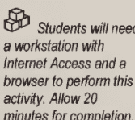

有几个网站致力于自由软件运动，但只会提到其中几个。第一个网站是 www.gnu.org，它是 GNU 项目的主站。该项目于 1984 年启动，旨在构建一个自由的操作系统来取代 UNIX。该小组负责了今天 GNU/Linux 操作系统中许多开发工作。GNU 网站是查找即将启动项目信息的好地方。点击主页上的“软件许可”链接可以找到完整的 GPL 文件。下一页包含一个可以打开 GPL 的链接。

讨论的下一个网站是 www.opensource.org，它是开源运动的基础。该网站包含了开源的定义以及关于它的细节。该组织创造了“开源”一词，但遗憾的是未能对其注册商标。该词被不同的人在不同的语境下以不同的含义使用。该组织对任何软件提供认证，以便验证其为开源。要阅读他们对开源的定义，请点击主页上的“开源”链接。万圣节文档（Halloween documents）也可以在开源网站上找到。在网站的主页可以找到一个链接，它将打开一个包含所有备录及其评论的页面。

打开网站 www.gnu.org 并点击标题为 `Licenses` 的链接。然后点击页面软件许可下标题为 `The GNU General Public License` 的链接。（你可以直接使用以下 URL 打开该页面：www.gnu.org/copyleft/gpl.html）。花几分钟阅读 GNU GPL。


- 2 打开网站 `www.opensource.org` 并点击标题为 `Open Source Definition` 的链接。（或访问 `www.opensource.org/docs/definition.php`）。阅读开源的定义。

# 第 2 单元

## Linux 结构概述

单元时间：40 分钟

完成本单元后，你应该能够：

- A 讨论 Linux 的模块化、多用户和多任务处理方面。
- B 讨论 Linux 文件系统。
- C 解释获取 Linux 的方法。

### 主题 A：整体结构

Linux 是一个模块化、多用户、抢占式多任务操作系统。这些都是极大的优势。我们将逐一查看这些。

### 六大主要组件

模块化是一个极大的优势，因为系统可以缩减到只有必要的部分，从而减少系统开销。在本节中，我们将查看组成 Linux 的六大主要组件（如图 2-1 所示）。

img/f850b93901b8bb4c267df1b99fb6de52_31_0.png)

图 2-1：六大模块

### 内核

内核是作为硬件和软件之间的解释器的核心。内核负责在软件之间分配系统资源。由于内核运行是必需的，它被加载到内存中且不会被交换。系统启动时，内核首先加载，内核将控制权交给 `init`。

### Init

由内核启动，`init` 是内核用于初始化用户空间的模块。因此，`init` 通过检查系统范围的文件来确定运行级别以及要启动的服务。

## Linux 结构概述 2-3

### 守护进程

守护进程是在后台运行的系统进程，监控用户输入并等待执行命令。当进程检测到目标时，它根据命令提供服务。守护进程不直接与用户通信，直到被需要为止。典型的 Linux 配置至少运行 15 个守护进程，可能运行 50 个或更多。

两个典型的守护进程示例：

- `telnet`——当给出 `telnet` 请求时，`telnet` 连接到指定的端口并控制所有会话。
- `httpd`（超文本协议守护进程）——当给出 `http` 请求时，`httpd` 启动处理该请求。

### 登录、shell、工具

登录、shell 和工具允许以下操作：

- 访问用户账户
- 环境配置
- 命令执行
- 系统和应用程序配置

登录工具验证用户名和密码，并允许或拒绝访问。`shell` 访问并监督命令的执行。工具提供用户级服务，例如文件操作、网络配置和内核优化。

## 单用户 vs. 多用户

单用户系统可能具有特殊的程序，允许两个物理用户同时连接到机器。这通常会给人一种系统是多用户操作系统的印象，但从操作系统的角度来说，只有一个用户。这种类型的系统被称为顺序单用户系统。

多用户操作系统允许多个用户同时运行相同的应用程序并访问相同的文件。第一个打开的文件副本可以被编辑，而之后打开的每一个副本都是只读副本。单用户软件不允许多个用户同时使用相同的应用程序或访问文件。

Linux 的根源可以于分时计算（`timeshare computing`）时代，当时许多用户登录大型主机并共享系统的处理能力。这种多用户能力在当今的 Linux 系统中存在，并支持本地和远程的多个并发用户。

## 本地多用户功能

`init` 启动的程序之一是 `getty`。该程序负责请求用户名并启动登录实用。当登录会话结束时，`init` 会重新产生 `getty` 进程。

Linux 的一个有趣特性是它使用了虚拟终端（virtual terminals）。虚拟终端允许你使用单个控制台处理多个登录会话。在大多数发行版中，默认配置将创建六个虚拟终端。你可以通过命令行按下 `ALT-Fx` 来访问这些终端，其中 `x` 是你想要的虚拟终端编号。如果你在 Windows 系统中，可以按下 `CTRL-ALT-Fx` 来访问虚拟终端。

这个功能非常方便，例如当你正在进行某些不能中断的操作（如重新编译内核），而你需要执行另一个任务，你可以切换到另一个虚拟终端，重新登录并完成另一个任务。完成后，你可以切换回之前使用的原始虚拟终端。

如果程序似乎锁定了机器，这很有用。在很多情况下，你可以切换到另一个虚拟终端，以 `root` 用户身份登录并杀死运行异常的进程，而无需重启机器。

## 远程用户

Linux 还允许远程用户通过多种方法登录，如 `login`、`telnet` 和 `ssh`。较旧的协议 `login` 和 `telnet` 是安全的，因为它们在网络数据包中以明文形式传输所有信息。这允许位于你的计算机和远程系统同一网络中的任何机器上的任何人使用数据包嗅探器捕获数据包、打开并读取你的信息。这包括你的用户名和密码。

在网络和互联网的早期，在线人口很少，而且大多数人都在尝试互相帮助，因此安全并不是首要任务。然而，今天是一个不同的世界了，有许多理由导致有人想要进入你的计算机。幸运的是，Secure Shell（即 `ssh`）已经开发出来作为旧协议的替代方案。`ssh` 使用加密来保护在你的计算机和远程主机之间发送的所有数据，包括密码。

## Linux 结构概述 2-5

你应该始终使用 `ssh` 而不是 `telnet` 和 `rlogin`。唯一的例外是在完全信任的网络上，但即使如此，仍建议使用 `ssh`。请记住，大多数安全漏洞源于公司内部，而非外部。

当用户使用任何远程协议连接到远程机器并发布命令时，该程序将在远程机器上使用其处理器和内存资源运行。命令的输出显示在本地机器上。对于用户来说，该程序似乎在本地运行，但它并没有使用本地资源。

通常情况下，不允许 `root` 账户远程连接以作为额外的安全层。然而，这种默认行为可以更改，或者你可以在登录后使用允许切换用户账户的命令，并在知道密码的情况下使用它切换到 `root` 账户。当你远程登录时，你可以执行通常在本地终端上执行的所有操作，甚至重新编译内核。

## 多任务处理

多任务系统具有同时执行多个任务或进程的能力。操作系统处理多任务的基本方法有两种：协作式多任务（`cooperative multitasking`）和抢占式多任务（`preemptive multitasking`）。

### 协作式多任务

在协作多任务系统中，每个进程必须自愿放弃 CPU 的控制权，以便其他进程访问。这依赖于每个进程与其他进程协作。如果控制 CPU 的进程挂起，整个系统也会挂起，因为该进程无法放弃控制权。

协作式多任务用于旧的 Macintosh System 7 和 Windows 3.x 系统。

### 抢占式多任务

在抢占式系统中，操作系统控制哪些进程可以访问 CPU。操作系统为每个进程分配在处理器上的一个时间片（`time slice`）。给予的时间长度可以根据进程的优先级进行调整。如果操作系统需要使用 CPU，它可以抢占、中断正在运行的进程。如果某个进程挂起，它不会影响其他进程。这是一种更好的多任务方法。

抢占式多任务用于 Linux 以及今天使用的绝大多数其他操作系统。

## A-1：讨论 Linux 的结构

### 问答

+ 1 列出 Linux 的六个主要模块。

- `kernel`
- `init`
- `daemons`
- `login/utilities`
- `network`
- `Window system`

+ 2 哪个模块被称为“进程之父”？

- `init`

+ 3 什么定义了可以在命令行界面使用的命令集？

- The `shell`

## 主题 B：Linux 文件系统

Linux 结构概述 2-7

解释

文件系统是磁盘上数据安排的详细约定。文件系统定义了如何从磁盘存储和读取数据。理解文件系统的结构和一些基本用法是重要的。

### 文件系统结构

原始硬盘通常不能被操作系统使用。磁盘必须首先组织成分区。每个分区（或卷）然后必须格式化为文件系统。

### 文件系统对象

所有 Unix 类机器信息的主要仓库是文件树，所有一切都源自根目录 `/`。这个文件树无非是一个层次化的目录集，目录又包含文件系统对象。文件系统对象位于可以挂载和卸载的文件系统中。让我们来看七种文件系统对象类型：

| FSO | 示例 |
|---|---|
| 普通文件 | `/home/torvalds/myfile` |
| 目录 | `/etc/` |
| 符号链接 | `/dev/mouse --> /dev/psaux` |
| 块设备 | `/dev/had` |
| 字符设备 | `/dev/psaux` |
| 套字 | `/tmp/ksocket_torvalds/kdeinit:-0` |
| 命名管道 | `/var/run/xdmctl/xdmctl:-0` |

普通文件是通过文件名访问的存储信息的集合。这包括数据和程序文件。目录可以包含其他目录或其他任何文件系统对象类型。符号链接只是指向另一个文件系统对象的指针。块设备是对硬件块设备（如硬盘和软盘）的抽象。字符设备是对硬件设备（如鼠标）的抽象。套字是进程之间交换数据的机制。命名管道也用于进程间通信，但它不需要两个程序被设计为协同工作。命名管道有时被称为 FIFO，即“先进先出”，这是管道处理数据的方法。

### 文件系统抽象


文件系统抽象是位于伪文件系统中的文件系统对象。`proc` 文件系统是一个伪文件系统，它用于报告程序、设备驱动程序和内核内部事件的状态。对该伪文件系统（或系统抽象）的访问通过 `/proc` 目录获取。换句话说，`/proc` 目录显示文件内容并不是切换硬盘分区，而是切换到一个内核，该内核以一系列目录和文件的形式显示系统状态。

| 抽象 | 描述 |
| --- | --- |
| `/proc` | 提供对内核状态例程序的直接访问 |
| `/dev/xxx0` | 提供对设备 `xx0` 的直接访问 |
| `/dev/null` | 读取时返回文件结束 (`EOF`)，并忽略所有写入的输入 |
| `/dev/zero` | 返回请求的任意数量字符，但均为零字符 |

### 文件系统层次结构标准 (FHS)

分层级文件系统将文件组织成目录，形成一种树形结构。多年来，各种 UNIX 系统和 Linux 发行版修改了文件和目录的组织方式。这些差异会导致跨系统使用的应用程序、脚本、实用程序和开发工具之间出现兼容性问题。为了解决这个问题，开发了文件系统层次结构标准 (`FHS`)，它是关于文件系统的系列要求和指南（如展 2-2 所示）。`FHS` 可以在 `www.pathname/rhs` 找到。

`FHS` 只是被称为 Linux 标准基础 (`LSB`) 的整体标准化工作的一部分。包括 Debian、Red Hat、Hewlett-Packard、IBM 和 Intel 在内的 20 多家企业和组织支持 `LSB`。你可以在 `www.linuxbase.org` 获取有关 `LSB` 的更多信息。

### 使用文件系统

用户通常需要访问存储在可移动介质（软盘、zip 磁盘、CD-ROM 等）文件系统中的数据。要访问这些文件系统以及任何文件系统，必须挂载包含该文件系统的设备，这通过 `mount` 命令完成。

### 监控文件系统

`mount` 命令告诉系统在目录树的何处放置文件并显示所有挂载的文件系统。某些人可能会认为 `mount` 命令挂载的是设备；然而，它挂载的是包含在设备上的文件系统。请看下面的示例，它将 CD-ROM 挂载到 `/mnt/cdrom /cdrom` 目录。

```
$ mount -t iso9660 /dev/hdb /mnt/cdrom
```

`-t` 选项指定文件系统类型。`iso9660` 文件系统类型是许多 CD-ROM 的文件系统；`/dev/hdb /mnt/cdrom` 指定了将第二个 IDE 块设备挂载到目录树的虚拟点 `/mnt/cdrom` 。如果在 `/etc/fstab` 文件中为 CD-ROM 放置了条目，可以使用以下命令挂载 CD-ROM：

```
$ mount /mnt/cdrom
```

注意：要查看哪些文件系统可供挂载，请参考 `/proc/filesystems` 文件。可以使用以下命令：

```
$ cat /proc/filesystems
```

`umount` 命令用于卸载文件系统。

### `/etc/fstab` 命令

通常只有 root 用户可以使用 `mount` 命令来挂载文件系统。文件系统表 `/etc/fstab` 用于赋予用户挂载指定文件系统、默认挂载点的能力，并简化 `mount` 命令的使用。以下是 `/etc/fstab` 文件：

| `/dev/hda3 / ext2 defaults 1 1` |
| `/dev/hdb1 /boot ext2 defaults 1 2` |
| `/dev/cdrom /mnt/cdrom iso9660 noauto,user,ro 0 0` |
| `/dev/hda4 /usr ext2 defaults 1 2` |
| `/dev/fd0 /mnt/floppy auto noauto,user 0 0` |
| `none /proc defaults 0 0` |

从左到右，每一列分别代表以下内容：

- 块设备的文件系统名称
- 文件系统的挂载点
- 文件系统类型
- 挂载选项（默认为 `rw`）
- 倾储频率 (`Dump frequency`)
- 文件系统检查顺序

如果你不想在启动时挂载文件系统，请在挂载选项中指定 `noauto`。`user` 挂载选项允许普通用户挂载该文件系统。

### 绝对路径与相对路径

Linux 遵循 UNIX 采用分层文件名的传统，其中路径指定了目标文件。路径包含起始点、可选目录和文件名。路径分为两种：绝对路径和相对路径。

#### 绝对路径名

绝对路径名始终以斜杠 (`/`) 开头并提供完整路径：

```
/home/duke
```

第一个斜杠 (`/`) 意味着起始或根目录。随后的斜杠 (`/`) 分隔目录名文件名。

#### 相对路径名

相对路径相对于当前目录，且永远不以斜杠 (`/`) 开头。

例如，通过输入 `pwd` 命令，返回当前工作目录：

```
/home/duke
```

输入 `cd home` 将返回错误，因为 `home` 目录是父目录。输入 `cd` 返回家目录。然而，如果从 `/home/duke` 目录输入 `cd mail` 将直接带进入 `mail` 目录，因为 `mail` 是 `/home` 的子目录。

## B-1: 讨论文件系统

问与答

1. 存在多少种文件系统类型？七种

2. `/dev/null` 有什么特殊之处？读取时返回文件结束 (`EOF`)，并忽略所有写入的输入。

3. 什么标准化工作导致了文件系统标准的创建？Linux 标准基础 (`LSB`)

## 主题 C: 获取 Linux 副本

解释

在本节中，我们将查看获取 Linux 副本的不同方法。这包括一些最流行的发行版。

### 困难方法

你可以自己构建。是的，你可以下载源码、编译它们并组装你的系统。如果这听起来很疯狂，请跳到“简单方法”。

最新的内核可以在 `kernel.org` 下载。如果你访问该网站，你会发现所有当前和之前的版本可用。如果你想下载新内核，理解版本号很重要。第一个数字是主版本号。中间的数字是小版本号，最后一个数字是修订。

小版本号告诉你这是否内核。如果数字是偶数，它是稳定的。如果是奇数，它就是开发内核，仅供尝试开发下一个版本的内核黑客（程序员，不是破坏者）下载。例如，可以使用 `2.5.30`。这是一个开发内核。当它被认为是稳定的时，将被重新命名为 `2.6` 或 `3.0.0`，取决于与 `2.4.x` 内核相比差异巨大。

如果你从 Red Hat 等供应商处下载内核，可能还会看到发布版本号。它看起来像这样：`2.4.18-4`。最后一个数字表示这是 Red Hat 发布的 `2.4.18` 内核的第四个构建。

### 从电源到 Bash 提示符 HOWTO

如果你想学习从按下电源按钮到系统完成启动过程期间发生了什么，这个 HOWTO 是一个很好的起点。它将一步步引导你，你将学到关于 Linux 系统中所有组件是如何组合的。你可以在 Linux Documentation Project (`www.tldp.org`) 获取任何 Linux HOWTO 或你需要的任何其他 Linux 文档。

### Linux From Scratch

该文档最初是一个 HOWTO，但通过增加更多信息扩展到了 332 页，现在属于“指南 (`guide`)”类别。你可以在 Linux Documentation Project 获取最新版本的 Linux From Scratch，或者直接访问源站 `www.linuxfromscratch.org`。

## 简易方法

发行版（Distributions，简称 `distros`）是构建功能性 Linux 系统所需的所有组件的集合，加上一些额外内容。正是这些额外内容使得不同发行版之间产生了差异。有些以安装简单著称，有些以稳定性著称，还有些因其分带的软件包数量闻名。

如果你没有时间或兴趣学习 Linux 底层工作原理的细节，可以下载一个发行版的 `iso` 镜像并将其刻录到 CD。如果你没有良好的宽带连接和 CD 刻录机，可以购买包含手册和技术支持的 CD 盒装。如果你想要一个更强大的选项，可以从第三方供应商（如 `www.linuxcentral.com` 或通过 `www.linuxurl.com`）购买不带手册和技术支持的 CD。

最早的两个发行版分别来自 Soft Landing Systems 和 Yggarras。Soft Landing Systems 是第一个提供的发行版。Yggarras 紧随其后，并发布了“即插即用 Linux”，这导致微软推迟了 Windows 95 的发布，直到他们能够与其即插即用功能匹配。遗憾的是，这两家公司目前都没有活跃的发行版。你可以从 `http://www.ibibo.org/pub-historic-linux/distributions/sls/1.05/` 获取 SLS Linux 的副本。Yggd 仍有一个网站 `www.yygras.com`，但内容已经过时。

以下是你可能想要研究的发行版：

### 红帽 Linux (Red Hat Linux)


红帽（www.redhat.com）是目前美国最流行的发行版。红帽是一个完全开源的操作系统，支持 KDE 和 Gnome 桌面，并提供适用于 i386、Alpha 和 SPARC 架构的版本。在三个平台之间实现了架构间的移植性。红帽通过创建 Gnome 桌面、Disk Druid 分区工具以及 Red Hat 软件包管理器 (`RPM`) 为开源软件做出了贡献，`RPM` 已成为软件包管理的行业标准。红帽与 IBM 和 Oracle 等公司合作，通过“Linux 应用库”CD-ROM 或通过使用 `RPM` 下载提供其软件应用。这意味着许多应用程序已经在 CD-ROM 中可用。所包含的应用程序列表包含许多功能，例如 Star Office、`Samba`、`Apache`、`Sendmail` 以及修复和恢复实用。除了发行版外，红帽 Linux 在许多层面上提供服务，从按事件付费到合并支持合同不等。购买 CD-ROM 软件后还提供固定天数的免费支持。红 Linux可以通过 FTP 站点 `http://ftp.redhat.com`、本地零售商或提供红帽认证服务的红帽伙伴获得。红帽围绕其发行版创建了 RHCE（红帽认证工程师）认证。

### 苏SE Linux (SuSE Linux)

SuSE（www.suse.com）是欧洲领先发行版。SuSE Linux 遵循国际标准，适用于 Intel、Alpha 和 Power PC 平台。除了 Linux 发行版，SuSE 还向客户、经销商和分销商提供技术支持、咨询、合作伙伴计划和销售。SuSE 对 Linux 和开源社区的贡献包括内核开发、`XFree86`、`ALSA`、`KDE` 和 `libre`。SuSE 发行版包含了安装和管理工具，以及超过 1,500 个应用程序、详尽的手册和 60 天的安装支持。SuSE 以盒装中提供丰富的软件而闻名。

### 威龙 (Turbolinux)

威龙 Linux（www.turbinolux.com），原名华诚（Pacific HiTech），已成为 Linux 其他发行版中的主要竞争者。得益于企业赞助的大量资源，威龙在亚洲市场占据着有力地位。威龙已成为在日本和中国市场都能与 Windows 竞争的对手。威龙以其网络和集群能力而闻名，成为互联网服务提供商的热门选择。威龙提供可以集成 Windows 的集群软件。威龙的发行版包含了安装和管理工具。威龙的界面安装被认为具有一定难度，它还使用 `fdisk` 进行磁盘分区。`TurboPkg` 是一个作为 `RPM` 界面的管理器。威龙最近推出了 PowerCockpit，这是一个服务器工具，使得部署更加高效、安全且成本效益。

### 卡尔拉 Linux (Caldera Linux)

Caldera Linux（www.caldera.com）被设计为最易用的图形界面之一。大多数系统管理任务可以通过图形界面或命令行完成。这种易用性使得 OpenLinux 成为 Windows 和 Mac 用户的理想选择。这让让它在教育领域广受欢迎。

### Linux 概览

Slackware（www.slack.com）是最早的发行版之一。它于 1993 年 4 月首次发布。它以稳定性闻名，这在很大程度上是因为它仍然基于旧的 Init 系统。Init 系统是由 AT&T 贝尔实验室生产的。使用 Init 系统，Slackware 是最受欢迎的发行版之一。Slackware 的另一个开发版本是 ZipSlack，这是一个约为 40MB 的完整 Linux 系统。ZipSlack 可以在具有 4MB 内存的机器上启动并放入磁盘，让任何人都能随身携带 Linux 系统。

### Debian GNU/Linux

Debian（www.debian.org）是最老的发行版之一。Ian Murdock 在 1993 年 8 月开始了原始版本的 Debian（0.01 版本）。Debian 以其开发方法为豪。秉社区开发的精神，Debian 由全球越来越多的志愿者维护。Debian 保持所有软件包免费且开源。一组开发者意识到需要一种解包工具，于是他们创建了 `dpkg`，它很快成为开源社区的重要贡献。`dpkg` 用于简化安装过程，在软件安装方面运行良好，它不会查找或下载软件包。结果开发了一个新的解包管理器 `dselect`，作为 `dpkg` 的接口。使用 `dpkg`，`dselect` 还会报告依赖和软件冲突。由于 `dselect` 不完全满意，Debian 项目创建了 `apt-get` 作为高级包工具管理器。`apt-get` 是一个文本界面程序，用于安装、升级和删除软件。如果配置正确，`apt-get` 将在预指定的镜像站点搜索互联网并下载请求软件。像 `dselect` 一样，`apt-get` 不仅报告依赖和冲突，还能自动配置软件。

# Yellow Dog Linux

Yellow Dog Linux (www.yellowdoglinux.com)，又称 YDL，是一种针对 Power PC (PPC) 架构的领先 Linux发行版。YDL 由 Terra Soft Solutions 开发和制作，基于 Hat 发行版。

该发行版特有的一个非常实用的工具是 Mac-On-Linux (`MOL`)，它可以在 Linux 中运行 Mac OS。这使得基于 OS 的程序无需重启即可运行。它支持 OS 7.5.2 到 9.2.2，在 shell 提示符中执行 `startmol` 命令将会在 X 下打开一个 Mac OS 会话。

可以从网站下载 Yellow Dog Linux，也可以通过 CD-ROM 光盘购买，或者在本文编写时购买预装在新硬盘上的版本。

# UnitedLinux

Caldera、SuSE 和 Turbolinux 合作开发了一款面向企业用户的、基于标准的 Linux 系统。尽管它是作为团队合作的成果正在开发，但 UnitedLinux (www.unitedlinux.com) 将由这每家公司以其自己的品牌进行销售。它所基于的标准包括：Linux 标准基础 (`LSB`)、文件系统层级标准 (`FHS`)、基于 Web 的管理 (`WBEM`)、可扩展标记语言 (`XML`)、简单对象访问协议 (`SOAP`) 等。

# C-1: 讨论如何获取 Linux

### 问题与答

+ 1 Linux 内核的官方网站是什么？

`www.kernel.org`

+ 2 你如何判断你所拥有的 Linux 内核是稳定版还是测试版？

稳定内核使用偶数次要版本号——例如，`2.4.19` 是稳定内核，因为 4 是一个偶数。

+ 3 在网上哪里可以找到所有的 Linux HOWTO 和指南？

Linux 文档项目，`www.tldp.org`

# 单元总结：Linux 结构概览

### 主题 A

在本节中，你学习了 Linux 的六个主要模块以及它们在系统中各自扮演的角色。你学习了 Linux 的多用户能力，以及本地登录与远程登录的区别。你还比较了协作式和抢占式多任务。

### 主题 B

接下来，你学习了文件系统结构，包括文件系统对象和文件系统抽象。你了解了为什么要创建文件系统层级标准 (`FHS`)，并学习了在使用文件系统之前需要做哪些工作，包括分区硬盘、格式化文件系统以及挂载文件系统。你学习了绝对路径和相对路径的区别。

### 主题 C

然后对比了“从零构建 Linux (Linux from Scratch)”与直接获取发行版的区别。你学习了一些发行版的历史，并发现了几个目前比较流行的发行版。你还学习了这些发行版的某些独特特性。

## 独立练习活动

+ 1 描述抢占式多任务。

操作系统始终控制着哪个进程可以使用 CPU。它不依赖于进程表现良好且协作。

+ 2 你想防止用户在你的 Linux 机器上使用软盘。如何实现这一点？

编辑 `/etc/fstab` 并移除 `user` 挂载选项。

+ 3 如何立即区分一个路径是绝对路径还是相对路径？

绝对路径始终以斜杠 (`/`) 开头，而相对路径永远不会。

+ 4 北美最流行的 Linux 发行版是什么？

Red Hat Linux

+ 5 哪种目标针对企业用户的发行版，正由多个 Linux 发行版供应商共同开发？

United Linux

# 第3单元

## 引导加载程序和启动问题

单元时间：40 分钟

完成本单元后，你应该能够：

+ A 配置并排错 `LILO`。
+ B 配置并排错 `GRUB`。
+ C 讨论多启动和 `MBR`（主引导记录）。

### 主题 A: LILO

#### 解释

Linux Loader (`LILO`) 是一种引导加载器程序，允许计算机加载 Linux。然而，`LILO` 不限于用于 Linux；它也可以用于加载其他操作系统：

- MS-DOS
- Windows
- UNIX

由于 `LILO` 可以用于多个操作系统，它提供了在启动时选择内核的选项。由于 `LILO` 能够处理多个操作系统，它允许用户在启动时选择启动项。在 shell 提示符中执行 `startmol` 命令将在 X 下打开一个 Mac OS 会话。


在分区硬盘、格式化文件系统以及挂载文件系统之后，文件系统可以使用之前需要完成这些工作。LILO 引导程序可以特定的引导信息。在典型的启动过程中，LILO 加载主引导记录 (MBR)。在第一块硬盘的磁盘分区上，LILO 存储特定的信息。通过编辑 `/etc/lilo.conf` 配置 LILO 引导程序。`lilo.conf` 由两个部分组成：一个带有全局信息的部分，另一个是特定于操作系统的镜像部分。所有的内核选项可以在全局部分或镜像部分设置。除了一个选项外，所有的内核选项可以在全局部分或镜像部分设置。以 (`#`) 符号开头的行是注释。LILO 引导程序可以特定的引导信息。通过编辑 `/etc/lilo.conf` 配置 LILO 引导程序。`lilo.conf` 由两个部分组成。在第一块硬盘的磁盘分区上，LILO 存储特定的信息。通过 `/etc/lilo.conf` 配置 LILO 引导程序。`lilo.conf` 由两个部分组成。

在全局部分，，一个特定于操作系统的镜像部分镜像部分选项。全局部分部分部分部分镜像部分。是全局选项。在上述例子中，第一行是注释。

### 全局选项

```
### Start LILO global section
prompt
timeout=50
default = linux
boot = /dev/hda
vga = normal
append = "mem=256M"
```

在上述例子中，前四个选项 `prompt`、`timeout`、`default` 和 `boot` 是全局选项，剩下的两个 `vga` 和 `append` 是内核选项。内核选项可以在全局部分或镜像部分设置。

## 引导加载程序和启动问题 3-3

`prompt` 指令强制 LILO 在不按键的情况下显示提示符。`timeout` 指定了在加载默认镜像之前等待输入的时间（以秒为为）。`default` 选项指定要加载的镜像。如果省略 `default`，则列出的第一个镜像将成为默认。`boot` 指令指示 LILO 将加载在哪里。由于示例中没有指定分区号，LILO 将加载到第一个硬盘的 MBR。下一行设置显示为 80x25。如果设置为 extended，显示将变为 80x50。

偶尔内核可能无法正确检测系统的内存大小。如果发生这种情况，你可以通过 `lilo.conf` 中的 `append` 选项告诉内核系统有多少内存。我们的配置文件显示我们有 256MB 内存。除了一个选项外，所有的内核选项都可以在全局部分或镜像部分设置。有二十多个全局选项。关于 `lilo.conf` 全局选项的信息，请在命令行输入 `man lilo.conf` 查看手册。

### 镜像设置

LILO 要求为每个需要启动的内核版本或操作系统在 `/etc/lilo.conf` 中准备一个镜像。每个启动镜像都有几个必选设置和许多可选设置。`lilo.conf` 中的镜像部分将类似于：

```
### default linux image
image=/boot/mlinux-2.4.18-3
label=linux
password=xxxx
read-only
root=/dev/hda3
```

在之前的示例中，前三个选项 `read-only` 和 `root` 是内核选项。在镜像部分输入的内核选项将覆盖全局部分指定的任何内容。

第一个选项 `image` 用于识别 Linux 内核。对于 Linux 以外的操作系统，使用另一个选项代替 `image`。

`label` 选项为操作系统分配一个关键字，以便在启动提示符中使用。LILO 启动提示符只需输入标签名称并按回车。

`password` 选项指示该镜像需要密码才能启动。如果使用了此选项，用户必须确保 `/etc/lilo.conf` 仅对 root 可读，因为密码是以明文形式存储在该文件中。

## 3-4 SAIR GNU: 安装与配置

`root` 设置指定了应被挂载为根文件系统的设备。如果省略了该设置，则将使用内核镜像中的设置。在示例中，`/dev/hda3` 位于第一个 IDE 驱动器的第三个分区上，它是根文件系统所在的位置。

### LILO 如何使用 `lilo.conf`

对 LILO 配置文件所作的更改不会立即生效。在修改 `/etc/lilo.conf` 后，你必须运行 `/sbin/lilo`。此程序读取存储在 `/etc/lilo.conf` 和分区表的信息，然后将其写入 `/etc/lilo.conf` 中 `boot` 设置指定的 location。在以下任何情况下，你都应该运行 `/sbin/lilo`：

- 现有内核被重命名或移动到不同的位置。
- 编译了新内核。
- 分区表发生了变化。
- `lilo.conf` 文件被修改。

为了使对 `/etc/lilo.conf` 文件的更改生效，你必须运行 `/sbin/lilo`。你可以使用以下命令测试 LILO 将要执行的操作，而无需实际进行任何更改：

```
/sbin/lilo -t
```

你可以通过添加 `-v` 选项来获取 LILO 的详细输出以及更多信息。

内核参数可以从 LILO 提示符手动传递给内核。

### LILO 故障排除

让我们来看看在使用 LILO 时可能会遇到的一些常见问题。

### 内核安装在 1024 之外

旧系统上的 BIOS 仅支持通过柱道:扇区(C:S) 对硬盘进行寻址。柱道设置被限制为 10 位。这导致了 BIOS 访问 1024(2^10) 个柱道的限制。后来的 BIOS 版本允许使用线性块寻址 (LBA) 访问更大硬盘的附加路径。

如果内核加载在 1024 之上的柱道上，BIOS 可能在启动时无法读取它。这可能导致 LILO 在尝试启动时显示错误。新版本的 LILO 支持 LBA，但你必须通过在 `/etc/lilo.conf` 的全局设置中添加 `lba32` 选项来告诉 LILO 使用新的 BIOS 程。

Linux 内核在访问硬盘方面没有任何限制。因此，如果你在系统上遇到此问题，可以使用带有 Linux 内核的 Linux 启动盘启动系统，然后在 LILO 配置文件中添加 `lba32` 选项并再次运行 `/sbin/lilo`。

确保内核始终位于前 1024 个柱道的常用方法是在磁盘上创建一个较小的 `/boot` 分区作为磁盘的第一个分区。由于 Linux 内核的大小通常为 1MB 或更小，因此该分区不需要很大。常见的大小范围在 10MB-50MB 之间。这为系统中添加新内核留下了空间。

### LILO 启动错误代码

当 LILO 加载时，会逐个显示 L、I、L 和 O 字母。每当完成部分加载，就会显示一个字母。如果 LILO 加载出现困难，所有的字母可能都不会出现。根据已加载的字母，用户可以确定出现问题的原因。

| 输出 | 说明 |
| --- | --- |
| <none> | LILO 未开始加载。LILO 可能未安装，或者加载 LILO 引导扇的分区未被标记为活动（active）。 |
| L | LILO 开始加载。然而，无法加载第二阶段引导程序。这种状态可能是由介质故障（即磁盘坏道）或磁盘几何结构不匹配（即磁盘参数未正确设置）引起的。 |
| LI | 引导程序的两个阶段都已成功加载。然而，无法执行第二阶段引导程序。这种状态可能是由几何结构不匹配，或在没有运行 map 安装程序的情况下移动了 `/boot/boot.b` 引起的。 |
| LIL | 第二阶段引导程序已成功启动。然而，它无法从 map 文件中加载描述表。这种状态是由介质故障或磁盘几何结构不匹配引起的。 |
| LIL? | 第二阶段引导程序被加载到了错误的地址。这种状态是由轻微的几何结构不匹配，或在没有运行 map 安装程序的情况下移动了 `/boot/boot.b` 文件引起的。 |
| LIL- | 描述表已损坏。这可能是由几何结构不匹配，或在没有运行 map 安装程序的情况下移动了 `/boot/map` 文件引起的。 |
| LILO | LILO 加载成功。 |

## A-1: 使用 LILO

以下是操作方法：

1. 以普通用户身份登录到你的工作站。
2. 使用 `su` 命令切换到 root 账户。你需要输入 root 用户的密码。
3. 使用文本编辑器修改 `/etc/lilo.conf`。通过在配置文件开头添加哈希标记 (`#`) 来注释掉配置中的超时行。你认为你的更改会对系统产生什么影响？
4. 同样注释掉 `message=/boot/message` 这一行。这将禁用启动时的图形化 LILO 屏幕，并仅显示 LILO 启动提示符。
5. 运行带有详细输出的 LILO 命令：`/sbin/lilo -v`。这将导致 LILO 读取更改后的配置文件并在下次启动时使你的更改生效。
6. 输入 `reboot` 并按回车。系统将重启并在 LILO 启动提示符处等待输入。
7. 输入 `linux single`，然后按回车。这将强制系统进入单用户模式。

## 项目设置

与 LILO 中的每个镜像选项类似，GRUB 允许你指定仅适用于特定项目的设置。让我们来分析一下 `grub.conf` 文件的这部分：


```
title linux (2.4.18-3)
root (hd0,1)
kernel /vmlinuz-2.4.18-3 root=/dev/hda3
initrd /initrd-2.4.18-3.img
```

第一行以关键字 `title` 开头，后跟一个管理员可以分配的任意名称。该名称将在系统启动期间显示在 GRUB 菜单中。

第二行指示 `/boot` 所在的位置。这被称为 GRUB 设备。在本例中，它位于第一块硬盘的第二个分区上。

第三行指定了要启动哪个 Linux 内核，并且它是相对于 `/boot` 的路径。内核名称之后是任何需要传递给内核的内核参数。在这里，你将使用标准的设备命名，因为解释它的是内核而不是 GRUB。

最后一行指示了初始内存磁盘（initial ramdisk）的路径。这同样是相对于 `/boot` 的。

## GRUB 故障排除

如果你在编辑 `/etc/grub/grub.conf` 时犯了错误，可以通过按 `e` 修改菜单参数来编辑菜单项。另一种方法是在菜单处按 `c` 进入 GRUB 命令行模式。如果你为 GRUB 配置了密码，则在你按 `p` 并输入正确密码之前，这些菜单选项将不可用。

如果你在图形化 GRUB 启动菜单上遇到问题，可以使用 Linux 启动盘启动，然后编辑 `/boot/grub/grub.conf`，通过在行开头添加井号（`#`）来注释掉 `splashimage`，或者直接完全删除该行。当你重启系统时，将获得文本界面。

## B-1：使用 GRUB

### 操作步骤

- 1. 以 root 身份登录系统。
- 2. 查看 LILO 配置文件的内容：`cat /etc/lilo.conf`
- 3. 注意在全局设置中配置的启动设置以及在每个镜像设置中配置的 root 设置。将它们记录在这里：
- 4. 使用以下命令检查 GRUB 配置文件的权限：`ls -l /boot/grub/grub.conf`。文件的所有者是谁？所有者、组和其他对该文件拥有什么权限？
- 5. 输入 `cat /boot/grub/grub.conf`。
- 6. 在你内核的 `title` 部分下，找到 GRUB root 分区。这应该与 `/boot` 挂载的位置匹配。你可以通过输入 `cat /etc/fstab` 来检查 `/boot` 挂载在哪里。如果文件系统表使用标签名称（label），输入 `e2label <device>` 来查找每个分区的标签。
- 7. 验证内核行中的 `root` 设置是否与 LILO 配置文件的 `root` 指令匹配。
- 8. 使用文本编辑器对 GRUB 配置文件进行任何必要的修正。
- 9. 如果所有设置都正确，输入 `grub-install <device>` 将 GRUB 安装到 MBR，其中 `<device>` 与 LILO 配置文件中的 `boot` 指令（注：此处原文可能笔误，应为 `root`）匹配。
- 10. 输入 `reboot` 并确保系统使用 GRUB 启动系统。

## 主题 C：启动问题

### 解释

在本主题中，你将发现配置系统进行多启动的一些原因。你还将探索在处理 MBR 时需要执行的某些步骤。

### 多启动

多启动系统是指在启动过程中有多个选项供选择的系统。

### 启动多个 Linux 内核

拥有多启动系统的一个原因是你可能决定升级内核。当你升级时，你可能希望旧内核仍然可用，以防升级过程中出现问题。

配置系统启动另一个内核非常简单，只需编辑你启动加载程序的相应配置文件，并指定新内核的位置。如果你使用 LILO，请记住在完成更改后运行 `/sbin/lilo`。以下是我们修改后用于启动新内核的示例 `/etc/lilo.conf` 文件：

```
boot = /dev/hda
delay = 50
default = linux
vga = normal
read-only
append = "mem=256M"
image=/boot/vmlinuz-2.4.18-3
label=linux
password=xxxx
root=/dev/h3
image=/boot/vmlinuz-2.4.19
label=newkernel
password=xxxx
root=/dev/hda
```

通过此配置，旧内核仍然是默认内核，但管理员可以通过输入 `newkernel` 启动新内核。注意我们仍然使用相同的 root，因此唯一的更改是 `image` 和 `label`。

### 启动多个 Linux 发行版

有些人需要或想要备有多个 Linux 发行版可用。资金和空间限制可能会阻止使用多台机器。例如，如果你想测试不同的 Linux 发行版，你可能不需要购买机器。即使你买了机器，你可能也没有足够的地方放置所有它们。幸运的是，Linux 使用的启动加载程序允许你在同一台机器上启动多个发行版。

## GNU：安装与配置

让我们看看之前处理过的 `/boot/grub/grub.conf` 文件，但它是被修改为另一个发行版之后的状态。

```
default=1
timeout=10
splash (hd0,1)/grub/splash.gz
title linux (2.4.18-3)
root (hd0,1)
kernel /vmlinuz-2.4.18-3 root=/dev/sda3
initrd /initrd-2.4.18-3.img
title linux (2.4.19)
root (hd0,1)
kernel /vmlinuz-2.4.19 root=/dev/sda3
initrd /initrd-2.4.19.img
```

在本例中，另一个 Linux 发行版安装在第一块硬盘的扩展分区上。这个新发行版运行的是 2.4.19 内核。如果有另一个硬盘可用，新发行版可以安装在那里。

### 使用 Linux 和 Windows 启动

许多人使用多启动系统，在启动机器时可以在 Linux 和 Windows 系统之间进行选择。LILO 和 GRUB 启动 Windows 95/98/ME/NT/2000/XP 的能力很重要，因为它允许新手尝试 Linux 并在熟悉 Linux 之前将重要数据保留在 Windows 中。

先安装 Windows 或 Linux，然后为机器配置多启动都是可能的。如果你先安装了 Windows，可以配置 Linux 来实现多启动；如果你先安装了 Linux，也可以配置 Windows 来实现多启动。

如果你在编辑 `/etc/grub/grub.conf` 时犯错误，可以通过按 `e` 修改菜单参数来编辑菜单项。另一种方法是在菜单处按 `c` 进入 GRUB 命令行模式。如果你为 GRUB 配置了密码，则在你按 `p` 并输入正确密码之前，这些菜单选项将不可用。

如果你在图形化 GRUB 启动菜单上遇到问题，可以使用 Linux 启动盘启动，然后编辑 `/boot/grub/grub.conf`，通过在行开头添加井号（`#`）来注释掉 `splashimage`，或者直接完全删除该行。当你重启系统时，将获得文本界面。

### 主引导记录

主引导记录（MBR）位于磁盘的道 0、头 0、扇区 1。它由三部分组成。第一部分长度为 446 字节，用于存放小型加载程序。接下来 64 字节包含分区表，最后部分是一个字节签名。

由于 MBR 中的加载器限制为 446 字节，它通常会调用存储在磁盘其他地方更复杂的加载器。这个小的加载器被称为第一阶段加载器。功能更大的加载器被称为第二阶段加载器。LILO 和 GRUB 都有第一和第二阶段。当你将它们安装到 MBR 时，只有第一阶段存储在那里。

### 备份 MBR

当你安装 Linux 时，可以选择将启动加载程序安装到 MBR 或根分区的引导扇。默认是安装到 MBR。在大多数情况下运行良好。在某些情况下，它可能会阻止你启动先安装的操作系统。

幸运的是，LILO 在覆盖 MBR 之前会创建一个副本。该副本保存为 `/boot/boot.NNNN`，其中 NNNN 取决于设备。你可以手动备份 MBR。如果你想在安装 Linux 之前这样做，你需要使用 Linux 启动盘来获取

### 备份 MBR

你可以使用 `dd` 命令备份 MBR。以下命令行将把 MBR 备份到软盘上名为 `MBR` 的文件中：

```
### dd if=/dev/hda of=/dev/fd0/MBR bs=512 count=1
```

## 3-14 SAIR GNU: 安装与配置

### 恢复主引导记录 (MBR)

你可以使用备份时使用的相同命令来恢复 MBR，但选项略有不同：

```bash
### dd if=/dev/fd0/MBR of=/dev/hda bs=446 count=1
```

这次输入文件和输出文件反过了。如果你是从由 LILO 创建的备份文件进行恢复，请使用 `if=/boot/boot.BNNN`。如果你只需要恢复第一阶段加载程序，则应提供 446 字节的块大小。

如果你在安装 Linux 之前安装了 Windows，并想恢复到 Windows 引导程序，可以使用 Windows 9x 引导软盘启动系统，然后运行命令：


```bash
fdisk /mbr
```

如果你安装了 Windows NT/2000/XP，则需要运行 Windows 安装程序并选择“修复”选项。选择“检查引导扇”和“恢复启动环境”选项。

执行吧！

## C-1: 讨论启动问题

| 问题与解答 |

| :--- | :--- |

| 1 为什么在编译新内核后想为系统设置多系统启动？ | 如果新内核无法工作，你仍然可以启动旧的可用内核。 |

| 2 你想配置 LILO 启动到新内核。你需要使用哪个关键词在 LILO 文件中指定此新内核？ | `Image` |

| 3 主引导记录 (`MBR`) 位于何处？ | 硬盘的第一个扇区——磁柱面 0，磁头 0，扇区 1 |

## 单元总结：引导程序与启动问题

### 主题 A

在本主题中，你学习了 LILO。你发现了 LILO 配置文件 `/etc/lilo.conf` 的名称和位置。你还检查了 `lilo.conf` 中用到的一些选项。你了解了 LILO 可能出现的一些问题以及如何排除故障。

### 主题 B

本主题涵盖了 GRUB。你发现 GRUB 的配置文件是 `/boot/gr/grub.conf`。讨论了配置中一些关键选项。你还学习了两种用于 GRUB 的故障排除方法。

### 主题 C

本主题讨论了启动问题，包括多系统启动和主引导记录。你学习了如何配置系统以启动多个内核发行版甚至多个操作系统。你学习了如何备份和恢复 `MBR`。

## 独立练习活动

- LILO 的缩写是什么？

  Linux Loader（Linux加载器）

- 你想配置 LILO 启动提示符，在加载默认镜像之前等待三十秒。你在 LILO 配置文件中设置什么设置？

  `timeout=30`

- 你在机器上安装了 Linux，当尝试启动系统时，它报告找不到内核。最可能的问题是什么？

  * 内核可能安装在了硬盘的第 1024 个磁柱之后。

- 当你使用 `cat /proc/meminfo` 检查内存时，发现 Linux 仅识别出安装的 512MB RAM 中的 128MB。你如何使用 LILO 修复这个问题？

  在 `/etc/lilo.conf` 的全局选项中添加 `append = "mem=512m"`，然后运行 `/sbin/lilo`

- GRUB 的缩写是什么？

  GRUB Unified Loader（GRUB统一加载器）

- 你想配置 GRUB 菜单在加载默认镜像之前等待三十秒。你在 GRUB 配置文件中添加什么设置？

  `timeout=30`

- LILO 和 GRUB 的密码支持有什么区别？

  GRUB 支持以 MD5 格式或明文存储密码。LILO 只支持明文。

- `MBR` 包含什么？

  第一阶段引导程序、分区表和签名。

# 第 4 单元

### 安装前规划

单元时长：120 分钟

完成本单元后，你将学会：

- **A** 收集并分析系统的当前硬件配置。
- **B** 识别并解决硬件不兼容性问题。
- **C** 描述磁盘分区策略，包括双系统启动。
- **D** 描述配置网络主机所需的信息。
- **E** 描述安装 Linux 系统的安装介质选择。
- **F** 从 CD 安装 Red Hat Linux。

### 主题 A: 硬件检查与分析

说明

当前的硬件配置已不再像以前那样关键了。要识别硬件，你可以使用各种工具。在本节中，你将学习如何分析硬件组件。

### 系统信息

最新版本的 Linux 可以自动检测硬件。在某些情况下，你可能需要手动识别硬件。要收集信息，你可以检查系统日志。

### 硬件文档

获取硬件信息的最佳地方是原始文档。如果你没有文档，请尝试联系供应商或搜索他们的网站。

### Linux 诊断

Linux 并没有提供一个可以提供所有信息的单一程序。其中一个命令是 `dmesg`，它显示启动时的内核消息。你也可以检查 `/proc` 目录下的文件来确定系统资源的使用情况。

### Windows 系统信息

如果你在已运行 Windows 的机器上安装 Linux，控制面板中的系统信息可以提供概述。“常规”选项卡将提供处理器速度和内存容量等基本信息。“设备管理器”选项卡将提供计算机上硬件及其相关程序的详细列表。

### 硬件诊断

收集系统信息的另一种方法是运行如 `msd.exe` 的诊断程序。此微软诊断工具可以创建系统配置的详细报告。如果没有安装操作系统，可以将它放在可启动的 MS-DOS 或 MS Windows 95/98/ME 软盘中。

## A-1: 查看和使用 proc 文件系统

方法

1. 登录你的机器。
2. 如果尚未启动 X 会话，请启动它。
3. 打开终端窗口。
4. 使用 `su` 命令变为超级用户（root）。
5. 进入 `/proc` 目录并使用 `ls` 命令显示其内容。
6. 哪些项是文件，哪些是目录？

   使用 `-l`。权限位以 "d" 开头的条目是目录。或者，在终端窗口或控制台 bash 提示符中执行 `ls` 命令。蓝色条目是目录。（这是一个未修改默认 bash 配置的标准 Red Hat 系统。其他 Linux 发行版可能会修改 `ls` 的颜色。此外颜色方案是可以自定义的）。
7. 有链接吗？

   使用 `-l`。权限位以 "l" 开头的条目是链接。或者，在终端窗口或控制台 bash 提示符中执行 `ls` 命令。青色条目是链接。（这是一个未修改默认 bash 配置的标准 Red Hat 系统。其他 Linux 发行版可能会修改 `ls` 的颜色。此外颜色方案是可以自定义的）。
8. 显示 `/proc/interrupts` 的内容。在该文件中可以找到什么信息？

   设备硬件中断分配
9. 尝试选择其他你认为感兴趣的文件并显示其内容进行实验。

## 主题 B：硬件兼容性问题

解释

Linux 在优化旧款个人电脑（PC）的资源方面表现出色。在组装 Linux 时，通常会购买较廉价的硬件或“回收”旧硬件。虽然这种策略通常有效，但管理员有时必须处理不兼容的硬件。当系统组件和选项没有设备驱动程序时，问题就会出现。

虽然大多数发行版都能在大多数现代 PC 上无缝安装，但某些系统使用了用 MS Windows 驱动软件来替代硬件功能的选项。此类选项（例如所谓的 Win Modem 调制调器）在 Linux 系统上存在问题，且通常是没用的。

为了确保硬件兼容性，管理员必须将列出的 PC 组件与兼容列表进行对比，例如可以在 `www.metalab.unc.edu/LDP/Hardware-HOWTO.html` 找到列表。

### PC 架构

在处理 PC 主板及其组件时，会出现若干配置问题。要理解 Linux 的安装过程，必须首先理解通用 PC 是如何构建的。

CPU 是系统的核心。如今大多数 PC 使用 Intel 或 AMD 的 CPU。Linux 完全支持这两个品牌的 CPU。

CPU 通过内存总线和 I/O 总线连接到内存及外围设备。

### 内存

根据系统的年代，内存总线的运行速度可能从 66MHz 到 133MHz（使用 DDR 内存为 266MHz）。内存子系统支持多种连接器和内存类型。两种广泛使用的连接器技术是 SIMM（单直插内存模块）和 DIMM（双直插内存模块）。

SIMM 模块具有 72 引脚（尽管非常旧的基于 386 的系统可能有 30 引脚），通常使用 FPM 或 EDO 内存（内存类型详见下文）。

DIMM 模块具有 168 引脚（台式机或服务器 PC 系统）或 144 引脚（笔记本电脑）。DIMM 格式中最常见的内存类型是 SDRAM，DDR RAM 也以 DIMM 格式提供，但与 SDRAM 不向下兼容。

### 安装前规划

### 内存类型、速度与兼容性

以下列表总结了各种类型的内存：

- DRAM（动态随机存取存储器）：DRAM 是计算机中使用的基本内存类型。随机访问意味着 CPU 可以访问内存设备中的任何位置。动态意味着单个存储单元必须刷新（通常每几毫秒一次），否则单元内的数据将丢失。
- FPM（快速页存模式）：DRAM 被组织成列和行。一个很好的类比是电子表格。列和行的交点唯一地标识一个单元格。FPM DRAM 在页内选择列，与早期的架构相比，改进了整体内存访问时间。
- EDO（扩展数据输出）：EDO DRAM 是奔腾（级）系统上可用的一种技术。在不涉及过多细节的情况下，EDO 支持向 CPU 提供更短的读取周期，并在 CPU “释放”地址后保持被寻址数据的有效性。这允许更快的 CPU 更高效地利用可用周期访问内存，并提高整体访问。
- SDRAM（同步动态随机存取存储器）：SDRAM 仅仅是与 CPU 时钟同步运行的 DRAM。这允许 SDRAM 以系统总线（通常称为前端总线或 FSB）的速度运行。
- DDR（双倍数据速率内存）：DDR 是运行速度是标准 SDRAM 两倍的 DRAM。同样，在不涉及过多细节的情况下，DDR 同时利用时钟的上升沿和下降沿来双倍传输率（SDRAM 只使用系统时钟的上升沿）。


- `RDRAM`（Rambus DRAM）：Rambus 是 Rambus IC 创建的新型内存设计。它使用 18 位总线，而不是当前 PC 标准 32 位或 64 位总线。`RDRAM` 与 `DDR RAM` 一样使用系统时钟的上升沿和尾沿，但传输数据更频繁。`RDRAM` 的传输速度可超过 800 MHz。`RDRAM` 还使用一种名为 Rambus 直插模块（`RIMM`）的专用连接技术。

- 校验（Parity）与 ECC：在列出的所有内存类型中（仅可用非校验的 EDO 外），都有非校验或 ECC 版本可供选择。校验内存和某些 SDRAM 校验内存使用一个额外的位作为数据的一致性检查。校验内存可以检测但无法纠正数据错误。

- ECC 内存使用多个额外的位作为计算出的纠错码。ECC 内存可以检测数据错误并通常可以纠正单比特错误。

在 SDRAM 之前，内存速度用纳秒描述。EDO DRAM 可能被描述为“60 纳秒内存”。有了 SDRAM，这种描述方式不再准确，因为 SDRAM 的速度与前端总线（`FSB`）的速度直接相关。SDRAM 最常见的速度为 66、100 和 133 MHz。

`DDR RAM` 目前运行在 266 MHz。

# 内存兼容性问题

内存的类型和速度应始终符合 PC 制造商的规范。

非校验、校验和 ECC 内存通常不能混合。大多数 PC 系统的 `BIOS` 会检查不匹配，并警告用户或禁用系统启动。如果 `BIOS` 允许安装不匹配的内存，始终是一个坏主意，并会导致系统不稳定和数据损坏。

`FPM` 和 `EDO` 内存虽然共享内存模块配置（`SIMM`），但不能混合使用。

不同速度的 SDRAM `DIMM` 是向下兼容的。例如，`PC133` (133 MHz) SDRAM 可以在具有 100 MHz 前端总线的系统上运行。然而，内存将仅 100 MHz 运行。不应混合使用不同速度的 SDRAM `DIMM`。在许多情况下，系统会出现问题。

`DDR RAM` 不与 `SDRAM` 兼容。

### 内存配置

内存的类型和速度应始终符合 PC 制造商的规范。

非校验、校验和 ECC 内存通常不能混合使用。大多数 PC 系统的 `BIOS` 会检查不匹配，并警告用户或禁用系统启动。如果 `BIOS` 允许安装不匹配的内存，始终是一个坏主意，并会导致系统不稳定和数据损坏。

`FPM` 和 `EDO` 内存虽然共享内存模块配置（`SIMM`），但不能混合使用。

不同速度的 SDRAM `DIMM` 是向下兼容的。例如，`PC133` (133 MHz) SDRAM 可以在具有 100 MHz 前端总线的系统上运行。然而，内存将仅 100 MHz 运行。不应混合使用不同速度的 SDRAM `DIMM`。在许多情况下，系统会出现问题。

`DDR RAM` 不与 `SDRAM` 兼容。

### PC 架构

在处理 PC 主板及其组件时，会出现若干配置问题。要理解 Linux 的安装过程，必须首先理解通用 PC 是如何构建的。

`CPU` 是系统的核心。如今大多数 PC 使用 Intel 或 AMD 的 `CPU`。Linux 完全支持这两个品牌的 `CPU`。

`CPU` 通过内存总线和 I/O 总线连接到内存及外围设备。

### 内存

根据系统的年代，内存总线的运行速度可能从 66MHz 到 133 MHz（使用 `DDR` 内存为 266MHz）。内存子系统支持多种连接器和内存类型。两种广泛使用的连接器技术是 `SIMM`（单直插内存模块）和 `DIMM`（双直插内存模块）。

`SIMM` 模块具有 72 引脚（尽管非常旧的基于 386 的系统可能有 30 引脚），通常使用 `FPM` 或 `EDO` 内存（内存类型详见下文）。

`DIMM` 模块具有 168 引脚（台式机或服务器 PC 系统）或 144 引脚（笔记本电脑）。`DIMM` 格式中最常见的内存类型是 `SDRAM`，`DDR RAM` 也以 `DIMM` 格式提供，但与 `SDRAM` 不向下兼容。

### 安装前规划

### 内存类型、速度与兼容性

以下列表总结了各种类型的内存：

- `DRAM`（动态随机存取存储器）：`DRAM` 是计算机中使用的基本内存类型。随机访问意味着 `CPU` 可以访问内存设备中的任何位置。动态意味着单个存储单元必须刷新（通常每几毫秒一次），否则单元内的数据将丢失。

- `FPM`（快速页存模式）：`DRAM` 被组织成列和行。一个很好的类比是电子表格。列和行的交点唯一地标识一个单元格。`FPM DRAM` 在页内选择列，与早期的架构相比，改进了整体内存访问时间。

- `EDO`（扩展数据输出）：`EDO DRAM` 是奔腾（级）系统上可用的一种技术。在不涉及过多细节的情况下，`EDO` 支持向 `CPU` 提供更短的读取周期，并在 `CPU` “释放”地址后保持被寻址数据的有效性。这允许更快的 `CPU` 更高效地利用可用周期访问内存，并提高整体访问。

- `SDRAM`（同步动态随机存取存储器）：`SDRAM` 仅仅是与 `CPU` 时钟同步运行的 `DRAM`。这允许 `SDRAM` 以系统总线（通常称为前端总线或 `FSB`）的速度运行。

- `DDR`（双倍数据速率内存）：`DDR` 是运行速度是标准 `SDRAM` 两倍的 `DRAM`。同样，在不涉及过多细节的情况下，`DDR` 同时利用时钟的上升沿和下降沿来双倍传输率（`SDRAM` 只使用系统时钟的上升沿）。

- `RDRAM`（Rambus DRAM）：Rambus 是 Rambus IC 创建的新型内存设计。它使用 18 位总线，而不是当前 PC 标准 32 位或 64 位总线。`RDRAM` 与 `DDR RAM` 一样使用系统时钟的上升沿和尾沿，但传输数据更频繁。`RDRAM` 的传输速度可超过 800 MHz。`RDRAM` 还使用一种名为 Rambus 直插模块（`RIMM`）的专用连接技术。

- 校验（Parity）与 ECC：在列出的所有内存类型中（仅可用非校验的 EDO 外），都有非校验或 ECC 版本可供选择。校验内存和某些 SDRAM 校验内存使用一个额外的位作为数据的一致性检查。校验内存可以检测但无法纠正数据错误。

- ECC 内存使用多个额外的位作为计算出的纠错码。ECC 内存可以检测数据错误并通常可以纠正单比特错误。

在 `SDRAM` 之前，内存速度用纳秒描述。`EDO DRAM` 可能被描述为“60 纳秒内存”。有了 `SDRAM`，这种描述方式不再准确，因为 `SDRAM` 的速度与前端总线（`FSB`）的速度直接相关。`SDRAM` 最常见的速度为 66、100 和 133 MHz。

`DDR RAM` 目前运行在 266 MHz。

# 内存兼容性问题

内存的类型和速度应始终符合 PC 制造商的规范。

非校验、校验和 ECC 内存通常不能混合使用。大多数 PC 系统的 `BIOS` 会检查不匹配，并警告用户或禁用系统启动。如果 `BIOS` 允许安装不匹配的内存，始终是一个坏主意，并会导致系统不稳定和数据损坏。

`FPM` 和 `EDO` 内存虽然共享内存模块配置（`SIMM`），但不能混合使用。

不同速度的 SDRAM `DIMM` 是向下兼容的。例如，`PC133` (133 MHz) SDRAM 可以在具有 100 MHz 前端总线的系统上运行。然而，内存将仅 100 MHz 运行。不应混合使用不同速度的 SDRAM `DIMM`。在许多情况下，系统会出现问题。

`DDR RAM` 不与 `SDRAM` 兼容。

### 内存配置

### PC 架构

在处理 PC 主板及其组件时，会出现若干配置问题。要理解 Linux 的安装过程，必须首先理解通用 PC 是如何构建的。

`CPU` 是系统的核心。如今大多数 PC 使用 Intel 或 AMD 的 `CPU`。Linux 完全支持这两个品牌的 `CPU`。

`CPU` 通过内存总线和 I/O 总线连接到内存及外围设备。

### 内存

根据系统的年代，内存总线的运行速度可能从 66MHz 到 133MHz（使用 `DDR` 内存为 266MHz）。内存子系统支持多种连接器和内存类型。两种广泛使用的连接器技术是 `SIMM`（单直插内存模块）和 `DIMM`（双直插内存模块）。

`SIMM` 模块具有 72 引脚（尽管非常旧的基于 386 的系统可能有 30 引脚），通常使用 `FPM` 或 `EDO` 内存（内存类型详见下文）。

`DIMM` 模块具有 168 引脚（台式机或服务器 PC 系统）或 144 引脚（笔记本电脑）。`DIMM` 格式中最常见的内存类型是 `SDRAM`，`DDR RAM` 也以 `DIMM` 格式提供，但与 `SDRAM` 不向下兼容。

### 安装前规划

### 内存类型、速度与兼容性

以下列表总结了各种类型的内存：

- `DRAM`（动态随机存取存储器）：`DRAM` 是计算机中使用的基本内存类型。随机访问意味着 `CPU` 可以访问内存设备中的任何位置。动态意味着单个存储单元必须刷新（通常每几毫秒一次），否则单元内的数据将丢失。

- `FPM`（快速页存模式）：`DRAM` 被组织成列和行。一个很好的类比是电子表格。列和行的交点唯一地标识一个单元格。`FPM DRAM` 在页内选择列，与早期的架构相比，改进了整体内存访问时间。

- `EDO`（扩展数据输出）：`EDO DRAM` 是奔腾（级）系统上可用的一种技术。在不涉及过多细节的情况下，`EDO` 支持向 `CPU` 提供更短的读取周期，并在 `CPU` “释放”地址后保持被寻址数据的有效性。这允许更快的 `CPU` 更高效地利用可用周期访问内存，并提高整体访问。


- SDRAM（同步动态随机存取存储器）：SDRAM 仅仅是与 CPU 时钟同步运行的 DRAM。这允许 SDRAM 以系统总线（通常称为前端总线或 FSB）的速度运行。
- DDR（双倍数据速率内存）：DDR 是运行速度是标准 SDRAM 两倍的 DRAM。同样，在不涉及过多细节的情况下，DDR 同时利用时钟的上升沿和下降沿来双倍传输率（SDRAM 只使用系统时钟的上升沿）。
- RDRAM（Rambus DRAM）：Rambus 是 Rambus IC 创建的新型内存设计。它使用 18 位总线，而不是当前 PC 标准 32 位或 64 位总线。RDRAM 与 DDR RAM 一样使用系统时钟的上升沿和尾沿，但传输数据更频繁。RDRAM 的传输速度可超过 800 MHz。RDRAM 还使用一种名为 Rambus 直插模块（RIMM）的专用连接技术。
- 校验（Parity）与 ECC：在列出的所有内存类型中（仅可用非校验的 EDO 外），都有非校验或 ECC 版本可供选择。校验内存和某些 SDRAM 校验内存使用一个额外的位作为数据的一致性检查。校验内存可以检测但无法纠正数据错误。
- ECC 内存使用多个额外的位作为计算出的纠错码。ECC 内存可以检测数据错误并通常可以纠正单比特错误。

在 SDRAM 之前，内存速度用纳秒描述。EDO DRAM 可能被描述为“60 纳秒内存”。有了 SDRAM，这种描述方式不再准确，因为 SDRAM 的速度与前端总线（FSB）的速度直接相关。SDRAM 最常见的速度为 66、100 和 133 MHz。

DDR RAM 目前运行在 266 MHz。

# 内存兼容性问题

内存的类型和速度应始终符合 PC 制造商的规范。

非校验、校验和 ECC 内存通常不能混合使用。大多数 PC 系统的 BIOS 会检查不匹配，并警告用户或禁用系统启动。如果 BIOS 允许安装不匹配的内存，始终是一个坏主意，并会导致系统不稳定和数据损坏。

FPM 和 EDO 内存虽然共享内存模块配置（SIMM），但不能混合使用。

不同速度的 SDRAM DIMM 是向下兼容的。例如，PC133（133 MHz）SDRAM 可以在具有 100 MHz 前端总线的系统上运行。然而，内存将仅 100 MHz 运行。不应混合使用不同速度的 SDRAM DIMM。在许多情况下，系统会出现问题。

DDR RAM 不与 SDRAM 兼容。

## 内存配置

| 应用 | 内存/典型 | 交换 |
|---|---|---|
| 网络网关 | 4 MB / 8 MB | 不 |
| 网络服务器 | 8 MB / 16 MB | 不 |
| 网络系统（无 X） | 16 MB / 32 MB | 64 MB |
| X 工作站 | 32 MB / 64 MB | 128 MB |
| X 工作站带图像 | 64 MB / 128 MB | 128 MB |

交换空间通常使用“内存大小的两倍”这一经验法则。然而，超过 128 MB 的交换空间对系统性能几乎没有显著影响。如果需要超过 128 MB 的交换空间（基于应用建议），可以通过增加 RAM 来提高性能。

随着现代桌面系统支持 4 GB RAM，服务器系统支持数百 GB 内存，考虑到额外内存的低成本，增加内存以替换交换空间是更合理的。

# 与旧系统和主板的问题

使用大于 64 MB SIMM 内存的旧系统存在两个常见问题。

第一个问题是配置问题。Linux 使用 BIOS 服务确定内存大小，但许多 BIOS 无法超过 64 MB。用户必须配置 `GRUB` 或 `LILO` 引导脚本将内存参数传递给内核。内存大小问题在较新的内核中已修复。如果使用比 2.2.1 更新的内核，将找到所有内存。

第二个问题是性能问题。为了节省成本，许多主板不包含大内存所需的缓存。因此，当安装内存超过 64 MB、128 MB 或 256 MB 时，主板可能无法缓存这些内存地址，导致系统访问变慢。如果主板上有额外的标签插槽，额外的标签 RAM 将解决问题。否则，将更换主板。

新主板将解决此性能问题。

# BIOS 和设备检测的作用

如今所有计算机的固件或只读存储（ROM）都是 CPU 上电时执行的。固件对 CPU、主内存和安装的外围设备进行诊断。

在 32 位（IA32）系统架构上，固件被称为基本输入输出系统（BIOS）。除了主板 BIOS 外，每个适配器包含一个基于 ROM 的 BIOS，每个适配器包含一个 BIOS 诊断程序，用于确保适配器在系统上电时正常。

在 64 位 Intel 架构（IA64）上，传统的固件 BIOS 被更强大且更复杂的控制台固件程序 EFI（可扩展固件接口）所取代。

本模块关注 IA32 PC BIOS。关于 EFI 的更多信息可以在 Intel 网站上找到。

# SAIL Linux GNU 安装与配置

PC BIOS 还包含访问硬盘和其他外围设备的例程。Linux 加载器（`LILO`）使用 BIOS 启动 Linux 或另一个操作系统。与 MS-DOS 或 MS-Windows 不同，Linux 内核并不使用访问硬盘或其他外围设备的例程来读取时钟。不使用 BIOS 的原因有很多，但核心问题在于 BIOS 设计没有使用中断，这意味着它无法支持抢占式多任务操作系统。

## 即插即用 (Plug-and-Play)

即插即用是 BIOS 的增强功能，通过自动调整四个 I/O 参数（I/O 地址、IRQ、DMA 通道和共享内存地址）消除手动重新配置适配器的需要。即插即用在实现适配器完全透明化的目标方面存在困难，Linux 内核没有使用 2.2.0 内核中的即插即用例程。即插即用支持作为 2.4 和 2.5 内核的内核选项，但内置在 Linux 发行版的大多数（并非全部）默认内核中。

## 系统时钟

当系统启动时，系统时钟从 BIOS 实时时钟芯片（RTC）设置。根据安装哪种发行版，系统时钟可以通过 GUI 安装程序或通过 CLI（命令行）配置。在何种情况下，都可以使用 `date` 命令从命令行配置系统时钟。例如，如果日期时间是 2001 年 2 月 12 日下午 1:07，用户将切换到 root 并输入以下命令：

```
$ date -s 021213072001
```

系统时钟计算自 1970 年 1 月 1 日以来经过的秒数，并且始终采用协调世界时（UTC）。在夏令时（DST）期间，UTC 不发生变化；只有 UTC 与本地时间之间的转换会发生，这种转换由链接到需要本地时间的应用程序的库函数完成。需要本地时间的应用程序将需要时区以及 DST 是否生效。此外，内核中没有结构来处理系统时钟或随 DST 生效/失效的变化。

对于所有运行 Linux 的机器，RTC 都应该设置为 UTC。这种做法的优势是，如果系统重启，系统时钟不会因为 DST 的变化而产生偏差。然而，双启动 Linux 和其他操作系统可能需要将 RTC 设置为本地时间。

在何种情况下（本地或 UTC），都需要时区，因为对于 UTC 来说，需要与格林威子线的距离。更改时区的方法可能取决于发行版。例如，在 Red Hat 中，将使用 `/usr/sbin/timeconfig` 命令。对于具有 `/usr/lib/zoneinfo` 目录的发行版，可以找到时区列表。在这里，例如中部标准时间（CST），需要从 `/usr/lib/zoneinfo/US/Central` 创建符号链接到：

```
ln -sf /usr/lib/zoneinfo/US/Central /usr/lib/zoneinfo/localtime
```

关于系统时钟配置的更多信息可以在 www.linux.doc/HOWTO/mini/Clock.html 找到。


## 外围设备

传统上，某些外围设备对于 Linux 安装来说一直存在问题。这些设备包括 CD-ROM 控制器、视频适配器和显示器。这些设备在配置过程中需要特殊考虑。为了成功安装和使用 Linux，你需要了解这些设备与各种 Linux 实现方式之间的关系。

### CD-ROM 控制器

考虑到典型 Linux 软件版本的大小，几乎总是需要从 CD-ROM 驱动器安装。这种通用性的例外情况发生于：当其他计算机位于同一高速网络上时，只有此时基于网络的安装是实用的。尽管经常强制基于 CD 的安装，但如果 Linux 没有该特定 CD-ROM 驱动器所需的驱动程序，则无法完成安装。

CD-ROM 驱动器可以连接到通用 SCSI 接口，Linux 对 SCSI CD-ROM 驱动器支持良好……访问 SCSI CD-ROM 驱动器通过 SCSI 驱动程序并通过常规 SCSI 设备 `/dev/sdc`。

另一种使用常用 IDE 控制器为 CD-ROM 驱动器开发的接口称为 ATAPI CD-ROM 驱动器接口。访问此类 ATAPI 接口通过常规 IDE 驱动程序。例如，访问 ATAPI CD-ROM 驱动器通过 `/dev/hdc` 或硬盘 b。通常，Linux 对所有 SCSI 和 ATAPI IDE CD-ROM 驱动器都表现良好。


连接到声卡上的 CD-ROM 驱动器进入计算机市场时，每个 CD-ROM 型号都带有自定义接口。在这些早期设计中，制造商提供了一个自定义的 MS-DOS 设备驱动程序来访问声卡，反过来访问 CD-ROM 驱动器。

所有专有的声卡 CD-ROM 驱动程序都已被移除（“弃用”（deprecated）是你在某些目前发行的 Linux 发行版（文档）中会看到的术语）。随着廉价 IDE/ATAPI CD-ROM 驱动器的广泛可用，如果你在连接了声卡 CD-ROM 的系统上安装 Linux，最佳的行动方案是购买一个受支持的 CD-ROM 驱动器。

## 视频适配器

视频适配器产生最终显示在显示器屏幕上的图像视频信号。这些适配器有时被称为视频适配器、显卡或 VGA 卡。所有视频适配器都通过三个主要组件完成其功能。

### 视频控制器（视频处理器）

视频控制器（视频处理器）在显示器上显示信息。这些芯片是显示器类型中的数字模拟转换器（DAC）。

### 视频内存 (RAM)

视频内存与 CPU 共享。视频内存将数据存放在内存中，由视频控制器处理。根据当前的图形模式，视频内存决定了最大量。如果视频内存较浅（例如黑白绘图），则可以显示大量信息。如果视频内存较深（例如彩色），则可以使用相同量的视频内存。

### 图形模式

图形模式指定了元素的数量。例如，640x480x256 色，而相同的视频内存将包含。根据当前的图形模式，视频控制器建立了固定的扫描线和固定长度。视频控制器将视频内存的内容发送到 DAC。

以下是常用图形模式的列表。“分辨率”列显示 X 轴、Y 轴上的像素数量以及颜色数量。“内存”列显示给定图形模式所需的最小内存。“水平”列列出了典型的行扫描率。“垂直”列提供了整个显示器的刷新率。由于较新的显示器会自适应更高的频率，因此没有更高分辨率的水平或垂直列表。

| 分辨率 | 显存 | 水平刷新率 | 垂直刷新率 |
| --- | --- | --- | --- |
| 1024x768x32K | 1.58 MB | 81.2 KHz | 76 Hz |
| 1024x768x16M | 2.36 MB | | |
| 1152x864x16M | 2.99 MB | | |
| 1280x1024x16M | 3.94 MB | | |
| 1600x1200x16M | 5.76 MB | | |

此表展示了若干种标准图形模式特征：

- 分辨率越高，存储信息所需的显存就越大。
- 在给定的刷新率下，分辨率越高，显示器水平扫描显示的速度就越快。
- 垂直扫描率（刷新率）往往随着分辨率的增加而增加。然而，刷新率与特定的分辨率是独立的。

## 显示器

设置显示器并不像插上电源和视频输入线那么简单。关于显示器，必须考虑若干配置问题和参数。如果不能妥善处理这些问题，可能会导致显示器严重损坏。本节讨论了显示器配置的几个重要方面。

### 显示器刷新率

显示器的图像是由电子枪驱动的光栅扫描电路绘制的。灰度扫描从上到下、一行一行地扫描。理想情况下，整个显示区域每秒至少覆盖 60 次。换句话说，整个显示区域每秒刷新 60 次。如果图形模式的分辨率足够低，显示器就有时间频繁刷新显示。如果标准模式没有利用这一点，你可以计算自己的图形模式以获得更高的刷新率。每秒60次的的刷新率会让显示器更易读。每秒70次或以上的刷新率会让显示器更易读。人们倾向于将刷新率设置得尽可能，但刷新率不能大于显示器的最大垂直同步频率。

### 刷新率与显示器故障

如果标准图形模式分辨率很高，刷新率可能会过高，导致光栅扫描电路失效。如果计算图形模式提供的刷新率过高，情况也是如此。即使显示器能够处理高分辨率图形模式，如果刷新率超过了显示器的能力，光栅扫描电路可能会失效。

旧的显示器仅支持一种或两种图形模式。新的显示器设计具有与额外模式同步的能力。因此，“多同步显示器”一词运运生；然而，由于大多数新显示器都是多同步的，该术语很少使用。

## 4-12 SAIR Linux GNU：安装与配置

### 显示器限制

总结来说，显示器的限制为：

- 显示尺寸（15, 17, 19 英寸）
- 荧光颗粒的点间距，单位为毫米（.25, .28, .30 mm）
- 最大光栅扫描率

注意，图形模式（图像分辨率）与显示器是独立的。下表代表了取自各种显示器用户说明的示例数据。“Units”（单位）列代表相同颜色荧光颗粒的点间距。对角线是 CRT 荧光颗粒之间的距离，单位为毫米。“Addressability”（寻址性）是显示器能够接受的最大分辨率图形模式的总显示表面积。“Horizontal”（水平）和“Vertical”（垂直）列显示了显示器对每种图形模式可以接受的最小和最大频率。注意，超过这些频率将损坏显示器。

| 显示器 | 单位 | 显示区域 | 寻址性 | 水平 | 垂直 |
|---|---|---|---|---|---|
| 旧 Magi 17" | .28mm | 300x225 mm | 1024x768 | 24 KHz | 55 Hz |
| 新 Magi 17" | .28mm | 322x288 mm | 1024x768 | 64 KHz | 90 Hz |
| ViewSonic 17" | .27mm | 300x225 mm | 1280x768 | 70 KHz | 120 Hz |
| OptiQuest 19" | .26mm | 365x275 mm | 1600x1200 | 95 KHz | 150 Hz |
|  | 20" | .31mm | 360x270 mm | 1280x1024 | 77 KHz | 90 Hz |
| Sony 20" | .30mm | 350x280 mm | 1280x1024 | 85 KHz | 160 Hz |

此表揭示了关于显示器的几点：

- 广告尺寸（英寸）与显示面积无关。
- 显示器接受的图形模式远大于荧光颗粒数量。（换句话说，人的眼睛不是问题。）
- 图形模式和刷新频率是独立的。
- 打印机的刷新率可以大于支持范围。

### 更改模式

当视频适配器驱动光栅扫描电路绘制屏幕时，需要进行调整。当显示器首次同步频率时，电子束将进行调整。Linux 配置文件存储这些值以备参考。大多数 Linux 发行版使用默认频率。

## 安装前规划 4-13

### 会损坏你的显示器吗？

这个问题的简短答案是：“可能的”。然而，多年显示器的能力得到了显著提高，硬件不应该出现问题。大多数问题发生在固定频率。

## 设备支持问题

由于 Linux 是抢占式多任务操作系统，它必须为每个设备使用中断设备驱动程序，而不能依赖硬件接口。通常这不是问题，因为硬件供应商发布这些设备的私有通信协议。设备设备打印机、显卡和调制器。

### 打印机

几乎所有的 Postscript 打印机都受到了 Linux 支持。唯一的问题是偶尔缺乏管理打印机的 Linux 工具。

大多数喷墨打印机需要打印机与设备驱动之间的自定义通信协议。支持最好的喷墨打印机是惠普的。此类打印机在 HP 网上都有程序。

主要信息是，除非有特定打印机的驱动程序，否则它将不支持 Linux。

### 视频适配器

视频适配器可能会出现问题。虽然 XFree86 项目支持多种视频适配器，但每几个月就会发布新的，零售商往往会将最新且廉价的视频驱动封装在新系统中。结果是 Linux 用户在购买新系统之前必须检查 Linux 是否支持该视频适配器。

XFree86 网站是确定特定显卡驱动可用性的主要资源。正如之前提到的，依赖关系存在于视频芯片组和驱动之间，而不是显卡制造商和驱动之间。例如，Nvidia 并不制造显卡系列。然而，许多制造商在其产品中使用各种 Nvidia 芯片组。如果你正在使用 Nvidia 芯片组的系统上安装 Linux，你将在 XFree86 网上查找的是芯片组系列。

### 调制器

现代设计的一项创新是构建无控制器调制器，或 Winmodem。这些调制器的设计成本很低，并依赖于操作系统（在此例中为 Windows）提供以前由硬件提供的功能。如果 PC 主板上集成了调制器，该调制器几乎是 Winmodem。

## SAIR Linux GNU 安装与配置

尽管某些 Winmods（软件调制调器）有一些 Linux 驱动程序，但没有一个是完整或稳定的。最佳做法是为桌面系统购买外置调制调器或 PCI 总线调制调器卡，或者为笔记本电脑购买 PCMCIA 调制调器。Linux 对此类“基于控制器的”或“全功能”调制调器的支持良好，且通常优于 Winmods。

# B-1：讨论 Linux 硬件兼容性

## 问题与解答

+ 1 为什么你可能无法从 CD-ROM 安装 Linux？

> 主要原因可能是缺少 CD-ROM 控制器的驱动程序。这在旧的基于声卡的控制器上很常见。其他原因可能包括光盘损坏（特别是如果你是从发行网站拷贝了 `.iso` 镜像并自己刻录了 CD）或 `nitrd` 镜像损坏。

+ 2 Linux 支持哪些无控制器调制调器？

> 简单的答案是：无。某些芯片带有实验性驱动程序。

+ 3 为拥有 576 MB 内存的 服务器应该分配多少交换空间（swap space）？


> 无论安装向导如何建议，128 MB 可能就足够了。最佳做法是选择 128 MB 并监控交换活动。如果系统频繁进行交换，请增加 RAM 而不是交换空间。

+ 4 一位同事请求你帮助安装 Linux。她告诉你在安装后，她的显示器停止工作了，她认为是 Linux 安装损坏了显示器。这可能吗？

+ 5 你有一台奔腾 4 服务器，它正在频繁进行交换操作，用户正在抱怨系统性能问题。你决定将系统 RAM 从 512 MB 增加到 1.5 GB。这可能解决性能问题吗？系统使用 PC100 SDRAM，并具有 100 MHz 的系统总线。你购买了一些 DDR RAM 来提高内存性能。这有效吗？

> 增加 RAM 很可能改善基于交换的性能问题。如果存在其他性能问题，必须单独进行诊断和修复。

只有当系统设计为使用 DDR RAM 时，DDR RAM 才会生效。你不能混合使用 SDRAM 和 DDR RAM。


# 主题 C：硬盘分区

## 解释

在将 Linux 安装到硬盘上时，有两个关键的分区选择。第一个是是否参与影响硬盘分区的决策，以便你能够自定义和精调操作系统内部磁盘操作的运行。

第二个问题是是否选择一个能够自动完成分区过程的 Linux 发行版和安装选项。如果你选择让安装向导为你划分磁盘分区，就可以避免创建无法运行的分区方案的可能性。然而，安装向导所做的选择可能无法创建一个符合你需求的优化分区方案。

对于普通的笔记本电脑或桌面工作站，大多数 Linux 发行版安装向导中的自动分区功能可以创建一个可以接受的分区方案。然而，对于服务器（或有特殊需求的用户工作站），需要对分区方案进行更大的控制。

在手动分区硬盘时做出良好的选择，需要对硬盘布局、PC BIOS 如何查看硬盘分区以及 Linux 操作系统如何查看分区有基本的了解。

### 硬盘基础

你不需要精通低级硬盘几何结构和布局的深奥细节就能理解硬盘是如何分区的。虽然硬盘的实际布局是三维的，但 PC 硬盘可以理解为一组圆的二维切片（就像饼干一样）。以两块硬盘为例，图 4-1 显示了 PC BIOS 和 Linux 如何查看硬盘分区的概念图。主硬盘有 3 个分区，辅助硬盘有 2 个分区。


图 4-1：BIOS 和 Linux 的硬盘分区视图

### 创建分区

#### PC BIOS 如何查看分区

硬盘分区的一种描述是将一个一个硬盘并将其转换为许多更小的逻辑硬盘。这正是硬盘分区所实现的功能。

标准的 PC BIOS 实现了两种基本分区类型：主分区（primary）和扩展分区（extended）。PC 硬盘上最多可能有四个分区。

对于大多数用途来说，这个分区数量是不够的，因此 PC BIOS 支持扩展分区概念。在硬盘的一个主分区内可以有一个扩展分区。在扩展分区内，可以创建多个分区。

扩展分区内存在的逻辑分区（有时称为逻辑驱动器或逻辑卷）数量没有固定限制。然而，由于 Linux 使用分区的方式，不建议创建超过 12 个分区。

### Linux 如何查看分区

Linux 与所有操作系统一样，必须适应特定硬件平台上提供的任何低级硬件设施。Linux 通过为 BIOS 理解的分区赋予 Linux 相关的名称，将其分区“映射”到 PC BIOS 分区方案之上。在图 4-1 中，主硬盘 `hda1` 上的 Linux 分区 1 与同一块硬盘上的分区 3 被命名为 `hda3`。

图 4-1 中的驱动名称用于 IDE 硬盘。IDE 硬盘第一个硬盘命名为 `hda`，第二个命名为 `hdb`，以此此类推。SCSI 硬盘第一个 SCSI 硬盘命名为 `sda`，第二个命名为 `sdb`，以此此类推。

分区的实际设备名称为 `/dev/hda1`、`/dev/hda2` 等。对于 Linux UNIX 来说——设备仅仅是一种特殊文件。对于硬盘，它是存储在 `/dev` 目录中的“设备”文件。

当创建分区时，它们会被分配名称，并可能与“挂载点”（mount point）关联。挂载点是赋予文件系统起点或地址的简单名称。文件系统无非是一个树形结构的目录和文件列表。例如，`/dev/hda1` 分区会将 `/`（或“根”分区）挂载在其上。

理解这一点很重要，因为在 Linux 安装期间运行的图形化工具不仅允许你创建分区（或者如果选择了自动分区，则工具会为你创建），它们还允许你指定与每个分区关联的挂载点（或者如果选择了自动分区，则工具会为你分配）。

### 自动分区

大多数 Linux 发行版都自带了安装程序或“望远镜”。大多数这些向导中包含了手动或自动划分硬盘的图形化工具。红帽（Red Hat）图形化分区工具被称为 Disk Druid。自动分区选项在图 4-2 中。

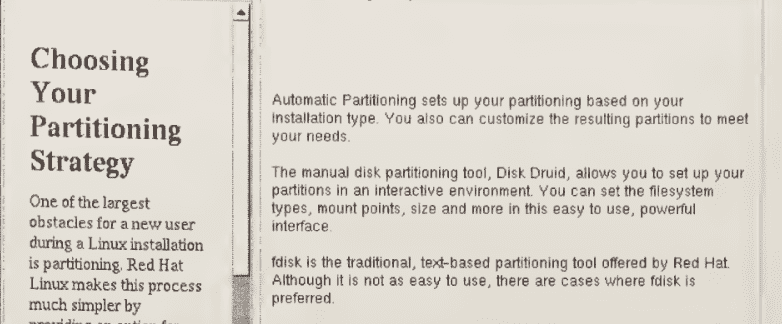

## 选择分区策略

分区是新用户安装 Linux 时最大的障碍之一。红帽通过提供自动分区选项简化了这一过程。

通过选择自动分区，你无需使用工具分配挂载点、创建分区或为安装分配空间。

手动磁盘分区工具 Disk Druid 允许你在交互环境中设置分区。你可以在这个界面界面选择文件系统类型、挂载点、大小等。

`fdisk` 是红帽提供的传统的文本界面分区工具。虽然它不容易用，但在某些情况下倾向于使用 `fdisk`。

- 让安装程序自动为你分区

- 使用 Disk Druid 手动分区

- 使用 `fdisk` 手动分区 [仅限专家]

图 4-2：红帽 7.3 中选择自动分区

自动分区通常会创建一个适用于单用户系统（桌面、工作站、笔记本）的非常简单的分区方案。该分区方案创建：

- 一个等于内存两倍的交换分区

- 一个小的（约 100 MB）用于引导加载程序、Linux 内核和相关文件的分区。该分区通常被挂载到 `/boot`。

- 一个包含硬盘剩余空间的分区。该分区通常被挂载到 `/root/`。

对于桌面或笔记本或任何具有单硬盘和单一主用户的系统，只有少数不使用自动分区的有力理由。

一个原因是自动分区会格式化分区，从而破坏磁盘上的任何数据。如果磁盘上有需要保留的数据，则不应选择自动分区。

另一个原因是无法通过自动分区修改文件系统类型。安装红帽当前的默认文件系统类型是 ext3 日志文件系统。安装 SUSE Linux 当前的默认文件系统类型是 Reiser（另一种日志文件系统）。如果你想使用其他文件系统类型，则必须手动分区。

服务器系统、多硬盘系统和多用户系统可能有完全不同的需求，并且可能需要手动分区。

# 18 SAIR Linux GNU 安装与配置

## 手动分区

手动分区是生产环境服务器系统，以及许多具有多个硬盘的工作站和桌面级系统的硬性要求。（笔记本电脑很少有多个硬盘主轴器，因此自动分区方案更适用于它们）。

手动分区可以在安装过程中使用安装向导中包含的图形化工具完成，也可以使用命令行工具 `fdisk` 来完成。（如果你选择了其中一个选项——在图表 4-2 中你可以选择分区——则会启动磁盘图形化分区界面。请注意，在选择手动分区后，系统会显示警告信息，提示分区表无法访问（如图 4-3 所示）。这通常发生在磁盘驱动器没有现有分区时。如果磁盘上已经安装了操作系统，则会显示已安装操作系统所占用的分区。）


图 4-3：选择手动分区 – Red Hat 7.3

使用图形化工具对硬盘进行手动分区的后续步骤，将在本单元末的 Linux 安装实验中详细介绍。

### 使用 fdisk

随着用于安装 Linux 的优秀图形化工具广泛普及，`fdisk` 的频率有所降低。然而，在不运行 Windows 的服务器系统上，像 `fdisk` 这样的命令行工具是必须的。

`fdisk` 实用程序的使用相对简单。

## 启动多个操作系统

从硬盘启动多个操作系统允许用户在每个操作系统独有的应用程序之间切换。如果需要多个操作系统共存，则可以通过使用多个分区来共享硬盘来实现。如果由于另一个操作系统通常是 MS-Windows 形式，那么考虑为 Linux 和 MS-Windows 建立独立分区的步骤将很有用。

Windows NT、Windows 2000 和 Windows XP 自带的引导程序器可以在多个操作系统之间进行选择，但并不推荐这样做。设置 Windows 引导程序以兼容 Linux 比设置 Linux 引导程序以兼容 Windows 更复杂，并且在某些配置下无法工作。推荐的配置是使用 Linux 引导程序进行多操作系统安装。

请注意，MS-Windows 的默认操作是将整个硬盘格式化为分区，这需要你采取以下步骤为 Linux 分区腾出硬盘空间。

## 在 MS-Windows 和 Linux 之间共享硬盘

- 1. 备份现有操作系统，以防以下某个步骤失败。

- 2. 查找并替换任何坏磁盘块。在任何 MS Windows 操作系统下，打开 Windows 资源管理器。在 C: 盘图标上点击右键。选择“属性”菜单。从属性窗口中选择“工具”。选择“立即检查”。


# SAIR Linux GNU 安装与配置

## 3. 将分散在硬盘上的文件移动到硬盘的一端
在任何 MS Windows 操作系统下，打开 Windows 资源管理器。在 `C:` 盘图标上点击右键。选择“属性”菜单。从属性窗口中选择“工具”。选择“立即压缩”。

## 4. 运行分区管理器搜索硬盘上的空空间并创建新的 Linux 分区

> 如果你打算使用 `ext3` 文件系统（Red Hat 7.3 的默认系统），请获取最新版本的 Partition Magic（v8.0 版本）。早期版本不支持 `ext3` 文件系统。如果你正在使用 SUSE 的 `ReiserFS`，则必须使用 `FIPS`。Partition Magic 不支持 Reiser FS。

`Partition Magic` 是一款商业分区管理器，它能够理解 Linux 以及许多其他操作系统的分区和文件格式。它具有易于使用的图形界面，并能够调整大小、移动和更改分区的类型。对于 Linux 用户来说，Partition Magic 的主要缺点是成本以及它是运行在 Windows 上的这一事实。

`FIPS` 是一款开源命令行工具，能够在硬盘的未分配空间上创建新分区。`FIPS` 还允许在未分配空间上创建新分区。Partition Magic 不支持 Reiser FS。`FIPS` 的优势是免费且广泛分发的。`FIPS` 的缺点是其语法比较奇异。

某些 对于 MS-Windows，`FIPS` 允许在未分配空间上创建新分区。

`IPS` 在在 Magic `FIPS`。Partition Magic 不支持 Reiser FS。

`IPS` 在在硬盘上创建分区空间。。。。 分区。

## 1. Windows 以以以

### 1：问题与回答

- 1 1 硬盘的 SCSI 设备名称是什么？
`sda`,`sdb`,`sdc`

- 2 什么时候自动分区是合适的？
当一个 MS-Windows 系统时。

- 3 硬盘上可以创建多少主分区？
四个主分区。如果是一个扩展分区，可以创建逻辑分区。

## 主题 D：网络配置

### 解释
如果你计划将 Linux 系统连接到网络，你应该在安装之前收集必要的网络信息。大多数 Linux 发行版连接到以太网。其他 TCP/IP 下的网络拓扑超出了本课程的范围。

本文仅介绍网络基础知识。让 Linux 主机连接到现有 TCP/IP 网络的基本要素如下。

### 网卡 (NIC)
大多数网卡在安装期间会自动检测。少数情况下，需要从已知列表中手动选择网卡。可能需要从制造商处获取驱动程序。由于这些原因，在安装之前了解网卡的型号是有帮助的。

大多数笔记本和某些桌面系统将网卡集成在主板上。在某些情况下，网卡和调制器在同一个芯片上。这些集成芯片通常为 Windows 配置带来同样的难题：很少有 Linux 驱动程序。如果你拥有此类集成芯片的系统，唯一的解决方案是购买一个独立的网卡。这可以是桌面系统的 PCI 卡或笔记本电脑的 PCMCIA 卡。

### TCP/IP 配置
TCP/IP 配置可以是自动或手动的。使用动态主机配置协议 (`DHCP`) 的自动配置是大多数 Linux 发行版安装向导的默认。如果你连接到带有 DHCP 服务器的网络，这是最简单、最不容易出错的选择。如果你连接到没有 DHCP 服务器的网络，或者你的网络管理员要求使用静态 IP 地址，你必须手动配置 TCP/IP 网络。

### 子网掩码
子网掩码的基本格式与 IP 地址相同。然而，正如其名称所示，子网掩码用于控制子网内的主机数量。例如，为 `w.x.y.0` 的子网掩码描述了一个拥有 254 台可能的主计算机的子网。`w.x.0.0` 的子网掩码描述了一个拥有 65,534 台可能的计算机的子网。

在任何情况下，如果使用静态 IP 寻址，子网掩码将与 IP 地址一同提供。如果使用 DHCP，子网掩码应自动设置。

### 默认网关
网关是一个安装了特殊路由软件的系统，并且可能具有多个网络网卡。每个 Linux 主机系统上都应该配置默认网关，以便与子网外的所有地址进行通信。

网络管理员应提供默认网关地址。如果使用 DHCP，默认网关应自动配置。

### 域名系统
域名系统（DNS）服务器负责将数字 IP 地址翻译为主机名，反之，将主机名翻译为 IP 地址。

从技术上讲，DNS 并不是跨 IP 网络通信的绝对必要条件。然而，如果没有 DNS，你必须手动配置一个本地文件来执行 IP 地址到主机名的翻译，或者使用数字 IP 地址来代替更方便的主机名。

在安装过程中，如果选择了静态 IP 寻址，你将获得机会选择一个或多个 DNS 服务器。网络管理员应提供 DNS 服务器的名称和地址。如果使用 DHCP，DNS 服务器可能会自动配置，也可能不会。如果没有，可以在安装后配置期间分配 DNS 服务器。

## D-1: 讨论网络配置

### 问题与解答

- 1. 在 Linux 系统上配置静态 IP 寻址所需的本质信息有哪些？
`IP 地址`、`子网掩码`、`默认网关`。可选但非常理想：DNS 服务器。

- 2. 你被分配了一个 IP 地址 `221.191.12.55`。你的子网掩码是 `255.255.255.0`。你的子网中可以有多少个主机（系统）？

## 主题 E: 安装媒介的选择

说明
Linux 以发行版的形式出现，这意味着一个机构已经将软件和安装程序打包在一起。这些程序是 Linux 的微型版本，使用 shell 脚本来执行安装操作。每个发行版都使用自己的安装程序，并从各种介质运行。

可以使用各种介质来安装 Linux 发行版。每种介质都有优点和缺点，下文将对此进行考虑。六种媒介类型分为两个基本类别：本地设备安装和网络访问安装。

### 本地设备安装
本地设备安装涉及在 Linux 工作站现场安装 Linux。本地是本地设备安装的主要方法。

### CD-ROM
如果 Linux 具有特定 CD-ROM 所需的驱动程序，CD-ROM 是首选的安装媒介。根据安装的软件版本，500 MB 的归档 CD-ROM 在硬盘上解压缩并扩展到 800 MB 到 1 GB 不等。这个解压缩过程在旧计算机上通常需要一小时或更长时间。对于今天更快的 CPU 和 CD-ROM 驱动器，可能只需要 15 分钟。

### MS-DOS 分区
通过这种方法将 Linux 安装归包复制到 MS-DOS 分区。虽然此操作看起来很奇怪，但它解决了上述旧的 CD-ROM 问题。一旦设置好 MS-DOS 磁盘归包，就可以安装程序指向硬盘。

### 网络安装
网络访问安装涉及通过网络安装 Linux。网络访问安装的三种方法如下。

### FTP
这种方法连接到存储了归包的服务器。在下载 Red Hat 发行版时，持续出现的问题是其非交互式下载。

### NFS
这种方法连接到存储了归包的服务器。在下载 Red Hat 发行版时，持续出现的问题是其非交互式下载。

### Samba
这种方法连接到存储了归包的服务器。在下载 Red Hat 发行版时，持续出现的问题是其非交互式下载。

### http
这种方法连接到存储了归包的服务器。在下载 Red Hat 发行版时，持续出现的问题是其非交互式下载。

## SAIR Linux GNU：安装与配置

在实际上，IP 地址的每个部分会根据 IP 地址分类而变化。然而，IP 地址分类是一个超出本课程范围的高级网络主题。（在 SAIR 103 课程中提供了对网络的详尽回顾）。分配给你计算机的任何静态地址很可能是 C 类地址。这里描述的就是此类。

分配给你计算机的静态 IP 地址将以 `w.x.y.z.(1-254)` 的形式存在。例如，IP 地址 `w.x.y.10` 将你的计算机分配为由 IP 地址其余部分所识别的网络中的主机地址 10。

配置语言支持和时区：
在语言支持界面上，点击“下一步”(`Next`)
选择您的时区并点击“下一步”(`Next`)

### 配置账户：
输入 root 密码
点击“添加”(`Add`)创建一个额外的用户账户
创建一个普通用户账户。选择您所需的账户名称。

# 配置身份验证：
点击“下一步”(`Next`)选择默认设置

### 选择软件包：
除了默认选择外，请选择以下软件包：

| Windows 文件服务器 | Windows File Server 安装 Samba 服务器。 |
| :--- | :--- |
| 匿名 FTP 服务器 | 匿名 FTP 安装 wu-ftpd FTP 服务并配置匿名 FTP 所需的所有文件。 |
| 工具 | 工具程序安装有用的系统管理（以及其他）工具。 |
| 软件开发 | 软件开发程序将安装编译器和其他软件（SW）工具，以备您可能需要安装仅限源码的包。 |
| 内核开发 | 内核开发程序将安装内核源代码。如果您想更新（重新编译）Linux 内核，则这是必不可少的。 |

在最后一个屏幕的底部，选择“选择单个软件包”(`Select individual packages`)，然后点击“下一步”(`Next`)

选择单个软件包将为您提供每个单独 RPM 软件包的树形视图。它允许您精细调整安装内容。这也是学习可用软件包的极佳方法。

浏览单个软件包的树形视图
点击“下一步”(`Next`)

- 12 配置：


确认显卡厂商、类型和显存数量是否正确

点击“下一步”(Next)

### 13 准备安装

这是返回并修改您的选择或停止安装的最后机会。如果您点击“下一步”(Next)，硬盘上的所有数据将将会丢失。

点击“下一步”(Next)

### 14 安装软件包

软件包将被复制到磁盘并安装。现在是休息一下的好时候。

### 15 最终安装步骤

最后一步是创建启动盘。

如果您有软盘，请将其插入驱动器并点击`下一步`(Next)；否则，选择`跳过启动盘创建`(Skip boot disk creation)并点击`下一步`(Next)

## 单元总结：安装前规划

在本单元中，您学习了如何收集和分析系统的当前硬件配置。关键主题包括硬件文档的来源，以及使用 Windows 和 Linux 工具来检查硬件配置。

### 主题 A

接下来，您学习了如何识别和解决硬件不兼容问题。您简要讨论了 PC 硬件架构，并学习了特定的硬件主题，包括内存、外设、视频适配器和显示器。

### 主题 B

接下来，您学习了硬磁盘架构、磁盘分区工具和磁盘分区策略，包括双启动系统。

### 主题 C

接下来，您学习了配置网络主机所需的信息。

### 主题 D

然后，您学习了用于安装 Linux 系统的各种介质选择。

### 主题 E

最后，您学习了如何从 CD 安装 Red Hat Linux。

### 主题 F

#### 实验：仅限 Linux 系统的分区

> **警告：** 这些练习需要 root 权限。以 root 身份登录时，可能会做出对系统产生负面的影响。在这些练习中，特别是将分区写入硬盘可能会删除重要数据。在实验期间的任何时候，**不要**执行 `w` 命令，除非您想将更改保存到分区表中。这样做将面临面临删除现有数据的风险。

这些练习模拟了为准备系统运行 Linux 作为唯一操作系统而将采取的步骤。

1. 以 root 身份登录。

2. 对启动 Linux 的硬盘执行 `fdisk`。在基于 IDE 的系统上，这可能是 `/dev/hda`。在基于 SCSI 的系统上，这可能是 `/dev/sda`。如果您的实验系统上选择了其他选项，您的导师会告知您。在第一个 IDE 硬盘上启动 `fdisk` 的命令是：

3. 在 `fdisk` 提示符处输入 `m`。这将输出一个供您使用的 `fdisk` 命令列表。如果您随时需要访问此列表，请在 `fdisk` 提示符处按 `m`。

4. 输入 `p` 打印分区表。表显示了 `hda` 目前是如何分区的。注意分区的大小。

5. 为了为 Linux 安装准备硬盘，您必须删除任何现有分区。要执行此操作，输入 `d`。系统将提示您指定想要删除哪个分区。输入 `l` 删除第一个分区。重复此步骤，直到您删除了硬盘上所有的分区。

```
fdisk /dev/hda
```

## 安装前规划 4-31

现在您可以创建新分区。您创建的第一个分区是交换分区。在 `fdisk` 提示符处输入 `n` 执行此操作。当询问是否为主分区或扩展分区时，输入 `p` 表示它是主分区。接下来，系统将提示您这将是几个分区。它将是第一个，即 1。系统将提示您希望分区从哪里开始。按 `<ENTER>` 选择默认设置。接下来，系统将提示您分区的最后一个磁道，这将决定分区的大小。默认值为硬盘上的最后一个磁道，这意味着此分区将占据整个磁盘。指定分区大小简单的方法是以千字节（KB）或兆字节（MB）。要执行此操作，输入您想要使用的大小，加上 `k` 或 `m`，取决于您想指定 KB 还是 MB。例如，对于一个 2 GB 的分区（2000 MB），您将输入 `+2000M`。对于您的交换分区，输入 `+128M`。

接下来您需要创建一个 `/boot` 分区。输入 `n` 创建主分区。输入 `p` 表示它是主分区。接下来，系统将提示您这将是哪个分区。它将是第一个，即 1。系统将提示您希望分区从哪里开始。按 `<ENTER>` 选择默认设置。接下来，系统将提示您分区的最后一个磁道，这将决定分区的大小。默认值为硬盘上的最后一个磁道，这意味着此分区将占据整个磁盘。指定分区大小简单的方法是以千字节（KB）或兆字节（MB）。要执行此操作，输入您想要使用的大小，加上 `k` 或 `m`，取决于您想指定 KB 还是 MB。例如，对于一个 2 GB 的分区（2000 MB），您将输入 `+2000M`。对于您的交换分区，输入 `+128M`。

### 关机流程

关机程序用于停止系统运行。关机是以一种不会导致数据丢失的方式结束进程的。执行有序关机将通过将数据缓存刷新到磁盘并卸载文件系统，帮助防止数据丢失或损坏。如果你在不进行有序关机的情况下关闭机器，内存中缓存的数据将会丢失，如果掉断电时某个进程正在写入文件系统，文件系统可能会损坏。

## shutdown 命令

为了以有序的方式关闭系统，管理员应该使用 `shutdown` 命令。该命令可用于停止系统、重启系统或将系统带到单用户模式。它需要一个时间参数；其他参数是可选的。时间参数可以是 `hh:mm` 格式的绝对时间，其中 `hh` 是小时，`mm` 是分钟。小时可以用一位或两位数字表示，但分钟需要是数字。时间参数也可以表示为 `+m`，其中 `m` 是启动关机前延迟的分钟数。如果你想立即关机系统，可以使用 `+0` 或关键字 `now`。

## 常见用法

`-h` 参数用于停止系统，而 `-r` 参数用于重启系统。如果这两个选项都没有使用，它将把系统带到单用户模式，这通常被称为维护模式。在所有三种情况下，`shutdown` 都将执行以下任务：

- 通知用户正在关机

- 阻塞普通用户的日志

- 告诉 `init` 运行级别 0（停止）、6（重启）或 1（单用户模式）

## 警告

所有当前在系统上的用户都将收到系统即将关机的警告。在时间参数之后，管理员可以指定一个显示给所有用户的文本字符串。如果指定了延迟，进程将创建 `/etc/nologin` 文件，防止普通用户登录。在调用 `init` 之前，`shutdown` 将向进程发送 `SIGTERM` 以便它们干净退出。在五秒的默认延迟后，它将向未响应的进程发送 `SIGKILL`。你可以指定不同的延迟，后跟延迟的秒数。以下命令将导致系统在五分钟后停止，且 `SIGTERM` 和 `SIGKILL` 信号之间有 15 秒的延迟：

```
shutdown -h -t15 +5
```

## Linux 安装与配置

### 取消关机

管理员可以通过发布 `shutdown -c` 命令取消延迟关机。如果管理员取消了关机，自动创建的 `/etc/nologin` 文件将被删除。取消关机时不需要时间参数；但管理员可以添加一条可选消息，并将其广播给所有用户：

```
shutdown -c Shutdown has been cancelled.
```

一旦关机进程调用了 `init`，就无法取消。

## 另一个可用参数是 `-k`

这将导致 `shutdown` 向向用户发送普通消息并防止新登录，但当延迟完成后，它不会调用 `init` 而是取消 `shutdown` 并且可以恢复登录。

## 应避免的命令

还有其他三个命令可以关机系统：`halt`、`reboot` 和 `poweroff`。在当前系统中，这些命令将带有适当的参数调用 `shutdown` 命令。在旧版系统中，它们的行为不同，并可能导致数据损坏。因此，建议使用 `shutdown` 命令并避免这三个命令。

## Ctrl-Alt-Delete

在许多发行版的默认配置中，Ctrl-Alt-Delete 序列也会通过调用 `shutdown -r now` 导致系统执行重启。管理员可以通过修改 `/etc/inittab` 文件来更改此默认行为。你可能想注释掉这一行，使该序列对系统没有影响。另一个选项是在重启之前添加时间延迟，让管理员有机会取消关机。

## A-1：关于处理启动和关机程序的操作——问题与答

1. `init` 程序用于加载 Linux 内核。对还是错？

错。引导加载程序加载 Linux 内核。内核加载 `init` 程序。

2. 命令 `shutdown 2:00` 将实现什么？

A 系统将在两点停止。

B 系统将在两分钟后重启。

C 系统将在两分钟后停止。

D 系统将在两点进入单用户模式。

3. 如果在 bash 提示符下按下 CTRL + D 会发生什么？

程序将终止并退出系统。

## 主题 B：配置 init

System V init（或 SysV init）正成为 Linux 控制启动的标准，源于 AT&T UNIX。某些发行版（如 Slack）传统上使用 BSD init。虽然 Slack 的当前版本仍使用 BSD，但它也会检查是否存在 SysV init 文件并使用它们。

由于 SysV init 的使用非常普遍，本主题将关注 `/etc/inittab`。由于 `init` 是启动所有进程的进程，这个配置文件非常重要，在对其进行任何编辑之前应备份原始文件。

### inittab 文件的格式

在 `inittab` 文件中，井号（`#`）开头的行被 `init` 忽略，用于注释。每个条目遵循以下格式：

```
id:runlevels:action:process
```


`id` 是 `inittab` 中唯一的 1-4 位字符。旧版本只使用 1-2 位字符。`runlevels` 列出了应该执行操作的运行级别。`action` 描述应该执行的操作。可用的操作可以在 `inittab` 的 man 页中找到。`process` 指定要执行的进程。

### inittab 文件

```bash
### inittab
# 此文件描述 init 如何
# 设置运行级别。
# 作者：Miquel van Smooreburg，<miquels@drinkel.nl.mugnet.org>
# Marc Ewing 和 Donnie Barnes 修改
## 默认运行级别。RHS 使用的级别为：
# 0 停止（不要将 initdefault 设置为此）
### 1 单用户模式
# 2 多用户，如果没有网络（与 3 相同）
### 3 多用户
### 4 网络用户
### 5 图形模式
### 6 重启
```

## 默认运行级别。RHS 使用的级别为：

# 0 停止（不要将 `initdefault` 设置为此）

### 1 单用户模式

# 2 多用户，如果没有网络（与 3 相同）

### 3 多用户

### 4 网络用户

### 5 图形模式

### 6 重启

# 资源控制文件

资源控制 `rc` 文件用于 `init` 启动和停止守护进程。不同的 Linux 发行版之间，`init` 程序读取资源控制文件并执行 shell 脚本的方法有所不同。尽管这种差异看起来可能是根本性的，但这些策略易于理解且易于修改。

系统启动初始化期间，`init` 经历的事件链如下：

- 1. 内核找到 `inittab` 并将控制交给它。
- 2. `init` 开始处理 `inittab` 并找到默认运行级别 `runlevel`。
- 3. `init` 运行 `/etc/rc.d/sysinit`。
- 4. `rc.sysinit` 执行几项全局初始化任务。
- 5. `init` 以运行级别作为参数运行 `rc` 脚本。
- 6. `rc` 脚本按数字顺序运行运行级别目录下所有的杀死脚本 `kill scripts`。
- 7. `rc` 脚本按数字顺序运行运行级别目录下所有的启动脚本 `start scripts`。
- 8. `init` 运行 `rc.local` 脚本。

`rc` 文件的主目录是 `/etc/rc.d`。该目录包含以下文件和目录：

| 项目 | 描述 |
|---|------|
| `init.d` | 存放主脚本的目录 |
| `rc` | 主脚本 |
| `rc0.d` | 用于存放运行级别 0 执行脚本的目录 |
| `rc1.d` | 用于存放运行级别 1 执行脚本的目录 |
| `rc2.d` | 用于存放运行级别 2 执行脚本的目录 |
| `rc3.d` | 用于存放运行级别 3 执行脚本的目录 |
| `rc4.d` | 用于存放运行级别 4 执行脚本的目录 |
| `rc5.d` | 用于存放运行级别 5 执行脚本的目录 |
| `rc6.d` | 用于存放运行级别 6 执行脚本的目录 |
| `rc.local` | 在所有其他初始化脚本之后运行的管理员脚本 |
| `rc.sysinit` | 在系统初始化时运行一次的脚本 |

# 启动与关闭

`/etc/rc.d/init.d` 目录包含每个在系统初始化或更改运行级别期间必须启动的服务脚本。这些脚本通常接受一个参数，允许你启动、停止或重启服务。运行级别目录中的脚本实际上是 `/etc/rc.d/init.d` 目录中脚本的符号链接。这些链接以 `K` 或 `S` 开头，后跟原始的名称。`rc` 脚本按数字顺序运行 `K` 脚本，然后按数字顺序运行 `S` 脚本。当 `rc` 脚本调用这些脚本时，它会检查第一个字母，如果以 `K` 开头则带参数运行脚本。相反，`S` 脚本带启动参数运行。

默认的 `rc.local` 脚本通常不执行任何操作。它的存在是为了允许管理员自定义初始化过程。你可以向此文件添加自己的命令，它们将在初始化期间最后被处理。因此，如果你在该脚本中输入的内容与另一个初始化脚本中的内容冲突，你的更改将覆盖运行级别脚本。

动手吧！

# B-1：使用初始化脚本

- 1 Linux 上哪种版本的系统初始化正成为标准？

  System V init 或 SysV init

- 2 三个预留的运行级别是什么？

  0, 1 和 6

- 3 所有发行版都使用运行级别 5 用于 X11。对还是错？

  错。运行级别 2-5 可以设置为任何值。某些发行版使用 3 用于 X11。

- 4 列出系统初始化期间使用的三个 rc 脚本。

  `rc.sysinit`, `rc`, `rc.local`

- 5 上述三个脚本中哪一个在初始化过程中最后运行？

  `rc.local`

# 总结：启动与关闭

### 主题 A

在本主题中，你学习了系统启动期间发生的步骤以及 `init` 过程的重要性。你还了解了执行有序关闭的原因和步骤。

### 主题 B


在本主题中，你学习了系统启动期间发生的步骤以及 `init` 过程的重要性。你还了解了执行有序关闭的原因和程序。

# 独立练习：使用初始化脚本

- 1 Linux 上哪种版本的系统初始化正成为标准？
  `System V init` 或 `SysV init`

- 2 三个预留的运行级别是什么？
  `0`, `1` 和 `6`

- 3 所有发行版都使用运行级别 5 用于 `X11`。对还是错？
  错。运行级别 `2-5` 可以设置为任何值。某些发行版使用 `3` 用于 `X11`。

- 4 列出系统初始化期间使用的三个 `rc` 脚本。
  `rc.sysinit`, `rc`, `rc.local`

- 5 上述三个脚本中哪一个在初始化过程中最后运行？
  `rc.local`

# 单元总结：启动与关闭

### 主题 A
在本主题中，你学习了系统启动期间发生的步骤以及 `init` 过程的重要性。你还了解了执行有序关闭的原因和程序。

### 主题 B
在本主题中，你学习了系统启动期间发生的步骤以及 `init` 过程的重要性。你还了解了执行有序关闭的原因和程序。

# 资源控制文件

资源控制 `rc` 文件用于 `init` 启动和停止守护进程。不同的 Linux 发行版之间，`init` 程序读取资源控制文件并执行 shell 脚本的方法有所不同。

系统启动期间 `init` 的事件链如下：

- 1. 内核找到 `inittab` 并将控制交给它。
- 2. `init` 开始处理 `inittab` 并找到默认运行级别。
- 3. `init` 运行 `/etc/rc.d/sysinit`。
- 4. `rc.sysinit` 执行几项全局初始化任务。
- 5. `init` 以运行级别作为参数运行 `rc` 脚本。
- 6. `rc` 脚本按数字顺序运行运行级别目录下所有的杀死脚本 `kill scripts`。
- 7. `rc` 脚本按数字顺序运行运行级别目录下所有的启动脚本 `start scripts`。
- 8. `init` 运行 `rc.local` 脚本。

`rc` 文件的主目录是 `/etc/rc.d`。该目录包含以下文件和目录：

| 项目 | 描述 |
|---|---|
| `init.d` | 存放主脚本的目录 |
| `rc` | 主脚本 |
| `rc0.d` | 用于存放运行级别 0 执行脚本的目录 |
| `rc1.d` | 用于存放运行级别 1 执行脚本的目录 |
| `rc2.d` | 用于存放运行级别 2 执行脚本的目录 |
| `rc3.d` | 用于存放运行级别 3 执行脚本的目录 |
| `rc4.d` | 用于存放运行级别 4 执行脚本的目录 |
| `rc5.d` | 用于存放运行级别 5 执行脚本的目录 |
| `rc6.d` | 用于存放运行级别 6 执行脚本的目录 |
| `rc.local` | 在所有其他初始化脚本之后运行的管理员脚本 |
| `rc.sysinit` | 在系统初始化时运行一次的脚本 |

# 启动与关闭


`/etc/rc.d/init.d` 目录包含每个在系统初始化期间或更改运行级别期间必须启动的服务脚本。这些脚本通常接受一个参数，允许你启动、停止或重启服务。运行级别目录中的脚本实际上是 `/etc/rc.d/init.d` 目录中脚本的符号链接。这些链接以 `K` 或 `S` 开头，后跟原始的名称。`rc` 脚本按数字顺序运行 `K` 脚本，然后按数字顺序运行 `S` 脚本。当 `rc` 脚本调用这些脚本时，它会检查第一个字母，如果以 `K` 开头则带参数运行脚本。相反，`S` 脚本带启动参数运行。

默认的 `rc.local` 脚本通常不执行任何操作。它的存在是为了允许管理员自定义初始化过程。你可以向此文件添加自己的命令，它们将在初始化期间最后被处理。因此，如果你在该脚本中输入的内容与另一个初始化脚本中的内容冲突，你的更改将覆盖运行级别脚本。

动手吧！

# B-1：使用初始化脚本

- 1 Linux 上哪种版本的系统初始化正成为标准？

  `System V init` 或 `SysV init`

- 2 三个预留的运行级别是什么？

  `0`, `1` 和 `6`

- 3 所有发行版都使用运行级别 5 用于 X11。对还是错？

  错。运行级别 `2-5` 可以设置为任何值。某些发行版使用 `3` 用于 X11。

- 4 列出系统初始化期间使用的三个 rc 脚本。

  `rc.sysinit`, `rc`, `rc.local`

- 5 上述三个脚本中哪一个在初始化过程中最后运行？

  `rc.local`

# 单元总结：启动与关闭

### 主题 A

在本主题中，你学习了系统启动期间发生的步骤以及 `init` 过程的重要性。你还了解了执行有序关闭的原因和程序。

### 主题 B

在本主题中，你学习了系统启动期间发生的步骤以及 `init` 过程的重要性。你还了解了执行有序关闭的原因和程序。

# 独立练习：使用初始化脚本

（此处省略重复部分）

## Shell

解释

`shell` 是一个将用户命令转换为操作系统指令的程序。两个重要的 `shell` 特性是交互性和脚本执行。

### Linux shell

平均 Linux 发行版包含许多不同语法的 `shell`。

### bash

Stephen Bourne 创建了第一个可编程的 `shell`，称为 `sh`。作为 70 年代的一种创新界面，它缺乏现代常见的功能。尽管 Bourne shell 保持不变，但它仍然非常流行。Bourne shell 在 Linux 上不可用。大多数 Linux 发行版都使用 `bash`。命令行补全、别名、编辑器功能和搜索工具也是 `shell` 的标准功能。在 Linux 上，`sh` 是 `bash` 的链接，因为 Bourne shell 不可用。

### tcsh

`C` `csh` 是在加州大学伯克利分校由 William Joy 开发的，提供了非常不同的编程结构，尽管存在 Bourne 兼容性。它有替代的替换，像 Bourne 一样，没有命令行编辑。Joy 后来开发了增强型 C Shell，即 T-shell 或 TC-shell `tcsh`，提供了命令行编辑、命令行补全和别名，此外还有已有的命令替换。

### pdksh

Korn `ksh` 是最流行的 `shell` 之一，它是第一个将现代 C shell 技术引入 Bourne shell 的。它提供了命令行编辑和 Bourne 兼容性，尽管功能没有 `bash` 那么多。Korn shell 在 Linux 上不可用，但有一个免费的公领域 Korn shell `pdksh`。公领域 Korn shell 并没有实现 UNIX Korn shell 的所有功能。由于 Korn 在 Linux 上不可用，`ksh` 通常指向 `pdksh`。

# Shell 6-3

最近开发的 `shell` 之一是 Z-shell `zsh`，它具有与 Bourne shell 的兼容性和命令行编辑功能，并包含了 Korn、`bash` 和 TC-shell 中的大部分强力功能。如果将 `zsh` 链接到文件名 `/bin/ksh`，那么运行 `/bin/ksh` 将导致 Z-shell 以类似于 Korn shell 的默认配置启动。Z-shell 的作业控制功能与 Bash 和 TC-shell 非常相似。

## 识别和更改 shell

可以通过在文本编辑器中打开 `/etc/shells` 文件（如果该文件存在），或通过输入以下命令来查看已安装 `shell` 的完整列表：

```
chsh -l
```

要识别机器当前使用的 `shell`，请输入以下命令：

```
echo $SHELL
```

此命令将打印 `shell` 位置的绝对路径。要更改 `shell`，请在命令行上输入所需的 `shell` 名称。例如，要从 Bash `shell` 切换到 TC-shell，可以输入以下内容：

```
tcsh
```

随后，命令提示符应该从美元符号 `$` 变为百分号 `%`，表示 `tcsh` 是活动活动 `shell`。

除了在用户登录后更改 `shell` 之外，还可以通过输入以下命令更改登录 `shell`：

```
chsh -s /bin/pdksh
```

重启机器后，登录 `shell` 将变为 `pdksh`，直到用户再次对其进行更改。为了使 `chsh` 命令生效，必须确保系统已安装了所需的 `shell`，否则将需要 `root` 权限来创建文件并安装必要的 `shell`。

每个用户的默认登录 `shell` 都在 `/etc/passwd` 文件中指定。

## Bash 基础

`bash` 的一些基本功能包括命令历史、命令补全、I/O 重定向、命令行编辑和作业控制。

## 命令历史

命令历史是指使用 `<UP>` 和 `<DOWN>` 箭头键显示之前的命令的能力，从最近输入的命令开始。`Bash` `shell` 维护着此历史。通过输入命令历史，可以看到所有使用过的命令列表（受回溯限制）。通过修改 `shell` 变量 `$HISTSIZE`，可以更改回溯命令的数量。以下示例将使 `bash` `shell` 能够回溯最近的 1000 条命令。

```
HISTORY=1000
```

# SAIR Linux GNU 安装与配置

## 命令补全

命令补全是 `shell` 在按下 `<TAB>` 键时补全目录名、文件名或命令名的能力。如果有多个可能的名称，`shell` 只会将名称补全到唯一为止；它会发出蜂鸣声，并等待用户输入更多字符使名称唯一。按下 `<TAB>` 键会告诉 `shell` 显示所有可能的名称，以便用户可以在列表中搜索查找所需的名称。

例如，如果一个目录包含文件 `julie`、`angus` 等名称，输入 `m` 后按 `<TAB>` 键将显示所有可能的 `m` 名称。此功能允许你快速输入命令或导航文件以防止输入错误。

## I/O 重定向

Unix 及其系统的 CLI 允许输入、输出和错误重定向到标准输入 `stdin`、标准输出 `stdout` 和标准错误 `stderr` 设备以外的地方。通常，I/O 通道与键盘相关，`stdout` 与显示相关。

重要的是，并非所有输入都来自键盘或鼠标，并且需要连接输入和输出流。有某些特殊字符可以用于重定向 `stdin`、`stdout` 和 `stderr`。你可以使用字符 `0` 来帮助重定向标准输入，`1` 用于标准输出，`2` 用于标准错误。

| 重定向字符 | 作用 |
|---|---|
| `<` | 重定向标准输入。 |
| `1>` | 重定向标准输出。 |
| `2>` | 重定向标准错误。 |
| `>` | 将左侧输出重定向到右侧设备或文件，如果文件已存在则覆盖。它是用于。 |
| `>>` | 与 `>` 命令效果相同，如果文件已存在则追加到文件末尾，而不是覆盖。 |
| `<` | 用于 |

### 重定向输入

Unix 及其系统的 CLI 允许输入、输出和错误重定向到标准输入 `stdin`、标准输出 `stdout` 和标准错误 `stderr` 设备以外的地方。通常，I/O 通道与键盘相关，`stdout` 与显示相关。

重要的是，并非所有输入都来自键盘或鼠标，并且需要连接输入和输出流。有某些特殊字符可以用于重定向 `stdin`、`stdout` 和 `stderr`。你可以使用字符 `0` 来帮助重定向标准输入，`1` 用于标准输出，`2` 用于标准错误。

### 重定向输出

Unix 及其系统的 CLI 允许输入、输出和错误重定向到标准输入 `stdin`、标准输出 `stdout` 和标准错误 `stderr` 设备以外的地方。通常，I/O 通道与键盘相关，`stdout` 与显示相关。

重要的是，并非所有输入都来自键盘或鼠标，并且需要连接输入和输出流。有某些特殊字符可以用于重定向 `stdin`、`stdout` 和 `stderr`。你可以使用字符 `0` 来帮助重定向标准输入，`1` 用于标准输出，`2` 用于标准错误。

### 重定向错误

Unix 及其系统的 CLI 允许输入、输出和错误重定向到标准输入 `stdin`、标准输出 `stdout` 和标准错误 `stderr` 设备以外的地方。通常，I/O 通道与键盘相关，`stdout` 与显示相关。

重要的是，并非所有输入都来自键盘或鼠标，并且需要连接输入和输出流。有某些特殊字符可以用于重定向 `stdin`、`stdout` 和 `stderr`。你可以使用字符 `0` 来帮助重定向标准输入，`1` 用于标准输出，`2` 用于标准错误。

### 管道输出


Unix 及其系统的 CLI 允许输入、输出和错误重定向到标准输入 (`stdin`)、标准输出 (`stdout`) 和标准错误 (`stderr`) 设备以外的地方。通常，I/O 通道与键盘相关，`stdout` 与显示相关。

重要的是，并非所有输入都来自键盘或鼠标，并且需要连接输入和输出流。有某些特殊字符可以用于重定向 `stdin`、`stdout` 和 `stderr`。你可以使用字符 `0` 来帮助重定向标准输入，`1` 用于标准输出，`2` 用于标准错误。

## 6-6 SAIR Linux GNU 安装与配置

### 命令行编辑

`bash` 的一个基本功能是编辑命令行的能力。在任何点，使用左右箭头键沿命令行向后移动光标。可以使用以下快捷键通过删除或添加字符来编辑命令。

| 命令 | 描述 |
|---|---|
| `CTRL + T` | 交换光标前的两个字符。 |
| `CTRL + W` | 从紧邻左侧字符到命令单词开头剪切并保存。 |
| `CTRL + U` | 切切并保存光标左侧的所有内容。 |
| `CTRL + Y` | 与 `<CTRL+W>` 和 `<CTRL+U>` 配合使用的粘贴；粘贴的内容位于光标位置之前。 |
| `CTRL + O` | 与上/下箭头键配合，执行历史命令并显示历史列表中的下一个命令。 |
| `~` | 波号 (`~`) 在命令中作为主目录的别名。 |
| `-` | 减号 (`-`) 在所有命令中作为当前目录之前访问的目录的别名。 |

`shell` 将保留之前尝试过的命令历史，你可以扫描命令历史并对其进行编辑。

### 叹号运算符

叹号 (`!`) 运算符最初是 C-shell 的功能，可以与其他运算符结合从历史列表中回溯之前的命令。例如，感叹号 (`!`) 后跟一个数字将从历史列表中回溯对应数字的命令。使用冒号，还可以从命令中选择特定的单词与其他命令一起使用。单词本身从左到右编号，第一个单词（通常是命令名）为 `0`。该运算符在 `shell` 脚本内部内核有用。

| `!!` | 回溯最近的命令。 |
|---|---|
| `!-5` | 回溯最近的第五条命令。 |
| `!30` | 回溯历史列表中的第 30 条命令。 |
| `!re` | 回溯以字母“re”开头的命令。 |
| `!:1` | 回溯上一个命令的第二个单词。 |

### 作业控制

在 `shell` 中运行的每个用户进程也称为作业（`job`），并被分配一个作业号。第一个启动的作业被分配为 `1`。当启动新进程时，系统会查看最大的作业号并将其加 `1`。如果编号最大的进程完成或被终止，该编号将再次可用。在命令行中，在作业号前直接使用百分号（`%`）可以将其与进程 ID（`PID`）区分开来。

在命令行界面工作时，用户不需要等待程序完成即可开始另一个命令。通过在命令后加上安培符（`&`），可以使程序在后台执行。前台程序运行在当前交互式 `shell` 中，而后台程序运行在子 `shell` 中。

例如，以下命令在后台运行，在整个目录结构中搜索名为 `filename` 的文件：

```
find -name filename &
```

如果你打开一个 `shell` 并输入 `locate log ~/logs`，终端提示符将在执行该命令所需的时间内消失。这是所有前台作业的典型情况。如果输入相同的命令并加上安培符（`&`），按下回车键后提示符将立即重新出现。该作业将在后台处理，用户无需等待作业完成。

尽管一次只能处理一个前台作业，但可以同时处理许多后台作业。后台作业的限制取决于所用计算机系统的可用资源。

在启动命令后，如果用户随后意识到其完成时间可能比最初认为的要长，可以通过 `CTRL+Z` 挂起命令，然后使用 `bg` 命令将其推到后台。例如，假设有以下命令序列：

```
find -name filename -log
CTRL-Z
bg
```

每个后台作业完成时，屏幕上会打印一条消息通知用户作业完成。

要检查正在运行的作业数量或查看哪些作业正在运行，请输入以下命令：

```
jobs
```

作业以编号列表的形式显示。列表的组织方式使得第一个执行的命令是 `1` 号，最后一个执行的命令是列表中的最后一个数字。

## SAIR Linux GNU：安装与配置

由于只有前台作业从终端接收输入，有时必须将作业从后台拉到前台。使用 `fg` 命令来实现此操作。假设我们有一个如下作业列表：

- `[1]` Running `locate * /dev/null &`
- `[2]` Running `locate log > /dev/null &`
- `[3]` Running `locate file > /dev/null &`

为了将 `2` 号作业带到前台，使用以下命令：

```
fg %2
```

在前台运行的作业可以通过输入 `CTRL+C` 终止。后台作业可以使用 `kill` 命令和作业号来终止。例如：

```
kill %1
```

### A-1：使用 bash 操作

#### 方法如下

- 1 以普通用户身份登录。
- 2 输入 `cd /l` 然后按 `TAB` 键完成命令。你应该听到哔哔的一声。这表示 `bash` 无法完成该命令，因为你输入的内容没有唯一匹配。
- 3 再次按 `TAB` 键，你应该看到 `lib` 和 `lost+found` 列出来。
- 4 在你的命令行中添加一个 `o` 并按 `TAB` 键。命令应该会被 `bash` 完成，现在显示为 `cd /lost+found/`。你现在成功演示了 `bash` 的命令补全功能。
- 5 按回车键。你将收到一条权限被拒绝的消息。
- 6 输入 `-l /etc/*.conf`。你应该能看到 `/etc` 目录下所有以 `.conf` 结尾的文件列表。
- 7 输入 `-l /etc/1*.conf`。你应该能看到 `etc` 目录下所有以 `1` 开头并以 `.conf` 结尾的文件列表。
- 8 输入 `-l /etc/1???.conf`。你应该能看到 `/etc` 目录下所有以 `1` 开头、只有四个字符后跟 `.conf` 的文件列表。
- 9 输入 `-l /etc/*.conf | wc -l`。你刚刚将命令的输出通过到 `wc` 命令，让它统计找到的文件数量。
- 10 输入 `lcd`。你刚刚重复了最后执行的那个 `cd` 命令。你将收到一条权限被拒绝的消息，因为普通用户没有该权限。

在启动命令后，如果用户随后意识到其完成时间可能比最初认为的要长，可以通过 `CTRL+Z` 挂起命令，然后使用 `bg` 命令将其推到后台。例如，假设有以下命令序列：

```
find -name filename -log
CTRL-Z
bg
```

每个后台作业完成时，屏幕上会打印一条消息通知用户作业完成。

要检查正在运行的作业数量或查看哪些作业正在运行，请输入以下命令：

```
jobs
```

作业以编号列表的形式显示。列表的组织方式使得第一个执行的命令是 `1` 号，最后一个执行的命令是列表中的最后一个数字。

## SAIR Linux GNU：安装与配置

由于只有前台作业从终端接收输入，有时必须将作业从后台拉到前台。使用 `fg` 命令来实现此操作。假设我们有一个如下作业列表：

- `[1]` Running `locate * /dev/null &`
- `[2]` Running `locate log > /dev/null &`
- `[3]` Running `locate file > /dev/null &`

为了将 `2` 号作业带到前台，使用以下命令：

```
fg %2
```

在前台运行的作业可以通过输入 `CTRL+C` 终止。后台作业可以使用 `kill` 命令和作业号来终止。例如：

```
kill %1
```

### A-1：使用 bash 操作

#### 方法如下

- 1 以普通用户身份登录。
- 2 输入 `cd /l` 然后按 `TAB` 键完成命令。你应该听到哔哔的一声。这表示 `bash` 无法该命令，因为你输入的内容没有唯一匹配。
- 3 再次按 `TAB` 键，你应该看到 `lib` 和 `lost+found` 列出来。
- 4 在你的命令行中添加一个 `o` 并按 `TAB` 键。命令应该会被 `bash` 完成，现在显示为 `cd /lost+found/`。你现在成功演示了 `bash` 的命令补全功能。
- 5 按回车键。你将收到一条权限被拒绝的消息。
- 6 输入 `-l /etc/*.conf`。你应该能看到 `/etc` 目录下所有以 `.conf` 结尾的文件列表。
- 7 输入 `-l /etc/1*.conf`。你应该能看到 `etc` 目录下所有以 `1` 开头并以 `.conf` 结尾的文件列表。
- 8 输入 `-l /etc/1???.conf`。你应该能看到 `/etc` 目录下所有以 `1` 开头、只有四个字符后跟 `.conf` 的文件列表。
- 9 输入 `-l /etc/*.conf | wc -l`。你刚刚将命令的输出通过到 `wc` 命令，让它统计找到的文件数量。
- 10 输入 `lcd`。你刚刚重复了最后执行的那个 `cd` 命令。你将收到一条权限被拒绝的消息，因为普通用户没有该权限。

在启动命令后，如果用户随后意识到其完成时间可能比最初认为的要长，可以通过 `CTRL+Z` 挂起命令，然后使用 `bg` 命令将其推到后台。例如，假设有以下命令序列：


```
find -name filename -log
CTRL-Z
bg
```

每个后台作业完成时，屏幕上会打印一条消息通知用户作业完成。

要检查正在运行的作业数量或查看哪些作业正在运行，请输入以下命令：

```
jobs
```

作业以编号列表的形式显示。列表的组织方式使得第一个执行的命令是 1 号，最后一个执行的命令是列表中的最后一个数字。

## SAIR Linux GNU：安装与配置

由于只有前台作业从终端接收输入，有时必须将作业从后台拉到前台。使用 `fg` 命令来实现此操作。假设我们有一个如下作业列表：

- [1] Running locate * /dev/null &

- [2] Running locate log > /dev/null &

- [3] Running locate file > /dev/null &

为了将 2 号作业带到前台，使用以下命令：

```
fg %2
```

在前台运行的作业可以通过输入 `CTRL+C` 终止。后台作业可以使用 `kill` 命令和作业号来终止。例如：

```
kill %1
```

### A-1：使用 bash 操作

#### 方法如下

- 1 以普通用户身份登录。

- 2 输入 `cd /l` 然后按 `TAB` 键完成命令。你应该听到哔哔的一声。这表示 `bash` 无法完成该命令，因为你输入的内容没有唯一匹配。

- 3 再次按 `TAB` 键，你应该看到 `lib` 和 `lost+found` 列出来。

- 4 在你的命令行中添加一个 `o` 并按 `TAB` 键。命令应该会被 `bash` 完成，现在显示为 `cd /lost+found/`。你现在成功演示了 `bash` 的命令补全功能。

- 5 按回车键。你将收到一条权限被拒绝的消息。

- 6 输入 `-l /etc/*.conf`。你应该能看到 `/etc` 目录下所有以 `.conf` 结尾的文件列表。

- 7 输入 `-l /etc/1*.conf`。你应该能看到 `etc` 目录下所有以 1 开头并以 `.conf` 结尾的文件列表。

- 8 输入 `-l /etc/1???.conf`。你应该能看到 `/etc` 目录下所有以 1 开头、只有四个字符后跟 `.conf` 的文件列表。

- 9 输入 `-l /etc/*.conf | wc -l`。你刚刚将命令的输出通过到 `wc` 命令，让它统计找到的文件数量。

- 10 输入 `lcd`。你刚刚重复了最后执行的那个 `cd` 命令。你将收到一条权限被拒绝的消息，因为普通用户没有该权限。

### 特殊字符

`PS` 变量接受几乎所有从键盘输入的字符串；然而，某些字符串会被特殊对待。这些字符被称为特殊字符。

| 特殊字符 | 说明 |
| --- | --- |
| `\d` | “星期几 月份 日”格式的日期。 |
| `\H` | 主机名 + 域名名（例如 host.netname.net）。 |
| `\h` | 主机名。 |
| `\n` | 回车符和换行符。 |
| `\s` | Shell 的名称。 |
| `\t` | 12 小制 HH:MM:SS 格式的当前时间。 |
| `\@` | 12 小制 am/pm 格式的当前时间。 |
| `\u` | 当前用户的用户名。 |
| `\w` | 当前工作目录。 |
| `\W` | 当前工作目录的基名。 |
| `#` | 当前命令的编号。 |
| `\!` | 当前命令的历史编号。 |
| `$` | 如果有效 UID 为 0，则显示 #，否则显示 $。 |
| `\\` | 打印反斜杠。 |
| `\[` | 开始非打印字符序列，例如终端控制。 |
| `\]` | 结束非打印字符序列。 |

### 别名和变量

别名用于让用户更方便地输入命令。变量用于存储信息以便其多次使用。

#### 别名

即使是经验丰富的 Linux 用户也意识到，当给命令添加了开关时，简单的命令可能会变得难以记忆。这就是命令别名的便利性变得非常重要的地方。在 Shell 中使用快捷方式可以节省大量时间，特别是在处理大量不同文件和目录进行大量工作时。

命令别名提供了将易记的名称连接到更复杂命令的能力。

在多个不同平台之间工作时，设置某些字符串来执行其他功能非常重要。DOS 或 Windows 用户会填满 Linux Shell 提示符，并通过退格键删除输入错误的命令。设置几个简单的别名可以极大提高他们的舒适度。

例如，用户希望在每次输入 `ls` 命令时都看到完整的（长格式）目录列表。使用别名可以通过以下方式实现：

```
alias ls='ls -l'
```

创建此别名后，每次输入 `ls` 命令，其输出将与输入 `ls -l` 命令相同。

要删除此别名，只需输入：

```
unalias ls
```

以下是一些常用的别名示例：

```
alias ..='cd ..'
alias ...='cd ../..'
alias dir='ls -F'
alias l='ls -al'
alias la='ls -la'
alias l11='ls -1'
alias ls='ls $LS_OPTIONS'
alias ls-1='ls -1'
alias md='mkdir -p'
alias c='less'
alias rd='rmdir'
```

别名通常是特定用户的，但系统管理员可以在 `/etc/bashrc` 文件中定义系统级别名。

如果命令的行为不符合预期，使用反斜杠 (`\`) 来转义任何别名。因此，命令 `\ls` 将执行简单的 `ls` 命令并忽略别名。

#### Shell 变量

环境由一组参数定义，这些参数控制 Shell 的外观、感觉和交互性，并且可以自定义。环境变量类似于 Shell 变量；它们都是字符串。环境变量被传递给子进程用于程序初始化。Shell 变量和环境变量之间的区别在于它们在 Shell 程序内部外部的可见性。

环境变量是全局变量，因为每个 Shell 程序都可以访问它们。Shell 变量是局部变量；它们的可见性被限制在它们所在的特定 Shell 中。

通常做法是环境变量使用全大写字母，Shell 变量使用大小写混合。Shell 变量可以由字母、数字和下划线组成，但不能以数字（如数字和连字符）开头。大写字母通常用于指定内置变量导出变量。用户使用以下语法创建变量并为其赋值：

```
varName='abcdef'
```

在一个 Shell 中建立并使用的变量将无法被另一个 Shell 访问，除非它已通过 `export` 命令导出。考虑以下示例：

```
export varName
```

变量 `varName` 已导出，现在它将表现得像一个环境变量，也就是说变量的值将复制到任何后续 Shell 中。Shell 变量也可以被指定为只读，这样它们就不会被意外更改。

在给变量赋值时，仅使用变量名。然而，当你需要使用变量的值时，必须在变量名前加上美元符号 (`$`)。你可以使用 `echo` 命令显示给定变量的当前值：

```
echo $varName
```

`bash` 2.0 及更高版本带有一个名为 `shopt` 的内置命令，它是一个 Shell 配置工具。其中两个选项是 `cdspell` 和 `nocaseglob`。当设置 `cdspell` 选项时，当用户执行 `cd` 命令时，`bash` 会自动修正目录拼写的细微错误。`nocaseglob` 选项会导致 `bash` Shell 在处理文件名扩展时切换到非大小写敏感模式。输入 `shopt` 可以查看选项列表。你可以通过输入 `shopt -s option` 设置选项，或通过 `shopt -u option` 取消选项。

#### 路径变量

`PATH` 变量被赋值由冒号 (`:`) 分隔的目录路径组成，Shell 将这些路径中搜索可执行文件。要显示路径设置，使用 `echo` 命令：

```
echo $PATH
```

这可能会得到类似的输出：

```
/usr/local/bin:/usr/bin:/bin
```

另一种可能性是使用全路径调用程序。注意当前目录通常不是路径的一部分。这是一项防止木马程序影响系统的安全功能。要在当前目录执行不在路径中的命令，请使用 `./`：

```
./program
```

除了 `PATH` 变量外，还有几个常用的环境变量。

| 变量 |  |
| --- | --- |
| `$USER` | 当前用户的用户名。 |
| `$UID` | 当前用户的用户 ID。 |
| `$SHELL` | 当前的 Shell。 |
| `$HOME` | 当前用户的家目录。 |
| `$DISPLAY` | 显示设备的位置。 |
| `$HOSTNAME` | 机器的主机名。 |

这不是完整列表。你的系统使用的环境变量可能比列出的多。

## B-1: 自定义 bash

#### 方法如下

- 1 以普通用户身份登录。

- 2 输入 `PS1='\s> \w\ $ '`。

- 3 注销并重新以同一用户登录。提示符看起来像什么？为什么？提示符恢复原始，因为更改是临时的。要永久更改提示符，请修改 `/etc/bashrc`。

- 4 输入 `alias path='echo $PATH'`。这创建了一个查看路径的简单方法。


- 5 输入 `path`。你的路径第一个是什么？
- 6 输入 `su` – 在提示时提供 root 用户密码。
- 7 输入 `path`。发生了什么？为什么？未找到命令，因为别名只影响了创建它的用户。
- 8 输入 `echo $PATH`。root 用户路径的第一个是什么？
- 9 输入 `var1=1`。
- 10 输入 `var2=2; export var2`。
- 11 输入 `echo $var1, $var2`。显示什么？
- 12 输入 `bash`。这启动了一个新的交互式 Shell。
- 13 输入 `echo $var1, $var2`。显示什么？为什么？显示 2，因为只有 `var2` 被导出了。变量是局部的。

## 单元总结：Shell

### 主题 A
本主题向你介绍了 Linux 中使用的 shell，并详细介绍了 `bash` shell 的功能。这些功能包括**命令历史记录**、**自动补全**、I/O **重定向**和**作业控制**。你还发现了一些在 `bash` shell 中使用的**元字符**和**通配符**。

### 主题 B
本主题讨论了如何**自定义** `bash` shell。它向你展示了 `bash` 使用的文件以及如何修改 `bash` 提示符 `prompts`。你还学习了如何创建**别名 `aliases`** 以及修改用于搜索程序的**路径 `path`**。

## 独立练习活动

1. 你开始输入一个命令，并决定使用 bash 的命令补全功能。你按的是哪个键？
   *`TAB` 键*
2. 什么是 bang（感叹号）？
   *感叹号 (`!`)*
3. 在重定向 I/O 时，使用什么字符将一个命令的输出发送到另一个命令的输入？
   *管道符 (`|`)*
4. `fg` 命令的作用是什么？
   *它用于将正在后台运行的命令调到前台。*
5. `PS2` 变量是做什么的？
   *`PS2` 变量用于设置命令需要更多输入时使用的次提示符。*
6. 如何删除别名？
   *通过输入 `unalias`*

# 第 7 Unit

## 获取帮助

单元时长：45 分钟

完成本单元后，你应该能够：
- A 利用 `man` 页面（帮助手册）和 `info` 页面查找有关命令和配置文件的信息。
- B 查找并利用在线信息查找有关完成特定任务所需的信息。

## 主题 A：在 Linux 中获取帮助

说明

Linux 和 GNU 操作系统极其复杂；当前的发行版是全球众多贡献者十年开发的结晶。要完整掌握组成系统的海量命令、实用程序和应用程序是不可能的。相反，文档可以帮助使用不熟悉或频繁使用的命令。除了 Linux 内置的文档外，互联网上还有许多信息源。本主题将探索访问 Linux 信息的各种方法。每种方法将分别讨论。

### man 命令

`man` 命令是获取另一个命令或实用程序详细信息的快速、高效的方法。Linux 手册页（manual pages）类似于 UNIX 第6 版中出现的 man 页面，它们针对性地介绍特定程序的特性。然而，它们并没有涉及程序与系统的交互。目前，不存在提供与全程序交互相关信息的在线文档。

### 理解 man 页面中的命令格式

用户可能知道在哪里找到文档，但如果他们不知道如何阅读，这些文档将毫无用处。每个页面上列出的第一个内容是命令可能用法的摘要（synopsis）。例如，`man` 的摘要如下：

```
man [-acddFfHkttW] [-m system] [-p string] [-C file] [-M path] [-P pager] [-S section_list] [section] ...
```

第一个单词是命令名，在选项和命令参数之前应该始终输入该名称。

在单个连字符后分组的选项（例如 `[-acddFfHkttW]`）是共同共享该连字符的输入。如果一个选项被单独括起来（例如 `[-m system]`），则必须带上连字符分开输入。在这种情况下，`-m` 选项需要一个额外的参数 `system`。除了用单字母表示的选项外，某些选项也可以用单词表示。例如，选项 `-f` 也可以用 `--preformat` 表示。在这种情况下，如果选项是一个单词，则在其前面加上连字符。

在命令选项之后，通常有一个或多个命令参数可以指定文件名、源或目的目录或其他信息。在上面的示例中，`man` 的命令参数是 `name`。

### man 页面章节

手册页分为以下章节：
- 1 用户命令
- 2 系统调用（内核函数）
- 3 库函数（子程序）
- 4 特殊文件（设备）
- 5 文件格式
- 6 游戏
- 7 杂项
- 8 管理和特权命令
- 9 内核参考指南

### 搜索 man 页面主题

在很多情况下，一个 Linux 命令在多个章节中列有信息。例如，`password` 命令在第 1 节和第 5 节都有信息。默认情况下，命令 `man password` 会显示第 1 节“用户命令”中的条目。要查看密码的第 5 节，用户必须通过输入 `man 5 password` 指定手册章节。然而，如果用户不知道 man 页面列出的章节，这些信息就没用处了。有两个命令可以帮助用户找到这些信息：`whatis` 和 `apropos`。

### whatis

`whatis` 命令搜索与输入关键词的全词匹配。`whatis` 命令的正确格式为：

```
whatis [keyword]
```

结果将列出在 man 页面标题中使用该全单词关键词的列表。因此，`whatis passwordwd` 的输出是：

```
passwd (1) - update a user's authentication token(s)
passwd (3ssl) - compute password hashes
passwd (5) - password file
```

```
passwd.nntp [passwd] (5) - 用于连接到远程 NNTP 服务器的密码
```

从这些信息中，用户可以确定在搜索时指定哪个 man 章节。

## Linux：安装与配置

### apropos

`apropos` 命令与 `whatis` 类似，但它是在数据库中搜索匹配字符串。除了 `whatis` 外，`apropos` 还会返回以下内容：
- 1 用户命令
- 2 系统调用（内核函数）
- 3 库函数（子程序）
- 4 特殊文件（设备）
- 5 文件格式
- 6 游戏
- 7 杂项
- 8 管理和特权命令
- 9 内核参考指南

### info 命令

`info` 命令提供了 `man` 页面的分级视图。通常情况下，`info` 命令的工作方式与 `man` 相同。唯一的例外是 `info` 页面为每个章节提供了一个目录。例如：

```
man info
```

### 章节标题

在 `info` 中，程序按：开发、杂项、管理、控制台工具、游戏和通用进行排序。

### 有帮助但不完整

通常来说，`info` 文档比旧的 `man` 页面更有帮助。它们比 `man` 页面具有更通用的方法；然而，`info` 项目是不完整的。

### X 选项

除了基于控制台的工具外，还有许多基于 X 的实用程序。

### man

`man` 是一个基于 X 的手册页阅读器。通常情况下，X11 版本的工作方式与 ASCII 版本相同。唯一的例外是 `man` 工具为每个章节提供了目录，并允许用户选择文件名。

### khelpcenter

K 桌面环境 `KDE` 提供了一个工具，允许你查看手册页和 `info` 页面。点击菜单中的帮助通常会启动它。你也可以在终端窗口中通过输入 `khelpcenter` 启动启动它。

### nautilus

另一个允许访问手册页和 `info` 页面的工具包含在 GNOME 桌面中。对于这个提供的工具，点击菜单中的帮助是启动程序的正常方式。程序运行时，点击窗口左下角的帮助标签页，并从左菜单选择 `info` 页面或手册页。你可以通过在终端窗口中输入 `nautilus` 来启动该工具。

### help

单独输入 `help` 命令会在控制台上显示 `bash` 内置命令列表。你可以通过输入 `help command` 获取有关每个命令的更多信息，其中 `command` 是你想了解的命令名称。

同样，大多数其他命令都有一个 `--help` 参数，用于显示命令的用法而无需 `man` 页面或 `info` 页面的所有细节。例如，`man --help` 会向你显示 `man` 命令理解的参数列表。某些命令还允许使用 `-h` 或 `-?` 作为快捷方式。

## A-1: 使用内置帮助

### 操作方法如下

1. 登录到你的机器。
2. 如果尚未启动，请启动 X 会话。
3. 打开终端窗口。
4. 你想查看家目录下的所有文件列表。输入 `ls` 并查看输出。
5. 你发现默认的 `ls` 不会显示隐藏文件，但你不记得让它们出现在列表中的参数了。使用帮助选项来查找合适的参数：`ls --help`。
6. 列出隐藏文件和普通文件的正确命令是什么？
7. 输入 `man man`。
8. `man` 的哪个参数等同于使用 `apropos` 命令？


9. 你的机器上安装了声卡，你想配置它。但你忘记了命令。输入 `apropos sound` 来查找该命令。命令是什么？

```
ls-a
```

```
man-k
```

```
sndconfig
```

## 主题 B：在线获取帮助

### 解释

可以在很多地方找到帮助。本节将向你介绍其中几个。

### Linux 文档项目 (Linux Documentation Project)

可以在 `www.tldp.org` 找到 Linux 文档项目。它提供了丰富的 Linux 文档链接。根据信息的呈现方式，信息分为若干类：

| 类别 | 说明 |
|------|---|
| Guides (指南) | 关于各种 Linux 主题的长篇、深度在线书籍。 |
| HOWTOs | 关于配置或使用 Linux 的主题。 |
| FAQs (常见问题) | 关于各种 Linux 主题的常见问题解答。 |
| man pages (帮助页) | 许多 Linux 应用和程序的手册页的 HTML 版本。 |

### HOWTOs 和 Mini-HOWTOs

Linux HOWTOs 和 mini-HOWTOs 是如何使用特定程序执行特定任务的详细描述。通常，mini-HOWTOs 比普通的 HOWTOs 短。这些文档有多种格式，包括纯文本、HTML、PDF、PostScript 和 SGML。在 LDP 网站上，HOWTOs 按类别和字母顺序组织。

### Guides (指南)

指南比 HOWTOs 更具深度。由于指南可能长达数百页，因此它们也被称为书籍。指南涵盖了 Linux 安装、内核、网络管理和安全等主题。

### FAQs (常见问题)

FAQs 是带有答案的常见问题。FAQs 试图回答关于特定主题的一些最常见问题。在 LDP 网站上，FAQs 的链接有纯文本、HTML 和 PostScript 格式。

### 其他网站

主要的 Linux 网站是 `www.kernel.org`。你可以在这里找到最新的内核发布。互联网上还有许多网站。本节将向你介绍其中几个。

| 网站 | 类型 | same |
| --- | --- | --- |
| `www.kernel.org.uk` | 新闻 | 包含内核维护者 Alan Cox 的新闻和日记。 |
| `www.linxtoday.com` | 新闻 | 通用 Linux 新闻。 |
| `www.linux.org` | 新闻 | Linux Online！通用新闻和教程。 |
| `www.slashdot.org` | 新闻 | “给极客的新闻”——Linux 及其他新闻。 |
| `www.freshmeat.net` | 软件 | 最大的开源 Linux 软件项目索引，满足你的工作或娱乐需求。 |
| `www.google.com` | 搜索 | 运行在 Linux 上的大型且准确的搜索引擎。你可以访问 `www.google.com/linux` 获取 Linux 特定的结果。 |
| `alt.os.linux` | 新闻组 | 使用新闻阅读器或通过 `http://groups.google.com` (原 Dejanews) 访问。也存在额外的子分类。 |

## B-1: 在线帮助

### 问答

- 1 你可以在 `www.tldp.org` 找到什么信息？

HOWTOs、Guides、FAQs 和 man pages

- 2 HOWTO 和 Guide 之间有什么区别？

指南更长且更深入。

- 3 你正在寻找一个可以在 Linux 上运行并执行特定功能的开源程序。哪个网站可能会列出你可以尝试的软件列表？

`www.freshmeat.net`

## 单元总结：获取帮助

### 主题 A

在这个主题中，你学习了如何在 Linux 内部查找帮助。你接触了 `man` 帮助页和 `info` 帮助页。你还发现了如何在 GUI 中访问信息。

### 主题 B

这个主题为你在互联网上搜索 Linux 信息提供了一些起点。列出的网站提供了 `内核` 版本信息、Linux `新闻` 和 Linux `软件` 发布。你还被引向了一个名为 `Linux 文档项目 (The Linux Documentation Project)` 的大型信息库。

## 独立练习活动

- 1 用户命令列在哪个手册页章节中？

*第 1 *

- 2 你想知道某个命令在哪个手册页章节。你可以使用什么命令查找此信息？

*`man -k command`, `whatis command`; 或 `apropos command`*

- 3 手册页 (man pages) 和 info 页之间的三个区别是什么？

*info 页不那么完整——并非所有命令都有 info 页；info 页使用分级格式；info 页通常更有帮助*

- 4 你想查看某个命令使用的参数，但你不想阅读手册页或 info 页。你如何获取这些信息？

*`command --help`*

- 5 在提示符处输入 `help` 会发生什么？

*出现一个可用的内置 bash 命令列表。*

- 6 如何在提示符处启动 `help`？

*出现一个可用的内置 bash 命令列表。*

# SAIR Linux GNU 安装与配置

这次在上述目录使用 `-a` 标志执行 `ls` 命令，产生如下输出：

```bash
$ls -a             .emacs          gnome2_private  .metacity
            .esd_auth       .gnome-desktop  .nautilus
            archive.tar.gz .fonts.cache-l .gtkrc          .rhn-applet.conf
            .bash_logout    gconf           gtkrc-1.2-gnome2 scriptfile
            .bash_profile   gconfd           ICEAuthority   .Xauthority
            .bashrc         gnome           link-to-scriptfile .xsession-errors
            datafile        gnome2          .lsfile.swp
```

注意隐藏文件被列出了，目录看起来“充满”了很多。

在上述目录使用 `-l` 标志执行 `ls` 命令，输出如下：

```bash
$ls -l
total 0

-rw-rw--r--  1 student      student        0 Oct 27 19:48
archive.tar.gz
-rw-rw--r--  1 student      student        0 Oct 27 19:46
datafile     1 student      student        24 Oct 27 19:47 link-
to-scriptfile -> /home/student/scriptfile
-rw-r-x--  1 student      student        0 Oct 27 19:46
scriptfile
```

现在你看到了一些额外信息。

最右侧列显示目录条目的名称。

向左移动，下一个字段显示文件最后修改的日期和时间。日期左侧是文件大小（字节）。

接下来的两个字段显示与文件关联的所有者和组。此列表是用户 `student` 的家目录。

下一个字段显示文件的链接数。

最后，最左侧的字段是权限掩码。

## 文件和目录权限

在示例中，`datafile` 的所有者是 `student`，关联组是 `student`，文件权限为“rw-r--r--”。文件权限似乎是许多 Linux Linux 用户的困惑来源。它们其实非常简单。

`ls` 命令显示的文件权限实际上是一个二进制掩码。

最左侧（最左边的八进制数字）是“特殊”字段，稍后会描述。你在这里看到的两个有趣的符号是 `d` 或 `1`：`d` 表示该文件是一个目录；`1` 表示该文件是一个链接（指向文件的指针）。

接下来的三个八进制数字分别代表用户、组和“其他用户”的权限位。

### 基础系统导航

以上面的文件 `datafile` 为例，示例（`student`）拥有“rw-”，表示读取和写入但没有执行权限。组（`student`）拥有“r--”，表示只有读取，没有写入或执行权限。其他人拥有DW”，也表示只有读取，没有写入或执行权限。将掩码“rw-r--”转换为八进制数得到 0644（开头的 0 通常不显示，因此常见的表示法是 644.）。

使用 `chmod` 命令修改文件权限。`chmod` 命令有两种形式：使用数字参数作为权限掩码，以及使用字母参数作为权限掩码。如果你想更改文件 `datafile` 的权限允许所有人读取、写入和执行该文件（这通常是一个非常糟糕的主意），`chmod` 的数字形式为：

```bash
$ chmod 777 datafile
```


执行 `chmod` 命令后紧跟 `ls` 命令显示权限确实已经更改。

```bash
$ ls -l datafile
0 -rwxrxr-x 1 student student 0 Mar 18 17:05 datafile
```

使用字母形式的 `chmod` 执行相同的操作如下：

```bash
$ chmod +rwx datafile
```

再次，执行 `chmod` 命令后紧跟 `ls` 命令显示权限已经更改。

```bash
$ ls -l datafile
0 -rwxrxr-x 1 student student 0 Mar 18 17:05 datafile
```

字母形式的 `chmod` 命令可能会很别扭。每个权限组（'u' 代表用户、'g' 代表组、'o' 代表其他用户）都可以被修改。（注：原文中此处存在大量重复和 OCR 错误，已按要求处理）。

### ps 命令

`ps` 命令与其他许多 Linux 命令一样，是其他 UNIX 系统中命令的混合体。由于这个原因，`ps` 命令有许多特性。例如，`ps -aux` 和 `ps -ef` 两种 `ps` 命令变体产生相似（但并不相同）的输出。然而，每种命令变体都能产生找到运行特定应用程序的进程所需的全部基本信息。选择使用哪种在很大程度上取决于你是否来自其他 UNIX 的背景，并学会了使用其中一种格式。在这里我们将使用 `ps -aux` 变体。

| USER | COMMAND | PID | %CPU | %MEM | VSZ | RSS | TTY | STAT | START | TIME |
|---|---|---|---|---|---|---|---|---|---|---|
| root | | 1 | 0.0 | 0.0 | 1368 | 424 | ? | S | 08:15 | 0:04 |
| root | init | 726 | 0.0 | 0.0 | 2620 | 544 | ? | S | 08:16 | 0:00 |
| root | /usr/sbin/ssh | 759 | 0.0 | 0.0 | 2200 | 648 | ? | S | 08:16 | 0:00 |
| dougd | xinstd crond | 837 | 0.0 | 0.0 | 1536 | 536 | ? | S | 08:16 | 0:00 |
| dougd | bash | 1700 | 0.0 | 0.1 | 2528 | 1132 | pts/0 | S | 09:03 | 0:00 |
| dougd | bash | 1787 | 0.0 | 0.1 | 2528 | 1000 | pts/1 | S | 09:10 | 0:00 |
| dougd | /usr/lib/mozilla/ | 1819 | 0.0 | 0.5 | 36856 | 3060 | ? | S | 09:10 | 0:14 |
| dougd | /usr/lib/mozilla/ | 1825 | 0.0 | 0.5 | 36856 | 3060 | ? | S | 09:10 | 0:00 |
| dougd | /usr/lib/mozilla/ | 1826 | 0.0 | 0.5 | 36856 | 3060 | ? | S | 09:10 | 0:00 |
| dougd | /usr/lib/mozilla/ | 1827 | 0.0 | 0.5 | 36856 | 3060 | ? | S | 09:10 | 0:00 |
| dougd | /usr/lib/mozilla/ | 1828 | 0.0 | 0.5 | 36856 | 3060 | ? | S | 09:10 | 0:00 |
| dougd | /usr/lib/mozilla/ | 1841 | 0.0 | 0.5 | 36856 | 3060 | ? | S | 09:17 | 0:00 |
| root | /usr/bin/vmnet-br | 2027 | 0.0 | 0.0 | 1344 | 252 | pts/0 | S | 09:48 | 0:00 |
| root | /usr/bin/vmnet-na | 2045 | 0.0 | 0.0 | 1552 | 364 | ? | S | 09:48 | 0:00 |
| root | /usr/bin/vmnet-ne | 2229 | 0.0 | 0.0 | 1344 | 252 | pts/0 | S | 09:48 | 0:00 |
| root | /usr/bin/vmnet-dh | 2333 | 0.0 | 0.0 | 1708 | 472 | ? | S | 09:48 | 0:00 |
| dougd | man ps | 2918 | 0.0 | 0.1 | 1852 | 772 | pts/0 | T | 17:16 | 0:00 |
| dougd | bash | 2968 | 0.0 | 0.2 | 2520 | 1348 | pts/2 | S | 17:19 | 0:00 |
| dougd | ps -aux | 3022 | 0.0 | 0.1 | 2768 | 808 | pts/0 | R | 18:05 | 0:00 |
| dougd | bash | 3023 | 0.0 | 0.1 | 2528 | 1132 | pts/0 | R | 18:05 | 0:00 |

从左到右查看 `ps` 输出的列：

| 列 | 描述 |
|---|---|
| USER | 进程所有者的用户名。 |
| PID | 进程 ID。 |
| %CPU | CPU 利用率。由于计算方式，可能会超过 100%。 |
| %MEM | 内存利用率。 |
| VSZ | 虚拟内存，单位为 KB。 |
| RSS | 驻留集大小，单位为 KB。 |
| TTY | 关联的终端。没有关联的可能是服务器进程、守护进程或在 GUI 窗口中运行的程序。 |
| STAT | 进程状态。R =运行，S =睡眠，T =终止。其他状态请查看 man 手页。 |
| START | 进程启动时间。 |
| TIME | 进程使用的 CPU 时间。 |
| COMMAND | 启动进程的命令行。 |

如果你想查找某个程序是否正在运行，可以将 `ps` 命令与 `|` 和 `grep` 命令结合。`|` 将一个命令的输出传递给另一个命令的输入。`grep` 命令是一个字符串搜索工具。命令如下：

```
ps -aux | grep mozilla
```

将上述 `ps -aux` 的输出，该命令将返回包含 "mozilla" 字符串的行列表：

| dougd | 1819 | 0.0 | 0.5 | 36856 | 3060 | ? | S | 09:10 | 0:14 |
| /usr/lib/mozilla/ | | | | | | | | | |
| dougd | 1825 | 0.0 | 0.5 | 36856 | 3060 | ? | S | 09:10 | 0:00 |
| /usr/lib/mozilla/ | | | | | | | | | |
| dougd | 1826 | 0.0 | 0.5 | 36856 | 3060 | ? | S | 09:10 | 0:00 |
| /usr/lib/mozilla/ | | | | | | | | | |
| dougd | 1827 | 0.0 | 0.5 | 36856 | 3060 | ? | S | 09:10 | 0:00 |
| /usr/lib/mozilla/ | | | | | | | | | |
| dougd | 1828 | 0.0 | 0.5 | 36856 | 3060 | ? | S | 09:10 | 0:00 |
| /usr/lib/mozilla/ | | | | | | | | | |
| dougd | 1841 | 0.0 | 0.5 | 36856 | 3060 | ? | S | 09:17 | 0:00 |
| /usr/lib/mozilla/ | | | | | | | | | |

## 8-10 GNU：安装与配置

如果 `mozilla` 浏览器没有响应，这是一个查找所有带有浏览器 PID 的方便方法。然后你可以使用 `kill` 命令停止并移除程序。在上面的示例中，输入 `kill 1819` 就能解决问题。

## top 命令

`ps` 命令非常有用，但它只返回系统状态的快照。`top` 命令用于获取当前运行进程的连续显示。注意输出与 `ps` 有些不同。然而，所有基本信息都存在。一个有用的信息是 `PRI` 列中的进程优先级。

### kill 和 rename 命令


如上所示，`top`命令允许用户查看进程信息。`kill`和`rename`命令允许你对这些进程进行控制。`kill`命令可以向进程发送多个信号之一，并可用于终止进程。在不指定信号名称或数字的情况下执行时，Linux 发送`TERM`（终止）信号，这是操作系统的“击倒拳”。如果简单的`kill`命令不起作用，可能需要发送`kill -9`，这将显示所有信号列表。信号描述可以在`/usr/include/signal.h`中找到。

`rename`命令更改进程的调度优先级。`rename`命令使用缩放系统为每个进程分配优先级。它的运行范围从 -20 到 19，其中 -20 为最高，19 为最低。进程的默认优先级为 0。虽然任何用户都可以将其拥有的进程的优先级从 0 改为 19，但只有超级用户可以将别人的优先级更改为高于 0 的级别。在下面的示例中，`renice`命令将程序的调度优先级从默认的 0 降低到 15。

## 查看连接的用户

要查看其他用户是否登录或是否存在登录会话的虚拟终端，请使用`who`或`w`命令。`who`命令显示当前在线的用户列表以及他们正在使用的终端。`w`命令提供了系统概述。它显示了系统状态摘要、哪些用户从哪个网络登录以及他们正在运行什么。

### 使用 who

```
w
tty1 Apr 2 08:58
tty0 Apr 2 08:58
```

如上所示，执行`su`命令会会产生一个不理想的结果。虽然用户 ID 变成了 root，但命令的搜索路径仍然是用户 joanne 的。因此，如果以 root 身份运行的 joanne 尝试运行`/sbin`中的某个系统管理命令，系统将无法找到它。

```
[joanne@noname#] ifconfig
bash: ifconfig: command not found
```

注意使用显式路径：`/sbin/ifconfig`

```
[joanne@noname#]
```

```
eth0      Link encap:Ethernet HWaddr 00:50:8B:EC:A1:DE
          inet addr:192.168.1.103 Bcast:192.168.1.255
          Mask:255.255.255.0
          UP BROADCAST TRAILS RUNNING MULTICAST MTU:1500
          Metric:1  RX packets:429 errors:0 dropped:0 overruns:0
                   TX packets:349 errors:0 dropped:0 overruns:0
          carrier:0  collisions:0 txqueuelen:100
             RX bytes:304526 (297.3 Kb) TX bytes:61630 (60.1 Kb)
                        Interrupt:11 Base address:0x6000
```

```
lo        Link encap:Local Loopback
          inet addr:127.0.0.1 Mask:255.0.0.0
          UP LOOPBACK RUNNING MTU:16384 Metric:1
          RX packets:52 errors:0 dropped:0 overruns:0 frame:0
                   TX packets:0 errors:0 dropped:0 overruns:0
          carrier:0  collisions:0 txqueuelen:0
             RX bytes:3440 (3.3 Kb) TX bytes:3440 (3.3 Kb)
```

避免这种结果的最佳方法是执行`su -`命令。这会更改用户 ID 和路径。

`su`命令的另一种形式是`su - useraccount`。横字符告诉系统从超级用户账户切换到指定的用户账户环境，这类似于登录该用户。要返回超级用户账户，只需退出用户的 shell 并返回原始账户。以下是此操作示例：

```
[root@noname /root]# su - joanne
[joanne@noname joanne]$ exit
[root@noname /root]#
```

## A-1: 命令行工具

### 问题与问答

+ 1 描述`ls`命令的功能。

列出目录的内容（文件和子目录）

+ 2 当使用`-l`标志时，`ls`命令提供了哪些额外信息？

权限掩码、链接数、所有者、用户组、最后修改时间、目录条目名称

+ 3 对文件所有者具有读、写、执行权限，且对所有其他用户无访问权限的数字权限掩码是多少？

+ 4 `ps`命令的功能是什么？

显示系统状态的静态快照。传递给它的标志决定了命令的输出。最重要的信息包括 id (PID)、进程状态、进程使用的资源，以及启动当前进程内运行的程序的命令名称。

+ 5 `top`与`ps`有何不同？

`ps`返回系统状态的单一静态快照。`top`提供定期刷新的系统状态显示。

+ 6 uid 为 500 的用户执行以下命令：`renice -5 1215`。该命令的结果是什么？

什么都没有。除了超级用户 (root)，没有人可以增加进程的优先级。用户只能降低优先级，且只能针对其拥有的进程。

+ 7 你执行了`kill 1215`命令。与 PID 1215 关联的程序没有停止。你可以做什么终止该程序？

`kill -9`或`kill SIGKILL`

## 主题 B: GUI 工具和实用程序

除了上述的命令行工具外，还有图形工具可以执行相同的任务。如果你正在使用安装并配置了 Windows 的系统，这些图形工具是命令行工具的替代方案。即使你发现自己倾向于使用图形工具，也应该知道如何使用对应的命令行。有时，图形工具无法提供命令行工具 100% 的功能。此外，在无法使用 GUI（是因为未安装或无法运行时），命令行工具是必不可少的。

你使用的具体工具取决于桌面环境。两个主要的桌面环境是 Gnome 和 KDE。本节将对两者进行描述。

### 解释

#### Gnome

Gnome 桌面环境是直到 7.3 版本的 Red Hat 发行版的默认桌面。（Red Hat 8.0 版本拥有一个“混合”桌面，尝试合并 Gnome 和 KDE 的最佳功能。新的 Red Hat 8.0 桌面未涵盖在本课程中。）

### Gnome 桌面

Gnome 桌面是一个完整的、可自定义的图形环境。在本单元中，你将学习基本的导航技能。这里不涵盖自定义桌面和其他高级功能的细节。


图 8-2：Red Hat Linux v7.3 上的 Gnome 桌面

## 8-16 SAIR Linux GNU: 安装与配置

### 桌面

大空白区域是桌面。桌面左上角的图标代表：

| 图标 | 描述 |

| --- | --- |

|  | 锚定在登录用户主目录的 Nautilus 文件管理器实例 |

|  | 锚定在桌面的 Nautilus 文件管理器实例 |

|  | 用于删除对象的熟悉“垃圾桶” |

### 任务栏

如果你使用过任何版本的微软 Windows，那么桌面底部的任务栏看起来很熟悉。Gnome 任务栏的形式和功能与 Windows 任务栏相似。


图 8-3：Red Hat 上的任务栏

现在让我们查看任务栏上的图标。

| 图标 | 描述 |

| --- | --- |

| ![Start] | 开始菜单 |

| ![Lock] | 锁屏 |

| ![Folder] | 开始 |

| ![Help] | 帮助 |

| ![X] | X 终端 |

| ![Mozilla] | Mozilla 浏览器 |

| ![Gimp] | Gimp（图形程序） |

单击开始菜单弹出应用程序和系统工具菜单。单击任何图标都会启动与其相关的程序。

## 8-18 SAIR Linux GNU: 安装与配置

### 开始菜单

开始菜单包含大多数 gnome 应用程序、网络浏览器、系统管理工具等。单击即可打开菜单。如果按住左键，鼠标指针经过的每个子菜单都会高亮。图 8-4 展示了启动系统监控程序。


图 8-4：启动系统监控

操作文件的主要 gnome 应用程序是 Nautilus 文件管理器。除了是一个强大的文件管理器外，Nautilus 还是一个网络浏览器。


你可以通过双击桌面上的主图标（在图 8-4 中名为 joanne's Home 的图标）、双击桌面上的在此图标、单击单击任务栏上的在此图标或使用开始菜单来启动 `Nautilus`。

## 基本导航

如图 8-5 所示，`Nautilus` 默认显示图标。要获得文件详情视图，转到视图菜单并选择“以列表视图”（图 8-6）。

## 8-20 SAIR Linux GNU: 安装与配置

查看和更改文件权限需要几个步骤：

动手操作！

### B-1: 使用 Nautilus 设置文件权限

| 操作步骤 | 目的 |
| --- | --- |
| 1 右键点击文件 |  （任何文件即可。）显示弹出菜单，如下所示。 |
| 选择**属性** | 显示文件的属性窗口。 |
| 2 点击**权限**选项卡 |  （在属性窗口中。）选择或取消勾选你所需的权限。 |
| 勾选或取消选项 | |

操作进程的主要 gnome 应用程序是 GNOME 系统监控器。你可以从开始菜单启动系统监控：选择开始、程序、系统、系统监控（图 8-7）。

### 示例-8: GNOME 系统监器 *

你可以通过在进程上点击鼠标右键并从下拉菜单选择所需的操作来修改进程的优先级或杀死进程（图 8-9）。

| PID | 用户 | Pri | 内存占用(驻留) | 大小 | D | MRU | 时间 1 | 命令 |
|---|---|---|---|---|---|---|---|---|
| 1200 | root | 15 | 50912 | 72.7% | 0.3 | 1.2 | 2130m | `/usr/bin/kill -x` |
| 1417 | root | 15 | 54912 | 0.0 | 0.3 | 1.1 | 1120m | `/usr/bin/python` |
| 1443 | root | 15 | 51468 | 0.0 | 0.3 | 0.5 | 980m | `/usr/bin/xclock` |
| 1415 | root | 15 | 50500 | 0.0 | 0.3 | 0.4 | 850m | `/usr/bin/bash` |
| 1380 | root | 15 | 50000 | 0.0 | 0.4 | 0.5 | 650m | `/usr/bin/vsif` |
| 1470 | root | 17 | | | | | | 5.5 j |
| 1417 | root | 15 | | | | | | 5.6 SIGINT |
| 1468 | root | 15 | | | | | | 0.27 in |
| 1466 | root | 15 | | | | | | `/gnome-list-applet` |
| 1230 | root | 15 | 3164 Memory Maps | 0.0 | 0.3 | 0.2 | 2.5h in | |
| 1457 | root | 15 | 34312 | 0.0 | 0.3 | 0.2 | `/gnome-desktop-applet` | |
| 1439 | root | 15 | 3444 | 0.0 | 0.3 | 0.2 | SIGTRAP | |
| 2721 | root | 15 | 3000 | 0.0 | 0.3 | 0.2 | 0.5 SIGILL | |
| 1286 | root | 15 | 2187 | 1480 S | 0.3 | 0.3 | 1.15 SIGTERM | |
| 1426 | root | 15 | 2240 | 0.0 | 0.3 | 0.2 | `/gnome-settings-rules` | |
| 1434 | root | 15 | 2240 | 0.0 | 0.3 | 0.2 | SIGKILL | |
| 1461 | root | 15 | 3124 | 0.0 | 0.3 | 0.2 | Alsa conf | |
| 1307 | root | 15 | 2712 | 0.0 | 0.3 | 0.2 | 0.55h `/usr/bin/gnome-shell` | |
| 1453 | root | 15 | 4200 | 0.0 | 0.3 | 0.2 | `/gnome-file-daemon` | |
| 1427 | root | 15 | 617 | 0.0 | 0.3 | 0.2 | SIGKILL | |

图 8-9: 使用 GNOME 系统监器杀死进程

# KDE

Gnome 桌面环境是直到 8.0 版本 SuSE 发行版的默认桌面。它共享了某些功能，以及其他 UNIX 系统（特别是 Solaris）中旧桌面的“外观和感觉”。

## KDE 桌面

KDE 桌面也是一个完整的、可自定义的图形环境。与 Gnome 一样，在本单元中你将学习基础导航技能。这里不涵盖自定义桌面和其他功能的细节。


图 8-10: SuSE v8.0 上的 KDE 桌面

# SUSE Linux GNU: 安装与配置

### 桌面

空白屏幕的大区域是桌面。屏幕顶部的图标代表：

| 图标 | 描述 |
|---|---|
|  | KDE 文件管理器实例（与 Gnome 桌面上的 Nautilus 文件管理器非常相似）。 |
|  | 垃圾桶。 |
|  | 连接到 SuSE 注册页面。在此注册。 |
|  | Star Office v5.2。旧版本的 Office 套件。 |
|  | “欢迎来到 SuSE”教程。 |
|  | KDE 浏览器。 |

### 任务栏

KDE 任务栏与 Gnome 任务栏非常相似。图标有所不同，反映的应用程序略有不同，但在所有实际方面，它们看起来和用起来是一样的。


现在，查看任务栏上的一些图标。

### 图标描述

| 图标 | 描述 |
|---|---|
| 

## 使用 KDE 工具处理目录和文件

处理文件的主要 KDE 图形应用是 `Konqueror` 文件管理器。与 `Nautilus` 文件管理器一样，`Konqueror` 也作为浏览器使用（尽管与 `Nautilus` 不同，它是一个专门作为浏览器的 `Konqueror` 独立版本）。虽然 `Nautilus` 和 `Konqueror` 都提供了基本的浏览功能，但都不如 `Mozilla`、`Netscape` 和 `Opera` 等 Linux 浏览器强大。你可以通过单击桌面上的左键、单击任务栏上的 `Konqueror` 图标或使用开始菜单启动 `Konqueror`。

就像 `Nautilus` 一样，`Konqueror` 文件管理器默认使用图标视图（图 8-13）。

### 基础系统导航


图 8-13: `Konqueror` 默认视图

要切换到列表视图，进入查看（View）菜单、视图（View Mode）、详细列表（Detailed List View）（图 8-14）。


图 8-14: 切换到列表视图

注意，`Konqueror` 文件管理器在列表模式下会将权限掩码作为文件列表的一部分显示。

# SUSE GNU 安装与配置

要更改权限，在目标文件上点击右键，从弹出菜单中选择属性（Properties），在属性菜单中选择权限（Permissions）选项卡，或勾选所需的权限复选框（图 8-15）。


图 8-15: 使用 `Konqueror` 更改权限

## 使用 KDE 工具处理进程

处理进程的主要 KDE 图形工具是 KDE System Guard。你可以从应用程序快捷菜单或从开始菜单启动 KDE System Guard（图 8-16）。


图 8-16: 从 KDE 开始菜单启动 KDE System Guard

KDE System Guard 像 GNOME 系统监器一样提供了系统进程及其状态的定期更新。与 GNOME 系统监器不同，无法从图形应用程序修改刷新间隔（尽管有一个刷新按钮）。与 GNOME 系统监器不同，无法指定发送到进程的信号。唯一的选项是杀死（使用 `TERM` 信号）。KDE System Guard 界面如图 8-17 所示。

# SUSE Linux GNU: 安装与配置 - KDE Guard


动手！

## B-2： GUI 工具

### 问题解答

- 1 如何启动 GNOME 系统监器？

进入开始菜单。选择程序、系统、系统监器。

- 2 描述使用 KDE System Guard 杀死进程的步骤。

如有，点击刷新按钮获取当前显示。选择要杀死的进程。点击杀死按钮。

- 3 描述使用 GNOME 系统监器杀死进程的步骤。

在目标进程上点击右键。选择 Kill nicely 发送 `TERM` 信号，选择 Kill now 发送 `SIGKILL` 信号，或选择 select> 选择特定信号。

- 4 描述使用 Konqueror 更改权限掩码的步骤。

5 在 Nautilus 程序上点击鼠标右键并选择 Renice。当弹出窗口出现时，将滑块移动到 -5。发生了什么？

错误信息“Only root can set a negative priority.”（只有 root 可以设置负优先级。）

6 尝试杀死进程（右键点击进程并选择“Kill nicely (SIGTERM)”）。发生了什么？

进程被杀掉了。

为什么？

因为是你启动了该进程，所以不需要特殊权限即可杀死它。

# 第 9 单元

基础系统管理

单元时长：90 分钟

完成本单元，你将学会如何：

- A 从命令行（shell）和图形界面（GUI）创建并管理用户账户及组。
- B 从命令行和图形界面（GUI）管理打印机。
- C 挂载和使用可移动介质。
- D 监控重要的系统资源，如磁盘空间和网络。

# 主题 A：创建和管理用户账户和组

## 解释

在创建和管理用户账户和组时，你有多个选项。可以使用命令行（shell）工具和 GUI 工具来创建和管理用户账户和组。你也可以直接编辑控制用户账户和组的配置文件。

## 用户账户

为了访问系统和系统资源，你必须登录用户账户。每个 Linux 系统都至少有一个登录账户：`root`。在笔记本电脑或桌面工作站等单用户系统上，使用 `root` 进行所有用户访问是很有诱惑力的。这是一个非常糟糕的主意。作为 `root` 用户，不小心损坏系统实在太容易了。

每个账户在主配置文件 `/etc/passwd` 中至少有一条条目。在现代 Linux 发行版中，默认安装了 shadow 工具包，这会创建一个第二个配置文件 `/etc/shadow`。

无论是使用 GUI 工具、shell 实用程序还是直接编辑配置文件，创建用户账户都需要创建一组最少数量的用户属性。

## 理解 Linux 配置文件

在 Linux 上运行的每个程序都可以通过编辑文本文件来完成配置。这种灵活性允许管理员使用文本编辑器（如 `vi`、`pico` 或 `emacs`）远程更改系统的配置。如果你熟悉 Windows 环境，配置文件大致对应于 Windows 系统注册表，但它们更容易理解、访问和编辑。

在 Linux 中修改配置文件的过程如下：

- 使用文本编辑器打开配置文件。
- 对配置文件进行相应的修改。
- 保存并退出文件。
- 重启守护进程以读取更改后的配置文件并加载新配置。

虽然这些步骤非常简单，但复杂之处在于知道需要修改哪些配置文件、理解配置文件各项项的语法和含义，以及知道哪些守护进程需要重启。

## 控制用户账户的配置文件

在不支持 shadow 密码的系统中，所有用户账户属性都存储在 `/etc/passwd` 文件中。在支持 shadow 密码的系统中，属性分在 `/etc/passwd` 和 `/etc/shadow` 之间。如上述，当前的 Linux 发行版默认安装了 shadow 支持。存储在这些文件中本质的用户账户属性包括：

## 基础系统管理

| 属性 |  |
|--- |--- |
| `username` | 唯一的字母数字标识符 |
| `password` | 字母数字密码 |
| `UID` | 标识用户的唯一整数 |
| `GID` | 标识用户账户所属组的唯一整数。一个用户可能属于多个组。 |
| `directory` | 默认登录目录。登录时并非强制要求。 |
| `shell` | 用户登录时启动的默认 shell |

`/etc/passwd`

`/etc/passwd` 文件的格式为：

```
username:password:UID:GID:GECOS:directory:shell
```

上表用户属性表描述了除一个外外的所有字段。`GECOS` 字段是一个描述字段。按照习惯，它通常包含用户的全名。

以下是一个新安装的 Red Hat 系统的 `/etc/passwd` 示例：

```
root:x:0:0:/root:/bin/bash
daemon:x:1:1::/bin/bin:x:2:2:daemon:/sbin
adm:x:3:4:/var/adm
lpd:x:4:7:/var/spool/lpd
sync:x:5:0:sync:/sbin/bin/sync
shutdown:x:6:11:shutdown:/sbin/bin/shutdown
halt:x:7:0:halt:/sbin/halt
mail:x:8:12:mail:/var/spool/mail
news:x:9:13:news:/var/spool/news
uucp:x:10:14:uucp:/var/spool/uucp
operator:x:11:0:operator:/usr/games
games:x:12:100:games:/usr/lib/gopher
gftp:x:14:30:FTP User:/home/ftp:
man:x:15:15:Manual Owner::/
madomordo:x:16:16:Majordo:::/bin/false
postgres:x:17:17:Postgres User:/home/postgres:/bin/bash
mysql:x:18:13:MySQL User:/var/lib/mysql:/bin/false
bind:x:19:19:DNS Server::/bin/false
httpd:x:55:54:HTTP Server::/bin/false
nobody:x:65534:65534:Nobody::/bin/false
johng:x:500:100:Johnny B Goode:/home/johng:/bin/bash
```

# SAIR Linux GNU: 安装与配置

## `/etc/shadow`

以下是一个新安装的 Red Hat 系统的 `/etc/passwd` 示例（注：原文此处可能笔误，实际应为 shadow 内容）：

```
root:hgoJby2yF:s:11386:0::7::
bin*:10547:0::7::
demon*:10547:0::7::
adm*:10547:0::7::
lp*:10547:0::7::
sync*:10547:0::7::
shutdown*:10547:0::7::
halt*:10547:0::7::
mail*:10547:0::7::
news*:10547:0::7::
uucp*:10547:0::7::
operator*:10547:0::7::
games*:10547:0::7::
gopher*:10547:0::7::
man*:10547:0::7::
madomordo*:10547:0::7::
postgres*:10547:0::7::
mysql*:10547:0::7::
bind*:10547:0::7::
httpd*:10547:0::7::
nobody*:10547:0::7::
johng:x:500:100:Johnny B Goode:/home/johng:/bin/bash
```

## 用户组

与其手动配置许多用户，通过组来管理安全更为简单。组允许系统管理员通过限制组访问来控制文件和目录。例如，在学校里，老师和管理员可以使用同一台计算机系统。而学生不应该访问这些记录。

将学生分配到一个组，老师分配到另一个组，可以保护敏感材料。

## 组文件

组通过存储在 `/etc/group` 文件中的信息组织。每行一个组项，每行由冒号分隔的四个字段：

```
group_name:password:GID:users
```

`users`字段是组内用户的逗号分隔列表。


如果启用了密码加密，`password`字段将包含 `x` 而不是加密密码。实际密码存储在 `/etc/shadow` 文件中。该文件四个字段：

```
group_name:encrypted_password:administrators:users
```

`administrators`字段是该特定组管理员的逗号分隔列表。组的管理员可以更改组密码，并添加或删除组成员。

## 使用 shell 工具管理用户账户

在 bash shell 中添加、修改和删除用户账户有两种基本方式：

- 编辑配置文件（`/etc/passwd`, `/etc/shadow`）
- 运行 Linux 发行版提供的 shell 脚本

### 编辑配置文件

这种方法并不推荐。它容易出错、耗时，并且在启用 shadow 的系统中，需要将密码文件从 shadow 格式转换为可编辑格式，然后再转换回 格式。

如果你只是这种方法管理用户账户，请使用 `vipw` 工具而不是其他编辑器。`vipw` 在编辑期间锁定密码文件，防止潜在的文件损坏。

你还需要使用 `pwunconv` 和 `pwconconv` 实用程序在 shadow 格式和普通格式之间进行转换。

# 9-6 SAIR GNU：安装与配置

## 使用 Shell 命令

大多数 Linux 发行版都包含许多 Shell 命令，这些命令让添加、修改和删除新用户账户变得更加简单且不易出错。

| 命令 | 描述 |
| --- | --- |
| `useradd` | 添加新用户 |
| `userdel` | 删除用户 |
| `usermod` | 修改现有用户 |

`useradd` 命令的通用语法如下：

```
useradd [-c comment] [-d home dir] [-e expire_date] 
  [-f inactive_time] [-g initial_group] [-G group[...]] 
  [-m -k skeleton_dir] | -M] [-p passwd] [-s shell] 
  -u uid [-o] [-n] [-r] login
```

用户属性（用户名、密码等）在命令行中指定。命令标志（flags）用于标识每个用户属性。一些常用的标志包括：

| 标志 | 描述 | 注意事项 |
| --- | --- | --- |
| `-d home_dir` | 用户的登录目录。 | 默认将登录名附加到默认主目录并将其作为登录名。 |
| `-g initial_group` | 用户初始登录组的名称或数字。该组名或数字必须已存在。 | 默认组 ID 为 1。可以在 `/etc/defaults/useradd` 中指定另一个默认值。 |
| `-G group, [...]` | 这些组受与用户所属组相同的相同的限制。 | 与 `-g` 选项配合。默认情况下用户仅属于初始组。 |
| `-p passwd` | 用户的密码。会自动调用 `crypt` 程序并返回加密后的密码。 | 如果未指定密码，账户将创建但处于禁用状态，直到分配密码为止。 |
| `-s shell` | 用户的登录 shell。留空此字段将选择默认的登录 shell。 |

`useradd` 还有许多其他标志和参数。用户账户属性的默认值可以在 `/etc/defaults/useradd` 中指定。默认的 shell 配置文件如 `.bash_profile` 和 `.bashrc` 位于 `/etc/skel` 目录中。

`usermod` 和 `userdel` 命令具有类似的语法、标志和参数。你可以在每个命令的 man 页面（帮助文档）中获取更多详细信息。

你可以使用结构相似的 `groupadd`、`groupmod` 和 `groupdel` 命令来管理组。

## 使用 GUI 工具管理用户

### Red Hat 用户管理器

用于添加、修改和删除用户账户的 Red Hat 图形工具是 Red Hat User Manager（如图 9-1 所示）。点击“开始”，选择“程序”、“系统”、“用户管理器”来启动 Red Hat User Manager。

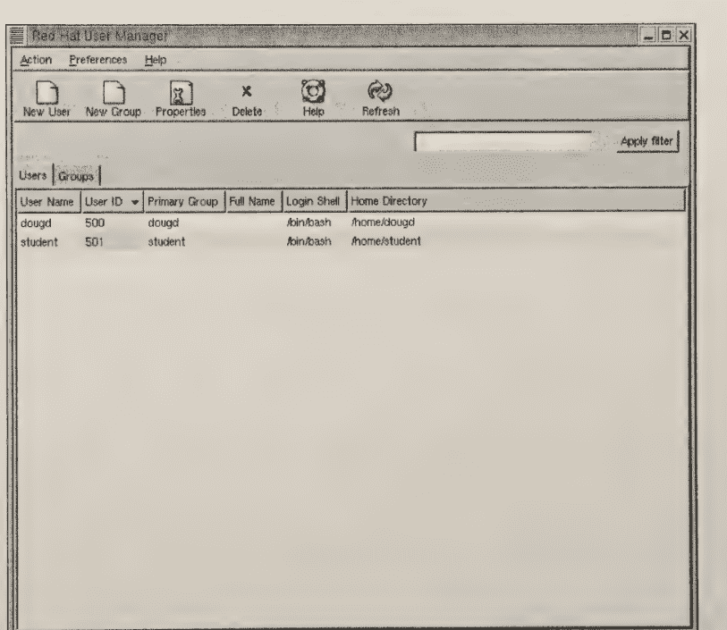

图 9-1：Red Hat 用户管理器

使用“新用户”按钮添加新用户，该按钮会显示“创建新用户”对话框（图 9-2）。

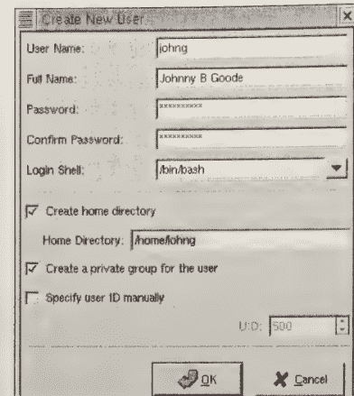

在输入相应信息后，点击“确定”。

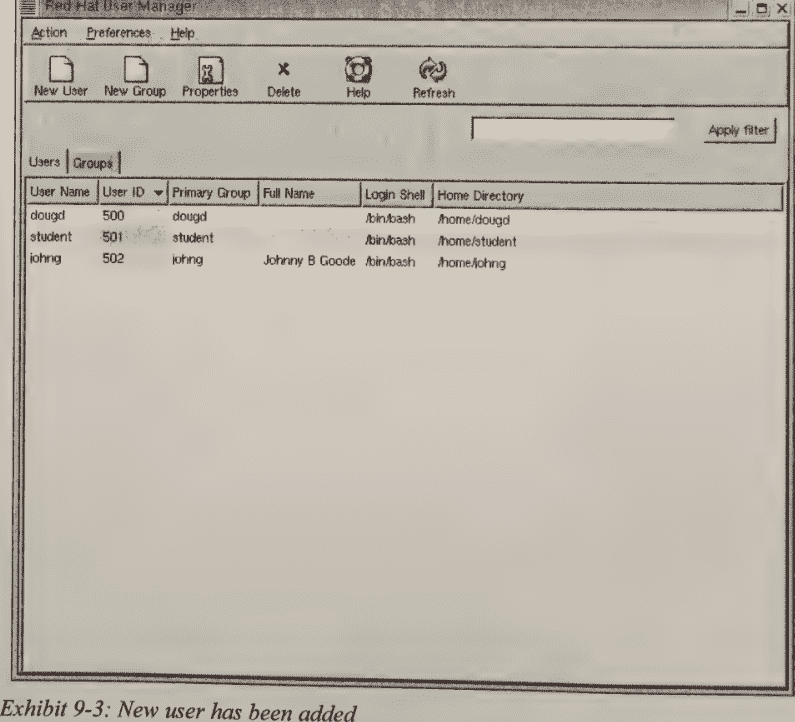

如果你想修改每个用户的设置，点击所需的用户账户，然后点击“属性”按钮（图 9-4）。

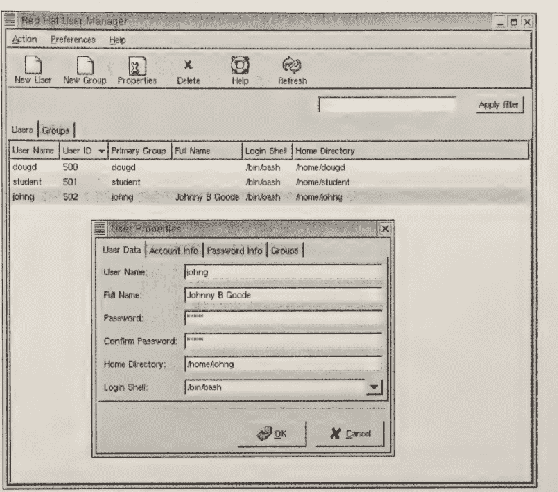

### SuSE YaST2 用户管理器

与大多数 SuSE 系统管理任务一样，用户管理是通过 YaST2 内部的函数执行的。YaST2 用户管理器与 Red Hat 用户管理器非常相似。

### A-1：使用 Red Hat 用户管理器添加用户

方法如下：

1. 启动 Red Hat User Manager。
2. 添加一个名为 Fred Flintstone 的用户，用户名为 `fredf`。该账户应具有以下属性：
   - UID = 510
   - 默认 shell = `/bin/bash`
   - 默认组 = `users`
   - 额外组 = `adm`
3. 在输入相应信息后，点击“确定”。

## 主题 B：打印机

打印机配置传统上一直是 Unix 中最具挑战性的系统任务之一。直到最近的发布版本，打印机配置一直都很复杂，有时甚至令人沮丧。

## 传统的 Linux 系统

传统的 Linux 系统通过将文件复制到特殊的打印缓存目录来工作。打印守护进程 `lpd` 定期检查该目录是否有新文件。

## /etc/printcap

`/etc/printcap` 文件包含每个打印机的设置。其选项包括：

| 项目 | 描述 |
| --- | --- |
| `queue_name` | 队列名称 | 如果未指定队列，作业将发送到默认打印机。 |
| `device` | 本地设备路径 | 默认打印机由 `PRINTER` 环境变量定义。 |
| `size` | 文件最大大小（字节） |
| `remote` | 远程打印机名称 |

## 打印过滤器

`/etc/printcap` 文件还包含打印过滤器。这些过滤器由打印守护进程 `lpd` 用于将原始的、未格式化的转换为 Postscript 格式。

## Shell 工具

你可以使用一些 Shell 命令将文件发送到队列、显示队列状态、从队列中删除作业以及控制队列的行为。

| 项目 | 描述 |
| --- | --- |
| `lpr` | 将作业发送到队列。 |
| `lpq` | 显示队列状态。 |
| `lpc` | 控制队列。Lpc 可以启动或停止作业。 |
| `lprm` | 从队列中删除作业。 |

## 新的 Linux

最近的 Linux 发行版实现了打印配置自动化，并改进了 Shell 和 GUI 工具。此外，现在打印系统有两种选择：基于传统 Linux 系统的 LPRng 以及全新的更自动系统 CUPS。

## LPRng

SuSE 8.0 版本和 Red Hat 7.3 版本使用 LPRng 作为默认打印系统。LPRng 是 Berkeley LPR 打印系统的更新版本。Red 和 SuSE 都提供了 LPRng 的图形工具，用于检测和配置打印机及队列。

### SuSE Yast2 打印配置工具

SuSE 的 Yast2 打印配置工具是 LPRng 打印系统的易用“前端”。它使用相同的底层配置文件 `/etc/printcap`。然而，Yast2 打印配置工具可以自动检测许多打印机并为配置选择合理的默认值。即使打印机未被自动检测，该工具也会引导你完成所有的配置选择。

你可以从开始菜单启动 Yast2 打印配置工具（图 9-5）。

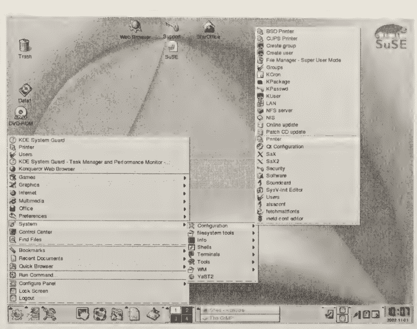

图 9-5：启动 Yast2 打印配置工具

如果你遵循良好的安全规范并以普通用户登录，KDE 会提示输入 root 密码（图 9-6）。

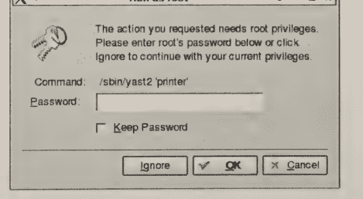

图 9-6：登录 root

当 Yast2 打印配置工具启动时，它会检查配置文件的当前设置，然后尝试自动检测连接到系统的任何打印机（图 9-7）。

## 9-14 SAIR Linux GNU: 安装与配置

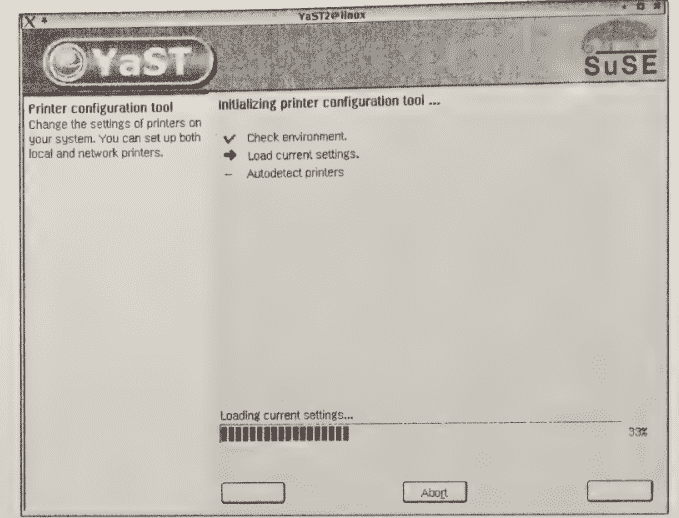

图 9-7：Yast2 打印配置工具启动界面

如果没有检测到打印机，你将看到图 9-8 所示的屏幕。

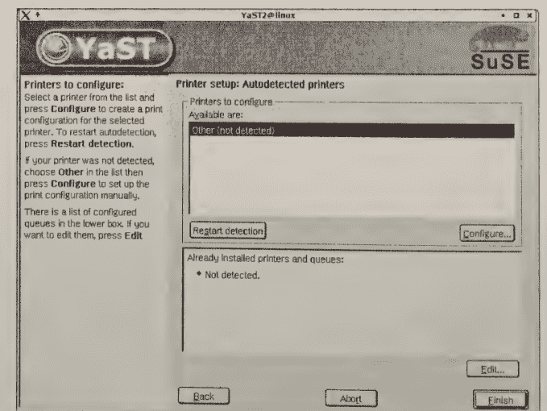


图 9-8：未检测到打印机

点击“配置”（`Configure`）按钮（图 9-8），你可以手动配置打印机（图 9-9）。

### 图 9-9：手动配置打印机

在本示例之后，我们将配置一个连接到并行端口的新 Postscript 打印机。

接下来，系统要求你确认打印机已连接到第一个并行端口，这是大多数 PC 上唯一的并行端口（图 9-10）。在该屏幕上，我们有机会测试与打印机的连接情况（测试打印机连接）。

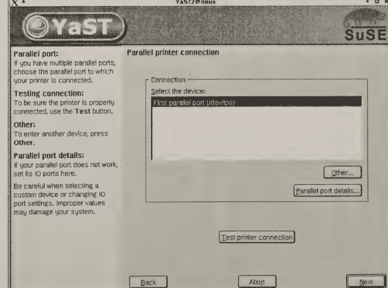

### 图 9-10：并行打印机连接配置窗口

### 9-16 SAIR Linux GNU: 安装与配置

接下来，选择与打印机关联的队列名称（图 9-11）。通常默认值即可。

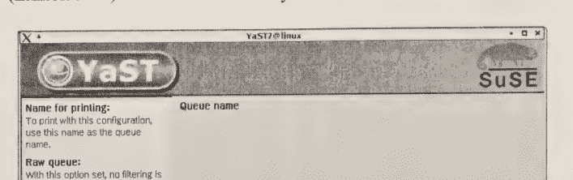

图 9-11：打印队列和后台程序配置窗口

接下来，你可以从打印机制造商和型号列表中进行选择。如果你选择“通用打印机”（`generic printer`），然后可以选择使用的打印机控制语言。注意，系统支持 Postscript 和不同版本的 HP PCL。在本示例中，打印机是 Postscript 打印机，因此选择通用（`generic`）和 Postscript 或 PDF（图 9-12）。

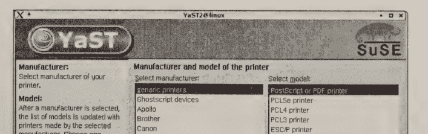

图 9-12：选择打印机

### 基本系统管理

接下来，你有机会修改 Postscript 和/或 PCL 的详细配置。除非你有特定的理由要修改默认设置（例如根据制造商文档的说明），否则请保持原样。

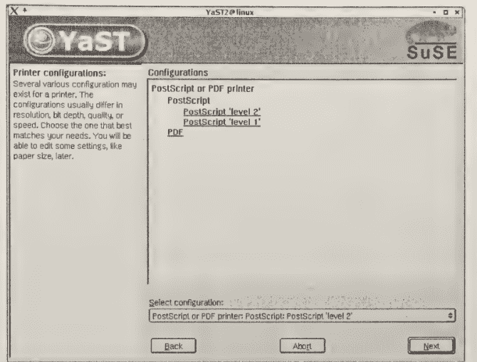

图 9-13：修改 Postscript 或 PCL 设置

接下来，你可以自定义打印输出的默认设置（图 9-14）。

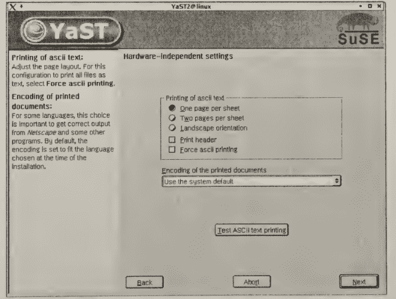

图 9-14：自定义打印机输出

# SAIR Linux GNU 安装与配置

最后，你将回到主界面。界面将显示你刚刚设置的打印机。如果你点击“完成”（`Finish`），配置文件的更改即刻完成，打印机即可使用。如果你点击“取消”（`Abort`），更改将被丢弃，打印机将不会被配置（图 9-15）。注意`[测试](test）`链接。在最终配置之前，这是测试打印机和打印队列的一个方便时刻和地点。

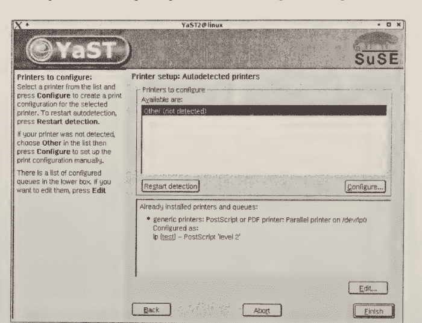

图 9-15：完成配置

### 从 Shell 配置 SuSE 打印机

几乎所有的 SuSE 系统管理功能都通过 `YaST2` 完成。从 SuSE 8.0 版本开始，旧的 YaST 程序不再可用。在 shell 提示符下输入 `vast` 可启动 YaST2 控制中心（图 9-16）。

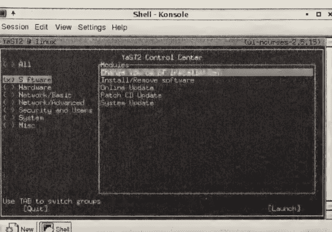

图 9-16：从 shell 运行 YaST2（curses 版本）

`YaST2` 程序在 shell 运行时使用一种称为 `curses` 的技术来控制屏幕。这允许使用 TAB 键导航菜单。各种控制中心选项通过 SPACE 键选择。使用 TAB 键高亮“硬件”（`Hardware`）行并使用 SPACE 键选择“硬件”，你会看到图 9-17 所示的屏幕。

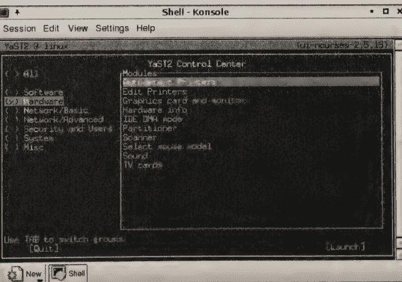

图 9-17：从 YaST2 控制中心访问打印机配置工具

按下 ENTER 键将带进入图 9-18 所示的 `curses`（文本模式）版本的打印机配置工具。（另一种快捷方法是在 shell 提示符下执行 `yast2 'printer'` 命令。）

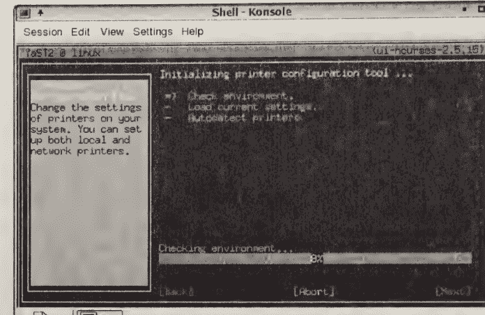

图 9-18：YaST2 文本模式打印机配置工具

最后将显示自动检测打印机窗口的文本版本（图 9-19）。此时，只需按照上述使用图形界面工具时相同的步骤操作即可。

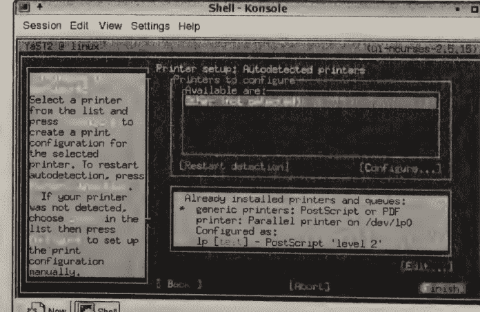

图 9-19：文本模式打印机配置工具

### Red Hat printconf

与 SuSE 8.0 类似，Red Hat 7.3 的默认打印系统是 `LPRng`。同样像 SuSE 一，Red Hat 提供了一个图形化工具 `printconf` 来检测和配置打印机。Red Hat 还“退役”了其旧的打印机配置工具 `printool`。如果你在 shell 提示符下输入 `printconf`，该程序就会启动。

可以通过 GUI 启动 `printconf`。

# SRE Linux GNU：安装与配置

Red Hat 和 SuSE 通过在安装期间创建一个链接 `/dev/cdrom`（该链接指向 CD-ROM 驱动器的实际设备文件），使得生活变得简单了一些。

挂载点可以是任何文件系统上的任何目录。按照惯例，可移动设备被挂载到 `/` 或 `/mnt` 下的空目录（SuSE 使用 `/`，Hat 使用 `/mnt`）。作为挂载点使用的目录在 Linux 安装期间已创建。如果你需要额外的挂载点（例如，为了你安装的第二个 CD-ROM），只需使用 `mkdir` 命令创建额外的目录即可。

最后，CD-ROM 上常见的文件系统类型是 ISO 9660 文件系统。如果未指定文件系统类型，大多数 Linux `mount` 命令都会默认使用 ISO 9660。

### 使用 GUI 工具挂载和访问可移动介质

Gnome 和 KDE 都能够自动挂载可移动介质。Red Hat 为 Gnome 和 KDE 都配置了自动挂载。SuSE 没有为 KDE 配置自动挂载。如果你在 SuSE 上需要此功能，你必须自己进行配置。

自动挂载可以是完全自动的（CD-ROM）或半自动（软盘）。在 Red Hat 上，当 CD 插入 CD-ROM 驱动器时，CD 会出现在桌面上（图 9-20）。Red Hat 会尝试启动相应的 GUI 应用程序。如果 CD 上有自动运行脚本（`autorun`），该脚本将控制启动哪个 GUI 应用程序。如果没有自动运行脚本且 CD 是数据光，则会打开 Nautilus 窗口。

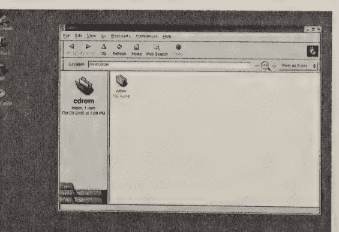

图 9-20：自动挂载的 CD

要卸载 CD，在 CD 图标上点击鼠标右键，并选择“卸载卷”（`Unmount Volume`），如图 9-21 所示。

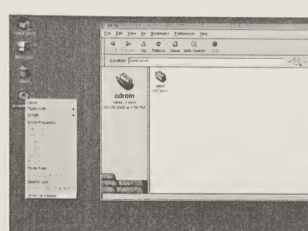

图 9-21：卸载 CD

软盘不是完全自动的。它们必须使用桌面工具进行挂载。如果你在桌面的任何位置点击鼠标右键，弹出菜单将为你提供挂载软盘或 CD 的选项（图 9-22）。对于 CD 来说，这是重新挂载误操作卸载 CD 的方便方法。

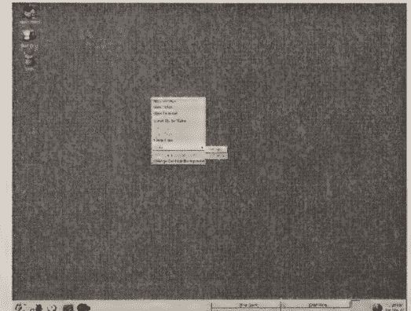

图 9-22：从 Gnome 桌面挂载软盘

双击软盘图标，Nautilus 窗口启动并显示软盘的内容，如图 9-23 所示。

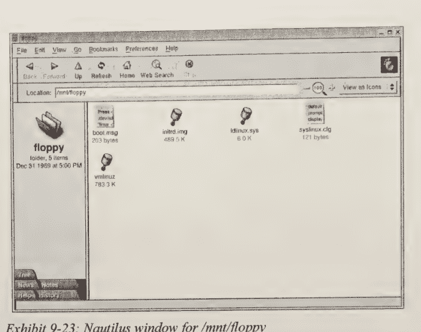

### 使用 shell 工具挂载和访问可移动介质

你在 shell 提示符下使用 `mount` 命令挂载可移动介质。以下命令从 shell 挂载 CD-ROM：

```bash
$ mount /dev/cdrom /mnt/cdrom
```

你使用 `umount` 命令卸载可移动介质：

```bash
$ umount /mnt/cdrom
```

用于挂载可移动介质的相同命令也用于挂载硬盘分区上的文件系统。文件 `/etc/fstab` 控制哪些文件系统被挂载到哪些分区。

### 挂载外部文件系统

要挂载远程文件系统，在使用 `mount` 时使用 `-t` 选项。例如，用 FAT32 或 VFAT 文件系统格式化的磁盘可以通过以下方式挂载：

```bash
$ mount -t vfat /dev/fd0 /dev/floppy
```

`-t` 选项用于指定正在挂载的文件系统类型，且选择的挂载点反映了这一点。如果 `/etc/fstab` 文件中指定了文件系统类型，则不需要在命令行中指定。有关可以挂载的不同文件系统的完整列表，请查看 `mount` 的 man 页面。

双启动系统的另一种选项是将 FAT 或 FAT32 分区挂载到你的目录树中。这使得分区上的数据在 Windows 会话和 Linux 会话中可用。

例如，同一台机器上用 FAT32 或 VFAT 文件系统格式化的分区可以通过以下方式挂载：

```bash
$ mount -t vfat /dev/hda7 /mnt/windows_d
```

### C-1：深入学习 mount


# 1. 挂载来自 Red Hat 发行版的第 2 号 CD

将 CD 插入 CD-ROM 驱动器。

如果询问你是否要运行 `/mnt/cdrom/cdrom/autorun`，选择 `No`。

你如何验证 CD 已自动挂载？

*桌面上的图标，Nautilus 文件管理器窗口打开在 CD 文件系统的根目录处*

# 2. 使用 CD 挂载时打开的 Nautilus 文件管理器窗口，打开 Red Hat 文件夹

# 3. 卸载 CD

在 CD 图标上点击鼠标右键。

点击 `Unmount Volume`（卸载卷）。

发生了什么？为什么？

*因为你使用 Nautilus 文件管理器打开了 CD 上的目录，该卷正忙碌，无法卸载。*

你将如何解决这个问题？

*关闭 Nautilus 窗口将允许卸载 CD。*

## 使用 shell 工具监控磁盘使用情况

通常使用两个工具来检查硬盘状态：`df` 和 `du`。

`df` 命令显示文件系统、总大小、已用空间、可用空间以及挂载点：

```bash
$ df -h
Filesystem      Size  Used Avail Use% Mounted on
/dev/sda1        20G   10G   10G  50% /
tmpfs           4.0G     0  4.0G   0% /dev/shm
```

`du` 命令用于检查目录或文件占用的空间：

```bash
$ du -sh /home/user
1.2G    /home/user
```

## 基础系统管理

`netstat` 命令功能强大且复杂。它有许多选项，可以提供你或任何系统管理员可能需要的各种状态和统计信息。我们将仅仅对 `netstat` 的功能进行初步介绍。

`netstat` 命令的用途之一是查看路由信息。当你安装 Linux 时，你手动设置或由 DHCP 服务器为你设置的网络配置参数之一就是默认网关。你可能记得默认网关的作用是在你的本地子网和外部之间路由流量。`netstat -r` 命令允许你查看系统路由表的当前状态。如果你无法连接到本地子网之外的系统，`netstat -r` 可以为原因提供关键线索。

```bash
$ netstat -r
```

### 内核 IP 路由表

| 目的 | 网关 | 标志 | MSS | 窗口 | irtt | 接口 |
|---|---|---|---|---|---|---|
| 192.168.1.0 | * | 255.255.255.0 | U | 40 | | eth0 |
| 127.0.0.1 | * | 255.0.0.0 | U | 40 | | lo |
| default | 192.168.1.1 | 0.0.0.0 | U | 40 | | eth0 |

如果 `netstat -r` 显示中没有默认网关，你可以使用 `route` 命令（假设你知道默认网关的地址）来解决问题。请参阅 `route` 的手册页。

`netstat` 命令的另一个用途是确定系统上哪些网络端口是打开的。这些信息对于理解系统的安全状态至关重要。

```text
[root@local ~]# netstat -t
活动 Internet 连接（服务器和已建立的连接）
Proto (协议) Rec-Q (接收队列) Send-Q (发送队列) Local Address (本地地址) Foreign Address (外部地址) State (状态) PID/Program name (PID/程序名)
tcp 0 0 0.0.0.0:32768 0.0.0.0:* LISTEN 600/kstat
tcp 0 0 127.0.0.1:32769 0.0.0.0:* LISTEN 782/inet
tcp 0 0 0.0.0.0:139 0.0.0.0:* LISTEN 1221/sshd
tcp 0 0 0.0.0.0:1111 0.0.0.0:* LISTEN 572/postmaster
tcp 0 0 0.0.0.0:16000 0.0.0.0:* LISTEN 1304/*
tcp 0 0 0.0.0.0:21 0.0.0.0:* LISTEN 782/inet
tcp 0 0 0.0.0.0:22 0.0.0.0:* LISTEN 748/shd
tcp 0 0 0.0.0.0:0631 0.0.0.0:* LISTEN 1282/cupsd
tcp 0 0 127.0.0.1:125 0.0.0.0:* LISTEN 815/memwall
udp 0 0 0.0.0.0:32768 0.0.0.0:* 600/kstat
udp 0 0 192.168.1.1:1037 0.0.0.0:* 1226/nmbd
udp 0 0 192.168.1.1:137 0.0.0.0:* 1226/nmbd
udp 0 0 0.0.0.0:137 0.0.0.0:* 1226/nmbd
udp 0 0 192.168.1.1:1038 0.0.0.0:* 1226/nmbd
udp 0 0 192.168.1.1:1038 0.0.0.0:* 1225/nmbd
udp 0 0 0.0.0.0:138 0.0.0.0:* 1226/nmbd
udp 0 0 0.0.0.0:111 0.0.0.0:* 572/portmap
```

> 图 9-24：使用 `netstat` 查找开放端口

不用担心传递给 `netstat` (`-tupan`) 命令的标志含义（见图 9-24）。你可以随时查阅手册页获取详细信息。现在，让我们查看输出中每列的信息：

| 项目 | 描述 |
|---|---|
| Proto (协议) | socket 使用的协议。 |
| Recv-Q (接收队列) 连接到此 socket的用户程序尚未复制的字节数。 |
| Send-Q (发送队列) 远程主机未确认的字节数。 |
| Local address (本地地址) | socket 本地地址和端口号。 |
| Foreign address (外部地址) | socket 远程端地址和端口号。类似于“本地地址”。 |
| State (状态) | 你经常看到的两种 socket 状态是 ESTABLISHED（已建立）：socket 有连接。LISTEN（监听）：socket 正在等待传入连接。 |
| PID/Program (PID/程序) | 打开该 socket 的进程 ID (PID) 和程序名称。 |


这些问题之一是 X 对字体的处理。网页和文档有时难以阅读，因为 X 使用了等宽的基于 Postscript 的字体。虽然有等宽字体可用，但某些应用程序使用的字体并不在 X 的等宽字体列表内。结果就是外观呈现锯齿状、难以辨认。配置 X 以及作为文字处理器的应用程序以使用等宽的 Postscript 字体（例如 TrueType 字体）是一项复杂的任务。

即使配置工具有了改进，X 仍然是一个复杂的系统。现代 Linux 发行版（如 Red Hat 7.3 版本或 SuSE 8.0 版本）的默认安装几乎总是产生一个可运行的 X Windows 环境。安装后的自定义和调优（特别是安全方面）可能是一项艰巨的任务。配置此强大软件的复杂性即使对于高级用户来说也能解决问题。

## X 的组件

如前所述，X 窗口系统设计用于跨越网络运行。X 的两个主要组件是服务器（server）和客户端（client）。

### 服务器

服务器是两者中更重要的，因为它实际上控制着视频硬件。在任何给定时间内，系统中都会安装两个服务器：通用 VGA 服务器，以及如果可用，则是一个为提供访问显卡高级功能而设计的特定硬件服务器。

运行在你本地机器上的 X 服务器由通常位于你机器上的客户端进行访问，但同样容易地，它也可以被网络上的其他机器访问。服务器的输出设备（在大多数情况下是你的显示器）只需要根据客户端向服务器通信的尺寸、颜色和其他规格，在你的显示器上渲染客户端的图形。

### 客户端

客户端（client）并不直接访问显示器；它们依赖服务器来处理显示。客户端是用户看到的内容；它是 X 系统的一部分，提供访问窗口管理器或其他客户端程序的接口。

## 定位文件

根据安装在系统上的发行版不同，X 服务器和相关的配置文件将位于略有不同的位置。

下面的列表描述了 X Windows 的常见组件及其在 SuSE 8.0 和 Red Hat 7.3 中的位置。

有一份 Linux 文件系统层次结构标准（FHS）规定了常见的 Linux 系统文件应该存放在哪里（`www.pathname.com/fhs`）。大多数发行版遵循该标准，但存在一些差异。这使得寻找系统配置文件（包括 X Windows 配置文件）成为一种挑战。在搜索 X Windows 组件时，`which`、`where` 和 `find` 命令非常有帮助。

## SAIR Linux GNU：安装与配置

| 文件 | 功能 | 备注 |
| --- | --- | --- |
| `/etc/X11` | Linux FHS 定义的 X 配置程序、X 配置文件和窗口管理器所在。 |  |
| `/etc/X11/XF86Config` | X 服务器配置文件的 FHS 路径。XF86Config 文件包含了配置 X 所需的所有信息。 |  |
| `/usr/X11R6/bin` | X 窗口服务器、设置工具、一个或多个显示管理器、窗口管理器以及指向当前配置 X 服务器的某些 X 相关符号链接的默认位置。也包含应用程序。 | 较版本的 FHS 指定 `/usr/X11R6/bin`。为了保持向后兼容，`/usr/bin/X11` 实际上是 `/usr/X11R6/bin` 的符号链接。 |
| `/usr/X11R6/lib` | X 窗口运行时库的 FHS 路径。 | 旧版本的 FHS 指定 `/usr/X11R6/lib`。为了保持向后兼容，`/usr/lib/X11` 实际上是 `/usr/X11R6/lib` 的符号链接。 |
| `/usr/X11R6/lib/fonts` | 所有可用字体的默认位置。标准等宽字体在这里，还包含任何额外或非标准字体库的子目录。 | 旧版本的 FHS 指定 `/usr/X11R6/lib/fonts`。为了保持向后兼容，`/usr/lib/X11/fonts` 实际上是 `/usr/X11R6/lib/fonts` 的符号链接。 |

## XFree86 v4 与 XFree86 v3 的区别

### XFree86 版本 4

XFree86 版本 4 使用单一二进制可执行文件 `/usr/X11R6/bin/XFree86`。XFree86 程序从 `/usr/X11R6/lib/modules/` 动态加载所需的 X 服务器模块。某些模块会自动加载；某些模块是可选的，必须在 XFree86 的配置文件 `/etc/X11/XFree86Config-4` 中设置。

### XFree86 版本 3

XFree86 版本 3 为每一类服务器硬件（显卡）使用独立的 X 服务器程序。安装在你系统上的 XFree86 服务器程序位于 `/usr/X11R6/bin/`。
服务器程序名称的格式为 `XF86_server-type`。例如，使用 S3 视频芯片的显卡将使用 S3 视频。如果找不到加速服务器或加速服务器无法工作，则可以使用 S3 服务器（或者通用 VGA 或 SVGA 服务器）。
XFree86 配置文件是 `/etc/X11/XFree86Config`。

## 主题-1：讨论 X Windows

| 问题与回答 |
| --- |
| 1 哪个组件控制视频硬件？服务器 |
| 2 哪个组件提供窗口管理器的访问？客户端 |
| 3 XFree86 配置文件在哪里？`/etc/X11` |
| 4 如果没有加速服务器，可以运行 X Windows 吗？否（通用 VGA 或 SVGA 服务器通常可以工作）。 |

## 主题 B：配置 X Windows

### 解析

正确配置 X 对于任何需要图形界面的 Linux 安装都至关重要。虽然 XFree86 的配置文件是相同的，但每个发行版提供的配置 X Windows 的工具不同。因此，我们将检查 Red Hat 7.3 和 SuSE 8.0 的 X 配置。

配置 X 有两种基本选择：使用 Linux 发行版提供的工具或手动编辑 XFree86 配置文件。

## 在 SuSE 8.0 上配置 X Windows

SuSE 提供了多种配置 X Windows 的工具。首选工具是 SuSE 自带的 SaX2。SuSE 还包含了旧的 xf86 程序。

### 使用 SaX2

要运行 sax2，首先使用 `Control+Alt+F1` 将系统处于文本模式。

SaX2 可以从 KDE 菜单启动并在 GUI 内运行。但不建议这样做。X 服务器极可能会死机，还可能导致数据损坏使 X 系统无法运行。

当文本控制台出现时，以 root 身份登录。在 shell 提示符输入 `init 3`。这将系统级别从 5 更改到 3。

接下来，输入 `sax2`。你应该看到图 10-1 所示的屏幕。SaX2 开始检测与 X Windows 相关的硬件。

```
Starting graphic driver

Searching for video cards...done

Flickering port (0000)...done

Searching for mice...done

Loading keyboard maps... (done)

Searching for monitors...done

Binding console to tty1...done

Setting up input...done

Setting up video mode...done

Starting hardware acceleration...done

Starting peripheral (firmware)...done

Detected video card S3 Virge (VGA) Resolution 1024x768 (16b)

login: root

root

nare now logged in to runlevel 3.

Check runlevel: 3 of 5 (multi-user)

Checking a list of devices...

root

Detecting hardware please wait...
```


### 图 10-1：SaX2 检测硬件

当 SaX2 完成硬件检测后，它会显示分辨率并询问你是否接受（如图 10-2 所示）。

点击 Alter 按钮并选择 Change Configuration 菜单项。进入 SaX2 设置界面（如图 10-3 所示）。

勾选 Use/change the current configuration 旁的复选框，然后点击 Next。

你现在看到的是一系列窗口，它们允许你重新配置鼠标、键盘、显卡和显示器。

## 配置鼠标

下一个屏幕允许你配置鼠标（如图 10-4 所示）。

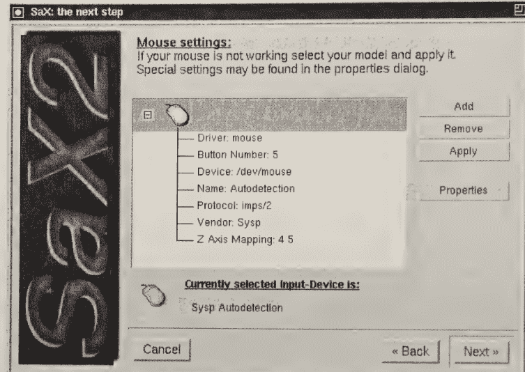

图 10-4：鼠标配置

## 配置键盘

下一个屏幕允许你配置键盘，包括默认语言和任何特殊键映射（如图 10-5 所示）。

## 配置显卡

接下来，你将有机会配置显卡（如图 10-6 所示）。

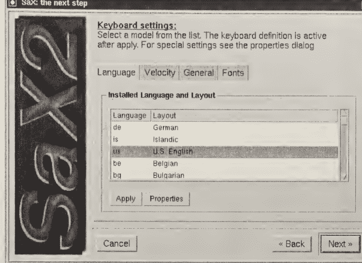

图 10-5：键盘配置

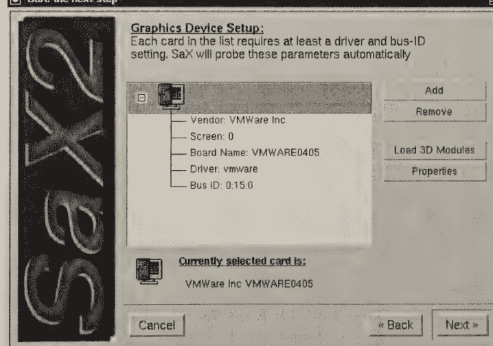

图 10-6：显卡设置

如果 SaX2 选择了错误的显卡，通过点击“属性”，你可以从显卡厂商和显卡的列表中进行选择（如图 10-7 所示）。

### 10-10 SAX Linux 安装与配置

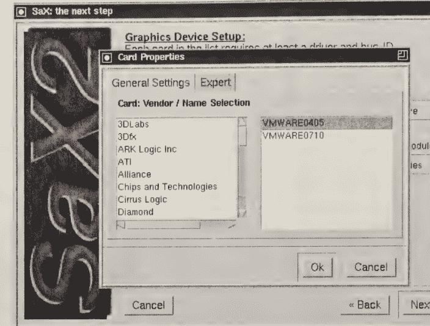

图 10-7：选择显卡厂商和型号

通过点击“专家级”选项卡，你可以微调所选显卡的配置参数（如图 10-8 所示）。

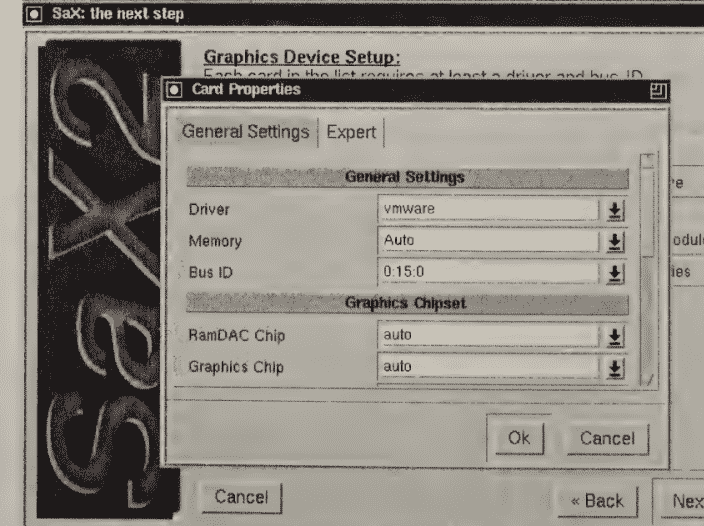

图 10-8：修改显卡设置

## 配置显示器

接下来，你有机会配置显示器（如图 9 所示）。

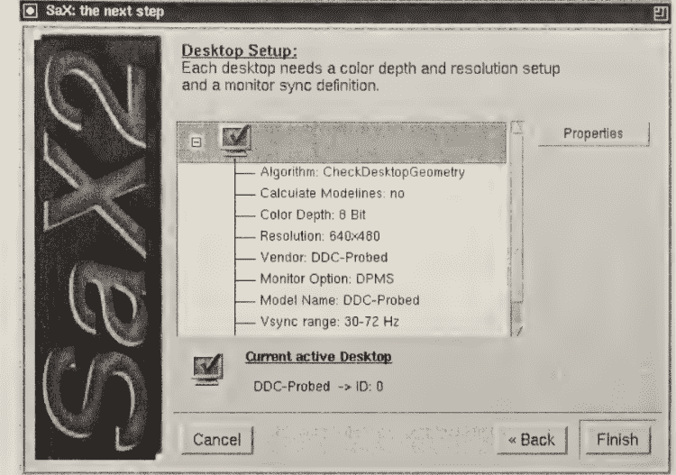

图 10-9：显示器分辨率

如果你对设置满意，可以点击“完成”。否则，点击“属性”按钮修改显示器设置。“属性”窗口中的“颜色”选项卡允许你调整显示器的色彩深度和分辨率（如图 10-10 所示）。

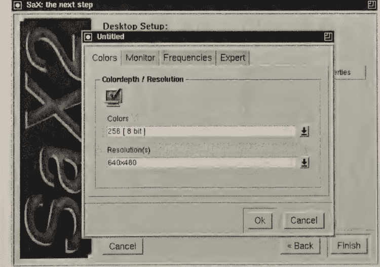

图 10-10：选择色彩深度和分辨率

“显示器”选项卡允许你选择显示器厂商和型号（如图 10-11 所示）。

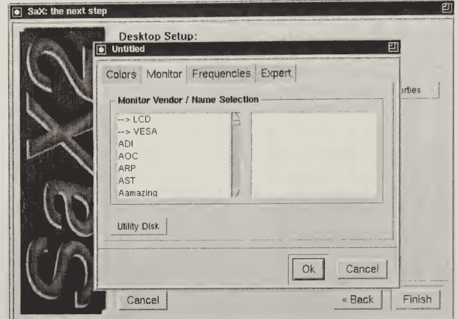

图 10-11：选择显示器厂商和型号

“频率”选项卡允许你手动设置水平垂直刷新范围（如图 10-12 所示）。只有在“显示器”选项卡上找不到合适的匹配项时，才需要这样做（图 10-11）。

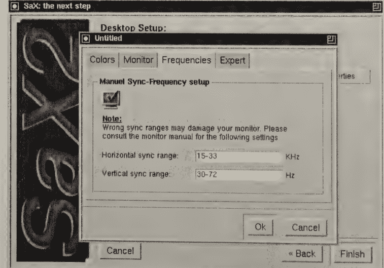

图 10-12：手动选择显示器频率

## 完成

点击“完成”会弹出启动窗口。在这里，你可以选择保存配置，也可以通过点击“启动”测试新设置（如图 10-13 所示）。

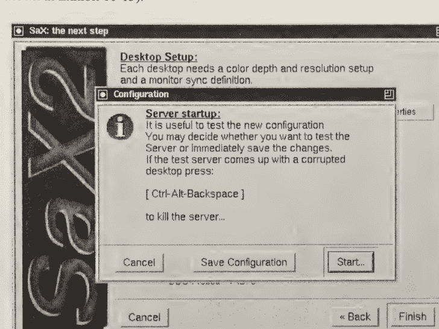

图 10-13：测试新配置

点击“启动”应该调出调工具（如图 10-14 所示）。在这里你可以调整屏幕几何并选择默认分辨率。

### 10-14 SAX Linux：安装与配置

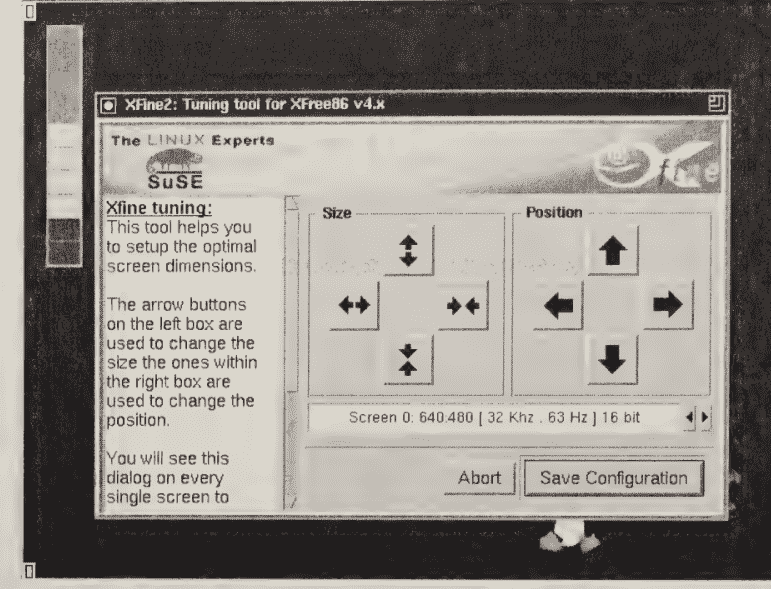

图 10-14：微调新配置

点击“保存配置”应该退出 SaX2 并返回文本模式屏幕。此时，你可以运行 `init 5` 返回 KDE 登录界面或重启。

## 在 Red Hat v7 上配置 X Windows

Red Hat 提供了多种配置 X Windows 的工具。首选的是 Hat 自己的 Xconfigurator 程序。Red Hat 还包含了旧的、通用的 x86config 程序。

## 使用 Xconfigurator

要运行 Xconfigurator，首先使用 Control+Alt+F1 将系统置于文本模式。Xconfigurator 可以在 GUI 中启动并运行，但不建议这样做。X 服务器有锁死的风险，而且存在数据损坏导致 X Windows 无法运行或系统无法启动的风险。当控制台出现时，以 root 登录。在 shell 提示符输入 `init 3`。这将系统从 5 切换到 3 并停止 X Windows。以 root 登录并在 shell 提示符输入 Xconfigurator。看到的第一个屏幕是 Xconfigurator 欢迎界面（如图 10-15 所示）。

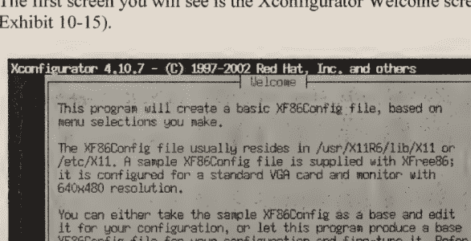

图 10-15：Xconfigurator

如屏幕底部所示，Tab 键在元素间移动（后续屏幕中屏幕元素将是清晰）。由于“确定”按钮被高亮，如果你按下 Enter，将进入下一个屏幕。接下来，Xconfigurator 会探测硬件并显示找到的显卡。如果没有找到显卡，将显示一个屏幕要求你从列表中选择显卡。

### 10-16 SAX Linux 安装与配置

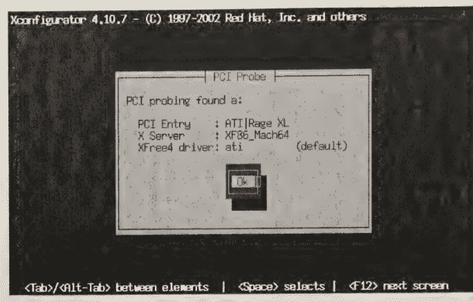

图 10-16：Xconfigurator 找到了显卡

接下来，将显示显示器探测的结果（如图 10-17 所示）。

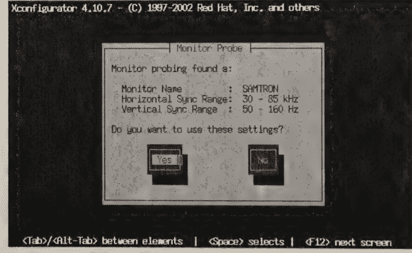

图 10-17：Xconfigurator 找到了显示器

如果显示器设置不正确，使用 Tab 键选择“否”并按下 Enter。否则，按下 Enter 继续。接下来，将显示硬件探测发现的显存（如图 10-18 所示）。

### Xconfigurator 4.10.7 - (C) 1997-2002 Red Hat, Inc., 以及

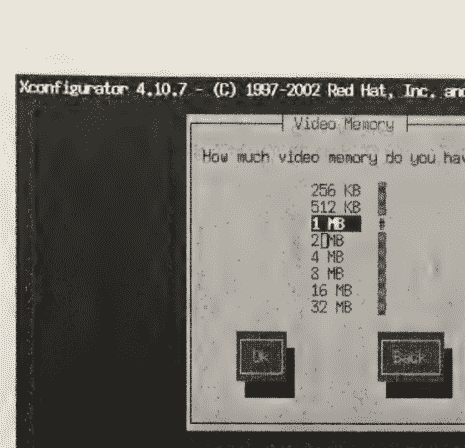

图 10-18：显存选择

如果找到的显存大小不正确，按下 Tab 键直到带有井号 (#) 的选项被高亮。然后，使用方向键向上或向下移动到正确的数值，Tab 确定并按下 Enter。接下来，Xconfigurator 会显示频率配置窗口（如图 10-19 所示）。除非你有特定理由选择频率设置（例如显卡厂商文档中的说明），否则保持默认的“无频率设置”。

### Xconfigurator 4.10.7 - (C) 1997-2002 Red Hat, Inc., 以及

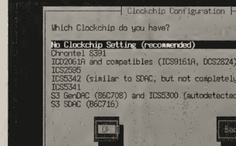

图 10-19：频率配置窗口

接下来，你有机会选择视频模式（色彩深度和分辨率）。初始屏幕显示了支持的设置，基于显卡显存的大小和显示器支持的分辨率（如图 10-20 所示）。注意尚未选择任何内容。

### SAX Linux 安装与配置

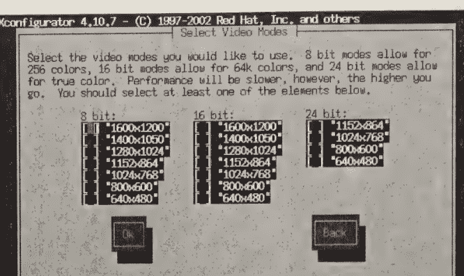

图 10-20：可用的视频模式

你必须选择一个支持的模式（如图 10-21 所示）。使用 Tab 键在屏幕元素间移动。两个按钮“确定”和“返回”以及蓝色亮分辨率列（8 位、16 位和 24 位是屏幕元素）。使用方向键在分辨率列中移动并使用空格键进行选择/取消选择。你选择的每个分辨率旁边都会出现星号 (*)。当你选了所有需要的分辨率时，Tab 到“确定”并按下 Enter。

如果你选择了多个分辨率，X 服务器将尝试以最高的选取分辨率启动。当 X 服务器启动时，你可以按住 Ctrl+Alt 并按下数字键盘上的加号 (+) 向上移动（向更高分辨率）。按住 Ctrl+Alt 并按下减号 (-) 向移动（向较低分辨率）。Ctrl+Alt+Backspace 会立即终止 X 服务器。

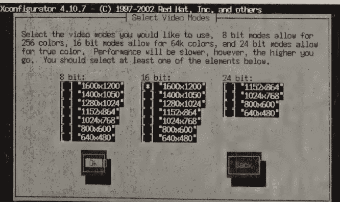

图 10-21：选择视频模式

最后，你将有机会测试新配置。

### X Windows 10-19

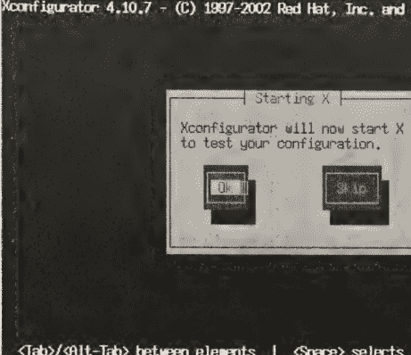

图 10-22：测试新设置

# XF86Config-4 的布局与语法

每个节以 `Section "<section-name>"` 行开头，以 `EndSection` 行结束。每个节将包含选项名称，其后至少跟有一个选项值。

## Device（设备）

设备是指显卡。此节包含显卡的配置数据。XF86Config 文件中必须至少有一个 Device 节。常用的选项有：

- Driver — 用于显卡的驱动程序（X 运行）名称
- Identifier — 显卡的唯一名称
- VideoRam — 以 KB（Kbytes）为单位的显存容量

## Files（文件）

此节包含关键 XFree86 服务器文件的路径定义：

- FontPath — 字体库路径
- ModulePath — 指定可能找到额外模块（驱动程序）的目录
- RgbPath — RGB 颜色数据库的路径

## InputDevice（输入设备）

此节配置输入设备。主要关注的是键盘和鼠标。

- Driver — 识别设备使用的驱动程序名称
- Identifier — 为设备设置唯一标识符

特定设备将有额外的选项。例如，鼠标将有一个设备名称（如 `/dev/psaux`）和一个协议规范（如 PS/2）。

## Monitor（显示器）

定义系统使用的显示器。每个系统必须至少有一个 Monitor 节。如果系统支持多个显示器，则可能有多个 Monitor 节。

一些常用选项有：

- HorizSync — 水平频率范围
- VertRefresh — 垂直频率范围
- VendorName — 制造商名称
- Identifier — 此显示器的唯一名称
- Modeline — 每个颜色深度对应的分辨率范围

## Screen（屏幕）

此节绑定或连接 Device 和 Monitor 设置。每个系统必须至少有一个 Screen 节。

一些常用选项有：

- DefaultDepth — 默认颜色深度
- Device — 与此 Screen 节使用的 Device节名称
- Identifier — 唯一名称
- Monitor — 与此 Screen 节使用的 Monitor 名称

## ServerFlags（服务器标志）

此节包含各种全局 XFree86 服务器设置。最感兴趣的是：

- DontZap — 阻止使用 Control+Alt+Backspace 终止 X 服务器
- DontZoom — 阻止使用 Control+Alt+[小键盘 +] 和 Control-Alt+[小键盘 -] 循环 X 服务器的分辨率

本回顾仅是对 XF86Config 文件中所有选项的皮毛介绍。文件本身注释详尽，几乎是自文档化的。XF86Config 手帮助页是另一个很好的参考。

## Mouse configuration（鼠标配置）

你可能注意到 Xconfigurator 并没有提供重新配置鼠标。有一个独立的 shell 工具 `mouseconfig` 可以完成此任务。

## B-1：在 Red Hat v7.3 上配置鼠标

### 操作方法如下

1. 从终端窗口或控制台变为**超级用户（superuser）**。

输入 **mouseconfig**。

2. 按照配置屏幕操作。

列出你允许更改的鼠标特性列表。

**鼠标类型和模拟三键（Mouse type and Emulate 3 buttons）。**

在 mouseconfig 中做出的选择会修改 XF86Config 文件中的哪些选项？

*Driver, identifier, device, Emulate3Buttons, and protocol*

**退出（Exit）** mouseconfig 工具。

3. 将 XF86Config-4 文件复制到家目录。

4. 使用 GUI 或文本编辑器打开你复制的 XF86Config-4。

列出鼠标配置选项。

## 单元总结：X Windows

**主题 A**
在本主题中，你学习了 X Windows 的部分历史、重要 **X Windows 程序**和**配置文件**的**标准位置**，以及 XFree86 版本 3 和 4 之间的某些差异。

**主题 B**
然后你学习了如何使用 **SaX2** 工具在 SuSE 8.0 上配置 X Windows，以及如何使用 **Xconfig** 工具在 Red Hat 7.3 上配置 X Windows。你还学习了 **XF86Config** 文件的重要性、基本结构和语法。

## 复习题

1. KDE 和 Gnome 的窗口管理器名称是什么？
   kvm and gdm
2. 大多数 Linux 发行版自带的免费开源 X 服务器是什么？
   XFree86
3. X Windows 系统的两个主要组件是什么？
   X client and server
4. 主要的 SuSE 配置工具是什么？
   SaX2
5. 主要的 Red Hat 配置工具是什么？
   Xconfigurator
6. 主要的 SuSE 配置工具可以从控制台和 GUI 中的终端窗口运行。正确还是错误？
   正确。但不建议在 X 服务器运行时运行 SaX2。
7. XF86Config 文件的名称是？
   XF86Config-4

## 第 1 单元：安装和管理 Linux 应用

单元时间：45 分钟

完成本单元，你将学会：

- A 从源码安装和配置 Linux 应用程序。
- B 描述最流行的包管理器的功能和优点。

## 主题 A：从源码安装应用程序

今天，大多数 Linux 应用程序（内核）以包的形式提供：程序和文件的集合，通常代表一个单一程序，其安装是自动的。稍后将讨论包和包管理器。然而，在 Linux 存在的最初几年，所有应用程序（以及内核）都是以源码格式分发的。某些程序仍以源码格式分发。以源码格式分发的程序在使用之前必须经过编译和链接。编译和链接过程的最终是一个二进制（可执行）程序。（某些应用程序以二进制格式分发。）

## 从源码安装

为什么要考虑二进制格式

今天，大多数 Linux 应用程序（内核）以包的形式提供：程序和文件的集合，通常代表一个单一程序，其安装是自动的。稍后将讨论包和包管理器。然而，在 Linux 存在的最初几年，所有应用程序（以及内核）都是在源码格式分发的。某些程序仍以源码格式分发。以源码格式分发的程序在使用之前必须经过编译和链接。编译和链接过程的最终是一个二进制（可执行）程序。（某些应用程序以二进制格式分发。）

## 从源码安装应用程序

今天，大多数 Linux 应用程序（内核）以包的形式提供：程序和文件的集合，通常代表一个单一程序，其安装是自动的。稍后将讨论包和包管理器。然而，在 Linux 存在的最初几年，所有应用程序（以及内核）都是在源码格式分发的。某些程序仍以源码格式分发。以源码格式分发的程序在使用之前必须经过编译和链接。编译和链接过程的最终是一个二进制（可执行）程序。（某些应用程序以二进制格式分发。）

## 获取应用程序代码

今天，大多数 Linux 应用程序（内核）以包的形式提供：程序和文件的集合，通常代表一个单一程序，其安装是自动的。稍后将讨论包和包管理器。然而，在 Linux 存在的最初几年，所有应用程序（以及内核）都是以源码格式分发的。某些程序仍以源码格式分发。以源码格式分发的程序在使用之前必须经过编译和链接。编译和链接过程的最终是一个二进制（可执行）程序。（某些应用程序以二进制格式分发。）

## 提取源码文件

今天，大多数 Linux 应用程序（内核）以包的形式提供：程序和文件的集合，通常代表一个单一程序，其安装是自动的。稍后将讨论包和包管理器。然而，在 Linux 存在的最初几年，所有应用程序（以及内核）都是以源码格式分发的。某些程序仍以源码格式分发。以源码格式分发的程序在使用之前必须经过编译和链接。编译和链接过程的最终是一个二进制（可执行）程序。（某些应用程序以二进制格式分发。）

## 使用示例代码工作

今天，大多数 Linux 应用程序（内核）以包的形式提供：程序和文件的集合，通常代表一个单一程序，其安装是自动的。稍后将讨论包和包管理器。然而，在 Linux 存在的最初几年，所有应用程序（以及内核）都是以源码格式分发的。某些程序仍以源码格式分发。以源码格式分发的程序在使用之前必须经过编译和链接。编译和链接过程的最终是一个二进制（可执行）程序。（某些应用程序以二进制格式分发。）

## 11-4 SAIR Linux GNU: 安装与配置

将其拆解：
1. tar 是命令。
2. xvzf 是标志（参数）。

- x 告诉 tar 提取文件（提取存档文件，而不是创建一个新包并将文件放入新包中）。
- v 是详细模式（verbose）标志。
- z 表示该归包是压缩过的，在提取之前先解压文件。
- f 是文件（file）标志，告诉 tar 接下来的参数（source.tgz）是一个文件名或路径。

source.tgz 是要提取的 tar 归包的文件。
使用上面的示例，你将通过以下命令提取 ethereal 存档：
`tar ethereal-0.9.8.tar.gz`

你需要了解 tar 关于提取文件位置的行为。在大多数情况下，文件将会被提取到当前目录或当前目录下创建的子目录中。然而，也可以在创建 tar 归包时，将提取的文件保存到由归包指定的目录中。该位置完全是任意的，由创建归包的人控制。检查 tar 归包内文件和目录结构最简单的方法是使用“t”标志。以下命令将列出 ethereal 存档中包括目录结构在的所有文件：

```bash


`tar tvzf ethereal-0.9.8.tar.gz`

## 编译并安装应用程序

从源码编译和安装应用程序的第一步是阅读文档。至少，开发者会提供一个 `README` 或 `README.FIRST`。可能还存在名为 `INSTALL` 的文件，其中包含安装说明和/或操作系统的说明，例如对于跨多个 UNIX 和类 UNIX 系统的应用程序的 `README.linux`。这些文件包含了要遵循的精确步骤说明，用以编译并将文件移动到其正确位置。

`make`

程序的编译和链接过程由 `make` 工具控制。一个名为 `Makefile` 的配置文件控制着 `make` 的行为。`make` 是一个复杂的工具，已经超出了本课程的范围。幸运的是，大多数应用程序源码包都带有一个 shell 脚本来自动化此过程，通常命名为 `configure`。该脚本重新配置 `Makefile` 以适应你的系统。调用 `configure` 脚本有两种常用方法：

- `./configure`
- 作为 `make` 命令的参数：`# make config`

同样，`README` 或 `INSTALL` 文件将告诉你应该使用哪种方法。

一旦 `configure` 脚本自定义了 `Makefile`，就是时候编译并链接应用程序了。`README` 或 `INSTALL` 文件将指示你执行一个或多个命令，并指定应提供给命令的任何参数。至少会有一个命令来编译和链接应用程序：

```bash
# make application_name
```

## 安装

安装应用程序从一个听起来看似简单的任务开始，即将应用程序文件移动到它们的正确目的地。

- 由编译和链接过程创建二进制文件可以复制到任何位置（`/bin`, `/usr/bin` 等），但惯例是将源码应用程序二进制文件放置在 `/usr/local/bin`。这使得源码与由某个包管理器（例如 `rpm`）安装和管理的应用程序隔离开。
- 配置文件应该复制到用户家目录，或到配置文件的常规位置之一：`/etc`, `/var` 等。
- 程序文档应该被复制到适当的位置。手册页（man pages）有常规位置。其他文档（如 html 文件）可以复制到任何方便的地方。

如果应用程序是设备驱动程序或其他内核空间程序，则可能需要将模块链接到内核。如果是这样，这一步可能会通过 `make` 命令完成，文档将指导你需要采取的步骤。

## 配置与测试

最后一步是配置和测试应用程序。如果应用程序有一个或多个配置文件，文档将告诉你必须修改哪些文件。此外，如果有一个用于配置应用程序的实用程序，该程序也会在文档中说明。

此活动允许你练习实际从源码安装一个应用程序。具体的示例程序是一个名为 `ethereal` 的网络数据包嗅探器。你的导师会告诉你源码 tar 包应该从 `ethereal` 网站复制、从教室网络上的某个位置复制，或者是否使用替代的源码格式程序作为示例。无论使用哪种源码，基本步骤都是相同的。

## SAIR Linux GNU: 安装与配置

动手吧！

### A-1: 安装源码应用程序

#### 操作方法如下

`ethereal` 网站地址为 `http://www.ethereal.com/download.htm#sources`。

- 1 将应用程序归包复制到你的系统：

从终端窗口中，确保你是 `root` 用户并切换目录到 `/tmp`

```bash
ftp to ftp.ethereal.com
```

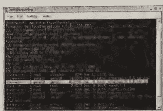

你应该能看到 `.tar.gz` 和 `.tar.bz2` 格式的 `ethereal` 应用程序。

切换目录到 `pub/ethereal`

使用 `ftp get` 命令将 `ethereal-0.9.8.tar.gz` 复制到你的本地系统

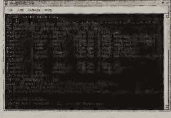

- 2 从压缩的 tar 存档中提取源码：

你会看到大量的屏幕输出。请耐心等待。

```bash
tar xvzf ethereal-0.9.8.tar.gz
```

标志的顺序 `xvzf` 有任何意义吗？`f` 标志必须放在最后。它告诉 `tar` 后面是一个文件。

提取完成后，使用 `t` 标志检查 tar 归包内的文件和目录结构。以下命令将列出 `ethereal` 存档中包括目录结构在的所有文件：

```bash
tar tvzf ethereal-0.9.8.tar.gz
```

- 3 阅读文档了解如何安装：

- 4 编译并链接应用程序：

- 5 将应用程序文件移动到它们的位置：

- 6 测试结果：

# 11-10 SAIR Linux GNU：安装与配置

## 如何完全删除一个应用程序及其所有文件？

删除一个应用程序可能像删除该应用程序的二进制文件一样简单。但支持该应用程序的其他文件呢：其他二进制文件、配置文件、日志文件和文档文件？你必须检查每个安装的应用程序的 `Makefile` 并做好详尽的笔记，或者使用“碰碰运气”的方法。

与应用程序关联的一些额外二进制文件可能是其他应用程序的依赖项。这很难知道，而且更难跟踪和维护。

## 应用程序管理解决方案

解决纯源码应用程序环境中许多问题的解决方案是软件包和包管理器。

软件包是文件的集合，并附有相关的配置信息，这些信息控制应用程序文件的安装。

目前使用的有两种常用的软件包格式和包管理器：红帽软件包管理器 `rpm` 和 Debian 包管理器 `dpkg`。

# 软件包管理器

包管理器解决了许多与安装 tar 包（tarballs）相关的问题。

- 软件包管理器维护一个已安装软件包的数据库。这自动化了跟踪系统当前安装了哪些应用程序的任务。
- 软件包管理器提供了安装、更新、查询状态和删除应用程序包的命令。
- 使用软件包中包含的配置和控制信息，包管理器能够检测依赖问题、尝试安装旧版本的软件以及其他安装问题。
- 使用软件包中包含的配置和控制信息，包管理器能够干净地卸载应用程序，确保所有与应用程序关联的文件都被删除。

# Debian

Debian 软件包的扩展名为 `.deb`。管理 Debian 软件包的主要命令是 `dpkg`。其通用语法为：

```
dpkg [options] [action] [package_files|package_names]
```

Debian 软件包管理系统的一个有趣功能是跨越互联网更新软件包。配置文件 `/etc/apt/sources.list` 控制了系统可能使用的软件包位置。`apt-get` 命令用于访问此文件并控制 `dpkg` 的行为。

Debian 软件包管理系统在 SAIR 102 课程中会有更详细的描述。

# Red Hat

红帽软件包管理器称为 `rpm`。`rpm` 使用的软件包文件扩展名为 `.rpm`。

`rpm` 有文本（命令行）版本和 GUI 版本。

`rpm` 命令的通用语法为：

```
rpm [operation] [flags] [package_files|package_names]
```


许多其他发行版，包括 SuSE、Mandrake 和 Xandros，要么专门使用 `rpm` 软件包，要么以 `rpm` 格式安装软件包。

红帽软件包管理器和 `rpm` 软件包在 SAIR 102 课程中有详细介绍。

# B-1：讨论软件包和包管理器

## 与答

+ 1 列出维护从源码归档安装的应用程序的一些问题。

跟踪已安装的应用程序、跟踪应用程序文件、了解并解决文件和程序依赖关系、干净卸载。

+ 2 Debian 软件包管理系统的一个独特功能是什么？

直接跨越互联网访问并更新所有已安装软件包的能力。

+ 3 红帽软件包管理应用程序叫什么名字？

`rpm`

红帽软件包的文件扩展名是什么？

`.rpm`

+ 4 SuSE 使用什么种软件包管理系统？

`rpm`

+ 5 Debian 使用的主要软件包管理应用程序名称是什么？

`dpkg`

Debian 软件包的文件扩展名是什么？

`.deb`

# 单元总结：安装和管理 Linux 应用程序

## 主题 A

在这个主题中，你学习了从**源码**安装 Linux 应用程序所涉及的**组件**和**过程**。你学习了源码归档的**标准格式**（**tar, gzip, bzip**）以及如何从源码归档中**提取**文件。最后，你练习了从源码目标安装应用程序所需的所有步骤：**复制**归档、**提取**文件。

## 主题 B

在这个主题中，你学习了软件包和软件包器的许多问题。使用软件包中包含的配置和控制信息，包管理器能够检测依赖问题、尝试安装旧版本的软件以及其他安装问题。使用软件包中包含的配置和控制信息，包管理器能够干净地卸载应用程序，确保所有与应用程序关联的文件都被删除。你还学习了关于 tar 包的许多问题。最后，你学习了软件包系统，**红帽**和**Debian**。

# 独立练习

+ 1 列出维护从源码归档安装的应用程序的一些问题。

跟踪已安装的应用程序、跟踪应用程序文件、了解并解决文件和程序依赖关系、干净卸载。除了 GPL 许可证之外，还有哪些许可证类型？
免费软件、共享软件、专利
2. Debian 软件包管理系统的一个独特功能是什么？

直接跨越互联网访问并更新所有已安装软件包。在页面中，哪些功能是？
使用帮助。
3. 红帽软件包管理应用程序叫什么名字？

`rpm`

红帽软件包的文件扩展名是什么？

`.rpm`

4. SuSE 使用什么种软件包管理系统？

`rpm`

5. Debian 使用的主要软件包管理应用程序名称是什么？

`dpkg`

Debian 软件包的文件扩展名是什么？

`.deb`

# 单元 12：Linux 应用程序

单元耗时：90 分钟

完成本单元后，你将学会：

- **A** 识别用于浏览的各种应用程序。
- **B** 识别用于发送接收电子邮件的各种客户端。
- **C** 识别通过 FTP 发送接收文件的各种客户端。
- **D** 描述文本编辑器的特性。
- **E** 列出适用于 Linux 的文档处理应用程序和办公套件。

# 主题 A：浏览器

除了电子邮件程序之外，浏览器可能是最广泛使用的计算应用程序。Linux 有许多免费浏览器可用。大多数 Linux 发行版都包含了浏览器。

大多数浏览器不仅仅是浏览器：它们还包含一个电子邮件客户端和一个新闻组阅读。虽然我们在这个单元中不讨论新闻组，但在下一个主题中讨论浏览器的电子邮件功能。

## 全功能浏览器

浏览器必须具备哪些功能才能被称为“全功能”是一个讨论问题。在这里，一个全功能浏览器包含浏览器、电子邮件和新闻组客户端、地址簿以及可能的日历功能。此外，浏览器应该支持所有相关的 Web 标准，无论 Web 服务器如何都能正确显示，并支持所有广泛部署的客户端和服务。

## Netscape 和 Mozilla

Netscape Communicator 是一个以 Netscape Navigator 浏览器为中心的集成软件包。除了 Navigator 之外，Communicator 还包括邮件客户端、新闻组和 HTML 编辑器，分别名为 Messenger、Message Center 和 Composer。Netscape 以 Communicator 套件的形式提供，也可以不安装其他实用件的情况下安装。Communicator 套件和 Navigator 可以在 http://home.netscape.com/download 下载。

Netscape 4.79 随红帽 7.3 和 SuSE 8.0 版本绑定。Netscape 最新的版本 7 可以在 www.netscape.com 用于 Linux。Messenger 支持 HTML 封装电子邮件、POP3 和 IMAP 服务器、线程化电子邮件消息，并包含集成地址簿。Composer 是一个 HTML 设计工具，可以与其他共享软件和免费软件设计工具竞争。


图 12-1：用于 Linux 的 Netscape Navigator 4.79

### Linux 应用程序 12-3

Mozilla 是 1998 年推出的网景浏览器（Netscape）的开源分支。Mozilla 组织协调 Mozilla 开源项目的开发，包括 Mozilla 浏览器以及各种其他应用程序。随着 2002 年 1.0 版本的发布，Mozilla 项目从一个实验性的“测试版”产品转变为稳定的“已发布”产品。

Mozilla 组织邀请具有相应技能的开发者参与测试工作。更多信息请访问 www.mozilla.org 并下载最新版本。

Mozilla 浏览器具有高度的可定制性，允许用户选择不同的主题或皮肤。Mozilla 还拥有与网景浏览器相似的电子邮件、新闻阅读器和邮件撰写客户端。

Mozilla 和 Netscape 之间的一些区别包括 Mozilla Mail 能够作为一个独立的应用程序运行，以及一个 Mozilla 启动选项可以将部分 Mozilla 留在内存中，从而加快 Mozilla 的重新启动速度。

红帽 7.3 包含了 Mozilla 0.9 版本。Mozilla 的最新发布版本（目前为 1.1 版本）可以在 www.mozilla.org 获取。


图 12-2：用于 Linux 的 Mozilla 1.2.1

## Opera

Opera 浏览器由挪威开发者开发，自称为“地球上快的浏览器”。它较小的体积意味着更短的下载时间。Opera 需要的资源很少；在不支持 Java 的情况下只需要 16MB 内存和 2MB 磁盘空间。包含 Java 支持后，Opera 的体积会增加。

适用于 Linux 的广告支持版 Opera 可以在 www.opera.com/download/linux.html 下载。无广告版本需要付费。

Opera 经过精简，具有高度可定制性，并具有整合来自网景和其他浏览器的书签的能力。虽然其他平台的 Opera 版本（特别是微软 Windows 版本）包含电子邮件客户端和新闻阅读器，但目前的 Linux 版本尚不包含。

# SAIR Linux GNU 安装与配置

除了快速页面加载外，Opera 还有几个使其与其他 Web 浏览器区分开来的独特之处。Opera 可以保存当前会话历史；当重新打开时，所有之前的设置都会保留，仿佛 Opera 从未关闭过。另一个功能 OperaShow 将浏览器转变为演示工具。Opera 还包含 Web 页面缩放功能，让视力不佳的用户更容易阅读较小的字体。Web 导航可以完全由

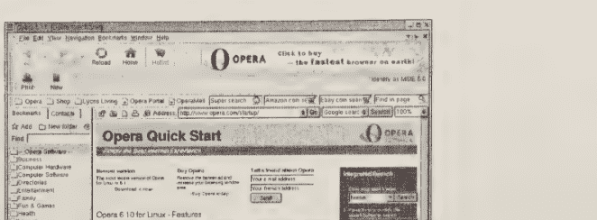

图 12-3：用于 Linux 的 Opera

## Lynx

Lynx 是一个只显示文本的浏览器，它是可用最小且最快的浏览器之一。如果你倾向于极简主义的浏览方式，你将会欣赏 Lynx 对 Web 页面的基础处理。最新版本是 2.8.3，可以从 http://lynx.browser.org 下载。

Lynx 对于查看文本文档有用，因为它的运行速度比图形浏览器快得多；然而，它缺乏其他大型浏览器拥有的许多功能。Lynx 没有内置电子邮件客户端（尽管可以使用 `mail` 发送邮件）。

Lynx 的优势之一是支持为视障人士提供文本转语音应用。Lynx 的缺点是许多 Web 页面并不是为文本显示创建的，这使得带有框架和图形内容的页面更难以导航或理解，尽管某些 Web 页面考虑了基于文本的浏览器并提供了纯文本选项。

## Linux 应用程序 12-5

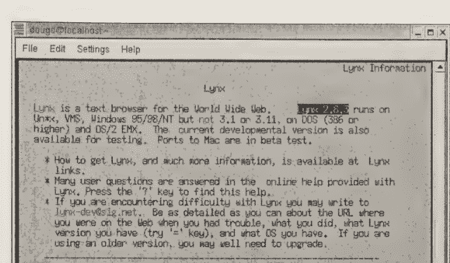

Lynx 是一个用于万维网的文本浏览器。

## 主题 B：邮件客户端

### 解释

邮件客户端允许用户通过发送、组织、撰写和存储电子邮件信息来与其他用户进行交互。所有的 Linux 发行版都提供了许多邮件客户端。它们的范围从简单的命令行应用程序到图形化的 X Window 应用程序不等。有很多 GUI 风格的客户端可用，其中几个与大多数 Linux 发行版一起提供，并适用于每个窗口管理器（Gnome 和 KDE）。就像 FTP 客户端一样，选择邮件客户端通常基于个人喜好而非需求。

图形化邮件客户端分为两种基本类型：作为 Web浏览器一部分的客户端和独立程序客户端。大多数发行版都包含了这两种类型。许多图形化邮件程序还包含地址录、日历、联系人管理工具以及其他超出简单邮件任务的功能。

有各种基于文本的邮件客户端，数量多到无法在此处提供全面的综述。一些较常用的命令行邮件程序有 `elm`、`pine` 和 `mutt`——每种程序在下文中都有了描述。

## 浏览器自带的图形化邮件客户端

Netscape 和 Mozilla 都包含了功能强大的邮件客户端。由于 Netscape 和 Mozilla 共同的渊源，这些邮件客户端的功能和视觉感受非常相似。

### Netscape

Netscape Messenger 是随 Netscape Communicator 绑定的邮件客户端。由于 Messenger 完全集成在 Communicator 软件包中，它提供了使用单个应用程序处理 Internet任务的便利性，许多用户认为这种方式更好。Messenger 允许消息过滤、详细搜索功能、消息加密以及自定义的拼写检查字典。Messenger 无法单独下载；它仅在 Communicator 软件包中提供。

通过 Communicator 菜单从 Netscape Communicator 主窗口启动 Netscape Messenger（图 12-9）。

Netscape Communicator 第 6 和 7 版本的菜单（以及许多其他内容）与 4.x 版本不同。由于 4.79 版本是 Red Hat 和 SuSE 绑定的版本，因此这里描述的是 4.79 版本。

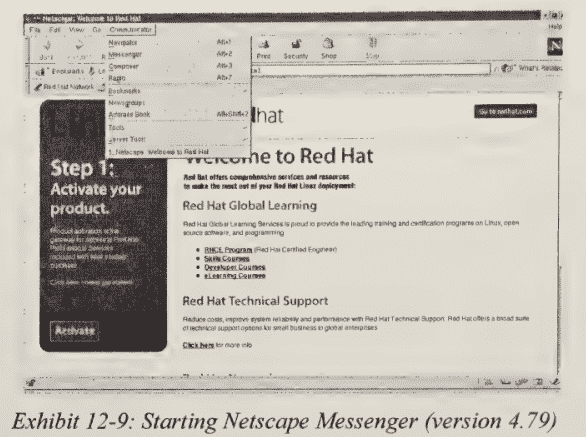

在 Netscape Messenger 启动后，你可以通过从 Edit（编辑）菜单中选择 Preferences（选项）来设置你的邮件账户（图 12-10）。

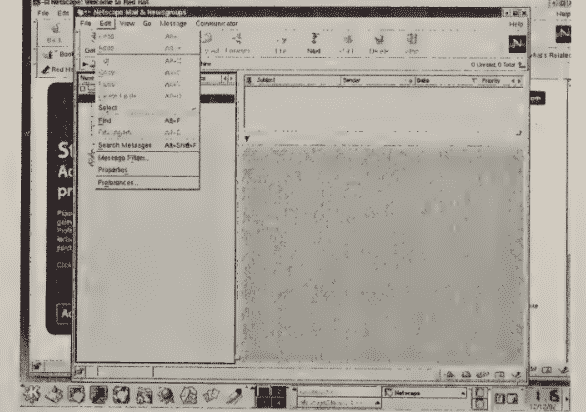

Mail & Newsgroups（邮件与新闻组）部分中的每个类别都有设置界面（图 12-11）。

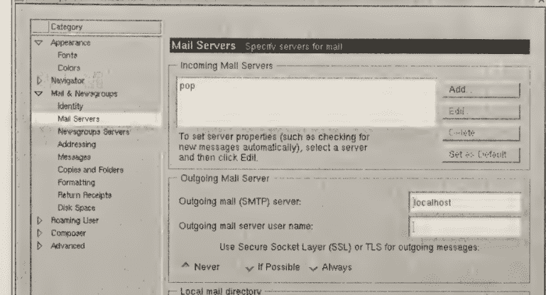

Mail & Newsgroups 部分内的大多数设置界面都直白易懂。然而，一个容易被忽视的选项是 Leave Messages on Server（将邮件保留在服务器上）复选框。如果不勾选此框（遗憾的是，默认状态），当你第一次连接到邮件服务器时，服务器上的所有邮件都将复制到你的系统并从服务器上删除。如果你从多个计算机系统访问电子邮件，这可能会带来极大的不便。通过选择 Mail Servers（邮件服务器）、在 Incoming Mail Servers（入邮件服务器）窗口中高亮邮件服务器、选择 Editing（编辑）并点击 POP 标签找到该复选框（图 12-12）。注意，如果你的邮件服务器是 IMAP 服务器，这里可能是 IMAP 标签。如果你连接到 Microsoft Exchange 服务器，情况将如此。）


图 12-12：将你的邮件留在邮件服务器上

### Mozilla

Mozilla Mail 客户端在功能上与其自己的 Messenger 非常相似。两者之间的主要区别在于 Mozilla 提供了账户设置向导，以及配置邮件服务器和邮件账户的窗口格式存在某些差异。

Mozilla Mail 可以从 Mozilla 浏览器的 Window（窗口）菜单启动（图 12-13），或者从 Gnome 或 KDE 任务栏上的 Start（开始）菜单启动启动（图 12-14）。


图 12-13：从 Mozilla 浏览器启动 Mozilla


图 12-14：从 Gnome 开始菜单启动 Mozilla

Mozilla Mail 启动后，你可以通过进入 Edit（编辑）菜单并选择 Mail and Newsgroups（邮件与新闻组）来配置新的邮件服务器和账户（图 12-15）。


图 12-15：使用 Mozilla Mail 设置账户


图 12-16：Mozilla Mail 设置窗口

而且，和 Netscape 的一样，Leave Messages On Server 框默认未勾选。这个问题可以通过在 Server（服务器）窗口勾选 Leave Messages On Server 框来解决（图 12-16）。

## 独立图形化邮件程序

Netscape 和 Mozilla 包含的邮件客户端是完整且方便的。然而，独立的邮件程序可能更轻量、更快。

Netscape 和 Mozilla 包含的邮件客户端是完整且方便的。然而，独立的邮件程序可能更轻量、更快。

### KMail

KMail 是一个用户友好的邮件程序，属于 KDE 的一部分。KMail 的功能包括邮件过滤、GnuPG 隐私保护、拖放附件以及 POP3。KMail 随 Red Hat 和 SuSE 提供。KMail 的最新版本可以从 http://kmail.kde.org 下载。


图 12-17：KMail

### TkMail

TkMail 是一个使用 Tcl/Tk 编写的邮件客户端，支持 X Window 环境。TkMail 的功能包括按钮、通过 MIME 消息规范处理附件、以及拼写检查。TkMail 的最新版本可以在 ftp://mail.stanford.edu/ 找到。

### Ximian Evolution

Ximian Evolution 是一个基于 Gnome 的桌面邮件程序。Ximian Evolution 像所有支持 IMAP 的邮件客户端一样，可以访问 Exchange 服务器。Ximian Evolution 随 Red Hat 7.3 版本提供。Ximian Evolution 可以在 www.ximian.com 获取下载。


图 12-18：Ximian Evolution

Ximian Evolution 使用 Exchange 服务器的 WebDAV 功能来实现日历功能。WebDAV 是 Exchange 服务器上的一个可选功能，虽然大多数 Exchange 环境都启用此功能，但它是 Ximian 运行的依赖。


图 12-19：Ximian Evolution 日历

## 文本邮件客户端

文本邮件客户端仍然流行，特别是对于在 UNIX 系统中成长的人来说。由于大多数基于 Linux 的服务器没有安装 X Windows（X 是一个资源大户），文本邮件客户端是许多系统管理员的唯一选择。常用的文本邮件客户端如下。

### BSD Mail

BSD Mail 是在命令行提示符输入 `mail` 命令时调用的进程。该邮件客户端允许使用命令行选项来撰写、管理、发送、接收、回复和转发电子邮件。`mail` 使用两种模式而非菜单。命令模式允许用户管理邮件，组合模式允许用户撰写邮件。最简单的邮件方式是在命令后面跟着你想邮件的人，然后是邮件内容。在空行输入一个点 (`.`) 退出程序并发送邮件。

```


`$ -s <subject> <user@domain.net> <message line>`

`<message line>`


### pine

pine 由华盛顿大学开发，于 1992 年 1 月首次发布。这是一个功能丰富的程序，提供了屏幕选项来帮助阅读、发送和管理电子邮件。pine 客户端的功能包括帮助、邮件撰写界面、邮件附件、地址录以及 SMTP 或 IMAP 新闻。pine 还允许你使用单字符在菜单之间导航，并将邮件和附件保存到其主目录。pine 的帮助菜单对于获取 pine 的各种功能概述非常有用。该程序很容易探索命令列表。pine 包含了大多数当前的 Linux 发行版，包括 Red Hat 和 SuSE。pine 的最新版本可以在 `ftp.cap.washington.edu` 找到。


图 12-20：pine 主界面

## mutt

该程序的界面与 elm 邮件客户端类似，并具有与 elm 和 pine 共同的特征。mutt 是比 pine 和 elm 更复杂的基于文本的邮件客户端，因为它允许用户进行大量的自定义和配置。mutt 和 elm 之间更显而易见的区别在于 mutt 处理颜色的能力以及它对用户定义宏（macros）的支持。

一些额外的 mutt 特性还包括：

- 使用 `.mailrc` 风格的配置文件
- 延迟发送特定消息的选项
- 内置的将文本翻译为指定语言的能力

Red Hat 和 SuSE 都在其发行版中内置了 mutt 客户端。最新版本可以从 `ftp.m.org/pub/mutt/` 下载。


图 12-21: mutt

## elm

elm 邮件客户端不再随 Red Hat 或 SuSE 捆。elm 已被 mutt 取代。

## B-1: 讨论 Linux 邮件客户端

## 问题与解答

- 1 当你在 shell 提示符输入 `mail` 时，运行的是哪个邮件应用程序？

BSD mail

- 2 鉴于用一个应用程序处理网页浏览、ftp 文件传输和电子邮件的便利性，为什么不使用像 Netscape 或 Mozilla 这样的“多合一”应用程序呢？

- Mozilla 和 Netscape 可能缺少独立程序具有的功能。
- Mozilla 和 Netscape 体积庞大、加载慢且资源密集型。许多独立邮件程序很小且高效。
- 你可能已经熟悉某个独立程序，并更倾向于它的功能和界面。

- 3 哪个 GUI 邮件应用程序允许参与 Microsoft Exchange 共享日历功能？

Ximian Evolution（如果已购买并安装 Ximian Connector 产品）

- 4 为什么可能使用基于文本的邮件客户端？

系统中可能没有安装 GUI。此外，基于文本的邮件客户端体积小、运行快，消耗系统资源资源。

## 主题 C：FTP 应用

### 解析

FTP 协议（文件传输协议）是 TCP/IP 标准组件。新用户的一个困惑点是，命令行文件传输程序也被称为 `ftp`。

除了传统的 `ftp` 程序外，还有多种支持使用 FTP 协议在主机之间进行文件传输的 GUI 和基于文本的程序。

## 命令行 FTP

有各种命令行 FTP 程序。

### Linux ftp 程序

文件传输程序 (`ftp`) 是支持 ARPANET 标准文件传输协议的 Linux 用户程序。FTP 允许在网络 Linux 系统之间传输文件。传输文件的主要方法有：

- 将 FTP 站点作为 `ftp` 命令的参数。
- 在 `ftp` 程序的 `ftp` 提示符内使用 `open` 命令。

访问远程主机通常需要提供用户名和密码，并且通常限制为那些在主机上拥有账户的用户。然而，公共 ftp 站点通常允许通过提供用户名 `anonymous` 并以有效电子邮件地址作为密码的用户访问。

一旦建立连接，就可以浏览客户端和本地主机的目录，并在客户端主机之间传输文件。命令在 `ftp` 程序 `ftp` 中执行。命令行 `ftp` 程序是文件传输协议的原始界面，并作为标准包包含在 Linux 发行版中（图 12-24）。


图 12-22: Linux ftp 程序

## nfpth/xftp

`nfpth` 是一个基于文本的 FTP 客户端，允许在不鼠标鼠标执行所有功能。`nfpth` 最初设计用于终端窗口或全屏文本模式会话中运行。`xfpth` 则在 Linux X Windows GUI 内的终端窗口中运行。`xfpth` 支持使用鼠标从菜单栏选择项目，同时也支持键盘快捷键。`nfpth` 和 `xfpth` 都支持：

- 自动重连
- 安全身份验证 (PKFA)
- 内置 FTP 搜索
- 防火墙/代理支持


图 12-23: nfpth

## 浏览器 FTP

大多数浏览器原生支持 FTP 协议。访问 ftp 存档只需点击下载链接或输入 ftp 站点的 URL 即可（图 12-24）。

你在网站上看到的每一个下载链接并不都是 ftp 链接。HTTP 协议也用于文件传输。


## 其他图形 ftp 客户端

`gFTP` 和 `IglooFTP` 是可用的其他图形 ftp 客户端。

### gFTP

Gnome FTP 程序 `gFTP` 是文件传输协议 (FTP) 程序的 GUI 前端。`gFTP` 还支持 HTTP 和 SSH 协议。

该程序是多线程的，允许同时下载。它还使得两台远程机器之间的文件传输（Ftp 文件传输）成为可能。`gFTP` 提供：

- 多线程下载
- 远程机器传输
- 文件传输
- 拖放
- 断点续传
- 缓存
- 目录列表
- 配置

### IglooFTP

`IglooFTP` 是一个图形化用户型 FTP 客户端。它提供了用户界面并提供若干功能。

### 安装与配置


图 12-24: gFTP

## Linux 应用程序

### 使用 ftp 程序

- 1 当你在 shell 提示符输入 `mail` 时，运行的是哪个邮件应用程序？

BSD mail

- 2 鉴于用一个应用程序处理网页浏览、ftp 文件传输和电子邮件的便利性，为什么不使用像 Netscape 或 Mozilla 这样的“多合一”应用程序呢？

- Mozilla 和 Netscape 可能缺少独立程序具有的功能。
- Mozilla 和 Netscape 体积庞大、加载慢且资源密集型。许多独立邮件程序很小且高效。
- 你可能已经熟悉某个独立程序，并更倾向于它的功能和界面。

- 3 哪个 GUI 邮件应用程序允许参与 Microsoft Exchange 共享日历功能？

Ximian Evolution（如果已购买并安装 Ximian Connector 产品）

- 4 为什么可能使用基于文本的邮件客户端？

系统中可能没有安装 GUI。此外，基于文本的邮件客户端体积小、运行快，消耗系统资源资源。

### 使用 ftp 程序

- 1. 使用 ftp 程序
- 2. 使用 ftp 程序
- 3. 使用 ftp 程序
- 4. 使用 ftp 程序
- 5. 使用 ftp 程序

# 主题 D：文本编辑器

## 解析

个人创作最基础的用途之一是命令行、文档的修改和共享。文档的形式和功能多种多样，从简单的文本到电子表格、图形以及“增强型”文本（如网页中常见的超文本）。可以说，最无处不在的文档格式是各种形式的文本。

创建和修改简单文本文档的最旧方法是文本编辑器。文本编辑器有多种形式和样式，但可以分为三大类：命令行编辑器、GUI 编辑器，以及嵌入在文字处理器和桌面出版应用等复杂程序中的编辑器。

在这里，我们将考虑命令行和 GUI 形式的文本编辑器。

## 从命令行进行文本编辑

大多数 Linux 发行版都提供了许多功能完备且易于使用的 GUI 编辑器。那么，为什么要费心学习使用命令行编辑器呢？答案显而易见：大多数 Linux 服务器不运行 GUI，而且如果 X Windows 系统故障，你只能通过命令行控制台来解决问题。有时需要远程排查系统问题，而且通常你受限于通过 `telnet` 或 `ssh` 命令连接到远程系统。从命令行执行某些基本文本功能的能力是 Linux 系统管理员的基本技能。

在大多数 Linux 发行版中常见的命令行编辑器包括 `vi`、`pico` 和 `emacs`。

`vi` 编辑器不仅是最古老的文本编辑器之一，它还是仍在使用的最古 UNIX 程序之一。如果你只想学一个文本编辑器，选这个就对了。`vi` 编辑器比任何其他编辑器都出现在更多的 UNIX 和 Linux 系统中。

`vi` 编辑器实际上有几个版本：`vi`、`vim` 和 `gvim`。在大多数 Linux 发行版中，当你在 shell 提示符处输入 `vi` 命令时，实际上运行的是 vi。`vi`、`vim` 和 `gvim` 之间的差异大部分是视觉上的，它们都共享相同的字节命令结构。

`vi` 编辑器在两种模式下运行：命令模式和插入模式。当你启动时，默认模式是命令模式。命令在屏幕底部以冒号（:）开头。

在命令模式下，你可以在文档中导航、剪切和粘贴文本、撤销之前的操作等。

你通过在命令行提示符处输入 `i` 进入插入模式。一旦进入插入模式，你就可以使用方向键以及 Page Up 和 Page down 键在文档中导航。按退出（Esc）键返回命令模式。

在命令模式下通过 `:q` 或 `:wq` 命令退出编辑会话。`:q!` 命令在不保存的情况下退出，而 `:wq` 命令将缓冲区（编辑过的文本）写入文件。

不带任何参数启动 `vi` 将打开一个没有关联文件名的编辑缓冲区。如果你在缓冲区中添加了文本，在退出 `vi` 时必须提供文件名，或者使用 `q!` 命令退出而不保存文件。如果你带文件名作为参数启动 `vi`，则该文件将在插入模式下打开。


图 12-27：不带任何参数启动 vim


图 12-28：使用 vi 插入文本

## 12-30 SAIR Linux GNU：安装与配置


下表包含 vi 命令的简列表：

| 命令 | 动作 |
|---|---|
| i | 进入插入模式。 |
| dd | 删除行。 |
| SHIFT + A | 在行尾插入。 |
| x | 删除光标所处的字符。 |
| r | 替换光标所处的字符。 |
| ESC | 退出插入模式。进入命令模式。 |
| :q | 退出 vi 会话。如果文件发生了任何更改，将弹出错误消息提示你保存更改或使用 :wq! 在不保存的情况下退出。 |
| :wq <filename> | 退出 vi 会话并将任何更改写入由 <filename> 指定的文件。如果正在编辑一个现有文件，<filename> 是可选的，更改将保存到已打开的文件中。 |

这只是对 vi 编辑器一个非常简略的总结。vi 的帮助页面（man page）提供了你执行简单文本编辑所需的所有信息。

## pico

`pico` 文本编辑器可能是 Linux 上可用的最简单的命令行文本编辑器。一个非常实用的功能是在屏幕底部显示常用的编辑命令。

与 `vi` 类似，当不带文件名参数启动时，`pico` 会为你的输入打开一个缓冲区。当你退出时，你必须提供文件名或在不保存更改的情况下退出。


图 12-30：不带文件名参数启动 pico

## GNU Emacs

Emacs 运行在类似 shell 的环境中，允许用户在不同的文件之间切换。Emacs 可以垂直或水平拆分窗口，允许同时打开多个文件。Emacs 还提供了强大的拼写检查。

常用的编辑命令可以通过快捷键执行。

## Emacs 快捷列表

| 命令 | 动作 |
| --- | --- |
| CTRL+ X + F | 加载新文件 |
| CTRL+ X + S | 保存文件 |
| CTRL+ X + W | 存为 |
| CTRL+ X + K | 删除行 |
| CTRL+ X + U | 撤销 |
| CTRL+ X + C | 退出 Emacs |

## GUI 文字处理器

大多数 Linux 发行版都提供了功能完备且易于使用的 GUI 编辑器。如果你熟悉 Windows Word 或记事本，那么这些 Linux 编辑器也将是熟悉的。鼠标和键盘习惯也适用于此：点击并拖动移动、高亮、剪切、粘贴。

## gedit

`gedit` 是一个 Gnome GUI 编辑器。它类似于记事本编辑器（见图 12-31）。


图 12-31：Gnome gedit 文本编辑器

## KEdit

`KEdit` 是一个 KDE GUI 编辑器。它在形式和功能上都类似于记事本（见图 12-32）。

## Kate

`Kate` 是一个 KDE GUI 编辑器。它比 KEdit 稍微复杂一些，但功能非常相似。


图 12-33：KDE Kate 文本编辑器

## D-1：vi 简介绍

动手做吧！

| 如下操作 | 如下 |
|---|---|
| 1 打开 temp.txt | 你在练习中保存的文件 |
| 在 shell 提示符处输入 **vi temp.txt** | |
| 2 将光标移动到注释行“User specific aliases and functions.” | |
| 高亮 # 字符 | 使用方向键移动光标。# 字符位于行。 |
| 3 将光标移动到行尾并进入插入模式 | 你现在处于注释行之后的新行插入模式。 |
| 4 输入 **alias ll='ls -al'** 创建别名 | |
| 5 退出插入模式并保存文件 | |
| 按 `ESC` | |
| **输入：wq** | |
| 6 备份你的 .bashrc 文件以防出现问题 | `[student@localhost]$ -cp .bashrc .saved-bashrc` |
| | 这是一个示例。 |
| 用 temp.txt 替换 .bashrc | `[student@localhost]$ -cp temp.txt .bashrc` |
| 强制 bash 重新读取 .bashrc 文件 | `[student@localhost]$ source ~/.bashrc` |
| 在 shell 提示符处输入 **II** | 你应该看到家目录目录的详细列表。 |
| 7 尝试添加其他让你的 shell 命令更简单或更有意义的别名 | |

向学生指出此步骤是可选的。

## 主题 E：文字处理器和办公套件

解释：在当今的商业世界，文档处理发挥着重要作用，并已成为必要的业务活动。办公效率套件包括文字处理器、电子表格、各种通信组件（如电子邮件和新闻）以及图形应用程序。许多公司需要文档处理应用程序来管理其文件、财务和通信。公司使用多种不同的平台来运行其系统。让这些不同的平台相互通信是复杂的。为了解决这个问题，大多数办公效率套件被设计为可以在多种类型的操作系统上运行。

## 两种基本的程序设计哲学

作为 Unix 传统的一部分，Linux 支持广泛的排版或标记语言：`nroff`、`groff`、`TEX`、`LATEX`、`XML` 和 `HTML`。在这些文字处理方案中，文本创建和显示是两个独立的过程。在文本创建阶段，用户在纯文件中编写信息，并通过嵌入基于文本的格式命令来指定文本的去向，这些命令将供后续显示阶段使用。在文本显示阶段，显示处理器解释嵌入的命令以进行文本布局。

然而，典型的 PC 用户使用的是“所见即所得”（WYSIWYG）文字处理器，文本按照其输入的方式进行显示。为了实现这一点，WYSIWYG 文字处理器必须在文本文件中嵌入非打印的二进制信息。

标记与 WYSIWYG 之间的区别反映了 Unix/Linux 用户的一个基本问题，因为 Unix 的基础是利用其所有的工具（支持程序）来处理文本文件。在文本文件中嵌入二进制信息仅允许一个程序（即创建它的文件的文字处理器）访问该文本。

在 PC 和 Unix 环境之间切换的用户必须意识到这种区别，并根据情况使用各种程序。熟悉 Microsoft Word 或 Corel Word 的用户可能继续在 Linux 上以相同的 WYSIWYG 环境工作。然而，在系统其他地方使用的文件（例如应用程序的配置文件）必须导出为文本文件。

## 标记文本的优势

标记设计的两个优势是灵活性和控制力。标记文本可以使用任意数量的简单文本编辑器创建，文本文件可以被其他应用程序轻松处理。由于显示是独立控制的，标记对显示的控制力比 WYSIWYG 文字处理器内部提供的功能集更有控制力。

## WYSIWYG 的优势

WYSIWYG 的主要优势包含在其缩写词中：你对文本的显示和打印都能获得即时的视觉反馈。此外，由于 WYSIWYG 将文本创建和文本显示功能合并到单个过程或步骤中，对于新用户或偶尔用户来说，文档创建更加简单。

## StarOffice

StarOffice 是一个完全集成、兼容 Microsoft Office 的效率应用程序套件。它提供了支持 Web 的文字处理、电子表格、演示文稿、电子邮件、新闻、图表和图形应用程序。

StarOffice 6.0 是该流行应用程序的最新改进版本。它的重大改进源于用户反馈和评审，这些反馈对该程序进行了 200 多处的修改。在程序的每个应用程序中，可靠性和易用性都得到了提高，包括改进了对 Microsoft 文件格式的兼容性。这允许用户管理 PowerPoint、Word 和 Excel 格式的文件。此外，用户还可以访问现有的 Microsoft Office 文件和数据来创建电子表格、演示文稿和 Word 文档。

截至编写时，StarOffice 运行的平台比任何其他桌面效率套件都多，并在 Intel 平台上的 Linux 上原生运行。所有数据均可以保存为 Microsoft 格式或 HTML 文件以发布到 Web 或新闻组服务器。

StarOffice 版本 6.0 是一款商业产品，价格约为 75.00 美元。Star Office 版本 6.0 可从 Sun 网站下载：`http://www.sun.com/software/star/staroffice/6.0`，也可以在常规零售店以“缩水膜”包装（附带打印文档）的形式购买。


图 12-34：从 Gnome 桌面启动 StarOffice


图 12-35：StarOffice 6.0（编辑此单元）

## OpenOffice

Sun Systems 已根据 GNU 许可证将 StarOffice 源码以 Open Office Suite 的形式开放。为了促进办公领域的标准化，Sun 提供了 StarOffice 的 API 和 XML 文件格式。随着 StarOffice 现在成为开源社区的一部分，全球开发人员将有机会为其创建本地化生产的程序组件。

问题可能是，既然 OpenOffice 与 StarOffice 共享代码且免费，为什么有人会为 StarOffice 花 75 美元？嗯，StarOffice 和 OpenOffice 之间确实存在差异。

StarOffice 中包含的一些代码没有包含 OpenOffice 中。这主要是因为 StarOffice 中包含了第三方代码，这些代码需要向第三方支付许可费。StarOffice 中有的但在 OpenOffice 中缺失的项目包括：

- 某些字体
- Adabas 数据库应用程序
- 某些模板
- 大部分剪贴画库
- 某些文件过滤器

此外，StarOffice 带有 60 天的免费电话和电子邮件支持以及一个网络培训课程。

那么你该如何选择使用哪一个？首先，考虑到本课程的部分内容已经过创建、修改、与评审者共享，并在 OpenOffice 和 Microsoft 之间往传输。

## Linux 应用程序 12-37

## Linux 应用程序 12-37

这两个产品之间的选择主要取决于你对 Linux 的熟悉程度以及对 OpenOffice 支持的需求（用户支持、来自 Sun 的付费支持）。OpenOffice 的源码可以在 `www.OpenOffice.org` 下载。


图 12-36：从 Gnome 桌面启动 OpenOffice


图 12-37：OpenOffice 6.0（编辑此单元）

## KOffice：KDE 办公套件

开发和支持 KDE 桌面的同一小组也开发并支持一个名为 KOffice 的办公套件。

你可以从 KDE 任务栏或开始菜单启动 KOffice。通过点击 KDE 任务栏上的 KOffice 图标（图 12-39）可以启动 KOffice（图 12-38）。


图 12-38：KDE 任务栏


图 12-39：KOffice 图标

KOffice 外壳基本上是一个工作空间窗口，在其中可以使用相应的打开文档（图 12-40）。


图 12-40：KOffice 工作空间

KOffice 是一个实用的办公套件，并由 kde.org 进行持续开发。然而，截至 1.1.1 版本，KOffice 处理 Microsoft Office 文档没有 StarOffice 和 OpenOffice 完整和优雅。

## Gnome 呢？

Gnome 没有相当于 KOffice 的套件。然而，Gnome 包含了多个独立的应用程序，合在一起可以形成 KOffice 大多数应用程序的功能替代品。这些应用程序包括 AbiWord 文字处理程序、Gnumeric 电子表格应用程序和 Dia 图表编辑器。

## DocBook

DocBook 是一种大型且健壮的文档类型定义（DTD）语言，定义了计算机文档（特别是软件文档）的结构和内容 SGML 及 XML 标记。其主要层级结构用于书籍、文章和参考条目（例如帮助页）。DocBook 于 1991 年左右由 HaL Computer Systems 和 O'Reilly & Associates 开发，旨在将 Unix 有的软件文档从 troff 标记转换为 SGML。DocBook 格式类型开始被许多 SGML 工具支持，并已用于数百万页文档。

## AbiWord

其他文字处理应用程序是 AbiSource 的 AbiWord。它可以在 Microsoft 和绝大多数 Unix 平台上运行，并支持大量的文件格式，包括 AbiWord、DocBook、MS Word、HTML、富文本格式、文本和压缩的 AbiWord 格式。

## E-1: 讨论 Linux 文字处理器和办公套件

- 1 两种基本的文字处理设计哲学称为什么什么？
标记文本（Markup text）和 WYSIWYG（所见即所得）

- 2 标记文本有哪些优点和缺点？

优点：灵活性、可控制性、不需要 GUI 即可创建。

缺点：复杂、掌握的学习曲线陡峭、对最终外观没有即时反馈、通常需要两步才能完成创建。

- 3 WYSIWYG 有哪些优点和缺点？

优点：对显示和打印外观有即时反馈、单步过程。

缺点：虽然易用，但复杂任务实际上可能比标记文本困难；对最终外观的控制较少、需要 GUI 才能使用。

- 4 选择 Open Office 而不是 Star Office 的原因有哪些？

免费、完全开源、包含在许多 Linux 发行版中。

- 5 选择 Star Office 而不是 Open Office 的原因有哪些？

额外的额外的组件（Adabas 数据库、某些额外字体）、来自大公司保修和付费支持的“安全感”、打印版手册。

## 12–42 SAIR GNU 安装与配置

## 单元总结：Linux 应用

主题 A

在本主题中，你学习了 Linux 可用的某些流行网络浏览器。你还学习了如 Netscape 和 Mozilla 等几个完整 Web 应用程序的功能和优势。你了解到 Web 套件包括电子邮件客户端、新闻阅读器客户端、网页创建应用等。此外，你还学习了几个仅浏览器应用程序，包括 Opera、Galeon、Nautilus 和 Konquer。你还学习了纯文本浏览器 Lynx。

主题 B

在本主题中，你学习了 Linux 的命令行和 GUI 客户端应用程序。这些包括 Netscape 和 Mozilla 邮件程序、Kmail、TkMail、Ximian Evolution、BSD mail、pine 和 mut。

主题 C

在本主题中，你学习了用于通过文件传输协议 (FTP) 传输文件系统的命令行文本编辑器和 GUI 工具。这些包括命令行形式的 Linux `ftp` 程序、基于浏览器的传输工具、gFTP 和 IgaloFTP。

主题 D

在本主题中，你学习了 Linux 的命令行文本编辑器和 GUI 文本编辑器。这些包括 `vi`、`pico`、`Emacs`、`gedit`、`KEdit` 和 kate。

主题 E

在本主题中，你学习了文本处理的两种方法：标记语言和 WYSIWYG（所见即所得）文字处理器。你学习了每种方法的优缺点。你还回顾了 Linux 可用的文档处理应用和办公套件。这些包括 StarOffice 及其开源兄弟 OpenOffice、KOffice、DocBook 和 AbiWord。

## 独立练习活动

- 1 将你在文本编辑器练习中修改过的 `.bashrc` 文件复制到 `temp.rc`。同时，将 `.bashrc` 保存为 `oldbashrc`。使用 `gedit` 或 `kedit`（取决于你使用的窗口管理器），在 aliases 部分添加以下行：

```


`alias hdf=' -h'`

将文件保存为 `.bashrc`。

你刚刚添加的 `alias`（别名）会做什么？

添加一个别名命令，以“人类可读”格式报告文件系统使用情况和可用空间

- 2 尝试执行你创建的 `alias`。发生了什么？

可能会出现错误信息 - `bash: hdf: Command not found.`。

为什么？

原因是 `bash` shell 在命令进入 shell 之前，必须重新运行脚本 `.bashrc`。

如何让 `bash` shell 识别并执行该 `alias`？

强制 shell 重新运行 `.bashrc` 文件。（`$ .bashrc`）

## 单元 13

## 故障排除

**单元时间：90 分钟**

完成本单元后，你将学会：

- A **描述并使用分析方法进行故障排除。**
- B **描述系统和应用程序日志文件以及其他排除资源的位置、内容和用途。**
- C **分析并解决一些常见问题。**

### 主题 A：故障排除过程

解释

故障排除既是最简单也是最复杂的任务之一。描述非常简单：找到故障之处并修复它。实施过程可能很简单；然而，它可能极其复杂。

遵循一致、严谨的故障排除过程目的是通过将问题分解为更小、更容易管理的部分来控制复杂性。本主题将故障排除呈现为一个五步骤的过程：

1. 陈述问题
2. 收集数据
3. 形成假设
4. 测试假设
5. 根据需要重复

### 问题陈述

修复某物的第一步是尽可能完整、详细地描述问题。问题陈述至少应回答以下问题：

- 什么东西无法工作？
- 它是简单的无法启动/运行，还是行为不当或产生错误/意想不到的结果？
- 它曾经工作过吗？
- 如果它曾经工作过，它是什么时候停止工作的？
- 自从上次工作以来，系统或应用程序发生了什么变化？
- 是否有任何错误信息？如果有，它们何时出现？错误信息是一致的吗？
- 问题是可以复现的吗？如果是，哪些操作导致了问题的发生？
- 如果问题不可复现，它的出现是否有某种模式？

虽然对于看似简单的问题来说这似乎大此小用，但你应该始终将问题陈述写成文字。这有两个巨大的益处：它迫使你组织思路和观察，并创建初始问题和症状的书面记录。通常，当你为了解决问题而进行更改时，症状也会发生变化。

### 收集数据

当你问题陈述中“填空”时，你需要收集有关问题发生时系统静态状态的信息。这在故障排除过程初期可能具有挑战性。导致问题发生的确切情况可能尚未理解，导致难以确定何时收集。故障排除数据的主要来源是问题发生时出现在控制台、终端或弹出窗口中的错误信息。

### 错误信息

错误信息在频率、准确性和提供的信息量上差异很大。错误信息完全取决于编写软件的程序员的技能和经验。在收集错误信息时，你应该始终尝试模拟错误的确切情况。在困难的情况下，通常可以通过开启源代码中所谓的“调试标志（debug flags）”、重新编译应用程序并重新运行来获取额外的错误信息。这很少是必要的，但它是一个明显的优势。

### 系统日志

Linux 系统保留一组日志文件，用于收集控制台消息、错误信息、网络事务等内容。大多数系统程序和守护进程使用 `syslog` 功能来记录它们的活动。

此外，许多程序（系统守护进程和应用程序）保留自己的日志文件或多个日志文件。这些文件可能存储在 `/var/log` 或其他位置。应用程序的主页通常会告诉你日志存储的位置。另一个良好的查看位置是应用程序路径。`syslog` 功能将在本单元稍后部分详细介绍。

### 形成假设

一旦你制定了问题陈述并收集了尽可能相关的支持数据，就是是形成假设的时间了。在我们这里遵循的故障排除过程背景下，假设只是对问题可能原因的“最佳猜测”。这也应该记录下来。

### 如何形成假设

理解如何形成假设的最佳方法是使用一个简单的示例。

你刚刚安装了一个名为 `whizbang` 的新电子邮件应用程序。你尝试在 shell 提示符处输入应用程序名称来启动它。然而，应用程序没有启动，你收到了错误信息：

```
$ whizbang

bash: whizbang: command not found
```


## 13-4 SAIR GNU: 安装与配置

根据观察到的行为（应用程序未启动）、应用程序从未运行过的这一事实（你刚刚安装了它）以及错误信息，你推测问题在于应用程序不在你的默认路径中。这个推测就是你的假设。

## 如果你无法形成假设该？

你将面临的最大问题（特别是如果你是 Linux 新手的话）是不知道从何处开始。很多时候，你甚至不知道该问什么问题。如果你完全迷失了方向，形成假设可能完全是盲目摸索。那么，该怎么办？

最佳行动方案是从易于获取的资源中获得一些想法。故障排除资源将在单元的稍后部分进行更详细介绍。如果这种方法失败了，不要害怕盲目摸索。如果你遵循逻辑性、系统化的故障排除过程，随着过程的反复执行，你的假设将变得更加集中，黑暗将会被发现的光芒所取代。

## 测试假设

一旦你形成了一个假设，就是时候测试它了。测试假设可能发生在尝试更改以修复问题之前、更改之后，或者在更改之前和之后。以上面的例子为例，假设问题是由于应用程序不在用户的默认路径中引起的。为了测试这一点，你需要确定用户的默认路径是什么，应用程序的路径是什么：

- 确定用户的默认路径。
  `$ echo $PATH`
- 确定应用程序的路径。
  `$ which whizbang`
  `$ whereis whizbang`

如果问题确实在于路径，有两种基本的补救方法：将应用程序路径添加到用户的默认路径中，或将应用程序移动到用户默认路径中的位置。其他用户可能需要访问该应用程序并已相应设置了路径，移动应用程序不是首选解决方案。因此，下一步是修改用户的默认路径以包含应用程序。如果应用程序位于`/usr/local/whizbang`，则需要通过编辑`.bash_profile`将此路径添加到用户的默认路径中。完成后，通过尝试启动应用程序再次测试。如果运行正常，你就完成了任务。

## 根据需要重复

对于像这里这样简单的问题，第一次尝试就找到解决方案是常见现象。然而，在更复杂问题的情况下，可能需要多次重复尝试来解决问题。继续遵循结构化的故障排除过程直到问题解决是非常重要的。

## A-1: 讨论故障排除过程

### 问答

+ 1. 故障排除过程的五个步骤是什么？
- 制定问题描述并将其记录。
- 尽可能多收集有关问题的信息。
- 根据问题描述和观察到的数据形成假设。
- 测试假设。
- 重复该过程直到问题解决。

+ 2. 关于该问题的两个主要信息来源是什么？
- 错误信息和系统日志。

+ 3. 开源软件在排除问题时有哪些优势？
- 代码是终极文档。
- 通常可以从源码重新编译，开启调试代码以收集额外数据。
- 在排除问题问题时，通常可以与开发者直接通信。

+ 4. 列出在制定问题描述时必须回答的三个关键问题。
- 什么东西无法工作？
- 它仅仅是无法启动/运行，还是行为不当或产生错误或意料之外的结果？
- 它曾经运行过吗？
- 如果它曾经运行过，它是什么时候停止运行的？
- 自上一次运行以来，系统或应用程序发生了什么变化？
- 是否有错误信息？如果有，它们在什么时候出现？错误信息一致吗？
- 问题是可以复现的吗？如果是，哪些操作导致了问题的发生？

## 13-6 SAIR Linux: 安装与配置

## 主题 B: 在哪里查找

### 解释

确定系统在问题发生时的状态是一个关键步骤。正如本单元之前提到的，系统状态的信息包括生成的各种错误信息、`/proc`文件系统、配置文件和源代码。

### 错误信息

错误信息是每个系统唯一的。理解错误信息的主要资源是程序的手页（man page），在 GUI 的情况下，通过帮助菜单提供上下文信息。关于错误信息的终极文档是源代码。通过文本编辑器查看源代码，可以很好地了解在错误发生时 proc 正在做什么。

### 日志文件

日志文件是程序“记录”自身的方式。日志文件在正常运行或发生某些错误情况时产生输出。Linux 程序的默认行为是将正常和错误输出发送到`stdout`和`stderr`流。`stdout`和`stderr`的默认目标是用户的显示器。如果程序是守护进程（daemon），它在后台运行且没有控制终端，因此输出到默认位置的方式：

- 直接通过应用程序。输出由应用程序控制。日志文件的位置由应用程序控制。
- 间接通过`syslog`。输出由应用程序控制。日志文件的位置由应用程序控制。

## 故障排除 13-7

故障排除过程`syslogd`提供了使用它的程序。配置文件`syslog.conf`控制记录的消息。日志文件的位置可能取决于发行版。`messages`文件包含了各种消息。`boot.log`包含了一份不错的消息列表。还有许多其他，请熟悉它们。

## /proc

`/proc`文件系统用于保留重要内核数据结构的内存副本。这些数据结构以文件系统的格式保存，该文件系统在系统启动时挂载。这允许你像读取其他文件一样浏览和读取数据。

`proc`文件系统中的信息包括静态和动态数据，其中某些是只读的，某些可以由具有超级权限的用户写入。

# 配置文件

配置文件在 Linux 中似乎无处不在。简单地列出大多数配置文件是一项艰巨的任务，而且可能不值得费此精力。然而，有几类重要的配置文件是你应该了解的——有些是因为它们影响了关键任务或进程，有些是因为它们是问题的频发根源。

这些重要的配置文件（在某些情况下也包括重要的脚本）可以分为以下几类。

## 系统启动

许多对 Linux 系统成功启动至关重要的配置文件和脚本：

- `/etc/init` — 控制`init`进程的配置文件是`/etc/init`。该文件控制默认的运行级别（run level）以及许多其他重要的启动属性。如果你发现系统启动到控制台而不是 GUI，这里是首要检查的地方。
- `/etc/fstab` — 控制启动时挂载哪些文件系统的配置文件是`/etc/fstab`。`/etc/fstab`还控制可移动媒体设备（如软盘器和 CD-ROM 驱动器）的行为。如果你无法以非特权用户挂载软盘器，很可能需要修改`fstab`。同样，如果你在尝试向软盘写入时遇到权限警告，`fstab`就是你要去的地方。
- `rc`脚本 — `rc`脚本的使用和功能将在课程的后续部分详细描述。这些脚本在排除启动时不启动的守护进程（daemons）问题时是一个关键数据点。

## 设备驱动（模块）

当设备动态添加到系统时，系统会检测新设备，并要么静默加载必要的设备驱动程序，要么提示用户询问是否应该配置新设备。

这种加载设备驱动程序和配置设备的过程会自动发生。然而，你对该过程有相当大的控制权，特别是对设备的配置。

动态加载设备的主要配置文件是`/etc/modules.conf`（在某些发行版中，该文件为`/etc/conf.modules`）。特定子系统的模块配置文件可能在其他地方找到。例如，`pcmcia`子系统的配置文件位于`/etc/pcmcia`（尽管某些发行版使用`/etc/hotplug`）。

你可以使用`insmod`命令列出当前加载的模块。你可以使用`insmod`和`modprobe`命令手动加载模块（例如，如果设备未被检测到）。

## 网络

网络配置文件和脚本如此，涉及的变量路径之多，任何尝试全面覆盖都超出了本课程的范围。以下是与基本网络连接问题最相关的的文件和脚本简列表。

- `/etc/rc.d/init.d/network` — 这是系统在启动初始化时运行的“主”启动脚本。
- `/etc/sysconfig/network` — 此配置文件控制网络是否激活，并包含主机名等信息。
- `/etc/sysconfig/networking/ifcfg-lo` — 控制环回接口（loopback interface）的配置。
- `/etc/sysconfig/networking/devices/ifcfg-ethxx`（xx 是接口编号，如`eth0`）— 控制设备的。
- `/etc/hosts` — 用于手动配置主机到 IP 的翻译。
- `/etc/resolv.conf` — 主机使用的 DNS 服务器地址。
- `/etc/host.conf` — 指定名称到地址翻译的执行顺序。

## 应用特定

应用程序特定的配置文件可能位于任何地方。寻找应用程序特定配置文件（或日志文件）的第一步是阅读手册页（man page）。如果其中没有描述该配置文件或至少指向其位置，下一步是浏览应用程序所在的路径。配置文件通常以应用程序或应用程序守护进程的名字命名，并以`.conf`作为前缀或后缀，例如`httpd.conf`，它是 Apache Web 服务器的配置文件。

通常，配置文件有自己的手册页，与应用程序的手册页分开。例如，Samba 守护进程是`smb`。配置文件是`smb.conf`。`smb`和`smb.conf`有各自的手册页。

在追踪应用程序问题时，不要忽略用户级配置文件。这些通常是用户目录中以点（`.`）开头的隐藏文件。例如，`mozilla`的用户配置文件位于用户主目录下的`.mozilla`子目录。

而且，如果你正尝试理解配置文件是如何工作的以及它控制什么种应用程序行为，不要忽略显而易见的办法——阅读配置文件。大多数配置文件包含大量的注释。

## 源代码

源代码通常被称为“终极文档”。访问源代码无疑是开源软件的显著优势之一。在排除问题时，可以使用开发者提供的任何调试代码将源代码作为参考文档，并将其作为学习工具。

几乎所有的 Linux 都是用 C 语言编写的。虽然使用 Linux 不需要成为 C 语言程序员，但大多数经验丰富的 Linux 管理员最终都会学习该语言的基本语法以及 C 程序编译和链接的基础知识。

### 问答

1. 如何获取更多关于错误含义的信息？
- 阅读手册页（特别是使用`-k [keyword]`选项）。
- 在源代码中搜索错误文本。
- 使用新闻组（newgroups）。

2. 程序控制错误消息日志的两种基本方式是什么？
- 直接。应用程序和/或其配置文件定义消息的类型、内容以及日志文件的路径。
- 间接。使用`syslog.conf`文件控制类型、优先级和日志文件。

3. 哪个系统配置文件控制文件系统的挂载？
`/etc/fstab`

4. 在`/proc`中可以找到什么信息？
`proc`文件系统包含了内核的虚拟映射。那里的信息包括硬件和软件、系统状态以及可以修改的参数。

5. 什么是模块？
模块是设备驱动程序。它们可以在启动时加载，也可以在设备添加时动态加载。

6. 如何获取已安装模块的列表？
`lsmod`是列出安装模块的命令（同样的信息可以在`/proc/modules`中找到）。

7. 如何控制模块的配置？
通过配置文件，主要是`/etc/modules.conf`。

8. 许多系统日志文件存储在哪里？
`/var/log`

## 故障排除 13-13

```bash


```bash
[root@localhost drivers]# pwd

/lib/modules/2.4.18-17.kernel/drivers

[root@localhost]# ls -l net scsi telemetry

dnith bluetooth crypto leat134 and

import transport sensors video

input media pcia sound

block char

[root@localhost drivers]# cd
```
`3501.0` `bonding` `ethertap` `ni162.0` `starfire.0`

`3502.0` `serial` `ms63820.0` `crisp`

`3503.0` `de65_0` `pcia` `sunao`

`3504.0` `duv` `realtek`

`3505.0` `de620_0` `alpiac`

`3506.0` `8391_0` `aicp.0`

`3507.0` `usb_hci` `ppp_arg.0`

`3508.0` `t3cb_0` `ppp_deflata.0`

`3509.0` `dpca100_0` `t33.0`

`8128.0` `h-plusb_0` `turnkey` `tty.0`

`8129.0` `d120_0` `tulip.0`

`8130.0` `h-plusb_1` `tulip.0`

`8131.0` `d690_0` `sh1000.0`

`8132.0` `e1000_0` `virtio.0`

`8133.0` `ac200_0` `virtio-maia`

`8134.0` `e2000.0`

`8135.0` `aes4500_0` `si000.0`

`8136.0` `aes4500_core_0` `ep6400_0` `natalm.0`

`8137.0` `e1000_1` `v32_old.0`

`8138.0` `e1000_2` `sk086.0`

`8139.0` `nes3210_0` `sihc.0`

`8140.0` `0_0` `pcac3184.0`

`8141.0` `n1580_0` `yellowold`

`8142.0` `n182_0` `scsi-ultra.0`

```

### 13: 内内核版本 2.4.18-19 的模块位置

请记住，Linux 驱动程序也是代码，操作 Linux 驱动程序的程序名称中包含设备名称或其缩写（例如 `modprobe`、`lsmod`）。它们具有 `.object` 文件扩展名，即它们是对象文件。从 C 源代码到可执行程序是一个多步骤的过程。主要步骤是编译 C 代码生成对象文件，然后将该文件与系统库文件和其他对象文件进行链接。在 Linux 设备驱动程序的情况下，对象文件被链接到内核中，实际上它们成为了内核的扩展。

## 分区问题

最常见的磁盘分区问题包括：

- 选择了不恰的安装选项，导致系统自动（且静默地）以意想不到的方式对磁盘进行分区和格式化。
- 在双系统中安装或重新安装额外的操作系统，导致一个或多个操作系统无法启动。

## 安装选项

大多数 Linux 发行版都包含独特的安装程序或向导。这些安装向导通常提供若干预设的安装配置。例如，Red Hat 7.3 版本提供了工作站（Workstation）、服务器（Server）和笔记本电脑（Laptop）配置的选择。

这些安装包中的每一个对磁盘分区、特定软件软件包以及网络服务等项的配置方式都有预设选择。例如，笔记本电脑配置会安装并配置 `pcmcia` 子系统，而服务器和工作站配置则不会。

## 13-14 SAIR GNU: 安装与配置

使用这些软件包化安装选项的主要问题是，它们对系统应该如何配置做出了假设。例如，工作站配置会重新分区。如果存在现有的 Linux 分区，它们将被破坏。如果你有想要保留的磁盘数据，请在 Red Hat 或其他发行版中始终选择自定义（Custom）配置，并手动进行分区。

## 双启动问题

双启动问题几乎总是由于加载程序在安装或重新安装过程中被覆盖，导致加载程序损坏或包含错误数据。

无论使用哪种加载程序（`LILO` 或 `Grub`），问题和解决方法都是相同的。

加载程序被覆盖的问题经常发生在双系统中安装或重新安装 Microsoft Windows 时。如果 Windows 是先的操作系统操作系统随后安装 Linux 很少引起问题。大多数 Linux 发行版的安装程序都能正确检测到预存在的 Windows 分区，并配置 Linux 加载程序以选择启动操作系统。

虽然在安装 Linux 之后安装 Windows 可以保留 Linux 分区，但在安装后必须手动配置 Windows 加载程序。如果你遇到这个问题，解决方案通常很简单：从救援磁盘（也可以使用救援模式下的 Red Hat 安装光）启动 Linux，并将 `LILO` 加载程序重新安装到磁盘引导记录（MBR）中。

对于使用 `LILO` 的系统，你应该检查 `lilo.conf` 文件以验证启动配置是否正确，只需运行 `lilo`。对于使用 `Grub` 的系统，你也应该通过检查 `grub.conf` 文件进行验证，然后运行 `grub-install`。

## 启动问题

- 加载程序被覆盖
- 内核损坏或缺失
- 启动文件登录问题
- 加载程序问题（见上文）

在启动加载程序之前，你需要磁盘。如果没有，请制作一个。

你可以使用一些基础工具和实用程序来确定网络状态：

- `ifconfig`（接口配置）
- `netstat`（网络状态）
- `ping`（发送测试消息）
- `traceroute`（追踪到网络目的地的路径）
- 各个发行版特有的网络配置程序

## 接口不可用

你发现网络接口不可用的第一个线索取决于你尝试的网络任务。它可能是网页浏览器报告找不到网站。在尝试运行如 `ftp` 等网络应用程序时，你在 shell 提示符可能会收到“connect: Network is unreachable”（连接：网络不可达）的提示。

然而，这些消息可能由多种网络问题引起，首要任务是确定网络接口是否已启用并配置完成。用于此项任务最简单的工具是 `ifconfig`。（在图 13-4 中）你可以看到唯一的活动接口是环回接口（loopback）。这意味着没有活跃的外部网络接口。


> 图 13-4：`ifconfig` 输出，网络接口未激活

可能是系统启动过程中出现了一个问题，导致接口未能启动。如果你的 Linux 系统配置为启动期间显示文本控制台，你可以在系统启动时观察网络接口的配置。这通常是类似于“Bringing up interface eth0”（启动接口 eth0）的消息。如果你不小心错过了消息，或者你的系统显示的是图形“启动”屏幕而不是启动消息，你可以检查 `/var/log/messages` 中的系统消息文件，以查看网络接口配置是否成功完成。

## 13-18 Red Linux GNU：安装与配置

下一步是尝试手动绑定网络接口。传统方法（SuSE 仍在使用）是执行位于 `rc` 目录下的网络重启脚本。在 shell 提示符下，你输入：

```bash
# /etc/rc.init.d/network restart
```

在 Red Hat 上，有一个名为 `service` 的方便脚本，可用于重启 `rc` 目录中的服务（图 13-5）。语法为 `service[name][action]`。


图 13-5：`eth0` 接口激活后的 `ifconfig` 输出

在这个示例中，解决方案是简单的重启网络。这通常没那么容易。请此视为一个起点，坚持逻辑故障排除过程，利用你所有的资源，你也将解决棘手的问题。

## 接口未配置或未激活

有时仅重启网络是不够的。在上面的示例中，重启网络成功重新配置了 `eth0` 接口。然而，系统有两个网卡，但只有第一个 `eth0` 启动了。执行 `ifconfig -a` 命令证实了这一点（图 13-6）。

## 故障排除 13-19

```bash
[root@localhost]# ifconfig

ptime 00:04:59:87:15

link carrier detected

eth addr:192.168.1.102 Bcast:192.168.1.255 Mask:255.255.255.0

BROADCAST_TRAILERS RUNNING MULTIDET MTU:1500 Metric:1

TX packets:120 errors:0 dropped:0 overrun:0 frame:0 collisions:00

RX bytes:7486 (7.3 KB) TX bytes:4508 (4.4 KB)

RX packets:120 errors:0 dropped:0 overrun:0 frame:0

Interrupt: Base address 0x0000

eth1

link encap:Ethernet mode 00:50:5e:c1:0de

BROADCAST MULTIDET MTU:1500 Metric:1
```


`RX packets:0 errors:0 dropped:0 overrun:0 frame:0 collisions:00 queuelen:100`

`RX bytes:0 (0.0 b) TX bytes:0 (0.0 b)`

`Interrupt: Base address 0x0000`

`lo`

`link encap:Loopback`

`inet addr:127.0.0.1 Mask:255.0.0.0`

`UP_BACKWARD RUNNING MTU:1638 Metric:1`

`RX packets:250 errors:0 dropped:0 overrun:0 frame:0 collisions:00 queuelen:100`

`RX bytes:3226 (3.2 KB) TX bytes:3226 (3.2 KB)`

`[root@localhost]# ifconfig -a`

```
```

图 13-6：`ifconfig`

由于 `ifconfig` 可以看到接口并探测且报告其硬件地址（图 13-6），你可以猜测是 DNS 的问题。因此，你的假设可能是网络未配置。要测试这一点，在 Red Hat 上，你可以使用图形界面工具来查看网络配置是否成功完成（图 13-7）。


图 13-7：网络

## 13-20 Red Linux GNU：安装与配置

接口未配置或未激活。注意 `eth1` 是关闭的（图 13-8）。


图 13-8：以太网

有时重启网络是不够的。在上面的示例中，重启网络成功重新配置了 `eth0` 接口。然而，系统有两个网卡，但只有第一个 `eth0` 启动了。执行 `ifconfig -a` 命令证实了这一点（图 13-6）。

## 故障排除 13-21

无法通信

上述示例描述了无法通信的一些原因。如果网络接口未正确配置，通信显然是不可能的。

## “未知主机”

“未知主机”消息告诉你你尝试连接的主机无法解析为 IP 地址。

第一步是通过使用 IP 地址 ping 远程系统来检查基本的连通性，如果这可行，那么可能是可能是本地主机文件或 DNS 配置。

如果你使用 DNS（除了简单的本地网络外几乎都是如此），那么 DNS 配置是首要检查的项。

# 故障排除 13-23

```
File Edit Settings Help

[doug@localhost]$ dig kernel.org

;; DIG 9.2.1 << kernel.org

;; options: +

;; got answer

;; HEADER:::odes query; status: NOERROR, id: 11415

;; flags rd query; ANSWER: 1, AUTHORITY: 6, ADDITIONAL: 6

QUESTION SECTION:

IN A kernel.org.

ANSWER SECTION:

kernel.org. 3368 IN A 204.152.189.116

kernel.org. 3368 IN NS ns2.transmeta.com.

kernel.org. 3368 IN NS zenili.linuxuk.org.

kernel.org. 3368 IN NS ns.vger.kernel.org.

kernel.org. 3368 IN NS ns1.transmeta.com.

ADDITIONAL SECTION:

ns2.transmeta.com. 66744 IN A 204.152.189.116

zenili.linuxuk.org. 121515 IN A 209.110.27.68

ns.vger.kernel.org. 67364 IN A 192.0.2.22

ns1.transmeta.com. 66744 IN A 209.110.77.50

transransmeta.com. 121515 IN A 63.204.4.188

Query time: 15 msec

;;SERVER: 25.53.86.145(53.86.86.145)

;; WHEN: Sun Jan 5 17:26:26 2003

;;MSG Size: 279

[doug@localhost]$_

```

图 13-12：图表标题

如果你没有使用 DNS，则需要检查 `/etc/hosts` 文件和 `/etc/hosts.conf` 文件。`/etc/hosts` 文件必须为每一个你用于网络连接的系统名称包含一个条目：

```
$ more /etc/hosts

127.0.0.1 localhost

192.168.1.100 clio.mydomain.foo clio

192.168.1.101 erato.mydomain.foo erato

```

在每一行中，第一个项是 IP 地址，第二个项是完全限定域名 (FQDN)，第三项是别名。

`/etc/hosts.conf` 文件控制名称翻译执行的顺序。在这个示例中，系统首先检查 `/etc/hosts` 文件，然后尝试使用 DNS。

```
$ more /etc/hosts.conf

order hosts, bind

```

# 13-24 SAIR GNU：安装与配置（注：“SAIR” 可能是 “Admin” 或类似的 OCR 错误）

## “网络不可达 (Network unreachable)”错误

为了与本地子网之外的主通信，主机需要一个可以在本地子网内访问的网关。然后网关将代表主机系统将流量路由到其他网络。

例如，典型的家庭网络系统是连接到某种路由器/集线器的以太网局域网 (LAN)。如果本地网络上的主机的 IP 地址为 `192.168.1.100`，子网掩码为 `255.255.255.0`，那么主机就可以直接与 `192.168.1.1` 到 `192.168.1.254` 范围内的主机通信。此范围之外的任何 IP 地址必须由路由器（通常称为网关）处理。

如果主机连接到如今许多办公室中常见的集线器/路由器之一，则集线器/路由器将成为网关。集线器/路由器可能是一个 DHCP 服务器，主机系统可能会通过 DHCP 自动获取其 IP 地址和 DNS 信息。在这种环境中，你不应该执行任何手动网络配置。

然而，如果某些地方出现故障导致你收到“网络不可达”错误，理解如何确定主机的路由配置以及理解问题可能所在之处是非常重要的。

`netstat -r` 命令将告诉你主机路由配置的当前状态（图 13-1）。


图 13-13：`netstat -r`

图 13-13 显示的系统是家庭网络上的 Linux 系统示例。如 `ifconfig` 所示，其 IP 地址为 `192.168.1.102`。`netstat -r` 输出显示默认网关为 `192.168.1.1`。由于该地址在主机系统中，主机可以直接与网关通信。TCP/IP 客户端理解所有指向本地子网以外的流量必须路由。

简单家庭网络环境中网络不可达错误常见的原因是集线器/路由器/网关故障。在这种情况下，默认网关可能不会出现在 `netstat` 中。

如果默认网关出现在 `netstat` 中，请尝试使用 IP 地址 ping 网关。如果通了，问题可能不在本地网关，而在互联网上。如果 ping 一个良好的 IP 地址（如示例中使用的 `kernel.org`），则使用 `traceroute` 命令确定问题所在（图 13-14）：

```
[root]@localhost #1 traceroute kernel.org (204.152.118.196) 30 hops, 38 bytes

1  10.46.20.1 (10.46.20.1) 20.798 ms 19.870 ms 19.948 ms

2  24.138.16.55 (24.138.16.55) 23.435 ms 23.562 ms 23.729 ms

3  201.198.40.25 (201.198.40.25) 12.360 ms 10.656 ms 10.859 ms

4  61.140.100.23 (61.140.100.23) 11.062 ms 11.036 ms 11.032 ms

5  213.0.100.00.com.net (213.0.100.00.com.net) 9.817 ms 9.912 ms 11.312 ms

6  213.0.100.00.com.net (213.0.100.00.com.net) 51.738 ms 51.726 ms 51.726 ms

7  213.0.100.00.com.net (213.0.100.00.com.net) 54.433 ms 54.828 ms 54.785 ms
```


```
8  213.0.100.00.com.net (213.0.100.00.com.net) 52.562 ms 54.710 ms 53.110 ms

9  198.132.176.131 (198.132.176.131) 59.298 ms 54.231 ms 54.768 ms 55.929 ms

10 213.0.c02-hr01.atlas.com.net (213.0.c02-hr01.atlas.com.net) 54.111 ms 54.736 ms 54.721 ms

11 204.152.118.196 (204.152.118.196) 57.435 ms 57.783 ms 56.578 ms

12 192.55.4.232 (192.55.4.232) 56.326 ms 58.232 ms 56.712 ms

13 204.152.118.196 (204.152.118.196) 56.000 ms 57.200 ms 57.200 ms
```

## 图 13-14：traceroute 输出

在这个示例中，执行了 `traceroute`。如果路径中某处出现问题，`traceroute` 将超时。这将告诉你问题在哪里。如果互联网上出现问题，你能所做的只是等待负责互联网骨干的实体修复问题。你也可以联系你的 ISP 报告该问题。

如果问题位于大型企业内部，你必须联系网络支持人员。

如果你使用静态 IP 地址，将手动配置 IP 地址、子网掩码、默认网关和 DNS 服务器。幸运的是，这些信息将由你的公司网络管理员或 ISP 提供。此外，Red Hat、SuSE 以及其他发行版提供的网络配置工具使这一切变得非常简单。然而，在使用静态设置时，拼写错误是网络不可达错误的常见原因。

# 13-26 SAIR GNU：安装与配置

## 网络响应差

网络响应差是一个非常主观的问题。为了确定网络响应确实存在问题，你需要在几天内定期获取响应快照。然而，性能调优超出了本代码的范围。

网络性能差可能是由于数据包错误率高导致的。坏包必须重新传输，这会增加网络传输的开销和延迟。高数据包错误率通常是硬件问题引起的，要么在你的系统中（网卡 NIC 是首要怀疑对象），要么在网上。

要确定你的系统中是否存在数据包错误，首先在每个接口上运行 `netconfig` 并查找：

```
netconfig 输出:

[root@host1]# ifconfig

eth0

    link=Ethernet  Mask=00:00:5e:d8:81:c5

    inet=192.168.1.102  Mask=255.255.255.0  Metric=1

    UP BROADCAST MULTICAST RUNNING MTU=1500

    rx packets=25 errors=0 dropped=0 overruns=0 carrier=0

    collisions=0

    tx packets=13 errors=0 dropped=0 overruns=0 carrier=0

    rx bytes=7846 (7.6 KB) tx bytes=4508 (4.4 KB)

eth1

    link=Ethernet  Mask=00:00:5e:d8:81:e4

    UP BROADCAST MULTICAST MTU=1500  Metric=1

    rx packets=25 errors=0 dropped=0 overruns=0 carrier=0

    collisions=0

    tx packets=10 errors=0 dropped=0 overruns=0 carrier=0

    rx bytes=3296 (3.2 KB) tx bytes=3296 (3.2 KB)
```

```
[root@host1]# ifconfig -a
```

图 13-15：`ifconfig -a`

`RX packets`（接收数据包）和 `TX packets`（发送数据包）行是你应该查看的地方。`errors`、`dropped`、`overruns`、`frames` 或 `carrier` 中的非零值需要关注。

接下来，尝试 `ping` 一个系统。`-q` 标志抑制了每次 ping 的文本输出。只显示 ping 摘要，这需要关注。然而，在负载严重的网络上，数据包丢失率达到 5% 左右是可以的。

```
# ping -q 204.152.189.116

ping -q 204.152.189.116

ping 204.152.189.116 (204.152.189.116) from 192.168.1.102 :

    56(84) bytes of data.

--- 204.152.189.116 ping statistics ---

    9 packets transmitted, 9 received, 0% loss, time 8080ms

    rtt min/avg/mdev = 8.121/12.015/28.613/6.168 ms
```


# 资源

你可以利用多种资源来提问、获取建议、学习系统本该如何工作，或者仅仅是寻找一个同鸣的耳朵。

- 你所在地或朋友圈中的其他 Linux 用户可以是宝贵的资源。
- 大多数城市都有本地的 Linux 用户组（BUG）。联系他们、加入并参与。
- 还有 Usenet 新闻组。有些新闻组由 Linux 发行版赞助，并链接到发行者的网站。其他价值的 Linux 新闻组是 `comp.os.linux` 新闻组。
- 如果问题出现在设备驱动程序或应用程序上，尝试联系开发者。大多数开源程序的源代码中都包含开发者的联系信息。
- Linux HowTos 极其有用。如果有某个 HowTo 讨论了你遇到故障的应用程序或活动，请花时间阅读它。整个 Linux HowTos 列表可以在互联网的各个地方找到。
- 最后，如果你是从某个发行版那里购买的 Linux，你可能权获得一定数量的电话和/或电子邮件免费支持。

# 13-28 SAIR Linux GNU: 安装与配置

执行吧！

# C-1: 解决常见问题

# 常见问答

+ 1 解决设备问题你可以采取哪些步骤？
- 确定 Linux 是否支持该设备。
- 手动加载驱动程序。
- 检查配置文件。

+ 2 在 Red Hat Linux 系统上，Linux 模块在哪里？
- `/lib/modules/(kernel-version)/kernel/drivers`

+ 3 你刚刚执行了 Red Hat Linux 7.3 工作站的安装。系统原本安装了 Windows XP。在安装 Linux 之后，XP 安装似乎消失了。为什么？
工作站安装重新划分了磁盘，并擦除了 XP 安装。

+ 4 你在一个预先安装了 Linux 的系统上安装了 Microsoft Windows。你小心地将 Windows 安装在你在 Windows 安装之前为它创建的分区中。Windows 安装完成后，你重启并发现无法启动 Linux。发生了什么？你该如何修复？
MBR 中的引导加载程序被覆盖了。使用 LILO，请确保 `lilo.conf` 正确并运行 `lilo`。使用 Grub，请确保 `grub.conf` 正确并运行 `grub-install`。

+ 5 从丢失的 root 密码恢复的基本步骤是什么？
进入单用户模式并使用 `passwd` 命令设置 root 密码。要进入单用户模式，请从救援软盘或安装光（救援选项）启动。

+ 6 列出一些用于诊断网络问题的本质工具和程序。
`ifconfig`, `netstat`, `ping`, `traceroute`, Red Hat 和 SuSE 网络配置工具

+ 7 如何在 SuSE Linux 系统的 shell 提示符重启网络？在 Red Hat 系统上呢？
- `/etc/rc/init.d/network restart`
- `service network restart`（但 SuSE 命令也适用于 Red Hat）

+ 8 未知主机（unknown host）错误表示什么？分析问题可以采取哪些步骤？
错误表示网络连接请求中使用的主机名无法解析为 IP 地址。分析问题的步骤：
- 查看 `/etc/resolv.conf` 以确保命名服务器地址准确。
- 尝试 `ping` 相应的命名服务器。
- 使用 `nslookup` 或 `dig` 测试名称查找。
- 检查 `/etc/hosts` 和 `/etc/hostconf`。

# 单元总结：故障排除

## 主题 A

在这个主题中，你学习了一个逻辑严密的、**五步故障排除流程**：制定**问题陈述**，收集**错误**和**系统状态数据**，形成*假设*，**测试假设**并**重复**该过程直到问题解决。

## 主题 B

在这个主题中，你学习了某些**查找错误**和**系统状态**数据的地方，以及一些让这些数据更容易处理的工具。你学习了错误和状态消息会被发送到**控制台**或**终端**以及**日志文件**。你学习了许多重要的日志文件存储在 `/var/log` 中。你学习了 **syslog** 机制。你学习了重要的系统和网络配置文件的功能和位置，例如 `/etc/initab`、`/etc/stab` 和 `rc` 脚本。

## 主题 C

在这个主题中，你学习了 Linux（以及其他操作系统）中一些**易错区域**。你回顾了一些**常见错误信息**，以及导致这些错误的常见**安装误区**和**错误配置**。

## 独立练习活动

+ 1 以 root 身份登录你的实验室系统。切换目录到 `/`。执行 **ls** 和 **df** 命令并记录输出。

+ 2 使用老师提供的安装光盘，将你的实验室系统启动到单用户模式。

插入光盘，重启，在启动提示符处输入 "linux rescue"。

+ 3 系统启动后，你将看到一个有三个选项的屏幕：Continue（继续）、Read-Only（只读）和 Skip（跳过）。阅读屏幕上的说明，然后选择 **Continue**。

+ 4 接下来，你会看到一个屏幕，告诉你可以通过 `chroot /mnt/sysimage` 命令将其设置为你的系统根环境。从该屏幕继续。

+ 5 最后，你将处于一个 shell 提示符。执行 **ls** 和 **df** 命令。将输出与你在第 1 步保存的内容进行比较。你看到了什么区别？

文件系统挂载完全不同。mnt/sysimage 下的目录结构。

+ 6 执行 **whoami** 命令。你以什么身份登录？
`root`

+ 7 执行 **chroot /mnt/sysimage**。将输出与你在第 5 步看到的内容进行比较。

文件系统挂载完全不同。mnt/sysimage。

+ 8 使用 **passwd** 修改 root 密码。

+ 9 使用 **exit** 命令退出 shell 并重启系统。如果光盘没有自动弹出，请手动弹出并移除它，系统重启。

+ 10 以 root 身份登录。新密码有效吗？应该有效。

+ 11 你认为在控制台无密码登录 root 是一个安全风险吗？为什么？
中等风险。如果有人物理接触你的系统，没有任何安全措施可以保护它。这就是为什么大多数服务器都被锁定。

# 13–28 SAIR Linux GNU: 安装与配置

# 附录 A 获取帮助：额外资源

本附录涵盖以下主题：

- 每个单元的资源。

# 主题 A：每个单元的资源

本课程中许多重要概念和任务的额外资源如下。某些文档可以在互联网的多个位置找到。例如，Linux HowTO 文可以在 Linux 文项目（LDP）网站、某些发行者的网站以及许多站点和镜像找到。我们已尽可能列出最稳定、权威的位置。但你可能会发现信息已经移动或消失。在这种情况下，使用 Google、Altavista 或你喜欢的搜索引擎搜索通常可以找到文档。

## 单元 1：Linux 概念和背景信息

- **GNU 项目网站**
`www.gnu.org`

- **GNU 通用公共许可证 (GPL) 全文**
`www.gnu.org/copyleft/gpl.html`

- **自由软件基金网站**
`www.fs.org`

- **其他开源许可证**
`www.opensource.org/licenses`

- **开源组织 (OSI)**
`www.opensource.org`

- **Linux  way**
`www.li.org`

- **开源开发者网络 (OSDN)**
`www.osdn.org`

- **Linux Online**
`linux.org`

- **新闻与评论**
`newsforge.com`
`www.slashdot.com`
`www.cnet.com`
`www.zdnet.com`

- **Linux “how-tos” 和指南**
`www.tldp.org/docs.html`

# 期刊

- Linux 杂志：`www.linuxmagazine.com`
- Linux 日志：`www.linuxjournal.com`
- 系统管理员杂志：`www.sysadminmag.com`

## 第 2 单元：Linux 结构概览

关于文件系统的一切
`www.tldp.org/HOWTO/Filesystems-HOWTO.html`

## 第 3 单元：启动引导程序与启动问题

- 概览与教程
`www.redhat.com/docs/manuals/linux/RHL-7.3-Manual/install-guide/`

- GRUB 参考指南
`www.redhat.com/docs/manuals/linux/RHL-7.3-Manual/ref-guide/`

## 第 4 单元：安装前规划

- 来自 Red Hat 的教程
`www.redhat.com/docs/manuals/linux/RHL-7.3-Manual/install-guide/`

- 安装教程
`www.tldp.org/HOWTO/Installation-HOWTO/index.html`

- 关于 Linux 支持硬件的信息
`www.tldp.org/HOWTO/Hardware-HOWTO/index.html`

- 安装和配置 CD-ROM 驱动器
`www.tldp.org/HOWTO/CDROM-HOWTO/index.html`

- 键盘自定义
`www.tldp.org/HOWTO/Keyboard-and-Console-HOWTO.html`

- Linux 调制调器通用指南
`www.tldp.org/HOWTO/Modem-HOWTO.html`

- 在 Linux 上使 Winmodems 工作正常
`www.tldp.org/HOWTO/Linmodem-HOWTO.html`

- 网络配置
`www.tldp.org/HOWTO/Networking-Overview-HOWTO.html`
`www.tldp.org/HOWTO/Unix-and-Internet-Fundamentals-HOWTO/index.html`

## SAIR Linux GNU：安装与配置

- PCI 设备与 Linux
`www.tldp.org/HOWTO/PCI-HOWTO.html`

- PCMCIA 与 Linux
`www.tldp.org/HOWTO/PCMCIA-HOWTO.html`

- SCSI
`www.tldp.org/HOWTO/SCSI-Generic-HOWTO/index.html`
`www.tldp.org/HOWTO/SCSI-2,4-HOWTO/index.html`

- 声音
`www.tldp.org/HOWTO/Sound-HOWTO/index.html`
`www.tldp.org/HOWTO/Sound-Playing-HOWTO.html`

## 第 5 单元：启动与关机

`www.redhat.com/docs/manuals/RHL-7.3-Manual/ref-guide/`
`www.redhat.com/docs/manuals/linux/RHL-7.3-Manual/install-guide/`

- 系统初始化序列（详细）
`www.tldp.org/HOWTO/Linux-Init-HOWTO.html`

- 可传递给内核的启动时间参数编译
`www.tldp.org/HOWTO/BootPrompt-HOWTO.html`

## 第 6 单元：Shell 外壳

- Bash 教程
`www.tldp.org/HOWTO/Bash-Prompt-HOWTO/index.html`

- Shell 脚本入门介绍
`www.tldp.org/HOWTO/Bash-Prog-Intro-HOWTO.html`

## 第 7 单元：获取帮助

- Linux HOWTO 和指南
`www.tldp.org/`

## 第 8 单元：基础系统导航

- Bash 教程
`www.tldp.org/HOWTO/Bash-Prompt-HOWTO/index.html`

- KDE 使用与导航
`www.tldp.org/HOWTO/KDE-GUI-Login-Configuration-HOWTO`

获取帮助：额外资源

A-5

## Gnome 使用与配置

`www.redhat.com/docs/manuals/linux/RHL-7.3-Manual/install-guide/`

## 第 9 单元：基础系统管理

- Red Hat 系统管理入门
`www.tldp.org/HOWTO/XWindow-User-Guide.html`

- 系统管理的详细指南
`www.redhat.com/docs/manuals/linux/RHL-7.3-Manual/install-guide/`

- 分区的配置与优化
`www.tldp.org/HOWTO/Disk-HOWTO.html`

- 网络配置技巧
`www.tldp.org/HOWTO/Networking-Tips-HOWTO.html`

- 打印
`www.tldp.org/HOWTO/Printing-HOWTO.html`

## 第 10 单元：X 窗口

- 系统配置
`www.tldp.org/HOWTO/XWindow-HOWTO.html`

- Gnome 使用与配置
`www.redhat.com/docs/manuals/linux/RHL-7.3-Manual/install-guide/`

- KDE 配置
`www.tldp.org/HOWTO/KDE-GUI-Login-Configuration-HOWTO`

## 第 11 单元：安装与管理

- 内核配置
`www.tldp.org/HOWTO/Kernel-HOWTO.html`

- RPM（包管理器）
`www.tldp.org/HOWTO/RPM-HOWTO/index.html`

## 第 12 单元：应用程序

- vim 教程
`www.tldp.org/HOWTO/Vim-HOWTO.html`

- DocBook 信息
`www.tldp.org/HOWTO/DocBook-HOWTO/index.html`

## 第 13 单元：故障排除

- 在线故障排除
`www.redhat.com/docs/manuals/linux/RHL-7.3-Manual/install-guide/`

- LILO 技巧
`www.tldp.org/HOWTO/LILO-HOWTO.html`

- 系统崩溃恢复
`www.tldp.org/HOWTO/Crash-HOWTO.html`

## SAIR Linux GNU：安装与配置总结

在本课程结束时，你将能够：
A 使用总结强化所学知识。
B 通过此总结引导后续。

## Topic 总结

在本课程结束时，你将能够：
A 使用总结强化所学知识。
B 通过此总结引导后续。

# 第 12 

在本单元中，学生学习了 Linux 下可用的一些流行的网络浏览器。他们回顾了如 **Netscape** 和 **Mozilla** 等完整 Web 套件的功能和优势。他们学习了 Web 套件包括**电子邮件**客户端、**新闻阅读器**客户端、**网页制作**应用程序等。他们还调查了 Linux 下可用的**命令行**和 **GUI 电子邮件客户端**。他们回顾了使用**文件传输协议 (FTP)** 在系统之间传输文件的命令行和 GUI 工具。最后，他们讨论了 Linux 下可用的命令行文本编辑器和 **GUI 文本编辑器**。

# 第 13 

在本单元中，学生学习了一个逻辑清晰的**五步故障排除流程**。他们回顾了查找**错误**和**系统状态**数据的某些位置，以及一些可以让收集这些数据变得更容易的工具。他们调查了 Linux（以及其他操作系统）中一些**易错区域**。最后，他们回顾了一些常见的**错误信息**，以及导致这些错误的常见**安装错误**和**配置错误**。

# 主题 B：课后持续学习

向学生指出，在一天之内是不不可能学会有效使用任何软件的。为了充分利用本课程，让学生尽早开始使用 Linux 执行真实任务至关重要。Course Technology 还提供了用于持续学习的资源。

# 本系列的后续课程

这是该系列的第一门课程。该系列的后续课程有：

- * SAIR Linux GNU: 系统管理
  课程代码 102（对应 3X0-102 测试）
- * SAIR Linux GNU: 网络
  课程代码 103（对应 3X0-103 测试）
- * SAIR Linux GNU: 安全、隐私与伦理
  课程代码 104（对应 3X0-104 测试）

## 索引

# A

AbiWord, 12-40
别名 (Aliases), 6-13
应用程序
  - 配置, 11-5
  - 安装, 11-2, 11-5
  - 管理, 11-9

Netscape, 12-9
pine, 12-18
TkMail, 12-15
Ximian Evolution, 12-15
错误信息, 13-3, 13-6, 13-16
EULA, 1-9

# B

Bang 运算符, 6-6
Bash, 2-3, 6-3
  - 配置, 6-10
  - 提示符, 6-11
BIOS, 4-7
启动, 5-2
多启动多个操作系统, 4-19
BSD UNIX, 1-2

# F

FHS, 10-3
文件系统
  - 抽象, 2-8
  - 对象, 2-7
  - 文件, 8-2
  - 定位, 10-3, 11-9
文件系统层次结构标准 (Filesystem Hierarchy Standard), 2-8
FTP
  - 应用程序, 12-21
  - 基于浏览, 12-23
  - gFTP, 12-23
  - IglooFTP, 12-24
  - nflp, 12-22

# C

`chmod` 命令, 8-5
命令行编辑, 6-6
配置文件, 13-9
  - 特定于应用程序, 13-10
  - 网络, 13-10
协作多任务处理, 2-5
Copyfile, 1-4
内核损坏, 13-15

# G

Galeon, 12-6
gedit 编辑器, 12-32
getty, 2-4
Gnome, 8-15
  - 工具, 8-18
GNU Emacs, 12-23
GNU GPL, 1-4, 1-8
GNU 项目, 1-3
图形媒体, 4-10
  - 调整, 4-12
GRUB, 3-8
  - 设置, 3-8
  - 故障排除, 3-9
GUI 接口, 8-15

# D

守护进程 (Daemons), 2-3
设备驱动程序, 13-9
设备名称, 9-23
d 命令, 9-28
诊断, 4-2
目录, 8-2
DNS, 4-22
DocBook, 12-40
d 命令, 9-29

# H

硬硬盘
  - 分区, 4-15
硬件兼容性, 4-4
帮助, 7-2
  - 在线, 7-7
  - 基于 X 的, 7-5
help 命令, 7-5

# E

Emacs 命令, 12-31
电子邮件客户端
  - BSD Mail, 12-18
  - elm, 12-19
  - KMail, 12-14
  - Mozilla, 12-12
  - mutt, 12-19

# I

I/O 重定向, 6-4

# SAIR Linux GNU: 安装与配置

`ifconfig` 命令, 9-30
`info` 命令, 7-4
`init`, 5-5
Initd, 2-2
IP 地址, 4-21

Mozilla, 12-2
多任务处理, 2-5
多用户, 2-4

# N

Nautilus, 12-5
Netscape, 12-2
`netstat` 命令, 9-31
网络安装, 4-24
网络子掩码, 4-22
网络模块, 2-3
监控, 9-30

# J

作业控制, 6-7

# K

Kate 编辑器, 12-33
KDE, 8-22
工具, 8-26
KEdit, 12-33
内核, 2-2
`kill` 命令, 8-10
KOffice, 12-39

# L

Ld, 3-2
启动错误代码, 3-5
启动加载程序, 3-2
启动镜像, 3-3
设置, 3-4
Linux, 2-2
Caldera, 2-14
Debian, 2-15
发行版, 2-13
文件系统, 2-7
帮助网站, 7-8
内核源码, 2-12
模块化, 2-2
多启动, 3-11
Red Hat, 2-13
Slackware, 2-15
SUSE, 2-14
Turbux, 4-14
网络浏览器, 12-2
日志文件, 3-6
登录, 2-3
Lynx, 12-4

# O

开源, 1-5
OpenOffice, 12-37
Opera, 12-2

# P

包管理器, 1-9
分区, 4-16
自动, 11-5
手动, 11-2
PATH, 6-15
CD-ROM, 4-9
外围, 4-9
权限, 8-6
权限设置, 8-4
pico 编辑器, 12-31
即插即用 (Plug-Play), 4-8
抢占式多任务处理, 2-5
打印机, 9-11
进程, 8-12
ps 命令, 8-8
故障排除, 13-2
问题, 13-14
安装, 12-12
网络, 13-16
控制, 8-7

# M

make 工具, 11-4
man 命令, 7-2
主引导记录, 13-13
备份, 13-3
恢复, 3-4
内存, 4-6
兼容性, 4-6
配置, 13-9

# R

Red Hat, 4-26
安装, 11-2
刷新率, 4-11
远程用户, 2-4
可移动介质, 9-23
救援磁盘, 13-15
运行级别, 5-7

top 命令, 8-10
Torvalds, Linus, 5-5
资源, 13-27

# S

SaX2, 10-6
Shell 命令, 8-2
环境变量, 6-14
Shells, 2-3, 6-3
关机, 5-3
单用户, 2-4
软件
  成本, 1-10
免费, 1-3, 1-7
专有, 1-8
安全, 1-10
质修, 1-9
源码, 13-10
编译, 11-4
提取, 11-3
sh, 2-4
Stallman, Richard, 1-3, 1-5
StarOffice, 12-36
超级用户, 8-12
交换空间, 4-7
syslog, 13-7
系统时钟, 4-8
系统信息源, 4-2
系统日志, 13-3
系统监控, 9-28

# U

UNIX, 1-4, 2-7
用户账户
  - 配置, 9-2
  - 创建, 9-7
  - GUI, 9-5
用户组, 9-4

# V

vi 编辑器, 12-28
视频适配器, 4-13
虚拟终端, 2-4

# W

文字处理程序, 12-35
WYSIWYG, 12-35

# X

X Windows, 2-3
X Windows, 10-2
组件, 10-3
配置, 10-6
Red Hat v7.3, 10-15
SuSE v8.0, 10-6
Xconfigurator, 10-15
XF86Config 文件, 10-19
Free86, 10-5

# T

TCP/IP, 4-21
文本编辑器, 12-28
GUI 解决方案, 12-28
