# 实施备份与恢复：企业级就绪指南 (VERITAS 系列)

本指南通过展示如何处理基础基础设施的架构、局限性和能力，引导读者完成服务的部署步骤。

```xml
<?xml version="1.0" encoding="ISO-8859-1"?>
```

系统备份对于任何企业都是至关重要的——备份等同于保护公司或机构。无论您的任务是为组织实施备份与恢复系统，还是在总数据可用性的范围内考虑备份与恢复，这份详尽的指南将通过展示如何处理现有网络基础设施的架构、局限性和能力，带您完成服务的必要步骤。

在介绍企业备份与恢复之后，Little 和 Chapa 提供了备份组件的教程。然后，他们以 `VERITAS NetBackup` 为例，向您展示如何安装和配置 `NetBackup` 应用，以及如何定制服务以满足客户需求。在整书中，作者们利用真实的客户案例来解释特定的概念。此外，您还将学习到：

## 作者简介

David B. Little 是 `VERITAS NetBackup` 的高级产品专家。在过去的三十五年里，他曾在多家企业公司担任过多种技术职位。

David A. Chapa 是 `DataStaff, Inc.` 的咨询服务总监，同时是 `Gray House Solutions, Inc.` 的联合创始人兼副总裁，这是一家提供集成灾难恢复解决方案的软件公司。他在计算机行业拥有超过十八年的经验。


## 献辞

献给父亲，我真希望他拥有一本书。

## 作者简介

David B. Little 于 1997 年 4 月加入 Veritas Software。他曾担任支持工程师，并帮助开发了作为世界支持组织基石的分层支持模型。1999 年，他加入销售部门，以专家身份访问了世界各地，并经常在用户会议上演讲。

在加入 Veritas 之前，Dave 在 Control Data Corporation/Control Systems Incorporated 工作了近三十年。他担任 `NetBackup` 以及各种 UNIX 操作系统的软件工程师。

Dave 在印第安纳州与妻子 Nancy、宠物 Buster 和 Astro 一起生活。

David A. Chapa 在 `DataStaff` (`www.DataStaff.com`) 担任多种角色。在他的正式职位上，他是咨询经理，负责管理咨询业务的愿景和方向。他 `Gray House Solutions` (`www.GrayHouseSolutions.com`) 的创始人，这是一家提供集成灾难恢复解决方案的软件公司，其旗舰产品是 `Duplicate Solution`。

在加入 `DataStaff` 之前，他在备份存储市场的多家制造商担任过多个级别的技术职位。他在计算机行业拥有十八年的经验，其中十年专注于备份和存储。

他记得的第一个 `NetBackup` 版本一直追溯到 1.6 版本，当时他在 OpenVision 就职。在 OpenVision 期间，他为各地的公司正式准备并演示了 `NetBackup`。David 是认证 Veritas `NetBackup` 讲师，负责备份基础课程和高级 `NetBackup` 课程。David 是一位充满活力和动态的演讲者，他的演讲中带来了丰富的经验知识、幽默和见解。他曾在 Veritas Software、芝加哥软件协会关于备份存储管理原则的讨论中演讲，并曾是用户小组的成员。他的网站 `www.BackupScripts.com` 建立了一个社区，在这里分享想法、脚本、技巧和连接提供了巨大的价值，而且最好的它是免费的。David 仍然是一名计费顾问。他享受与客户接触，并继续发现这项工作非常有意义

既具有挑战性又充满启发性，他帮助我发现了保护数字业务资产的新方法。

## 致谢

我要感谢我的妻子 Nancy，感谢在这个漫长而有时艰辛的过程中对我给予的所有支持。感谢她所有的接送，让我有时间写这本书。如果没有背后支持支持的家人，我们无法取得任何成就，我也不例外。我的孩子们 Dan、Lisa、Lila、Jeff 和 Amanda 一直都在我身边，我的父母 Ray David 和 Jeff Little 也是如此。感谢你们。

我还要特别感谢我的同事 Jim Coby 和 Mark Erickson，在被需要时他们一直在那里并提供了内容。我确信我的家人和同事们已经开始怀疑是否真的有这么本书了。我想这就是证明。

特别感谢 Dave Hig，他在我完成章节时审阅了这些章节，并从繁忙的日程中抽空提供意见和反馈。如果没有 Scott Tirrell 和 Brad Hardgett 的支持，这本书永远不会面，他们在需要时为我预留了时间。我还要感谢 `VERITAS` 的愿意审阅书的部分内容的人以及其他人：Danny Dunn、Erik Meller、Bill Drakowski、Shawn Joaquin、John Moore、Terry Noonan、Jim Olson 和 Hector Herrera。Charlie Van Meter 和 Bob Santiago 简化了图表，尤其是最好的几张。

我要感谢 Wiley & Sons 的员工，对一个初级作者保持耐心，并花时间帮助我度过了一些困难。整个项目的对等驱动力是 Paul Massiglia 和 Richard Barker。他们他们不是被感谢，要么被责备。

感谢我的父母，相信我可以做任何我愿意做的事，感谢我的父母和爸爸。

感谢我的朋友兼老板 Kevin，以及 `DataStaff` 的所有人对我的持续鼓励。

感谢 Peter L. Buschman，以及备份存储管理领域的同仁。你们敏锐的洞察力不断挑战我不仅跳出思维定式，更挑战我去探索一个全新的领域。

感谢 `VERITAS` 的 Paul Massiglia 作为资深作者给出的明智建议，并感谢 Dave Little 邀请我加入这个项目。这是一个非常棒的经历……那么，下一个 Dave 在哪里呢？

必须感谢 Charlie Van Meter、`VERITAS` 及其团队，他们将我们的图表、照片和绘画处理得让我们看起来很棒！

感谢 Wiley 的所有优秀同仁，感谢你们给我这个机会，特别是 Adaobi Obi Turnbull 和 Carol Long，挑战我们不断前进！还有 Angela Smith 的勤勉。

感谢湖日内瓦的星巴克，非常感谢！我大部分写作工作都是在那间咖啡只要 1.83 美元、没座的小店里完成的，非常感谢。感谢你们忍受我的陪伴！

感谢我的兄弟 Joe，帮助我处理备份模型的方程，以及他一贯的支持和祈祷。

感谢我 Redeemer PCA 的许多人在这个项目中对我持续的鼓励、支持和祈祷。

永远感谢我亲爱的妻子 Jill（我爱你），她给了我许多晚上和周末来写这本书；还要感谢我们的孩子 Ashley 和 Tyler（我非常爱你们），在爸爸写自己的书时，他们对抗了病毒并开始了我们几本书的创作。

还有许多人在我的职业生涯中帮助过我，无论是在个人还是专业领域，其中一人对我达到这一步起了关键作用。感谢 Kathy DeLeo、Jeff Gents、Wendy Petty、Yuda Dora、Betty McGee、Craig Burdet、Bob Alumni、Brian 和 Leslie Schwartz；Steve Albury 以及其他所有对我生活产生影响的人。

最后，但同样重要的是，我要感谢上帝；唯有依靠基督的力量，我才能在这个项目和我如此忙碌的生活中兼顾这么多事务。谢谢。

< 上页 Day Up > 下一页

# 引言

欢迎备份和恢复的美妙世界。既然你在这里，我们假设你被赋予任务，为你的组织构建一套备份和恢复系统，或者你处于正在考虑备份和恢复如何符合组织可用总数据范围的位置。这个话题在很大程度上被忽视了，优先级非常低，直到最近，人们甚至没有让初级管理员关注备份。人们开始意识到，所有企业都依赖于数据，而保护数据对于保护公司和你的机构至关重要。这并没有让备份和恢复变得更加有趣，但至少获得了管理层迫切需要的认可。最好的看待方式是它就像保险。尽管你希望永远不需要，但你不会尝试在没有保险的情况下经营公司。备份也可以这样看，但正如我们将进一步探索备份和恢复的世界时看到的，可能会复杂得多。

# 本书及技术概述

写这本书的目标是为你，读者提供足够的信息，以便构建一个能够满足你特定需求的备份系统。你们中有些人可能希望有一本探索 `NetBackup` “软肋环节”的书，也许以后会出版，然而，让第一本突出这款领先产品的书中不仅仅仅仅是关于操作的“最佳实践”方法。这本书能够回答你的所有问题，电子表格或饼干公式也做不到——你无法向其中输入数据并期望答案产出。信由由信，一个设计良好的备份和恢复系统是复杂的，并且取决于你的特定配置和业务需求。我们涵盖了必须考虑的不同领域，并为你提供你所需的信息，以便你获取实现目标所需的数据。

# 本书的组织结构

本书分为三个部分。第一部分是备份和恢复的介绍。我们认为在移动之前，奠定一些基础事实和基本知识是重要的。第二部分在此基础上建立。第三部分我们探讨了备份企业面临的爆炸性增长，并为随增长的设计提供建议。

在书中我们将利用处理真实客户情况的个人经验来解释

更清晰地解释特定的概念或主题。

# 谁应该读这本书


对于任何致力于保护每个人所依赖的日益增长的数据量的人来说，这本书都能提供有帮助的信息。这可能是信息技术（IT）或信息服务（IS）部门的人员、数据库管理员或备份管理员。这也包括负责协助其客户建立备份和恢复系统的增值转销商（VAR）。此外，任何使用维宝宝（VERITAS）软件 `NetBackup` 的人都会发现这本书价值连城，尤其是详尽的附录。对于任何想要完成终计算机库的人来说，这本书也是必不可少的。书中有一章讨论了其他可用的应用程序，我们对这些“主要参与者”给予了同等的关注。

## 总结

我们希望您在规划、维护和管理备份环境时，发现这项工作对您非常有用。我们希望书中提到的实践方法能让您在规划、架构和交付解决方案时达到某种的一致性。我们在编写这本书时学到的一点是，完成相同任务有多种方法。我们在这里尝试做的是记录那些能够在保持高效且有效的解决方案的同时，最大限地减少您环境中复杂性的实践。

在引言的开头，我们欢迎您来到备份与恢复的美妙世界。然而，涉及到规划时，我们真的应该称之为“恢复与备份”的美妙世界。正如您在后续页面中看到的，定义我们备份策略的是恢复需求，而不是备份速度。策略以及我们的恢复时间决定了我们的成功——备份管理员的角色在任何公司都是不可或缺的；事实上，你可以将其视为公司里第二重要的工作。它什么时候会变成第一重要工作呢？当他们无法访问自己的数据时！

- 第2章：备份系统的业务需求

## 概述

备份是定义的数据集的副本，理想情况下是其在某一时间点的状态。它是任何数据保护架构的核心。在良好的信息服务运营中，备份存储在距离运行数据的物理距离，通常存储在磁带或其他可移动介质上，以便它们能够应对破坏或损坏运行数据库的事件。备份可以：

- 保留在数据中心，这样如果存储设备、系统或应用程序故障或操作错误破坏了重要的在线数据，业务可以恢复到较近固定时间点的运行记录。从该点开始，数据库日志可以恢复（几乎）实时的业务数据。
- 移动到一个或多个备用站点，以防止破坏整个数据中心的环境事件。通过对运行数据库进行最近备份，当备用计算设施可用时，业务可以迅速恢复运行。
- 为不可更改（例如复制到 CD-ROM 上），以便在数据不再需要在线使用时，为监管和业务政策提供持久的业务记录。

从概念上讲，备份策略是简单的。系统管理员决定哪些数据对业务运行至关重要，哪些数据对运行的影响最小，并使用备份实用程序制作副本。备份存储在安全的地方，以便从故障中恢复。

尽管备份策略在概念上是简单的，但困难在于细节。设计备份和恢复策略比大多数人想象的要复杂得多。最令人沮丧和气馁的任务之一是确定从何开始。起初看起来是一个简单的任务，但随着你的深入挖掘以及发现备份策略中有多少元素是相互关联的，它会变得扑艰巨。例如，作为大型企业的系统管理员，你希望在不承担决定备份什么以及保留多久的负担的情况下工作吗？事实上，你可能会面对各种业务单元的分析摘要，或者需要你自己去访谈业务经理，以便他们确定数据、可能运行备份的时间窗口以及数据一旦存储在备份介质上的保留期。这通常被称为业务影响分析（BIA），并将产生在策略制定过程中非常有用的结果。报告还应该定期更新。对这些需求的了解实际上可能会改变你备份环境的整个预算结构，因此在设计和架构阶段，对有关恢复的业务目标有一定了解是至关重要的。

你会发现，许多业务经理对备份的关注程度不如我们对恢复的关注。正如你从我们示例的复杂性看到的，通常产生的挫败感可能会导致无所作为，无事可做——至少不是以最有效的方式。备份和恢复系统显而易见的目的是为了提供数据保护。由于我们要保护数据，每一步都决定了企业中有多少数据以及数据位于何处。这是建立备份恢复系统的重要部分。除了知道你有多少数据以及它们在哪里，你还必须很好地理解备份数据的原因以及恢复需求是什么。这是必要的，以便你对整个备份和恢复策略做出适当决策。你对数据性质和所需保护水平的理解越深，在建立整个备份恢复环境时做出的决策就越明智。

你始终要记住磁带备份的总目标是制作数据的副本，用于从任何类型的数据丢失中恢复。整体策略中磁带备份部分的主要目标是完成以下：

- 了解业务目标，以便提供配置正确的备份环境。
- 使信息服务在任何系统故障后尽快恢复。
- 在数据需要的地方将其移动到那里。
- 满足监管和业务政策的保留要求。
- 满足恢复目标；在发生灾难时，恢复到预定的运行水平。

这些每个目标都涉及数据保护的一个特定领域，并在制定备份策略时需要考虑。具体来说，你应该询问备份数据的原因。当你考虑每个系统或系统组时，请记住备份数据是为了防止故障、灾难或监管要求；以及在发生故障或灾难时能否满足业务目标。事实上，你作为备份管理员的成功并不取决于你备份数据的速度，而取决于你多快能够上述目标。简单来说，你的成功将取决于环境中数据的可恢复性。

对于个人电脑，备份通常是将计算机硬盘上的数据复制到磁带或 CD-ROM 上。个人备份介质通常是手工标记的，并通过存储在计算机房间的抽屉或柜子里进行“管理”。在企业中，数据保护要复杂得多。企业备份能够：

- 制作数据的副本，无论它是组织为文件、数据库还是逻辑卷或磁盘的内容。
- 管理包含这些副本的备份介质，以便在需要时快速、可靠地找到任何数据的备份副本，并且无论数量多少都能准确跟踪介质。
- 提供备份数据集的复制机制，在保留一份副本用于快速恢复的同时，另一份副本可以带到异地用于存档或灾难保护目的。
- 准确跟踪所有数据副本的位置。

## 为什么要备份数据？

你为什么要备份数据似乎像是一个问题，但实际上对于企业中的所有数据，这个问题都需要回答。以下是该问题最常见的几个答案：

- 业务需求
- 硬件故障保护
- 灾难备备 (`DR`)
- 防止应用程序故障
- 防止用户操作错误
- 与用户/客户之间达成的特定服务水平协议 (`SLA`)
- 法律要求

我们需要了解哪些数据系统属于哪一类别。通过访谈数据所有者，你将能够更好地分类恢复操作系统（在某些情况下还包括数据库引擎和其他应用程序）所需的条件。然而，必须由数据所有者（客户）承担**业务影响分析 (`BIA`)**，以便管理员能够完全理解在发生数据丢失时对业务产生的影响。解决这些问题将节省大量的资金并避免潜在的尴尬。几年前，我们其中一个人曾建议构建一个备份方案可以实现快速恢复。“快速”恢复看起来很简单，那么你对“快速”恢复的预期是什么？基于 30 分钟恢复的需求，我们草拟了一份旨在满足这 30 分钟窗口的系统设计提案。在管理层审查该提案后，我们同意了一个更现实的时间范围。所以你可以看到，这将如何为你提供一个机会，展示他们的需求将花费多少资金，而无需在此过程中彻夜难眠。

你通常会发现某些系统相当静态，可能只是为了防止硬件故障或灾难恢复而进行备份。其他系统则非常有动态性，拥有非常活跃的用户群。此类数据的备份应被考虑以防止应用程序故障或用户操作错误。通常看到的是这些数据类型的混合。操作系统 (`OS`) 和基础应用程序通常是静态的，可以从发布材料中重建，而应用程序使用的数据可能非常多变。我们将更详细地讨论其中的每一项。定义数据类型至关重要，理解数据允许我们确定恢复需求。在大多数情况下，恢复需求决定了备份策略。

企业中的中的数据数据经过了妥善备份，以防止硬件故障。你希望确保在磁盘或服务器故障时，可以恢复整个卷或数据库。发生任何错误的概率（故障范围小于整个卷的概率是非常小的）。这种恢复策略将确保备份保护得到保障。

最好的纯故障保护是磁盘镜像——在另一块磁盘上创建磁盘上数据的完整第二个副本；然而，这种做法并不能消除对备份的需求。对于属于此类的磁盘，你可能考虑卷备份，即对磁盘卷中的所有数据进行逐位备份（在 `Unix` 上是对驱动器分区进行逐位备份）。在 `Windows NT 2000` 中，这被称为磁盘映像备份。你不通过文件系统读取数据，因此避免了该过程带来的系统开销。原始备份可以给你提供更好的备份性能；然而，它也存在一些限制。主要的限制限制是你备份的是整个卷。例如，如果一个 50-GB 的卷只填充了 50%，文件系统备份将导致备份 25 GB。然而，卷备份将导致备份 50 GB，相应地会使用更多的磁带。那么在恢复时，无论其中实际存储了多少数据，整个卷都会被恢复。在决定是否进行此类备份时，你需要考虑到这一点。

保护性质的备份策略可以根据每个系统的硬件布局进行配置。如果你知道某个系统仅是为了保护而进行备份，你就可以优化系统布局以提高备份和恢复性能。属于该类别的许多数据是静态的；备份频率会较低，并且通常涉及全备。这些数据可以是企业内部的实体，或者是动态系统上的某些数据，例如与操作系统相关的数据或加载到系统中的实际应用程序。

对于作为你灾难恢复策略一部分的系统，你需要确保拥有所有重建系统所需的数据，并将其归入易于识别的组。你还必须确保拥有恢复这些系统所需的所有支持数据。这包括操作系统数据以及为了进行完整系统恢复而备份应用程序所需的所有内容。使用金库型系统（将备份在异地并结合备份应用程序进行恢复）极大地有助于这项工作。


# 灾难恢复与备份策略

最大的挑战是识别哪些系统和应用程序是关键的，以及它们需要多快上线。灾难恢复策略的一部分应该包括对这些系统的优先级排序。恢复速度可以决定某些备份决策。作为你灾难恢复策略一部分的系统很可能还需要其他系统中的保护。你会配置你的备份和恢复系统，以满足任何其他需求下的灾难恢复保护。请记住，当你宣布发生灾难时，可能意味着你不再能够访问主站点。在任何报告、文档、电话列表、操作指南等中，你可能需要这些内容与你的灾难恢复备份一起存放在异地。许多灾难恢复测试计划的失败是因为某份文档或组件过载了。

针对应用程序损坏的数据保护通常需要更频繁的备份。在这些情况下，同时使用增量备份和全备非常重要。应用程序数据损坏风险最高的是数据库应用程序，因此你应该为这些应用程序开发特定的备份策略。大多数备份应用程序可以与数据库应用程序接口，允许进行全备和增量备份，这些备份可以是热备（数据库仍处于状态）或冷备（数据库已关闭）。需要这种类型数据保护的系统也可能是你灾难恢复策略的一部分，因此它们应该具备多种策略。

对于用户生成或访问的数据，你可能想考虑一种针对用户操作错误的备份策略。这可能也包含邮箱，但在这些情况下，备份和恢复策略是由应用程序决定的。用户错误的本质意味着存在许多单文件或目录存储，备份策略需要支持这一点。这种策略通常涉及增量备份。对于用户删除的数据，备份频率是一个重要的考虑因素。你希望确保备份配置便于浏览和恢复。

`SLA` 是恢复需求的预期。如果是如此，备份策略将由这些需求决定。这通常是专门的备份和恢复管理人员为特定公司或机构提供服务的情况。其他组或业务部门成为备份组的客户并拥有特定的 `SLA`。这通常会决定备份策略。这在托管中心也是如此。准确确定具体的需求是什么是非常重要的。这些需求可能涉及提到的任何备份类型，并要求任何文件或目录的恢复请求必须在给定的时间内完成。所有这些信息都允许你实际制定出一个备份策略。

## 企业磁带备份的复杂性

企业磁带备份的功能看起来可能很简单。但要实现一个真正可用且满足企业数据保护要求的备份环境，可能是一项复杂的工程。在设计或更新备份策略时，由于以下几个原因可能会产生复杂性：

- **备份所有数据的能力。** 为了使策略有效，它必须确保所有可能丢失的数据都已备份。在拥有许多信息服务的企业中，某些服务的数据可能包含其他服务的数据，识别需要备份的数据对象集可能是一项巨大的工作。

- **频率。** 备份频率本质上是资源（网络和 I/O 带宽、处理器能力、磁带和带库硬件以及应用程序访问）与获取尽可能最新数据的需求之间的权衡。同样，由于许多信息服务都需要数据保护，在备份频率和资源消耗之间找到平衡是一项挑战。

- **所有数据管理的集成。** 拥有许多信息服务的企业可能会使用多个数据管理系统（文件系统和数据库管理系统），每种系统都有其备份其能识别的数据对象的特定机制。你的任务是将这些机制整合到一个计划中，为服务提供所有所需数据的一致性备份，并随着服务的变化保持其更新。

- **介质管理。** 业务或监管要求可能导致多年的数据留存需求。企业可能会发现自己负责在几十甚至数百个介质（磁带盒、光盘盘片等）上维护备份和存档。管理大量介质的程序也可能是复杂的。

- **多地管理。** 业务考虑可能要求服务器和数据位于多个位置。在多个数据中心之间维持一致的备份程序可能需要大量的的设计或管理人才。

企业数据保护策略的备份部分必须兼顾所有这些因素。

## 规划备份和恢复系统所需信息

在你开始规划备份和恢复系统时，你需要开始收集有关你企业的详细信息。你需要了解所有系统的网络布局。如果你的企业由多个网络组成，你需要知道每个网络中存储了多少数据以及每个网络或子网的速度。显然，在 `100Mb/sec (100Base-T)` 网络上移动数据要比在 `10Mb/sec (10Base-T)` 网络上快得多。你需要理解网络布局和架构，以识别潜在的瓶颈，并在架构你的备份恢复系统时考虑它们。这对于决定将备份服务器放在哪里也是必要的（参见后后的章节）。

当你查看构成你企业的网络时，你需要了解网络速度和拓扑结构。你还需要了解磁盘布局，特别是对于较大的文件服务器和数据库服务器，或者了解谁拥有这些知识。你应该关注涉及磁盘、网络、SCSI 连接以及任何其他适当 I/O 路径的瓶颈。在考虑架构备份策略时需要做出的决策时，你必须记住的两点是对正常生产环境的影响，以及对恢复速度和性能的影响。这通常涉及进行必要的成本权衡，以兼顾各方。

以下是你在建立备份策略之前收集所需信息的一些步骤：

- 1. 识别所有系统，以及它们在灾难后需要恢复的顺序。
- 2. 识别所有涉及的网络，包括网络速度以及 24 小时内不同时的现有负载。
- 3. 定位所有与备份相关的硬件，例如磁带驱动器和库。
- 4. 识别恢复需求。
- 5. 识别备份期间的数据和应用程序可用性需求。
- 6. 确定移动数据的最佳方式。

我们将在后续章节中更详细地讨论这些每一点。

你需要识别所有需要备份的系统。通常，这涵盖了企业中大部分（甚至是全部）系统，用户工作站除外。可能某些系统基本上是复制系统，可以轻松重新安装。通常情况下，只需备份这些系统中的一个即可。应为所有系统收集以下信息：

- 数据量
- 系统速度
- 网络的数量和类型
- 数据类型：数据库还是文件系统？
- 在灾难恢复（`DR`）中的恢复优先级
- 是否安装了磁带驱动器或库？

网络布局是所需信息的重要部分。识别布局对于建立备份和恢复策略至关重要。这一步骤解决了潜在的性能瓶颈，因为慢网络通常是主要的瓶颈之一。如果大量数据位于慢速网络上，介质服务器可能需要位于该网络上。任何拥有大量备份数据的系统（例如超过 `100 GB` 的系统）都应被视为介质服务器，并直接连接磁带驱动器或驱动器。以下是网络所需的信息：

- 网络速度
- 系统中存储的数据量
- 任何备份硬件的位置
- 当前和建议的生产流量

识别所有系统并映射网络拓扑结构应该为总备份需求提供思路。这些信息中的一部分是潜在备份设备的位置。下一步是确保硬件正确地放置在企业内部。任何企业级备份和恢复策略都应该基于支持库和数据共享的应用程序，以确保磁带驱动器和库在整个企业范围内连接，以最大限度地减少瓶颈，从而从这些昂贵的驱动器资源中获得最大收益。在局域网（LAN）环境中，建议将磁带库或多个库物理上位于靠近磁带驱动器，以便大量数据可以通过 SCSI 接口直接连接并在无需网络的情况下备份。这些系统成为介质服务器并控制对驱动器的访问。为了处理所有磁带服务器，你需要增加驱动器并让这些系统访问自己的驱动器，或者使用介质服务器处理没有自己驱动器的系统的备份。

备份是任何数据保护策略的一部分，但其他技术（如复制）也是其的一部分。策略的关键在于整合所有不同的技术。我参与过太多此类讨论，人们试图从故障中恢复，却发现他们并没有像想象的那样受到保护。一家特定的保险公司丢失了运行其关键应用程序的主要数据。他们花了几个小时尝试从镜像磁盘恢复，而故障是文件系统损坏。镜像在这种情况下没有帮助。他们的停机时间延长了，由于-.我在支持工作期间接过的糟糕电话来自一个系统管理员，他在错误的窗口执行了删除操作，删除了足够让操作系统无法启动的内容。当他询问需要恢复什么时，我告诉他恢复过程是从他最新的备份中恢复。他回答说，配置备份是他的“待办事项”。

当你识别出企业中的所有系统时，你应该注意每个系统的特定恢复需求。这对于制定备份策略非常有帮助。如果一个订单处理应用程序可以忍受八小时停机而不产生严重后果，那么采用以牺牲恢复时间为代价来最小化备份时间的增量备份策略就是合适的。另一方面，对于零售应用程序，每一分钟的停机都意味着销售额的减少，实时复制数据的策略可能更合适，尽管它对应用程序性能的影响更大。另一个需要注意的点是这些系统作为你整体灾难恢复（`DR`）计划的一部分，需要恢复的顺序。

在评估每个系统的备份需求时，你还应该确保知道哪些数据库在备份期间必须保持“热备”（`hot`），哪些可以关闭变为“冷备”（`cold`）。在数据库在线时进行备份涉及性能权衡，但这是必要的。这是由于数据库活动仍在继续，加上额外的备份 IO，导致 IO 活动增加。还有其他处理数据库备份的方法，无论是热备还是冷备、冻结镜像技术以及可能的离线备份方法。这些内容将在书中后部分进行讨论。

## 数据移动选项

你有多种选项将数据从磁盘移动到磁带。每种都有其优缺点。方法包括：

- **文件（Files）。** 这涉及使用操作系统读取备份集中的所有文件并将数据从磁盘移动到磁带。这种方法有更多的操作系统开销，但允许对单个文件进行备份和恢复。它还允许应用程序在执行增量备份时检查每个文件以确定访问或修改时间。

- **卷（Volumes）。** 可以备份整个卷，而无需读取文件系统结构，而是通过将数据从磁盘到磁带进行逐位复制。这被称为*原始备份（raw backup）*。这种方法允许快得的数据传输，但通常不支持单文件的备份和恢复。它也不支持增量备份。这种方法会导致整个卷被备份，即使是不包含有效数据的部分。

- **块级（Block level）。** 如果文件系统拥有关于文件的足够信息，就可以确定哪些块发生了变化。如果备份应用程序能够与文件系统建立接口，你就可以备份更改的块。这种备份被称为*块级增量（block level incremental）*。


## 映射原始（Mapped raw）
某些备份应用程序（例如 VERITAS 软件的 NetBackup）可以映射原始卷并在执行原始备份，同时保留文件系统映射，以便恢复单个文件。这种类型的备份将在[第7章](Evaluating Other Backup-Related Features and Options.）中的冻结镜像备份章节中进行更详细的。

## 离线备份（Off-host backup）
这是一种机制，数据从磁盘移动到磁带，而应用程序主机不直接参与磁盘读取或磁带写入。这种类型的备份将在第 7 章中详细讨论。


当你了解数据的性质以及备份的原因时，你可能会发现某些数据或系统根本不需要定期备份。许多人已经决定静态的 OS 文件通常不会改变，除非应用了 OS 补丁或重新配置了系统。他们对这些数据没有定期计划的备份，只在打补丁或更改配置时执行备份。此外，某些系统可以很容易地从其他系统重建，这通常比完全恢复要快。在这种情况下，你可能只需要一个备份来保护整个企业。此外，充分理解数据也有成本激励。磁带媒体的成本是备份过多数据的驱动力之一，而且备份不需要的数据会占用本可以用于更重要数据的驱动器。

关于为什么要备份数据的整个讨论中，真正的关键在于真正理解数据的性质。在大型企业中，备份管理员可能没有这些知识。你必须从整个企业中控制数据的人那里获取这些信息。此事的最佳方法是开发一份可以分发的问卷。这将帮助你收集所需的信息，以正确地构建备份和恢复系统。使用此工具列出要备份的内容、频率以及备份应该存放在哪里是常见做法。然而，正如我们所看到的，你还需要知道为什么必须执行某些备份。在接下来的章节中，我们将讨论备份方程式的其他部分。

请记住，仅仅因为你坐下来完成了所有这些工作，并不意味着你“完成”了。事情在变化，你需要开发一个适用于不断增长的持续动态过程，而这个过程可能无法立即可用。从公司其他那里收集所需的信息可能非常耗时，制定备份和恢复策略可能需要一段时间，但第一步始于，良好的第一步。

在下一章中，我们将看看具体的业务需求如何影响你的备份和恢复策略。

在确定了为什么需要备份数据以及恢复需求之后，你就准备好让特定的业务需求发挥作用了。你需要确定每种类型的数据或数据的备份频率、恢复需求是什么、数据留存策略应该是怎样的、任何异地存储需求以及独特的业务需求单元。所有这些都必须得到解决。

要开始构建备份和恢复策略的这一阶段，你应该利用第一章中收集的信息并开始你的矩阵。在整合这些内容时，你还应该考虑你需要的备份类型。以下是选项：

### 全量备份（Full backup）
这种备份复制策略文件列表中的所有文件和目录。

### 累积增量备份（Cumulative incremental backup）
由管理员在主服务器上调度，此选项可能包含自上一次全量备份以来更改的内容。如果没有之前的备份与差异增量备份（后文将介绍）非常相似，则备份所有文件，其主要区别在于：全系统恢复，累积增量备份只需要两个镜像：最后的全量和最近的增量。

### 差异增量备份（Differential incremental backup）
由管理员在主服务器上调度，此选项可能包含自上次成功的增量或全量备份以来更改的内容。如果之前没有进行备份，则备份所有文件。这就是大多数人传统上提到的增量备份。

### 真镜像还原（True image restore）
`True image restore`这种类型的备份将目录的内容恢复到计划的全量或增量备份时的。以前删除的文件将被忽略。你还可以选择“移动数据”`Move Data`，指定真镜像增量备份包含移动、重命名或安装的文件。

你需要考虑的业务需求通常有：

- **服务水平协议（Service-level agreements）。** 你有哪些备份保证？
- **恢复时间目标（Recovery time objectives）。** 系统恢复得有多快？
- **恢复点目标（Recovery point objectives）。** 你愿意恢复到多久以前的时间？

你需要考虑的法律需求通常是政府法规规定的。这些规定还可以指定数据必须保存多久。

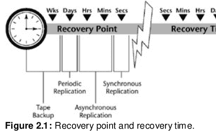

在构建策略时，你应该对通常由覆盖但我们正在执行的需求进行特别说明。

图 2.2 显示了在 1 月 1 日到 1 月 4 日之间的一系列备份包含的数据。1 月 1 日的全量备份包含了策略文件列表中的所有文件和目录。每次累积增量备份包含自上次全量备份以来更改的数据。如果磁盘在 1 月 4 日（备份后）故障，则恢复需要全量备份和最后的累积增量。

对于此示例：恢复 = 1 月 1 日 (全量) + 1 月 4 日 (增量)

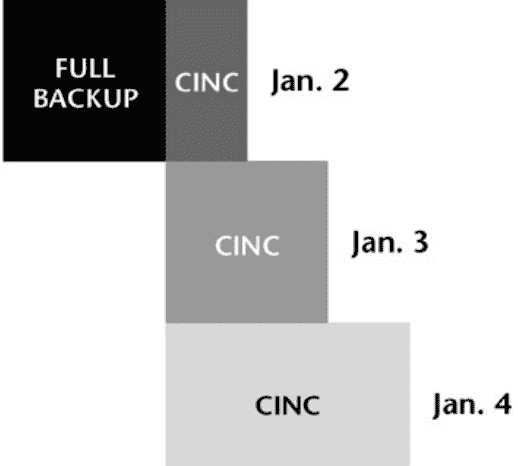

图 2.2: 累计增量备份。

图 2.3 显示了从1月4日开始的一系列备份包含的数据。1月1日的备份是全量备份，包含了所有的文件和目录。随后的备份是差异增量备份，仅包含自上一次差异增量备份以来更改的数据。如果磁盘在1月4日的某时候发生故障（备份之后），则需要所有的增量备份来进行恢复。

对于此示例：

恢复 = 1月1日（全备） + 1月2日（增量） + 1月3日（增量） + 1月4日（增量）

| 全量备份 | 1月2日 增量 |
|---|---|
| 1月3日 增量 | |
| 1月4日 增量 | |

**图 2.3:** 差异增量。

以下是使用移动检测的示例，这些情况下文件通常不会被备份：

- 名为 `/home/pub/doc` 的文件被移动到 `/home/spec/doc`。在这里，修改时间保持不变，`/home/spec/doc` 在 `/home/spec/` 目录下是新文件并会被备份。
- 名为 `/etc/security/dev` 的目录被重命名为 `/etc/security/devices`。在这里，修改时间未变，但 `/etc/security/devices` 是新目录并会被备份。
- 名为 `/home/pub/doc` 的文件通过从 UNIX TAR 文件提取而安装的。在这里，修改时间在上次备份之前，但该 doc 在 `/home/pub/` 目录下是新文件并会被备份。
- 名为 `docA` 的文件被删除，名为 `docB` 的文件被重命名为 `docA`。在这里，名称相同，但其 inode 号发生了变化，因此它会被备份。

Netback 从该策略的下一次全量备份开始收集移动检测所需的信息。设置属性后的第一次备份总是备份的，它是一个增量备份。

移动检测会占用客户端空间，如果磁盘空间不足则可能会失败。

下表显示了在 2001/12/01 到 2001/12/04 期间的一系列备份中，`/home/abc/doc/` 目录下备份的文件。假设选择了真镜像恢复信息并由其执行了备份。

| 日期 | 备份类型 | /HOME/ABC/DOC 中备份的文件 | | | | | |
|---|---|---|---|---|---|---|---|
| 2001/12/01 | 全量 | file1 | file2 | dir/fileA | dirB/fileB | file3 |
| 2001/12/02 | 增量 | file1 | file2 | dir/fileA | --- | --- |
| 2001/12/03 | 增量 | file1 | file2 | dir/fileA | --- | --- |
| 2001/12/04 | 使用备份 | file1 | file2 | dir/fileA | --- | dirC |
| 2001/12/04 | 增量 | file1 | file2 | --- | --- | --- |

注意：

破折号表示该文件在此备份之前已被删除。

此外，假设你准备恢复 2001/12/04 版本的 `/home/abc/doc/` 目录，恢复的目录包含了从 2001/12/01（上次全备）到 2001/12/04 存在于 `/home/abc/doc/` 中的文件和目录：

- 如果你进行常规恢复，恢复的目录包含了从 2001/12/01（上次全备）到 2001/12/04 存在于 `/home/abc/doc/` 中的文件和目录：

```
file1
file2
dir/fileA
dirB/fileB
file3
dirC/fileC
file4
```

- 如果你对 2001/12/04 的备份进行真镜像恢复，恢复的目录仅包含 2001/12/04 增量备份时存在的目录：

```
file1
file2
file4
```

NetBackup 不恢复在 2001/12/04 增量备份之前删除的任何文件。

恢复的目录不包含 dirA 和 dirC 子目录，尽管它们是 2001/12/04 通过用户备份创建的。NetBackup 没有恢复这些目录，因为它们在增量备份时并不存在，而该备份是真镜像恢复的参考。

> 取自 NetBackup 4.5 数据中心系统管理员指南，VERITAS


一旦理解了所有数据的通用备份需求以及业务和法律要求，你对需要备份多少数据以及至少的频率要求就有相当好的了解。建立理想频率策略的技巧在于制定一个能够提供足够保护的计划。

移动检测会占用客户端空间，如果磁盘空间不足则可能会失败。

人们常见的错误是保留备份时间过久。这增加了备份成本，因为你需要更多的介质。你需要确保理解了保留备份的所有法律和业务要求，并确保满足它们。对于常规操作，你希望确保你的保留水平至少超过备份频率，每周至少一周，否则你将失去保护。一种通做法是每种类型的备份至少保留两个副本。这意味着你始终有两个备份的磁带。这种方法允许你从下次备份期间可能发生的崩溃中恢复，但在一个磁带出现问题时提供额外的副本。另一种常见做法是分配离地磁带，但这是由业务驱动的。例如，业务可能要求备份镜像在现场保留 30 天用于恢复，而离地镜像必须保留 180 天。

仔细考虑整个问题，不要只是说你会永远保留一切。如果这描述了你的特定情况，你面临的并不是艰巨的任务，但也并非世界末日。从现在开始，最好的做法是确保你能对数据进行正确的分类，重新设计备份策略，以便你只备份和保留你在需要的时间段内的数据。

## 备份安全性

备份安全性是必须考虑的因素之一。您的业务可能需要加密备份，以便在没有正确密钥或密码的情况下无法恢复磁带上的数据。许多备份和恢复方案都提供这种备份，但加密备份会带来性能开销。数据在发送到网络之前必须在客户端系统上进行加密，这将消耗客户端的 CPU 周期，并减慢数据传输到网络进行备份的速度。数据是极其安全的，因为它在发送到网络之前经过了加密，并且在写入磁带时仍处于加密状态。这同时也意味着在进行恢复时需要已知密钥。大多数人倾向于保持介质的安全，而不是通过使用加密来实现数据安全。

如今大多数人都意识到实施真正的数据保护策略的必要性，其中备份是不可的一部分。该策略的组成部分之一是对异地介质的管理。您应该选择像 `Veritas NetBackup` 这样提供自动化库或异地存储解决方案的备份产品，以便您管理并跟踪异地的数据。您针对异地或库解决方案需要回答的问题如下：

- 异地需要保留多少份镜像副本？
- 每个镜像或介质类型应该保留两个或更多份副本的多久？

您必须确定哪些系统需要数据的异地副本，以及是整个系统还是部分系统需要发送到异地。这通常没有必要且不符合效益。您需要知道异地是否需要增量备份以及全量备份。此要求可能根据每个类型或类系统而异。它还取决于灾备（DR）策略的存在以及法律要求。

下一个问题是每个备份镜像应该异地保留多少份副本。这通常取决于数据异地存储的原因。如果有法律要求，这些要求通常会规定副本的数量。如果纯粹是为了灾备，一份或几份副本可能足够了。这个决定通常基于法律和业务需求，或者您的整体灾备策略。在使用异地存储设施的情况下，您可能只需要一份副本。在这些情况下，如果有多个站点，通常会将副本发送到可以作为灾备站的姐妹站点。您可能想要两份异地副本，一份保留在本地，另一份保放在远程站点。您真正需要做的是保持开放的态度，考虑所有的可能性和需求。

如果有法律或业务需求，必须满足这些要求。一个常见的法律要求是，所有与财务交易相关的数据必须保留七年。您想异地存储多少种潜在不同的数据镜像，您维护了多少个非生产磁带？同样，这可能由业务部门经理决定他们希望数据存储多长时间。在大多数公司中，IT 部门将这些业务部门视为其客户；为客户提供服务是涉及成本的。同样，当业务部门要求其数据在异地保留两年时，您必须列出与管理这些数据相关的成本。这将包括磁带成本、取送/交付成本和存储成本。即使您不将这些费用转交给经理，为您的管理层记录这些内容也是一个好主意。有了这些事实，您就可以帮助他们根据业务需求合理地确定异地存储的适当时长。

有时数据必须在业务部门之间进行隔离。有几种方法可以实现。最安全的方法是拥有多个磁带库，并将不同业务部门的备份分配到不同的库中。有时这不可行或不实际。如果是这样，还有其他方法可以实现。通过像 `VERITAS Software` 的 `NetBackup` 这样的工具，您可以建立唯一的卷池并将介质分配给特定的卷池。这允许您在单个磁带库内逻辑上分离数据。我们将在后面的章节中详细讨论这一点。警告是：仅仅因为软件支持，并不意味着您必须实施它。如果您没有实施多个卷池的能力，请务必不要仅仅因为可以这样做就给您的环境增加复杂性。像 `VERITAS NetBackup` 这样的备份产品非常稳定且易于修改，未来可能会有这种需求。

业务部门之间的其他差异可能会影响您如何构建策略。这些差异通常会导致独特的备份需求。

到为止，我们已经讨论了……我想分享一次我访问过的经历。当我们到达参加第一次会议时，我们介绍了对他们环境的描述，并穿插了关于他们处境完全令人绝望的评论。最早的声明之一是：“我们不知道如何管理数据，而且才刚刚开始。根据我们预测的增长，我们无法想象如何能备份所有数据。”他们列出了所有带有存储的现有服务器以及总数。他们总结了网络配置、已购买的备份相关硬件，最后是增长预测。数据量令人印象深刻。在查看了所有信息后，我的第一个问题让所有人感到惊讶：“我们为什么要备份这些数据？”

“为什么？我们必须这样做。我们的一个竞争对手刚刚遭遇了某种故障，而且没有备份。对他们来说那是一场彻底的灾难。你什么意思是为什么？”

我必须重新组织措辞，以便他们理解我在寻找什么：“有多少系统具有活跃用户的易失性数据，这些数据可能会因为某人删除文件或想恢复旧版本而需要经常恢复？这可能涉及少数终端。有多少系统需要备份以防止硬件故障或某种系统崩溃？有多少系统运行着关键应用程序，您希望确保它们免受系统崩溃、硬件故障和应用程序错误？”我们讨论了他们想要保护系统的各种不同情况，他们开始列出一个不同的列表。

我们已经了业务需求如何影响你设计备份和恢复策略的一些方法。正如前面提到的，过程中也存在陷阱，例如某个业务部门经理希望将备份数据存储在异地，尽管这并没有真正的坚实理由。如果备份开始变成一个垃圾倾倒场，而且如果我们不向参与管理和维护这些数据的人员展示成本，数据量将会继续增长。就像一个拥有 30 GB 硬盘但只剩 4 GB 空间的笔记本电脑，真的有理由保留所有这些东西，仅仅是因为“我有空间，而且是别人付钱”？如果这笔钱必须从我自己的口袋或预算中支出，人们对此此会有不同的想法。查看这些需求并帮助业务部门在这一过程的每一步都专注于最终目标，一直是一个好主意。以下是我们讨论过的不同要素：

- 备份类型
- 备份频率
- 备份安全性
- 异地存储需求
- 业务部门之间的差异

通过评估所有这些需求并意识到它们如何影响你，你将能够更好地开发出满足你业务需求的备份和恢复策略。成功的业务优先级划分标准。

在下一章中，我们将开始根据前两章列出的信息进行实际操作。我们将使用 `VERITAS NetBackup DataCenter` 作为备份应用程序。我们首先向你介绍此应用程序，然后详细介绍在企业中部署它的细节。

如今市场上有很多商用备份产品。在 UNIX 平台上的领导者是 `Veritas NetBackup DataCenter`。我们在解释和设置备份域的示例中将使用该产品，并简称为 `NetBackup`。我们首先对 `NetBackup` 进行介绍，包括对该产品独特架构的解释，然后定义它使用的术语。大部分内容基于最新版本 `4.5`，但当与旧版本之间存在显著差异时，我们会进行说明。

`NetBackup` 备份域使用四层架构，如图 3.1 所示。

这些层级如下：

- **客户端 (Client)。** 任何包含需要备份数据的系统。
- **介质服务器 (Media server)。** 任何物理连接了用于备份的存储设备的系统。这些可以是机器人设备、独立磁带驱动器或光存储设备。
- **主机 (Master)。** `NetBackup` 服务器为所有客户端和服务器的备份和恢复提供管理和控制。它还是包含备份域目录信息的系统。


进入`/path/to/xxx`目录，找到`xxx.json`。

在表达式`cvar = avar + bvar`中，加法运算符（`+`）将`avar`与`bvar`相加，得到它们的和`cvar`

在`List.of(arg0, arg1, arg2)`中，`List`接口的工厂方法`of()`接受一系列的元素，返回包含它们的只读列表。

之后我们这样调用`cmd`命令：`cmd arg0 arg1 arg2`。

```
if (condVar > someVal) {console.log("xxx")}
```
[/content]

Wait that's example. Need actual text.

Let's produce actual processed text.

[content]
- **全局数据管理器 (Global Data Manager)。** “主中之主”，可以监控并促进对多个主机服务器和多个备份域的管理。

NetBackup 域内的所有系统至少属于同一个系统中的一个。第四层——全局数据管理器层，通常在当从单个位置监控和管理多个 NetBackup 域时出现。前三层始终存在，即使存在多个一个。这种分层架构是使 NetBackup 具有如此可扩展性且易于管理的原因之一；你可以拥有一个单一的主机服务器提供单一的管理点，同时，你可以根据需要拥有任意数量介质服务器来支持你的配置。随着业务的增长，你可以添加更多的介质设备，只需添加更多介质服务器，而不会对你的整体配置产生巨大影响。如果你的企业继续增长，你可以只需根据需要添加另一个带有介质服务器的主机服务器。此时，你可能会添加第四层。第一层客户端可以轻松地添加或删除，因为配置保留在主机服务器上。

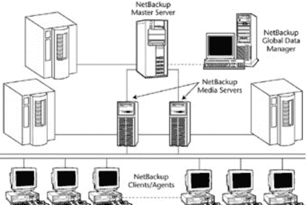

NetBackup 产品可以被认为由两个主要组件组成：`netbackup` 和 `media manager`（介质管理器）。`netbackup` 组件负责备份的谁、什么、何时、何以及：

- 谁需要备份？客户端。
- 什么需要备份？文件列表。
- 什么时候备份？调度表。
- 存储在哪里？逻辑存储。
- 如何处理这些备份？策略。

它还跟踪并管理所有的镜像。

`media manager` 组件负责所有的物理介质和设备。通常情况下，`netbackup` 组件处理逻辑设备，而 `media manager` 处理物理设备。

`netbackup` 组件在创建备份镜像时跟踪并管理所有数据。它还管理整个目录和调度。`media manager` 选择特定的备份任务。

`media manager` 管理所有的物理介质和驱动器。通过介质管理器，卷数据库进行填充。`media manager` 控制磁带库并维护卷的清单。

现在有趣的部分开始了。你已经收集了大量数据并比以往任何时候都了解你的企业。是时候利用这些知识了。如果这是首次实施备份和恢复策略，你将能够调整备份域。

在使用 NetBackup 作为应用程序时，首先列出所有需要备份的系统。如果是升级或应用程序更改，你可能需要在现有布局内工作。拥有大量数据的（例如超过 100 GB）系统可能是介质服务器。另一个需要考虑的重要因素是网络连接。如果慢网络上有许多网络客户端，你应该考虑高速网络。这可以提高备份和恢复性能，并将备份恢复流量离开网络。现在通常安装 100Base-T 或兆以太网作为备份恢复网络。

NetBackup 需要至少一个主机服务器。在大多数情况下，只有一个；在后面的章节中，我们将讨论如何处理多个主机。你为主机选择的系统取决于企业的规模——客户端数量、备份的文件总数以及你需要的存储。在较小的环境中，主机服务器也可以用于其他用途。图 3-2 显示了一个主机服务器也是介质服务器且所有客户端备份都是基于 LAN 的备份配置示例。

在大环境中，主机服务器通常是专用的 NetBackup 服务器，尽管它可以是介质服务器。此服务器必须有足够的磁盘容量来处理 NetBackup 目录以及可能的调试日志。某些调试日志位于 `/usr/open/netbackup/logs`。如果此目录不在单独的分区，你必须确保不要让日志增长并填满磁盘。目录中最大的部分是镜像数据库，位于 `/usr/open/netbackup/db/images`。建议此目录使用单独分区。所有备份的元数据都存储在目录的镜像部分。NetBackup 在任何时间需要的最大磁盘空间取决于以下因素：

- 你备份的文件数量
- 全量和增量备份的频率
- 用户备份和存档的数量
- 备份保留期
- 文件完整路径的平均长度
- 文件信息（如其他权限）
- 任何时间存在的错误日志信息量
- 是否启用了主机压缩选项

## 媒体服务器

要估计 NetBackup 目录中映像数据库所需的磁盘空间：

- 1. 估计每个计划在对所有客户端进行单次备份期间备份的最大文件数。
- 2. 确定每个策略的全量备份和增量备份的频率和保留期。
- 3. 使用步骤 1 和步骤 2 中的信息计算在任何给定时间存在的最大数量。

假设你计划每七天执行一次全量备份，保留期为四周，每天执行一次差异增量备份，保留期为一周。文件路径的数量必须能够容纳全量备份文件数的四倍加上一周的增量空间。

以下公式表示每种类型备份（每日、每周等）在任何给定时间可能存在的最大文件数：

每次备份的文件数 × 留存期内的备份次数 = 最大文件数

如果每日增量计划为所有客户端备份了 1200 个文件，保留期为七天，则这些增量产生的最大同时存在文件数如下：

`1200 × 7` 天 = `8400`

如果每周全量备份为所有客户端备份了 3000 个文件，保留期为四周，则由于每周全量备份产生的最大同时存在文件数如下：

通过将所有计划的最大文件数相加，获得该服务器的总和。由于上述两个计划而可以同时存在的最大文件数是总和之和，即 `20,400`。

注意：对于收集真实映像恢复的策略，增量备份会收集所有文件的目录信息（如果是全量备份的话）。之前的增量计算将从 `1200 × 7 = 8400` 变为 `3000 × 7 = 21,000`。在加上全量备份的 `12,000` 后，两个计划的总和为 `33,000`，而不是 `20,400`。

4. 通过文件数乘以文件全路径和文件信息的平均长度来获取字节数。
   - a. 确定二进制目录所需的空间：如果你不确定文件全路径的平均长度，请使用 100。使用步骤 3 示例中的结果得到：
     `(8400 * 100) + (12000 * 100) = 1992.2 KB`（1 KB 为 1024 字节）
   - b. 确定 ASCII 目录所需的空间：如果你不确定文件全路径的平均长度，请使用 150。（100 到 150 的平均值很常见）。使用步骤 3 示例中的结果得到：
     `(8400 * 150) + (12000 * 150) = 2988.3 KB`（1 KB 为 1024 字节）

注意：如果你使用 ASCII 目录和目录索引，将步骤 4 中的数字乘以 1.5%。

- 5. 如果你正在运行调试日志，请在步骤 4 计算的总基础上加上 15 MB。这是其他日志的平均空间。如果预见会有更多，请增加该值。
- 6. 分配空间以确保所有数据留在单个分区中。

在确定用于主服务器的系统类型时，你必须考虑许多因素。它可以是支持列表中的任何类型的 UNIX 或 Windows 系统。如果是一个专用系统，你需要足够的计算能力来支持网络适配器以及 NetBackup 进程，以及足够的内存来支持每项任务。如果该系统还是媒体服务器，则系统资源需求会更高。在 NetBackup 中，在多个服务器之间共享磁带库并不起见。在许多情况下，机器人控制由主服务器处理，而媒体服务器要么直接连接，要么在存储区域网络（SAN）中共享。（我们将在后面的章节中介绍 SAN 中的共享存储选项）。下表提供了有关支持若干硬件和软件组件所需的 CPU 数量和内存量，以及 I/O 适配器的性能数据。你应该使用表 3.1 到 3.3 列出的数字来设计你的主服务器和媒体服务器。

| 组件 | 每个所需的 CPU 数量 |
| :--- | :--- |
| 网卡 | 1 块 2-3 块 100Base-T 卡<br>1 块 5-7 块 10Base-T 卡<br>1 块 2-3 块 FDDI 卡<br>每块 ATM 卡 1 块<br>1 块 1-2 Gb 以太网卡<br>(最好是 1 块) |
| 磁带驱动器 | 1 块 2-3 台 DLT 8000 驱动器<br>1 块 2-3 台 DLT 7000 驱动器<br>1 块 2-4 台 DLT 4000 驱动器<br>1 块 2-4 台 8mm 和 4mm 驱动器 |
| OS + NetBackup | 1 个 |

| 组件 | 每个组件所需的内存 |
| :--- | :--- |
| 网卡 | 16 MB |
| 磁带驱动器 | 128 MB |
| OS + NetBackup | 256 MB |
| NetBackup | 512 MB |

| 驱动器 | 理论 MB/SEC | 理论 GB/HR |
| :--- | :--- | :--- |
| SCSI | 5 | 18 |
| Narrow SCSI | 10 | 36 |
| Wide SCSI | 20 | 72 |
| Ultra SCSI | 33 | 118 |
| SCSI-2 | 40 | 144 |
| Ultra ATA | 66 | 237.6 |
| SCSI-3 | 80 | 288 |
| Fibre Channel | 100 | 360 |

| 技术 | GB/HR |
|---|---|
| 10Base-T | 3.6 |
| 100Base-T | 36 |
| FDDI | 36 |
| Gigabit GbE | 360 |
| 四路快速以太网 QFE 链路 | 144 |

1. 确定在全计划范围内需要备份的数据量。


## 确定备份时间窗口与驱动器需求

### 2. 确定备份时间窗口
确定你愿意允许备份完成的时间窗口，例如 `1` 小时、`6` 小时、`12` 小时等，“周末”这种说法太模糊了。这需要一个从开始到结束的具体数字才能使该方案可行。

### 3. 计算所需驱动器数量
一旦你确定了数据量和窗口，就可以轻松地确定物理上满足这一挑战需要多少驱动器。这都涉及到简单的数字计算。一台 `DLT 7000` 平均每秒可以写入约 `32 MB` 的数据，四台 `DLT 7000` 平均每秒可以写入约 `32 MB` 的数据。因此，在 `6` 小时的窗口内备份 `2 TB` 的数据需要 `11` 台驱动器 - (`8 MB/sec × 60` 秒 = 每分钟 `480 MB × 60` = 每小时 `28.8 GB` = 每台驱动器 `6` 小时 `172.8 GB` = `2 TB` / 每小时 `172.8 GB` = 在六小时内使用 `DLT 7000` 磁带机需要 `11.57` 台来备份 `2 TB`)。驱动器的选择将在下一章讨论。

### 4. 介质服务器带宽
现在是时候考虑从介质服务器为驱动器提供足够的带宽；单块 `F/W Diff SCSI` 卡只能处理 `20 MB/sec`，因此卡上的每个端口只能处理两个驱动器。

### 5. LAN 带宽需求
在确定了到介质服务器的带宽后，你需要根据连接的驱动器数量来确定 `LAN` 带宽。在 `32 MB/sec` 的速度下，至少需要 `50 MB/sec` 的 `QFE` 链路或 `125 MB/sec` 的 `GbE`。基于服务器的 `LAN` 流量必须配置除 `100-Mbps` 网卡 (`NIC`) 以外的设备。

### 6. 介质服务器选型
现在既然你已经确定了第 `4` 点和第 `5` 点，你需要选择一个具有足够健壮性来处理第 `4`、`5` 点的介质服务器。`Sun Ultra 100` 无法配备四路快速以太网 (`QFE`) 卡且无法处理 `GbE`；这完全取决于数字和纯物理因素。了解需要在光纤中传输的数据，然后构建一个系统来适应这些需求。

## NetBackup 架构概述

在本章中，我们查看了使用备份产品建立备份和恢复策略的第一步。我们选择了 `VERITAS` 公司的 `NetBackup`。我们首先查看了 `NetBackup` 使用的具体架构：

- 客户端 (`Client`)
- 介质服务器 (`Media server`)
- 主服务器 (`Master server`)
- 全局数据管理器 (`Global Data Manager`)

在这些背景下，我们可以查看备份服务器的一些特定系统要求。这涉及以下内容：

- `CPU` 要求指南
- 内存要求指南
- `I/O` 适配器规格

这些信息结合以下考虑因素，为我们提供了足够的信息来进入下一阶段，确定介质需求：

- 数据量
- 数据位置
- 网络速度
- 备份窗口

在下一章中，我们将介绍如何评估存储需求，包括磁带驱动器和库库。

- 第 `4` 章：评估存储介质需求
- 第 `5` 章：配置通用讨论
- 第 `6` 章：监控备份过程
- 第 `7` 章：评估其他备份相关功能和选项
- 第 `8` 章：通用故障排除技巧
- 第 `9` 章：扩展备份系统

## 概述

备份和恢复策略的下一步是确定存储介质需求。根据你已经收集的信息，你应该对要备份多少数据、需要多少份副本以及保留多久有了很好的了解。所有这些信息都进入存储介质需求。如果这是一个新备份，可以使用这些信息来确定哪种磁带驱动器和介质效果最好。如果是现有域，你可以判断是否有足够的驱动器和库容量。

正如你可能已经意识到的，这并不是一门精确的科学。每一个环节都是相互关联的。服务器的大小取决于驱动器的数量。驱动器的数量取决于备份的数据量和备份窗口。使用驱动器带宽的能力与网络速度和布局有关。这就是为什么我们选择分析数据作为起点并从这里继续推进。在继续之前，你需要使用前三章中的指南收集所有数据。

在你继续评估存储介质时，你需要考虑选择合适的驱动器技术。不同驱动器类型的数量和支持库的数量有助于明智决策。一个可以提供所有不同类型比较的地方是 `www.storagemountain.com/hardware-drives.html`。该网站显示了所有不同的技术，并提供了速度、容量、加载/卸载时间以及访问时间。所有因素都会影响最终决定。使用高密度卡带进行备份可能是最佳解决方案。如果恢复速度更重要，你可能想查看访问速度快的驱动器，但高密度可能不符合你的需求。

评估存储介质的最关键步骤之一是确定实际窗口。在 `32 MB/sec` 处，至少需要 `50 MB/sec` 的 `QFE` 链路或 `125 MB/sec` 的 `GbE`。基于服务器的 `LAN` 流量必须配置除 `100-Mbps` 网卡 (`NIC`) 以外的设备。

一旦你确定了数据量和窗口，就可以轻松地确定物理上满足这一挑战需要多少驱动器。这都涉及到简单的数字计算。

传输率 = `12.5 GB/hr`

在你对传输率有了了解后，可以查看不同的技术。表 `4.1` 给出了磁带传输策略、容量和时间的示例。这些信息对于确定你需要的技术非常有帮助，但永远不要忘记这些都是数值，没有考虑驱动器的内部压缩。驱动器制造商会公布不同技术的压缩率。这些取决于驱动器，但可能会随着新的固件级别或版本而改变。要获得最准确的数字，请联系驱动器供应商或访问其网站，可以在那里找到最新的规格表。

| 驱动器 | 理论传输率 GB/HR (不压缩) | 理论容量 GB (不压缩) | 不包括加载时间的访问时间 | 压缩率 |
|---|---|---|---|---|
| 4mm (HP DDS-2) | 1.8 | 4 | | |
| 4mm (HP DDS-3) | 3.6 | 12 | | |
| Mammoth | 11 | 20 | 60 sec | 2:1 |
| Mammoth-moth-2 | 42.4 | 60 | 60 sec | 2:1 |
| DLT 4000 | 5.4 | 20 | 68 sec | 2:1 |
| DLT 7000 | 18 | 35 | 60 sec | 2:1 |
| DLT 8000 | 21.5 | 40 | 60 sec | 2:1 |
| SDLT | 39.6 | 110 | 70 sec | 2:1 |
| 9840 | 36 | 20 | 11 sec | 2.5:1 |
| 9940 | 36 | 60 | 41 sec | 3.5:1 |
| LTO | 52.7 | 100 | 25 sec | 2:1 |


| `AIT-2` | 21,1 | 50 | 27 sec | 2.6:1 |

| `AIT-3` | 42 | 100 | 27 sec | 2.6:1 |

当你开始实际确定自己需要哪种类型的驱动器时，我们建议使用原始传输速率和容量，而不进行压缩。由于很难估计你将经历何种压缩去重率，因为这完全取决于你的数据构成。某些数据非常容易压缩，而另一些数据产生的压缩效果微乎其微。如果你基于不压缩来构建架构，那么你应该经历的惊喜应该是良性的；你将拥有足够的容量和增长空间。

`磁带数量 = (待备份数据总量 × 备份频率 × 保留期) / 磁带容量`

- 数据总量 = 100 GB
- 每月全量备份 = 4 次
- 全备保留期 = 6 个月
- 每月增量备份 = 30 次
- 增量备份保留期 = 1 个月

### 初步计算

- 全备大小 = 100 GB × 4 次/月 × 6 个月 = 2.4 TB
- 增量备份大小 = (100 GB 的 20%) × 30 × 1 个月 = 600 GB
- 存储总量 = 2.4 TB + 600 GB = 3 TB

### 解决方案

- 不压缩的磁带容量 = 31.5 GB
- 全备所需的总磁带数 = 2.4 TB / 31.5 GB = 76.2 = 77
- 增量备份所需的总磁带数 = 600 GB / 31.5 GB = 19.1 = 20
- 总磁带数 = 77 + 20 = 97

通过观察这个示例，你发现任何时候都至少需要 97 盒活动磁带。这假设所有磁带都已装满且没有未使用的磁带。这些计算是基于不压缩得出的。这让你对规划合适尺寸磁带库所需的步骤有一个大致的概念。我们永远不会建议实施不包含带条形码读器的机器人磁带库的企业级备份策略。如果没有它，管理可能会变得难以负担，并且非常容易出现人为错误。将管理交给企业级备份应用程序要好得多。

在确定支持你的环境需要多少槽位时，不要忘记留出一些槽位用于清洁磁带，并至少留两个用于目录备份（`catalog backups`）。实际上，你可能需要根据需要为目录备份预留许多槽位，以便保留一份目录的副本。如果你在备份策略中包含了磁带类型的异地解决方案（异地库库存放），你需要在总容量计算中包含这一点，因为创建副本需要额外的磁带。

如上一节所述，大多数企业级备份策略都将包含一些机器人磁带库。有几家磁带库制造商，每家都有从小型到非常大的整个系列产品。此决定的一部分将取决于你使用的驱动器技术，因为某些磁带库只支持特定的驱动器。选择磁带库的考虑因素如下：

- 它能处理所需的驱动器类型吗？
- 它能处理所需的驱动器数量吗？
- 它支持所需的槽位数量吗？
- 它具有扩展能力吗？
- 连接类型是 `SCSI` 还是光纤？
- 它支持条形码吗？

在查看可用的磁带库时，你应该考虑是否通过 `SAN` 还是媒体服务器来支持它们。此决定的一部分将取决于你是否实施一个带条形码读器的机器人磁带库。我们将在后面的章节中讨论是选择一个还是多个媒体服务器。这些磁带库的厂商包括 `ADIC`, `ATL`, `Compaq`, `Exabyte`, `Fuji`, `IBM`, `NEC`, `Sony`, `Spectra Logic` 和 `StorageTek`。

在这一节中，我们从备份系统的需求开始。首先，我们确定了备份窗口并计算了存储的数据量。通过这些信息，我们查看了磁带驱动技术以及需要多少活动磁带。在这种情况下，我们建议选择一个合适的磁带库来支持所需的驱动器和磁带。接下来，我们将查看如何将所有内容整合。

我们在企业备份和恢复方面的下一步是对所有收集的数据进行配置。我们将查看进入配置的元素。

每个备份应用程序都有自己的术语。要配置备份，从选择主服务器开始。该服务器包含策略信息。策略包含要备份的客户端列表、文件列表、控制备份的属性，以及数据存储的位置。存储 `units` 为 `NetBackup` 提供了物理设备的逻辑映射。每个媒体服务器包含设备信息。主服务器还维护并管理域的数据库。这些信息存储在卷数据库 (`vDB`) 中，它对应于实际卷；主服务器还有一个卷池信息数据库 (`poolDB`)。

预计跟踪的媒体总数。`volDB` 系统的资源管理。随着 `volDB` 预期尺寸增长，必须有可用系统资源来管理它。

主服务器将作为媒体服务器吗？如果主服务器将作为媒体服务器运行，你必须选择具有足够 I/O 能力的系统。你还必须确保足够的内存来同时容纳这两个功能。

可能还有其他考虑因素，但此列表让你了解在选择主服务器时需要考虑的内容。该服务器将负责所有的备份调度、管理所有备份的目录、跟踪设备磁带轨道的状态和使用情况、跟踪系统已知的的所有活动和可用媒体，并处理所有恢复操作。你应该确保所选的系统具有足够的内存和处理器能力来处理所有这些功能，以及足够的磁盘空间来存放目录、数据库和日志。此外，还要考虑到磁盘和内存需求的增长情况。

## 媒体服务器

每个备份域都必须有一个媒体服务器。这可以是以下形式之一：

- *主服务器作为媒体服务器。* 如上一节所述，主服务器也可以作为媒体服务器运行。
- *专用媒体服务器。* 某个或多个系统可以专门用作媒体服务器，用于将数据从磁带移动，或在恢复时读回数据。
- *SAN 媒体服务器。* `SAN` 媒体服务器的特殊之处在于它只能用于备份自身，不能用于备份其他局域网客户端。

我们在第 3 章中讨论了影响媒体服务器决策的一些因素。在较大的企业中，通常会有专用的媒体服务器来处理局域网客户端，并让较大的应用程序服务器也作为媒体服务器，主要用于对其数据进行无网备份。如果有 `SAN`，那么可能就会使用 `SAN` 媒体服务器。由于媒体服务器的任务是将数据从磁带移动到磁带，因此它应该具备良好的 I/O 能力和足够的内存。媒体服务器可以是 `UNIX` 或 `Windows` 系统。选择系统作为媒体服务器时最重要的考虑因素如下：

- I/O 能力
- 内存
- 网络连接性

## 客户端

如所述，任何拥有待备份数据的系统都是 `NetBackup` 客户端。这包括主服务器、所有媒体服务器、应用程序服务器以及任何其他需要保护数据的系统。在列出待备份客户端列表时，你应该根据共同属性对它们进行分组。这可以按功能、业务部门、架构或配置来进行。在配置备份策略时，你应该将具有相似备份特征的客户端分组。

## 设备和存储单元

1. 配置操作系统以查看并访问所有物理设备。这包括确保创建了正确的设备文件。
2. 在媒体服务器上配置 `NetBackup` 媒体管理器，以便访问所有系统设备。


## 安装

设置备份域的常规程序是在主服务器上安装 `NetBackup`，然后根据情况安装主服务器。客户端通常从主服务器推送，只要它们具有相似性即可，例如我们可以从 `UNIX` 主服务器推送 `UNIX` 客户端，从 `Windows` 服务器推送 `Windows` 客户端。实际的安装步骤针对 `UNIX` 和 `Windows` 服务器均有不同。

## UNIX 主服务器

`NetBackup` 支持许多 `UNIX` 平台。为了简化安装程序，提供了一个与特定操作系统交互的安装脚本。该脚本将适用于所有支持的主服务器和媒体服务器安装的 `UNIX` 服务器。在主服务器上安装软件最简单的方法是在本地 `CD-ROM` 驱中加载包含相应操作系统的 `NetBackup` 发行版本的 `CD-光盘`。然后将工作目录切换到 `CD-光盘`。对于 `Sun`、`HP` 或 `Linux` 系统，`CD-光盘` 上的文件列表如下：

```
# ls
NB-Java NBClients hp-ux install linux solaris
Doc
```

此时没有必要切换到子目录，因为安装脚本将控制这一切。如果你从其他 `UNIX` `CD-光盘` 安装，列表将如下：

```
# ls
NB-Java NBClients alpha install ncr rs6000
sequent sgi
```

安装 `CD-光盘` 包含了所有 `UNIX` 客户端的客户端软件，以及发布的文档。安装脚本会确定你正在安装的平台类型，并选择适用于该操作系统的相应二进制文件。

找到正确的安装脚本后，下一步是执行该脚本。以下是在 `Sun` 系统上执行脚本后生成的菜单：

```
# cd /cdrom/cdrom0
./install
```

VERITAS 安装脚本

Copyright 1993 - 2002 VERITAS Software Corporation, All Rights Reserved.

安装选项

- 1 NetBackup
- 2 NetBackup Client
- 3 NetBackup Java Software

q 退出脚本

选择一个选项 [默认: q] [1-3,]

要安装主服务器，选择 1。脚本随后检查是新安装还是升级。如果是新安装，系统会提示你提供安装软件的位置。在 `Sun` 系统上，应用程序不允许安装在 `/usr` 目录。因此，系统会提示你安装在 `/opt`，或者创建一个指向 `/opt` 的 `/usr/opt` 链接。如果是升级，旧版本的二进制文件将被删除，新版本将在相同位置替换它们。在升级的情况下，安装脚本还会检查必须停止的运行进程。你将被要求提供主服务器之外的需要加载所有相应客户端二进制文件的 `UNIX` 平台列表显示如下：


注意：在安装任何新应用程序时，良好的做法是阅读发行说明。在这里你可以发现未收录文档的信息、特殊考虑等。Solaris 客户端将被加载。

你想在服务器上加载其他 NetBackup 客户端吗？(y) [y,n?] y

通过逐一选择平台类型来选择要安装的平台客户端类型，或选择所有客户端平台。

平台客户端选项

----------------

- 1. Alpha
- 2. DataGeneral
- 3. HP9000
- 4. INTEL (FreeBSD)
- 5. Linux (RedHat)
- 6. MACINTOSH (MacOSX and MacOSXS1.2)
- 7. NCM
- 8. IBM RS6000
- 9. SCO
- 10. SGI
- 11. Sequent
- 12. Solaris
- 13. 所有平台

Q 退出选择

输入选项（默认是 13）[1-13,] q

提供信息后，在 NetBackup 域内的客户端上安装 NetBackup 时，将使用请求的客户端二进制文件。二进制文件从主服务器推送到客户端。安装脚本最终会提示你输入密钥。你必须拥有适用于你购买的所有功能和选项的永久许可证密钥，或者一个可以在评估期内开启所有功能的评估密钥。此提示所示：

安装 `/usr/netbackup` 成功。

运行 `/usr/open/env/netbackup/bin/install_bp`

需要 NetBackup BusinessServer 或 DataCenter 密钥才能继续安装。

输入密钥: xxxx-xxxx-xxxx-xxxx-xxxx-xxxx-xxxx

包含以下功能的 NetBackup DataCenter Base 产品已注册：

开放事务管理器 (Open Transaction Manager)

智能灾难恢复

所有额外的密钥都应在此时添加。

您是否要添加额外的许可证密钥？(y/n) [y]

如果您想为其他功能添加额外的许可证密钥，请回答是。将出现以下提示：

```
License Key Utility
--------------------

A) 添加许可证密钥
D) 删除许可证密钥
F) 列出激活的许可证密钥
L) 列出已注册的许可证密钥
H) 帮助
Q) 退出许可证密钥工具
```

输入字母：

完成密钥输入，会出现此问题：

正在安装 NetBackup DataCenter 版本：4.5GA

`t-sparcl` 是主服务器吗？(y/n) [y]

在这里您需要决定是安装主服务器还是介质服务器。由于是安装主服务器，您应该回答是，这将允许脚本继续运行。脚本将设置系统配置以支持主服务器。该脚本还会提取并安装 NetBackup Java 软件，以便使用任何 Java 接口。然后，您将会被提示提供一个主机名来存储和管理全局设备数据库：

为了使设备发现和自动配置在 DataCenter 环境中正常工作（特别是当外设连接到多个服务器时），必须主机作为全局设备配置信息的存储库。

输入主机将存储全局设备信息。

(默认: `t-sparcl`):

在所有情况下，这将是主服务器，这也是 NetBackup 提供的默认值。当脚本完成安装程序时，会要求您创建示例模板（如果您想启动 NetBackup 进程），以便继续进行安装和配置。如果这是您第一次使用该产品，拥有这些模板作为示例是有用的。如果您是老用户，可能想节省一些时间并跳过这些内容。这基本上就完成了主服务器的软件安装。在安装完任何介质服务器后，您就可以进入配置步骤了。

## UNIX 介质服务器

在介质服务器上安装与在主服务器上安装非常相似。主要的区别在于对提示信息“这是主服务器吗？”的回答。通过回答否，系统会提示您提供主服务器名称和任何其他介质服务器名称。这将导致安装正确的软件，并更新所有配置文件以反映备份网域中的其他已知服务器。以下是介质服务器的提示差异：

正在安装 NetBackup DataCenter 版本：4.5GA

`t-sparcl` 是主服务器吗？(y/n) [y] n

主服务器的完全限定名称是什么？

## UNIX 客户端

使用两种基本方法从 UNIX 主服务器向 UNIX 客户端推送初始客户端软件。您可以使用远程方法（这需要在每个客户端上都备有一个 `.host` 文件），也可以使用使用文件传输协议（`FTP`）方法，该方法使用 `FTP` 将客户端软件推送到每个配置好的客户端。一旦安装了客户端软件，就可以删除 `.host` 文件，NetBackup 将处理未来的任何更新。

## Windows 主服务器

在 Windows 服务器上安装 NetBackup 服务器软件是一个简单的过程。您从光驱驱动器加载 Windows 服务器 CD-ROM，一个安装向导程序就会显示初始窗口。图 5.1

通过选择 NetBackup 安装，您将看到三个选项：检查 VERITAS 网站的产品警报、启动 NetBackup 服务器安装和启动 NetBackup 客户端安装。对于主服务器安装，您选择“启动 NetBackup 服务器安装”。在完成几个预安装检查步骤后，将显示图 5.2 所示的屏幕。

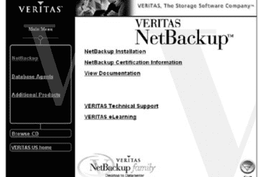

图 5.1：NetBackup Windows 安装向导。

此时，您必须输入有效的许可证密钥（允许您继续主服务器或介质服务器的安装），或者您可以安装另一个选项：NetBackup 远程管理控制台。此工具允许您从 Windows 系统管理您的 NetBackup 网域内的服务器。

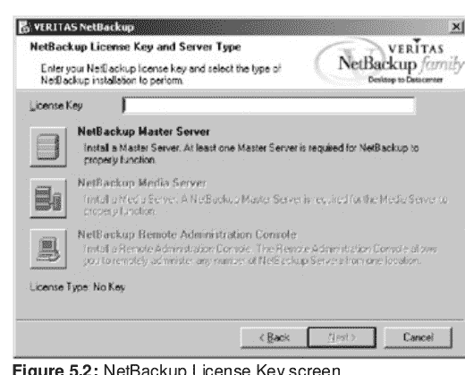

## Windows 介质服务器

如上一节所示，介质服务器的安装与主服务器安装非常相似。在介质服务器安装期间，您提供主服务器名称和任何其他介质服务器。这允许 NetBackup 设置所有配置文件以正确反映您的备份网域。

## Windows 客户端

Windows 客户端软件可以从 Windows 主服务器推送，也可以使用 NetBackup 发布 CD-ROM 进行本地安装。

## 配置 NetBackup

在本节中，我们将介绍配置 NetBackup 的步骤。步骤包括配置物理设备（磁带或光盘）以及配置存储单元（可能是磁带、光盘或磁盘），最后通过配置策略来完成。策略是 NetBackup 配置中的“谁、什么、何时以及如何”。最好仔细思考备份策略应该如何配置、执行等。通常，当我们被要求执行 NetBackup 评估时，人们希望把大部分时间花在策略结构上。遗憾的是，对于创建备份策略的整体结构和任务分配的时间很少，而这正是在后续运行过程中可能导致最大痛苦的问题。

## 设备

在主服务器和任何介质服务器上安装服务器软件后，下一步是配置设备。在安装期间，您提供了主服务器名称和任何介质服务器名称。这允许 NetBackup 设置所有配置文件以正确反映您的备份网域。（注：OCR 文本在此节包含重复段）。

VERITAS 软件提供了一名为《NetBackup 4.5 指南》的文档来帮助您配置设备。自动发现过程的结果显示在设备配置向导窗口中。过程完成后，将出现图 5.8 所示的窗口。


图 5.7：设备配置向导：设备主机。

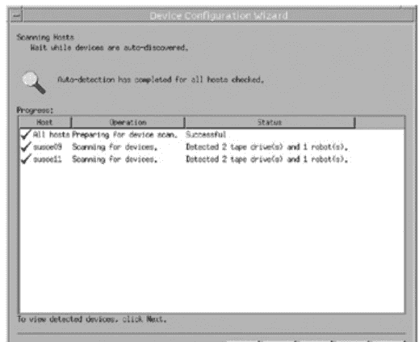

图 5.8：设备配置向导：扫描主机。

你可以通过点击“Next”（下一步）查看所有发现的设备。这样做将显示每个设备主机上设备发现的详情，如图 5.9 所示。你可以将其与已知的硬件配置进行比较。希望它们是一致的，这样你就可以继续了。如果某个主机存在问题，你可能需要到该主机，查看操作系统的设备序列化是否存在问题。此屏幕上最关键的字段之一是标记为“Serialization”（序列化）的字段。如果磁带驱动器或库在此字段中显示为“No”（否），则设备配置向导无法成功完成配置。当发生这种情况时，你需要联系你的硬件供应商，确定你正在使用的设备是否支持设备序列化。如果不支持，你仍然可以使用这些设备并用 NetBackup 对它们进行配置：只是无法依赖设备配置向导的自动发现功能。

在某些情况下，驱动器支持序列化而库不支持。如果驱动器专用于单个主机，你可以手动完成由设备配置向导启动的配置。在详细屏幕上选择“Next”，将出现图 5.10 所示的屏幕，该屏幕表示有一个没有驱动器的库，并且有两个驱动器不在库中。

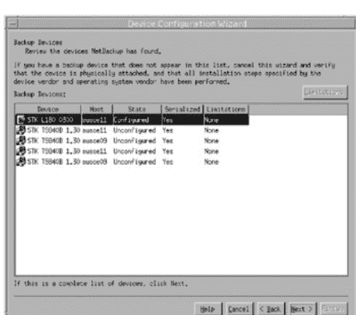

图 5.9：设备配置向导：备份设备。

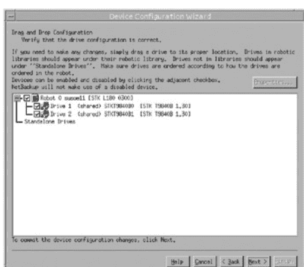

图 5.10：设备配置向导：拖放配置 #1。

这是因为驱动器报告了自身的序列号，但库没有报告驱动器的序列号。如果你知道库内驱动器的配置，可以将驱动器拖放到库中。如果所有设备都支持序列化，将出现图 5.11 所示的屏幕。如果是这样，你就不需要进行拖放配置以及图 5.12 所示的屏幕。


你首先选择设备，然后将其拖到库中的 `Drive 1` 位置。然后对第二个驱动器重复此步骤。如果你不确定哪个驱动器是哪个，可以选择 `Properties`（属性）。这将为你提供所选设备的所有详细信息。在确保所有设备似乎都配置正确后，选择 `Next` 以提交更改。生成的对话框将给你最后一次机会，可以取消更改或继续。选择 `continue`（继续）以实际提交更改并更新配置数据库。

在我们的单设备主机、单库示例中，这将导致显示如图 5.13 所示的屏幕。

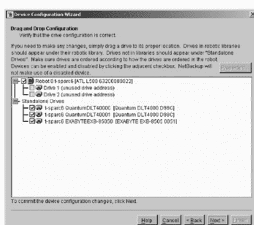

图 5.11：带有完全序列化拖放配置的设备配置向导。

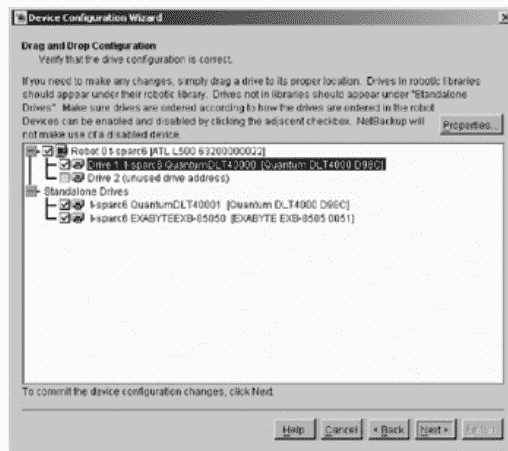

图 5.12：设备配置向导。

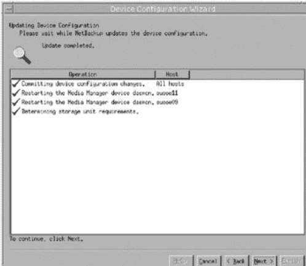

图 5.13：设备配置向导：更新设备配置。

# 存储单元 (Storage Units)

你已经完成了使用 NetBackup 对物理设备的配置。这使得设备变得可用。正如之前所述，NetBackup 现在提示你继续进行 NetBackup 的逻辑配置。这是 NetBackup 在将设备分配给作业时所使用的物理设备的逻辑表示。下一个向导是存储单元（storage unit）屏幕，如图 5.14 所示。

此屏幕列出了所有已配置的库，并提示你为每个库创建一个存储单元（storage unit）。在创建它们时，请确保为每个单元分配适当的属性。你需要选择的第一个特性是存储单元类型（storage unit type）无论是介质管理器单元（media manager unit）、可移动介质（removable media）还是磁盘存储单元（disk storage unit）。这是在图 5.15 所示的屏幕上完成的。

如果你选择 `Disk`（磁盘），默认行为是存储单元仅按需使用（on demand only）。这意味着除非作业显式命名，否则 NetBackup 无法将存储单元作为备份目标。这并不是强制要求。相反，如果你选择 `Media Manager`（介质管理器），`仅按需` 的行为不是默认值，但你可以根据需要选择它。

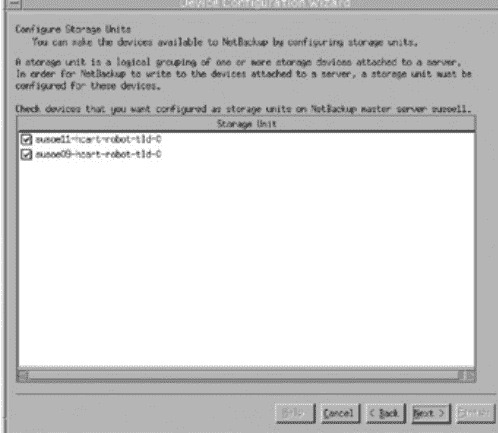

图 5.14：设备配置向导：配置存储单元。

此屏幕列出了所有已配置的库，并提示你为每个库创建一个存储单元。在创建它们时，请确保为每个单元分配适当的属性。你需要选择的第一个特性是存储单元类型。

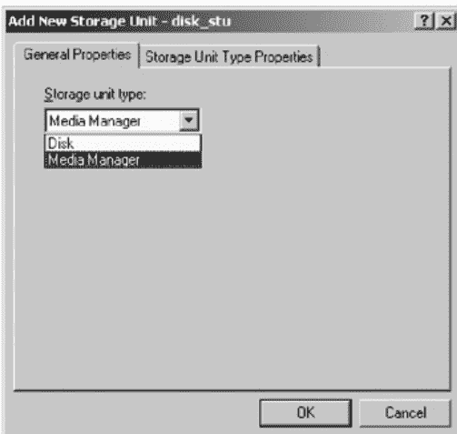

图 5.15：选择单元类型。

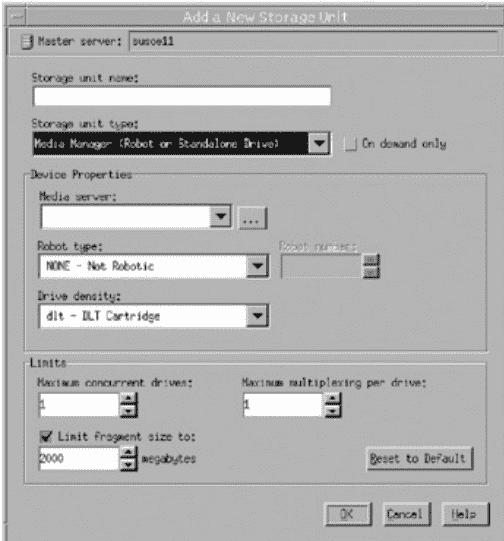

图 5.16：介质管理器。

存储单元属性（Storage Unit Properties）取决于你选择的存储单元类型。如你所见，你需要提供主机名、单元类型和介质数量。与存储单元相关的其他属性：

- 并发作业（Concurrent jobs）：允许同时向驱动器写入多少作业。
- 分片大小（Fragment size）：控制数据的分片大小。
- 每个驱动器的复用（Multiplexing per drive）：允许在驱动器上复用多少个流。

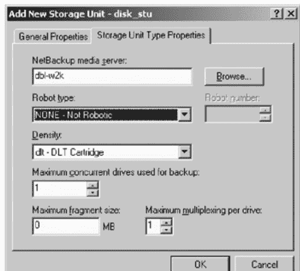

图 5.17：磁盘。

对于磁盘存储单元，你将看到图 5.17 所示的屏幕。有以下配置字段：主机名、路径、最大并发作业和最大分片大小。在 NetBackup 4.5 的最新版本中，添加单元的屏幕略有不同。所有信息保持不变，只是布局不同。最新的屏幕所示 5.18 所示。

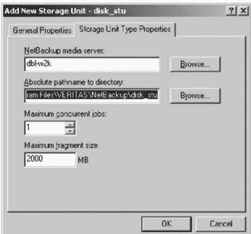

图 5.18：NetBackup 4.5 的最新存储单元屏幕。

# 卷 (Volumes)

现在我们配置了物理设备，需要定义一些用于备份的存储介质。物理盒被称为磁带（tape）、介质（media）或卷（volume）。当我们在 NetBackup 介质管理器中讨论它们时，被称为卷。这些磁带将用于存储备份数据。当你配置了一个或多个机器人设备时，可以使用卷配置向导。一种简单的方法（至少对于第一次）是使用此工具并扫描机器人库。

如图 5.19 所示，你定义的任何机器人都将出现在屏幕上，你可以选择想要扫描的机器人。

一旦你做出选择，向导将返回所需的操作列表。这可能包括添加到数据库的新卷、数据库显示在库中但机器人指示不存在的卷，以及位于不同槽位的卷。当你选择 `Next` 时，卷数据库将更新以匹配机器人扫描结果。

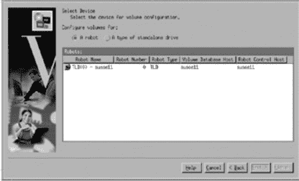

图 5.19：卷配置向导。

## 卷配置向导

根据扫描结果：

- 以下的 71800 个扫描项与 1/2 英带磁带类型匹配，并正在更新包含这些磁带的磁库。

扫描没有更改。

扫描没有增量变化。

东京卷配置的请求扫描结果如下：


点击 `下一步` 继续。

**图 5.20：** 卷配置向导：更新的卷数据库。当您有机会识别磁库中的清洁卷时，如图 5.21 所示。

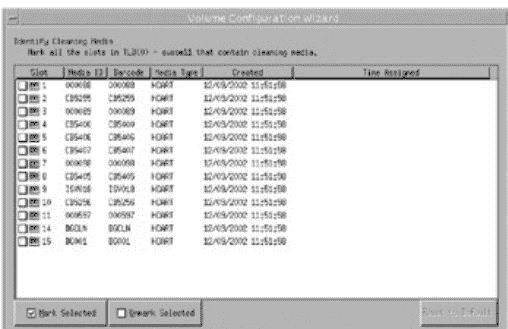

**图 5.21：** 卷配置向导：识别清洁介质。

在您手动或通过向导对卷操作时，应确保卷的介质类型与驱动器的介质类型匹配。请注意，由于不同的 DLT 标识，一个磁库可能包含 DLT 4000、DLT 7000 和 DLT 8000 驱动器。每个 DLT 驱动器类型的不同规格列第 4 章。您必须能够区分这些驱动器的卷。这是通过对驱动器和介质类型使用 DLT、DLT 2 和 DLT 3 标识来实现的。区分的另一种方法是卷池。

# 卷池

在构建备份环境时，您会发现自己需要能够控制数据流或保留备份数据。卷池根据用途识别一组逻辑卷。您可以创建跨越磁库的池。通常做法是为保留备份（如每月全量备份）设置一个唯一的池。如果您正在复制卷，应始终将副本存放在与原始副本不同的池中。最好在添加卷之前配置好卷池，因为您无法将卷放入一个尚未创建的池中。您还可以使用 `暂存池`（scratch pool）的概念，即定义所有的池但将所有卷放在暂存池中。NetBackup 会根据需要将卷从暂存池移动到指定的池。

# 策略

在配置好物理设备和存储单元以使用这些设备后，您需要创建策略来备份客户端数据，使用向导引导您完成策略创建是合适的，而且在最初使用它可能会有所帮助。在创建几个策略后，您可能会直接进入 `策略` 选项卡并创建自己的策略。这里有一个备注：策略是 NetBackup 4.5 的功能。该版本于去年发布。

如果您决定使用向导，首先会被要求提供策略名称和策略类型。策略名称应该是对您有意义的。类型取决于您正在备份的客户端类型以及您在客户端上执行的备份类型。位于一个组内的所有客户端必须使用相同的策略类型。大多数特殊策略类型（例如数据库备份或 NetBackup 数据管理协议 NDMP）都是单独定价的选项，在没有相应许可密钥的情况下它们将显示为可选类型。选择适当的策略类型后，添加将由此策略备份的特定客户端。向导将带您进入备份策略配置向导。在 Windows 主机上，界面类似于图 5.22。

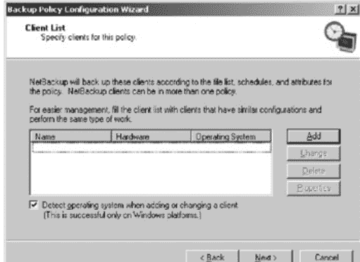

图 5.23：备份策略配置向导-Windows 在 UNIX 主机上显示显示类似的界面。

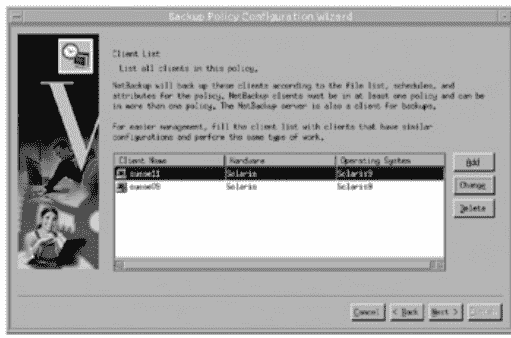

在输入想要通过策略备份的客户端后，此时系统会提示您输入文件列表或一组指令以选择要备份的数据。此时，可以选择目录、文件系统或原始设备，也可以提供如 `所有本地驱动器` 之类的指令，这告诉 NetBackup 您想备份所有内容。为了进一步控制备份的执行方式，可以使用此指令的另一个属性：允许多个数据流。当我们进入策略属性屏幕时，将介绍所有这些指令。

策略向导中显示的界面是 `备份类型`，如图 5.24 所示，您可以在此处选择将执行何种类型的备份。（我们在第 2 章中讨论过不同的备份类型）。

所示，您可以选择全量、增量、增量累积或用户备份。通常，在此时您只会选择其中一个，因为下一个屏幕名为 `轮转`（如图 5.25 所示），用于设置您所选备份类型的备份计划。

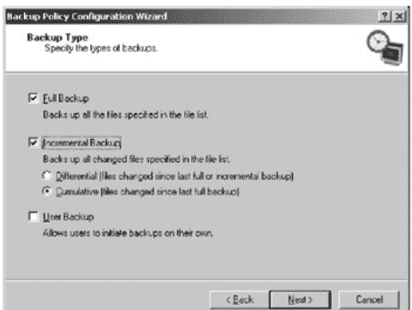

**图 5.24：** 备份策略配置向导：备份类型。

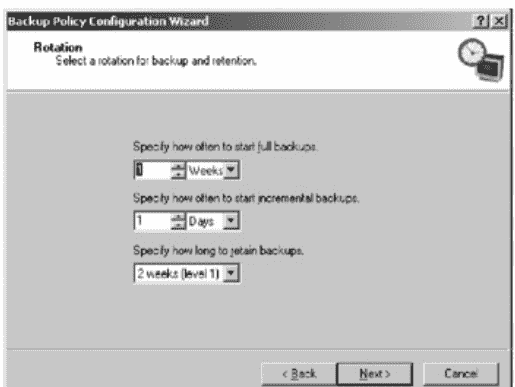

**图 5.25：** 备份策略配置向导：轮转。


如果您同时选择了全量和增量备份类型，可以为全量和增量指定不同的频率，两者的保留期将相同。通常，在此时您只会选择其中一个，因为下一个屏幕名为“轮转”（如图 5.25 所示），用于设置您所选备份类型的备份计划。

如果您同时选择了全量和增量备份类型，可以为全量和增量指定不同的频率，两者的保留期将相同。图 5.26 所示 Windows 版本与 5.27 所示 UNIX 版本不同，但结果是相同的。

## 策略配置向导

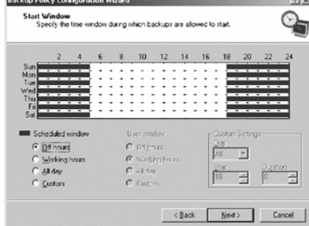

**图 5.26：** 备份策略配置向导-Windows

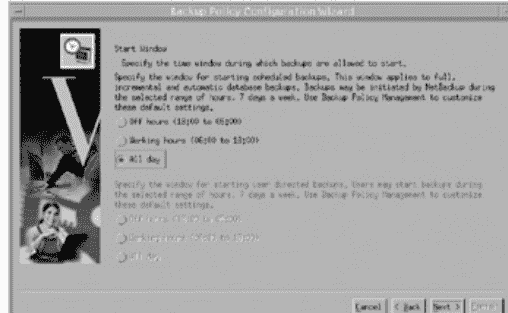

**图 5.27：** 备份策略配置向导-UNIX

在为特定策略选择特定属性后，您还可以精细化调度。如果您在“更改策略”屏幕中选择“计划”选项卡，将看到您已创建的计划。此窗口在图 5.29 所示的 Windows GUI 和图 5.30 所示的 UNIX GUI 中略有不同。

要使用 UNIX Java GUI 添加新计划，请点击“新建”。将显示图 5.31 所示的屏幕。

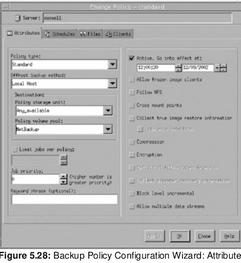

**图 5.28：** 策略属性屏幕

- 离线备份方法：此选项定义由什么来移动数据。
- 每个策略作业限制：默认值为 999，是一种限制单个策略以确保其不占用所有资源的方法。
- 激活：生效于。策略必须处于激活状态才能使用。预配置策略并等待其激活。
- 冻结客户端：此字段定义策略中的任何客户端是否将使用冻结映像。
- NFS：如果选择，此选项允许 NetBackup 备份文件列表中任何 NFS 挂载的文件系统。
- 跨挂载点：此选项控制 NetBackup 在 UNIX 客户端备份或归档时跨跨文件系统边界，在 Windows 客户端备份或归档时进入卷挂载点。
- 真映像恢复（带移动检测）：如果选择此选项，NetBackup 将收集信息以允许目录恢复到特定备份时的精确映像。删除的文件和文件夹不会恢复。如果还选择了移动检测，被重命名或移动的文件或文件夹将被备份并恢复到正确位置。
- 压缩：在客户端上启用软件压缩。此选择可以减少备份时跨网络传输的数据，但会增加客户端的计算开销。
- 允许多个数据流：此选项指定根据文件列表中的目录，NetBackup 可以将每个客户端的自动备份分为多个作业，每个作业备份文件列表的一部分。这些作业位于独立的数据流中并可以并发运行。

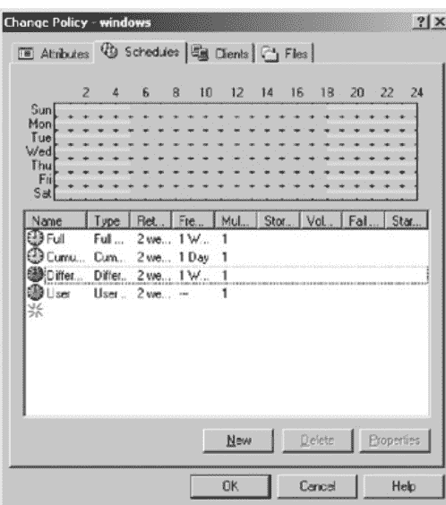

图 5.29：Windows 策略配置向导：计划。

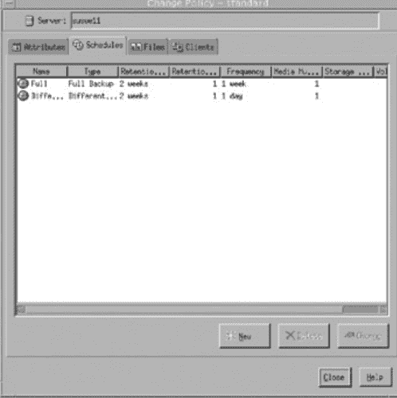

图 5.30：UNIX 策略配置向导：计划。

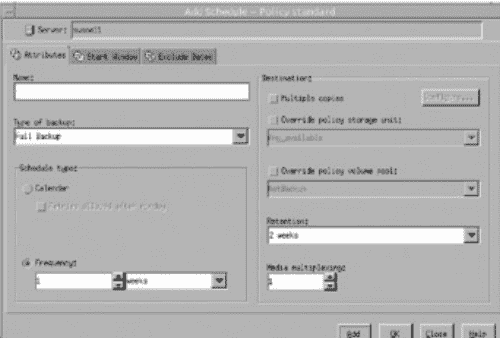

此屏幕显示需要考虑的额外配置点：

**计划类型。** 基于日历的调度或基于频率的调度。

**目标：**

- * **多个副本。** 如果安装了库（vault）选项，你可以为备份选择多四个不同的目标。
- * **覆盖策略存储单元。** 在创建策略时，你可以指定备份转到特定的存储单元、一组存储单元或任何可用存储单元。这允许你根据需要进行更改。
- * **覆盖策略卷池。** 这与存储单元的选择类似，但针对的是卷池。

**保留。**在此处指定你如何保留由此计划创建的备份。

**介质复用。** 这允许你将来自多个数据源的数据发送到磁带。完成所有计划配置后，如果已完成策略更改，点击确定；如果你想添加更多客户端或更改文件列表，请根据需要选择添加、客户端选项卡或文件选项卡。在文件选项卡上，你可以选择添加指令。这些指令与多数据流属性共同工作，用于控制当策略开始时实际启动多少数据流，以及来自特定客户端的数据流数量。在 Windows 策略类型和标准策略类型上，指令是相同的，System_State 除外，它仅适用于 Windows。在此列表中，我们提供了常用指令的简要说明，但强烈建议阅读系统管理员指南中关于文件指令的章节。

**ALL_LOCAL_DRIVES。** 如果文件列表包含 `ALL_LOCAL_DRIVES` 指令，NetBackup 将备份整个客户端，但将每个驱动器（Windows NT）或文件系统（UNIX）拆分为单独的备份流。

**NEW_STREAM。** 如果此指令是文件列表中的第一项，则此指令的每次出现都会启动一个新的备份作业，用于在单独的流中备份指令之后的文件。

**SYSTEM_STATE。** 这用于备份注册表信息。

`UNSET` 和 `UNSET_ALL`。这些指令用于控制特定策略的指令（如 set）。例如，如果你有一个支持 set 命令的策略类型，并希望将 set 命令传递给前两个流但不传递给最后一个，可以在第三个流的开头使用 `UNSET` 或 `UNSET_ALL`，以防止其被传递给最后一个流。

```
NEW_STREAM
set despatch=/etc/home
/tmp
/use
NEW_STREAM
/export
NEW_STREAM
UNSET_ALL
/var
```

如果选择了“允许多个数据流”且 `ALL_LOCAL_DRIVES` 不是文件列表中的第一行，则启用自动发现流模式。在这种情况下，文件列表将发送到客户端，由客户端处理列表并将备份拆分为流。

## 目录备份

安装和配置已几乎完成。剩下的只需是配置应用程序备份其自身的数据库。“入门指南”将引导你完成此过程，你也可以直接从管理控制台进行。完成此步骤对于保护你的环境至关重要。向导会提示你提供设置此保护所需的信息。你需要提供执行目录备份的介质服务器、主服务器上所有关键数据的路径、所有介质服务器的名称以及它们的

图 5.32 显示了目录备份向导。

主服务器的关键数据路径应始终包含以下内容：

- `/usr/popen/netbackup/db.` 安装时为主服务器自动创建
- `/usr/popen/volmgr/database.` 安装时为主服务器自动创建
- `/usr/popen/var.` 安装时为主服务器自动创建
- `/usr/popen/db.` 必须手动添加

你还还想为所有介质服务器配置目录路径。这些必须手动备份。

- `media_server_name:/usr/popen/netbackup/db/media`
- `media_server_name:/usr/popen/volmgr/database`
- `media_server_name:/usr/popen/var`

在设置好文件路径以确保所有数据都将进行备份后，你需要配置这些备份的目标。你可以将目录发送到磁带或磁盘。NetBackup 可以使用两个不同的目标，并在每次备份时在两者之间切换。如果你选择磁盘（`Disk`），你需要指定一个绝对路径作为目录的存储位置。如果你选择磁带（`Tape`），必须选择一个或两个卷。一旦目录备份发送到磁带，该磁带在不手动重新标记的情况下无法用于正常备份。你可以配置 NetBackup 使用磁带作为一个目标，使用磁盘作为另一个目标。在这种情况下，每个备份将转到磁带，每另一个备份将转到磁盘。目录备份不会追加磁带。磁带会倒带，并覆盖之前的映像。目录备份的最后一个决定是计划。

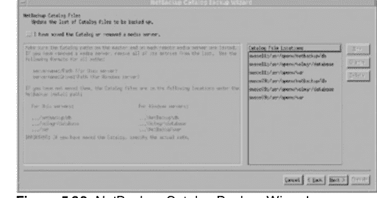

图 5.32：目录备份向导。

主服务器的关键数据路径应始终包含以下内容：

- `/usr/popen/netbackup/db.` 安装时为主服务器自动创建
- `/usr/popen/volmgr/database.` 安装时为主服务器自动创建
- `/usr/popen/var.` 安装时为主服务器自动创建
- `/usr/popen/db.` 必须手动添加

你还还想为所有介质服务器配置目录路径。这些必须手动备份。

- `media_server_name:/usr/popen/netbackup/db/media`
- `media_server_name:/usr/popen/volmgr/database`
- `media_server_name:/usr/popen/var`

在设置好文件路径以确保所有数据都将进行备份后，你需要配置这些备份的目标。你可以将目录发送到磁带或磁盘。NetBackup 可以使用两个不同的目标，并在每次备份时在两者之间切换。如果你选择磁盘（`Disk`），你需要指定一个绝对路径作为目录的存储位置。如果你选择磁带（`Tape`），必须选择一个或两个卷。一旦目录备份发送到磁带，该磁带在不手动重新标记的情况下无法用于正常备份。你可以配置 NetBackup 使用磁带作为一个目标，使用磁盘作为另一个目标。在这种情况下，每个备份将转到磁带，每另一个备份将转到磁盘。目录备份不会追加磁带。磁带会倒带，并覆盖之前的映像。目录备份的最后一个决定是计划。

## 使用什么用户界面？


任何应用程序都有几种配置方法，NetBackup 也不例外。许多工作是为了让界面变得更好用。现在强调使用向导来使初始配置变得更加简单和直观。这是否意味着你有图形界面来安装和配置软件？如果你恰好在远程并想要配置怎么办？你可以考虑通过拨号显示 GUI。

嗯，还有其他选项，它们也运行良好，尽管我们将其推荐给经验丰富的用户。几乎所有操作都可以通过命令行界面（CLI）完成。许多 CLI 都在手册中以及发布文档中进行了记录。对于许多命令，你可以通过执行带有 `--help` 的命令来获取帮助。当你远程工作或从没有 X 图形能力的终端工作时，CLI 非常有用。还有以下基于字符的、菜单驱动界面：

- `bp`。NetBackup UNIX 客户端的备份、存档和恢复。它具有基于字符的菜单界面。
- `badm`。运行在 NetBackup UNIX 服务器上的管理工具。它具有基于字符的菜单界面。
- `vmadm`。管理卷的介质管理器管理工具。它运行在 UNIX 上并具有基于字符的菜单界面。

这些界面比 CLI 更容易，但仍然可以在拨号或没有图形能力的终端上使用。以下是 `badm` 的示例：

```
NetBackup Server: wormwood.min.veritas.com
NetBackup Administration

s) 存储单元管理...
t 存储单元组管理...
p) 策略管理...
g) 全局配置...
r) 报告...
m) 手动备份...
x) 特殊操作...
u) 用户备份/恢复...
e) 介质管理...
h) 帮助
q) 退出
```

### 策略管理

- a) 添加策略...
- m) 修改策略属性...
- d) 删除策略
- s) 计划管理...
- c) 客户端列表管理...
- f) 文件列表管理...
- b) 向前浏览策略
- r) 反向浏览策略
- e) 进入策略
- l) 列出/显示策略
- o) 输出目标（屏幕或文件）
- h) 帮助
- q) 退出菜单

输入选择：b

策略名称：test

客户端：wormwood

计划：FULL

输出目标：SCREEN

### 策略管理

- a) 添加策略...
- m) 修改策略属性...
- d) 删除策略
- s) 计划管理...
- c) 客户端列表管理...
- f) 文件列表管理...
- b) 向前浏览策略
- r) 反向浏览策略
- e) 进入策略
- l) 列出/显示策略
- o) 输出目标（屏幕或文件）
- h) 帮助
- q) 退出菜单

输入选择：_

如你所见，此界面允许你在无需使用图形用户界面（GUI）的情况下管理配置。在 Windows 系统上，这并不十分担心，因为你始终可以使用 Windows GUI。Windows 系统没有基于字符的界面，但许多命令行界面（CLIs）仍然受支持。


## 总结

在本章中，我们查看了实际启动备份应用程序安装和配置所需的内容。然后，我们详细介绍了完成 VERITAS 软件 NetBackup 基础安装所需的各个安装和配置步骤。我们涉及了所有步骤，并查看了不同的界面。这应该让你对设置基础备份应用涉及的内容有一个大致的。在下一章中，我们将介绍如何监控你的备份。

# 第 6 章：监控备份过程

现在你已经成功安装并配置了备份域，可以准备坐下来休息一会了。但现在有人敲响你的门，你必须开始监控备份和恢复过程了。既然话说到这，我们不妨顺便监控备份域中可能需要关注的其他元素。在本章中，我们将介绍一些可用工具来监控示例备份和恢复应用程序——VERITAS NetBackup 的活动。

## 使用活动监器

监控备份和恢复活动常用的工具是活动监器（Activity Monitor）。它在 UNIX Java GUI 和 Windows GUI 上均可用。在控制台（Administration Console）上选择活动监器（见图 6.1），将显示图 6.2 所示的屏幕。

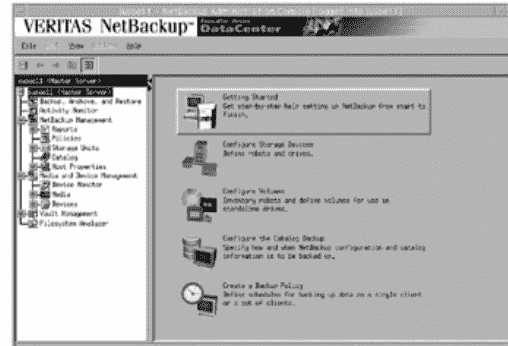

图 6.1：控制台。

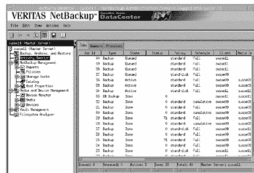

图 6.2：活动监器。

此屏幕列出了 NetBackup 当前正在跟踪的所有作业，包括队列中、活动和已完成的作业。你还可以查看摘要信息，其中包括每个类别中的所有作业，以及所有作业的总和主服务器名称。通过活动监器，你可以取消单个作业或取消正在运行的作业。可以通过屏幕顶部的操作（Actions）菜单完成。

### 活动监器中的字段

以下列表详细列出了活动监器窗口中包含的信息：

**作业 ID。** 此字段显示 NetBackup 分配给每个作业的标识符。

**类型。** 显示作业活动类型，可以包括以下任何作业类型：

- **备份。** 所有的备份作业，无论其如何启动。
- **恢复。** 所有的恢复作业，无论其如何启动。
- **归档。** 用户引导的归档。
- **目录备份。** 所有的备份备份，无论其如何启动。
- **副本。** 用于创建映像副本的副本作业。
- **导入。** 从映像恢复目录的导入作业。
- **验证。** 验证映像内容的验证作业。
- **入库。** 作为过程运行的入库作业。

**状态。** 活动监器给出当前状态：

- **队列中。** 正在队列中。
- **活动中。** 正在运行。
- **重新入队。** 重新放入队列的作业。
- **完成。** 已完成的作业。

**状态。** 此字段显示作业状态。状态为 0 表示成功。任何其他状态表示存在问题。

**注意：** 状态为 1 表示部分成功。

活动监器还提供了备份策略的保留期和其他属性。

### 详细视图

你也可以从活动监器中突出显示作业并获取提供更多信息的详细视图。图 6.3 和 6.4 显示了详细视图的内容。

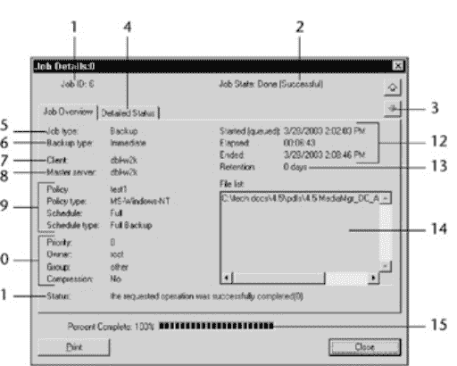

图 6.3：作业详情：概述选项卡。

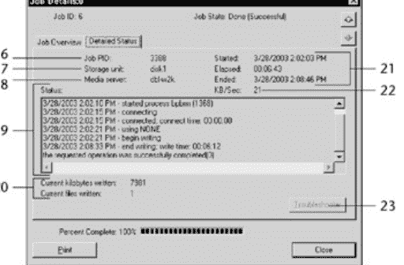

图 6.4：作业详情：详细选项卡。

以下是图 6.3 显示的字段：

1. 作业 ID。
2. 作业当前状态。
3. 用于浏览活动监器的按钮。
4. 作业类型：归档、恢复、目录或副本。
5. 作业提交方式：立即、手动或计划。
6. 正在工作的客户端。
7. 主服务器。
8. 备份策略信息。
9. 与备份策略相关的特定属性。
10. 完成状态。
11. 作业提交信息：提交时间、活动持续时间以及结束时间。
12. 此作业的保留级别。
13. 备份策略中配置的文件和目录。
14. 状态栏。

以下是图 6.4 显示的字段：

15. 操作系统分配的对应 NetBackup 调度程序（`bpsched`）的任务 ID。
16. 存储单元（逻辑存储设备）。
17. 媒体服务器。
18. 详细作业状态信息。
19. 写入的千字节和文件数量。
20. 作业时间。
21. 如果作业完成状态非零，用于帮助识别问题和可能解决方案的排除。

你可以通过从活动监器中选择作业并双击、突出显示作业、右键点击并在菜单中选择详细信息，或者突出显示作业并点击窗口顶部的操作来获取作业详情屏幕。这将弹出一个下拉菜单，其中包含详细信息。作业详情屏幕包含两个选项卡：作业概览和详细状态。这些界面可以让你对特定作业的情况有一个非常好的了解。此外，如果作业具有非零状态，你可以选择排除故障按钮。该向导提供了对特定状态代码的解释，并对于发现可能导致作业以非零状态结束的原因非常有帮助。

图 6.6, 6.7 显示了一个已完成的非零备份作业示例，以及如何进入排除故障。

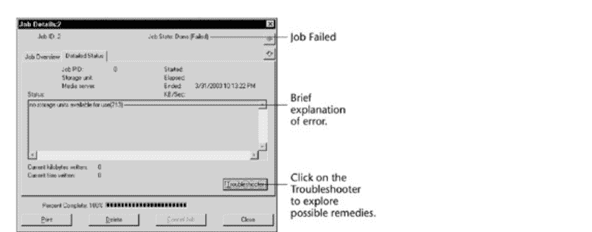

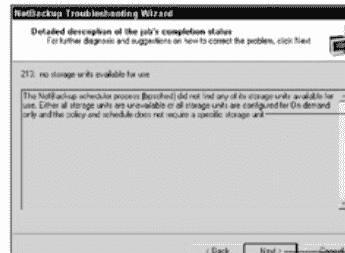

图 6.6：故障排除器。问题描述。

图 6.8 显示了 GUI 实用程序，但这次是通过命令行执行的。

`bperror` 命令是一个非常有用的工具，可以用于各种脚本中报告备份状态、吞吐量统计等。在我们在本章稍后查看报告部分时，我们将看到它的价值。作为参考，在您安装的 NT/2000 和 UNIX 系统中分别可以在以下目录找到 `bperror` 命令。

```
<install_path>/VeritasNetBackup/bin/bperror.exe
/usr/openv/netbackup/bin/bperror
```

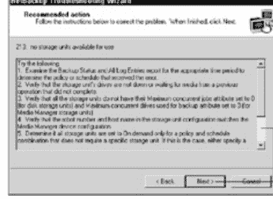

图 6.7：故障排除器。建议的操作。

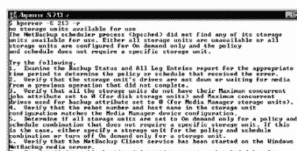

图 6.8：命令行故障排除器。

## 守护进程/服务


活动监控器在 UNIX Java 监控上还有两个其他标签，在 Windows 活动监控器上有三个其他标签。Windows GUI 上有“守护进程 (Daemons)”标签，Windows 上有“服务 (Services)”标签，两种系统都有“进程 (Processes)”标签，Windows 上还有一个“驱动器 (Drives)”标签。“守护进程/服务”标签允许您查看在系统上运行的所有 NetBackup 和 Media Manager 守护进程或服务。

它还提供了停止和启动的功能。服务标签如图 6.9 所示。UNIX 守护进程标签如图 6.10 所示。

进程标签显示所有正在运行的与 NetBackup 和 Media Manager 相关的进程。Windows GUI 还有一个第三个驱动器标签，可以提供另一个物理驱动器信息。Windows GUI 还有一个拓扑视图，目前该视图尚无法作为 Java GUI 活动监控器的一部分可用。

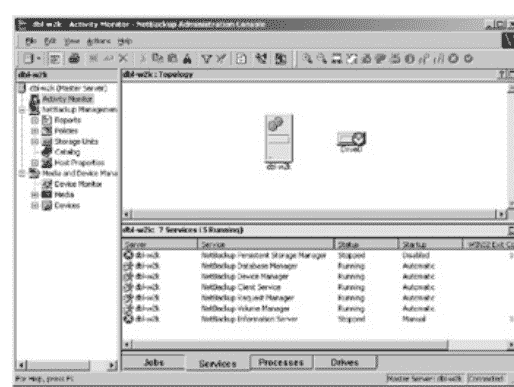

**图 6.9**：活动监控器，服务。

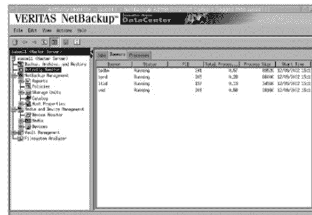

**图 6.10**：活动监控器：守护进程。

## 不使用 GUI 进行监控

有时，您可能想知道备份或其他作业的状态，但您没有图形终端的权限或者正在进行远程工作。您仍然可以获取信息并监控作业活动和设备状态。您可以使用命令行界面 (CLI) 监控作业：UNIX 系统上的 `/usr/open/netbackup/bin/admincm/mbpdbjobs` 或 Windows 系统上的 `C:\Program Files\VERITAS\Netbackup\bin\admincm\mbpdbjobs`。此命令允许您查看作业查询中的运行情况。您可以发布 CLI 选项，或添加选项来精炼输出。Windows 系统如图 6.11 所示。

您还可以通过执行此命令 `/usr/open/netbackup/bin/bps -a` 来了解您的 UNIX 系统上运行了哪些守护进程。这会返回系统上运行的所有 NetBackup 和 Media 守护进程及进程列表。典型输出如图 6.12 所示。

如果您想在不使用 GUI 的情况下知道设备状态，可以分别对 UNIX 和 NT/2000 使用以下命令：

```
/usr/open/volmgr/bin/vmprcmd -d
C:\Program Files\VERITAS\volmgr\bin\vmprcmd
```

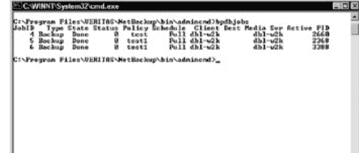

图 6.11：在 Windows 系统上通过命令行监控作业。

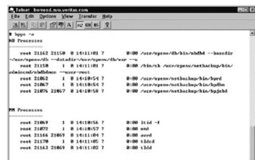

图 6.12：显示 UNIX 守护进程，如图 6.13 所示。

这将为您提供一个与图 6.13 所示的输出。

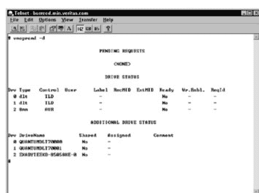

**图 6.13**：来自命令行的驱动器状态输出。

## 有哪些报告？它们告诉了什么？

当您开始使用备份应用程序时，您将希望创建帮助您了解进展并让您向他人更新备份域状态的报告。报告是备份应用程序的重要部分。NetBackup 提供了从 GUI 获取的报告。大部分报告是通过执行带有特定选项的 CLI 创建的。其中许多命令都有文档说明，因此如果您没有找到完全想要的内容，可以使用它们来创建自定义报告。图 6.14 显示了 Windows 管理控制台中可用的报告。

以下是“命名的”报告的列表，但请记住，如果您敢于深入 CLI 并创建自定义报告，那么报告的可能性是无限的。这些脚本中的若干几个可能可以在 www.BackupScripts.com 找到，这是一个致力于分享与 NetBackup 相关的脚本、技巧和陷阱（traps）的 Web 社区。

点击此处展开每个报告的列表。

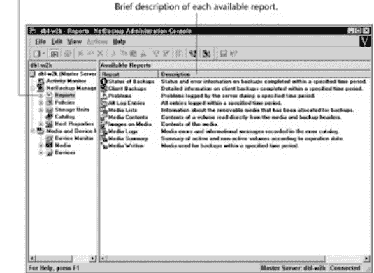

图 6.14：来自 Windows 管理控制器的报告。

- 备份状态
- 客户端备份
- 错误
- 所有日志项
- 介质列表
- 介质内容（注意：这将挂载磁带并读取其内容。取决于备份映像的大小，这可能需要大量时间。）
- 介质映像
- 介质日志
- 写入

如果您正在使用 UNIX 并且想在不使用 GUI 的情况下查看报告，可以使用字符界面 `bpdam`。这允许您访问所有报告。图 6.15 列出了备份报告和介质报告。如果您习惯了 GUI，此界面可能难以操作，但操作几次后就会变得简单。界面非常相似，都允许您查看以下报告，如图 6.15 所示：

- 备份状态
- 客户端备份
- 错误
- 所有日志项

大类类型的报告：备份报告和介质报告。备份报告针对作业。介质报告允许您从映像的角度查看信息。如之前所述，这些报告见 6.16：

- 介质总结
- 介质映像
- 介质日志
- 写入

我们之前提到过，但值得再次强调。运行此报告时，它实际上会挂载磁带、读取内容，并将磁带上的头部与 NetBackup 目录进行比较。

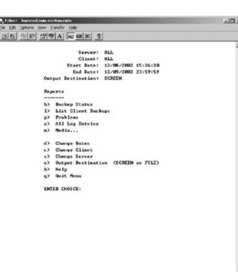

**图 6.15**：字符界面。

为了让您更好地理解 NetBackup 和 Media Manager 正在做什么，我们在下方包含了每个报告的命令行等效命令以及对涉及进程的简要描述。

要使用命令行运行介质列表报告，您可以在 NT/2000 或 UNIX 服务器上执行以下命令：

```
/usr/open/netbackup/bin/admincm/bpmedlist -U -h <MEDIA SERVER>
c:\Program Files\VERitas\Netbackup\bin\admincmd\bpmedlist.exe -U -h
<MEDIA SERVER>
```

如果您在主服务器上运行此命令而不指定介质服务器，主服务器将报告网络中所有活动的介质服务器。这些 CLI总是输出到 STDOUT，因此如果您想保留此报告，应将 STDOUT 重定向到其他地方，例如文件、打印机或邮件接收者。以下是 STDOUT 重定向到文件的示例：

```
/usr/open/netbackup/bin/admincm/bpmedlist -U -h SRVR > report.txt
c:\Program Files\VERitas\Netbackup\bin\admincmd\bpmedlist.exe -U -h
SRVR > report.txt
```

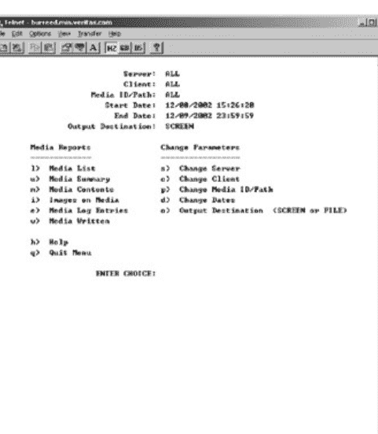

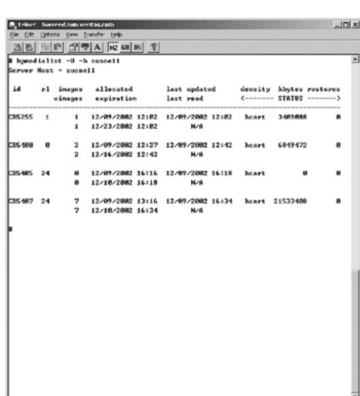

图 6.17：媒体列表报告。

此报告对于识别已用磁带数量及其特定*状态*非常有用。磁带可以处于五种状态之一，如图所示：

**ACTIVE（活动）**：已分配的具有活动备份的媒体，在达到磁带结束（EOT）标记之前均可使用。

**FULL（满）**：已达到 EOT 并标记为满的磁带；它不再可以写入，但在磁带上的最后一个镜像过期之前，均可以读取。

**SUSPENDED（挂起）**：已挂起的磁带不再可以写入，但在磁带上的最后一个镜像过期之前，均可以读取。当挂起磁带上的所有镜像过期时，磁带将再次可用。磁带可能由于媒体错误或操作干预而被挂起。

**FROZEN（冻结）**：备份期间因硬件错误而冻结的磁带将无法写入，直到管理员手动解冻。然而，在最后一个镜像过期之前，该磁带仍然可以读取。

**IMPORTED（导入）**：以前已过期或从另一个 NetBackup 域引入此域并现在已导入以便恢复某些文件的磁带。导入的磁带永远无法写入，但自然可以读取。

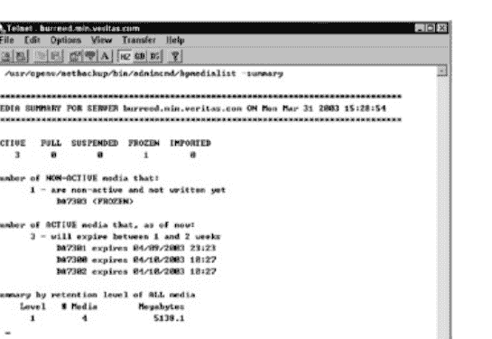

图 18：媒体摘要报告。

此报告针对 UNIX 和 NT/2000 的 CLI 分别如下：

```
/usr/open/network/backup/bin/admincmd/bpmedial.exe -summary
C:\Program Files\Veritas\NetBackup\bin\admincmd\bpmedial.exe
```


虽然图 6.18 中的报告在命令行或 GUI 界面可能不是最吸引人的，但它包含了大量关于写入到由 NetBackup 服务器管理的媒体的镜像信息。正如我们的一个客户发现的那样，该报告帮助他们检测到环境中的一个可疑故障，该故障由于硬件故障导致了长时间的恢复时间。`DWO`（写入驱动器）指示了你正在报告中查看或报告列表中列出的镜像碎片时使用的物理驱动器编号。因此，在图 6.19 中，第一个 `DWO` 为 0，它写入的驱动器是 `su009`。该特定客户发现了一个在备份期间不会出现的问题，而是在恢复期间出现，因为读取时没有使用原始的 `DWO`。当在经过校准的驱动器中挂载时，写入磁带的块开始产生软错误，可以通过驱动器纠错算法进行恢复；然而，当你修正整条磁带时，它会增加开销并超过正常的恢复体验时长。来自此报告的信息对于识别根源非常有帮助。

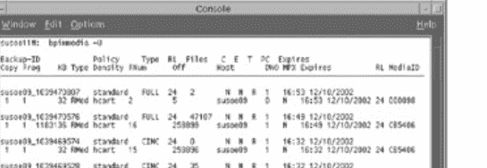

图 6.19：媒体报告中的镜像。

命令针对 UNIX 和 NT/2000 分别列出：

```
/usr/open/network/backup/bin/admincmd/bpmedia -U
```
```
C:\Program Files\Veritas\NetBackup\bin\admincmd\bpmedia.exe -U
```

当你对记录媒体活动的日志感兴趣时，应该查看图 6.20 所示的媒体日志条目报告。你将看到媒体 ID 何在何时过期、冻结、挂起或被移除。

命令针对 UNIX 和 NT/2000 分别列出：

```
/usr/open/netbackup/bin/admincmd/bperror -U -media -d <date> -e <date> --server SRVR
```

```
C:\Program Files\Veritas\NetBackup\bin\admincmd\bperror -U -d <date> -e <date> -server SRVR>
```

一些客户使用图 6.21 所示的媒体报告来识别昨晚备份期间使用的类型，以便他们可以将这些原始副本发送到他们的离线数据恢复站点。虽然我们不建议发送原始单副本，但通过此报告提供了该选项。

命令针对 UNIX 和 NT/2000 分别列出：

```
/usr/open/netbackup/bin/admincmd/bpimagelist -A -media -d <date> -e <date>
```

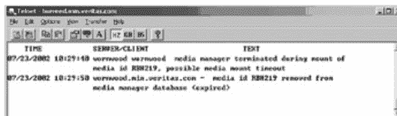

图 6.20：媒体日志条目报告。

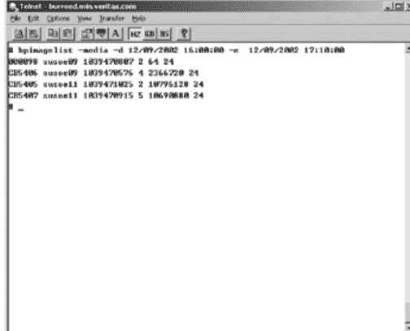

图 6.21：媒体写入报告。

如果你需要关于特定介质内容的详细信息，图 6.22 所示的媒体内容报告为你提供了这种能力。

命令针对 UNIX 和 NT/2000 分别列出：

```
/usr/open/netbackup/bin/admincmd/bpimagelist -U -mcontents -ev <MediaID> -h <SRVR>
```
```
C:\Program Files\Veritas\NetBackup\bin\admincmd\bpmedialist -U -mcontents -ev <MediaID> -h <SRVR>
```

## 高级报告

正如我们所看到的，有针对作业、媒体和镜像的报告。这些报告可以提供管理备份域所需的大部分（如果不是全部）信息。遗憾的是，还有其他报告需求。有时，能够生成图形化报告并对整个备份域的其他部分进行报告是很有用的。这些高级报告可以通过多种方式生成。Veritas 软件提供了一个可选产品 NetBackup Advanced Reporter (`NBAR`)，它包含 30 多种不同的报告。你也可以编写自己的自定义脚本，通过集成 `NBAR` 的程序接口来生成你自己的报告。这是一个基于 Web 的工具。这些报告通过四个广泛的视角展示 NetBackup 数据，帮助你分析 NetBackup 环境：


图 6.22：媒体内容报告。

- 高级摘要，你可以深入到特定点
- 详细的操作视图，包括错误日志
- 用于趋势分析的历史视角
- 性能指标，例如数据吞吐量

# 第 7 章：评估其他备份相关功能和选项

我们已经讨论了如何使用传统的备份方法构建备份和恢复解决方案。我们查看了在选择作为网域内主服务器和可能的介质服务器的系统时，必须考虑的某些事项。在许多情况下，这将允许你成功地执行必要的备份和恢复，但在某些情况下，你可能需要查看其他功能和选项。在本章中，我们将讨论这些功能和选项中的几种，其中某些功能需要额外的软件或新的许可，并针对你可能需要使用这些功能的情况提供指导。

## 在 SAN 环境中备份和恢复

在企业中，将存储部署在存储区域网络（SAN）上已变得常见。这使得服务器能够更好地访问磁盘，并使资源的利用更加充分。同时，使用 SAN 进行备份和恢复也是理想的，而且在某些情况下是必要的。我们这样做有几个原因。最明显的一点是可以从客户端将备份数据传输到带机，而无需经过局域网。主要方法是使用第 3 节中讨论的库共享。在这种情况下，多个介质服务器直接连接到光纤交换机，其中一个介质服务器具有机器人控制功能。现在，特定的介质服务器通过这种直接连接拥有一个或多个驱动器，并能够执行无局域网备份。这种解决方案的缺点是驱动器只能由直接连接到它的介质服务器访问。当介质服务器完成自身的备份后，驱动器将处于空闲状态，或者该介质服务器必须开始对局域网上的客户端进行备份。如图 7-1 所示。

无局域网备份的另一种方案是使用 SAN 解决方案。数据太大、无法通过局域网有效备份的服务器可以连接到连接有驱动器的光纤交换机或控制器。现在，不再每个介质服务器直接连接到一个或多个驱动器，SAN 中的所有介质服务器都可以访问连接到 SAN 的所有驱动器。这允许每个介质服务器使用所需的任意驱动器来完成其备份。完成后，驱动器将重新分配给另一个介质服务器。只要这能让你更好地利用磁带驱动器资源即可。驱动器可以位于机器人库中或作为独立式驱动器，只要它们连接到 SAN 即可。这为你提供了一种在标准备份环境中无法实现的独立式驱动器共享方法。驱动器的分配由备份应用程序仲裁。


图 7.1：库共享。

## 备份与 SAN

SAN 备份的一个示例是一个使用 NetBackup 执行了几年标准备份的客户。他们的环境已经增长到这种程度，即使在增加了介质服务器、磁带库和驱动器后，备份也即将超出窗口期，每天需要 18 到 19 小时才能完成。他们最终决定增加硬件并不是解决方案，实施了备份 SAN。这种对现有硬件更有效的利用使得他们的备份能够在八小时内完成。

VERITAS 软件通过 NetBackup 共享存储选项（SSO）提供此功能，如图 7.2 所示。通过此功能，备份和恢复数据跨越 SAN 移动，而不是局域网。这意味着驱动器通过光纤通道连接到介质服务器，而不是 SCSI 通道。它消除了连接驱动器的 SCSI 线缆限制。


图 7.2：NetBackup 共享存储选项 (SSO)。

## 数据库代理

许多供应商提供了各种备份数据库的方法，大多数带有“代理”，这些代理直接与数据库通信以进行“热”备份——即在不关闭数据库的情况下进行备份。

文件系统埋存储的所有文件列表需要大量时间。在不使用快照技术的情况下，备份它的最佳方法是执行以下操作：

- 1. 卸载文件系统。
- 对文件系统进行原始备份（raw backup）。
- 重新挂载文件系统。

这种备份方式存在一些缺点：

* 备份期间文件系统不可用。
* 所有的备份都是全备。
* 所有的恢复都是全文件系统恢复。无法进行单个文件的恢复。

备份此类数据的更好选择是使用快照。例如 NetBackup FlashBack 选项。通过这项技术，你既拥有原始备份的优势，又不会产生性能影响。它是一种使用专用快照驱动的写复制（copy-on-write）快照技术。该功能适用于以下文件系统：Sun Solaris UFS、Solaris 或 HP-UX 上的 VERITAS VxFS，以及 HP-UX 上的 Online JFS。FlashBack 可以在文件级创建一致的时间点备份。在恢复时，它允许通过快照期间创建的文件映射来恢复单个文件或目录。它还允许拥有数百万文件的管理员通过文件映射和快照技术的结合来执行备份和恢复操作。

使用 FlashBack 等技术相比标准文件系统或原始备份的优势如下：

* 它提供了更高的性能，特别是当文件系统包含大量文件且大多数文件系统块已分配时。
* 它允许恢复单个文件。
* 卷或文件系统保持保持挂载状态。
* 它支持多路流和增量备份。

## 镜像 (Mirror)


镜像存储在独立磁盘上的数据副本，物理上与源数据独立。主磁盘上源数据的任何更改或写入也会复制到辅助磁盘上。这创建了源数据的镜像映像。使用写复制快照时，当需要映像时，允许事务完成并短暂暂停主磁盘上的新 I/O。当镜像映像与源数据同步（变得完全一致）后，镜像将从主磁盘分离，这意味着主磁盘可以进行任何新更改而镜像则不会。此时，可以对镜像进行备份。

由于镜像需要主映像的精确、完整副本，它比写复制快照消耗更多的磁盘空间。数据可以存在磁盘管理软件中（例如 Veritas Snapshot Mirror），也可以存在由特定镜像软件控制的磁盘阵列中（例如 EMC TimeFinder DataShowMirror、HP-UX BusinessCopy、IBM FlashCopy 等）。备份结束时，分离的镜像将与主镜像合并，镜像将重新同步。某些应用程序（如 NetBackup）允许在带有镜像运行时，并在备份数据之前对镜像进行同步。这适用于那些喜欢每天同步一次镜像并在镜像分离状态运行的用户。

## 邮件备份 (BACKING UP THE MAIL)

毫无疑问，有很多客户使用冻结映像（frozen image）备份来处理邮件等应用程序的案例。我们知道其中一个案例，他们使用 UNIX 系统，面临着备份 4.2 TB 数据的挑战，这些数据跨越多个文件系统并包含 8200 万个文件。对这些数据标准文件系统备份需要 27 小时。在实施 NetBackup FlashBackup 后，他们可以在 8 小时内完成备份。在另一个 Netscale 备份案例中，标准全备需要 48 到 60 小时，增量备份需要 24 到 36 小时。实施 FlashBackup 后，全备在 15 到 20 小时内完成，增量备份在 9 到 12 小时范围内。


## Off主机备份 (Offhost Backups)

随着备份挑战不断增长，每个人都在寻找新方法来应对这些挑战。一种新的备份方法有时被称为无服务器或免服务器备份。其更准确的名称是离主机备份（offhost backup）。这种备份方法使用位于介质服务器或第三方（3PC）设备上的独立备份代理，实际上将数据从客户端磁盘移动到存储器中。

图 7.3 显示了使用 NetBackup 实现离主机备份的示例。在这种情况下，备份代理可以是介质服务器，也可以实现 SCSI 扩展复制命令的第三方（3PC）设备。许多类型的 3PC 设备可以作为备份代理，例如：

- 桥器 (Bridge)
- 路由器 (Router)
- 机器人库 (Robotic library)
- 磁盘阵列 (Disk array)

离主机备份的关键要素之一是备份必须从冻结映像进行。可以使用该节列出的任何冻结映像类型。有时此功能会与局域网无（LAN-free）备份功能（如 NetBackup SSO 功能）混淆。如果要求是将备份数据留在局域网之外，或者进行冻结映像备份以便应用程序继续可用，那么 SSO 或冻结映像备份都能满足需求。如果问题是备份开销对于应用程序服务器来说过大，那么离主机备份就是解决方案。通过使用离主机备份，你将磁盘读取和磁带写入移动到独立的备份代理，由它来实际执行这些工作。


## 使用全局数据管理器 (GDM) 管理大型环境

许多人发现单个域已不再是一个选择。这可能是由于物理原因（不同位置的域）、业务原因（不同部门）或规模（体量太大无法通过单个域处理）造成的。多个域的存在使得管理变得非常复杂。在这种情况下，最好有一个像 VERITAS 软件提供的全局数据管理器（GDM）这样的功能。该功能是 NetBackup 架构中的第四层。它是主之主，提供了一个单一控制台，让你查看并管理所有域。图 7.4 显示了典型的 GDM 布局。你可以看到，每个主收集数据并汇总到本地数据库。

图 7.5 是 GDM 使用的面板示例。


## 库解决方案 (Vault Solutions)

备份是任何企业策略中非常重要的一部分，但本身并不提供真正的灾难恢复。任何企业灾难恢复策略都应该包含远程备份管理系统，例如 NetBackup 的 Vault 或 Gray Duplication Suite。库产品是一种允许你创建映像副本、提供从机器人库弹出所需磁带的工具，并提供跟踪库外磁带移动的报告。磁带通常存储在异地。库产品提供对异地磁带的跟踪，并在磁带上的映像过期且需要带回库时通知你。如果主站点发生灾难，数据仍可以从异地磁带获取。


图 5：GDM 面板。

远程备份系统的要求如下：

- 磁带外运计划
- 确定要外运数据的方法
- 自动创建重复介质（映像）的机制
- 目录备份机制
- 从异地存储中检索的方法
- 跟踪异地存储的数据和磁带的系统
- 磁带运输报告
- 资源高效利用

由于这是任何企业灾难恢复策略的基石，选择满足这些需求的产品非常重要。确保选择一个提供你所有所需功能且具有活性和易用性的产品。库通常被认为是一个三个步骤：

- 1. 备份复制。
- 2. 目录备份。
- 3. 介质导出与报告。

根据你的个人需求，你可以执行这些步骤中的任何或全部步骤。对于 NetBackup Vault 等某些保险库产品，你可以配置备份会话写入多条磁带，从而在不产生重复的情况下创建备份的多个副本。这将满足第一步的要求：为目录创建一个磁带副本，随介质一同送往场外。在备份会话结束时，如果需要复制，Vault 需要为目录制作磁带副本随介质一同送往场外。当需要将介质运输到场外时，Vault 应该导出相应的介质并生成必要的报告以跟踪介质。报告的一部分是召回已过期的介质以便重复使用。

NetBackup Vault 功能的另一个选项是磁盘暂存（disk staging），这将在下一节关于磁盘存储单元的内容中进行讨论。


## 基于磁盘的单元

提高磁带备份解决方案性能的最佳方法是什么？取消磁带备份并将其替换为磁盘。基于磁盘的方法正变得非常流行，因为磁盘成本在最近几年大幅下降。进入基于磁盘方法的实现之前，让我们看看目前的市场产品。首先，基于磁盘的解决方案如 Quantum DX-30 和 Alacritus 的 SecureDisk 虚拟磁带库设备将磁盘作为备份设备的前端，其工作方式就像磁带库。然后是基于过滤器的解决方案，如 Mikro 的 MatchIt、NetStore 以及 Veritas Network 的解决方案。大型独立软件供应商（ISVs）如 LEGATO 和 VERITAS 在其应用程序中提供磁盘备份解决方案，作为较小的 ISV 之一，BackupStore 的 NetBackup。IBM 的 T Storage Management (TSM) 可以在备份期间使用磁盘作为缓存区域，将磁带流传输到后端。此时，你可能会说：“但磁盘是有限的存储设备。”确实如此，因此为了实施这样的解决方案，你需要进行一些挂载可能还需要一些脚本编写，这取决于你选择的备份工具。我们将使用 Veritas NetBackup 作为特定示例，但我们认为这些概念可以应用到任何支持磁盘备份的解决方案中。

## 实现基于磁盘的存储

由于磁盘存储是有限的，你确实需要考虑在备份位于设备时如何管理它们。但重要的是，你需要确定想要将哪些客户端备份到其中。你显然无法选择所有客户端，因为那需要大量的磁盘备份存储作为在线存储。在实践中，最好是确定哪些客户端将进行备份。

一旦你决定了哪些客户端将备份到基于磁盘的存储设备，你需要尽可能长时间将备份保留在那里，以便在需要出现之前方便恢复。为了说明目的，假设你想保留备份一周。最好的方法是在实际上耗尽空间之前，确保你有足够的空间维持 72 小时。现在怎么办？嗯，你可以通过手动复制或复制到磁带设备来执行手动迁移。你还可以实现分级存储管理（HSM）解决方案 VERITAS Storage Migrator，它将通过将“数据”迁移到次级设备或领地设备来自动为你管理文件系统。你可以使用 NetBackup Solutions 的插件模块 Watermark 进行无缝磁带引导，它将帮助你管理磁盘单元系统以适应增长，并在满足用户可删除的水位线时制作磁盘磁带的副本，或者它将使那些已经拥有一个以上副本的备份镜像过期，从而释放宝贵的磁盘空间。另一种解决方案是使用 NetBackup Vault 通过磁盘暂存复制已存储的镜像。磁盘暂存允许你备份到磁盘，然后调度将基于磁盘的镜像复制到一条或多条磁带。磁带或多条磁带对于基于磁盘的镜像彼此之间有不同的保留期。你还可以配置 Vault 在复制成功完成后删除磁盘镜像。

底线是，基于磁盘的存储设备廉价、快速且可能具有极高的可靠性。性能调时的首要规则是处理所有的瓶颈，而磁带可能是你环境中的瓶颈之一。

## 存储迁移产品与备份


根据定义，全备必须备份文件系统中的所有文件。通过在 NetBackup 环境中添加如 VERITAS Storage Migrator 这样的 HSM 软件包，你可以大幅减少需要备份的数据量，同时保护你的数据。

HSM 管理文件以优化空间并减少管理时间。空间优化涉及将不活动的文件从主介质（硬盘）复制到另一种介质，如磁带、光盘或更便宜的驱动器。一旦不活动数据在另一种介质中安全，主介质上的数据块就不再需要备份来保护数据了。

像 NetBackup 这样的智能备份程序识别出 HSM 已将至少一份数据安全地存储到另一种介质，NetBackup 只需要备份该文件的元数据（inode 或占位符）。因此，在全备期间，它不需要备份文件系统中所有静态文件的所有数据块，只需要备份活动（未迁移）的备份以及已迁移数据的文件。现实测试表明，仅通过向你的环境中添加 HSM，3.5 小时的备份就可以缩短到大约 1 小时。

执行备份的主要原因是：你需要能够恢复公司的数据，由于某些原因数据丢失了。在大多数情况下，你通常以较低的频率（相对而言）进行备份，但你几乎总是在恐慌中依赖它。使用 HSM 技术还可以减少备份的数据量，并在恢复文件系统时提高速度。通过引入 HSM 更智能地进行备份，不仅可以减少备份窗口，还可以提高恢复速度。使用 NetBackup 和 Storage Migrator，镜像的恢复与“正常”恢复完全相同，只是已迁移的数据通过占位符访问，就像普通文件一样。同时，当你处理业务时，由于活动数据已就绪，Storage Migrator 将自动将数据块缓存到文件系统，这比等待活动和不活动文件的恢复要快得多。为了保护你的数据，强烈建议让 HSM 将所有迁移数据保留在场外，用于全备和增量备份。这可以防止系统完全故障时的灾难恢复问题。

从 Backup 3 for UNIX 开始，有一种名为文件系统分析器的工具，它可以分析文件系统并报告使用模式、大小和文件系统中的文件数量。它提供“假设”分析，你可以更改它以查看每次全备中哪些文件长时间没有变化。大多数客户对每年有多少数据未被使用感到惊讶。该分析器对于判断特定系统或系统内的文件系统是否是 HSM 产品的理想选择非常有帮助。

利用 Storage Migrator 的另一种方法是作为备份镜像的存储。如果你有很多慢客户端，即使使用复用技术，也无法保持磁带机的性能。磁带机无法保持状态，其性能无法得到保证。解决这个问题的方法是备份到磁盘存储单元。Storage Migrator 可以管理磁盘存储单元。当 NetBackup 在磁盘上（或其他网络的文件系统中）创建镜像时，它会创建备份碎片。对于每个 NetBackup 镜像，Storage Migrator 可以这些碎片迁移到次级存储。这样做，每次恢复都会创建自己的镜像，而无需让磁带机“跑鞋”（我们在第九章中讨论），这意味着磁带机没有旋转，必须等待接收数据后重新开始。备份完成后，Storage Migrator 可以高效地恢复镜像。现在，你的系统管理员知道所有的恢复都在备份后的几天内完成。如果你有足够的磁盘空间，镜像可能仍在磁盘上。你的恢复将是从磁盘而非磁带进行的。如果镜像由于空间考虑从磁盘上删除，Storage Migrator 将自动从磁带检索备份镜像，备份将正常继续。

## 总结

正如我们所看到的，提供的功能和选项可以帮助您增强标准的备份和恢复架构。其中某些功能从一开始可能就是必要的，而另一些可能会随着您企业的增长和变化而添加。重点介绍，这些功能和选项如下：

- SAN 备份与恢复
- 数据库代理
- 数据库版本
- 冻结镜像备份
- 离机备份
- 使用 GDM 管理多样化环境
- Vault 解决方案
- 基于磁盘的存储单元
- 存储迁移器与备份

您希望随时关注可用额外功能和选项的最新动态。这将使您能够根据企业的变化应对备份和恢复需求。在下一章中，我们将介绍有关故障排除备份和恢复环境的一些提示和技巧。

# 第 8 章：通用故障排除技巧

## 亮点

在对新的备份和恢复系统完成所有的工作和规划后，你终于完成了它的安装和配置。你开始了备份。生活很美好。但等等，有人刚刚打电话来说出出了问题。怎么会出问题呢？你已经如此小心且周全了。这不可能！好吧，它确实发生了。事实上，如果你查看备份和恢复架构，你会注意到对客户端进行简单的 NetBackup 备份涉及到你企业的大部分。

此备份开始于在主服务器上运行一个进程，该进程判断现在是否是备份备份。然后通过主服务器和媒体服务器之间的通信，媒体服务器与机器人库通信并请求将特定的磁带加载到特定的驱动器中。客户端启动一个进程读取数据，并开始将数据通过网络发送到媒体服务器。媒体服务器通过共享内存将这些数据传递给磁带驱动器，同时将元数据传回主服务器，存储在主服务器磁盘的目录中。备份完成后，媒体服务器关闭磁带并要求磁库将磁带从驱动器取出并放回特定的插槽。

我们已经在几个不同的系统上测试过磁盘，测试过网络，使用了机器人库，并向一个最优秀的企业级诊断工具之一写入了数据以进行恢复。这使得备份和恢复问题变得更加重要和棘手，因为你可能需要在几个不同的地方排除网络问题、客户端系统问题、硬件问题以及整个操作系统问题，这只是列举一角。在本章中，我们将为您提供一个如何处理这些问题的基本思路，并识别出您将需要的一些工具。

## 功能概述

故障排除最重要的部分是理解您的特定应用程序是如何工作的。在功能上，执行备份作业后会启动了哪些服务、守护进程或进程？备份应用程序就像雪崩；一旦备份作业开始，它倾向于产生几个辅助进程来完成任务。因此，能够追踪这些服务、进程和守护进程之间的关系，是您通往环境故障排除之旅的第一步。如果您对备份架构和功能组件没有良好的了解，您将会无所适从。我们见过许多备份管理员从完全错误的方向上故障排除问题，从而浪费了宝贵的时间。如果您的软件供应商没有发布此类概述，请联系他们并索要。尽可能地向许多人询问此类信息，因为没有这些信息，您将无法获得妥善维护环境所需的所有正确工具。

无论情况如何，您都应该为自己记录软件在您的环境中是如何部署的。如果这是一个遗留的环境，您应该让外部顾问或内部 IT 人员进行现场评估，以确定您的当前状态。在麻烦出现在头顶之前进行这种评估总是更好的，这样您就可以做好准备并采取主动。

## 首要要务：您正在故障排除什么问题？

首先：我们需要一个需要故障排除的问题。您如何确定问题到底是什么？您可能会看到各种症状，但理解根本问题是故障排除的关键。

症状包括：

- 性能缓慢。
- 备份失败。
- 恢复失败。
- 您无法在客户端 A 上启动备份。
- 备份启动很快，但随后减速。

以及每个技术支持人员最喜欢的：

- 什么都没有改变，突然之间，所有的备份作业都无法启动了。

那么这些是症状还是实际问题呢？确定方法是进一步、深入地研究问题，并带有合理的细节。如果是性能问题，是磁带驱动器性能、客户端性能、网络性能还是磁盘性能？我们如何确定问题所在之处？哪些备份失败了？那可能是介质故障或磁带驱动器故障吗？在本章中，我们提供了一个故障排除大纲，根据我们多年协助客户进行故障排除的经验，我们发现它是非常有用的。

如所述，关键在于确定问题到底是什么。这里有一个来自真实客户的示例，他们遇到了几个问题：首先，客户说他们的磁带使用量大幅增加，但他们备份的数据量没有变化，备份本身也没有。假设是某些磁带介质出了问题，要么没有写到磁带末端，要么有固件问题导致数据写入异常。不幸的是，火上浇油的是，其中一个磁带制造商宣布他们的某些磁带因为工厂的伺服问题而存在缺陷。伺服问题要么会导致介质故障导致备份失败，要么会成功写入作业直到磁带充满或因介质错误而失败。这导致客户很快得出的结论：实际上是磁带和驱动器自我修复了，导致了他们检测到的问题。

在到达现场调查后，我们发现磁带和驱动器确实自我修复了，导致了他们检测到的问题。

## 故障排除的自然进展

故障排除时，始终从最明显的地方开始，那是最省时间的地方。由于这是一台服务器，我们需要检查 `stconf` 文件。`stconf` 文件位于 `/kernel/dev`，是 SCSI 磁带设备的配置文件，允许您配置设备如何与物理设备接口，以及它如何处理压缩。

当你在故障排除时，你实际上扮演了调查者的角色，如果你不是该服务器的主要管理员。当你被请求帮助时，你真的需要准备好提问以帮助确定根源。我们建议像对应用程序一无所知一样基于理由询问，并再次询问。

从命令行显示配置的最佳方法是使用：

- `tpconfig -d`
- `tpconfig -data`

这显示了物理设备是如何配置的，是您故障排除良好的第一步。由于此问题取决于数据存储到磁带，因此确保使用了正确的设备是合理的，而且由于是 UNIX 安装，我们希望确保使用了压缩设备。一旦确认，事实上，我们发现下一步是检查 `stconf` 文件。

当我们查看客户的磁带设备条目时，我们发现压缩设置是默认值：我们的设置一个都没有。此时，我们还注意到服务器在过去的几个月里一直处于“过期”状态。我们发现客户并没有意识到他们在45天前安装了一个跳转补丁。客户的解决方案是在补丁过程中更新 `stconf` 文件，然后应用补丁并重启服务器。几周后，客户显然这个问题又出现了。

- 1. 备份服务器、媒体服务器或备份客户端是否发生过任何变化？
- 2. 为了解决这个问题，你已经做过哪些尝试（如果有的话）？
- 3. 你是否有可以查阅的站点文档？架构拓扑图？


## 问题排查准备

- 1. 备份服务器、媒体服务器或备份客户端是否发生过任何变化？
- 2. 为了解决这个问题，你已经做过哪些尝试（如果有的话）？
- 3. 你是否有可以查阅的站点文档？架构拓扑图？
- 4. 问题得到解决后，你的预期是什么？

这些信息应该足够你开始排查故障。

一旦你完成了对站点的初步审查，你将根据你的发现提出另一组问题。将你的计划记录下来总是个好主意，以防处理时间比你预期的要长，这样你就可以将其提供给技术支持或你可能在排查阶段引入的顾问。你想要记录的原因纯粹是因为，如果此问题再次发生，该文档可能供其他团队成员使用，从而比以前更快地解决它。

# 11 小时备份 19 GB 数据：问题出在地方

另一个客户花了 18 个月才解决这个问题，主要是因为该项目的顾问被调去设计另一套备份解决方案，结果回到原始项目时，问题依然没有得到解决。这并不涉及备份作业、服务器崩溃或任何其他类似的情况。这只是一个简单的备份糟糕案例。客户保证在他们的备份之间有一个完整的 T3 链路（45 Mb/sec），因此我们必须追求极快的速度。（我们不争论他们为什么选择通过这条 T3 链路备份，而不是在设施内放置另一台备份服务器。我们的预算被削减了（主要原因）。因此，让这项工作顺利良好运行是顾问的责任。）

数据显示，T3 链路每秒可以推送 5.62 MB（字节），每分钟 337.5 MB，每小时 20 GB。客户端服务器的吞吐量为 100BT，每秒可以推送 12.5 MB，每分钟 750 MB，或每小时 45 GB。如你所见，我们的 T3 似乎是备份的瓶颈。在测试和调整过程中，我们发现备份耗时并不正常——具体来说，我们有一个网卡（NIC）被设置为 `100 FULL` 而不是 `AUTO`，所以我们知道某些交换机和某些硬盘服务器制造商的主板-以太网接口在设置为 `AUTO-NEGOTI`（自动协商）时无法良好工作。

所有的网络问题都在我们这边解决了；我们确保另一地点的管理员也验证了所有的网络节点，包括服务器、交换机和路由器。他们向我们保证一切正常。在运行第二次测试后，性能数据实现了。在确保我们所有的连接都正确配置后，有必要将其交给网络组，让他们在备份之间的链路进行处理——也许 T1 实际上是主链路，而 T3 是备用链路。

然而，需要记住的一点是，远程设施的 IT 人员与主设施的对应人员关系不融。这永远不是好事。团队合作和内部沟通是任何成功的 IT 组织的关键。

在网络部门确认 T3 是主链路且甚至还没有接近完全利用状态后，我们恢复了建筑之间的网络配置。自然地，我们顾问所在的主楼被再次审查了一遍，以绝对确保其配置正确。然而，远程站点的 IT 人员认为没有必要检查他们的工作，所以他们告诉我们已经做过了。

## 故障排除范围缩小

5. NT/2000 服务器与 UNIX 服务器位于不同的网络上，而其他 NT/2000 服务器正在成功完成，它们的性能可能优于我们观察到的结果。

因此，在制定故障排除步骤时，我们最初可以列表中排除某些项目。根据我们所知，备份服务器似乎是导致问题的最小候选对象，因为其他客户端备份作业均成功完成，且性能数据较好。根据备份作业的成功率，必须排除磁带硬件和连接问题，而且没有证据表明某个特定驱动器存在严重问题——更不用说失败的备份作业尚未成功完成一次全量备份。这使得我们将故障排除重点集中在网络和 NT/2000 客户端上。由于 NT/2000 服务器与 UNIX 服务器位于不同的网络上，我们没有遇到这类问题，因此查看网络超时问题是合理的，NT/2000 客户端机器是一个候选对象。在这些类别中，我们将从哪些组件开始进行故障排除？

- 网络
  - 从备份服务器到 NT/2000 客户端的带宽
  - 从 NT/2000 客户端到备份服务器的带宽
- 客户端
  - NIC 配置-GIG/FULL DPLEX
  - 磁盘速度
  - 复制
  - 使用组件备份软件读取磁盘（例如，使用 NetBackup 的 `bpbkar`）
  - 磁盘碎片
  - ScanDisk
  - 目录数量
  - 文件数量

在我们审查此列表时，首先需要确定想要完成任务的优先顺序，并确保在执行故障排除过程中，尽可能让上一个任务引导到下一个任务。因此，在我们开始时，让我们根据直觉进行优先级排序，并将其应用于此环境，请记住：没有完美的故障排除方法，只有差异之分。选择你的风格并坚持下去。

我们的计划是重点关注第一个客户端而不是网络，特别是因为我们知道涉及到 RAID5。对于不了解的人来说，RAID 利于写入非常好，但对于读取非常糟糕。在备份中，我们有大量的读取和很少的写入。这一点让我们的故障排除工作变得容易得多。想象一个例子：水中的初始任务可以通过 NT/2000 客户端完成，随后的每一个涟漪都是我们的另一个操作步骤，最终引导我们到达备份服务器。遵循可能的自然进展是种良好的做法。

从客户端端开始，我们的测试计划如下：

- 1. 运行 ScanDisk，如果我们能获得管理团队对该机器的批准。
- 2. 将问题磁盘中的数据复制到另一个单独的磁盘，记录开始和结束时间、大小（至少 1 GB 数据）。
- 3. 如果可用，使用备份软件的实用从问题磁盘中读取数据。记录开始和结束时间。大小应至少为 1 GB 数据。
- 4. 调查文件/目录的数量。


## 查看目录属性，记录时间

由于我们无法在驱动器上运行 ScanDisk，因为管理层认为这会花费太长时间，并且认为这并不是问题所在。我们跳过了第 2 步。从命令行提示符复制数据到另一个独立磁盘并没有显示任何严重问题；当然，我们只传输了 1 GB 数据。下一步（第 3 步）我们使用了备份软件自带的一个程序，即 NetBackup，它实际上负责文件收集过程，以测试磁盘速度。这个程序被称为 `bkpkarexe`。我们启动了一个进程将文件复制到一个无限速度的设备（即“桶”）中，从而排除网络影响并将其隔离在 NT/200 客户端上：

```
c:\Veritas\Netbackup\bin\bpkar32 -noconct c:\NUL 2>temp.f
```

`temp.f` 将包含 `bpkkar` 收集的所有文件。如果你测试的是大型文件系统或目录结构，该文件将大幅增长。

警告：收集所有文件的文件（此处原文似乎存在重复或乱码，已按语境保留逻辑）如果你测试的是大型文件系统或目录结构，该文件将大幅增长。

### syslog 配置文件

有关此文件格式的信息，请参阅 `syslog(5)`。

```
mail.debug
* /var/ad/syslog/mail.log
* /var/ad/syslog/syslog.log
* /dev/console
* *alert
root
* *alert
* *emerg
```

你实际上在寻找两个东西：日志文件以及确保它没有被禁用。如果第一列中有井号（`#`），则该行被注释。默认情况下，某些系统会将 `/etc/syslog.conf` 中的所有日志记录都注释掉。你应该启用相应的行以确保日志记录开启。在这里，你可以看到系统是否正在报告问题，以及作为备份应用程序运行的某些进程在记录到系统日志时产生的信息。在 Windows 系统中，应用程序通常会有自己的日志。此外，你还需要访问系统日志和应用程序日志。你还应该熟悉网络错误日志，因为网络在系统的备份和恢复过程中可能起着非常重要的作用。`netstat` 命令通常用于获取网络状况的基本概念。这里是一个 Solaris 系统上的 `netstat` 命令输出示例。

```
netstat -i
Name Mtu Net/Dest Address Ipkts Ierrs Opkts Oerrs Colis Queue
lo0 8232 loopback localhost 434768 0 434768 0 0
hme0 1500 burreed burreed 280473 0 254050 0 546
```

你的应用程序还应该包含一份故障排除手册，该手册将提供有用信息，包括错误代码列表和建议的操作。如果你遇到备份或恢复失败，可以查询特定的错误代码并了解问题可能所在的地方。如果问题看起来与网络有关，你应该确保相关系统之间具有良好的网络连接。你可以进入每个系统并查看网络日志显示了什么内容。故障排除手册还可能建议一些可以尝试的命令。在调查过程中，请务必收集所有的日志信息以及配置信息，这样当你拨打支持人员协助热线寻求帮助时，你已经拥有了他们协助你所需的信息。


## 如何收集信息

不同的备份应用程序有它们自己的收集数据的机制或方法。对于 VERITAS 软件的 NetBackup，系统提供了一个名为 `'support'` 的脚本，位于 `/usr/open/netbackup/bin/goodies`。在 Windows 系统中，该脚本位于 `C:\Program Files\VERITAS\NetBackup\bin\goodies`。此脚本可以用于收集系统、补丁、版本和配置信息。它还可以用于从应用程序日志中收集信息。脚本的输出存放在一个文件中，可以发送给支持人员以调查任何问题。

此外，一种较新的工具 `NCVU` 可用于验证你的配置。有关此工具的更多信息，请访问 http://seer.support.veritas.com/docs/247698.htm。

## 在何处找到协助自诊断的信息

故障排除的最佳来源位于应用程序的故障排除指南中。如今许多应用程序的这些信息都在在线提供，并可以通过热键访问。操作系统也包含有助于诊断问题的宝贵信息，包括帮助页和其他在线文档。当你进入某些更复杂的配置时，故障排除也会变得复杂。如果你在使用 SAN（存储区域网络），对于 SAN 中的不同元素（如交换机、路由器和每个支持日志设施的主机总线适配器），都有实际的诊断工具（HBA），VERITAS 也提供了支持。故障排除手册还可能建议一些可以尝试的命令。在调查过程中，请务必收集所有的日志信息以及配置信息，这样当你拨打支持人员协助热线寻求帮助时，你已经拥有了他们协助你所需的信息。

故障可能发生。

### 总结

在本章中，我们介绍了当你遇到问题并必须对备份和恢复系统进行故障排除时需要考虑的某些因素。我们查看了一些工具，并提供了一些真实示例，以便让你更好地了解如何处理问题或性能问题。

在下一章中，我们将介绍处理企业业务增长以及随之而来的备份恢复需求增长的方法。

# 第 9 章：扩展中的备份系统

一旦你决定了（或继承了）你的备份架构，经历了成功的部署，并有机会监控了性能、活动和使用情况，最终将是应对增长和扩展的时候。自然地，增长最好的方法是通过预测容量增长来预判；然而，大多数人发现自己正处于扩张之中，而手头并没有预防措施这艘“救生舟”。因此，所做的许多决策都是反应性的，基于那些坦率来说最可能威胁到最大人身伤害的人员或群体。

在本章中，我们将为你提供有关扩展备份环境所需的信息，以让你作为存储管理员的生活尽可能轻松。你为环境选择的备份工具将决定我们在本章中讨论内容的实际应用。为了说明起见，大多数示例都使用了 Veritas NetBackup，在可能的情况下，我们使用了更通用的容量规划方法。

## 反应（React）与 响应（Respond）

时间正在流逝。我们被给予的备份时间在大多数时候都在缩短。我们从未在客户现场被告诉过又多给了三个小时的备份窗口，这在我们的经验中从未发生过。现在，时间正从我们手中流逝，但数据持续增长，有时速度惊人。曾经，一个纯净的备份环境能够在备份窗口之前成功完成所有作业。现在，我们正挣扎着窗口内完成所有作业。对于没有做好准备的管理员来说，这种情况发生得非常缓慢，几乎无人察觉，直到某天我们面临彻底的失败，并开始做出*反应*，而不是对那些站在你门口寻找恢复数据的经理、管理员和用户做出*响应*。我们将在下一章中阐明这种对比，但足以说明，我们在做出“反应”时，我们需要比能够妥善“响应”时表现更好。作为存储管理员，我们需要从反应性的姿态转变为响应性的姿态。当我们产生反应时，往往会发脾气并做出非理性的决定。相反，有了响应性的姿态，我们需要以目标为导向，进行计划内和内部行动，再次将压力转给控制预算的人，以便他们可以在自己的职责范围内采取响应性措施。

当你感到自己受到攻击时，产生反应是人性的。在这种背景下，我们可能会做两件事之一：战斗或逃跑。这个概念已经存在很久了。在灾难恢复（DR）中，演讲者将展示观众中实际上有多少人拥有 DR 计划。不可避免有人发言说：“是的，那是我更新后的简历”，换句话说，这是一种逃跑反应。然后你一定见证过存储管理员与业务经理在数据丢失且未恢复时之间的“枪口战”。那种所谓的“变成噩梦”的情况往往变成了经典的战斗反应。这两个例子对我们的职业生涯或身体健康都是不健康的，与其产生战斗或逃跑反应，不如准备好响应性的解决方案。你可能永远无法避免某些战斗，但一个称职存储管理员至少可以在过程中保持冷静，并在一天结束时仍然保持高效。当你能在你的组织内部实现这种和谐时，你会发现扩展备份环境以匹配企业的扩张并不像你想象的那样令人生畏。

### 容量规划

在前一章中，我们讨论了如何规划初始备份架构，包括以下考虑因素：

- 备份什么数据
- 备份多少数据
- 数据的变化率

容量规划是一项非常相似但更容易的练习，因为我们已经掌握了大部分信息。利用在数据所有者进行采访期间收集的信息，你应该能够推断出数据增长的速度估值。我们交谈过的大多数数据库管理员对其数据库的增长百分比都有非常清楚的认识。确保在面试阶段询问这些问题，以使你的容量规划部分尽可能顺利。以下是询问数据所有者的几个示例问题：

- 你的/数据库有多大？
- 你的数据每天变化的百分比是多少？
- 是否有一个特定的时间点，数据变化比平时大？
- 这些变化中有多少是实际的数据增长？
- 你能预测年度增长百分比吗？
- 你的恢复预期是什么？

容量规划最重要的部分是确定数据在你订阅的备份计划和保留期内何时达到平台期。正是这个平台期让你能够合理确定环境的大小。随后的图表直观地表示了我们在示例中得出结果时使用的方程。尽管这些方程看起来很令人畏畏，但请相信，这并不复杂，我们将详细解释我们是如何获得这些数字的。

表 9.1 显示了我们在客户现场收集的关于增长和容量规划的数据示例。通过简化处理，我们将频率和保留级别转换成了天。

#### 表 9.1：容量规划图

| 服务器 | 数据量 | 全备频率（天） | 保留（天） |
| --- | --- | --- | --- |
| Mammoth | ~100 GB | 7 | 28 |


| 增量频率（天） | 保留（天） | 存储百分比 | |

| 1 | 14 | 10% | 520 GB |

*(注：表 9.1 的 OCR 文本在源文件中似乎是碎片化/中断的。上面的表格根据可用文本片段重构的。）*

随后的图表直观地表示了我们在示例中得出结果时使用的方程。尽管这些方程看起来很令人人生畏，但请相信，这并不复杂，我们将详细解释我们是如何获得这些数字的。


图 9.2: 差异增量备份模型。

最后，累积增量备份将包含自上次全量备份以来更改的数据。在我们的示例中，我们将累积备份保留了 7 天，而不是之前差异备份所使用的 14 天。我们选择 7 天的原因是因为累积备份的数据量非常巨大。当你查看图表时，你会很快发现这一决策的优势。这里的关键在于恢复时间。如顶部的图所示，全量备份第 2 天是 `pD`（变化），第 3 天是 `p3D`，第 4 天是 `p4D`，依此类推。累积增量增加了自上次全量备份以来更改的数据，所需的数据量变得非常显著。本质上，我们寻找的是累积增量所需的总数据量：`(pD)+(p2D)+(p3D)+(p4D)+(p5D)+(p6D)`。从我们底部的图表可以看出，第七天的数据已超过了全量备份备份总数据的两倍，而差异增量则占据了更多的空间。尽管如此，如果累积增量是你的首选方法，频繁地执行全量备份任务可能是明智的，因为这将大幅减少备份所需的磁带数量。现在，如果你将累积备份保留 14 天，你将需要 `RI/FI/Ci`（累积增量）。


图 9.3: 累积增量备份模型。

作为实践的一部分，我们在图 9.4 中包含了差异增量方程的证明。

增量备份总数 = `$T_{RU} / l_I$`

全量备份天数（不需要差异备份） = `$T_F = T_F / l_F$`

增量备份大小 = `$D_{inc} = D_{inc} \cdot l_I$`

证明：

总归档大小：

```
$Diff_{inc} = D_{inc} (T_{RU} - T_F)$
$Diff_{inc} = D_{inc} (T_{RU} - T_F)$
$= D_{inc} \cdot (\frac{l_I}{F_I} - \frac{l_I}{F_F})$
$= D_{inc} \cdot l_I \cdot (\frac{1}{F_I} - \frac{1}{F_F})$
```

**图 9.4:** 差异归档的证明。

拿一张纸，用上你的两支铅笔跟随这个证明。数学是一件奇妙的事情。

正如你所看到的，通过使用这些图表、图形和方程，容量规划变得简单得多。当你最喜欢的表格应用程序中设置好这些公式后，就可以根据估计的增长对你的环境进行建模，并做出相应的规划。顺便提一下，由于其他备份工具也允许进行类似类型的备份，你也可以将这些公式应用到那些环境中。

> 注意：提醒一下，增量备份备份自上次备份以来所有更改的文件。差异备份则备份自上次备份以来所有更改的文件。

> 注意：通过在所有者访谈过程中收集的信息，可以让你推断出数据增长速度的估计值。

以这些为指南，该客户需要大约 520 GB 的存储空间来维持策略中订阅的全量和差异增量留存，而现在的全量增量需要 610 GB。如果你有每月运行或每年运行一次的计划，这些计算将非常有效，但所需容量的实际增长将出现在你的每周和每日增量备份中。如果你使用的是采用“无限增量”（incremental-forever）范式的解决方案，你可能可以使用这些公式来帮助确定环境规模。

通过使用你的电子表格细心计算的所有客户数据，并在理想情况下将这些数据乘以从数据所有者处确定的增长百分比，你就可以通过推演一年、两年等来规划扩展。理想情况下，应留有余量以确保安全（你可能会发现在环境中已相应地部署了一些）。

将关于该增长的信息呈现出来，可以帮助你的管理层未来的备份需求。这样，当到了需要更新磁带库、添加更多磁盘或雇用额外的团队成员来支持存储基础设施时，他们就不会感到惊讶。

理解环境的动态变化有助于你这种方法的这一阶段。接下来，我们将更好地讨论本章的后续几点。

- 我什么时候需要拆分为多个备份服务器？
- 我是在域内需要更多的备份服务器、磁带容量，还是两者都需要？
- 考虑到我的数据，这对我的网络需求意味着什么？

## 大分流

与市场上的大多数备份产品一样，你可以添加额外的备份服务器来抵消负担过重的服务器的工作负载。问题是，实施这样的解决方案有什么优缺点？在本节中，我们将使用 `VERITAS NetBackup` 作为插图工具，但从实践上来说，本章中的概念也可以适用于市场上的其他解决方案。在进入本章的这一部分之前，给出一个建议：除非有增加额外服务器的有力理由，否则尽可能长时间维持现有环境以降低其复杂性。

例如，我们的一个客户使用了 `VERITAS NetBackup`。这种扩展架构提供了一个新的视角，因为该客户使用的是 `VERITAS NetBackup 3.4` 版本，它不支持本地存储或存储单元的池化（在4.5版本中称为存储组）。

> 注意：`NetBackup` 主机管理备份策略的什么、哪里和为什么。受 `NetBackup` 主机控制的备份服务器被称为媒体服务器，负责存储、带驱动、光驱、控制和机器人管理。媒体服务器尊重 `NetBackup` 主机的挂载和光驱单元指令，并跟踪所有介质的物理状态和位置。

> 注意：如果客户部署了 `NetBackup 4.5` 版本，他们可以使用单元组将数据限制在地理位置。例如，如果 B 楼的所有数据都要备份到 A 楼，可以创建一个包含 A 楼所有单元的存储单元组。然后他们只需修改备份策略以使用存储组而不是单个单元。如果你发现自己处于这种情况，应该考虑升级到 4.5 版本。

因此这意味着 B 楼的所有备份策略将专门请求 A 楼的存储单元。如果 B 楼增长超过其目前的规模，这将运行得完美，但正如我们所知，数据会增长，最终他们不得不在 B 楼再次增加一个媒体服务器。这种解决方案在 `NetBackup 3.4` 中的复杂性会增加，并变得更难以管理。

在这种情况下，管理员基本上需要在存储单元之间“平衡”备份策略。然而，这并没有满足业务经理的最初预期。

他们希望在备份后尽快将数据存储在异地。当时引入了跨建筑备份的概念；同样，这在 `NetBackup` 版本 4.5 中通过使用存储单元组可以很好地运行。

现在，由于 `NetBackup` 版本 4.5 功能的限制，我们开始看到管理 40 个或更多备份策略，并在大楼之间的存储单元之间平衡这些策略的复杂性。如果你有一个迫切的理由要升级到最新版本的软件，那么这就是其中之一。如果你在备份策略中选择“任何存储单元（Any Storage Unit）”，`NetBackup` 将以轮询方式选择任何未定义为特定需求的可用存储单元（只有明确需求需要该存储单元的备份任务才能使用它）。如果所有存储单元都通过“任何存储单元”属性可用，那么很可能意味着我们备份到另一个大楼的数据可能实际上是在本地备份的。

你现在已经开始看到构建的复杂性。这些都是存储架构师工作的一部分：根据客户预期进行规划，并处理所有可能的情况以创建一个合理的解决方案。这种特定场景被证明对于该环境是错误的，无法满足客户留在当前环境的愿望。

第二种方案是在 B 大楼创建一个完全独立的 `NetBackup` 主服务器域。这允许跨大楼备份，并有效满足业务经理的预期。存储单元可以由任何备份策略创建，因此不需要对备份策略进行管理；从 A 到 B 大楼的备份将顺利进行。

在检查额外的介质服务器（Media Server）时发现的所有问题，都可以通过升级到 `NetBackup` 版本 4.5 或继续使用 `NetBackup 3.4` 并部署第二台服务器来解决。我们优先考虑在不升级的情况下让 B 大楼投入，但计划在明年架构计划的第三 阶段进行升级。

如果你这样做了，你就有两个目录需要备份，并且在正常工作时，你有两个独立的客户端配置文件需要维护，两个独立的全局配置策略需要维护，两个备份策略、介质数据库，依此类推。然而，考虑到客户的关注点，这是最好的解决方案。

关于如何划分为多个备份服务器的问题，两个字已经给出了答案：视而定。这取决于你的环境、客户以及你的业务愿意容忍什么。记住，仅仅为了改变而改变只会为我们作为管理员已经忙碌的日程增加可能不必要的复杂性。

> 提示：识别出那些改变的迫切理由，决定收益是否大于改变带来的痛苦，规划你的工作并按计划执行。

## “大划分”的优缺点

我们所做的任何选择都有其优缺点。例如，考虑购买一辆新车。当你拥有更多的座位容量——后排时，但发现更大的车需要更多的燃油来行驶——驾驶时。此外，每当你进行大团体午餐时，更多的座位容量优势甚至可能成为事实上的游戏改变者。

你可以想出许多理由来解释为什么或为什么将你的配置划分为多个服务器域。在接下来，我们概述了使用单个备份服务器或多个备份服务器或主服务器的优缺点：

### 单节点服务器的优势

保持单一主服务器的好处包括拥有单一控制点、配置和备份映像目录存储库。当你只谈论两台服务器（一个主服务器和一个介质服务器）时，这听起来没什么。然而，如果你有一个主服务器和 22 台介质服务器，它就能最大限地降低环境的复杂性。

#### 单一管理点


有一个位置可以管理域内的所有服务器。这包括所有的策略控制、作业控制、设备控制和介质控制。虽然额外的服务器资源会增加环境的复杂性，但拥有单一的管理控制点将最大限地减少管理工作。

### 集中目录存储库

VERITAS NetBackup 的映像目录通常是所有目录中最大的，而且它是恢复客户端数据时至关重要的拼图碎片。只有一个主服务器意味着映像目录只有一个位置，这意味着只有一份目录备份。

### 集中配置控制

备份策略或全局配置更改在某一台服务器上进行，适用于域内的所有备份服务器。再次，如果我们谈论的是两三台服务器，这听起来可能并不糟糕，但当数量达到 22 时，你就会看到单一主节点或主服务器的优势。

### 存储访问

有了额外的服务器或介质服务器，在备份过程中就有更多可用的存储设备，并可以在所有服务器之间共享备份负载。如果扩展的原因与性能有关，这可能有助于增加备份作业的总体吞吐量。

### 最小化复杂性

简单越好。你不太可能与管理人员的初级成员甚至是资深成员产生误解。单主服务器的方法还最小化了需要开发和维护的站点文档，我们知道这是一项枯燥的工作。

### 可扩展性

至少在 NetBackup 中，它的优势在于可扩展性：它可以从一个由一台服务器充当主和介质服务器的小型站点，过渡到一个由多个服务器保护环境并全部由一个主服务器控制的环境。

## 单节点服务器的缺点

拥有单一主服务器的缺点也是我们之前列出的优势之一：映像目录的集中存储库和配置控制。这个缺点意味着存在单点故障。如果你运行 22 台服务器并丢失了主服务器，你就会失去对所有备份调度或任何数据恢复的控制，直到你恢复那台故障的服务器。是的，通过 NetBackup，你也可以在 TAR 兼容格式下独立于 NetBackup 服务器从磁带恢复数据，但在现实中……

### 单点故障

一旦丢失了主服务器，所有的备份和恢复都会丢失，直到服务器恢复在线状态。这增加了所有成本，因为我们必须购买某些集群软件来消除这个缺点。

### 集中目录存储库

取决于环境，对于防止设施损失的架构来说，这看起来像是一个缺点；如果你没有额外的软件来防止这种设施损失，那么这种集中位置的可能是一个缺点。然而，如果你将数据从 A 备份到 B 并丢失了 A，你仍然在 B 有一个主服务器。如果你进一步设置 A 大楼将其目录写入 B 大楼，你可以在进行一些小的配置更改后重用 B 客户端。这有点令人困惑，在一个白板上，它变成了备份解决方案的极性和灵活性。图 9.6 展示了该架构。每个大楼都在执行自己的本地目录备份到磁盘；然后，每台服务器都在备份对方，A 将 B 备份到 A。因此，当主 A 备份到 B 大楼完成后，主服务器的本地目录备份在过程中得到了保护。

注意：在尝试使 NetBackup 高可用服务（安装 Veritas Cluster Server (VCS) 或其他高可用 (HA) 主机），你不仅必须让应用程序切换，还要让设备控制切换。图 9.5 描绘了一个没有任何机器人设备的主服务器，其 VCS 配置为主/备用角色。

![img/acb44d4c8cce95a9dfc81e27fac76_143_0.png]

图 9.5：主/备用主服务器。

### 复杂性

以下可能会为你的环境增加更多复杂性：

- 多个目录备份
- 客户端配置文件
- 需要创建和维护的备份策略
- 多个监控、报告、故障排除等的点
- 由于现有产品的限制（例如 NetBackup 版本 3.4），有必要创建和维护数据分布的平衡

## 多服务器的优势

毫无疑问，接下来的章节信息的格式非常显而易见。一旦在一个环境中存在缺点，在另一个环境中就有优势。所以，让我们花点时间概述拥有多个主服务器的优势。

![acb44d4c8cce95a9dfc81e27fac76_143_1.png]

### 多个恢复点

如示例所示，如果主服务器（masters）正在备份其他数据，并跨建筑备份 NetBackup 目录（Catalog），那么你的企业级弹性架构中可能存在多个恢复点。但如果你处于类似的情况——即两栋建筑相隔 6 英里且处于不同的电网，并且其中一栋被用作发生全面灾难时的准备区域，那么任何一栋建筑都可以作为恢复站点。例如，如果你在长时间后失去了 A 建筑，但备份 B 仍然在线，尽管你在这场灾难中丢失了 B 服务的备份；但你所有 A 的数据都已就绪，可以由任何管理团队进行恢复以恢复业务。

如果 B 具有必要的硬件，可以对客户端文件进行快速的配置更改，以成功备份并保护其数据。

### 独立扩展性

在之前的示例中，NetBackup 可以根据需要通过额外的设备服务器（device servers）或媒体服务器（media servers）进行扩展。拥有两个主服务器允许环境独立于彼此运行。另一种情况是，如果你有一个主服务器，你仍然可以扩展到不仅仅增加更多设备服务器的；这还体现了根据公司实施的 SLA 或其他服务级机制的要求来配置每栋建筑的能力。

### 安全隔离

什么是安全隔离？嗯，两栋建筑是完全彻底分离的，每栋建筑都有自己的安全权限，并可能由不同的管理组管理。在目前给出的示例中，保护建筑之间管理员的权限是没有意义的，但可能非常有信服的理由去这样做。如果你在公司内部有两个管理团队，一个公司团队和一个区域团队。在我们咨询过的某些公司中，存在这种差异，因此多个备份主服务器很好地满足了这里的需求，因为这两个小组具有完全不同的数据保护策略、安全策略、计划等。

## 多主服务器的缺点

最后，在本节中，我们考虑了划分备份服务器的最后一点。我们已经读过单备份服务器的优缺点以及多个备份服务器的优势。我们在这里简单地列出了多个备份服务器的缺点，无论你使用多个还是单台备份服务器，大多数的优缺点都是相似的。

- 双倍的管理工作量
- 多个管理点
- 配置管理
- 目录管理
- 复杂度大得多

大多数人设计备份环境时都有一个目标：尽可能高效、快速地备份数据。另一些人设计他们的备份环境是为了包含最新的技术工具。我们并不反对花哨的工具，但我们反对不必要的复杂的资源浪费，这最终会导致环境难以满足你与业务部门达成的服务水平协议（SLA）。备份是一项关键服务，可能是公司里除了为公司创造未来的愿景者之外最重要的角色。毕竟，备份保护了这些愿景者的知识产权，使不会面临丢失所有宝贵数据的风险。通过构建稳健的备份解决方案来尽量减少你的风险，但要实现的方式要让对该环境承担任何责任的人来说，管理该环境是可能的。

注意 服务水平协议（SLA）通常用于定义客户与提供商之间特定服务的性能预期。某些公司将其用于内部目的，以跟踪向业务部门提供的各种计算解决方案的性能。在这，SLA 是于 IT 组或提供商与业务部门或客户之间的。因此，从一开始就妥善管理备份和恢复的预期是非常重要的。

在两栋建筑的插图中，客户的结论是：部署两个主服务器通信是因为中间有广域网（WAN）。当 WAN 宕机时，你实际上失去了与另一个设施的所有通信，所以如果你在 B 建筑中只有一个媒体服务器，那么在 WAN 修复之前，你实际上就处于中断状态。如果 WAN 宕机，根据他们备份设施的愿，他们将陷入困境，但这是他们愿意承担的风险，因为他们在建筑之间通过不同的供应商拥有冗余网络链路。


## 确定对额外资源的需求

现在我们已经了划分备份域的一些优缺点，我们将知道是否需要添加更多设备主机（device hosts）、媒体服务器、磁带容量，或者两者兼有。

注意 VERITAS 使用设备主机（device host）和媒体服务器（media server）术语来表示对于 VERITAS NetBackup 具有某些备份和恢复目的物理设备控制权的服务器。

### 何时添加更多设备主机

再次使用 NetBackup 示例，好消息是，添加设备主机或媒体服务器并不是一项艰巨的任务，不像决定是否划分你的备份域那样。通常，当你发现自己需要备份窗口，但磁带库中有充足的容量时，这是你需要添加媒体服务器的明确信号。通过执行一些基本的数学公式，你可以估算出当前环境可以轻松处理的数据量。首先，在决定需要投资更多任何东西之前，识别出你备份环境中的任何瓶颈。

例如，让我们看一个具有一个网络接口和在交换备份网络上的 100-Mbps 以太网连接的主服务器，如图 9.7 所示。


图 9.7：100-Mbps 瓶颈。

如果之间有 GBE（千兆以太网），如图 9.8 所示，你可以驱动 125 Mbps 到主服务器。当然，这取决于网络。你真的想从一台服务器驱动 DLT 吗？可能不想。在那个点，你会希望扩展到媒体服务器。表 9.2 显示了一些设备需求。由于继承（此处可能意为增长缓慢），坦率说，一个将面临预算紧张。


图 9.8：GbE 增强。

### 表 9.2：驱动器与速度

| 名称 | 原生速度 | 容量 | 压缩 | 最大容量 |
| :--- | :--- | :--- | :--- | :--- |
| DLT8000 | 6 MB/sec | 40 GB | 2:1 | 80 GB |


| SDLT220 | 11 MB/sec | 110 GB | 2:1 | 220 GB |

| SDLT320 | 16 MB/sec | 160 GB | 2:1 | 320 GB |

| IBM LTO Ultrium | 15 MB/sec | 10 GB | 2:1 | 200 GB |

| STK T940B | 19 MB/sec | 20 GB | 2:1 | 40 GB |

| STK T940A | 10 MB/sec | 60 GB | 2:1 | 120 GB |

让我们看一个插图来澄清这一点。图 9.9 显示位于客户端 D、E 和 F 的有 1 TB 数据。如果是这样的话，添加媒体服务器将通过这种分工协作简化该解决方案。

正如你从图 9.10 中看到的，我们考虑了没有足够的磁带驱动器满足数据需求，而不是足够的功率。与其购买更多的磁带驱动器另一个磁带库，我们能够将两个驱动器连接到新的媒体服务器，并将两个驱动器保留在主服务器上。在距离起作用的情况下，这可能不可能，在这种情况下，为第二个位置配置合适的磁带库并部署另一个是明智的。


图 9.9：多个网络瓶颈。


添加媒体服务器的另一个可能是，特定服务器上的数据量已经增长超过了网络处理传输的能力，因此从业务逻辑角度来看，将该机器升级为媒体服务器是非常有意义的。例如，假设在理想情况下，使用 1 Gb 网络对一个拥有 1 TB 数据且需要定期备份的服务器进行全量备份需要 23 小时。也就是说，通过全量备份将 1 TB（或 1000 GB）数据传输到媒体服务器，将 1000 GB 除以 43 GB/小时，得到 22.72 小时。这可能不符合你所在设施的数据保护验收标准，因此方案是拆分该服务器的存储空间，或者通过将该服务器变为媒体服务器来执行本地备份。当你在第 3 章的“备份域（Backup Domain）”部分学习如何确定内存、I/O 和处理器需求时，这台媒体服务器将配备足够的功率，以产生你预期的结果。

## 更多的磁带、驱动器，还是两者兼有？

我们必须再次强调，为了从当前和未来的投资中获得最大收益，你需要在花费资金之前找到你环境中的瓶颈。在完成尽职调查后，添加更多磁带非常简单，特别是如果你查阅了本章开头的容量规划章节。如果你发现备份报告中出现错误，或者介质不可用，那么你可能面临一个待解决的问题。这需要了解你的介质发生了什么。例如，它在之前的某个备份会话中是否出现过多个介质错误？如果是这样，你的备份应用程序（例如 NetBackup）是否会通过冻结该介质将其标记为不可用？在这种情况下，你应该创建介质报告并查看所有介质的状态，识别那些被标记为不可用或冻结的介质，然后调查发生这种情况的原因。或者，如果你的介质看起来良好，只是因为处于满带状态，你可能需要移除一些满介质并使用空带（scratch）重新制作。如果这不是一个选项，请考虑更大的磁带库或额外的磁带驱动器。

物理磁带驱动器何时进行备份？嗯，如果你已经收集了与客户端相关的所有信息——磁带驱动器、网络速度、SCSI 速度、光纤速度等——你就会非常清楚当前环境是否能够容纳你想要保护的数据量。见表 9.3。你希望尽可能减少驱动器出现“跑光（shoe-shining）”。“跑光”是一个术语，用于描述驱动器接收数据的速度不够快的情况；因此，它需要一点时间重新定位，然后数据终于到达时才开始工作。

现在我们将列出在追寻备份乌托邦的过程中可能需要的一些基础规划公式。（顺便说一下，如果你需要，请告诉我们。）首先，收集执行计算所需的信息：

- 网络速度（100 Mbps、100 Mbps、10 Gbps 等）
- 到存储设备的 I/O 速度（SCSI、光纤、磁盘通道等）
- 输出设备速度（使用原生速率）

### 表 9.3：网络瓶颈示例及建议的解决方案

| 服务器类型 | 网络馈入速率 | I/O 速度 | 原生驱动器速度 | 观察结果 |
|---|---|---|---|---|
| 主服务器 | 100 MB/sec | 40 MB/sec x 2 (SCSI) | 11 MB/sec x 6 (SDLT 220s) | 寻找最小公分数 |
| 实际数值 | 12.5 MB/sec | 80 MB/sec | 66 MB/sec | 网络是瓶颈 |
| 建议 | 升级到 GbE | 3 个驱动器 / SCSI | 已达到最大 | 为了实现最大吞吐量 |
| | 1000 Mbps | 40 MB/sec x 2 | SCSI A 上的 11 MB/sec x 3 | 33 MB/sec |
| | SCSI B 上的 11 MB/sec x 3 | 125 MB/sec | 80 MB/sec | 总聚合 66 MB/sec | 为驱动器的突发速度留出的余，可能会 |
| 避免跑光的最佳实践 | 1GbE | 40 MB/sec x 3 | SCSI 上的 11 MB/sec x 2 (22 MB/sec) | 达到 22 MB/sec |
| | (125 MB/sec) | (120 MB/sec) | SCSI B 上的 11 MB/sec x 2 (22 MB/sec) | |

现在，假设你按照第 4 章的建议来了服务器组件（如内存、处理器等），你将迈向我们努力追求的那个乌托邦之地。所有“忙碌”的工作可能看起来有些单调，但这是一项值得的练习，特别是在制定预算期间。见表 9.4。

为你计划使用的每台服务器创建这样的图表和电子表格非常有帮助。这不仅有助于你做出架构决策，还可能成为你自己的文档基础，这是我们都喜欢做的任务。此外，无论你是否使用 NetBackup，这项练习都适用。

### 表 9.4：支持更多磁带驱动器的服务器示例

| 服务器类型 | 网络馈入速率 | I/O 速度 | 原生驱动器速度 | 观察结果 |
|---|---|---|---|---|
| 主服务器 | 100 MB/sec | 40 MB/sec x 2 (SCSI) | 11 MB/sec x 6 (SDLT 220s) | 寻找最小公分数 |
| 实际数值 | 12.5 MB/sec | 80 MB/sec | 66 MB/sec | 网络是瓶颈 |
| 建议 | 升级到 GbE | 3 个驱动器 / SCSI | 已达到最大 | 为了实现最大吞吐量 |
| | 1000 Mbps | 40 MB/sec x 2 | SCSI A 上的 11 MB/sec x 3 | 33 MB/sec |
| | SCSI B 上的 11 MB/sec x 3 | 125 MB/sec | 80 MB/sec | 总聚合 66 MB/sec | 为驱动器的突发速度留出的余，可能会 |
| 避免跑光的最佳实践 | 1GbE | 40 MB/sec x 3 | SCSI 上的 11 MB/sec x 2 (22 MB/sec) | 达到 22 MB/sec |
| | (125 MB/sec) | (120 MB/sec) | SCSI B 上的 11 MB/sec x 2 (22 MB/sec) | |

*(注：原文表 9.4 的内容与表 9.3 重复，此处根据原文结构进行对应翻译。)*

## 磁带技术如何？

市场上有很多磁带技术。我们该如何回答？我们在本章前面提到过一些。你将根据自己的预期知道是否需要某些技术。除了查看下财年预算的价格标签外，没有什么能准确告诉你。

## 替代网络解决方案

你可能会发现，即使将网络带宽升级到 100 Mbps 甚至 1 GbE，你的主网络在备份运行的晚间也十分繁忙，仍然会影响性能。在本节中，我们简要介绍了当你的备份系统需要扩展时你可能考虑的其他网络解决方案。

- 10 Mbps、100 Mbps、1 GbE
- 专用备份网络
- 存储区域网络 (SAN)

### 表 9.5：以太网速度

| | | |
|---|---|---|
| 10 BT | 10 Mbps | 1.25 MB/second |
| 100 BT | 100 Mbps | 12.5 MB/second |
| 千兆以太网 (1000 Mbps) | 1000 Mbps | 125 MB/second |

这时你可能需要考虑实现备份网络。如果你负担得起部署这样一个网络，这样做是非常棒的。所有的备份数据都将通过这个备份网络传输，而不是通过你的公共网络。我们访问过的许多客户站点都有专用的备份网络，其性能收益是巨大的。专用的备份网络需要在该新网络上托管一个额外的接口。这可能还需要对你的备份软件进行一些配置修改，以确保你使用的是专用网络而不是公共网络。我们的的一位客户有两个专用网络，如图 9.11 所示。

通常情况下，现在是建议你部署另一个设备或媒体服务器的时机。然而，在现场期间，我们发现他们的主服务器有足够的性能来驱动磁带并接收数据，因此没有必要在域内安装另一台服务器。相反，我们选择了另一个网卡（NIC），让这台服务器以此方式工作，并为客户节省预算用于企业的其他方面。


图 9.11：双网络主服务器。

另一种外观和感受上类似的的方法是 SAN。

## 存储区域网络 (SAN)

有时也称为磁带区域网络 TAN（如果交换机上只托管此类），SAN 通常由某种光纤或架构交换机、服务器中的主机队列适配器（HBA）以及交换机上的分区配置组成，以确保设备和信息的正确路由。SAN 与你熟悉的传统网络非常相似。例如，局域网（LAN）由一个交换机甚至集线器组成，连接了服务器和其他计算设备以共享资源。SAN 的主要目的是共享资源，但它使用的不是 100Mbps 的交换机，而是光纤交换机。不仅服务器可以连接到它，存储设备也可以。SAN 并没有你想象的那么复杂。事实上，如果你仔细考虑，网络就像水利工程。你有各种管道连接在一起以传递某些东西。在家里，这只是等待；而在数据中心，复杂的管道利工程允许以非常高效且惊人的速度实现资源共享。

图 9.12 是 SAN 的基本设计，包括两个用于冗余的 SAN 路由器、用于将磁带驱动器引入 SAN 的 SCSI 转光纤桥、服务器中的双 HBA 以及一台主服务器，所有设备都连接到 SAN 交换机。这种配置允许数据从连接 SAN 的客户端读取并写入连接 SAN 的磁带中，而无需通过公共网络传输大量数据。


在 NetBackup 环境中，SAN 还有许多可能性，我们在第 7 章的“在 SAN 环境中进行备份和恢复”中讨论过这些。

## 总结

在本章中，我们涵盖了大量内容，从容量规划技术和划分备份域，到探索可能用于提高备份环境性能的各种类型网络。以下是所涵盖内容的亮点：

- 多主服务器与单主备份服务器的优缺点
- 如何确定额外的资源需求
- 何时添加更多设备主机
  - 评估你的网络是否存在瓶颈
  - 增加更多的备份硬件
- 何时增加更多磁带驱动器
- 磁带技术
- 替代网络解决方案

我们可能可以为本章的主题专门写一整本书，如果有需求，我们可能真的这样做。在此之前，这应该为你构建备份架构决策提供一个良好且实的基础。

## 第三部分：备份系统对企业的影响

第 10 章：备份的未来

第 11 章：备份领域的主要参与者

# 第 10 章：备份的未来

## 概述

备份的未来似乎是一个矛盾体。未来涉及前瞻性思考，而备份涉及存档或历史。然而，至关重要的一点是，在未来，我们需要恢复过去做的事物来保护现在。这种考虑对于你的企业进行归档、规划、安装、配置和更新备份恢复解决方案来说同样重要。

到目前为止，我们已经讨论了备份和恢复的重要性。

随着目前可用的一些冻结镜像备份产品的引入，集成工作已经发生。这种趋势似乎将持续下去，并包含多种不同的技术。

我们在本章中探索的一些想法和观点如下：

- 虚拟备份
- 实时备份
- 合成备份（Synthetic backups）
- 硬件/软件集成（嵌入式代理程序）
- 智能备份服务器软件
- 备份设备
- 磁盘、固态硬盘作为备份存储

正如我们在研究本章时发现的，许多公司在准备好发布其产品的通用（GA）版本之前，往往不愿谈论其未来，而且这也是完全正确的。因此，我们利用自身的行业经验和客户互动来编写了本章。这是我们对“备份乌托邦”的尝试。尽管它可能永远无法实现，但梦想一下总是好的。


## 虚拟备份

未来已经到来，或者至少是未来部分已经到来，因为我们今天已经看到了通过当前技术实现的虚拟备份技术。然而，它尚未登上主舞台。虚拟备份涉及对受保护的数据创建持久镜像并对其进行管理。冻结镜像可以是镜像，也可以是快照。这为你提供了一种使用磁盘存储进行高性能数据保护的方法，并允许你涵盖各种技术来管理系统和卷。可以访问本地版本进行恢复，而不是在磁带或远程存储上访问数据，从而允许你通过自动化和手动设施“瞬时”地保护你的数据。在这种情况下，你数据的恢复可以像备份一样瞬时。希望是将底层技术的大部分差异与你这个终端用户隔离开。如果数据是通过虚拟备份保护到磁带或本地的，用户应该在定位和恢复文件的每个版本时感到从容。这项技术实际上是随着 VERITAS Software 的 NetBackup 4.2 引入的。

该功能的实现涉及冻结镜像技术与备份现实的集成。真正的创新在于备份控制了冻结镜像的创建、编了冻结镜像中的数据、跟踪冻结镜像的版本并促进恢复。你可以配置保留的冻结镜像数量（版本）以及生成的频率。由于备份过程中实际上没有传输任何数据，这提供了一个影响极低的备份选项。唯一的限制是可用的磁盘空间。冻结镜是数据的磁盘镜像，因此恢复性能也应该是几乎瞬时的。

图 10.1 显示了使用 VERITAS Software 的 VxVM 镜像进行虚拟备份的示例。在这个示例中，NetBackup 正在管理三个活动卷的镜像。这产生了旋转镜像的视觉效果。最大的区别在于，使用镜像版本时，必须在启动虚拟备份之前为所有镜像分配磁盘空间。而使用存储检查点时，磁盘空间根据需要分配，并在检查点过时时释放磁盘空间。镜像可能具有较少的系统开销，但会消耗更多的磁盘空间。


图 10.1: 虚拟备份。

其他软件解决方案通过对数据进行定期的、计划的、点点复制来实现类似的功能。这些解决方案收集的是变化而不是整个文件；因此，它们不会占用大量的存储。这些解决方案通常通过各种类型的预处理和后处理脚本与大多数备份解决方案集成。虚拟备份的未来将由备份软件供应商引领，并无疑将由新兴技术公司验证，这些公司将提供跨备份平台的解决方案。

## 实时备份

实时备份是另一种结合了不同技术的特性。在这里，数据作为变化时被备份（或复制），从而导致连续备份。数据被复制到第二个主机，然后从第二个（目标）主机进行备份。这把备份负担转移到了目标系统，从而对源系统和网络产生稳定的影响。实时备份还为你提供了基于更多系统事件创建版本的机会。日志中将使用标记来同步状态和检查点与静止状态（quiescence）。目前的某些解决方案位于应用层（缓存之上），并将跨整个文件系统增量地复制更改。这些软件解决方案在发生故障时提供更高层次的保护，因此在实际源信息提交之前必须提交复制。

## 备份与复制

文件系统的备份通常通过将文件从源硬盘跨网络复制到托管驱动器的服务器上来完成。备份系统需要“遍历”文件系统来完成其任务。备份的频率由实际考虑因素决定，例如网络影响、系统影响和可用介质。另一方面，远程复制试图将这些更改复制到远程位置以保存。某些解决方案在感知到文件变化时会执行全文件复制、块更改，或仅对文件进行增量或差异更改。在主文件系统发生严重物理损坏的情况下，远程副本可用于灾难恢复。在这种情况下，数据保护在对象更改时实时发生。其使用受到网络影响、可用副本存储和服务器开销的限制。图 10.2 是实时备份配置的示例。


如果我们只复制块更改呢？嗯，这在今天已经实现了，通过 VERITAS Volume Replicator、FalconStorIPS、EMC 和 Hitachi。如果我们能够仅将这些更改备份到磁带上，无论是连续地还是计划地呢？在未来，我们可能能够从备份或迁移的块从特定时间点恢复特定的文件，提供无限级别的恢复。我们继续面临的挑战是这些大型数据库和文件系统的备份，以及如何在确保在线丢失时具有合理恢复时间的情况下地保护这些关键数据。这种解决方案的权衡取决于写入磁带的数据对集成备份软件的专有性。然而，在这种解决方案中，磁盘将是备份介质，磁带备份仅用于备份服务器本身。


图 10.3: 未来实时备份-块级复制。

复制将在备份的未来发挥重要作用，特别是随着我们看到数据增长规模不断扩大。许多复制解决方案已经存在一段时间了，但由于一般的业务需求，我们要么不需要这种可用性，要么认为成本太高，或者根本不知道它有效。在中层取得成功的产品之一是 ISI DoubleTap（见图 10.4）。它将在到达缓存之前在应用层复制一组数据。我们现在面临着新的挑战和新需求，要求我们在两个或三个不同的位置安排数据：源、电子库，可能还有出于安全考虑的第三个地点。像 Double-Take 这样的解决方案允许你以这种方式安排数据，从而在复制数据子集时具有更高的细粒度。例如，到阶段服务器的第一组数据可能仅如此。


图 10.4: Double-Take 复制。

假设客户端将针对一个托管其数据副本的保护服务器。这些副本将通过常规计划备份备份到磁带。在这种场景下，保护服务器充当磁盘合并服务器的角色，并从这些合并的存储中执行优化的备份。这种类型的备份不需要 SAN（存储区域网络），但保护服务器的存储确实有接入 SAN 连接的价值。保护服务器上的副本数据可以使用传统的备份方法或任何冻结镜像备份进行备份。


一种预期的进一步利用技术并从实时备份中获得更多益处的方法，是在复制流中使用注入标记（injected markers），以通知远程目标或保护服务器应用程序已经静静置（quiesced），并且可以安全地拍摄快照。这允许创建一致的时间点快照，这些快照可能用于回滚并可以写入磁带。图 10.5 显示了这样一个示例。


图 10.5：一致性快照。

我们正在研究许多基于这些技术组合的各种场景，我们相信在不久的将来，我们将看到其中许多应用进入市场。创建数据一致版本以防止损坏，同时允许基于磁盘回滚到某个时间点的能力是非常吸引人的。与之相结合的是，能够将数据移动到磁带以在对生产系统和应用程序影响最小的范围内实现真正的数据保护——这是一个非常具有吸引力的特性。

## 合成备份 (Synthetic Backups)

合成备份将提供一种技术，允许进行频率较低的累积增量备份，同时保持可接受的恢复性能。通常情况下，你根据恢复需求和数据的波动性建立全备备份的频率。备份频率越低，就需要越多的镜像来完成完整文件大小或卷的恢复。合成备份将通过一系列增量备份创建新的（合成）全备备份，并通过一系列差异增量备份创建新的（合成）累积增量备份。其意图是，你可以像调度正常备份一样调度合成备份。

合成备份背后的基本思想是从分布在许多可拆卸介质上的异构数据集中制造出一组紧凑的数据集。它本质上是一种用于制造新全备备份的恢复操作。第一个合成备份用于确定需要收集哪些数据来制造你的新镜像。对于合成累积备份，使用最后一次全备集或镜像作为收集这些数据的参考点。它们彼此感知，并可以跨越上一次全备到当前日期之间的任何时间段。

下一个任务是查看组成备份集或镜像的目录条目，并确定哪些文件对于最终的新合成镜像是必要的。基本上，最近的唯一对象集是合成备份所需的对象。备份时间被用于正确排序对象。基于这些信息，数据被路由到将构成合成备份的目标介质。在操作完成的条件下，所需的文件将恰恰当地编录为新的全备或累积增量备份。现在你现在拥有了一组可行的紧凑介质集，它代表了你数据的某个时间点，其新鲜程度与你最新的离线副本相当。

再次，基于磁盘的备份解决方案在创建这些合成全备到磁带时将增加巨大的价值；其随机访问特性在这种场景下表现得非常好。

## 嵌入式代理程序 (Embedded Agents)

硬件供应商和软件供应商之间有很多关于实际上将某些软件应用程序嵌入硬件的讨论。这可能包括存储管理层级和 SAN 管理层面的备份软件。它也可能涉及在设备中分发备份代理，或者在存储库中嵌入某种程度的软件。其中一个概念可能会催生一种一直需要的备份代理技术标准。借此，这类设备的成本将急飙升，制造此类解决方案的复杂性也会增加。终端用户可以选择安装或上传增强型代理程序来支持备份。通过在硬件中嵌入通用的代理存根（agent stub），终端用户的好处之一将可以使用“最顶级”的产品来备份你的设备。你的决定将不再受限于专有结构，除非你不想这样做。

嵌入式技术为真正的独立服务器备份打开了大门。设备不再需要通过服务器进行；嵌入式技术将允许它直接进入备份存储设备，消除中间件并提高环境的有效备份速度。

或者，这个代理存根可能会由主选的备份工具进行更新。也许它只需要足够配置，即可连接到特定的套字以与主选备份工具通信，以接收其对即将执行的特定过程的所有指令。它能完成的任务将变得无限。

要确切知道这将最终导致何种结果还为时尚早，但观察将是非常有趣的——而且推测甚至更有趣。

## 智能备份软件 (Intelligent Backup Software)

我们希望备份软件有多智能？嗯，让我们推测一下。首先，让我们都同意备份管理员并不是公司里最受推崇的位置。事实上，我们似乎只在出现问题时才会听到任何言论。在大多数情况下，我们发现自己不得不追踪可能由于未记录的系统更改而引入的问题，而这归因于一个匆忙的管理员，他想在周五下午早点开始他的周末。直到晚上 10:00 甚至更晚开始备份，我们才发现问题存在。如果备份客户端内置了某种智能，智能到它能够重新安装备份客户端软件、发现额外文件系统、执行某些自调优，那就太棒了。

在如今的生产环境中，我们很少去优化服务器，担心它可能会停止工作。基本的准则是，“如果它没坏，就不要修它”，如果我们决定进行优化，就需要聘佣顾问来进行审计。但你难道想要一个自调优的备份服务器，或者至少一个向你发送建议的服务器吗？如果有一个定期查询客户端并让我们在午饭而不是睡觉时间发现问题的服务器又如何？

什么是真正的负载均衡？

备份设备

为什么不呢？这在 NFS、邮件服务器、Web 服务器、Web 缓存、防火墙和路由器上已经发生过。今天你可以获得任何东西的设备。那么为什么它在备份上会有效呢？这种模型似乎适用于此类解决方案；一些公司正在尝试行业领先产品的开箱即用备份解决方案，但并不是真正的设备。这是一个非常集成磁带服务器、SCSI 桥接器、无头服务器、网络连接和软件解决方案的包——安装在机架上或存储库本身。这看起来像是一个设备，但实际上并不是。

## 磁盘与固态设备

嗯，这并非某种所谓的“未来”，但它也不是我们所称的随手可得的商品。磁盘设备和固态设备的普及将取决于备份存储公司（包括软件和硬件）是否能够将分层存储管理（HSM）功能充分集成到这些设备的使用中。或许，备份软件将依赖一种精细调过的硬件解决方案，该方案可以帮助您管理数据迁移到磁带，而您无需担心备份应用程序是否与 HSM 工具集成。这将帮助我们过渡到厂商特定解决方案允许您根据品类进行选择的阶段。

恢复时间在未来仍将是是我们面临的最大障碍；因此，磁盘或固态设备可能是答案。正如我们所知，在设备无限增长的情况下，我们将拥有工具来有效地管理它们，并减少人工维护的干预。这提到了我们希望在未来看到的智能软件——从更高级别的层面进行存储管理。当磁盘或固态设备与能够提供备份可用性的备份解决方案集成时，更重要的是，提供了恢复能力。高速恢复将不会来自磁带，尽管我们非常喜爱磁带设备，但我们无法预见到某种磁带设备能跟上磁盘或固态磁盘的速度。然而，由于我们共同面对未来，我们将看到一种非常良好的“RAID”磁带解决方案的实现，它将提供这种速度。遗憾的是，您仍然需要装载这些磁带，而且由于它是顺序介质，您一次只能执行一次还原。恢复：它是一种随机访问设备，能够同时处理许多请求；唯一的限制将 I/O 和其他因素。

## 总结

嗯，这是一个有趣的章节……包含了在无需道歉的情况下所能构出的所有推测和设想。正如任何其他行业一样，未来是不确定的；然而，当我们观察近期的未来时，预测会变得容易一些。我们在这一章中尝试为您提供一些内容，并且还采取了创造性许可，去推测那些如果能到位将很好、从而改善备份管理员环境的技术。我们的水晶球可能存在一些缺陷，但我们认为未来至少应该包含我们在这里讨论的内容。我们绝对会看到备份领域更多软件技术的集成，随着成本的下降，我们将看到磁盘被更广泛地利用。这将使未来非常有趣。也许在本书的下一个版本中，“备份的未来”章节将命名为“新技术”。

在下一章也是最后一个章节中，我们将查看几个主要的备份和恢复应用提供商。

# 第11 章：备份领域的主要参与者

## 概述

曾有人说：“备份仅仅是一个工具。你拥有哪种工具并不重要；关键在于你如何使用它。”我当时非常强烈地反对那个人的观点：“备份不仅仅是一个工具；它是组织业务功能中不可或缺的一部分。作为一种非常关键的工具，你最终决定使用哪种会产生影响。你的数据，有时你的工作或声誉取决于它。”现在读到这些话，并在多年后与同事讨论备份管理，这很有趣。我们在提到备份时经常使用“工具”这个词，直到该章节的第一稿写完后我才意识到这一点。

作为工具的备份（就像锤子一样）具有独特的用途和预期的结果。当你用锤头击中一个 16 便士的钉子时，力量会导致钉子钉入墙体，最终，钉子稳固地嵌入木头中。在同样的场景下，如果用混凝土板代替木头，结果将会不同。预期的结果变化很大，因为我们没有为这项工作使用正确的工具组合。

作为工具的备份也完全一样。简单来说，备份的设计是为了将数据从客户端传输到某些远程地；在大多数情况下，是为了防止在某个失去恢复这些数据的能力。如果你的环境特性或要求是独特的，那么非常简单的“锤子和钉子”备份方法可能需要重新审查，以为工作选择正确的工具。市场上的许多厂商都提供备份：它们都存储某些数据并在发生丢失时提供恢复手段。然而，他们实现这些目标的方法在选择过程中起着作用。

在本章中，我们概述了主要参与者、各种产品的特性和功能，以帮助识别最适合你环境的工具。选择过程是非常科学的；我们使用了技术研究机构列出的市场领导者，然后选择了四家：惠尔士-帕尔（HP）、IBM、Legacy 和 VERITAS Software。我们按照公司名称的字母顺序讨论它们。当我们对这些软件进行研究时，我们要求各个供应商提供对章节大纲的回复。大纲非常简单：

- **公司/产品概述。** 公司的简史，以及该产品多年来如何发展为目前面向消费者市场的现状。
- **备份方法。** 公司的备份方法，例如全量增量、渐进增量和合成全量备份。
- **恢复原理。** 基于特定厂商产品的恢复哲学观点，例如磁带克隆、复制或拷贝，取决于厂商对整个服务器、系统、数据中心甚至关键文件或目录的恢复属性所使用的术语。


- 存储支持。支持任何独特设备或数量的设备？如果没有符合此标准的设备，则在“供应商”部分将不包含此标题。这意味着，这里的每家厂商都支持广泛的备份。
- 高可用性。（详情请见后页）
- 关键差异化。（详情请见后页）

## HP Data Protector（原 Omniback）

惠尔士-帕尔（Hewlett-Packard）由比尔·惠尔士和戴夫·帕克于1939年创立，在过去的几十年里演变为领先的技术提供商之一。该技术的第二代 HP OpenView Omniback 于 1994 年 9 月首次发布，从那时起不断增强改进。数据保护软件目前的形态 HP OpenView Storage Protector 于 2002 年6 月发布。

## 备份方法

Data Protector 整合了灵活的架构，可以跨越 9 代，增量-1 到增量-9。这是传统的“父子孙”模式的变体。通常，用户将关注少量数量的备份组合，以适应其特定的保护和恢复需求。尽管可以使用最多 9 层增量，但从深层恢复丢失的目录需要所有层级和最近的全量备份，并且需要一些时间。

## 恢复原理

Data Protector 支持多种灾难恢复方案。这些方案包括：
- 传统手动恢复。重新安装操作系统，重新安装 Data Protector 代理，并从备份恢复应用程序和数据。
- 辅助手动恢复。在人员手动恢复故障服务器的操作系统后，人员使用管理站上的 Data Protector 恢复命令自动将 Data Protector 恢复到故障服务器，并自动启动从服务器磁带恢复应用程序和数据。
- 增强自动恢复。这种方法使用使用 Data Protector 准备的恢复磁盘或恢复光盘，以便无人值还原操作系统和 Data Protector 代理。应用程序和数据的恢复可以用通常的方式启动。
- 一键灾难恢复 (OBDR)。对于具有直接连接的兼容 磁带驱动器的 Windows NT 或 2000 服务器，Data Protector 允许创建支持这种类型的恢复带。通过一键灾难恢复，人员只需在重启故障服务器的同时，让磁带驱动器装载 OBDR 磁带，服务器会自动识别磁带为可启动设备并开始从该驱动器加载。当过程完成后，服务器已从磁带重新加载了操作系统、应用程序和数据，并将其复制到磁盘中，处于完全运行状态。

磁盘镜像交付。在 SAN 环境中，恢复人员可以通过 SAN 将运行的恢复服务器连接到宕机服务器的启动卷：从磁带恢复宕机启动卷的操作系统、应用程序和数据；然后只需简单地重启宕机服务器，它将以完全运行的状态启动。在单机环境中，当宕机服务器发生损坏并宕机时，恢复人员可以使用与原宕机服务器兼容的物理磁盘机制的恢复服务器，从磁带恢复宕机服务器的操作系统、应用程序和数据。然后，恢复人员可以将磁盘从恢复服务器上物理取出，用新的物理磁盘替换宕机服务器上损坏的磁盘，并重启服务器，使其以完全运行的状态启动。

Data Protector 还支持拷贝备份带，用于提供额外的冗余或将备份带副本发送到异地以用于灾难恢复。

## 高可用性

Data Protector 完全感知集群；管理站、磁盘代理和介质代理都是集群感知组件，作为集群内部的资源运行，并且它们充分利用了集群软件内部的自动故障转移能力。已测试过 HP/ServiceGuard、Microsoft Cluster Server 和 Veritas Cluster Server（仅支持磁盘代理）。

Data Protector 在选定的磁盘架构中支持额外功能，包括零停时间备份。这种能力通过自动调用应用-服务器级别的拆分镜像或快照备份来消除备份窗口，实现 24/7 持续运行且不对应用程序服务器产生性能影响。它还提供即时恢复，即从磁盘上的拆分镜像或快照映像恢复选定的信息，而不是从磁带上的恢复映像。这种即时恢复能力比从磁盘恢复信息快得多，在某些情况下，它可以在不移动磁盘阵列内任何数据的情况下完成。与 Oracle、SAP、Exchange 2000 和 MS-SQL 集成的开箱零停时间功能，适用于 Windows 2000、HP-UX 和 Solaris 环境。

# 核心差异

Data Protector 与其他数据保护能力相比的关键在于它与应用程序和存储阵列的紧密集成，例如即时恢复和零停时间备份。HP Data Protector 与 HP 一样，跨一系列操作系统、应用程序和存储阵列提供了健康且广泛的能力。特别是，由于 Data Protector 结合本地和远程镜像软件工作（对于 HP XP 阵列以及 EMC 的情况），Data Protector 可以提供许多容错可用性配置，其中两个带有集群服务器的磁盘以 24/7 容错配置进行镜像，同时仍可以使用拆分镜像备份进行常规保护操作。Data Protector 与此类环境（如 Oracle、SAP 和 MS-SQL）中应用程序的紧密集成实现了数据的自动化和动态选择，以确保每次备份都能产生完全可还原的映像。

作为 HP 领先的 OpenView 管理环境的一部分，Data Protector 与 OpenView 内部许多其他组件具有内置集成，能够使用复杂的服务级管理技术管理数据保护功能，并在无需大量编写脚本或任何手动操作的情况下，在服务级控制台上进行报告。通过这些与 HP OpenView Operations、OpenView Performance、OpenService Desk、OpenService Navigator、OpenView Service Reporter 和 OpenView Service Information Portal 的集成，为作为保护服务来管理组织的数据保护环境提供了极大的灵活性，而不仅仅是作为任务和技术的组合。它还允许像管理其他 IT 服务（如服务器、网络和应用程序）一样管理保护服务，而这些服务正在使用业界最流行的企业管理环境。

## IBM Tivoli Storage Manager

IBM 的 Workstation DataSave 开发 20 世纪 80 年代后期在 Almaden 研究中心开发，以满足客户对分布式网络备份的需求。该程序在 1993 年经过重大重构，成为 ADSTAR 分布式存储管理器 (ADM)，后来变为 IBM Tivoli Storage Manager (TSM)。随着个人电脑和工作站的普及，分布式客户端/服务器计算产生了对网络备份的需求。其目标是在数据不再集中的环境中对保护工作进行整合。备份本地连接的设备在过去是（现在仍然是）是成本高昂且容易出错的，并且通常无法满足灾难恢复的需求。通过 TSM，客户端可以将数据备份到中央服务器，并将数据存储在多种介质上以便后续检索。

扩展到保护数百台运行各种操作系统的计算机（通过互联网、WAN 或 LAN 连接），TSM 的集中化 Web 管理、智能数据移动和存储以及全面的策略自动化减少了数据保护的成本和对计算机及网络的影响。可选模块允许运行 24x365 的关键业务应用程序使用 TSM 的集中化数据保护。

## 备份方法

IBM TSM 使用增量备份，而不是其他某些备份解决方案的全量+增量/差异备份方法。其复杂的架构允许它仅备份新文件或更改的文件。同样，当您进行恢复时，仅恢复请求的文件版本，因此无需恢复全量备份并在其之上进行增量或差异备份。

## 恢复原理

TSM 能够在指定的任何类型介质上自动创建备份数据的多个副本。这种能力可以用于提供额外的冗余。这种能力可以被利用来确保即使某个介质故障，另一个副本也可用。TSM 还可以将数据分布到不同的地理位置以实现更好的灾难恢复。

## 高可用性

TSM 能够在指定的任何类型介质上自动创建备份数据的多个副本。这种能力可以用于提供额外的冗余。这种能力可以被利用来确保即使某个介质故障，另一个副本也可用。TSM 还可以将数据分布到不同的地理位置以实现更好的灾难恢复。

# 核心差异

TSM 与其他产品相比的区别之一是它能够提供：
- 允许运行 24x365 的关键业务应用程序使用 TSM 的集中化数据保护，而不中断其服务。
- 通过集群和冗余介质提供高可用性。
- 通过基于策略的自动化简化数据管理。

除了这些方法外，NetWorker 还通过使用实用扫描器（utility scanner）恢复已过期数据的能力。扫描器可以独立于 NetWorker 服务器读取 NetWorker 磁带，使得在 NetWorker 数据无法访问的异常情况下，能够重建媒体数据库和客户端索引。

NetWorker 的设计以灾难恢复为首要关注。如果发生灾难——无论是局限于单个系统、NetWorker 服务器本身，还是整个站点——NetWorker 都能快速做出响应，以便在最短的时间内恢复数据并继续运行。NetWorker 通过创建引导备份（bootstraps）来保护其数据。引导备份包含了 NetWorker 服务器在灾难发生时恢复所需的特定站点（site-specific）信息。


Legato AlphaStor 为 NetWorker 服务器提供了驱动器共享和高级管理。与其他产品一样，Legato 客户通过实施多个 NetWorker 服务器来使备份性能最大化，这自然会随着多个数据库和客户端文件索引（具有多个管理点）而增加复杂性。AlphaStor 通过提供所有 NetWorker 介质以及存储介质的单一合并视图，帮助降低这种复杂性。

AlphaStor 的高级介质管理包括：

- 为数据中心运维人员提供易于使用的基于浏览器的界面
- 现场和离线磁带轮转管理与跟踪
- 根据 NetWorker 内定义的策略和留存策略，无论位于何地，具有对所有介质进行调度、跟踪和自动移动的能力
- 支持在多个 NetWorker 服务器和存储节点之间共享磁带设备和库的能力
- 所有介质和驱动器使用情况的合并视图
- 按位置对磁带池和介质进行合并报告
- 支持 SAN 环境

许多灾难恢复原则包含在 AlphaStor 的功能中。这是一个附加产品，不包含在基础产品中。

## 高可用性

对集群环境提供了广泛支持，包括 Sun Cluster、Compq TruCluster、Microsoft Cluster Services、Hewlett-Packard MSCG、IBM HACMP 以及 Legato Availability Manager。它还具有对 NetWorker 服务器进行集群的能力。

## 核心差异化

以下是 NetWorker 的核心差异化优势：

- 核心产品针对性能、韧性和扩展性而设计。
- 全球有 13,000 家企业客户使用 NetWorker；SAP 将 NetWorker 视为标准（每日数据量 12+ TB），使用 NetWorker 保护六个全球数据中心，拥有 28 个独立的 NetWorker OEM 协议（行业内数量最多；例如：Sun Solstice Backup 就是 NetWorker OEM）。
- 它是唯一随每台 IBM LTO 磁带库提供的数保护软件，也是唯一随每个 Oracle 8 和 9 数据库提供的数保护软件。
- 它实现了单一应用程序的标准化，以保护最大的数据中心、最小的分机构以及整个异构全球企业的信息。
- 开放磁带格式（Open Tape format）提供了 UNIX、Windows、Linux 和 NetWare 备份平台之间的互操作性，增强了灾难恢复和平台迁移能力。
- 高级索引架构消除了损坏风险并加快了文件恢复。
- 索引数据的单一位置管理简化并在存储节点故障时增加了了鲁棒性。
- 它支持 200 多种磁带驱动器、450 种库型号以及各种磁带库（silos）。
- 它为使用 UNIX、Windows 或 Linux 备份平台的基于 NDMP 的网络附属存储设备提供全面保护。
- 它具有本地备份、通过第三方复制或远程到 UNIX 连接的磁带库、ATL 网络附属磁带库或通过 SAN 备份的能力。
- 通过直接访问恢复（DAR），它能精确定位文件位置，以便快速恢复基于 NDMP 的备份。还具有独立的浏览和留存策略，以及在无需管理员协助的情况下恢复数据。
- 它具有原生库共享功能，并提供在 SAN 中的存储节点和 NDMP NAS 之间动态共享驱动器的选项。
- 它允许备份服务器、存储节点、客户端和应用程序支持 Linux。
- 实时、无服务器备份选项使应用程序和网络免受备份操作的影响。
- 您可以自动备份到磁盘（JBOD 和 RAID）、将备份克隆到磁带，或在移动到磁带之前将备份分阶段存储到磁盘——新的硬件快照允许即时备份。


## VERITAS NetBackup

VERITAS Software 公司是公认的存储解决方案领先供应商，允许企业保护、访问和管理数据。没有其他公司可以声称拥有从高可用性到恢复的深度和广。选择 VERITAS，企业不再受限于任何专用平台或软件。在世界 500 强企业中，有 86% 依赖 VERITAS。

在 1997 年，VERITAS 将 OpenVision NetBackup 加入其产品库。NetBackup 经过 10 年开发，提供可扩展的备份恢复服务，仍然是 VERITAS 的旗舰备份恢复产品，根据新许可收入处于市场份额领先地位，并拥有良好的声誉。NetBackup 的行业领先和成就包括：

- 针对性能和扩展性设计的基于三层架构的核心架构
- 首个支持异构系统间多路径磁带库共享的备份恢复软件解决方案
- 首个突破 1 TB/小时备份障碍的备份恢复软件解决方案（1997年7月）
- 首个在 UNIX 和 Windows 系统之间提供动态磁带共享的备份恢复软件解决方案（1999年6月）
- 仅有的三个在存储网络行业协会（SNIA）基准测试中每小时备份 1 TB 数据并恢复 1 TB 数据的（2002年3月）
- 首个突破 2 TB/小时备份障碍的备份恢复软件解决方案（2002年4月）

VERITAS 提供了两个版本的 NetBackup 以满足不同客户数据中心的需求：

- VERITAS NetBackup DataCenter
- VERITAS NetBackup BusinessServer

NetBackup DataCenter 的核心三层架构——主服务器、媒体服务器和客户端提供了灵活的部署选项。无论数据是本地还是远程，公司都可以在范围内创建一致的策略。利用直观的图形界面让用户集中执行所有备份和恢复操作，客户可以管理更多数据。

根据 NetBackup DataCenter 的标准，NetBackup BusinessServer 为需要企业级备份恢复性能但环境较小、更简单的公司提供了选择。针对企业级（UNIX 和 Windows）负载、部门和远程办公室，NetBackup BusinessServer 将主服务器和媒体服务器的概念合并到一个 BusinessServer 中。

VERITAS NetBackup 使用了传统的、经过验证的备份方法：全量备份和增量备份。增量备份复制自上次备份以来发生变化的文件；这种类型的 NetBackup 被称为差异分备份。然而，在 NetBackup 2.0 版本中，工程部门引入了真镜像恢复（True Image Recovery，简称 TIR），允许备份管理员将失败的磁盘或目录恢复到特定时间。该方法面临的困境之一是，你恢复的内容可能超过了你拥有的空间，而且由于已删除文件的存在，恢复的文件可能比用户需要的要多。TIR 通过维护一个所有已删除文件的本地数据库来解决这个问题。这需要占用空间，但软件通常会管理磁带和真镜像数据库。当恢复 TIR 时，它会根据恢复标准识别出哪些文件需要恢复。最终结果是一个磁盘或目录，它与用户从上次备份中预期的完全一致，即实现了真镜像恢复。

虽然这相比传统方法有了显著改进，但它需要所有的差异分备份磁带，这可能会略微延迟你的恢复速度。因此 VERITAS 介绍了另一种类型的增量备份——累积增量备份（cumulative backup），这种备份会复制自上次备份以来更改的所有文件。实施累积增量备份作业的益处是减少全量恢复所需的磁带数量。许多客户结合使用差异分备份和累积增量备份，以帮助缩短从磁带恢复的时间。

## 恢复原理

VERITAS 从信息可用性的角度来看恢复。系统停机给您的业务造成了多少损失？VERITAS 提供的集成解决方案可以将高达 95% 的可用性提升到 95.9999% 的可用性（或可用时间）。通过备份、复制、集群和全局集群，VERITAS 产品支持根据信息可用性的水平创建全面的灾难恢复计划。

通过 Veritas 最近收购 The Kernel Group，现在已在其产品体系中增加了裸金属恢复（Bare Metal Recovery，简称 BMR）。BMR 利用 NetBackup 的 TIR 功能，用户只需在基于浏览器的界面上点击几次鼠标，无需操作员干预即可恢复系统。在安装期间，OS 镜像会被安装到受 NetBackup 服务器保护的客户端的 BMR 服务器上。接下来，磁盘分区信息会被保存到受 BMR 保护的客户端 BMR 服务器中，以便实现完整且彻底的。

裸金属恢复保护使用 HP-UX、AIX、Sun Solaris 和 Microsoft Windows NT 4.0/2000 的系统，并计划在未来的版本中支持更多平台。

然而，任何灾难恢复计划的基础都是带有异地磁带库的备份和恢复。库管理的本质是创建备份副本磁带，并将磁带从主站带到异地地点（库房）。如果主站无法访问且数据丢失，可以使用远程位置配合备份硬件来恢复数据并恢复信息的可用性。

NetBackup Vault 在 NetBackup 4.5 中高度集成。NetBackup 自动化了为了将异地存储作为灾难恢复中心而进行的复制、跟踪和报告；在设施丢失或现场介质故障的情况下，受 Vault 保护的环境具有检索副本数据进行恢复的选择。NetBackup 4.5 现在支持最多 10 份备份镜像副本，而之前的版本有 2 份的限制。

# 高可用


延续 VERITAS 数据和存储管理的端到端解决方案，VERITAS Cluster Server 提供了服务组（应用程序服务）的主动式管理，并提供针对硬件故障、停电和其他灾难的保护。基于 Java 的管理 GUI 为多个 VERITAS Cluster Server 提供了单一管理点。VERITAS Cluster Server 提供了全面的管理解决方案，以尽可能减少计划内和计划外的停机时间。

VERITAS NetBackup 也经过了 Microsoft Cluster Server 的测试，并计划在未来的版本中支持额外的集群技术。

## 核心差异化

VERITAS 的核心差异化显然在于其能够称自己是从操作系统到应用程序的端到端解决方案提供者。它还可以与其他 VERITAS 产品集成，例如 VERITAS File System、VERITAS Volume Manager、VERITAS Cluster Server 和 VERITAS Bare Metal Restore。核心差异化如下：

- 全球第 1 备份和恢复解决方案。
- 提供无与伦比的性能和扩展性。
- 提供核心三层架构，为无与伦比的备份和恢复性能奠基础。
- 支持异构环境。
- 提供跨操作系统、数据库、应用程序、存储设备和网络技术的全面数据保护。
- 提供特定特定的备份和恢复。
- 支持最广泛的数据库/应用程序/平台组合，并利用所有账户上的原生（非专有）工具和 API。
- 具有易于使用和易于管理的工具。
- 对于企业级解决方案，提供了无与伦比的向导驱动界面套件，简化了安装、配置和管理。大量的标准报告可以提供关键信息（例如备份作业状态），无需管理员解析转换日志，且集成的故障排除向导可以访问各种错误的补救措施。
- 具有行业认可的“防弹级”目录规模，能够处理最大的环境，同时在领先的竞争解决方案中占据预留空间最少。
- 依靠建立关键合作伙伴关系，以推动硬件和软件解决方案之间的集成与成功。在适用情况下，VERITAS NetBackup 是行业领先的解决方案

## 总结

在本章中，我们讨论了 NetBackup 提供的各种备份和恢复方法。我们涵盖了传统的增量、差异分和累积增量备份，以及真镜像恢复（TIR）。我们还探讨了裸金属恢复（BMR）、集群的高可用性以及异地磁带库的重要性。

# 附录 A：命令行界面

在本附录中，我们列出了在使用命令行界面（CLI）时最常用的命令。对于某些点，如果你觉得足够，我们将编写。

## 用于 UNIX 的 NetBackup 命令

- `bp` NetBackup 界面，允许用户从工作站归档、备份和恢复文件、目录或原始分区。
- `bpdam` NetBackup 管理员界面，管理员可以使用它配置 NetBackup 并监控其操作。`bpdam` 需要 root 权限。
- `bpauthorize` 管理多个服务器上的 `authorizetxt` 文件。此命令仅在 NetBackup 主服务器上可用，根据指定的选项设置 NetBackup 服务器和客户端的认证文件。
- `bpasync` 同步 NetBackup 服务器和客户端的认证文件。此命令仅在 NetBackup 主服务器上可用，根据指定的选项设置 NetBackup 服务器和客户端的认证文件。
- `bpbackup` 将文件备份到 NetBackup 服务器。如果在客户端执行，`bpbackup` 将启动用户备份，等同于通过客户端界面执行的操作。这种类型的备份可以从任何 NetBackup 客户端启动以备份该客户端。`bpbackup` 命令处理你在命令行中列出的或在 `-listfile` 指定的文件的文件。文件路径可以是文件或目录名称。如果名称包含目录，`bpbackup` 将从主服务器开始备份该目录的所有文件和子目录；`bpbackup` 将启动一个客户端的即时手动备份。此变体需要 `bpbackup` 命令的 `-i` 选项，且对主服务器上的管理员可用。它等同于从 NetBackup 管理员界面启动手动备份。使用 `-h` 选项指定主机。
- `bpbackupdb` 启动命令行中指定的一个或多个 NetBackup 镜像目录的备份。它还会备份 NetBackup 默认目录，除非命令行中包含 `--nodbackup`。如果命令行指定了目标位置，则备份将存储在该处。否则，备份将存储在 NetBackup 内部数据库（称为目录或 catalogs）的默认位置。
- `bpchangeprimary` 将备份的副本提升为主副本（primary copy）。
- `bpclient` 管理主服务器上的客户端。
- `bpconfig` 修改或显示 NetBackup 的全局配置属性。这些属性影响所有策略和客户端的操作。
- `bpdbjobs` 与 NetBackup 作业数据库交互，适用于脚本或作为命令行工具使用。使用 `bpdbjobs` 可以打印作业数据库条、打印摘要、删除已完成的作业、取消未完成的作业以及清理旧作业。
- `bpdbm` NetBackup 数据库管理器守护进程响应与 NetBackup 内部数据库（称为目录）相关的查询。`bpdbm` 必须运行，NetBackup 命令和实用程序才能正常工作。该守护进程仅运行在主服务器上，并由管理员启动。
- `bpduplicate` 创建由 NetBackup 创建的备份副本；也可以更改主副本，以便从副本备份中进行恢复。主副本用于满足恢复请求，最初是原始副本。
- `perror` 显示 NetBackup 状态和故障排除信息，或 NetBackup 错误目录中的条目。它显示来自 onlinehooter（在活动监器或报告应用程序中）相同源的信息，或来自 NetBackup 错误目录的信息。
- `bpexdate` 修改镜像目录中备份的过期日期，也用于更改 NetBackup 介质目录中移动介质的过期时间。
- `bpimagelist` 查询 NetBackup 镜像目录并生成 NetBackup 镜像状态的报告。它将生成两种类型的报告：
  - 满足一组标准的镜像报告（如果缺失 `-media`）
  - 满足一组标准的移动介质上的移除项报告（如果缺失 `-media`）
- `bpimedia` 查询 NetBackup 镜像目录并报告 NetBackup 镜像情况。它可以生成两种报告：
  - 介质上的镜像报告（Images-on-Media）
  - Spanjang 报告
- `bpimport` 导入已过期或来自另一个 NetBackup 或 Backup Exec 服务器的 NetBackup 和 Exec 备份。
- `bplabel` 在磁带介质上写入 NetBackup 标签。仅对用于 NetBackup 目录备份或由非 NetBackup 应用程序使用的介质需要标记。您还可以用它来分配特定的介质 ID。
- `bplist` 根据您指定的选项列出 NetBackup 服务器上备份和归档的文件。
- `bpmdelete` 从 NetBackup 数据库中删除策略。
- `bplist` 列出 NetBackup 数据库中的策略和策略信息。
- `bpmmedia` 冻结、解冻、挂起或恢复单个 NetBackup 介质 ID，允许或禁止未来的备份或归档指向该介质。注意，此命令仅适用于由 Media Manager 管理的介质。
- `bpmmedialist` 通过查询一个或多个 NetBackup 介质目录显示 NetBackup 介质状态并生成状态报告。
- `bpminlicense` 管理 NetBackup 许可证文件。
- `bpclients` 管理 NetBackup 策略内的客户端。
- `bplinfo`, `bpclinfo` 初始化、修改或显示 NetBackup 策略的属性。
- `bpinclude`, `bpclclude` 维护 NetBackup 策略的策略列表。这是当 NetBackup 为该策略运行自动备份时被备份的文件列表。
- `bbrisched`, `bpclisched` 为策略添加、删除或列出 NetBackup 计划。
- `bbrisched`, `bpclisched` 修改 NetBackup 计划和策略的属性，命令命名的计划在运行时应该已经存在。
- `bppolycym`, `bpclass` 创建、复制或重命名 NetBackup 策略。
- `bprd` 启动 NetBackup 请求守护进程，负责启动自动客户端备份，并请求客户端进行文件恢复、备份和归档。
- `brecover` 启动 NetBackup 实用程序，用于恢复通过 NetBackup 系统管理员指南所述程序进行备份的 NetBackup 内部数据库（称为目录）。该命令有两种模式：list 和 recover。
- `bpstore` 从 NetBackup 服务器恢复文件或目录。
- `bpstatuard` 创建 NetBackup 存储单元组或存储单元。
- `bpstudel` 删除 NetBackup 存储单元或存储单元组。
- `bpulist` 显示一个或所有 NetBackup 存储单元或存储单元组的属性。
- `bpsture` 修改现有的 NetBackup 存储单元。
- `bpverify` 验证备份。
- `bpduplicate` 创建 NetBackup 创建的备份的副本，还可以更改主副本以启用恢复已复制的备份。主副本用于满足恢复需求，最初是原始副本。


`perror` 显示 NetBackup 状态和故障排除信息，或来自 NetBackup 错误目录的条目。它显示与在线故障排除器（在活动监器或报告应用程序中）相同来源的信息，或来自 NetBackup 错误目录的信息。

`bpexdate` 修改镜像目录和介质目录中备份的过期日期。它还用于更改 NetBackup 介质目录的可移除介质的过期时间。

`bpimagelist` 查询 NetBackup 目录并生成 NetBackup 镜像状态的报告。它将生成一或两种类型的报告：

- 报告满足一组标准的镜像（如果不存在 `-media` 参数）
- 报告满足一组标准的可移除介质（如果不存在 `-media` 参数）

`bimmedia` 查询 NetBackup 镜像目录并报告 NetBackup 镜像的状况。它可以生成两份报告：

- 介质上的镜像报告 (Images-on-Media)
- Spangurops 报告

`bpimport` 导入已过期或来自另一个 NetBackup 或 Backup Exec 服务器的 NetBackup 和 Backup Exec 备份。

`bplabel` 在磁带介质上写入 NetBackup 标签。仅对最后一次用于 NetBackup 目录备份或由非 NetBackup 应用程序介介质标记。你也可以用它来分配特定的介质 ID。

`bplist` 根据你指定的选项列出 NetBackup 服务器上已备份和归档的文件。

`bppdelete` 从 NetBackup 数据库中删除策略。

`blist` 列出 NetBackup 数据库中的策略和策略信息。

`bpmedia` 冻结、解冻、暂停或暂停单个 NetBackup 介质 ID，允许或不允许未来的备份或归档指向该介质。注意，此命令仅适用于由 Media Manager 管理的介质。

`bpmedelist` 通过查询一个或多个 NetBackup 介质目录显示 NetBackup 状态，并生成 NetBackup 介质状态的报告。

`bpminlicense` 管理 NetBackup 许可文件。

`bpclients`, `bpclclients` 管理 NetBackup 策略中的客户端。

`bpllinfo`, `bpclinfo` 初始化、修改或显示 NetBackup 策略的属性。

`bpllinclude`, `bpclinclude` 维护 NetBackup 策略的文件列表。这是当 NetBackup 为该策略运行自动备份时被备份的文件列表。

`bppisched`, `bppclished` 向策略添加、删除或列出 NetBackup 计划。

`bppisched`, `bppclishedred` 修改 NetBackup 计划的属性。运行此命令时，由 `bppisched` 指定的计划和策略应该已经存在。

`bpolycew`, `bppiclassnew` 创建副本或重命名 NetBackup 策略。

`bcover` 启动恢复 NetBackup 内部数据库的 NetBackup 工具，并根据《NetBackup 系统管理员指南》中描述的过程恢复已备份的目录。该命令有两个模式：列出和恢复。

`bpstore` 从 NetBackup 服务器恢复文件或目录。

`bpstuard` 创建 NetBackup 存储单元组或存储单元。

`bpstudistat` 显示一个或所有 NetBackup 存储单元或存储单元组的属性。

`bpsture` 通过替换 NetBackup 目录中选定的存储单元或存储单元组属性，修改现有的 NetBackup 存储单元。

`bpverify` 验证由 NetBackup 创建的备份。

`cat_convert` 在版本 3.4 和 4.0 之间，或在 4.5 ASCII 格式和 4.5 二进制格式之间转换 NetBackup 目录 `.f` 文件。

`nbddbport` 设置 `nbddb` 数据库服务使用的 TCP/IP 端口。

`nbddbptw` 修改 `nbddb` 数据库服务使用的密码。

`vopied` 提供 VERITAS 一次密码认证的守护进程。

`vopie_util` 管理本地 `vopie` 认证文件。

## UNIX 和 Windows Media Manager 命令

大多数命令在 UNIX 和 Windows 之间是通用的。异常情况已注明。

- `acsd` 自动磁带系统 (ACS) 守护进程，与 Media Manager 接口，在自动磁带系统 (ACS) 控制下自动装载和卸载磁带。
- `lmfd`, `ifcd` 库管理设施 (LMF) 守护进程和控制进程与 Media Manager 接口，在 LMF 机器人中装载和卸载卷。
- `ltid` 启动 Media Manager 设备守护进程。`ltid` 命令启动 Media Manager 设备 (`ltid`) 和自动卷识别守护进程 (`avrd`)。这些守护进程管理 Media Manager 设备。如果 Media Manager 中定义了机器人设备，`ltid` 命令还会启动相应的机器人守护进程，以及 Media Manager 卷 `vmd`。
- `odl` 光盘库 (ODL) 守护进程与 Media Manager 接口，在光盘库中装载和卸载光盘刻片。
- `rsmd` 可移除介质管理器 (RSM) 进程与 Media Manager 接口，自动装载和卸载受 Windows 2000 可移除介质管理器 (RSM) 控制的磁带。
- `stopt` 停止 Media Manager 设备守护进程、`avrd`。
- `tld4` 介质库 4MM 守护进程与 Media Manager 接口，在 4MM 机器人中卸载卷。
- `tld8`, `tldcd` 介质库 8MM 守护进程和控制进程与 Media Manager 接口，在 8MM 机器人中卸载卷。
- `ttld`, `tldcd` DLT 守护进程和控制进程与 Media Manager 接口，在 DLT 机器人中卸载卷。
- `thnd`, `thoc` TLH 守护进程和控制进程与 Media Manager 接口，在 TLH 机器人中卸载卷。
- `tmld` TLM 守护进程与 Media Manager 接口，在 TLM 机器人中卸载磁带。
- `ptautocont` 通常由设备配置向导用于全局数据库以自动发现和配置设备。
- `tpclean` 管理磁带驱动器清洁，允许 Media Manager 自动清洁（ACS、LMF、ODL 或 TLH 机器人）。
- `tpconfig` 磁带配置工具。`tpconfig` 可以作为命令行界面或菜单界面（仅限 UNIX），用于配置用于 的机器人和驱动器。
- `tpformat` 为 Media Manager 格式化光盘。
- `tpreq` 请求磁质卷并将文件名与分配的驱动器关联。
- `tpmount` 从驱动器移除磁质卷并从目录移除关联的磁带。
- `ts8d` 磁带堆栈 8MM 守护进程与 Media Manager 接口，在 8MM 机器人中卸载磁带。
- `tssd` 磁带堆栈 DLT 守护进程与 Media Manager 接口，在 DLT 机器人中卸载磁带。
- `tshd` 磁带堆栈 TLH 守护进程与 Media Manager 接口，在 TLH 机器人中卸载磁带。
- `vmadd` 向卷数据库添加卷。
- `vmcmd` 基于字符的媒体管理实用，用于管理卷和卷池、管理条码规则以及由 Media Manager 卷守护进程 (`vmd`) 控制的机器人。
- `vmchange` 修改 Media Manager 卷数据库中的信息。
- `vmcheckckxx` 报告机器人库的媒体内容并将其与卷卷对比。
- `vmd` Media Manager 卷守护进程，管理卷数据库，响应添加、更改、列出或删除卷的请求。
- `vmdelete` 从卷数据库中删除卷。
- `vmopromcd` 对驱动器执行操作功能。
- `vmpool` 管理卷池，允许添加、更改、删除或列出卷池。
- `vmquery` 查询卷数据库，或分配或取消分配卷。
- `vmrule` 管理条码规则。
- `vmupdate` 清点机器人库的媒体内容并更新卷数据库。

## 录 B：术语表

### A

**活动作业 (active job)**

NetBackup 当前正在处理备份或恢复数据的作业。

**活动日志 (activity logs)**

可以针对特定的 NetBackup 程序和进程可选开启的日志，用于进一步调查问题。

**活动监器 (Activity Monitor)**

一种 NetBackup 管理工具，用于显示 NetBackup 作业、服务和进程的信息，并对它们进行有限的控制。

### B

**备份标识符 (backupid)**

分配给每个备份映像的唯一标识符。该标识符存储在 NetBackup 映像目录的备份信息中，并用于跟踪所有的备份映像。

**备份窗口 (backup window)**


留给备份过程的时间或机会窗口，用于执行计划备份或用户引导的备份。

条码 (`barcode`)

贴在磁带上的标签，通过条码读取器读取，以便存储库识别介质。

`bpduplicate`

用于复制 NetBackup 备份映像的命令行界面工具。如果配置了 `bpVault` 以自动化复制过程，它也会也会使用它。

`bpVault`

一种用于自动化磁带介质异地入库过程（无论是复制介质还是原始介质）的工具。已由 NetBackup 4.5 Vault 取替。

`bpVault` 报告

`bpVault` 生成若干报告；最常见的包括存储库选取清单 (`Picking List for Library`)、入库分配列表 (`Distribution List for Vault`)、入库选取清单 (`Picking List for Vault`) 以及存储库分配列表 (`Distribution List for Library`) 和卷清单 (`Volume Inventory`)。

### C

目录 (`catalogs`)

内部 NetBackup 和媒体管理器数据库；这些目录包含有关配置、介质、设备、状态、错误以及存储备份中的文件和目录的信息。

类 (`class`)

存储策略 (`Seepolicy`)。这是当前 4.5 版本之前的 NetBackup 术语。

命令行界面 (`CLI`)

用户可以在系统提示符或脚本中执行的命令。

`cron`

`cron` 命令启动一个在指定日期和时间执行命令的进程。根据 `var/spool/cron/crontabs` 目录下的 `crontab` 文件中的说明指定定期计划的命令。用户可以使用 `crontab(1)` 命令提交自己的 `crontab` 文件。只需执行一次的命令可以使用 `at` 命令提交。

累积增量备份 (`cumulative-incremental backup`)

类计划的一个属性，此类备份收集自上次成功全备以来更改的所有文件。如果之前没有进行过备份，则备份所有文件。参见差量增量备份。

### 数据库代理客户端 (`database-agent clients`)

带有额外软件的 NetBackup 客户端，设计用于备份某些关系数据库。

### 数据库扩展客户端 (`database-extension clients`)

`Seedatabase-agent-clients`。

### 设备主机 (`device host`)

具有物理连接或驱动器或机器人控制器定义的媒体管理器主机。

### 设备监视器 (`Device Monitor`)

一种媒体管理器管理工具，允许对媒体存储设备进行监控和手动控制。例如，管理员或机房操作员可以使用此工具手动重置设备或将其设置为 UP（开启）或 DOWN（关闭）状态。

### DHCP

动态主机配置协议。这种 TCP/IP 协议在主机连接到网络时自动为主机分配 IP 地址。

### 差量增量备份 (`differential-incremental backup`)

由管理员在主服务器上计划，此备份备份上次成功增量或全备以来更改的文件。如果之前没有进行过备份，则备份所有文件。参见累积增量备份。

### 目录深度 (`directory depth`)

NetBackup 界面在其目录和文件列表中显示的当前目录层级下的层数。

### 目录树 (`directory tree`)

文件在磁盘上的组织层次结构。每个目录都列出其在树下方的文件和目录。在 UNIX 上，最顶层的目录称为根目录。

### 灾难恢复 (`DR`)

在崩溃或其他灾难后从备份恢复数据的行为或过程。

### 磁盘映像备份 (`disk-image backup`)

对 Windows NT/2000 上的驱动器文件系统进行逐位备份。

### 存储库分配列表 (`Distribution List for Library`)

`bpVault` 的一部分。所有从异地服务商返回的 VOLSER 或介质 ID。如果没有 VOLSER 达到过期日期，则此报告可能为空。报告内容与“入库选取清单”报告相同，但是按槽号而非 VOLSER 号列出的。

### 入库分配列表 (`Distribution List for Vault`)

`bpVault` 的一部分。列出所有发送到异地入库服务商的 VOLSER 或介质 ID。此报告按槽号的数字顺序列出，异地服务商根据报告确保所有发送的磁带都已记录。报告内容与“存储库分配列表”相同。

### 复制映像 (`duplicate-image`)

备份映像的副本。

### E

`EVSN`

外部卷号。写在介质上的标识符。对于所有介质，`EVSN` 与介质 ID 相同。

排除列表 (`exclude list`)

要从备份中排除的文件或目录。

过期（映像）（`expiration image`）

NetBackup 停止跟踪映像的日期和时间。

过期（卷）（`expiration volume`）

卷被认为过期的日期和时间。

### F

光纤 (`Fibre Channel`)

一种用于连接硬件到存储器的协议。

频率 (`frequency backup`)

这决定了 NetBackup 执行自动备份的频率。例如，如果频率为七天，则每周执行一次。

冻结状态 (`FROZEN media state`)

如果卷处于 `FROZEN`（冻结状态），NetBackup 会保留它但无法使用。

全备 (`full backup`)

复制所有文件和目录的备份。

满状态 (`FULL media state`)

表示卷已满，无法容纳更多数据。

### G

全局属性 (`global attributes`)

这些是影响整个 NetBackup 域的属性。

全局数据管理器 (`Global Data Manager (GDM)`)

一种可选购买的工具，提供多个服务器的视图。安装该选项的服务器为主。

### GNU TAR

TAR 的公有版本。

### 映像 (`image`)

与备份或存档相关的文件、目录和目录信息的集合。

导入 (`import`)

重建已过期或未包含的映像 NetBackup 记录的过程。

包含列表 (`include list`)

此列表指定要加入备份的文件或目录。

增量备份 (`incremental backup`)

参见累积增量备份、差量增量备份。

### L

存储库 (`library`)

指的是机器人及其软件。存储库包括用于存储的磁带或光盘集合。例如，磁带库（TL）是指具有 DLT 控制的机器人。

### M

邮件端口 (`Mail CAP`)

磁带库术语。磁带输入和输出的地方。`CAP` 代表匣带访问端口。

主服务器和媒体服务器集群 (`master and media server cluster`)

定义为企业中的 NetBackup 主服务器和远程媒体服务器。

主主 (`master of masters`)

主是指安装了全局数据管理器软件的 NetBackup 主机。

主服务器 (`master server`)

为所有客户端的备份和恢复提供管理和控制的服务器。

介质 (`media`)

存储数据的物理磁带、光盘或磁磁盘。

介质主机 (`media host`)

接收客户端数据并将其写入连接的存储设备的 NetBackup 主机。

介质 ID (`media ID`)

作为记录标签的一部分写在卷上的标识符。

媒体管理器 (`Media Manager`)

NetBackup 的软件部分，管理存储设备和可移动介质。

媒体管理器主机 (`Media Manager host`)

简单来说，安装了媒体管理器软件的主机。

媒体服务器 (`media server`)

提供存储的 NetBackup 服务器。主服务器也可以是媒体服务器。主主的媒体服务器称为远程媒体服务器。

### 多数据流 (`Multiple Data Streams (MDS)`)

策略（类）属性，允许同时对客户端的多个数据流进行备份。

# 多路复

将数据从多个源（客户端）发送到单个目标（存储设备），并将这些流交织在在一个介质上的过程。

# N

## NetBackup 客户端服务

运行在客户端和服务器上的 NetBackup Windows NT/2000 服务，监听来自网络中 NetBackup 服务器和客户端的连接。当建立连接时，该服务会启动必要的程序。

## NetBackup 配置选项

在 UNIX 服务器以及 UNIX 和 Macintosh 客户端上，这些设置位于 `bp.conf` 文件中。在 Windows NT/2000 服务器和 Microsoft Windows 客户端上，这些设置被称为属性，通过备份、归档和恢复接口或管理界面中的 `Configure-NetBackup` 窗口进行。在 NetBackup 4.5 中，可以通过 Java GUI 中的属性设置进行配置。

## NetBackup 数据库管理器服务

运行在主服务器上的 NetBackup Windows NT/2000 服务，用于管理 NetBackup 内部数据库（称为目录）。在所有 NetBackup 管理操作期间，此服务必须在主服务器上运行。

## NetBackup 数据库

参见 `catalogs`（目录）。

## NetBackup 设备管理器服务


运行在 NetBackup 服务器上的 NetBackup Windows NT/2000 服务，负责启动机器人控制进程并控制卷的预留和分配。只有当服务器受 Media Manager 管理的设备时，此服务才会运行。该进程名为 `litd, local tape interface interface daemon`。

## NetBackup 属性

与 NetBackup 配置选项相同。在 Microsoft Windows 平台和带有 NetBackup 4.5 的 UNIX 平台上被称为 NetBackup 属性。

## NetBackup 请求管理器服务

运行在主服务器上的 NetBackup Windows NT/2000 服务，负责启动调度程序并接收客户端的请求。

## NetBackup 卷管理器服务

运行在 NetBackup 服务器上的 NetBackup Windows NT/2000 服务，用于 Media Manager 的远程管理并管理卷信息。进程为 `vmd`。

## 非机器人

参见 standalone（独立式）。

# 参数文件

这是一个 bpVault 术语。基本的 bpVault 配置需要设置一个参数文件，以显示使用哪些服务器、每台服务器有多少个驱动器、哪些类需要复制（或弹出）、副本的名称、库的名称以及库工作子目录的位置。Bpvault 可以在同一台服务器上同时运行多个库，因为它们具有不同的库和不同的池。你可能希望在参数文件的末尾附加库名，例如 `dup_param_V1`、`dup_param_V2` 等。

# 补丁

修复现有软件版本问题或添加新功能的程序。

# 待处理请求

当对不在机器人或独立驱动器中的库提出请求时，Media Manager 在设备监控（Device Monitor）界面中显示待处理请求。

## 库取货清单

bpVault 的一部分。列出所有要发送到场外库供应商的 VOLSER 或介质 ID。此报告按 VOLSER 数字升序列出，操作人员应根据此报告确保从 Mail CAP 调回的所有磁带都已入账。报告内容与 `Distribution List for Library`（库分配列表）报告相同。

## 库取货清单

bpVault 的一部分。列出所有要从场外供应商返回的 VOLSER 或介质 ID，按槽位编号数字数字排序。此报告供场外供应商使用，以便方便检索磁带。如果没有一个 VOLSER 达到过期日期，则此报告可能为空。报告内容与按数字顺序列出 VOLSER 的 `Distribution List for Library` 报告相同。

# 策略

在 NetBackup 4.5 中，定义一组具有相似备份需求的一个或多个客户端的备份特性。

# 主副本

NetBackup 用于满足恢复要求的镜像副本。当 NetBackup 复制镜像时，原始镜像被指定为主副本。

# Q

### 队列中的作业

已添加到待执行任务列表的任务。

# R

## 注册表

Microsoft Windows 2000、NT、98 或 95 数据库，包含硬件和用户账户的配置信息。

## 远程介质服务器

*不是*主机的介质服务器。注意，只有 NetBackup DataCenter 支持远程介质服务器。

## 所在地

在 Media Manager 中，每个卷的位置信息存储在卷数据库中。此所在地条目包含机器人编号、机器人主机、机器人类型和介质类型等信息。

# 保留级别

对应用户定义保留期的索引数字；在 NetBackup 4.5 之前有 10 级可选（0 到 9），4.5 版本有 25 级。每个级别关联的保留期是可以配置的。参见 `retention period.`（保留期）。

# 保留期

NetBackup 保留备份和归档镜像的时间。保留期在计划中指定。

# RVSN (记录的卷序列号)

这是作为卷标签一部分记录的标识符，Media Manager 用它确保挂载了正确的卷。RVSN 与介质 ID 相同。

# S

## 计划

控制备份发生的时间，外控制备份的其他方面，例如备份类型（全备、增量）以及 NetBackup 保留镜像的时长。

## 服务器主导的恢复

使用主服务器上的客户端界面将文件恢复到任何客户端。只有管理员可以执行此操作。

## 独立服务器恢复

使用除写入备份服务器以外的 NetBackup 服务器来恢复文件；此功能仅适用于 NetBackup DataCenter。

## 服务器列表

NetBackup 客户端或服务器在建立或验证与 NetBackup 服务器的连接时所引用的服务器列表。在 Windows NT/2000 服务器和 Microsoft Windows 客户端上，你通过界面中的对话框更新此列表。在 UNIX 服务器和 Macintosh 客户端上，此列表位于 `bp.conf` 文件中。在 NetBackup 4.5 中，此列表可以通过 Java GUI 进行配置和管理。在 Net target 和 OS2 客户端上，此列表位于 `bp.ini` 文件中。

## 服务

Windows NT/2000 系统上后台运行并执行某些任务的程序（例如在需要时启动其他程序）。在 UNIX 系统上，服务通常被称为守护进程（daemon）。

## 会话

NetBackup 检查其到期的备份计划，将其添加到工作列表并完成工作列表中的所有作业。对于备份和归档，一个会话通常由单次备份或归档。

## SSO (共享存储选项)

SSO 允许单个磁带驱动器在多个 NetBackup 介质服务器之间动态共享。参见 Multi-Hosted Drives（多主机驱动器）。

# 独立

标识驱动器和介质表示它们未与机器人关联。例如，独立式磁带驱动器是在在使用前手动查找并插入磁带的驱动器。独立卷位于独立驱动器中或位于驱动器之外并在卷配置中指定为独立。

# 状态码

通常带有指示操作结果的数字代码。

## 存储区域网络 (SAN)

连接主机和存储设备的网络。这些网络通常使用光纤设备构建。

## 存储单元

物理存储设备的逻辑表示，NetBackup 用于识别存储资源并管理备份。它可以是机器人中的一组驱动器，也可以由连接到同一主机的多个磁带驱动器组成。

## 挂起的介质状态

如果一个卷被挂起，NetBackup 可以从中恢复数据，但不能将其用于备份。NetBackup 会保留介质 ID 的记录，直到该卷的最后一个备份镜像过期。最后一个镜像过期后，该介质将可用于备份。

# T

TLD (磁带库 DLT)

指定媒体服务器控制的磁带库类型。

### true image restore (真镜像恢复)

将目录的内容恢复到任何计划内的全备或增量备份时的状态。之前删除的文件不会被恢复。

# U

### user operation (用户操作)

由客户端系统的人员启动的备份、存档或恢复。

# V

### Vault (库)

NetBackup 4.5 的功能，取代了 bpVault，与 NetBackup 集成，并通过 GUI 进行配置。

### VOLSER

卷序列号，也称为媒体 ID、条码标签或磁带 ID。

### volume (卷)

媒体管理器是介质上数据存储或清除容量的逻辑单元，具有分配的媒体 ID 和其他属性，这些属性记录在媒体管理器数据库中。

### volume configuration (卷配置)

指存储在媒体管理器卷数据库中的配置信息。

### volume database (卷数据库)

媒体管理器用于保存有关卷的信息（如挂载次数和密度）的内部数据库。所有媒体管理器主机都有一个卷数据库。但是，除非主机被指定为卷数据库主机，否则该数据库为空。

### volume database host (卷数据库主机)

媒体管理器（通常是 NetBackup 主机）主机，包含媒体管理器在设备中使用的卷信息。

### volume database host (device allocation host) (卷数据库主机（设备分配主机）)

在 SSO 环境中被定义为卷数据库又是设备分配主机的主机。

### volume group (卷组)

共享共同驻留地（独立或机器人式）的物理介质片段的逻辑表示。

### volume pool (卷池)

在媒体管理器中配置的一组卷，供应用程序使用，并免受其他应用程序和用户的访问。

## 附录 C：优化您的备份和恢复应用程序

调优是几乎每个人都想要调优的，调优您的备份和恢复应用程序也不例外。因为备份和恢复涉及系统的许多领域，事实上，企业变得越来越难以清晰地定义。备份服务器需要调优以获得最佳的 I/O 性能，以及共享内存、消息队列和网络性能。客户端需要根据其网络性能进行调优，然后它们需要良好的磁盘性能。由于需要考虑的变量众多，调优变成了一项艰巨的任务，对某些人来说更像是一门艺术。


通常，我们将大部分调优留给系统管理员和其他操作系统。在本附录中，我们讨论了可以针对应用程序、NetBackup 以及直接影响应用程序的 OS 进行的一些调优。我们还使用了一些可以使用的调优参考。如果您访问 VERITAS 软件网站 `http://support.veritas.com` 并选择“知识库搜索”（Knowledge Base Search），你可以搜索特定的短语并限制在特定产品。我们搜索了“tuning”（调优）和特定产品，找到了《Linux 平台 NetBackup 配置指南 (`http://support.veritas.com/docs/240733.html`)》和《在 NT 系统上优化 NetBackup 以获得最佳性能 (`http://support.veritas.com/docs/248573.html`)》。这两个文档包含了许多针对 Windows 和 Unix 的特定调优步骤。

调优备份服务器的关键在于理解正在使用哪些资源以及是如何使用的。对于 NetBackup 媒体服务器，其首要功能是从客户端接收数据并将数据移动到磁带上。首要需要调优的区域之一是应用程序将使用的数据缓冲区的大小。如果应用程序的写入缓冲区与驱动器缓存（缓存的功能）匹配，您通常会获得更好的性能。经过多次测试，我们发现大多数情况下，配合 NetBackup 使用较大的缓冲区大小为 256 KB 或 262144。这通常能提供最好的磁带写入性能。

另一个缓冲参数控制了允许应用程序使用多少个此类写入缓冲区。这较难量化，但 8 或 16 似乎是一个很好的起始数字。如果您不手动设置这些配置文件，应用程序将使用默认值。这些值会随着应用程序版本以及平台类型（Unix 或 Windows）以及您是否使用复用（multiplexing）而变化。

如所述，调优与其说是科学说是艺术。当您为我们提到的每个配置文件建立确切值时，公式中的艺术部分通常是好的，取决于配置和类型，您可能想要略有不同的值。获得最佳设置的方法是测试和测量，然后再次测试和测量。表 C.1 和 C.2 列出了 NetBackup 4.5 常用参数的默认值。

### 表 C.1：默认值-`SIZE_DATA_BUFFERS`

| MULTIPLEXED (复用) | NONMULTIPLEXED (非复用) |
| :--- | :--- |
| UNIX | 64K | 32K |
| Windows | 64K | 64K |

### 表 C.2：默认值-`NUMBER_DATA_BUFFERS`

| UNIX | MULTIPLEXED (复用) | NON-MULTIPLEXED (非复用) |
| :--- | :--- | :--- |
| | 4 | 8 |
| Windows | 8 | 16 |

NetBackup 主机高度依赖系统资源，调优问题并不在于配置了足够的资源。问题在于消息队列、信号量和共享内存。表 C.3 显示了示例。此外，关于最常用操作系统参数的文档讨论了 Solaris 的最小值。

### 表 C.3：Solaris 最小值

| Parameter (参数) | Value (值) |
| :--- | :--- |
| `shmallmax` | 32 |
| `shmmin` | 100 |
| `shmmax` | 3888 |
| `semmn` | 60 |
| `semmax` | 1024 |
| `st_count` | 32 |
| `st_size` | 64 |
| `st_max` | 1024 |
| `tcp_low` | 65536 |
| `tcp_high` | 8192 |
| `kernel_size` | 256 |
| `kernel_min` | 512 |
| `kernel_low` | 1024 |
| `kernel_high` | 2048 |
| `kernel_max` | 4096 |
| `kernel_max` | 8192 |
| `kernel_max` | 16384 |
| `kernel_max` | 32768 |
| `kernel_max` | 65536 |
| `kernel_max` | 131072 |
| `kernel_max` | 262144 |
| `kernel_max` | 524288 |
| `kernel_max` | 1048576 |
| `kernel_max` | 2097152 |
| `kernel_max` | 4194304 |
| `kernel_max` | 8388608 |
| `kernel_max` | 16777216 |
| `kernel_max` | 33554432 |
| `kernel_max` | 67108864 |
| `kernel_max` | 134217728 |
| `kernel_max` | 268435456 |
| `kernel_max` | 536870912 |
| `kernel_max` | 1073741824 |
| `kernel_max` | 2147483648 |
| `kernel_max` | 4294967296 |
| `kernel_max` | 8589934592 |
| `kernel_max` | 17179869184 |
| `kernel_max` | 34359738368 |
| `kernel_max` | 68719476736 |
| `kernel_max` | 137473952589 |
| `kernel_max` | 274957905179 |
| `kernel_max` | 590295810358 |
| `kernel_max` | 1180591620717 |
| `kernel_max` | 2361183241434 |
| `kernel_max` | 4722366482865 |
| `kernel_max` | 9444732965739 |
| `kernel_max` | 18889465931478 |
| `kernel_max` | 37778931629571 |
| `kernel_max` | 75557863725914 |
| `kernel_max` | 151115727451826 |
| `kernel_max` | 302231454903657 |
| `kernel_max` | 604462909807314 |
| `kernel_max` | 1208925819961425 |
| `kernel_max = 2417851619925222` |
| `kernel_max = 4835701292772222` |

# 如何使用本工具包

在开发此计划工具包时，我们利用了多种互联网资源和以往经验。我们有幸地与来自不同公司的几位灾恢复（DR）专业人士合作，他们创建了优秀的 DR 计划，我们利用他们的专业知识来协助编制这个小型计划工具包。它并不是一个详尽的计划工具包，但我们相信它涵盖了 DR 的许多核心要点。

本文的目的是协助贵组织规划并制定 DR 计划。我们没有包含所有想要考虑或制定 DR 计划的管理员，这份内容相当详尽，应该能为您如何构建计划提供良好的基础。制定 DR 计划的主要原因之一是限制灾难发生时必须做出的决策，因为决策过程会受到灾难周围事件的影响，以及没有计划帮助的情况下灾难给人员带来的巨大压力。它还消除了猜测。

**注意：** 在响应灾难时，必须遵循贵公司有关通信的政策，特别是如果您的组织是媒体报道的知名目标。许多公司通过使用图 1 所示的模型非常成功，但可以根据您的需求进行修改。这是一个涵盖了大多数方面的七层模型。


# 启动

始终在文档中包含一个目标、特定场地的细节以及一份贯穿文档的术语表。这些都是前期的信息，也应该让那些不一定是计划执行者的人能够理解如果执行该计划，它将实现什么目标。让我们来看以下示例：

# 示例 DR 计划

## 目标

维护 `<公司名称>` 服务客户的能力、在全球市场完成销售以及交付在线服务的能力。这种能力取决于分布在全美和加拿大的数据中心。这些数据中心由许多单机位于主机硬件上的服务器组成。因此，通过定期的复制和具有足够细节的异地存储来保护数据系统，对于本计划的成功至关重要。作为本计划的一部分，将安排定期测试，以确保公司生存灾难的能力。

## 术语定义

**评估小组。** 此人或小组将负责评估灾难对组织设施、IT 基础设施（数据）等的造成的损害程度。根据 DR 计划的深度和广度，该团队可能由不同的业务部门组成。

**业务关键。** 定义为任何资源，无论是数据、应用程序、人员等，在发生灾难、丢失或中断时，将是（任务关键：见下文）恢复的优先事项。业务关键应用程序的示例是薪资和会计系统。

**业务中断。** 任何非计划的事件或链式事件中断了您某处地点的正常业务运行流程，如果未在预定的时间内解决，则可能会演变成灾难。

**灾难。** 当某一事件导致组织在一段时间内无法提供关键业务功能，或导致公司在预定时间后从使用标准操作程序转为使用恢复计划（可能在另一个设施）时，宣布为灾难。

**紧急电话。** 这是灾难发生时的前线。在发生灾难时将联系此人或小组，作为响应小组的一部分，他们将执行此计划并开始恢复过程。


**功能性。** 关键的后台功能，如文件和打印。

**管理小组。** 管理整个 DR 计划执行的人员或小组。该团队最终对 DR 计划的成功或失败负全部责任。

**任务关键。** 定义为任何资源，无论是数据、应用程序、人员等，在发生灾难、丢失或中断时，将是恢复计划中的最高优先级。示例可能是在线订购或预订系统。

**恢复小组。** 负责实际恢复过程的人员或小组。这可能涉及从备份介质恢复数据，或者实际上是管理物理基础设施、设施等的恢复。该团队可能包含多个不同的单元。

**响应小组。** 负责执行灾难宣布和从灾难恢复的人员或小组。


# 范围

范围定义了此 DR 计划的边界，例如何时调用此计划以及此计划如何将最有效。它为响应小组和管理小组提供了一个关于执行此 DR 计划预期的清晰、简洁的形象。范围示例所示：

> DR 计划的制定是为了用于任务关键数据无法访问的情况。可以使用本计划的全部或部分实现从全性灾难到组件性灾难的恢复。组件性灾难描述任何不被认为是完全破坏的情况，例如服务器故障、硬盘故障等。本计划将不涵盖客户端工作站数据的恢复，在制定此 DR 计划时，该数据被认为是非本质的。

# 假设

披露开发此计划期间所做的假设至关重要。自 2001 年 9 月 11 日以来，这受到了更多的关注。在制定 DR 计划时，公司假设如果他们在纽约待一段时间，公司将完全关闭。在计划开头披露这些假设将使响应小组在发现自己处于其中一种情况时，能够做出超出本计划范围的决策。以下是一些假设：在开发此计划期间已做出某些假设。以下列出了这些假设：

- 选定的恢复点已就绪并可用。
- 寻呼系统系统可用。
- 负责备份和恢复的 IT 员工待命。
- 硬件在站点可用。
- 软件从异地介质可用。
- 航空旅行不会中断。

# 异地地点

在此列出异地地点，以及所有授权方及其各种权限，如介质检索和权限更改。以下是供授权人员连接异地并安排数据传输的程序。

**为贵组织定义“异地”。** 对于不同的组织，“异地”意味着不同的含义。有些公司是完全分离的，数据位于 6 英里外的另一个独立电力网的数据中心，而另一些公司则认为距离主位置 50 英里以外才是异地。其他公司认为距离铁路、大城市或电力设施“足够远”应该被定义。异地供应商必须将其设施限制为仅限授权人员，但要数据随时可用。以下是异地地点的定义：

异地地点是指任何距离铁路、大城市或电力设施足够远的地点，提供一个安全的建筑和存储区域，仅限授权人员使用，但在灾难发生时可以随时访问数据。异地供应商将提供一份在灾难发生时要联系的人员列表。异地设施距离主数据地点至少 45 英里。有四个数据地点：华盛顿州雷德蒙、伊利诺伊州芝加哥、明尼苏达州明尼波利斯和纽约州罗彻斯特。异地库的位置应该是低调的建筑，运输车辆也是如此，以确保传输和存储期间的安全。

**必须有一份记录的流程说明异地轮换流程。** 这至少必须包括谁有权发送异地、谁有权召回数据，以及谁有权更改公司员工的访问级别。

**必须有一个流程审查谁有权访问异地流程。** 这至少每年进行一次，或者在发生可能要求的职责变更时进行。

# 业务影响分析

业务影响分析（BIA）是对公司优势和劣势的评估，这些涉及公司从严重的业务中断或关键灾难中恢复的能力，以及业务关键型和功能关键型业务评估。你还应该能够定义业务中的哪些区域是任务关键型和业务关键型的。关键性程度将决定你在面对灾难时采取的行动。通常情况下，公司会对所有业务领域进行 BIA，而不仅仅是 IT 部门。如果你的公司目前还没有进行此类正式研究，那么现在开始制定灾难恢复计划是一个绝佳的时机。没有哪家公司小到不需要进行 BIA，因为每家公司在灾难中都会面临损失。

评估完成后，至少应包含一份报告摘要，以让灾备团队了解业务部门的预期。报告应包括如应用程序/服务器、恢复位置、恢复时间、BIA 执行日期以及批准该 BIA 的人员等项目。表 D.1 显示了 BIA 报告模板示例。如果你没有业务影响分析的模板，可以使用业务影响计划工具包来开发一个。

你可能还想包含这些 BIA 的存储位置，包括电子存储和物理存储，正如下一节所讨论的那样。

# 灾难宣布

你的公司宣布什么为灾难？清楚地定义灾难的级别以及什么情况会触发灾难宣布。还要考虑业务中断的定义，以及在业务中断变为另一种情况时应采取的步骤。我们将业务中断视为任何（无论是计划内还是计划外的）中断了你某个地点的正常业务运营进程的事件，如果在预定时间内未得到解决，可能会演变成灾难。

表 D.1：BIA 摘要报告模板示例

| 应用程序 | 恢复位置 | 恢复时间 | BIA 完成日期 | 批准人 |
| --- | --- | --- | --- | --- |
| | | | | |
| | | | | |
| | | | | |

# 在宣布灾难前要问的问题

根据以下问题的答案，运营部门、IT 管理或设施部门可能会宣布灾难并启动恢复流程：

- 你是否受到所在地区闪洪的影响？
- 这是否影响了任何关键数据中心？
- 你的设施是否正经历水问题，如洪水、水管破裂等？
- 结果，是否有任何关键数据中心面临风险？设施是否面临风险？
- 建筑内发生火灾了吗？
- 你是否经历了停电？
- 你是否在服务器房看到或闻到烟味？
- 建筑的自然损坏是否限制了正常进入？

如果你对这些任何一个问题回答为“是”，请立即联系电话络中的首席联系人。如果联系失败，联系次要联系人并呼叫首席联系人。

继续与第三联系人联系，直到联系上宣布电话络中的人员。

# 灾难宣布流程

定义你组织宣布灾难的流程，例如责任人员、关键性级别等。什么情况会引发灾难？你认为什么会导致业务中断转化为灾难？以下是一些你可能考虑的示例问题，作为指南，帮助确定是否需要宣布以及严重程度的级别。

# 响应团队

灾难恢复计划（DR plans）由一组我们称为响应团队的人员来执行。该团队由负责成功执行此计划的小组组成，包括紧急呼叫、评估和恢复小组。响应团队的某些成员应管理 DR 计划的整体执行；理想情况下，为了保持专注，他们不应承担其他小组的职责。

# 紧急值守

紧急呼叫团队是宣布发布后的首线支持。首席团队长将在确认宣布后启动计划。表 D.2 列出了关键职位及其职责的示例。

在表 D.3 中填满完整的电话络，尽可能多填写。

# 表 D.2：紧急值守团队的关键职位

| 关键职位 | 职责 |
|---|---|
| 首席联系人 | 恢复团队的负责人，任务分配以及 DR 计划的管理。 |
| 次要联系人 | 首席联系人的二副指挥，在首席联系人不在的情况下承担其所有职责。 |
| 第三要联系人 | 在首席和次要领导人均不在的情况下承担首席角色。 |
| 管理层代表 | 业务部门代表，负责担任恢复团队与公司管理层之间的联络人。此人员对于获取使恢复成功的所需的任何额外资源至关重要。 |
| 网络 | 与管理广域和局域网基础设施的小组的首席联系人。 |
| 财务 | 此人拥有相应权限授权购买资产或服务，以成功恢复已宣布的灾难。此人的权限应有限制，超出限制后，应有一位高级财务代表进行额外授权。 |
| 设施 | 物理建筑、环境控制等。 |
| 公关 | 该小组将负责必要时所有的媒体沟通。 |

# 表 D.3：紧急值守团队

| 关键职位 | 姓名 | 电话号码 | 手机/寻呼机号码 | 家用电话/#备用电话# | 地址 |
| --- | --- | --- | --- | --- | --- |
| 首席联系人 | | | | | |
| 次要联系人 | | | | | |
| 第三联系人 | | | | | |
| 管理层代表 | | | | | |
| 网络 | | | | | |
| 财务 | | | | | |
| 设施 | | | | | |
| 公关 | | | | | |

# 评估团队

该团队评估状况，确定损害程度，并向紧急呼叫团队汇报。再次，有一份参与团队的人员列表。该团队见表 D.4。

表 D.4：评估团队的关键职位

| 关键职位 | 描述 |
|---|---|
| 首席联系人 | 组织并动员团队。 |
| 次要领导 | 协助首席领导，在首席领导不在的情况下承担职责。 |
| 第三要领导 | 在首席和次要领导均不在的情况下承担首席角色。 |
| 网络 | 评估广域网和局域网基础设施的损坏。 |
| 系统管理员 | 评估其负责领域。 |
| 开发者 | 评估其负责领域。 |
| 数据库管理员 | 评估其负责领域。 |
| 供应商 | 提供有关维修、更换、定价和可用性的信息。 |

你应该使用表 D.5 显示的方法列出团队成员。

**注意：尽可能列出替代成员。**

# 恢复团队

恢复团队管理数据、系统和硬件的整体恢复。可能会与其他团队交叉，但该团队主要由系统管理员、DB 和应用支持组成。表 D.6 显示了恢复团队的职位。

| 关键职位 | 姓名 | 电话号码 | 手机/寻呼机号码 | 家用电话/#备用电话# | 地址 |
| --- | --- | --- | --- | --- | --- |
| 首席 | | | | | |
| 次要 | | | | | |
| 第三 | | | | | |


| 网络 | | | | | | |
| 系统管理员 | | | | | | |
| 应用管理员/开发者 | | | | | | |
| 数据库管理员 | | | | | | |
| 设施经理 | | | | | | |
| 供应商 | | | | | | |
| 职位 | 描述 |
| --- | --- |
| 首席 | 负责团队管理、分配和报告。 |
| 次要领导 | 协助首席领导，在首席领导不在的情况下承担职责。 |
| 第三领导 | 在首席和次要领导均不在的情况下承担首席角色。 |
| 系统管理员 | 协调从备份介恢复硬件、操作系统和数据。 |
| 网络 | 协调本地和广域网服务的恢复。 |
| 应用管理员/开发者 | 协调关键应用程序的恢复。与系统管理员紧密合作。 |
| 数据库管理员 | 在服务器上恢复、还原并测试数据库应用程序和数据。 |

表 D.7 是恢复团队的联系列表或电话络。

| 表 D.7: 恢复小组 |
| 关键职位 | 姓名 | 电话号码 | 手机/传呼机号码 | 家庭电话#/ 备用电话 | 地址 |
|---|---|---|---|---|---|---|
| 主要联系人 | | | | | | |
| 次要联系人 | | | | | | |
| 三要联系人 | | | | | | |
| 系统管理员 | | | | | | |
| 网络管理员 | | | | | | |
| 硬件系统专家 | | | | | | |
| 应用程序管理员/开发人员 | | | | | | |
| 数据库管理员 | | | | | | |

## 基础设施清单

硬件和软件清单对于任何灾难演备（DR）计划来说都至关重要。没有这些信息，在执行计划时，你将让自己和你的公司面临潜在的失败风险。虽然这看起来可能是一项巨大的工作，但其结果将大于你今天所付出的辛苦。计划的成功将取决于你在制定计划期间工作的详尽程度。

### 硬件清单

尽可能详细地记录受本灾难恢复备计划保护的硬件信息。越详细越好。同时，尽可能包含更多有关硬件维护合同的信息。以下是你可能想要包含在硬件清单中的简要示例列表：

- 服务器名称
- 品牌/型号
- 序列号
- 操作系统
  * 补丁级别
- 内存
  * 数量
  * 类型
- 磁盘控制器
- 磁盘驱动器
- 分区
- 网络接口卡
- IP 地址

对于 `UNIX` 用户，尽量对这些内容进行脚本化处理；如果你使用 `VERITAS NetBackup`，请使用 `VERITAS` 支持网站上的 `NetBackup` 配置验证工具 (`NCVU`)。它将让运行此清单变得简单得多。对于 `Windows NT` 和 `2000` 服务器，有正式的软件包可以帮助创建此类信息。由于如何收集这些信息并不是问题；你收集了所有关键信息这一事实才是至关重要的。

### 架构清单

我们之所以在硬件清单下包含此标题，是因为我们认为这两者相辅相成。我们想强调说明你的网络配置、服务器配置、磁盘分区等的图表的重要性。请在此处包含此灾难恢复计划所需的任何和所有图表。我们相信你们许多人已经花费了几个小时创建 `Visio` 图表；现在是展示它们的时候了。任何纸质或电子图表应记录在你的灾难恢复计划中。如果你的公司有信息管理员，请让他或她进行标记并跟踪这些文档；如果没有，请包含一个与表 D.8 类似的表格。

### 软件清单

软件清单与硬件清单同样重要，它将在成功的恢复中发挥关键作用。以下是另一份你可能想要包含在你的软件清单列表中的信息示例列表：

- 应用程序名称
- 功能名称（例如：财务）
- 默认安装路径
  * 安装路径是否与默认不同？（是/否）
  * 如果是，请解释
- 软件版本
- 维护合同信息
- 托管服务器

| 表 D.8: 架构清单示例 |
| 目的 | 文档名称（纸质（/电子） | 地点（处） | 最后更新日期 | 所有者 |
|---|---|---|---|---|
| 建筑网络 | P-Network Map 500 E-NetMap_500.doc | P-Off-site Vendor E-Server/Path/Document | 04-30-02 | O. L. Mys |
| 财务应用服务器 | P-Finance Server E-FINSERV.doc | P-Corporate Library E-Server/Path/Document | 01-08-02 | C. S. Psyrvivour |

## 电话树

电话树（或电话列表，示例如表 D.9 所示）必须保持更新，并应包含在每份灾难恢复计划中。有些人决定将其放在灾难恢复计划的开头，而另一些人则为每个成员创建了随身携带的列表。此电话树将由任何面临本文档前文定义的潜在灾难的人使用。你的紧急值班、评估和恢复小组的主要联系人应包含在列表中。

### 高层用户

这些用户是关键系统的用户，当他们的特定区域受到影响时，应通知他们。他们将在让用户了解你的灾难恢复小组进展方面起到关键性作用。表 D.10 显示了这些高层用户的示例树状。

表 D.9: 电话树示例

| 联系人 | 地址 | 电话号码 | 手机/传呼机号码 | 家庭电话 # / 备用电话 # | 团队 |
|---|---|---|---|---|---|---|
| | | | | | | |
| | | | | | | |
| | | | | | | |
| | | | | | | |
| | | | | | | |
| | | | | | | |

表 D.10: 高层用户电话树示例

| 联系人 | 地址 | 电话号码 | 手机/传呼机号码 | 家庭电话 # 备用电话 # | 应用程序 |
|---|---|---|---|---|---|---|
| | | | | | | |
| | | | | | | |
| | | | | | | |
| | | | | | | |
| | | | | | | |
| | | | | | | |

## 当地当局

包含一份当地当局的电话树似乎很不可思，但在你面对灾难之前你永远不知道。将这些号码触手可及将再次让你具备主动决策的能力，而不是被动反应。表 D.11 显示了当地的示例。

## 承包商联系人

对环境、应用程序或其他信息拥有第一手知识的承包商或顾问的关键列表应包含在计划中。表 D.12 显示了当地的示例。

表 D.11: 当地当局电话树示例

| 联系人 | 地址 | 电话号码 | 手机/传呼机号码 | 家庭电话 # / 备用电话 # | 团队 |
|---|---|---|---|---|---|
| | | | | | | |

表 D.12: 承包商列表示例

## 供应商联系人

你认为的供应商列表表 D.13: 供应商联系人示例

| 联系人 | 地址 | 电话号码 | 手机/传呼机号码 | 家庭电话 # 备用电话 # | 团队 |
|---|---|---|---|---|---|
| 硬件/软件 | | | | | | |
| 汽车/卡车租赁 | | | | | | |
| 餐饮服务 | | | | | | |
| 包机飞机服务 | | | | | | |
| 快递服务 | | | | | | |
| 递送服务 | | | | | | |
| 电气承包商 | | | | | | |
| 表单供应商 | | | | | | |
| 酒店/旅馆住宿 | | | | | | |
| 办公设备/家具和供应 | | | | | | |
| 水管承包商 | | | | | | |
| 维保服务 | | | | | | |
| 临时办公室服务 | | | | | | |
| 交通：航空公司 | | | | | | |
| 旅游社 | | | | | | |
| 公用事业：电、气、水 | | | | | | |

## 团队会议

如果没有探讨声明状态的团队会议，我们的计划将何去？计划召开初始会议以概述你的行动方案。尽管简练，但要计划好议程并将其包含在计划中。记住，灾难恢复计划的主要目的是减少此类事件期间必须做的决策数量。你应该在计划中包含预定的时间表，以及会议的频率。每次后续会议应包含一份进展议程以帮助流程。

- 准备模板议程以简化灾难期间的会议。
- 为状态报告准备预定的时间表。
- 尽可能在计划中包含更多信息。

## 更新程序

为了保持此计划的一致性，您应该列出负责该计划的作者和编辑，以及每个计划作者/编辑的位置，如表 D.14 所示。

还应该记录灾难恢复计划（DR plan）中电子组件的位置，如表 D.15 所示。

| 作者姓名/编辑者/最后编辑日期 | 文档名称/目的 | 位置：(纸)质/(电)子 |
|---|---|---|
| D.C. / D.L./12-09-02 | 灾难恢复计划 | P-异地 E-SERV/PATH/DOCUMENT |
| D.C./K.W./01-01-03 | 备份计划/备份与恢复策略 | P-现场 E-SERV/PATH/DOCUMENT |

表 D.14：计划作者和编辑列表示例

| 目的 | 文档名称 (纸)质/(电)子) | 位置 | 最后更新 | 所有者 |
|---|---|---|---|---|


| 灾难恢复 | P-DR Plan E-DR_120502.doc | P-1202室 E-Server/Path/Document | 08-19-02 | J. Dekrator |
| Oracle 恢复 | P-Oracle Recovery Guide E-ORA_RG.doc | P-DBA档案柜和异地供应商 E-Server/Path/Document | 08-30-02 | D. Alvish |
| 运维指南 | P-NBU Operations E-NBUOPS.doc | P-无 E-Server/Path/Document | 11-20-02 | T. Traansman |
| 销售部 BIA | P-Business Assessment for Sales Division E-BIA_SALES.doc | P-美国银行保险箱 E-Server/Path/Document | 3-19-02 | A. Pren |

表 D.15：灾难恢复计划电子组件位置列表示例

公司的更新政策，并将其列在此处。也许您的公司会选择每六个月更新一次，或者至少更新一次。措辞不需要详尽；应该简单简洁，以减少复杂性。以下是您可能包含在公司灾难恢复测试策略计划中的简短声明示例：

> 灾难恢复计划至少每年必须审查和更新一次。DR团队的所有成员都应该参与计划的审查和更新。下一次计划会议将于2003年12月14日举行。管理团队负责在日期临近时发送提醒电子邮件。

请注意，段落指示了下一次预定的会议。这对于保持您的灾难恢复计划在测试、审查和维护的一致性非常重要。

## 测试计划

如果不进行测试，灾难恢复计划算什么？没多用——因为制定灾难恢复计划的全部目的是为了在发生任何可衡量的数据、设备或服务损失时做好准备。该计划旨在让我们在此类事件中处于优势，但如果我们不进行测试，我们的预期结果可能会不同。因此，在开始此过程时，请务必记住这个简单的方法：计划你的测试，测试你的计划。这个非常简单的陈述意味着你必须为测试定义一个范围，因为正在这个范围内，你将发现灾难恢复计划的成功或失败。如果你没有做到这一点，就会失去灾难恢复计划的一致性和重复性。记住，我们测试灾难恢复计划是为了做好准备；测试过程中记录并解决的失败实际上是成功。然而，被忽略的失败仍然是失败。

## 测试规划

当您开始规划测试时，从结果开始并向后推导，就像我们在这种方法的开头所描述的那样。如果你将结果定义为目标，你就应该能够构建实现每个目标的步骤。例如，你的灾难恢复计划的最终结果是让你的在线预订系统（ORS）在14小时内恢复并运行。为了面对宣布的灾难实现这一点，您需要采取以下步骤：

- 1. 宣布灾难：假设设施无法访问。为了成功测试，你必须做出假设以测试响应小组的每个层级。其他示例如下：

    a. 系统故障

    b. 损坏

    c. 恶劣天气演变

- 2. 联系响应小组，包括

    a. 管理团队负责人

    b. 紧急值班团队负责人

    c. 评估团队负责人

    d. 恢复团队负责人

- 3. 如果需要，必须通知热备地设施。

- 4. 必须通知异地供应商，并将最近的磁带送至热备地设施。

- 5. 安装/配置备份服务器。

- 6. 恢复备份服务器的数据库。

- 7. ORS 恢复机已安装/配置了操作系统和备份客户端软件。

- 8. 开始恢复数据。

在这个示例中，每个步骤可能有多得细节可以扩展，但它让你对在规划测试时需要去何处有了一个良好的思路。再次强调，你的测试计划越详细，在执行过程中获得成功的概率就越大。不要让冗长成为指导之光；从你所在地开始，利用你所拥有的资源，并使用测试结果（包括失败和成功）来构建一个更强大、更具韧性的计划。你可能只想测试灾难恢复计划的某些组件，例如恢复过程。在这种情况下，请让你的测试计划模块化；换句话说，以一种你可以提取组件的方式来创建它。

## 总结

当你完成测试后，你应该确保[注：根据上下文重构句子]

公司的更新政策，并将其列在此处。也许您的公司会选择每六个月更新一次，或者至少更新一次。措辞不需要详尽；应该简单简洁，以减少复杂性。以下是您可能包含在公司灾难恢复测试策略计划中的简短声明示例：

> 灾难恢复计划至少每年必须审查和更新一次。DR团队的所有成员都应该参与计划的审查和更新。下一次计划会议将于2003年12月14日举行。管理团队负责在日期临近时发送提醒电子邮件。

请注意，段落指示了下一次预定的会议。这对于保持您的灾难恢复计划在测试、审查和维护的一致性非常重要。

# 附录 E：业务影响分析

### 业务影响分析引言

我们在附录 D 中提到过 BIA。在本附录中，我们将进行更详细的说明。让我们从定义什么是业务影响分析开始。正如上一节所述，BIA 是对公司在从严重中断中恢复的能力优劣的评估。BIA 可以独立存在，它应该作为灾难恢复计划的一个组件被包含。在进行此类分析时，你应该考虑以下内容：

- 知识产权、关键硬件、软件以及任何自定义应用程序

- 你的恢复时间，基于公司将损失的金额以及该特定应用程序、服务器或服务的重要程度

- 恢复时应具备的状态，包括数据的新旧程度

在规划灾难恢复时，你应该考虑整个过程，即在灾难发生后确定、实施和记录将业务关键组件恢复到正常顺序所需做的一切。许多客户使用的灾难恢复规划通用方法包含七个步骤。如果你有灾难恢复规划工具包，你会熟悉这些步骤，列如下：

1. 执行 BIA。

2. 执行风险评估。

3. 确定恢复策略。

4. 更新/开发备份计划和运维指南。

5. 更新/开发恢复计划。

6. 测试。

7. 更新和维护灾难恢复计划。

在本规划工具包中，我们将只关注第 1 步，以帮助业务和业务部门解决数据保护和可用性方面的需求，提供一种定义业务单元每个组件重要性以及当它们在一段时间内不可用时会产生什么影响的方法。

流程。

当你开始对业务部门经理、数据所有者和管理员进行采访时，你将识别出某些区域以及相关成本，这些成本可能与该部门恢复的财务预期不符。需要对业务部门经理进行第二次采访，以解决或确定他们的目标的优先顺序，使其符合财务状况。然而，你可能会发现，恢复该业务部门的应用程序所需的资源可能超过了财务上可以承受的范围。如此，这实际上可能迫使对备份计划、灾难恢复（DR）计划甚至是最佳实践做出更改。

业务影响分析（BIA）是一种帮助识别失去特定系统或应用程序访问权限对组织产生影响的方法论。BIA 主要是一个信息收集过程。最终，你将为你所接触的每个业务部门获得几个关键组成部分，我们在此列出了它们：

- 1. 特定系统或应用程序对组织的关键性

- 2. 为了最小化公司的风险风险，必须多快完成恢复

- 3. 恢复时当前数据必须处于的状态

这些信息对于你的灾难恢复和备份计划至关重要，因为它描述了备份和恢复的业务需求。

在过去，大多数组织将 IT 员工视为那些不善于与他人交流的“比特和字节”类型。通过我们的营销努力和与各个业务领域建立关系。业务部门经理会被你向他们提供的信息，并建立这种关系，例如灾难给该特定部门可能带来的业务影响。

在采访过程中收集的信息将作为分析的基础，反过来，它将用于灾难恢复计划中。你可以选择使用这些模板，也可以创建你自己的模板。无论你如何决定，我们强烈建议你在整个分析过程中使用并维护某种程度的一致性。


## 范围

BIA 的范围其实非常有逻辑，但考虑所有领域需要时间。为了方便你的分析，我们包含了一个分阶段的方法，在你为所选特定应用程序/服务构建信息组合时，你可能希望在此过程中考虑这种方法。

- 第一阶段 - 确定你想要分析的服务器、服务或应用程序。

- 第二阶段 - 找出你想要采访哪些数据所有者、应用程序管理员、系统管理员、数据库管理员 (`DBA`) 和业务部门经理。提示：在采访过程中，询问受访者关于此特定系统你应该和谁交流。

- 第三阶段 - 与这些个人或小组见面，开始构建有关该业务部门的信息组合。

- 第四阶段 - 从信息组合生成报告。

### 第一阶段

你将要分析什么？记住，当你开始这个过程时，它将开始瀑布式地影响其他的 BIA。我们的意思是：

- 识别系统或服务的名称。

- 为此服务、应用程序或系统开始建立新的信息组合。

- 识别恢复此服务、应用程序或系统所需的组件。这还包括硬件和软件组件。

从你熟悉的地方开始，并从那里继续。例如，你知道应收账款 (`AR`) 非常重要；开始分析，一旦你发现你正在分析一个大得多的包，就继续。

由于这是为了分析 IT 功能的目的，你可能想为系统、服务或应用程序创建一个表。你将为你的组织带来更高水平的一致性，这在将执行 BIA 的任务委派给其他团队成员时是至关重要的。

### 第二阶段

现在，你已经有了想要分析的系统或服务的名称，你有了足够的信息来开始建立采访名单。当你选择与谁交谈时，从最高层开始并向下进行。这完成了两件事：

- 1. 如果你与交谈的第一人相处愉快，你就知道你找了一个会理解对业务影响的人。

- 2. 如果这个人要求你与汇报给他或她的某交谈，你就知道在得到主管指示与你合作后，你将获得她的全力配合。


我们发现某些人不喜欢谈论灾难发生的可能性以及对他们业务部门的后续影响，因为这样的过程暴露的不仅仅是系统；它还可能暴露业务部门内部需要更改的政策和程序。不幸的是，我们执行 BIA 的人经常被视为审计员一样。然而，尽管这个过程可能是痛苦的，但最终结果会让公司和组织变得强大得多。

继续下去，继续构建你的信息组合并安排你的预约，这里是你在这一过程中可能想要遵循的几点：

- 识别对你在第一阶段确定的组件感兴趣的人员点。
- 确保你已经列出了数据所有者、应用程序管理员、系统管理员、DBA 等。
- 联系并安排采访预约。

像侦探一样去假设并询问一切。受访者将给你提供信息，并避免倾向于用答案来“帮助”。如果你有一位初级员工或 IT 员工协助采访过程也是一个好主意，以免用你的答案污染了他们的回答。你将更清楚地了解业务部门的观点。

此采访过程中的一些情况如下：

- 如果此系统或服务不可用，对业务的影响区域有哪些？记住，不同级别的人对影响有不同的看法，因此请尽可能多地采访。
- 还有哪些业务依赖于此组件？
- 这是一项产生收入的活动吗？
- 如果停机会产生什么样的财务影响？
- 与内部或外部客户是否有任何服务水平协议 (`SLA`)？
- 在失去信心之前，可以承受多少货币政策风险？损失对你们在华尔街的声誉会有什么影响？

## 第三阶段

现在你已经有了想要交谈的人员名单，请他们在未来几周内拨出 60 到 90 分钟的时间完成这项分析。始终带着议程，特别是当你处于管理层时。他们的时间是有限，如果没有在采访前 48 小时准备好议程，你可能会发现需要重新安排并失去一些信誉。记住发送提醒邮件，你应该至少发送三次：

- 预约后一次
- 发送议程时，至少在会议前 48 小时
- 会议前 24 小时

这看起来不像是在骚扰他们，并且足以传达你的观点。你是在说这很重要，你正在认真对待，并且你打算以尽可能专业的方式进行这项分析。

在与个人或小组的每次后续会议中，请确保使用独立的访谈任务将被放入你的访谈作品集中。记录所有内容，并在可能的情况下，请求相关人员许可录制会话，以便在分析过程中尽可能详尽。从这些会议获得的信息非常重要；它们将决定灾难恢复 (`DR`) 计划针对该特定业务部门或服务的制定方向。在访谈流程的现阶段，你不希望与经理们发生争执，说诸如“哦，恢复的成本比我们拥有的要高得多”之的话。保持克制，写下或录下对他们问题的回答。这样做是为了让他们知道，恢复时间越短，相关的成本就越高。然而，在你总结报告并展示预期水平的恢复成本之后，你的分析对经理产生的影响将比邀请他们参加这次会议更大，因此，你应该听听他们对自身业务需求的见解。如果你听起来像每一步都在打断他们，他们在访谈期间可能就不那么愿意帮助你。记住，这完全关乎 IT 营销。

在谈论恢复时，有以下几点需要考虑：

- 需求，例如 `SLA`（服务水平协议），如果有的话。
- 企业形象。如果你是数据权重领域的领导者，丢失了追踪你数据组件生产的关键数据中心，你将建立或破坏何种消费者信心？如果你是一家上市公司，华尔街会有什么反应？
- 如果你无法访问此系统，你将损失多少钱？

你可以创建自己的表单或使用我们这里提供的模板，但基本上，你应该识别出与特定服务或系统可用性相关的成本。在操作时，记住也要考虑依赖于该系统的其他组件。你必须与财务团队或外部风险评估团队合作，获取一些数据，以便量化财务影响对你的组织有多大。许多行业研究公司会有这类信息，如果你的公司连接了他们的服务，也许你应该查询他们的信息数据库并添加到你的 `BIA`（业务影响分析）表单中。可以说，水平将由财务影响驱动。很好的做法是将其设定为：财务影响在你 1 到 10 的选择范围内，并将每个级别与恢复窗口关联，其中 10 的财务影响最大，且可能需要最短的恢复时间。你必须为你的组织确定这些范围是什么。

## 第四阶段

这是真正工作开始的地方。你需要开始总结从所有已访谈中收集的信息。确保在报告中包含你注意到的任何红旗警告，带有风险、业务影响、该系统或服务可能持续的时间——包括根据服务类型按每天、每小时或每分钟损失的金额——以及恢复步骤。恢复步骤是基于你在 `DR` 计划范围内所做的假设；如果你没有计划从设施的完全损失中恢复，请不要尝试构建实现该恢复的步骤。话虽如此，以下是恢复此系统所需的列表，包括：

- 硬件。
- 软件，包括操作系统、应用程序等。
- 数据，数据状态必须多新到程度。
- 恢复时间，由业务部门经理决定。这不是我们在初始会议期间约定的内容。在大多数公司中，如果其服务的恢复必须在特定时间范围内发生，那么构建他们所需的韧性的成本将从其预算中拨出。如果你的公司并非如此，我们建议你仍然保留到提交报告。我们认为这样影响会大得多。
- 一份影响报告，列出财务影响、消费者信心影响等。报告是 `BIA` 的核心，对业务部门和高层管理人员至关重要。

## 邮件示例

在这里包含了一些示例，你可以直接使用或进行修改以使这个过程变得简单一点。E.1 简要概述了我们将完成的工作，并请求此人在调研会议上出席。


**图 E.1**: 会议邀请。

**图 E.2** 是邮件示例，应在收到受访者确认参加会议后的 24 小时内发送。

**图 E.3** 是应在实际会议前至少 48 小时发送的议程邮件。


图 E.2：预约确认邮件。


图 E.3：议程邮件。


图 E.4：回顾邮件。

图 E.4 显示了会议后应发送的邮件。在邮件中，你应该总结讨论并回顾任何需要跟进的剩余问题。

## 表单与资源

构建你的信息作品集始于正式流程。因此，在开始时保持某种程度的一致性很重要。我们包含了一些可能对你的组织有用的表单和报告。如果你选择不使用这些表单，至少你团队的其他成员可以重复使用它们。不一致的作品集除非是为了协调灾难恢复计划，否则将毫无价值。要开始建立作品集，请使用表 E.1 中的此工作表作为脑风暴工具，识别你熟悉的任何系统或应用程序。一旦你决定了想要评估的应用程序或服务，接下来你应该使用 `BIA` 评估表开始调查工作并收集其他信息。

表 E.1：初步列表

| 日期：应用程序/服务 | 管理/数据所有者 | 业务部门 | 电话 | BIA (是/否) |
|---|---|---|---|---|
| 依赖关系、额外联系人、杂项信息 | | | | |
| 日期：应用程序/服务 | 管理/数据所有者 | 业务部门 | 电话 | BIA (是/否) |
| 依赖关系、额外联系人、杂项信息 | | | | |
| 日期：应用程序/服务 | 管理/数据所有者 | 业务部门 | 电话 | BIA (是/否) |
| 依赖关系、额外联系人、杂项信息 | | | | |

## BIA 评估表

`BIA` 评估表是信息的开始。注意：**在填写此表之前，你应首先确定每次停机的损失范围。**

你还需要在报告中注明以下内容：

- 报告日期
- 使用的应用程序/系统
- 系统管理人员姓名和电话
- 业务部门经理姓名和电话

## 总体影响评估

总体评估将帮助你在会议期间定义对特定业务、企业形象、客户信心以及由于失去该业务而需要考虑的任何法律影响。报告中应包含以下信息：

- 报告日期
- 被评估的业务领域/部门
- 系统管理人员姓名和电话
- 业务部门经理姓名和电话

表 E.2 显示了一个你可以记录这些信息的示例表单。

表 E.2：每次停机时间的财务损失

| 停机时长 | < 1 小时 | 1 - 12 小时 | 1 天 | 1 周 |
| --- | --- | --- | --- | --- |
| 业务组件 | 金金额 | 金金额 | 金金额 | 金金额 |
| 业务组件 | 金金额 | 金金额 | 金金额 | 金金额 |
| 业务组件 | 金金额 | 金金额 | 金金额 | 金金额 |
| 业务组件 | 金金额 | 金金额 | 金金额 | 金金额 |

- 这种损失的结果是否有任何需要关注的法律影响？
- 在任何法律层面上，它是否会对公司产生法律影响？

## 互联网资源

由于可用资源非常多，我们决定仅在表 E.3](http://www.drj.com) 中列出少数几个以帮助您进行研究。由于业务影响分析（`BIA`）可适用于业务的所有层面，您将发现大量可以访问的资源和链接。

| 表 E.3: 互联网资源 |
| 资源与链接 | URL |
|---|---|
| 灾难恢复期刊 | [www.drj.com](http://www.drj.com) |
| 应急计划与管理杂志 | [www.contingencyplanning.com](http://www.contingencyplanning.com) |
| 国际灾难恢复协会 | [www.dr.org](http://www.dr.org) |


| 联邦紧急事务事务管理局 (FEMA) | [www.fema.gov](http://www.fema.gov) |
| 灾难链接 | [www.Disasterlinks.com](http://www.Disasterlinks.com) |
| 灾防与恢复指南 | [www.system.missouri.edu/records/disaster.html](http://www.system.missouri.edu/records/disaster.html) |
| X-Force 威胁分析服务 | [http://xforce.iss.net](http://xforce.iss.net) |
| 业务连续性协会 (BCI) | [www.thebci.org](http://www.thebci.org) |
| 灾难恢复信息交换 | [www.drie.org](http://www.drie.org) |
| 堪萨斯州业务应急计划 | [http://da.state.ks.us/disc/dr/](http://da.state.ks.us/disc/dr/) |
| 需要了解的某些供应商 | URL |
|---|---|
| On-Track 数据恢复 | [www.ontrack.com](http://www.ontrack.com) |
| Media 恢复 | [www.mediacarecovery.com](http://www.mediacarecovery.com) |
| ServiceMaster 恢复管理 | [www.servicemasterrecoverymanagement.com/](http://www.servicemasterrecoverymanagement.com/) |

## 总结

本附录应该能为您公司或组织创建业务影响分析提供一个开头。请记住在进行访谈时使用议程，并始终保持专业水平。您正在尝试记录的是非常关键的业务功能，因此需要专注。请遵循议程，保持专注，如果您在访谈方面遇到困难或不擅长采访，我们建议您与 IT 团队的其他成员进行角色演练。如果您发现自己在演练过程中偏离了主题，请为自己做笔记，并创建提醒以帮助您保持试图规划的适当质量。这是一个动态过程，因此随着采访的进行，您可能会产生其他问题。将它们写在议程上，确保在会议期间提问，注意问题应在您设定的议程范围内。此外，询问是否可以记录会议以提高分析的质量。

# 附录 F：性能测试技术备注

# 引言

本文根据过去几年与 NetBackup 工作期间的笔记汇而成。部分信息是原创的，部分信息来自其他 NetBackup 专业顾问。创建此文件的目的是协助排除与 NetBackup 相关的网络性能问题。以下某些内容未被 Veritas Software 记录且不受“支持”，仅供测试之用。

## 使用 NetBackup 进行性能测试

可以进行多种测试来识别备份环境中“问题”所在何处。本文仅涵盖了我在担任 NetBackup 顾问期间发现最有用的几项测试。本文将简简要地向您介绍其中的一些想法和概念。

## 从何开始

也许您已经注意到某些备份客户端存在性能问题。您一直在接收或使用 `client_clutphish` 脚本，并注意到特定客户端的性能下降。无论情况如何，您现在来到这里寻找排除此问题的方法。我们有很多点可能成为您的备份客户端的瓶颈。客户端和服务器之间有 CPU、内存（`MEMORY`）、磁盘（`DISK`）、网卡（`NIC`）、网络。我们在服务器上也看到了类似的问题。因此，说性能问题是一个非常宽泛的表述，需要我们深入“钻”并缩小表述范围。我们的方法是尝试拆分这些问题，以尽可能高水平的共识进行排错。为什么网络性能可能被归咎于 90% 的备份性能问题？因为网络是最容易被攻击的目标，网络组的防御又在哪里呢？可能是您的备份服务器，也可能是客户端的磁盘。可能是网络问题，但本文将帮助我们决定问题所在。

## 倾倒到“位桶”（Bit-Bucket）

现在有一些方法可以消除客户端和服务器之间存在的许多变量。对于第一个示例，我们假设客户端和服务器是两台不同的机器，因此排除网络和服务器的影响，仅关注客户端。我们想要测试客户端“从磁盘读取数据”有多快。我们将通过将数据发送到一个极快的设备（位桶或 N-bucket）来实现。

### 从客户端

为了查看是否存在瓶颈，我们执行以下操作：

1. 创建一个磁盘状态；即使您被建议创建一个并命名为 `DISK_TEST` 或其他名称。
2. 现在运行 `/usr/open/netbackup/bpdm_dev_null`，或者对于 WINTEL 系统，在 NetBackup 目录下创建一个空文件 `bpdm_dev_null`。
3. 运行测试备份。

### 从服务器

现在我们已经通过网络将客户端接到服务器。如果测试证明成功，那么我们可能面临关于共享内存（`shared memory`）和磁带缓冲区（`tape buffers`）的问题。

## 注意事项：

- 不要进行还原。
- 执行此操作会影响服务器上**所有**基于磁盘的备份（全部将指向空值）。
- 有人告诉我，虽然尚未证实，但它可能对磁带备份也产生问题。我个人没有过这种经历。
- 执行此操作会在 NB 数据库中留下额外信息。
- 使用 `bpexdate` 命令过期你通过此测试创建的任何镜像，测试即结束。
- 完成后，删除 `/usr/open/netbackup/bpmdm_dev_null` 文件。

## 使用 FTP

最后的测试是直接使用 FTP。我们现在已经测试并备份了客户端到客户端位桶（bit bucket）、客户端到服务器，现在我们想尝试网络，即从客户端到服务器的传输。这将告诉我们面对的是客户端问题、服务器问题还是网络问题。如果发现任何问题，它将为我们如何着解决性能问题提供良好的信息。

从客户端运行此测试，然后从服务器运行，并评估两者的结果以确定下一步。

1. 从客户端到服务器进行 FTP，然后从服务器到客户端。
2. FTP 传输足够大以便测量的文件（最好是 1 GB）。

虽然这看起来可能不像真实的测试，但它确实为我们解决了问题。我们能够在备份应用程序**之外**传输数据，从而允许我们将 FTP 的时间与备份的时间进行比较。在完成所有信息和测试后，客户端备份的特征应该变得相对清晰，我们至少可以确定问题的根源所在。如果并非如此，请向 VERITAS 开启支持工单。准备好向他们提交你的文档，以避免在解决问题上浪费时间。


## 总结

本附录应该为你为公司或组织创建业务影响分析提供一个帮助。记住在进行访谈时使用议程，并始终保持在专业水平。你正在尝试记录的是一项非常关键的业务功能，因此需要集中注意力。遵循议程，保持专注，如果你在访谈中遇到困难或不擅长进行访谈，我们建议你与 IT 员工的其他成员进行角色扮演。如果你发现自己在角色扮演过程中偏离了主题，请为自己做笔记，并创建提醒以帮助你保持在计划计划的适当技术水平。这是一个动态过程，随着访谈的进行，你可能会产生其他问题。将它们写在议程上，并确保在会议期间询问，记住问题应处于你设定的议程范围内。此外，询问是否可以录制会议以提高分析的质量。

# 附录 F：性能测试技术备注

# 引言

本文是根据过去几年与 NetBackup 工作期间记录的笔记汇编成的。其中部分信息是原创的，部分部分来自其他 NetBackup 专业顾问。此文档的创建是为了协助排排除与 NetBackup 相关的网络性能问题。以下某些内容未记录在案且不受 Veritas 软件“支持”，仅供测试之用。

## 使用 NetBackup 进行性能测试

可以进行多种测试来识别备份环境中的“问题”存在于何处。本文仅包含了我在担任 NetBackup 顾问期间发现最有用的几项测试。本文将简要向你介绍其中的一些思想和概念。

## 从何开始

可能你已经注意到由于收到的某些错误存在性能问题，或者你一直在使用 `client_chlut.script` 并看到特定客户端的性能下降。无论情况如何，你现在都在这里寻找解决此问题的方法。我们有很多关注点可能成为客户端的瓶颈。客户端有 CPU、内存（`MEMORY`）、磁盘以及客户端和服务器之间的网络。我们可能在服务器上也会看到类似的问题。因此，简单说性能问题是一个非常宽泛的陈述，需要我们深入研究并缩小范围。我们的方法是尽可能避免这些问题，或以尽可能的一致性进行排错。网络性能可能被归咎于 90% 的备份性能问题。因为 NetBackup 是最容易被攻击的目标，网络防御很薄弱，可能是你的备份服务器，也可能是客户端的差异。可能是备份本身的问题，但本文将帮助我们决定问题所在之处。

## 倾储到“位桶”（Bit-Bucket）

现在我们有几点可以消除客户端和服务器之间的许多变量。在我们的第一个示例中，我们假设客户端和服务器是两个不同的机器，并将网络和服务器排除在之外，仅关注客户端。我们要做的是测试客户端如何从磁盘读取数据。我们通过将其发送到一个极快的设备（位桶或 `NUL`）来实现。

## 从客户端开始


要查看瓶颈是否在网络性能，请执行以下操作使用`bpkbar`（它位于 NetBackup 软件安装的 bin 目录下）。为了信息起见，`bpbp`是负责文件收集的归档进程或守护进程，创建最终位于用于备份的磁带或磁盘上的镜像。在我们的示例中，我们不会跨网络发送数据，而是将其发送到一个极快的设备（位桶或 NUL）。

（注：由于原文存在大量重复的 OCR 错误，此处已根据逻辑流进行了整合。）

## 注意事项：

- 请勿执行恢复。
- 此操作会影响服务器上所有的基于磁盘的备份（全部将指向空设备/null）。
- 有人告诉我，虽然尚未证实，但此也可能导致基于磁带的备份出现问题。我个人还没有遇到过这种经历。
- 执行此操作会在 NB 数据库中留下额外信息。
- 请使用 `bpexdate` 命令过期你通过此测试创建的任何镜像。
- 完成后请删除 `/usr/open/netbackup/bpdm_dev_null` 文件。

## 使用 FTP

最后一个测试是简单地使用 FTP。我们现在已经测试并备份了客户端到客户端存储桶、客户端到服务器的备份，现在我们想尝试通过网络，即从客户端到服务器进行备份。这将告诉我们我们面对的是客户端问题、服务器问题还是网络问题。如果出现任何问题，它将为我们如何继续解决性能问题提供有用的信息。

从客户端运行此测试，然后从服务器运行，并评估两者的结果以确定下一步的操作。

- 1. 从客户端到服务器进行 FTP，然后从服务器到客户端进行 FTP。
- 2. FTP 传输足够大的文件以便进行测量（最好是 1 GB）。

虽然这看起来像是一个真实的测试，但它确实为我们解决了一些问题。我们能够在备份应用程序之外传输数据，从而允许我们将 FTP 传输时间与备份时间进行比较。在完成所有信息和测试后，客户端备份的概况应该变得相对清晰，我们至少能够确定问题的根源所在。如果情况并非如此，请向 VERITAS 开启支持工单。请准备好向他们提交文档，这样可以避免在解决问题时浪费时间。


### 总结

这些测试证明对你非常有帮助。我确定还有十几个我甚至没想到的测试，但这些方法对我来说一直有效。如果我有什么可以留给你们的最后建议，那就是：记录我们所做的一切。没有它，我们的环境将完全无法管理。尽管我们都厌恶这种想法，但它是我们所有工作的核心。每一份文档都能赋予你和你的员工管理、维护和排排除 NetBackup 环境的信心。

# 附录 G：Windows NetBackup 性能调优

## 文档说明

本文包含有关在 Windows 系统上优化 NetBackup 的方法信息。适用于 NetBackup 4.5 及更早版本。本文主要面向系统管理员，旨在提供一份 NetBackup 性能评估指南。本文目的不是为特定系统提供调优建议。如果你需要帮助对系统进行精细调优，请联系 VERITAS 咨询服务。

## NetBackup 性能简介

在检查影响备份性能的因素之前，请注意重要的第一步是确保您的系统符合 NetBackup 的建议最低要求。请参阅您的《NetBackup 安装指南》和《发行说明》获取有关这些要求的信息。此外，我们建议您安装最新的软件软件补丁。例如，如果您正在测试 NetBackup 3.4x，补丁 341_1 在目标版本 3.2e 中包含了大量的性能提升。

性能的最终衡量标准是备份操作完成所需的时间（通常称为备份窗口），或者完成关键恢复所需的时间。然而，为了测量性能并利用这些测量结果来提高性能，需要一种比墙上时间更可靠、更具重复性的性能指标。

许多问题可以追溯到硬件或其他环境问题。对整个数据传输路径有基本的理解，对于确定您环境中可以获得的最大性能至关重要。性能低下通常是由于规划不当的结果，可能是由于对数据传输路径中任何特定组件的预期不现实造成的。

数据传输路径中最慢的组件（对于备份，路径从磁盘开始并在磁带结束）是确定您环境中可以获得的最大性能的关键。性能低下通常是由于规划不当的结果，这可能是由于对数据传输路径中任何特定组件的预期不现实造成的。

数据传输路径中最慢的组件（对于备份，路径从磁盘开始并在磁带结束）将是限制 NetBackup 性能的瓶颈。本文将标准的 NetBackup 数据传输路径分为四个部分：NetBackup 客户端、网络、NetBackup 服务器和存储设备。为了识别并消除瓶颈，这种拆分方法非常有帮助。

本文讨论了 NetBackup 性能的评估和改进，从测试的角度出发。它描述了为了隔离变量以了解 NetBackup 性能的影响的方法。针对目标目标，可能无法对所有变量进行优化。

本文是针对文件系统备份编写的。数据库备份可能有不同的需求。

## 测量 NetBackup 性能

在建立准确的指标后，我们可以测量 NetBackup 的当前性能以建立基准。一旦有了基准，就可以以控制的方式应用更改。通过在每次更改后测量性能，我们可以准确衡量更改对 NetBackup 的影响。

本节涵盖了以下主题：

- 控制一致测试的系统变量
- 通过活动监控评估性能
- 评估 CPU 和内存等组件

## 控制一致测试的系统变量

为了可靠的性能评估，请尽可能消除不可预测的变量以创建一个一致的环境。只有一致的环境才能产生可靠的性能测量结果。下面描述了与服务器、网络、客户端或数据本身相关的变量。

### 服务器变量

当然，在测量特定操作的性能时，消除环境中所有的 NetBackup 活动是重要的。过程中必须考虑的一个领域是备份作业的自动调度。

在创建策略时，通常设置为允许 NetBackup 调度器启动备份。NetBackup 调度器将根据传统的频率调度或每月某些几天或其他时间启动备份。这种过程被称为日历调度，也存在于 NetBackup 中。作为备份策略定义的一部分，启动窗口用于标识 NetBackup 调度器何时可以启动备份。当您出于性能测试的目的执行备份时，这种设置可能会产生干扰，特别是当您打算测量的操作运行时间较长时。

为了防止 NetBackup 调度器在性能测试期间运行备份作业（假设您正在测试备份作业的性能），最简单的方法是为性能测试创建一个策略，并在策略定义中留空启动窗口字段。这防止了 NetBackup 调度器自动启动任何备份。创建策略后，可以通过 NetBackup 管理控制台使用手动命令按需运行。

您可能希望考虑在性能测试期间，将 Netback 调度程序的唤醒间隔更改较大的值。使用服务器属性（Server Properties）中的全局 Netback 属性（Global Netback Attributes）来修改唤醒间隔。在 4.5 版本中，通过 Netback 管理控制台的主机属性（Host Properties）访问服务器属性，在更早的版本中通过配置 Netback GUI（Configure the Netback GUI）。唤醒间隔控制 Netback 调度程序检查主服务器上策略的频率，以确定是否有新作业需要启动。如果主服务器定义了大量的 Netback 策略，此活动可能会影响性能测试。将唤醒间隔设置为较大的值（例如 1440，24 小时）可以避免性能测试期间进行任何此类处理。

请注意，唤醒间隔不会反映您实际生产环境中的性能。为了获得更真实的结果，请使用您生产环境中指定的唤醒间隔。

在开始性能测试之前，检查活动监视器（Activity Monitor）以确保当前没有 Netback 处理程序。同样，检查活动监视器是否有测试期间可能发生的意外活动（例如计划之外的恢复作业）。

此外，检查性能测试期间是否存在非 Netback 活动，并尝试减少或消除这些活动。

### 网络变量

网络性能是实现 Netback 最佳性能的关键。理想情况下，您应该使用完全独立的网络进行性能测试，以避免测试过程中无关的网络活动可能导致的结果偏差。

在许多情况下，没有可用的独立网络。确保在评估性能时，将 Netback 活动减少到最少。如果可能，请安排在非活跃时段进行测试。即使是偶尔的网络活动突发，也可能足够偏曲部分测试的结果。如果您与用于其他系统的生产备份共享同一网络，则您必须在性能测试期间考虑此类活动。

另一个您必须考虑的变量是主机名解析。Netback 极度依赖主机的及时解析才能正确运行。如果主机名解析存在任何延迟（包括通过反向域名查找从特定 IP 地址的传入连接识别服务器名称），您可能希望在参与性能测试环境的系统中使用 HOSTS 文件进行主机名解析，以消除这种延迟。

### 客户端变量

确保客户端在性能测试期间处于相对安静的状态。大量的活动，尤其是像病毒扫描这样的磁盘密集型活动，将限制数据传输率并扭曲您的测试结果。

可能的错误是允许另一个 Netback 服务器（例如生产备份服务器）在测试期间访问客户端。这可能导致 Netback 尝试同时将客户端备份到两个不同的服务器，这将严重影响当时正在进行的性能测试结果。

当在性能测试期间启用 OTM（开放事务管理器）来备份客户端上的打开文件时，OTM 将等待一段时间以等待磁盘驱动器静止（quies）。这种延迟在每次性能测试之间可能不同，导致结果不可靠。如果不需要备份打开文件，您可能希望在性能测试期间禁用客户端上的 OTM，以避免这种不可预测的延迟。

### 数据变量


监控正在备份的数据可以提高性能测试的可重复性。如果可能，请将使用的数据移回其自身的驱动器或逻辑分区（不是镜像驱动器），并在开始测试前对其进行碎片整理。对于测试结果，请从空磁盘驱动器或最近进行过碎片整理且有空的磁盘开始。这有助于减少磁盘碎片等因素对 NetBackup 性能运行的影响，并在测试之间产生更一致的结果。

同样，对于备份到磁带，请每次测试都从一个空白介质开始。您可以通过 NetBackup 管理控制台的目录节点（`Catalog node`，在 4.5 版本中）过期该介质的现有映像，或通过运行 `bpexdate` 命令来实现。另一种方法是使用 `freeze` 命令冻结任何现有的备份映像，以便 NetBackup 为备份操作选择新介质。这有助于减少磁带定位等因素对 NetBackup 性能测试运行的影响，并在测试之间产生更一致的结果。从磁带恢复时，始终从相同的备份映像恢复，以实现测试之间结果的一致。

通常，使用大数据比小数据集产生更可靠、可重复的性能测试。使用小数据集的性能测试可能会受到 NetBackup 操作中启动和关闭开销的影响。这些变量难以保持一致，因此可能会产生不一致的结果。使用大数据将减少启动时间的影响。

设计数据集以代表预期生产环境的数据结构。例如，如果生产环境的数据包含文件服务器上的许多小文件，那么性能测试的数据集也应该包含许多小文件。代表性的数据集将更准确地预测您在生产环境中可以预期 NetBackup 的性能。

数据类型可以揭示系统瓶颈。由不可压缩（随机）数据组成的文件会导致磁带驱动器以较低的额定速度运行。只要数据传输路径的其他组件能够跟上，您就可以确定磁带驱动器是瓶颈。另一方面，由高压缩数据组成的文件在启用硬件压缩时，磁带驱动器可以以更高的速率处理。这种情况可能会导致吞吐量更高，并可能暴露网络瓶颈。

NetBackup 中的许多值提供 `KB` 量和 `KB/Sec` 率。为了更高的精度，将 `KB` 转换为 `MB` 或将 `KB/Sec` 转换为 `MB/Sec` 时，请除以 1024 而不是 1000。

| 上一页 |

## 评估性能

获取性能统计有两个主要位置：活动监视器和所有日志（All Log）。

您可以通过活动监视器获取非复用备份或恢复操作的统计。对于复用备份，可以通过所有日志获取统计。使用位置的选择取决于要测量的操作类型。由于舍入技术，活动监视器和所有日志之间可能存在细微差异。因此，建议选择一个位置获取统计并始终使用它。

### 通过活动监视器评估性能

- 运行备份或恢复作业（4.5 版本支持恢复作业统计）。
- 打开活动监视器。
- 验证备份或恢复作业已成功完成。状态列应显示 0。
- 通过选择详细信息（Details）菜单或双击作业项来查看作业详情。
- 选择详细信息（Detailed）选项卡。
- 从以下字段获取 Netback 性能统计：

  - 开始/结束（Started/Ended）：这些字段显示备份或恢复作业的时间窗口。
  - 已用（Elapsed）：此字段显示作业启动到完成的经过时间，可以作为操作总墙钟时间的指示。
  - `KBsec`：这是数据吞吐率。
  - 当前 KB（Current Kilobytes）：将此值与数据量进行比较。虽然应该是相当的，但 Netback 数据量会比备份数据略多，因为它保存了管理元数据。例如，如果您显示包含 500 个每个 1 MB 文件的目录属性，目录显示的大小为 500 MB，或 524,288,000 字节，等于 512,000 KB。Netback 报告可能显示 513,255 KB，报告通过查看属性多出的 1,265 KB。

| 下一页 |

## 使用“所有日志目”报告评估性能

- 1. 运行备份或恢复任务。
- 2. 在 4.5 版本的 NetBackup 管理控制台中运行“所有日志目”（All Log Entries）报告，或在早期版本中运行 NetBackup 报告 GUI。确保您选择的日期/时间范围包含了任务运行的时间段。
- 3. 通过搜索诸如“备份操作成功完成”（requested operation was successfully completed for a backup）或恢复任务的“成功备份（恢复）备份 ID ...”等条目，来验证任务是否成功完成。
- 4. 从报告条目获取 NetBackup 性能统计数据。（注意，此处显示的条目基于 4.5 版本。早期版本的条目与之相同或相似。）

| 条目 (ENTRY) | 统计信息 (STATISTIC) |
| :--- | :--- |
| 在存储单元上为客户端 `<name>`, 计划 `<name>` 开始备份任务 | 此条目的**日期（Date）**和**时间（Time）**字段显示了备份任务开始的时间。 |
| 成功写入备份 ID `<name>`, 副本 `<number>`, Kbytes | 对于复用备份，此条目显示单个备份的大小，**日期**和**时间**字段显示了任务完成写入存储设备的时间。复用备份的总体统计数据和数据吞吐率见下方的后续条目。 |
| 成功写入 `<number>` 个复用备份，总计 `<number>` Kbytes Kbytes/sec | 对于复用备份，此条目显示了复用备份组的总体统计数据，包括数据吞吐率。 |
| 成功写入备份 ID `<name>`, 副本 `<number>`, 分段 `<number>`, Kbytes `<number>` Kbytes/sec | 对于非复用备份，此条目本质上是将前两个条目中的复用备份合并为一个条目，显示备份任务的大小、数据吞吐率以及任务完成写入存储设备的时间（**日期**和**时间**字段）。 |
| 请求的操作成功完成 | 此条目的**日期**和**时间**字段显示了任务完成的时间。此值晚于“成功写入”条目，因为它包含了任务结束时 NetBackup 映像验证等任务的额外处理时间。 |
| 从驱动器索引 `<number>` 介质 ID `<name>` 开始读取备份 `<name>`, (恢复), 副本 `<number>`; 分段 `<number>` | 此条目的**日期**和**时间**字段显示了恢复任务从存储设备开始读取的时间。（注意：对于从磁盘恢复，不显示该条目的后半部分，因为不适用。） |
| 成功恢复 | 对于复用恢复（通常而言），所有恢复 |
| 来自备份 ID `<name>`, | 来自磁带或从复用恢复（作为非复用恢复） |
| 副本`<number>,<number>` | 需要用户执行额外操作），此条目 |
| Kbytes | 显示单个恢复任务的大小和**日期** |
| | 时间字段显示了任务完成从存储设备读取的时间。对于 |
| | 复用恢复组的总体统计数据，包括数据 |
| 成功恢复 `<number>` 个 `<number>` 个 | 对于复用恢复，此条目显示了 |
| 请求 `<name>` 的 `<number>` 个，读取 | 复用恢复组的总体统计数据，包括 |
| 总计 `<number>` Kbytes | 数据吞吐率。 |
| 在 `<number>` Kbytes/sec | 对于非复用恢复（通常而言，仅 |
| 成功恢复备份 ID | 从磁盘的恢复被视为非复用的） |
| (恢复) 介质=`<number>` | 这本质上是将前两个复用恢复的信息合并为 |
| `<number>`, 分段 | 一个条目，显示恢复任务的大小、数据 |
| `<number>`, Kbytes 在 | 吞吐率，以及**日期**和**时间**字段中的时间， |
| 任务完成从存储设备读取的时间。 | |

## 附加信息

NetBackup 日志目还包含与上述描述相似的其它 NetBackup 操作条目，例如用于创建备份映像额外副本的映像克隆操作。这些条目的格式非常相似，可能有助于分析 NetBackup 在这些操作中的性能。

调试日志文件将包含“所有日志目”中的条目，以及关于操作的额外细节，这些细节对性能分析可能有用。此类额外细节的一个示例是：

（注意：提供的 OCR 文本在后半部分存在重复循环，已根据上下文逻辑进行了清理。）

## 监控磁盘负载

若要在性能监视器中使用磁盘计数器来监控磁盘性能，你可能需要启用这些计数器。Windows 可能未为你的系统启用磁盘性能计数器。

要获取有关磁盘性能计数器的更多信息，请在命令行提示符中输入：

```
diskperf -help
```

启用这些计数器并允许磁盘监控：

- 1. 从命令行提示符输入：

```
diskperf -y
```

- 2. 重启系统。

禁用这些计数器并取消磁盘监控：

- 1. 从命令行提示符输入：

```
diskperf -n
```

- 2. 重启系统。

在监控磁盘性能时，使用 `PhysicalDisk` 对象的 `%Disk Time` 计数器来跟踪所选磁盘忙于读取或写入请求的已通过时间。

还要监控 `Avg. Disk Queue Length`（平均磁盘队列长度）计数器，并关注大于 1 持续超过一秒的值。大于 1 持续一秒的值表示多个进程正在等待磁盘处理它们的请求。

可以使用几种技术来提高磁盘性能，包括：

> 检查数据的碎片程度。高度碎片化的磁盘会限制吞吐量水平。使用磁盘维护工具对磁盘进行碎片整理。


> 考虑为系统添加额外的磁盘以提高性能。如果多个进程尝试同时记录数据，将数据分配到多个物理磁盘之间可能会有所帮助。

> 确定数据传输是否涉及压缩磁盘。使用 Windows 压缩自动压缩驱动器上的数据会增加额外的开销，影响 NetBackup 的性能。如果需要避免磁盘满状态，请使用 Windows NT 压缩。

> 考虑转换为基于冗余独立磁盘阵列（RAID）的系统。虽然成本更高，但 RAID 设备通常提供更高的吞吐量，并且（取决于采用的 RAID 级别）更高的可靠性。

> 确定正在使用什么种控制器技术来驱动磁盘。考虑不同的系统可能会产生更好的结果。下表了控制器的某些典型吞吐率：

| 控制器技术 | 最大传输速率 | 设备数量 |
|---|---|---|
| BIOS 硬盘 (MFM, RLL, ESDI) | 8MB/s | 2 |
| IDE | 5MB/s | 7 |
| SCSI | 5MB/s | 7 |
| SCSI-2 Fast | 10MB/s | 7 |
| SCSI-2 Wide | 20MB/s | 7 |
| SCSI-2 F/W | 40MB/s | 7 |
| Ultra SCSI | 80MB/s | 15 |

## NetBackup 客户端性能

本节列出了在评估 NetBackup 数据传输路径的 NetBackup 客户端组件时需要考虑的因素。检查这些条件以识别可能改进 NetBackup 整体性能的变化。

- **磁盘碎片。** 碎片是指数据以连续块分散在磁盘各处的状态。这种状态会严重影响从磁盘传输的数据速率。可以使用各种供应商提供的硬盘管理实用程序防止碎片产生。

- **病毒扫描。** 如果系统开启了病毒扫描，可能会在备份或恢复操作期间严重影响 NetBackup 客户端的性能。这对于大型 NT 文件服务器等系统尤其如此。你可能希望备份或恢复操作期间禁用病毒扫描，以避免对性能的影响。

- **NetBackup 脚本。** `bpstart_notify.bat` 和 `bpend_notify.bat` 脚本在某些情况下（例如，关闭应用程序以备份其数据）非常有用。编写这些脚本必须小心，以避免在备份作业开始或结束时出现任何不必要的延迟。如果脚本没有执行备份操作必需的任务，你可能希望将其删除。

- **NetBackup 软件位置。** 如果正在备份的数据与 NetBackup 安装在同一个物理驱动器上，性能可能会受到不利影响，特别是当使用 NetBackup 日志文件时。如果使用了它们，性能下降的程度将受到 NetBackup 调试日志详细设置的影响。如果可能，将 NetBackup 安装在单独的物理驱动器上以避免这种磁盘竞争。

- **打开事务 (OTM)。** 当启用 OTM 时，备份开始时会有延迟，因为需要收集有关正在进行快照的卷的信息，并等待活动查询。在某些情况下，NetBackup 将数据传输速率受此延迟的影响，还会产生额外的延迟，因为备份过程是在客户端上启动的。除非需要备份打开的文件，否则你可能希望禁用 OTM 这种延迟。

- **作业跟踪器 (Job Tracker)。** 如果 NetBackup 作业跟踪器在客户端上运行，NetBackup 将在备份作业开始之前收集待备份数据的估计。收集此估计值将影响启动，从而影响数据吞吐率，因为在估算阶段期间没有数据写入 NetBackup 服务器。你可能希望避免使用 NetBackup 客户端作业以避免这种延迟。

- **客户端位置。** 如果客户端上有大量数据，你可能希望为客户端添加本地连接的磁带设备，并将客户端更改为 NetBackup 介质。例如，将 100 GB 数据备份到本地连接的磁带通常比通过网络连接到 NetBackup 服务器备份相同数量的数据更有效。当然，有许多需要考虑的变量，例如网络上的可用带宽，这将影响是将数据备份到本地连接磁带还是跨网络移动数据的决策。

- **确定 NetBackup 客户端软件的理论性能。** NetBackup 客户端实用程序 `bpbkar32` 中有一个实用的功能，可用于确定 NetBackup 客户端可以运行的速度。该功能可用于确定 NetBackup 客户端可以读取数据的速度。如果需要避免磁盘满状态，请使用以下语法：

```
bpbkar32 -noc <filepath>
```

在上述语法中，`<filepath>` 将替换为要备份的路径。该功能可用于确定 NetBackup 客户端从磁盘读取的速度。此功能可用于测试 NetBackup 操作的性能。

由于媒体服务器上的本地备份或恢复作业不会通过网络发送数据，因此此参数对这些操作没有影响。它仅用于从网络读取或向网络写入数据的 NetBackup 媒体服务器进程；具体而言，`bptm` 和 `bpdm` 进程不会被主服务器、媒体服务器或客户端上的任何其他 NetBackup for Windows 进程使用。

此参数是客户端上通信缓冲区（Communications Buffer）参数在媒体服务器上的对应项，该参数在下文中会有描述。为了 NetBackup 的正常运行，并不要求所有 NetBackup 系统的网络缓冲区大小都必须相同，但是，将媒体服务器上的网络缓冲区（Network Buffer Size）大小（见上文）与客户端上的通信缓冲区（Communications Buffer）参数大小（见下文）设置为相同值，在某些 NetBackup 安装中可以获得最佳性能。

同样地，网络缓冲区大小与 NetBackup 缓冲区大小没有直接关系（见下文）。它们是各自可调优的参数。然而，正如你从发布 4.5 版本的网络缓冲区默认值中所看到的，将网络缓冲区设置为一个远大于数据缓冲区的值，在某些 NetBackup 安装中可以获得最佳性能。

将此参数与客户端上的通信缓冲区参数一起调优，在某些 NetBackup 安装中显著提升了 NetBackup 数据路径中网络组件的吞吐量。

## NetBackup 客户端通信缓冲区大小

NetBackup 客户端有一个可调优的参数，可以使用它来调整到网络的数据。此参数指定了调用 `clientsetopt()` Winsock2 API 的值，用于设置备份的网络缓冲区大小 (`SO_SNDBUF`)。

此参数是媒体服务器上网络缓冲区大小（Network Buffer Size）的客户端对应项，如上所述。如所述，为了 NetBackup 正常运行，并不要求所有 NetBackup 系统的网络缓冲区大小都必须相同。但是，将媒体服务器上的网络缓冲区大小（见上文）与客户端上的通信缓冲区大小设置为相同值，在某些 NetBackup 安装中可以获得最佳性能。

### 设置通信缓冲区大小参数：

- 在发布 4.5 版本的 NetBackup 管理控制台的主机属性（Host Properties）中，或在较早版本的“配置 NetBackup”图形界面中，打开要更改参数的客户端的客户端属性（Client Properties）对话框。

- 从 Windows 客户端设置通信缓冲区大小。

此参数以千字节（KB）为单位。默认值为 32。备份进程内部会增加一个千字节（`SO_SNDBUF`）。因此，备份的默认缓冲区大小为 33792 字节。在某些 NetBackup 安装中，此默认值太小。将值增加到 128 可以提高此类安装的性能。

设置此参数的另一种方法是在注册表中配置 `Buffer_Size` 参数。

在 `HKEY_LOCAL_MACHINE` 下找到以下路径

```
Software/VERITAS/NetBackup/CurrentVersion/Config
```

添加或修改 `Buffer_Size` 值。媒体服务器不通过网络发送数据，此参数对这些操作没有影响。它仅用于向网络写入数据的 NetBackup 客户端进程，特别是 `bpbkar32` 进程。它不会被主服务器、媒体服务器或客户端上的任何其他 NetBackup for Windows 进程使用。


## NetBackup 服务器性能

本节列出了在评估 NetBackup 数据传输的 NetBackup 服务器组件时需要考虑的因素，以识别可能改进 NetBackup 整体性能的更改。

**共享数据缓冲区的数量和大小**。默认情况下，NetBackup 多复用备份使用 8 个共享数据缓冲区，非复用备份使用 16 个共享数据缓冲区，多复用恢复使用 12 个共享数据缓冲区，非复用恢复使用 16 个共享数据缓冲区。

要更改这些设置，请创建以下文件()：

```
<install_path>\NetBackup\db\config\NUMBER_BUFFERS
<install_path>\NetBackup\db\config\SIZE_BUFFERS
<install_path>\NetBackup\db\config\NUMBER_BUFFERS_RESTORE
```

这些文件包含一个整数，指定 NetBackup 使用的共享缓冲区数量。

如果 `SIZE_BUFFERS` 文件存在，将用于指定共享缓冲区的大小（字节）。如果 `NUMBER_BUFFERS_RESTORE` 文件存在，将用于确定恢复所需的共享缓冲区数量。


通常情况下，NetBackup 使用 64 KB (65536 字节) 作为共享缓冲区大小。在某些情况下，由于备份操作需要，可以使用更大的值。

通常情况下，通过“共享缓冲区大小”可以通过以下公式计算所需的内存：

```
(number_data_buffers * size_data_buffers) * number_tape_drives * max_multiplexing_setting
```

例如，如果共享缓冲区数量为 16，大小为 64 KB，有两个磁盘驱动器，且最大复用设置为 4。根据上述公式：

```
(65536 * 16) * 2 * 4 = 8 MB
```

### 父/子延迟值

虽然很少更改，但可以修改进程的父子延迟。

要更改这些值，请创建以下文件：

```
<install_path>\NetBackup\db\config\PARENT_DELAY
<install_path>\NetBackup\db\config\CHILD_DELAY
```

这些文件包含一个指定延迟毫秒秒的整数。例如，要使用 50 毫秒的延迟，`PARENT_DELAY` 文件将包含 50。

## 使用 NetBackup 等待和计数器

在备份或恢复期间，NetBackup 使用共享数据缓冲区将与磁带的通信过程与磁盘或网络的交互过程隔离开。通过使用等待和计数器，你可以确定 NetBackup 服务器上哪种进程（数据生产者或数据消费者）更频繁。

> **注意：**
>
> 在数据生产者和数据消费者之间取得良好的平衡，是实现 NetBackup 数据传输服务器组件最佳性能的重要因素。

## 两端通信过程

两端通信过程取决于操作是备份还是恢复，以及操作涉及本地客户端还是远程客户端。

### 本地客户端

当 NetBackup 媒体服务器和 NetBackup 客户端位于同一系统时，NetBackup 客户端被称为本地客户端。

#### 本地客户端备份
对于本地客户端，`bpkar32` 进程在备份期间从磁盘读取数据并将其放入共享缓冲区。`bptm` 进程从共享缓冲区读取数据并将其写入磁带。

#### 本地客户端恢复
在本地客户端恢复过程中，`bptm` 进程从磁带读取数据并将其放入共享缓冲区中。`tar32` 进程从共享缓冲区读取数据并写入磁盘。

### 远程客户端

当 NetBackup 媒体服务器和 NetBackup 客户端属于两个不同的系统时，NetBackup 客户端被称为远程客户端。

#### 远程客户端备份
远程客户端上的 `bpbkar32` 进程从磁盘读取数据并写入网络。然后，媒体服务器上的子 `bptm` 进程从网络接收数据并将其放入共享缓冲区中。媒体服务器上的父级 `bptm` 进程从共享缓冲区读取数据并写入磁带。

#### 远程客户端恢复
在远程客户端恢复过程中，父级 `bptm` 进程从磁带读取数据并将其放入共享缓冲区中。子级 `bptm` 进程从共享缓冲区读取数据并写入网络。远程客户端上的 `tar32` 进程从网络接收数据并写入磁盘。

## 备份和恢复操作期间进程的角色

当一个进程尝试使用共享数据缓冲区时，它会先验证缓冲区是否处于正确状态。数据生产者需要一个空缓冲区，而数据消费者需要一个满缓冲区。下表提供了备份和恢复操作期间进程与角色的映射：

| 操作 | 数据生产者 | 数据消费者 |
|---|---|---|
| 本地备份 | `bpbkar32` | `bptm` |
| 远程备份 | `bptm` (子) | `bptm` (父) |
| 本地恢复 | `bptm` | `tar32` |
| 远程恢复 | `bptm` (父) | `bptm` (子) |

如果数据消费者需要的缓冲区不可用，数据消费者将增加 `Wait`（等待）和 `Delay`（延迟）计数器，表示它必须等待满缓冲区。当满缓冲区可用后，数据消费者将再次检查是否有满缓冲区。数据消费者会增加 `Delay` 计数器，表示它必须延迟等待满缓冲区。数据消费者将重复延迟和缓冲区检查，直到满缓冲区可用为止。

该序列在以下算法中概述：

```
while (Buffer_Is_Not_Empty) {
  ++Wait_Counter;
  while (Buffer_Is_Not_Full) {
    ++Delay_Counter;
    delay (DELAY_DURATION);
  }
}
```

如果数据生产者需要的空缓冲区不可用，数据生产者将增加 `Wait` 和 `Delay` 计数器，表示它必须等待空缓冲区。延迟后，数据生产者将再次检查空缓冲区。如果空缓冲区仍不可用，数据生产者将增加 `Delay` 计数器，表示它延迟等待空缓冲区。数据生产者将重复延迟和缓冲区检查，直到空缓冲区可用。

数据生产者的算法具有类似的结构：

```
while (Buffer_Is_Not_Empty) {
  ++Wait_Counter;
  while (Buffer_Is_Not_Empty) {
    ++Delay_Counter;
    delay (DELAY_DURATION);
  }
}
```

分析 `Wait` 和 `Delay` 计数器的值可以判断哪个进程（生产者或消费者）等待最频繁以及等待了多久。

存在四种基本的 `Wait` 和 `Delay` 计数器关系：

**数据生产者 >> 数据消费者**。数据生产者的 `Wait` 和 `Delay` 计数器值远大于数据消费者。

数据消费者接收数据的速度不够，无法让数据生产者忙碌。这意味着需要提高数据消费者的性能。对于备份操作，请检查数据缓冲区大小是否适用于所使用的磁带驱动（见下文）。

如果在这种情况下数据消费者的值很大，请增加共享数据缓冲区的数量以提高性能（见下文）。

**数据生产者 = 数据消费者**。数据生产者和数据消费者的 `Wait` 和 `Delay` 计数器值非常相似，但这些值相对较大。

这可能表明数据生产者和数据消费者经常尝试使用同一个数据缓冲区。尝试增加共享数据缓冲区的数量以提高性能（见下文）。

**数据生产者 = 数据消费者**。数据生产者和数据消费者的 `Wait` 和 `Delay` 计数器值非常相似，但这些值相对较小。

这表明数据生产者和数据消费者之间平衡良好，这应该使 NetBackup 数据传输路径中的组件产生良好的性能。

**数据生产者 << 数据消费者**。数据生产者的 `Wait` 和 `Delay` 计数器值远小于数据消费者。

数据生产者交付数据的速度不够，无法让数据消费者忙碌。这意味着需要提高数据生产者的性能。对于恢复操作，检查数据缓冲区大小（见下文）是否适用于所使用的磁带驱动。如果在这种情况下数据生产者的值较大，请增加共享数据缓冲区的数量以提高性能（见下文）。

上述点描述了四种基本关系。可能关注的是值的关系和大小。关于如何确定微小值的信息出现在后续页面中。这些值仅提供分析的起点。可能需要额外的调查工作来识别 NetBackup 数据传输路径中瓶颈的原因。

## 确定 Wait 和 Delay 值

可以通过在 NetBackup 媒体服务器上创建和读取调试文件来找到 `Wait` 和 `Delay` 计数器值。

注意：写入调试文件会引入一些开销并对整体性能产生很小影响。这种影响在详细（verbose）级别设置下更为明显。通常，你不应在生产系统上运行调试日志。

### 确定本地客户端备份的 `Wait` 和 `Delay` 计数器值

- 在媒体服务器上创建两个目录来激活调试日志：
  - `<install_path>\NetBackup\Logs\bpkar`
  - `<install_path>\NetBackup\Logs\bptm`
- 执行备份。
- 对于 `bpkar` 进程（作为 `bptm` 进程的生产者）：`<install_path>\NetBackup\Logs\bpkar` 中的日志。
- 对于 `bptm` 进程（作为消费者）：`<install_path>\NetBackup\Logs\bptm` 中的日志。
- 查看日志以找到对应的 `Wait` 和 `Delay` 计数器值。

### 确定远程客户端备份的 `Wait` 和 `Delay` 计数器值

- 在媒体服务器上创建一个目录来激活调试日志：
  - `<install_path>\NetBackup\Logs\bptm`
- 执行备份。
- 对于 `bptm` 进程（作为生产者）：`<install_path>\NetBackup\Logs\bptm` 中的日志。
- 对于 `bpkar32` 进程（作为消费者）：`<install_path>\NetBackup\Logs\bpkar` 中的日志。
- 查看日志以找到对应的 `Wait` 和 `Delay` 计数器值。

### 确定本地客户端恢复的 `Wait` 和 `Delay` 计数器值

- 在媒体服务器上创建两个目录来激活调试日志：
  - `<install_path>\NetBackup\Logs\bptm`
  - `<install_path>\NetBackup\Logs\tar32`
- 执行恢复。


## 日志位置

- 对于 `bptm` 进程（作为生产者）：`<install_path>\NetBackup\Logs\bptm` 中的日志。
- 对于 `tar32` 进程（作为消费者）：`<install_path>\NetBackup\Logs\tar32` 中的日志。
- 查看日志以找到对应的 `Wait` 和 `Delay` 计数器值。

## 确定远程客户端恢复的 `Wait` 和 `Delay` 计数器值

- 在媒体服务器上创建一个目录来激活调试日志：

`<install_path>\NetBackup\Logs\bptm`

- 执行恢复。
- 对于 `bptm` 进程（作为生产者）：`<install_path>\NetBackup\Logs\bptm` 中的日志。
- 对于 `tar32` 进程（作为消费者）：`<install_path>\NetBackup\Logs\tar32` 中的日志。
- 查看日志以找到对应的 `Wait` 和 `Delay` 计数器值。

你可以使用 `bptm` 调试日志文件来验证可调参数是否已成功设置为了定义值。使用这些参数以及 `Wait`（等待）和 `Delay`（延迟）计数器值来分析问题。这些额外值包括：

- 数据缓冲区大小（Data buffer size）。每个共享数据缓冲区的大小可以在类似下面的行中找到：

  - `io_init: using 65536 data buffer size`

- 数据缓冲区数量。共享数据缓冲区的数量可以在类似下面的行中找到：

  - `io_init: using 16 data buffers`

- 父/子延迟值（Parent/child delay values）。父延迟和子延迟的持续时间可以在类似下面的行中找到：

  - `io_init: child delay = 20, parent delay = 30 (milliseconds)`

- NetBackup 媒体服务器网络缓冲区大小（NetBackup Media Server Network Buffer Size）。媒体服务器上 Network Buffer Size 参数使用的值可以在类似下面的行中找到（可能仅是4.5 调试日志文件的一部分）：

接收缓冲区由 `bptm` 子进程在远程备份期间从网络读取数据。

```
setting network buffer to 263168 bytes
```

发送网络缓冲区由 `bptm` 子进程在远程恢复期间向网络写入数据。

```
setting send network buffer to 131072 bytes
```


查看“NetBackup Network Performance”章节以获取有关媒体服务器上 Buffer Size 参数的更多信息。

假设你想分析一个本地备份，该备份的数据传输时长为 30 分钟，基线为 5 MB/sec，总数据传输量为 9,000 MB。由于涉及本地备份，如果你想参考“备份和恢复操作期间进程顺序”表，可以确定 `pbkar32` 是数据生产者，而 `bptm` 是消费者。

现在你希望按照“Determining Wait and Delay Counter Values”章节中的步骤确定 `pbkar32` 和 `bptm` 的 Wait 和 Delay 值。在本例中，假设这些值如下：

| PROCESS | WAIT | DELAY |
|---|---|---|
| pbkar32 | 29364 | 58033 |
| bptm | 95 | 10 |

使用这些值，你可以确定 `pbkar32` 进程被 `bptm` 进程强制等待，而后者由于共享缓冲区最快移出而无法移动数据。

接下来，你可以通过将延迟值乘以父延迟或子延迟值（取决于适用）来确定等待时间。

在本例中，`pbkar32` 进程使用子延迟值，而 `bptm` 进程使用父延迟值。（这些值的默认值为子延迟 20，父延迟 30）。这些值以毫秒为单位。查看“NetBackup Server Performance”章节下的“Parent/Child Delay Values”以获取有关如何修改这些值的更多信息。

使用以下公式确定由于这些延迟损失的时间：

| | |
|---|---|
| pbkar32 | = 58033 delays X 0.020 seconds |
| | = 1160 seconds |
| | = 19 minutes 20 seconds |
| bptm | = 105 X 0.030 seconds |
| | = 3 seconds |

这对于确定 `pbpbkar32` 进程的延迟持续时间是很有用的。如果完全消除此延迟，产生的传输时间 10:40（总传输时间减去 19 分钟 20 秒的 30 分钟延迟）将指示吞吐量为 14 Mb/sec，几乎增加了三倍。这种性能提升将值得投入研究如何提高磁带驱动器的性能。

延迟的次数应该根据移动了多少数据的背景来解释。随着数据量的增加，计数器的阈值也会随之增加。

再次，以总共传输 9,000 MB 数据为例，假设缓冲区大小为 64 KB。你可以使用以下公式确定要传输的缓冲区总数：

| | |
|---|---|
| Number_Kbytes | = 9,000 X 1024 |
| | = 921,600 KB |
| Number_Slots | = 921,600 / 64 |
| | = 144,000 |

Wait 计数器值现在可以表示为总数除以传输缓冲区数量的百分比：

| | |
|---|---|
| bpbkar32 | = 29364 / 144,000 |
| | = 20.39% |
| bptm | = 95 / 144,000 |
| | = 0.07% |

在本例中，在 20% 的情况下，`bpbkar32` 进程需要空共享缓冲区，该共享数据尚未被 `bptm` 进程发出。大值表示严重问题，需要进一步调查以确定数据消费者 (`bptm`) 是否跟得上。

相比之下，`bptm` 经历的延迟对于传输的数据量来说是非常不足道的。

你还可以将 Delay 和 Wait 计数器视为一个比例：

| | |
|---|---|
| bpbkar32 | = 58033/29364 |
| | = 1.98 |

在本例中，平均 `bpbkar32` 进程每有一个 Wait 计数器就要延迟两次。如果这个比例很大，你可能需要考虑增加。如果这个比例接近 1，说明 NetBackup 运行是正常的。上述信息显示了 Wait 和 Delay 的值是否足够大，需要频繁查看。

（此处此处原文似乎存在逻辑重复，已按原文逻辑进行翻译）

# 使用“所有日志项”报告评估性能

- 1. 运行备份或恢复作业。
- 2. 在 NetBackup 管理控制台 4.5 中从 NetBackup 报告运行“所有日志项”（All Log Entries）报告，或在早期版本中使用 NetBackup 报告 GUI。请确保选择的“日期/时间范围”涵盖作业运行的时间段。
- 3. 通过搜索条目验证作业是否已完成，例如备份搜索“requested operation was successfully completed”（请求的操作成功完成），或恢复搜索“successfully completed (restore) backup id...”（成功恢复...）。
- 4. 从报告条目中获取 NetBackup 性能统计数据。（注意，所示条目是基于 4.5 版本。早期版本的条目相同或相似。）

| 条目内容 | 统计数据 |
| --- | --- |
| 在存储单元上为客户端 <name>、策略计划 <name> 启动备份作业 | 此条目的**日期**和**时间**字段显示备份作业开始的时间。 |
| 成功写入备份 ID <name>，副本 <number>Kbytes | 对于复用备份，此条目显示单个备份的大小，**日期**和**时间**字段显示作业完成写入存储设备的时间。复用备份的总体统计和到存储设备的数据吞吐率可以在随后的条目找到。 |
| 成功写入 <number> 个复用备份，总计 <number> Kbytes @/sec | 对于复用备份，此条目显示复用备份组的总体统计数据，包括数据吞吐率。 |
| 成功写入备份 ID <name>，副本 <number>，片段 <number> @/sec | 对于非复用备份，此条目实际上是将前两个条目中的复用备份合并为一个条目，显示备份作业的大小、数据吞吐率以及**日期**和**时间**字段中作业完成写入存储设备的时间。 |
| 请求的操作成功完成 | 此条目的**日期**和**时间**字段显示作业完成的时间。此值比上述“成功写入”条目更晚，因为它包含了作业结束时用于 NetBackup 映像验证等任务的额外处理时间。 |
| 从驱动器索引 <number> 介质 ID <name> 开始读取备份 <name>（恢复），副本 <number>；片段 <number> | 此条目的**日期**和**时间**字段显示恢复作业开始从存储设备读取的时间。（注意，对于从磁盘恢复，不显示条目的后半部分，因为不适用。） |
| 成功恢复备份 ID <name>，副本<number>,<number> Kbytes | 对于复用恢复（通常情况下，是从磁带恢复，因为非复用恢复需要用户的额外操作），此条目显示单个恢复作业的大小，日期和时间字段显示作业完成从存储设备读取的时间。复用恢复组的总体统计数据（包括数据吞吐率）位于随后的条目中。 |
| 成功恢复 <number> 个 <number> 个请求，总计读取 <number> Kbytes @ sec | 对于复用恢复，此条目显示复用恢复组的总体统计数据，包括数据吞吐率。 |
| 成功恢复（恢复）备份 ID media<number>，片段 <number>,<number> Kbytes @ sec | 对于非复用恢复（通常情况下，只有从磁盘的恢复被视为非复用），此条目实际上将前两个复用恢复的信息合并为一个条目，显示恢复作业的大小、数据吞吐率以及日期和时间字段中作业完成从存储设备读取的时间。 |

# 其他信息

NetBackup 日志项还包含与其它 NetBackup 操作类似的条目，例如映像复制操作（用于创建备份映像的额外副本）。这些条目的格式非常相似，可能有助于分析 NetBackup 执行这些操作的性能。

调试日志文件将包含“所有日志项”报告中的条目，以及可能对性能分析有用的额外细节。此类额外细节的一个示例是复用备份的中期数据吞吐率消息，如下所示：

> ... intermediate after <number> successful, <number> Kbytes at <number> Kbytes/sec

此消息是在复用备份组中的单个备份作业完成时生成的。例如，在包含三个单体备份作业的复用备份组的调试日志文件中，可能会有两个中间状态行以及最终（总的）吞吐率。

对于备份操作，`bbpkar` 日志文件还包含有关该操作的额外细节，可能有助于性能分析。一个示例是关于初始化 OTM 以备份 NetBackup 客户端上打开的文件的延迟数据。

请记住，在 NetBackup 操作期间写入调试日志会引入一些生产环境中通常不会出现的开销。在使用调试日志文件对捕获的数据进行任何计算时，请将额外开销考虑在内。

参见《NetBackup 故障排除指南》，了解如何设置 NetBackup 在操作期间写入这些调试日志文件。


# 评估系统组件

除了 NetBackup 的性能外，你还应该验证常用资源是否充足。你可能希望使用 Windows NT 或 2000 自带的性能监控器。有关使用性能监控器的信息，请参考你的 Microsoft 文档。

性能监控器按对象（object）、计数器（counter）和实例（instance）组织信息。

对象是系统资源类别，例如处理器或物理磁盘。对象的属性是计数器。对象的计数器包括 %Processor Time 和 Interrupts/sec。计数器通过实例处理。例如，要监控多 CPU 系统上的 %Processor Time，应选择处理器，然后选择该对象的 %Processor Time 计数器，最后选择特定的 CPU 实例。

使用性能监控器，你可以实时查看数据，或将数据收集到日志中供日后分析。特定元素包括 CPU 负载、内存使用和磁盘负载。

# 监控 CPU 负载

要确定系统是否有足够的功率完成任务，请监控处理器的 % 计数器以确定 CPU 工作状态，并监控系统的 Processor Queue Length 计数器以确定有多少进程在等待处理器。

%Processor 的0%到80%的值通常被认为是安全的。80%到90%的值表示系统压力很大，而超过 90% 表示 CPU 是瓶颈。

接近 100% 的峰值是正常的，并不一定意味着瓶颈。然而，如果观察到持续接近 100% 的负载，应考虑调整系统减少进程负载或升级更快的处理器。

Processor Queue Length 持续大于2表示有太多线程等待执行。性能监控可能是跟踪相关的计数器。如果你看到队列长度为0，请验证是否可以显示非零值。

Processor Queue Length 的默认值可能不等于1。请确保正确读取数据。例如，如果默认值是10倍，那么读取值为40 实际上意味着只有 4 个进程在等待。

# 监控内存使用

内存是提高备份操作性能的关键资源。检查内存使用情况时，有关以下信息：

- **提交字节 (Committed Bytes)** 显示已提交的虚拟内存大小，而非预留。提交内存必须有可用的磁盘存储，或者因为主内存足够而不需要磁盘存储。如果你遇到页面交换问题。
- **每秒页错误 (Page Faults/sec)**：每秒页错误是处理器的页错误计数。当进程引用不在其主内存工作集中虚拟内存页时，就会发生页错误。高页错误率可能表明不足。

# 监控磁盘负载

若要在性能监视器中使用磁盘计数器监控磁盘性能，你可能需要启用这些计数器。Windows 可能未为你的系统启用磁盘性能计数器。

有关磁盘性能计数器的更多信息，请在命令提示符输入：

```
```


`diskperf -help`

要启用这些计数器并允许磁盘监控：

1. 从命令提示符输入：

```
diskperf -y
```

2. 重启系统。

要禁用这些计数器并取消磁盘监控：

1. 从命令提示符输入：

```
diskperf -n
```

2. 重启系统。

在监控磁盘性能时，使用 `PhysicalDisk` 对象的 `%Disk Time` 计数器来跟踪所选磁盘忙于读取或写入请求的持续时间。

还要监控 `Avg. Disk Queue Length` 计数器，并关注大于 1 持续超过一秒的值。持续超过一秒大于 1 值表示多个进程正在等待磁盘处理它们的请求。

可以使用以下几种技术来提高磁盘性能，包括：

> **检查数据的碎片程度。** 高度碎片的磁盘会限制吞吐量水平。使用磁盘维护工具对磁盘进行碎片整理。

> **考虑向系统添加额外的磁盘以提高性能。** 如果多个进程同时尝试记录数据，将数据分配在多个物理磁盘上可能会有所帮助。

> **确定数据传输是否涉及压缩磁盘。** 使用 Windows NT 压缩自动压缩驱动器上的数据会给磁盘读写操作增加额外开销，不利地影响 NetBackup 的性能。如果需要避免磁盘写满状况，可以使用 Windows NT 压缩。

> **考虑转换为基于独立冗余阵列（RAID）的系统。** 虽然成本更高，但 RAID 设备通常提供更高的吞吐量，并且（取决于采用的 RAID 级别）更高的可靠性。

> **确定正在使用何种类型的控制器技术驱动磁盘。** 考虑不同的系统是否产生更好的结果。下表显示了控制器的典型吞吐量速率：

| 控制器技术 | 最大传输速率 | 设备数量 |
| --- | --- | --- |
| BIOS 硬盘 (MFM, RLL, ESDI) | 8MB/s | 2 |
| IDE | 5MB/s | 7 |
| SCSI | 5MB/s | 7 |
| SCSI-2 Fast | 10MB/s | 7 |
| SCSI-2 Wide | 20MB/s | 7 |
| SCSI-2 F/W | 40MB/s | 7 |
| Ultra SCSI | 80MB/s | 15 |

# NetBackup 客户端性能

本节列出了在评估 NetBackup 数据传输路径中的 NetBackup 客户端组件时需要考虑的因素。检查这些条件以识别可能改进 NetBackup 整体性能的更改。

- **磁盘碎片。** 碎片是指数据以非连续块散布在磁盘上的状态。这种状况会严重影响从磁盘传输的数据速率。可以使用各种供应商提供的硬盘管理工具软件防止碎片产生。

- **病毒扫描。** 如果系统开启了病毒扫描，可能会在备份或恢复操作期间严重影响 NetBackup 客户端的性能。对于大型 NT 文件服务器等系统，情况尤其如此。你可能希望在备份或恢复操作期间禁用病毒扫描以避免对性能的影响。

- **NetBackup 脚本。** `bpstart_notify.bat` 和 `bpend_notify.bat` 脚本在某些情况下非常有用，例如关闭应用程序以备份其数据。编写这些脚本必须小心，以避免在备份作业开始或结束时出现任何不必要的延迟。如果脚本没有执行备份操作必关的任务，你可能希望删除它们。

- **NetBackup 软件位置。** 如果正在备份的数据与 NetBackup 安装在同一个物理磁盘驱动器上，性能可能会受到不利影响，特别是当使用 NetBackup 日志文件时。如果是这样，下降程度将很大程度上受到 NetBackup 调试日志的详细程度（verbose）设置的影响。如果可能，将 NetBackup 安装在单独的物理磁盘上以避免这种磁盘争用。

- **打开文件监控 (OTM)。** 当启用 OTM 时，备份开始时会有延迟，因为需要收集正在快照的卷的信息，并等待 OTM 活动排队。在某些情况下，OTM 创建快照缓存文件时会有额外的延迟。NetBackup 传输速率受此延迟影响，因为 NetBackup 在客户端启动备份作业时就会开始计算数据传输速率。除非需要备份打开文件，否则你可能希望禁用 OTM 以消除此延迟。

- **作业跟踪器 (Job Tracker)。** 如果 NetBackup 作业跟踪器在客户端运行，NetBackup 将在备份作业开始之前收集待备份数据的估计值。收集此估计将影响开始，从而影响数据吞吐量速率，因为在估算期间没有数据写入 NetBackup 服务器。你可能希望删除 NetBackup 客户端作业跟踪器以避免此延迟。

- **客户端位置。** 如果客户端上有大量数据，你可能希望为客户端添加本地连接的磁带设备，并将数据更改为 NetBackup 介质服务器。例如，将 100 GB 数据备份到本地连接的磁带机通常比通过网络连接到 NetBackup 服务器备份相同的数据效率更高。当然，有许多因素需要考虑，例如网络上的可用带宽，这些因素将影响是将数据备份到本地连接的磁带还是跨网络移动数据的决策。

- **确定 NetBackup 客户端软件的理论性能。** NetBackup 客户端工具 `bpkar32` 中有一个实用的功能，可用于确定 NetBackup 客户端从磁盘驱动器读取待备份数据的速度。当你尝试改进性能不佳的 NetBackup 安装时，可以使用此功能消除数据读取速度这一可能存在的性能瓶颈。使用该工具的以下语法：

```
bpbkar32 -nocontext <filepath> NUL 2 > NUL
```


在上述语法中，`<filepath>`将替换为从磁盘读取数据的路径，例如`C:`。使用此语法模拟了 NetBackup 数据传输路径其他组件（如网络）具有无限的速度。

你可以在`bpbkar`调试日志文件中查看操作的性能统计，或使用秒表为操作计时，然后手动计算性能统计。


# NetBackup 网络性能

本节列出了在评估 NetBackup 数据传输路径的网络组件时需要考虑的因素，以提高 NetBackup 的整体性能。

**网络负载。**在评估网络性能时，有两个关键因素需要监控网络：

- 网络流量量
- 网络处于高负载状态的时间

短时间的流量流量会对性能产生负面影响。但是，如果网络流量长时间处于高负载，NetBackup 的网络组件将成为瓶颈。尽量在网络流量较低时调度备份。

**NetBackup 介质服务器网络缓冲区。**NetBackup 介质服务器有一个参数，可以调整从网络接收数据（备份）或向网络写入数据（恢复）的缓冲区大小。该参数用于设置`RCVBUF`和恢复的`SNDBUF`。

该参数在 3.4.1 及之前的版本中的默认值为 32032 字节。在 4.5 版本中，你使用的默认值根据 NetBackup 缓冲区（见下文数据缓冲区信息）通过以下公式得出：

备份：`<buffer_size> * 4` + 1024

恢复：`<buffer_size> * 2` + 1024

由于 NetBackup 缓冲区默认值为 65536，此公式得到的备份值为263168 字节，恢复值为132096 字节。

要设置此参数，请创建以下文件：

- `<install_path\NetBackup\NET_BUFFER_SZ>`
- `<install_path\NetBackup\NET_BUFFER_SZ_REST>`（仅限 4.5 版本）

这些文件包含一个指定网络缓冲区大小的整数。例如，要使用 64 KB 的网络缓冲区，文件应包含 65536。如果文件包含整数 0（零），将调用`setsocket()` Windows2 API 并使用系统的网络缓冲区默认值。

如果存在`NET_BUFFER_SZ`文件，其内容将用于指定备份和恢复的网络缓冲区大小。

如果存在`NET_BUFFER_SZ_REST`文件（仅限 4.5 版本），其内容将用于指定恢复的网络缓冲区大小。

如果两个文件都存在，`NET_BUFFER_SZ`文件将用于指定备份的网络缓冲区大小，而`NET_BUFFER_SZ_REST`文件将用于指定恢复的网络缓冲区大小。

由于媒体服务器上的本地备份或恢复作业不通过网络发送数据，因此此参数对这些操作没有影响。它仅供从网络读取或向网络写入 NetBackup 服务器进程使用，具体而言是`bptm`或`bpdm`进程。主服务器、媒体服务器或客户端上的任何其他 NetBackup for Windows 进程均未使用此参数。

这是客户端上“通信缓冲区”（Communications Buffer）参数在媒体服务器上的对应项，下文将介绍。为了让 NetBackup 正常运行，并不要求所有 NetBackup 系统的网络缓冲区大小都相同，但是，在媒体服务器上将“网络缓冲区大小”（Network Buffer Size）与在客户端上的“通信缓冲区”参数（见下文）设置为相同的值，在某些 NetBackup 安装中可以获得最佳性能。

同样，网络缓冲区大小与 NetBackup 缓冲区大小没有直接关系（见下文）。它们是各自可调优的参数。然而，如你从 4.5 版本发布的网络缓冲区大小默认值所示，将网络缓冲区设置为一个远大于数据缓冲区的值，在某些 NetBackup 安装中已获得最佳性能。

将此参数与客户端上的“通信缓冲区”参数配合调优，在某些 NetBackup 安装中显著提高了网络组件数据传输路径的吞吐量。

## NetBackup 客户端通信缓冲区大小

NetBackup 客户端有一个可调优的参数，允许你调整到网络的数据传输。此参数指定用于调用`setsockopt()` Winsock2 API 的值，用于设置备份的网络缓冲区大小 (`SO_SNDBUF`)。

这是媒体服务器上 NetBackup 服务器在客户端上的对应项，描述如下。如所述，为了让 NetBackup 正常运行，并不要求所有 NetBackup 系统的缓冲区大小都相同。但是，将媒体服务器上的“网络缓冲区大小”（见上文）与客户端上的“通信缓冲区大小”设置为相同的值，在某些 NetBackup 安装中可以获得最佳性能。

### 设置通信缓冲区大小参数：

1. 在 4.5 版本的 NetBackup 管理控制台的“主机属性”（Host Properties）中，或在更早版本的“配置 NetBackup GUI”中，打开要更改参数的客户端的“客户端属性”对话框。
2. 在 Windows 客户端设置“通信缓冲区大小”字段：

此参数以千字节（KB）为单位。默认值为 32。备份进程 (`SO_SNDBUF`) 内部会增加 1 千字节。因此，备份的默认网络缓冲区大小为 33792 字节。在某些 NetBackup 安装中，此默认值太小。将值增加到 128 可以提高这些安装中的性能。

设置此参数的另一种方法是在注册表中配置`Buffer_Size`参数。
使用`HKEY_LOCAL_MACHINE`找到键：

```
Software/Veritas/NetBackup/CurrentVersion/Config
```

添加或修改`Buffer_Size`值。如果媒体服务器不通过网络发送数据，此参数对这些本地操作没有影响。它仅供向网络写入的 NetBackup 客户端进程使用，具体是`bpbkar32`进程。主服务器、媒体服务器或客户端上的任何其他 NetBackup for Windows 进程均未使用此参数。


## NetBackup 服务器性能

本节列出了评估 NetBackup 数据传输中的 NetBackup 服务器组件时需要考虑的因素，以识别可能改进 NetBackup 整体性能的更改。

**共享数据缓冲区的数量和大小。**默认情况下，NetBackup 为复用备份使用 8 个共享数据缓冲区，非复用备份使用 16 个共享数据缓冲区，复用恢复使用 12 个共享数据缓冲区，非复用恢复使用 16 个共享数据缓冲区。

要更改这些设置，请创建以下文件：

```
<install_path>\NetBackup\db\config\NUMBER_DATA_BUFFERS

<install_path>\NetBackup\db\config\NUMBER_DATA_BUFFERS_RESTORE
```

这些文件包含一个整数，指定 NetBackup 将使用的共享数据缓冲区数量。

如果`NUMBER_DATA_BUFFERS`文件存在，将使用其内容确定用于复用和非复用备份的共享数据缓冲区数量。

如果`NUMBER_DATA_BUFFERS_RESTORE`文件存在，将使用其内容确定用于复用恢复的共享数据缓冲区数量。

默认，NetBackup 使用 64 KB (65536 字节) 作为每个共享数据缓冲区的大小。每个共享数据缓冲区执行一次磁带 I/O 操作。因此，此大小不能超过磁带设备或操作系统的最大块大小。对于 Windows 系统，最大块大小通常为 64 KB，某些情况下客户使用的是足够较大的值。

出于此原因，在此范围内，“磁带块大小”和“共享数据缓冲区大小”是同义词。

NetBackup 媒体服务器将查询设备的最大块大小，如果共享数据缓冲区大小超过返回的值，将导致备份操作失败。

> **注意：**
某些设备可能无法可靠地返回此信息。如果更改了共享数据缓冲区大小，进行备份和恢复测试至关重要。如果所有的 NetBackup 媒体服务器都运行在相同的操作系统环境中，在每个可能参与恢复操作的 NetBackup 媒体服务器上测试至关重要。例如，如果使用 UNIX NetBackup 媒体服务器使用 256 KB 的共享数据缓冲区（块大小）写入磁带，Windows NetBackup 媒体服务器可能无法读取该磁带。通常情况下，我们建议你同时测试恢复和备份操作。

要更改共享数据缓冲区，请创建以下文件：

```
<install_path>\NetBackup\db\config\SIZE_DATA_BUFFERS
```

此文件包含一个整数，指定每个共享数据缓冲区的大小（以字节为单位）。例如，要使用 32 KB 的共享数据缓冲区，该文件将包含 32768。

请注意，恢复操作的共享数据缓冲区大小由备份时使用的共享数据缓冲区决定。此文件不用于恢复。

通常，NetBackup 使用以下公式计算所需的内存：

```
(number_data_buffers * size_data_buffers) * number_tape_drives * max_multiplexing_setting
```


例如，如果共享数据缓冲区数量为 16，大小为 64 KB，有两个磁带，且最大复用设置为 4。根据上述公式，所需的内存为：

```
(65536 * 16) * 2 * 4 = 8 MB
```

下文提供了有关如何更改这些设置的信息。

### 父级/子值
虽然很少更改，但可以修改进程的父级和子延迟。

要更改这些值，请创建以下文件：

```
<install_path>\NetBackup\db\config\PARENT_DELAY

<install_path>\NetBackup\db\config\CHILD_DELAY
```

这些文件包含一个整数，指定以毫秒为单位的进程延迟值。例如，要使用 50 毫秒的延迟，`PARENT_DELAY` 文件将包含 `50`。

下节涉及从磁带存储设备进行备份和恢复期间媒体服务器上的 `bptm` 进程。如果你是从磁盘存储设备备份或恢复，请在过程中用 `bpdm` 替换 `bptm`。例如，为了调试存储设备的日志，必须创建以下目录：

```
<install_path>\NetBackup\logs\bpdm
```

## 使用 NetBackup 等待延迟计数器

在备份或恢复期间，NetBackup 媒体服务器使用共享数据缓冲区集将与磁带通信的过程与与磁盘或交互的过程隔离开。通过使用等待延迟计数器，你可以确定 NetBackup 服务器上的哪个进程（数据生产者或数据消费者）拥有更多。

在 NetBackup 媒体服务器的数据生产者和数据消费者之间实现良好的平衡，是实现 NetBackup 数据传输路径中 NetBackup 服务器组件最佳性能的重要因素。

## 理解双方通信过程

双方通信过程取决于操作是备份还是恢复，以及操作涉及的是本地客户端还是远程客户端。

### 本地客户端

当 NetBackup 媒体服务器和 NetBackup 客户端位于同一系统时，NetBackup 客户端被称为本地客户端。

#### 本地客户端备份
对于本地客户端，`bpkar32` 进程在备份期间从磁盘读取数据并将其放入共享缓冲区。`bptm` 进程从共享缓冲区读取数据并将其写入磁带。

#### 本地客户端恢复
在本地客户端的恢复过程中，`bptm` 进程从磁带读取数据并将其放入共享缓冲区。`tar32` 进程从共享缓冲区读取数据并将其写入磁盘。

### 远程客户端

当 NetBackup 媒体服务器和 NetBackup 客户端属于两个不同的系统时，NetBackup 客户端被称为远程客户端。

#### 远程客户端备份
远程客户端上的 `bpbkar32` 进程从磁盘读取数据并写入网络。媒体服务器上的子 `bptm` 进程从网络接收数据并将其放入共享缓冲区。媒体服务器上的父 `bptm` 进程从共享缓冲区读取数据并写入磁带。

#### 远程客户端恢复
在远程客户端恢复期间，父 `bptm` 进程从磁带读取数据并将其放入共享缓冲区。子 `bptm` 进程从共享缓冲区读取数据并写入网络。远程客户端上的 `tar32` 进程从网络接收数据并写入磁盘。

## 备份和恢复操作期间进程的角色

当进程尝试使用共享缓冲区时，它首先验证下一个缓冲区是否处于正确状态。数据生产者需要一个空缓冲区，而数据消费者需要一个满缓冲区。下表提供了进程及其在备份和恢复操作期间角色的映射：

| 操作 | 数据生产者 | 数据消费者 |
| --- | --- | --- |
| 本地备份 | `bpbkar32` | `bptm` |
| 远程备份 | `bptm` (子) | `bptm` (父) |
| 本地恢复 | `bptm` | `tar32` |
| 远程恢复 | `bptm` (父) | `bptm` (子) |

如果消费者需要一个满缓冲区但当前不可用，数据消费者将增加 `Wait`（等待）和 `Delay`（延迟）计数器，表示它必须等待满缓冲区。在满缓冲区仍不可用后，数据消费者将增加 `Delay` 计数器，表示它在等待满缓冲区期间需要再次延迟。数据消费者将重复延迟和空缓冲区检查步骤，直到满缓冲区可用。

该序列在以下算法中实现：

```
while (Buffer_Is_Not_Full) {

    ++Wait_Counter;

    while (Buffer_Is_Not_Full) {

        ++Delay_Counter;

        delay (DELAY_DURATION);

    }

}
```

如果生产者需要一个空缓冲区但当前不可用，数据生产者将增加 `Wait` 和 `Delay` 计数器，表示它必须等待空缓冲区。延迟后，数据生产者将再次检查空缓冲区。如果空缓冲区仍然不可用，数据生产者将增加 `Delay` 计数器，表示它在等待空缓冲区期间需要再次延迟。数据生产者将重复延迟和空缓冲区检查步骤，直到空缓冲区可用。

数据生产者的算法具有类似的结构：

```
while (Buffer_Is_Not_Empty) {

    ++Wait_Counter;

    while (Buffer_Is_Not_Empty) {

        ++Delay_Counter;

        delay (DELAY_DURATION);

    }

}
```


对 `Wait` 和 `Delay` 计数器值的分析表明哪个进程（生产者或消费者）等待最频繁以及等待了多久。

存在基本的 Wait 和 Delay 计数器关系：

**数据生产者 >> 数据消费者。** 数据生产者的 Wait 和 Delay 计数器值远大于数据消费者。数据消费者接收的数据不足以保持生产者忙碌。请调查提高数据消费者性能的方法。对于备份操作，检查数据缓冲区大小是否适用于所使用的磁带驱动器（见下文）。如果在这种情况下数据消费者的值很大，请增加共享数据缓冲区的数量以提高性能（见下文）。

**数据生产者 = 数据消费者。** 数据生产者和数据消费者的 Wait 和 Delay 计数器值非常相似，但这些值相对较大。这可能表明数据生产者和数据消费者经常尝试使用相同的缓冲区大小。增加共享数据缓冲区的数量以提高性能（见下文）。

**数据生产者 << 数据消费者。** 数据生产者和数据消费者的 Wait 和 Delay 计数器值非常相似，但这些值较小。这表明数据生产者和数据消费者之间平衡良好，这应该产生传输路径中 NetBackup 组件良好的性能。

**数据生产者 << 数据消费者。** 数据生产者的 Wait 和 Delay 计数器值远小于数据消费者。数据生产者交付的数据不足以保持消费者忙碌。请调查提高生产者性能的方法。对于恢复操作，检查数据缓冲区大小是否适用于所使用的磁带驱动器。如果在这种情况下数据生产者的值较大，请增加共享数据缓冲区的数量以提高性能（见下文）。

上述点描述了四种基本关系。确定这些值的信息仅提供分析的起点。可能需要额外的工作来明确识别传输路径中的瓶颈。

# 确定 Wait 和 Delay 计数器值

可以通过在媒体服务器上创建和读取调试文件找到 Wait 和 Delay 计数器值。

> 注意：写入调试文件会引入一些开销并对整体性能产生细微影响。这种影响在详细（verbose）级别将更为明显。通常，你不需要在生产系统上运行调试日志。

确定本地客户端备份的 Wait 和 Delay 计数器值：
- 1. 通过在媒体服务器上创建这两个目录来激活调试：
  `<install_path>\NetBackup\Logs\bpbkar`
  `<install_path>\NetBackup\Logs\bptm`
- 2. 执行您的备份。
- 3. 查看 `bpbkar32` 进程的日志：
  `<install_path>\NetBackup\Logs\bpbkar`
  查找的行将类似于以下内容，并带有对应备份完成时间的时间戳：
  ... 等待 224 次满缓冲区，延迟 254 次。
- 4. 查看数据消费者 `bptm` 进程的日志：
  `<install_path>\NetBackup\Logs\bptm`
  查找的行将类似于以下内容，并带有对应备份完成时间的时间戳：
  ... 等待 1 次空缓冲区，延迟 22 次。

确定远程客户端的 Wait 和 Delay 计数器值：
- 1. 通过在媒体服务器上创建此目录来激活调试日志：
  `<install_path>\NetBackup\Logs\bptm`
- 2. 执行您的备份。
- 3. 查看 `bptm` 进程的日志：
  `<install_path>\NetBackup\Logs\bptm`
  生产者 `bptm (子)` 进程的延迟将显示如下内容：
  ... 等待 22 次空缓冲区，延迟 151 次。
  消费者 `bptm (父)` 进程的延迟将显示如下内容：
  ... 等待 12 次满缓冲区，延迟 69 次。

确定本地客户端恢复的 Wait 和 Delay 计数器值：
- 1. 通过在媒体服务器上创建以下两个目录激活日志：
  `<install_path>\NetBackup\Logs\bptm`
  以及
  `<install_path>\NetBackup\Logs\tar`
- 2. 执行您的恢复。
- 3. 查看数据消费者 `tar32` 进程的日志：
  `<install_path>\NetBackup\Logs\tar`
  查找的行将类似于以下内容，并带有对应恢复完成时间的时间戳：
  ... 等待 27 次满缓冲区，延迟 79 次。
- 4. 查看数据生产者 `bptm` 进程的日志：
  `<install_path>\NetBackup\Logs\bptm`
  查找的行将类似于以下内容，并带有对应恢复完成时间的时间戳：
  ... 等待 1 次空缓冲区，延迟 22 次。

确定远程客户端的 Wait 和 Delay 计数器值：
- 1. 通过在媒体服务器上创建以下目录激活调试日志：
  `<install_path>\NetBackup\Logs\bptm`
- 2. 执行您的恢复。
- 3. 查看 `bptm` 的日志：
  `<install_path>\NetBackup\Logs\bptm`
  消费者 `bptm (子)` 进程的延迟将显示如下内容：
  ... 等待 36 次满缓冲区，延迟 139 次。
  生产者 `bptm (父)` 进程的延迟将显示如下内容：
  ... 等待 95 次空缓冲区，延迟 513 次。

您可以使用 `bptm` 调试日志文件来验证可调参数是否已成功设置为所需值。您可以使用这些参数以及等待（Wait）和延迟（Delay）计数值来分析问题。这些额外值包括：

**数据缓冲区大小（Data buffer size）。** 每个共享数据缓冲区的大小可以在类似于行找到：

- `io_init: using 65536 data buffer size`

**数据缓冲区数量（Number of data buffers）。** 共享数据缓冲区的数量可以在类似于行中找到：

- `io_init: using 16 data buffers`

**父/子延迟值（Parent/child delay values）。** 父子延迟持续期间使用的值可以在类似于行中找到：

- `io_init: child delay = 20, parent delay = 30 (milliseconds)`

**NetBackup 介质服务器网络缓冲区（NetBackup Media Server Network Buffer Size）。** 介质服务器网络缓冲区参数的值可以在类似于行中找到（可能仅是 4.5 调试日志的一部分）：

接收网络缓冲区由 `bptm` 子进程用于在远程备份期间从网络读取数据。

- `setting network buffer to 263168 bytes`

发送网络缓冲区由 `bptm` 子进程用于在远程恢复期间向网络写入数据。

- `setting send network buffer to 131072 bytes`

查看“NetBackup 网络性能”章节以获取有关介质服务器上缓冲区大小参数的更多信息。

假设您想分析一个本地备份，其在 5 MB/sec 速率具有 30 分钟的数据传输基准，总数据传输量为 9000 MB。由于涉及本地备份，如果您想参考“备份和恢复操作期间进程顺序”表，可以确定 `ppbkar32` 是数据生产者，而 `bptm` 是消费者。

现在您想通过“确定等待和延迟计数值”章节中的步骤来确定 `bpbkar32` 和 `bptm` 的等待和延迟值。在本例中，假设这些值为：

| 进程 | WAIT | DELAY |
|---|---|---|
| bpbkar32 | 29936 | 58033 |
| bptm | 95 | 105 |

使用这些值，您可以确定 `ppbkar32` 进程被强制等待 `bptm` 进程，而后者由于共享缓冲区耗尽而无法移动数据。

接下来，您可以通过将 Delay 值乘以父延迟或子延迟值（以适用者为准）来确定延迟值。

在本例中，`ppbkar32` 进程使用子延迟值，而 `bptm` 进程使用父延迟值。（这些值的默认值为：子延迟 20，父延迟 30）。这些值以毫秒为单位。请查看“NetBackup 服务器性能”章节下的“父/子延迟值”以获取有关如何修改这些值的更多信息。

使用以下公式确定由于这些延迟导致损失的时间：

| | |
|---|---|
| bpbkar32 | = 58033 delays X 0.020 seconds |
| | = 1160 seconds |
| | = 19 分钟 20 秒 |
| bptm | = 105 X 0.030 seconds |
| | = 3 秒 |

这对于确定 `bpbkar32` 进程的延迟持续时间是很有用的。如果完全移除此延迟，产生的传输时间 10:40（总传输时间 30 分钟减去延迟 19 分钟 20 秒）将指示吞吐量为 14 Mb/sec，几乎是一个阈值的提升。这种性能增长值得投入精力研究如何提高驱动器性能。

延迟的数量应该根据移动了多少数据的背景来解释。随着数据量的增加，计数值的显著性阈值也会随之增加。

再次，应根据移动了多少数据来解释延迟次数。随着数据量的增加，计数值的显著性阈值也会随之增加。假设传输了 9000 MB 数据，使用以下公式计算损失的时间量：

| | |
|---|---|
| bpbkar32 | = 58033 delays X 0.020 seconds |
| | = 1160 seconds |
| | = 19 分钟 20 秒 |
| bptm | = 105 X 0.030 seconds |
| | = 3 秒 |

## 索引

### A
- 绝对路径，存储单元，74
- `acsd` 命令, 224
- 活动监视器 (Activity Monitor)
  - `bperror` 命令, 97-98
  - 守护进程 (daemons), 98-99
  - 字段 (fields), 93-94
  - 任务详情 (Job Details), 94-98
  - 非零任务详情, 96-97
  - 性能评估, 297-298
  - 服务 (services), 96-99
  - 故障排除, 96-97
- ADIC, 磁库厂商, 50
- 议程邮件, BIA (业务影响分析), 278
- 嵌入式代理 (agents, embedded), 192-193
- Alacyrus Software, Securitis 磁盘虚拟磁库, 127
- 所有日志条目报告, 102-104, 297, 299-301
- `ALL_LOCAL_DRIVES` 指令, 策略设置, 85
- 备用站点, 备份存储, 3
- 备份设备 (appliances), 194
- 可用性, 10, 14
- 应用程序故障, 8-9
- 应用程序功能, 故障排除的重要性, 134
- 应用指南, 故障排除来源, 146-147
- 应用服务器, 使用媒体服务器, 55
- 应用程序, 性能优化, 241-244
- 预约确认邮件, BIA (业务影响分析), 277
- 架构清单, 灾难恢复计划, 259
- ASCII 目录, 最大文件数量计算, 36
- 评估团队, 248, 255-256
- 假设, 灾难恢复计划, 250
- ATL, 磁库厂商, 50

### B
- `back window`, NetBackup 元素, 40
- 备份与恢复策略
  - 额外资源需求确定, 169-179
  - 业务需求, 18
  - 容量规划指南, 153-159
  - 概念, 4-5
  - 频率指南, 23-24
  - 未来趋势, 183-185
  - 信息收集, 11-15
  - 法律要求, 18
  - 媒体安全, 24-25
  - 离地分阶段设施, 159-168
  - 离地存储需求, 25-26
  - 反应与响应 (react versus respond), 24
  - 留存指南,
- 备份与复制, 实时备份, 187-191
- 备份应用程序, 未来趋势, 194
- 备份硬件, 备份策略收集, 13
- 备份策略配置 (Policy Configuration), 78-86
- 备份服务器
  - 单机服务器优/缺点, 162-165
  - 多服务器优/缺点, 165-168
  - 性能优化, 241-244
- 备份状态报告 (Backup Status report), 103-104
- 备份窗口, 存储媒体考虑, 46-47
- 备份
  - 块级, 118-119
  - 块级增量, 35
  - 累积增量, 19, 20
  - 定义, 3
  - 差异增量, 19, 20-21
  - 磁盘镜像, 7
  - 文件需求计算, 35-36
  - 文件, 15
  - 频率指南, 23-24
  - 冻结镜像, 119-123
  - 全量, 8-9-19
  - 增量, 8-9-19
  - 智能, 193-194
  - 映射原始 (mapped raw), 15
  - 离地离地 (off-off), 15, 123-124
  - 离地, 125-127
  - 个人电脑用户对比企业数据, 5-6
  - 原始分区, 7
  - 原始卷, 7
  - 实时, 187-191
  - 报告类型, 104
  - 留存指南, 24
  - 合成 (synthetic), 191-192
  - 真镜像恢复, 19, 22-22
  - 库库解决方案 (vault solutions), 125-127
  - 虚拟, 185-187
  - 卷池分配, 26-27
  - 卷, 15
- BakBone Software, 118, 127
- `beconv` 命令, 220
- 行为, 仅按需, 71
- `bephyn` 命令, 220
- `bp` 命令, 216
- `bp.menu-driven` 界面, 88
- `bpadm` 实用
  - 备份报告, 103-104
  - 描述, 216
  - 菜单驱动界面, 88-90
  - `barchive` 命令, 216, 220
  - `bpauthorize` 命令, 216, 220
  - `bpauthsync` 命令, 216, 221
  - `bpbackup` 命令, 216, 221
  - `bpbackupdb`, 217, 221
  - `bbpkbar32` 实用, 客户端性能优化, 306
  - `bpchangeprimary` 命令, 217, 221
  - `bpclassnew` 命令, 223
  - `bpclients`, 218, 223
  - `bpclient` 命令, 217, 221
  - `bpinclude` 命令, 219, 223
  - `bpclinfo` 命令, 219, 223
  - `bpclsched` 命令, 219, 223
  - `bpclesred` 命令, 219, 223
  - `bpconfig` 命令, 217, 221
  - `bpdbjobs` 命令, 217, 221-222
  - `bpdbm` 命令, 217
  - `bpduplicate` 命令, 217, 222
  - `bpend_notify.bat` 脚本, 客户端性能优化, 305
  - `bperror` 命令, 97, 217, 222
  - `bpexpad` 命令, 217, 222
  - `bpimagelist` 命令, 218, 222
  - `bpmedia` 命令, 218, 222
  - `bpimport` 命令, 218, 222
  - `bplabel` 命令, 218, 222
  - `bplist` 命令, 218, 222

## C
- 桥接 (bridge), 定义, 149
- 缓冲区客户端, 308
- 通信, 309
- 媒体服务器, 307-308
- 性能优化, 242-243
- 共享数据, 309-311
- 业务目标, 磁备份目的, 5
- 业务影响分析 (BIA)
  - 议程邮件, 278
  - 预约确认邮件, 278
  - 评估表, 280-282
- 备份与恢复策略元素, 4
- 联系人列表构建, 273-274
- 定义, 270
- 灾难恢复计划元素, 251-252
- 发现会议邀请, 277
- DR 计划命令, 276-279
- 表格, 279-282
- 识别阶段, 272
- 互联网资源, 282-283
- 访谈阶段, 274-276
- 关键组件, 271
- 方法论, 271
- 总体影响评估表, 281-282
- 流程步骤, 270
- 提醒邮件, 274
- 报告生成, 276
- 范围, 272-276
- 业务中断, 定义, 248
- 业务策略, 磁备份数据留存, 5
- 业务需求
  - 数据备份原因, 6-7
  - 数据留存时间线, 18
  - 恢复点目标 (RPO), 18
  - 恢复时间目标 (RTO), 18
  - 服务水平协议 (SLAs), 18
- 业务部门经理, 备份与恢复关注强调, 4
- 业务部门, 数据隔离问题, 26-28
- 业务关键, 定义, 248

`ltld`,225
`bddbsetport`,224
`bddbsetpw`,224
`bddbsetport`,220
`bddbsetpw`,220
`netstat`,145-146
`oldd`,225
`par`,148
`pbdcassnew`,219
`rsmd`,225
`stoplid`,225
`tld`,225
`ltcd`,225
`tld`,225
`tldcd`,225
`tld`,225
`thcd`,225
`ththd`,
`timd`,225
`tmpautoconf`,225
`tpleclean`,226
`tpconfig`,226
`tpformat`,226
`toreq`,226
`punmount`,226
`truss`,148
`ts8d`,226
`tsdd`,226
`tshd`,148
`tuc`,226
`vmadd`,226
`vmadm`,226
`vmchange`,226
`vmcheck`,226
`vmd`,227
`vldelete`,227
`vomprcd`,227
`vpool`,227
`vmquery`,227
`vmrule`,227
`vmupdate`,227
`vopie_util`,220,224
`vopied`,220,224
`xbp`,220

通信
缓冲区大小,309
本地客户端,312
远程客户端,312-313

Compaq, 磁库厂商优势/劣势, 163,165
复杂度, 单机服务器优势,
压缩, 策略配置, 83

联系人, 灾备计划树, 260-263
承包商联系人, 灾备计划电话树, 261

- 副本
  异地存储, 25-26
  策略目标配置, 85

写时复制快照, 冻结镜像备份, 120-122

CPU（处理器）, 37,302
跨挂载点, 策略配置, 82
累积增量, 容量规划, 156-157
描述,19, 20

## 索引

## D

- 守护进程 活动监视器, 98-99
- CLI（命令行界面）监控, 100-101
- 数据可用性, 备份策略信息收集, 14
- 数据备份 企业级备份需求, 10
- 备份原因, 6-10
- 数据中心, 备份存储指南, 3
- 数据压缩, 驱动器性能问题, 322
- 数据位置, NetBackup 元素, 40
- 数据管理, NetBackup 元素, 39
- 数据中心集成, 企业备份目的, 10
- 数据留存, 18
- 数据隔离, 业务部门, 26-28
- 数据流, 策略配置, 83
- 数据传输率
  驱动器控制器, 38-39
  网络拓扑类型, 41
  按容量划分的三驱动驱动器, 48
- 数据传输, 备份策略信息收集, 14-15
- 数据变量, 性能调优, 296-297
- 数据库代理, 118
- 数据库版本, 块级备份, 118-119
- 数据库
  块级备份, 118-119
  - poolDB（池数据库）, 54
  - volDB（卷数据库）, 54
  - 卷更新, 75-76
- 调试日志. 默认目录路径, 34
- 专用备份网络, 何时使用, 177-179
- 专用媒体服务器, 55
- 目标
  目录树配置, 87
  策略配置, 85
- 设备配置向导, 66-72
- 设备发现与配置向导, 64
- 设备主机, 67-68,169-172
- 设备
  - CLI（命令行界面）监控, 100-101
  - 配置, 56
  - 未来趋势, 194-195
  - 媒体类型/卷匹配. 77
- NetBackup, 63-71
- 序列化支持问题, 68-69
- 媒体服务器, 307-308
- 性能优化, 242-243
- 共享数据, 309-311
- 业务目标, 磁备份目的, 5
- 业务影响分析 (BIA)
  - 议程邮件, 278
  - 预约确认邮件, 278
  - 评估表, 280-282
- 备份与恢复策略元素, 4
- 联系人列表构建, 273-274
- 定义, 270
- 灾难恢复计划元素, 251-252
- 发现会议邀请, 277
- DR 计划命令, 276-279
- 表格, 279-282
- 识别阶段, 272
- 互联网资源, 282-283
- 访谈阶段, 274-276
- 关键组件, 271
- 方法论, 271
- 总体影响评估表, 281-282
- 流程步骤, 270
- 提醒邮件, 274
- 报告生成, 276
- 范围, 272-276
- 业务中断, 定义, 248
- 业务策略, 磁备份数据留存, 5
- 业务需求
  - 数据备份原因, 6-7
  - 数据留存时间线, 18
  - 恢复点目标 (RPO), 18
  - 恢复时间目标 (RTO), 18
  - 服务水平协议 (SLAs), 18
- 业务部门经理, 备份与恢复关注强调, 4
- 业务部门, 数据隔离问题, 26-28
- 业务关键, 定义, 248

# 索引

内核，性能调优，243

# 索引

L

- LeftHand Networks，基于文件器的存储解决方案，127
- 法律要求
  - 备份策略元素，18
  - 数据备份原因，9-10
  - Legato Systems
    - 基于磁盘的存储解决方案，127
    - NetWorker, 204-208
  - 库
    - 介质识别，76
  - 机器人磁带，50
    - 序列化单元支持问题，68-69
    - 存储单元配置，71-72
    - 卷池，77
    - 库共享，verus SAN（存储区域网络），115-116
- 列出客户端备份报告，103-104
- Imfmd 命令，224
- 地地当局，灾难恢复计划呼络树，261
- 本地客户端，通信，312
- 位置
  - 级备份元素，11
  - 离线，250-251
- 日志分析工具，故障排除，147
- ltd 命令，225

# 索引

### M

- 管理团队，定义，249
- 映射原始备份，优点/缺点，15
- 主服务器
  - 配置，54-55
  - 池数据库 (poolDB)，54
  - UNIX 安装，57-61
  - 使用媒体服务器，55
  - 卷数据库 (volDB)，54
  - Windows 安装，61-62
- Master ter
  - 专用服务器，34
  - 描述，31-32
  - 磁盘容量需求，34
  - NetBackup 需求，34
  - 支持的系统，37
- MaxAttach，基于文件器的存储解决方案，127
- Mactor's MaxAttach，127

- 另存储介质
  - 物理安全问题，24-25
  - 报告类型，104
  - 卷池分配，26-27
- 介质内容报告，102-103, 104, 111
- 介质列表报告，102-103, 106
- 介质日志报告，102-103, 109
- 介质管理，企业备份问题，10-11

- 媒体管理器
  - 命令行配置显示，136
  - 命令，224-227
  - 配置故障排除，136-137
  - NetBackup 组件职责，33
  - 报告，105
  - 存储单元配置，72-73
  - 卷配置，75-77

- 介质多路复，策略配置，85
- 介质定位，驱动器性能问题，322
- 媒体服务器层，31, 34

- 媒体服务器
  - 作为应用程序服务器，55
  - 缓冲区大小，307-308
  - 目录数据路径，86-87
  - 配置，55-56
  - ded 使用，55
  - 作为主服务器，55
  - 命名，66
  - 父/子延迟值，311
  - 性能测试，287-289
  - 报告，105-106

- 恢复性能问题，321-322

- SAN：55 共享数据缓冲区，309-311

- UNIX 安装，61 等待/延迟计数器，312-321

- Windows 安装，63

- 媒体摘要报告，102-103, 107-108

- 介质写入报告，102-103, 110 内存

- 备份服务器组件需求，37
- 使用监控，302-303

- 菜单驱动器接口，NetBackup，88-90 镜像

- 122-123 关键任务，定义，249

- 模型，灾难恢复，246-247

- MS Exchange，热备份，118

- MS SQLServer，热备份，118

- 多点恢复点，多服务器优势，167


# 索引

# N

- NBAR (NetBackup 高级报告器)，111-112
- bdsetport 命令，224
- bdsetpetw 命令，224
- bdsetport 命令，220
- bdsetpetw 命令，220
- NCVU 工具，配置验证，146
- NearStore，基于文件器的存储解决方案，127
- NEC，磁带库厂商，50
- NetBackup
  - 可用性，211
  - 备份窗口，40
  - 目录备份配置，86-88
  - 目录，34
  - 客户端配置，56
  - 数据位置，40
  - 数据管理需求，39
  - 调试日志，34
  - 开发历史，208-209
  - 设备配置，56, 63-71
  - 磁盘空间布局，33-41
  - FlashBackup，121-122
  - 四层架构，31-32
  - 热备份支持，118
  - 数据库引用，34-35
  - 接口，88-90
  - 关键区别因素，211
  - 映射原始备份，15
  - 主服务器配置，54-55
  - 媒体管理器职责，33
  - 方法论，55-56
  - netbackup 组件职责，33
  - 网络性能调优，306-309
  - 网络速度，40
  - 性能评估，297-301
  - 性能测量，292-297
  - 性能测试，253-289
  - 性能调优，241,244
  - 策略配置，77-86
  - 恢复原则，102-112
  - 报告，210
  - 服务器性能调优，309-322
  - 服务器变量，293-295
  - SSO (共享存储选项)，117
  - 配置，71-74
  - 存储单元，54, 56
  - 系统信息，33-34
  - Unix 客户端安装，61
  - UNIX 命令，216-220
  - UNIX 主安装，57-61
  - UNIX 媒体安装，61
  - 卷配置，75-77
  - 卷数据库 (volDB)，54
  - 卷分配，26-27
  - Windows 客户端安装，63
  - Windows 命令，220-224
  - Windows 主安装，61-62
  - Windows 媒体服务器安装，63
- NetBackup 适配器 (NBAR)，111-112
- netbackup 组件职责，33
- NetBackup 数据库代理，118-199
- 脚本，客户端性能调优，305
- NetBackup 软件，客户端性能调优，305
- NetBackup 故障排除指南，112
- NetBackup 库，125
- NET_BUFFER_SZ 文件，网络性能调优，307
- NET_BUFFER_ZE_REST 文件，网络性能调优，307
- netstat 命令，145-146
- NetVault，基于磁盘的存储解决方案，127
- 网络设备，NearStore，127
- 网络布局，备份策略收集，12-13
- 网络负载，性能调优，306-307
- 网络位置，企业备份元素，11
- 网络速度，NetBackup 元素，40
- 网络拓扑，数据传输率，41
- 网络变量，性能调优，295
- NetWorker，204-208
- 网络，性能调优，306-309
- NEW_STREAM 指令，策略设置，85
- NFS 文件系统，策略配置，82
- 存储检查点，代理备份，119
- 非零作业详情，活动监控，96-97
- NSI 软件，Double-Take，189-190
- NUMBER_DATA_BUFFERS 文件，服务器性能调优，310
- NUMBER_DATA_BUFFERS_RESTORE 文件，服务器性能调优，310

# 索引

O

- odd 命令，225
- 离主机备份
  - 3PC（第三方拷贝）设备，123
  - 优点/缺点，15
  - 定义，123
  - 策略配置，81
- 离线备份，125-127
- 离线，定义，251
- 离线位置，灾难恢复计划元素，250-251
- 离线阶段设施，备份策略元素，159-168
- 离线存储，备份策略元素，25-26
- 仅需行为，存储单元，71
- 开放事务管理器 (OTM)，客户端性能调优，305
- 操作系统，双工设置，244
- Oracle，118-119
- OTM (开放事务管理器)，客户端性能调优，305
- 总体影响评估表 (BIA)，281-282

# 索引

# P

- par 命令，148
- 父/子延迟值，媒体服务器性能调优，311
- pclassnew 命令，219
- 性能监控，系统组件评估，301-304
- 性能测试
  - 客户端，286-287
  - 转储到位桶，286-289
  - TP 服务，289
  - NetBackup，285-289
  - 服务器，287-289
- 性能调优
  - 客户端变量，295-296
  - 客户端，304-306
  - CPU 负载监控，302
  - 数据变量，296-297
  - 描述，241-244
  - 磁盘负载监控，303-304
  - 媒体服务器，309-322
  - 内存使用，302-303
  - NetBackup 测量，292-297
  - NetBackup 网络，306-309
  - 网络变量，295
  - 性能评估，297-301
  - 服务器，293-295
  - 系统组件，301-304
- 个人计算机用户对比企业数据备份，5-6

- 磁带备份数据
- 磁带保留，80
- 类型选择，77
- 池数据库 (volDB)，NetBackup，54
- 池数据库 (volDB)，NetBackup，54
- 问题，102-104
- 故障解决，137
- 属性，存储单元，72-73


旋转，策略配置, 79-80
路由器，定义, 149
srsmd 命令, 225

# 索引

# S
- SAN (存储区域网络)
- 备份与恢复环境, 115-117
- 备份策略信息收集, 14
- 与磁带库共享, 115-116
- SSO (共享存储选项), 117
- 何时使用, 178-179
- SAN 媒体服务器, 55
- 可扩展性
- 单服务器优势, 163
- 多服务器优势, 167
- 扫描主机，配置, 67
- 调度表
- 目录, 87-88
- 策略配置, 83-86
- 范围
- BIA (业务影响分析), 272-276
- 灾难恢复计划, 249-250
- 脚本
- bpend_notify.bat, 305
- bpstart_notify.bat, 305
- NetBackup 通知, 305
- 故障排除信息收集, 146
- 安全安全协议，多服务器优势, 167
- Securitus 磁盘虚拟类型磁带库, 127
- 安全性，备份媒体, 24-25
- 序列化，设备支持问题, 68-69
- 服务器变量，性能调优, 293-295
- 服务等级协议 (SLAs), 9, 18
- 服务。活动监器 (Activity Monitor), 98-99
- 共享数据缓冲区
- 备份/恢复操作流程, 313-315
- 服务器性能调优, 309-311
- 共享存储选项 (SSO), 117
- 单一管理点，单服务器优势, 162
- 单点故障，单服务器劣势, 164
- SLAs (服务等级协议), 9, 18
- 软件清单，灾难恢复计划, 259
- Solaris 系统
- 最小内核设置, 243
- syslog.conf 文件, 144-145
- 固态设备，未来趋势, 194-195
- 索尼 (Sony)，磁带库供应商, 50
- Spectra Logic，磁带库供应商, 50
- 速率，以太网, 176
- SSO (共享存储选项), 117
- 配置文件，故障排除, 137
- 状态字段 (State Field)，活动监器, 93
- 状态字段 (Status field)，活动监器, 94
- 备份状态报告, 102-103
- stoplid 命令, 225
- 存储访问，单服务器优势, 163
- 存储区域网络 (SAN)
- 备份与恢复环境, 115-117
- 备份策略信息收集, 14
- 与磁带库共享, 115-116
- SSO (共享存储选项), 117
- 何时使用, 178-179
- 存储媒体。另见
- 备份窗口配置, 46-47
- 磁带容量问题, 48-50
- 数据传输率, 45-46
- 决定因素, 47-48
- 驱动器类型考量, 50
- 机器人磁带库。
- 存储管理器 (Storage Manager), HSM (分级存储管理), 128,129-130
- 存储单元
- 绝对幻影 (absolute phantom), 74
- 配置, 56, 71-74
- 定义, 54
- 仅按需行为, 71
- 磁盘类型配置, 71-72, 74
- 磁盘的, 127-128
- 主机名, 74
- 库配置, 71
- 最大并发驱动器属性, 73
- 最大分段大小属性, 73
- 每个驱动器最大复用属性, 73
- 媒体管理器配置, 72-73
- 属性, 71
- 类型属性, 71
- StorageTek，磁带库供应商, 50
- Sybase，热备份, 118
- 故障排除, 134-135
- 合成备份，未来趋势, 191-192
- syslog.conf 文件，故障排除, 144-146
- 系统组件，调优, 301-404
- 系统识别，备份策略信息收集, 52
- SYSTEM_STATE 指令，策略设置, 85

# 索引

# T
- 磁带备份, 5-6
- 磁带驱动器
- 决定, 172-175
- 容量问题, 48-50
- 数据压缩, 322
- 数据传输率/容量, 48
- 媒体定位, 322
- 机器人磁带库, 50
- 磁带流, 322
- 磁带库，指南, 50
- 磁带流，磁带驱动器问题, 322
- 磁带技术，额外决定, 175
- 磁带，状态, 107
- 灾难恢复树, 263
- 术语, 229-240
- 测试器，灾难恢复计划, 265-266
- 第三方拷贝 (3PC) 设备，偏移备份, 123
- 时间线
- 备份保留, 24
- 数据保留, 18
- 离地存储元素, 26
- 策略激活, 81
- 策略配置, 80
- TimeMark数据库代理, 118
- Tivoli Storage Manager (TSM), 127,202-204
- lt4d 命令, 225
- lt8d 命令, 225
- lldcd 命令, 225
- tldd 命令, 225
- tlhcd 命令, 225
- tlthd 命令, 225
- tmld 命令, 225
- 工具，故障排除, 148-149
- tpautocon 命令, 225
- tpclean 命令, 226
- tpconfig 命令, 226
- tpformat 命令, 226
- tpreq 命令, 226
- punmount 命令, 226
- 故障排除向导 (Troubleshooter Wizard), 96-97
- 指南作为源, 146-147
- 应用重要性, 134
- 目录, 139-144
- 信息收集技术, 146
- 媒体配置, 136-137
- netstat 命令, 145-146
- 确定问题, 134-135
- 解决问题, 137
- 进展步骤, 136-138
- RAID, 138-145
- 恢复性能问题, 321-322
- stconf.conf 文件, 137
- syslog.conf 文件, 144-146
- 工具, 148
- 何时寻求专业支持, 144-146
- Windows NT2000 , 139-143
- 真实镜像恢复, 36
- truss 命令, 21-22
- tsbsd 命令, 226
- tssdd 命令, 226
- tshd 命令, 226
- TSM (Tivoli Storage Manager), 127,202-204
- tusc 命令, 148
- 类型字段 (Type field)，活动监器, 93

# 索引

# U
- UNIX 系统
- 接口启动方法, 64
- 客户端安装, 61
- 性能测试, 287
- 主服务器安装, 57-61
- 媒体管理器命令, 224-227
- 媒体服务器安装, 61
- NetBackup 命令, 216-220
- NetBackup 配置方法, 64
- 原始分区备份, 7
- syslog.conf 文件, 144-146
- UNSET 指令，策略设置, 86
- UNSET_ALL 指令，策略设置, 86
- 更新，灾难计划元素, 264-265
- 用户错误，数据备份原因, 9

# 索引

# V
- 库库解决方案 (vault solutions), 125-127
- 供应商帐户，灾难恢复计划, 262-263
- VERITAS Oracle 数据库版历史, 118-119
- VERITAS NetBackup DataCenter 4.5
- 媒体设备配置指南, 63
- GDM (全局数据管理器), 124-125
- 日志分析工具, 147
- 映射原始备份, 15
- NetBackup 开发, 208-209
- NetBackup 库, 125
- 存储管理器 (Storage Manager), 128-129-130
- 卷复制器 (Volume Replicator), 188-189
- VMX 镜像, 122-123,186
- 零影响备份支持, 118
- 合成备份，未来趋势, 185
- 病毒扫描，性能调优, 305
- vmadm 命令, 226
- vmadm 界面, 88
- vmchange 命令, 226
- vmcheck 命令, 226
- vmd 命令, 227
- vldelete 命令, 227
- vmprcm 命令, 227
- vmpool 命令, 227
- vmquery 命令, 227
- vmrule 命令, 227
- vmpdate 命令, 227
- 卷数据库 (VolDB)，NetBackup, 54
- 卷配置向导, 75-77
- 卷数据库 (volDB)，NetBackup, 54
- 卷库, 27-77
- 卷复制器 (Volume Replicator), 15
- 卷
- 清理介质匹配, 77
- 配置, 77
- vopie_util 命令, 220,224
- vopied 命令, 220,224
- VFS 存储检查点设施，块级备份, 118-119

VxVM 镜像, 122-123,186

# 索引

# W
- 媒体服务器性能调优, 312-331
- 问题分析用途, 318-321
- 关系, 314-315
- 价值确定, 315-318

Web站点
- 备份策略配置, 78-86
- 目录备份, 86-88
- 设备配置, 66
- 发现与配置, 64
- 入门, 65
- NetBackup, 147
- 性能调优, 291-332
- 96-97
- 卷配置, 75-77

# 索引

# X
- xbp 命令, 220

# 索引

# Z
- 零影响备份启用器, 118

# 图表列表

# 第2章 系统业务需求
- 图 2.1 恢复点和时间。
- 图 2.2 累计增量备份。
- 图 2.3 差异增量备份。

# 第3章 NetBackup 简介
- 图 3.1 NetBackup 架构。
- 图 3.2 基于局域网的共享。
- 图 3.3 磁带库共享。

# 第5章 配置通用讨论
- 图 5.1 NetBackup 标志。
- 图 5.2 NetBackup 许可证界面。
- 图 5.3 初始界面。
- 图 5.4 入门向导欢迎界面。
- 图 5.5 入门向导：第一步。
- 图 5.6 设备配置向导欢迎界面。
- 图 5.7 设备配置向导：设备主机。
- 图 5.8 设备配置向导：扫描主机。
- 图 5.9 设备配置向导：备份设备。
- 图 5.10 设备配置向导：拖放配置 #1。
- 图 5.11 带有全序列拖放配置的设备配置向导。

图 5.21: 卷配置向导：识别清理介质。

图 5.22: 备份策略配置向导-Windows。

图 5.23: 策略配置向导-UNIX。

图 5.24: 备份策略配置向导：备份类型。

图 5.25: 备份策略配置向导：轮转。

图 5.26: 备份策略配置向导-Windows。

图 5.27: 备份策略配置向导-UNIX。

图 5.28: 备份策略配置向导：属性。

图 5.29: Windows 策略配置向导：调度。

图 5.30: UNIX 策略配置向导：调度。

图 5.31: UNIX 策略配置向导：添加调度。

图 5.32: NetBackup 目录备份向导。

# 第 6 章：监控备份过程

图 6.1: 管理控制台。

图 6.2: 活动监器。

图 6.3: 作业详情：概述选项卡。

图 6.4: 作业详情：状态选项卡。

图 6.5: 作业详情：非零作业详情。

图 6.6: 故障排除器：问题描述。

图 6.7: 故障排除器：建议操作。

图 6.8: 从命令行运行故障排除器。

图 6.9: 活动监视器：服务。

图 6.10: 活动视器：守护进程。

图 6.11: 在 Windows 系统上通过命令行界面监控作业。

图 6.12: 从命令行界面显示 UNIX 守护进程。

图 6.13: 从命令行界面输出的驱动器状态。

图 6.14: 来自 Windows 管理控制台的报告。

图 6.15: 字符界面 bdpdm。

图 6.16: 介质管理器报告。

图 6.17: 介质列表报告。

图 6.18: 介质摘要报告。

图 6.19: 介质上的映像报告。

图 6.20: 介质日志记录报告。

图 6.21: 介质写入报告。

图 6.22: 介质内容报告。

## 第 7 章：评估其他备份相关的功能和选项

图 7.1: 库共享。

图 7.2: NetBackup 共享存储选项 (SSO)。

图 7.3: 离线备份。

图 7.4: 全局数据管理器 (GDM)。

图 7.5: GDM 仪表板。

## 第 9 章：扩展的备份系统

图 9.1: 全备模型。

图 9.2: 差异增量备份模型。

图 9.3: 累积增量备份模型。

图 9.4: 差异归档大小证明。

图 9.5: 主备主服务器解决方案。

图 9.6: 双主服务器配置。

图 9.7: 100-Mbps 网络瓶颈。

图 9.8: GBE 网络增强。

图 9.9: 多重网络瓶颈。

图 9.10: 网络增强。

图 9.11: 双网络化主服务器。

图 9.12: SAN 附属主服务器。

# 第 10 章：备份的未来

图 10.1: 虚拟备份。

图 10.2: 实时备份-高层。

图 10.3: 未来的实时备份-块级复制。

图 10.4: Double-Take 复制。

图 10.5: 一致性快照。

## 附录 D：灾难恢复计划工具包-从结尾开始

图 D.1: 灾难恢复计划模型。

## 附录 E：业务影响分析计划工具包-平静前的风暴

图 E.1: 发现会议邀请。

图 E.2: 预约确认邮件。

图 E.3: 议程邮件。

图 E.4: 审核邮件。


# 表列表

## 第 3 章：NetBackup 简介

- 表 3.1：每个备份服务器组件所需的 CPU
- 表 3.2：每个备份服务器组件所需的内存
- 表 3.3：驱动器传输率
- 表 3.4：网络传输率

## 第 4 章：评估存储介质

- 表 4.1：磁带机类型
- 表 4.2：容量规划

## 第 9 章：扩展的系统

- 表 9.1：容量图
- 表 9.2：驱动器速度
- 表 9.3：网络瓶颈解决
- 表 9.4：支持更多磁带驱动器的服务器
- 表 9.5：以太网速度

## 附录 C：调优您的备份和恢复

- 表 C.1：默认值 -SIZE_BUFFERS
- 表 C.2：默认值-NUMBER_BUFFERS
- 表 C.3：Solaris 最小内核设置

## 附录 D：灾难恢复计划工具包-从结尾开始

- 表 D.1：灾难恢复计划示例
- 表 D.2：紧急值班团队的关键职位
- 表 D.3：紧急值班团队
- 表 D.4：评估团队的关键职位
- 表 D.5：评估团队
- 表 D.6：恢复团队的关键职位
- 表 D.7：恢复团队
- 表 D.8：架构清单示例
- 表 D.9：电话树示例
- 表 D.10：高层用户电话树示例
- 表 D.11：地方当局电话树示例
- 表 D.12：承包商列表示例
- 表 D.13：供应商联系列表示例
- 表 D.14：计划作者和编辑列表示例
- 表 D.15：灾难恢复计划电子组件位置列表示例

## 附录 E：业务影响分析计划工具包-平静前的风暴

- 表 E.1：初步列表
- 表 E.2：每次停机的财务损失
- 表 E.3：互联网资源


