# Linux 和 Windows 下的 IBM 带实现指南

> **注意**：在使用这些信息和产品支持之前，请阅读第 xix 页“通知”中的信息。

本版适用于 IBM TotalStorage 3580 磁带驱动器、IBM TotalStorage 3581 磁带自动装载机、IBM TotalStorage 3581 2U 磁带自动装载机、IBM TotalStorage 3582 磁带库、IBM TotalStorage 3583 磁带库、IBM TotalStorage 3584 磁带库以及 IBM TotalStorage 3592 磁带驱动器。

## 目录

### 6.2 RSM 实现 .......................................... 247
### 7.5 持久绑定 (Persistent binding) ................................... 265
### 8.5. 备份路径 ................................. 284
- 10-6 添加新库 .................................................................................... 375
- 10-7 已添加库 ...................................................................................................... 375
- 10-8 驱动器管理 ................................................................................................ 376
- 10-9 驱动器类型选择 ............................................................................................ 376
- 10-10 回退设备名称 ................................................................................ 377
- 10-11 添加驱动器 ..................................................................................... 378
- 10-12 库与驱动器关联 ............................................................... 379
- 10-13 库驱动器 ................................................................................................ 379
- 10-14 挂载驱动器 ................................................................................................ 380
- 10-15 驱动器选择 ................................................................................................. 380

## 前言

IBM® Redbook 遵循《Open Systems IBM TotalStorage Tape Libraries Guide SG24-5946》，将帮助您计划、安装和配置 IBM Ultrium LTO 磁带驱动器；以及运行 Linux® 和 Windows® 2000/2003 的服务器的 IBM 3592 磁带驱动器和带库。本红书重点关注这些驱动器和带库在直接访问 SCSI 和 SAN 配置中的设置和配置。

第 1 部分第 1 页“在 Linux 和 Windows 中设置 IBM 磁带”描述了如何连接和配置驱动器及带库，并涵盖了基础安装和管理。它还涵盖了带库的共享和分区，并解释了 IBM TotalStorage 3584 磁带库的高级库管理系统 (ALMS) 和虚拟 I/O 的概念和用法。第 2 部分第 243 页“LTO 带库和备份软件”记录了如何将这些产品与流行的数据备份应用程序配合使用，包括 IBM Tivoli® Storage Manager、Archeea 和 EMC Legacy NetWorker。

本红书将帮助 IBM 人员、业务伙伴和客户更好地理解和实施 IBM Ultrium LTO 产品线，以及 Windows 和 Linux 环境下的 3592 磁带驱动器。

我们假设读者熟悉磁带驱动器和带库，并理解基础的 SAN 概念和技术。

## 编写本红书的团队

本红书由来自圣何塞中心国际技术支持组织（International Technical Support Organization, San Jose Center）全球专家团队制作。

Charlotte Brooks 是国际技术支持组织圣何塞中心 IBM TotalStorage® 解决方案的认证 IT 专家和项目负责人。她在 IBM TotalStorage 硬件、软件以及 IBM® server®领域拥有 15 年的 IBM 经验，编写了 12 本 Redbooks®，并在存储和存储管理的所有领域开发并教授 IBM 课程。在 2000 年加入 ITSO 之前，她是亚太地区 Tivoli Storage Manager 的技术支持经理。

Al Von Honda 是挪威 IBM Global Services 的高级 IT 专家。他拥有 35 年 IBM 经验，最后九 年从事 Tivoli Storage Manager。他拥有工程物理硕士学位。他是 Tivoli Manager 认证专家，专长包括 Tivoli Storage Manager 和 AIX®。他是之前两本关于 Tivoli Storage Manager 和 IBM 磁带的红书的作者。

Reena Master 是佐治亚州亚特兰大的实地技术支持专家，支持磁带销售。在 2000 年加入 ITSO 之前，她是亚太地区 Tivoli Storage Manager 的技术支持经理（注：此处原文逻辑似乎存在重复或错误，已按字面翻译）。

（注：原文中部分段落存在多处内容重复和逻辑混乱，翻译文已根据原文结构进行对应翻译）

Jennifer Abete, Bill Baxter, Janet Bolton, Craig Bell, Kevin Cummings, Tommy De Jesus, Brett Davis, Glen Jaquette, Lee Jesionowski, Youn Mo, Khanh Ngo, Anh Nguyen, Steve Nunn, Debra Parker, Carla Sargent, James Thompson, Dan Watanabe, Jeff Ziehm, Wade Wallace, Emma Jacobs, Charlotte Brooks, Al Von Honda, Reena Master, Charlotte Brooks, Reena Master, Jennifer Abete, Bill Baxter, Janet Bolton, Craig Bell, Kevin Cummings, Tommy De Jesus, Brett Davis, Glen Jaquette, Lee Jesionowski, Youn Mo, Khanh Ngo, Anh Nguyen, Steve Nunn, Debra Parker, Carla Sargent, James Thompson, Dan Watanabe, Jeff Ziehm, Wade Wallace, Emma Jacobs, Charlotte Brooks, Al Von Honda, Reena Master... (此处原文段落存在大量姓名重复，已按原文呈现)

## 成为红书作者

加入我们参加为期二到六周的培训计划！编写有关产品或解决方案的 IBM 红书，同时与 IBM 的技术专业人士、业务伙伴和客户建立联系网络。

您的努力将提高产品的接受度和客户满意度。

有关培训计划的更多信息，请查阅索引并在线申请：

```
ibm.com/redbooks/residencies.html
```

## 欢迎意见

您的意见对我们非常重要！


我们希望红书尽可能提供帮助。可以通过以下方式向我们提供关于本红书或其他红书的意见：

- 使用在线意见表单：

  `ibm.com/redbooks`

- 通过电子邮件将您的意见发送至：

  `redbook@ibm.com`

- 邮寄意见至：

  IBM Corporation International Technical Support Organization

  Dept. QXE Building 80-E2

  650 Harry Road

  San Jose, California 95199

## 修改

本节描述了本版及之前版本所作的技术更改。本版可能包含未注明的微调和编辑更改。

`SG24-6268-03` 修改摘要

在 Linux 和 Windows 中实施 IBM 磁带

创建或更新于 2005 年 10 月 12 日。

### 2005 年10 月第四版

此修订反映了下文提到的新增或更改的信息。

新信息：

- Ultrium 3 驱动器的 WORM 介
- Ultrium 3 驱动器和带库
- IBM TotalStorage 3584 磁带库的虚拟 I/O

### 2004 年7 月第三版

此修订反映了下文提到的新增或更改的信息。

新信息：

- 新型号，IBM TotalStorage 3581 2U 磁带自动库库 L28 和 F28
- IBM TotalStorage 3584 磁带库的新框架和功能，包括支持带 WORM 介质的 IBM TotalStorage 3592 磁带驱动器
- IBM TotalStorage 3592 磁带驱动器的设置和实施信息
- IBM 3584 的高级库管理系统 `ALMS`

## 在 Linux 和 Windows 中设置 IBM 磁带

在本部分中，我们介绍了 IBM 磁带产品（LTO Ultrium 产品和 3592 企业级磁带驱动器），并描述了如何在 Windows 2000 和 Linux 环境中设置它们。文中介绍了了原生 SCSI 和 SAN（光纤通道）连接。我们还展示了如何使用管理工具，例如 IBM TotalStorage 磁带库专家工具。

# Linux 和 Windows上的 LTO 简介

本章概述了线性磁带开放（LTO）计划以及相应的 IBM TotalStorage LTO Ultrium 产品线，包括 IBM TotalStorage 3592 磁带机。

内容包括：

- 可用的 IBM LTO 型概述：
  - IBM TotalStorage 3580 磁带机
  - IBM TotalStorage 3581 磁带自动加载机
  - IBM TotalStorage 3581 2U 磁带自动加载机
  - IBM TotalStorage 3582 磁带库
  - IBM TotalStorage 3583 磁带库
  - IBM TotalStorage 3584 磁带库
- 泛服务器平台和操作系统平台，以及存储管理软件
- 连接示例，例如：
  - 直接 SCSI 附属
  - SCSI 总线性能
- 关于 HBA 和驱动程序的讨论
- 关于 LVD 与 HVD 的讨论
- 关于 HD68 与 VHDCI 的讨论

## 1.1 LTO 概述

线性磁带开放（LTO）计划是惠尔惠（HP）、IBM 和西科科技（Seagate Technology）的联合计划。1997 年，这三家公司决定通过整合来自多个来源的先进技术，开发顶尖的磁带存储产品。这三家公司还采取了措施，通过提供四代路线图并建立实现竞争产品之间兼容性的基础设施来保护客户的投资。

LTO 技术目标是为用于中期和网络计算环境的高容量、高性能磁带存储产品建立新的开放格式规范，并提供卓越的磁带产品选择。

LTO 计划的合作不仅限于最初的三家公司。LTO 格式规范通过标准许可条款提供所有想要参与的人，因此符合 LTO 标准的产品（磁带机和磁带盒）已经吸引了许多其他行业领导者的关注，并将由多个制造商进入市场，而不仅仅是磁带提供公司。这对于实现开放市场目标至关重要，并通过技术的开放许可来实现。

合作还体现在 LTO 计划的要求中，即被许可方生产的所有磁带产品每年必须通过技术认证。该认证的主要目标是帮助判断 LTO 格式盒是否可以在不同 Ultrium 制造商生产的磁带机之间交换。换句话之，任何厂商的 LTO 标准磁带都可以在任何厂商的 LTO 标准产品中进行读写操作。

所有三个联盟成员（IBM、HP 和西科）现在都在出 LTO Ultrium 产品，许多其他被许可方也在出硬件和介质。

线性磁带开放的主页是：

```
http://www.lto.org
```

有关 LTO 技术的更多信息，请参阅《开放系统的 IBM TotalStorage 磁带库指南》，`SG24-5946`。

IBM LTO 主页是：

```
http://www.ibm.com/storage/lto
```

LTO 路线图（第 5 页的图 1-1）显示了 LTO 技术的演进。编写时，提供了 IBM Ultrium 第 2 代和第 3 代产品；然而，由于许多已退出的 Ultrium 1 产品，因此我们也将其在内供参考。路线图中的信息作为联盟成员开发情况指示，可能会发生变化。

> 重要：惠尔惠、IBM 和西科保留在不通知的情况下更改此迁移路径中信息的权利。

### LTO Ultrium 路线图

|  | 第 1 代 | 第 2 代 | 第 3 代 | 第 4 代 | 第 5 代 | 第 6 代 |
|---|---|---|---|---|---|---|
| 容量（原生） | 100GB | 200GB | 400GB | 800GB | 1.6 TB | 3.2 TB |
| 传输率（原生） | 高达 20MB/s | 高达 40MB/s | 高达 80MB/s | 高达 120MB/s | 高达 180MB/s | 高达 270MB/s |
| WORM | 否 | 否 | 是 | 是 | 是 |  |

图1-1 LTO Ultrium 路线图。

### 1.1.1 LTO Ultrium 型

IBM TotalStorage LTO Ultrium 家族包括：

- IBM TotalStorage 3580 磁带机
- IBM TotalStorage 3581 磁带自动加载机
- IBM TotalStorage 3581 2U 磁带自动加载机
- IBM TotalStorage 3582 磁带库
- IBM TotalStorage 3583 磁带库
- IBM TotalStorage 3584 磁带库

这些在图 1-3 中显示了三种驱动选项：Ultrium 1、Ultrium 2 和 Ultrium 3。较新的型号只有 Ultrium 2 和 Ultrium 3。IBM Ultrium 1 磁带机于 2004 年停止销售。

Ultrium 1 是第一代 LTO 技术，原生格式每盒容量 100 GB，2:1 压缩后 200 GB。

Ultrium 2 是第二代 LTO 技术，原生格式每盒容量 200 GB，2:1 压缩后 400 GB。

Ultrium 3 是第三代 LTO 技术，原生格式每盒容量 400 GB，2:1 压缩后 800 GB。还有 Ultrium 3 的 WORM（一次写多次读）版本磁带可用。

### 介质兼容性

图 1-2 展示了三代 Ultrium 磁带的介质兼容性：IBM Ultrium 1、2 和 3 以及 WORM。

#### Ultrium 1

Ultrium 1 磁带机不兼容（无法读取或写入）其继任者 Ultrium 2 和 Ultrium 3 的磁带盒。Ultrium 1 磁带机的磁盒兼容性如下：

- 在 Ultrium 1 上读写 Ultrium 1 格式

#### Ultrium 2

Ultrium 2 磁带机兼容其前代 Ultrium 1 的磁带盒。Ultrium 2 磁带机的磁盒兼容性如下：

- 在 Ultrium 2 上读写 Ultrium 2 格式
- 在 Ultrium 1 上读写 Ultrium 1 格式
- 在 Ultrium 1 上写入 Ultrium 2 格式
- 不在 Ultrium 2 上写入 Ultrium 1 格式

#### Ultrium 3

Ultrium 3 磁带机兼容其前代 Ultrium 2 和 Ultrium 1 的磁带盒。Ultrium 3 磁带机的磁盒兼容性如下：

- 在 Ultrium 3 上读写 Ultrium 3 格式
- 在 Ultrium 2 上读写 Ultrium 2 格式
- 在 Ultrium 1 上读写 Ultrium 1 格式
- 不在 Ultrium 2 上写入 Ultrium 3 格式
- 不在 Ultrium 3 上写入 Ultrium 2 格式

### WORM 磁带格式

从 LTO Ultrium 3 开始，一次写多次读（WORM）功能提供了不可擦、不可重写的磁带介质，并用于长期防篡存储。

LTO Ultrium 3 的 WORM 规范在磁盒存储（CM）中使用低级编码，该编码作为制造过程的一部分刻录在跟踪图案中。这种编码旨在防止篡改。


数据可以添加到之前写入过数据的 WORM 磁盒末尾，从而充分利用高容量磁带介质。

LTO Ultrium 3 WORM 磁盒可以使用带有适当微代码和固件的任何 LTO Ultrium 3 磁带机。LTO Ultrium 3 非 WORM 型和 WORM 型磁带机可以共存在同一个库中。

## 1.1.2 IBM TotalStorage 3580 磁带机

IBM TotalStorage 3580 磁带机（简称 IBM 3580）是一种外部、独立的、SCSI 附属磁带机，连接到各种服务器和操作系统平台（见第 28 页 1.2.1“硬件服务器平台”）。

IBM 3580 还可以通过 IBM SAN 数据网关路由器 2108-R03 或 2108-G07 连接光纤服务器主机总适配器。

> 注意：IBM 数据网关路由器 2108-R03 和 2108-G07 已于2002 年 12 月停止销售。

IBM 3580 有四种单独型号，取决于 Ultrium 格式和 SCSI 接口：
- IBM 3580-L23 配备 Ultrium 2 驱动器和低电压差分（LVD）Ultra2 SCSI 附属，连接到 LVD 快速/宽适配器。
- IBM 3580-H23 配备 Ultrium 2 驱动器和高电压差分（HVD）Ultra™ SCSI 附属，连接到 HVD 快速/宽适配器。
- IBM 3580-L33 和 IBM 3580-L3H 配备 Ultrium 3 驱动器和低电压差分（LVD）Ultra SCSI 附属，连接到 LVD 快速/宽适配器。

IBM 3580-L33 和 IBM 3580-L3H 功能上完全相同；唯一的区别是 3580-L3H 是快速型号，属于按需产品组合的一部分。

之前提供的四种类型为：
- IBM 3580-L11 和 IBM 3580-L13 配备 Ultrium 1 驱动器和低电压差分（LVD）Ultra2 SCSI 附属，连接到 LVD 快速/宽适配器。
- IBM 3580-H11 和 IBM 3580-H13 配备 Ultrium 1 驱动器和高电压差分（HVD）SCSI 附属，连接到 HVD 快速/宽适配器。

## 1.1.3 IBM TotalStorage 3581 磁带自动带库

> 注意：所有型号的 IBM TotalStorage 3581 磁带自动带库（IBM 3581-L17/H17、IBM 3581-L13/H13 和 IBM 3581-L23/H23）已于 2004 年 10 月停止销售。其替代型号为 IBM TotalStorage 3581 磁带自动带库 L28 型；请参见第 10 页 1.2.1，“IBM TotalStorage 3581 2U 磁带自动带库”。

IBM TotalStorage 3581 磁带自动带库（简称为 IBM 3581）是一种外部库。

配备 Ultrium 1 驱动器的 IBM 3581 容量为七个磁带盒，每个库可提供高达 700 GB（2:1 压缩下为 1.4 TB）的介质存储容量，持续数据速率高达每秒 15 MB（未压缩）。

配备 Ultrium 2 驱动器的 IBM 3581 容量为七个磁带盒，每个库可提供高达 1.4 TB（2:1 压缩下为 2.8 TB）的介质存储容量，持续数据速率高达每秒 35 MB（未压缩）。

六种型号类型为：
- IBM 3581-L17 拥有一个 Ultrium 1 驱动器和一个 LVD Ultra2 SCSI 接口。
- IBM 3581-L13 拥有一个 Ultrium 1 驱动器和一个 LVD Ultra2 SCSI 接口，并带有三年客户元件质保。
- IBM 3581-L23 拥有一个 Ultrium 2 驱动器和 LVD Ultra2 SCSI 接口，并带有三年客户元件质保。
- IBM 3581 H-17 拥有一个 Ultrium 1 驱动器和一个 HVD Ultra2 SCSI 接口。
- IBM 3581 H-13 拥有一个 Ultrium 1 驱动器和一个 HVD Ultra2 SCSI 接口，并带有三年客户元件质保。
- IBM 3581 H-23 拥有一个 Ultrium 2 驱动器和一个 HVD Ultra2 SCSI 接口，并带有三年客户元件质保。

第 10 页的图 1-6 显示了 IBM 3581。

## 1.1.4 IBM TotalStorage 3581 2U 磁带自动带库

IBM TotalStorage 3581 2U 磁带自动带库（简称为 IBM 3581 2U）是一种台式或机架式单元（需要两个机单元，因此称为“2U”），以自动、顺序或随机模式运行，并配备机器人接口，可在驱动器和磁带盒仓之间移动磁带盒。IBM TotalStorage 3581 2U 磁带自动带库连接到各种服务器和操作系统平台（参见第 28 页 1.2.1，“硬件软件平台”）。

IBM 3581 2U 使用 IBM Ultrium 2 和 Ultrium 3 驱动器以确保自动化库服务中的快速数据传输和可靠性。Ultrium 2 磁带盒的原始容量为 200 GB。Ultrium 3 磁带盒的原始容量为 400 GB。

IBM 3581 2U 具有八磁带盒容量。配备 IBM Ultrium 2 驱动器，原始介质容量为 1.6 TB（2:1 压缩下为 3.2 TB），持续数据速率高达每秒 35 MB（未压缩）。配备 IBM Ultrium 3 驱动器，原始介质容量为 3.2 TB（2:1 压缩下为 6.4 TB），持续数据速率高达每秒 80 MB（未压缩）。

IBM 3581 2U 的机器人系统包括一个 I/O 门、一个带有磁带盒槽的磁带盒仓和一个磁带盒加载器。I/O 门允许将单个磁带盒导入或导出到自动带库。磁带盒仓环绕 Ultrium 2 或 3 驱动器，并将指定的槽位置于磁带驱动器前方。机器人磁带加载器在磁带盒槽和磁带驱动器之间移动磁带盒。

IBM 3581 2U 的四个型号为：
- IBM TotalStorage 3581 2U 磁带自动带库 L28 型
- IBM 3581-L28 拥有一个 Ultrium 2 驱动器和一个低压差分（LVD）Ultra SCSI 接口适配器，连接到 LVD 快速/宽适配器。
- 使用可选的高压差分（HVD）转换器（功能 #3104），SCSI LVD 转 HVD 转换器/扩展器会将自动带库的低压差分（LVD）转换为宽高压差分（HVD）。
- IBM TotalStorage 3581 2U 磁带自动带库 F28 型
- IBM 3581-F28 拥有一个 Ultrium 3 驱动器和一个 2 Gbps 原始交换光纤通道接口。
- IBM TotalStorage 3581 2U 磁带自动带库 L38/3H 型
- IBM 3581-L38 拥有一个 Ultrium 3 驱动器和一个低压差分（LVD）Ultra SCSI 适配器，连接到 LVD 快速/宽适配器。
- IBM TotalStorage 3581 2U 磁带自动带库 F38/3H 型
- IBM 3581-F38 拥有一个 Ultrium 3 驱动器和一个 2 Gbps 原始交换光纤通道接口。

IBM 3581-L38 和 IBM 3581-3H 功能相同。IBM 3581-F38 和 IBM 3581-3H 功能相同。唯一的区别是 IBM 3581-L38 和 IBM 3581-F38 是快速型，属于按需产品组合。

# 远程管理单元

作为可选功能，远程管理单元（RMU）提供以太网端口，以便库可以配置为 TCP/IP 设备。库状态可以通过简单网络管理协议（SNMP）陷阱发送到网络。IBM Ultrium Library 允许通过 Web 浏览器访问库以获取更详细的状态并更新库固件。

图 1-7 显示了 IBM 3581 2U 磁带自动带库。

## 1.5 IBM TotalStorage 3582 磁带库

IBM TotalStorage 3582 磁带库（简称为 IBM 3582）是一种入门级磁带库，可以容纳一个或两个 Ultrium 2 或 Ultrium 3 驱动器。IBM 3582 设计用于磁带自动化，连接到各种服务器和操作系统平台（参见第 28 页 1.2.1，“硬件平台”）。

IBM 3582 有一个型号 3582-L28，它使用 Ultrium 2 和 Ultrium 3 驱动器实现自动化库服务的快速数据传输和可靠性。Ultrium 2 磁带盒的原始容量为 200 GB。Ultrium 3 磁带盒的原始容量为 400 GB。

库子系统的每个方面都为可靠的无人值磁带处理而设计。磁带处理机制旨在可靠地将磁带移动到库内的 Ultrium 驱动器。利用多年的 IBM 磁带经验，IBM Ultrium 磁带盒提供了快速数据传输并能够了自动化处理的严苛要求。


IBM 3582 设计用于于扩展。它有一个磁带盒导入/导出站和两个磁带盒槽。配备 Ultrium 2 驱动器和介质，IBM 3582 提供的介质容量高达 4.8 TB（2:1 压缩下为 9.6 TB），数据速率高达每秒 35 MB。配备 Ultrium 3 驱动器和介质，IBM 3582 提供的介质容量高达 9.6 TB（2:1 压缩下为 19.2 TB），数据速率高达每秒 80 MB。

IBM 3582 标准配备多路径架构，允许共享库机器人。这允许 IBM 3582 分分为一个或两个逻辑库，为每个库提供自己的控制路径、驱动器和存储槽。导入/导出站（槽）按先来原则在逻辑库之间共享。虚拟控制下的磁带盒不在逻辑库之间共享。此功能允许两个异构应用程序管理单个物理库。

磁带库导入/导出（I/O）站允许在不干扰库运行的情况下插入和取出磁带盒。有两种 I/O 站选项：
- 用于加载或移除简单磁带的单个导入/导出槽
- 用于批量加载和卸载的 7 槽杂志

条码器是读取数据磁带标签的标准配置，尽管库可以使用无标签的磁带盒工作。

配备 Ultrium 2 和 Ultrium 3 驱动器的 IBM 3582 支持 SCSI HVD、SCSI LVD 以及原生光纤连接的 Ultrium 2 或 Ultrium 3 驱动器。直接连接的 SCSI 驱动器可以是 SCSI LVD、SCSI HVD 或光纤的混合，最多两个驱动器。

### 控制路径切换

为了增强可用性，您可以使用控制路径切换。此可选功能在丢失主机适配器或控制路径驱动器时提供自动控制路径切换，而不会终止正在作业。在使用 IBM 磁带设备时，在 AIX、Linux、HP-UX、Windows 和 Solaris 下均提供 SCSI 和光纤连接提供支持。

### 数据路径切换和负载均衡

数据路径切换和负载均衡专门支持在使用 IBM 磁带设备的 IBM 3582 库中的原生光纤 Ultrium 2 和 Ultrium 3 驱动器。Solaris 不支持负载均衡。数据路径切换在 IBM 设备驱动程序中提供了一种切换机制，允许您在 SAN 环境中配置冗余路径。在路径或组件故障时，切换机制自动设计用于提供错误恢复，使用预配置的替代路径恢复当前操作，而不会终止正在作业。这让您在 SAN 配置、可用性和管理方面具有灵活性。

当访问已配置了跨端口交替路径的磁带驱动器设备时，IBM 设备驱动程序会自动选择通过开启磁带设备最少的总线适配器（HBA）的路径，并将该路径分配给应用程序。这种自主优化的能力被称为负载均衡。动态负载均衡支持旨在为在同一台机器中具有多个 HBA 物理连接的设备减少资源消耗。设备驱动程序设计用于应用程序打开和关闭设备时动态跟踪每个 HBA 的使用情况，并平衡机器中使用每个 HBA 的应用程序数量。这可能有助于优化

HBA 资源并提高整体性能。此外，数据路径备备提供了与控制路径备备相似的自主自愈能力，在主主机侧主路径发生故障时，能够透明地备切换到备用数据路径上。

在所有支持的操作系统环境中，Ultrium 3 磁带的数据路径备备和负载均衡需要可选功能 1681 以及控制路径备备功能 1680。在 AIX 环境下，Ultrium 2 磁带的数据路径备备和负载均衡需要控制路径备备功能 1680，但不需要任何可选功能；在非 AIX 环境中，则需要控制路径备备功能 1680 和 RPQ。

# 远程管理单元

远程管理单元 (RMU) 作为可选功能提供，提供了一个以太网端口，使磁库可以配置为网络中的 TCP/IP 设备。磁库状态可以通过简单网络管理协议 (SNMP) 陷发送到网络。IBM Ultrium 磁带库专用软件允许通过 Web 浏览器访问磁库，以进行更详细的状态和控制。可以使用 IBM Ultrium 磁带库专用软件访问磁库的所有面板功能。

注意：安装光纤通道驱动器时需要 RMU。

图 1-8 显示了 IBM 3582。

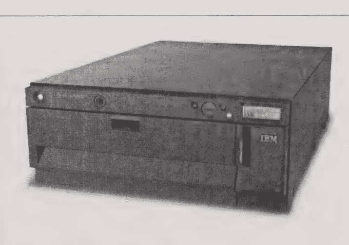

图 1-8 IBM TotalStorage 3582 磁库

## 1.1.6 IBM TotalStorage 3583 磁库

IBM TotalStorage 3583 磁库（缩写为 IBM 3583）是一种用于磁带自动的高性能、可靠且可扩展的磁带子系统，IBM 3583 连接到各种服务器和操作系统平台（参见第 28 页 1.2.1 节“硬件服务器平台”）。

IBM 3583 可以包含 IBM Ultrium 1（已不再提供）、Ultrium 2 或 Ultrium 3 磁带驱动器，用于自动磁库服务中的快速数据传输和可靠性。Ultrium 2 带盒容量为 200 GB。Ultrium 3 带盒容量为 400 GB。

使用 Ultrium 2 驱动器和媒介，IBM 3583 磁库提供的持续数据速率高达 35 MB/秒（未压缩）。使用 Ultrium 3 驱动器和媒介，IBM 3583 持续数据速率高达 80 MB/秒（未压缩）。使用 Ultrium 1 驱动器和媒介，IBM 3583 持续数据速率高达 20 MB/秒（未压缩）。

磁库子系统的每个方面都是为了重复、可靠和无人值的磁带处理而设计的。磁带处理机制旨在可靠地将带盒移动到磁库内的 IBM Ultrium 磁带驱动器中。IBM Ultrium 磁带盒通过 IBM 多年的磁带经验经过精炼，提供了一种既能快速数据传输又能承受自动处理严苛要求的磁带盒。

磁库设计易于扩展。它可以容纳 1 到 6 个磁带驱动器以及 18 到 72 个带盒。共有三种磁库型号：L18、L36 和 L72。这些型号的带盒容量为：
- IBM 3583-L18：18 个带盒
- IBM 3583-L36：36 个带盒
- IBM 3583-L72：72 个带盒

IBM 3583-L18 和 IBM 3583-L36 可以在现场升级以容纳 72 个带盒。带盒扩展以 18 个带盒为单位递增。需要一个 IBM Ultrium 驱动器，并有五个额外的驱动器可工厂或现场安装。升级功能是易于安装的模块化单元。

表 1-1 和表 1-2 显示了配备 Ultrium 2 和 Ultrium 3 磁带驱动器的 IBM 3583 磁库型号存储容量。

| 型号 | 带盒槽 | 数据容量（原生） | 数据容量（压缩） | IBM Ultrium 磁带驱动器 |
| :--- | :--- | :--- | :--- | :--- |
| L18 | 18a | 3.6 TB | 7.2 TB | 1–6 |
| L36 | 36b | 6.4 TB | 12.8 TB | 1–6 |
| L72 | 72c | 14.4 TB | 28.8 TB | 1–6 |

表 1-2 配备 Ultrium 3 磁带驱动器的 IBM 3583 型号容量。

| 型号 | 带盒槽 | 数据容量（原生） | 数据容量（压缩） | IBM Ultrium 磁带驱动器 |
| :--- | :--- | :--- | :--- | :--- |
| L18 | 8a | 7.2 TB | 14.4 TB | 1–6 |
| L36 | 36b | 14.4 TB | 28.8 TB | 1–6 |
| L72 | 72c | 28.8 TB | 57.6 TB | 1–6 |

a. 加一个 (1) I/O 站
b. 加一个 (1) I/O 站
c. 包括十二 (12) 个 I/O 站

在 Linux 和 Windows 中实现 IBM 磁带

磁库输入/输出 (I/O) 站允许在不中断磁库的情况下插入和取出带盒。IBM 3583 在 3583-L18 和 L36 上带有一个带盒 I/O 站，在 IBM 3583-L72 上带有 12 带盒 I/O 站。IBM 3583-L18 和 L36 可以升级为 12 带盒 I/O 站（可选功能 #8012）。I/O 站定义为 I/O 槽或数据存储会影响数据存储的带盒数量。各种组合请参考表 1-3 和表 1-4。

表 1-3 配备功能的 IBM 3583-L18 和 L36 磁库容量

| 型号 | 无 FC 8012 的槽 | FC 8012 定义为存储的槽 | FC 8012 定义为 I/O 的槽 |
| :--- | :--- | :--- | :--- |
| L18 | 18 I/O: 1 | 36 I/O: 0 | 24 I/O: 12 |
| 带一个 FC 8007 (8 槽) 的 L18 | 36 I/O: 1 | 54 I/O: 0 | 42 I/O: 12 |
| 带两个 FC 8007 (8 槽) 的 L18 | 54 I/O: 1 | 72 I/O: 0 | 60 I/O: 12 |
| L36 | 36 I/O: 1 | 54 I/O: 0 | 42 I/O: 12 |
| 带一个 FC 8007 (8 槽) 的 L36 | 54 I/O: 1 | 72 I/O: 0 | 60 I/O: 12 |

表 1-4 IBM 3583-L72 磁库容量

| I/O 定义 | 槽 |
| :--- | :--- |
| I/O 口定义为存储的 L72 | 72 I/O: 0 |
| I/O 口定义为 I/O 的 L72 | 60 I/O: 12 |


## 带 Ultrium 1 的 IBM 3583

**注意：** LTO Ultrium 1 和 SAN 网关集成模块已于 2004 年 10 月停止销售。原生光纤通道 Ultrium 2 和 Ultrium 3 可用。
带有 Ultrium 1 驱动器的 IBM 3583 允许混合使用最多六个 SCSI LVD。如果您使用集成 SAN 网关启用 FC 连接，可以安装六个 LVD 或 HVD 驱动器。SAN 网关集成模块不支持 LVD 和 HVD 驱动器的混合。
带有 Ultrium 1 磁带驱动器的 IBM 3583 型号容量为 Ultrium 2 驱动器容量的一半，如第 14 页表 1-1 所示。
SAN 网关集成模块是一个收费磁库功能。网关提供了磁库中的 SCSI 设备连接到 SAN 基础设施的能力。网关可以在 1 Gbps 或 2 Gbps 端口速度下运行，为旧 (1 Gbps) 设备提供兼容性，并支持高速设备。两个光纤通道端口实现多个连接并支持备备切换。网关有两个光纤通道接口或端口或四个 SCSI 接口或端口。光纤通道端口配备了 2 Gigabit SC 型短波多模千兆接口转换器 (GBIC)。光纤通道端口能够在 50 µm 多模光纤上通信长达 300 米。四个 SCSI 端口为 Ultra2、低电压差分 (LVD)，带有 VHCI 风格连接器（极高密度连接），请订购 LVD 版本的 LTO 驱动器。

## 带 Ultrium 2 的 IBM 3583

带有 Ultrium 2 驱动器的 IBM 3583 支持 SCSI HVD、SCSI LVD 和原生 FC 连接的 Ultrium 2 驱动器。驱动可以是 SCSI LVD、SCSI HVD 或 FC 的任何混合，最多六个驱动器。
FC 驱动器是原生交换架构的；2 Gbps 光纤通道 Ultrium 2 驱动器可以直接连接到主机或交换机。

## 带 Ultrium 3 的 IBM 3583

带有 Ultrium 3 驱动器的 IBM 3583 支持 SCSI LVD 和原生 FC 连接的 Ultrium 3 驱动器。驱动可以是 SCSI LVD 或 FC 的任何混合，最多六个驱动器。
FC 驱动器是原生交换架构的 2 Gbps 光纤通道 Ultrium 3 驱动器，可以直接连接到主机或交换机。

## 多路径支持

IBM 3583 的专利多路径支持功能支持磁库机械结构的共享。这是通过将磁库划分为三个多个逻辑库并为每个逻辑库提供单独的槽和控制路径来实现。
> 注意：每个磁库分区需要一个专用的 18 槽存储列。I/O 槽按先来后到原则进行共享。这种类型的分区允许异构应用程序相互独立地共享磁库机械结构。受磁库控制的带盒不会在逻辑库之间共享，也不会在逻辑库之间移动。异构共享的一个示例是 Microsoft® Windows 2000 应用程序使用一个逻辑库的驱动器和存储槽，而 UNIX® 应用程序使用另一个逻辑库的驱动器和槽。
逻辑库还可以用于分离不同代代的 Ultrium 驱动器以及不支持在同一逻辑库中混合驱动器的应用程序。

# 数据路径故障切换与负载均衡

数据路径切换专门支持适用于 AIX、Linux 和 Solaris 的 IBM 3583 IBM 磁带设备驱动程序中的原生光纤通道 Ultrium 3 或 Ultrium 2 驱动器。负载均衡专门支持适用于 AIX 和 Linux 的 IBM 3583 IBM 磁带设备驱动程序中的原生光纤通道 Ultrium 3 或 Ultrium 2 驱动器（不支持 Solaris）。
数据路径切换在 IBM 设备驱动程序中提供了一种切换机制，以便您可以在 SAN 环境中配置多个冗余路径。如果路径或组件发生故障，切换机制被设计为使用备用的、预配置的路径自动重试操作提供错误恢复，而不会中断正在进行的作业。这允许您在 SAN 配置、可用性和管理方面具有灵活性。
在访问配置有多个主机端口的数据驱动器时，IBM 设备驱动程序会自动选择一条通过主机总线适配器 (HBA) 且打开设备最少的路径，并将该路径分配给应用程序。这种自主自优能力的负载均衡支持旨在为与同一台机器中物理连接到多个 HBA 的设备优化资源。该设备设计用于在应用程序打开和关闭设备时动态跟踪每个 HBA 的使用情况，并平衡该机器中使用每个 HBA 的应用程序数量。这可能有助于优化 HBA 资源并提高整体性能。此外，数据路径切换提供了类似于控制路径切换的自主自愈能力，在主机侧主路径发生故障时，可以透明地切换到备用数据路径。
在所有支持的操作环境中，Ultrium 3 驱动器的数据路径切换和负载均衡需要可选功能代码 1681 以及控制路径切换功能代码 1680。AIX 环境下，Ultrium 2 驱动器的数据路径切换和负载均衡需要控制路径切换功能代码 1680，但不需要可选功能代码 1681；在非 AIX 环境中，需要控制路径切换功能代码 1680 和 RPQ。

# 远程管理单元

远程管理单元 (RMU) 是每个 IBM 3583 的标准配置。RMU 提供了一个以太网端口，以便库可以配置为网络中的 TCP/IP 设备。库状态可以以简单网络管理协议 (SNMP) 陷阱的形式发送到网络。TotalStorage Ultrium Specialist 允许通过 Web 浏览器访问库，以进行更详细的状态和控制。所有库的操作员面板功能都可以使用 IBM Ultrium Tape Library Specialist 进行访问。
图 1-9 显示了 IBM 3583。
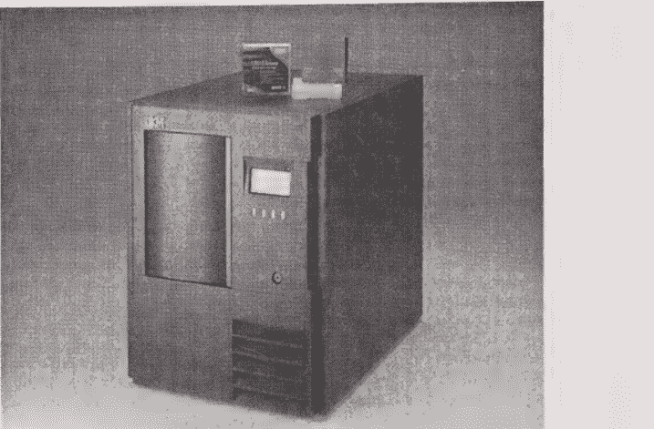

## 1.1.7 IBM TotalStorage 3584 磁带库

IBM TotalStorage 3584 带库（简称 IBM 3584）如第 19 页的图 1-10 所示，为当今中端系统到高端系统的大型无人存储需求而设计。子系统的每个方面都旨在优化数据访问和可靠性。IBM 3584 设计用于使用光纤通道、Ultra/宽低压差 (LVD) SCSI 或 Ultra/宽高压差 (HVD) SCSI 接口的任意组合连接到主机系统。IBM 3584 适用于多种服务器和操作系统（参见第 28 页 1.2.1 节“硬件服务器平台”）。
IBM 3584 可包含 IBM Ultrium 1（不再提供）、Ultrium 2、Ultrium 3 或 3592 磁带驱动器。
使用 Ultrium 3 驱动器和介质，IBM 3584 提供高达每秒 80 MB 的持续数据速率（未压缩）。使用 Ultrium 2 驱动器和介质，IBM 3584 提供高达每秒 35 MB 的持续数据速率（未压缩）。使用 3592 驱动器和介质，IBM 3584 提供高达每秒 40 MB 的持续数据速率（未压缩）。使用 Ultrium 1 驱动器和介质，IBM 3584 提供高达每秒 20 MB 的持续数据速率（未压缩）。
第 19 页的图 1-10 显示了 IBM 3584。
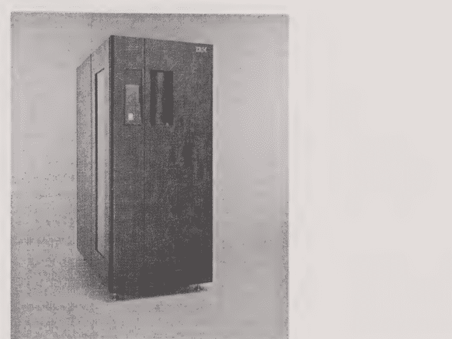
1-10 IBM TotalStorage 3584 磁带库
IBM Tape Library Specialist 是主要的硬件管理工具，允许通过 Web 浏览器访问库以进行更详细的状态和控制。所有 LTO 操作员面板功能都可以使用 IBM Tape Library Specialist 进行访问。我们在第 161 页的 3.8 节“IBM 3584 Tape Library Specialist”中提供了详细信息。

## 配有 IBM Ultrium 2 和 Ultrium 3 的 IBM 3584-L52 机框

IBM 3584-L52 机框为 IBM Ultrium 2 和 Ultrium 3 驱动器以及 IBM LTO Ultrium 数据盒设计。IBM 3584-L52 的初始容量启用使用 64 个带盒槽用于 LTO Ultrium 盒。如果您添加了按需中间容量或全容量功能，可以启用 IBM 3584-L52 中的存储元件，将可用容量增加到 129 个带盒槽，或 219 到 287 个带盒槽（取决于具体配置）。
IBM 3584-L52 机框支持最多 12 个带有超过四个驱动器增量存储槽的 I/O 站。此型号的占用空间比 IBM 3584-L32 小。IBM 3584-L52 设计带有用于 IBM LTO 或 3592 盒的优化夹爪。IBM 3584-L52 的容量取决于盒类型。每个机框可以配置最多 12 个逻辑库。带有扩展 IBM 3584-L52 容量详情见第 23 页的表 1-5 和第 24 页的表 1-6。
每个 IBM 3584-L52 具有标准的 16 槽 I/O 站，用于无需重新扫描即可挂载或导出 LTO 磁带。额外的 16 槽 I/O 站最适用于 LTO 或 3592 盒。对于磁带的批量装载，可以打开库门。每当库门关闭时，安装在换带机上的条码读取器会扫描盒，在 60 秒内完成机框的重新扫描。包含一个门锁以限制对库的物理访问。
第 1 节 Linux 和 Windows 上的 LTO 介绍

## 配有 IBM Ultrium 2 和 Ultrium 3 的 IBM 3584-D52 机框


# IBM 3584 磁带库系统概述

IBM 3584-D52 扩展框为 IBM Ultrium 2 和 Ultrium 3 驱动器以及 IBM LTO 数据盒设计。最多 5 个 IBM 3584-D52 扩展框可以添加到 IBM 3584-L22、L32 或 L52 机框中，以增加 LTO 存储或驱动器容量。每个 IBM 3584-D52 支持 40 个 LTO 槽和 12 个 Ultrium 2 或 Ultrium 3 驱动器，每组四个磁带带有存储槽。每个机框可以拥有最多 12 个逻辑库。

## IBM 3584 高可用性机框 HA1

IBM 3584 HA1 机框旨在提高 IBM 3584 的性能和可用性。3584-HA1 结合 IBM 3584-D22 和 D52 的功能，允许安装第二个访问器，该访问器设计为与 IBM 3584 中的第一个访问器同时操作。当任何组件发生故障时，它设计为非中断地切换到冗余加速器，有助于维护可用性。此外，此设计允许以最小中断向 IBM 3584-HA1 中添加一个或多个 IBM 3584-L52 或 D22 机框。

混合介质库提供双活动访问这包括 3592 和 LTO 介质类型的任意组合。双访问需要高级库管理系统 (ALMS)，高可用性配置需要两个或多个 IBM 3584 机框。

双访问库将有两个被称为维修库的区域。维修库 A（IBM 3584 高可用性机框 HA1）位于 L 机框左侧并相邻。维修库 B（修改后的 IBM 3584-D22 或 D52）位于库中最后一个活动机框的右侧。维修库是普通的库框，但它们没有驱动器、电源或节点卡。维修库内的存储槽将用于测试维修操作。

IBM 3584 的实际性能由多个因素决定，例如访问器容量、库框数量、磁带驱动器数量、磁带驱动器位置和磁带驻留。

## IBM 3584 磁带驱动器 F3A

IBM TotalStorage 3584 磁带驱动器 F3A 设计安装在 IBM 3584 中，为中端开放系统环境提供高容量、高性能的技术。此型号集成了 Ultrium 3 驱动器，使 Ultrium 2 的最大磁带吞吐量性能翻了一倍。使用 Ultrium 3 介质时，它具有高达 80 MB/sec 的原生数据传输速度。此外，通过使用 400 GB 数据盒，与 Ultrium 2 驱动器和盒相比，IBM 3584 将磁带容量增加到 400 GB 原生物理容量（2:1 压缩下为 400 GB）。Ultrium 3 驱动器可以写入 Ultrium 2 盒并读取 Ultrium 1 盒。IBM 3584 配带有 2 Gbps 光纤通道接口用于连接操作系统。

## 配有 IBM 3592 的 IBM 3584-L22 机框

IBM 3584-L22 机框为 3592 和 3592 数据盒设计。IBM 3584-L22 的初始容量启用使用 58 个带盒槽用于 3592 盒。如果您添加了按需中间容量或全容量，可以启用 IBM 3584-L22 中的存储元件，将可用容量增加到 117 个带盒槽，或 199 到 260 个带盒槽（取决于具体配置）。

IBM 3584-L22 基础框架支持最多 12 台磁带机，当驱动器超过 4 台或安装了额外的 I/O 台时，存储槽位将相应减少。此型号的占用空间比 IBM 3584-L32 更小。IBM 3584-L22 设计了优化的抓取器，用于 IBM Ultrium 或 IBM 3592 磁带机。每个框架最多可以配置 12 个逻辑库。

每台 IBM 3584-L22 都配有一个标准的 16 槽卡带站，用于在无需重新盘点的情况下从库中导入或导出 3592 卡带。可选提供一个额外的 16 槽 I/O 站，用于 IBM Ultrium 或 IBM 3592 数据卡带。包含混合 IBM Ultrium 和 IBM 3592 驱动器技术的库必须配备一个 LTO I/O 站和一个 3592 I/O 站。对于批量加载，库门关闭关闭，自动换带器上的条码扫描器会扫描卡带标签，从而能够在通常 60 秒内完成库框架内卡带的重新盘点。配备了门锁以限制对库中卡带的物理访问。

### 带有 IBM 3592 的 IBM 3584-D22 扩展框架

IBM 3584-D22 扩展框架为 IBM 3592 Model J1A 磁带机和 3592 数据卡带设计。可以在 IBM 3584-L22、L32 或 L5 基础框架上添加最多 15 个 Model D22 扩展框架，以增加 3592 卡带存储或驱动器容量。每个 Model D22 支持最多 400 个 3592 卡带槽和最多 12 台驱动器，每安装一组四台磁带机，存储槽位将相应减少。每个框架最多可以有 12 个逻辑库或 12 条控制路径。

> 注意：带有 IBM 3592 驱动器的 IBM 3584 可以通过 IBM TotalStorage3953 库管理器和磁带框架连接到 zSeries® 系统。有关 IBM 3593 的更多信息，请参阅《IBM TotalStorage3953 磁带框架 Model F05 和库管理器 Model L05 简介与规划指南》，GA32-0472。

## IBM TotalStorage3952 磁带机 Model J1A

如所述，IBM 3584-L22 和 D22 框架支持 IBM TotalStorage3592 磁带机 Model J1A (IBM 3592)。

IBM 3592 的原生数据传输率高达 40 Mb/sec；使用 IBM TotalStorage 企业级卡带，提供的原生卡带容量高达 300 GB（在 3:1 压缩下为 900 GB）。它使用一种名为“字节级压缩方案交换”的动态压缩方法，旨在实现最大的数据压缩，且与其他磁带压缩方法不同，它旨在防止数据扩展。IBM 3592 具有双端口 2Gbps 原生光纤通道接口。IBM 3592 还具有其他可能帮助提高性能、容量和可用性的额外特性：

- 大 128 MB 内部数据缓冲区
- 数字速率匹配，将驱动器的原生数据传输率调整为主机数据速率（在考虑数据可压缩性之后）吞吐量性能
- 通道校准，允许对每个读/写通道进行自定义以获得最佳性能
- 高分辨率磁带目录加增强的搜索速度，以提高名义和平均访问时间
- 无流数据压缩 (SDLC) 算法，旨在比之前的 IBM 算法提供改进

IBM TotalStorage 3592 磁带机 Model J1A 支持一次读多次写 (WORM) 数据卡带，以及经济型（短 60 GB）可重写或 WORM 卡带。IBM 3592 WORM 数据卡带设计为不可更改、不可重写的磁带介质，用于长期记录保存。当 IBM 3592 检测到 WORM 卡带时，磁带机将防止对现有客户端数据的覆盖或更改。数据可以追加到现有数据之后，直到达到卡带容量。WORM 卡带提供两种尺寸：300 GB 或 60 GB 原生容量。这些新介质类型会报告给 IBM 3592。WORM 和标准磁带带可以在 IBM TotalStorage 3584 磁带库中混合使用。

## IBM 3584 已淘汰的功能

> **注意：**IBM 3584-L32、IBM 3584-L32 和 Ultrium 1 驱动器已于 2004 年 10 月停止营销。

## 带有 Ultrium 1 或 2 的 IBM 3584-L32 基础单元

IBM 3584-L32 基础库具有 141 到 281 个卡带槽，支持最多两个 LTO Ultrium 1 或 Ultrium 2 驱动器，当驱动器超过 4 台时，存储槽位将相应减少。IBM 3584 的数据容量为 14 到 28 TB，使用 LTO-DC (LTO 数据压缩) (2:1) 时 28 到 56 TB。每个 IBM 3584-L32 框架最多可以配置两个逻辑库和/或两条控制路径。每个 IBM 3584-L32 库都有一个标准的 10 槽卡带输入输出站，用于在无需重新盘点的情况下从库中导入或导出卡带。或者可以选择 16 槽 I/O 站。对于批量加载 LTO Ultrium 磁带，打开库门。每当库门关闭，自动换带器上的条码扫描器就会扫描卡带标签，能够在 60 秒内完成库框架内卡带的重新盘点。配备了门锁以限制对库中卡带的物理访问。客户可以扩展库容量和驱动器数量以满足需求。基础 IBM 3584-L32 可通过添加最多 15 个 D32 框架进行扩展。

## 带有 Ultrium 1 或 2 的 IBM 3584 扩展框架

可以向基础框架 (IBM 3584-L32) 添加最多 15 个 IBM 3584-D32 扩展框架以增加容量。每个 D32 框架支持最多 400 个 352 槽和最多 12 台驱动器，每安装一组四台磁带机，存储槽位将相应减少。一个完全配置的 IBM 3584-L32 框架和 15 个 D32 框架支持最多 192 台驱动器，聚合数据速率为每小时 18 TB (2:1 压缩)，或在 2:1 压缩下支持 688 个槽，总容量为 1376 TB 或 275 TB。每个框架可以有 12 个逻辑库或 12 条控制路径。

IBM 3584 由一个基础框架和最多 15 个框架组成，共 16 个框架和 688 个槽，如图 1-11 所示。你可以按照以下方式组合扩展框架和基础框架：

- L32 框架可以使用 D22、D32 和 D52 扩展框架进行扩展。


- L52 框架可以使用 D22、D32 和 D52 扩展框架进行扩展。

## 16 框架 192 台驱动器

图 1-11 16 框架 IBM 3584 示例。

表 1-5 显示了带有 Ultrium 2 驱动器和卡带的 IBM 3584-L32 和 D32 框架中不同的槽和驱动器容量。

*表 1-5 带有 Ultrium 2 驱动器的 IBM 3584 框架容量*

| 3584-L32 框架中的驱动器 | 3584-L32 (不无扩展功能) | 原生容量 (TB) | 容量 (TB) | 3584-L32 (带扩展功能和 10 I/O 槽) | 原生容量 (TB) | 容量 (TB) | 3584-L32 (带扩展功能和 10 I/O 槽) | 原生容量 (TB) | 容量 (TB) |

|---|---|---|---|---|---|---|---|---|

| 0-4 | 141 | 28.2 | 56.4 | 229 | 45.8 | 91.6 | 281 | 56.2 | 112.4 |

| 5-8 | 113 | 22.6 | 45.2 | 201 | 40.2 | 80.4 | 253 | 50.6 | 101.2 |

| 9-12 | 87 | 17.4 | 34.8 | 175 | 35.0 | 70.0 | 227 | 45.5 | 90.8 |

| 3584-D32 框架中的槽位 | 原生容量 (TB) | 压缩容量 (TB) |

|---|---|---|

| 0 | 440 | 88.0 | 176.0 |

| 1-4 | 423 | 84.6 | 169.2 |

| 5-8 | 409 | 81.8 | 163.6 |

| 9-12 | 396 | 79.2 | 158.4 |

注意：槽位数量取决于是否安装了扩展功能、是否使用了上、下 I/O 台以及框架中安装的驱动器数量。IBM 3584 的扩展功能允许使用库门的列提供额外的卡带存储槽。

表 1-6 显示了 IBM 3584-L52 和 D52 框架中不同的槽和驱动器容量，以及带有 Ultrium 3 驱动器容量的原生容量。

### 表 1-6 带有 Ultrium 3 驱动器的 IBM 3584 框架容量

| 框架类型 | 按需容量类型 | 驱动器数量 | I/O 槽数量 | 存储槽数量 | 原生容量 (TB) |

|---|---|---|---|---|---|

| L52 | 入门 | 0-12 | 16 | 64 | 25.6 |

| L52 | 中间 | 0-12 | 16 | 129 | 51.6 |

| L52 | 满额 | 0-4 | 16 | 287 | 114.8 |

| L52 | 满额 | 5-8 | 16 | 273 | 109.2 |

| L52 | 满额 | 9-12 | 16 | 261 | 104.4 |

| D52 | N/A | 0 | N/A | 440 | 176.0 |

| D52 | N/A | 1-4 | N/A | 422 | 168.8 |

| D52 | N/A | 5-8 | N/A | 408 | 163.2 |

| D52 | N/A | 9-12 | N/A | 396 | 158.4 |

注意：

¹ 如果 L 框架不是 IBM 3584-L32 或 L52，则混合介质库的第一个 D 框架将减少一个槽以适应诊断卡带。

² N/A = 不适用。

## 多路径支持

IBM 3584 的多路径架构提供了共享库机器人的能力。这是通过将库分区为最多 192 个多个逻辑库（受安装驱动器数量限制），并为每个逻辑库提供单独独立的驱动器、存储槽和控制路径来实现的。I/O 槽按先来顺序进行共享。库控制下的卡带在逻辑库之间不共享。异构共享的一个示例是 Microsoft Windows 2000 应用程序使用驱动器和存储

一个逻辑库的槽位，而 UNIX 应用程序使用另一个逻辑库的驱动器和槽位。

逻辑库也可用于区分不同世代的 IBM LTO 驱动器和磁带，或 IBM 3592 驱动器和磁带，适用于不支持在同一逻辑库中混合使用驱动器的应用程序。

对多路径架构和分区的支持可能需要更新微代码件级别。请从我们的每个网站下载最新的微代码件：

```
http://www.ibm.com/servers/storage/support/lto/3584/download.html
ftp://software.ibm.com/storage/358x/3584/
```

## 高级库管理系统 (ALMS)

高级库管理系统 (ALMS) 是专利 IBM 多路径架构的下一代产品。ALMS 旨在提供增强的自动化功能，包括动态分区、存储槽池化和灵活的驱动器分配。还可以通过 IBM 3584-LS2 或 L2 的许可密钥升级选择并实施按需容量 (COD) 级别的扩展，以根据需要提供增长灵活性。IBM 3584 继续提供适用于 SAN 的多路径架构，并可以将库划分为 192 个逻辑库的能力。IBM Tivoli Storage Manager 以及其他行业领先的软件产品可以为 IBM 3584 提供存储和磁带管理。有关 ALMS 的实施信息，请参阅第 58 页第 2.3 节“ALMS”。

## 控制路径故障转移

此可选功能旨在在丢失主机适配器或控制路径驱动器时，自动将控制路径故障转移到预配置的冗余控制路径，而不会中断正在进行的作业。当使用 IBM 设备驱动程序时，支持 AIX、Linux、Windows、HP-UX 和 Solaris。

## 数据路径故障转移与负载均衡

数据路径故障转移和负载均衡支持通过用于 AIX、HP-UX、Windows、Linux 和 Solaris 的 IBM 设备驱动程序，支持 IBM 3584 中的原生光纤 IBM LTO 2 和 LTO 3 驱动器。数据路径故障转移在 IBM 设备驱动程序中提供故障转移机制，使您可以在 SAN 环境中配置多个冗余路径。如果路径或组件发生，故障转移机制设计为使用备用的、预配置的路径对当前操作进行恢复，而不会中断正在进行的作业。这为 SAN 配置、可用性和管理提供了灵活性。

当磁带驱动器设备配置了跨越多个主机端口的备用路径时，IBM 设备驱动程序会自动选择通过主机适配器 (HBA) 且开放磁带设备最少的路径，并将该路径分配给应用程序。这种自优化能力被称为负载均衡。动态负载均衡支持旨在为与机器中多个 HBA 有物理连接的设备优化资源。设备驱动程序设计为在应用程序打开和关闭设备时动态跟踪每个 HBA 的使用情况，并平衡机器中使用每个 HBA 的应用程序数量。这可能有助于优化 HBA 资源并提高整体性能。此外，数据路径故障转移提供了与控制路径故障转移类似的自动自愈能力，在主主机侧路径发生故障时，可透明地故障转移到数据路径。

在所有支持的环境中，Ultrium 3 驱动器的数据路径故障转移和负载均衡需要可选功能代码 1681 和控制路径故障转移功能代码 1680。在 AIX 环境下，Ultrium 2 驱动器的数据路径故障转移和负载均衡需要控制路径故障转移功能代码 1680，但不需要可选功能代码 1681；在非 AIX 环境下，需要控制路径故障转移功能代码 1680 和 RPQ。

## 虚拟 I/O 槽位

IBM 3584 中虚拟 I/O 槽位的配置使得主机应用程序认为库具有比实际更多的物理 I/O 槽位。

> 注意：如果您的库没有虚拟 I/O 槽位功能且您想启用它，必须首先安装高级库管理系统 (ALMS) 的许可密钥。安装 ALMS 许可后，您可以通过磁带库专家 Web 界面启用 ALMS 和虚拟 I/O 槽位功能。在启用或禁用虚拟 I/O 槽位之前，必须启用 ALMS 且 I/O 槽位为空。有关启用或禁用 ALMS 的信息，请参阅第 58 页。

启用高级库管理系统 (ALMS) 后，您可以在 IBM 3584 中启用虚拟 I/O 槽位，使库自动在 I/O 站和存储槽之间队列磁带移动。这使得添加和移除磁带的过程变得更加快速快速。

3584 具有输入/输出 (I/O) 站和 I/O 槽位，允许您随时导入导出多达 32 磁带。I/O 槽位也被称为导入/导出元素 (IEE)。虚拟 I/O 槽位通过允许存储槽显示为主机 I/O 槽位增加了可用 I/O 槽位的数量。通过虚拟 I/O 槽位，库会自动将磁带从 I/O 站移动到 VIEEs。因此，库增强了其导入导出能力。

虚拟 I/O 槽位的目标是减少系统管理员与库操作员之间的依赖，以便各自执行导入导出任务而无需执行任何其他操作：

- 在没有虚拟 I/O 槽位的典型导入场景中，库操作员需要站在物理库旁向 I/O 站填充磁带；系统管理员触发应用程序发送命令将磁带从 I/O 站移动到存储槽。在库填充 I/O 站后，他必须等待 I/O 槽位为空。库设计为自动移动磁带到存储槽。这意味着管理员不需要发布命令移动它们。如果库配备了虚拟 I/O 槽位，库会自动将磁带从 I/O 站移动到存储槽。


在没有虚拟 I/O 槽位的典型导出场景中，库操作员需要站在物理库旁向 I/O 站填充磁带；系统管理员触发应用程序发送命令将磁带从 I/O 站移动到存储槽。在库填充 I/O 站后，他必须等待 I/O 槽位为空。此操作旨在优化吞吐量。如果库启用了虚拟 I/O 槽位，库会自动将磁带从 I/O 站移动到存储槽。

## 在 3584 中使用 mtlib

`mtlib`程序促进了 3584 与 3492 以及 IBM Storage Tape Saver (VTS) 之间的通信。`mtlib`程序最初设计用于控制 3492 的命令行界面。它随 3492 一起提供，类似于 `tapeutil`随 SCSI 驱动程序提供。

`mtlib`程序已增强，适用于 IBM 3584 等 SCSI 库。某些客户编写了 `mtlib`脚本来处理 3492。如果使用 3492 的客户决定迁移到 IBM 3584，`mtlib`的增强将简化迁移过程。

使用 `mtlib`的现有客户脚本可能需要更改，取决于所使用的 3492 功能。例如，SCSI 库中没有类别，任何引用类别的 `mtlib`命令可能都需要更改。

有关 `mtlib`程序的完整说明和命令语法，请参阅《IBM Storage Tape Drivers Instructions and User's Guide》，GC35-0154。

## SMI-S 支持

SMI-S 代理的设计符合存储管理规范。3584 磁带库可以使用存储管理规范 (SMI-S) 在 SAN 环境中进行通信。

为了与 SAN 环境中的存储设备进行通信，管理软件使用名为存储管理规范 (SMI-S) 代理的软件。您必须在运行 SUSE Linux Server 操作系统的 Intel® 机器上安装 SMI-S 代理。

## 1.2 硬件和操作系统平台

本节提供了有关操作系统支持、SCSI 和 FC 适配器供应商，以及支持 LTO 系列的一些应用程序的信息。

### 1.2.1 硬件服务器平台

LTO 产品在以下操作系统和服务器上运行：

- IBM @iSeries™, 运行 OS/400® 的 AS/400®
- 运行 AIX 和 Linux 的 IBM System p5, RS/6000 和 SP
- IBM @xSeries® 以及其他基于 Intel 的系统（Windows NT®, 2000 和 2003）
- 运行 Solaris 的 Sun™ SPARC
- 运行 HP-UX 的惠时（HP）
- Intel Linux (Red Hat 和 SLES)
- zSeries Linux
- True6664 (仅限 IBM 3584)
- 其他使用 SCSI 附加或光纤（Fibre Channel）连接的系统

注意，并非所有型号都支持所有的平台和连接方法——有关所有 Ultrium 型号操作系统和连接支持的当前详情，请参阅以下网站。

```
http://www.ibm.com/servers/storage/tape/3580/interop.html
http://www.ibm.com/servers/storage/tape/3581/interop.html
http://www.ibm.com/servers/storage/tape/3582/interop.html
http://www.ibm.com/servers/storage/tape/3583/interop.html
http://www.ibm.com/servers/storage/tape/3584/interop.html
```

**注意：** 请始终访问网站以获取最新、最详尽且准确的信息。

### 1.2.2 ISV 存储管理软件

虽然操作系统提供了实用程序（如 `da`、`tar` 和 `cpio`）来执行磁带驱动器的基本读写操作，但在某些情况下会使用存储管理软件包。这些软件包设计用于提供管理磁带驱动器库的高级功能。它们由名为独立软件供应商（ISV）的公司提供。我们将在第 243 页的第 2 部分“LTO 库和备份软件”中讨论一些最流行的应用程序。

IBM 在网站上发布了经过 LTO Ultrium 设备认证的 ISV 存储管理应用以及支持的操作系统：

```
http://www.ibm.com/servers/storage/tape/lto_ito_isv.html
```

您还应该向 ISV 确认详细详细支持信息。

## 1.3 Windows 2000/2003 连接

在本节中，我们将介绍使用 IBM 3584 将 LTO 型号连接到 Windows 2000/2003 的示例。

### 1.3.1 Windows 2000/2003 SCSI 直接连接

表 1-7 是摘自 IBM 网站的摘要，详细列出了 Windows 2000/2003 环境下 IBM 3584 的服务器、操作系统版本、主机总线适配器（HBA）和交换支持（截至编写时准确）。我们在第 28 页的 1.2.1“硬件软件平台”中列出了每个 LTO 型号的 URL。

点击（网站上的）详细信息按钮以读取 readme 文件。

| 表 1-7 在 L32 和 D32 3584 框架中的 LTO Ultrium 1 和 Ultrium 2 驱动器特性 | 服务器 | 操作系统 | 主机适配器 |
| :--- | :--- | :--- | :--- |
| | 2003 详情 Build 3790 或更高 Windows 2000 详情 Build 2195 或更高 | HVD Adaptec 2944 Netinity® 适配 #59H3900 LVD Adaptec 29160, 29160LP, 39160 Adaptec 39320, 39320-R, 39320D Adaptec 2940U2W LSI Logic System 22910 Netinity 适配 #19K4646 Netinity 适配 #33L5000 IBM #13N2249 |

- **备注：**
  1. 可能存在某些限制。请查看上方适用于操作系统的详细信息。
  2. Windows 支持 Ultrium 2 和 3592 驱动器的控制路径故障转移（Control Path Failover）。
  3. Windows 支持 Ultrium 2 和 3592 驱动器的数据路径故障转移（Data Path Failover）。

从表中可以看出，为了将 IBM 3584 连接到 Windows 2000 Server，需要 2195 或更高版本的操作系统，而 Windows 2003 Server 则需要 3790 或更高版本。

矩阵显示有十种 SCSI 适配器可选；其中一些使用 LVD 接口，另一些卡使用 HVD 接口。您需要为库中安装的磁带驱动器选择正确的 SCSI 接口适配器。

### 1.3.2 Windows 2000/2003 光纤连接

如果您想使用光纤连接，将将使用光纤 Ultrium 2 或 Ultrium 3 驱动器。我们现在确定 IBM 3584 支持的适配器。访问以下网站并检查选择的 Ultrium 产品和操作系统（例如，带有 Ultrium 3 FCP 驱动器的 IBM 3584 和 Windows 2000）：

```
http://knowledge.storage.ibm.com/servers/storage/support/hbasearch/hba
```

**注意：** 此 URL 区分大小写。

返回的结果在第 30 页的图 12 所示。更典型的

磁带处于高容量备份状态，通常会写入大块数据（例如，备份大型数据库文件）。在这种情况下，每个适配器配备一个驱动器将获得最佳性能。

另一种可能需要链链的情况是通过 SAN 数据网关 (SDG)（该产品已退出市场）连接多驱动器磁库。SDG 总共有四个端口，建议其中一个端口用于 SCSI 介质更换器。因此，如果磁库中安装了三个以上的驱动器，则需要链链。

## 1.6 主机总线适配器 (HBA) 和设备驱动程序

本节将涵盖以下内容：

- 什么是 HBA？
- 为什么需要它们？你需要哪一种？
- HBA 需要驱动程序吗？

> **限制：** 目前，在同一 HBA 上同时连接磁盘和磁带设备存在限制。更多信息请参阅第 228 页的 5.1.3，“同一 HBA 上的磁带和磁盘”。

### 什么是 HBA

HBA 代表主机总线适配器（Host Bus Adapter）。HBA 是一种 I/O 适配器（或卡），位于主机计算机总线与 SCSI 或光纤通道之间，负责管理这两个通道之间的信息传输。为了尽地减少对主机处理器性能的影响，HBA 以异步方式或以极少处理器参与的方式执行许多低级接口功能。

### 设备驱动程序

设备驱动程序是控制设备的程序，无论是打印机、磁盘驱动器还是键盘。许多驱动程序（如键盘驱动程序）包含在操作系统中。对于其他设备，你可能需要从操作系统 CD 加载新驱动程序，或者在首次向计算机上安装设备时由制造商提供。


驱动程序充当设备与使用该设备的程序之间的翻译器。每个设备都有自己的一系列专用命令，只有其驱动程序知道这些命令。相比之下，大多数程序使用通用命令访问设备，即读（Read）、写（Write）、放置（Put）和获取（Get）。因此，驱动程序接受程序的通用命令，并将其翻译为设备的专用命令。

图 1-13 是应用程序与 LTO 磁带设备之间数据流的示例。请注意涉及的不同代码段或微代码。

HBA 驱动程序并不总是独立的软件；有时它作为操作系统的一部分包含。对于许多带有 Linux 的常用 SCSI 适配器也是如此。你应该检查随卡提供的文档以确认情况是否如此。对于光纤 HBA，几乎总是需要安装驱动程序软件。

| 应用程序（软件） | LTO 设备驱动程序（软件） | HBA 设备驱动程序（软件） | HBA 设备适配器（硬件） | LTO 磁带设备 |
| :--- | :--- | :--- | :--- | :--- |

图 1-13 设备数据流

## 数据流

下面的简化流程列表反映了在磁盘存储设备和磁带之间以文件级移动数据的数据路径中涉及的组件。问题或性能分析必须通过确定数据路径中的哪个组件影响性能来进行。

- 磁盘设备
- SCSI 设备适配器
- 适配器设备驱动程序
- 磁盘设备驱动程序
- 逻辑卷管理器
- 文件系统
- 应用程序
- 磁带设备驱动程序：磁带驱动程序
- HBA 适配器设备驱动程序
- HBA (SCSI 或 FC-AL) 设备适配器
- 磁带设备

## IBM 设备驱动程序概述

IBM Ultrium 磁带和介质更换器驱动程序专门设计用于利用 IBM Ultrium 磁带驱动器和质质器设备提供的功能。目标是让应用程序访问基本磁带操作（如备份和恢复）以及介质更换器操作（如卡带装载和卸载）所需，以及全磁带管理系统所需的高级功能。只要可能，Ultrium 驱动程序将对应用程序透明地利用设备特性。

## 1.7 LVD 或 HVD

本节讨论了 SCSI 设备中发现的不同类型连接接口，并解释了为什么选择正确的接口非常重要。

### 1.7.1 LVD 和 HVD

LTO 磁带驱动器有两种类型的 SCSI 连接接口：低电压差分（LVD）和高电压差分（HVD）。正如其名称所示，LVD 和 HVD 在沿 SCSI 总线发送信号时使用不同的电压水平。LVD 使用 3.3 伏特直流，HVD 使用 5 伏特直流。LTO 磁带驱动器为 LVD 或 HVD，且不能在之间升级或转换。要从 LVD 变为 HVD，需要将 LVD 驱动器更换为 HVD 驱动器。因此，在配置 LTO 产品时，请仔细考虑应该选择 HVD 还是 LVD 驱动器。

> 注意：Ultrium 3 驱动器仅通过 SCSI（或原生光纤通道）接口连接。

### 1.7.2 为什么这？

为什么要选择一个而不是另一个？你为什么要关心这个？主要原因是连接性。如果你尝试将 HVD LTO 驱动器连接到 LVD 适配器，它将无法工作。将 LVD 设备放置在 HVD 总线路上会导致 LVD 设备关闭。将 HVD 设备放置在 LVD 总线路上会导致整个 LVD 总线关闭。因此，请检查连接的主机中有什么种类型的适配器，并据此选择正确的驱动器型号。

HVD 与 LVD 在速度特性上也存在差异。LVD 可以作为 SCSI 提供（速度为 80 MB/秒）或新的 Ultra160 SCSI 提供（速度为 60 MB/秒），而 HVD 是 Ultra SCSI，最大速度为 40 MB/秒。并不一定。这意味着 LTO 驱动器使用 LVD 可以运行得更快吗？并不一定。总线的类型是决定因素。

除了速度差异，HVD 和 LVD 在连接上也有相应的限制。LVD 可以以 SCSI（速度为 80 MB/秒）或新的 Ultra160 SCSI（速度为 60 MB/秒）提供，而 HVD 是 Ultra SCSI，最大速度为 40 MB/秒。并不一定。这意味着 LTO 驱动器使用 LVD 可以运行得更快吗？并不一定。总线的类型是决定因素。

除了速度差异，HVD 和 LVD 在连接上也有相应的限制。在点点配置下，HVD 和 LVD 都可以跨越 25 米。在多点（链链）配置下，HVD 可以跨越 25 米，而 LVD 限制为 12 米。

所以你会选择哪一个？如果 12 米的多点限制不是问题，那么你会购买 LVD 吗？你可能会这样想，但正确答案是取决于你拥有的适配器。如果你有现有的适配器且不想更换它，适配器是 HVD 还是 LVD 将决定你订购的 LTO 驱动器。

如果你还没有适配器怎么办？订购 LVD 对吗？并不是所有的 HBA 都有两种接口类型。例如，iSeries 和 AS/400 在直接连接时仅支持 HVD。

表 1-9 HVD 和 LVD 特性

| | HVD | LVD |
| :--- | :--- | :--- |
| 点点 | 25 米 | 25 米 |
| 多点 | 25 米 | 12 米 |
| 速度 | 40 MB/秒 | 80 或 160 MB/秒 |

## 1.8 SCSI HD68 和 VHCI 线连接

有三种 SCSI 线：HD68-HD68、HD68-VHCI 和 VHCI-VHCI。HD68 连接器是标准的 68 针 SCSI 连接器。高密度连接器（VHCI）是一种小型 SCSI 连接器，宽度约为 HD68 连接器的一半。服务器 SCSI 适配器可以是 HD68 或 VHCI。对于 RS/6000、AS/400 和 HP 服务器，LVD SCSI 适配器始终是 VHCI，HVD 适配器始终是 HD68。但太阳和其他其他服务器的某些适配器可以通过两种方法找到特定适配器的连接类型。你可以查看适配器，其插头宽度将是关于 3 厘米（VHCI）或 6 厘米（HD68）。另一种方法是查询适配器特性以确定插头类型。一个信息来源是 IBM Total UltraScalable Tape Library 3584 操作指南，GA32-0468，在线获取于。

2001 年 6 月 12 日之前，所有 LTO 驱动器都使用 HD68 连接器。目前的 IBM 3584 热插拔驱动器使用 VHCI 连接器。请确保你订购了具有正确端插头的电缆以连接到你的 HBA。

图 1-14 显示了 VHDCI 和 HD-68 接口。

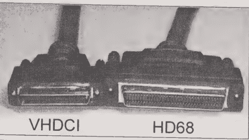

图 1-14 SCSI 接口

# IBM LTO 带库共享与分区

在本章中，我们将描述 IBM TotalStorage 3582 磁带库、IBM TotalStorage 3583 磁库以及 IBM TotalStorage 3584 磁库的共享与分区。

主题包括：

- 磁带库共享与分区的定义
- 共享 IBM TotalStorage 3583 磁库
- 使用磁库专家工具（Tape Library Specialist）对 IBM TotalStorage 3583 磁库进行分区
- 共享 IBM TotalStorage 3584 磁库
- 使用磁库专家工具对 IBM TotalStorage 3584 磁库进行分区
- 使用操作面板（Operator panel）对 IBM TotalStorage 3584 磁库进行分区
- 使用高级磁库管理系统（ALMS）使用并分区 IBM TotalStorage 3584 磁库

关于磁带库共享的更多讨论，请参考以下红皮书：

- Get Out of Your SAN with IBM Tivoli Storage Manager, SG24-6687

关于 ALMS 功能和设置的细节可以在 3584 手册中找到：

- IBM Total Storage UltraScalable Tape Library 3584 操作指南, GA32-0468
- IBM TotalStorage UltraScalable Tape Library 3584 介绍与规划指南, GA32-0469

## 2.1 定义

通常情况下，设备共享可以提高设备利用率并降低总拥有成本。磁盘设备的共享是一种常见做法。与允许不同客户端进行随机访问的磁盘设备相比，磁带驱动器是顺序设备，不允许不同客户端同时访问。尽管如此，共享仍可以提高磁带驱动器的利用率；磁带驱动器通常被单个客户端（主机）以 100% 的时间使用，且有多种可能的方法可以在多个主机之间共享磁带库或磁带驱动器。在备份应用程序和服务器之间共享任何磁库的最基本要求是控制质换器（medium changer）的能力。磁带驱动器和介质可能也可能共享，但质换器必须供所有备份应用程序和服务器操作。

### 2.1.1 磁库共享

我们区分了外部磁库管理和多路径方法（multipath approach）。

#### 外部磁库管理

一种方法是共享磁库但不共享磁带驱动器。连接到磁带库的多个服务器可以共享磁库的机器人部分。驱动器和带带被池化，一组驱动器和带带池属于一组服务器（一台或多台服务器），且不能与另一组服务器共享。

某些应用程序（如 IBM Tivoli Storage Manager）在共享驱动器和磁库时会使用“磁库共享”的名称。我们稍后解释驱动器共享。


共享磁库机器人部分需要某些技术。最常见的方法是使用控制磁库的外部磁库管理器。磁库管理器接收来自连接服务器的命令，控制磁库内部的资源，并执行从服务器收到的命令。磁库管理器与连接服务器之间的通信通常通过局域网（LAN）使用专有的命令集进行。

磁带库管理器控制对质换器的访问和排序。质换器物理上对所有备份和应用程序服务器可用。IBM 3494 磁带库使用了这种类型的磁库共享。与 IBM 3494 通信时必须使用名为 `mtlb` 的命令集（见第 39 页图 2-1）。其他示例包括带有 `ACSLS` 的 `STK` 或带有 `Scalar DLC` 的 `ADIC`。

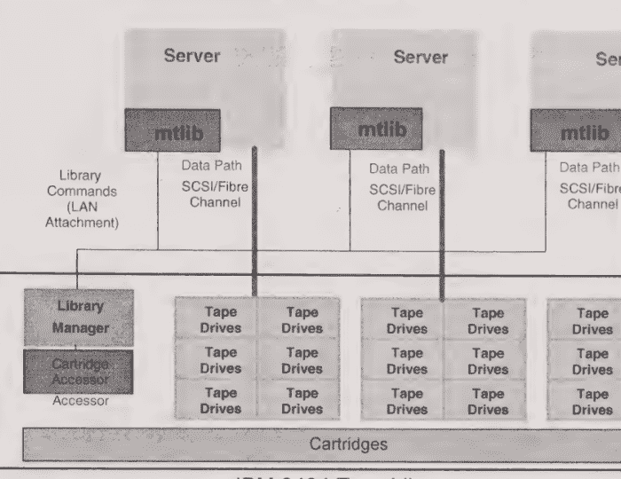

图 2-1 IBM 3494 磁带库

### 多路径（Multi-path）

外部磁库管理的缺点是它引入了额外的软件层。多路径架构消除了这种缺点。多路径架构是允许磁库为多个服务器提供多个路径的能力。这种能力允许通过高级磁库管理系统（`ALMS`）对磁库进行分区。`ALMS` 允许在多个服务器之间共享磁库。IBM 3584 磁库提供了这种功能。

### 2.1.2 同质性驱动器共享

- 使用操作面板分区 IBM TotalStorage 3584 磁库
- 使用高级磁库管理系统（`ALMS`）并分区 IBM TotalStorage 3584 磁库
- 使用磁库专家工具对 IBM TotalStorage 3584 磁库进行分区

由于磁带驱动器无法被多个服务器同时访问，需要一种机制来管理访问。目前常见的方法是使用主服务器进行同质性驱动器共享。同质性意味着通过主服务器共享驱动器。IBM 3494 磁带库使用了这种磁库共享方式。驱动器在每个服务器上显示为本地设备。当服务器请求加载磁带时，它联系主服务器。主服务器挂载磁带并将其传递给请求服务器。操作完成后，服务器卸载带带，释放驱动器上的锁定，并通知主服务器。主服务器随后卸载介质。

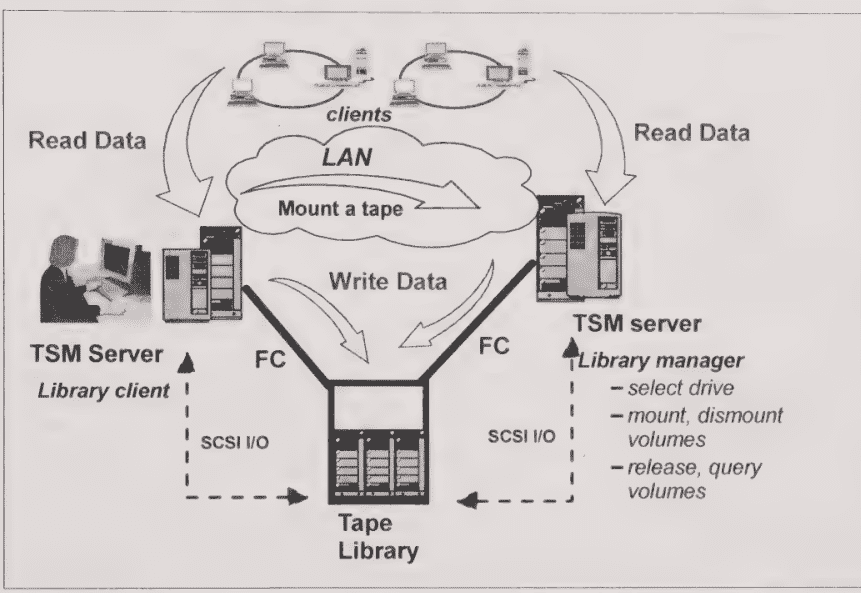

图 2-3 Tivoli Storage 磁库共享

这种同质驱动器共享通常用于备份备份（见第 42 页图 2-4）。

### 2.1.3 我应该使用哪种？

每当运行相同存储管理（同质性）应用程序的多个服务器必须共享同一个磁库时，我们建议使用应用程序的共享功能。这将确保磁库和驱动器的最高效率。主服务器通常可以为所有客户端服务器提供磁带驱动器的共享功能。主服务器还管理磁库中的带带；因此你只需要一个池（scratch pool），而不是为每个服务器一个池。

第 43 页图 2-5 显示了应用程序共享功能如何解决共享需求。此示例基于 Tivoli Storage Manager，但它适用于其他应用程序，例如 Veritas NetBackup 或 EMC Legato NetWorker。示例中有两个位置，每个位置都有自己的数据处理应用程序、服务器和存储。SAN 跨越位置。出于灾难恢复考虑，所有备份数据都复制到第二个位置。每个位置安装了一个或多个磁库，每个备份服务器管理磁库并处理来自其他备份服务器的请求。位置 1 的任何服务器请求磁库管理器 1（TSM Server 1）在磁库 1 上挂载磁带。如果位置 1 的备份服务器将数据拷贝到位置 2，它请求磁库管理器 2（TSM Server 2）在磁库 2 上挂载磁带。 Tivoli Storage Manager 的磁库共享概览见第 7 章“在 Windows 和 Linux 上配置 IBM Tivoli Storage Manager”，第 255 页。欲了解完整细节，请参红皮书 Get More Out of Your SAN with IBM Tivoli Storage Manager, SG24-6687。

图 2-5 由 TSM 完成的库共享

然而，在某些情况下，如果你使用一种同质的备份应用程序，使用应用程序本身的共享选项可能并不足够；相反，应该使用库的分区功能。如果你需要（出于安全原因）分离来自不同备份服务器的数据，就会出现这种情况；在这种情况下，您需要库的分区功能来确保数据的隔离。

当然，如果你使用不同的应用程序，那么你就必须使用分区功能，例如，当你在一侧运行 iServer，而在另一侧在 Windows 或 UNIX 上运行 Tivoli Storage Manager，且它们连接到同一个库时。

## 多路径磁带库分区

IBM 3582、3583 和 3584 磁带库均使用了专利多路径架构，且这些磁带库是可以进行分区的。你可以使用多个逻辑库在不同应用程序之间共享物理库，或为任何应用程序支持混合驱动器。你可以通过将物理库的存储槽和磁带驱动器划分为两个或多个逻辑库来创建多个逻辑库。每个逻辑库由以下部分组成：

- 磁带驱动器
- 存储槽
- 输入/输出 (I/O) 槽
- 匣带取出器

每个逻辑库都有自己的控制路径（一条进入库的逻辑路径，服务器通过该路径发送标准 SCSI 介质更换器命令来控制逻辑库）。每个逻辑控制路径都通过该逻辑库中定义的第一个驱动器的逻辑单元号 1 (`LUN 1`) 可服务器可用。逻辑库不能共享另一个库的磁带驱动器和存储槽。然而，它按先来后得原则共享 I/O 槽和匣带取出器。

第 2 章。IBM LTO 磁带库共享与分区 43

### 2.2.1 IBM 3582 的分区

如果安装了磁带驱动器，IBM 3582 就可以被分区为两个逻辑库。每个分区都提供自己独立且独特的驱动器、控制路径和存储槽。输入/输出 (I/O) 槽按先来后得原则共享。这种类型的分区允许异构应用程序相互独立地共享库资源。库控制下的匣带不会在逻辑库之间共享，也无法在逻辑库之间移动。

第一个驱动器模块分配给第一个分区，第二个驱动器模块分配给第二个分区。左侧杂志中的槽始终是分区 1，右侧杂志中的槽始终是分区 2。你可以为分区 1 指定最少 8 个最多 16 个槽（7 个杂志槽、8 个后部槽，以及如果配置为数据槽的 I/O 槽）。你可以为分区 2 指定最多 15 个槽（7 个杂志槽和 8 个后部槽）。如果你配置了清洁槽，两个分区的可用槽位总数将减少（见图 2-6）。

每个分区可以以两种模式之一运行：随机或顺序。

你可以使用操作面板或使用 IBM 3582 磁带库专家 Web浏览器界面来配置分区。

图 2-6 IBM 3582 分区

有关如何配置逻辑分区的描述，请参阅《IBM TotalStorage Tape Library Setup, Operator, and Service Guide, GA32-0458》，获取地址如下：


`http://www-1.ibm.com/servers/storage/tape/resource-library.html#publications`

### 2.2.2 IBM 3583 的分区

`IBM 3583` 支持将库分区为多三个逻辑库。每个逻辑库都有自己独立且独特的驱动器、存储槽和控制路径。输入/输出 `I/O` 槽按先来后得原则共享。必须安装多分区功能 `#1450` 或 `#9450` 才能分区库——所有包含 `LTO 2` 或 `LTO 3` 驱动器的 `IBM 3583` 以及所有在 2003 年 6 月 13 日之前出货的库都需要此功能。2003 年 6 月 13 日之前出货未安装 `LTO 2` 驱动器的库需要功能 `#1450` 来分区。

### IBM 3583 分区指南

- 每个逻辑库必须包含至少一个驱动器和一个存储列。如果你的应用程序支持，允许在同一个逻辑库中使用 `LTO 1`、`LTO 2` 和 `LTO 3` 驱动器及介质。至少有一个驱动器必须启用控制路径。
- 支持两个逻辑库要求至少安装存储列 2 和 4。这意味着一台 `IBM 3583 L1` 至少需要一个功能代码 `#8007` 才能进行分区。必须至少安装两个驱动器。
- 支持三个逻辑库要求安装列 2、4 和 5。只有 `IBM 3583 L72`、带有一个 `FC #8007` 的 `IBM 3583 L36`，或带有两个 `FC #8007` 的 `IBM 3583 L18` 可以分区为三个逻辑库。必须至少安装三个驱动器。
- `I/O` 站是所有逻辑库的共享资源。第 1 列 `I/O` 站下方的六槽固定杂志作为第一个分区的一部分。
- 每个逻辑库都有一个预定义的默认控制路径，如下（`IBM 3583` 概览，见第 46 页图 2-7）：
  - 逻辑库 A：驱动器 1
  - 逻辑库 B：驱动器 3
  - 逻辑库 C：驱动器 5
  - 带有 12 槽 `I/O` 站的逻辑库：
    - 逻辑库 1：24 个槽（列 1 和列 2），2 个磁带驱动器（驱动器 1 和驱动器 2）
    - 逻辑库 2：18 个槽（列 4，列 5），4 个磁带驱动器（驱动器 3、驱动器 4、驱动器 5 和驱动器 6）
  - 带有 1 槽 `I/O` 站的两个逻辑库：
    - 逻辑库 1：18 个槽（列 2），2 个磁带驱动器（驱动器 1 和驱动器 2）
    - 逻辑库 2：18 个槽（列 4 和列 5），4 个磁带驱动器（驱动器 3、驱动器 4、驱动器 5 和驱动器 6）
  - 带有 12 槽 `I/O` 站的三个逻辑库：
    - 逻辑库 1：24 个槽（列 1 和列 2），2 个磁带驱动器（驱动器 1 和驱动器 2）
    - 逻辑库 2：18 个槽（列 4），2 个磁带驱动器（驱动器 3 和驱动器 4）
    - 逻辑库 3：18 个槽（列 5），2 个磁带驱动器（驱动器 5 和驱动器 6）
  - 带有 1 槽 `I/O` 站的三个逻辑库：
    - 逻辑库 1：18 个槽（列 2），2 个磁带驱动器（驱动器 1 和驱动器 2）
    - 逻辑库 2：18 个槽（列 4），2 个磁带驱动器（驱动器 3 和驱动器 4）
    - 逻辑库 3：18 个槽（列 5），2 个磁带驱动器（驱动器 5 和驱动器 6）

## 2.2.3 划分 IBM 3584 (未启用 ALMS)

您可以将 `IBM 3584` 划分为多个逻辑库。每个逻辑库至少需要一个磁带驱动器和一个存储槽。因此，从理论上讲，您可以配置与库中磁带驱动器数量相同的逻辑库，`IBM 3584` 支持多达 192 个逻辑库。如果备份应用程序支持，可以在逻辑库中混合使用 `Ultrium` 驱动器类型（第 1、2 或 3 代），但 `Ultrium` 和 `IBM 3592` 磁带驱动器不能在同一个逻辑库中混合（`LTO` 和 `3592` 必须安装在不同的帧中）。

注意：如果在一个 `IBM 3584` 中使用混合介质和驱动器（`LTO` 和 `3592`），则必须至少创建两个逻辑库（一个用于 `LTO`，一个用于 `3592`）。

一个逻辑库内的存储槽必须是连续的，但可以跨越不同的帧。同样，一个逻辑库内的磁带驱动器必须是连续的，但可以在不同的帧中，顺序上可以留有间隙（例如在帧 1 中安装两个驱动器，在帧 2 中安装两个；那么您就会有 10 个驱动器的间隙）。然而，尽管 `IBM 3584` 允许驱动器顺序留有间隙，但某些如 `EMC Legato NetWorker` 或 `Veritas BackupExec` 等应用程序不支持此类间隙。

请仔细规划您的逻辑库配置，因为对连续存储槽的需求使得未来的更改变得非常困难。例如，如果您有一个定义了逻辑库的 `IBM 3584`，并且必须更改第一个库的配置，那么剩余的五个库也必须随之更改。因此，请按照以下规则规划您的逻辑库：

- 将预期增长空间最大的逻辑库放在库的末尾。
- 将增长可能性最小的逻辑库放在前面。
- 不要仅按所需的最小资源（磁带驱动器和存储槽）配置逻辑库；相反，应为逻辑库预留存储槽缓冲区（储备）。
- 不要将一个逻辑库的第一个驱动器紧跟在前一个逻辑库的最后一个驱动器之后。在两个逻辑库之间保留一些空驱动器位置，以便在需要时安装额外的驱动器。

第 49 页的图 2-13 显示了一个示例。这是一个安装了 9 个 `LTO` 驱动器的 `L52` 帧，容量为 261 个存储槽。需要三个逻辑库：逻辑库 1 需要 40 个槽和 2 个驱动器，逻辑库 2 需要 60 个槽和 2 个驱动器，逻辑库 3 需要 120 个槽和 5 个驱动器。预计第三个库会有大量增长。

第一个逻辑库配置了 60 个槽和两个磁带驱动器。

第二个逻辑库配置了 81 个槽和两个磁带驱动器。逻辑库 2 的第一个磁带驱动器安装在第四个驱动器位置；这提供了在需要时在第一个逻辑库中安装额外驱动器的能力。

预期增长最高的库放在了末尾。如果需要，可以向库添加一个额外的 `D` 帧，并将逻辑库 3 扩展到下一个帧，而无需更改前两个库的配置。

| 逻辑库 | 空闲槽数 | 驱动器状态 |
|---|---|---|
| 逻辑库 1 需要的存储槽 - 40 | 20 | 驱动器 1 空闲<br>驱动器 2 空闲 |
| 逻辑库 2 需要的存储槽 - 60 | 21 | 驱动器 1 空闲<br>驱动器 2 空闲 |
| 逻辑库 3 需要的存储槽 - 120 | | 驱动器 1 空闲<br>驱动器 2 空闲<br>驱动器 3 空闲<br>驱动器 4 空闲<br>驱动器 5 空闲 |

图 2-13 `IBM 3584` 划分示例

将 `IBM 3584` 划分为多个逻辑库有两种方法：

- 使用标签配置库
  使用此方法，您必须手动为想要在每个逻辑库中所需的存储元件（存储槽和驱动器）打上标签，然后选择“`Configure Library`”来让库识别它们。通过这种方法，每当您打开前门时，都可以查看逻辑库的边界。然而，由于逻辑库的条码标签适用于一整列存储槽（而不是单个槽），此方法不允许您选择该列中任意数量的槽。
- 使用菜单配置库
  使用此方法，您可以通过“`Advanced Configuration`”菜单选择（或使用“磁带库专家”菜单）选择想要选择的精确存储元件数量。如果您使用此方法，则不需要手动标记库元件，并且可以从任何列中选择单个槽。然而，每当您打开前门时，您对逻辑库没有视觉指示。

这两种方法都需要您在配置时将库处于离线状态。有关使用操作面板设置划分的更多详细信息，请参阅《`IBM Total Storage UltraScalable Tape Library 3584` 操作指南》，`GA32-0468`。

第 2 章 `IBM LTO` 磁带库共享与划分 49

## 2.2.4 使用向导划分 IBM 3584；未启用 ALMS

首先，规划您在每个本地库中所需的存储槽列和磁带驱动器的数量和位置。现在，可以使用磁带库专家（`Tape Library Specialist`）通过配置向导或菜单系统配置逻辑库。

### 使用磁带库专家

在此示例中，我们有一个具有 175 个盒槽的 1 帧库，并已经安装了 6 个驱动器。可以使用磁带库专家通过配置向导或菜单系统配置逻辑库。

可以使用磁带库专家通过配置向导或菜单系统配置逻辑库。假设（示例）前两个库是稳定的，但第三个库可能会变化。因此，我们将第三个库放在末尾。如果需要，可以通过增加一个帧来增大库。

- 逻辑库“`Redbook`”（红书）：3 个驱动器，60 个槽
- 逻辑库“`Mt Lemon`”（柠檬山）：2 个驱动器，60 个槽
- 逻辑库“`Tucson`”（图森）：1 个驱动器，55 个槽

第第一个逻辑库配置了 60 个槽和两个磁带驱动器。

第二个逻辑库配置了 81 个槽和两个磁带驱动器。逻辑库 2 的第一个磁带驱动器安装在第四个驱动器位置；这提供了在需要时在第一个逻辑库中安装额外驱动器的能力。

要使用 `IBM` 磁带库 Web 界面，请执行以下操作：

1. 在浏览器中输入库的 IP 地址；显示介绍界面（见第 14 页）。如果启用了安全设置，将出现登录提示。


## 2. 对于经验丰富的用户，将看到一个“切换到原始导航”（Switch to Original Navigation）按钮。点击此将恢复到之前的布局。“切换到新导航”（Switch to New Navigation）将带您进入新界面（如 2005 年）。

## 3. 点击主面板上的“管理库”（Manage Library），或在左侧选择“管理库”并“按逻辑库”。显示库窗口（第 51 页的图 2-15）。

| 工作项目 | | |
|---|---|---|
| 欢迎界面 | | 启动配置向导 |
| 管理盒 | | |
| 管理驱动器 | | |
| 管理库 | | |
| 按逻辑库 | | |
| 访问 | | |
| 启用 SLMS | | |
| 日期和时间 | | |
| 6字符卷号报告 | | |
| 管理端口 | | |
| 管理访问 | | |
| 服务库 | | |
| 切换到原始导航 | | |
| 总逻辑库：3 | 刷新 | |
| 选择 | 逻辑库 | 类型 | 驱动器数量 | 盒数量 |
| Q | Redbrick | LTO | 3 | 9 |
| C | Mtleman | LTO | 2 | 27 |
| C | Tucson | LTO | 1 | 2 |

图 2-15 358A 带库专家逻辑库窗口

3. 这显示了库的当前配置。选择“启动配置向导”（Launch Configuration Wizard）。警告窗口告知库将离线状态，完成可能需要 30 分钟（取决于库的配置）；只有一个或两个帧和几个驱动器的小库可能需要不到一分钟；点击“下一步”继续。

4. 选择配置方法窗口（图 2-16）显示可选方案：自动配置（带条码标签）或高级配置。选择“高级配置”并点击“下一步”。

图 2-16 3584 带库专家配置向导

5. 库开始配置发现，可能需要几分钟。将显示当前配置。检查显示的配置与实际配置是否匹配（第 52 页的图 2-17）。如果不匹配，请在此停止并再次尝试配置发现。如果问题仍未解决，请拨打您的服务代表。

| 框 (Frames) | 驱动器 (Drives) | 存储槽 (Storage Slots) | I/O 槽 |
| --- | --- | --- | --- |
| LTO | 1 | 6 | 175 |

验证这是否为您的当前配置。如果同意，请选择“下一步”继续。

如果这未反映您的物理配置，请选择“重试”以执行物理设备发现。

图 2-17 当前物理配置

6. 点击“下一步”。现在可以选择逻辑分区数量（图 2-18）。

| 类型 | LTO |
| --- | --- |
| 框 | 1 |
| 框范围 | 1 - 1 |
| 驱动器 | 6 |
| 存储槽 | 175 |
| 逻辑库 | 3 |

图 2-18 IBM 3584 磁带库专家级逻辑库

7. 从下拉列表中选择逻辑库的数量。选择“下一步”。现在可以为每个逻辑库分配所需的驱动器数量和槽位数量（第 53 页图 2-19）。从第一个逻辑库开始，使用 Tab 键在各个字段之间跳转。每当按下 Tab 键时，剩余的驱动器和存储槽数量都会重新计算。

注意：所有资源磁带驱动器和卡带槽都必须进行分配！

如果您在物理库中同时拥有 LTO 和 3592，则将存在多个配置范围，且屏幕中将有多个选择和配置信息。例如，您可以先配置一组 LTO 元素范围，然后配置一组 3592 元素范围。

完成后选择“下一步”。

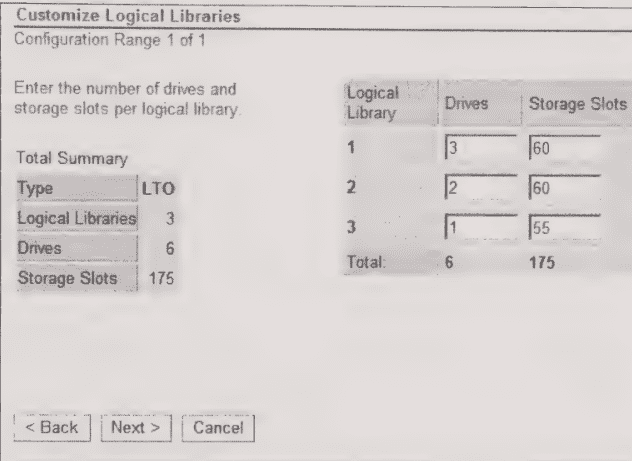

图 2-19 IBM 3854 磁带库专家级，现在可以在应用前检查槽位。选择“下一步”接受配置，然后选择“完成”应用新配置，这需要几分钟时间。完成后，磁库将向您显示磁库配置成功的消息。

在设置新配置后，新的逻辑库将仅使用数字命名。您可以将其更改为更有意义的名称：在“管理逻辑库”屏幕上（第 51 页图 2-15），选择要重名的库并点击“重命名”。在下一个屏幕上（第 54 页图 2-20），输入新名称。逻辑库名称仅供磁库专家软件使用，对与备份应用程序的通信没有影响。

| 重命名逻辑库 |
| 重命名逻辑库 |
| 当前逻辑库名称 1-01 |
| 新逻辑库名称 Redbook1 |
| 应用 | 取消 |

图 2-20 重命名逻辑库

在我们再次操作磁库之前，我们必须根据使用该磁库的备份应用程序调整逻辑库配置。如果逻辑库上的存储槽容量增加或减少，备份应用程序必须反映此更改。请参阅您的备份应用程序手册获取有关如何更改现有磁库配置的信息。某些应用程序（如 IBM Storage Manager）可以轻松处理此，其他应用程序（如 Legato NetWorker）则要求您运行配置向导（NetWorker 的向导）以反映更改。

此外，属于逻辑库的卡带必须移动到适当的存储单元组。

### 2.2.5 使用操作面板对 IBM 3584 进行分区（未启用 ALMS）

这些是步骤：

- 1. 从“活动”窗口，点击“菜单”。显示主菜单（图 2-21）。

| 面板 0002 |
| 主菜单 |
| 磁库状态 |
| 手动操作 |
| 设置 |
| 使用统计数据 |
| 关键产品数据 |
| 服务 |
| BACK DOWN ENTER |

图 2-21 IBM 3584 操作面板：主菜单

- 2. 点击“向上”或“向下”高亮“设置”，然后点击“ENTER”。显示设置菜单。

- 3. 点击“向上”或“向下”高亮“配置”并点击“ENTER”。显示配置菜单。

4. 点击“向上”或“向下”高亮“高级配置”并点击“ENTER”（图 2-22）。

磁库显示消息：如果继续配置，磁库将离线。点击“ENTER”继续。

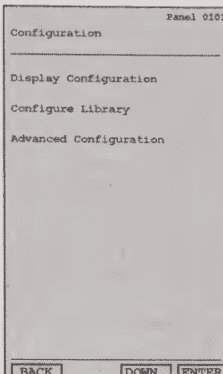

图 2-22 IBM 3584 操作面板：配置

5. 双击“ENTER”。磁库显示消息：正在搜索已安装设备，可能需要几分钟来发现物理配置。显示“物理配置”面板，带有磁库现有的物理配置（见图 2-23）。该面板显示磁库物理配置中驱动器、存储槽和 I/O 槽的总量。如果配置包含 LTO 和 3592 驱动器，列表将分别显示它们。

检查显示的配置是否与实际配置匹配。如果不匹配，在此处停止，解决问题并重新开始。

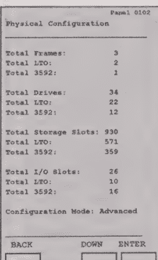

图 2-23 IBM 3584 配置显示

6. 点击“ENTER”。磁库显示消息：要提交新的物理配置吗？

7. 点击“YES”接受新的物理配置并设置任何逻辑库配置。“设置逻辑库”面板指示逻辑库使用的介质类型（第 56 页图 2-24）。如果已启用 ALMS 功能，将不会显示以下面板。

| 面板 0185 |
| 介质类型：LTO |
| 框 1 - 1 |
| 逻辑库数量 [ ] |
| 选择 1 - 12 |
| CANCEL UP ENTER |

图 2-24 IBM 3584 操作面板：设置逻辑库

- 8. 通过点击`向上`或`向下`增加或减少值来指定所需的逻辑库数量。

- 9. 当显示所需的数量时，点击`ENTER`。显示“设置存储槽”面板（图 2-25）。

| 面板 0186 |
| 逻辑库 1 |
| 存储槽 [ ] |
| 选择 1 - 140 |
| 以下存储槽中的卡带现在将成为逻辑库 2 的部分 |
| 位置起始：[F1,C07,R42] 位置结束：[F1,C07,R43] |
| BACK |

图 2-25 IBM 3584 操作面板：设置存储槽

- 10. 通过点击`向上`或`向下`增加或减少值来指定逻辑库的存储槽数量。当显示数量时，点击`ENTER`。显示“设置驱动器”面板（图 2-26）。

| 设置驱动器 |
| 逻辑库 1 |
| 驱动器数量 [ ] |
| 选择 1 - 6 |
| BACK | ENTER |

图 2-26 IBM 3584 操作面板：设置驱动器

- 11. 通过点击`向上`或`向下`增加或减少值来指定逻辑库的 I/O 槽数量。当显示数量时，点击`ENTER`。显示“设置 I/O 槽”面板（图 2-27）。

| 设置 I/O 槽 |
| 逻辑库 1 |
| I/O 槽 [ ] |
| 选择 1 - 30 |
| BACK | ENTER |

图 2-27 IBM 3584 操作面板：设置 I/O 槽

- 12. 点击“ENTER”。磁库显示消息：要提交新的物理配置吗？

- 13. 点击“YES”接受新的物理配置并设置任何逻辑库配置。“设置逻辑库”面板指示逻辑库使用的介质类型（第 56 页图 2-24）。如果已启用 ALMS 功能，将不会显示以下面板。

- 14. 点击“ENTER”。磁库显示消息：配置成功。

设置新配置后，新的逻辑库仅使用数字命名。您可以将其更改为更有意义的名称：在“管理逻辑库”屏幕上（第 51 页图 2-15），选择要重名的库并点击“重命名”。在下一个屏幕上（第 54 页图 2-20），输入新名称。逻辑库名称仅供磁库专家软件使用，对与备份应用程序的通信没有影响。


| 重命名逻辑库 |

| 重命名逻辑库 |

| 当前逻辑库名称 1-01 |

| 新逻辑库名称 Redbook1 |

| 应用 | 取消 |

图 2-20 重命名逻辑库

在我们再次操作磁库之前，我们必须根据使用该磁库的备份应用程序调整逻辑库配置。如果逻辑库上的存储槽容量增加或减少，备份应用程序必须反映此更改。请参阅您的备份应用程序手册获取有关如何更改现有磁库配置的信息。某些应用程序（如 IBM Storage Manager）可以轻松处理此，其他应用程序（如 Legato NetWorker）则要求您运行配置向导（NetWorker 的向导）以反映更改。

此外，属于逻辑库的卡带必须移动到适当的存储单元。

## 2.2.5 使用操作面板对 IBM 3584 进行分区（未启用 ALMS）

这些是步骤：

- 1. 从“活动”窗口，点击“菜单”。显示主菜单（图 2-21）。

| 面板 0002 |

| 主菜单 |

| 磁库状态 |

| 手动操作 |

| 设置 |

| 使用统计数据 |

| 关键产品数据 |

| 服务 |

| BACK DOWN ENTER |

图 2-21 IBM 3584 操作面板：主菜单

- 2. 点击“向上”或“向下”高亮“设置”，然后点击“ENTER”。显示设置菜单。

- 3. 点击“向上”或“向下”高亮“配置”并点击“ENTER”。显示配置菜单。

- 4. 点击“向上”或“向下”高亮“高级配置”并点击“ENTER”（图 2-22）。

磁库显示消息：如果继续配置，磁库将离线。点击“ENTER”继续。


图 2-22 IBM 3584 操作面板：配置

- 5. 双击“ENTER”。磁库显示消息：正在搜索已安装设备，可能需要几分钟来发现物理配置。显示“物理配置”面板，带有磁库现有的物理配置（见图 2-23）。该面板显示磁库物理配置中驱动器、存储槽和 I/O 槽的总量。如果配置包含 LTO 和 3592 驱动器，列表将分别显示它们。

检查显示的配置是否与实际配置匹配。如果不匹配，在此处停止，解决问题并重新开始。


图 2-23 IBM 3584 配置显示

6. 点击“ENTER”。磁库显示消息：要提交新的物理配置吗？

- 7. 点击“YES”接受新的物理配置并设置任何逻辑库配置。“设置逻辑库”面板指示逻辑库使用的介质类型（第 56 页图 2-24）。如果已启用 ALMS 功能，将不会显示以下面板。

| 面板 0185 |

| 介质类型：LTO |

| 框 1 - 1 |

| 逻辑库数量 [ ] |

| 选择 1 - 12 |

| CANCEL UP ENTER |

图 2-24 IBM 3584 操作面板：设置逻辑库

- 8. 通过点击`向上`或`向下`增加或减少值来指定所需的逻辑库数量。

- 9. 当显示所需的数量时，点击`ENTER`。显示“设置存储槽”面板（图 2-25）。

| 面板 0186 |

| 逻辑库 1 |

| 存储槽 [ ] |

| 选择 1 - 140 |

| 以下存储槽中的卡带现在将成为逻辑库 2 的部分 |

| 位置起始：[F1,C07,R42] 位置结束：[F1,C07,R43] |

| BACK |

图 2-25 IBM 3584 操作面板：设置存储槽

- 10. 通过点击`向上`或`向下`增加或减少值来指定逻辑库的存储槽数量。当显示数量时，点击`ENTER`。显示“设置驱动器”面板（图 2-26）。

| 设置驱动器 |

| 逻辑库 1 |

| 驱动器数量 [ ] |

| 选择 1 - 6 |

| BACK | ENTER |

图 2-26 IBM 3584 操作面板：设置驱动器

- 11. 通过点击`向上`或`向下`增加或减少值来指定逻辑库的 I/O 槽数量。当显示数量时，点击`ENTER`。显示“设置 I/O 槽”面板（图 2-27）。

| 设置 I/O 槽 |

| 逻辑库 1 |

| I/O 槽 [ ] |

| 选择 1 - 30 |

| BACK | ENTER |

图 2-27 IBM 3584 操作面板：设置 I/O 槽

- 12. 点击“ENTER”。磁库显示消息：要提交新的物理配置吗？

- 13. 点击“YES”接受新的物理配置并设置任何逻辑库配置。“设置逻辑库”面板指示逻辑库使用的介质类型（第 56 页图 2-24）。如果已启用 ALMS 功能，将不会显示以下面板。

- 14. 点击“ENTER”。磁库显示消息：配置成功。

设置新配置后，新的逻辑库仅使用数字命名。您可以将其更改为更有意义的名称：在“管理逻辑库”屏幕上（第 51 页图 2-15），选择要重名的库并点击“重命名”。在下一个屏幕上（第 54 页图 2-20），输入新名称。逻辑库名称仅供磁库专家软件使用，对与备份应用程序的通信没有影响。

## 2.3 ALMS

高级库管理系统 (`ALMS`) 是多路径架构（#1690）的可选扩展，为 3584 分区提供了增强的灵活性。`ALMS` 为服务器虚拟化元素地址。在 `ALMS` 中，存储槽与元素地址之间没有关联性。

### 2.3.1 功能描述

在本节中，我们提供了 `ALMS` 功能的功能描述。这些信息基于 IBM TotalStorage UltraScalable Tape Library Advanced Management System Technology White Paper，作者为 Lee Jesionowski，地址如下：

`http://www.ibm.com/servers/storage/tape/whitepapers/pdf/advanced_library_management_system.pdf`

### 2.3.2 存储槽虚拟化

卡带位置的主视图被称为 SCSI 元素地址。没有 `ALMS`，存储元素地址在配置后直接映射到特定的存储槽。启用 `ALMS` 后，元素地址不再与存储槽关联。相反，通过动态将存储槽与元素地址关联来实现存储槽虚拟化。当卡带移动和创建时，磁库会将元素地址与存储槽关联。在由于移动导致存储元素为空的情况下，源元素地址将取消关联。存储元素地址的关联实现方式对应用程序软件完全透明。

逻辑库的存储元素地址数量（向主机应用程序报告）可以通过更改最大卡带数量设置来选择。

使用 Web 用户界面（磁带库专家，Tape Library Specialist）使用该逻辑库。对于每个逻辑库，“最大带盒数”（Maximum Number of Cartridges）的默认值是在首次启用 `ALMS` 时（或在启用 `ALMS` 后创建库时）安装在库中用于该类型带盒的可寻存储槽数量。可以为每个逻辑库更改最大带盒数，但该值必须始终大于等于分配给该逻辑库的实际带盒数量。可以将最大带盒数设置为高于安装时安装的可寻存储槽数量的值。这将使得未来的容量扩展对主机应用程序是透明的。由于地址增加，性能可能会略微下降。请注意不要超过主机软件的任何许可限制。

每个新逻辑库存储槽的起始元素将是 `x'400` (1024) 加上分配的逻辑库编号。例如，逻辑库 1 将从 `x'401` (1025) 开始，逻辑库 2 将从 `x'402` 开始，依此类推（见第 60 页的图 2-28）。它们没有从 `x'401` 开始的原因是需要某些分配来区分来自同一物理库的不同逻辑库。如果定义了分配有一组带盒元素的逻辑库，这些地址在启用 `ALMS` 时将保留。因此，之前定义的逻辑库将不遵循上述规则。

### 驱动器分配

使用 `ALMS` 驱动器分配功能，可以将机架内任何位置的任何驱动器分配给任何逻辑库，而不会在驱动器地址中创建任何间隙。驱动器（数据传输）元素地址将映射到分配给驱动器的特定驱动器位置，但现在可以使用磁带库专家将任何驱动器分配给任何逻辑库（支持混合）。添加到逻辑库的每个驱动器都将分配给最低的可用地址元素，无论驱动器位置如何。

当首次启用 `ALMS` 时，所有已安装/分配驱动器的数据传输元素 (`DTE`) 地址不会更改其先前的值。然而，在启用 `ALMS` 后，任何新安装/分配的驱动器的 `DTE` 地址不再依赖于驱动器的位置。相反，任何新安装或分配的驱动器的 `DTE` 地址由驱动器分配到每个逻辑库的顺序决定。通过 `ALMS`，使用使用磁带库专家的“驱动器分配”页面将驱动器分配给逻辑库。

使用此界面，分配到新逻辑库的第一个驱动器的 `DTE` 地址为 257 (`x'101'`)（分配到逻辑库的任何其他驱动器的 `DTE` 地址基于该逻辑库中下一个可用的 `DTE` 地址）。下一个可用的 `DTE` 地址是起始 `DTE` 地址之后的最低可用 `DTE` 地址（这将填补当驱动器从逻辑库中取消分配/删除时创建的任何间隙）。当使用 Web 界面从逻辑库中取消驱动器分配时，只有该 `DTE` 地址可供未来使用；其他 `DTE` 地址均不会受影响。

通过使用 `ALMS` 的动态驱动器分配功能，可以使位于机架内任何位置的任何驱动器可分配给任何逻辑库，而不会在 `DTE` 地址中创建间隙。

## 共享驱动器分配


某些用户需要能够在例外情况下轻松共享驱动器的能力，例如，某个驱动器可能在每月一次的任务中需要，或者作为故障驱动器的临时替代品。磁带库专家分配支持在多个逻辑库之间共享驱动器的选项，最多支持 10 个。该驱动器将在多个逻辑库中分配 `DTE` 地址。请注意，分配给共享驱动器的 `DTE` 可能因逻辑库而异。因此，每个逻辑库将由专用驱动器和共享驱动器组成。每个逻辑库将具有指向专用和共享驱动器位置的驱动器元素地址。

此选项减少了每次需要或不需要时配置和取消配置磁带驱动器的要求。

驱动器分配 Web 支持支持点击功能，这些功能对其他逻辑库是无破坏的：

- 分配驱动器
- 移除驱动器分配
- 重新分配驱动器

当带盒在共享驱动器中加载时，库将只接受通过源逻辑库请求的卸载命令；通过其他逻辑库请求的任何卸载命令都将被拒绝。

然而，到磁带驱动器本身的数据路径不受库保护。因此，客户端必须确保共享驱动器不会通过数据路径被错误的应用程序访问。为了这一点，一种方法是在打开和关闭时使用 `SCSI` 预留/释放选项。驱动器程序与应用程序共同处理此操作。当打开磁带驱动器时，应用程序通过磁带驱动程序启动 `SCSI` 预留。此时，其他服务器无法访问该磁带驱动器（查询等命令除外）。这确保了数据不会被任何其他主机或应用程序覆盖。设备关闭后，应用程序必须向磁带驱动器发送 `SCSI` 启用。大多数应用程序处理此操作，但应与备份软件提供商确认。

`SAN` 分区也可防止访问相同的磁带驱动器。

当磁带驱动器被应用程序共享时，任何使用该驱动器的应用程序对其他应用程序一无所知。例如，如果应用程序 A 已经加载了带盒，应用程序 B 并并尝试在同一驱动器中加载带盒。在这种情况下，应用程序 B 可能会失败，应用程序 B 执行的任务也会失败。某些应用程序会定期扫描所有驱动器并将磁带驱动器视为离线。

在任何情况下，我们都建议不要允许多个应用程序并发使用共享驱动器。换言之，当不使用时将磁带驱动器设置为离线（或处于服务模式）。

共享选项主要用于偶尔需要某些驱动器且必须预配置的环境。

> 注意：偶尔在驱动器中留带盒或定期扫描所有驱动器的应用程序不是共享驱动器的理想人选。

## 消除总容量更改的停机

启用 `ALMS` 后，可以为每个应用程序更改总库容量（存储槽数量），因为最大带盒数不受存储槽数量的影响。额外的存储槽仅仅是带盒插入时可以移动到的槽。

此外，使用 `3584 L22` 和 `L52` 的新的中间容量和按需容量功能，完全不需要停机。

## 存储槽池

`ALMS` 允许在无破坏的情况下添加或删除逻辑库。最小逻辑库有一个名称——它可以被认为是一个初始为空的文件。

可以使用磁带库专家 Web 界面的驱动器分配页面将驱动器放置在此文件中。带盒也可以放置在此文件中，基于它们的卷序列号 (`VOLSER`) 并使用以下方法之一（按优先级排序）：

- 从静态分区迁移（启用 `ALMS`）
- 带盒分配策略（插入时自动）
- 插入通知（插入时操作选择）
- 应用程序从 `I/O` 站移动（基于命令源）
- 使用磁带库专家手动分配

`VOLSER` 分配和带盒的物理位置存储在非易失性内存中（包括主和备份副本）。所有存储槽根据带盒插入操作为每个逻辑库提供。因此，存储槽作为共享资源池化，因此每个逻辑库容量分配的更改不需要任何停机或管理员干预。

## 磁带分配策略

`IBM 3584` 的磁带分配策略 (`CAP`) 允许通过磁带库专家 (`Tape Library Specialist`) 将磁带卷序列号 (`VOLSER`) 范围分配给特定的逻辑库。当插入磁带时，将使用磁带分配策略尝试将磁带与逻辑库关联。如果磁带不在 `CAP` 中且启用了“插入通知”（参见第 52 页的“插入通知”），您可以使用库的操作员面板上的插入通知提示将磁带分配给逻辑库，或将磁带保持为未分配状态，以便稍后使用磁带库专家进行处理。如果未启用插入通知功能且磁带不在 `CAP` 中，则磁带最终将对所有主机可用。还可以通过创建新的 `VOLSER` 范围并执行手动盘点通过磁带分配策略分配磁带，将未分配的磁带分配给逻辑库。

磁带分配策略是针对特定介质类型的。因此，它是基于磁带标签上最重要的六个字符，而 `VOLSER` 标签不包含介质类型指示器（`L2`、`L3`、`JA` 等）。这意味着相同的标签（介质类型指示器除外）可能会被分配两个不同的库，例如，包含 `Ultrium 3590` 驱动器的库。

> 注意：磁带分配策略不会重新分配已分配的磁带。要重新分配磁带，请使用将磁带分配到逻辑库的程序。

## 插入通知

插入通知允许 `IBM 3584` 监控 `I/O` 站以检测无逻辑库分配的新介质。此功能可以通过操作员面板或磁带库专家启用。启用插入通知后，当检测到新介质时，操作员面板将显示消息请求您选择一个逻辑库。任何未分配的磁带将将被分配给您选择的逻辑库（所有其他逻辑库将无法访问这些磁带）。库提供了延迟分配的选项，并设置了延迟自动生效的时间段。

## 虚拟 I/O

`IBM 3584` 具有输入/输出 (`I/O`) 站和 `I/O` 槽，允许在任何时间导入和导出多达 32 磁带。`I/O` 槽称为导入/导出元件 (`IE`)。虚拟 `I/O` 槽通过允许存储槽显示为主机 `I/O` 槽增加了可用 `I/O` 槽的数量。显示为主机的存储槽被称为虚拟导入/导出元件 (`VIE`)。虚拟 `I/O` 槽的目标是减少系统管理员和库操作员之间的依赖关系，以便各自执行导入和导出任务，而无需对方执行任何操作。通过虚拟 `I/O` 槽，库会自动将磁带从 `I/O` 站移动到物理存储 `I/O` 槽。

使用 `I/O` 槽，您可以为每个库配置多达 225 个 `VIE`。每个逻辑库将有一个其他逻辑库无法访问的 `VIO` 地址空间。`VIO`（虚拟 `I/O`）槽的数量可以使用逻辑库的 `Max VIO Slots` 按钮设置（参见第 67 页的图 2-33）。新逻辑库默认分配最大数量，而在 `ALMS` 之前定义的逻辑库初始数量为库中物理 `I/O` 槽的数量。

在虚拟 `I/O` 之前，空间由物理 `I/O` 站槽（10、30、16 或 32，取决于框架类型）组成，所有逻辑库共享。如果应用程序或系统管理员没有显式地将磁带从 `I/O` 站导入到库存储中，磁带将保留在 `I/O` 站中。这减少了用于处理导入导出的 `IEE` 数量。

使用虚拟 `I/O` 槽，当磁带插入 `I/O` 站时，库将结合磁带分配策略或插入通知将磁带分配给正确的库 `VIE`，磁带将自动移动到库存储槽。如果没有分配磁带分配策略且对特定磁带禁用了插入通知，则该磁带将插入到所有库的 `VIE` 中并自动移动到库存储槽。`VIE` 会临时承担 `IEE` 的属性，直到主机将磁带移动到存储元件 (`SIE`)。

如果磁带无法移动，将报告为“分配错误 (`Assignment Error`)”。如果分配的逻辑库没有 `VIE` 槽，或者所有逻辑库都没有可共享的共同 `VIE`，就会发生这种情况。要解决此问题，请释放 `VIE` 地址以便其在库中可用，或者将此磁带特定分配给逻辑库。

当主机移动磁带时，如果磁带位于存储槽中，则不需要移动，元件将从 `VIE` 变为 `SIE`。同样，当主机从 `SIE` 导出时，将由 `VIE` 报告物理存储槽，而无需移动磁带。

`隐藏导出 (Hiding Exports)` 将将导出的磁带移动到库维护队列。如第 67 页的图 2-33 所示，还有一个隐藏/显示按钮。显示导出 (`Show Exports`) 是默认设置，这将显示已导出磁带的 `VIE` 盘点。

`隐藏导出` 将将导出的磁带移动到库，直到有一个可用库为止不会完成。

虚拟 `I/O` 槽的支持由最新版本的微代码 (`5360`) 提供并由 `ALMS` 启用。对于现有系统 `IBM 3584` 已经启用了 `ALMS`，需要新版本的微代码并需要手动启用虚拟 `I/O` 槽。

### 2.3.2 配置 ALMS

`ALMS` 操作需要 `ALMS` 功能代码 `#190`。该功能代码提供必须通过操作员面板安装的许可证密钥（除非它是初始订单的一部分并已由制造安装）。

#### 输入 ALMS 许可证密钥

要输入 `ALMS` 许可证密钥，请执行以下操作：

1. 从库的操作员面板选择 `MENU` → `Service Library` → `Firmware Update` → `Features` → `ENTER`。功能屏幕显示功能列表，包括高级库管理系统。选择它并选择 `ENTER`。
2. 对于许可证密钥的每个字符，选择 `UP` 或 `DOWN` 输入您想要的值。
3. 选择 `ENTER`。功能屏幕现在显示已安装高级库管理功能。
4. 选择 `BACK` 直到返回主屏幕。

### 启用 ALMS

1. 安装许可证密钥后，您可以使用磁带库专家启用 `ALMS`。在浏览器中输入库的 `IP` 地址作为 `URL`。如果启用了登录安全，，将显示登录提示，然后您将看到欢迎界面，底部显示 `ALMS` 已被禁用的消息（见图 2-29）。
2. 在左侧，选择 `Manage Library` → `Enable ALMS`。这将显示一个警告和启用 `ALMS` 的特定选择（见图 2-30）。

当启用 `ALMS` 时，你可以轻松执行以下操作：

- 命名、添加和删除逻辑带库
- 将磁带重新分配到另一个逻辑带库
- 修改分配给逻辑带库的磁带最大数量
- 添加、删除和编辑卷序列号（`VOLSER`）范围（也称为磁带分配策略）
- 分配驱动器、更改控制路径驱动器、取消驱动器分配并分配新驱动器，而无需使用手动配置方法


你也可以禁用 ALMS，但应谨慎操作。当启用 ALMS 时，图 2-30 所示的屏幕将显示`禁用 ALMS`（`Disable ALMS`）选项。

> **重要：** 当你禁用 ALMS 时，带库将回到未配置状态，所有的磁带和驱动器分配都会丢失。你必须手动重新配置带库。然而，在定义之间切换时，带库将使用之前的定义作为基础起始配置。

**注意：** 如果你手动配置带库，你的更改可能会导致磁带或逻辑带库分配、磁带分配策略、最大磁带分配以及逻辑带库名称的丢失。

使用 ALMS 时，磁带根据其 `VOLSER` 属于一个逻辑带库。没有 ALMS 时，逻辑带库基于带库内的物理边界。这意味着在禁用 ALMS 后，你可能需要移动几个磁带。

从禁用 ALMS 的环境切换到启用 ALMS 的环境时，带库将使用之前的定义作为基础起始配置。带库将执行类似于打开机框门时的清点操作。在清点过程期间，带库状态将显示磁带分配状态为待定（`pending`）（见第 66 页的图 2-31）。

## 创建和管理逻辑带库

1. 从磁带带库专家（`Tape Library Specialist`，第 64 页图 2-29）选择**管理带库**（`Manage Library`）→**逻辑带库**（`Logical Library`），在下一个屏幕（第 66 页图 2-31）中，点击**创建**（`Create`）。

## 工作项

### 管理逻辑带库

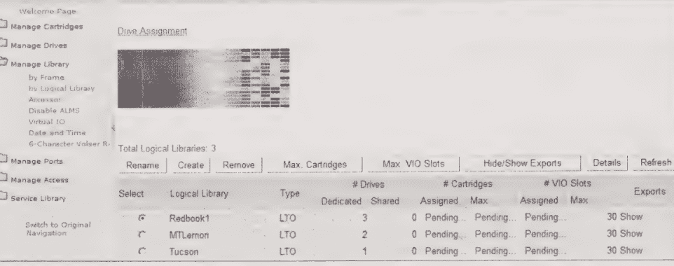

**图 2-31** 创建逻辑带库

2. 为你的新逻辑带库输入一个唯一名称（最多 15 个字符）（在我们的案例中为 `Redbook2`），并为该带库选择**介质类型**（`Media Type`）（`LTO` 或 `3592`），如图 2-32 所示。点击**应用**（`Apply`）。你不能在一个逻辑带库中混合 `LTO` 和 `3592` 介质类型，但可以在一个逻辑带库中使用不同的 `LTO` 代，例如 `LTO 2` 和 `3`。

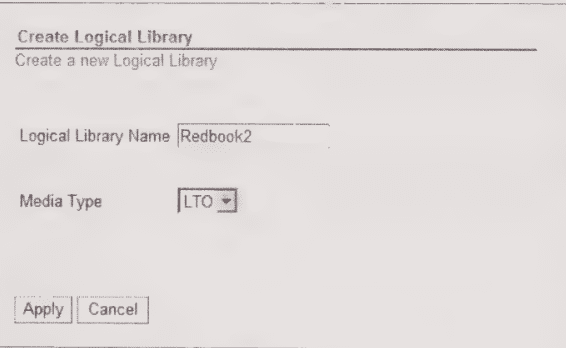

**图 2-32** 创建逻辑带库

3. 创建的带库将出现在管理逻辑带库显示中，如第 67 页图 2-33 所示，没有分配磁带或驱动器；这些列显示计数零。因此，在创建新的逻辑带库后，你需要添加磁带池和磁带驱动器。

## 工作项

### 管理逻辑带库

- 欢迎页
- 管理磁带
- 管理驱动器
- 管理带库
  - 按逻辑带库
  - 虚拟 ID
  - 禁用 ALMS
  - 日期和时间
  - 6 位角色
- 管理端口
- 管理访问
- 服务带库
  - 回到原始导航

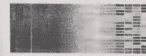

逻辑带库总数：3

| 逻辑带库 | 类型 | 专用 | 已分配 | VIO 槽 | 已分配 | 导出 |
| :--- | :--- | :--- | :--- | :--- | :--- | :--- |
| Redbook1 | LTO | 3 | 0 | 80 | 0 | 显示 30 |
| MTLamon | LTO | 2 | 0 | 27 | 0 | 显示 30 |
| Tucson | LTO | 1 | 0 | 15 | 0 | 显示 35 |
| Redbook2 | LTO | 0 | 0 | 175 | 0 | 显示 255 |

图 2-33 添加的逻辑带库

## 磁带分配策略

新的逻辑带库没有分配任何磁带。你可以分配当前未分配的磁带，或分配给另一个逻辑带库的磁带（该磁带将从该带库中移除）。

或者，你可以为逻辑带库分配一组未分配的磁带（建立磁带分配策略）。此类磁带分配策略根据 `VOLSER` 定义范围。

1. 要分配磁带分配策略，在左侧，选择 `管理磁带`（`Manage Cartridges`）→`磁带分配策略`（`Cartridge Assignment Policy`）。出现磁带分配策略界面（见图 2-34）。

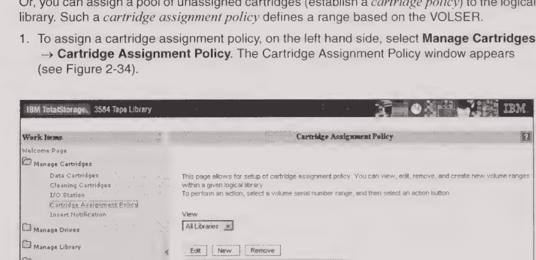

图 2-34 磁带分配策略主界面

第 2 章 IBM LTO 磁带带库共享与分区 67

2. 选择要分配磁带策略的逻辑带库，为要定义的范围输入起始和结束的 `VOLSER`（见图 2-35），并点击 `应用`。

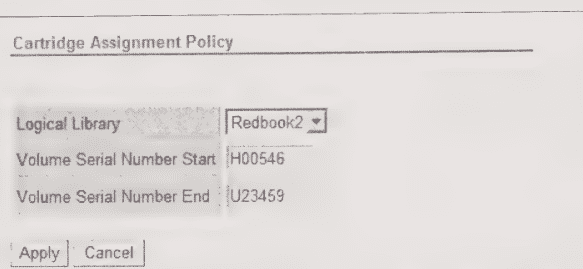

图 2-35 磁带分配策略

3. 创建的带库将出现在管理逻辑带库显示中，如第 67 页所示，没有分配磁带或驱动器；这些列显示计数零。因此，在创建新的逻辑带库后，你需要添加磁带池和磁带驱动器。

## 驱动器分配

你可以分配当前未分配的磁带，或分配给另一个逻辑带库的磁带（该磁带将从该带库中移除）。

或者，你可以为逻辑带库分配一组未分配的磁带（建立磁带分配策略）。此类磁带分配策略根据 `VOLSER` 定义范围。

1. 要分配磁带分配策略，在左侧，选择 `管理磁带`（`Manage Cartridges`）→`磁带分配策略`（`Cartridge Assignment Policy`）。出现磁带分配策略界面（见图 2-34）。


图 2-34 磁带分配策略主界面

2. 选择要分配磁带策略的逻辑带库，为要定义的范围输入起始和结束的 `VOLSER`（见图 2-35），并点击 `应用`。


图 2-35 磁带分配策略

3. 创建的带库将出现在管理逻辑带库显示中，如第 67 页所示，没有分配磁带或驱动器；这些列显示计数零。因此，在创建新的逻辑带库后，你需要添加磁带池和磁带驱动器。

## 在 Linux 和 Windows 中实现磁带

你可以分配当前未分配的磁带，或分配给另一个逻辑带库的磁带（该磁带将从该带库中移除）。

或者，你可以为逻辑带库分配一组未分配的磁带（建立磁带分配策略）。此类磁带分配策略根据 `VOLSER` 定义范围。

1. 要分配磁带分配策略，在左侧，选择 `管理磁带`（`Manage Cartridges`）→`磁带分配策略`（`Cartridge Assignment Policy`）。出现磁带分配策略界面（见图 2-34）。


图 2-34 磁带分配策略主界面

2. 选择要分配磁带策略的逻辑带库，为要定义的范围输入起始和结束的 `VOLSER`（见图 2-35），并点击 `应用`。


图 2-35 磁带分配策略

3. 创建的带库将出现在管理逻辑带库显示中，如第 67 页所示，没有分配磁带或驱动器；这些列显示计数零。因此，在创建新的逻辑带库后，你需要添加磁带池和磁带驱动器。

## 分配驱动器

# IBM TotalStorage, 3584 磁带库

| 项目 | 驱动器分配 |
|---|---|
| 欢迎页 | 下方显示当前的驱动器分配情况 |
| 管理磁带 | 管理驱动器、驱动器摘要、驱动器分配、控制路径、全球名称、管理磁库、管理端口、管理访问、服务磁库 |

通过点击与驱动器和本地磁库相关的复选框，可以更改驱动器的本地磁库分配。某些选项受到限制，并将显示警报。

有关容量的完整解释，请参考“驱动器分配”帮助页。

| 驱动器 | 逻辑磁库 | 未分配 | Redbook1 | MTLinear | Tucson | Redbook2 |
|---|---|---|---|---|---|---|
| 3009F001 | | | | | | |
| 3009F002 | | | | | | |
| 3009F003 | | | | | | |
| 3009F004 | | | | | | |


| 3009F005 | | | | | | |

| 3009F006 | | | | | | |

| | 专用总计 | | | | | | |

| | 共享总计 | | | | | | |

图 2-39 驱动器分配

启用控制路径的磁带驱动器由图 2-40 所示图标指示。


图 2-40 带控制路径的驱动器

分配给本地磁库的磁带驱动器会自动启用控制路径；如果您想启用更多控制路径，点击所选驱动器的控制路径图标占位符。

如果您想从一个本地磁库中删除磁带驱动器，必须勾选该驱动器的“未分配”将其设置为未分配。

除非需要，否则不建议将磁带驱动器分配给多个本地磁库。如果您需要共享磁带驱动器，请遵循第 60 页“共享驱动器分配”（Shared drive assignment）中的建议。一个驱动器最多可被 10 个本地磁库共享。

在图 2-39 示例中，所有本地磁库和应用程序都需要至少一个磁带驱动器来完成备份作业。因此，我们为每个本地磁库分配了至少一个磁带驱动器。除了所需的最小驱动器外，我们还为每个本地磁库分配了一个共享磁带驱动器。对于所有配置，我们配置了至少两个可用的驱动器，但根据应用程序将共享磁带驱动器设置为离线或不可用。这使得我们能够在需要时轻松使用共享磁带驱动器（通过在应用程序将其设置为停止服务或可用）；例如，当一个专用磁带驱动器故障，或一个应用程序由于额外工作负载（额外的恢复）临时需要更多磁带带宽时。

第 2 章. IBM LTO 磁带库和分区 71

由于应用程序需要驱动器的 SCSI 元素地址来配置磁库，请通过选择**管理驱动器 -> 驱动器摘要**（`Manage Drives -> Drive Summary`）检查所有磁带驱动器的 SCSI 元素地址。这将显示驱动器信息（见图 2-41）。注意，这是虚拟化元素地址，每个本地磁库可能会显示相同的元素地址。

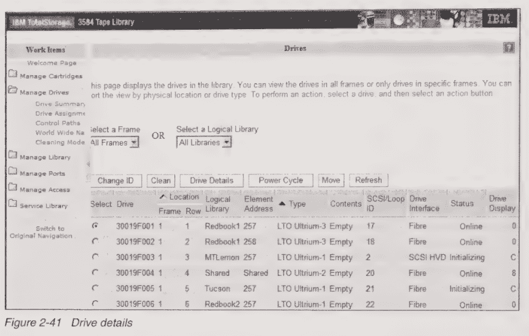

**图 2-41** 驱动器详情

或者，如果您将光标悬停在图 2-42 所示的分配元素上，将弹出一个识别该驱动器元素号的小窗口。


**图 2-42** 显示驱动器元素号

默认情况下，所有驱动器将分配最低的元素地址，对于上面的 Redbook1，这将是元素 257、258 和 259（共享驱动器）。分配过程中可能会产生间隙。如果 Redbook1 驱动器 2 未设置分配并尝试**应用**，我们将收到警告消息，提示可能存在元素间隙（见第 73 页图 2-43）。

## Microsoft Internet Explorer

如果您更改了驱动器或控制路径分配，相关的主机应用程序可能需要重置或重新发现其设备。

以下逻辑磁库包含至少一个驱动器元素地址间隙。

逻辑磁库：Redbook i

您是否要继续进行配置更改？


图 2-43 驱动器间隙警告

避免驱动器分配中出现任何间隙。通过取消分配并重新分配具有最高 SCSI 元素地址的驱动器，可以轻松填满所有间隙。驱动器元素地址中的间隙会导致某些备份应用程序（如 EMC Legato NetWork 或 Veritas BackupExec）出现配置问题。

### 更改存储槽的最大数量

由于 ALMS 虚拟化了存储槽的 SCSI 元素地址，磁库能够报告少于磁库实际磁带数量的存储槽数量。磁库允许用户选择 16 帧的最大限制（687）。默认值基于磁库中现有的物理槽。

在图 2-39 示例中，所有本地磁库和应用程序都需要至少一个磁带驱动器来完成备份作业。因此，我们为每个本地磁库分配了至少一个磁带驱动器。除了所需的最小驱动器外，我们还为每个本地磁库分配了一个共享磁带驱动器。对于所有配置，我们配置了至少两个可用的驱动器，但根据应用程序将共享磁带驱动器设置为离线或不可用。这使得我们能够在需要时轻松使用共享磁带驱动器（通过在应用程序将其设置为停止服务或可用）；例如，当一个专用磁带驱动器故障，或一个应用程序由于额外工作负载（额外的恢复）临时需要更多磁带带宽时。

然而，报告的大量存储槽可能会降低与库交互的性能（例如库存库或审计库，从应用程序的角度来看，耗时更长）。

### 从无 ALMS 分区迁移到 ALMS

之前在没有 ALMS 的安装的库可以通过启用 ALMS 许可密钥升级到 ALMS。必须使用操作面板（Operator panel）输入许可密钥（参见第 63 页“输入 ALMS 许可密钥”）。

启用 ALMS 时，它会重用现库配置。这意味着您将获得相同数量的逻辑库。分配给相同逻辑库的磁带和磁带驱动器将获得相同的 SCSI 元素地址（如果 SCSI 元素地址存在空隙），并且所有磁带将获得与非 ALMS 定义相同的 SCSI 元素地址。

然而，新逻辑库的存储元素地址将发生变化，如第 58 页“存储虚拟化”部分所述。对于第一个逻辑库，存储地址从 1025 开始，第二个从 1026 开始，依此类推。在已定义的无 ALMS 的三个逻辑库中添加新的逻辑库 (Redbook2)，意味着该库的数量将变为四个，相应的磁带元素地址为 1028。

此外，在混合介质中，报告的最大存储槽数量可能会变为当前安装的带槽数量。因此，当您启用 ALMS 时，您的应用程序可能需要重新配置。对于某些应用程序，例如 IBM Tape Storage Manager，您只需要停止并重启服务器；对于其他应用程序，例如 EMC Legato NetWorker，您必须运行配置向导 (`jconfig`)。

您可以使用磁带库专家 (`Tape Library Specialist`) 启用 ALMS。选择 **Manage Library** → **Enable ALMS**（请参阅第 64 页的“启用 ALMS”）。

为了说明 ALMS 如何更改逻辑库的配置，我们在图 2-46 和第 76 页的示例 2-3 中了名为 Redbook1 的逻辑库的详细信息。它包含三个 SCSI 元素地址为 257、258 和 259 的驱动器。存储元素地址范围为 1025 到 1104（80 个存储地址）。物理库共有 175 个存储槽。

| 逻辑库 Redbook1 | LTO |

| :--- | :--- |

| 类型 | 257 - 259 |

| 驱动器元素地址范围 | Frame 1 Row 1 |

| 驱动器 | Frame 1 Row 2<br>Frame 1 Row 3 |

| 存储元素地址范围 | 1025 - 1104 |

| 磁带 | 9 |

**图 2-46** 启用 ALMS 前详细信息

#### 示例 2-3 来自逻辑库 Redbook 1 的元素信息

```
## IBMTapeutil -f /dev/smc4 elementinfo
Getting element information...
```

Number of Robots . . . . . . . . . . . . 1  
First Robot Address . . . . . . . . . . . . 1  
Number of Slots . . . . . . . . . . . . 80  
First Slot Address . . . . . . . . . . . . 1025  
Number of Import/Exports . . . . . . . 30  
First Import/Export Address . . . 769  
Number of Drives . . . . . . . . . . . . 3  
First Drive Address . . . . . . . . . . . . 257  

然后我们启用 ALMS。

在图 2-47 和示例 2-4 中，我们再次显示了逻辑库的详细视图。驱动器元素地址与之前相同，但存储元素地址发生了变化。因为被视为第一个库，存储元素地址从 1025 开始。启用 ALMS 后，175 个磁带槽的物理限制被移除，我们为此逻辑库分配了 160 个插槽。现在列出了默认的 30 个虚拟 IO 元素。

| 逻辑库 Redbook1 | |

| :--- | :--- |

| 类型 | LTO |

| 驱动器元素地址范围 | 257-259 |

| 驱动器 | Frame 1 Row 1<br>Frame 1 Row 2<br>Frame 1 Row 3 |

| 存储元素地址范围 | 1025-1184 |

| 磁带 | 9 |

| 虚拟/O 元素地址范围 | 769-798 |

图 2-47 启用 ALMS 后详细信息

#### 示例 2-4 启用 ALMS 后的元素信息

```
## IBMTapeutil -f /dev/smc4 elementinfo
Getting element information...
```

Number of Robots . . . . . . . . . . . . 1  


First Robot Address . . . . . . . . . . . . 1

Number of Slots . . . . . . . . . . . . 160

First Slot Address . . . . . . . . . . . . 1025

Number of Import/Exports . . . . . . 30

First Import/Export Address . . . 769

Number of Drives . . . . . . . . . . . . 3

First Drive Address . . . . . . . . . . . . 257

## 2.3.3 使用 ALMS

由于 ALMS 对 SCSI 元素进行了虚拟化处理，某些库命令不会对库产生物理操作。如果您发出移动介质命令，并带有新的 SCSI 元素地址，即使磁带已移动，库也会响应。例如，假设在已定义的三个无 ALMS 逻辑库中添加一个新的逻辑库 (`Redbook2`)，意味着该库将变为四个，相应的磁带元素地址为 `1028`。

此外，在混合介质中，报告的最大存储槽数量可能会变为当前安装的带槽数量。因此，当您启用 ALMS 时，您的应用程序可能需要重新配置。对于某些应用程序，例如 IBM Tape Storage Manager，您只需要停止并重启服务器；对于其他应用程序，例如 EMC Legato NetWorker，您必须运行配置向导 (`jconfig`)。

## 3.1 IBM 磁带安装概述

IBM 磁带设备的基本设置涉及：

- 规划
- 安装适配器卡和驱动程序
- 对于 SCSI 适配器的安装，请参见第 137 页的 3.6，“Windows 200x SCSI 适配器安装”。
- 对于光纤通道 HBA 的安装，请参见第 142 页的 3.7，“Windows 200x 光纤通道 HBA 驱动程序安装”。
- 连接磁库和驱动器
- 安装 IBM 设备驱动程序（参见 3.2，“为 Windows 2000 安装 IBM 磁带设备驱动程序”位于第 82 页；3，“为 Windows 2003 安装 IBM 磁带设备驱动程序”位于第 91 页；以及 3.4，“控制路径故障转移”位于第 103 页）。
- 配置与测试

IBM Ultrium 磁带和质库驱动驱动程序专门设计用于利用 IBM Ultrium 磁带驱动器和质库设备提供的功能。

目标是让应用程序能够访问基本磁带操作（如备份和恢复）以及质库操作（如卡带装载和卸载）所需的功能，以及全带管理系统使用的高级功能。

> 注意：Ultrium 驱动器和质库通常与供应商提供的软件应用程序配合使用。这些程序可以使用 IBM 提供的设备驱动程序、自身的设备驱动程序或用于磁带驱动器和质库的原操作系统设备驱动程序（或这些者的组合，例如 IBM 驱动器设备驱动程序和应用程序提供的质库驱动程序）。为了正常运行，请按照您正在安装的软件的特定实施说明来确定 IBM 提供的设备驱动程序是否适用于您的安装。

在第 243 页的第2部分，“LTO 驱动器和备份软件”中，我们描述了针对 Windows 200x 的某些常用应用程序软件的具体实现。

有关 Windows 200x 的更多信息和特定安装说明，请参考《IBM Ultrium Device Drivers: Installation and User's Guide, GA32-0430》。

设备驱动程序允许操作系统和应用程序管理磁带设备和质库，以实现磁带介使用的自动化。

### 3.1.1 确定要求

要检查您的环境是否具有正确的操作系统版本，并结合适当的服务器以及支持的主机总适配器 (`HBA`) 和 SAN 交换组件，请检查以下链接：

```
http://www.storage.ibm.com/tape/lto/library.html#interoperability
```

在编写此红书时，IBM 磁带库和设备通常支持 Windows 2000 build 2195（服务包 2）或更高版本，或 Windows 2003 build 3790 或更高版本。尽管设备驱动程序介质是随您的 IBM 磁带硬件出货的，我们仍建议您始终从相应的网站下载最新版本：

```
http://software.ibm.com/storage/devdvr/windows/win2000/
http://software.ibm.com/storage/devdvr/Windows/Win2003/
```

从 V6.0.4.4 开始，适用于 Windows 2000 和 Windows 2003 的 IBM 磁带驱动程序已合并到一个包含通用文件的单一安装包。使用此单一包在任一操作系统上安装驱动程序。系统会自动检测安装哪个版本的驱动程序二进制文件。3592 和 Ultrium 驱动器也已合并。

对于 Windows 2000，需要下载的文件是 `IBMTape.W32_xxxx.zip`，其中 `xxxx` 是版本号。除非 IBM 支持另有说明，否则始终下载最新版本。

对于 Windows 2003，需要下载的文件是 `IBMTape.Wnn_xxxx.zip`，其中 `nn` 为 32 或 64，`xxxx` 是版本号。除非 IBM 支持另有说明，否则始终下载最新版本。

此外，请考虑同一目录下的 `readme` 文件。

> 注意：在 V6.0.4.4 之前，适用于 Windows 2000 和 Windows 2003 的 IBM 磁带驱动程序是分开的。请按照您正在安装的软件的特定实施说明来确定 IBM 提供的设备驱动程序是否适用于您的安装。Ultrium 驱动器和质库通常与供应商提供的软件应用程序配合使用。这些程序可以使用 IBM 提供的设备驱动程序、自身的设备驱动程序或用于磁带驱动器和质库的原操作系统设备驱动程序（或这些者的组合，例如 IBM 驱动器设备驱动程序和应用程序提供的质库驱动程序）。

为了正确运行，请按照您正在安装的软件的特定实施说明来确定 IBM 提供的设备驱动程序是否适用于您的安装。

在第 243 页的第2部分，“LTO 驱动器和备份软件”中，我们描述了针对 Windows 200x 的某些常用应用程序软件的具体实现。

有关 Windows 200x 的更多信息和特定安装说明，请参考《IBM Ultrium Device Drivers: Installation and User's Guide, GA32-0430》。

设备驱动程序允许操作系统和应用程序软件管理磁带设备和质库，以实现磁带介质使用的自动化。

### 3.1.1 确定要求

要检查您的环境是否具有正确的操作系统版本，并结合适当的服务器以及支持的主机总适配器 (`HBA`) 和 SAN 交换组件，请检查以下链接：

```
http://www.storage.ibm.com/tape/lto/library.html#interoperability
```

在编写此红书时，IBM 磁带库和设备通常支持 Windows 2000 build 2195（服务包 2）或更高版本，或 Windows 2003 build 3790 或更高版本。尽管设备驱动程序介质是随您的 IBM 磁带硬件出货的，我们仍建议您始终从相应的网站下载最新版本：

```
http://software.ibm.com/storage/devdvr/windows/win2000/
http://software.ibm.com/storage/devdvr/Windows/Win2003/
```

从 V6.0.4.4 开始，适用于 Windows 2000 和 Windows 2003 的 IBM 磁带驱动程序已合并到一个包含通用文件的单一安装包。使用此单一包在任一操作系统上安装驱动程序。系统会自动检测安装哪个版本的驱动程序二进制文件。3592 和 Ultrium 驱动器也已合并。

对于 Windows 2000，需要下载的文件是 `IBMTape.W32_xxxx.zip`，其中 `xxxx` 是版本号。除非 IBM 支持另有说明，否则始终下载最新版本。

对于 Windows 2003，需要下载的文件是 `IBMTape.Wnn_xxxx.zip`，其中 `nn` 为 32 或 64，`xxxx` 是版本号。除非 IBM 支持另有说明，否则始终下载最新版本。

此外，请考虑同一目录下的 `readme` 文件。

> 注意：在 V6.0.4.4 之前，适用于 Windows 2000 和 Windows 2003 的 IBM 磁带驱动程序是分开的。请按照您正在安装的软件的特定实施说明来确定 IBM 提供的设备驱动程序是否适用于您的安装。Ultrium 驱动器和质库通常与供应商提供的软件应用程序配合使用。这些程序可以使用 IBM 提供的设备驱动程序、自身的设备驱动程序或用于磁带驱动器和质库的原操作系统设备驱动程序（或这些者的组合，例如 IBM 驱动器设备驱动程序和应用程序提供的质库驱动程序）。

为了正确运行，请按照您正在安装的软件的特定实施说明来确定 IBM 提供的设备驱动程序是否适用于您的安装。


在第 243 页的第2部分，“LTO 驱动器和备份软件”中，我们描述了针对 Windows 200x 的某些常用应用程序软件的具体实现。

有关 Windows 200x 的更多信息和特定安装说明，请参考《IBM Ultrium Device Drivers: Installation and User's Guide, GA32-0430》。

设备驱动程序允许操作系统和应用程序软件管理磁带设备和质库，以实现磁带介质使用的自动化。

### 3.1.1 确定要求

要检查您的环境是否具有正确的操作系统版本，并结合适当的服务器以及支持的主机总适配器 `HBA` 和 SAN 交换组件，请检查以下链接：

```
http://www.storage.ibm.com/tape/lto/library.html#interoperability
```

在编写此红书时，IBM 磁带库和设备通常支持 Windows 2000 build 2195（服务包 2）或更高版本，或 Windows 2003 build 3790 或更高版本。尽管设备驱动程序介质是随您的 IBM 磁带硬件出货的，我们仍建议您始终从相应的网站下载最新版本：

```
http://software.ibm.com/storage/devdvr/windows/win2000/
http://software.ibm.com/storage/devdvr/Windows/Win2003/
```

从 V6.0.4.4 开始，适用于 Windows 2000 和 Windows 2003 的 IBM 磁带驱动程序已合并到一个包含通用文件的单一安装包。使用此单一包在任一操作系统上安装驱动程序。系统会自动检测安装哪个版本的驱动程序二进制文件。3592 和 Ultrium 驱动器也已合并。

对于 Windows 2000，需要下载的文件是 `IBMTape.W32_xxxx.zip`，其中 `xxxx` 是版本号。除非 IBM 支持另有说明，否则始终下载最新版本。

对于 Windows 2003，需要下载的文件是 `IBMTape.Wnn_xxxx.zip`，其中 `nn` 为 32 或 64，`xxxx` 是版本号。除非 IBM 支持另有说明，否则始终下载最新版本。

此外，请考虑同一目录下的 readme 文件。

> 注意：在 V6.0.4.4 之前，适用于 Windows 2000 和 Windows 2003 的 IBM 磁带驱动程序是分开的。请按照您正在安装的软件的特定实施说明来确定 IBM 提供的设备驱动程序是否适用于您的安装。

图 3-3 设备管理器窗口：预配置

2. 点击**驱动程序**选项卡，然后点击**更新驱动程序**（图 3-4）。

图 3-4 介质转换器属性框的驱动卡

3. 您将看到升级设备驱动程序窗口（第 85 页图 3-5），它提示您搜索驱动程序或显示已知驱动程序列表进行安装。点击**搜索**选项，然后点击**下一步**。

84 在 Linux 和 Windows 中实现 IBM 磁带

## 升级驱动程序向导

**安装硬件驱动程序**

驱动程序是一种使硬件设备能够与操作系统工作的软件程序。

此向导升级以下硬件设备的驱动程序：

- IBM 02596/22 SCSI 转换器设备

升级到更高版本的驱动程序可能会为此设备增加功能或提高性能。

您希望向导做什么？

- 查找我的设备搜索合适的驱动程序（推荐）

- 显示此设备的已知驱动程序列表，以便我选择特定的驱动程序

**图 3-5** 设备驱动程序向导安装选项

4. 勾选**指定位置**框并点击**下一步**，如图 3-6 所示。

## 升级驱动程序向导

**定位驱动程序文件**

您希望 Windows 在何处搜索驱动程序文件？

为以下硬件设备搜索驱动程序：

- IBM 02596/22 SCSI 转换器设备

向导会在您的计算机驱动程序数据库以及您指定的任何以下可选搜索位置中搜索合适的驱动程序。

要开始搜索，点击**下一步**。如果您在软磁盘或 CD-ROM 驱动器上搜索，请再次点击下一步。

指定搜索位置：

- 软磁盘驱动器

- CD-ROM 驱动器

- 指定位置

- Microsoft Windows 更新

**图 3-6** 驱动程序位置搜索选项

5. 显示驱动程序位置路径，如图 3-7 所示。指定您解压下载的驱动程序 `.zip` 文件的目录并点击**确定**。

## 升级驱动程序向导

将制造商的安装盘插入驱动器，然后点击确定。

从以下位置复制制造商文件：

```
C:\IBM\MHW\000
```

**图 3-7** 指定位置

6. 向导找到设备驱动程序，如图 3-8 所示。如果这是您想要安装的驱动程序版本，点击**下一步**；否则，选择标记为“安装其他驱动程序之一”的框并点击**下一步**。通常，除非有特定原因（例如 ISV 应用程序支持问题），否则会安装最新的驱动程序版本。

图 3-8 设备搜索结果

7. 设备驱动程序向导继续安装设备驱动程序，并在安装完成后通知您，如图 3-9 所示。

图 3-9 设备驱动程序向导完成

## 3.2.2 安装磁带驱动器设备驱动程序

磁带驱动器设备驱动程序的安装基本上与介质转换器的安装步骤相同。如果使用多驱动器库（如 IBM 3583 或 IBM 3584），则需要为每个单独的磁带驱动器安装驱动程序。如果每个类型的驱动器名称不同，安装程序是相同的。如果没有另有说明，请遵循相同的步骤。

注意：在版本 6.0.4.4 中，LTO 和 3592 磁带设备驱动程序已合并到一个文件中。请参阅第 80 页的 3.1.1，“确定要求”。

1. 在 Windows 桌面上右键点击“此计算机”并选择“管理”。打开设备管理器并展开“其他设备”以显示磁带驱动器（它们可能列在“磁带驱动器”下，如示例所示（图 3-10），但检查驱动程序属性（图 3-11）将显示驱动程序尚未配置）。

图 3-10 设备管理器中的预配置磁带驱动器

2. 为第一个驱动器选择属性并安装驱动程序，使用与介质转换器相同的过程。点击**驱动程序**选项卡，然后点击**更新驱动程序**（图 3-11）。

图 3-11 未配置磁带驱动器属性的驱动程序卡

3. 显示升级驱动程序窗口（第 88 页图 3-12），提示您搜索驱动程序或显示已知驱动程序列表进行安装。点击**搜索**选项，并点击**下一步**。

## 升级驱动程序向导

**安装硬件驱动程序**

驱动程序是一种使硬件设备能够与操作系统工作的软件程序。

此向导升级以下硬件设备的驱动程序：

- IBM 02596/22 SCSI 顺序驱动器

升级到更高版本的驱动程序可能会为此设备增加功能或提高性能。

您希望向导做什么？

- 查找我的设备搜索合适的驱动程序（推荐）

- 显示此设备的已知驱动程序列表，以便我选择特定的驱动程序。

4. 勾选**指定位置**框并点击**下一步**，如图 3-13 所示。

5. 显示驱动程序位置路径，如图 3-14 所示。指定您解压下载的驱动程序 `.zip` 文件的目录并点击**确定**。

88 在 Linux 和 Windows 中实现磁带

6. 向导找到设备驱动程序，如图 3-15 所示。如果这是您想要安装的驱动程序版本，点击**下一步**；否则，选择标记为“安装其他驱动程序之一”的框并点击**下一步**。通常，除非有特定原因（如 ISV 应用程序支持问题），否则安装最新的驱动程序版本。

7. 设备驱动程序向导继续安装设备驱动程序，并在安装完成后通知您，如图 3-16 所示。

建议重启系统以确保驱动程序的清洁安装。

现在您的介质转换器和磁带驱动器应如第 120 页图 3-64 所示。

## 关于移动存储管理器 `RSM` 的注意

Windows 2000 设备驱动程序 V6.0.1.1 到 V6.0.1.6 允许单个磁带多次打开。此更改是为了启用 Windows 20x 上的移动存储管理器 `RSM`。对于这些版本的驱动程序，系统管理员负责确保单个磁带不会被多个应用程序访问，以防止数据丢失。

从 V6.02.4 及更高版本开始，提供了两个版本的驱动程序：一个禁止单个磁带多次打开，另一个允许单个磁带多次打开。禁止单个磁带多次打开的驱动程序通过（在设备配置期间由即插用设备管理器呈现时）带有“for Tivoli Storage Manager”字符串来指示。这些驱动程序在安装时将使用安装包中的 `cta.inf`。允许磁带多次打开的驱动程序不包含“for Tivoli Storage Manager”字符串。这些驱动程序在安装时将使用安装包中的 `mag.inf`。例如，如果您向服务器连接了 IBM Ultra III 磁带驱动器，您将看到：

- IBM ULTRA III TAPE DRIVE (for Tivoli Storage Manager)

- IBM ULTRA III TAPE DRIVE


IBM 强烈建议无论您是否为 Tivoli 客户端都使用“for Tivoli Storage Manager”，以防止磁带被多个进程访问并可能导致数据损坏或丢失。然而，如果您是使用 RSM 的客户端，您可能需要使用其他驱动程序并采取措施防止未协调的打开。

如果您使用的是 V6.02.4 或更高版本，驱动文件搜索结果将在安装期间提示您选择驱动程序（图 3-17）。此屏幕显示默认驱动程序选择和一个标记为“安装其他驱动程序之一”的复选框。选择此复选框并点击`下一步`。（第 91 页图 3-19）。

从列表中选择合适的驱动程序（第 91 页图 3-18）并点击`下一步`。

### 升级设备驱动程序向导

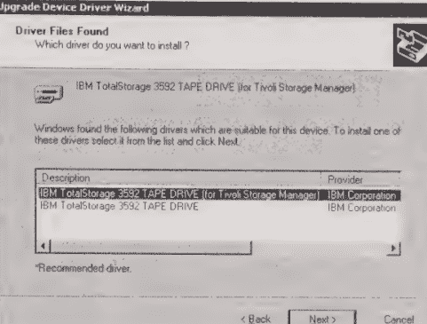

图 3-18 从列表中选择驱动程序

驱动程序向导将继续安装设备驱动程序并在安装完成后通知您，如图 3-19 所示。

### 升级设备驱动程序向导

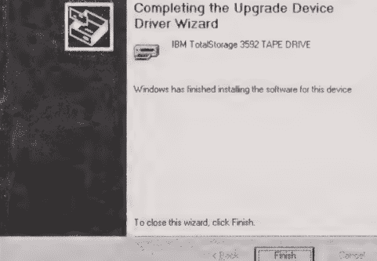

图 3-19 使用 RSM 的客户端驱动程序向导完成

## 3.3 为 Windows 2003 安装 IBM 磁带设备驱动程序

> 注意：如果您的库安装了控制路径切换（功能编号 #1680）且您希望在 Windows 2003 上启用它，请遵循第 103 页 3.4 节“控制路径切换”中的说明。

LTO 磁带库是物理连接的，Windows 2003 将在启动时尝试自动安装驱动程序。驱动程序安装向导将要求驱动程序和信息文件的位置详情。IBM 磁带库可以热插到 SCSI 或光纤适配器上；在这种情况下，您可以从设备管理器中执行硬件扫描（如第 92 页图 3-20 所示），以检测添加的设备并启动设备驱动程序安装向导。

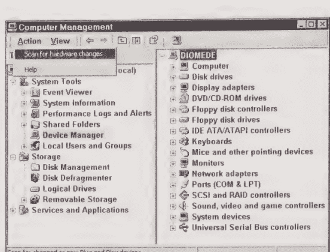

图 3-20 执行硬件扫描

执行以下步骤：

- 1. 下载并解压适用于 Windows 2003 的最新 IBM Ultrium 设备驱动程序。
- 2. 关闭系统。
- 3. 连接库库。
- 4. 重启系统。
- 5. 安装设备驱动程序。

### 下载驱动程序

按照第 80 页 3.1.1 节“确定需求”所述，获取 IBM 磁带库的最新驱动程序。

### 解压驱动程序

IBM 磁带设备驱动程序将以压缩包的形式下载。解压包（我们将使用目录 `D:\IBMdrv\6.0.82`），如第 93 页图 3-21 所示。

### 卸载旧版本

如果系统中已安装了旧版本的 IBM 磁带设备驱动程序，请先卸载它。更多详情请参见第 135 页的“从系统中移除 IBM 磁带设备驱动程序（卸载）”。

### 3.3.1 安装换库设备驱动程序

如果您安装了 IBM 3580，则不需要此步骤，因为它没有换库机。如果使用 IBM 3580，您可以转到第 86 页 3.2.2 节“安装磁带驱动设备驱动程序”。

- 1. 已连接且 Windows 2003 缺少设备驱动程序的设备应显示为未知设备。如果设备未出现，请检查前面的步骤（是否使用了正确的电缆、LVD/HVD 问题、正确的 SCSI 适配器卡）。右键点击`计算机`，选择`管理`，打开`设备管理器`，并选择`换库机`。您应该看到一个“未知换库机”或带有库型号的条目（例如，IBM3584-L22）。右键点击它并选择`属性`（第 94 页图 3-22 所示）。

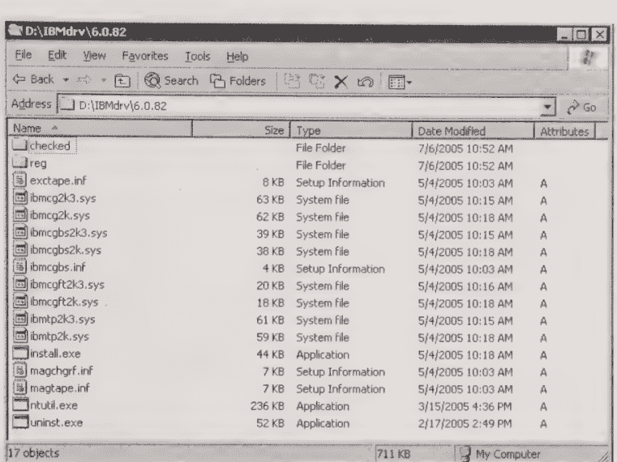

图 3-21 解压后的驱动程序包

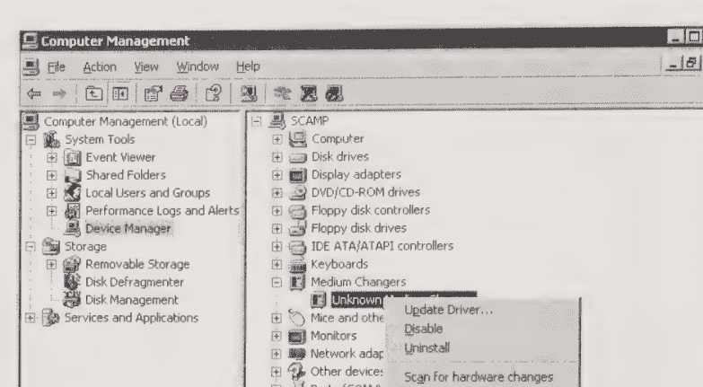

图 3-22 设备管理器窗口：预配置

- 2. 点击“驱动程序”选项卡，然后点击“更新驱动程序”（图 3-23）。

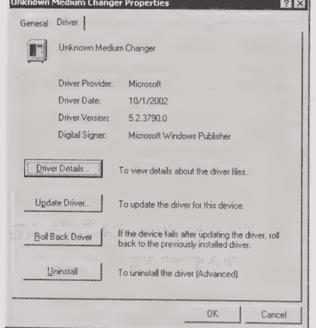

图 3-23 换库机属性窗口的驱动程序选项卡

- 3. 您将看到“硬件更新向导”（图 3-24），提示您允许向导自动安装驱动程序，或从列表或特定位置安装驱动程序。点击“`从列表或特定位置安装`”选项，然后点击“下一步”。

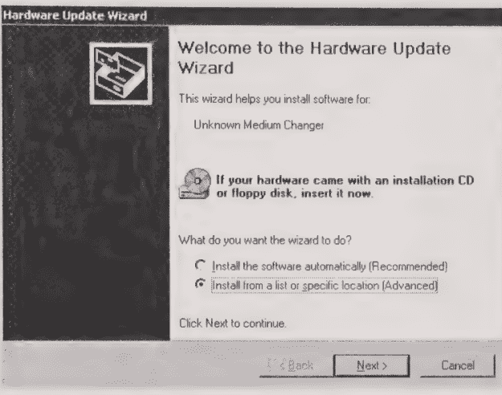

图 3-24 驱动向导安装选项

- 4. 点击“`在这些位置中搜索驱动程序`”，勾选“`包含在此位置中`”，输入包含解压文件的目录，并点击“下一步”，如图 3-25 所示。

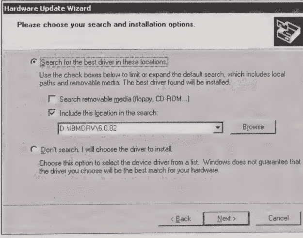

图 3-25 驱动程序向导搜索和安装选项：搜索驱动程序

- 5. 第 96 页的图 3-26 将显示提示您在向导搜索时等待。如果向导未找到驱动程序，系统将显示“无法找到设备的驱动程序”界面（如图 3-26 所示）。

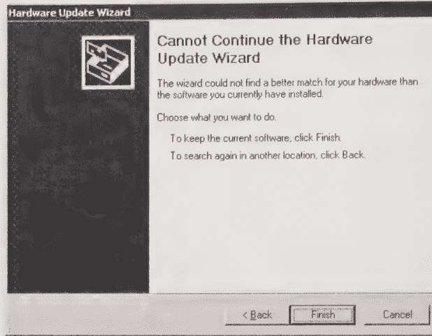

图 3-26 驱动向导：未找到驱动程序

- 6. 如果出现此情况，点击“退回”返回之前的界面（见图 3-27）。然后您可以选择“搜索”驱动驱动程序。

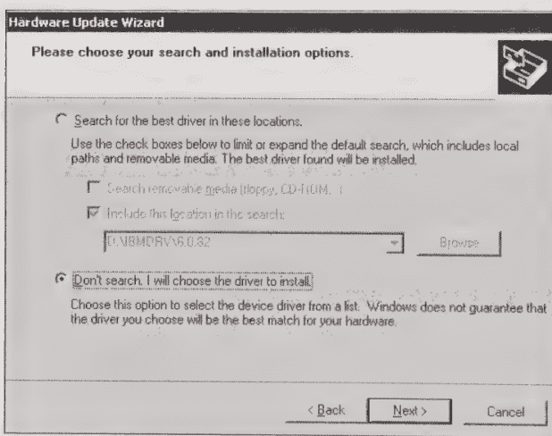

图 3-27 驱动向导：搜索

- 7. 在第 97 页的图 3-28 窗口中，输入包含解压文件的目录。

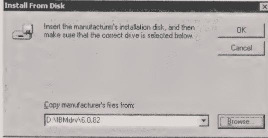

图 3-28 驱动向导：指定位置

- 8. 如图 3-29 所示，向导将找到驱动程序。除非有特定原因不安装该驱动程序，否则点击“`下一步`”。

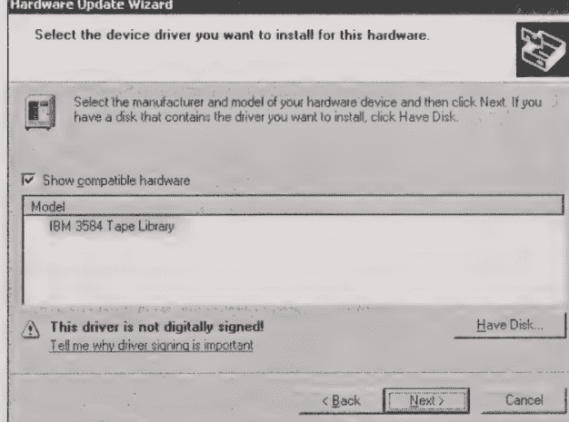

图 3-29 驱动向导：选择驱动

- 9. 如果您的是未通过 Windows 硬件质量实验室（WHQL）认证的驱动程序，将显示警告界面（见图 3-30）。点击“继续”。`注意`：IBM 发布的所有驱动程序都经过了测试，以确保其稳定。

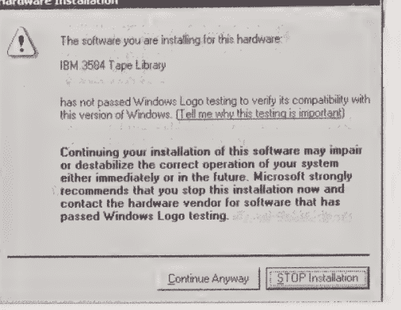

图 3-30 驱动向导：警告

- 10. 驱动程序向导将继续安装设备驱动程序并在完成后通知您，如图 3-31 所示。

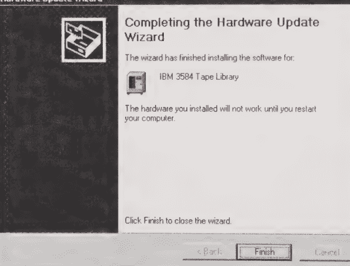

图 3-31 驱动向导：升级

### 3.3.2 安装磁带驱动设备驱动程序

磁带驱动驱动程序的安装步骤与换库机基本相同。如果使用 IBM 3583 或 3584 等多驱动库，需要为每个驱动器安装驱动程序。即使名称不同，安装过程也是相同的。请参考第 80 页 3.1.1 节“确定需求”。

### 在 Linux 和 Windows 中实现磁带

- 1. 右键点击 Windows 桌面上的“计算机”，选择“管理”。打开“设备管理器”并展开“其他设备”以显示磁带。

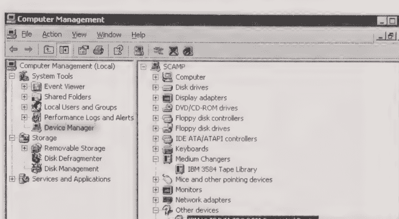

图 3-32 设备管理器：预配置

- 2. 为驱动器选择“属性”，按照与换库机相同的程序安装驱动程序。点击“驱动程序”选项卡，然后点击“更新驱动程序”（图 3-33）。

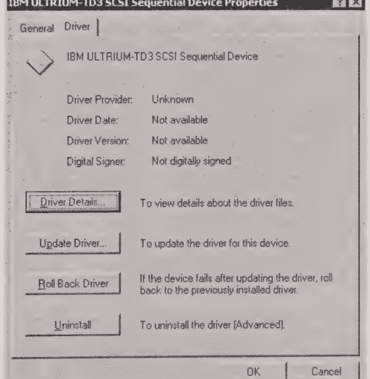

图 3-33 未配置驱动器属性窗口的驱动程序选项卡

- 3. 硬件更新向导（第 95 页图 3-24）提示您允许向导自动安装驱动程序，或从列表或特定位置安装驱动程序。点击“`从列表或特定位置安装`”选项，然后点击“下一步”。

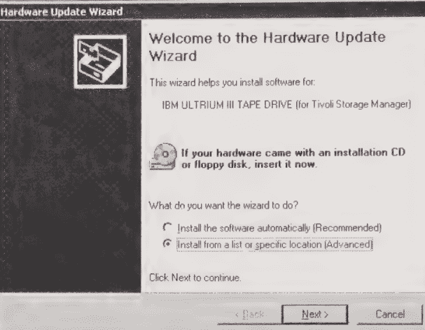

图 3-24 驱动向导：安装选项

- 4. 点击“`在这些位置中搜索驱动程序`”，勾选包含解压文件的目录，并点击“下一步”，如图 3-35 所示。

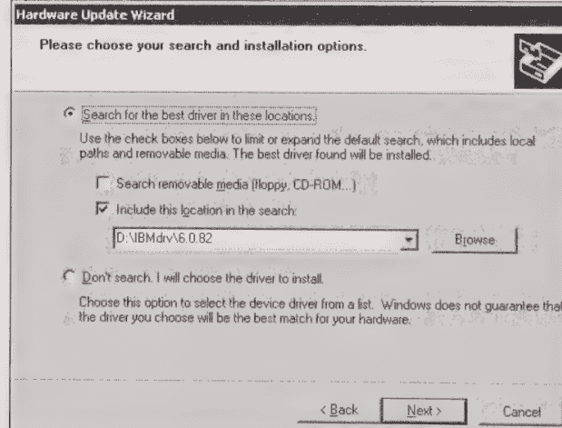

图 3-35 驱动程序向导搜索和安装选项：搜索驱动程序

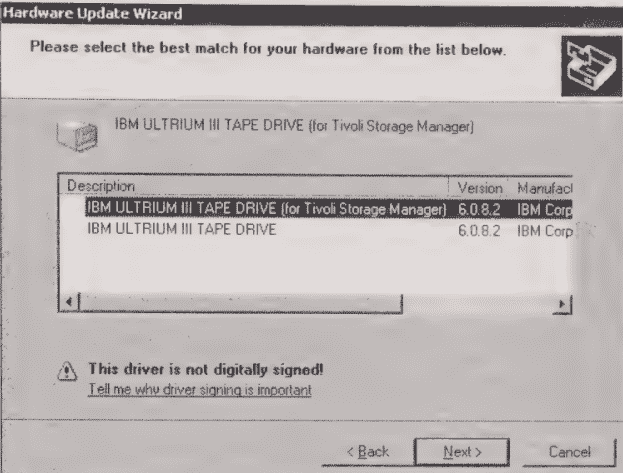

图 3-36 设备驱动程序向导：选择驱动程序

- 6. 如果您正在安装未经过微软 Windows 硬件质量实验室 (WHQL) 认证的驱动程序，将显示警告屏幕（参见图 3-37）。要继续安装驱动程序，请点击“仍然继续”。

> 注意：IBM 发布的所有驱动程序都经过了完整测试，以确保它们的稳定性并符合特定要求。

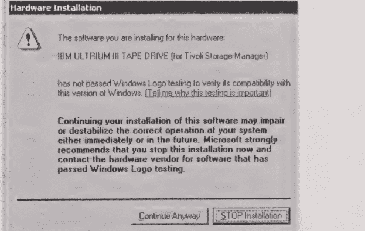

图 3-37 设备驱动程序向导：警告

- 7. 设备驱动程序向导将继续安装设备驱动程序，并在安装完成后通知您，如第 102 页的图 3-38 所示。


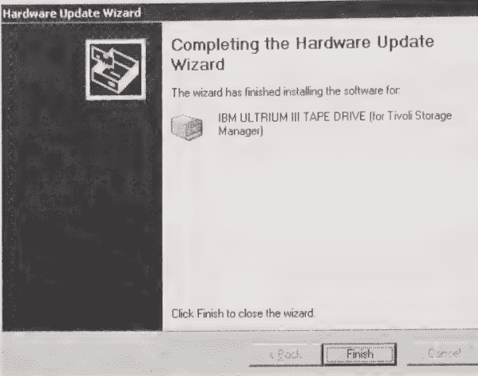

图 3-38 设备驱动程序向导完成

建议重启系统以确保驱动程序的清洁安装。

现在，您的介质更换器和磁带机应如第 120 页的图 3-64 所示。

## RSM 用户注意事项

Windows 2003 设备驱动程序允许对单个磁带机进行多次打开。这使得使用移动存储管理器 `RSM` 成为可能。系统管理员负责确保单个磁带机不会同时被多个一个应用程序访问，以防止潜在的数据丢失。

该驱动程序有两个版本可供选择。禁止在单个磁带机上多次打开的版本带有文本字符串 `for Tivoli Storage Manager`，而允许在单个磁带机上多次打开的版本则*不包含*文本字符串 `for Tivoli Storage Manager`。IBM 强烈建议无论您是否为 Tivoli 客户端，都使用 `for Tivoli Storage Manager` 的驱动程序，以防止访问磁带时可能导致的数据损坏或丢失。但是，如果您正在使用 `RSM`，则必须使用另一个驱动程序，并采取措施防止多次打开磁带机。

安装磁带设备驱动程序时，请遵循与非 `RSM` 用户相同的说明（参见第 98 页 3.3.2 节“安装磁带设备驱动程序”）。“选择最佳匹配”将在安装过程中提示您在驱动程序之间进行选择（Tivoli Storage Manager 驱动程序或非 Tivoli Storage Manager 驱动程序）（位于第 103 页的图 3-39）。选择非 Tivoli Storage Manager 驱动程序并点击`下一步`。其余指令与第 98 页 3.3.2 节“安装磁带机设备驱动程序”中描述的相同。

## 3.4 控制路径切换

IBM 介质更换器设备驱动程序的控制路径切换 `CPF` 功能提供了一种机制，使得发送到介质更换器故障控制路径的命令可以切换到正常控制路径。在 Windows 2000 和 Windows Server 2003 上，此支持除了介质更换器驱动程序 `ibmcxx.sys`（“基础”驱动程序）外，还需要系统中运行两个内核级驱动程序。如果提供 `CPF` 支持，基础驱动程序将无法操作更换器。

启用 `CPF` 支持所需的两个额外驱动程序之一是过滤驱动程序，它将通过 `magchgrf.inf` 自动安装（而不是用于安装基础驱动程序的 `magchgrf.inf` 文件）。根据驱动程序的版本，解压时您可能需要这些文件之一或两者。另一个额外程序是名为更换器总线枚举器的虚拟软件总线，它必须在安装基础和过滤驱动程序之前安装。由于它是虚拟总线，因此没有硬件插入，Windows 也不会通过标准的插用协议识别新硬件的存在。

IBM 介质更换器控制路径切换 `CPF` V6.0.8.2 及更高版本对驱动程序进行了重大架构更改，无论您的环境是否包含该功能的支持，这些更改都会生效。引入了新的驱动程序安装程序。特别是任何平台上的更换器驱动程序都需要安装三个 `.sys` 文件及其相应的 `.inf` 文件：

- `ibmcgbs.sys`（由 `ibmcgbs.inf` 安装）

- `ibmcgxx.sys` 和 `ibmagchftxx.sys`（由 `magchgrf.inf` 安装）

名称中的 'xx' 后来指 2k 或 3k。

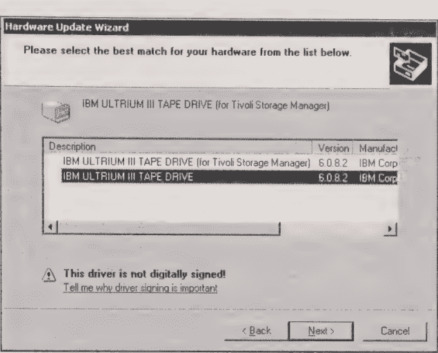

图 3-39 安装 RSM 版本请选择列出的第二个驱动程序

如果您安装了控制路径切换，则还必须配置库。有关配置的信息，请参见第 103 页 3.4 节“控制路径切换”。

关于如何安装 `ibmcgsxx.sys` 的说明包含在 `CPF_install.doc` 文档。另外两个 `.sys` 文件的安装遵循 IBM Ultrium 设备驱动程序安装和用户指南（GA32-0430）中 Windows 200x 的说明。

为了降低复杂性，`install.exe` 文件包含在 `CPF_install.doc` 中。但在编写时，存在以下限制：

- 它可能在低于 V6.0.8 的 Windows 上无法正常工作。

- 它可能需要重启。

- 它 必须从命令行运行。

> 注意：建议检查 `CPF` 的最新版本。

- 当 Windows 发现库后，双击该目录下的 `install.exe`。

- 2. 如果设备未显示，请尝试重新扫描（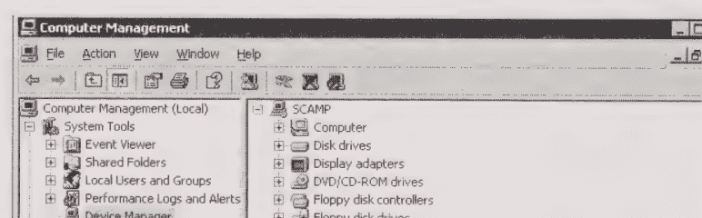 图 40）。

- 3. 如果设备显示为“未知”（第 105 页），检查驱动程序。

## 安全警报 - 驱动程序安装

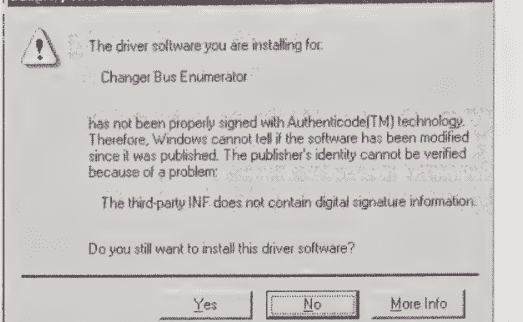

**图 3-43** Changer Bus Enumerator（更改器枚举器）安装警告

- 5. 如果您正在安装未经过 Windows 硬件质量实验室（WHQL）认证的驱动程序，将看到警告屏幕（参见图 3-44）。要继续安装驱动程序，请点击`仍然继续`。

> **注意：** IBM 发布的所有驱动程序都经过了完整测试，以确保它们稳定并符合特定要求。

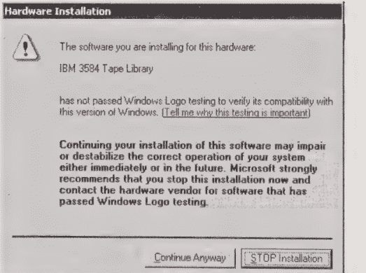

**图 3-44** 驱动程序安装认证警告

- 6. 安装过程结束后，对话框将指示安装已完成。

在之前列出的限制范围内，虚拟和实际硬件已正确安装在您的系统上。

要继续进行库安装过程，请参见第 82 页的3.2 节“为 Windows 2000 安装 IBM 磁带设备驱动程序”或第 91 页的3.3 节“为 Windows 2003 安装 IBM 磁带设备驱动程序”。

## 3.4.2 使用 CPF_install.doc 安装 CPF 驱动程序

> 注意：如果您拥有 V6.0.8.2.sys 或更高版本的驱动程序，可以使用第 104 页3.4.1 中的“使用 install.exe 安装 CPF 驱动程序”。

IBM 质更改设备驱动程序的 `CPF` 功能提供了一种机制，发送到质库故障控制路径的命令可以切换到工作的控制路径。在 Windows 2000 和 Windows Server 3003 上，除了质更改器驱动程序 `ibmcgxx.sys`（“基础”驱动程序）外，系统还需要运行两个内核级设备驱动程序。如果不支持 `CPF`，基础驱动程序即可操作更改器。

启用 `CPF` 支持所需的两个附加驱动程序之一是：如果使用 `magchgrf`（而非 `magchgrf`）文件进行基础驱动程序安装，则该驱动程序将自动安装。取决于您使用的驱动程序版本，解压时可能会看到其中一个或两个文件。另一个附加驱动是虚拟软件总线，称为 Changer Bus Enumerator。Changer Bus Enumerator 必须在安装基础驱动程序和过滤器程序之前。由于它是虚拟总线，不会有硬件插入，Windows 不通过标准的即插即用协议识别新硬件的存在。将使用控制面板的“添加/删除硬件”功能来指示系统识别虚拟硬件。文档概述了安装 Changer Bus Enumerator 所需的程序。

请注意，所示截图与系统上向导显示的窗口之间可能存在细微差异。另有说明，文档基于 Windows Server 2003 的外观和感受。这与 Windows 2000 非常相似，足以消除困惑。

这些说明假设您已获得支持 `CPF` 的 IBM 磁带设备驱动程序（`IBMTapeW32_xxxx.zip` 或 `IBMTapeW64_xxxx.zip`）并将其解压到 `c:\driver_install` 目录。系统上的任何目录都可以，但当系统提示您指定驱动程序位置时，您需要指定该目录。

- 1. 如果系统中已安装 IBM 质更改设备驱动程序，您必须卸载它。右键点击“我的电脑”，选择“管理”，并进入“设备管理器”。在“质更改器”子项下，右键点击每个设备并选择“卸载”。在“系统设备”子项下，如果有名为 Changer Bus Enumerator 的项，右键点击该项并全部卸载。然后运行驱动程序安装包中的 `uninst.exe`。

- 2. 从控制面板，双击“添加/删除硬件”（Windows 2000）或“添加硬件”（Windows Server 2003）。这将启动“添加硬件向导”（第 108 页图 3-45）。点击“下一步”。

## 添加硬件向导

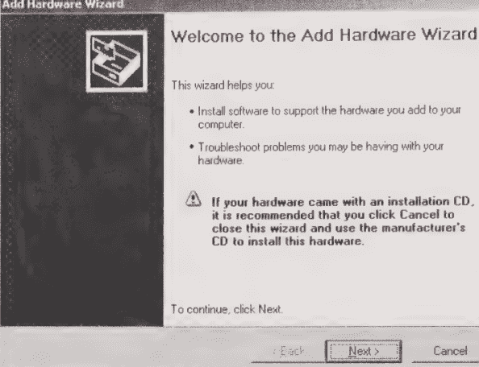

此向导可以帮助您：

- 安装支持计算机硬件的软件

- 解决您的硬件出现问题

如果您的硬件带有安装光盘，建议点击“取消”关闭此向导并使用厂商光盘安装此硬件。

要继续，点击“下一步”。

图 3-45 窗口

- 3. 如果运行 Windows 2000，图 3-46 会提示您添加/排除故障或卸载/拔出设备。

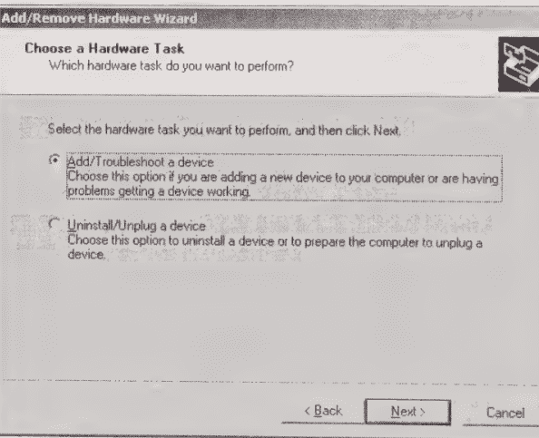

图 3-46 添加/删除窗口


### 4. Windows 现在搜索如第 109 页图 3-47 所示即插即用硬件。几秒钟内，如果您已连接硬件，将收到提示。选择“我已连接了硬件”并点击“下一步”（第 109 页图 3-48）。

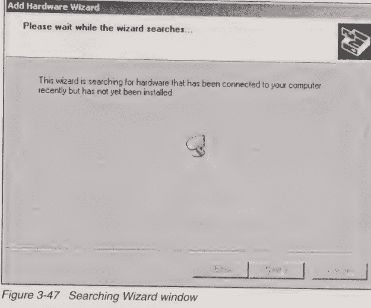

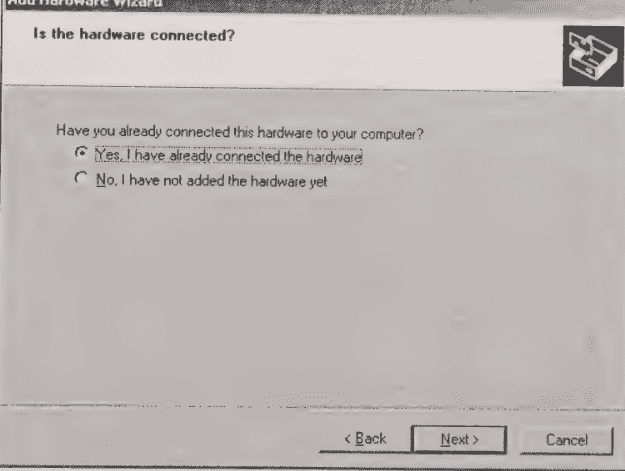

### 5. 显示已安装硬件列表。选择“添加新硬件”并点击“下一步”（参见第 110 页图 3-49）。

#### 添加硬件向导

以下硬件已安装在您的计算机上

从下方选择已安装的设备，然后点击“下一步”检查属性或解决您可能遇到的问题。要添加列表中未显示的硬件，点击“添加新硬件”。

已安装硬件：

| IBM 0359J2A SCSI 设备 |

| IBM ULT 3590-TD2 SCSI 设备 |

| IBM ULT 3590-TD2 SCSI 设备 |

| VIA lite USB 通用主机控制器 |

添加新硬件

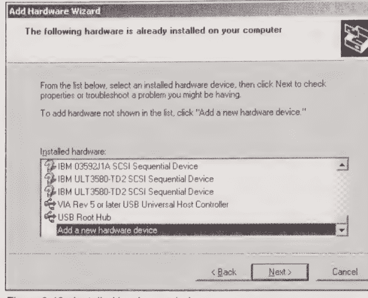

图 3-49 安装硬件窗口

### 6. 在图 3-50 上，会被要求让系统搜索并安装硬件或从列表中手动选择硬件。选择**从列表中手动选择硬件**并点击**下一步**。

#### 添加硬件向导

向导可以帮助您安装其他硬件。

向导可以搜索并自动为您安装。或者，如果您确切知道要安装的硬件型号，可以从列表中选择。

您想让向导做什么？

- 自动搜索并安装硬件（推荐）
- 从列表中手动选择硬件（高级）

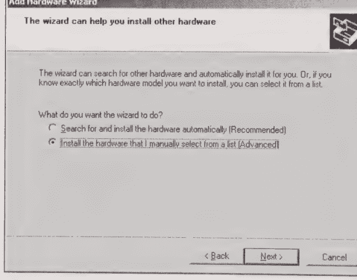

图 3-50 硬件位置

### 7. 显示硬件类列表。选择**系统设备**并点击**下一步**（参见第 111 页图 3-51）。

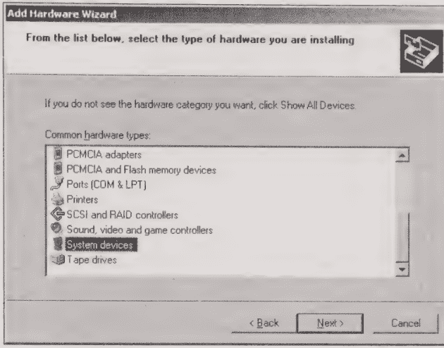

图 3-51 硬件类

### 8. 显示建议系统设备列表。此列表的实际内容随系统而异。选择**光盘...**（图 3-52）。

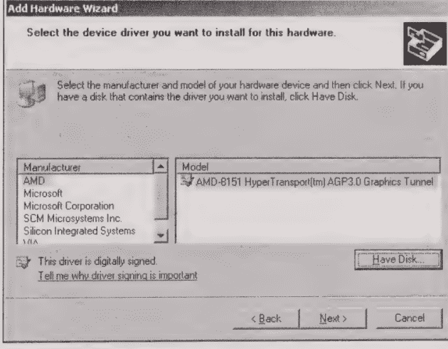

图 3-52 系统设备

### 9. 在第 112 页的图 3-53 中，输入 Changer Enumerator 的 .inf 文件目录并点击确定。我们把 zip 文件解压到 `c:\driver_install`，因此我们进入此目录。

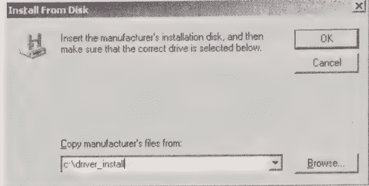

图 3-53 inf 文件位置

### 10. 图 3-54 显示了包含一个项目的硬件列表：Changer Bus Enumerator。确保选中了 **Changer Bus Enumerator** 并点击**下一步**。

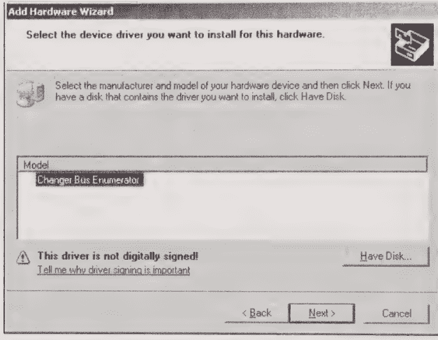

图 3-54 找到 Changer Bus Enumerator

### 11. 验证您要安装 Changer Bus Enumerator。点击**下一步**（第 113 页图 3-55）。


### 12. 如果您正在安装未经过 Windows 硬件质量实验室（WHQL）认证的驱动程序，将看到警告屏幕（图 3-56）。要继续安装驱动程序，选择“是”。

### 13. 如果驱动程序安装正确，将打开第 114 页的图 3-57，指示 Windows 已完成软件安装。点击“完成”。

#### 添加硬件向导


图 3-57 完成向导

### 14. 要验证更改总线枚举器（Changer Bus Enumerator）已正确安装，右键点击**我的计算机**，选择**管理**，并进入**设备管理器**。更改总线枚举器将列在系统设备下，如图 3-58 所示。


图 3-58 设备管理器

### 15. 一旦安装了更改总线枚举器，必须安装基础驱动程序/过滤器对。

要继续库安装过程，请参见第 82 页的 3.2 节“为 Windows 2000 安装磁带驱动程序”或第 91 页的 3.3 节“为 Windows 2000 安装磁带设备”，但有一个例外：不要使用 `driver_install` 目录下的 `setup.inf` 安装驱动程序。

## 禁用控制路径故障转移

要在安装后禁用 CPF 功能以使驱动程序以单路径模式运行，请双击驱动程序安装包中的 `DisableCPF.reg` 并重启。要重新启用该功能，请双击 `EnableCPF.reg` 并重启。

## 3.4 在库中配置控制路径故障转移

在安装了 CPF 所需驱动程序后（参见 3.4 节“控制路径故障转移”），您需要对库进行 CPF 配置。LTO 或 IBM 3592 驱动程序可以可选地配置到同一逻辑库的多路径，并在其中一条路径发生永久性错误时自动故障转移到备用路径。这对于运行的应用程序是透明的。控制路径故障转移是一个可选功能，必须通过许可证启用。

例如，考虑一种在 Windows 2000 主机上带有 HBA 的多路径架构，通过两个驱动器连接到库。每个驱动器都启用了控制路径功能。第一个 HBA 连接到第一个驱动器，第二个 HBA 连接到第二个驱动器。这种配置提供了在当从 HBA 到库的某条路径失败时指向同一库的两个物理控制路径（每个冗余一个）。当启动 Windows 2000 器时，HBA 检测到到库的控制路径并配置了两个更改器（`changer0` 和 `changer1`）；但是，应用程序一次只能打开和使用一个逻辑设备，即 `changer0` 或 `changer1`。

在没有 LTO 或 3592 驱动程序备用路径的情况下，发生备用路径错误（例如由于 HBA、电缆或驱动器控制路径故障），向库的当前命令将失败。可以通过将设备路径更改为备用路径（`changer1`）来启动手动故障转移，但这是一项手动操作，并且必须重新发送失败的命令。

当在 `changer0` 和 `changer1` 上都启用备用路径时，设备驱动程序将它们配置为具有多个路径的单一设备。应用程序仍然一次只能打开和使用一个逻辑设备（`changer0` 或 `changer1`）。如果应用程序遇到永久性路径错误，当前操作将在备用路径上继续，而不会中断应用程序。

**重要：** 在 LTO 或 IBM 3592 设备驱动程序中启用备用路径支持之前，必须在库（IBM 3582, 3583 和 3584）上安装并启用库控制路径故障转移功能代码 1680。此外，您必须使用库的操作面板或 TotalStorage Specialist 启用库上额外驱动器的控制路径。这在第 116 页的“启用备用控制路径”（适用于 3582, 3583 和 3584）。

## 启用额外的控制路径

以下三个部分显示了如何通过操作面板或 TotalStorage Specialist 为 3582、3583 和 3584 启用额外的控制路径。

### 在 IBM 3582 上启用额外的控制路径

Access Mode（访问模式）允许您设置控制路径故障转移和额外的控制路径。从 Setup 菜单选择 SCSI/Fiber Option，然后选择 Access Mode。高亮 Failover 并将其切换到 Add paths。然后选择 Enabled（见图 3-59）并退出 Setup 菜单。


图 3-59 IBM 3582: 启用控制路径

### 在 IBM 3583 上启用额外的控制路径

要启用一个或多个驱动器的控制路径，请从 Operator panel -> Setup -> Drives -> SCSI 选择。选择您想要启用控制路径的驱动器，并将控制路径设置为 0，如图 3-60 所示。


图 3-60 IBM 3583: 启用额外的控制路径

### 在 IBM 3584 上启用额外的控制路径

要在 IBM 3584 上使用操作面板启用额外的控制路径，请选择 Menu -> Settings -> Control Paths -> Change Control Paths，并选择您想要启用控制路径的驱动器。

使用 Tape Library Specialist 启用额外的控制路径，请执行以下操作：

1. 选择 **Manage Drives** → **Drive Assignments**


2. 在 **Drive Assignments** 页面，点击 **Continue**（见图 3-64）选择您想要启用或禁用的备用路径驱动器。在示例中，选择了驱动器 2703。*不要*选择带有带的驱动器，例如示例中的 2702。

3. 点击 `Apply` 按钮。

4. 显示 `Operation Progress`，随后显示操作完成的 `Success` 界面。点击 **Close**。

5. `Drive Assignment` 屏幕重新显示（见第 118 页图 3-62）。

| 选择 | 帧 | 行 | 类型 | 逻辑设置 |
|---|---|---|---|---|
| ○ | 1 | 1 | LTO | 1-01 |
| ○ | 1 | 2 | LTO | 1-01 |
| ○ | 1 | 3 | LTO | 1-01 |
| ○ | 1 | 4 | LTO | 2-04 |
| ○ | 1 | 5 | LTO | 2-04 |
| ○ | 1 | 6 | LTO | 3-06 |

## IBM 3584 高可用性

IBM 3584 已经提供了许多高可用性选项，如 TotalStorage Tape Guide for Open Systems（SG24-5946）所示。

通过使用控制路径故障转移，可以实现完全冗余的配置，如第 119 页图 3-63 所示。

您还应该考虑并在冗余组件上连接额外的控制路径：

- SAN 交换机
- SAN 网络
- 服务器 HBA

如果您具有多帧配置，请在不同的帧上启用额外的控制路径，这样当第一帧丢失电源时，您仍然可以使用库。在第 119 页图 3-63 中，第二个控制路径在第二个帧上启用，并通过独立的 SAN 交换机和网络（交换机之间没有互连）连接到第二个 HBA。如果发生任一情况，您仍然可以使用库：

- 第一帧丢失电源。
- 第一帧中的驱动器宕机。
- 驱动器与交换机或交换机与 HBA 之间的 FC 电缆损坏。
- 某个交换机故障。
- 一个 SAN 网络宕机。
- 一个 HBA 损坏。

## 3.5 验证 IBM 磁带设备安装

带库器和磁带设备的 IBM 磁带设备驱动程序可以通过设备管理器进行初始验证。要查看任何已的磁带设备和带库器，右键点击桌面上的“我的电脑”，然后选择管理 → 设备管理器。

- 1. 要确定是否存在 LTO 设备，请查看带库器和磁带设备（第 120 页图 3-64）。请注意，如果您安装了 IBM 3580 独立设备，则不会列出带库器。所有其他 358x 型号都有带库器设备项。

图 3-63 IBM 3584 上的高可用控制路径配置

图 3-64 设备管理器中的 IBM 磁带设备

- 2. 右键点击设备并选择**属性**。如果配置正确，此窗口应显示制造商为“IBM Corporation”（图 3-65），驱动程序提供程序为“IBM Corporation”，以及您所用版本的驱动程序（第 121 页图 3-66）。

图 3-65 驱动程序详细信息

设备的驱动程序级别显示图 3-66 中的**驱动程序**选项卡中。请注意，该驱动程序尚未通过微软的数字认证，但仍受 IBM 支持。

## IBM ULTIMUM-TD3 SCSI 顺序设备属性

| 通用 | 磁带符号名称 | 驱动器参数 | 驱动程序 | 详细信息 |
| :--- | :--- | :--- | :--- | :--- |
| IBM ULTIMUM-TD3 SCSI 顺序设备 | | | | |
| 驱动程序提供程序 | IBM Corporation | | | |
| 驱动日期 | 5/3/2005 | | | |
| 驱动程序版本 | 6.0.2 | | | |
| 数字签名者 | 未数字签名 | | | |
| 查看驱动程序文件详细信息 | | | | |
| 更新驱动程序 | 更新此设备的驱动程序 | | | |
| 回滚驱动程序 | 如果设备在更新驱动程序后故障，请回滚到以前安装的驱动程序 | | | |
| 卸载 | 卸载驱动程序（高级） | | | |

## IBM 3584 磁带库属性

| 通用 | 驱动程序 | 详细信息 |
| :--- | :--- | :--- |
| IBM 3584 磁带库 | | |
| 驱动程序提供程序: IBM Corporation | | |
| 驱动日期 | 5/3/2005 | | |
| 驱动程序版本 | 6.0.2 | | |
| 数字签名者 | 未数字签名 | | |
| 查看驱动程序文件详细信息 | | | |
| 更新驱动程序 | 更新此设备的驱动程序 | | |
| 回滚驱动程序 | 如果设备在更新驱动程序后故障，请回滚到以前安装的驱动程序 | | |
| 卸载 | 卸载驱动程序（高级） | | |

图 3-66 驱动程序选项卡

- 3. 要查看驱动程序文件详细信息，点击**驱动程序详细信息**（图 3-67）。

## 驱动程序文件详细信息

| IBM ULTIMUM-TD3 SCSI 顺序设备 | |
| :--- | :--- |
| 驱动程序名称 | |
| `C:\Windows\System32\DRIVERS\vnkp3.sys` | |
| `C:\Windows\System32\vntutil.exe` | |
| 提供程序: IBM Corporation | |
| 文件版本: 6.0.2 编译自: WinDOK | |
| 版权: Copyright (c) 2000-2005 IBM Corporation | |
| 数字签名者: 未数字签名 | |

## IBM 3584 磁带库

| IBM 3584 磁带库 | | | |
| :--- | :--- | :--- | :--- |
| 驱动程序名称 | | | |
| `C:\Windows\System32\DRIVERS\vnkp3.sys` | | | |
| `C:\Windows\System32\vntutil.exe` | | | |
| 提供程序: IBM Corporation | | | |
| 文件版本: 6.0.2 编译自: WinDOK | | | |
| 版权: Copyright (c) 2000-2005 IBM Corporation | | | |
| 数字签名者: 未数字签名 | | | |

图 3-67 驱动程序文件详细信息

您现在可以使用 `NTUTIL` 工具来测试磁带库。此工具允许您打开设备、发出查询命令、读取和写入以及在磁带库内移动介质，以确保设备配合安装的驱动程序正常运行和操作。

## 3. Windows 基础 IBM 磁带设置

### 3.5.1 使用 NTUTIL 测试磁带库

`NTUTIL` 是随 IBM 磁带带库器和设备驱动程序一起提供的工具。它可以用于执行若干功能，包括：

- 读和写操作
- 介质装载和卸载
- 微代码更新
- 强制驱动程序转储
- 发送并获取 SCSI 命令状态，并从遇到错误的命令中检索感应数据

对于我们的目的，我们使用 `NTUTIL` 测试基本操作，作为验证 IBM 磁带设备是否正确安装的方法。

请注意，选项 8 用于库模式（Library Mode）。这表示 `NTUTIL` 正在基础模式运行。要切换到库模式，显示第 124 页示例 3-3 中的菜单，选择 8: 库模式。

## 示例 3-9 NTUTIL 手动测试菜单（库模式）

工具版本 6.0.7.4

变量设置

```
==================== LIBRARY MODE ====================
tape-special-file-name: tape0,changer-special-file-name: Changer0
gp->fd=0xFFFFFFFF block size=1024 block count=1
hex block=0x000000000000000
return_when_fail 1 exit from unexpected_result 0 trace_flag 0

======================================================
```

手动测试菜单：


```
=====================================================
1: 设置设备特殊文件               2: 显示符号
3: 设置读/写大小 (当前固定为10)
5: 设置失败时返回错误             6: 设置/重置跟踪
7: 设置意外结果触发               8: 模式 (Base Mode)
=====================================================
10: 返回库清单             11: 移动介质
12: 初始化元素状态         13: 获取换库参数
15: 获取换库总线信息
=====================================================
20: 打开                               21: 关闭
22: 读取                               23: 写入
24: 读取并显示块
26: 读取块                          27: 擦除
28: 块 ID                            29: 显示块数据
=====================================================
30: 写入磁带                    31: 回卷
32: 向进移动磁带         33: 卸载
34: 反退移动磁带         35: 加载
36: 向进移动记录          37: 返回错误
38: 反退移动记录          39: 测试单元就绪
43: 设置介质参数 (块大小)
46: 获取设备信息           44: 设置设备参数 (压缩)
48: 获取介质信息            47: 恢复数据
50: 轮询注册设备           49: 查询
53: 0                             54: 显示消息
======================================================
```

### 70: 系统命令

```
=====================================================
80: 强制转储 (Force Dump)         81: 读取转储 (Read Dump)
82: 更新微代码                83: 日志感知 (Log Sense)
84: 获取上次感知                    85: 获取版本
86: 关联/持久性写保护  87: 读写测试
88: 列出注册设备        89: 获取 MDevice 信息
======================================================
```

### 99: 返回主菜单

```
======================================================
```

输入选择：

要查看已安装的库和设备，请选择 `88: 列出注册设备`。介质换库设备被赋予设备特殊名称 `Changer`，磁带驱动器显示为 `Tape`。每个设备的总线（bus）、目标和 LUN 也会在此显示。第 125 页的示例 3-4 显示了使用 SCSI 挂载列出的设备，第 125 页的示例 3-5 显示了 SAN 挂载的设备列表。

124 在 Linux 和 Windows 中实现 IBM 带

### 示例 3-4 SCSI 总线上的注册设备

```
输入选择: 88
找到设备: Changer0@"Scsi Port 3\Scsi Bus 1\Target Id 0\Logical Unit Id 1
找到设备: Tape0@"Scsi Port 3\Scsi Bus 1\Target Id 0\Logical Unit Id 2
找到设备: Tape1@"Scsi Port 3\Scsi Bus 1\Target Id 0\Logical Unit Id 4
总耗时（秒） = 0.00
返回继续:
```

### 示例 3-5 SAN 上的注册设备

```
输入选择: 88
找到设备: Tape0@"Scsi Port 2\Scsi Bus 0\Logical Unit Id 0
找到设备: Changer0@"Scsi Port 2\Scsi Bus 1\Target Id 2\Logical Unit Id 1
找到设备: Tape1@"Scsi Port 2\Scsi Bus 0\Target Id 3\Logical Unit Id 0
找到设备: Tape2@"Scsi Port 2\Scsi Bus 0\Target Id 4\Logical Unit Id 0
找到设备: Changer1@"Scsi Port 2\Scsi Bus 0\Target Id 4\Logical Unit Id 1
找到设备: Tape3@"Scsi Port 2\Scsi Bus 1\Target Id 5\Logical Unit Id 0
总耗时（秒） = 0.00
返回继续:
```

要执行任何操作，您通常需要打开所需的设备（选择 `1: 设置设备特殊文件`，然后从设备列表中选择相应的设备，并用 `20: 打开` 打开它）。示例 3-6 和示例 3-7 显示了这些选择。

### 示例 3-6 选择特殊设备文件

```
=====================================================
输入选择: 1
输入设备特殊文件（磁带路径）名称或按回车不更改: tape1
总耗时（秒） = 6.00
返回继续:
```

### 示例 3-7 对选定的特殊设备文件执行打开调用

```
=====================================================
输入选择: 20
输入打开模式 (1) RW (2) RO: 1
特殊文件 (\.tape1) 将被打开
调用用 analyze() 时，rc 11 err 0 (ERROR_SUCCESS) data 0
总耗时（秒） = 1.00
返回继续:
```

要测试介质换库器（Medium Changer），我们将磁带加载到驱动器中，对其进行读/写测试，然后卸载磁带。首先选择库模式并打开设备。默认情况下，除非覆盖，否则将选择 `changer0` 和 `tape0`。选择 `20`：情况下打开了 `tape1`，因为它在示例 3-6 中已选中。

### 示例 3-8 打开选定的设备文件

```
=====================================================
输入选择: 20
输入打开模式 (1) RW (2) RO: 1
特殊文件 (\.changer0) 将被打开
调用 analyze() 时，rc 11 err 0 (ERROR_SUCCESS) data 0
总耗时（秒） = 1.00
返回继续:
```

工具版本 5.0.7

变量设置

```
==========================
tape-special-file-name: tape0,changer-special-file-name: changer0
机器类型 IBM 3584
SCSI ScatterGather = 65 (MaxBlockSz = 26144), AlignmentMask = 0
MAX_TRANSFER = 65536
gp->fd=0000384 gp->fd=1000384 block size=1024 block count=1
hex block = 000000000000000
return_when_fail 1 exit_on_unexpected_result 0
==========================
```

手动测试菜单：

要显示关于介质换库器的信息，请选择 `13: 获取换库参数`，如如示例 3-9 所示。

### 示例 3-9 获取换库参数


```
输入选择: 13
NumberTransports: 2, FirstTransport: 0x001
NumberStorageElements: 150, FirstStorageElement: 0x0b1
NumberIEElements: 1, FirstIEElement: 0x0000
NumberDataTransferElements: 2, FirstDataTransferElement: 0x0c3
Features0:
Features: 0x00000000
Features:
CHANGER_BARCODE_SCAN_INSTALLED
CHANGER_ELEMENT_WITH_STATE
CHANGER_CHANGE_MEDIA
CHANGER_POSITION_TO_ELEMENT
CHANGER_REPORT_STATE
CHANGER_STORAGE_DRIVE
CHANGER_STORAGE_REPORT
CHANGER_STORAGE_SLOT
CHANGER_PREDISMOUNT_EJECT
CHANGER_SERIAL_NUMBER_VALUE
调用 `analyze()` 时，`rc` 1 `err` 0 (`ERROR_SUCCESS`) `data` 0
```

（此处省略内容）

要移动换库器，您需要知道介质的源地址和目标地址。这些地址通过选择 `10`: 返回库获得，如第 127 页的示例 3-10 所示。地址以十六进制格式给出，并使用 `move` 命令输入。每个条目以十六进制格式显示。元素类型分类如下：

- `MTE`: 介质传输元素（拾取器）
- `SE`: 存储元素（槽位）
- `IEE`: 导入/导出元素（介质 I/O 槽）
- `DTE`: 数据传输元素（驱动器）

命令输出（第 127 页的示例 3-10）显示 3583 库中有 `MTE`（磁带拾取器）、12 个 I/O 槽（`IEE`）、两个驱动器（`DTE`）和 42 个存储槽（`SE`）。每个条目还会显示是否存在磁带（通过指示满或空）。

### 示例 3-10 返回库清单

```
输入选择: 10
Type: MTE, 0x00000000, Empty
Type: MTE, 0x00000001, Empty
Type: DTE, 0x00000000, Access TgtId: 021
Type: DTE, 0x00000001, Access TgtId: 022
Type: SE, Addr: 0x00000000, Full Access
Type: SE, Addr: 0x0000001, Full
Type: SE, Addr: 0x00000002, Empty Access
Type: SE, Addr: 0x00000003, Empty Access
Type: SE, Addr: 0x00000004, Empty Access
Type: SE, Addr: 0x00000005, Empty Access
Type: SE, Addr: 0x00000006, Empty Access
Type: SE, Addr: 0x00000007, Empty Access
Type: SE, Addr: 0x00000008, Empty Access
Type: SE, Addr: 0x00000009, Empty Access
Type: SE, Addr: 0x0000000a, Empty Access
Type: SE, Addr: 0x0000000b, Empty Access
Type: SE, Addr: 0x0000000c, Empty Access
Type: SE, Addr: 0x0000000d, Empty Access
...
Type: SE, Addr: 0x0000000e, Empty Access
Type: SE, Addr: 0x0000000f, Empty Access
Type: SE, Addr: 0x00000090, Empty Access
Type: SE, Addr: 0x00000091, Empty Access
Type: SE, Addr: 0x00000092, Empty Access
Type: SE, Addr: 0x00000093, Empty Access
Type: SE, Addr: 0x00000094, Empty Access
Type: SE, Addr: 0x00000095, Empty Access
Type: ???, Addr: 0x00000000, Empty
调用 analyze() 时，rc 1 err 0 (ERROR_SUCCESS) data 0
总耗时（秒） = 1.00
返回继续:
```

你可以看到磁带在槽位（`SE`）`0x00000000`，且状态为全访问（Full Access）。这是我们在示例中想要移动的磁带。我们将该磁带加载到磁带驱动器中，特别是地址为 `00000001` 的 `DTE`（磁带驱动器）。

示例 3-11 显示了如何将磁带移动到库中的槽位并移动到驱动器中。我们选择了选项 `11`: `ioctl` 移动介质。

### 示例 3-11

```
输入选择: 11

source type (moving): 2 = SE, 3 = IEE, 4 = DTE:2

source address moving from: 00000000

destination type (moving to): 2 = SE, 3 = IEE, 4 = DTE:4

destination address moving to: 00000001

execute medium medium type = 2, saddr = 0, dtype = 4, daddr = 1

调用 analyze() 时，rc 1 err 0 (ERROR_SUCCESS) data 0

总耗时（秒） = 30.00

返回继续:
```

一旦磁带已装载（由 `ERROR_SUCCESS` 输出指示），您就可以对带带执行读/写测试 (`87`)（示例 3-12）。请注意，这将覆盖磁带上的任何数据；`NTUTIL` 不与任何应用程序交互，因此它不知道磁带上是否具有有效数据。因此，请在执行此操作时小心选择磁带。

### 示例 3-12 读/写测试

```
enter select: 87

 will rewind and rewrite on tape! Are you sure?? Y or N

tutil execute_command_read_write test

Rewind Ok, set blocksize to 32K

rewinding

Set Block Size OK, writing 32K

32K OK, rewinding

Rewind After OK, reading data

Read After OK, comparing data

analyze() called with rc err 0 (ERROR_SUCCESS) data 0

Total elapsed time in seconds = 6.00

Return to continue:
```

如示例 3-12 所示，磁带已成功写入。现在我们可以通过选择 `33`：卸载（Unload），然后选择 `11`：移动设备（move device）来卸载带带，但此时源和目的元素与加载操作相反，带带将从驱动器移回原始槽位（示例 3-13 和 示例 3-14）。

### 示例 3-13 卸载

```
enter select: 33

analyze() called with rc err 0 err (ERROR_SUCCESS) data 0

Total elapsed time in seconds = 23.00

Return to continue:
```

### 示例 3-14 将设备移回槽位

```
enter select: 11

source type [moving from]: 2 = SE, 3 = IEE, 4 = DTE:4

source address moving from: 0000001

destination type moving to: 2 = SE, 3 = IEE, 4 = DTE:2

execute move_medium type = 4, saddr = 1, dtype = 2, daddr = 0

analyze() called with rc err 0 (ERROR_SUCCESS) data 0

Total elapsed time in seconds = 15.00

Return to continue:
```

要显示关于库或驱动器的信息，请使用 `49`：查询（inquiry）（示例 3-15）。在库模式下，您必须指定想从哪个设备（换换机或磁带驱动器）收集信息。在基础模式下，`NTUTIL` 仅返回已打开驱动器的信息。

### 示例 3-15 查询

```
enter select: 49

Drive = 0, Library = 1: 0

Device Path SCSI data:

TNumber 2, Pathid 0
```


TargetId 2, Lun 1

INQUIRY data:

`devtype`(0): 01, `rmb`(1): 80

`ASO/CEMA/ANSI`(2): 03, `resp_data_fmt`(3): 02

`additional_length`(4): 33, `reserved`(5): 00

`SCSI_3`(6): 10, `flags`(7): 00

`vendor_id`(8-15): IBM

`product_id`(16-31): 03592JIA

Microcode Revision Level (32-35): 04C4

vendor specific (bytes 36-55):

31 33 30 00 30 30 30 30 30 37 38 30 01 00 41

`analyze()` called with rc 1 err 0 (`ERROR_SUCCESS`) data 0

Total elapsed time in seconds = 8.00

Return to continue:

`NTUTIL` 也可以在批处理模式下运行。关于 `NTUTIL` 的更多信息，请参阅《IBM Ultanium Device Drivers Installation and User Guide》，`GA32-0430`。该指南随软件包中的设备驱动程序一起安装。手册《IBM Total Storage Ultanium Device Drivers Programming Reference》，`GC35-0483` 包含有关向磁带设备驱动程序发送命令和映射磁带 API 的信息。

## 3.5.2 创建库表设备

操作系统的设备名称并不一定反映设备在库中物理安装的顺序。因此，请仔细检查您的驱动器配置。我们建议创建一个如表 3-1 所示表。

| 表 3-1 库设备表 |
| Windows 设备名称 | 序列号或 WWN | 库中的磁带驱动器 | SCSI 元素地址 |
|---|---|---|---|
| Tape0 | 1110067680 | drive 1 | 256 |
| Tape1 | 1110068317 | drive 2 | 257 |
| Tape2 | 1110067231 | drive 3 | 258 |
| Tape3 | 1110059779 | drive 4 | 259 |

请记住重启服务器可能会更改设备顺序。参考第 149 页的“设置持久绑定”（Set up persistent binding）以了解操作系统如何分配设备特殊名称，以及跨重启保持其持久的方法。

要创建此表，请使用 `ntutil inquiry` 命令。返回设备序列号的功能在 `NTUTIL` V5.0.7 及以上版本可用。

在示例 3-16 中，设备特殊文件 `tape0` 代表序列号为 1300280 的磁带驱动器。将此序列号与驱动器上写入的数字进行比较。

## 示例 3-16 通过 ntutil inquiry 验证设备

```
enter select: 1

device special file (tape path) name or return for: tape0

Total elapsed time in seconds = 2.00

Return to continue:

...

enter select: 20

Enter open mode (RW) RO: 1

special file (tape0) will be opened

analyze() called with rc 0 err 0 (ERROR_SUCCESS) data 0

Total elapsed time in seconds = 1.00

Return to continue:

...

enter select: 49

Device Path SCSI data:

TNumber 0, PathId 0

TargetId 0, Lun 0

INQUIRY

devtype(0): 80

ASO/CEMA/ANSI(2): 03, resp_data_fmt(3): 02

additional_length(4): 33, reserved(5): 00

SCSI_3(6): 10, flags(7): 00

vendor_id(8-15): IBM

product_id(16-31): 03592JIA

Microcode Revision Level (32-35): 04C4

Unit Serial Number: 0000130280

vendor specific (36-55):

analyze() called with rc 0 err 0 (ERROR_SUCCESS) data 0

Elapsed time in seconds = 8.00
```

## 3.5.3 使用 NTBACKUP 测试库

Windows 原生备份工具 `NTBACKUP` 可以使用 IBM 磁带库和驱动器执行基本备份、恢复和系统状态功能。要使用 Windows 备份工具，必须在库可用之前启动 RSM 服务。有关有关 RSM 操作和功能的更多信息，请参阅第 6 章；第 245 页的“配置 RSM”。

要启动 `NTBACKUP`，选择开始 -> 程序 -> 系统工具 -> 备份，或在命令行运行 `NTBACKUP`。如果在没有找到介质的情况下启动 `NTBACKUP`，您将看到图 3-6 所示的消息。


**图 3-6 导入介质**

如果您现在分配空介质，可以这样做，但请注意此操作将使用 `NTBACKUP` 获取所有介质的所有权。如果有备份应用程序使用这些介质，请勿分配所有介质。再次，您可以通过 RSM 准备所需的磁带卷，`NTBACKUP` 将根据需要分配（已准备的）卷。

使用 IBM 磁带库的 Windows 备份和恢复功能如下所示，与任何其他连接的磁带库和驱动器相同。如果请求写入新介质，则由 RSM 在后台驱动媒体库进行磁带准备。同样，恢复操作的挂载请求将传输给应用程序。从备份（第 131 页图 69），您可以选择要备份的文件和目录、备份目标设备以及用于操作的挂载介质。


**图 3-69 NTBACKUP 备份选项卡**

在我们的示例中，我们选择了 Ultrium 进行备份。备份目标列为 LTO Ultrium（已通过 RSM 配置），备份介质为新介质，这意味着 `NTBACKUP` 将自动查询 RSM 数据库获取空卷并请求挂载。

第 132 页图 3-70 显示 `NTBACKUP` 恢复窗口。在这里，您可以选择从 IBM 磁带库中恢复的介质。可恢复介质按 RSM 数据库定义列出。LTO Ultrium 磁带池显示恢复操作的磁带卷。它们会自动标记备份时间。如果我们点击介质，将看到它包含的备份文件和目录。

## 130 在 Linux 和 Windows 中实现 IBM 磁带

## 使用 SAN 的 NTBACKUP

n-默认情况下无法使用 RSM 以及 `NTBACKUP` 来驱动 SAN 连接配置中的媒体库。只有满足以下条件时 RSM 才能自动配置机器人库：

- 机器人硬件单元支持通过 Read ElementStatus 命令驱动器元素寻址（咨询制造商确定您的库硬件单元是否支持此功能）。
- 机器人库内部的所有驱动器都在与库本身相同的 SCSI 总线上。
- 磁带库未连接到光纤交换机。（这在 RSM 的未来版本中可能会发生。）

RSM 将尝试自动配置连接到 SAN 数据网关 (`SDG`) 的所有库，但无法做到，因为 `SDG` 反映了 SCSI 设备 ID 和 LUN。因此，RSM 无法将 `SDG` 地址与设备 Read Element Status 数据中的地址解析。原生光纤连接设备通常涉及交换机。然而，RSM 设备可以使用 Windows 注册表中的 `RSMConfig.exe` 工具或 6.3 节第 252 页的“带有 SAN 的 RSM”所示的过程进行配置。执行此操作后，您可以使用 `NTBACKUP`。

注意：IBM SAN 数据网关和 3583 SCSI 模块已于 2004 年 10 月停止销售。


## 3.5.4 配置磁带和媒体库设备

可以使用 `NTUTIL` 修改媒体库和磁带设备的某些默认操作参数。`NTUTIL` 有一组 Set 命令，可以更改这些参数：

- 驱动器压缩 - 默认：(0-关闭)
- 块大小 - 默认：(0=可变)
- 块 ID

要激活或禁用驱动器压缩（开启/关闭），打开 `NTUTIL`，选择 20: Open，然后选择 44: set dev parms (compression)。值为 0 表示禁用压缩，任何其他值表示开启（参见示例 3-17）。

## 示例 3-17 激活压缩

```
enter selection: 44

Compression off = 0, on = 1:
```


```
execute dev_parameters compression = ON

analyze() called with rc 0 err 0 (ERROR_SUCCESS) data 0

Total elapsed time in seconds = 4.00

Return to continue:
```

驱动器块大小也可以通过选项 `43`: `Set media params (block size)` 进行更改。块大小默认为 `(0)`。此值可能会被某些备份应用程序覆盖。

您可以通过选择 `88`: `List registered devices`（参见示例 3-18）查看当前设备参数，例如目标 ID 和 LUN。

## 示例 3-18 列出已注册设备

```
enter selection: 88

Device found: Changer0@Scsi Port 3\Scsi Bus 1\Target ID 0\Logical Id 1

Device found: Tape0@Scsi Port 3\Scsi Bus 1\Target ID 0\Logical Id 2

Device found: Tape1@Scsi Port 3\Scsi Bus 1\Target ID 0\Logical Id 4

Total elapsed time in seconds = 0.00

Return to continue:
```


当设备通过 IBM SAN Data Gateway 连接时，网关 SCSI 通道上的 SCSI 目标 ID 和 LUN 会重新映射到其他值，然后呈现给主机操作系统。

> 注意：IBM SAN Data Gateway 和 3583 SDG 模块已于 2004 年停止销售。

服务器启动时，连接到启动 I/O 扫描过程遇到的第一个网关的设备将被分配 SCSI ID 0（LUN 范围在 0-127 之间）；连接到第二个网关的设备具有 SCSI ID 1，依此类推。

> 重要：对于连接到服务器的每个 SDG，LUN 0 由网关本身使用，LUN 2–126 用于连接到网关的磁带设备。磁带驱动器被分配偶数 LUN，并从 2 开始。机械库将具有奇数号。

对于这些磁带设备，网关在其连接的 SCSI 通道上发现设备时顺序分配 LUN。

这意味着添加和删除设备、更改电缆以及重新分配地址可能会导致分配的 LUN 序列出现间隙，因为 LUN 号分配每次服务器重启时都会进行。此问题可以通过在光纤 HBA 上启用持久绑定来解决。有关持久绑定的更多详细信息，请参考第 237 页的节 5.3，“Persistent binding”。

## 使用 NTUTIL 更新微代码

`NTUTIL` 同样允许您更新驱动器微代码。请参考第 168 页的 3.9，“Updating library, drive, and RMU firmware”以获取操作说明。

## 3.5.5 删除 LTO 设备

您可能需要从 Windows 设备配置中删除磁带设备或机械库。对于某些需要为机械库或磁带驱动器特定设备驱动程序的应用程序来说，这是必要的。您可能还想禁用驱动器，可能是出于故障排除的目的。在本节中，我们将描述如何在 Windows 200x 中禁用 IBM 磁带设备，以及如何删除设备驱动程序。

### 禁用磁带机械库或磁带驱动器

要在 Windows 200x 中禁用 IBM 磁带设备，打开设备管理器，找到该设备（在此情况下，位于“机械库”或“磁带驱动器”下），右键点击设备并选择“禁用”。或者，您也可以在设备属性的“常规”选项卡下进行操作。如图 3-71 所示。


图 3-71 禁用 IBM 磁带设备

### 禁用 RSM

我们建议在移除 Ultrium 设备之前从服务中禁用 RSM（选择开始 -> 程序 -> 管理工具 -> 服务，如第 135 页图 3-72 所示）。在执行此步骤之前，请确保所有设备活动已停止。

### 服务

| 名称 | 描述 | 状态 | 启动类型 | 登录身份 |
| --- | --- | --- | --- | --- |
| Performance Logs and Alerts | Configures perfo... | Started | Manual | LocalSys... |
| Plug and Play | Manages device... | Started | Automatic | LocalSys... |
| Print Spooler | Loads files to... | Started | Automatic | LocalSys... |
| Protected Storage | Provides network... | | Automatic | LocalSys... |
| OLE Auto Admission Control (RSVP) | Creates a connect... | | Manual | LocalSys... |
| Remote Access Connection... | Manages the map... | | Automatic | LocalSys... |
| Remote Procedure Call (RPC) | Provides the end... | | Automatic | LocalSys... |
| Remote Registry | Manages remova... | | Manual | LocalSys... |
| Remote Storage | Stores security in... | Started | Disabled | LocalSys... |
| Routing and Remote Access | Enables starting... | Started | Automatic | LocalSys... |
| RunAs | Supports the foll... | | Automatic | LocalSys... |
| Security Accounts Manager | Provides support... | | Manual | LocalSys... |
| Smart Card | Manages and... | | Manual | LocalSys... |
| Smart Card Helper | Includes t... | Started | LocalSys... |
| SNMP Service | Man | | Automatic | LocalSys... |
| Service | | | Manual | LocalSys... |
| Service | | | Automatic | LocalSys... |
| Service | | | Manual | LocalSys... |
| Service | | | Automatic | LocalSys... |
| Stopped | | | Manual | LocalSys... |
| Startup type | | | Automatic | LocalSys... |
| Startup type | | | Manual | LocalSys... |
| Service | | | | | LocalSys... |
| | | | | ||Sys... |
| | | | | | |
| Removable Storage | | | Manual | LocalSys... |
| Removable Storage | | | Automatic | LocalSys... |
| Removable Storage | | | Manual | LocalSys... |
| Removable Storage | | | Automatic | LocalSys... |
| Removable Storage | | | Manual | LocalSys... |
| | | | | | |
| Display name | | | Manual | LocalSys... |
| Display name | | | Automatic | LocalSys... |
| Display name | | | Manual | LocalSys... |
| Display name | | | Automatic | LocalSys... |
| Display name | | | Manual | LocalSys... |
| | | | | | |
| Path to | | | Manual | LocalSys... |
| Path to | | | Automatic | LocalSys... |
| Path to | | | Manual | LocalSys... |
| Path to | | | Automatic | LocalSys... |
| Path to | | | Manual | LocalSys... |
| | | | | | |
| Description | Configures perfo... | Started | Manual | LocalSys... |
| Description | Manages device... | Started | Automatic | LocalSys... |
| Description | Loads files to... | Started | Automatic | LocalSys... |
| Description | Provides network... | | Automatic | LocalSys... |
| Description | Creates a connect... | | Manual | LocalSys... |
| Description | Manages the map... | | Automatic | LocalSys... |
| Description | Provides the end... | | Automatic | LocalSys... |
| Description | Manages remova... | | Manual | LocalSys... |
| Description | Stores security in... | Started | Disabled | LocalSys... |
| Description | Enables starting... | Started | Automatic | LocalSys... |
| Description | Supports the foll... | | Automatic | LocalSys... |
| Description | Provides support... | | Manual | LocalSys... |
| Description | Manages and... | | Manual | LocalSys... |
| Description | Includes t... | Started | Automatic | LocalSys... |
| Description | | | Manual | LocalSys... |

...（下文）

- Device found: Changer0@Scsi Port 3\Scsi Bus 1\Target ID 0\Logical Id 1
- Device found: Tape0@Scsi Port 3\Scsi Bus 1\Target ID 0\Logical Id 2
- Device found: Tape1@Scsi Port 3\Scsi Bus 1\Target ID 0\Logical Id 4

## IBM 磁带驱动程序

要从系统中删除 IBM 磁带驱动程序，请执行以下操作：

1. 打开设备管理器并右键点击设备（图 74）。
2. 点击**卸载**。您将看到一个窗口确认您是否真的要卸载该设备。点击 **OK** 继续。
3. 在驱动程序解压的目录中运行 `uninst.exe`（图 75）。
4. 关闭操作系统并根据需要物理上断开库库连接。Uninstall.exe 不会删除 .zip 文件或从 .zip 文件中提取的文件。如果您想删除这些文件，则需要手动操作。

## Windows 200x SCSI 适配器

为了说明这种技术，我们使用直接通过 SCSI 连接到 Windows Intel 服务器的 IBM 3583 库，如图 3-78 所示。安装包括：

- 带有 Windows 2000 Server 的 Intel 服务器
- Adaptec 29160 LVD SCSI 适配器
- 带有 LVD 驱动器的 IBM 3583


关于 SCSI 接口和连接器类型的附加信息可以参阅：

- 第 33 页，1.7，“LVD 和 HVD”
- 第 34 页，1.8，“SCSI HD68 和 VHDCI 线连接器”

对于 Adaptec 设备，我们建议您从 Adaptec 网站获取 SCSI 适配器的最新驱动程序和固件更新：

```
```


http://www.adaptec.com/worldwide/support/suppupplyproduct.jsp?fromPage=driverindex&cat=%25Ftechnology%25FSCI+Host+Adapters

我们的配置使用了 Adaptec 29160 (LVD)。安装在 Windows 2000 机器上时，Windows 2000 会检测到卡并自动加载驱动程序。不过，您可以从 Adaptec 网站将适配器更新到更高的驱动版本。

> 注意：本节包含的屏幕是在 Windows 2000 系统上获取的。Windows 2003 的屏幕可能会略不同。

### 安装步骤

1. 您需要关闭系统以安装该卡。当 Windows 启动时，它会提示您重启（如图 3-79 所示），因为它已经加载了驱动程序。


图 3-79 系统设置更改

2. 选择“是”重启以进行清洁安装。重启后，您可以使用“设备管理器”更新到更高版本的设备驱动程序。右键点击“我的电脑”，选择“设备管理器 -> SCSI 和 RAID 控制器”，右键点击要更新的 SCSI 卡（在我们的示例中为 Adaptec SCSI 卡），并选择“属性”，如图图 3-80 所示。


图 3-80 访问 SCSI 控制器属性

3. 在属性窗口中（第 139 页的图 3-81），点击“驱动程序”选项卡并选择“更新驱动程序”。


图 3-81 Adaptec 属性。驱动程序选项卡

4. 升级设备驱动程序向导启动，如图 3-82 所示。点击`下一步`开始。


图 3-82 升级设备驱动程序向导

5. 系统提示您要搜索设备驱动程序还是显示已知的驱动程序列表（第 140 页的图 3-83）。选择`搜索`选项并点击`下一步`。

# 升级设备驱动程序向导

### 安装硬件驱动程序
驱动程序是一种使硬件设备能够与操作系统工作的软件程序。

向导程序为以下硬件设备升级驱动程序：

- Adaptive AIC-7992 UBA/166b/PCI SCSI 卡

升级到设备驱动程序的新版本可能起到提高此设备性能的功能。

您想做什么？

- 为我的设备搜索适当的驱动程序（推荐）
- 显示此设备的已知驱动程序列表，以便我选择特定的驱动程序


**图 3-83** 设备驱动程序搜索选项检查位置

6. 在查找文件窗口中（图 3-84），勾选`指定位置`。


**图 3-84** 设备驱动程序搜索位置

7. 指定用于升级的驱动程序文件位置（图 3-85）。这可以是光光形驱动器（如果使用了 CD 盘）或您下载设备驱动程序的目录。


**图 3-85** 设备驱动程序复制位置

8. 搜索结果窗口出现（第 141 页的图 3-86）。点击`下一步`。

# 升级设备驱动程序向导

### 驱动文件搜索结果
向导已完成对您的硬件设备驱动文件的搜索。请等待，向导正在为以下硬件设备搜索驱动程序文件：
Adaptec AIC-7992 Uba160m/n PCI SCSI 卡
搜索位置：
`C:\Windows\Inf`


9. 图 3-87 显示比当前安装的驱动程序更新版本。点击下一步。


点击 `Connect` 并输入您想要连接的主机或 IP 地址。默认情况下，它将查找本地主机适配器和发现的设备。您也可以指定备用 SANSurfer 主机，允许其连接、显示和控制另一个主机的 HBA 和设备。所有配置的 HBA 将如图 3-90 所示。我们的配置包含一个 QLA2300 适配器。


图 3-90 带 HBA 的 SANBlade Manager

点击 `Configure` 显示 HBA 的详细窗口（见图 3-91）。现在可以对 HBA 进行配置/关联连接的 SAN 设备。


图 3-91 配置 SAN 设备

默认情况下，启用自动配置路径。此选项将列出主机可见的所有 SAN 连接设备。将显示 WWN、WWPN、端口 ID 和拓扑结构。我们建议配置持久绑定，将在下一节中进行详细说明。

在配置完所有所需设备后，应用并保存配置。HBA 设备现在显示在 HBA 树中（见图 3-92）。


图 3-92 已配置的设备

从左侧列表中选择单个 SAN 设备将显示常规信息（第 146 页图 3-93）。

第 3 章 Windows 基础 IBM 带机设置 145

图 3-93 SAN 设备详情

还可以根据连接到 HBA 的设备类型修改 HBA 的设置。从 SANSurfer GUI 中选择 Settings 选项卡以修改默认参数。

我们勾选了 Enable Fibre Channel Tape Support（图 3-94）。


图 3-94 SANSurfer Settings 选项卡

146 在 Linux 和 Windows 中实现 IBM 带

从下拉菜单中选择 Advanced HBA Port Settings 以修改其他参数。如果连接带有多 LUN 架构的 IBM 带库，每个目标的 LUN 数量（LUNs per Target）必须大于零（见图 3-95）。


图 3-95 SANSurfer Advanced Adapter Settings

指定所需设置后，点击 Save 并输入密码（默认密码为 `config`）。您需要重启以启用更改。

还有其他可以设置的功能和选项。请参考《SANblade Host Bus Adapters User's Guide》适用于您特定的 HBA，该指南位于：

http://www.qlogic.com/support/drivers/software.app

# IBM Tivoli Storage Manager 用户说明

为了允许 HBA 在使用 IBM Tivoli Storage Manager 时正确处理较大的块大小，请修改 Windows 注册表下的 `MaximumSGList`：

```
HKEY_LOCAL_MACHINE->SYSTEM->Current Set->Services->vendor device name->Parameters->Device
```


vendor device Replace为厂商设备的名称。例如，Qlogic 2200 使用 `QI200` 作为相应的厂商设备名称。`MaximumSGList` 设置为十六进制 `41` 以与 TSM 正常工作（第 148 页图 3-96）。


图 3-9 推荐的 MSGL 值

## 3.7.3 Emulex LPxxxx HBA 驱动安装

IBM 带库和带驱动机当前支持的 Emulex 适配器可以在下处找到：

http://knowledge.storage.ibm.com/servers/storage/support/hbasearch/interop/hbaSearch.

勾选您选择的 IBM 带驱动程序和操作系统。

如果您点击 HBA 的 `View Details` 链接，将引导您访问厂商网站下载设备驱动程序和微代码。

> 注意：Emulex 提供两组驱动程序。miniport 驱动提供对 SCSI 协议的支持。多协议端口驱动（Multi-Protocol Port Driver）提供对 SCSI 和 IP 协议的支持，可以顺序或并发进行。多协议端口驱动还有一个额外的工具 `elxcfg`，允许我们进行 LUN 映射。该工具不在 miniport 驱动中。目前，只有多协议端口驱动可供下载。

下载 ZIP 格式的安装文件。这可以将其解压到临时目录。解压后的文件将包含一个 `SYS` 扩展的文件和另一个 `INF` 扩展的文件。

## 3.7.4 Emulex HBA 驱动配置

IBM 带库和带驱动机当前支持的 Emulex 适配器可以在下处找到：

http://knowledge.storage.ibm.com/servers/storage/support/hbasearch/interop/hbaSearch.

勾选您选择的 IBM 带驱动程序和操作系统。

如果您点击 HBA 的 `View Details` 链接，将引导您访问厂商网站下载驱动程序和微代码。

> 注意：Emulex 提供两组驱动程序。miniport 驱动提供对 SCSI 协议的支持。多协议端口驱动提供对 SCSI 和 IP 协议的支持，可以顺序或并发进行。多协议端口驱动还有一个额外的工具 `elxcfg`，允许我们进行 LUN 映射。该工具不在 miniport 驱动中。目前，只有多协议端口驱动可供下载。

下载 ZIP 格式的安装文件。这可以将其解压到临时目录。解压后的文件将包含一个 `SYS` 扩展的文件和另一个 `INF` 扩展的文件。

## 3.7.5 移除 Emulex LPxxxx HBA

要移除 Emulex HBA，请执行以下操作：

- 确保 HBA 无活动。
- 禁用设备（建议，非强制）。
- 卸载设备。
- 关闭机器。
- 移除适配器并重启。

在接下来的章节中，我们将详细介绍适用于 IBM 3581 2U、3582、3583 和 3584 的 IBM Ultrium 磁带库专家应用程序。

> 注意：在我们的所有示例中，我们都使用默认用户 ID 和密码通过 RMU 连接到带库。然而，出于明显的原因，我们建议您更改默认密码。

## 3.8.1 IBM 3581 2U 磁带库专家

IBM Ultrium 磁带库专家嵌入在可选的远程管理单元 `RMU` 固件中。

RMU 提供通过网络对带库进行远程访问。您可以通过 RMU 上的 10/100 以太网端口将带库连接到网络，并使用 Web 浏览器访问 IBM Ultrium 磁带库专家功能。

如果您已安装 RMU，则需要将 RMU 单元的太网端口连接到网络。

使用 IBM 3581 2U 操作面板设置 IP 地址、子网掩码和网关地址。请按照以下步骤配置 RMU。

- 1. 进入 OFFLINE MODE（离线模式）。按 Enter 键确认更改，导航到 Configuration（配置）菜单。按 Enter 进入 PARAMETER（参数）菜单。
- 2. 按 Enter 进入 NETWORK（网络）屏幕。它显示当前的 NETWORK 值。按 Enter 进入 NETWORK CHANGE（更改网络）屏幕。使用 Next（下一个）和 Previous（上一个）选择“ON”。按 Enter 启动更改。
- 3. 点击 Next 切换到动态主机配置协议 `DHCP` 屏幕。它显示当前的 DHCP 值。按 Enter 进入 DHCP CHANGE TO（更改 DHCP）屏幕。使用 Next 和 Previous 选择“ON”或“OFF”。按 Enter 启动更改并返回 DHCP 屏幕。

> 注意：我们建议为 RMU 使用固定 IP 地址。使用 DHCP 时，很难确定 RMU 的 IP 地址。

- 4. 点击 Next 显示 IP ADDRESS（IP 地址）屏幕。它显示 IP ADDRESS 的当前值。按 Enter 进入 CHANGE IP ADDRESS（更改 IP 地址）屏幕。使用 Next 和 Previous 选择每个新数字并移动到要更改的数字。在更改所有数字并启动后，点击 Cancel（取消）返回 IP ADDRESS 屏幕。
- 5. 点击 Next 显示 GATEWAY ADDRESS（网关地址）屏幕。它显示 GATEWAY ADDRESS 的当前值。按 Enter 进入 CHANGE GATEWAY（更改网关）屏幕。使用 Next 和 Previous 选择每个新数字并移动到要更改的数字。在更改所有数字并启动后，点击 Cancel 返回 NETMASK（网络掩码）屏幕。
- 6. 点击 Next 显示 NETMASK（网络掩码）屏幕。它显示 NETMASK 的当前值。使用 Next 和 Previous 选择新地址中的每个数字。按 Enter 启动每个数字并移动到要更改的数字。在更改所有数字并启动后，点击 Cancel 返回 NETMASK 屏幕。
- 7. 点击 Cancel 返回 PARAMETER 屏幕，两次返回 Configuration Menu（配置菜单）屏幕，三次返回 Home（首页）屏幕。

第 152 页的图 3-99 显示网络参数配置树。


图 3-99 配置菜单的 NET PARAMETER 命令

您应该能够输入 RMU 的 IP 地址从 Web 浏览器访问磁带库专家。图 3-100 显示登录屏幕。


图 3-100 IBM 3581 磁带库登录屏幕

使用默认密码 `secure` 以管理员身份登录。以 Standard User（标准用户）身份登录时只能访问 Status（状态）和 Information（信息）功能；无法进行配置更改。如果无法登录，请检查带库是否处于 Offline Mode（离线模式）。注意，只能使用一种连接类型与带库通信。如果您已使用 RMU 登录，然后尝试使用操作面板登录，操作面板上将显示警告。

点击 `Login`（登录）按钮登录。要操作和维护带库，选择 `Maintenance ➜ Operations`（维护 ➜ 操作）。这将显示带库的快速状态，并可以选择主要的运行任务（见图 3-101）。

使用面板左侧的菜单栏在菜单之间导航。您可以从以下选项中选择：

- `Information`（信息）
  - Autoloader Drive（自动加载器驱动器）
- `Status`（状态）
  - Autoloader Media（自动加载器介质）
- `Configuration`（配置）
  - Device Network User RTC Log Event Notification Configuration Reset（设备网络用户日志事件通知配置重置）
- `Maintenance`（维护）
  - Operations General Diagnostic Advanced Diagnostic Firmware Reset（操作常规诊断 高级诊断 固件重置）
- `Logs`（日志）
  - Loader Drive（加载器驱动器）


图 3-101 IBM 3581 2U 操作屏幕

从 `Maintenance` 菜单中选择 `Firmware`（固件）以升级驱动器和自动加载器，见第 178 页的自动加载器“使用专家更新 IBM 3581 2U 驱动器固件”。

## IBM TotalStorage® Ultrium 磁带 2U 自动加载器 3582

IBM Ultrium 磁带库专家嵌入在可选的远程管理单元 `RMU` 固件中。

RMU 提供通过网络对带库进行远程访问。您可以通过 RMU 上的 10/100 以太网端口将带库连接到网络，并使用 Web 浏览器访问 IBM Ultrium 磁带库专家功能。

如果您已安装 RMU，则需要将 RMU 单元的太网端口连接到网络。

使用 IBM 3581 2U 操作面板设置 IP 地址、子网掩码和网关地址。请按照以下步骤配置 RMU。

- 1. 进入 OFFLINE MODE。按 Enter 确认更改，导航到 Configuration 菜单。按 Enter 进入 PARAMETER 菜单。
- 2. 按 Enter 进入 NETWORK 屏幕。它显示当前的 NETWORK 值。按 Enter 进入 NETWORK CHANGE 屏幕。使用 Next 和 Previous 选择“ON”。按 Enter 启动更改。
- 3. 点击 Next 切换到动态主机配置协议 `DHCP` 屏幕。它显示当前的 DHCP 值。按 Enter 进入 DHCP CHANGE TO 屏幕。使用 Next 和 Previous 选择“ON”或“OFF”。按 Enter 启动更改并返回 DHCP 屏幕。

> 注意：我们建议为 RMU 使用固定 IP 地址。使用 DHCP 时，很难确定 RMU 的 IP 地址。

- 4. 点击 Next 显示 IP ADDRESS 屏幕。它显示 IP ADDRESS 的当前值。按 Enter 进入 CHANGE IP ADDRESS 屏幕。使用 Next 和 Previous 选择每个新数字并移动到要更改的数字。在更改所有数字并启动后，点击 Cancel 返回 IP ADDRESS 屏幕。
- 5. 点击 Next 显示 GATEWAY ADDRESS 屏幕。它显示 GATEWAY ADDRESS 的当前值。按 Enter 进入 CHANGE GATEWAY 屏幕。使用 Next 和 Previous 选择每个新数字并移动到要更改的数字。在更改所有数字并启动后，点击 Cancel 返回 NETMASK 屏幕。
- 6. 点击 Next 显示 NETMASK 屏幕。它显示 NETMASK 的当前值。使用 Next 和 Previous 选择新地址中的每个数字。按 Enter 启动每个数字并移动到要更改的数字。在更改所有数字并启动后，点击 Cancel 返回 NETMASK 屏幕。
- 7. 点击 Cancel 返回 PARAMETER 屏幕，两次返回 Configuration Menu 屏幕，三次返回 Home 屏幕。

第 152 页的图 3-99 显示网络参数配置树。


图 3-99 配置菜单的 NET PARAMETER 命令

您应该能够输入 RMU 的 IP 地址从 Web 浏览器访问磁带库专家。图 3-100 显示登录屏幕。


图 3-100 IBM 3581 磁带库登录屏幕

使用默认密码 `secure` 以管理员身份登录。以 Standard User（标准用户）身份登录时只能访问 Status（状态）和 Information（信息）功能；无法进行配置更改。如果无法登录，请检查带库是否处于 Offline Mode（离线模式）。注意，只能使用一种连接类型与带库通信。如果您已使用 RMU 登录，然后尝试使用操作面板登录，操作面板上将显示警告。

点击 `Login`（登录）按钮登录。要操作和维护带库，选择 `Maintenance ➜ Operations`（维护 ➜ 操作）。这将显示带库的快速状态，并可以选择主要的运行任务（见图 3-101）。

使用面板左侧的菜单栏在菜单之间导航。您可以从以下选项中选择：

- `Information`（信息）
  - Autoloader Drive（自动加载器驱动器）
- `Status`（状态）
  - Autoloader Media（自动加载器介质）
- `Configuration`（配置）
  - Device Network User RTC Log Event Notification Configuration Reset（设备网络用户日志事件通知配置重置）
- `Maintenance`（维护）
  - Operations General Diagnostic Advanced Diagnostic Firmware Reset（操作常规诊断 高级诊断 固件重置）
- `Logs`（日志）
  - Loader Drive（加载器驱动器）


图 3-101 IBM 3581 2U 操作屏幕

从 `Maintenance` 菜单中选择 `Firmware`（固件）以升级驱动器和自动加载器，见第 178 页的自动加载器“使用专家更新 IBM 3581 2U 驱动器固件”。

## Ultrium 磁带库专家型

名称：SC24 ( IBM ULT3582-TL )

| 状态 | 配置 | 固件 | 诊断文件 | 操作员面板 | 日志 |
|---|---|---|---|---|---|


检索指定的诊断信息。请注意，从库中检索这些信息可能需要几分钟。

- 选择此磁带进行检索
- 库命令日志
- 库错误日志
- RMU 支持日志
- RMU 错误日志
- 移除所选文件

图 3-106 IBM 3582 专家型：诊断文件面板

在图 3-107 所示的操作员面板中，您可以像在真实的 IBM 3582 操作员面板前一样操作磁带库。图形显示了 IBM 3582 LCD 面板的图像，其功能与物理库显示器完全相同。此功能允许您从任何浏览器窗口远程查看或更新配置、重启磁带库、验证驱动器以及所有其他操作面板任务。

## Ultrium 磁带库专家型

名称：SC24 ( IBM ULT3582-TL )

| 状态 | 配置 | 固件 | 诊断文件 | 操作员面板 | 日志 |
|---|---|---|---|---|---|


图 3-107 IBM 3582 专家型：操作员面板

### 3.8.3 IBM 3583 磁带库专家型

Ultrium 磁带库专家型嵌入在 RMU 的固件中，它是 IBM 3583 的标准功能。

RMU 提供了通过网络对磁带库的远程访问。您可以通过 RMU 上的 10/100 以太网端口将磁带库连接到网络，并通过浏览器接口访问 IBM Ultrium 磁带库专家型功能。

如果您已经安装了 RMU，则需要将 RMU 单元的以太网端口连接到网络。

使用 IBM 3583 操作员面板为 RMU 设置 IP 地址。选择**更多 (More)** -> **设置 (Setup)** -> **库 (Library)** -> **RMU**。显示图 3-108 所示面板。


图 3-108 IBM 3583 操作员面板：配置 RMU

使用**向上 (Up)** 和**向下 (Down)** 按钮输入 IP 地址、子网掩码、网关（如果存在）和主机名。完成后，选择**确定 (OK)**。

现在您应该可以通过输入 IP 地址从浏览器访问专家型界面。图 3-109 显示了 IBM 3583 磁带库的欢迎窗口。


图 3-109 IBM 3583 专家型：欢迎界面

第一次使用专家型界面时，使用用户名 `admin` 和密码 `secure` 登录。然后，您可以访问配置菜单并添加需要访问专家型界面的用户。

请记住，每个定义的用户都可能访问 IBM 3583 操作员面板上的所有可用选项。

使用面板顶部（标题栏下方）的菜单栏在不同菜单之间导航。您可以选择以下选项：
状态 (Status)

- 库状态。
- 驱动器状态。
- RMU 用户。
- 主机名。
- IP 地址。
- MAC 地址。
- 库序列号
- SNMP 告报。
- 库固件版本。
- RMU 固件版本。

## 配置

- 网络配置。
- SNMP 配置。
- 用户配置。
- 日期和时间。
- 重启。

## 固件

- 更新库固件。
- 更新 RMU 固件。
- 更新驱动器固件。

## 诊断文件

- 库命令日志。
- 库错误日志。
- RMU 支持日志。
- RMU 错误日志。
- 驱动器错误日志。
- 驱动器转储。

## 操作员面板

- 访问 IBM 3583 操作员面板上的所有可用选项。（每几秒更新一次的图形界面。）

## 日志

- 查看当前命令日志。

专家型窗口左侧的黑色列包含帮助和文档链接，允许您直接访问 IBM 3583 Publication。

接下来，我们将展示 IBM 3583 Ultrium 磁带库专家型面板的一些示例。

在第160页图 3-110所示的配置面板中，您可以设置配置参数和简单网络管理协议 `SNMP` 设置，将 RMU 生成的告报发送到私有网络中的 SNMP 服务器。我们将在第406页的“为 IBM 3583 配置 SNMP”中描述为 IBM TotalStorage 3583 磁带库设置 SNMP。配置面板还为专家型界面提供了用户管理。

## Ultrium 磁带库专家型


图 3-110 IBM 3583 专家型：配置面板

在第160页图 3-111所示的诊断面板中，您可以设置配置参数和简单网络管理协议 `SNMP` 设置，将 RMU 生成的告报发送到私有网络中的 SNMP 服务器。这些内容将在第45页的“故障排除”中进一步讨论。

Ultrium 磁带库


图 3-111 3583 专家型：诊断面板

在第161页图 3-112所示的操作员面板中，您可以像在真实的 IBM 3582 操作面板前一样操作磁带库。图形显示了 IBM 3582 LCD 面板的图像，其功能与物理库显示器完全相同。此功能允许您从任何浏览器窗口远程查看或更新配置、重启磁带库、验证驱动器以及所有其他操作面板任务。

Ultrium 磁带库专家型

名称：SC24 ( IBM ULT3582-TL )

| 状态 | 配置 | 固件 | 诊断文件 | 操作员面板 | 日志 |
|---|---|---|---|---|---|


图 3-112 IBM 3582 专家型：操作员面板

### 3.8.4 IBM 3584 磁带库专家型

IBM 3584 磁带库专家型嵌入在 RMU 的固件中，它是 IBM 3584 的标准功能。

RMU 提供了通过网络对磁带库的远程访问。您可以通过 RMU 上的 10/100 以太网端口将磁带库连接到网络，并通过浏览器接口访问 IBM Ultrium 磁带库专家型功能。

如果您已经安装了 RMU，则需要将 RMU 单元的以太网端口连接到网络。

使用 IBM 3583 操作员面板为 RMU 设置 IP 地址。选择**更多 (More)** -> **设置 (Setup)** -> **库 (Library)** -> **RMU**。显示图 3-108 所示面板。


图 3-113 修改参数

使用**向上 (Up)** 和**向下 (Down)** 按钮输入 IP 地址、子网掩码、网关（如果存在）和主机名。完成后，选择**确定 (OK)**。

如果磁带库有多个帧且您想使用多个连接，则每个帧都需要单独的地址。当前配置如图 3-113所示。

为 IBM Ultrium 磁带库专家型配置网络连接后，在浏览器中输入磁带库的 TCP/IP 地址。第162页图 3-114所示为 IBM 3584 专家型的欢迎页面。通过专家型界面，您可以从远程位置监控库状态并执行磁带库操作。使用面板左侧导航到可用的专家型任务。


图 3-114 IBM 3584 专家型：欢迎页面

## 节点卡 VPD
下载库日志
下载驱动器日志
固件更新
主控制台
调整扫描仪速度

您也可以在管理物理库或逻辑库之间进行选择。有关关于高级库管理服务（ALMS）的更多信息，请参阅第 58 页第 2.3 节“ALMS”。

IBM 3584 磁带库专家是一个完整的接口，允许您轻松地配置和监控库操作，并配有图形和表格，如第 163 页第 3-115 节“3584 专家：物理库摘要”所示。


图 3-115 3584 专家：物理库摘要面板

IBM 3584 磁带库专家有用于管理卡带的菜单，选择**管理卡带（Manage Cartridges）**→ 数据卡带（Data Cartridges）。**

要查看库中的卡带列表，请选择下拉框，您可以根据机框或逻辑库筛选显示的卡带。第 164 页的图 3-116 列出了逻辑库 LTO3Fibre 中的卡带。在选择一个卡带后，您可以将其移动到磁带驱动器、从库中移除或将其分配给一个逻辑库。

## 工作项

- 管理卡带
- 数据卡带
- 唯一序列号
- 卡带分配策略
- 管理驱动器
- 管理库
- 服务库

## 选择框

所有框

## 排序方式

卷序列号

## 选择逻辑

或 库

LT0-3 Fibre

## 卡带范围

WSC300L-WSC3598

| 选择卷序列号 | 逻辑库 | 单元地址 | 类型 |
| --- | --- | --- | --- |
| WSC300L | LT03 Fibre | 1029 | LT0-3 SlotF1(R17) |
| WSC301L | LT03 Fibre | 1035 | LT0-3 SlotF1(R84) |
| WSC302L | LT03 Fibre | 1031 | LT0-3 SlotF1(R29) |
| WSC303L | LT03 Fibre | 1032 | LT0-3 SlotF1(R44) |
| WSC304L | LT03 Fibre | 1033 | LT0-3 SlotF1(R65) |
| WSC305L | LT03 Fibre | 1034 | LT0-3 SlotF1(R19) |
| WSC306L | LT03 Fibre | 1035 | LT0-3 SlotF1(R94) |
| WSC307L | LT03 Fibre | 1036 | LT0-3 SlotF1(R40) |
| WSC308L | LT03 Fibre | 1037 | LT0-3 SlotF1(R11) |


**图 3-116** IBM 3584 专家：卡带

有关卡带分配策略的信息，请参阅第 62 页的“卡带分配策略”。

要查看库中的驱动器列表，选择**管理驱动器（Manage Drives）**→ 驱动器摘要（Drive Summary）：在**驱动器（Drives）**屏幕上，您可以使用下拉框将选定的驱动器限制为特定的机框或特定的逻辑库，或者您可以选择所有机框或所有逻辑库。第 165 页的图 3-17 列出了 3592 Fibre 驱动器。

如第 165 页图 3-17 所示，选择磁带驱动器后，您可以对其进行清洁、格式化驱动器或对驱动器进行电源循环。此功能在 SAN 中共享驱动器（用于无内网备份）时特别有用。在这种情况下，当服务器使用驱动器时，它会发出一个 SCSI **保留（reserve）** 命令，这将阻止其他服务器访问。在服务器向磁带驱动器发送**释放（release）**命令之前，该驱动器对其他作业不可用。但如果服务器无法**释放**其保留（例如，因为已关机），则需要对磁带驱动器进行电源循环以释放锁定。

164 在 Linux 和 Windows 中实现 IBM 磁带

## IBM Storage 3584 磁带库


此页显示库中的驱动器。您可以查看所有机框中的驱动器。您可以根据物理位置或驱动器类型对驱动器进行排序。选择一个驱动器，然后选择操作按钮。

* 选择一个框 或 选择一个逻辑库

| 世界节点 | 位置机框行 | 逻辑单元库地址 | 类型内容 | SCSI/环驱动器 ID | 接口 |
|---|---|---|---|---|---|
| Wide | 300070212 | 1 | 3592 Fibre 257 | 3592 | 33 | Fibre |
| O | 300070212 | 2 | 3592 Fibre 218 | 3592 | 34 | Fibre |

图 3-115 IBM 3584 专家：卡带（注：此处原文图号可能有误，对应前文描述应为图 3-116）

要查看库中的驱动器列表，选择**管理驱动器（Manage Drives）**→ **驱动器摘要（Drive Summary）**：在**驱动器（Drives）**屏幕上，您可以使用下拉框将选定的驱动器限制为特定的机框或特定的逻辑库，或者您可以选择所有机框或所有逻辑库。第 165 页的图 3-17 列出了 3592 Fibre 驱动器。

如第 165 页图 3-17 所示，选择磁带驱动器后，您可以对其进行清洁、格式化驱动器或对驱动器进行电源循环。此功能在 SAN 中共享驱动器（用于无内网备份）时特别有用。在这种情况下，当服务器使用驱动器时，它会发出一个 SCSI **保留（reserve）** 命令，这将阻止其他服务器访问。在服务器向磁带驱动器发送**释放（release）**命令之前，该驱动器对其他作业不可用。但如果服务器无法**释放**其保留（例如，因为已关机），则需要对磁带驱动器进行电源循环以释放锁定。

有关卡带分配策略的信息，请参阅第 62 页的“卡带分配策略”。

2. 在“个性化支持”（Personalized support）下，点击“我的支持”（My support）。
3. 如果是首次访问，在“登录”（Sign in）下点击“注册”（Register）；否则跳转到第 5 步。
4. 填写注册所需信息。带有星号 (*) 的项目为必填字段。
5. 输入用户 ID 和密码，并点击“提交到支持”（Submit to My Support）。
6. 输入“我的个性化页面”（My personalized page）所需的信息。

+   a. 选择“添加产品”（Add products）。
   a. 在“产品”（Products）下拉菜单中，选择“存储”（Storage）。
   b. 在下一个下拉菜单中，选择“计算机存储”（Computer Storage）。
   c. 在下一个下拉菜单中，选择“计算机磁带存储”（Computer Tape Storage）。
   d. 在下一个下拉菜单中，选择计算机磁带自动装载机（IBM 3582, IBM 3583）或计算机磁带库（IBM 3582, IBM 3583 或 IBM 3584）。
   f. 勾选相应产品的复选框。
   g. 点击页面底部的“添加产品”（Add products）。
   h. 检查您的配置信息是否正确。
   i. 在“订阅电子邮件”（Subscribe to e-mail）下，选择“存储”（Storage），然后勾选“闪幅”（Flashes）以及“下载与驱动程序”（Downloads and Drivers），并点击“更新”（Update）。
   j. 在“欢迎（您的名称）”下，点击“注销”（Sign out）结束会话。

注册期间选择的产品有新固件可用，您将收到通知。

## 3.9.2 检查已安装的固件

检查微代码更新，请使用以下链接：
http://www-1.ibm.com/servers/storage/support/lto/
ftp://ftp.software.ibm.com/storage/358x
ftp://index.sysors.ibm.com/358x/

您可以在此处找到 LTO 库、驱动器和 RMU（如果已安装）的最新微代码发布版本。

对于库微代码，Windows 系统请使用压缩的 `appcode.zip`，UNIX 系统请使用 `appcode.tar`。它包含了用于上传到库的微代码镜像文件 `Vn_n_n.lif`。对于驱动器代码，请下载最新的 `.ro` 文件。

### 检查 IBM 3580 已安装的固件级别

要确定 IBM 3580 当前的固件级别

### 检查 IBM 3581 已安装的固件级别

> 注意：所有型号的 IBM TotalStorage 3581 磁带自动装载机（IBM 3581-L17/H17, IBM 3581-L13/H13 和 IBM 3581-L23/H23）已于 2004 年 10 月停止销售。

要从 IBM 3581 操作面板检查已安装的固件级别，请确保消息屏上显示 `Ldr READY`。

+   1. 按住 NEXT 按钮并点击 MODE 按钮，直到显示 DIAG MENU（约 5 秒钟）。
+   2. 点击 MODE 直到显示 `dSP FW`。
+   3. 点击 SELECT，显示 `dSP LdR FW`。
+   4. 点击 SELECT，显示 `Ld FW NNNN`（其中 NNNN 是自动装载机固件的修订号）。
+   5. 点击 NEXT，显示 `dSP dTk FW`。

此时，您可以选择驱动器的固件：

+   1. 点击 SELECT，显示 `dR FW NNNN`（其中 NNNN 是驱动器固件的修订号）。
+   2. 点击 NEXT，显示 `dSP MTN FW`。
+   3. 点击 SELECT，显示 `LdR REAdY` 返回主菜单。

### 检查 IBM 3581 U2 已安装的固件级别

要从 IBM 3581 U2 操作面板检查已安装的固件级别：

+   自动装载机固件：点击“上一个”（Previous）或“下一个”（Next）直到显示“信息”（Information）。按回车键（Enter）。点击“下一个”或“上一个”直到显示 `LOADER INFO`。按回车键显示 `Firmware REV. X.XX`，其中 X.XX 是自动装载机的固件级别。
+   驱动器固件：点击“下一个”或“上一个”直到显示“信息”（Information）。按回车键。点击“下一个”或“上一个”直到显示“驱动器信息”（Drive Info）。按回车键显示 `Product REV. XXXX`，其中 XXXX 是驱动器的当前固件。

### 检查 IBM 3582 已安装的固件级别

要从 IBM 3582 操作面板检查已安装的固件级别：

+   1. 选择主菜单（Main menu） -> 状态菜单（Status menu） -> 显示固件（display F/W）。
+   2. 这将显示以下组件的固件级别：RMU、应用程序（APPLICATION）、驱动器 1, 2 和取货器（PICKER）。

### 检查 IBM 3583 已安装的固件级别

要从 IBM 3583 操作面板检查已安装的固件级别：

+   库固件：选择“更多”（More） -> 关于”（About） -> 详情”（Details）。“版本”（Version）字段显示微代码级别。
+   驱动器固件：选择“状态”（Status） -> “驱动器”（Drives）。“版本”（Version）字段显示微代码级别。

### 检查 IBM 3584 已安装的固件级别

要从 IBM 3584 操作面板检查已安装的固件级别：

+   驱动器固件：选择“菜单”（MENU）并选择“关键产品数据”（Vital Product Data） -> “驱动器 VPD”（Drive VPD）。第四列显示每个驱动器的固件级别。

您还可以使用 IBM Ultraviolet Tape Library Specialist 检查已安装的固件级别。
选择“服务”（Services） -> “驱动器 VPD”（Drive VPD）显示驱动器固件级别（见第 171 页图 3-123）。

表 3-123 IBM 3581 Specialist：检查驱动器固件版本。

如何更新固件

您可以使用以下方法更新固件：

+   - 使用 RMU 和 IBM Ultrium 磁带库 Specialist
-   使用 NTUTIL
-   使用现场微代码替换（FMR）磁带（仅限驱动器固件）（IBM 3581 不支持（本手册未涵盖））
-   使用库串口（本手册未涵盖）
-   使用 LTO-TDX

以下是不同方法更新固件的示例。我们使用 IBM 3581 比较了这些方法（见图 3-3）。此表仅供参考，您的时间可能会不同。

| 方法 | 固件类型 | 更新时间 | 自动装载机 | 驱动器 |
| :--- | :--- | :--- | :--- | :--- |
| SCSI (使用 NTUTIL 或 TAPEUTIL) | 自动装载机和驱动器 | 未测试 | | 66 秒 |
| SCSI (使用 LTO-TDX) | 仅驱动器 | N/A | | 90 秒 |
| 串口 | 自动装载机和驱动器 | 6 分钟 | | 13 分钟 |
| RMU | 自动装载机和驱动器 | 45 秒 | | |

如何更新固件的详细说明请参考以下网站：
http://www-1.ibm.com/servers/storage/support/lto/
ftp://ftp.software.ibm.com/storage/358x
ftp://index.sysors.ibm.com/358x/

8. 选择 1：设置设备特殊文件。输入上一步显示的磁带名称和库路径。在此处，我们使用 Tape0 和 Changer0（示例 3-23）。

### 示例 3-23 设置特殊文件

输入选择: 1
输入设备特殊文件（磁带路径）名称或直接按回车以不更改：tape0
输入设备特殊文件（库器路径）名称，或输入 "def" 使用默认 LUN 库器或按回车以不更改：changer0 = 10.00
总耗用时间（秒）
按回车继续：

9. 输入 20 打开磁带设备和介质库器。在提示提示时输入 1 进行读/写 (RW) 操作（示例 3-24）。

### 示例 3-24 打开库设备和磁带设备

输入选择: 20
输入打开模式 (1 RW) (2) RO: 1
special file (\.tape0) 将打开
special file (\.changer0) 将打开
analyze(2) 被调用，rc 8 err0 (ERROR_SUCCESS) data 0
总耗用时间（秒） = 1.00
按回车继续：

10. 输入 49 验证连接（示例 3-25）。

### 示例 3-25 查询

输入选择: 49
驱动器 = 0, 库 = 1: 1
库器路径 SCSI 数据:
PortNumber 2, Pathid 0, Lun 1
INQUERY 数据:
devtype(0): 08, rmb(1):
ASO/CMA/ANSI(2): 02, resp_data_fmt(3): 02
added_length(4): 33, reserved(5): 00
SCSI(3-6): 00, flags(7): 00
endor (8-15): IBM
product_id (16-31): ULT35BE-TL
微代码版本级别 (32-35): 2378
厂商特定（字节 36-55）:
00 00 30 30 30 30...
analyze(2) 被调用，rc 1 err 0 (ERROR_SUCCESS) data 0
总耗用时间（秒） = 2.00
按回车继续：

11. 从菜单输入 82 以更新微代码。

12. 输入保存的 .lif 文件名称。

13. 为库输入 1。

14. 按回车。在固件完成之前，不要触摸驱动器。在此期间，库将重启。NTUTIL 会话将失去对库的可见性，必须重启会话以启用通信（见第 175 页的示例 3-26）。

### 示例 3-26 更新库固件

输入选择: 82
输入微代码镜像名称（1 到 8 个字符），或按回车进行跳过：3708_001.lif
驱动器 = 0, 库 = 1: 1
镜像大小 = 140272
正在传输 65536 镜像字节，总字节 = 65536
正在传输 65536 镜像字节，总字节 = 131072
正在传输 65536 镜像字节，总字节 = 196608
正在传输 65536 镜像字节，总字节 = 262144
正在传输 65536 镜像字节，总字节 = 327680
正在传输 65536 镜像字节，总字节 = 393216
正在传输 65536 镜像字节，总字节 = 458752
正在传输 65536 镜像字节，总字节 = 524288
正在传输 65536 镜像字节，总字节 = 589824
正在传输 65536 镜像字节，总字节 = 655360
正在传输 65536 镜像字节，总字节 = 720896
正在传输 65536 镜像字节，总字节 = 786432
正在传输 65536 镜像字节，总字节 = 851968
正在传输 65536 镜像字节，总字节 = 917504
正在传输 65536 镜像字节，总字节 = 983040
正在传输 65536 镜像字节，总字节 = 1048576
正在传输 65536 镜像字节，总字节 = 1114112
正在传输 65536 镜像字节，总字节 = 1179648
正在传输 65536 镜像字节，总字节 = 1245184
正在传输 65536 镜像字节，总字节 = 1310720
正在传输 480 镜像字节，总字节 = 1441972
等待磁带设备写入 flash-prom
在完成之前不要触摸设备
analysis(1) 被调用，rc 1 err 0 (ERROR_SUCCESS) data 0
总耗用时间（秒） = 1894.0
按回车继续：

输出结果表明固件更新成功 (`ERROR_SUCCESS`)，如示例 3-27 所示。要验证固件是否安装正确，请在 LTO 磁带控制台上按照 3 中列出的对应库的说明进行操作。

通过 SCSI 总线更新固件。

以下步骤描述了如何使用 NTUTIL 更新驱动器。

1. 从以下站点下载最新的固件 (`xxxx.zip`)。
- http://www.ibm.com/servers/storage/
- ftp://ftp.ibm.com/storage/358x

2. 使用浏览器打开 RMU Web 页面并选择固件选项卡。将库设置为离线。
3. 选择更新 RMU 固件。输入路径和固件文件名，或浏览并选择下载的 RMU 固件，然后点击更新固件（见图 3-124）。

图 3-24 更新 RMU 固件

3.9.4 使用 IBM Tape Library Specialist 更新驱动器固件

要更新 IBM 3581 2U、3582、3583 或 3584 驱动器固件，请使用 IBM Tape Library Specialist。

操作成功完成后，检查 IBM Ultrium 磁带库信息。

将弹出一个警告，指示驱动器在更新期间将离线。如果您希望继续，请点击“下一步 (Next)”按钮。

在下拉列表中选择要更新的特定驱动器或选择“所有驱动器”。

使用“浏览 (Browse)”按钮或输入文件名来加载从支持页面下载的固件文件。

点击“更新 (Update)”完成固件更新。在更新过程中驱动器将离线。库随后应自动激活新固件。

## 3.9.5 使用 LTO-TDX 升级驱动器

LTO-TDX 是一种 SCSI 和光纤通道固件下载及 LTO 转储上传工具。LTO-TDX 是通过 SCSI 总线或光纤通道下载 LTO 固件的替代方法。此外，此工具可上传 LTO 驱动器错误转储，这些转储可以发送支持中心进行进一步分析。LTO-TDX 不需要额外的驱动程序，是更新光纤 LTO 驱动器最快且简单的方法。

> 注意：LTO-TDX 支持 Windows、Linux 和 NetWare 操作系统。

以下信息说明了如何获取该工具并列出了它的功能。

- 该工具支持所有 IBM LTO Gen 1、Gen 2 和 Gen 3 SCSI 和 FC 驱动器。该工具不支持任何其他制造商的 LTO 驱动器。
- 该工具可以执行两个功能：
    - 将固件下载到驱动器。
    - 将驱动器的固件日志转储上传到安装了 FC 或 SCSI HBA 的主机上。
- 该工具可以加载回退（旧版本）代码。

该工具通过 IBM 网站分发：
> http://www.ibm.com/storage/support/lto

在“产品族 (Product family)”下拉列表中选择线性磁带开放 (LTO)，在“产品 (Product)”下拉列表中输入您的库型号并点击“转 (Go)”。点击“下载 (Download)”标签，并在“工具和实用程序 (Tools and Utilities)”下点击“软件 (Software)”您将看到下载 LTO-TDX 的链接。

运行下载的工具文件（可执行文件）进行安装。它会在 Windows 桌面上创建一个图标以及两个名为 LTO Firmware 和 LTO Dump 的文件夹。任何为安装而下载的固件必须放入 firmware 文件夹。任何转储都会创建在 dump 文件夹中。工具会列出总线上支持的设备列表。该工具允许选择目标设备并在目标设备上执行下载或转储。

为了节省时间，请确认驱动器是否为空。工具会检查驱动器中是否有磁带（磁带存在传感器激活）。如果存在磁带，它将报告错误并要求您移除磁带。

在 Windows 桌面上双击 LTO-TDX 图标。显示第 180 页的图 3-125。

## LTO-TDX 磁带驱动器固件更新和日志转储工具 V0.03.02 03/16/2004

此工具会在工具所在的相同子目录下查找 2 个文件夹：

- 1) LTO Firmware：将新的固件文件（最多 10 个）放入此文件夹。
确保固件与您的 LTO 驱动器兼容，否则将显示错误。
如果包含磁带，请在加载固件之前卸载磁带，否则将显示错误。

- 2) LTO Dumps：当驱动器进行转储时，两个文件将放入此文件夹，一个 "A" 文件和一个 "B" 文件。每个文件都具有带有 A 或 B 后缀的时间戳名称。

> 注意：
如果程序找不到固件或转储文件夹，它将尝试创建它们。如果无法创建，它将提示您指定它们的位置。
在加载固件或对驱动器进行转储之前，请确保驱动器上没有活动。

按任意键继续......按 [I] 显示许可 (License)。

图 3-125 LTO-tdx 选择屏幕 1

验证您要写入驱动器的固件是否为 LTO 固件。

按回车 (Enter)。它将扫描总线上的连接的 LTO 设备并显示它们（见图 3-126）。

## LTO-TDX 磁带驱动器工具

- 2) LTO Dumps：当驱动器进行转储时，两个文件将放入此文件夹，一个 "A" 文件和一个 "B" 文件。每个文件都具有带有 A 或 B 后缀的时间戳名称。

> 注意：
如果程序找不到固件或转储文件夹，它将尝试创建它们。如果无法创建，它将提示您指定它们的位置。
在加载固件或对驱动器进行转储之前，请确保驱动器上没有活动。

按任意键继续......按 [I] 显示许可 (License)。

扫描设备... UNIT OK

找到设备：2

| 设备 # | 产品 ID | 端口 | ID | Lun | 固件 | 序列号 |
| :--- | :--- | :--- | :--- | :--- | :--- | :--- |
| 1 | ULT3580-TD2 | 0 | 2 | 0 | 1 | 53Y2 | 1110172214 |
| 2 | ULT3580-TD2 | 0 | 2 | 1 | 1 | 53Y2 | 1110176223 |

选择设备号（输入 999 退出而不进行选择）
1

图 3-126 LTO-TDX 选择屏幕 2

在我们的示例中，找到了两个 LTO 驱动器。输入要升级的设备号（例如，设备 1）并按回车（见图 3-127）。

## LTO-TDX 选择 3

| 设备 # | 产品 ID | 端口 | ID | Lun | 固件 | 序列号 |
| :--- | :--- | :--- | :--- | :--- | :--- | :--- |
| 1 | ULT3580-TD2 | 0 | 2 | 0 | 1 | 53Y2 | 1110172214 |
| 2 | ULT3580-TD2 | 0 | 2 | 1 | 1 | 53Y2 | 1110176223 |

选择设备号（输入 999 退出而不进行选择）
1

图 3-127 LTO-TDX 选择 3

## 驱动器日志转储

对于驱动器日志转储功能：

- 当在驱动器上执行转储功能时，工具读取驱动器上的现有转储，强制转储，然后读取强制转储。这创建了两个转储文件：转储功能创建的两个转储文件带有年、月、日和秒的时间戳，并包含驱动器序列号。读取的第一个转储文件带有 A 后缀。生成的第二个转储文件带有 B 后缀。工具将创建的文件放在工具所在目录下的 LTO Dumps 文件夹中。
工具创建文件类型为 `.dump` 的转储文件。

# Linux 下的 IBM 磁带基础设置

本章提供了有关在 Intel 和 zSeries 平台上 Linux 上对 IBM 磁带驱动器和库进行基础设置的详细信息。这包括：

- Linux 原生磁带驱动的使用
- IBM 磁带设备驱动安装
- 主机总线适配器（HBA）驱动配置

在本章结束时，你应该能够理解并实现完成以下任务：

- 安装所需的设备驱动程序。
- 验证并使用 IBM 磁带设备。
- 配置所需的主机总线适配器驱动。

# 4.1 硬件和软件要求

Linux  IBM LTO 设备支持 Intel、pSeries® 和 zSeries 平台。

支持的 Linux 和 LTO 硬件及软件配置的最新信息可以访问：

http://www-1.ibm.com/servers/storage/tape/lto/

选择感兴趣的 LTO 型，点击 Product Details（产品详情），然后在下一页点击 Interoperability（互操作性）链接。下载互操作性矩阵，向下滚动并选择相应的服务器以查看支持哪些操作系统版本和 HBA。

虽然 Intel 系统支持所有的 IBM Ultimate 设备，但在编写本文时，pSeries 和 zSeries 可能仅支持 LTO 和 3592 驱动器及其功能的子集。请务必检查网站获取支持的操作系统版本、内核级别、适配器和设备驱动程序。

本红书第 341 页第 9 章“在 Windows 和 Linux 上配置 BackBone NetVault”以及第 369 页第 10 章“在 Linux 上配置 Arkeia”中的示例显示使用原生 Linux 设备驱动程序运行非常完美。

# 4.2 安装库和磁带设备驱动程序

在物理安装并将 IBM 磁带驱动器或库连接到你的环境后，IBM 磁带库和驱动程序基础实现的下一步是让你的操作系统能够访问这些设备。

在 Linux 中，你可以选择使用 IBM 磁带驱动程序或原生 Linux 驱动程序来访问磁带和库设备。

IBM 磁带和带库机设备驱动程序旨在利用 IBM 磁带驱动器和带库机设备提供的功能。这意味着只要可能，你就可以使用 IBM 磁带设备驱动程序。尽管如此，当你的解决方案需要时，可以使用原生 Linux 驱动程序。参见本红书第 9 章“在 Windows 和 Linux 上配置 BackBone NetVault”第 341 页，以及第 10 章“在 Linux 上配置 Arkeia”第 369 页，使用原生 Linux 设备驱动程序运行非常完美。

> 注意：IBM 磁带驱动器和库通常与供应商提供的软件一起使用。这些程序可以使用 IBM 提供的设备驱动程序、它们自己的设备驱动程序或磁带驱动器和带库机的原生操作系统设备驱动程序（或这些组合，例如 IBM 设备驱动程序和应用程序提供的带库机驱动程序）。为了正确运行，请遵循你正在安装的软件的具体实施说明，以确定 IBM 提供的设备驱动程序是否适用于你的安装。

在接下来的章节中，我们将展示如何提供访问基础磁带操作（如备份和恢复）以及带库机操作（如磁带装载和卸载）所需的功能。

有关每个平台的更多信息和特定安装说明，请参阅《IBM Ultrium Device Drivers: Installation and User's Guide, GA32-0430》（适用于 LTO 磁带和库）以及《IBM TotalStorage Tape Device Drivers Installation and User's Guide, GC35-0154》（适用于 3592 驱动器）。它们可以从此处下载：

http://ftp.software.ibm.com/storage/devdrvr/Doc/

此外，IBM 驱动下载目录中还有几个文件提供了有关在 Linux 下使用 IBM Ultrium 磁带驱动器和库的额外信息。请查看这些文件：


ftp://ftp.software.ibm.com/devdrvr/Linux/

我们建议至少阅读 `IBMTape.Ultrium.ReadMe`（LTO）、`IBMTape.Magstar.ReadMe`（3592）、`IBMTape.fixtlist` 以及 `LinuxNative.pdf`。Readme 文件位于相关的操作系统文件夹中。

`IBMTapeautil.ReadMe` 和 `IBMTapeautil.fixtlist` 包含特定版本和级别的 Linux IBMTapeautil 用户的额外信息。`LinuxNative.pdf` 文件包含了关于原生设备驱动程序和 Linux 命令（如 `mt` 或 `tar`）的提示和技巧。

驱动程序允许操作系统和应用程序软件通过特殊的设备文件名与磁带设备和带库机进行交互。特殊设备名称是用于寻址磁带或带库机的名称（更多信息见表 4-1）。

表 4-1 用于 Linux 的特殊设备设备名称

| 原生 Linux 设备驱动程序 | 带有 scsidev 的原生 Linux 设备驱动程序 | IBM Ultrium 设备驱动程序 |
| :--- | :--- | :--- |
| 带库机 (Medium changer) | /dev/sg[0-32] | /dev/scsi/sgh0-00c110 /dev/IBMChanger[0-32] |
| 磁带设备 (Tape device) | /dev/st[0-32] | /dev/scsi/sth0-00c110 /dev/IBMTape[0-32] |
| | /dev/nst[0-32] | /dev/scsi/nsth0-00c110 /dev/IBMTape[0-32]n |
| | /dev/sg[0-32] | /dev/scsi/sgh0-00c110 | |

在我们使用原生 Linux 设备驱动程序的示例中，我们使用了 SUSE 7.2 和 Red Hat 7.1，但工具和方法独立于特定的 Linux 发行版。在这两个发行版中，我们都使用了 2.4.13 内核。对于使用 IBM 磁带设备的示例，我们使用了内核级别为 2.4.1 的 Red Hat Enterprise Linux。

# 4.3 使用原生 Linux 设备驱动程序配置磁带

对 SCSI 设备的基本支持作为 Linux 内核的一部分已多年。通常，Linux 系统的 SCSI 控制器驱动程序已编译进 Linux 内核，因此可以使用。这允许 Linux 内核在加载并启动后，从连接到 SCSI 控制器的设备继续执行启动过程。

在本节中，我们描述了 Linux 内核的内置设备驱动以及 Linux 设备文件名的命名规则。我们使用直接连接到 1adaptec SCSI 控制器的带有两个驱动器的直接 IBM 3583，如图 4-1 所示。

要使用 IBM 磁带设备驱动程序，请参阅第 203 页的 4.4 节“使用 IBM 磁带设备驱动程序”。


Linux 内核提供的磁带设备原生驱动程序支持通过 `/dev/st/` 和 `/dev/nist` 设备文件对 IBM Utape 驱动器进行基本的读写操作。磁带库器可以通过 `/dev/sg/` 表示进行访问。在本章稍后的部分，我们将讨论 Linux 中可用的其他设备命名概念。第 185 页的表 4-1 提供了 Linux 上可能的设备名称概述。中间列显示了如果安装了 scutil 将使用的设备名称。我们将在 200 页的 4.3.9 节“Linux 中的备设备名称”中讨论这一点。

虽然 Linux 对 SCSI 设备的支持通常包含在内核源码中，但某些安装并不包含通用设备工具。这意味着某些命令如 `sg_scan` 可能不可用。要访问这些命令，请从上述链接下载 sg3 软件包。需要下载并安装的两个包是：

```
libutils-1.0-1.15-1386.rpm

sg3-utils-1.0-1.15-1386.rpm
```

下载后，使用 `rpm` 安装它们。示例 4-3 显示了安装 `libutils-1.0-1.15-1386.rpm` 的示例。先安装它，然后是 `sg3_utils`。这些工具为我们提供了识别本章中库和磁带设备的方便方法。

示例 4-3 与识别通用 SCSI 设备支持相关的工具

```
# rpm -ivh libutils-1.0-1.15-1386.rpm

###################################################### [100%]

Preparing... ########################### [100%]

1:libutils_1_0 ########################### [100%]
```

## 4.3 识别和激活 SCSI 控制器

在大多数情况下，你的 Linux 发行版将提供一个自动配置常见 SCSI 适配器的内核，无需进一步修改。本节描述了如果 SCSI 适配器尚未被内核支持，如何识别并设置 SCSI 适配器。在 216 页的 4.5 节“Intel Fibre Channel HBA 安装”中，我们将使用相同的程序使光纤通道 HBA 对系统可用。

第一步，检查适配器是否在系统的 SCSI 总线上可见。为此，请使用名为 `lspci` 的工具。如果 `lspci` 不是你的 Linux 发行版的一部分，你可以从以下地址下载：

```
http://atrey.karlin.mf.cuni.com/~mj/pciutls.html
```

如示例 4-4 所示，命令 `lspci` 创建了系统可见的所有 PCI 设备的列表。

```
[root@diomede]# lspci

00:00.0 Host bridge: Intel Corporation 440BX/ZX - 82438BX/ZX Host bridge (rev 03)

00:00.01 PCI bridge: Intel Corporation 4408BX/ZX - 82438BX/ZX AGP bridge (rev 03)

00:02.0 ISA bridge: Intel Corporation 82371AB PIIX4 ISA (rev 02)

00:02.1 IDE Interface: Intel Corporation 82371AB PIIX4 IDE (rev 01)

00:02.2 USB controller: Intel Corporation 82371AB PIIX4 USB (rev 01)

00:02.3 Bridge: Intel Corporation 82371AB PIIX4 ACPI (rev 02)

00:03.0 Ethernet controller: Intel Corporation 82557 [Ethernet Pro 100] (rev 05)

00:10.0 SCSI controller: Adaptec 7892A (rev 02)

01:01.0 VGA controller: 53 Inc. Trio 64 3D SCSI (rev 01)
```

示例 4-4 `lspci` 输出，显示了我们 SCSI 适配器下的 PCI 设备

`lspci` 的结果显示系统中有可用的 Adaptec 7892A SCSI（倒数第二行）。Linux 返回的是控制器的类型而不是产品名称，在我们的案例中，它是一个 Adaptec 29160 LWD 适配器。如果适配器在系统启动期间未被识别（因此未在 `lspci` 输出中报告），我们必须激活相应的模块，或者安装一个包含该适配器支持的内核。如果假设我们的 Linux 发行版不包含所需的 SCSI 支持的预编译模块或内核，我们必须编译并安装带有相应支持的新内核。

> 注意：我们不会详细描述配置、编译和安装 Linux 内核的过程。此主题已由 Linux 发行版手册和 Kernel HOWTO 涵盖。Linux Kernel HOWTO 可以在以下地址找到：

```
http://en.tld.org/HOWTO/Kernel-HOWTO.html
```


内核源码的初始配置可能与实际运行的内核并不相同。因此，检查当前系统环境所需的所有驱动程序是否真的已激活非常重要。

从内核源码目录（通常为`/usr/src/linux`），我们可以使用`make xconfig`命令配置新内核。如果环境没有运行 XWindows，请使用`make menconfig`或`make config`。内核配置窗口将打开，如图 4-2 所示。


为了激活 SCSI 支持，我们选择菜单。内核配置窗口将提供如图 4-2 所示的选项。SCSI 支持项会列出 Linux 支持的 SCSI 适配器，如第 191 页的图 4-4 所示。在这里我们激活 Adaptec SCSI 控制器。

图 4-3 SCSI 支持配置


## 4.3.2 内核编译和安装清单

我们不详细描述内核配置和安装，而是提供这个短清单，作为过程中各个步骤的提醒。

- `cd /usr/src/linux*`：进入我们要配置和安装的内核版本所在的目录。
- `make clean make proper`：丢弃之前内核构建中可能干扰新内核构建的内容。可以使用`make mr`命令彻底清理源码。它还会移除之前的内核配置。
- `make xconfig`：配置新内核。在 ASCII 终端下的等效命令是`make menuconfig`和`make config`。
- `make dep`：分析新配置内核的依赖关系。
- `make bimage`：创建新内核的压缩镜像。
- `make modules`：创建在内核配置期间被选中的模块。
- `make modules_install`：安装上一步生成的模块。
- `cp arch/i386/boot/bzImage /boot/<kernelname>`：将内核镜像复制到`/boot`目录并重命名为适当的`<kernelname>`。`/etc/lilo.conf`文件应包含一个引用`<kernelname>`的条目。

- `mkinitrd -f -v /boot/<ramdisk> 2.4.2-2`

如果你的启动过程使用了初始内存磁盘（ramdisk），我们应该为该内存磁盘创建一个新的镜像`/boot/<ramdisk>`。对模块和`/etc/modules`的任何更改都应在此步骤之前完成。具体的命令取决于我们内核的版本。

- `lilo`

创建一个启动选择器。如果我们希望有一个应急启动内核，除了新内核外，还应该在`/etc/lilo.conf`中配置它。现在我们准备好使用新内核启动，除非我们想要从 Windows NT 或 Windows 2000 启动菜单启动 Linux 系统。在这种情况下，还需要以下两个步骤：

- `if=/dev/<ourbootdiskpart> of=/ourbootsect bs=512 count=1`

将启动选择器的内容写入启动磁盘或分区`/dev/<ourbootdisk>`的文件`/ourbootsect`。

- `cp <ourwinbootdisk> <ourbootsect>`

将包含启动选择器的文件`<ourbootsect>`复制到 Windows 启动磁盘`/ourwinbootdisk`。这假设 Windows 启动菜单之前已经过编辑，包含了 Linux 的启动项。

遵循此检查列表，我们为使用新内核重启 Linux 系统做好了准备。一旦系统带有新内核运行，我们就可以访问 IBM LTO Ultrium 磁带和库设备，如第 192 页 4.3.3“识别和访问 LTO 设备”所示。

## 4.3.3 识别和访问 LTO 设备

当 SCSI 控制器被编译到 Linux 系统的内核中，并且库正确连接到 SCSI 控制器时，系统启动时或我们在启动后执行`dmesg`命令时，将看到类似示例 4-5 的消息。在此阶段，我们还没有安装 IBM Ultrium 设备驱动程序；我们只是在使用原生的 Linux LTO 工具和驱动。

示例 4-5 系统启动期间检测 LTO 磁带机和库

```
[root@diomede /root]# dmesg

...

scsi subsystem driver Revision: 1.00

PCI: Found ID 7892 for device 00:10.0

(scsi0) Adaptec-AIC-7892 Ultra 16m/s SCSI host adapter found at PCI 16/0

(scsi0) Wide Channel, SCSI ID=7, 32/255 SCS

(scsi0) Downloading sequencer code... 396 instructions downloaded

scsi0 : Adaptec AHA2794/2984 (EISA/VLB/PCI-Fast SCSI) 5.2.4/5.2.0
  - Adaptec-AIC7892 Ultra 16m/s SCSI host adapter

Vendor: IBM  Model: ULT3580-TDI  Rev: 160
Type: Sequential-Access ANSI SCSI revision: 03

Vendor: IBM  Model: ULT3580-TDI  Rev: 160
Type: Sequential-Access ANSI SCSI revision: 03

Vendor: IBM  Model: ULT3583-TL  Rev: 2.50
Type: Medium Changer  ANSI SCSI revision: 02

(...)

st: buffers 32768, wrf 30720, max init, buffers 4, s/g segs 16.
Attached scsi tape st0 at scsi0, channel 0, id 1, lun 0
Attached scsi tape st1 at scsi0, channel 0, id 1, lun 0
```

在我们的情况下，SCSI 驱动报告了两个 ULT3580-TD1 类型的磁带机和一个磁带库设备（ULT3583-TL）。Ultrium 磁带机被识别为磁带设备，并在`/dev/st0`和`/dev/st1`创建。介质转换器将作为通用 SCSI 驱动程序访问。

为了识别代表转换设备的正确`/dev/sg`文件，我们可以使用`device_str`命令来自`/proc`目录的信息（参见示例 4-6）。

## 示例 4-6 识别代表 Ultrium 库的设备驱动

```
root@diomede /root# cat /proc/scsi/device_str
IBM   ULT3580-TD1   16E0
IBM   ULT3580-TD1   16E0
IBM   ULT3583-TL   2.50
```

IBM Ultrium 磁带库出现三行，应该可以通过`/dev/sg2`访问（`/dev/sg0`是第一个设备，在这种情况下它是第一个磁带机）。

使用`sg_scan`命令（来自第 186 页示例 4-3 安装的`sg`工具），我们得到了一个更详细的通用 SCSI 设备列表，我们在示例 4-7 中可见。

## 示例 4-7 使用 sg_scan 列出通用 SCSI 设备

```
root@diomede /root#] sg_scan -1
/dev/sg0: scsi10 channel=0 id=0 type=1
IBM   ULT3580-TD1   16E0 [wide=1 sync=1 cmdq=0 sftre=0 px=00]
/dev/sg1: scsi10 channel=0 id=1 type=1
IBM   ULT3580-TD1   16E0 [wide=1 sync=1 cmdq=0 sftre=0 px=00]
/dev/sg2: scsi10 channel=0 id=6 type=8
IBM   ULT3583-TL   2.50 [wide=0 sync=0 cmdq=0 sftre=0]
```

可以使用`scsi_info`（示例 4-8）等工具来检索和检查设备信息。

## 示例 4-8 使用 scsi_info 获取设备信息

```
root@diomede /root# scsi_info /dev/sg2
SCSI_ID="0,6,0"
MODEL="IBM ULT3583-TL"
FW="50"
```


## 示例 4-9 使用 `scsi_info -i /dev/sg2` 获取设备信息

```
root@diomede /root# scsi_info -i /dev/sg2

Inquiry command

----

Relative Address     0

Wide bus 32         0

Wide bus 16         0

Synchronous neg.     0

Linked Commands      0

Command Queuing     0

Peripheral               0

Device Type         8

Peripheral Qualifier 0

Removable?          1

Device Type Modifier 0

ISO Version         0

ECMA Version         0

ANSI Version         0

Response Data Format IBM

Vendor: ULT3583-TL

Revision level: 50
```

## 4.3.4 `mtx` 工具

一组名为 `mtx` 的低级驱动工具可用于控制 SCSI 设备，例如自动加载器、磁带转换器、磁带库和磁带机。这些工具还可以报告数据，包括序列号、最大块大小和磁带机信息。它们被设计为脚本备份解决方案的低级驱动，而不是高层接口。在我们的环境中，这组工具对于检查 LTO 磁带库的基本操作非常有用。

从此处下载并安装最新的 `mtx` 版本：
`http://mtx.sourceforge.net/`

软件包以压缩 tar 文件提供，并如示例 4-10 所示进行解压和安装。

## 示例 4-10 解压并安装 `mtx`

```
[root@bonnie /root]# tar xzf mtx-1.23.13.tar.gz

[root@bonnie /root]# cd mtx-1.23.13

[root@bonnie mtx-1.23.13]# /configure

creating cache /config.cache

checking host system type... i686-pc-gnu

checking target system type... i686-pc-gnu

checking build system type... i686-pc-gnu

checking for gcc... gcc

(..)

updating cache /config.cache

creating /config.status

creating Makefile

creating config.h

config h is unchanged
```

```
[root@bonnie mtx-1.23.13]# make

gcc -g2 -DVERSION="1.23.13" -I/usr/src/include

DLONG_REQUEST_SENSE=1 -c -o mtx.o mtx.c

(..)

gcc -g2 -DVERSION="1.23.13" -I/usr/src/include

DLONG_REQUEST_SENSE=1 -c -o scitape.o scitape.c

scitape.c:99: warning: 'PeripheralDeviceType' defined but not used

gcc -o scitape scitape.o mtx.o
```

```
[root@bonnie mtx-1.23.13]# install

for file in mtx tapeinfo scitape; do \

  strip $file; \

  /usr/bin/install -m 755 -d /usr/local/sbin
```

```
/usr/bin/install -c -m 755 mtx tapeinfo scitape /usr/local/sbin

/usr/bin/install -c -m 755 -d /usr/local/man /usr/local/man/man1

/usr/bin/install -c -m 644 mtx.1 tapeinfo.1 scitape.1 loader.1 /usr/local/man
```

可以使用 `mtx` 命令并更近地观察我们的 LTO 磁带库。我们使用 `status` 子命令从 LTO 磁带库获取详细状态信息（参见示例 4-11）。在系统启动后或当磁带放入或取出库时，我们建议使用 `mtx` 的 `inventory` 子命令以确保从 `status` 子命令获取的信息是正确的。

## 示例 4-11 使用 `mtx` 获取磁带库的详细清单

```
bonnie:usr/src/linux # mtx -f /dev/sg2 status

Storage Changer /dev/sg2: Drives, 5 Slots ( 12 Import/Export )

Data Transfer Element 0:Empty

Data Transfer Element 1:Empty

Storage Element 2:Empty

Storage Element 3:Empty

Storage Element 4:Empty

Storage Element 5:Empty

Storage Element 6:Empty

Storage Element 7:Full :VolumeTag=ABA927L

Storage Element 8:Empty

Storage Element 9:Empty

Storage Element 10:Empty

Storage Element 11:Empty

Storage Element 12:Empty

Storage Element 13:Empty

Storage Element 14:Full :VolumeTag=ABA926L

Storage Element 15:Empty

(...)

Storage Element 39:Empty

Storage Element 40:Full :VolumeTag=ABA928L

Storage Element 41:Full :VolumeTag=ABA990L

Storage Element 42:Full :VolumeTag=ABA922L

Storage Element 43: IMPORT/EXPORT:Empty

Storage Element 54: IMPORT/EXPORT:Empty
```

在将磁带移回存储元件之前，我们必须如图 4-13 所示卸载磁带驱动。

示例 4-13 使用 `mt` 从磁带驱动器卸载磁带
```bash
[root@diode /root]# mt -f /dev/stl1 offline
```

最后，我们可以使用 `unload` 子命令将磁带移回它的存储元件（示例 4-14）。

示例 4-14 使用 `mtx` 从磁带驱动器移除磁带
```bash
[root@diode /root]# mtx -f /dev/sg2 unload 41 1

Unloading Data Transfer Element into Storage Element 41...done
```


`mtx`包中的另一个实用命令是`loaderinfo`。示例 4-15 显示了`loaderinfo`从 IBM 3583 获取的信息。

示例 4-15 使用`loaderinfo -f /dev/sg2`
Product Type: Medium Changer（介质库）
Vendor ID: 'IBM'
Product ID: 'ULT3583-TL'
Revision: '2.50'
Attached Changer: No
Bar Code Reader: Yes
EAAP: Yes
Number of Medium Transport Elements: 1（介质传输元件数量）
Number of Storage Elements: 42（存储元件数量）
Number of Import/Export Elements: 12（导入/导出元件数量）
Number of Data Transfer Elements: 2（数据传输元件数量）
Transport Geometry Descriptor Page: Yes（传输几何结构描述页）
Invertable: No
Device Configuration Page: Yes
Can Transfer: Yes

`info`命令提供了关于带库功能的一些额外信息，例如条形码读取器的可用性。

对于某些操作，`mt`和`mtx`可能会在设备完成操作之前返回。如果发生这种情况，在启动下一个命令之前，务必是等待设备操作完成。如果磁带或带库命令失败，建议在等待几秒后重试该命令。

## 4.3.5 mt 的识别与正确实现

Linux 提供了标准的`mt`命令来控制磁带操作的大多数方面，除了从磁带读取和写入数据。例如，你可以使用`mt`为磁带定位、设置参数或请求状态信息。根据 Linux 发行版和安装情况，有两种不同的`mt`实现。其中一种是`GNU mt`，另一个是`mt-st`。我们强烈建议使用`mt-st`，因为它是为 Linux 上的 SCSI 磁带设备操作开发的，并提供了一套`GNU mt`不具备的完整命令。有时两种实现都都安装了。在这种情况下，`mt-st`版本可能默认可用，因此我们建议卸载`GNU mt`命令并为`mt`命令创建一个符号链接。

`mt-st`的最新版本可以从以下地址下载：

ftp://metalab.unc.edu/pub/Linux/system/backup/

示例 4-16 显示了如何识别两种`mt`实现。两个系统 CADDI 和 DIOMEDE 分别拥有不同版本的命令。你可以看到它们也使用了不同的语法。

### 示例 4-16 识别安装了哪种 mt 实现

```
[root@diomede /root]# # mt -v

mt-st v. 0.5b

caddi~\# mt -v

GNU mt version 2.5
```

第 196 页的示例 4-13 展示了如何使用`mt`命令从驱动器中卸载磁带。在第 198 页的 4.3.7 “处理用户定义的块大小”以及第 199 页的 4.3.8 “控制硬件压缩”中，我们提供了一些使用`mt`的额外示例。

## 4.3.6 Linux 磁带驱动程序的模块和内核参数

到为止，我们一直在使用 Linux 系统提供的默认原生 Linux 磁带驱动程序。有方法可以修改 Linux 磁带设备驱动程序和磁带驱动器的行为。某些可以通过模块或内核参数更改，另一些可以使用`mt`的子命令控制。Linux 磁带驱动程序的缓冲区可以通过模块或内核参数指定。

如果 Linux 磁带设备驱动程序作为模块加载，则可以使用以下参数：

| 参数 | 描述 |
| :--- | :--- |
| `buffer_kbs=xxx` | 以 KB 为单位设置为 xxx。 |
| `write_threshold_kbs=xxx` | 以 KB 为单位的写入阈值设置为。 |
| `max_buffers=xxx` | 磁带缓冲区最大数量设置为 xxx。 |

注意，如果更改了缓冲区大小，则未设置写入阈值，写入阈值将设置为新的缓冲区 2 KB。为了针对你的特定应用程序优化缓冲区设置，可能需要对不同设置进行基准测试。

如果 Linux 磁带驱动程序被编译进内核，则可以向内核提供相同的参数，例如通过 LILO 配置文件`/etc/lilo.conf`。关键字与作为模块加载驱动时相同。如果设置了多个参数，键值对用逗号分隔（不允许空格）。可以使用冒号代替等号。定义以字符串`st=`为缀。示例 4-17 显示了如何在`/etc/lilo.conf`中定义 Linux 磁带驱动程序的内核参数。

### 示例 4-17 /etc/lilo.conf 中定义更大磁带缓冲区的内核参数

```
boot=/dev/hda

map=/boot/map

install=/boot/boot.b

timeout=50

message=/boot/message

linear

default=linux

image=/boot/vmlinuz
```

重启系统后，我们可以看到 Linux 磁带驱动程序的内核参数已生效。如果更改了缓冲区大小，则未设置写入阈值，写入阈值将设置为新的缓冲区 2 KB。为了针对你的特定应用程序优化缓冲区，可能需要对不同设置进行基准测试。

DataCompEnabled: yes
DataCompable: yes
DeCompEnabled: yes
CompType: 0xl
DeCompType: 0xl
BOP: yes
Block Position: 0

我们使用另一个`mt`子命令来关闭磁带驱动器上的数据压缩，如示例 4-24所示。

示例 4-24 使用`mt`关闭数据压缩

```
[root@diomode]# mt -f /dev/st0 datacompression 0

Compression.off
```

示例 4-25 显示了对`tapeinfo`的调用，它报告了我们成功关闭了压缩。请注意，此更改仅在系统重启之前有效；若要使其永久生效，最简单的方法是将`mt`命令放入启动文件中。

示例 4-25 检查前缀 `mt` 命令的效果

```
[root@diomode root]# tapeinfo -f /dev/sg0

Product Type: Tape Drive

Vendor ID: IBM

Product ID: 'ULT3580-TD'

Revision: '16E0'

Attached Command: 

SerialNumber: '6811020764'

MinBlock: 1

MaxBlock: 16777215

SCSI ID: 0

SCSI LUN: 0

Ready: yes

BufferedMode: yes

Medium Type: Not Loaded

Density Code: 0x40

BlockSize: 32768

DataCompEnabled: no

DataCompEnabled: yes

DeCompEnabled: yes

CompType: 0xl

DeCompType: 0xl

BOP: yes

Block Position: 0
```

本节及前几节中的示例仅代表了可用`mt`子命令的一小部分。手册页包含了可用子命令的完整概述。

## 4.3.9 Linux 中的备用设备文件名

第 187 页第 4.3 节描述的“使用原生 Linux 设备驱动程序配置 IBM 磁带”命名概念具有创建短且易记的设备文件名的优点。该概念的缺点在于设备文件名是在启动过程中动态创建的。对于较大的安装环境，这意味着如果磁带驱动器临时从库中移除（例如为了维护目的），设备名称可能会发生变化。如果发生这种情况，使用磁带库的应用程序将具有错误的设备定义。我们知道两种方法可以避免这种备用设备文件名。

## scsidev 工具程序

为了避免这种影响，`scsidev`创建了目录`/dev/scsi`并向其中填充了独立于 SCSI 总线重配置的设备名称。`scsidev`工具可以通过以下地址获取：

```
http://www.garlloff/kurt/linux/scsidev
```


下载最新版本后，我们安装了 `scsidev` 包，如示例 4-26 所示。

### 示例 4-26 安装 `scsidev` 包

```
[root@diomede /root]# tar xzf scsidev-2.22.tar.gz

[root@diomede /root]# cd scsidev

[root@diomede scsidev]# ./configure

creating cache .config.cache

checking for gcc

checking whether the C compiler (gcc) works... yes

checking whether the C compiler (gcc ) is a cross-compiler... no

checking whether we are using C... yes

checking whether gcc accepts GNU C... yes

checking for working const... yes

checking how to run the C Preprocessor gcc -E

checking for linux/scsi.h... no

checking for scsi/scsi.h... yes

checking for /usr/src/drivers/scsi/scsi.h... yes

checking for a BSD compatible install... /usr/bin/install -c

updating cache ../config.cache

creating .config.status

creating Makefile

creating config.h

[root@diomede scsidev]# make

[root@diomede scsidev]# make

gcc -gO2 -wall -DVERSION_"2.22" -o scsidev scsidev.c
```

示例 4-27 显示了如何使用 `scsidev` 创建另一组设备文件。

### 示例 4-27 使用 scsidev 创建 SCSI 设备文件

```
[root@diomede]# scsidev -sdn

Found /dev/scsi/sgh0-0c0i010 (Type 01) R on Adaptec AHA274x/284x/294x (EISA/VLB/PCI-Fast) SCSI 5.2/5.2/5.0

Found /dev/scsi/sgh0-0c0i10 (Type 01) R on Adaptec AHA274x/284x/294x (EISA/VLB/PCI-Fast) SCSI 5.2/5.2/5.0

Found /dev/scsi/sgh0-0c0610 (Type 08) on Adaptec AHA274x/284x/294x (EISA/VLB/PCI-Fast SCSI) 5.2.4/5.2.

Serial number of /dev/scsi/sgh0-0c0610: "IBM7801954"

Serial number of /dev/scsi/sth0-0c0110: "681100730"

Serial number of /dev/scsi/sgh0-0c0110: "681100730"
```

本节和前几节中的示例仅代表了可用 `mt` 子命令的一小部分。手册页包含了可用子命令的完整概述。

## 4.3.9 Linux 中的备用设备文件名

第 187 页第 4.3 节描述的“使用原生 Linux 设备驱动程序配置 IBM 磁带”命名概念具有创建短且易记的设备文件名的优点。该概念的缺点在于设备文件名是在启动过程中动态创建的。对于较大的安装环境，这意味着如果磁带驱动器临时从库中移除（例如为了维护目的），设备名称可能会发生变化。如果发生这种情况，使用磁带库的应用程序将具有错误的设备定义。我们知道两种方法可以避免这种备用设备文件名。

### scsidev 工具程序

为了避免这种影响，`scsidev` 创建了目录 `/dev/scsi` 并向其中填充了独立于 SCSI 总线重配置的设备名称。`scsidev` 工具可以通过以下地址获取：

```
http://www.garlloff/kurt/linux/scsidev
```

下载最新版本后，我们安装了 `scsidev` 包，如示例 4-26 所示。

### 示例 4-26 安装 `scsidev` 包

```
[root@diomede /root]# tar xzf scsidev-2.22.tar.gz

[root@diomede /root]# cd scsidev

[root@diomede scsidev]# ./configure

creating cache .config.cache

checking for gcc

checking whether the C compiler (gcc) works... yes

checking whether the C compiler (gcc ) is a cross-compiler... no

checking whether we are using C... yes

checking whether gcc accepts GNU C... yes

checking for working const... yes

checking how to run the C Preprocessor gcc -E

checking for linux/scsi.h... no

checking for scsi/scsi.h... yes

checking for /usr/src/drivers/scsi/scsi.h... yes

checking for a BSD compatible install... /usr/bin/install -c

updating cache ../config.cache

creating .config.status

creating Makefile

creating config.h

[root@diomede scsidev]# make

[root@diomede scsidev]# make

gcc -gO2 -wall -DVERSION_"2.22" -o scsidev scsidev.c
```

示例 4-27 显示了如何使用 `scsidev` 创建另一组设备文件。

### 示例 4-27 使用 scsidev 创建 SCSI 设备文件

```
[root@diomede]# scsidev -sdn

Found /dev/scsi/sgh0-0c0i010 (Type 01) R on Adaptec AHA274x/284x/294x (EISA/VLB/PCI-Fast) SCSI 5.2/5.2/5.0

Found /dev/scsi/sgh0-0c0i10 (Type 01) R on Adaptec AHA274x/284x/294x (EISA/VLB/PCI-Fast) SCSI 5.2/5.2/5.0

Found /dev/scsi/sgh0-0c0610 (Type 08) on Adaptec AHA274x/284x/294x (EISA/VLB/PCI-Fast SCSI) 5.2.4/5.2.

Serial number of /dev/scsi/sgh0-0c0610: "IBM7801954"

Serial number of /dev/scsi/sth0-0c0110: "681100730"

Serial number of /dev/scsi/sgh0-0c0110: "681100730"
```

## 示例 4-32 在 Linux 上安装 IBM 驱动和库工具

```bash
## rpm -i IBMTape-2.0.6-2.6.5-7.1.i386.rpm.bin

Installing IBMTape

IBMTape loaded

## cd

## tar xvf IBMTapeutil.1.3.1.i386.tar.bin

IBMTapeutil.1.3.1/

IBMTapeutil.1.3.1/IBMTapeconfig

IBMTapeutil.1.3.1/IBMTapeutil.c

IBMTapeutil.1.3.1/IBMTapeutil.h

IBMTapeutil.1.3.1/makefile

IBMTapeutil.1.3.1/IBMTapeutil.Readme

IBMTapeutil.1.3.1/IBMTapeutil.1.3.1

# cd IBMTapeutil.1.3.1 # make

make: "IBMTapeutil is up to date.

## cp IBMTapeutil.1.3.1 # make install

## cp -f /usr/bin/
```


## `cp -f IBMconfig /usr/bin/`

如果你正在运行 IBM 带驱动程序 V1.4.1 或更高版本，`IBMTaped` 进程将自动为你在 `/dev` 目录下创建特殊文件。在我们的案例中，`IBMTaped` 自动启动了。否则，你需要运行 `IBMtapeconfig` 来管理已连接设备的特殊文件的创建。

示例 4-33 所示的两个命令允许你查看由 `IBMTape` 设备驱动程序创建的设备（带驱动器和更改）：

```bash
cat /proc/scsi/IBMTape
cat /proc/scsi/IBMTunchanger
```

### 示例 4-33 通过 IBMTapeconfig 创建的设备

```bash
## cat /proc/scsi/IBMTunchanger
IBMTape version: 2.0.6
IBMTape major number: 253
Attached Tape Devices:
Number Model SN HBA FO Path
0 ULTRIM-TD3 1200001355 qla2xxx NA
1 ULTRIM-TD3 1200001377 qla2xxx NA
2 ULTRIM-TD3 1200001376 qla2xxx NA
## cat /proc/scsi/IBMTunchanger
IBMTape version: 2.0.6
IBMTape major number: 253
Attached Tape Devices:
Number Model SN HBA FO Path
0 0358L32 0000013100080744 qla2xxx NA
```

要验证安装是否成功，请使用命令 `rpm -qs IBMTape`，如第 205 页示例 4-34 所示。如果安装成功，状态应显示为 normal（正常）。

### 示例 4-34 检查 IBM Ultrium 驱动程序的状态

```bash
## rpm -qs IBMTape
normal /etc/IBMTape.conf
normal /lib/modules/2.6.5-7.151-bigmp/kernel/drivers/scsi/IBMTape.ko
normal /lib/modules/2.6.5-7.151-default/kernel/scsi/IBMTape.ko
normal /lib/modules/2.6.5-7.151-smmp/kernel/drivers/scsi/IBMTape.ko
normal /usr/bin/IBMTape
normal /usr/bin/startIBMTape
normal /usr/include/sys/IBMTape.h
normal /usr/share/doc/packages/IBMTape
normal /usr/share/doc/packages/IBMTape/IBMTape_359X.ReadMe
normal /usr/share/doc/packages/IBMTape/IBMTape_Ultrium.ReadMe
normal /usr/share/doc/packages/IBMTape/IBMTaped.ReadMe
```

现在我们准备好使用 IBM 驱动程序使用 Ultrium 磁和库设备了。即使你计划使用原生 Linux 驱动程序使用带和库设备，我们也建议安装 IBM 驱动程序，以便对 Ultrium 带和库设备进行微代码更新。如果你使用的是 IBM 驱动程序不支持的 Linux 内核，我们建议安装受支持的内核作为此目的备用启动内核。

示例 4-35 显示了 `IBMtapeutil` 的初始调用界面。

### 示例 4-35 IBMtapeutil 启动界面

```
IBMTapeutil for Linux, Version 1.3.1, Sept. 14, 2004
===============================================================================
1. Tape
2. Changer
3. Quit
================================================================================
```

输入你的选择：

示例 4-36 显示了通过 `IBMtapeutil` 可用的通用 SCSI 命令以及磁带特定命令。

### 示例 4-36 Linux 下 IBMtapeutil 磁带命令选择界面

| 通用命令: | |
| :--- | :--- |
| 1. 打开设备 | 9. 模式感知页 |
| 2. 关闭设备 | 10. 切换磁带/变化器设备 |
| 3. 查询 | 11. 创建特殊文件 |
| 4. 测试单元就绪 | 12. 查询驱动程序版本 |
| 5. 保留 | 13. 查询设备路径 |
| 6. 释放设备 | 14. 显示所有路径 |
| 7. 请求感知 | 15. 启用 A 路 |
| 8. 日志感知页 | 16. 禁用 A 路 |
| | Quit IBMtapeutil |
| 磁带命令: | |
| :--- | :--- |
| 20. 回卷 | 33. 设置块大小 |
| 21. 前向空标记 | 34. 留存带 |
| 22. 反向空标记 | 35. 查询/设置磁带位置 |
| 23. 前向空记录 | 36. 查询磁带状态 |
| 24. 反向空记录 | 37. 加载磁带 |
| 25. FSM | 38. 卸载磁带 |
| 26. BFM | 39. 锁定带门 |
| 27. 到末尾 | 40. 解锁带门 |
| 28. 读取和写入 | 41. 取出磁带 |
| 29. 写入空标记 | 42. 启用/禁用压缩 |
| 30. 读取或写入 | 43. 刷新缓冲区 |
| 31. 擦除 | 44. 自检 |
| 32. 重置驱动器 | 45. 显示消息 |
| IBM 命令: | |
| :--- | :--- |
| 46. 查询感知 | 52. 定位磁带 |
| 47. 查询 | 53. 读取磁带位置 |
| 48. 查询/设置磁带参数 | 54. 查询设备号 |
| 49. 查询/设置磁带位置 | 55. 同步缓冲区 |
| 50. 查询/设置 MT/ST 模式 | 56. 列出带空标记 |
| 51. 报告密度 | |
| 服务辅助命令: | |
| :--- | :--- |
| 70. 转储设备 | 74. 读取留存键 |
| 71. 强制转储 | 75. 读取留存 |
| 72. 加载 Ucode | 76. 注册留存键 |
| 73. 重置驱动器 | 77. 删除留存 |
| 78. 清除所有注册 | |
| 99. 返回主菜单 | |

输入选择：

示例 4-37 显示了如何使用 `IBMtapeutil` 将 SCSI 命令发送到磁带设备。

### 示例 4-37 使用 IBMtapeutil 向 LTO 磁带驱动器发送 SCSI 命令

输入选择: 1
输入 `/dev/IBMTape0` 设备名称: `/dev/IBMTape1`
选择模式 (1=读取/写入, 2=只读, 3=只写, 4=追加): 1
正在打开设备...
按 `<enter>` 继续...
为 `/dev/IBMTape1` 选择 3 进行标准查询:
正在执行查询...

```
查询数据:
外围限定符: 000
外围设备类型: 001
移除介质: 1
设备修饰: 00
ISO 版本: 00
ECMA 版本: 00
ANSI 版本: 03
异步事件通知位: 0
终止 I/O 进程消息位: 0
响应数据格式: 002
附加长度: 035
介质变化器模式: 000
相对寻址: 0
32 位宽数据: 0
16 位宽数据: 0
链接命令位: 0
命令队列位: 01
软重置位: 0
厂商 ID: IBM
产品 ID: ULTUM-TD3
产品版本: 54KC
```

vendor1, 长度 20
```
0 1 2 3 4 5 6 7 8 9 A B C D E F 0123456789ABCDEF
0000 0000 0000 0000 0000 0000 0000 2030 [......0]
0010 0000 0000 0000 0000 0000 [...... ]
```

vendor2, 长度 31
```
0 1 2 3 4 5 6 7 8 9 A B C D E F 0123456789ABCDEF
0000 0000 0000 0000 0000 0000 [................]
0010 0000 0000 0000 0000 0000 00 [................].
```


按 `<enter>` 继续...

为 `/dev/IBMTape:2` 选择

设备已关闭...

示例 4-38 显示了有一组类似的命令可以与磁带库进行交互（第 205 页示例 4-35 启动界面中的选项 2）。

> 示例 4-38 Linux 下 IBMtapeutil 库命令选择界面

+ 通用命令:
- 1. 打开设备
- 9. 模式感知页
- 2. 关闭设备
- 10. 切换磁带/变化器设备
- 3. 查询
- 11. 创建特殊文件
- 4. 测试单元就绪
- 12. 查询驱动程序版本
- 5. 保留设备
- 13. 查询设备路径
- 6. 释放设备
- 14. 显示所有路径
- 7. 请求感知
- 15. 启用 A 路
- 8. 日志感知页
- 16. 禁用 A 路
- Quit IBMtapeutil

+ 介质变化器命令:
- 60. 元素信息
- 65. 加载/卸载介质
- 61. 定位元素
- 66. 初始化元素状态
- 62. 元素清单
- 67. 防止/允许移除介质
- 63. 交换介质
- 68. 初始化元素状态范围
- 64. 移动介质
- 69. 读取设备标识符

+ 服务辅助命令:
- 70. 转储设备
- 74. 读取留存键
- 71. 强制转储
- 75. 读取留存
- 72. 加载 Ucode
- 76. 注册留存键
- 73. 重置驱动器
- 77. 删除留存
- 78. 清除所有注册
- 99. 返回主菜单

第 208 页的示例 4-39 显示了 Ultrium 磁带库介质变化器如何具有 SCSI 查询命令。

# 示例 4-39 使用 IBMtapepeutil 向 LTO 库发送 SCSI 查询命令

输入选择：1

输入设备名称（`<enter>` 默认为 `/dev/IBMChanger0`）：`/dev/IBMChanger0`
正在打开设备...
(...)

按 `<enter>` 继续...
(...)
输入 `/dev/IBMChanger0` 的选择：3

以十六进制格式输入页码或按 `<enter>` 使用标准查询：
正在执行查询...

```
Inquiry Data:

Peripheral Qualifier----------------------0x00

Device Type-------------------------------0x08

Removal Bit-----------------------------1

Device Type Modifier----------------0x00

ISO version-------------------------------0x00

ECMA version------------------------------0x00

ANSI version------------------------------0x03

Asynchronous Event Notification Bit---0

Terminal I/O Process Message Bit------0

Response Data Format---------------------0x02

Additional Length-------------------------0x35

Medium Changer Bit----------------------0x00

Relative Addressing Bit------------------0

32 Wide Data Transfers Bit------------0

16 Wide Data Transfers Bit------------0

Synchronous Data Transfers Bit---------0

Linked Commands Bit--------------------0

Command Queuing Bit--------------------

Soft Reset Bit--------------------------0

Vendor ID-------------------------------IBM

Product ID-----------------------------03584L32

Product Revision Level----------------465u
```

vector1, Length 20

```
0 1 2 3 4 5 6 7 8 9 A B C D E F 0123456789ABCDEF

0000 - 3133 3030 3030 3031 3331 1030 2030 [13000013100008 0 ]

0010 - 0200 0000 [...]
```

vector2, Length 31

```
0 1 2 3 4 5 6 7 8 9 A B C D E F 0123456789ABCDEF

0000 - 0000 0000 0000 0000 0000 0000 [........]

0010 - 0000 0000 0000 0000 0000 00 [........]
```

按 `<enter>` 继续...
(...)

输入 `/dev/IBMChanger0` 的选择：2

设备已连接...

## 4.4.2 创建库设备表

操作系统的设备名称并不一定与物理安装在库中的设备顺序相同。因此，请务仔细检查您的设备配置。我们建议创建一个如表 4-2所示所示的。

表 4-2 库设备表

| 设备名称 | 序列号/WWN | 库中的磁带机 | SCSI 元素地址 |
|---|---|---|---|
| IBMtape0 | 1200001355 | 驱动器 1 | 290 |
| IBMtape1 | 1200001377 | 驱动器 2 | 291 |
| IBMtape2 | 1200001376 | 驱动器 3 | 292 |

以下是创建此表的几种方法：

- 查看第 209 页的 `"/proc/scsi/IBMtape` 文件”
- 查看第 211 页的“执行 IBMtapeutil inqcipage 命令”

您应该记住，重启正在执行的 IBMtape 命令将刷新列表。您还应该参考第 237 页的 5.3 节“持久绑定（Persistent binding）”，了解操作系统如何分配特殊文件名，以及如何在重启后保持这些名的持久性。

## 检查 `/proc/scsi/IBMtape` 文件

在本节中，我们将讨论 `/proc/scsi/IBMtape` 文件。

在示例 4-40 中，我们有三个 LTO Ultraviolet 3 驱动器，`/dev/IBMtape0` 到 `/dev/IBMtape2`，序列号所示。将序列号与库中驱动器上写的序列号进行比较。您也可以通过以下命令关联介质转换器上的 SCSI 元素地址来确定序列号：

`IBMtapeutil -f /dev/IBMChangerX devids`

第 210 页的示例 4-41 显示了此命令的输出。

示例 4-40 通过检查 `/proc/scsi/IBMtape` 文件中的序列号来验证设备绑定

```
cadd~$# cat /proc/scsi/IBMtape

IBMtape version: 2.0.6

IBMtape major number: 253

Attached Tape Devices:

Number Model SN FO Path

0 ULTRIUM-TD03 1200001355 qla2xxx NA

1 ULTRIUM-TD03 1200001377 qla2xxx NA

2 ULTRIUM-TD03 1200001376 qla2xxx NA
```

## 示例 4-41 # tapeutil devids 命令输出示例

```
caddi:~ # IBMtapeutil -f /dev/IBMchanger0 devids

正在读取元素设备 ID...

Drive Address 290

Drive State ........................... 参见 ASC/ASCQ

ASC/ASCQ ................................. 8100 (Drive Present)

Media Present ..................................... No

Robot Access Allowed ....................... No

Source Element Address .............. No

Media Inverted ............................. No

Same Bus as Medium Changer ............ Yes

SCSI Bus Address .............. No

Logical Unit Number.............. No

0 1 2 3 4 5 6 7 8 9 A B C D E F 0123456789ABCDEF
```


0000 - 4942 0020 2020 2020 554C 4022 IBM UL20

0010 - 5444 3320 2020 2020 3132 303033333330000000000 3335555 ]

Drive  291

Drive State .................  参见 ASC/ASCQ

ASC/ASCQ ................................. 8100 (Drive Present)

Media Present ..................................... No

Robot Access Allowed ....................... No

Source Element Address .............. No

Media Inverted ............................. No

Same Bus as Medium Changer ............ Yes

SCSI Bus Address .............. No

Logical Unit Number.............. No

0 1 2 3 4 5 6 7 8 9 A B C D E F 0123456789ABCDEF

0000 - 4942 0420 2020 2020 554C 402D [IBM ULTR-]

0010 - 5444 3320 2020 2020 3132 3030 3133 [TD3 120013]

0020 - 3737 [77 ]

Drive Address 292

Drive State ........................... 参见 ASC/ASCQ

ASC/ASCQ ................................. 8100 (Drive Present)

Media Present ..................................... No

Robot Access Allowed ....................... No

Source Element Address .............. No

Media Inverted ............................. No

Same Bus as Medium Changer ............ Yes

SCSI Bus Address .............. No

Logical Unit Number.............. No

0 1 2 3 4 5 6 7 8 9 A B C D E F 0123456789ABCDEF

0000 - 4942 0420 2020 2020 554C 402D [IBM ULTR-]

0010 - 5444 3320 2020 2020 3132 3030 3133 [TD3 120013]

0020 - 3736 [76 ]

```
210 在 Linux 和 Windows 中实现 IBM 带
```

## 执行 IBMtape inqpage 命令

验证设备的另一种方法是针对日志页 `0x80` 执行 `IBMtape` 查询。此命令将返回指定设备文件表示的序列号。将该数字与驱动器上写的数字进行比较，或与 `IBMtape devids` 命令的数字进行比较（参见第 210 页的示例 4-41）。

`IBMtape -f /dev/ibtape0 inqpage 80`

示例 4-42 显示 `/dev/ibtape0` 是序列号为 1200001355 的磁带驱动器。

示例 4-42 通过 IBMtape inqpage 命令验证设备

```
caddi:~ # tapeil -f /dev/ibtape0 inqpage 80

正在查询页 0x80...
```

查询页 `0x80`，长度 14

| 0 1 2 3 4 5 6 7 8 9 A B C D E F | 0123456789ABCDEF |
|---|---|---|---|---|---|---|---|---|---|---|---|---||
| 0000 0180 000A 3132 3030 3033 3133 3535 | ....12001355 ] |

## 4.4.3 卸载 Ultrium 设备驱动和工具

如果您需要从 Linux 系统中卸载 IBM Ultrium 设备驱动，可以如示例 4-43 所示。

示例 4-43 卸载 IBM 磁带设备驱动和工具

```
caddi:~ # rpm -e IBMtape-2.0.6-0
```

> 注意：当卸载 `IBMtape` 或卸载失败时，所有使用 `IBMTape` 驱动程序的磁带设备必须关闭且不能在使用中。

## 4.4.4 在 Linux 上设置路径切换

Linux `IBMtape` 设备驱动程序的备用路径支持配置设备驱动程序内部指向同一逻辑库的多个物理控制路径，并在一条路径发生永久错误时自动切换到备用路径。这对于运行中的应用程序是透明的。

例如，考虑一种简单的多路径连接，连接两个主机总线适配器 (`HBA`)，连接到具有两个控制端口的库。第一个 `HBA` 连接到第一个控制端口，第二个 `HBA` 连接到第二个控制端口驱动器。此连接为同一库提供了两个物理控制路径以实现冗余。

当 `HBA` 设备驱动程序加载到运行系统时，每个 `HBA` 都会检测到指向同一库的控制路径，并由 `IBMtape` 守护进程或 `IBMconfig` 脚本创建逻辑设备（例如 `/dev/ibmChanger0` 和 `/dev/ibmChanger1`）。

## 启用/禁用控制路径支持

在安装设备驱动程序时不会自动启用备路径支持。Linux `IBMTape` 设备驱动程序提供了参数 `alternate_pathing`，供您启用库的控制路径故障转移。

若要在 `IBMTape` 驱动软件中启用故障转移支持，您需要在安装了 `IBMTape` rpm 包后执行以下操作：

1. 停止 IBM 守护进程：
   `IBMTape stop`
2. 从内存中卸载 `IBMTape` 驱动：
   `rmmod IBMTape`
3. 在 2.4 内核的 `/etc/modules.conf` 文件或 2.6 内核的本地文件 `/etc/modprobe.conf` 中添加以下行：
   `options IBMTape alternate_pathing=1`
4. 运行 `depmod`。
5. 将 `IBMTape` 驱动重新加载到内存：
   `modprobe IBMTape`
6. 重启 `IBMTape` 守护进程：
   `IBMTape`

在执行 `depmod` 命令后，您可以忽略 `/lib/modules/<your kernel name>/drivers/scsi/IBMTape.o` 消息中未解析的符号。

通过读取 `/proc/scsi/IBMChanger` 检查 `IBMTape` 驱动是否识别了您的库的多个控制路径。如果您的库在 FO Path 下列出 Primary 或 Alternate（如页213的示例4-44所示），则您已成功为库启用了控制路径故障转移功能。如果 FO Path 下显示 NA，则未启用控制路径故障转移。当 `IBMTape` 加载到内核内存时，它在系统中看到的第一个逻辑介质更改器将作为该更改器的主路径。`IBMTape` 为同一介质更改器的其他逻辑介质更改器将被配置为备路径。设备驱动程序支持单个设备多达 16 条物理路径。

## 示例 4-44 /proc/scsi/IBMchanger 文件示例

```
[root@saab root]# # cat /proc/scsi/IBMchanger

IBMtape version: 1.4.11

IBMtape major number: 253

Attached Changer Devices:

| Number | SN | HBA | FO Path |

| :--- | :--- | :--- | :--- |

| 0 | ULT3583-TL IBM1234567 | QLogic Fibre Channel 2200 Primary |

| 1 | ULT3583-TL IBM1234567 | QLogic Fibre Channel 2300 Alternate |

| 2 | ULT3583-TL IBM1234567 | QLogic Fibre Channel 2300 Alternate |
```


或者，您可以通过运行以下命令来显示任何设备的主备用路径配置：
`IBMtape -f /dev/IBMchanger path`
`IBMchangerx` 是任何设备的逻辑名称。

启用备路径支持后，该设置将保持有效，直到在将 `alternate_pathing` 驱动参数设置为 OFF 的情况下重新加载 IBMtape 驱动。即使系统重启，备路径设置也仍然有效。如果您想关闭 IBMTape 设备驱动程序中的控制路径故障转移功能，请执行以下步骤：

1. 运行 `IBMTaped`。
2. 运行 `mmmod IBMtape`。
3. 删除您的 `/etc/modules.conf` 文件中的行：
   `options IBMtape alternate_pathing=1`
4. 运行 `depmod`。
5. 运行 `modprobe IBMtape`。
6. 运行 `IBMTaped`。

## 禁用和启用主备控制路径

一旦在将 `alternate_pathing` 参数设置为 ON 的情况下加载 IBMtape 设备驱动，默认情况下物理设备的所有可用路径都已启用。由于某些维护原因，如果您需要禁用某个路径且不想在该路径进行故障转移，可以运行以下命令：

- `IBMtape -f /dev/IBMchanger path`
  此命令用于获取此路径的编号。
- `IBMtape -f /dev/IBMchanger disablepath number`
  `number` 将您想要禁用的路径编号。
- `IBMtape -f /dev/IBMchanger path`
  此命令用于确保该路径被标记为“已禁用”（disabled）。

相应的，在 `/proc/scsi/IBMchanger` 文件中，禁用路径将在 FO路径列下显示为 `Disabled`。

要从禁用状态启用路径，请使用以下命令：
`IBMtape -f /dev/IBMchanger enablepath number`
`number` 将您想要启用的路径编号。

## 4.4.5 在 Linux 上设置路径故障转移

IBM 磁带备路径支持提供了路径故障转移 (DPF) 和动态负载均衡。**注意：** 这些功能仅支持 IBM Ultrium 2 和 3 驱动器。

当启用备路径支持时，设备驱动程序会在内部将它们配置为具有多个路径的单一设备。应用程序仍然可以一次打开并使用一个逻辑设备（IBMChanger0 或 IBMChanger1）。如果某个操作打开了 IBMChanger0 并发生了永久性错误，设备驱动程序将在备路径（IBMChanger1）上自动启动故障转移错误恢复。如果成功，当前操作将在备路径上继续，不会中断应用程序。

**重要：** 必须在库（IBM 3582, 3583 和 3584）上安装并启用控制路径故障转移代码 1680，以便 Linux 设备驱动程序检测到备控制路径。此外，您必须使用库操作员（Library Operator）或总存储专家（TotalStorage Specialist）为库上的额外驱动程序启用控制路径。有关通过这些接口启用控制路径的说明，请参见第 115 页的 3.4.3，“在库中配置控制路径故障转移”。

如果没有路径支持，如果应用程序打开了 IBMChanger0 并发生了永久性错误，应用程序将失败。可以通过在备逻辑设备（IBMChanger1）上重启应用程序来启动手动故障转移，但失败的事务必须从头重新开始。在错误发生时，长时间的备份或恢复操作可能已经进行了。某些手动故障转移可能需要操作干预以重置设备，因为故障的 HBA 上可能仍存在 SCSI 预留。

## 启用/禁用备路径支持

在安装设备驱动程序时，磁带驱动器的备路径（Alternate pathing）不会自动启用。你需要提供数据路径切换密钥（仅适用于 Ultrium 驱动器）并启用 Linux IBMTape 设备驱动参数 `alternate_pathing`。

要在 IBMTape 驱动软件中启用数据路径切换支持，你需要在安装 IBMTape rpm 包后完成以下步骤：

- 1. 停止 IBMTaped 守护进程。

```
ibmtaped stop
```

- 2. 从内存中卸载 IBMTape 驱动：

```
rmmod IBMTape
```

- 3. 在 2.4 内核的 `/etc/modules.conf` 文件或 2.6 内核的 `/etc/modprobe.conf` 文件添加以下行：

```
options IBMTape alternate_pathing=1 dpf_keys="abcdefghijklmnop"
```

其中 "abcdefghijklmnop" 是数据路径切换密钥的示例。如果你有多个库和多个数据路径切换密钥，请按以下格式输入密钥：

```
dpf_keys="key1;key2;..."
```

注意，3592 驱动器不需要功能密钥。

- 4. 运行 `demod`。

- 5. 将 IBMTape 驱动重新加载到内存：

```
modprobe IBMTape
```

- 6. 重启 IBMTaped 守护进程。

```
ibmtaped
```

你可以忽略 `demod` 命令后输出的 `/lib/modules/<your kernel name>/drivers/scsi/IBMTape.o` 中未解析符号（Unresolved symbols）的消息。

你可以通过读取 `/proc/scsi/IBMTape` 文件来检查 IBMTape 驱动是否识别了库的多个数据路径。如果你的库在 FO Path 下列出 Primary（主）或 Alternate（备），如示例 4-45 所示，说明你已成功为库启用了数据路径切换功能。如果 FO Path 下显示 NA，则数据路径切换功能未启用。

示例 4-45 /proc/scsi/IBMTape 文件示例

| IBMTape version: 1.5.3 |
| IBMTape major number: 253 |
| Attached Tape Devices: |
| Number Model SN HBA FO Path |
| 0 ULT3582-TL IBM1234567 Qlogic Fibre Channel 2200 Primary |
| 1 ULT3582-TL IBM1234567 Qlogic Fibre Channel 2300 Alternate |
| 2 ULT3582-TL IBM1234567 Qlogic Fibre Channel 2300 Alternate |

或者，你可以通过运行以下命令显示任何设备的原始和备路径配置：

```
ibmtapetil -f /dev/IBMTape path
```


`IBMTape` 是任何设备的逻辑名称。

在启用备路径支持后，它将一直有效，直到在将 `alternate_pathing` 驱动参数设置为 OFF 并重新加载 `IBMTape` 驱动程序为止。即使系统重启，备路径设置也会保留。如果你想在 `IBMTape` 设备驱动程序中关闭数据路径切换功能，请执行以下步骤：

- 运行 `IBMmod stop`。
- 运行 `rmmod IBMTape`。
- 删除 `/etc/modules.conf` 文件中的该行：
  `options IBMtape alternate_pathing=1`
- 运行 `depmod`。
- 运行 `modprobe IBMTape`。
- 运行 `IBMtape`。

## 禁用和启用主备数据路径

一旦你通过 `alternate_pathing` 参数设置为 ON 加载 `IBMtape` 设备驱动程序，默认情况下物理设备的所有备路径都是启用的。如果由于某些维护原因，你需要禁用某个路径且不希望切换到该路径，可以运行以下命令：

- `IBMtape -f /dev/IBMtape path` 命令用于获取该路径编号。
- `IBMtape -f /dev/IBMtape disable <number>`，数字是你想要禁用的路径编号。
- `IBMtape -f /dev/IBMtape path` 命令用于确保路径标记为“disabled”（禁用）。

相应地，在 `/proc/scsi/` 文件中，禁用的路径将列为 Disabled。

要从禁用状态启用路径，运行以下命令：
`IBMtape -f /dev/IBMtape enable <number>`，数字是你想要启用的路径编号。

## 4.5 Intel Fibre Channel HBA 安装

以下章节显示了如何在 Linux 环境中安装 QLogic 2300 HBA。Linux 发行版内核通常已包含此 HBA 的驱动程序；但如果你需要更新内核或驱动，则需要将最新的驱动程序集成到不包含 Fibre Channel 驱动的内核中。

> 注意：较新的 HBA 使用类似的安装和配置过程。请参考制造商文档获取详情。

### 4.5.1 QLogic 2300

仔细检查与 Linux 内核匹配的驱动版本。QLogic 卡的驱动作为源码。下载并解压 `.tgz` 文件，并按照 `Readme.qla2x00` 中的安装步骤操作。始终检查所有设置，以便在新内核出现问题时重启机器。此处 4.3.2，“内核编译与安装清单”。如果新内核成功启动，启动消息应与示例 4-46 类似。

#### 示例 4-46 QLA2300 适配器的启动消息

```
root# dmesg

SCSI subsystem initialized

QLogic Fibre HBA Driver (f9ba20) ACPI: PCI-X 0000:01:02:01(A) -> MSI 18 (level, low) -> IRQ 18

qla23000000:01:02:00: Found as ISP2312, irq 18, ibase 0x9f060

qla23000000:01:02:01: Configuring space...

qla23000000:01:02:02: NVRAM parameters...

qla23000000:01:02:02: Verifying RISC code...

qla23000000:01:02:02: LIP occurred (f7f7)

qla23000000:01:02:02: Waiting for LIP to complete...

qla23000000:01:02:02: LOOP detected (2 Gbps).

qla23000000:01:02:02: Topology (-Fort), Host address 0xffffscsi10

qla23000000:01:02:02: QLogic Fibre HBA Driver: 8.00.00-133MHz PCI-X to 2 Gb, Single Channel ISP2312: PCI-X (Width 100 MHz) host=0, fw=3.01 IPX Vendor: IBM Model:ULTRIM-3D Rev: 546C

Vendor: IBM Model:03584l2 ANSI SCSI revision: 03

qla23000000:01:02:00: scsi(0:0:0): Enabled tagged queuing, queue depth 32. Model: ULTRIM-3D Rev: 546C

qla23000000:01:02:00: scsi(0:0:0): Enabled tagged queuing, queue depth 32. Type: Sequential-Array ANSI SCSI revision: 03

qla23000000:01:02:00: scsi(0:0:0): Enabled tagged queuing, queue depth 32. Type: Sequential-Array ANSI SCSI revision: 03

scsi tape t0 at scsi10, channel 0, id 0, lun 0 st0: direct i/o: yes (align 52b), max page reachable by HBA 10485

scsi tape t1 at scsi10, channel 0, id 1, lun 0 st1: direct i/o: yes (align 52b), max page reachable by HBA 10475

scsi tape t2 at scsi10, channel 0, id 2, lun 0 st2: direct i/o: yes (align 52b), max page reachable by HBA 10475

scsi generic sg0 at scsi10, channel 0, id 0, lun 0, type 1

scsi generic sg1 at scsi10, channel 0, id 1, lun 0, type 1

scsi generic sg2 at scsi10, channel 0, id 1, lun 0, type 1

scsi generic sg3 at scsi10, channel 0, id 2, lun 0, type 1

(...)
```

第 3 章：Linux 基础 IBM 设置

在光纤通道找到的所有设备都通过通用设备项 `sgx` 可。在示例 4-47 中，我们可以看到 `sg_scan` 命令如何显示可用设备。

#### 示例 4-47 显示通过 FC HBA 访问的所有设备

```
root# sg_scan -i

/dev/sg00: scsi0 channel=0 id=0 lun=0 IBM ULTRIUM-TD3 54KC [rmb=1 cmdq=1 pqual=0 pdevx=0]

/dev/sg01: scsi1 channel=0 id=1 lun=0 IBM 035B84L3 465u [rmb=1 cmdq=1 pqual=0 pdevx=8]

/dev/sg02: scsi2 channel=0 id=1 lun=0 IBM ULTRIUM-TD3 54KC [rmb=1 cmdq=1 pqual=0 pdevx=0]

/dev/sg03: scsi3 channel=0 id=2 lun=0 IBM ULTRIUM-TD3 54KC [rmb=1 cmdq=1 pqual=0 pdevx=0]
```


## zSeries Linux 服务器


图 4-5 典型的 zSeries SAN

zSeries 模型支持的光纤通道（Fibre Channel）拓扑仅支持交换矩阵（fabric）。当前的 zSeries 光纤通道协议不支持对点连接或仲裁环路（arbitrated loops）。关于 Linux 下 zSeries 模型光纤通道支持配置的更多信息，请参阅红书《Getting Started with zSeries Fibre Channel Protocol, REDP0205 中的详情。您可以从我们的网站下载该文档：

http://www.redbooks.ibm.com/redpapers/pdfs/redp0205.pdf

Linux 光纤通道适配器驱动程序 `zfcp` 可用于支持 zSeries 光纤通道协议的内核。2.6 和 2.4 内核中的 `zfcp` 设备配置方法不同。对于 2.6 内核，请参阅《Linux for zSeries and S/390: Device Drivers, Features, and Command》（2004年11月30日，LINUX-1003）中的第 5 章“SCSI-over-Fibre Channel device driver”，地址为：

http://awlinux1.alphalphas.ibm.com/developerworks/linux30/doc/lx26pr04dd03.pdf

对于 2.4 内核，有三种方法加载 `zfcp` 设备驱动以查看连接的磁带设备。

- 创建 `/etc/zfcp.conf` 文件并制作 ramdisk，将磁带设备静态挂载到系统中。在 SAN 环境中，您可能拥有持久映射。每次重启系统时，`zfcp` 将自动加载，并从系统中看到磁带设备。
- 修改 `/etc/modules.conf` 以添加 `zfcp` 模块参数；然后运行 `depmod -A` 和 `modprobe zfcp` 命令。请勿将此选项与选项 1 同时使用，否则会导致冲突。`/etc/modules.conf` 中的 `zfcp` 映射优先级高于 `/etc/zfcp.conf` 中的映射。
- 先运行 `modprobe zfcp` 命令，然后在物理连接光纤通道设备到交换机后，动态向系统添加磁带设备。

这些选项在后续章节中将进一步描述。

### 4.6.1 使用 /etc/zfcp.conf 文件

首先，您需要将设备映射添加到此文件中。以下是 `zfcp.conf` 的示例。

```
0xf1c0 0x1:0x5500576304002733 0x0:0000000000000000

0xf1c1 0x1:0x5500576304002733 0x0:0001000000000000
```

`zfcp` 驱动程序使用设备映射模块来识别物理连接的磁带设备。映射采用以下格式：
`map="devno:port-scsi-id:<wwn>:<unit-scsi-lun>:<fcp-lun>;"`

其中：

- `devno`: HBA 设备（16 位，参见 `/proc/subchannels`）。示例中为 `0xf1c0` 或 `0xf1c1`。
- `port-scsi-id`: 分配给 SCSI 目标设备光纤通道的 Linux SCSI ID（32 位，不能为 0，且对于每个世界端口名必须是唯一的一一一映射）。示例中为 `0x1`。
- `wwn`: 标识 SCSI 目标设备光纤通道的世界端口名（64 位）。示例中为 `0x5005076304002733`。
- `unit-scsi-lun`: Linux 逻辑单元号（32 位）。示例中为 `0x0`。
- `fcp-lun`: 与 SCSI 目标设备关联的逻辑单元号（64 位）。在上述示例中 `0x0000000000000000` 是逻辑单元 0，`0x0001000000000000` 是逻辑单元 1。

建议对于磁带挂载，每个 LUN 都应与唯一的 `devno` 关联。如果您对多个逻辑单元使用相同的 `devno` 数字，则应确保每个 `<unit-scsi-lun>` 都是唯一的。

创建 `/etc/zfconf.conf` 后，运行以下命令：

```
mk_initrd

zip
```

重启系统。启动后，您的磁带设备应显示在 `/proc/scsi/scsi` 文件中。第 192 页 4.3.3，“Identifying and accessing the LTO device”描述了识别 LTO 设备的多种方法。

### 4.6.2 修改 /etc/modules.conf 文件

如果您不想使用 `/etc/zfconf`，可以将磁带设备映射添加到 `/etc/modules.conf`。以下示例演示了 `/etc/modules.conf` 中的 `zfcp` 配置：

```
options zfcp map="0xf1c0 0x1:0x5500576304002733 0x0:0000000000000000;0xf1c1 0x1:0x5500576304002733 0x0:0001000000000000"
```

`map` 参数与 `/etc/zfconf` 中列出的相同。修改 `/etc/modules.conf` 后，保存并关闭它。然后运行以下命令：

```
depmod -A

modprobe zfcp
```

这将安装 `zfcp` 设备驱动及其所有先决模块。现在可以检查 `/proc/scsi/scsi` 查看是否显示了所有连接的磁带设备。如果没有，请检查光纤连接（如光缆）或设备是否已电源。然后运行以下命令安装 `zfcp`：

```
rmmod zfcp

modprobe zfcp
```

### 4.6.3 动态挂载磁带设备

如果在交换机上物理连接了磁带设备且 `zfcp` 已加载，则需要重启 Linux 系统以在 `/proc/scsi/scsi` 中添加条目。`zfcp` 驱动在 `/proc/scsi/zfcp` 目录下提供了 `add_map` 条目，允许您向系统动态添加设备。例如，从上述示例向系统添加两个 LUN，请使用以下命令：

```
echo "zfcp0 0x1:0x5500576304002733 0x0:0000000000000000" > /proc/scsi/zfcp/add_map
echo "zfcp1 0x1:0x5500576304002733 0x0:0001000000000000" > /proc/scsi/zfcp/add_map
echo "scsi add-single-device 0 10" > /proc/scsi/scsi
echo "scsi add-single-device 1 11" > /proc/scsi/scsi
```

`scsi add-single-device` 需要四个参数：`/proc/scsi/scsi` 文件中的 `scsi`、`channel`、`id` 和 `lun`。`scsi` 值对于第一个 `devno` 为 0，对于第二个 `devno`（如果与第一个 `devno` 不同）为 1，依此类推。`channel` 值对于每个 `scsi` 值从 0 开始。`id` 值是上述映射中的 `unit-scsi-lun`。`lun` 值是目标设备的 LUN，例如上述映射中的最后一个数字。目前 `zfcp` 设备驱动不支持动态移除连接的设备。如果您需要从系统中移除磁带设备，请运行 `rmmod zfcp`。然后删除 `/etc/modules.conf` 中的条目并重新加载 `zfcp`，或者重新加载 `zfcp` 并动态添加您需要的设备。在完成所有映射后，如果可以在 `/proc/scsi/scsi` 中看到所有连接的磁带设备，说明您已成功将这些设备挂载到系统中。有关 IBM 磁带驱动程序的详情，请参阅第 203 页 4.4.1，“Installing the tape device driver and utilities”。

## SAN Considerations

在本章讨论了 SAN 连接的磁带和库。我们强调了与 SAN 连接相关的问题，包括：

- SAN 连接的磁带库的设计考虑因素
- 交换矩阵分区（Switch fabric zoning）
- 持久绑定（Persistent binding）

必要时，我们还提供了关于 IBM TotalStorage 3583 磁带库和 IBM Storage Guide 设置的附加信息。我们假设读者已经熟悉基础 SAN 概念。有关通用 SAN 概念和设计的更多信息，请参考这些红书：

- Designing an IBM Storage Area Network, SG24-5758
- IBM TotalStorage: Implementing an Open SAN, SG24-6116
- IBM SAN Survival Guide, SG24-6143
- Introduction to Storage Area Networks, SG24-5470


# Designing and Optimizing an IBM Storage Area Network, SG24-6419

**注意：** IBM SAN Data Gateway (`SDG`) 路由器型号 `2108-R03` 和 `2108-G07` 已于2002年9月下市。SAN Data Gateway 集成模块不再作为新的 IBM `3583` 功能。SAN Data Gateway 功能于2004年10月下市。有关 SDG 的更多信息，请参阅第 385 页附录 A，“IBM SAN Data Gateway”。

## 5.1 IBM LTO 磁带库的 SAN 设计考虑

在本节中，我们涵盖了以下 IBM LTO SAN 设计考虑：

- FC 磁带需要什么样的带宽？
- 如何处理到磁带机的多路径？

具有光纤通道接口的 IBM LTO Ultrium 2 和 3 磁带机以及 IBM `3592` 磁带机支持对点或光纤通道仲裁环路连接。具有光纤通道接口的 IBM Ultrium 1 磁带机仅支持 `FC-AL` 协议。如果您将 IBM LTO Ultrium 1 磁带机连接到 `SAN`，该物理连接必须支持 `FC-AL` 协议。

### 5.1.1 FC 磁带需要什么样的带宽？

许多 `SAN` 是为磁盘设计的，这意味着它们针对每秒输入输出（`IOPS`）进行了优化，而不一定针对磁带和备份 I/O 需要的高带宽。在备份会话期间，通常会从磁带传输大量数据。高速传输对于缩短备份时间也是必要的。目前的磁带机，例如具有 `80 MB/s` 的 IBM `LTO3`、具有 `35 MB/s` 的 IBM `LTO2` 以及具有 `40 MB/s` 的 IBM `3592`，如果多个驱动器同时运行，可以轻松饱和单个光纤链路。

使用交换矩阵配置，可以通过一个或多个 `HBA` 挂载并访问许多磁带机。但如果多个磁带机同时运行，这会如何影响性能？`2 Gbit SAN` 光纤连接的理论最大数据传输率为 `200 MB/s`。实际上，我们看到的有效数据传输率为 `160 MB/s`。在 `1 Gbit SAN` 中，我们看到的有效传输率为 `80 MB/s`。

`Ultrium 3` 驱动器在未压缩时的持续数据传输率为 `80 MB/s`，使用 `2:1` 压缩时为 `160 MB/s`。理论上讲，您可以在一个 `HBA` 上同时运行两个未压缩的磁带机或一个压缩磁带机而不影响性能。

如前所述，`FC` 链接可以维持约 `160 MB/sec`。`ISL` 的处理能力稍高，但正如讨论过的，当同时运行四到五个（取决于数据和压缩情况）`Ultrium` 双带驱动器时，可能会导致单个 `2 Gbit ISL` 过载。

`ISL` 或 `HBA` 过载可能会导致问题，例如作业终止、超时、磁带驱动器无响应以及性能下降。因此，为磁带操作提供足够的带宽至关重要。可以通过安装额外的 `HBA` 并增加 `ISL` 的数量来扩大带宽。

表 5-1 提供了每个 `HBA` 和 `ISL` 可并发运行的磁带数量的经验法则。图 5-1 显示了典型的 `SAN` 布局，其中服务器和磁带之间有 `ISL` 连接。

## 表 5-1 HBA 或 ISL 上可以并发运行多少台磁带

| 每个 HBA / ISL 的磁带数 | 1Gbit | 2Gbit |
|---|---|---|
| 3590 - LTO Gen1 | 14 - 15 MB/sec | 2 - 3 - 4 | 4 - 8 台 |
| LTO Gen2 | 35 MB/sec | 1 - 2 台 | 3 - 4 台 |
| LTO Gen3 | 80 MB/sec | 1 台 | 1 - 2 台 |
| 3592 | 40 MB/sec | 1 - 2 台 | 3 - 4 台 |


图 5-1 SAN 架构硬件提供了测量 SAN 上实现的实际数据传输率的能力。例如，如果你有一台 IBM SAN 光纤通道交换机，可以使用自带的 `Fibre Channel Switch Specialist` 来测量数据吞吐量。在浏览器输入其中一台 IBM SAN 光纤通道交换机的 `IP` 地址，并选择连接到你 `HBA` 的交换机（见 226 页图 5-2）以打开交换机管理视图。

## IBM 2005-B2 交换机信息

| Fabric ID: 07/14/05 01:35 PM | Name: IBM_2005_B2 |
| Fabric OS version: 4.06 | Domain ID: |
| Ethernet IP: 9.1.39.25 | Ethernet Mask: 255.255.255.0 |
| FC IP: 0.0.0.0 | FC Mask: 0.0.0 |
| Gateway: 9.1.39.1 | WWN: 10.00.00.05:1e:34e:95 |

有效区域配置：`SVCconfig` 状态图例：健康 (`Healthy`) 边缘 (`Marginal`) 严重 (`Critical`) 未监控 (`Unmonitored`)

图 5-2 交换机管理窗口

点击 **Performance** 图显示性能窗口，如 227 页图 5-3 所示。你可以看到 LTO 2 驱动器在端口 3 和 25 上产生约 `45-50 MB/sec` 的流量。如果任何端口在 `1 Gb FC` 下持续显示约 `80 MB/sec` 的流量，或在 `2 Gb FC` 下显示 `160 MB/s` 的流量，你应该考虑通过添加额外的 `HBA` 和 `ISL` 并启用汇聚（`trunking`）来实现负载均衡。


## 交换机吞吐利用率

| P | 速率 |
|---|---|
| P0 | 2.1K-0 |
| P1 | 0.0-10 |
| P2 | 22.5K-0 |
| P3 | 48.7K-0 |
| P4 | 3.2M-0 |
| P5 | 0.0-0 |
| P6 | 0.0-0 |
| P7 | 12.3K-0 |
| P8 | 0.0-0 |
| P9 | 0.0-0 |
| P10 | 32.7K-0 |
| P11 | 27.0K-0 |
| P12 | 24.7K-0 |
| P13 | 32.7K-0 |
| P14 | 0.0-0 |
| P15 | 1.1K-0 |
| P16 | 0.0-0 |
| P17 | 442.7K-0 |
| P18 | 927.3K-0 |
| P19 | 0.0-0 |
| P20 | 0.0-0 |
| P21 | 0.0-0 |
| P22 | 24.0-0 |
| P23 | 48.9M-0 |

> 前 5 个端口：P(23)=49.9M, P(4)=46.7M, P(4)=3.2M, P(15)=32.7K, P(12)=32.7K


图 5-3 端口性能

你也可以在 IBM `2109` 交换机上使用命令行界面。使用 `port` 命令显示交换机上的数据速率。

### 5.1.2 到磁带的多路径

我们已经讨论了在服务器上使用多个 `HBA` 为所有驱动器提供良好性能的原因。然而，如果你实施了这种配置，你的服务器上会出现磁带定义的重复。让我们在实验配置中讨论这一点。我们有一个带有两个 `HBA` 的 xSeries。这些 `HBA` 连接到由 IBM `2109` 交换机组成的 `SAN`。我们安装了两个 `3594` 驱动器（图 5-4）。


图 5-4 配置

启动服务器检测新设备。要显示设备，选择“开始 -> 设备管理器”。在图 5-5 中，你可以看到每个 `HBA` 上都检测到了磁带库和两台磁带驱动器，总共四台磁带驱动器和两个磁带库。


图 5-5 设备管理器

解决这个问题：

- 你可以启用分区（`zoning`），允许一个 `HBA` 仅看到磁带驱动器。
- 你可以使用持久绑定（`persistent binding`）让 `HBA` 仅看到特定的 `WWN`。
- 你可以使用 IBM Tape 程序中的备用路径功能。不同选项见：
  - 5.2，232 页的“分区”
  - 5.3，237 页的“持久绑定”
  - 3.4，103 页的“故障转移”
  - 4.4，211 页的“在 Linux 上设置故障转移”

### 5.1.3 位于一 HBA 上的磁带和磁盘

磁带和磁盘的本质不同。虽然磁带使用大块数据“数据流”（`data streaming`）来最大化性能，但磁盘使用适用于随机 I/O 的较小块大小；因此，在单个 SCSI 总线上混合磁带和磁盘是不推荐的，也很少这样做。磁带使用的大块数据会长时间占用 SCSI 总线，导致磁盘驱动器获得的份额更少。相反，由于磁盘驱动器响应更快，磁带可能难以访问总线。因此，最佳实践是将磁带和磁盘保持在不同的 SCSI 总线上。

在 Linux 和 Windows 中实现 IBM Tape


使用光纤通道，原则上竞争较少。I/O 可以复用，小块可以在大块中间交错进行。没有共享总线来防止慢设备在就绪时发送。因此，在交换机架构中，使用光纤通道可以实现磁盘和磁带的无干扰发送。

然而，即使使用 FC，对于带宽，仍不支持共享 HBA 的磁盘和磁带 I/O（尽管设备类型是独立的）。例如，在备份操作期间，你的服务器必须从磁盘读取数据并写入磁带。对于 LTO 3 磁带驱动器，如果你以平均 80 MB/sec 的速度写入，那么你也必须从磁盘读取 80 MB/sec。当两个数据流都通过同一个 HBA 时，这意味着 HBA 必须处理至少 160 MB/sec（图 5-6）。

**重要：** IBM 不建议在同一个 HBA 上共享磁盘和磁带 I/O。


图 5-6 同一 HBA 上的磁带和磁盘 I/O 活动

只要备份操作期间没有其他磁盘 I/O 活动，它就可以正常运行，但在备份期间，运行的访问磁盘的其他应用程序将受到影响。因为磁盘访问使用较小的块大小且更快更频繁，磁盘 I/O 将占用 FC 链接并导致磁带在链接上等待，从而影响性能。更糟糕，磁盘将填满命令队列，导致磁带无法通过。

对于在备份发生其他磁盘 I/O 时产生高 I/O 负载的备份服务器，你应该使用多个 HBA 并分离磁盘和磁带 I/O（见 230 页图 5-7）。对于使用存储池（例如使用 Tivoli Storage Manager）的备份服务器，情况尤为如此，备份分阶段存入磁盘然后迁移到磁带。如果备份和迁移同时运行，会导致高 I/O 负载。

## 第 5 章 SAN 考虑

请记住，你的环境会随着时间演变（通常数据流量会增加）。虽然在低流量的简单安装中共享 HBA 可能是合理的（通常从成本角度考虑），但你必须定期重新评估状况。在大多数情况下，你将达到一个必须安装额外 HBA 的点。

**注意：** 随着时间的监控你的环境，当流量增长时，考虑安装额外的 HBA。


图 5-7 备份 SAN 示例

如果你无法避免合并磁盘和磁带 I/O（例如主机没有空用的 PCI 插槽），你至少应该按照以下规则实现 SAN：

- 为磁盘和磁带创建不同的区域。
- 为每个服务器创建一个不同的区域。
- 在 FC HBA 上启用 FCP-2 恢复（也称为 FC 磁带支持）。
- 设置持久绑定（如 237 页 5.3，“持久绑定”中描述）。
- 如果可能，对磁带设备禁用 SCSI 总线重置。
- 在 LIP 后启用 PLOGI 而不是 PIDISC。
- 为你的 SAN 设计高带宽方案，因为磁带 I/O 需要高带宽。
- 不要让 HBA 过载。提供足够的 HBA，如 224 页 5.1.1，“FC 磁带需要带宽”所示。
- 注意 PCI 总线性能（231 页“PCI 总线性能”）。
- 在交换机之间提供足够的带宽（ISL），并考虑启用 ISL 的链路聚合（trunking）（另请参见第 224 页 5.1.1 节“FC 磁带需要多少带宽？”）。

大多数 SAN 是为磁盘 I/O (IOPS) 而非高带宽（例如磁带）设计的，因此 ISL 的数量可能不足以满足高带宽需求。正如第 224 页 5.1.1 节“FC 磁带需要多少带宽？”中所讨论的，每 3-4 个磁带设备设备至少需要一个 ISL。如果两台交换机之间有多个 ISL，您还应该考虑启用链路聚合。这是因为在没有启用链路聚合的情况下，无法根据实际 I/O 在多个 ISL 之间进行负载均衡。

许多交换机（例如 IBM 2109 和 IBM 2005）禁用了 DLS（基于路由表的动态负载均衡），这意味着负载均衡是在交换机启动时完成的；您应该定期检查所有 ISL 是否工作正常。在安装额外的 ISL 后，您应该通过设置来至少运行一次动态负载均衡。完成后，请按照 IBM 的建议再次将其禁用。

另一个潜在问题是设备驱动程序级别。IBM 尝试让磁带和磁盘使用相同支持的 HBA 设备驱动程序级别，但可能由于临时问题，某个特定的磁带设备所需的设备驱动程序级别与磁盘不同，反之亦然。

对于所有这些考虑，IBM 的通用建议是：在任何可能的情况下，不要让同一个 HBA 同时用于并发的磁盘和磁带操作。IBM 支持在 HBA 上混合使用磁盘和磁带，且 IBM 支持中心也会接受针对此类配置报告的问题。然而，如果问题检测显示原因是磁带流量和磁盘流量的混合，IBM 可能会告知客户唯一的解决办法是分离流量。

> 重要性：IBM 不建议在同一块 HBA 上共享磁盘和磁带 I/O。

### PCI 总线性能

不同类型的 PCI 总线具有不同的性能规格，如表 5-2 所示。在 32/33 PCI 总线中放置一个 2 Gbps 的 HBA 是没有意义的；然而，在 64/33 PCI 总线中放置多个 2 Gbps 的 HBA 没有意义的，因为吞吐量将达到饱和。

注意：示例 5-2 中的带宽吞吐量是突发速率。持续吞吐速率通常约为突发速率的 50%。

| 宽度 | 速度 | 带宽 |
| --- | --- | --- |
| 32-bit | 33 MHz | 132 MB/sec |
| 64-bit | 33 MHz | 264 MB/sec |
| 64-bit | 64 MHz | 512 MB/sec |
| 64-bit | 132 MHz | 1056 MB/sec |

### 5.1.4 用于磁盘和磁带的不同 SAN 架构

为了保证您的 SAN 的可用性（无论是在必要的维护期间还是为了防止人为错误），最佳实践是通过独立的 SAN 架构构建冗余，从而避免任何单点故障。某些大型部署还将磁盘和磁带分离到不同的 SAN 中。将 SAN 分离为存储（磁盘）和备份（磁带）具有某些优势：

- 备份和存储团队可以分别、独立地管理自己的 SAN。
- 备份和存储团队可以根据其特定需求和要求设计自己的 SAN。
- 如果存储和备份使用不同的供应商，服务和维护可能会更加简单、快捷。每个供应商负责维护自己的 SAN。

因此，将磁盘和磁带分离到不同的 SAN 中对于以下情况特别有用：

- 需要高可用性的大型环境
- 磁盘和磁带使用不同供应商的环境

### 5.2 分区 (Zoning)

分区允许您将 SAN 划分为设备的逻辑分组，以便每个组之间相互隔离，并且只能访问其所在组的设备。通过分区，您可以根据扇架构的物理配置，将连接到架构的设备排列为逻辑组（或称为“区域”）。区域可以动态配置。它们的大小根据连接到架构的设备数量而异，且设备可以属于多个区域。由于区域成员只能访问同一区域的其他成员，未包含在区域内的设备对于该区域的成员来说是不可用的。因此，您可以使用分区来实现：

- 创建封闭的用户组，例如在测试环境和开发环境之间。
- 在不同环境（如 Windows 和 UNIX 操作系统）之间建立屏障。
- 安全架构区域。

第 233 页的图 5-8 显示了两个略微重叠的区域，分别由实线和虚线表示。


图 5-8 分区

AIX、Windows、Linux、HP-UX 和 Sun Solaris 的 IBM 磁带设备驱动支持到同一磁带的多路径。在 HBA、驱动器或控制路径丢失的情况下，它提供自动控制路径和自动数据路径切换到预配置的冗余路径，而不会中断正在进行的作业。

其他驱动程序不支持这些功能。使用其他驱动程序的服务器也可以使用多个 HBA 以及到 SAN 架构的多个连接，但没有到单个磁带设备的自动故障转移。为了解决这个问题，我们必须通过操作系统隐藏到库和磁带的额外路径。

#### 优点

软件分区不受将设备移动到不同物理交换机端口的影响。对于使用区域的成员，即使设备连接到另一个物理端口，其 WWN 仍保持在相同的分区定义中，因为设备的 WWN 保持不变。

#### 缺点

SAN 织网的每个组件都必须支持软分区（soft zoning）。

交换机不控制数据传输，因此无法保证防止来自未经授权的区域成员的数据传输。

你可以混合使用硬件分区和软件分区。

### 5.2.3 磁带分区的建议

- 如果您正计划您的分区配置，请考虑以下建议：
- 为磁盘和磁带创建不同的分区。


- 为每台服务器或每个 HBA 创建一个分区。
- 为您的设备采用有意义的命名规范，例如 `'ServerA_Tape1'`。

## 5.2.4 FC 主机总总线适配器的全球名称 (World Wide Names)

为了设置分区以消除双路径问题，您需要知道已安装的 HBA 的全球名称。每个 HBA 供应商都提供了自己的产品，以便在不同系统上收集此类信息。

### QLogic HBA 的 WWN

图 5-11 显示了 QLogic 的 `SANfer`，它在第 143 页的 3.7.2 “QLAxxxx 驱动配置”和第 237 页的 5.3 “持久绑定”中介绍。如果您在左侧面板中选择 HBA，您可以在右侧看到适配器信息，包括 `WWN`。


图 5-11 使用 QLogic `SANfer` 的 WWN

## 5.3 持久绑定 (Persistent binding)

此功能允许将发现的目标子集绑定到 HBA。某些操作系统无法保证设备在重启后会分配到相同的 SCSI 目标 `LUN` ID。可能会为期望设备始终具有相同 SCSI 目标 ID/`LUN` 的应用程序软件带来问题。持久绑定允许磁带设备的 `WWN` 绑定到特定的 SCSI `LUN`。

使用持久绑定的另一个原因是确保操作系统的驱动器名称按照其物理安装顺序进行配置。许多备份应用程序（例如 EMC Legato NetWorker 和 VERITAS Netback DataCenter）会假设设备已根据元素编号分配了驱动器名称。如果驱动器以不同的顺序配置，则应用程序将无法正确访问驱动器，例如在介质挂载时，直到请求被手动清除。**-**我们在第 421 页的附录 C “附加信息”中展示了如何显示驱动器的元素地址以及槽位。

一旦设置了配置，它将在系统重启和硬件配置更改后依然存在。绑定还解决了重复路径问题。绑定可以通过 `WWN` 或 `WWPN` 实现。

> 给 IBM Tivoli Storage Manager 用户的提示：最新版本的 Tivoli Storage Manager 通过 SAN 发现功能消除了对持久绑定的需求。欲了解更多信息，请参 314 页的 7.13 “Tivoli Storage Manager V5.2 SAN 设备映射”。

> 注意：磁带设备的默认 Windows 命名方案意味着动态和设备名称会随着设备的添加和删除而更改。它以 `\\Tapex` 的形式分配设备名称，其中 x 是数字。在这种命名方案中，磁带设备的名称从 SCSI 地址最低的磁带设备开始，并从零开始升序编号。

这种方法的缺点是，如果添加了具有较低 SCSI 地址的新设备，物理设备很容易发生变化。Windows 将从 `\\Tape0` 开始命名新设备，分配给现有设备的名称将发生更改。相应地，如果设备故障或从织网中删除，现有设备的名称可能会发生变化。

### 5.3.1 使用 QLogic HBA 的持久绑定

QLogic 提供了 `SANServer`，它是一系列设备驱动程序和管理软件，用于控制、配置和管理使用 QLogic 光纤通道 HBA 的 SAN 环境中的设备。其功能之一就是持久绑定。

要设置持久绑定，需要安装相应的 QLogic FC 驱动程序。详情请参阅第 142 页的 3.7.1 “QLaxxxxx HBA 驱动安装”和第 217 页的 4.5.1 “QLogic 2300”。

安装 QLogic FC 驱动后，我们可以使用 `SANServer` 配置持久 `LUN` 映射。运行 `Start -> Program -> QLogic Management Suite -> SANServer`。

点击 `SANServer` 主窗口工具栏上的 `Connect`，输入主机的主机或 IP 地址，然后点击 `Connect`。您的主机系统将显示在左侧面板中（第 238 页的图 5-12）。

### SANsurfer: SANsurfer FC HBA 管理器

文件 查看 设置 向导 帮助

连接 配置 事件 报警 刷新

| FC HBA: | 信息 | 节点名称: 20-00-EE-00-8B-05-41-BC |
| --- | --- | --- |
| 主机名: palau | 端口名称: 21-00-EE-00-8B-05-41-BC |
| HBA 模型 QLA2300/710 | 端口 ID: 01-02-00 |
| 端口 0 | 端口: 0 | |
| 设备 (50-03-0) | | |
| 设备 (50-03-0) | 通用信息 | |
| 产品厂商: IBM | 产品 ID: ULT3580-TD2 |
| 产品版本: S3Y2 | 节点名称: 50-03-0 |
| 端口 ID: 01-02-00 | 端口: 0 | |


| --- | --- | --- |

| Hostname: palau | Port Name: 21-00-EE-00-8B-05-41-BC |

| HBA Model QLA2300/710 | Port ID: 01-02-00 |

| Port 0 | Port: 0 | |

| Device (50-03-0) | | |

| Device (50-03-0) | General Information | |

| Product Vendor: IBM | Product ID: ULT3580-TD2 |

| Product Revision: S3Y2 | Node Name: 50-03-0 |

| 端口 ID: 01-02-00 | 端口: 0 | |

| FC HBA: | 信息 | 节点名称: 20-00-EE-00-8B-05-41-BC |

| --- | --- | --- |

| 主机名: palau | 端口名称: 21-00-EE-00-8B-05-41-BC |

| HBA 模型 QLA2300/710 | 端口 ID: 01-02-00 |

| 端口 0 | 端口: 0 | |

| 设备 (50-03-0) | | |

| 设备 (50-03-0) | 通用信息 | |

| 产品厂商: IBM | 产品 ID: ULT3580-TD2 |

| 产品版本: S3Y2 | 节点名称: 50-03-0 |

SANsurfer: SANsurfer FC HBA 管理器

文件 查看 设置 向导 帮助

连接 配置 事件 报警 刷新

您的主机系统将显示在左侧面板中（第 238 页的图 5-12）。

如果您在左侧面板中选择 HBA，您可以在右侧看到适配器信息，包括 WWN。


图 5-11 使用 QLogic SANfer 的 WWN

## 5.3 持久绑定 Persistent binding

此功能允许将发现的目标子集绑定到 HBA。某些操作系统无法保证设备在重启后会分配到相同的 SCSI 目标 LUN ID。可能会为期望设备始终具有相同 SCSI 目标 ID/LUN 的应用程序软件带来问题。持久绑定允许磁带设备的 WWN 绑定到特定的 SCSI LUN。

使用持久绑定的另一个原因是确保操作系统的驱动器名称按照其物理安装顺序进行配置。许多备份应用程序（例如 EMC Legato NetWorker 和 VERITAS Netback DataCenter）会假设设备已根据元素编号分配了驱动器名称。如果驱动器以不同的顺序配置，则应用程序将无法正确访问驱动器，例如在介质挂载时，直到请求被手动清除。我们在第 421 页的附录 C “附加信息”中展示了如何显示驱动器的元素地址以及槽位。

一旦设置了配置，它将在系统重启和硬件配置更改后依然存在。绑定还解决了重复路径问题。绑定可以通过 WWN 或 WWPN 实现。

> 给 IBM Tivoli Storage Manager 用户的提示：最新版本的 Tivoli Storage Manager 通过 SAN 发现功能消除了对持久绑定的需求。欲了解更多信息，请参阅 314 页的 7.13 “Tivoli Storage Manager V5.2 SAN 设备映射”。

> 注意：磁带设备的默认 Windows 命名方案意味着动态和设备名称会随着设备的添加和删除而更改。它以 `\\Tapex` 的形式分配设备名称，其中 x 是数字。在这种命名方案中，磁带设备的名称从 SCSI 地址最低的磁带设备开始，并从零开始升序编号。

这种方法的缺点是，如果添加了具有较低 SCSI 地址的新设备，物理设备很容易发生变化。Windows 将从 `\\Tape0` 开始命名新设备，分配给现有设备的名称将发生更改。相应地，如果设备故障或从织网中删除，现有设备的名称可能会发生变化。

### 5.3.1 使用 QLogic HBA 的持久绑定

QLogic 提供了 SANServer，它是一系列设备驱动程序和管理软件，用于控制、配置和管理使用 QLogic 光纤通道 HBA 的 SAN 环境中的设备。其功能之一就是持久绑定。

要设置持久绑定，需要安装相应的 QLogic FC 驱动程序。更多详情请参阅第 142 页的 3.7.1 “QLaxxxxx HBA 驱动程序安装”和第 217 页的 4.5.1 “QLogic 2300”。

安装 QLogic FC 驱动程序后，我们可以使用 SANServer 配置持久 LUN 映射。运行 Start -> Program -> QLogic Management Suite -> SANServer。

点击 SANServer 主窗口工具栏上的 Connect，输入主机的主机或 IP 地址，然后点击 Connect。您的主机系统将显示在左侧面板中（第 238 页的图 5-12）。

SANsurfer: SANsurfer FC HBA 管理器

## 优点

软件分区不受将设备移动到不同物理交换机端口的影响。对于使用区域的成员，即使设备连接到另一个物理端口，其 WWN 仍保持在相同的分区定义中，因为设备的 WWN 保持不变。

## 缺点

SAN 织网的每个组件都必须支持软分区。

交换机不控制数据传输，因此无法保证防止来自未经授权的区域成员的数据传输。

你可以混合使用硬件分区和软件分区。

## 5.2.3 关于磁带分区的建议

- 如果您正计划分区配置，请考虑以下建议：
- 为磁盘和磁带创建不同的分区。
- 为每台服务器或每个 HBA 创建一个分区。
- 为您的设备采用有意义的命名规范，例如 'ServerA_Tape1'。

## 5.2.4 FC 主机总线适配器的全球名称

为了设置分区以消除双路径，您需要知道已安装 HBA 的全球名称。每个 HBA 供应商都提供了自己的产品，以便在不同系统上收集此类信息。

## QLogic HBA 的 WWN

图 5-11 显示了 QLogic 的 SANfer，它在第 143 页的 3.7.2 “QLAxxxx 驱动配置”和第 237 页的 5.3 “持久绑定”中进行了详细描述。如果您在左侧面板中选择 HBA，您可以在右侧看到适配器信息，包括 WWN。


图 5-11 使用 QLogic SANfer 的 WWN

## 5.3 持久绑定

此功能允许将发现的目标子集绑定到 HBA。某些操作系统无法保证设备在重启后会分配到相同的 SCSI 目标 LUN ID。可能会为期望设备始终具有相同 SCSI 目标 ID/LUN 的应用程序软件带来问题。持久绑定允许磁带设备的 WWN 绑定到特定的 SCSI LUN。

使用持久绑定的另一个原因是确保操作系统的驱动器名称按照其物理安装顺序进行配置。许多备份应用程序（例如 EMC Legato NetWorker 和 VERITAS Netback DataCenter）会假设设备已根据元素编号分配了驱动器名称。如果驱动器以不同的顺序配置，则应用程序将无法正确访问驱动器，例如在介质挂载时，直到请求被手动清除。我们在第 421 页的附录 C “附加信息”中展示了如何显示驱动器的元素地址以及槽位。


一旦设置了配置，它将在系统重启和硬件配置更改后依然存在。绑定还解决了重复路径问题。绑定可以通过 `WWN` 或 `WWPN` 实现。

> 给 IBM Tivoli Storage Manager 用户的提示：最新版本的 Tivoli Storage Manager 通过 SAN 发现功能消除了对持久绑定的需求。欲了解更多信息，请参阅 314 页的 7.13 “Tivoli Storage Manager V5.2 SAN 设备映射”。

> 注意：磁带设备的默认 Windows 命名方案意味着动态和设备名称会随着设备的添加和删除而更改。它以 `\\Tapex` 的形式分配设备名称，其中 x 是数字。在这种命名方案中，磁带设备的名称从 SCSI 地址最低的磁带设备开始，并从零开始升序编号。

这种方法的缺点是，如果添加了具有较低 SCSI 地址的新设备，物理设备很容易发生变化。Windows 将从 `\\Tape0` 开始命名新设备，分配给现有设备的名称将发生更改。相应地，如果设备故障或从织网中删除，现有设备的名称可能会发生变化。

### 5.3.1 使用 QLogic HBA 的持久绑定

QLogic 提供了 `SANServer`，它是一系列设备驱动程序和管理软件，用于控制、配置和管理使用 QLogic 光纤通道 HBA 的 SAN 环境中的设备。其功能之一就是持久绑定。

要设置持久绑定，需要安装相应的 QLogic FC 驱动程序。更多详情请参阅第 142 页的 3.7.1 “QLaxxxxx HBA 驱动安装”和第 217 页的 4.5.1 “QLogic 2300”。

安装 QLogic FC 驱动程序后，我们可以使用 `SANServer` 配置持久 LUN 映射。运行 `Start -> Program -> QLogic Management Suite -> SANServer`。

点击 `SANServer` 主窗口工具栏上的 `Connect`，输入主机的主机或 IP 地址，然后点击 `Connect`。您的主机系统将显示在左侧面板中（第 238 页的图 5-12）。

`SANsurfer`: `SANsurfer` FC HBA 管理器

（注：由于原文表格存在重复问题，此处保留核心表格内容翻译）

| FC HBA: | 信息 | 节点名称: 20-00-EE-00-8B-05-41-BC |
| --- | --- | --- |
| 主机名: palau | 端口名称: 21-00-EE-00-8B-05-41-BC |
| HBA 模型 QLA2300/710 | 端口 ID: 01-02-00 |
| 端口 0 | 端口: 0 | |
| 设备 (50-03-0) | | |
| 设备 (50-03-0) | 通用信息 | |
| 产品厂商: IBM | 产品 ID: ULT3580-TD2 |
| 产品版本: S3Y2 | 节点名称: 50-03-0 |


SAN 织网的每个组件都必须支持软分区。

交换机不控制数据传输，因此无法保证防止来自未经授权的区域成员的数据传输。

你可以混合使用硬件分区和软件分区。

## 5.2.3 关于磁带分区的建议

- 如果您正计划分区配置，请考虑以下建议：
- 为磁盘和磁带创建不同的分区。
- 为每台服务器或每个 HBA 创建一个分区。
- 为您的设备采用有意义的命名规范，例如 `'ServerA_Tape1'`。

## 5.2.4 FC 主机总线适配器的全球名称

为了设置分区以消除双路径，您需要知道已安装 HBA 的全球名称。每个 HBA 供应商都提供了自己的产品，以便在不同系统上收集此类信息。

### QLogic HBA 的 WWN

图 5-11 显示了 QLogic 的 SANfer，它在第 143 页的 3.7.2 “QLAxxxx 驱动配置”和第 237 页的 5.3 “持久绑定”中进行了详细描述。如果您在左侧面板中选择 HBA，您可以在右侧看到适配器信息，包括 WWN。


图 5-11 使用 QLogic SANfer 的 WWN

## 5.3 持久绑定

此功能允许将发现的目标子集绑定到 HBA。某些操作系统无法保证设备在重启后会分配到相同的 SCSI 目标 LUN ID。可能会为期望设备始终具有相同 SCSI 目标 ID/LUN 的应用程序软件带来问题。持久绑定允许磁带设备的 WWN 绑定到特定的 SCSI LUN。

使用持久绑定的另一个原因是确保操作系统的驱动器名称按照其物理安装顺序进行配置。许多备份应用程序（例如 EMC Legato NetWorker 和 VERITAS Netback DataCenter）会假设设备已根据元素编号分配了驱动器名称。如果驱动器以不同的顺序配置，则应用程序将无法正确访问驱动器，例如在介质挂载时，直到请求被手动清除。我们在第 421 页的附录 C “附加信息”中展示了如何显示驱动器的元素地址以及槽位。

一旦设置了配置，它将在系统重启和硬件配置更改后依然存在。绑定还解决了重复路径问题。绑定可以通过 WWN 或 WWPN 实现。

> 给 IBM Tivoli Storage Manager 用户的提示：最新版本的 Tivoli Storage Manager 通过 SAN 发现功能消除了对持久绑定的需求。欲了解更多信息，请参阅 314 页的 7.13 “Tivoli Storage Manager V5.2 SAN 设备映射”。

> 注意：磁带设备的默认 Windows 命名方案意味着动态和设备名称会随着设备的添加和删除而更改。它以 `\\Tapex` 的形式分配设备名称，其中 x 是数字。在这种命名方案中，磁带设备的名称从 SCSI 地址最低的磁带设备开始，并从零开始升序编号。

这种方法的缺点是，如果添加了具有较低 SCSI 地址的新设备，物理设备很容易发生变化。Windows 将从 `\\Tape0` 开始命名新设备，分配给现有设备的名称将发生更改。相应地，如果设备故障或从织网中删除，现有设备的名称可能会发生变化。

## 5.3.1 使用 QLogic HBA 的持久绑定

QLogic 提供了 SANServer，它是一系列设备驱动程序和管理软件，用于控制、配置和管理使用 QLogic 光纤通道 HBA 的 SAN 环境中的设备。其功能之一就是持久绑定。

要设置持久绑定，需要安装相应的 QLogic FC 驱动程序。更多详情请参阅第 142 页的 3.7.1 “QLaxxxxx HBA 驱动安装”和第 217 页的 4.5.1 “QLogic 2300”。

安装 QLogic FC 驱动程序后，我们可以使用 SANServer 配置持久 LUN 映射。运行 `Start -> Program -> QLogic Management Suite -> SANServer`。

点击 SANServer 主窗口工具栏上的 Connect，输入主机的主机或 IP 地址，然后点击 Connect。您的主机系统将显示在左侧面板中（第 238 页的图 5-12）。

SANsurfer: SANsurfer FC HBA 管理器

| FC HBA: | 信息 | 节点名称: 20-00-EE-00-8B-05-41-BC |

| --- | --- | --- |

| 主机名: palau | 端口名称: 21-00-EE-00-8B-05-41-BC |

| HBA 模型 QLA2300/710 | 端口 ID: 01-02-00 |

| 端口 0 | 端口: 0 | |

| 设备 (50-03-0) | | |

| 设备 (50-03-0) | 通用信息 | |

| 产品厂商: IBM | 产品 ID: ULT3580-TD2 |

| 产品版本: S3Y2 | 节点名称: 50-03-0 |

LTO 光纤通道磁带驱动器和 IBM 3592 可以可以使用环（loop）或织 fabric（fabric）协议进行通信仲裁。

由于所有 IBM 磁带驱动器都使用通过 FC-AL 连接到 SAN 交换机的公共环路，服务器认为磁带驱动器是通过 FC-AL 还是 FCP 连接没有区别。通过公共环路功能，磁带驱动器会在 `FLOGI`（织 fabric登录）期间将其 WWN 发送给交换机的名称服务器（name server）。如果服务器想要与磁带驱动器通信，则服务器会查询交换机的名称服务器，获取驱动器的 WWN，并继续进行 `PLOGI`（N 端口登录）（见图 5-18）。如果磁带驱动器作为 FCP 设备连接，将会发生相同的 PLOGI。


图 5-18 N 端口登录

根据 SNIA 规范，IBM LTO2 和 LTO3 驱动器首先尝试作为环路设备进行协商。如果失败，驱动器会尝试作为织 fabric 设备登录，此时您需要更改交换机的设置以禁用 FC-AL 登录。以下是一个针对 IBM 2109 或 2005 交换机的示例，说明如何更改设置使交换机仅允许 FCP 设备：

- 1. `Telnet` 连接到交换机。
- 2. 显示端口配置：
```
portcfgshow nn
```
- 3. 禁用交换机端口：
```
disableport nn
```
- 4. 设置端口特性：
```
portcfgport nn 1
```
- 5. 启用交换机端口：
```
enableport nn
```

对于其他交换机，请参考您的供应商文档。

通过适当的微代码（microcode），您可以在 IBM 3584 操作控制台或 Web 界面更改 LTO2 和 LTO3 驱动器的端口设置。

要更改操作面板上 IBM 3592 磁带驱动器的设置，请选择 Service（服务）-> Fibre Options（光纤选项）-> Set Port x（设置端口 x）-> Set Topology（设置拓扑结构）。

# 第 2 部分

## LTO 库和备份软件

在第 2 部分，我们描述了如何使用流行的备份软件包实现 LTO 驱动器和库。通常情况下，每个软件包都需要执行以下步骤：

- 1. 识别用于驱动器和介质库（medium changer）的正确设备驱动程序。可以是 IBM Ultrium 驱动程序、操作系统原生驱动程序或应用程序本身提供的驱动程序。
- 2. 安装应用程序。
- 3. 在应用程序中定义并配置驱动器和库。
- 4. 执行任何特定的特定的步骤，使驱动器和库作为备份目标可用。

## 配置 RSM

本章涵盖了微软可移动存储管理器（Removable Storage Manager，简称 RSM）及其优势和目的。然后描述了如何为 RSM 定义并配置 LTO 设备，以便它们用于符合 RSM 的应用程序。

## 6.1 可移动存储管理器

可移动存储管理器（RSM）是 Microsoft Windows 2000 和 2003 中的一种标准接口，用于控制大多数类型的可移动介质，包括独立配置和库配置下的 CD-ROM、DVD-ROM、磁光、Jaz 和 Zip。所有版本的 Windows 2000 和 2003 默认安装 RSM，并可管理 A 和 B 软盘以外的所有设备。RSM 使用 NTFS 5 文件系统的功能，因此没有将 RSM 移植到 Windows 95/98 或 Windows NT 4.0 的计划。

RSM 将所有库（changers）建模为理想库的子集。给定的驱动程序告诉 RSM 实际的变化意味着什么，功能的实现随库的不同而异，但客户端应用程序可以使用理想模型以相同的方式访问它们。这种库模型支持基于库的库以及独立驱动器，通过将它们建模为库来实现。

通过公共环路功能，磁带驱动器会在 `FLOGI`（织 fabric登录）期间将其 WWN 发送给交换机的名称服务器。如果服务器想要与磁带驱动器通信，则服务器会查询交换机的名称服务器，获取驱动器的 WWN，并继续进行 `PLOGI`（N 端口登录）（见图 5-18）。如果磁带驱动器作为 FCP 设备连接，将会发生相同的 PLOGI。


图 5-18 N 端口登录

根据 SNIA 规范，IBM LTO2 和 LTO3 驱动器首先尝试作为环路设备进行协商。如果失败，驱动器会尝试作为织 fabric 设备登录，此时您需要更改交换机的设置以禁用 FC-AL 登录。以下是一个针对 IBM 2109 或 2005 交换机的示例，说明如何更改设置使交换机仅允许 FCP 设备：

1. Telnet 连接到交换机。
2. 显示端口配置：

```
portcfgshow nn
```

3. 禁用交换机端口：

```
disableport nn
```

4. 设置端口特性：

```
portcfgport nn 1
```

5. 启用交换机端口：

```
enableport nn
```

对于其他交换机，请参考您的供应商文档。

通过适当的微代码，您可以在 IBM 3584 操作控制台或 Web 界面更改 LTO2 和 LTO3 驱动器的端口设置。

要更改操作面板上 IBM 3592 磁带驱动器的设置，请选择 Service（服务）-> Fibre Options（光纤选项）-> Set Port x（设置端口 x）-> Set Topology（设置拓扑结构）。

可移动存储管理器（RSM）是 Microsoft Windows 2000 和 2003 中的一种标准接口，用于控制大多数类型的可移动介质，包括独立配置和库配置下的 CD-ROM、DVD-ROM、磁光、Jaz 和 Zip。所有版本的 Windows 2000 和 2003 默认安装 RSM，并可管理 A 和 B 软盘以外的所有设备。RSM 使用 NTFS 5 文件系统的功能，因此没有将 RSM 移植到 Windows 95/98 或 Windows NT 4.0 的计划。

RSM 将所有库（changers）建模为理想库的子集。给定的驱动程序告诉 RSM 实际的变化意味着什么，功能的实现随库的不同而异，但客户端应用程序可以使用理想模型以相同的方式访问它们。这种库模型支持基于库的库以及独立驱动器，通过将它们建模为库来实现。

RSM 库模型（此处略）...


图 6-3 RSM 服务属性

现在当我们重启系统时，RSM 将自动启动。关闭服务器，连接磁带设备并重启。RSM 将发现库以及关联的磁带驱动器，并使它们能够用于数据备份和恢复。

## 验证磁带连接

验证磁带（在本例中为 IBM 3583）功能包含两个部分：

- 确定 Windows 2000 已正确识别该设备。
- 确定 RSM 已经识别该设备，并正在正确操作库库器和驱动器功能。

正确安装库库和 Ultrium 驱动程序的步骤见第 137 页节 3.6“Windows 200x SCSI 适配器安装”。

要使用 RSM 验证与库器及驱动器的连接性，请选择**开始** -> **程序** -> **管理工具** -> **计算机管理** 进入 RSM 界面。

在**存储** 标题下，选择**可移动存储**，如第 250 页图 6-4 所示。


图 6-4 可移动存储管理

这将显示与 RSM 关联的对象和字段。在图 6-5 中，我们选择了物理位置和库。


图 6-5 RSM 库

现在我们选择与库关联的驱动器对象（见第 251 页图 6-6）。


图 6-6 RSM 驱动器

如果我们成功看到了这些物理对象，那么该配置应该是 RSM 可以接受的。最后的检查是物理安装介质，然后为使用做好准备。此过程会测试库和驱动器并验证配置。选择**介质池**Media Pools）并展开每个类别。不包含有效数据的介质列在**空闲**（Free）-> **LTO Ultrium** 下。这些磁带需要处于*空闲*（idle）且*可用*（available）以便 RSM 使用。

默认介质池为：

- 空闲（Free）：不包含备份数据的磁带。这些磁带在准备好后可以使用。
- 导入（Import）：这些是通过 I/O 端口导入库的磁带。这些磁带在准备好后将移动到空闲介质池。
- 未识别（Unrecognized）：这些磁带的格式 RSM 无法识别。

在第 252 页图 6-7 中，正在准备空闲介质池中的一个卷。从该卷的下拉菜单中选择**准备**（Prepare）。

### 计算机管理

| 名称 | 描述 | 库 | 状态 |
| --- | --- | --- | --- |
| ABA95L1 | | IBM-ULT3583-TL | 空闲，可用 |
| ABA8 | 离线介质 | 空闲，未准备 |
| | | | 空闲，未准备 |

图 6-7 准备磁带

对于任何你想让 RSM 使用的介质，都需要执行“准备”步骤。图 6-8 显示了一个包含备份数据的卷（ABA925L）。

| 名称 | 描述 | 库 | 状态 |
| --- | --- | --- | --- |
| ABA25L1 | 已创建的介质 ... | IBM-ULT3583-TL | 空闲，已分配 |

图 6-8 已分配的介质

### 结合 环境下的 RSM

在默认情况下，无法使用 RSM 驱动连接到 SAN 的配置中的 LTO 介质库库器。只有在满足以下条件时，RSM 才能自动配置机器人库：

- 库单元硬件支持通过 `Read ElementStatus` SCSI 命令进行驱动器元件地址报告。（请咨询制造商以确定您的硬件单元是否支持此功能。）
- 机器人库内部的所有驱动器与库本身位于同一条 SCSI 总线上。
- 磁带库未连接到光纤通道交换机。（这在 RSM 的后续版本中可能会发生变化。）

在 Linux 和 Windows 中实现 IBM 磁带

RSM 会尝试自动配置连接到 SAN 数据网关 (SDG) 的库，但无法做到，因为 SDG 识别的是 SCSI 设备 ID 和 LUN。因此，RSM 无法将 SDG 地址与驱动器 `Read Element Status` 数据中包含的地址进行匹配。对于连接到 IBM 3584 的光纤通道驱动器，通常会涉及交换机。可以使用 Windows 2000 资源包工具中的 `RSMConfig.exe` 工具或通过手动编辑注册表来实现。要编辑注册表，需要执行以下步骤：

1. 在命令提示符执行以下命令停止 RSM：

```
net stop "removable storage"
```

2. 将 `%SystemRoot%\System32\Nmtsdata` 文件夹中的文件复制到（安全）位置以备份 RSM 数据库。

3. 在命令提示符执行以下命令重启 RSM：

```
net start "removable storage"
```

## 7.1 IBM Tivoli Storage Manager 概述

作为 IBM TotalStorage Open软件家族的一部分，IBM Tivoli Storage Manager 通过离线和离存储存储备份及存档副本，保护免受硬件故障、错误和不可预见灾难的影响。它可以扩展到数百至数千台运行多个操作系统的计算机，范围从移动计算机到主机，并通过 Internet、WAN、LAN 或 SAN 连接在一起。Tivoli Manager 扩展版的集中式 Web 管理、智能数据移动和存储技术以及全面的策略自动化共同工作，最大限度地减少管理成本以及对计算机和网络的影响。

可选软件模块允许必须 24x7 运行的业务关键应用程序在不中断服务的情况下使用 Tivoli Storage Manager 的集中式数据保护。可选扩展还允许连接到 SAN 的计算机通过 SAN 进行数据保护迁移，并提供分级存储管理（HSM），自动将未使用的数据文件从在线磁盘存储移动到离线磁带存储。Tivoli Manager 扩展版提供了灾备规划能力、NAS 客户端的 NDMP 控制以及大型磁带库的支持。

Tivoli Storage Manager 是异构、数据密集型环境的理想选择，支持跨 LAN、WAN 和 SAN 的 35 多个平台和 250 多个存储设备，并为传统数据库和电子应用程序提供保护（见图 7-1）。


- * 用于邮件的 Tivoli Storage Manager
  - Windows NT 版 Lotus Notes
  - AI 版 Domino
  - Windows NT 版 Domino


- Microsoft Exchange Server
- 用于数据库的 IBM Tivoli Storage Manager
- SQL Server
- HP-UX 版 Oracle Backup
- Sun Solaris 版 Oracle Backup
- Informix
- IBM DB2（包含在 DB2 中）
- * 用于硬件的 Tivoli Storage Manager
  - 用于 ETP 的 IBM Tivoli Storage Manager
  - 基于 DB 和 Oracle 的 mySAP 数据保护
  - 用于数据确定的 IBM Tivoli Storage Manager
  - 用于硬件的 IBM Tivoli Storage Manager
  - IBM ESF
  - 用于应用服务器的 IBM Tivoli Storage Manager
  - Web 应用程序服务器数据保护

图 7-1 Tivoli Storage Manager 支持的平台

Tivoli Storage Manager 允许用户放心地保护和管理信息；它将无人值网络备份和存档功能与集中式存储管理以及强大的灾难恢复功能集成。Tivoli Storage Manager 适用于同构或异构平台以及包含传统 LAN 和 SAN 的复杂环境的客户端。它是一种顶级的、可扩展的管理解决方案，能够为跨越企业的业务关键数据提供一致且可靠的保护和管理。它保护从移动计算机到数据中心的整个企业范围广泛数据。

在 Linux 和 Windows 中实现 IBM 磁带

Storage Manager 是一种适用于企业级的工业级集中式存储管理产品。

Tivoli Storage Manager 可以保护几乎任何备份/存档客户端，如第 256 页的图 7-1 所示。Tivoli Storage Manager 为 OS/390®、z/OS、Windows 2000/2003、AIX、Solaris、HP-UX、Linux 和 OS/400 提供服务器。这种广泛的平台覆盖让您在选择适合自己环境并利用现有硬件和软件投资的存储管理平台时具有选择权。Tivoli Storage Manager 可以通过利用存储资源，帮助控制分布式存储管理的成本，帮助减少停机和数据丢失的成本，并帮助提高存储管理员和终端用户的生产力。

Tivoli Storage Manager 利用其无 LAN、无服务器和库共享功能，充分利用了 SAN 的许多优势。这些功能有助于消除 LAN 流量，允许多个 Tivoli Storage Manager 服务器共享磁带库，并从业务关键服务器上卸载备份处理。

Tivoli Storage Manager 包含许多数据库和应用程序的无 LAN 备份/恢复功能，以及基于文件的备份/存档客户端。它利用 Tivoli SANergy 实现到磁盘文件存储池的无 LAN 传输。

有关 IBM Tivoli Storage Management 的更多信息，请访问：

```
http://www.ibm.com/software/tivoli/products/storage-mgr/
```

当前可用存储管理产品以及支持的服务器和客户端列表请参见：

```
http://www-ibm.com/software/tivoli/products/storage-mgr-product-links.html
```

## 7.1 Tivoli Storage Manager 常用术语

以下是几个基础 Tivoli Storage Manager 术语：

- * 服务器 (Server)

  服务器是一种通过网络向一个或多个客户端或其他设备的请求服务的计算机系统。Tivoli Storage Manager 服务器是所有客户端数据的仓库。服务器管理物理介质和设备。它是环境中唯一知道所有卷（volumes）的服务器。

- * 客户端 (Client)

  客户端是向另一个计算机系统（通常称为服务器）请求服务的计算机系统。在 Tivoli Storage Manager 中，客户端是受服务器定义策略保护的计算机系统。客户端数据通过服务器调度的操作进行备份。

- * 磁带库 (Tape library)

  磁带库由移动盒匣的机器人、一个或多个磁带驱动器和槽位组成，并且必须有一个磁带库控制器以及一个维护库存的磁带库管理器。在大多数情况下，磁带库不带内置管理器，因此必须由软件提供。例如，IBM 3494 有磁带库管理器，而 3584 则没有。

- 某些磁带库（例如 IBM 3582、3583 和 3584）具有物理分区为多个逻辑磁带库的能力。每个逻辑磁带库将有自己的存储槽位和磁带设备，但将与其他逻辑磁带库共享机器人和导入站。每个库分区都可以由备份应用程序管理。

- 磁带库共享是指两个或多个服务器共享磁带库的机器人。库内的驱动器和槽位可以与不可以在服务器之间共享。

## 7.1.2 Tivoli Storage Manager 和磁带库共享

现在，让我们看看 Tivoli Storage Manager 的磁带库共享实现。此功能允许多个 Tivoli Storage Manager 服务器使用 SAN 上的同一个磁带库和驱动器，以提高硬件利用率和备份/恢复性能。当两个或多个 Tivoli Storage Manager 服务器共享一个磁带库时，一个服务器被定义为*库管理器*（Library Manager），控制库操作。其他服务器被称为*库客户端*（library clients），通过服务器间的通信联系库管理器并请求库服务。此过程如图 7-2 所示。


图 7-2 Tivoli Storage Manager 库共享概述

### 库管理器 (Library Manager)

库管理器物理上控制磁带库。所有与磁带库的通信都由此服务器完成。库管理器还对磁带驱动器的访问进行序列化，确保同一只有一个服务器使用磁带驱动器。卷的入库和出库由库管理器执行。

该 Tivoli Storage Manager 服务器是唯一拥有磁带库库存表的的服务器。所有权会被添加到库存中，以跟踪哪些磁带属于某个特定的库客户端。

库管理器（Library Manager）也可以为了自己的目的使用库，而无需同时作为库客户端（管理器上无需进行库客户端配置）。

### 库客户端

库客户端使用服务器与服务器之间的通信来联系库管理器以处理物理硬件。客户端将请求发送给库管理器，并在获得访问权限后，对磁带驱动器进行读取或写入。服务器与服务器之间的通信协议用于从客户端向库管理器发送请求，并将响应从管理器发送到客户端。

### 无局域网数据传输

带有 Tivoli Storage Manager 的无局域网数据传输允许 SAN 作为在 Tivoli Storage 客户端与服务器之间移动数据的替代路径。无局域网数据传输通过启用 SAN 附加存储（磁盘和磁带）利用此 SAN 路径，这些存储在 Tivoli Storage Manager 服务器和客户端之间共享，并由客户端管理。这意味着数据不再像传统的 Tivoli Storage Manager 备份那样通过 LAN 传输到服务器，而是直接从客户端传输到 SAN 附加存储设备。

Tivoli Storage Manager 目前通过特定的 IBM Tivoli Storage Manager for Mail、IBM Tivoli Storage Manager for Databases 以及 IBM Tivoli Storage Manager for ERP 产品，为普通文件、数据库和其他应用程序提供无局域网数据传输。这些客户端需要安装额外的存储代理（Storage Agent），它引导数据从客户端磁盘到 SAN 附加存储的移动。此过程见第 260 页的图 7-3。有关无局域网环境中支持操作系统和应用程序完整列表，请参见：

```
http://www-306.ibm.com/software/tivoli/products/storage-mgr/
```


图 7-3 Tivoli Storage Manager 无局域网传输概述

## 7.2 使用 Windows 版 Tivoli Storage Manager 的非共享磁带设备

在本节中，我们将讨论在 Windows 环境下使用 Tivoli Storage Manager 安装 IBM 磁带库。我们使用了一个同时具有光纤（Fibre Channel）和直接 SCSI 连接的磁带库。Windows 环境中的实际安装是针对 Windows 2000 的。

我们在实验室中为 FC 连接的 LTO 安装 Tivoli Storage Manager 的环境如下：

- Intel 服务器，Windows 2000 SP2 (build 2195)，以及 QLogic QLA2300 HBA
- IBM 2109 FC 交换机
- 带有两个 3592 驱动器的 IBM 3584


对于直接 SCSI 连接的 LTO，我们的环境是：

- Intel 服务器，`Windows 2000 SP2` (`build 2195`)，以及 `Adaptec LVD 29160`
- 带有两个 LVD 驱动器的 `IBM 3583`

## 7.2.1 安装 Tivoli Storage Manager

安装 `Tivoli Storage Manager` 版本 5.2，请使用相关操作系统的 `Tivoli Storage Manager` 快速上手手册。对于 Windows，这是 `IBM Tivoli Storage Manager for Windows Quick Start V5.2, GC-32-0784`。可以在此处找到这些手册：

```
http://public.boulder.ibm.com/tividd/td/tdprodlist.html
```

安装 `Tivoli Storage Manager` 版本 5.3，请使用相关操作系统的 `Tivoli Storage Manager` 安装指南手册。对于 Windows，这将是 `IBM Tivoli Storage Manager for Windows Installation Guide V5.3, GC-3622-101`。可以在此 URL 找到手册：`http://public.boulder.ibm.com/infocenter/tivihelp/index.jsp`

注意，`Tivoli Storage Manager V5.3` 发布有一个新的网站。

### 注意：

- `Tivoli Storage Manager V4.1.2` 支持 `IBM 3580`、`3581` 和 `3584` 中的 Ultrium 1 磁带驱动器。
- `Tivoli Storage Manager V5.1.6` 需要支持 Ultrium 2 驱动器。
- `Tivoli Storage Manager V5.2` 支持在同一个逻辑 `IBM 3582` 库中混合使用 Ultrium 1 和 2。
- `Tivoli Storage Manager V5.1.7.2`、`V5.2.1` 或 `V5.3` 支持自定义的 `IBM 3592` 磁带驱动器。
- `Tivoli Storage Manager V5.2.3` 支持 `IBM 3581 2U` 库。
- `Tivoli Storage Manager V5.2.4` 或 `V5.3` 支持 Ultrium 3 磁带驱动器，以及在同一个逻辑库中混合使用 Ultrium 1、2 和3。

## 安装总结

在安装 `Tivoli Storage Manager` 时，默认配置会设置一个用于存储备份数据的磁盘池。在开始使用磁带设备作为备份目标之前，你必须执行以下操作：

- 禁用 `RSM`（使用第 134 页“禁用 RSM”中的步骤）。
- 将设备附加到您的系统。
- 为您正在使用的 Windows 系统安装 LTO Ultrium 设备驱动程序（如第 83 页 3.2.1“安装介质设备驱动程序”所述）。
- 安装 `Tivoli Storage Manager` 服务器软件。
- 初始化服务器。
- 定义库。
- 定义库路径。
- 定义库中的驱动器。
- 定义路径。
- 使用库定义设备类（`device class`）。
- 使用设备类定义存储池。
- 包含存储池。
- 为磁带介质标记。

完成步骤3后，按照《`Tivoli Storage Manager for Windows` 安装指南》中的说明安装 `Tivoli Storage Manager`（使用自定义选项），然后安装管理器。在安装之前，始终应检查以下网站以获取产品要求：`http://www-306.ibm.com/software/symmgmt/`

要执行后续任务，可以使用以下任何接口：

- `Tivoli Storage Manager` 配置向导
- 管理命令行
- Web 管理界面

我们将通过 `Tivoli Storage Manager` 配置向导初始化服务器并继续配置（第 261 页步骤5）。其他任务将使用配置向导和管理命令行显示。命令行界面在所有 `Tivoli Storage Manager` 版本中都是相同的，而 Web 管理界面完全不同。

## 初始化服务器

在安装 `Tivoli Storage Manager` 服务器和驱动程序后，您将重启服务器以初始化驱动程序。您可以开始配置 `Tivoli Manager` 服务器，特别是配置您的 `IBM` 磁带库和驱动器。示例将使用 `Tivoli Storage Manager` 配置向导显示，并带有与所执行操作相关的命令。在通过 Web 管理器或命令行运行额外的配置之前，您必须先初始化服务器。

**图 7-4 初始化 `Tivoli Storage Manager` 服务器（列表 7-5）。在列表窗口中，点击“启动（Start）”，向导将合并。注意，向导将顺序执行所有列出的任务。但是，您可以选择最小配置（Minimal configuration），或在任何阶段取消向导，以便稍后配置服务器。**

我们将展示如何使用向导配置以及使用命令行来配置 `IBM` 磁带设备。

**图 7-5 从启动列表中的初始配置存储管理器驱动程序**

## 禁用 Tivoli Storage Manager 设备驱动程序

尽管我们将对 LTO 设备使用 `IBM` 磁带设备驱动程序，但我们仍建议安装 `Tivoli Storage Manager` 设备驱动程序。`Tivoli Storage Manager` 设备驱动程序显示在 `Tivoli Storage Manager Device Console` 中。你需要禁用 `Tivoli Storage Manager` 设备驱动在启动时启动，防止它接占 `IBM` 磁带设备驱动程序应该占用的设备。要执行此操作，请访问 `Tivoli Storage Management Console`，将 `Tivoli Storage Manager` 设备驱动程序的启动类型修改为手动（`manual`）。选择 `Start` → `Programs` → `Tivoli Storage Manager` → `Management Console`。选择 `Servername (Windows - Local)` → `TSM Device Driver` → `Reports` → `Service Information`。在 `Service Information` 面板中，右键点击 `TSM Device Driver` 并选择 `Properties`（属性），如图 7-6 所示。

**图 7-6 `Tivoli Storage Manager` 控制台服务信息**

如图 7-7 所示，“属性”窗口以别名列出了正在使用的设备，就像 `Tivoli Storage Manager` 通常看到它们的那样。窗口看起来应该类似于下面的样子；你应该在右侧看到所有的 `IBM` 设备，这意味着 `Tivoli Storage Manager` 将不会接管这些设备。注意，如果你使用的是 `Tivoli Storage Manager V5.1` 或更早版本，设置会有所不同。

**图 7-7 设备驱动程序选项**

## 7.2.2 使用配置向导定义库和驱动器

根据第 79 页“Windows 基础 `IBM` 磁带设置”，你应该已经使用适用于 `Windows 2000` 的 `IBM Ultrium` 设备驱动程序安装了磁带驱动器和库。

出于性能考虑，我们建议使用可变块大小（`Block Size=0`）并开启硬件压缩。这是 Windows 服务器的默认设置。你可以通过与 Ultrium 设备驱动程序一起的 `NTUTIL` 程序验证并修改此值，如第 265 页的示例 7-1 所示。

### 示例 7-1 开启硬件压缩

```
enter selection: 44
Compression off = 0, on = 1
execute device_parameters compression = ON
analyze() called with rc 0 err 0 (ERROR_SUCCESS) data 0
Total elapsed time in seconds = 4.00
Return to continue:
```

注意硬件压缩已设置为 `ON`。但是，`Tivoli Storage Manager` 可以通过使用 `DEFINE DEVICE` 命令中使用 `FORMAT` 参数来覆盖设备的硬件压缩设置。（参见第 269 页 7.2.3，“使用命令行定义库和驱动器”。）

你也可以从 `NTUTIL` 手动菜单模式查看块大小。手动测试菜单中的选项 3（示例 7-2）显示了一个配置为 `Block Size = 0` 的磁带驱动器，这意味着可变块。

### 示例 7-2 手动测试菜单

```
manual test menu:

- 1: set device special file

- 2: display symbols

- 3: block size R/W (now 10 fixed)

- 5: set return when fail

- 6: set/reset trace
```


- 7: set exit on unexpected result

- 8: Library Mode

如果你从头运行 Tivoli Storage Manager 向导，设备配置向导将自动启动，详细信息见第 262 页的“初始化服务器”。或者，如果你尚未运行过它，可以通过访问桌面上的 Tivoli Storage Management Console 随时运行它。点击 `Wizards`（向导）然后点击 `Device Configuration`（设备配置）。注意，在执行此步骤之前，服务器必须已初始化以供使用。设备配置向导将启动，如图 7-8 所示。点击 `Next`（下一步）。

**图 7-8 设备配置向导（第 266 页图 7-9）。回答“否”，因为我们使用 IBM 磁带驱动程序来控制库介质更换器和磁带驱动器。如果 Tivoli Storage Manager Driver 未运行，将提示你启动它。注意：从 Tivoli Storage Manager V5.2 开始，Tivoli Storage Manager Driver 不再用于控制 IBM 库介质更换器。使用 IBM Ultrium Driver 同时控制介质更换器和驱动器（针对 IBM 3592）。**

**图 7-9 Tivoli Storage Manager 启动提示**

向导将检测连接到系统的 IBM 磁带库和驱动器，如图 7-10 所示。设备名称、类型和位置列在左面板中。设备名称将列为：

- `lib.x.x`: Library（库）
- `tmx.x.x`: Tape device（磁带设备）

分别对应 SCSI ID、LUN、总线和端口。例如，列为 `lib.0.1.2` 的设备对应 SCSI ID 2、LUN 1、总线 0 和端口 2。

**图 7-10 Tivoli Storage Manager 设备选择**

元素地址和序列号将出现在 `Detailed`（详细）选项卡上。在库中配置多个磁带驱动器时，你可以确定哪个条目对应哪个磁带驱动器。你可能需要重新排序它们，使其与物理安装的顺序匹配。对于某些情况（例如通过 SAN 网关配置），元素地址和序列号可能不会在此处；在这种情况下，请参考第 129 页 3.5.2，“创建设备表”（Windows）或 4.4.2，“创建设备表”（Linux）中描述的过程检查设备信息。

选择要定义到 Tivoli Storage Manager 的设备并点击 `Next`（下一步）（第 267 页图 7-11）。

# 设备配置向导

TSM 设备选择

选择要使用的设备，并指示要与哪些 TSM 组件共享。

| 设备 | 设备信息 |
| :--- | :--- |
| LTO Basic | Detailed（详细） |
| | 2.1.0.2 | 元素号: 270 |
| | 2.0.0.2 | |
| | 3.0.0.2 | 序列号: 000013017 |
| | 4.0.0.1 | 541 |
| | 4.0.0.2 | 槽: 2; ID: 3; Lur: 0 |

添加... 拖放以关联驱动器和库。选择设备的复选框。使用 `Sharing`（共享）标签定义组件，以及共享设备。

**图 7-11 Tivoli Storage Manager 已选设备**

你将被要求选择设备的格式类型，如图 7-12 所示。选择适用于你库中驱动器的 Ultrium（或 3592）。出于性能考虑，大多数情况下你会选择带压缩的格式。更多信息请参见第 271 页 7.2.5，“使用命令行定义设备类”。

# LTO 格式选择

为设备类型 LTO 选择记录格式

| |
| :--- |
| ULTRIUM3 |
| ULTRIUM2 |
| ULTRIUM1 |
| ULTRIUM |

**图 7-12 选择格式**

# 磁带驱动器元素地址

Tivoli Storage Manager V5.2 及更高版本在定义 IBM 磁带设备时会自动获取驱动器的元素地址。但是，你也可以特定定义元素号，这些数字可以在库的操作指南中找到，例如：IBM Total 3584 Tape Library Operator Guide, GA32-0468；IBM Total 3583 Tape Library Set and Operator for Multi-path libraries, GA32-0411；或 IBM Total 3582 Tape Library Set, Operator, and Service Guide, GA32-0458。你也可以从以下 网站获取此信息：

```
http://www-306.ibm.com/software/sysmgmt/products/support/IBM_TSM_Supported_Devices_for_A_HTXUNWIN.html
```

例如，图 7-13 显示了 IBM 3584 驱动机的 SCSI 元素地址，图 7-14 显示了 IBM 3583 驱动机的 SCSI 元素地址。如您在网页上所示，如果您使用 Windows RSM，我们将从 0 开始重新映射元素编号。我们建议使用 RSM，这些是相关的元素编号。

| Frame 1 | Frame 2 | Frame 3 | Frame 4 | Frame 5 | Frame 6 |
|---|---|---|---|---|---|
| Row 1 | 257(101) | 269(110D) | 281(119A) | 293(112F) | 305(131C) | 317(140D) |
| Row 2 | 258(102) | 270(111E) | 282(120B) | 294(126G) | 306(132E) | 318(138B) |
| Row 3 | 259(103) | 271(112F) | 283(121B) | 295(127G) | 307(133F) | 319(139C) |
| Row 4 | 260(104) | 272(113D) | 284(122C) | 296(128H) | 308(134A) | 320(140F) |
| Row 5 | 261(105) | 273(114E) | 285(123D) | 297(129H) | 309(135B) | 321(141G) |
| Row 6 | 262(106) | 274(115F) | 286(124E) | 298(130I) | 310(136C) | 322(142H) |
| Row 7 | 263(107) | 275(116A) | 287(125F) | 299(131J) | 311(137D) | 323(143I) |
| Row 8 | 264(108) | 276(117B) | 288(126G) | 300(132C) | 312(138E) | 324(144J) |
| Row 9 | 265(109) | 277(118C) | 289(127H) | 301(133D) | 313(139F) | 325(145K) |
| Row 10 | 266(110) | 278(119D) | 290(128I) | 302(134E) | 314(140G) | 326(146L) |
| Row 11 | 267(111) | 279(120E) | 291(129J) | 303(135F) | 315(141B) | 327(147M) |
| Row 12 | 268(112) | 280(121F) | 292(130K) | 304(136G) | 316(142H) | 328(148N) |

注意：地址以十进制和十六进制格式给出。

图 7-13 IBM 3584 磁带机的 SCSI 元素


图 7-14 IBM 3583 磁带机的 SCSI 元素

## 继续安装

向导将继续在 Tivoli Storage Manager 中定义库和驱动机。要完成设备配置向导，点击最后一个窗口上的“完成 (`Finish`)”。将弹出一个窗口显示设备定义已成功完成。

现在，我们已成功配置了库和驱动机。向导将自动定义设备类，以及一个分配给该设备的存储池。我们将在第 271 页的 7.2.5“使用命令行定义设备类”和第 273 页的 7.2.7“使用命令行定义存储池”中讨论设备类和存储池的定义。

尽管向导成功配置了库、驱动机、设备类和存储池，但该过程比使用命令行执行这些操作的灵活性较低。本地使用自身的约定，并使用默认操作系统参数。

## 7.2.3 使用命令行定义设备和用户

使用命令行或管理界面手动定义库可以对与此操作相关的选项进行更大的控制。使用 Tivoli Storage Manager 管理控制台（图 7-15）中看到的设备名称在 Tivoli Storage Manager 中定义设备。


> 图 7-15 在管理控制台中检查 Tivoli Storage Manager 设备名称


首先，使用以下命令定义库和库路径。当有多个选择时，会列出默认设置。

```
DEFINE LIBRARY library_name library_path=SCSI AUTOLABEL=yes/no
DEFINE PATH path_name library_name SCRTYPE=SCSI DESTYPE=LIBRARY DEVICE=dev_name
```

对于 `library_name`，输入要定义的库自定义名称：

```
DEFINE LIBRARY liloib3584 TYPE=SCSI
```

对于 `server_name`，使用 `SETSERVER` 命令指定您的服务器名称。可以通过 `QUERY STATUS` 命令进行检查。在案例中，使用名称 `lilo`。对于 `dev_name`，输入库的完整设备名称，例如 `ib2b1.0.0.2`。

```
DEFINE PATH lilo liloib3584 SCRTYPE=SERVER DESTYPE=LIBRARY DEVICE=ib2b1.0.0.2
```

接下来，使用命令定义库的每个驱动机和路径：

```
DEFINE DRIVE drive_name drive_name ELEMENT=element_number/AUTODECT=YES
CLEANFREQUENCY=Gigabytes/ASNEEDED/NONE
DEFINE PATH server_name drive_name SCRTYPE=SCSI DESTYPE=DRIVE LIBRARY=library_name DEVICE=dev_name
```

对于 `library_name`，输入已定义的库名称（`lib3584`）。对于 `dev_name`，输入正在定义的磁带机操作系统设备名称。对于 `dev_name` 输入完整设备名称，即驱动机在自动库库中的物理位置地址。

## 7.2.4 在 Windows 和 Linux 上配置 Storage Manager

请记住，操作系统配置驱动机的顺序并不与其定义的顺序一致。随后将检测元素编号。

### 3592

指定 Tivoli Storage Manager 使用 3592 记录格式写入数据。在使用 3592 300 GB 数据带时，该格式会导致磁带容量为 300 GB。此值将覆盖磁带驱动特性中关于硬件压缩的设置。

### 3592c

指定 Tivoli Storage Manager 使用带有压缩的 3592 记录格式写入数据。在使用 3592 300 GB 数据带时，该格式会导致磁带容量约为 900 GB。此值将覆盖磁带驱动特性中关于硬件压缩的设置。

通常压缩可以提高备份性能。因此，我们建议您专门使用 `FORMAT=ultrium/ultrium2/ultrium3c/3592c`；或者使用 `FORMAT=drive`，这允许服务器选择挂载卷的驱动器所支持的最高格式（对于包含混合 Ultrium 1、2 或 3 驱动器的库库，请勿使用 `FORMAT=drive`。请参见第 306 页第 7.12 节“设备迁移与共存”中的详细定义）。

如果您使用记录格式 `FORMAT=ultrium/ultrium2/ultrium3c/3592c/drive`，无论是否启用硬件压缩，您的无局域（LAN-free）客户端都会使用压缩。此功能已启用。

请注意，Tivoli Storage Manager 提供可选的客户端压缩，客户端在将数据发送到存储设备之前进行压缩。当客户端与服务器之间的网络连接缓慢且需要减少流量时，这特别有用。使用客户端压缩时，磁带驱动特性的影响很小，不建议这样做。您应该评估环境和需求（最好通过进行适当的测试）来确定客户端压缩是否有益。如果是，请启用它，并在定义设备类时使用未压缩标记（`FORMAT=ultrium/ultrium2/ultrium3/3592`）。如果不是，应使用磁带驱动压缩。

`MOUNTLIMIT` 选项指定设备类可以同时挂载的最大访问值数量。此参数是可选的。默认值为 `drives`，这意味着最大值设置为安装在库库中的驱动器数量。您可能需要使用比默认值更具体的值，有两个原因：

- 如果您要在多个服务器之间共享库，请参阅第 306 页第 7.12 节“设备迁移与共存”获取更多信息。我们建议对旧的 Ultrium x 设备类不使用默认值 `drives`。例如，当指定 `MOUNTLIMIT=d` 时，Tivoli Storage Manager 将优先将 Ultrium 1 磁带加载到 Ultrium 1 驱动器，而不是 Ultrium 2 或 3 驱动器，但存在所有 Ultrium 2 或 3 驱动器都加载了 Ultrium 1 磁带的情况，导致无法加载 Ultrium 2 或 3 磁带。可能需要将 `MOUNTLIMIT` 参数设置为驱动器版本的数量，或略小于库中驱动器的总数。

要在我们的 Windows 环境中定义 IBM 3584，请检查设备类 `dev3584`，指向您之前定义的 `lib3584`。在示例中，库中有两个驱动器，因此我们为 `FORMAT` 参数指定了 `dev3592c` 并设置了 `MOUNTLIMIT`：

```
DEFINE DEVCLASS dev3584 DEVTYPE=3592 LIBRARY=1lib3584 FORMAT=3592c MOUNTLIMIT=2
```

第 273 页的示例 3 显示了我们的设备类定义。

示例 7-3 `query devclass dev3584 f-d`

| 属性 | 值 |
| :--- | :--- |
| 设备类名称 | DEV3584 |
| 设备访问策略 | 顺序访问 |
| 存储池计数 | 1 |
| 设备类型 | 3592 |
| 格式 | 3592C |
| 估计/最大容量 (PB) |  |
| 挂载限制 | 2 |
| 挂载等待 (min) | 60 |
| 挂载留存 (min) | 60 |
| 标签前缀 | ADSM |
| 库 | LIB03584 |
| 目录 |  |
| 服务器名称 |  |
| 重试周期 |  |
| 重试间隔 |  |
| 共享 |  |
| 高级地址 |  |
| 最小容量 |  |
| WORM | 否 |
| 扩展容量 |  |
| 最后更新者 (管理员) | ADMIN |
| 最后更新日期/时间 | 07/14/05 20:42:03 |

## 7.2.6 使用配置向导定义存储池

如果我们运行配置向导来安装磁带库和驱动器，则 LTO 设备类和相关的存储池将在后台自动创建。这将使用系统生成的名称，而通过命令行我们可以更好地控制这些选项。

## 7.2.7 使用命令行定义存储池

定义存储池：

```
DEFINE STGPOOL_name devclass_name MAXSCRATCH=number
```

此存储池将被分配（写入）到我们刚刚定义的设备类，因此我们指定了名称 `dev3584`。我们使用 `pool3584` 作为 `stgpool_name`：

```
DEFINE STGPOOL pool3584 dev3584 MAXSCRATCH=200
```

第 274 页的示例 7-4 显示了您刚刚定义的存储池。

示例 7-4 `q sttgpool3584 f=d`

| 属性 | 值 |
| :--- | :--- |
| 存储池名称 | POOL3584 |
| 存储池类型 | 主级 |
| 设备类名称 | DEV3584 |
| 估计容量 (MB) | 0.0 |
| 使用百分比 | 0.0 |
| 迁移百分比 | 0.0 |
| 逻辑百分比 | 100.0 |
| 低水位百分比 | 70.0 |
| 迁移延迟 | 0 |
| 迁移过程 | 是 |
| 存储池 |  |
| 最大限制 | 200 |
| 耗用时间 (秒) | 0 |
| 回收 | 否 |
| 已迁移量 (MB) | 0.0 |
| 挂载等待 (min) | 60 |
| 回收进行中 | 否 |
| 最后更新者 (管理员) | ADMIN |
| 最后更新日期/时间 | 07/14/05 20:42:03 |

点击“现在标记”（Label Now）即可开始媒体标记过程。会出现媒体标记监视器（图 7-20），显示操作进度。（为了简单起见，实际上只检查了一个卷。）


图 7-20 媒体标记监视器：用于标记的卷选择

完成后，点击“下一步”（Next），媒体标记向导将询问您是否想要签入刚刚标记的卷，如图 7-21 所示。在 Tivoli Storage Manager 使用磁带之前，您必须检查磁带卷。选择**条码阅读器**(Barcode Reader）使用带盒条码标签来检查带盒（除非您创建了与外部条码标签不同的标签，或者您的磁带设备没有条码阅读器）。如果您未指定条码阅读器，系统将提示您指定想要签入的卷。


图 7-21 Tivoli Storage 媒体签入


点击现在签入（Check-In Now），向导将继续签入库磁带卷。将弹出一个窗口（第 278 页的图 7-22），指示这需要一些时间，您可以通过服务器控制台监视器监控进度。

## 已发布签入

签入完成后，点击“下一步”，将弹出另一个窗口，指示任务成功。它还会建议您通过在 Tivoli Storage Manager 客户端上执行备份，以验证带盒是否可以写入。

## 使用命令行界面准备带盒

在将新磁带插入库库后，使用以下命令：

```
LABEL LIBVOLUME 1ib3584 SEARCH=yes LABELSOURCE=barcode CHECKIN=scratch
```

参数 `SEARCH=Yes` 意味着 Tivoli Storage Manager 会搜索任何带有可读条码的未标记卷。它会逐个挂载每个带盒并将标签写到磁带上。最后，磁带被签入并可供 Tivoli Storage Manager 使用。

> 注意：库库存中不应有从主机访问的清洁带盒，因为 Tivoli Storage Manager 会尝试标记并将它们挂载到驱动器中。

如果您启用了磁带库的自动清洁功能，并根据需要插入了清洁带盒，则这些带盒从主机不可用，且不会对它们进行标记操作。

执行上述命令后，您可以使用 `QUERYVOL` 命令检查插入卷的状态。示例 7-5 显示了所有处于 `scratch` 状态的标记带盒。还显示元素地址，以便我们可以知道每个卷所在的物理位置。

示例 7-5 query libvol

| 库名称 | 卷名称 | 状态 | 所有者 | 上次使用 | 地元素 |
| --- | --- | --- | --- | --- | --- |
| LIB3584 | IBA920 | Scratch | | | 1,024 |
| LIB3584 | IBA922 | Scratch | | | 1,025 |
| LIB3584 | IBA923 | Scratch | | | 1,026 |
| LIB3584 | IBA924 | Scratch | | | 1,037 |
| LIB3584 | IBA925 | Scratch | | | 1,030 |
| LIB3584 | IBA926 | Scratch | | | 1,031 |
| LIB3584 | IBA927 | Scratch | | | 1,032 |
| LIB3584 | IBA928 | Scratch | | | 1,029 |
| LIB3584 | IBA929 | Scratch | | | 1,028 |
| LIB3584 | IBA990 | Scratch | | | 1,036 |

## 使用 I/O 站标记数据带盒

要向库插入更多数据带盒，请使用以下命令：

```
LABELVOLUME 1ib_name-bulk SEARCH=yes LABELSOURCE=barcode CHECKIN=scratch
```

只有几个带盒需要插入，请使用 I/O 站并使用 `SEARCH=bulk` 选项。管理员控制台上会提示您将所有待标记的卷插入 I/O 站，并通过发布命令（在管理命令行提示符下）指示已完成操作：

```
REPLY request_id
```

服务器将随后加载并标记它找到的卷。

如果您没有管理员控制台，也可以发布 `QUERY REQUEST` 或 `QUERYACTLOG` 命令来显示有关待挂载请求的信息。

示例 7-6 显示了向 IBM 3584 插入一个带盒时的活动输出。我们使用了此命令：

```
LABEL LIBVOLUME Libm3584 SEARCH=bulk LABELSOURCE=barcode CHECKIN=scratch
```

随后执行此命令继续操作：

```
REPLY 011
```

## 示例 7-6 Tivoli Storage Manager：插入新带盒的查询日志

| 时间 | 日志记录 |
| --- | --- |
| 04/03 0913 18:49:11 | AN20171 Administrator ADMIN 发布命令: LABEL LIBVOLUME Libm3584 SEARCH-bulk LABELSOURCE-BARCODE CHECKIN=scratch |
| 04/03 0913 18:49:11 | AN09841 23 PROCESS LIBVOLUME 在 18:49:11 后台启动。 |
| 04/03 0913 18:49:11 | AN87991 LABEL 库3584 的操作以进程 23 启动。 |
| 04/03 0913 18:49:12 | AN06091 LABEL 以进程 23 启动。 |
| 04/03 0913 18:49:12 | AN8711 011: 在 60 分钟内处理库3584 的 LTO 卷；准备好后提供请求 ID。 |
| 04/03 0913 18:49:18 | AN83361 验证驱动器 DRV016 (/dev/vmt0) 中的 LTO 卷 ABA922。 |
| 04/03 0913 18:49:44 | AN20171 Administrator 发布命令: REPLY 011 命令接受。 |
| 04/03 0913 18:49:48 | AN20171 Administrator 发布命令: QUERY ACTLOG |
| 04/03 0913 18:51:00 | AN88101 库3584 中的卷 ABA926 已标记。 |
| 04/03 0913 18:51:42 | AN88261 库3584 中的卷 ABA926 签入成功。 |
| 04/03 0913 18:52:04 | AN88101 库3584 中的卷 ABA925 已标记。 |
| 04/03 0913 18:53:22 | AN84271 库3584 中的卷 ABA925 签入成功。 |

## 无条码阅读器的带盒标记

如果您的库有条码阅读器（例如 IBM 3582、3583 或 3584），您将会使用此阅读器标记带。如果没有如果没有码阅读器的 LTO（例如单驱动器 IBM 3580），您将需要手动指定。即使媒体带有条码，我们强烈建议您标记该卷，这将便于操作员区分卷。

要插入未标记的带盒，请指定您要用于带盒的卷名称并将带盒放入 I/O 站或设备：

```
LABEL LIBVOLUME lib_name volume_name CHECKIN=scratch
```

系统将提示您插入带盒并通过以下命令指示其可用（在管理命令行提示符下）：

```
REPLY id
```

每个命令只能插入一个带盒。随后由服务器进行标记。

示例 7-7 显示了在 IBM 3584 中使用一个未标记带盒的活动日志。我们使用此命令：

```
LABEL LIBVOLUME Lib3584 unlab02 CHECKIN=SCRATCH
```

随后执行此命令继续操作：

```
REPLY 013
```

## 示例 7-7 Tivoli Storage Manager：手动标记带盒的 actlog 输出

| 时间 | 日志记录 |
| --- | --- |
| 04/09/03 15:12:04 | AN20171 Administrator ADMIN 发布命令: LABEL LIBVOLUME LIB3584 unlab02 CHECKIN=SCRATCH OVERWRITE=YES |
| 04/09/03 15:12:04 | AN09841 2 FOR LIBVOLUME 在 15:12:04 后启动。 |
| 04/09/03 15:12:04 | AN09991 LIBVOLUME: 库3584 的操作以进程 20 启动。 |
| 04/09/03 15:12:04 | AN00691 LIBVOLUME 以进程 28 启动。 |
| 04/09/03 15:12:04 | AN00451 管理员 ADMIN (WebBrowser) 的会话 1368 结束。 |
| 04/09/03 15:12:06 | AN00123: 在 60 分钟内将 UNLABO2 R/W 插入库 LIB3584 的入口端口；需要时带有请求 ID 发布“REPLY”。 |
| 04/09/03 15:12:25 | AN20171 Administrator SERVER_CONSOLE 发布命令: REPLY 013 |
| 04/09/03 15:12:25 | AN04991 卷 UNLABO2 已接受。 |
| 04/09/03 15:13:32 | AN08810 卷 UNLABO2 在库LIB3584 中标记成功。 |
| 04/09/03 15:16:15 | AN04271 库3584 中的卷 UNLABO2 签入成功。 |
| 04/09/03 15:16:16 | AN08801 库3584 中的卷 UNLABO2 标记成功。 |

## 示例 7-8 插入清洁磁带

```
04/09/03 20:02:56 ANR20171 管理员发布命令：CHECKIN LIBIVOLUME3B3584 STATUS=CLEANERLABEL=BARCODE
```


`MOUNTIGHT=60` `SEARCH=CLEANINGS=50`

04/09/03 20:02:56 `ANR09841` 用于 `CHECKIN LIBIVOLUME` 的进程 4 已于 20:02:56 在后台启动。

04/09/03 20:02:56 `ANR84221` `CHECKIN LIBIVOLUME`: 针对磁库 `LIB3B584` 的操作 4 已启动。

04/09/03 20:02:56 `ANR06061` `LIBIVOLUME` 作为进程 4 启动。

04/09/03 20:03:06 `ANR84681` LTO 卷带 `ABA922` 已从驱动器 `DRIVE (/dev/rmt1)` 卸载 `F001`: 磁库 `LIB3B584` 的批量入/出端口。

04/09/03 20:03:07 `ANR83731` 单元 `F011` 带有所有 LTO 卷将在 60 分钟内处理；就绪后已随请求 ID 发送了‘`REPLY`’。

04/09/03 20:03:20 `ANR20171` 管理员 `Admin` 发布命令：`QUERY ACTLOG`

04/09/03 20:03:21 `ANR20171` 管理员 `Admin` 发布命令：`REPLY 001`

04/09/03 20:03:21 `ANR08941` 命令已接受。

04/09/03 20:03:26 `ANR20171` 管理员 `Admin` 发布命令：`QUERY ACTLOG`

04/09/03 20:03:40 `ANR20171` 管理员 `Admin` 发布命令：`QUERY ACTLOG`

04/09/03 20:03:46 `ANR84301` 卷 `CLN17` 已检入磁库 `LIB3B584`。

04/09/03 20:03:46 `ANR14394` 未识别出用于归档磁带设备配置的信息。

04/09/03 20:03:46 `ANR84311` 磁库 `LIB3B584` 的 `CHECKIN LIBIVOLUME` 进程完成：找到 1 个卷。

04/09/03 20:03:46 `ANR09851` 在后台运行的 `CHECKIN LIBIVOLUME` 进程 4 已于 20:03:46 完成，完成状态为 `SUCCESS`。

## Tivoli Storage Manager 和磁带的性能提示

有关 Tivoli Storage Manager 和磁带的性能提示，请参考第 288 页 7.3.1 节“`Tivoli Storage Manager`、`LTO` 和 3592 的性能提示”中的详细讨论。

## 7.3 Linux Tivoli Storage Manager 非共享磁带设备

在本节中，我们将讨论使用 `Tivoli Storage Manager` for Linux 配置 IBM 磁带设备的步骤。

### 安装 Tivoli Storage Manager

在开始使用磁带设备作为备份目标之前，您可能需要以下操作：

- 1. 安装 `IBMTape` 设备驱动程序和 `IBMTapeutil`。
- 2. 将设备连接到您的系统。
- 3. 为磁库和驱动器配置特殊设备文件。
- 4. 安装 `Tivoli Storage Manager` 服务器软件。
- 5. 初始化服务器。
- 6. 定义磁库。
- 7. 定义磁库路径。
- 8. 定义磁库中的驱动器。
- 9. 定义驱动器路径。
- 10. 使用磁库定义设备类。
- 11. 为磁带质库打标签。

对于第 281 页的步骤 1 到第 281 页的步骤 3，请参考第 183 页第 4 章“Linux 的 IBM 基础设置”。然后，按照《IBM Tivoli Storage Manager for Linux 安装指南 V5.3，GC32-1599》中的指令安装并初始化 `Tivoli Storage Manager` 服务器（第 281 页的步骤 4 和 5）。安装 `Tivoli Storage Manager` 设备驱动程序 (`tsmsci`) 强制性的，因为我们使用的是 `IBMTape` 驱动程序。

在安装之前，您应该检查是否拥有最新的代码修复程序。请访问 Web 获取 `Tivoli` 产品需求、支持的设备和代码级别：

`http://www-306.ibm.com/software/sysmgmt/products/support/IBMTivoliStorageManager.html`

注意：

- `Tivoli Storage Manager` V4.1.2 支持 IBM 3580、3581、3583 和 3584 中的 Ultrium 1 驱动器。
- `Tivoli Storage Manager` V5.1.6 支持 Ultrium 2 驱动器。
- `Tivoli Storage Manager` V5.1.6 支持 IBM 3582 磁库。
- `Tivoli Storage Manager` V5.2 支持在同一个逻辑磁库中混合 Ultrium 1 和 2。
- `Tivoli Storage Manager` V5.1.7.2、V5.2.1 或 V5.3 支持 IBM 3592 驱动器。
- `Tivoli Storage Manager` V5.2.3 支持 IBM 3581 磁库。
- `Tivoli Storage Manager` V5.2.4 或 V5.3 支持 Ultrium 3 驱动器，并在逻辑磁库中混合 Ultrium 1、2、3。

初始化并启动服务器后，建议使用命令行界面 (`CLI`) 配置以下步骤。命令行界面在所有 `Tivoli Storage Manager` 版本中都是相同的，但基于 Web 的命令行界面在 5.2 和 5.3 之间发生了变化。这是因为 V5.3 引入了管理控制台（Administrative Console）。详情请参考 `Tivoli` 手册和红书。

要使用 `CLI (tsmcmd)`，必须在 `Tivoli Storage Manager` 服务器或 `Tivoli Storage Manager` 客户端安装代码。我们的示例使用 `CLI` 显示如何设置带有 IBM 磁带驱动器的 `Tivoli Storage Manager` 服务器。有关 `Tivoli Storage Manager` for Linux 设置的更多信息，请参：

- IBM `Tivoli Storage Manager` for Linux 管理员指南 V5.3，GC23-4690
- IBM `Tivoli Storage Manager` for Linux 安装指南 V5.3，GC32-1599
- IBM `Tivoli Storage Manager` for Linux 管理员参考指南 V5.3，GC23-4691

我们在第 183 页第 4 章“Linux 磁带设置”中描述了如何安装 `IBMTape` 驱动程序。以下示例总结了 `Tivoli Storage Manager` 的安装。

### 定义磁库和驱动器

安装 `Tivoli Storage Manager` 后，必须为 `Tivoli Storage Manager` 配置磁库和设备。为了帮助确定 `Tivoli Storage Manager` 中定义的每个设备，应该准备一个类似于第 283 页表 7-1 的设备表。这很重要，因为操作系统按照设备在磁库中的物理顺序分配设备名称。

#### 表 7-1 磁库设备表

| 设备名称 | 序列号/WNN | 磁库中的磁带驱动器 | SCSI 地址 |
| :--- | :--- | :--- | :--- |
| `IBMTape0` | 1110067680 | 驱动器 1 | 257 |
| `IBMTape1` | 1110068317 | 驱动器 2 | 258 |
| `IBMTape2` | 1110067231 | 驱动器 3 | 259 |
| `IBMTape3` | 1110059799 | 驱动器 4 | 260 |
| `IBMTape4` | 1110067604 | 驱动器 5 | 261 |
| `IBMTape5` | 1110064661 | 驱动器 6 | 262 |

首先，使用以下命令定义磁库和磁库路径。当有多个选择时，默认设置如下：

```
DEFINE LIBRARY library_name LIBTYPE=SCSI AUTOLABEL=yes/no
DEFINE PATH server_name SRTYPE=SERVER SERVERTYPE=LIBRARY DEVICE=dev_name
```

对于 `library_name`，输入定义的磁库名称：

```
DEFINE LIBRARY 11ib3584 LIBTYPE=SCSI
```

对于 `server_name`，通过 `SET SERVERNAME` 命令为服务器设置的名称，可以通过 `QUERY STATUS` 命令检查。在我们的用例中，使用了 `saab`。对于 `dev_name`，输入磁库的完整设备名称，例如 `/dev/IBMChanger0`

```
DEFINE PATH saab 11ib3584 SRTYPE=SERVER SERVERTYPE=LIBRARY DEVICE=/dev/IBMChanger0
```

接下来，使用命令定义磁库的每个驱动器和路径：


```
DEFINE DRIVE library_name drive_name ELEMENT=element_number/AUTODECT CLEANFREQUENCY=gigabytes=ASNEEDED/NONE
DEFINE PATH server_name drive_name SRTYPE=SERVER SERVERTYPE=LIBRARY=library_name DEVICE=dev_name
```

对于 `library_name`，输入已定义的磁库设备名称（示例中为 `lib584`）。`dev_name` 使用磁带驱动器的操作系统设备名称。为 `dev_name` 输入完整设备名称，例如 `/dev/IBMTape0`。`element_address` 是指示驱动器在自动磁库中物理位置的数字。Tivoli Storage Manager 需要元素地址将驱动器的物理位置连接到驱动器的 SCSI 地址。作为版本 5.2，你可以对 `element_number` 进行自动检测。这是默认值，当定义驱动器路径时，Tivoli Storage Manager 将自动检测元素号。

注意：`DEFINE DRIVE` 命令中的 `CLEANFREQUENCY` 参数是可选的。Tivoli Storage Manager 管理的清洁适用于不具有自动清洁功能的驱动器和磁库。IBM 3581、3582、3583 和 3584 具有自动清洁功能，这意味着它们会处理驱动器清洁。因此，没有必要指定 `CLEANFREQUENCY` 参数，因为默认值为 `NONE`。

IBM 3581 2U 没有自动清洁功能；因此，我们建议让 Tivoli Storage Manager 管理此设备的清洁。如果你希望让 Tivoli Storage Manager 控制驱动器清洁，应使用 `AS NEEDED` 选项。此外，如果你使用分区 3584，每个逻辑分区都需要自己的清洁磁带。

不需要定期清洁 LTO 驱动器（即在驱动器处理了若干千字节后），并且不建议额外的手动清洁。

我们使用以下命令配置了 3584 中的驱动器：

```
DEFINE DRIVE lib3584 drive1
DEFINE DRIVE lib3584 drive2
DEFINE PATH saab drive1 SRTYPE=SERVER SERVERTYPE=LIBRARY DEVICE=/dev/ibMTape0
DEFINE PATH saab drive2 SRTYPE=SERVER SERVERTYPE=LIBRARY DEVICE=/dev/ibMTape1
```

> 提示：在定义驱动器和磁库之前，确保你的磁库在线且驱动器可用。此外，被定义的驱动器中不应加载磁带。

## 定义设备类

使用以下命令配置设备类。

对于 LTO 驱动器，使用 `LTO` 作为 `DEVYPE` 参数：

```
DEFINE DEVCLASS devclass_name LIBRARY=library_name DEVYPE=LTO
FORMAT=Utrium/Utrium/Utrium2C/Utrium3/Utrium3C/Drive
MOUNTLIMIT=mount_limit/DRIVES
```

对于 IBM 3592 驱动器，使用 `3592` 作为 `DEVYPE` 参数：

```
DEFINE DEVCLASS devclass_name LIBRARY=library_name DEVYPE=3592
FORMAT=3592/3592C/Drive
MOUNTLIMIT=mount_limit/DRIVES
```

`library_name` 将与之前定义的磁库名称匹配。

`FORMAT` 参数对 LTO 有以下选项：

- `drive`

  服务器选择挂载卷的驱动器所支持的最高格式。此值将使用磁带驱动器特性（设备驱动程序）上的硬件压缩设置。这是默认值。

- `ultrium`

指定 Tivoli Storage Manager 使用 `ULTRIUM` 记录格式写入数据。在使用 Ultrium 100 GB 数据磁带时，该格式产生的磁带容量为 100 GB。此值将覆盖磁带驱动器特性中的硬件压缩设置。

- `ultriumc`

指定 Tivoli Storage Manager 使用带有压缩的 `ULTRIUM` 记录格式写入数据。在使用 Ultrium 100GB 数据磁带时，该格式产生的磁带容量约为 200 GB。此值将覆盖磁带驱动器特性中的硬件压缩设置。

- `ultrium2`

指定 Tivoli Storage Manager 使用 `ULTRIUM2` 记录格式写入数据。在使用 Ultrium2 200 GB 数据磁带时，该格式产生的磁带容量为 200 GB。此值将覆盖磁带驱动器特性中的硬件压缩设置。

- `ultrium2c`

指定 Tivoli Storage Manager 使用带有压缩的 `ULTRIUM2` 记录格式写入数据。在使用 Ultrium2 200 GB 数据磁带时，该格式产生的磁带容量约为 400 GB。此值将覆盖磁带驱动器特性中的硬件压缩设置。

- `ultrium3`

指定 Tivoli Storage Manager 使用 `ULTRIUM3` 记录格式写入数据。在使用 Ultrium3 400 GB 数据磁带时，该格式产生的磁带容量为 400 GB。此值将覆盖磁带驱动器特性中的硬件压缩设置。

- `ultrium3c`

指定 Tivoli Storage Manager 使用带有压缩的 `ULTRIUM3` 记录格式写入数据。在使用 Ultrium3 400 GB 数据磁带时，该格式产生的磁带容量约为 800 GB。此值将覆盖磁带驱动器特性中的硬件压缩设置。

- `3592`

指定 Tivoli Storage Manager 使用 `3592` 记录格式写入数据。在使用 3592 300 GB 数据磁带时，该格式产生的磁带容量为 300 GB。此值将覆盖磁带驱动器特性中的硬件压缩设置。

- `3592c`

指定 Tivoli Storage Manager 使用带有压缩的 `3592C` 记录格式写入数据。在使用 3592 300 GB 数据磁带时，该格式产生的磁带容量约为 900 GB。此值将覆盖磁带驱动器特性中的硬件压缩设置。

通常情况下，压缩可以提高备份性能。我们建议专门针对 `FORMAT=ultriumc/ultrium2c/ultrium3c/3592c` 使用压缩，或者使用 `FORMAT= drive`，这意味着服务器将选择卷载挂载驱动器上支持的最高格式。（对于包含 Ultrium 1、2 或 3 驱动器的磁带库，请勿使用 `FORMAT= drive`。请使用第 306 页 7.12 节“设备与共存”详细描述的特定定义。）

如果您使用 `FORMAT=ultriumc=ultrium2c/ultrium3c/3592c/drive`，则您的无局域客户端也将使用压缩，无论是否启用了硬件压缩。

注意 Tiv Storage Manager 还提供了可选的客户端压缩。如果启用此项，则会在数据发送到存储设备之前对其压缩。这在客户端和服务器之间的网络连接缓慢且需要最小化流量时特别有用。在使用压缩的情况下，磁带驱动器压缩的效果很小，不建议使用。您应该评估您的环境并（可能通过进行适当的测试）来确定压缩是否有益。如果是，请启用它，并在定义驱动类时使用未压缩的标记 (`FORMAT=ultrium2/ultrium3/3592`)。如果不是，则应使用磁带驱动器压缩。

选项 `LIMIT` 指定了设备类可同时使用的顺序访问卷的最大数量。此参数是可选的。默认值为 `drives`，这意味着最大值设置为磁库中安装并可用的驱动器数量。您可能使用特定值而不是默认值的原因有两个：

- 如果您要在多个服务器之间共享磁带库，您可能希望指定一个数字而不是默认的 `drives`，以限制每个服务器可以的驱动器数量。

- 如果您在同一个磁库中具有混合的 LTO 代驱动器，请参见第 7.12 节“设备迁移与共存”，我们建议不要对旧的 Ultrium x 设备类使用默认的 `drives` 值。例如，当指定 `LIMIT=drives` 时，Tivoli Storage Manager 服务器将优先加载 Ultrium 1 磁带到 Ultrium 2 或 3 驱动器，但可能出现所有 Ultrium 2 或 3 驱动器都被 Ultrium 1 磁带占用的情况，从而无法加载 Ultrium 2 或 3 磁带。可能需要将 `LIMIT` 参数设置为等于该版本驱动器数量的值，或小于磁库中驱动器总数的值。

在 UNIX 环境中定义 IBM 3584，我们将设备类命名为 `dev3584`，指向我们之前定义的磁库 `lib3584`。在示例中，我们为 `FORMAT` 参数使用了两个 `3592c`，并将 `LIMIT` 设置为 2：

```
DEFINE CLASS dev3584 DEVTYPE=3592 LIBRARY=lib3584 FORMAT=3592 LIMIT=2
```

## 使用命令行定义存储池

使用以下命令定义存储池：

```
DEFINE STGPOOL stpool1 devclass_name dev3584 MAXSCRATCH=number
```


此池将分配给我们刚刚定义的设备类，因此我们指定了名称 `dev3584`。我们使用 `pool3584` 作为 `stgpool_name`：

```
DEFINE STGPOOL pool3584 dev3584 MAXSCRATCH=200
```

第 287 页的示例 7-9 显示了我们定义的存储池。

## 示例 7-9 qtgpool3584 f=d

| 存储池名称: POOL3584 | 存储池类型: Primary |

| 设备类名称: DEV3584 | |

| 估算容量 (MB): 0.0 | |

| 使用率: 0.0 | |

| 迁移率: 0.0 | |

| 逻辑率: 100.0 | |

| 高水位: 90 | |

| 低水位: 70 | |

| 迁移延迟: 0 | |

| 迁移继续: Yes | |

| 下一个存储池: | |

| 回收存储池: | |

| 最大限制: Limit |

| 访问: Read/Write |

| 描述: | |

| 溢出位置: | |

| 是否缓存: No | |

| 是否共存: No | |

| 回收阈值: 60 | |

| 最大允许擦除: 200 | |

| 容量重用延迟: 0 天(s) | |

| 迁移中: No | |

| 迁移量 (MB): 0.0 | |

| 已通过迁移时间 (秒): 0 | |

| 回收中: No | |

| 正在迁移/回收的卷: | |

| 最后更新 (管理员): ADMIN | |

| 最后更新日期: 10/06/03 18:01:50 | |

| 存储数据格式: Native | |

| 复制存储池: | |

| 错误时继续:? | |

| CRC 数据: No | |

| 最后更新日期: 04/08/03 20:50:18 | |

现在您可以在管理组中使用此存储池，以便备份或归档。

## 准备磁带

我们现在可以开始标记磁带并导入磁库的过程。我们使用 `LABELVOLUME` 命令（第 288 页示例 7-10）将卷标记并导入磁库。指定 `search=yes` 将自动尝试标记逻辑库中的所有磁带。详细信息请参见第 278 页的“准备磁带”。

## 示例 7-10 LABELVOLUME

```
tsm: SAAB> LABELVOLUME lib3584 search=yes checkin=scratch labelsource=barcode
tsm: SAAB> query process Description Status Number
```

```
3 LABELVOLUME ANR0801 正在标记磁库 3584 中的卷；0 个卷已标记。
```

```
tsm: SAAB> query actlog-Volume ANR08101 Volume ABA20LI 已在磁库 3584 中标记。ANR08101 Volume ABA22LI 已在磁库 3584 中标记。
```

```
tsm: SAAB> query libvolume Library Name Status Last Use Home Element
```

| LIB3584 | ABA920LI | Scratch | 1,248 |

| LIB3584 | ABA22LI | Scratch | 1,249 |

额外的步骤等步骤在 Tivoli Storage Manager 手册中说明。这些内容超出了本电子书的范围。

### 7.31 Tivoli Storage Manager、LTO 和 3592 的性能提示

由于 Tivoli Storage Manager 会在数据库中记录每个备份的文件，因此它处理大文件工作负载的性能优于小文件工作负载。这是因为更新数据库的时间占了总备份时间的比例。因此，为了从 LTO 和 IBM 3592 驱动器上的 Tivoli Storage Manager 获得最佳性能，最好将服务器上的 `TXNgroupmax` 参数更新为比默认值 256 更高。此参数控制客户端和服务器之间成组传输的文件数量。请注意，`txngroupmax` 越大，Tivoli Storage Manager 数据库日志就需要越大。

> 提示：Tivoli Storage Manager V5.2 将 `TXNgroupmax` 的最大值增加到 8192，并在 V5.3 中进一步增加到 65000。对于备份大量小文件（如 10 KB 文件）的环境，建议 4096 或更高值。对于 Tivoli Storage Manager V5.3，此参数也可以为单个客户端定义。因此，可以为服务器设置中间值（例如 2048），并在注册客户端时定义高值。

在客户端选项中，还将将 `TXNBlimit` 参数设置为其最大值 2097152 (2 GB)。该参数指定客户端程序在向服务器发送数据之前，在一个事务中可以缓存的千字节数。

要设置 `TXNgroupmax`，请编辑 Tivoli Storage Manager 服务器上的 `dmserv.opt`，如第 289 页示例 7-11 所示。如果您使用 Storage Agent 进行无局域备份，还应在选项文件 `dsmsta.opt` 中将此参数设置为相同的值。需要重启服务器进程以启用此更改（对于 Storage Agent，需要重启 Storage Agent 进程）。

## 示例 7-11 dsmerv.opt 和 dsmsta.opt 中的 TXNGgroupmax 项

* `TXNGGROUPMAX`

* 指定客户端与存储代理程序之间成组传输的最大文件数。

* 语法

+----------------+---------------------------+

| TXNGgroupmax     | value                     |

+----------------+---------------------------+

* 参数

  value 指定客户端与存储代理程序之间成组传输的最大文件数。最小值为 4，最大值为 65000。默认值为 256。

* 示例

  TXNGgroupmax 4096

或者，也可以通过命令在线设置该参数：

```
SEOPT TXNGroupbytlimit 4096
```

要设置客户端参数 `TXNbytelimit`，请编辑 `dsm.sys`（适用于 UNIX 客户端）或 `dsm.opt`（适用于其他客户端）。该条目应与示例 7-12 类似。

示例 7-12 dsm.opt/dsm.sys 中的 TXNBytelimit 项

| TXNByte | 2097152 |

通常情况下，如果小文件负载最初分阶段存储到磁盘存储池，然后迁移到磁带池，它们的备份速度会更快。关于存储池配置的更多建议，请参阅《IBM Tivoli Storage Manager Implementation Guide, SG24-5416》。我们还建议像本章之前讨论过的样在磁带驱动器上压缩。

### 7.4 LTO WORM（一次写多次读）

Ultrium 3 磁带具有 WORM 功能。特殊的 LTO 3 WORM 磁带（标识为 LT 磁带）旨在为长期记录留存提供不可更改、不可重写的磁带介质。

Tivoli Storage Manager 在 V5.2.4.5 和 V5.3.1.2 支持 IBM LTO WORM 设备和介质。IBM LTO WORM 设备仅适用于 Ultrium 3 设备和介质。要使用 LTO WORM，需要 LTO WORM 设备类定义。这在定义中使用了 `WORM=YES` 参数：

```
DEFINE CLASS <class name> LIBRARY=<library name> DEVTYPE=LTO WORM=YES
```

Tivoli Storage Manager 只有在介质装载到驱动器中时才能区分 LTO WORM 介质和可重写介质。所有 WORM 介质都需要通过 `CHECKLABEL=Yes` 进行检查或使用指定的 `CHECKIN` 参数进行标记。任何在未装载到驱动器的情况下入库的介质都会被 Tivoli Storage Manager 视为不可用。注意，这意味着你无法对 WORM 介质使用库的 `AUTABEL` 属性。一旦介质入库 Tivoli Storage Manager，Tivoli Storage Manager 就会这是一个 WORM 磁带并对其进行相应处理。

**注意：** 此限制仅适用于 LTO SCSI 磁库，不适用于 SCSI 或 3494 磁库中的 3592 WORM。

### 7.5 各种 IBM 3592 介质类型和 Tivoli Storage Manager

本节描述了 3592 磁带的特性和驱动器功能，以及如何结合 Tivoli Storage Manager 使用它们。有关此处提及的硬件功能的详细信息，请参阅 IBM 3592 产品手册。虽然它一个 LTO 磁带驱动器，但它可以与同一个 IBM 3584 磁库中的 LTO 驱动器共存，因此在此进行了讨论。

#### 容量扩展与分段


IBM 3592 支持在 300 GB R/W 磁带上扩展和分段模式，以便通过容量权衡来提高访问速度。

Tivoli Storage Manager 可以通过 `define/update devclass` 命令指定 `SCALEPACITY` 参数来利用这些功能。

磁带在首次装载到驱动器时，会根据 `SCALEPACITY` 参数进行初始化。在返回空闲状态之前，它将保持 `SCALEPACITY` 设置。

每个 `SCALEPACITY` 参数设置（20/90/100）都会初始化磁带，如图 7-23 所示。

图 7-23 `SCALEPACITY` 参数如何初始化 3592 JA 磁带

当 `SCALEPACITY` 设置为 100（默认值）时，Tivoli Storage Manager 将磁带初始化为 300 GB 磁带。设置为 90 时，它将磁带初始化为分段磁带。当设置为 20 时，它将磁带初始化为仅使用前 60 GB。

根据客户端需求，在大多数情况下，你应该使用 `SCALEPACITY=100` 用于容量导向型应用程序（例如数据备份），或使用 `SCALEPACITY=20` 用于访问导向型应用程序（如 HSM）。

使用 `SCALEPACITY=90` 没有实际理由，因为你无法控制数据在磁带上的写入位置。在填满 60 GB 分段后，驱动器将继续在剩余的（访问速度较慢的）磁带上写入。每个分段部分需要定义为不同的存储池以充分利用分段功能，但无法为一个卷定义两个存储池。

### 一次写多次 (WORM)

IBM 3592 WORM 数据磁带设计用于为长期记录留存提供不可更改、不可重写的磁带介质。驱动器将自动判断装载的卷是 WORM 磁带还是 R/W 磁带。

要使用此功能，请在 `DEFINE/UPDATE DEVCLASS` 中指定 `WORM=yes` 参数。需要 Tivoli Storage Manager V5.2 或更高版本。由于 Tivoli Storage Manager 可以区分 WORM 和 R/W 磁带（分配“介质”），……（注：此处原文不完整，按上下文逻辑推断）。

由于库共享使用服务器到服务器通信来发送和接收请求，因此您需要在库管理器（Library Manager）与库客户端之间配置服务器到服务器通信。

在库管理器上将以下参数（`servername`、`password`、`serverhaddress`、`serverldaddress` 以及 `set crossdefine`）设置为 on：

```
SET SERVERNAME server_name
SET PASSWORD server_password
SET CROSSDEFINE on
SET SERVERHADDRESS server_ip_address
SET SERVERLDADDRESS server_ip_portaddress
```

## 7.6 配置库客户端

库客户端以类似的方式设置 `crossdefine`。将参数 `servername`、`password`、`serverhaddress`、`serverldaddress` 和 `set crossdefine` 设置为 on：

```
SET SERVERNAME server_name
SET PASSWORD server_password
SET CROSSDEFINE on
SET SERVERHADDRESS server_ip_address
SET SERVERLDADDRESS server_ip_portaddress
```

接下来，在每个库客户端上定义库管理器服务器，这样它们就知道是哪个系统在管理磁带库。使用 `DEFINE SERVER` 命令并将参数与库管理器上的服务器定义（`servername`、`password`、`IP` 地址和端口号）匹配：

```
DEFINE SERVER library_manager_servername PASSWORD=library_manager_password HADDRESS=library_manager_ip_addresslibrary_manager_port_number COMM=tcp
```

由于我们开启了 `crossdefine`，上述命令应该会在库管理器上自动创建库客户端定义。使用 `QUERY` 命令检查此处。

### 7.6.3 为库客户端定义库和驱动器

请参考第 79 页第 3 章“Windows 基础 IBM 磁带设置”、第 183 页第 4 章“Linux 基础 IBM 磁带设置”以及第 223 页附录 5“SAN 注意事项”，以进行库客户端上的基础安装。

您需要在每个库客户端上定义驱动器。必须为每个库客户端驱动器定义驱动器路径，但此定义是在库管理器上进行的：

```
DEFINE library_name LIBTYPE=shared PRIMARYLIBRARYMANAGER=lib_manager_name
```

注意 `LIBTYPE=shared` 参数的使用。您必须使用与库服务器上定义的相同的 `library_name`。

在库管理器上，为每个库客户端定义每个磁带驱动器路径如下：

```
DEFINE path server_name drive_name SRTYPE=SERVER DESTYPE=DRIVE _name=library_name DEVICE=device_name
```

对于 `server_name`，输入库客户端名称；对于 `device_name`，指定库客户端机器设备的特殊文件名称。

**重要：** 请记住，操作系统对驱动器的配置顺序并不与其在库中物理安装的顺序相同，正如第 237 页 5.3 节“持久绑定”所述。因此，请仔细检查元素地址是否匹配您的驱动器配置。

您可以使用 `Q PATH` 命令检查结果。

现在，您可以使用库定义定义设备类和存储池，如第 273 页 7.2.7 节“使用命令行定义存储池”中所示。

## 7.6.4 管理共享库

使用共享 LTO 库时，重要的是，库客户端本身无法直接访问库机器人（介质更换器）。任何对磁带移动的请求都必须通过库管理器请求。虽然库客户端不直接访问库机器人，但除非卷挂载到驱动器中，否则库客户端可以直接对 SAN 数据路径进行读写。这意味着命令在某些情况下可能会有不同的输出，或者不适用。

## QUERY LIBVOLUME

如果您在库管理器中使用 `QUERY LIBVOLUME`，输出现在将仅显示哪个 Tivoli Storage Manager 服务器是每个卷的“所有者”，示例 7-13 所示。

示例 7-13 库管理器上的 Q LIBVOL

| 库名称 | 卷名称 | 状态 | 所有者 | 最后使用 | 宿主元素 |
| :--- | :--- | :--- | :--- | :--- | :--- |
| LTO_354 | ABA920 | Private | SICILY | Data | 4,114 |
| LTO_354 | ABA922 | Private | SICILY | Data | 4,104 |
| LTO_354 | ABA923 | Scratch |  | Data | 4,106 |
| LTO_354 | ABA924 | Scratch |  | Data | 4,107 |
| LTO_354 | ABA925 | Private | SICILY | Data | 4,130 |
| LTO_354 | ABA926 | Private | SICILY | Data | 4,098 |
| LTO_354 | ABA927 | Private | BRAZIL | Data | 4,102 |
| LTO_354 | ABA928 | Private | BRAZIL | Data | 4,111 |
| LTO_354 | ABA929 | Private | BRAZIL | Data | 4,112 |
| LTO_354 | ABA990 | Private | BRAZIL | Data | 4,133 |

库客户端仅使用驱动器，并且不知道库客户端的信息。示例 7-14 显示了库客户端上的 `QUERY LIBVOLUME`。

示例 7-14 BRAZIL> QUERY LIBVOLUME

```
tsm: BRAZIL> QUERY LIBVOLUME
AN2017I Administrator ADMIN issued command: QUERY LIBV
AN2034E QUERY LIBVOLUME
```

库客户端仅使用驱动器，并且不知道库客户端的信息。示例 7-14 显示了库客户端上的 `QUERY LIBVOLUME`。

## QUERY LIBVOLUME

| 库名称 | 卷名称 | 状态 | 所有者 | 最后使用 | 宿主元素 |
| :--- | :--- | :--- | :--- | :--- | :--- |
| LTO_354 | ABA920 | Private | SICILY | Data | 4,114 |


| LTO_354 | ABA922 | Private | SICILY | Data | 4,104 |

| LTO_354 | ABA923 | Scratch | | Data | 4,106 |

| LTO_354 | ABA924 | Scratch | | Data | 4,107 |

| LTO_354 | ABA925 | Private | SICILY | Data | 4,130 |

| LTO_354 | ABA926 | Private | SICILY | Data | 4,098 |

| LTO_354 | ABA927 | Private | BRAZIL | Data | 4,102 |

| LTO_354 | ABA928 | Private | BRAZIL | Data | 4,111 |

| LTO_354 | ABA929 | Private | BRAZIL | Data | 4,112 |

| LTO_354 | ABA990 | Private | BRAZIL | Data | 4,133 |

库客户端仅使用驱动器，并且不知道库客户端的信息。示例 7-14 显示了库客户端上的 `QUERY LIBVOLUME`。

## QUERY VOLUME

如果您在库管理器中使用 `QUERY VOLUME`，输出现在将仅显示哪个 Tivoli Storage Manager 服务器是每个卷的“所有者”，如示例 7-13 所示。

## VOLUME

库客户端仅使用驱动器，并且不知道库客户端的信息。示例 7-14 显示了库客户端上的 `QUERY LIBVOLUME`。

（此处省略重复的输出内容）

## 示例 7-15 库管理器上的 Q VOLUME

`tsm:> QUERY VOLUME`

| 库名称 | 卷名称 | 状态 | 所有者 | 最后使用 | 宿主元素 |

| :--- | :--- | :--- | :--- | :--- | :--- |

| LTO_354 | ABA920 | Private | SICILY | Data | 4,114 |

| LTO_354 | ABA922 | Private | SICILY | Data | 4,104 |

| LTO_354 | ABA923 | Scratch | | Data | 4,106 |

| LTO_354 | ABA924 | Scratch | | Data | 4,107 |

| LTO_354 | ABA925 | Private | SICILY | Data | 4,130 |

| LTO_354 | ABA926 | Private | SICILY | Data | 4,098 |

| LTO_354 | ABA927 | Private | BRAZIL | Data | 4,102 |

| LTO_354 | ABA928 | Private | BRAZIL | Data | 4,111 |

| LTO_354 | ABA929 | Private | BRAZIL | Data | 4,112 |

| LTO_354 | ABA990 | Private | BRAZIL | Data | 4,133 |

库客户端仅使用驱动器，并且不知道库客户端的信息。示例 7-14 显示了库客户端上的 `QUERY LIBVOLUME`。

## AUDIT LIBRARY

在库管理器中执行 `AUDIT LIBRARY`，输出将仅显示哪个 Tivoli Storage Manager 服务器是每个卷的“所有者”，如示例 7-13 所示。

## CHECKIN AND CHECKOUT

当您在库管理器中使用 `CHECKIN` 和 `CHECKOUT` 命令时，输出将仅显示哪个 Tivoli Storage Manager 服务器是每个卷的“所有者”，如示例 7-13 所示。

## CHECKIN

当您在库管理器中使用 `CHECKIN` 命令时，输出将仅显示哪个 Tivoli Storage Manager 服务器是每个卷的“所有者”，如示例 7-13 所示。

## CHECKOUT

当您在库管理器中使用 `CHECKOUT` 命令时，输出将仅显示哪个 Tivoli Storage Manager 服务器是每个卷的“所有者”，如示例 7-13 所示。

## 7.7 使用 Tivoli Storage Manager 进行无线路备份

我们将简要讨论无线路备份的配置参数。关于此主题的深入讨论，请参阅红书 Get More Out of SAN with Tivoli Storage Manager，SG24-6687。

无线路数据传输基于库共享，正如第 292 页 7.6 节“与 Tivoli Storage Manager 共享库”所示。客户端需要访问 SAN 设备，例如磁带库。Tivoli Storage Manager 服务器也需要访问。无线路备份通过传输实际的应用程序数据（写入存储池或从存储池读取的数据）、元数据或控制数据（Tivoli Storage Manager 数据库中的信息）来实现。元数据通过 LAN 从 Tivoli Storage Manager 客户端传输到服务器。第 260 页图 7-3 描述了这一过程。

无线路技术的核心组件是 Storage Agent，它是安装在每个无线路客户端上的程序代码。

### 7.7.1 无线路配置设置

根据 Storage Agent 用户指南中的详细说明安装并配置无线路客户端，例如《IBM Tivoli Storage Manager for SAN for AIX Storage Agent User's Guide V5.3》，GC32-0771

在开始之前，将您的 Tivoli Storage Manager 服务器配置为库管理器，如第 292 页 7.6.1 节“配置库管理器以共享库”所示。

第 297 页表 7-2 是配置无线路备份-存档客户端数据传输所需任务的摘要。详细说明包含在用户指南中。

## 表 7-2 配置无局域网（LAN-free）备份

| 步骤 | 在服务器上 | 在客户端上 |

|---|---|---|

| 1) | ................. | 根据上述内容安装磁带驱动器。 |

| 2) | ................. | 安装 Tivoli Storage Manager 客户端代码。 |

| 3) | ................. | 使用以下内容修改备份客户端的 `dsm.sys`：<br>`ENABLELANFREE YES`<br>`LANFREECommethod TCPIP`<br>`LANFREECPPopt_port_number` |

| 4) | ................. | 安装存储代理（Storage Agent）。 |

| 5) | ................. | 在 Storage Agent 的 `dsma.opt` 中指定 `DEVCONFIG` 选项：<br>`DEVCONFIG outputfile` |

| 6) | 将每个无局域网客户端 Storage Agent 定义为类似于服务器。使用 `DEFINE SERVER` 命令。 | ................. |

| 7) | ................. | 设置存储 Agent 的安装数据：<br>`DSMIA SETSTORSAGESERVER` |

| 8) | 注册无局域网备份的客户端。如果需要，定义一个独立的域。此外，注册无局域网节点的许可。 | ................. |

| 9) | ................. | 获取磁带驱动器信息（参见 7.7.2 定义路径的考虑因素）。 |

| 10) | 使用 `DEFINE PATH` 命令定义从 Storage Agent 到 Tivoli Storage Manager 服务器可用驱动器的路径（参见第 297 页 7.7.2“路径考虑因素”）。 | ................. |

| 11) | ................. | 测试数据传输是否通过 SAN 进行。 |

> **注意：** 确保 `dsma.opt` 中的 `TXNGROUPMAX` 设置的值与 `dmserverv.opt` 中的值相同。在用 LTO 或 3592 驱动器时，出于性能考虑，建议将此值设为 256 或更高（参见第 288 页 7.3.1“Tivoli Storage Manager、LTO 和 3592 的性能提示”）。

## 7.7.2 定义路径的考虑因素

在对您的 SAN 驱动器映射时，请考虑以下指南：

- 定义到所有驱动器的路径。如果没有定义从服务器到库中每个驱动器的路径，可能会出现问题。例如，在备份操作期间，所有具有路径且可供 Storage Agent 使用的驱动器都在备份。如果您尝试使用库中没有定义路径的其他驱动器，备份操作将失败。当为库中的每个驱动器定义了路径时，备份操作将等待直到下一个驱动器可以传输数据。


进入`/path/to/xxx`目录，找到`xxx.json`。

- 如果您想限制节点可用的驱动器数量，可以使用`REGISTER NODE`或`UPDATE NODE`命令上的`MAXNUMNOD NODE`参数。这将限制 Storage Agent 代表客户端使用的可用驱动器数量。

- 检查设备名称。对于同一个磁带设备，服务器已知的设备名称可能与 Storage Agent 已知的设备名称不匹配，这正如第 237 页 5.3 节“持久性绑定”中所描述。

使用在 Storage Agent 机器上看到的设备名称在服务器上定义路径。使用`DEFINE PATH`命令：

```
DEFINE PATH storageagent_name drive_name SRTYPE=SERVER DESTYPE=DRIVE \
LIBRARY=library_name DEVICE=dev_name_on_storageagent
```

其中：

- `storageagent_name`是在 Storage Agent 上定义的驱动器名称。
- `drive_name`是在 Tivoli Storage Manager 服务器上定义的磁带名称。
- `library_name`是在服务器上定义的磁带库名称。
- `dev_name_on_storageagent`是 Storage Agent 机器上磁带驱动器的设备文件名（例如`mt2.2.0.2`）。

> **重要：** 请记住，驱动器在操作系统中的配置顺序并不一定与其在库中的安装顺序相同，正如第 237 页 5.3 节“持久性绑定”所描述。因此，请仔细检查匹配您配置的元素地址。

## 7.8 使用 Tivoli Storage Manager 进行 NDMP 备份

网络数据管理协议（NDMP）是一种标准协议，旨在消除围绕文件服务器和专用网络附属存储（NAS）文件服务器备份标准去中心化而产生的问题。

NDMP 备份由 IBM Tivoli Storage Manager 企业版提供。在您的 Tivoli Storage Manager 平台管理指南中有详细文档说明；例如，对于 Windows Server™，请参考：

- IBM Tivoli Storage Manager for Windows Administrator's Guide V5.3, GC32-0782

另请参红书（redbook）：

- IBM Tivoli Storage Manager Implementation Guide, SG24-5416

### 7.8.1 网络附属存储

NAS 代表网络附属存储，这是一种使用标准文件共享协议为许多客户端提供大量存储的方法。NAS 机箱（有时称为 NAS 设备或文件服务器）由多个磁盘、一个或多个网络适配器（NIC）以及一个运行嵌入式专用操作系统的控制器组成，该系统用于配置和管理网络。NAS 设备作为网络中的实体存在。驱动器被划分为卷，可以使用 NFS 和 CIFS 等标准文件共享协议由其他服务器或工作站访问。因此，网络附属存储实施简单且相对便宜，因为使用了标准的文件共享方法和普通网络适配器来访问数据。

但问题出现了，如何备份 NAS 机箱中的数据？一种方法是从访问它的客户端上备份挂载的文件系统。然而，这涉及多次网络访问，并且可能无法正确备份元数据（例如访问控制列表）。或者，您可以编写一个直接运行在 NAS 设备上的备份客户端。这里的问题在于供应商为其设备使用了不同的操作系统（通常是专用的），这意味着需要多个备份客户端。需要一种标准来使 NAS 备份更容易。

### NDMP 的需求

NDMP 是用于备份应用程序备份 NAS 服务器的标准协议。NDMP 通过将元数据（控制路径）的 LAN 传输与原始备份数据（数据路径）本地传输分离，提供了高性能备份解决方案。NDMP 还解决了各种 NAS 服务器的互操作问题。

使用 Tivoli Storage Manager 进行 NDMP 备份适用于：

- Tivoli Storage Manager V5.2 或更高版本的 Windows、AIX、Sun Solaris、HP-UX 或 Linux。最新的支持详情请参阅

```
http://www-306.ibm.com/software/tivoli/products/storage-mgr/network-data.html
```

### Tivoli Storage Manager NDMP 概述

Tivoli Storage Manager 企业版提供了支持的 NAS 服务器备份。Tivoli Storage Manager 远程控制备份，但 NAS 文件服务器本地传输数据。通常，在 NAS 文件服务器和磁带库之间采用这种直接 SCSI 连接配置。可以使用 SAN 连接配置使用 Tivoli Storage Manager 配置 NDMP 操作。但是，库机器人必须逻辑上明确地由 Tivoli Storage Manager 服务器控制，磁带驱动器必须逻辑上、明确地由 NAS 文件服务器控制。

Tivoli Storage Manager 企业版 NDMP 支持备份和恢复完整的 NAS 文件系统，而无需使用通用互联网文件系统（CIFS）和网络文件系统（NFS）等文件访问协议。执行的第一次是全备，默认每次备份都是增量备份，增量备份将备份自上次全备以来的所有文件更改。当启动恢复时，Tivoli Storage Manager 先恢复全备，然后是增量备份。

> **注意：** 目录级备份需要 Tivoli Storage Manager V5.3 服务器。详情请参见最新的 Tivoli Storage Manager 手册，或红书 Tivoli Storage Manager Implementation Guide, SG24-5416。

## 7.8.3 Tivoli Storage Manager NDMP 备份配置

Tivoli Storage Manager NDMP 备份的基本物理要求是让磁带设备连接到 NAS 系统。库机器人可以由 NAS 系统或 Tivoli Storage Manager 控制。如果磁带库没有用于介质库和磁带设备的独立接口，或者如果 Tivoli Storage Manager 服务器与 NAS 系统之间的距离很大，则磁带库必须直接连接到 NAS 系统。以下是支持的配置。

### 连接到 NAS 系统的带库

在此配置中，带库和驱动器直接连接到 NAS 文件服务器，如图 7-24 所示。Tivoli Storage Manager 服务器通过局域网向 NAS 文件服务器发送命令，然后由 NAS 文件服务器将命令传递给带库。任何生成的响应都会通过 NAS 文件服务器传回 Tivoli Storage Manager。在此配置下，NAS 文件服务器可以与 Tivoli Manager 服务器相隔很远，因为只需要 TCP/IP 连性。


图 7-24 连接到 NAS 系统的带库

### 连接到 Tivoli Storage Manager 的带库

在此配置中，带库直接连接到 Tivoli Storage Manager 服务器，磁带驱动器直接连接到 NAS 文件服务器，如图 7-25 所示。Tivoli Storage Manager 服务器直接向带库传递命令，NAS 文件服务器根据 Tivoli Storage Manager 服务器的请求直接将数据推送到磁带设备。这种配置仅在 SCSI 或光纤通道物理连接限制范围内可行。


图 7-25 位于 Tivoli Storage Manager 服务器上的带库：驱动器连接到 NAS 系统

### NDMP 备份的过期和留存策略

当执行 NDMP 备份时，Tivoli Storage Manager 服务器会检查是否存在有效的镜像备份。如果没有，则执行全量镜像备份。Tivoli Storage Manager 服务器还会根据管理类策略识别任何超过允许数量限制的旧备份版本。此过程从最旧到最新的版本进行，而不考虑这些版本代表的是全量备份还是增量备份。过量的版本将被标记为过期。在过期处理期间，如果服务器检测到被标记为过期的全量备份，将检查该版本是否有任何相关的增量备份。如果有，即使全量备份已被标记为过期，也不会被删除。通过一个示例可以让这个过程变得更清晰。

我们将备份复制组中的`VEREXISTS`设置为 3，并运行一系列如下备份：

- 第 1 天：全量备份
- 第 2 天：增量备份
- 第 3 天：全量备份
- 第 4 天：增量备份
- 第 5 天：增量备份

每次备份操作都会在 Tivoli Storage Manager 数据库中创建一个版本。因此，在第 4 天的增量备份之后，我们总共有四个版本，但策略设置仅允许保留三个。因此，最旧的第 1 天备份将被标记为过期。然而，第一个备份无法在物理上执行过期删除，因为第 2 天的增量备份依赖于它。为了恢复第 2 天的备份，我们必须先恢复第 1 天的全量备份，然后是第 2 天的增量备份。只要全量备份还有相关的增量备份，它永远不会过期。


然而，在第 4 天之后，就不可能只恢复第 1 天的备份。在这种情况下，第 4 天代表活动（ACTIVE）备份，第 2 天和第 3 天是非活动（INACTIVE）备份版本。在第 5 天进行另一次增量备份时，第 1 天和第 2 天的备份都将被标记为过期。在此阶段，如第 302 页的图 7-26 所示，第 5 天备份代表活动备份，第 3 天和第 4 天备份是非活动，而第 1 天和第 2 天的备份将被删除。

## 7.9 Tivoli Storage Manager 和冗余带库控制路径

IBM 3582、3583 和 3584 允许你对单个逻辑库启用多个控制路径。在使用 IBM 磁带设备驱动程序时，AIX、Linux、HP-UX、Windows 和 Solaris 均支持 SCSI 和光纤通道连接。这为带库提供了改进的冗余。如果只有单一控制路径，该路径的故障将导致与带库的通信丢失。因此，多个控制路径消除了单点故障。更多特定环境的细节，请参见 103 页的 3.4 “控制路径故障转移”和 211 页的 4.4.4 “在 Linux 上设置控制路径故障转移”。

Tivoli Storage Manager 本身无法自动处理指向一个逻辑库的多个控制路径；但它可以与操作系统的自动控制路径故障转移配合。此功能在主控制路径故障时自动切换到备用控制路径。控制路径上的错误不会对你的 Tivoli Storage Manager 产生影响。

303 页的图 7-27 显示了一个带有两个驱动器的 IBM 3584。两个驱动器都启用了控制路径。


## 3584 服务器


图 7-27 启用了多个控制路径的 IBM 3584

如果你在 IBM 3582、3583 或 3584 上启用多个控制路径，你将看到多个具有主路径和备用路径的 SCSI 切换设备。对于 Linux，在此例中，你可以检查 IBMtape 驱动程序是否识别了多个控制路径。

## 7.10 Tivoli Storage Manager 和数据路径转移

控制路径和数据路径转移的概念在红书 Get Out of Your SAN with Tivoli Storage Manager 中有进一步的讨论。AIX、Linux 和 Solaris 上的 IBM 磁带设备驱动程序允许你在多个数据路径（单交换机）之间配置并自动转移到单个 LTO 或双 SAN。详细信息请参见 214 页的 4.4.5 “在 Linux 上设置数据路径转移”。

## 示例 7-17 `/proc/scsi/IBMtape` 文件示例

`IBMtape` 版本: 1.5,3

`IBMtape` 主设备: 253

已连接的磁带设备:

| 数字 | SN | HBA | FO 路径 |
| --- | --- | --- | --- |
| 0 | ULT3583-TL | IBM1234567 | QLogic Fibre Channel 2200 | 主备 |
| 1 | ULT3583-TL | IBM1234567 | QLogic Fibre Channel 2300 | 备用 |
| 2 | ULT3583-TL | IBM1234567 | QLogic Fibre Channel 2300 | 备用 |

无论您是否使用自动数据路径故障转移，都应该为向 Tivoli Storage Manager 服务器定义的每个驱动器配置一个数据路径。

定义一个指向 `IBMtape0` 的路径，如果该路径发生故障，IBM 设备驱动程序将自动且透明地向应用程序（例如 Tivoli Storage Manager）切换到备用路径 (`/dev/IBMtape1`)，而不会中断 Tivoli Storage Manager 的操作。

## 7.11 磁带告警支持

磁带告警消息由磁带和库设备生成，用于报告硬件错误。创建一个日志页，可以在任何时间或特定时间（例如驱动器挂载时）进行检索。这些消息有助于确定与 Tivoli Storage Manager 服务器无关的问题。

磁带告警消息有三种严重程度：

- *信息 (Informational)*

  例如，您可能尝试加载一种不支持的盒带。这些消息将记录为 `ANR8951I` 信息。

- *警告 (Warning)*

  例如，预测到硬件故障。这些消息将记录为 `ANR8950` 信息。

- *严重 (Critical)*

  例如，磁带存在问题，您的数据面临风险。这些消息将记录为 `ANR8948S` 或 `ANR894EE` 信息。

磁带告警默认关闭的。您可以使用 `SET TALERTMSG` 命令将磁带告警消息设置为开启或关闭。可以使用 `QUERY TALERTMSG` 命令检查磁带告警的当前设置。来自设备的消息会记录在 actlog 中，可以使用 `QUERY ACTLOG` 命令进行检查。

第 306 页的示例 7-18 和 7-19 是 UNIX 环境下 `QUERY TAPEALERTMSG` 和 `QUERY ACTLOG` 命令的示例。

### 示例 7-18 `QUERY TAPEALERTMSG` 命令输出

```
tsm: SERVER1>query tapealertmsg
ANR9601 QUERY TAPEALERTMSG: SCSI 设备的磁带告警显示启用。
```

## 示例 7-19 `QUERY ACTLOG` 命令输出

```
tsm: SERVER1>query actlog begin=-15 search=TapeAlert
```

| 日期/时间 | 消息 |
| --- | --- |
| 03/24/04 18:23:09 | `ANR80485` 设备 `/dev/rmt/llsmc`, 卷未知已发布以下严重磁带告警：库机制与驱动器通信时遇到困难：1. 首先关闭库。2. 重新启动操作。3. 如果问题持续存在，请联系库供应商帮助热线。（会话: 9） |
| 03/24/04 18:23:09 | `ANR89505` 设备 `/dev/rmt/llsmc`, 卷未知已发布以下警告磁带告警：库机制存在问题。如果问题持续存在，请联系库供应商帮助热线。（会话: 9） |
| 03/24/04 18:23:09 | `ANR89505` 设备 `/dev/rmt/llsmc`, 卷未知已发布以下警告磁带告警：库机制的条码标签或扫描器硬件可能存在问题。1. 目前不需要采取任何操作。2. 如果问题持续存在，请联系库供应商帮助热线。（会话: 9） |

## 12.2 设备迁移与共存

在向 Tivoli Storage Manager 引入混合新代技术时，建议进行仔细规划。这是因为新格式世代无法被旧设备读取，反之，旧格式无法被新驱动程序读取或写入。Tivoli Storage Manager 通过 SCSI 命令通过库转换器控制介质，无法检测盒带的内部格式。Tivoli Storage Manager 一直以来的立场是，所有介质必须至少被给定库中的驱动器读取。对于 Tivoli Storage Manager V5.2 及更高版本，当库能够区分不同的介质时，你可以操作混合介质类型。

本节提供了关于在一个库中使用 LTO Ultrium 1、2 和 3 驱动器并结合 Tivoli Storage Manager V5.1 和 V5.2 或更新版本的迁移和共存问题的信息。

首先，我们将定义一些术语。

### 混合介质库

Tivoli Storage Manager 服务器中的混合介质是指在同一个逻辑库中使用不同设备类型（在 `devclass` 中）的设备。LTO 和 3592 是两种需要不同设备类的设备示例，但可以在同一个库中共存。混合介质是

### 混合世代设备

Tivoli Storage Manager 服务器中的混合世代设备描述了使用相同设备类型（来自 `DEFINE DEVCLASS`）但容量不同的设备。为了在同一设备类中拥有混合世代设备，介质类型必须是可区分的。

> 注意：在混合世代环境中，介质类型必须是可区分的。

### 混合世代设备

Tivoli Storage Manager 服务器中的混合世代设备描述了使用相同设备类型（来自 `DEFINE DEVCLASS`）但容量不同的设备。为了在同一设备类中拥有混合世代设备，介质类型必须是可区分的。

> 注意：在混合世代环境中，介质类型必须是可区分的。

- Ultrium 1
- Ultrium 2
- Ultrium 3

## 表 7-3 LTO 迁移与共存

| 场景 | 配置 | TSM V5.1 | TSM V5.2 |
|---|---|---|---|
| 1 | a) Ultrium 2 + 3 | 一个逻辑库 | 一个逻辑库 |
| | b) Ultrium 1 + 2 | 一个逻辑库 | 一个逻辑库 |
| 2 | a) Ultrium 2 + 3 | 两个逻辑库 | 一个逻辑库 |
| | b) Ultrium 1 + 2 | 两个逻辑库 | 一个逻辑库 |
| 3 | Ultrium 1 + 2 + 3 | 三个逻辑库 | 一个逻辑库 |


| 4 | a) Ultrium 2 + 3 | 两个逻辑库 | 一个逻辑库 |
| | b) Ultrium 1 + 2 | 两个逻辑库 | 一个逻辑库 |
| 5 | a) Ultrium 2 + 3 | 一个逻辑库 | 一个逻辑库 |
| | b) Ultrium 1 + 2 | 一个逻辑库 | 一个逻辑库 |
| 6 | Ultrium 1 + 2 + 3 | 一个逻辑库 | 一个逻辑库 |
| 7 | 迁移现有磁带存储 | 两个库 | 两个库 |

# 场景 1

场景 1有两种情况：在现有的 Ultrium 2 驱动器基础上增加 Ultrium 3 驱动器，以及旧世代的对应场景，即在现有的 Ultrium 1 驱动器和介质基础上增加 Ultrium 2。

由于混合世代支持，我们可以将新的 Ultrium 3 设备与现有的 Ultrium 2 设备安装在同一个逻辑库和设备类中。Ultrium 3 设备能够以 Ultrium 2 的速度和容量读写 Ultrium 2 盒带。

同样，由于混合世代支持，我们可以将 Ultrium 2 设备与现有的 Ultrium 1 设备安装在同一个逻辑库和设备类中。Ultrium 2 设备能够以 Ultrium 1 的速度和容量读写 Ultrium 1 盒带。

## 场景 2

在现有的 Ultrium 2 驱动器和介质基础上增加 Ultrium 3 驱动器和 Ultrium 3 介质。

从 Tivoli Storage Manager V5.2 开始，一个库支持混合介质类型，因此不同世代的磁带设备可以在同一个逻辑库中共存。然而，由于两种介质类型，需要两个设备类。

所有的磁带设备都适用于 Ultrium 2 设备类，但只有 Ultrium 3 设备适用于 Ultrium 3 设备类。Tivoli Storage Manager 将确保 Ultrium 3 介质只会被加载到 Ultrium 3 设备中进行读写。Ultrium 2 介质可以被所有 Ultrium 2 和 3 设备读取或写入。

### 提示：`MOUNTLIMIT`

对于读写磁带挂载，Tivoli Storage Manager 将优先选择 Ultrium 2 驱动器用于 Ultrium 2 介质。如果没有可用的 Ultrium 2 设备，将选择一个可用的 Ultrium 3 驱动器用于 Ultrium 2 介质。为了防止所有 Ultrium 3 驱动器都加载了 Ultrium 2 介质的情况（导致没有驱动器可以读写 Ultrium 3 介质），请适当设置 `DEVCLASS` 参数 `MOUNTLIMIT`。例如：

- `MOUNTLIMIT` 可以设置为库中 Ultrium 2 设备类对应的 Ultrium 2 驱动器数量，这样它完全不会使用 Ultrium 3 驱动器。
- `MOUNTLIMIT` 可以设置为 Ultrium 2 驱动器的数量加上 Ultrium 3 驱动器数量的一半。这是一个折中方案，允许良好的驱动器利用率，同时为 Ultrium 3 介质预留一些 Ultrium 3 驱动器。

你应该定义一个适用于你环境的 `MOUNTLIMIT`。

在 Tivoli Storage Manager V5.1 中，我们必须将物理 Ultrium 设备类型分分为不同的逻辑库和设备类。因此，一个同时拥有 Ultrium 1 和 2 驱动器的 Tivoli Storage Manager 必须定义至少两个逻辑库，且物理库必须支持库分区。同样，Tivoli Storage Manager 将确保只有 Ultrium 2 介质被加载到 Ultrium 2 驱动器中，而 Ultrium 1 介质可以被 Ultrium 1 和 2 驱动器读写。

## 场景 3

从 Tivoli Storage Manager V5.2.4 开始，支持 Ultrium 3 驱动器，并且可以在库中使用 Ultrium 1、2 和 3 驱动器的任意组合。如场景 2 所示，Ultrium 3 驱动器可以读写 Ultrium 2 介质。同样，Ultrium 2 驱动器可以读写 Ultrium 1 介质。

虽然 Ultrium 3 驱动器可以读取 Ultrium 1 介质（但无法写入），但为了避免尝试写入，应将 Ultrium 1 设备类的 `MOUNTLIMIT` 选项设置为小于 Ultrium 1 和 2 驱动器的总和（见上文提示），以防止 Ultrium 1 介质被加载到 Ultrium 3 驱动器中。Ultrium 1 介质仍然可以供 Ultrium 1 和 2 驱动器正常使用。

另一种迁移路径是将所有 Ultrium 1 介质设置为为只读，以供所有驱动器使用，并最终使 Ultrium 1 驱动器和介质逐渐从库中淘汰。

## 场景 4

用 Ultrium 3 驱动器替换所有 Ultrium 2 驱动器，使用现有的 Ultrium 2 介质并安装额外的 Ultrium 3 介质：

- 1. 删除 Ultrium 2 设备的 `DRIVE` 和 `PATH` 条目，并为 Ultrium 3 设备定义新的 `DRIVE` 和 `PATH` 条目。
- 2. 用 Ultrium 3 驱动器替换 Ultrium 2 驱动器也会影响 Tivoli Manager 设备类参数 `format`，该参数现在应设置为 `ultrium3c`。

**提示：** `devclass` `format` 参数用于预先确定存储池的容量值。由于我们现在拥有具有不同容量的介质（原生容量 200 GB 和 400 GB），存储池的值将是不正确的。如果出现问题，请按照第 308 页“场景 2”中的描述使用两个设备类。

同样的讨论也适用于较旧的 Ultrium 1 和 Ultrium 2 介质及驱动器。

## 场景 5

用 Ultrium 2 驱动器替换所有 Ultrium 2 驱动器（更新），并选择将现有的 Ultrium 2 介质迁移到 Ultrium 3 介质：

- 1. 删除现有的 Ultrium 2 设备设备 `DRIVE` 和 `PATH` 条目，并为 Ultrium 3 设备定义新的 `DRIVE` 和 `PATH` 条目。
- 2. 移除空的 Ultrium 2 介质并安装 Ultrium 3 介质（见第 311 页图 7-29 中的标记 1）。
- 3. 随着时间的推移，将 Ultrium 2 介质的 `ACCESS` 更新为 `READONLY`。这确保它们以后不再被 Tivoli Storage Manager 客户端或服务器操作写入（见第 311 页图 7-29 中的标记 2）。
- 4. 你可以保留现有的未使用 Ultrium 2 带盒，随着时间的推移，旧备份的过期和回收将减少旧带盒的使用。
- 5. 然而，如果你想更快地排空现有的 Ultrium 2 带盒，可以执行 `MOVE DATA volume_name LTO_storage_pool_name` 命令，选择每个单独的 Ultrium 2 卷并指向 LTO 存储池。
- 6. 一旦旧的 Ultrium 2 带盒清空，可以将带盒从库中取出，并挂入新的 Ultrium 3 带盒以替换它们（见第 311 页图 7-29 中的标记 3）。
- 7. 用 Ultrium 3 驱动器和介质替换 Ultrium 2 驱动器和介质也会影响设备类参数 `format`，其应设置为 `DRIVE`、`ULTRIUM3` 或 `ULTRIUM3C`，写入仍发生在 Ultrium 3 驱动器上。如果介质容量不一（200 GB 和 400 GB），存储池的值将是不正确的。如果出现问题，请按照第 308 页“场景 2”使用两个设备类。

![图 7-29 场景 5]

## 场景 6

Ultrium 3 驱动器可以读取 Ultrium 1 介质。此处适用场景 5，但必须将 Ultrium 1 介质更新为 `READONLY`。

## 场景 7

替换现有的带库并将数据迁移到新的 LTO。无论迁移到 Ultrium 2 还是 3 驱动器，步骤都是相同的。可以使用各种技术。我们将描述使用现有类进行迁移。这只需要修改存储池，不影响客户端选项。根据主要目标是磁盘还是磁带，我们提供了两种存储池的可能性。

### 顺序存储池作为目标

- 1. 首先定义新的 LTO 库、库路径、驱动器、驱动器路径和设备类。
- 2. 必须使用新的 LTO 设备类创建一个 LTO 顺序存储池或复制存储池（见第 311 页图 7-30 中的标记 1）。
- 3. 修改旧存储池的 `NEXTPOOL` 参数指向新的 LTO 存储池（见第 311 页图 7-30 中的标记 2）。
- 4. 将旧存储池的 `ACCESS` 更新为 `READONLY`。

注意：这假设你想将整个存储池的内容移动到新的 LTO，因为你无法为某些类设置为只读而对其他类设置为读写。

- 5. 你可以保留旧存储池，随着时间的推移，旧备份的过期将减少旧池的使用。
- 6. 然而，如果你想更快地排空旧池，可以将 `HIGHM` 和 `LOWMIG` 设置为零。这会启动从旧存储池迁移到新 LTO 存储池的迁移过程。为了加速迁移，可以增加旧存储池的 `MIGPROCESS` 限制以使用更多驱动器（这是一个处理驱动器）。


### 7.12 存储池迁移

- 7. 或者，你可以执行 `MOVE DATA volume_name LTO_storage_pool_name` 命令，选择旧存储池中的每个卷，并指向新的 LTO 存储池。

- 8. 一旦存储池清空，修改每个类类的 `BACKUP` 和 `ARCHIVE COPY GROUP`，将 `DESTINATION` 指回新的 LTO 存储池（见第 313 页图 7-30 中的标记 3）。

- 9. 删除旧库和驱动器的 `DRIVE` 和 `PATH`，以及 `LIBRARY` 和 `PATH` 条目。

如果你将磁盘存储池作为主目标，而该目标又级联到 `/old` 存储池，那么你的最终修改将仅影响主磁盘存储池：

- 必须首先定义 LTO 库、库路径、驱动器、驱动器路径和设备类。

- 必须使用 LTO 设备类创建一个 LTO 顺序存储池或复制存储池。

- 在创建新的 LTO 存储池后（见第 314 页图 7-31 中的标记 1），修改旧存储池的 `NEXTSTGPOOL` 参数，使其指向新的 LTO 存储池（见第 314 页图 7-31 中的标记 2）。

- 将旧的顺序存储池的 `ACCESS` 更新为 `READONLY`（只读）。

> 注意：这假设你想要将整个存储池的内容移动到新的 LTO，因为你无法为某些管理类设置为只读，而对其他类设置为可读写。

- 5. 你可以保持旧存储池不变，随着时间的推移，过期和迁移将减少旧存储池的使用率。

- 6. 如果你想更快地“排空”旧存储池，可以简单地将 `HIGHM` 和 `LOWM` 设置为零。这将启动迁移过程，将数据从旧存储池移动到新的 LTO 存储池。为了加速迁移，你可以增加旧存储池的 `MIGPROCESS` 限制以使用更多驱动器（记住这是一个驱动器进程）。

- 7. 你还可以运行 `MOVE DATA volume_name LTO_storage_pool_name` 命令，从旧顺序存储池中选择每个单独的卷，并目标新的 LTO 存储池。

8. 一旦顺序存储池清空，修改磁盘存储池的 `NEXTSTGPOOL` 参数以指向新的 LTO 存储池（见图 7-31 中的标记 3）。

9. 删除旧库和驱动器的 `DRIVE` 和 `PATH`，以及 `LIBRARY` 和 `PATH` 条目。

## 7.13 Tivoli Storage Manager V5.2 SAN 设备映射

在 SAN 环境中，设备 ID 可能会由于设备或布线的变化而发生变化。在 V5.2 之前，Tivoli Storage Manager 服务器使用静态定义的库和磁带设备 ID。如果设备 ID 在重启或重新扫描 SCSI 总线后发生更改，Tivoli Storage Manager 可能会访问错误的目标设备并导致数据完整性问题。Tivoli Storage Manager V5.2 引入了一种动态确定正确设备特殊名称的方法，并对 Tivoli Storage Manager 数据库进行相应更改。在某些环境中，此功能可以替代持久绑定（持久绑定通过将设备 WWN 绑定到特定的目标/LUN ID，见第 237 页 5.3，“持久绑定”）。

在《Get More Out Of Your SAN with IBM Tivoli Storage Manager, SG24-6687》中详细讨论了 Tivoli Storage Manager 环境下的 SAN 发现和设备映射。

### 7.13.1 SAN 设备映射功能

- 序列号自动检测与验证

- 元素号自动检测

- SAN 发现

为了启用这些功能，`DEFINE LIBRARY` 和 `DEFINE DRIVE` 命令已增强，允许手动输入或自动检测序列号和元素号。此外，`DEFINE PATH` 命令也得到了增强，可以自动更新序列号。此新语法位于 7.2.3，“使用命令行定义库和驱动器”。更多细节请参阅 Tivoli Storage Manager 文档。

#### 序列号自动检测与验证

序列号自动检测允许 Tivoli Storage Manager 在执行 `DEFINE PATH` 命令之前通过发布 SCSI Inquiry 命令自动获取驱动器或序列号。

序列号验证如果在 `DEFINE/UPDATE LIBRARY` 和 `DEFINE/UPDATE DRIVE` 命令提供了序列号，则它会在执行 `DEFINE PATH` 命令期间通过发布 SCSI Inquiry 命令自动验证该序列号。在每次访问库或磁带驱动器期间，设备号也会自动通过验证。

为了避免在设备定义期间或发生 SAN 和设备重配置时出现潜在错误，你可以使用 `DEFINE PATH` 命令的 `AUTODETECT` 函数。该函数通过使用设备的序列号自动更新 Tivoli Storage Manager 服务器数据库，获取正确的设备特殊文件名。

#### 元素号自动检测

元素号自动检测允许 Tivoli Storage Manager 使用驱动器序列号自动获取驱动器元素地址。此功能在执行 `DEFINE PATH` 命令期间会自动在序列号/元素号映射表中找到匹配的元素地址。

#### SAN 发现

为了避免需要手动修改，Tivoli Storage Manager V5.3 提供了一项准确的 SAN 设备映射功能。该映射过程涉及两个步骤：

1. 检测设备是否发生更改

这种检测是通过在 Tivoli Storage Manager 数据库中记录设备的序列号、制造商和世界节点名称（`WWNN`，如果存在）来实现的。每当打开设备时，都会验证其身份。此功能现在已在 Windows、AIX、Sun 和 Linux 服务器上作为存储代理可用，并在 Tivoli Storage Manager V5.2 for Windows 中中实现。

2. 在检测到更改时动态协调设备定义（路径）。

这种协调需要 Tivoli Storage Manager 发现 SAN 环境中的设备。

Tivoli Storage Manager V5.3 提供了新命令。要激活 SAN 发现，请在服务器选项中使用以下命令：

```
SET DISCOVERY ON
```

此设置是 Windows 的默认设置。对于所有其他平台，你必须在服务器选项中设置此：

```
SET DISCOVERY ON
```

## 8.1 在 Windows 上配置 LTO

本章描述了在 Windows 上配置 LTO 所需的步骤。

> **注意：** 后续版本的 Tivoli Storage Manager 支持 LTO。面板和命令输出可能与本章所示有所不同；请咨询产品文档以获取最新信息。

### 8.1.1 LTO 概述

LTO 提供备份、恢复和其他存储管理服务。它支持许多客户端和服务器平台以及流行的应用程序（例如 Oracle 等）。有关详细产品信息，请访问：

```
http://www.ibm.com/storage/tape/lto
```

LTO 使用客户端/服务器架构，围绕数据区组织，由三个功能组成：服务器、客户端和存储节点。数据区是带有一个或多个存储节点的单一服务器。

服务器 软件提供 LTO 操作的控制和调度。服务器定义使用的客户端、设备和媒体，定义备份和其他操作调度，并监控所有操作。客户端 软件提供恢复和按需备份功能，并与服务器通信。客户端软件安装在所有备份到服务器的计算机上。存储节点 数据可以备份到直接连接到服务器的设备或存储节点。存储节点控制存储设备（如磁带驱动器、自动库和库库），但不控制服务器执行的其他配置。

### 8.1.2 LTO 与 LTO 的互操作性

确保你的特定环境支持 LTO。你必须在 IBM 和供应商网站上进行交叉检查以验证这一点：

```
http://www-1.ibm.com/servers/storage/tape/lto_is.html
http://www.legato.com/compat_guides
```

特殊说明：LTO 与库

库是一个带有磁带驱动器 SCSI 元素地址的 SCSI 库。由于服务器配置磁带库的方式，在安装未按连续顺序安装的多框库时，需要特殊处理。理想情况下，你应该先在第一个框中安装 12 个驱动器，然后再在第二个框中安装额外的驱动器。如果库不是这样设置的，`sjirdtag`、`sjirelem`、`inquire` 和 `jconfig` 命令将返回包含不存在物理设备的驱动器列表。在使用 `jconfig` 配置磁带库时，你必须定义一些虚拟设备，见第 326 页“仅针对非连续库配置虚拟设备”。

## 8.2 在 Windows 2000 上安装 NetWorker

在接下来的章节中，我们将描述针对 Windows 2000 平台的 NetWorker 6 安装。

更多详情，请参阅官方网站上的 NetWorker 文档：

`http://web1.legato.com/cgi-bin/catalog?sf=Releases`

在以下示例中，我们将展示如何通过 SCSI 点连接连接到带有两个驱动器的 IBM 3583 并安装 NetWorker。

- 我们在以下环境中安装了 NetWorker，如图 8-1 所示：

- 带有 Windows 2000 Advanced Server (2195) 的 Pentium 服务器。


- Adatec 29160 LVD SCSI 卡。
- 挂载的 IBM 3583 库 SCSI。单个 SCSI 总线端口同时支持库库控制器和两个 3583 磁带驱动器。
- NetWorker 版本 6.1。

在 8.3 第 321 页的“NetWorker 库配置”中，我们将展示两种带有 IBM 3583 和 IBM 3584 库的 NetWorker 示例设置。


图 8-1 SCSI 连接配置

### 8.2.1 安装准备

在安装 NetWorker 之前，您应该已经在 Windows 2000 中安装了适配器卡并加载了 IBM Ultrium 驱动程序。这些步骤在第 82 页 3.2“为 Windows 2000 安装 IBM 磁带设备驱动程序”中描述。如果 RSM 服务正在运行，请按照第 134 页“禁用 RSM”所述。

### 8.2.2 软件安装

要开始安装，请运行产品 CD 中的 `autorun` 命令。您将看到第 320 页图 8-2 所示的启动窗口。


## 感谢使用

感谢选择 Legacy NetWorker 作为 Windows 备份和恢复解决方案。NetWorker for Windows 2000 为您的整个企业提供快速的数据保护——无论您有多少台服务器或使用什么平台。我们革命性的新管理为寻求恢复数据的公司提供了理想解决方案。


Legacy NetWorker for NT 和 NetWorker for Windows 2000 结合了企业存储管理以及与 Microsoft BackRack for Windows NT 4.0、Windows 2000 的深度集成。NetWorker 是新型存储管理的先驱，能够保护关键信息资产、充分利用现有资源并大幅降低管理成本。

## 开始使用

### 访问我们的网站

- Legacy NetWorker for Windows 2000
- Legacy@legato.com


图 8-2 NetWorker 安装启动窗口

我们将安装 Windows 2000 版本，并选择直接从当前位置运行安装程序的选项，如图 8-3 所示。


图 8-3 从当前位置安装

我们可以忽略关于缺少身份验证代码签名的安全警告，并在我们选择的目录中同时客户端和服务器选择安装，如图第 321 页图 8-4 所示。


图 8-4 选择安装 NetWorker 客户端和服务器软件

由于我们正在安装服务器环境，因此不需要指定额外的服务器来备份此计算机上的数据（见图 8-5）。


图 8-5 不需要选择额外的服务器

在继续安装之前，系统将要求您确认所选参数。安装时间取决于服务器的容量。安装完成后，您将看到安装成功的消息。点击“完成”结束安装设置。

## 8.3 NetWorker 库配置

在我们可以使用 NetWorker 使用我们的 LTO 库之前，我们必须配置我们的设备和库。我们将展示一个配置带有 LTO 1 SCSI 驱动器的 IBM 3583 示例，以及一个配置带有 LTO 2 FC 驱动器的 IBM 3584 示例。

您应该已经按照第 79 页第 3 章“Windows 基本 IBM 磁带设置”所述安装并配置了磁带驱动器。此外，您应该禁用可移动存储管理器（RSM）。

### 8.3.1 IBM 3583 的 NetWorker 库配置

我们使用 `jconfig` 工具让 NetWorker 支持 LTO 库。示例 8-1 显示了使用 `jconfig` 定义 LTO 库的过程。该过程会自动检测我们的硬件以便进行配置。在这种情况下，它是 IBM3583（称为 SCSI Jukebox）以及我们的两个磁带驱动器。由于我们正在使用 IBM Ultrium，我们使用设备 `Tape0` 和 `Tape1`。

```
D:\Program Files\ns\jbconfig
  Install a SmartMedia Jukebox.
  Install an Automatic Jukebox.
  Install an Automatic Jukebox.
  Install a SCSI Jukebox.
```

你正在安装哪种类型的自动机？你想安装哪一个？给自动机设备命名？对自动机的简要描述是什么？[scsidev2.6.0: Standard Jukebox] 自动机控制器的路径名称？[scsidev2.6.0] 你是否需要支持自动设备清洁？(yes/no) 驱动器 2 是否会被多个路径共享？(yes/no) 为媒体驱动器 1 输入主机名：[diede] 为媒体驱动器 1 输入路径名：[Tape0] 使用 Tape0 作为设备名称。该设备是否应配置为 NDMP 设备？(yes/no) 此媒体设备尚未配置。请为 Tape0 选择媒体设备类型。

- 1) 3460 22) 3580
- 2) 3570 23) NT
- 3) 3590 24) dtf
- 4) 4890 25) file
- 5) 4mm 26) hlt
- 6) 4mm 27) logical
- 7) 4mm 28) Ultrium
- 8) 4mm 29) optical
- 9) 4mm 30) gtc
- 10) 8mm 31) SD3
- 11) 8mm 32) sdlt
- 12) 8mm 33) Reporter for OS/39
- 13) 8mm 34) tk90
- 14) 8mm AI-2 35) tk25
- 15) Mammoth-2 36) tz86
- 16) 9490 37) tz87
- 17) 9840 38) tz88
- 18) 9640 39) tz90
- 19) dit 40) tzs20
- 20) dit 41) vhs
- 21) dit7000 42) XX

你正在安装哪种类型的自动机？你想安装哪一个？给自动机设备命名？对自动机的简要描述是什么？[scsidev2.6.0: Standard Jukebox] 自动机控制器的路径名称？[scsidev2.6.0] 你是否需要支持自动设备清洁？(yes/no) 驱动器 2 是否会被多个路径共享？(yes/no) 为媒体驱动器 1 输入主机名：[diede] 为媒体驱动器 1 输入路径名：[Tape0] 使用 Tape0 作为设备名称。该设备是否应配置为 NDMP 设备？(yes/no) 此媒体设备尚未配置。请为 Tape 选择媒体设备类型。

- 1) 3480 22) dlt800
- 2) 3570 23) NT
- 3) 3590 24) dtf
- 4) 4890 25) file
- 5) 4mm 26) hlt
- 6) 4mm 27) logical
- 7) 4mm 28) Ultrium
- 8) 4mm 29) optical
- 9) 4mm 30) gtc
- 10) 8mm 31) SD3
- 11) 8mm 32) sdlt
- 12) 8mm 33) Reporter for OS/39
- 13) 8mm 34) tk90
- 14) 8mm AI-2 35) tk25
- 15) Mammoth-2 36) tz86
- 16) 9490 37) tz87
- 17) 9840 38) tz88
- 18) 9640 39) tz90
- 19) dit 40) tzs20
- 20) dit 41) vhs
- 21) dit7000 42) XX

Choice? 28

## 322 在 Linux 和 Windows 中实现 IBM 磁带

为媒体驱动器 2 输入主机名：[diede] 为媒体驱动器 2 输入路径名：[Tape] 使用 Tape 作为设备名称。该设备是否应配置为 NDMP 设备？(yes/no) 此设备尚未配置。请为 Tape 选择设备类型。

- 1) 3460 22)
- 2) 3570 23) NT
- 3) 3590 24) dtf
- 4) 4890 25) file
- 5) 4mm 26) hlt
- 6) 4mm 27) logical
- 7) 4mm 28) Ultrium
- 8) 4mm 29) optical
- 9) 4mm 30) gtc
- 10) 8mm 31) SD3
- 11) 8mm 32) sdlt
- 12) 8mm 33) Reporter for OS/39


- 13) 8mm 34) tk90
- 14) 8mm AI-2 35) tk25
- 15) Mammoth-2 36) tz86
- 16) 9490 37) tz87
- 17) 9840 38) tz88
- 18) 9640 39) tz90
- 19) dit 40) tzs20
- 20) dit 41) vhs
- 21) dit7000 42) XX

出于某些目的，我们正在使用带有两个磁带驱动器的库，其中一个是 SCSI，一个是 FC。FC 磁带安装在第五位置。我们还无法确定 SCSI 磁带驱动器安装在哪个位置。

在开始配置库之前，您应该知道哪个磁带文件名对应库中的哪个磁带驱动器。另请参见第 237 页的第 5.3 节“持久绑定（Persistent binding）”以及第 426 页的“使用 tetheril 或 nutil 验证设备连接”。在示例 8-2 中，通过 `inquire` 命令，可以看到路径 `(8.4.0)` 和 `WWN`。

### 示例 8-2 inquire

```
c:\inquire
scsid08.1.27.0:Emulex Utility Ifc Dev.EMUI2 (Unknown Device Type b)
scsid08.2.0.0:IBM 3580-TIO2 2CKH|Tape, \\Tape0
S/N: 1100000022
ATN:IBM 3580-TIO2 1100000022
scsid08.2.1:crossds010000 Router 02aw (Unknown Device Type c)
scsid08.4.0:1:IBM 3580-TIO2 2CKH|Tape, \\Tape1
S/N: 1100000563
ATN:IBM 3580-TIO2 1100000563
WWN:50057630001F005
scsid08.4.1:1IBM 03584L32 30IvAutochanger (Jukebox)
S/N:00000010020401
ATN:IBM 03584L32 00000010020401
scsid99.127.0:IBM Utility Ifc Dev.EMUI (Unknown Device Type b)
```

2. 使用 `nUTIL` 获取已安装磁带驱动器的序列号。使用 `14: Additional ioctl calls`，然后选择 `9: Extended drive inventory`。如示例 8-3 所示，序列号为 `1100000022` 的 `\\Tape0` 是库中的六个驱动器。注意，`nUTIL` 报告了库的全部内容，库共有 6 个磁带驱动器。但对于我们的 Windows 系统来说，只有两个驱动器是可访问的（例如因为布线或分区）。

### 示例 8-3 nutil extended drive inventory

```
Enter selection: 9

Displaying returned data:
Number of Drives = 6

------
Serial Number: 1100000630
Serial Valid: 1
Element address = 257
Accessible = 1
Lun flag = 0
Lun = 0
Valid = 0
Source Address = 0
SCSI flag = 1
SCSI ID = 10

Drive # 2
------
Serial Number: 1110000054
Serial Valid: 1
Element address = 258
Accessible = 1
Lun flag = 0
Lun = 0
Valid = 0
```

在 Linux 和 Windows 中实现 IBM Tape

```
Source Address= 0
SCSI flag = 1
SCSI ID = 11

Drive # 3
-------
Serial Number: 1110000055
Serial Valid: 1
Element address = 259
Accessible = 1
Lun flag = 0
Lun = 0
Svalid = 0
Source Address= 0
SCSI flag = 1
SCSI ID = 11

Drive # 4
-------
Serial Number: 1110000056
Serial Valid: 1
Element address = 260
Accessible = 1
Lun flag = 0
Lun = 0
Svalid = 0
Source Address= 0
SCSI flag = 1
SCSI ID = 11

Drive # 5
-------
Serial Number: 1110000563
Serial Valid: 1
Element address = 261
Accessible = 1
Lun flag = 0
Lun = 0
Svalid = 0
Source Address= 0
SCSI flag = 1
SCSI ID = 11

Drive # 6
-------
Serial Number: 1100000022
Serial Valid: 1
Element address = 262
Accessible = 1
Lun flag = 0
Lun = 0
Svalid = 0
Source Address= 0
SCSI flag = 1
SCSI ID = 11
```

注意：由于 Windows（与其他操作系统不同）不使用 SCSI ID 来生成设备名称，因此在服务器重启后，您可能无法确定是否仍然具有相同的配置，即使您使用了持久绑定。因此，您应该在每次重启后始终检查磁带设备名称是否仍然映射到相同的设备上。

3. `nsirjc` 命令提供了更多关于磁带使用的信息。使用 `nsirjc` 并根据 `inquire` 输出提供的 SCSI 地址指定驱动器，如示例 8-4 所示。在我们的示例中，我们使用了 `nsirjc 8.4.1`。

### 示例 8-4 nsirjc

```
c:\nsirjc 8.4.1

Device: 8.4.1

Number of Drives: 6
Drive Pairs: 1
Number of Import/Export Elements: 10
Number of Import/Export Pairs: 1
Number of Slots: 20
Number of Slot Pairs: 1
Number of Transport Elements: 1
Number of Transport Pairs: 1

Volume Tags Supported Element Status
```

如您所示，`nsirjc` 报告 IBM 3584 安装了六个磁带驱动器。但对于操作系统只有两个驱动器可见。在我们使用的库中，前四个驱动器由于布线或分区被关闭了，因此对操作系统不可见。通常情况下，我们会 3584 分为逻辑库以获得服务。在本示例中，我们没有这样做，是为了展示如何让使用连续安装的磁带驱动器工作。这是在 NetWorker 和 IBM 3584 中讨论的情况。另一种情况是多框 3584 未完全填满（通常是为了增加带盒数量）。例如，如果第一个框安装了两个驱动器，第二个框安装了两个驱动器，`nsirjc` 将报告 4 个驱动器，如第 14 所示。

如果设备是连续编号的（`nsirjc` 的驱动器数量与操作系统可见的驱动器数量匹配），您可以跳过这些步骤。否则，请执行第 326 页的“配置虚拟设备（非连续库）”步骤。

## 配置虚拟设备（非连续库）

在示例中，我们只有两个磁带驱动器可用。但 `nsirjc` 报告有 6 个驱动器，因此我们必须创建虚拟设备。在您的 C 盘上创建一个目录，例如 `mkdir c:\drive`，并创建文件 `log1` 到 `log4`（例如 `echo > c:\drive\log`）。检查所有虚拟文件可用，参考第 327 页的示例 8-5。将在下一步步骤中使用这些文件。

### 示例 8-5 虚拟文件

```
C:\drive

Volume in drive is C_DRIVE

Volume Serial Number is 6C10AA
```

`c:\drive` 目录

```
15.04.2003  10:26    <DIR>
15.04.2003  10:26    <DIR>
15.04.2003  10:26    log1
15.04.2003  10:26    log2
15.04.2003  10:26    log3
15.04.2003  10:26    log4
```


### 示例 8-6 显示了如何通过 `jconfig` 自动检测 LTO 以便进行配置

在我们的案例中，这是 IBM 3584，称为 SCSI 库），以及我们的两个磁带驱动器 `\\Tape0` 和 `\\Tape1`（如有，任何设备）。在第 223 页的第 1 步和第 224 页的第 2 步中，`\\Tape0` 是第六个磁带驱动器，`\\Tape1` 是第五磁带驱动器。因此，对于前四个磁带驱动器，我们使用虚拟文件 `log1` 到 `log4` 以及第一个和第六个真实驱动器。对于虚拟设备，我们使用类型 31 ；对于真实驱动器，我们使用类型 33 LTO-Ultrium-2。

## 示例 8-6 通过 jconfig 配置库

```
jbconfig
```

1) Configure AlphaStor/SmartMedia Jukebox.
2) Configure Autodet SCSI Jukebox.
3) Configure Autodet NDMP SCSI Jukebox.
4) Configure a SCSI Jukebox.
5) Configure an STI slot.
6) Configure a Microsoft Removable Storage Jukebox.

您正在配置什么样的 Jukebox？[1] 2
正在安装 'Standard SCSI Jukebox ' - scside@8.4.1。

你想给这个库设备分配什么名称？`IBM3584fc`
开启网络自动 (yes / no) [yes] ? n
此库中的驱动器无法使用可用信息进行自动配置。您需要提供驱动器的路径。

驱动器的（任何路径）是否用于 NDMP 使用？(yes / no) [no]
驱动器是否将定义多个路径？(yes / no) [no]

请按以下格式之一输入设备路径信息：

```
\\tape0 -- 本地路径或

host:drive-letter -- 远程节点

drive:drive-letter:directory path -- Windows 磁盘文件
```

```
Drive 1, element 257

Drive path ? 6-dev-nt2:c:\drive\log1
```

Drive 2, element 258
Drive path ? 6-dev-nt2:c:\drive\log2

```
Drive 3, element 259

Drive path ? 6-dev-nt2:c:\drive\log3
```


# 第 8 章 在 Windows 上配置 EMC Legato NetWorker

Drive 4, element 260
Drive path ? `6-dev-nt2:c:\drive\log4`

Drive 5, element 261
Drive path ? `\\Tape0`

Drive 6, element 262
Drive path ? `\\Tape1`

请选择合适的驱动器类型：

1) 3480
2) 9840
3) 3590
4) 9840b
5) 4mm
6) 12GB
7) 20GB
8) 4GB
9) 8GB
10) 8mm
11) 20GB
12) 5GB
13) AIT
14) AIT-2
15) AIT-3
16) Mammoth-2
17) 9490

输入 17 的驱动器类型
所有驱动器型号相同吗？(yes / no) [yes] n
输入 27 的驱动器类型
输入 37 的驱动器类型
输入 47 的驱动器类型
输入 57 的驱动器类型
输入 6 的驱动器类型

库安装成功

以下配置选项已设置：

- 库描述设置为控制端口和型号。
- 自动更换控制端口设置为我们发现它时的端口。
- 自动清洁关闭。
- 在定义设备路径期间，您至少使用了一个评估主机名称的 host 值，但文本并不相同。RAP 数据库中对该主机的所有引用都使用字符串：
- 条码读取开启。您的库没有报告具有条码读取器，但它报告可以处理卷标。
- 标记条码的卷标签。
- 用于存放清洁带的插槽设置为 201。请确保该插槽有一个清洁带。
- 我们使用一个新清洁带的次数设置为 5。

您可以使用 `nwadmin` 查看并更改自动换库机及其关联设备的特性。

您是否想配置另一个新的磁带库？(yes/no) [no] n

在我们的示例中，我们的磁库是非共享的，且不会用于 NDMP，因此对这些问题我们回答“否”（No）。我们激活了条码支持，并指定卷带标签应与条码标签匹配。

## 禁用虚拟设备

虚拟设备（如果需要的话）仅用于完成 `jconfig` 阶段。完成此任务后，您应该在继续之前按照以下程序禁用它们。如果您没有创建虚拟设备，则可以按照第 334 页第 8.4 节“标记带带”中的描述继续安装。

1. 要禁用已配置的虚拟设备，请启动 Network Admin GUI 并选择 Autochanger（自动换库机）。如图 8-6 所示，磁库目前显示了六个设备。


**图 8-6** 磁库视图

要查看有关驱动机和磁库的更多信息，您应该设置选项显示隐藏属性。选择 Options（选项）→ Customize（自定义）并启用 Display Hidden Attributes（显示隐藏属性），如第 330 页的图 8-7 所示。


图 8-7 显示隐藏属性

由于虚拟驱动机的存在，我们必须将实际驱动机的数量与此自动换库机允许的最大磁带数（最大并行性）匹配。选择磁带库（autochanger）并右键点击。选择 **Preferences**（偏好）并将最大并行性设置为 2（或实际使用的驱动机数量），如第 331 页的图 8-8 所示。


现在进入 Devices（设备）视图，选择其中一个虚拟设备，右键点击并选择 Edit（编辑）（如第 332 页的图 8-9 所示）。


图 8-9 设备视图：编辑虚拟设备

在 Devices Edit（设备编辑）面板上，通过在 Enabled（启用）字段上选择 No（否）来禁用虚拟设备（如第 333 页的图 8-10 所示）。


**图 8-10** 编辑设备：禁用虚拟驱动机

对所有虚拟设备重复此步骤。现在您的 Device 视图应该像第 334 页的图 8-11 所示，所有虚拟设备均已禁用。

第 8 章.在 Windows 上配置 EMC Legato NetWorker 333

## NetWorker 管理员 - s6-dev-nt2 - [s6-dev-nt2]


## 8.4 标记带带

我们现在准备好处理 LTO 磁库并让磁带带适用于 NetWorker。在初始化新磁库并/或标记大量新磁带时，将 Max consecutive errors（最大连续错误）设置为较高的值（例如 20），因为每个未标记的带带都会生成一个错误。因此，将最大连续错误设置得大于您正在标记的带带数量。进入设备视图并选择驱动机。右键点击并选择 **Edit**（编辑）。选择 **Configuration**（配置）选项页并设置最大连续错误，如第 335 页的图 8-12 所示。对每个驱动机执行此步骤。标记完成后，您应将其还原为值。

> 图 8-11 禁用了虚拟设备的设备视图

334 在 Linux 和 Windows 中实现 IBM 磁带


图 8-12 设备配置

现在进入磁库视图，选择磁库，右键点击 **Select Operations**（选择操作），会出现 Autochanger Operations（自动换库机操作）面板。点击 **Label**（标记）按钮并选择您想要用于标记的带带槽（如第 336 页的图 8-13 所示）。

**提示：** 在 Operation Type（操作类型）中使用 Fast/Silent（快速/静音）选项可以更快地进行标记。


**图 8-13** 标记带带

输入选择后，点击 **OK**（确定），标记将开始。图 8-14 显示了标记进度。


**图 8-14** 标记进度

标记过程完成后，自动换库机将显示带有名称的带带，如图 8-15 所示。所有带带均尚未标记。

## 8.5 盘点

有时需要手动盘点，例如由于某些原因需要打开磁库。进入磁库视图，选择磁库并右键点击 **Select Operations**（选择操作），会出现 Autochanger Operations 面板。点击 **Label**（标记）按钮并选择您想要用于标记的带带槽（第 336 页的图 8-13）。

334 盘点

我们现在准备好处理 LTO 磁库并让磁带适用于 NetWorker。初始化新磁库并/或标记大量新磁带时，将最大连续错误设置为较高的值（例如 20），因为每个未标记的带带都会生成一个错误。因此，将最大连续错误设置得大于您正在标记的带带数量。进入设备视图并选择驱动机。右键点击并选择 **Edit**（编辑）。选择 **Configuration**（配置）选项页并设置最大连续错误，如第 335 页的图 8-12 所示。对每个驱动机执行此步骤。标记完成后，您应将其还原为值。

## 8.6 附加设置

自动换库机的默认值适用于大多数环境。但如果您遇到磁库问题，请检查以下设置：

- Load Sleep（加载等待）：自动换库机等待加载磁带的秒数。
- Unload Sleep（卸载等待）：自动换库机等待卸载磁带的秒数。

要访问等待相关设置，进入自动换库机视图，选择磁库并右键点击。选择 **Edit**（编辑）并进入 Timers（计时器）选项页。

**提示：** 必须启用 Display Hidden Attributes（显示隐藏属性），如第 330 页的图 8-7 所示。


8. NetWorker 客户端备份

在安装开始时，我们决定在系统中安装 NetWorker 客户端和服务器。因此，我们可以立即启动 NetWorker 客户端创建备份。选择 **Start** → **Programs** → **NetWorker Group** → **NetWorker User**。

NetWorker 用户


**图 8-17** 备份主窗口


图 8-18 选择文件的 NetWorker 客户端窗口

我们点击了启动信号灯按钮，过了一段时间后，磁带将加载到 LTO 磁库中接收备份。NetWorker 客户端显示备份状态（图 8-19）。


图 8-19 备份期间的 NetWorker 客户端

# BakBone 版 NetVault

NetVault by BakBone 是一款易于使用、功能全、高性能且可扩展的备份与恢复管理产品。NetVault 支持 LAN、SAN 和 NAS 环境中的各种服务器和客户端操作系统。NetVault 还支持多种介质和设备，包括 IBM LTO 和 3592 产品。NetVault 使用行业标准的非专有格式写入磁带。这些是用于 UNIX 的 `cpt0` 格式和用于 Windows 的微软磁带格式 (Microsoft Tape Format, MTF)。为了方便数据交换和灾难恢复保护，NetVault 生成的磁带可以被任何支持该标准的基于 UNIX 或 Windows 的系统读取。

当带库、服务器硬件或应用程序出现问题时，NetVault 磁带可以恢复到任何机器，无论该机器是否安装了 NetVault 应用程序。

最新的设备、带库和特定操作系统的信息可以从 BakBone 网站获取：


http://www.bakbone.com

```

我们将首先描述在 Linux 和 Windows 2000 上基本安装 NetVault 应用程序的步骤，因为该产品的实际配置在两个系统上几乎是相同的。

## 9.2 在 Windows 2000 上安装 NetVault

在本节中，我们将展示如何使用 IBM 3583 在 Windows 2000 上配置 NetVault 6.03 版本。我们对 SCSI 直接连连和 SAN 连接都进行了测试。

对于 SCSI 直接访问连接，我们使用了以下硬件，如图 9-1 所示：

- 带有 Windows 2000 Advanced Server（版本号 2195）的 Pentium II 服务器。
- Adaptec 2108 LVD SCSI 卡。
- 附加 SCSI 的 IBM 3583 设备。单个 SCSI 总线同时支持带库控制器和两台 3580 磁带机。


> 图 9-1 Windows 2000 直接 SCSI 配置

对于 SAN 环境，我们使用了以下硬件，如第 343 页的图 9-2 所示。

- 带有 Windows 2000 Advanced Server（版本号 2195）的 Pentium II 服务器。
- QLogic 2200F FC HBA。
- IBM 2109 光纤通道交换机。
- IBM 2108 SAN 数据网关 (SDG)。
- 附加到 SAN 数据网关的 SCSI 端口。单个 SCSI 总线同时支持带库控制器和两台 IBM 3580 驱动器。


### 9.2.1 安装准备

安装 NetVault 的准备工作取决于您的磁带库是否已安装。

#### 现有 LTO 安装

如果您的 LTO 驱动器已安装在服务器上，请检查是否使用了 IBM 驱动程序。NetVault 软件不需要 IBM Ultrium 驱动程序。如果您已经安装了这些驱动程序，请按照第 134 页 3.5.5 节“删除 LTO 设备”所述禁用它们。

#### 新 LTO 安装

如果是新设备，请先为 Windows 2000 安装适配器卡并加载驱动程序。此过程见第 142 页 3.6 节“Windows 2000 SCSI 适配器安装”，以及第 137 页 3.7 节“Windows 2000 光纤通道 HBA 驱动程序安装”（针对 FC 卡）。如果需要，请按照第 134 页“禁用 RSM”所述禁用 RSM 服务。关闭服务器，物理连接磁带库，并重启系统。

#### 所有 LTO 安装

现在，您的驱动器和带库应该在原生 Windows 设备管理器中显示为未知设备。驱动器的显示应与第 91 页的图 3-19 类似，换带机（如果存在）则与第 88 页的图 3-12 类似。

### 9.2.2 安装 NetVault

NetVault 应用程序代码可通过磁盘、CD-ROM 或 zip 程序包提供。CD-ROM 和 zip 程序包都是从磁盘镜像构建的。要开始安装，执行 `setup.exe`。

您将看到一个介绍窗口（图 9-3），然后是许可协议（图 9-4）。


图 9-3 NetVault 初始安装窗口


图 9-4 许可协议

系统提示输入您的姓名和公司名称，然后指定安装 NetVault 的位置（第 345 页的图 9-5）。

#### 选择目标位置


安装程序将 NetVault 安装在以下文件夹。
要安装此文件夹，请点击“下一步”。
要安装到不同的文件夹，请点击“浏览”并选择另一个文件夹。
您可以点击“取消”退出安装程序以选择不安装 NetVault。

目标文件夹
`D:\Program Files\NetVault6`

[下一步] [取消]

图 9-5 目标文件夹

下一步，指定 NetVault 的安装位置（第 346 页的图 9-6）。
参考 NetVault 文档以帮助决定将数据库安装在何处。为了测试，我们接受了默认位置。

## 进入 NetVault 文件夹


数据库位置
`D:\Program Files\NetVault6\db`

[下一步] [取消]

图 9-6 数据库位置

下一步，选择您想要安装 NetVault 类型（图 9-7）。我们选择了服务器模式。


图 9-7 安装类型

在面板中输入机器名称。


图 9-8 机器名称

安装现在进行。安装完成后，将提示重启系统以允许 NetVault 服务启动。您可以参考第 351 页 9.4 节“配置 NetVault”来配置您的设备。

## 示例 9-2 安装 NetVault

```
[root@diomede tmp]# cd NetVaultDistribution

[root@diomede NetVaultDistribution]# ./install

```

NetVault 6 - Release V603_R0122
(C) 1998-2000 NetVault Ltd

Unix 安装/删除工具

正在关闭 NetVault 服务...

接受许可协议（参见示例 9-3）。

## 示例 9-3 许可协议

1539749 v2

你是否接受上述许可协议的所有条款
如果你选择否，此设置程序将关闭。要安装 NetVault，你必须
接受此协议

按 y 接受，否则按 n (y/n) y y

系统将提示你输入安装目录、NetVault 数据库位置、首选的安装类型（服务器、客户端或自定义）、服务器组件、主机名和密码。
我们接受了目录的默认值；但是，你应该咨询 NetVault 文档以获取有关数据库大小的指导，以帮助决定存放位置。
选择服务器类型安装和所有组件（参见示例 9-4）。

## 示例 9-4 服务器配置

此程序将安装 NetVault 6 V603_R01220
你确定要继续吗？(y/n): y

请输入你希望创建 NetVault 目录的路径（NetVault 数据库目录将单独指定）
安装目录 ('/usr'):

请输入 NetVault 数据库目录的路径
数据库目录: (/usr/NetVault6/nvdb)

+   请选择要执行的安装类型：
1) Server 服务器
2) Client 客户端
3) Custom 自定义

请请选择 (1-3): 3

+   可用组件：
1) 数据插件文件
2) 设备控制文件
3) GUI 文件
4) 在线帮助文件
5) 服务器文件

请选择要安装的组件，用逗号分隔，例如 1,2,5：
1,2,3,4,5

+   你已选择安装：
- 数据插件文件
- 设备控制文件
- GUI 文件
- 在线帮助文件
- 服务器文件
- 这是否正确？(y/n): y

输入你的网络中其他 NetVault 节点识别此机器的名称
NetVault 机器名称 ('diomede.almaden.ibm.com'):

输入从网络中其他 NetVault 节点访问此系统所需的密码
密码:
确认密码:

安装现在使用所选的完成完成（参见示例 9-5）。

## 示例 9-5 软件安装

```
请等待软件正在安装...

正在复制 '核心文件': 已复制

正在复制 '数据插件文件': 已复制

正在复制 '设备控制文件': 已复制

正在复制 'GUI 文件': 已复制

正在复制 '在线帮助文件': 已复制

正在复制 '服务器文件': 已复制

创建符号链接：完成

成功安装 '/usr/NetVault6/packages/cml110.npk'

成功安装 '/usr/NetVault6/packages/cpy110.npk'

成功安装 '/usr/NetVault6/packages/nvd1210.npk'

成功安装 '/usr/NetVault6/packages/nvf1610.npk'

成功安装 '/usr/NetVault6/packages/raw1410.npk'

已安装：'TRJC'

将链接到 '/usr/NetVault6/etc/startup.sh'

已安装 NetVault 服务

正在重启 NetVault 服务... ok

安装成功完成。

[root@diomede NetVaultDistribution]#
```


成功完成安装后，产品已准备好配置并启动。

## 9.4 配置 NetVault

在本节中，我们将描述如何配置 IBM 3583。其他 LTO 模型使用类似的配置方法。请参阅《NetVault 管理员指南》获取常规操作信息。

Linux 和 Windows 2000 之间的 NetVault 配置差异非常小。这些差异将在必要处进行突出显示。

最初需要执行 NetVault 配置器以验证基础 NetVault 配置。

在 Windows 2000 中，选择“开始 → 程序 → NetVault 6”来启动 NetVault 配置器。

在 Linux 中，NetVault 配置器从 Linux 命令行启动，并需要 X 显示。

命令是：

```
/usr/NetVault6/bin/nvconfigurator
```

你将看到图 9-11 所示的面板。


图 9-11 NetVault 配置器

我们不需要对配置器中的任何字段进行更改；但是我们从 BakBone 网站下载了最新的补丁：

```
http://www.bakbone.com/support/patches_and_updates/
```


此补丁包含了最新的库/设备支持，并以 zip 文件形式发布，我们将其解压到临时目录。

要加载补丁，点击 `Install Software`（安装软件）按钮。图 9-12 显示了安装程序的开始。


图 9-12 更新/插件


图 9-22 识别磁带设备

如果驱动器被正确识别并显示（在我们的案例中为3580），请选择第二个设备进行识别。执行为此，请增加右侧的选择驱动机位（Select for drive bay）计数器（参见第 361 页的图 9-23）。

360 在 Linux 和 Windows 中实现 IBM 磁带


图 9-23 选择另一个机位

使用相同的选择过程识别第二个驱动器。

我们现在通过选择 `配置`（Configure）选项卡来验证选择。注意，磁库和驱动器现在显示为已配置的设备。如果列表正确，点击左上角的保存图标保存配置并使其对 NetVault 可用（参见第 362 页的图 9-24）。


图 9-24 验证磁库和磁带选择

第 363 页的图 9-25 显示配置已成功，磁库现在已供 NetVault 使用。

362 在 Linux 和 Windows 中实现 IBM 磁带

## 添加磁库

文件 查看：帮助

服务器选择：DIOMEDE 库名称 DIOMEDE: 2.0.6.0 (IBM ULT3583-TL)

磁库选择 | 驱动器选择 | 配置

驱动器/机位的顺序非常重要。确保下树结构代表物理磁库配置：

- DIOMEDE: 2.0.6.0 (IBM ULT3583-TL)
  - 驱动机位 1
    - DIOMEDE: 2.0.0.0 (IBM ULT3580-TD1)
  - 驱动机位 2
    - DIOMEDE: 2.0.1.0


图 9-25 完成添加磁库

现在磁库已可用，NetVault 确定磁库的状态并发现介质。结果显示在设备管理窗口中（图 9-26）。我们可以看到检测到了卡盒，包括插槽 2 和 7 中的条形码。

## NetVault 设备管理

文件 | 查看 | 帮助

服务器选择 | 设备 | 日志 | 请求

- DIOMEDE: 2.0.6.0 (IBM ULT3583-TL)
- 驱动器 1: 未知
- 驱动器 2
- 槽 1
- 槽 2: 未知 (ABA92L1)
- 槽 3
- 槽 4
- 槽 5
- 槽 6
- 槽 7: 空白 (ABA92L1)
- 槽 8
- 槽 9
- 槽 10

图 9-26 磁库状态

第 9 章 在 Windows 和 Linux 上配置 NetVault

这结束了 NetVault 的安装。现在可以使用磁库进行客户端备份。请参考 NetVault 文档有关如何设置客户端的信息。

## 9.5 NetVault NDMP 插件

NetVault 应用包含对 NDMP 协议的支持。NDMP 协议提供了一种将数据备份和恢复到网络附属存储（NAS）设备的机制。通过使用开放网络协议（TCP/IP）并提供文档良好的 API，这允许备份厂商为 NAS 设备实现 NDMP 解决方案。NDMP 使用客户端/服务器模型来访问磁库和磁带设备。NAS 设备充当 NDMP 服务器，而备份厂商提供 NDMP 客户端插件。对于 NetVault 应用，NAS 设备被视为客户端管理，允许 NAS 设备在本地和远程访问 NetVault 管理的驱动器和磁库。

### 9.5.1 NDMP 客户端的安装

我们使用了以下硬件（图 9-27）：

- 运行 Linux 7.1（内核 2.4）的 Pentium 服务器，已安装 NetVault V6.0
- QLogic 2200F HBA
- Brocade 光纤交换机
- 运行 ONTAP 6.0.3/NDMP V3 的 NetApp F7600 filer
- 带有两个光纤 3580 驱动器的 IBM 3584 磁库


图 9-27 SAN 环境

首先检查磁库服务器（主机名为 X342 的 Pentium 系统）是否安装了 NDMP 插件。从管理控制台中选择客户端管理（参见第 353 页的图 9-15）。

客户端管理窗口（图 9-28）显示受管理的客户端（左侧）和其他可作为客户端的可用机器（右侧）。右键点击所需的客户端（X342）并选择属性。


图 9-28 客户端管理

图 9-29 显示 NDMP 插件已安装。如果没有安装，返回客户端窗口并选择安装软件。


图 9-29 客户端属性

我们将 NetApp filer 到 NDMP 客户端并开始备份。

从 NetVault 主窗口（第 353 页的图 9-15）选择备份。托管客户端和服务器列表如第 366 页的图 9-30 所示。


图 9-30 NetVault 备份

双击 X342 NetVault 服务器，将显示备份属性（图 9-31）。


图 9-31 显示备份属性

双击 NDMP 客户端进入 NDMP 服务器配置窗口（第 367 页的图 9-32）。为您的 NetApp filer 添加相应信息。在名称字段中，为您的 NDMP 系统选择任意名称（例如主机名）。在地址字段输入 TCP/IP 地址。端口应保持默认的 10000，并输入用户 ID 和密码（这些上是有效的）。其他字段可以保持默认值。


图 9-32 配置 NDMP 服务器

配置 NDMP 服务器后，NetVault 确定磁库的状态并发现介质。结果显示在设备管理窗口中（图 9-26）。


图 9-33 NetVault 服务器

要运行测试，选择要备份的卷，接受默认的 64 KB 数据块大小，并点击 `确定` 按钮，然后点击流量图标提交作业，如图 9-33 所示。

数据现在将备份到 NetVault。

## 10.2.1 安装准备

Arkeia 的安装准备工作取决于您的磁带库是否已经安装。

### 现有的 LTO 安装

如果您的 LTO 驱动器已安装在服务器上，请检查是否正在使用 IBM 驱动程序。Arkeia 不需要 IBM Ultrium 驱动程序。如果您已经安装了这些程序，请按照第 211 页 4.4.3 节“卸载 Ultrium 设备驱动程序和实用程序”所述将其禁用。

### 新 LTO 安装

如果这是新安装，请首先在 Linux 中安装适配卡并加载驱动程序。此过程请参见第 188 页 4.3.1 节“识别并激活 SCSI 控制器”。关闭服务器，对磁带驱动器进行物理加固，并重启系统。使用第 191 页 4.3.2 节“内核编译和安装清单”以及后续章节中的程序检查设备配置。

### 所有 LTO 安装

您的驱动器和介质库现在应该可以使用原生设备驱动程序供操作系统使用了。

## 10.2.2 软件包安装

本节提供了安装 Arkeia RPM（Red Hat 包格式）软件包的步骤。有关磁盘和资源要求的特定信息，请参阅 Arkeia 安装手册。我们正在一个名为 DIOMEDE 的系统上安装。

Arkeia Red Hat 7.0 Linux 版本 4.2 级 RPM 软件包包含以下代码（示例 10-1）。

> 示例 10-1 软件包列表

```
total 4042

-rwxr-xr-x 1 root 216661 Oct 16 17:41 arkeia-arkc-4.1.17-1386.rpm

-rwxr-xr-x 1 root 427904 Oct 16 17:42 arkeia-client-4.2.15-1386.rpm

-rwxr-xr-x 1 root 1420091 Oct 16 17:43 arkeia-gui-4.2.7-1386.rpm

-rwxr-xr-x 1 root 2027889 Oct 16 17:43 arkeia-server-4.2.8-2386.rpm
```


现在可以安装 RPM 软件包了。安装顺序是客户端、服务器和 GUI。我们先安装了客户端，然后是服务器、命令行，最后是 GUI 包（参见示例 10-2）。

> 示例 10-2 安装 RPM 软件包

```
[root@diomede Arkeia]# rpm -Uvh arkeia-client-4.2.15-1386.rpm

######################################################
Preparing...
###################################################### [100%]
1:arkeia-client
[root@diomede Arkeia]# rpm -Uvh arkeia-server-4.2.8-2386.rpm

######################################################
Preparing...
###################################################### [100%]
1:arkeia-server
[root@diomede Arkeia]# rpm -Uvh arkeia-arkc-4.1.17-1386.rpm

######################################################
Preparing...
###################################################### [100%]
1:arkeia-arkc
[root@diomede Arkeia]# rpm -Uvh arkeia-gui-4.2.7-1386.rpm

######################################################
Preparing...
###################################################### [100%]
1:arkeia-gui
[root@diomede Arkeia]#
```

该产品安装在 `/usr/knox` 目录下。该产品基本上使用已定义的系统信息作为 Arkeia 默认值（如服务器名称）进行自配置。验证 `/usr/knox/nlp/admin.cfg` 具有正确的服务器名称（如果需要，将条目替换为自己的主机名），并在必要时重启 `NLNSERVD` 进程。然后启动 Arkeia GUI。这些步骤在 10-3 所示。

## 示例 10-3 Arkeia 配置

```
[root@diomode nlp]# cd nlp
[root@diomode nlp]# cat admin.cfg
diomode.almaden.ibm.com
[root@diomode nlp]# NLNSERVD
Another Niservd is already running. Restarting it ...
[root@diomode nlp]# ARKEIA
```

GUI 欢迎窗口显示，如图 10-2 所示。通过输入有效的 Linux ID 和密码对 Arkeia 服务器进行身份验证。主管理窗口显示（图 10-3）。

安装库的许可证（图 10-4）。添加许可证详情后，现在可以配置库、磁带设备和驱动器了。从管理窗口选择 `Devices -> Libraries Management`（图 10-3）。在 Libraries management 窗口（图 10-5）中，选择 `New` 并为新库填写相应的详细信息。`Library name` 字段是任意的（我们选择了 LTO），但类型和控制设备字段必须与正确的库类型（在本例中为 LTO）以及磁带库切换器的 Linux 设备名称（`/dev/st0`）对应。使用 `Type` 下拉菜单选择库类型。我们使用了第 192 页 4.3.3 节“识别并访问 LTO 设备”中记录的命令和实用程序来确定确的 Linux 设备名称。点击绿色复选框。

# 第3 部分

## 附录

## IBM SAN Data Gateway

**注意：** IBM SAN Data Gateway (SDG) 路由器型号 2108-R03 和 2108-G07 已于 2002 年 9 月停止销售。SAN Data Gateway 集成模块已不再作为新款 IBM 3583 的功能提供。SAN Data Gateway 功能已于 2004 年 10 月停止销售。本节中的信息供任何仍在使用 SDG 或带有集成 SDG 的 IBM 3583 的客户提供参考。

IBM 2108 存储区域网络 (SAN) SAN Data Gateway 是一系列连接产品，能够将光纤（Fibre Channel）或两个长波光纤端口连接到 Ultra SCSI 或基于 SCSI 的存储系统或主机系统。

IBM 2108 G07 型 SAN Data Gateway 是一种协议转换器，配备最多六个短波或长波光纤端口和四个 Ultra SCSI 差分端口用于设备连接。它支持将 IBM LTO 磁带机连接到支持光纤的 IBM 系统 p5、IBM @serverX 以及其他运行 Windows 和 Sun UNIX 服务器的 Intel 服务器。通过虚拟 SAN 网关，可以提供跨 SAN 的主机系统与存储设备之间的访问控制。

IBM 2108 存储区域网络 (SAN) SAN Data Gateway 将 Ultra SCSI 和 SCSI 磁带库连接到光纤环境。新的或现有的基于 SCSI 的磁带库可以使用行业标准光纤接口连接到 SAN 或直接连接到主机系统。SAN 路由器是一个易于管理的协议转换器，提供一个光纤端口和两个 Ultra SCSI 端口（单端或差分）。它支持将运行 Windows NT 的 IBM Infinity 以及其他基于 Intel 的服务器通过光纤通道连接到 LTO 磁带库。

*SAN Data Gateway 集成模块*是一项收费磁带库功能，曾适用于 IBM 3583——它在功能上等同于独立的 SAN 模型。

在本节的剩余部分中，除非另有说明，我们将使用 SDG 交替表示任何这些产品。

SDG 提供了让库中的 SCSI 设备连接到 SAN 的能力。SDG 的端口速度可运行 1 Gbps 或 2 Gbps，既能兼容旧的（1 Gbps）设备，也支持更高速度的设备。两个光纤端口使得多个连接变得容易，并支持故障转移冗余。SDG 有两个光纤端口和四个 SCSI 端口。光纤端口采用 2 Gigabit、SC 型短波多模千兆光接口转换器 (GBIC) 模块。光纤端口可以在长达 300 米的距离内通过 50 µ 多模光纤电缆进行可靠通信。四个 SCSI 端口为 Ultra2 低电压差分 (LVD)，带有 VHDCI 风格的连接器（高密度电缆互连）。

带有 Ultrium 1 驱动器的 IBM 3583 允许混合最多六个直接连接的 SCSI LVD 或 HVD 驱动。如果您使用集成的 SAN Data Gateway 来启用 FC 连接，则可以安装最多六个 LVD 或 HVD 驱动。SAN Data Gateway 集成模块不支持 HVD 和 LVD 驱动混合。

### 将磁带驱动连接到 SDG

IBM SAN Data Gateway 2108 G07 的数据传输吞吐量为 100 MB/sec。对于 SAN Data Gateway 2108 R03，数据传输吞吐量约为 50 MB/sec。虽然可以将 LTO Ultrium II SCSI 磁带驱动连接到 SAN Data Gateway，但使用原生光纤磁带驱动更有意义。

我们关于在 SDG 上使用 LTO Ultrium 磁带驱动实现最佳有效数据率的建议是：

- 避免驱动器链式连接。如果有必要（例如，当需要连接三个以上的驱动器时），则每个 SCSI 总线不要连接超过两个的驱动器。
- 如果可能，不要在 2108 R03 上安装超过两个驱动器，或在 2108 G07 上安装超过四个驱动器。

图 A-1 显示了 SDG 与 3583 连接的示例。3583 包含六个 LTO 驱动器。每个 SCSI 连接有两个 LTO 驱动器。SCSI 介质更换器连接到其 SCSI 总线。服务器通过两个 HBA 和 FC 端口连接到 SDG。如果您有更多驱动器需要连接，可以将 SCSI 介质更换器移动到共享 SDG 上的任何 SCSI 端口。


### SDG 的 WWN

由于它是 SAN 设备，每个 SDG 都有自己的世界标识符 (WWN)。

### 获取 SDG 的 WWN 并使用 `fcShowNames` 命令（示例 A-1）。

示例：A-1 SDG 的 WWN

```
Ctrl : PCI Addr : ISP : Node : Port
Id : Bs Dv Fn : Type : Name : Name
```


1 : 00 06 00 : 2200 : 10000060.45161ff5 : 20010060.45161ff5


Router > `fcShowNames`

您也可以使用 SAN Data Gateway Specialist（图 A-2）来显示此信息。请第 391 页的“安装并使用 SDG Specialist”获取更多关于 SAN Data Gateway 的信息。


# SAN Data Gateway 设置

SDG 映射不同接口之间的地址，并保留系统、设备和 SDG 重启时地址映射的持久性。

**注意：** 不支持在磁盘和磁带之间共享网关。

您可以将多个主机连接到 SDG。默认情况下，所有主机都可以访问所有设备。在实践中，除非不同的主机操作系统和应用程序能够正确处理对同一设备的并发访问，否则您希望限制这种访问。为了避免这种情况，请分区（如第 232 页 5.2 节“分区”）、使用处理设备共享的智能应用程序（如 Tiv Storage Manager），或使用 SDG 提供的选项：

- 通道分区：您可以设置 SAN 连接之间所需的访问。
- 虚拟私有 SAN (VPS) 或 lun 屏蔽：您可以设置 SAN 连接上的主机与单个 LUN 之间所需的访问。

**注意：** VPS 仅作为 IBM 2108 G07 的可选选项，对于 IBM 2108 R03，还需要适用于 3583 的集成数据网关模块特殊软件。

在接下来的章节中，我们将概述：

- SDG 的基本设置
- SDG 的安装和使用

## 将磁带驱动器连接到 SDG

IBM SAN Data Gateway 2108 G07 的数据传输吞吐量为 100 MB/sec。对于 SAN Data Gateway 2108 R03，数据传输吞吐量约为 50 MB/sec。虽然可以将 LTO Ultrium II SCSI 磁带驱动器连接到 SAN Data Gateway，但使用原生光纤磁带驱动更有意义。

我们关于在 SDG 上使用 LTO Ultrium 磁带驱动实现最佳有效数据率的建议是：

- 避免驱动器链式连接。如果有必要（例如，当需要连接三个以上的驱动器时），则每个 SCSI 总线不要连接超过两个的驱动器。
- 如果可能，不要在 2108 R03 上安装超过两个驱动器，或在 2108 G07 上安装超过四个驱动器。

图 A-1 显示了 SDG 与 3583 连接的示例。3583 包含六个 LTO 驱动器。每个 SCSI 连接有两个 LTO 驱动器。SCSI 介质更换器连接到其 SCSI 总线。服务器通过两个 HBA 和 FC 端口连接到 SDG。如果您有更多驱动器需要连接，可以将 SCSI 介质更换器移动到共享 SDG 上的任何 SCSI 端口。


## SDG 的 WWN

由于它是 SAN 设备，每个 SDG 都有自己的世界标识符 (WWN)。

## 获取 SDG 的 WWN 并使用 `fcShowNames` 命令（示例 A-1）。

示例：A-1 SDG 的 WWN


`Ctrl` : `PCI Addr` : `ISP` : `Node` : `Port`

`Id` : `Bs Dv Fn` : `Type` : `Name` : `Name`

`1` : `00 06 00` : `2200` : `10000060.45161ff5` : `20010060.45161ff5`


Router > `fcShowNames`

您也可以使用 SAN Data Gateway Specialist（图 A-2）来显示此信息。请第 391 页的“安装并使用 SDG Specialist”获取更多关于 SAN Data Gateway 的信息。


# SAN Data Gateway 设置

`SDG` 映射不同接口之间的地址，并保留系统、设备、和 `SDG` 重启时地址映射的持久性。

**注意：** 不支持在磁盘和磁带之间共享网关。

您可以将多个主机连接到 `SDG`。默认情况下，所有主机都可以访问所有设备。在实践中，除非不同的主机操作系统和应用程序能够正确处理对同一设备的并发访问，否则您希望限制这种访问。为了避免这种情况，请分区（如第 232 页 5.2 节“分区”）、使用处理设备共享的智能应用程序（如 `Tiv Storage Manager`），或使用 `SDG` 提供的选项：

- 通道分区：您可以设置 SAN 连接之间所需的访问。
- 虚拟私有 SAN (`VPS`) 或 `lun` 屏蔽：您可以设置 SAN 连接上的主机与单个 `LUN` 之间所需的访问。

**注意：** `VPS` 仅作为 `IBM 2108 G07` 的可选选项，对于 `IBM 2108 R03`，还需要适用于 `3583` 的集成数据网关模块特殊软件。

在接下来的章节中，我们将概述：

- `SDG` 的基本设置
- `SDG` 的安装和使用

## 基本设置

`SDG` 映射不同接口之间的地址，并保留系统、设备、和 `SDG` 重启时地址映射的持久性。

**注意：** 不支持在磁盘和磁带之间共享网关。

您可以将多个主机连接到 `SDG`。默认情况下，所有主机都可以访问所有设备。在实践中，除非不同的主机操作系统和应用程序能够正确处理对同一设备的并发访问，否则您希望限制这种访问。为了避免这种情况，请分区（如第 232 页 5.2 节“分区”）、使用处理设备共享的智能应用程序（如 `Tiv Storage Manager`），或使用 `SDG` 提供的选项：

- 通道分区：您可以设置 SAN 连接之间所需的访问。
- 虚拟私有 SAN (`VPS`) 或 `lun` 屏蔽：您可以设置 SAN 连接上的主机与单个 `LUN` 之间所需的访问。

**注意：** `VPS` 仅作为 `IBM 2108 G07` 的可选选项，对于 `IBM 2108 R03`，还需要适用于 `3583` 的集成数据网关模块特殊软件。

## 示例：`fcShowDevs` 和 `fcShowNames` 的输出

```
Router > fcShowDevs
```

| FC 1: | | | | | | |
| LUN Chan | Id | Lun | Vendor | Product | Rev | SN |
|---|---|---|---|---|---|---|
| 0 | 0 | 0 | PATHLIGHT SAN Router | 32ac | 2108134573 |
| 1 | 2 | 0 | IBM | ULT5383-TL | 2.50 | IBM7801954 |
| 2 | 2 | 0 | IBM | ULT53B0-TD1 | 16E0 | 681102764 |
| 4 | 2 | 1 | IBM | ULT53B0-TD1 | 16E0 | 6811007030 |

value = 6 = 0x6

```
Router > fcShowNames
```

| Ctlr : PCI Addr : ISP : | Node : | Port |
| Id : Bs Fn : | Name : | Name |
| 1 : 00 06 : 2200 : | 1000060.45161ffs | 2010060.45161ffs |

## 安装和使用 SDG Specialist

通过 `IBM SAN Data Gateway`，你可以从网络上的任意位置管理多个 `SDG`。该 Specialist 由两个 Java 应用程序组成，它是一个客户端-服务器应用程序，而不是像 `IBM 2109` 交换机的 `TotalStorage Specialist` 那样基于 Web 的。你可以将 Specialist 安装在网络中的单个系统上，并管理多个客户端与多个 `SDG` 之间的连接。此外，你也可以将服务器和客户端安装在同一个系统上。安装程序允许你在主机系统上安装适当的组件。在安装应用程序组件时，还会安装 Java 运行时环境。

服务器不需要作为客户端使用，但也可以这样做。服务器需要访问要管理的 `SDG` 的网络权限。

`SDGWatch Specialist` 支持 `AIX`、`HP-UX`、`Windows` 和 `Solaris`。每个操作系统都提供了安装镜像，其中包含了服务器代码和客户端代码。在安装过程中，你可以选择想要安装哪一个。

客户端和服务器不需要运行相同的操作系统。这意味着你可以将服务器安装在 `AIX`、`HP-UX` 或 `Solaris` 上，并在 `Windows 2000` 或 `Windows NT` 上使用客户端。

你可以从以下地址下载最新版本的 `SDG Specialist`：

```


`ftp://ftp.ibm.com/storage/san/2108/`


## 在 Windows 上安装

从上述 FTP 站点下载 Windows 的最新版本和 readme 文件。执行下载的文件开始安装。在安装期间，你可以选择安装服务器或客户端（见第 392 页的图 A-4）。


图 A-4 安装 SDG StorWatch Specialist

如既往，请检查 readme 文件获取最新信息。

## 启动服务器

为了连接到 SDG，必须首先启动服务器应用程序。

在 Windows 上启动服务器，选择开始 -> 程序 -> IBM StorWatch SAN Data Gateway Specialist -> Server。这将打开一个 DOS 窗口（图 A-4）。注意，首次启动 Specialist 时，你将看到比后续调用更多的额外信息。

> 示例：A-4 SDG Specialist: 服务器应用程序
> IBM StorWatch SAN Data Gateway Specialist
> Server Version 2.7.02 Build 0003
> Server Start
> Copyright 2001 Advanced Digital Information Corporation All rights reserved.
> Centralized error handling initialized
> Log Filename = SammgrServerLog00002.txt
> SNMP Initialized
> NetSessionManager instantiated
> Trying to start registry on Port in Range (1099,1109)
> rmi registry started from within server, Host 9.1.39.50 , Port 1099
> Checking for other applications bound with URL rmi://9.1.39.50:1099/starfish
> No other server URL bound in registry, OK to proceed
> trap receiver started up on UDP Port 162
> Server logging on
> Server-to-Gateway heartbeat started
> Server-to-Client heartbeat started
> Waiting for programs.
> Ready.
> Waiting for commands
> rmi://9.1.50.57:1099/starfish :

接下来，你可以启动客户端。

## 启动客户端

在 Windows 上启动客户端，选择开始 -> 程序 -> IBM StorWatch SAN Data Gateway Specialist -> Client。
输入运行 SDG Specialist 服务器应用程序的服务器 TCP/IP 地址（图 A-5）。注意，如果你在与客户端相同的系统上运行服务器，则将不会收到此提示，因为客户端会自动尝试连接到本地服务器。


图 A-5 SDG StorWatch 连接到服务器

现在你将被要求输入用户名和密码（图 A-6）。默认项为：

- 用户名：StorWatch
- 密码：StorWatch

这两个值均区分大小写（见图 A-6）。


图 A-6 StorWatch 登录

输入想要管理的 SDG 的 TCP/IP 地址或主机名（图 A-7）。


图 A-7 连接到 SDG

## 在 SDG 上安装固件

连接到 SDG 后，应检查右侧窗口打印的固件版本。检查此 FTP 站点是否有新版本：`ftp://ftp.ibm.com/storage/san/2108/`。如果有，下载程序包并更新固件。

# 注意：更新固件时必须停止 I/O 操作。

在左侧窗口选择要更新的 SDG。然后从菜单中选择 **Controls → Update Firmware**（图 A-8）。系统会要求提供固件的文件。在你选择下载的文件后，系统会要求确认所有 I/O 活动已停止。


图 A-8 在 SDG 上安装固件

## SCSI 设置

如果你想查看或更改 SCSI 设置，请在客户端显示左侧选择所需的 SCSI 通道。然后从菜单中选择 **Controls → SCSI Channel**（见第 395 页的图 A-9）。


图 A-9 选择 SCSI 选项

更新设备固件后，直到路由器发出 SCSI 查询 才会显示新固件版本。如果你想重新扫描 SCSI 总线，选择 **Re-scan** 按钮（图 A-10）。


图 A-10 SCSI 通道参数

## FC 设置

如果你想查看或更改 FC 选项，请在客户端左侧选择所需的 FC 通道。然后选择 **Controls → Fibre Channel**（见第 396 页的图 A-11）。

# SmartWatch® SAN Gateway Specialist

查看 管理工具帮助

| 1.9.38.162-ITSOSDG | |
| SCSI Channel - 1 | SCSI Channel - 2 |

| Fibre Channel |
| Wide Port Name: |
| Firmware Revision: |
| Connection Status: |

当前 SAN Gateway Router: ITSOSDG

| World Wide Port Name: 2010060516FF5 |
| IP Address: 9.1.38.182 |
| Firmware Revision: 3.4.14 |

Fibre Channel - 1

| Wide Port Name: 2001060516FF5 |
| Serial Number: 20928140 |
| Media: Short Wave Optical |
| Firmware Revision: 2.01.37 |
| Port Type: point-to-point (N_Port) |
| Mode: Public Target Only |
| Address Identifier: 000 |
| Host Type: NT |
| Frame Size: 2048 |
| Frame Buffer Size: 4416 |
| Connection: Point to Preferred |
| Max Speed: 1/G |
| Status: Ready |

链路错误统计

| Link Failure Count: 0 |
| Loss of Sync Count: 0 |
| Loss of Signal Count: 0 |
| Primitive Sequence Protocol Error: 0 |
| Invalid Transmission Word Count: 0 |
| Invalid CRC Count: 0 |

Time: 215 days 01:58... No Changes on Fibre Channel - 1 on SAN Data Gateway Router 1.9.38.162

图 A-11 选择光纤选项

在 Fibre Channel 参数窗口中，你可以更改适用于所选 FC 端口的设置。你可以更改主机类型以匹配配置。如果 SDG 直接连接到交换机，连接选项应为点对点或点对点优先。如果 SDG 直接连接到服务器，则服务器 HBA 和 SDG 都需要相同的连接选项（见图 A-12）。

## 光通道参数

| 当前 | 待定 |
|---|---|
| Host Type: NT | Host Type: NT |
| Loop ID: | Loop ID: AIX |
| Soft | Soft: SOLARIS |
| Frame Size: 2048 | Frame Size: 512 NETWORK |
| Port Mode: 2200 | Port Mode: 2048 GATEWAY |
| Public: GENERIC | AS400 |
| Target: Initiator Private |
| Target Only: Target and Initiator * Public |
| Connection: Point to Preferred | Connection Options: Loop Loop Preferred |
| | Point to Point Point to Point Preferred |

确定 重置 重新扫描 取消

图 A-12 光通道参数

396 在 Linux 和 Windows 中实现磁带

## SDG LUN 映射

在 SCSI 术语中，磁带机或磁盘驱动器连接到“总线”并在该总线上具有唯一的地址。在传统的 SCSI ID 中，地址由三部分组成：

- 总线（或通道）
- 目标 ID (Target ID)
- LUN

图 A-13 显示了两个连接到单个总线上的磁带机的简单情况。


图 A-13 系统的基础 SCSI 连接

此配置具有一个从主机角度来看的设备映射表，如表 A-1 所示。某些磁带库设备（如 3584）支持设备的 LUN；磁带驱动器的地址为 LUN 0；SCSI 介质更换器 (smc) 作为 LUN 1 可。

表 A-1 目标 ID 和设备映射 - 原生 SCSI

| 目标 ID | LUN | 设备 |
|---|---|---|
| 0 | 0 | 驱动器 0 |
| 0 | 1 | smc |
| 1 | 0 | 驱动器 1 |

如果将 SDG 等产品放置在系统和目标设备之间，地址将增加另一层。这是因为目标（磁带机）没有直接连接到主机，而是连接到安装在网关中的 SCSI 适配器。第 398 页的图 A-14 显示了由于 SDG 带来的额外层级设备映射。


图 A-14 通过光纤连接的 SDG - 主机视图

系统现在有一个直接连接到 SAN 数据网关的单一 ID（在本例中为目标 0）。网关向其目标（磁带机）转发命令并从中接收命令。然而，需要对设备（磁带）进行映射以便主机系统可以使用它们。这是通过使用另一层映射（LUN）实现的。现在的设备映射表可能如下：

表 A-2 从主机角度看带有 SDG 的设备映射

| 目标 ID | LUN | 设备 |
|---|---|---|
| 0 | 0 | SAN 数据网关 |
| 0 | 2 | 驱动器 0 |
| 0 | 3 | smc |
| 0 | 4 | 驱动器 1 |

注意 LUN 0 指向 SDG。这允许您向网关发送命令。这被称为命令和控制接口 (Command and Control Interface)。

磁带机始终被分配偶数 LUN 号。如果为此驱动器启用了控制路径，其 LUN 比驱动器大一。紧随磁带机偶数之后的奇数 LUN 号留给介质更换器使用。选择这种算法是为了与现有应用程序和操作系统具有最佳兼容性。3583 中的介质更换器有其自己的 SCSI ID，但仍会被分配一个奇数 LUN 号。

如果生成的映射不适用于您的环境，您可以使用 Specialist 编辑 SDG 完成的映射。首先选择所需的 SDG，然后选择 Controls（控制）-> Device Mapping（设备映射），如第 399 页的图 A-15 所示。

# IBM StorWave® SAN 数据网关 Specialist

| 功能启用 | 访问选项 |
|---|---|
| SCSI 通道 | | |
| SCSI 通道 - 2 | SNMP 团体字符串 | | |
| 光纤通道 - 1 | | |


**图 A-15** 选择设备映射

当前的设备映射显示如图 A-16 所示。已输入持久设备映射的设备或由 SDG 自动分配的设备在左侧显示黑色字体。每个设备分配的 LUN 显示在最左列。在左侧，您可以看到当前未分配的设备。您可以通过将驱动器拖动到回收桶图标来从右侧删除它。


**图 A-16** 选择设备映射

您可以通过拖放轻松更改此配置。选择您想要移动到不同 LUN 的设备。按住左鼠标键并将设备移动到空 LUN。在进行任何更改后，需要重启 SDG 以使更改生效。

## 通过通道划分进行访问控制

选择 Controls → Access Options → Channel Zoning（见图 A-17）来配置区域以限制 SAN 通道和 SCSI 通道之间的访问。默认设置允许所有 SAN 连接访问所有 SCSI 通道。


图 A-17 选择通道划分

当您选择此选项时，弹出窗口显示通道划分设置。图 A-18 显示了具有两个 SAN 连接和四个 SCSI 通道的网关设置。目前只有 SCSI 通道 3 和 SCSI 通道 4 分配给 FC 1 和 FC 2。取消勾选或通过...添加勾选。

图 A-18 选择通道划分

## 通过通道划分进行访问控制（续）

当您选择此选项时，弹出窗口显示通道划分设置。图 A-18 显示了具有两个 SAN 连接和四个 SCSI 通道的网关设置。目前只有 SCSI 通道 3 和 SCSI 通道 4 分配给 FC 1 和 FC 2。取消勾选或通过...添加勾选。

## 为 IBM 3582 配置 SNMP

要为 IBM 3582 配置并激活 SNMP 事件监视，请使用 Ultrium 磁带库专家（Ultrium Tape Library Specialist）面板。您无法使用操作面板（Operator panel）配置此功能。

从面板左侧黑色列的主专家面板中，选择 SNMP MIB。将出现图 B-1 所示的窗口。


图 B-1 IBM 3582 磁带库专家：SNMP MIB 下载

如窗口文本描述所示，MIB 文件是针对 SNMP 环境的特定配置文件，包含 IBM 3582 的信息。将该文件下载到 SNMP 管理服务器。如果您在该服务器上运行 Tivoli NetView，则应将该文件存储在目录 `\usr\snmp\mibs` 中。然后，您将使用特定应用程序的进程将此文件加载到 SNMP 管理器。

进入专家配置（Specialist Configuration）面板。在面板左下角的 SNMP 配置区域中，输入 SNMP 服务器的 TCP/IP 地址和其他相关参数，并确保“启用报警”（Alerts Enabled）下拉菜单设置为 ON，如第 406 页的图 B-2 所示。

# Ultrium 磁带库专家

| 主机名 (Hostname) | DEFAULT | 管理操作 | 无操作 |
|---|---|---|---|---|
| 布局 (Layout) | IP 地址 (IP Address) | 9.1.39.26 | | 编辑新建 (Edit New) |
| | 子网掩码 (Subnet Mask) | 255.255.255.0 | 用户名 (User Name) | 选择一个 (Select one) |
| 内容 (Content) | 网关 (Gateway) | 9.1.39.1 | 密码 (Password) | |
| | SNMP 启用 (SNMP Enabled) | ON | 输入 (Re-enter) | |
| | 启用报警 (Alerts Enabled) | ON | 日期 (mm/dd/yy) | 07/20/05 |
| | 管理器 (Manager (s)) | 192.168.1.105 | 时间 (hh:mm) | 13:10 |
| | 公共名称 (Public Name) | 与 NTP 服务器同步 (Synchronization with NTP Server) | OFF | |
| | 私有名称 (Private Name) | NTP 服务器 IP 地址 | 0.0.0.0 | |
| | | 时区 (TimeZone) | +00:00 | 时区列表 (list of timezones) |

## SNMP 配置

## 日期和时间

## 重启 (Reboot)

点击此处重启 RMU

点击此处重启磁带库 (Library)

图 B-2 IBM 3582 Ultrium 磁带库专家：配置 SNMP

点击 **Submit**（提交）按钮以应用更改。将出现确认面板。点击 **ENTER**（回车）确认更新。

在您配置好 RMU 向 SNMP 服务器发送 SNMP 报警后，配置您的 SNMP 监视产品（如 Tivoli NetView）使用 MIB 提供的文件并监视事件。

## 为 IBM 3583 配置 SNMP

要为 IBM 3583 配置并激活 SNMP 监视，请使用 Ultrium 磁带库专家面板。您无法使用操作面板配置此功能。

从主专家面板（第 160 页的图 3-110），在面板左侧的黑色列中，选择 **SNMP MIB**。将出现第 407 页图 B-3 所示的窗口。

## IBM TotalStorage™

IBM ULT3583-TL


SNMP MIB

SNMP MIB 文件将允许 SNMP 管理应用程序理解 RMU 生成的 SNMP 陷阱（traps）。如果您正在运行 SNMP 管理应用程序并需要 SNMP MIB，请右键点击下方链接，将文件保存到本地管理机器上，并将 MIB 加载到您的应用程序中。

下载 SNMP MIB

图 B-3 IBM 3583 Ultirium 磁带库专家：SNMP MIB 下载

如面板所示，MIB 文件是针对 SNMP 环境的特定配置文件，包含 IBM 3583 的信息。将该文件下载到 SNMP 管理服务器。如果您在该服务器上运行 Tivoli NetView，则应将该文件存储在目录 `\opt\snmp\mibs` 中。然后，您可以使用特定应用程序的进程将此文件加载到 SNMP 管理器。

进入专家配置面板。在面板左下角的 SNMP 配置区域中，输入 SNMP 服务器的 TCP/IP 地址和其他相关参数，并确保“报警”（Alerts）下拉菜单设置为 ON，如图 B-4 所示。

| 网络配置 (Network Configuration) | 用户配置 (User Configuration) | | |
|---|---|---|---|
| 主机名 (Hostname) | RASEMU | 管理操作 (Management Action) | 无操作 (No Action) |
| IP 地址 (IP Address) | 192.1.1.101 | 编辑 (Edit) | 新建 (New) |
| 子网掩码 (Subnet Mask) | 255.255.255.0 | 用户名 (User Name) | 选择 admin (Select admin) |
| 网关 (Gateway) | 192.1.1.0 | 密码 (Password) | |
| 启用 (Enabled) | ON | 重新输入 (Re-enter) | |
| 报警 (Alerts) | | 日期 (mm/dd/yy) | 03/31/04 |
| 管理器 (Manager) | | 0.0.0 | 时间 (HH:mm) | 10:30 |
| 公共名称 (Public Name) | public | 与 NTP 服务器同步 (Synchronization with NTP Server) | OFF | |
| 私有名称 (Private Name) | private | NTP 服务器 IP 地址 | 0.0.0.0 | |
| | 时区 (TimeZone) | +00:00 | 时区列表 (list of timezones) |

图 B-4 IBM 3582 Ultrium 磁带库专家：配置 SNMP

点击 **Submit**（提交）按钮以应用更改。将出现确认面板。点击 **ENTER**确认更新。

在您配置好 RMU 向 SNMP 服务器发送 SNMP 报警后，配置您的 SNMP 监视产品（如 Tivoli NetView）使用 MIB 提供的文件并监视事件。

陷阱团体名称面板 0167

团体名称：
public

按向上/向下键更改当前字符。按 ENTER 选择下一个字符。在空白处按 ENTER 提交更改。

[取消] [ 向上 ] [ 向 ] [ENTER]

图 B-10 IBM 3584 操作面板：设置团体名称

要使用操作面板发送测试 SNMP 陷阱并确保 IBM 3584 连接正常，请执行以下操作：

从库库的触摸屏上，选择 MENU → Settings → Network → SNMP → Send a Test Trap → ENTER。库库显示消息“内容为‘This is a test SNMP trap.’的测试陷阱已发送至所有定义的目标主机。点击 ENTER 继续。”

库库将向您指定的远程端口处所有 SNMP IP 地址发送 SNMP 陷阱。陷阱包含库库的机器类型、型号和序列号，以及其他字段。有关 SNMP 陷阱的更多信息，请参阅《IBM TotalStorageUltraScalable Tape Library 3584 简介与规划指南》，GA32-0469。

## 使用 Tape Library Specialist 启用 SNMP 陷阱

在 Web Specialist 中，选择 Manage Access → SNMP Settings。选择陷阱版本（SNMP V1 或 SNMP V2c；见第 412 页的图 B-11）。某些 SNMP 应用程序仅支持 V1 SNMP 陷阱，而另一些仅支持 V2 陷阱。IBM 3584 支持 V1 和 V2c。

## IBM TotalStorage 3584 磁带库

- 工作项
- 欢迎页
- 管理磁带
- 管理驱动器
- 管理库
- 管理访问
- 更改密码
- SNMP 设置
- SNMP 目标
- 系统数据
- 服务库
- 切换到原始导航

查看并更改 SNMP 设置并发送测试陷阱

### SNMP 陷阱版本
当前陷阱版本：V2c


# Enable Trap Version V1

### SNMP 陷阱设置
当前 SNMP 陷阱设置：已启用

Disable SNMP Setting

### 发送测试陷阱

Send Test Trap

### 身份验证陷阱设置
当前身份验证陷阱设置：已启用

Disable Authentication Trap Setting


接下来，输入目标 SNMP 监控服务器。最多可以定义五个 SNMP 监控服务器。在 Specialist 中选择 **SNMP Destinations** 并输入您想要发送 SNMP 警报的 SNMP 监控服务器的 IP 地址和端口。点击 **Apply** 接受这些信息（见图 B-12）。

## IBM TotalStorage 3584 磁带库

- 工作项
- 欢迎页
- 管理磁带
- 管理驱动器
- 管理库
- 管理访问
- 更改密码
- SNMP 设置
- SNMP 目标
- 系统数据
- 服务库
- 切换到原始导航

查看并设置目标 IP 地址和端口

| IP 地址 | 端口 |
|---|---|
| 9.82.24.27 | 162 |
| 9.82.22.44 | 162 |
| 0.0.0.0 | 162 |
| 0.0.0.0 | 162 |
| 0.0.0.9 | 162 |

Apply


配置好 IBM 3584 向 SNMP 服务器发送 SNMP 警报后，请配置您的 SNMP 监控产品（如 Tivoli NetView）来监控这些事件。SNMP 监控产品需要库的 Management Base MIB 来解释 SNMP 陷阱；否则您必须手动解释 SNMP 陷阱。有关如何解释 SNMP 陷阱的信息请见《IBM TotalStorage UltraScalable Tape Library 3584 操作指南》，GA32-0466。

MIB 包含专门描述系统某方面的信息单元，例如系统名称、硬件箱号或通信配置。要获取 IBM 3584 的 MIB，请访问此 URL：

```
ftp://ftp.software.ibm.com/storage/3584/
```

对于 Windows，选择 **3584mib.zip**；对于 UNIX，选择 **3584mib.tar**。下载 MIB 并将其加载到应用程序中。按照您的 SNMP 监控产品的信息接收来自 IBM 3584 的 SNMP 陷阱。例如，我们展示了如何配置 Tivoli NetView 接收来自 IBM 3584 的 SNMP 陷阱。首先


图 B-13 Tivoli NetView：创建新对象

接下来，选择 **Other** 标签并选择主机名、IBM 3584 的 IP 地址和子网掩码（见第 414 页的图 B-14）。在创建此新对象之前，您必须验证连接。为此点击 **Verify** 图标。

## 对象向导 - 第 2 步，共 2 步


B-14 NetView：创建新对象

在 NetView 控制台上，可以浏览库所属的网络段。图标的颜色表示库的状态。请参见图 B-15 以查看不同状态的库。


图 B-15 NetView：浏览网络段

### 在 Linux 和 Windows 中

通过选择对象（库）并选择 event 选项卡，可以看到 NetView 接收到的 SNMP 陷阱（见图 B-16）。


图 B-16 NetView：SNMP 陷阱

双击这些 SNMP 陷阱之一，将看到库发送 SNMP 陷阱的详细描述。大多数情况下，根据故障，还会获得解决故障的建议（见图 B-17）。


图 B-17 NetView：3584 陷阱详情

## 启用或禁用 SNMP 请求

SNMP 支持 get 和 get-response 机制，供操作人员收集有关问题的信息或查询库的状态。get 是操作人员通过监控服务器发出的信息请求。get-response 是响应 get 请求提供的信息。这种支持通常需要最新的库信息库（MIB）。库的 MIB 包含专门描述系统某方面的信息单元，例如系统名称、硬件箱号或通信配置。除了 IBM 3584 MIB 之外，您还需要将存储网络行业协会存储媒体库（SNIA-SML）MIB 加载到您的 SNMP 监控过程中。要获取 IBM 3584 的 MIB，请访问此 URL：

```
ftp://ftp.software.ibm.com/storage/3584/
```

要启用 SNMP 请求，可以使用操作面板或使用 IBM 3584 带库 Specialist。在 Web Specialist 中，选择 Settings -> SNMP Settings 并启用 SNMP Requests，如图 18 所示。


图 18 使用 IBM 3584 Specialist 启用 SNMP 请求

现在您可以使用 SNMP 监控您的库。以下是使用 Tivoli NetView 创建的一些示例：

- 要知道库中有多少驱动器，使用您的监控服务器对对象 `numberOfMediaAccessDevices.0` 发起 SNMP 请求 `get`。
- 要获取按元素地址排序的库中所有驱动器的状态列表，对对象 `mediaAccessDevice-Availability.1` 到 `mediaAccessDevice-Availability.n` 发起 SNMP `get` 请求，其中 `n` 是 `numberOfMediaAccessDevices.0` 返回的数字（见图 B-19）。


图 B19 SNMP 请求：驱动器状态


图 B-20 SNMP 请求：所有物理磁带数量

418 在 Linux 和 Windows 中实现 IBM 磁带


节点 anacri22.tucson.ibm.com 使用社区 "public"

图 B-21: SNMP 请求：所有物理介质列表

**注意：** 在编写时，已实现了若干 SNMP 请求。未来将实现更多的 SNMP 请求。请访问以下地址检查 IBM 3584 库固件和 MIB 文件的更新：

```
ftp://ftp.storage.ibm.com/storage/3584x/3584/
```


# 附加信息

本附录提供了在实现 IBM LTO 磁带驱动器和库时实用的额外信息。

主题包括：

- 启动 SAN Data Gateway 和 FC 主机的指南
- 磁带设备的某些性能考虑因素
- Tivoli Storage Manager 磁带驱动器和库的常用命令
- EMC Legato NetWorker 自动换带维护命令
- 使用 `ntutil` 和 `IBMtapeutil` 验证设备正确连接
- 故障排除考虑因素

## 启动 SAN Data Gateway 和 FC 主机的规则

在需要关闭 IBM SAN Data Gateway 时，有时会出现设备访问问题。为了避免在需要关闭时失去对 FC 设备的访问，必须按照 own启动 SAN Data Gateway 及其连接设备。更新固件添加或删除 SCSI 设备后需要重启。以下步骤描述了推荐的启动顺序，也适用于 SAN Data Router。

> **注意：** 在重启 SAN Data Gateway 之前，必须停止主机与 SCSI 设备之间的所有 I/O 操作。

1. SCSI 设备
首先打开 SCSI 设备。在打开或重启 SDG 之前，必须打开所有连接到 SAN Data Gateway (`SDG`) 的 SCSI 设备。

2. SAN Data Gateway (`SDG`)
`SDG` 在启动时扫描 SCSI 总线。如果在 `SDG` 启动后添加或删除 SCSI 设备，它不会自动检测到变化。您可以使用 StorWatch SAN Data Gateway Specialist 客户端、`telnet` 会话或串口终端会话重启 `SDG`。您也可以使用 `scsiRescan` 命令扫描 SCSI 通道。

3. 光纤通道主机
在打开或重启通过光纤连接到 `SDG` 的主机之前，您必须等待 `SDG` 完成启动，前面面板上的就绪灯（Ready Light）以每秒一次的速度闪烁为标志。

- 尽管某些操作系统可能提供软件方法允许在主机启动后动态添加或删除 SCSI 设备，但我们建议您重启主机以确保运行可靠。
- 如果您更新了 `SDG` 固件，必须重启 `SDG` 以使用新固件。我们强烈建议您也重启主机，以确保与任何新功能或兼容。
- 如果您更新了 SCSI 设备固件，在 `SDG` 发出 SCSI 查询（发生在重新扫描 SCSI 总线时）之前，`SDG` 资源管理器不会显示新版本。StorWatch SAN Data Gateway Specialist 客户端和服务终端情况也是如此。

## 性能考虑因素

性能分析的方法是确定数据路径中的哪个组件影响了性能。通常，通过一次查看数据路径的一个方面就可以隔离性能问题。数据路径主要由：

- 客户端文件系统
- 客户端服务器硬件
- 网络
- 应用服务器硬件
- 应用服务器文件系统
- 应用本身（例如数据库）
- 连接到磁带驱动器的连接
总线适配器（HBA）类型：1 Gbit 或 2 Gbit。连接了哪些 HBA？什么类型的 PCI 总线？同一 PCI 总线上还有什么？
- 您正在备份的文件大小

如果您认为存在性能问题，则必须确定链条中的哪个环节导致了问题，即瓶颈出现在哪里？因此，请分别查看每个环节。

> **注意：** 此处呈现的数字并不反映可能实现的任何实际性能。这些测试在没有特别注意优化性能的情况下运行，仅用于比较结果。

## Linux

Linux 命令 `dd` 可用于获取基准性能水平。您可以先通过向 `/dev/zero` 写入和读取来测试设备子系统的性能。然后，您可能想通过从磁带读取并写入 `/dev/zero` 来测试从服务器到磁带的性能。最后，您从磁盘将文件写入磁带。

`dd` 命令具有以下语法格式：
`dd if=input_file/device=output_file bs=blocksize count=amount_of block_reading/writing`

您可以将 `dd` 与 `time` 结合来测量时间。

我们建议写入/读取至少 1 GB；因此，使用 `bs=262144` `count=4096`。

首先使用以下命令测试系统性能：
`time dd <filename> of=/dev/null bs=262144`

将 `<filename>` 替换为您创建的或已存在的大文件。

然后测试磁带性能：
`time dd if=/dev/zero of=/dev/ibmtape`

## Windows

Linux 命令 `dd` 可用于获取基准性能水平。您可以先通过向 `/dev/zero` 写入和读取来测试设备子系统的性能。然后，您可能想通过从磁带读取并写入 `/dev/zero` 来测试从服务器到磁带的性能。最后，您从磁盘将文件写入磁带。

`dd` 命令具有以下语法格式：
`dd if=input_file/device=output_file bs=blocksize count=amount_of block_reading/writing`

您可以将 `dd` 与 `time` 结合来测量时间。

我们建议写入/读取至少 1 GB；因此，使用 `bs=262144` `count=4096`。

首先使用以下命令测试系统性能：
`time dd <filename> of=/dev/null bs=262144`

将 `<filename>` 替换为您创建的或已存在的大文件。

然后测试磁带性能：
`time dd if=/dev/zero of=/dev/ibmtape`

在此测试期间，监控 SAN 交换机上的实时性能值（如果是 FC 驱动器）可能会有所帮助。你可以使用交换机的 GUI 或命令行界面。对于 IBM 2109 (Brocade) 交换机，你可以使用 `portperf` 命令显示连接设备的性能。示例 C-4 显示了来自 IBM 2109-F16 交换机的 `portperf` 输出。磁带连接在端口 7，HBA 连接在端口 5。性能在 35 到 36 MB/秒之间波动，值每秒自动更新。

## 示例 C-4 IBM 2109 SAN 交换机: portperf

| 0 | 1 | 2 | 3 | 4 | 5 | 6 | 7 | 8 | 9 | 10 | 11 | 12 | 13 | 14 | 15 |
|---|---|---|---|---|---|---|---|---|---|---|---|---|---|---|---|
| 0 | 0 | 0 | 0 | 0 | 35m | 35m | 0 | 0 | 0 | 0 | 0 | 0 | 0 | 0 | 0 |
| 0 | 0 | 0 | 0 | 0 | 36m | 36m | 0 | 0 | 0 | 0 | 0 | 0 | 0 | 0 | 0 |
| 0 | 0 | 0 | 0 | 0 | 36m | 36m | 0 | 0 | 0 | 0 | 0 | 0 | 0 | 0 | 0 |
| 0 | 0 | 0 | 0 | 0 | 36m | 36m | 0 | 0 | 0 | 0 | 0 | 0 | 0 | 0 | 0 |
| 0 | 0 | 0 | 0 | 0 | 35m | 35m | 0 | 0 | 0 | 0 | 0 | 0 | 0 | 0 | 0 |
| 0 | 0 | 0 | 0 | 0 | 36m | 36m | 0 | 0 | 0 | 0 | 0 | 0 | 0 | 0 | 0 |
| 112 | 0 | 0 | 0 | 0 | 35m | 35m | 0 | 0 | 0 | 0 | 0 | 0 | 0 | 0 | 0 |
| 0 | 0 | 0 | 0 | 0 | 36m | 36m | 0 | 0 | 0 | 0 | 0 | 0 | 0 | 0 | 0 |
| 0 | 0 | 0 | 0 | 0 | 36m | 36m | 0 | 0 | 0 | 0 | 0 | 0 | 0 | 0 | 0 |
| 0 | 0 | 0 | 0 | 0 | 36m | 36m | 0 | 0 | 0 | 0 | 0 | 0 | 0 | 0 | 0 |
| 0 | 0 | 0 | 0 | 0 | 36m | 36m | 0 | 0 | 0 | 0 | 0 | 0 | 0 | 0 | 0 |
| 0 | 0 | 0 | 0 | 0 | 35m | 35m | 0 | 0 | 0 | 0 | 0 | 0 | 0 | 0 | 0 |
| 0 | 0 | 0 | 0 | 0 | 36m | 36m | 0 | 0 | 0 | 0 | 0 | 0 | 0 | 0 | 0 |
| 112 | 0 | 0 | 0 | 0 | 36m | 36m | 0 | 0 | 0 | 0 | 0 | 0 | 0 | 0 | 0 |

## Tivoli Storage Manager 磁带和磁带库命令

表 C-1 所示，这些是常用的 Tivoli Storage Manager 磁带和磁带库命令。

表 C-1 常用的 Tivoli Storage Manager 磁带命令

| 命令 | 说明 |
|---|---|
| QUERY LIBRARY | 关于库的信息 |
| QUERY DRIVE | 关于磁带驱动器的信息 |
| QUERY DEVCLASS | 关于设备类的信息 |
| QUERY LIBVOLUME | 查找卷（空闲卷和私有卷） |
| QUERY VOLUME | 查找私有卷 |
| QUERY VOLUME ACCESS=READONLY | 查找只读状态的卷 |
| CHECKIN LIBVOLUME | 将卷检入库 |
| CHECKOUT LIBVOLUME | 将卷从库中检出 |
| LABEL LIBRARY | 在带盒上写入 TSM 标签 |
| AUDIT LIBRARY | 检查库库存的一致性 |
| REPLY nnn | 回复控制台请求 |
| QUERY PATH | 关于库和设备路径的信息 |

## EMC Legato NetWorker 自动换库维护命令

NetWorker 驱动程序提供了以下维护命令，用于诊断磁带设备和介质更换器的问题（表 C-2）。

表 C-2 NetWorker 自动换库维护命令

| 命令 | 说明 |
|---|---|
| lsbinfo | 打印 SCSI 信息 |
| lsdebug | 设置库调试级别 |
| lrescan | 扫描设备 |
| reset | 重置 SCSI 总线 |
| changers | 列出连接到系统的自动换库器 |
| inquire | 列出可用设备 |
| dunld | 载入或卸载磁带设备 |
| msense | 获取模式感应数据 |
| psmode | 打印模式感应数据 |
| tur | 测试单元是否就绪 |
| writebuf | 写入设备缓冲区 |
| sjirc | 测试磁库 |

## 使用 tapeutil 验证设备连接

在开始使用你的设备进行生产工作之前，或者当你在设备上遇到困难时，你可能需要验证硬件、连接和设备驱动程序运行正常。在此之前，你应该已经根据第 79 页的“Windows 磁带设置”和第 183 页的“Linux 磁带设置”安装了 LTO。此外，你应该已经确定系统设备名称对应库中的哪个磁带驱动器。类似于表 C-3。

表 C-3 库表

| 设备名称 | WWN | 库中的磁带驱动器 | SCSI 元素 |
|---|---|---|---|
| `\\tape0` | 500507630041081 | 驱动器 1 | 257 |
| `\\tape1` | 500507630041082 | 驱动器 2 | 258 |
| `\\tape2` | 500507630041083 | 驱动器 3 | 259 |

如果你的列表不正确或尚未创建，此处的步骤将显示如何修复。你应该对每个连接的磁带驱动器运行此操作。

## linux 磁带和介质更换设备测试

以下步骤测试 Linux 下的介质更换设备和磁带驱动器的连接。该步骤假设介质更换器连接在 `/dev/IBM0`，磁带驱动器连接在 `/dev/IBM0`，且驱动中有一个未分配的磁带加载到一个槽位中。使用 `ls /dev/IBM*` 列出所有磁带驱动器（示例 C-5）。

示例：C-5 列出磁带驱动器
```


`ls /dev/IBM*`

`/dev/IBM0` `/dev/tape0` `/dev/IBM1` `/dev/tape1`

```
- 启动 tapeutil。将显示主菜单（示例 C-6）。
```

### 示例：C-6 用于 Linux 的 tapeutil

```
tapeutil for Linux, Version 1.2, Sept 19, 2003

============================

1. Tape (磁带)

2. Changer (换库器)

3. Quit (退出)

============================
```

- 选择 `2`: Changer (换库器)。
- 选择 `1`: Open a Device (打开设备)。
- 输入设备名称 `/dev/IBM0`（示例 C-7）。

### 示例：C-7 tapeutil 换库器菜单

```
输入设备名称 <enter> /dev/IBM0: /dev/IBM0
正在打开设备...
按 <enter> 继续...
```

```
---------------------------

通用命令:

1. Open a Device (打开设备)                7. Request Sense (请求感应)

2. Close a Device (关闭设备)              8. Log Sense Page (记录感应页)

3. Inquiry (查询)                      9. Mode Sense Page (模式感应页)

4. Test Unit Ready (测试单元就绪)             10. Switch Tape/Changer Device (切换磁带/换库器)

5. Reserve Device (保留设备)              11. Create Special Files (创建特殊文件)

6. Release Device (释放设备)              12. Query Driver Version (查询驱动版本)

7. Quit tapeutil (退出 tapeutil)

介质更换器命令:

60. Element Information (元素信息)        65. Load/Unload Medium (载入/卸载介质)

61. Position To Element (定位元素)        66. Initialize Element Status (初始化元素状态)

62. Element Inventory (元素库存)          67. Prevent/Allow Medium Removal (防止/允许移除介质)

63. Exchange Medium (交换介质)            68. Initialize Element Status Range (初始化元素状态范围)

64. Move Device (移动设备)                69. Read Device Identifiers (读取设备标识符)

---------------------------

辅助命令:

70. Dump Device (转储设备)                72. Load Ucode (加载微码)

71. Force Dump (强制转储)                73. Reset Drive (重置驱动器)

---------------------------
```

- 选择 `3`: Inquiry (查询)。在提示显示查询页时按回车。这完成了对设备、SCSI 连接和设备驱动程序的非常基础的测试。你可以在此处停止测试或继续进行更完整的测试。

- 选择 `62`: Element Inventory (元素库存)。

- 从上一步的输出中，选择一个可写的空闲磁带并确定其元素 ID（另见第 431 页的“使用 tapeutil 元素库存 (Linux)”）。同样，选择你正在使用的磁带驱动器的元素 ID；参考第 426 页的表 C-3。

- 选择 `64`: Move Medium (移动介质)，然后提供磁带地址，最后要测试的磁带驱动器地址。使用第 426 页表 C-3 中的元素地址。验证磁带已移动。

- 关闭介质更换器（选项 `2`）并返回主菜单（`99`）。

- 从主菜单选择 `1`: Tape (磁带)。

### 示例：C-8 tapeutil 磁带主菜单

```
--- General Commands ---

1. Open a Device (打开设备) 7. Request Sense (请求感应)

2. Close a Device (关闭设备) 8. Log Sense Page (记录感应页)

3. Inquiry (查询) 9. Mode Sense Page (模式感应页)

4. Test Unit Ready (测试单元就绪) 10. Switch Tape/Changer Device (切换磁带/换库器)

5. Reserve Device (保留设备) 11. Create Special Files (创建特殊文件)

6. Release Device (释放设备) 12. Query Driver Version (查询驱动版本)

7. Quit tapeutil (退出 tapeutil)

--- Tape Commands ---

20. Rewind (回带) 33. Set Block Size (设置块大小)

21. Forward Space Files (向前移动文件) 34. Retention Tape (保留磁带)

22. Backward Space Files (向后移动文件) 35. Query/Set Tape Position (查询/设置磁带位置)

23. Forward Space Records (向前移动记录) 36. Query Tape Status (查询磁带状态)

24. Backward Space Records (向后移动记录) 37. Load Tape (载入磁带)

25. FSM (文件结束标记) 38. Unload Tape (卸载磁带)

26. BSM (块文件结束标记) 39. Lock Tape Door (锁定磁带门)

27. Space to End of Data (到数据结束) 40. Unlock Tape Door (解锁磁带门)

28. Read and Write Tests (读写测试) 41. Tape Offline (磁带离线)

29. Write Files (写入文件) 42. Enable/Disable Compression (启用/禁用压缩)

30. Read or Write Files (读取或写入文件) 43. Flush Driver's Buffer (刷新驱动缓冲区)

31. Erase (擦除) 44. Self Test (自检)

32. Reset Drive (重置驱动器) 45. Display Message (显示消息)

--- IBMtape Commands ---

46. Query Sense (查询感应) 52. Locate Tape Position (定位磁带位置)

47. Query Inquiry (查询询问) 53. Read Tape Position (读取磁带位置)

48. Query/Set Tape Parameters (查询/设置磁带参数) 54. Query Mtdevice Number (查询 MT 设备数量)

49. Query/Set Tape Position (查询/设置磁带位置) 55. Synchronize Buffers (同步缓冲区)

50. Query/Set MT/ST Mode (查询/设置 MT/ST 模式) 56. List Tape Filemarks (列出磁带标记)

51. Report Density Support (报告密度支持)

--- Service Aid Commands ---

70. Dump Device (转储设备) 72. Load Ucode (加载微码)

71. Force Dump (强制转储) 73. Reset Drive (重置驱动器)

---------------------------

99. Back To Main Menu (返回主菜单)
```


- 选择 1: Open a device (打开设备)。
- 在提示设备名称时输入 `/dev/IBMtape`（或根据第 426 页表 C-3 输入要测试的驱动器设备名称）。
- 选择: Read/Write (读写)。
- 选择: Test Unit Ready (测试单元就绪) 并等待没有错误发生且磁带驱动器就绪。

### 示例：C-9 测试单元已就绪

输入 `/dev/IBMtape0` 的选择： 4

正在发送单元就绪命令...
单元已就绪。

按 `<enter>` 继续...

如果您的驱动器在一分钟后仍未就绪，请进行目视检查，确认磁带是否加载到正确的驱动器中。如果没有，则您的库库设备表（第 426 页的表 C-3）可能错误，您必须通过迭代来解决。选择 2 关闭设备，尝试打开不同的设备名称，并从步骤 12 重新开始。

重复步骤 12 到 15，直到您找到一个就绪的设备，并更新您的库库设备表（第 426 页的表 C-3）。

- 16. 选择 28：读写测试。
- 17. 选择 1：读取/卸载。按 Enter 键三次次以接受默认值并运行测试。
- 18. 选择 38：卸载磁带。等待介质卸载。
- 19. 然后使用选项 2 关闭磁带设备，并使用 99 返回主菜单。
- 20. 选择 2：换带器
- 21. 选择 1：打开设备。
- 22. 选择 `/dev/IBMChanger0` 作为设备名称。
- 23. 选择 62：移动设备，然后提供磁带机的地址，随后提供它之前所在的磁带槽地址。验证磁带是否已移动。
- 24. 选择 2：关闭设备。
- 25. 选择 Q：退出程序。

## Windows 磁带和介质交换器设备连接测试

以下过程测试介质交换器设备和磁带设备到 Windows 系统的连接。该过程假设您的介质交换器配置在 `Changer0`，磁带设备连接在 `Tape0`。

它还假设任何驱动器中都没有磁带。

您还需要在至少一个槽中准备一个可加载的未分配磁带。

- 1. 打开终端会话。
- 2. 启动 `ntutil`。将显示 `ntutil` 菜单（如第 122 页的示例 3-1）。
- 3. 选择 1：手动测试。
- 4. 选择 8：库模式
- 5. 使用 88：列出注册设备列出所有可用设备，如表 C-10 所示。

### Example: C-10 List registered devices
```
enter: 88

Device found: Changer0@Scsi Port 3\Scsi Bus 1\Target 0\Logical Unit 1 *

Device found: Tape0@Scsi Port 3\Scsi Bus 1\Target 0\Logical Unit 2 "

Device found: Tape1@Scsi Port 3\Scsi Bus 1\Target 0\Logical Unit 4 "

Total elapsed time in seconds = 0.00
```

返回继续：

- 6. 选择 1：设置设备特殊文件（示例 C-11）。
- 输入磁带的特殊文件名 (`tape0`)。
- 输入换带器的特殊文件名 (`changer0`)。

### 示例：C-11 ntutil: 设置特殊文件名
```
enter selection: 1

Device special file (tape path) name or return for no change: tape0

Device special file (changer path) name, or "def" for

default lun or return for no change: changer0

Total elapsed time in seconds = 41.00

Return to continue:
```

如果您正在测试其他磁带机，则必须输入相应的特殊文件名。

- 7. 选择 20：打开磁带和换带器。
- 8. 选择 14：额外的 ioctl 调用，然后选择 2：库库存。
- 9. 从上一步中，选择一个可写的、空磁带并确定其元素 ID。同样，选择您正在操作的磁带机的元素 ID（参见第 426 页的表 C-3）。
- 10. 选择 11：移动介质，选择 2 (SE = 存储元素) 或 3 (IEE = 导入/导出元素)，取决于您的磁带存储在何处。提供地址。作为目标，选择 4 (DTE = 数据传输元素 = 磁带机)，随后提供磁带机的地址，如示例 C-12 所示。验证磁带是否已移动。

### 示例：C-12 移动介质
```
enter selection: 11

source type [moving from]: 2 = SE, 3 = IEE, 4 = DTE:2

source address moving from: 4120

destination type [moving to]: 2 = SE, 3 = IEE, 4 = DTE:4

destination address moving to: 258
```


- 11. 选择 39：测试就绪。如果您的驱动器在一分钟后仍未就绪，检查磁带是否实际加载在正确的驱动器中。如果没有，您的库库设备表（第 426 页的表 C-3）可能错误，您必须通过迭代来解决。选择 2 关闭设备，并通过选择不同的文件名尝试打开不同的设备名称。打开它并再次尝试 39：测试就绪。重复这些步骤，直到您找到一个就绪的设备，更新您的库库设备表（第 426 页的表 C-3）。
- 12. 选择 87：读写测试。
- 13. 选择 33：卸载。等待介质卸载。
- 14. 选择 11：移动介质，提供磁带机地址，随后提供它之前的磁带槽地址。验证磁带已移动。
- 15. 选择 2：关闭设备。
- 16. 选择 Q：退出程序或使用不同的磁带重新启动。

## 使用 tapeutil 库存 (Linux)

在 `tapeutil` 中选择 62，您将接收库中每个元素的列表。首先列出机器人本身，然后列出每个导入/导出槽，如示例 C-13 所示。

### 示例：C-13 Tapeutil element inventory: import/export

```
Selection for /dev/IBMChanger0: 62
Reading status...
Robot Address 1
Robot State ....................................... Normal
ASC/ASCQ ............................ 0000
Media Present ....................................... No
Source Element Valid ................................ No
Media Inverted ....................................... No

Volume Tag, Length 36

0 1 2 3 4 5 6 7 8 9 A B C D E F 0123456789ABCDEF
0000 - 0000 0000 0000 0000 0000 0000 [.........]
0010 - 0000 0000 0000 0000 0000 0000 0000 [.........]
0020 - 0000 0000 [................]

Import/Export Address 16
Import/Export State ............................ Abnormal
ASC/ASCQ ............................ 8302
Media Present ....................................... No
Import Enabled ....................................... Yes
Export Enabled ....................................... Yes
Robot Access Allowed ................................ No
Source Element Valid ................................ No
Media Inverted ....................................... No

Volume Tag, Length 36

0 1 2 3 4 5 6 7 8 9 A B C D E F 0123456789ABCDEF
0000 - 0000 0000 0000 0000 0000 0000 0000 [.........]
0010 - 0000 0000 0000 0000 0000 0000 0000 [.........]
0020 - 0000 0000 [................]

按 <enter> 继续...

Import/Export Address 17
Import/Export State ............................ Abnormal
ASC/ASCQ ............................ 8302
Media Present ....................................... No
Import Enabled ....................................... Yes
Export Enabled ....................................... Yes
Robot Access Allowed ................................ No
Source Element Valid ................................ No
Media Inverted ....................................... No

Volume Tag, Length 36

0 1 2 3 4 5 6 7 8 9 A B C D E F 0123456789ABCDEF
0000 - 0000 0000 0000 0000 0000 0000 0000 [.........]
0010 - 0000 0000 0000 0000 0000 0000 0000 [.........]
0020 - 0000 0000 [....]
```

附录 C 附加信息

向下滚动继续剩余导入/导出槽的列表。接下来，列出驱动器（示例 C-14）。

### 示例：C-14 Tapeleit element inventory: drives

```
Drive Address 256
Drive State ................................................................ Normal
ASC/ASCQ .................................................... 0000
Media Present ................................................... No
Robot Access Allowed ...................................... Yes
Source Element Valid ............................................ No
Media Inverted ..................................................... No
Same Bus as Medium Changer ............................... Yes
SCSI Bus Address .......................................... 0
Logical Unit Valid ................................... No

Volume Tag, Length 36

0 1 2 3 4 5 6 7 8 9 A B C D E F 0123456789ABCDEF
0000 - 0000 0000 0000 0000 0000 0000 0000 [.........]
0010 - 0000 0000 0000 0000 0000 0000 0000 [.........]
0020 - 0000 0000 [....]

Drive Address 257
Drive State ................................................................ Normal
ASC/ASCQ .................................................... 0000
Media Present ................................................... No
Robot Access Allowed ...................................... Yes
Source Element Valid ............................................ No
Media Inverted ..................................................... No
Same Bus as Medium Changer ............................... Yes
SCSI Bus Address .......................................... 1
Logical Unit Valid ................................... No

Volume Tag, Length 36

0 1 2 3 4 5 6 7 8 9 A B C D E F 0123456789ABCDEF
0000 - 0000 0000 0000 0000 0000 0000 0000 [.........]
0010 - 0000 0000 0000 0000 0000 0000 0000 [.........]
0020 - 0000 0000 [....]
```

最后，列出各个存储槽（示例 C-15）。

### 示例：C-15 Tapeleit element inventory: storage slots

```
Slot Address 4097
Slot State ................................................................ Abnormal
ASC/ASCQ .................................... 8302
Media Present ................................................... No
Robot Access Allowed ...................................... No
Source Element Valid ............................................ No
Media Inverted ..................................................... No


0 1 2 3 4 5 6 7 8 9 A C D E F 0123456789ABCDEF
0000 - 0000 0000 0000 0000 0000 [....................]
0010 - 0000 0000 0000 0000 0000 0000 [....................]
0020 - 0000 [....................]
```

- 槽地址 4102 ........................... 正常
- 槽状态 ........................................ 0000
- ASC/ASCQ ........................................ 是
- 介质存在 ................................... 是
- 允许机器人访问 否
- 源元素地址 ................... 4102
- 介质反转 ................................. 否

卷标签，长度 36

```
0 1 2 3 4 5 6 7 8 9 A C D E F 0123456789ABCDEF
0000 - 4139 4130 3263 0000 0000 0000 [ABA9201L1....................]
0010 - 0000 0000 0000 0000 0000 0000 [....................]
0020 - 0000 [....................]
```

你可以看到槽位 4102 被占用了，因为介质存在设置为“是”，且卷标签（条码）标签包含 `ABA9201L1`，这该磁带位于此槽位。槽位 4097 是空的，因为介质存在设置为“否”。因此，当选择选项 1：移动介质时，我们知道槽 4102 中的磁带尚未被应用程序使用，我们可以指定源地址 4102 和目标地址 256。这将该磁带加载到磁带驱动器中。要卸载介质（在选择 33：卸载磁带后），我们将介质从 256 回 4102。

## 使用 NTUTIL 元素清单 (Windows)

当你在 `NTUTIL` 中选择选项 14：附加 `listoc` 调用，然后选择 2：库清单时，你将收到库中每个元素及其状态的列表。首先列出驱动器，然后列出存储单元中的每个槽位以及导入/导出站的每个槽位，如示例 C-16 所示。为了简洁起见，部分列表内容已删除。

> 示例：C-16 NTUTIL 元素清单

```


# DATA TRANSFER ELEMENTS -- DRIVES

```
Element address = 258
Accessible = 1
Lun flag = 0
Lun = 0
Full = 0
Svalid = 0
Source Address = 0
SCSI flag = 1
SCSI ID = 10
Barcode =
Barcode length = 0
Element address = 259
Accessible = 1
Lun flag = 0
Lun = 0
Full = 0
Svalid = 0
Source Address = 0
SCSI flag = 1
SCSI ID = 11
Barcode =
Barcode length = 0
```

## 存储元素

```
Element address = 4120
Accessible = 1
Full = 0
Svalid = 0
Source Address= 0
Barcode =
Barcode length = 0
```

```
Element address = 4121
Accessible = 1
Full = 0
Svalid = 0
Source Address= 0
Barcode =
Barcode length = 0
```
................存储元素输出已删除

## 导入/导出元素

```
Element address = 16
Accessible = 1
Full = 0
Svalid = 0
Source Address= 0
Barcode =
Barcode length = 0
Element address = 17
Accessible = 1
Full = 0
Svalid = 0
Source Address= 0
Barcode = H0052L1
Barcode length = 8
```
................导入/导出元素已删除

你可以看到槽位 17 被占用了，`Full` 设置为 1，且条码包含 `H0052L1`，这表示该磁带位于此槽位。所有其他槽位均为空，`Full` 设置为 0。因此，当选择选项 11：移动介质时，我们知道槽 17 中的磁带尚未被应用程序使用，我们可以指定源地址 17 和目标地址 258。这将该磁带加载到磁带驱动器中。要卸载介质（在选择 33：卸载磁带后），我们将介质从 258 回 17。

## 故障排除

在本节中，我们介绍了一种排除 LTO 驱动器和库问题的方法。

### 收集实时故障信息

如果你遇到问题，尽快保存所有可用的错误信息以便提供 IBM 支持中心进行分析。以下是保存每个元素的详细步骤：

- 保存库日志。
- 保存驱动器日志（驱动器转储）。
- 强制执行驱动器转储并保存驱动器转储。
- 保存你的应用程序日志。
- 保存操作系统日志。

### 在 Windows 上使用 NTUTIL 保存库日志

要在 Windows 上使用 `NTUTIL` 保存库日志：

1. 启动 `NTUTIL`。
2. 选择 1：手动测试。
3. 选择 8：库。
4. 选择 1：设置设备。
5. 选择 20：打开设备。
6. 选择 81：读取转储并为库选择 1。
7. 将转储保存到磁盘（示例 C-17）。

示例：C-17 `NTUTIL` 保存日志

```
enter selection: 81
Drive = 0, Library = 1
Enter dump name (1 to 8) 或回车使用默认转储 0001: lib_dump
analyze() called with rc 1 err 0 (SUCCESS)
Total elapsed time in seconds = 37.0
Return to continue:
```

### 在 Linux 上使用 tapeutil 保存库日志

要在 Linux 上使用 `tapeutil` 保存库日志：

1. 启动 `tapeutil`。
2. 选择 2：转换器。
3. 选择 1：打开设备。
4. 输入转换器名称。
5. 选择 70：转储。
6. 将转储保存到磁盘（示例 C-18）。

示例：C-18 `tapeutil` 保存日志

```
为 /dev/ibmChanger0:70 输入选择
为 dump0001.dmp 输入目标文件名
Issuing dump...
Total dump length is 3840.
Total number of transfers is 1.
Transferring dump data...
Current transfer number is 1.
Wrote 3840 bytes.
Total dump length is 3840.
Total number of transfers is 1.
Transferring dump data...
Current transfer number is 1.
Wrote 3840 bytes.
按 <enter> 继续...
```

### 使用 IBM Tape Specialist 保存库日志

你也可以使用 IBM Tape Specialist 下载库日志。如果你是使用自带驱动器转换器的备份应用程序，则无法使用 `NTUTIL` 或 `tapeutil`；必须使用 IBM Tape Specialist。相比 `tapeutil` 仅下载整个库的日志，使用 IBM Tape Specialist 必须下载多条日志。对于 IBM 3581，可以保存自动加载器和驱动器的日志。对于 IBM 3582 和 3583，必须从诊断部分下载四条日志（库日志、库错误日志、库支持日志和错误日志）（见图 C-1）。


图 C-1 IBM 3582 Tape Specialist：下载日志

对于 IBM 3584，必须在 Service -> Logs 下下载多条日志，其中控制器日志最为重要（见第 437 页示例 C-2）。

### 在 Windows 上使用 NTUTIL 保存驱动器日志

要在 Windows 上使用 `NTUTIL` 保存驱动器日志：

1. 启动 `NTUTIL`。
2. 选择 1：手动测试。
3. 输入 1：设置设备文件。
4. 使用选项 20 打开设备。
5. 选择 81：读取转储并为驱动器选择 0。
6. 将转储保存到磁盘（示例 C-19）。

示例：C-19 `ntutil` 保存驱动器日志

```
enter selection: 81
drive = 0, Library = 1
输入名称 (1 to 8) 或回车使用默认转储 0001: before_drive
```

```
execute_command read_dump, invalid dump_name statement = dump_name = before_dr
do device = 0 result (rc = -1)
batch file system error, line 0
NTUTIL error unable to execute_command
Total elapsed time in seconds = 19.0
Return to continue:
```

### 在 Linux 上使用 tapeutil 保存驱动器日志

要在 Linux 上使用 `tapeutil` 保存驱动器日志：

1. 启动 `tapeutil`。
2. 选择 1：磁带。
3. 选择 1：打开设备。
4. 输入设备名称。
5. 选择 70：转储设备。
6. 将转储保存到磁盘（第 438 页示例 C-20）。


示例：C-20 `tapeutil` 保存驱动器日志

```
为 /dev/ibmChanger0:70 输入选择
为 dump0001.dmp 输入目标文件名 tape_before.dmp
Issuing dump...
Querying parameters...
Total dump length is 30740.
Total number of transfers is 5.
Transferring dump data...
Current transfer number is 1.
Wrote 65536 bytes.
Current transfer number is 2.
Wrote 65536 bytes.
Current transfer number is 3.
Wrote 65536 bytes.
Current transfer number is 4.
Wrote 65536 bytes.
Current transfer number is 5.
Wrote 45596 bytes.
```


## 在 Windows 上强制执行驱动器转储并再次保存转储

要在 Windows 上强制执行驱动器转储并再次保存转储：

1. 使用 `NTUTIL`
2. 选择 80：强制转储（示例 C-21）。

示例：C-21 `ntutil force dump`

```
enter selection: 80

analyze() called with rc 1 err 0 (SUCCESS)

data 0

Total elapsed time in seconds = 37.0

Return to continue:
```

1. 选择 81：读取转储并为驱动器选择 0。
2. 将转储保存到磁盘（例如，`after_drive`）。

## 在 Linux 上强制执行驱动器转储并再次保存转储

要在 Linux 上强制执行驱动器转储并再次保存转储：

1. 使用 `tapeutil`。
2. 选择 71：强制转储（示例 C-22）。

示例：C-22 `tapeutilForce dump`

```
Issuing force dump...

按 <enter> 继续...
```

1. 选择 70：转储设备。
2. 将转储保存到磁盘（例如，`after_drive`）。

# 保存您的应用程序日志

要保存应用程序日志：

- 对于 Tivoli Storage Manager，请保存服务器活动日志。
- 对于 NetWorker，请保存 `/nsr/log/daemon` 下的 Daemon 日志。

# 保存操作系统错误日志

要保存操作系统错误日志：

- 复制 Windows 机器事件日志（Event log）。
- 对于 Linux，复制 `messages` 和 `iBMTape.errorlog`。这两者都位于 `/var/log`。

请将所有这些日志提供给 IBM 支持中心。您还应该提供有关系统的通用信息，例如：

- 确切的机器类型
- 确切的操作系统版本
- 已安装的适配器（SCSI/FC、Adaptec、Emulex 等）
- 适配器微代码、固件版本、BIOS 级别和配置

最后，这里是一些杂项操作提示。

# 磁库清单和应用程序清单

如果您打开磁库门，磁库将自动更新其清单。但这并不意味着备份应用程序也会更新清单。如果磁库已打开，磁带可能已经被移动、添加或删除。因此，您应该始终在磁库打开后让您的应用程序对磁库进行审计。有关如何操作，请参考您的应用程序文档。在 Tivoli Storage Manager 中，使用命令：

```
AUDIT library_name checklabel=barcode
```


# IBM Ultrium 磁库专家工具

如果您在使用 IBM Ultrium Tape Library Specialist 连接磁库时遇到问题，请尝试将磁库网络设置更改为10 Mbit / 半双工（Half-duplex）。

# 相关出版物

本节列出的出版物被认为特别适合对红书涵盖的主题进行更详细的讨论。

# IBM Redbooks

有关订购这些出版物的信息，请参见第 446 页的“如何获取 IBM Redbooks”。请注意，此处引用的某些文档可能提供电子版。

- Designing an IBM Storage Area Network, SG24-5758
- Designing and Optimizing an IBM Storage Area Network, SG24-6419
- Get More Out of Your SAN with IBM Storage Manager, SG24-6687
- Getting Started with zSeries Fibre Channel Protocol, REDP02025
- IBM SAN Survival Guide, SG24-6143
- IBM Tivoli Storage Management Concepts, SG24-4877
- IBM Tivoli Storage Manager: Implementation Guide, SG24-5416
- IBM Tivoli Storage Manager Version 5.3 Technical Guide, SG24-6638
- IBM TotalStorage Enterprise Tape 3592: Presentation Guide, REDP37949
- IBM TotalStorage: Implementing an IBM SAN, SG24-6116
- IBM TotalStorage Tape Libraries for Open Systems, SG24-5946
- Implementing IBM Tape in UNIX Systems, SG24-6502
- Introduction to Storage Area Networks, SG24-5470
- Tivoli NetView 6.0.1 and Friends, SG24-6019

# 其他出版物

这些出版物也作为进一步的信息源具有相关：

- IBM SAN Data Gateway Router 2108 Model R03 Installation and User's Guide, SC26-7355
- IBM Storage Area Network Data Gateway Installation and User's Guide, SC26-7304
- IBM Storage Area Network Data Gateway Module Setup, Operator and Service Guide, GA32-0436
- IBM Tivoli Storage Manager for Linux Administrator's Guide V5.3, GC23-4690
- IBM Tivoli Storage Manager for Linux Administrator's Reference Guide v5.3, GC23-4691
- IBM Tivoli Storage Manager for Linux Installation Guide V5.3, GC32-1599
- IBM Tivoli Storage Manager for Linux Quick Start V5.2, GC23-4692
- IBM Tivoli Storage Manager for Linux Quick Start V5.2, GC23-4692
- IBM Tivoli Storage Manager for Linux Quick Start V5.2, GC23-4692
- IBM Tivoli Storage Manager for Storage Agent Users V5.3, GC23-4693
- IBM Tivoli Storage Manager for SAN for AIX Storage Agent User's Guide V5.3, GC32-0771
- IBM Tivoli Storage Manager for Windows Administrator's Guide V5.3, GC32-0782
- IBM Tivoli Storage Manager for Windows Quick Start V5.2, GC32-0784
- IBM Tivoli Storage Manager for Windows Agent Users V5.3, GC32-0785
- IBM Tivoli Storage Manager for Windows Installation Guide V5.3, GC32-1602
- IBM TotalStorage 3580 Tape Drive Setup, Operator, and Service Guide, GC26-7708
- IBM TotalStorage 3581 Tape Autoloader Models L28/L38/L3H and F28/F38/F3H Setup, Operator and Service Guide, GA32-0470
- IBM TotalStorage 3582 Library Setup, Operator, and Service Guide, GA32-0458
- IBM TotalStorage 3583 Tape Library 3583 Setup and Operator Guide for Multi-Path Libraries, GA32-0411
- IBM TotalStorage 3953 Tape Frame Model F05 and Library Manager Model L05 Introduction and Planning Guide, GA32-0472
- IBM TotalStorage Enterprise System 3592: Presentation Guide, REDP37949

- IBM 支持与下载 - 美国
- IBM 磁带存储系统：LTO 独立软件供应商 (ISV) 矩阵 - IBM TotalStorage 
  http://www.ibm.com/servers/storage/tape/lto_isv.hm1

- IBM 磁带存储系统：资源库 - IBM TotalStorage
  http://www-03.ibm.com/servers/storage/tape/resource-library.html#publications
  http://www-1.ibm.com/servers/storage/tape/resource-library.html#publications

- IBM Tivoli Storage Manager - 针对网络附属存储 (NAS) 的 NDMP 备份
  http://www-306.ibm.com/storage/tivoli/products/storage-mgr/network-data-mst-protocol.htm

- IBM Tivoli Storage Manager - 产品概述
  http://www-306.ibm.com/storage/tivoli/products/storage-mgr

- IBM Tivoli Storage Manager - 相关产品
  http://www-306.ibm.com/storage/tivoli/products/storage-mgr/product-links.htm

- IBM Tivoli Storage Manager SAN 设备支持
  http://www-3.ibm.com/storage/tivoli/products/storage-mgr/san/platforms.htm

- IBM Tivoli Storage Manager 适用于存储区域网络 (SAN) - 产品概述
  http://www-306.ibm.com/storage/tivoli/products/storage-mgr-san

- IBM TotalStorage 支持：3583 可扩展磁带库下载
  http://www.ibm.com/servers/support/lto/3583/download.html

- IBM TotalStorage 支持：3584 超扩展磁带库下载
  http://www.ibm.com/servers/support/lto/3584/download.html

- IBM TotalStorage 支持：搜索主机总线适配、固件和驱动程序
  http://knowledge.ibm.com/servers/storage/support/hsearch/interop/hbaseSearch.hBaseSearch

- IBM TotalStorage 支持：磁带与光存储
  http://www.ibm.com/servers/support/lto
  http://www-1.ibm.com/servers/support/lto

- IBM TotalStorage 超扩展磁带库 3584 高级库管理系统技术白皮书，位于：
  http://www-1.ibm.com/servers/storage/tape/whitepapers/pdf/advanced_library_management_system.pdf

- ftp 索引：index.storys.ibm.com/358x/3581
  ftp://index.storys.ibm.com/358x/3581

- ftp 索引：ftp.software.ibm.com/storage/358x/3583
  ftp://ftp.software.ibm.com/storage/358x/3583

- ftp 索引：ftp.software.ibm.com/storage/devdvr/Doc
  ftp://ftp.software.ibm.com/storage/devdvr/Doc

- ftp 索引：ftp.software.ibm.com/storage/devdvr/Linux
  ftp://ftp.software.ibm.com/storage/devdvr/Linux

- ftp 索引：ftp.software.ibm.com/storage/devdvr/Windows/Win2000
  ftp://ftp.software.ibm.com/storage/devdvr/windows/Win2000

- ftp 索引/ftp.software.ibm.com/storage/devdrvr/Windows/Win2003
  ftp://ftp.software.ibm.com/storage/devdrvr/Windows/Win2003

- ftp 索引/ftp.software.ibm.com/storage/san/2108
  ftp://ftp.software.ibm.com/storage/san/2108

- ftp 索引/metalab.unc.edu/pub/Linux/system/backup
  ftp://metalab.unc.edu/pub/Linux/system/backup

- LTO ISV 支持矩阵
  http://www.storage.ibm.com/hardsoft/tape/constrix/pdf/lto_isv_matrix.pdf

- java.com
  http://http.java.com/en

- 内核重编译指南
  http://www.digitalmit.com/linux/Kernel-Build-HOWTO.html

- Legato 主页
  http://www.legato/

- 线性磁带开放 (LTO) 技术组织网站提供了有关该技术、格式和许可的信息
  http://www.lto-technology.com/

- 线性磁带开放 (LTO) 网站
  http://www.lto.org/

- SCSI 通用 (sg) 驱动程序
  http://www.torque.net/sg

- 用于 zSeries 和 S/390 的 Linux 驱动、功能和命令，2004年11月30日内核 2.6 位于：
  http://linux.alphorks.com/developers/linux390/doc/apr04dd03.pdf

- LTO 设备更新固件
  http://www.ibm.com/servers/support/lto/index.html

- 网络设备主页
  http://www.netapp.com/

- PCI 工具程序
  http://astuni.cz/pciutils/

- Qlogic 主页
  http://www.qlogic.com

- QLogic 支持
  http://www.qlogic.com/support

- QLogic 支持：OEM 驱动程序
  http://www.qlogic.com/support

- RFC 1157: 简单网络管理协议 (SNMP)
  ftp://ftp.isi.edu/in-notes/rfc157.txt

- rescan-scsi-bus.sh 脚本
  http://www.garloff.com/kurt/rescan-scsi-bus.sh

- 针对特定主机总线适配器 (HBA) 的 SANBlade 用户指南：
  http://www.qlogic.com/support/drivers_asp

- Linux scsideutil
  http://www.garloff.de/kurt

- SCSI 介质更换器和备份系统
  http://mtx.sourceforge.net

- Solaris 文档
  http://docs.sun.com/

- Tivoli - 支持中心
  http://publib.boulder.ibm.com/tividdd/td/prodlist.html
  http://publib.boulder.ibm.com/infocenter/tivihelp/jsp

- Ultrium 3580 驱动器固件信息
  http://www-1.ibm.com/support/docview.wss?s=5438org=ssg&doc=S40055&en

- Ultrium 设备驱动程序
  http://ftp.software.ibm.com/storage/devvr

- VERITAS 主页
  http://www.veritas.com/

- 此网站描述了 IBM 介质
  http://www.ibm.com/storage/media

## 如何获取 IBM 红书 (Redbooks)
你可以在此网站搜索、查看红书、提示 (Hints and Tips)、草稿出版物以及额外材料，或订购纸质版红书：redbooks

## IBM 帮助
- IBM 支持与下载 ibm.com/support
- IBM 全球服务 ibm.com/services

## 索引
- `/etc/lilo.conf` 191, 197
- `/etc/modules.conf` 190, 220
- NDMP 备份 365
- NDMP 插件 364
- NDMP 安装 364
- 补丁安装 351
- 块 ID 132
- 块大小 32, 133, 194, 198, 265
- 启动 FC 主机 422
- 启动 SAN 网关 422

## 数字
- 3592 18, 21
- WORM 22, 291

## A
- ACLS 38
- Adatec 138, 187
- Adatec HBA 与 Linux 190
- 高级库管理系统。见 [ALMS]
- AIX 多路径 115
- 分配介质 130
- ALMS 20, 25, 40, 58–59
- 分配驱动器 70
- 磁带分配策略 62, 67
- 配置 63
- 创建本地库 65
- 迁移 75
- 移动介质 76
- 共享驱动器分配 60
- 存储槽池化 61
- 使用 76
- 备用路径支持 211
- API 129
- 仲裁环 (Arbitrated Loop) 224
- Arkeia 370
- 安装 371
- 安装 371
- 库配置 373
- NLSERVD 372
- 服务守护进程 372
- 分配驱动器 70
- Atpe 103
- 备用路径支持 115
- 控制路径 115
- Atame路径维护命令 426
- 自动控制路径故障 302
- 自动化 12

## C
- 线缆 34
- 布线 34
- CAP 62
- 容量扩展 24
- 容量需求 25
- 磁带分配策略 62, 67
- 磁带 I/O 站 19
- 磁带标记 274
- 磁带内存 7
- 磁带策略 67
- 磁带装载 127
- CD-ROM 140
- 通道化 21
- 通道分区 388, 400
- 清洁磁带驱动器 280
- 命令与控制接口 398
- 压缩 133, 199, 224
- 连接性 30
- 配置 SNMP 406
- 配置库管理器 293
- 激活磁带驱动器到 387
- 控制路径故障 12, 16, 25, 82, 91, 107, 211
- 控制路径 115
- cpio 342
- 创建本地库 65

## D
- 链链 31–32, 387
- 数据扩展 21
- 数据路径故障 12, 17, 25, 214
- 数据流流 192, 218
- 调试 81
- 设备连接 221
- 设备配置 132
- 设备驱动程序 80, 184
- 设备文件 33
- 设备重配置 133
- 设备特殊文件 173, 185
- 设备特殊名称 124, 200
- device_strs 193
- 数字认证 120
- 下载 81, 203
- 可发现 155, 160
- 磁盘设备 187
- 卸载 80
- DLT 扩展框架 3584-D42 23
- 删除 134
- 双路径 233
- 重复驱动器定义 227
- 动态分区 25

# HVD 和 LVD 特性 34
## HVD 模型 8

- IBM 20
- IBM 2109
- StorWatch 专家 225
- IBM 5494 27
- 库共享 38
- IBM 3580 7

- 检查已安装固件 169
- 固件 169
- HVD 模型 8
- 已安装固件 169
- LVD 模型 8
- IBM 3581 9

- 检查固件 169–170
- 驱动器固件 178
- 固件 169–170
- 已安装固件 169–170
- 库专家菜单 151
- 设置 IP 地址 153
- 更新固件 178

- IBM 3581 U 2
- RMU 11
- SNMP 11
- 磁带库专家 21
- IBM 3582 11
- 模式 116
- 备用控制路径 116
- 检查固件 170；配置 405
- 控制转移 12
- 控制路径转移 116
- 数据路径转移 12
- 诊断日志 436
- 驱动器固件 178
- 固件 170

- 一般信息 11
- I/O 站 12
- 导入/导出站 12
- 已安装固件 170
- 库专家 154
- 库专家诊断 156
- 库专家日志 156
- 库专家用户 155
- 负载均衡 12
- 日志 156
- 多路径架构 12
- 操作面板 157
- 分区 12, 44
- RMU 13, 151, 154, 404
- 设置 IP 地址 154
- SNMP 13, 156
- 磁带库专家 13, 151, 154
- 更新固件 178
- IBM 3583 13, 168
- 备用控制路径 116

- 检查固件 170
- 配置 SNMP 406
- 控制路径转移 16, 116
- 数据路径转移 17
- 诊断日志 436
- 诊断 160
- 驱动器固件 178
- 固件 170
- 已安装固件 170
- 库专家菜单 158
- 库专家 SNMP 159
- 库专家用户 158
- 负载均衡 17
- 日志 166
- 多路径支持 16
- 操作面板 160
- 分区 44
- 分区设置 46
- RMU 17, 404
- SAN 数据网关集成模块 15, 385
- 设置 IP 地址 158
- SNMP, 17, 159
- StorWatch 日志 160
- 磁带库专家 17, 157
- Ultrium 26
- Ultrium 36
- 更新固件 178
- 固件 172

- IBM 3584 18
- 3592 驱动器 18
- 3592 扩展框架 21
- ALMS 20, 25, 58
- 备用控制路径 116
- 以及传统网络工作站 318
- 分配驱动器 70
- 基础框架 19–20
- 基础库 22
- 容量扩展功能 24
- 按需容量容量 25
- 磁带分配策略 62, 67
- I/O 站 19
- 检查固件 170
- 控制转移 25, 116
- 控制库日志 65
- 数据路径转移 25
- 诊断日志 436
- 驱动器固件 178
- 动态分区 25
- 以太网 404
- 扩展框架 20, 22
- FCA 404
- 固件 170
- 3592 框架 10
- 高可用性 118
- 高可用性框架 20
- I/O 站 22
- IEE 62
- 插入通知 62
- 已安装固件 170
- L32 22

- 库访问器 20
- 库专家 50, 161
- 库专家菜单 162
- 库专家密码 167
- Linux zSeries 28
- 负载均衡 25
- 逻辑库 48
- 逻辑库 24
- 日志 436
- MAC 地址 161
- MCP 161
- 型 D22 21
- 型 D32 22
- 型 D52 20
- 型 HA1 20
- 型 L22 20
- 型 L52 19
- mtlib 27
- 多路径架构 24
- 带标签分区 50
- 分区 48, 50
- 服务槽 20
- 设置 IP 地址 161
- Smi-S 代理 27
- STIE 63
- 存储元件 63
- 存储池 25
- 磁带库专家 19
- Ultrium 1 22
- 更新驱动器固件 178
- IEEE 62
- 虚拟 I/O 62
- zzSeries 连接 21
- IBM 3592 290
- 扩展 290
- 分段 290
- IBM SAN 网关 7, 29
- 数据传输率 387
- WWN: 387
- 安装固件 393
- 重启 422
- 设置 389
- 专家 388, 391
- StorWatch 专家 390
- ethAddr 389
- ethEnable 390
- fcDevs 390
- fcNames 390
- 重启 390, 422
- scsi 390, 422
- Host 390
- IBM 光纤通道机 225
- IBM 支持 81
- 磁带库专家 19
- IBM TotalStorage 3580 磁带驱动器 3580
- IBM TotalStorage 3581 磁带装带机 3581
- IBM TotalStorage 3581 磁带装带机 3581
- IBM TotalStorage 3582 磁带库 3582
- IBM TotalStorage 3583 磁带库 3583
- IBM TotalStorage 3584 磁带库 3584
- IBM TotalStorage 虚拟服务器 27
- IBM 3584
- MCP 150
- IBMTpeutil 203
- SCSI 206–207
- IEE 62, 126
- 导入/导出站 12
- 信息 329
- 初始框 389
- 查询 128
- 插入通知 62
- 无标签磁带 279
- 安装StorWatch SDG 391
- 集成 SAN 网关模块 15, 385
-  431, 433
- ioctl 126
- ISV 应用 28
- 设备驱动程序选择 80
- ITSM 设备驱动程序 (tsm) 282

## J
- Java 150

## K
- 内核 189

## L
- 标签磁带 278
- 无 LAN 备份 41, 164, 259
- 无 LAN 数据传输 296
- LCD 157
- Legato NetWorker 317–318
- 以及 IBM 3584 314
- 自动运行 319
- 备份操作 338
- 配置 321
- 数据区域 318
- 虚拟设备 318
- 元素地址 118
- 安装 319
- 安装准备 319
- 互操作性 319
- 库 337
- jbonfig 322
- 库操作 334
- 磁带标签 334
- Legato NetWorker 命令 426
- 查询 318, 323
- jb.config 319
- sjirdag 318
- sireleim 318
- sjirc 326
- 库 306

- 库
- 检查固件 170
- 固件下载 172
- 库 126
- Linux 下库 195
- Windows 2000 配置 132
- 库访问器 20
- 库客户端 293
- 库管理 38
- 库管理器 292
- 定义 38
- TSM 292
- 库专家 151, 154, 168
- 3584 161
- 诊断 157, 160
- 操作面板固件 178
- 更新 RMU 固件 177
- 用户 155, 158
- 库中心 WWN 238
- lilo 192
- 线性磁带选项 4
- `/etc/conf1` 191, 197
- `/etc/modules` 190, 219–220
- `/etc/zcfp` 219–220
- 激活 Adaptec HBA 180
- 备用设备名称 200
- 基础 LTO 设置 183
- 块大小 194, 198
- 启动消息 192, 217
- 启动 192
- 编译内核 189, 191
- 控制路径故障 211
- 数据路径故障 214
- devfs 203
- 设备连接测试 427
- 设备驱动程序 README 185
- 设备驱动程序选择 184
- 设备驱动程序 187
- 设备映射 220
- 设备映射 221
- 设备特殊文件 185
- dev_str 193
- 禁用备用路径 213
- dmseg 192, 198
- 驱动器压缩 199
- 驱动器状态 196
- 动态设备连接 221
- 启用控制路径故障 212
- 通用设备驱动程序 188, 218
- 通用设备文件 187
- 通用设备工具 188
- IBMTpeutil 203
- 识别 LTO 设备 192
- 安装 Emulex 驱动程序 218
- 安装 QLogic 驱动程序 217
- 安装驱动程序 184
- 安装 tapeutil 203
- Intel 184
- 内核 185
- 内核模块 185
- 内核参数 197
- 标签 TSM 287
- 库元素库存 431
- 库库存 195
- lilo 192
- 加载磁带 195
- loadernfo 196
- 低级驱动程序 190
- lspci 181
- LTO 连接性 30, 184
- 通用 SCSI LUNs 190
- 微代码码更新 205
- mtx 194
- mtx 状态 195
- 原生设备驱动程序 192
- 持久绑定 218
- LUNs 190
- Red Hat 188, 185
- SCSI 支持 189
- scidrv 188, 201
- sg_scan 188, 193, 218
- 磁带缓冲区 199
- 磁带设备控制 196
- 磁带参数 198
- tapeinfo 199
- tar 199
- TSM 配置步骤 281
- Ultrium 设备驱动程序 203
- Ultrium 驱动程序下载 203
- 卸载 Ultrium 驱动程序 211
- 卸载磁带 196
- xconfig 189
- zSeries 28, 184
- zSeries FICON 218

## M
- MAC 地址 161
- 杂志 45
- 配置 189
- 管理信息库 (MIB) 404, 413
- 通用 SCSI LUNs 190
- 磁带数量 59
- MCP 150, 161
- 媒体兼容性 6
- 媒体供应商 274
- 媒体更改 39-40, 119
- 设备测试 227
- 设备驱动程序 83, 93, 188
- 设备特殊文件 125
- 设备特殊名称 124
- LUN 映射 397
- 微代码 32, 205
- Microsoft
- 数字认证 120
- Microsoft 管理控制 246
- Microsoft 磁带格式 342
- LTO 迁移 306
- 混合媒体 306
- 挂载 80
- 移动 76
- mt 186
- 数据压缩 200
- 状态 198
- MTE 126
- mtilb 27, 38
- mt-st 198
- mtx 194
- 库存 195
- 加载 195
- 状态 195
- 卸载 196
- 多op 34
- 多路径架构 12, 24, 39, 43
- 多路径支持 16
- 多个磁带路径 227

## N
- NAS 298
- NDMP
- 使用 Tivoli Storage Manager 备份 299
- BakBoneNetVault 插件 364
- 元数据 299
- 网络 298
- 网络存储 查看 NAS
- NetWorker 客户端 318
- NetWorker 服务器 318
- NetWorker 存储节点 318
- NTBACKUP 130
- 分配媒体 130
- 以及 SAN 132
- 备份目录 131
- 恢复 131

- LTO 1
- 磁带容量 5
- LTO 2
- LTO 驱动器
- Windows 2000 中显示设备 119
- LTO Ultra 4
- LTO-DC 22
- LTO-TDX 171, 179
- LUN
- 使用 SAN 数据网关分配 133
- Linux 190
- LUN 映射 239, 397
- LUN 掩码 400

- 购买媒体 274
- 磁带内存 7
- 压缩 133, 224
- 使用 Linux 压缩 199
- 数据提升器 214
- 删除设备 134
- 目标地址 127
- 设备配置 132
- 设备驱动程序 35, 80
- 设备查询 128
- 设备特殊文件 125
- 设备特殊名称 124
- 在 Windows 2000 中禁用 134
- 类型 126
- FC 连接 29
- 固件 169
- 通用设备驱动程序 218
- ISV 软件 28
- Linux 连接性 30
- Linux 设备识别 192
- Linux 设备名称 200
- Linux  188
- Linux 驱动程序 203
- Linux 安装 184
- Linux 设置 136
- 逻辑库 16
- 日志 435-436
- LTO 兼容性 6
- 使用 TSM 的混合媒体 306
- 多路径架构 43
- 分区 39

## SAN 132

- NTUTIL 121–122, 132, 264, 324, 423, 435
- 基本模式 122
- 基础功能 122
- 设备查询 128
- 设备特殊文件 173
- 卸载磁带 128
- 启用 133
- 查询 174
- 交互模式 122
- ioctl 126
- 库元件库存清单 433
- 库机模式 123
- 列出已注册设备 133
- 列出已注册设备。124
- 手动测试 127
- 挂载磁带 126
- 移动介质 126
- 模式 122
- 读/写测试 128
- 设置块大小 133
- 测试操作 122
- 测试磁带库机 125
- 更新驱动器固件 175
- 更新库机固件 172
- 查看已安装设备 124
- 查看库机库存 126
- tnutil 429
- Red Hat 30, 185
- Redbooks 网站 446
- 联系我们 xxx
- 冗余库机控制路径 302, 309
- 注册表 132
- 远程管理单元 (RMU) 11, 13, 17
- 远程存储服务器 247
- 可移动存储 scsi-总线 202
- RMU, 17–150, 151, 154, 204
- 固件下载 177
- 更新固件 177
- 路线图 4
- RSM 89, 100, 122, 130, 261, 319, 321, 343
- 以及 SAN 252
- 禁用 134
- 池 247
- 准备介质 251
- 服务属性 248
- RSMConfig 132, 253

## O

- 需需 Express 产品组合 8, 11

## P

- 分区 12
- 密码保护 167
- 性能
- 块大小 32
- 性能考量 422
- 持久绑定 218, 223, 228, 237
- Emlex HBA 239
- PLOGI 241
- 点对点 224

## Q

- QLConfig 143
- QLogic 30
- 安装设备驱动程序 142
- 持久绑定 237
- SANBlade Manager 143
- SANSurfer 143, 236
- QLog HBA
- 配置 143
- 安装驱动程序 217

## S

- SAN
- 以及 备份backup 132
- 带宽 224
- 通道分区 400
- 织 220
- 性能 224
- 性能统计 226
- 简单名称服务器 235
- 交换机 230
- 磁带和库 223
- TSM 设备映射 314
- 使用 NETBACKUP 132
- WWN 235
- WWNN 235
- WWPN 235
- 分区 222
- SAN 数据网 15, 142, 385
- LUN 分配 133
- SAN 发现 315
- SANBlade 143
- SANSurfer 143, 236
- QLogic
- SCALECACITY 290
- 临时池 42
- SCSI

## R

- RAID 138
- 读/写测试 128
- 重启 390
- 在 Linux 下连接 30
- 线缆限制 34
- 线缆 34
- 命令 122
- 设备驱动程序 138
- 在 Linux 中启用 190
- 热插拔 82, 91
- 查询 206–207
- 在 Linux 下使用 LTO 30
- 在 Windows 2000 下使用 LTO 29
- Linux 中的 LUNs 190
- 索引 453
- 混合磁盘和磁带 228
- ReadElementStatus 132
- 目标 ID 133
- Ultra160 34
- Ultra2 34
- SCSI 适配器
- Adaptec, 138, 190
- 在 Linux 中安装 188
- 在 Windows 2000 中安装 137
- SCSI 命令
- 预留 164
- SCSI 命令
- 释放 164
- 预留 164
- SCSI 要素地址 58
- SCSI 磁带库机 387
- SCSI 存储元件地址 58
- scsdide 188, 201
- scsinfo 193
- scsiRescan 390, 422
- SDG
- 安装固件 393
- SCSI LUN 映射 397
- 设置 389
- WWN 387
- SDLC 21
- SE 126
- Seagate 4
- 状态数据 122
- 服务槽 20
- 设置命令 132
- sethestost 390
- sg_scan 188, 193, 218
- 简单名称服务器 235
- 槽池 258
- SML-527
- SNIA 241
- SNMP 11, 13, 17, 78, 156, 159, 159–403–404
- 社区名 410
- 测试陷阱 411
- 陷阱 409, 411
- SNMP 警报 404
- 软件分区 235
- SIE 63
- 存储元件 63
- 存储槽 205
- IBM 数据网 422
- 流无无损数据 (SLC)
- SuSE 185
- 交换机命令
- porthew 425

## T

- 磁带
- 条码扫描器 276
- 块大小 198, 264–265
- 压缩 264
- 元件数量 267
- 目标 ID 133
- 磁带报警 305
- 磁带缓冲区 198
- 修改 198
- 磁带设备文件 187
- 磁带目录 21
- 磁带驱动器序列号 324
- 磁带库
- 分区 37
- 共享 37
- 磁带库命令 425
- Tape Library 专家 11, 13, 17, 150–151, 154, 552, 151, 154
- 磁带管理系统 80
- 显示 198
- TapeAlert 305
- tapeinfo 198–200
- tapeui 142, 203
- 设备连接测试 227
- 库元件库存 431
- 更新驱动器固件 175
- tapeui 要素库存 431, 433
- tar 198
- The 63
- Tivoli NetView 405, 407
- Tivoli Storage Manager 查看 TSM
- 故障排除 435
- 自动故障转移 402
- 浏览器 277
- 检查点 272, 286
- 命令接口 269
- 数据迁移 307
- 定义存储池 273, 286
- 定义设备 264
- 设备类 268, 270
- 设备共存 307
- 设备配置向导 265
- 设备驱动程序 263
- 设备映射 314
- 设备映射 - 新功能 314
- dsm.opt 289
- dsm.vj 289
- dmsoverpt 288
- 要素自动检测 314–315
- 初始配置 262
- 插入清洁带 280
- 插入数据磁带 278
- 标记磁带 274
- 无网络备份 259
- 库客户端 259
- Library Manager 258, 292, 454
- 在 Linux 和 Windows 中实现 IBM Tape
- LTO 迁移 306
- 要求 299
- 元数据 296
- 迁移共存 307
- Ultra160 34
- 混合设备 306
- Ultra160 SCSI 34
- 混合介质 306
- Ultra2 SCSI 34
- 介质库 306
- Ultrium 4
- MOUNTLIMIT 272, 286
- mountlim 309
- 设备驱动程序 33, 80
- 多路路径 302
- 磁带池 131
- 性能提示 288
- RSM 261
- SAN 设备映射 314
- SAN 发现 314–315
- Ultrium 驱动程序 228, 233
- SCALEPACITY 290
- 调试版本 81
- 卷 295
- 驱动程序详情页 121
- 序列号自动检测 314–315
- 在 Linux 中安装 203
- 服务器 257
- 在 Windows 中安装 200, 86, 98
- 服务器到服务器通信 293
- 安装 82, 92
- 服务器到服务器通信 259
- NTUTIL 122
- 存储 296
- 属性 120
- 存储池 268, 273, 286
- 移除 135
- 支持的平台 256
- 带出 203
- 磁带报警 305
- 在 Linux 中卸载 211
- 磁带清洁 270, 284
- 磁带库 257
- NTUTIL 172
- TXNByElite 299
- 升级固件 168
- XNGroup 368
- 使用 DSG Specialist 391
- 无标签磁带 279
- 用户 390
- Windows 安装 260
- 使用的 Tape Library Specialist 550
- TSM 命令 425

## V

- CHECKIN LIBRARY 280
- VHDCI 16, 34, 386
- DEFINE DEVCLS 271–272, 286, 284, 315
- VIEE 26, 62
- DEFINE DRIVE 269–270, 283–284, 293, 315
- 虚拟 I/O 62
- DEFINE PATH 269, 283, 298, 315
- 私有 SAN 388
- DEFINE STGO 273, 286
- 重要数据选择 170
- LABELLVOLUME 278–279, 287
- VOLSER 58, 62, 78
- QUERY ACTQL 279
- QUERY LIBVOLUME 278, 294
- WHQL 97, 106, 113
- QUERY PATH 284
- QUERY REQUEST 279
- 设备连接测试 429
- Island Shield 136
- SET CROSS-DEFINE 293
- SET SERVERADDRESS 293
- SET SERVERNAME 293
- SET TAPEALERTMSG 305
- 磁带驱动器序列号 324
- 3592 格式 272, 285
- Windows 2000
- 备份和恢复 130
- Ultrium 271, 285
- 基础 LTO 设置 79
- 删除 LTO 设备 134
- Ultformat 271, 285
- 用于 NDMP 299
- 特殊名称 124
- 配置 299
- 禁用 LTO 设备 134
- 过期和保留策略 301
- 索引 455
- 驱动器块大小 133
- 驱动程序详情页 121
- 安装 IBM HBA 148
- 安装 SCSI 适配器 137
- 安装磁带驱动程序 82
- 安装 Ultrium 驱动程序 82, 86, 98
- 库机库存 126

## Z

- 分区 223, 228, 232
- 以及双路路径 234
- 硬件 235
- SNS 235
- 软件 235
- zSeries
- 以及 IBM 3584 21
- 连接信息 218
- Linux 184
- zfcp.conf 220
- zSeries Linux
- FICON 启用 218
- Ultrium 下载 203
