# SSH实现：安全外壳优化策略

## 献词

本书献给我的妻子，Kusum。没有她，这本书就不可能完成。Kusum，你对我来说非常特别。
我要特别感谢我的父母，Chandradhar 和 Prabha Dwivedi。没有他们的指引、支持和启发，我不可能达到今天的高度。最后，我要感谢我的弟弟和妹妹，Sudhan-shu 和 Neeraja Dwivedi，我从他们身上学到了人生中每一个重要的教训。没有他们的影响和经历，我不可能学到这么多。
我非常感谢你们，并深爱着你们所有人。

## 致谢

我想承认并感谢在我职业生涯中帮助过我的几个人。以下人员以多种方式支持了我，使我成为了一名更优秀的专业人士。向这些人，我想说声谢谢：Andy Hubbard, Ronnie Dinfotan, Amy Bergstrom, Tim Gartin, Troy Cardinal, Anthony Barkley, Jason Chan, Kevin Rich, Paul Nash, Nitra Lagrander, Sumit Kakra, Glen Joes, Joel Wallenstrom, Ted Barlow, Allen Dawson, Rob Helt, Larry Harvey, and jum4nj1。 此外，特别感谢 Mike Schifffman, Carol Long, 和 Scott Amerman，他们对这本书的成立起到了至关重要的作用。

## 关于作者

Himanshu Dwivedi 是 @stake 的管理安全架构师，@stake 是数字安全服务的领先提供商。Himanshu 在信息安全方面拥有超过九年的经验，并在 Electronic Data Systems (EDS)、Deloitte and Touche 和 @stake 拥有多年的技术安全经验。他拥有广泛的安全技能，专长于电信行业。此外，他还在美国、欧洲、南美洲和亚洲的主要组织工作过，包括一些主要的软件、制造和基于金融的实体。此外，Himanshu 在多个领域拥有各种技能，包括操作系统 (Microsoft NT/2000, Linux RedHat/Caldera, OpenBSD)；防火墙 (Checkpoint Firewall-1, ipfilter, ipchains)；入侵检测系统 (ISS, Tripwire, Snort 等)；大型机 (OS/3900-RACF)；协议 (SSH, SSL, and IPSEC)；存储区域网络 (EMC, Network Appliance, Brocade, Qlogic)；存储协议 (Fibre Channel, iSCSI, Gigabit IP 等)；网络设备 (Cisco, Nortel, Netscreen 等)；以及各种其他产品和技术。Himanshu 是全美各地提供的几门安全培训课程的主要讲师，包括网络攻击与对策、存储安全和 Windows 2000 安全。
在 @stake，Himanshu 领导存储卓越中心 (CoE)，该中心专注于存储技术的研究和培训，包括网络附加存储 (NAS) 和存储区域网络 (SAN)。他被视为 SAN 安全领域的行业专家，特别是光纤通道安全 (Fibre Channel Security) 方面。他就在 SAN 安全方面进行了大量演示和研讨会，包括 BlackHat 安全会议、SNIA 安全峰会、Storage Networking World、TechTarget 的存储管理大会、StorageWorld、光纤通道大会、SAN-West 和 SAN-East。

## 作者简介

Himanshu 目前持有一项正在审批中的专利，该专利涉及他与 @stake 其他专业人员共同开发的一种存储设计架构。该专利适用于一种存储安全设计，可部署在光纤通道存储网络中的企业级存储产品上。此外，他还出版了两本关于存储安全的书籍：`《完整存储参考指南》`（McGraw-Hill/Osborne 出版）和`《存储安全手册》`（NeoScale Publishing 出版）。他还发表了两次论文。他的第一篇论文是《保护知识产权》(`http://www.vsi.org/resources/specs/ippwp310.pdf`)，该论文提供了如何从内到外保护组织网络的建议。他的第二篇论文是《存储安全》(`http://www.atstake.com/research/reports/index.html`)，该论文提供了保护 SAN 或 NAS 存储网络的最佳实践和建议。

### 作者成就

#### 专利

- 美国专利申请序列号 10/198,728：针对企业存储设备的设计架构及方法的待批专利

#### 出版书籍

- `《完整存储参考指南》`，McGraw-Hill/Osborne 出版社（第 25 章，“安全考量”）
- `《存储安全手册》`，NeoScale Publishing

#### 论文

- 存储安全
  (`http://www.atstake.com/research/reports/index.html`)
- 保护知识产权
  (`http://www.vsi.org/resources/specs/ippwp310.pdf`)

## 简介

安全外壳（SSH）是一种可以用多种方式描述的实用工具。它可以被描述为一种协议、一种加密工具、一种客户端/服务器应用程序或一种命令接口。随着这些不同的描述，SSH 通过单个软件包提供了多种功能。SSH 多样化的服务集合以及以安全方式提供这些服务的能力，使其成为许多企业网络中的标配。
大多数安全专业人员可能在职业生涯的早期就发现了 SSH，并从此爱上了它。SSH 对于安全专业人员来说，就像甜甜圈对荷马·辛普森一样：是一种恩赐。专业人员不断问自己是否有 SSH 做不到的事情。对于安全专业人员来说，SSH 提供了一切人们所能要求的，包括周末免费洗车（好吧，有时看起来确实如此）。SSH 的一个优点是，不仅安全专业人员使用并喜爱这种工具，非安全技术专业人员和 non-technical 专业人员也喜爱它。此外，将 SSH 与行业中的其他安全实用工具（例如 RSA SecureID 令牌）进行比较后，很明显安全专业人员是这些其他工具的主要终端用户。SecureID 令牌在 non-technical 人员中并不广泛使用，并且很少部署在与公司安全部门关联不密切的环境中。另一方面，SSH 部署在许多 Unix 工作站/服务器、Windows 工作站以及各种网络设备（如 Cisco 路由器和交换机）中。
目前市场上有一些关于 SSH 的书籍。与大多数书籍不同，本书并不深入探讨 SSH 作为一种协议的细节、SSH1 和 SSH2 中使用的加密模块或支持的算法。相反，它详细探讨了实施和优化 SSH 的各个方面。请将本书视为 SSH 的战术指南：既然我理解了 SSH，我该如何使用它？本书涵盖了`我该如何使用它`的部分。书中详细介绍了如何在 Unix、Windows 和网络架构环境中安装、实施、优化和支持 SSH。

## 什么是安全外壳

什么是安全外壳？就本书的目的而言，安全外壳是一个`解决方案`，句号！大多数读者应该对安全外壳有一定的了解，因为他们曾在某种角色中使用过它、读过关于它的资料，甚至以某种方式部署过它。我不探讨安全外壳的理论基础，而是探讨其实用定义，简要陈述如下：
安全外壳：一种平衡且灵活的解决方案，可以解决组织内的各种安全和功能问题
为了扩展上述定义，在本书的课程中，将探讨 SSH 的以下元素，以及 SSH 提供的以下解决方案：
- 安全管理解决方案
- 安全代理解决方案
- 安全 Telnet 解决方案
- 安全远程访问解决方案
- 安全“R”服务解决方案
- 安全文件传输解决方案
- 安全 VPN 解决方案
- 安全无线（802.11）解决方案
- 安全备份解决方案
- 安全 Web 浏览解决方案

## 实施和优化 SSH

后续章节重点介绍了实施和优化安全外壳的方法和选项。除了理解本书的主要重点是实施外，了解本书不对何时或如何使用 SSH 提出建议也很重要。不过，本书确实对为何使用 SSH 提出了建议。我不建议你使用 SSH 来处理所有存在 X 和 Y 的情况（其中 X 和 Y 是给定组织中的具体问题）。那将是一个风险很大的替代方案；并且通过将 SSH 描绘成银弹，我会显得不负责任。在安全领域没有银弹。
一旦组织决定实施 SSH 或对如何优化 SSH 有更多了解的兴趣，本书可以提供逐步指导，说明如何以安全和稳定的方式实施 SSH。此外，一旦组织认为 SSH 可能是解决特定问题的少数解决方案之一，本书可以描述 SSH 的优化方式，帮助组织确定 SSH 是否是正确的解决方案。
除了描述部署 SSH 的具体实施步骤外，本书还讨论了优化当前 SSH 实施的方法。此外，对于已经部署了 SSH 但对学习该工具的其他优化方式感兴趣的组织，也可以使用本书。
为了强化实施的重点（并避免对本书是 SSH 入门指南的任何混淆），本书各章节提供了几个架构示例，说明了优化 SSH 的方法。例如，关于端口转发的章节包含两到三个真实网络架构，这些架构在给定环境中存在安全和功能方面的问题。每个示例中详细讨论了 SSH 可以提供的解决方案。此外，针对每个示例中讨论的问题，详细描述了优化 SSH 的方法，以满足技术和业务要求。


## 为何需要更多安全外壳？

我想写这本书的众多原因之一是解释 SSH 的用法。尽管 SSH 具有灵活性、优势、功能以及最重要的安全性，但很少有 SSH 实施充分利用其所有功能。即使是最资深的 Unix 管理员，他们接触 SSH 的时间比许多 Windows 或 Macintosh 用户都要长，可能也不知道除了加密 Telnet 之外，SSH 还有另一个世界。诸如端口转发、安全电子邮件、代理、动态端口转发、VPN 等功能在部署 SSH 时显得微不足道；然而，这些功能可以显著增加组织的价值。

我想写这本书的另一个原因是推广 SSH 的易用性。许多管理员知道用 SSH 替代 Telnet 相当简单；然而，许多管理员假设使用 SSH 作为安全文件传输协议、端口转发器和 VPN 解决方案相当困难。此外，许多管理员认为配置 SSH 服务器以获得其完整功能是一个复杂的过程。正如我在本书中展示的，SSH 作为服务器的实施不仅相当简单，而且所需的配置大部分发生在客户端而非服务器端。

此外，许多部署 SSH 的环境仍然使用 Telnet、RSH、Rlogin 和 FTP。虽然 SSH 在各种平台和应用上可能存在互操作性问题，但许多组织使用 SSH，却保留 FTP 用于文件传输（甚至更糟糕的是，使用 SFTP 进行文件传输，但保留 Telnet 用于命令行执行）。SSH 不仅能完成这两者；它可以通过一个守护进程或服务完成这两者，从而消除在单台机器上运行两个独立服务的需要。

本书提供了一份详细指南，包含屏幕截图和步骤，介绍如何以多种方式使用 SSH。本书的目标是成为数据中心中用于部署一系列服务（从安全 FTP 到使用 Microsoft Exchange 的安全电子邮件）的可访问参考资料。

## 安全方面的最佳实践收益

在任何类型的环境中使用 SSH 有什么好处？为什么需要 SSH 这样的工具？SSH 在安全方面提供了许多最佳实践。最佳实践是在给定实体中部署可接受安全水平的先决条件。SSH 提供的四项最佳实践是：

- **身份验证：** 双因素身份验证
- **加密：** 使用 3DES 或等效标准的安全（加密）通信
- **完整性：** MD5 和 SHA1 哈希
- **授权：** IP/DNS 过滤

SSH 通过提供公共和私钥的使用，除了用户名和密码外，用于对两个 SSH 服务器进行身份验证，从而提供双因素身份验证。除了提供双因素身份验证外，SSH 还提供使用多种加密标准（包括三重 DES（3DES）、Blowfish、Two-fish 等）的安全加密通信。SSH 还通过使用每个会话的 MD5 和 SHA1 哈希提供数据包级别的完整性。最后，SSH 具有基于 IP 地址或主机名允许或限制节点的能力。这些最佳实践可以帮助防御包含关键数据的敏感网络中的许多安全攻击。

## 防御机制

部署 SSH 的主要目的是安全性。SSH 能够防御针对 IP（Internet Protocol）v4 网络的多种攻击，包括针对 IPv4 弱协议的攻击，例如地址解析协议（ARP）、初始序列号（ISN），以及各种明文协议，如 Telnet、RSH、Rlogin、FTP、POP3、IMAP、LDAP 和 HTTP。

由于篇幅有限，《Implementing SSH》一书不会详细讨论 SSH 所防御的*所有*类型的安全攻击。您应该了解 SSH 非常有效的三种关键安全攻击类型。（请注意，虽然 SSH 无法防止所有这些攻击，但它具备使攻击者几乎无法执行这些攻击的安全措施。）这三种主要的安全攻击类型是：

- **中间人（MITM）攻击。** 中间人攻击发生在 IPv4 网络中的 ARP 上。此类攻击允许未授权的实体通过捕获两个受信任实体之间的通信，即使在交换式环境中也能嗅探网络。SSH 版本 2 通过对通信进行完全加密，防止攻击者获取对通信的访问权限。由于通信形式对攻击者来说是不可读的，攻击者捕获两个实体之间通信的可能性被降至最低。
- **会话劫持。** 会话劫持攻击发生在 TCP/IP 数据包 TCP 报头中的 ISN 上。攻击者可以利用 ISN 使用的较差序列号来劫持两个受信任实体之间的会话。SSH 可以使得攻击者几乎不可能查看、捕获或尝试劫持 ISN，尽管它并不总是能使 TCP 报头中的 ISN 变得更具不可预测性。
- **嗅探。** 嗅探是查看网络中通信（数据包）的简单行为。SSH 提供高强度的加密级别，可以通过完全替换（例如对于 Telnet、RSH 和 Rlogin）或将其包裹在隧道中（例如对于 POP3）来保护 Telnet、RSH、Rlogin、FTP、POP3、IMAP、LDAP 和 HTTP 等弱协议。这种加密阻止了大多数，如果不是所有的话，未经授权的用户嗅探网络。

## 本书结构

本书分为三个主要部分：SSH 基础、远程访问解决方案和协议替换。第一部分介绍 SSH 的基础知识。第 1 章广泛概述了 SSH，可作为熟悉该工具的专业人士的复习材料。它还探讨了为什么应该使用 SSH 以及使其在网络环境中实用的一些主要功能。

第 2 章和第 3 章介绍了当今市场上存在的各种 SSH 服务器和客户端，包括商业版和可免费下载的版本。SSH 的功能、功能和能力经常因使用的客户端或服务器而异，有时差异极大；因此，这两章展示了市场上一些主要 SSH 供应商的相似之处与不同之处，以及优缺点。

第 4 章深入探讨身份验证，这是一个涵盖从用户名和密码到基于数字证书的关键身份验证的整个过程。

为了完善第一部分，第 5 章探讨了如何 SSH 可用于路由器、交换机、防火墙等传统由 Telnet 管理的网络设备。此外，第 5 章还介绍了与 SSH 一起使用的管理方法。

第二部分转向 SSH 可用的不同远程访问解决方案。第 6 章考察端口转发的基础知识，从理论和设置到配置；第 7 章更详细地讨论端口转发，特别解释其如何作为全企业范围的远程访问解决方案。

第三部分提供了关于使用 SSH 进行协议替换的详细讨论。第 8 章描述了 SSH 的多功能性。本章不仅调查了如何使用 SSH 替换 RSH、Rlogin 和 FTP 等不安全协议，还展示了如何使用 SSH 作为安全文件传输解决方案、安全聊天服务器和服务器备份解决方案。第 9 章描述了将 SSH 与 SOCKS 代理和动态端口转发一起使用的方法，以及 SSH 作为安全 Web 和安全无线解决方案的使用方式。

第 10 章介绍了三个案例研究，涉及混合操作环境中的远程访问、安全无线连接和安全文件传输。每个案例研究都描述了一个问题情境，提出了几个业务需求，并提供了一个涉及 SSH 的解决方案。

## 谁应该读这本书

*Implementing SSH* 旨在供在数据中心工作的专业人士阅读。后续章节中提供的材料对于从小型网络到企业网络实施 SSH 是必不可少的、需知的信息。本书涵盖了常见的“如何做”，提供了必要的实施步骤以及 SSH 可为环境提供的所有服务的详细描述。鼓励读者将本书作为执行特定任务的快速参考。它不一定需要从头到尾通读；因此，各个章节都是自成一体的，无需预先了解其他章节的知识。例如，如果您需要或想要学习如何使用 SSH 作为代理服务，您可以直接前往第 9 章“安全 Web 环境中的代理技术”并开始阅读。您不需要阅读第 1 章到第 8 章才能理解第 9 章中讨论的概念。

一般来说，这本书适合以下类型的人员：

- 任何对学习如何实施 SSH 及其所有功能和优势感兴趣的人
- 任何对扩展其现有 SSH 知识感兴趣的人
- 任何寻找新策略来优化其当前 SSH 使用的人

## 平台

除非另有说明，本书使用的平台是 OpenBSD 3.1、Linux RedHat 8.0 和 Windows 2000（Server 或 Professional）。同样，可以安全地假设，大多数版本的 Windows（NT4.0 到 2003 Server）和 Unix（Linux、Solaris、HP-UX 等）将获得与本书使用的平台相似，甚至相同的结果。

## 关于网站

要访问本书的配套网站，请前往：

`www.wiley.com/compbooks/dwivedi`

该网站将链接到全书讨论的三个主要供应商——OpenSSH、SSH Communications 和 VanDyke Software，在那里您可以下载 SSH 的免费软件或许可商业版本，视具体情况而定。

网站上还可以找到链接，供您查找全书中讨论的服务器和客户端的开源和商业实现的相关信息。

最后，该网站包含全书中使用的所有代码。读者可以将代码剪切并粘贴到自己的 PC 上，用于各种实施。

## 产品说明

SSH 是由 IETF 安全 Shell 工作组（`www.ietf.org/html.charters/sechsh-charter.html`）定义的工业标准。此外，SSH 拥有许多用于 SSH 服务器和 SSH 客户端的开源和商业实现。在本书中，我们将讨论、引用或描述以下 SSH 实现：

- OpenSSH (`www.openssh.org`)
- OpenSSH—Win32 (`http://lexa.mckenna.edu/sshwindows/`)
- SSH Communications Commercial (`www.ssh.com`)
- VShell 和 Secure CRT (`www.vandyke.com`)


- PuTTY (`www.putty.com`)
- F-Secure (`www.fsecure.com`)
- Minderm—带有 Web 浏览器的 Java SSH (`www.appgate.com/minderm`)
- WinSCP (`http://winscp.vse.cz/eng`)

# 第一部分

## SSH 基础

### 第 1 章 SSH 概述

Secure Shell（SSH）是一种用于保护两个实体之间通信的程序。SSH 使用客户端/服务器架构，其中 SSH 客户端（可用于 Windows 的所有版本、不同版本的 Unix 以及各种 Macintosh 操作系统）连接到 SSH 服务器，后者可以是 Sun Solaris 或 Microsoft Windows 等操作系统，也可以是 Cisco 路由器等设备。在最基本的意义上，SSH 用于在另一个实体上安全地执行远程命令，通常用作 Telnet 和 Berkeley “R” 协议（如远程 shell（RSH）和远程登录（Rlogin），在第 8 章中进一步讨论）的替代方案。除了执行远程命令外，SSH 还用作安全的远程复制工具，取代了传统协议，如文件传输协议（FTP）和远程复制协议（RCP）。

尽管名为 Secure Shell，但 SSH 根本不是一个 shell。与不同版本的 Unix 中找到的其他传统 shell（如 BASH、KORN 和 C）不同，SSH 提供的是实体之间的加密，而不是实体之间的 shell 接口。SSH 使用的加密方法和算法均基于 3DES、Blowfish、Twofish 和 AES 等工业标准。

接下来的段落将讨论 SSH 的基础知识：它如何工作、它可以用于什么以及为什么它具有极大的灵活性。本章对于没有 SSH 经验或从未接触过 SSH 的读者很有用。

### 第1章 引言

除了偶尔提及外，并未对其进行深入介绍。高级用户可能会选择直接跳转到下一章。具体而言，本章讨论以下主题：
- SSH1 和 SSH2 之间的差异
- SSH 的用途
- SSH 的客户端/服务器架构
- SSH 的加密架构
- 使用 SSH 时的常见误区
- SSH 客户端/服务器的类型
- SSH 的基本设置
- SSH 最佳用途总结

#### SSH1 和 SSH2 之间的差异

SSH 第 1 版（SSH1）是 SSH 的初始版本；然而，SSH1 存在若干局限性，包括使用端口转发，这促使了 SSH 的第二代版本 SSH 第 2 版（SSH2）的出现。除了这些局限性外，SSH1 还存在一些与其加密相关的安全问题，这也推动了 SSH2 的建立。

SSH1 和 SSH2 之间的差异对于大多数终端用户来说可能看似微小；然而，这些差异其实意义重大。SSH1 和 SSH2 是两种不同的协议。SSH2 是从头彻底重新编写的，赋予了它比 SSH1 更高的安全性、性能和灵活性。此外，SSH1 和 SSH2 使用不同的方式加密通信，从而缓解了 SSH1 加密方法中记录在案的若干问题。SSH1 目前已不再进行开发，而 SSH2 正逐渐成为一种标准。尽管仍存在许多 SSH1 的实现，但这类实现正日益减少，SSH2 则越来越受到青睐。就本书而言，我不会提及、使用或演示 SSH1。我仅专注于 SSH2 的使用和优化。以下是使用 SSH2 而非 SSH1 的优势列表：
- 在安全性和速度方面有显著改进
- 在安全文件传输协议（SFTP）方面具备显著更高的灵活性
- 能与多种不同的公钥算法互操作，包括 Diffie-Hellman（有关 Diffie-Hellman 的更多信息，请参见 `http://www.rsasecurity.com/rsalabs/faq/3-6-1.html`）
- 需要极少代码使用量的全新架构

#### SSH 的多种用途

根据你的网络环境和业务需求，SSH 可以有多种使用方式。SSH 在任何动态或静态环境中提供的灵活性，使其在行业中的其他工具（无论是侧重安全性的工具，如 IPSEC，还是非侧重安全性的工具，如 FTP）中拥有显著优势。SSH 可以在服务器上仅运行一个进程（守护程序）或服务，即可支持多个用户，且大部分配置在客户端侧即可完成。在本书的进程中，我将探讨 SSH 的各种用途；不过，我将利用本章的大半篇幅来描述 SSH 的不同用途，以展示其完整的功能：
- 安全
- 远程命令执行
- 远程文件传输
- 远程网络访问
- 安全管理
- 代理服务

##### 安全

在受信任或不受信任的环境中部署 SSH，可以抵御许多与 IPv4 相关的安全问题。IPv4 一直备受安全问题的困扰，这些问题从 TCP 头部数据包中较差的初始序列号（ISN），从而导致会话劫持，到在网络中分发未经验证的地址解析协议（ARP）数据包不等。使用 SSH 不仅能抵御前文所述的常见 LAN 攻击；它还能防范以下类型的攻击：
- IP 地址伪装。远程设备（通常是操作系统）可以更改其 IP 地址，并伪装成其他来源（通常是受信任的来源）。
- 数据篡改。当数据在企业网络和互联网上传输时，任何中间人都有可能在中途修改这些数据。
- ARP 污染。此情况发生在错误的 ARP 数据包被分发以重定向和捕获敏感数据时。
- 会话劫持。此情况发生在个人猜测或预测 TCP 头部的 ISN，从而接管 Telnet 和 RSH 会话时。
- 明文数据。此情况发生在关键的或敏感的明文数据（如用户名、密码和命令）被截获时。

上述列表并不详尽，因为 SSH 还能抵御许多其他直接攻击或间接攻击。SSH 如此受欢迎的原因在于它能够防御局域网（LAN）和广域网（WAN）上的网络嗅探。该特性使网络管理员和服务器管理员能够在不将敏感信息泄露给未授权用户风险下，管理和连接远程系统。图 1.1 展示了两个实体之间以明文传输的 Telnet 数据包：

请注意，在图 1.1 中，用户名以明文“kusrum”显示，密码也以明文“password”显示。只要会话是明文传输，任何类型的网络嗅探器都可以捕获该会话。一些最常见且易受攻击的连接（经常成为敏感信息（如密码）的目标）包括 Telnet、FTP、POP3、SMTP、IMAP、SNMP 和 HTTP。图 1.2 展示了与图 1.1 中使用相同的两个实体之间传输的 SSH 数据包。

请注意，在图 1.2 中，没有任何信息是明文或可识别的，因此已被加密。该连接类似于 Telnet 连接（远程命令行执行），但在用户名和密码“kusrum”上的安全性显著提高。

SSH 提供以下三种关键的安全功能：
- 加密。SSH 使用各种加密算法对通信进行加密。
- 双因子认证。SSH 可以要求使用用户名/密码或公钥进行认证。此外，这两种选项可以一起使用来实现双因子认证。
- 完整性。SSH 可以创建从一个实体传输到另一个实体的数据的数字签名，以确保数据未以任何方式被篡改。

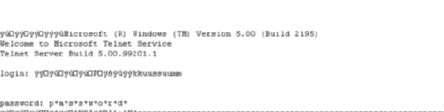

图 1.1 两个实体之间以明文传输的 Telnet 数据包。

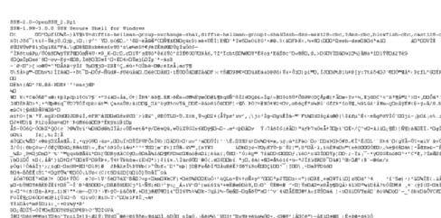

图 1.2 SSH 数据包的内容。

##### 远程命令行执行

SSH 提供了在远程实体（可以是操作系统或网络设备）上执行命令的功能。在 Unix 世界中，SSH 会为远程用户提供 `/etc` 目录中 `passwd` 文件中列出的 Shell；然而，通信仍然通过线路加密。例如，基于以下 Unix `passwd` 文件：

```
root::x:0:0:/root:/bin/bash
ksum::x:4:101:Kusum:/home/Kusum:/bin/bash
shreya::x:4:102:shreya:/home/shreya:/bin/bash
sudhanshu::x:4:103:sudhanshu:/home/sudhanshu:/bin/csh
sangeeta::x:4:104:sangeeta:/home/sangeeta:/bin/bash
jgnesh::x:4:105:jgnesh:/home/jgnesh:/bin/bash
kanchan::x:4:106:kanchan:/home/kanchan:/bin/bash
Katie::x:4:107:Katie:/home/Katie:/bin/csh
amit::x:4:108:amit:/home/amit:/bin/bash
rohan::x:4:109:rohan:/home/rohan:/bin/bash
anand::x:4:110:anand:/home/anand:/bin/bash
amlee::x:4:111:amlee:/home/amlee:/bin/sh
neeraja::x:4:112:neeraja:/home/neeraja:/bin/sh
jumdnj1::x:4:113:Jumdnj1:/home/Jumdnj1:/sbin/nologin
```


`root` 获得 `bash` shell，`sudhanshu` 获得 C shell，`neeraja` 获得 Korn shell，而用户 `umdnj1` 不被允许登录，因为尽管 `umdnj1` 的账户进行了有效的 SSH 连接，但其分配的 shell 为 `nologin`。运行在 Unix 服务器上的 SSH 守护程序会查询 `passwd` 文件中的信息，以处理用于认证的用户名。SSH 不使用自己的用户名和密码进行认证；它使用操作系统的用户名和密码信息，这大大简化了该过程。结果将是，拥有 `passwd` 文件中合适 shell 的有效账户经过认证后将获得正确的 shell，同时通过 SSH 进行加密。

在 Windows 世界中，该过程略有不同，但结果仍然相同。由于 Windows 没有不同的 shell 选项，所有 SSH 用户都将被赋予一个命令提示符（`cmd.exe`）或命令提示符的某种形式。与 Unix 世界类似，Windows 中的 SSH 服务使用现有的密码数据库（`SAM` 或 `ntds.dit` 文件）进行认证。

## 远程文件传输

远程文件传输类似于远程命令行执行。SSH 提供了从远程实体获取和发送文件的功能。在 Unix 世界中，远程文件传输实际上有两种形式。SSH 在一些 SSH1 和 SSH2 的安装中提供安全复制协议（`SCP`），在大多数 SSH2 的安装中提供安全文件传输协议（`SFTP`）。在 Windows 世界中，只有 `SFTP` 存在。`SCP` 和 `SFTP` 提供相似（甚至相同）的功能，即以安全方式从远程实体发送和接收文件。`SFTP` 在 Unix 上使用现有的 SSH 守护程序，在 Windows 上使用现有的 SSH 服务。启用安全文件传输不需要额外步骤；在大多数 SSH2 版本中自动启用。许多 SSH 客户端也附带了 `SCP` 或 `SFTP` 客户端；因此，使用并执行这些附加功能非常直接。此外，还有一些专门的 `SCP`/`SFTP` 客户端，例如在第 3 章中讨论的 PuTTY。但许多 SSH 客户端的安装都包含某种文件传输工具。

与前文所述的 `Telnet` 会话类似，大多数 `SCP` 或 `SFTP` 安装都能抵御 `FTP` 明文通信的弱点。图 1.3 展示了两个实体之间以明文传输的 `FTP` 数据包。

```
220 Microsoft FTP Service
USER kusum
331 Password required for kusum.
PASS divyedi
```


# SSH 概述

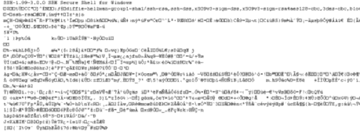

图 1.4 `SFTP` 数据包的内容。

请注意图 1.3 中，`FTP` 用户名（ksum）和密码（dwrvid）是明文形式，这与前面描述的 `Telnet` 会话类似。此外，由于 `FTP` 提供远程文件服务，`SCP` 和 `SFTP` 以大量的安全措施提供了相同的服务。而且，通过单一服务，可以同时提供远程命令行执行和安全文件传输，而无需启用 `Telnet` 和 `FTP` 等不同服务。图 1.4 展示了相同的两个实体，但使用 `SFTP` 代替了 `FTP`。

请注意图 1.4 中，没有任何信息是明文且可被任何人阅读的；因此，它是经过加密的。此外，图 1.5 展示了 `SFTP` 客户端界面，该界面与许多 `FTP` 界面类似。

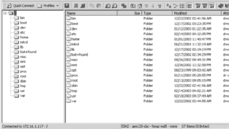

图 1.5 用于安全文件传输的 `SFTP` 客户端。

虽然 `SCP` 和 `SFTP` 是 *FTP* 的良好替代品，但在某些环境中，它们也可以替代其他具有风险的协议，例如 Windows 的服务器消息块（`SMB`）和 Unix 的网络文件服务器（`NFS`）。`SMB` 和 `NFS` 网络一直存在安全问题，至今仍在困扰着许多网络。使用 `SFTP` 作为通用文件服务器可以减少甚至消除对 `SMB` 或 `NFS` 网络的依赖。此外，使用 `SFTP` 等标准协议，Unix 和 Windows 客户端都可以访问相同的服务器，因为两者都可以通信并使用 SSH，但不一定能与 `SMB` 或 `NFS` 通信。请注意，与 `FTP`、`NFS` 或 `SMB` 相比，SSH 可能会使文件传输过程变长；然而，在许多情况下，这种延迟是微小的。

## 远程网络访问

除了提供远程命令行和远程文件传输工具外，SSH 还可以提供对远程网络的访问，创建类似于虚拟专用网络（`VPN`）的东西。SSH 不仅可以在通常的意义上提供 `VPN` 功能（SSH 上的 `PPP`），还可以提供许多 `VPN` 用户所需的服务，例如电子邮件、文件传输和通过端口转发的 Intranet 服务。此外，将 SSH 用作 `VPN` 解决方案的成本远低于使用典型的 `VPN` 解决方案。在考虑任何 SOHO `VPN` 设备、当前网络设备中的 `VPN` 卡或任何大规模 `VPN` 服务器/设备时，此类设备的成本与其他大多数网络设备没有太大区别，但远远超过了 SSH 服务器实现的成本。

SSH 作为 `VPN` 解决方案，不仅提供对电子邮件、内部文件服务器和 Intranet 服务等服务的访问，而且通过使用高级隧道技术，它还提供对 `X11` 服务、远程应用程序和远程隧道的访问。

## 安全管理

当今许多网络遵循着糟糕的管理实践，使其关键系统和设备容易受到管理攻击。许多环境保护网络设备、操作系统并创建适当划分的网络边界，但它们通过开放或不存在的管理网络连接敏感系统/设备，使用糟糕的管理协议。前面提到的明文协议，如 `Telnet`、`FTP` 和 `SNMP`，并不是唯一有问题的糟糕管理协议，但许多管理应用未能妥善保护其通信方式，或者存在已知的安全问题。某些管理应用的旧版本，如 `pcAnywhere`、虚拟网络计算机（`VNC`）和 `Citrix`，要么拥有被逆向工程破解的糟糕加密管理协议，要么不需要对敏感通信进行任何类型的加密管理。此外，任何攻击者都可以下载这些应用的客户端版本，并尝试使用捕获或猜测的用户名和密码连接到该应用程序代理。这假设没有攻击者无法访问的独立管理网络来阻止他/她连接任何代理。虽然独立的管理网络对于安全且可靠的管理是理想的，但带外管理网络的实施不仅成本高昂，还增加了网络的显著复杂性。

SSH 可以作为安全管理的替代方案，通过为任何类型的系统或设备管理提供加密通信来实现。SSH 不仅为远程命令行管理（这是大多数 Unix 系统上最流行的管理方法）提供安全通信，还为不太安全的应用（如 `VNC`）的图形用户界面（GUI）提供安全通信。此外，SSH 可以通过要求使用公钥和密码进行管理访问，为所有管理方法提供双因素认证。作为最佳实践，所有管理方法都应使用双因素认证，因为它减少了暴力攻击、密码猜测攻击以及对密码安全的依赖。SSH 可以很容易地实施双因素认证，这支持了管理安全中的一个关键最佳实践。最后，SSH 可以消除对带外管理网络的需求，从而移除大量成本并简化系统和管理设备的行政工作。以下列表描述了使用 SSH 进行管理的优势：

- 加密管理
- 带有端口转发的加密 GUI 管理（在第 6 章中进一步讨论）
- 显著的成本节约
- 消除独立的带外管理网络
- 增加简单性
- 双因素认证

## 代理服务

SSH 也可以用于保护代理服务。代理服务器已被确认为具有既定优势，而 SSH 可以增加其价值。将 SSH 部署为代理服务，以安全且简单的方式访问远程系统、设备和服务，是 SSH 最强大但最少被利用的优势之一。SSH 代理可以与传统的代理服务（如 `SOCKS`）协同工作，以端到端地保护应用程序。可以在环境中设置 `SOCKS` 服务器，并通过 SSH 传输流量。这种设置允许通过安全通道，使 `SQL`、`Oracle`、`FTP`、`HTTP` 和 `MySQL` 等远程应用程序可供 `SQL*PLUS` 和查询分析器等客户端应用程序使用。

正如第 9 章所述，`SOCKS` 和 SSH 代理可以消除大量端口转发需求，并提供对可能无法从网络边界访问的应用的安全访问。

与在加密 Web 流量中使用安全套接字层（`SSL`）（在 URL 中以 `HTTPS`（基于 SSL 的超文本传输协议）前缀表示不同），SSH 代理可以通过几种方式保护在敌对网络（如互联网或无线网络）上的 Web 流量。通过使用互联网上的 SSH 进行 `HTTP` 隧道，SSH 代理可用于连接运行在内部网络上的远程 Web 服务器。当从远程站点访问内部系统时，此功能增加了应用程序安全性和 Web 安全性。

### SSH 的客户端/服务器架构

SSH 在其实现中使用客户端/服务器架构。可以部署 SSH 服务器并允许多个 SSH 客户端连接到它。该架构与其他客户端/服务器架构并无不同，其中程序的服务端部分运行通常监听 22 端口的守护进程或服务。SSH 确实提供了守护进程/服务监听任何端口的能力；但是，它必须监听 TCP 连接。SSH 有一个配置文件，可以配置不同的选项，例如密码/公钥认证、端口选项和主目录。SSH 客户端只需要知道 SSH 服务器的 IP 地址（或主机名）及其监听的端口（如 22 端口）。根据 SSH 服务器的配置（例如登录要求），客户端只需按照预定义的要求对服务器进行认证即可访问会话，无论是 SSH 还是内置的 `SFTP` 功能。图 1.6 展示了 SSH 架构的一个非常简单示例。


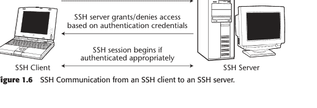

**图 1.6** 从 SSH 客户端到 SSH 服务器的 SSH 通信。

## SSH 流程

如图 1.6 所示，SSH 流程如下：

- 左侧的 SSH 客户端向右侧的 SSH 服务器提供身份验证。在初始连接中，客户端会接收服务器的**主机密钥**；因此，在随后的所有连接中，客户端都知道它正在连接到同一个 SSH 服务器。这使得 SSH 服务器的 IP 地址（容易被欺骗）受到的重视降低，而服务器的主机密钥（不容易被欺骗）受到的重视增加。
- SSH 服务器通过验证客户端用于身份验证的**用户名/密码**或**公钥**，来确定客户端是否有权连接 SSH 服务。此过程完全加密。
- 如果 SSH 服务器验证了客户端且客户端拥有权限，则两个实体之间开始 SSH 会话。所有通信均完全加密。

SSH 的客户端/服务器架构允许客户端拥有用于身份验证和/或授权的单一来源。身份验证/授权的单一来源仅允许访问 SSH 服务，而访问电子邮件、内网、外网和 IRC 等其他各种服务则需要进一步的认证。此外，如前文所述的 SSH 代理的使用，单一身份验证来源可以提供对应用程序的访问，而无需更多的用户名和密码。

## SSH 的加密架构

SSH 的众多优点之一是它提供了用于传输信息的完全加密协议，但 SSH 使用的是什么加密架构，它是如何部署的？本书不会详细探讨所使用的加密算法或在 SSH 中的实现方式（因为优化和实现是本书的重点），但我确实简要考察了该架构，以提供有关其部署的一些背景知识。SSH 的实现架构与协议本身一样灵活。SSH1 与当今使用的主要加密算法兼容，包括以下算法：

- 3DES
- Blowfish
- Twofish (128 和 192)
- AES (128、192 和 256)
- Arc Four
- CAST
- DES
- RC4

上述任何加密算法都可以用于 SSH 连接的**密码**。大多数密码都有很好的支持，但强烈建议使用更安全的 3DES 选项，而不是使用 DES。

除了上述密码算法外，SSH 还提供**消息认证码 (MAC)** 算法哈希。大多数 SSH 实现支持的两个选项是 MD5 和 SHA1。MAC 算法哈希用于**数据完整性**。从一个实体传输到另一个实体的数据会使用唯一的加密签名进行哈希处理，从而将其与其他数据区分开来。由 MD5 或 SHA1 哈希生成的加密签名在任何情况下从一个实体到下一个实体都不会改变。这确保了接收数据的实体在没有修改、篡改或未授权实体滥用通用情况的情况下获得了该数据。

## SSH 的基本问题

企业网络中使用的许多协议都存在一些安全问题。SSH 也不例外。SSH 提供了多种解决方案，但重要的是要提到 SSH 曾经存在安全问题，其中包括可能导致未经授权用户远程访问的几个问题。我不讨论与 OpenSSH 或其他 SSH 变种相关的所有安全问题。然而，我确实鼓励大家认识到，SSH 与任何程序或服务一样，需要定期打补丁。请告知您的内部补丁管理流程和网络运营人员定期修补和监控 SSH 服务。

与 SSH 相关的已识别的安全问题包括缓冲区溢出、X11 转发错误、弱的 Challenge/Responses 处理、远程信息泄露和权限提升。欲了解更多信息，请访问以下 URL 获取 OpenSSH 安全问题：www.openssh.com/security.html。

## SSH 客户端/服务器类型

SSH 客户端/服务器有多种软件包形式。以下是本书中提到的组织和产品的简短摘要。

### SSH 服务器

- OpenSSH (www.openssh.com)
  - OpenSSH 是 SSH 协议套件的免费版本。OpenSSH 服务器和客户端均可用于 Unix 和 Windows。
  - OpenSSH 已通过流行的 CYGWIN 工具移植到 Windows。该项目由 Network Simplicity (www.networksimplicity.com) 创建，并被以下网站采用：http://lexa.mckenna.edu/sshwindows/。
- SSH2 (www.ssh.com)
  - SSH2 是 SSH 的商业版本，商用需要支付许可费（非商用免费）。商业 SSH 客户端/服务器均可用于 Windows 和 Unix 系统。

### VanDyke Software (www.vandyke.com)

- VanDyke Software 制造商业版本的 SSH，使用需要支付许可费。商业 SSH 服务器 (VShell) 和客户端 (SecureCRT) 可用于 Windows 操作系统。

### SSH 客户端

- 商业 SSH
- OpenSSH
- PuTTY
- Secure-CRT
- MindTerm——通过 Java 和 Web 浏览器实现的 SSH
- WinSCP

## SSH 的基本设置

本节重点介绍在 Unix 和 Windows 环境中设置 SSH 服务器。该设置基于您选择的操作系统创建了一个基础 SSH 服务器安装，从而能够讨论本书中出现的各种 SSH 功能。以下列出了演示的实现类型：

- Unix 上的 OpenSSH (Red Hat Linux 8.0 和 OpenBSD 3.1)
- Windows 上的 OpenSSH (Windows 2000 Server)
- Unix 上的商业 SSH (Red Hat Linux 8.0 和 OpenBSD 3.1)
- Windows 上的商业 SSH (Windows 2000 Server)
- Windows 上的 VShell SSH 服务器 (Windows 2000 Server)

许多操作系统，如 OpenBSD，默认加载了 OpenSSH。为了本节的宗旨，我假设您的系统没有预装任何类型的 SSH 服务器。如果您有一台机器已经监听着 SSH 服务/守护程序，请随意跳过本节。

### OpenSSH

以下段落描述了使用 OpenSSH 的流行服务器。

### Red Hat Linux 8.0

以下是在 Red Hat 8.0 上安装 SSH 的分步程序。

#### 基于 RPM 的实现

在 Red Hat 8.0 服务器完全安装后，使用您最喜欢的 FTP 客户端，如命令行客户端或内置 Web 浏览器的 FTP 功能，从 `ftp://ftp5.ustc.openbsd.org/pub/OpenBSD/OpenSSH/portable/rpm/RH80` 下载最新的 RPM (Red Hat Package Manager)。我将使用版本 3.5 (`openssh-3.5p1-1.i386.rpm`)。将 RPM 下载到您选择的目录；我推荐 `/usr/local/src`。一旦文件下载完成，请按照以下步骤操作：

1. 在 shell 中，更改目录到 OpenSSH RPM 的下载位置：

```bash
# cd /usr/local/src
```

2. 安装 OpenSSH RPM：

```bash
# rpm -i openssh-3.5p1-1.i386.rpm
```

要启动守护程序，请更改到安装目录并启动服务：

```bash
# cd /usr/sbin
# ./sshd -p 22
```

请注意，如果您使用默认端口 (22)，则不需要 `-p` 选项。此时，您的 Red Hat 8.0 机器上应该已经在端口 22 上运行了 SSH 服务器。要确认这一点，请输入 `netstat -an`，您应该看到图 1.7 中所示的屏幕。

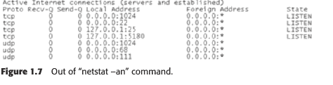

请注意，所有由 0.0.0.0 表示的接口都在监听端口 22，即 SSH。

#### 基于软件包的实现

在 Red Hat 8.0 服务器完全安装后，使用您最喜欢的 FTP 客户端，如命令行客户端或内置 Web 浏览器的 FTP 功能，从 `ftp://ftp3.usa.openbsd.org/pub/OpenBSD/OpenSSH/portable/openssh03.5p1.tar.gz` 下载最新的软件包。我将使用版本 3.5 (`openssh-3.5p1.tar.gz`)。将软件包下载到您选择的目录；我推荐 `/usr/local/src`。一旦文件下载完成，请执行以下步骤：

1. 在 shell 中，更改目录到 OpenSSH 软件包的下载位置：

`# cd /usr/local/src`

2. 使用 `gunzip` 解压 tarball：

`# gunzip -c openssh-3.5p1.tar.gz | tar xvf -`

3. 更改目录到 SSH：

`# cd openssh-3.5p1`

4. 配置目标文件和依赖项：

`# ./configure`

5. 创建二进制文件：

`# make`


`# make install`

**完成了！**

要启动守护程序，请更改到安装目录并启动服务：

```
# cd /usr/local/src/ssh
# ./sshd -p 22
```

请注意，如果您使用默认端口（`22`），则不需要 `-p` 选项。

现在，您的 Red Hat 8.0 机器上应该已启动了 SSH 服务器，端口为 `22`。要确认这一点，请输入 `netstat -an`，您应该看到与图 1.7 相同的结果。请注意，所有接口（以 `0.0.0.0` 表示）都在监听 `22` 端口，即 SSH 端口。

## OpenBSD 3.1

在 OpenBSD 3.1 服务器完成安装后，请使用您喜欢的 FTP 客户端（如命令行客户端或内置 Web 浏览器的 FTP 功能），从 `ftp://ftp.openbsd.org/pub/OpenBSD/OpenSSH/` 下载最新的压缩包。我将使用 3.5 版本（`openssh-3.5.tgz`）。将压缩包下载到您选择的目录；我推荐 `/usr/local/src`。文件下载完成后，请按照后续说明操作。

- 1. 从 shell 中，切换到 OpenSSH 包下载的目录：

```
# cd /usr/local/src
```

- 2. 使用 `gunzip` 解压缩 tar 包：

```
# gunzip -c openssh-3.5.tgz | tar xvf -
```

- 3. 切换到 `ssh` 目录：

```
# cd ssh
```

- 4. 生成目标文件和依赖项：

```
# make obj
# make cleandir
# make depend
```

- 5. 生成二进制文件：

```
# make
# make install
```

要启动守护进程，请切换到安装目录并启动服务：

```
# cd /usr/local/src/ssh
# ./sshd -p 22
```

注意，如果使用默认端口（`22`），则不需要 `-p` 选项。现在，您的 OpenBSD 3.1 机器上应该已启动了 SSH 服务器，端口为 `22`。要确认这一点，请输入 `netstat -an`，您应该看到与图 1.7 相同的结果。请注意，所有接口（以 `0.0.0.0` 表示）都在监听 `22` 端口，即 SSH 端口。

## Windows 2000 Server

在 Windows 2000 服务器完成安装后，请使用您喜欢的 FTP 客户端（如 `ftp.exe` 或 Internet Explorer），从 `http://lexa.mckenna.edu/sshwindows/` 下载适用于 Windows 平台的最新 OpenSSH 版本。我将使用 3.5 版本（`openssh35p1-3.zip`）。将 zip 文件下载到您选择的目录；我推荐 `c:\temp`。文件下载完成后，请按照后续说明操作。

- 1. 双击 zip 文件并将两个文件提取到 `c:\temp` 目录。这两个文件应包含可执行文件（`setupssh35.exe`）和签名文件。
- 2. 将 `setupssh35.exe` 提取到 `c:\temp` 文件夹后，双击 `setupssh35`。
- 3. 应出现欢迎界面（见图 1.8）。选择“下一步”进入下一个界面。
- 4. 完整阅读许可协议（见图 1.9）。如果您同意，请选择“我同意”。如果您不同意，请点击“取消”，并将这本书送给硅谷资源匮乏的工程师们。

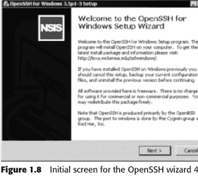

图 1.8 OpenSSH 向导的初始界面。

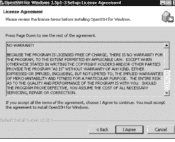

**图 1.9** OpenSSH 的许可协议。

- 5. 此时，您可以选择安装 SSH 的客户端和服务器部分，以及一些共享工具和菜单快捷方式（见图 1.10）。选择“下一步”。
- 6. 选择安装位置；我建议保留默认位置（见图 1.11）。选择“下一步”。

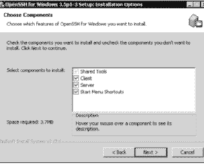

**图 1.10** OpenSSH 的组件选择界面。

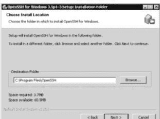

**图 1.11** OpenSSH 的安装位置界面。

- 7. 选择快捷方式位置；我建议保留默认（见图 1.12）。点击“安装”开始安装程序。
- 8. 您应该看到安装正在进行中（见图 1.13）。
- 9. 在安装过程中，您应该看到一个文本框，提示您必须编辑密码文件（`passwd`）才能使 SSH 正常工作（见图 1.14）。这是安装完成后必须遵循的重要步骤。点击“确定”。

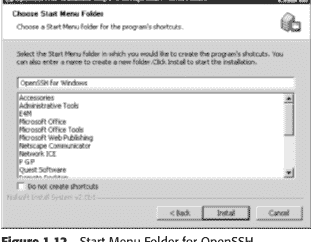

**图 1.12** OpenSSH 的开始菜单文件夹。

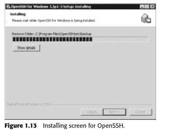

**图 1.13** OpenSSH 的安装界面。

- 10. 安装完成后，选择“完成”并保持“显示快速入门指南”勾选状态。
- 11. 快速入门指南现在应该会在记事本中出现。
- 12. 阅读指南中配置部分下的说明。
- 13. 从命令提示符，将目录更改为 OpenSSH 的 bin 目录。

```
c:\cd "Program Files\OpenSSH\bin"
```

- 14. 要授予本地用户访问 SSH 守护进程的权限，请输入：

```
c:\Program Files\OpenSSH\bin\mkpasswd -l -u username >> ..\..\etc\passwd
```

完成了！

切换到安装目录并启动服务：

```
\Program Files\OpenSSH\bin\net start opensshd
```

要确认服务已启动，请输入 `netstat -an`，您应该看到图 1.15 所示的屏幕。

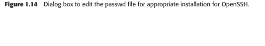

**图 1.14** OpenSSH 适当安装的 passwd 文件编辑对话框。

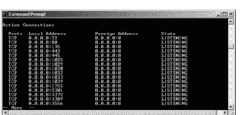

**图 1.15** netstat -an 命令的结果。

请注意，所有接口（以 `0.0.0.0` 表示）都在监听 `22` 端口，即 SSH 端口。

## Commercial SSH

以下段落描述了使用商业版 SSH 的主要服务器。

### OpenBSD 3.1 和 Red Hat Linux 8.0

在 OpenBSD 3.1 或 Red Hat 8.0 服务器完成安装后，请使用您喜欢的 FTP 客户端（如命令行客户端或 Web 浏览器内置的 FTP 功能），从 `ftp://ftp.ssh.com/pub/ssh/` 下载最新的压缩包。我使用的是非商业版 SSH，具体为 3.2.3 版本（`ssh-3.2.3.tar.gz`）。将压缩包下载到您选择的目录；我推荐 `/usr/local/src`。文件下载完成后，请按照后续说明操作。

- 1. 从 shell 中，切换到商业版 SSH 包下载的目录：

```
# cd /usr/local/src
```

- 2. 使用 `gunzip` 解压缩 tar 包：

```
# gunzip -c ssh-3.2.3.tar.gz | tar xvf -
```

- 3. 切换到 SSH 目录：

```
# cd ssh-3.2.3
```

- 4. 编译源代码：

```
# ./configure
# make
```

- 5. 运行安装脚本：

```
# make install
```

要启动守护进程，请切换到安装目录并启动服务：

```
# cd /usr/local/src
# ./sshd2 -p 22
```

注意，如果使用默认端口（`22`），则不需要 `-p` 选项。

要确认服务已启动，请输入 `netstat -an`，您应该看到与图 1.15 相同的结果。请注意，所有接口（以 `0.0.0.0` 表示）都在监听 `22` 端口，即 SSH 端口。

## Windows 2000


在 Windows 2000 服务器完成安装后，请使用您喜欢的 FTP 客户端（如 `ftp.exe` 或 Internet Explorer），从 www.ssh.com/support/downloads/secureshellserver/evaluation.mpl 下载适用于 Windows 平台的最新商业版 SSH（除非您已购买许可证，否则为评估版）。我使用的是 3.2.3 版本（`SSHSecureShellServer-3.2.3.exe`）。填写相应的评估表后，将可执行文件下载到您选择的目录；我推荐 `c:\temp`。文件下载完成后，请按照后续说明操作。

1. 双击该 `.exe` 文件。
2. 应出现欢迎界面（见图 1.16）。选择“下一步”进入下一个界面。

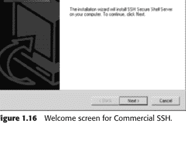

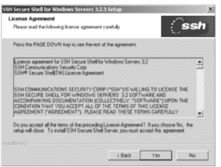

图 1.17 商业版 SSH 的许可协议。
3. 完整阅读许可协议（见图 1.17）。如果您同意，请选择“是”。如果您不同意，请点击“取消”，并将这本书送给南达科他州布鲁金斯资源匮乏的工程师们。
4. 选择安装位置。我建议保留默认。（见图 1.18。）点击“下一步”。
5. 选择程序文件夹；我们建议保留默认（见图 1.19）。点击“下一步”。

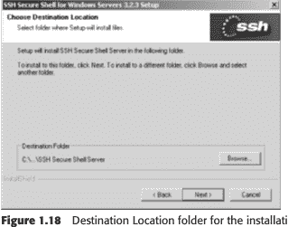

图 1.18 商业版 SSH 安装的目标位置文件夹。

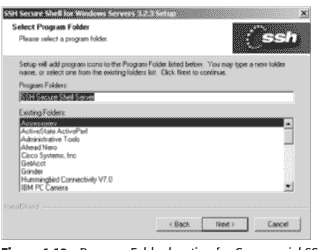

图 1.19 商业版 SSH 的程序文件夹位置。
6. 让系统创建主机密钥对；点击下一步。
7. 安装完成后，选择完成，并保持查看 ReadMe 文件勾选。
8. 阅读 ReadMe 文件；然后关闭文件。

要启动服务，请选择 开始 > 程序 > SSH Secure Shell Server 工具 > 启动服务器。应出现图 1.20 所示的屏幕。

要确认服务已启动，请输入 `netstat -an`，您应该看到如图 1.15 所示的屏幕。请注意，所有接口（由 0.0.0.0 表示）都在监听 22 端口，即 SSH 端口。

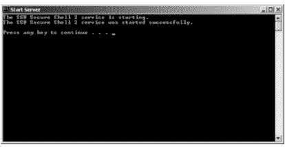

图 1.20 指示 SSH 服务已启动的屏幕。

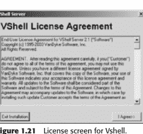

图 1.21 VShell 的许可证屏幕。

## VShell SSH 服务器

在 Windows 2000 服务器完成完整安装后，请使用您喜欢的 FTP 客户端（例如 `ftp.exe` 或 Internet Explorer），从 www.vandyke.com/download/vshell/ 下载适用于 Windows 平台的 VanDyke’s Software VShell SSH 的最新版本（除非您已购买许可证，否则为 30 天评估版）。我使用 2.14 版本（`vshell214.exe`）。将可执行文件下载到您选择的目录；我建议 `c:\temp`。文件下载完成后，请遵循后续指示。

1. 双击该 `exe` 文件。
2. 应出现 VShell 许可证协议（见图 1.21）。阅读该协议。如果您同意，请选择“我同意”以转到下一个屏幕。如果您不同意，请将本书寄给田纳西州纳什维尔贫困的工程师。
3. 接下来会出现欢迎屏幕（见图 1.22）。选择下一步以继续。

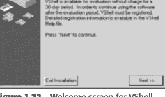

图 1.22 VShell 的欢迎屏幕。

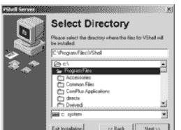

图 1.23 安装 VShell 的目标位置文件夹。
4. 选择安装位置；我建议保留默认设置（见图 1.23）。点击下一步。
5. 下一个屏幕询问程序图标的所在位置。选择您偏好的位置并选择下一步（见图 1.24）。
6. 下一个屏幕讨论 VShell 的认证选项（在第 4 章中有更详细的描述）。为了使用公钥认证，必须创建一个 LSA 模块。确保选中安装公钥 LSA 模块的复选框，然后选择下一步（见图 1.25）。
7. 选中所有选项后，选择完成。
8. 安装成功完成后，选择确定。

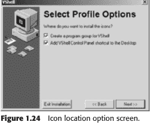

图 1.24 图标位置选项屏幕。

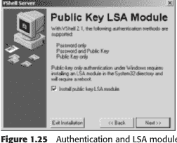

图 1.25 认证和 LSA 模块屏幕。
9. 为了完成安装，必须重启系统。选择确定以重启系统，或选择取消以在稍后时间重启系统（请务必在尝试使用 VShell 之前重启系统）。

系统重启后，VShell SSH 服务器应自动启动。它将被安装为一个名为 VanDyke Software: VShell 的服务。要确认服务已启动，请输入 `netstat -an`，您应该看到与图 1.20 相同的结果。

## SSH 的最佳用途

SSH 可以通过多种方式进行优化，既出于安全目的，也出于功能目的。SSH 的一个巨大优点在于，它通常可以通过单次安装为许多不同的场景进行优化。以下列出了 SSH 可以帮助解决的一些问题。该列表提出了 SSH 可以解决的几种不同选项：

- 通过互联网实现的安全远程访问解决方案（VPN）
- 访问内部应用程序，如“路边杀手”（Road Warrior）应用程序（如工时和费用管理）
- 安全的文件共享（替代 NFS、CIFS 和 SMB）
- 安全的命令行执行
- 安全的图形用户界面管理（X11 连接和端口转发）
- 安全的无线连接

正如上述列表所示，SSH 可以解决涉及安全和功能的多种网络问题。例如，转发应用程序协议（如 Windows 终端服务）的过程可能不一定是安全要求，但可能是限制通过防火墙打开的漏洞数量的功能要求。这允许使用单条防火墙规则允许外部连接到内部 SSH 服务器，并将其他应用程序（如 Windows 终端服务的 3389 端口）端口转发到内部主机。

另一方面，可能存在安全要求，即所有管理流量不仅应加密，还应强制执行双因素认证。通过设置要求双因素认证的 SSH 代理，所有客户端都必须使用用户名/密码和公钥进行认证，同时所有信息都经过加密。这些用途满足了网络的安全要求，而无需单独解决方案带来的额外成本和复杂性。

使用和优化 SSH 的好处将继续增长。随着本书的展开，我将探索在 Unix 和 Windows 环境中使用 SSH 进行安全和功能方面的不同方法。我还会展示许多示例，说明如何以最大的灵活性使用 SSH，以满足复杂且迂回网络的需求。

# 摘要

在本章中，讨论了一些 SSH 的基础知识。关于 SSH1 和 SSH2 之间差异以及 SSH 本身不同用途的讨论，建立了对该协议的理解。本章还介绍了 SSH 的体系结构，包括客户端/服务器体系和加密体系结构，并简要描述了不同类型的 SSH 服务器和客户端。本章最后给出了安装 SSH 的详细逐步指南。这提供了对该协议的基本理解以及应用程序的基本设置。在接下来的两章中，我将讨论几种不同的 SSH 服务器和客户端的基本实现和设置，以便您在第 4 章及本书的余下部分中可以继续执行 SSH 的最佳用法。

从这一点开始，您应该在某种网络环境中部署两个 SSH 服务器：一个是基于 Unix 的，另一个是基于 Windows 的。

# 第 2 章

# SSH 服务器

有三种主要的 SSH 服务器，它们提供不同类型的功能和用途：OpenSSH、SSH Communications 的 SSH 服务器以及 VanDyke Software 的 VShell SSH 服务器。在第一章节中，我们安装了这三个服务器；然而，我们没有讨论这些服务器的配置、用途和不同功能。虽然这三种主要的 SSH 服务器提供类似的 SSH 服务，但它们提供不同级别的功能，其中一些可能比其他更适合您的环境。您使用的 SSH 服务器类型会显著影响您的 SSH 体验类型。例如，许多 SSH 服务器都提供命令行访问和安全文件传输；然而，如果 SSH 仅用于端口转发（在第 6 章和第 7 章中讨论）或文件传输，给予用户命令行访问可能不被接受。

本章讨论适用于 Unix 和 Windows 的三种主要 SSH 服务器。此外，本章的重点在于三种 SSH 服务器的选中配置项和菜单，就定制和最佳使用而言。本章考察了以下 SSH 服务器：

- OpenSSH 服务器
  - Unix 和 Windows
- SSH Communications 的 SSH 服务器
  - Unix
  - Windows
- VanDyke’s Software VShell SSH 服务器
  - Windows

## OpenSSH


OpenSSH 服务器在 Windows 和 Unix 环境中均可用。Windows 版本实际上是使用流行的 Cygwin 工具移植自 OpenSSH 的 Unix 版本（有关更多详情，请参见 www.cygwin.com）。虽然 OpenSSH 的 Windows 端口使用 Cygwin，但请注意，该端口并不是 Cygwin 的完整安装，也不需要额外的 Cygwin 工具，这是理想的，因为 Cygwin 需要单独的安装程序。由于 OpenSSH 的 Unix 和 Windows 版本都使用相同的 SSH 服务器配置文件 `sshd_config`，我将详细介绍该文件本身。它适用于 Windows 和 Unix 平台。要查看配置文件，请输入以下命令。

### 在 Unix 上：

```
cd /etc/ssh
more sshd_config
```

### 在 Windows 上：

```
cd "Program Files\OpenSSH\bin"
C:\Program Files\OpenSSH\bin>type sshd_config
```

> 注意 `sshd_config` 文件中所有修改过的行都必须取消注释（必须删除行首的 `#`）。

我呈现的第一个部分是简单的网络配置：

```
#Port 22
#Protocol 2,1
#ListenAddress 0.0.0.0
#ListenAddress ::
```

### 表 2.1 sshd_config 文件中的选项

| 选项 | 描述 |
| :--- | :--- |
| `Port` | 设置 SSH 监听的端口号。默认端口为 22；不过，监听多个端口（包括其他非标准端口，如 80、443 或 8080）可能是最佳选择，因为商务旅行者可能无法使用 22 端口建立出站连接，而 80 或 443 端口通常可用。若要监听多个端口，请添加以下行：<br>`Port 22`<br>`Port 80`<br>`Port 443`<br>`Port 8080` |
| `Protocol` | 允许仅使用 SSH 版本 1、SSH 版本 2 或两者兼用。由于 SSH 版本 1 的安全性较低，仅使用版本 2 可能是一个不错的选择；然而，仍有部分设备尚不支持 SSH 版本 2。若仅使用 SSH 版本 2，请添加以下行：<br>`Protocol 2` |
| `ListenAddress` | 设置 SSH 守护进程监听的 IP 地址。默认值为 0.0.0.0，这会在所有接口上启用 SSH 服务。如果存在不应监听 SSH 的接口（例如防火墙的外部接口），请移除 0.0.0.0 并添加相应的 IP 地址。若仅监听特定接口，请添加以下行：<br>`ListenAddress 172.16.1.1`<br>`ListenAddress 192.168.0.1` |

下一节讨论主机密钥部分。主机密钥部分讨论了与 SSH 服务器主机密钥相关的参数，该密钥的指纹用于识别 SSH 服务器。

```
# HostKey for protocol version 1
# HostKey /etc/ssh/ssh_host_key
# HostKey for protocol version 2
# HostKey /etc/ssh/ssh_host_rsa_key
# HostKey /etc/ssh/ssh_host_dsa_key
```

`sshd_config` 文件的这一部分相当直接明了。它仅说明了 SSH 版本 1 格式和 SSH 版本 2 格式的主机密钥文件的位置。此外，对于 SSH 版本 2，该部分还说明了 RSA 和 DSA 密钥的位置。

下一节涉及服务器密钥：

```
# Lifetime and size of ephemeral version 1 server key
#KeyRegenerationInterval 3600
#ServerKeyBits 768
```

本节详细规定了服务器密钥的设置。`KeyRegenerationInterval` 是重新生成服务器密钥的时间间隔（以秒为单位）；`ServerKeyBits` 是要使用的位数。

下一节涉及日志记录：

```
# Logging
#obsoletes QuietMode and FascistLogging
#SyslogFacility AUTH
#LogLevel INFO
```

本节设置 SSH 服务的日志记录选项。`QuietMode` 和 `FascistLogging` 的区别在于，`QuietMode` 仅记录致命错误，而 `FascistLogging` 启用详细日志记录。`SyslogFacility` 指定记录来自 SSH 的消息时使用的 syslog 代码，例如 Daemon 和 Auth。`LogLevel` 指定记录来自 SSH 的消息时使用的级别，例如仅记录信息性消息（`INFO`）。

下一节涉及 SSH 的认证选项：

```
#Authentication
#LoginGraceTime 120
#PermitRootLogin yes
#StrictModes yes

#RSAAuthentication yes
#PubKeyAuthentication yes
#AuthorizedKeyFile         .ssh/authorized_keys
```

### 表 2.2 认证选项

| 选项 | 描述 |
| :--- | :--- |
| `LoginGraceTime` | 用户完成认证过程所允许的时间长度。具体而言，是从用户发起连接到用户输入其用户名/密码或公钥/私钥密码的时间为止。 |
| `PermitRootLogin` | 选项用于允许（`yes`）或禁止（`no`）root 用户登录 SSH 会话。最佳实践是限制 root 访问权限，仅允许用户通过 `su` 或 `sudo` 获取 root 权限。此外，如果 root 账户必须能够直接登录，则值 "`nopwd`" 可以允许 root 直接登录，但仅限通过公钥认证。 |
| `StrictModes` | 在接受认证前，启用（`yes`）或禁用（`no`）对用户主目录和 rhosts 文件中权限的检查。应将其设置为 `yes`，以保护主目录免受全局可写文件的危害。 |
| `RSAAuthentication` | 选项用于允许 RSA 认证。 |
| `PubkeyAuthentication` | 选项用于允许公钥认证；可能的值为 `yes` 和 `no`。 |
| `AuthorizedKeysFile` | 用户公钥存储的目录。默认为 `.ssh/authorized_keys`，即用户主目录中的 `.ssh` 文件夹（例如，在 Windows 的 `Program Files\OpenSSH` 中为 `/home/<username>/.ssh/authorized_keys`）。 |

在 `ssh_config` 文件的认证部分下，有一个使用 rhosts 进行 RSH 认证的选项。尽管由于 rhosts 安全性较差而不推荐使用，但以下行涉及 root 配置选项：

```
# rhosts authentication should not be used
#RhostsAuthentication no
# Don't read the user's ~/.rhosts and ~/.shosts files
#IgnoreRhosts yes
# For this to work you will also need host keys in
/etc/ssh/ssh_known_hosts
#RhostRSAAuthentication no
# similar for protocol version 2
#HostbasedAuthentication no
# Change to yes if you don't trust ~/.ssh/known_hosts for
# RhostRSAAuthentication and HostbasedAuthentication
#IgnoreUserKnownHosts no
```

### 表 2.3 Rhost 配置选项

| 选项 | 描述 |
| :--- | :--- |
| `RhostAuthentication` | 允许 rhosts 认证 |
| `Ignore Rhosts` | 忽略（`yes`）或读取（`no`）用户主目录中的 rhosts 文件，这些文件存储为 `.rhosts` 或 `.shosts` 文件 |
| `RhostsRSAAuthentication` | 尝试使用 RSA 主机密钥进行 rhosts 认证 |
| `HostbasedAuthentication` | 在 SSH 版本 2 下启用（`yes`）或禁用（`no`）基于主机的认证 |
| `IgnoreUserKnownHosts` | 忽略（`no`）或读取（`yes`）用户主目录中的 known hosts 文件 |

`sshd_config` 文件的最后一个认证部分涉及更多密码选项，包括 Kerberos 的使用：


```
# To disable tunneled clear text passwords, change to no here!
#PasswordAuthentication yes
#PermitEmptyPasswords no
```

```
# Change to no to disable s/key passwords
#ChallengeResponseAuthentication yes
```

```
# Kerberos options
#KerberosAuthentication no
#KerberosOrLocalPasswd yes
#KerberosTicketCleanup yes
```

```
#AFSTokenPassing no
```

```
# Kerberos TGT Passing only works with the AFS kaserver
#KerberosTgtPassing no
```

表 2.4 描述了 SSH 服务器可用的密码和 Kerberos 认证选项。

## 表 2.4 密码和 Kerberos 选项

| 选项 | 描述 |
| :--- | :--- |
| `PasswordAuthentication` | 启用（yes）或禁用（no）密码认证。 |
| `PermitEmptyPasswords` | 允许（yes）或禁止（no）使用空白密码。 |
| `ChallengeResponseAuthentication` | 启用（yes）或禁用（no）挑战/响应认证。挑战/响应认证发生在服务器向客户端发送挑战时；客户端的响应将决定是否允许认证。 |
| `KerberosAuthentication` | 启用（yes）或禁用（no）Kerberos 认证，该认证涉及会话票据。 |
| `KerberosOrLocalPasswd` | 允许（yes）使用 Kerberos 或本地系统密码进行认证。 |
| `KerberosTicketCleanup` | 启用（yes）或禁用（no）在注销时自动删除 Kerberos 票据的功能。 |
| `AFSTokenPassing` | 启用（yes）或禁用（no）使用 AFS 令牌进行认证的功能。 |
| `KerberosTgtPassing` | 启用（yes）或禁用（no）使用 Kerberos 票据授予票据（TGT）进行认证的功能。 |

`sshd_config` 文件的下一节涉及可用于转发的 X11 选项：

```
X11Forwarding no
X11DisplayOffset 10
X11UseLocalhost yes
```

在 `sshd_config` 文件的这一部分中，可以启用或禁用 X11 转发。如果启用了 X11 转发，则可以设置偏移量，其中 10 是默认值，并且可以启用使用 localhost 的选项，这是 X11 转发最典型的安装方式。使用 localhost 转发 X11 连接允许所有 X11 流量从本地机器传播。

`sshd_config` 文件的最后一节涉及可以与该服务配合使用的各种选项，例如打印、横幅信息和子系统：

```
PrintMotd yes
PrintLastLog yes
KeepAlive yes
UseLogin no
UsePrivilegeSeparation yes
PermitUserEnvironment no
Compression yes
```

# MaxStartups 10

# no default banner path

# Banner /some/path

# VerifyReverseMapping no

# override default of no subsystems

Subsystem sftp /usr/lib/openssh/sftp-server

表 2.5 描述了 SSH 服务器可用的各种杂项选项。

### 表 2.5 SSH 服务器的杂项选项

| 选项 | 描述 |
| :--- | :--- |
| `PrintMotd` | 启用（yes）或禁用（no）在登录时显示位于 motd（每日消息）文件（`/etc/motd`）中的任何文本。这非常有用，因为可以向所有登录系统的用户显示消息，例如系统停机、安全问题等。 |
| `PrintLastLog` | 启用（yes）或禁用（no）在屏幕上显示用户上次登录该服务的时间信息。 |
| `UseLogin` | 启用（yes）或禁用（no）使用 `/usr/bin/login` 而不是 SSH 实用程序在内部处理身份验证过程。 |
| `UserPrivilegeSeparation` | 启用/禁用为使用 SSH 服务的用户设置独立权限。 |
| `PermitUserEnvironment` | 允许（yes）或不允许（no）用户在身份验证后加载其环境变量。 |
| `Compression` | 启用（yes）或禁用（no）SSH 传输过程的压缩。 |
| `Banner` | 保存登录后将显示的横幅消息的文件路径。 |
| `Subsystem sftp` | 安全文件传输子系统的路径。 |

你可能已经注意到，`sshd_config` 文件中的许多选项是特定于 OpenSSH 的 Unix 实现的。虽然完整的 `sshd_config` 文件可以用于 Windows 平台，但许多项目将不适用，因为它们在 Windows 世界中不存在，例如 Syslog 和 rhost 身份验证。一旦你在 Windows 机器上打开了 `sshd_config`，你应该只看到比 Unix 上较大的 `sshd_config` 文件简化的部分，如下所示代码：

| 选项 | 值 |
| :--- | :--- |
| `HostKey` | `/ssh/ssh_host_key` |
| `HostDSAKey` | `/ssh/ssh_host_dsa_key` |
| `PidFile` | `/ssh/sshd.pid` |
| `Protocol` | 2 |
| `Port` | 22 |
| `PermitRootLogin` | yes |
| `PasswordAuthentication` | yes |
| `IgnoreRhosts` | yes |
| `IgnoreUserKnownHosts` | yes |
| `RhostAuthentication` | no |
| `RhostRSAAuthentication` | no |
| `RSAAuthentication` | no |
| `Subsystem sftp` | `/ssh/sftp-server` |

尽管 `sshd_config` 文件是简化的部分，但所有条目的定义都与前一部分文件中描述的相同。

## SSH Communications 的 SSH 服务器

SSH Communications 的 SSH 服务器也可用于 Windows 和 Unix 环境。`sshd2_config` 文件由 SSH Communications 的 SSH 服务器用于该服务的所有配置管理。Windows 版本具有不同的配置实用程序，它使用图形用户界面（GUI）来显示和报告对 `sshd2_config` 配置文件的更改。另一方面，Unix 版本仅提供 `sshd2_config` 文件用于配置管理，没有任何额外的配置工具。由于 Unix 和 Windows 版本提供不同的配置实用程序，我首先讨论 `sshd2_config` 文件，因为两个平台要么依赖（Unix）要么参考（Windows）此文件进行配置；然后我讨论 Windows 配置管理 GUI。

### SSH Communications 的 SSH 服务器：Unix

要查看配置文件，请输入以下命令：

```bash
cd /etc/ssh2
more sshd2_config
```

SSH Communications 的 `sshd2_config` 文件类似于 OpenSSH 的 `sshd_config` 文件；然而，两者之间存在许多区别。以下段落讨论了 `sshd2_config` 文件的各个部分。

### General

`sshd2_config` 文件的通用部分看起来应该类似于以下内容：

```bash
## General
#  VerboseMode  no
#  QuietMode  yes
#  ForcePTYAllocation  no
#  SyslogFacility  AUTH
#  SyslogFacility  LOCAL7
```

表 2.6 描述了 SSH 服务器可用的通用选项。

### 表 2.6 sshd2_config 文件通用部分的选项（Unix）

| 选项 | 描述 |
| :--- | :--- |
| `VerboseMode` | 启用（yes）或禁用（no）将 SSH 会话的调试和连接相关信息显示到标准输出 |
| `QuietMode` | 启用（yes）或禁用（no）将 SSH 会话的警告和错误消息显示到标准输出 |
| `ForcePTYAllocation` | 启用（yes）或禁用（no）强制分配 PTY 会话的能力 |


| SyslogFacility | 识别记录 SSH 消息时使用的 Syslog 代码，例如 Daemon、Auth 和 Local |

### Network

`sshd2_config` 文件的网络部分看起来应该如下所示：

```bash
Port                22
#  ListenAddress        any
#  RequireReverseMapping   no
#  MaxBroadcastsPerSecond    0
#  MaxBroadcastsPerSecond    1
#  NoDelay        yes
#  KeepAlive        yes
#  MaxConnections     50
#  MaxConnections     0
```

表 2.7 描述了 SSH 服务器可用的网络选项。

### 表 2.7 网络部分的选项（Unix）

| 选项 | 描述 |
| :--- | :--- |
| Port | 设置 SSH 监听的端口号。默认端口是 22；但是，监听多个端口（包括其他非标准端口，如 80、443 或 8080）可能是最优的，因为商务旅行者可能无法在端口 22 上建立出站连接，但端口 80 或 443 通常是可用的。要监听多个端口，添加以下行：`Port 22` `Port 80` `Port 443` `Port 8080` |
| ListenAddress | 设置 SSH 守护进程监听的 IP 地址。默认值为 0.0.0.0，它在所有接口上启用 SSH 服务。如果某些接口不应监听 SSH，例如防火墙的外部接口，请移除 0.0.0.0 并添加适当的 IP 地址。要仅监听选定的接口，添加以下行：`ListenAddress 172.16.1.1` `ListenAddress 192.168.0.1` |
| RequireReverseMapping | 启用（yes）或禁用（no）要求 DNS 查找成功，以便与 AllowHost 和 DenyHost 条目协同工作。如果启用且 DNS 查找失败，请求将被拒绝。如果禁用且 DNS 查找失败，将检查 AllowHosts 和 DenyHosts 中的 IP 地址。 |
| MaxBroadcastPerSecond | 识别服务器每秒应处理的 UDP 广播数量。默认值为零，表示不处理任何广播。 |
| NoDelay | 启用（yes）或禁用（no）TCP_NODELAY 套接字选项。 |
| KeepAlive | 启用（yes）或禁用（no）SSH 服务器是否应向 SSH 客户端发送 KeepAlive 数据包。此值有助于通过确定对端客户端是否仍在运行且未崩溃或蓝屏，从而防止会话挂起。 |
| MaxConnections | 识别 SSH 服务器将处理的并发连接数。如果值设置为零，则并发连接数无限制。 |

### Crypto

`sshd2_config` 文件的 Crypto 部分看起来应该类似于以下内容：

```bash
#     Ciphers                          AnyCipher
# Following includes 'none' 'cipher':
#     Ciphers                          AnyStd
#
#     Ciphers                          AnyStdCipher
#     Ciphers                          3des
# Following includes 'none' 'mac':
#     MACs                             AnyMAC
#
#     MACs                             AnyStd
#     MACs                             AnyStdMAC
#     RekeyIntervalSeconds             3600
```

表 2.8 描述了 SSH 服务器可用的 Crypto 选项。

### 表 2.8 Crypto 部分的选项（Unix）

| 选项 | 描述 |
| :--- | :--- |
| Ciphers | 列出加密 SSH 会话时要使用的密文类型。支持 Triple-DES (`3DES`)、Blowfish、Arcfour、Twofish、CAST - 128 和 DES。可以设置更多全局选项，如 Any、Anystd、anycipher 和 anystdcipher。Any 和 anystd 允许标准密码；anycipher 允许任何密文；anystdcipher 允许 IETF SSH 草案中列出的任何密码。none 条目表示不提供密码。 |
| MACs | 消息认证码（MAC）是一种用于在传输前后验证数据完整性的哈希算法。支持的算法包括 SHA1、MD5、SHA1-96 和 MD5-96。还可以设置多个 MACs。 |
| RekeyIntervalSeconds | 指定再次执行密钥交换过程之前的时间量。默认值为 3600 秒，即一小时。通过将值设置为零可以禁用密钥交换过程。 |

## 用户

`sshd_2_config` 文件中的 Users 部分应如下所示：

```
#   PrintMotd              yes
#   CheckMail              yes
#   UserConfigDirectory    "~$D/.ssh2"
#   UserConfigDirectory    "/etc/ssh2/auth/$U"
#   UserKnownHosts         yes
#   LoginGraceTime         600
#   PermitEmptyPasswords   no
#   StrictModes            yes
#   IdleTimeOut            1h
```

表 2.9 描述了 SSH 服务器可用的各种杂项选项。

### 表 2.9 用户部分中的杂项选项 (Unix)

| 选项 | 描述 |
|---|---|
| PrintMotd | 启用 (`yes`) 或禁用 (`no`) 在登录时显示 motd (Message of the Day，每日信息) 文件（`/etc/motd`）中定位的任何文本。这非常有用，因为可以向所有登录系统的用户显示消息，例如系统停机、法律声明和安全问题。 |
| CheckMail | 启用 (`yes`) 或禁用 (`no`) SSH 服务器在用户认证后检查新邮件的能力。 |
| UserConfigDirectory | 识别用户特定配置数据的位置，例如密钥和识别文件。默认值是用户主目录中的 `.ssh2` 文件夹，例如 `/home/<username>/.ssh2` 或 `Documents and Settings<username>/.ssh2`。可以识别配置数据的多个位置。 |
| UserKnownHosts | 识别用户特定已知主机文件的位置。默认值是用户主目录中的 `.ssh2` 文件夹，例如 `/home/<username>/.ssh2` 或 `Documents and Settings<username>/.ssh2`。可以识别多个位置。 |
| LoginGraceTime | 用户在发起认证请求后完成登录过程的时间（以秒为单位）。值的范围从零（无限制）到 600 秒。 |
| PermitEmptyPasswords | 允许 (`yes`) 或拒绝 (`no`) 用户拥有空密码的能力。在大多数情况下，此选项应为 `no`。 |
| StrictModes | 在接受认证之前，启用 (`yes`) 或禁用 (`no`) 对用户在主目录和 rhosts 文件中权限的检查。应将其设置为 `yes` 以保护主目录中不受限制的文件。 |
| IdleTimeOut | 会话未被使用之前可以保持的时间（以分钟为单位），之后将自动关闭。设置为零指定无超时，这对于某些备份过程可能非常理想。 |

## 用户公钥认证

`sshd_2_config` 文件中的 User Public Key Authentication 部分应如下所示：

```text
# HostKeyFile           hostkey
# PublicHostKeyFile     hostkey.pub
# RandomSeedFile        random_seed
# IdentityFile          identification
# AuthorizationFile     authorization
# AllowAgentForwarding  yes
```

表 2.10 描述了 SSH 服务器可用的用户公钥选项。

### 表 2.10 用户部分中的用户公钥选项 (Unix)

| 选项 | 描述 |
|:---|:---|
| HostKeyFile | 识别私用主机密钥文件的位置。默认值名为 `hostkey`，位于本地文件系统上。 |


| `PublicHostKeyFile` | 识别公用主机密钥文件的位置。默认值名为 `hostkey.pub`，位于本地文件系统上。 |

| `RandomSeedFile` | 识别随机种子文件的位置。此文件用于为 SSH 服务器生成随机性。 |

| `IdentityFile` | 识别识别文件的位置，通常名为 `identification`。它位于 SSH 客户端上用户的主目录中。此文件用于 SSH 客户端，以指示在认证过程中哪些私钥被授权使用。例如，如果用户有两个用于认证的私钥，如 `id_dsa_2048_a` 和 `id_rsa_2048_a`，则 `identification` 文件的内容将如下所示：<br> `Key` `id_dsa_2048_a` <br> `Key` `id_rsa_2048_a` <br> 注意：`identification` 文件中列出的私钥也需要在用户的主目录中，更多内容将在第 4 章中讨论。 |

| `AuthorizationFile` | 识别授权文件的位置，通常名为 `authorization`，位于 SSH 服务器上用户的主目录中。此文件用于 SSH 服务器，以指示在认证过程中哪些公钥被授权接受。例如，如果用户有两个用于认证的公钥，如 `id_dsa_2048_a.pub` 和 `id_rsa_2048_a.pub`，则 `authorization` 文件的内容将如下所示：<br> `Key` `id_dsa_2048_a.pub` <br> `Key` `id_rsa_2048_a.pub` <br> 注意：`authorization` 文件中列出的公钥也需要在用户的主目录中，更多内容将在第 4 章中讨论。 |

| `AllowAgentForwarding` | 启用 (`yes`) 或禁用 (`no`) SSH agent 实用程序通过 SSH 远程转发登录的能力。此选项使用 `ssh-agent2` 二进制文件，这是一个存储私钥以进行自动认证的节目。 |

## 隧道

`sshd_config` 文件中的 Tunneling 部分应如下类似：

```
#	AllowX11Forwarding			yes
#	AllowTcpForwarding		yes
#	AllowTcpForwardingForUsers	sjl, cowboyneal@siaishdot\.org
#	DenyTcpForwardingForUsers	2[:1sdigit:]*4, peelo
#	AllowTcpForwardingForGroups	privileged_tcp_forwarders
#	DenyTcpForwardingForGroups	coming_from_outside
```

表 2.11 描述了 SSH 服务器可用的隧道选项。

### 表 2.11 隧道部分的选项 (Unix)

| 选项 | 描述 |
| :--- | :--- |
| `AllowX11Forwarding` | 启用 (`yes`) 或禁用 (`no`) X11 应用程序通过 SSH 转发的能力。 |
| `AllowTcpForwardingForUsers` | 允许特定用户转发端口，包括本地和远程。此设置接受用户名和模式，例如 DNS 模式。 |
| `DenyTcpForwardingForUsers` | 禁用特定用户转发端口的能力，包括本地和远程。此设置接受用户名和模式，例如 DNS 模式。 |
| `AllowTcpForwardingForGroups` | 允许组转发端口，包括本地和远程。此设置接受用户名和模式，例如 DNS 模式。 |
| `DenyTcpForwardingForGroups` | 禁用特定组转发端口的能力，包括本地和远程。此设置接受用户名和模式，例如 DNS 模式。 |

## 认证

`sshd_config` 文件中的 Authentication 部分应如下所示：

```
#	BannerMessageFile			/etc/ssh2/ssh_banner_message
#	BannerMessageFile			/etc/issue.net
#	PasswordGusses
#	AllowedAuthentications		hostbased, publickey, password
#	AllowedAuthentications		publickey, pam-1@ssh.com
#     AllowedAuthentications       publickey,password
#     RequiredAuthentications      publickey,password
#     HostbasedAuthForceClientHostnameDNSMatch no
#     SshPAMClientPath            ssh-pam-client
```

表 2.12 描述了 SSH 服务器可用的认证选项。

### 表 2.12 认证部分的选项 (Unix)

| 选项 | 描述 |
| --- | --- |
| `BannerMessageFile` | 识别包含在客户端登录 SSH 服务器之前显示的文本的文件位置。这对于法律声明非常有用。 |
| `PasswordGuesses` | 识别在用户未提交有效认证之前被允许尝试的次数。 |
| `AllowedAuthentications` | 识别有效的认证方法类型。选项包括 `password`, `publickey` 和 `hostbased`。 |
| `RequiredAuthentications` | 识别认证所需的认证方法类型。如果值为空，则 `AllowedAuthentication` 中的任何值都将被接受。 |
| `HostbasedAuthForceClientHostnameDNSMatch` | 要求 SSH 客户端的主机名与客户端的 DNS 条目完全匹配。 |
| `SshPAMClientPath` | 识别用于进行 PAM 认证的 SSH PAM 客户端的位置。默认位置是 `*/usr/local/bin/ssh-pam-client*`。 |

## 主机限制

`sshd2_config` 文件中的 Host Restrictions 部分应如下所示：

```
#AllowHosts                localhost, foobar.com, friendly.org
##AllowHosts                t,.,l,.,*
##    AllowHosts            [{{digit}:1}{,3}\{,3}{{digit}:1}{,3}
##    AllowHosts            \i,.*
##
#    DenyHosts             evil.org, ool.com
#    AllowHosts            trusted\.host\.org
#    DenyHosts             not\.quite\.trusted\.org
#    IgnoreRootRhosts      no
#                           no
```

表 2.13 描述了 SSH 服务器中可用的主机限制选项。

## 表 2.13 主机限制部分中的选项 (Unix)

| 选项 | 描述 |
| --- | --- |
| `AllowHosts` | 标识允许登录 SSH 服务器的唯一主机名、IP 地址和/或模式 |
| `DenyHosts` | 标识不允许登录 SSH 服务器的主机名、IP 地址和/或模式 |
| `AllowShHosts` | 基于 `/etc/shosts.equiv` 和 `AllowShHosts` 条目，标识允许基于主机的身份验证的主机 |
| `DenyShHosts` | 基于 `/etc/shosts.equiv` 和 `AllowShHosts` 条目，标识不允许基于主机的身份验证的主机 |
| `IgnoreRhHosts` | 启用 (`yes`) 或禁用 (`no`) 仅允许全局配置文件 (`hosts.equiv` 和 `shosts.equiv`) 的功能 |
| `IgnoreRootRhHosts` | 启用 (`yes`) 或禁用 (`no`) 仅允许 root 的全局配置文件 (`hosts.equiv` 和 `shosts.equiv`) 的功能 |

## 用户限制

`sshd2_config` 文件中的用户限制部分应该如下所示：

```text
# AllowUsers     e.j.*,s([:1digit:[]]*,s(j1|amza)
# DenyUsers      skuuuppa,warezdude,31373
# DenyUsers      don@untrusted\.org
# AllowGroups    staff,users
# DenyGroups     guest
#
# PermitRootLogin        nopwd
# PermitRootLogin        no
```

表 2.14 描述了 SSH 服务器中可用的用户限制选项。

## 表 2.14 用户限制部分中的选项 (Unix)

| 选项 | 描述 |
| :--- | :--- |


| `AllowUsers` | 标识允许登录 SSH 服务器的唯一用户。此条目可以包含由逗号分隔的用户列表或模式匹配变量。 |

| `DenyUsers` | 标识不允许登录 SSH 服务器的用户。此条目可以包含由逗号分隔的用户列表或模式匹配变量。 |

| `AllowGroups` | 标识允许登录 SSH 服务器的唯一组。此条目可以包含由逗号分隔的组列表或模式匹配变量。 |

| `DenyGroups` | 标识不允许登录 SSH 服务器的组。此条目可以包含由逗号分隔的组列表或模式匹配变量。 |

| `PermitRootLogin` | 启用 (`yes`) 或禁用 (`no`) root 用户登录 SSH 服务器的功能。作为最佳实践，应将此设置设为 `no`，强制管理员用户使用 `su` 命令切换到 root。如果 root 账户必须能够直接登录，值 `nopwd` 可以允许 root 直接登录，但仅限公钥身份验证。 |

## SSH1 兼容性

`sshd2_config` 文件中的 SSH1 兼容性部分应类似于以下内容：

```text
#      Ssh1Compatibility       <set by configure by default>
#      Ssh1Path                <set by configure by default>
#      Ssh1ConfigFile          /etc/sshd_config_alternate
```

表 2.15 描述了 SSH 服务器中可用的 SSH1 兼容性选项。

## 表 2.15 SSH1 兼容性部分中的选项 (Unix)

| 选项 | 描述 |

| --- | --- |

| `Ssh1Compatibility` | 启用 (`yes`) 或禁用 (`no`) 与 SSH 版本 1 的兼容性，与 SSH 版本 2 相比，SSH 版本 1 是完全不同的 SSH 实现。SSH 版本 1 是不安全的，但可能是必需的。 |

| `Ssh1Path` | 标识 SSH 版本 1 二进制文件的位置 (例如，`/usr/local/sbin/sshd1`)。 |

| `Ssh1ConfigFile` | 标识 SSH 版本 1 配置文件的位置 (例如，`/etc/ssh1/sshd1_config`)。 |

## 受限根环境 (Chrooted Environment)

受限根环境允许将特定用户限制在其主目录中，可以通过 shell 或文件传输实现。除了在 `sshd2_config` 文件中输入正确的信息外，还需要初始化 `ssh-chroot` 管理器。`sshd2_config` 文件中的受限根环境部分应如下所示：

```text
# ChRootUsers ftp, guest
# ChRootGroups guest
```

表 2.16 描述了 SSH 服务器中可用的 Chroot 选项。

## 表 2.16 受限根环境部分中的选项 (Unix)

| 选项 | 描述 |

| --- | --- |

| `ChRootUsers` | 标识应被限制在其主目录中的用户，即 chroot 用户 |

| `ChRootGroups` | 标识应被限制在其主目录中的组，即 chroot 组 |

## 子系统定义

`sshd2_config` 文件中的子系统定义部分应如下所示：

```text
subsystem-sftp sftp-server
```

表 2.17 描述了 SSH 服务器中可用的 SFTP 选项。

## 表 2.17 子系统定义部分中的选项 (Unix)

| 选项 | 描述 |

| :--- | :--- |

| `subsystem-sftp` | 标识与 SSH 一起使用的 SFTP (安全文件传输协议) 子系统路径 (通常位于 `/usr/local/bin`) |

## SSH Communications' SSH 服务器：Windows

在 Windows 环境中，SSH Communications' SSH 服务器仍使用 `sshd2_config` 文件；但是，该软件包包含一个 GUI，这是推荐的管理方法。在本节中，我将讨论 `sshd2_config` 文件的内容（位于 `Program Files\SSH Secure Shell Server`）以及位于 开始 > 程序 > SSH Secure Shell Server > Configuration 的 GUI 管理工具。

要查看用于配置 SSH 服务器的 `sshd2_config` 文件的内容，请输入以下命令：

```text
C:\cd "Program Files\SSH Secure Shell Server"
C:\notepad sshd2_config
```

要查看配置 GUI，请浏览到以下快捷方式：

开始 > 程序 > SSH Secure Shell Server

配置屏幕在左侧显示子标题，这些标题与上面 `sshd2_config` 文件中的小节相同。GUI 只是一个修改 `sshd2_config` 文件的图形工具。我将检查 GUI 工具和 `sshd2_config` 文件。

使用 GUI 工具时出现的第一个屏幕是 SSH 服务器设置，如图 2.1 所示。该屏幕提供有关服务器状态、事件日志和默认设置的信息。服务器状态允许您通过简单点击按钮来启动或停止服务器。此按钮启动或停止与 SSH 关联的服务，该服务称为 SSH Secure Shell 2。下一个按钮，查看事件日志，打开 Windows 事件日志以查看来自 SSH 的任何错误或警告消息。最后，恢复默认设置按钮将 SSH 服务器上的默认设置恢复原状。

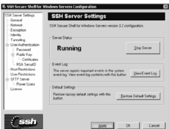

**图 2.1** SSH Communications' SSH 服务器的配置菜单。

Windows 版本的 `sshd2_config` 文件与 Unix 版本类似；然而，许多区别使这两个版本有所不同。以下部分讨论 Windows `sshd2_config` 文件。

## 常规设置

`sshd2_config` 文件的常规部分应如下所示：

```text
# General settings
    MaxConnections                          0
    EventLogFilter                          error, warning
    IdleTimeout                             0
    BannerMessageFile                       " "
    TerminalProvider                        "cmd.exe"
    DoubleBackspace                         yes
#     ProtocolVersionString
```

SSH 配置 GUI 的常规部分应如图 2.2 所示。

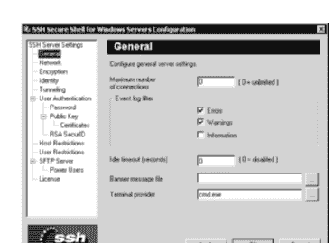

**图 2.2** SSH 服务器配置工具的常规屏幕。

表 2.18 描述了 SSH 服务器中可用的常规选项。

## 表 2.18 sshd2_config 文件常规部分中的选项 (Windows)

| 选项 | 描述 |

| --- | --- |

| `MaxConnections` | 标识 SSH 服务器将处理的同时连接数。如果值设置为零，同时连接数没有限制。 |

| `EventLogFilter` | 标识 Windows 事件日志设置的过滤器。可能的过滤器可以是 `error` 错误, `warning` 警告 和 `information` 信息。 |

| `IdleTimeout` | 会话在自动关闭之前可以保持未使用状态的分钟数。设置为零表示没有超时，这在某些备份过程中可能是理想的。 |

| `BannerMessageFile` | 标识包含在客户端登录到服务器之前要显示的文件位置。这对于法律免责声明非常有用。 |

| `TerminalProvider` | 标识为远程用户提供终端访问的可执行文件，通常是命令提示符程序 (`cmd.exe`)。 |

## 网络设置

`sshd2_config` 文件中的网络部分应如下所示：

```
    Port                        443
    ListenAddress               0.0.0.0
    RequireReverseMapping        no
    ResolveClientHostName        yes
    MaxBroadcastsPerSecond       0
    NoDelay                      yes
    KeepAlive                    yes
```

SSH 配置图形用户界面中的网络部分应如图 2.3 所示。


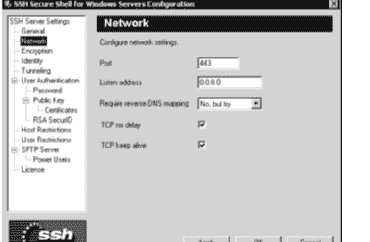

**图 2.3** SSH 服务器配置工具中的网络屏幕。

表 2.19 描述了 SSH 服务器可用的网络选项。

### 表 2.19 网络部分的选项（Windows）

| 选项 | 描述 |
| :--- | :--- |
| Port | 设置 SSH 监听的端口号。默认端口为 22；然而，监听多个端口（包括 80、443 或 8080 等非常规端口）可能更优，因为商务旅行者可能无法在 22 端口建立出站连接，而 80 或 443 端口通常是可访问的。若要监听多个端口，请添加以下行：<br>`Port 22`<br>`Port 80`<br>`Port 443`<br>`Port 8080` |
| ListenAddress | 设置 SSH 守护进程监听的 IP 地址。默认为 0.0.0.0，这将启用所有接口上的 SSH 服务。如果存在 SSH 不应监听的接口（例如防火墙的外部接口），请移除 0.0.0.0 并添加相应的 IP 地址。若要仅监听特定接口，请添加以下行：<br>`ListenAddress 172.16.1.1,192.168.0.1`<br>`ListenAddress 10.0.0.1` |
| RequireReverseMapping | 启用（yes）或禁用（no）DNS 查找必须成功的设置，以便与 AllowHost 和 DenyHost 条目配合使用。如果启用且 DNS 查找失败，请求将被拒绝。如果禁用且 DNS 查找失败，系统将检查 AllowHosts 和 DenyHosts 中的 IP 地址。 |
| ResolveClientHostname（仅限 sshd_config 文件） | 启用（yes）或禁用（no）服务器通过 DNS 解析客户端 IP 地址的功能。 |
| MaxBroadcastPerSecond（仅限 sshd_config 文件） | 指定服务器每秒应处理的 UDP 广播数量。默认值为零，表示不处理任何广播。 |
| NoDelay | 启用（yes）或禁用（no）TCP_NODELAY 套接字选项。 |
| KeepAlive | 启用（yes）或禁用（no）SSH 服务器向 SSH 客户端发送 KeepAlive 数据包的功能。该值有助于防止会话挂起，通过判断对端的客户端是否仍在运行且未崩溃或蓝屏来实现。 |

## 加密设置

`sshd2_config` 文件中的加密部分应如下所示：

```
Ciphers		AnyStdCipher
MACs		AnyStdMac
RekeyIntervalSeconds	0
RandomSeedFile	"server_random_seed"
```

SSH 配置图形用户界面中的加密部分应如图 2.4 所示。

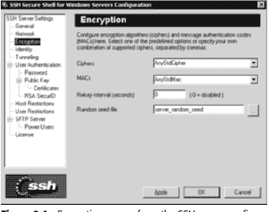

**图 2.4** SSH 服务器配置工具中的加密屏幕。

表 2.20 描述了 SSH 服务器可用的加密选项。

### 表 2.20 加密部分的选项（Windows）

| 选项 | 描述 |
| :--- | :--- |
| Ciphers | 列出用于加密会话的密文类型。支持三重 DES（3DES）、Blowfish、ArCFour、Twofish、CAST – 128 和 DES。可以设置更多全局选项，如 Any、Anystd、anycipher 和 anystdcipher。Any 和 anystd 允许使用标准密码；anycipher 允许任何密文；anystdcipher 允许在 IETF SSH 草案中列出的任何密码；设置为 none 则不提供密码。 |
| MACs | 消息认证码（MAC）是一种哈希算法，用于验证数据传输前后的完整性。支持的算法包括 SHA1、MD5、SHA1-96 和 MD5-96。也可以设置多个 MAC。 |
| RekeyIntervalSeconds | 指定再次执行密钥交换流程前的时间间隔。默认值为 3600 秒，即一小时。将该值设置为零即可禁用密钥交换流程。 |
| RandomSeedFile | 指定随机种子文件的位置。此文件用于为 SSH 服务器生成随机数。 |

## 用户设置

`sshd2_config` 文件中的用户部分应如下所示：

```
LoginGraceTime				600
PermitEmptyPasswords	no
UserConfigDirectory		"%D\_ssh2"
AuthorizationFile		"authorization"
PrivateWindowStation	yes
```

SSH 配置图形用户界面中的用户身份验证部分应如图 2.5 所示。

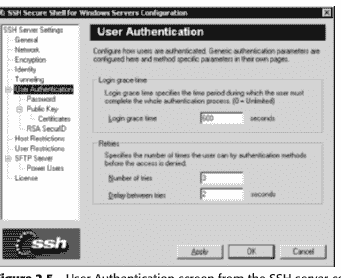

**图 2.5** SSH 服务器配置工具中的用户身份验证屏幕。

此外，用户身份验证-密码部分应如图 2.6 所示。

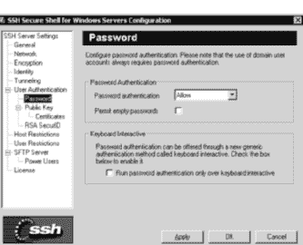

**图 2.6** SSH 服务器配置工具中的用户身份验证-密码屏幕。

最后，用户身份验证-公钥部分应如图 2.7 所示。

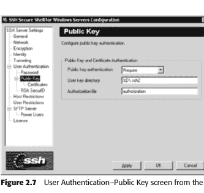

**图 2.7** SSH 服务器配置工具中的用户身份验证-公钥屏幕。

表 2.21 描述了 SSH 服务器可用的用户身份验证选项。

### 表 2.21 用户身份验证部分的选项（Windows）

| 选项 | 描述 |
| :--- | :--- |
| LoginGraceTime | 用户发起身份验证请求后完成登录流程允许的时间（以秒为单位）。取值范围从零（无限制）到 600 秒。 |
| PermitEmptyPasswords | 允许（yes）或拒绝（no）用户使用空密码。在大多数情况下，此项应设置为 no。 |
| UserConfigDirectory（sshd_config 文件） | 指定用户特定配置数据（如密钥和标识文件）的位置。默认为用户主目录中的 .ssh2 文件夹，例如 `/home/<username>/.ssh2` 或 `Documents and Settings\<username>\.ssh2`（`%D` 是用户主目录；`%U` 是用户登录名）。可以指定多个位置用于配置数据。 |
| 用户密钥目录（GUI） | 指定授权文件的位置，该文件通常命名为 `authorization`，位于 SSH 服务器上的用户主目录中。SSH 服务器使用此文件来指示在身份验证过程中哪些公钥是被授权接受的。例如，如果用户有两个用于身份验证的公钥，如 `id_dsa_2048_a.pub` 和 `id_rsa_2048_a.pub`，则授权文件的内容将如下所示：<br>`Key     id_dsa_2048_a.pub`<br>`Key     id_rsa_2048_a.pub`<br>注意：授权文件中列出的公钥也需要位于用户主目录中，详见第 4 章。 |
| PrivateWindowStation（仅限 sshd2_config 文件） | 启用（yes）或禁用（no）任何创建的终端处于完全私有窗口或非私有窗口的状态。 |

## 服务器公钥配置

`sshd2_config` 文件中的服务器公钥配置部分应如下所示：

```
#     HostKeyFile                hostkey
#     PublicHostKeyFile          hostkey.pub
```

SSH 配置图形用户界面中的标识部分应如图 2.8 所示。

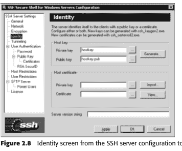

**图 2.8** SSH 服务器配置工具中的标识屏幕。

表 2.22 描述了 SSH 服务器可用的服务器公钥选项。

### 表 2.22 服务器公钥配置部分的选项（Windows）

| 选项 | 描述 |
| :--- | :--- |
| HostKeyFile | 指定私钥主机密钥文件的位置。默认位置在本地文件系统的 `/etc/sshd2` 目录中。 |
| PublicHostKeyFile | 指定公钥主机密钥文件的位置。默认为 `hostkey.pub`，位于本地文件系统中。 |

## 服务器证书配置

`sshd2_config` 文件中的服务器证书配置部分应如下所示：

```
#        HostKeyFile          " "
#        HostCertificateFile " "
#        Pki                " "
#        MapFile            " "
#        LDAPServers
#        Socks5Server
#        PkiDisableCRLs     no
```

表 2.23 描述了 SSH 服务器可用的服务器证书选项。


### 表 2.23 服务器证书配置部分的选项（Windows）

| 选项 | 描述 |
| :--- | :--- |
| `HostKeyFile` | 指定私钥主机密钥文件的位置。默认为 `hostkey`，位于本地文件系统中。 |
| `HostCertificateFile` | 指定证书文件的位置。 |
| `Pki` | 启用（`yes`）或禁用（`no`）使用证书进行用户身份验证。 |

## 隧道配置

`sshd2_config` 文件中的隧道部分应与以下内容相似：

```
#            AllowTcpForwarding               no
#            AllowTcpForwardingForUsers
#            DenyTcpForwardingForUsers
```

SSH 配置 GUI 中的隧道部分应与图 2.9 类似。

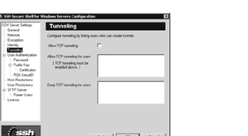

图 2.9 SSH 服务器配置工具中的隧道界面。

表 2.24 描述了 SSH 服务器可用的隧道选项。

| 选项 | 描述 |
| :--- | :--- |
| `AllowTcpForwarding` | 启用（`yes`）或禁用（`no`）所有用户转发端口（包括本地和远程）的功能。 |
| `AllowTcpForwardingForUsers` | 启用特定用户转发端口（包括本地和远程）的功能。此设置接受用户名和模式（例如 DNS 模式）。 |
| `DenyTcpForwardingForUsers` | 禁用特定用户转发端口（包括本地和远程）的功能。此设置接受用户名和模式（例如 DNS 模式）。 |

## 身份验证方法

`sshd2_config` 文件中的身份验证部分应如下所示：

```
PasswordGuesses 3
AllowedAuthentications "publickey, password, "
RequiredAuthentications "publickey, "
AuthInteractiveFailureTimeout 2
AuthKbdInt.NumOptional 0
# AuthKbdInt.Optional " "
# AuthKbdInt.Required " "
AuthKbdInt.Retries
```

表 2.25 描述了 SSH 服务器可用的身份验证选项。

| 选项 | 描述 |
| :--- | :--- |
| `PasswordGuesses`（如图 4.5 所示） | 指定在有效身份验证未提交时用户被断开连接前获得的尝试次数。 |
| `AllowedAuthentications`（如图 4.6 和 4.7 中的“密码身份验证”下拉框或“公钥”下拉框所示） | 指定有效的身份验证方法类型。选项包括密码、公钥和基于主机。 |
| `RequiredAuthentications`（如图 4.6 和 4.7 中的“密码身份验证”下拉框或“公钥”下拉框所示） | 指定身份验证所需的方法类型。如果值为空，则 `AllowedAuthentication` 中的任意值都将被接受。 |
| `AuthInteractiveFailureTimeout`（仅限 `sshd2_config` 文件） | 指定键盘交互会话允许的最大失败次数。 |
| `AuthKbdInt.NumOptional`（仅限 `sshd2_config` 文件） | 指定在有效身份验证之前所需的子方法数量。 |
| `AuthKbdInt.Optional`（仅限 `sshd2_config` 文件） | 指定键盘交互将使用的可选子方法。选项可以是 SecureID、插件和密码。 |
| `AuthKbdInt.Required`（仅限 `sshd2_config` 文件） | 指定有效身份验证必须存在的必需子方法。 |
| `AuthKbdInt.Retries`（仅限 `sshd2_config` 文件） | 指定用户尝试键盘交互过程以向 SSH 服务器进行身份验证的重试次数。 |

## 主机限制

`sshd2_config` 文件中的主机限制部分应如下所示：

```
#    AllowHosts
#    DenyHosts
```

SSH 配置 GUI 中的主机限制部分应如图 2.10 所示。

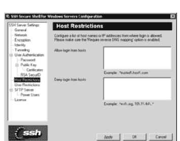

图 2.10 SSH 服务器配置工具中的主机限制界面。

表 2.26 描述了 SSH 服务器可用的主机限制选项。

**表 2.26 主机限制部分的选项（Windows）**

| 选项 | 描述 |
| :--- | :--- |
| `AllowHosts` | 指定允许登录到 SSH 服务器的唯一主机名、IP 地址和/或模式 |
| `DenyHosts` | 指定不允许登录到 SSH 服务器的主机名、IP 地址和/或模式 |

## 用户限制

`sshd2_config` 文件中的用户限制部分应如下所示：

```
#   AllowUsers
#   DenyUsers
#   PermitRootLogin
#   PermitUserTerminal
```

SSH 配置 GUI 中的用户限制部分应如图 2.11 所示。

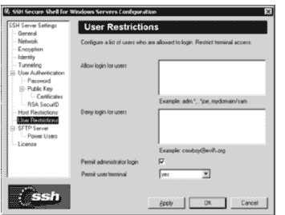

图 2.11 SSH 服务器配置工具中的用户限制界面。

表 2.27 描述了 SSH 服务器可用的用户限制选项。

**表 2.27 用户限制部分的选项（Windows）**

| --- | --- |
| `AllowUsers` | 指定允许登录到 SSH 服务器的唯一用户。此项可以包含用逗号分隔的用户列表或模式匹配变量。 |
| `DenyUsers` | 指定不允许登录到 SSH 服务器的用户。此项可以包含用逗号分隔的用户列表或模式匹配变量。 |
| `PermitRootLogin` | 启用（`yes`）或禁用（`no`）`root` 用户登录到 SSH 服务器的功能。作为最佳实践，此设置应设为 `no`，强制管理员用户通过 `su`（切换用户）命令切换到 `root`。如果必须允许 `root` 账户直接登录，则“`nopwd`”值可以允许 `root` 直接登录，但仅限使用公钥身份验证。 |
| `PermitUserTerminal` | 启用（`yes`）或禁用（`no`）用户访问终端会话的功能。如果此选项设置为 `admin`，则只有管理员才能访问终端。此 `admin` 选项非常适合 SFTP 文件服务器，允许远程用户访问 `cmd.exe`。 |

## 子系统定义

`sshd2_config` 文件中的子系统定义部分应如下所示：

```
subsystem-sftp sftp-server2.exe
SftpLogCategory 16
Sftp-DirList "HOME=$D"
Sftp-Home $D
Sftp-AdminDirList "HOME=$D, C:=C:, D:=D:"
# Sftp-AdminUsers
```

SSH 配置 GUI 中的 SFTP 服务器部分应如图 2.12 所示。

SFTP 服务器 - 高级用户部分应如图 2.13 所示。

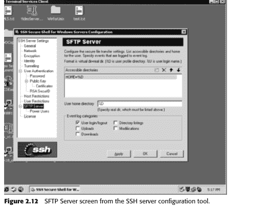

图 2.12 SSH 服务器配置工具中的 SFTP 服务器界面。

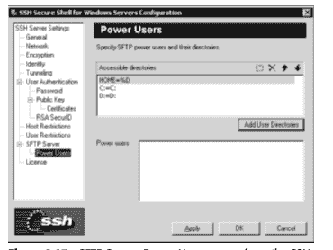

图 2.13 SSH 服务器配置工具中的 SFTP 服务器 – 高级用户界面。

表 2.28 描述了 SSH 服务器可用的 SFTP 选项。

**表 2.28 子系统定义中的选项（Windows）**

| **选项** | **描述** |
|:---|:---|
| `subsystem-sftp`（仅限 `sshd2_config` 文件） | 指定与 SSH 一起使用的 SFTP（安全文件传输协议）子系统的路径；通常位于 `Program Files/SSH Secure Shell Server` 中。 |
| `Sftplogcategory`（`sshd2_config`）可访问目录（图 4.12 中的 GUI） | 指定在 Windows 事件查看器中记录的 SFTP 操作。默认值为 `16`，仅记录用户登录和注销。 |
| `Sftp-DirList`（`sshd2_config`）可访问目录（图 4.12 中的 GUI） | 指定常规 SFTP 用户可用的目录。格式为虚拟目录==真实目录。此设置将限制 SFTP 访问仅限于特定目录。此选项与安全的文件服务器配合使用效果良好，通过将用户限制在远程文件服务器上的特定共享或文件夹（例如 `D:\applications`），并禁用对核心操作系统文件夹（例如 `c:\winnt\system32\config`）的访问，这将在第 6 章和第 7 章中进一步讨论。 |
| `Sftp-Home`（`sshd2_config`）用户主目录（图 4.12 中的 GUI） | 指定所有用户的 SFTP 主目录。 |


| Sftp-AdminDirList 可访问目录（图 4.13 中的 GUI） | 指定管理员可用的目录。 |

| Sftp-AdminUsers 高级用户（图 4.13 中的 GUI） | 指定作为 SFTP 管理员的用户名。 |

## VanDyke Software 的 VShell SSH 服务器

VanDyke Software 的 VShell SSH 服务器仅适用于 Windows 环境。VShell 服务器使用 GUI 来显示、编辑和报告 SSH 服务器的配置选项。以下段落介绍了 VShell SSH 服务器的各种设置和功能。

### 常规设置

要查看配置屏幕（见图 2.14），请浏览到 VShell 快捷方式，启动 VShell VShell 程序。

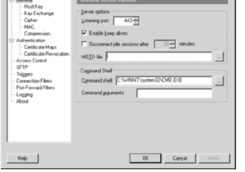

### 通用部分

在配置界面中，首先突出显示通用部分。通用部分介绍了 SSH 服务器的一些全局选项，这些选项列在表 2.29 中。

**表 2.29** 通用部分（VShell）中的选项

| **选项** | **描述** |

| :--- | :--- |

| 监听端口 (`ListeningPort`) | 设置 SSH 监听的目标端口号。默认端口为 22；然而，由于商务旅行者可能无法在 22 端口上进行出站连接，而 80 或 443 端口通常可访问，因此监听包括其他非标准端口（如 80、443 或 8080）在内的多个端口可能更为合适。若要监听多个端口，请添加以下行：<br>`Port 22`<br>`Port 80`<br>`Port 443`<br>`Port 8080` |

| 启用 Keep Alives | 启用（勾选）或禁用（未勾选）SSH 服务器是否应向 SSH 客户端发送 KeepAlive 数据包。此值有助于通过判断另一端的客户端是否仍在运行且未崩溃或蓝屏，从而防止会话挂起。 |

| 空闲会话在 __ 分钟后断开 | 设置会话在未使用状态下可以保持的最长时间（以分钟计），超过该时间后将被自动关闭。 |

| MOTD 文件 | 指定在登录时显示的 MOTD（当日消息）文件的路径（`Program Files\VShell\`）。由于可以向所有登录系统的用户显示消息（例如系统停机通知、安全问题等），因此这一功能非常实用。 |

| 命令 Shell | 指定为远程用户提供终端访问权限的可执行程序，通常是指令提示符程序（`cmd.exe`）。 |

| 命令参数 | 指定随之前指定的命令 shell 提供的任何参数或标志。 |

### 通用-主机密钥

接下来突出显示通用-主机密钥部分（见图 2.15）。通用-主机密钥部分介绍了主机密钥的位置以及指纹。表 2.30 中列出了各种选项。

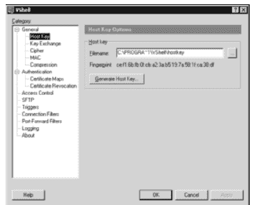

**图 2.15** VShell 服务器中的通用–主机密钥界面。

**表 2.30** 通用–主机密钥部分（VShell）中的选项

| **选项** | **描述** |

| :--- | :--- |

| 文件名 | 指定 VShell SSH 服务器主机密钥的路径 |

| 指纹 | 显示 VShell SSH 服务器的指纹 |

| 生成主机密钥... | 用于为 VShell SSH 服务器创建主机密钥的向导 |

### 通用–密钥交换

接下来突出显示通用–密钥交换部分（见图 2.16）。通用–密钥交换部分介绍了密钥交换选项。表 2.31 中列出了各种选项。

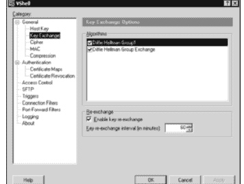

**表 2.31** 通用–密钥交换部分（VShell）中的选项

| **选项** | **描述** |

| :--- | :--- |

| 算法 | 指定可用于密钥交换过程的算法 |

| 重新交换 | 启用（勾选）或禁用（未勾选）密钥的重新交换。如果勾选，应选择以分钟为单位的间隔时间 |

### 通用–密码

接下来突出显示通用–密码部分（见图 2.17）。通用–密码部分介绍了加密选项，这些选项列在表 2.32 中。

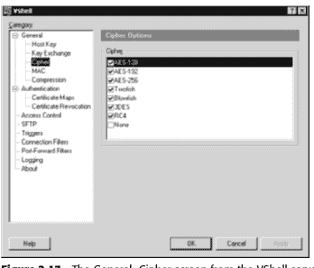

**图 2.17** VShell 服务器中的通用–密码界面。

**表 2.32** 通用–密码部分（VShell）中的选项

| **选项** | **描述** |

| :--- | :--- |

| 密码类型 | 指定用于加密会话的密文类型。支持 AES-128、AES-192、AES-256、Twofish、Blowfish、三重 DES (`3DES`)、RC4 以及无加密 (`none`) |

### 通用–MAC

接下来突出显示通用–MAC 部分（见图 2.18）。通用–MAC 部分介绍了哈希选项，这些选项列在表 2.33 中。

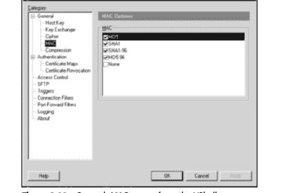

**图 2.18** VShell 服务器中的通用–MAC 界面。

**表 2.33** 通用–MAC 部分（VShell）中的选项

| **选项** | **描述** |

| :--- | :--- |

| MAC | 消息认证码 (`MAC`) 是一种用于在传输前后验证数据完整性的哈希算法。支持的算法包括 SHA1、MD5、SHA1-96 和 MD5-96。也可以设置为无哈希。 |

### 通用–压缩

接下来突出显示通用–压缩部分（见图 2.19）。通用–压缩部分介绍了压缩选项，这些选项列在表 2.34 中。

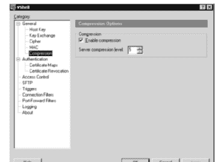

**图 2.19** VShell 服务器中的通用-压缩。

**表 2.34** 通用-压缩部分（VShell）中的选项

| **选项** | **描述** |

| :--- | :--- |

| 启用压缩 | 启用（勾选复选框）或禁用（未勾选复选框）在 SSH 会话期间使用压缩功能。 |

| 服务器压缩级别 | 如果勾选了“启用压缩”，此选项将设置用于 SSH 会话的压缩级别。 |

### 身份验证

接下来突出显示身份验证部分（见图 2.20）。身份验证部分介绍了密钥交换选项，这些选项列在表 2.35 中。

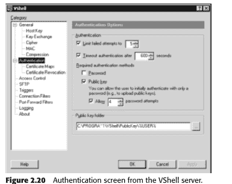

**图 2.20** VShell 服务器中的身份验证界面。

**表 2.35** 身份验证部分（VShell）中的选项

| **选项** | **描述** |

| :--- | :--- |

| 限制失败尝试次数 | 用户在被断开连接之前允许的最大失败尝试次数。 |

| 身份验证超时时间 | 设置用户完成身份验证过程的时间长度。具体而言，即从用户发起连接到用户输入用户名/密码或私钥密码的时间间隔。 |

| 必需身份验证方法 – 密码 | 要求使用密码进行身份验证。 |

| 必需身份验证方法 – 公钥 | 要求使用公钥进行身份验证。 |

| 必需身份验证方法 – 公钥上传 | 设置用户仅使用密码登录以上传公钥的次数。如果公钥身份验证是唯一的身份验证方法，此功能非常有用，因为它为用户提供了一种上传公钥的方法。 |

| 公钥文件夹 | 存储用户公钥的位置。默认值为 `Program Files\VShell\Publickey\<username>`。 |

### 访问控制

接下来突出显示访问控制部分（见图 2.21）。访问控制部分介绍了不同用户的权利和权限，这些列在表 2.36 中。

**表 2.36** 访问控制部分（VShell）中的选项

| **选项** | **描述** |

| :--- | :--- |

| 名称 | 指定允许访问 VShell SSH 服务器的名称或组。此选项非常有价值，因为它可以将访问权限限制为特定数量的用户和/或组，而无需向机器上的所有用户开放 SSH 访问。 |

| 权限 | 此选项允许或拒绝与用户关联的特定权限，例如登录、shell、远程执行、SFTP、端口转发和远程端口转发。此选项提供了其他 SSH 实现中缺失的大量价值。例如，如果 SSH 被部署为安全管理工具、安全文件传输工具和远程访问解决方案，且仅使用一个 VShell SSH 服务，则可以将 Shell 和端口转发权限授予 Administrators 组的用户以管理服务器。此外，可以明确拒绝 File Transfer 组用户的所有权限（包括 Shell），但允许其使用 SFTP。这可以防止用户在拥有远程服务器命令提示符（`cmd.exe`）的同时，还能对指定目录（例如 `d:\share\applications`）拥有完全的文件访问权限。最后，可以明确拒绝 Remote Access 组用户对包括 shell 和 SFTP 在内的所有权限的访问，但授予其端口转发权限，从而允许他们通过隧道端口（如邮件端口）进行远程访问，同时限制其获取 VShell SSH 服务器的命令提示符或文件访问权限。 |


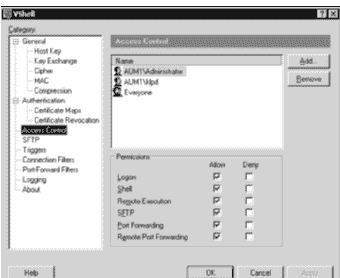

**图 2.21** VShell 服务器中的访问控制界面。

## SFTP 部分

接下来突出显示 SFTP 部分（见图 2.22）。SFTP 部分介绍了安全文件传输选项，这些选项列在表 2.37 中。这些选项也非常优秀，因为它们允许控制发布给 SFTP 用户的特定文件夹。这有助于保护文件服务器，因为它可以仅允许访问文件服务器上的授权目录（例如 `d:\Common files\`），同时限制用户对敏感的操作系统文件和文件夹（例如 `c:\winnt\`）的访问。此选项使 SSH 服务器能够在 SFTP 会话中提供完整的文件系统安全性，而无需担心用户可能能够访问并下载 SSH 服务器上的其他文件。

**表 2.37** SFTP 部分（VShell）中的选项

| **选项** | **描述** |
| :--- | :--- |
| SFTP 根目录 | 设置允许用户访问的 SFTP 根目录 |
| 已指定的 SFTP 根目录 <目录> | 显示 SFTP 根目录的权限 |

## 触发器

接下来高亮显示**触发器**部分（参见图 2.23）。**触发器**部分描述了任何可在 SFTP 上传或身份验证失败时执行的触发器选项，这些选项列于表 2.38 中。

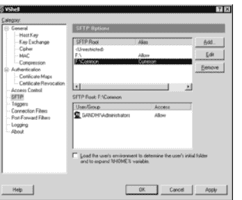

**图 2.22** VShell 服务器的 SFTP 界面。

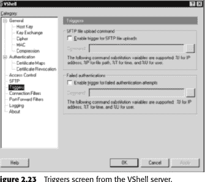

**图 2.23** VShell 服务器的触发器界面。

### 表 2.38 触发器部分的选项 (VShell)

| 选项 | 描述 |
| :--- | :--- |
| SFTP 文件上传命令 | 启用（选中复选框）或禁用（未选中复选框）在 SFTP 上传过程中执行的触发器。触发器可以是简单的批处理文件、Visual Basic 脚本、Perl 脚本或 Java 脚本，它们将在请求上传过程时执行。 |
| 身份验证失败 | 启用（选中复选框）或禁用（未选中复选框）在身份验证失败时执行的触发器。触发器可以是简单的批处理文件、Visual Basic 脚本、Perl 脚本或 Java 脚本，它们将在身份验证请求失败时执行。 |

## 连接过滤器

接下来高亮显示**连接过滤器**部分（参见图 2.24）。**连接过滤器**部分描述了谁可以或不可以连接到 SSH 服务器。选项如表 2.39 所示。当 VShell SSH 服务器部署在网络中时，可能不希望所有人都（可能是所有内部机器或所有互联网机器）都能访问。此选项允许你设置过滤器并限制对 VShell SSH 服务器的访问。

### 表 2.39 连接过滤器部分的选项 (VShell)

| 选项 | 描述 |
| :--- | :--- |
| 过滤器条目 | 描述已设置的过滤器。基于特定的 IP 地址、主机名、网络掩码或域名，选项为允许或拒绝。例如，如果部署 SSH 服务器用于远程管理，可以允许一系列特定的 IP 地址，这将限制访问仅针对授权用户，同时限制其他所有账户。 |
| 测试过滤器 | 测试任何过滤器。通过输入 IP 地址或主机名，可以测试到指定 IP 地址/主机的连接性，以确保 SSH 服务器可以访问指定的机器。 |

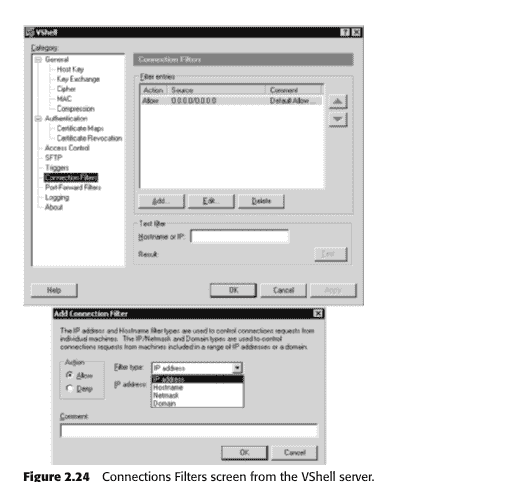

## 端口转发过滤器

接下来高亮显示**端口转发过滤器**部分（参见图 2.25）。**端口转发过滤器**部分描述了端口转发选项，这些选项列于表 2.40 中。**端口转发过滤器**部分描述了哪些机器可以通过 SSH 隧道访问哪些端口。当在源和目的地之间建立 VShell SSH 会话时，出于安全目的，可能不希望对远程服务器进行端口转发。此选项允许你设置过滤器，指定允许访问的服务器和端口，从而消除授权 SSH 用户通过隧道访问其不应访问的机器所带来的安全风险。例如，SSH 会话可能允许通过端口 3389（终端服务）对 Windows 终端服务器进行远程管理；然而，可能不希望访问同一台机器上的 FTP（端口 21）服务。如果设置过滤器仅允许 3389 端口通过隧道访问 Windows 机器，则通过端口转发隧道访问 FTP 服务的请求将被拒绝。

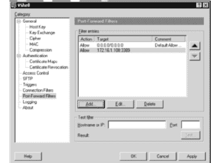

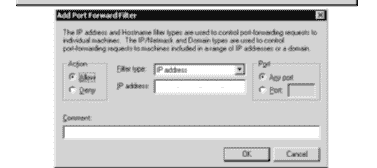

**图 2.25** VShell 服务器的端口转发过滤器界面。

### 表 2.40 端口转发过滤器部分的选项 (VShell)

| 选项 | 描述 |
| :--- | :--- |
| 过滤器条目 | 描述已设置的过滤器。基于特定的 IP 地址、主机名、网络掩码或域名，选项为允许或拒绝。例如，如果 SSH 服务器部署在网络周边，以允许对内部网络中的 Windows 终端服务器进行远程管理，那么目标值将是特定端口（例如，3389）上的 Windows 终端服务器（例如，172.16.1.100）。这将端口转发访问限制为仅针对端口 3389 上的远程终端服务器，拒绝其他所有端口转发访问。这提供了显著的安全级别。 |
| 测试过滤器 | 测试任何过滤器。通过输入 IP 地址或主机名，可以测试到指定 IP 地址/主机的连接性。 |

## 日志记录

接下来高亮显示**日志记录**部分（参见图 2.26）。**日志记录**部分描述了日志记录选项，这些选项列于表 2.41 中。


**图 2.26** VShell 服务器的日志记录部分。

### 表 2.41 日志记录部分的选项 (VShell)

| 选项 | 描述 |
| :--- | :--- |
| 日志文件消息 | 启用（选中复选框）或禁用（未选中复选框）将特定类型的日志发送到日志文件。可能的选项包括错误、警告、信息、连接、身份验证、SFTP、端口转发和调试。最佳实践是尽可能多地记录日志，并创建脚本以仅查看日志文件中所需的特定部分（例如，所有建立的端口转发请求）。 |
| 日志文件文件夹 | 标识记录由前述选项指定的 VShell SSH 事件的特定日志文件的路径。 |

## OpenSSH、SSH 服务器和 VShell 的比较

本章讨论的 SSH 服务器具有相似的功能，但它们之间存在显著差异。例如，VShell SSH 服务器提供了易于配置的方法来限制对 SSH 客户端的 shell 访问，但也允许其他 SSH 选项，如 SFTP 或端口转发。如果需要设置 SSH 用于安全文件传输，则应该限制 shell 访问。如果使用 VShell，可以很容易地设置此限制。另一方面，OpenSSH 在限制用户对 shell 的访问方面没有提供同样程度的便利性。类似地，如果需要设置 SSH 仅用于对内部服务器进行远程管理，三种 SSH 服务器都可以使用；然而，如果需要将远程管理限制在特定数量的机器和端口上，VShell 和 SSH Communications' 可能是不错的选择，因为它们提供了带有限制端口转发的 SSH 访问。

如果在部署 SSH 的环境中存在几种不同的 SSH 服务器，OpenSSH 可能是不错的选择，因为它提供了最大的灵活性与任何可能不同安装的其他 SSH 服务器的互操作性。

你对 SSH 服务器的选择高度依赖于 SSH 所需的功能类型。由于 SSH 可以有多种用途，你需要了解不同的服务器以及每个服务器提供的特定功能。

## 摘要

本章考察了可以与任何 SSH 客户端一起使用的三个 SSH 服务器：OpenSSH、SSH Communications' SSH 服务器和 VanDyke Software 的 VShell SSH 服务器。除了这里讨论的服务器外，还有许多其他同样有效的 SSH 服务器存在；然而，出于时间和篇幅的考虑，它们未被涵盖。请注意，大多数其他服务器与前面段落中考察的服务器非常相似。例如，F-Secure 的 SSH 服务器和 SSH Communications' SSH 服务器几乎相同。

在决定为你的组织选择 SSH 服务器时，除了了解每个服务器可用的不同选项外，了解业务和技术需求也很重要。虽然许多 SSH 服务器提供相似的功能，但许多服务器提供其他服务器可能不具备的特性。例如，如果你的 SSH 架构用于终端访问、端口转发、SFTP 或所有这些，不同的 SSH 服务器有各自的优缺点，这应影响你的决定。

在本章中，我详细描述了每个 SSH 服务器中可用的各种选项，并在本书的其余部分使用这些信息来突出 SSH 服务器的优缺点。这种方法不仅有助于你理解 SSH 服务器的功能，还能让你在选择服务器时做出明智的决定。

本书第 1 章涵盖了 SSH 的基础知识（即 SSH 服务器的部署），第 2 章涵盖了 SSH 服务器本身的详细描述。下一章将聚焦于 SSH 客户端。

## Secure Shell 客户端


许多 SSH 客户端提供了不同类型的功能和用途。SSH 客户端列表包括可从信息高速公路轻松下载的免费软件；可用于所有开发和学习环境非商业用途的非商业免费软件；以及仅用于商业用途和商业开发的付费商业客户端。虽然可能有多种 SSH 客户端可用于不同的操作系统，但所有 SSH 客户端并不等同。您使用的 SSH 客户端类型可能会显著影响您的 SSH 体验。例如，一些 SSH 客户端没有内置的 SFTP 或 SCP 功能。缺乏这些功能意味着您需要下载并使用两个独立的工具：一个用于 SSH，另一个用于 SFTP/SCP。尽管使用两个工具可能足够简单，但繁琐的过程可能会让新手望而却步。提供内置 SFTP/SCP 功能的 SSH 客户端可能会为您提供更优越的 SSH 体验。

本章将探讨几种适用于 Unix 和 Windows 的 SSH 客户端。此外，还将讨论各种 SSH 客户端的配置及为获得最佳使用效果所做的定制。本章重点关注以下客户端：

- Secure Shell Communications
- OpenSSH
- 图形界面 SSH 客户端
- SecureCRT
- PuTTY
- WinSCP
- MindTerm
- MacSSH

本章以及整本书中对 SSH 客户端的讨论仅限于主要的客户端。请留意，还有许多其他类型的 SSH 客户端，它们与这里介绍的客户端非常相似，性能也同样出色。例如，F-Secure 的 SSH 客户端和 SSH Communications 的 SSH 客户端极其相似。

尽管本章讨论的许多 SSH 客户端提供了相似的功能，但它们之间存在各种细微差别。例如，SSH Communications 的 SSH 客户端提供了一个集成的 SFTP 客户端，可以无缝使用。另一方面，SecureCRT 在其 SecureCRT SSH 客户端中没有提供用于 SFTP 的完全集成工具；不过，SecureCRT 确实包含了一个 HTTP 代理隧道，配置起来非常容易，但在 SSH Communications 的 SSH 客户端中则没那么简单。此外，MindTerm 的 FTP 到 SFTP 桥接功能提供了一种简单的方法，使不支持 SSH 的客户端能够连接并访问 SFTP 服务器。尽管从 FTP 客户端到 SFTP 客户端的连接仍然不安全，但从 SFTP 服务器到 SFTP 客户端的连接仍然是安全的，这可能是唯一在不安全网络（如互联网）上使用的连接。

您选择 SSH 客户端的决定很大程度上取决于 SSH 所需的功能类型。由于 SSH 可以以多种方式使用，了解各种客户端及其提供的具体功能至关重要。本章将确保您对 SSH 客户端的选择尽可能明智。例如，如果 SSH 主要因其文件传输功能而部署，那么 WinSCP 和 SSH Communications 的 SSH 客户端可能是不错的选择。另一方面，如果 SSH 是通过 HTTP 代理服务器进行远程 shell 访问而部署，那么 SecureCRT 和 PuTTY 客户端可能是不错的选择。最后，如果 SSH 是从未定义和未控制的终端位置进行远程访问而部署，由于 MindTerm 仅需 Web 浏览器即可提供 SSH 访问，因此它可能是一个不错的选择。

您选择的 SSH 客户端不必完全基于技术能力；个人偏好也很重要。尽管 SSH 客户端之间可能存在许多差异，但其基本原理是相同的：加密通信。

## 命令行 SSH 客户端

Secure Shell Communications (`www.ssh.com`) 和 OpenSSH (`www.openssh.org`) 为 Windows 和 Unix 生产了两款使用最广泛的命令行客户端。由于 OpenSSH 和 Secure Shell Communications 的客户端如此相似，接下来的段落将涵盖这两个客户端的功能。此外，由于命令行客户端在 Windows 和 Unix 版本中包含相似甚至相同的功能，以下部分可用于 Windows 命令行客户端或 Unix 命令行客户端。

这些 SSH 客户端可从以下网站购买和/或下载，用于商业或非商业用途：

`www.ssh.com/support/downloads/secureshellwks/`

由于我们将 SSH 用于非商业用途，可以从 `www.secondstory.org/mirror/ssh/` 下载非商业版本。此外，Unix 版的 OpenSSH 客户端可以从以下网站下载：

`ftp://ftp3.usa.openbsd.org/pub/OpenBSD/OpenSSH/portable/openSSH03.5p1.tar`

Windows 命令行客户端可以从以下网站下载：

`http://lexa.mckenna.edu/sshwindows/`

### Windows 安装

在 Windows 操作系统上安装 SSH 客户端是一个相对简单的过程。一旦您从 `http://lexa.mckenna.edu/sshwindows/` (`OpenSSH`) 或 `www.ssh.com` (`SSH Communications`) 下载了可执行文件，向导将引导您完成安装过程。请记住，为了本章的目的，您只需要安装客户端。服务器的安装将在第 1 章中讨论。当在 Windows 机器上安装了 SSH 服务器时，许多客户端二进制文件会自动安装。

### Unix 安装

一旦您在 Unix 操作系统上从 `www.ssh.com` 或 `www.openssh.com` 下载了 SSH 客户端，首先需要解包它。（接下来的 `XYZ` 字母是一个变量，代表您将要下载的 SSH 客户端的版本号）：

```bash
# gunzip -c ssh-XYZ.tar.gz | tar xvf -
```

解包后，更改目录到 SSH 文件夹。进入 SSH 文件夹后，必须编译并创建二进制文件：

```bash
# cd ssh-XYZ
# ./configure
# make
# make install
```

一旦二进制文件被编译，它将二进制文件放置在 `/usr/local/bin`。此时，帮助文件应该准备好供查看。SSH Communications 的 SSH 客户端二进制文件在 Windows 和 Unix 上都称为 `ssh2`。在 Windows 上，该文件可以位于 `\Program Files\SSH Secure Shell\ssh2.exe`。在 Unix 上，该文件可以位于 `/usr/local/bin/ssh2`。OpenSSH 客户端二进制文件在 Unix 和 Windows 上都称为 `ssh`。在 Windows 上，该文件可以位于 `\Program Files\OpenSSH\bin\ssh.exe`。在 Unix 上，该文件可以位于 `/usr/local/bin/ssh`。一旦您找到了 SSH 客户端二进制文件，输入 `ssh2 -h` 用于 SSH Communications 的二进制文件，或输入 `ssh -h` 用于 OpenSSH 的二进制文件。应出现以下帮助信息：


```text
Usage: ssh2 [options] [user@]host[:port] [command]

Options:
 -L              login_name Log in using this user name.
 -n              Redirect input from /dev/null.
 -a              Enable authentication agent forwarding.
 -A              Disable authentication agent forwarding.
 -x              Enable X11 connection forwarding (treat X11 clients as
                 UNTRUSTED).
 -X              Enable X11 connection forwarding (treat X11 clients as
                 TRUSTED).
 -Y              Disable X11 connection forwarding.
 -i file         Identity file for public key authentication
 -F file         Read an alternative configuration file.
 -t              Try; allocate a tty even if command is given.
 -v              Verbose; display verbose debugging messages.
                 Equal to '-d 2'.
 -d level        Set debug level.
 -V              Display version string.
 -q              Quiet; don't display any warning messages.
 -f[o]           Fork into background after authentication.
                 With optional 'o' argument, goes to "one-shot" mode.
 -e char         Set escape character; 'none' = disable (default: ~.).
 -c cipher       Select encryption algorithm. Multiple -c options are
                 allowed and a single -c flag can have only one cipher.
 -m MAC          Select MAC algorithm. Multiple -m options are
                 allowed and a single -m flag can have only one MAC.
 -p port         Connect to this port. Server must be on the same port.
 -S              Don't request a session channel.
 -L              listen-port:host:port Forward local port to remote address
 -R              listen-port:host:port Forward remote port to local address
 -g              Gateway ports, i.e. remote hosts may connect to locally
                 forwarded ports.
```

### SSH 客户端命令行选项

- `+g`: 不转发端口。
- `+C`: 启用压缩。
- `-C`: 禁用压缩。
- `-4`: 使用 IPv4 进行连接。
- `-6`: 使用 IPv6 进行连接。
- `-o`: `option` 像从配置文件中读取该选项一样进行处理。
- `-l[tt]`: 选择 `sshl-protocol` 回退类型。
- `-h`: 显示此帮助信息。

如前所述，SSH 帮助文件内容详尽，展示了 SSH 可以提供的各种选项。从最基本的意义上讲，SSH 可以连接正在默认端口 `22` 上监听的 SSH 服务器。如果需要指定 `22` 以外的端口，必须使用 `-p` 开关；然而，如果不使用 `-p`，则默认使用端口 `22`。类似地，如果需要指定用户名，必须使用 `-l` 开关。如果不使用 `-l` 开关，将使用执行该命令的当前用户：

```
ssh 10.0.0.3 -l cdwivedi -p 22
cdwivedi's password:
Authentication successful.
Last login: Thurs June 12 05:52:06 2003 from 172.16.11.17
```

作为替代方案，可以使用 SSH 默认设置，而不使用任何开关编写相同的命令：

```
ssh cdwivedi@10.0.0.3:22
```

`-l` 和 `-p` 是 SSH 客户端使用的众多开关中的两个。接下来的部分将介绍本书其余部分中常用的一些重要开关。

第一个开关是 `-i`。`-i` 开关可用于指向用于向 SSH 服务器进行身份验证的公钥文件。公钥文件需要存在于 SSH 服务器上以便进行公钥身份验证，第 4 章将进一步讨论此问题。以下是 `-i` 开关的一个示例：

```
ssh 10.0.0.3 -i cdwivedi -p 60599 -i publickey.pub
```

`-L` 和 `-R` 开关分别用于本地端口转发和远程端口转发。第 6 章将讨论端口转发；但当前需要对语法有一般性的了解。本地端口转发允许通过 SSH 服务器将本地对某个端口的连接转发到远程服务器上的任意远程端口。例如，IP 地址为 `10.0.0.100` 且监听端口 `143` 的邮件服务器可以通过 SSH 进行访问。IP 地址为 `10.0.0.3` 的 SSH 服务器需要有一条到该机器路由。以下是使用 `-L` 开关进行本地端口转发的示例：

```
ssh 10.0.0.3 -l cdwivedi -L 143:10.0.0.100:143
```

也可以进行远程端口转发；第 6 章将进一步讨论。以下是远程端口转发的示例：

```
ssh 10.0.0.3 -l cdwivedi -R 139:127.0.0.1:139
```

还可以设置所需加密类型以及 MAC 算法类型。例如，如果 SSH 服务器仅接受使用三重 DES (`3DES`) 的连接，则应使用 `-c` 开关。`3DES` 是一种可用于加密数据的算法。这使得 `3DES` 能够用于加密遍历网络的数据。如果支持多种加密类型，可以使用多个 `-c` 选项。以下是两个加密选项的示例：

```
ssh 10.0.0.3 -l cdwivedi -c 3DES
ssh 10.0.0.3 -l cdwivedi -c 3DES -c Blowfish
```

使用的 MAC 算法可以是 `MD5` 或 `SHA1`。`MD5` 和 `SHA1` 都是可用于验证数据完整性的算法。`MD5` 使用源自数据输入的 128 位消息摘要，该摘要对数据是唯一的。`SHA1` 使用源自数据输入的 160 位消息摘要，该摘要同样对数据是唯一的。这使得 `MD5` 和 `SHA1` 哈希值可以用作特定数据块的指纹。为了使用 MAC 算法，应使用特定的选项（`hmac-md5` 或 `hmac-sha1`）配合 `-m` 标志，以对两个实体之间传输的数据进行哈希处理。以下是两个 MAC 选项的示例：

```
ssh 10.0.0.3 -l cdwivedi -m hmac-md5
ssh 10.0.0.3 -l cdwivedi -m hmac-sha1
```

`-f` 开关用于指向 SSH 会话的不同配置文件。每个 SSH 会话在尝试建立连接时都会使用配置文件作为输入。配置文件将在下一节“SSH 客户端配置文件”中进行讨论。如果终端用户需要连接两个或更多具有不同参数（例如监听不同端口）的 SSH 服务器，那么指向不同的配置文件比记忆 SSH 服务器所需的输入参数要容易得多。假设 SSH 服务器 A 监听端口 `101`，启用指向邮件服务器的本地转发，并要求使用 `3DES` 进行加密。此外，服务器 B 监听端口 `701`，启用指向文件服务器的本地转发，并要求使用 `Blowfish` 进行加密。如果不使用配置文件，这两条命令如下所示：


```
ssh 10.0.0.3 -l cdwivedi -p 101 -L 143:172.16.1.100:143 -c 3DES
ssh 10.0.0.4 -l cdwivedi -p 701 -L 139:172.16.1.200:139 -c Blowfish
```

虽然记住两条命令可能不难，但连接两个以上具有不同转发规则、不同端口规格和不同加密算法的 SSH 服务器将变得繁琐。使用两个配置文件可以显著简化登录过程和用户体验，如下面的示例所示：

```
ssh 10.0.0.3 -l cdwivedi -F mail.config
ssh 10.0.0.4 -l cdwivedi -F file.config
```

接下来的两个开关在使用 IPv4 或 IPv6 时非常简单。使用 IPv6 假定正在使用 IPv6 网络，这超出了本书和 SSH 的范围；然而，SSH 提供对 IPv6 数据报的支持。IPv4 是默认的数据报类型，但如果网络可用，可以使用这两个标志。以下是这两个开关的两个示例：

```
ssh 10.0.0.3 -l cdwivedi -4
ssh 10.0.0.3 -l cdwivedi -6
```

接下来的开关不会为 SSH 客户端增加功能，但确实提供了收集有关连接的额外信息的机会。`-d` 开关设置连接的调试级别。调试值越高，屏幕上打印的关于连接的信息就越多。以下是 `-d` 开关的一个示例。请注意密码请求之前出现的所有信息：

```
ssh 10.0.0.3 -l cdwivedi -d 1
debug: Connecting to 10.0.0.3, port 22...
debug: (SOCKS not used)
debug: client supports 3 auth methods: 'publickey,keyboard-interactive,password'
debug: Ssh2Common/sshc/sshcommon.c:537/ssh_common_wrap:
local ip = 10.0.0.3, local port = 1077
debug: Ssh2Common/sshc/sshcommon.c:539/ssh_common_wrap:
remote ip = 10.0.0.3, remote port = 22
debug: Remote version: SSH-1.99-OpenSSH_3.4pl
debug: OpenSSH: Major: 3 Minor: 4 Revision: 0
debug: Remote host key found from database.
debug: server offers auth methods
publickey,password,keyboard-interactive' .
debug: SshConfig/sshconfig.c:2717/ssh2_parse_config_ext:
Unable to open /root/.ssh2/identification
debug: server offers auth methods
publickey,password,keyboard-interactive'.
debug: server offers auth methods
publickey,password,keyboard-interactive'.
cdwivedi's password:
```

下一个信息类开关 `-V` 显示远程 SSH 服务器的版本。当试图了解远程 SSH 服务器正在运行什么版本以进行补丁修复和安全目的时，这很有帮助。以下是 `-V` 开关的一个示例：

```
ssh 10.0.0.3 -V
ssh: SSH Secure Shell 3.2.3 (non-commercial version) on i686-pc-linux-gnu
```

这里讨论的最后一个信息类开关是 `-q`。从本质上说，它告诉 SSH 服务器保持安静，不向最终用户显示任何警告消息。如果使用 `-q` 开关，SSH 服务器将仅显示对用户密码的请求。以下是 `-q` 开关的一个示例：

```
ssh 10.0.0.3 -q
root's password:
```

## SSH 客户端配置文件

既然我已经介绍了可以与 SSH 客户端一起使用的开关，我将讨论配置文件本身。表 3.1 描述了根据操作系统和 SSH 客户端类型，配置文件可能所在的位置。SSH 客户端配置文件分为以下几类：

- 通用
- 网络
- 加密
- 用户公钥认证
- 隧道
- SSH1 兼容性
- 认证

接下来的段落将探讨这些类别中的每一个。

### 表 3.1 配置文件位置

| 客户端 | Windows 操作系统 | UNIX 操作系统 |
| :--- | :--- | :--- |
| OpenSSH | `\Program Files\OpenSSH\etc` | `/etc/ssh_config` |
| SSH Communications | `\Program Files\SSH Secure Shell\ssh2_config` | `/etc/ssh2/ssh2_config` |

### 常规设置

配置文件的常规部分列出了一般标志和开关，这些选项可以限制终端用户尝试访问 SSH 服务器时需要输入的命令数量。诸如 `VerboseMode`、`QuietMode`、`Compression`、`GoBackground` 和 `EscapeChar` 等字段允许直接从配置文件启用定制的一般设置，而无需在命令行中输入。表 3.2 提供了常规部分中部分选中字段的说明，以及每个字段的简要描述。

### 网络

配置文件中的网络部分列出了建立连接所需的网络设置。网络设置的一个示例是 SSH 客户端在尝试连接到 SSH 服务器时应使用的特定端口。表 3.3 简要描述了网络部分中部分选中字段的信息。

### 表 3.2 常规部分中的字段

| 字段 | 描述 |
| :--- | :--- |
| `VerboseMode` | 显示 SSH 会话的详细信息 |
| `QuietMode` | 显示警告消息 |
| `DontReadStdin` | 禁用标准输入 |
| `BatchMode` | 启用/禁用批处理模式 |
| `Compression` | 启用/禁用压缩 |
| `GoBackground` | 将连接发送到后台 |
| `EscapeChar` | 为会话设置 ESC 字符 |
| `PasswordPrompt` | 密码提示类型 |
| `AuthenticationSuccessMsg` | 登录成功后显示成功消息 |
| `SetRemoteEnv` | 为会话设置环境变量 |

### 表 3.3 网络部分中的字段

| 字段 | 描述 |
| :--- | :--- |
| `Port` | 设置要连接的端口 |
| `NoDelay` | 启用/禁用延迟处理 |
| `KeepAlive` | 保持连接活跃 |
| `SocksServer` | SOCKS 服务器的网络 ID |
| `UseSocks5` | 支持 SOCKS 版本 5 |

### 加密

配置文件中的加密部分列出了可以为 SSH 客户端设置的密码学类型。当不同的 SSH 服务器需要不同类型的加密算法时，这部分很有用。例如，可以为备份设置不同的 SSH 配置文件，启用对带宽影响最小且启用 MAC 进行数据验证的特定类型加密。表 3.4 简要描述了加密部分中部分选中字段的信息。

### 表 3.4 加密部分中的字段

| 字段 | 描述 |
| :--- | :--- |
| `Ciphers` | 指定可以使用哪些密码算法 |
| `MACs` | 指定可以使用哪些 MAC 算法 |
| `StrictHostKeyChecking` | 启用主机密钥检查以验证服务器 |
| `RekeyIntervalSeconds` | 会话重新密钥间隔长度 |

### 用户公钥认证

配置文件中的公钥认证部分仅指定用于认证的`用户公钥`的位置和名称。表 3.5 描述了公钥认证部分的字段。

### 表 3.5 公钥认证部分中的字段

| 字段 | 描述 |
| :--- | :--- |
| `IdentityFile` | 身份识别文件名称 |
| `RandomSeedFile` | 随机种子文件名称 |

### 隧道

配置文件中的隧道部分指定了在 SSH 客户端上应使用的本地和远程隧道选项。当客户端启用了多个本地和远程端口转发时，这部分会增加很大的价值。表 3.6 描述了隧道部分中选中的字段。

### 表 3.6 隧道部分中的字段

| 字段：隧道 | 描述 |
| :--- | :--- |
| `GatewayPorts` | 允许接口充当网关 |
| `ForwardAgent` | 启用/禁用数据包转发 |
| `ForwardX11` | 启用/禁用 X11 仿真 |
| `TrustX11Applications` | 信任/不信任 X11 的选项 |
| 登录时建立的隧道 |  |
| `LocalForward` | 本地端口转发设置 (143:IP:143) |


| LocalForward | 本地端口转发设置 (25:IP:25) |
| RemoteForward | 远程端口转发设置 (22:IP:23) |

### SSH1 兼容性

配置文件中的 SSH1 兼容性部分指定了要与 SSH1 版本兼容所使用的选项。为了使 SSH2 客户端与 SSH1 服务器兼容，必须设置以下字段（见表 3.7）。

## 表 3.7 SSH 兼容性

| 字段 | 描述 |
| :--- | :--- |
| `Ssh1Compatibility` | 启用/禁用 SSH1 支持 |
| `Ssh1Path` | 用于 SSH1 的路径。默认为 `/usr/local/bin/ssh1` |
| `Ssh1MaskPasswordLength` | 启用/禁用密码长度掩码 |

### 认证

配置文件中的认证部分指定了支持的认证选项。此部分允许客户端了解使用哪种类型的认证，例如，是否使用密码和公钥组合而不仅仅是密码进行认证。表 3.8 是认证部分中选中字段的简要列表。

## 表 3.8 认证

| 字段 | 描述 |
| :--- | :--- |
| `AllowedAuthentication` | 指定允许的认证类型，例如 *password*（密码）、*public key*（公钥）或 *all of the above*（以上所有） |

## GUI SSH 客户端

Secure Shell Communications (www.ssh.com)、VanDyke Software、PuTTY、AppGate 和 WinSCP 是提供 SSH 客户端图形用户界面（GUI）的几个供应商之一。由于市场上有几种 GUI 客户端，以下部分将研究 GUI SSH 客户端的一些最佳特性。此外，由于 GUI 客户端主要适用于 Windows，以下部分将重点介绍 Windows 2000 和 Windows XP。表 3.9 显示了可以在哪里购买和/或下载 SSH 客户端。

## 表 3.9 提供 SSH 客户端的网站

| 客户端 | URL |
| :--- | :--- |
| SSH Communications | www.ssh.com |
| VanDyke Software | www.vandyke.com/ |
| Putty | www.chiark.greenend.org.uk/ ~sgtatham/putty/ |
| WinSCP | winscp.net/eng/ |
| Mindterm | www.appgate.com/mindterm/ |
| MacSSH | pro.wanadoo.fr/chombier/ |

### Windows 安装

安装基于 Windows 的 SSH 客户端相对简单。我不描述表 3.9 中列出的每个 SSH 客户端的安装过程，但每个客户端的向导都会引导您完成安装过程。

### SSH Communications

我将首先讨论 SSH Communications 的 SSH 客户端。打开 SSH 客户端并通过执行以下步骤发起简单的 SSH 连接：

- 1. 启动程序 SSH Secure Shell Secure Shell Client
- 2. 文件 打开 快速连接

如图 3.1 所示，**主机名**字段是 SSH 服务器的完全限定 DNS 名称（例如 `sshserver.aum.com`），或者是 SSH 服务器 IP 地址的点分表示法（例如 `172.16.11.17`）。**用户名**字段是远程 SSH 服务器上的用户名。根据 SSH 服务器的实现方式，用户名可以是 Windows 机器上的本地帐户，也可以是 Windows 域上的域帐户。在 Unix 环境中，用户名与 `/etc/passwd` 文件中的用户名相同。**端口号**字段用于指定端口号。如果 SSH 服务器正在监听非标准端口（即 22 端口以外的端口），则应在端口框中输入适当的端口号，例如 202。最后，**认证方法**指定在尝试连接到远程 SSH 服务器时应使用的认证类型。可能的值及其描述见表 3.10。


**图 3.1** “快速连接”菜单。

## 表 3.10 认证类型

| 认证类型 | 描述 |
| :---------------- | :---------------- |
| Password | 用户名和密码组合 |
| Public Key | 公钥和私钥认证 |
| SecureID | 用于认证的 RSA SecureID 令牌* |
| PAM | 可插拔认证模块** |

* 需要 RSA ACE 服务器。
** 可插拔认证模块是一种 Unix 认证方法，它将各种认证方法集成在一起。

SSH Communications 为 SSH 客户端提供不同的设置。使用菜单栏，通过选择“编辑设置”打开设置菜单。在设置菜单下，应该有两个部分：配置文件设置（Profile Settings）和全局设置（Global Settings）。在配置文件设置和全局设置下，应该还有更多选项。在以下各部分中，将单独检查每个选项并描述其目的和用法。

### 配置文件设置

配置文件设置类似于前面使用命令行工具讨论的 `ssh2_config` 文件。配置文件设置部分下的所有选项直接对应于尝试连接 SSH 服务器时默认使用的设置。表 3.11 提供了这些设置的描述和用法。

## 表 3.11 配置文件设置部分下的选项

| 设置 | 描述和用法 |
| :---------------- | :---------------- |
| 连接 | 以下描述了左侧各部分的选项。这些部分中的选项也已解释。 <br>- 主机名：远程 SSH 服务器的 DNS 名称或 IP 地址。 <br>- 用户名：用于登录的帐户用户名。 <br>- 端口号：SSH 服务器正在监听的端口号。 <br>- 认证方法：可用于登录 SSH 服务器的认证类型。选项可以是密码、公钥、SecureID 和 PAM。 <br>- 加密算法：设置会话使用的密码学类型。 <br>- MAC 算法：设置对网络上传输的数据进行哈希处理时使用的哈希类型。选项可以是 MD5 或 SHA1。（所选选项必须受到 SSH 服务器支持。） <br>- 压缩：在连接上启用压缩。压缩的有效选择仅为 zlib。 |

## 表 3.11 | （续）

| 设置 | 描述与用法 |
| :--- | :--- |
| | 终端应答：设置从 SSH 服务器接收的仿真器类型。有效选项范围从 VT100 到 xterm。 |
| | - 通过防火墙连接：此复选框决定连接是否通过 SOCKS 或代理服务器进行。 |
| | - 仅请求隧道（禁用终端）：启用/禁用终端窗口的显示。如果启用此项，用户将无法接收用于执行命令的命令行 shell，而是仅接收用于端口转发的会话本身。 |
| 密码列表 | 列出可使用的密码类型。选项包括 3DES、Blowfish、Twofish、AES、Arcfour 和 CAST128。（所选选项必须得到 SSH 服务器的支持。） |
| 颜色 | 允许修改外观视觉效果。 |
| 键盘 | 更改键盘功能。 |
| 隧道 | 通过 SSH 连接将 X11 数据包在内部进行隧道传输，从而提供对 X11 连接的安全性保护。 |
| | - 出站：为该会话设置出站隧道（在端口转发章节中有更多讨论）。 |
| | - 入站：为该会话设置入站隧道（在端口转发章节中有更多讨论）。 |

## 全局设置

全局设置用于任何 SSH 连接尝试，无论使用的是哪个配置文件。全局设置部分下的所有选项直接对应于尝试连接到 SSH 服务器时默认使用的设置。这些设置的描述和用法如表 3.12 所示。

## 表 3.12 | 全局设置下的选项

| 设置 | 描述与用法 |
| :--- | :--- |
| 外观 | 设置默认显示的一些外观项目，如配置文件、主机名、颜色和字体。 |
| 用户密钥 | 管理可用于身份验证的公钥和私钥对（作为密码的替代）。此部分允许您创建密钥对、删除旧的密钥对、将密钥导出到扁平的 `*.pub` 文件、从扁平的 `*.pub` 文件导入密钥对、查看公钥的指纹、更改口令以使用公钥，以及将公钥上传到 SSH 服务器（SSH 服务器必须支持所创建密钥的类型）。用户密钥部分在第 4 章中进行了进一步讨论。 |
| 设置 | 描述与用法 |
| :--- | :--- |
| 主机密钥 | 标识 SSH 服务器。主机密钥是服务器的虚拟指纹。主机密钥的使用可以防止 IPv4 网络上的 IP 地址攻击，如中间人攻击和伪装攻击。 |
| 公钥基础设施 (PKI) | 提供基于证书的身份验证系统支持。选项可以包括来自 SSH 客户端的证书、来自集成目录服务架构（如 LDAP）的证书，或使用硬件设备。<br>- 证书：允许 SSH 客户端导入、注册、查看、删除证书或更改证书口令。<br>- LDAP：提供 LDAP 目录与 PKI 证书的集成。<br>- PKCS #11：提供基于证书的系统以访问硬件设备。 |


| 文件传输 | 配置安全 FTP (SFTP) 和安全复制 (SCP)。可配置的选项包括图标显示类型、隐藏或根目录的显示，以及在 SFTP 服务器上确认删除或覆盖文件的能力。此外，允许配置特定文件扩展名的默认文件查看应用程序（当该扩展名不可用时）。 |

| 防火墙 | 配置 SOCKS 防火墙可操作性。例如，`socks://172.16.1.100:1117` 将用于通过端口 1117 的 SOCKS 服务器 (172.16.1.100) 建立 SSH 连接。 |

| 安全 | 配置基本安全选项，例如退出时清除主机名的选项，或退出时删除剪贴板内容的选项。 |

| 打印 | 设置打印选项，如字体、页边距和页眉/页脚信息。 |

配置文件和全局设置是配置 SSH 客户端功能的主要区域。与命令行客户端一样，GUI 客户端可以保存基于不同 SSH 服务器的设置。要根据特定的 SSH 服务器自定义配置文件设置，请转到 文件 (File) 菜单栏并选择 文件 > 配置文件 > 添加/编辑配置文件。

在与 SSH 服务器建立初始有效连接后，可以自动设置配置文件。如图 3.2 所示，一旦建立初始连接，保存配置文件的选项就会出现在右上角。添加/编辑配置文件选项是自定义 SSH 连接的简单方式。在打开 文件 > 配置文件 > 编辑/添加配置文件 选项后，您应该注意与 编辑/设置 菜单中可用的相同配置文件选项。然而，这些选项不会全局更改所有选项；它们基于特定连接进行更改。


**图 3.2** 自动保存配置文件选项。

SSH Communications 的 SSH 客户端最有用的选项之一是内置的 SFTP 客户端。它允许在不需任何次要客户端或另一个 SSH 连接的情况下运行 SFTP 客户端。可以通过菜单栏中的 窗口 (Windows) > 新建文件传输 (New File Transfer) 来运行 SFTP 客户端。

选择此选项后，在启用到 SSH 服务器原始会话的情况下，SFTP 客户端在左侧窗格显示本地机器（即 SSH 客户端机器）的内容，在右侧窗格显示远程 SSH 服务器的内容。这使得可以在 SSH 会话中进行安全且简单的 SFTP 使用。图 3.3 演示了在已建立的 SSH 会话中使用 SFTP 客户端选项。

我将讨论的 SSH Communications 的 SSH 客户端的最后一个选项是 记录会话 (Log Session)。此选项将整个连接（包括命令、输出和输入）记录到日志文件中。日志文件可以保存在客户端机器上，以便稍后查看。记录会话选项也位于文件菜单栏的 文件 > 记录会话。

选择 记录会话 后，客户端将提示保存日志文件的位置。在启用该选项后，会话记录功能将应用于随后的连接。


**图 3.3** 已建立的 SSH 会话中的 SFTP 客户端选项。

## VanDyke Software 的 SecureCRT

VanDyke Software 有一款名为 SecureCRT 的 SSH 客户端。打开 SSH 客户端，通过选择 **开始** > 程序 > Secure-CRT 4.0 > SecureCRT 4.0 来启动一个简单的 SSH 连接。

选择快捷方式后，SecureCRT 将自动打开其 快速连接 (Quick Connect) 菜单（见图 3.4）以开始 SSH 连接。


**图 3.4** SecureCRT 的快速连接选项。

表 3.13 中显示的字段选项可用于快速连接界面。

### 表 3.13 | 快速连接界面中的字段选项

| 字段 | 描述 |

| :--- | :--- |

| 协议 | 使用 SSH1、SSH2 或其他非 SSH 连接的选项，如 Telnet、Rlogin、串行接口或 TAPI。 |

| 主机名 | 用于 DNS 解析的完全限定主机名，例如 sshserver.Aum.com。也可以使用 IP 地址的点分十进制表示法（例如，10.8.15.47）。 |

| 端口 | 用于远程 SSH 服务器的端口号。默认 SSH 端口为 22。“使用防火墙连接”复选框启用全局选项菜单中的防火墙设置，如 SOCKS 或代理设置。 |

| 用户名 | 在远程 SSH 服务器上使用的用户名。 |

| 密码 | 用于 SSH 连接的加密算法。可用选项为 DES、3DES、RC4 和 Blowfish。 |

| 身份验证 | 用于 SSH 连接的身份验证机制。可能的选择是 RSA 身份验证（需要服务器端连接有 RSA ACE 服务器）、密码和 TIS（需要服务器端连接有 TIS 防火墙服务器）。 |

快速连接界面中的最后两个选项是复选框： “启动时显示快速连接” 复选框在启动时显示快速连接，“保存会话” 复选框将自定义设置保存到配置文件中。

SecureCRT 提供不同的设置以在 SSH 客户端上启用。使用菜单栏，通过选择 选项 (Options) > 全局选项 (Global Options) 打开选项菜单。

在全局选项菜单下有七个部分，包括 选项、外观、防火墙、SSH1、SSH2、打印 和 Web 浏览器。每个部分下还有几个更多部分可用于配置客户端。我将单独选择选项并描述其目的和用法。

此部分下的所有全局选项直接对应于尝试连接 SSH 服务器时默认使用的设置。每个设置的描述和用法如表 3.14 所示。

### 表 3.14 | 全局选项下的设置

| 设置 | 描述与用法 |

| :--- | :--- |

| 选项 | 鼠标设置：<br>- 复制<br>- 粘贴<br>- 隐藏鼠标<br>对话框：各种对话框信息设置<br>其他：各种外观设置。 |

| 外观 | 各种外观设置，包括颜色、菜单/工具栏选项、页边距设置等。 |

| 防火墙 | 通过 SOCKS 服务器（版本 4 或版本 5）或代理服务器启用 SSH 会话。SOCKS 和代理服务器都可以代表 SSH 客户端将 SSH 连接中继到设备，在第 9 章中将进一步讨论。<br> <br> **类型：** <br>- SOCKS（v4 或 v5），可带或不带身份验证。<br>- 通用代理：可用于大多数代理服务器。<br> <br> **参数 (SOCKS)：** <br>- 主机名或 IP：SOCKS 服务器的 DNS 名称或 IP 地址。<br>- 端口：SOCKS 服务正在监听的端口号（默认为 1080）。<br> <br> **参数 (通用代理)：** <br>- 主机名或 IP：代理服务器的 DNS 名称或 IP 地址<br>- 端口：代理服务正在监听的端口号。注意：如果您的远程 SSH 服务器正在监听端口 22，并且所有出站流量仅通过代理服务器允许，请考虑将 SSH 服务器更改为端口 443 并使用代理服务器来代理 SSH 连接（在第 9 章中详细讨论）。<br>- 提示：此字段应填写 SecureCRT 预期从代理服务器接收的信息。 |

### 表 3.14（续）

| 设置 | 说明和用法 |

| --- | --- |

| | - 命令：此字段应填入 SecureCRT 在与代理客户端建立连接后应提供给代理服务器的信息。例如，要通过代理服务器连接到正在监听 443 端口的 SSH 服务器，请勾选登录界面上的防火墙复选框，并在命令字段中输入以下文本：`CONNECT 96h:%p HTTP/1.0\r\n\r\n`。 |

| SSH1 | 允许使用公钥而非密码来认证 SSH 服务器。<br><br>- 创建身份文件：允许创建公钥和私钥文件。 |

| SSH2 | 允许使用公钥而非密码来认证 SSH 服务器，第 4 章将进一步讨论。<br><br>- 创建身份文件：允许创建公钥和私钥文件。<br>- 使用证书：允许使用基于 X.509 证书的认证方式，而非密码或公钥。需要配合证书颁发机构（CA）使用。<br>- 代理（Agent）：向代理添加密钥：允许使用 SecureCRT 代理，从而能够通过单个公钥连接到多个 SSH 服务器。<br>- 启用 OpenSSH 代理转发：允许通过中间服务器连接到 SSH 服务器。<br>- 主机密钥：主机密钥是用于标识 SSH 服务器的公钥。主机密钥几乎就是服务器的指纹。使用主机密钥可以保护 IPv4 网络免受 IP 地址攻击，例如中间人攻击和欺骗攻击。 |

| 打印 | 设置打印选项，如字体、页边距以及页眉/页脚信息。 |

| Web 浏览器 | 设置通过 SecureCRT 打开 URL 时使用的默认 Web 浏览器。要使用此功能，请在 SecureCRT 中右键单击 URL 字符串（例如 www.theonion.com），并选择“Open URL”。 |

SecureCRT 提供了不同的设置，可在会话建立后启用。一旦通过快速连接对话框启用了连接，请使用菜单栏打开会话选项菜单；选择 选项 → 会话选项。


在设置菜单下有七个部分：连接、仿真、外观、选项、文件传输、日志文件和打印。每个部分下还有若干子部分，可用于配置客户端。我将单独选择选项并描述每个选项的目的和用法。

所有会话选项都直接对应于仅在连接到相应的 SSH 服务器时使用的设置。这些设置的说明和用法见表 3.15。

### 表 3.15 会话选项设置及说明

| 部分 | 用法和说明 |
| :--- | :--- |
| 连接 | 可以在本部分下配置连接特定的信息。 |
| | *登录脚本* |
| | - 自动登录：创建一个脚本以自动化登录到 SSH 服务器的过程。 |
| | - 登录脚本：允许 SecureCRT 客户端运行自动脚本，用于登录到远程 SSH 服务器。 |
| | *SSH2* |
| | - 使用压缩：启用连接的压缩功能。 |
| | - 加密算法（Cipher）：用于连接的加密算法。 |
| | - 消息认证码（MAC）：设置在网络传输数据进行哈希时使用的哈希类型。 |
| | - SSH 服务器：设置远程服务器使用的 SSH 服务器类型。选项包括：自动检测（最佳选项）、DataFellows、SSH Communications 和标准。 |
| | *端口转发* |
| | - 本地：为会话设置出站隧道（在第 6 章和第 7 章中进一步讨论）。 |
| | - 远程：为会话设置入站隧道（在第 6 章和第 7 章中进一步讨论）。 |
| | *X11* |
| | 允许通过将 X11 数据包封装在 SSH 内部来保护 X11 连接。 |
| 仿真 | 设置 SecureCRT 中仿真终端的选项和属性。 |
| 外观 | 设置会话的美观外观。 |
| 选项 | 设置会话的键盘选项。 |
| 文件传输 | 允许使用 Xmodem 和 Zmodem 工具上传和下载文件时设置特定位置。 |
| | - Xmodem：支持在传输期间进行错误检测的文件传输工具。注意：远程服务器必须支持 Xmodem 功能。 |
| | - Zmodem：用于下载和上传文件的文件传输工具。注意：远程服务器必须支持 Zmodem 功能。 |
| 日志文件 | 允许将日志文件的位置设置为特定位置。注意：必须通过“文件 > 记录会话”或“文件 > 原始记录会话”启用日志记录。 |
| 打印 | 允许配置打印信息。 |

文件传输功能可通过 SecureCRT 客户端部分实现。另一个客户端 SecureFX 是 VanDyke Software 完全支持的 SFTP/SCP 客户端。一些工具，如 Zmodem 和 Xmodem，允许基本文件传输选项，位于 传输 菜单栏下。

为了进一步自动化 SecureCRT，可以通过选择 脚本运行 使用 VBScript 和 JScript 的 ActiveX 脚本。

任何 VB 脚本、Microsoft Java 脚本甚至某些 Perl 脚本都可以从客户端机器加载到 SecureCRT SSH 客户端中，并在 SSH 会话内执行。

SecureCRT 还提供了创建和使用公钥进行认证而非密码的功能。要使用公钥进行认证，必须生成密钥。使用 工具 菜单下的实用工具，可以为 SecureCRT 客户端创建密钥。

1. 选择 `工具 → 创建公钥`。这将为用户创建一个公钥。
2. 选择 `工具 → 公钥助手`。这将管理当前用户在远程 SSH 服务器上的公钥。

要使用已上传到远程 SSH 服务器上的已创建公钥，需要在 连接 或 快速连接 对话框中的 认证 下拉框下设置 公钥 选项。

我将讨论的 SecureCRT 最后几个选项是 记录会话 和 跟踪。日志选项简单地记录整个 SSH 会话，包括命令、输出和输入，到一个日志文件中。记录会话有两个选项：格式化（仅记录选定项目）；或原始（以非格式化方式记录所有内容）。日志文件可以保存在客户端机器上，以便日后查看。记录会话选项也位于文件菜单栏。打开 SSH 客户端并完成以下步骤：

1. 选择 `文件 → 打开快速连接`。
2. 选择 `文件 → 记录会话` 或 `文件 → 原始记录会话`。

选择 记录会话 或 原始记录会话 后，客户端将在会话选项部分指定的位置保存会话。这两个设置之间的唯一区别是，原始记录会话会记录 SecureCRT 客户端与 SSH 服务之间的连接，包括转义命令。

跟踪选项菜单允许显示 SSH 服务器和 SecureCRT SSH 客户端之间的隐藏通信。要启用跟踪选项，请选择 `文件 → 跟踪选项`。

## PuTTY

PuTTY 是一个适用于 Win32 平台的免费 Telnet 和 SSH 客户端，可从 `www.chiark.greenend.org.uk/~sgtatham/putty/` 获取。PuTTY 具有与其他 SSH 客户端类似的描述功能。下载 PuTTY 后，双击可执行文件，应该会显示配置菜单。

如图 3.5 所示，使用 PuTTY 可以配置四个部分：会话、终端、窗口和连接。这些设置的说明和用法见表 3.16。


图 3.5 PuTTY 客户端。

### 表 3.16 PuTTY 设置选项及说明

| 设置 | 说明和用法 |
| --- | --- |
| 会话 | 针对特定 SSH 会话的配置。 |
| | - 主机名（或 IP 地址）：SSH 服务器的完全限定域名或 IP 地址的点分十进制表示法。 |
| | - 端口：远程 SSH 服务器正在监听的端口，通常为端口 22。 |
| | - 协议：由于 PuTTY 可用于各种项目，对于 SSH 连接应使用 SSH 单选框。 |
| | - 已保存的会话：提供保存会话或加载先前已保存会话的功能。 |
| | - 日志记录：提供记录 SSH 会话的功能。 |
| 终端 | 允许为 SSH 连接的终端会话设置特定选项。 |
| 窗口 | 允许对 SSH 连接进行外观调整。 |
| 连接 | 允许设置会话特定信息，如终端类型和用户名。 |
| | *代理：* |
| | 配置以通过代理服务器（Web 代理（HTTP）或 SOCKS 服务器）启用 SSH 连接的设置。 |
| | *SSH：* |
| | SSH 特定设置。 |
| | - 远程命令：会话建立后自动发送到 SSH 服务器的命令。 |
| | - 协议选项：SSH 1 或 2、压缩和伪终端的选项。 |
| | - 加密选项：用于 SSH 连接的加密算法选项，包括 AES、Blowfish、3DES 和 DES。 |
| | - 认证：会话的认证设置，包括键盘（密码）或密钥选项。 |
| | - 隧道：SSH 会话的 X11 和端口转发选项。支持本地和远程转发（在端口转发章节中进一步讨论）。 |
| | - 错误：允许配置选项以解决 SSH 连接中的问题，特别是 SSH 服务器中的问题。 |

## WinSCP

WinSCP 是适用于 Win32 平台的免费安全副本（SCP）客户端。WinSCP 提供了一个类似于我们之前讨论过的其他客户端的终端会话，但其主要功能是一个 Win32 安全副本客户端。下载 WinSCP 后，通过选择“开始” → “程序” → “WinSCP2” → “WinSCP2” 来打开客户端。


图 3.6 WinSCP 界面。

如图 3.6 所示，WinSCP 有四个主要配置部分：会话（Session）、目录（Directories）、SSH 和首选项（Preferences）。表 3.17 提供了这些设置的说明和用法。

| 选项 | 说明和用法 |
| :--- | :--- |
| 会话 | 针对特定 SSH 会话的配置。 |
| | - 主机名：远程 SSH 服务器完全限定 DNS 名称或点分十进制记法 IP 地址。 |
| | - 端口号：SSH 服务器监听的端口号，通常是 22 端口。 |
| | - 用户名：登录远程 SSH 服务器时使用的用户名。 |
| | - 密码：远程 SSH 服务器的密码，与用户名字段中使用的用户名相对应。 |
| | - 私钥文件：如果使用密钥认证而不是密码，则指定用于认证的私钥文件位置。 |
| | - 存储的会话：加载已保存的会话或创建新会话的选项。 |
| | - 日志记录（高级选项）：启用将 SSH 会话记录到本地文件。 |
| Shell（高级选项） | 允许通过 Shell 自定义各项设置，包括 Shell 本身、提交的返回代码以及 Unix 或 Windows 类型的显示。 |
| 目录 | 指定本地和远程目录的路径。 |
| | - 远程目录：要在 WinSCP 右侧面板中显示的远程目录（远程 SSH 服务器）的路径（例如，`/home/ssh` 或 `d:\$ssh$` 共享）。 |
| | - 本地目录：要在 WinSCP 左侧面板中显示的本地目录的路径。 |
| 连接（高级选项） | 配置通过代理服务器（Web 代理（HTTP）或 SOCKS 服务器）启用 SSH 连接的设置。 |
| SSH | 指定可用的 SSH 选项，如协议版本、加密类型、认证类型和错误。 |


| | - 协议选项：SSH 1 或 2 的选项，以及压缩。 |

| | - 加密选项：用于 SSH 连接的加密算法选项，包括 AES、Blowfish、3DES 和 DES。 |

| | - 认证（高级选项）：会话的认证设置，包括键盘（密码）或密钥选项。 |

| | - 错误（高级选项）允许配置选项以规避 SSH 连接中的问题，特别是 SSH 服务器中的问题。 |

| 首选项 | 允许自定义显示。 |

要配置 WinSCP 的高级选项，请单击 WinSCP 界面右下角的复选框。

## MindTerm

AppGate 提供了一个名为 MindTerm 的 SSH 客户端。MindTerm 是一个使用 Java applet 的 SSH 客户端。使用 MindTerm，可以通过任何支持 Java 的 Web 浏览器（如 Internet Explorer、Netscape、Mozilla 和 Opera）连接到 SSH 服务器。要安装 MindTerm，需要先安装 Java 运行时环境（JRE）。JRE 可以从以下位置下载：

- Linux：www.blackdown.org/java-linux.htmlwww.ibm.com/developer/java

- Win32 和 Solaris：www.java.soft.com/products/

- Macintosh：www.apple.com/java/

- 其他平台：http://java.sun.com/cgi-bin/java-ports.cgi


图 3.7 MindTerm SSH 客户端。

下载并安装 JVM 后，按照 MindTerm 的 readme.txt 文件中的说明安装客户端。在许多环境中，可以使用以下命令安装客户端：

```
java -jar mindterm.jar
```

如图 3.7 所示，AppGate MindTerm 客户端也可以在 Web 浏览器之外使用。一旦显示 MindTerm 客户端，提示符允许建立与远程 SSH 服务器的连接。表 3.18 列出了 MindTerm 的一些提示符。

表 3.18 MindTerm 提示符及用法说明

| 提示符 | 说明 |

| :--- | :--- |

| SSH 服务器/别名 | 别名或点分十进制记法 IP 地址 |

| 保存为别名 | 使用别名保存连接的名称 |

| 是否将此主机添加到已知主机列表（检查指纹） | 保存远程 SSH 服务器主机文件的“是”或“否”选项 |

| 登录 | 登录远程 SSH 服务器的用户名 |

| 密码 | 用于远程 SSH 服务器的密码，与使用的用户名相对应 |

除了用户提示符外，MindTerm 还允许进行多种设置。表 3.19 总结了 SSH 客户端的一些选定功能。

要在 Web 浏览器中完全使用 MindTerm 客户端，需要在连接的服务器端部署 AppGate 服务器。AppGate 服务器通过 Web 浏览器提供 MindTerm SSH 客户端；但是，会话仍然是通过 SSH 安全的（而非 HTTPS）。

表 3.19 SSH 客户端设置

| 设置 | 说明 |

| :--- | :--- |

| 文件 > 创建密钥对 | 允许创建用于认证的公钥/私钥对，而不是使用密码 |

| 文件 > 编辑/转换密钥对 | 允许将密钥编辑或转换为不同格式 |

| 文件 > 捕获到文件 | 启用 SSH 会话日志记录 |

| 设置 > 首选项 | 允许设置会话特定选项，例如：<br> - 协议：SSH1 或 SSH2，或自动检测 <br> - 密码：要使用的加密算法 <br> - Mac：要使用的散列算法 <br> - 压缩：要使用的压缩级别 |

| 插件 > SFTP 文件传输 | 允许通过 SFTP 协议与远程 SSH 服务器传输文件 |

| 插件 > SCP 文件传输 | 允许通过 SCP 协议与远程 SSH 服务器传输文件 |

| 插件 > FTP 到 SFTP 桥接 | 允许将 SFTP 连接桥接到 FTP 连接。例如，如果客户端通过 MindTerm 连接到 SSH 服务器，并且启用了“FTP 到 SFTP 桥接”，那么任何其他机器通过 FTP 连接到 SSH 客户端时，都将能够查看远程 SFTP 服务器上文件夹的内容（FTP 客户端 > SSH 客户端（启用 MindTerm 桥接） > SFTP 服务器）。 |

| 隧道 > 基本 | 允许设置本地端口转发隧道 |

| 隧道 > 高级 | 允许设置远程端口转发选项 |

## MacSSH

MacSSH 是用于 Macintosh 环境的 SSH 客户端。MacSSH 仅支持 SSH2，不支持 SSH1。MacSFTP 与 MacSSH 类似，但用于连接的传输文件部分。还有一些其他适用于 Macintosh 环境的好客户端，包括 JellfySSH（www.arenasoftware.com/grepsoft/）和 RBrowser（www.rbrowser.com）。

## 摘要

本章探讨了可在企业架构中使用的几种 SSH 客户端及其不同选项。本章详细考察了每个 SSH 客户端，涵盖了典型环境中的选项、设置和配置步骤。

本书的第 1、2 和 3 章涵盖了基础知识：SSH 服务器和 SSH 客户端。本书的重点现在从服务器和客户端的描述和实施步骤转向 SSH 服务器和客户端的具体功能和选项。第 4 章讨论了 SSH 提供的认证方法。虽然本章已经讨论了包含认证的客户端配置选项，但并未讨论如何实施各种选项以及最佳使用方法的实施。

本书的其余部分假设你熟悉第 3 章中讨论的 SSH 客户端的大多数功能，以及第 2 章中 SSH 服务器的主要用途。

# 第 4 章

# 认证

本书的前三章重点介绍了 SSH 服务器和 SSH 客户端的各个方面。我现在将重点从 SSH 的实际软件包转移到 SSH 的详细选项和最佳用法。第一个主题是认证。

认证是确定实体是否确实是其所声称的身份或实体的过程。实体可以是人、服务器、应用程序、服务，甚至是一个进程。在大多数网络中，认证通常使用用户名和密码。在这种类型的认证中，密码是保证实体确实是其所声称的唯一对象。虽然用户可以选择并更改自己的密码以成功进行认证，但密码经常被窃取、共享、写在便利贴上（一种将密码写在 Post-It 便签上并贴在显示器上的手动技术）或简单被遗忘的事实，使得使用密码进行认证成为一种不太理想的解决方案。

由于密码可能不是敏感信息或恶劣环境的最佳解决方案，SSH 提供了使用更严格的认证过程。在涉及敏感信息或跨越恶劣网络（如 Internet 或内部网络）的任何 SSH 环境中，使用公钥或数字证书都可能是必需的认证方法。此外，由于授权高度依赖于认证，认证过程需要尽可能强大，因为大多数授权过程不会执行第二层的有效性错误检查。

本章的重点是 SSH 中常用的认证方法，主要是密码、基于主机的认证和公钥。本章

本节总结了通过 SSH 可用的其他一些认证选项，例如服务器认证（即客户端对服务器进行认证）以及通用选项认证设置。讨论顺序如下：

- 通用选项

- 密码

- 基于主机的认证

- 服务器认证

- 公钥

## 通用选项

根据部署的 SSH 服务器类型，SSH 提供了几种通用的认证选项。这些选项的范围从有效的密码尝试到使用空密码。以下段落描述了 SSH 服务器及其提供的认证选项。

### SSH Communications 的 SSH 服务器（Windows）

SSH Communications 的 SSH 服务器提供了一些认证选项。打开 SSH 服务器配置界面（开始 ↔ 程序 ↔ SSH Secure Shell Server ↔ Configuration），并选中界面中的“用户认证”部分。认证界面如图 4.1 所示。


**图 4.1** SSH Communications 的 SSH 服务器界面的“用户认证”部分。

表 4.1 至表 4.3 描述了 SSH Communications 的 SSH 服务器的通用认证选项。

表 4.1 描述了通用的用户认证选项。可以配置登录宽限期、重试次数和重试间隔等参数。

表 4.2 描述了密码部分下的用户认证密码选项。可以配置密码认证、允许空密码以及键盘交互等参数。

表 4.3 描述了公钥部分下的用户认证公钥选项。可以配置公钥认证、密钥目录和授权文件等参数。

**表 4.1 用户认证选项**

| 选项 | 描述 |


| :----- | :-------------------------------------------------------------------------------------------------------------------------------------------------------------------------------------------------------------------------------------------------------------------- |
| 登录宽限期 | 设置用户完成认证过程的时间量。具体来说，即从用户发起连接的时间到用户输入用户名/密码或私钥密码的时间。 |
| 重试 – 重试次数 | 规定用户尝试登录的次数。 |
| 重试 – 重试间隔 | 指定重试之间的持续时间。 |

**表 4.2 用户认证密码选项**

| 选项 | 描述 |
| :------------------ | :----------------------------------------------------------------------------- |
| 密码认证 | 允许、要求或拒绝密码认证。 |
| 允许空密码 | 允许账户使用空密码。 |
| 键盘交互 | 允许与密码认证配合使用键盘交互认证。 |

**表 4.3 用户认证公钥选项**

| 选项 | 描述 |
| :---------------------- | :--------------------------------------------------------- |
| 公钥认证 | 允许、要求或拒绝公钥认证。 |
| 用户密钥目录 | 指定存储用户公钥的目录。默认为 `%D\.ssh2`，即 .ssh2 文件夹中用户的家目录（例如，Unix 上的 `/home/<username>/.ssh2` 和 Windows 上的 Documents and Settings\<username>\.ssh2）。 |
| 授权文件 | 存储可用于公钥认证的公钥有效列表。默认为授权文件，该文件存储在家目录中（Unix 上的 /home/<username>/.ssh2 和 Windows 上的 Documents and Settings\<username>\.ssh2）。 |

### SSH Communications 的 SSH 服务器（Unix）

Unix 版本的 SSH 服务器提供了与 Windows 平台类似的认证选项。一个区别在于，Windows 服务器配置界面只是一个指向 SSH 配置文件（即 `sshd_2_config`）的 GUI，而 SSH Communications 服务器的 Unix 版本不使用 GUI，而是直接使用配置文件本身。要查看认证选项，请输入以下命令。

```
#cd /etc/ssh2
#more sshd_2_config
```

认证部分的选项列于表 4.4 中，并附带对每个选项的描述。

**表 4.4 认证**

| 选项 | 描述 |
| :--- | :--- |
| BannerMessageFile | 指明包含横幅消息的文件位置，例如“唯一的获胜方式是不参与”。默认路径为 `/etc/ssh2/ssh_banner_message`。 |
| PasswordGuesses | 指定用户输入正确密码的尝试次数。 |
| AllowedAuthentication | 指示 SSH 服务器允许的认证方法类型。选项包括 hostbased、`publickey`、`password` 和 PAM。 |
| RequiredAuthentication | 命名 SSH 服务器要求的认证方法类型。选项包括 hostbased、`publickey`、`password` 和 PAM。 |
| HostbasedAuthForce<br>ClientHostnameDNSMatch | 强制进行认证时的 DNS 匹配。可能的选项为 yes 和 no。 |
| SchPAMClientPath | 如果使用了 PAM 客户端，则指明 PAM 客户端的位置。 |

### VShell SSH 服务器

VanDyke Software 的 VShell SSH 服务器提供了一些认证选项。打开 VShell 配置界面（开始 ↔ 程序 ↔ VShell ↔ VShell），并选中界面中的“认证”部分。（见图 4.2。）表 4.5 描述了 VShell 的通用认证选项。


**图 4.2** VShell SSH 服务器的用户认证界面。

**表 4.5 VShell 的认证选项**

| 选项 | 描述 |
| --- | --- |
| 限制失败尝试次数至 | 限制用户在会话断开之前可以进行的失败尝试次数。 |
| 认证后等待时间 | 设置用户完成认证过程的时间量。具体来说，即从用户发起连接的时间到用户输入用户名/密码或私钥密码的时间。 |
| 必需认证方法 – 密码 | 要求使用密码进行认证。 |
| 必需认证方法 – 公钥 | 要求使用公钥进行认证。 |
| 必需认证方法 – 公钥上传 | 设置用户可以仅使用密码登录以上传公钥的次数。如果公钥认证是唯一的认证方法，此功能非常有用，因为它为用户提供了一种上传公钥的方法。 |
| 公钥文件夹 | 指定存储用户公钥的位置。默认为 Program Files\VShell\Publickey\<username>。 |

### OpenSSH（Unix 和 Windows）

OpenSSH 服务器提供了与 VShell 和 SSH Communications 的 SSH 服务器类似的认证选项。要查看认证选项，请输入以下命令：

```
#cd /etc/ssh
#more sshd_config
```

或者

```
c:\cd *Program Files*\OpenSSH\ssh
c:\notepad sshd_config
```

OpenSSH 的认证部分选项在表 4.6 中描述。

**表 4.6 OpenSSH 的认证选项**

| 选项 | 描述 |
| :--- | :--- |
| LoginGraceTime | 指定用户完成认证过程的时间量。具体来说，即从用户发起连接的时间到用户输入用户名/密码或私钥密码的时间。 |
| PermitRootLogin | 允许（yes）或禁止（no）root 用户登录到 SSH 会话。最佳做法是限制 root 访问权限，并让授权用户通过 'su' 切换到 root。 |
| StrictModes | 在接受认证前启用（yes）或禁用（no）检查其家目录和 rhosts 文件中用户的权限。应将其设置为 yes，以防止家目录中出现全局可写的文件。 |
| RSA 认证 | 允许 RSA 认证。 |
| 公钥认证 | 允许公钥认证；可能的值为 yes 和 no。 |
| AuthorizedKeysFile | 指明 SSH 服务器上授权密钥验证文件的路径。默认为 `.ssh/authorized_keys`，即 .ssh 文件夹中用户的家目录（例如，Windows 上的 Program Files\OpenSSH\ssh 中的 /home/<username>/.ssh/authorized_keys）。 |
| Rhosts 认证 | 允许用于 RSH 的 rhosts 认证。 |
| RhostsRSA 认证 | 允许来自 RSA 主机密钥的 rhosts 认证。 |
| 基于主机的认证 | 授权基于主机的认证。 |
| 密码认证 | 启用（yes）或禁用（no）密码认证。 |
| PermitEmptyPasswords | 允许（yes）或禁止（no）使用空密码。 |

## 密码

密码认证是 SSH 的基本认证方法。SSH 服务器支持 Windows 和 Unix 平台的认证。Unix 平台上的 SSH 服务器有两种密码认证方法：

- `/etc/passwd` 或 `/etc/shadow`
- PAM（可插拔认证模块）

## 密码认证

与前面提到的情况类似，Windows 环境下的密码认证支持使用位于 `%SystemRoot%\winnt\system32\config` 的 SAM（安全账户管理器）数据库文件，或位于 `%SystemRoot%\NTDS\ntds.dit` 的 NTDS.DIT 数据库文件。

尽管 SSH 支持多种数据库文件，但操作系统的所在位置和类型与密码的实际配置和使用无关。需要注意的是，在大多数（如果并非全部的话）SSH 服务器上，默认都启用了密码认证。然而，了解如何禁用/启用密码认证非常重要，以便在必要时禁用它，转而采用更安全的认证方式，例如公钥认证。


# 启用密码认证

启用密码认证的过程非常简单。对于 Unix 环境中的 SSH 服务器安装，存在名为 `sshd2_config`（商用 SSH）和 `sshd_config`（OpenSSH）的配置文件。这两个配置文件非常相似。`sshd_config` 通常位于 `/etc/ssh`，而 `sshd2_config` 位于 `/etc/sshd2`。输入以下命令以显示 OpenSSH 配置文件的内容：

```bash
# cd /etc/ssh
# more sshd_config
```

输出中的一部分摘录如下：

```text
# Authentication:
# LoginGraceTime 600
# PermitRootLogin yes
# StrictModes yes

# To disable tunneled clear text passwords, change to no here!
# PasswordAuthentication yes
# PermitEmptyPasswords no
```

在由 `#Authentication` 标识的认证部分中，提供了许多可用于 SSH 服务器的设置。您最关注的选项是 `PasswordAuthentication` 设置。为了使密码认证有效，必须将此设置设为 `Yes`，这是默认值。此外，如果为了采用其他认证方式而需要禁用密码认证，则应将此设置设为 `No` 并取消注释，即删除行首的 `#`。示例如下：

```text
# To disable tunneled clear text passwords, change to no here!
PasswordAuthentication no
# PermitEmptyPasswords no
```

输入以下命令以显示商用 SSH 的 SSH 配置文件内容：

```bash
# cd /etc/ssh2
# more sshd2_config
```

输出中的一部分摘录如下：

```text
## Authentication
## publickey and password allowed by default

# AllowedAuthentications publickey, password
# AllowedAuthentications hostbased, publickey, password
# AllowedAuthentications hostbased, publickey, keyboard-
# RequiredAuthentications publickey, password
# LoginGraceTime 600
# AuthInteractiveFailureRetimout 2
```

在由 `##Authentication` 标识的认证部分中，存在许多可以设置的 SSH 服务器选项。您最关注的选项是 `AllowedAuthentications` 设置。默认情况下，该设置同时接受密码和公钥。为了使密码认证有效，必须在此行中包含 `password`，尽管这是默认设置。此外，如果不需要或希望使用密码认证，只需从所有 `AllowedAuthentications` 行中移除 `password`，即可禁用使用密码进行认证。与 OpenSSH 类似，请务必取消该行的注释，即删除行首的 `#`。请参阅以下示例以禁用用于认证的密码：

```text
## Authentication
## publickey and password allowed by default

# AllowedAuthentications publickey
# AllowedAuthentications hostbased, publickey, password
# AllowedAuthentications hostbased, publickey, keyboard-
# RequiredAuthentications publickey, password
# LoginGraceTime 600
# AuthInteractiveFailureRetimout 2
```

## Windows 环境

在基于 Windows 的操作系统上启用密码认证的过程同样简单；然而，OpenSSH 与商用 SSH 或 VanDyke 的 VShell SSH 服务器的过程有所不同。对于 Windows 环境中的 OpenSSH 安装，存在名为 `sshd_config` 的配置文件，位于 `Program Files\OpenSSH\ssh\` 中。输入以下命令以显示 OpenSSH 配置文件的内容：

```bash
C:\cd "Program Files\OpenSSH\ssh\"
C:\type sshd_config
```

输出中的一部分摘录如下：

```text
PermitRootLogin yes
PasswordAuthentication yes
```

与 Unix 上的 OpenSSH 类似，`PasswordAuthentication` 行中必须存在 `yes` 才能使用密码；然而，默认情况下启用了密码认证。若要禁用密码的使用，则必须存在 `no`。以下示例禁用了密码认证：

```text
PermitRootLogin yes
PasswordAuthentication no
```

使用 VanDyke Software 的 VShell 启用密码认证也非常简单。使用配置工具（开始 > 程序 > VShell > VShell），在认证选项中有一个认证部分。在认证部分下，您会看到许多可设置的选项。其中一个选项是 `Required authentication methods`。在此选项下有两个复选框：一个用于密码，一个用于公钥。只需点击密码复选框，然后点击右下角的应用按钮即可。此时，已为服务器上所有 SSH 用户启用了密码认证。如果不需要或希望使用密码认证，只需取消勾选密码复选框并选择公钥复选框，这意味着必须进行公钥配置（将在下一节中讨论）。图 4.3 显示了 VShell 的认证菜单。


*图 4.3 VShell SSH 服务器的认证部分。*


同样，在 Windows 平台上为 SSH Communications 的 SSH 服务器启用密码认证也非常简单。使用配置菜单（开始 > 程序 > SSH Secure Shell Server > 配置），在认证选项中有一个用户认证部分。在用户认证部分下，您会看到许多可设置的选项。其中一个选项是 `Password authentication`。在此选项下，下拉菜单中有三个选择项。若要允许密码认证，只需将下拉菜单设置为 `Allow`，并选择菜单下半部分的应用即可。此时，已为服务器上所有 SSH 用户启用了密码认证。如果不需要或希望使用密码认证，只需从下拉菜单中选择 `Deny` 并点击应用即可。请务必配置公钥配置，以便进行认证（将在下一节中讨论）。图 4.4 显示了 SSH 用户认证菜单。

# 基于主机的认证

基于主机的认证是 SSH 环境中的另一种认证方式。在 SSH 架构中，每个实体，无论是 SSH 服务器还是 SSH 客户端，都可以包含用于标识的主机密钥。主机密钥用于将客户端或服务器与其他任何实体唯一地区分开来。此外，主机密钥仅对操作系统唯一，且无法容易地从一台机器复制到另一台机器。基于主机密钥的认证用于替代 RSH（远程 shell）认证中使用的 IP 地址认证。由于 IP 地址很容易被欺骗，使用 IP 地址作为认证方式极不安全。此外，主机密钥不容易被欺骗，可用于唯一地认证 SSH 服务器或 SSH 客户端。基于主机的认证最适合于脚本环境，在这种环境中，用户名/密码组合无法使用或对于所需的业务用途过于繁琐（例如，每晚的加密备份）。表 4.7 显示了 SSH 服务器中主机密钥的位置。

一旦定位并识别了主机密钥，带有 `.pub` 扩展名的公共主机密钥应被复制到远程服务器。例如，如果一台名为 AUM 的机器想要使用基于主机的认证连接到另一台名为 OM 的机器，则应将公共主机密钥复制到 OM SSH 服务器。这将允许 OM SSH 服务器基于主机密钥本身接受来自 AUM 机器的认证，而不需要密码。应按照以下步骤设置 AUM 服务器和 OM 服务器之间的基于主机的认证。

1. 主机 AUM 应生成一个主机密钥。（根据操作系统类型和环境的不同，语法可能有所不同。）以下是根据环境不同的语法列表：

```text
ssh-keygen -P Aum (OpenSSH)
ssh-keygen2 -P Aum (SSH Communications)
```

2. 这将创建私有主机密钥和公共主机密钥。公共主机密钥文件为 `Aum.pub`，私有主机密钥文件为 `Aum`。


### 3. 将 `Aum.pub` 复制到 SSH Communications SSH 服务器的 `/etc/ssh2` 中的 knownhosts 文件夹，以及 OpenSSH SSH 服务器的 `/etc/ssh/ssh_known_hosts`。对于 SSH Communications，将 `Aum.pub` 复制到 `/etc/ssh2/knownhosts`；但是，将 `Aum.pub` 重命名为以下格式的全限定 DNS 名称：`hostname.domain.ssh-dss.pub`。（全限定域名是给定网络上机器的完整 DNS 名称。）例如，如果机器 AUM 属于 eNapkin 域，则其名称应更改为 `AUM.eNapkin.ssh-dss.pub`。对于 OpenSSH，只需将密钥添加到授权密钥文件中，如下所示：

```bash
# cd .ssh
# cat Aum.pub >> authorized_keys
```

### 4. 在 OM 服务器上，创建一个名为 `.shosts` 的文件。将 `Aum.eNapkin.com` [Tab] 和用户名（例如 root）放入其中。示例如下：

```text
Aum.eNapkin.com	root
```

表 4.7 SSH 软件类型及其主机密钥位置

| SSH 软件 | 主机密钥位置 |
| --- | --- |
| SSH Communications 服务器 (Unix) | /etc/ssh2 |
| SSH Communications 服务器 (Windows) | Program Files\SSH Secure Shell Server |
| VShell SSH 服务器 | Program Files\VShell\hostkey |
| OpenSSH 服务器 | /etc/ssh |

### 5. 通过编辑配置文件来配置 OM SSH 服务器以接受基于主机的身份验证。编辑 `sshd2_config` 以启用 SSH Communications 的 SSH 服务器的主机密钥认证：

```python
## Authentication
## publickey and password allowed by default

AllowedAuthentications     publickey, hostbased
```

### 6. 要为 OpenSSH 启用基于主机的身份验证，请编辑 `sshd_config` 文件并将该行的值更改为 `yes`：

```python
HostbasedAuthentication yes
```

### 7. 通过重置 SSH 服务器并输入以下命令来测试配置：

```bash
ssh root@OM
```

## 服务器身份验证

除了传统的基于主机的用户访问身份验证外，SSH 客户端还可以使用主机密钥信息来确认 SSH 服务器的身份。当 SSH 客户端首次尝试向 SSH 服务器进行身份验证时，SSH 服务器会向客户端发送其公钥主机密钥以进行自我标识。然后，客户端可以接受并将在本地保存该主机密钥，以便在下一次 SSH 客户端尝试登录时进行身份验证或验证连接。客户端接受的主机密钥将被添加到 SSH 客户端在本地客户端机器上存储的主机密钥数据库中。每次 SSH 客户端尝试登录 SSH 服务器时，客户端都会将 SSH 服务器的主机密钥与 SSH 客户端的主机密钥数据库中的主机密钥进行比较，以确保两者匹配。如果密钥不匹配，由于 SSH 服务器可能遭到篡改或可能存在中间人攻击，SSH 客户端可以选择不登录到该 SSH 服务器。

表 4.8 SSH 软件类型及其主机密钥位置

| SSH 软件 | 主机密钥位置 |
|---|---|
| SSH Communications 客户端 (Unix) | /root/.ssh2/hostkeys |
| SSH Communications 客户端 (Windows) | Documents and Settings\Administrator\Application Data\SSH\HostKeys |
| SecureCRT | C:\DocumentsandSettings\Administrator\Application Data\Van Dyke Technologies\ SecureCRT\HostKeyDatabase |
| OpenSSH 客户端 | /etc/ssh/hostkeys |

服务器身份验证过程可以防范纯粹基于 IP 地址的验证，在这种验证中，SSH 客户端仅根据其 IP 地址来信任 SSH 服务器。由于 IPv4 网络容易受到 IP 地址欺骗的影响，依赖 IP 地址进行身份识别是不安全的。SSH 服务器的公钥为 SSH 客户端提供了一种极佳的验证和身份验证即将与之通信的 SSH 服务器 的方法。表 4.8 显示了 SSH 客户端的主机密钥数据库的位置。

SecureCRT 和 SSH Communications 的 SSH 客户端都分别在它们的客户端图形用户界面上显示主机密钥数据库，如图 4.5 和 4.6 所示。

图 4.5 显示了 SecureCRT 的主机密钥数据库。这是 SSH 客户端在连接到 SSH 服务器后获取的所有主机密钥的存储库。每次 SSH 客户端连接到同一个 SSH 服务器时，都会引用此主机密钥数据库，以确保主机密钥匹配。


图 4.6 显示了 SSH Communications SSH 客户端的主机密钥数据库。与 SecureCRT 类似，这是 SSH 客户端在连接到 SSH 服务器后获取的所有主机密钥的存储库。每次 SSH 客户端连接到同一个 SSH 服务器时，都会引用此主机密钥数据库，以确保主机密钥匹配。

## 公钥

公钥身份验证是 SSH 提供的最佳身份验证方法之一。与密码身份验证不同，公钥身份验证要求每个用户必须拥有一个公钥文件才能进行身份验证。许多企业网络依赖用户密码来保护敏感和专有信息，无论密码强度如何，这使得许多网络容易受到简单攻击。以下边栏提供了在敏感系统上使用密码可能不是达成可接受安全水平的最佳决定的几个原因：

### 为什么密码可能无法提供最佳安全性

- 密码通常很弱。
- 密码很容易共享。
- 暴力攻击，即基于字典单词列表尝试所有密码组合的行为，可以自动猜测密码。
- 如果密码被泄露，由于所有通信看起来都像授权用户的行为，因此很难检测到事件。
- 敌对的 SSH 客户端可能包含键盘记录器以捕获密码。
- 仅凭密码无法强制双因素身份验证。
- 密码容易受到“便利贴攻击”（将密码写在便利贴上并贴在计算机显示器上的行为）的影响。
- 密码可以从一个应用程序（如 SSH）共享到另一个应用程序（如 FTP 或 NTLM 身份验证）。敌对的攻击者可以嗅探其他弱协议（如 FTP 和 NTLM）中的密码。如果用户在所有三个账户中使用相同的密码（在许多情况下都是如此），恶意攻击者将拥有一个有效的 SSH 密码。

既然您已经了解了密码的一些安全问题，您将学习如何使用公钥进行身份验证，以及为什么使用基于密钥的身份验证可以基本消除之前描述的许多问题。以下边栏列出了公钥身份验证在典型网络环境中（内部和外部）提供的优势。

SSH 环境中的基于密钥的身份验证使用公钥和私钥。以下是生成 SSH 密钥对所需步骤的摘要：

- 1. 授权用户必须生成一对公钥和私钥。
- 2. 用户可以选择对私钥进行密码保护，这在几乎所有环境中都是推荐的。
- 3. 用户的公钥需要安全地上传到 SSH 服务器，通常存储在用户的 home 目录中。例如，用户 Kusum 的公钥将存储在 SSH 服务器的 `/home/Kusum/.ssh/` 或 `Documents and Settings\Kusum\.ssh` 中。
- 4. 需要填充授权、标识和 `authorized_keys` 文件。
- 5. 需要在 SSH 服务器上配置公钥身份验证，在许多 SSH 安装中默认已启用。

就是这样！

### 公钥身份验证的优势

- 基于密钥的身份验证支持双因素身份验证的行业最佳实践。
- **公钥/私钥不像密码那样容易共享（公钥和私钥仍然可以从一台机器共享到另一台机器！）**
- **如果私钥被盗或泄露，可以对私钥进行密码保护，这强制实施了另一层安全性，保护其不被恶意用户成功使用。**
- 基本上消除对用户密码的单纯依赖。
- 暴力攻击和其他密码攻击无法对公钥执行。
- 在公钥身份验证中，嗅探、键盘记录器和便利贴攻击不再是主要威胁。
- **为了让未授权用户成功向 SSH 服务器进行身份验证，恶意用户必须入侵授权用户的机器，获取其公钥和私钥的副本，并猜测私钥的口令。此场景对攻击者来说可能比转向更容易的目标或更容易的网络需要付出更多努力。**


要实施基于密钥的身份验证，每个有效用户必须拥有一对公钥和私钥。创建公钥和私钥对的过程是 SSH 客户端的责任，而不是 SSH 服务器。公钥和私钥存储在本地机器（用户的机器）上，而用户公钥的副本存储在 SSH 服务器上。要完成身份验证，用户必须拥有公钥和私钥两者。用户必须使用密码对其本地私钥进行身份验证，这将解密私钥文件并启用它。一旦授予身份验证，公钥将用于向 SSH 服务器进行身份验证。SSH 服务器接收公钥并确定该公钥是否与服务器为特定用户持有的相同公钥匹配。如果匹配正确，则完成用户的身份验证。公钥身份验证的数据流如图 4.7 所示。

如步骤 1 中所述，创建公钥和私钥对是 SSH 客户端的责任，而不是 SSH 服务器。由于存在几种不同的 SSH 客户端，我将针对以下每个 SSH 客户端来说明创建公钥和私钥的过程：

- OpenSSH（Unix 和 Windows）
- SSH Communications（Unix 和 Windows 命令行）
- SSH Communications（Windows 图形用户界面）
- VanDyke SecureCRT

## 图 4.7 SSH 中的基于密钥的身份验证

此外，我将演示如何将特定的 SSH 客户端密钥转换为适用于特定 SSH 服务器的格式。例如，OpenSSH 密钥默认无法被 SSH Communications 的 SSH 服务器解析。虽然如果所有公钥和私钥都能从一个 SSH 服务器无缝迁移到另一个服务器会非常方便，但现实情况是，你需要修改你的公钥和私钥才能使其在多个环境中互操作。你要使客户端密钥与其互操作的 SSH 服务器包括以下几种：

- SSH Communications
- OpenSSH
- VShell

> **注意** 在以下章节中，对 `ssh`、`ssh-keygen`、`ssh.exe` 和 `ssh-keygen.exe` 的使用是指 OpenSSH SSH 客户端。此外，对 `ssh2`、`ssh-keygen2`、`ssh2.exe` 和 `ssh-keygen2.exe` 的使用是指 SSH Communications 的 SSH 客户端。最后，对 `vsh.exe` 和 `vcp.exe` 的使用是指 VanDyke Software SSH 客户端。

# 使用 OpenSSH 创建密钥

要在客户端机器上使用 OpenSSH 客户端创建密钥，请完成以下步骤。

1. 更改目录至 `ssh-keygen` 二进制文件所在的位置：

```
cd /usr/bin
C:\cd "Program Files"\OpenSSH\bin
```

2. 创建 DSA 密钥对：

```
$ ssh-keygen -d
C:\Program Files\OpenSSH\ssh-keygen.exe -d
Generating public/private dsa key pair.
```

3. 输入密钥对的名称（我将我们的命名为 `Shreya`）；然后输入口令，并确认口令：

```
Enter file in which to save the key (/root/.ssh/id_dsa): Shreya
Enter passphrase (empty for no passphrase):
Enter same passphrase again:
```

4. 确认口令后，公钥和私钥都应该已生成。在这种情况下，公钥文件的名称将为 `Shreya.pub`，私钥文件的名称将为 `Shreya`。密钥指纹将显示在 shell 或命令提示符中：

```
Your identification has been saved in Shreya.
Your public key has been saved in Shreya.pub.
The key fingerprint is:
ed:1e:67:22:29:d8:81:c9:b4:ee:0d:f5:55:0d:cf:5c
```

5. OpenSSH 客户端密钥已生成！

创建过程完成后，将 OpenSSH 客户端密钥复制到 SSH 服务器，具体来说是用户主目录下的 `.ssh` 文件夹（例如，`/home/<username>/.ssh/PublicKey.pub`）。以下部分演示了如何在 OpenSSH 服务器、SSH Communications 的 SSH 服务器和 VanDyke VShell SSH 服务器上使用 OpenSSH 密钥。

## 如何在 OpenSSH 服务器上使用 OpenSSH 密钥

将 OpenSSH 公钥安全地上传到 SSH 服务器（通常位于用户的主目录中，如 `/home/Shreya/.ssh/Shreya.pub` 或 `Program Files\OpenSSH\ssh\Shreya.pub`）后，还需要将该密钥添加到授权密钥列表中，该列表在用户的主目录中标记为 `authorized_keys`（`/home/<username>/.ssh/authorized_keys`）。服务器机器上的示例语法如下：

```
[Shreya@OpenSSH]$ cat Shreya.pub >> /home/<username>/.ssh/authorized_keys
```

此外，为了保护公钥和私钥对的权限以便使用，需要设置相应的权限。在客户端机器上生成的密钥文件上设置以下权限：

```
[Shreya@localhost]$ chmod 600 Shreya
[Shreya@localhost]$ chmod 600 Shreya.pub
```

一旦你创建了密钥对，将公钥文件上传到相应的主目录，将该密钥添加到 `authorized_keys` 文件，并设置了正确的权限，你就应该能够使用公钥登录。客户端机器上的示例语法如下：

```
[Shreya@localhost]$ ssh <SSH server IP address> -i Shreya
```

如果你为私钥附加了口令，则应出现以下文本：

```
Enter passphrase for key 'Shreya':
```

输入你的口令后，你应当已登录到 SSH 连接：

```
[Shreya@OpenSSH Shreya]$
```

## 如何在 SSH Communications 的 SSH 服务器上使用 OpenSSH 密钥

要在 SSH Communications 的 SSH 服务器上使用 OpenSSH 密钥，必须使用以下命令将该密钥转换为 SSH2 格式。

1. 将你的 OpenSSH 客户端密钥转换为 SSH Communications 的 SSH 兼容格式。要转换密钥，你必须为私钥设置空白口令（`ssh-keygen -p -f Shreya`）。密钥转换完成后，确保你回过头去为旧的 OpenSSH 密钥和新转换的 SSH2 密钥都设置口令。使用以下命令在客户端机器上转换密钥：

```
[Shreya@localhost]$ ssh-keygen -e -f Shreya.pub > SSH2-Shreya.pub
[Shreya@localhost]$ ssh-keygen -e -f Shreya > SSH2-Shreya
```

2. 将公钥复制到 SSH Communications 的 SSH 服务器用户主目录中，特别是用户主目录下的 `.ssh2` 文件夹（在 Unix 上是 `/home/<username>/.ssh2/pubkey.pub`，在 Windows 上是 `Documents and Settings\<username>\.ssh2\pubkey.pub`）后，你需要在 SSH 服务器用户主目录中标记为 `Authorization` 的授权文件中添加一个公钥条目。SSH 服务器上授权文件的内容应为 `Key`，后跟实际的公钥名称。

```
Key
SSH2-Shreya.pub
```

3. 在 SSH 服务器上创建授权文件后，需要在 SSH 客户端上创建一个标识文件，通常位于用户主目录中的 `ssh2` 文件夹（在 Unix 上是 `/home/<username>/.ssh2`，在 Windows 上是 `Documents and Settings\<username>\.ssh2\`）。SSH 客户端使用此文件来指示使用哪个私钥进行身份验证。此外，与 OpenSSH 不同，此文件使用 `-i` 选项指向用于身份验证的正确私钥。例如，OpenSSH 使用“-i <privatekey>”语法，而 SSH Communications 使用“-i identification”语法。在客户端上创建标识文件的语法如下：

```
echo "IdKey SSH2-Shreya" >> identification
```

4. 在 SSH 客户端上创建标识文件后，为了保护公钥和私钥对的权限以便使用，需要设置相应的权限。在 SSH 客户端上为生成的相应密钥文件设置以下权限。


```
[Shreya@localhost]$ chmod 600 SSH2-Shreya
[Shreya@localhost]$ chmod 600 SSH2-Shreya.pub
```

5. 一旦你创建了密钥对，将公钥文件上传到相应的主目录，在授权文件中添加了条目，并在标识文件中添加了条目，你现在应该能够使用公钥登录。务必使用 `-i` 选项配合标识文件，而不是私钥文件；否则你会收到“No further authentication methods available”（没有可用的进一步身份验证方法）错误。以下示例语法：

```
[Shreya@localhost]$ ssh2 SSH-Server -i identification
```

### 如何在 VShell SSH 服务器上使用 OpenSSH 密钥

将 OpenSSH 客户端密钥用于 VShell SSH 服务器比上一节更加直接。由于 VShell SSH 服务器接受 OpenSSH 密钥格式，因此无需将 OpenSSH 密钥转换为其他格式，这节省了宝贵的时间和许多潜在的麻烦！既然你有一个 OpenSSH 客户端密钥，我将演示如何在 VShell SSH 服务器上使用 OpenSSH 密钥。

1. 将 OpenSSH 公钥文件复制到远程 VShell SSH 服务器，特别是位于 `C:\Program Files\VShell\PublicKey\%USER%` 的公钥文件夹中。

2. 确保远程 VShell SSH 服务器已启用公钥身份验证。

3. 从客户端机器，使用以下语法连接到 VShell SSH 服务器：

```
ssh <VShell Server> -P 22 -i OpenSSHPrivateKey -l <username on VShell server>
```

使用前面的示例，以 Shreya 作为 OpenSSH 私钥，身份验证过程的示例如下：

```
ssh VshellServer -p 22 -i Shreya -l shreya

Enter passphrase for key 'Shreya':

Authenticated with partial success

Shreya@VshellServer's password:

C:\\
```

请注意，在密钥身份验证成功后，VShell 会要求在 VShell 服务器上输入密码。这只在 VShell 服务器上同时要求密码和公钥复选框的情况下发生。如果公钥是唯一需要的身份验证方法，就不会出现密码提示；然而，这是强制实施双因素身份验证的一种很好的方法，管理目的上应该要求这一点。

### 使用 SSH Communications 的 SSH 客户端创建密钥（Unix 和 Windows 命令行）

要在 Windows 或 Unix 上使用 SSH Communications 的 SSH 客户端创建密钥，请完成以下步骤。

1. 更改目录至 `ssh-keygen` 二进制文件所在的位置：

```
cd /usr/local/bin
C:\cd "Program Files\SSH Secure Shell\bin"
```

2. 创建 DSA 密钥对：

```
ssh-keygen2
Generating 2048-bit dsa key pair
2 Ooo.o0o.ooo.
```

3. 密钥生成后，输入口令，并确认口令：

```
Key generated.
2048-bit dsa, kusum@localhost.com, Fri Aug 15 2003 11:17:00
Passphrase :
Again :
Private key saved to /home/kusum/.ssh2/id_dsa_2048_a
Public key saved to /home/kusum/.ssh2/id_dsa_2048_a.pub
```

4. 确认口令后，公钥和私钥都应该已生成。在这种情况下，公钥文件的名称将是 `id_dsa_2048_a.pub`，私钥文件的名称将是 `id_dsa_2048_a`。密钥应自动保存到 Unix 用户主目录中的 `.ssh2` 文件夹（`/home/<username>/.ssh2/`）以及 Windows 用户的主文件夹（Documents and Settings/`<username>`/Application Data/SSH/UserKeys。Windows 下的位置如下所示：

```
Private key saved to C:\Documents and Settings\Administrator\Application Data\SSH\UserKeys\id_dsa_2048_a
Public key saved to C:\Documents and Settings\Administrator\Application Data\SSH\UserKeys\id_dsa_2048_a.pub
```

5. SSH Communications 的 SSH 客户端密钥已生成！

创建过程完成后，将 SSH 公钥复制到 SSH 服务器。以下部分演示如何在 SSH Communications 的 SSH 服务器、OpenSSH 服务器和 VanDyke VShell SSH 服务器上使用 SSH 客户端密钥。

### 如何在 SSH Communications 的 SSH 服务器上使用 SSH 客户端密钥

在将您的公钥（例如，`id_dsa_2048_a.pub`）安全上传到 SSH 服务器（通常位于用户的主目录，Unix 为 `/home/<username>/.ssh2`，Windows 为 Documents and Settings\`<username>`\.ssh2）后，还需要在用户主目录中的授权文件中添加公钥条目，该文件标记为 `Authorization`。语法如下：

```
Key id_dsa_2048_a.pub
```

在 SSH 服务器上创建授权文件后，需要在 SSH 客户端上创建识别文件，通常位于用户主目录中的 `ssh2` 文件夹内（Unix 为 `/home/<username>/.ssh2`，Windows 为 Documents and Settings\`<username>`\.ssh2）。SSH 客户端使用 `-i` 标志使用该文件来指示用于认证的私钥。务必在 SSH 客户端上使用 `-i` 选项配合此文件。创建此文件的语法如下：

```
echo "idkey id_dsa_2048_a" >> identification
```

完成密钥对创建、将公钥文件上传到相应的主目录、在授权文件中添加条目以及在识别文件中添加条目后，您应该能够通过公钥登录。以下是对语法的演示：

```
ssh2 <SSH server IP address> -i identification
```

### 如何在 OpenSSH 服务器上使用 SSH 客户端密钥

若要在 OpenSSH 服务器上使用 SSH Communications 的 SSH 客户端公钥和私钥对，请完成以下步骤。

- 确保您的密钥对不包含密码短语。虽然在转换过程中移除密码短语很重要，但请务必在转换过程完成后为旧密钥和新转换的密钥都添加密码短语。若要更改密钥的密码短语，请使用 `-e` 开关。

```
ssh-keygen2 -e id_dsa_2048_a
```

- 移除密码短语后，我们需要使用以下命令将 SSH Communications 的 SSH 密钥转换为 OpenSSH 兼容格式：

```
[Shreya@localhost]$ssh-keygen2 -i id_dsa_2048_a.pub > id_dsa_2048_a_Open.pub
[Shreya@localhost]$ssh-keygen2 -i id_dsa_2048_a > id_dsa_2048_a_Open
```

- 一旦您将公钥复制到 SSH 服务器（使用 SFTP 或某种替代的安全方法，没有自动化工具来执行此操作），请在 OpenSSH 服务器上输入以下命令，将新转换的公钥添加到位于 OpenSSH 服务器上用户主目录中的授权密钥文件。

```
[Shreya@OpenSSHserver]$cat id_dsa_2048_a_Open.pub >> /home/Shreya/.ssh/authorized_keys
```

- 在 SSH 客户端上，公钥和私钥对的权限需要受到保护才能使用。对生成的密钥文件设置以下权限：

```
[Shreya@localhost]$chmod 600 id_dsa_2048_a_Open.pub
[Shreya@localhost]$chmod 600 id_dsa_2048_a_Open
```


现在您应该能够进行认证，因为您已将 SSH Communications 的 SSH 客户端密钥转换为 OpenSSH 格式，并将密钥添加到了授权密钥列表文件：

```
/usr/bin/ssh SSH-Server -i id_dsa_2048_a_Open
```

## 如何在 VShell SSH 服务器上使用 SSH 客户端密钥

在 VShell SSH 服务器上使用 SSH Communications 的客户端密钥非常简单。由于 VShell SSH 服务器接受 SSH Communications 的 SSH2 密钥格式，因此无需将 SSH Communications 的密钥转换为其他格式，这节省了宝贵的时间和潜在的麻烦！VShell 接受 OpenSSH 密钥格式；因此，前一节中转换的 OpenSSH 密钥也可以用于 VShell SSH 服务器。现在我将演示如何在 VShell SSH 服务器上使用 SSH Communications 的 SSH 密钥和转换后的 OpenSSH 客户端密钥。

1. 将您的 SSH Communications 密钥和 OpenSSH 公钥文件复制到远程 VShell SSH 服务器，具体位于 `C:\Program Files\VShell\PublicKey\%USER%` 的公钥文件夹中。
2. 确保远程 VShell SSH 服务器上启用了公钥认证。
3. 从客户端机器使用以下语法连接到 VShell SSH 服务器。

```
ssh2 <VShell Server> -p 22 -i identification -l <username on VShell server>
ssh <VShell Server> -p 22 -i OpenSSHPrivateKey -l <username on VShell server>
```

使用前面的示例，以 `id_dsa_2048_a` 作为 SSH Communications 的密钥，`id_dsa_2048_a_Open` 作为转换后的 OpenSSH 客户端密钥，完成以下步骤以认证到 VShell SSH 服务器。

### SSH Communications 客户端密钥

```
ssh2 VshellServer -p 22 -i identification -l <username>
Enter passphrase for key '<username>':
Authenticated with partial success
Shreya@VshellServer's password:
C:\
```

### OpenSSH 转换客户端密钥

```
ssh VshellServer -p 22 -i id_dsa_2048_a_Open -l <username>
Enter passphrase for key '<username>':
Authenticated with partial success
Shreya@VshellServer's password:
C:\
```

请注意，在密钥认证后，VShell 会在 VShell 服务器上要求输入密码。这只有在 VShell 服务器上同时要求勾选密码和公钥复选框时才会发生。如果公钥是唯一的必需认证方法，则不会出现密码提示；然而，这是一种强制实施双因素认证的绝佳方法，对于管理目的来说是必须的。

## 使用 SSH Communications 创建密钥（Windows GUI）

若要在 SSH Communications 的 SSH 客户端中创建密钥，应完成以下步骤。

1. 打开 SSH 客户端：开始 程序 SSH Secure Shell 安全 Shell 客户端。
2. 从菜单栏中，选择 编辑 设置。
3. 在设置显示中，应该有一个用户认证部分。在用户认证部分下，有一个名为密钥的子类别。选择密钥子类别。
4. 此时，您应该会看到类似于图 4.8 的屏幕。
5. 若要生成新的公钥和私钥对，选择写着“生成新...”的选项。
6. 应该显示向导，描述创建密钥对的过程。阅读完描述后，选择“下一步”。
7. 接下来应显示密钥属性屏幕。此屏幕为您提供选择 DSA 或 RSA 密钥类型以及您希望使用的密钥长度的选项。通常，密钥长度越好，安全性越强；但是，您将不得不接受更大的性能影响。选择密钥类型和密钥长度后，选择“下一步”。
8. 接下来应显示生成屏幕。此屏幕启动实际创建密钥的过程。密钥生成过程可能需要几分钟。过程完成后，选择“下一步”。
9. 接下来应显示输入密码短语屏幕。此屏幕允许您为公钥和私钥对输入名称，仅用于描述目的的注释，以及保护私钥的密码短语。输入您偏好的文件名，如您的用户名，一个注释，以及一个难以猜测但容易记住的密码短语。输入这些信息后，选择“下一步”。（注意，如果密码短语不匹配，“下一步”选项将不会启用。在尝试选择“下一步”之前，请确保您的密码短语匹配。）
10. 接下来应显示完成屏幕。在此阶段，公钥和私钥已生成并存储到您的本地机器。此时，如果当前存在有效连接，您有权将公钥上传到 SSH 服务器。如果存在有效连接（意味着您在开始密钥生成过程之前连接到 SSH 服务器），请选择“上传公钥”；然而，您稍后将在此部分中向多个 SSH 服务器上传密钥，因此如果您希望跳过此步骤，请选择“完成”并跳到步骤 13。


**图 4.8** SSH Communications’ SSH 客户端的密钥子类别。

11. 选择上传公钥（Upload Public Key）后，应出现一个新的显示界面。该界面应包含公钥的名称、放置密钥的目标文件夹（即 SSH 服务器上放置密钥的文件夹，通常是 `/home/user/.ssh2`），以及要添加该密钥的授权文件（例如 `authorization`）。在核实所有项目均无误后，选择上传（Upload）。
12. 选择上传（Upload）后，您将看到上传成功完成的提示，此时可以选择完成（finish）；但是，如果您希望强制仅使用公钥，则必须返回并编辑 `sshd2_config` 文件，以强制仅允许使用公钥，并删除基于密码或主机的身份验证。此外，如果在上传过程中收到错误，可能是因为您尝试连接的 SSH 服务器不是 SSH Communications’ SSH 服务器，因此必须执行密钥转换过程，如下列清单所示。
13. 此时，您应被重定向到初始的密钥子类别屏幕。要确认密钥已正确生成，请浏览至 `Documents and Settings\username>\Application Data\SSH\UserKeys`。该文件夹中应同时存在公钥（`*.pub`）和私钥。此外，密钥子类别屏幕上的密钥（Keys）字段中应显示新生成的密钥，如图 4.9 所示。
14. SSH Communications’ SSH 密钥已生成！


**图 4.9** SSH Communications' SSH 客户端中的私钥文件名。

创建过程完成后，接下来是上传公钥的过程。以下部分演示如何将 SSH Communications’ SSH 客户端的公钥和私钥对上传到 SSH Communications’ SSH 服务器、OpenSSH 服务器以及 VanDyke VShell SSH 服务器。

## 如何将 SSH 客户端密钥对上传到 SSH Communications’ SSH 服务器

如果两个系统相同（即来自同一应用程序，OpenSSH 与商业版），将 SSH 客户端密钥上传到 SSH 服务器的过程相对简单。要将 SSH Communications’ SSH 客户端公钥上传到 SSH Communications’ SSH 服务器（Windows 或 Unix），请完成以下步骤。

1. 打开 SSH 客户端：开始 程序 SSH Secure Shell Secure Shell Client。
2. 使用用户名和密码连接到 SSH Communications’ SSH 服务器。这可以通过“文件”->“快速连接”选项完成。
3. 身份验证并连接到 SSH 服务器后，从菜单栏中选择“编辑”->“设置”。
4. 在设置显示界面中，应有一个用户身份验证部分。在用户身份验证部分下，有一个名为密钥（Keys）的子类别。选择密钥子类别。
5. 在密钥子类别中，应有一个公钥管理部分，其中存在一个“上传...”按钮。只需选择“上传...”按钮即可将公钥上传到 SSH 服务器。
6. 选择“上传...”后，应出现一个新的显示界面。该界面应包含公钥的名称、放置密钥的目标文件夹（即 SSH 服务器上放置密钥的文件夹，通常是 `/home/user/.ssh2`），以及要添加该密钥的授权文件（例如 `authorization`）。SSH 服务器读取授权文件以识别哪些用户可以使用公钥进行身份验证。在核实所有项目均无误后，选择上传（Upload）。


如果上传框突然消失，说明您已成功将公钥上传到 SSH 服务器。为了确认，请检查 SSH 服务器上的主目录（Windows 上为 `Documents and Settings\<username>\Application Data\SSH`，Unix 上为 `/home/<username>/.ssh`），以验证 `*.pub` 文件（用户的公钥文件）是否存在。

使用快速连接，您应该能够使用身份验证方法中的公钥选项进行身份验证。

## 如何将 SSH 客户端密钥对上传到 OpenSSH 服务器

要在 OpenSSH 服务器上使用 SSH Communications' SSH 客户端的公钥和私钥对，请完成以下步骤。

1. 确保您的密钥对中不包含密码短语（passphrase）。虽然在转换过程中移除任何密码短语很重要，但请确保在转换过程完成后，为旧密钥和新转换的密钥添加密码短语。

    a. 选择开始 程序 SSH Secure Shell SSH Key Shell。
    b. 选择编辑 设置 用户身份验证 密钥。
    c. 高亮显示正确的私钥文件名，并选择“更改密码短语...”（Change Passphrase...）。
    d. 输入旧密码短语，并将新密码短语的文本框留空，如图 4.10 所示。
    e. 当出现关于使用空密码短语的警告时，选择“是”；但是，请务必在转换完成后返回并添加密码短语。
    f. 按 Enter 键确认更改。


**图 4.10** 使用 SSH Communications' GUI 客户端更改密码短语的屏幕。

2. 一旦移除了密码短语，您必须使用以下命令将 SSH Communications' SSH 密钥转换为 OpenSSH 兼容格式：

在 SSH 客户端上，使用 OpenSSH 的 `ssh-keygen` 实用工具转换密钥：

```
ssh-keygen -l -f SSH2.pub > SSH2Open.pub
ssh-keygen -i -f SSH > SSH2Open
```

3. 一旦您将公钥复制到 SSH 服务器（使用 SFTP 或某种替代的安全方法，因为没有自动化工具来执行此操作），请输入以下命令，将新转换的公钥发送到 SSH 服务器上的授权密钥文件。

在 OpenSSH 服务器上：

```
cat SSH2Open.pub >> authorized_keys
```

4. 此时，您希望将新转换的 OpenSSH 密钥合并到您的 GUI 客户端中。

    a. 选择开始 -> 程序 -> SSH Secure Shell -> SSH Secure Shell。
    b. 选择编辑 -> 设置 -> 用户身份验证 -> 密钥。
    c. 选择导入 -> `SSH2Open.pub`，如图 4.11 所示。
    d. 您将收到一个错误，描述 SSH 客户端无法读取您的公钥文件；但是，这没关系，且不会影响密钥的使用。

5. 使用快速连接，您应该能够使用身份验证方法中的公钥选项进行身份验证，如图 4.12 所示。

6. 选择连接（Connect）后，您应该会收到类似的错误，描述它无法读取您转换后的 OpenSSH 密钥。选择确定（OK），您现在应使用转换后的 OpenSSH 密钥登录到 OpenSSH 服务器，使用的是 SSH Communications' SSH 客户端。


## 如何将 SSH 客户端密钥对上传到 VShell SSH 服务器

在 VShell SSH 服务器上使用 SSH Communications’ 客户端密钥非常简单。由于 VShell SSH 服务器接受 SSH Communications’ SSH2 密钥格式，因此没有必要将 SSH Communications’ 密钥转换为任何其他格式，这节省了大量宝贵的时间并避免了潜在的麻烦！

1. 将您的 SSH Communications’ 公钥复制到远程 VShell SSH 服务器，具体位于公钥文件夹 `C:\Program Files\VShell\PublicKey\%USER%` 中。
2. 确保远程 VShell SSH 服务器已启用公钥身份验证。
3. 由于公钥（`SSH2.pub`）已列出的有效公钥，因此没有理由导入新密钥；但是，您可以通过在 SSH 客户端上选择“编辑 设置 密钥”来验证密钥的存在。一旦验证了 SSH Communications' SSH 密钥的存在，点击确定（OK）。
4. 在 VShell SSH 服务器上禁用密码身份验证，仅启用公钥身份验证。

    a. 开始 程序 VShell VShell
    b. 身份验证 >
        - 取消勾选 密码
        - 勾选 公钥

5. 在 SSH Communications' SSH 客户端上，使用快速连接通过身份验证方法中的公钥选项进行身份验证。
6. 选择连接（Connect）后，使用 SSH Communications' SSH 客户端通过 SSH2 密钥登录到 VShell SSH 服务器。


## 使用 VanDyke SecureCRT 创建密钥

要为 SecureCRT SSH 客户端创建密钥，应完成以下步骤。

1. 打开 SSH 客户端：开始 程序 SecureCRT 4.0 SecureCRT 4.0
2. 从菜单栏中，选择 工具 创建公钥...（Tools Create Public Key...）
3. 应出现密钥生成向导。在阅读完介绍向导页面后，选择下一步（Next）。
4. 接下来应出现密钥类型屏幕。此屏幕为您提供选择 DSA 或 RSA 密钥类型的选项。选择您首选的密钥类型后，选择下一步（Next）。
5. 接下来应出现密码短语屏幕。此屏幕允许您设置保护私钥的密码短语。需要输入密码短语才能解密私钥。该屏幕允许您设置注释，可能包含公钥和私钥对的标识信息。
6. 接下来应出现密钥长度屏幕。此屏幕允许您设置密钥长度，范围在 512 到 2048 之间。通常，密钥长度越高，安全性越强；但是，它将带来更大的性能惩罚。
7. 接下来应出现生成屏幕。此屏幕启动实际创建密钥的过程。移动鼠标以创建密钥。一旦过程完成，选择下一步（Next）。
8. 位置屏幕应随之出现。除非您有特定的区域来存储密钥，否则建议输入默认位置（`C:\Documents and Settings\Administrator\Application Data\VanDyke\Identity`）；不过，请确保在该文件夹上设置 NTFS 权限，以限制 Guests、Everyone 以及其他未授权组的访问权限。选择位置后，点击 Finish。
9. 您应该看到一个弹出框，询问您是否希望将该密钥用作您的全局公钥。选择 No，因为您可能拥有多个密钥，其中一个是默认的全局密钥。
10. 已生成 VanDyke SecureCRT 公钥和私钥对！

生成过程完成后，接下来是上传公钥的过程。以下章节演示如何将 SecureCRT 客户端公钥和私钥对上传到 VanDyke V$shell SSH 服务器、SSH Communications' SSH 服务器以及 OpenSSH 服务器。

### V$Shell SSH 服务器

在 VanDyke Software 的 SSH 服务器上使用 SecureCRT 公钥和私钥对非常简单。请完成以下步骤。

1. 打开 SecureCRT（开始 > 程序 > Secure CRT > Secure CRT）。
2. 使用快速连接选项（Quick Connection）与 V$Shell SSH 服务器建立有效连接。
3. 一旦建立有效连接，返回到快速连接菜单（文件 > 快速连接）。在身份验证部分，应该有两个下拉框。主要方法（Primary method）应为 Password。对于次要方法（Secondary methods），选择 PublicKey 并点击右侧的属性（Properties）按钮。
4. 应出现公钥属性（Public Key Properties）菜单。确保选中“使用全局公钥设置”（Use global public key setting）单选按钮，同时也选中“使用身份文件”（Use identity file）单选按钮。确认后，点击 ... 按钮并浏览到公钥的位置；然后选择公钥文件。
5. 选择公钥文件后，点击 Upload 按钮将公钥上传到 V$Shell SSH 服务器。
6. 当 SecureCRT 建立连接时，它会要求您使用 V$Shell SSH 服务器上的用户名和密码进行身份验证。输入有效的用户名和密码，然后点击 OK。
7. 用户名和密码验证通过后，公钥将上传到 V$Shell SSH 服务器。您应该看到类似于图 4.13 的菜单。


图 4.13 SecureCRT 公钥上传过程的确认。

8. 现在您应该能够使用公钥进行身份验证。为了确认，请在 V$Shell SSH 服务器上仅启用公钥身份验证。
    a. 选择 开始 > 程序 > V$Shell > V$Shell。
    b. 高亮显示身份验证（Authentication）部分。
    c. 对于所需的身份验证方法，取消勾选 Password 并勾选 Public key。务必取消勾选“允许 3 次密码尝试”（Allow 3 password attempts）复选框，因为公钥已经在 V$Shell SSH 服务器上。

9. 在 SecureCRT 中，为主身份验证方法（Primary authentication method）选择 PublicKey，为次身份验证方法（Secondary authentication method）选择 <None>。务必使用属性（Properties）按钮浏览到正确的公钥。

10. 选择 Connect，您将使用公钥进行身份验证，然后接收一个 V$Shell SSH 会话。

# OpenSSH

要将 SecureCRT 客户端公钥和私钥对用于 OpenSSH 服务器，请完成以下步骤。

1. 确保您的密钥对不包含密码短语（passphrase）。虽然在进行转换过程中移除所有密码短语很重要，但请确保在转换过程完成后为旧密钥和新转换的密钥添加密码短语。
    a. 转到 开始 > 程序 > SecureCRT > SecureCRT。
    b. 选择 文件 > 快速连接 > 协议 (ssh2) > 身份验证 (Public Key)。
    c. 选择 属性 > 更改密码短语。
    d. 输入当前密码短语，并将新密码短语留空。
    e. 选择 OK。

2. 一旦移除密码短语，您必须将 SecureCRT 密钥转换为 OpenSSH 兼容格式。在客户端机器上，使用 OpenSSH 的 `ssh-keygen` 工具转换密钥。密钥位于 `Documents and Settings\<username>\Application Data\VanDyke`。使用以下命令：

```text
ssh-keygen -i -f CRTPublickey.pub > CRTPublickeyOpen.pub
ssh-keygen -i -f CRTPriatekey > CRTPriatekeyOpen
```

3. 一旦使用 SFTP 或其他安全替代方法将公钥复制到 SSH 服务器，请键入以下命令将新转换的公钥发送到 SSH 服务器上的授权密钥文件。

在 OpenSSH 服务器上：

```text
cat CRTPublickeyOpen.pub >> authorized_keys
```

4. 现在您应该能够进行身份验证，因为您已将 SecureCRT 客户端密钥转换为 OpenSSH 格式，并将该密钥添加到授权密钥列表文件：

```text
/usr/bin/ssh OpenSSH-Server -i CRTPriatekeyOpen
```

# SSH Communications' SSH 服务器

将 SecureCRT 客户端密钥转换为 SSH Communications' SSH 服务器的过程比前一节更直接。由于 SSH Communications' 使用 SSH2 密钥，对于 SSH Communications' SSH 服务器，无需转换您的 SecureCRT 密钥。由于您拥有一个 SSH2 密钥和一个 SecureCRT 密钥，我现在将演示如何使用 SecureCRT 密钥来配合 SSH Communications' SSH 服务器。

1. 将您的 SSH2 SecureCRT 公钥文件复制到 SSH Communications' SSH 服务器，具体位于 `Documents and Settings\<username>` 目录中的 `.ssh2` 文件夹内。

2. 打开或创建一个名为 `authorization` 的文件，该文件位于以下目录中；`Documents and Settings\<username>\.ssh2`。将新的 SecureCRT 公钥添加到授权密钥列表中。

`Key    CRTPublickey.pub`

其中 `CRTPublickey.pub` 是 SSH2 SecureCRT 公钥。

3. 在 SSH SecureCRT 客户端上，打开快速连接屏幕（文件 > 快速连接），并输入以下信息。
    a. 协议：`ssh2`
    b. 主机名：`<远程 SSH Communications' SSH 服务器>`
    c. 端口：端口号，通常为 22
    d. 用户名：远程 SSH 服务器的用户名
    e. 身份验证
        - 主要：`PublicKey`
            - 属性：使用您的身份文件：`c:\Documents and Settings\<username>\Application Data\VanDyke\CRT\publickey.pub`
        - 次要：`Password`

4. 选择 Connect。

5. 现在，您应该已经能够使用从 SecureCRT 生成的 SSH2 密钥登录到 SSH Communications’ SSH 服务器。

虽然使用公钥进行身份验证比密码身份验证要好得多，但在企业环境中使 SSH 客户端密钥与各种 SSH 服务器互操作的过程可能并不容易。为了最佳使用，最好使用与各种平台和技术互操作的工具和实用程序，SSH 也不例外。使用 V$Shell SSH 服务器具有显著优势，因为它接受 OpenSSH 密钥和 SSH2 密钥，而不需要对本章提到的任何客户端进行转换。同样，使用 OpenSSH 密钥作为主要密钥可能是一个很好的解决方案，因为 OpenSSH 和 V$Shell 服务器都接受 OpenSSH 格式，这使得只需进行一次转换即可与 SSH2 服务器配合使用。然而，SSH 客户端密钥格式和 SSH 服务器的选择将取决于许多因素，而不仅仅是公钥转换过程。作为最佳实践，建议将您的公钥制作成两种格式：一种是 OpenSSH 格式，另一种是 SSH2 格式。

# SSH Agents

SSH 代理是一个简单的实用程序，允许最终用户以更简单的方式处理附加在公钥文件上的密码短语。如果使用多个密码短语与多个公钥配合使用，最终用户可能需要多次输入和重新输入所有密码短语，这可能会很麻烦。SSH 代理实用程序在您首次使用密码短语进行身份验证后，会为您记住密码短语。它是一个记住您私钥的实用程序，并为其他 SSH 连接提供身份验证部分。因此，在最初使用密码短语进行身份验证后，SSH 代理将防止后续的 SSH 会话再次要求您输入密码短语。启用 SSH 代理的过程包括以下四个步骤：

1. 使用您选择的 Shell 执行 SSH agent（bash、csh、tcsh 或 ksh）。
2. 获取一个新的 SSH shell（自动完成）。
3. 使用 `ssh-add` 命令添加私钥。
4. 使用口令登录 SSH 会话（仅第一次需要）。

为了启用 OpenSSH 和 SSH Communications 的 SSH agent，请执行以下步骤：

OpenSSH：

```
ssh-agent bash
ssh-add <privateKeyFile> (e.g. ssh-add Shreya)
ssh -i OpenSSHPrivateKey <IP Address>
```

SSH Communications：

```
ssh-agent2 bash
ssh-add2 <privateKeyFile> (e.g. ssh-add2 id_dsa_2048_a)
ssh -i identification <IP Address>
```

## 摘要

本章探讨了 SSH 中可用的各种身份验证选项。需要注意的是，许多身份验证选项（如密码尝试次数）是独立于操作系统身份验证选项的。例如，操作系统的密码尝试阈值可能为 5，而 SSH 服务的密码尝试阈值可能为 3。虽然 Windows 和 Unix 平台上的 SSH 服务器都使用本地用户名/密码数据库（如 `/etc/shadow` 或 SAM 数据库）进行身份验证，但 SSH 服务器可以拥有额外的或类似的身份验证选项。此外，即使 SSH 服务器使用相同的密码数据库，实际的认证选项应用于不同的服务。例如，登录 Windows 服务需要使用 SMB，这可能附带有相关的认证选项。即使 SMB 和 SSH 都使用 SAM 数据库文件，这些认证选项也独立于应用于操作系统上 SSH 服务的认证选项。


虽然本章详细讨论了某些身份验证选项，如密码、公钥和基于主机的身份验证，但还有一些其他身份验证选项，如 `SecureID` 和证书，并未涉及。`SecureID` 和基于证书的身份验证都是强身份验证方法，但需要用到其他若干服务器和/或设备，例如 `RSA Ace` 服务器和证书颁发机构（`Certificate Authority`），这些并不包含在任何 `SSH` 包中。`RSA Ace` 服务器和/或证书颁发机构需要额外的配置时间和实施架构；因此，`SecureID` 和基于证书的身份验证超出了本章的范围。

在 `SSH` 身份验证方面，需要关注的关键点是应用程序的功能和安全需求。以下是一份关于在确定哪种身份验证方法可接受和/或最优时应提出和回答的问题列表。

- 公司文化是否强制实施强密码？
  - 是。密码身份验证是可接受的选项。
  - 否。考虑使用公钥身份验证。
- 访问是否来自受信任的网段？
  - 是。基于主机的身份验证是可接受的选项。
  - 否。依赖密码和公钥进行身份验证。
- `SSH` 服务/守护进程是否面向公共互联网？
  - 是。考虑使用公钥身份验证。
  - 否。密码身份验证是可接受的选项。
- 远程用户是否会从预定义的位置连接？
  - 是。考虑添加基于主机的身份验证。
  - 否。公钥身份验证是可接受的选项。
- `SSH` 服务器是否位于分层安全架构中？
  - 是。密码和公钥都是可接受的选项。
  - 否。考虑使用服务器身份验证。
- 环境中是否使用了多台 `SSH` 服务器？
  - 是。考虑使用公钥。
  - 否。密码是可接受的选项。

现在，既然您已了解 `SSH` 的所有身份验证选项以及如何跨不同的 `SSH` 服务器使用它们，您接下来将把重点转移到管理支持 `SSH` 的服务器/设备上。在 `SSH` 中了解并使用不同的身份验证方法对于全面理解服务器/设备管理方面的安全影响以及 `SSH` 在此过程中可实现的功能用途至关重要。

# 第 5 章

## SSH 管理

到目前为止，我一直是就应用服务器或 `SSH` 客户端应用程序的角度来描述 `SSH` 的。在使用 `VanDyke Software` 的 `VShell`、`SSH Communications` 的 `SSH` 和 `OpenSSH` 等应用程序，或核心 `SSH` 服务器实用程序时，即使没有这些应用程序，`SSH` 服务也是可用的。`SSH` 服务在网络设备（如路由器、交换机、防火墙、负载均衡器和存储 `filer`）上也可用。这些网络设备上的服务提供了与 `SSH` 应用程序相同类型的安全访问。此外，这些设备上的 `SSH` 服务在取代 `Telnet`、`FTP` 和/或 `SNMP` 等不安全的明文协议的同时，提供了安全的管理功能。

除了 `SSH` 服务可用于网络硬件外，`SSH` 服务还可以与其他安全实用程序集成。诸如 `Chroot`、用户限制、`TCP wrappers` 和 `IP` 访问过滤器等实用程序可以与 `SSH` 一起使用，以补充和增强网络管理的整体安全性。

在谈到安全时，安全管理往往被忽视。许多组织和公司部署了带有多个防火墙和路由器访问控制列表的强边界防御；然而，他们同时也使用了削弱整个网络环境的安全性的劣质管理协议。例如，对于远程商务旅行者，通过 `SSH` 端口转发（在第 6 章和第 7 章中描述）或 `IPsec` 使用加密来访问电子邮件或内部文件服务器通常是一个要求。尽管如此，许多网络管理员仍使用 `Telnet` 访问路由器、防火墙和交换机等边界设备以进行远程管理。这种情况奇怪之处在于，许多组织不允许商务旅行者使用 `IMAP` 和 `FTP` 等不安全协议，却允许在更敏感的操作（如路由器管理）中使用同样脆弱的协议，例如 `Telnet`。

部署安全环境的关键之一是在尽可能的时候使用加密。在加密不可用的情况下，应使用减轻性安全措施来弥补缺乏加密的缺陷。例如，许多网络设备可能不支持 `SSH` 等标准加密协议进行远程管理。虽然这些设备不能支持加密，但仍应设置其他减轻性控制措施，例如访问控制列表，这可以限制来自预定义 `IP` 地址集合的访问并强制实施双因素身份验证。

本章涉及 `SSH` 的以下功能：

- 网络设备
  - `Cisco` 路由器
  - `Cisco` 交换机
  - `Cisco VPN` 集中器
  - `Cisco PIX` 防火墙
  - `Network Appliance` 存储 `filer`
- 安全管理
  - 管理站
  - 双因素身份验证
- `SOCKS` 管理
  - `SSH`—用户限制
  - `SSH`—网络访问控制

## 网络设备

关于安全网络设备的讨论将涉及 `SSH` 在指定网络设备上的安装、设置和使用，侧重于安全管理和安全网络。我们的讨论范围将从如何在网络设备上安装 `SSH` 到如何在这些设备上常规地启用和使用 `SSH`。

`Cisco` 互连操作系统（`IOS`）从版本 `12.0.5.S` 开始支持用于服务器的 `SSH`，从 `12.1.3.T` 开始支持用于 `SSH` 客户端。自那时起，`IOS 12.x` 及更高版本仅支持 `SSH` 版本 1。虽然使用 `SSH` 版本 1 仍然存在不安全因素，但在 `Cisco` 设备上用 `Telnet` 替代后，极大地增强了网络设备的安全性。

要在 `Cisco` 路由器上使用 `SSH`，请完成以下步骤：

1. 将正确的 `IOS` 下载到路由器。确保您下载的是包含 `SSH` 支持的 `IOS` 版本。`Cisco SSH` 服务器需要从 `IOS 12.1(1)T` 获取 `IPsec`（`DES` 或 `3DES`）加密软件映像。对于 `SSH` 客户端，需要 `IOS 12.1(3)T`。
2. 确保已为路由器配置了主机名和主机域。以下命令不是 `SSH` 命令，而是使用 `SSH` 在路由器上所需的命令。

```
Syntax:	Router(config)# hostname <hostname>
Example:	Router(config)# hostname Belwa
```

```
Syntax:	Router(config)# ip domain-name <domainname>
Example:	Router(config)# ip domain-name eNapkín
```

3. 为路由器生成 `RSA` 密钥对，这将自动启用 `SSH`：

```
Router(config)# crypto key generate rsa
```

此命令将启用路由器的本地和远程 `SSH` 身份验证。在使用 `SSH` 客户端时，请注意它在没有路由器特定配置的情况下以 `EXEC` 模式运行。现在路由器上的 `SSH` 已启用，请适当配置 `SSH`。
4. 设置 `SSH` 的认证超时。最大超时不能超过 120 秒，这也是默认值；但是，一旦建立会话，应用的是 `VTY` 超时设置，而不是 `SSH` 超时设置。以下语法设置路由器的 `SSH` 会话超时：

```
Syntax:	Router(config)# ip ssh timeout(seconds)
Example:	Router(config)# ip ssh timeout 120
```

5. 设置 `SSH` 的认证重试次数。最大重试次数为五次；然而，默认值为三次。以下语法设置路由器的 `SSH` 认证重试次数：

```
Syntax:	Router(config)# ip ssh authentication-retries(integer)
Example:	Router(config)# ip ssh authentication-retries 3
```

6. 为了显示并确认 `SSH` 服务器的配置结果，请输入以下命令：

```
Router# show ip ssh

SSH Enabled - version 1.5
Authentication timeout: 120 seconds; Authentication retries: 3
```

7. 为了查看 `SSH` 会话，请输入以下命令：

```
Router# show ssh
```

该命令显示已建立的连接、版本、加密方式、状态以及用户名。
8. 一旦启用并配置了 `SSH`，为了防止非 `SSH` 连接（例如 `Telnet`）访问路由器，可能需要进行适当配置。如果已有更强且更安全的协议可以提供同等类型的访问，禁用 `Telnet` 等不安全协议至关重要。

若要要求终端线路连接使用 `SSH`，请输入以下命令：

```
Router(config)# line vty 0 4
Router(config-line)# transport input ssh
```

9. 一旦在 `Cisco` 路由器上启用了 `SSH`，请输入以下命令以连接到路由器上的 `SSH` 服务：

语法：

`ssh -1 userid -c <des | 3des> -p <port number> IP.Address/hostname`

示例：

`ssh -1 <username> -c 3des <router_ip.address>`

除了为路由器提供 `SSH` 访问外，`Cisco IOS` 还通过终端线路访问提供 `SSH`，这允许通过具有控制台或串行端口连接到已启用 `SSH` 的路由器的非 `SSH` 路由器进行 `SSH` 访问。图 5.1 展示了一个简单的终端线路访问配置。


要设置终端线路 SSH 访问，每条线路必须配置其自身的旋转组，并且必须配置 SSH 以便在访问其他设备时使用 SSH。以下步骤将引导你完成此过程。

1. 必须在已启用 SSH 的路由器上配置每条线路。注意，线路号指的是远程 SSH 服务器上的端口号。例如，线路号 1 等同于端口 2001，线路号 2 等同于端口 2002，线路号 3 等同于端口 2003。以下语法显示了用于为 SSH 输入线路号的路由器命令。

   语法：

   `Router(config)# line <line-number> <ending-line-number>`

   示例：

   `Router(config)# line 1 200`

2. 使用以下语法禁用每条线路的 EXEC 进程：

   `Router(config)# no exec`

3. 使用以下语法定义登录认证选项，该选项必须是用户名/密码：

   语法：

   `Router(config)# login authentication <listname>`

   示例：

   `Router(config)# login authentication default`

4. 使用以下语法定义一组在启用 SSH 时将使用的线路：

   语法：

   `Router(config)# rotary <group>`

   示例：

   `Router(config)# rotary 1`

5. 使用 `transport input` 命令定义在线路上使用 SSH，如下所示：

   `Router(config)# transport input ssh`

6. 使用以下语法为 TTY 线路、要连接的端口号以及旋转组配置 SSH：

   语法：

   `Router(config)# ip ssh port <portnumber> rotary <group>`

   示例：

   `Router(config)# ip ssh port 2001 rotary 1`

7. 此时应已完成 SSH 终端线路访问配置！连接到已启用 SSH 的路由器端口 2001 的任何 SSH 客户端都应通过串行线路或控制台访问未启用 SSH 的路由器。

一旦在 Cisco 路由器上启用了 SSH，请输入以下命令以通过串行线路连接到远程路由器：

`ssh -c 3des -p 2001 <router.ip.address>`

## Cisco 交换机

Cisco Catalyst 操作系统（CatOS）从 6.1 版本开始支持使用 SSH。自此之后，CatOS 6.1 及更高版本仅支持 SSH 版本 1。虽然使用 SSH 版本 1 仍存在不安全因素，但在 Cisco 设备上用 SSH 替换 Telnet 已为网络设备增添了大量安全性。以下 Cisco 交换机支持 SSH：Catalyst 3550、4000、5000、6000、8540 和 8510。

要在 Cisco 路由器上使用 SSH，请完成以下步骤。

1. 下载正确的 CatOS 到交换机。请确保你下载的是支持 SSH 的 CatOS 版本。Cisco SSH 服务器需要 CatOS 6.1 中的 IPsec（DES 或 3DES）加密软件映像。

2. 使用以下命令生成 RSA 密钥：

   ```
   Cat6509> (enable) set crypto key rsa 1024
   ```

3. 使用以下命令将 SSH 限制为授权的主机/子网：

   ```
   Cat6509> set ip permit 172.16.1.0 255.255.255.0
   ```

4. 生成密钥哈希后，使用以下命令启用 SSH：

   ```
   Cat6509> (enable) set ip permit enable ssh
   ```

5. 一旦在 Catalyst 交换机上启用了 SSH，请输入以下命令以连接到交换机上的 SSH 服务：

   ```
   ssh -C 3des -v <switch ip address>
   ```

## Cisco VPN 集中器

Cisco 的 VPN 设备，即 VPN 集中器，开箱即用支持 SSH 操作。与路由器和交换机不同，无需在 VPN 集中器上加载软件。要查看集中器上的 SSH 选项，请通过任何 Web 浏览器访问你的 VPN 设备，最好通过 SSL 连接。如果未启用 SSL，请考虑通过控制台接入 VPN 设备，但不要在 Internet 等不安全网络上使用 HTTP 等明文协议。认证到配置屏幕后，浏览至“系统管理协议 SSH”。你应该会看到类似图 5.2 的配置屏幕。


**图 5.2** Cisco VPN 集中器的 SSH 配置屏幕。

表 5.1 列出并描述了配置屏幕上可用的各种 SSH 配置选项。

**表 5.1** VPN 集中器 SSH 配置选项

| 选项 | 描述 |
| :--- | :--- |
| 启用 SSH | 若要启用，只需点击“启用 SSH”复选框。此框应默认启用。 |
| SSH 端口 | 确定 SSH 服务应监听的端口。默认端口为 22；但可以设置任何端口。 |
| 最大会话数 | 确定允许的同时连接数。数值范围可从 1 到 10，默认设置为 4。 |
| 密钥再生周期 | 设置重新生成密钥的时间间隔，以分钟为单位。范围可以是 0（禁用密钥再生）到 10080（最长一周）。默认设置为 60 分钟。 |
| 加密协议 | 指定客户端与 VPN 集中器之间协商 SSH 会话时应使用哪些算法。可能的选项有 3DES-168 位密钥、RC4-128 位密钥、DES-56 位密钥和无条目。取消选中所有选项将禁用 SSH，选择“无条目”则完全不提供加密。作为最佳实践，请选择 3DES-168 位密钥和 RC4-128 位密钥。 |

设置好 SSH 选项后，选择“应用”按钮以应用设置。此时 SSH 应已在 VPN 集中器的端口 22 上启用，并具有以下设置：

- SSH 端口—22
- 最大会话数—4
- 密钥再生周期—45
- 加密协议—3DES-168 和 RC4-128

## Cisco PIX 防火墙

Cisco PIX 防火墙从 5.2 版本开始支持使用 SSH。自此之后，PIX 5.2 及以上版本仅支持 SSH 版本 1。虽然使用 SSH 版本 1 仍存在不安全因素，但在 Cisco 防火墙上用 SSH 替换 Telnet 已为网络设备增添了大量安全性。

要在 Cisco 防火墙上使用 SSH，请完成以下步骤：

1. 下载正确的 PIX 版本到防火墙。请确保你下载的是支持 SSH 的 PIX 版本。Cisco SSH 服务器需要 5.2 版本中的 IPsec（DES 或 3DES）加密软件映像。

2. 确保已为路由器配置了主机名和主机域。这些不是 SSH 命令，但使用 SSH 时必须配置。需要输入以下信息：

   ```
   Syntax: Pix# hostname <hostname>
   Example: Pix# hostname Pix-Firewall
   ```

   ```
   Syntax: Pix# domain-name <domainname>
   Example: Pix# domain-name Aum.com
   ```

3. 使用以下命令为防火墙生成 RSA 密钥对并保存：

   ```
   Pix# ca generate rsa key 1024
   Pix# CA save all
   ```

4. 选择防火墙上要使用 SSH 的接口。通常情况下，这将是内部接口。内部接口被称为 `inside`，并带有 RFC 1918 地址，如下列语法所示：

   ```
   Pix# ssh 172.16.1.1 255.255.255.255 inside
   ```

5. 设置 SSH 的认证超时时间。最大超时时间不能超过 120 秒，这也是默认值；然而，一旦会话若已建立连接，则应用 VTY 超时设置，而非 SSH 超时设置。以下语法用于设置防火墙的 SSH 会话超时：

   ```
   PIX# ssh timeout 60
   ```

- 最后，使用以下语法为防火墙设置密码：

   ```
   PIX# passwd superhardpasswordforl33th3xd0rs
   ```

一旦在 PIX 防火墙上启用了 SSH，输入以下命令以连接防火墙上的 SSH 服务（假设 `pix` 是用户名）：

```
ssh -c 3des -l pix -v <ip.address.of.pix>
```

## Network Appliance 存储控制器


Network Appliance (NetApp) 存储控制器提供一个数据存储库，用于存储数据，无论是用于备份目的还是文件服务器目的。该控制器可以包含每个员工的数据，并允许访问指定的文件夹和目录集合，由 `CIFS/NFS` 或 `NTFS/Unix` 访问权限控制。

传统上，NetApp 存储控制器使用 `RSH`、`Telnet`、`HTTP`，甚至 `Rlogin` 来访问控制器以进行管理或配置。虽然此访问可能发生在内部网络中，但多个未经授权的用户可能访问此网段，例如承包商、顾问和远程 VPN 用户，他们可能会捕获 `RSH` 会话并自行登录到控制器。这种情况的一个关键问题是，一旦未经授权的用户获得了 NetApp 存储控制器的访问权限，他或她可能能够访问 NetApp 存储控制器上的所有数据，而不仅仅是数据的一个子集。

使用 `RSH`、`Rlogin`、`HTTP` 和 `Telnet` 等薄弱协议几乎可以抵消在控制器上使用强 `NTFS` 或 `NFS` 权限的作用，因为潜在的攻击者可能会攻击控制器的管理协议（如 `RSH`）以获得数据访问权限，而不是通过更难的路径攻击每个用户的 `NTFS` 或 `NFS` 权限。

这种管理问题是许多网络中的常见错误，管理员在备份设备（如控制器）上部署了强安全性以保护专有和机密信息，但随后却使用最弱弱的协议来管理该设备。从攻击者的角度来看，如果攻击向量选择是在网络中嗅探 `Telnet/RSH` 会话以获得管理员级别的用户名/密码，或者是攻击控制器并破坏访问权限，那么嗅探攻击向量不仅更容易，而且成功率更高。在这种情况下，攻击者将始终选择攻击管理方法以获得数据访问权限。

为了支持更高水平的安全性，保持网络或设备上的安全级别与使用管理方法保持一致很重要。例如，如果 NetApp 存储控制器具有最高级别的 `CIFS` 和 `NTFS` 安全性，请确保在控制器上也使用 `SSH`，因为它将维持设备所需的安全级别。为了缓解此问题及类似问题，NetApp 创建了一个模块来支持其 `Data ONTAP` 软件的加密管理。支持 `SSH` 的模块称为 `SecureAdmin`。

NetApp 的 `SecureAdmin` 模块支持 `SSH 1.x` 用于命令行管理。使用 `SecureAdmin`，远程管理员通过用户名/密码组合在控制器上进行身份验证。身份验证后，会话在控制器上初始化，并通过 RSA 公钥实现基于主机的身份验证。`SSH 1.x` 守护程序使用 Java 和 RSA 库执行。支持的加密算法是 `DES` 和 `3DES`，密钥位范围从 384 到 1024。

要在 NetApp 存储控制器上设置 `SecureAdmin SSH`，请登录控制器并获取有效的 shell 访问权限。获取 shell 访问权限后，完成以下步骤。

- 要配置 SSH 服务器，请输入以下命令。这将配置 SSH 并允许管理员设置 RSA 密钥的强度，范围从 384 位到 1024 位。

```
secureadmin setup -f ssh
```

- 要启用 SSH，请输入以下命令。这是一个持久命令，因此在服务器重启后无需重新输入该命令。

```
secureadmin enable ssh
```

- 要禁用 SSH，请输入以下命令。这是一个持久命令，因此在服务器重启后无需重新输入该命令。

```
secureadmin disable ssh
```

- 要显示 SecureAdmin 上 SSH 会话的状态，请输入以下命令。这将显示所有 SSH 服务器的当前状态。

```
secureadmin status
```

## 安全管理

安全管理对于组织达到可接受的安全级别至关重要。虽然前面提到的设备支持 `SSH`，但网络环境中的并非所有设备都支持使用 `SSH`。因此，你应该检查一些使用 `SSH` 的替代管理方法，使用其他网络安全工具来缓解因不使用 `SSH` 而引入的漏洞。讨论的五个主题如下：

- 管理服务器
- 双因素身份验证
- SOCKS 管理
- SSH——用户限制
- SSH——网络访问控制

### 管理服务器

管理服务器是网络管理中一个相当新的概念，正逐渐在许多网络中成为一种标准。使用管理服务器意味着将管理访问限制为仅通过一两个管理服务器访问多个系统/设备，这些管理服务器在整个组织中都是可访问的。其目的是限制对敏感服务器（如数据库服务器）的广泛管理级别访问，使其仅限于整个组织，并允许一组 IP 地址，即管理服务器。此外，其目的是尽可能加密或保护与这些敏感服务器的连接。

根据前面的讨论，你知道 `SSH` 可用于许多网络设备的管理；但是，如果某些管理设备上不可用 `SSH` 怎么办？正确的解决方案是使用 `Telnet`，从而降低网络的安全模型，还是仅允许控制台访问，这会为系统管理增加巨大的开销？一个好的架构管理模型是在网络中部署两到四个管理服务器。这些系统可以是任何类型的 Unix 或 Windows，只要它们极其安全即可。实际上，这些管理服务器上不应监听任何服务，并且应部署某种基于主机的防火墙。在管理服务器上安装 `SSH`，并要求使用密码和公钥进行身份验证。通过仅允许管理服务器具有访问权限来限制对网络中敏感系统/设备的访问。例如，如果 Web 服务器和数据库服务器被视为敏感，并位于 `192.168.1.0` 网络段，而内部网络位于 `172.16.1.0` 网络段，则必须阻止来自 `172.16.1.0` 网络段中所有服务器到 `192.168.1.0` 网络段的访问。此外，必须允许从部署在内部网络中的管理服务器访问 `192.168.1.0` 段。图 5.3 描述了此架构。


图 5.3 使用管理服务器的安全管理。

### 双因素身份验证

使用双因素身份验证是一种非常好的安全实践，它是对给定实体使用两种身份验证方法的过程。双因素身份验证提供了额外的安全级别，以防单一身份验证方法（如密码）被泄露。如果密码被泄露，仍然需要额外的身份验证方法才能获得对实体的访问权限。此外，由于许多密码非常薄弱，可以通过多种攻击被泄露，双因素身份验证的使用缓解了许多使用密码带来的问题。

`SSH` 完全支持在任何类型的环境中使用双因素身份验证。虽然 `SSH` 可以通过多种方式支持双因素身份验证，但现在请集中在使用密码和公钥文件部署双因素身份验证。如第 4 章所述，可以根据每个用户生成公钥并用于身份验证。除了提供当前密钥用于身份验证外，远程 `SSH` 服务器可能还需要用户名/密码组合。因此，一旦用户使用其公钥对 `SSH` 服务器进行了身份验证，他/她会在 `SSH` 服务器上被提示输入与其尝试登录的用户名相关联的密码。此模型通过要求同时使用公钥和密码来强制执行双因素身份验证。

虽然在本章前半部分描述的许多网络设备上使用 `SSH` 对于设备管理来说是一种很好的实践，但一些 `SSH` 安装并不支持双因素 `SSH` 身份验证，而仅要求 `SSH` 用户名和 `SSH` 密码来登录。虽然会话仍然是加密的，但 `SSH` 密码的丢失可能会使网络设备变得易受攻击。例如，在许多网络环境中，密码在账户之间共享。用户可能有一个用于登录 Cisco 路由器的 `SSH` 密码，但也可能使用相同的密码在内部网络的 FTP 服务器之间来回 FTP 文件。虽然 `SSH` 会话是完全加密的，但 FTP 会话则不是。如果未经授权的员工嗅探了 FTP 会话，就可以获得 FTP 密码，然后尝试将其用于路由器上的 `SSH` 服务。如果用户使用了相同的密码，尽管使用了 `SSH`，路由器现在也会被攻陷。

使用具备双因素身份验证的管理服务器可以缓解此漏洞。使用管理服务器本身就能通过阻止未授权的员工直接访问启用 `SSH` 的路由器，从而防止对路由器的直接访问。此外，如果管理服务器强制实施双因素身份验证，且用户的 FTP 密码与其 `SSH` 密码相同（假设该密码已被泄露），那么对路由器的访问仍将被阻止，因为未授权的员工没有正确的公钥文件来访问管理服务器。`SSH` 管理服务器虽然会识别出特定账户的正确密码，但随后会拒绝该会话，因为用户无法提供与该账户相关联的正确公钥。图 5.4 展示了双因素身份验证如何为 `SSH` 管理服务器提供额外的安全层。


**图 5.4** `SSH` 管理服务器配合双因素身份验证。

### SOCKS 管理

`SOCKS` 是互联网工程任务组（IETF）的一项标准，用作 TCP/IP 应用程序的通用代理协议。`SOCKS` 服务器能够接收来自 `SOCKS` 客户端的请求，并代表该 `SOCKS` 客户端将这些请求转发至相应应用程序服务器。该协议的主要目的是使位于 `SOCKS` 服务器一侧的节点能够访问位于另一侧的主机，从而允许 `SOCKS` 客户端直接访问应用程序服务器。


在图 5.3 和 5.4 所示的示例配置中，我们考察了一种使用 SSH 和防火墙规则允许安全访问远程机器的方法。SOCKS 使用类似的配置；然而，通过使用 SOCKS 服务器，右侧的客户端与左侧的敏感服务器之间的转换更加流畅，比之前示例中的配置更少繁琐。在带有管理服务器和双因素身份验证的架构示例中，客户端首先需要向 SSH 服务器进行身份验证，并在该设备上获取 shell 或命令提示符。在获取 shell/命令提示符后，客户端需要向期望管理的敏感服务器建立另一个连接。虽然这个过程简单且相对容易，但使用 SOCKS 代理服务器可以将流程减少一半，因为它只需要客户端连接到 SOCKS 服务器即可。随后，SOCKS 服务器将被授权将该连接转发至目标设备，并向客户端返回 shell/命令提示符。图 5.5 展示了与图 5.3 和 5.4 相似但采用 SOCKS 实现的架构。请注意，该架构非常相似，甚至可能完全相同，但最终用户的访问仅需要一步，而图 5.3 或 5.4 中的架构则需要两步或三步。

目前 SOCKS 有两种版本：版本 4 和版本 5。大多数 SSH 客户端都支持这两个版本。如果已在网络环境中部署了 SOCKS 服务器，使用任何 SSH 客户端（如 SecureCRT）都非常简单。（有关 SSH 和 SOCKS 的更多详情，请参见第 9 章。）有关 SecureCRT 的 SOCKS 设置，请参见图 5.6。


**图 5.6** SecureCRT 的 SOCKS 配置。

如图 5.6 所示，需要配置 SSH 客户端才能与 SOCKS 代理（即图 5.5 中的 `172.16.1.1`）进行通信。需要输入的参数非常简单，例如主机名和/或 IP 地址，以及用于连接到 SOCKS 服务器的端口号。在“类型”下拉框中选择适当的 SOCKS 服务器——在本例中，选择 SOCKS 版本 5（用户名/密码）——然后选择“确定”。为了使 SecureCRT 使用 SOCKS 服务器，请从快速连接菜单中选择“使用防火墙连接”复选框。这将启用刚刚配置的 SecureCRT SOCKS 防火墙设置。图 5.7 展示了具体的配置。


**图 5.7** 使用 SOCKS 防火墙设置的 SecureCRT 客户端。

172 第 5 章

请注意，不仅选中了“使用防火墙连接”选项；在主机名字段中，还选中了你希望访问的真实服务器的主机名。参考图 5.5，右侧的桌面是使用 SecureCRT 应用程序的机器。SOCKSv5 服务器是 `172.16.1.1`，它已在你的 SecureCRT 全局选项菜单中设置（参见图 5.6）。最后，当需要访问 Web 服务器（即 `192.168.1.100`）的 SSH 会话时，SecureCRT SSH 客户端将首先使用图 5.7 中显示的“使用防火墙连接”复选框连接到 SOCKS 服务器，然后由 SOCKS 服务器代表你完成连接，并将 shell 返回给你的 SecureCRT 客户端。

将 SOCKS 和 SSH 用于安全管理访问减少了身份验证步骤，并简化了最终用户的操作流程；然而，所需的安全级别和身份验证方法并未降低或受到影响。该架构不仅保持了图 5.3 和 5.4 中描述的安全级别，还为最终用户增加了可用性。

## SSH：用户限制

虽然管理远程设备和系统上的 SSH 对于安全访问至关重要，但你可能并不希望向每个需要管理其他设备和/或系统的员工授予完全的管理访问权限。例如，对于某个系统，多种用户可能需要 SSH 访问权限，包括备份操作员、系统管理员和应用程序开发人员。此外，如果使用管理服务器，可能还有更多员工需要访问该系统，包括网络管理员、路由器/交换机管理员和防火墙管理员。添加所有这些组的人员可能会使特定设备或系统的 SSH 用户基础远超用户人口的 10%——具体比例可能取决于组织的规模。用户人口中 10% 需要访问 SSH 管理服务器并不是一个问题；然而，如果可以将备份管理员限制在备份活动内，将防火墙管理员限制在防火墙内，将路由器/交换机管理员限制在路由器和交换机内，那么系统安全可以进一步提升。在 SSH 中实施此类安全的最佳方法是 SSH Chroot、用户访问控制和用户限制。

### Chroot

`Chroot` 是 Unix 专用系统调用，它将用户限制在指定目录内的文件、文件夹和二进制文件中。理解 `Chroot` 的最佳方式是将其视为一个虚拟沙盒，通常称为 chroot 监狱（chroot jail），应用程序或用户可以在其中运行。

可以对 SSH 应用程序/进程执行 `chroot`，以防止 SSH 用户跳出特定的 SFTP 目录，例如防火墙管理目录。此外，还可以对特定的 SSH 用户执行 `chroot`，将 SSH shell 限制在特定目录中。要使用 SSH Communications 的 Unix SSH 服务器对 SSH 用户执行 `chroot`，请完成以下步骤。

1. 打开 `/etc/sshd2` 中的 `sshd2_config` 文件。
2. 编辑 `ChRootUsers` 行，通过取消注释（删除 `#` 符号）并添加所有需要 chroot shell 的 SSH 用户。以下是一个示例：

```
ChrootUsers SSHUser1,SSHUser2,kusum,rohan,shreya
```
3. 如有必要，编辑 `ChRootGroups` 行，通过取消注释并添加所有需要 chroot shell 的组。以下是一个示例：

```
ChrootGroups FirewallAdmins,BackupAdmins,RouterAdmins
```
4. 取消注释 `sftp-server` 子系统条目，允许 SSH 初始化内部 `sftp-server`。以下是一个示例：

```
Subsystem-sftp internal://sftp-server
```
5. 编辑 `/etc/passwd` 文件，将 SSH 用户的 shell 更改为 `/bin/ssh-dummy-shell`。以下是一个示例：

```
SSHUser1:x:500:10:SSHUser1:/home/SSHUser1:/bin/ssh-dummy-shell
SSHUser2:x:500:10:SSHUser2:/home/SSHUser2:/bin/ssh-dummy-shell
Kusum:x:500:10:Kusum:/home/Kusum:/bin/ssh-dummy-shell
Shreya:x:500:10:Shreya:/home/Shreya:/bin/ssh-dummy-shell
Rohan:x:500:10:Rohan:/home/Rohan:/bin/ssh-dummy-shell
```
6. 重启 SSH2 守护进程。

### 用户访问控制

用户访问控制功能可用在 VanDyke Software 的 VShell SSH 服务器中。与 `Chroot` 不同，用户访问控制是应用于尝试访问 SSH 服务的指定用户的简单访问控制列表。它们不是一种监狱机制；它们限制用户或组能够执行的操作类型。要在 VShell SSH 服务器中查看用户访问控制界面，请完成以下步骤：

1. 选择 开始 程序 VShell VShell。
2. 在左侧窗格中突出显示 访问控制（Access Controls）部分。


**图 5.8** VShell SSH 服务器的用户访问控制界面。

VShell 用户访问控制界面（见图 5.8）显示了两个独立的区域：*名称* 区域和 *权限* 区域。名称区域是用于命名需要配置的操作系统用户名的区域。*权限* 区域为每个用户设置允许的不同类型的权限，包括登录、Shell、远程执行、SFTP、端口转发和远程端口转发。

假设你希望授予备份组对 SSH 服务器的访问权限，以便备份 SSH 服务器上的文件。备份组被称为备份操作员，该组将需要 SFTP 访问权限，但不需要 SSH 服务器的 Shell 访问权限（如图 5.9 所示）。请完成以下步骤以添加适当的连接过滤器：

1. 选中“添加”按钮。
2. 在“Windows 选择用户或组”菜单中向下滚动，选择“备份操作员”组。
3. 在 SFTP 行的“允许”列中选中复选框。
4. 在远程执行行的“允许”列中选中复选框。
5. 在 Shell 行的“拒绝”列中选中复选框。
6. 现在，备份操作员组对 SSH 服务器拥有完整的 SFTP 访问权限，但无法使用 Shell 访问服务器。


图 5.9 备份操作员组的访问控制权限。

## SSH 用户限制


# SSH Communications 的 Windows SSH 服务器用户限制

SSH Communications 的 Windows SSH 服务器提供了用户限制功能。SSH 用户限制与 VShell 的用户访问控制非常相似。两者都是应用于 SSH 服务器上用户名的简单访问控制列表。若要查看 SSH Communications SSH 服务器中的用户限制界面，请完成以下步骤：
- 1. 选择“开始”>“程序”>“SSH Secure Shell 服务器配置”。
- 2. 高亮显示“用户限制”部分。

SSH Communications 的用户限制界面（见图 5.10）显示了两个独立的区域：`允许用户登录`和`拒绝用户登录`。


**图 5.10** SSH Communications SSH 的主机限制界面。

假设你希望授予备份操作员账户（名为 `BackupAdmin`）对 SSH 服务器的访问权限，以便备份 SSH 服务器上的文件。备份操作员将需要 SFTP 访问权限，但不需要 SSH 服务器的 Shell 访问权限。此外，除了允许备份操作员账户访问外，你还希望确保备份操作员不使用其个人账户（名为 `Sudhanshu`）登录到 SSH 服务器。请完成以下步骤以添加适当的连接过滤器：
- 1. 将鼠标移至`允许从主机登录`区域内部。
- 2. 输入`BackupAdmin`。
- 3. 将鼠标移至`拒绝从主机登录`区域内部。
- 4. 输入`Sudhanshu`。
- 5. 选择`Permit User Terminal`（允许用户终端）选项中的`否`选项。
- 6. 选择`应用`。
- 7. 现在，备份操作员账户被允许与 SSH 服务器建立 SFTP 连接，但不被允许使用 SSH 终端会话。此外，备份操作员的个人账户 `Sudhanshu` 受到完全限制。

请注意图 5.11 中模式的使用。例如，若要允许用户名前包含`admin`的任何用户（例如 `adminSANFRAN`），可以使用以下语法：`admin.*`。同样，若要拒绝用户名前包含`test`的任何用户（例如 `test1234`），可以使用`test.*`作为模式匹配工具。


图 5.11 新的用户限制设置。

## SSH：网络访问控制

安装 SSH 管理服务器可以为任何网络环境带来极大的灵活性和安全性。使用 SOCKS 和 Chroot 有助于进一步简化和保护对敏感服务器和设备的访问管理。保护 SSH 管理服务器的另一种方法是使用 Unix SSH 服务器上的 TCP wrappers 和 Windows SSH 服务器上的连接过滤器。

### SSH TCP wrappers

TCP Wrappers 是一个 Unix 实用程序，它允许或拒绝指定的一组 IP 地址访问特定端口。TCP wrappers 通过在通信完成之前将网络服务替换为 TCP wrapper 服务来实现其功能。TCP wrappers 的 IP 地址位于 `hosts.allow` 和 `hosts.deny` 文件中。例如，在任何 IP 地址使用 TCP wrappers 连接到系统的特定服务/端口之前，TCP wrappers 实用程序首先检查请求该 IP 地址是否被批准访问该服务/端口。如果 TCP wrappers 通过检查 `hosts.allow` 和 `hosts.deny` 文件判定该 IP 地址被允许，则允许请求的 IP 地址继续访问该服务和端口。请注意，即使 IP 地址被允许访问该服务/端口，该 IP 地址仍须执行该服务的任何身份验证要求。图 5.12 展示了 TCP wrappers 的工作流程。


**图 5.12** SSH 的 TCP wrappers。

思考 TCP wrappers 的一个简单方法是将其视为应用于 Unix 操作系统上特定 TCP 端口的一组访问控制列表。例如，一旦设置 SSH 管理服务器来管理敏感服务器和/或设备，可能需要将 SSH 服务器的访问权限限制在防火墙管理员组的子网、备份操作员组的子网或位于管理网络中的任何机器上。此外，如果知道网络中的管理员级子网或 IP 地址，就没有理由不在 SSH 服务器上部署 TCP wrappers。TCP wrappers 通过复杂地消除未授权 IP 地址连接 SSH 管理服务器的任何可能性，从而防止未经授权的内外部员工进行简单的暴力 SSH 攻击。

SSH 应用程序/进程可以使用 TCP wrappers 来防止未授权用户连接 SSH 服务器，同时允许有效的组（如防火墙管理组）连接。若要在使用 SSH Communications Unix SSH 服务器的 SSH 服务器上配置 TCP wrappers，请完成以下步骤：
- 1. 使用以下语法将目录更改为你的 SSH2 配置文件夹：

```bash
#cd /usr/local/bin/ssh-3.2.3
```
- 2. 使用以下语法配置并创建带有 libwrap 二进制的 SSH 服务器：

```bash
#./configure --with-libwrap
#make
#make install
```
- 3. 一旦 SSH 服务器正确编译完成，使用以下语法将目录更改到 `/etc` 目录：

```bash
#cd /etc
```
- 4. 编辑两个 TCP wrapper 文件，名为 `hosts.allow` 和 `hosts.deny`。TCP wrappers 守护进程始终首先读取 `hosts.allow` 中的 IP 地址或主机名。如果它在 `hosts.allow` 中找到匹配项，它将允许该 IP 地址或主机名。如果它在 `hosts.allow` 中未找到匹配项，它将读取 `hosts.deny`。鉴于此，你希望在 `hosts.deny` 中放置“拒绝所有规则”。如果 `hosts.allow` 或 `hosts.deny` 文件都不包含信息，所有 IP 地址和主机名都将被允许。以下是 `hosts.allow` 和 `hosts.deny` 文件所需的格式以及每个文件的示例：

```text
格式：daemon : IP.address 或 hostname

Hosts.allow
sshd: 10.1.0.

Hosts.deny
sshd:ALL
```
- 5. `hosts.allow` 文件将允许来自 10.1.0.0 到 10.1.0.254 的任何 IP 地址访问。`hosts.deny` 文件将拒绝其他所有 IP 地址的访问。

### SSH 连接过滤器

VanDyke Software 的 VShell SSH 服务器提供了连接过滤器。与 Unix TCP wrappers 不同，连接过滤器是应用于 SSH 服务正在监听 TCP/IP 接口的简单访问控制列表。它不是一个独立的过程，也不会以任何方式截获 SSH 客户端请求；相反，它根据 IP 数据包 TCP 头部中位于源 IP 地址来接受或拒绝 SSH 连接。若要查看 VShell SSH 服务器中的连接过滤器界面，请完成以下步骤：
- 1. 选择“开始” ➔ “程序” ➔ “VShell” ➔ “VShell”。
- 2. 高亮显示“连接过滤器”部分。

VShell 连接过滤器界面（见图 5.13）显示了两个独立的区域：过滤器条目区域和测试过滤器区域。过滤器条目区域是实际设置过滤器的地方。请注意允许所有 IP 地址访问的默认过滤器，由 `0.0.0.0/0.0.0.0` 表示。测试过滤器区域测试到指定 IP 地址的连接。


**图 5.13** VShell SSH 服务器的连接筛选器界面。

假设您希望禁止用户网络（`172.16.1.0/24`）访问 SSH 服务器，但允许管理网络（`10.1.0.0/24`）访问 SSH 服务器。请按照以下步骤添加适当的连接筛选器：
- 1. 选择“Add”（添加）按钮。
- 2. 将筛选器类型（Filter type）选择为 Netmask（子网掩码）。
- 3. 在 Network（网络）中，输入 `172.16.1.0`。
- 4. 在 Mask（掩码）中，输入 `255.255.255.0`。
- 5. 在注释中，输入 `Users’ network`（用户网络）。
- 6. 在左侧操作（Action）部分，选择“Deny”（拒绝）单选按钮。
- 7. 选择“OK”（确定）。
- 8. 选择“Add”（添加）按钮。
- 9. 将筛选器类型（Filter type）选择为 Netmask（子网掩码）。
- 10. 在 Network（网络）中，输入 `10.1.0.0`。
- 11. 在 Mask（掩码）中，输入 `255.255.255.0`。


- 12. 在注释中，输入 `Management network`（管理网络）。
- 13. 在左侧操作（Action）部分，选择“Allow”（允许）单选按钮。
- 14. 选择“OK”（确定）。
- 15. 高亮显示默认筛选器 `Allow 0.0.0.0/0:0.0.0.0`（该筛选器允许所有 IP 地址连接），并使用右侧的下拉箭头键将筛选器移动到底部。筛选器是按从上到下的顺序读取的。当客户端尝试连接时，首先读取顶部的筛选器。如果识别出匹配项，则其他筛选器将不会被读取，且将执行匹配的筛选器。在为 VShell SSH 服务器配置多个筛选器时，一个好的实践通常是设置一个最终的“Deny”（拒绝）筛选器，用于拒绝任何未匹配到其之前筛选器的 IP 地址。

完成了。现在，`172.16.1.0/24` 网络上的任何 IP 地址都将被限制，而 `10.1.0.0/24` 网络上的所有地址都将被允许（如 图 5.14 所示）。

### SSH 主机限制

SSH Communications 的 Windows SSH 服务器支持主机限制。SSH 主机限制与 VShell 的连接筛选器非常相似。两者都是应用于 SSH 服务正在监听的 TCP/IP 接口的简单访问控制列表。要查看 SSH Communications SSH 服务器中的主机限制（Host Restrictions）界面，请完成以下步骤：

- 1. 选择“开始” → “程序” → “SSH Secure Shell Server” → “Configuration”（配置）。
- 2. 高亮显示“Host Restrictions”（主机限制）部分。


图 5.14 新的访问筛选器组。

SSH Communications 的主机限制界面（参见 图 5.15）显示了两个独立的区域：Allow login from hosts（允许以下主机登录）和 Deny login from hosts（拒绝以下主机登录）。

假设您希望禁止用户网络（`172.16.1.0/24`）访问 SSH 服务器，但允许管理网络（`10.1.0.0/24`）访问 SSH 服务器。Allow（允许）和 Deny（拒绝）字段都使用特殊语法（用 `\` 符号表示）来包含变量，因此无需输入每个 IP 地址。请按照以下步骤添加适当的连接筛选器：

- 1. 将鼠标移动到“Allow login from hosts”（允许以下主机登录）内部。
- 2. 输入 `10\.1\.0\..*`。
- 3. 将鼠标移动到“Deny login from hosts”（拒绝以下主机登录）内部。
- 4. 输入 `172\.16\.1\..`。
- 5. 选择 `Apply`（应用）。

完成了。现在，`172.16.1.0/24` 网络上的任何 IP 地址都将被限制，而 `10.1.0.0/24` 网络上的所有地址都将被允许（如 图 5.16 所示）。


**图 5.16** 新的主机限制组。

## 摘要

在本章中，我介绍了 SSH 在部署和维护安全管理流程与规程方面可以提供的几种选项。管理方法常常成为攻击者的攻击向量，使许多忽视管理流程和规程的管理员产生虚假的安全感。

安全管理不仅涉及安全管理网络，还涉及设备上的安全管理服务。我介绍了 SSH 服务在非典型环境（如网络设备/网络硬件）中的使用。包括路由器、交换机、负载均衡器、存储设备、VPN 服务器和防火墙在内的各种设备都可以提供 SSH 服务，从而消除了对不安全协议（如 Telnet）的需求，并极大地改善了这些设备的管理。例如，一个控制外部用户访问内部网络并通过 HTTP 或 Telnet 进行远程管理的 VPN 服务器，会抵消 VPN 服务器自身（加密）的许多安全问题。此外，存储和保护关键公司数据的存储设备可能会使用明文协议进行管理，这使得管理员级别的对机器的访问变得更加脆弱。

本章演示了如何通过在网络设备上使用原生 SSH 服务，并将 SSH 与 chroot 和 TCP Wrappers 等操作系统工具集成，来保护网络设备和安全管理方法。下一章将讨论端口转发，以及 SSH 如何被用作远程访问解决方案，而不仅仅是安全解决方案。下一章将阐述 SSH 的定义及其多种用途。

# 第二部分

## 远程访问解决方案

### 第 6 章

#### SSH 端口转发

我们已经讨论了 SSH 通过单个服务或子系统提供的几个功能、实用工具和好处，但最有用和最强大的功能之一是端口转发。由于端口转发是 SSH 的一个非常强大的功能，因此有两章专门讨论它。本章介绍了端口转发基础，如它是什么、如何设置以及一些基本需求。下一章讨论端口转发的高级用法，以及如何利用它于网络架构中以优化其性能。

端口转发是 SSH 客户端连接到 SSH 服务器，然后在已建立的 SSH 连接内转发其他端口的功能。端口转发也称为 SSH 隧道，即替代 TCP 流量通过加密的 SSH 隧道发送。端口转发的优点是它对 SSH 服务器的要求很少，除了必须启用该功能外，它在大多数默认安装的 SSH2 上都能完全正常工作。

例如，如果在 SSH 服务器和 SSH 客户端之间建立了 SSH 连接，另一个协议/端口（如 IMAP（端口 143））可以通过端口 22 在 SSH 连接内被隧道化。由于端口转发仅使用现有的 SSH 隧道进行通信（通常位于端口 22），因此只需要一条防火墙规则即可允许无限数量的端口通过现有的 SSH 会话进行隧道传输。SSH 端口转发不仅减少了所需的防火墙规则，从而减少了允许进入内部网络的端口数量；它还允许将几种不安全协议安全化，例如邮件（IMAP、POP3 和 SMTP）、文件传输（SMB、FTP、CIFS 和 NFS）以及管理（Telnet、VNC 和 pcAnywhere）。图 6.1 展示了隧道过程的一个示例。


在讨论端口转发之前，让我们研究三种端口转发类型中的两种：本地端口转发和远程端口转发，也称为出站和入站端口转发。

> **注意** 动态端口转发将在第 9 章“动态端口转发和 SOCKS”一节中讨论。

本地端口转发是指 SSH 客户端对其本地主机（假设是回环接口 `127.0.0.1`）上的本地端口进行任意类型的连接，该连接通过已建立的 SSH 连接向外隧道传输到另一台计算机（即 SSH 服务器或 SSH 服务器可以连接的计算机）。

远程端口转发与本地端口转发相反。它将来自远程服务器（如 SSH 服务器）远程端口的通信转发到 SSH 客户端上的本地端口（或 SSH 客户端可以访问的机器）。

本地端口转发的一个很好的例子是内部 Web 内联网页面的使用。假设商务旅客每天至少需要访问内部内联网页面三次。商务旅客通常从客户网络内部和/或酒店拨号连接进行连接。使用 VPN 设备无法满足商务旅客的需求。IPSee VPN 无法跨越网络地址转换（NAT）上的防火墙设备。此外，还需要从其他客户网络和酒店环境进行远程访问，在这些环境中，网络配置始终是未知的。假设公司网络仅包含三台服务器和无限数量的商务旅客。网络包含一个保护网络边界的防火墙；用于建立 SSH 连接的 SSH 服务器；以及内部局域网 Web 服务器，其中托管着内部局域网 Web 页面。以下五个简单步骤是允许商务人员从各种不同类型的网络中安全访问内部局域网所必需的步骤：

- 1. 安装一个监听 `22` 端口的 SSH 服务器。
- 2. 在防火墙上安装一条允许 `22` 端口连接到达 SSH 服务器的规则。
- 3. 配置 SSH 客户端，使其在回环接口（`127.0.0.1`）上收到连接请求时，将本地 `80` 端口转发至内部局域网 Web 服务器。
- 4. 使用启用了端口转发规则的 SSH 客户端连接到 SSH 服务器。
- 5. 打开 Web 浏览器并输入回环 IP 地址（`127.0.0.1`）；此时应显示内部局域网网站。

图 6.2 展示了该示例架构。


远程端口转发的一个良好示例是对公共 FTP 服务器的使用。虽然由于使用了主动模式 FTP，利用 FTP 和端口转发的过程非常棘手，但这仍然是可以实现的。假设内部员工和外部客户都需要从组织的公共 FTP 服务器获取文件。尽管 FTP 服务器包含供客户下载的公共信息，但也包含供员工使用的私有信息。该网络包含一个 FTP 服务器、一个 SSH 服务器以及无限数量的需要访问 FTP 服务器的员工和客户。使用 SFTP 是组织的一个良好替代方案，但组织不希望其客户使用 SFTP，因为大多数操作系统默认并不附带 SFTP 客户端（如果默认附带那就太棒了）。唯一的要求是，内部员工不得使用明文协议来访问敏感的公司信息。为了防止私有信息以明文形式通过互联网传输，可以设置一个远程端口转发会话。以下五个简单步骤是允许客户使用 FTP 下载信息以及允许内部用户使用加密方式下载信息所必需的唯一步骤（如图 6.3 所示）：

- 1. 安装一个监听 22 端口的 SSH 服务器。
- 2. 在 FTP 服务器上安装一个 SSH 客户端。
- 3. 在 FTP 服务器上为远程端口转发会话配置 SSH 客户端。设置该会话，使得当 SSH 客户端（即 FTP 服务器）与 SSH 服务器建立连接时，将建立一个远程端口转发会话，使 SSH 服务器监听 21 端口，并将连接到 21 端口（在 SSH 服务器上）的任何连接重定向到 FTP 服务器的 21 端口。
- 4. 内部员工应通过 SSH 服务器上的 21 端口进行 FTP 连接，该连接将通过已建立的 SSH 会话转发至 FTP 服务器的 21 端口。
- 5. 外部公共客户应通过 FTP 服务器的 21 端口建立常规 FTP 连接，该连接不会通过 SSH 进行加密。


- 1. FTP 服务器的 SSH 客户端使用远程端口转发设置与 SSH 服务器建立连接，该设置指出将到达 SSH 服务器 21 端口的传入连接转发至 FTP 服务器的 21 端口。
- 2. SSH 服务器现在也在监听 21 端口。
- 3. 内部员工通过 SSH 服务器（11.17.73.1）的 21 端口建立 FTP 连接，该连接将通过 SSH 加密隧道转发至 FTP 服务器（11.17.73.100）的 21 端口。

图 6.3 SSH 远程端口转发架构。

SSH 端口转发简单直接。端口转发背后的原理很像简单的 TCP 中继过程。TCP 中继是指在特定端口上接受连接并将其重定向到其他地方。例如，机器回环地址（127.0.0.1）上 80 端口的每个连接都会被中继到 172.16.1.100 的 80 端口。SSH 端口转发的唯一区别在于，连接首先通过已建立的 SSH 会话进行重定向，然后再中继到远程机器。为了使端口转发工作，必须满足一些基本要求，例如从 SSH 服务器到远程服务器（即接收中继连接的服务器）的有效连接；然而，这并非一个独立的配置步骤，而是一个假设的前提条件。

关于端口转发需要牢记的关键点是，如 IMAP、SMTP 和 POP3 等被隧道的协议在 SSH 服务器处终止。例如，如果客户端连接到 SSH 服务器，然后通过 SSH 端口转发 SMTP 和 IMAP 以安全地接收电子邮件，邮件协议将从 SSH 客户端隧道传输到 SSH 服务器；然后，邮件协议将从 SSH 服务器通过其原生协议发送到邮件服务器。从 SSH 服务器到邮件服务器的通信将不处于 SSH 会话之下。图 6.4 展示了更多细节。

注意在图 6.4 中，IMAP 和 SMTP 协议在从 SSH 客户端到 SSH 服务器之间受到端口转发隧道机制的保护；然后，它们从 SSH 服务器到邮件服务器通过原生协议通信，此时不再有任何隧道。

本章考察了 SSH 端口转发的一些基础知识，特别是以下主题：

- 客户端端口转发的网络基础
- 服务器端口转发的网络基础


此外，还探讨了在以下 SSH 客户端上配置本地和远程 SSH 端口转发：

- SSH 命令行客户端（OpenSSH 和商业版本）
- SSH Communications 的 SSH 客户端
- SecureCRT SSH 客户端

最后，考察了在以下 SSH 服务器上启用 SSH 端口转发：

- OpenSSH（Unix 和 Windows）
- SSH Communications 的 SSH 服务器（Unix 和 Windows）
- VanDyke's Software 的 SSH 服务器（Windows）

## 客户端端口转发的网络基础

在讨论如何配置客户端上的端口转发之前，你应该理解端口转发基本的网络概念，特别是关于它是什么、如何工作以及幕后发生了什么。深入理解端口转发的核心概念将消除高级章节中的许多困惑。

第一个基本概念是已建立的 SSH 会话。每个 SSH 客户端和 SSH 服务器将拥有一个经过身份验证并建立的 SSH 会话。实际会话可用于终端访问、SFTP/SCP 访问，或者如果终端会话和 SFTP/SCP 都受到限制，则可能没有访问权限。

> **注意** 即使未授予终端或 SFTP/SCP 访问权限，仍然可以建立 SSH 会话。

限制终端和 SFTP 访问通常意味着用户有权通过 SSH 服务器使用 SSH 会话进行端口转发，但没有权限访问 SSH 服务器本身。一旦 SSH 会话建立，SSH 客户端上的任何端口转发选项都将生效；然而，任何端口转发规则都需要在 SSH 会话建立之前配置。如果在 SSH 会话建立期间或之后配置端口转发选项，这些选项将在会话完全重新建立之前不会生效。

端口转发的第二个主要概念是，大多数，如果还不是全部的话，端口转发配置都在客户端上进行，而不是在服务器上。例如，如果需要在 SSH 客户端和 SSH 服务器之间进行端口转发，入站或出站 SSH 规则的配置将在客户端上。在端口转发架构中，服务器需要允许端口转发，但服务器端不需要特定的配置。

> **注意** 许多 SSH 服务器安装默认允许端口转发，这意味着在 SSH 服务器默认安装后无需任何配置。

应用于 SSH 客户端的端口转发规则将根据规则是在 SSH 客户端上本地（出站）还是远程（入站）而变化。使用本地（出站）规则提供了一种比远程端口转发更实用且更有利的选项。因此，你可能会比远程端口转发更频繁地使用本地端口转发。

本地端口转发规则将本地端口（即 SSH 客户端运行的操作系统上的本地端口）上的连接重定向到 SSH 已建立连接另一端的指定端口和服务器，该服务器可以是 SSH 服务器本身，也可以是 SSH 服务器可以访问的机器。

在配置本地端口转发时，用户可以指定用于本地转发的 IP 地址以及端口号。例如，如果 SSH 客户端安装在 IP 地址为 172.16.10.21 的机器上，本地 IP 地址的选项将是 172.16.10.21 或 127.0.0.1（即计算机的回环接口）。回环基本上是一个使用 TCP/IP 标识本地机器的 IP 地址。在大多数情况下，你希望使用回环地址 127.0.0.1 进行本地端口转发。

此外，使用真实的 IP 地址（如 172.16.10.21）存在安全风险，因为其他机器可能连接到你的 IP 地址（172.16.10.21）并使用你建立的 SSH 连接来隧道传输通信。话虽如此，这可能是你预期的用途，因此请谨慎操作。

一旦你选择了用于本地端口转发的 IP 地址的回环地址 127.0.0.1，你就必须选择要连接到的端口。你可以选择任何端口，只要操作系统允许你访问该端口。（某些操作系统不允许在单个端口上共享服务，例如 Windows 上的 445 端口。）端口最好的选择是使用将要转发的协议的标准端口。例如，如果要转发 Web 通信（使用 HTTP 和 HTTPS），你很可能希望使用回环接口的 80 端口和 443 端口。请记住，如果你使用非标准端口（如 1173 端口），你必须告诉你的客户端应用程序（如你的 Web 浏览器）使用 1173 端口而不是 80 或 443 端口（例如，http://127.0.0.1:1173）。

现在，既然你已经选择了本地 IP 地址和本地端口，你需要选择要将到你指定本地地址和端口的任何连接重定向到哪个远程服务器。例如，如果远程服务器是

对于组织的内部 Web 服务器，它托管着公司的内网应用程序，你需要选择该内部 Web 服务器的 IP 地址。请记住，SSH 服务器必须能够原生地与该机器通信，任何防火墙、路由器 ACL 或网络操作系统都不能阻止其与远程机器通信。如果内部 Web 服务器的 IP 地址是 192.168.12.15，那么该远程服务器的 IP 地址就是 192.168.12.15。指定远程服务器的 IP 地址后，还必须选择远程端口。与本地端口选项不同，远程端口选项由远程服务器决定。例如，如果内网 Web 应用程序使用 HTTP（即 80 端口），你必须指定 80 端口作为远程端口。此外，如果远程服务器是邮件服务器且你正在转发邮件协议，你必须选择 SMTP 和 POP3，它们分别是 25 端口和 110 端口。


现在，你已经为本地端口转发规则选定了本地 IP 地址（`127.0.0.1`）、本地端口（`80`）、远程服务器 IP 地址（`192.168.12.15`）和远程端口（`80`），就可以通过 SSH 连接转发 HTTP 协议了。以下步骤指导你使用具有两个 IP 地址的 SSH 服务器（一个面向互联网的外部地址 `12.15.10.21`，另一个面向内部网络的内部地址 `192.168.12.1`）来使用本地端口转发会话的过程：

### 本地端口转发步骤

- 1. 在建立本地端口转发规则后，使用所需的认证选项（参见图 6.5）通过其外部 IP 地址（`12.15.10.21`）建立到 SSH 服务器的 SSH 连接。


图 6.5 SSH 客户端中的本地端口转发规则。

- 2. 此时，带有本地端口转发规则启用的 SSH 会话已建立。（为了确认，你可以在命令 Shell 中输入 `netstat -an`，你的环回 IP 地址 `127.0.0.1` 应该在 `80` 端口上进行监听。）接下来，打开你的 Web 浏览器。在 Web 浏览器的 URL 栏中输入 `127.0.0.1`（参见图 6.6）。

- 3. 一旦你的 Web 浏览器尝试连接到 `80` 端口的环回地址 `127.0.0.1`（默认情况下，Web 浏览器在 `80` 端口上连接），你的端口转发规则将被触发。规则将指示所有到 `80` 端口的 `127.0.0.1` 的连接都应通过已建立的 SSH 连接重定向到 `192.168.12.15` 的 `80` 端口。

- 4. 假设你的 SSH 服务器能够与 `192.168.12.15` 通信，连接将从 SSH 服务器转发到内部 Web 服务器的 `80` 端口。内部 Web 服务器将结果（很可能是内网主页）发送到 SSH 客户端的 Web 浏览器。参见图 6.7。

请注意，从 SSH 客户端到 SSH 服务器的本地端口转发连接是完全通过 SSH 加密的，但从 SSH 服务器到本地内网服务器的连接使用其原生协议，即 HTTP。有关此工作原理的示例，参见图 6.8。


图 6.6 指向环回地址（`127.0.0.1`）的 Web 浏览器。


图 6.7 公司内网 Web 页面发送给了远程 SSH 客户端，这是在 Web 浏览器的 URL 中请求 `127.0.0.1` 之后发送的。

本地端口转发规则：

- 本地 IP: `127.0.0.1`
- 本地端口: `80`
- 远程 IP: `192.168.10.21`
- 远程端口: `80`


图 6.8 SSH 加密会话和原生协议（HTTP）会话。

### 远程端口转发

远程端口转发的概念与本地端口转发相似，但具体步骤实际上大不相同。远程端口转发将到 SSH 服务器的远程连接重定向到 SSH 客户端（即 SSH 客户端所运行的操作系统）上的本地端口，通过已建立的 SSH 连接进行。在配置远程端口转发时，SSH 客户端可以指定要让远程 SSH 服务器监听的端口。例如，如果 SSH 客户端选择 `21` 端口，那么一旦 SSH 连接建立，SSH 服务器将自动开始监听 `21` 端口。一旦 SSH 客户端选择了 SSH 服务器的端口号并建立了 SSH 连接，任何连接到 SSH 服务器 `21` 端口的机器都将被重定向到 SSH 客户端，通过加密的 SSH 隧道。从 SSH 服务器重定向到 SSH 客户端的端口号也由 SSH 客户端决定。与 SSH 服务器不同，SSH 客户端所在的机器不会自动开始监听该端口；而是假设该端口上已经运行着某种服务，例如 FTP，这正是设置远程端口转发规则的原因。

现在，SSH 客户端已选定供 SSH 服务器监听的远程端口（`21` 端口），远程端口转发规则即可初始化。以下步骤指导你使用具有两个 IP 地址的 SSH 服务器（一个面向互联网的外部地址 `12.15.10.21`，另一个面向内部网络的内部地址 `192.168.12.1`）来使用远程端口转发会话的过程：

- 1. 执行远程端口转发规则，通过其外部 IP 地址（`12.15.10.21`）建立到 SSH 服务器的 SSH 连接，并使用所需的认证选项。参见图 6.9。

- 2. 现在 SSH 会话已建立，远程端口转发规则应当已启用。（为了确认，你可以在 SSH 服务器上输入 `netstat -an`，此时 `21` 端口应该在监听中。）

- 3. 一旦 FTP 客户端通过 FTP 连接到 SSH 服务器，连接将通过加密的 SSH 会话重定向到 SSH 客户端的 `21` 端口。

请注意，从 SSH 客户端到 SSH 服务器的远程端口转发连接是完全通过 SSH 加密的，但从 SSH 服务器到 FTP 客户端的连接使用原生协议，即 FTP。有关此运行方式的示例，参见图 6.10。


图 6.9 SSH 客户端中的远程端口转发规则。

远程端口转发规则：

- 本地 IP: `172.16.10.21`
- 本地端口: `21`
- 本地服务: FTP
- 远程端口: `21`


图 6.10 使用 FTP 的远程端口转发。

## 服务器端口转发的网络基础知识

与 SSH 客户端端口转发的网络概念不同，SSH 服务器端口转发的网络基础知识非常简单。在 SSH 服务器环境中，使用特定功能的客户端无需进行任何特殊配置。SSH 服务器的主要要求仅仅是端口转发功能要么对客户端启用（允许），要么如果不需要则禁用（禁止）。

与 SSH 客户端一样，SSH 服务器网络的首个基本概念是已建立的 SSH 会话。每个 SSH 客户端和 SSH 服务器都将拥有一个经过认证且已建立的 SSH 会话。SSH 服务器可以允许访问终端 Shell、`SFTP`/`SCP` 访问，或者两者都不允许，从而仅允许一个已建立（经过认证）的会话。一旦 SSH 会话由 SSH 服务器建立并认证，可以在 SSH 客户端上配置的任何端口转发选项都可以应用。请注意，虽然许多 SSH 服务器默认允许端口转发，但一些 SSH 服务器可以禁用端口转发，也可以对其进行限制，限制或允许在指定的服务器集合或指定的用户和组上端口转发。这种端口转发、端口转发端口以及转发端口的服务器的限制或允许是在 SSH 服务器上配置的。如果 SSH 客户端尝试转发被 SSH 服务器限制的端口，或尝试转发到被 SSH 服务器限制的服务器，客户端将被拒绝访问。

应用于 SSH 客户端的端口转发规则可以是出站（本地）或入站（远程）。SSH 客户端上的端口转发类型将决定在 SSH 服务器上启用的网络类型。

如果 SSH 客户端使用出站（本地）端口转发，则不会在 SSH 服务器上产生任何特定的网络变更。例如，如果 SSH 客户端正在将 `143` 端口（IMAP）转发到 SSH 服务器连接的电子邮件服务器，SSH 服务器不会更改其网络配置，而是作为 SSH 客户端和电子邮件服务器之间 SSH 连接的通道。在此架构中，SSH 客户端向 SSH 服务器发送发往电子邮件服务器 `143` 端口的数据包。一旦 SSH 服务器从已建立的 SSH 会话上的经过认证的 SSH 客户端收到传入的数据包，SSH 服务器代表远程 SSH 客户端将数据包重定向或路由到电子邮件服务器的 `143` 端口。在此示例中，SSH 服务器更像是在经过认证且已建立的 SSH 客户端和所需服务器之间充当路由器；然而，SSH 服务器本身的网络配置或服务没有发生改变。

同样地，如果 SSH 客户端正在将端口转发到 SSH 服务器，而不是转发到 SSH 服务器可能连接的另一台服务器，那么 SSH 服务器本身也不会产生特定的网络配置变更。例如，如果 SSH 服务器同时也充当端口 `21` 上的 FTP 服务器，并且一个 SSH 客户端将 FTP 端口转发到该 SSH 服务器，那么 SSH 服务器上不会产生网络变更。由于 SSH 客户端是将端口转发到 SSH/FTP 服务器上现有的服务（端口），因此 SSH 服务器的网络配置保持不变，它继续同时作为 SSH 服务器和 FTP 服务器运行。


如果在 SSH 客户端上使用了传入（远程）端口转发，则会在远程 SSH 服务器上产生网络配置变更。例如，如果一个 SSH 客户端使用端口 21（FTP）进行远程端口转发，那么经过认证并建立的 SSH 会话将在 SSH 服务器的选定网络接口上生成并启动端口 21 上的服务。在这种架构中，SSH 客户端等待来自 SSH 服务器的重定向数据包。在此示例中，远程 FTP 客户端连接到 SSH 服务器上生成的 FTP 服务。一旦 SSH 服务器接收到来自 FTP 客户端的传入数据包，SSH 服务器就会代表 FTP 客户端将这些数据包重定向并中继到 SSH 客户端位于端口 21 的 FTP 服务。与前面的示例略有不同，在此场景中，SSH 服务器作为位于经过认证并建立的 SSH 客户端与远程 FTP 客户端之间端口 21 上的重定向器。

# SSH 端口转发

既然您已经了解了端口转发的一些基本概念，请将注意力转向如何在几个 SSH 客户端和 SSH 服务器上配置端口转发。以下段落中的讨论为下一章关于高级 SSH 端口转发的内容奠定基础。

在以下关于 SSH 客户端和服务器的讨论中，每个配置示例都将使用一种通用架构。该通用架构如图 6.11 所示。该通用架构展示了如何在各自的 SSH 客户端和 SSH 服务器应用程序及系统上配置端口转发。

在深入探索各种配置选项之前，请先查看通用架构的各个组成部分。表 6.1 列出了图 6.11 所示通用架构中的不同设备，并描述了它们的功能。


> **图 6.11** 用于端口转发示例配置的通用架构。

**表 6.1** 通用架构的设备

| 设备 | 描述 |
| :--- | :--- |
| SSH 客户端 1 | 此设备代表任何装有 SSH 客户端软件的独立操作系统机器。该客户端可以通过 DSL、有线电视、T1、T3 或拨号（调制解调器）连接访问互联网。此外，该客户端可以使用 NAT（RFC 1918）地址，例如 10.0.0.172，或使用公共可路由地址，例如 203.28.38.44。最后，客户端可以来自住宅、办公室、酒店、机场无线网络或业务伙伴场所。 |
| 外部 Web 服务器 SSH 客户端 2 | 此设备代表与 SSH 客户端 1 完全相同的参数；然而，它还在端口 80 上运行一个 Web 服务器。 |
| 互联网 | 这是信息高速公路。 |
| SSH 服务器 | 仅在端口 22 上监听且 IP 地址为 11.30.11.21（公共可路由地址）的 SSH 服务器。 |
| 防火墙 | 防火墙限制来自外部互联网的所有传入流量流向所有目标，除了针对 SSH 服务器端口 22 的请求外。防火墙规则的大致示例如下：<br>允许（通过）内部网络的所有出站连接。<br>允许（通过）外部（互联网）到 SSH 服务器端口 22 的连接。<br>拒绝（阻止）外部（互联网）到内部网络或 DMZ 网络任意端口的连接。<br>允许（通过）SSH 服务器到 DMZ 或内部网络的连接。<br>这些规则将限制来自外部互联网的任何类型的流量，除了指向 SSH 服务器的 SSH 连接。我将演示如何仅通过防火墙开放端口 22，仍能安全地提供电子邮件、内部网络 Web 页面和远程管理等服务。<br>防火墙的外部 IP 地址是 11.30.11.1，并且其外部接口不监听任何端口。 |
| 邮件中继 | 此设备代表邮件中继服务器。邮件中继服务器负责为单个电子邮件客户端发送邮件。此服务器具有内部 IP 地址 192.168.0.10，并用于通过 SMTP 发送邮件，监听端口 25。 |
| 集线器 | 此设备代表集线器。它用于将内部服务器连接到内部网络。它没有 IP 地址，也不监听任何端口。 |
| 内部 Web 客户端 | 此设备代表带有 Web 客户端的任何操作系统。由于大多数操作系统默认包含 Web 客户端，因此此设备可以代表内部网络上的任何操作系统。 |
| Web 服务器 | 此设备代表组织的内部 Web 服务器。此服务器保存组织的内部网络 Web 页面，用于管理许多内部应用程序和系统，例如时间录入应用、费用应用、内部公告板页面等。此服务器具有内部 IP 地址 172.16.11.17，并监听端口 80（HTTP）和端口 443（HTTPS）。 |
| 邮件服务器 | 此设备代表组织的邮件服务器。邮件服务器用于接收单个电子邮件客户端的传入电子邮件。此电子邮件服务器具有内部 IP 地址 172.16.11.8，并使用 IMAP 接收电子邮件，监听端口 143。 |
| Windows 终端服务器 | 此设备代表组织的内部管理服务器。它用于管理内部操作系统和网络设备。这是一个启用了终端服务的 Windows 2000 服务器。该服务器具有内部 IP 地址 172.16.11.17，并监听端口 3389。 |

既然已经描述并定义了通用架构，让我们探索如何单独配置 SSH 客户端和 SSH 服务器以支持端口转发。将讨论以下 SSH 服务器和 SSH 客户端：

- 命令行客户端
  - OpenSSH 客户端
  - SSH Communications 的
  - VanDyke Software 的
- SSH Communications 的图形用户界面 SSH 客户端
- SecureCRT SSH 客户端
- PuTTY
- OpenSSH 服务器（Unix 和 Windows）
- SSH Communications 的 SSH 服务器（Unix）
- SSH Communications 的 SSH 服务器（Windows）
- VanDyke Software 的 SSH 服务器（Windows）

# SSH 客户端的本地端口转发

接下来的段落描述了根据图 6.11 中的参数配置 SSH 客户端的基本步骤。

## 命令行客户端的配置

OpenSSH、SSH Communications 和 VanDyke Software 提供用于 SSH 连接的命令行客户端，如第 3 章所述。OpenSSH 的命令行客户端称为 `ssh`。SSH Communications 的 SSH 客户端称为 `ssh2`。最后，VanDyke Software 的 SSH 客户端称为 `vsh`。我们将使用 `ssh`、`ssh2` 和 `vsh` 这三个术语来分别代表相应的 SSH 客户端。

以 SSH 客户端 1 为起点，使用 `-L` 开关来配置本地（出站）端口转发选项。本地（出站）端口转发选项的语法如下：

```
-L listen-port:host:port (OpenSSH 和 SSH Communications)
-local localport:remotehost:remoteport (VanDyke Software)
```

`listen-port` 或 `localport` 选项指定本地操作系统需要监听的端口。`host` 或 `remotehost` 选项是 SSH 服务器所连接的远程服务器的 IP 地址。`port` 或 `remoteport` 选项是远程服务器监听的端口。根据图 6.11，OpenSSH 和 SSH Communications 应使用的具体 `-L` 选项如下：

- `-L 25:192.168.0.10:25`
- `-L 80:172.16.1.117:80`
- `-L 443:172.16.1.117:443`
- `-L 143:172.16.11.8:143`
- `-L 3389:172.16.11.72:3389`

根据图 6.11，VanDyke Software 应使用的具体 `-local` 选项如下：

- `-local 25:192.168.0.10:25`
- `-local 80:172.16.1.117:80`
- `-local 443:172.16.1.117:443`
- `-local 143:172.16.11.8:143`
- `-local 3389:172.16.11.72:3389`

## 注意

不要混淆 `listen-port` 选项和 `port` 选项。`listen-port` 选项是 SSH 客户端操作系统在回环（127.0.0.1）接口上监听的端口，用于中继连接。而 `port` 选项是远程服务器上的端口号，SSH 客户端无法更改该端口。


`listen-port` 选项可以是 SSH 客户端操作系统上的任意端口。例如，对于到远程 Web 服务器的本地中继，除了使用 `listen-port 80` 外，SSH 客户端也可以使用端口 79。远程连接仍然在端口 80 上，但本地转发将连接到端口 79。为了建立连接，Web 浏览器必须指向端口 79 而不是默认的 80，这非常简单（例如，http://127.0.0.1:79）。如果需要将多个远程 Web 服务器进行本地端口转发，这种灵活性非常有用，因为只有一个本地端口可以转发到一个远程 IP 地址。另一方面，`listen-port` 选项的灵活性只有在连接客户端应用程序（如 Web 浏览器客户端）能够使用非标准端口（如 79）进行连接时才可用。在某些情况下，例如使用终端服务（Terminal Services）客户端时，无法配置客户端应用程序使用不同的连接端口；因此，为了使连接正常工作，`listen-port` 选项必须保持为 3389。

要连接到图 6.11 中的 SSH 服务器并转发所有本地端口，应使用以下语法：

### OPENSSH

```
ssh 11.30.11.21 -l jum4nj1 -p 22 -L 25:192.168.0.10:25 -L 80:172.16.11.17:80 -L 443:172.16.11.17:443 -L 143:172.16.11.8:143 -L 3389:172.16.11.72:3389
```

### SSH COMMUNICATIONS

```
ssh2 11.30.11.21 -l jum4nj1 -p 22 -L 25:192.168.0.10:25 -L 80:172.16.11.17:80 -L 443:172.16.11.17:443 -L 143:172.16.11.8:143 -L 3389:172.16.11.72:3389
```

### VANDYKE SOFTWARE

```
vsh 11.30.11.21 -l jum4nj1 -p 22 -local 25:192.168.0.10:25 -local 80:172.16.11.17:80 -local 443:172.16.11.17:443 -local 143:172.16.11.8:143 -local 3389:172.16.11.72:3389
```

语法的第一部分将 SSH 客户端连接到 SSH 服务器（11.30.11.21）的 22 端口，由 `-p` 选项指定，用户名为 jum4nj1，由 `-l` 选项指定。一旦指定了 SSH 服务器的 IP 地址和端口号，就需要设置本地端口转发选项。如您所见，如果使用多个端口转发选项，语法可能会非常长。当需要设置多个端口转发选项时，使用不同的配置文件是最理想的。（请参阅第 3 章“Secure Shell 客户端”中的 Unix 设置部分，了解如何设置不同的配置文件。）一旦 SSH 客户端完成身份验证并建立了 SSH 会话，端口转发选项将自动启用。要确认，请键入 `netstat -an | more`，端口转发的端口应该在回环接口（127.0.0.1）上监听。

确认端口转发会话已启用后，请使用您的客户端应用程序连接到您的端口转发会话。例如，要使用 Windows 终端服务端口转发会话，请执行终端服务客户端并输入 `127.0.0.1` 作为服务器 IP 地址。由于 127.0.0.1 正在 SSH 客户端机器的 3389 端口上监听，它将接受来自客户端应用程序的这个连接请求，并通过 SSH 连接和 SSH 服务器将其转发到 172.16.11.72。同样，其他客户端，如邮件客户端和 Web 客户端，也将需要使用回环接口（127.0.0.1）通过 SSH 会话连接到远程服务器。

## SSH Communications’ GUI SSH 客户端的配置

SSH Communications 还为 Windows 操作系统创建了一个 GUI SSH 客户端。以图 6.11 中的 SSH 客户端 1 为起点，我们可以使用以下步骤轻松地配置本地端口转发选项：

1. 启动 **Programs** > **SSH Secure Shell** > **SSH Client**。
2. 点击 **Profiles** > **Add Profile**。
3. 将配置文件命名为 **SSH server** 或您希望的任何名称。
4. 点击 **Profiles** > **Edit Profile** > **SSH Server**。
5. 选择 **Tunneling** 选项卡。
6. 在 **Outgoing** 选项卡下，选择 **Add**。此时，您可以添加特定的本地端口转发信息。
7. 在 **Display Name** 下，输入 **Mail Relay**。
8. 将 **Type** 下拉菜单保持为 **TCP**。
9. 在 **Listen Port** 中输入 **25**。
10. 在 **Destination Host** 中输入 **192.168.0.10**。
11. 在 **Destination Port** 中输入 **25**。
12. 选择 **OK** 按钮。

最终结果应类似于图 6.12，该图显示了 SSH 客户端的出站隧道配置。


**图 6.12** SSH Communications 的用于本地端口转发选项的 GUI。

通过重复步骤 7 到 11，继续输入其余的本地端口转发选项。确保结果如图 6.13 所示。一旦输入了所有出站隧道，请选择 OK。SSH Communications 的出站端口转发隧道现在已输入。一旦连接建立，本地端口转发隧道将可用。


**图 6.13** 本地端口转发选项的完整列表。

## VanDyke Software 的 Secure CRT 配置

VanDyke Software 为 Windows 操作系统创建了一个 GUI SSH 客户端。以图 6.11 中的 SSH 客户端 1 为起点，您可以使用以下步骤轻松地配置本地端口转发选项：

1. 启动 **Programs** > **SecureCRT** > **SecureCRT**。
2. **File** > **Connect** > 高亮显示一个已保存的 SSH 连接。
3. 右键单击选定的 SSH 连接并选择 **Properties**。
4. 高亮显示 **Port Forwarding** 部分。
5. 选择 **Add** 按钮。此时，您可以添加特定的本地端口转发信息。
6. 在 **Name** 部分，输入 **Mail Relay**。
7. 在 **Local** 部分，保持 **Manually Select Local IP Address on Which to Allow Connections** 未勾选。使用回环接口 IP 地址 127.0.0.1，这是默认值。如果需要 SSH 客户端的“真实” IP 地址，例如 172.16.1.100 或 206.13.11.17，请选中此复选框并输入 IP 地址。同样，为了您目前的用途，您将使用回环接口，因此保持复选框未勾选。
8. 在 **Local** 部分的 **Port** 文本框中，输入 **25**，因为您将连接到本地端口 25 以转发使用端口 25 的 SMTP。
9. 在 **Remote** 部分，勾选标有 **Destination Host Is Different from the SSH Server** 的复选框，因为您的远程服务器是邮件中继服务器，而不是 SSH 服务器本身。如果远程端口位于 SSH 服务器上，您可以保持此复选框未勾选；然而，在这种情况下并非如此。
10. 在 **Remote** 部分的 **Port** 文本框中，输入 **25**，因为远程邮件服务器使用 SMTP，而 SMTP 使用端口 25。
11. 在 **Application** 部分，不要填写任何内容。此部分可以配置为在建立 SSH 会话后自动启动应用程序，例如邮件客户端。虽然此选项非常有用，但在此处您不会使用它。然而，建议根据需要使用此选项，以消除新手最终用户需要执行的步骤。例如，如果您定位了邮件客户端的可执行文件，例如 Microsoft Outlook 或 Netscape Mail，一旦使用 SecureCRT 对 SSH 会话进行身份验证，邮件客户端将自动启动。对于新手最终用户来说，此过程简化了获取电子邮件访问权限的步骤，即建立 SSH 连接这一步骤。此外，由于许多新手用户习惯一步式的电子邮件访问，此选项证明非常有用。
12. 选择窗口底部的 **OK** 按钮。


**图 6.14** 用于本地端口转发选项的 SecureCRT SSH 客户端。

图 6.14 显示了前面步骤中本地端口转发选项的最终结果。


通过重复步骤 6 到 12，继续输入其余的本地端口转发选项。确保结果如图 6.15 所示。


**图 6.15** SecureCRT 上的本地端口转发选项的完整列表。

一旦所有出站隧道均已输入，请选择“确定”。SecureCRT 的出站端口转发隧道现在已经设置完毕。连接建立后，本地端口转发隧道即可使用。

## PuTTY 的配置

PuTTY 是一款适用于 Windows 操作系统的免费软件 SSH 客户端。以图 6.11 中的 SSH 客户端 1 为起点，您可以按照以下步骤轻松配置本地端口转发选项：

- 1. 双击 `putty.exe`。
- 2. 浏览至 连接 (Connection) ⇄ SSH ⇄ 隧道 (Tunnels)。
- 3. 选中“隧道 (Tunnels)”。
- 4. 跳过 X11 转发部分，因为该区域不适用于您的示例。如果您希望从 X11 服务器转发 X11 会话，则应选择此选项。
- 5. 在“端口转发 (Port Forwarding)”部分，请保持“本地端口接受来自其他主机的连接 (Local Ports Accept Connections from Other Hosts)”未选中。此选项强制监听端口仅接受来自本地机器的连接。如果您需要其他主机连接到 SSH 客户端机器以转发端口，请勾选该复选框。
- 6. 在“端口转发 (Port Forwarding)”部分，请保持“远程端口执行相同操作 (Remote Ports Do the Same)”未选中。此选项用于远程（入站）端口转发，允许其他主机连接到 SSH 服务器上的远程端口。
- 7. 在“端口转发 (Port Forwarding)”部分，在`源端口 (Source port)`文本框中输入 `25`。
- 8. 在“端口转发 (Port Forwarding)”部分，在`目标 (Destination)`文本框中输入 `192.168.0.10:25`。请务必按照以下格式输入选项：`IPAddress:port`（IP地址:端口）。
- 9. 在“端口转发 (Port Forwarding)”部分，选择“本地 (Local)”单选按钮。
- 10. 在“端口转发 (Port Forwarding)”部分，选择“添加 (Add)”。

图 6.16 展示了上述步骤完成后 PuTTY 的最终配置。


图 6.16 配置了本地端口转发选项的 PuTTY。

请继续输入剩余的本地端口转发选项，重复步骤 7 至 10。确保结果看起来像图 6.17。


图 6.17 PuTTY 上的完整本地端口转发选项列表。

一旦所有出站隧道均已输入，请选择“打开 (Open)”。PuTTY 的出站端口转发隧道现在已经设置完毕。连接建立后，本地端口转发隧道即可使用。

## SSH 客户端的远程端口转发

迄今为止，讨论仅涉及 SSH 客户端的本地（出站）端口转发。在以下段落中，讨论将结合图 6.11 探索远程（入站）端口转发的使用。

如前所述，远程端口转发是本地端口转发的反向操作，它允许将 SSH 服务器上的远程端口转发到 SSH 客户端上的本地端口，甚至通过 SSH 客户端转发到其他端口/服务器。在图 6.11 所示的示例中，`web.jum4nj1.com` 是一台 Web 服务器，同时也包含一个 SSH 客户端。为了允许图 6.11 中的内部 Web 客户端使用 SSH 客户端连接到远程 Web 服务器，需要启用远程端口转发。为了实现这一点，Web 服务器 (`web.jum4nj1.com`) 需要使用 SSH 客户端并设置到 SSH 服务器的远程转发。可以配置远程转发，使 SSH 服务器监听端口 80，并将 SSH 服务器上端口 80 上的任何连接通过加密的 SSH 隧道重定向到 SSH 客户端的端口 80。这将允许内部 Web 客户端连接到 SSH 服务器的端口 80，并通过加密访问 `web.jum4nj1.com`。以下部分将演示如何根据上述示例和图 6.11 在 `web.jum4nj1.com` 上配置远程端口转发。

### OpenSSH 客户端的配置 (Unix 和 Windows)

图 6.11 中的 Web 服务器 `web.jum4nj1.com` 可以拥有可路由 IP 地址 (`206.13.7.1`) 或不可路由 IP 地址 (`172.16.7.1`)，以设置远程端口转发。内部和外部地址都可以用于远程端口转发这一事实，使得远程端口转发成为绕过防火墙的完美工具。我强烈建议不要使用远程端口转发来绕过防火墙，但我应该指出，在 SSH 客户端中使用内部 IP 地址可以允许通过防火墙规则通常不允许的出站连接（下一章将有更详细的讨论）。使用 OpenSSH 时，应在 `web.jum4nj1.com` 上发出以下命令以启用远程端口转发：

```bash
# ssh 11.30.11.21 -R 80:localhost:80
```

一旦使用远程端口转发设置建立了 SSH 连接，内部 Web 客户端应打开其最喜欢的 Web 浏览器并指向以下 URL：`http://11.30.11.21:80`。此外，在 SSH 服务器本身，可以使用以下 URL：`http://127.0.0.1:80`。这将向内部 Web 客户端和 SSH 服务器在加密的 SSH 连接上显示 `web.jum4nj1.com` 上的 Web 站点。

### SSH Communications 命令行客户端的配置 (Unix 和 Windows)

与 OpenSSH 命令一样，SSH Communications 的命令行客户端也可用于远程转发会话。若要使用 SSH Communications 的 SSH 连接到图 6.11 中的 Web 服务器，应在 `web.jum4nj1.com` 上发出以下命令：

```bash
# ssh2 11.30.11.21 -R 80:localhost:80
```

一旦使用远程端口转发设置建立了 SSH 连接，内部 Web 客户端应打开 Web 浏览器并指向以下 URL：`http://11.30.11.21:80`。此外，在 SSH 服务器本身，可以使用以下 URL：`http://127.0.0.1:80`。这将向内部 Web 客户端和 SSH 服务器在加密的 SSH 连接上显示 `web.jum4nj1.com` 上的 Web 站点。

### SSH Communications GUI SSH 客户端的配置 (Windows)

SSH Communications 的 GUI 客户端也可用于远程转发会话。若要使用 SSH Communications 的 SSH GUI 客户端连接到图 6.11 中的 Web 服务器，应在 `web.jum4nj1.com` 上执行以下步骤：

- 1. 选择 开始 (Start) ⇄ 程序 (Programs) ⇄ SSH Secure Shell ⇄ Secure Shell Client。
- 2. 选择 配置文件 (Profiles) ⇄ 编辑配置文件 (Edit Profiles)。
- 3. 为远程 SSH 服务器 (`11.30.11.21`) 选择适当的配置文件。
- 4. 点击“隧道 (Tunneling)”选项卡。
- 5. 选择“入站 (Incoming)”选项卡。
- 6. 按下“添加 (Add)”按钮。
- 7. 为“显示名称 (Display Name)”输入 `WEB`。
- 8. 为“类型 (Type)”选择 `TCP`。
- 9. 为“监听端口 (Listen Port)”选择 80。（这是 SSH 服务器将监听的端口。）
- 10. 为“目标主机 (Destination Host)”输入 `localhost`。
- 11. 为“目标端口 (Destination Port)”输入 `80`。（这是 SSH 客户端机器将接受连接的端口。）
- 12. 选择“确定 (OK)”。

图 6.18 展示了上述步骤的结果。


**图 6.18** 远程端口转发配置。

一旦使用远程端口转发设置建立了 SSH 连接，内部 Web 客户端应打开 Web 浏览器并指向以下 URL：`http://11.30.11.21:80`。此外，在 SSH 服务器本身，可以使用以下 URL：`http://127.0.0.1:80`。这将向内部 Web 客户端和 SSH 服务器在加密的 SSH 连接上显示 `web.jum4nj1.com` 上的 Web 站点。

### VanDyke Software 的 SecureCRT 配置


VanDyke Software 的 SecureCRT SSH 客户端也可用于远程转发会话。若要使用 VanDyke Software 的 SecureCRT 连接到图 6.11 中的 Web 服务器，应在 `web.jum4nj1.com` 上执行以下步骤：

- 1. 选择 `开始 → 程序 → SecureCRT → SecureCRT`。
- 2. 选择 `文件 (File) → 连接 (Connect)`。
- 3. 右键点击适当的 IP 地址或主机名，并选择 `属性 (Properties)`。
- 4. 浏览至 `连接 (Connection) → 端口转发 (Port Forwarding) → 远程 (Remote)`。
- 5. 选择 `添加 (Add)`。
- 6. 在“名称 (Name)”部分，在 Name 字段中输入 `WEB`。
- 7. 在“远程 (Remote)”部分，勾选“手动选择允许连接的远程 IP 地址 (Manually select remote IP address on which to allow connections)”复选框，并在 IP 地址中填写 `11.30.11.21`。
- 8. 在“远程 (Remote)”部分，在 Port 字段中填写 `80`。
- 9. 在“本地 (Local)”部分，在 Hostname 字段中填写 `localhost`。
- 10. 在“本地 (Local)”部分，在 Port 字段中填写 `80`。
- 11. 选择“确定 (OK)”。

图 6.19 展示了上述步骤的结果。一旦使用远程端口转发设置建立了 SSH 连接，内部 Web 客户端应打开 Web 浏览器并指向以下 URL：`http://11.30.11.21:80`。此外，在 SSH 服务器本身，可以使用以下 URL：`http://127.0.0.1:80`。这将向内部 Web 客户端和 SSH 服务器在加密的 SSH 连接上显示 `web.jum4nj1.com` 上的 Web 站点。


**图 6.19** 使用 SecureCRT 的远程端口转发配置。

## SSH 服务器的端口转发

下文段落描述了 SSH 服务器的基本配置步骤，依据图 6.11 中的参数。与 SSH 客户端不同，SSH 服务器在使用端口转发功能时不需要特殊配置或更改。但请记住，虽然不需要特殊配置，但默认情况下不会启用任何限制，这意味着所有用户、所有端口以及所有可访问的内部服务器都可能被转发。尽管使用端口转发是 SSH2 服务器非常强大的功能，但允许所有 SSH 用户拥有完整的端口转发访问权限可能并非期望的行为。例如，由于 SSH 服务非常灵活，SSH 服务器可能是多个用户的远程访问解决方案（带端口转发），其他用户的安全文件服务器（SFTP），和/或另一部分用户的 shell 访问。允许所有 SSH 账户使用端口转发功能并访问内部系统（如 Windows Terminal 服务器）可能不是期望的，甚至可能成为安全隐患。以下章节将描述 SSH 服务器上端口转发的使用方式以及不同实现提供的额外功能，例如端口转发过滤器。

### OpenSSH 服务器配置（Unix 和 Windows）

图 6.11 中的 SSH 服务器 `11.30.11.21` 拥有一个可路由的 IP 地址，可以从内部网络和外部网络（如互联网）访问。默认情况下，许多（如果有的话）SSH 版本 2 服务器（包括 OpenSSH）都启用了端口转发。不幸的是，OpenSSH 没有提供原生实用程序来限制端口转发仅针对授权端口、服务器和/或账户。如果使用的是 OpenSSH，可以使用其他方法（如图 6.11 中 `11.30.11.1` 上的防火墙规则或自定义脚本）来限制端口和服务器。例如，使用防火墙限制 SSH 服务器仅允许授权端口和服务器，并针对所有其他内部服务器放置“拒绝”规则，可能是允许授权访问同时拒绝内部网络其余部分访问的最佳方式。

### SSH Communications 的 SSH 服务器配置（Unix）

SSH Communications 为 Unix 系统提供 SSH 服务器。Unix SSH 服务器使用位于 `/etc/ssh2` 目录中的 `sshd_config` 文件进行配置，如第 2 章中 SSH Communications 的 SSH 服务器章节所描述。

图 6.11 中的 SSH 服务器 `11.30.11.21` 拥有一个可路由的 IP 地址，可以从内部网络和外部网络（如互联网）访问。默认情况下，SSH Communications 的 SSH 服务器启用了端口转发，因此安装完成后，SSH 服务器不需要特殊配置。（有关安装 SSH 服务器的详细信息，请参见第 1 章。）SSH Communications 提供了在 SSH 服务器上限制或允许端口转发（也称为隧道）的功能。例如，如果不需要端口转发，隧道设置可以限制访问，同时仍允许终端和/或 SFTP 访问。除了允许或限制端口转发外，还允许仅为指定的一组用户启用端口转发，并拒绝其他所有人。此外，还可以拒绝一组用户的端口转发，而允许其他所有人。最后，除了允许和拒绝特定用户和/或组之外，SSH 服务器还可以基于 IP 地址和端口号使用 ACL 来限制端口转发。例如，如果不需要对所有内部机器进行端口转发，而是针对少数选定的机器，可以设置端口转发 ACL，以允许端口转发 SSH 客户端仅访问特定 IP 地址的特定端口。要在 SSH Communications 的 SSH 服务器上查看并配置隧道选项，请执行以下步骤：

- 1. 更改目录到 `/etc/sshd2`：

```
# cd /etc/sshd2
```

- 2. 查看 `sshd2_config` 文件，特别是隧道部分：

```
# more sshd2_config
```

- 3. `sshd2_config` 的隧道部分如下：

```
## Tunneling
#
# AllowX11Forwarding                yes
#
# AllowTcpForwarding                  yes
#
# AllowTcpForwardingForUsers          sjl, cowboyneal@slashdot\.org
#
# DenyTcpForwardingForUsers         2[[:digit:]]*4\.peelo
#
# AllowTcpForwardingForGroups     privileged_tcp_forwarders
#
# DenyTcpForwardingForGroups        coming_from_outside
#
# Local port forwardings to host 10.1.0.25 ports 143 and 25 are
# allowed for all users in group users.
# Note that forwardings using the name of this host will be allowed
# (if it can be resolved from the DNS).
#
# ForwardACL allow local .\*users \\ 10\.1\.0\.25\(143|25)
#
#
# Local port forwardings requested exactly to host proxy.company.com
# port 8080 are allowed for users that have 's' as first character
# and belong to the group with group id 10:
#
# ForwardACL allow local s\.*10 proxy\.company\.com@8080

#
# Remote port forwarding is denied for all users to all hosts:
# ForwardACL deny remote .* .*
```

- 4. 删除 `#` 符号以取消注释 `AllowTcpForwarding` 行。
- 5. 删除 `#` 符号以取消注释 `AllowTcpForwardingForUsers` 行。
- 6. 在同一行中，删除默认条目（`sjl, cowboyneal@slashdot\.org`）。
- 7. 输入以下账户以允许端口转发：`root`, `admin`, and `system@Aum-sshsrv\.com`：

```
AllowTcpForwarding 	yes
AllowTcpForwardingForUsers root, admin, system@Aum-sshsrv\.com
```

请注意，在 `.com` 之前需要 `\`。使用符号时，`\` 是强制性的。


### 8. 继续输入值，拒绝 `backup` 和 `test` 账户的访问，同时允许 `RemoteAccess` 组：

```
AllowTcpForwarding 	yes
AllowTcpForwardingForUsers root, admin, system@Aum-sshsrv\.com
DenyTcpForwardingForUsers 	backup, test
AllowTcpForwardingForGroups RemoteAccess
```

### 9. 此时，基于用户的端口转发限制已应用。

除了将端口转发限制为特定用户和/或组之外，还可以通过端口转发规则授予或拒绝特定 IP 地址和端口的访问权限。从安全角度来看，此功能非常重要，因为您可能不希望允许从外部到内部每个服务器或 SSH 服务器可访问的每个服务器进行端口转发访问。这些过滤器可以明确指定哪些服务器应该可访问，并自动拒绝其他所有内容。要根据图 6.11 设置端口转发过滤器，应在 `sshd2_config` 文件中设置以下配置：

```
ForwardACL allow 	local.*users \\192.168.0.10\(25)
ForwardACL allow 	local.*users \\172.16.11.17\(80|443)
ForwardACL allow 	local.*users \\172.16.11.8\(143)
ForwardACL allow 	local.*users \\172.16.11.72\(3389)
```

这些规则允许所有用户和组仅将端口转发到 `192.168.0.10`（端口 `25`）、`172.16.11.17`（端口 `80` 和 `443`）、`172.16.11.8`（端口 `143`）和 `172.16.11.72`（端口 `3389`），同时拒绝访问所有其他服务器。请注意端口转发 ACL 使用的语法。在 IP 地址的第一个八位组之前需要一个 `\i`，在随后的每个八位组之前也需要一个 `\i`。完整语法如下：

```
ForwardACL argument users    \iIP\.Address\.of\.server\(port\|port\|port)
```

`ForwardACL` 语句也可以使用 DNS 名称。例如，如果目标是 `Aum.terminalserver.com` 的端口 `3389`，可以使用以下语法：

```
ForwardACL Allow .*users Aum\.terminalserver\.com\3389
```

请注意，一旦在 SSH 服务器上应用了 `Allow` 规则，所有其他服务器和/或设备都不会被授予端口转发访问权限。例如，只有明确允许的服务器才能被进行端口转发的 SSH 客户端访问。除非另有说明，所有其他服务器默认都将被拒绝。（这种拒绝使得任何 `Deny` 规则变得多余，因为除了已允许的服务器之外，其他所有内容都自动被拒绝。）此外，服务器的端口转发过滤将覆盖 SSH 客户端本身的任何客户端端口转发规则。

### SSH Communications 的 SSH 服务器配置（Windows）

SSH Communications 不仅为 Unix，也为 Windows 提供 SSH 服务器。与 Unix 版本不同，Windows 版本使用 GUI 进行配置和启用，如第 2 章“SSH Communications 的 SSH 服务器”章节中所述。

图 6.11 中的 SSH 服务器 `11.30.11.21` 拥有一个可路由的 IP 地址，可以从内部网络和外部网络（如互联网）访问。默认情况下，SSH Communications 的 SSH 服务器启用了端口转发，因此安装完成后，SSH 服务器不需要特殊配置。（有关如何安装 SSH 服务器，请参见第 1 章。）SSH Communications 提供了在 SSH 服务器上允许或拒绝端口转发（也称为隧道）的功能。例如，如果不需要端口转发，可以完全拒绝隧道设置，同时仍允许终端和/或 SFTP 访问。除了允许或限制端口转发外，SSH Communications 还允许仅为指定的一组用户启用端口转发，并拒绝其他所有人。此外，还可以拒绝一组用户的端口转发，而允许其他所有人。要在 SSH Communications 的 SSH 服务器上查看并配置隧道选项，请执行以下步骤：


图 6.20 SSH Communications 的隧道选项。

1. 开始 ⇐ 程序 ⇐ SSH Secure Shell Server ⇐ 配置。
2. 在 SSH 服务器设置中，浏览至隧道（Tunneling）。如图 6.20 所示，SSH Communications 的隧道菜单可以允许或拒绝隧道。
3. 勾选“允许 TCP 隧道（Allow TCP Tunneling）”复选框。
4. 在“允许 TCP 隧道的用户（Allow TCP Tunneling for Users）”文本框中，输入您希望允许端口转发的用户名，例如管理员账户和其他管理员级别账户（用逗号分隔）。
5. 在“拒绝 TCP 隧道的用户（Deny TCP Tunneling for Users）”文本框中，输入您希望限制端口转发的用户名，例如来宾账户和其他未授权账户（用逗号分隔）。
6. 选择“应用（Apply）”按钮。
7. 隧道（端口转发）限制现在已应用。如图 6.21 所示，隧道限制和权限的应用很简单。

SSH 服务器现在已配置了终端、SFTP/SCP 和端口转发；但是，端口转发仅限于 `administrator`、`chandrdarhar` 和 `prabha` 账户，并且明确拒绝了 `guest`、`IUSR_SSH` 和 `backup` 账户。


图 6.21 SSH Communications 的隧道配置选项。

### VanDyke Software 的 VShell SSH 服务器配置

VanDyke Software 提供了一款名为 VShell 的 Windows SSH 服务器。如第 2 章“VShell SSH 服务器”部分所述，Windows 版本通过图形用户界面（GUI）进行配置和启用。

图 6.11 中 `11.30.11.21` 上的 SSH 服务器也有一个可路由的 IP 地址，可以从内部网络和外部网络（如互联网）访问。VShell 服务器默认也启用了端口转发，因此在安装完成后，SSH 服务器不需要特殊的配置（有关安装 SSH 服务器，请参见第 1 章）。与 SSH Communications 的 SSH 服务器类似，VShell 也提供了限制或允许端口转发访问的功能，但它将权限和/或限制置于端口转发的目标服务器上，而不是置于用户上。例如，在图 6.11 中，可以通过允许隧道连接到邮件中继、邮件服务器、Web 服务器和 Windows 终端服务器来过滤端口转发，但将内部网络上的其他 IP 地址受到限制。除了通过 IP 地址允许或限制端口转发之外，还可以设置允许针对指定主机名、网络子网（netmask）或域名的端口转发。例如，如果允许 `192.168.0.0` 网络中的所有服务器进行端口转发，则可以设置整个网络子网，而不是添加几百台机器。同样，如果内部网络中的所有服务器都被限制，并且 IP 地址范围为 `172.16.1.0-172.16.1.254`，则可以限制整个子网。要查看 VShell SSH 服务器上的过滤配置选项并配置这些选项，请执行以下步骤：


图 6.22 VShell 过滤选项。

1. 开始 程序 VShell VShell。
2. 浏览至端口转发过滤器（Port-Forward Filters）部分（参见图 6.22）。

为了根据图 6.11 配置端口转发选项，请使用以下步骤。

1. 注意允许对所有机器进行端口转发的默认规则。通过突出显示该规则并选择“删除”来删除此规则。
2. 选择“添加（Add）”以添加过滤条目。
3. 选择“过滤类型（Filter Type）”旁边的下拉框以查看类型选项，包括 IP 地址、主机名、Netmask（网络掩码）和域名（参见图 6.23）。


图 6.23 VShell 的端口转发过滤器过滤类型选项。

4. 在 `Allow`（允许）部分，选择 `Allow`（允许）单选按钮。
5. 对于 `Filter`（过滤）类型，选择 `IP address`（IP 地址）。
6. 在 `IP address`（IP 地址）字段中，输入 `192.168.0.10`。
7. 在 `Port`（端口）部分，选择 `Port`（端口）单选按钮，并在文本框中输入 `25`。
8. 在 `Comment`（注释）字段中，输入 `Mail Relay`（邮件中继）。


### 9. 选择 `OK`（确定）。

### 10. 对其余三个服务器重复步骤 7 到 11。最终结果应如图 `图 6.24` 所示。

一旦在 `VShell SSH` 服务器上应用了 `Allow`（允许）规则，只有明确允许的服务器可以通过端口转发访问；所有其他服务器和/或设备将无法访问。这使得任何 `Deny`（拒绝）规则变得多余，因为除了被允许的服务器外，其他一切都会被自动拒绝。此外，任何服务器端口转发过滤器都会覆盖 SSH 客户端本身的任何客户端端口转发规则。

如果允许整个网络进行端口转发，除了少数指定服务器外，则需要同时使用 `Allow`（允许）过滤器和 `Deny`（拒绝）过滤器。例如，如果内部网络的 `IP 范围` 为 `172.16.1.1-172.16.1.254`，而唯一受限制的服务器是 `172.16.1.100`，则 `VShell` 端口转发过滤应如图 `图 6.25` 所示，其中允许 `172.16.1.0` 网络，并明确拒绝 `172.16.1.100` 服务器。


**图 6.25** 除一台服务器外，允许访问内部网络。

请确保 `Deny`（拒绝）过滤器位于 `Allow`（允许）过滤器之前，因为过滤器是从上到下读取的，并且一旦匹配即立即执行。

## SSH 端口转发的优势

端口转发的强大优势在于其高级用法，且增加甚少或没有复杂性。虽然许多组织花费数千美元和架构资源部署 `IPSec VPN`，但对 `IPSec` 的限制（例如启用 `NAT` 的网络）通常限制了远程用户可利用的访问类型。虽然 SSH 端口转发也有其局限性，但端口转发的使用，结合其易用性、低设置开销和简单性，使其成为一种非常有吸引力的远程访问解决方案。

您可能还注意到，与其他客户端/服务器架构不同，端口转发的大部分配置需要在 SSH 客户端上完成，而不是在 SSH 服务器上。大多数，如果并非所有，`SSH2` 服务器默认都启用了 SSH 端口转发。这使得任何客户端在基本默认安装任何 SSH 服务器后都能充分利用这些功能。在 SSH 服务器初始安装完成后，不需要特殊配置或选项；然而，在某些 SSH 服务器上安装后可以启用额外的配置选项。如前所述，SSH 客户端需要大多数，如果并非所有，配置关注。为了将端口从客户端转发到远程服务器或反之，需要在 SSH 客户端上配置选项，并在建立 SSH 连接之前启用。虽然这种努力相对较低且通常只需进行一次，但许多新用户不习惯不需要服务器端配置、只需要客户端配置这一事实。这个概念虽然相对简单，但让许多新 SSH 用户感到困惑，他们以为除了客户端配置外，还需要在 SSH 服务器上配置一些魔术技巧，而事实恰恰相反。一旦在 SSH 客户端上启用了端口转发配置，端口转发隧道应完全可用。

本章还描述了不同 SSH 客户端使用端口转发的方式。虽然许多 SSH 客户端提供的功能相似甚至相同，但存在一些细微差异，为了根据您的情况或组织选择最佳的 SSH 客户端，应当审查这些差异。

虽然本地和远程端口转发提供不同的功能和用法，但它们都为整个 SSH 架构带来了好处。大多数 TCP 端口可以通过加密的 SSH 会话进行隧道的这一事实赋予了端口转发和 SSH 全新的身份。SSH 不再仅仅是加密 Telnet 的解决方案，SSH 现在成为任何不安全 TCP 端口的可行解决方案，特别是邮件协议（如 `POP3`、`IMAP`、`SMTP`）、内网协议（如 `HTTP`）以及远程管理协议（如 `VNC`、`Windows` 终端服务器、`X11` 和 `pcAnywhere`）。此外，SSH 最流行的用途——加密终端访问——变成了一个完全次要的功能。SSH 通常仅因其端口转发功能而部署，忽略其可能提供的任何终端或 SFTP 访问。最后，凭借其完全灵活的架构，结合其完全加密的通信，SSH 端口转发提供了几乎可以在任何敌对或不可信网络上访问几乎任何机器的能力，并完全保证远程会话的安全性和保密性。SSH 会话是完全加密的，提供双因素身份验证选项，并且仍然允许对目标远程服务器或网络进行几乎完全的访问，这使得 SSH 比其他标准加密应用程序更灵活。

## 摘要

本章讨论了 SSH 较强大功能之一的网络基础知识。从 SSH 客户端和 SSH 服务器两个角度介绍并演示了端口转发架构的细节。从本章早期部分的初步讨论中，您了解到端口转发不仅允许 SSH 保护弱协议，如邮件协议、文件传输协议和远程管理协议，而且它还提供了最终用户习惯的相同功能。远程和本地端口转发为 SSH 和 SSH 用户提供了大量当前网络架构中的灵活性，得益于其能够与现有技术、设备以及应用程序进行适应并共存的能力。

在确立了关于什么是端口转发的框架之后，本章的重点转向如何对其进行使用。本章详细探讨了在三个 SSH 客户端——`OpenSSH`、`SSH Communications'` 和 `SecureCRT`——上配置端口转发选项的细节。此外，本章还探讨了三个 SSH 服务器——`OpenSSH`、`SSH Communications'` 和 `VShell`——的配置细节。既然你已经了解了什么是端口转发以及如何正确使用它，接下来就可以探讨如何利用其基本和高级功能进行优化。在下一章中，重点将从客户端和服务器上端口转发的理论、设置和基本安装，转移到端口转发的高级用途，例如远程访问解决方案。本章讨论的许多概念将在下一章中得到充分利用，并增加对其完全灵活性和最佳用法的演示。在为组织部署远程访问解决方案或为特定部门/实体部署备份 VPN 解决方案时，理解资源的多种用途（如端口转发）至关重要。

# 安全远程访问

各类组织中的远程访问解决方案需要满足严格的要求，才能满足最终用户的需求，这些需求可能包括从在酒店房间工作的“数字游民”（road warriors）到在家工作的技术管理员。虽然远程访问解决方案需要具备可用性、功能性和灵活性，但安全问题往往被忽视。例如，在你的网络中，有多少远程用户正在使用以下项目访问公司资源？

- 使用 `SMTP` 和 `POP/IMAP` 获取电子邮件
- 在位于网络地址转换（`NAT'd`）局域网内时使用拨号调制解调器
- 使用 `SMB` 或 `NFS` 进行远程文件访问
- 使用 `PPTP`、`VNC` 或 `pcAnywhere` 进行远程管理

如果你的组织确实有若干人员使用上述任何项目访问内部资源，特别是使用第二种选项，那么你很可能可以利用 SSH 作为部分或完整的远程访问解决方案。如果不提及 `IPSec` 作为标准的远程访问解决方案，就无法讨论远程访问解决方案的主题。虽然对于许多远程访问架构而言，`IPSec` 可能是更受青睐的解决方案，但它可能存在一些局限性，这些局限性可能使其并非适合你的最佳解决方案。例如，其成本要求、在 `NAT'd` 网络中的障碍以及显著更大的部署需求，都可能使其不是你的最优选择。

承接上一章，在本章中，我将探讨在远程访问背景下端口转发的高级用法，具体包括：

- 使用 SSH 实现安全电子邮件
- 使用 SSH 实现安全文件传输（`SMB` 和 `NFS`）
- 使用 SSH 实现安全管理（`pcAnywhere`、`VNC`、终端服务）
- 使用 SSH 实现安全 VPN（通过 SSH 的 `PPP`）

## 使用 SSH 实现安全电子邮件

使用常见的电子邮件协议（如 `SMTP`、`POP3` 和 `IMAP`）极大地增加了组织电子邮件架构中的安全风险。尽管如此，虽然可能存在启用 SSL 的 `POP3` 和 `IMAP`，但使用 `SMTP` 仍允许发件邮件通过明文传输。对于任何类型的应用程序，包括电子邮件、管理和文件传输，使用明文协议本身就是一个坏主意，而在互联网上使用明文协议则更是如此。使用 SSH 可以通过利用 SSH 服务器进行端口转发，将 `SMTP` 和 `POP3/IMAP` 协议封装在 SSH 隧道中并在互联网上传输，从而帮助缓解部分明文电子邮件协议带来的问题。这不仅防止了未授权用户嗅探和阅读他人的电子邮件，还提供了对 SSH 连接实施双因素身份验证的能力，从而提高了电子邮件架构的整体安全性。

在本节中，我将演示如何实施一种支持安全电子邮件的、带端口转发的 SSH 架构。我所使用的架构如图 `7.1` 所示。

图 `7.1` 展示了一个 SSH 服务器（监听 `22` 端口，即 SSH）和一个邮件中继服务器（监听 `25` 端口，即 `SMTP`），它们位于边界防火墙外的互联网 DMZ 区。企业电子邮件服务器位于内部网络中，监听 `110` 端口（`POP3`）。

第一个示例假设 SSH 服务器是一台运行 `OpenSSH` 的 Unix 机器，SSH 客户端是运行在 Windows 平台上供“数字游民”使用的 `SecureCRT`，而电子邮件客户端是 `Outlook Express`。邮件中继服务器和电子邮件服务器可以是任何应用程序，因为这两种设备都不需要进行更改。

> **注意** 任何 SSH 服务器、SSH 客户端或电子邮件客户端都可以用于安全电子邮件架构。我的示例是从迄今为止讨论过的不同 SSH 应用程序中随机选择的。


图 `7.1` 安全电子邮件架构。

## 配置 SSH 服务器


由于我在 Unix 上使用的是 OpenSSH，因此不需要进行特殊更改。该服务会自动为进出 SSH 服务器的所有连接进行端口转发。话虽如此，相邻防火墙上需要配置一些特定规则，以确保允许端口转发通信。首先，防火墙的外部接口（面向互联网的接口）必须允许来自外部互联网到 SSH 服务器的连接，具体来说是 IP 地址 `11.30.11.21` 的 `22` 端口。其次，在防火墙的 DMZ 接口（连接 SSH 服务器和邮件中继的接口）上，必须允许来自 SSH 服务器的连接到内部邮件服务器，具体允许来自 IP 地址 `11.30.11.21` 的任意源端口连接到 IP 地址 `172.16.1.100` 的 `110` 端口。最后，需要允许 DMZ 网络内从 SSH 服务器到邮件中继的连接，具体是从 `11.30.11.21` 的任意源端口连接到 IP 地址 `11.30.11.22` 的 `25` 端口。

在 SSH 服务器完全安装到位并且防火墙规则配置完成后，SSH 服务器即可为安全电子邮件架构就绪。

## 配置 SSH 客户端

一旦 SSH 服务器配置完成，就应该配置“数字游民”笔记本电脑上的 SSH 客户端。使用 SecureCRT 4.0 或更高版本，请按如下方式配置：

1. 选择 开始 \> 程序 \> SecureCRT \> SecureCRT。
2. 选择 文件 \> 快速连接。
3. 在 协议 字段中选择 SSH2。
4. 在 主机名 字段中进入 `11.30.11.21`。
5. 在 端口 字段中进入 `22`。
6. 在 用户名 字段中进入正确的用户名，例如 Kusum。
7. 确保勾选 “保存会话” 复选框。
8. 选择 “连接” 并使用适当的密码登录到 SSH 服务器。
9. 会话建立后，断开该会话：文件 \> 断开连接。
10. 选择 文件 \> 连接 并高亮显示 `11.30.11.21` 选项。
11. 右键单击 `11.30.11.21` 并选择 属性。
12. 高亮显示 端口转发 部分。

现在设置已完成，你可以添加本地端口转发选项：

13. 选择 `添加` 以显示端口转发选项。
14. 在 名称 字段中进入 `邮件中继`。
15. 在 本地 子部分中，确保未勾选 “手动选择允许连接的本地 IP 地址”。
16. 在 本地 子部分中，在 端口 字段中进入 `25`。
17. 在 远程 子部分中，确保勾选 “目标主机与 SSH 服务器不同”。
18. 在 主机名 字段中进入 `11.30.11.22`。
19. 在 远程 子部分中，在 端口 字段中进入 `25 端口`。
20. 不要在 `应用程序` 子部分中输入任何内容。
21. 选择 `确定`。

现在 `邮件中继` 本地端口转发选项已设置完毕，可以设置 `邮件服务器` 本地端口转发选项：

22. 选择 `添加` 以显示端口转发选项。
23. 在 名称 字段中进入 `邮件服务器`。
24. 在 本地 子部分中，确保未勾选 “手动选择允许连接的本地 IP 地址”。
25. 在 本地 子部分中，在 端口 字段中进入 `110`。
26. 在 远程 子部分中，确保勾选 “目标主机与 SSH 服务器不同”。
27. 在 主机名 字段中进入 `11.30.11.22`。
28. 在 远程 子部分中，在 端口 字段中进入 `110` 端口。
29. 在 `应用程序` 子部分中，进入 Outlook Express 的路径。一旦 SSH 会话建立，此选项将自动打开 Outlook Express，无需最终用户进行任何交互。虽然这个选项看起来微不足道，但为新手最终用户减少一个步骤是显著的优势。此选项实际上允许一键执行安全电子邮件操作。
    - `c:\Program Files\Outlook Express\msimn.exe`
30. 选择 `确定`。

结果应如图 7.2 所示。

图 7.2 本地端口转发设置。


当 SSH 客户端完全安装好后，电子邮件客户端即可用于安全的电子邮件架构。

## 配置电子邮件客户端

一旦 SSH 客户端配置完毕，就应当配置远程办公笔记本电脑上的电子邮件客户端。使用 Microsoft Outlook Express 4.0 或更高版本，请按照以下步骤进行配置：

1. 开始 + 程序 + Outlook Express。
2. 从菜单栏中选择 `工具`，然后选择 `账户`。
3. 选择 `邮件` 选项卡。
4. 选择 `添加` 按钮，并选择 `邮件` 选项。
5. 在 `显示名称` 中，输入您希望电子邮件账户显示的名称，例如 Mohandas Gandhi。选择 `下一步`。
6. 在 `电子邮件地址` 中，输入您的电子邮件管理员提供的电子邮件地址，例如 gandhi@bharat.com。选择 `下一步`。
7. 下一个屏幕应为 `电子邮件服务器名称`。这里有四个步骤需要完成：
   a. 如果您使用 POP3，请为您的入站邮件服务器选择 `POP3`（如果您使用 IMAP，请确保为您的入站服务器选择了 `IMAP`）。
   b. 在 `入站邮件服务器` 中，输入 `127.0.0.1`。请记住，您已在上一节中设置了端口转发步骤。一旦 SSH 会话建立，本地端口将监听 25 和 110 端口。当 Outlook Express 试图连接 `127.0.0.1` 的 110 端口时，它将通过 SSH 客户端重定向到 SSH 隧道的邮件服务器。
   c. 在 `出站邮件服务器` 中，输入 `127.0.0.1`。
   d. 选择 `下一步`。
8. 输入您的电子邮件管理员提供的账户名，例如 Gandhi。
9. 输入您的密码，如果您愿意的话；不过，我建议您留空此字段，让应用程序在每次登录时提示您进行身份验证。选择 `下一步`。
10. 点击 `完成`。安全电子邮件的电子邮件客户端配置已完成。
11. 为了验证，在账户字段中高亮显示 `127.0.0.1`，并选择右侧的 `属性` 按钮。图 7.3、7.4 和 7.5 展示了您的电子邮件客户端上 `常规`、`服务器` 和 `高级` 选项卡应有的样子。


图 7.3 Outlook Express 的常规选项卡。


图 7.4 Outlook Express 的服务器选项卡。


图 7.5 Outlook Express 的高级选项卡。

验证设置后，选择 `确定` 和 `关闭`。您已完成 SSH 的电子邮件客户端设置。


图 7.6 连接到 SSH 服务器。

## 执行安全电子邮件

此时，您已完成安全电子邮件所需的步骤。您已配置了 SSH 服务器和适当的防火墙规则，配置了用于端口转发的 SSH 客户端，并配置了电子邮件客户端以使用您的回环地址。

为了开始使用安全电子邮件架构，请打开 SecureCRT 并连接到 SSH 服务器，如图 7.6 所示。

要验证端口转发隧道，请在命令行中输入 `netstat -an`，端口 25 和端口 110 都应当监听 IP 地址 `0.0.0.0`，如图 7.7 所示。


图 7.7 本地端口转发连接监听 25 和 110 端口。


图 7.8 Outlook Express。

一旦 SSH 服务器建立连接，Outlook Express 应自动打开。您应该会自动被提示使用正确的密码登录，如图 7.8 所示。

一旦身份验证通过，您的电子邮件将通过加密的 SSH 隧道从邮件服务器下载。

请注意，电子邮件通信将通过其原生协议（如 SMTP 和 POP3）在内网中的 SSH 服务器之间往返；但是，电子邮件通信将从 SSH 服务器通过互联网加密传输至电子邮件客户端，通过 SSH 隧道。

恭喜！您刚刚在互联网上实现了一个安全的电子邮件架构。

# 通过 SSH 进行安全文件传输 (SMB 和 NFS)


常见的文件传输协议，如 `SMB` (Server Message Block，服务器消息块) 和 `NFS` (Network File System，网络文件系统)，经常在许多网络环境中用于在文件服务器之间共享文件。例如，Windows 网络严重依赖 `NetBIOS` 配合 `SMB` 进行与 Windows 服务器和客户端之间的文件传输。虽然对 `SMB` 的需求非常重要，但 `SMB` 和 `NetBIOS` 的攻击威胁极大地增加了许多 Windows 网络中的安全风险。虽然将 `NetBIOS` 配合 `SMB` 用于内部网络可能是合适的，但将 `SMB` 文件共享暴露给远程用户和恶意网络（如互联网）则是不合适的。然而，尽管 `SMB` 在互联网上不适用，远程用户仍然需要访问公司文件服务器，包括 Windows 文件服务器。安全远程访问正是 `SSH` 可用于安全文件访问的地方。

除了 `SMB`，`NFS` (基于 TCP) 也在组织中面临许多安全威胁。`NFS` 是一种明文协议。身份验证信息以及负载信息都可以从该协议中嗅探到。此外，与 `SMB` 一样，在像互联网这样的恶意网络中使用 `NFS` 是危险的。针对 `NFS` 的漏洞攻击非常多；因此，使用该协议的任何行为都会显著增加组织的安全风险。然而，与 `SMB` 一样，`NFS` 的安全漏洞并不会降低对通过恶意网络获取远程文件访问的需求。虽然该协议的安全威胁可能很高，但满足远程文件访问需求的需要依然存在。这也是 `SSH` 可用于安全文件访问的地方。

使用 `SSH` 可以通过使用 `SSH` 服务器进行端口转发，将 `SMB` 和 `NFS` 协议封装在 `SSH` 隧道中并通过互联网传输，从而帮助缓解一些脆弱或明文文件传输协议的问题。这不仅保护系统免受安全攻击和未授权的嗅探，还提供了在 `SSH` 连接中实施双因素身份验证的能力，从而提高了文件传输架构的整体安全性。

## 安全文件传输 SSH 架构

在本节中，我将演示如何实现一个通过端口转发支持安全文件传输的 `SSH` 架构。我将使用的架构如图 7.9 所示。

图 7.9 显示了一个监听 22 端口 (`SSH`) 的 `SSH` 服务器，以及两个内部文件服务器。这两个文件服务器包括一个监听 445 端口 (基于 TCP 的 `SMB`) 的 Windows 2000 文件服务器，以及一个监听 2049 端口 (基于 TCP 的 `NFS`) 和 1026 端口 (`mountd`) 的 Sun Solaris `NFS` 文件服务器。`SSH` 服务器位于边界防火墙外的互联网 DMZ 中，与内部网络隔离。公司文件服务器位于内部网络中，内部员工可完全访问以进行文件操作。

第二个示例假设 `SSH` 服务器是运行 VanDyke Software 的 `VShell SSH` 服务器的 Windows 机器，`SSH` 客户端是运行在 Unix 平台上的 `SSH Communications` 的 `SSH2` 客户端，供远程办公人员使用，而文件传输客户端分别是用于 `SMB` 的 `smbclient` 和用于 `NFS` 的 `mount`。可以使用任何 `SSH` 服务器或 `SSH` 客户端。该示例是从我之前讨论过的不同 `SSH` 应用程序中随机选择的。


**图 7.9** 安全文件共享架构。

## 表 7.1 需要启用的防火墙规则

| 规则编号 | 来源 | 目标 | 服务 | 动作 |
|---|---|---|---|---|
| 1 | 任意 | `SSH-Server` | 端口 22 | 允许 |
| 2 | `SSH` 服务器 | Windows 文件服务器 | 端口 445 | 允许 |
| 3 | `SSH` 服务器 | Solaris `NFS` 文件服务器 | 端口 2049 端口 1026 | 允许 |
| 4 | 任意 | 任意 | 任意 | 拒绝 |

### 配置 SSH 服务器

由于我在 Windows 平台上使用 `Vshell SSH` 服务器，不需要进行特殊的更改。该服务会自动将进出 `SSH` 服务器的所有连接进行端口转发。然而，与第一个示例类似，相邻的防火墙上需要有一些特定的规则，以确保允许端口转发通信。首先，在防火墙的外部接口（面向互联网的接口）上，必须允许从外部互联网到 `SSH` 服务器的连接，特别是 IP 地址 `11.30.11.21` 上的 22 端口。其次，防火墙的 DMZ 接口（连接到 `SSH` 服务器的接口）需要允许从 `SSH` 服务器到内部文件服务器的连接。具体来说，规则需要允许 `SSH` 服务器 (`11.30.11.21`) 从任意源端口到 Windows 文件服务器 (`172.16.1.100`) 的 445 端口，并允许 `SSH` 服务器 (`11.30.11.21`) 从任意源端口到 Solaris `NFS` 文件服务器 (`172.16.1.150`) 的 2049 端口和 1026 端口。表 7.1 显示了防火墙规则的示例。

当 `SSH` 服务器完全安装且防火墙规则就位后，`SSH` 服务器即可用于安全文件传输架构。

### 配置 SSH 客户端

一旦 `SSH` 服务器配置完毕，就应当配置远程办公人员 Unix 笔记本电脑上的 `SSH` 客户端。使用 `SSH Communications' SSH` 服务器版本 3.0 或更高版本，请按照以下步骤进行配置：

1. 更改目录到您的主目录。

2. 由于您希望连接到两个文件服务器，您需要为每一个使用 `-L` 选项进行本地端口转发配置

单条命令。你需要设置三个本地端口转发选项，具体为 `SMB` 的 445 端口以及 `NFS/Mount` 的 2049 和 1026 端口：

```
-L 445:172.16.1.100:445
-L 2049:172.16.1.150:2049
-L 1026:172.16.1.150:1026
```

3. 输入带有本地端口转发的相应 `SSH` 命令：

```
$ssh 11.30.11.21 -p 22 -L <username> -L 445:172.16.1.100:445 -L 2049:172.16.1.150:2049 -L 1026:172.16.1.150:1026
```

4. 由于随着时间推移，输入如此长的命令会变得繁琐，请为你的本地端口转发选项创建一个配置文件：

   a. 打开一个空白文件（使用 `Vi` 或 `Emacs`，看你喜欢哪个。我推荐 `Vi`，但喜欢 `Emacs` 的人比喜欢 `Vi` 的人多）。

   b. 将以下行输入到文件中。这些行指定了本地端口转发选项：

```
LocalForward    "445:172.16.1.100:445"
LocalForward    "2049:172.16.1.150:2049"
LocalForward    "1026:172.16.1.150:1026"
```

   c. 将文件保存在你的主目录中，命名为 `Config`。

5. 输入相应的 `SSH` 命令，引用新的配置文件：

```
$ssh 11.30.11.21 -p 22 -i <username> -F Config
```

就这样！为了验证 `SSH` 连接已执行端口转发，输入 `netstat -an`，端口 445、2049 和 1026 应在本地接口上处于监听状态，如图 7.10 所示。


在 `SSH` 客户端完全配置完成后，文件服务器客户端已准备好用于安全的文件服务器架构。

## 设置文件服务器客户端

与 `SSH` 服务器一样，文件传输客户端无需特殊配置。每个客户端，包括 `smbclient` 和 `mount`，都是独立的命令行客户端，可以无缝地与 `SSH` 配合使用。与第一个示例中的电子邮件客户端一样，所有连接都不会直接指向真实的服务器，而是指向本地的回环接口（具体为 `127.0.0.1`），以连接到由 `SSH` 连接设置的本地端口转发，然后 `SSH` 连接会将这些连接转发到 `SSH` 连接上的相应服务器。

## 执行安全文件传输

至此，你已完成安全文件传输所需的步骤。你已配置好 `SSH` 服务器和相应的防火墙规则，配置了用于端口转发的 `SSH` 客户端，并配置了使用回环地址的文件传输客户端。

为了开始使用安全文件传输架构，请运行 `SSH Communications` 的 `SSH` 客户端，并连接和验证到 `VShell SSH` 服务器，如图 7.11 所示。

验证身份后，通过在命令行输入 `netstat -an` 来验证 `SSH` 连接上的端口转发隧道。端口 445、2049 和 1026 应在回环地址上处于监听状态。（见图 7.12。）


图 7.12 监听在端口 445、2049 和 1026 上的本地端口转发连接。

## 使用 SMB 和 SSH 进行安全文件共享


一旦建立了 SSH 连接，你就可以尝试登录到 Windows SMB 文件服务器。要在 Windows 文件服务器的 `c` 共享上传输文件，请在 Unix SSH 客户端上输入以下命令：

```
#smbclient \\127.0.0.1\c -U username -P 445
```

`smbclient` 的语法非常简单：`-U` 用于用户名；`-P` 用于端口号。此命令将连接到本地端口 `445`，然后由 SSH 会话进行转发。当连接到达 Windows 文件服务器后，系统会提示你输入密码。使用由你的 Windows 管理员提供给你的 Windows 文件服务器密码并登录。输入正确的密码后，你就可以使用简单的 `Get` 和 `Put` 命令从 Windows 文件服务器上传和下载文件。结果应如图 7.13 所示。


图 7.13 使用 SSH 与 SMB 及 `smbclient` 进行文件共享的结果。

请注意图 7.13 中的几件事。首先，观察连接是针对回环接口的。其次，查看远程 Windows 文件服务器的密码提示，它仍然通过 SSH 隧道进行。（这也解决了 NTLM 的弱点问题，这里不再详细讨论。）最后，注意 `get file.txt` 命令，它通过加密的 SSH 会话将名为 `file.txt` 的文件从远程 Windows 文件服务器下载到本地 Unix 笔记本电脑。

> **注意** Windows 上的 SSH 客户端无法转发端口 `445` 上的本地连接，因为 Windows 网络不允许 SMB over TCP 和另一个服务共享端口 `445`；因此，SSH 转发将被拒绝访问该本地端口。

此场景允许你通过互联网上的加密 SSH 隧道使用 SMB。

## 使用 NFS 和 SSH 进行安全文件共享

要将 SSH 与 NFS 一起使用，需要在 NFS 服务器上完成一个额外的步骤。`/etc/exports` 文件是包含授权客户端列表的文件，需要向此文件添加 SSH 服务器的 IP 地址。由于 SSH 客户端将通过 SSH 服务器访问 NFS 服务器，因此必须对其进行授权。编辑 NFS 服务器上的 `/etc/exports` 文件，使其内容如下：

```
/home 11.30.11.21 (rw, root_squash)
```

一旦完成更改并重启服务，请建立与 SSH 服务器的会话。会话建立后，你就可以尝试登录到 Solaris NFS 文件服务器。要在 Solaris NFS 文件服务器的 `/home` NFS 共享上传输文件，请键入以下命令：

```
#mount -t nfs -o tcp,port=2049,mountport=1026 127.0.0.1:/home /nfs
```

`Mount` 是访问 NFS 服务器的实际协议，在本例中使用端口 `1026`。`mount` 命令的语法非常简单，NFS 服务器的 IP 地址与 NFS 共享之间用冒号分隔，后跟挂载远程 NFS 共享的本地路径，例如本例中的 `/nfs`。此命令将连接到本地端口 `2049` 和 `1026`，然后由 SSH 会话进行转发。当连接到达 Solaris NFS 文件服务器后，NFS 服务器将验证你是否被允许挂载此 NFS 共享。验证通过后，远程 NFS 共享应挂载到你本地 Unix 操作系统上的 `/nfs`。

此场景允许你通过互联网上的加密 SSH 隧道使用 NFS。

> **注意** 前文示例中的所有文件共享，包括 SMB 和 NFS，都将从 SSH 服务器使用原生协议连接到文件服务器；然而，文件传输协议（SMB 和 NFS）将在互联网上的 SSH 隧道中加密。

恭喜你！你刚刚实现了一个通过互联网进行的安全文件传输架构。

# 使用 SSH 进行安全管理

使用常见的管理协议（如 VNC、pcAnywhere 和使用 RDP 协议的 Windows 终端服务）会大大增加组织远程管理架构中的安全风险。虽然前述应用程序的安全风险各不相同，但这四种流行的远程管理应用程序均存在与应用程序本身、服务器与客户端之间通信所用的加密方式或身份验证过程相关的安全漏洞。使用常见的远程管理协议可能成为未经授权的用户或攻击者从外部破坏内部系统的攻击向量。如果远程管理应用程序以安全且完全修补的方式部署，其中许多仅需用户名和密码进行身份验证。一般来说，内部网络和服务器绝不应仅凭单个用户名和密码即可访问，无论是 VPN (PPTP) 密码还是终端服务密码。

SSH 的使用有助于缓解远程管理应用程序的一些问题，例如管理协议中使用的不良加密算法以及单一用户名/密码要求。SSH 可以使用 SSH 服务器进行端口转发，从而在 SSH 隧道内通过互联网隧传管理协议。这样做不仅保护了未经授权的用户攻击管理应用程序和协议，还提供了在 SSH 连接中执行双因素身份验证的能力，从而提高管理架构的整体安全性。

在本节中，我将研究如何通过端口转发实现 SSH 架构以支持安全管理。我使用的架构如图 7.14 所示。

图 7.14 显示了一个 SSH 服务器，在防火墙外部网络的 Internet DMZ 中监听 `22` 端口（SSH）。在内部网络中有三个管理服务器，包括一个监听 `3389` 端口（RDP）的 Windows 终端服务器、一个监听 `5901` 端口的 Linux VNC 服务器，以及一个监听 `5631` 和 `5632` 端口的 pcAnywhere 服务器。


**图 7.14** 安全管理架构。

第三个示例假设 SSH 服务器是一台运行 SSH Communications SSH 服务器的 Unix 机器，SSH 客户端是运行在 Windows 平台上供远程管理员使用的 SecureCRT，而管理客户端包括终端服务客户端、VNC 客户端和 pcAnywhere 客户端。

> **注意** 可以使用任何 SSH 服务器和 SSH 客户端；本示例仅从之前讨论过的不同 SSH 应用中随机选取。

## 设置 SSH 服务器

由于我在 Unix 平台上使用 SSH Communications 的 SSH 服务器，因此不需要进行任何特殊更改。该服务会自动端口转发所有到/从 SSH 服务器的连接。不过，与第一个示例一样，需要在相邻的防火墙上实施某些特定规则，以确保允许端口转发通信。首先，防火墙的外部接口（面向 Internet 的接口）必须允许来自外部 Internet 到 SSH 服务器的连接，特别是 IP 地址 `11.30.11.21` 的 `22` 端口。其次，防火墙的 DMZ 接口（连接到 SSH 服务器的接口）需要允许从 SSH 服务器到内部管理服务器的连接。具体来说，规则需要允许 SSH 服务器 (`11.30.11.21`) 从任意源端口连接到 Windows 终端服务器 (`10.1.0.100`) 的 `3389` 端口，允许 SSH 服务器 (`11.30.11.21`) 从任意源端口连接到 Linux VNC 服务器 (`10.1.0.150`) 的 `5901` 端口，以及允许 SSH 服务器 (`11.30.11.21`) 从任意源端口连接到 pcAnywhere 服务器 (`10.1.0.200`) 的 `5631` 和 `5632` 端口。表 7.2 展示了防火墙规则的示例。

在 SSH 服务器完全安装好且防火墙规则就位后，SSH 服务器即可用于安全管理架构。

### 表 7.2 需要启用的防火墙规则

| 规则编号 | 源 | 目标 | 服务 | 操作 |
|---|---|---|---|---|
| 1 | 任意 | SSH 服务器 | 端口 22 | 允许 |
| 2 | SSH 服务器 | Windows 终端服务器 | 端口 3389 | 允许 |
| 3 | SSH 服务器 | Linux VNC 服务器 | 端口 5901 | 允许 |
| 4 | SSH 服务器 | pcAnywhere 服务器 | 端口 5631, 端口 5632 | 允许 |
| 5 | 任意 | 任意 | 任意 | 拒绝 |

## 设置 SSH 客户端

SSH 服务器设置完成后，应配置远程管理员使用的 SSH 客户端。使用 SecureCRT 4.0 或更高版本，按以下方式进行配置。

1. 选择 开始 -> 程序 -> SecureCRT -> SecureCRT。
2. 选择 文件 -> 快速连接。
3. 在 协议 字段中选择 SSH2。
4. 在 主机名 字段中输入 `11.30.11.21`。
5. 在 端口 字段中输入 `22`。
6. 在 用户名 字段中输入正确的用户名，例如 `Shreya`。
7. 确保勾选“保存会话”复选框。
8. 选择 连接，并使用适当的密码登录到 SSH 服务器。
9. 会话建立后，通过选择 文件 -> 断开连接 来断开会话。
10. 选择 文件 -> 连接 并高亮显示 `11.30.11.21` 选项。
11. 右键单击 `11.30.11.21`，然后选择 属性。
12. 高亮显示 端口转发 部分。

现在设置已完成，您可以添加本地端口转发选项。

13. 选择 添加 以显示 端口转发 选项。
14. 在 名称 字段中输入 Terminal Server。


15. 在 本地 子部分中，确保“手动选择允许连接的本地 IP 地址”未被勾选。
16. 在 本地 子部分中，在 端口 字段中输入 3389。
17. 在 远程 子部分中，确保勾选“目标主机与 SSH 服务器不同”。
    a. 在 主机名 字段中输入 10.1.0.100。
18. 在 远程 子部分中，在 端口 字段中输入 端口 3389。
19. 在 应用程序 子部分中，您可以将其留空或输入终端服务客户端的路径。如果决定填入路径，系统将自动执行终端服务客户端。如果留空，则需要手动执行终端服务客户端。
20. 选择 确定。
既然终端服务本地端口转发选项已设置好，就可以设置 Linux VNC 服务器本地端口转发选项了。
21. 选择 `添加` 以显示 端口转发 选项。
22. 在 名称 字段中输入 `VNC Server`。
23. 在 本地 子部分中，确保“手动选择允许连接的本地 IP 地址”未被勾选。
24. 在 本地 子部分中，在 端口 字段中输入 `5901`。
25. 在 远程 子部分中，确保勾选“目标主机与 SSH 服务器不同”。
    a. 在 主机名 字段中输入 `10.1.0.150`。
26. 在 远程 子部分中，在 端口 字段中输入 `端口 5901`。
27. 在 应用程序 子部分中，您可以将其留空或输入 VNC 客户端的路径。如果决定填入路径，系统将自动执行 VNC 客户端。如果留空，则需要手动执行 VNC 客户端。
28. 选择 `确定`。
既然 VNC 本地端口转发选项已设置好，就可以设置 pcAnywhere 本地端口转发选项了。
29. 选择 `添加` 以显示 端口转发 选项。
30. 在 名称 字段中输入 `pcAnywhere`。
31. 在 本地 子部分中，确保“手动选择允许连接的本地 IP 地址”未被勾选。
32. 在 本地 子部分中，在 端口 字段中输入 `5631`。
33. 在 远程 子部分中，确保勾选“目标主机与 SSH 服务器不同”。
    a. 在 主机名 字段中输入 `10.1.0.200`。
34. 在 远程 子部分中，在 端口 字段中输入 `端口 5631`。
35. 在 应用程序 子部分中，您可以将其留空或输入 pcAnywhere 客户端的路径。如果决定填入路径，系统将自动执行 pcAnywhere 客户端。如果留空，则需要手动执行 pcAnywhere 客户端。
36. 选择 `确定`。
由于 pcAnywhere 需要两个端口，您将不得不添加第二个本地端口转发。
37. 选择 添加 以显示 端口转发 选项。
38. 在 名称 字段中输入 `pcAnywhere2` Server。
39. 在 本地 子部分中，确保“手动选择允许连接的本地 IP 地址”未被勾选。
40. 在 本地 子部分中，在 端口 字段中输入 `5632`。
41. 在 远程 子部分中，确保勾选“目标主机与 SSH 服务器不同”。
    a. 在 主机名 字段中输入 `10.1.0.200`。
42. 在 远程 子部分中，在 端口 字段中输入 端口 `5632`。
43. 您可以将 应用程序 子部分留空。
44. 选择 确定。
结果应如图 7.15 所示。

`图 7.15` 本地端口转发设置。
SSH 客户端完全安装后，管理客户端即可用于安全管理架构。
## 设置管理客户端
与 SSH 服务器一样，管理客户端无需特殊配置。每个客户端，包括终端服务客户端、VNCViewer 和 pcAnywhere 客户端，都是独立的命令行客户端，可以与 SSH 无缝配合使用。与第一个示例中的电子邮件客户端一样，所有连接不再直接指向真实服务器，而是指向本地环回接口（具体为 127.0.0.1），以连接到由 SSH 连接建立的本地端口转发，然后 SSH 连接会将这些连接转发到相应的服务器。
## 执行安全管理
至此，您已完成安全管理的必要步骤。您已配置了 SSH 服务器和相应的防火墙规则，配置了 SSH 客户端进行端口转发，并配置了管理客户端使用环回地址。
要开始使用安全管理架构，请运行 SecureCRT 并连接和认证到 SSH Communications 的 SSH 服务器，如图 7.16 所示。
认证后，通过在命令行输入 `netstat -an` 来验证 SSH 连接上的端口转发隧道。端口 3389、5631、5632 和 5901 应在环回地址上监听，如图 7.17 所示。

`图 7.16` 与 SSH 服务器的连接。

`图 7.17` 在端口 3389、5631、5632 和 5901 上监听的本地端口转发连接。
# 使用 Windows 终端服务和 SSH 进行安全管理
一旦 SSH 服务器建立完成，你就可以尝试登录到 Windows 终端服务器。要登录到 Windows 终端服务器，请输入以下命令：
- 1. 选择“开始”>“程序”>“终端服务客户端”。
- 2. 在“服务器”中输入 `127.0.0.1`。
- 3. 选择“连接”。
一旦终端服务客户端连接到端口 3389 上的回环地址，SSH 连接将通过加密的 SSH 隧道将该请求转发到 Windows 终端服务器。当连接到达 Windows 终端服务器后，你应该看到登录显示并提示输入密码，如图 7.18 所示。
请注意，在图 7.18 的左上角，回环接口通过标注 `127.0.0.1` 来维持连接。为了登录，请使用由你的 Windows 管理员提供的 Windows 终端服务器或域密码。输入正确的密码后，你将看到桌面，并且可以像直接面对计算机本身一样访问操作系统。你应该从以下 Web 地址加载 Microsoft 的额外复制粘贴实用工具：
> www.microsoft.com/windows/2000/techinfo/reskit/tools/hotfixes/rdclip-o.asp
一旦加载了这些实用工具，你将能够通过 SSH 隧道从终端服务会话中拖放文件到你的本地机器，从而一次性实现远程管理和文件传输。结果应该如图 7.19 所示。
请注意图 7.19 左上角的 127.0.0.1 地址。另外，请注意 'ipconfig' 命令的结果，它显示了 Windows 终端服务器的内部地址。此时，任何操作系统的使用都可以进行，包括从这个终端管理其他操作系统，这些都是通过安全且加密的 SSH 隧道进行的。
此场景允许你通过互联网上的加密 SSH 隧道使用 Windows 终端服务。

图 7.18 通过 SSH 隧道进行的 Windows 终端会话。

`图 7.19` 带有 SSH 的 Windows 终端服务结果。
# 使用 VNC 和 SSH 进行安全管理
一旦 SSH 服务器建立完成，你就可以尝试登录到 Linux VNC 服务器。要登录到 Linux VNC 服务器，请输入以下命令：
- 1. 更改目录到 VNCviewer 程序 (vncviewer.exe)。
- 2. 输入以下命令：
  - `vncviewer localhost:1`
  - 此命令将 vncviewer 客户端在端口 5901 上连接到本地主机。
- 3. 选择“确定”。
一旦 vncviewer 连接到端口 5901 上的回环地址，SSH 连接将通过加密的 SSH 隧道将该请求转发到 Linux VNC 服务器。当连接到达 Linux VNC 服务器后，你应该看到登录显示并提示输入会话密码，如图 7.20 所示。


`图 7.20` vncviewer VNC 客户端。
请注意，图 7.20 中使用了回环接口。为了登录，你需要使用由你的 VNC 管理员提供的 VNC 服务器密码，如图 7.20 底部所示。输入正确的密码后，你将看到桌面，并且可以像直接面对计算机本身一样访问操作系统。结果应该如图 7.21 所示。

`图 7.21` 带有 SSH 的 Linux VNC 服务器结果。


再次注意图 7.21 左上角的 `localhost.localdomain:1`，它标明了连接在回环接口（`127.0.0.1`）上。另外，请注意 `ifconfig -a` 命令的结果，它显示了 Linux VNC 服务器的内部地址。此时，任何操作系统的使用都可以进行，包括从这个终端通过安全且加密的 SSH 隧道管理其他操作系统。

此场景允许任何人通过互联网上的加密 SSH 隧道使用 Linux VNC 服务器。

# 使用 pcAnywhere 和 SSH 进行安全管理

一旦 SSH 服务器建立完成，你就可以尝试登录到 pcAnywhere 服务器。登录到 pcAnywhere 服务器的过程与其他两个示例中的过程类似；但是，需要在 pcAnywhere 服务器上进行一些更改。由于 pcAnywhere 使用 TCP 端口 `5631` 和 `5632`，在单个 SSH 会话中端口转发这两个端口没有任何问题。此外，pcAnywhere 使用 UDP 端口 `5632`，该端口无法通过 SSH 会话进行隧道传输。因此，你必须禁用 pcAnywhere 服务器上使用 UDP `5632` 的功能。要在 pcAnywhere 服务器上关闭 UDP 端口 `5632`，请在 pcAnywhere 服务器和 pcAnywhere 客户端上输入以下命令：

1. 打开注册表编辑器，选择“开始”>“运行”> `regedit.exe`。
2. 浏览到以下注册表项：
   - `HKLMSOFTWARE\Symantec\pcANYWHERE\CurrentVersion\System`
3. 添加一个具有以下内容的一个 DWORD 值：
   - 值名称：`TCPIPConnectifUnknown`
   - 值数据：`1`
4. 在 pcAnywhere 服务器和 pcAnywhere 客户端上都进行注册表更改后，重启这两台机器。
5. 在 pcAnywhere 客户端机器上，打开 pcAnywhere。输入“开始”>“程序”> pcAnywhere。
6. 选择“Remote”（远程）按钮。
7. 输入“文件”>“新建”。
8. 选择“设置”选项卡。
9. 在“要控制的网络主机 PC 或 IP 地址：”选项中输入 `127.0.0.1`，如图 7.22 所示。


图 7.22 “要控制的网络主机 PC 或 IP 地址”选项。

10. 选择“确定”。
11. 将会话命名为 pcAnywhere Server。
12. 双击新的 pcAnywhere 图标，你现在应该正在通过安全的 SSH 会话显示 pcAnywhere 连接。

一旦 pcAnywhere 客户端连接到端口 `5631` 和 `5632` 上的回环地址，SSH 连接将通过加密的 SSH 隧道将该请求转发到 pcAnywhere 服务器。当连接到达 pcAnywhere 服务器后，你应该看到登录显示并提示输入密码。为了登录，请使用由你的 pcAnywhere 管理员提供的 pcAnywhere 服务器密码。输入正确的密码后，你将看到桌面，并且可以像直接面对计算机本身一样访问操作系统。结果应该如图 7.23 所示。

再次注意 `ifconfig` 命令的结果，它应该是 pcAnywhere 服务器的内部地址。此时，任何操作系统的使用都可以进行，包括通过这个终端通过安全且加密的 SSH 隧道管理其他操作系统。此场景允许我们通过互联网上的加密 SSH 隧道使用 pcAnywhere 服务器。


**图 7.23** 带有 SSH 的 pcAnywhere 服务器结果。

# 使用 SSH 的安全 VPN (PPP over SSH)

本节讨论了将 PPP（点对点协议）通过 SSH 连接作为完全功能的虚拟专用网（VPN）解决方案的能力。如果你查看传统的 VPN 实现，如 IPSec 实现，PPP over SSH 几乎提供了其他实现所提供的所有功能。例如，SSH 提供 3DES 强加密、点对点（PPP）访问能力，以及能够在两个不同网络之间提供多个隧道的能力。此外，与其他 VPN 解决方案不同，作为 VPN 解决方案的 PPP over SSH 不需要昂贵的硬件设备或软件授权成本，不需要大量的支持需求，并且具有适应现有网络而无需重大重新架构要求的能力。上述优势以及许多其他优势，使得 PPP over SSH 成为许多中小型网络理想的 VPN 解决方案。

PPP over SSH 不涉及端口转发，而是使用简单的 PPP 脚本。图 7.24 显示了带有 SSH 服务器的典型 PPP 架构。


**图 7.24** SSH/PPP 服务器架构。

在图 7.24 所示的架构中，SSH 服务器同时也是 PPP 服务器，它是一个运行 OpenSSH 的 Linux RedHat 8.0 服务器。此外，示例中的客户端是一台普通的 RedHat 8.0 客户机，未安装或运行任何服务。防火墙无需进行特殊更改，只需添加一条允许连接到 SSH/PPP 服务器 `22` 端口的规则即可。一旦 SSH/PPP 客户端建立该连接，它将在内部网络中获得一个 VPN 连接。

## 服务器上的 PPP 守护进程

首先，您必须确保 SSH 服务器上的 PPP 守护进程（`pppd`）已加载并正常工作。如果您使用的是 Linux RedHat 8.0 或更高版本，PPP 守护进程应该可以开箱即用。要确认这一点，请在服务器上输入以下命令：

```bash
# cd /usr/sbin
# pppd
```

如果在服务器上看到类似以下的内容，说明 PPP 守护进程运行正常。PPP 守护进程会向屏幕输出一些终端用户无法阅读的信息，但这实际上证实了 PPP 守护进程正在正确运行。以下内容仅为 PPP 守护进程输出的节选：

```text
4)#&k1!!) 4)*k& )) )%&k"--1L\()*(*@e"~ )#_1!!) 4)*k& )) )%&k"--1L\()*(*@e"~ )#_1!!) 4)*k& )) )%&k"--1L\()*(*@e"~ )#_1!!) 4)*k& )) )%&k"--1L\()*(*@e"~ )#_1!!) 4)*k& )) )%&k"--1L\()*(*@e"~ )#_1!!)
```

## VPN 用户和 Sudo

接下来，您必须配置一个用户来运行 `pppd` 服务。许多用户选择创建一个除了 root 之外的单独用户账户（例如 `vpnmonkey`）来执行 PPP 守护进程。使用 `sudo` 可以确保远程 VPN 用户不会拥有对 PPP/SSH 服务器的完全 root 访问权限，从而避免降低远程访问方案的安全态势。如果您也采取这种方式，请确保通过编辑 `sudoers` 文件允许 `vpnmonkey` 账户执行 `pppd` 服务。此外，请确保已为 `vpnmonkey` 账户设置了适当的公钥认证要求，如第 4 章所述。不过，为了快速回顾，请确保 `vpnmonkey` 账户的公钥文件（`identity.pub`）位于 SSH/PPP 服务器的授权密钥文件中（`/home/vpnmonkey/.ssh/authorized_keys`）。此外，请编辑 SSH/PPP 服务器上的 `sudoers` 文件（`/etc/sudoers`），并允许 `vpnmonkey` 启动 PPP 守护进程。服务器上 `sudoers` 文件的内容应如下所示：

```text
Cmnd_Alias VPN=/usr/sbin/pppd

vpnmonkey  ALL=NOPASSWD: VPN
```

为了验证 su 和 sudo 是否正常工作并正确配置，请在服务器上输入以下命令：

```bash
# su vpnmonkey

# sudo /usr/sbin/pppd noauth
```

如果在 sudo 下运行正常，您应该在服务器上看到以下内容，这是 PPP 守护进程向屏幕输出的一些终端用户无法阅读的信息，但实际证实了 PPP 守护进程正在正确运行。以下内容仅为 PPP 守护进程输出的节选：

```text
* #~}~}{ }  } } } }~{}*) }* }* )*)*) { } } } #~!}~) }*} ) } }  }*}~}*) { )"e~" } #~_}~}! ) }~ }~ }~}*) {"~~}" ) ***) { ) } #~_}~}! ) } } { ) #~{}*~}*) { }* }* )*)*) { } } } } }~{}*) }* }* }* }*)*) { } } } } } #~!}~) }*} ) } }  }*}~}*) {"e"~" } #~!}~}! ) } } { } }*}~}*) { } "e"~" } #~!}~) }
```

## 客户端脚本

接下来，您必须在 VPN 客户端上配置一个脚本，以便使用 SSH 进行 PPP 连接。该脚本最初由 www.linuxorg.org 的创作者创建。


在编辑脚本之前，您必须定义根据架构需要自定义的变量。根据图 7.24，您的服务器主机名将为 `ssh.ppp.server.com`，服务器用户名将为 `vpnmonkey`，服务器 IP 地址将为 `11.30.11.21`，客户端 IP 地址将为 `72.12.8.15`。需要修改的具体条目是 `SERVER_HOSTNAME`、`SERVER_USERNAME`、`SERVER_IFIPADDR` 和 `CLIENT_IFIPADDR`。

既然已经建立了这些变量，您就可以在脚本中使用这些变量，如下面的脚本中**粗体**部分所示：

```bash
#!/bin/sh
# /usr/local/bin/vpn-pppssh
#
# This script initiates a ppp-ssh vpn connection.
# see the VPN PPP-SSH HOWTO on http://www.linuxdoc.org for more
# information.
#
# revision history:
# 1.6 11-Nov-1996 miguels@cistron.nl
# 1.7 20-Dec-1999 bart@jukie.net
# 2.0 16-May-2001 bronson@trestle.com
#
# You will need to change these variables...
#
# The host name or IP address of the SSH server that we are
# sending the connection request to:
SERVER_HOSTNAME=ssh.ppp.server.com

# The username on the VPN server that will run the tunnel.
# For security reasons, this should NOT be root. (Any user
# that can use PPP can initiate the connection on the client)
SERVER_USERNAME=vpnmonkey

# The VPN network interface on the server should use this address:
SERVER_IFIPADDR=11.30.11.21

# ...and on the client, this address:
CLIENT_IFIPADDR=72.12.8.15

# This tells ssh to use unprivileged high ports, even though it's
# running as root. This way, you don't have to punch custom holes
# through your firewall.
LOCAL_SSH_OPTS="-P"

#
# The rest of this file should not need to be changed.
#

PATH=/usr/local/sbin:/sbin:/bin:/usr/sbin:/usr/bin:/usr/bin/X11/:
#
# required commands...
#

PPPD=/usr/sbin/pppd
SSH=/usr/bin/ssh

if ! test -f $PPPD ; then echo "can't find $PPPD"; exit 3; fi
if ! test -f $SSH ; then echo "can't find $SSH"; exit 4; fi

case "$1" in
start)
	# echo -n "Starting vpn to $SERVER_HOSTNAME: "
	$($PPPD) udetach noauth passive pty "$($SSH) $LOCAL_SSH_OPTS)
	$(SERVER_HOSTNAME) -l $(SERVER_USERNAME) -o Batchmode=yes sudo $(PPPD)
	nodetach notary noauth" ipparam vpn $(CLIENT_lFIPADDR):$(SERVER_IFIPADDR)
	# echo "connected."
	;;

stop)
	# echo -n "Stopping vpn to $SERVER_HOSTNAME: "
	PID=$(ps ax | grep "$($SSH) $(LOCAL_SSH_OPTS) $(SERVER_HOSTNAME) -
	l$(SERVER_USERNAME) -o" | grep -v ' passive ' | grep -v 'grep ' | awk
	' (print $1)')
	if [ "$(PID)" != "" ]; then
	kill $PID
	echo "disconnected."
	else
	echo "Failed to find PID for the connection"
	fi
	;;

config)
	echo "SERVER_HOSTNAME=$SERVER_HOSTNAME"
	echo "SERVER_USERNAME=$SERVER_USERNAME"
	echo "SERVER_IFIPADDR=$SERVER_IFIPADDR"
	echo "CLIENT_IFIPADDR=$CLIENT_IFIPADDR"
	;;

*)
	echo "Usage: vpn (start|stop|config)"
	exit 1
	;;
esac

exit 0
```

将该脚本保存为 `wee-pee-en`，或者您喜欢的任何名称，并将其设置为可执行（`chmod a+x wee-pee-en`）。脚本变为可执行后，在客户端输入以下命令，使用 `wee-pee-en` 脚本并通过可信的 VPN 连接访问 SSH/VPN 服务器：

```bash
# wee-pee-en start
```

如果一切顺利，您应该在客户端看到以下内容：

```text
Using interface ppp1
Connect: ppp1 <--> /dev/pts/1
local IP address 11.30.11.21
remote IP address 72.12.8.15
```

要禁用 VPN，请在客户端输入以下内容：

```bash
# wee-pee-en stop
```

就是这样！该场景允许任何人通过加密的 SSH 连接使用 PPP 来在互联网上创建安全的 VPN 会话。

## 摘要

使用上一章讨论的一些基本技术，结合本章描述的一些先进技术，使我们能够将 SSH 作为一个完整的远程访问解决方案来使用，该解决方案可以支持流行的远程访问需求，如电子邮件、文件传输和管理。虽然这些远程访问需求的具体配置略有不同，但端口转发的基本原理适用于每一项。

端口转发是 SSH 的一个强大且非常有用的功能，其重要性几乎掩盖了它提供的终端访问功能。事实上，当前网络中部署的许多 SSH 解决方案更多地是出于其端口转发能力，而非远程终端访问能力而被部署。此外，SSH 的灵活性使其可以从 NAT 网络和非 NAT 网络中两者使用，这使得它成为一种非常有吸引力的远程访问解决方案，可以在任何类型的网络环境中支持终端用户安全性，无论是酒店客房、家庭办公室、客户现场、数据中心，还是当地咖啡馆的无线网络。

将其他应用程序（如 Outlook Express、Netscape Messenger 和 Eudora）与 SSH 结合使用，使 SSH 能够缓解并解决其他实体中的安全问题。除了保护其他应用程序外，SSH 与现有、必需或标准协议（如 SMB 和 NFSAllow）一起使用，使其能够轻松与现有网络互操作，且对网络几乎没有影响

最终用户。最后，SSH 对图形用户界面（GUI）应用程序的支持能力，使其能够为远程管理员提供真正安全的远程管理解决方案。

基础端口转发和高级技术使 SSH 成为一种功能完备且成本极低的远程访问解决方案，任何其他服务、设备或协议都无法与之相比。既然你已充分理解端口转发，我接下来将转向 SSH 的其他用途，例如通用的协议替代。在下一章中，我将讨论为何应使用 SSH 来替代各种其他危险协议，如不安全的“R”系列协议。

## 第三部分

### 协议替代

## 第 8 章

### SSH 的多功能性

SSH 是一个功能非常强大的工具。除了前面讨论过的所有用途外，SSH 还以安全的方式提供以下功能：

- 终端访问
- 文件传输（SFTP）
- 安全聊天
- 安全备份

本章讨论了 SSH 的许多多功能性。前面列出的一些工具是基本的，并随 SSH 的默认安装一起提供，例如终端访问和使用安全文件传输协议（SFTP）进行文件共享。SSH 可以与其他在前文中列出的常用工具结合使用，这些工具在许多网络架构中很常见，但并不一定安全，例如聊天和备份。

本章展示了如何使用 SSH 替代几种其他协议，其中许多协议是不安全的，会极大地降低网络环境的安全性。例如，SSH 可用于替代表 8.1 中列出的危险协议。


# 表 8.1 SSH 可替代以实现更强安全的协议

| SSH 工具 | 协议 |
| :--- | :--- |
| SSH（终端访问） | RSH, Rlogin, Rexec |
| SFTP | FTP, SMB, NFS, RCP |
| 带聊天的 SSH | IRC |
| 带备份的 SSH | Rsync |

### 终端访问

SSH 最基本的用途之一，也是我之前仅仅暗示过的，就是 SSH 终端访问。安装 SSH 的主要原因之一是提供安全的终端访问。为了替代危险的 Berkeley R 系列协议（如 RSH 和 Rlogin），必须使用 SSH。此外，如果在 Berkeley R 系列协议之外还使用了 Telnet 等其他终端模拟器，整个网络环境的安全级别将大大降低。SSH 不仅提供了与 RSH、Rlogin 和 Telnet 相同级别的访问权限，而且通过双因素认证、高级授权和强加密以安全的方式实现这一点。

除了下一节中讨论的端口转发和 SFTP 等其他功能外，SSH 通常因其安全的终端访问而被部署。在处理跨互联网甚至不安全的内部网络的远程管理问题时，Telnet、RSH、rexec 和 Rlogin 会削弱组织的安全基础设施，因为允许任何被动用户获取敏感信息，例如用户名、密码、目录结构等。

例如，RSH、Rlogin 和 Rexec 是明文协议，提供某种类型的远程终端仿真或远程执行服务。使用任何能够揭示认证和授权信息的流量分析器都可以嗅探这三种协议的所有连接。这可能会使未经授权的用户能够获取敏感的认证信息，从而以未经授权的方式登录系统或设备，或执行远程命令。

以下示例展示了一个流量分析器程序，该程序会嗅探四种协议之间的连接：RSH、Rlogin、Rexec，最后是 SSH 连接。这些示例展示了使用三种不安全协议基本上不提供任何安全性，而使用 SSH 不仅带来了大量的安全性，还提供了相同级别的功能性。示例的架构如图 8.1 所示。

#### 利用远程 Shell (RSH) 破坏系统

第一个示例涉及 RSH（远程 Shell）。本节不会详细讨论 RSH，因为读完本节后你永远不会再使用它，但需要涵盖一些基础知识。RSH 是客户端-服务器关系中的客户端端，它与 RSH 服务器（rshd）配合工作，通常监听 514 端口。RSH 在远程 RSH 服务器上执行远程命令，就好像该命令来自机器本身一样。RSH 客户端使用其在该运行 RSH 服务器的系统上必须拥有的用户名和密码。例如，Unix 密码文件 `/etc/passwd` 或 `/etc/shadow` 中的所有用户名和密码都被允许使用其系统凭证进行身份验证以连接到 RSH 服务器。如前所述，RSH 的这个问题是 RSH 协议是明文的，因此任何嗅探线路的人都可以获取用户在该系统上的账户用户名和密码信息。一旦未经授权的用户获取了这些信息，系统就几乎被完全破坏。关于捕获 RSH 连接的嗅探器程序，参见图 8.2。


图 8.1 使用 RSH、Rlogin、Telnet 和 SSH 进行终端访问的示例架构。


图 8.2 捕获 RSH 连接的嗅探器。

#### 利用远程登录 (Rlogin) 破坏系统

远程登录（Rlogin）也是一种客户端/服务器技术，其中客户端 Rlogin 连接到 Rlogin 服务器（Rlogind），通常监听 513 端口。Rlogin 在一个通常运行着登录服务器的系统（通常是操作系统或设备）上启动远程终端会话。Login 也使用 Unix 密码文件（如 `/etc/passwd` 或 `/etc/shadow`）中的用户名和密码信息。除了使用密码文件外，Rlogin 还使用 hosts 文件，其中列出了被授权登录到服务器的 IP 地址列表。与 RSH 一样，Rlogin 的连接是明文的，这使得被动攻击者可以嗅探该连接并访问用户名、密码和 IP 地址，从而建立有效的连接。一旦未经授权的用户获取了这些信息，系统就几乎被完全破坏。关于捕获 Rlogin 连接的嗅探器程序，参见图 8.3。


图 8.3 捕获 Rlogin 连接的嗅探器。

#### 利用远程执行 (Rexec) 破坏系统

远程执行（Rexec）也是一种客户端/服务器技术，其中客户端 Rexec 连接到 rexec 服务器（Rexe cd），通常监听 512 端口。Rexec 在远程 Rexec 服务器上执行远程命令，就好像该命令来自机器本身一样。Rexec 也使用 Unix 密码文件（如 `/etc/passwd` 或 `/etc/shadow`）中的用户名和密码信息。与 RSH 一样，Rexec 的连接是明文的，这使得被动攻击者可以嗅探该连接并访问远程操作系统或设备上的用户名和密码信息。一旦未经授权的用户获取了这些信息，系统就几乎被完全破坏。关于捕获 Rexec 连接的嗅探器程序，参见图 8.4，在该连接中，用户必须使用用户名 root、密码 shreya 以及命令 `'ls'` 登录到 rexec 服务器。


图 8.4 捕获 Rexec 连接的嗅探器。

### 为什么通过 SSH 访问更好

在了解了 RSH、Rlogin 和 Rexec 的不安全性之后，你现在应该明白为什么开发了像 SSH 这样的工具并得到广泛采用。在任何敌对环境中使用 RSH、Rlogin 和 Rexec，无论是互联网、内部网络、DMZ 环境、外网甚至局域网，都会给特定网络带来许多安全问题。为了保护之前提到的协议的基本缺陷，应使用 SSH。虽然 RSH、Rlogin 和 Rexec 提供的功能有所不同，但这三种工具的主要功能都是在远程服务器上执行命令，要么通过本地终端会话，要么通过远程执行服务。SSH 可以通过提供相同甚至更好的远程执行服务或终端会话，以及加密和安全的连接，来消除对这三种工具的需求。与 RSH、Rlogin 和 Rexec 不同，SSH 不是明文协议，因此如果被动攻击者在嗅探网络，他们将无法获取或查看任何有用的信息，例如用户名和密码。连接是完全加密的，从用户身份验证开始到会话关闭为止。请参阅图 8.5 查看捕获 SSH 连接的嗅探器程序。

注意图 8.5 与图 8.4、8.3 甚至 8.2 有很大不同。虽然所有四种实用程序（RSH、Rlogin、Rexec 和 SSH）提供相同类型的访问权限，但它们使用的协议却大相径庭。此外，所有四种实用程序的最终结果都是远程执行。除了某些最终用户可能习惯于旧的不安全协议外，使用 Rlogin 相比 SSH 并没有额外的优势。此外，如果不需要远程终端会话，而只需要远程执行，则可以将 RSH 和 Rexec 与 SSH 一起使用以保护连接。使用远程命令而非远程终端会话可能是夜间备份流程所必需的；因此，本章稍后讨论的带有 SSH 的 Rexec 比单独使用 Rexec 也是更强大的替代方案。


图 8.5 捕获 SSH 连接的嗅探器程序。

## 使用安全文件传输协议 (SFTP) 进行文件传输

通过网络共享文件在组织中已经是一项标准功能很长时间了。FTP（文件传输协议）、Microsoft 的 SMB（服务器消息块）和 NFS（网络文件系统）等标准协议可能是大多数组织内部传输文件最流行的方法。尽管这三种协议很受欢迎，但它们都存在许多安全问题。FTP 和 NFS 是明文协议，存在严重的安全问题，包括明文传输身份验证（用户名/密码）信息。

与上一节不同，本节不会讨论 FTP、NFS 或 SMB 的问题，而是讨论如何使用 SSH 的文件传输子系统（安全文件传输）以及一种安全的文件共享方法。我假设你对 FTP、NFS 和 SMB 的安全问题有一定的了解，并继续讨论如何开发安全解决方案。

安全文件传输协议 (SFTP) 是一个与 SSH 一起使用的子系统。SFTP 与 FTP 非常相似；然而，它提供了通过安全加密连接将文件传输到 SFTP 服务器（SSH 服务器）或从 SFTP 客户端传输文件的能力。SFTP 和 FTP 都使用客户端/服务器架构，但 SFTP 伴随着性能损耗，由于数据包在通过线路发送前会被加密，因此你必须忍受这种损耗。然而，通常情况下，这种性能损耗可能可以忽略不计，特别是当考虑到使用 SFTP 所获得的额外安全性时。


每个 SSH 版本 2 的安装默认都启用并运行 SFTP 子系统。在默认安装后，无需在 SSH 服务器上执行额外步骤即可启动 SFTP 子系统；SFTP 子系统直接内置于服务中，并将在为 SSH 选择的端口上响应，例如端口 `22`。尽管所有主要的 SSH 提供商，包括 OpenSSH、SSH Communications 和 VanDyke Software，都默认启用 SFTP 子系统，但每种安装的不同功能可能会影响你的决策过程。以下部分讨论了不同的 SFTP 安装，以及每种安装在 SFTP 四个主要用途方面的具体功能：

- SFTP 的一般设置和使用
- 用于管理目的的 SFTP
- 用于公司文件共享的 SFTP（文件访问控制）
- 用于授权系统用户的 SFTP（用户访问控制）

这一概述将使你理解 SFTP 的一般用途，并使你能够根据你对 SFTP 的业务和安全需求，使决策过程尽可能信息充分。

## 使用 OpenSSH SFTP 服务器

OpenSSH SFTP 子系统是在需要在一台机器和另一台机器之间安全传输文件和文件夹时，是一个绝佳的解决方案。如前所述，SFTP 子系统的使用在 OpenSSH 服务器上默认启用；不需要任何特殊或额外的步骤。为了确保已启用 SFTP 子系统，请打开 SSH 服务器上的 `sshd_config` 文件并滚动到文件的最底部。SFTP 子系统信息应该位于最末尾。输入以下命令以查看 OpenSSH 配置文件中的 SFTP 子系统信息：

```bash
# cd /etc/ssh/ 
# more sshd_config
```

以下语法应位于 `sshd_config` 文件的末尾：

```bash
# override default of no subsystems
Subsystem sftp /usr/libexec/openssh/sftp-server
```

如果不希望使用 SFTP，而只希望使用 SSH 服务（shell 或端口转发访问），可以通过注释掉“Subsystem SFTP”行轻松禁用 SFTP 子系统。例如，为了在 OpenSSH 中禁用 SFTP 子系统，请确保你的 `sshd_config` 文件的最后两行看起来像以下内容：

```bash
# override default of no subsystems
# Subsystem sftp /usr/libexec/openssh/sftp-server
```

由于你希望使用 SFTP 子系统，请确保它在你的 `/etc/ssh/sshd_config` 文件中已启用（未被注释）。既然你了解如何启用/禁用 SFTP 子系统，请查看使用 OpenSSH 的不同方式。

### 将 OpenSSH 用于管理目的

首先，我将讨论用于管理目的的 OpenSSH。使用任何 SFTP 客户端，例如随 OpenSSH 附带的命令行版本（`sftp`），你可以连接到 SFTP 服务器以安全地下载文件。例如，如果你想从 IP 地址为 `172.16.11.17` 的 SFTP 服务器复制名为 `Commodore-Vic20.txt` 的文件，请使用你的 OpenSSH SFTP 客户端输入以下命令：

```bash
# sftp 172.16.11.17 -P 22 -1 <username>
# get CommodoreVic20.txt
# exit
```

同样，为了将文件（如名为 `Pitfall.txt` 的文件）上传到 SSH 服务器，请输入以下命令：

```bash
# sftp 172.16.11.17 -P 22 -1 <username>
# put Pitfall.txt
# exit
```

与 FTP 一样，命令行 SFTP 客户端会下载或上传文件到客户端的本地目录；但是，这将在加密会话中进行。在这种情况下，对于大多数组织的一般管理目的，OpenSSH 是一个非常强大的替代方案。Root 级用户不仅可以使用命令行访问登录到 OpenSSH 服务器，还可以使用 SFTP 子系统以安全且简便的方式传输重要和敏感的文件和目录。

### 将 OpenSSH 用于文件共享

为了以补充 SSH 的方式提供 SFTP 子系统的使用，必须在操作系统上创建有效账户，因为 SSH 使用操作系统账户，而不是其专用的 SSH 账户。在这种情况下，在操作系统上拥有账户意味着该账户也拥有系统文件的权限，例如 `/etc/`、`/usr/sbin`、`/var` 等。即使账户的目的是安全地从 `/tmp/share` 传输文件，但该账户由于是操作系统账户，因此对操作系统本身具有固有权力。

在文件服务器的情况下，你可能不想公开操作系统目录或整个目录结构供 SFTP 访问，而是只提供一两个用于整个组织文件共享的文件夹。例如，你可能不希望所有用户都能下载 `/etc/passwd` 的副本，而只能访问指定目录中的文件，例如他们的家目录或名为 `/tmp/share` 的目录。在这种情况下，应使用文件访问控制。

默认情况下，SFTP 子系统没有访问控制权限；所有文件访问权限都依赖于原生操作系统权限。在 Unix 世界中，SFTP 的所有访问控制权限将由文件和文件夹本身设置的 Read/Write/Execute 值控制。在 Windows 世界中，SFTP 的文件访问权限将由 NTFS 访问控制控制。

你需要在操作系统上放置适当的访问控制权限，而不仅仅依赖 SFTP 子系统。如果适当的访问控制措施不

无论放置在何种操作系统上，SFTP 客户端都可能能够通过使用系统中的符号链接，或者仅仅因为其本身具有操作系统固有的权限，从而遍历到目标 SFTP 文件夹之外的区域。

无论 SSH 是用于管理目的还是文件共享目的，都应实施文件访问控制，以将用户限制在其主目录或定义的 SFTP 文件夹内。为了设置适当的文件访问控制，您需要使用操作系统实用程序，而不是 SSH 实用程序。诸如 Unix 的 `chmod` 和 Windows 的 `icacls.exe` 之类的工具可用于对单个文件和文件夹设置权限。正如您可能已经猜到的那样，这是一项艰巨的任务，因为整个操作系统的所有敏感文件都需要得到保护。此外，某些文件（例如 `/etc/passwd`）需要系统中的所有账户（无论是 root 级账户还是普通用户账户）都可以读取，这可能并不是理想的情况。

由于 OpenSSH 没有功能将 SFTP 访问限制在少量文件中，除了操作系统的访问控制外，对于低级或非 root/非管理员级别的用户而言，OpenSSH 只是一般文件共享的适度解决方案。由于文件共享服务器需要为多个用户提供访问权限，并保护操作系统本身免受这些用户的威胁，使用 OpenSSH 的 SFTP 子系统将是一个繁琐的过程。

## 使用 OpenSSH 授权用户

最后，我将讨论 OpenSSH 在授权系统用户方面的情况。在所有 OpenSSH 安装中，操作系统上的所有用户（例如 `/etc/passwd` 文件中的用户列表）都被允许登录到该服务，除非明确拒绝。在 OpenSSH 中，可以允许特定账户登录，或者尽管在 `/etc/passwd` 中有账户，但也可以简单地拒绝其访问。此限制允许 OpenSSH 架构将具有 SSH/SFTP 访问权限的用户限制在特定的账户列表中。此列表可以包括 `/etc/passwd` 中的所有账户（这是默认设置），或者仅仅是账户的一个子集。

例如，如果运行 OpenSSH 的机器有 500 个具有访问权限的账户（可能是通过 NIS 架构），但其中只有 80 个账户需要访问操作系统本身，OpenSSH 可以通过指定允许登录的账户名称和/或账户变量来允许或拒绝 SSH/SFTP 访问。

如果 SFTP 子系统的目的是允许工程部门的所有用户访问、上传和下载操作系统的文件，那么将“Engineering”组添加为唯一可以使用 SSH 或 SFTP 的组是一个相对简单的过程。此外，如果工程账户只需要访问其主目录，并且不是将 SFTP 子系统用作文件服务器，而是作为 SSH 终端访问的补充工具，那么 OpenSSH 是一个强有力的替代方案。

例如，假设工程部门经常需要将文件（如编译后的二进制文件、源代码或配置文件）在目录之间传输。如果他们使用 SSH 进行安全的终端访问，那么使用 NFS、FTP 或甚至远程复制（RCP）来传输文件将是适得其反的。从加密的 SSH 连接中获得的安全性会被 NFS、FTP 和 RCP 会话的不安全性所抵消。在这种情况下，OpenSSH SFTP 子系统是 NFS、FTP 和 RCP 的绝佳替代品。与 SFTP 文件服务器模型不同，SFTP 不会给操作系统带来不安全性，因为系统上的所有账户都在使用操作系统本身，这包括所有目录、二进制文件和配置文件，而不仅仅是应该有权访问系统中某个文件夹的账户（后者更难限制）。换句话说，所有这些账户都根据它们的账户类型被授权在操作系统中漫游，包括从命令行查看文件或从 SFTP 传输文件。

## OpenSSH 在 Windows 和 Cygdrive 上的应用


在 Windows 上使用 OpenSSH 类似于（甚至等同于）在 Unix 上使用 OpenSSH。Windows 上的 OpenSSH 与 Unix 上的 OpenSSH 遵循相同的一般建议，特别是作为管理目的和授权系统用户目的的强有力解决方案。但在 Windows 上的 OpenSSH 中传输文件不是一个好主意，因为敏感操作系统文件和/或目录存在权限问题。即便如此，我需要提到的一点是将 `cygdrive` 用作 SFTP 根目录。为了指定 SSH 或 SFTP 子系统根目录的默认非目录，需要使用 `cygdrive` 术语。例如，如果在具有 C、D 和 E 驱动器的 Windows 操作系统上希望根目录为 `e:\`，那么您位于 `Program Files\OpenSSH\bin` 中的 `passwd` 文件将如下所示：

```
Administrator::/cygdrive/e:
```

虽然所有 SFTP 用户都被重定向到 `e:\` 卷（这可能是核心 SFTP 目录），但他们并未被限制在 `e:\` 内。这意味着，虽然用户的 SFTP shell 将从 `e:\` 开始，但如果他们通过 SFTP 客户端指定想要访问 `c:\`，只要他们具有相应的 NTFS 权限，他们将允许访问 `c:\`。这也是 OpenSSH 移植到 Windows 的作者强调它仅应用于管理目的的原因之一，因为文件系统安全不是由 OpenSSH SFTP 子系统强制执行的，而是由操作系统上的原生 NTFS 权限强制执行的。

## 使用 VanDyke Software VShell 的 SFTP

VanDyke 的 VShell SSH 服务器在使用 SFTP 子系统时是一个优秀的解决方案。与 OpenSSH 的 SFTP 子系统一样，在 VShell SSH 服务器上启用 SFTP 子系统不需要额外的步骤。与 OpenSSH 不同，VShell 没有用于 SFTP 服务器的直接开/关开关；相反，使用两种方法来启用或禁用它。默认情况下，SFTP 子系统是启用的，并允许所有人无限制访问。为了禁用它，必须配置两个项目：访问控制和 SFTP 选项。您可以在访问控制中为特定用户禁用 SFTP 访问，并可以通过 SFTP 选项限制对 SFTP 文件夹的访问。这两个选项实际上并没有禁用 SFTP 子系统，而是将其限制在特定用户中。这些选项在配置 VShell 的 SFTP 子系统时提供了更多的粒度。为了验证 VShell 的 SFTP 子系统已启用，请完成以下步骤：

1. 前往 Start ↔ Programs ↔ VShell ↔ VShell。
2. 高亮显示 Access Control 部分。
3. 在适当账户的 SFTP 行中选择 Allow 复选框。
4. 选择 Apply。
5. 高亮显示 SFTP 部分。
6. 确保适当的用户被启用以访问适当的账户。默认情况下，允许所有人完全访问所有文件和目录。
7. 选择 Apply。

现在 SFTP 子系统已启用，请从管理、文件传输和授权用户访问的角度审视 VShell。

### 将 VShell 用于管理目的

首先，我将从管理目的的角度讨论 VShell。使用任何 SFTP 客户端（例如 VanDyke Software 的 SecureFX 或 SSH Communications 的 SSH 客户端），您可以连接到 SFTP 服务器以安全地下载文件。例如，如果您想从 IP 地址为 172.16.6.12 的 SFTP 服务器复制名为 `Neeerja.txt` 的文件，您将在 SSH Communications 的 SSH 客户端中完成以下命令：

1. Start ↔ Programs ↔ SSH Communications ↔ Secure File Transfer Client。
2. 选择 Quick Connect。
3. 在 Host Name 中输入 `172.16.6.12`。
4. 在 User Name 字段中输入适当账户的名称。
5. 在 Port Number 字段中指定端口号；默认值为 22。
6. 选择 Password 作为 Authentication Method。
7. 选择 Connect。
8. 当 SFTP 客户端提示时，输入正确的密码。
9. 就这样！现在您可以使用类似 Windows 资源管理器的客户端将文件拖放/复制粘贴到 SFTP 服务器。使用拖放、复制粘贴或菜单栏选项从 SFTP 客户端传输到 SFTP 服务器的所有文件都是加密的。

类似地，要将文件上传到 SSH 服务器，您可以使用拖放、复制粘贴或菜单栏选项。

与 FTP GUI 客户端一样，您可以使用加密会话在本地目录和 SSH 服务器之间传输文件。在这种情况下，VShell 的 SFTP 服务器对于大多数组织的一般管理目的来说是一个非常不错的解决方案。管理员级别的用户可以登录 SSH 服务器进行命令行访问，也可以使用 SFTP 子系统以安全和简便的方式传输重要和敏感的文件及目录。

## 使用 VShell 进行文件共享

接下来，我将从文件共享的角度讨论 VShell。与 OpenSSH 一样，VShell 使用操作系统账户以补充 SSH 的方式提供 SFTP 子系统的使用。在操作系统上拥有账户，即使该账户仅用于 SFTP，也意味着根据 NTFS 权限，该账户可能有权访问、修改或读取操作系统上的敏感文件，例如 `\\winnt\\winnt\\system32` 和 `\\winnt\\repair`。

如果 VShell SFTP 服务器的目的仅是文件共享，由于它们是操作系统账户，所有 VShell 账户仍然对其他部分的操作系统拥有权限。在文件服务器场景中，您可能不希望暴露操作系统目录或整个目录结构以供 SFTP 访问；相反，您可能只想暴露一个根文件夹用于全组织的通用文件共享。例如，您可能不希望所有用户都下载 `\\winnt\\repair\\sam` 的副本；相反，您可能希望他们只下载指定目录（如 `d:\\share`）中的文件。In this

在这种情况下，应使用 V$Shell 的 SFTP 访问控制功能。为了允许系统中所有账户仅访问 `d:\share` 文件夹（该文件夹可以是公司文件服务器上的根目录），请完成以下步骤：

- 1. 前往 **开始 > 程序 > V$Shell > V$Shell**。
- 2. 选中 SFTP 部分。
- 3. 在 SFTP 选项下，选择 **添加**。
- 4. 在 SFTP 根目录字段中，输入 `d:\share` 或 **简单地使用 ... 按钮浏览到该位置**。
- 5. 在别名（Alias）字段中，输入 **CorpFileServer**。
- 6. 在右侧部分选择 **添加**。
- 7. 添加 **Everyone** 组。
- 8. 选择 **确定**。
- 9. 选择 **应用**。

现在，操作系统或域中的所有账户都可以对 `D:\share` 目录进行 SFTP 访问。为了确保拒绝访问操作系统的其余部分，请完成以下步骤：

- 1. 在 SFTP 部分选中 `<Unrestricted>`（无限制）选项，并选择 **编辑**。
- 2. 移除所有账户，包括 **Everyone** 及其他任何存在的账户。
- 3. 输入您希望授予完全 SFTP 访问权限的账户，例如管理员账户。如果需要添加的账户不多，请选择 **确定**。
- 4. 选择 **应用**。

现在，没有账户，或者只有管理员账户，拥有无限制的访问权限。此外，系统或域中的每个其他账户只能访问 `D:\share`，无论该账户拥有何种 NTFS 权限。在使用 SSH 或 SFTP 子系统时，V$Shell 的访问控制列表会覆盖 V$Shell 服务器上的 NTFS 权限。图 8.6 和 8.7 展示了最终结果。


**图 8.6 VShell 中 Everyone 组的 SFTP 文件服务器权限。**


**图 8.7 VShell 中 Administrators 组的 SFTP 文件服务器权限。**

除了无需任何操作系统访问控制列表（ACLs）即可限制对特定目录的访问外，VShell 还可以允许/限制特定账户访问 SFTP 子系统。例如，如果您希望每个人都只能将 SSH 服务器作为公司文件服务器使用 SFTP 子系统进行访问，而不允许命令行或端口转发访问，那么可以通过执行以下步骤轻松地在 VShell 中设置：

- 1. 选择访问控制部分。
- 2. 单击添加。
- 3. 选择 Everyone 组并选择确定。
- 4. 保持 Everyone 组处于选中状态，并为允许权限选择登录（Logon）和 SFTP。
- 5. 保持 Everyone 组处于选中状态，并选择拒绝权限下的 Shell（Shell）、远程执行（Remote Execution）、端口转发（Port Forwarding）和远程端口转发（Remote Port Forwarding）。
- 6. 选择应用。


现在，操作系统或域中的所有账户只能访问 SFTP 子系统，无法访问命令提示符或端口转发。图 8.8 显示了配置设置。

与 SFTP 部分一样，如果您愿意，仍然可以允许管理员账户访问所有内容。图 8.9 显示了管理员账户的配置设置。


**图 8.8 Everyone 组的访问控制设置。**


**图 8.9 管理员账户的访问控制设置。**

使用上述配置，操作系统或域中的所有用户将只能够安全地与公司文件服务器传输文件，而管理员或任何等效账户仍将拥有对 VShell 服务器及底层操作系统的完全访问权限。

由于 VShell 允许使用 SFTP 将操作系统账户限制在特定目录，而无需 NTFS 权限，因此 VShell 是用于所有用户或公司文件服务器通用文件共享的极佳替代方案。事实上，使用 VShell 的 SSH 服务器作为公司文件服务器是一个极好的解决方案，因为它提供了进行以下操作的能力：

- FTP/Windows 资源管理器类型的图形用户界面（GUI）访问
- 拖放和复制粘贴功能
- 轻松的文件系统安全管理
- 无需 NTFS 权限，确保对操作系统和其他目录的全方位安全
- 加密
- 安全性

由于文件共享服务器需要为几百个账户提供访问权限，同时不允许访问操作系统本身，使用 VanDyke Software 的 SFTP 子系统提供了一个简单、直接且非常灵活的解决方案。有关安全文件服务器的更多信息，请参阅第 10 章。

# 使用 VShell 授权用户

最后，我将从授权系统用户的角度讨论 VShell。通常，VShell 安装允许操作系统上的所有用户登录到该服务，这是默认设置。然而，使用 VShell，尽管特定账户在系统上有账户，也可以被拒绝 SSH/SFTP 访问，如前一个示例所示。具有访问权限的特定用户列表可以包含所有账户（这是默认设置），或账户的一个子集。

为了说明这一点，假设一个运行 VShell 的机器上有 500 个账户具有访问权限（可能是通过使用域架构），但其中只有 72 个账户需要访问操作系统本身。VShell 可以通过指定获准登录的账户名称和/或账户变量来允许或拒绝 SSH/SFTP 访问。如果 SFTP 子系统的目的是允许工程部所有用户访问、上传和下载文件到操作系统，那么添加工程部组作为唯一可以使用 SSH 或 SFTP 的组是一个相对简单的过程。此外，如果工程部账户只需要访问 `d:\share` 目录，VShell 是一个很好的解决方案。例如，假设工程部需要将文件（如编译的二进制文件、源代码或配置文件）传输到/自 `d:\share` 目录。如果他们使用 SSH 进行安全终端访问，使用 SMB 或 FTP 进行文件传输将是适得其反的。他们从加密的 SSH 连接中获得的安全性会被 SMB 或 FTP 会话的不安全性所抵消。

# 使用 SSH Communications 的 SSH 服务器进行 SFTP

SSH Communications 的 SSH 服务器也是在使用 SFTP 子系统时出色的解决方案。在 SSH Communications 的 SSH 服务器上启用 SFTP 子系统不需要额外或额外的步骤。默认情况下，SFTP 子系统是启用的。为了验证 SSH Communications 的 SFTP 子系统已启用，请完成以下步骤：

- 1. 前往 **开始 > 程序 > SSH Secure Shell Server > 配置**。
- 2. 选中 SFTP 服务器。
- 3. 确保启用了适当的目录，例如用户的家庭目录。
- 4. 选择应用。

既然您已经确保 SFTP 子系统已启用，请从管理、文件传输和授权用户访问的角度考虑 SSH Communications 的 SSH 服务器。

# 将 SSH Communications 的 SSH 服务器用于管理目的

首先，我将考察 SSH Communications 的 SSH 服务器如何用于管理目的。使用任何 SFTP 客户端，例如 VanDyke Software 的 SecureFX 或 SSH Communications 的 SSH 客户端，可以连接到 SFTP 服务器以安全地下载文件。例如，如果您想从 IP 地址为 `172.16.1.19.47` 的 SFTP 服务器复制名为 `belwa.txt` 的文件，请使用您的 SSH Communications SSH 客户端完成以下命令：

- 1. 前往 **开始 > 程序 > SSH Communications > Secure File Transfer Client**。
- 2. 选择快速连接。
- 3. 在主机名中，输入 `172.16.1.19.47`。
- 4. 在用户名中，输入相应账户的名称。
- 5. 在端口号中指定端口号，默认为 `22`。
- 6. 选择密码作为身份验证方法。
- 7. 选择连接。
- 8. 当 SFTP 客户端提示时，输入正确的密码。

就这样！现在您可以使用类似 Windows 资源管理器的客户端将文件拖放到 SFTP 服务器并从中拖动文件。所有通过拖放、复制粘贴或菜单栏中的选项从 SFTP 客户端传输到 SFTP 服务器的文件都是加密的。同样，要将文件上传到 SSH 服务器，您可以使用拖放、复制粘贴或菜单栏选项。

与 FTP 图形用户界面客户端一样，带有 SSH Communications SSH 服务器的图形 SFTP 客户端可以使用加密会话将文件或从客户端的本地目录下载或上传到 SSH 服务器。在这种情况下，SSH Communications 的 SFTP 服务器对于大多数组织来说，是用于一般管理目的的非常强有力的替代方案。管理员级别的用户不仅可以登录到 SSH 服务器以获取命令行访问权限；他们还可以使用 SFTP 子系统以安全且便捷的方式传输重要和敏感的文件和目录。

# 使用 SSH Communications' SSH 服务器进行文件共享

与 OpenSSH 一样，在 SSH 中，为了以补充 SSH 的方式提供 SFTP 子系统的使用，必须在操作系统上创建有效账户。这是因为 SSH Communications' SSH 服务器也使用操作系统账户，而不是其专用的 SSH 账户。既然情况如此，在操作系统上拥有账户意味着该账户拥有操作系统上所有文件的权限，这些权限由 NTFS 权限允许，例如 `\winnt`、` \winnt\system32` 和 `\winnt\repair`。如果 SFTP 服务器的目的仅限于文件共享，所有 SSH 账户仍然会对操作系统的其他部分拥有权限，因为它们是操作系统账户。

在文件服务器环境中，您可能希望用户能够访问一个根文件夹用于整个组织的通用文件共享，但不希望他们接触到操作系统的目录或用于 SFTP 访问的整个目录结构。例如，您可能希望用户能够下载指定目录（如 `d:\share`）中的文件，但不希望所有人都能下载 `\winnt\repair\sam` 的副本。在这种情况下，应该使用 SSH Communications' SSH 服务器的 SFTP 访问控制功能。为了让系统上的所有账户仅能访问 `d:\share` 文件夹（这可能是公司文件服务器），请完成以下步骤：

- 1. 启动 `\h Programs \h SSH Secure Shell Server \h Configuration`。
- 2. 高亮 SFTP Server 部分。
- 3. 在 Accessible directories 选项中，选择 New (insert) 图标。
- 4. 输入 `CorpFileServer=D:\share`（语法为 虚拟目录=实际目录）。
- 5. 选择 Apply。

现在，操作系统或域中的所有账户都可以对 `d:\share` 目录进行 SFTP 访问。除了列出的虚拟目录外，所有账户将无法访问操作系统的其他任何部分。此外，除了虚拟目录外，用户的家庭目录也可以被访问，在 User home directory 文本框中由 `%D` 变量列出。在这个例子中，除了公司文件服务器目录外，用户的家庭目录也是可以访问的，如图 8.10 所示。


**图 8.10** SFTP 虚拟目录。

现在，尽管拥有 NTFS 权限，所有账户仅能通过 SFTP 访问 `d:\share`。当使用 SSH 或 SFTP 子系统时，SSH Communications' SSH 服务器的访问控制列表会覆盖 SSH 服务器上的 NTFS 权限。除了普通用户访问外，您可能希望允许管理员账户或等效的特权用户通过 SFTP 获得更多访问权限。为了在限制一般 SFTP 用户仅能访问指定虚拟目录的同时，赋予特权用户更多访问权限，请完成以下步骤：

- 1. 高亮 SFTP server 下的 Power Users 部分。
- 2. 选择 Insert 图标以添加目录。
- 3. 输入 `C:=C:` 和 `D:=D:`。
- 4. 选择 Apply。


进入 `/path/to/xxx` 目录，找到 `xxx.json`。

在表达式 `cvar = avar + bvar` 中，加法运算符（`+`）将 `avar` 与 `bvar` 相加，得到它们的和 `cvar`

在 `List.of(arg0, arg1, arg2)` 中，`List` 接口的工厂方法 `of()` 接受一系列的元素，返回包含它们的只读列表。

之后我们这样调用 `cmd` 命令：`cmd arg0 arg1 arg2`。

```
if (condVar > someVal) {console.log("xxx")}
```


在网络环境中进行备份就安全而言可能是一个非常棘手的问题。许多组织在数据网络上部署加密技术，例如 `SSH`、`IPSec` 或 `SSL`，以保护敏感数据。然而，同样的组织随后却可能通过明文协议进行其备份架构操作。事实上，许多组织忘记意识到备份网络可能比数据网络更敏感，因为它们是数据的直接存储库，无需攻陷单台服务器。

在网络环境中备份数据的一种流行方法是 `Rsync`。`Rsync` 是一种提供增量文件传输和更新（备份）过程的协议，将一个实体到下一个实体。`Rsync` 提供了一种能力，可以在给定网络中的两个实体之间仅传输文件的差异，使用校验和过程。这两项功能，结合许多其他功能，使 `Rsync` 成为备份架构中极具吸引力的工具。

尽管在备份架构中使用 `Rsync` 有很多好处，但 `Rsync` 是一种明文协议，认证要求有限。未授权用户可以截获 `Rsync` 过程并获取数据、账户信息，甚至密码。因此，为了部署安全的备份架构，应将 `SSH` 与 `Rsync` 结合使用。`Rsync` 配合 `SSH` 将提供使 `Rsync` 极具吸引力的所有效率和功能，但也将提供加密和公钥认证，减轻 `Rsync` 最主要的两个安全顾虑，即明文通信和有限的认证。`SSH` 与 `Rsync` 的使用不仅会加密两个实体之间的所有通信，消除未授权用户破坏并窃取 `Rsync` 通信过程的能力，还会实施公钥认证，使未授权用户很难破坏 `Rsync` 薄弱的认证要求。下一节讨论使用 `Rsync` 和 `SSH` 实施安全备份解决方案的步骤。

图 8.14 展示了本节约将使用的 `Rsync`/`SSH` 架构示例。两台服务器都是使用 `OpenSSH` 的 Unix 机器。请注意有两台服务器，一台用于生产，一台用于备份。生产机器将使用 `Rsync` 配合 `SSH` 将文件传输到备份服务器，该服务器运行着正在监听 `Rsync` 守护进程。


生产服务器 `Neeraja` `192.168.10.21`

备份服务器 `Kusum` `192.168.10.17`

图 8.14 备份架构。

请完成以下步骤，使用 `Rsync` 和 `SSH` 设置安全备份：

- 确保在备份服务器上安装了 `OpenSSH` 和 `Rsync`。如果两个守护进程都已启动，备份服务器应监听端口 `22`（`SSH`）和 `873`（`Rsync`）。

- 在你的备份服务器上创建公钥和私钥对。你将使用公钥和私钥来认证到备份服务器，而不是使用用户名和密码。由于此备份过程将自动化，不要为私钥输入密码短语。你将创建一对 `DSA` 密钥（`-t` 选项），使用 `1024` 位（`-b` 选项），且密码短语为空（`-N` 选项）：

```bash
[root@kusum]# ssh-keygen -t dsa -b 1024 -N ''
```

- 当要求输入保存密钥的文件名时，输入 `backup`。

- 密钥创建后，你应有一个 `backup.pub` 和一个 `backup` 文件。

- 将 `backup.pub` 从备份服务器复制到生产服务器，特别是生产服务器根目录（用户必须是 `root` 才能执行此操作）。创建一个 `.ssh` 文件夹并将 `backup.pub` 文件的内容追加到授权密钥文件中。（第 4 章详细讨论了 `SSH` 的公钥认证。）以下内容如下：

```bash
[root@neerja]# cd /root
[root@neerja]# mkdir .ssh
[root@neerja]# cat backup.pub > ./.ssh/authorized_keys
[root@neerja]# chmod 600 .ssh
```

- 基础设置现已完成！现在可以使用 `rsync` 命令来执行备份。`-e` 选项是 `Rsync` 的一个标志，用于将 `SSH` 作为两个实体之间加密通信的手段。与其他 `SSH` 用法不同，使用 `Rsync` 时你不需要使用子系统或端口转发，但它实际上是内置的一个可选工具。务必使用 `-p` 选项保留正在备份文件的权限。要从生产服务器（`neeraja`）的 `/usr` 使用 `SSH` 备份到备份服务器（`kusum`），输入以下命令：

```bash
[root@neeraja]# rsync -p -a -e ssh /usr kusum:/usr
```

- 现在已使用 `SSH` 实现安全备份。为了自动化此过程，输入一个 `Cron` 作业（自动调度程序）以执行安全备份过程：

```bash
[root@neeraja]# crontab -e
10 * * * 0 /usr/bin/rsync -p -a -e ssh /usr kusum:/usr
```

- 除了 `Rsync`，还可以使用 `tar` 通过 `SSH` 以略微不同的格式备份文件。例如，要使用 `tar` 将生产服务器（`neeraja`）上用户的 `home` 目录备份到备份服务器（`kusum`），输入以下命令：

```bash
[root@neeraja]# ssh kusum "tar czf - /home/ > /tmp/home.tar.gz"
```

## 摘要

本章讨论了 `SSH` 的多功能性。无论你是使用 `SSH` 进行安全的终端访问（以替代 `RSH` 或 `Rlogin`）、进行安全的文件传输（以替代 `FTP`、`SMB` 或 `NFS`）、结合 `IRC` 进行安全聊天，还是结合 `Rsync` 作为安全备份解决方案，毫无疑问，`SSH` 是一个多功能工具。考虑到像 `RSH`、`Rlogin`、`SMB`、`FTP`、`NFS`、`Rsync` 和 `IRC` 等其他实用工具或协议几乎没有共同点；然而，所有这些协议都可以通过单次安装 `SSH` 来替代。

`SSH` 的多功能性，结合其强大的加密能力、强大的认证能力，甚至强大的授权和完整性能力，使其成为解决多项事项的强大解决方案，包括终端访问、文件传输、聊天和备份。本章的重点是展示使用不同供应商实现来体现 `SSH` 的灵活性，同时探索 `SSH` 鲜为人知的用途，例如安全聊天和安全备份。

从本章中学习的核心要点是，`SSH` 的多功能性可以在提供许多核心业务功能解决方案的同时，缓解你网络中的多个安全问题，所有这些都通过单一工具实现。虽然由于容量要求可能不希望使用单一版本的 `SSH`，但使用服务于多种目的单一应用程序可以帮助你的复杂环境变得更简单，从而更安全。跨多个系统打补丁、维护和支持单一应用程序的能力更易于管理。

而不是在多个系统上支持多种工具/实用程序。此外，将 `SSH` 用作备份解决方案、文件服务器或终端访问手段，使用户更容易学习、采纳并优化单一解决方案。

最后，尽管 `SSH` 已被前 `RSH` 和 `Rlogin` 用户广泛采用——不仅因为其增强安全性，更主要因为其易用性——但它尚未拓展至其他用途，例如 `SFTP`、聊天或备份。本章不仅展示了许多用户已知的事实——`SSH` 是 `RSH`/`Rlogin` 的有力替代方案——还证明 `SSH` 在 `FTP`、聊天和备份等其他协议中同样易于使用和部署。将 `SSH` 用作文件服务器和备份解决方案的便捷程度，甚至可能优于将其用作安全终端会话。无论是通过默认安装（会安装 `SFTP` 子系统），还是通过其他功能（如 `Rsync`），`SSH` 都可成为跨多个领域的强大解决方案，而不仅限于安全终端访问。

在下一章中，我将从 `SSH` 的灵活性转向 `SSH` 代理，以及如何利用 `SSH` 代理服务器访问多台 `SSH` 服务器——无论是 `SSH` 终端会话还是 `SFTP` 服务器。此外，我还会介绍与其他工具（如 `SOCKS` 和 `HTTP`）结合使用 `SSH` 的方法。

# 第 9 章

# 安全网络环境中的代理技术

在任何网络环境中，使用代理服务器都可以简化终端用户的操作环境。代理服务器是代表其他实体发出请求的应用程序。目前大多数代理服务器都是 Web 代理：客户端机器试图访问某个 Web 服务器，但会将请求发送至 Web 代理服务器；随后，Web 代理服务器代表客户端将请求转发至真正的 Web 服务器。收到 Web 服务器的响应后，代理服务器将结果返回给客户端。

代理技术同样可适配到 `SSH` 架构中。本章聚焦于前文所述 `SSH` 与代理服务器、`SOCKS`、动态端口转发、无线网络及安全 Web 浏览的结合使用。这些主题让我得以展示 `SSH` 的另一面，同时体现其灵活性与可优化性。通过本章内容，`SSH` 的应用将从典型实现扩展至较少使用的部署方式，例如安全 Web 浏览和安全无线网络。

将 `SSH` 与代理技术结合使用，可使网络在整个组织的架构中，跨多种设备和操作系统优化 `SSH` 的强大安全特性。代理技术的使用能使原本不安全的会话变得安全，同时为 `SSH` 通信提供单一集中存储点。本章重点包括：

- `SSH` 与 `SOCKS`

- 动态端口转发与 `SOCKS`

- 使用 `SSH` 实现安全 Web 浏览

- 使用 `SSH` 保护无线连接

## SSH 与 SOCKS


# 在 SSH 中实现 SOCKS 代理服务器

在 `SSH` 中实现 `SOCKS` 代理服务器为网络环境提供了出色的解决方案。在深入探讨 `SSH` 与 `SOCKS` 之前，我先简要介绍 `SOCKS` 及其主要用途。`SOCKS` 是一种通用代理协议，可嵌入 `SSH` 等其他协议中，为网络环境提供安全保障。`SOCKS` 采用典型的客户端/服务器架构：`SOCKS` 客户端连接至 `SOCKS` 服务器。`SOCKS` 的主要用途是允许连接一端的客户端通过 `SOCKS` 服务器访问另一端的一个或多个主机，而客户端无需直接连接目标主机。基于此理解，我将使用 `SOCKS` 使 `SSH` 客户端通过连接单一 `SOCKS` 服务器来访问多台 `SSH` 服务器，从而在所有客户端与服务器之间建立安全通信通道，同时降低网络架构的复杂性。

## 安装目的

安装 `SOCKS` 代理服务器的主要目的是为 `SSH` 通信提供单一入口点，然后将其分发至网络其余部分。例如，假设你已在所有 Web 服务器上安装 `SSH` 以实现安全的远程管理，并希望允许所有管理员从内部网络范围之外的远程站点通过 `SSH` 访问这些 Web 服务器。与其在防火墙上开放多条 `SSH` 连接，可能从 10 条到数百条不等，你可以设置一个 `SOCKS` 代理服务器，将 `SSH` 请求代理至 `SSH` 服务器。图 9.1 详细展示了该架构。


**图 9.1** `SOCKS` 代理服务器与 `SSH` 的结合使用。

图 9.1 展示了一个位于内部网络之外的远程客户端。为允许远程客户端访问内部网络或 `DMZ` 网络中运行 `SSH` 的多台管理服务器，你可以创建一条防火墙规则，允许访问每个 Web 服务器甚至数百台内部服务器。或者，你也可以使用 `SOCKS` 服务器将所有远程客户端的请求代理至 `SSH` 服务器，这样只需在防火墙上设置一条规则，允许所有远程客户端通过 `1080` 端口访问 `SOCKS` 服务器即可。图 9.2 展示了其工作原理。

目前，`SOCKS` 服务器有多种解决方案，从可处理大量请求的大型企业级 `SOCKS` 服务器，到仅支持有限容量的小型 `SOCKS` 服务器。为便于说明，考虑如何安装一个非常简单的 `SOCKS` 服务器。本示例将演示 `SOCKServ 2.0` 版本，可从 `www.geocities.com/SiliconValley/Heights/2517/sockserv.htm#intro` 免费下载。这是一个版本 4 的 `SOCKS` 服务器。要完成图 9.1 中描述的示例，需在 `11.17.7.1` 上安装 `SOCKS` 服务器，并确保 `SSH` 在所有目标服务器，包括 `11.17.7.10`、`11.17.7.12`、`11.17.7.14` 和 `11.17.7.16` 上处于监听状态；然后需配置 `SSH` 客户端以使用 `SOCKS`。


**图 9.2** `SSH` 客户端与 `SOCKS` 代理服务器的结合使用。

## 安装 SOCKServ

安装 `SOCKServ` 需完成以下步骤：

- 1. 将 `sockserv2.zip` 解压到任意文件夹/目录。
- 2. 双击 `sockserv.exe`。
- 3. 选择“配置”按钮。
    - a. 确保监听端口为 `1080`。
    - b. 确保已启用日志记录。
- 4. 选择“确定”。
- 5. 选择“启动”。

如图 9.3 所示，`SOCKServ` 现已安装完毕，可接受 `SSH` 连接。

## 与 SecureCRT 结合使用

要将 `SOCKS` 服务器与 `SecureCRT` 结合用于 `SSH` 连接，需完成以下步骤：

- 1. 确认已安装 `SOCKS` 版本 4 或版本 5 服务器。
- 2. 打开 `SecureCRT`：`开始 ‡ 程序 ‡ SecureCRT ‡ SecureCRT`。
- 3. 从菜单栏选择“选项 ‡ 全局选项”。
- 4. 选择“防火墙”部分。
- 5. 在“类型”字段中，根据已安装版本从下拉框中选择 `SOCKS` 版本 4 或版本 5。
- 6. 在“主机名或 IP”字段中，输入 `SOCKS` 服务器的 IP 地址或主机名。在本示例中，该地址为 `11.17.7.1`。
- 7. 在“端口”字段中，输入为 `SOCKS` 服务器选择的端口号。默认端口为 `1080`。
- 8. 选择“确定”。

选项设置应如图 9.4 所示。


现在已在你的全局选项中配置了 `SOCKS`，还需配置每个 `SSH` 连接以使用 `SOCKS` 防火墙。这样可使你的 `SSH` 请求发送至 `SOCKS` 服务器，并由 `SOCKS` 服务器代表你访问目标服务器。要配置 `SSH` 连接以使用 `SOCKS` 服务器，需完成以下步骤：

- 1. 若 `SecureCRT` 未打开，请先打开：`开始 程序 SecureCRT SecureCRT`。
- 2. 对于新连接，从菜单栏选择“文件”并点击“快速连接”。在主机名处，务必输入目标服务器，而非 `SOCKS` 服务器的主机名或 IP 地址。例如，根据图 9.1，可输入 `11.17.7.10`、`11.17.7.12`、`11.17.7.14` 或 `11.17.7.16`。
- 3. 勾选“使用防火墙连接”复选框。
- 4. 对于已保存的现有连接，从菜单栏选择“文件”并点击“连接”。
- 5. 高亮显示要编辑的连接，然后右键点击并选择“属性”。务必选择目标服务器，而非 `SOCKS` 服务器的连接。例如，根据图 9.1，可选择 `11.17.7.10`、`11.17.7.12`、`11.17.7.14` 或 `11.17.7.16`。
- 6. “连接”部分应包含你的已保存连接信息。
- 7. 在右侧窗格中，选中声明为“使用防火墙连接”的复选框。
- 8. 选中“确定”。

选项应如图 9.5 所示。

同样，请确保将 IP 地址和主机名字段保留为你期望的目标服务器。一旦选中了“使用防火墙”选项的复选框，全局设置中的 `SOCKS` 条目将把你的连接导向 `SOCKS` 服务器，该服务器会将你的请求转发至你在连接请求中指定的特定主机名或 IP 地址。完成设置后，你应该能够使用你的 `SOCKS` 服务器，仅通过一条防火墙规则，访问任何支持 `SSH` 的相应服务器。

## 与 SSH Communications 的 SSH 客户端结合使用

要在 `SSH Communications` 的 `SSH` 客户端中使用 `SOCKS` 服务器进行 `SSH` 连接，请完成以下步骤：

1. 打开 `SSH Secure Client`。`开始 → 程序 → SSH Secure Shell → Secure Shell Client`。
2. 从菜单栏中，选择“编辑 → 设置”。
3. 选择“防火墙”部分。
4. 在“防火墙 URL”字段中，输入 `SOCKS` 服务器的 IP 地址或主机名，格式如下—`socks://host:port`。在本例中，它是 `socks://11.17.7.1:1080`。


5. 在“`SOCKS` 版本”字段中，根据你安装的版本，从下拉框中选择 `SOCKS` 版本 4 或版本 5。
6. 选择**确定**。

选项应如图 9.6 所示。现在你已经在你的全局设置中配置了 `SOCKS`，你必须配置你的每个 `SSH` 连接以使用 `SOCKS` 防火墙。这样做将使你的 `SSH` 请求首先发送到 `SOCKS` 服务器，并让 `SOCKS` 服务器访问你请求的服务器。要配置 `SSH` 连接以使用 `SOCKS` 服务器，请完成以下步骤：

1. 如果 `SSH Secure Client` 尚未打开，请打开它。`开始 → 程序 → SSH Secure Client → Secure Shell Client`。
2. 从菜单栏中选择**文件 → 配置文件**；然后选择**编辑配置文件**。
3. 高亮显示你想编辑的配置文件。根据图 9.1 中的示例，它应该是 `11.17.7.10`、`11.17.7.12`、`11.17.7.14` 或 `11.17.7.16` 的配置文件。务必选择你要到达的目标服务器的连接，而不是 `SOCKS` 服务器。例如，根据图 9.1，你可以选择 `11.17.7.10`、`11.17.7.12`、`11.17.7.14` 或 `11.17.7.16`。
4. 在右侧窗格中，选中声明为**通过防火墙连接**的复选框。
5. 选择**确定**。


图 9.6 `SSH Communications` 的 `SOCKS` 选项。

选项应如图 9.7 所示。


现在 SOCKS 服务器已设置在 11.17.7.1 上，并且 SSH 客户端已配置为使用 SOCKS 服务器来访问所需的主机，你可以使用 SOCKS/SSH 架构。使用你的 SSH 客户端、`SecureCRT` 或 SSH Communications 的 SSH 客户端，通过 SOCKS 服务器连接到所需的主机（11.17.7.16）。（首先，确保选中防火墙复选框。）当 SOCKS 服务器接收到连接时，它会代表你连接到 11.17.7.16，并将连接返回给你。一旦完成身份验证，你将拥有一个通过 SOCKS 服务器的 SSH 会话。此外，你与 SOCKS 服务器之间以及 SOCKS 服务器与所需主机之间的连接都通过 SSH 进行加密。会话启用后，你应该会在你的 `SOCKServ` 工具中看到连接，如图 9.8 所示。


图 9.7 SSH Communications 配置文件下的 SOCKS 选项。


**图 9.8** 使用 `SOCKSrv` 工具进行的 SOCKS 连接。

## 动态端口转发和 SOCKS

动态端口转发是 SSH 在端口转发架构中的另一个强大功能。动态端口转发在 SSH 客户端机器的本地端口上提供了前几节中描述的 SOCKS 代理服务器的优势。动态端口转发使用回环地址（`127.0.0.1`）上的本地端口，在模拟 SOCKS 服务器的同时执行常规 SOCKS 服务的功能。例如，如果已在 SSH 客户端和 SSH 服务器之间建立了 SSH 连接，而不是使用传统的本地端口转发选项（其中每个特定的本地端口都匹配到远程服务器上的特定端口），动态端口转发可以指定一个本地端口作为 SOCKS 服务器，供本地应用程序使用，包括邮件、FTP 和 Web 客户端。许多应用程序支持使用 SOCKS 服务器；然而，不是指定远程机器上的真实 SOCKS 服务器，你可以指定本地机器（`127.0.0.1`）及其动态端口转发 SOCKS 服务器端口，默认为 `1080`。

要在 SSH 客户端机器上设置带有 SOCKS 的动态端口转发，请完成以下步骤：

1. 从 SSH 客户端，使用适当的命令行客户端连接到 SSH 服务器：

```
OpenSSH    ssh <sshserver> -p <port> -l <username> -D 1080
SSH        ssh2 <sshserver> -p <port> -l <username> -L socks/1080
```

2. 在 SSH 客户端上，配置相关应用程序以使用 SOCKS 服务器进行出站连接。输入回环地址（`127.0.0.1`）作为 IP 地址，端口号为 `1080`。图 9.9 和图 9.10 分别展示了 Internet Explorer 和 Netscape Messenger 的示例配置。


图 9.9 Internet Explorer 上的 SOCKS 配置。

图 9.9 显示了 Internet Explorer 上的 SOCKS 配置。要到达此屏幕，打开 Internet Explorer → 工具 → Internet 选项 → 连接 → 局域网设置 → 勾选使用代理服务器 → 选择高级 → 输入 SOCKS 信息。

图 9.10 显示了 Netscape Messenger 上的 SOCKS 配置。要到达此屏幕，打开 Netscape Messenger → 编辑 → 属性 → 高级 → 代理 → 手动代理配置 → 查看。然后输入 SOCKS 信息。


图 9.10 Netscape Messenger 上的 SOCKS 配置。

SSH 客户端与 SSH 服务器之间的所有通信，无论通过本地 SOCKS 动态端口转发选项使用的是什么应用程序，都是加密的。

> **注意** 由于 Web 客户端不支持 SOCKS，Web 客户端收发之间的 DNS 流量未加密；相反，它们通过 UDP 端口 `53` 自行执行 DNS 查找。

动态端口转发允许本地 SOCKS 服务器端口的灵活性，可与所有应用程序和 SSH 客户端一起使用，同时获得 SSH 服务器之间安全通信的优势。此外，由于不需要使用特定的本地端口来匹配远程端口，而只需要一个本地动态 SOCKS 端口转发选项，此模型比传统本地端口转发具有更少的开销。请记住，与常规端口转发不同，在常规端口转发中所有应用程序都配置为使用回环地址，动态端口转发使用所需服务器的真实 IP 地址，而不是 `127.0.0.1`。例如，邮件客户端使用邮件服务器的真实 IP 地址，但使用 SOCKS 连接来访问真实 IP 地址。此外，在配置电子邮件客户端时，你仍然使用邮件服务器的真实主机名或 IP 地址，但仅将回环地址用于 SOCKS 菜单。图 9.11 展示了带有 Web 浏览器的动态端口转发架构。

你可能会问，既然 SSH 和 SOCKS 有这么多出色的用途，为什么仍然有如此多的本地端口转发用途，或者为什么动态端口转发不更受欢迎？这些是很好的问题，答案寥寥无几。许多 SSH 用户非常了解本地和远程端口转发，但动态端口转发仍未被广泛采用。以下是动态端口转发配合 SOCKS 的一些优缺点简短列表：

- 动态端口转发可以替代几个本地端口转发规则。
  - 考虑到使用邮件、文件传输、远程管理和 Web 浏览选项时，本地端口转发选项可能会增加到 8 到 15 个设置。使用动态端口转发时，只需在 SSH 客户端上设置一个选项，并且所有应用程序都需要启用 SOCKS。
- 安全远程访问（VPN 架构）在使用 SSH 和动态端口转发时变得更容易管理。
- 不需要使用二级 HTTP 代理服务器或 SOCKS 服务器。

1. SSH 客户端启用动态端口转发功能，与 SSH 服务器建立连接。连接建立后，在 SSH 客户端的环回地址 `127.0.0.1` 上启用一个 SOCKS 服务器，使用 `1080` 端口。
2. Web 浏览器被配置为使用 IP 地址为 `127.0.0.1`、端口为 `1080` 的 SOCKS 服务器。当 Web 浏览器发起 Web 请求时，它会将请求发送到环回地址（`127.0.0.1`）上 `1080` 端口的本地 SOCKS 服务器。
3. 动态端口转发连接（即“动态端口”选项框）接收该 Web 请求，并通过已建立的 SSH 隧道（经由 `22` 端口）将其转发到 SSH 服务器。
4. SSH 服务器将请求发送到互联网。


### 图 9.11 使用 SSH 进行动态端口转发。

- 任何不安全协议或不安全网络，仅需一个 SSH 服务器、SSH 客户端和支持 SOCKS 的应用程序即可轻松实现安全传输。
- 如果非全部的话，大多数 Web、FTP 和电子邮件应用程序都支持 SOCKS。
- 大多数命令行 SSH 技术默认都提供动态端口转发功能。

除了优点之外，动态端口转发也有一些缺点。以下列表说明了为什么动态端口转发可能不适用于您的特定组织：

- 相关应用程序必须支持 SOCKS。
- 大多数 Web 客户端和电子邮件客户端支持 SOCKS，但某些应用程序和协议（如 NFS 和 SMB）没有支持 SOCKS 的客户端。
- 动态端口转发需要客户端应用程序进行额外配置。
- 某些 SSH 客户端不支持动态端口转发。

## 使用 SSH 进行安全的 Web 浏览

SSH 最具吸引力的功能之一是能够以安全的方式浏览信息高速公路，无论您所在的网络环境如何（例如互联网）、Web 服务器使用的协议是什么（例如 HTTP），或者是否存在恶意用户正在嗅探您的网段（例如在咖啡店中使用的无线网络）。

使用 SSH 进行安全的 Web 浏览需要借助 HTTP（Web）代理服务器。任何代理服务器都可以工作，例如 Microsoft 的 ISA 代理服务器，或开源的 SQUID 代理服务器。HTTP 代理服务器的安装和配置不在本节讨论范围内，因此假设代理服务器已经设置好，或者可以通过相对简单的方式设置（Unix 代理服务器参见 www.squid-cache.org，Windows 代理服务器参见 www.microsoft.com/isaserver/default.asp）。为了利用 SSH 的加密功能进行安全的 Web 浏览，您需要实现第 6 章中讨论的端口转发，并将其与代理服务器结合使用。将要实施的架构如图 9.12 所示。


在开始之前，简要了解一下代理服务器和 Web 浏览的架构。如果在您的组织中使用代理服务器进行 Web 浏览，您很可能已将 Web 浏览器指向代理服务器以处理请求。例如，在 Internet Explorer 中，如果您进入 工具 ‾ Internet 选项 ‾ 连接 ‾ LAN 设置，且“使用代理服务器”项下有主机名或 IP 地址，则您的 Web 浏览器会首先将请求发送到 HTTP 代理服务器，然后由代理服务器代表您访问真实的 Web 站点。在使用 SSH 时，SSH 客户端与代理服务器（同时也是 SSH 服务器）之间的连接是安全的，因此所有 Web 通信都受到保护。

第一步是在内部网络中部署代理服务器。许多组织的内部网络中都有几个代理服务器，要么位于 DMZ 网络中，要么位于内部网络本身。只要所有内部客户端都能通过防火墙或路由器访问控制列表访问代理服务器，任一位置都是可行的。第二步是在代理服务器本身安装 SSH 服务器，或安装一个能够直接访问代理服务器的 SSH 服务器。在本示例中，您将直接在代理服务器上安装 SSH 服务器，但请注意，也可以使用另一台专门作为 SSH 服务器的机器。一旦在代理服务器上安装了 SSH 服务器，您就可以准备进行安全的 Web 浏览了。假设您的代理服务器 IP 地址为 `6.12.11.30`，并在 `8080` 端口监听所有代理请求。同时假设您的 SSH 服务器（IP 地址同样为 `6.12.11.30`）在 `22` 端口监听所有 SSH 连接。现在，既然 `6.12.11.30` 正在 `8080` 端口（HTTP 代理）和 `22` 端口（SSH）上监听，您就准备好开始了。

安全 Web 浏览背后的理念是，客户端将使用任何 SSH 客户端与 SSH 服务器建立有效连接。然而，SSH 客户端还会将本地 `8080` 端口转发到 SSH 服务器的 `8080` 端口。因此，本地 SSH 客户端上 `8080` 端口的任何连接都将通过现有的 SSH 隧道转发到 SSH 服务器的 `8080` 端口。由于 SSH 服务器将在 `8080` 端口监听 HTTP 代理连接，因此客户端在 `8080` 端口发出的任何请求都将通过 SSH 转发到 HTTP 代理服务器端口（也是 `8080` 端口）。结果，客户端的 Web 流量将通过 SSH 隧道从客户端传输到代理服务器，从而保护您的 Web 通信。除了设置端口转发外，还需要配置客户端的 Web 浏览器，使其使用自身环回地址（`127.0.0.1`）上的 `8080` 端口来处理任何 HTTP 请求。客户端必须使用其自身（`127.0.0.1`）的 `8080` 端口作为代理服务器，这实际上是 SSH 的端口转发隧道。一旦为 `8080` 端口设置了端口转发，并配置了 Web 浏览器（使用 `127.0.0.1`）作为 `8080` 端口上的代理服务器，Web 浏览器的任何请求都将通过 SSH 发送到代理服务器，如图 9.13 所示。请按照以下步骤在 Unix 客户端上配置 SSH 客户端和 Web 浏览器以实现安全的 Web 通信：


**图 9.13** Netscape 中针对 `127.0.0.1` 的 `8080` 端口的代理设置。

1. 连接到 SSH 服务器，转发 `8080` 端口。
```
#ssh 6.12.11.30 -p 22 -L 8080:6.12.11.30:8080
```
2. 打开 Netscape。
3. 从菜单栏中选择 编辑，然后选择 首选项。
4. 展开左侧窗格中的 高级 部分。
5. 在 高级 部分下选择 代理服务器。
6. 选择 手动配置代理 单选按钮。
7. 在 HTTP 代理：部分，输入 `127.0.0.1`。
8. 在 端口：部分，输入 `8080`。
9. 选择 确定。

请按照以下步骤在 Windows 客户端上配置 SSH 客户端和 Web 浏览器以实现安全的 Web 通信。

1. 打开 SecureCRT 或 SSH Communications’ SSH 客户端。
2. 为 `6.12.11.30`、`端口 22` 上的 SSH 服务器配置会话。
3. 输入端口转发选项，将 `8080` 端口的所有连接转发到 `6.12.11.30`。参见图 9.14 和图 9.15。


**图 9.14** SecureCRT 针对 `8080` 端口代理连接的端口转发选项。


**图 9.15** SSH Communications’ SSH 客户端针对 `8080` 端口代理连接的端口转发选项。

4. 在相应的 SSH 客户端上保存会话，并启用端口转发选项连接到 SSH 服务器。
5. 打开 Internet Explorer。
6. 从菜单栏中选择 工具；然后选择 Internet 选项。
7. 选择 连接 选项卡。
8. 选择该部分底部的 LAN 设置 按钮。
9. 选中 代理服务器 复选框，地址输入 `127.0.0.1`，端口输入 `8080`。
10. 选择 确定。详细情况参见图 9.16。

现在，既然您已将 SSH 客户端连接到 SSH 服务器（并启用了端口转发选项），且 Web 浏览器中的代理设置指向您自己的机器（`127.0.0.1`）的 `8080` 端口，您应该能够使用 SSH 加密从客户端到 HTTP 代理服务器的所有流量，从而安全地浏览信息高速公路。图 9.17 展示了通信过程。


图 9.16 Internet Explorer 中针对 `8080` 端口的代理设置详情。

2. 浏览器将代理配置为 `127.0.0.1` 的 `8080` 端口。浏览器发起 Web 请求。它将请求发送至客户端的本地 `8080` 端口（回环地址 `127.0.0.1`）。
1. SSH 客户端与那个正从客户端连接到 SSH 服务器 `8080` 端口的 SSH 客户端建立连接。
3. 端口转发连接接收该 Web 请求，并通过已建立的 SSH 隧道（经由 `22` 端口）将其转发至 SSH 服务器。
4. 转发的 Web 请求通过 SSH 连接到达 HTTP 代理服务（`8080` 端口）。
5. 代理服务器将请求发送至互联网。

### 图 9.17 安全 Web 通信的数据流。


## 通过 HTTP 代理使用 SSH

到目前为止，您已经研究了如何使用 SSH 配合多种代理技术，例如 SOCKS 或动态端口转发。但在进入下一节之前，您需要探索在部署了 HTTP 代理服务器的现有网络中使用 SSH 客户端的方法。例如，许多组织不允许内部员工在所有端口上拥有完全出站访问互联网的权限，特别是在 SSH 端口上。许多组织只允许员工通过 `80` 端口（HTTP）和 `443` 端口（HTTPS）访问互联网。通常，这些出站连接只允许通过 HTTP 代理服务器进行。虽然使用代理服务器进行 HTTP 访问很有用，但这可能会限制对组织 SSH 服务器（`22` 端口）的访问。为了在部署了 HTTP 代理服务器且其为访问互联网唯一途径的网络中继续使用 SSH 客户端，必须向 HTTP 代理服务器发送 HTTP CONNECT 命令字符串，该命令应发送至代理服务器正在监听的特定端口（通常是 `80` 或 `8080` 端口），以访问外部的 SSH 服务器。

使用 SecureCRT，以下 HTTP 命令 `CONNECT %h:%p HTTP/1.0\r\n\r\n`（其中 `%h` 是主机名变量，`%p` 是端口变量）可以让您无需修改 HTTP 代理服务器本身，即可通过 HTTP 代理服务器使用 SSH 客户端。要启用 SecureCRT 使用 HTTP 代理服务器进行出站访问，请完成以下步骤：

- 1. 启动“程序” > SecureCRT > SecureCRT。
- 2. 从菜单栏选择“选项（Options）”。
- 3. 选择“全局选项（Global Options）”。
- 4. 突出显示 **防火墙（Firewall）** 部分。
- 5. 在右侧窗格中，将 **类型（Type）** 字段选择为 **通用代理（Generic Proxy）**。
- 6. 在 **主机名或 IP（Hostname or IP）** 字段中输入 HTTP 代理服务器的主机名或 IP 地址。
- 7. 输入用于 HTTP 代理连接的端口。这将是客户端 Web 浏览器用于浏览网页的同一端口。通常，该端口为 `80` 或 `8080`。
- 8. 保持 **提示（Prompt）** 文本框为空。
- 9. 在命令文本框中输入 `CONNECT %h:%p HTTP/1.0\r\n\r\n`。
- 10. 选择 **确定（OK）**。图 9.18 显示了 SecureCRT 中的配置。


**图 9.18** 设置 HTTP 代理命令的 SecureCRT。

与使用 SecureCRT 防火墙选项的其他设置一样，请务必检查每个通过代理服务器使用的 SSH 会话中的“使用防火墙连接（Use firewall to connect）”选项。图 9.19 展示了复选框的位置。


**图 9.19** SecureCRT 的“使用防火墙连接”功能。

与 SecureCRT 类似，OpenSSH 的命令行客户端也可用于通过 HTTP 代理服务器使用 SSH。与 SecureCRT 不同，您需要从 www.agromann.net/corkscrew 下载一个名为 Corkscrew 的工具，该工具由 Pat Padgett 编写。将工具下载到 `/usr/local/bin` 后，输入以下命令以启用 Corkscrew，它将帮助您通过 HTTP 代理服务器使用 SSH：

解压并安装该工具。

```bash
#gunzip -c corkscrew-2.0.tar.gz | tar xvf -
#cd corkscrew-2.0
#./configure
#make
#make install
```

编辑您的 `~/ssh/config` 文件并添加以下行，将 "http.proxy.server" 替换为您的 HTTP 代理服务器的主机名或 IP 地址，将 "port" 替换为您的 HTTP 代理服务器正在监听的端口（通常是 80 或 8080）。

```text
ProxyCommand /usr/local/bin/corkscrew http.proxy.server port $h $p
```

使用 `-F` 标志连接到远程 SSH 服务器。

```bash
#ssh -F config ip.ssh.server -p 80
```

就这样！现在您将能够通过 HTTP 代理服务器使用 OpenSSH 的命令行客户端来连接 SSH 服务器。

## 使用 SSH 保护无线网络

无线连接，特别是 802.11b，自其引入以来就饱受安全问题的困扰。从 WEP 的严重安全问题到管理信标（management beacons）的明文通信，无线技术是攻击者的主要目标。尽管如此，无线技术在许多组织中仍然是“必需品”。如果您的组织因安全问题而不部署无线技术，未经授权的人可能会替您部署它，而且很可能不会以安全的方式部署。您将研究如何利用之前的 SSH 和代理模型来保护无线网络。请记住，您已经可以通过无线网络的端口转发保护其他协议，例如邮件（POP3 和 SMTP）和文件传输（FTP、SMB、NFS）。以下章节讨论了如何使用端口转发来保护无线网络上 Web 流量。

## 使用 SSH 和 HTTP 代理保护无线网络安全

在不安全的无线网络上实现安全 Web 通信与其他介质中的实现方式（如前例所示）几乎没有区别。举个例子，考虑一个员工在咖啡店使用不安全无线连接的架构。图 9.20 展示了这一架构。实施此类架构的准则如下：

- 在 11.17.1.1 上安装 SSH 服务器，监听 22 端口。
- 在 11.17.1.1 上安装代理服务器，监听 8080 端口。
- 允许 22 端口通过周边防火墙和路由器。
- 配置“咖啡店客户端”上的 SSH 客户端，将客户端回环接口 127.0.0.1 的 8080 端口转发至 SSH/代理服务器 11.17.1.1 的 8080 端口。
- 配置“咖啡店客户端”上的 Web 浏览器，使用 127.0.0.1 的 8080 端口作为代理服务器。

此时，“咖啡店客户端”应该能够使用已建立的 SSH 连接与 HTTP 代理建立安全连接，从而客户端可以在不安全的无线网络上进行安全的 Web 通信。如果已为企业电子邮件和文件传输设置了端口转发（有关如何操作的详细信息，请参见第 6 章和第 7 章），客户端可以在不安全的网络中通过安全连接执行电子邮件、文件传输和 Web 浏览。


## 使用 SSH 和动态端口转发保护无线网络安全

动态端口转发也可用于保护无线连接。与需要代理服务器不同，动态端口转发只需要一个 SSH 服务器和一个 SSH 客户端。图 9.21 中展示的第二个示例演示了一种架构，员工可能也位于咖啡店，使用不安全的无线连接。请注意图 9.20 和图 9.21 之间的区别。图 9.20 显示同一台机器上有一个 SSH 服务器和一个代理服务器，而由于使用了动态端口转发，图 9.21 只需要一个 SSH 服务器。

要在不安全的无线网络上实现安全 Web 通信，请执行以下步骤：

- 1. 在 11.30.6.12 上安装 SSH 服务器，监听 22 端口。
- 2. 允许 22 端口通过周边防火墙和路由器。
- 3. 配置“咖啡店客户端”上的 SSH 客户端，使用 SOCKS 在回环地址 127.0.0.1 的 1080 端口上进行动态端口转发。
  - OpenSSH: `ssh 11.30.6.12 -p 22 -l root -D 1080`
  - SSH: `ssh2 11.30.6.12 -p 22 -l root -L socks/1080`
- 4. 配置“咖啡店客户端”上的 Web 浏览器，使用 127.0.0.1 的 1080 端口作为其 SOCKS 服务器。选择“Internet 选项” > “连接” > “局域网设置”，勾选“使用代理服务器”，选择“高级”，输入 127.0.0.1 作为 1080 端口的 SOCKS 服务器。


前述两种方法为无线网络提供了一种快速、简便、低成本且安全的解决方案。尽管这些方案可能并不适用于所有无线网络或需求场景，但 SSH 确实解决了无线用户的两项主要需求：安全的 Web 浏览和安全电子邮件。

## 摘要

SSH 与代理技术的结合——无论是 HTTP 代理、SOCKS 服务器还是动态端口转发——赋予了 SSH 更强大的功能。这两种技术的结合使得 SSH 能够非常轻松地应用于不安全和缺乏灵活性的网络中，例如 802.11b 无线网络。此外，通过利用 Web 代理或 SOCKS，那些原本除非购买大量安全设备否则难以保障安全的协议，如今可以以极低的成本轻松设置。

SSH 和 SOCKS 展示了 SOCKS 服务器与 SSH 的灵活性相结合，如何在提供端到端 SSH 安全性的同时简化 SSH 架构。将 SSH 通信集中到单一目的地，然后分发到多个位置，同时在整个连接上使用 SSH 加密进行传输，这使得 SSH 和 SOCKS 成为一种具有吸引力且简单的解决方案，特别是在那些可能复杂的架构中。

此外，动态端口转发的使用（它在本地 SSH 客户端上创建一个功能齐全的 SOCKS 服务器）为 SSH 增加了极大的灵活性。由于使用动态端口转发允许 SSH 客户端享有 SOCKS 技术甚至代理技术的益处，而无需使用次要代理或 SOCKS 服务器，这是一个非常有吸引力的解决方案，不仅实施起来简单（只需要在支持的 SSH 客户端上设置一个标志），而且支持起来也容易（只需一个默认的 SSH 服务器，无需额外配置或插件）。能够通过单一的端口转发规则来保护 Web、FTP 和电子邮件应用，而无需更改 SSH 服务器或其所在架构的任何方面，这使得动态端口转发成为 SSH 的一个非常强大的特性。

利用 HTTP 代理配合 SSH，使得 SSH 能够通过一个相对简单的过程在不安全的网络中实现安全的 Web 通信。许多组织可能出于其他原因部署了代理服务器；然而，通过使用本地端口转发，现有的代理服务器可以被用来通过安全隧道将本地连接转发到现有的（或新的）内部代理服务器。这种组合允许外部员工（例如在家办公或经常出差的员工）使用受信任的内部服务器进行敏感通信，例如仅通过 Web 访问的财务应用。

最后，本章简要描述如何使用 SSH 技术结合 HTTP 代理和动态端口转发来保护 802.11b 无线网络。从本章前几部分学到的细节不仅可用于传统有线网络，还可用于新出现的具有严重安全问题的网络，例如无线网络。尽管无线和 SSH 在扩展性方面存在缺点，但 SSH 可以以相对低的开销、低成本低和高性能来保护无线网络，且无需重新设计任何类型的网络或网络分段。

下一章将讨论 SSH 的案例研究。本章提供了各种实际示例，说明 SSH 如何用于解决组织内部的关键功能和安全问题。此外，本章还将讨论前几章中提到的许多关键方面、功能和作用，并突出展示最强大和最有用的功能。

# 第 10 章

## SSH 案例研究

当 Triniti 在电影《黑客帝国：重装上阵》中需要入侵锡安的主机以拯救世界时，她使用了什么工具？没错，她使用的是 SSH。如果这本书向您展示了一件事，那应该是 SSH 不仅可以用来拯救世界，更应被视为上帝赐予的礼物。认真地说，虽然 Triniti 展示了 SSH 的诸多益处之一——即对主机系统的 secure terminal access（安全终端访问），但本书最重要的目的是展示 SSH 在正确优化时的灵活性。


为了充分展示 SSH 的灵活性，让我们在本章中考察三个案例研究。这些是 SSH 被用来显著提升特定架构的功能性和/或安全性的实际场景。以下是这三个案例研究：

- 安全的远程访问
- 安全的无线连接
- 安全的文件服务器

每个案例研究包含以下四个部分：

- 问题
- 业务需求
- 配置
- 结果检查表

## 案例研究 #1：安全的远程访问

以下案例研究涉及 Ace Tomato 公司。Ace Tomato 公司是一家总部位于印度孟买的多国组织，在全球范围内生产和销售乳制品。其销售、专业服务和技术支持部门有 90% 的时间需要前往客户现场，这些现场要么位于国外，主要分布在田纳西州纳什维尔、俄亥俄州哥伦布、南达科他州布鲁金斯、明尼苏达州明尼阿波利斯和加利福尼亚州旧金山；要么位于本国境内，主要分布在本国各地的贝尔瓦、贝内拉斯和班加罗尔。

### 问题状况

Ace Tomato 公司需要为其外部终端用户提供一个安全的远程访问解决方案。

### 业务需求

Ace Tomato 公司提供的业务需求如下：

- 必须支持高强度加密（三重 DES 或更高）
- 必须能够通过各种类型的网络访问，包括 NAT 网络、远程办公室、酒店房间、内部代理服务器之后，以及仅允许出站 TCP 端口 80 和 443 的组织
- 必须支持双因素身份验证
- 必须能够从内部网络、DMZ 网络和外部网络轻松访问电子邮件和内部网络服务器
- 必须能够提供安全的文件共享访问
- 必须要求新手终端用户只需执行单一操作即可访问电子邮件
- 必须提供稳定且一致的性能

安全的远程访问是使用 SSH 的主要原因之一，尤其是其端口转发特性。尽管将使用端口转发，但为此特定架构选择的 SSH 解决方案类型非常重要，因为并非所有的 SSH 解决方案都能以相同的简易程度满足上述所有要求。

对于您的解决方案，您将选择使用 VShell SSH 服务器，因为它能够在不需要额外文件系统限制（如 NTFS 或 Unix 文件系统安全）的情况下提供安全的文件共享访问。既然远程访问电子邮件、文件共享和内部网络 Web 页面是唯一的需求，VShell 还提供了轻松限制 SSH 服务器命令行访问的能力，这是一个必须为所有用户启用的功能，以保护 SSH 服务器本身。此外，由于远程访问解决方案需要穿透内部代理服务器进行访问，SecureCRT 是一个绝佳的解决方案，因为它可以使用 CONNECT 字符串通过代理服务器连接，正如第 9 章所述。最后，SecureCRT 还提供了在建立 SSH 连接后自动执行其他应用程序（如电子邮件客户端）的能力。这将满足要求，即所有新手用户只需一步即可访问电子邮件。

除了 SecureCRT，还将使用 SSH Communications 的 SFTP 客户端来访问 Windows 文件服务器上的 SFTP 会话，因为 SecureCRT 没有内置的 SFTP 客户端。这将为文件共享访问增加一个额外步骤；然而，这并不违反上述任何要求。以下是将要使用的工具列表：

- 用于 SSH 服务器的 VShell
- 用于 SSH 客户端的 SecureCRT
- 用于 SFTP 客户端的 SSH Communications

从架构角度来看，关键需求将是从 SSH 服务器访问电子邮件服务器、文件共享和内部网络 Web 服务器的能力。此外，由于不希望对 SSH 服务器进行命令行访问，因此需要限制命令行访问。再者，由于内部文件服务器需要远程可访问，应在内部文件服务器上安装另一个 VShell 实例，供远程 SFTP 用户使用。图 10.1 显示了远程访问架构。


**图 10.1** 案例研究 #1 的 SSH 架构。

图 10.1 中的所有设备都是现有架构的一部分，除了*斜体*标记的项目，即位于外围防火墙之外的 VShell SSH 服务器以及在内部文件服务器上安装的 VShell。由于只需要增加两个项目，采用 SSH 进行远程访问的架构相当简单。

除了架构本身，图 10.1 中的外围防火墙还需要进行更改。防火墙需要允许外部远程客户端通过 443 端口访问 SSH 服务器。为什么选择 443 端口而不是默认的 22 端口？回顾一下需求列表，远程访问解决方案必须可以在仅允许 TCP 80 和 443 端口出站访问的网络中访问。此外，远程客户端通常需要通过代理服务器进行连接，这些代理服务器几乎总是监听 80 和 443 端口，通常不允许代理其他端口（这些限制会排除其他 VPN 解决方案，例如基于 IPSec 的 VPN，因为这类 VPN 需要允许出站 UDP 500 端口）。接下来，防火墙必须允许位于防火墙一个腿的 DMZ 中的 SSH 服务器访问 SMTP 服务器（邮件中继）的 25 端口、内部 Intranet 服务器的 80 端口、邮件服务器的 110 端口以及 Windows 文件服务器的 22 端口。表 10.1 展示了远程访问解决方案需要部署的防火墙规则。

**表 10.1** 案例研究 #1 的防火墙规则

| 规则 | 源 | 目标 | 端口 | 操作 | 注释 |
| :--- | :--- | :--- | :--- | :--- | :--- |
| 1 | 任意 | SSH 服务器 | 443 | 允许 | 允许任何远程访问客户端通过 443 端口访问 SSH 服务器 |
| 2 | SSH 服务器 | 邮件 SMTP 服务器（中继） | 25 | 允许 | 允许 SSH 服务器访问邮件中继服务器的 25 端口 |
| 3 | SSH 服务器 | 邮件 POP3 服务器 | 110 | 允许 | 允许 SSH 服务器访问邮件 POP3 服务器的 110 端口 |
| 4 | SSH 服务器 | Intranet Web 服务器 | 80 | 允许 | 允许 SSH 服务器访问 Intranet Web 服务器的 80 端口 |
| 5 | SSH 服务器 | 文件服务器 | 22 | 允许 | 允许 SSH 服务器访问文件服务器的 22 端口（SFTP） |

防火墙上的规则 1 是最显而易见的；外部远程访问客户端需要能够访问 443 端口的 SSH 服务器。接下来的四条规则是为了端口转发而设置的。由于远程访问 SSH 客户端将通过 SSH 服务器和端口转发来访问邮件、文件共享和 Web 服务器，因此必须允许 SSH 服务器访问其他所有服务器。

## 配置

既然 SSH 的产品选择和架构已经设置好，现在该考察配置选项了，这是最重要的步骤。

### SSH 客户端配置

为了满足之前列出的业务需求，SSH 客户端 SecureCRT 需要配置两个项目：基于密码/密钥的身份验证，以满足双因素身份验证需求；以及端口转发配置，以便访问所有必要的服务器。由于 SFTP 客户端将用于文件共享访问，因此也需要配置 SSH Communications 的 SFTP 客户端。为了使用 SecureCRT 创建公钥和私钥并上传到 VShell SSH 服务器，请完成以下步骤（参考第 4 章）。

1. 打开 SSH 客户端：开始 > 程序 > SecureCRT 4.0 > SecureCRT 4.0。
2. 从菜单栏选择“工具 > 创建公钥”。
3. 将出现“密钥生成向导”。阅读介绍向导页面后，选择“下一步”。
4. 接下来将出现“密钥类型”屏幕。此屏幕允许您选择 DSA 或 RSA 密钥类型。选择首选的密钥类型后，选择“下一步”。
5. 接下来将出现“口令”屏幕。此屏幕允许您设置保护私钥的口令。需要输入该口令才能解密私钥。屏幕允许您设置注释，可能是公钥和私钥对的标识信息。
6. 接下来将出现“密钥长度”屏幕。此屏幕允许您设置密钥长度，范围在 512 到 2048 之间。通常，密钥长度越高，安全性越强；但是，其性能开销也会更大。
7. 接下来将出现“生成”屏幕。此屏幕启动实际创建密钥的过程。移动鼠标以创建密钥。完成后，选择“下一步”。
8. 接下来将出现“位置”屏幕。除非您有特定的区域来存储密钥，否则建议将密钥存储在默认位置（`C:\Documents and Settings\Administrator\Application Data\VanDyke\Identity`）；但是，请务必在该文件夹上设置 NTFS 权限，以限制 Guests、Everyone 和其他未授权组的访问。选择位置后，点击“完成”。
9. 您会看到一个弹出框，询问是否希望将该密钥用作您的全局公钥。选择“否”，因为您可能拥有多个密钥，而只有一个默认的全局密钥。
10. 范·戴克 SecureCRT 公钥和私钥对已生成！

创建过程完成后，下一步是上传公钥。以下部分演示如何将 SecureCRT 客户端公钥和私钥对上传到 VanDyke VShell SSH 服务器。在 VanDyke Software 的 SSH 服务器上使用 SecureCRT 公钥和私钥对非常简单，如以下步骤所示：

1. 打开 SecureCRT（开始 -> 程序 -> Secure CRT -> Secure CRT）。
2. 使用“快速连接”选项连接到 VShell SSH 服务器，建立有效连接。


### 配置步骤

3. 一旦建立有效连接，返回到快速连接菜单（文件 > 快速连接）。在身份验证部分，应该有两个下拉框。主要方法应为“密码”。对于次要方法，选择“公钥”，并选择右侧的“属性”按钮。

4. 将出现“公钥属性”菜单。确保选中“使用全局公钥设置”单选按钮，并且也选中“使用标识文件”单选按钮。确认此设置后，选择“...”按钮并浏览到公钥位置；然后选择公钥文件。

5. 选择公钥文件后，选择“上传”按钮将公钥上传到 VShell SSH 服务器。

6. 当 SecureCRT 建立连接时，它会要求您使用用户名和密码在 VShell SSH 服务器上进行身份验证。输入有效的用户名和密码，并选择“确定”。

7. 用户名和密码经过身份验证后，公钥将上传到 VShell SSH 服务器。

8. 现在您应该能够使用公钥进行身份验证。为了确认，请在 VShell SSH 服务器上仅启用公钥身份验证。
    - a. 选择“开始 > 程序 > VShell > VShell”。
    - b. 突出显示“身份验证”部分。
    - c. 取消勾选“密码”，并勾选“公钥”作为所需的身份验证方法。由于公钥已经在 VShell SSH 服务器上，请务必取消勾选“允许 3 次密码尝试”复选框。

9. 在 SecureCRT 上，为主要身份验证方法选择“公钥”，为次要身份验证方法选择“<无>”。务必使用“属性”按钮浏览到正确的公钥。

10. 选择“连接”，您将使用公钥进行身份验证，然后获得一个 VShell SSH 会话。

既然已经在 SecureCRT 上配置了用户名/密码和公钥身份验证，请确保 VShell 服务器已配置为要求同时进行用户名/密码和公钥身份验证，如图 10.2 所示。


**图 10.2** Vshell SSH 服务器需要同时使用用户名/密码和公钥进行身份验证。

现在身份验证要求已配置完成，你需要确保正确配置了端口转发项。图 10.3 展示了为了满足访问电子邮件、文件共享和 Web 服务器的要求而应使用的正确端口转发选项。请务必在邮件端口转发选项中选择应用程序设置中的合适邮件客户端。

最后，如果 SecureCRT 客户端需要通过代理服务器连接，请确保 CONNECT 字符串已正确配置，如图 10.4 所示。记得提醒用户在需要通过代理服务器访问 SSH 服务器时勾选“使用防火墙连接”选项。

既然 SecureCRT 已针对身份验证和端口转发要求进行了配置，现在需要配置 SSH Communications 的 SFTP 客户端，以支持文件共享要求。由于 SFTP 将通过 SSH 连接在文件服务器与其 SSH 服务器之间进行端口转发，因此 SFTP 客户端所需的配置非常少，只需将 IP 地址指向 127.0.0.1 的 22 端口即可，如图 10.5 所示。


**图 10.3** 为了满足案例研究 #1 中的要求，SecureCRT 的端口转发选项。


**图 10.4** SecureCRT 中的 CONNECT 字符串。


**图 10.5** SFTP 客户端的配置。

# SSH 服务器配置

我现在将把重点转移到 SSH 服务器，特别是主 VShell SSH 服务器（11.17.6.12），它将用于远程访问；以及文件服务器上的次要 VShell SSH 服务器（172.16.1.100），它仅用于 SFTP 子系统。在主 VShell SSH 服务器（11.17.6.12）上，你需要配置三项内容：访问控制、三重 DES 或更高强度的加密选项，以及端口转发过滤器。

首先，设置 VShell 服务器的访问控制选项。在 VShell 的“访问控制”部分，你需要确保每个人都有权连接 SSH 服务器，但仅限于端口转发目的，如图 10.6 所示。


**图 10.6** VShell 的访问控制部分。

其次，设置 VShell 服务器的加密选项。在 VShell 的“常规”部分，有一个名为“加密”（Cipher）的子部分。请确保已勾选 3DES。这将满足前面列出的加密要求。

最后，设置 VShell 服务器的端口转发过滤器。在 VShell 的“端口转发”部分，你需要确保只允许端口转发到指定的电子邮件、Web 和文件服务器。此设置是可选的，因为防火墙将阻止来自不受允许的 SSH 客户端的任何端口转发连接；然而，这一步增加了额外的安全级别。端口转发过滤器如图 10.7 所示。

与主要 SSH 服务器相比，VShell SSH 服务器的配置非常少。由于 VShell SSH 服务器仅用于文件服务器（172.16.1.100）上的 SFTP 子系统，因此只需要配置访问控制和 SFTP。

首先，设置文件服务器上 VShell 服务器的访问控制选项。在 VShell 的“访问控制”部分，你需要确保每个人都有权连接 SSH 服务器，但仅限于 SFTP，如图 10.8 所示。


**图 10.7** VShell 的端口转发过滤器。


**图 10.8** 文件服务器 VShell 服务上的访问控制设置。


**图 10.9** 文件服务器 VShell 服务上的 SFTP 设置。

接下来，设置文件服务器上 SFTP 子系统的 SFTP 选项。文件服务器的根文件目录称为 Common，位于一个标记为 X 的独立 500GB 硬盘上，该硬盘将作为 SFTP 根目录的分区（驱动器）。使用 VShell SFTP 将限制所有远程访问客户端只能访问该目录及其任何子目录和/或文件，如图 10.9 所示。

最后要做的事情是配置其他客户端使用已建立的 SSH 连接进行通信。虽然篇幅有限，无法详细描述每个步骤（有关更详细的步骤请参阅第 7 章），但基本思想是使用回环接口 127.0.0.1 作为目标服务器和端口的每个 IP 地址，如表 10.2 所示。

**表 10.2** 客户端规范

| 服务 | IP 地址 | 端口 |
| :--- | :--- | :--- |
| 邮件中继 | 127.0.0.1 | 25 |
| 邮件服务器 | 127.0.0.1 | 110 |
| SFTP | 127.0.0.1 | 22 |
| Web (http://127.0.0.1) | 127.0.0.1 | 80 |

## 结果核对单

完成客户端设置后，案例研究 #1 的要求将全部满足，如表 10.3 所述。

**表 10.3 业务要求及结果**

| **业务要求** | **结果** |
| :--- | :--- |
| 必须支持强级别加密（三重 DES 或更高） | VShell SSH 服务器已配置为使用 3DES 或更高强度的加密。 |
| 必须能够从所有类型的网络访问，包括 NAT 网络、远程办公室、酒店房间、内部代理服务器后方以及仅允许 TCP 端口 80 和 443 出站的组织 | 所有 SSH 架构始终可以从 NAT 网络工作，包括远程办公室和酒店房间。VShell SSH 服务器已配置为监听 443 端口，这使得位于内部代理服务器后方以及仅允许 TCP 端口 443 出站的组织中的客户端可以访问。 |
| 必须支持双因素身份验证 | 已配置 VShell 要求使用用户名/密码和公钥进行身份验证，如图 10.2 所示。 |
| 必须能够方便地从内部网络、DMZ 网络和外部网络访问电子邮件和内部服务器 | 已配置 SecureCRT 和 VShell 以允许端口转发来访问电子邮件和内部服务器。外围防火墙允许从 SSH 服务器到相应服务器的通信。 |
| 必须能够提供商用文件共享访问 | 在文件服务器上安装了独立的 VShell 服务，仅限制用于 SFTP 子系统，并禁用了其他实用程序（远程访问、端口转发和远程执行）。 |
| 电子邮件必须只需要新手最终用户执行单一操作 | SecureCRT 的端口转发选项中已设置应用程序选项，这在建立 SSH 会话后会自动执行邮件客户端。 |
| 必须提供稳定且一致的性能 | 实施后，SSH 始终提供稳定且一致的性能。 |

# 案例研究 #2：安全的无线连接


以下案例研究考察了一家名为 Virtucion 的组织。Virtucion 是一家总部位于加利福尼亚州弗蒙特市（Fremont）的国内公司。Virtucion 是一个智库组织，为艾奥瓦标准测试项目生成测试问题。任何测试问题的泄露，无论是笔记、电子邮件、聊天消息、Web 页面还是文档，都会破坏艾奥瓦测试结果的可信度。尽管大多数 Virtucion 员工在 Virtucion 园区内工作，但员工经常受鼓励在 Virtucion 区域随时随地工作，无论是在会议室、邻居的办公隔间，甚至是在户外箱子上。

## 问题

Virtucion 需要为所有内部用户提供安全的无线连接。Virtucion 园区内的所有建筑都应配备无线（802.11）连接，供所有员工使用，包括会议室、户外午餐区和内部隔间及办公室。

## 业务要求

以下是 Virtucion 提供的业务要求：

- 必须支持强级别加密（三重 DES 或更高），并且不应将内部公司网络暴露于恶意活动
- 必须为该组织的两个核心计算方面提供完全访问权限，即外部 Web 访问和内部电子邮件
- 外部访客、承包商/顾问和 War-drivers 应被完全限制访问无线网络，即使是出于外部 Web 访问目的也不行
- 电子邮件和外部 Web 访问必须只需要新手最终用户执行单一操作
- 必须提供稳定且一致的性能

对于许多组织而言，内部员工的安全无线连接是必须的。尽管 802.11 无线网络中存在大量的安全漏洞，但许多组织不能长期忽视无线技术。本案例研究重点介绍如何使用 SSH 保护无线（802.11）网络。

为了实施安全的无线连接，你需要 SSH 服务器和客户端满足一些核心要求。在这个案例研究中，SSH 客户端将使用动态端口转发（本地 SOCKS 代理）的灵活性，如第 9 章所述。必须实现能够连接到 SSH 服务器并进行端口转发的能力，同时限制对 SSH 服务器本身的任何类型访问。基于对 SSH 服务器的这两项要求，以下列出了为满足 Virtucon 业务需求将使用的工具：

- SSH Communications 的 SSH 服务器
- OpenSSH SSH 客户端或 SSH Communications 的 SSH 客户端
- 任何支持 SOCKS 的电子邮件客户端和 Web 浏览器

从架构角度来看，关键要求是 SSH 服务器能够访问 Virtucon 的核心互联网连接以及访问电子邮件服务器的能力。由于不希望以命令行方式访问 SSH 服务器，因此需要限制命令行访问。此外，由于在 SSH 客户端上将使用动态端口转发（通过 SOCKS 进行端口转发），你需要确保所有 Web 和电子邮件客户端都支持 SOCKS。图 10.10 展示了满足这些要求的架构。

图 10.10 中的所有设备都是现有架构的一部分，除边界防火墙外的 SSH Communications SSH 服务器外。请注意，无线接入点不在内部网络内，而是划分到另一个区域。这通过创建纵深防御模式来保护企业内部网络。如果在无线网络或连接到无线网络的 SSH 服务器上发生任何安全泄露，企业内部网络仍将受到保护。此架构中的无线接入点用作桥接器，将无线客户端连接到 SSH 服务器。由于只需额外增加一项设备，基于 SSH 的安全无线访问架构相当简单。

除了架构之外，图 10.10 中的边界防火墙还需要进行略微修改。防火墙需要允许 SSH 服务器访问邮件中继服务器和内部邮件服务器。由于 SSH 客户端将通过 SSH 服务器浏览网页，防火墙还需要允许 SSH 服务器访问互联网。表 10.4 显示了需要为安全无线解决方案部署的防火墙规则。


**图 10.10 案例研究 #2 的 SSH 架构。**

### 表 10.4 案例研究 #2 的防火墙规则

| 规则 | 源 | 目标 | 端口 | 操作 | 备注 |
| :--- | :--- | :--- | :--- | :--- | :--- |
| 1 | SSH 服务器 | 互联网 | 80, 443 | 允许 | 允许 SSH 服务器使用 80 和 443 端口访问互联网。 |
| 2 | SSH 服务器 | 电子邮件 SMTP 服务器（中继） | 25 | 允许 | 允许 SSH 服务器访问邮件中继服务器的 25 端口。 |
| 3 | SSH 服务器 | 电子邮件 POP3 服务器 | 110 | 允许 | 允许 SSH 服务器访问电子邮件 POP3 服务器的 110 端口。 |

防火墙上的规则 1 最为明显；即允许 SSH 服务器访问互联网。（根据你部署的防火墙类型，请确保不要允许 SSH 服务器访问整个网络，特别是内部网络，而只允许完全出站访问互联网）。接下来的两条规则是为了端口转发而设置的。由于无线 SSH 客户端将通过 SSH 服务器和端口转发来访问电子邮件，因此需要允许 SSH 服务器访问其他所有服务器。

## 配置

在架构和防火墙规则为 SSH 设置好之后，需要检查配置选项。

### SSH 客户端配置

OpenSSH 和 SSH Communications 的命令行 SSH 客户端都可以用于此场景，因为它们都支持动态端口转发。为了启用动态端口转发以通过 SSH 服务器转发电子邮件和 Web 通信，根据图 10.10，请完成以下步骤：

1. 对于 OpenSSH，输入以下命令：
   `ssh 6.12.11.30 -p 22 -1 <username> -D 1080`
2. 对于 SSH Communications 的 SSH 服务器，输入以下命令：
   `ssh2 6.12.11.30 -p 22 -1 <username> -L socks/1080`
3. 在 SSH 客户端上，配置相关应用程序使用 SOCKS 服务器进行出站连接。输入回环地址（127.0.0.1）作为 IP 地址，端口号为 1080。图 10.11 和 10.12 分别展示了 Internet Explorer 和 Netscape Messenger 的 SOCKS 配置示例。

> **注意** Netscape Communicator、Mozilla、Eudora、Outlook 和 Outlook Express 也支持 SOCKS。

要到达图 10.11 所示的 Internet Explorer 的 SOCKS 配置界面，请打开 Internet Explorer [工具] [Internet 选项] [连接] [局域网设置]。确保勾选了“使用代理服务器”。然后选择“高级”并输入 SOCKS 信息。

图 10.12 显示了 Netscape Messenger 的 SOCKS 配置。要到达图 10.12 所示的 Netscape Messenger 的 SOCKS 配置界面，请打开 Netscape Messenger [编辑] [属性] [高级] [代理] [手动代理配置]。选择“查看”并输入 SOCKS 信息。


**图 10.12** Netscape Messenger 上的 SOCKS 配置。

无线 SSH 客户端与 SSH 服务器之间通过无线接入点的所有通信都使用 SSH 加密。这使得可以使用本地 SOCKS 服务器端口（动态端口转发）的灵活性来支持任何支持 SOCKS 的应用程序，同时在任何进出 SSH 服务器的应用程序上获得安全通信的优势。

除了为 Web 和电子邮件客户端设置 SOCKS 之外，请务必记住，基本思路是在前例中所示的 SOCKS 地址使用回环接口 127.0.0.1，而在常规客户端配置中使用服务器的真实地址。表 10.5 展示了根据图 10.10 的 SSH 客户端配置。

表 10.5 邮件和 Web 客户端规范

| 服务 | IP 地址 | SOCKS IP 地址:端口 |
| :------------ | :----------- | :--------------------- |
| 邮件中继 | 192.168.1.100 | 127.0.0.1:1080 |
| 邮件服务器 | 172.16.1.150 | 127.0.0.1:1080 |
| Web | 任意 | 127.0.0.1:1080 |

为了支持初级用户一步访问电子邮件和浏览 Web 的需求，上述两条 SSH 命令可以很容易地编写为 Windows 批处理文件或 Unix shell 脚本。这将允许 Windows 初级用户双击批处理文件（.bat），只需输入密码即可访问。同样，Unix 初级用户只需单击一次或在命令行上简单执行该 shell 脚本即可。要创建这两个脚本，请将上述 SSH 语法复制并粘贴到一个空白文件中。在 Windows 中，将文件保存为 `ssh.bat`；在 Unix 中，将文件保存为 `ssh.sh`。这样就完成了。一旦初级用户执行该脚本，SSH 命令将被执行，终端用户只需输入密码即可。

### SSH 服务器配置


本案例研究的下一个也是最后一个重点是将配置 SSH 服务器本身。由于动态端口转发在 SSH 服务器端不需要任何操作即可工作，因此 SSH 服务器上需要配置的唯一项目是确保使用强加密（根据业务需求）并限制对 SSH 服务器的终端访问。

首先，设置 SSH Communications SSH 服务器的加密设置。在 SSH 服务器的加密部分（位于 SSH 服务器设置下），确保选中 3DES 或 AnyCipher（任何标准密码）。这将强制实施之前所述满足业务需求的加密级别，如图 10.13 所示。


**图 10.13** SSH Communications SSH 服务器的加密部分。

其次，设置SSH服务器的用户配置。在SSH服务器的“用户限制”部分下的“用户身份验证”子部分中，确保“允许用户登录”字段指定了域名、一个正斜杠和一个星号，例如 `Virtucon/*`（在第2章中有更详细的说明）。这将允许属于Virtucon域的所有用户进行身份验证。此外，确保“允许用户终端”设置为“否”或“管理员”，这将限制所有用户的终端访问权限，或者仅允许管理员用户获取终端访问权限，如图10.14所示。这将允许无线客户端通过SSH服务器进行端口转发，但限制客户端的终端访问权限。

## 结果检查清单

服务器设置完成后，案例研究 #2 的所有要求均将得到满足，如表 10.6 所述。


SSH Communications® SSH 服务器上的用户限制。

### 表 10.6 业务要求与结果

| 业务要求 | 结果 |
| --- | --- |
| 必须支持高强度的加密（3DES 或更高），并且不应将内部企业网络暴露在恶意活动之下。 | SSH Communications® SSH 服务器已配置为使用 3DES 或更高强度的加密，如图 10.13 所示。无线网络已与内部企业网隔离，并被划分到防火墙中其自己的区域，如图 10.10 所示。 |
| 必须为组织的两个核心计算方面提供完全访问权限，即外部 Web 访问和内部电子邮件。 | 所有 SSH 客户端均已配置为使用动态端口转发，允许电子邮件和 Web 通信使用运行在 `127.0.0.1` 上的本地 SOCKS 服务器，通过 SSH 服务器对 HTTP、SMTP 和 POP3 进行端口转发。SSH 服务器已获准访问互联网、邮件中继服务器和邮件服务器。 |
| 外部访客、承包商/顾问以及战争驱动者（war-drivers）应被完全禁止访问无线网络，即使是出于外部 Web 访问目的。 | 所有用户都必须拥有 SSH 服务器、域或有效账户，否则未授权用户将被拒绝访问，包括免费的 Web 访问。由于无线网络上的所有流量都经过加密，因此无法从被动的无线设备中嗅探到 Web 或电子邮件信息。 |
| 必须仅要求新手最终用户执行单一操作即可访问电子邮件和外部 Web。 | 命令行 SSH 客户端可以轻松编写脚本，使得无论是 Windows 还是 Unix 上的新手最终用户，只需执行包含 SSH 连接单行命令语法的 SSH 脚本文件，并输入正确的密码即可登录。 |
| 必须提供稳定且一致的性能。 | SSH 在实施后始终提供稳定且一致的性能。 |

# 案例研究 #3：安全文件服务器

以下案例研究考察了一家名为 MicroHat 的组织。MicroHat 是一家制药组织，致力于研发帮助癫痫患者治疗的药物。MicroHat 的工程师之间存在大量的协作；因此，所有员工都可以安全地访问文件服务器，在这些服务器上，数百份医疗文档可以在同事之间共享。

## 问题

MicroHat 需要在仅使用 Red Hat Linux 工作站的情况下，为工程部门提供对企业 Microsoft Windows 文件服务器的安全访问。

## 业务要求

MicroHat 提供的业务要求如下：

- SSH 客户端必须仅支持 Red Hat Linux。
- Windows 服务器只能支持 SMB。
- 所有 SMB 流量必须使用 3DES 或更高强度的加密。

SSH 的主要优势之一，除了其端口转发选项外，就是其 SFTP 子系统。许多组织，如果不是全部的话，都需要、拥有并支持文件服务器。这些文件服务器中的许多包含敏感信息，用于支持和推动组织运营。本案例研究重点介绍如何使用 SSH 为使用 Windows 操作系统作为文件服务器和使用 Unix（更具体地说是 Linux）作为客户端工作站的组织提供安全的文件服务器。

要实施安全的文件服务器，SSH 服务器需要一项核心要求：加密所有使用 SMB 的文件传输连接。为了满足 MicroHat 的业务要求，以下是将要使用的工具列表：

- 用于 SSH 服务器的 OpenSSH
- OpenSSH 的 SSH 客户端
- 用于 SMB 客户端的 `smbclient`

从架构角度来看，关键要求将非常少。由于工程部门属于内部网络，而 Windows 文件服务器也位于其中，因此每个客户端默认都能访问服务器。所有客户端都需要 OpenSSH SFTP 客户端来访问 SSH 服务器上的 SFTP 子系统，或者使用 `smbclient` 来访问端口转发的 SMB 连接。图 10.15 展示了满足要求的架构。

图 10.15 中除安装在 Windows 文件服务器上的 OpenSSH 服务器外，所有设备都是现有架构的一部分。所有客户端都是 Red Hat Linux，并且可以访问 Windows 文件服务器上的 SSH 服务器，其中包括 SFTP 子系统。

## 配置

接下来的段落考察两种配置类型：SSH 服务器配置和 SSH 客户端配置。

### SSH 服务器配置

首要任务是配置 Windows 文件服务器上的 OpenSSH。（有关安装过程的更多信息，请参阅第 1 章。）Windows 文件服务器基本上有两个分区，使用两个独立的磁盘驱动器。分区 1 用于操作系统文件，包括二进制文件、库和支持文件，以保持操作系统运行。分区 2 是一个独立的 100GB 磁盘，挂载为 D 盘。安装 OpenSSH 服务器后，您需要为 Linux 工作站上的所有 SSH 客户端挂载 D 分区。要挂载 D 分区，请完成以下步骤：

1. 从 `c:\Program Files\OpenSSH\etc\` 打开 `passwd` 文件。
2. 更改 Windows 文件服务器上 `passwd` 文件中每个用户的默认目录。输入 `/cygdrive/d`，如以下语法所示：

```
administrator:::administrator-account:/cygdrive/d::/ssh/switch.exe
kusunm::520::Kusun's-Account:/cygdrive/d::/ssh/switch.exe
sudahanshu::521::Sudahanshu's-Account:/cygdrive/d::/ssh/switch.exe
neeraja::522::Neeraja's-Account:/cygdrive/d::/ssh/switch.exe
kanchan::523::Kanchan's-Account:/cygdrive/d::/ssh/switch.exe
jignesh::524::Jignesh's-Account:/cygdrive/d::/ssh/switch.exe
anand::525::Anand's-Account:/cygdrive/d::/ssh/switch.exe
amiee::526::Amiee'S-Account:/cygdrive/d:/ssh/switch.exe
amit::527::Amit's-Account:/cygdrive/d:/ssh/switch.exe
katie::528::Katie's-Account:/cygdrive/d:/ssh/switch.exe
rohan::529::Rohan's-Account:/cygdrive/d:/ssh/switch.exe
shreya::530::Shreya's-Account:/cygdrive/d:/ssh/switch.exe
shaashi::531::Shaashi's-Account:/cygdrive/d:/ssh/switch.exe
prabha::532::Prabha's-Account:/cygdrive/d:/ssh/switch.exe
chandrathar::533::Chandrathar's-Account:/cygdrive/d:/ssh/switch.exe
```

3. 使用以下命令停止并重新启动 OpenSSH 服务：

```
c:\net stop "OpenSSH Server"
c:\net start "OpenSSH Server"
```

现在，Windows 文件服务器正在系统中运行 OpenSSH 服务器，工程组中的所有用户都可以访问 D 分区。


### SSH 客户端配置


## 第二项任务：配置 smbclient 和 OpenSSH 客户端

第二项任务是在 Red Hat Linux 工作站上配置 `smbclient` 和 OpenSSH 客户端。由于 Red Hat Linux 8.0 操作系统默认包含 `smbclient` 和 OpenSSH 客户端，因此无需特殊安装。为了以安全的方式让 Linux 客户端访问 Windows 文件服务器，可以使用两种独立的方法：SFTP 或带端口转发的 SMB。

### 使用 SFTP 连接到 Windows 文件服务器

要在 Linux 客户端上使用 SFTP 连接到 Windows 文件服务器，请完成以下步骤：

1. 更改目录到 SFTP 客户端所在的 `/usr/bin`，如以下语法所示：

   `#cd /usr/bin`
2. 输入适当的 SFTP 命令，以连接到端口 22 上的 SSH 服务器。提示时输入密码，如以下语法所示：

   `#sftp administrator@172.16.1.100`

   `administrator@172.16.1.100's password:`
3. 输入正确的密码后，您将看到 SFTP 提示符，可以通过安全通道从 Windows 文件服务器上传和下载文件，如以下语法所示：

   `sftp>`

### 使用 smbclient 和端口转发连接到 Windows 文件服务器

要在 Linux 客户端上使用 `smbclient` 和端口转发连接到 Windows 文件服务器，请完成以下步骤：

1. 更改目录到 SSH 客户端所在的 `/usr/bin`，如以下语法所示：

   `#cd /usr/bin`
2. 输入适当的 SSH 命令，以连接到端口 22 上的 SSH 服务器。务必对所需的 SMB 端口进行端口转发，即在本地工作站和远程主机上均为端口 `445`（如果使用 NT 4.0 或更低版本，则为 `139`）。提示时输入密码，如以下语法所示：

   `#ssh administrator@172.16.1.100 -L 445:172.16.1.100:445`

   `administrator@172.16.1.100's password:`
3. 输入正确的密码后，您在 Windows 文件服务器上将获得一个有效的 SSH 提示符，该提示符即先前输入的 `cygdrive` 中的 `d:\` 提示符。此外，您的本地 Linux 工作站上将启用一个端口转发会话，通过端口 `445` 连接到同样使用端口 `445` 的远程 Windows 文件服务器。
4. 在启用 SSH 会话和端口转发条目后，在 Linux 客户端上打开另一个 shell。输入适当的 `smbclient` 语法以连接到您的回环接口 `127.0.0.1`，这将通过加密的 SSH 隧道端口转发到远程 SMB 服务（Windows 文件服务器的文件传输协议）：

```
smbclient \\127.0.0.1\D -U administrator \# 445
```
5. 输入正确的密码后，您将获得一个 SMB 提示符，可以通过加密的 SSH 隧道在 Windows 文件服务器之间传输文件，如以下语法所示：

```
smb: \\
```

现在，所有工程用户都可以使用 SSH 端口转发来使用 `smbclient`，从而以安全且加密的方式访问 Windows 文件服务器。

## 结果检查清单

设置完成后，案例研究 #3 的要求将全部得到满足，具体描述见表 10.7。

### 表 10.7 业务需求与结果

| 业务需求 | 结果 |
|---|---|
| 所有 SMB 流量必须使用 3DES 或更高强度加密。 | OpenSSH 服务器和客户端始终支持 3DES 或更高强度的加密。 |
| SSH 客户端必须仅支持 RedHat Linux。 | 所有 RedHat Linux 工作站都安装了 OpenSSH，默认包含 SSH 和 SFTP 等工具。此外，所有 RedHat Linux 机器上均可用 `smbclient`。 |
| Windows 服务器仅支持 SMB。 | 除了在该文件服务器上安装了 OpenSSH 这一事实外，Windows 文件服务器未做其他修改，这不影响 SMB 网络协议。 |

## 总结

本章介绍了三个案例研究，描述了本书中讨论的几个关键项目。本章从安全的远程访问开始，这是 SSH 最强大且最有力的用途之一。自 SSH 版本 2 开发以来，SSH 就提供了安全远程访问的能力。随后，本章转向 SSH 能够解决的较新的问题。不安全的无线 `802.11` 连接是许多组织尚未做好准备应对的新问题。无线网络为最终用户带来了极大的便利和灵活性，但却严重破坏了企业的安全架构和政策。尽管 SSH 在无线网络引入之前很久就已开发完成，但由于 SSH 的灵活性，使用 SSH 建立安全的无线连接变得相对容易。最后，第三个案例研究关注 SSH 的一个非常直观的功能，即在不同操作系统之间提供安全的文件访问。该案例研究的关键在于证明 SSH 并非仅适用于 Unix 的工具，尽管其大部分历史存在于 Unix 世界，但它是一个可以在 Windows 世界和 Unix 世界中都工作的工具。虽然不同的操作系统提供不同类型的文件共享协议（如 SMB 和 NFS），且通常缺乏大量安全性，但 SSH 不仅能够在不同系统之间可靠地共享文件时弥合差距，还能以安全的方式提供此类功能。

# 后记

在许多类型的竞赛活动中，某些群体、团队和组织会因其杰出的能力和成就而获得奖项和认可。其中一些奖项被称为全美最佳 `All-American`、全州最佳 `All-state`、全联盟最佳 `All-conference`、全学术最佳 `All-academic`、全明星 `All-star`、全首发阵容 `All-first-team`、全区域最佳 `All-region` 或职业全明星 `All-pro`。由于 SSH 功能强大且表现出色，其最完美的名称应该是“全能” `All-everything`。SSH 可以提供安全的远程访问；安全的 SOCKS；安全的 Telnet；安全的 RSH/Rlogin；安全的备份；安全的 FTP；安全的文件传输 `SMB/NFS`；安全的身份验证；安全的管理；安全的无线连接；安全的电子邮件；以及安全的 Web 浏览。有如此多的功能可供提供，SSH 与其他任何工具相比都无可比拟。

本书采取了系统的方法来描述 SSH，尽管感觉我似乎只是触及了冰山一角。我在第 1 章中介绍了 SSH 的一些基础知识，描述了其功能和常用用途。虽然第 1 章讨论了为什么应该使用 SSH，但本书其余部分的焦点在于展示如何使用 SSH。第 2 章和第 3 章讨论了一些主要的 SSH 服务器和客户端，使您了解这些产品的所有基础知识。然后，本书转向如何优化 SSH 的细节。第 4 章描述了 SSH 的身份验证进展，如用户名/密码、公钥身份验证、服务器端身份验证和基于主机的身份验证。第 4 章展示了如何实施 SSH 的各种身份验证功能，同时使过程对最终用户而言显得简单。第 5 章转换方向，展示了如何使用 SSH 与其他产品进行安全管理。虽然许多组织对其架构的许多方面进行了安全加固，但一些架构师忘记了管理安全的重要性，尤其是在考虑到管理连接拥有高级权限的情况下。第 6 章和第 7 章专门介绍 SSH 最强大的功能之一：端口转发。SSH 转发任何 TCP 端口的能力使其能够为许多不安全的实体（如邮件、文件传输、管理等）提供安全性。第 8 章展示了如何使用 SSH 的一些典型方式，例如作为 RSH 或 Rlogin 的替代方案，然后演示如何将其用于文件传输和安全备份。最后，第 9 章讨论了 SSH 和 SOCKS 以及动态端口转发的使用。本章展示了如何使用 SSH 的两个现有功能，以及如何通过使用 SOCKS 使 SSH 架构更加简洁，或者如何将 SSH 架构应用于如无线网络等新的危险技术。

为了更好地总结 SSH，我必须引用本书的开篇段落，其中指出 SSH 可以用许多不同的方式描述。它可以被描述为一种协议、一种加密工具、一种客户端/服务器应用程序，或一种命令接口。随着各种描述的变化，SSH 在单个软件包中提供了多种功能。SSH 多样化的服务集以及以安全方式提供这些服务的能力，使其成为许多企业网络中的必备工具。

总而言之，我在本书中讨论了 SSH 的许多方面，其中每一个方面都可以为任何架构添加、建立或支持功能性和安全性需求。无论 SSH 是用作 Telnet 的替代方案，还是用作保护 90% 网络架构的工具，它都具备部署能力，以满足您组织的灵活性和优化需求。

甘地曾说过：“我对世界没有什么新要教的，真理和非暴力就像山丘一样古老。”虽然甘地总是领先于时代，您可能从未想到他的话会被应用于 SSH。甘地向世界展示了一个旧想法如何以最佳方式应用来克服最大的挑战。同样，本书中讨论的所有核心加密功能、灵活性技术、功能方法和安全工具对于 SSH 来说都不是新的，而是一直存在的。本书只是一个工具，旨在帮助初学者和专家 SSH 用户熟悉 SSH，并展示优化 SSH 的许多方法。

# 索引

## A

- 访问控制选项, 77
- 可访问目录选项, 69
- AFS 令牌, 37
- AFS 令牌传递选项, 37
- 代理转发, 45
- 算法选项, 72
- `AllowAgentForwarding` 选项, 45
- `AllowedAuthentication` 选项, 98
- `AllowedAuthentications` 选项, 47, 63


- `AllowGroups` 选项, 49

- `AllowHosts` 选项, 48, 65

- `AllowSHosts` 选项, 48

- `AllowTcpForwarding` 选项, 63

- `AllowTcpForwardingForGroups` 选项, 46

- `AllowTcpForwardingForUsers` 选项, 46, 63

- `AllowUsers` 选项, 49, 66

- `AllowX11Forwarding` 选项, 46

- `Appearance` 选项, 106, 108

- AppGate, 113–115

- ARP 污染, 5

- 身份验证。*另见* 密码；公钥身份验证

  - AFS 令牌, 37

  - 允许的方法，指定, 47, 63, 98, 121

  - 横幅消息, 120

  - 质询/响应, 37

  - 检查用户权限, 35, 44

  - 配置目录, 59

  - 失败尝试限制, 122

  - 失败超时, 64

  - 强制 DNS 匹配, 121

  - 基于主机, 127–129

  - 内部, 38

  - Kerberos, 37

  - 键盘重试, 64

  - 登录宽限期, 59, 119, 123

  - 失败前的登录时间, 34

  - 匹配主机名和 DNS 条目, 47

  - 方法，指定, 76

# 索引

## A

- 身份验证 (*续*)

    - OpenSSH, 122–123

    - 选项, 118–119

    - PAM 客户端位置, 47, 121

    - 权限检查, 123

    - 公钥, 启用, 35

    - 公钥文件夹位置, 122

    - 重新密钥间隔, 96

    - 必需方法, 47, 121–122

    - 重试限制, 76, 119

    - 根用户, 36, 123

    - 根用户登录, 启用, 123

    - RSA, 35, 123

    - 服务器, 129–131

    - SSH 服务器, 120–121

    - 子方法, 64

    - 时间限制, 122

    - 触发器, 79–80

    - 双因素, 167–168

    - Unix, 120–121, 122–123

    - 用户密钥目录, 60

    - 指定有效类型, 47

    - VShell SSH 服务器, 121–122

    - Windows, 119–120, 122–123

- `Authentication option`, 105

- `AuthenticationSuccessMsg option`, 95

- `AuthInteractiveFailureTimeout option`, 64

- `AuthKbdint.NumOptional option`, 64

- `AuthKbdint.Optional option`, 64

- `AuthKbdint.Required option`, 64

- `AuthKbdint.Retries option`, 64

- 指定授权文件位置, 45

- `AuthorizationFile option`, 45

- `AuthorizedKeysFile option`, 35, 123

- 授权用户, 279–280, 287, 292

## B

- 后台连接, 设置, 95

- 备份, 297–299

- 横幅消息, 38, 47, 53, 120

- `Banner option`, 38

- `BannerMessageFile option`, 47, 53, 120

- 批量模式, 启用, 95

- `BatchMode option`, 95

## C

- `-c switch`, 92

- 质询/响应身份验证, 37

- `challengeresponseauthentication option`, 37

- 聊天, 293–296

- `CheckMail option`, 43

- Chroot 限制, 50, 172–173

- `ChrootGroups option`, 50

- `ChrootUsers option`, 50

- `Cipher option`, 73, 105

- `Ciphers option`, 42, 57, 96

- Cisco PIX 防火墙, 162–163

- Cisco 路由器, 157–159

- Cisco 交换机, 160

- Cisco VPN 集中器, 160–162

- 明文数据截获, 5

- 客户端

    - *另见* **命令行客户端**

    - 端口转发, 本地, 205–215

    - 端口转发, 概述, 193–199

    - 端口转发, 远程, 213–216

    - 产品和提供商, 14–15

    - 客户端 (GUI)

        - *另见* SecureCRT; SSH Communications

        - 安装, 98

        - MacSSH, 116

        - MindTerm, 113–115

        - 产品和提供商, 98

        - PuTTY, 110–111

        - WinSCP, 112–113

- 客户端/服务器架构, 12–13

- `Command arguments option`, 70

- `Command Shell option`, 70

- 指定 Command Shell, 70

- 命令行客户端

    - 配置文件

        - `AllowedAuthentication`, 98

        - `Authentication` 部分, 98

        - `AuthenticationSuccessMsg`, 95

        - `BatchMode`, 95

        - `Ciphers`, 96

        - `Compression`, 95

        - `Crypto` 部分, 96

        - `DontReadStdin`, 95

        - `EscapeChar`, 95

        - `ForwardAgent`, 97

        - `ForwardX11`, 97

        - `GatewayPorts`, 97

        - `General` 部分, 95

        - `GoBackground`, 95

        - `IdentityFile`, 96

        - `KeepAlive`, 96

        - `LocalForward`, 97

        - `MACs`, 96

        - `Network` 部分, 95–96

        - `NoDelay`, 96

        - `PasswordPrompt`, 95

        - `Port`, 96

        - 端口转发, 本地, 205–207

        - 端口转发, 远程, 214

        - 公钥身份验证部分, 96

        - `QuietMode`, 95

        - `RandomSeedFile`, 96

        - `RekeyIntervalSeconds`, 96

        - `RemoteForward`, 97

        - `SetRemoteEnv`, 95

        - `SocksServer`, 96

        - `SSH1` 兼容性部分, 97

        - `Ssh1Compatibility`, 97

        - `Ssh1MaskPasswordLength`, 97

        - `Ssh1Path`, 97

        - `StrictHostKeyChecking`, 96

        - `TrustX11Applications`, 97

        - 隧道部分, 97

        - `UseSocks5`, 96

        - `VerboseMode`, 95

    - 开关

        - `-c` 开关, 92

        - 配置文件位置, 92

        - `-debug`, 93

        - 加密类型, 92

        - `-F` 开关, 90

        - 帮助文件, 89

        - `-i` 开关, 91

        - 安装, 89–94

        - `-L` 开关, 91

        - `-p` 开关, 91

        - 端口转发, 91

        - 指定端口, 91

        - 公钥文件指针, 91

        - `-q` 开关, 94

        - 静默模式, 94

        - `-R` 开关, 91

        - 显示远程服务器版本, 94


## D

- 来源, 91
- 开关, 90–94
- `-V` 开关, 94

## D

- 商业版 SSH. 参见 SSH2
- 压缩, 38, 74–75, 95
- `Compression option`, 38, 95
- 指定配置目录, 43
- 配置文件位置, 92
- 配置文件
    - OpenSSH. 参见命令行客户端, 配置文件; `ssh_config` 文件选项
    - SSH Communications 的 SSH 服务器. 参见 `sshd2_config` 文件选项
    - VShell SSH 服务器. 参见 VShell SSH 服务器, 配置文件
- 配置 SSH. 参见安装; 优化 SSH
- 连接过滤器, 80–81, 179–181
- `Connection option`, 108
- 自定义 SSH. 参见优化 SSH
- `cygdrive`, 280
- Cygwin 实用工具, 32
- `-d` 开关, 93
- 数据修改 (篡改), 5
- 调试级别, 93
- 调试, 详细模式, 40, 95
- 延迟, 禁用, 96
- `DenyGroups option`, 49
- `DenyHosts option`, 48, 65
- `DenySSHHosts option`, 48
- `DenyTcpForwardingForGroups option`, 46
- `DenyTcpForwardingForUsers option`, 46, 63
- `DenyUsers option`, 49, 66
- 在 __ 分钟后断开空闲会话 option, 70
- `DontReadStdin option`, 95
- 动态端口转发
    - SOCKS 代理服务器, 310–314
    - 无线网络, 326–326

## E

- 电子邮件
    - 检查, 43
    - 电子邮件客户端设置, 232–234
    - 执行, 237–238
    - 概述, 230
    - SSH 客户端设置, 232–234
    - SSH 服务器设置, 232
- `Emulation option`, 108
- `Enable Compression option`, 75
- `Enable Keep Alives option`, 70
- 加密
    - 架构, 13–14
    - 密码, 42, 57, 72–73, 96
    - 命令行客户端, 92
    - 与现有算法的兼容性, 13–14
    - 主密钥检查, 启用, 96
    - MACs (消息认证码), 42, 57
    - 随机种子文件, 45, 57
    - 重新密钥间隔, 42, 57, 96
    - SSH 特性, 6, 11
- 环境变量, 设置, 95
- 指定 ESC 字符, 95
- `EscapeChar option`, 95
- 事件日志过滤器, 53
- `EventLogFilter option`, 53

## F

- `-F` switch, 90
- `Failed Authentications option`, 80
- 文件服务器, 案例研究, 353–357
- 文件传输. 另见 SFTP
    - 执行, 243–246
    - 文件服务器客户端设置, 243
    - 文件共享, 244–246
    - 概述, 238–241
    - 远程, 8–10
    - SSH 客户端设置, 241–243
    - SSH 服务器设置, 241
- `File Transfer option`, 108
- 文件传输协议 (FTP). 参见 SFTP
- `Filename option`, 71
- `Filter Entries option`, 80, 83
- 指纹, 71
- `Fingerprint option`, 71
- `Firewall option`, 106–107
- `ForcePTYAllocation option`, 40
- `ForwardAgent option`, 97
- 转发. 参见端口转发
- 转发选项, 46
- `ForwardX11 option`, 97
- FTP (文件传输协议). 参见 SFTP

## G

- `GatewayPorts option`, 97
- `Generate Host Key option`, 71
- `Global Options option`, 106–107
- `GoBackground option`, 95
- GUI 客户端. 参见客户端 (GUI)

## H

- 帮助文件, 89
- 会话劫持, 5
- 主密钥, 71
- 主机限制, 48, 65, 181–183
- `Hostbased Authentication option`, 123
- `HostbasedAuthForceClientHostnameDNSMatch option`, 47
- `HostCertificateFile option`, 61
- `HostKeyFile option`, 45, 60–61
- `Hostname option`, 105
- HTTP 代理
    - Web 浏览, 321–323
    - 无线网络, 324

## I

- `-i` switch, 91
- 标识文件, 96
- 标识文件位置, 45
- `IdentityFile option`, 45, 96
- 空闲超时, 44, 53, 70
- `IdleTimeOut option`, 44, 53
- `IgnoreRhosts option`, 36, 48
- `IgnoreRootRhosts option`, 48
- `IgnoreUserKnownHosts option`, 36
- 安装
    - 命令行客户端, 89–94
    - GUI 客户端, 98
    - OpenSSH 客户端, 89–94
    - Secure Shell Communications 客户端, 89–94
    - VShell SSH, 27–29
    - OpenSSH
        - OpenBSD 3.1, 18
        - Red Hat Linux 8.0, 基于包, 17–18
        - Red Hat Linux 8.0, 基于 RPM, 16–17
        - Windows 2000 服务器, 19–23
    - SSH2
        - OpenBSD 3.1, 23–24
        - Red Hat Linux 8.0, 23–24
        - Windows 2000, 24–27
- 完整性, SSH 特性, 6

## K

- 保持连接, 41, 56, 70, 96
- `KeepAlive option`, 41, 56, 96
- Kerberos, 37
- `Kerberos Authentication option`, 37
- `KerberosOrLocalPasswd option`, 37
- `KerberosTgtPassing option`, 37
- `KerberosTicketCleanup option`, 37
- 密钥对
    - 创建, 132–135, 142–144
    - 上传到 OpenSSH 服务器, 145–147
    - SSH Communications 的 SSH 服务器, 144–145
    - VShell SSH 服务器, 147–149

## L

- `-L` switch, 91
- `LDA PServers option`, 62
- 限制失败尝试次数 option, 76
- Linux VNC 服务器, 255–257
- 指定监听地址, 33, 41, 55
- 指定监听端口, 33, 41, 55, 70
- `ListenAddress option`, 33, 41, 55
- `ListeningPort option`, 70
- listen-port 选项与 port 选项的比较, 206
- `LocalForward option`, 97
- 日志文件文件夹 option, 83
- 日志文件消息 option, 83
- 日志文件 option, 109
- 记录会话 option, 109–110
- 日志记录
    - 日志文件消息, 83
    - Syslog 代码, 40
- 登录
    - 宽限时间, 34, 44, 119, 123
    - 显示历史, 38
    - 显示成功消息, 95
- `LoginGraceTime option`, 34, 44, 59, 123

## M

- MACs (消息认证码), 42, 57, 73–74, 96
- MacSSH, 116


- 管理。参见安全管理

- 管理服务器，165–166

- `MapFile` option，62

- `MaxBroadcastPerSecond` option，41, 55

- `MaxConnections` option，41, 53

- 消息认证码 (MACs)，42, 57, 73–74, 96

## 索引

### 每日信息 (MOTD)

- 显示，38, 43, 70

- 消息，抑制，40

- MOTD 文件选项，70

- `PrintMotd` 选项，38, 43

### MindTerm

- 113–115

### N

- `Name` 选项，77

- NetApp (Network Appliance) 文件，163–164

- Network Appliance (NetApp) 文件，163–164

- 网络访问控制，177–183

- 网络设备

  - Cisco PIX 防火墙，162–163

  - Cisco 路由器，157–159

  - Cisco 交换机，160

  - Cisco VPN 集中器，160–162

  - NetApp (Network Appliance) 文件，163–164

- 网络

  - 客户端主机名，解析，55

  - 监听地址，指定，41, 55

  - 监听端口，指定，41, 55

  - 最大并发连接数，41

  - 反向映射，41, 55

  - `TCP_NODELAY` 套接字选项，41, 56

  - 每秒 UDP 广播次数，41, 55

- `NoDelay` 选项，41, 56, 96

### OpenSSH

- 定义，15

- 文件共享，278–279

- 端口转发，远程，213

- 公钥认证，150–151

- SFTP 服务器，277

- 来源，15

- 密钥在

  - OpenSSH 服务器上，135–136

  - SSH Communications 的 SSH 服务器上，136–137

  - VShell SSH 服务器上，137–139

- 服务器

  - 配置文件，参见 `sshd_config`

  - 文件选项

    - 端口转发，217

- 在以下系统中安装

  - OpenBSD 3.1，18

  - Red Hat Linux 8.0，基于软件包，17–18

  - Red Hat Linux 8.0，基于 RPM，16–17

  - Windows 2000 服务器，19–23

### O

- 优化 SSH，29–30

- `Options` 选项，106, 108

- OpenBSD 3.1

  - 安装 OpenSSH，18

  - 安装 SSH2，23–24

### P

- `-p` 开关，91

- PAM 客户端位置，121

- `PasswordAuthentication` 选项，123

- `PasswordGuesses` 选项，47, 63

- `PasswordPrompt` 选项，95

- 密码

  - 参见 认证

  - 空白，36, 44, 59, 123

  - 启用/禁用，36, 119, 123–127

  - 猜测，120

  - 局限性，132

  - 提示，95

  - 重试限制，47, 63

- pcAnywhere，257–259

- 权限

  - 与用户关联，77

  - 检查，35, 44, 123

- `Permissions` 选项，77

- `PermitEmptyPasswords` 选项，36, 44, 59, 123

- `PermitRootLogin` 选项，35, 49, 66, 123

- `PermitUserEnvironment` 选项，38

- `PermitUserTerminal` 选项，66

- PKI 选项，61

- `PKIDisableCRLs` 选项，62

- 端口转发

  - 架构，189, 201–204

  - 配置，201–204

  - 动态，SOCKS 代理服务器，310–314

  - 动态，无线网，326–326

  - 启用，91, 97

  - 用于客户端，193–199

  - 用于服务器，200–201

- 本地端口转发

  - 命令行客户端，205–207

  - 定义，188

  - 示例，188–189

  - GUI SSH 客户端，207–208

  - PuTTY，211–212

  - SecureCRT，209–211

  - 用于 SSH 客户端，205–215

- 远程端口转发

  - 用于客户端，213–216

  - 命令行客户端，214

  - 定义，188

  - 示例，190–193

  - GUI SSH 客户端，214–215

  - OpenSSH，213

  - SecureCRT，215–216

- SSH 服务器端口转发

  - 优势，225–226

  - OpenSSH 服务器，217

  - SSH Communications 的 SSH 服务器 (Unix)，217–220

  - SSH Communications 的 SSH 服务器 (Windows)，220–222

  - VShell SSH 服务器，222–225

- `Port` 选项，33, 41, 55, 96, 105

- `port` 选项与 `listen-port` 选项，206

- 端口，指定，41, 55, 91, 96

- 端口转发过滤器，81–82

- 端口，指定，33, 41, 55, 70

- PPP 守护进程，260

- `Printing` 选项，107, 109

- `PrintLastLog` 选项，38

- `PrintMotd` 选项，38, 43

- 私有主机密钥文件位置，45

- `Protocol` 选项，33, 105

- 代理服务，11–12。参见 SOCKS 代理服务器

- PTY 会话，强制分配，40

- `PubkeyAuthentication` 选项，35

- 公共主机密钥文件位置，45

- 公钥文件夹选项，76

- 公钥，存储目录，指定，35

- `PublicHostKeyFile` 选项，45, 60

- 公钥认证

  - 参见 认证

  - 优势，133

  - 配置，主机密钥文件，60

  - 创建密钥对，132–135, 142–144

  - 描述，131–132

  - 启用，35, 119–120, 123

  - 识别文件，96

  - OpenSSH，150–151

  - OpenSSH 服务器上的 OpenSSH 密钥，135–136

  - SSH Communications 的 SSH 服务器上的 OpenSSH 密钥，136–137

  - VShell SSH 服务器上的 OpenSSH 密钥，137–139

  - 公钥文件夹位置，122

  - `random_seed` 文件，96

  - SSH 智能卡代理，152–153

  - SSH 客户端密钥对，上传到 OpenSSH 服务器，145–147

  - SSH 客户端密钥对，上传到 SSH Communications 的 SSH 服务器，144–145

  - SSH 客户端密钥对，上传到 VShell SSH 服务器，147–149

  - OpenSSH 服务器上的 SSH 客户端密钥，140

  - SSH Communications 的 SSH 服务器上的 SSH 客户端密钥，139

  - VShell SSH 服务器上的 SSH 客户端密钥，140–141

  - SSH Communications 的 SSH 服务器，151–152

  - VShell SSH 服务器，149–150

- `Publickey Authentication` 选项，123

- 公钥文件指针，91

- 公钥文件夹位置，122

- PuTTY，110–111, 211–212

### Q

- `-q` 开关，94

- 安静模式，40, 94–95

- `QuietMode` 选项，40, 95

### R

- `-R` 开关，91

- `random_seed` 文件，45, 57, 96

- `RandomSeedFile` 选项，45, 57, 96

- Red Hat Linux 8.0

  - 安装 OpenSSH，基于软件包，17–18

  - 安装 OpenSSH，基于 RPM，16–17

  - 安装 SSH2，23–24

- `Re-exchanges` 选项，72

- `RekeyIntervalSeconds` 选项，42, 57, 96

- 远程命令行执行，7–8

- 远程执行 (Rexec)，273–274

- 远程文件传输，8–10

- 远程登录 (Rlogin)，272–273

- 远程网络访问

  - 案例研究，330–343

  - 概述，10

- 远程服务器版本，显示，94

- 远程 Shell (RSH)，271–272

- `RemoteForward` 选项，97


### 必需的认证方法
- 必需的认证方法 - 密码 选项，76
- 必需的认证方法 - 公钥 选项，76
- 必需的认证方法 - 公钥上传 选项，76

- `RequiredAuthentications` 选项，47, 64
- `RequireReverseMapping` 选项，41, 55
- `ResolveClientHostname` 选项，55

- 反向映射，41, 55
- `Rexec` (远程执行)，273–274
- `rhost` 认证，启用，123
- `RhostAuthentication` 选项，36, 123
- `RhostsRSA Authentication` 选项，36, 123
- `Rlogin` (远程登录)，272–273
- `root` 登录，启用，35, 49, 66, 123
- `RSA` 认证，123
- `RSA Authentication` 选项，35, 123
- `RSA`，启用，35
- `RSH` (远程 Shell)，271–272

### S

- `SCP` (安全复制协议)，8
- 屏幕图示选项，57–58
- 安全文件传输协议 (`SFTP`)，参见 `SFTP`
- 安全管理
  - 执行，252–259
  - Linux VNC 服务器，255–257
  - 管理客户端设置，253
  - 管理服务器，165–166
  - 概述，10–11, 246–249
  - `pcAnywhere`，257–259
- `SFTP` (安全文件传输协议)，277–278, 281–282, 288
- `SSH` 客户端设置，249–251
- `SSH` 服务器设置，248
- 双因素认证，167–168
- Windows 终端服务，253–255
- 安全 Shell 通信
  - 客户端。参见 命令行客户端；`SSH Communications`

- `SecureCRT`
  - 外观，106, 108
  - 认证，105
  - 加密算法，105
  - 连接配置，108
  - 仿真，108
  - 字段选项，105
  - 文件传输，108
  - 防火墙，106–107
  - 全局选项，106–107
  - 主机名，指定，105
  - 日志文件，109
  - 日志会话，109–110
  - 端口转发，本地，209–211
  - 端口转发，远程，215–216
  - 端口，指定，105
  - 打印，107, 109
  - 协议，指定，105
  - 公钥认证，109
  - 会话选项，108–109
  - `SSH` 连接机制，105
  - `SSH1`，107
  - `SSH2`，107
  - 跟踪，109–110
  - 用户名，指定，105
  - Web 浏览器，107

- 安全性
  - 问题，14
  - 概述，5–7

- 服务器证书配置，61–62
- `Server Compression Level` 选项，75
- 服务器密钥段选项，34
- 服务器
  - 参见 `OpenSSH`；`SSH Communications’ SSH 服务器`；`VShell SSH 服务器`
  - 比较，84
  - 端口转发，200–201
  - 产品和提供商，14–15
  - 会话劫持，5

- `SetRemoteEnv` 选项，95
- 设置 `SSH`。参见 安装
- `SFTP` (安全文件传输协议)
  - 授权用户，279–280, 287, 292
  - 比较图表，293
  - `cygdrive`，280
  - 文件共享，278–279, 282–286, 288–292
  - 管理，277–278, 281–282, 288
  - `OpenSSH SFTP 服务器`，277
  - 概述，8, 276–277
  - `SSH Communications’ SSH 服务器`，287–292
  - `VShell SSH 服务器`，281–287
  - 在 Windows 上，280

- `SFTP` 文件上传命令选项，80
- `SFTP` 选项，51, 67–68, 78
- `SFTP root` 选项，78
- `Sftp-AdminDirList` 选项，69
- `Sftp-AdminUsers` 选项，69
- `Sftp-DirList` 选项，68
- `Sftp-Home` 选项，68
- `SftpLegacyOption`，68

- `SOCKS` 管理
  - `Chroot` 限制，172–173
  - 网络访问控制，177–183
  - 概述，169–172
  - `SSH` 连接过滤器，179–181
  - `SSH` 主机限制，181–183
  - 用户访问控制，173–175
  - 用户限制，172–176

- `SOCKS` 代理服务器
  - 配置，305–310
  - 动态端口转发，310–314
  - 安装，304–305
  - 概述，302–304

- `SOCKS` 服务器 ID，指定，96
- `SOCKS` 版本 5，启用，96
- `SocksServer` 选项，96
- `SocksServers` 选项，62
- 欺骗 IP 地址，5

- `SSH`
  - 优势，11
  - 版本 1 与 `SSH2`，4
  - 版本限制，33

- `SSH` 智能卡代理，152–153

- `SSH` 客户端密钥对，上传到
  - `OpenSSH` 客户端，145–147
  - `SSH Communications’ SSH 服务器`，144–145
  - `VShell SSH 服务器`，147–149

- `SSH` 客户端密钥在
  - `OpenSSH` 服务器上，140
  - `SSH Communications’ SSH 服务器`上，139
  - `VShell SSH 服务器`上，140–141

- `SSH Communications`
  - 认证类型，100
  - 内置 `SFTP` 客户端，103
  - 连接到，99
  - 全局设置，101–102
  - 日志会话，103–104
  - 配置文件设置，100–101

- `SSH Communications` 客户端。参见 命令行客户端

# 索引

## SSH

`SSH` 通信公司的 `SSH` 服务器

参见 `SSH2` 配置文件；`sshd2_config` 文件选项

文件共享，289–292

管理用途，288

端口转发（Unix），217–220

端口转发（Windows），220–222

公钥认证，151–152

`SFTP`，287–292

`SSH1` 兼容性，50

`SSH` 连接过滤器，179–181

`SSH`，功能概述

代理服务，11–12

远程命令行执行，7–8

远程文件传输，8–10

远程网络访问，10

安全的管理，10–11

安全性，5–7

`SSH` 主机限制，181–183

`SSH PAM` 客户端，47

`SSH` 端口转发。参见端口转发

`SSH1` 兼容性，97

`SSH1` 选项，107

`SSH2`，15。另参见安装 `SSH2`；`SSH` 通信公司的 `SSH` 服务器；`sshd2_config` 文件选项

`SSH2` 选项，107

`Ssh1Compatibility` 选项，50，97

### sshd_config 文件选项

`AFSTokenPassing`，37

认证，34–35

`AuthorizedKeysFile`，35

`Banner`，38

`ChallengeResponseAuthentication`，37

压缩，38

主机密钥部分，33–34

`IgnoreRhosts`，36

`IgnoreUserKnownHosts`，36

`KerberosAuthentication`，37

`KerberosOrLocalPasswd`，37

`KerberosTgtPassing`，37

`KerberosTicketCleanup`，37

`ListenAddress`，33

位置，指定，50

日志部分，34

`LoginGraceTime`，34

`PasswordAuthentication`，36

密码（Kerberos），36–37

`PermitEmptyPasswords`，36

`PermitRootLogin`，35

`PermitUserEnvironment`，38

`Port`，33

`PrintLastLog`，38

`PrintMotd`，38

`Protocol`，33

`PubkeyAuthentication`，35

`rhost` 配置，36

`RhostAuthentication`，36

`RhostsRSAAuthentication`，36

`RSAAuthentication`，35

服务器密钥部分，34

`StrictModes`，35

`Subsystem sftp`，38

`UseLogin`，38


`UserPrivilegeSeparation`，38

查看，32

X11 转发，37

### sshd2_config 文件选项，Unix

`AllowAgentForwarding`，45

`AllowedAuthentications`，47

`AllowGroups`，49

`AllowHosts`，48

`AllowSHosts`，48

`AllowTcpForwardingForGroups`，46

`AllowTcpForwardingForUsers`，46

`AllowUsers`，49

`AllowX11Forwarding`，46

认证部分，46–47

`AuthorizationFile`，45

`BannerMessageFile`，47

`CheckMail`，43

Chrooted 环境部分，50

`ChRootGroups`，50

`ChRootUsers`，50

`Ciphers`，42

加密部分，42

`DenyGroups`，49

`DenyHosts`，48

`DenySHosts`，48

`DenyTcpForwardingForGroups`，46

`DenyTcpForwardingForUsers`，46

`DenyUsers`，49

加密，42

`ForcePTYAllocation`，40

常规部分，40

主机限制部分，47–48

`HostbasedAuthForceClientHostNameDNSMatch`，47

`HostKeyFile`，45

`IdentityFile`，45

`IdleTimeOut`，44

`IgnoreRoots`，48

`IgnoreRootsHosts`，48

`KeepAlive`，41

`ListenAddress`，41

`LoginGraceTime`，44

`MAC`，42

`MaxBroadcastPerSecond`，41

`MaxConnections`，41

网络部分，40–41

`NoDelay`，41

`PasswordGuesses`，47

`PermitEmptyPasswords`，44

`PermitRootLogin`，49

`Port`，41

`PrintMotd`，43

`PublicKeyKeyFile`，45

`QuietMode`，40

`RandomSeedFile`，45

`RekeyIntervalSeconds`，42

`RequiredAuthentications`，47

`RequireReverseMapping`，41

SFTP，51

SSH1 兼容性部分，49–50

`Ssh1Compatibility`，50

`Ssh1ConfigFile`，50

`Sshd1Path`，50

`SshPAMClientPath`，47

`StrictModes`，44

子系统定义部分，50–51

`subsystem-sftp`，51

`SyslogFacility`，40

隧道部分，46

用户公钥认证部分，44–45

用户限制部分，48–49

`UserConfigDictionary`，43

`UserKnownHosts`，43

用户部分，43–44

`VerboseMode`，40

查看，39

### sshd2_config 文件选项，Windows

可访问目录，69

`AllowedAuthentications`，63

`AllowHosts`，65

`AllowTcpForwarding`，63

`AllowTcpForwardingForUsers`，63

`AllowUsers`，66

认证部分，63–64

`AuthInteractiveFailureTimeout`，64

`AuthKbdint.NumOptional`，64

`AuthKbdint.Optional`，64

`AuthKbdint.Required`，64

`AuthKbdint.Retries`，64

`BannerMessageFile`，53

`Ciphers`，57

加密部分，56–57

`DenyHosts`，65

`DenyTcpForwardingForUsers`，63

`DenyUsers`，66

加密，57

`EventLogFilter`，53

常规部分，52–54

主机限制部分，64–65

`HostCertificateFile`，61

`HostKeyFile`，60–61

`IdleTimeout`，53

`KeepAlive`，56

`LDAPServers`，62

`ListenAddress`，55

`LoginGraceTime`，59

`MAC`，57

`MapFile`，62

`MaxBroadcastPerSecond`，55

`MaxConnections`，53

网络部分，54–56

`NoDelay`，56

`PasswordGuesses`，63

`PermitEmptyPasswords`，59

`PermitRootLogin`，66

`PermitUserTerminal`，66

PKI，61

`PKIDisableCRls`，62

`Port`，55

`PublicHostKeyFile`，60

`RandomSeedFile`，57

`RekeyIntervalSeconds`，57

`RequiredAuthentications`，64

`RequireReverseMapping`，55

`ResolveClientHostname`，55

服务器证书配置部分，61–62

服务器公钥配置部分，60–61

`Sftp-AdminDirList`，69

`Sftp-AdminUsers`，69

`Sftp-DirList`，68

`Sftp-Home`，68

`Sftplogcategory`，68

`SocksServers`，62

子系统定义部分，67–69

`subsystem-sftp`，68

`TerminalProvider`，53

隧道部分，62–63

用户认证部分，59

用户认证-密码部分，58

用户认证-公钥部分，58–59

用户密钥目录，60

用户限制部分，65–66

`UserConfigDirectory`，59

用户部分，57–59

查看，51–52

`Sshd1ConfigFile` 选项，50

`Sshd1Path` 选项，50

`Ssh1MaskPasswordLength` 选项，97

`SshPAMClientPath` 选项，47

`Ssh1Path` 选项，97

标准输入，禁用，95

`StrictHostKeyChecking` 选项，96

`StrictModes` 选项，35，44，123

`Subsystem sftp` 选项，38

`subsystem-sftp` 选项，51，68

`SyslogFacility` 选项，40

用户认证-公钥部分选项，58–59

用户环境变量，加载，38

用户密钥目录选项，60

用户权限，38

用户限制，49，65–66，172–176

`UserConfigDictionary` 选项，43

`UserConfigDirectory` 选项，59

用户已知主机文件位置，43

`UserKnownHosts` 选项，43

`UserName` 选项，105

`UserPrivilegeSeparation` 选项，38

用户，限制在主目录。参见 Chroot 限制

用户部分选项，57–59

`UseSocks5` 选项，96

## T

`TCP_NODELAY` 套接字选项，41，56

终端访问

概述，270–271

Rexec（远程执行），273–274

Rlogin（远程登录），272–273

RSH（远程 shell），271–272

SSH 优势，274–275

终端提供程序，53

终端会话访问，66

`TerminalProvider` 选项，53

`Test Filter` 选项，80，83

`Time authentication after` 选项，76

`Trace` 选项，109–110

触发器，79–80

`TrustedX11Applications` 选项，97

调优 SSH。参见优化 SSH

隧道，97

隧道选项，46，62–63

双因素认证，6，167–168

## U

每秒 UDP 广播，41，55

`UseLogin` 选项，38

用户访问控制，173–175

用户认证-密码部分选项，58

## V

`-V` 开关，94


## V

`VanDyke Software`，15。`另参见` `SecureCRT`；`VShell SSH 服务器`

`详细模式`，40，95

`VerboseMode` 选项，40，95

`虚拟专用网络（VPNs）`，10，259–264

`VPNs（虚拟专用网络）`，10，259–264

`VShell SSH 服务器`

安装，27–29

端口转发，222–225

公钥认证，149–150

SFTP，281–287

`VShell SSH 服务器`，配置文件

访问控制部分，77–78

算法，72

认证部分，75–76

加密套件，73

`VShell SSH 服务器`，配置文件（续）

命令参数，70

命令 Shell，70

连接过滤器部分，80–81

在 `__` 分钟后断开空闲会话，70

启用压缩，75

启用保活，70

加密，72–73

认证失败，80

文件名，71

指纹，71

常规部分，69–70

`General-Cipher`，72–73

`General-Compression` 部分，74–75

`General-Host Key` 部分，70–71

`General-Key Exchanges` 部分，71–72

`General-MAC` 部分，73–74

生成主机密钥，71

限制尝试次数至，76

`ListingPort`，70

日志文件文件夹，83

日志文件消息，83

日志部分，83–84

MAC，74

MOTD 文件，70

名称，77

权限，77

端口转发过滤器部分，81–83

公钥文件夹，76

重新交换，72

必需认证方法 - 密码，76

必需认证方法 - 公钥，76

必需认证方法 - 公钥上传，76

服务器压缩级别，75

SFTP 文件上传命令，80

SFTP 根目录，78

SFTP 部分，78–79

测试过滤器，80，83

`Time authentication after`，76

触发器部分，79–80

## W

`Web 浏览器选项`，107

`Web 浏览`，314–323

`Windows 2000`

安装 OpenSSH，19–23

安装 SSH2，24–27

`Windows 终端服务`，253–255

`WinSCP`，112–113

`无线局域网`

案例研究，344–351

安全加固，323–326

## X

`X11 转发选项`，37
