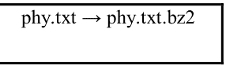
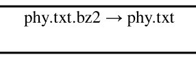
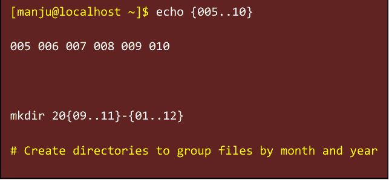
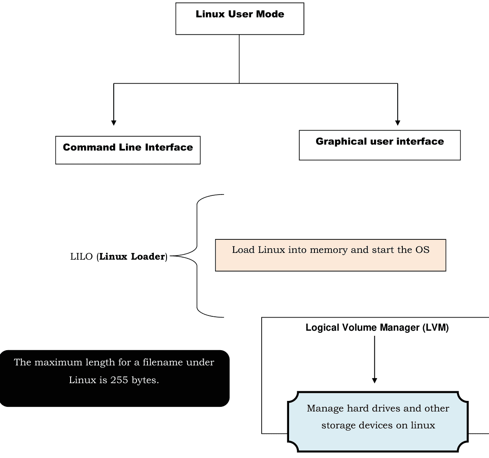
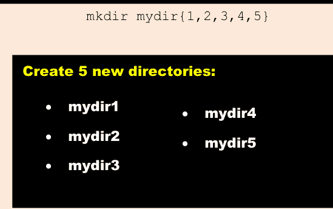
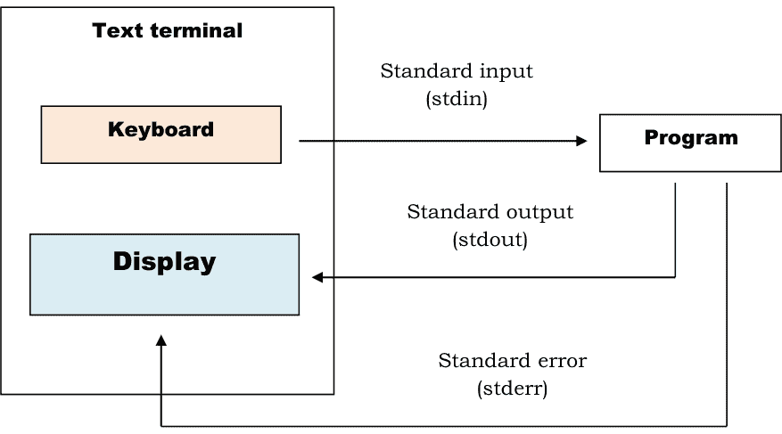
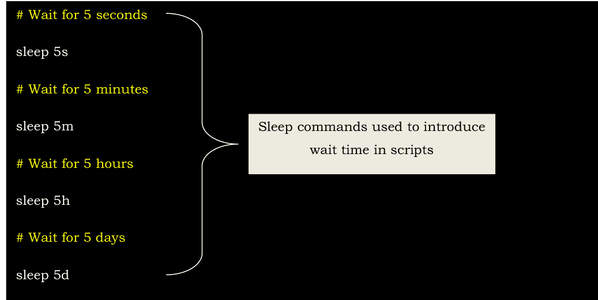
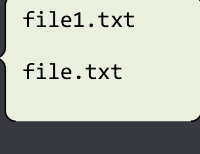

# 你应该知道的常用 Linux 命令

> “唯一真正的智慧，是你们承认自己一无所知。”

- 苏格拉底

Manjunath.R

## 献辞

**我将本书献给**世界上每一个国家、每一个程序员、教师、教育机构和企业公司，感谢他们在创建、设计、部署和支持软件的过程中做出的巨大贡献……


## 致谢

如果没有一些知名程序员的卓越工作，以及他们在软件编程领域的创造力和发明精神，这本书将无法完成。我想借此机会感谢我最亲爱的朋友和支持者“Lawrence”，感谢他在**新冠疫情期间**对我无不坚定的支持，并让我获取了完成这本书所需的所有资源。我想向我的家人表示感谢，感谢我在写书期间的支持和鼓励，特别是我的**母亲**，她一直是我生活中巨大的灵感源泉。我非常感激我的母亲，她教会了我如何在生活中保持坚持和坚强。最后，我想强调在写书或承担生活中的任何其他项目时，耐心是多么地重要。


## 前言

我既不是知名出版社的所有者，也不是拥有数百名内部程序员、能够轻松生产出我任何需求的顶尖 IT 公司。我是一个自雇软件工程师，对我的工作充满热情。请相信我的话，编编写这本**综合版**投入了大量的心水和努力。如果它能帮助哪怕是少数人在职业领域达到理想位置，我将不胜荣喜。

## 感谢

- Manjunath.R


## 引言

想使用基于 Linux 的开源类 Unix 操作系统来提高你日常计算的生产力和效率吗？你可以在书中获得关于如何执行任务的思路、策略和技巧。本书的主要目标是通过提供你所需的所有信息，让 Linux 系统的管理工作变得简单。本书以任务为导向进行系统管理；因此，它的结构是围绕系统管理员的需求而非 Linux 操作系统的特征构建的。

命令行界面是 Linux 几乎所有良好标志之一。Linux 命令多如海。然而，这同时也产生了一个问题：面对如此多可以管理的命令，你不知道该从何处以及何时开始学习它们，尤其是当你还是一个学习者时。如果你面临这个问题，并寻找一种无痛的方法来开启 Linux 命令行之旅，那么你来对地方了，因为在书中，我们将带你进入一系列受欢迎且实用的 Linux 命令世界：

- 你可以复制、移动和删除文件夹
- 识别任何网络连接问题
- 修改文件和文件夹的所有权和权限
- 管理、添加和创建用户及组
- 使用 "`su`" 和 "`sudo`" 安全地访问 root 账户
- 使用图形化编辑器创建和修改文本文件，以及更多内容。

本书重点侧重于 Linux 系统管理。它将努力解释如何更有效地使用命令行界面。一切是如何运作的？它的范围是什么？哪种使用方法是最理想的？然而，通过让读者在命令行上打下坚实的基础（任何重大系统管理活动的必要工具），它将为他们的进一步探索奠定基础。

- Manjunath.R

## Linux 的乐趣

记住，在计算机上安装 Linux 之前，命令行界面是简易的。

> “所有最好的人似乎都喜欢 UNIX。”

– 史蒂夫·沃兹尼亚克

注：

使用的 Linux 版本：CentOS release 7.3.1611 (Core)

## UNIX 哲学的 17 原则

- 模块化原则：系统应由若干良好协作且具有明确定义的组件组成。
- 清晰性原则：清晰优于聪明。
- 组合原则：创建可以与其他软件通信的软件。
- 分离原则：编程机制和规则应保持独立。分离界面和后端引擎。
- 简单原则：为简单构建，仅在需要时增加复杂度。
- 节原则：只有在证明其他方法都无效时，才编写大型程序。
- 透明性原则：设计时考虑可视化，以简化分析和故障排除。
- 健壮性原则：透明度和易用性产生健壮性。
- 表达原则：创建让参与项目的任何程序员都易理解的程序，以便维护。

```
在面临选择时，程序员应该选择复杂数据而非软件的过程逻辑，因为复杂的数据比复杂的逻辑更易于我们理解
```

- 最小惊讶原则：应该鼓励开发者创建用户友好、直观的产品。
- 沉默原则：允许程序员和其他程序从程序的输出中获取所需数据，而无需解释不必要的详尽内容。
- 修复原则：程序员创建的软件应以简单识别和诊断的方式故障。
- 经济原则：应尽可能减少项目开发成本。
- 生成原则：程序员应该开发抽象的高级程序来产生代码，而不是手动编写代码，以减少人为错误并节省时间。
- 优化原则：在优化之前，先让它运行。软件在被开发者精雕细刻之前应该经过测试。
- 多样性原则：使程序保持灵活，使其能够以预期之外的方式使用。
- 可扩展性原则：增加开发者编写代码的用途和寿命。

## 技能会随着学习的增加而提高。

> 作为一个新手，你的主要重点应该是熟悉操作系统架构的细节，并发现捷径和节省时间的技巧。

如果你使用 Windows 并且想学习 Linux，那么 CentOS 是一个很棒的选择，因为它是适合初者的 Linux 发行版之一。你使用 CentOS 的前几天不会觉得奇怪。但如果你想体验它的全部功能，就必须学会使用 Linux 的命令行界面。最初你在学习某些指令时可能会遇到困难。虽然使用这些指令不会让你成为天才，但它们将帮助你执行某些基础任务。以下是新用户最基本的 CentOS 命令，以确保顺利开始。让我们直接开始吧！

> "... 成为一名 Linux 用户就像住在一个由一大群木工和建筑师组成的房子里。每天早上当你醒来时，房子都有所不同。也许多了一个新塔楼，或者某些墙移动了。又也许有人临时移走了你床下的地板。”

## Linux 命令

### 描述：
显示系统日期和时间。

命令：

```
date
```

### 描述：
显示日历。

命令：

```
cal
```

### 描述：
显示日期、时间和日历。

命令：

```
date & cal
```

### 描述：
显示 2016 年 8 月日历。

命令：

```
cal 8 2016
```

### 描述：
用于清除终端窗口。

命令：

```
clear
```

### 描述：
退出终端窗口。

命令：

```
exit
```

### 描述：
显示空闲和已使用的系统内存。

命令：

```
free
```

### 描述：
以字节为显示空闲和已使用的系统内存。

命令：

```
free -b
```

### 描述：
以千字节为显示空闲和已使用的系统内存。

命令：

```
free -k
```

### 描述：
以兆字节为显示空闲和已使用的系统内存。

命令：

```
free -m
```

### 描述：
更改用户密码。

命令：

```
passwd
```

### 描述：
关机。

命令：

```
shutdown
```

### 描述：
立即关机。

命令：

```
shutdown -h now
```

### 描述：
在 10 分钟后关机。

命令：

```
shutdown -h +10
```

### 描述：
打印当前工作目录。

命令：

```
echo $PWD
```

### 描述：
打印上一个工作目录。

命令：

```
echo $OLDPWD
```

### 描述：
执行命令历史记录中的第 11 条命令。

命令：

```
!!11
```

### 描述：
显示你的命令历史。

命令：

```
history
```

### 描述：
关机或重启操作系统。

命令：

```
sudo reboot
```

### 描述：
显示主机的 IP 地址。

命令：

```
ip address
```

### 描述：
列出文件和目录的大小。

命令：

```
ls -s
```

### 描述：
查看挂载的文件系统。

命令：

```
mount
```

### 描述：
显示文件和目录的磁盘占用信息。

命令：

```
du
```

### 描述：
告诉系统已运行了多久。

命令：

```
uptime
```

### 描述：
将当前日期设置为 1998 年 11 月 2 日。

命令：

```
date --set 1998-11-02
```

### 描述：
将当前时间设置为 IST 时间 12:11:02。

命令：

```
date --set 12:11:02
```

### 描述：
查看 Linux 中特定的磁盘分区。

命令：

```
fdisk -l /dev/sda
```

### 描述：
列出当前工作目录下的所有文件和目录。

命令：

```
ls
```

### 描述：
报告进程信息。

命令：

```
ps
```

### 描述：
显示磁盘占用。

命令：

```
df
```

### 描述：
以千字节、兆字节或千字节为显示磁盘占用。

命令：

```
df -H
```

### 描述：
删除每个文件和每个目录。

命令：

```
rm -r *
```

### 描述：
提供当前运行进程的快速概览。

命令：

```
top
```

### 描述：
系统执行立即重启。

命令：

```
reboot
```


## 描述：
在不注销或重启的情况下终止进程。
命令：
```
kill
```
## 描述：
更改当前工作目录。
命令：
```
cd
```
## 描述：
在系统上创建新会话。
命令：
```
login
```
## 描述：
列出打开的文件。
命令：
```
lsof
```
## 描述：
列出 USB 设备。
命令：
```
ls
```
## 描述：
检查网络状态。
命令：
```
service status
```
## 描述：
启动网络服务。
命令：
```
service start
```
## 描述：
停止网络服务。
命令：
```
service stop
```
## 描述：
重启网络服务。
命令：
```
service restart
```
## 描述：
报告当前登录机器的用户及其进程。
命令：
```
w
```
## 描述：
显示当前目录。
命令：
```
pwd
```
## 描述：
显示 CPU 信息（如核心、线程、插槽等）。
命令：
```
lscpu
```
## 描述：
显示当前进程的处理单元数量。
命令：
```
nproc
```
## 描述：
系统执行立即重启。
命令：
```
init 6
```
## 描述：
关机。
命令：
```
init 0
```
## 描述：
按日期列出文件。
命令：
```
ls -lt
```
## 描述：
列出存储设备信息（如硬盘、闪存器等）。
命令：
```
lsblk
```
## 描述：
显示上一个命令的状态。
命令：
```
echo $?
```
## 描述：
列出一些有用的命令。
命令：
```
info
```
## 描述：
打印当年的日历。
命令：
```
cal -y
```
## 描述：
告诉用户何时从何处登录和退出。
命令：
```
last -l username
```
## 描述：
按扩展名排序文件和目录。
命令：
```
ls -X
```
## 描述：
显示 pwd 命令的手册。
命令：
```
man pwd
```
## 描述：
以树状显示运行进程的信息。
命令：
```
pstree
```
## 描述：
重置你的终端。
命令：
```
reset
```
## 描述：
显示今天是周几。
命令：
```
date -d fri
```
## 描述：
显示每个单独文件的空间。
命令：
```
du -a
```
## 描述：
显示关于高级配置和电源接口的信息。
命令：
```
acpi
```
## 描述：
返回上两个文件夹。
命令：
```
cd ../
```
## 描述：
回到上一个目录。
命令：
```
cd -
```
## 描述：
显示内置内置命令列表。
命令：
```
help
```
## 描述：
列出你的最后登录记录。
命令：
```
last yourusername
```
## 描述：
创建一个名为 myfiles 的目录。
命令：
```
mkdir myfiles
```
## 描述：
删除目录 myfiles。
命令：
```
rmdir myfiles
```
## 描述：
禁用特定用户 "root1" 的密码。
命令：
```
passwd -d root1
```
## 描述：
切换到用户 "root1"。
命令：
```
sudo su root1
```
## 描述：
退出终端窗口。
命令：
```
logout
```
## 描述：
创建一个用户 "root1"。
命令：
```
useradd "root1"
```
## 描述：
为用户 "root1" 分配密码。
命令：
```
passwd "root1"
```
## 描述：
重复上一个命令。
命令：
```
!!
```
## 描述：
显示你以什么身份登录的。
命令：
```
whoami
```
## Description:
显示当前用户的登录名。
## Command:
```
logname
```
## Description:
报告内核名称。
## Command:
```
uname
```
## Description:
打印内核版本。
## Command:
```
uname -v
```
## Description:
打印操作系统。
## Command:
```
uname -o
```
## Description:
报告机器硬件名称。
## Command:
```
uname -m
```
## Description:
打印版本信息并退出。
## Command:
```
uname --version
```
## Description:
打印内核发布版本。
## Command:
```
uname -r
```
## Description:
报告网络节点主机名。
## Description:
显示所有端口连接（包括 TCP 和 UDP）。
## Command:
```
netstat -a
```
## Description:
仅显示 TCP（传输控制协议）端口连接。
## Command:
```
netstat -at
```
## Description:
仅显示 UDP（用户数据报协议）端口连接。
## Command:
```
netstat -au
```
## Description:
显示所有活跃的监听端口。
## Command:
```
netstat -I
```
## Description:
显示所有活跃的监听 TCP 端口。
## Command:
```
netstat -It
```
## Description:
显示所有活跃的监听 UDP 端口。
## Command:
```
netstat -lu
```
## Description:
显示当前用户的所有信息（用户 ID、用户名、组 ID、组名等）。
## Command:
```
id
```
## Description:
显示用户 "root1" 的所有信息（用户 ID、用户名、组 ID、组名等）。
## Command:
```
id root1
```
## Description:
打印机器架构。
## Command:
```
arch
```
## Description:
显示可用字体列表。
## Command:
```
fc-list
```
## Description:
创建两个目录（myfiles, files）。
## Command:
```
mkdir myfiles files
```
## Description:
安装 apache (CentOS)。
## Command:
```
yum install httpd
```
## Description:
安装 apache (Ubuntu)。
## Command:
```
apt install httpd
```
## Description:
升级 apache (CentOS)。
## Command:
```
yum update httpd
```
## Description:
升级 apache (Ubuntu)。
## Command:
```
apt update httpd
```
## Description:
卸载 apache (CentOS)。
## Command:
```
yum remove httpd
```
## Description:
卸载 apache (Ubuntu)。
## Command:
```
apt remove httpd
```
## Description:
显示命令 (date) 的用法摘要。
## Command:
```
date --help
```
## Description:
列出到或从系统的活跃连接。
## Command:
```
ss -tup
```
## Description:
列出系统上的互联网服务。
## Command:
```
ss -tupn
```
## Description:
显示所有活跃的 UNIX 监听端口。
## Command:
```
netstat -lx
```
## Description:
显示所有活跃接口的详细信息。
## Command:
```
ifconfig
```
## Description:
显示所有网络接口的信息。
## Command:
```
ifconfig -a
```
## Description:
比较两个文件的内容（1.txt, 2.txt）。
## Command:
```
diff 1.txt 2.txt
```
## Description:


告诉你有文件 (`1.txt`) 中有多少行、词词和字符。

## Command:
```
wc 1.txt
```

## Description:
压缩文件 (`1.txt`)，使其占用空间更小。

## Command:
```
gzip 1.txt
```

## Description:
用 `gzip` 解压缩文件 (`1.txt`)。

## Command:
```
gunzip 1.txt
```

## Description:
检查文件 (`1.txt`) 的内容。

## Command:
```
cat 1.txt
```

## Description:
显示日历。

## Command:
```
ncal
```

## Description:
删除文件 (`1.txt`)。

## Command:
```
rm 1.txt
```

## Description:
将名为 `1.txt` 的文件重命名为 `0.txt`。

## Command:
```
mv 1.txt 0.txt
```

## Description:
用 `1.txt` 的内容替换 `0.txt` 内容。

## Command:
```
cp 1.txt 0.txt
```

## Description:
创建一个空文件 (`test.txt`)。

## Command:
```
touch test.txt
```

## Description:
打印文件 (`1.txt`) 的最后 10 行。

## Command:
```
tail 1.txt
```

## Description:
打印文件 (`1.txt`) 的 N 行。

## Command:
```
tail -n N 1.txt
```

## Description:
打印文件 (`1.txt`) 中的单词数。

## Command:
```
wc -w 1.txt
```

## Description:
打印文件 (`1.txt`) 中的字符数。

## Command:
```
wc -m 1.txt
```

## Description:
打印文件 (`1.txt`) 中最长行的长度。

## Command:
```
wc -L 1.txt
```

## Description:
打印 USB 端口、显卡、网络适配器等信息。

## Command:
```
lspci
```

## Description:
查看文件 (`1.txt`) 的内容。

## Command:
```
less 1.txt
```

## Description:
显示日历（上个月、本月下个月）。

## Command:
```
cal -3
```

## Description:
逐行比较三个文件 (`1.txt`, `2.txt`, `3.txt`) 的内容。

## Command:
```
diff3 1.txt 2.txt 3.txt
```

## Description:
逐行比较两个文件 (`1.txt`, `2.txt`)。

## Command:
```
comm 1.txt 2.txt
```

## Description:
逐字节比较两个文件 (`1.txt`, `2.txt`)。

## Command:
```
cmp 1.txt 2.txt
```

## Description:
打印文件 `"myfiles.txt"` 的 CRC 校验和和字节数。

## Command:
```
cksum myfiles.txt
```

## Description:
将文件 (`1.txt`, `2.txt`) 的内容追加到文件 (`0.txt`)。

## Command:
```
cat 1.txt 2.txt > 0.txt
```

## Description:
将文件 (`1.txt`, `2.txt`, `3.txt`) 的内容追加到文件 (`0.txt`)。

## Command:
```
sed r 1.txt 2.txt 3.txt > 0.txt
```

## Description:
将文件 (`1.txt`, `2.txt`, `3.txt`) 的内容追加到文件 (`0.txt`)。

## Command:
```
sed h 1.txt 2.txt 3.txt > 0.txt
```

## Description:
将文件 (`1.txt`, `2.txt`, `3.txt`) 的内容追加到文件 (`0.txt`)。

## Command:
```
sed -n p 1.txt 2.txt > 0.txt
```

# Shortcuts:

| `ctrl+c` | 终止当前命令 |
| `ctrl+z` | 停止当前命令（进入后台） |
| `ctrl+d` | 退出当前会话 |
| `ctrl+w` | 删除当前行中的一个单词 |
| `ctrl+u` | 删除整行 |
| `ctrl+r` | 输入以调出最近的命令 |

## Description:
将文件 (`0.txt`) 的内容输出并在每行开头添加行号。

## Command:
```
nl 0.txt
```

## Description:
在目录 (`test`) 中创建一个空文件 (`test1.txt`)。

## Command:
```
mkdir test
cd test
pwd
touch test1.txt
```

## Description:
收集硬件组件（如 CPU、磁盘、内存、USB 控制器等）的信息。

## Command:
```
sudo lshw
```

## Description:
收集文件系统分区的信息。

## Command:
```
sudo fdisk -l
```

## Description:
显示文件 (`1.txt`) 中找到字符串 (`good`) 的行行。

## Command:
```
grep good 1.txt
```

## Description:
使用循环将文件 (`1.txt`, `2.txt`, `3.txt`) 的内容追加到文件 (`0.txt`)。

## Command:
```
for i in {1..3}; do cat "$i.txt" >> 0.txt; done
```

## Description:
在目录及其子目录下搜索文件 (`test.txt`, `test1.txt`, `test2.txt`, `test.php`, `test.html`)。

## Command:
```
find test*
```

## Description:
显示文件 (`l.txt`) 的状态。

## Command:
```
stat l.txt
```

| Command | Description |
| --- | --- |
| `vi` | 打开 vi 编辑器 |
| `i` | 进入插入模式 |
| `a=20; b=64; print (a + b);` | 按下 Escape 键返回普通模式。 |
| `:w hello.py` | 保存文本 |
| `:q` | 退出 |
| `python hello.py` | 输出:84 |

## Description:
从 URL `"http://website.com/files/file.txt"` 下载文件 (`file.txt`)。

## Command:
```
wget http://website.com/files/file.txt
```

## Description:
以十六进制格式显示主机数字 ID。

## Command:
```
hostid
```

## Description:
显示文件 (`myfiles.txt`) 的文件类型。

## Command:
```
file myfiles.txt
```

## Description:
创建一个包含文本 (`Hello World`) 的文件 (`myfiles.txt`)。

## Command:
```
echo 'Hello World' > myfiles.txt
```

## Description:
创建一个包含文本 (`Hello World`) 的文件 (`myfiles.txt`)。

## Command:
```
printf 'Hello World' > myfiles.txt
```

## Description:
显示主机名的 IP 地址。

## Command:
```
hostname -i
```

## Description:
向现有文件 (`l.txt`) 添加新行文本。

## Command:
```
echo "Hello world!" >> 1.txt
echo "this is 2nd line text" >> 1.txt
echo "last line!" >> 1.txt
```

## Description:
显示关于命令 (`cal`) 的单行描述。

命令:
```
whatis cal
```

| 命令 | 描述 |
| --- | --- |
| `vi` | 打开 vi 编辑器 |
| `i` | 进入插入模式 |
| 输入文本以返回到普通模式。 |  |


| `:w test.txt` | 保存文本 |

| `:q` | 退出 |

| `:!` | 不保存退出 |

| 命令 | 描述 |

| --- | --- |

| `vi` | 打开 `vi` 编辑器 |

| `$name = "Paul";` | 进入插入模式 |

| `print "$name";` | |

| 按 `Escape` 键返回普通模式。 |

| `:w hello.pl` | 保存文本 |

| `:q` | 退出 |

| `perl hello.pl` | 打印输出：Paul |

| 命令 | 描述 |

| --- | --- |

| `vi` | 打开 `vi` 编辑器 |

| `i` | 进入插入模式 |

| `echo "What is your name?"` | |

| `read PERSON` | |

| `echo "Hello, $PERSON"` | |

| 按 `Escape` 键返回普通模式。 |

| `:w hello.sh` | 保存文本 |

| `:q` | 退出 |

| `sh hello.sh` | 输出： |

| What is your name? |

| 如果你输入：Zara Ali |

| Hello, Zara Ali |

# 描述

检查主机（你的连接）与服务器（Google 服务器）之间的网络连通性。

# 命令

```
ping google.com
```

# 描述

查找命令 `cal` 的源文件/二进制文件的位置。

# 命令

```
whereis cal
```

该命令有两种种使用方法：

- 数字模式
- 符号模式

```bash
## 覆盖现有文件
$ echo "Albert Einstein" > 1.txt
## 追加第二行
$ echo "Alan Turing" >> 1.txt
```

| 数字模式 | 权限类型 | 符号模式 |
| --- | --- | --- |
| 0 | 无权限 | --- |
| 1 | 执行 | --x |
| 2 | 写入 | -w- |
| 3 | 执行 + 写入 | -wx |
| 4 | 读取 | r-- |
| 5 | 读取 + 执行 | r-x |
| 6 | 读取 + 写入 | rw- |
| 7 | 读取 + 执行 | rwx |

```bash
[manju@localhost ~]$ ps -ef | grep sshd
root 988 1 0 06:14 ? 00:00:00 /usr/bin/sshd
manju 3501 3461 0 06:24 pts/0 00:00:00 grep --color=auto sshd
```

```bash
## 检查 SSH 服务器 (sshd) 是否运行
cd /etc && ls
## 在进入 /etc 后执行 ls

rm myfiles.txt && echo success || echo failed
## 如果 myfiles.txt 被删除则打印 'success'，否则打印 'failed'
```

```bash
[manju@localhost ~]$ echo This is the $SHELL shell
This is the /bin/bash shell
[manju@localhost ~]$ echo This is $SHELL on computer $HOSTNAME
This is /bin/bash on computer localhost.localdomain
[manju@localhost ~]$ echo The User ID of $USER is $UID
The User ID of manju is 1000
[manju@localhost ~]$ echo My home directory is $HOME
My home directory is /home/manju
```

```bash
/bin/bash /home/manju manju
$ env -i bash -c 'echo $SHELL $HOME $USER'
/bin/bash
```

```bash
env LANG=C bash -c 'ls test[a-z].txt'
testa.txt testb.txt testc.txt
```

```bash
env LANG=en_US.UTF-8 bash -c 'ls test[a-z].txt'
testa.txt testA.txt testb.txt testc.txt testC.txt
```

```bash
[manju@localhost ~]$ prefix=John
```

```bash
[manju@localhost ~]$ echo Hello ${prefix}Dalton and ${prefix}Humphrys
Hello JohnDalton and JohnHumphrys
```

```bash
echo $(a=5;echo $a)
5
```

```bash
echo 'a=5;echo $a'
a=5;echo $a
```

```bash
[manju@localhost ~]$ touch myfiles.txt
```

```bash
[manju@localhost ~]$ cat myfiles.txt
Hello World
```

```bash
[manju@localhost ~]$ !to
touch myfiles.txt
```

```bash
[manju@localhost ~]$ echo $HISTSIZE
n1000
```

> 在 `bash` 会话期间，存储在内存中历史列表中的命令数量

```bash
[manju@localhost ~]$ echo $HISTFILE
/home/manju/.bash_history
```

> 存储你的 Bash 历史文件的名称和位置

```bash
echo $HISTFILESIZE
1000
```

`.bash_history` 文件可以存储多少条命令

```bash
[manju@localhost ~]$ ls *file1.txt
file1.txt
```

```bash
[manju@localhost ~]$ ls f*file1.txt
file1.txt
```

```bash
[manju@localhost ~]$ ls f*1.txt
file1.txt
```

```bash
[manju@localhost ~]$ ls file?.txt
file1.txt file2.txt
```

```bash
[manju@localhost ~]$ ls file??txt
file1.txt file2.txt
23.txt file34.txt
```

```bash
[manju@localhost ~]$
 test[5.txt


[manju@localhost]$

[5A].txt
testA.txt
```

```bash
[manju@localhost ~]$ ls test[A5].txt
testA.txt
```

```bash
[manju@localhost ~]$ ls file[!5]*.txt
file23.txt file1.txt file23.txt file34.txt
```

```bash
[manju@localhost ~]$ ls file[!5]?.txt
file23.txt file34.txt
```

```bash
[manju@localhost ~]$ ls [a-z]?.txt
file1.txt file2.txt
3.```
```

```bash
[manju@localhost ~]$ ls [A-Z]?.txt
file1.txt file2.txt
3.txt
```

```bash
[manju@localhost ~]$ echo *
*
```

```bash
[manju@localhost ~]$ echo '*'
*
```

```bash
[manju@localhost ~]$ echo "*"
*
```

```bash
[manju@localhost ~]$ ls [a-z]*[0-9].txt
file23.txt file1.txt file23.txt file34.txt
```

> 列出以字母开头以数字结尾的 `.txt` 文件

```bash
ls ????
```

> 列出五个字符的文件

```bash
ls [fF]*[3A].txt
```

> 列出以 `f` 或 `F` 开头以 `3` 或 `A` 结尾的 `.txt` 文件

```bash
ls f[R]*[0-9].txt
```

> 列出第二个字符为 `R` 且以数字结尾的 `.txt` 文件

```bash
ls ![f].txt
```

> 列出不字母 "`f`" 开头的 `.txt` 文件


```bash
[manju@localhost ~]$ echo Einstein2 | sed 's/2/36/'
Einstein36
[manju@localhost ~]$ echo Einstein36 | sed 's/Einstein/'
Hilbert36
```

```bash
[manju@localhost ~]$ echo Hawking6 Lucy8 | sed 's/Hawking/Lucy/'
Lucy6 Lucy8
[manju@localhost ~]$ echo Lucy3 Lucy6 | sed 's/Lucy/Hawking/g/'
Hawking3 Hawking6
```

```bash
[manju@localhost ~]$ who | cut -d' ' | sort
manju
manju
```

> 显示登录用户的排序列表

```bash
[manju@localhost ~]$ who | cut -d' ' | sort | uniq
manju
```

> 显示登录用户的排序列表，且每个用户只显示一次

```bash
[manju@localhost ~]$ grep bash /etc/passwd
root:x:0:0:root:/bin/bash
manju:x:1000:1000:su,root,yopp,hhhhh:home/manju:/bin/bash
```

> 显示此计算机上所有的 bash 用户账户

```bash
grep bash /etc/passwd | cut -d: -fl | sort > bu.txt
```

> 在 `bu.txt` 中存储所有 bash 用户的排序列表

```bash
who | cut -d' ' -fl | sort > users.txt
```

> 在 `users.txt` 中存储所有登录用户的排序列表

```bash
ls /etc | grep conf
```

> 列出 `/etc` 中文件名包含 "conf" 字符串的文件

```bash
ls /etc | grep -i conf | sort
```

> 显示 `/etc` 中文件名包含不区分大小写 "conf" 的文件的排序列表

90% 的公云负载运行在 Linux 发行版上。


```python
import subprocess
subprocess.call('linux command')
```

```python
import os
os.system('linux command')
```


```python
import os
os.system('ls')
```

```python
import subprocess
subprocess.call('ls')
```

列出当前目录下的所有文件和目录


显示 CPU 信息

### 命令:

```bash
cat /proc/meminfo
```

### 描述:

显示内存信息

### 命令:

```bash
lspci -tv
```

### 描述:

显示 PCI（外围部件接口）设备

### 命令:

```bash
lsusb -tv
```

### 描述:

显示 USB 设备

### 命令:

```bash
free -h
```

### 描述:

显示空闲和使用的内存 (`-h` 以人类可读，`-m` 表示 MB，`-g` 表示 GB)

### 命令:

```bash
mpstat 1
```

### 描述:

显示处理器相关的统计数据

### 命令:

```bash
vmstat 1
```

### 描述:

显示虚拟内存统计

### 命令:

```bash
iostat 1
```

### 描述:

显示输入/输出统计数据

### 命令:

```bash
watch df -h
```

### 描述:

执行 "`df -h`" 命令，并定期更新

### 命令:

```bash
ps -ef
```

### 描述:

显示系统上当前运行的所有进程

### 命令:

```bash
ip a
```

### 描述:

显示所有网络接口和 IP 地址

### 命令:

```bash
dig wikipedia.org
```

### 描述:

显示域名 (`wikipedia.org`) 的 DNS 信息

### 命令:

```bash
host wikipedia.org
```

### 描述:

显示指定域名的 IP 地址详情

### 命令:

```bash
netstat -nutlp
```

### 描述:

显示监听的传输控制协议 (TCP) 和用户数据报协议 (UDP) 端口以及相应的程序

### 命令:

```bash
rpm -qa
```

### 描述:

列出所有已安装的软件包

### 命令:

```bash
yum list installed
```

### 描述:

列出所有已安装的软件包 (CentOS)

```
yum info httpd
```

## Description:

显示软件包 "`httpd`" (CentOS) 的描述和摘要信息

## Command:

```
du -ah
```

## Description:

以人类可读的格式显示所有文件和目录的磁盘占用

## Command:

```
du -sh
```

## Description:

显示当前目录的总磁盘占用

## Command:

```
cd /etc
```

## Description:

切换到 `/etc` 目录

## Command:

```
ps -A
```

## Description:

列出所有进程的状态以及进程 ID (PID)

## Command:

```c
#include <stdio.h>
int main()
{
    printf("Hello world\n");
    return 0;
}

gcc Hello.c
```

## Description:

编译保存在 `Hello.c` 文件中的 C 程序

## Command:

```cpp
#include <iostream>
int main()
{
    std::cout << "Hello world!";
    return 0;
} // Hello.cpp

g++ Hello.cpp
```

## Description:

编译保在 `Hello.cpp` 文件中的 C++ 程序

## Command:

```
tty
```

## Description:

显示连接到标准输入的终端文件名

## Command:

```java
public class MyClass {
    public static void main(String [] args) {
        System.out.println("Hello, World!");
    }
}

javac MyClass.java
```

## Description:

使用 `javac` 编译器编译保存在 `MyClass.java` 文件中的 Java 程序

## Command:

```
od -b myfiles.txt
```

## Description:

以八进制格式显示 `myfiles.txt` 文件的内容

## Command:

```
od -c myfiles.txt
```

## Description:

以字符格式显示 `myfiles.txt` 文件的内容

## Command:

```
od -An -c myfiles.txt
```

## Description:

以字符格式显示 `myfiles.txt` 文件的内容，但不包含偏移信息

## Command:

```
csplit myfiles.txt 13 62 101
```

## Description:

| 如果文件 `myfiles.txt` 有 123 行，`csplit` 命令将创建四个文件：`xx00` 文件包含第 1–12 行，`xx01` 文件包含第 13–61 行，`xx02` 文件包含第 62–100 行，`xx03` 文件包含第 101–123 行 |

## Command:

```
md5sum myfiles.txt
```

## Description:

使用 MD5 算法打印 `myfiles.txt` 文件的 32 位字符（128 位）校验和（checksum）

## Command:

```
more myfiles.txt
```

## Description:

显示 `myfiles.txt` 文件的内容

## Command:

```
shasum myfiles.txt
```

## Description:

打印 `myfiles.txt` 文件的 SHA1 (160 位) 校验和


> SHA 1 → 安全哈希算法 (Secure Hash Algorithm)

## Command:

```
shred myfiles.txt
```

## Description:

反复重写 `myfiles.txt` 文件——使得即使是极其昂贵的硬件探测也难以恢复数据

## Command:

```
cat myfile.txt
```

`01. Einstein`
`02. Newton`
`03. Maxwell`
`04. Tesla`
`05. Edison`

`tac myfile.txt`

`05. Edison`
`04. Tesla`
`03. Maxwell`
`02. Newton`
`01. Einstein`

## Description:

反向打印 `myfile.txt` 的行（从最后一行到第一行）

## Command:

```
uniq myfiles.txt
```

## Description:

删除文件 (`myfiles.txt`) 中的重复行

## Command:

```
chkconfig --list
```

## Description:

列出系统服务列表以及它们在运行级别 `0–6` 中是启动（on）还是停止（off）

## Command:

```
halt -p
```

## Description:

关机系统

## Command:

```
xdg-open myfiles.txt
```

## Description:

打开一个文件 (`myfiles.txt`)。

## Command:

```
lastlog
```

## Description:

打印上次登录的详细信息（用户名、端口和最后登录时间）

## Command:

```
lastlog -t 1
```

## Description:

显示登录信息（1 天前）

## Command:

```
lastlog -u manju
```

## Description:

显示特定用户 (`manju`) 的 `lastlog` 信息

## Command:

```
cat /etc/passwd
more /etc/passwd
less /etc/passwd
getent passwd
```

## Description:

列出 Linux 上所有的用户

## Command:

```
tail -5 /etc/passwd
head -5 /etc/passwd
```

## Description:

列出 Linux 上最后 5 个用户

列出 Linux 上前 5 个用户

## Command:

```
wall "The system will be shutdown in 10 minutes."
```

## Description:

消息（系统将在 10 分后关闭）将广播给所有当前登录的用户

## Command:

```
chage -l manju
```

## Description:

列出用户 (`manju`) 的密码及其相关详细信息

## Command:

```
chage -M manju
```

## Description:

为用户 (`manju`) 设置密码过期日期

## Command:

```
chage -E "2020-07-30" manju
```

## Description:

为用户 (`manju`) 设置账户过期日期

## Command:

```
chage -I manju
```

## Description:

强制用户 (`manju`) 账户在 10 天后锁定

## Command:

```
cat /etc/hostname
hostname -> localhost.localdomain
```

## Description:

显示系统主机名

## Command:

```
yum check-update
```

## Description:

检查已安装软件包是否有任何可用更新

## Command:

```
yum search httpd
```

## Description:

查找包含指定关键字 `"httpd"` 的任何软件包

## Command:

```
ls /etc
ls /bin /sbin
```

## Description:

列出 `/etc` 的内容

列出 `/bin` 和 `/sbin` 内容

## Command:

```
ls -al ~
```

## Description:

列出主目录下的所有文件（包括隐藏文件）

## Command:

```
ls -lh /boot
```

## Description:

以人类可读的格式列出 `/boot` 中的文件

## Command:

```
mkdir mydir
cd /etc
```

## Description:

创建 `mydir` 并进入 `/etc` 目录

## Command:

```
touch file.txt
ls mydir
```

## Description:

在 `mydir` 中创建 `file.txt` 并列出目录

## Command:

```
rm -i file.txt
```

## Description:

交互式地删除 `file.txt`

## Command:

```
mv file.txt newfile.txt
```

## Description:

将 `file.txt` 重命名为 `newfile.txt`

## Command:

```
cp file.txt backup.txt
```

## Description:

将 `file.txt` 复制为 `backup.txt`

## Command:

```
echo "some content" > file.txt
```

## Description:

将 `"some content"` 写入 `file.txt`

## Command:

```
cat file.txt
```

## Description:

查看 `file.txt` 的内容

```bash
[manju@localhost ~]$ fgrep 'He' myfiles.txt
```

Hello World 在文件 `"myfiles.txt"` 中查找字符串 `"He"`

## Command:

```bash
lsattr
```

## Description:

列出当前目录下的文件属性

## Command:

```bash
cp (*.txt,*.md) ~
```

## Description:

将所有以 `.txt` 或 `.md` 结尾的文件复制到用户的家目录

```bash
[manju@localhost ~]$ cat myfiles.txt
```

Hello World

```bash
[manju@localhost ~]$ grep --color -i Hello myfiles.txt
```

Hello World

`ls file*`

```bash
## 列出当前目录下所有以 "file" 开头的文件
ls *file
## 列出当前目录下所有以 "file" 结尾的文件
```

```bash
cat phy.txt
```

阿尔伯特·爱因斯坦是一位出生于德国的理论物理学家，被广泛公认为是世界上最伟大的物理学家之一。爱因斯坦因发展相对论而闻名，但他对量子力学理论的发展也做出了重要贡献。

```bash
fmt -w 1 phy.txt
```

| Albert |
| Einstein |
| was |
| a |
| German-born |
| theoretical |
| physicist, |
| widely |
| acknowledged |
| to |
| be |
| one |
| of |
| the |
| greatest |
| physicists |
| of |
| all |
| time. |
| Einstein |
| is |
| known |
| for |
| developing |

```text
the
theory
of
relativity,
but
he
also
made
important
contributions
to
the
development
of
the
theory
of
quantum
mechanics.
```

```bash
cat phy.txt
```

阿尔伯特·爱因斯坦是一位出生于德国的理论物理学家，被广泛公认为是世界上最伟大的物理学家之一。爱因斯坦因发展相对论而闻名，但他对量子力学理论的发展也做出了重要贡献。

```bash
fold -w 20 phy.txt
```

Albert Einstein was


a German-born theor
etical physicist, wi
dely acknowledged to
be one of the great
est physicists of al
l time. Einstein is
known for developing
the theory of relat
livity, but he also m
ade important contri
butions to the devel
ment of the theory
of quantum mechanic
s.

## 命令：

```bash
traceroute google.com
```

## 描述：

打印数据包从本地机器到达 Google (`172.217.26.206`) 主机所需的路径

## 命令：

```bash
cat 1.txt
```

| Einstein |

| Newton |

| Albert |

```bash
gzip 1.txt
zcat 1.txt.gz
```

| Einstein |

| Newton |

| Albert |

## 描述：

查看压缩文件的内容

## 命令：

```bash
zdiff 1.txt.gz 2.txt.gz
```

## 描述：

比较两个压缩文件（`1.txt.gz`, `2.txt.gz`）的内容

## 命令：

```bash
ss | less
```

## 描述：

列出所有连接

## 命令：

```bash
ss -aA tcp
```

## 描述：

过滤出 TCP（传输控制协议）连接

## 命令：

```bash
ss -aA udp
```

## 描述：

过滤出 UDP（用户数据报协议）连接

命令：

```bash
ss -lnt
```

描述：

只显示监听的套接字（sockets）

命令：

```bash
ss -ltp
```

描述：

打印进程名称和 PID

命令：

```bash
ss -s
```

描述：

打印摘要统计信息

命令：

```bash
ss -t66
```

描述：

只显示 IPv6 连接

命令：

```bash
ss -t1 -f inet
```

描述：

只显示 IPv4 套接字连接

命令：

```bash
ss -t4 state established
```

描述：

显示所有处于已连接（connected）状态的 IPv4 TCP 套接字

## 命令：

```bash
pmap 3244
```

## 描述：

查看进程 ID 为 (`3244`) 的进程的内存映射

## 命令：

```bash
apropos -r 'remove file'
```

## 描述：

查找删除文件的命令

## 命令：

```bash
apropos editor
```

## 描述：

显示系统上可用编辑程序的信息

## 命令：

```bash
apropos pstree
```

## 描述：

提供关于 `pstree` 命令的信息（该命令以树形图的形式显示当前系统中运行的进程名称）

| 当你知道自己想做什么，但不知道应该用什么命令来实现时，`apropos` 命令非常有用。例如，如果你想知道如何定位文件，那么这些命令 |

| `apropos find` |

| `apropos locate` |

| 并且会为你提供很多建议。 |

```bash
basename /etc/passwd
Output: passwd
basename /usr/local/apache2/conf/httpd.conf
```

```bash
Output: httpd.conf
```

```bash
echo a b c d e f| xargs

Output: a b c d e f

echo a b c d e f| xargs -n 3

Output:
a b c
d e f
每行仅显示 3 个项目
```

## 命令：

```bash
env
```

## 描述：

打印出所有环境变量列表

## 命令：

```bash
cat score.txt
```

## 描述：

打印 HOME 的值

```text
Albert-30
William-50
Stephen-20
Justin-40
```

```bash
cut -d -f2 score.txt

30
50
80
20
40
```

```bash
cut -d -f1 score.txt

Albert
William
Stephen
Justin
```

```bash
cat 1.txt
Hello World
cat 2.txt
Computer Program
paste 1.txt
Hello World
cat 2.txt
Computer Program
join 1.txt
Hello World
```

## 命令：

```bash
rev 1.txt
```

描述：

反转文件（`1.txt`）的行

```text
22
33
11
77
55
```

sort 1.txt

11

22

33

55

77

对数值进行排序

```bash
sort 1.txt
```

## 命令：

```bash
ls file*
```

描述：

列出当前目录下所有以 "file" 结尾的文件

| Linux | Unix |

| --- | --- |

| 免费使用（开源） | 授权操作系统（闭源） |

| Linux 仅仅是内核 | Unix 是一个完整的操作系统包 |

| Bash (Bourne Again Shell) 是 Linux 的默认 shell | Bourne Shell 是 Unix 的默认 shell |

| 可移植且可从 USB 优存盘启动 | 不可移植 |

| 源代码对公众开放 | 任何人无法访问源代码 |

| 使用可选的图形用户界面 | 使用命令行界面 |

| 命令行界面 | |

Command:

```
echo $SHELL
```

Description:

打印用户的默认 shell

Command:

```
echo $0
```

Description:

> 显示当前运行进程的名称 (`$0` 是正在运行进程的名称)。如果你在 shell 内部使用它，它将返回 shell 的名称。如果你在脚本内部使用它，它将返回脚本的名称

## Command:

```
echo *
```

## Description:

打印所有文件和文件夹 – 类似于 `ls` 命令

Command:

```
ps -p $$
```

Output:

```
| PID | TTY | TIME | CMD |
| 3352 | pts/0 | 00:00:00 | bash |
```

## Description:

打印当前 shell 的进程 ID (`$$` 是当前 shell 的进程 ID)

```bash
sudo du -a Documents/ | sort -n -r | head -n 5
## 列出 "Documents" 目录中最大的 5 个文件
```

## Command:

```
cat /etc/shells
```

Description:

列出所有 shells

Command:

```
echo m*
```

Description:

显示当前文件夹中以字母 "m" 开头的文件。

Command:

```
last
```

Description:

列出用户的最后登录情况以及发生的情况，例如“shutdown”或“crash”等。

Command:

```bash
echo ~
```

Description:

打印你的家目录路径

Command:

```bash
bzip2 -k phy.txt
```

Description:

压缩但不删除原始文件



Command:

```bash
bzip2 -d phy.txt.bz2
```

Description:

解压压缩文件 (`phy.txt.bz2`)



Command:

```bash
bzcat phy.txt.bz2
```

Description:

显示压缩文件 (`phy.txt.bz2`) 的内容

## Command:

```bash
bunzip2 phy.txt.bz2
```

## Description:

解压压缩文件 (`phy.txt.bz2`)

## Command:

```bash
crontab -l
```

Description:

显示当前登录用户的 crontab 条目

```bash
cat /dev/null > phy.txt
```

```bash
cp /dev/null phy.txt
```


```bash
echo "" > phy.txt
```

```bash
echo > phy.txt
```

Description:

清空文件 (`phy.txt`) 的内容

Command:

```bash
nohup ping google.com &
```

Description:

`ping google.com` 并将进程放到后台

Command:

```bash
nohup ping google.com > log.txt &
```

Description:

将 `ping` 日志保存到 `log.txt`

```bash
pgrep -a ping
Output:
3858 ping google.com
4200 ping google.com
4236 ping google.com
kill 3858
pgrep -a ping
Output:
4200 ping google.com
4236 ping google.com
```

## Command:

```bash
ls -la /home
```

Description:

显示 `/home` 的内容

Command:

```bash
sudo shutdown 2
```

Description:

2 分钟后关机机器

Command:

```bash
shutdown -c
```

Description:

取消关机过程

Command:

```bash
pr 36.txt
```

## Description:

逐页显示文件 (`36.txt`) 的内容

## Command:

```bash
stty -a
```

Description:

显示所有当前终端设置

Command:

```bash
ls -l
```

Description:

每行列出一个文件

## Command:

```bash
yes John
```

Description:

重复输出字符串 (`John`) 直到被杀死

## Command:

```bash
vdir
```

Description:

列出当前目录下的文件和目录（每行一个）并带有详细信息

Command:

```bash
who -b
```

Description:

打印系统启动时间

```bash
## 使用 nano 打开 phy.txt
```

## Command:

```bash
nano phy.txt
```

```bash
ls -al *.txt
```

Description:

显示所有 `.txt` 文件，包括单独的权限。

```bash
## 使用 vim 打开 phy.txt
```

## Command:

```bash
vim phy.txt
```

## Command:

```bash
uname -i
```

Description:

显示硬件平台

## Command:

```bash
uname -p
```

Description:

显示类型

## Command:

```bash
cat /proc/interrupts
```

Description:

显示中断

## Command:

```bash
ip addr
```

Description:

显示 IP 地址

## Command:

```bash
netstat -antup
```

Description:

列出监听的端口

Command:

```bash
journalctl
```

Description:

显示 systemd 日志

Command:

```bash
sudo systemctl status
```

Description:

显示网络状态

Command:

```bash
sudo systemctl start
```

Description:

启动网络

Command:

```bash
sudo systemctl stop
```

Description:

停止网络

## Command:

```bash
sestatus -b
```

Description:

显示 SELinux 状态

## Command:

```
getenforce
```

Description:

报告 SELinux 是强制、许可还是禁用的

Command:

```bash
setforce 0
```

Description:

将 SELinux 设置为许可模式

Command:

```bash
setforce 1
```

Description:

将 SELinux 设置为强制模式

## Command:

```bash
getenforce
```

Output:

```
Permissive
```

## Command:

```bash
setforce 1
```

Output:

```
Enforcing
```

## Command:

```bash
setforce 0
```

Output:

```
Disabled
```

## Command:

```bash
getenforce
```

Output:

```
Disabled
```

Security-Enhanced Linux (`SELinux`) 是 Linux 的安全架构。

* 强制 (`Enforcing`) - 执行 SELinux 策略。
* 许可 (`Permissive`) - SELux 打印警告而不是执行。
* 禁用 (`Disabled`) - 未加载 SELinux 策略。

## Command:

```bash
cut -d: -f1 /etc/passwd | column
```

Description:

列出所有用户账户

Command:

```bash
mkdir ~/mydir ; touch ~/mydir/myfiles.txt
```

Description:

创建目录 `"mydir"` 并在其中创建文件 `"myfiles.txt"`

Command:

```bash
echo hi > file.md ; chmod 744 file.md
```

Description:

创建文件 `"file.md"` 并赋予其他人读取权限

```
[manju@localhost ~]$ ls -l $(which sudo)
---s--x--x. 1 root 130776 Nov 5 2016 /bin/sudo
```

## Command:

```bash
sestatus
```

Description:

显示运行在你的系统上的 SELinux 当前状态

Command:

```bash
ps -aef
```

Description:

显示系统上进程的完整列表

Command:

```bash
sar
```

Description:

系统活动报告

Command:

```bash
ulimit
```

Description:

报告当前用户的资源限制

| 输出 |
|------|
| Unlimited | 当前用户可以消耗当前系统支持的所有资源 |

两种资源限制类型：

+   - 硬资源限制 (`Hard resource limit`): 用户可以达到的物理限制。
- 软资源限制 (`Soft resource limit`): 用户可以管理的限制（其值可以增加到硬限制）

```
ulimit -a
```

Description:

报告当前用户的所有资源限制

Command:

```
ulimit -s
```

Description:

检查当前用户的最大栈大小

Command:

```
ulimit -e
```

Description:

检查当前用户的最大调度优先级

## Command:

```
ulimit -u
```

## Description:

显示用户进程的最大数量

Command:

```
ulimit -v
```

## Description:

检查虚拟内存的大小

Command:

```
ulimit -n
```

## Description:

检查进程可以拥有多少文件描述符

Command:

```
man limits.conf
```

Description:

显示关于 `limits.conf` 配置文件的深度信息

Command:

```
sar -V
```

Description:

显示 `sar` 版本

Command:

```
sar -u 2 5
```

Description:

每隔 2 秒报告一次，共报告 5 次 CPU 详情

Command:

```
sar -n DEV 1 3 | egrep -v lo
```

Description:

报告网络接口、网络速度、IPV4、TCPV4、ICMP4 网络流量和错误

Command:

```
sar -v 1 3
```

Description:

报告关于进程、内核线程、i-node 和文件表的详情


### Command:
```
sar -S 1 3
```

### Description:
报告交换交换统计信息

### Command:
```
sar -b 1 3
```

### Description:
报告 I/O 操作的详情，如每秒事务数、每秒读取数、每秒写入数

### Command:
```
sudo systemctl status firewalld
```

### Description:
显示 `firewalld` 的状态

### Command:
```
sudo systemctl start firewalld
```

### Description:
启动 `firewalld` 服务

`firewalld` 是适用于 Linux 操作系统的防火墙管理工具

### Command:
```
firewall-config
```

### Description:
启动图形化防火墙配置工具


### Command:
```
firewall-cmd --list-all-zones
```

### Description:
列出所有区域

### Command:
```
firewall-cmd --get-default-zone
```

### Description:
检查当前设置的默认区域

### Command:
```
firewall-cmd --list-services
```

### Description:
显示系统当前允许的服务

### Command:
```
firewall-cmd --list-ports
```

### Description:
列出系统上开放的端口

### Command:
```
firewall-cmd --zone=work --list-services
```

### Description:
列出公共区域允许的服务

### Command:
```
mtr --report google.com
```

### Description:
提供关于本地系统与远程主机 (`google.com`) 之间互联网流量所经路由的信息

### Command:
```
sudo yum install samba
```

### Description:
安装 Samba (CentOS)

Samba 是一种实现跨操作系统资源共享的客户端/服务器技术。通过 Samba，可以在 Windows、Mac 和 Linux/UNIX 客户端之间共享文件和打印机

### Command:
```
sudo firewall-cmd --add-service samba -permanent
```

### Description:
将 Samba 服务添加到 `firewalld`

### Command:
```
zip q.zip q.txt
```

### Description:
创建一个 zip 文件 (`q.zip`)

### Command:
```
unzip q.zip
```

### Description:
解压 zip 文件 (`q.zip`)

```
zipcloak q.zip
----------------------------------------------------------------------------------------------------
# zipcloak 会提示你输入密码，然后要求你确认密码：

enter password:
Verify password:

...如果密码匹配，它将加密 q.zip 文件
----------------------------------------------------------------------------------------------------
unzip q.zip
----------------------------------------------------------------------------------------------------
# 当你尝试解压 q.zip 文件时，它会在允许你提取其中包含的文件 (q.txt) 之前
#提示你输入密码
```

### Command:
```
zgrep -l "Einstein" *
```

### Description:
显示包含单词 (`Einstein`) 的文件名

### Command:
```
zipsplit -n 1048576 q.zip
```

### Description:
将 `q.zip` 文件拆分为一系列的 zip 文件 (`q1.zip`, `q2.zip`....) – 每个文件的大小不超过 1048576 字节（1 兆）

> 你可以使用命令将 (`q1.zip`, `q2.zip`....) 合并成新文件 `w.zip`：

```
cat q*.zip > w.zip
```

### Command:
```
mtr google.com
```

### Description:
测试通往目标主机 `google.com` 的流量路由和连接质量

### Command:
```
route
```

### Description:
显示 Linux 系统的 IP 路由表

### Command:
```
nmcli dev
```

### Description:
列出网络设备

### Command:
```
nmcli status
```

### Description:
显示活跃的连接

### Command:
```
ss -t
```

### Description:
列出所有的 TCP 连接

### Command:
```
ss -a
```

### Description:
列出所有的 socket

### Command:
```
ss -n
```

### Description:
显示数字端口号

### Command:
```
ss -u
```

### Description:
列出所有的 UDP 连接

### Command:
```
ss -p
```

### Description:
显示每个 socket 的进程 ID (PID)

### Command:
```
ss -i
```

### Description:
显示 socket 的统计信息

### Command:
```
ss -l
```

### Description:
只显示监听的 socket

### Command:
```
ss -t
```

### Description:
只显示 TCP socket

### Command:
```
ss -u
```

### Description:
只显示 UDP socket

### Command:
```
ss -a
```

### Description:
显示所有 socket

### Command:
```
ss -n
```

### Description:
显示数字端口号

```bash
[manju@localhost ~]$ echo {a..z}
```

a c d e f g h i j k l m n o p q r s t u v w x y z

```bash
[manju@localhost ~]$ echo {z..a}
```

z y x w v u t s r q p o n m l k j i h g e d c b a

```bash
[manju@localhost ~]$ echo {05..12}
```

05 06 07 08 09 10 11 12

```bash
[manju@localhost ~]$ echo {12..05}
```

12 11 10 09 08 07 06 05

```bash
[manju@localhost ~]$ echo {x..z}{1..3}
```

x1 x2 x3 y1 y2 y3 z1 z2 z3

```bash
[manju@localhost ~]$ echo {0..10}
```

0 2 4 6 8 10

```bash
[manju@localhost ~]$ for i in {a..z..5}; do echo -n $i; done
```

afkpuz



```bash
[manju@localhost ~]$ ls *.txt; echo $?
```

12.txt 1.txt 2.txt abc.txt my.txt phy.txt

13.txt 24.txt 3.txt marks.txt names.txt mphy.txt

```bash
[manju@localhost ~]$ cut -d, -f2,1 <<<'Albert,Bob,John'
Albert,Bob
[manju@localhost ~]$ cut -d, -f2,2 <<<'Albert,Bob,John'
Bob
[manju@localhost ~]$ cut -d, -f2,3 <<<'Albert,Bob,John'
Bob,John
```


```bash
[manju@localhost ~]$ x="W X Y Z"; echo "$x"
```

W X Y Z

```bash
[manju@localhost ~]$ x="W X Y Z"; echo "$x"
```

```
W X Y Z
```

> `echo $x` 和 `echo "$x"` 会产生不同的结果
引用变量会保留空格

```bash
[manju@localhost ~]$ let x=20+7; echo "The value of \"$x\" is $x.\nThe value of \"$x\" is 27."
[manju@localhost ~]$ x=100; let "x += 1"; echo "x = $x"
```

```
x = 101
```

```bash
[manju@localhost ~]$ x="a+b+c"; IFS=$; $x
```

```
ab b c
```
"+" 号将被解释为分隔符

```bash
[manju@localhost ~]$ x="a-b-c"; IFS=-; $x
```

```
ab b c
```
"-" 号将被解释为分隔符

```bash
[manju@localhost ~]$ x="a,b,c"; IFS=$; $x
```

```
ab b c
```
逗号"将被解释为分隔符

```bash
free | grep Mem | awk '{ print $4 }'
```

## 显示未使用的 RAM

```bash
du -ach
```

# 显示（磁盘）文件使用情况

```bash
readelf -h /bin/bash
```

# 显示指定 elf 二进制文件的信息和统计数据

```bash
[manju@localhost ~]$ expr 5 \* 2 + 3
```

```
13 # 5 * 2 + 3
```

```bash
find . -type f -perm 0777 -print
```

## Description:

查找所有权限为 777 的文件

## Command:

```bash
find / -type f ! -perm 777
```

## Description:

查找所有权限非 777 的文件

## Command:

```bash
find / -perm /g=s
```

## Description:

查找所有设置了 SGID 的文件

## Command:

```bash
find / -perm /u=r
```

## Description:

查找所有只读文件

## Command:

```bash
find / -perm /a=x
```

## Description:

查找所有可执行文件

```bash
[manju@localhost ~]$ echo "ALBERT" | awk '{print tolower($0)}'
```

```
albert
```

将大写转换为小写

## Command:

```bash
find . -type f -name "phy.txt" -exec rm -f {} \;
```

## Description:

查找并删除 phy.txt 文件

```bash
[manju@localhost ~]$ echo "Phone number: 55602369" | tr -cd [:digit:];
```

```
55602369
```


## Command:

```bash
find . -type f -name "*.txt" -exec rm -f {} \;
```

## Description:

查找并删除多个 .txt 文件

## Command:

```bash
find . -type f -name "*.mp3" -exec rm -f {} \;
```

## Description:

查找并删除多个 .mp3 文件

## Command:

```bash
find /tmp -type d -empty
```

## Description:

查找所有空目录

## Command:

```bash
find /tmp -type f -name ".*"
```

## Description:

查找所有隐藏文件

```bash
[manju@localhost ~]$ echo "Phone number: 55602369" | tr -d [[:digit:]]
```

```
Phone number:
```

从字符串中删除所有数字

## Command:

```bash
find / -mtime 50
```

## Description:

查找过去 50 天修改的文件

## Command:

```bash
find / -atime 50
```

## Description:

查找过去 50 天访问过的文件

## Command:

```bash
find / -cmin -60
```

## Description:

# 查找过去 1 小时内修改的文件

**Command:**

```bash
find / -mmin -60
```

**Description:**

查找过去 1 小时内修改的文件

**Command:**

```bash
find / -amin -60
```

**Description:**

查找过去 1 小时内访问的文件

| Command: | type cat |
| --- | --- |
| **Description:** | 识别 "cat" 命令是 shell 内置命令、子程序、别名还是关键字。 |

```bash
find / -size 50M
```

Description:

查找所有 50MB 的文件

Command:

```bash
find / -type f -size +100M -exec rm -f {} \;
```

Description:

查找并删除大于 100MB 的文件

Command:

```bash
find / -type f -name *.mp3 -size +10M -exec rm {} \;
```

Description:

查找所有大于 10MB 的 .mp3 文件并删除它们

```bash
ls -l --color
```

# 列出当前目录下的文件（彩色输出）

```bash
info df
```

## 加载 "df" 帮助页

```bash
ls /usr/include
```

# 列出编译 C 程序的头文件

```bash
ls /usr/local
```

# 列出本地安装的文件

```bash
ls /usr/bin/d*
```

# 列出 /usr/bin 目录下所有名称以字母 "d" 开头的文件

```bash
[manju@localhost ~]$ ls .b*
```

```
.bash_history .bash_logout .bash_profile .bashrc
```

```bash
[manju@localhost ~]$ ls [a-h]*
```

```
all DICT file1 file34.txt file.md fool.txt
allfiles.txt echo file123.txt file23.txt file3.txt first.bash
bu.txt file file1.txt file2.txt FILE.backup first.txt
```

```bash
[manju@localhost ~]$ touch hello.cpp; touch hello.f99
[manju@localhost ~]$ ls *.[9p]?
```

```
hello.cpp hello.f99
```

```bash
ls /usr
```

## 列出 /usr 目录

```bash
ls ~/usr
```

# 列出用户的家目录和 /usr 目录

```bash
[manju@localhost ~]$ echo f*
```

```
file1 file23.txt file1.txt file2 file23.txt file2.txt file34.txt file3.txt file.md first.bash first.txt fool.txt
```

```bash
[manju@localhost ~]$ echo f*.txt
```

```
file23.txt file1.txt file23.txt file2.txt file34.txt file3.txt first.txt fool.txt
```

```bash
sudo vim myfiles.txt
```

# 使用 Vim 编辑打开文件 "myfiles.txt"

```bash
[manju@localhost ~]$ for ((i=0;i<8;i++)); do echo $((i)); done
```

```
0
1
2
3
4
5
6
7
```


# Linux 常用命令示例

## 查找 Linux 打开文件限制

**Command:**
```bash
cat /proc/sys/fs/file-max
```

**Description:**
查找 Linux 打开文件限制

## 检查 Linux 硬限制

**Command:**
```bash
ulimit -Hn
```

**Description:**
检查 Linux 中的硬限制

## 检查 Linux 软限制

**Command:**
```bash
ulimit -Sn
```

**Description:**
检查 Linux 中的软限制

## 显示系统当前的时间和日期

**Command:**
```bash
timedatectl status
```

**Description:**
显示系统当前的时间和日期

## 查看所有可用时区

**Command:**
```bash
timedatectl list-timezones
```

**Description:**
查看所有可用时区

## 根据位置查找本地时区

**Command:**
```bash
timedatectl list-timezones | egrep -o "Asia/B.*"
timedatectl list-timezones | egrep -o "Europe/L.*"
timedatectl list-timezones | egrep -o "America/N.*"
```

**Description:**
根据你的位置查找本地时区

## 在 Linux 中设置本地时区

**Command:**
```bash
timedatectl set-timezone "Asia/Kolkata"
```

**Description:**
在 Linux 中设置你的本地时区

## 查看设备交换分区使用摘要

**Command:**
```bash
swapon --summary
```

**Description:**
查看设备交换分区使用摘要

## 检查交换分区使用信息

**Command:**
```bash
cat /proc/swaps
```

**Description:**
检查交换分区使用信息

## 开始记录 Linux 终端

```bash
# start recording of Linux terminal
script history_log.txt
Script started, file is history_log.txt
exit
Script done, file is history_log.txt
```

## 列出文件及其按块计算的尺寸

**Command:**
```bash
dir -shl
```

**Description:**
列出文件及其按块（blocks）计算的尺寸

## 显示关于 CD-ROM 的信息

**Command:**
```bash
less /proc/sys/dev/cdrom/info
```

**Description:**
显示关于 CD-ROM 的信息

## 循环写入日期

```bash
while true; do date >> date.txt ; sleep 5 ; done &
cat date.txt
```

| Mon Aug 16 | |
| --- | --- |
| **Description:** | [no content] |

## linux

### 命令
```bash
find . -user root
```
**说明:**
输出当前目录中由用户 `root` 拥有的文件

### 命令
```bash
strace pwd
```
**说明:**
追踪命令 `pwd` 的执行

### 命令
```bash
top -u manju
```
**说明:**
显示特定用户 `manju` 的进程详情

- 大数据的三个特征：
- **数据量（Volume）** —— 数据量有多大？
- **多样性（Variety）** —— 不同类型的数据有多多样？
- **速度（Velocity）** —— 新数据的生成速度有多快？

```bash
[manju@localhost ~]$ netstat -plunt
# 打印所有监听端口

[manju@localhost ~]$ netstat -plunt | grep 8080
# 检查服务器是否监听 8080 端口

[manju@localhost ~]$ netstat -s
# 列出所有端口的统计信息
```

```bash
[manju@localhost ~]$ cat myfiles.txt
Hello World

[manju@localhost ~]$ cat myfiles.txt | tr ' ' '\n'
Hello
World
```

```bash
find . -name "*.txt"
# 在当前目录及其所有子目录下查找以 .txt 结尾的文件
```

```bash
find /etc > 12.txt
# 查找 /etc 下的所有文件并将列表存入 12.txt

find . -newer file1.txt
# 查找比 file1.txt 新的文件
```

```bash
[manju@localhost ~]$ date +%A %d-%m-%Y
Tuesday 19-04-2022

[manju@localhost ~]$ date -d '2022-04-01 + 2000000000 seconds'
Thu Aug 16 03:33:20 PDT 2085
```

```bash
find /etc -type f -name '*.txt' | wc -l
# 打印 /etc 及其所有子目录下 .txt 文件的数量
```

```bash
[manju@localhost ~]$ cat myfiles.txt
Hello World
[manju@localhost ~]$ grep -E 'o*' myfiles.txt
Hello World
[manju@localhost ~]$ grep -E 'o+' myfiles.txt
Hello World
```

```bash
[manju@localhost ~]$ echo Albert Einstein | sed 's/Albert/&&'\nAlbertAlbert Einstein
```

```bash
[manju@localhost ~]$ echo Albert Einstein | sed 's/Einstein/&&'\nAlbert EinsteinEinstein
```

```bash
[manju@localhost ~]$ echo Albert | sed 's_\(Alb)\_lert'\nAlbertert\n[manju@localhost ~]$ echo Albert | sed 's_\(Alb)\_lert \1_\'\nAlbert Albert
```

```bash
[manju@localhost ~]$ echo -e 'Albert\tis\tScientist'\nAlbert is Scientist
```

```bash
[manju@localhost ~]$ echo -e 'Albert\tis\tScientist' | sed 's_\s_ _g'\nAlbert is Scientist
```

```bash
[manju@localhost ~]$ cat myfiles.txt\nHello World\n[manju@localhost ~]$ cat myfiles.txt | sed 's/\11\?/A/'\nHeAo World
```

```bash
[manju@localhost ~]$ cat myfiles.txt
Hello World

[manju@localhost ~]$ cat myfiles.txt | sed 's/1\{2\}/A/'nHeAo World
```

```bash
echo Albert `echo -n Einstein
```


```bash
[manju@localhost ~]$ test 50 -gt 15 ; echo $?
0
True: 50 大于 15
[manju@localhost ~]$ test 5 -gt 15 ; echo $?
1
False: 5 不大于 15
[manju@localhost ~]$ test 5 -lt 15 ; echo $?
0
True: 5 小于 15
[manju@localhost ~]$ test 50 -gt 15 && echo true || echo false
t
[manju@localhost ~]$ test 5 -gt 15 && echo true || echo false
false
```

```bash
[manju@localhost ~]$ [ 50 -gt 15 ] && echo true || echo false

true
[manju@localhost ~]$ [ 5 -gt 15 ] && echo true || echo false

false
```

```bash
[manju@localhost ~]$ [ 100 -gt 10 -a 100 -lt 150 ] && echo true || echo false

true
[manju@localhost ~]$ [ 100 -gt 10 -a 100 -lt 15 ] && echo true || echo false

false
```


```
[manju@localhost ~]$ a=2; b=a; eval c=\$$b; echo $c

2
```

```
[manju@localhost ~]$ date

tue Apr 19 02:55:39 PDT 2022

[manju@localhost ~]$ date --date="1 week ago"
Tue Apr 12 02:55:05 PDT 2022
```

# 命令:

```
uname -r
```

# 说明:

获取内核版本

# 命令:

```
uname -a
```

# 说明:

打印 linux 系统信息

# 命令:

```
cat /proc/version
```

# 说明:

显示部分系统信息，包括 Linux 内核版本

# 命令:

```
cat /etc/centos-release
```

# 说明:

获取发行版名称和版本

# 命令:

```
fuser .
```

# 说明:

显示当前访问当前目录的进程 PID

# 命令:

```
fuser -v -m .bashrc
```

# 说明:

确定哪些进程正在访问 `.bashrc` 文件

# 命令:

```
fuser --list-signals
```

# 说明:

显示 `fuser` 工具可以使用的所有可能的信号

# 命令:

```
fuser -k /boot
```

# 说明:

向所有打开 `/boot` 的进程发送 HUP 信号

# 命令:

```
ls -al
```

# 说明:

列出所有文件，包含权限、链接数、所有者、所属组和字节大小

# 命令:

```
chmod +r myfiles.txt
```

# 说明:

现在所有人都可以读取该文件

# 命令:

```
chmod -rw myfiles.txt
```

# 说明:

其他人无法读取或写入该文件

# 命令:

```
chmod -rwx myfiles.txt
```

# 说明:

关闭系统

# 命令:

```
ls -a
```

# 说明:

列出所有文件（包括隐藏文件）

# 命令:

```
ls -F
```

# 说明:

列出以 "/" 结尾的文件目录

# 命令:

```
ls -r
```

# 说明:

反序列出文件

# 命令:

```
ls -S
```

# 说明:

按文件大小排序

# 命令:

```
ls -i
```

# 说明:

列出 inode 号的文件

# 命令:

```
ls --version
```

# 说明:

检查 `ls` 命令的版本

# 命令:

```
ls -l /tmp
```

# 说明:

列出 `/tmp` 目录下的文件

# 命令:

```
ls -n
```

# 说明:

显示文件和目录的 UID 和 GID

# 命令:

```
find / -size 30M
```

# 说明:

查找所有 30 MB 的文件

# 命令:

```
find / -size +100M -size -200M
```

# 说明:

查找大小在 100MB 到 200MB 之间的文件

# 命令:

```
find / -type d -size +20k
```

# 说明:

查找大于 20 KB 的目录

# 命令:

```
find ./ -type f -size 0
```

# 说明:

查找空文件和目录

# 命令:

```
find . -mtime -17 -type f
```

# 说明:

列出过去 17 小时内修改过的文件

# 命令:

```
find . -mtime -10 -type d
```

# 说明:

列出过去 10 天内修改过的目录。

```
find /home -type f -mtime +6 -mtime -15
```

# 描述:

显示权限为 777 的文件。

# 命令:

```
find -perm 777
```

# 描述:

列出用户 (`manju`) 所有的文件。

# 命令:

```
find /home -user manju
```

# 描述:

查找用户 "`manju`" 所有的所有文本文件。

# 命令:

```
find /home -user manju -iname "*.txt"
```

# 描述:

查找并列出文件和目录及其权限。

# 命令:

```
find -name "*.conf" | ls -l
```

# 描述:

仅列出目录。

# 命令:

```
ls -d */
```

# 描述:

在行内列出多个文件。

# 命令:

```
ls --format=comma
```

# 描述:

查看特定用户 "`manju`" 的进程。

# 命令:

```
ps -u manju
```

# 描述:

执行上一个以特定字母 "`c`" 开头的命令。

# 命令:

```
ic
```

# 描述:

显示 BIOS 信息（你需要提升权限才能运行此命令）。

# 命令:

```
dmidecode -t 0
```

# 描述:

显示 CPU 信息（你需要提升权限才能运行此命令）。

# 命令:

```
dmidecode -t 4
```

# 描述:

查看所有系统日志。

# 命令:

```
gnome-system-log
```

# 描述:

识别 SSH 客户端版本。

# 命令:

```
ssh -V
```

# 描述:

显示用户的总连接时间。

# 命令:

```
ac -d
```

# 描述:

显示所有用户的连接时间。

# 描述:

显示特定用户 "`manju`" 的连接时间报告。

# 命令:

```
ac -d manju
```

# 描述:

显示 Apache 内部编译的模块。

# 命令:

```
httpd -l
```

# 查看当前用户拥有的进程.

# 命令:

```
ps U $USER
```

# 描述:

显示关于文件系统类型的信息。

# 命令:

```
df -Tha
```

# 描述:

显示带有进程 ID 和程序名称的连接。

# 命令:

```
netstat -tap
```

# 描述:

显示原始 RAW 网络统计数据。

# 命令:

```
netstat --statistics --raw
```



```
[manju@localhost ~] $ PS1="Please enter a command: "

Please enter a command: date

Thu Apr 21 20:51:19 PDT 2022
```

Please enter a command: cal

April 2022

Su Mo Tu We Th Fr Sa

1 2

3 4 5 6 7 8 9

10 11 12 13 14 15 16

17 18 19 20 21 22 23

24 25 26 27 28 29 30

```

```
ps -aux | grep 'httpd'
```

# 检查 httpd 进程

Please enter a command:

> `/var/spool` 存放溢出的文件，例如为打印作业和网络传输生成的文件

```
[manju@localhost ~] $ ls /var/spool

abrt abrt-upload anacron at cron cups lpd mail plymouth postfix
```

```
[manju@localhost ~] $ ls /usr/share/man

usr/share/man 存放在线 Man 手页
```

```
ca en ho ko man1x man3p man5 man7 man9 pl ro tr zh_TW
cs es id manop2 man2 man3x man5x man7x man9x pt ru uk
da fr it man1 man2x man4 man6 man8 mann pt_BR sk zh
de de hr ja man1p man3 man4x man6x man8x overrides pt_PT sv zh_CN
```

```
[manju@localhost ~]$ ls /etc/gdm
列出 GDM 配置目录的内容
custom.conf  Init PostLogin PostSession PreSession Xssession

ls /etc/gconf
# 列出 GConf 配置文件

ls /usr/share/gnome
# 列出 GNOME 使用的文件
```


```
[manju@localhost ~]$ ls /etc/sysconfig
```
列出系统配置文件
`atd`  `firewalld`  `libvirt-guests`  `qemu-ga`  `samba`
`authconfig`  `grub`  `man-db`  `radvd`  `saslauthd`
`aofs`  `init`  `modules`  `raid-check`  `selinux`
`cbq`  `ip6tables-config`  `netconsole`  `rdisc`  `smartmontools`
`cgrep`  `iptables-config`  `network`  `readonly-root`  `sshd`
`console`  `irqbalance`  `network-scripts`  `rpcbind`  `sysstat`
`cpupower`  `kdump`  `nfs`  `rpc-quotad`  `sysstat`
`crond`  `kernel`  `ntpd`  `rsyncd`  `virtlock`
`etc-config`  `ksm`  `ntpdate`  `rsyslog`  `virtlog`
`libvirtd`  `run-parts`  `wpa_supplicant`

`ls /etc/rc.d`

# 列出系统启动和关闭文件

```
[manju@localhost ~]$ ls /etc/init.d
```

`/etc/init.d` 存放网络连接

`functions`  `netconsole`  `README`

# Linux 操作系统的重要特性
- 免费且开源
- 可移植且更安全
- 健壮且适应性强


 | 进程状态:
- **就绪 (Ready)**：新进程已创建并准备好运行。
- **运行中 (Running)**：进程正在执行中。
- **等待 (Wait)**：进程正在等待用户输入。
- **已完成 (Completed)**：进程已执行完毕。
- **僵尸 (Zombie)**：进程已终止但其信息仍存在于进程表中。

| Cron | Anacron |
| :--- | :--- |
| 允许我们每分钟在 Linux/Unix 系统上运行计划任务的服务 | 仅允许我们每天在 Linux/Unix 系统上运行计划任务的服务 |

# 命令:

```
cat /etc/crontab
```

# 描述:查看系统定义的计划任务

# 命令:

```
netstat --listen
```

# 描述:检查哪些端口在 Linux 服务器上监听

> 网卡组网是将多个网卡结合以提高性能、负载均衡并增加可用性。

| 服务 | 默认端口
| :--- | :--- |
| DNS | 53 |
| SMTP | 25 |
| FTP | 20 (数据传输), 21 (建立连接) |
| SSH | 22 |
| DHCP | 67/UDP (dhcp 服务器), 68/UDP (dhcp 客户端) |
| squid | 3128 |


```
ls /bin
```
# 列出二进制和其他可执行程序

```
ls /boot
```
# 列出启动操作系统所需的文件

```
ls /dev
```
# 列出设备文件 - 通常由操作系统和系统管理员控制

```
ls /etc
```
# 列出系统配置文件

```
ls /lib
```
# 列出系统库

```
ls /lib64
```
# 列出系统库 (64 位)

```
ls /proc
```
# 列出关于运行进程的信息

```
ls /sbin
```
# 列出系统管理二进制文件

```
ls /var/log
```
# 列出日志文件



```bash
[manju@localhost ~]$ ls -l myfiles.txt

-rw-r--r-- 1 manju neth 12 Apr 19 20:22 myfiles.txt
```

显示文件 "`myfiles.txt`" 的权限

```bash
find . -mtime +1 -mtime -3
```

在当前目录下查找旧于 1 天但少于 3 天的文件

```bash
find . -name "s*" -ls
```

查找以字母 "`s`" 开头的文件并对它们执行 "`ls`" 命令

```bash
find . -size +3M
```

查找大于 3 兆的文件

```bash
[manju@localhost ~]$ cat myfile.txt

ffff

b

eee

bcc

[manju@localhost ~]$ cat myfile.txt | sort

b

bcc
```

```bash
[manju@localhost ~]$ touch file1; touch file2
[manju@localhost ~]$ ls file{1,2}

file1 file2
```

```bash
[manju@localhost ~]$ NUMLOGINS=$(who | grep $USER | wc -1)
[manju@localhost ~]$ echo You have $NUMLOGINS login sessions

You have 2 login sessions

ffff
```

# 命令:

```bash
chmod go-rwx myfiles.txt
```

# 描述:

移除文件 `myfiles.txt` 组和其他用户的读、写、执行权限

# 命令:

```bash
chmod a+rw myfiles.txt
```

# 描述:

赋予所有用户文件 `myfiles.txt` 的读和写权限

# 命令:

```bash
!-3
```

# 描述:

重复最近的第三条命令

```bash
[manju@localhost ~]$ echo $OSTYPE

linux-gnu The current operating system you are using
```

# 命令:

```bash
df -i /dev/sda1
```

# 描述:

检查文件系统的 Inodes

# 命令:

```bash
ls -il myfiles.txt
```

# 描述:

查找文件 (`myfiles.txt`) 的 Inode 号

# 命令:

```bash
getfac myfiles.txt
```

# 描述:

检查文件 (`myfiles.txt`) 配置的 ACL（访问控制列表）

> SSH (Secure Shell 或 Secure Socket) 是一种网络协议，为用户和系统管理员提供了一种通过不安全网络访问计算机的安全方法。

# Linux 中的 3 标准流:



# 命令:

```bash
du -sh /var/log/*
```

# 描述:

检查机器上文件和目录的磁盘占用信息

# 命令:

```bash
ldd /bin/cp
```

# 描述:

显示 "`cp`" 命令的依赖项

命令:

```bash
ldd -v /bin/cp
```

# 描述:

显示带详细信息的 "`cp`" 命令的依赖项

命令:

```bash
ldd -u /bin/cp
```

# 描述:

显示 "`cp`" 命令未使用的直接依赖项

```bash
[manju@localhost ~]$ date; cal

Thu Apr 21 19:44:12 PDT 2022

April 2022

Su Mo Tu We Th Fr Sa

1 2

3 4 5 6 7 8 9

10 11 12 13 14 15 16

17 18 19 20 21 22 23
```

执行 `date` 命令，紧接着执行 `cal` 命令

| -gt | 大于 |
| -lt | 小于 |
| -ge | 大于或等于 |
| -le | 小于或等于 |
| -eq | 等于 |
| -ne | 不等于 |

```bash
[manju@localhost ~]$ date && cal

Thu Apr 21 19:44:21 PDT 2022

April 2022

Su Mo Tu We Th Fr Sa

1 2

3 4 5 6 7 8 9

10 11 12 13 14 15 16

17 18 19 20 21 22 23

24 25 26 27 28 29 30
```

只有当 `date` 命令成功执行后，才会执行 `cal` 命令

```bash
[manju@localhost ~]$ ls *.c

hello.c hello.o vim.c
```

```bash
[manju@localhost ~]$ ls *.co
```


hello.c hello.o vim.c

```bash
[manju@localhost ~]$ a='ls *.c'; echo $a 
hello.c main.c vim
[manju@localhost ~]$ test 50 -ge 15 && echo true || echo false
true
[manju@localhost ~]$ test 50 -ge 50 && echo true || echo false
true
[manju@localhost ~]$ test 20 -le 50 && echo true || echo false
true
[manju@localhost ~]$ test 20 -le 20 && echo true || echo false
true
[manju@localhost ~]$ test 30 -eq 30 && echo true || echo false
true
[manju@localhost ~]$ test 20 -ne 30 && echo true || echo false
false
[manju@localhost ~]$ test 30 -ne 30 && echo true || echo false
false
[manju@localhost ~]$ test 20 -ne 30 && echo true || echo false
true
```

# 命令

```bash
cat /proc/net/dev
```

# 描述

显示网络适配器及统计数据

# 命令

```bash
cat /proc/mount
```

# 描述

显示挂载的文件系统

# 命令

```bash
reinit
```

# 描述

重启系统

# 命令

```bash
cd /home
```

# 描述

进入 home 目录

# 命令

```bash
cd ..
```

# 描述

返回上一级目录

```bash
ls [0-9]*
```

# 描述

显示包含数字 0 到 9的文件和文件夹

# 命令

```bash
iconv -l
```

# 描述

显示加密算法列表

# 命令

```bash
ls -l | more
```

# 描述

按大小显示文件和目录

# 命令

```bash
du -sk * | sort -rn
```

# 描述

按大小显示文件和目录

# 命令

```bash
ls -lh
```

# 描述

显示权限

# 命令

```bash
yum list
```

# 描述

列出系统中安装的所有包

# 命令

```bash
yum clean packages
```

# 描述

清理已保存的包

# 命令

```bash
yum clean headers
```

# 描述

清理包头

# 命令

```bash
yum clean all
```

# 描述

清理所有缓存信息

# 命令

```bash
yum clean metadata
```

# 描述

清理元数据

# 命令

```bash
ip link show
```

# 描述

显示所有接口的状态

# 命令

```bash
ps -eaf
```

# 描述

显示 Linux 任务

# 命令

```bash
lsof -p
```

# 描述

显示进程打开的文件列表

# 命令

```bash
find /var -atime -90
```

# 描述

查找 `/var` 目录下过去 90 天内未被访问的文件

# 命令

```bash
find / -name core -exec rm {} \;
```

# 描述

在整个目录树中搜索 core 文件并直接删除

# 命令

```bash
who -r
```

# 描述

检查 Linux 服务器的运行级别

# Bash 脚本

```bash
for i in *linux*; do rm $i; done
```

# 描述

删除当前目录下所有包含 "linux" 单词的文件

# 命令

```bash
awk '{print}' myfiles.txt
```

# 描述

显示文件 (`myfiles.txt`) 的内容

# 命令

```bash
ln myfiles.txt hard_link
```

# 描述

为 `myfiles.txt` 创建硬链接

# 命令

```bash
cat hard_link
```

# 描述

检查硬链接 `hard_link` 的内容

# 命令

```bash
ln myfiles.txt soft_link
```

# 描述

为 `myfiles.txt` 创建软链接

# 命令

```bash
cat soft_link
```

# 描述

检查软链接 `soft_link` 的内容

| 前台进程 | 后台进程 |
| --- | --- |
| 需要用户启动或与之交互。 | 独立于用户运行。 |

# 命令

```bash
ps -p 13
```

# 描述

显示 PID 为 13 的进程信息

# 命令

```bash
ulimit -f 100
```

# 描述

将文件大小限制为 5120 字节

# 命令

```bash
lsmod
```

# 描述

查找当前加载的内核模块

| 绝对路径 | 相对路径 |
| 从根目录开始的文件或目录路径。 | 从当前工作目录开始的文件或目录路径。 |

# 命令

```bash
sudo yum install php
```

# 描述

安装 php 版本 7.2

# 命令

```bash
php -r 'echo "Hello World\r\n";'
```

# 描述

直接从命令行运行 PHP 语句而无需创建文件

# 命令

```bash
php -a
```

# 描述

启动 PHP 交互式 shell

# 命令

```bash
du -h -d 1 /
```

# 描述

显示所有顶级目录的磁盘占用

# 命令

```bash
yum install man
```

# 描述

在 CentOS 中安装 man 包

# 命令

```bash
man -f ls
```

# 描述

显示 man 页并打印 ls 命令的简短描述

```bash
man -a ls
```

# 描述

显示 ls 命令的所有 man 页

```bash
man -k ls
```

# 描述

允许用户搜索 ls 命令的简短命令描述和手动帮助页名称

```bash
man -w ls
```

# 描述

显示 ls 命令手动帮助页所在的位置

```bash
cat /etc/redhat-release
# 显示 Linux 发行版名称和版本

ls ~
# 显示家目录的内容

ls ../
# 显示父目录的内容
```

| 命令 | 描述 |
| --- | --- |
| `ps -U root -u root` | 显示由 用户账户运行的所有进程 |

| 命令 | 描述 |
| --- | --- |
| `cal -1` | 显示当前月份日历 |

| 命令 | 描述 |
| --- | --- |
| `cal -j` | 按天数打印日历 |

# 命令

```
su
```

# 说明

用于从一个账户切换到另一个账户

# 命令

```
nmcli connection show
```

# 说明

显示系统中连接了的网络连接

# 命令

```
ps aux | grep 'telnet'
```

# 说明

搜索进程 'telnet' 的 ID

```
ps r
#仅列出 Linux 上运行的进程

ps T
# 列出当前终端上的所有进程

ps -f
# 列出进程以及与当前终端相关的父进程 ID
```

```
ps -x

# 查看所有你拥有的进程

-eo pid,ppid,cmd,%mem,%cpu --sort=-%mem

# 显示内存占用最高的进程

sudo yum list --installed | more

# 列出 CentOS 上已安装的包
```

# 命令

```
sudo rpm -qa
sudo rpm -qa | more
```

# 说明

使用 `rpm` 命令获取所有已安装包的列表

# 命令

```
sudo rpm -q nginx
```

# 说明

检查是否安装了 `nginx` 包

```
sudo rpm -q bash
```

检查是否安装了 `bash` 包


```
sudo yum history
```

使用 CentOS `yum` 历史命令列出所有已安装的包

```
sudo yum history info 2
```

使用事务 ID `[2]` 详细检查历史记录

```
file /etc/passwd
```

显示给定文件的类型

```
[root@localhost manju]# file /etc/passwd
/etc/passwd: ASCII text
```

```
wc /etc/passwd
```

输出:
`46 91 2373 /etc/passwd`

该 `/etc/passwd` 文件包含 46 行、91 个单词和 2373 个字母

# 命令

```
grep root: /etc/passwd
```

# 说明

显示 `/etc/passwd` 中所有包含 `"root"` 字符串的行

# 命令

```
grep -n root /etc/passwd
```

# 说明

显示 `/etc/passwd` 中所有包含 `"root"` 字符串的行并带上行号

# 命令

```
grep -c false /etc/passwd
```

# 说明

显示以 `/bin/false` 为 shell 的账户数量

# 命令

```
grep ^root: /etc/passwd
```

# 说明

显示 `/etc/passwd` 中所有以字符串 `'root'` 开头接冒号的行

# 命令

```
last | head
```

# 说明

显示登录和注销系统的用户信息

（仅显示前 10 行）

`lastb`

# 显示最后失败的登录尝试

`du /etc/passwd`

# 显示 `/etc/passwd` 文件的磁盘占用

`killall proc`

# 杀死所有名为 `proc` 的进程

`wget https://repo.mysql.com/mysql80-community-release-el8-1.noarch.rpm`

# 下载 RPM 文件进行安装
`sudo yum localinstall mysql80-community-release-el8-1.noarch.rpm`

# 安装 RPM 文件

```
sudo localinstall https://repo.mysql.com/mysql80-community-release-el7-1.noarch.rpm
```

# 通过 URL 安装 RPM 包

`curl --version`
# 显示 `curl` 版本

`curl -O http://website.com/myfiles.tar.gz`
# 从 URL `"http://website.com/myfiles.tar.gz"` 下载文件 (`myfiles.tar.gz`)
# 保存为 `myfiles.tar.gz`

`curl -o files.tar.gz http://website.com/myfiles.tar.gz`
# 从 URL `"http://website.com/myfiles.tar.gz"` 下载文件 (`myfiles.tar.gz`)
# 保存为 `files.tar.gz`

```
echo 'https://repo.mysql.com/mysql80-community-release-el8-1.noarch.rpm' > urls.txt
```

`xargs -n 1 curl -O < urls.txt`
# 从 `"urls.txt"` 文件中的 URL 列表下载文件

`exit 110`
# 退出终端窗口

`sudo -l`
# 了解在当前主机上允许和不允许的命令

```
命令:
echo -e "\hello\nworld"
↓
hello
world
```

```
history | grep cd | head -12
```

搜索前 12 条匹配 `cd` 单词的历史命令记录

# 开源操作系统的缺点

- 使用困难
- 兼容性问题

# 命令

```
rpm -qa | grep ftp
```

# 说明

检查所有已安装的 `ftp` 包

# 命令

```
find /home -mtime +120
```

# 说明

查找 `/home` 目录中修改于 120 天以前的文件

Samba 允许 Linux / UNIX 机器在网络中与 Windows 机器通信。

- `/etc` 目录包含 Linux 中的配置文件。
- 网络文件系统 (`NFS`) 是用于在网络上存储文件的机制。
- `"init"` 是 Linux 中内核启动的第一个进程，其进程 ID 为 1。


# 命令

```
cd ../..
```

# 返回上级目录

# 命令

```
ps -ef | grep proc
```

# 说明

列出系统中所有包含 `'proc'` 字符串的进程

```
echo -n ""
```

`echo ""`

`ls -ltr /etc`
# 按最后修改时间列出 `/etc` 中的文件

# 命令

```
ls -Rlh /var | grep M
```

# 说明

列出 `/var` 中大于 MB 小于 GB 的文件

# 命令

```
ls -lhS
```

# 说明

按大小列出文件

```
cat /etc/passwd /etc/group
```

# 显示多个文件的内容 (`/etc/passwd` 和 `/etc/group`)

```
find /tmp -name *.txt -exec rm -f {} \;
```

# 查找 `/tmp` 目录中所有 `*.txt` 文件并删除它们

# 命令

```
watch -n 5 tail -n 3 /etc/passwd
```

# 每 5 秒显示一次 `/etc/passwd` 的末尾 3 行

```
watch -n 1 'ls -l | wc -l'
```

# 监控文件夹中的文件数量

```
watch -t -n 1 date
```

# 显示时间

```
find . -name "*.txt"
```

# 查找所有 `.txt` 扩展的文件

```
find . -name "*file*"
```

# 查找名称中包含 `"file"` 的文件

```
find /home -name "*file*"
```

# 查找 `/home` 中所有包含 `"file"` 的文件

```
grep -n "hello computer" ./
```

# 在当前目录搜索包含字符串 `"hello computer"` 的文件img/69fdaac95fca1cdd9f4079cb7470baa_248_1)

# 命令

```
free -t -m
```

# 以 MB 显示空闲内存

# 命令

```
gnome-system-monitor
```

# 说明

显示正在运行的程序以及使用了多少、内存内存磁盘空间

# 命令

```
lsblk -m
```

# 显示设备权限和所有权

# 命令

```
lsblk -S
```

# 显示 SCSI (小型计算机接口) 设备
- `lsblk -n`: 列出无表头的设备

# 命令

```
ls -l ~
```

# 说明

检查文件和文件夹权限

# 命令

```
ls ./Documents
```

# 说明

显示 `Documents` 文件夹中的文件列表

# 命令

```
ls -R
```

# 列出所有子目录的内容

```
compgen -c
```

# 显示在命令行界面中可以使用的所有命令列表

- `pwd -L` → 打印符号路径
- `pwd -P` → 打印实际路径

```
hostnamectl
```

# 显示系统信息，包括操作系统、内核和版本

# 命令

```
find . -type f
```

# 查找文件

# 命令

```
find . -type d
```

# 查找目录

```
find . -iname "*.jpg"
```

# 忽略大小写查找扩展名为 `.jpg` 的文件（例如 `.jpg`, `.JPG`, `.Jpg`）

```
find . -type f -perm 777
```

# 按八进制权限查找文件

```
cd logs; ls -lt | head; du -sh ; df -h
```

# 使用 `";"` 运算符将上述任务合并为单行


```
{ echo "Albert Einstein"; pwd; uptime; date; }
```

Albert Einstein

`/home/manju`

`00:26:53 up 28 min, 2 users, load average: 0.00, 0.01, 0.05`

`Tue Mar 29 00:26:53 PDT 2022`

```
cal; { date; uptime; };
```


```
Tue Mar 29 00:52:38 PDT 2022

00:52:38 up 54 min, 2 users, load average: 0.00, 0.01, 0.05

/home/manju
```

# 命令

```
shutdown -r
```

# 启动重启
`shutdown +0`
# 立即关机
`shutdown -r +5`
# 五分钟后开始重启系统

# 命令

```
kill 12838
```

# 终止进程 ID 为 12838 的进程

# 命令

```
ss -t -r state established
```

# 说明
列出所有已建立的端口

```
shutdown -Fr -t now
```

# 重启时强制检查文件系统

`ss -t -r state listening`

# 列出所有监听状态的套接字

```
mtr google.com
```

# 诊断网络问题

`sudo tcpdump --list-interfaces`

# 列出所有网络接口

```
ls -al --time-style=+%D | grep `date +%D`
```

`mpstat -P 0`

# 打印处理器统计并帮助监控系统上的 CPU 利用率

`chmod 777 myfiles.txt`

# 为所有人分配（读、写和执行）权限

`chmod 766 myfiles.txt`

# 为所有者分配完全权限，为组和其他人分配读写权限

`chmod -x myfiles.txt`

# 移除 `myfiles.txt` 文件的执行权限

`history 30`

# 列出我们在系统上输入的最后 30 条命令

`find ~ -empty`

# 查找家目录下的所有空文件

`gzip -1 *.gz`

# 显示压缩文件的压缩率

# 命令

```
ps -efH | more
```

# 以树形结构查看当前运行的进程

# 命令

| `df -T` |
| 显示文件系统的类型 |

描述:


`ls *py`

# 列出所有 Python 文件

`chsh -l`

# 显示所有 shell 列表

`ipcs -a`

# 显示消息队列、信号量和共享内存的详情

```
ipcs -q
```

# 仅列出当前进程具有读取权限的消息队列

```
ipcs -s
```

# 列出可访问的信号量

`ipcs -m`

# 列出所有共享内存

`quotastats`

# 显示从内核收集的配额系统统计报告

`prpcinfo`

# 显示本地主机所有的 RPC（远程过程调用）服务

`slabtop`

# 实时显示内核 slab 缓存信息

`tload`

# 向指定的 tty 显示当前系统负载平均值的图表

```
cat /proc/devices
```

# 显示当前运行内核配置的设备驱动程序

`cat /proc/dma`

# 显示当前使用的 DMA 通道

`cat /proc/filesystems`

# 显示配置到内核的文件系统

`cat /proc/kmsg`

# 显示内核生成的消息

`cat /proc/loadavg`

# 显示系统负载平均值

`ls /proc/net`

# 列出网络协议

`ls /etc/udev`

# 列出 udev 配置目录的内容

`cat /proc/stat`

# 显示系统运行统计数据

`cat /proc/uptime`

# 显示系统运行时间

```
poweroff -i -f
```

# 关闭系统

```
[ 2 = 2 ]; echo $
```

# 0 (逻辑真)

```
[ 2 = 6 ]; echo $
```

# 1 (逻辑假)

`type echo`

# `echo` 是一个 shell 内置命令

```
find /usr -print
```

# 查找并打印 `/usr` 下的所有文件

`systemctl list-units --type=target`

# 列出所有 target 单元

`systemctl list-units --type=service`

# 列出所有 service 单元

`systemctl list-sockets`

# 列出内存中所有的 socket

| `systemctl list-timers` |
| # 列出内存中所有的 timer |
| `systemctl list-dependencies --all` |
| # 列出所有单元服务的依赖关系 |
| `systemctl poweroff` |
| # 关闭系统 |

```
systemctl reboot
```

# 关并重启系统

```
systemctl suspend
```

# 挂起系统

```
netstat -ln --tcp
```

# 查找正在监听的 TCP 端口（数字）

```
systemctl hibernate
```

# 休眠系统

```
loginct user-status
```

# 显示调用者会话用户的简洁运行状态信息

```
loginct session-status
```

# 显示调用者会话的简洁运行状态信息

```
ip route show
```

# 以数字地址显示所有路由表

```
ip neigh
```

# 显示 ARP（地址解析协议）缓存表的当前内容

```
netstat -l --inet
```

# 查找监听端口

```
atq
```

# 列出用户待处理的任务

`lsof | grep deleted`

# 打印所有占用磁盘空间的已删除文件

`echo $$`

# 显示当前进程的进程 ID

`echo $!`

# 显示最近启动的后台任务的 PID

| `date --date="yesterday"` |
| # 显示昨天的日期 |
| `date --date="10 days ago"` |
| # 显示 10 天前的日期 |
| `ls / | wc -w` |
| # 列出根目录下的目录数量 |
| `sudo sfdisk -l -uM` |
| # 以 MB 为单位显示每个分区的大小 |
| `sudo parted -l` |
| # 列出分区详情 |
| `df -h | grep ^/dev` |
| # 过滤出真实的硬盘分区/文件系统 |

```
sudo blkid
```

# 显示可用块设备的信息

```
ls / > info.txt
```

`cat info.txt`

```
export NAME="Albert Einstein"
```

`echo $NAME`

Albert 爱因斯坦

+ - bin
- boot
- dev
- etc
- home
- lib
- lib64
- media
- mnt
- opt
- proc
- root
- run
- sbin
- srv
- sys
- tmp
- var

`TZ=US/Pacific date`

# 显示美国太平洋时区的当前日期/时间

```
ls -l /etc/shadow
```

# 显示加密形式存储的密码

```
sudo journalctl --since yesterday
```

# 显示从昨天以来所有的日志

```
sudo journalctl --since yesterday
```

# 显示从昨天以来所有的日志

```
sudo journalctl --since yesterday
```

# 显示从昨天以来所有的日志

```
sudo journalctl --since yesterday
```

# 显示从昨天以来所有的日志

```
sudo journalctl --since yesterday
```

# 显示从昨天以来所有的日志

```
sudo journalctl --since yesterday
```

# 显示从昨天以来所有的日志

```
sudo journalctl --since yesterday
```

# 显示从昨天以来所有的日志

```
sudo journalctl --since yesterday
```

# 显示从昨天以来所有的日志

```
sudo journalctl --since yesterday
```

# 显示从昨天以来所有的日志


`sudo journalctl --since yesterday`

# 显示从昨天以来所有的日志

```bash
[root@localhost manju]# ipcs -u

------ Messages Status -------
allocated queues = 0
used headers = 0
used space = 0 bytes

------ Shared Memory Status -------
segments allocated 4
pages allocated 2432
pages resident 319
pages swapped 0
Swap performance: 0 attempts 0 successes

------ Semaphore Status -------
used arrays = 0
allocated semaphores = 0
```

显示进程间通信（IPC）设施的使用状态

```bash
dmidecode -t 16
```
# 显示系统支持的最大 RAM

```bash
dmidecode -t baseboard
```
# 显示所有与系统主板的信息

```bash
dmidecode -t bios
```
# 显示 BIOS 信息

# 命令:

```bash
dmidecode -t system
```

# 描述:

显示关于系统的制造商、型号和序列号


> Linux 哲学是“面对危险大笑”。哦，错了。“自力更生”。是的，就是这个。

林斯·托瓦尔斯（Linus Torvalds）

```bash
nmcli con show -a
```
# 显示激活的网络连接

```bash
netstat -r
```
# 显示内核路由表

```bash
yum install nmap
```
# 在 CentOS 上安装 nmap

```bash
nmap google.com
```
# 扫描主机名

```bash
nmap 193.169.1.1
```
# 扫描 IP 地址

```bash
nmap --iflist
```
# 显示主机接口和路由

```bash
echo [![:digit:]]*
```
# 打印所有不以数字开头的文件和文件夹

```bash
echo *[[:lower:]123]
```
# 打印所有以小写字母或数字结尾的文件和文件夹

```bash
echo g*
```
# 打印所有以 "g" 开头的文件和文件夹

```bash
echo b*.txt
```
# 打印所有以 "b" 开接任意字符并以 ".txt" 结尾的文件和文件夹

```bash
echo [abc]*
```
# 打印所有以 "a","b" 或 "c" 开头的文件和文件夹

```bash
netstat -t
```
# 显示活动连接的下载状态

```bash
netstat -x
```
# 显示网络 Direct 的所有连接、监听器和共享端点的信息

```bash
netstat -n
```
# 地址和端口号的数字化显示

```bash
echo $LANG
```
# 显示 Linux 系统的语言

```bash
echo "AAA" | grep AAA
→ AAA
echo "BBB" | grep -E 'AAA|BBB'
→ BBB
```

```bash
echo "AAA" | grep BBB
→ 
```

```bash
echo "AAA" | grep -E 'AAA|BBB'
→ AAA
```

```bash
echo "albert einstein" | tr a-z A-Z
-> ALBERT EINSTEIN
```

```bash
echo "albert einstein" | tr [:lower:]] E
-> EEEEEE EEEEEEE
```

```bash
echo "Albert Einstein was a German-born theoretical physicist." | fold -w 12
```


```bash
echo " Albert Einstein was a German-born theoretical physicist." | fold -w 12 -s
```


```bash
printf "English theoretical physicist: %s\n" Hawking
-> English theoretical physicist: Hawking
```

```bash
ls /usr/bin | pr -3 -w 65 | head
```
# 以分页、三列输出格式显示 `/usr/bin` 的目录列表

```bash
for i in A B C D; do echo $i; done
```

```bash
Scientists=("Einstein" "Hawking" "Darwin"); for i in ${Scientists[@]}; do echo $i;
```


```bash
for i in {A..D}; do echo $i; done
```


```bash
Scientists=("Einstein" "Hawking" "Darwin"); for i in "${Scientists[@]}"; do echo $i;
```


```bash
for i in file*.txt; do echo $i; done
```



```bash
echo ${!BASH*}
# 列出所有以 BASH 开头的环境变量
```

```bash
<<< "6+6"
```


```bash
df -k
# 查看文件系统
```

```bash
ls -alh
# 列出目录中的所有文件夹
```

```bash
find /home -name file.txt
# 在 /home 中查找名为 file.txt 的文件
```

```bash
find /home -iname File.txt
# 在 /home 中不区分大小写查找 File.txt
```

```bash
find / -ctime +90
# 查找修改在 90 天以前的文件
```

```bash
find / -size 0
# 查找空文件
```

```bash
find / -size +1G
# 查找大于 1GB 的文件和文件夹
```

```bash
df -a
# 显示文件系统的完整磁盘使用情况
```

```bash
df -i
# 显示已用和空闲的 inode
```


```bash
du -ch *.
# 显示当前目录下每个文件的大小
```

```bash
du -a /etc/ | sort -n -r | head -n 10
# 列出 /etc/ 中占用空间最大的 10 个目录
```

```bash
ac
# 显示用户连接系统的总时长
```

```bash
ac --totals
# 显示各个用户的报告
```

```bash
cancel
# 取消作业
```

```bash
yum install finger
# 安装 finger 工具 (CentOS)
```

```bash
finger manju
# 显示用户 "manju" 的详情
```

```bash
chfn
# 允许修改用户信息
```

```bash
finger -s manju
# 显示用户 "manju" 的空闲状态和详情
```

```bash
id -nG
# 列出所属的所有组
```

```bash
groupadd mygroup
# 创建名为 "mygroup" 的新组
```

```bash
groupdel mygroup
# 删除名为 "mygroup" 的组
```

```bash
less /etc/group
# 列出所有组
```

```bash
usermod -aG mygroup manju
# 将现有用户 "manju" 加入组 "mygroup"
```

```bash
userdel manju
# 删除用户 "manju"
```

```bash
chgrp mygroup test.txt
# 将文件 test.txt 的所有组改为 "mygroup"
```

```bash
sudo depmod -a
# 生成所有内核依赖和关联文件的列表
```

```bash
dirname /usr/bin
-> /usr
```

```bash
dirname /root
-> /root
```

```bash
dmesg > kernel_messages.txt
# 将内核缓冲区中的所有消息写入文件 "kernel_messages.txt"
```

```bash
dmesg | grep -i memory
# 显示与内存使用相关的内核消息
```

```bash
grep -c '^Hello\|World$' myfiles.txt
# 统计 myfiles.txt 中以 'Hello' 开头或以 'World' 结尾的行数
```

```bash
vi myfiles.txt
# 编辑文件 myfiles.txt
```

```bash
expand myfiles.txt
# 将制表转换为空格并输出到标准输出
```

```bash
expand --tabs=10 myfiles.txt > myfiles.txt
# 将 myfiles.txt 中的制表转换为 10 个空格，并将输出写入 myfiles.txt
```

```bash
expr 2 = 5
# 返回 0 (假)
```

```bash
fc -1
# 列出命令历史
```

```bash
!l
# 执行最近执行的以 "1" 开头的命令
```

```bash
fc -e1
# 执行最近执行的以 "1" 开头的命令
```

```bash
fmt myfiles.txt
# 显示格式化后的文件 "myfiles.txt"
```

```bash
fmt < myfiles.txt > myfiles.txt
# 重新格式化 "myfiles.txt" 并输出写入文件 myfiles.txt
```

```bash
finger -p manju
# 显示关于用户 "manju" 的信息
```

```bash
fold -w5 myfiles.txt > myfiles.txt
# 将 myfiles.txt 的行折宽限制为 5 个字符，并将输出写入 myfiles.txt
```

```bash
for file in *.txt ; do -l $file ; done
# 对当前目录下所有 .txt 扩展的文件进行字数统计
```

```bash
xz myfiles.txt
# 将文件 "myfiles.txt" 压缩为 "myfiles.txt.xz"
```

```bash
xz -dk myfiles.txt.xz
# 将 "myfiles.txt.xz" 解压为 "myfiles.txt"
```

```bash
mkdir -m a=rwx dir
# 创建目录 "dir" 并设置其文件模式，允许所有用户读、写、执行
```

```bash
modinfo snd
# 显示关于 Linux 内内核模块 "snd"的所有可用信息
```

```bash
more +3 myfiles.txt
# 从第3行开始显示文件 "myfiles.txt" 的内容
```

```bash
more +/"Hello" myfiles.txt
# 从文件 "myfiles.txt"包含字符串 "Hello"的第一行开始显示内容
```

```bash
netstat -g
# 显示 IPv4 和 IPv6 的组播组组成信息
```

```bash
netstat -c
# 每隔几秒打印一次 netstat 信息
```

```bash
netstat -natp
# 显示活动 Internet 连接的统计信息
```

```bash
netstat -rn
# 显示绑定到服务器的所有 IP 地址的路由表
```

```bash
netstat -an
# 显示指向服务器的所有活动连接的信息
```

```bash
od -b myfiles.txt
# 以八进制格式显示 "myfiles.txt" 的内容
```

```bash
od -Ax -c myfiles.txt
# 以 ASCII 字符格式显示 "myfiles.txt" 的内容 - 以十六进制显示字节偏移量
```

```bash
trap -l
# 显示信号名称及其对应数字的列表
```

```bash
trap
# 显示当前设置的信号陷阱列表
```

```bash
yum list openssh
# 搜索名为 "OpenSSH" 的软件包
```

```bash
yum grouplist
# 列出所有可用的组包
```

```bash
yum repolist
# 列出所有启用的 Yum 仓库
```

```bash
yum repolist all
# 列出所有已启用和禁用的 Yum 仓库
```

```bash
paste 1.txt 2.txt
# 并排显示 1.txt 和 2.txt 的内容
```

```bash
ls -a | pr -n -h "Files in $(pwd)" > dc.txt
```

```bash
cat dc.txt
```


| 2022-04-02 01:10 | /home/manju 中的文件 | 第 1 页 |
|---|---|---|
| 1 | | |
| 2 | .. | |
| 3 | 1.txt | |
| 4 | 2.txt | |
| 5 | .bash_history | |
| 6 | bash_logout | |
| 7 | .bash_profile | |
| 8 | .bashrc | |
| 9 | bio.txt | |
| 10 | .cache | |
| 11 | .config | |
| 12 | Data.txt | |
| 13 | Desktop | |
| 14 | dir | |
| 15 | Documents | |

```bash
printf "Hi, I'm %s.\n" $LOGNAME
```
-> Hi, I'm manju.

```bash
printf "%.*s" 6 "abcdef"
```
-> abc

```bash
ps -eLf
```
# 获取线程信息

```bash
ps axms
```
# 获取线程信息

- `ps -eo euser,ruser,suser,f,f,comm,label`
- `ps axZ`
- `ps -eM`


| 命令: | 描述: |
|---|---|
| `pstree -h` | 以树形显示所有进程，并高亮显示当前进程及其祖进程 |
| `rm -- 1.txt` | 删除当前目录下的 "1.txt" 文件 |
| `rm ./1.txt` | (重复) |
| `rm /home/manju/2.txt` | 删除 "/home/manju" 目录下的 "2.txt" 文件 |

```bash
ip route list
```
# 列出当前路由表

```bash
route -n
```
# 显示绑定到服务器的所有 IP 的路由表

```bash
script -c 'echo "Hello, World!"' hello.txt
```
脚本开始，文件为 `hello.txt`

Hello, World!

脚本完成，文件为 `hello.txt`

```bash
cat hello.txt
```
Script started on Sat 02 Apr 2022 03:24:52 AM PDT

Hello, World!

Script done on Sat 02 Apr 2022 03:24:52 AM PDT

```bash
sfdisk -s
```
# 列出所有磁盘的大小

```bash
ls -d ~/.ssh
```
# 检查 `.ssh` 目录是否存在

```bash
sha224sum myfiles.txt
```
# 显示当前目录下 "myfiles.txt" 文件的 SHA224 校验和

```bash
sha256sum myfiles.txt
```
# 显示当前目录下 "myfiles.txt" 文件的 SHA256 校验和

```bash
sha384sum myfiles.txt
```
# 显示当前目录下 "myfiles.txt" 文件的 SHA384 校验和

```bash
sha512sum myfiles.txt
```
# 显示当前目录下 "myfiles.txt" 文件的 SHA512 校验和

```bash
shutdown 8:00
```
# 计划系统在早上 8 点关机

```bash
shutdown 20:00
```
# 计划系统在晚上 8 点关机

```bash
shutdown +15
```
# 计划在 15 分钟后关机

```bash
shutdown -10
```
# 计划在 10 分钟后关机

```bash
shutdown -h
```
# 立即关机系统

```bash
time
```
# 报告运行时间

- 内核 `Kernel`
  内核是 Linux 操作系统的核心部分，直接与硬件交互。它负责 Linux 系统的所有主要活动。

- 系统库 `System Library`
  系统库是特殊的程序，应用程序通过它们访问内核的功能。

- 系统工具 `System Utility`
  系统工具程序负责执行特定的任务。

## Linux 操作系统的重要特性：


- 可移植性
- 开源
- 多用户
- 多程序
- 分级文件系统
- 安全性

现在 Linux（已被全球数百万用户成功使用）已经从一个几乎纯学术系统、仅对少数具有技术背景的人有用阶段。它提供的不仅仅是操作系统：还有整套基础设施支持创建操作系统的流程、为之编写和测试程序、将一切交付给用户、提供维护、更新、支持以及定制，并运行在包括 Intel 和 Alpha 平台内的不同平台上。今天，Linux 已经准备好迎接快速变化世界的挑战，执行各种类型的操作、调用应用程序等。由于招聘重心越来越向 DevOps 类型技能转移，Linux 技能栈将使你变得非常有部署竞争力。

```bash
[manju@localhost ~]$ echo al{an,bert,alexander}
```
al albert alexander

```bash
[manju@localhost ~]$ mkdir {txt,doc,pdf}
```
```bash
[manju@localhost ~]$ ls
```
txtfiles docfiles pdffiles

```bash
[manju@localhost ~]$ x=Albert; y="$x \$100.00"; echo $y
```
Albert won $100.00

```bash
[manju@localhost ~]$ x=5; test $x -eq 10; echo $?
```
exit status of the test command is 1

```bash
[manju@localhost ~]$ x=5; test $x -eq 5; echo $?
```
exit status of the test command is 0

```bash
cat /etc/profile
```
# 显示系统登录初始化文件

```bash
cat /etc/bashrc
```
# 显示系统 BASH shell 配置文件

```bash
cat .bash_profile
```
# 显示登录初始化文件

```bash
[manju@localhost ~]$ date
```
Wed Sep 28 08:14:17 PDT 2022

```bash
[manju@localhost ~]$ alias x=date
```
```bash
[manju@localhost ~]$ x
```
Wed Sep 28 08:14:27 PDT 2022

```bash
[manju@localhost ~]$ echo $BASH_VERSION
```
4.26(1)-release
显示当前的 BASH 版本号

```bash
[manju@localhost ~]$ echo $HISTCMD
```
290
显示历史列表中当前命令的次数

```bash
[manju@localhost ~]$ echo $HOSTTYPE
```
x86_64
显示主机运行的机器类型

```bash
[manju@localhost ~]$ echo $OSTYPE
```
linux-gnu
显示正在使用的操作系统

```bash
[manju@localhost ~]$ echo $PPID
```
3563
显示 shell 的父 shell 的进程 ID

```bash
[manju@localhost ~]$ echo $SHLVL
```
2
显示当前的 shell 层级

```bash
[manju@localhost ~]$ echo $TERM
```
terterm-256color
显示终端类型

```bash
[manju@localhost ~]$ echo $UID
```
1000
显示有效用户 ID

```bash
[manju@localhost ~]$ PS1="\d"
```
Sun Oct 02 # 显示当前日期

```bash
[manju@localhost ~]$ PS1="\h"
```
localhost # 显示主机名

```bash
[manju@localhost ~]$ PS1="\s"
```
bash # 显示当前激活的 shell 类型

```bash
[manju@localhost ~]$ PS1="\t"
```
18:42:10 # 显示时、分、秒的小的时间

```bash
[manju@localhost ~]$ PS1="\u"
```
manju # 显示用户名

```bash
[manju@localhost ~]$ PS1="\v"
```
4.2 # 显示 shell 版本

| `PS1="\w"` | 显示当前工作目录的完整路径 |
| `PS1="\w"` | 显示当前工作目录的 |

```bash
[manju@localhost ~]$ PS1="\n World"
```
Hello

World

```bash
[manju@localhost ~]$ PS1="Hello \ World"
```
Hello \ World


# Linux 目录与常用命令示例

| 目录 | 功能 |
| --- | --- |
| `/` | Linux 系统的顶层目录，包含所有组织成目录的文件、设备信息和系统信息 |
| `/home` | 存放用户的“家目录” |
| `/bin` | 包含每个基本的命令和工具程序 |
| `/usr` | 包含系统使用的命令和文件 |
| `/usr/bin` | 包括工具程序和用户友好的命令 |
| `/usr/sbin` | 存放系统管理命令 |
| `/usr/lib` | 包含编程语言库 |
| `/usr/share/doc` | 包含 Linux 的文档 |
| `/usr/share/man` | 包含在线 "man" 手册 |

## 常用命令示例

```bash
[manju@localhost ~]$ hostname -I

192.168.6.131 192.168.122.22
```
# 显示主机所有的本地 IP 地址

```bash
badblk -s /dev/sda
```
# 检查磁盘 `sda` 上的不可读块

```bash
tail -10 /var/log/messages
```
# 显示最后 10 条 syslog 消息

```bash
lsof -u manju
```
# 列出用户 "manju" 打开的文件

```bash
sudo shutdown -r 2
```
# 在 2 分钟后关机并重启机器

```bash
[manju@localhost ~]$ cat 1.txt

albert
[manju@localhost ~]$ cat 1.txt | tr a-z A-Z > 2.txt
[manju@localhost ~]$ cat 2.txt

ALBERT
```

```bash
cat /etc/passwd | column -t -s :
```
# 以列格式显示 "/etc/passwd" 的内容

# 显示所有网络接口的状态

```bash
grep "[[:alnum:]]" myfiles.txt
```
# 在 "myfiles.txt" 中搜索以字母数字开头的行

```bash
grep "[[:alpha:]]" myfiles.txt
```
# 在 "myfiles.txt" 中搜索以字母开头的行

```bash
grep "[[:blank:]]" myfiles.txt
```
# 在 "myfiles.txt" 中搜索以空白字符开头的行

```bash
grep "[[:digit:]]" myfiles.txt
```
# 在 "myfiles.txt" 中搜索以数字开头的行

```bash
grep "[[:lower:]]" myfiles.txt
```
# 在 "myfiles.txt" 中搜索以小写字母开头的行

```bash
grep "[[:punct:]]" myfiles.txt
```
# 在 "myfiles.txt" 中搜索以标点符号开头的行

```bash
grep "[[:graph:]]" myfiles.txt
```
# 在 "myfiles.txt" 中搜索以图形字符开头的行

```bash
grep "[[:print:]]" myfiles.txt
```
# 在 "myfiles.txt" 中搜索以可打印字符开头的行

```bash
grep "[[:space:]]" myfiles.txt
```
# 在 "myfiles.txt" 中搜索以空格字符开头的行

```bash
grep "[[:upper:]]" myfiles.txt
```
# 在 "myfiles.txt" 中搜索以大写字母开头的行

```bash
grep "[[:digit:]]" myfiles.txt
```
# 在 "myfiles.txt" 中搜索以十六进制数字开头的行

```bash
vmstat -a
```
# 显示活动和非活动系统内存

```bash
vmstat -s
```
# 显示内存和调度统计信息

```bash
vmstat -f
```
# 显示自系统启动以来创建的进程（fork）数量

```bash
vmstat -D
```
# 显示所有磁盘活动的快速摘要统计

```bash
vmstat -d
```
# 显示每个磁盘使用的详细统计信息

```bash
vmstat 5 -S M
```
# 此命令用于每五秒更新统计信息，并将显示单位改为兆字节

```bash
[manju@localhost ~]$ free -h --total
| total | used | free | shared | buff/cache | available |
| :--- | :--- | :--- | :--- | :--- | :--- |
| Mem: | 976M | 566M | 75M | 8.7M | 334M | 209M |
| Swap: | 2.0G | 84K | 2.0G | | | |
| Total: | 3.0G | 566M | 2.1G | | | |
```

- `hostname -s` 显示主机的简短版本
- `hostname --short`

```bash
hostname --all-ip-addresses
```
# 显示所有网络地址

```bash
date -r /etc/hosts
```
# 显示日期文件的最后修改时间

```bash
[manju@localhost ~]$ cat 1.txt
Albert Einstein
[manju@localhost ~]$ cat 2.txt
Elsa Einstein
[manju@localhost ~]$ cat 1.txt > 2.txt
[manju@localhost ~]$ cat 2.txt
Albert Einstein
```

```bash
[manju@localhost ~]$ cat 12.txt
Albert Einstein
Elsa Einstein
[manju@localhost ~]$ cat -n 12.txt
1 Albert Einstein
2 Elsa Einstein
```

```bash
[manju@localhost ~]$ cat 1.txt
Albert Einstein
[manju@localhost ~]$ cat -e 1.txt
Albert Einstein$
```

```bash
sudo shutdown 08:00
```
# 在早上 8 点关机

```bash
grep 'but\|is' phy.txt
```
# 在 `phy.txt` 中搜索单词 "but" 和 "is"

```bash
grep 'is\|but\|of' phy.txt
```
# 在 `phy.txt` 中搜索单词 "but", "is" 和 "of"

```bash
grep -e but -e is -e of phy.txt
```

```bash
echo "The system will be shut down in 10 minutes." | wall
```
消息（The system will be shut down in 10 minutes.）将广播给所有当前登录的用户

```bash
[manju@localhost ~]$ echo -e 'Albert Einstein'
Albert Einstein
[manju@localhost ~]$ echo -e 'Albert \c Einstein'
Albert [manju@localhost ~]$
```

```bash
ss --all
```
# 列出所有监听和非监听的连接

```bash
ss --listen
```
# 只列出监听状态

```bash
ss -t state listening
```
# 查找所有的 TCP 连接

```bash
[manju@localhost ~]$ hostname -I | awk '{print $1}'
192.168.6.131
```

```bash
yum erase httpd
```
# 卸载 apache

- `read` 的值为 4
- `write` 的值为 2
- `execute` 的值为 1
- `no permission` 的值为 0

```bash
chmod 644 1.txt
```
# 用户: 4 + 2 (读和写)
# 组: 4 + 0 (读)
# 其他人: 4 + 0 (读)

- `read` = 4 + 2 + 1 (读、写和执行)
- `write` = 4 + 2 (读)
- `execute` = 5 =4 + 1 (执行)
- 4 = 0 (读)

```bash
rpm -qi httpd
```
# 显示特定软件包 (apache) 的信息

```bash
sudo rpm -qa | wc -l
```
# 显示软件包的总数

```bash
sudo repoquery -a --installed
```
# 使用 `repoquery` 列出所有已安装的软件包

```bash
cat /var/log/boot.log
```
# 显示所有与启动相关的信息

```bash
cat /var/log/mail.log
```
# 显示邮件相关日志

```bash
cat /var/log/yum.log
```
# 显示 yum 日志

```bash
mkdir 777 myfiles
```
# 创建权限为 777 的目录 `myfiles`

```bash
rpm -qa
```
# 获取 CentOS

```bash
cat centos-release
```
# 显示 CentOS 版本

```bash
ps -AL
```
# 获取线程信息 (LWP)

```bash
ps -e
```
# 显示所有进程

```bash
ps -ax | sort -nr -k10
```
# 显示内存占用最高的 10 个进程

```bash
iostat -kx
```
# 实时显示磁盘操作的通用信息

```bash
netstat -ntlp
```
`Parted` 是一个著名的命令行工具，允许我们轻松地管理硬盘分区
# 显示监听的 TCP 连接

```bash
netstat -nulp
```


`sudo yum install parted`

# 显示监听的 UDP 连接

`netstat -nxplp`

`parted -v`

# 查看 Parted 版本

`dmidecode -q | less`

`parted -l`

# 显示 BIOS 信息

# 列出所有块设备的分区布局

`systemctl --failed`

`parted -m`

# 列出失败的服务

# 显示机器可解析的输出

`quit`

# 退出 parted shell

`losetup`

# 显示所有回环设备的信息

```bash
getfacl --access 1.txt
getfacl -a 1.txt
```

# 显示文件 `1.txt` 的访问控制列表

```bash
[manju@localhost ~]$ free -t | awk 'NR == 3 {print $3/$2*100}'
2.54155
[manju@localhost ~]$ free -t | awk 'NR == 3 {print $3/$2*100}'
2.54155
```

# 显示交换分区率

```bash
[manju@localhost ~]$ free -t | awk 'FNR == 2 {printf("%.2f \n", $3/$2*100}'
61.86%
[manju@localhost ~]$ free -t | awk 'NR == 2 {printf("%.2f \n", $3/$2*100}'
61.86%
```

# 带百分比符号和两位小数显示内存率

```bash
[manju@localhost ~]$ free -t | awk 'FNR == 3 {printf("%.2f \n", $3/$2*100}'
2.65%
[manju@localhost ~]$ free -t | awk 'NR == 3 {printf("%.2f \n", $3/$2*100}'
2.65%
```

# 带百分比符号和两位小数显示交换分区率

```bash
[manju@localhost ~]$ top -b -n1 grep ^%Cpu | awk '{cpu+=$9}END(print 100-cpu/NR)'
100
```

# 显示 CPU 利用率

```bash
[manju@localhost ~]$ top -b -n1 grep ^%Cpu | awk '{cpu+=$9}printf("%.2f \n", 100-cpu/NR)'
100.00%
```

# 带百分比符号和两位小数显示 CPU 利用率

```bash
swapon -s
```

# 打印交换空间使用摘要

```bash
swapon -a
```

# 激活所有交换空间

```bash
swaponoff -a
```

# 禁用所有交换空间

| 命令 | 描述 |
| :--- | :--- |
| `alias -p` | # 列出所有别名 (Aliases) |
| `lsof -i :8080` | # 检查哪个进程正在运行端口 8080 |

```bash
[manju@localhost ~]$ cat /etc/system-release
CentOS Linux release 7.3.1611 (Core)
```

# 显示 CentOS 版本

```bash
sudo netstat -anp | grep tcp | grep LISTEN
```

# 显示各种正在使用的端口以及使用它的的进程

```bash
sudo netstat -anp | grep 8080
```

# 显示监听端口 8080 的进程

```bash
printf "%s\n" *
```

# 打印当前目录下的文件和目录

```bash
printf "%s\n" */
```

# 只打印当前目录下的目录

```bash
printf "%s\n" *.{gif,jpg,png}
```

# 只列出某些图片文件

```bash
[manju@localhost ~]$ alias x='date'  # 创建一个别名
[manju@localhost ~]$ x  # 预览别名
Fri Oct 7 03:51:39 PDT 2022
[manju@localhost ~]$ unalias x  # 别名
[manju@localhost ~]$ x
bash: x: command not found.
```

```bash
[manju@localhost ~]$ x="alan"; printf '%s\n' "${x^}"
Alan
[manju@localhost ~]$ x="alan"; printf '%s\n' "${x^}"
ALAN
[manju@localhost ~]$ x="alan"; declare -u name="$x"; echo "$name"
ALAN
```

查找名称以 `xyz` 开头并在一个数字后以字母结尾的目录和文件

```bash
find . -mmin -120
```

# 搜索过去两个小时内更改的文件

```bash
find . -mmin +120
```

# 搜索过去两个小时内未更新的文件

```bash
find . -mtime -3
```

# 查找过去 3 天内修改过的文件

```bash
find . -mtime +3
```

# 查找过去 3 天内未修改的文件

```bash
[manju@localhost ~]$ names="Albert Alan John Mary"; x=(${names// / }); echo ${x[0]};
Albert
[manju@localhost ~]$ names="Albert Alan John Mary"; x=(${names// / }); echo ${x[3]};
Mary
```

```bash
names="Albert+Alan+John+Mary";
x=(${names//+/});
echo ${x[0]}
```

# 输出: Albert

```bash
names="Albert+Alan+John+Mary";
x=(${names//+/});
echo ${x[3]}
```

# 输出: Mary

```bash
> x=(hello world); echo "${x[@]/#A}"
```

# 输出: Ahello Aworld

```bash
[manju@localhost ~]$ awk '{print $2}' <<< "Alan Mathison Turing"
Mathison
[manju@localhost ~]$ awk '{print $1}' <<< "Alan Mathison Turing"
Alan
```

```bash
x='4 * 2'; echo "$x"
```

# 打印 4 * 2

```bash
x='4 * 2'; echo $x
```

# 打印 4, 当前目录下的文件列表, 以及 2

```bash
x='4 * 2'; echo "$(($x))"
```

# 打印 8

```bash
[manju@localhost ~]$ x="Alan"; printf '%s\n' "${x,}"
na
[manju@localhost ~]$ x="Alan"; printf '%s\n' "${x,}"
nal
[manju@localhost ~]$ x="Alan"; echo "${x~}"
a
[manju@localhost ~]$ x="Alan"; echo "${x~}"
alan
```

```bash
[manju@localhost ~]$ x='You are genius'; echo "${x/a}"
Are genius
[manju@localhost ~]$ x='You are genius'; echo "${x//a}"
Are genius
```

```bash
[manju@localhost ~]$ x='You are genius'; echo "${x/%s/}"
You are geni
[manju@localhost ~]$ x='You are genius'; echo "${x/s/}"
You are geniu
```

```bash
[manju@localhost ~]$ x='You are genius'; echo "${x#*}"
re a genius
[manju@localhost ~]$ x='You are genius'; echo "${x#*}"
g
[manju@localhost ~]$ foo=25; echo ${i}
foo
[manju@localhost ~]$ foo=25; echo ${i}
25
```

```bash
[manju@localhost ~]$ x='You are genius'; echo "${x%a}"
You are
```


[manju@localhost ~]$ x='You are genius'; echo "${x%%a}"

You

```bash

[manju@localhost ~]$ x=Bob-Fox; echo "${x%%*-}"

Bob

[manju@localhost ~]$ x=Bob-Fox; echo "${x%-*-}"

Bob-Dev

[manju@localhost ~]$ x=Bob-Fox; echo "${x###*-}"

Fox

[manju@localhost ~]$ x=Bob-Fox; echo "${x#*-}"

Dev-Fox

```

```bash

find -type f -path '*/Documents/*'

# 仅查找 Documents 文件夹内的文件

find -type f -path '*/Documents/*' -o -path '*/ Downloads/*'

# 仅查找 Documents 或 Downloads 文件夹内的文件

find -type f -not-path '*/Documents/*'

# 排除 Documents 文件夹的所有文件

find -type f -not-path '*/log' -not-path '*/Documents/*'

# 排除 Documents 或 log 文件夹的所有文件

```

```bash

[manju@localhost ~]$ find /dev -type b

/dev/sr0

/dev/sda3

/dev/sda2

/dev/sda1

/dev/sda

[manju@localhost ~]$ echo '16 / 5' | bc

3

[manju@localhost ~]$ echo '16 / 5' | bc -1

3.200000000000000

```

```bash

find -maxdepth 1 -type f -name "*.txt"

# 查找当前目录下的 .txt 文件

```

```bash

[manju@localhost ~]$ echo "$(printf "%04d" "$(x)")"

0000

```

```bash

[manju@localhost ~]$ echo "$(printf "%05d" "$(x)")"

00000

[manju@localhost ~]$ echo "\'\"

"\"

```

```bash

[manju@localhost ~]$ echo '3 5 + p' | dc

8

[manju@localhost ~]$ dc <<< '3 5 + p'

8

[manju@localhost ~]$ echo '3 5 * p' | dc

15

[manju@localhost ~]$ dc <<< '3 5 * p'

15

```

```bash

[manju@localhost ~]$ expr 'Alan Turing' : 'Ala\.(.*)\

n Tu

[manju@localhost ~]$ echo '12 == 12 && 18 > 12' | bc

1 (True)

[manju@localhost ~]$ echo '12 == 13 && 18 > 12' | bc

0 (False)

```

```bash

[manju@localhost ~]$ expr PQRSTUVWXYZ : PQRS

4   显示匹配字符的数量

ls -ral

# 按字母倒序列出所有文件

```

```bash

ls -tl

ls -trl

# 列出文件，使最近编辑的文件位于列表顶部

```

```bash

find .regex ".*\.sh\.txt*"

# 查找 .sh 或 .txt 文件

```

```bash

[manju@localhost ~]$ find -iregex ".*\.sh\.pdf*"

```

```bash

/bc.pdf

find -type f -print

# 仅列出普通文件

```

| 文件名 |
| :--- |
| /1.PDF |
| /data.sh |
| /1.SH |
| /2.SH |
| /1.pdf |
| /2.sh |
```

```bash
[manju@localhost ~]$ echo "alan+alan+alan+alan" | xargs -d +
alan alan alan alan
[manju@localhost ~]$ echo "alan+alan+alan+alan" | xargs -d -n 2
alan alan
alan alan

alan
alan
```

```bash
[manju@localhost ~]$ echo -e "2\nalbert\n" > 1.txt

[manju@localhost ~]$ cat 1.txt

2

albert
```

```bash
[manju@localhost ~]$ ps -E | grep -
```

```bash
[manju@localhost ~]$ ps -E | sort -nl

# 显示线程信息
```

```bash
[manju@localhost ~]$ ps -E | sort -nl
```

> "Linux 是一个精良的古董复制品——也许比原件更亮，但仍然由它所定义。"

— Jaron Lanier，《You Not a Gadget

Daniel Pierre Bovet 和 Marco Cesati 著

- * 快速上手 Linux：入门并运行全球最强大操作系统的初学者指南

Ahmed Alkabary 著

- * Linux 管理

Wale Soyinka 著

- * 傻傻学 Linux (Linux For Dummies)

Richard Blum 著

- * Linux 基础 (Linux Essentials)

Christine Bresnahan 和 Richard BLUM 著

- * Linux 命令行入门指南

Jonathan Moeller 著

- * 傻傻学全能 Linux (Linux All-in-One for Dummies)

Emmett Dulaney 著

- * 学习 bash Shell

Cameron Newham 著

- * Linux Linux：快速编程技能

William "Bo" Rothwell 著

- * Lfm: Linux 现场手册

Tim Bryant 著

- * CompTIA Linux+ 学习指南：考试 XK0-005

Christine Bresnahan 和 Richard BLUM 著

- - sed & awk

Arnold Robbins 和 Dale Dougherty 著

- - 从零开始 Linux (Linux From Scratch)

Gerard Beekmans 著


**Linux** 是群体智慧的一个复杂案例。它是一个很好的例子，向你展示了你可以以去中心化的方式让人们工作——也就是说，在没有人真正引导他们的努力投入某个**特定方向**的情况下——仍然相信他们会给出完美的答案。

> - James Surowiecki

# 最后的想法：

如果你觉得这些信息对你很有帮助，请花一点时间在 LinkedIn、Facebook 和 Twitter 上与你的朋友分享。如果你觉得这本书对你的 Linux 管理职业有所帮助，并且你学到了有价值的内容，请考虑在 **Google Play Books** 上写一段简短的评论。

从大局来看，我相信 Linux 是不可思议的。这是一个巨大的平台，为开发者和企业组织提供了一个中立、可靠的中心，用于构建、管理和扩展开源技术项目及生态系统。我想将我的热情传递给尽可能多的人。希望这并不是你学习的终点。

# 感谢！

我漏掉任何命令了吗？请告诉我！给我发邮件 manjunath5496@gmail.com


你是否是一个想要学习不仅仅是拖动窗口和点击鼠标的新型 GNU/LINUX 用户？本书是为那些对 GNU/LINUX 命令行完全陌生的并想要学习基础知识的用户设计的。书中涵盖了用于导航、文件和目录管理、软件安装以及初级系统故障排除的基础 Linux 命令。你将在本书中发现如何使用 Linux 命令。多年来，Linux 经历了巨大的变革，目前被认为是世界上顶尖的操作系统之一。作为系统管理员，你维护着全球计算基础设施的功能。问题必须被解决，系统必须被维护，并且必须保持安全。我希望这些命令对你有所帮助，并让你更高效地完成工作。


此免费版本下载自：

www.obooko.com

访问或下载本书无需任何费用。

你可以根据该作品所属的的条款和条件自由使用此数字副本。
