# Linux 内核探秘：操作系统开发

## 第 0 章

### 前言

本书通过回顾操作系统的历史、观察其使用方式以及深入剖析某个操作系统的具体细节，对多个操作系统议题进行非正式的介绍。书中的内容有意识地交织了历史、理论和实践探讨，以便读者能够看到系统内部运作的机制。

由于书中反复提及 Linux 系统，本书并不打算以正式的方式涵盖“操作系统”的所有内容。其他书籍在这方面做得很好[46, 34]。同样，本书也非旨在成为一系列关于如何使用 Linux 或 Unix 某些功能的教程。市场上此类书籍的清单也在不断增长[53, 47]。尽管存在这些局限，本书仍将为计算机专业人士提供对 Unix 系统（特别是 Linux）运作机制的更深入理解。由于 Linux 内核源代码文件易于获取，鼓励读者通过检查或修改代码来探索细节。

传统上，系统内核和运行时库被展示为围绕硬件并隔离硬件与用户程序的软件层（图 0.1）。本书重点关注图 0.1 中的阴影区域，包括系统内核、运行时库的某些部分、硬件的某些部分、一些软件开发工具以及一些用户界面。

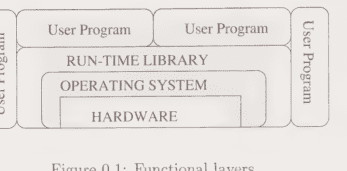

### 0.1 动机

我是个知道更多的黑客。

我第一次编程经历是在高中时期，当时我的代数老师从他的几位前同事那里争取到一些机器时间，让我们尝试 `FORTRAN II` 编程。在大学里，我学习了物理和数学——当时只有少数几所大学提供计算机科学学位。

尽管缺乏正规训练——当时大学没有提供专门的编程课程——我还是在大学的计算机中心工作，并实际上因为为其中一位教授编写程序而获得了报酬。

这开启了我十年的编程生涯，在此期间，我通过观察和实践学习了一些计算机科学。直到 20 世纪 70 年代末，我才担任了一个职位，在那里我们讨论我们正在做什么以及其他人可能如何去做。在这些讨论中，我意识到我对自己所选领域的了解是多么有限。

大约在那时，我搬到了一个拥有一所拥有良好继续教育政策的研究型大学的城市。一门课引出另一门课，我很容易陷入一个最终导致我获得计算机科学研究生学位的学习项目。

与我许多同学不同，我在编译器修改、网络、嵌入式应用的任务调度器以及系统管理方面有丰富的实践经验。由于这种背景，我学习过的材料可以分为四类：

- 我知道的——$我\ 每天\ 都在\ 使用$
- 我曾知道的——但我已经忘记了
- 我不知道的——这是新的
- 你可以那样做？——这太令人惊讶了

在我注册入学的同时，我被系里雇用安装和管理他们的 Unix 系统。伯克利软件发行版（`BSD`）包含所有源代码，因此当某些东西损坏或文档未清晰记载时，我可以深入挖掘并找出实际发生的情况。我能够检查正在我的课程中讨论的理论的实现。后来，我教授编程语言、操作系统和软件工程课程。这种工作、学习和准备的过程让我看到我早年的错误——我的坏习惯和有限的理解暴露无遗。虽然现在我知道了还有多少我不知道的东西，但我比开始时知道得更多，我愿意分享这些知识。世界上有一个迷因\(^1\)说“审查破坏欣赏”。我认为这种想法是错误的——没有审查就无法欣赏手艺。

我喜欢讲述我妻子展示计算机素养的最清晰例子的故事。当时她是一个不情愿的计算机用户——除了游戏，她只使用计算机进行文字处理。在 `vi` 和 `nroff` 的帮助下，她艰难地完成了论文二十多次修改。我经常从她身后观看，并提出新的格式命令或移动文本的新方法。

当她发现部门秘书一直在物理上剪切和粘贴来自文字处理系统的输出时，她已获得足够的技术深度而感到震惊。原因如下：“我删除并重新输入这段落好几次了，但它总是输出两份。”她正确地向秘书建议，文件中一定嵌有内容为“复制以下内容”的东西。

关键在于，尽管她对那个特定系统没有经验，但她已经了解了文字处理系统一般能做什么，并且她可以识别可能的行为。

> ^1 这个术语由理查德·道金斯（Richard Dawkins）创造，用于命名思想领域中的复制单位，例如想法、名言、旋律或技术。迷因通过从一个传人到另一个传人传播。

同理，我希望这本书能向你展示个人计算机上可能的功能。然后，作为一个知情的消费者，你会要求你的系统使用 Linux，你甚至可能会受到启发做出自己的贡献。所有这一切都有助于推广 Linux，这是我的最终目标。

### 0.2 风格与结构

细心的读者会注意到书中的一些不寻常之处。其中一些可以得到解释。

#### 0.2.1 引号

我承认，美式排版惯例将标点符号包含在引号内通常比将标点符号放在引号外更美观。不幸的是，这种惯例在确切引用内容方面存在歧义。这种区别在引用计算机命令时尤为重要。因此，我使用引号来确切地界定所引用的内容。

#### 0.2.2 词汇

你会发现，“state”指代两件事：$state_{1}$ 指进程正在做什么，例如运行、等待、就绪运行，而 $state_{2}$ 指关于进程的一切，包括其所有内存和寄存器的内容，以及它正在做什么（$state_{1}$）。不幸的是，这两个含义如此密切相关。读者必须小心区分它们，因为并没有合适的替代词可以避免混淆。

“process”和“task”这两个术语在意义上过于相似。如果我有义务区分它们，我会将“process”定义为正在执行的程序，将“task”定义为比进程更轻的东西。（“更轻”意味着具有更小的状态。）我采取了简单的做法，在写作中几乎完全避免使用“task”。我使用“job”来指代提交到批处理流的一组程序。

“多程序设计”（multiprogramming）和“多任务处理”（multitasking）基本上是同义词，都指多个程序的并发执行。全书中我使用“多任务处理”。（如果你感兴趣，“多处理”（multiprocessing）指的是使用多个处理器。）

我使用“线程”（thread）作为隶属于进程的线程执行流（thread of execution）的简称。它与兄弟线程共享其大部分状态。

谨慎使用“函数”（function）一词，将其限定为返回一个值且没有副作用的子例程。为了避免被 Unix 将所有子例程称为函数的惯例所腐蚀，我采取了相反（也是更正确）的做法，将所有函数称为子例程。

“操作系统”（operating system）一词有两个含义——一个指最内部的代码，即直接操纵处理器特殊控制的部分；另一个指包含辅助程序的更大产品。我试图对前者仅使用内核（kernel）或系统内核（system kernel），并保留操作系统一词专用于后者。“Linux”一词用于指代内核和更大的产品——你需要注意其使用的语境。

#### 0.2.3 名称

虽然规范形式是“UNIX”，但我遵循了 Peter H. Salus 采纳的约定（并由 McIlroy 的评论佐证），使用“Unix”[44]这一形式。这应被视为仅仅是一种排版约定。它并不旨在标识不同的产品。好讼者（Litigious types）应进行必要的转换，其他人则可以享受更美观的外观。一些作者含蓄地使用结构体 $^\mathrm{UNIX}\times$ 来命名那些不一定完全被商标持有者认可的类 Unix 系统。在极少数严格必要的情况下，我使用术语“类 Unix”（Unix-like）。

Linux 是否应被视为 Unix 或类 Unix，仍有待决定。至少有一位 Linux 分发商/开发者，WorkGroup Solutions²，已加入 X/Open³，即 Unix 商标的现任所有者。他们很可能会让某个版本的 Linux 符合使用“Unix”品牌的要求。如果该版本的 Linux 可以被称为 Unix，那么很难说这种资格不会扩展到 Linux 的其他版本。

#### 0.2.4 代码

大多数代码示例均采用 `ANSI` C 语言编写。在少数情况下，我会在语言使用上稍显宽松，允许汇编语言结构混入示例中。

#### 0.2.5 排版

这本书是用 `L²TeX` 编写的，并扩展了任意超文本链接和原始 HTML（超文本标记语言）支持。在线版本（通过 `L²TeX²HTML` 生成的 HTML 文档）可以使用允许你轻松前后跳转并连接其他在线资源的网络浏览器阅读。印刷版将超文本链接显示为脚注。

命令和文件名通常以打字机字体显示。特殊术语以特殊字体显示，索引中的条目将引导你找到该术语的定义或解释。

#### 0.2.6 勘误

尽管付出了所有最好的努力，本书中肯定会有错误和遗漏。本书的在线勘误页⁶位于出版商的网页上。你可以将评论和更正发送到 `bentson@ssc.com`。

### 0.3 致谢

Linus Torvalds 似乎属于那种“超级学生”，他们设法做了很多课外事情，却又避免了被学校开除。谢谢你开启这一切。此外，众多志愿者为 Linux 做出了贡献。部分列表见附录 G。


我很幸运住在西雅图，这里是 Specialized Systems Consultants, Inc.$^7$ 的所在地，也是 *Linux Journal*$^8$ 的出版商。如果不是这样，我可能永远都不会遇到 Phil Hughes 和 Belinda Frazier，也不会如此深入地参与 Linux 社区。还要感谢我的技术编辑 Cathy Anderson，以及我的审阅者 Lynn Benton, Gary Cotterill, Roger Droz, Perry Fizzano, 和 Michael K. Johnson，感谢他们对手稿的诸多评论和建议。

西雅图大学（Seattle University）$^9$ 的软件工程硕士项目为缺乏正规计算机科学教育的学生提供了一门计算机科学概览课程。我有机会教授这门课多年，并发现了一些计算机专业人士对计算机科学知之甚少的方面。

新闻组（Nenetews）是一个 surprisingly 好的信息来源——无论是关于 Linux 如何工作$^{10}$，还是关于对 Linux 用户重要的事情$^{11}$。这些组中的许多讨论促成了本书的某些章节。第 2.1 节和第 2.2 节大量引用了 Salus[44]。第 5.2.3 节引用了《内核黑客指南》（Kernel Hacker's Guide）[25]。第 5.2.4 节中的一些代码示例源自 Schimmel[45] 中的示例。第 9.1 节最初为 *The Linux Sampler*[18] 撰写。经 *Linux Journal* 许可重印。

感谢竞速帆船 *Sunwood* 的船长和船员，在我比赛间潜入甲板下撰写手稿时，他们给予了我的包容。

我也必须感谢我的妻子 Cindy，另一位 Benton 博士，感谢她所有的支持以及有益的评价。（她喜欢在我的草稿上涂满红墨水，然后鼓励我继续前行。）

⁴ 美国国家标准学会

⁵ http://cbl.leeeds.ac.uk/nikos/tex2html/doc/latex2html/latex2html.html

⁶ http://www.ssc.com/ssc/inisidelinux

# 第一部分

# 当代计算

## 第 1 章

### 为什么你需要 Linux

直到最近，Linux 一直被视为一种爱好者的系统。它始于学生 Linus Torvalds 的一个项目，旨在查看 Intel 386 的内存管理硬件是如何真正工作的。也就是说，Linus 想要确定利用该硬件构建实用的虚拟内存系统需要哪些详细步骤。由于他在互联网上分享了代码，其他人有机会为该系统做出贡献。这一开发过程至今已运行了五年多。附录 D 提供了 Linux 开发的时间线。

尽管 Linux 显然始于一个学生项目，但现在它被视为许多商业产品的基础。Linux 已成为全球数十万用户的首选操作系统¹。

在过去十年中，我们目睹了三大类计算机系统的建立：支持大型商业、工程或科学运算的大型系统；支持单个工程师或商业工作者的工作站；以及用于家庭环境的个人电脑。大型系统运行昂贵的操作系统，需要支持人员来进行系统管理。工作站运行某种形式的 Unix，由少量人员或有经验的用户管理。人们可能会认为个人电脑无需管理——完全取决于个人的意愿和能力。

这些类别之间的界限正在由于来自低端领域的侵蚀而变化。小型计算机和微型计算机一直保持着价格/性能优势，但现在由于它们的绝对性能提升，它们能够取代许多传统上更大、更昂贵的系统。

许多大型 Unix 系统正被高端 Unix 工作站的同类机型取代，而工作站正被高端个人电脑取代。这种变化被称为“杀手级微型机的攻击”（attack of the killer micros）。

这些变化模糊了界限，人们不应将 Apple 和 Microsoft 系统视为玩具，也不应假设 Unix 仅适用于工作站。没有其他操作系统覆盖更宽的性能谱系。从最强大的超级计算机到 1500 美元的笔记本电脑，都可以使用类 Unix 界面。

与 Apple Macintosh、MS-DOS 和 Windows 95 等专有系统不同，没有人能统计 Linux 的授权用户数量，因为 Linux 运行无需授权。它主要受 GNU 通用许可协议（GPL）保护，如附录 F 所示，该协议包含一个理念：一旦你拥有副本，你就可以传递它。因此，我们只能估算正在运行的 Linux 系统数量。鼓励你注册$^{2}$你的系统(2)。

因为 Linux 是一个完整的操作系统，它是学习操作系统如何工作时值得研究的对象。

#### 1.1 为什么 Linux 的受欢迎程度在增长？

接下来的三段可能会让你陷入术语过载。别担心，我们将在第 1.2、1.3 和 1.4 节中探索这些术语的含义。

Linux 显然优于所有竞争对手，因为 Linux 是一个自由的、稳健的、高性能的、多任务处理的、多用户的、网络化的、虚拟内存的开放系统，拥有庞大的开发工具集和不断增长的、使用成本效益硬件的应用程序集。没有商业生产的操作系统能声称拥有所有这些特性。

Linux 有一些可以称为短板的方面。它不是构建在微内核之上的，也不是分布式操作系统。它不是安全的

（根据严格标准而言），它也不是正式设计或测试的，更没有用现代编程语言编写。我们将探讨为何这些所谓的缺点并未损害 Linux 的声誉。

Linux 正在经历快速变化。新的内核版本大约每周发布一次。其中一些更改源于修复，但大多数是新特性或改进。此外，还有正在进行的重要新项目，这些项目将提供对称多处理功能，并支持 MS-DOS 和 MS Windows 程序。

#### 1.2 特性

Linux 拥有众多吸引人的特性。若要详细考察所有这些特性，将填满整本书，但以下各节提供了简要概述。在某些情况下，该章节还将解释*为何*某些特性是有用的。（因为读者可能缺乏相关经验，所以有必要进行这种解释。）

##### 1.2.1 Linux 是免费的

有些软件非常昂贵。开发人员发现，他们可以通过高价格销售少量许可证来获利。其他开发人员发现，他们可以通过以适中价格销售大量许可证来获利。有些人甚至采取了极端措施，将营销和分发成本降至零，免费分发其产品，并要求用户自愿直接向开发人员发送许可费。

自由软件基金会$^{3}$指出，软件的再分发受到许可证的限制。它还指出，所有传统的授权方式都有一个共同点：源代码很少向最终用户开放。为此，他们制定了 GNU 通用公共许可证（GPL），其中部分内容为：

> 你可以在任何介质上逐字复制和分发你收到的程序源代码副本，前提是你必须在每个副本上显著且适当地发布适当的版权声明和免责声明；保持所有提及本许可证及无保修声明的通知完整；并向程序的其他接收方提供本许可证的副本以及程序本身。

这确保了源代码的访问不会受到限制。它还规定：

> 你可以复制和分发程序……以目标代码或可执行形式……前提是你还必须……随附完整的相应机器可读源代码……[或提供应要求提供副本的服务]。

这确保了必须随目标文件或可执行文件一起提供源代码。

Linux 受此免费复制政策的约束，因此，Linux 发行版可以免费在互联网上轻松获取，用户无需付费。同样的许可证允许通过 CD-ROM 进行商业发行。由于该系统可自由获取，CD-ROM 的定价仅包含适度的利润，因此与其他世界任何软件相比，这些 CD-ROM 以更低的价格包含了更多的软件。

##### 1.2.2 Linux 是稳健的

Linux 并非使用形式化方法或许多现代软件工程技术开发而成。然而，它确实利用了一种众所周知的构建更好软件的方法：代码审查。

这种代码审查与商业软件开发环境中通常发现的有所不同。推荐的做法是让作者与几位审查员会面——所有这些人在会前都已研究过该程序。审查由作者以外的其他人在非对抗性的环境中进行——其目标是识别缺陷或误解。

Linux 模式无法支持会议，因为开发团队成员遍布许多大洲。即使他们住在同一个城镇，也会受到工作、家庭等日程安排的限制。因此，他们依赖一个大家都能理解的过程，即将代码以不同的置信度级别发布到不断壮大的互联网用户社区。

该用户社区根据用户期望，并在极少数情况下根据规格说明书，对代码进行研究测试。由于整个程序以源代码形式向全世界公开，因此在商业软件开发环境中罕见的急于发现并修复缺陷的现象在这里层出不穷。

作为附带好处，或者也许是副作用，程序员中存在一定程度的自我选择。没有人被指示去“设计和编码”超出其经验范围的东西。相反，进行更改是因为贡献者有一些专业知识要分享。

最后，发布不受外部同步的限制。相反，它们会在修复或增强功能完成后立即进行。因此，Linux 是*稳健的*，但也在不断变化。

有些人对被不断改变的系统感到恐惧。他们宁愿拥有一个缺陷已知且变通方法也已知系统。这种方法的危险在于，在“旗帜日”（flag-day），当重大新发布最终被安装时，大量意外情况会突袭用户。因此，一些用户坚持使用多年前的系统发行版。在 Linux 中，从一个发行版到下一个发行版的更改是温和的。谨慎的用户可以保持距离跟随大众，以适中的速度升级到新版本，并确信问题不会设伏攻击他们。

这种跟随领先者的过程被封装在双轨发布机制中。第 9.1 节将更详细地描述这一过程。

##### 1.2.3 Linux 提供高性能


当应用程序在没有系统内核开销的情况下执行时，可获得最佳性能。对于所谓的“嵌入式系统”，这一点肯定成立，在这些系统中，系统的功能是有限且刚性定义的。

不幸的是，当系统旨在通用时，这一点不适用。在这种情况下，总是有一些开销——诀窍是使其保持最小。

Linux 在这方面做得很好，因为一直存在（持续变化的）压力来减少 Linux 系统调用的开销。

具有可比功能的其他系统比 Linux 使用更多的内存或运行更慢。

Linux 在另一个意义上提供高性能：它已被移植到市场上一些最快的微型计算机上，并且它已被移植到对称多处理器系统上。

## 1.2.4 Linux 拥有多任务处理

多任务处理意味着对等程序的并发执行。每个进程（潜在地）有权获得系统的完整资源。每个进程在分配资源时可以很贪婪——系统将在进程之间进行调解。进程作为父进程的子进程创建。新进程获得特权并拥有与父进程相同的所有权。

进程调度基于优先级、历史、资源等。较低优先级的进程执行时间少于较高优先级的进程，并且进程的优先级会随时间变化，以满足如第 5.2.4 节中讨论的调度目标。（内部最重要的（优先级最高）进程具有最低的优先级值，但一些实用程序和系统调用试图纠正这一点，使得更重要的进程具有更高数值的优先级。这是在任何关于 Unix 系统优先级的讨论中的一个陷阱。）

系统调用作为用户进程的扩展实现，并且代码在内核中不会被打断。由于系统调用通常持续时间较短，这通常不会造成困难。在进程必须阻塞的情况下，任务切换确实发生在内核内部。这种通用设计几乎适用于所有 Unix 内核。

## 1.2.5 Linux 支持多用户

Linux 允许多个用户同时访问系统，使得每个用户都受到保护，免受其他用户意外行为和恶意行为的影响。每个用户都可以拥有一个个性化的环境，并且资源使用可以被监控和限制。用户可以共享程序和数据，并且他们的程序可以与其他用户的程序进行通信。

大多数其他个人计算机操作系统不具备此功能。有人声称这是不必要的，因为计算机是“个人”的。当我们考虑家庭在家共享一台计算机或同事在办公室共享一台计算机时，我们看到这一主张是没有根据的。

## 1.2.6 Linux 拥有网络功能

Linux 在其网络能力方面最能体现其 Unix 血统。所有常见的实用程序，如 `telnet`、`ftp`、NFS、`rlogin`（远程登录）、`rsh`（远程 shell）和 X Window System，都由源自加州大学伯克利分校和麻省理工学院发布的代码完全支持。

除了这些传统实用程序外，其他程序，如万维网浏览器和多人游戏，也已被移植到 Linux。

已添加了许多物理设备驱动程序，使 Linux 能够通过拨号调制解调器、租用线路、以太网、并行端口和 ISDN 进行通信。

## 1.2.7 Linux 使用虚拟内存

Linux 的另一个巨大优点是它向用户程序提供了一个简单的内存模型——它拥有一个由 $2^{32}$ 字节组成的统一地址空间，可以通过 32 位指针进行寻址 ${}^{4}$。任何对近期 x86 硬件进行过编程的人都知道，有几个内存模型可供选择。大多数商业生产的操作系统使用限制性模型，兼容最古老的 x86 处理器，这需要更改段寄存器并与指针寄存器协调。当在基于 Intel 的系统上使用 Linux 时，它要求 386 或更高级别的处理器，因此，它可以提供一个简单的内存模型，在访问计算机上的所有内存时不需要操作两个寄存器。

Linux 向每个用户程序呈现一个大的地址空间。此空间被划分为 4096 字节的页。如果有足够的物理内存，并且用户程序的需求足够小，硬件只需从页映射到物理内存片段，称为

> ${}^{4}$这也被称为平坦地址空间（flat address space）。

帧。如果物理内存不足，Linux 会使用磁盘空间来存放那些按需在内存中进出的页面副本。这种虚拟内存将在 4.4.4 节中进一步讨论。

### 物理内存的其他用途

Linux 的一个突出特点是，除了用于保存内核代码的部分外，它将所有物理内存都放入一个公共池。从该池中取用内存，以提供虚拟内存系统的帧以及磁盘缓存的缓冲区块。

对于初学者来说，结果可能会令人惊讶：在内存充裕的系统上编译大型程序（例如内核）时，你会发现磁盘在第二次及后续的迭代中很少进行操作。这是因为所有的磁盘数据都已被缓存在内存中。系统只需在缓存缓冲区块与用户程序之间复制数据，而无需执行磁盘 I/O 操作。

## 1.2.8 Linux 是一个开放系统

这个术语需要一些解释，因为“开放系统”有几层含义。第一种（也是正式的）含义是指系统符合已发布标准。这是为了确保按照这些标准编写的程序可以移植到其他开放系统上。第二种（通常是隐含的）含义是没有隐藏的元素。某些系统未能满足这一第二层含义，因为它们虽然提供了标准的所有功能，但还提供了一些只有懂行的人才能利用的额外功能。Linux 比任何其他操作系统都更接近符合 POSIX[3] 标准，如果有任何疑问，所有源代码都可以供任何感兴趣的各方检查。这些标准将在 5.1.1 节中进一步讨论。

## 1.2.9 Linux 拥有庞大的开发工具集

Unix 已经发展了超过二十五年。在这段时间的大部分时间里，它被其开发者用于进一步的开发。这使得 Unix 成为开发 Unix 的最佳工具。

Linux 在其短暂的生命周期中也遵循了同样的路径。Netnews，一种基于网络的公告板系统，因其鼓励对问题进行便捷的讨论而被极大地利用。由于 Linux 是自宿主（self-hosted）的，开发者发现很容易添加针对困扰他们的问题的修复方案。

Linux 从自由软件基金会（Free Software Foundation）的 GNU（GNU’s Not Unix）项目中受益匪浅。该项目旨在用一个没有许可证约束的系统来取代 Unix。尽管 FSF 最近发布了 HURD 内核，但过去几年中已发布了大量工具，包括优秀的编译器和编辑器。由于这些工具是在开放系统的理念下编写的，将它们纳入 Linux 发行版是一件简单的事情。大多数这些工具都涉及系统开发和文本处理。

旨在推广自由软件的 GPL（通用公共许可证）激发了一大批商业开发。开明的硬件厂商贡献了他们硬件的驱动程序，理解这将促进其设备的销售。软件开发者发现将基于 Unix 的应用程序套件移植到 Linux 上非常容易——这要归功于 Linux 几乎完全符合 POSIX 标准。GPL 意味着他们手头拥有完整的源代码，因此可以修复他们认为 Linux 中任何有缺陷的部分。然后，GPL 确保这些修复将被 Linux 社区的其余部分共享。

## 1.2.10 Linux 提供应用程序

这一能力是 Linux 获得普遍接受的最关键要素。毕竟，如果 Linux 仅仅服务于 Linux 的开发者，那么用户群体将相当有限。

如上所述，Linux 拥有一个类似 Unix 的接口（几乎完全符合 POSIX 标准），因此为 Unix 编写的任何程序都可以轻松地移植到 Linux。此外，大多数商业软件生产商已从汇编语言转向 C 或 C++ 编程，这使得将他们的产品移植到 Linux 变得更加容易。

以下列表展示了可供 Linux 用户使用的应用程序范围。

- **CERNLIB 95a**：面向高能物理研究的程序和库
- **FElt**：有限元分析工具
- **GNAT**：GNU Ada 编译器
- **GNUploth**：一个由命令行驱动的交互式绘图实用程序
- **magic**：VLSI 布局编辑器
- **OGI: Speech Tools**：一些用于语音处理的工具（例如，图形显示、向量量化以及用于语音识别的神经网络）
- **Octave**：主要用于数值计算的高级语言
- **Postgres**：面向对象数据库
- **POV Ray**：可移植 C 语言光线追踪器
- **XBarcode**：生成条形码
- **Spice**：模拟电路仿真器
- **MacroCALC**：与 Lotus 1-2-3 兼容的基于字符的电子表格

## 1.2.11 Linux 使用成本效益高的硬件

个人计算机硬件市场既竞争激烈又规模庞大。尽管 Linux 与最通用的商业操作系统大不相同，但它可以与硬件的大规模生产共享成本和性能优势。Linux 并不局限于 x86 架构。其他系统的列表在 1.4.1 节中给出。希望这些架构也能提供良好的价格/性能比。

### 1.3 基本缺陷

Linux 并不完美。它有一些缺陷，并且缺乏一些流行功能。（我将这些视为不同的特征，因为某些流行功能并不那么有益。）

## 1.3.1 Linux 不是一个微内核

“微内核”这个术语暗示内核内部还有一个更基本的类内核元素。微内核的基本前提是可以将内核构建为许多几乎正交的专业化内核进程。这些进程通过微内核相互传递消息进行交流。

MERT 系统是在贝尔实验室根据这些原则开发的[33]。其他人也跟随其后，包括一个自 1980 年以来一直在生产中的成功商业产品 QNX^6；Unix 创建者 AT&T 贝尔实验室的 Plan 9^7；以及 VSTa^8，一个最初由 Andrew Valencia 编写的版权共享（copylefted）^9 系统。


MACH^10 是来自卡内基梅隆大学的基于微内核的操作系统，自 1985 年以来一直在开发中。它探索了许多理念，包括

- 内核级轻量级线程支持
- 多处理器支持
- 不同的操作系统接口支持，包括 BSD Unix 和 Linux^11

MACH 的部分功能已纳入其他操作系统，包括 DEC 为 DEC Alpha 开发的 OSF/1、IBM 为 RS6000 开发的 OS/2、NexT OS 以及 HURD^12。开放软件基金会（OSF）^13 正在进行关于 MACH 的进一步研究和开发。

微内核方法的优势在于强制实施良好的模块化设计。如果设计得当，它可以扩展以支持多个用户线程和对称多处理器。

关于前一句，必须指出两个重要观点。首先，即使没有微内核，也可以拥有多线程内核并支持多处理器。几乎所有商业系统都是这种情况。

其次，虽然使用微内核实现用户线程和对称多处理器很容易，但要做得好却很难。问题在于必须仔细关注设计，否则瓶颈将限制系统性能。

微内核的缺点是，消息传递内核通常（但并非总是）比单体内核占用更多的资源，因为消息传递使用比子程序调用更多的指令。在多处理器系统中，由于性能提升，这是一个合理的权衡。但在单处理器情况下，所需的努力可能令人生畏。尽管如此，仍有关于如何使用这种技术构建新 Linux 的讨论。

在此期间，Linux 内核具有将单独编译的模块加载到内核中的能力。这意味着可以在不进行昂贵的关机/重启循环的情况下，更改内核以支持实际的硬件配置。开发者可以在驱动开发中遵循“修改-编译-加载-测试-卸载-修改”的循环。最新的努力包括跟踪模块之间的依赖关系，甚至自动按需加载模块。

### 1.3.2 Linux 不是一个分布式操作系统

多处理器系统在处理器之间的通信中享有非常小的延迟，可与内存访问时间相媲美。如果处理器相距足够远成为网络上的节点，并且通信延迟增加到毫秒或更长，那么你就拥有了一个

分布式操作系统。由于延迟增加，分工发生了巨大的变化。不同处理器不再是均匀且平等地共享工作，而是倾向于进行专业化分工。

一个基本要素保持不变：处理器之间高度相互依赖，但其存在对用户而言可能并不明显。莱斯利·拉姆波特（Leslie Lamport）提出了一个著名观点：“在一个分布式系统中，即使一台你根本不知道其存在的计算机发生故障，也可能导致你自己的计算机无法使用。”

Linux 采取了折中的立场。它是一个具有网络支持的单计算机系统。每个系统都可以独立运行，但所有系统也可以在网络上协同工作。

### 1.3.3 Linux 并不安全

这个故意令人害怕的标题夸大了事实。该标题指的是那些声称能够抵御恶意攻击的安全系统，因为它们在许多对开放路径有用的地方将其完全关闭了。“Oracle 书籍”描述了将一个系统认定为安全所必须采取的步骤[13]。Linux 并不比其他常见系统差多少——很少有系统在形式意义上是安全的——而且你也不一定会喜欢使用那些形式上安全的系统。

例如，某些级别的安全系统阻止用户了解系统上其他用户的名称。一个更极端的例子涉及所谓的“隐蔽通道”（covert channels），这是一种允许程序通过不明显的方法向其他程序传递机密数据，从而违反安全评级规定的技巧。由于这些方法可能涉及一个进程监视另一个进程的内存映射，甚至子进程生成速率，因此进程的状态对其他进程完全隐藏。这些限制与 Unix 和 Linux 的大部分开发理念背道而驰。

尽管有这些关于安全的警告，我们仍能看到 Linux 安全性的持续改进。非预期且不需要的安全漏洞正在被定期修复。但请不要指望国防部、国防部或战争部（看你所在的国家）会使用 Linux 来保守秘密。

### 1.3.4 Linux 并非经过正式设计

这种情况在 Linux 上永远不会发生。诸如 FSF 的 HURD 和 CMU 的 MACH 等系统产生了许多出版物$^{14}$、$^{15}$，其中一些甚至早于其所实现的概念。

我们将看到的是内核和系统文档的不断完善。与流行观点相反，确实有程序员能够写出清晰易懂的散文。Linux 文档项目（LDP）$^{16}$ 旨在收集 (1) Unix 风格的手册页，(2) 简明的教程，以及 (3) 诸如《Linux 网络管理员指南》[27] 和《内核黑客指南》[25] 等书籍。这些文档通常包含在 Linux 的 CD-ROM 发行版中。

虽然先设计再实现可能更好，但我们可以感激这种对已实现内容进行记录的 effort。

### 1.3.5 Linux 并非使用现代编程语言构建

Linux 几乎完全用 C 语言编写。（其中有一些片段是用汇编语言编写的。）

C 语言既被称为世界上最低的高级语言，也被称为世界上最高的低级语言。这种双重评价使其在作为系统实现语言方面处于有利位置。这也意味着，为了实用性，C 语言不得不放弃一些优雅的习语，例如抽象对象和多线程。

如果 C 语言没有这么流行，它可能会被认为是一种糟糕的语言。它拥有一些值得商榷的特性，例如对函数和类型采取轻率的态度，这些特性已经深深植根于传统之中。

在 C 语言出现的同时，还开发了几种其他编程语言。Eiffel 是被高度评价的现代编程语言的一个例子。两者的对比很有启发性：

- C

    - 作用域有三个级别：全局、模块局部或子程序局部
    - 强类型系统，带有类型转换
    - 使用联合（unions）来改变类型
    - 存储中的位是可以访问的
    - 函数返回值可以被忽略
    - I/O 作为支持库的一部分单独定义

- Eiffel

    - 具有类和多重继承（以支持面向对象的编程）
    - 具有包（用于保存相关的程序元素）
    - 具有一些预定义类（类似于 C 的运行时库）
    - 语法上的小挫折较少（例如悬空的 "else" 问题）

许多来自其他语言的好想法已经渗入到 C 语言中。最新的 C 语言规范包括支持单独编译的机制，以及对该语言标准运行时支持更完整的规范。

其中一些变化是在实现中，而不是在语言规范中。例如，类型检查更加严谨，编译器更容易发出警告。

现在的系统内核被视为一组几乎独立的模块协同工作。这些模块中的函数操作于相当复杂的结构上，但细节可以安全地对调用者隐藏。这导致了这样的建议：Linux 应该用支持抽象数据类型、面向对象的编程、单独编译等概念的语言（如 C++）重写。

Linux 可能不会提供你想要或需要的所有功能。Linux 项目地图（LPM）$^{17}$ 列出了大量增强 Linux 内核或用户环境的项目。其中一些重要项目如下所列。Linux 软件地图（LSM）$^{18}$ 是一种用于报告已完成（或至少可供测试）的软件项目的标准化形式。这使得每个人都能协调开发并跟踪所需软件的状态。

#### 1.4 暂时的不足之处

##### 1.4.1 Linux 仅能运行在……

1991 年 8 月 25 日，Linus Torvalds 在 comp.os.minix 新闻组发布了一条消息，其中写道：

```
我正在开发一个（免费的）操作系统（只是一个爱好，不会像 gnu 那样庞大和专业化），适用于 386(486) AT 兼容机。……它**不**是可移植的 [sic]（使用了 386 任务切换等），并且可能永远不支持除 AT 硬盘以外的任何设备，因为我只有一块……
```

1992 年 7 月 31 日，Linus 在给 Linux-Activists@BLOOM-PICAYUNE.MIT.EDU 邮件列表发布的一条消息中指出：

```
……事实上，随着新版本，linux 的可移植性确实提高了：早期版本中有更多的汇编代码。但这并不意味着任何神志清醒的人现在会尝试移植它。
```

那可能正是启动首次将 Linux 移植到不同架构工作的挑战。

目前，Linux 已被移植到多种其他架构，包括 Motorola 68040$^{19}$（特别是 Amiga$^{20}$）、Atari$^{21}$ 和 VME$^{22}$、DEC Alpha$^{23}$、MIPS$^{24}$、PowerPC$^{25}$ 以及 SPARC$^{26}$。

其他移植工作正在进行中，但尚未提供结果。

##### 1.4.2 Linux 无法运行 MS-DOS 程序

尽管 Linux 没有提供完整的虚拟机系统，但有一个名为 `dosemu` 的软件包，它模拟了足够的 x86 硬件，使得 MS-DOS 可以在 Linux 进程中运行。该软件包的设计使得 MS-DOS 及其所有应用程序都无法察觉它们并非运行在底层硬件上。

在撰写本文时，`dosemu` 已经提供了足够完整的模拟，可以启动 Microsoft Windows 3.1。

第 4.3.2 节和第 5.2.5 节讨论了虚拟机的操作。

##### 1.4.3 Linux 无法处理 Windows


Microsoft Windows 是 Intel x86 硬件上的另一个操作系统。（实际上，它是 MS-DOS 的扩展，但我们不想为此争论。）为此系统编写的程序无法直接在 Linux 系统上执行。`WINE` 项目将克服这一限制。Wine FAQ（常见问题及解答）称 Wine 代表“**W**indows Emulator（Windows 模拟器），或者 **W**ine Is Not an Emulator（Wine 不是模拟器）。两者都对。使用你认为最合适的那个。” Wine 提供了一个程序加载器和执行环境，其中包含一个模拟库。所有系统调用都被转换为适当的 Linux/X Window System 调用。

该项目的当前状态是“完成了 90%，剩下的 10% 预计需要再花 90% 的时间。” 许多第三方程序可以在 Wine 下运行，但似乎 Microsoft 的程序利用了对系统未记录或记录不良的调用。一旦理解了这些调用，就可以为它们添加支持。

X Window System 是一个强大的图形用户界面，包含在所有 Linux 发行版中。

- 23 http://www.a2star.net.com/\~axplinux
- 24 http://www.fnct.fr/linux-mips
- 25 http://liber.stanford.edu/linuxppc
- 26 http://www.geog.ubc.ca/sparclinux.html
- 27 http://www.princeton.com/\~pdg/wine-faq.html

### 1.4.4 Linux 没有用户级线程

线程是一个类似进程的实体，它与兄弟线程共享大量上下文。在兄弟线程之间切换的开销小于在进程之间切换的开销。这种较低的开销意味着线程可以更轻松地利用程序*内部*的并行性。

线程的实用性以及 POSIX 线程标准的待批状态，使得用户社区对线程的关注度提高。

直到最近，Linux 的线程实现完全以用户代码形式运行。存在几种不同的实现，但均未被纳入标准发行版中。

内核正在向支持用户级线程的方向演进。

第 5.2.3 节将更完整地探讨线程。

### 1.4.5 Linux 没有流（Streams）

当数据在用户应用程序与外部世界之间流动时，会应用多种转换，例如，制表符扩展为适当数量的空格，每个字符添加奇偶校验位，数据包应用校验和等。在过去，这些转换被内置在驱动程序中。这使得难以按行或按应用程序安装不同的转换。

*流*（Streams）由 AT&T 贝尔实验室的设计者引入 Unix，使程序能够更精细地控制这些转换[42]。

尽管用户社区对将 Linux 转向此方法表现出极大的犹豫，但有一个（进展缓慢的）项目[28]旨在为 Linux 开发流。他们的希望是将流的使用作为用户选项。

### 1.4.6 Linux 没有对称多处理（SMP）

多处理涉及在单个系统中使用多个处理器。有时，额外的处理器具有专用功能，例如智能外围控制器。另一种配置具有多个处理器连接在一起，每个处理器与系统的关系与其他处理器相同，因此称为“对称”。处理器之间没有主从关系。

如第 1.3.1 节所述，如果 Linux 被编写为微内核，将其扩展为对称多处理器系统将相当直接。

相反，一个小型项目组通过添加精心放置的信号量（见第 5.2.4 节）来保护内核中的共享数据，从而扩展了现有的单体内核。此外，在系统启动时，需要额外的步骤来识别和初始化处理器。从实际角度来看，这最终可能导致比通过微内核所能实现的更高性能的系统。

因此，尽管目前不存在完全支持的版本，但对 SMP 的支持现在是开发内核版本中的一个配置选项。直到该项目完成之前，相关信息可在网上获取。[29]

### 1.4.7 Linux 不支持实时调度

第 4.1.3 节指出，“实时”是一个有点难以捉摸的术语，但大多数人一致认为 Linux 没有实时支持。

时钟的分辨率相当好，但由 `setimer` 发出的信号的传递具有有限的分辨率。更重要的是，任何进程都可能因虚拟内存分页而遭受严重的任意延迟，且调度程序的行为没有精确定义。因此，进程无法保证满足任何截止时间。

最近提出的内核更改将以较小的通用系统性能代价纠正这些缺陷。

在某些情况下，也可以通过向专用设备驱动程序添加更多内容来伪造实时性能，这是可能的。

### 1.4.8 Linux 正在变得臃肿

最初的 Unix 内核受到严格的尺寸限制。PDP-11 硬件仅提供 64 Kbyte 的虚拟地址空间，其中 8 Kbytes 用于引用设备寄存器。因此，内核不能无限制地扩展以提供新功能。当 Unix 移植到 DEC VAX 和其他架构时，这一约束被移除，Unix 迅速变得大得多。幸运的是，根本上的简单设计并未丢失。

Linux 内核也经历了类似的蜕变。由于它是个人创作的产物，因此基于简单、一致的设计。随着新功能的添加，它正在迅速扩展。这些功能导致内核在过去三年中膨胀了 2 倍。第 1.3.1 节提到的内核模块为此问题提供了解决方案，因为只有所需的特性会被加载到内存中。

在对大型软件开发项目的经典分析《人月神话》中，Fred Brooks 提出了他所谓的*第二系统效应*。当设计者向其第二系统堆叠特性时，就会出现这种情况——这些特性是他们在第一系统中因担心尺寸或实现能力而明智地省略的。只有在构建第二系统的经验才能教导如何在所需与所愿或可提供之间找到适当的平衡。

Brooks 的书已附带过去二十年的额外评注重新出版，其中他命名了一个相关现象，*特性增生*（featuritis）[7]。他指出，除非系统设计者对用户社区有坚定的感知，否则新功能将无限制地添加。

Linux 正遭受*特性增生*，但由于其开放和动态的本质，真正糟糕的特性会被清除。此外，用户可以将实验性特性引入系统，而无需依赖“特性沙皇”决定什么重要。如果某个实验性特性证明有用，它将以可加载模块或内核编译时选择的形式迁移到内核中。

## 第 2 章

### Linux 引言

Linux 并非凭空出现。它是多年计算机系统开发的结果。如果我们回顾，可以识别出许多来自其他系统并被纳入 Linux 的开创性思想。

#### 2.1 Multics

在 1964-1965 年，通用电气、贝尔电话实验室和 MIT 的 Project MAC 结成合作伙伴，为大型计算机构建操作系统。该系统被称为 Multics——Multiplexed Information and Computing Service（多路复用信息和计算服务）的缩写。

所有原始方现已撤回对该操作系统的官方支持，但仍存在少数正在运行的 Multics 站点。还有一个 Multics 爱好者和用户群体，支持一个新闻组[1]。

许多关于 Multics 的书籍和论文已经出版，最重要的是《有机的》（Organic）[k37]。其中一些探讨了 Multics 的衰落。没有一篇暗示 Multics 存在根本性设计问题，大多数都颂扬了许多正在缓慢进入其他操作系统的原创思想。

尽管 Multics 没有继承 Multics 使用的完整安全环效用性，但在此提及它们，因为它们连同复杂的过程调用机制一起，被用于为系统提供极大的功率和极高的安全性。

这自然导致了操作系统的分层模型，进而导致了交互式用户对系统内核的访问不需要与系统内核集成这一自然结论。

#### 2.1.2 Shell（Shell）

直到此时，安装新的命令行解释器是一项艰难的事业。借助 Multics，系统管理员甚至用户可以指定终端交互如何被解释，因为命令解释由一个单独的程序——称为 shell——执行。

#### 2.1.3 文件系统

Multics 系统上的文件通过高层操作访问，这些操作隐藏了磁盘的块结构。用户只需调用一个操作（读/写等），参数为文件句柄、缓冲区和大小编码。

文件由目录、子目录和最终文件的树状结构组织。

文件数据由系统内核不作解释。虽然应用程序可以应用任何所需的解释（记录、数字等），但系统内核只操纵字节流。

作为自然副作用，文本文件被视为字符流，行之间由单个换行符分隔。因此，用户程序可以依赖于对数据的轻松访问。

#### 2.1.4 动态库

大多数程序依赖于持有在称为库的特殊文件中的支持子例程集合。这些库允许程序员重用以解析命令行、对数据数组进行排序等他人编写的代码，

格式化输出字符串、计算角度的正弦值、打开显示窗口等，而不是每次需要时都重新编写这些子例程。

可执行映像被分阶段创建并移至内存：首先将程序源代码编译为目标文件，然后查阅必要的库以提供支持代码。这些子例程可以通过几种不同的方式、在不同的时间点与用户代码绑定。链接器可以将库代码绑定到用户程序（1）在可执行文件构建过程中，或者加载器可以在程序加载到内存时（2）将库代码绑定到用户程序，又或者加载器可以在每次引用库代码时（3）将库代码绑定到用户程序。这种最后的绑定方法被称为“动态链接”、“动态加载”，有时也称为“动态库”。

通过将绑定延迟到程序执行期间，动态链接提供了（1）仅使用库的最新版本以及（2）在程序间共享库代码的机会。

早期版本的动态库链接可以归功于 Multics 系统。

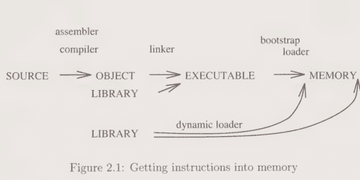


Linux 支持动态链接库已有一段时间了。相关细节在第 7.1.2 节中讨论。

### 2.1.5 用高级语言编写系统内核

这可谓喜忧参半。人们普遍认为，与汇编语言相比，高级语言能带来更高的程序员生产力（这一点后来由 Jones[26] 等人证实）。Multics 项目如果使用 `PL/I` 而不是汇编器，将会获得巨大的收益。

然而，`PL/I` 是一门*非常*复杂的语言。由于 `GE 635/645` 没有 `PL/I` 编译器，因此必须编写一个。由于分包商的失败，真正的编译器直到 1970 年才准备就绪，但备用计划在 1966 年产生了一个受限的编译器。

值得注意的是，早期 Unix 系统的实现使用的是汇编语言。`PDP-7` 上有一个 `B` 解释器，但我们所知的 `C` 编译器直到 1972 年才出现——那时 Unix 早在 `PDP-11` 上就已经实现了。直到 1973 年，随着数据结构的加入，才可以用 `C` 重写 Unix。

#### 2.2 Unix

1969 年，贝尔电话实验室撤出了 Multics 项目。关于这一举动，人们提出了许多猜测，但显然，这个大型分时系统对贝尔实验室的价值有限。硬件非常昂贵，性能却非常低。

无论原因如何，许多参与者仍然对创建一个多功能操作系统感兴趣。他们的非正式讨论涵盖了基本要素：简单的进程创建、文件系统结构、用户级命令解释器以及任务模型。这些讨论导致了小型测试程序，这些程序逐渐发展成为更大的项目，最终演变为 Unix。

Ritchie 和 Thompson 将 Unix 描述为：

> 用于 Digital Equipment Corporation 较大的 `PDP-11` 和 `Interdata 8/32` 计算机的通用、多用户、交互式操作系统。它提供了一些即使在大型操作系统中也很少见的特性，包括：

> - 包含可拆卸卷的分层文件系统

> - 兼容的文件、设备和进程间 I/O

> - 启动异步进程的能力

> - 可按用户选择的系统命令语言

> - 超过 100 个子系统，其中包括十多种语言

> - 高度的可移植性[43]

由于 Unix 用于开发 Unix（一旦自举阶段完成），开发人员构建了有助于构建更好操作系统的工具。这些工具包括编辑器、编译器、编译器开发工具、宏处理器和命令行解释器。

构建这样的工具很有趣，但 Unix 必须自给自足。Unix 的第一个正式用途是为贝尔实验室的专利申请办公室进行文本处理。因此，文本处理工具在 Unix 生命周期的早期就被开发出来了。我指的是用于填充文本、对齐行、突出显示和下划线单词、构建索引和目录等工具。其他工具可以从文件中定位文本字符串、按行排序文件、提取报告信息等。

##### 2.2.1 低成本硬件

1960 年，Digital Equipment Corporation（DEC）推出了 `PDP-1`。价格为 120,000 美元（与其他系统的数百万美元相比），它是一笔划算的交易。DEC 通过进一步推出低成本系统，在该领域站稳了脚跟。

Unix 最初是在一台废弃的 `PDP-7` 上实现的，但一旦基本原理得到证明，就找到了官方支持（以 10,000 美元的形式）来购买一台 `PDP-11/20`。

多年来，Unix 与 `PDP-11` 紧密相连。尽管市场上还有其他廉价的迷你计算机，但主要观点是，Unix 最初并非针对当时的巨型机设计。

（读者不应认为 Unix 仅适用于低成本系统。它后来已成为高端系统的首选操作系统。例如，Unix 将成为 1996 年发货的 `Tera MTA` 的主要系统接口。`MTA` 设计的最高性能限制为 256 GFlops。）

##### 2.2.2 重定向

重定向是上述“兼容的文件、设备和进程间 I/O”的一个有用副作用。由于程序使用相同的调用写入文件、终端或打印机，因此允许将输出重定向而无需程序知晓是一件简单的事。在 `Shell`（命令解释器）级别，这通过标记 `program > new destination file` 和 `program < new source file` 来表示。程序不知道其输入或输出已被重定向。

##### 2.2.3 管道

管道是一种软件构造，用于将数据流从一个程序引导到另一个程序。

早在发明管道之前，当一个程序的输出被用作第二个程序的输入时，两个程序就可以交互。商业数据处理对此模型非常熟悉，即使穿孔卡片是主要的存储形式也是如此。操作员只需将卡片从输出槽移动到输入槽即可。

但这种早期的程序交互形式有两个缺点：在命令行上指定此操作很混乱，并且必须在一个程序完成之后另一个程序才能开始。典型的数据处理会导致以下命令序列：

```
command1 > temp_file
command2 < temp_file
```

其中 `command1` 的输出将被用作 `command2` 的输入。

管道允许用户有效地将这些两个命令序列合并为一行：

```
command1 | command2
```

这仍然表示 `command1` 的输出将被用作 `command2` 的输入，但使用的是内部缓冲区而不是文件来传输数据。此外，这两个命令是同时执行的。

值得注意的是，`MS-DOS` 中的管道实现不支持同时执行。第一个 `MS-DOS` 程序运行至完成，写入一个隐藏文件；然后第二个程序启动，使用该隐藏文件作为输入。唯一的优点是标记更便捷。

Unix 完全支持两个程序可以通过使用缓冲通信路径协同工作，将一个程序的输出传输并作为另一个程序的输入这一理念。这将在第 3.1.1 节中更详细地探讨。

##### 二元中缀表示法

在 Unix 最初设计时，一些初步讨论建议将命令本身视为二元运算符。例如，命令行：

```
inputfile sort paginate print
```

将打印输入文件的分页排序图像。由于重定向已经是 Unix 的既定特性，这种形式被转换为类似以下内容：

```
sort inputfile > paginate > print
```

其中，如果重定向的目标是命令，则执行该命令；如果是文件，则将其用作目标。

这些实验性形式很快转变为使用一个独特的字符“`|`”，它将两个程序连接起来，使得一个程序的输出成为下一个程序的输入。

```
sort inputfile | paginate | print
```

##### 2.2.4 文件系统

与 Multics 类似，Unix 文件系统是由包含目录、普通文件和用于外围设备访问的特殊文件的目录层次结构组成的。所有的输入和输出（I/O）都是通过诸如 `open`、`close`、`seek`、`read` 和 `write` 等系统调用来完成的。

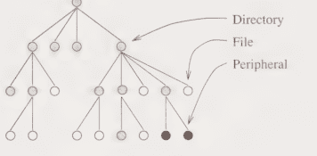

图 2.2: 文件系统层次结构

Unix 文件系统条目都由一个 `inode` 定义，关于 `inode` 的更详细说明见第 5.3.1 节。此结构包含以下信息：

-   类型

-   所有权

-   访问控制

-   创建、修改和访问时间

-   大小

-   位置

如果类型是普通文件，“位置”指的是指向包含文件数据的磁盘块的直接和间接指针的层次结构。这种方案为小文件提供了比完全间接方案更高的性能，同时还能描述比用于“大小”参数的位数所能表示的要大的文件。

*目录* 的 `inode` 指的是存储在与普通文件相同类型的磁盘块层次结构中的结构化数据。这些数据由普通文件、特殊文件和目录的名称及 `inode` 编号组成。

由于真正建立文件数据的是 `inode`，因此让多个目录条目指向同一个 `inode`（从而指向同一个文件）是微不足道的。对于文件类型允许这种引用，但对于目录类型则禁止这种引用，因为这会在搜索文件系统时引起混乱。

直到最近，目录数据还可以像其他文件中的数据一样被读取，但由于网络文件系统上的目录与本地磁盘上的目录并不完全相同，为了强制执行一致的目录访问，这种能力已被移除。

用于访问外围设备的*特殊文件*分为两类：块 I/O 条目和字符 I/O 条目。块 I/O 指的是随机磁盘访问。字符 I/O 条目用于访问终端、键盘、显示器、调制解调器等。Ken Thompson 写道：

> 回想起来，[块 I/O 和字符 I/O] 的名称应该分别是“结构化 I/O”和“非结构化 I/O”[51]。

如果类型是外围设备，无论是块 I/O 还是字符 I/O，都会给出一个主要编号和一个次要编号，以取代指向磁盘块的指针。外围设备类型决定了使用哪个查找表（块表或字符表）。主要编号索引相应的表，以确定哪个设备驱动程序将处理该系统调用。次要编号标识具体的设备，如串行通信端口或磁盘分区，它是 I/O 操作的对象。

很少有用户程序直接访问块 I/O 设备，因为这些设备通常包含传统的文件系统，并通过文件系统功能进行访问。

##### 2.2.5 SUID

另一个在 Unix 中首次出现并拥有美国专利号 4,135,240 的重要概念是每个文件关联的“设置用户 ID 位”（Set User ID bit）。

Unix 程序通过发出 **`execve`** 系统调用来启动。此调用的参数是包含该程序的文件名以及要传递给该程序的参数。该文件必须在访问控制位中标记为可执行。无论如何，新进程通常将以与调用进程相同的权限运行。第 5.2.2 节对此进行了更深入的讨论。


如果文件设置了 `SUID` 访问控制位，新进程将获取该文件所有者的身份和权限。这样，Unix 用户就可以增强或更改对其他用户的访问权限。（Linux 系统略微改变了这一规则。SUID shell 脚本太容易被黑客利用。因此，Linux 不支持 SUID shell 脚本，仅支持二进制可执行文件。System V 也增加了相同的限制。）

使用此功能的一个经典例子是 `ps` 命令。该命令的许多实现对内核内存具有读取访问权限，而普通用户通常是不被允许的。包含此命令的文件由 `root`² 拥有，并设置了 SUID 访问位。运行它时，它获得了对内核内存的 root 访问权限。（`/proc` 文件系统使 Linux 中的这个具体示例过时了，但总体需求依然存在。）

另一个适用于 Linux 和所有 Unix 系统的例子是 `passwd` 程序。基本用户账户信息维护在一个密码文件中，除了 root 用户外，该文件对所有人都是只读的。`passwd` 程序可以覆盖这些权限并修改用户在密码文件中的条目，因为它通过 SUID 特性获得了 root 用户权限。

访问权限也基于组成员身份。有一个称为“设置组 ID”（`SGID`）的特性，它是 SUID 特性的类似物，用于设置执行进程的组。

作为一种预防措施，当文件被修改或所有者或组被更改时，SUID 和 GUID 位会自动清除；这减少了意外将权限传递给其他进程的可能性。第 153 页简要讨论了执行位和 SGID 位如何应用于目录。

> ² root 用户也称为超级用户，在 Linux 和 Unix 系统中拥有特殊的权限，包括覆盖访问限制以读写系统中任何文件的能力。

### 2.2.6 哲学

这些具体特性共同形成了一种清晰的关于 Unix 工具应如何设计的哲学，正如 McIlroy 等人所概述的那样：

- 使每个程序做好一件事。要做一项新工作，最好从头开始构建，而不是通过添加新的“功能”来使旧程序变得复杂。
- 期望每个程序的输出成为另一个尚不确定的程序的输入。不要用多余的信息杂乱输出。避免严格列式或二进制的输入格式。不要坚持交互式输入。
- 设计和构建软件，甚至是操作系统，以使其尽早被尝试，理想情况下在几周内完成。不要犹豫丢弃笨拙的部分并重建它们。
- 优先使用工具而非非熟练的帮助来减轻编程任务，即使你需要绕路去构建这些工具，并预计在完成后会丢弃其中一些[35]。

尽管这一准则并未被普遍遵循，但它仍然影响着许多新工具的开发方式。

## 2.3 Minix 和其他教学系统

在操作系统的教学中，长期公认需要对一个具体的、学生可以详细研究的示例系统的需求。1968 年，E.W. Dijkstra 描述了一个小型系统内核 `T.H.E`，它是从理论基础上设计的，并作为大学研究的辅助工具构建的[15]。

1977 年，John Lions 以 Unix 为基础编写了一本操作系统的教科书和课程教材[32]。不幸的是，由于许可限制，他包含 Unix 操作系统源代码的书正式上仅对一小部分大学社区可用。（它通过 samizdat³ 出版获得了广泛传播。）

此后还有另外两本书详细描述了 Unix。一本侧重于 AT&T 版本，另一本侧重于 BSD 版本[5, 30]。虽然两者都不包含系统源代码，但都提供了详细的操作细节和数据结构描述。

1983 年，TUNIS 系统使用 Concurrent Euclid 实现了一个类 Unix 系统[23]。其源代码可供学生检查和修改。Minix 是另一个为教学用途设计的类 Unix 系统[9]。

Niklaus Wirth 的 Modula 语言曾被用于构建小型系统内核。我们将在第 5.2.4 节中看到某些语言特性如何支持这一努力。

1987 年，Andrew Tannenbaum 创建了 Minix⁴ 操作系统。它的主要用途是作为一个教学工具，详细展示操作系统是如何工作的。它优于之前的尝试，因为它具有自我托管能力，即它可以用于进一步开发自身，因为它有自己的编辑器、编译器等，并且可以在尺寸适中的个人电脑上运行。Minix 的源代码作为 Tannenbaum 教科书的附录被广泛分发[49]。

### 2.3.1 Intel 平台

Minix 最显著的特性之一是它针对 PC 架构进行了开发。Intel 8086 及其后续处理器构成了迄今为止开发的最流行的计算机系列之一。包含其中一种处理器的系统总数远远超过了早期 Unix 系统所需的小型机数量。

普及的 PC 还价格低廉，最低配置的系统通常不到 1000 美元。这使得 Minix 成为了节俭的部门和学生能够负担得起的。

一个稍贵的平台，配有 Intel 386 处理器，被选为第一个 Linux 开发的基础。

> ³ 这个美妙的俄语词描述了通过复印机进行文档“自出版”的现象。
>
> ⁴ http://www.winternet.com/~glen/Minix Info-Sheet.html

### 2.3.2 源码分发

Minix 的另一项甚至更为重要的特性是以源码形式进行分发。这使得（甚至鼓励）学生去修改该操作系统。

这一概念已被扩展，使得 Linux 的源码不仅被公开发布，而且允许在商业应用中免费使用，无需支付任何版税。

## 2.4 其他

许多其他历史系统也为 Linux 做出了贡献，这些贡献已成为 Linux 不可或缺的一部分。

### 2.4.1 多用户（分时共享）

在 20 世纪 60 年代中后期，当主要计算机中心正专注于从结构僵化的批处理环境中榨取最大性能时，兼容分时系统（CTSS）和达特茅斯分时系统为大量同时在线的用户提供了交互式计算访问。

这些服务的初衷是将系统的算力分配给具有不同系统需求的多位用户。用户能够利用计算机进行超出编译和计算之外的更多工作——他们可以编辑文件、与其他用户通信等。

这种服务模式催生了 Multics、Unix 和 Linux⁵ 的开发。

### 2.4.2 虚拟内存

虚拟内存并非一个新概念，它最早出现在 Atlas 系统中[17]。

主内存一直十分昂贵。一些远见卓识者发现，可以通过自动机制将内存映像从一个较慢的存储介质（如磁盘）中来回交换，从而向程序员隐藏这种短缺。

这一理念在所有系统中的推广稍显缓慢，但如今构建的几乎所有计算机都有某种机制来允许或支持虚拟内存。（例外情况是用于嵌入式系统的处理器，即那些具有特定控制功能且该功能可以完全驻留在主内存中的处理器。你的微波炉控制器就是一个这样的嵌入式系统示例。）在大多数情况下，对虚拟内存的硬件支持仅仅是一种机制，用于停止和重启发生“缺页”的指令。移动内存映像的细节则留给专门的软件处理。在极端情况下，PRIME 系统中的虚拟内存支持完全通过固件实现。我们将在 5.4 节中详细探讨虚拟内存。

计算机时代有一句格言说：“虚拟”意味着永远不知道你的下一个字节从何而来。”

### 2.4.3 命令行中的文件名扩展

Unix 系统长期以来就拥有作为命令行处理一部分的 *通配符展开*（globbing）功能。通配符展开用匹配模式的文件名替换特殊的正则表达式模式。另一个术语是“通配符替换”。

SDS-940，以及后来运行在 DECSystem-10 上的 Tenex 操作系统，增加了交互式文件名扩展功能。这允许用户输入文件名的部分，然后通过使用保留字符（如制表符）让系统补全其余的文件名或生成可能的文件名列表。

这个新特性最初作为 C shell 的补丁引入 Unix 用户视野，但现在它已成为 Linux 发行版套件中多种 shell 的一部分。

### 2.4.4 位图显示

Alto 和 Dorado 系统由 Xerox PARC 在 1974 年设计，旨在使用位图显示以实现灵活的用户交互[50, 29]。这催生了一系列成功的后续项目，例如 AT&T Bell 实验室的 Blit 和 Apple Lisa[39]。这些项目反过来又促成了许多商业成功的产品，例如 Apple Macintosh、Microsoft Windows，以及 DEC、HP、IBM、Sun、Silicon Graphics 等公司使用的 Unix 工作站和 Linux 中使用的 X 窗口系统。

### 关于早期显示设备的说明

1947 年，F.C. Williams 博士开发了一种利用阴极射线管上的点来存储数据的方法 [22]。尽管数据存储是该设备的主要用途，但它也被证明是曼彻斯特大学研究计算机读取结果的一种有用（且曾有一段时间是唯一的）方式。但由于只有 1024 位的显示能力，这一理念未能普及，核心内存很快使这种存储机制过时。

在那之后的一段时间内，阴极射线管（CRT）被归入以下两类之一：矢量显示或字符显示。

- 矢量显示将每个字符绘制为一系列笔画。电路将电子束引导到屏幕上的正确位置，其他电路根据需要开启或关闭光束。使用这种方法，字符可以放置在屏幕上的任意位置，并且可以以很小的额外努力进行旋转和调整大小。
- 字符显示使用一系列水平线对整个屏幕进行光栅扫描。根据查找表中的条目开启和关闭光束，通过相邻若干行的片段构建字符图像。


这两种方法都有一个主要缺点：它们无法显示任意数据。位图显示就是答案。与字符显示一样，它基于屏幕的光栅化扫描。不同之处在于，每个像素（像素——屏幕上的一个点）都可以单独寻址——通常具有多位精度，以提供灰度或颜色控制。

值得注意的是，位图显示之所以实用，仅因为内存价格已经降得足够低。与 Williams 博士设计的系统相反，现在是内存驱动显示，而不是显示作为内存。

同样有趣的是，Linux 轻松支持所有三种类型的 CRT 显示，以及对早期 Unix 系统至关重要的硬拷贝终端。

## 第 3 章

### 用户界面

典型的计算机用户对操作系统的看法基于在键盘上输入的命令，或通过涉及窗口、图标、鼠标移动、指针和按键操作的图形用户界面。因此，我们将从这个用户视角首先探索 Linux。下一章将发展为对操作系统的更正式特征描述，然后第二部分将从程序员的视角审视 Linux。

#### 3.1 命令行界面

在所有用户交互方法中，命令行界面是最容易实现的。它在使用适度的计算机资源的同时提供了巨大的实用性。况且，命令行界面仍然最接近 2.2.6 节中提到的 Unix 开发的原始精神：编写处理文本流的程序，因为这是一个通用接口。

Linux 拥有几种不同的 shell 和数百个应用程序，它们通过字母数字显示器和键盘与用户交互。由于 Linux 和大多数其他 Unix 类系统没有统一的命令语言，因此每个 shell 和程序都有不同的命令行界面。这导致了一些情况，其中不同的实用程序对不同的命令赋予相反的含义，例如，`vi` 将 `"quit"` 解释为不更新文件即结束，将 `"exit"` 解释为更新文件后结束，而 `mail` 将 `"quit"` 解释为更新邮件队列后结束，将 `"exit"` 解释为不更新邮件队列即结束。

1. `shell` 与其他任何事物的区别在很大程度上取决于意图。任何人都可以在 Linux 系统上编写并安装一个 shell。

Linux、Unix 和其他 Unix 类系统因这种混乱而受到合理的批评，但我们所能期望的最佳结果是逐渐收敛于一致的解释。我们必须记住，任何时刻的命令语言都是由哪个程序控制终端所决定的函数。

##### 3.1.1 Shell

`Shell` 几乎总是 Linux 与用户之间的主要接口。

有十几种不同的 shell，每种 shell 的语言都在许多细微之处与其他 shell 不同。许多术语称这些语言差异（或如某些人声称的改进）为 *语法糖*，暗示这些差异几乎没有实质内容，但使使用变得“更甜美”。尽管这些差异并未显著扩展语言的最终能力，但对不同语言仍有强烈的追随者。这是因为某些语言更方便地表达程序员的意图，而其他语言则提供了舒适、稳定的工作环境。

我将尝试不卷入这场宗教战场，而是专注于大多数语言共有的主要元素。有两个主要的 shell 家族，以其谱系中的第一个命名——Bourne shell 和 C shell。在适当的地方，将为每种语言提供示例。

新手用户将语言视为单行命令。在这个最基本的层面上，shell 的作用是让用户一次调用一个应用程序的执行。其中一些程序可以相当庞大，例如数据库客户端或服务器、文本编辑器或格式化工具、编译器和链接器，或终端模拟器。其他命令则更平凡，例如显示日期、列出目录内容、移动或复制文件，或将值分配给变量。

###### 命令的处理方式

经验丰富的用户知道，Shell 提供了功能齐全的编程语言的各种元素。在接下来的章节中，我们将探讨 Shell 编程语言最常见的特性。

Shell 通过首先将输入分解为不同的 `token`（基本上就是单词和标点符号），然后将这些 `token` 与语言定义（称为其 `syntax`）的模式进行匹配来解释输入。

简单的 Shell 读取行，然后展开文件名，替换变量，并记录 I/O 重定向（如下所述）。随后，Shell 将第一个 `token` 解释为命令名称，并将其余 `token` 作为参数传递给该命令。像 `date` 这样基本的命令会促使系统搜索一个具有该名称的可执行程序。它执行该命令，然后显示一个新的提示符。

稍复杂的命令包括传递给程序的参数。例如，命令 `echo 'hello world'` 会将字符串参数 “hello world” 传递给 `echo` 程序。然后该命令将其参数回显到显示器上。

另一种增强功能允许 Shell 将命令的输出重定向到文件。命令 `echo 'hello world' > tmp.file` 会将输出重定向到文件，而不是显示器。

更复杂的 Shell 允许多个命令连接在一行，并且一个命令可以跨越行边界。像 `(`、` ; `、`)`、`>`、`|` 和 `$` 这样的 `token` 用于分组、分隔和修改命令。然后 Shell 逐个处理这些 `token`，使用 `(` 和 `)` 来分组命令集合，并使用 `;`、`|` 等来分隔命令。

例如，输入行

```
(date; echo 'hello world') > tmp.file
```

首先被分割成 `token` `(`、`date`、`;`、`echo`、`hello world`、`)`、`>` 和 `tmp.file`。分号 `;` `token` 分隔了两个不同的命令。Shell 执行 `date` 命令，然后执行带有参数 `hello world` 的 `echo` 命令。由于 `token` `(` 和 `)` 包围了这两个命令，因此由于 `>` 的存在，这两个命令的输出都被重定向到文件 `tmp.file`。

通常，Shell 会在看到称为空白字符（一个或多个空格或制表符）的地方将字符串分割成不同的 `token`，除非使用了某种特殊的引用机制。你可以看到，由于引号 `"` 的存在，字符 “hello world” 的字符串已经被特殊处理为单个 `token`。你还会注意到，在 `(` 之后或 `)` 或 `>` 的两侧没有空白字符。这是因为 Shell 也识别某些字符作为分隔 `token` 的适当字符，而不需要空白字符。

###### 文件名展开

大多数 Shell 支持额外的特殊字符，最重要的是作为文件名中的通配符。例如，`*` 在文件名中表示 “零个或多个字符”。

当 Shell 发现包含这些字符之一的字符串时，它会用一个排序好的列表替换该 `token`，该列表包含所有匹配该字符串模式的所有文件名。如果当前目录中存在 “at”、“bad”、“bat”、“cat”、“flat”、“rot” 和 “rat” 这些文件，则字符串 `*at` 会展开为 “at bat cat flat rat”，然后被 `token` 化为列表 “at”、“bat”、“cat”、“flat” 和 “rat”。几乎每个 Shell 都有 `*` 通配符。不同的 Shell 对通配符展开有不同的附加规则。

一些 Shell 具有不依赖于文件名，而是根据模式匹配规则创建参数的参数展开规则。例如，C shell 将 `"{a,b}{0,1}"` 展开为列表 “a0”、“a1”、“b0” 和 “b1”，即使这些名称的文件不存在。稍微不同的输入，`"[a,b]0,1"`，只有当这些文件在本地存在时才会展开为相同的列表。也就是说，`token` `"["` 和 `"]"` 是通配符机制的扩展，但 `token` `"{ "` 和 `"}"` 提供了一种完全不同的构建字符串的方式。

###### 内部与外部命令

Shell 有几个内置命令——列表因 Shell 而异。其余命令位于包含可执行机器代码或 Shell 脚本的文件中。命令以其存储所在的文件的名称为知名。当用户输入看似命令的内容时，如果该命令内部未知，Shell 会在一个或多个可能的目录中查找具有该名称的可执行文件。Shell 查找位置列表称为 `search path`。

###### 搜索路径

Shell 按照搜索路径中列出的顺序搜索目录，并使用找到的具有该名称和正确权限的第一个文件。如果找不到具有该名称和正确权限的文件，Shell 可能会发出警告，指出第一个具有该名称但权限错误的文件，或者可能根本不说什么。

所有这些搜索都可能减慢执行速度，因此一些 Shell 缓存搜索列表中可执行文件的名称，以便不必为每个输入的命令重复搜索。

搜索路径的一个重要方面是，一个命令名称可以匹配搜索路径中多个可执行文件的名称，但使用按照搜索路径顺序找到的第一个。

内部命令由 Shell 直接执行，但当执行外部命令时，它是作为 Shell 的子进程完成的。这使 Shell 能够控制执行命令的进程。

###### 重定向与管道

内部和外部命令都受到重定向和管道的影响。重定向允许 Shell 将进程的输出发送到文件，而不是显示器，并允许 Shell 将命令从文件发送到进程，而不是从键盘发送。管道允许 Shell 将一个进程的输出作为输入发送到另一个进程。

重定向基于这样的概念：进程从其父进程继承标准输入端口和标准输出端口。在交互式会话（如 Shell）的情况下，这些分别连接到键盘和显示器，但进程并不确定这一点。它只知道存在数据输入和输出流。

当 Shell 看到 `>` 或 `<` 时，它使用下一个 `token` 作为源或目标文件名，并将这些 `token` 和文件名从命令行中移除。其余部分照常处理，但命令只有在输入和输出重定向完成后才开始执行。第 5.3.3 节说明了如何实现这种重定向。


Shell 在每个 "`|`" token 处将命令行分成部分，并将每个部分解码为独立的命令。当 Shell 启动进程时，它通过管道将左侧进程的输出连接到右侧进程的输入。当进程以这种方式使用时，它们被称为过滤器。这种特殊类型重定向的细节留待第 5.3.3 节讨论。

Linux（和 Unix）进程有一个额外的输出端口，称为 “标准错误”。高级 Shell 具有扩展功能，可以单独重定向标准错误数据流，或将其与标准输出数据流合并。第 157-160 页描述的佐治亚理工学院新 Shell 展示了这一基本思想的强大扩展。

## 与 Shell 的基本交互

Shell 最常见的用途是作为命令行解释器。在这种操作模式下，Shell 从键盘读取输入并将结果写入显示器。通常，Shell 逐行处理输入，但在某些情况下，它会在采取行动之前读取多行输入。这提供了基本的子程序调用机制。

## 变量替换

除了基于文件名和基于模式匹配的展开外，大多数 Shell 还提供机制来用命名变量的某个值进行替换。最常见的约定使用字符 "`$`"

> ² 例外是一些 Shell，它们将 "`EST=5`" 这样的命令识别为将 "`5`" 分配给变量 "`EST`"。识别这种例外情况的关键是 "`=`"。

> ³ Shell 脚本包含由命令解释器（Shell）解释的命令。Shell 脚本是一种开发程序的有用方式，因为可以先通过记录在键盘上用于获得正确结果的命令来开始。

用于前缀变量名称。

这些变量存在于两个域中——第一个域是局部的，归属于 shell；另一个域是全局环境的一部分，对该进程及其所有子进程通用。局部变量仅被子 shell 继承。全局环境位于 shell 之外，由 shell 启动的任何类型进程都会继承。Shell 首先在局部环境中查找变量定义，然后再在全局环境中查找。部分 shell 变量由 shell 自动设置，其他变量则通过显式命令设置。所有全局变量均通过显式命令设置。

例如，每当子进程完成执行时，通过 `$status` 访问的 C shell 变量会被设置以指示该进程的成功或失败。（Bourne shell 将此状态变量地址设为 `$?`。）shell 变量 `notify` 是由 shell 启动文件中的命令显式设置的。在我的系统上，全局变量 `HOSTNAME` 的值为 `grieg.seaslug.org`。

## 执行控制

大多数 shell 提供控制执行顺序的方法。就此而言，它们被视为支持一种规范的编程语言。

### 顺序执行与分组

首先，这些 shell 使用一个特殊标记（通常是"`;`"）来分隔单行中的多个命令。其语义是：先执行"`;`"左侧的命令，然后执行"`;`"右侧的命令。可以使用括号对命令进行分组，使其被命令行其他部分视为单个命令。

例如，当第 41 页的例子被解码时，`date` 命令仅看到自己的名称作为唯一参数，而 `echo` 命令看到自己的名称作为初始参数，"`hello world`"作为下一个参数。这两个命令均不会将括号或重定向视为其参数的任何部分。括号告诉 shell 重定向应应用于每个命令。

下文描述的其他标记不仅分隔行上的命令，还描述了 shell 需要执行的其他操作。

### 并行执行

另一个分隔符"`&`"指示前一条命令像往常一样启动，但 shell 不会等待该命令完成后再启动后续命令。前一条命令被称为在后台运行。

如果没有采取特殊措施，两个命令的输出会在显示上混杂，并且两个命令都可能尝试从键盘读取数据。这个潜在问题可以通过使用之前在第 43 页描述的重定向来解决。例如，可以发出如下命令：

```
command1 > result1 & command2 > result2
```

这样就不必担心结果混杂。

### 协调的并行执行

当两个命令由"`|`"标记分隔时，它们会并行执行。第一个命令的输出通过管道传递，成为第二个命令的输入。

管道的实现涉及一个内部缓冲区，只要数据生产速率和消费速率相匹配，两个命令就会以全速运行。如果生产者领先，缓冲区会填满，生产者将被阻塞，直到部分数据被读取。如果消费者清空了缓冲区，它将被阻塞，直到写入更多数据。

由于这种缓冲机制，可以将生成或处理潜在无限文本流的程序串联起来。例如，在此命令中：

```
$ monitor my_device | uniq | timestamp.pl
```

第一个进程持续显示设备状态，第二个进程过滤掉除与上一行不同的行以外的所有行，最后一个进程会在每行前加上时间戳。图 3.1 显示了 `timestamp.pl` 程序。（如果管道缓冲区是通过文件实现的，且在消费者启动前必须关闭文件，消费者可能永远无法启动。如果管道缓冲区必须在消费者启动前填满，操作就会卡顿。在 Linux 中，这两个问题都不会发生。）

```
#!/usr/bin/perl
# this is the file named "timestamp.pl"
while (<>) {
    $stamp = `/bin/date +"a %b %d %T %Z %Y"`;
    chop($stamp);
    print $stamp, " ", $_;
}
```


进程还可以使用命名管道和信号量来协调其工作。这些分别在 5.3.3 节和 5.2.4 节中进一步讨论。

## 选择

根据我们对常规编程语言的了解，我们知道有多种方式来表达条件执行。我们还知道，使用不同的语法形式表达相同的算法构造也有许多方法。例如：

```
if ( condition ) then action
if ( not condition ) then alternate_action
```

可以改写为：

```
if ( condition )
    then action
    else alternate_action
end if
```

或者：

```
condition ? action : alternate_action
```

### Bourne Shell

条件语句在语法细节上因 shell 而异，但在所有情况下，它们提供的核心功能基本相同。最广为人知的 shell——“Bourne shell”（`sh`）——的条件语句依赖于所有 Linux 命令返回的状态值。基本条件命令的语法是：

```
if list; then list; fi
```

其中 `list` 表示由 `;` 分隔的命令列表。第一个列表中最后一个命令的状态用于确定是否执行第二个列表。“Korn shell”（`ksh`）和“Bourne again shell”（`bash`）提供了对 Bourne shell 的严格向上兼容扩展。

命令：

```
if false; true; then date; fi
```

首先执行 `false`，然后执行 `true`。（外部命令 `true` 和 `false` 由系统提供。）由于 `true` 命令返回成功，条件命令执行了 `date`。相反，命令：

```
if true; false; then date; fi
```

首先执行 `true`，然后执行 `false`。由于 `false` 命令返回失败，`date` 命令未被执行。

### C Shell

C shell（`csh`）在评估条件语句谓词时采用略有不同的方法。它不是执行命令列表，而是使用类似 C 的语法评估表达式：

```
if ( expression ) command
```

或：

```
if( expression ) then
 commands
 endif
```

执行“`{`”和“`}`”内命令的表达式在命令成功时返回 1。（`csh` 及其后代 `tcsh` 都要求括号和命令之间必须有空白。括号两侧的空白可选。）命令：

```
if(1)date
```

和：

```
if({ true })date
```

具有相同的结果。

所有这些高级 shell 还有两种额外的条件语句形式。分隔符“`&&`”，读作“然后且”，意味着只有当第一个命令返回成功时，才执行第二个命令。分隔符“`||`”，读作“否则或”，意味着只有当第一个命令返回失败时，才执行第二个命令。

这些高级 shell 中的一些具有某种形式的 `case` 或 `switch` 命令。这些命令中的选择器通常适用于模式而非整数值。这使得这些命令在 shell 脚本中解析命令行选项时非常有用。

## 迭代

最后一个必要的语言特性用于重复命令。所有这些高级 shell 都有两种形式的迭代命令。第一种针对列表进行迭代，第二种在满足某些条件时进行迭代。

### Bourne Shell

Bourne shell 及其后代使用如下语法：

```
for name do list ;done
for name in wordlist ;do list ;done
while list;do list;done
```


第一种形式针对 shell 的所有参数进行迭代——这在 shell 处理 shell 脚本时最为有用。第二种形式在 shell 脚本和作为交互式命令使用时都有用。列表的元素不必逐个输入。可以使用文件名扩展（通配符）和变量替换（前面均已描述）来构建列表。例如：

```
for name in *; do echo $name ;done
```

写出现在工作目录中所有文件的列表。

第三种形式在第一个列表中最后一个命令返回成功时持续迭代。

### C Shell

C shell 及其后代具有如下语法：

```
foreach name(wordlist)
  commands
end
```

```
while(expression)
  commands
end
```

再次可以看到，C shell 依赖表达式而非命令执行的结果。它还要求这些命令以多行格式呈现。当通过键盘输入命令时，shell 会显示二级提示符，要求输入命令的剩余部分。

附录 E 包含额外的 shell 语法。

> 如果你能欺骗按键处理，使得在应输入 <RETURN> 或 <ENTER> 的地方出现 Control-J，就可以规避多行要求。Control-J 是 <LINE FEED>（也称为 <NEWLINE>）的代码，因此这种操作会让 shell 看到它期望的换行符，但屏幕上不会因此杂乱无章。

#### 3.1.2 应用程序

Shell 并非唯一处理用户命令的程序。应用程序通过三条路径接收用户命令：命令行、环境变量和标准输入。命令行和环境变量用于向命令传递信息，这些信息通常适用于命令的整体运行。例如，`sort` 命令可以通过 `-f` 命令行选项被告知将大写和小写字母视为相等，而 `man` 命令可以通过 `MANPATH` 环境变量提供特殊的搜索路径。

标准输入流的处理则更为专业化。各种文本编辑器便是这一点证明。

##### 命令行解析

Linux、Unix 及类 Unix 系统令人遗憾的特点之一在于，每个命令似乎都拥有不同的命令行选项语法和含义。这是底层哲学自然产生的结果：Shell 不应负责解释命令行参数。因此，每个命令都应用自己的语法规则，并且在很长一段时间内，都使用自己的代码来解析命令行。在过去十年中，这一做法正在发生变化——自从 `getopt` 库例程首次提供以来，情况便有所改变。

`getopt` 例程规范化了一项约定：单字母选项以“ -”开头，并且可以组合在一起，前提只有最后一个选项可以携带额外参数。长选项名称（如 `GNU` 工具所用）以“ --”开头，并且必须在命令行中独立存在。最后一个选项之后的内容都是通用参数——文件名列表就是一个常见的例子。

仍然有一些命令不符合这种新的语法。这是出于向后兼容的原因。

赋予选项的含义仍然令人困惑，且不太可能会改变。因此，`-f` 对 `sort` 命令意味着*折叠*，对 `ls` 命令意味着*不排序*，对 `man` 命令意味着*whatis*，等等。

在这方面唯一的希望是向更长的选项名称转变。不再依赖单个字母，而是为更长的字符串定义选项。这与组合多个选项的能力相冲突，但为了保持一致性，这个代价是物超所值的。

所有 Linux 命令都是间接调用（通过运行时库函数）或直接通过调用 C 函数来执行的

```
int execve (const char \*filename,   const char \*argv [],   const char \*envp []);
```

命令是整型返回值函数，接受三个参数

```
int main (int argc, char \*argv[], char \*envp[]);
```

调用可以来自 Shell 内部，在这种情况下，用户只能看到命令名称和参数列表。同样，命令也可以是 Shell 脚本，在这种情况下，参数列表和环境变量会被转换为命名变量，这些变量可以如第 44 页“变量替换”中所述进行操纵，并如第 47 和 49 页“选择和迭代”中所述在表达式中使用。重点在于每个进程都从这两个指向字符串的指针数组开始。

##### 环境变量

环境变量被构造成一组名称-值对。库函数 `getenv` 可用于在该集合中搜索指定名称的值。它将返回指向该值的指针（可能是空字符串），如果未定义则返回 NULL。Shell 脚本可以轻易判断一个名称是否已定义，如果是，其值是多少。

##### 标准输入

用户程序也可以从用户的键盘（或其他重定向源）读取命令。

通常，键盘输入在内核中进行预处理，因此用户程序不必担心如何删除字符或单词、如何回显字符、转义字符如何工作等问题。这被称为*熟*模式。

虽然 Shell 脚本通常一次读取一行，但其他程序有一种机制来读取每次输入的一个字符——称为*生*模式。当输入 Shell 命令或文本时，预处理非常有用，但编辑器等工具不希望用户每输入一个命令都要按 <ENTER> 键——特别是考虑到许多命令仅由单个按键组成。

#### 3.2 图形用户界面

存在基于菜单的工具，例如 `curses`，它们可以用任意字符映射来绘制屏幕，并允许用户移动框式光标来选择选项，但这被视为过时。

如今销售的大多数计算机系统都配有某种像素可寻址显示器（通常为彩色）和指向设备，如鼠标。这些显示器支持图形用户界面（缩写为 GUI，发音为 "goopy"），该界面提供可点击的图标以选择选项或执行程序。操作惯例是“单击、双击或拖放”来触发事件。

Linux 使用 X 窗口系统（也称为 X-Windows 或简称为 X）来提供这种图形接口。X 是所有最强大系统的首选系统，并且现在已经可以在个人计算机上使用。X 是 MIT 的 Athena 项目的成果，该项目由 DEC 和 IBM 赞助。其他行业领导者——包括 Hewlett-Packard、Sun Microsystems 和 AT&T——加入了该联盟，为持续发展提供赞助。

X 依赖于许多被认为是对客户端/服务器模型的一种不寻常变体——显示器、键盘和鼠标由所谓的服务器控制，而客户端是网络上某处的应用程序程序。这种模型让许多人感到困惑，因为他们将其与网络文件系统客户端/服务器模型进行了错误的类比。他们认为他们自己（而不是他们的程序）是客户端。因此，他们认为 X 是反的。如果他们意识到他们的程序才是客户端，那么客户端/服务器模型是完全一致的。

这种基于网络的客户端/服务器模型带来了一个有趣的结果——X 终端的开发。这些是具有处理器、键盘、位图显示器、网络连接和几兆字节内存的小型计算机系统，专门用于作为 X 服务器。由于这种非常集中的设计，这些系统的构建成本低于工程工作站。由于大多数计算机程序花费大量时间等待用户发出命令，可以使用计算服务器（由许多用户共享的高性能计算机）来执行许多 X 客户端程序。这些程序随后可以在相应的 X 终端上显示结果。

这一主题的一个变体是将网络上的许多个人计算机用作 X 服务器。

当考虑到一种配置时，X 模型的实用性变得更加明显：不同类型的客户端托管在不同的机器上，都可以通过 X 服务器与用户交互。可以使用大型机执行模拟并绘制输出，另一个系统可以同时用于文本编辑和排版，而工作站计算机可以管理窗口。

也可以通过显示多个活动窗口（每个活动进程一个窗口）来对多任务系统产生更直观的视觉理解。当结果在显示屏幕一侧的窗口上滚动显示时，监控应用程序的进度非常容易。

##### 3.2.1 X 客户端

这个术语实际上只是一个带有图形用户界面的应用程序的雅称。许多 X 客户端是对现有基于字符的应用程序的适度扩展，而另一些则充分利用了系统的图形功能。

我将避免对这类应用的设计发表更多评论，除了指出在所有 GUI（图形用户界面）系统中，设计师必须非常谨慎地提供某种机制，以便访问不常见的特性和选项，同时也包括常见和流行的部分。¹

X 客户端依赖于一套广泛的库结构和函数来操纵 X 协议的详细细节。额外的库层提供了更多与繁琐且令人烦恼的细节的隔离。它们还提供了用户想要什么和系统提供什么之间*语义鸿沟*的桥梁。

由于网络是 X 的一个基本组成部分，同步用户输入、处理和显示输出稍微困难一些。它将

> ¹ GUI 界面通常被称为 WYSIWYG，意为“所见即所得”，发音为 whizzy-wig。愤世嫉俗者指出，除非 GUI 设计良好，否则“所见*即*所得”这个短语更合适。

让客户端进程等待每个显示操作完成后再发出下一个请求，效率是最低的。相反，客户端会发出一串命令，这些命令可以在缓冲区中累积。偶尔，客户端会发出一个特殊命令，表示“确保缓冲区中的所有数据都已发送到网络上”。这允许高效地使用网络。与此同时，服务器也会向客户端发送事件，例如在位置 `$(X, Y)` 处按下了鼠标按钮。

由于客户端和服务器可能位于网络的两端，服务器必须将其命令定向到某个地址。这个地址通常由“DISPLAY”环境变量的值给出。也可以在命令行上指定，通常作为 `-display` 选项的论证，或作为一个资源（将在 3.2.6 节中讨论）。

当客户端打开一个窗口时，发送给服务器的请求中包含一些提示，其中包括窗口的大小和位置。除非被一个称为窗口管理器的特殊客户端覆盖，否则这些提示将被遵守。一旦窗口打开，客户端可以发出进一步请求来调整窗口大小、在屏幕上移动它等。几乎从不这样做，因为这些任务被留给窗口管理器（如 3.2.3 节所述）的控制。


当用户在一个模拟终端屏幕的窗口中使用命令行界面时，命令行界面和图形用户界面（GUI）之间的界限变得模糊。在这种情况下，最好认识到终端模拟器（如 `xterm`）是一个客户端程序，它使服务器打开一个窗口并在其中显示字符。终端模拟器打开一个所谓的*伪终端*，这使得终端模拟器能够扮演串行外围设备相对于应用程序的角色。

伪终端类似于 5.3.3 节中描述的命名管道。关键区别在于，它们可以接受通常仅用于外围设备的 `ioctl` 控制调用。

由终端模拟器启动的 shell 无法察觉它没有连接到真实的终端。系统以类似的方式使用伪终端将 `telnet` 会话连接到 shell。

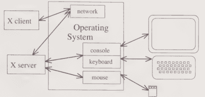

图 3.4：客户端/服务器/系统交互

### 3.2.2 X 服务器

当服务器启动时，它接管控制台、键盘和鼠标，并等待通过网络收到的命令，以便显示内容或报告事件。在 Linux 中，服务器将显示设备的内存直接映射到服务器的地址空间。这种有些不寻常的设备访问方式是满足相当高的性能访问需求所必需的。

服务器被动地等待客户端请求。它不需要响应来自所有来源的请求。可以配置为仅响应来自特定主机的请求，或仅响应那些在建立连接时提供了某个授权名称和数据的请求。一种当前的授权方案使用“魔数 cookie”（magic cookie），即由服务器生成并传递给授权客户端的长随机生成二进制密码，通过显示管理器进行传递。

在单个工作站或个人计算机的情况下，客户端和服务器进程驻留在同一台机器上，但它们保留其独立性。这种独立性意味着当该系统连接到网络时，它突然获得了为整个网络中的客户端提供服务的能力。

显示区域可以包含许多重叠的窗口。当鼠标移动时，服务器会移动位于最顶层的光标。X 窗口系统的模型基于这样的想法：事件（如鼠标移动、按钮按下或按键输入）从活动点处的光标掉落，穿过这个窗口堆栈。每个窗口都由一个客户端进程支持，该进程最终执行一个查找事件的循环。如果事件与该窗口（客户端）无关，它会被传递给下一个较低的窗口。不需要的（或未识别的）事件会落到根窗口，在那里被处理。

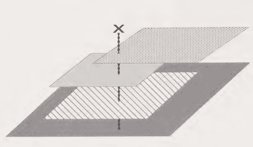

图 3.5：窗口捕获 X 事件

#### X 协议

服务器和客户端通过一个协议相互保护，该协议指定了发送到服务器和从服务器接收的消息。消息类型可以分为十四类：

- 颜色和颜色图
- 光标
- 绘制图形
- 事件
- 字体和文本
- 图形上下文
- 图像
- 客户端间通信
- 键盘和指针
- 安全性
- 窗口特性
- 客户端对窗口的操作
- 窗口管理器对窗口的操作
- 其他

### 3.2.3 窗口管理器

让每个客户端进程在窗口打开后跟踪对窗口可以执行的所有操作，将是一个很大的麻烦。在不同的所有客户端中复制此功能没有太大意义。最好将这项任务留给一个专门的单一客户端。

通常有一个被称为窗口管理器的客户端，它接管根窗口（与整个显示区链接的窗口）并控制其他窗口的大小和位置。由于根窗口是最底层的窗口，所有未处理的事件最终都会发送给窗口管理器。

例如，当按住 ALT 键并点击右键时，会导致事件穿透任何 `xterm` 窗口到达根窗口。我的窗口管理器 `ovlwm` 会弹出菜单响应，给我机会移动 `xterm` 窗口、将其最小化、将其推到底部、刷新它，或停止显示该窗口。其他窗口管理器可能会忽略此事件。

可以没有窗口管理器而使用 X，但这样做非常不方便。如果没有重新定位、调整大小和最小化窗口的能力，用户将完全受限于每个窗口最初打开时提供的提示。

窗口还可以显示命令栏或支持下拉菜单，用于启动应用程序。

各种窗口管理器的显著特性包括：

- **`fvwm`** 轻量级（或简朴）虚拟窗口管理器（由 Robert Nation 从 `twm` 衍生而来）
    - 显示调整大小——是
    - 调整大小方式——拖动角落
    - 移动方式——拖动侧边或标题栏
    - 3-D 边框——是
- **`twm`** Tab（或 Tom's）窗口管理器（由 Evans and Sutherland 的 Tom LaStrange 开发）
    - 显示调整大小——是
    - 调整大小方式——点击图标并推动侧边或角落
    - 移动方式——拖动标题栏
    - 3-D 边框——否
- **`ctwm`** `twm` 的扩展，具有虚拟工作区，以及类 motif 外观和感觉的选项
- **`olwm`** 开放外观窗口管理器（源自 Sun Microsystems）
- **`olvwm`** 开放外观虚拟窗口管理器（扩展 `olwm`）
    - 显示调整大小——否
    - 调整大小方式——拖动角落
    - 移动方式——拖动侧边

`gwm` 因其可扩展性被称为窗口管理器的 EMACS

但这个列表不可能完全，因为几乎所有这些功能都可以通过更改相应的配置文件进行重新配置。这些配置文件通常是三元组的集合：用户操作、上下文和结果。例如，当指针位于窗口标题栏上时按下鼠标左键，会导致该窗口提升到顶部；或者，当指针位于 `xterm` 窗口内时按下鼠标右键并按住控制键，会显示一个字体选择窗口。（在后一种情况下，该配置是特定于 X 终端模拟的，而非窗口管理器。）

### 3.2.4 文件管理器

最热门的图形用户界面应用程序之一是文件管理器。该程序减少了使用命令行解释器的需求，因为它允许通过单击图标或将一个文件的图标拖动到另一个图标上来启动程序。

Linux 附带的一个工具是 `xfm`，一个由 Simon Marlow、Albert Graef 和其他人在五年多时间里开发的文件管理器。Graef 写道：

> 这是一个使用 X 工具包编写的强大文件和应用管理程序。它包含您在文件管理器中通常期望的所有功能——在多个窗口中浏览目录树，并通过简单的鼠标操作移动、复制或删除文件。当显示的目录内容更改时，目录显示会在固定间隔自动更新。集成的应用管理器允许您通过拖放图标从文件管理器将文件加载到您最喜欢的应用程序中。它也可以用作“搁架”，您可以将当前正在处理的文件和目录放置在上面。针对应用文件的特殊 LOAD 操作使您可以管理不同的应用程序组。
>
> 用户可定义的文件类型允许您指定在双击文件或拖放文件时执行的命令
>
> 其他文件。该命令还可以提示用户输入所需的参数。`xfm` 使配置特定类型的操作变得轻而易举，例如，用一组选定的文件替换压缩 tar 归档的内容。发行版中包含许多相应的示例，甚至包括一个功能完备的回收站功能。最后但同样重要的是，当用户打开和关闭相应目录（挂载点）时，`xfm` 可以自动挂载和卸载软盘等专用设备。因此，如果您只是想将文件在硬盘和软驱之间复制，就无需再摆弄 `mount` 或 `mtools` 命令了[21]。

### 3.2.5 启动

用户可以显式启动 X 服务器和客户端，这样做也很有教学意义。如果在控制台上登录到 Linux 后输入命令 `X`，屏幕会闪烁一下，随后显示一个背景，光标（或指针）将是一个单独的 X。

这相当无聊，因为直到启动一个客户端之前，你只能在屏幕上移动指针。

如果你可以从另一个会话访问系统，你可以启动一个或多个客户端。然后 X 就变得有用起来，特别是当其中一个客户端是窗口管理器时。

启动 X 还有更简单的方法。`xinit` 是一个用于启动 X 服务器并运行客户端程序或启动脚本的程序。默认情况下，它启动用户搜索路径中名为 `X` 的服务器程序，然后在用户的主目录中查找并执行名为 `.xinitrc` 的脚本。（注意文件名的前导“。”。）

如果未找到脚本，`xinit` 将在用户的搜索路径中启动一个名为 `xterm` 的客户端程序。（`xterm` 是一个终端模拟器程序，通常打开一个宽 80 字符、深 24 行的窗口。）默认情况下，`xterm` 启动一个用户 shell，可用于发出命令以加载资源数据库、初始化窗口管理器、启动其他窗口等。

`.xinitrc` 脚本包含启动多个进程（如 `xterm` 会话）在后台的命令，并以在前台启动窗口管理器的命令结束。最后一条命令在前台执行，是因为当 `.xinitrc` 文件（或替代的 `xterm` 会话）结束时，`xinit` 程序会终止服务器。由于最后一条命令在前台执行，`.xinitrc` 直到最后一条命令结束才会完成。

#### 显示管理器

迄今为止的所有示例都假设用户已经登录到系统。也可以在系统引导时启动 X 服务器。在这种情况下，系统的行为很像 X 终端。

显示管理器用于管理一个或多个 X 终端（不提供额外计算资源的独立 X 服务器）或通用 X 服务器。可以将其视为一个超级窗口管理器，它不仅控制单个服务器上的窗口，还确保服务器正在运行，并且当服务器未被使用时存在登录窗口。

### 3.2.6 资源

X 程序可以通过数亿种（10$^{largenumber}$）不同的方式进行定制，这使得以任何可靠的方式记住并输入选项变得困难。

与大多数 Linux 程序一样，X 程序可以使用命令行选项和环境变量来修改其操作。另一种机制，即资源列表，提供了更便捷的操作方式。

虽然许多 X 实用程序会扫描配置文件以定位资源定义，但 X 将配置文件的概念扩展为一种通用数据库，所有 X 程序都可以查询该数据库。


任何 X 实用程序都可以通过库函数向 X 服务器发送查询，从而使用数据库来定位必要的属性。回复是在数据库中找到的“最佳匹配”。（`xrdp` 程序用于向 X 服务器加载初始值。`editres` 和 `appres` 程序可用于更改或显示与某个程序关联的资源。）

资源定义的形式如下：

`name : value`

其中 “`name`” 的形式相当复杂

`object SEP subobject [SEP subobject]* SEP attribute`

其中 `SEP` 是 “`.`” 或 “`*`”。

资源名称的每个组件，即对象和子对象，要么指代这些类的类，要么指代这些类的实例。类名称指代对象或子对象的类，如按钮或颜色，而实例名称指代特定的对象或子对象，如删除按钮或边框颜色。按照惯例，类名称以大写开头，实例名称以小写开头。当使用 “`.`” 分隔对象时，该资源被称为紧密绑定。这意味着扫描数据库时需要完全匹配。当使用 “`*`” 分隔对象时，该资源被称为松散绑定。这样的资源将作为响应于不完全匹配的查询的回复被提供。

这两类区分（类与实例，松散与紧密）用于确定在响应查询时返回哪个匹配的资源。四种（或更多）可能的资源名称根据以下规则进行选择：

- 实例名称优先于类名称
- 紧密绑定优先于松散绑定

这种选择层次结构允许用户指定一般特征，例如文本字体应为 helvetica，然后用更局部化的特征覆盖它们，例如菜单字体应为 Times Roman。

一个令人失望的是，无法确切确定给定的 X 程序使用了哪些资源。此外，X 程序在配置文件中发现的资源不会被加载到数据库中。这使得确定系统中实际发生的情况变得更加困难。

### 3.2.7 字体

位图显示为我们带来了新的可能性，也带来了新的问题。过去，字符是由硬件定义的。现在，它们是由文件中的表格定义的。许多资源类别之一涉及用于窗口不同部分的字体。已定义了一个复杂的架构，允许客户端（用户应用程序）以所需的任何精度指定所需的字体。

通过 X 协议，服务器将告知客户端其是否能够满足客户端使用特定字体进行显示的要求。

### 3.2.8 键盘映射

X 的另一个极具灵活性的领域是按键到任意字符的映射。虽然普通键盘大约有一百个键，但通过使用不同的 SHIFT、CONTROL 和 ALT 键的组合，可以创建多倍于此的独立字符。

这种将键与含义绑定的灵活机制允许应用程序设计者依赖大量的专用键。

# 第 4 章

## 系统内核需求

第 1 章列出了 Linux 拥有的许多特性，第 2 章指出了它的一些前身，第 3 章探讨了用户如何与 Linux 交互。在本章中，我们将制定系统内核的需求列表。可以说，这是一份我们对系统内核期望之处的检查清单。从广义上讲，系统内核必须最大化处理器可用性，保护用户免受事故和攻击，并提供交互式响应和后台处理。我们可以通过追溯我们所谓的“系统内核”的发展来细化其中一些需求，并通过指出不同系统的不足之处来细化其余需求。

说早期的计算机在操作上不受欢迎，这是一种巨大的轻描淡写。除了体积巨大、存储空间小、速度适中且可靠性低等问题之外，它们仍然存在大量的架构缺陷。由于逻辑器件的高成本，它们甚至缺乏执行乘法等常见操作的指令。操作员不得不通过前面板开关加载单个内存字，并在显示器上以位或数字串的形式读取结果。

更好的输入/输出设备很快出现了，但更重要的是，设计人员很快意识到计算机本身可以用来使其操作更用户友好。1947 年，艾伦·图灵写道：“它绝不会成为一个累赘，因为任何完全机械化的过程都可以交给机器本身处理[22]。”

虽然计算机硬件在设计上是固定的，但系统可以通过添加支持软件来扩展。如果计算机无法执行乘法运算，程序员可以调用子程序来执行乘法。如果穿孔卡片需要复杂的时序控制，程序员可以调用使用正确延迟的子程序。

这些专门的支持子程序的集合演变成了我们现在所称的运行时库和系统内核。有些子程序在编译过程中会与应用程序绑定，有些则在程序加载到内存时绑定，还有些在每个子程序被调用时绑定，或者在每个子程序调用点绑定。

### 4.1 调度

运行时库加上一个简单的程序加载器，构成了早期系统内核的全部范围。硬件被设计为从卡片输入斗（hopper）读取一张卡片到固定内存位置，并将控制权转移到该位置。前几张卡片包含程序加载器和运行时库。用户程序紧随其后。当用户程序执行完毕，系统会停止，然后加载下一个用户程序。

一个适度的设计变更让程序加载器负责从输入流（读卡器或磁带驱动器）中一个接一个地加载作业、执行它们并继续下一个作业。只要卡片输入斗或磁带驱动器中有数据，系统就会忙于执行有用的工作。

这一变化是操作系统演化的起点。在此之前，运行时库中的支持代码旨在辅助单个程序。在此之后，调度程序中的支持代码旨在辅助所有程序。

不幸的是，输入输出（I/O）操作通常比处理器慢得多。因此，当系统等待 I/O 完成时，计算逻辑处于空闲状态——而在执行计算时，I/O 机制处于空闲状态。图 4.1a 展示了作业如何在计算和 I/O 执行之间交替。当处理器启动 I/O 时，它使用轮询循环来确定 I/O 何时完成。轮询循环是一个“你完成了吗？”——“没有”——“你完成了吗？”——“没有”——“你完成了吗？”——“没有”的循环，直到外设最终回应“是”，此时可以启动更多 I/O 或继续计算。真正高明的代码可以使用“你完成了吗？”——“没有”——做有用的工作——“你完成了吗？”——“没有”——做有用的工作——“你完成了吗？”——“没有”——做有用的工作这样的循环，但仍很难充分利用系统。

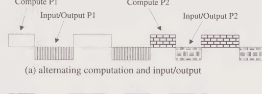


图 4.1：两个进程的重叠 I/O

中断的出现使得在 I/O 进行时可以进行其他有用的工作。图 4.1b 展示了具有重叠计算和 I/O 的相同作业。用户进程只需发起 I/O，中断服务例程（ISR）即可完成它。用户进程仅在即将消费已订购输入的数据时检查状态标志。

你会注意到，不可能实现完全的重叠。当一个进程在启动输出后轻松地继续部分计算时，它无法在输入完成前处理其输入数据。

#### 4.1.1 多任务处理

由于用户无法始终安排在 I/O 进行时执行其他工作，后来的批处理操作系统版本被扩展以支持并发批处理作业。由于系统内核的一个设计目标是最大化处理器使用率，当活动作业必须等待 I/O 完成时，调度程序会在作业之间切换。图 4.1c 展示了如何重叠两个作业的执行以减少其总运行时间。在这个简单示例中，你可以看到计算和 I/O 几乎都是连续的。*协程* 和 *合作式多任务处理* 术语适用于一种方案，其中每个作业运行直到必须等待 I/O 完成（或认为已经获得了公平份额），然后控制权传递给另一个作业。

##### 合作式多任务处理

传统上，程序作为主程序控制的子程序执行：一个接一个或并发，但始终相互独立。康威（Conway）引入了一个关键概念，即两个程序可以以合作交替的方式工作。“……协程是处于同一水平的子程序，每个都表现得好像它是主程序，但实际上没有主程序”[10]1。

初始的并行性通常由父例程（P1）到子例程（P2）的子程序调用建立（如图 4.2 中的第一个深色箭头所示）。此后，程序执行 *恢复*（resume）语句（图中浅色箭头所示）而不是某种形式的 *返回*（return）语句，以将控制权交还给另一个例程。该语句保留程序状态，以便日后从中断处继续。图 5.5 中的蹦床代码（trampoline code）提供了一些关于 *恢复* 语句功能的思路。每次执行 *恢复* 语句时，控制在一个程序之间反弹。在最后，子进程发出 *返回* 语句（图中第二个深色箭头）返回父进程，而不保留其自身状态。

父例程 → P1

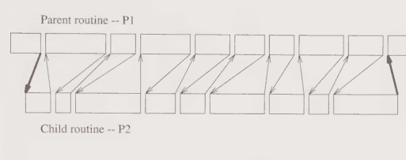

图 4.2：交换控制权的协程

在大多数使用协程一词的场景中，隐含的想法是这些程序通过交换数据共同解决某个问题。这种结合的概念现在众所周知，名为 *生产者–消费者*（producer–consumer），即一个程序生成数据放入缓冲区，另一个程序从缓冲区消费数据。

##### 抢占式多任务处理

一批作业，如果不在乎某个作业被延迟片刻，它们是合作式多任务处理的完美候选对象。但如果期望作业提供某种交互式响应，系统就必须从一个作业切换到下一个，即使作业没有请求切换。这种 *抢占式多任务处理* 允许每个用户的程序运行，直到它等待某些 I/O 完成或“时间片”（time quantum）到期。计算密集型程序 P1 可以如图 4.3a 所示进行切片。图 4.3b 展示了这些切片如何与程序 P2 和 P3 的切片交错。这种抢占式上下文切换存在开销（显示为每个切片之间的深色间隔），这在合作式多任务处理或简单的批处理操作系统中不会出现。

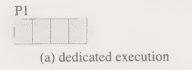

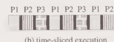


图 4.3c：时间片计算

对比图 4.3a 和图 4.3c 可以看出，即使 P1 是系统上唯一的作业，每个时间片的开销也会导致其耗时更长。这种开销是获得交互式响应便利所付出的代价。（如果程序 P1、P2 和 P3 不是计算密集型的，它们的切片大小将在此处显示的最大值内变化。也可能处理器空闲，当所有四个程序都在等待其 I/O 完成时。我从示例中省略了这些复杂情况。）

选择合适的时间片并不容易。时间片过大，交互性能表现显得不稳定；时间片过小，则会产生过多的开销。

由于处理器可能被过载，导致系统开销消耗其所有处理能力，高级调度器决策可能会限制系统上的用户或用户程序数量。

这两个性能调优问题——短期和长期调度——将在 5.2.4 节中讨论。

### 4.1.2 优先级调度

已设计了多种调度算法，其中大多数都具有一定程度的进程优先级概念。这允许系统或用户将某个进程指定为“非常重要”或“非关键”。第 5.2.4 节将更详细地探讨这一主题。

### 4.1.3 实时调度

实时调度的任何正式定义都会提到“严格满足截止时间的要求”，但这其实是不够的。考虑工资会计系统——大家都同意它不是实时的，但你最好按时发出那些支票！定义中似乎有一个隐含的，或者至少很少被提及的元素：“截止时间通常在不到一秒的未来”。

实时调度有三种类型。`硬实时`（Hard real-time）系统，如用于飞机飞行控制软件的系统，设计目标是确保任何进程都不不当阻塞另一个进程。其中一部分可以通过严格的（且快速的）基于优先级的调度实现，但通常也依赖于对进程执行时间的严格界限。

有些系统甚至避免使用中断，因为可能会发生持续毫秒级的意外延迟。相反，系统在轮询循环中运行，将每个进程作为协程调用（参见第 4.1.1 节），且每个进程必须在固定时间内返回。其中一些进程执行计算，另一些则负责外设 I/O。

`软实时`（Soft real-time）系统可以容忍适度的延迟。这类系统的一个例子是“高科技住宅”，其窗户百叶窗根据时间、阳光和室温做出反应，以及依赖湿度传感器、时钟和运动探测器的喷淋系统（以免毁掉草坪派对）。如果某些操作延迟了一秒，甚至一分钟，也不会造成危害。

由于软实时系统可以承受上下文切换开销，因此可以有较低优先级的进程执行非实时工作。这意味着这些系统通常具有磁盘存储、网络连接、交互式用户命令加载处理，以及（令人咋舌的）`虚拟`内存。

虚拟内存对实时处理而言是大忌，因为当进程引用缺失页面时会被中断。这些中断被称为页面错误（page faults），它们会延迟进程的执行，直到内核将数据从磁盘移动到内存中为止。在软实时系统中，实时任务会被锁定在物理内存中，以避免因页面错误导致的延迟。只有那些未被指定为“实时”的进程才会受到分页带来的延迟影响。有关虚拟内存的更多讨论，请参阅第 4.4.4 节。

同理，硬实时系统可能允许较低优先级的任务运行，前提是该系统能够及时将控制权强制交还给关键任务，以确保其截止期限得以满足。

如果分辨率和后果未被提及，剩下的就只有`炒作`了。除非给出关于上下文切换时间、中断延迟、优先级调度算法和执行速度的详细描述，否则你无法真正指望获得实时行为。请警惕此类系统。

### 4.1.4 作为实时系统的 Linux

有朝一日，Linux 可能会声称自己是一个实时系统。已经开发了若干特性以支持这一目标。内存锁定和调度器控制相关的系统调用已被添加到开发版内核中。

这些增强意味着 Linux 正在迅速接近软实时支持的级别，但仍有一些棘手的问题有待解决。Markus Kulm¹ 警告称，进程不会从中断中直接唤醒，而仅仅是被置为可运行状态，即在中断完成后，它可能不会立即运行。他还警告说，某些中断处理程序可能需要重写，并且内核中有一些位置会在较长的时间间隔内禁用中断。

#### 4.2 同步

在抢占式多任务处理中，进程随时可能被中断，控制权可能会移交给另一个进程。这很容易导致多部分操作被破坏的情况。考虑两个并发执行的进程正在读写文件系统。在图 4.4 中，我们可以看到，在进程 2 执行其 I/O 命令之前，进程 1 的 I/O 命令尚未完成。这使得当进程 1 恢复其 I/O 命令时，磁盘处于错误的位置。在此示例中，`寻址与读取`（seek & read）和`寻址与写入`（seek & write）操作是需要像不可分割（原子）那样执行的代码序列。

| 时间 | 进程 1 | 进程 2 |
| :--- | :--- | :--- |
| 000 | 寻址第 23 块 | |
| 001 | | 寻址第 47 块 |
| 002 | | 读取 2 个块 |
| 003 | 写入 3 个块 | |

图 4.4：损坏的 I/O 操作

另一个经典例子来自事务处理领域。想象这样一个场景：Alice 和 Bob 在同一时刻分别走向不同的银行柜员。Alice 存入 100 美元，而 Bob 从他们的联名账户中取出 100 美元。一种简单的银行操作可能会遵循图 4.5 到 4.8 中所示的任何步骤。只有在后两种情况下，读-改-写序列才作为原子操作执行，即没有中断。

| 时间 | Alice 的柜员 | Bob 的柜员 |
| :--- | :--- | :--- |
| 10:30:45 | 发现余额为 500 美元 | 发现余额为 500 美元 |
| 10:30:46 | 增加 100 美元 | 减去 100 美元 |
| 10:30:47 | 存储余额为 600 美元 | |
| 10:30:48 | | 存储余额为 400 美元 |

图 4.5：倒霉的 Alice 和 Bob！

| 时间 | Alice 的柜员 | Bob 的柜员 |
| :--- | :--- | :--- |
| 10:30:45 | 发现余额为 500 美元 | 发现余额为 500 美元 |
| 10:30:46 | 增加 100 美元 | 减去 100 美元 |
| 10:30:47 | | 存储余额为 400 美元 |
| 10:30:48 | 存储余额为 600 美元 | |

图 4.6：幸运的 Alice 和 Bob！

| 时间 | Alice 的柜员 | Bob 的柜员 |
| :--- | :--- | :--- |
| 10:30:45 | 发现余额为 500 美元 | |
| 10:30:46 | 增加 100 美元 | |
| 10:30:47 | 存储余额为 600 美元 | |
| 10:30:48 | | 发现余额为 600 美元 |
| 10:30:49 | | 减去 100 美元 |
| 10:30:50 | | 存储余额为 500 美元 |

图 4.7：Alice、Bob 与银行达成一致

| 时间 | Alice 的柜员 | Bob 的柜员 |
| :--- | :--- | :--- |
| 10:30:45 | 发现余额为 500 美元 | |
| 10:30:46 | | 减去 100 美元 |
| 10:30:48 | 存储余额为 400 美元 | 发现余额为 400 美元 |
| 10:30:48 | | |
| 10:30:49 | | 增加 100 美元 |
| 10:30:50 | | 存储余额为 500 美元 |

图 4.8：Alice 和 Bob 对此也不感到惊讶

| 时间 | Alice 的柜员 | Bob 的柜员 | Carol 的柜员 |
| :--- | :--- | :--- | :--- |
| 10:30:45 | 发现 500 美元余额 | | |
| 10:30:46 | 增加 100 美元 | | |
| 10:30:47 | 存储 600 美元余额 | | |
| 10:30:48 | | 等待 Alice 的柜员 | |
| 10:30:49 | 发现 600 美元余额 | | 300 美元余额 |
| 10:30:50 | 减去 100 美元 | | 减去 50 美元 |
| 10:30:51 | | | 存储 250 美元余额 |
| 10:30:52 | | 存储 500 美元余额 | |

图 4.9：Alice、Bob 和 Carol 都没有感到惊讶

我们拥有的是操纵共享数据的代码`临界区`（critical sections）。只要这些区域在时间上是`互斥`执行的，共享数据就不会受到损害。在第 5.2.4 节中，我们将了解这是如何实现的。

#### 4.3 外设管理

调度可以描述为“处理器管理”。在前几节的例子中，重点在于保持处理器繁忙并防止进程相互干扰。系统内核还必须确保外设被轻松且有效地使用。这部分职责可以下放给运行时库，但归根结底系统内核参与其中。第 5.3 节讨论了一些实现细节。


最重要的设计决策之一是边界（系统内核与运行时库之间）应放在哪里。

## 4.3.1 共享文件系统

最常见的设计是让系统内核处理文件名到目录项和磁盘块地址的映射。这种设计使得进程（及其用户）更容易共享文件系统空间。

例如，在我撰写这本书时，我有多个进程在运行，每个进程都在操纵各种源文件和结果文件。一个是用于撰写文本的终端会话，另一个是用于编辑参考文献的终端会话，另一个进程用于查看 PostScript 输出，还有一个用于查看 HTML 输出。这些进程彼此独立，但它们都能访问共享的文件系统。

这种共享可以更进一步，进程不仅相互独立，而且由不同的用户运行。共享文件系统允许 David 共享他的编译器，Ellen 共享她的编辑器，Francis 提供一个会计软件包，等等。他们只需要设置访问权限，允许其他人运行他们的程序即可。

共享文件系统的设计为用户进程之间的交互提供了许多机会。一些实现将整个文件系统视为单一的临界区，但更好的系统则以更细粒度设计。其益处通常被认为值得付出额外的努力。

### 文件系统的元素

将文件系统与裸磁盘区分开来的是它对数据的结构化处理，即它跟踪多个文件和目录的位置。

**文件——最基本的文件系统** 最基本的文件系统将磁盘划分为均匀的块，用户通过索引来识别它们。（这种原始系统实际上在遥远的过去曾被使用过。）

**目录——更大的文件系统** 显然，这导致了目录的概念，这是一种通过名称而非数字来识别文件的机制。最简单的组织方式是具有固定长度目录项的固定长度目录。目录项包含文件名、起始位置和大小。文件数据存储在连续的磁盘块中。磁盘上的空闲空间可以通过特殊的目录项或通过排除法来识别。图 4.10 给出了这一结构的大致草图。

| 目录 | 文件 1 | 未使用 | 文件 3 |
| :--- | :--- | :--- | :--- |
| 文件 3 | 未使用 | 文件 4 | 文件 6 |
| 文件 6 | 文件 5 | 未使用 | 文件 2 | 未使用 |


创建文件时，用户必须指定其最大大小，以便系统能够找到足够大的空闲空间。当文件关闭时，系统通过记录最终大小并可能为未使用的部分创建空闲空间条目来完成记账工作。由于大多数文件的长度难以预判，最大大小并不能真正反映文件的最终大小。随着文件空间变得碎片化，寻找文件空间也变得越来越困难。

**动态分配——支持扩展的文件** 这些缺点不可避免地导致了分配以某种方式相互链接的文件延伸（extents）的文件系统。在这些系统中，主要有两种方法：一种是在每个延伸中放置指向下一个延伸的指针，另一种是将所有指针放在目录中。（如图 4.11 所示。）前一种方法具备较少令人满意的特点：它不限制文件中的部分数量，而且目录项不需要重新读取以定位额外的数据块。系统可以通过链接另一个延伸来轻松扩展文件。

后一种方法支持对文件数据的随机访问，更容易验证文件系统完整性，并且在需要时有机会将数据存储定位在连续位置。这是大多数常用系统

## 4.3.1 文件系统

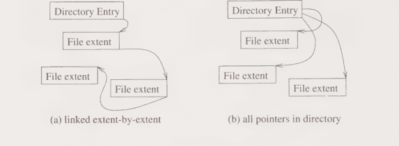

图 4.11：改进的文件系统

操作系统如今。Linux 使用后一种方法的变体形式，这也避免了文件使用的 extent 数量存在任何实际限制。

### 层级——非扁平文件系统

迄今为止描述的系统仅包含一个目录。下一个增强级别是构建层级文件系统。这意味着存在多个目录，其中目录既包含普通文件，也包含下级目录。

### 访问控制——所有权与权限

在某个阶段，文件所有权的概念开始出现。有些系统严格限制文件访问仅限于所有者，但其他系统增加了可以通过某些权限机制控制对其他用户文件的访问这一概念。

### 结构——文件类型

一些系统发现通过类型识别文件是有用的。这种类型化允许系统以不同方式操作不同的文件。例如，虽然 Unix 只有一种可以保存数据的文件类型，但其他类似文件的实体确实存在。除了普通文件外，大多数 Unix 系统中还存在目录、字符设备、块设备、命名管道和符号链接。

其他系统甚至为可执行文件、随机访问（文本）文件、索引（数据库）文件、顺序（打印机输出）文件等设置了不同的文件类型。

### 对不同文件系统的支持

一些系统内核可以同时支持不同的文件系统结构。Linux 就是一个这样的系统内核，也许比其他任何系统都更为如此。

除了其原生文件系统 `ext2` 以及报告内核数据的 `/proc` 文件系统外，Linux 还支持传统的文件系统，例如用于 CD-ROM 的 `ISO 9660` 格式、MS-DOS 使用的 `FAT-16` 文件系统、Sun Microsystems 开发的网络文件系统（`NFS`），以及加密文件系统。此外，允许用户在用户进程中实现内核之外的文件系统。

### `/proc` 文件系统

`/proc` 文件系统源于向用户程序报告内核数据的需求。在 `/proc` 文件系统出现之前，程序必须窥视内核内存（该内存被映射为设备 `/dev/kmem`），并使用内核符号表来解码内容。这已被模拟文件系统的访问子程序所取代，这些子程序向任何用户进程呈现为一个文件系统。尽管数据来自内核结构而非磁盘存储，但用户程序看到的是一以文件形式呈现的结构化文本。例如，命令 `cat /proc/version` 会显示当前运行内核的版本号和构建时间。

该文件所在系统正在不断进行升级。近期的更改使得在此文件系统中添加新条目变得更加容易。一个明显的变化是，现在 `root` 用户可以写入这些条目中的一些，从而导致内核内部发生变化。

### Windows 95 文件系统

Windows 95 使用的文件系统是 MS-DOS 使用的 `FAT-16` 文件系统的一个适度扩展。最重要的变化是增加了对长文件名的支持。`vfat` 文件系统⁴为 Linux 提供了访问包含 Windows 95 文件系统分区的功能。（这可能会很快被纳入标准内核发布中。）

### 网络文件系统

文件不一定需要驻留在本地系统上；它们可以位于其他地方。第 5.3.4 节讨论了此类扩展的问题及实现。

### 加密文件系统

两个独立的 Linux 项目增加了对加密文件系统的支持。这样的系统以加密形式保存所有文件，在某些情况下还包括目录。当挂载文件系统时，一个额外参数提供密码。此密码可用于保护免受有人检查转储磁带或原始磁盘驱动器。

### 用户文件系统

对不同文件系统支持的最极致例子是*用户文件系统*。Linux 软件地图提供了以下描述：

> Userfs 允许普通用户进程实现一个 Linux 文件系统。这样的文件系统可以由普通用户挂载，且与传统文件系统无法区分。因为它们是普通进程，所以可以访问所有正常的系统设施，从而拥有内核驻留文件系统所不具备的特性。

## 4.3.2 虚拟机

文件系统设计中的一种不寻常的变体将磁盘的分区与文件系统结构的操作隔离开来。

想象一个系统，其中所有对硬件寄存器等引用都被系统捕获并模拟。其他所有指令在基础硬件上正常运行，就像往常一样。这提供了一种执行环境，在这种环境中，程序无法判断它是在基础硬件上运行还是在模拟环境中运行。

每个正在运行的程序都被说成是在虚拟机上执行。因此，虚拟机是一台机器的模拟……由该机器本身！

通过这种方式，可以将文件系统与其余系统内核隔离开来。实际的磁盘被划分为若干区域，每个虚拟机对应一个区域，并且每次读写操作都会翻译磁盘块地址。如 图 4.4 中描述的同步问题此时成为系统内核的主要关注点，并从文件系统代码中消失。（当然，这种分区和地址映射方法很快就会演变为一个专门的文件系统。）

在这种情况下，将整个文件系统管理交给运行时库是合理的。用户打开文件的请求被转化为读取一定数量磁盘块的命令，然后这些命令被解释为目录信息和磁盘上的数据引用。关于打开文件、字符缓冲等的信息维护在进程的内存空间中。当文件关闭时，运行时库可以更新关于该文件的本地信息并将其写回磁盘。系统内核仅限于读取和写入磁盘上特定数据块。

虚拟机还使得在测试和使用新的系统内核的同时，其他用户能够共享硬件，仿佛他们各自拥有一台完整的机器。

第 5.2.5 节提供了虚拟机的其他一些用途。

## 4.4 内存管理

当系统不仅仅是一个程序加载器和运行时库时，内存管理变得简单，不需要特殊的硬件支持。在多任务处理中，内存变成了又一项必须由系统内核管理的资源。内存管理中有三个主要问题：

- 内存分配
- 重定位
- 保护

我们将看看随着内存管理技术随时间的发展，这些问题是如何被解决的。

### 4.4.1 非映射式

主内存根据其用途进行分区，例如用于缓冲区、系统内核代码或用户程序。程序总是加载到一个众所周知的位置⁵，并且它们可以访问所有的内存。图 4.12a 显示了内存如何被划分为各个元素。

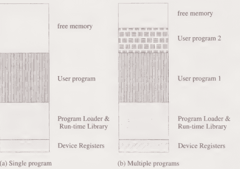

图 4.12：非映射内存

虽然这种系统易于实现，但它有缺点——最主要是同时运行多个程序的困难。但如果有足够的连续内存，第二个、第三个、第四个等程序可以加载到剩余的免费内存中，如图 4.12b 所示。

只要程序不需要增长（或者为每个程序预分配了足够的内存），多个进程就可以和谐地运行。


过了一段时间，内存将会变得碎片化，即免费空间不再全部位于一个连续的地方。图 4.13 显示了在几个步骤之后，免费空间如何碎片化为四个较小的块。每次启动一个进程时，它都被放置在能容纳它的最低地址空间中。当它结束时，空间被回收，但其他进程没有被移动。因此，可能会出现这种情况：一个程序需要的内存少于系统中的总免费空间，但由于免费空间不连续，它无法放入。

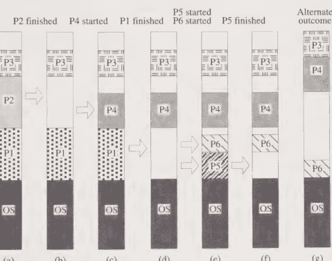

图 4.13：内存碎片化

> ⁵ 这个位置无需让程序知晓，因为加载器可以在加载程序时重新定位程序中的所有地址。可重定位可执行程序的格式更复杂，因为它必须包含所有需要重定位的位置的指针。

系统有可能执行*压缩*操作，但此类操作必须根据其成本和效益进行仔细评估。压缩会将一个或多个进程移动，使得所有空闲空间变得连续。这是一个昂贵的操作，因为在移动进程时必须停止这些进程，并且进程内部的所有地址都必须更改以指向新地址。

如果内存分配具有先见之明，最终可能会得到如图 4.13g 所示的分配结果。这在上述描述的“最低足够大空间”规则下是不可能发生的。事实上，不存在一种始终能产生最佳结果的通用规则。

### 内存覆盖

另一种针对非映射内存的扩展方法依赖于将程序划分为若干组件，例如：

- 公共部分
- 初始化部分
- 主例程
- 关闭部分

在开始时，仅加载公共组件。当程序启动时，初始化代码被加载到一个*覆盖*区域；当初始化完成后，主例程会覆盖初始化代码；当主例程完成后，关闭代码会覆盖主例程代码。在图 4.14 中可以直观地看到覆盖带来的好处，显然整个程序无法放入内存，但可以在需要时加载关键部分。

> 有些系统通过自动机制执行这种划分，而有些系统则要求程序员进行显式声明。

> 有些系统将覆盖操作作为子程序调用的一部分自动处理，而有些系统则需要显式的系统调用来加载覆盖段。

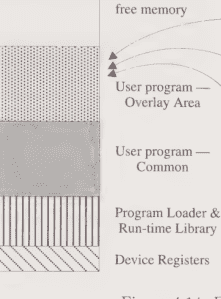

图 4.14：程序覆盖

### 映射

如果程序之间不合作，无论是出于恶意还是失误，它们可能会通过写入其他程序的空间而相互破坏。人们已开发出多种方法来提供基于硬件的保护。

这些方法大多依赖于从程序生成的*逻辑地址*到用于访问内存的*物理地址*的某种映射。当*逻辑地址*并非总是映射到某个*物理地址*时，它被称为*虚拟地址*。

### 基址与限址

如前所述，最简单的程序加载方式是加载到已知的基址。图 4.15 中概述的一种简单硬件机制，可以用来“欺骗”程序，使其表现得好像被加载到了不同的位置。这种重定位硬件依赖两个内部寄存器：`Base address`确定一块物理内存的基址，而`Boundary value`存储该块内存的大小。当处理器生成`逻辑地址`用于指令获取、数据存储、栈等时，硬件同时将该地址加到基址上，并与界限值进行比较。如果逻辑地址为正且未超出大小限制，则使用物理地址来访问内存。如果逻辑地址为负或过大，则内存访问被视为错误。

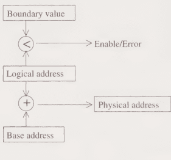

图 4.15：硬件内存映射

有了这种硬件，系统和程序对内存的看法就不同了。当有多个程序运行时，系统在切换程序时还必须更改基址和界限寄存器。如图 4.16a 所示，系统可以看到整个内存，但图 4.16b 和 4.16c 表明，用户程序只能看到从基址开始、大小由界限寄存器指定的那一部分——并且它们将这部分内存视为从位置 0 开始。

如果你已经注意到，用户程序现在无法直接访问系统内核或运行时库。这不是一个缺陷，因为存在特殊的指令，允许执行流从用户程序中的代码切换到系统内核中的代码。

### 分段内存（多基址与限址）

单一基址和界限系统的缺点在于，进程的所有内存必须位于物理内存的*连续*区域，并且进程的所有内存都是*同等可访问*的。

当处理器执行程序时，它实际上是为几种不同的用途引用内存。处理器可以通过使用不同的基址和界限寄存器组来访问独立的内存*段*，从而利用这一内存特性进行扩展。对于用户进程而言，指向内存的任意指针现在包含两个组成部分：段号用于确定基址和界限寄存器对以及段内偏移。图 4.17 展示了如何使用段 0 来寻址运行时库，段 1 用于寻址程序代码，段 2 用于寻址堆，段 3 用于寻址栈，以及假设性地段 4 可用于寻址与其他进程共享的内存等。

由于不同的内存段服务于不同的目的，因此对特定用途*限制访问*是合理的。也就是说，代码段可以允许获取指令执行，但不能将其作为数据读取；数据段可以限制为只读访问。

这种更精细的访问控制允许进程共享代码，而不用担心代码被破坏。协作的进程可以共享一些数据，而无需向其他进程授予对所有数据的完全访问权限。

在某些系统上，这一点已被推向极致，其中两个组成部分段号和偏移被视为一个单一对象，用于传递并作为指针使用。在这些系统中，段的数量可能相当大，例如每个数组可能都有一个段。

### 分页内存

分段内存提供了良好的访问控制，并且如果处理器直接使用由段号和偏移组成的指针，用户就可以获得一个巨大的地址空间。

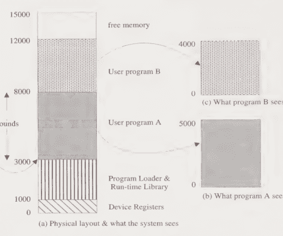

图 4.16：使用基址和界限寄存器映射内存

虽然分段内存比非映射内存或单一基址和界限重映射能更好地利用物理内存，但它仍然存在局限性，因为内存段的大小不容易更改。

图 4.13 中显示的内存碎片化问题并没有真正被硬件支持的分段内存解决。映射硬件只是将系统内核从在程序和数据加载到系统中时进行重定位打补丁的负担中解脱出来。尽管内存是通过映射硬件间接访问的，但每个段必须位于连续的内存中。这种对连续内存的要求也使得扩展内存段例如用于栈或堆内存的段变得非常困难。

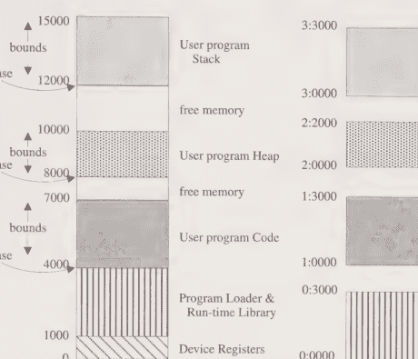

图 4.17：使用多段映射内存

这些问题都在分页内存系统中得到了解决。分页内存可以被视为分段内存的一种变体，其中内存引用由页号和偏移组成，而不是段号和偏移。由于所有页的大小都是相同的且相对较小，因此不需要验证偏移。然而，需要验证页号。

在图 4.18 中，逻辑地址的页号部分与一个限值进行比较，如果其在可接受范围内，则用于索引页表。第 N 个页表项包含一个页框号，当它与逻辑地址的偏移部分结合时，就成为物理内存中的地址。页表项中的额外位图中未显示可以指示该页的访问权限。

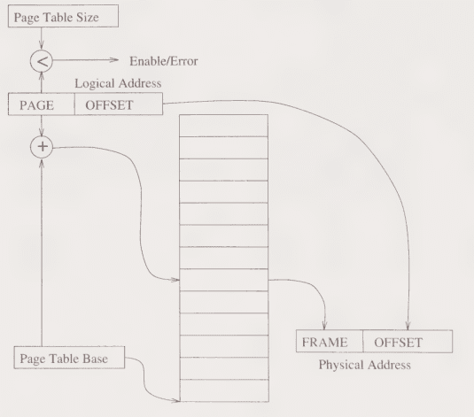

图 4.18：通过页表映射内存

分页内存系统的一个主要优点是，页不必映射到连续的物理内存。当新进程加载到内存中时，其页数所需的大小必须由相应数量的空闲页框满足，但这些页框不需要是连续的。

第 4.4.1 节中描述的*外部*内存碎片化是现已消失。分页内存系统会遭受*内部碎片*的影响，因为帧未必会被填满到底，但这种情况通常更可取。虽然外部内存碎片很容易使多达 30% 的内存变得不可用，但内部内存碎片仅限于 $\textit{进程数量} \times \textit{连续逻辑页数量} \times 0.5 \times \textit{页大小}$。

图 4.19 有一些有趣的细微之处。帧 **0** 中的全局数据是被共享的，因为进程 1 中的页 **C** 和进程 2 中的页 **J** 都指向它。帧 **i** 中的代码是被共享的，因为进程 1 中的页 **D** 和进程 2 中的页 **K** 都指向它。进程 1 中页 **E** 和 **F** 的代码映射到相邻的帧 **j** 和 **k**，而进程 2 中页 **L** 和 **M** 的代码映射到相邻的帧 **a** 和 **b**。最后，进程 2 中的页 **G** 没有帧来容纳其数据。有关共享页和未映射页的更多信息见 4.4.4 节。

**硬件支持** 细心的读者可能会注意到分页内存系统可能存在的缺点：每次内存引用似乎都会产生对页表项的另一次引用。一些系统，如 `DEC PDP-11`，将整个页表保存在寄存器中。这是可行的，因为 `PDP-11` 的地址空间很小 64 Kbytes，仅容纳八个页每个 8 Kbytes。严格来说，`PDP-11` 的内存管理是分页内存和分段内存的模拟。每个页也有一个有效的长度，就像前面提到的内存段一样。

更常见的做法是将页表存储在内存中，然后依赖保存在特殊*联想存储器*中的*转换后援缓冲器* `TLB`，它缓存了一部分页表项。联想存储器通过其内容的一部分进行寻址，在这种情况下是逻辑地址，以提供数值，在这种情况下是物理地址。图 4.20 展示了当生成逻辑地址时，页号会与 `TLB` 进行检查以寻找匹配项。如果找到匹配项，则使用该页表项。否则，页表项将从内存中的页表获取。

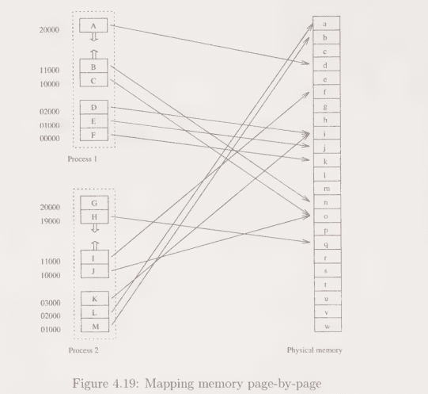

### 分段与分页

这两种映射方法可以结合使用，以享受两者的优势。系统可以通过使用内存分段来构建线性地址，然后对其进行分页，从而获得对访问的精细控制和内存的方便使用。图 4.21 展示了这种组合方式，但不包括限制检查和转换后援缓冲。


Intel 386、486 和 Pentium 及其类似处理器在 Linux 下以这种方式使用。486 与图 4.21 的区别在于，在不同情况下使用不同的段表，并且分页扫描有两层表，所有索引都会与限制进行检查，

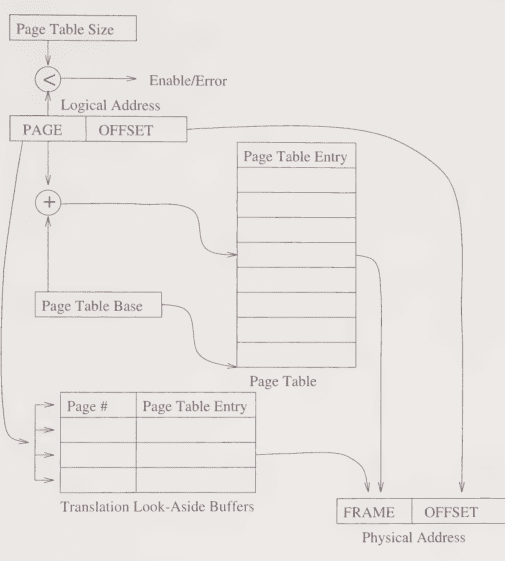

根据操作模式使用不同的段表，并使用几个缓存来辅助性能。更多细节见 5.4 节。

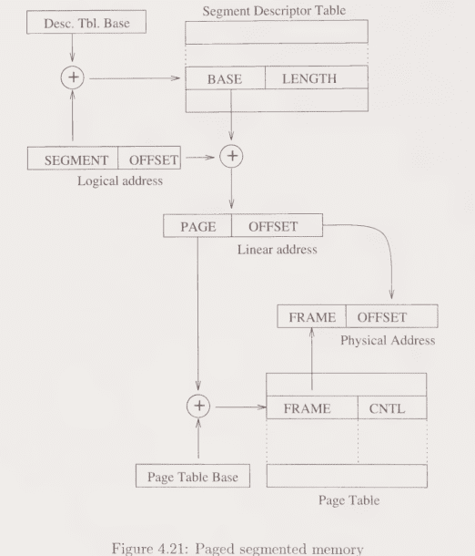

## 4.4.3 换入换出

经常出现内存不足以满足所有进程需求的情况。系统内核通过提供换入换出和/或虚拟内存来应对这一问题。

解决内存不足的一个简单方法是*换出*整个进程，即将其复制到特殊存储中。这种换入换出操作释放了内存，随后可以用来启动新程序或换入之前挂起的进程，即从特殊存储中复制它。这种特殊存储过去是较小的高速磁盘或鼓存储，但现在通常是普通磁盘的一个保留区域。

选择换出或换入的进程是长期调度决策的一部分。这种决策基于进程的优先级、截止时间、处理类别、外围设备访问等。这将在 5.2.4 节中进一步讨论。

仅提供换入换出的系统很容易发现自己大部分 I/O 带宽都花在保存和重新加载进程上，而处理器在等待某个进程加载时往往处于空闲状态。这种等待发生的原因是因为每次换入或换出操作都会移动*整个*进程。尽管如此，这种偶尔的等待通常比等待一个进程完成后再启动另一个进程要好。

## 4.4.4 虚拟内存

现在大多数系统都提供某种形式的*虚拟内存*，它与分页系统上的换入换出类似。区别在于它不会一次性换入换出整个进程。相反，单个页在需要时加载到内存中，当它们变得不活跃时则移回存储。甚至可能有些页永远不会加载到内存中。

虚拟内存需要额外的硬件支持，具体包括 (1) 图 4.20 中显示的页表需要在页表中的每个条目中至少增加一位来显示映射是有效/无效，以及 (2) 处理器必须能够暂停或中止并通过无效页进行引用的指令并重新启动。虽然第一部分很容易添加，但第二部分相当困难，尤其是在考虑用于从处理器中提取更高性能的技术背景下，例如指令超前、乱序执行等。几乎所有虚拟内存系统都与每个页相关联的额外状态位。其中一个称为*修改*位（或*脏*位），如果页被修改过，该位会自动设置。其余的称为*引用位*，用于设置以记录页的使用情况。

处理器将图 4.19 中进程 2 对页 **G** 的引用视为*页错误*。处理器停止该进程，直到该页可以映射到内存帧（通过从磁盘加载它）。在系统更新页表后，它将允许该进程恢复执行。

系统使用修改位和引用位来决定哪些帧应该写入磁盘，哪些帧应该保持驻留。

额外的位可用于控制对页的访问。例如，可以使用“只读”位来标记正在共享的代码页。

如果特殊存储中没有页映像，系统可能会中止用户进程，或者创建一个填充零的页。后者在需要更多栈或动态数据内存时很常见。

这将在 5.4.1 节中更详细地讨论。

### 4.5 安全性

任何多用户系统（以及任何谨慎的单用户系统）都有机制来限制进程可以执行的操作。这些机制必须保护免受以下侵害：

- 数据的不希望被访问
- 数据的不希望被破坏
- 服务拒绝
- 系统损坏
- 绕过记账

应该意识到，上述问题可能由错误同样容易地引起，就像恶意行为一样。因此，这些问题适当地属于所有系统的领域，而不仅仅是网络或多用户系统。

此外，应该意识到安全性最重要的是一种心态，而不是程序和流程的集合。用户和系统管理员的故意或不关心的行为可能会使安全性丧失。

话虽如此，我们现在可以讨论可用于保护系统的基本机制。最基本的，它们控制谁可以做什么。

#### 4.5.1 授权

概念上，授权可以用图 4.22 中显示的三维矩阵来描述。三个索引是主体、对象和操作。每个元素的值为“允许”或“拒绝”（或者可能是“产生异常信号”）。

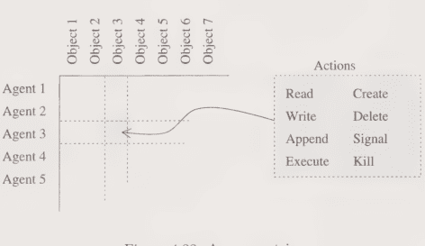

图 4.22：访问矩阵

在一种情况下，主体是进程，对象是文件和目录，操作是系统调用，如 *打开、读取、写入* 和 *创建*。

在另一种情况下，主体是进程，对象是进程的*状态*，操作是 *信号、等待* 和 *杀死*。

这个矩阵非常稀疏——部分原因是操作不适合对象，部分原因是并非所有主体都具有平等的权限。因此，系统通常会将矩阵划分为多个正交的兴趣区域，以减少存储需求。

例如，进程控制和文件访问是相互独立的。这导致新矩阵之一仅限于进程访问文件，如**图 4.23**所示。其他代理和目标已被排除在此矩阵之外。

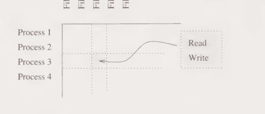

稀疏的访问矩阵可以在一个或多个维度上进行压缩。一种常见的方法是将其减少为按进程索引的单个维度。（我们实际上正在考虑**图 4.23**所示矩阵的单独行。）*能力列表*由文件列表以及可以在每个文件上执行的操作组成。**图 4.24**中的示例表明进程 2 可以读取文件 1，读取和写入文件 2 等。每个进程都有这样一个列表；它准确地显示了进程对任何给定文件可以执行的操作。

或者，可以将访问矩阵压缩为按文件或目录索引的单个维度。该数组的每个元素称为*访问控制列表*，由进程列表以及每个进程可以对文件执行的操作组成。**图 4.25**显示文件 2 可以被进程 1 读取或写入，被进程 3 读取或追加等。（实际上，访问控制列表进一步简化为用户 ID（UID）和组 ID（GID）的列表。进程具有分配给其创建者的权限。）

### 4.5. 安全性


**图 4.24：能力列表**

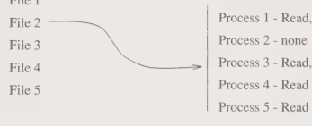

**图 4.25：访问控制列表**

Unix 系统进一步将访问控制列表压缩为三个主要的进程类别：文件所有者的 UID、属于某个组的 UIDs 以及所有其他 UIDs。**图 4.26**以示意图的形式展示了这一点；命令 `ls -l file2` 将显示：

`-rw-r---- 1 allen book 24854 Dec 21 10:41 file2`

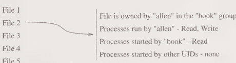

**图 4.26：用户/组/其他文件访问**

#### 4.5.2 认证

上一节讨论了 UID 和所有权，但没有提及身份是如何建立的。进程的身份几乎总是继承自父进程（或者在描述于 2.2.5 节的 set UID 特性中，继承自文件的所有权）。

在极少数情况下，一个进程有权改变另一个进程的身份或文件的所有权，但这只有在请求代理满足认证协议时才会这样做。

首先，会对身份提出声明。（我们不处理身份是推导出来而不是断言的系统。）然后，认证基于不同的验证方法。这些方法基于：

- 你知道什么 *know*
- 你拥有什么 *have*
- 你是谁 *are*

##### 你知道什么

对于登录系统的用户，登录程序会要求输入用户名和密码。如果密码正确，它将使用该用户的 UID 为该用户创建一个 shell 进程。

##### 你拥有什么

锁定的前面板是一个要求出示某些对象的好例子。只有在使用钥匙证明你的身份后，你才能访问受保护的功能，例如重启按钮。

##### 你是谁

第三类认证系统依赖于生物特征，这些特征通常对每个人都是独特的。常用的特征是指纹或视网膜图案，但其他系统测量手部形状、声纹、按键延迟、手写动态等。

##### 组合方法和辅助方法

可以组合这些方法以构建更健壮的系统。还有一些系统使用辅助认证方法，之所以称为“辅助”，是因为必须使用一种主要认证方法来获取它们。

**银行卡**

银行卡结合了你所拥有的（卡片）和你知道的（密码）。自动取款机要求用户出示卡片，然后提供个人识别码（PIN）。单独使用其中任何一个都不够。

**你在哪里**

一些系统只允许从安全区域的终端进行特权访问。由于主要认证方法被用于保护该区域，因此从该终端的访问是一种辅助认证方法。

对于许多系统，物理上拥有硬件被视为对最高权限（root）账户的认证，或者至少物理上允许入侵者绕过认证系统。**Linux 用户请注意！任何具有你的系统物理访问权限的人都可以破坏你的系统。** 至少，入侵者可以重置处理器。更熟练的入侵者可以将系统以单用户模式重启，在密码文件中添加条目，重新启动系统并享受新创建的帐户。通过使用加密文件系统（如第 82 页所述），可以使这些步骤变得更加困难，以阻止上述提到的单用户模式操作。还可以设计需要密码的引导程序，但这尚未实现。

**你拥有/知道——第二部分**

像 Kerberos<sup>8</sup> 这样的认证系统会颁发一张票据（或密钥），然后将其作为认证出示给已修改以接受票据的普通应用程序。这些系统在颁发票据之前使用一种或多种主要认证方法。此后，票据被认为足以替代进一步的登录步骤进行认证。Kerberos 的主要优点是它被设计为即使在不受保护的链路上使用时也是安全的。有些人将这些票据称为“魔术饼干”。


<sup>8</sup> ftp://athena-dist.mit.edu/pub/ATHENA/kerberos/

# 第二部分

# Linux 编程者的视角

## 第 5 章

### 操作系统内核

正如前一章所见，系统内核的一种视角是通过与该系统集成在一起的交互式用户界面。编程者从不同的视角看待系统内核，这种视角基于可以从程序内部发出的系统调用。这种视角是“真实”的，因为用户界面（命令行解释器或 GUI）可以随意更改，且内部实现可以在不干扰用户的情况下更改。

```c
#include <sys/types.h>
#include <unistd.h>

int main (int argc, char **argv)
{
       (void) write(1,"hello world\n",12);
       return 0;
}
```


考虑**图 5.1**中的经典测试程序，通过编译器、汇编器和链接器的使用，它变成了一个可执行文件。我们将略过这些工具，而是重点关注其执行期间发生的事情。（这些工具及其与内核的关系在第 7 章中讨论。）在本章中，我们将查看这个简单程序的不同方面。

#### 5.1 用户界面

每台计算机都有一些不理想的方面，例如，它具有难以编程的外围接口，缺少时钟，具有有限的命令集等。可怜那些必须使用这种简陋系统的编程者！幸运的是，使用具有良好运行时库的系统内核可以磨平这些粗糙的边缘。然后，编程者可以调用子例程来执行高级抽象，例如“设置时钟”或“从文件读取”，而无需深入设备寄存器、命令集、文件系统实现等细节。

从编程者的角度来看，调用是运行时库还是系统内核并不重要。甚至可能将子例程从运行时库移动到系统内核，或从系统内核移动到运行时库，而用户不会知道。

尽管对用户来说重要的是存在一组定义良好的调用来执行所需操作，但编译器编写者和系统实现者必须了解这些细节。此外，边界的位于何处对安全很重要——内核通常被允许做用户不允许做的事情。

Unix 的设计使得用于控制进程的数据对进程不可见。Richie 和 Thompson 注意到：

> 没有具有复杂结构且部分由文件系统或其他系统调用维护和依赖的“控制块”。一般来说，程序地址空间的内容属于程序，我们试图避免对该地址空间内的数据结构施加限制[43]。

Linux 遵循这种隔离模型。

##### 5.1. 用户界面

###### 5.1.1 定义系统调用

编写标准文档并非易事。标准必须在描述必须做什么与描述如何实施之间找到平衡。此外，人们很容易依赖未明文的假设，而这些假设可能不为后来阅读标准的人所认同。因此，让同一个人既定义调用又实施系统可能不是一个好主意。同样，向众多观点各异的人开放文档流程也是一个好主意。由此产生的对比将突出标准中需要澄清的要素。

编写标准的一个主要问题是决定标准应当是*宽容的*还是*严格的*。宽容的标准描述了一组声明符合性所必需且充分的行为。这样的标准允许扩展。严格的标准描述了声明符合性时必须确切满足的一组行为。这样的标准禁止扩展。

关于扩展，有几种不同的观点。当应用程序依赖于系统内核的扩展时，这些应用程序可能会被“锁定”在该特定实现中。依赖于一位供应商提供的出色扩展的程序员随后会发现，若要转向不同的供应商，他们不得不承担巨大的重新编程成本。

宽容标准的另一个危险在于那些只有少数人知道的隐藏功能。“未记录的调用”是一种将多个应用程序捆绑在一起，或将应用程序与操作系统捆绑在一起的有效方式。竞争对手因此被迫复制这些应用程序，或者复制应用程序和操作系统。（这些隐藏功能似乎也是 WINE 项目遇到的困难之一。）

如果禁止扩展或不使用扩展（或未提供扩展），应用程序将会受到旧标准的制约。例如，仍有数百万用户正在忍受 MS-DOS 所需的短文件名。其他用户则乐于使用 Unix、Macintosh、Windows NT 和其他系统允许的较长文件名。

###### POSIX

POSIX（IEEE² 计算机环境可移植操作系统接口标准）通过 C 语言的数据定义和子程序调用来描述系统调用。

POSIX 标准是宽容的，因为它允许系统提供标准未要求附加功能。POSIX 标准建议但不要求记录非标准功能。

有一个细微之处必须注意：标准并没有描述系统，而是规定一个符合的实现“应支持本标准中定义的所有必需接口。这些接口应支持此处描述的功能行为[3]。”因此，一个*严格符合* POSIX 标准的应用程序（不使用标准之外功能的应用程序）在系统上运行时无需修改。

###### 一个警示性的例子

尽管标准可能不会详尽描述系统的行为，但细心的程序员会关注标准。依赖系统表面上的行为，在将应用程序迁移到同一系统的不同实现时可能会带来麻烦。

一个相关的例子涉及在许多 Unix 系统中可用的 `select` 调用中的 `timeout` 值。此调用允许程序等待任意多个端口上的 I/O 活动或超时到期。

此调用的文档通常在 BUGS 部分包含如下注释：

> select() 应该通过修改原时间值就地返回剩余的超时时间（如果有的话）。系统未来版本可能会实现这一点。因此，假设 select() 调用不会修改超时指针是不明智的。

Linux 系统文档进一步警告：

> Linux 关于 timeout 的行为与其他不修改该值的 unices [sic] 不同。

虽然令人失望，但发现在 Linux 系统上运行时会失败的一些程序并不令人惊讶。这些程序是基于 timeout 值保持不变的体验编写的，并期望这种情况永远如此。

###### 语言无关标准

最初的 POSIX 标准是用 C 语言定义的。已经开发了其他描述可移植操作系统的额外标准，使用其他语言。目前正努力通过仔细的非语言特定描述被传递的数据和所执行的操作，以实现一种独立于任何语言的方式³。

然而，由于 C 语言在 Linux 系统上最广泛可用，且语言无关标准既不完整也不易用，本书中的示例将以 C 语言为准。

##### 5.1.2 实施调用

在检查系统调用的实现时，应当认识到正在进行两项活动：第一项是权限的提升，第二项涉及控制权转移到系统代码。

###### 用户侧

在第 5.1 节中提到，系统调用与运行时库调用的主要区别在于，内核可以执行普通用户不允许做的事情。为了做到这一点，控制权必须转移到具有更大访问权限的代码。访问此代码有三种常见方法：

- 用户进程和特权进程之间交换数据，

- 执行一个特殊的函数调用，该调用同时指定地址和段号，或者

- 生成一个陷阱。

第一种方法常用于微内核和分布式操作系统设计中。数据可以通过传递消息、通过 rendezvous 调用或通过共享内存来交换。

后两者在操作上基本相同。在调用情况下，函数作为调用地址被命名；在陷阱情况下，系统函数通过栈上的参数或寄存器中的参数来标识。Linux 系统调用的概述如图 5.2 所示。

无论细节如何，系统调用通过普通函数调用进行描述和访问。就 Linux 而言，`/usr/lib/libc.a` 提供了应用程序和内核之间的接口。图 5.1 中列出的程序通过使用 `#include <unistd.h>` 语句查找所有这些函数的声明。

调用子程序来调用内核有一些适度的成本。如果编译器能够发出直接调用内核的代码，可能会获得稍高的性能，但这被寄存器无论如何都需要被保留的高可能性所抵消。还有一个优点，即系统调用和运行时库子程序打包在单个库中。这使得将系统调用转换为运行时子程序，以及*反之*变得更容易。

Intel x86 家族的子程序调用约定是将所有参数压入栈中。系统调用约定是将子程序号放入寄存器 `EAX`，最多将五个参数放入寄存器 `EBX`、`ECX`、`EDX`、`ESI` 和 `EDI`。

每个系统调用子程序都是通过宏定义的，该宏保留必要的寄存器，将参数从栈复制到寄存器，加载子程序号并执行陷阱（`int 0x80`）。

从系统调用返回后，测试返回值是否为错误条件，可能会设置一个名为 `errno` 的全局变量，并将返回值放入 `EAX`。*由于需要访问特定机器寄存器，这是用户级必须使用汇编语言的少数几个地方之一。*

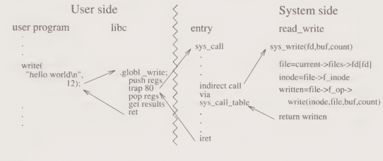

图 5.2：系统调用的两面

###### 系统侧

由于陷阱，处理器进入不同的操作模式，该模式可以执行特权指令并访问普通用户进程被拒绝的额外内存和设备寄存器。

陷阱通过中断描述符表将控制权传递给 *system_call*，这是内核中少数几个汇编语言子程序之一。与 libc 子程序一样，该子程序打乱参数顺序，然后调用相应的内核子程序。

`linux/include/linux/unistd.h` 将每个系统调用从 `_NR_name` 映射到一个数字。`linux/arch/i386/kernel/entry.S` 包含一个由该数字索引的例程地址表。每个例程从 *asm_linkage int sys_name* 开始定义，通常验证

1. 这项努力可以非常正式。例如，曾有一个名为 WierdNIX 的测试。作为对试用标准的评估的一部分，IEEE 1003 工作组为对 POSIX 标准最佳且技术上合法的解读提供奖励，尽管该解读违反了 POSIX 标准的直觉意图[3]。

2. 电气和电子工程师协会


其数据和调用内部子例程来完成操作。例如，图 5.2 中的代码对 `file->f_op->write(inode, file, buf, count)` 进行了间接调用。`introductory paragraph` 描述了虚拟文件系统的概念，该概念将在第 5.3.2 节中进一步讨论。

当内核子例程执行完毕时，它返回到 `system_call`，该函数会检查是否有重调度请求。如果不需要重调度，则将控制权交还给用户程序。重调度请求可能导致上下文切换，相关内容在第 5.2.3 节中有描述。

也有可能系统调用无法立即完成——最典型的例子就是 `sleep` 系统调用。在这种情况下，`system_call` 肯定会返回到一个不同的进程，因为发起该调用的进程已经将自己从就绪状态中移除。示例程序中的 `write` 系统调用可能会强制延迟，因为写入的数据空间不足——同时也可能立即完成，因为系统内核可以接收并缓冲整个消息。

## 5.2 进程控制

进程可以被视为系统内核存在的理由。我们已经看到，除进程外，几乎所有其他功能都可以在运行时库中实现。

### 5.2.1 进程的本质

进程的经典定义是“正在运行的程序”。图 5.3 中该进程的快照展示了几个定义正在运行的程序执行状态的部分。这些部分将在下面的段落中进行解释。

除了代码组件（顺便提一下，它可能与其他进程共享）之外，进程的状态由其所有数据的值定义。

操作系统需要少量的数据来控制每个进程。虽然这些数据保存在通常不可被进程访问的内存区域中，但它们却是进程状态的重要组成部分。它们用于记录资源消耗（用于计费和管理）、控制外围设备和文件访问、管理进程其余的内存、指向控制临界区访问的信号量（*semaphores*）等。

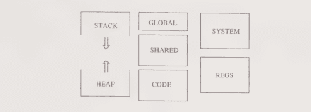

寄存器（REGISTERS）是进程状态中最易变化的部分。除了指令指针（IP）⁴之外，处理器还持有若干累加器寄存器、索引寄存器和状态寄存器。当进程正在运行时，寄存器的值在不断变化。当进程停止运行时，寄存器的值会被保存，以便在进程恢复执行时将其恢复到寄存器中。引用寄存器的值，指的是程序运行时寄存器中的值，或者程序非运行时保存的值。

几乎所有计算机都有一个称为栈（STACK）的内存区域。一个特殊的索引寄存器，称为栈指针，通常用于访问此内存。栈在子例程调用期间被大量使用：首先，无法放入寄存器的参数被压入栈中，然后返回地址被压入栈中，最后，在栈上为子例程使用的临时存储预留空间。每个这样的块（参数、返回地址、局部变量）被称为*栈帧*（stack frame）。这种栈的增长在系统内核中通过根据需要扩展栈组件来支持。（由栈组件开放侧的箭头指示。）某些系统会在子例程返回且栈收缩时回收这部分空间；其他系统则不会。

大多数系统允许进程动态获取额外的内存。这种内存通常被称为堆（HEAP），它从系统范围的内存池分配并绑定到该进程。（This

This code follows the outline shown in Figure 5.5. 当子例程向内传递至弹跳点（bounce point）时，尚未在内存中的任何进程状态部分，例如寄存器，都会存储在栈上。到达弹跳点时，栈指针持有或引用了进程的上下文。切换栈指针的值意味着当控制权从蹦床函数（trampoline function）返回时，`它是通过不同的栈`！因此，发生了上下文切换。

```
Trampoline:
;save context of old
;process on its stack
PUSH Register1
...
PUSH RegisterN
SAVE StackPointer in TaskStructA
;BOUNCE!!!
LOAD StackPointer from TaskStructB
;restore context of new
;process from its stack
POP RegisterN
...
POP Register1
RETURN
```


至少这是基本概念。如果你的处理器足够简单，这是可行的，但大多数体系结构使这变得更加困难，因为某些特殊寄存器无法像这里显示的那样轻松保存和恢复。问题在于内存管理——如果所有代码共享一个公共内存地址空间，切换确实会像这里显示的那样简单。麻烦在于这些寄存器中的一些影响了内存的映射方式——这相当于编程中等效于锯断自己所坐的树枝。

许多 Unix 实现依赖于一种常见的体系结构特性：存在多种操作模式，并且可以在不影响特权操作模式的情况下切换用户模式。我们在第 5.1.2 节中已经看到，系统调用会导致特权操作模式。一旦进入此特权模式，内核代码可以像切换一个进程的栈指针到另一个进程的栈一样轻松地更改用户操作模式的参数。进程之间的真正区别保存在其他寄存器中，包括栈指针和内存管理寄存器。

在 Linux 对 x86 体系结构的实现中，弹跳点使用一条指令将当前任务状态段（TSS）中的所有寄存器保存，并从新的 TSS 中获取新的寄存器值。由于指令指针（IP）是这些寄存器之一，并且所有的上下文切换都使用相同的蹦床代码，因此保存在所有 TSS 中的指令指针具有相同的值。

#### 用户线程

线程是一种类似进程的实体，它与兄弟线程共享其大部分上下文。由于这种共享，兄弟线程之间的切换涉及的数据操作较少，因此比重型进程耗费的时间更少。（如果线程上下文切换的成本与进程一样高，那么线程就没有存在的意义。）线程之间的切换可以是协作式的，也可以是被抢占式的，但无论如何，整个进程都受被抢占式调度的约束。

这种低成本的切换使得线程非常适合于一组紧密耦合的、共同解决某个问题的子例程，也许是由源程序隐式创建的。性能损失微乎其微，但程序员能够表达出更符合问题的解决方案。

线程可以通过多种方式实现——完全作为用户代码、在内核支持下实现，或完全在内核内实现。

`pthreads` 项目为 Linux 开发了用户级多线程。它源自一种可移植的实现，称为 `C-threads`，该实现运行在多个 Unix 系统上。

> ⁵ftp://tsx-11.mit.edu/pub/threads

此代码遵循图 5.5 所示的大纲。当子例程向内传递至弹跳点（bounce point）时，尚未在内存中的任何进程状态部分，例如寄存器，都会存储在栈上。到达弹跳点时，栈指针持有或引用了进程的上下文。切换栈指针的值意味着当控制权从蹦床函数返回时，它是通过不同的栈！因此，发生了上下文切换。

```
Trampoline:

save context of old
process on its stack
PUSH Register1
PUSH RegisterN

SAVE StackPointer in TaskStructA
BOUNCE!!!
LOAD StackPointer from TaskStructB

restore context of new
process from its stack
POP RegisterN
POP Register1
RETURN
```

图 5.5：蹦床代码

至少这是基本概念。如果你的处理器足够简单，这是可行的，但大多数体系结构使这变得更加困难，因为某些特殊寄存器无法像这里显示的那样轻松保存和恢复。问题在于内存管理——如果所有代码共享一个公共内存地址空间，切换确实会像这里显示的那样简单。麻烦在于这些寄存器中的一些影响了内存的映射方式——这相当于编程中等效于锯断自己所坐的树枝。

许多 Unix 实现都依赖一种常见的架构特性：存在多种操作模式，且用户模式的切换不会影响特权模式的操作。我们在 5.1.2 节中已经看到，系统调用如何导致进入特权模式。一旦进入该特权模式，内核代码就能像将栈指针从一个进程的栈切换到另一个进程的栈那样，轻松地更改用户模式的操作参数。进程之间的真正区别保存在其他寄存器中，包括栈指针和内存管理寄存器。

在 Linux 针对 x86 架构的实现中，弹射点（bounce point）使用单条指令，该指令保存当前任务状态段（TSS）中的所有寄存器，并从新的 TSS 中检索新的寄存器值。由于指令指针（IP）是这些寄存器之一，且所有上下文切换都使用相同的跳板代码，因此所有 TSS 中保存的指令指针值都是相同的。

#### 用户线程

线程是一种类似进程的实体，它与它的兄弟线程共享其大部分上下文。由于这种共享，在兄弟线程之间切换涉及较少的数据操作，因此所需时间也少于重量级进程。（如果线程上下文切换的成本与进程相当，那么线程将没有存在的意义。）线程之间的切换可以是协作式的，也可以是抢占式的，但无论如何，整个进程都受抢占式调度的约束。

这种低成本的切换使线程成为处理共同问题的高度耦合子例程集合的理想选择，这些子例程也许是从源程序中隐式创建的。性能损失很小，但程序员能够表达出更符合问题的解决方案。

线程可以通过多种方式实现——完全作为用户代码、带有内核支持，或者完全在内核内部实现。

`pthread` 项目为 Linux 开发了用户级多线程。它源自一个名为 `C-threads` 的可移植实现，该实现在多个 Unix 系统上运行。

另一个名为 `PCthreads` 的移植版本已通过 `ftp` 提供。


一种内核支持的用户线程的实验版本于 1995 年 9 月发布，但它没有跟随后续的内核版本更新。相反，一个非标准的系统调用 `clone` 正在被缓慢地扩展和完善。它将作为内核基础用户线程的基础，因此用户级线程不太可能完全在内核中实现。

由于线程从属于进程，它们状态的描述与图 5.3 中显示的有所不同。最显著的变化是堆空间和栈对所有线程都是同样可见的。当进程中只有一个执行线程时，只需要一个栈，它可以向堆方向增长。当有多个执行线程时，必须有多个栈——每个线程一个。

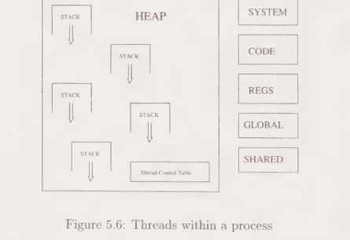

由于实现简单（虚拟内存部分不需要太多更改），线程栈通常从堆空间中分配。这些栈不像图 5.3 中显示的单一栈那样容易扩展。

由于线程的栈不容易增长，许多实现要求它们预先分配一定的最大大小。其他实现在每次子例程调用时检查下一个栈帧是否合适。如果不合适，则分配另一块堆空间，并且栈在该新空间中继续。当嵌套的子例程返回时，这些块将被释放。（这有时被称为*栈展开*。）

如果线程完全作为用户代码实现，则隐藏的系统数据（其中保存了打开的文件等信息）适用于所有线程，而保存的寄存器属于在进程挂起时正在运行的线程。（属于其他线程的寄存器使用图 5.5 中所示的技术存储在栈或线程控制表中。）

## 内核中的线程

Linux 没有严格意义上的内核*进程*。每当用户进程发起系统调用时，它**不**会等待系统调用完成。相反，该执行序列通过系统调用获得放大的访问权限。它执行内核代码，直到系统调用完成，或者如果系统调用无法立即完成，则调用进程被挂起，另一个用户进程获得恢复执行的机会。新恢复的进程从它之前挂起的地方继续。

如果线程完全作为用户代码实现，当一个线程被挂起时，该进程中的所有线程都会被挂起。正是由于这个问题，大多数用户线程实现都被迫寻求某种形式的内核支持。

在内核支持的情况下，内核意识到用户进程中存在多个线程。结果是，内核负责从一个线程切换到另一个线程，以及从一个进程切换到另一个进程。系统调用被实现为允许挂起进程中的一个线程，而不会阻塞该进程中的其他线程。

## 可重入代码

线程间共享的代码必须谨慎使用 C 语言的*静态*数据。如果不加小心，当部分操作被另一个执行相同代码的线程中断时，数据很容易损坏。可以被另一个线程中断并重新进入的代码被称为可重入代码。

Linux 进程间共享的代码不需要在最完整的意义上是可重入的，因为进程不共享任何数据空间。线程间共享的代码必须是可重入的。

对于普通读者来说，这个约束的重要性可能并不明显，但它确实非常重要。

C 语言的 POSIX 标准描述了一组应由库提供的功能。像 `printf` 这样的函数通常使用指向缓冲区的静态变量来定义。

这些库必须被重写以允许可重入使用。否则，当多个线程写入同一个 I/O 流时，数据可能会变得混乱。这种经过修改的库被称为线程安全库。

## 线程创建模型

新线程可以作为父进程的子线程创建，或者可以从完全不同的代码中创建。

### 子线程

如果线程的创建方式类似于 Linux 进程的创建方式，变量访问的正常作用域规则将允许任一线程（父线程或子线程）访问栈中更高层的变量。图 5.7 示意性地显示了内存布局。子线程的栈以其开始处的虚线表示，表明它在某种程度上与父线程栈中的虚线相关联。父线程的栈继续增长，但其在线程创建时的大小由虚线标记。


数据共享在线程结束时需要某种同步。当子线程完成时，父线程栈上的锁被移除。当父线程栈缩小到小于虚线所示的水平时，父线程将被阻塞，直到子线程完成。

如果不执行这种同步，子线程可能会访问无效的数据，因为父线程已经返回超过了该点。

### 独立

如果新线程不与父线程耦合，它通常只能访问全局数据，传统上这些数据存储堆中。新线程通常不会访问（且不容易访问）其他线程栈上保存的数据。

### 协调与会合

父线程及其所有子线程通常被认为是独立的，但它们通常是在朝着某个目标协作工作。这意味着它们需要一些协调机制。常用的两种机制是信号和信号量。

在 Unix 实现中，信号是单发事件（软件中断），它们不会累积，并使等待的进程继续执行。它们传递少量信息——信号编号。如果在第一个信号被接收进程处理之前到达另一个信号，信号可能会丢失，即信号不会被计数。某些 Unix 的信号实现存在微妙的竞态条件，其中信号处理程序可能会丢弃信号或未能准备好捕获下一个信号。POSIX 标准解决了后一缺陷，但仍存在信号不被计数的基本问题。信号量有更正式的用法的描述，见 5.2.4 节。它们可以在线程之间以及进程之间用于协调执行。

## 中断服务例程

中断可以被看作是一种专门化的调用指令，它由硬件条件创建，而不是从内存中提取的。当硬件需要关注时，它向计算机呈现一个中断请求信号（IRQ）。当条件合适时（中断已启用、处理器优先级足够低等），一个中断

将会执行，就好像该专用调用指令是凭空出现的一样。当前指令指针将被保存，并且控制权将转移到一个中断服务例程 (ISR)。(ISR 也被称为*中断处理器*。) ISR 的末尾包含一条特殊的中断返回指令，该指令将控制权转回被中断的程序。如果 ISR 编写正确，被中断的程序将无法得知自己曾被中断。

## Linux 的 ISR 实现

简而言之，Linux 通过以下步骤来处理中断请求 (IRQ)：

- 发出一个中断请求

- 当优先级允许时，处理器响应 IRQ

- 控制权通过向量表传递给 ISR

- ISR 执行必要的任务

- 从 ISR 返回时可能会检查调度请求

实际上有两种类型的中断服务：快速中断和正常中断。当设备首次初始化时，驱动程序调用 `request_irq` 内核子例程。此子例程设置实际的中断向量（一种由硬件使用的查找表），使其指向 `do_IRQ` 或 `do_fast_IRQ`。`request_irq` 还会修改 `irq_action` 表，使其指向设备的二级中断服务例程。当发生中断时，`do_IRQ` 或 `do_fast_IRQ` 将执行一些内部事务处理，然后调用该设备的 ISR。

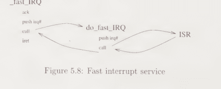

**快速中断** 服务用于驱动程序的中断服务例程足够小的情况。驱动程序初始化时声明希望使用快速中断服务。`do_fast_IRQ` 保存中断程序所需的最小上下文。然后它以 IRQ 编号为参数调用 ISR。当 ISR 返回时，恢复保存的上下文，中断服务通过 `iret` 指令完成。

行式打印机驱动程序遵循此模型。驱动程序的主要部分 `lp_write_interrupt` 尝试向打印机写入字符，但当它被阻塞时，它会调用 `interruptible_sleep_on`，这将控制权交给其他进程。当中断服务例程发出信号表明打印机再次准备就绪可以接收数据时，它将被唤醒。

中断服务例程相当简单。除了必要的验证外，它的唯一目的是唤醒卡在内核中试图向打印机写入数据的 `lp_write_interrupt`。

```c
static void
lp_interrupt(int irq, struct pt_regs *regs)
{
    struct lp_struct *lp = &lp_table[0];
    while (irq != lp->irq) {
        if (++lp >= &lp_table[LP_NO])
            return;
    }
    wake_up(&lp->lp_wait_q);
}
```

**正常中断** 服务保存被中断程序的整个上下文。然后它以 IRQ 编号和指向保存寄存器的指针作为参数调用 ISR。ISR 通过处理某个外围设备或处理器状态来响应中断，然后通过一部分内核代码返回，该代码首先分发*下半部*代码，然后在适当时重新调度进程。

下半部代码是 ISR 的逻辑扩展，但它是在启用中断的情况下执行的，因此可以处理其他关键的中断请求。由于下半部代码是在启用

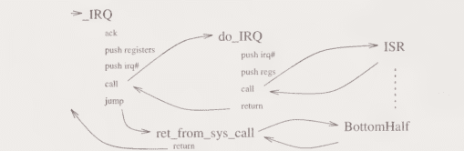

图 5.9：正常中断服务

中断的情况下运行的，它可以非常广泛。因此，下半部代码可以被视为一个功能受限的进程。

鼠标驱动程序是正常中断服务的一个例子。这仍然是一个相对简单的设备，因为设备和用户进程在某种程度上是隔离的。中断服务例程访问几个设备寄存器并更新一个包含当前鼠标位置的结构。读取鼠标只是返回此结构的内容，无需与中断服务例程协调。由于中断服务例程的执行时间稍长，因此它使用正常类型的中断服务。

串行驱动程序展示了正常中断服务的另一个方面，即“下半部”代码。与鼠标驱动程序类似，串行驱动程序在接收到新数据时会产生中断。它将接收到的字符放入一个称为“翻转队列”的动态缓冲区区域，并发出信号指示其他代码应继续处理。信号是通过 `queue_task` 和 `queue_task_irq_off` 内核子例程发出的。（术语“下半部”源自它位于设备驱动程序下半部分的构思。）


这种方案的实用性在于*任何*内核子例程都可以被建立为下半部代码。在驱动程序初始化时，它们可以建立工作队列，并创建可以放入队列的条目。对于串行驱动程序而言，作为下半部运行的代码对于许多串行硬件设备驱动程序来说是通用的。这个更高层的驱动程序负责处理放入翻转队列的数据的所有终端 I/O 进程。该代码最终会调用 `wake_up` 让用户进程恢复执行。

当所有中断都被处理后，系统扫描队列以查找执行下半部代码的请求。

关键区别在于：快速中断更快，但由于它们不保存完整的上下文，因此在编码风格上稍有限制；而正常中断较慢，但它们在编码风格上几乎没有限制，并且可以导致进程重新调度。

## 5.2.4 调度

在多任务系统的整个运行过程中，系统会在多个层级上做出关于哪些进程应该执行的决策。我们可以很容易地识别出三个层级：短期、中期和长期，并分别进行讨论。

### 短期

进程在三种主要状态之间转换：运行、就绪和阻塞。阻塞任务缺乏对资源（如内存、磁盘数据、外设访问等）的访问权限。当这些资源可用时，它们将继续执行。就绪任务仅缺少一个用于执行的处理器。系统将选择它们成为运行中的进程。运行中的任务实际正在执行——在大多数架构中，每个系统只允许一个任务处于运行状态。它们将等待某种资源、放弃控制权，或者被系统抢占。

进程状态的改变是由于运行中进程或 ISR 的行为所致。在协作式多任务系统中，运行中的进程继续执行，直到：

- 它被阻塞，因为它必须等待某种资源；或者
- 它自愿放弃系统的控制权。

这些行为可能对应用程序员隐藏，深入在运行时库内部；但对于系统内核来说，情况都是一样的。协作式多任务的重要特征是，只有在运行中进程的指示下才会发生上下文切换。

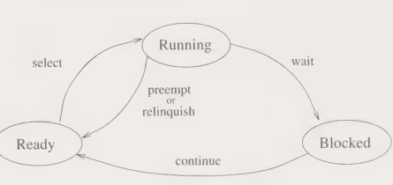

抢占式多任务的不同之处在于，ISR 不仅会导致进程从阻塞状态转换到就绪状态，还会导致进程从就绪状态转换到运行状态！这意味着运行中的进程几乎可以在任何时刻被中断，并被搁置（作为一个就绪进程）一段不确定的时间。（实现中可能会显示从阻塞直接转换到运行，但从阻塞到就绪再到运行的两阶段转换可以被视为等效的。）

内核通过将被阻塞的任务放在队列上来跟踪它们，每种不同的等待条件都有一个队列。这通常是在设备驱动程序内部完成的，其中对 `select_wait`、`sleep_on` 或 `interruptible_sleep_on` 的调用会导致当前进程被放置在该驱动程序内置的队列中。在稍后的某个时间，驱动程序将调用 `wake_up` 将进程从该队列中移除，并将其移动到就绪进程队列中。

很难列举内核中所有可能的队列，因为可以有任意数量的队列，并且没有中央注册表。每个等待中的进程的队列地址显示在 `ps -l` 命令输出的 `WCHAN` 字段中。

#### 信号量

E.W. Dijkstra 首先提出了一种控制对临界区访问的通用机制[14]。使用 `P` 和 `V` 两个操作来表示每个临界区的开始和结束。这些操作的经典定义如下

## 5.2. 进程控制

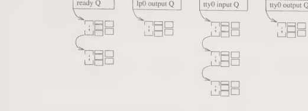

图 5.11：内核中的等待队列

操作如下：

```c
semaphore_N = 1;
void P(int *X) { while (*X <= 0) ; (*X)-- ; }
void V(int *X) { (*X)++ ; }
```

这些操作中每个的参数都是与受保护的具体数据相关联的信号量（源自希腊语单词 sign ($\sigma\epsilon\mu\alpha$) 和 bearer ($\phi\acute{o}\rho\varepsilon\acute{\upsilon}\sigma$)）。

其思想在于，当第一个进程进入其临界区时，该信号量的值被减为零。如果第二个进程试图在第一个进程将信号量值恢复为 1 之前进入其临界区，第二个进程将等待，直到第一个进程将信号量值恢复为 1。

这些定义存在两个重大缺陷。第一，`P` 子例程和 `V` 子例程本身都包含对共享数据（值 `X`）的引用。这意味着 `P` 和 `V` 需要 `P` 和 `V` 来操作——这是一个实现必须摆脱的递归螺旋。第二，`P` 操作使用了忙等待，而没有将控制权让渡给其他进程。

尽管如此，这仍然是一项了不起的贡献。它为设计者提供了一种简单的机制来确保一致的结果：正确实现 `P` 和 `V`，并用 `P` 和 `V` 包裹临界区。

让我们看看如何解决这两个缺陷。

#### 使 P 和 V 正确

程序员最喜欢的方法是将问题推给硬件设计者。我们将首先查看硬件如何支持信号量的实现，然后查看仅使用软件如何实现。

#### 处理器实现

许多系统提供自动更新内存中某个字节的指令。这些指令不仅不能被中断，而且它们会保持总线，使得另一个处理器无法修改该字节。

例如，摩托罗拉 MC68040 和 IBM 370 架构提供*测试并置位指令*，该指令从内存读取一个值，将其与零进行比较（并设置条件码），然后无条件地将其置为一。我们的信号量操作现在看起来像这样：

```c
semaphore N = 0;  
void P(int *X) { while (test_and_set(*X) == 1) ; }  
void V(int *X) { *X = 0 ; }
```

另一种常见的原子读-改-写指令是*交换指令*，存在于 SPARC 和摩托罗拉 MC88100 处理器中。通过用值 1 交换内存中的任何内容，可以模仿上述测试并置位指令。（您会注意到，由于 RISC 架构，编译器将存储返回的值，然后显式地测试它。）

```c
semaphore N = 0;  
void P(int *X) { while (swap(*X,1) == 1) ; }  
void V(int *X) { *X = 0 ; }
```

DEC PDP-11 具有原子读-改-写行为的*递增*和*递减*指令。条件码根据写入的值进行设置。以下代码有一个计数信号量，也可以控制允许进入临界区的进程数量。信号量仅设置为允许进入临界区的进程数量的负值。正值代表等待进入临界区的大约进程数量。（如果你曾经去过一个*非常*受欢迎的饮酒或舞蹈场所，你会发现这类似于门卫统计进出顾客。）

```c
semaphore_N = -1;
void P(int *X) { while (!increment(*X)) decrement(*X);}
void V(int *X) { decrement(*X) ; }
```

#### 内存实现

Sequent Balance 和 Symmetry 系统提供了信号量内存组，以辅助那些没有原子读-改-写指令的处理器。当处理器从这些特殊位置读取时，在*内存中*执行测试并置位操作，并返回适当的值。*获取*到信号量的进程稍后必须写入该位置以释放信号量。

Tera MTA 为每个内存字提供一个称为“*空*/*满*”位的信号量。该系统具有通常的*加载*和*存储*指令。它还有*load_if_full* 和 *then mark empty* 以及 *store_if_empty* 和 *mark full*。如果内存字的信号量处于错误状态，这些特殊指令实际上执行忙等待。

#### 软件实现

并非所有系统都为信号量实现提供如此便捷的支持。在这种情况下，程序员必须依靠仅需要共享内存的信号量软件实现。

一个例子是 Dekker 算法，但该算法已被 Peterson 等人改进，以在两个或更多*竞争*进程的环境中运行，并且无需忙等待即可运行[11, 38]。其中大多数的基本形式是：

- 1. 对信号量提出声明，然后
- 2. 检查其他处理器做出的声明。

如果没有发现其他声明，则可以进入临界区。如果*存在*其他声明，必须执行额外步骤来确定何时临界区空闲。

#### 避免忙等待

上述所有示例都实现了*自旋锁*，即具有某种忙等待形式的信号量。如果等待间隔足够短，并且拥有一种类多处理器，那么忙等待的危害并不大。在许多情况下，它比其他任何信号量实现都更有效。不幸的是，当这些前提条件不满足时，灾难很容易发生。

##### 短延迟，多处理器

这是忙等待最温和的用法。一个处理器可能被阻塞，这会阻塞一个处理器，直到该进程的时间片用尽，但其他处理器上的其他任务将能够执行（并且据推测，它们将能够清除信号量）。

Lamport 证明了利用信号量可能空闲的可能性是有利的[28]。他的算法，如图 5.12 所示，仅需对共享内存进行五次引用即可安全进入临界区。这意味着很少需要的信号量，即很少导致阻塞的信号量，对系统性能的影响很小。

在使用高性能缓存内存系统时，还有一些微妙的硬件问题需要考虑。Schimmel 提供了关于在基于多处理器的系统上使用的代码所需更改的更完整讨论[45]。

##### 短延迟，单处理器

如果信号量很少使用或临界区非常小，基于软件的信号量仍然适用。危险在于，上面介绍的算法没有机会清除信号量。*必须*将控制权传递给其他任务。

##### 长延迟

如果进程在信号量处被阻塞，被阻塞的进程将在其时间片内浪费处理器算力，直到信号量被释放。只有当被阻塞进程的时间片用尽并发生抢占式上下文切换时，其他任务才能够在该处理器上运行。

#### 解决方案


上述示例没有提供在信号量忙碌时将控制权切换到另一个进程的任何方式。这种切换可以有两种形式：一种将大部分信号量保留在用户空间，另一种将信号量集成在内核中。

```c
int intend_to_enter[NUM_THREADS+1];
int  requested_by, in_critical_section;

start:
    intend_to_enter[current_proc] = true;
    requested_by = current_proc;
    if (in_critical_section != 0){
        intend_to_enter[current_proc] = false;
        await (in_critical_section == 0);
        goto start;
    }
    in_critical_section = current_proc;
    if (requested_by != current_proc){
        intend_to_enter[current_proc] = false;
        for(j = 1; j <= NUM_THREADS; j++){
            await (intend_to_enter[j] == false);
        }
        if (in_critical_section != current_proc){
            await (in_critical_section == 0);
            goto start;
        }
    }

/* critical section code */

in_critical_section = 0;
intend_to_enter[current_proc] = false;
```


上述所有代码示例都将 `$P$` 操作实现为 `while` 循环，该循环尝试获取信号量，并只要它否则失败。循环可以很简单地扩展为：如果阻塞，则释放控制权。

```c
void P(int *X) { while (request_semaphore_fails) relinquish; }
void V(int *X) { release_semaphore; }
```

这实际上只是自旋等待（busy waiting）的一种变体实现，但它是一个巨大的改进，因为它允许其他任务运行，直到信号量可以被获取。

`relinquish` 操作将控制权交给其他任务，而不指示被阻塞的进程何时应继续。由于这一缺陷，它增加了系统内核的负担，使其不得不执行持续的上下文切换和对信号量的不必要测试。如果被阻塞的进程是系统中的最高优先级进程，它仍然会阻塞其他任务。

更完善的解决方案将 `P` 和 `V` 操作放入内核中。这允许内核将进程从运行状态移动到阻塞状态，并将该进程放入适当的队列中。然后，系统可以忽略该进程，直到 `V` 操作将进程变为就绪状态并将其从等待队列移至就绪队列。

### 管程

信号量是互斥的汇编语言。也就是说，它们是原语的且难以使用。

显然，它们解决的问题在于对共享数据的访问，而不是代码的并发执行。

管程（Monitors）是一种发明，它将代码的关键部分以及必须以互斥方式访问的共享数据结合在了一起。

此解决方案的第一步是从用户视角隐藏数据，转而提供子程序作为访问数据的唯一方法。这产生了一种程序员无法直接操纵，但可以在严格受控的方式下操纵的东西，因此它们被称为 *抽象对象*。（实际上，子程序有两类：那些对用户可见的，以及那些内部使用的。这一点很重要，我们稍后就会看到。）

程序员不再需要记住在分配时必须初始化哪些字段，如何定位某个特定对象，以及使用什么程序来释放对象。（敏锐的读者会意识到这些特性存在于 C++ 中。）

由于这样的抽象对象对数据的分配和初始化拥有紧密的控制权，因此有机会创建多个信号量，每个共享数据对象一个。下一步是自动操纵共享数据的那些子程序的开始和结束处插入 `P` 和 `V` 操作。

这种自动插入在 Modula-2 中实现过，但由于这种方法粒度太大，在 Modula-3 中已被弃用。当前的设计将决定在何处放置信号量的任务留给抽象对象的设计者。

### 死锁

只要有两个或更多的进程，它们就可能陷入死锁（或致命拥抱）。当这种情况发生时，这些进程实际上停止了，除非采取非常规措施，否则永远不会恢复。

#### 必要条件

当满足四个条件时，就会发生死锁：

- `互斥` —— 必须对资源进行互斥访问，
- `不可抢占` —— 不能强制进程释放资源，
- `持有并等待` —— 持有某个资源的进程试图获取另一个资源，且
- `循环等待` —— 存在一个进程循环，每个进程都在等待一个资源，而另一个进程想要该资源，而该进程正持有它。

（虽然 `循环等待` 预设了 `持有并等待`，但它们分开列出是因为这使后续分析更简单。）图 5.13 展示了死锁的最小规模示例。由于约定绘制从资源（小点）指向持有该资源的进程的箭头，以及从进程指向其请求的资源类型的箭头，因此循环等待变得更加明显。

## 第 5 章。操作系统内核

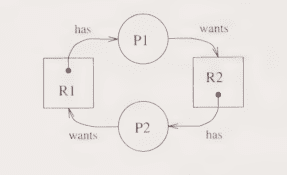

图 5.13：最小死锁

#### 预防、避免与恢复

基于这种死锁模型，可以构建一个不会死锁、不会陷入死锁，或能够从死锁中恢复的系统。

##### 死锁预防

通过确保至少一个必要条件不适用，是可以预防死锁的。

如果所有资源都是可共享的，则不需要互斥。虽然有些资源从根本上是不可共享的，但系统应尽可能确保将资源呈现为可共享的。将行式打印机隐藏在打印监控程序（printer spooler）后面就是这种方法的一个例子。

还可以从不可抢占条件入手来应对死锁。可以要求每个进程在请求更多资源时能够安全地释放其资源。如果请求导致阻塞，其余的资源将被提供给其他进程。（遗憾的是，这并不能防止饥饿——即进程持续被拒绝其继续运行所需的某项资源。应注意，饥饿是一种概率效应——进程在任何时刻都可能获得其所需的资源。）

可以通过强制在所有资源分配都在进程执行的某一点完成，来避免持有并等待条件。虽然这样做很浪费，但它确实确保了不会发生死锁。（此条件也会导致饥饿的可能性。）

预防死锁最实用的方法是防止循环等待。

进程可以通过始终以相同顺序请求资源来防止循环等待，就像从一个列表中获取一样。（为了获得最佳性能，排序应从进程生命周期早期最可能需要的资源开始，到晚期最可能需要的资源结束。）

##### 死锁避免

上述所有方法都是静态的，因为它们不依赖于其他进程正在做什么。死锁避免依赖于动态分析何时分配资源是安全的。

可以想象死锁为进程移动到无法逃脱的角落。这一思想可以通过图形在二维中为两个进程展示。（我不认为出版商支持三维图和四维图的弹出式图表，而四维超出了我用纸能构建的范围。）

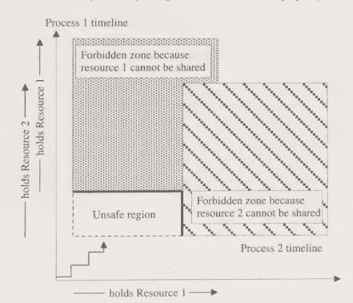

图 5.14：可视化死锁

表面代表两个进程可能的进展。随着系统推进，一个进程或另一个进程取得一些进展。

这种进展在图 5.14 中显示为从原点开始并应结束于右上角的锯齿线。由于不可抢占的要求，这种进展总是向前的，因此线条要么向上移动，要么向右移动。

如果我们投影两个进程对某资源（例如资源 1）的声称，我们可以识别出一个由于互斥要求而被禁止系统的阴影区域。然后我们可以对资源 2 做同样的事情。这些区域组合形成一个复杂的阴影多边形，代表禁止的进程状态组合。

如果系统状态“撞上”这个多边形，它只能沿着边缘移动，通过调度非阻塞进程继续前进。如果系统状态在虚线区域内的某一暗边上这样做，它只能向角落移动并最终陷入死锁。因此，通过将多边形向左和向下延伸形成凸角（由虚线所示）所形成的区域标识了计算的不安全区域。只要系统不进入此区域，就不会发生死锁。

死锁避免检查每个资源请求，查看授予它是否会使系统状态进入不安全区域。它要求所有进程标识它们将在未来某个时间使用哪些资源。

##### 死锁恢复

残酷的事实是，许多系统内核，包括 Unix 和 Linux，并不正式预防、避免或检测死锁。由单个进程的设计者来负责处理这个问题。

幸运的是，这并不是人们期望的那样大的问题，因为不可共享资源很少，而且它们通常被隐藏，例如打印监控程序背后的打印机。

当应用恢复时，通常涉及杀死一个或多个进程并将其资源归还给系统资源池。

在 Linux 的情况下，内存（实际上是物理内存和交换空间的组合）是最主要的不可共享资源。`持有` 和 `等待` 通过一种模型避免了，该模型返回失败信号而不是阻塞调用进程。沮丧的进程通常会中止（这将内存返回给系统）。（令人遗憾的是，

### 5.2.4. 调度

许多进程不检查返回状态，并假装内存已分配而继续执行。当这些进程尝试使用尚未分配的内存时，它们会迅速崩溃。）

#### 中期


短期调度处理的是即时决策：“此刻应该执行哪个进程？” 中期调度则关注如何调优系统以获得更好的性能。最常见的做法是通过定期调整每个进程的优先级来实现这种调度。由于类 Unix 系统通常用于交互式工作，因此交互式进程通常被赋予更高的优先级，而计算密集型任务则被赋予较低的优先级。交互式和计算密集型的定义略显模糊，但基本思想是：倾向于因键盘或其他 I/O 而阻塞的进程被视为交互式，而倾向于用完其整个时间片（`time slice`）的进程被视为计算密集型。此外，基于小进程能迅速完成任务并退出系统的期望，系统还倾向于优先调度较小的进程。（识别小进程的一种方法是积分其随时间变化的内存使用情况。）

中期调度器可以执行更严厉的操作，例如将进程从内存交换（`swap`）到磁盘。这种交换操作是由于内存超额分配导致的颠簸（`thrashing`）而进行的。（尽管 Linux 目前并不在此时交换进程，第 5.4.2 节将更详细地讨论颠簸现象。）

### 长期

这最常见于批处理系统中。长期调度器决定何时应将新的作业接纳进系统。

一些交互式系统也会做出类似的判断，以允许更多用户使用该系统的机制。许多人都熟悉的一个例子是 `ftp` 守护程序（`daemon`）中的机制，它限制了能够连接和传输文件的用户数量。

在这两种情况下，长期调度决策都是由一个在核心外部运行的进程执行的。

## 5.2.5 虚拟机/操作系统仿真

虚拟机是一种执行环境，在这种环境中，程序无法察觉自己并非直接运行在底层硬件上。（该思想的一个应用在第 4.3.2 节中进行了讨论。）

虚拟机系统的优势在于，仿真软件可以调整或修改程序所看到的内容。例如，虚拟机可以表现为拥有实际硬件中并不存在的周边设备。

开发操作系统的一个难点在于，必须将整台机器专门用于其开发。每当系统的新版本准备就绪时，在测试新版本之前，必须关闭当前版本的系统。

虚拟机提供了一个完美环境，用于测试或运行其他系统核心。它也提供了一条途径，用于支持为不同系统核心编写的程序。

### DOSEMU

无论 Linux 多么优秀，仍有一些应用程序无法直接在 Linux 系统上运行。这些应用程序包括许多可供 MS-DOS 用户使用的程序。鉴于 Linux 社区由于许可证或商业秘密限制而无法移植这些应用程序，他们自然的回应是在 Linux 中引入一个类 MS-DOS 环境。

`dosemu` 作为一个特权 Linux 进程运行——该进程可以访问处理器中的一些特殊寄存器。这使得 `dosemu` 能够仿真足够的 x86 硬件，从而骗过 MS-DOS 副本，使其认为它可以完全访问 x86 硬件。因此，“`dosemu`” 这个名称有些名不副实，因为它并没有仿真 MS-DOS，“`intelemu`” 或许是一个更贴切的术语。

当 `dosemu` 开始执行时，它会加载一个配置文件，该文件指定了 MS-DOS 的位置。当 MS-DOS 启动时，它通过仿真的键盘和仿真显示屏与用户通信，这些仿真设备又被映射到真实的键盘、真实显示屏或 X 窗口。

硬件仿真足够完整，甚至可以在 Linux 下运行 MS Windows 3.1。

### WINE

相比之下，`WINE` 不依赖于虚拟机系统。可以说它是一个“虚拟系统核心”，因为应用程序无法分辨自己是在 MS Windows 还是 `WINE` 上运行。

它仍然需要在特权模式下操作，但其优势在于，行为良好的程序不会尝试执行特权指令。相反，用户程序执行陷阱（`trap`）指令，很像 Linux 程序的系统调用。因此，`WINE` 只需要嵌入在用户程序和 Linux 核心之间。然后，它将用户程序的请求映射为相应的 Linux 核心调用。

### Executor

相比之下，`Executor` 程序不是虚拟机环境，因为它不使用架构来仿真自身。相反，它作为一个系统仿真器，提供足够的保真度，以支持在 Macintosh 上运行的绝大多数应用程序。详情请参见网络或 `ftp` 站点。

## 5.3 输入/输出

应用程序程序员对 Linux 系统 I/O 的看法由应用程序可以发起的系统调用所定义。尽管这些调用的文档提到的是“文件”，但命名对象可以是常规文件、目录、符号链接、块特殊设备、字符特殊设备、套接字（`sockets`）和命名管道（`fifos`）。

常规文件是一种抽象，它为一个通常存储在磁盘上的数据集合赋予了一个名称。除了使用 `read` 和 `write` 系统调用访问数据外，程序还使用 `open`、`close`、`lseek`、`creat`、`link` 和 `unlink` 来操纵文件。

与文件和目录相关联的是所有权和访问权限的概念。附加信息，如访问时间、大小和特殊操作模式，也附加到每个文件和目录上。包括 `stat`、`fstat` 和 `lstat` 在内的函数向程序员揭示这些文件描述信息。我们将在第 5.3.1 节中看到，允许多个文件名指向同一个文件是可能的，这是一种“别名”（`aliasing`）机制。

符号链接是另一种形式的别名，它们有其自身的优缺点。对于符号链接，使用 `symlink` 和 `readlink` 调用来创建和检查符号链接。

目录是存储文件名的集合的地方。使用 `readdir` 调用来扫描目录，使用 `mkdir` 和 `rmdir` 调用来创建和删除目录。

尽管特殊设备文件（包括字符设备和块设备）实际上并不是文件，但它们作为文件系统的一部分被访问。程序员在这些文件上使用相同的基
本 I/O 调用，如 `read`、`write` 等，来访问周边设备。为了使其正常工作，它们必须在某个目录中存在。使用 `mknod` 系统调用来创建包含设备信息的文件系统项。通用的 `ioctl` 函数用于执行所有那些繁琐且奇特的操作，这些操作与字符的读写无关，但需要对周边设备进行。

套接字（`Sockets`）是表示网络连接一侧的方式。提供了一系列额外的专用调用，包括 `socket`、`accept`、`listen`、`bind`、`connect`、`send`、`recv`、`sendto`、`recvfrom`、`sendmsg`、`recvmsg`、`select`、`shutdown`、`getsockopt` 和 `socketpair`，用于创建、使用和移除套接字。

使用 `mkfifo` 系统调用来创建命名管道（一种先进先出缓冲区，其行为类似字符设备）。

在检查这些系统调用如何工作之前，我们将首先暂停片刻，看看文件系统之一的结构。

### 5.3.1 文件系统结构

实际上，人们不应笼统地描述文件系统结构，因为 Linux 支持许多不同的文件系统格式，包括 `ext2`、`minix`、`xia`、`hpfs`、`ISO9660` 和 `nfs`。（第 5.3.2 节展示了系统如何跟踪不同的文件系统类型。）

我们将查看 `ext2` 文件系统的细节，因为它具有一系列增强性能的特性，并且被大多数 Linux 系统使用。

包含 `ext2` 文件系统的磁盘主要有六个要素：

- 分区表
- 索引节点（`Inodes`）
- 数据
- 目录
- 位图
- 超级块

分区表描述了整个磁盘如何被划分为多个较小的类磁盘实体。每个分区与其他分区不同，设备驱动程序以某种方式“理解”这一点，使得每个分区都可以被视为一个独立的设备。当 Linux 运行在 Intel 386、486、Pentium 或兼容系统上时，分区表与 MS-DOS 使用的相同。

由于可以将整个磁盘用于文件系统，分区对于文件系统而言并非真正必要，因此无需进一步讨论分区表。根据上下文需要，“分区”一词将用于指代分区或整个磁盘。

分区通常用于将一种使用类别与另一种隔离开来，例如，基本系统放在一个分区中，用户的家目录放在另一个分区中，打印机使用的暂存区（`spool area`）和 `netnews` 放在另一个分区中，而另一个分区可以包含 MS-DOS 文件系统。这允许 MS-DOS、MS Windows 和 Linux 驻留在同一磁盘的不同分区上，也允许它们分布在几个磁盘上。

`mount` 命令用于将一个分区挂载到层次化目录结构中的一个位置。由于每个分区可以拥有

对于不同类型的文件系统，在内核能够挂载一个分区之前，必须提供至少三项信息：

- 分区的名称
- 挂载点（即挂载到哪个目录）
- 预期的文件系统类型

您会注意到，内核必须知道文件系统类型，以便将正确的代码与该分区关联起来。

在上述示例中，包含基本系统的分区将挂载为 `/`，即根目录。包含用户主目录的分区将挂载在 `/home`，`spool`（队列）分区将挂载在 `/var/spool`，而 MS-DOS 分区将挂载在 `/dos`。

这种系统对于希望确保一个用户组不会因占满磁盘而侵入另一个组的系统管理员来说，具有极大的实用价值。

#### Inodes（索引节点）

`Inode` 定义了文件。首先，它显示文件的类型——普通文件、目录、特殊设备文件等。它记录文件的拥有者，既包括个人也包括组，并且包含关于文件创建时间、最后访问时间以及最后修改时间的信息。引用数据文件或目录的 `Inode` 条目包含有关文件大小和数据指针的信息。`Inodes` 在磁盘上成组存储，并作为表的元素进行索引。（读者可以查看 `/usr/src/linux/include/ext2_fs.h` 以获取详细信息。）

如果我们查看 `Inode` 的内部，还会看到一个链接计数器、支持访问控制列表的字段，以及诸如块计数器和片段描述数据等性能增强信息。


如图 5.15 所示，数据由 12 个直接指向包含文件数据的磁盘块的指针、一个间接指针（指向包含指向包含文件数据的磁盘块的指针的块）、一个双重间接指针（指向包含指向包含指向包含文件数据的磁盘块的指针的块）和一个三重间接指针（指向包含指向包含指向包含指向包含文件数据的磁盘块的指针的块）来引用。

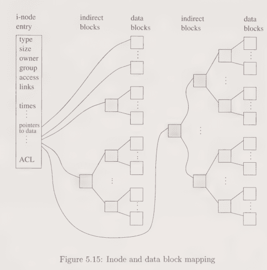

请注意，即使磁盘块是连续放置的，它们也是单独列出的。这与指向文件扩展区的系统不同。如果使用 4 字节指针和 512 字节数据块，这将产生 $512 \times (10 + 128 \times (1 + 128 \times (1 + 128)))$ 或 1,082,201,088 字节的最大文件大小。如果将数据块增加为 4096 字节，最大文件大小可以增长到 $4096 \times (10 + 1024 \times (1 + 1024 \times (1 + 1024)))$ 或 4,402,345,713,664 字节，但由于 `Inode` 的大小字段是 32 位，实际文件大小限制为 4,294,967,295 字节。事实上，这个较小的限制意味着当前使用 4096 字节块的文件系统从不使用三重间接指针。

既然我们现在拥有可以存储超过四吉字节的磁盘，我们应该期望未来的文件系统会扩展大小字段。那时，系统调用和实用程序将进行相应的更改。

### Data（数据）

包含数据的块相当普通。正如 `Inode` 结构所暗示的那样，数据块可以分散在分区各处。性能增强的一个方面是系统尝试使块聚集以提高访问性能。文件中的每个连续块比将相同数据保存在非连续块中更好，因为单次磁盘传输就可以加载或存储所有数据。

一种节省空间的增强方法使用单个数据块来容纳多个小文件的内容。这些文件中任何一个如果扩展超过其片段，就会被复制到完整的块中，并且片段可以被回收。

最后提出的增强方法是将小于 50 字节的非常小的文件保存在原本保存数据块指针的 `Inode` 中。在内部，这将是一个不同的文件类型，但对外部世界来说，它将表现为一个普通的数据文件。这种增强提高了性能并节省了磁盘空间。

### Directories（目录）

普通数据文件和目录都是文本和数据的集合，但目录是 Unix 文件不被系统内核解释这一规则的唯一例外。每个目录包含若干文件和目录的名称，以及每个文件的 `Inode`。一个特殊的调用 `readdir` 用于访问目录条目。Linux 和许多现代 Unix 系统实际上禁止使用 `read` 调用访问目录。早期版本的 Unix 将 `readdir` 实现为库调用。

当文件被打开或创建时，系统使用名称查找 `Inode`。此后，`Inode` 在内部用于访问文件。由于名称不保存在 `Inode` 中，因此可以有多个目录条目，从而有多个文件名指向同一个文件。无法指出哪个是文件的“真实”名称。

虽然可以通过 `stat` 系统调用将文件的 `Inode` 编号显示给用户，但 `Inode` 编号并不用于识别文件。目录条目是用户识别和访问文件的唯一方式。

早期的 Unix 系统具有固定大小的目录条目，因此目录的物理结构与图 5.16 所示的概念模型非常相似。细心的读者会注意到，第一个和第三个条目都指向同一个 `Inode`。没有哪个条目可以被看作“真实”条目，因为无法判断哪个条目是在文件创建时创建的，哪个是后来通过 `link` 系统调用创建的。

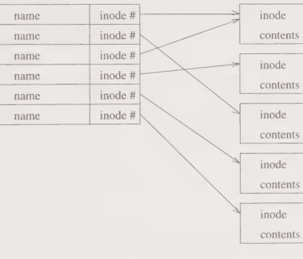

在这里解释一下文件是如何被删除的很合适：通过 `unlink` 系统调用删除文件。该调用清除一个目录条目，并递减保存在 `Inode` 中的计数器。只有当计数器变为零时，文件才真正被删除。

情况比这稍微微妙一点。文件创建时的链接计数为二——一个计数用于指向它的目录条目，第二个计数用于记住文件当前是打开的。每次链接到一个新的目录条目时，计数器都会递增。每次打开文件时计数器也会递增，每次关闭文件时计数器递减。这确保文件在被运行中的程序访问时不会被删除。这也意味着文件可以在没有指向它的目录条目存在的情况下合法存在。这样的文件将在最后一个程序关闭其对文件的访问时消失。（当进程终止时，文件会自动关闭，即使它没有显式地这样做。）

在过去十年中，几乎所有的 Unix 和类 Unix 实现都在其文件系统中支持长文件名。在 Unix 的最早版本中，目录条目有固定的 16 字节大小，如图 5.17 所示，允许使用两字节的模式（`i#`）和最长 14 个字符的文件名。

| `i#` | name | `i#` | name |
|---|---|---|---|

| `i#` | name | `i#` | name |
|---|---|---|---|

| `i#` | name | `i#` | name |
|---|---|---|---|

图 5.17：短文件名目录

目录条目现在具有如图 5.18 所示的形式。与以前一样，每个条目都关联一个 `Inode` 编号，但目录条目中还有两个额外的字段。名称现在可以是变长的（由 `len` 指示），并且每个条目之间可以出现变长的间隙（由 `next` 派生）。结果是，条目变得更加复杂，程序员现在依赖于名为 `readdir` 的库函数来读取每个条目。（还有一个支持该库函数的 `readdir` 系统调用。）一些 Unix 和类 Unix 系统，包括 Linux，不再允许 `read` 操作访问目录。

### 5.3. 输入/输出

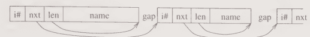

图 5.18：长文件名目录

#### Bitmaps（位图）

有两个不同的位图：一个用于 `Inodes`，另一个用于数据块。每个位用于标记 `Inode` 或数据块的使用情况。当系统需要 `Inode` 或磁盘块时，它会查找此映射表，而不是扫描 `Inode` 或数据块的链接列表。尽管代码稍复杂，但它提供的高性能使其值得这样做。

虽然文件数据不一定位于相邻的数据块中，但将所有文件数据放置在附近的数据块中可以显著提高性能。数据块位图尤为重要，因为它允许系统以较少的努力找到这样的块。

#### Superblocks（超级块）

超级块将文件锚定在磁盘分区中。（实际上它定位了 `Inodes`、位图和数据块，但这在效果上是同样的事情。）由于其关键性质，它在分区内被复制多次。

超级块保存了几类数据，包括安装信息以及用于文件系统逐秒操作的信息。

在安装数据中，有一个 16 位字段，保存一个标识有效超级块的值的数值。如果它不存在，超级块将被视为无效而拒绝，尽管有时超级块的冗余副本足以恢复文件系统。其他字段用于估计文件系统可能已损坏的可能性，例如，如果它没有被标记为已干净关闭，或者如果它上次检查是在某个间隔之前，或者如果它在未检查的情况下被挂载了超过某次数量，用户将提示检查文件系统。还有一个修订级别，以确保当前内核可以正确操作此分区。

文件系统中存在足够的冗余，使得在挂载文件系统之前，通过检查文件系统就能发现常见的故障。例如，可以检查 `inode` 来构建位图的临时副本，如果与磁盘上的位图存在差异，则表明发生了某些故障。类似的检查还可以发现对数据块重复引用、目录结构中的循环，以及已分配但未链接到目录结构中的 `inode`。

伯克利快速文件系统（Berkeley Fast File System）在 Unix 文件系统实现的最先进水平上提供了许多重大改进。其主要的新特性之一是它将分区划分为多个称为块组（`block groups`）的块，每个块组都具有近乎文件系统般的结构。每个块组包含一个超级块的副本，以及部分数据块、`inode` 表项和相关位图。

这意味着不仅文件的数据块可以聚集在邻近区域，其 `inode` 和位图也可以位于磁盘的同一部分。这种变化允许内核进一步利用对文件系统数据引用的特性，即引用的局部性（locality of reference），即时间上接近的引用往往在位置上也接近。

`ext2` 文件系统遵循伯克利快速文件系统的块组模型。图 5.19 说明了分区如何被划分为块组，每个块组包含一个复制的超级块（`SB`）、部分 `inode` 和数据块，以及显示哪些 `inode` 和数据块正在被使用的位图（`BM`）。

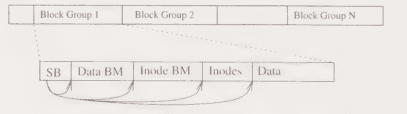

图 5.19: `ext2` 文件系统结构

额外的运行数据包括 `inode` 和数据块的最大及当前计数，以及数据块和数据块碎片的大小。

`mkfs` 实用工具（每种文件系统类型各有一个）是少数直接访问原始磁盘的实用工具之一。`mke2fs` 除非通过命令行选项另有指示，否则会以分区的基本信息开始，并确定要分配的块组和 `inode` 数量。其中一些参数在文件系统创建后可以更改。这些包括建议进行文件系统检查的频率、为 root 用户保留多少个块，以及如何错误处理。

### 5.3.2 文件系统实现

Linux 与早期 Unix 实现的不同之处在于，它在内核中拥有更少的硬性限制和固定表。例如，系统中打开文件的最大数量是在启动时设置的，但仅作为一个变量，之后可以更改。同样，挂载点保存在动态分配结构的链表中。沿着这一思路，进程可以打开的文件数量由文件系统的一个参数设置。（这是 `POSIX` 行为。）


所有这些意味着，要指出内核中的某个声明并说“所有详细信息都存储在那里”变得稍微困难一些。但有几个固定的点。在 I/O 的情况下，`linux/fs/devices.c` 中有两个表，`chrdevs` 和 `blkdevs`，它们保存了系统中每个设备支持的操作详细信息。

## 运行库 I/O 支持

顺便提一下，运行库在基本文件操作之上提供了一层。该库中一些最重要的功能，如 `printf` 和 `scanf`，提供缓冲和格式化 I/O。基本调用，如下面讨论的 `read` 和 `write`，绕过了这种格式化和缓冲。

## 虚拟文件系统

这个术语描述了一种以统一方式访问 Linux 支持的所有不同文件系统的方法。并没有单一的文件系统，但对程序员而言它看起来是这样。

每次处理文件名时，内核识别其所在的分区。随后，它调用依赖文件系统的例程来执行从一个文件系统实现到另一个变化多端的细节。

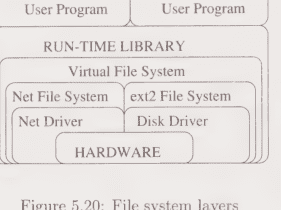

图 5.20: 文件系统层次结构

这以及内核文件系统代码中的其他间接层，构成了“虚拟文件系统”。

其效用在于可以轻松地将新的文件系统实现添加到内核中。只有在挂载分区时，文件系统的类型才可见。此后，文件系统特定代码通过 inode 中的指针间接访问。图 5.20 暗示了这种层次结构。

## open 调用

`open` 调用将路径名[^1]和访问参数转换为文件描述符，这是一个小的非负整数，用作其他 I/O 调用的参数。这是分两步完成的。

[^1]: 这是*完整的*文件名，包括任何前导目录，而不仅仅是根部分。

内核中的 `namei` 函数首先获取文件路径名的前导部分并返回父目录的 inode。（如果无法定位该目录，则 `open` 失败。）如果路径名以“/”开头，则搜索从标记为该进程根目录的 inode 开始；否则，使用标记为当前工作目录的 inode 作为起点。

搜索路径中的每个目录都必须对进程可访问，即程序只需引用搜索路径中每个目录内的特定目录或文件。这种能力通过适用于用户、组成员或其他人的执行位来标记。这些执行（访问）位传达的权限与读取位传达的读取目录内容的权限是分开的。

一旦识别了该父目录的 inode，就会找到或创建所需目录或文件的 inode。

创建文件时，它们通常获取创建它们的进程的所有者和组。但如果它们创建在设置了 SGID 位的目录中，文件将获取其所在目录的组。[^2]

[^2]: 我将由其他人来决定将 execute 位和 SGID 位赋予不同含义是否是好的做法。

`sys_open` 和 `do_open` 中的其余代码在一个结构中记录 inode 和其他信息，并且指向该结构的指针被放置在文件描述符表中。

## 其他 I/O 调用

文件描述符用于索引一个每进程的结构集合，该集合保存关于该文件使用的信息，以及关于该文件的系统范围结构集的间接索引。

它索引到一个每进程表，该表进而指向一个结构链表的元素，每个打开的文件在系统中对应一个。

这些结构通过一层间接访问——即上面提到的虚拟文件系统。

一旦文件被打开，应用程序移动到所需的偏移量（使用 `lseek`）并读取或写入字节流。系统内核不对文件施加任何结构，例如行或记录。这允许（要求）应用程序以适当的方式解释数据。

文件系统依赖的代码将确保数据块被分配（并因此在位图中标记）并且数据被写入磁盘上的正确位置。类似地，该代码将为读取操作定位正确的数据块。

## 设备处理器

就像文件可以被打开、关闭、读取和写入一样，用户可以使用相同的系统调用访问设备。

设备在文件系统中表现为条目，通常命名为 `/dev/hda0`, `/dev/sda0`, `/dev/cr0`, `/dev/tty0` 等。因为文件类型是字符或块 I/O，inode 中其余的一些字段具有不同的含义。例如，inode 保存称为设备的 major 号和 minor 号，而不是显示文件的长度。major 号识别内核中哪个设备驱动程序将处理系统调用，minor 号识别正在访问的端口、分区或设备的其他子类别。

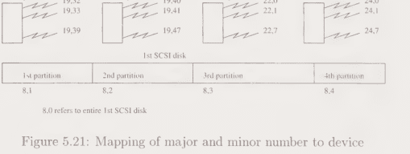

虽然文件系统代码通常是唯一访问磁盘的代码，但特权用户可以直接访问块 I/O（结构化 I/O）设备以及字符 I/O（非结构化 I/O）设备。更常见的是，设备访问是针对串行端口、键盘和控制台、磁带驱动器、软盘驱动器、行式打印机等。

## 压缩

尽管 Linux 的标准文件系统是非压缩的，但有几个附加文件系统以压缩形式存储数据。其中包括一个[^3]用于读取 DoubleSpace 压缩文件系统。

[^3]: ftp://ftp.ia-lab.fh-furtwangen.de/pub/os/linux/local/

以及另一个用于即时压缩和解压可执行文件的系统。

值得注意的是，尽管对压缩文件的串行访问可能很有用，但对这类文件的随机访问会产生相当大的性能开销。此外，在磁盘空间、延迟和处理器周期之间也存在明显的权衡取舍。

## 加密

通常，当系统可以被入侵者物理访问时，所有安全性都会丢失。贝尔实验室的 Matt Blaze 编写了一个加密文件系统，该文件系统可以集成到多种不同的操作系统中。这样的系统能够针对此类入侵者提供一定的安全性，因为即使原始磁盘被攻破，用户数据也不容易被提取或修改。这种安全性源于，如果没有在系统挂载时提供的密码，该分区上的数据看起来就像是随机位。

## 自动挂载

一些系统运行在大型网络环境中，有许多文件系统可通过 NFS 进行挂载。在系统启动时挂载所有这些文件系统，或强制用户根据需要手动挂载它们，都是一个负担。从 4.4 BSD 自动挂载程序衍生出了用于 Linux 及其他系统的自动挂载程序。当文件系统首次被引用时，它会自动挂载这些文件系统；当它们在合理的时间间隔内未被引用时，它则会移除 NFS 链接。该程序可通过互联网上的 ftp 获取。

## 内存映射文件

当地址空间较小时，从文件中逐段提取数据或将数据逐段写入文件是有意义的。现在，由于系统拥有非常大的地址空间，可以考虑一种不同的方法。

内存映射文件是指那些在打开后，其全部内容都会出现在进程的虚拟地址空间中的文件。当文件包含结构化数据时（例如正在访问的数据库或正在创建的对象文件），这尤其有用。

Linux 在其开发内核中提供了内存映射文件。虽然它们尚未完全实现且不够可靠（报告的问题涉及读取和写入共享文件），但它们对未来发展展现了巨大的潜力。`mmap` 手册页暗示了当它完成时会是什么样。

### 5.3.3 重定向、管道和命名管道

重申第 153 页的一些要点，`open` 系统调用返回的文件描述符用于索引内核中的一张表，该表标识了进程打开的文件。这个文件描述符是 `read` 和 `write` 等系统调用的第一个参数。由于它可以指向文件或外围设备，因此 I/O 系统调用同样适用于文件或外围设备。

#### 重定向

“重定向”是一种机制，它允许在子进程开始执行之前，将其输入和输出路径（通常是键盘和显示器）更改为指向其他路径。

Linux（以及 Unix）启动进程的模型非常完美地支持了重定向。

当使用 `execve` 系统调用创建子进程时，它会继承父进程所有打开的文件。由于它只拥有文件描述符，因此无法得知它们具体指向什么。

因此，子进程只需在 `execve` 系统调用之前更改文件描述符即可。图 5.22 中的代码展示了如何执行此操作。

```c
#include <sys/types.h>
#include <fcntl.h>
#include <unistd.h>
/* 错误检查已省略以简化代码。 */

main() {
    int new_out;
    char *arg_list[] = {"cmd_file", 0};
    char *env_list[] = {0};
    new_out = open("substitute_file", O_WRONLY|O_CREAT);
    if (fork() == 0){    /* 这是子进程吗？ */
        dup2(new_out, 1);  /* 将标准输出连接到文件 */
        close(new_out);    /* 关闭对文件的其他访问 */
        execve("cmd_file", arg_list, env_list);
    }
    /* 等待子进程结束 */
    wait();
    exit(0);
} /* main */
```


#### 管道

图 5.23 和图 5.24 中的代码展示了在 shell 中实现管道的简便性。Shell 只需创建一个管道，分叉两个子进程，并关闭其拥有的管道副本。第一个子进程关闭其管道副本的输出端，并将输入端连接到其标准输出；第二个子进程关闭其管道副本的输入端，并将输出端连接到其标准输入。然后每个子进程对相应的程序执行 `execve`，这些进程通过管道牢固地连接在一起。


如果没有这种继承性，创建子进程的系统调用将充斥着处理输入和输出端口、内存分配等的参数。下一节展示了这种哲学的强大力量。

## 扩展符号法

本小节开头展示了 Linux shell 如何轻松通过管道将一个进程连接到另一个进程。虽然传统模型是通过过滤器进行数据的线性流动，但 Linux 可以轻松支持扩展，例如在佐治亚理工学院的新 shell 中看到的扩展。

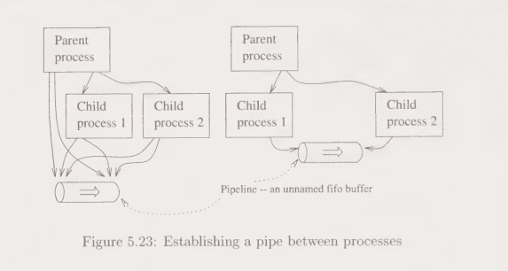

这个 shell 是在近二十年前构建的，它可以定义一个由管道连接的程序网络。默认情况下，由该 shell 执行的每个程序都有三个标准输入端口和三个标准输出端口。扩展语法允许指定数据如何在程序之间流动。

该 shell 仅使用 `">"` 符号进行重定向。它要求 `">"` 与源文件或目标文件之间不能有空格，例如，`"program >filename"` 将进程输出重定向到文件，而 `"\<filename> program"` 将进程输入从文件重定向。可选的端口号可以放在文件名称对面，因此 `">2>filename program"` 和 `"program filename>3"` 分别重定向第二个输出和第三个输入端口。字符串 `"\<filename1 > filename2"` 会产生歧义，因为 `">"` 两侧都有空白字符。管道符号 `"|"` 连接两个程序。该符号可以用端口和程序编号进行修改，即 `"2|3.1"` 或通用的 `"<i>out.port1</i> prog.num.in.port"`。

图 5.25 中的一个简单示例展示了三个程序的用法：`*generate daily*` 程序将正常订单和特殊订单收集到每日事务流中；`*update*` 程序从旧总账和每日事务流中构建日志、新主文件和被拒交易列表；`*duplicate*` 程序将日志复制到文件和打印机。

```c
#include <unistd.h>
/* 错误检查已省略以简化示例。
   子进程不调用 exec() 来执行其职责。 */
main() {
  int count, pipes[2];
  char buffer[20];
  pipe(pipes);
  if (fork() == 0){  /* 这是子进程吗？ */
    close(pipes[0]);  /* 关闭读端 */
    dup2(pipes[1], 1);  /* 将写端连接到标准输出 */
    close(pipes[1]);  /* 关闭多余的写端 */
    /** 用执行实际工作的 exec 调用替换以下一行 **/
    write(1,"hello world\n",12); /* 将消息放入管道 */
    exit(0);
  }
  if (fork() == 0){  /* 这是子进程吗？ */
    close(pipes[1]);  /* 关闭写端 */
    dup2(pipes[0], 0);  /* 将读端连接到标准输入 */
    close(pipes[0]);  /* 关闭多余的读端 */
    /** 用执行实际工作的 exec 调用替换读和写 **/
    count = read(0,buffer,20); /* 从管道获取消息 */
    write(1,buffer,count); /* 在屏幕上显示 */
    exit(0);
  }
  /* 通过关闭两端来消除父进程的管道副本。 */
  close(pipes[0]); close(pipes[1]);
  /* 等待两个子进程结束 */
  wait(); wait();
  exit(0);
}
/** main */
```

此示例中明确显示了端口号，但默认情况下也会分配这些相同的值。

```
normal_orders>1
special_orders>2
	normal_daily
		1|.1
	old_master>2
	update
		1| { duplicate 1>journal 2| print }
		2>new_master
		3>rejects
```


很明显，对于交互式命令语言而言，这些高级功能价值有限，但它们可以在 shell 脚本中非常有效地使用。

### 命名管道

后来的 Unix 版本增加了命名管道。通常，管道由创建该进程的派生进程共享。这项发明允许进程通过并非由共同祖先创建的管道进行通信。相反，一个进程可以创建管道并通过文件系统中的一个条目进行宣传。另一个进程可以打开此管道，并像读写文件一样对其进行读写。这对于用户进程和在后台运行的守护进程之间的通信是一个特别有用的设备。

### 5.3.4 其他文件系统

- 对 HPFS（OS/2）文件系统的只读访问是内核内置的一个选项
- 对双扇区 DOS 分区的只读访问仍处于实验阶段
- 运行 Windows for Workgroups 的系统可以访问使用 Samba 的系统上的 Linux 文件
- 通过使用 `ksmbfs`，Linux 可以挂载运行在 Windows for Workgroups 上的文件系统
- 通过使用名为 `alex` 的工具，可以将远程 FTP 站点挂载为仿佛文件系统一般
- Linux 可以访问 Macintosh 和 Amiga 系统的文件系统

#### 网络文件

应用程序所运行的计算机并不一定需要存储文件数据。可以将“文件数据的提供者”这一文件系统概念进行抽象，以至于该数据的使用者很难分辨数据在物理上存储在哪里。

#### 问题

在考虑网络上的文件时，我们必须理清一些概念。至少，我们必须区分远程文件传输和远程文件访问。前者使用某种特定的应用软件包将文件从一个系统复制到另一个系统。后者旨在让网络文件的访问对用户透明。

这种二分法被所谓的 *文件缓存* 系统所破坏，这些系统可能会复制整个文件并保留副本，但访问方式 *仿佛* 是在访问远程文件。

#### 命名

一个基本问题是“用户可以看到网络的哪些部分？”

我们可以设计一个系统，使得用户无法判断文件位于何处。相反的观点是将文件的位置作为文件名的一部分。在接下来的段落中，我们将看到这两种情况的例子。

一个稍微平行的问题是，随着用户位置的变化，文件的名称如何变化。在点对点文件共享中，一个文件可能对某个用户是本地的，而对另一个用户是远程的。如果文件命名独立于位置，那么引用此类文件的脚本无需因为它们在的不同系统上执行而改变。当然，这意味着本地用户必须使用与其他人相同的较长名称。如网络文件系统（Network File System）和纽卡斯尔连接（Newcastle connection）等系统支持这两种命名约定。

#### 实现层级

网络文件访问可以在内核内部得到支持，也可以由某些用户级程序提供。内核支持通常意味着更高的性能，而用户级支持则提供了更大的灵活性。（值得注意的是，在客户端/服务器连接的两端都可以做出相反的决定。）

#### 点对点

一些网络文件访问模型有一个单独的文件服务器，所有其他系统都是客户端。其他模型允许完全对称，使得任何系统都可以作为客户端、服务器，或者既是客户端又是服务器。

#### 示例

以下段落简要描述了一些网络文件访问系统的实现。更多信息可在 Svobodova[48] 中找到。

#### 纽卡斯尔连接

通常，文件系统访问通过运行库和系统内核到达磁盘硬件，如 图 5.26 左侧虚线所示。这种用户级实现将额外的运行层绑定到程序上，从而监控所有 I/O 调用，如果任何调用涉及远程文件访问，则该访问通过远程系统上的服务器进程完成。图 5.26 右侧的虚线显示了文件系统访问如何穿过特殊库、运行库和系统内核到达网络硬件。然后，它穿过网络硬件、系统内核和运行库，到达另一个系统上的特殊文件服务器进程。

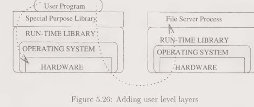

通常，目录条目 `"."` 指代当前工作目录，而 `".."` 指代当前工作目录的父目录。唯一的例外是在根目录使用 `"."` 时；出于实用原因，这也指代根目录。

纽卡斯尔设计改变了这一最后约定的部分，因此文件名开头的 `"/..//"` 表示网络访问。文件路径名中的下一个元素是网络节点标识符，其余部分是该远程系统上的绝对路径名。例如，`"/../faraway/home/fred/"` 指代系统 `"faraway"` 上的目录 `"/home/fred/"`。

由于其分发时期的大多数系统仅支持静态链接，因此工具必须重新构建才能使用纽卡斯尔连接[8]。这一劣势被内核无需修改这一事实所平衡。

#### 网络文件系统

Sun Microsystems 开发了一种远程访问文件系统，它已成为 Unix 类系统中的标准。客户端在内核内部实现，这带来了略微更好的性能，并且文件命名机制将所有的“网络意识”从用户程序中隔离出来。

大部分性能来自于内部缓冲与实际网络文件系统的集成。

文件命名机制只是本地文件系统的推广。从远程系统导出的文件系统挂载得仿佛它们是本地磁盘分区一样。


一种常见用途是，文件服务器保存所有用户主目录并将其导出到所有客户端系统，在那里它们被挂载为“home”。这样，位置对所有用户都是透明的，并且所有用户主目录无论从哪个系统访问，都具有相同的名称。

NFS 的设计促使大多数内核发生了重大变化。在此之前，文件系统和内核非常紧密地耦合，NFS 的引入促成了一个虚拟文件系统层的创建，该层将文件操作系统调用重定向到本地文件系统代码或网络文件系统代码。（这在 5.3.2 节中进行了讨论。）

### 访问可 FTP 的文件

Alex[22] 使用 Linux 用户文件系统将文件传输协议（ftp）访问映射到用户可见的文件系统。

## 5.3.5 外围设备访问

Linux 允许将外围设备访问为文件系统命名中的设备。例如，当 `open` 系统调用应用于 `/dev/tty0`、`/dev/lp`、`/dev/mouse` 和 `/dev/ttyS0` 时，用户分别获得对第一个虚拟控制台、打印机、鼠标和第一个串行线的直接访问权限。然后，用户可以使用 `read` 和 `write` 进行输入和输出，并使用特殊的系统调用 `ioctl` 执行特殊操作。

不可移植（且特权）的代码可以通过通过 I/O 端口或内存窗口读写设备寄存器来访问某些设备。虽然这可能提供更高的性能，但通常不鼓励这种做法。

视频 I/O 通常以此方式执行，尽管 GGI[23] 项目旨在提供更受保护的显示访问权限。

# 5.4 内存管理

一旦系统内核被加载，所有未使用的内存就成为可以在进程之间共享的资源。（在某些微内核系统的情况下，内核的其余部分将提供竞争动态分配内存的额外进程。）内存使用分为两个一般类别：进程可见的部分和代表进程使用的部分。

## 5.4.1 虚拟内存

任何虚拟内存系统必须基于一组资源分配策略构建，这些策略决定何时将页面调入内存（获取）、将其放在哪里（放置与替换）、何时将脏页面写入存储（清理）、进程允许使用多少物理内存（分配），以及多少进程可以共享系统（负载控制）。

### 获取

最常见的获取策略是*需求分页*。该策略仅在需要时加载页面。引用局部性表明，如果需要某个页面，其相邻页面也可能需要。然而，*预分页*除了恢复被交换出的进程外，并没有证明有多大用处。

### 放置

在分段内存的情况下，放置是一个非常重要的问题。图 4.13 展示了良好的放置决策如何保持较大块的未分配物理内存。该领域的研究，就内存分配而言，其性能一直受到限制，因为大多数分段内存之下都采用某种形式的分页内存，正如 4.4.2 节中所见。

### 页面置换

虚拟内存几乎总是导致物理内存的*过度分配*。也就是说，所有进程的页面总数超过了系统中的帧数。

当系统发现没有空闲帧时，它可以暂停或终止需求进程（这是一个坏主意），或者换出另一个进程（稍好一些但仍不理想），或者释放其他帧以为主存腾出空间。

在后者情况下，会使用*页面置换*算法来确定哪一帧将成为*受害者*。最高效的算法是产生最低*缺页率*的算法。

### 最优算法

如果算法能够预见未来，它可以替换那个在最长时间段内不会被使用的页面。显然，不再被使用的页面是用于传入页面的最佳选择。不那么显而易见的是，在那些未来某个时候会被需要的页面中应该选择哪一个。假设只有三个页面：`P1`——需要调入的页面，`P2`——近期需要访问的驻留页面，`P3`——最远期需要访问的驻留页面。我们可以看到，如果选择 `P2` 作为受害者，当 `P2` 需要被换回内存时 `P1` 可能仍然活跃；但如果我们选择 `P3` 作为受害者，当 `P2` 需要被换回内存时 `P1` 可能已不再需要。

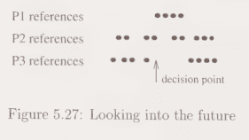

尽管最优算法没有物理实现，但它对于事后与实际实现进行比较非常有用。只需收集显示系统对内存页面引用顺序的引用字符串即可。然后，最优页面置换算法和提出的页面置换算法可以应用于该引用字符串，以确定每种算法将产生的缺页率。通过基于良好的用户程序混合收集足够的数据，这种比较将揭示优秀的算法。

**FIFO 算法** 最简单的算法只是记录页面进入内存的顺序，并选择内存中最旧的页面作为受害者。这样做时，我们希望它不再被需要。如果它包含一些初始化代码，这显然是真实的。如果该页面包含程序开始时初始化且仍在使用的某个全局变量，则这显然是错误的。

FIFO 算法表现出一种称为*Belady 现象*的奇怪现象。通常，我们期望随着驻留内存页面数的增加，性能会提高（缺页数减少）。如图 5.28 所示，将 FIFO 算法应用于引用字符串 1 2 3 4 1 2 5 1 2 3 4 5 时，拥有更多的帧可能会导致更多的缺页！


图 5.28：Belady 现象

相比之下，图 5.29 所示的最优算法在三个或四个帧的情况下分别产生七次和六次缺页。


**图 5.29：最优交换**

这个问题直接导致了一个称为*包含特性*的目标，该特性指出较大的内存应持有系统在任意执行历史点较小的内存所持有的所有页面。下面描述的 LRU 算法满足此特性。

**LRU 算法** 执行跟踪表明，当程序引用某个位置时，该位置在近期更有可能再次被引用，而其他代码和数据部分在相当长的时间内保持未使用状态。尽管选择内存中最旧的页面（如 FIFO 算法所做的）可能看起来是个好主意，但它忽略了*引用局部性*，即系统倾向于引用其最近引用过的页面的趋势。（风险在于，内存中最旧的页面也可能持有被持续使用的全局数据或定期执行的公共代码。）

这一事实表明，我们可以通过选择*最近最少使用*（LRU）的页面，从而做得更好，优于 FIFO。即使我们无法预测页面对未来的使用情况，我们也可以基于其过去的使用情况来做出猜测。使用 LRU，我们预测最近使用的页面最有可能在近期再次被使用。

尽管 LRU 算法不需要预测未来（像最优算法那样），但它的实现难度几乎与最优算法相当。

**时间戳** 实现 LRU 的一种方法是在每个页面上附加一个年龄寄存器，记录对该页面的最近引用。系统维护一个计数器，该计数器在每次内存引用时递增。每次引用该页面时，计数器的值被加载到年龄寄存器中。简单地扫描所有 LRU 寄存器，就可以显示最近最少使用的页面。

**栈** 可以通过维护一个页面编号栈来达到相同的效果。当新页面加载时，它被添加到栈顶。当引用一个页面时，它被移动到栈顶。栈底则持有最近最少使用的页面。

**LRU 近似算法** 尽管 LRU 描述起来很简单，但其硬件实现极其昂贵。因此，我们诉诸于模拟 LRU 算法行为的方法（LRU 本身也是最优算法的近似）。

其中一些可以被视为上述两种实现的非常低精度版本——有时只使用一位信息。

**引用位** 虽然计数器提供了按使用时间对页面进行的严格排序，但引用位提供了近似排序。对于一个七位寄存器，值 1111111 表示该页面在过去七个时间间隔中每个间隔都被使用过。当它不再被使用时，它会依次采取以下值：

- 0111111

- 0011111

- 0001111

- 0000111

- 0000011

- 0000001

- 0000000

如果在连续的时间间隔中。如果一个页面的寄存器值被解释为无符号整数，那么值最大的页面在最近时期内被使用得最多。（注意，这种排序很可能会产生多个最近最少使用的类别页面。必须使用某种平局决胜算法来选择受害者页面。）

**第二次机会** 页面列表可以组装成一个循环队列。每当需要一个页面时，就启动搜索。如果找到一个自上次被考虑以来未被引用（单个引用位未置位）的页面，该页面即成为受害者。如果一个页面被引用过，则暂时忽略它，并清除其引用位（给予第二次机会）。

只有在检查完所有页面后，才会选择一个第二次机会页面供使用。

如果一个页面足够繁忙，它在遭受第二次机会选择之前总会被引用。

**增强型第二次机会** 由于虚拟内存肯定会有修改位，它可以与单个引用位结合使用，产生四个级别的优先级。

- (0,0) 既未使用也未修改——理想的受害者。

- (0,1) 未最近使用但已修改——在重新使用前必须写入磁盘。

- (1,0) 最近使用但未修改——可能很快就会再次使用。

- (1,1) 最近使用且已修改——作为受害者是最差的选择。

扫描列表将产生既包含受害者候选页面，也包含应刷新到存储器的页面。这导致了从内存到磁盘的页面优先级流。

### 页面缓冲

脏页面，即修改位置位的页面，阻碍了受害者页面的轻松选择。即使一个页面很长时间未被使用，在写入存储之前，它也不能用于容纳新页面。

页面缓冲算法从干净页面池中提取所需的页面，然后启动脏受害者页面的写入。随后，该脏页面被移动到池中供以后使用。

这个基本算法可以扩展为：只要磁盘未被使用，就将脏页面写入存储器。

一旦页面被写入存储器，它就成为更好的替换候选者。（如果该页面属于上述增强型第二次机会算法中的 (0,1) 类别，这一点尤为正确。）


###### 帧分配

到目前为止，这一讨论尚未考虑一个进程可以拥有多少帧。如果只有一个进程，答案显然是“所有能容纳的帧”。但在任何多道程序设计环境中，内存之间存在竞争，系统必须确定分配给每个进程多少帧。

最简单的算法将向每个进程分配最多 `m/n` 个帧，其中 `n` 个进程竞争 `m` 个帧。如果某些进程不需要 `m/n` 个帧，这种算法显然是浪费的。

更好的分配方式是给每个进程 `m × sᵢ/Σsᵢ`，其中 `sᵢ` 是第 `i` 个进程的内存需求。

这两种算法都是静态的——它们不会随时间改变每个进程的分页分配。它们执行的是*局部替换*，即每个进程针对自身进行分页。执行*全局替换*的算法会从其他进程中获取页面。

这里存在明显的权衡：在局部替换中，一个进程可能受到不必要的限制，但它不会损害其他进程；而在全局替换中，一个进程可以获得所需资源，但失控的进程可能会损害其他进程。

在任一情况下，进程的数量和大小都会影响系统的行为。

##### 5.4.2 颠簸（Thrashing）与多道程序度

在本文写作之时，Linux 新闻组正冗长地讨论那些失控进程从其他进程中窃取资源的问题。（Linux，像大多数其他 Unix 实现一样，使用一种全局替换的形式。）

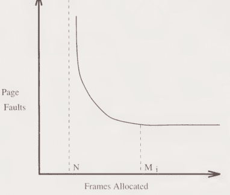

图 5.30：进程的内存需求

如果我们观察图 5.30 中虚拟内存系统中单个进程的行为，可以看到存在与最小页面故障数和最小分配帧数相关的限制。如果一个进程没有获得一定数量的最小帧，它可能*永远*无法完成。这是因为任何给定的指令都可能寻址几个不同的页。如果这些页没有全部在内存中，该指令将永远不会完成。（并且如果只有 `$N$` 个帧可用，由于可能需要为每条指令加载一组不同的 `$N$` 个页，进程可能会缓慢地爬行。）我们还看到，存在一个点，`M_i`，在该点处，为进程 i 提供更多帧并不会减少它所承受的页面故障数。

许多系统表现出负载-性能曲线，如图 5.31 中虚线所示，其中更高的呈现需求导致完成更多的工作——直到某个极限值。其他系统，虚拟内存是其中之一，暂时遵循相同的曲线，然后突然下降。这种负载-性能曲线在图 5.31 中用实线表示。这种急剧下降的基本原因是系统跨过了一个需求阈值，在此阈值之上，它花费在服务于加载不同页的请求上的时间超过了执行用户进程的时间。当系统处于这种后一种运行模式时，它被认为正在*颠簸*。

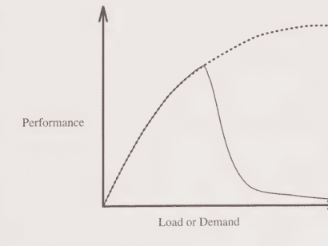

图 5.31：颠簸

这两条曲线显然是相关的。如果当前对页的需求，`ΣM_i`，小于可用内存，性能曲线将遵循虚线。但当该需求超过系统所能提供的量时，各个进程开始换页。`M₁` 和 `N` 之间的差异决定了性能下降的速度。当所有进程分配的页数都少于或等于 `N` 时，系统实际上停止了。

因此，系统管理的目标是为每个进程分配 `M_i` 个帧，并保持 `∑M_i` 小于可用内存的大小。

###### 工作集

Denning 将进程正在访问的帧集合，`W(t, Δ)`，称为其*工作集*[12]。工作集是 `t`，即当前进程执行时间的函数。工作集也是所考虑的时间间隔 `Δ` 大小的函数。

这导致了对系统管理目标的更好表述——我们必须确保每个进程都分配了 `|W_i(t, Δ)|` 个帧，并且我们必须保持 `∑|W_i(t, Δ)|` 小于可用内存，以避免颠簸。

随着时间推移，工作集的大小将建立不同的平台值。图 5.32 中的虚线和点线代表了程序不同部分对工作集大小的贡献。在从一个程序部分过渡到另一个部分时，这些贡献相加，产生了一条在平台之间有峰值的实线。

我们希望利用工作集来制定一个衡量所有进程所需内存量的指标。但再次，这种理论概念的实现需要近似、折中和判断。

估计工作集大小的一种方法是监控进程的页面故障频率（PFF）。对于固定的帧分配，PFF 的变化与工作集大小的变化紧密相关。如果 PFF 稳定，进程处于平台期。如果 PFF 变化，进程正在转向另一个平台或已建立了一个不同的平台。PFF 算法不满足包含性质，但除了少数异常，它的行为在大约 `10%` 的范围内与正确的工作集算法相当。

当页面故障频率不是恰好为零时，系统可以将当前分配的内存（驻留集大小）作为工作集大小的近似值。

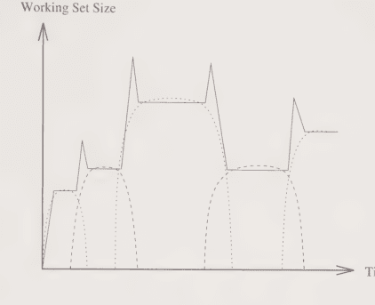

图 5.32：变化的工作集大小

###### 负载控制

即使有确定或估计所有进程工作集大小的有效方法，仍然存在保持 `Σ|W_i(t, Δ)|` 小于内存大小的问题。

这被称为“负载控制”问题，也是调整系统内核性能中最困难的议题之一。困难在于必须做出的权衡，即拒绝向一个或多个进程分配帧。（负载控制也被称为平衡集管理[31]。）

我们已经看到帧分配算法是如何以一对一的方式强制页面退出内存的。负载控制用于将整个进程换出内存。

虚拟内存系统中的换页动机与 4.4.3 节中描述的换页略有不同。在那种情况下，系统被迫将进程状态交换到特殊存储区，因为并非所有进程都能装入内存。在本案中，所有进程都能装入虚拟内存，但它们的存在导致了颠簸。

在虚拟内存系统中，换页的决定不必是二元的（开-关），系统可以将换出的进程视为驻留集大小减少的极限情况。真正的区别在于，换出的进程不再产生任何对页的需求。

当进程从其他进程中夺取页面时，负载均衡是某种程度的自主结果（难以控制），但当每个进程针对自身换页时，必须作为一个明确的操作来进行负载均衡，该操作会显式地改变每个进程的驻留集大小。

如前所述，Linux 进程相互之间进行换页。因此，负载控制管理是相当*临时的*且定义不明确的。5.2.4 节讨论这种方法的后果。

###### 存储管理

物理内存并不是虚拟内存系统必须管理的唯一资源；它还必须跟踪存储在磁盘上的页。

保守设计的系统会在磁盘上分配空间以匹配进程虚拟空间的增长，确保总有空间来保存页面。虽然这看起来是个好主意，但它强制进行了不必要的数据重复——每个驻留内存页都有一个对应的磁盘块。这种重复不仅浪费了存储，还限制了系统性能。

`fork` 调用创建一个子进程，它是父进程的精确镜像。虽然这意味着必须进行大量的复制，但 Linux 通过共享子进程和父进程之间的内存页来执行这种重复。这种页面共享意味着内核只需将父进程的页表复制到子进程——页中的数据无需复制。然后，因为父进程和子进程必须真正拥有独立的内存镜像，父进程和子进程的页表项被标记为*写时复制*。写时复制标记表示，如果父进程或子进程写入某个页，该页首先会被复制到一个新的内存帧中。通过这种方式，父进程和子进程继续共享所有包含相同内容的页，但当页的内容不同时，它们会获得独立的页。

你可以看到，进程创建不会分配任何磁盘空间，并且只分配少数几个页来保存每个进程的数据。

那么何时使用磁盘空间呢？每当系统需要加载或创建一个内存页而没有可用的帧来容纳它时，就会使用磁盘空间。一旦内核选择一个受害者页，该页就会被写入磁盘，该帧就可以用于新页了。

这种方法以一定的代价带来高性能：由于不保证磁盘上为每个内存页预留空间，可能会耗尽用于所有虚拟内存的存储。在这种事项上，Linux 和大多数其他 Unix 系统有点马虎。大多数用户愿意，尽管是无意识的，牺牲一些可靠性以换取大得多的性能。在这种情况下，父进程或子进程可能在稍后尝试写入某个页时失败，而此时既没有物理帧也没有可用的磁盘交换空间来保存副本。该程序将失败，并将其分配的物理内存和交换空间归还给系统。

##### 5.4.3 磁盘缓存

内存的另一个主要用途是作为磁盘 I/O 的缓冲区。

所有磁盘 I/O 都通过一个统一的缓冲机制，该机制试图尽可能长时间地保留磁盘数据的副本——即使在写入磁盘之后也是如此。如果为已经在缓冲区中持有的磁盘数据发出读请求，这就为用户提供了对该数据的快速访问。

系统平衡用于缓冲区的内存使用与持有虚拟内存页所需的帧。当然，虚拟内存的需求具有优先权，但内核将试图将剩余的内存全部用于缓冲。

#### 5.5 安全性

基本系统安全性依赖于几个元素：进程属于某个用户，并且可以属于几个不同的组。文件系统基于进程的所有权和组成员身份限制对文件、目录和设备的访问。每个进程都有独立的虚拟地址空间（其中可以包含与其他进程显式共享的内存段），但通常禁止访问物理内存。

系统中存在一个单一的特权用户，称为 root，它可以覆盖系统中的某些限制。第 2.2.5 节讨论了进程如何通过 SUID 特性获取 root 权限。

当前的 Linux 内核是一个单体（monolith），即它是一个单一的大型程序，而不是一个依赖用户进程和内核进程之间传递消息的微内核。当用户进程发起系统调用时，控制线程会获得更高的权限，但这仅发生在执行受信任的内核代码时。

我们应当预见 Linux 安全模型将发生一些变化。它将依赖添加到文件系统中的访问控制列表。这一变化将减少需要使用 root 权限来访问某些用户文件的实例。经典的问题程序 sendmail 必须拥有 root 权限，以便它能写入用户的邮件队列。如果邮件队列文件可以标记一个条目，说明“sendmail 可以追加”，那么一大类问题就会消失。


这解决了一个与常见操作相关的反复出现的问题：以 `root` 权限运行的进程可能被颠覆（subverted），此时它们造成的破坏是无限制的。如果这些进程没有那么全知全能（omnipotent），它们能造成的破坏就会有限。

能力列表和访问控制列表在第 4.5.1 节中进行了更详细的描述。

## 5.6 标准

第 5.1.1 节讨论了操作系统是如何通过接口而非实现来定义的，并展示了这些接口如何发展为标准。

`POSIX` 是许多定义可移植操作系统的标准之一，但由于它是由 `IEEE` 制定并被 `ANSI`[^1] 采用的，因此特别值得关注。

它定义了一个独立于硬件平台的操作环境，并预计由许多不同的制造商满足。

如第 1.2.8 节所述，`Linux` 几乎完全符合 `POSIX` 标准。新的扩展，例如用于实时调度的，几乎与标准被批准的速度一样快被添加进来。第 1.2.9 节和第 1.2.10 节指出了这种合规性如何有助于将工具和应用移植到 `Linux` 上。

`POSIX` 的一个缺陷是标准不能被自由复制，因此它没有掌握在每个人手中。相比之下，互联网 `RFC`（请求评论）定义了 `TCP/IP` 协议等内容，并且可以无限制分发。

## 5.7 引导内核

系统内核分阶段投入运行。虽然以下顺序并不严格通用，但足够常见，以至于大多数系统都有每个步骤的对应物。

### 5.7.1 处理器启动

无论处理器是通过内部微代码实现的复杂指令集（`CISC`），还是通过逻辑门实现的精简指令集（`RISC`），在某时某刻处理器必须完成初始化并开始“赚取它的薪水”（开始工作）。虽然计算机在启动时可能会显示其内部状态的某些方面（为了用户的利益），但最终它们会获取第一条指令。回到过去的好时光（真的还不到二十年吗？），用户会通过前面板上的开关输入一个地址，并将该值触发到保存指令指针的寄存器中。如今，单片处理器被设计为从一个众所周知的地址获取第一条指令。`Intel x86` 系列计算机偏爱 `0xFFFFFFF0`，`Motorola M68K` 系列计算机偏爱地址 `0`。系统设计者只需确保该位置有内存，并包含适当的引导例程。这通常是通过在该位置挂载只读存储器（`ROM`）来实现的。

### 5.7.2 ROM

系统 `ROM` 提供下一级的引导。它通常伴随某种长期存储器，用于保存配置信息。这可能是电子可擦除可编程只读存储器（`EEPROM`）或带辅助电池的低功耗 `CMOS`（互补金属氧化物半导体）`RAM` 存储器。`ROM` 包含几个原始设备驱动程序和一个小控制程序，该程序将尝试从一系列外设中的一个加载较大的引导程序。配置信息可以控制外设的选择和顺序。

`ROM` 中的引导程序可以相当大。但由于它在系统构建时安装，且必须具有通用性，因此它几乎无法直接加载大型系统内核。

这一步留给磁盘存储“引导块”中的程序。

#### BIOS

`IBM PC` 兼容机的基本输入/输出系统（`BIOS`）提供了上述描述的引导代码。该设计的一个有趣方面是，一些设备驱动程序不是主板（主要印刷电路板）上的 `ROM` 的一部分，而是在各种外设接口卡上的 `ROM` 中。主板上的主要代码“发现”这些额外代码，并将其纳入其基本操作中。这样，新磁盘驱动器的特殊编程需求就隐藏在标准 `BIOS` 代码之外。

### 5.7.3 LILo 或 DOS & LOADLIN

每个系统设计都有引导块的大小和位置的约定。通常，`ROM` 中的引导代码会从磁盘的前几个扇区加载主引导代码到某个低内存位置。控制转移到该代码，但由于主引导很小（通常 1 Kbyte 或更少），它通常从磁盘加载额外的（辅助）引导代码。然后使用辅助引导来加载内核。

`Linux` 加载器（`LILo`）中的代码紧密遵循此模型，区别在于辅助引导可用于加载几个内核映像[2]之一。

`LILO` 是一套程序，包括安装实用程序 `/sbin/lilo` 以及主引导和辅助引导程序 `/boot/boot.b`。`/sbin/lilo` 从 `/boot/boot.b` 提取主引导程序代码，并将其连同描述重要磁盘地址的数据一起写入磁盘的引导扇区。主引导和辅助引导程序执行系统的实际加载。

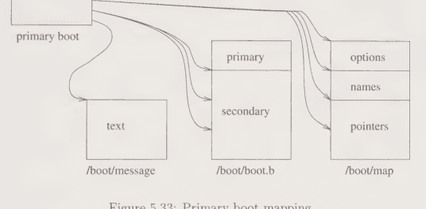

`BIOS` 将 512 字节的主引导加载到位置 `0x7C00`。主引导将自己重新定位到 `0x9A000`，然后调用 `BIOS` 从 `0x9B000` 开始加载多达 8 kbytes 的辅助引导。

（通过使用 `BIOS` 内部的驱动程序，主引导和辅助引导避免了包含任何设备依赖代码的需求。这种优雅的技术被一个不幸的问题所破坏：为 `BIOS` 磁盘读取传递的参数不足以引用高编号的磁道。因此，`LILO` 无法加载位于 1023 以上磁盘磁道中的扇区。）

辅助引导从 `/boot/message` 显示消息，并从 `/boot/map` 读取选项和映像名称。在与用户进行一些可选交互后，它从 `/boot/map` 的指针部分给出的位置加载内核映像。

重要的是要注意，引导代码没有 `/sbin/lilo` 的帮助就无法定位内核。这是一个重要的步骤，有时会被新手遗忘。

`LILO` 的安装部分，`/sbin/lilo`，读取一个描述内核映像、映像名称、外设选项和其他引导选项的配置文件。

- 它使用此信息在非默认目录 `/boot` 时定位辅助引导文件 `boot.b` 和 `message`。
- 然后构建 `/boot/map`，其中保存了指向内核映像的指针。
- 最后通过复制 `/boot/boot.b` 中的一些代码并加载指向 `/boot/boot.b`、`/boot/map` 和 `/boot/message` 的指针来构建主引导扇区。

（在上述所有示例中，所有 `/boot/` 的出现都描述默认位置。所有这些都可以由配置文件中的条目覆盖。例如，我有一个挂载在 `/work` 的特殊分区，我在其中进行所有内核开发。该分区包含一个替代目录 `/work/boot/`，并在配置文件中引用。）

如果想要启动保留在两个不同分区中的两个完全不同的 `Linux` 系统之一，必须首先将“其他”分区挂载到活动分区上，执行如下命令：

```
mount -t ext2 /dev/hda2 /mnt
```

然后再运行 `/sbin/lilo`。这是因为 `/sbin/lilo` 在运行命令时根据文件名定位内核映像。然后配置文件中需要包含如下的条目：

```
image = /vmlinuz
    root = /dev/hda1
    label = std.linux
image = /mnt/vmlinuz
    root = /dev/hda2
    label = new.linux
```

以指向两个*不同*的内核映像。

尽管 `LILO` 被称为 `Linux` 加载程序，但它也可以加载 `MS-DOS`。我将系统配置为默认启动 `Linux`，但会暂停几秒钟，以便我能够取消该选择并改为启动 `MS-DOS`。

`/sbin/lilo` 不像处理 `Linux` 内核那样构建指向 `MS-DOS` 内核的指针。相反，它告诉次级引导程序将控制权交给另一个引导程序（通常保存在 `/boot/chain.b` 中），该程序反过来知道如何加载并启动正常的 `MS-DOS` 引导过程。另一个引导程序 `/boot/os2d.d.b` 可以从第二块硬盘启动 `OS/2`。

#### LOADLIN

谨慎的用户无需使用 `Linux` 引导加载程序干扰系统的活动引导记录（`MBR`）。相反，他们可以使用基于 `MS-DOS` 的工具 `LOADLIN`。`LOADLIN` 在 `x86` 家族的所谓实模式（或通过一些努力在 `v86` 模式下）运行。它定位 `Linux` 内核，将自身移至高内存（`0x90000+`），将 `Linux` 内核加载到低内存中，禁用所有 `MS-DOS` 操作，并将控制权交给 `Linux`。

这使 `MS-DOS` 和 `LOADLIN` 分别处于三级引导和四级引导代码的角色。

### 5.7.4 网络系统启动

可以使用网络来加载 `Linux`。有些实用程序（如 `etherboot` 或 `nfsboot`）依赖于现有的引导 `ROM`，而其他一些则使用特殊的 `ROM`。

无论如何，引导 `ROM` 中的程序在局域网（`LAN`）上广播请求以获得帮助。服务器系统识别该请求并回复一个要加载的映像。

一旦内核加载完成，系统启动按正常流程进行，唯一的异常之处在于使用 `NFS` 挂载的文件系统代替硬盘挂载的文件系统。

> 25 ftp://sunsite.unc.edu/pub/Linux/system/Linux-boot

# 第 6 章

## 网络

网络支持是否属于内核内部或外部尚不清楚。两种观点都有论据支持。在 `Linux`（以及大多数 `Unix` 系统）中，网络代码的主要部分位于内核内部，而其他部分则是用户级程序。

### 6.1 用户进程与内核特性

虽然从内核内部访问网络硬件并非真正必要，但将较低层放在内核中确实会显著提高性能。下一节将讨论这些层，但简而言之，代码越接近操作原始硬件，使用内核模式代码的理由就越充分。

随着各层远离硬件，将代码作为用户进程执行变得更加实际。

### 6.2 ISO OSI 模型的优势

国际标准化组织（`ISO`）制定了一个称为开放系统互连参考模型的模型。该模型用七层来描述网络，每一层都通过与其相邻层的接口来描述。

- *应用层* 由使用网络的应用程序组成


- *表示层* 将数据表示标准化以供应用程序使用

- *会话层* 管理应用程序之间的会话

- *传输层* 提供端到端传输以及错误检测和纠正

- *网络层* 管理跨网络的连接

- *数据链路层* 提供跨越物理层的可靠数据传输

- *物理层* 定义网络介质的物理特性

该模型非常有用，因为它捕捉了关于实现网络所积累的经验——保持部件（层）足够小，以便能够理解、分析和正确实现。图 6.1 通过展示每个层如何添加或减去其自己的报头（`PREFIX`），有时还可能包含一些尾随字节（`SUFFIX`），而不干扰被封装的数据，来捕捉这一思想的精髓。

来自应用层的数据被表示层的控制位包围，而这些控制位又被会话层的控制位包围，依此类推。在接收时，最外层的位由数据链路层剥离，次外层的位由网络层剥离，依此类推。每一层只关注其自身的控制位（通常被视为报头），对其内部包含的内容则一无所知。这种惯用法的好处在于，可以替换某一层的不同实例而不干扰其他层，例如，以太网的数据链路层和物理层可以被令牌环替代而不影响其他层。图中未显示物理层，因为它很少添加任何报头。相反，它描述了位流如何表示为某种信号，

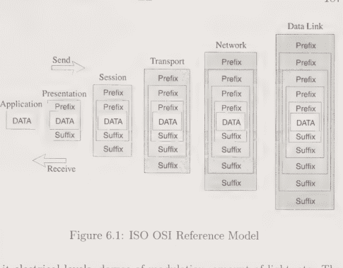

无论是电平、调制程度、光量等。常见的类比是将这些层视为信封。

ISO OSI 模型是在互联网开始之后创建的，因此发现互联网不能完全用这个参考模型来描述也就不足为奇。尽管如此，围绕/在其他协议内部分层协议的模型被证明是最有用的。

### 6.3 互联网模型

在互联网实现的描述如何映射到参考模型方面没有普遍共识，但几乎所有人都认为七层有点过多。通常，七层被简化为对应于大多数实现主要部分的四层。

- **应用层** — OSI 模型中的应用、表示和会话层

- **传输层** — 大致对应于 OSI 模型中的传输层

- **互联网层** — 大致对应于 OSI 模型中的网络层

- **网络访问层** – OSI 模型中的物理层和数据链路层合并为一层

Linux 在内核中实现传输层、互联网层和网络访问层。传输层被实现应用层的进程使用。其他特殊进程使用网络层和网络访问层来实现更高级别的协议（这些协议本质上是实验性的，或者不需要特别高的性能）。前面提到过，但需要重申：任何给定层都可以有许多不同的实现。例如，应用层、传输层、互联网层和网络访问层的实现可以由 `telnet`、`TCP`、`IP` 和以太网组成，也可以由 `http` 守护进程、`UDP`、`IP` 和 `SLIP` 组成。

互联网协议由多个标准定义，其标题中包含谦虚的短语“请求评论”（Request for Comments）。每个标准都作为一个立场文件、协议规范或目录来涉及某个主题。现在它们由网络工作组发布，许多 RFC 可以以文本或 Postscript 文件的形式在 CD-ROM 上或通过互联网上的 ftp 获取。

以下三个小节讨论了传输协议和应用协议的常见配置。在初步了解该模型的中间部分之后，我们将查看其顶部和底部，即应用层和网络访问层。

#### 6.3.1 TCP/IP

*传输控制协议*（*TCP*）定义于 RFC 793，*互联网协议*（*IP*）定义于 RFC 791，它们被视为互联网的核心。

IP 协议确保数据报（或分组）——如图 6.2 所示的一字节集合——从源节点路由到目的节点。协议的关键部分包括：

- 每个数据报保存 32 位的源和目的地址。这足以寻址 4,294,967,296 个不同的节点。

- 每个数据报标识用于处理其中包含的数据的协议。

- 数据报在传输过程中可以拆分为较小的数据报。标识符、长度、标志和片偏移量可用于在目的节点重新组装这些片段。

- 校验和确保数据未被损坏。

| 字段 | 字段 | 字段 | 字段 |

|---|---|---|---|

| 版本 | 头部长度 | 服务类型 | 总长度 |

| 标识符 | 标志 | 片段偏移 | |

| 生存时间 | 协议 | 校验和 | |

| 源 IP 地址 | | | |

| 目的 IP 地址 | | | |

| 选项 | | | |

| 数据 | | | |

图 6.2：IP 数据报

当在 IP 封装中使用 TCP 协议时，用户可以获得可靠的端到端进程到进程链接²。图 6.3 中显示的数据报包含：

- 16 位的源和目的端口号，用于标识链接的两端。两端的进程**绑定**到一个端口（一个商定的数字标识符），然后要么**连接**到远程进程，要么**监听**连接请求。这些端口号是 RFC 1700 的一部分定义的，并在本地保存在 `/etc/services` 中。

> ²这意味着进程具有保证的无损坏交付。IP 负责路由和交付，而 TCP 负责错误检测和纠正。

| 字段 | 字段 |

| :--- | :--- |

| 源端口号 | 目的端口号 |

| 序列号 | |

| 确认号 | |

| 头长度 | 保留 |

| 标志 | 窗口大小 |

| TCP 校验和 | 紧急指针 |

| 选项 | |

| 数据 | |


- 使用 32 位序列号和确认号，既提供流控，也构成基于重试/超时的可靠通信基础。

- 校验和确保数据的有效性（即使其未受 IP 校验和保护）。

TCP/IP 共同构成了诸如 `telnet`、`ftp`、`rlogin` 等实用工具的基础，以及其他许多工具。它们的组合形式如图 6.4 所示。

#### 6.3.2 UDP/IP

大量应用程序依赖使用与 IP 协议配合的用户数据报协议（UDP），该协议定义于 RFC 768。从图 6.5 可以看出，UDP 数据报包含更少的控制元素。这是因为它是无连接的，即发送进程与接收进程之间没有长期连接的概念。非电子领域的类比是通过明信片通信。与明信片一样，无法保证可靠投递，因此应用程序进程可能需要施加自己的确认和重传方案。但随后，某些应用程序（如状态报告）在偶尔丢失数据的情况下仍能很好地运行。

| 字段 | 字段 | 字段 | 字段 | 字段 |

| :--- | :--- | :--- | :--- | :--- |

| 版本 | 头长度 | 服务类型 | | 总长度 |

| | | 标识 | 标志 | 片偏移 |

| | 生存时间 | 协议 | | 校验和 |

| | | 源 IP 地址 | | |

| | | 目的 IP 地址 | | |

| | | 选项 | | |

| 字段 | 字段 |

| :--- | :--- |

| 源端口号 | 目的端口号 |

| | 序列号 |

| | 确认号 |

| 头长度 | 保留 |

| 标志 | 窗口大小 |

| TCP 校验和 | |

| | 紧急指针 |

| | 选项 |

| | 数据 |


虽然 `send`、`receive`、`read` 和 `write` 适用于通过 TCP/IP 连接的套接字，但系统调用 `sendto` 和 `recvfrom` 用于 TCP/IP 或 UDP/IP 信令。当 `sendmsg` 和 `recvmsg` 的实现完成时，情况也将如此。

| 字段 | 字段 |

| :--- | :--- |

| 源端口号 | 目的端口号 |

| UDP 长度 | UDP 校验和 |

| | 数据 |


#### 6.3.3 IP 与 ICMP

*互联网控制报文协议（ICMP）*，由 RFC 792 和 790 定义，很少作为一个独立协议被讨论，因为它用于管理 IP 层内的路由和其他功能。图 6.5 展示了基本 ICMP 数据报结构的简单形式。有三十多种不同的消息 *类型/代码* 组合，它们进一步定义了数据字段。

| 字段 | 字段 | 字段 |

| :--- | :--- | :--- |

| 类型 | 代码 | 校验和 |

| 数据 | | |

图 6.6：ICMP 数据报

#### 6.3.4 应用程序协议

存在大量额外的协议，其中大多数运行在 TCP/IP 或 UDP/IP 层之上的应用层。

# 第三部分

# 高级用户视角

## 第 7 章

### 开发工具

大多数系统都附带了一套庞大的开发工具。因此，这些工具通常被视为操作系统的一部分。

#### 7.1 语言

##### 7.1.1 汇编器和编译器

计算机解码存储在内存中的位模式指令。早期计算机的指令由于解码逻辑的限制，具有相对规则的结构。这使得早期程序员能够通过指定指令内存中每个字节的位模式来处理*机器代码*。这种编程方法很快被使用具有助记含义的符号名称的方法所取代。创建了*汇编器*来将程序文本转换为计算机所需的机器代码。汇编器提高了程序员的效率和准确性。

###### 汇编器

汇编器通过提供不断增长的 functionality 集合而变得复杂。汇编器指令可用于预留存储块、跳过内存块、识别代码类型，以及最重要的是，定义和应用宏。


宏是一个文本片段，根据某种规则被另一个文本片段所替代。例如，片段

```text
#define MAJOR(a) (int)((unsigned short)(a) >> 8)
#define MAX_BLKDEV 64
```

表示文本

```text
if (MAJOR(dev) >= MAX_BLKDEV)
```

应被替换为

```text
if ((int)((unsigned short)(dev) >> 8) >= 64).
```

汇编语言，即使得到大量预定义宏定义的支持，仍然是一个难以用来编写程序的工具。程序员被迫关注大量与手头问题无关的细节。例如，程序员必须回忆在什么时刻哪个寄存器正在保存什么信息。

## 编译器

这种跟踪细节的问题导致了更高级别语言的设计。早期语言专注于代数表达式中的数据转换，并将它们转换为适当的机器语言序列。这些语言用于声明数据存储需求和控制程序顺序的结构相当原始。它们对数据如何标识以及子程序如何使用施加了严格限制。

随着时间的推移，语言变得更加精致，使得程序可以通过特殊的微积分进行分析，并且关于程序的主张可以以符号方式测试。

几十年来，在决定使用高级语言时存在一种权衡。人们普遍认为，编译器生成的机器代码不如汇编语言程序员生成的那么优秀。此外，语言无法很好地表达某些概念。因此，尽管高级语言程序员每天可以编码更大的算法部分，但许多人仍然依赖汇编语言处理“关键”应用。

在过去十年中，这种情况发生了逆转。首先，三十年前决定用 `PL/I` 编码 `Multics`，然后二十三年前成功用 `C` 重写 `Unix`，终于让大多数人确信合适的高级语言足以满足需求。然后，由于现代编译器在*优化*方面做得如此出色，由高级语言编译器生成的机器代码通常优于从汇编语言程序生成的代码。

这种质量的原因是，计算机现在能够做到图灵近五十年前所期望的。它们能够比任何汇编语言程序员更准确地跟踪更多细节（如寄存器使用与数据存储需求之间的相互关系）。

转向更高级编程语言的转变实际上有助于优化过程，因为当程序员从硬件感知的观点移开时，对如何分配资源所做的简化假设就更少。编译器随后可以自由地做一些虽然不常见但会产生更好（更快和/或更小）代码的事情。例如，尽管程序员可能声明了一个变量，但该变量无需始终存储在某个内存位置——编译器可能确定该变量可以整个其在整个有用生命周期中驻留在寄存器中，之后值被丢弃。

这种向高级语言转变带来的一个好处是，问题与编程语言之间的*语义差距*缩小了。

### 7.1.2 链接器和加载器

图 2.1（在图 7.1 中重复）展示了可执行映像如何分阶段创建并移动到内存中。前一节查看了汇编器和编译器如何用于构建目标文件。

一旦汇编器或编译器生成了目标文件，工作

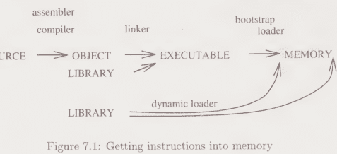

图 7.1：将指令放入内存

只完成了一半。目标文件包含所谓的*外部引用*。这些外部引用记录在用户程序调用某些库函数或引用某些全局数据的地方。

每条机器代码指令，无论是跳转、子程序调用、内存加载还是存储，都存储目标地址为零。目标文件末尾的一个额外条目描述了指令格式，指向该机器代码，并命名所需的地址。当链接器或加载器将适当的库代码绑定到目标文件时，它会通过将以正确形式替换零来修复这些引用。

链接器，称为 `ld`，可以从命令行调用，或由编译器的最后阶段调用。（不幸的是，执行链接的程序被称为加载器，但我们不得不忍受这个不幸的误称。）

#### a.out/jump-table

旧式的可执行文件（称为 `a.out`）包含图 7.2 左侧所示的六个不同元素。当程序执行时，系统将 `TEXT`（包含可执行代码）和 `DATA`（包含预定义数据）部分加载到内存中。（用实线表示。）`BSS`，即“以符号开始的块”，是头中的一个值，指定必须为全局数据分配多少额外的内存（没有预定义值）。

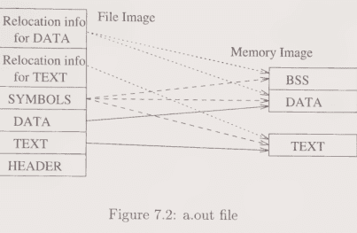

**`SYMBOLS`** 表包含一个名称列表，每个名称都有其类型、值以及其他信息，用于描述入口点、全局变量等。引用 `TEXT`、`DATA` 和 `BSS` 区域中特定位置的条目被称为**定义**。其他被称为**外部引用**的条目，指向那些未在内部定义但必须在其他地方定义的位置。符号表的初始用途已通过使用新类型得以扩展，以支持调试信息。图 7.2 中的虚线指示了这些引用和定义。

`TEXT` 和 `DATA` 区域中的地址都是相对于这些区域基址的相对地址。重定位信息保存在目标文件的最后两个部分中，它以允许链接器在区域移位到非零基址时修改文本和数据的方式描述了所有地址。图 7.2 中的点线展示了这种关系。可执行的 `a.out` 文件可以剥离除 `HEADER`、`TEXT` 和 `DATA` 区域外的所有内容。这会使文件更小，但会妨碍调试。

目标文件与可执行文件具有相同的格式，区别在于某些符号描述了未解决的外部引用。如图 7.3 所示，链接器用于将两个或更多目标文件组合成一个可执行文件。文本和数据区域被连接，并使用重定位信息来调整地址。符号表被合并，重定位表也被合并，并形成一个统一的头部；当找到匹配的定义时，外部引用会被解决。

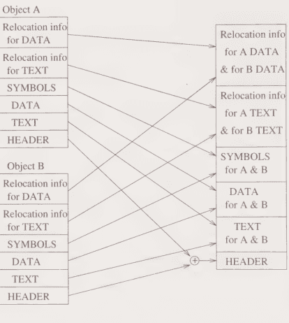

图 7.3：链接目标文件

#### 动态链接

直到最近（对许多 Unix 系统来说是过去十年，对 Linux 来说是过去两年），链接器构建的可执行映像会解决所有外部引用。这一情况已经改变，Linux 系统已有一年多时间在支持动态链接。

动态链接和共享库虽然概念上不同，但在实践中总是相伴出现。

典型的程序中充满了很少使用的代码，因为细心的程序员会编写代码以涵盖所有情况，但大多数情况从不（或很少）发生。仅仅因为那些很少使用的代码引用了外部子程序或全局变量，就必须将该子程序的代码或某些全局数据存储绑定到用户程序，这真的令人遗憾。由此产生的可执行映像使用了更多的磁盘存储，加载到内存中所需的时间更长，占用了宝贵的内存，而且可能已经过时。

动态链接（也称为动态加载）避免了上述四个问题中的三个，并有助于解决第四个问题。

动态链接的诀窍是用一个充满*桩（stubs）*的库代替完整的库。链接器会将这些桩*绑定*到用户程序上，这样调用一个函数（例如 `printf`）时，会跳转到桩而不是函数。桩中的代码会加载完整的库代码，并在修补跳转表以避免进一步加载后，将控制权转移给完整的库代码。

桩代码比完整的库代码小，因此可执行文件更小，加载到内存所需的时间也更短。

因为完整的库只有在程序最终执行时才会被引用，所以对完整库的更改会影响所有程序，而不仅仅是库更改后构建的程序。

最后，因为库调用是通过桩间接进行的，库代码可以驻留在许多进程都能访问的内存中。（正是因为库代码可能已经存在于内存中，所以术语“链接”和“加载”可以应用于同一程序的不同场合。）

可以通过上述描述之外的方式共享库代码。在这种情况下，用户程序链接到众所周知的地址。如果加载用户程序时库代码尚不在内存中，则也会加载该库。

#### COFF

`COFF` 是一次短暂的尝试，旨在概括目标文件格式。它在 Linux 上已被 `ELF` 取代，但仍被 `SCO` 使用。

#### ELF

`ELF` 代表可执行与链接格式（Executable and Linking Format），是一种可移植的目标文件格式，支持运行在 Intel `386`、`486`、奔腾及兼容架构上的许多不同系统内核。与 `a.out` 格式不同，该格式支持任意数量的部分，并且这些部分在格式中有明确定义，而不是“被理解”为具有某种特定形式。最重要的是，`ELF` 格式对动态和共享库提供了更好的支持。

我们在第 200 页的“动态链接”中已经看到，`a.out` 格式如何扩展以支持动态链接。构建桩所需的许多步骤被省略了，但请放心，该过程相当杂乱无章。

相比之下，`ELF` 格式只需要 $N+1$ 个步骤即可从 $N$ 个目标文件构建一个共享库，以及一个额外的选项将该库绑定到可执行文件。

使用 $N$ 个不同的步骤从对应的源文件构建每个目标文件。唯一的特殊之处是向编译器提供选项 `-fPIC`，以确保目标文件中的代码是位置无关的。¹ 第 $N+1$ 步将所有对象收集到库中。编译器被赋予选项 `-shared`，输出文件名具有 `.so` 扩展名。

构建可执行文件时，唯一必要的额外参数是新库的名称。

至此，应该承认，系统所做的工作并不比 `a.out` 格式少多少，但 `ELF` 格式允许更易于将所有步骤集成到编译器中。

**例如**：假设我们希望使用动态链接库例程对所有字母数字输出进行加密。这样的例程将被调用以处理每个要打印的字符或字符串。

三个入口点 `set_key`、`encrypt` 和 `decrypt` 在 `cry.c` 中定义如下：

```
void set_key(char * key) { ... }
char * decrypt(char *inout) { ... }
char * encrypt(char *inout) { ... }
```

> ¹ 位置无关代码旨在仅包含相对地址。也就是说，它不使用绝对地址来引用代码或数据，而是使用相对于代码起始位置或基寄存器的地址。因此，代码可以映射到任何虚拟地址，而无需应用重定位。


目标文件 `cry.o` 使用以下命令编译：

```
gcc -fPIC -c cry.c
```

然后使用以下命令构建为共享库：

```
gcc -shared -o libcry.so cry.o
```

用户程序（在本例中是另一个“Hello World”示例）从源代码编译。²

```
#include <stdio.h>
#include "cry.h"
#define BUFISIZE

int main (int argc, char **argv)
{
  char ostr[BUFISIZE];

  strncpy(ostr, "hello world\n", BUFISIZE);
  set_key(argv[1]);
  (void) printf(encrypt(ostr));

  return 0;
}
```

然后使用以下命令构建可执行文件：

```
gcc -o hw.dynamic hw.o /file_pathname/libcrys.so
```

（库位置必须给出为绝对路径名，或者它必须位于加载器众所周知的某个位置。）

当加密例程被修改并重新编译时，事情变得有趣起来。虽然链接器（某种程度上集成在编译器中）在构建可执行文件时引用了该库，但当库被重建时，它不需要再次这样做。这种捷径是因为库最初被引用主要是为了确定这三个例程在库中已定义。一旦做出此确定，可执行文件就不再需要跟踪不断变化的库的确切内容。这是因为*每次*执行 `hw.dynarmic` 时，都会使用 `libcry.so` 的最新版本来提供库代码。

这个过程中存在一个陷阱：如果子程序改变其调用参数，程序将传递无效数据。例如，如果数学函数从“$M$ 的 $N$ 次方”更改为“$N$ 的 $M$ 次方”，除非程序更改传递参数的顺序，否则将获得错误的结果。

最近在 Linux CD-ROM 中分发的 `readelf` 例程可用于探索 ELF 文件中存储的数据的更多信息。

### 对内核的影响

为什么这些格式对内核很重要？首先，内核必须识别不同的可执行文件格式。其次，运行时代码必须支持这些约定。

### 可执行文件类型

从 Unix 创立之初，可执行文件包含的第一个字就是一个魔术字（magic word），内核使用它来确定如何处理该可执行文件。到第七版时，这一功能被增强以支持直接执行 shell 脚本。在当前的 Linux 系统中，如果该字包含值 `0xc231 0x2f`（即字符 “#!” 的十六进制值），则文件被识别为脚本文件。第一行上的附加文本标识了用于解释文件其余部分的程序。

`a.out` 格式有几个变体。最古老的魔术字 `0407` 来自 Unix 在 PDP-11 上的实现。这个特定值作为指令解码时，意味着“跳过头部其余部分，跳转到代码的第八个字”。因此，类型 `0407` 的代码文件可以直接在地址零处执行。

已为其他形式的内存管理添加了其他魔术字值。

> ² 请原谅缺少错误检查。

ELF 文件以魔数 `0x7f 0x45` 开头，随后拼写“ELF”，再跟随版本号等信息。

Linux 内核的设计旨在方便地扩展对各种对象文件格式的支持。如果找不到 `#!` 魔数，它会进入一个循环，为每种支持的对象文件格式调用一个测试例程。如果某个测试例程成功，就会使用相应的代码来加载可执行文件。

### 示例

在第 5 章开头，我们简要介绍了图 5.1 中显示的 “hello world” 程序如何被转换为可执行映像。在这一节中，我们将更详细地遵循这些步骤。

首先，虽然命令 `gcc hello1.c` 会生成一个名为 `a.out` 的文件，但用户应当意识到，这个名称只是一种约定，并不表示文件的类型。根据编译器选项或默认设置，该文件同样可以处于 ELF 或 `a.out` 格式。

`gcc` 命令隐藏了若干个由主命令调用的子命令：预处理器 `cpp`、编译器本体 `cc1`、汇编器 `as` 以及链接器 `ld`。

预处理器对 C 语言没有真正的了解。它是一个简单的宏预处理器，处理诸如 `#include`、`#define` 和 `#ifdef` 等简单指令。其输出流已替换了所有宏定义和符号常量，并去除了所有注释，以便编译器处理。

编译器读取干净的 C 代码并生成汇编代码。这个过程可能涉及多个不同的优化阶段，以生成更快、更小的代码。

汇编器读取汇编代码并生成一个对象文件，其中包含许多对外部定义符号的未解析引用。

链接器从一个或多个库中收集代码，以满足这些未解析的引用。

生成的 `a.out` 文件差异巨大。大小从 15388 变为 3916 的原因在于，较大的 `a.out` 格式文件默认包含所有库代码，而 ELF 格式文件则依赖于动态链接的库代码。

这一切的关键点在于，编译器并没有什么真正的魔法——虽然我会承认，优秀的编译器涉及艺术与科学，但一个朴素的编译器可以被许多人理解。而且，任何人都可以编写并安装一个朴素的编译器。

#### 7.1.3 解释器

到目前为止，我们考察了用于汇编或编译并构建为二进制可执行形式的语言所需的系统支持。现在我们将查看为解释器提供系统支持的两个功能：直接执行和递归。

首先回顾解释的不同形式是值得的。

一种形式源自交互式系统，该扩展系统不仅可以从终端读取，还可以从文件读取。这种语言看起来像技术散文，其中包含类似自然语言的单词，例如 “if”、“then”、“else”、“while”、“for” 等。这类语言的优势在于：

- 可以在显示屏或打印输出上阅读并被程序员理解
- 可以使用文本编辑器准备
- 某些解释器允许交互式使用，从而便于测试

另一种形式依赖于命令和数据在二进制形式中的表示，这种形式与显示自然语言无关。

在这两种情况下，解释器可以几乎完全相同——只有解析源的词法分析前端需要不同。

FORTH 是一个很好的例子，它既有这两种类型的解释器。FORTH 的二进制形式相当紧凑，这适合用于嵌入式系统。当开发这些程序时，使用的是更接近自然语言形式的语言。

所有类 Unix 系统至少都有一个 shell，即第一种命令解释器，并且几乎所有发行版都有其他实用程序，如编辑器，它们从终端读取命令。由于类 Unix 系统支持重定向，可以说它们支持命令文件。

实际上，大多数此类实用程序都识别一个包含命令文件的参数。

这就为内核扩展以支持脚本的直接执行奠定了基础。

##### 脚本的直接执行

POSIX 1003.1-1988 标准规定：

> 某些系统可以 *execv* 脚本。此功能超出了本标准范围，因为它需要标准化脚本的命令解释语言以及/或查找命令解释器的位置。这些属于 P1003.2 标准的领域[3]。

该文件指出“可执行文件的内部格式未指定”，但随后描述了 shell 应当如何

> ...执行实用程序... 等效于调用 POSIX.1 *execv*() 函数.... 如果 *execv*() 函数失败...，shell 应执行一个等效于以命令名称作为其第一个操作数调用 shell 的命令，并加上沿用的其余参数[4]。

通过这种方式，即使内核无法识别 shell 脚本，也期望 shell 扩展系统的功能。但这将确定如何处理可执行 shell 脚本的负担放在了 shell 上。由于没有任何 POSIX 标准精确定义可执行文件的内部格式，因此没有什么能阻止内核直接执行一类 shell 脚本。

你还记得 Linux 如何在可执行文件开头寻找魔数吗？如果 Linux 内核发现值 `0x23 0x21`，即字符 “#!” 的十六进制值，它会创建一个备用命令行并处理执行。这个备用命令行是根据原始命令行和脚本的第一行构建的，方法如下：将命令行分为脚本名称和每个脚本参数；将脚本的第一行分为解释器名称和解释器参数；按以下顺序组合：解释器名称、解释器参数（作为一个参数）、脚本名称和脚本参数。

例如，如果命令行

```
% alpha beta gamma
```

调用名为 **alpha** 的脚本，参数为 **beta** 和 **gamma**，并且该脚本以行

```
#!delta epsilon zeta
```

开头，那么解释器将按照如下方式被调用，仿佛命令行包含：

```
% delta `epsilon zeta` `alpha` `beta` `gamma
```

请注意，所有解释器参数都合并为传递给解释器的单个参数。然后，解释器将打开脚本文件并处理其中包含的命令。

##### PERL, SED, AWK 等

虽然 shell 是可执行脚本最明显的解释器候选者，但还有其他选择。**perl** 是另一个很好的选择，因为它自动处理其参数列表中的文件。由于系统创建并处理了一个包含脚本文件名称的备用命令行，**perl** 会自动处理该脚本文件。例如，当执行第一行包含 **#!/bin/perl** 的名为 **my_perl_script** 的 **perl** 脚本时，**perl** 将被运行，就好像它是通过命令 **perl my_perl_script** 调用的。

对于未设计为解释器的程序，这种自动脚本文件处理要稍微复杂一些。例如，**sed** 编辑器期望其参数列表中的文件名包含要编辑的文本。有一个 -f 选项，表示下一个参数是命令文件。这种行为允许以以下形式构建编辑器脚本：


```
#!/usr/bin/sed -f
s/good/bad/g
/mediocre/d
```

由于 `awk` 使用 `sed` 相同的方式使用 `-f` 选项，我们可以以以下形式编写 `awk` 脚本：

```
#!/usr/bin/awk -f
{print $2; sum++}
END {print sum}
```

### 递归

关于 shell 作为脚本解释器，还应指出一点：每个脚本都是独立处理的，因此可以进行嵌套和递归脚本调用。

支持此功能不需要特定的扩展，它是进程可以轻松地创建和控制这一特性的自然副作用。

其他系统不会调用新进程，因此脚本不能嵌套或递归调用。

#### 7.2 编辑器

编辑器与系统内核的关系很小，除了 `emacs` 可能例外，它渴望*成为*一个操作系统。然而，它们确实对系统提出了一些有趣的要求。

在过去十五到二十年中，编辑器从面向命令行转变为更响应的按键和鼠标操作界面。这种变化给系统内核带来了负担，需要提供与这些外设的不同通信模式。3.1.2 节描述了 Linux 如何为终端输入处理提供*熟模式*（cooked）和*生模式*（raw）。

全屏编辑器还需要某种机制来直接寻址和放置光标。直接光标寻址允许程序使光标跳转到屏幕上除下一个位置以外的任何位置。存在一个 ANSI³ 标准，描述了为产生各种效果应发送的控制序列。DEC VT100 及其后续机型提供了终端中这一功能的普遍示例，但当使用系统显示屏时，内核必须提供此功能。

#### 7.3 文件管理

Linux 不对其文件施加结构。此类结构仅通过运行时库和应用程序代码得到支持。

我们已经看到了一些操作系统内核“窥视”文件内部的情况：

- 它会查看可执行文件的魔数（magic word），以确定如何执行或解释该文件，
- 它可以使用某些实验模块在文件内部开发文件系统，以及
- 它可以利用其他实验模块支持压缩和加密文件。

##### 7.3.1 数据库

数据库实现需要某种机制来确保对记录的互斥访问。某些内核提供记录锁定，但 Linux 不提供。相反，Linux 提供信号量操作，可以基于此构建任何形式的互斥系统。

##### 7.3.2 版本控制

某些文件系统具有内置机制来跟踪文件版本。在 RSX-11 和 VMS 中使用的 FILES-11 以及 Tenex 和 TOPS-20 使用的文件系统，都在文件的完全限定名中包含版本号的 provisions。如果打开文件时未引用版本号，则使用最新版本。当创建或写入文件时，文件会获得下一个版本号。当删除文件时，最旧的版本会被删除。

Linux 没有这种机制。诸如 SCCS（源代码控制系统）、RCS（修订控制系统）和 CVS（并发版本系统）等实用程序被用来显式地管理修订历史。它们的使用已集成到诸如 `make` 等其他工具中。

##### 7.3.3 归档/备份

虽然这些操作通常被一起提及，但它们在目的和操作上是不同的。区别在于哲学层面——归档旨在长期保存很少被引用的文件，而备份则提供日常恢复丢失文件的便利。

因此，归档操作通常侧重于压缩和稳定性，而备份操作侧重于便利性。

某些实用程序直接访问磁盘，并依赖于对文件系统实现的理解。这种直接访问以牺牲可移植性为代价，换取了更高的性能。

系统内核相关的问题包括：

- 存在哪些特殊的文件类型？
- 能否精确恢复所有权、访问权限、时间戳和其他特性？
- 备份设备（通常是磁带）能否以全性能运行？

## 第 8 章 硬件

前面的章节探讨了内存管理、浮点算术仿真以及外设控制的一些高级方面。本章旨在探索将系统内核与硬件耦合的更多问题。

#### 8.0.4 更多历史背景

操作系统的目标是减轻程序员的负担。它必须隐藏设备编程的细节，保护用户免受彼此（以及自身错误）的影响，并公平地管理系统资源。

曾经，由于资源有限（也许还因为设计者的短视），这些目标在个人电脑上受到了妥协。

数十年来，硬件性能一直在呈指数级增长。（摩尔定律指出，每 1.5 年性能翻一番。）这种进步迫使我们不断修正解决问题的方法。例如，前面提到过，在内存价格降到足够低之前，位图显示并不实用。内存成本的降低也意味着编程风格从“尽可能少地使用内存”转变为“确保正确且易于理解”。处理器可以轻松处理那些会让第一代 8086 系统窒息的通信传输率。这意味着我们可以使用这些新系统来处理诸如文件系统服务器和多用户分时系统等高要求的应用。

在某些情况下，系统硬件的进步速度不如中央处理器快。例如，IBM 个人电脑是在没有人可能购买如此多内存的时代设计的，当时仅支持少于 1 MB 的内存。这导致了一个决定，使用 640 KB 以上的地址空间来寻址外围设备。在 IBM 做出这一决定之后，微软公司发布了一个依赖通常限于 1 MB 地址范围寻址模式的操作系统。

如今，个人电脑系统通常标配 8 MB 内存，早期的决定看起来显得愚蠢。

幸运的是，通过合理使用内存映射可以克服这一决定。在 MS-DOS 的情况下，由于需要保持与旧系统的兼容性，这种内存映射仍然笨拙。Linux 受影响较小，因为它要求使用较新型号的 Intel 计算机，并且使用了一种方便的内存寻址方案。

类似地，用于访问外围设备的总线最初相当窄（8 位）且速度慢（5-10 MHz）。自那以后，已设计出改进的总线，提供更宽（32-64 位）和更快（33 MHz）的路径。

#### 8.1 选择与性能

个人电脑市场催生了许多不同的外设，其中一些勉强满足总线标准，还有一些甚至不符合总线标准。

凭借其卓越的市场地位，MS-DOS 不必直接支持所有这些不同的外设。外围设备制造商在其控制卡上的 ROM 中提供设备的驱动程序。基本输入/输出系统（BIOS）将这些驱动程序作为其与 MS-DOS 和独立程序的接口的一部分。（我们在 5.7.3 节中看到了 Linux 加载器（LILO）如何使用这些驱动程序。）

虽然较新的外设配备了相应的较新 ROM，但基本的 BIOS 接口仍然相当有限。例如，它无法直接寻址 1023 以外的磁盘磁道，并且由于子程序不可重入，它不支持外设的多任务使用。

因此，Linux 有义务整合对所有这些不同外设的支持。这种支持不再像过去那样受限。一些硬件制造商正在提供 Linux 驱动程序，在没有提供的情况下，志愿者通常可以修改类似外设的现有驱动程序。

《硬件 HOWTO》列出了具有已知支持的设备、支持有限的设备以及已知无支持的设备。受支持设备的清单正在不断增长，朝着支持*所有*设备的目标迈进。

以下小节概述了在为 Linux 系统选择硬件时必须考虑的一些问题。它们并不旨在总结 HOWTO。

##### 8.1.1 内存

- **30 引脚** 支持 256K×9、1M×9 或 4M×9 SIMM（单列直插内存模块）。
- **72 引脚** 支持 ×32 或 ×36（带或不带奇偶校验的 4 字节）SIMM。由于更大的宽度通常带来更高的性能，这种形式在新的高档系统中很常见。

##### 8.1.2 总线

- **ISA** 此总线宽度为 8–16 位，运行频率为 8.33 MHz（但非标准情况下可达 12.5 MHz）。这是“通用”标准。
- **EISA** 此总线宽度为 32 位，运行频率为 8.33 MHz。此设计也支持 ISA 外设。
- **VESA 本地总线** 此总线宽度为 32 位，运行频率为 40–50 MHz。此总线设计的开发是由视频控制器的需求驱动的，但一些存储接口也使用此总线。
- **Micro Channel Architecture（微通道架构）** 此总线由 IBM 开发，以解决其他总线设计中的问题。尽管设计良好，但由于许可限制，其普及程度受到阻碍。它未得到 Linux 的良好支持。

##### 8.1.3 存储

###### 磁盘

- **IDE 和 EIDE** 随着驻留于磁盘上的电子设备成本下降，智能驱动电子（Intelligent Drive Electronics）接口应运而生。IDE 接口为个人计算机提供了低成本访问磁盘的方式。原始协议限制较多，例如只能访问单个驱动器，且数据传输率较低。增强型 IDE（EIDE）解决了其中一些问题，从而取得了相当令人满意的性能。
- **SCSI** 小型计算机系统接口（Small Computer Systems Interface）定义了一种总线，可用于在八个单元之间交换数据。通常其中一个是计算机接口，从而允许连接多达七个外围单元。尽管这些单元通常是独立的磁盘驱动器，但每个单元支持多达八个逻辑单元编号（LUNs）。当一个单元包含多个驱动器时（例如 CD-ROM 点唱机），这一点尤其方便。

###### 磁带

尽管 Linux 对传统的 9 轨磁带有一些支持，但大多数用户依赖某种形式的磁带盒。

- **QIC** 四分之一英寸磁带盒（Quarter Inch Cartridge）多年来一直是行业标准。常见的磁带盒规格有三到四种，每种都有不同长度的磁带。在这些驱动器上可以存储 100 Mbyte 到 1 Gbyte 的数据。
- **8 mm** 这与小型视频磁带格式相同。该市场的主导制造商 Exabyte 提供的驱动器可以在单盘磁带上存储 2–5 Gbytes 的数据。


`4 mm` 这与数字音频磁带（Digital Audio Tape）格式相同。多家制造商合作制定了在这些磁带上记录数据的标准。虽然这些驱动器存储的数据量少于 8 mm 驱动器，但一些功能如“快速查找”是额外的优势。

##### 8.1.4 异步通信

- `独立端口` 几乎每台个人计算机都配有一个或两个异步端口。这些端口通常由单芯片控制器驱动，如 8250、16450 和 16550，它们提供字符缓冲、比特流序列化和调制解调器控制。它们的速度通常限制在 50 Kbits/sec 以下。

- `多路复用端口` 大型系统使用单个接口卡，该卡支持多个串行端口。这些卡提供更高性能，并减轻系统负担（在每字符中断数、控制端口数量和中断向量数量方面）。

##### 8.1.5 网络通信

直到最近，Linux 系统的标准网络连接主要有两种形式：

- 以太网（Ethernet）

- 串行异步（SLIP 或 PPP）

以太网提供 10 Mbit/sec 的速度，但最大距离限制在 500 米（使用网桥后可稍长）。串行异步连接没有这样的距离限制，但性能不超过 28.8 Kbit/sec。

Linux 现在支持或即将支持直接连接到：

- 令牌环（Token Ring）

- ISDN

- 帧中继（Frame Relay）

这些将提供比串行异步连接更高的带宽。

#### 8.2 对非典型外围设备的支持

- `CD-ROM` 这种设备其实并不特别，但创建 SCSI 驱动程序背后的故事很有趣。驱动程序的一部分依赖于所有磁盘通用的代码，但协议的另一部分必须处理因设备而异的不同请求-响应序列。有人在新闻组中提出了关于 CD-ROM 序列的查询，另一人发布了基于他在 MS-DOS 驱动程序上的工作的一份列表，然后还有人发布了一个包含此序列的驱动程序补丁文件。所有这些交流都在 48 小时内完成——这可能是为支持新设备而创下的一项纪录！

- `CD-ROM 点唱机` 这是一种用于在线存放大量软件集合的流行设备。具有 SCSI 接口的点唱机可以轻松地添加到 Linux 系统中。唯一的要求是内核必须配置为支持多个 LUN（逻辑单元编号）。完成此配置后，每个 LUN 都表现为一个独立的 SCSI 设备。对某个 LUN 的引用会自动触发点唱机加载相应的 CD-ROM。

- `CED 1401` 这种实验室接口有一个用于用户程序控制的包<sup>1</sup>。

- `精密时钟` 保持系统时钟准确具有巨大优势。如果系统始终连接到互联网，可以使用 `ntp` 工具将系统时钟与其他标准同步。作为额外好处，同一软件还支持与几种接收广播无线电信号或内部具有精密时间源的专用时钟进行通信。

- `帧抓取器` 一台电视摄像机、一个帧抓取器和软件<sup>3</sup><sup>4</sup> 就足以让 Linux 用户访问图像。

- `GPIB` 另一种用于实验室仪器控制的接口是通用接口总线（General Purpose Interface Bus），由 IEEE488 标准定义。至少有一个针对此接口的驱动程序<sup>5</sup>。

- `MIDI` 虽然这通常不是 Unix 系统的一部分，但由于 PC 上该接口的普遍可用，驱动程序的早期版本已包含在内核中。

现在，可加载驱动程序模块是 Linux 内核的可配置功能，用户发现添加新驱动程序相当简单——特别是如果它们可以从现有驱动程序派生出来。

<sup>1</sup> ftp://tsx-11.mit.edu/pub/linux/packages/lab/ceddrv-xxv.tar.gz

<sup>2</sup> ftp://louie.udel.edu/pub/ntp

<sup>3</sup> http://www.inria.fr/rodeo/ivs.html

<sup>4</sup> ftp://iride.unipv.it//pub/linux

<sup>5</sup> ftp://beaver.chemie.fu-berlin.de/pub/linux/LINUX-LAB/IEEE488/

## 第 9 章

### 系统的分发

内核、工具包和磁盘分别由作者、汇编者和出版商生成。

在一段时间内，Linux 内核仅通过少数 ftp 站点分发，用户需要直接从各个部分所在的位置获取系统的其余部分。这种分发方式已被更正式的机制所取代。尽管内核版本仍然定期通过 ftp 分发，但其他人已介入构建分发工具包。每个工具包包含内核、移植到 Linux 的工具集以及启动系统所需的几张软盘镜像。起初，这些分发工具包也通过 ftp 分发，但一些出版商收集了一个或多个这些工具包，以及更大规模的工具体系，以光盘形式出版。

#### 9.1 双轨内核发布

Linux 内核的早期版本编号为 0.xx，以表明它们尚未真正准备好正式使用。这种编号方案有一些局限性，但诸如“0.11 在 0.2 之前还是之后？”之类的问题被安全地避免了，编号很快达到了 0.99 的极限值。该版本被广泛分发，并被视为 Linux 内核的第一个功能完整的版本。当时已有一个相当大的用户社区依赖于稳定版本的内核。尽管该版本有许多补丁和子补丁（常常每天到来），但基本版本 0.99 适合发布。大版本的发布发生在 1994 年初，当时 Linus Torvalds 确定了一个稳定的补丁级别 0.99pl14r，清理了最后的一些问题，并宣布完成。这一操作被称为代码冻结，并产生了版本 0.99pl15，它保持稳定，足以让 bug 修复到来，但不进行功能增强。

代码冻结和大版本发布的部分意义在于承认 Linux 已成为生产系统的合适基础——这些系统专注于做有用的工作，而不是直接作为程序员关注的对象。这提出了一个困境：Linux 如何继续进化并保持稳定？解决方案很简单：从同一点开始两个开发路径。偶数编号的发布（1.0.0、1.0.1 等）遵循生产系统的缓慢、仔细演进，而奇数编号的发布（1.1.0、1.1.1、1.1.2 等）则是快速变化的开发系统。版本 0.99pl15 加少量修复是这两个系统的基础。在 1994 年初，一些重要修复使生产版本从 1.0.0 进展到 1.0.8，但生产版本在其余时间只看到少数变化。相比之下，开发系统在一年内经历了超过九十五次变化。

1995 年初发生了第二次重大发布。同样，开发版本中稳定且经过充分测试的特性（已超过 1.1.95）已并入生产发布中，预计不会超过 1.2.14。其孪生开发版本是更多开发工作的基础，并在一年内经历了超过六十次变化。

第一次重大发布的另一个结果是发布本身不再记录其变更列表。这一缺陷在 Russ Nelson<sup>1</sup> 自愿在每个补丁分发 shortly 后分发变更摘要后得到纠正。Michael Elizabeth Chastain<sup>2</sup> 随后自愿承担此职责。在 Nelson 的系统上维护着一个存档<sup>3</sup>。

<sup>1</sup> mailto://nelson@crynwr.com

<sup>2</sup> mailto://mec@tredian.shout.net

<sup>3</sup> http://www.crynwr.com:80/kchanges

#### 9.2 发行版套件

- `Bogus`⁴

BOGUS 是一个不受支持、可通过 FTP 获取的发行版，旨在为那些希望拥有一个稳定开发系统的熟练 Linux 黑客提供支持。BOGUS 拥有许多其他功能，但其最核心的特性在于提供了纯净的源代码、详细的补丁，以及一个支持自动应用补丁和编译的工具。

- `Debian`⁵

提供方 Ian A. Murdock 说道：

> Debian Linux 是一项努力，旨在创建一个构思周密、功能强大、灵活且完整的 Linux 发行版。Debian 背后的动机在《Debian 宣言》中有详细说明，....

- `je (Japanese Extensions)`⁶

- `MCC`⁷

提供方 Dr. A. V. Le Blanc 说道：

> 基础 Linux 安装。所有包含软件的完整源代码和补丁均可获取。大致包括：内核（含源码）、C、C++、groff、手册页、基本工具、网络功能。

- `Red Hat`⁸

- `Slackware`⁹

提供方 Patrick Volkerding 说道：

> Slackware Linux 是一个功能齐全的 Linux 操作系统发行版，专为配备 3.5 英寸软驱的 386/486 计算机设计。

- `TAMU`¹⁰

提供方 Dave Safford 说道：

> TAMU.99p12+ 是 TAMU Linux 系列的最新发行版。与之前的发行版不同，此版本同时集成了源代码和二进制包，整个二进制包均由单一顶层源代码构建生成。这种构建方式确保了所有程序都使用当前相同的工具和库进行编译和链接，并保证二进制包中每个程序都有可用的工作源码。

- `Yggdrasil`¹¹

#### 9.3 CD-ROM 出版商

- Caldera¹²

- InfoMagic¹³

- Morse Telecommunications¹⁴

- Pacific HiTech¹⁵

- Red Hat¹⁶


- S.u.S.E.¹⁷

- Trans-AmeriTech¹⁸

- Walnut Creek¹⁹

- Yggdrasil²⁰

¹¹ `http://www.yggdrasil.com`

¹² `http://www.caldera.com`

¹³ `http://www.infomagic.com`

¹⁴ `http://www.morse.net`

¹⁵ `http://www.pht.com/catalog/linux_menu.html`

¹⁶ `http://www.redhat.com`

¹⁷ `http://www.suse.de`

¹⁸ `mailto:order@trans-am.com`

¹⁹ `http://www.cdrom.com`

²⁰ `http://www.yggdrasil.com`

## 9.4 其他工具和更完整的源码

有一些网站包含了大量的 Linux 归档。MIT²¹ 和北卡罗来纳大学²² 曾作为北美洲大陆的存储仓库。

如前所述，自由软件基金会²³ 一直是 Linux 系统工具的重要来源，其中最重要的便是 GNU C 编译器。

`http://tsx-11.mit.edu`

`http://sunsite.unc.edu/pub/Linux/welcome.html`

`ftp://prep.ai.mit.edu/pub/gnu/GNUinfo/GNU`

## 参考文献

1. T. Allen Akin, Perry B. Flinn, and Daniel H. Forsyth. A prototype for an advanced command language. In *Proceedings of the 16th Annual Southeastern ACM Conference*, pages 96–102, Atlanta, GA, April 1978.

2. Werner Almesberger. *LILO: Generic boot loader for Linux Technical Manual*. werner.almesberger@lrc.di.epfl.ch, version 0.16 edition, February 26 1995.

3. *ANSI/IEEE Std 1003.1, IEEE Standard Portable Operating System Interface for Computer Environments*. IEEE, New York, 1988.

4. *ANSI/IEEE Std 1003.2, IEEE Standard Portable Operating System Interface for Computer Environments*. IEEE, New York, 1992.

5. Maurice J. Bach. *The Design of the UNIX Operating System*. Prentice-Hall, Englewood Cliffs, NJ, 1986.

6. Matt Blaze. A cryptographic file system for Unix. Association for Computing Machinery, November 1993.

7. Frederick P. Brooks. *The mythical man-month: essays on software engineering*. Addison-Wesley Publishing Company, Reading, Massachusetts, anniversary edition, 1995.

8. D. Brownbridge, L. Marshall, and B. Randell. The Newcastle Connection – or UNIxes of the World Unite! *Software Practice and Experience*, 12(12):1147–1162, Dec 1982.

9. David Comer. *Operating system design, the XINU approach*. Prentice-Hall, Englewood Cliffs, NJ, 1984.

10. Melvin E. Conway. Design of a separable transition-diagram compiler. *Communications of the ACM*, 6(7), July 1963.

11. Th. J. Dekker, ca. 1965. This appears be first discussed in [14].

12. P.J. Denning. Virtual memory. *ACM Computing Surveys*, 2(3), September 1970.

13. *Department of Defense Trusted Computer System Evaluation Criteria*. National Computer Security Center, National Security Agency, Dec 1985.

14. E.W. Dijkstra. Co-operating sequential processes. Technical Report EWD-123, Technological University, Eindhoven, the Netherlands, 1965. Reprinted in [20].

15. E.W. Dijkstra. The structure of the THE multiprogramming system. *Communications of the ACM*, 11(5):341–346, 1968.

16. Doug Englebart and W English. A research center for augmenting human intellect. *AIFIPS Conference Proceedings, Fall Joint Computer Conference*, pages 395–410, December 1968.

17. J. Fotheringham. Dynamic storage allocation in the Atlas computer, including an automatic use of a backing store. *Communications of the ACM*, 4(10):435–436, 1961.

18. Belinda Frazier and Laurie Tucker, editors. *The Linux Sampler*. Specialized System Consultants, Seattle, 1994.

19. Simson Garfinkel and Gene Spafford. *Practical UNIX Security*. Addison–Wesley Publishing Company, Reading, Massachusetts, 1991.

20. F. Genuys, editor. *Programming Languages*. NATO Advanced Study Institute. Academic Press, London and New York, 1968.

21. Albert Grael. Readme. `ftp://tsx-11.mit.edu/sources/usr.bin-X11/xfm-1.3.2.tar.gz`, April 1995. Based on earlier versions by Simon Marlow.

22. Andrew Hodges. *Alan Turing: the enigma*. Simon & Schuster, Inc., New York, 1983.

23. Richard C. Holt. *Concurrent Euclid, UNIX, and TUNIS*. Addison-Wesley Publishing Company, Reading, Massachusetts, 1983.

24. Craig Hunt. *TCP/IP Network Administration*. O'Reilly & Associates, Inc., Sebastopol, CA, 1992.

25. Michael K. Johnson. *Kernel hacker's guide*. in InfoMagic Linux Developer's Source, Nov 1995.

26. T.C. Jones, editor. *Tutorial on Programming Productivity*. IEEE Computer Society, 1981. IEEE Catalog No. EHO 186-7.


27. Olaf Kirch. *Linux Network Administrator's Guide*. SSC, Seattle, WA, 1994.

28. Leslie Lamport. A fast mutual exclusion algorithm. *ACM Transactions on Computer Systems*, 5(1):1–11, February 1987.

29. B.W. Lampson and K. Pier. A processor for a high-performance personal computer. Technical Report CS1-81-1, Xerox Palo Alto Research Center, Jan 1981.

30. Samuel J. Leffler, Marshall Kirk McKusick, Michael J. Karels, and John S. Quarterman. *The Design and Implementation of the 4.3BSD UNIX Operating System*. Addison-Wesley Publishing Company, Reading, Massachusetts, 1988.

31. Henry Levy and Peter H. Lipman. Virtual memory management in the VAX/VMS operating system. *IEEE Computer*, March 1982.

32. John Lions. *A Commentary on the UNIX Operating System*. Department of Computer Science, University of New South Wales, 1977.

33. H. Lycklama and D.L. Bayer. The MERT operating system. *Bell System Technical Journal*, 57(6):2049–2086, July-August 1978.

34. Mamoru Maekawa, Rod Oldehoeft, and Arch Oldehoeft. *Operating Systems: Advanced Concepts*. Benjamin/Cummings, 1987.

35. M.D. McIlroy, E.N. Pinson, and B.A. Tague. Foreword. *Bell System Technical Journal*, 57(6):1899–1904, July-August 1978.

36. Hans-Peter Messmer. *The indispensable PC hardware book: your hardware questions answered*. Addison-Wesley Publishing Company, Reading, Massachusetts, 1995.

37. Elliott I. Organick. *The Multics System: An Examination of Its Structure*. MIT Press, Cambridge, Massachusetts, 1972.

38. G.L. Peterson. Myths about the mutual exclusion. *Information Processing Letters*, 12(3):115–116, Jun 1981.

39. Rob Pike. The Blit: A multiplexed graphics terminal. *AT&T Bell Laboratories Technical Journal*, 63(8, part2), October 1982.

40. John S. Quarterman, Abraham Silberschatz, and James L. Peterson. 4.2BSD and 4.3BSD as Examples of the UNIX System. *Computing Surveys*, 17(4), December 1985.

41. D.M. Ritchie. The evolution of the UNIX time-sharing system. *AT&T Bell Laboratories Technical Journal*, 63(8), October 1984.

42. D.M. Ritchie. A stream input-output system. *AT&T Bell Laboratories Technical Journal*, 63(8), October 1984.

43. D.M. Ritchie and K. Thompson. The UNIX time-sharing system. *Bell System Technical Journal*, 57(6), July-August 1978.

44. Peter H. Salus. *A Quarter Century of Unix*. Addison-Wesley Publishing Company, Reading, Massachusetts, 1994.

45. Curt Schimmel. *UNIX systems for modern architectures: symmetric multiprocessing and caching for kernel programmers*. Addison-Wesley Publishing Company, Reading, Massachusetts, 1994.

## 参考文献

[46] Abraham Silberschatz 和 Peter B. Galvin。**《操作系统概念（第四版）》**。Addison-Wesley 出版社，马萨诸塞州列丁市，1994 年。

[47] Mark Sobell。**《Unix 系统实用指南（第三版）》**。Benjamin/Cummings 出版社，加利福尼亚州红木城，1994 年。

[48] L. Svobodova. 基于网络的分布式系统文件服务器。*Computing Surveys*，16(4):353–398，1984 年 12 月。

[49] Andrew S. Tanenbaum。**《操作系统：设计与实现》**。Prentice-Hall，新泽西州恩格尔伍德克利夫斯，1987 年。

[50] C. Thacker 等. Alto：一台个人计算机。技术报告 CSL-79-11，Xerox 帕洛阿尔托研究中心，1979 年 8 月。

[51] Ken Thompson. UNIX 实现。*The Bell System Technical Journal*，57(6)，1978 年 7 月-8 月。

[52] B. Walker 等. LOCUS 分布式操作系统。*Operating Systems Review*，17(5):49–70，1983 年 10 月。

[53] Matt Welsh 和 Lar Kaufman。**《运行 Linux》**。O'Reilly & Associates，加利福尼亚州塞巴斯托波尔，1995 年。

## 附录 B

### 系统调用

大多数系统调用最终都是通过内核中跳转表里的入口点来访问的，但用户是通过运行时库中的入口点来了解它们的。（这里涉及一些不确定的领域。隐藏的调用可以绕过运行时库并直接执行陷阱指令。这是在测试某些新调用时的常见操作。当被证明正确且有用后，入口点将被添加到运行时库中。）目前，跳转表中有 162 个入口点，运行时库中有 172 个有文档记录的入口点。（但我的库稍显过时，因此某些系统调用确实有运行时库等效物。）

#### I/O

尽管简短描述中常提到“一个文件”，但该文件实际上可能是一个目录、外围设备、命名管道（fifo）或其他此类对象的引用。

- **通用**
  - `access` - 检查用户对文件的权限
  - `chmod`, `fchmod` - 更改文件权限
  - `chown`, `fchown` - 更改文件所有权
  - `close` - 关闭文件描述符
  - `dup`, `dup2` - 复制文件描述符
  - `fcntl` - 操纵文件描述符
  - `link` - 为文件创建新名称
  - `open`, `creat` - 打开并可能创建文件或设备
  - `read` - 从文件描述符读取
  - `rename` - 更改文件或位置名称
  - `stat`, `fstat`, `lstat` - 获取文件状态
  - `umask` - 设置文件创建掩码
  - `unlink` - 删除名称及可能删除其所引用的文件
  - `utime`, `utimes` - 更改 inode 的访问和/或修改时间
  - `write` - 写入文件描述符

#### 文件

- `flock` - 在打开的文件上应用或移除建议锁


## 文件操作

- `fsync` - 将文件的核心内状态与磁盘上的状态同步
- `lseek` - 重新定位读/写文件偏移量
- `llseek` - 用于大文件的更长 `lseek`
- `readdir` - 读取目录（系统调用）
- `truncate`, `ftruncate` - 将文件截断到指定长度

## 目录

- `chdir`, `fchdir` - 更改工作目录
- `chroot` - 更改根目录
- `mkdir` - 创建目录文件
- `readlink` - 读取符号链接的值
- `rmdir` - 删除目录

## 套接字与网络

- `accept` - 在套接字上接受连接
- `bind` - 将名称绑定到套接字
- `connect` - 在套接字上发起连接
- `getdomainname`, `setdomainname` - 获取/设置域名
- `gethostname`, `sethostname` - 获取/设置主机名
- `gethostid`, `sethostid` - 获取或设置当前主机的唯一标识符
- `getsockname` - 获取套接字名称
- `getsockopt`, `setsockopt` - 获取和设置套接字选项
- `listen` - 在套接字上监听连接
- `socket` - 创建通信端点
- `socketpair` - 创建一对已连接的套接字
- `recv`, `recvfrom`, `recvmsg` - 从套接字接收消息
- `send`, `sendto`, `sendmsg` - 从套接字发送消息

## 命名管道、管道和进程间通信

- `pipe` - 创建管道
- `msgop`, `msgcvt`, `msgsnd` - 消息操作
- `msgctl` - 消息控制操作
- `msgget` - 获取消息队列标识符

## 设备

- `ioctl` - 控制设备
- `ioperm` - 设置端口输入/输出权限
- `mknod` - 创建特殊文件节点

## 其他

- `getdtablesize` - 获取描述符表大小
- `mmap`, `munmap` - 将文件或设备映射或取消映射到内存
- `mount`, `umount` - 挂载和卸载文件系统
- `select` - 同步 I/O 复用
- `setup` - 初始化 ST506 驱动器及分区参数
- `shutdown` - 关闭全双工连接的一部分
- `statfs`, `fstatfs` - 获取文件系统统计信息
- `symlink` - 为文件创建新名称
- `sync` - 将缓冲缓存提交到磁盘
- `vhangup` - 虚拟挂断当前终端（tty）
- `termio`, `tcgetattr`, `tcsetattr`, `tcdrain`, `tcflush`, `tcflow`, `cgspeed`, `cfgetispeed`, `cfsetspeed`, `cfgetospeed`, `cfsetispeed`, `cgspeed`, `tcgpg`, `tcsetpg` - 获取和设置终端属性、行控制，获取和设置波特率，获取和设置终端前台进程组 ID

## 内存

- `brk`, `sbrk` - 更改数据段大小
- `shmtcl` - 共享内存控制
- `shmget` - 分配共享内存段
- `shmop` - 共享内存操作
- `shmat`, `shmctl` - 共享内存操作

## 进程

### 创建/销毁

- `_exit` - 终止当前进程
- `fork`, `vfork` - 创建子进程
- `execve` - 执行程序
- `kill` - 向进程发送信号
- `killpg` - 向进程组发送信号

### 执行控制

- `alarm` - 设置闹钟以便发送信号
- `idle` - 使进程空闲
- `getpriority`, `setpriority` - 获取/设置程序调度优先级
- `nice` - 更改进程优先级
- `pause` - 等待信号
- `semctl` - 信号量控制操作
- `semget` - 获取信号量集标识符
- `semop` - 信号量操作
- `sigblock`, `sigmask` - 阻塞信号
- `signal`, `sigaction`, `sigsuspend`, `sigpending`, `sigsetmask`, `siggetmask` - 信号处理函数
- `sippause` - 原子性地释放被阻塞的信号并等待中断
- `sigvec` - 软件信号设施
- `wait`, `waitpid` - 等待进程终止
- `wait3`, `wait4` - 等待进程终止，BSD 风格

### 访问

- `getgid`, `getegid` - 获取组身份
- `getgroups`, `setgroups` - 获取/设置组访问列表
- `getpid`, `getppid` - 获取进程标识
- `getrlimit`, `getrusage`, `setrlimit` - 获取/设置资源限制和使用情况
- `getuid`, `geteuid` - 获取用户身份
- `setgid`, `setegid` - 设置组身份
- `setregid` - 设置真实和/或有效组 ID
- `setpgid`, `getpgid`, `getpgrp`, `setpgid` - 设置/获取进程组
- `setreuid` - 设置真实和有效用户 ID
- `setuid`, `seteuid` - 设置用户身份

### 其他

- `acct` - 切换进程核算开关
- `times` - 获取进程时间

## 系统

- `stime` - 设置时间
- `swapon`, `swapoff` - 启动/停止到文件/设备的交换
- `sysinfo` - 返回整体系统统计信息
- `time` - 以秒为单位获取时间
- `uname` - 获取当前内核的名称和信息
- `adjtimex` - 读取和写入内核计时变量
- `syslog` - 管理内核消息环形缓冲区
- `bdflush` - 管理缓冲区脏数据刷新守护进程
- `get_kernel_syms`, `create_module`, `delete_module`, `init_module` - 可加载模块支持

## 其他

- `getitimer`, `setitimer` - 获取或设置间隔定时器的值
- `getpagesize` - 获取系统页大小
- `getpeername` - 获取已连接的对等方名称
- `gettimeofday`, `settimeofday` - 获取/设置时间
- `iopl` - 更改 I/O 特权级别
- `phys` - 允许进程访问物理地址 [未实现]
- `profil` - 执行时间分析
- `ptrace` - 进程跟踪
- `reboot` - 重启或禁用 Ctrl-Alt-Del
- `uselib` - 选择共享库
- `vm86` - 进入虚拟 8086 模式

## 无文档记录

- `ulimit`
- `setgid`
- `sigsetmask`
- `klog`
- `clone`
- `modify_ldt`
- `mprotect`
- `personality`
- `setfsuid`
- `setfuid`
- `siggetmask`
- `sigreturn`
- `sigsetmask`
- `socketcall`
- `sysfs`

## 未实现

- `afs.syscall`
- `break`
- `gotty`
- `lock`
- `mpx`
- `prof`
- `quotactl`
- `sstty`
- `ustat`

## 已过时

- `oldfstat`
- `oldlstat`
- `oldstat`
- `oldolduname`
- `olduname`

## 隐藏接口

目前，我的系统的内核调度表中有二十八个条目，它们并不能精确映射到运行时库中的某个子例程。其中一些条目是在运行时库中的例程完成大量计算之后被调用的。另一些条目在发布新的运行时库之前处于隐藏状态，但在此之前开发人员可以直接使用它们。

# 附录 C

# 人物简介

- `Gordon Bell` —— DEC 公司工程副总裁。在 DEC 工作期间，他在 PDP-11 和 VAX-11 系列计算机的开发过程中发挥了重要作用。尽管 DEC 对这些系统上的 Unix 支持有限，但这些系统仍是 Unix 开发的基础，这一地位持续了 15 年以上。
- `Stephen R. Bourne` —— Bourne Shell 的作者。令 Unix 爱好者感到困惑的是，贝尔实验室曾有两位“Stephen R. Bourne”。一场趣味测验曾要求参赛者说出其中一人的电话号码。
- `Fred Brooks` —— OS/360 项目的负责人，《人月神话》一书的作者，该书是对大型软件产品开发的一部评述。布鲁克斯博士目前参与北卡罗来纳大学的虚拟现实系统研究。
- `John Lions` —— 出版了一本考察早期 Unix 系统内核的书籍，该书由新南威尔士大学出版，供操作系统理论专业的学生使用。这本书的副本被广泛分发。


# 附录 D

## 时间线

- 1991年1月 - Linus Torvalds 获得一台 386 电脑

- 1991年4月 - Linus 开始对探索 386 的任务切换能力感兴趣

- 1991年7月3日 - Linus 在 `comp.os.minix` 询问 POSIX 规范

- 1991年10月5日 - 在 `comp.os.minix` 宣布 0.02 版本可用

- 1991年12月 - 0.11 支持需求加载、代码共享、更好的驱动程序、自举支持（Linux 上的 `gcc`）

- 1991年12月 - 0.11+VM（有限分发）

- 1992年1月5日 - 0.12 虚拟内存，Ted Ts'o 添加了作业控制

- 1992年3月 - 0.95

- 1992年4月 - NetNews `comp.os.linux` 成立

- 1992年9月 - Hamish Macdonald 开始 Amiga A3000 移植工作

- 1992年8月1日 - 0.97

- 1992年8月25日 - 0.97p12 Ross Biro 的 TCP/IP/以太网 beta 版本

- 1992年10月（日期不详） - 0.98

- 1992年12月13日 - 0.99

- 1993年6月 - A3000 移植版本发布

- 1993年6月 - 0.99p110 包含 Net-2 代码

- 1993年秋 - CD-ROM Vgddrasil - 首个商业发行版。

- 1993年末 - Knor 发起 Atari 移植

- 1993年12月 - CD-ROM Morse Telecommunications `Winter'93'`

- 1994年1月31日 - Amiga 0.7

- 1994年2月 - Atari，Amiga 移植的第一个补丁

- 1994年3月14日 - 1.0

- 1994年3月 - Atari，Amiga 移植的第二个补丁

- 1994年4月 - Amiga 0.08plxx

- 1994年4月 - Atari，针对 Amiga 0.08pl2 的第三个补丁

- 1994年4月 - Atari Falcon 启动成功

- 1994年5月 - CD-ROM Morse Telecom. 升级 `Winter '93'`；1994年6月 - Slackware 2.0.0 发布

- 1994年6月 - CD-ROM (2) 套件 InfoMagic 开发者资源

- 1994年6月 - CD-ROM Morse Telecom. 带手册的 Slackware 2.0

- 1994年6月22日 - Atari 0.01pl3

- 1994年夏 - CD-ROM Red Hat 预览版（或 Beta 版）

- 1994年7月21日 - Amiga/Atari 版本 0.9

- 1994年7月29日 - Amiga/Atari 版本 0.9pl1

- 1994年8月 - CD-ROM (2) 套件 Walnut Creek Linux 工具包

- 1994年10月 - CD-ROM (2) 套件 InfoMagic 开发者资源

- 1994年秋 - CD-ROM Red Hat 万圣节版

- 1994年11月 - Atari 帧缓冲和 X11

- 1994年12月 - CD-ROM (3) 套件 InfoMagic 开发者资源

- 1995年5月24日 - Amiga/Atari 0.9pl6 发布

- 1995年3月8日 - 1.2

- 1995年3月 - CD-ROM (4) 套件 InfoMagic 开发者资源

- 1995年6月14日 - Amiga/Atari 1.2 代码与 `386 Linux` 同步

- 1995年夏 - CD-ROM Red Hat 母亲节版 1.0

- 1995年8月 - CD-ROM (4) 套件 InfoMagic 开发者资源

- 1995年8月 - SPARC - 有限的控制台、软驱、键盘、MMU 支持

- 1995年 - CD-ROM Red Hat 母亲节版 1.1

- 1995年9月 - DEC Alpha

- 1995年9月1日 - 1.3.18 的 SMP 测试版本宣布

- 1995年9月12日 - VIPER 项目宣布带有线程的内核

- 1995年9月24日 - Amiga/Atari 1.2.13pl2 发布

- 1995年9月25日 - Amiga/Atari 0.9.12 发布

- 1995年 - CD-ROM Red Hat 2.0 beta

- 1995年 - CD-ROM Red Hat 2.0

- 1995年10月2日 - 1.3.31 包含 SMP

- 1995年 - CD-ROM Red Hat 2.1

- 1995年12月 - CD-ROM (5) 套件 InfoMagic 开发者资源

- 1995年 - CD-ROM Red Hat Linux/AXP 2.1 beta

# 附录 E

## Shell 语法

### SH

```
command:
if list then list
{ elif list then list }*
{else list } fi
case word in [pattern list;]* esac

while list do list done
for name in word ; do list done
for name in $@ ; do list done

simple_command
list:
pipeline ;
pipeline ; list
pipeline & list
pipeline && list
pipeline || list
pipeline:
command
command | pipeline
```

### KSH

```
if list then list { elif list then list }*
case name in ( { word { | word } ) list ; }* esac
list:
cond;
cond; list
cond & list
cond:
pipe
pipe && cond
pipe || cond
pipe:
statement { | statement }*
```

### BASH

```
if list then list
[ elif list then list ]*
[else list] fi
case word in [ pattern [ | pattern]*) list ; ] ... esac
pipeline:
[!] command [ | command]*
list:
pipeline ;
pipeline ; list [; & or <newline>]
pipeline & list [; & or <newline>]
pipeline && list [; & or <newline>]
pipeline || list [; & or <newline>]
```

### CSH

```
if ( expr ) commands
if ( expr ) then
commands
else if ( expr2 ) then
commands
else
    commands
endif

switch ( string )
case str1:
breaksw
default:
endsw

while ( expr )
    commands
end

foreach name (wordlist)
    commands
end

expr:
== != =~ !~
<= >= < >
<< >>
+ -
* / %
{ cmd }
-[rwxoeozfd] filename
```

# 附录 F

# GNU 通用公共许可证


以下印出的是 GNU 通用公共许可证（GPL 或 Copyleft），Linux 即基于此许可证授权。此处重新刊登该许可证，旨在澄清关于 Linux 版权状况的一些混淆——Linux 不是共享软件，也不属于公有领域。Linux 内核的大部分版权 © 1993 归 Linus Torvalds 所有，而其他软件和内核的部分则由其各自的作者拥有版权。因此，Linux 受版权保护；但是，您可以按照下方印出的 GPL 条款重新分发它。

# GNU 通用公共许可证

版本 2，1991 年 6 月

版权 (C) 1989, 1991 自由软件基金会，Inc. 675 Mass Ave, Cambridge, MA 02139, USA.

任何人被允许逐字复制和分发本许可证文件的副本，但禁止修改它。

## F.1 前言

大多数软件的许可证旨在剥夺您分享和修改它们的自由。相比之下，GNU 通用公共许可证旨在保证您分享和修改自由软件的自由——确保软件对所有用户都是自由的。本通用公共许可证适用于自由软件基金会的大部分软件，以及任何作者承诺使用它的其他程序。（自由软件基金会的某些其他软件则受 GNU 库通用公共许可证的约束。）您也可以将其应用于您的程序。

当我们谈论自由软件时，我们指的是自由，而不是价格。我们的通用公共许可证旨在确保您拥有分发自由软件副本的自由（如果您愿意，可以为此服务收费），确保如果您想要源码，您能收到或获取它，确保您可以修改软件或将其中的一部分用于新的自由程序；并且确保您知道您可以做这些事。

为了保护您的权利，我们需要施加限制，禁止任何人拒绝您这些权利或要求您放弃这些权利。如果您分发软件的副本或对其进行修改，这些限制就转化为您对这些软件副本承担的一定责任。

例如，如果您分发此类程序的副本，无论是免费还是收费，您必须向接收者提供您所拥有的所有权利。您必须确保他们也能收到或获取源代码。并且您必须向他们展示这些条款，以便他们知道他们的权利。

我们通过两个步骤来保护您的权利：(1) 对软件进行版权保护，以及 (2) 向您提供本许可证，给予您复制、分发和/或修改软件的法律许可。

此外，为了每位作者和我们自身的保护，我们要确保每个人都理解，对于这款自由软件不存在保修。如果软件被他人修改并传递，我们希望接收者知道他们拥有的并非原始版本，从而防止由他人引入的问题牵连到原始作者的声誉。

最后，任何自由程序都 constantly 受到软件专利的威胁。我们希望避免一种危险：自由程序的分发者分别获得专利许可，实际上从而使程序成为专有软件。为防止这种情况，我们已明确声明，任何专利都必须授权给所有人免费使用，否则就不授权。

复制、分发和修改的精确条款和条件如下：

## F.2 复制、分发和修改的条款与条件

0. 本许可证适用于任何包含版权声明的程序或其他作品，该声明由版权持有人放置，表明其可根据本通用公共许可证的条款进行分发。下文中的“程序”指任何此类程序或作品，“基于程序的作品”指程序本身或根据版权法的任何衍生作品：也就是说，包含程序或其一部分的作品，无论是逐字复制、经过修改和/或翻译成另一种语言。（在此，翻译被无限制地包含在“修改”这一术语中。）每个被许可人都被称为“你”。

本许可证不涵盖复制、分发和修改以外的活动；这些活动超出其范围。运行程序的行为不受限制，而程序的输出仅在其次构成基于程序的作品时（独立于是否由运行程序产生）才受覆盖。是否如此取决于程序的具体功能。

1. 你可以复制和分发以你接收的形式逐字复制的程序源代码，使用任何介质，前提是你必须在每一份副本上显著且适当地发布相应的版权声明和免责声明；保持所有指向本许可证及免责声明的声明完好无损；并向程序的其他接收方提供本许可证的副本，随程序一起分发。

你可以对物理转移副本的行为收取费用，并可以选择在收取费用后提供保修保护。

2. 你可以修改程序或其任何部分的副本，从而形成基于程序的作品，并按照上述第 1 节的条款复制和分发此类修改或作品，前提是你还满足以下所有条件：

- a. 你必须使被修改的文件携带显著通知，说明你更改了这些文件以及任何更改的日期。
- b. 你必须使任何你分发或发布的作品，如果全部或部分包含或衍生自程序或其任何部分，都整体以本许可证条款免费许可给所有第三方。
- c. 如果修改后的程序通常在交互运行时读取命令，你必须使其在以最普通的方式启动以进行此类交互式使用时，打印或显示一则公告，包括适当的版权声明、无保修声明（或者，说明你提供保修）以及用户可以在这些条件下重新分发程序的信息，并告知用户如何查看本许可证的副本。（例外：如果程序本身是交互式的但通常不打印此类公告，则基于程序的你的作品不要求打印公告。）

这些要求适用于修改后的作品整体。如果该作品中可识别的部分并非衍生自程序，且可合理地视为独立且单独的作品，那么当你将这些部分作为单独作品分发时，本许可证及其条款不适用于这些部分。但当你将这些部分作为基于程序的整部作品的一部分分发时，整部作品的分发必须遵循本许可证的条款，该许可证对其他被许可人的权限延伸至整个整体，因此延伸至每一部分，无论谁编写的。

因此，本节的目的并非主张或质疑你对完全由你自己编写的作品的权利；相反，其意图是行使对基于程序的衍生作品或集体作品的分发进行控制的权利。

此外，仅将未基于程序的其他作品与程序（或基于程序的作品）聚合在存储或分发介质的一卷中，不会使该其他作品纳入本许可证的范围。

3. 你可以按照上述第 1 和第 2 节的条款，以目标代码或可执行形式复制和分发程序（或基于它并按第 2 节处理的作品），前提是你还执行以下其中一项操作：

- a. 随附完整的相应机器可读源代码，该源代码必须按照上述第 1 和第 2 节的条款，在通常用于软件互换的介质上分发；或者，
- b. 随附一份书面要约，有效期至少为三年，向任何第三方提供一份完整机器可读的相应源代码副本，费用不得超过你物理执行源代码分发的成本，该源代码将按照上述第 1 和第 2 节的条款在通常用于软件互换的介质上分发；或者，
- c. 随附你收到的关于分发相应源代码要约的信息。（此替代方案仅允许非商业分发，且仅当你收到的是以目标代码或可执行形式并附带此类要约的程序时有效，符合上述 b 小节的规定。）

作品的源代码意味着对该作品进行修改的首选形式。对于可执行作品，完整源代码意味着其包含的所有模块的源代码，加上相关的接口定义文件，加上用于控制可执行文件编译和安装的脚本。然而，作为一个特殊例外，分发的源代码不必包含通常随可执行文件运行的操作系统的主要组件（编译器、内核等）一起分发的任何内容（无论是源代码还是二进制形式），除非该组件本身随可执行文件一起分发。

如果通过提供访问指定位置复制的方式分发可执行文件或目标代码，则提供从同一位置复制源代码的等效访问权限算作源代码的分发，即使第三方未被强制在复制目标代码时同时复制源代码。

4. 除了本许可证明确规定的情况外，你不得复制、修改、再许可或分发程序。任何试图以其他方式复制、修改、再许可或分发程序的行为均无效，并将自动终止你根据本许可证享有的权利。但是，只要你仍然完全遵守，从你这里根据本许可证收到副本或权利的各方，其许可证不会被终止。

5. 你无需接受本许可证，因为你并未签署它。但是，其他任何事项均未授予你修改或分发程序或其衍生作品的许可。如果你不接受本许可证，这些行为在法律上是禁止的。因此，通过修改或分发程序（或任何基于程序的作品），你表明你接受本许可证以进行此类操作，以及复制、分发或修改程序或基于其的作品的所有条款和条件。

6. 每次你重新分发程序（或任何基于程序的作品）时，接收方自动从原始许可人处获得许可，按照这些条款和条件复制、分发或修改程序。你不得对接收方行使在此授予的权利施加进一步限制。你不承担强制执行第三方遵守本许可证的责任。

7. 如果由于法院判决或专利侵权指控或其他任何原因（不限于专利问题），你被施加了与本许可证条件相矛盾的条件（无论是通过法院命令、协议还是其他方式），这些条件并不能免除你遵守本许可证的条件。如果你无法分发以同时满足你根据本许可证和其他相关义务的责任，那么作为结果，你根本不得分发程序。例如，如果专利许可不允许所有直接或间接通过你收到副本的人免费重新分发程序，那么你唯一能同时满足该专利许可和本许可证的方式就是完全停止分发程序。

### F.2. 条款与条件

如果本节的任何部分在特定情况下被视为无效或不可执行，则本节的其余部分仍应适用，且本节整体上应在其他情况下适用。

本节的宗旨并非引诱你侵犯任何专利或其他财产权声明，或质疑此类声明的有效性；本节的唯一目的是保护自由软件分发系统的完整性，该系统是通过公共许可证惯例实施的。许多人基于对该系统一贯应用的依赖，向通过该系统分发的广泛软件做出了慷慨的贡献；是否愿意通过其他系统分发软件由作者/捐赠者决定，被许可人不能强加这种选择。

本节旨在彻底阐明人们认为这是本许可证其余部分的一个结果。

- 如果由于专利或受版权保护的接口，程序在某些国家的分发和/或使用受到限制，将程序置于本许可证下的原始版权持有者可以增加明确的地理分发限制，排除这些国家，从而允许分发仅在这些被排除的国家中或之间进行。在这种情况下，本许可证将该限制作为写入本许可证正文的一部分纳入。


自由软件基金会可能会不时发布通用公共许可证的修订版和/或新版本。这些新版本在精神上将与当前版本相似，但可能在细节上有所不同，以解决新问题或顾虑。

每个版本都有一个独特的版本号。如果程序指定了适用于它的本许可证的版本号以及“任何后续版本”，你有权选择遵循该版本或自由软件基金会发布的任何后续版本的条款和条件。如果程序未指定本许可证的版本号，你可以选择自由软件基金会发布的任何版本。

10. 如果你希望将程序的部分集成到其他分发条件不同的自由程序中，请致信作者请求许可。对于由自由软件基金会拥有版权的软件，请致信自由软件基金会；我们有时会对这种情况做出例外处理。我们的决定将基于两个目标：保护我们所有自由软件衍生品的自由状态，以及促进软件的一般共享和重用。

# 无保修

11. 由于程序是免费授权使用的，在适用法律允许的范围内，程序不提供任何保修。除非另有书面说明，版权持有者和/或其他方按“原样”提供程序，不提供任何形式的明示或暗示的保修，包括但不限于适销性和特定用途适用性的暗示保修。关于程序质量和性能的所有风险均由你承担。如果程序被证明有缺陷，你承担所有必要的服务、修理或纠正费用。

12. 在任何情况下，除非适用法律要求或书面协议约定，任何版权持有者，或任何按上述允许修改和/或重新分发程序的其他方，均不对你承担损害赔偿责任，包括任何由程序的使用或无法使用程序引起的任何一般、特殊、附带或后果性损害（包括但不限于数据丢失或数据被渲染不准确，或你或第三方遭受的损失，或程序无法与其他程序一起操作的情况），即使此类持有者或其他方已被告知此类损害的可能性。

条款与条件结束

### F.3 附录：如何将这些条款应用于你的新程序

如果你开发了一个新程序，并希望它对公众有最大的用处，实现这一点的最好方法是使其成为自由软件，使每个人都能在这些条款下重新分发和修改它。

为此，请将以下通知附加到程序上。将它们附加到每个源文件的开头是最安全的，以有效地传达排除保修的信息；并且每个文件应至少包含“版权”行和指向完整通知位置的指针。

> <一行说明程序名称及其大致功能> 版权所有 © 19yy (作者姓名)
>
> 该程序是自由软件；你可以按照自由软件基金会发布的 GNU 通用公共许可证的条款重新分发和/或修改它；许可证版本 2 或（由你选择）任何后续版本。
>
> 该程序是本着希望它有用的目的发布的，但没有任何形式的保修；甚至没有适销性或特定用途适用性的暗示保修。有关更多细节，请参见 GNU 通用公共许可证。
>
> 你应该已经随该程序收到一份 GNU 通用公共许可证的副本；如果没有，请致信自由软件基金会，Inc., 675 Mass Ave, Cambridge, MA 02139, USA。

还请添加通过电子和纸质邮件联系你的信息。

如果程序是交互式的，请让它在进入交互模式时输出如下的简短通知：

```text
Gnomovision version 69, Copyright (C) 199y name of
author Gnomovision comes with ABSOLUTELY NO WARRANTY;
for details type `show w'. This is free software,
and you are welcome to redistribute it under certain
conditions; type `show c' for details.
```

假设命令 `show w' 和 `show c' 应显示通用公共许可证的相应部分。当然，你使用的命令可以称为其他名称，而不是 `show w' 和 `show c'；它们甚至可以是鼠标点击或菜单项——任何适合你程序的选项。

如果需要，你还应该让你的雇主（如果你从事程序员工作）或你的学校签署程序的`版权免责声明'。这里是一个示例；请更改名称：

```text
Yoyodyne, Inc., hereby disclaims all copyright interest in
the program `Gnomovision' (which makes passes at compilers)
written by James Hacker.
\(Signature of Ty Coon), 1 April 1989 Ty Coon, President of
Vice
```

此通用公共许可证不允许将你的程序集成到专有程序中。如果你的程序是一个子程序库，你可能认为允许专有应用程序与该库链接会更有用。如果你希望这样做，请使用 GNU 库通用公共许可证代替此许可证。

### F.4 应用于本书

自2010年1月1日起，公众被授予根据上述 GNU 公共许可证重新分发本书内容的许可。在此之前，保留所有权利。

# 附录 G

## 致谢

Linux 是众多志愿者共同努力的成果。以下是直接对内核和运行时库做出贡献的人员列表。此列表不包括与这些贡献者通信的人员，也不包括那些为大量工具做出贡献的人，例如来自自由软件基金会的人。

### G.1 主流开发

首先，有一组人为 Intel 386、486、Pentium 及兼容处理器贡献了内核代码。

#### Matti Aarnio

mea@utu.fi

*LILO for AHA1542, 多个 drivers/net/ 的模块化，动态 SLIP 设备，动态 /proc/net/，真实大小的 /proc/ksyms，以及其他一些技巧。记录网络子系统（内核端）的各个部分。*

#### Werner Almesberger

werner.almesberger@lrc.di-epfl.ch

Ecole Polytechnique Federale de Lausanne

DI-LRC

INR (Ecublen)

CH-1015 Lausanne

Switzerland

*dosfs, LILO, 一些 fd 功能，以及各种各样的其他技巧。*

#### H. Peter Anvin

Peter.Anvin@linux.org

4390 Albany Dr. #46

San Jose CA 95129

*SYSLINUX 引导加载程序的作者，linux.* *新闻层级的维护者，负责*

#### 2. 贡献者

##### Derek Atkins

warlord@MIT.EDU

麻省理工学院 E15-341 室

Ames 街 20 号

马萨诸塞州剑桥市 02139

*Linux-AFS 移植，随机内核黑客，VFS 修复（特别是新的 notify_change）。将所有 VFS 访问检查移入文件系统。*

##### John Aycock

aycock@cpsc.ucalgary.ca

计算机科学系

卡尔加里大学

加拿大艾伯塔省卡尔加里

*Adaptec 274x 驱动程序。*

##### Ralf Baechele

ralf@waldorf-gmbh.de

Hauptstrasse 19

德国 St. Blasien 79837

*Linux/MIPS 移植。Linux/68k 黑客。*

##### Krishna Balasubramanian

balasub@cis.ohio-state.edu

*编写了 SYS V IPC（自 0.99.10 版本起成为标准内核的一部分）。*

##### Dario Ballabio

dario@milano.europe.dg.com

Data General 公司

米兰

意大利

*Ultrastor 14F/34F SCSI 驱动程序的作者和维护者。EATA ISA/EISA SCSI 驱动程序的作者和维护者。*

##### Arindam Banerji

axb@csce.nd.edu

计算机科学与工程系

圣母大学

印第安纳州诺特丹

*贡献了移植 Linux 到 PS/2 MCA 所需的 ESDI 驱动程序例程。*

##### Peter Bauer

100136.3530@compuserve.com

Rainweg 15

Wilhelmsfeld 69259

德国

*depca-ethernet-board 的驱动程序。*

##### Fred Baumgarten

dc6iq@qinsu1.etc.e.uni-kaerlsruhe.de

Kandelstrasse 27

德国 Stutensee 76297

*NET-2 和 netstat(8)。*

##### Donald Becker

becker@cesdis.gsfc.nasa.gov

美国国家航空航天局空间数据与信息科学卓越中心

代码 930.5，戈达德太空飞行中心

马里兰州格林贝 20771

*通用低级网络黑客。* 大部分以太网卡驱动程序。NFS 服务器的原作者。网络代码。

##### Randolph Benton

bentson@grieg.seaslug.org

2500 Gildan Dr W, #404

华盛顿州西雅图 98119-2102

*Cyclades Cyclom-Y 异步复用器驱动程序的作者。*

##### Stephen R. van den Berg

*(又名 BuGless)*


berg@pool.informatik.-rwth-aachen.de

Bouwenstraat 22

荷兰 Simpelveld 6369 BG

通用内核、`gcc` 和 `libc` 黑客。专长：调整，确保可移植性，调整，清理，调整以及偶尔调试。

### Bill Bogstad
bogstad@cs.jhu.edu

约翰斯·霍普金斯大学

计算机科学系

马里兰州巴尔的摩 21218

编写了 *proc/self* 补丁。

### Axel Boldt
boldt@math.ucsb.edu

配置帮助文本支持。

Linux CD 和支持赠品列表。

### John Boyd
boyd@csis.ohio-state.edu

101 Curl Drive #591

俄亥俄州哥伦布 43210

`wd7000` SCSI 驱动程序的合著者。

### Andries Brouwer
aeb@cwi.nl

Bessemerstraat 21

阿姆斯特丹

荷兰

随机 Linux 黑客。

### Hennus Bergman
hennus@sky.ov.nl [我家里那台通过 `uucp` 联网的 Linux 机器]

荷兰

`QIC-02` 磁带驱动程序的作者和维护者。

### Michael Callahan
callahan@maths.ox.ac.uk

数学研究所

St Giles 25-29

牛津

英国

Linux 的 PPP。

### Ross Biro
bir7@leland.Stanford.Edu

Linux 的原作者

### Remy Card
Remy.Card@masi.ibp.fr

Remy.Card@linux.org

Blaise Pascal 研究所

Jussieu 广场 4

法国巴黎 75252

扩展文件系统（Extended file system）的设计者和开发者。第二扩展文件系统（Second extended file system）的设计者和开发者。

### Ed Carp
ecarp@netcom.com

48287 Sawleaf

加利福尼亚州弗里蒙特 94539

`uucp`, `elm`, `pine`, `pico` 移植；`cron`, `at(1)` 开发者。

### Raymond Chen
raymond@microsOFT.com

14509 NE 39th Street #1096

华盛顿州贝尔维尤 98007

`Configure` 脚本的编写者。

### Juan Jose Ciarlante
jjciarla@raiz.uncu.edu.ar

网络驱动程序别名支持。

### Laurence Culhane
loz@holmes.demon.co.uk

81 Hood Street

北安普敦

NN1 3QT

英国

编写了初始的 alpha SLIP 代码。

### Hamish Coleman
hamish@zot.apana.org.au

98 Paxton Street

澳大利亚维多利亚州 East Malvern 3145

`SEEQ8005` 网络驱动程序。

### Ray Dassen
jdassen@wi.LeidenUniv.nl

Zuideringel 10A

荷兰莱顿 2312 SB

Debian GNU/Linux: `www.debian.org` 维护者，FAQ 联合维护者，软件包测试，挑剔与修复。享受 BugFree () 内核。

### Alan Cox
alan@lxorguk.ukuu.org.uk

(Linux 相关 - 除了大型补丁)

iolan@www.linux.org.uk

(linux.org.uk/大型补丁)

alan@cymlur.net (商业 CymruNET 相关事务)

gw4pts@gw4pts.ampr.org

(业余无线电事务)

GW4PTS@GB7SWN (分组无线电)

c/o 3Com/12IT 有限公司

威尔士大学

创新中心

Swansea, SA2 8PP

威尔士, 英国

NET2 调试/NET3 作者。

网络层调试。初始 AX.25 & IPX 发布。原始 Linux nettalk 补丁。当前的 3c501 黑客。看门狗定时器驱动程序。Linux/SMP。

### Ralf Flaxa
rfflaxa@immd4.informatik.-unl-erlangen.de

Linux 支持团队埃尔朗根。

uni-erlangen.de

Grevenbroicher Str. 17

德国 Krefeld 47807

兼职内核黑客。Linux 支持团队埃尔朗根。

### Wayne Davison
davison@borland.com

第二扩展文件系统联合设计者

### Drew Ekhard
drew@PoohSticks.ORG

2255 Spruce

科罗拉多州博尔德 80302

SCSI 代码。其他地方的各种代码片段。启动扇区“...”打印。

### Terry Dawson
terryd@extro.ucc.su.oz.au

vk2ktj@gw.vk2ktj.ampr.org

(仅限业余无线电使用)

NET-2-HOWTO 作者。

RADIOLINUX Linux 业余无线电软件列表整理者。

### Bjorn Ekwall
bj0rn@blox.se

Myrstrugv. 83

S-143 32 VARBY

瑞典

扩展模块支持。D-Link 小适配器驱动程序。

### Todd J. Derr
tj@dfore.com

Fore Systems, Inc.

5800 Corporate Drive

宾夕法尼亚州匹兹堡

15237-5829

x86 VESA 控制台关闭功能增强，1.0+ 双显示器补丁维护者。

用于选择的 MouseMan 驱动程序。

### Paal-Kristian Engstad
engstad@funccom.com

Oscars gt. 35

N-0258 OSLO

挪威

内核 `smbfs`（用于挂载 Wjw, NT 和 OS/2 网络驱动器）。

### Thomas Dunbar
tdunbar@vtaix.cc.vt.edu

研究生院院长

弗吉尼亚理工大学

弗吉尼亚州布莱克斯堡 24061

TeX & METAFONT 黑客/维护。

### Doug Evans
dje@cycnus.com

编写了 Xenix FS（自 0.99.15 版本起成为标准内核的一部分）。

### Torsten Duwe
Torsten.Duwe@informatik.-uni-erlangen.de

Grevenbroicher Str. 17

德国 Krefeld 47807

兼职内核黑客。Linux 支持团队埃尔朗根。

### Rik Faith
faith@cs.unc.edu

r.faith@ieee.org

作者：Future Domain C-16zx0 SCSI 驱动程序。调试：SCSI 代码；Cyclades 串行驱动程序；APM 驱动程序。调试：XFree86 Mach 32 服务器，加速服务器代码。

软盘磁道读取，文件系统代码。

### Karl Fogel
kfogel@cs.oberlin.edu

1123 North Oak Park Avenue

伊利诺伊州 Oak Park 60302

贡献者，《Linux 用户指南》。

### Juergen Fischer
fischer@server.et-inf.-fho-emden.de

Schulstrasse 18

德国 Norden 26506

Adaptec AHA-152x SCSI 驱动程序的作者。

### Nigel Gamble
nigel@nrg.org

nigel@sgi.com

765 N Rengstorff Ave, Apt. 7

加利福尼亚州 Mountain View

94043-2420

中断驱动的打印机驱动程序。

### Jeremy Fitzhardinge
jeremy@sw.oz.au

91 Albermarle Street

澳大利亚 Newtown 2042

改进了 `mmap` 和 `munmap` 的处理。通用 mm 的小整理。

### Jacques Gelinas
jqacques@sulucorp.qc.ca

1326 De Val-Brillant

魁北克省 Laval

加拿大 H7Y 1V9

Umsdos 文件系统的作者。

### David Gentzel
gentzel@telera.ma.1m.com

Whitefield 软件服务

600 North Bell Avenue, Suite 160

宾夕法尼亚州 Carnegie

15106-4304


原始 BusLogic 驱动程序和原始 UltraStor 驱动程序。

### Lawrence Foard
entropy@world.std.com
217 Park Avenue, Suite 108
马萨诸塞州 Worcester 01609

### Philip Gladstone
philipp@onsett.com
内核/计时事务。

## G.1. 主流开发

### Bruno Haible
haible@ma5.22.mathematik.-uni-karlsruhe.de
Augartenstrasse 40
德国卡尔斯鲁厄 D-76137

*基于 Xenix FS 的统一 SysV FS（自 0.99.15 版本起成为标准内核的一部分）。*
*称为 SLT 的 SLS/Slackware 德国支持光盘。Linux 国际化项目。DOSemu。*

### Greg Hanks
greg@cc.gatech.edu
25360 Georgia Tech Station
佐治亚州亚特兰大 30332

*修复键盘驱动程序以分离 LED 和锁定状态。*

### Michael Hipp
mhpp@student.uni-tuebingen.de
Talstr. 1
德国图宾根 D-72072

*racal ni5210 & ni6510 以太网卡的驱动程序。*

### Kai Harrelkide-Petersen
khp@pip.dknet.dk
Studsgade 40, 2tv
丹麦奥胡斯 C DK-8000

*ftape-HOWTO, i82078 软驱检测代码，各种 ftape 相关事务。*

### Dirk Hohndel
hohndel@aib.com
AIB 软件公司
46030 Manekin Plaza, Suite 160
弗吉尼亚州杜勒斯 20166

*XFree86 项目。*

### Andrew Haylett
ajh@primag.co.uk

*选择机制。*

### Nick Holloway
Nick.Holloway@alfie.demon.co.uk
Nick.Holloway@parallax.co.uk
15 Duke Street
Chapelfields
考文垂
CV5 8BZ
英国

*内核、libc 的小补丁。MAKEDEV。*

### Jochen Hein
Hein@Informatik.-TU-Clausthal.de
Muehlenweg 19
德国 Niestetal 34266

*国家语言支持。*

### Ron Holt
ron@novell.com
Novell, Inc.
1700 South 122 East, Mailstop
CP-1
Provo, Utah 84606

*内核开发。为内核的 Wabi/Wine 支持做出了贡献。*

### Rob W. W. Hoofft
hoofft@EMBL-Heidelberg.DE
Panoramastrasse 18
D-69126 Heidelberg
Germany

*图形工具及 f2c 编译器的共享库。早期针对软驱和声卡驱动的一些内核编程。以及其他一些用于让不同类型的程序在 Linux 上运行的修改。*

### Miguel de Icaza
Amozurruttia
miguel@nuclecu.unam.mx
Avenida Copilco 162, 22-1003
Mexico, DF
Mexico

*Linux/SPARC 团队，Midnight Commander 维护者。*

### Ian Jackson
iw10@cus.cam.ac.uk
ijackson@nyx.cs.du.edu
2 Lextington Close
Cambridge
CB3 0DS
United Kingdom

*FAQ 维护者及每日发帖者。FSSTND 组成员。Debian 核心团队成员，并维护多个 Debian 软件包。*

### Mike Jagdis
jaggy@purple.demon.co.uk
Mike.Jagdis@purple.demon.co.uk
280 Silverdale Road
Earley
Reading
RG6 2NU
United Kingdom

*iBCS 角色，socket 和 X 接口，x.out 加载器，系统调用... Purple 发行版维护者。英国 FidoNet 支持。ISODE。内核和设备驱动开发。*

### Michael K. Johnson
johnsonm@sunsite.unc.edu
201 Howell Street, Apartment 1C
Chapel Hill, North Carolina
27514-4818

*Linux 文档项目。Linux 内核黑客指南。Proc。进程文件系统。维护 tsx-11.mit.edu。LP 驱动。*

### Fred N. van Kempen
waltje@walt.nl.mgnet.org
Hoefbladhort 27
2215 DV Voorhout
The Netherlands

*NET-2。驱动。内核清理。*

## G.1. 主流开发

### Carl Keyte
keyte@soft.rhein-main.de
keyte@esoc.esa.de
Erbacher Strasse 6
D-64283 Darmstadt
Germany

*磁盘使用统计以及对行式打印机驱动的修改。*

### [未知姓名]
Koenigsberger Str. 90
D-72336 Balingen
Germany

*XFree86 (S3)，DCF77，一些内核修改和修复。*

### Olaf Kirch
okir@monad.swb.de
Kattreinstr 38
D-64295
Germany

*《Linux 网络管理员指南》的作者。*

### Rudolf Koenig
rk@uni-erlangen.de

*Linux 埃尔兰根支持团队。*

### Markus Kuhn
mskuhn@cip.informatik.uni-erlangen.de
Schlehenweg 9
D-91080 Uttenreuth
Germany

*Unicode，实时，时间，stando。*

### Ian Klutt
iklutt@thunder.sbay.org
2200 Monroe Street #1509
Santa Clara, California
95050-3452

*用于 Slackware 和 Debian 的小型二进制软件包。*

### Gero Kuhlmann
gero@kgkmunix.han.de
Donarweg 4
D-30657 Hannover
Germany

*通过 NFS 挂载根文件系统。*

### Alain L. Knaff
Alain.Knaff@imag.fr
Appartement 310B
11, rue General Mangin
38100 Grenoble
France

*软驱驱动。*

### Bas Laarhoven
bas@vimec.nl
Mr. v. Boomellaan 39
NL-5237 KA’s-Hertogenbosch
The Netherlands

*可加载模块和 ftape 驱动。*

### Hansd Koenig
koenig@tat.physik.uni-tuebingen.de

### Volker Lendecke
lendecke@namu01.gwdg.de
Innersteweg 11
37081 Goettingen
Germany

*内核 smbfs（用于挂载 WF/W、NT 和 OS/2 网络驱动器）。NCP 文件系统支持（用于挂载 NetWare 卷）。*

### Kevin Lentin
kevin1@cs.monash.edu.au
18 Board Street
Doncaster VIC 3108
Australia

*NCR53C400/T130B SCSI 扩展，用于 NCR5380 驱动。*

### Hans Lermen
lernen@elserv.ffm.fgan.de
Am Muehlenweg 38
D53424 Remagen
Germany

*LOADLIN Linux 加载器的作者。*

### Mark Lord
mlord@bnr.ca
33 Ridgefield Cr
Nepean, Ontario
Canada K2H 6S3

*IDE 驱动（ide.c）的作者，hd.c 支持。Triton 总线主控 IDE 驱动。硬盘参数（hdparm）实用程序。*

### Warner Losh


imp@oulder.parcplace.com

4909 Pearl East Circle, Suite 200

Boulder, Colorado 80303

*为 Linux 提供了 OI/OB，通用黑客。*

### H.J. Lu
hjl@gnu.ai.mit.edu
*GCC 及库黑客。*

### Tuomas J. Lukka
Tuomas.Lukka@Helsinki.FI
Puistokaari 1 E 18
00200 Helsinki
Finland
*原始双显示器补丁。控制台鼠标跟踪补丁。*

### Kai M"akisara
Kai.Makisara@metla.fi
*SCSI 磁带驱动。*

### Hamish Macdonald
hamish@border.ocunix.on.ca
102-B Valleystream Drive
Nepean, Ontario
Canada K2H-9E1
*Linux/68k 移植。*

### Peter MacDonald
*SLS 发行版。VC's、pty's 和 select() 的初始实现。*

### James B. MacLean
jmacle@fox.nstn.ns.ca
PO BOX 220, HFX. CENTRAL
Halifax, Nova Scotia
Canada B3J 3C8
*DOSEmu 发布协调员。DOSEmu 程序。*

### Pat Mackinlay
pat@it.com.au
25 McMillan Street
Victoria Park 6100
Australia
*8 位 XT 硬盘驱动。杂项 ST0x、C-8xx 及其他 SCSI 开发。*

### Martin Mares
mj@k332.feld.cvut.cz
Kankovskeho 1241
182 00 Praha 8
Czech Republic
*BIOS 视频模式处理代码。杂项内核修复。MOXA C-218 串口板驱动。*

### John A. Martin
jam@acm.org
*FSSTND 贡献者。信用文件编译器。*

### Kevia E. Martin
martin@cs.unc.edu
*开发了 XFree86 中包含的原始加速 X 服务器。XF86_Mach64（即将发布——请勿询问具体时间）。XF86_Mach32，XF86_Mach8。XF86.8514 cfdisks（基于 curses 的磁盘分区程序）。*

### Bradley McLean
brad@bradpc.gaylord.com
249 Nichols Avenue
Syracuse, New York 13206
*设备驱动黑客。通用内核调试器。*

### Dirk Melchers
dirk@merlin.nbg.sub.org
Branderweg 4
D-91058 Erlangen
Germany
*用于 OMT15520 的 8 位 XT 硬盘驱动。*

### Craig Metz
cmetz@jhstat.edu
12305 Country Ridge Lane
Fairfax, Virginia 22033
*部分 PAS 16 混合器 & PCM 支持。*

### William (Bill) Metzenthen
billm@jacobi.maths.monash.edu.au
22 Parker Street
Ormond
Victoria 3163
Australia
*FPU 仿真器的作者。其他未决事务（Hercules mono 等）的次要内核黑客。*

### Pauline Middelink
middelink@polyware.iaf.nl
Boterkofthoek 34
7546 JA Enschede
Netherlands
*通用底层 bug 修复，/proc 修复，identd 支持。*

### Corey Minyard
minyard@wf-rch.cirrr.com
1805 Marquette
Richardson, Texas 75081
*Sony CDU31A CDROM 驱动。*

### David S. Miller
davem@caip.rutgers.edu
2 Bristol Court
East Brunswick, New Jersey
08816
*Sparc 黑客。新的 Linux-Activists 维护者。Linux Emacs elf/gmagic 支持 + 其他 tb/gcc 事务。*

### Eberhard Moenkeberg
emoenke@gwdg.de
Reinholdtstrasse 14
D-37083 Goettingen
Germany
*CDROM 驱动 "sbpcd"（Matsushita/Panasonic/Soundblaster）。*

### Rick Miller
rdmiller@exeepc.com
S78 W16203 Woods Road
Muskego, Wisconsin 53150
*原始 Linux 设备注册表（主/次编号），au-play，twBASIC。*

### David Mosberger-Tang
davidm@azstarnet.com
2552 E. Copper Street
Tucson, AZ 85716-2406
*Linux/Alpha。*

### Harald Milz
hm@seneca.linux.de
iX 杂志编辑委员会
Helstorfer Str. 7
D-30625 Hannover
Germany
*Linux 项目地图，Linux 商业 HOWTO，德国 Linux 通用宣传，休假移植。LST 的 UUCP 和 CNEWS 二进制软件包。*

### Ian A. Murdock
imurdock@gnu.ai.mit.edu
30 White Tail Lane
Lafayette, Indiana 47905
*Debian 发行版的创建者。*

### Johan Myreen
jem@vipunen.hut.fi
Dragonvagen 1 A 13
FIN-00330 Helsingfors
Finland
*PS/2 鼠标驱动编写者等。*

### Jonathan Naylor
jsn@cs.nott.ac.uk
g4klx@amatsa.org
G4KLX@GEB7DAD (Packet Radio)
24 Castle View Drive
Cromford
Matlock
Derbyshire DE4 3RL
United Kingdom
*AX.25 和 NET/ROM 协议套件。*

### Greg Page
greg@caldera.com
*IPX 开发与支持。*

### Michael Neuffer
neuffer@goofi.zdv.uni-maunz.de
Zum Schiersteiner Grund 2
55127 Mainz
Germany
*EATA-DMA SCSI 驱动的开发者和维护者。EATA-PIO SCSI 驱动的共同开发者。其他各种片段。*

### Avary Pennarun
apeawarr@foxxnet.net
RR #5, 497 Pole Line Road
Thunder Bay, Ontario
CANADA P7C 5M9
*ARComt 驱动，“make xconfig” 改进。各种小修改。*

### David C. Nemi
niemide@clark.net
2364 Old Trail Drive
Reston, Virginia 22091
*FSSTND，XFree86 项目。DMA 内存支持，软驱驱动。*

### Kai Petzke
wpp@marie.physik.tu-berlin.de
Stresemannstr. 62
10963 Berlin
Germany
*激光磁存储 CD-ROM 驱动。一些内核 bug 修复，新的交换例程。Postgres 数据库的移植。*

### Michael O'Reilly
michael@o1inet.com.au
oreillym@tartarus.uwa.edu.au
192 Nicholson Road
Subiaco, 6008
Perth, Western Australia
Australia
*编写了原始的动态大小磁盘缓存功能。*

### Ken Pizzini
ken@halcyon.com
*CDROM 驱动 “sony5235” (Sony CDU-535/531)。*

### Frederic Potter
Frederic.Potter@masi.ibp.fr
*部分 PCl 内核支持。*


### Stefan Probst
snprobst@immd4.informatik.uni-erlangen.de
*Linux 支持团队*
##### 埃尔朗根
**2K. 作者，APM 驱动程序。**

### Daniel Quinlan
quinlan@ggdrasil.com
816 Saratoga Avenue, Apartment M208
San Jose, California 95129
**FSSTND 协调员。**

### Alessandro Rubini
rubini@ipvvis.unipv.it
**qpm 鼠标服务器及其内核支持。**

### Erie S. Raymond
esr@thyrus.com
22 South Warren Avenue
Malvern, PA 19355
**ncurses 库联合维护者。termlo 主文件维护者。**
**Distriautions HOWTO 编辑。**
**发起者，FHS 标准。Jargon File 的守护者和 Retrocomputing 博物馆的策展人。**
**作者，Emacs VC 和 GUD 模式。**

### Robert Sanders
gt8134b@prism.gatech.edu
**DOSemu。**

### Florian La Roche
rzsf@lrz.uni-sb.de
fl1a@stud.uni-sb.de
Gaildorfer Str. 27
7000 Stuttgart 50
德国
**网络程序及内核网络黑客。**

### Hannu Savolainen
hannu@voxware.pf.fi
Hiekkalaiturinie 3 A 8
00980 Helsinki
芬兰
**内核声音驱动程序。**

### Stephen Rothwell
Stephen.Rothwell@aec.com.au
59 Bugden Avenue
Gowrie ACT 2904
澳大利亚
**setup 的启动/设置/构建工作**

### Peter De Schrijver
studd@cc4.kuleuven.ac.be
Molenbaan 29
B2240 Zandhoven
比利时
**Mitsumi CD-ROM 驱动程序补丁。**

### Martin Schulze
joey@linux.de
Oldenburg, Germany
**随机 Linux 黑客，Linux 推广者。CD-List, Books-List, Ex-FAQ, Linux-Support, -Mailbox, -Stammtisch，以及对系统程序的若干改进。**

### Darren Senn
sinster@darkwater.com
POB 64132
Sunnyvale, CA 94088-4132
timers, `/proc`.

### Rick Sladkey
jrs@world.std.com
24 Avon Place
Arlington, Massachusetts 02174
工具黑客：Emacs, NFS 服务器, mount, kmem-ps, UPS 调试器, strace, GDB 库。黑客：RPC, profil(3), realpath(3), regexp.h。内核黑客：未命名块设备, NFS 客户端, 快速 select, 高精度定时器。

### Craig Small
csmall@triode.apanan.org.au vk2xlz@gonzo.vk2xlz.ampr.org (packet radio)
10 Stockalls Place
Minto, NSW, 2566
澳大利亚
Gracilis PackeTwin 设备驱动程序。RSPF 守护进程。

### Chris Smith
csmith@convex.com
Richardson, Texas
HPFS 文件系统。

### Scott Snyder
snyder@fnalldo.fnal.gov
MS 352, Fermilab
Post Office Box 500
Batavia, Illinois 60510
ATAPI 驱动程序。

### Drew Sullivan
drew@lcthe.north.net
22 Irvington Cres. Willowdale, Ontario
加拿大 M2N 2Z1
iBCS2 开发者。

### Tommy Thorn
Tommy.Thorn@daimi.aau.dk
Aarhus University
Computer Science Department
Ny Mungegade 116
DK-8000 Aarhus C
丹麦
设备驱动程序黑客（aha1542 & plip）。

### Jon Tombes
jon@gttex02.us.es
C/ Carlos de Cepeda 36 2-5
Sevilla 41005
西班牙
NFS mmap()。XF86-S3。内核模块。

### Linus Torvalds
Linus.Torvalds@Helsinki.FI
Kalevankatu 55 B 37
00180 Helsinki
芬兰
通用内核黑客。

### Jeff Tranter
Jeff.Tranter@Mite1.COM
1 Laurie Court
Kanata, Ontario
加拿大 K2L 1S2

### Andrew Tridgell
Andrew.Tridgell@anu.edu.au
3 Ballow Crescent
MacGregor A.C.T
2615 澳大利亚
DOSemu, 网络, Samba。

### Theodore Ts'o
tytso@mit.edu
MIT Room E40-343
1 Amherst Street
Cambridge, Massachusetts 02139
**随机 Linux 黑客。**
**摇杆驱动程序的增强。Sound HOWTO 和 CD-ROM HOWTO 的作者。若干小型工具（bogomips, scope, eject, statserial）的作者。**
University of Edinburgh
JCMB, The King's Buildings
Mayfield Road
Edinburgh
EH9 3JZ
英国

### Thomas Uhl
uhl@sun1.rz.fh-heilbronn.de
Obere Heerbergstrasse 17
97078 Wuerzburg
德国
**应用程序员。Linux 推广者。一本关于 Linux 的德文书的作者。**
**tar-11.mit.edu ftp 存档的维护者。c.o.l. 的维护者。**
**Usenet<->邮件网关。串行驱动程序的作者。作业控制和系统调用重启代码的作者。**
**ramdisk 设备驱动程序的作者。loopback 设备驱动程序的作者。**

### Jeffrey A. Uphoff
juphoff@rao.edu
jeff_uphoff@linux.org
National Radio Astronomy Observatory
520 Edgemont Road
Charlottesville, Virginia 22903
**'dip' 贡献者。AIPS 移植，天文学界支持。**

### Simmule Turner
simmy@dixigex.com
8504 16th Street #406
Silver Spring, Maryland 20910
**为文件系统添加交换功能。**

### Matthias Urlich
urlichs@noris.de
urlichs@smurf.sub.org
Schleiermacherstrasse 12
90491 Nuernberg
德国
**顾问，开发者，内核黑客。在玩弄 Streams，**

### Stephen Twedie
sct@dcs.ed.ac.uk
计算机系
ISDN，以及 Linux 的 BSD 网络代码。

### Dirk Verworner
德文书《Linux-Kernel-Programmierung》的合著者。柏林 Linux 用户组的联合创始人。

### Patrick Volkerding
volkerdi@ftp.com
301 15th Street S.
Moorehead, Minnesota 56560
制作了 Slackware 发行版，更新了 ghostscript 的 SVGAlib 补丁，研究了彩色 'ls' 等。

### Juergen Weigert
jweiger@inm44.informatik.uni-erlangen.de
埃尔朗根 Linux 支持团队。

### Matt Welsh


mdw@sunsite.unc.edu

Cornell University Computer Science Department

Robotics and Vision Laboratory

4130 Upson Hall

Ithaca NY 14850

Linux 文档项目负责人。`Running Linux` 和 `§GS guide` 的作者。Linuxdoc-SGML 格式化系统。Keithley DAS1200 设备驱动程序。sunsite WWW 和 FTP 的维护者，c.o.l.answers 版主。

### Marco van Wieringen
mvw@mercury.mcs.nl.mugnet.org

Breeburgsingel 12

2135 CN Hoofddorp

荷兰

`acnt` 和 `quota` 的作者。

### Stephen D. Williams
sdw@lig.net
sdw@meaddata.com

2464 Rosina Drive

Dayton, Ohio 45342-6430

顾问，企业家，开发者。

### Günter Windau
guenter@mbfs.kun.nl

University of Nijmegen

Geert-Grooteplein Noord 21

6525 EZ Nijmegen

荷兰

轮询打印机驱动程序中的某些错误修复（`lp.c`）。

### Lars Wirzenius
lars.wirzenius@helsinki.fi

Ohratie 16 C 198

sf-01370 Vantaa

芬兰

Linux 系统管理员指南。comp.os.linux.announce 联合版主。内核中最初的 sprintf。关于 Linus 的个人资料。最初的内核 README。Linux News（电子杂志）。originator 信息单，前维护者。存活时间最长的 Linux 错误作者的。

### Orest Zborowski
orrest@eskimo.com

1507 145th Place SE #B5

Bellevue, Washington 98007

XFree86 和内核开发。

### Roger E. Wolff
wolf@duitecai.et.tudelft.nl

Oosterstraat 23

2611 TT Delft

荷兰

编写了 kmalloc/kfree。

### Werner Zimmermann
zimmerma@rz.fht-esslingen.de

Flanderstrasse 101

D-73732 Esslingen

德国

CDROM 驱动程序“aztcd”（Aztech/Okano/Orchid/Wearnes）。

### Frank Xia
gx@math.columbia.edu

542 West 112th Street, 5N

New York, New York 10025

Xiufs 文件系统。

### Leonard N. Zubkoff
lnz@danedion.com

3078 Sulphur Spring Court

San Jose, California 95148

BusLogic SCSI 驱动程序。

各种内核修复。

### Eric Youngdale
eric@aib.com

17 Canterbury Square #101

Alexandria, Virginia 22304

通用内核黑客。SCSI iso9660 和 ELF。

### Chih-Jen Chang
chihjenc@scf.usc.edu
chihjen@sis.sinica.edu.tw

3F, 65 Taiten street

Tamsui town, Taipei county,

Taiwan 251, Republic of China

IGMP（互联网组管理协议）版本 2。

### Niibe Yutaka
niibe@mri.co.jp

Mitsubishi Research Institute, Inc.

ARCO Tower 1-8-1 Shimonowro

Meguro-ku

Tokyo 153

日本

PLIP 驱动程序。NET 代码中的异步套接字 I/O。

### Tsu-Sheng Tsao
tssuheng@scf.usc.edu

2F 14 ALY 31 LN 166 SEC 1

HIH-PEI RD

Taipei

Taiwan 112, Republic of China

### G.2 Motorola/Amiga/Atari 移植
最初的 Linux 内核是为 Intel 386、486、Pentium 及兼容处理器开发的。以下人员为将 Linux 移植到 Amiga 和 Atari 系统所使用的 Motorola 系列处理器做出了贡献。

### Martin Apel
apel@physik.uni-kl.de

`68040 MMU 机制和缓存。`

### Bjoern Brauel
Bjoern_Brauel@wi2.ma.us.de

`发起 Atari 移植，head.S 的适配，Falcon IDE 驱动程序。Atari 软盘驱动程序。Atari SCSI 的 Falcon 修复，内核各方面基础工作，最初的 Medusa 移植。`

### Lars Brinkhoff
f931abr@dd.chalmers.se

Gibraltarg 94/261; 412 79

Goteborg

瑞典

`第一个 SCC 驱动程序版本。`

### David Carter
d.p.carter@ic.ac.uk

32a Champion Hill, Camberwell, London

英国

`Amiga 控制台和高级控制台，底层 Amiga 控制台代码。`

### Jörg Dorchain
dorchain@mpi-sb.mpg.de

`lp 驱动程序更改。支持 MS-DOS 磁盘的新 Amiga 软盘代码 iso9660-fs 针对 Amiga CD 的修复。AFFS 扩展增强了根目录保护位以支持硬链接和软链接。`

### Torsten Ebeling
t.ebelin@informatik.uni-kl.

`4000（非 A1200）IDE 硬盘控制器。`

### Janos Farkas
CHEXUM@sparta.banki.hu

`TCP 头部位域修复。`

### Thorsten Floeck
flo@uwctc6.chemie.uni-upptal.de

`Medusa 测试，后勤支持。`

### Arno Griffioen
arno@marlene.usn.nl

`高级终端模拟。VT102 终端模拟。`

### Roman Hodek
rnhodek@cip.informatik.uni-erlangen.de

`v0.9 版本协调员。Atari 协调员。Atari 移植。Atari 控制台与键盘中断路径的 Atari 软盘驱动程序。Atari SCSI 驱动程序。Atari ACSI 驱动程序中断在 SCSI、IDE、ACSI 和软盘端口之间的共享，MS-DOS 文件系统拆分，串口驱动分为中低速层。Atari MFP 和 SCC 的底层串口驱动，图形帧缓冲区概念共同开发。Atari 底层帧缓冲区设备抽象（TT、Falcon、ST(e)、外部）。Medusa 移植。Atari DMA 声音驱动程序，修复内核中许多琐碎问题。`

### Topi Kanerva
topi@susanna.oulu.fi

`包含 Hydra Amiganet 板卡的驱动程序。`

### Guenther Kelleter
guenther@pool.informatik.rwth-aachen.de

Guenther Kelleter@ac3.maus.de（请勿发送超过 16KByte 的邮件）

`Falcon 帧缓冲区驱动程序。修复 Falcon 视频模式检测。Falcon SCSI 锁补丁。网络代码及整个内核的杂项补丁（ACSI、SCSI、网络代码等）。`

### Arjan Knuorr
arjan@usn.nl

`早期 Atari 移植的一些工作，首位 Atari 协调员。`

### Torsten Lang
`修复 ACSI 散射-聚集功能。`

### Karl-Heinz Lohner
Karl-Heinz.Lohner@n.maus.de

`修复了 TT-SCSI 中一个棘手的错误。`

### Benjamin Lorenz
benni@phil.uni-sb.de

`修复鼠标支持。`

### Hamish Macdonald
hamish@border.ocunix.on.ca

`v1.2 版本的 Amiga 移植协调员。`

### Michael Marte
marte@informatik.uni-muenchen.de

`Atari DMA 声音驱动程序。`


## G.2. MOTOROLA/AMIGA/ATARI 移植

### Joerg Mayer
jmayer@informatik.uni-kl.de
维护 FAQ。

### Helmut Neukirchen
发布了首批 WWW 页面。
OverScan 支持。Atari MIDI 驱动程序，修复了 Atari SCSI 网络代码中的多个棘手错误。

### Frank Neumann
Frank.Neumann@arbi.-informatik.uni-oldenburg.de
ISO9660 文件系统代码。“Linux/m68k 安装指南”。

### Torsten Scherer
itschere@TechFak.-Uni-Bielefeld.DE
修复了 Atari SCSI 中的 9 字节轮转错误，修复了 Atari 鼠标移动缓冲区，修复了 `tty_tioctl.c`。

### Michael Rausch
4000（非 A1200）IDE 硬盘控制器。Amiga 鼠标驱动程序。Amiga 并口打印机驱动程序。

### Michael Schlüter
Michael.Schluter@sl.maus.de
修复 DMA 声音，修复 lp 驱动程序中中断驱动部分。

### Thomas Roesch
Thomas.Roesch@m2.maus.de
修复 Atari SCSI 以支持 IBM 硬盘。

### Andreas Schwab
schwab@issan.informatik.uni-dortmund.de
Atari TT 移植，首个可引导的 Atari Linux，通用的非自动选择器中断支持，通用的多控制台校验和函数，网络代码补丁，ELF 格式的内核补丁，修复 FPU (68881/2) 处理。Minix V2 文件系统，大量错误修复，通用内核黑客，通用 ELF/m68k 支持，将 0.9.x 变更集成到 1.2.x。

### Martin Rogge
Martin.Rogge@ki.maus.de
Moellenholt 24, D-24107 Kiel GERMANY
针对可换介质的更好 SCSI 支持。

### William Rucklidge
rucklidge@parc.xerox.com
68040 缓存变更。控制台驱动中的早期 AGA 模式。

### Bernard Sebastien
Atari 控制台驱动。

### Martin Schaller
Martin.Schaller@r.maus.de
帧缓冲区概念。ML 帧缓冲区实现。Atari TT 的底层帧缓冲区驱动，将 X11 移植到 Linux/68k。

### John Shifflett
jshiffle@netcom.com
Amiga 的散射-聚集功能

### GVP11
GVP11。

### Jes Degn Soerensen
jds@kom.auc.dk
FPU 支持修复。最初单色 Amiga 的 ECS 支持（framebuffer/amicon）。'040 针对 A3000/A2091/GVP SCSI 驱动程序的修复。很快将有一个用于 GVP IO-Extender 串行端口的驱动程序。

### Michael Thurm
Michael_Thurm@do2.maus.de
Falcon IDE 现在在入口处也显式启用其中断。

### Geert Uyterhoeven
Geert_Uyterhoeven@cs.-kuleuven.ac.be
C. Huysmansstraat 12
B-3128 Baal
BELGIUM
4000（非 A1200）IDE 硬盘控制器。Amiga 快速文件系统代码。修复控制台剪切\粘贴。FPU 支持修复。Amiga 的新帧缓冲区实现。Amiga 引导源代码更新到 1.12a。由于 `drivers/char/serial.c` 中错位的一个 `#endif`，0.9.10 内核在没有 Atari 支持的情况下无法编译。额外的 AGA 模式。Ariadne 以太网驱动程序。A2065 以太网驱动程序。Amiga-bilo `/proc/zorro`
`/proc/hardware`。1.2.x 中的一些 '040 修复。

### Robert H. de Vries
rdhv@fss.fokker.nl
模拟与机器人技术，Fokker 空间与系统公司
第二任 Atari 协调员，早期 Atari 移植。

### Ingo Wilken
ingo.wilken@arbi.-informatic.uni-oldenburg.de
“Linux/m68k 安装指南”，允许 A2091 SCSI 使用散射/聚集的补丁。

## G.3 运行时库

一个较为重要的非内核贡献是创建了一个运行时子程序库和内核系统调用链接。

- H. Peter Anvin
  - hpa@ahab.ccics.nwu.edu
- Ross Biro
  - biro@vggdrasil.com
- Per Bothner
  - bothner@klessin.cygnus.com
- Andries Brouwer
  - Andries.Brouwer@cwi.nl
- Remy Card
  - Remy.Card@masi.ibp.fr
- Anders Chrïst
  - ac@dd.chalmers.se
- Alan Cox
  - A.Cox@swansea.ac.uk
- Patrick D'Cruze
  - pdcruze@orac.inet.com.au
- Ulrich Drepper
  - drepper@gnu.ai.mit.edu
- Mitch DSouza
  - Mitch.DSouza@Dubai.Sun.COM
- Paul Eggert
  - eggert@twinsun.com
- J. Alan Eldridge
  - alane@wozzle.linet.org
- Olaf Flebbe
  - febb@pluto.tat-physik.uni-tuebingen.de
- Marc Gingold
  - gingold@amoco.sclay.cea.fr
- Philip Gladstone
  - Philip-Gladstone@mail.citicorp.com
- Karl Haklman
  - haklman@eecs.wsu.edu
- John F. Haugh II
  - jfh@rp386
- Jochen Hein
  - Hein@student.TU-Clausthal.de
- Nick Holloway
  - Nick.-Holloway@aifie.demon.co.uk
- Jaakko Hyvättl
  - Jaakko.Hyvattl@www.fi
- Adam J. Richter
  - adam@yggdrasil.com
- Jesheke
  - 6210109@ws.rz.tu-bs.de
- Jonathan Kamens
  - jik@cam.ov.com
- Mike Kennedy
  - kmb1@gate.net
- Christoph Kern
  - kern@informatik.uni-wuerzburg-de
- Harald Koenig
  - koenig@tat-physik.uni-tuebingen.de
- Gerhard Koerting
  - G.Koerting@koerting.techem-ruhr-uni-bochum.de
- Dominik Kubla
  - dominik.kubla@uni-mainz.de
- Martin Kuck
  - martin@unix.de
- Florian La Roche
  - flal@CoLi.Uni-SB.DE
- Nicolai Langfeldt
  - janl@ifi.uio.no
- Delman Lee
  - delman@imp.upenn.edu
- Charles Lopes
  - tjlarls@infm.ullst.ac.uk
- Steve Losen
  - losen@delphi.com
- H.J. Lu
  - hj@nyxest.com
- Roland McGrath
  - roland@gnu.ai.mit.edu
- Alan Modra
  - alan@SPRl.Levels.UniSA.Edu.Au
- Mathew G. Munroe
  - mmx@shadowland.pc.cc.umu.eu
- Stephen L Moshier
  - moshier@world.std.com
- Uwe Oeske


- ucwe@tirka.gun.de
- Martin Pirker
  - pirker@eunix.tuwien.ac.at
- Thomas Pundt
  - pundt@GOEDEL.UNI-MUNSTER.DE
- Daniel Quinlan
  - quinlan@best.com
- Michael Riepe
  - riepe@ifwsm.ifw-uni-hannover.de
- Steve M. Robbins
  - steve@nyongwa.montreal.qc.ca
- Robert Andrew Ryan
  - robr@cmu.edu
- Chip Salzenberg
  - chip@fin.ucp
- Kaz Sasyama
  - kaz@ilia.ijnet.or.jp
- Nickolay Saukh
  - nms@usr.EU.net
- Andreas Schwab
  - schwab@issan-informatik.uni-dortmund.de
- Igor Sharfmesser
  - igor@irbis.alma-ata.su
- Rick Sladkey
  - jrs@world.std.com
- CraIg Smith
  - craig@rezrov.natinst.com
- Swen Thuemmler
  - swen@uni-paderborn.de
- Theodore Ts'o
  - tytso@MIT.EDU
- Stephen Tweedie
  - sct@dcs.ed.ac.uk
- Matthias Urlichs
  - urlichs@smurf.noris.de
- Miquel van Smoorenburg
  - miquels@drinkel.ow.org
- Vadim V. Vlasov
  - vvv@ms3.inr.ac.ru
- Andrew Walker
  - andy@keo.kvaerner.no
- Eric Youngdale
  - eric@aib.com

这些联盟已成为显著软件来源，现在已纳入 Linux 发行版。此外，还有数百人贡献了自由软件，但未被其他地方引用。遗憾的是，既没有空间也没有能力列出所有这些贡献者。

### G.4 实用工具

如前所述，自由软件基金会和 X

### 索引

- 9660，参见 ISO，9660 标准
- a.out，198–199, 201, 205
- 抽象对象，134
- 访问控制列表，100
- 访问权限，78
- 访问限制，89
- 美国电话电报公司，13, 20, 34, 36, 48, 53
- ANSI，xvi, 178, 210
- 应用层，参见 层，应用
- 汇编器，26, 107, 116, 195, 197
- 汇编语言，xvi, 11, 16, 18, 26, 113, 134, 197
- 联想存储器，93
- AT&T，参见 美国电话电报公司
- 原子的，75, 130, 131
- 认证，102
- 授权，99
- 背景，46, 63, 67
- 平衡集，175
- bash，参见 shell，bash
- 基本输入/输出系统，180, 214
- Belady 异常，167
- 贝尔电话实验室，23, 26
- Berkeley 快速文件系统，150
- Berkeley 软件发行版，xiii, 13, 34, 155
- 二进制中缀表示法，29
- BIOS，参见 基本输入/输出系统
- 位映射显示，36–37, 53, 213，参见 X 窗口系统
- 位图，143, 149–150
- Blit，36
- 块组，150
- 由符号开始的块，198, 199
- 启动块，180
- 引导程序，参见 kernel，bootstrap
- 下半部，125
- Bourne shell，参见 shell，Bourne
- BSD，参见 Berkeley 软件发行版
- bss，参见 由符号开始的块
- 忙等待，129, 132–134
- C shell，参见 shell，C
- 缓存，10, 43, 93, 95, 132, 235
- 能力列表，100

### 索引

- 用例命令，49
- 子进程，8
- CISC，*参见* 复杂指令集
- 克隆，120
- CMOS，*参见* 互补金属氧化物半导体
- 协作式多任务，*参见* 多任务，协作式
- 协调并行执行，46–47
- 协程，73，*参见* 多任务，协作式
- 代码审查，6
- COFF，201
- 命令行界面，39–53
- 命令行解释器，24, 27, 61, 107
- 紧缩，86
- 兼容分时系统，35
- 编译器，xi, 11, 12, 17, 26, 27, 34, 40, 78, 107, 108, 112, 116, 130, 195, 198, 202, 203
- 互补金属氧化物半导体，180
- 复杂指令集，179
- 计算受限，71, 72, 139
- 计算机素养，xii
- 并发版本系统，211
- 无连接，190
- 消费者，46, 71
- 上下文切换，71, 73, 74, 117–119
- 连续的，79, 84–86, 89, 90, 92, 93, 145, 146
- 已处理的，52, 209
- 写时复制，176
- 临界区，77, 78, 115, 128, 134
- csh，*参见* shell, C
- CTSS，*参见* 兼容分时系统
- curses，53
- 守护进程，160
- 达特茅斯，35
- 数据块，146
- 数据链路层，*参见* 层，数据链路
- 数据报，188
- 死锁，135–139
- 致命拥抱，135
- DEC，*参见* 数字设备公司
- 递减指令，130
- 定义，199
- 按需分页，*参见* 分页，按需
- 设备处理程序，154
- 数字设备公司，13, 19, 22, 26, 27, 53, 93, 130, 241
- 目录，146–148
- 目录，143
- 脏位，97
- 磁盘缓存，177
- dosemu，19, 140–141
- 动态库，*参见* 动态链接
- 动态链接，24–25, 200–202
- 动态加载，*参见* 动态链接
- EEPROM，*参见* 电可擦除可编程只读存储器
- 电可擦除可编程只读存储器，180
- ELF，201–205
- 嵌入式系统，7, 36
- 加密，82, 155, 202, 210
- 环境变量，56
- 环境变量，45, 51–52, 63
- 事件，56–59, 123
- Executor，141
- execve，32, 116, 157, 207
- 外部引用，198, 199
- 功能迷思，22
- fifo，*参见* 管道，命名
- FIFO 算法，167
- 文件缓存，161
- 文件描述符，152, 153, 156
- 文件系统元素，78–81
- 文件系统实现，151–156
- 文件系统结构，142–151
- 过滤器，44, 46, 47, 157
- 平坦地址空间，9
- fork，116, 117, 156, 176, 236
- 帧分配，171
- 自由软件基金会，11, 16, 242
- FSF，*参见* 自由软件基金会
- ftp，9, 164, 190, 221
- 守护进程，139
- 文件*访问*，164
- 函数，xv
- 通用电气，23
- 佐治亚理工学院新 shell，*参见* shell, 佐治亚理工学院新
- 全局替换，171, 172
- 通配符匹配，36
- GNU，11, 12, 242
- GNU 通用公共许可证，4, 5, 11, 13, 147–258
- GPL，*参见* GNU 通用公共许可证
- 图形用户界面，19, 39, 53–65, 107
- 组 ID，100
- GUI，*参见* 图形用户界面
- 堆，89, 90, 115–117, 120, 121, 123
- 惠普，53
- HTML，xvi, 78
- http 守护进程，188
- HURD，11, 14, 16
- IBM，*参见* 国际商业机器公司
- ICMP，*参见* 互联网控制消息协议
- IEEE，110, 178
- 488 标准，219
- 包含性质，168
- 递增指令，130
- inode，30, 31, 143–151, 154
- 指令指针，115, 119, 124, 179
- 交互式的，24, 26, 33, 35, 36, 50, 67, 71, 73, 107, 139, 160, 206
- 国际商业机器公司，13, 37, 53
- 互联网控制消息协议，192
- 互联网协议，188
- 解释器，206–209
- 中断，69
    - 处理程序，74, 124


- 请求，123, 124
- 服务例程，69, 123–128
- IP，`参见` 指令指针，`参见` 互联网协议
- ISO
    - 9660 标准，81, 143
    - OSI，185, 187
- ISR，`参见` 中断服务例程
- 迭代，10, 49–50, 52
- 内核，xi, xv, 5, 8, 11, 13, 14, 16, 18, 32, 107, 185
    - 引导，179–183
    - 微内核，13–14
    - 单片式，14
- korn，`参见` shell, korn
- ksh，`参见` shell, korn
- 局域网，183
- 层
    - 应用层，186
    - 数据链路层，186
    - 网络层，186
    - 物理层，186
    - 表示层，186
    - 会话层，186
    - 传输层，186
- 最近最少使用，168–171
- LILO，180–183
- 链接器，197–206
- Linux 项目地图，18
- Linux 软件地图，18, 82
- 约翰·莱昂斯，33
- 负载控制，174–176
- LOADLIN，183
- 局部替换，171
- 引用局部性，150, 165, 168
- 长文件名，148
- 松耦合，64
- LPM，`参见` Linux 项目地图
- LRU，`参见` 最近最少使用
- LSM，`参见` Linux 软件地图
- LUN，216, 218
- MACH，13, 16
- 机器码，43, 195–198
- 魔数 cookie，57, 104
- 魔词，116, 204, 205, 207
- 主设备号，31, 154
- make，211
- 麻省理工学院，9, 23, 53
- 主引导记录，183
- MBR，`参见` 主引导记录
- 内存碎片，85, 90, 92
- 内存管理，83–98, 165–177
- 内存段，`参见` 分段内存
- 消息传递，13, 14
- Minix，34–35, 143, 242
- 次设备号，31, 154
- MIT，`参见` 麻省理工学院
- 修改位，97, 170, 171
- 模块，14, 17, 22, 210, 219
- 监视器，134–135
- 主板，180
- 挂载，62, 82, 143, 164, 182
- MS-DOS，4, 19, 29, 110, 140
- Multics，23–26, 30
- 多处理，xv
- 多任务，8, 70–72
    - 协作式，70–71, 127
    - 抢占式，71–72, 74, 128
- 互斥，77, 134, 135, 210
- 命名管道，`参见` 管道，命名
- 网络文件系统，9, 163
- 网络文件，161–164
- 网络层，`参见` 层，网络
- 网络工作组，188
- NFS，`参见` 网络文件系统
- 优化，197
- OSI，`参见` ISO, OSI
- 过度分配，166
- 叠加，86
- 分组，`参见` 数据报
- 页面错误，74, 98, 167, 172
    - 频率，174
- 页面替换，166–171
- 页表，91
- 页面错误率，166
- 分页内存，91
- 分页
    - 按需，165
    - 预取，165
- 并行执行，46
- 父进程，8, 44
- 括号，45
- 解析，41–42
- 分区表，143–144
- 路径，`参见` 搜索路径
- PC，`参见` 程序计数器
- PDP-1，27
- PDP-11，22, 26, 27, 93, 130, 204
- PDP-7，26, 27
- 外设访问，164–165
- 个人识别码，103
- PF，`参见` 页面错误，频率
- 哲学，33
- 物理层，`参见` 层，物理
- PIN，`参见` 个人识别码
- 管道，28–29, 44, 46, 156–160
    - 命名，47, 80, 142, 160
- 像素，37, 53
- 平台期，174
- 位置无关，202
- POSIX，10, 11, 20, 109–110, 178, 179, 207
- 抢占式多任务，`参见` 多任务，抢占式
- 表示层，`参见` 层，表示
- proc 文件系统，32, 81
- 进程控制，114–141
- 进程创建，116–117
- 处理命令，`参见` 解析
- 生产者，46, 71
- 程序计数器，115，`参见` 指令指针
- 程序，51–53
- Athena 项目，53
- MAC 项目，23
- 项目地图，`参见` Linux 软件地图
- 伪终端，56
- 裸磁盘，78, 82, 150, 155
- 裸模式，53, 209
- RCS，`参见` 版本控制系统
- 可重入代码，121–122
- 只读存储器，179–180, 214
- RISC，`参见` 精简指令集
- 丹尼斯·里奇，26, 108
- rologin，9, 190
- 稳健的，6–7
- ROM，`参见` 只读存储器
- 行窗口，59
- rsh，`参见` shell, 远程
- 运行时库，xi, 68, 77, 83, 88, 89, 108, 111, 112, 114, 127, 210
- 实时
    - 硬，73
    - 调度，21, 73–74
    - 软，73, 74
- SCCS，`参见` 源代码控制系统
- 调度
    - 长期，139
    - 中期，139
    - 短期，127–139
- 脚本，32, 43, 49, 50, 160, 204, 209
- 记录锁定，210
- 重定向，28–29, 41–46, 52, 117, 156, 158, 206
- 精简指令集，179
- 引用位，98
- 引用串，167
- 远程登录，`参见` rologin
- 常驻集大小，174, 176
- 恢复语句，70
- 版本控制系统，211
- 搜索路径，43
- 第二系统效应，22
- 段号，89, 91, 112
- 段寄存器，9
- 段表，94
- 分段内存，89–91, 93, 94, 165, 177
- select，110
- 选择，47–49
- 自托管，11, 34, 244
- 语义差距，55, 197
- 信号量，47, 115, 123, 128–134, 210
    - 计数，130
- 排序，45
- 会话层，`参见` 层，会话
- 设置 GID，`参见` 组 ID
#### 设置组 ID，32
#### 设置 UID，31–33、102、178，另见用户 ID
#### SGID，另见设置 GID
#### sh，另见 shell，Bourne
#### 共享文件系统，78–82
#### 共享库，200、202
#### 共享内存，89、116、131
#### shell（外壳/壳层），24、32、39–50、56、62、102、156、204、206、208、209
- bash，48
- Bourne，40、48–50、241
- C，36、40、42、48–50
- Georgia Tech new，44、158
- korn，48
- remote（远程），9
- shell 脚本，另见脚本
#### 信号，21、99、123
#### SMP，另见对称多处理
#### 套接字，142
#### 软件映射，另见 Linux 软件映射
#### 源代码控制系统，211
#### 自旋锁，132
#### 栈，115
#### 栈帧，115、121
#### 栈展开，121
#### 标准
- 宽松式，109
- 严格式，109
#### 标准输入，52–53
#### 饥饿现象，136
#### 状态，xiv、70、99、114–117
#### 静态链接，163
#### 存储管理，176–177
#### 流，20
#### 严格符合标准，110
#### 桩函数，201
#### 子程序，xv
#### 替换，44–45
#### SUID，另见设置 UID
#### SUN Microsystems，53
#### 超级块，143、149–151
#### 交换（Swap），96–97、175
#### 交换指令，130
#### 补丁（swatch），49
#### 对称多处理，8、14、20–21、244，另见多处理
#### 同步，74–77
#### 语法糖，40
#### 语法，41、48–51、158
#### Tannenbaum，Andrew，34
#### 任务状态段，119
#### TCP，另见传输控制协议
#### telnet，9、56、188、190
#### Tenex，36
#### 终端仿真器，另见 xterm


### 测试并置位指令，130

### Thompson，Ken，26、31、108

### 抖动，139、172–177

### 线程，xv

- 内核级线程，14、121
- 用户级线程，20、119–123

### 线程安全，122

### 紧耦合，64

### 时间片，71、72

### 超时，110

### TLB，另见转换查找旁路缓冲

### 标记，41、42、44–46、49

### 蹦床代码，70、117、119

### 转换查找旁路缓冲，93

### 传输控制协议，188

### 传输层，另见层次，传输

### TSS，另见任务状态段

### Turing，Alan，67、197

### UDP，另见用户数据报协议

### UID，另见用户 ID

### Unix，xi、xii、xv、3、4、9–11、15、16、22、26–36、39、40、44、51、101、108、110、116、119、123、138、139、146、147、150、163、172、185、197、200、204、206、241

### 用户数据报协议，190

### 用户文件系统，82

### 用户 ID，31、100–102

### VFS，另见虚拟文件系统

### 虚拟文件系统，114、151–153、164

### 虚拟机，19、82–83、140–141

### 虚拟内存，97–98、165–171

### 空白符，42、49

### WierdNIX，109

### 通配符，36、42、50

### 窗口系统，另见 X Window 系统

### 窗口，根窗口，另见根窗口

### Windows 95，4

### WINE，19、109、141

### 工作集，174

### WYSIWYG，55

### X，另见 X Window 系统

### X Window 系统，53

- 客户端，54–56
- 显示管理器，63
- 文件管理器，61–62
- 资源，63–64
- 服务器，57–59
- 服务器（复数），63
- 终端，63
- 窗口管理器，59–61

### xinit，62

### xrdb，63

### xterm，56、59、62、63

## 版权页

本书使用 $\mathcal{L}\mathcal{T}\mathcal{E}\mathcal{X}$ 编写，并扩展了任意超文本链接和原始 HTML（超文本标记语言）功能。在线版本（通过 $\mathcal{L}\mathcal{T}\mathcal{E}\mathcal{X}2\mathrm{HTML}$ 生成的 HTML 文档）可以使用 Web 浏览器阅读，这使得您可以轻松前后跳转并连接其他在线资源。印刷版本将超文本链接显示为脚注。

在 Linux 系统上使用 `vi` 进行编辑，使用 $\mathcal{L}\mathcal{T}\mathcal{E}\mathcal{X}$ 进行处理，并使用 Ghostscript 进行预览……这是理所当然的！

## SSC 的其他图书

- 《*Linux Sampler*》，Belinda Frazier 编辑
- 《*Effective Awk Programming*》，Arnold Robbins 著
- 《*Linux Network Administrator's Guide*》，Olaf Kirch 著
- 《*Linux Installation & Getting Started*》，Matt Welsh 著
- 《*Internet Public Access Guide*》，Phil Hughes 著
- 《*Internet On-line Guide*》，Phil Hughes 著

## SSC 的其他出版物

- HTML 参考卡
- GNU Emacs 参考卡
- Unix 命令摘要
- ANSI C 参考卡
- Tcl 和 Tk 参考书
- Korn Shell 参考书
- C 库参考书
- VI 参考卡

## SSC 出版的杂志

- 《*Linux Journal*》
- 《*WEBsmith™*》，万维网实用技巧杂志

Specialized Systems Consultants, Inc. (SSC)

PO Box 55549

Seattle, WA 98155-0549

电话：206-782-7733

传真：206-781-7191

电子邮箱：sales@ssc.com

网址：http://www.ssc.com/

## **LINUX JOURNAL**

Linux 社区月刊

PO Box 85867 • Seattle, WA • 98145-1867

每月，《Linux Journal》 都会为您提供关于这个强大系统能为您的工作带来什么的最完整信息。《Linux Journal》告诉您需要了解的内容，以便让 Linux 为您服务：

- 了解 Linux 技术当前趋势
- 采访 Linux 开发人员及其他知名人士
- 紧跟 Linux 软件的最新版本
- 通过阅读我们的教程避免常见错误
- 评测与 Linux 相关的产品
- 关于 GNU、编程等的专栏

| 有疑问？ | 传真 | 电子邮箱： | 网址： |
|---|---|---|---|
| 拨打 (206) 782-7733 | +1 (206) 782-7191 | subs@ssc.com | http://www.ssc.com |

只需退回此卡，您即可自动获赠一期由 **Inside Linux** 和 **SSC** 赞助的《Linux Journal》免费样本刊。

- **我还想订阅。**
- 立即订阅，您可以比报亭价节省 50% 以上。
- **1 年**
    - ☐ $22 美元（美国）
    - ☐ $27 美元（加拿大）
    - ☐ $32 美元（其他国家）
- **2 年**
    - ☐ $39 美元（美国）
    - ☐ $49 美元（加拿大）
    - ☐ $54 美元（其他国家）

姓名

公司

地址

城市 | 州 | 邮政编码

国家 | 电话

传真 | 电子邮箱

- ☐ 维萨卡
- ☐ 万事达卡
- ☐ 美国运通
- ☐ 支票已附

信用卡号 | 有效期

签名

## **INSIDE LINUX**

操作系统开发透视

《*Inside Linux*》为读者提供了对操作系统设计与实现考虑因素的深入视角。

《*Inside Linux*》探讨了操作系统的历史、用途以及一个特定操作系统——Linux 的细节。内容交织着历史、理论和实践的讨论，使读者能够看到系统内部发生的事情。

《*Inside Linux*》将使计算机专业人员更深入地理解 Unix 系统（特别是 Linux）是如何运作的。

## 作者简介：

Randolph Benton 自 1969 年起开始编程——用汇编语言编写的任务内核比他自己愿意承认的还要多。他第一个使用高级语言编写的操作系统是 UCSD P-system。

Benton 博士从事 Unix 工作近 16 年，并在过去 2 年里享受并贡献于 Linux。


**出版方：**

Specialized Systems Consultants, Inc. (SSC)

*美国印刷*

ISBN 0-916151-89-1


