# Red Hat Linux 6.1 安装、配置与自定义指南

2017 年由 Internet Archive 在 Kahle/Austin 基金会的资助下数字化

## 发送您的建议

如需对本书或任何其他 PRIMA TECH 出版物提出建议，请访问 PRIMA TECH 的网络读者反馈页面：`www.prima-tech.com/comments`。

## 如何订购

有关批量折扣的信息，请联系出版商：Prima Publishing, P.O. Box 1260BK, Rocklin, CA 95677-1260; (916) 787-7000。请在您的信笺抬头中包含书籍的预期用途以及您希望购买的数量。个人订购请访问 PRIMA TECH 网站：`www.prima-tech.com`。

---

| 角色 | 姓名 |
| :--- | :--- |
| 出版商 | Stacy L. Hiquet |
| 营销经理 | Judi Taylor |
| 副营销经理 | Jody Kennen |
| 执行编辑 | Sandy Doell |
| 策划编辑 | Lynette Quinn |
| 高级编辑 | Kevin Harrell |
| 文字编辑 | Gabrielle Nemes |
| 技术审校 | Brian Milby |
| 内页排版 | Marian Hartsough |
| 封面设计 | Prima Design Team |
| 索引编撰 | Johnna VanHoose |

---

> *致 Peter, Marinés 和 Amy——永远是这个家庭的一员

## 致谢

在讨论其他任何事情之前，我必须停下来感谢我的策划编辑 Lynette Quinn，感谢她寄来的美味曲奇。这样一来，她就不会揍我了。

Lynette 是我的好朋友，原因很多。很久以前我们在另一家出版社工作时，是她首先给了我这个卑微的校对员机会，让我参与到真正的编辑工作中。与她的合作为我在那家公司的晋升铺平了道路，为此我必须永远感谢她。Lynette 是我目前为止最稳定的朋友，她总是知道真正困扰我的是什么。她还知道如何让我尴尬得要命，但那是另一个故事了。

我对我的编辑们感激不尽。对于那些认为这些才华横溢的文字是我一人苦思冥想之作的人（你们一共两个），你们错了。本书的编辑：(同为印第安纳州人) Kevin Harrell、Brian Milby 和 Gabrielle Nemes 都为精简并大幅提升本书质量做出了贡献。

人们说没有人是一座孤岛。我很幸运，生命中有三位出色的女性知道如何正确对待我（或者让我发疯，取决于一天中的哪个时间段）。我的妻子耐心地听我喋喋不休地谈论桌面环境和窗口管理器，她赢得了我的感谢与爱。我的大女儿坚持每周至少和爸爸玩一次《星际舰队指挥》，她值得一个大大的亲吻。我的小女儿从不把爸爸当回事：“你没在写书！”嘿，她才 2 岁。

—Brian Proffitt

## 关于作者

**Brian Proffitt** 并非世界知名，但过得还不错。他与美丽的妻子和两个可爱的女儿住在印第安纳州印第安纳波利斯。

Proffitt 是《Sun StarOffice 5.1 for Linux》(Prima, 1999)、《StarOffice 5.1 for Linux Fast & Easy》(Prima, 1999) 以及《Sun StarOffice 5.1 for Windows》(Prima, 2000) 的作者。Proffitt 将他大量的业余时间用于收集漫画书、在任何对话中挥舞手臂，以及普遍地为真理、正义和美国方式而奋斗。哦，还有骚扰那只猫。

**Charles Coffing** 于 1999 年在麻省理工学院获得计算机科学学士和硕士学位。他目前在犹他州普罗沃担任 Novell 的软件工程师。他的特别兴趣包括操作系统设计、加密以及新技术与个人自由之间的交互。

**Randal G. Nelson** 在 `www.Linux-Quest.com` 回答 Linux 问题，该网站目前正在大规模扩建。他在计算机及相关领域有着多样且冷门的职业生涯。他目前愉快地“迷失”在德克萨斯州，与他极具耐心的妻子 Shirley 以及数量多到不健康的计算机生活在一起。

**Patrick Lambert** 目前是一名 Linux 顾问，致力于帮助公司和个人提高对 Linux 的认知。他还编写自由软件，并为各种杂志撰写关于 Linux 和其他计算主题的文章。可以通过 `drow@post.com` 与他联系。

**Duane Evenson** 来自加拿大落基山脉的一个小镇 Grande Cache。他现在住在艾伯塔省的埃德蒙顿，这里很适合他，因为他比起 30°C 的天气更喜欢 -30°C 的天气。他拥有、编程并使用计算机已超过 18 年，担任讲师、程序员和系统管理员。这是他的第一部出版作品。可以通过 `duane@freenet.edmonton.ab.ca` 与 Duane 联系。

## 第三部分 定制您的 Red Hat 6.1 系统 193

### 第 8 章 定制您的文件系统 195

- 命名法 196
- 功能 196
- 权限 200
- 附加命令 200
  - `chmod` 命令 200
  - `chown` 命令 202
  - `fdisk` 命令 202
  - `mount` 命令 203
  - `umount` 命令 204
  - 文件系统配置文件 204
- 磁盘几何结构 207
- 大小限制 208
  - 分区类型与大小 209
- LILO 212
  - Map 安装程序 212
  - 引导加载程序 (Boot Loader) 215
- `LOADLIN.EXE` 216
- 目录树 216
- 文件系统结构 218
- 结论 218

### 第 9 章 定制您的桌面外观

- 桌面环境与窗口管理器 222
  - 理解 X 客户端启动脚本 222
  - 更改桌面环境 224
  - 更改窗口管理器 226
  - 定制窗口管理器 229
- 字体 233
  - 更改控制台字体 235
  - 更改 X 中的字体 236
- 改善传统 X 应用程序的外观 241
- 创建声音方案 244
  - 音频混音 245
  - 将声音与 KDE 事件关联 245
  - 将声音与 GNOME 事件关联 245
  - 将声音与 AnotherLevel 事件关联 247
- 结论 248

### 第 10 章 定制您的桌面可用性

- 配置虚拟桌面 250
  - 配置 KDE 的虚拟桌面 250
  - 配置 GNOME 的虚拟桌面 251
  - 配置 AnotherLevel 的虚拟桌面 251
- 使驱动器易于挂载 253
  - 为新驱动器命名 254
  - 对磁盘进行分区 254
  - 挂载新分区 258
  - 在 KDE 中挂载驱动器 260
  - 在 GNOME 中挂载驱动器 262
  - 在 AnotherLevel 中挂载驱动器 264
- 优化 Red Hat 的 `/etc/fstab` 266
- 使程序自动启动 267
  - 在 KDE 中自动启动程序 267
  - 在 GNOME 中自动启动程序 267
  - 在 AnotherLevel 中自动启动程序 268
- 定义文件关联 268
  - 在 KDE 中定义文件关联 269
  - 在 GNOME 中定义文件关联 271
- 精简打印流程 273
  - 使用通用设置创建新打印队列 273
- 启用拖放打印 274
- 结论 276

### 第 11 章 使用新软件进行定制 277

- 安装软件安装包 278
  - 安装新的桌面环境 279
- 使用更新代理 (Update Agent) 282
- 使用 Setup 安装软件 287
- 结论 292

### 第 12 章 添加新硬件 293

- 添加新设备 295
  - 添加外部设备 295
- 添加内部设备 296
- 内核启动过程 297
  - 什么是自动检测？ 299
- 配置您的设备 299
- Red Hat 工具 300
  - 调制解调器 303
- 使用模块 303
- USB 304
- 故障排除 306
  - LILO 306
- 配置脚本 306
- 启动脚本 307
- 关于即插即用的说明 307
- 结论 308

### 第 13 章 编译内核 309

- 为什么要编译自己的内核？ 310
  - 优势 1：速度 310
- 优势 2：稳定性 311
- 优势 3：特性 311
- 优势 4：您自己的补丁 311

## 简介

突然之间，Linux 在商业世界中成了一件热门资产。

1999 年底，那些通过首次公开募股（IPO）闯入股票市场的 Linux 公司发现，其股票被抢购一空，价格一路飙升。时间会证明这究竟只是华尔街又一次“点康（dot com）”狂热的变体，还是这些投资者的策略中确实包含了一些深刻的见解。

我倾向于认为这次最新的狂热可能具有一定的合理性，既然我在写这本书，我就告诉你原因。商业人士终于意识到，Linux 不仅仅是一个桌面操作系统。

如果你在商业环境中寻找 Linux PC，你可能很难找到这样的机器。在美国企业界，那种认为“没有好用的 Linux 应用程序”的普遍误解（我经常注意到，这种观点得到了某家位于华盛顿州雷德蒙德市公司的极力支持）尚未被打破。观念正在改变，但进展缓慢。

Linux 真正引起轰动的地方是在嵌入式系统市场。对于不熟悉这个术语的人来说，嵌入式系统是指运行在当今许多现代电子设备内部的编程指令。机顶盒、微波炉、数字相机——全部都有嵌入式系统。在这个领域，Linux 是王者。

为什么会这样？原因在于体积。硬件总是追求更大、更快，而软件则追求更小、更快。代码越大，应用程序运行越慢，出错的机会也就越多。与 Windows 或 Macintosh OS 相比，Linux 作为一个精简的操作系统，体积非常小且稳定。它还比 Windows CE（Linux 在嵌入式系统领域的一个竞争对手）要小得多，速度快得多。即使在带有窗口管理器和桌面环境图形用户界面的 PC 上运行，Linux 的表现依然优于其竞争对手。

Linux 在嵌入式系统中的成功终于引起了足够的关注，让人们开始思考其稳定性和速度是否也能体现在 PC 上。答案当然是：可以！

Linux 最大的优势之处同时也是其主要弱点之一。自 1991 年创建以来，Linux 一直由程序员和开发人员精心打造和不断扩充。代码的编写是为了效率，用户需求排在第二甚至第三位。毕竟，Linux 的最初用户通常是程序员同行，他们像设计者一样热爱摆弄代码。

现在 Linux 在 PC 领域取得进展，许多棘手的问题正在得到改变。有了 Red Hat Linux 6.1，不再需要使用奇怪且晦涩的仪式将操作系统安装到 PC 上。安装软件和硬件虽然仍然有些麻烦，但也在变得越来越简单。

Linux 并不完美——没有什么东西是完美的。Red Hat Linux 可以被描述为处于青春期，虽有些笨拙但潜力巨大。这就是写这本书的原因——向您展示如何操作当今最热门的操作系统之一。

## 这本书适合您吗？

哦当然，我们可以对您撒谎，无论如何都说“是的”。但说实话，这本书并不适合所有人。书中的大部分内容集中在 X Window 和 Red Hat Linux 的自定义与配置问题上——这可能会让那些倾向于一直使用控制台的“纯粹”Linux 爱好者感到不快。对于这些高级用户，我们建议寻找另一本更适合您需求的书籍。

本书更多地是为 Linux 新用户设计的，尤其是那些在 Microsoft Windows 领域拥有任何技能水平，现在好奇 Linux 这整件事到底是怎么回事的人。Linux 的某些部分对 Windows 用户来说会显得亲切且熟悉，而另一些部分则像是一个外星世界。

具有一定经验的 Linux 用户也将从本书中受益，因为书中将揭示几种强大的配置方法。

## 本书结构

正如标题所示，本书旨在帮助您安装、配置和自定义 Red Hat Linux 6.1。为此，书中的章节分为以下三个主要部分：

- 安装 Red Hat 6.1
- 配置 Red Hat 6.1
- 自定义您的 Red Hat 6.1 系统

最后，一个详尽的附录部分将提供 Linux 命令参考入门、在线资源和硬件兼容性日志。

随本书附带的 CD-ROM 包含了发行商版本的 Red Hat Linux 6.1。

## 本书使用的约定

本书中的 Linux X Window 命令用逗号分隔。例如，如果指令说“选择 File, Open”，请点击 File 菜单打开菜单，然后点击 Open 选项。

当您需要按住第一个键的同时按下第二个键时，使用加号 (`+`) 来表示这种组合（例如 `Alt+F` 或 `Ctrl+Z`）。当两个键按顺序按下时，用逗号分隔。例如，打开文件的顺序将写成 `Alt-F, O`。

访问功能的快捷方式通常是通过点击工具栏上的按钮。在这种情况下，相应的工具栏按钮会在菜单选择后的正文中提及（例如，“选择 File, Open，或点击 Open 按钮”）。

**粗体**文本表示您应该输入的内容，通常在控制台中输入。

## 本书中的特殊元素

在阅读每一章时，您会发现几个特殊元素，它们将使您更容易使用本书。

本书包含数十个任务，每个任务旨在引导您完成 Red Hat Linux 中最常用的功能。这种方法能让您以最高效的方式开始使用该应用程序。

> Tips（提示）告诉您实现目标的新方法和更快捷的方法。

> Notes（笔记）深入探讨关于给定主题的背景信息。

> Cautions（警告）警示应用程序或操作过程中可能出现的陷阱和故障。

# 第一部分：安装 Red Hat 6.1

## 1 安装 Red Hat Linux 6.1 之前

- 收集您的系统信息
- 检查硬件兼容性
- 备份您的旧数据
- 双启动还是不双启动——这是一个问题

## 2 安装 Red Hat Linux 6.1

让我们先从消除一个常见的误区开始：Red Hat Linux 6.1 并不是一个安装起来异常困难的操作系统。但说实话，它也不是异常简单的。为了理解原因，有必要简要讨论一下微软定义的计算机世界。

自从 Microsoft Windows 95 问世以来，用户已经习惯了依赖其无处不在的 `SETUP.EXE` 文件，该文件旨在自动识别您的计算机组件（通常是一种折中方案）。然后，它尝试将组件与其相应的文件匹配，并将这些文件放置在您计算机的正确位置（您希望如此）。

Windows 用户之所以能如此省事，单纯是因为微软凭借其极强的渗透力，成功地将硬件系统保持在一定的“兼容窗口”内。例如，每个 PC 制造商逻辑上都会尝试在竞争对手的基础上进行微小改进，更改和增强各种组件，然后竞争性地推广这些增强功能。然而，如果每个人都想在产品中包含 Windows，从而利用微软庞大的用户群，那么尽管竞争激烈，每个人都会遵守微软的规范。这旨在确保任何增强功能都能被 Windows 的 `SETUP.EXE` 程序合理地识别。

无论好坏，这种现象导致如今的市场上出现了大量看起来非常相似的 PC。制造商之间的真正区别只有在您查看其服务和维修计划，或尝试确定其 PC 将来升级的难易程度时才会显现。

Linux 的批评者说 Linux 太僵硬且不灵活，因此难以使用。虽然 Linux 确实存在问题，但“不灵活”并不是其中之一。Windows 只是 *看起来* 更灵活——但那是由于针对特定 PC 的安装路径已经被那些组件符合 Windows 建议标准的硬件制造商铺好了。

另一方面，Linux 与 PC 和硬件制造商之间没有合作协议（尽管最近出现了一些）。因此，就像斯嘉丽·奥哈拉一样，Linux 必须“依靠陌生人的仁慈”来寻找进入不同系统的道路。

在安装过程中，Linux 发行版通常会忽略任何无法识别的硬件设备，冷漠地继续执行安装过程。您可以想象，如果该设备恰恰是您 PC 的显卡而您在屏幕上看不到任何东西，这就会成为一个问题。

幸运的是，Linux 无法兼容的设备数量正在迅速减少，且这一趋势预计将继续。Linux 程序员不断向 Linux 内核添加硬件驱动程序，包括即插即用（Plug and Play）技术——这是 Windows 安装未识别硬件设备的方法。

在大多数设备能被 Linux 内核自动识别之前，你需要先确定它是否能在你的计算机上运行。为此，你需要知道在何处查找 PC 的硬件信息。

> **专业术语**
>
> 内核（Kernel）：Linux 的核心软件程序，由 Linus Torvalds 及其表亲领导的一小群才华横溢的程序员维护。每一个 Linux 发行版（或版本），如 Red Hat、SuSE 和 Debian，都是构建在免费分发的 Linux 内核之上的。

### 收集系统信息

你对自己的 PC 究竟了解多少？是真的了解吗？你们之间只是泛泛之交，还是你对其灵魂深处（或者至少是声卡的 PIN 设置）了如指掌？为了弄清楚 Linux 在你的 PC 上运行效果如何，你需要相当熟悉机器的运作方式。

别担心，你不需要拆开 CPU。事实上，我强烈建议不要这样做。你的 Windows 机器有一个工具，可以让你洞察 PC 的内部机制。

### 在 Windows 中检查设备管理器

当你开始检查计算机时，请注意你需要的许多信息就在你面前。例如，你的显示器就放在桌子上，其品牌和型号显示在正面或背面。打印机以及你可能拥有的任何其他外部设备可能也是如此。你需要记录设备上显示的品牌名称和型号。

除了识别外部设备，你还需要确定计算机内部实际安装了什么。一个开始的方法是显示由现有操作系统识别的设备列表。Windows 95、98 和 2000 使用一个名为“设备管理器”的内置小程序来列出已知设备。在 Windows NT 中，查看已安装设备最理想的集中地点可能是位于“管理工具”菜单中的“Windows NT 诊断”小程序。


在 Windows 95、98 和 2000 中，通过点击 Windows 任务栏上的“开始”按钮，然后选择“设置” $\rightarrow$ “控制面板”来打开设备管理器。当控制面板窗口出现时，双击“系统”图标以打开“系统属性”对话框，如图 1-1 所示。

点击“设备管理器”选项卡即可列出计算机的内部运行组件，如图 1-2 所示。

现在你需要进行一些传统的侦探式摸底工作。你的计算机可能（或可能没有）为设备管理器中列出的每种设备类型实际使用一个设备。例如，要确定你的计算机中是否安装了 CD-ROM 驱动器并列出其品牌，首先点击其扩展控件（方框中的小加号）来展开 CD-ROM 列表。见图 1-3。

如图 1-3 所示，这台计算机有一个 CD-ROM 驱动器，但标签相当晦涩。要了解更多关于设备的信息，请选中该设备，然后点击“属性”按钮。（或者，双击选中的设备。）例如，点击列出的 CD-ROM 设备，然后点击“属性”。随后会出现 CD-ROM 驱动器的属性对话框（见图 1-4）。

这是一个典型的符合 Windows 标准的设备示例——以至于 Windows 并不关心它是谁制造的。就 Windows 而言，这只是一个标准的 CD-ROM 驱动器。记录这些信息仍然是个好主意，以便将其与 Red Hat Linux 的硬件兼容性列表进行比对。

你可能会发现其他书籍敦促读者保留一份“Linux 日志”，用于跟踪和记录 PC 的所有硬件以及安装 Linux 时可能出现的任何其他问题。我们赞同这种方法，因此我们在附录 E “硬件兼容性日志”中包含了一份可用的表格，供你在收集硬件数据时使用。记录某种日志是个好主意，但用铅笔和纸记录所有这些信息可能会是一项繁重的任务。可以使用以下步骤简化该任务：

1. 在“系统属性”对话框中，点击“打印”按钮。随后会出现打印对话框，如图 1-5 所示。
2. 选择“所有设备和系统摘要”，然后点击“确定”。设备管理器中所有可用信息都将被打印出来。

你会发现这些信息充满了非常技术化的内容——其中大部分你并不需要。为了成功安装 Red Hat Linux，你最需要的是那些让计算机能够运行的设备信息，如表 1-1 所示。

##### 表 1-1 Red Hat Linux 安装所需的主要硬件信息

| 硬件 | 所需信息 |
|---|---|
| CPU | 制造商、型号、速度 |
| 主板 | 制造商、型号 |
| 总线 | 制造商、型号 |
| 内存 (RAM) | 容量 |
| 显卡 | 制造商、型号、显存大小 |
| 显示器 | 制造商、型号、水平和垂直同步频率 |
| 硬盘 | 制造商、型号、容量、类型 (SCSI vs. IDE) |
| 网卡 | 制造商、型号 |
| CD-ROM 驱动器 | 制造商、型号、容量 |
| 软盘驱动器 | 制造商、型号、容量 |
| 调制解调器 | 制造商、型号、传输速度 |
| 打印机 | 制造商、型号 |
| 鼠标 | 制造商、型号、类型 (PS/2 vs. 串口) |
| 键盘 | 制造商、型号、按键数量、语言 |
| SCSI 卡及设备 | 制造商、型号、所控制的设备类型 |
| IDE 适配器 | 制造商、型号、所控制的设备类型 |

除了关键硬件外，可能属于计算机系统的其他硬件类型也应记录在日志中。这些硬件类型列在表 1-2 中。

##### 表 1-2 Red Hat Linux 安装所需的次要硬件信息

| 硬件 | 所需信息 |
|---|---|
| ZIP/JAZ 驱动器 | 制造商、型号、容量 |
| 磁带驱动器 | 制造商、型号、容量 |
| 声卡 | 制造商、型号 |
| 扫描仪 | 制造商、型号 |
| 红外设备 | 制造商、型号、所控制的设备类型 |
| 操纵杆 | 制造商、型号 |
| 串口设备 | 制造商、型号、所控制的设备类型 |
| 并口设备 | 制造商、型号、所控制的设备类型 |
| PCMCIA | 制造商、型号、卡类型 |

你所需的大部分信息都包含在打印的设备管理器输出中，但并非全部。例如，你可以通过点击“系统属性”对话框中的“性能”选项卡来查找计算机安装的 RAM 容量信息。另一个选项可能是右键点击“我的电脑”或“资源管理器”中列出的硬盘盘符，检查“属性”选项以查看驱动器空间的大小。一点点侦探工作将大大简化你的 Red Hat Linux 安装过程。

#### 通过 BIOS 检查信息

在安装 Red Hat 6.1 时，PC 使用的 BIOS 类型是另一个潜在的兼容性问题。

基本输入输出系统 (BIOS) 是存在于 PC 中的固件，无论你使用什么操作系统它都存在。它的主要作用是处理 PC 最基础的维护功能。例如，BIOS 控制哪个驱动器首先启动以及 PC 的电源如何管理。

BIOS 可能会与 Red Hat Linux 的 Linux 引导加载程序 (LILO) 产生冲突。LILO 在 BIOS 完成启动过程之后介入并开始加载 Linux（因此得名）。当 Linux 加载时，LILO 首先寻找 `/boot` 目录。如果你将 `/boot` 目录放在了 BIOS 和 LILO 找不到的地方，那么就会出现问题。

大多数 BIOS 无法处理超过两个硬盘。它们也无法定位存储在任何驱动器 1023 柱面以上的数据。新的 BIOS 可能有不同的限制，但这些限制目前非常普遍。

要检查计算机的 BIOS 设置，只需重启系统。然后密切观察。在操作系统开始加载之前，你通常会看到一行文字，写着 `Press F2 for Setup` 或类似内容。有时，由于计算机执行启动序列速度很快，该消息会迅速消失。在操作系统开始加载之前，按下指定的按键以进入 BIOS 设置程序。

> 除非你对自己的操作非常有信心，否则在更改 BIOS 设置时应严格遵守“只看不能动”的原则。一次错误的操作就可能导致严重的系统问题。

进入 BIOS 设置程序后，你应该记录与硬盘相关的信息。具体来说，你需要查看 PC 中硬盘的数量、容量，以及它们是 IDE 还是 SCSI 类型的驱动器。

请注意，不要将目录列表中出现多个驱动器盘符与物理上确实存在多个驱动器混淆。分区软件可以将一个真实的（物理）硬盘划分为若干个虚拟（逻辑）硬盘，操作系统会将这些逻辑硬盘视为独立的实体。BIOS 将列出关于物理驱动器的信息，而有关逻辑驱动器的信息可以通过任何目录实用程序（如 Windows 资源管理器）查看。


一旦你在 Linux 日志中记录好驱动器信息，请按照你电脑程序的说明退出 BIOS 设置程序，并放弃任何你可能无意中做出的更改。随后，计算机将继续加载你的主操作系统。

#### 检查网络信息

在实际进行 Linux 安装之前检查网络信息将为你节省时间。安装 Red Hat Linux 时，系统会询问各种设置，例如你的电脑是如何连接到网络的。即使你的电脑没有连接到物理网络，你可能也是使用拨号连接访问互联网或其他系统。因此，如果你希望通过该连接访问互联网，最好记录下一些重要设置，以便在 Linux 安装期间参考。

如果你通常使用拨号连接通过国家级服务提供商（如 America Online 或 CompuServe）访问互联网，请注意 Linux 不提供这些服务的连接协议。目前，AT&T Global Network Services 是 Linux 能连接的唯一国家级互联网服务提供商 (ISP)。如果你是通过本地或区域性 ISP 连接到互联网，那么你就没问题了。


要检查你的拨号设置，请点击 Windows 任务栏上的“开始”按钮。然后选择“程序” $\rightarrow$ “附件” $\rightarrow$ “通信” $\rightarrow$ “拨号网络”。这将打开如图 1-6 所示的“拨号网络”窗口。

如果你有现成的拨号连接，它们将出现在此窗口中。右键点击连接图标以打开快捷菜单。从菜单中选择“属性”以打开拨号连接的对话框（见图 1-7）。

点击“服务器类型”选项卡。在日志中记录“拨号服务器类型”设置以及该对话框页面的任何其他设置。准备就绪后，点击“TCP/IP 设置”按钮。随后将出现 TCP/IP 设置对话框（见图 1-8）。

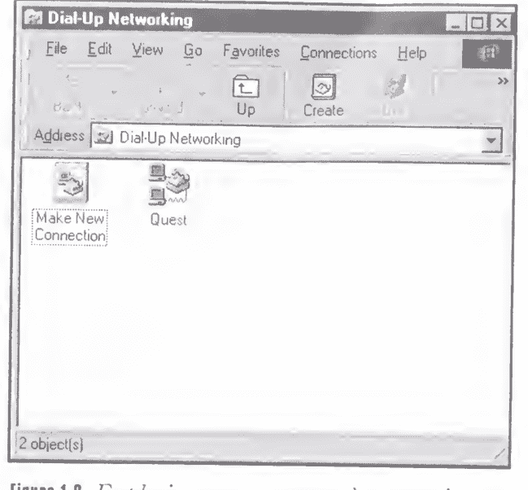

图 1-6 探索计算机的连接

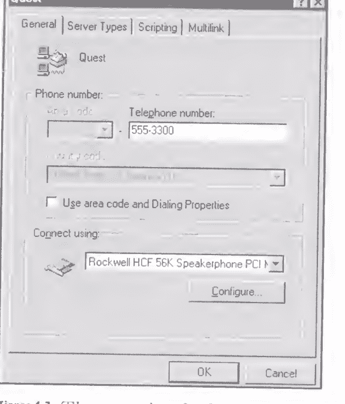

图 1-7 拨号网络连接的属性

此对话框中包含的信息对于任何互联网连接都至关重要。这些设置决定了你在拨号进入后，计算机如何与其他计算机通信。每个连接可能都不同，因此你需要准确记录这些设置。

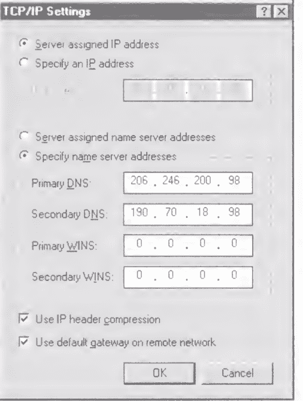

图 1-8 TCP/IP 设置是大多数互联网连接设置的核心。

完成后，点击“取消”按钮关闭 TCP/IP 设置对话框。然后再次点击“取消”以退出连接对话框。

> 不要忘记记录连接所需的用户名和密码！你通常可以在 Windows 控制面板的“网络”设置中找到这些信息。

如果你在“拨号网络”窗口中还有其他想要在 Linux 中保留的连接，请对每一个连接重复本节的步骤以确定其设置。

#### 检查硬件兼容性

既然你已经记录了构成计算机的各项硬件，现在是时候开始检查这些硬件是否与 Red Hat Linux 6.1 兼容了。

##### 检查兼容性的资源

在商店购买软件时，可以将包装盒翻过来阅读其系统要求。在大多数情况下，列出的要求通常是完整的。遗憾的是，Red Hat Linux 的要求过于概括。包装盒侧面仅详细列出了宽泛的参数，而原因很简单：Red Hat Linux 的硬件兼容性列表长达好几页。

这些著名的列表在哪里？启动你的计算机，因为你要去浏览网页了。

##### Red Hat 硬件

寻找关于 Red Hat Linux 6.1 信息的最佳场所自然是在 Red Hat 官方网站。硬件兼容性列表 (HCLs) 位于 `http://www.redhat.com/corp/support/hardware/`，涵盖了 Red Hat Linux 的所有主要发行版本（见图 1-9）。

在你点击 Intel Hardware 链接开始查看 HCL 之前，先向你介绍一下列表中会出现的不同兼容性级别。由于目前 PC 硬件种类繁多，Red Hat 仅支持有限的一组硬件。这并不意味着其他硬件不能在 Red Hat 上运行，而仅仅是指它们没有得到直接支持。

Red Hat 将这些不同的兼容性级别分为几个层级：Tier 1、2、3 和 Incompatible（不兼容）。每个层级代表 Red Hat 对特定硬件的兼容程度或信心程度。表 1-3 定义了这些级别。

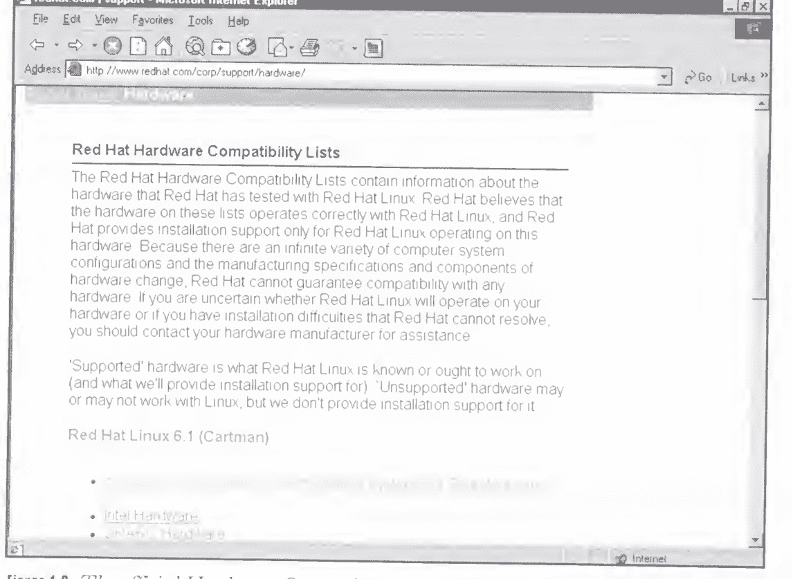

图 1-9 Red Hat Linux 的官方硬件兼容性列表 (HCLs)

###### 表 1-3 硬件兼容性层级

| 层级 | 定义 |
|---|---|
| Tier One | 完全支持的硬件。经 Red Hat 测试、使用并批准。放心使用。 |
| Tier Two | 兼容且受支持，但偶尔会出现问题。Red Hat 的支持有限。请谨慎操作。 |
| Tier Three | 兼容但不受支持。此类别中的设备可能可用也可能不可用。Red Hat 将提供非常有限的支持，主要引导你寻找其他潜在的帮助来源。危险，罗宾逊。 |
| Incompatible | 在 Linux 上运行的可能性极小。其他胆大的用户可能找到了解决方法，但不要寄希望于此。前方有巨龙（危险区域）。 |

Red Hat HCL 组织得非常好。每个部分专注于特定类型的硬件，并包含兼容性级别的定义。关于硬件名称的一项重要警告在这里值得重复一遍。

在硬件世界中，某个产品的品牌化是通过将一个流行名称与可能完全不同的产品相关联来实现的。举一个简单的例子，Pentium 处理器与 Pentium II 或 Pentium III 处理器截然不同。尽管 Pentium 这个名称贯穿始终，但它们并不是同一产品。

其他品牌名称的差异则更为微妙，而产品差异则更为剧烈。这里的重点是，如果 HCL 中没有列出准确的模型名称或编号，最安全的假设应该是该硬件不兼容。

随着更多硬件兼容性问题的解决方案被发现，HCL 在不断演进。在本章稍后部分，我们将讨论该 HCL 的一些重点内容。

##### Linux 硬件数据库

与 Red Hat 网站不同，Linux 硬件数据库 (Linux Hardware Database) 网站并未提供所有可与 Red Hat Linux 配合工作的硬件的全面概览。然而，它提供了一些 HCL 所没有的内容：用户撰写的关于硬件在 Linux 上实际运行情况的评价，以及如何解决一些棘手问题的技巧。

Linux 硬件数据库位于 `http://lhd.datapower.com`。如图 1-10 所示，它包含按类别组织好的硬件链接。

## 第 1 章：安装 Red Hat Linux 6.1 之前

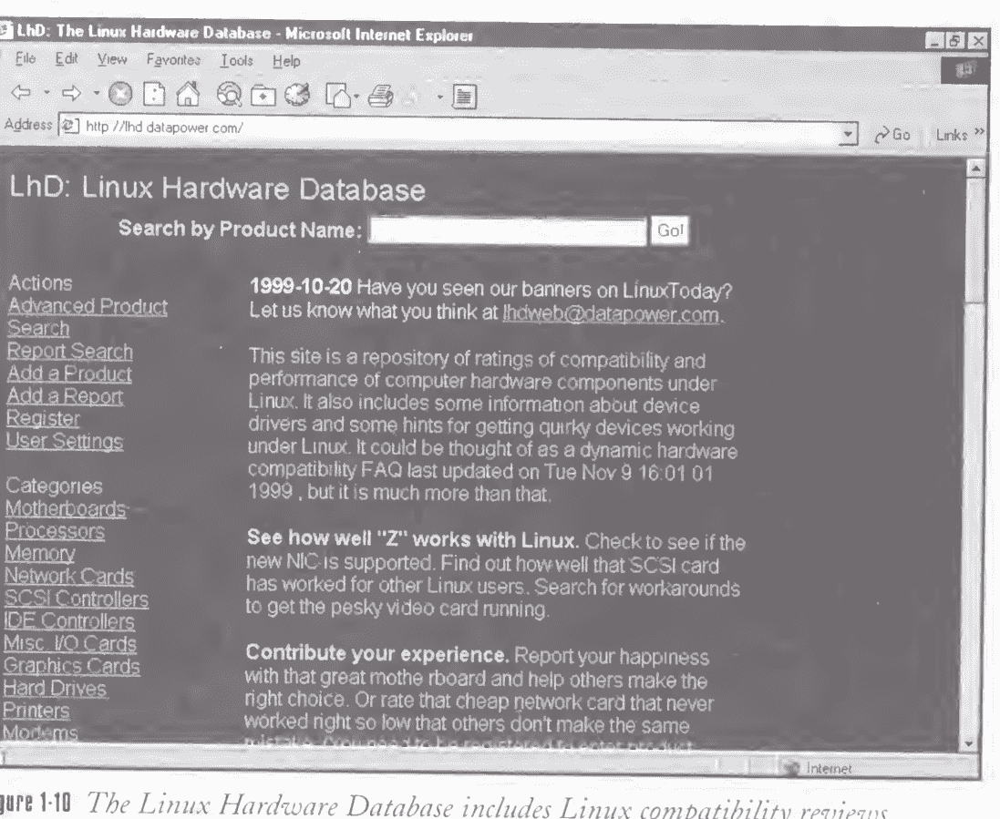

图 1-10 Linux 硬件数据库包含 Linux 兼容性评测。

点击类别链接将显示该类别下所有经过测试的硬件类型的表格列表。硬件按产品获得的评分进行排序（见图 1-11）。

> **注意**
>
> 此数据库中的硬件是在不同的 Linux 版本以及不同的发行版上进行比较的。请务必阅读每个产品的测试规范。在早期 Linux 内核上测试良好的硬件在后续版本中应该也能良好运行。

该网站使用的评分系统基于五个类别的平均值：

- 稳定性 (Stability)
- 性能 (Performance)
- 价值 (Value)
- 设置难易度 (Ease of Setup)
- 综合评价 (Overall)

每个评分类别基于六个相当幽默的数值——从 0 到 5。例如，性能类别中最高分 5 的描述为：

图 1-11 某个类别中最好的硬件将被评为 5.0 分。

是“应该被判定为非法”。正如你现在肯定已经意识到的那样，Linux 用户不像其他计算机群体那样那么严肃地看待自己。

点击你想要查看更多信息的特定硬件。然后你将看到该项目的详细报告，包括为该硬件找到的所有驱动程序，以及关于该项目的用户评论或警告（见图 1-12）。

随着你对 Red Hat Linux 了解得越来越多并熟练地解决硬件问题，你可以回到这个网站并输入你对产品的评价。你只需要注册即可，而且是免费的。

### Red Hat 支持的硬件

准备好你的 Linux 笔记本，回到 Red Hat Linux 网站，让 HCL（硬件兼容性列表）显示在屏幕前。现在是时候将你的 PC 硬件与列表中的硬件进行匹配了。如果你发现你的许多硬件落在第 2 级（Tier 2）和第 3 级（Tier 3）类别中，请不要气馁。虽然这可能需要多花一点精力，但这并不是世界末日。可能存在不需要去电脑商店就能解决的方案。有关安装硬件的更多信息，请参阅第 12 章“使用新硬件进行自定义”。

图 1-12 真实、诚实的评价非常有帮助。

### 显卡

在 HCL 包含的所有类别中，显卡部分可能是内容最丰富的。这是因为除了主板和 CPU 之外，显卡（或图形卡）可以被认为是 PC 中最重要的组件。想一想，如果显示器上没有任何显示，就无法继续使用操作系统。而显示器并不控制 PC 的视频输出——由显卡控制。

正因为如此，且由于显卡之间存在巨大的差异，HCL 花了大量空间来列出不同的显卡。当你考虑到与 Linux 的兼容性并不是问题所在，而是 X Window 系统才是关键时，这种对细节的关注显得有些讽刺。

Linux 是一个基于文本的命令行操作系统。它确实是一个强大的系统，但实际上就像 DOS 一样，只是一个命令行集合。为了使 Linux 成为一个更用户友好的系统，Linux 发行版通常在 Linux 发布版本中打包一个版本的 X Window 系统（也称为 X）。

X 是当今 Linux 发布版本中所有酷炫的窗口和图形用户界面（GUI）的来源。XFree86 是用于 Intel 兼容 PC 的特定类型的 X 服务器。由于显示复杂屏幕需要 XFree86，因此 XFree86（而非 Linux）最关注显卡的兼容性。

在 HCL 中仔细查找你的显卡。一旦找到，在笔记本中记录将使用哪个 X 服务器。X 服务器是 XFree86 中用于显示图形的具体组件。由于不同的显卡使用不同版本的 X 服务器，如果你以后遇到图形显示问题，了解此信息会对你有帮助。

表 1-4 显示了已知与 XFree86 3.3.5（随 Red Hat Linux 6.1 发布的版本）不兼容的显卡简表。

**表 1-4 已知不兼容的显卡**

| 制造商 | 产品 |
|---|---|
| SiS | 530/5591/5596/5511 Pentium PCI/ISA Solution |
| SiS | 600/620/5600 Pentium II 多功能集成芯片组 |

### 内存 (RAM)

与大多数操作系统和软件一样，拥有至少建议的最低 RAM 容量可以消除大多数问题。表 1-5 列出了 HCL 中规定的各种场景下的最低 RAM 要求。

**表 1-5 最低 RAM 要求**

| RAM | 场景 |
|---|---|
| 16 MB | 绝对最低限度（将需要至少 32 MB 的交换磁盘空间） |
| 24 MB | 为 Linux OS 提供更好的性能 |
| 48 MB | 建议运行 X Window 管理器（如 GNOME 或 KDE） |

### 显示器

如前所述，在产生 PC 视觉输出时，显卡承担了绝大部分工作。这并不意味着显示器在与 Linux 和 XFree86 的兼容性中没有作用。但确保你的显示器能与 XFree86 良好协作的地方不在这个安装前阶段。显示器的兼容性是在安装过程中解决的。

为了确保你已准备好安装，请在笔记本中记录显示器的同步率设置。在安装过程中，这些设置将与 XFree86 的 X 服务器组件相匹配。


有关显示器兼容性的更多信息，请访问 XFree86 网站的 FAQ 部分：<http://www.xfree.org/FAQ/#MONITORS>。

## 硬盘驱动器

PC 中使用了两种类型的硬盘：IDE 和 SCSI。如果你还没有识别，可以通过检查系统 BIOS 来确定你的类型（见“检查 BIOS 获取信息”章节）。大多数硬盘与 Red Hat Linux 兼容。

通常，如果你拥有内部 IDE 驱动器，那么在 Red Hat Linux 下没有问题。由于 Linux 查看的是驱动器的 SCSI 控制器，因此对于任何内部或外部 SCSI 驱动器也是如此。如果控制器受支持，那么连接到它的所有驱动器默认都受支持。

外部 IDE 驱动器（如 Syquest 的可移动驱动器）是唯一需要提及的不兼容驱动器类型。

## 以太网卡

在安装 Red Hat Linux 期间，通常会检测网络卡的是否存在。然后 Linux 会询问你的网络设置。HCL 的这一部分显示许多网卡落在第 1 级（Tier 1）和第 2 级（Tier 2）兼容性类别中。

考虑到 Linux 及其祖辈 UNIX 的历史，这是合理的。毕竟，UNIX 最初就是为了在网络上运行而设计的。因此，网络设备在很大程度上兼容是很逻辑的。此外，互联网的通信协议也是基于 UNIX 的。

你应该确保你的网卡在列表中，并找出它落在哪个兼容性级别。大多数大品牌网卡都落在第 1 级，这是好事。甚至有些令牌环（Token Ring）网卡具有第 2 级兼容性——这在当今混合匹配的企业环境中非常有用。

表 1-6 列出了已知与 Red Hat Linux 6.1 不兼容的以太网卡。

**表 1-6 已知不兼容的以太网卡**

| 制造商 | 产品 |
| :--- | :--- |
| Intel | EtherExpress Pro/10 PCI |
| Xircom | 以太网适配器 |

## 声卡

在人们可能会为计算机添加或升级的所有设备中，声卡可能排在列表的最顶端或接近顶端。但即使在 Windows 环境中，声卡的安装和配置也可能很困难。也许这就是为什么 HCL 中没有将任何声卡列入第 1 级类别的原因。

需要注意的是，即使你拥有兼容的声卡，在通过 `SNDCONFIG` 程序对其进行设置之前，Red Hat Linux 可能也不会使用它。有关声卡的更多信息可以在第 7 章“配置打印机、声音和其他设备”中找到。

## CD-ROM 和 DVD-ROM

既然硬盘对于 Red Hat 来说很容易利用，你可能会认为 CD-ROM 同样容易访问。但 Red Hat 对其将使用或不使用的 CD-ROM 更加挑剔。

一方面，所有 100% 符合 ATAPI 标准的 CD-ROM 和 SCSI CD-ROM 都是第 1 级兼容的。偏离标准的情况可能会变得有些棘手。这是你需要仔细审查的一个部分。

不幸的是，DVD 播放器在 Red Hat 系统上尚未得到支持。虽然正在取得进展，但你只能通过其他方式观看你最喜欢的视频。

你的 DVD 驱动器并非完全没用。Red Hat Linux 仍然可以将其作为额外的 CD-ROM 驱动器使用。

表 1-7 列出了已知与 Red Hat Linux 6.1 不兼容的 CD-ROM。

**表 1-7 已知不兼容的 CD-ROM**

| 制造商 | 产品 | 备注 |
| :--- | :--- | :--- |
| 各种 | 并口 CD-ROM | 部分 BackPacks 为第 3 级 |
| LMS/Phillips | drive 206/cm260 | 包括所有克隆版 |
| Liteon | 所有型号 | |

## Zip/Jaz 驱动器

在 HCL（硬件兼容性列表）中，并不容易立刻找到 Zip 驱动器的兼容性列表。您需要查看第 3.5 节“SCSI 驱动器”。然而，一旦您找到了该列表，您会发现外部 Zip 和 Jaz 驱动器都可以工作，包括并行端口 Zip 驱动器。

## 磁带驱动器

大多数 SCSI 磁带驱动器很可能属于 Tier 2 支持。请记住，如果 SCSI 控制器受支持，那么连接到该控制器的任何 SCSI 设备也将受支持。但在该设备类别中有一个例外，详见表 1-8。

**表 1-8 已知不兼容的磁带驱动器**

| 制造商 | 产品 | 备注 |
|---|---|---|
| 多家 | 非 ATAPI 并行端口驱动器 | |
| Onstream | 30 GB 驱动器 | 包括所有类型（IDE、SCSI 和并行） |

## 调制解调器（Modem）

这可能是您最容易遇到问题的设备。简单来说，如果您的计算机拥有内置调制解调器，它将无法工作。这是因为大多数内置调制解调器使用 Windows 特有的驱动程序，无法在其他操作系统中运行。

这个坏消息也有好的一面。如果您使用外部调制解调器，它将可以工作。通过串行端口而非内部连接 PC 的调制解调器不需要 Windows 驱动程序即可运行。

其他类型的外部通信设备在 Red Hat Linux 下也可以工作。ISDN 路由器如果采用外部形式且能模拟调制解调器，通常可以工作，尽管 Linux 将其归类为 Tier 3。

如果您足够幸运，居住在有电缆网络访问的国家区域，那么您可能拥有电缆调制解调器。连接到受支持的以太网接口的电缆调制解调器属于 Tier 3 支持。

有一种内置调制解调器可以在 Red Hat 下工作，即 Lucent Venus PCI 调制解调器。如果您足够幸运拥有这款内置调制解调器，请在安装 Red Hat 后返回 HCL 的调制解调器部分，了解如何调整系统以使用该设备。

尽管我建议您尝试寻找其他设备问题的替代方案，但在这种情况下，您应该为了生活更轻松而直接购买一个廉价的外部调制解调器。

## 打印机

在 Red Hat Linux 中设置打印机的感觉与 Windows 类似。基本上，Red Hat Linux 在安装时并不关心您拥有什么类型的打印机。设置打印机是在安装之后完成的操作（见第 7 章中的“打印机”）。

HCL 中包含了一个详细的本版本 Red Hat 打印机过滤器列表。这些过滤器直接对应于 Windows 打印机驱动程序。请检查列表看看您的打印机是否在其中，但如果不在也不必担心。即使不在兼容性列表中，仍有方法可以安装打印机。

## 鼠标

Linux 在安装过程中配置的第二项内容是鼠标。鼠标共有四种类型：PS/2、串行、总线和 USB。最常见的类型是 PS/2 和串行鼠标，它们属于 Tier 1 兼容。总线鼠标属于 Tier 2 类别，而 USB 鼠标被归类为 Tier 3。

由于您的鼠标很可能属于 Tier 1 或 Tier 2 类别，因此无需对此设备过于担心。然而，如果您使用 USB 鼠标，您应该意识到 Linux 在 USB 方面仍处于实验阶段。您可能需要考虑更换一种新鼠标，或者从一开始就不要购买 USB 鼠标。

> 欲了解更多关于 Linux 中 USB 设备的信息，请访问 <http://www.linux-usb.org>。

## 键盘

HCL 中没有键盘部分。键盘对于 PC 来说是通用的（如果真的有设备能被称为“通用”的话）。键盘长期以来一直遵循 ANSI 标准。无论使用什么操作系统，该标准为键盘能创建的每个字符都使用了特定的代码。

这一标准使得 Linux 非常容易访问任何键盘，包括新型的自然键盘以及带有内置指针设备的键盘。USB 键盘与 USB 鼠标一样，使用时应谨慎。

## 笔记本电脑

笔记本电脑不像台式 PC 那样是一个单一设备。没有哪一款笔记本 PC 能够被定义为整体兼容 Linux。

HCL 中包含了一个关于笔记本电脑的章节，但它有点不同，包含了一个指向 Linux Laptop 网页的极佳链接。如果您考虑在笔记本电脑上安装 Linux，应该访问该链接。

## SCSI 适配器

最后，SCSI 卡部分值得仔细查看，因为许多其他设备都依赖于主 SCSI 卡的兼容性。

这是 HCL 的一个大章节，您应该花时间找到您 PC 的 SCSI 适配器。虽然没有完全不兼容的 SCSI 卡，但如果您的卡属于 Tier 3 类别，确实需要谨慎使用。

## 备份旧数据

在确认您的硬件与 Red Hat Linux 兼容后，您需要为安装准备计算机。您应该做的第一件事之一就是备份 PC 上的数据。

备份重要数据始终是一个好主意，这样可以防止系统灾难。至少，您希望您的数据能免受电源浪涌、病毒攻击、计算机被盗或任何其他影响您访问机器数据因素的影响。

安装 Linux 当然不能被归类为灾难性事件。但您将要更改硬盘的分区，甚至可能格式化硬盘。这些操作能够而且将会彻底擦除数据。

您首先要决定的是哪些数据需要备份。这实际上取决于您在安装 Linux 时想要做什么。尤其是如果您计划双启动（在同一台 PC 上运行 Windows 和 Linux），那么您需要确保已经保护了大部分 Windows 数据。关于双启动的更多信息可以在本章稍后的“双启动还是不双启动——这是一个问题”章节中找到。

即使您计划完全移除 Windows，保存数据文件仍然是有价值的。某些文件类型可以在 Linux PC 上打开，例如图形文件（包括 GIF 和 JPEG 等）。此外，得益于一个名为 StarOffice 的强大办公套件应用程序（完全兼容 Office），Microsoft Office 文件通常也可以打开。不过，如果您计划在 Linux 机器上使用这些文件，您需要通过“保存”而非“备份”来处理它们。Linux 将无法读取 Windows 的备份文件。

如今大多数计算机应用程序占用大量磁盘空间，主要是因为如今的大容量硬盘让它们能够这样做。备份您的数据和应用程序文件是一项巨大的工程。如果您有足够的存储容量（如磁带或 Jaz 驱动器），我建议您备份整个硬盘。

对于那些没有足够大容量设备来存放整个硬盘数据的用户，只需备份您的数据文件即可。您的数据文件是指您在计算机上随时间创建的文档、电子表格、图纸和其他文件。如果您确实遇到了麻烦，可以通过首先重新安装操作系统、使用原始磁盘安装应用程序，然后还原存档的个人数据文件来恢复系统。

如果您从未用过备份程序，您会发现它们很简单。有很多备份程序可供选择，包括 Norton System Utilities 中包含的一个优秀程序。备份实用程序的原理基本相同：定位并识别您希望存档的文件，指定新存档文件的位置，然后创建该文件。还原操作简单来说就是该过程的逆向操作。

Microsoft Windows 拥有自己的备份实用程序，可用于存档您的数据。接下来的几段将描述如何使用 Windows 备份实用程序。

在 Windows 98 任务栏上，点击“开始”按钮。然后选择“程序” → “附件” → “系统工具” → “备份”。Microsoft 备份应用程序将启动并打开“欢迎使用 Microsoft 备份”对话框（见图 1-13）。您现在可以选择创建新备份文件、打开现有备份任务或还原存档数据。

**图 1-13：Microsoft 备份实用程序**

> Windows 95 中的备份应用程序与 Windows 98 中的类似，不同之处在于它缺乏一个引导你完成操作的向导。

选择“创建新备份作业”（Create a New Backup Job），然后点击“确定”。随后将出现备份向导，如图 1-14 所示。

在这里，你可以选择备份计算机上的所有文件，或者选择仅备份选定的文件。如果你有足够的存储空间和时间，请直接存档你的整个 PC。否则，请选择“备份选定的文件、文件夹和驱动器”（Backup Selected Files, Folders, and Drives）选项，然后点击“下一步”。此时将打开备份向导的第二个对话框。

在对话框的左侧，勾选你想要备份的驱动器和文件夹。如有必要，可以使用目录列表中的展开图标来查看子文件夹。请注意，选择一个文件夹会自动选择该文件夹内的所有文件。或者，你可以在对话框右侧的文件列表中，勾选或取消勾选你想要包含或排除的特定文件。图 1-15 显示了在“我的文档”（My Documents）文件夹中选择文件的示例。

当你选好了所有想要包含在备份作业中的文件后，点击“下一步”继续进入备份向导的下一个对话框。现在，系统会询问你是想备份所有选定文件，还是仅备份自上次备份以来发生更改的文件。由于这很可能是你的第一次备份，请选择“所有选定文件”（All Selected Files）选项并点击“下一步”继续。

在第四个对话框中（见图 1-16），系统会询问你希望将备份文件存储在哪里。选择你偏好的位置，并为你的备份文件输入一个文件名。完成后，点击“下一步”继续。

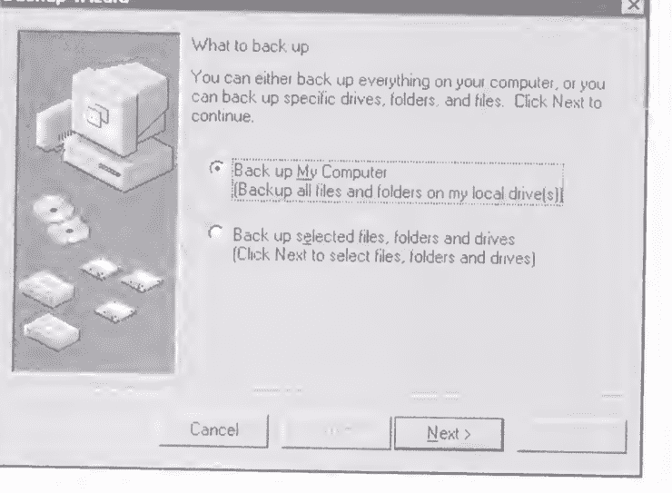

## 备份你的旧数据

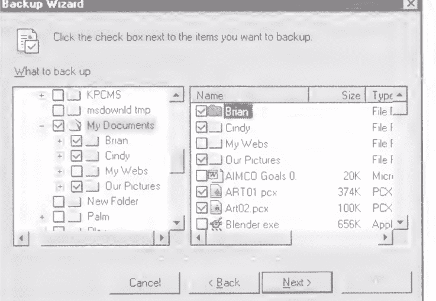

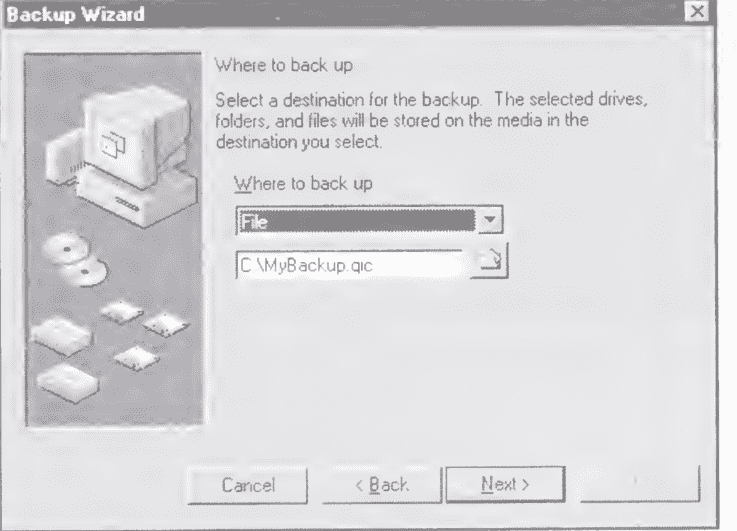

> 请确保将此信息保存到除硬盘以外的驱动器上。Zip 驱动器、Jaz 驱动器或磁带驱动器都是不错的选择。


第五个对话框提供了两种备份数据的方式。第一项指定你希望对数据进行双重检查，以确保其已成功存档。在存档时对数据进行双重检查会减慢处理速度，但我建议你这样做。毕竟，备份错误的数据有什么意义呢？

下一个选项询问你是否要压缩备份数据。除非你有几乎无限的存储空间来存放备份，否则你应该勾选此选项。这同样会减慢备份过程。选择你的偏好，然后点击“下一步”继续进入备份向导的最后一个对话框。

在最后一个对话框中（见图 1-17），你需要为备份文件提供一个描述性名称。这与你之前选择的最终文件名不同。使用一个能帮你记住备份存档文件内容的名称。

在确认你的所有选择后，只需点击“开始”按钮即可启动备份过程。随后将出现备份进度窗口来显示进度（见图 1-18）。

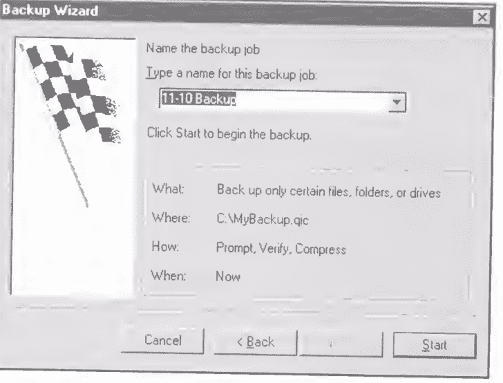

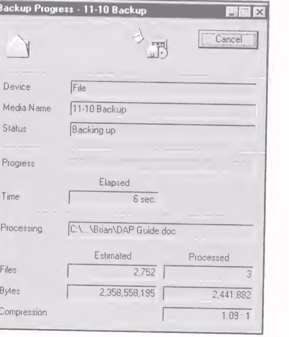

完成后，备份文件将被验证（如果你选择了此项），随后你将收到操作已完成的通知。点击“确定”确认通知，再次点击“确定”以关闭备份进度窗口。

请确保该文件存储在远离硬盘的地方。正如你在下一节将看到的，你的驱动器可能会迎来巨大的变化。

## 双系统启动还是单系统启动——这才是问题所在

现在到了你需要做一个非常重要决定的时刻。就像所有重要决定一样，你应该仔细权衡你的选择。你现在必须决定是在 PC 上单独运行 Red Hat Linux，还是保留现有的操作系统并添加 Linux。

在一部计算机上使用多个操作系统有几个优缺点。缺点包括在机器上安装两个或更多操作系统的麻烦，以及导致每个操作系统可用的内存更加有限。

但使用多个操作系统的益处是巨大的。例如，你将能够运行 PC 上安装的每个操作系统所支持的所有程序。你还将能够使用 PC 拥有的所有硬件。最后，由于不需要购买另一台 PC，你还可以节省资金。

我建议你选择双系统启动——尤其是如果你只是想尝试一下 Linux 的话。这个选项让你在无需投入大量时间或金钱的情况下，享受到使用 Linux 的好处。

### 为多个操作系统腾出空间

如果你决定在 PC 上的 Windows 之外安装 Linux，你需要在硬盘上为其腾出空间。但在硬盘上为 Red Hat Linux 腾出空间与为最新的电脑游戏腾出空间是完全不同的操作。你需要创建一个全新的分区，Linux 将在其中运行。

这本书的这一部分将为你提供关于磁盘分区的速成课程，以及为什么没有分区就无法向磁盘写入数据，所以请坐稳扶好。

#### 为什么要分区？

想象一只在花园里飞舞的蜜蜂。如果你跟随这只蜜蜂回到它的家，你会发现一群看似混乱的嗡嗡作响的昆虫，每只看起来都像是在漫无目的地徘徊，除了闲逛和发出嗡嗡声外没什么可做的。

但众所周知，蜜蜂都有特定的目的，为了蜂巢的集体利益而共同工作。一组蜜蜂的任务是在蜂王产卵后照顾所有可爱的幼蜂。现在，回想一下你的科学课：幼蜂是在哪里饲养的？

如果你说是蜂巢，那么你是正确的。如果你在想这跟分区到底有什么关系，请稍安勿躁。

蜂巢是一个由蜜蜂蜡制成的六角形单元格组成的精巧装置，蜂蜜和蜂幼虫存储在其中以确保安全。现在思考一下：如果没有蜂巢，蜜蜂该怎么生存？答案是它们无法生存。

记住蜂巢，你可以将这个类比应用于数据在磁盘驱动器上的存储方式。你看，如果没有某种已经就绪的结构来组织数据，数据就无法存储在驱动器上。

当数据被放置在驱动器上时，它被写入这个结构中，在 Linux 社区中这被称为文件系统。文件系统是存储数据的格式——如果你愿意，可以将其比作一个由单元格组成的蜂巢，每一小块数据都被放置其中。

由于计算机的特性，实际情况要稍微复杂一点。例如，单个文件的数据并不是存储在相邻的数据块中。数据可能存储在 456、457 和 458 数据块中，然后是 6,134 块，接着是 7,111 块，依此类推。（这是一个过度简化，但你明白这个意思。）文件系统的职责就是跟踪每个文件所在的位置，这样当你发送处理文件的命令时，文件系统就知道存储该文件的所有分散数据块。


正因为有所有这些文件的跟踪和检索，计算机工程师想到了即使在大容量硬盘上也要保持文件系统规模较小的想法。于是，分区的概念出现了。基本上，分区是一个虚拟屏障，它告诉文件系统：“你以前可以向整个磁盘的 1-25000 块写入，但现在你只被允许向 1-17500 块写入。第二个文件系统将写入 17501-25000 块，所以别碰那里！”

- **Swap 分区（交换分区）**：硬盘上的一块空间，被计算机用作辅助 RAM。当程序或进程使用的内存超过计算机上现有的 RAM 时，swap 分区为该进程提供额外的可用内存。

就这样，你就有了分区。而且每个分区可以使用不同的文件系统。类比地说，蜜蜂制造的蜂巢与黄蜂制造的蜂巢不同——结构相似但结果不同。


如今在 Intel 兼容 PC 上使用六种类型的文件系统，如表 1-9 所示。

不同类型的分区通常无法与其他操作系统协同工作。因此，为了在 PC 上安装 Linux，你需要在硬盘上创建一个 `ext2` 分区。不幸的是，如果你的 PC 包含典型的 Windows 安装，你的 Windows 文件系统包含在一个覆盖整个硬盘的大分区中。这导致没有空间来创建分区和新的文件系统。

## 表 1-9 文件系统类型 (Intel PC)

| 文件系统 | 使用者 |
|---|---|
| FAT | Windows 95, Windows 98, Windows NT |
| FAT32 | Windows 95, Windows 98, Windows NT, Windows 2000 |
| NTFS | Windows NT, Windows 2000 |
| ext2 | Linux |
| os2 | OS/2 |
| swap | 所有操作系统 |

请记住，即使你的驱动器上有数 GB 的空闲空间，这些空间（就像文件和目录一样）也可能分散在整个驱动器中。

在现有硬盘文件系统中添加分区的最简单方法是使用第三方应用程序。这将把你所有的资料挤压到一组单一的数据块集合中，从而在驱动器的其他地方留出真正的连续空闲且未结构化（未格式化）的空间，以便你安装分区。

> 在使用任何工具操纵和/或创建分区之前，请将你的数据备份或保存到另一个物理驱动器中。

## PartitionMagic 5.0

在目前市场上所有的分区软件中，PartitionMagic 可以说是最容易使用的，且无疑是经过最长时间考验的。PartitionMagic 使你能轻松地在硬盘上创建分区。它甚至附带了 BootMagic，这是一个多操作系统启动实用程序。

PartitionMagic 之所以如此好用，是因为它实际上可以在没有潜在数据丢失的情况下创建 Linux `ext2` 分区。使用 PartitionMagic 创建原生 Linux 分区可以为你节省大量的安装步骤。

有关 PartitionMagic 的更多信息，请访问 http://www.powerquest.com/partitionmagic。在该网站上你可以找到详细的产品信息。我衷心推荐你使用这款产品。

> 如果你在 PartitionMagic 网站上搜索“linux”，你会找到关于如何具体安装 Linux 分区和挂载点的详细说明。在本章稍后部分，你将了解到关于挂载点的知识。

## fips

如果你不想花钱购买 PartitionMagic，也不必担心。Red Hat Linux 体贴地提供了 `fips`，这是一个可以在 Windows 系统中调整大小并创建 FAT（FAT16 或 FAT32）分区的实用程序。

`fips` 实用程序将减小你当前 FAT 分区的大小并创建一个新的 FAT 分区。然后你需要删除这个新的 FAT 分区。因为 Linux 只能存在于 `ext2` 文件系统中，而该文件系统仅在安装过程中由未格式化的空间创建，因此你需要运行 DOS 的 `fdisk` 实用程序来删除这个新的 FAT 分区。

> `fips` 实用程序位于 Red Hat Linux/Intel CD 1 的 `\dosutils` 目录中。`fips` 的文档位于同一 CD 的 `\dosutils\fipsdocs` 目录中。我强烈同意 Red Hat 的建议，即在使用该应用程序之前阅读 `fips` 文档。

## 何时使用 fdisk

你可能在某些计算机传说或轶闻中听说过，最终你必须在 PC 上使用 DOS 实用程序 `fdisk`。当你需要彻底清除硬盘上的数据时，就会用到 `fdisk` 实用程序。

> 本节是指 DOS 的 `fdisk` 实用程序，而不是 Linux 版本的 `fdisk`（后者有时在处理 Windows 分区时会出现问题）。

> 玩笑之余，使用 `fdisk` 时请务必非常小心。一次错误的操作就会让你丢失所有数据。

就 Linux 安装而言，实际上有两种情况你需要使用 `fdisk`。第一种情况是你计划在 PC 上单独安装 Red Hat Linux。如果你想彻底地清空硬盘并安装 Linux，`fdisk` 实用程序可能是首选方法。

使用 `fdisk` 的第二个机会是消除第三方分区实用程序（如 `fips`）为你创建的任何分区。`fdisk` 实用程序可以将这些非 `ext2` 分区从硬盘上抹除。

以下是如何使用 `fdisk` 删除硬盘分区的步骤：

1. 使用 Windows 资源管理器格式化一张软盘。确保勾选了“创建系统盘”选项。

2. 将 `fdisk.exe` 文件从 `\Windows\Commands` 文件夹复制到软盘中。

3. 重启计算机，将软盘留在驱动器中。由于你将系统文件复制到了其中，该软盘是可启动的。

4. 当出现 DOS 提示符时，输入 `fdisk` 然后按 Enter。将出现一条关于大容量磁盘驱动器的消息（见图 1-19）。

5. 输入 `N` 以不启用大容量驱动器支持。

6. 在 FDISK 选项界面（见图 1-20）中，输入 `3` 以启动“删除分区或逻辑 DOS 驱动器”选项。

7. 在“删除 DOS 分区或逻辑 DOS 驱动器”界面（见图 1-21）中，输入 `1` 以激活“删除主 DOS 分区”选项。

8. 在“删除主 DOS 分区”界面中，输入标识你想删除的分区的数字（见图 1-22）。如果存在多个分区，请参考内存列表和文件系统类型来帮助你识别要删除的分区号。

9. 输入你要删除的分区的卷标（Volume Label）。随后会出现确认行。

10. 确认你确实要删除该分区，然后在确认行中输入 `Y`。你选择的分区将被删除。

图 1-19 启动 `fdisk` 将显示关于大容量磁盘驱动器的重要信息。

图 1-20 你的 FDISK 选项——除非在专业人士手中，否则具有潜在的破坏性。

图 1-21 在此界面中选择你想删除的分区。

11. 完成后，按下 Esc 键直到返回 DOS 提示符。

> 如果你好奇为什么删除分区仅用了一两秒钟，而擦除硬盘的一部分似乎需要更长时间，这是因为只有分区定义被删除了，而不是内部的数据。但没有了分区及其文件系统，内部的数据现在就成了一团混乱且无用的数据块。就像蜂巢突然消失后的蜂蜜一样。消除这个分区本质上就擦除了数据，因为你再也无法找回它。

图 1-22 分区删除发生前的最后一步。

现在你已经了解了如何为 Linux 分区腾出空间，是时候研究具体如何设置你的 Linux 分区了。没错，是“分区”——复数形式。

## Linux 安装期间所需的分区

在 Windows PC 上，你可能有多个硬盘磁盘。当 Windows 看到一个新分区时，它会自动为该驱动器分配一个盘符。这是一个非常简单的使用系统。

但在 Linux 中情况并非如此。Linux 运行至少需要三个分区。但如果你在 Linux 中打开文件管理器，你会看到一个单一驱动器的目录树外观。那么是怎么回事呢？

Linux 管理文件的方式与 Windows 完全不同。Linux 不是使用盘符来引用分区及其相应的文件系统，而是将组成其单一文件目录所需的文件和目录分开。事实上，这个“单一”的文件目录实际上是由无缝连接在不同分区上的独立目录树组成的。这些子树与主目录树连接或断开的地方被称为挂载点。

Linux 不使用盘符来表示分区，而是使用一种不同的命名约定：

`/dev/[驱动器类型][分区所在设备][分区号]`

表 1-10 给出了此命名约定中使用的变量说明。

在 Linux 内部，这种在分区之间划分目录的方式是无缝的。但在安装 Linux 时，你需要仔细思考你想要哪些分区、挂载点是什么，以及你将为每个分区分配多少内存。

> **术语**
>
> 根目录（root directory）是 Linux 文件系统中最基础的目录。它是独立/唯一的。根目录与 `/root` 不同，后者同样存在于文件系统中。

> **术语**
>
> 挂载点（Mount points）是从每个分区挂载到主目录树的目录。例如，如果 `/boot` 挂载点是 `/boot`，那么 `/boot` 下的所有文件和目录都将位于 `hda1` 上。但 `/` 下的目录则将位于一个完全不同的分区上。

## 表 1-10 分区命名规范

| 变量 | 定义 |
| :--- | :--- |
| `/dev/` | Linux 中的所有设备都在 `/dev/` 目录下管理，包括硬盘及其分区。 |
| 驱动器类型 | 硬盘类型的双字母指示符。可能的值：`hd` (IDE 磁盘), `sd` (SCSI 磁盘)。 |
| 分区所在设备 | 分区所在的设备。可能的值：`/dev/sda` (第一块 SCSI 磁盘), `/dev/hdc` (第三块 IDE 磁盘)。 |
| 分区号 | 表示分区。可能的值：1-4 (主分区或扩展分区), 5+ (逻辑分区)。 |

## 你需要准备的

Red Hat Linux 建议你创建三个分区以获得最佳性能。你可以创建更多，但不能更少。表 1-11 列出了推荐的分区、空间大小及其挂载点。

## 表 1-11 Intel PC 推荐的 Linux 分区

| 分区 | 挂载点 | 内存分配 |
| :--- | :--- | :--- |
| 引导分区 (Boot Partition) | `/boot` | 不超过 16 MB |
| 根分区 (Root Partition) | `/` | 最小安装需 600 MB，安装所有软件包需 1.5 GB |
| 交换分区 (Swap Partition) | 无 | 等于 PC 的 RAM，最小 32 MB |

你不必非得使用这些设置，但它们相当简单直接，且能使 Linux 以峰值性能运行。

## 交换分区与你

对于那些有 Windows 背景的用户来说，交换分区并不是一个新概念。在那个环境下，交换分区被称为交换文件或虚拟内存。

简单来说，交换分区的作用就是为你的应用程序运行提供除 RAM 之外的额外内存。你看，应用程序（尤其是像 X 这样的图形界面应用程序）将 RAM 作为“工作区”。如果应用程序需要并使用了大量 RAM，它们可能不得不减速或暂停，等待其他应用程序完成并释放 RAM。

为了帮助缓解这种减速，交换分区使用硬盘空间来为贪婪的应用程序模拟运行内存。诚然，将信息交换进出硬盘空间的速度比 RAM 慢，但这可能比等待共享有限的可用 RAM 要快。

交换分区没有挂载点，因为用户通常不需要访问其中发生的情况。

> 一个常见的误区是认为交换分区的上限是 128 MB。自 Linux 内核 2.2.0 版本发布以来，这个限制已不再是影响因素。

## 使用 Disk Druid 的分区策略

你实际应用分区策略的地方是 Disk Druid。Disk Druid 要么在安装程序中首次出现（如果你 PC 上已有现有分区），要么在自定义安装路径中出现。

Disk Druid 也是一个分区实用工具，但不建议你用它从零开始创建磁盘分区。这样的分区可能会导致你 PC 上的其他操作系统无法读取。如果你使用本章前面建议的第三方实用工具，然后使用 Disk Druid 来更改分区类型和设置分区挂载点，效果会更好。这一过程将在第 2 章“安装 Red Hat Linux 6.1”中详细描述。

分区策略中最关键的部分是你决定将 `/boot` 分区放在哪里。如果你记得，许多 BIOS 对定位存放于 `/boot` 分区中的 Linux 加载程序 (LILO) 的位置有限制。如果你将 `/boot` 分区放在 BIOS 无法访问的地方，你将无法启动 Red Hat Linux。

## 在大硬盘上定位 /boot 分区

硬盘在物理上被分为柱面 (cylinders)。由于 BIOS 的限制，至关重要的一点是 `/boot` 分区必须完全位于 1023 柱面以下，且分区的任何部分都不能与 1023 柱面重叠。无论你使用的是单盘还是多盘策略，请将整个分区保持在该柱面之下，以避免巨大的麻烦。

## 多硬盘

你可能记得在检查 BIOS 信息时，记录了你拥有多少块物理硬盘以及它们的类型。这里就是这些信息发挥作用的地方。

许多 PC 上的 BIOS 在引导某些类型的驱动器时存在困难。因此，必须将 `/boot` 分区放置在正确的硬盘上。表 1-12 展示了不同的硬盘场景并推荐了 `/boot` 分区的位置。

## 表 1-12 推荐的 /boot 分区位置

| 分区情况 | 解决方案 |
|---|---|
| 多个 IDE 硬盘 | `/boot` 应挂载在连接到主 IDE 控制器的前两个硬盘之一上 |
| IDE 和 SCSI 硬盘 | `/boot` 应挂载在第一个 IDE 硬盘或 ID 0 SCSI 硬盘上 |
| 多个 SCSI 硬盘 | `/boot` 应挂载在 ID 0 或 ID 1 SCSI 硬盘上 |

## 本章小结

在本章中，我们深入探讨了在向你的系统中安装 Red Hat Linux 6.1 之前需要考虑的主要事项和需要收集的信息。

在第 2 章中，这些准备工作将在你的 PC 上安装 Red Hat Linux 6.1 时投入使用。

# 第 2 章：安装 Red Hat Linux 6.1

Brian Proffitt

- 启动 Red Hat 安装程序
- 执行安装
- 其他安装注意事项

在本章结束时，你应该已经在 PC 上安装好了 Red Hat Linux 6.1。

太大胆的说法了？一点也不。事实是，安装已经不再是一件多么困难的事情——如果你在第 1 章“安装 Red Hat Linux 6.1 之前”做好了准备。

收集第 1 章中指定的所有信息非常重要，因为你需要用它来复核安装程序的执行情况，并在必要时亲自输入信息。

在开始之前给你三个建议：不要恐慌。如果你仔细阅读说明并拥有正确的信息，几乎不会出什么错。

## 启动 Red Hat 安装程序

有多种安装 Red Hat Linux 6.1 的方法。最简单的方法是使用官方的 Red Hat 6.1 CD-ROM，你可以从大多数软件商店购买官方套装。

Red Hat Linux 6.1 分为三种版本：标准版 (Standard)、豪华版 (Deluxe) 和专业版 (Professional)。标准版包含《Red Hat Linux 安装指南》和《参考指南》以及一张启动盘。你将在接下来的“创建启动盘”部分了解更多关于这张重要磁盘的信息。

在豪华版和专业版中，包含一套 Linux 工作站应用程序 CD-ROM、PowerTools 以及一张包含 Sun StarOffice 5.1 的 CD-ROM 供你使用。专业版还包含一个服务器应用程序奖励包和额外的网页构建工具。

由于 Red Hat Linux 可以从除官方套装以外的其他渠道获得，你可能需要通过其他方式获取某些额外资源。如果你无法获得套装副本，或者不想花钱，你可以使用一些方法来获取所需的工具。

> 学习如何下载 Red Hat Linux 的绝佳场所是 http://www.redhat.com/download/howto_download.html。

套装中包含的文档在网上以 HTML 或 Acrobat PDF 格式免费提供，网址为 http://www.redhat.com/corp/support/manuals/。

你无法像在套装中那样在一个地方找到所有打包在一起的额外软件，但快速浏览 Linux 相关网站就会引导你找到同样的工具，甚至更多。例如，StarOffice 是一个非常强大的办公套件，与 Microsoft Office 完全兼容，可以在 http://www.sun.com/staroffice 找到。

> 顺便推荐：欲了解更多关于 Sun StarOffice 的信息，请阅读作者编写的 *Sun StarOffice 5.1 for Linux* (Prima, 1999)。

复制任何套装所需的最后一个组件是启动盘，将在下一节中详细介绍。

### 创建启动盘

除了 Linux 程序 CD-ROM 之外，你需要的最重要的资源就是启动盘。如果没有启动盘副本，你可能会在安装软件时遇到困难。

启动盘：一张包含 Linux 系统文件的软盘，允许用户在加载任何其他操作系统之前访问 Red Hat Linux CD-ROM。

需要启动盘的原因是，Linux 不能在另一个操作系统内部安装，它必须在 PC 启动后、任何其他内容加载之前开始。许多 PC 不能直接从 CD-ROM 驱动器启动，但可以从软盘驱动器启动。你是否注意到电脑开启时软盘驱动器发出咔哒咔哒的声音？那就是 BIOS 正在驱动器中寻找启动盘。

> 如果你足够幸运地拥有一个可引导的 CD-ROM，那么你就不需要启动盘。只需将 Red Hat Linux CD 1 插入 CD-ROM 驱动器并重启计算机。安装程序随后将自动开始。

启动盘包含启动一个微型 Linux 版本所需的足够 Linux 命令，包括使 Linux 能够识别并运行 CD-ROM 驱动器的指令。此时，你可以“快速启动”完整的安装程序投入运行。

请按照此步骤制作你自己的启动盘：

### 创建 Linux 启动盘

本任务演示如何创建 Linux 启动盘。

1. 格式化一张 3.5 英寸磁盘并将其留在软驱中。

2. 将 Red Hat Linux CD 1 插入 CD-ROM 驱动器。

3. 在“开始”菜单中选择“程序” $\rightarrow$ “MS-DOS 提示符”以启动 MS-DOS 窗口。

4. 输入 `<drive letter>:\`，其中 `<drive letter>` 是您的 CD-ROM 驱动器盘符。

5. 输入 `cd \dosutils`。您现在应该处于 CD 上的 `dosutils` 目录中。

6. 输入 `rawrite`。`rawrite` 应用程序将启动。

7. 当提示输入磁盘镜像源时，输入 `..\images\boot.img`。

8. 当提示目标软盘驱动器时，输入 `<drive letter>:`，其中 `<drive letter>` 是您的软盘驱动器盘符。

9. 根据提示按下 Enter 键。Red Hat Linux 启动指令将被复制到您的软盘中。

如果您稍后选择使用“自定义安装”路径，系统将提示您创建另一个启动盘副本。由于拥有更多启动盘会更安全，您届时可能也想再制作一个。

### 运行安装程序


现在您可以开始了。您已经收集好了所有信息，准备好了磁盘，桌上还放着一只可爱的填充企鹅玩偶来祈求好运。时刻到了。

将 Red Hat CD-ROM 1 插入 CD-ROM 驱动器，然后关闭计算机。在计算机关闭状态下，将启动盘插入软驱。然后重新启动计算机。您的计算机将开始启动过程，首先从软驱启动。随后它将执行软盘上的指令，而不是继续访问硬盘并加载其他操作系统。

请记住，如果您拥有可启动的 CD-ROM 驱动器，则不需要启动盘。您的计算机将直接从安装 CD-ROM 光盘中读取启动指令。

安装过程的第一个屏幕如图 2-1 所示。如您所见，它非常简洁，但它会提示您做出一个重要的决定。

在安装 Red Hat Linux 6.1 时，您可以从三种安装选项（有时称为“安装类别”）中进行选择。第一种是图形模式（graphical mode），这是一种类似 Windows 的安装方式，无疑是最容易使用的。第二种选项是文本模式（text mode），其鲁棒性略低于图形模式，但同样能完成任务。

最后一个选项是专家模式（expert mode）。目前，我建议您远离这个选项。您只有在 Linux 无法检测到运行安装程序所需的硬件（如 CD-ROM 驱动器和硬盘）时，才应该使用专家模式。这种情况相当罕见。您应该可以直接在此屏幕上按 Enter 键以启动图形安装模式。

> 在离开第一个屏幕后，将进行更多的硬件检测。如果 Red Hat 的安装程序无法识别您的显卡，屏幕可能会显示为全白或全黑。如果发生这种情况，请重新启动 PC，这次在启动安装提示符处输入`text`。文本安装模式对显示驱动程序的挑剔程度较低。您可以在 Linux 安装完成后再配置图形显示。

图形安装模式将开始。本章的接下来的章节将详细介绍典型工作站安装的每个步骤。

**图 2-1** 选择要使用的安装程序类型。

## 执行安装

随着安装的进行，您将看到一系列安装屏幕，它们将根据您选择的安装类别向您提供选项。这些屏幕在整个安装过程中的组织方式相同，如图 2-2 所示。

在屏幕的左侧，您将看到“在线帮助”窗格。该窗格包含与当前安装屏幕相关的常规帮助。虽然它占用了一些屏幕空间，但我建议您在整个过程中保持开启。这样您就可以快速找到不理解的术语或选项的帮助。如果您确实认为不需要在线帮助，可以通过点击“隐藏帮助”按钮将其关闭。

屏幕右侧的窗格是所有操作发生的地方。操作窗格显示与当前任务相对应的选项，您在此做出安装选择。每次完成选择后，点击“下一步”按钮进入下一个屏幕。反之，如果您需要撤销之前做出的决定，可以点击“上一步”按钮返回到想要更改的屏幕。

> **注意**：在某些情况下，“下一步”按钮在您完成所有必要选择之前会被禁用（显示为灰色），这是一个非常有用的安全特性。

图 2-2 一个典型的安装屏幕

> 您可以通过安装屏幕逐步后退，直到回到“准备安装”屏幕。一旦过了这个“不可回头点”，您就无法更改主意了。

## 确定语言、键盘和鼠标设置

在安装过程的早期，Red Hat Linux 会收集重要信息，以便安装能够顺利进行。这些信息集中在输入方面——具体来说，即您如何向安装程序和 Linux 输入数据。您需要选择想要使用的语言、键盘和鼠标设备。

安装路径的第一个屏幕要求您选择要使用的语言。这将是安装过程中使用的语言，并不一定是 Red Hat Linux 内部使用的语言。从语言列表中选择您偏好的语言，然后点击“下一步”按钮。

此时会出现图 2-2 所示的“键盘配置”屏幕。这里有三个类别用于定义您的键盘：型号（Model）、布局（Layout）和变体（Variant）。

虽然目前的键盘型号相当通用，但风格上仍有一些差异。许多美国人能认出的一个例子就是“自然”键盘（人体工程学设计）与更标准的（扁平）101 键键盘之间的区别。在“型号”列表中检查您的键盘型号和风格。如果您没有看到具体的键盘型号，请选择`Generic 101-key PC`。

“布局”是指所选键盘使用的字母数字字符。例如，使用德语的人需要像 ü 这样的字符，如果您住在英国，可能需要 £ 这样的字符。在美国，选择其中一个 U.S. English 选项即可。

如果您仍然想要英文布局，但同时使用需要创建死键（dead keys）的替代字符，则应选择“死键”选项。如果您使用的是较新的计算机，请选择`ISO-9995-3`选项，因为它将使您的键盘符合国际标准。

“变体”类别中的选项将根据所选的“布局”而变化。通常，选项是在您的键盘型号和布局上不使用变体，或者使用一个或多个不同的变体（例如使用死键）。如果您有特殊的输入需求，请参阅键盘文档获取帮助。完成所有选择后，点击“下一步”按钮。

在“鼠标配置”屏幕（见图 2-3）中，您可以选择所使用的鼠标类型。正如您在当地电脑店看到的，并非所有的鼠标都是一样的。但它们都必须执行相同的任务——在屏幕上移动鼠标指针。

> **死键 (Dead keys)：** 允许在英文键盘上快速创建非英文字符的按键。

### 鼠标配置

图 2-3 鼠标配置屏幕

> 什么？您没有虔诚地保存您拥有的每件硬件的文档？在这种情况下，请检查您的 PC 背面。如果鼠标插入一个小圆形的 6 针端口，它就是 PS/2。如果插入一个梯形的 9 针端口，它就是串口（serial port）。除此之外的都是总线端口（bus port）。

您会注意到列表中有三键鼠标的选项。这对于 Windows 用户来说通常比较陌生，但对于 UNIX 用户来说非常熟悉。许多 UNIX 和 Linux X 应用程序使用三键鼠标上的中间按钮，而 Windows 应用程序中使用的鼠标通常是两键的。由于 Linux 应用程序经常使用中间按钮，Linux 可以将两键鼠标设置为模拟三键鼠标（通常是通过同时点击两个鼠标按钮）。我建议您选择`Emulate 3 Buttons`选项。

因为你很可能会在 Red Hat Linux 中遇到需要中间按钮的情况——而且这比出去买个新鼠标要便宜得多。

使用展开图标来浏览鼠标选项，选择你需要的鼠标，然后点击“Next”按钮继续。

## 选择安装类别

在你进入安装过程中更关键的区域之前，你会通过 Red Hat 欢迎界面获得短暂的休息，如图 2-4 所示。这个屏幕不仅仅是系统安装程序的正式开始。在线帮助窗格包含了一些有用的信息，告知你可以在哪里获取 Red Hat Linux 安装指南和其他手册。

点击“Next”按钮进入“安装类型”界面。你现在必须决定要安装什么。图 2-5 显示了该界面。

你可以选择三种主要的安装选项。本节将详细讨论每个选项。

- **工作站 (Workstation (KDE or GNOME))。** 此路径将自动安装带有 X 以及 KDE 或 GNOME 桌面环境的 Linux。它将包含运行标准 PC 工作站所需的软件包。

- **服务器 (Server)。** 此路径将自动安装带有附加服务器软件包的 Linux，包括 Apache Web 服务器（可能是最常用的 Web 服务器）。选择此项时，X 不会自动安装。

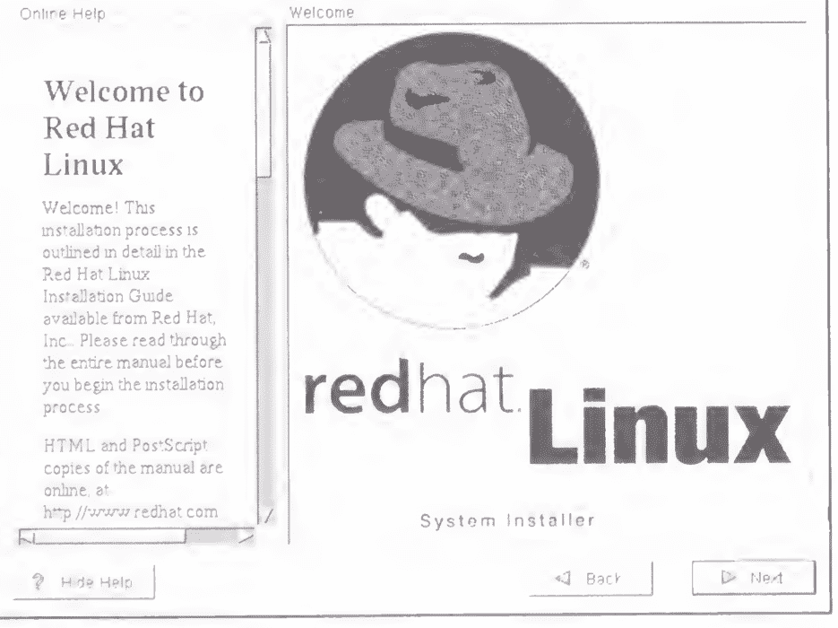

图 2-4 欢迎界面是安装过程的真正开始。

## 第二章：安装 Red Hat Linux 6.1

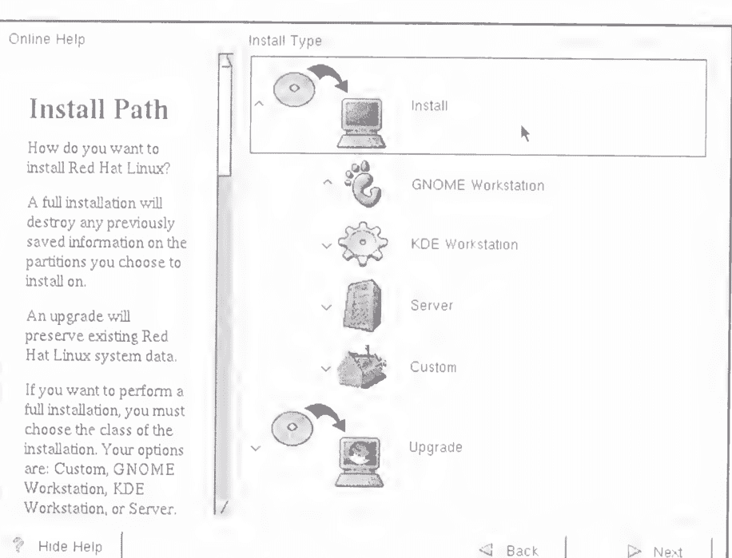

图 2-5 安装类型界面

- **自定义 (Custom)。** 自定义允许用户精确选择要安装哪些软件包。用户还可以有机会配置在其他安装路径中可能是自动设置的选项，例如 LILO 的位置和硬盘的分区。

屏幕上还有一个第四个选项，但它实际上并不影响安装内容。“升级 (Upgrade)”允许你保留硬盘上当前的 Linux 安装，并简单地将当前的 Red Hat Linux 版本升级到 6.1。

> 你应当非常清楚一点：除了“升级”选项外，所有的安装选项都将删除硬盘上至少所有的 Linux 数据和分区。服务器安装“服务器”将删除硬盘上的所有数据和分区——无论是 DOS、Windows 还是任何其他内容。

什么时候应该使用这些选项？就像大多数与计算机相关的安装一样，你的具体情况很可能与我在这里提出的任何场景都不同。表 2-1 列出了一些基本准则，供你在决定选择哪种安装路径时参考。

GNOME 和 KDE 是运行在 X 之上的不同窗口管理器。坦率地说，两者在操作上的差异很小。由于 GNOME 最初是为 Red Hat Linux 开发的，我建议你目前坚持选择它。

### 表 2-1 安装路径准则

| 路径 | 问题/说明 |
| :--- | :--- |
| 工作站 (Workstation) | 最简单的路径。适用于安装单一操作系统的家用 PC。自动安装 X Window。可用于与 Windows 95/98 设置双启动系统，但不支持 Windows NT 或 OS/2。 |
| 服务器 (Server) | 适用于高级用户，特别是希望创建网络或 Web 服务器的用户。可用于与 Windows 95/98 设置双启动系统，但不支持 Windows NT 或 OS/2。 |
| 自定义 (Custom) | 必须用于在与 Windows NT 或 OS/2 共用的 PC 上安装，以便将 LILO 放置在硬盘的正确位置。并不复杂，且赋予用户在每个应用程序包之间挑选的能力，而不仅仅局限于 Linux 在其他两种安装路径中提供的内容。 |

> 请确保你不仅选择了每个安装选项的按钮，还选择了（点击并高亮）“安装 (Install)”选项。否则，在安装软件包时将没有任何反应。


完成所有安装选项的选择后，点击“Next”继续。

## 选择分区选项

接下来在安装过程中出现的是“自动分区”界面。在这里，你将决定是由你自己对硬盘进行分区，还是让 Linux 来完成（见图 2-6）。

如果 Red Hat Linux 将是你 PC 上的唯一操作系统，并且你已经删除了所有其他操作系统及其分区，那么你应该让 Linux 为你执行分区。

如果你计划与 Windows 95 或 98 双启动，也可以允许自动分区。在“工作组 (Workgroup)”安装中，只有现有的 Linux 分区会被 Red Hat Linux 6.1 的新分区设置所替换。Windows 操作系统使用的现有 DOS 分区将不受影响。

表 2-2 列出了如果你允许 Red Hat 使用“工作组”或“服务器”安装选项为你分区时将获得的分区设置。

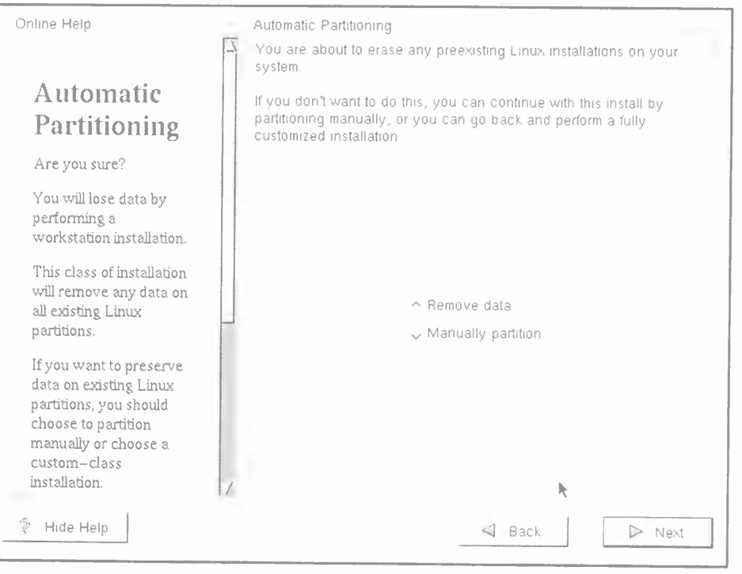

图 2-6 自动分区界面

### 表 2-2 Linux 安装分区

| 分区 | 挂载点 | 内存分配 |
|---|---|---|
| **工作站 (Workstation)** | | |
| 引导分区 (Boot Partition) | /boot | 16 MB |
| 交换分区 (Swap Partition) | 无 | 64 MB |
| 根分区 (Root Partition) | / | 磁盘上所有未分区的剩余空间 |
| **服务器 (Server)** | | |
| 引导分区 (Boot Partition) | /boot | 16 MB |
| 交换分区 (Swap Partition) | 无 | 64 MB |
| 根分区 (Root Partition) | / | 256 MB |
| Var 分区 (Var Partition) | /var | 256 MB |
| Usr 分区 (Usr Partition) | /usr | 磁盘上剩余未分区空间的一半 |
| Home 分区 (Home Partition) | /home | 磁盘上剩余未分区空间的一半 |

如果你选择“手动分区 (Manually Partition)”选项并点击“Next”，你将看到 Disk Druid 界面，如图 2-7 所示。

### 分区

你想将 Red Hat Linux 安装在哪里？

首先，你必须为一个或多个磁盘分区定义挂载点。此时你可能还需要创建和/或删除分区。

如果你不知道如何对系统进行分区，请阅读《Red Hat Linux 安装指南》或《Red Hat Linux 参考指南》中关于分区的章节。

顶部屏幕显示：


图 2-7 手动分区在 Disk Druid 工具中进行控制。

Disk Druid 工具的基本操作很简单。你会看到一个现有驱动器分区列表，可以是 Linux 或 DOS 分区。在分区列表下方是“驱动器摘要 (Drive Summary)”列表，其中提供了 PC 上硬盘的详细信息。在添加或删除分区时，请留意“已用 (M)”和“已用 (%)”字段。已用磁盘空间的百分比将接近或远离 100%。只要该字段显示的数值小于 100%，驱动器上就仍有未分区空间供你使用。反之，如果“已用 (%)”字段显示为 100% 且你仍需要添加分区，则必须删除一些现有分区以腾出空间。

以下步骤用于在 PC 上手动创建工作站分区集。我建议按照以下顺序添加分区：boot、swap 和 root (/)。由于根分区将设置为填充硬盘上的所有剩余空间，因此你首先需要准确指定其他分区所需的份额。

### 使用 Disk Druid 进行分区

如果在安装过程之前，所有现有分区已被`fdisk`删除，请使用 Disk Druid 界面为工作站 PC 创建分区。

首先，按照以下步骤创建`/boot`分区：

1. 点击“Partitions”部分的“Add”按钮。将出现“Add”对话框。
2. 在“Mount Point”字段中，输入`/boot`。
3. 在“Size (Megs)”字段中，输入 16（16 MB 是 Intel 兼容 PC 上引导分区的最大尺寸）。
4. 确认“Partition Type”为 “Linux Native”。
5. 选择你想放置引导分区的硬盘（参考第一章中的表 1-12 以确保所选驱动器可用）。
6. 点击“OK”。“Add”对话框将关闭。

现在创建交换 (swap) 分区：

1. 再次点击“Add”按钮以创建交换分区。将出现“Add”对话框。
2. “Mount Point”字段保持空白。
3. 在“Size (Megs)”字段中，输入 70。
4. 点击“Partition Type”列表控件并选择 “Linux Swap”。
5. 选择你想放置交换分区的硬盘。
6. 点击“OK”。“Add”对话框将关闭。

最后，创建根 ( / ) 分区：

1. 再次点击“Add”按钮以创建根分区。将出现“Add”对话框。
2. 在“Mount Point”字段中，输入`/`。
3. 将“Size (Megs)”字段设置保留为 1 MB。
4. 点击 “Grow to fill disk?”（扩展以填充磁盘）选项。
5. 确认“Partition Type”为 “Linux Native”。
6. 选择你想放置根分区的硬盘。
7. 点击“OK”。“Add”对话框将关闭。

你现在将在 Disk Druid 屏幕的分区列表中看到新分区。 “Used (%)” 的值应该是 100%。

如果你想更改其中任何值，只需选择要修改的分区并点击“Edit”按钮。将出现“Edit Partition”对话框。如果分区在你的 PC 上预先存在，你只能更改其挂载点。要进行其他更改，请选择该分区然后按`Delete`键将其删除。然后你可以根据自己的要求创建新分区。

> 在 Disk Druid 界面上，“Next”按钮在设置好与 Linux 兼容的分区方案之前不会激活，这是确认您的设置是否正确的一种方式。


分区完成后（无论使用自动还是手动选择），点击 Next 按钮进入时区时区选择界面。

## 计算机网络配置

如果安装程序检测到您拥有网卡，您需要提供有关计算机的相关信息。

如果您处于大型网络中，建议从网络管理员那里获取所需数据。如果您就是管理员，那么您应该已经拥有在安装前进行数据收集过程中获得的信息。

有关网络设置的更多信息，请参阅第 6 章“配置网络连接”。

## 设置时区

您可能认为时区这个话题并不复杂。一天 24 小时，将地球分成 24 份，就这样搞定了，对吧？

错了。全球许多国家设置时钟的理由更多是基于政治而非地理因素。即使在美国，也有几个州在实行夏令时期间不调整时钟。因此，时间设置变得很棘手。

观察图 2-8 可以清楚地看到，Red Hat 的开发人员已经考虑到了这一点。

屏幕上占据主导地位的是一张世界地图，其中有几个区域被高亮显示。由于在这个比例尺下城市太小，请点击 View 下拉列表并选择您居住的区域。随后将出现您所在区域的更大比例尺地图。

要设置您的时区，只需在地图上点击距离您最近的城市/区域。或者，您可以从地图下方出现的列表中选择您的城市/区域。您的选择随后将显示在地图正下方的字段中。

如果愿意，您可以基于通用世界时 (UTC)（一种基于格林威治标准时间的恒定标准时间）来设置时间。为此，请点击标记为 System Clock Uses UTC 的选项，并根据与 UTC 的小时偏移量输入时间。

完成后，点击 Next 按钮。

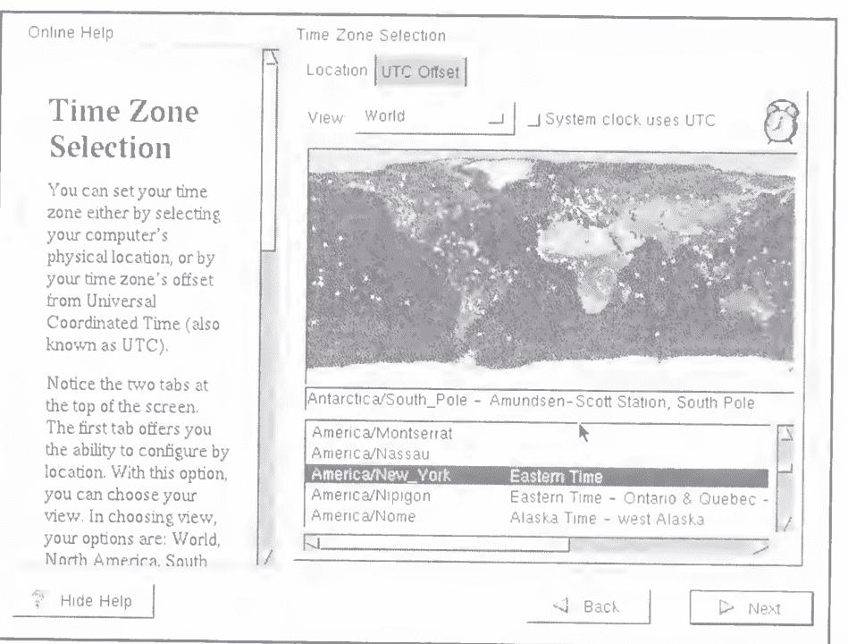

图 2-8 有人知道现在几点吗？

## 配置您的账户

每当创建 Linux 系统时，必须同时创建 root 账户。root 账户是 Linux PC 的管理员账户。由于在对操作系统设置进行任何修改时都会使用 root 账户，因此它是系统中权限最高的账户。设置 root 账户只需在 Root Password 和 Confirm 字段中输入相同的密码即可。Confirm 字段的输入是为了确保您在输入密码时没有出现拼写错误。

如果您系统中有其他用户，现在为他们创建额外的用户账户是一个好主意。用户账户类似于 Windows 中的用户配置文件。它们允许特定用户自定义访问 Linux 系统，并提供额外的安全性，以便知道谁在系统中执行什么操作。


如图 2-9 所示，要创建用户账户，请在 `Account Name` 字段中输入用户 ID，提供密码以及用户的全名。与创建 `root` 账户类似，您需要输入两次密码以确保没有拼写错误。点击 `Add` 按钮将完成该过程。

> `Red Hat Linux` 中的密码区分大小写。

#### 账户配置

输入 `root` 密码。密码长度必须至少为 6 个字符。确认密码。一旦两个输入字段匹配，`Next` 按钮将被激活。

现在创建用户账户：

输入用户账户名称。然后，为该用户账户创建密码并确认。最后，输入账户的全名。

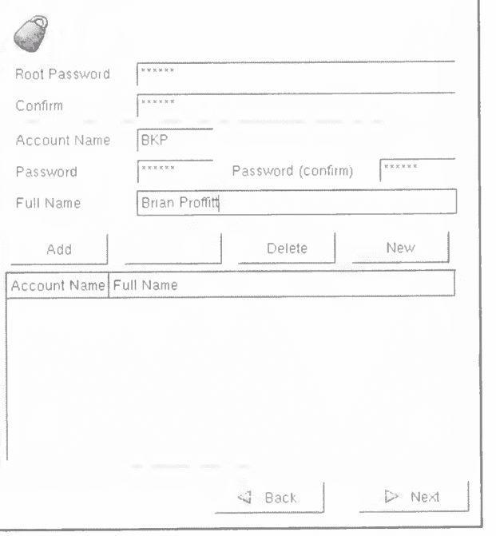

图 2-9 向您的 `Linux` 系统添加用户

> 即使您是 PC 上的唯一用户，为自己创建一个普通账户也是个好主意。一直使用 `root` 账户可能会导致潜在的错误，而使用普通账户可以限制损害范围。


在系统中添加用户后，点击 `Next` 按钮继续。

### 配置 X Window 系统

在工作站 (`Workstation`) 安装路径中，下一个界面是 X 配置界面。这个界面非常重要，因为它决定了 X 如何与您的显卡和显示器协同工作以生成图形显示。请记住，`Linux` 操作系统基于文本命令行，需要 X 服务器来运行图形界面。

与 `Microsoft Windows` 不同，X 必须经过仔细配置才能与您的视频硬件协同工作。这是否意味着 `Windows` 更灵活？绝非如此。只是近年来显示器和显卡的制造都为了兼容 `Windows`。`Linux` 对硬件供应商来说相对较新，因此仍需要手动配置。

在您进入这个界面之前，`Linux` 工具 `Autoprobe` 已经尝试识别您的显示器和显卡类型。如果找到了，它们的身份将显示在屏幕顶部。如果无法定位其中一个或两个组件（这种情况很少见），`Linux` 将给您机会自行选择，如图 2-10 所示。

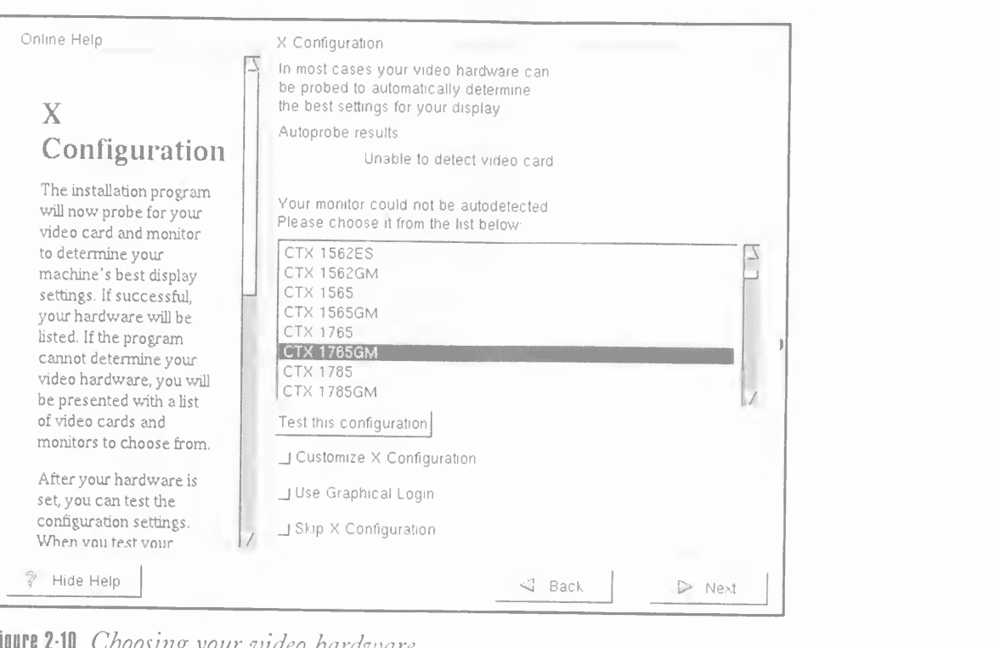

图 2-10 选择您的视频硬件

确定视频硬件后，点击标记为 `Test This Configuration` 的按钮。屏幕随后会闪烁。如果一切顺利，您应该会看到一个蓝色屏幕和一个小对话框，询问您是否能看到对话框中的信息。点击 `Yes`。如果 `Autoprobe` 为您定位了硬件，测试将总是成功。

如果您无法看到消息，则需要更改显卡和显示器的设置。这里请务必小心。您不希望使用会损坏显示器的设置。错误的设置可能会导致显示器“超频”，这是一个专业术语，基本上意味着让显示器在超出其显示耐受范围的情况下运行。

`Test` 按钮下方有三个选项。如果您选择 `Customize X Configuration` 然后点击 `Next`，您将进入一个可以尝试不同色深（屏幕上的颜色数量）和屏幕分辨率的界面。

`Use Graphical Login` 选项非常重要，它能使您每次启动 `Linux` 时都出现 X 登录界面。

> 此时 `Linux` 程序中似乎存在一个 `Bug`。如果您选择 `Customize` 选项并进入该界面，`Use Graphical Login` 选项（即使您之前选择了它）将被清除，且 X 在启动时不会加载。因此，我建议您稍后再更改视频设置。


只有想要手动设置 X 的专家才应该点击 `Skip X Configuration` 选项。新用户应远离此选项。

为了最大限度地简化操作，我建议您点击 `Use Graphical Login` 选项，然后点击 `Next` 继续。

### 完成安装

所有相关的安装信息现在已由 `Linux` 收集完毕，安装程序准备将文件复制到您的计算机中。图 2-11 显示了 `About to Install` 界面，警告该操作即将开始。

请记住，从这一步起，您将无法点击 `Back` 按钮来修改已选择的安装设置。不过不必担心，如果您已经走到了这一步，那么大概率没问题；显示图形的硬件配置是安装过程中最棘手的部分。所以请深呼吸，点击 `Next` 按钮继续。

您现在将看到 `Installing Packages` 界面。然而，在实际安装任何软件包之前，您设置的分区将被格式化。您可以通过进度消息的出现来得知这一点（见图 2-12）。

根据所需格式化的数量，格式化分区可能需要 5 到 45 分钟。随后，`Linux` 安装程序将收集安装程序第一部分获得的所有信息，并构建其文件

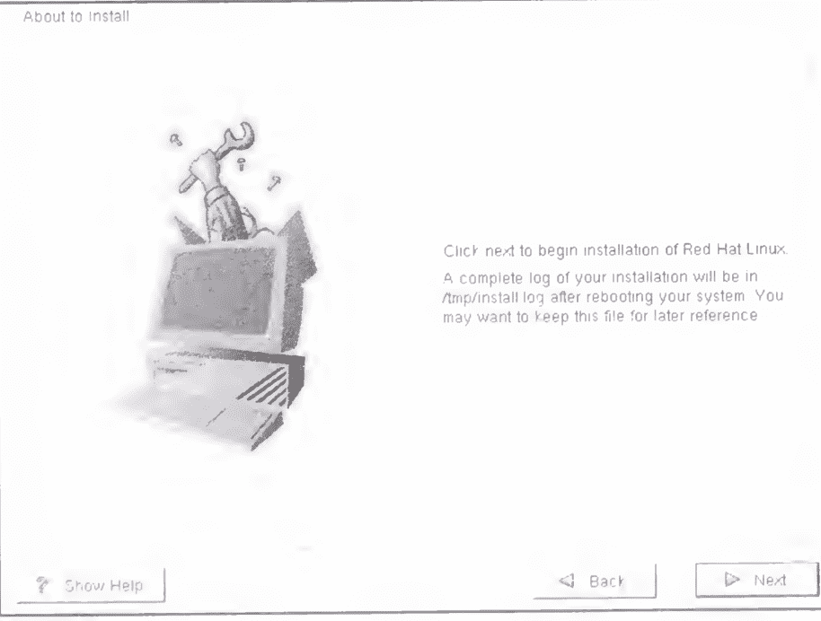

图 2-11 准备好开始了吗？

图 2-12 格式化您的 `Linux` 分区

图 2-13 准备复制文件

复制列表。屏幕上会出现一个进度条（见图 2-13），以便您可以监控进度。

现在进入安装的主体部分。如图 2-14 所示，“正在安装软件包”屏幕会显示安装进行时的进度。

图 2-14：软件包安装过程

顶部的进度条指示当前正在安装的软件包状态。底部的进度条显示所有软件包的累计安装进度。屏幕上还显示了一个剩余时间值，让您知道是否有时间去买个三明治。

完成后，将出现如图 2-15 所示的“恭喜”屏幕。

图 2-15：您现在已进入神奇的 `Linux` 世界。

点击“退出”按钮将关闭安装程序并重启计算机。在点击“退出”之前，请确保您已从软驱中取出启动盘（如果您使用的是可启动 CD-ROM 驱动器，请取出安装 CD-ROM）。

PC 重启后，您将看到类似于图 2-16 所示的屏幕。每次 `Linux` 开始加载时都会出现此屏幕。

与 `Windows` 不同，`Linux` 在启动时喜欢播报它采取的每一个细小步骤。请密切关注这些消息（见图 2-17），以便熟悉它们。久而久之，这种熟悉感将使您能够识别 `Linux` 加载时发生的任何问题，因为您能认出一条不寻常的消息。

图 2-16 从 LILO 启动 `Linux`

```
hda: hda1 hda2 < hda5 hda6 >
RAMDISK: Compressed image found at block 0
autodetecting RAID arrays
autorun
  ... autorun BDMK
UFS: Mounted root (ext2 filesystem).
autodetecting RAID arrays
autorun
  ... autorun BDMK
UFS: Mounted root (ext2 filesystem) readonly.
change_port old root has count=1
Trying to unmount old root ... okay
Freeing unused kernel memory: 64k freed
INIT: version 2.7.6 booting
   Welcome to Red Hat Linux
   Press "i" to enter interactive startup.
Mounting proc filesystem				[ OK ]
Setting clock Thu Nov 4 20:27:24 EST 1999	[ OK ]
Activating swap partitions			[ OK ]
Setting hostname localhost.localdomain	[ OK ]
Checking root filesystem			[ OK ]
/dev/hda5: clean, 34000/256000 files, 138005/580960 blocks

Remounting root filesystem in read-write mode	[ OK ]
```

图 2-17 观察 `Linux` 启动

稍后，您将到达 `GNOME` 登录屏幕。输入您在安装过程中创建的账户登录名和密码。然后您将进入 `GNOME` 界面（如果您选择了该界面）并开始您的 `Red Hat Linux` 之旅。

### 其他安装注意事项

如果您已成功安装并启动 `Red Hat Linux 6.1`，可以直接跳到第 3 章“配置 X Window 系统”。不过，有些人可能需要关于其他安装模式和路径的额外信息。本章接下来的部分将探讨文本安装、自定义安装选项和双系统启动。

#### 文本安装

如果您在图形模式安装时遇到一些问题，现在应该使用文本安装模式。虽然不够美观，但文本模式与图形模式一样有效。

文本屏幕的导航不需要鼠标，而且相当简单。您可以通过按下 `Tab` 键在屏幕上的对象之间移动（或按 `Alt+Tab` 向后移动）。通过按下空格键来选中或清除复选框选项。按下 `Enter` 键将激活所选功能。不算太难，对吧？

文本安装期间收集的安装信息与图形安装期间完全相同。不过有一个例外，即文本安装在开始探测系统视频硬件之前会请求权限（您应该这样做）。

通过对比图 2-18 和图 2-7，您可以看到，除了纯粹的美学差异外，这两个界面之间没有太多区别。

图 2-18 Disk Druid 的文本版本

如果您在初始显示方面遇到问题，文本安装模式是一个很好的后备方案。

#### 安装软件包

如果您选择使用“自定义”安装路径，则必须手动选择所有要由 `Red Hat Linux` 安装的软件包。软件包类似于 `Windows` 中的应用程序安装文件，不同之处在于它们会在一个步骤中自行解包并安装。

##### 理解软件包选择器

用于选择软件包的主要屏幕是“自定义”安装路径期间出现的“软件包组选择”屏幕。从按逻辑排列、易于理解的类别划分的软件包组中进行选择是最简单的。不过，如果您愿意，也可以选择单个软件包。

在“软件包组选择”屏幕中，您可以选择完整的软件包组合。为此，只需选中您想要的组旁边的复选框。完成后，点击“下一步”按钮继续安装。

- 如果您想安装所有 `Red Hat Linux` 软件包，请选择列表末尾的 `Everything` 组。请注意：这将占用 1.5 GB 的硬盘空间。

##### 选择软件包

如果您想深入研究各种软件包选项，可以使用“软件包组选择”屏幕底部的“选择单个软件包”选项。选中后，点击“下一步”将带您进入“单个软件包选择”屏幕。

在“单个软件包选择”屏幕的左侧是一个类似于目录树的结构，列出了所有的软件包组。选择任何组都会在屏幕右侧显示该组的单个软件包列表。

要选择一个软件包进行安装，请双击该软件包名称。软件包旁边会出现一个绿色勾选标记，表示其已准备好安装。点击“下一步”继续。

有时一个软件包在没有另一个软件包的情况下可能无法工作。这些被称为“依赖关系”。当缺少一个被依赖的软件包时，这被称为“未解决的依赖关系”。一个典型的未解决依赖关系示例是：如果您选择了 `GNOME` 软件包组而没有选择 X Window System 组。

为了防止这类混淆，在您选择完软件包和软件包组后，`Linux` 将检查以确保您没有未解决的依赖关系。如果发现任何依赖问题，您将看到“未解决的依赖关系”屏幕。为了确保所有必需的软件包都被安装，请选择“安装软件包以满足依赖关系”选项，然后点击“下一步”继续。

#### 配置 LILO

如果您计划在 `Red Hat Linux` PC 上使用多种操作系统，则需要确保 `Linux` 加载程序 (LILO) 安装在正确的位置。否则，您可能会遇到麻烦。

##### 双系统启动详解

当只有一个操作系统的系统启动时，BIOS 会查看硬盘上的一个特殊区域，称为主引导记录 (MBR 或启动扇区)，以确定将加载哪个操作系统。

当系统有两个或更多操作系统时，启动扇区中必须驻留一个特殊的引导程序，该程序会暂时停止启动过程，允许用户选择要加载哪个操作系统。LILO 正是这样一个程序。

##### 如何与 Windows 95/98 实现双系统启动

要配置 LILO 以运行 `Linux` 和另一个操作系统，您需要使用“自定义”安装路径。但是，如果您是在一个预装了 `Windows 95` 或 `98` 的系统上安装 `Linux`，您可以直接运行“工作站”安装路径。这是因为默认的 LILO 设置提供了运行这两个操作系统所需的一切。

随后 LILO 将安装在 MBR 中，并且 `Linux` 启动扇区被赋予默认的加载优先级。您以后可以在 `Linux` 内部使用名为 `linuxconf` 的实用程序更改这些设置；目前请使用“工作站”设置。

安装后启动 PC 时，在启动过程中会出现 LILO 提示符。此时，您应该按下 `Tab` 键。然后您将获得启动分区的选择。一个典型的示例将是 `dos` 或 `linux`。例如，要启动 `Windows`，请输入 `dos` 并按下 `Enter`。

- 您可以使用 `linuxconf` 实用程序增加 LILO 提示符在屏幕上停留的时间，该程序将在第 3 章中详细探讨。

##### 如何与 Windows NT 实现双启动

如果您想在安装 `Linux` 时希望同时运行 `Windows NT` 或 `Windows 2000`，您需要采取一些特殊步骤。

最重要的是，您必须运行“自定义安装路径”（`Custom installation path`），因为这是唯一能让您根据需求配置 LILO 的方法。

基本上，问题在于：`Windows NT` 的 OS 加载程序不承认 `Linux` 是一个有效的操作系统（可以想象），因为 `Linux` 没有产生 NT OS 加载程序在启动操作系统之前需要读取的那类文件。此外，NT OS 加载程序除了在引导扇区（`boot sector`）外，在任何其他地方都无法工作。由于引导扇区一次只能存在一个引导加载程序，如果 LILO 位于 MBR 中，您就会遇到问题。

自定义安装路径允许您进入 LILO 配置界面，在该界面中，您可以选择将 LILO 安装在 MBR（默认设置）或 `Linux` 启动分区的第一个扇区。

如果您选择后一种方案，LILO 和 NT OS 加载程序之间将不会发生冲突。不幸的是，NT OS 加载程序仍然无法看到 `Linux`，也不会将 `Linux` 作为启动选项显示出来。现在该采取一些“技巧”了。

有一种方法可以在 `Linux` 中创建 NT OS 加载程序可用于启动 `Linux` 的文件。但创建它需要一点时间。我建议您获取一个名为 `Bootpart` 的小型第三方程序，可通过 `http://www.winimage.com/bootpart.htm` 获取。该程序将快速为 NT OS 加载程序创建 `Linux` 启动文件，并将其放置在 NT OS 加载程序可以使用的地方。如果您计划将 `Windows NT` 或 `Windows 2000` 与 `Linux` 搭配使用，我强烈推荐这个应用程序。

有关配置 `Windows NT` 和 `Linux` 的更多信息，请阅读 mini-HOWTO 文档：`http://www.linuxdoc.org/HOWTO/mini/Linux+NT-Loader.html`。

### 结论

本章引导您达到了预定目标：成为一台运行 `Red Hat Linux 6.1` 的 PC 的所有者。现在您已经完成了这项任务，是时候配置和定制您新安装的操作系统，以满足您的需求了。

在第 3 章中，您将学习图形界面的基础知识：配置 X Window 系统。

# 第二部分：配置 Red Hat 6.1

- 3 配置 X Window 系统

- 4 配置您的环境

- 5 配置互联网服务

- 6 配置网络连接

- 7 配置打印机、声音及其他设备


## 第 3 章：配置 X Window 系统

Brian Proffitt

- 什么是 X？

- 使用 Xconfigurator

- 启动 xf86config 工具

- 使用控制面板

- 正确地退出 X

拿一个洋葱。剥掉外面那层棕色且皱巴巴的东西。你还剩下什么？一个剥了皮的洋葱。如果你再剥一层，你还剩下……？没错，一个更小的剥了皮的洋葱。

虽然这并不是最精妙的比喻，但在某些方面，它适用于 `Linux` 系统中 `Linux`、X server 和窗口管理器（`Window Manager`）之间的关系。它们都是操作系统这个大洋葱的层级——只不过它们不会让你流泪。

在本章中，我们将检查 `Red Hat Linux 6.1` 操作系统的层级，随后探讨图形界面最深层——X server 是如何配置的。

### 什么是 X?

对于非 `Linux` 用户来说，起初对于哪些组件构成了 X 往往会有些困惑。在 `Microsoft Windows` 环境中，您拥有 DOS 操作系统，而 Windows 操作系统界面运行在其之上，如图 3-1 所示。“运行在之上”意味着 Windows 本质上是一个运行在 DOS 平台上的大型程序，这与运行像 Doom 这样的程序基本没有区别。其结果是，您必须运行 DOS 才能运行 Windows。

对于 `Windows NT` 用户来说，情况稍微简单一些。`Windows NT`（以及即将发布的 `Windows 2000`）是一个可以独立运行的真实图形用户界面。这里的优势在于您看到的即所得。在必要时您仍然可以运行 DOS，但在 `Windows NT` 中，DOS 模拟器运行在 Windows 内部。`Windows NT` 的一个缺点是，您的 PC 必须拥有更多的内存和速度，才能运行得像同级别的 Win98 系统那样高效。

**专业术语**

图形用户界面 (GUI)：任何使用视觉信息而非文本信息来传达信息并接受命令的计算机界面。

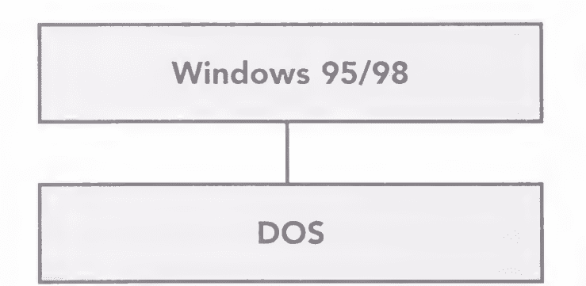

**专业术语**

模拟器 (Emulator)：一个能够模拟另一种操作系统的外观和感觉的程序。

图 3-1 DOS/Windows 的关系

正如书前部分提到的，您刚刚安装的 `Linux` 系统与 DOS/Windows 系统最为相似。像 DOS 一样，`Linux` 是一个基于文本的命令行操作系统（尽管它要*先进得多*）。您仅使用 `Linux` 操作系统就能执行大量功能，而且很多人确实如此。然而，更多的人被 GUI 的魅力所吸引，习惯于使用窗口、菜单和对话框来完成工作。

1986 年，一个 UNIX 程序员国际财团开始构建一个图形操作系统，该系统基于 Xerox Palo Alto 研究中心所做的 GUI 研究。于是，X 诞生了。


1991 年 Linux 问世后，没过多久 X 就进入了 Linux 桌面。当 Linux 开始出现在基于 Intel 的 PC 上时，一个新版本的 X——`XFree86` 帮助实现了这一过渡。

`XFree86` 是运行在 Red Hat Linux 上的任何 GUI 的核心。`XFree86` 也被称为 X server，它是视频输出和 PC 输入结合在一起形成一个内聚界面的地方。PC 输入通过两个基础输入设备获取：键盘和鼠标。然后，视频输出通过显卡发送到显示器。

虽然这听起来像 GUI 的全部，但事实并非如此。因为 X server 只是一个提供 GUI 运行“家园”的虚拟机。

为了生成传统意义上构成 GUI 的实际窗口和菜单，您需要在 X server 虚拟机上运行一个窗口管理器。

Red Hat Linux 自带了几个窗口管理器：`AfterStep`, `AnotherLevel`, `Enlightenment`, `fwm95`, `fwm`, `fwvm95`, `KVM`, `olvm` 和 `twm` 等。但您可能听说过的两个大件是 GNOME 和 KDE。

KDE——K 桌面环境——是一个随 Red Hat Linux 6.1 一起打包的获奖环境。它经常被 referred to 为窗口管理器，但实际上并不是。KDE 通常运行在一个名为 `KVM` (K Virtual Machine) 的窗口管理器之上。正如 `KVM` 增强了 `XFree86` 的外观和感觉一样，KDE 增强了 `KVM` 的外观和工具集。

在运行 GNOME (GNU Network Object Model Environment) 桌面时也存在类似的关系。GNOME 也不是一个真正的窗口管理器。GNOME 是运行在 `XFree86` 上的窗口管理器的增强版。默认情况下，Red Hat 将 `Enlightenment` 窗口管理器与 GNOME 一起安装。还没理清楚？请看图 3-2，它展示了所有这些组件之间关系的简化表示。

需要注意的是，仅仅因为安装了某种特定的窗口管理器和桌面环境组合，并不意味着您必须被锁定在这个组合中。例如，如果您愿意，可以在 `fvm95` 之上运行 GNOME。这就是 Linux 开放平台哲学的一大优点：在如何运行您的 PC 方面，您拥有真正的选择权。

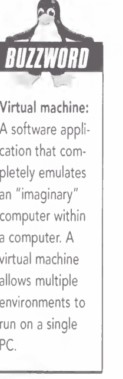

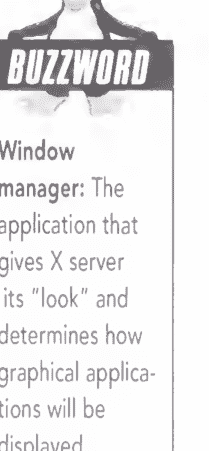

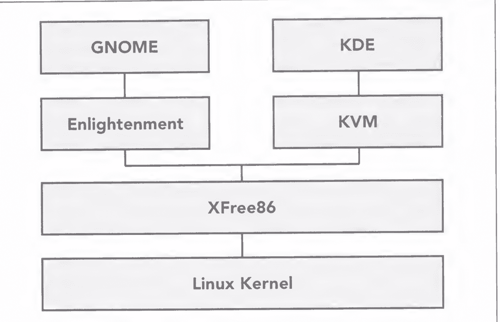

图 3-2 Linux GUI 系统的组件

不过，一个经常被问到的重大问题是：所有这些选择意味着什么？每个组件分别负责什么？在第 2 章“安装 Red Hat Linux 6.1”中，建议您安装 GNOME 桌面环境。考虑到这一点，表 3.1 分解了 GNOME 安装中每个 Linux 组件的不同职责。

#### 表 3-1 Linux/GNOME 系统的组件

| 组件 | 职责 |
|---|---|
| Linux | 所有内容运行的基底。处理所有基础文件系统和设备任务，以及将命令翻译成 PC 的基础机器语言。 |
| XFree86 | GUI 的核心。生成一个允许创建图形的虚拟机，然后将这些图形与来自键盘和鼠标的输入相结合。 |
| Enlightenment | 负责所有由 `XFree86` 生成的窗口、对话框和菜单外观的窗口管理器。 |
| GNOME | 通过提供额外的界面工具和外观来增强 `Enlightenment` 窗口管理器。为输入设备配置提供额外的控制。 |

现在你已经对所有不同组件如何协同工作有了更好的了解，是时候研究如何配置 X Window 了。请注意表 3.1，X 的某些组件具有不同的职责。在本章的剩余部分中，`XFree86` 处理的职责将集中在视频输出、键盘和鼠标。

### 使用 Xconfigurator

在 Red Hat Linux 6.1 中，有两种旨在管理 `XFree86` 的工具：`Xconfigurator` 和 `xf86config`。每个工具专注于 `XFree86` 的不同方面，应根据需要相应使用。表 3-2 展示了每个工具的功能。

#### 表 3-2 XFree86 配置工具对比

| Xconfigurator | xf86config |
| :--- | :--- |
| 视频显示器 | 视频显示器 |
| 显卡 | 显卡 |
| 视频分辨率 | 视频分辨率 |
| | 虚拟桌面 |
| | 键盘 |
| | 鼠标 |

虽然从功能更强大的角度来看，`xf86config` 似乎是最好的程序，但实际上我建议您分开使用这两个程序。`Xconfigurator` 拥有一个更易于使用的界面来修改显示参数，而 `xf86config` 使用的是一种多项选择的线性界面，引导起来稍微困难一些。

`Xconfigurator` 的一个绝佳用途是更改显示器的视频分辨率。当 Red Hat 首次安装时，它可能会默认使用一个你不喜欢的分辨率，例如图 3-3 所示的 640 $\times$ 480 分辨率。

> **术语 (BUZZWORD)**
>
> 视频分辨率：排列在显示器上的像素数量。分辨率越小，像素越大，屏幕上能显示的信息就越少。

`Xconfigurator` 是一个基于文本的应用程序，因此要使用它，您需要在以 root 账户登录后使用命令行界面。可以通过终端模拟窗口访问命令行，简称为 Terminal。Terminal 并不是真正的 Linux 界面，但在大多数操作中可以将其视作如此。要启动 Terminal，点击 GNOME 任务栏上的 Terminal 图标。这将打开 Terminal 窗口（见图 3-4）。

现在 Terminal 已经启动并运行，以下步骤将引导您使用 `Xconfigurator` 来修改视频分辨率。

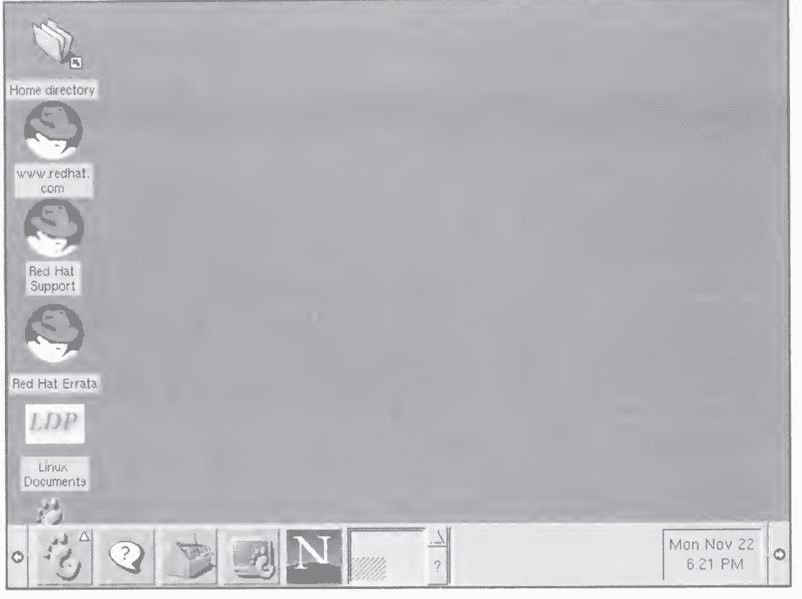

图 3-3 此屏幕分辨率的可用空间（real estate）不多。

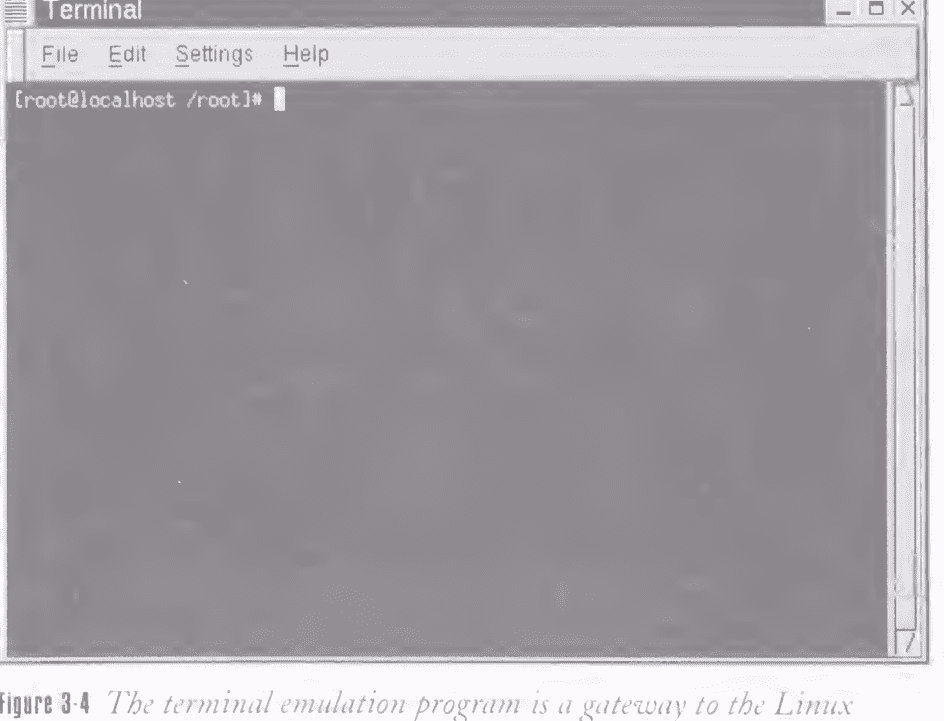

图 3-4 终端模拟程序是进入 Linux 操作系统的门户。

#### 更改视频分辨率

1. 在 Terminal 中，输入 `./Xconfigurator`。“./” 告诉 Linux 从当前目录运行指定的应用程序。`Xconfigurator` 工具将在 Terminal 窗口中启动（见图 3-5）。

> 不，我说 `Xconfigurator` 是基于文本的并没有撒谎。所有的颜色和线条都只是由单个文本字符组合而成的，从而营造出图形界面的外观。

2. 默认情况下，`Xconfigurator` 欢迎屏幕上的 OK 控件已被选中。按下 Enter 键接受 OK 选择并继续。

3. 下一个屏幕（见图 3-6）显示了在进入第二个屏幕时 `Xconfigurator` 启动的 PCI 探测（PCI Probe）结果。PCI 是 PC 上的一种扩展卡，显卡有时就属于这一类。如果结果与您拥有（且应该拥有）的显卡相匹配，请按下 Enter 键。如果 PCI 探测不成功，将出现一个显示显卡选择列表的屏幕，您可以从中做出另一种选择。

4. 接下来出现 Monitor Setup（显示器设置）屏幕（见图 3-7）。使用上、下方向键从列表中选择您的显示器。

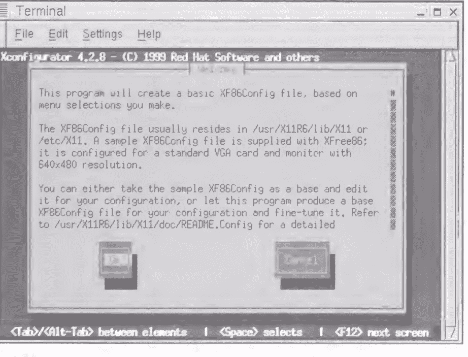

图 3-5 运行 `Xconfigurator`


图 3-6 确认机器上的显卡

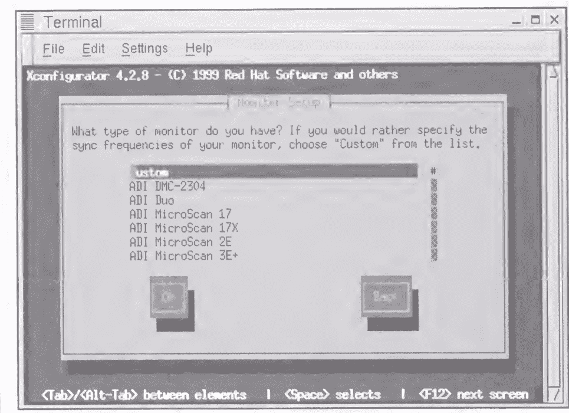

图 3-7 选择您的显示器

> 如果您找不到您的显示器，请选择出现在列表顶部的 Custom（自定义）选项。如果您想核实同步（sync）率是否与显示器设置一致，也应选择 Custom。

5. 按下 Tab 键选择 OK 控件，然后按下 Enter。如果您选择了 Custom，请继续执行步骤 6。如果您选择了任何具体显示器，请直接跳转到步骤 11。

6. 在 Custom Monitor Setup（自定义显示器设置）屏幕中，您应该阅读描述水平和垂直刷新率重要性的长篇信息。请确保您了解自己显示器的这些数据（理想情况下是在执行第 1 章“安装 Red Hat Linux 6.1 之前”的步骤时获取的），然后按下 Enter 键继续进入下一个屏幕。

7. 第二个 Custom Monitor Setup 屏幕（如图 3-8 所示）允许您根据水平同步率设置显示器类型。选择一个分辨率更高（如 800 x 600）且同步率仍在显示器水平同步率参数范围内的显示器类型。

8. 按下 Tab 键选择 OK 控件，然后按下 Enter。

9. 第三个 Custom Monitor Setup 屏幕要求您指定显示器的垂直同步范围（见图 3-9）。使用上、下方向键选择适当的范围。

10. 按下 Tab 键选择 OK 控件，然后按下 Enter。

11. 在选择特定显示器或完成 Custom Monitor Setup 步骤后，您将到达 Probing to Begin（开始探测）屏幕（见图 3-10）。按下 Enter 键开始探测。

屏幕会闪烁几次，然后重置为 Probing Finished（探测完成）屏幕（如图 3-11 所示）。此时将显示建议的分辨率和颜色深度。

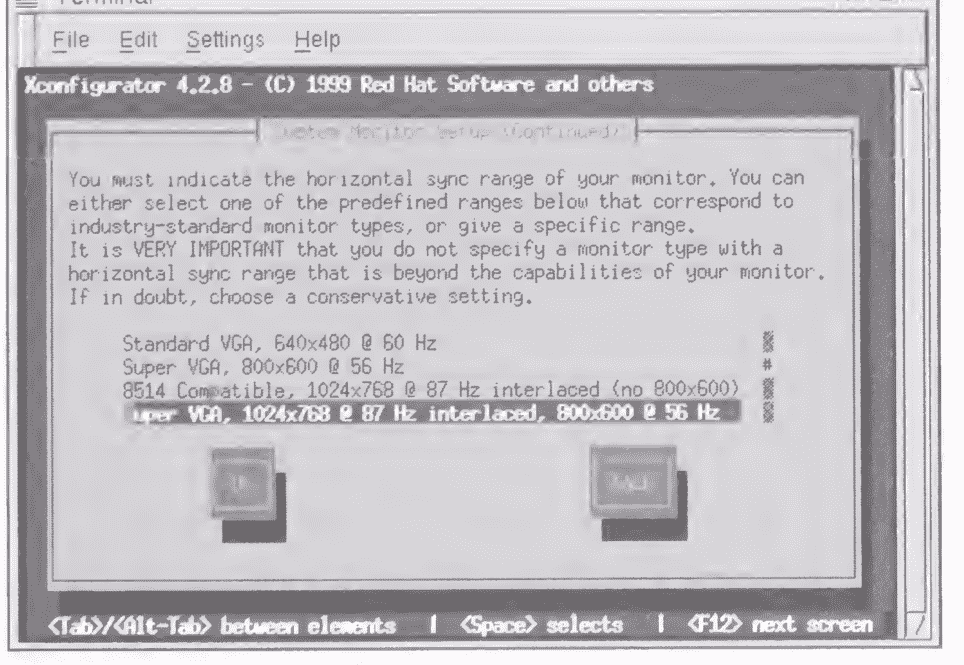

图 3-8 选择水平同步率。


**颜色深度：** 用每像素位数（bits per pixel）表示，颜色深度可以通过 2 的 N 次方转换为可用颜色数，其中 N 是每像素的位数。因此，8 位每像素的颜色深度将有 $2^8$ 或 256 种颜色，16 位每像素 = 65,536 种颜色，24 位每像素 = 16,777,216 种颜色。

## 第 3 章：配置 X Window 系统

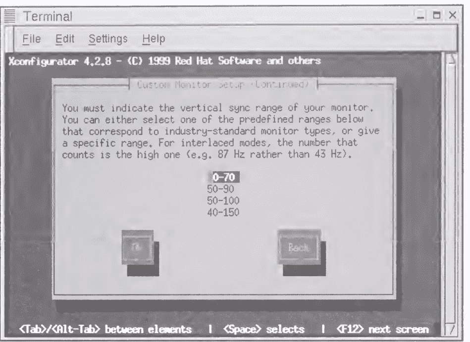

图 3-9 选择垂直同步率

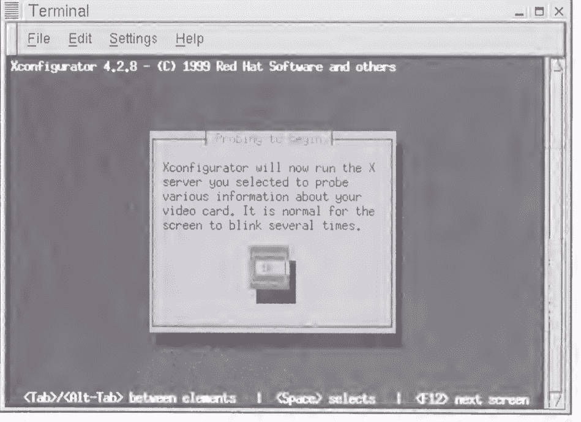

图 3-10 启动 X 服务器以探测您的视频能力

12. 您现在可以接受建议的默认视频模式，或者查看其他选择列表。按下 Tab 键选择您想要的选项并按下 Enter。如果您选择了 Use Default（使用默认值），请跳至步骤 16。

13. 如果您选择了 Let Me Choose（让我选择），您将看到 Select Video Modes（选择视频模式）屏幕（如图 3-12 所示）。使用 Tab 键导航到相应的列，使用上、下方向键在颜色深度列中移动，然后按下空格键选择任何选项。

在此屏幕中选择多个分辨率。如果它们都成功，您将在 X 中通过按下 `Ctrl+Alt++` 快速循环切换每个配置的分辨率。

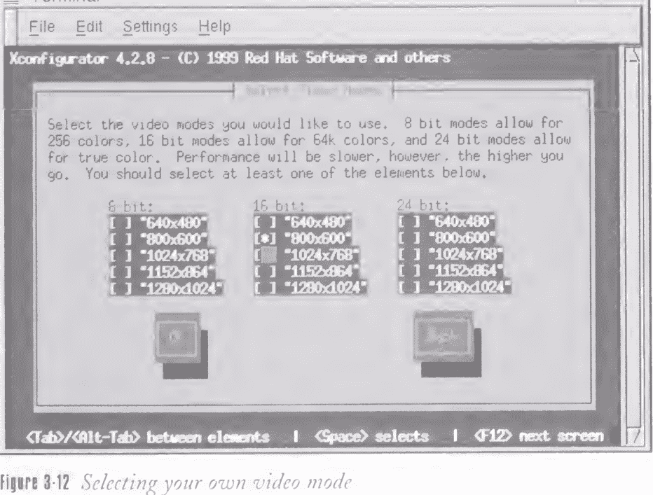

图 3-11 视频探测结果


图 3-12 选择您自己的视频模式

14. 按下 Tab 键选择 OK 控件，然后按下 Enter。

15. 您将到达 Starting X 屏幕，它只是通知您将启动另一个 X 会话来测试您的设置。按下 Enter 继续。

16. 如果您的设置正确，您将在屏幕上看到一条表示成功的消息。点击 Yes 继续。

如果出现任何其他类型的消息，或者没有看到消息，请使用 Back（返回）控件返回到之前的屏幕。然后您可以更改设置。

17. 将出现一条消息询问您在重启时是否要启动 X。点击 Yes。

18. 还会出现另一条消息告知您 `xconfigurator` 的更改记录在何处。点击 OK 继续。

19. `Xconfigurator` 将关闭。通过点击 GNOME 控制菜单上的 Log Out（注销）来重启系统。

20. 在 Really Log Out（确定注销）对话框中选择 Reboot（重启）选项，然后点击 Yes。

重启后，将显示新的默认视频分辨率（见图 3-13）。

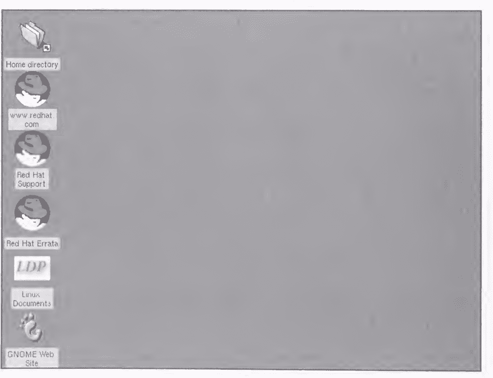

图 3-13 更高的分辨率为您提供了更多的屏幕可用空间。

### 启动 xf86config 工具

当您需要对系统的输入设备进行重大更改时，应使用 `xf86config` 来重新配置 X。您还可以使用它来更改显示器和显示设置；但如果这是您唯一需要做的，我建议您使用 `Xconfigurator`。

> 在对 `XFree86` 进行任何配置时，请确保您是以 root 账户屏幕登录的。


与 `Xconfigurator` 一样，`xf86config` 位于 `/usr/X11R6/bin` 目录下。如果您在终端窗口中导航到该目录并输入 `./xf86config`，程序将启动。

> 如果在任何时候您需要退出 `xf86config`，请按下 `Ctrl+C`。


#### 配置鼠标

在第一个 `xf86config` 屏幕中，您将看到一条详细说明将对您的系统进行哪些更改的文本消息（见图 3-14）。按 Enter 键继续进入下一个屏幕。

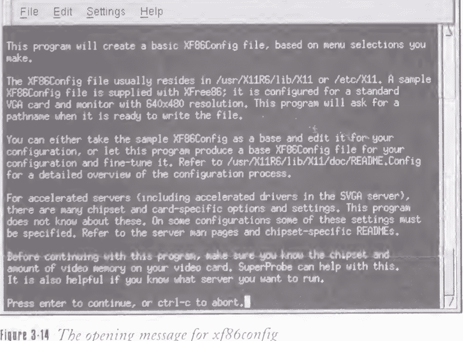

图 3-14 `xf86config` 的启动消息

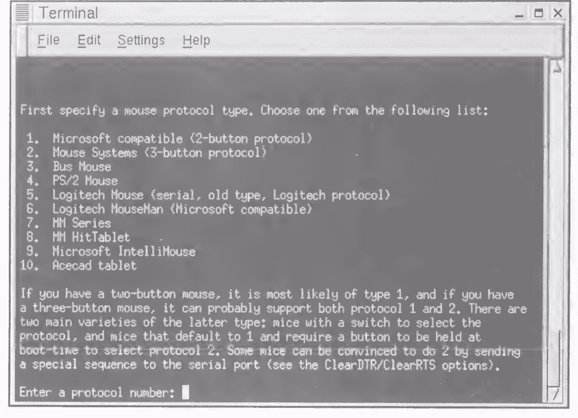

图 3-15 选择鼠标类型

第二个屏幕显示了一个包含十种可能鼠标类型的列表。要选择一个选项，请输入其对应的数字，然后按 Enter 键（见图 3-15）。

如果您选择的鼠标类型不是 Mouse Systems（3 按钮协议），系统随后会询问您是否要启动 `Emulate3Buttons` 选项。由于许多 Linux 程序仍使用三个按钮，我建议您输入 `y`，然后按 Enter 键继续。

接下来，系统会询问您连接鼠标的端口的设备名称。除非您使用的是非标准端口，否则请按 Enter 键接受默认值。

`xf86config` 的鼠标部分现已完成，您现在可以回答关于键盘的问题了。


> 键映射（Keymap）：一种旨在将键盘按键与正确的电子字符相匹配的配置设置。每种类型的键盘都有不同的键映射。

#### 配置键盘

在配置键盘之前，`xf86config` 将为您提供多种完成此任务的工具选择（见图 3-16）。

除非您使用的是某种您知道只能由旧版 `xmodmap` 工具识别的特殊键盘，否则您应该输入 `y` 并按 Enter 键以使用较新的 Xkeyboard 扩展。

一旦选择了 Xkeyboard，您将看到另一条消息，告知您即将显示的键映射列表（见图 3-17）。

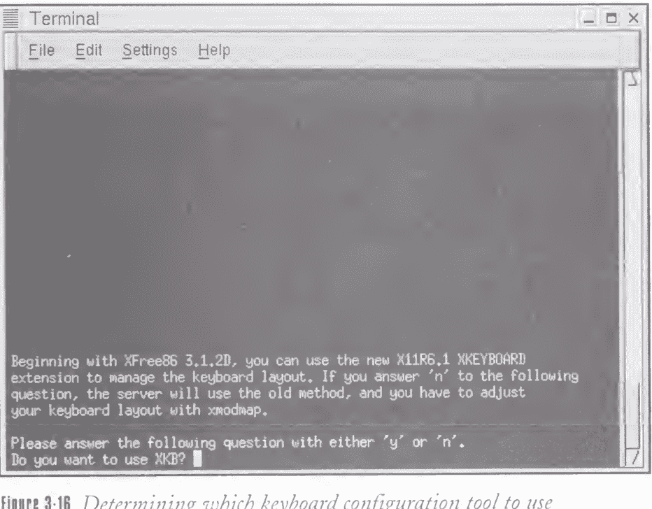

图 3-16 确定使用哪个键盘配置工具

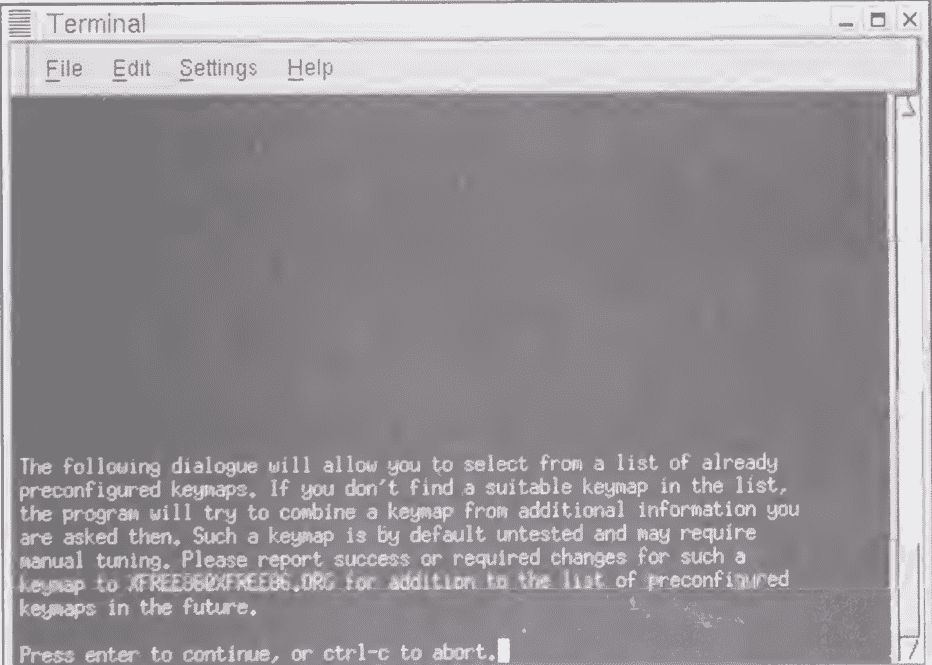

图 3-17 如何使用键映射列表

正如您在图 3-18 中所看到的，键映射列表本身并没有那么复杂。它只是一个包含 11 个键映射的列表，外加一个“以上都不是（None of the above）”的选项。美国的大多数键盘都属于第一个键映射类别。输入与您的键映射相对应的数字并按 Enter 键继续进入下一个屏幕。

#### 配置显示器

在键盘和鼠标配置完成后，`xf86config` 将进入视频设置。由于视频设置的重要性，`xf86config` 花费了大量的时间和屏幕空间来处理视频配置的每一个方面，首先是从显示器开始。

正如您所预料的，显示器部分的第一个屏幕（如图 3-19 所示）会警告用户，为显示器设置正确的水平和垂直同步率至关重要。

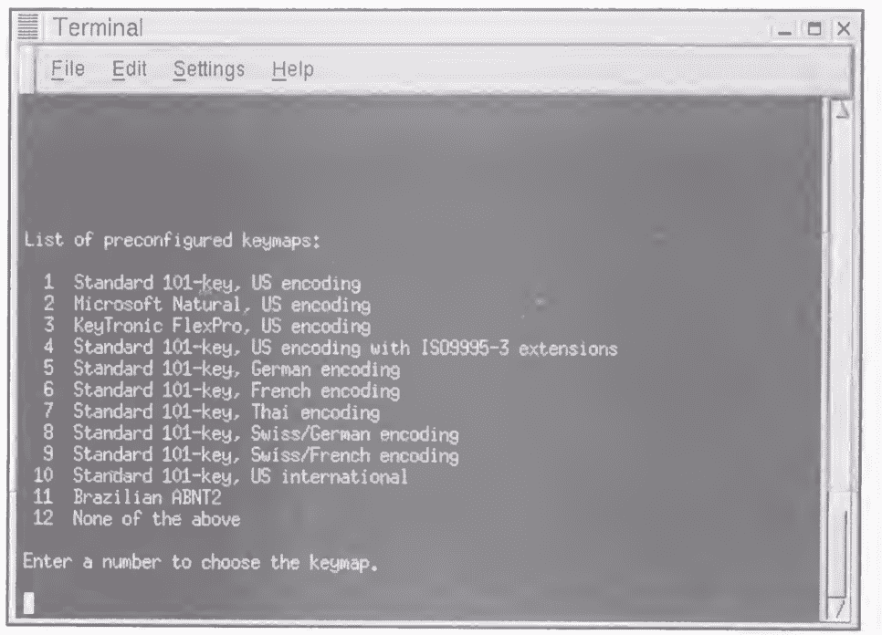

图 3-18 十一种最常用的键盘

> 您在第一章中收集的显示器信息将被重复使用。请确保将其保存在您可以轻松查阅的地方。


按 Enter 键进入显示器部分，该部分将显示显示器可能的水平同步范围列表。此外还有一个输入自定义范围的选项，如图 3-20 所示。输入您想要的范围类别的数字并按 Enter 键继续。

输入范围后，将显示一个较短的潜在垂直同步率列表（见图 3-21）。同样，在选择范围时请务必小心，以避免超频并损坏您的显示器。

与安装程序和 `Xconfigurator` 不同，`xf86config` 给了您为显示器命名机会。您可以为该显示器配置类型描述一个总体名称、供应商名称和型号。配置您想要使用的名称，每次输入后按 Enter 键，如图 3-22 所示。

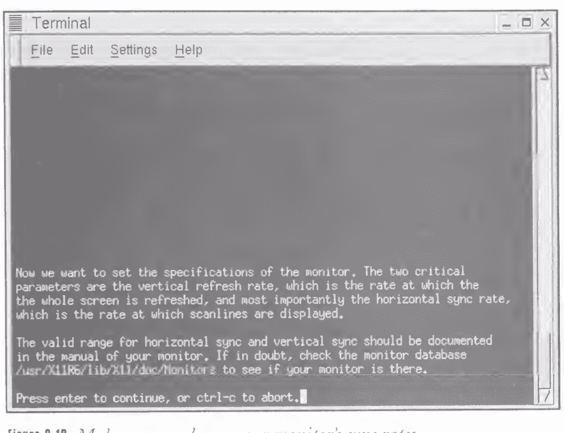

图 3-19 请确保您知道显示器的同步率。

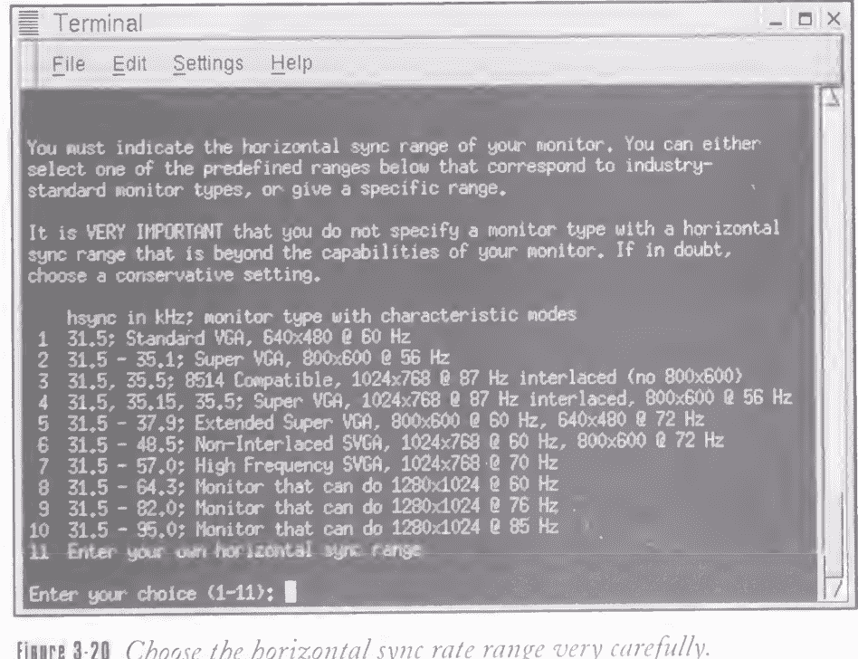

图 3-20 非常小心地选择水平同步率范围。

一旦完成显示器设置，`xf86config` 将进入显卡部分，这是 `xf86config` 的最后一部分，也是最详细的部分。

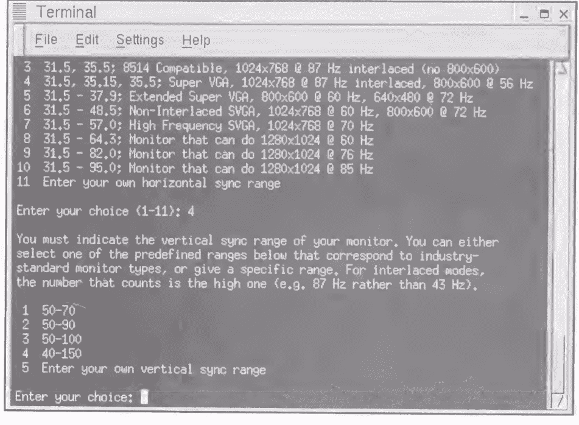

图 3-21 同样小心地选择垂直同步率范围。


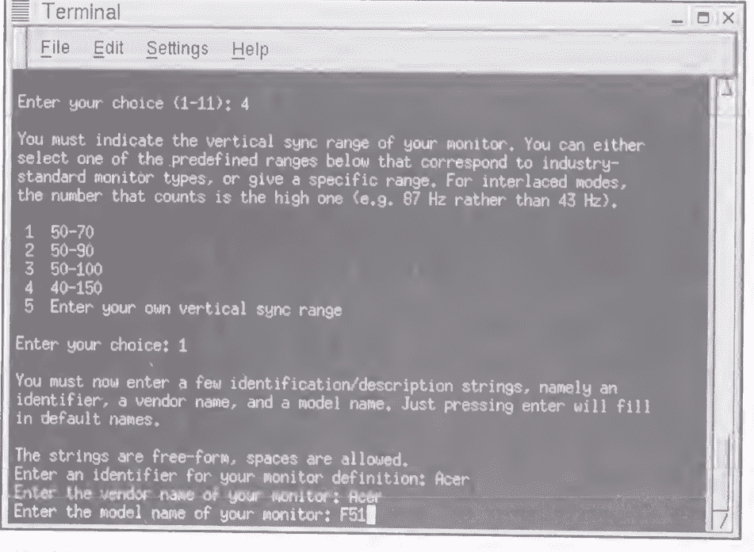

图 3-22 为您的显示器设置指定名称

#### 配置显卡

如果您需要修改显卡设置，可以使用`xf86config`来完成。正如您所看到的，您必须首先遍历整个程序才能到达这一点。

第一个屏幕（见图 3-23）讨论了使用`xf86config`可访问的当前显卡数据库的价值。我建议您尝试在此数据库中查找您的显卡；但正如消息所言，在选择显卡时必须非常小心。名称相似的显卡可能并不彼此兼容，如果您尝试用一个看起来很像的显卡来冒充，可能会在无意中损坏您的显示器。

如果您选择查看数据库（您应该这样做），请输入`y`并按 Enter 键继续。随后将显示一个冗长的显卡型号和制造商列表，其中包含芯片组信息。见图 3-24。按 Enter 键滚动列表以查看下一组。注意不要滚过您的显卡，因为没有“返回”选项。当您找到自己的显卡时，输入该显卡的数字并按 Enter 键。

如果您输入`q`退出列表（因为您选择不查看数据库或无法找到您的显卡），现在您需要手动输入设置。在这种情况下，您将看到图 3-25 所示的屏幕。本质上，这个屏幕是让您将显卡选择缩小到四个类别之一：`Mono`、`VGA16`、`SVGA`和`Accel`。随电脑或显卡附带的文档应该能为您提供选择哪个类别的参考。

> 如果您刚刚购买了一块显卡，那么这块卡很有可能属于`Accel`类别。大多数新显卡都是加速的，这正是购买它们的目的，对吧？

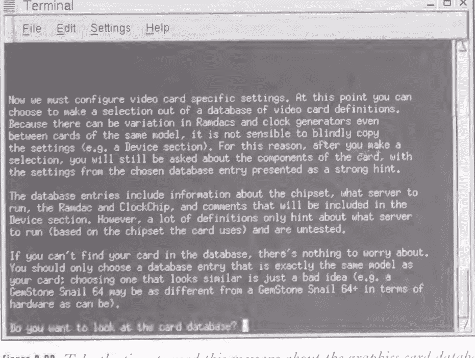


图 3-23 花时间阅读这条关于显卡数据库的消息。

图 3-24 显卡列表

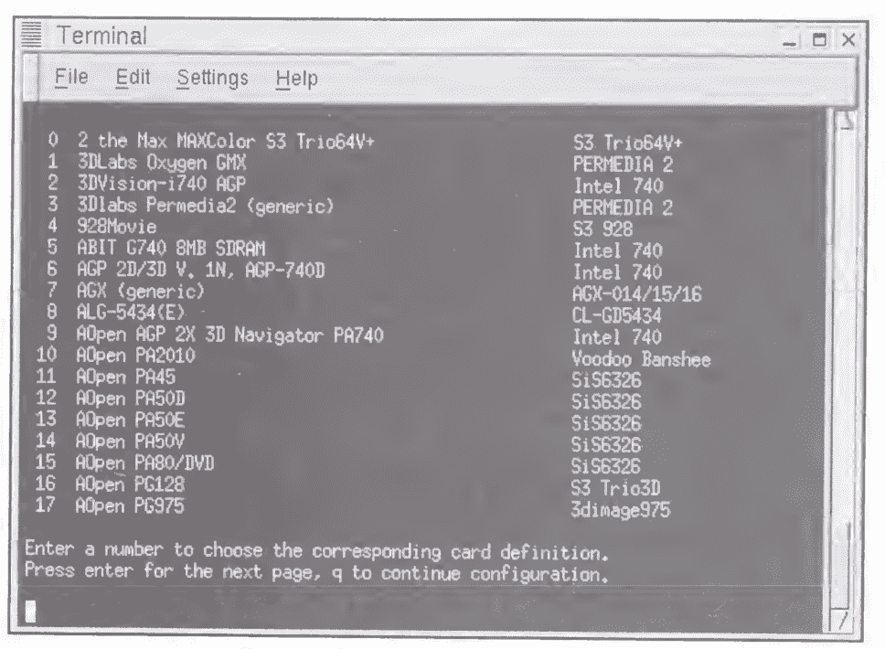

图 3-25 四个 X 图形服务器类别

输入服务器类别的数字并按 Enter 键继续。然后系统会询问您是否希望`xf86config`为系统设置符号链接。这个问题可以翻译为：“您是否希望每次启动 X 时都启动所选的图形服务器？”为了说清楚，这可以类比为在安装 Microsoft Windows 程序期间经常出现的一个问题。使用这个类比，当被问到是否您

当程序想要对您的`AUTOEXEC.BAT`文件进行更改时，您通常会回答“yes”。在这里，我建议您同样回答“yes”。这样可以避免以后不得不进行手动编辑。输入`y`然后按 Enter 键继续。

在图 3-26 中，您将看到屏幕现在显示了`Accel`类别下的所有服务器列表。同样，您的显卡文档应该能提供帮助。例如，我有一块 ATI 64 位显卡，我知道大多数 ATI 显卡都兼容 ATI 使用的 “Mach” 协议。因此，我会选择`XF86_Mach64`服务器。我使用的另一台机器配备了 S3 显卡，所以我将选择`XF86_S3`服务器。

> 如果您完全不知道该选择哪个服务器，可以访问 Red Hat 网站 (<http://www.redhat.com>)。浏览至支持 (Support) 区域，查找有关您显卡的任何信息。也可以咨询 Red Hat 的客户支持。


图 3-26 选择正确的 X 服务器

输入您想要使用的服务器编号并按 Enter 键。现在程序会询问您的显卡有多少内存，这里是指显存 (video RAM) 设置。正确设置这一点至关重要，因为如果您低估了 VRAM，将会浪费您显卡的所有性能。输入显存的大小并按 Enter 键。

程序现在会要求您为显卡配置提供一个简单的英文名称，就像您为显示器所做的那样。输入您想要使用的信息。

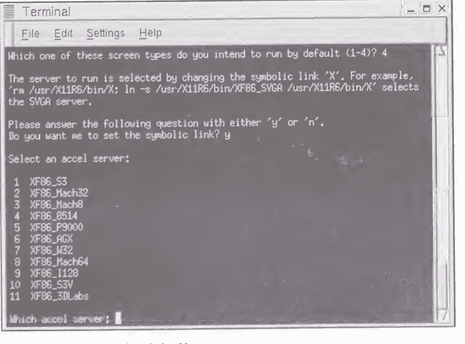

在接下来的屏幕中，您将看到为显卡选择 RAMDAC 设置的选项。并非每块显卡都有 RAMDAC。`xf86config`在初始消息中（见图 3-27）指出，RAMDAC 通常仅适用于`S3`、`AGX`和`W32` Accel 显卡服务器，以及`SVGA`类别中的某些服务器。

> **RAMDAC (随机访问存储数字模拟转换器)：** 某些显卡上的一个组件，用于将数字图像转换为模拟信号，以便由显示器显示。

如果您知道您的显卡具有 RAMDAC，请使用 Enter 键滚动浏览此列表，直到看到您的显卡。然后输入其编号。或者，只需输入`q`并按 Enter 键继续。

在接下来的屏幕中（见图 3-28），您有机会设置显卡的时钟芯片 (clockchip) 设置。这实际上仅适用于以前具有可编程时钟芯片的旧款显卡。如果您使用的是这类显卡，请输入其编号。否则，按 Enter 键继续。

尽管时钟芯片变得越来越罕见，但`xf86config`希望确保您在适用时拥有设置它的每一个机会。在时钟芯片列表屏幕之后是一条很长的消息，询问您是否希望程序探测您的时钟芯片设置。虽然这实际上仅对旧款显卡必要，但如果您注意到服务器启动时间较长且看到了关于时钟探测 (clock probing) 的消息，您可能希望`xf86config`为您执行此搜索。在成功探测到时钟信息后，`xf86config`将将其保存，这样 X 服务器在每次启动时就无需执行探测。否则，我建议您输入`n`并按 Enter 键继续。

接下来的屏幕可能是最难理解的。您刚刚设置的显卡所有可能的显示模式都列在其中（见图 3-29）。要选择默认模式，您需要选择一个带编号的选项，然后选择并测试每种模式。一个不错的建议是先接受这里显示的模式，然后在 Xconfigurator 中进一步探索这些模式。

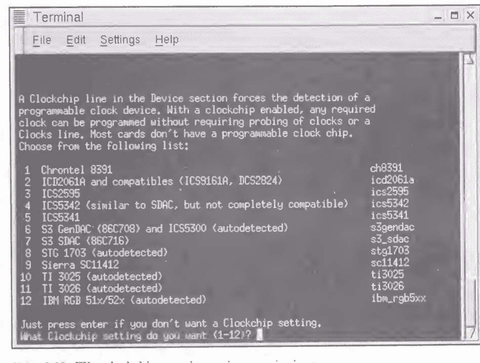

图 3-28 在某些情况下可以设置时钟芯片

图 3-29 选择视频显示模式

最后，您将被告知`xf86config`即将把您的设置保存到至关重要的`XF86config`文件中。如果您对所做的任何设置有任何不确定，应该输入`n`，因为无法返回并修复某个特定的设置。如果您认为一切正常，请输入`y`并按 Enter 键完成程序。

### 启动 xf86config 工具

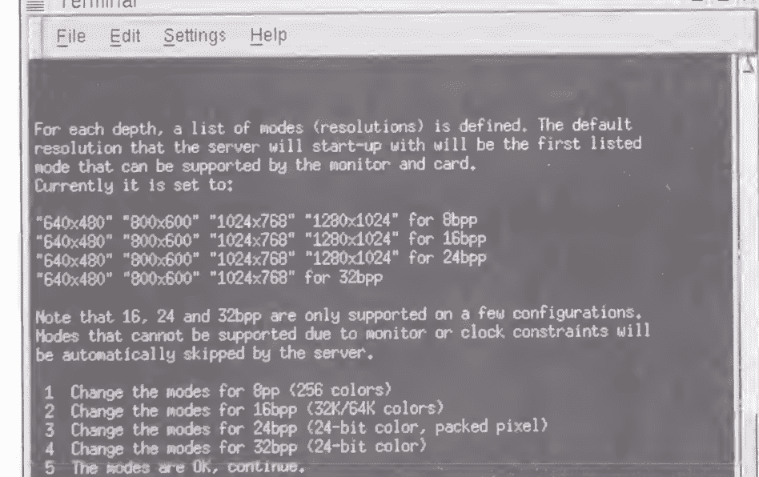

### 使用控制面板

虽然键盘和鼠标的设置主要由 X 服务器负责，但也可以通过窗口管理器进行某些设置更改。这些更改通过控制中心 (Control Center) 完成。虽然这些设置并不关键，但它们是能让您的生活更便捷的小细节。

#### 配置键盘

要在 GNOME 环境中访问控制中心应用程序，点击 GNOME 控制菜单，然后选择 Settings $\rightarrow$ Peripherals $\rightarrow$ Keyboard (或 Mouse)。选择 Keyboard 选项将直接在键盘设置面板打开控制中心，如图 3-30 所示。

如果您对键盘的性能不满意，可以调节滑块控件来更改重复按键或键盘点击的值。做出更改后，点击 Try 按钮，然后在对话框底部提供的 Test 设置字段中测试您的新设置。

一旦设置符合您的要求，点击 OK 关闭控制中心窗口。

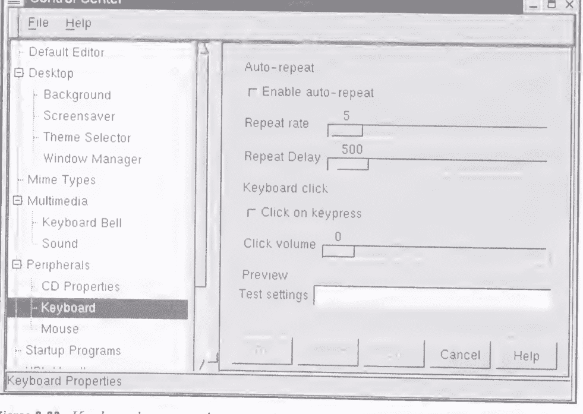

图 3-30：可以在 GNOME 环境中修改键盘用户设置。

#### 配置鼠标

如前一节所述，您也可以在控制中心稍微调整鼠标设置。同样，这些并不是翻天覆地的变化，但有时这些小细节确实很重要。在图 3-31 中，您可以更改鼠标的按钮方向以及对移动的响应速度，这两项都是非常方便的功能。

完成设置尝试后，点击 OK 关闭窗口。

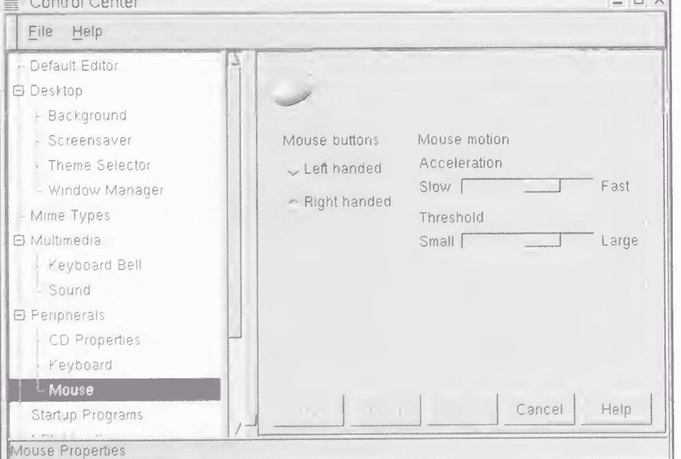

图 3-31 左撇子？您会喜欢控制中心的这个面板。

### 正确地从 X 注销

Windows 和 Mac 用户习惯于不能直接关闭电脑，而必须先执行“关机 (Shut Down)”。

由于大多数人习惯于此操作，离开 X 的必要步骤应该感觉很熟悉。就像它的姐妹操作系统一样，X 喜欢有序的退出，而不是突然的断电。

要离开 X，您必须先注销并关闭您的账户。点击控制菜单图标并选择 Log Out。一个消息框将询问您是想要 Logout（注销）、Halt（停止）还是 Reboot（重启）。

如果您只想注销并让计算机为下一个用户保持开启状态，请点击 Logout 选项，然后点击 Yes。X 会话将关闭，屏幕将返回到图形登录界面。

如果您想重启系统，点击 Reboot，然后点击 Yes。X 将关闭，Linux 系统将停止您的 PC 然后自动重启，返回到图形登录界面。

最后，如果您只想关闭电脑回家看电视，请在点击 Yes 之前点击 Halt 选项。X Window 将关闭，Linux 将在停止序列中关闭所有运行的进程。

如果您改变主意，只需点击 No 即可恢复您的 X Window 会话。

### 本章小结

在本章中，您了解了构成 X 环境的组件，并发现了哪些组件处理 PC 的特定方面。同时回顾了在 X 服务器级别配置视频和输入设备的步骤。

在第 4 章“配置您的环境”中，您将从窗口管理器和桌面环境级别进一步探索 X。您还将开始学习在该级别进行配置设置的方法。

## 第 4 章：配置您的环境

**Brian Proffitt**

- 选择桌面管理器
- 登录选项
- X 工具
- 配置您的桌面

向我的同胞们致歉：美国人对“选择”有一种执念。我是说，简直疯了。例如，平均每家超市都有整整一排货架专门摆放早餐麦片。一箱又一箱的早餐麦片。美国人沉溺于在品牌、麦片类型、包装之间进行选择的能力……不相信我？问问你自己，如果有一天早餐麦片仙子降临，将所有不同品牌的麦片简化为一个通用品牌，会发生什么。

想象一下：一种玉米片，一种葡萄干麸皮，以及一种含糖的爆米花燕麦。没什么大不了的，对吧？毕竟做玉米片能有几种方法？

由此引发的暴动将使最糟糕的 Y2K（千年虫）场景看起来像一场野餐。

讽刺的是，美国人对选择的执着并未很好地延伸到 PC 领域。毕竟，在过去的十年左右时间里，PC 用户（在很大程度上）接受了一种操作系统——不允许有替代品。

这是因为，与早餐麦片的规模化营销不同，许多消费者甚至根本不知道他们可以选择操作系统。OS/2 和 Mac 是给那些在派对上永远格格不入的古怪的人准备的。UNIX 和 Linux？那些用户被认为是奇怪的、极客般的人，甚至根本没被邀请参加派对。

当然，这里有一些夸张，但仅限于一定程度。1999 年底的事件提高了公众对华盛顿雷德蒙德（微软总部所在地）之外生活的认知。看来操作系统还有其他选择，而且你不需要成为一个极客才能使用它们。

对此，我们在欧洲的朋友们回答道：“你们怎么花这么长时间才意识到？”

### 选择桌面管理器

Linux 不仅是作为工作站平台替代 Microsoft Windows 的可行方案，操作系统本身还包含多种运行选择。

例如，在 Microsoft Windows 中，您可以通过操纵菜单和窗口的颜色和字体来改变桌面的外观。甚至有预设的主题可用于将桌面统一为一种协调的外观。

您可以在 X Window 中实现同样的效果，甚至更进一步。您不仅可以操纵像 GNOME 这样的桌面环境的外观，还可以将整个桌面环境更换为完全不同的另一种！这种完全自定义系统的能力使得 X Window 比静态的 Microsoft Windows 成为一个友好得多的工具。

在不同的桌面环境之间切换还有另外两个优点：你可以访问可能在其他环境下看不到的特定环境工具；同时，你还可以决定自己偏好使用哪种桌面方式，因为每个环境的呈现方式和工作方法都不同。

但讨论就到此为止，让我们开始参观吧！

### 登录选项

你可以选择使用哪个环境的第一个地方是在登录界面。你现在可以为你要登录的账户选择环境。例如，如果我以 `root` 身份登录 KDE 并将 KDE 设置为默认值，那么 KDE 将仅被设置为 `root` 账户的默认值。我可能登录的任何其他账户将使用它们各自的默认环境。

登录界面中会出现“会话”（Session）菜单命令。点击后，菜单将打开并显示可用的环境选项。如果你最初是使用 KDE 工作站路径安装的，你的选项将是：

- **Default**（默认）。默认环境由最初安装或 GNOME 桌面切换应用程序设置；
- **Failsafe**（安全模式）。当环境运行出现困难时使用 `Failsafe` 命令行界面，例如在 Xconfigurator 或 X86config 中进行了错误的视频设置且需要调整时；或者
- **GNOME**。GNOME 桌面环境。

如果你向系统中添加了任何其他桌面环境，它们也会作为环境选项出现在这里。选择后，登录字段下方会出现一条消息确认该选择。在你完成登录程序后，你选择的环境将会出现。

### 切换桌面环境

一旦进入你的环境（假设现在是 GNOME），你可以快速切换到另一个环境，正如你在接下来的任务中将发现的那样。

> 在第 11 章“使用新软件进行自定义”中，你将学习如何在机器上安装多个桌面环境。在本章的剩余部分，我们将使用一台同时安装了 GNOME 和 KDE 的 PC。


### 切换桌面环境

本任务说明如何在桌面环境之间进行切换。

1. 点击主菜单（Main Menu）图标以打开主菜单。
2. 选择 System $\rightarrow$ Desktop Switching Tool。桌面切换窗口将打开，如图 4-1 所示。
3. 点击 KDE 选项（见图 4-2）。KDE 标志会出现。
   > 只有当你的 Linux PC 与其他 PC 联网，且你只想对自己的工作站进行更改时，才应点击“Change Only applies to current display”（更改仅应用于当前显示）选项。
4. 点击 OK。会出现一条消息提醒你，这些更改在重新登录 X Window 系统之前不会生效（见图 4-3）。
5. 退出当前环境并返回图形登录界面。
6. 使用同一个账户登录。你将看到新的默认环境 KDE。（见图 4-4。）

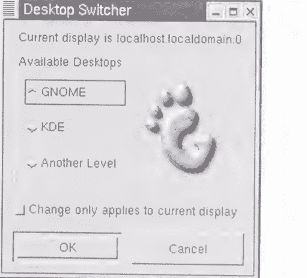

图 4-1 桌面切换工具

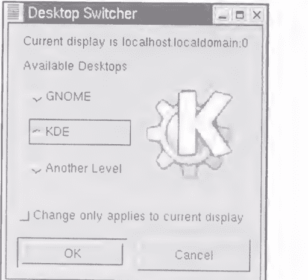

图 4-2 选择 KDE 环境。

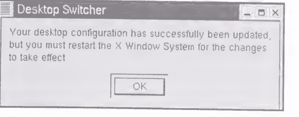

图 4-3 环境更改在退出当前环境后生效。

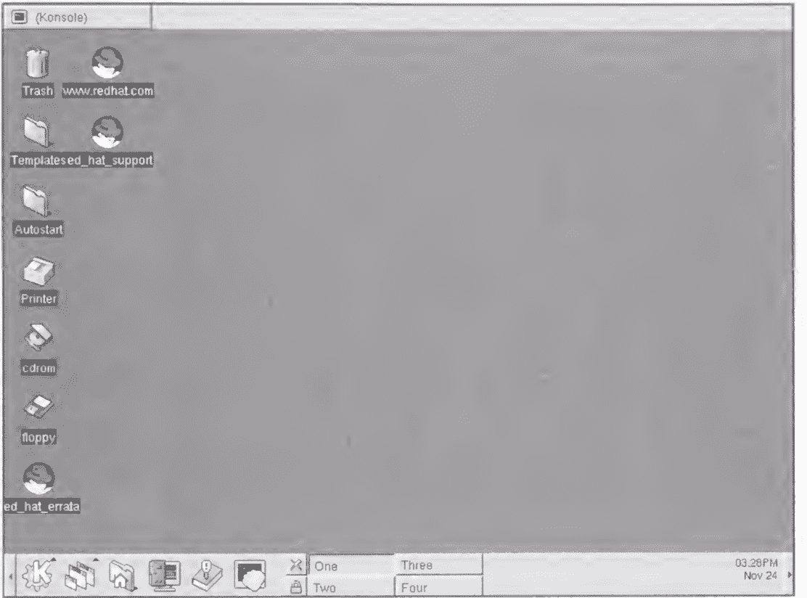

图 4-4 *KDE 桌面环境*

> 如果你想将 GNOME 重新设置为默认环境，只需再次打开桌面切换工具。该应用程序可以在 KDE 的应用程序菜单（类似于 GNOME 的主菜单）下的 Red Hat $\rightarrow$ System $\rightarrow$ Desktop Switching Tool 中找到。有关切换和管理桌面环境的更多信息，请参阅第 9 章“自定义桌面外观”。


#### 了解 KDE 环境

本节将研究 KDE 环境的特性和工具，并将它们与 GNOME 环境中的特性和工具进行比较和对比。

KDE 和大多数 Linux 应用程序一样，是秉持开源哲学维护的。所有开发工作都由来自世界各地的开发者通过志愿者形式完成，源代码免费分发给所有需要的人。

乍一看，KDE 在视觉上与 GNOME 非常相似。这是因为`kdm`窗口管理器的默认颜色与 GNOME 的 Enlightenment 窗口管理器的默认值相似。（`kdm`窗口管理器在 KDE 之下运行。）这些默认值由 Red Hat 设置，以维持整个操作系统外观的一致性。


图 4-5 KDE 桌面元素

图 4-5 显示了 KDE 桌面的各种元素。这些元素在表 4-1 中详细列出。

##### 表 4-1 KDE 桌面元素

| 元素 | 描述 |
|---|---|
| Application Starter (应用程序启动器) | 打开应用程序菜单，可在此启动许多应用程序和实用工具 |
| Taskbar (任务栏) | 包含所有打开应用程序的图标；点击这些图标将打开选定的应用程序窗口 |
| Desktop icons (桌面图标) | 可打开应用程序、文件或目录 |
| KDE Panel (KDE 面板) | 包含多个 KDE 控制项，包括应用程序启动器、虚拟桌面图标和其他面板图标 |
| Panel icons (面板图标) | 可从面板启动特定应用程序的图标 |
| Virtual Desktop icons (虚拟桌面图标) | 显示并控制哪个虚拟桌面（本例中为四个）处于打开状态 |
| Panel control button (面板控制按钮) | 根据需求关闭或打开面板 |
| Logout icon (注销图标) | 激活注销序列 |
| Lock Screen icon (锁屏图标) | 锁定屏幕，防止用户离开时被编辑 |

如你所见，KDE 和 GNOME 之间存在一些细微差别，但这些差别不太可能让你感到困惑。

#### 了解 GNOME 环境

与前一节研究 KDE 的一些基本元素类似，本节快速回顾一下 GNOME 桌面的一个基本元素。这将有助于进一步详细说明这些环境之间的一些差异。

图 4-6 列出了 GNOME 桌面的各种元素。这些元素在表 4-2 中简要说明。

表 4-2 GNOME 桌面元素

| 元素 | 描述 |
|---|---|


| Main Menu icon (主菜单图标) | 打开主菜单，可在此启动许多应用程序和实用工具 |
|---|---|
| Desktop icons (桌面图标) | 可打开应用程序、文件或目录 |
| GNOME Panel (GNOME 面板) | 包含多个 GNOME 控制项，包括主菜单、GNOME Pager 图标和其他面板图标 |
| Panel icons (面板图标) | 从面板启动特定应用程序的图标 |
| GNOME Pager | 显示并控制哪个虚拟桌面（本例中为四个）处于打开状态，以及任何打开的应用程序 |
| Panel control button (面板控制按钮) | 根据需求关闭或打开面板 |


除了登录界面提供的图形桌面环境外，还可以选择另一个选项：`Failsafe`（安全模式）。下一节将探讨`Failsafe`。

### Failsafe

正如本章“登录”部分所述，`Failsafe`登录选项是一个命令行界面设置。如果在登录时选择，屏幕右下角将打开一个小的终端模拟窗口。

注意前一段中对该窗口的描述：这是一个终端模拟窗口。即使没有运行桌面环境，`X`仍然在运行。这看起来可能是一个细微的点，但阐明这个区别是很必要的。

有些程序不应该在`X`内部运行，例如`sndconfig`（将在第 7 章“配置打印机、声音和其他设备”中研究）。如果你在`Failsafe`模式下尝试运行`sndconfig`并认为它是真正的 Linux 命令行（在我初学 Linux 的日子里我确实尝试过这样做），你的系统设置可能会出现问题。

基本上，大多数可以在命令行运行的应用程序也可以在`Failsafe`模式下运行。任何无法运行的程序都会警告你它们不能在`X`内部运行。此时，你应该听从警告并退出该应用程序。


> 要在任何`X`模式下访问 Linux 命令行，请尝试按下 Ctrl+Alt+F1。要从 Linux 返回`X`，请按下 Alt+F7。

我发现`Failsafe`模式的最佳用途是在尝试视频设置出错时。通过在`Failsafe`模式下登录`X`，我可以启动`Xconfigurator`并轻松修复错误。

现在你已经熟悉了不同的登录模式，接下来需要快速检查一下 Red Hat Linux 6.1 提供的工具集。

### X 工具

当你听到人们将 Linux 与 Windows 比较时，你听到的一个主要抱怨是认为 Linux 缺乏可用应用程序。目前，Windows 有 100,000 多个可用应用程序。虽然 Linux 应用程序没有那么多，但可用应用程序的数量比许多人意识到的要接近。

由于 Linux 应用程序通常没有商业广告，因此它们远不如对应的 Windows 应用程序知名。Word、WordPerfect、AmiPro——大多数人都听说过这些应用程序。但有多少人听说过 StarWriter？不多。那些听说过的人知道它是一款非常强大的文字处理器，它……

顺便提一下，它与本方法中提到的前三个文字处理软件包兼容。

段落。

GIMP 是另一个极佳的应用程序示例，它的功能与 Windows 平台上的对应产品 Adobe Photoshop 一样强大。但是，由于 GIMP 像大多数 Linux 同类软件一样，尚未被大众所熟知，因此在目前看来，它被视为不存在。

本章的接下来的部分将简要探讨 Red Hat 在其 Linux 6.1 版本中提供的工具和应用程序。列出的应用程序是 Workstation 安装中默认安装的。任何在 Red Hat 发行版 CD-ROM 上可用但未安装的应用程序将列在单独的表格中。

### 编辑器

在`X`窗口系统中，有三个文本编辑器可用于修改简单的文本文件。其中两个在桌面环境下运行，第三个则是 UNIX 社区的老牌宠儿，是一个命令行应用程序。

`VIM`在整个 UNIX 和 Linux 社区中被简称为`vi`，它是经典`vi`编辑器的增强版本。它不能从菜单启动（除非创建了菜单项），而是在命令行中运行。

在终端模拟器或 Linux 命令行中，输入`vi`即可启动`VIM`编辑器。如图 4-7 所示，其启动屏幕上显示了基本命令。


图 4-7 VIM 文本编辑器

`VIM`的一个非常好的用途是手动编辑配置文件。要在`VIM`中打开文件，只需在命令行中输入`vi filename`。

> 在编辑任何配置文件之前，请务必保存一份备份副本，以便在出错时可以还原。

输入`:q`即可退出`VIM`。这将使你返回到命令行。

用于此类工作的两个`X`应用程序是`gEdit`和`gnotepad+`，两者均如图 4-8 所示。

从图中可以看出，这些应用程序的功能相似，不过`gnotepad+`具有额外的工具，使其能够创建 HTML 格式命令。这是合理的，因为 HTML 文件仅仅是一个包含文本代码的文本文件，这些代码使浏览器能够显示诸如字体颜色和大小更改等增强效果。

表 4-3 列出了 Red Hat Linux 6.1 CD-ROM 上可用但未作为 Workstation 安装集一部分而安装的其他编辑器。


图 4-8 gEdit 和 gnotepad+ 编辑器

| 应用程序 | 描述 |
|---|---|
| `GXedit` | 一个多功能的 GTK+ 文本编辑器 |
| `emacs` | 另一个非常流行的 Linux 命令行文本编辑器 |
| `jed` | 一个使用 slang 屏幕库的紧凑型编辑器 |
| `joe` | 一个无模式（modeless）文本编辑器 |

### 图形

随着大众涌入互联网，对能够轻松处理图形的应用程序的需求急剧增加。Linux 在这方面也没有让人失望，为用户提供了三个用于查看和编辑图形文件的工具。

其中第一个工具是`Electric Eyes`。尽管名字古怪，但这是一个极佳且简单的图形查看器。启动后，右键单击可打开其菜单。与大多数程序类似，“文件 (File) $\rightarrow$ 打开 (Open)”菜单选项可用于打开图形，如图 4-9 的示例所示。

如果你认为`Electric Eyes`的名字很奇怪，那么`GIMP`应用程序可能会让你更吃惊。`GIMP`（GNU Image Manipulation Program 的缩写）经常被拿来与 Adobe Photoshop 比较，因为它具有许多相同的功能。

`GIMP`具有一些特殊功能，使得在应用程序首次启动时必须进行二次安装。当`GIMP`安装对话框出现时，点击“安装 (Install)”。成功完成后，将出现一个消息框通知你安装已完成。然后点击“继续 (Continue)”打开`GIMP`界面，如图 4-10 所示。


图 4-9 在 Electric Eyes 中查看图形

`GIMP`的界面有点古怪，因为没有立即可见的“画布”屏幕——只有一个工具栏和（如果设置了相关选项）一个“每日提示”消息框。但一旦你开始使用该程序，你会发现它的功能令人惊叹。

仅关于`GIMP`就可以写一整本书，所以我们在这里不再赘述。如需进一步信息，我强烈建议你研读《GIMP 手册》，可以通过菜单栏选择`Xtns` $\rightarrow$ `Web Browser` $\rightarrow$ `GIMP Manual`来打开。或者，查看 Prima-Tech 的《Guerrilla Guide to Great Graphics with the GIMP》（ISBN: 0-7615-2407-X）。

最后，`Xpaint`是一个允许你创建精美图形而不仅仅是查看它们的应用程序。在 AnotherLevel 菜单选项中可以找到`Xpaint`，它允许你绘制自己的图片（如图 4-11 所示的催眠显示效果）并以多种格式保存。

当然，在这些应用程序中还有很多可探索的空间。此外，你可以从 Red Hat Linux 6.1 CD-ROM 安装更多的图形程序（列于表 4-4）。


图 4-10 不寻常的 GIMP 界面


图 4-11 在 Xpaint 中创作自己的艺术品

#### 表 4-4 其他可用的图形程序

| 应用程序 | 描述 |
|---|---|
| `giftrans` | 一个创建透明 GIF 文件的程序 |
| `transfig` | 一个将`xfig`创建的文件转换为其他格式的实用工具 |
| `xfig` | 一个创建简单矢量图形的工具 |

### 个人信息管理器

我不知道你是否如此，但我的日子非常忙碌。我经常发现自己奔波于一个又一个会议、一个又一个预约之间，直到觉得 24 小时的一天根本不够用。对我来说，这只是一个组织管理的问题。

这就是个人信息管理器 (PIM) 大显身手的地方。PIM 是日程计划本的电子等效物，它可以跟踪预约并帮助避免调度冲突。


图 4-12 GNOME Calendar 应用程序

Red Hat 中的主要 PIM 是`Calendar`应用程序。该应用程序充当调度员和任务管理器。如图 4-12 所示，它的界面对于 Microsoft Outlook 或 Symantec Act 的用户来说可能非常熟悉。

一个更简化的 PIM 是`lcal`，这是 Red Hat Linux 6.1 提供的另一个 AnotherLevel 应用程序。从图 4-13 可以看出，它仅跟踪你的日程，而不跟踪任务。但如果你只需要这些功能，它是一个很好用的精致小应用程序。


图 4-13 lcal 应用程序

只有一个其他 PIM 应用程序可用，但它未在 GNOME Workstation 路径中默认安装：`kOrganizer`，它是 KDE 对 GNOME Calendar 的回应。

### 互联网工具

如果之前的应用程序类别看起来有点单调，那么这种情况即将改变。Linux 提供了许多基于互联网的应用程序，其中最不容忽视的是商业可用的`Netscape Communicator`（见图 4-14）。

`Netscape Communicator`是一个全能应用程序，提供了 Web 浏览器、电子邮件和新闻组阅读器的功能。这一个程序就能满足你大部分的互联网需求。它将在第 5 章“配置互联网服务”中进行更详细的探讨。

尽管 Netscape 提供了互联网使用所需的大部分工具，但 Linux 还为高级使用提供了更多互联网工具。由于工具集中的实用程序数量众多，它们被列在表 4-5 中。

在这些应用程序中，只有`irci`和`ytalk`没有安装在初始的 Workstation 安装路径中，这应该让你意识到 Linux 希望你能够连接到互联网。

当然，还有许多其他类型的应用程序。单是游戏数量就足以填满另一本书。你应该探索 CD-ROM 上可用的其余 Linux 应用程序。通过这种方式，你可以看到这个操作系统的真正威力：它的应用程序。


图 4-14 使用 Netscape Communicator 浏览互联网

#### 表 4-5 Red Hat Linux 6.1 中可用的互联网应用程序

| 应用程序 | 描述 |
|---|---|
| `elm` | 一个流行的电子邮件客户端 |
| `finger` | 一个用于获取特定互联网用户信息的互联网工具 |
| `fwhois` | 一个用于获取特定互联网域名信息的互联网工具 |
| `gftp` | 一个 FTP 应用程序 |
| `ircii` | 一个互联网中继聊天 (IRC) 客户端 |
| `lynx` | 一个纯文本 Web 浏览器 |
| `mutt` | 一个 Linux 电子邮件客户端 |
| `ncftp` | 一个更强大的 FTP 工具 |
| `pine` | 另一个流行的电子邮件客户端 |
| `slrn` | 一个新闻阅读器客户端 |
| `talk` | 一个互联网聊天工具 |
| `telnet` | 一个基于互联网的远程终端仿真工具 |
| `tin` | 一个新闻阅读器客户端 |
| `trn` | 一个新闻阅读器客户端 |
| `xchat` | 一个 IRC 客户端 |
| `xrn` | 一个新闻阅读器客户端 |
| `ytalk` | 一个互联网聊天工具 |

### 配置您的桌面

在您对桌面及其提供的所有功能进行全面浏览之后，您可能会发现桌面中有一些方面是您想要更改的。第 9 章和第 10 章将探讨桌面自定义的其他方面，例如颜色和声音方案、启动程序的设置以及窗口键的修改。在本章的剩余部分中，将讨论桌面中可用工具的放置问题。


> 启动器 (Launcher)：启动应用程序的菜单项或图标。

#### 菜单自定义

如果您不喜欢为了启动一个最常用的应用程序而翻找三四个菜单层级怎么办？在这种情况下，您可以将应用程序启动器放置在桌面的某个位置，以便更快速地启动程序。

主菜单是放置您最喜爱应用程序启动器的绝佳位置。如果它被埋在某个小子菜单的第四层，请按照下一个任务中的步骤将启动器放置在主菜单的第一层。

##### 自定义主菜单

本任务演示如何自定义 GNOME 中的主菜单。

1. 点击主菜单图标以打开主菜单。
2. 导航到您想要重新定位的启动器图标（见图 4-15）。
3. 右键单击该启动器。
4. 选择“将此项添加到个人菜单 (Add This to Personal Menu)”选项。
5. 启动器将被复制到主菜单的“用户菜单 (User Menu)”部分。


图 4-15 选择要移动的应用程序

#### 桌面图标

如果您想在桌面本身放置一个启动器以实现更快速的访问，只需简单的拖放操作即可。

##### 向桌面添加启动器

本任务演示如何在 GNOME 桌面上放置应用程序启动器。

1. 点击主菜单图标以打开主菜单。
2. 导航到要移动的启动器图标。
3. 选择应用程序启动器图标，然后将图标拖出到桌面区域。
4. 松开鼠标按钮。启动器图标的副本将被放置在桌面上（见图 4-16）。
5. 如有需要，为了美观，您可以将图标拖动到另一个位置。

> 您可以通过右键单击桌面的任何空白区域并选择其中一个“排列图标 (Arrange Icons)”选项来自动排列桌面上的图标。


图 4-16 在桌面上放置启动器

6. 要删除图标，请右键单击该图标并从控制菜单中选择“删除 (Delete)”。在要求确认时点击“是 (Yes)”。

#### 面板图标

启动器也可以驻留在 GNOME 面板上。下一个任务详细介绍了如何实现这一目标。

##### 向面板添加启动器

本任务演示如何在 GNOME 面板上放置应用程序启动器。

1. 点击主菜单图标以打开主菜单。
2. 导航到要移动的启动器图标。
3. 右键单击应用程序启动器。
4. 选择“将此启动器添加到面板 (Add This Launcher to Panel)”选项。
5. 启动器将被复制到 GNOME 面板（见图 4-17）。


图 4-17 一个新的 Gnome 面板启动器图标

6. 如果您想移动图标在面板上的位置，请右键单击该图标并选择“移动小应用程序 (Move Applet)”。
7. 在不点击图标的情况下，将多方向指针沿着面板移动。所选的启动器图标将随之移动。
8. 当图标处于合适位置时，单击该图标以锁定其位置。
9. 要从面板中删除图标，请右键单击该图标以打开控制菜单。然后选择“从面板移除 (Remove From Panel)”。

### 本章小结

本章向您介绍了 Red Hat Linux 6.1 自带的桌面环境以及每个环境包含的工具。您肯定会想对您最喜欢的环境进行更深入的探索；但这正是其乐趣所在，不是吗？

第 5 章将继续讨论世纪之交使用 PC 的更多乐趣：接入互联网并探索这个最大的网络。

## 第 5 章：配置互联网服务

Brian Proffitt

### 设置您的互联网账户

### 使用 Netscape Communicator

在过去的十年中，人们谈论互联网很多。虽然人们对这个最大的公共计算机网络进行了大量的宣传和炒作，但值得注意的是，互联网远未完成。

互联网的增长（到目前为止）在许多方面与 19 世纪末电话在美国的普及类似。在商业化存在的前五年，电话仅覆盖了约 10% 的美国住户。五年后，它覆盖了 50% 的美国人家。又过了五年，它覆盖了 90% 的美国住户。

互联网的增长模式与之非常吻合。到 1994 年，即互联网脱离纯学术环境五年后，约 10% 的美国人家中可以连接互联网。现在，五年多以后，互联网接入在美国的普及率已达到近 50%。尽管看起来不可思议，但美国在实现全面互联网使用方面仅处于大约一半的进度。（其他国家的互联网普及率在百分比上较低，但这可能是因为美国有先发优势；增长模式仍然是一样的。）

无论您是互联网领域的新手，还是从`Lynx`时代就开始冲浪的老手，您都会发现互联网正变得不再仅仅是一个玩乐之所，而更多地成为了一个工作之所。越来越多的人转向互联网来处理银行需求、购买节日礼物，甚至通过 Web 摄像头查看在日托中心的孩子。


Linux 和互联网的历史是交织在一起的。Linux 的前身 UNIX 正是构建互联网的操作系统。事实上，互联网的许多语法（如 `http://`、`FTP` 命令、用于目录分隔的正斜杠）都直接源自 UNIX 命令行。


**热门术语**

TCP/IP (传输控制协议/互联网协议)：一套用于连接互联网上主机的通信协议。TCP/IP 是 UNIX 操作系统的产物，并被互联网所采用。

因此，Red Hat Linux 6.1 提供了一套丰富的互联网访问工具也就不足为奇了。您唯一需要做的就是让自己连接上去。

### 设置您的互联网账户

如今获得一个互联网账户相当简单。我们中的许多人似乎几乎每个月都会在邮件中收到一张带有连接软件的 CD-ROM。但使用 Linux 时，您需要确保使用的是正确的账户类型。

互联网的“语言”被称为 TCP/IP。这种语言（称为协议）是数据从您的计算机发送到例如北卡罗来纳州达勒姆市的 Web 服务器计算机的方式。

尽管 TCP/IP 是一个基于 UNIX 的产品，但 Red Hat Linux 在通过拨号连接接入互联网时需要额外的协议帮助。毕竟，TCP/IP 并不擅长通过串行线路（例如调制解调器中的串行线路）传输 IP (互联网协议) 数据包。

> **热门术语**

PPP (点对点协议)：一种在拨号连接互联网期间，用于通过调制解调器线路传输数据包的通信协议。

为了让所有数据包都能通过调制解调器，会使用一种额外的协议 PPP。讽刺的是，PPP 并非 UNIX 的发明——它及其前身 SLIP 是为了将 Windows 计算机连接到互联网而开发的。

PPP 可以用于 Linux 系统——Red Hat (RH) 也不例外。正是 RH PPP Dialer 程序管理您的 PC 与互联网的连接。您必须首先配置该拨号程序，以便它可以正确地与您的互联网服务提供商 (ISP) 的计算机通信。

#### 配置 PPP 拨号程序

Red Hat Linux 6.1 自带了“拨号连接工具 (Dialup Connection Tool)”，这是一种设置互联网连接的自动化方法。对于大多数 ISP，使用此应用程序就足以创建连接例程。在某些情况下，可能需要对连接配置进行更多控制——这就是为什么本节还将研究如何使用 LinuxConf 应用程序手动设置连接。

> **热门术语**

域名服务 (DNS)：互联网中一个专门的服务器网络，将字母域名转换为 IP 地址。所有互联网服务器都有一个唯一的 IP 地址，例如 `198.105.222.95`。由于这些地址比简单的语言域名更难记忆，DNS 服务将域名转换为其对应的 IP 地址。

使用“拨号连接工具”直接类似于 Microsoft Windows 操作系统中使用的“互联网连接向导”。其思路是逐步引导用户操作应用程序，提供 Red Hat 创建新 PPP 连接所需的信息片段。

在您开始下一个任务（演示创建连接）之前，您应该收集以下信息：

- ISP 的域名（例如 `earthlink.net`）
- 您账户的用户名
- 您账户的密码
- ISP 的电话号码
- 您的 ISP 使用的任何域名服务 (DNS) 服务器的 IP 地址

您还应确认您的 ISP 要求使用哪种通信协议。绝大多数 ISP 要求使用 PPP，但有些可能会使用替代协议，如 SLIP 或 PLIP。

> 许多 ISP 在单个网页或可通过 Web 访问的文档中提供连接信息。请访问您 ISP 的网站，查看其是否提供了这些信息。建议查看“技术支持”或“常见问题 (FAQ)”部分。


一旦收集到这些信息，将其输入到拨号配置工具（Dialup Configuration Tool）中就简单了。

#### 使用拨号连接工具配置 Internet 连接

本任务将演示如何使用自动化的拨号连接工具来建立 Internet 连接。

1. 点击主菜单图标打开主菜单。
2. 选择 Internet $\rightarrow$ Dialup Configuration Tool。应用程序窗口将在前台打开，背景中可见现有 Internet 连接的窗口。
3. 第一个窗口是介绍信息（见图 5-1）。点击 Next 继续。
4. 如果您尚未配置调制解调器，将出现“选择调制解调器”（Select Modem）屏幕（见图 5-2）。点击 Next，让应用程序自动搜索所有连接到 PC 的调制解调器。

> 在应用程序搜索设备之前，请确保您已打开外部调制解调器且其已正确连接到计算机。

5. 当前连接到 PC 的调制解调器列表将出现，如图 5-3 所示。如果显示的调制解调器列表正确，请点击您想使用的调制解调器。然后点击 Keep this modem 选项。最后，点击 Next 继续。


图 5-1 开始新的 Internet 连接设置


图 5-2 如果拨号连接工具中没有您的调制解调器记录，它将要求为您进行配置。


图 5-3 确认找到的调制解调器选择

6. 在“电话号码和名称”（Phone number and name）屏幕中（如图 5-4 所示），输入该连接的描述性名称，以及调制解调器需要拨打的电话号码。完成后点击 Next。

> 除非需要，否则不要在相应的字段中输入前缀或区号/国家代码数据。例如，RH PPP Dialer 没有关闭区号拨号的设置。


图 5-4 输入连接的电话信息

7. 每个 ISP 账户都包含一个用户 ID 和密码。这些数据将在下一个屏幕中输入（见图 5-5）。点击 Next 继续。


图 5-5 用户名和密码屏幕

> 为了防止您的账户被擅用，密码字段会用星号代替密码中的每个字符。这意味着您在输入密码时需要小心，以免输入错误。

8. Red Hat Linux 可以访问两种类型的 ISP：AT&T 全球网络服务（Global Network Services）和常规的非专有 ISP。从这两个类别中选择一个（见图 5-6），然后点击 Next 继续。

> “专有”ISP 是指使用其自有通信协议的在线服务。它们通常在提供 Internet 访问之外，还提供自己的内容。这些服务包括 `America Online`、`CompuServe` 和 `Prodigy` 等。


9. 应用程序的最后一个屏幕如图 5-7 所示。屏幕上显示了前几个屏幕中输入信息的简要摘要。如果正确，点击 Finish 结束程序。

“添加新 Internet 连接”（Add New Internet Connection）对话框将关闭，您将返回到“Internet 连接”对话框。您的新连接将出现在此屏幕中，如图 5-8 所示。


图 5-6 选择您的 ISP 类型


图 5-7 完成拨号连接工具流程


图 5-8 新的 Internet 连接

虽然拨号连接工具是目前创建 Internet 连接最直观的方法，但有时您可能需要对连接进行更多控制。例如，您的 ISP 可能要求您输入 DNS 信息。对于此类详细设置，您需要使用 LinuxConf 应用程序手动创建并微调连接。

在接下来的任务中，您将学习如何为您的调制解调器设备添加或确认调制解调器端口。与硬盘类似，调制解调器也挂载在 Linux 文件系统中。毕竟，调制解调器只是另一种 Linux 用来交换数据的设备。像其他 PC 设备一样，调制解调器出现在文件系统的 `/dev` 目录中。表 5-1 列出了可用的调制解调器端口及其对应的 DOS 端口。

##### 表 5-1 调制解调器文件系统路径

| 路径 | DOS 等效端口 |
| :--- | :--- |
| `/dev/ttyS0` | `COM1` |
| `/dev/ttyS1` | `COM2` |
| `/dev/ttyS2` | `COM3` |
| `/dev/ttyS3` | `COM4` |
| `/dev/modem` | 任何已配置调制解调器的别名 |

> **术语 (BUZZWORD)**

> 别名 (Alias)：描述 Linux 中对象次级名称的术语。别名相当于 Windows 的快捷方式。例如，位于 `/dev/ttyS1` 的 PC 唯一调制解调器可以拥有 `/dev/modem` 的别名。

#### 使用 LinuxConf 手动配置 Internet 连接

本任务演示如何使用 LinuxConf 建立 Internet 连接。

> 请确保在此任务中以 root 用户登录。

> **任务 (TASK)**

1. 点击主菜单图标打开主菜单。
2. 选择 System $\rightarrow$ LinuxConf。LinuxConf 将打开。
3. 在 LinuxConf 窗口左侧的设置树中，点击 Client tasks 的展开图标，然后点击 PPP/SLIP/PLIP。PPP/Slip/Plip 配置面板将出现在窗口右侧，如图 5-9 所示。

> **注意 (NOTE)**

> 请注意，无论您为连接起的通俗名称是什么，Red Hat Linux 始终会根据连接创建的顺序将连接称为 ppp0, ppp1 等。

4. 点击 Add 开始创建过程。“接口类型”（Type of interface）面板将打开（见图 5-10）。
5. 点击您需要使用的选项（本例中为 PPP），然后点击 Accept。新连接的 PPP 接口面板将出现。


图 5-9 此面板中列出了当前连接


图 5-10 从三种 IP 连接类型中选择一种

6. 完成电话号码 (Phone number)、调制解调器端口 (Modem port)、登录名 (Login name) 和密码 (Password) 的输入，如图 5-11 所示。使用前文表 5-1 中描述的调制解调器端口设置。


图 5-11 大部分 ISP 信息在此面板中输入。

> 如果在进行这些设置后连接 ISP 出现困难，您可以考虑激活此面板中的 PAP 认证选项。请咨询您的 ISP 支持部门以确认这是否为可行选项。

7. 数据填写完成后点击 Accept。新连接将出现在 PPP/Slip/Plip 配置面板中（见图 5-12）。
8. 要输入 DNS 信息，请点击设置树中的 Name server specification 条目。解析器 (Resolver) 配置面板将出现（见图 5-13）。点击 Accept。

> 如果您计划在 Linux PC 上使用 NIS 网络，请将您的主机文件 (host file) 设置为主机名搜索路径中首先检查的项目。DNS 信息可以输入在次级字段中。

9. 由于您是以 root 身份设置此账户的，现在必须授予其他用户访问此新连接的权限。双击 PPP/Slip/Plip 配置面板中的连接。


图 5-12 新连接已添加，但仍有工作需要完成。


图 5-13 添加 DNS 信息。


图 5-14 激活更改是使用 LinuxConf 的重要最后步骤。

10. 在 PPP 接口面板的 Hardware 面板中，点击 Allow Any User (De)activate the Interface 选项。
11. 点击 Accept 关闭面板。
12. 点击 LinuxConf 窗口的 Close 控件。将出现一个要求您激活（从而确认）更改的面板（见图 5-14）。
13. 点击 Activate the changes 按钮。LinuxConf 窗口将关闭。

### 连接到 Internet

现在您已经设置好了 Internet 连接，是时候启动连接并看看它能做什么了！

过去，在 Linux PC 上连接 Internet 就像是巫术与科学的结合，就像现在的挑选全美大学橄球第一名球队一样。但现在不再如此。连接 Internet 所需要的唯一工具就是 RH PPP Dialer 应用程序，简称 RP3。

在本任务中，您将看到在 PC 上访问 Internet 所需的步骤，以及如何配置 RP3 以满足您的需求。

#### 使用 RH PPP Dialer (RP3) 连接互联网

本任务演示了连接互联网的便捷性。

1. 点击主菜单图标以打开主菜单。
2. 选择“系统”（System） $\rightarrow$ “RH PPP Dialer”。随即会打开“选择”（Choose）对话框（见图 5-15）。


图 5-15 选择您想要启动的 PPP 连接

> 如果您经常连接互联网，可以考虑使用第 4 章“配置您的环境”中描述的技术，在 GNOME 面板上为 RP3 添加一个图标。

3. 点击您想要使用的连接，然后点击“确定”（OK）继续。随后会出现“更改连接状态？”（Change connection status?）对话框（见图 5-16）。
4. 点击“是”（Yes）。RP3 将开始拨号和登录过程，期间会一直显示“等待”（Waiting）对话框（见图 5-17）。如果您想停止连接，可随时点击“取消”（Cancel）。


图 5-16 确认您想要启动到 PPP 账户的连接。


图 5-17 正在拨号中...

> 如果 RP3 在拨号给您的 ISP 后挂断，然后第二次拨号才成功连接，您可能需要更新 PPP 模块。请从 `http://www.redhat.com/corp/support/errata/RHEA19990501-01.html` 下载更新的 PPP 软件包，或使用 Update Agent 安装最新版本的 PPP（见第 11 章“使用新软件进行定制”）。


5. 连接成功后，将出现 RP3 主窗口。虽然外观简单，但该窗口显示了相当多的信息，如图 5-18 所示。


图 5-18 RP3 应用程序窗口

6. 当您想要断开互联网连接时，只需点击 RP3 窗口。此时会再次出现“更改连接状态？”对话框，询问您是否要停止连接（见图 5-19）。


图 5-19 确认停止互联网连接

7. 点击“是”以确认此操作。所有的 RP3 窗口和对话框都将关闭。

我发现 RP3 在每次启动或停止互联网连接时都要求确认的默认方式有点烦人。虽然这在防止意外断开互联网连接方面很有用，但在您尝试连接时确实很麻烦。

尽管 RP3 应用程序内部似乎缺乏界面，但仍有一种方法可以调整程序的部分设置。为此，请在应用程序窗口中点击右键


图 5-20 配置您的 RP3 设置

以启动 RP3 菜单。选择“属性”（Properties）以打开 RP3 属性对话框（见图 5-20）。

您现在可以关闭在 RP3 会话开始和结束时出现的确认消息，并根据每小时、每分钟或每秒的费率，决定是否让应用程序监控连接的时间或费用。当您的 ISP 按连接时间计费或本地电话调用产生费用时，后一个选项尤其有用。

### 使用 Netscape Communicator

正如本章前面提到的，Red Hat Linux 6.1 为用户提供了多种互联网工具。其中，最全面的应用程序无疑是 Netscape Communicator 4.61。

Netscape Communicator 实际上是一个由三个应用程序组成的套件：Navigator、Messenger 和 Composer。Navigator 是该套件的 Web 浏览器组件，Messenger 是电子邮件和新闻组阅读器组件，而 Composer 则是用于创建自定义 Web 页面的 HTML 文件构建器。

凭借所有这些功能，您可能会认为需要进行相当多的设置——事实确实如此。仅 Navigator 组件就有几项设置可以让上网速度变得更快。

#### 配置 Netscape Navigator


在互联网的早期（就在七年前），生活还很简单。当时只有文本页面上的超链接这一简单概念。有些链接指向其他页面，有些指向要下载的文件——也许是一两张图片。像 `Lynx` 这样的浏览器只需要处理文本——生活很惬意。

1993 年，这一切永远地改变了。伊利诺伊大学的国家超级计算机应用中心 (NCSA) 创建了 `Mosaic`——一款能够显示文本和图片的浏览器。突然之间，用户可以看到带插图的 Web 页面，这极大地促进了信息的流动。一年后，`Mosaic` 的一名开发人员离开了 NCSA 并推出了自己的浏览器——`Netscape Navigator 1.1`。

从那时起，为了应对更复杂的内容，浏览器的功能进一步增强。需要听音频文件？无需下载、保存，然后再用另一个应用程序播放。现在的浏览器要么直接播放声音，要么自动为您启动第三方应用程序。需要查看 `Shockwave` 文件？浏览器不仅能为您显示它，如果您还没有安装所需的查看器，浏览器还能自动获取。

这与早期的互联网时代相比，确实有了巨大的飞跃。

为了让这一切为您服务，您可以在 `Navigator` 中调整一些设置，例如基础的主页和个性化启动页设置。您还可以更改缓存大小，并选择在 `Netscape` 遇到无法自行显示的文件时使用哪些辅助应用程序。

## 主页和其他简单设置

大多数人都使用过浏览器，并知道用户的主页是浏览器启动时加载的第一个 HTML 文件。该主页可以是本地文件，也可以是互联网上的文件。您可以轻松指定此设置，如下面的任务所示。

## 配置 Navigator 主页

本任务演示如何配置 `Netscape Navigator` 主页。

1. 点击面板中的 `Netscape` 图标以打开 `Netscape`。
2. 点击“编辑”（`Edit`）$\rightarrow$“首选项”（`Preferences`）。随后将打开“`Netscape: Preferences`”对话框（见图 5-21）。
3. 在“类别”（`Category`）窗格中点击“`Navigator`”以打开 `Navigator` 设置窗口。
4. 输入您想用作主页的互联网页面的 URL（见图 5-22）。


> 如果您想将主页设为本地文件，请点击“选择”（`Choose`）按钮以打开 `Netscape` 文件浏览器对话框。在该对话框中，导航到所需文件并点击“确定”（`OK`）。文件的完整路径将出现在“位置”（`Location`）字段中。


图 5-21 所有 `Netscape` 配置更改都在此对话框中进行。


图 5-22 互联网上的任何地方都可以成为您的主页。

5. 点击“确定”。现在，每次浏览器启动或您点击 `Navigator` 工具栏上的“主页”按钮时，`Navigator` 都将使用您的新主页。

当点击 `GNOME` 或 `KDE` 面板上的 `Netscape Communicator` 图标时，默认情况下首先启动 `Navigator` 组件。例如，如果您想在做其他事情之前先检查电子邮件，您可能希望 `Messenger` 在 `Navigator` 之前启动。

## 配置 Communicator 启动组件

本任务演示如何选择哪个 `Netscape Communicator` 组件首先启动。

1. 在 `Netscape` 中，选择“编辑”（`Edit`）$\rightarrow$“首选项”（`Preferences`）。随后将打开“`Netscape: Preferences`”对话框。
2. 点击“启动时”（`On Startup`）$\rightarrow$“启动”（`Launch`）组中的任意四个选项之一。

> 如果您希望在 `Netscape` 中获得更多的屏幕空间，请将此对话框中的“工具栏”（`Toolbar`）设置更改为“仅图片”（`Picture Only`）或“仅文本”（`Text Only`）。

3. 点击“确定”。现在，每次应用程序启动时，`Communicator` 都将打开所选组件。

`Netscape` 还为注册用户提供了创建个性化启动页的能力。这个启动页也可以用作主页，它可以包含您选择的各种类别的信息。这些页面的优点在于您可以从任何地方访问它们，而不仅仅是在您的 `Linux` PC 上，也不仅仅是通过 `Navigator` 浏览器。

## 配置个性化启动页

本任务演示如何选择每次 `Netscape Communicator` 启动时要显示的个人设置。

1. 在 `Netscape` 中，点击工具栏上的“`My Netscape`”图标。随后将出现 `Netcenter` Web 页面（见图 5-23）。

> 如果您已经是注册的 `Netscape` 用户，请点击默认 `Netcenter` 页面上的“`Find it!`”链接以输入您的用户名和密码。


图 5-23 *`Netcenter` 默认网页*

2. 点击页面左侧的个性化（`Personalize`）图标。随后将打开新成员注册（`New Member Sign-Up`）页面（见图 5-24）。

> 如果您是返回访问的 `Netcenter` 会员，请点击登录（`Sign In`）图标来定制您的页面。

3. 在此注册页面中输入相应信息。完成后，点击页面底部的下一步（`Next`）按钮继续。
4. 随后会出现“电子邮件确认已发送（`Email Confirmation Sent`）”屏幕。阅读屏幕内容以确认信息，然后点击下一步（`Next`）继续。
5. 图 5-25 显示了将要出现的欢迎（`Welcome`）页面。在此页面上，点击某个选项的复选框将其包含在您的起始页中，再次点击该复选框可取消勾选您想要移除的选项。

> 要查看每个选项将显示信息的预览，请点击该选项的链接以窥见您将获得的内容。点击工具栏的后退（`Back`）按钮返回欢迎页面。

图 5.24 快速注册（`Express Registration`）使您能够在个性化起始页之前在 `Netcenter` 注册。

图 5.25 选择您希望在起始页上显示的选项。

6. 接下来，使用欢迎页面底部的下拉列表选择您的时区。
7. 完成后，点击页面顶部或底部的“构建我的页面！（`Build My Page!`）”按钮之一。
8. 新的起始页将出现，如图 5-26 所示。
9. 除了选择要显示的频道外，您还可以定制每个频道。如果您选择了一个本地频道且您的城市不是默认值，这将非常方便。首先，点击您想要修改的频道的“定制频道（`Customize channel`）”按钮。
10. 在本例中，我们选择定制本地新闻频道。在“选择新闻类别（`Select a news category`）”字段中查找并选择您想要的城市。（见图 5-27。）
11. 点击添加（`Add`）图标将所选城市移动到“已选新闻类别（`Selected news categories`）”字段。如果您想添加更多城市，请重复此操作。
12. 要移除任何不再希望显示的城市，请在已选字段中点击其名称，然后点击移除（`Remove`）按钮。
13. 点击保存（`Save`）按钮以应用更改。更新后的频道将出现在您的起始页中（见图 5-28）。

定制频道按钮

图 5-26 改进后的新 `Netcenter` 页面：您的专属页面

图 5-27 *11 点的本地新闻？随时获取！*

图 5-28 *您所在城市的新闻。毕竟，没有哪里比家更温暖。*

14. 如果您想更改页面本身的布局，请选择页面顶部附近出现的首选项（`Preferences`）链接。随后将打开首选项页面（见图 5-29）。
15. 进行您想要的更改并点击保存（`Save`）按钮。您更新后的页面将显示所有更改，如图 5-30 所示。

> 如果您决定在一次进入首选项页面时同时定制颜色和常规首选项，请注意，当您点击保存时，只有颜色更改会被应用于起始页。因此，您应该先设置常规首选项，然后再设置颜色选择。

图 5-29 页面布局、颜色和其他个人首选项在此页面处理。

图 5-30 *在设计您的页面时，您可能需要适度克制。*

## 设置缓存属性

您浏览的大多数网页都加载了大量的图形和其他小装饰，这些内容占用内存，从而延长了下载时间。缓存（`Caching`）是一种加速下载过程的方法。

`Netscape` 在首次安装时，预留了相当数量的内存用于缓存，总计 8 兆字节（MB）。如果您经常访问图形密集型网站（或通常访问大量网站），您可能想要更改这个数值。

> **专业术语 (BUZZWORD)**
>
> 缓存 (Cache)：预留的特定数量的内存，用于保存已访问网页及其图形的压缩版本。在再次访问该网站时，页面中任何未更改的元素将首先从缓存中加载，从而无需重复下载。

### 配置 Navigator 缓存

本任务将引导您更改 `Navigator` 中的缓存设置。

1. 在 `Netscape` 中，选择 编辑 (Edit) $\rightarrow$ 首选项 (Preferences)。随后将打开 `Netscape: Preferences` 对话框。
2. 点击“高级 (Advanced)”旁边的展开图标。
3. 点击“缓存 (Cache)”。随后将打开缓存窗口（见图 5-31）。

图 5-31 缓存首选项

> 除非您的系统拥有大量 RAM，否则建议保持内存缓存设置不变。您不希望将过多的系统资源分配给缓存。

4. 将磁盘缓存值增加到您认为适合您系统的级别。除非您使用的是较小或较旧的 PC，否则我建议至少设置为 10 Mb。
5. 点击确定 (OK)。

## 定义辅助应用程序

辅助应用程序（Helper applications）是 `Netscape` 用于显示或以其他方式使用您在互联网上发现的某些文件类型的程序。辅助应用程序基本上有两种类型：插件 (plug-ins)，它们本质上是与 `Netscape` 无缝协作以打开或显示文件的微型应用程序；以及真正的第三方应用程序，后者在遇到特定文件类型时由 `Netscape` 启动。

接下来的两个任务将演示如何向 `Netscape Navigator` 添加插件和第三方应用程序。

## 配置插件

本任务演示如何获取、下载并安装 `Navigator` 插件，在本例中是用于 `RealAudio` 流媒体音频文件的 `RealPlayer` 插件。默认情况下，`Linux` 版 `Netscape 4.61` 未配置为监听 `RealAudio` 文件。

1. 在 `Netscape` 的地址栏中，输入 `http://home.netscape.com/plugins/index.html`。随后将打开浏览器插件 (Browser Plug-Ins) 页面。

> 不幸的是，并非每个插件都能在 `Linux` 上运行。在下载任何插件之前，请检查系统兼容性。

2. 点击 `RealPlayer` 列表旁边的下载 (Download) 图标。随后将出现 `RealPlayer` 插件页面（见图 5-32）。

不要点击 `RealPlayer UNIX Version 5.0` 的链接。在撰写本文时，该链接已失效。以下步骤将提供解决此问题的方法。

图 5-32 获取 `RealPlayer` 插件

3. 点击 `RealPlayer` 基础版本的 `Download Now` 链接。
4. `RealPlayer` 下载页面将打开。点击链接下载 `RealPlayer 7 Basic`。（`Linux` 无法使用此版本，但这是获取可用旧版本的唯一途径。）
5. `RealPlayer 7 Basic` 下载表单页面将出现。在页面底部有一个下载旧版本 `RealPlayer` 的链接。点击该链接。
6. 填写旧版 `RealPlayer` 表单页面（见图 5-33），请求适用于该插件和 `Red Hat Linux` 的最新可用版本。
7. 表单填写完成后，点击页面底部的“前往下载和说明页面 (Go To Download and Instructions Page)”按钮。
8. 点击离您最近的下载位置以开始下载 `RealPlayer`。
9. 在“另存为”对话框中，选择您要存储文件的目录。然后点击确定 (OK) 继续。
10. 文件下载完成后，打开一个终端 (Terminal) 窗口。
11. 导航到保存文件的目录。

使用 `GnoRPM` 安装 RPM 文件将在第 11 章“使用新软件进行定制”中讨论。目前，将使用命令行方法。

图 5-33 *`Linux` 只能运行 `RealPlayer 5.0`。*

12. 通过输入 `mv rv50_redhat5xi386_rpm rv50_redhat5xi386.rpm` 重命名文件。
13. 通过输入命令安装文件：`rpm -i rv50_redhat5xi386.rpm`。
14. 关闭终端窗口。
15. 在 `Netscape` 中，选择 编辑 (Edit) $\rightarrow$ 首选项 (Preferences) 以打开首选项对话框。
16. 点击 `Navigator` 列表的展开图标。
17. 点击应用程序 (Applications) 列表。随后将出现应用程序窗口（见图 5-34）。
18. 滚动并选择 `RealAudio` 描述。
19. 点击编辑 (Edit)。随后将打开应用程序对话框（见图 5-35）。
20. 点击应用程序 (Application) 选项，然后输入 `/usr/bin/rvplayer`。
21. 点击确定 (OK) 关闭应用程序对话框，然后再次点击确定 (OK) 关闭首选项对话框。
22. 导航到一个包含 `RealAudio` 文件的网站（`http://www.real.com` 是一个不错的尝试地点）。一旦点击 `RealAudio` 文件的链接，`rvplayer` 应用程序将播放声音。

图 5-34：选择如何处理不同类型的文件。

图 5-35 您可以根据自己的喜好设置 `Netscape` 处理文件类型的方式。

有时不需要寻找很远的辅助应用程序，接下来的任务将对此进行演示。

## 配置第三方应用程序

本任务将演示如何将现有应用程序设置为辅助应用程序，在本例中，我们将使用 `StarOffice` 应用程序来读取 `WordPerfect` 文件。

1. 在 `Netscape` 中，选择 `Edit`（编辑），`Preferences`（首选项）以打开首选项对话框。
2. 点击 `Navigator`（导航器）列表旁边的展开图标。
3. 点击 `Applications`（应用程序）列表。应用程序窗口将出现。
4. 滚动到 `WordPerfect` 描述并选中它。
5. 点击 `Edit`（编辑）。应用程序对话框将打开。
6. 点击 `Application`（应用程序）选项，然后点击 `Choose`（选择）按钮。文件浏览器对话框将出现。
7. 导航到 `StarOffice` 应用程序文件并点击 `OK`（确定）。
8. 点击 `OK`（确定）以关闭首选项对话框。

> 您还可以配置 `StarOffice` 来打开任何 `Microsoft Office` 文件。

## 配置 Netscape Messenger

`Communicator` 最有用的功能之一就是接收电子邮件和阅读新闻组的一体化能力。但在开始之前，您需要告知 `Messenger` 组件您的 Internet 邮箱以及新闻组服务器的位置。

本章接下来的两个章节将详细探讨如何为 `Messenger` 提供所需的信息。

### 设置电子邮件

电子邮件通信在很大程度上改变了商业世界的进程。对于许多公司来说，打电话已经变成了最后的无奈之举。

为了能够在 PC 上接收电子邮件，您首先需要告诉 `Messenger` 在哪里提取您的邮件。电子邮件很少直接到达您的计算机。相反，它存储在邮件服务器上（通常在您的 ISP 所在地），直到您查询该服务器并将邮件下载到计算机中。

以下任务将演示如何输入这些信息。

#### 配置电子邮件

本任务演示如何在 `Messenger` 中设置电子邮件服务。

1. 在 `Netscape` 中，选择 `Edit`（编辑），`Preferences`（首选项）以打开首选项对话框。
2. 点击 `Mail & Newsgroups`（邮件与新闻组）列表的展开图标。
3. 点击 `Identity`（身份）列表。身份窗口将出现（见图 5-36）。
4. 输入所有必要信息。点击 `Category`（类别）窗格中的 `Mail Servers`（邮件服务器）以打开邮件服务器窗口（见图 5-37）。
5. 选择默认的接收邮件服务器，然后点击 `Edit`（编辑）。`POP` 对话框将打开（见图 5-38）。

> 点击 `Remember Password`（记住密码）选项以方便邮件提取。

6. 在 `General`（常规）面板中设置您需要的任何选项。点击 `POP` 选项卡以查看 `POP` 面板。

图 5-36 告知 `Messenger` 您的身份

图 5-37 查找您的 Internet 邮箱

图 5-38 配置接收邮件服务器

> 如果您使用多台计算机检查电子邮件，我建议选择一台计算机作为中心客户端存储库，并将所有其他计算机设置为在邮件服务器上保留邮件。这样，所有接收到的邮件至少会在一个地方被看到。

7. 完成后，点击 `OK`（确定）。
8. 在 `Outgoing Mail Server`（发送邮件服务器）字段中输入相关信息。
9. 点击 `OK`（确定）完成任务。

现在 `Messenger` 可以提取您的邮件了。

### 设置新闻组

在 Internet 上阅读新闻组的工作方式与接收电子邮件类似。唯一的区别在于，您查看的是所有人都可以访问的服务器，而且您可以查看更多的消息！

#### 配置新闻组


本任务演示如何在 `Messenger` 中设置新闻组服务。

1. 在 `Netscape` 中，选择 `Edit`（编辑）、`Preferences`（首选项）以打开首选项对话框。
2. 点击 `Mail & Newsgroups`（邮件与新闻组）列表旁边的展开图标。
3. 点击 `Newsgroups Servers`（新闻组服务器）列表。新闻组服务器窗口将出现（见图 5-39）。
4. 点击 `Add`（添加）。新闻服务器对话框将打开（见图 5-40）。
5. 输入新闻服务器的描述性名称，然后点击 `OK`（确定）关闭对话框。

> 除非您确定您的新闻服务器使用了不同的端口，否则应保持端口设置不变。

图 5-39 确定新闻组的读取来源

图 5-40 配置新闻服务器

6. 选择新的新闻组，然后点击 `Set as Default`（设为默认）按钮。
7. 选择原始新闻组（这是一个虚拟设置）并点击 `Delete`（删除）。
8. 点击 `OK`（确定）关闭首选项对话框。

要开始使用新闻服务器，请启动新闻组阅读器，右键单击服务器列表，然后选择 `Subscribe to Newsgroups`（订阅新闻组）。

### 结论

本章引导您深入探讨了如何配置 `Linux` 系统以连接到 `Internet`，以及如何使用 `Red Hat Linux 6.1` 中最强大的工具之一：`Netscape Communicator`。

但 `Netscape` 绝非 `Linux` `Internet` 工具集的全部。`Internet` 也并非 `Linux` 网络功能的全部。第 6 章“配置网络连接”将继续探讨 `Linux` 系统的连接问题，并演示如何配置您的 `PC` 以在网络中工作。

## 第 6 章：配置网络连接

`Randal G. Nelson`

### 安装期间的网络设置

#### 星号、网卡、电缆和集线器 —— 我最喜欢的一些东西

#### 一点背景知识

#### 网络与 IP 地址

#### 命令行工具

#### 问题网卡与即插即用

#### 多块网络适配器

#### NAT 或 IP 伪装

#### 一个名为 Squid 的代理服务器

`Red Hat Linux 6.1` 本身就是一个功能非常强大的操作系统，但正如俗话所说，众人拾柴火焰高。将计算机联网到 `Internet` 是提高生产力的一种方式，但若要真正共享同事甚至家人的资源，您需要使用 `Red Hat` 的网络能力。

如果您处于局域网（`LAN`）中，有许多工具和帮助系统可以将您连接到本地网络以及通过 `Internet` 连接到外部世界。重要的网络设置出现在 `Red Hat` 初始安装期间，因此最好在那时就准备好处理这些设置。

### 安装期间的网络设置

在安装过程中，系统会提示您输入用于识别计算机和网络的信息。您还将需要提供有关 `Internet` 连接的信息。提前收集这些信息将使您的网络配置更快速、更简单。

#### 配置您的网络设置

如果在安装 `Red Hat Linux 6.1` 的初始阶段检测到 `PC` 上有网络适配器，将出现“网络配置”屏幕，如图 6-1 所示。本任务将演示您应该提供哪些信息。

1. 如果您具有动态 `IP` 地址，或者知道您的 `Internet` 服务提供商（`ISP`）使用动态寻址，请点击 `Configure using DHCP`（使用 `DHCP` 配置）选项。
2. 如果您希望在启动 `Red Hat Linux` 时自动启动网络，请点击 `Activate on boot`（启动时激活）选项。
3. 在下一个字段中输入您的 `IP` 地址。这是由您的 `ISP` 或系统管理员分配给您的 `IP` 地址。

> 如果您只想使用私有 `LAN` 且没有直接的 `Internet` 连接，则可以使用为此目的预留的 `IP` 地址组。最常用的组可能是 `192.168.1.1` 到 `192.168.1.254`。本章后面的“网络与 IP 地址”部分将回顾其他地址组。

图 6-1 您可以在安装过程中输入您的网络选项。

> **专业术语 (BUZZWORD)**
>
> 动态 IP 地址：互联网上的每台计算机必须拥有自己的互联网协议 (IP) 地址。为了共享日益有限的可用地址，许多私有网络和 `ISP` 从 `IP` 地址池中分配临时或动态 `IP` 地址。

4. `Linux` 将尝试根据您的 `IP` 地址自动分配子网掩码设置。请检查它是否与分配给您的掩码一致。
5. `Linux` 将尝试根据从网络中获取的信息自动在此处填充一个地址。如果您属于一个大型系统，这将是您被分配信息的一部分。
6. 如果您的 `PC` 是网络的广播组件，则需要填写广播 (`Broadcast`) 字段。
7. 如果您使用计算机直接连接到互联网，您的 `ISP` 或系统管理员将为您分配一个主机名 (`Hostname`)。请在主机名字段中输入该信息。
8. 在网关 (`Gateway`) 字段中输入您的网关或路由器 `IP` 地址。
9. 主 `DNS` 地址可能是也可能不是您的网关 `IP` 地址；请输入提供给您的任何地址。
10. 如果您有备用名称服务器 `IP` 地址，请将其输入在次 `DNS` (`Secondary DNS`) 中。
11. 一些网络提供两个以上的名称服务器访问权限。如果您有额外的 `DNS`，请将其地址输入在三级 `DNS` (`Ternary DNS`) 字段中。
12. 点击“下一步”按钮继续安装过程，详情请参阅第 2 章《安装 Red Hat Linux 6.1》。

> **专业术语 (BUZZWORD)**
>
> 子网掩码 (`Netmask`)：也称为 `Subnet Mask`，用于确定 `IP` 地址属于哪个子网。例如，对于 `IP` 地址 `150.216.019.031`，前两个数字表明该地址属于互联网上的 `B` 类子网网络。

您的初始网络配置现已完成。

## 星型、总线、线缆与集线器 —— 我最喜欢的一些东西

您进入 `Red Hat Linux` 世界时，很有可能使用的是一台已经安装并运行另一个操作系统 (`OS`) 的计算机——该计算机已经连接到网络和/或互联网。此时，简要概述构建网络所需的硬件是有必要的。对于 `Linux` 来说尤其如此，因为它比大多数其他操作系统更“贴近硬件（硅片）”。这其实是一种福音，尽管有些人喜欢与他们的机器保持距离。这种精简的方法能够发挥硬件设计的速度和灵活性。在 `Linux` 没有一个庞大的单体代码块仅仅为了提供舒适的计算环境而吞噬速度。

构建或配置网络的的第一步是决定网络的形式。对于中小型网络，最常见的*拓扑结构 (`topology`)* 或形式被称为*星型拓扑 (`star topology`)*。星型网络由使用双绞线电缆的机器组成。电缆的一端连接到计算机的网络接口卡 (`NIC`)，另一端连接到集线器 (`hub`)。虽然双绞线看起来像普通的电话线，但它们并不相同，电话线无法正常工作。双绞线末端的连接器是 `RJ45` 连接器，它们类似于电话上的 `RJ11` 连接器，但尺寸更大。

在您的星型局域网 (`LAN`) 中，每台计算机将拥有自己的电缆并连接到集线器。集线器是一个简单的设备，允许多根双绞线连接到内置在集线器中的一系列插座。

星型网络的一个巨大优势是，打印机、传真机和某些扫描仪可以接入网络供所有人使用。

另一种网络形式是*总线拓扑 (`bus topology`)*。总线网络电缆是从一台计算机连接到另一台计算机的。除了第一台和最后一台计算机外，每台计算机都有两根电缆连接到以太网卡。总线网络中使用的电缆与星型网络中使用的电缆不同。总线网络使用同轴电缆或细以太网电缆。同轴电缆（通常称为“`Coax`”）类似于连接到有线电视的电缆。但同样地，它并不相同。总线网络中的最后一台计算机在同轴连接器的空闲端通过一个称为终结器 (`terminator`) 的特殊电阻进行*终结 (`terminated`)*。链条中的第一台计算机通常一端连接到网络，另一端连接到调制解调器或另一个局域网。

总线网络的运行速度只能达到 `10 Mbps`；没有 `100 Mbps` 的总线网络。这限制了总线网络的未来潜力。然而，对于小型局域网（无论是在办公室还是在家里使用）来说，总线网络是可以接受的。

还有一种基于 `IBM` 令牌环协议的*环型拓扑 (`ring topology`)*。它在小型局域网中很少使用，因此此处不再讨论。

在较大的网络中，将星型和总线拓扑结合起来也是可能且常见的。您可以将星型网络挂载在中央总线网络上。同样，这种组合超出了本书的讨论范围。

#### 网络接口卡或以太网卡

这些卡有两种不同的总线类型和两种不同的速度。旧类型适配于计算机的 `ISA` 总线插槽。从性能角度来看，`ISA` 类型的 `NIC` 是完全可以接受的，尤其是在小型局域网中。其 `10 Mbps` 的传输速率超过了大多数调制解调器，几乎不会减慢局域网内的信息传输。这种类型的 `NIC` 在 `Linux` 网络上运行良好。然而，`ISA` `NIC` 可能会出现一些频率问题。有关处理 `ISA` 设备的更多信息，请参阅第 7 章《配置打印机、声音和其他设备》。

如果您必须为 `Linux` 网络购买新的以太网卡，请尽可能购买 `PCI` 总线卡。`PCI` 总线是一种更现代的计算机架构，具有更好的速度和更简单的配置。`PCI` `NIC` 通常具有 `100 Mbps` 的速度，这在很长一段时间内都足够快。使用 `PCI` 卡还使计算机在操作和配置上更加灵活。`PCI` 卡和 `ISA` 卡之间的成本差异可以忽略不计。

市面上销售着数十种不同品牌和型号的网络卡，那么您应该买哪一种？虽然我不能给您绝对的推荐（因为选择太多），但我一直使用且在 `NE 2000` 兼容的 `ISA` 和 `PCI` 卡上获得了极佳的运气和性能。然而，您可能会发现其他人将 `NE 2000` 卡视为必须不惜一切代价避免的糟糕产品。也许最好的建议是查看 `Red Hat` 的兼容硬件列表，然后寻找其中列出的卡中性价比最高的一款。

#### 集线器 (`Hubs`)

集线器是非常简单的设备，几乎不会发生故障。集线器的唯一问题是您往往会很快觉得它们不够用。令人惊讶的是，一个（在购买时有许多空插槽的）集线器填满的速度竟然如此之快。新的网络设备似乎总是不停地出现。如果可能，请购买特大号的集线器，以便为您预留足够的增长空间——您不会后悔的。

集线器也有两种速度：`10 Mbps` 和 `100 Mbps`。价格差异不大，但您会注意到速度上的差异。为了未来的扩展而购买集线器，并且只需支付一次费用。

一个经济的选择是购买双速集线器。这种集线器可以使用两种速度。如果您现在没有时间或资金更换 `10 Mbps` 网卡，但希望保留未来的扩展计划，这是一个绝佳的选择。

#### 交换机 (`Switches`)

在网络中，在局域网段之间过滤并转发数据包的设备称为*交换机 (`switch`)*。

交换机比集线器快得多的网络设备，因为它们运行在数据参考模型的另一个层级上。基本上这意味着交换机不会像集线器那样因为读取额外的数据层而减速，它们可以更快地传输数据。另一个酷炫的特性是它们可以传输任何协议的数据。

不过，您必须为这种强大的性能买单，这就是为什么交换机对于家庭或小型网络来说不是一个理想的选择。

#### 线缆 (`Cables`)

您可以购买大卷的线缆并轻松制作自己的自定义长度线缆，或者您可以购买市面上各种长度和颜色的预制线缆。当您有十几个线缆在各处穿梭时，颜色编码非常方便。真正的选择在于购买哪种类型：同轴线或双绞线。您对网络拓扑的选择会让这个决定变得更容易。

#### 一些背景知识

`TCP/IP` 是互联网的主要协议。还有其他协议，如 `IPX/SPX` 和通过 `SAMBA` 的 `NetBIOS`，但 `TCP/IP` 是最常用的，且几乎是通用的。其他协议通常与 `TCP/IP` 配合工作。因此，像 `Linux` 这样近乎通用的系统必然会使用 `TCP/IP`。`Red Hat Linux 6.1` 在通信和 `TCP/IP` 的使用方面表现卓越。

诸如文件传输协议 (`FTP`)、简单邮件传输协议 (`SMTP`)、域名服务 (`DNS`) 和超文本传输协议 (`HTTP`)（以及 `Telnet` 和 `SNMP`）等应用程序专门使用 `TCP/IP`。

`TCP/IP` 和互联网一样古老；事实上，它几乎与互联网同义。`TCP/IP` 起源于美国政府的国防高级研究计划局 (`ARPA`)，当时他们正在研究如果正常通信系统在核战争中被破坏，如何保持计算机之间通信的方法。自那时起，互联网以及 `TCP/IP` 已经增长，或者更准确地说，爆炸式地超越了最初的能力。

`IP` 地址分为五个类：`A` 到 `E`。`A`、`B` 和 `C` 类用于网络和主机。这三个可用类 (`A`, `B` 和 `C`) 可以通过它们的点分十进制地址 (`Dotted-Decimal Address`) 来识别。

- `A` 类：`1.nnn.nnn.nnn` 到 `126.nnn.nnn.nnn`
- `B` 类：`128.nnn.nnn.nnn` 到 `191.nnn.nnn.nnn`
- `C` 类：`192.nnn.nnn.nnn` 到 `223.nnn.nnn.nnn`

一个连接到互联网的 `IP` 地址必须是唯一的；在互联网的任何地方都不能有重复的地址。这个令人惊讶的事实解释了为什么唯一的 `IP` 地址正在迅速消失。解决方案是一种名为 `IPv6` 的新型 `128` 位寻址概念。`IPv6` 将在一段时间内逐步实施，并将与当前的 `IPv4` 系统协同工作。目前，互联网用户关注的是使用 `IPv4`。在不久的将来，变化即将到来。

#### 网络与 IP 地址

如前节所述，没有两台计算机可以共享同一个 `IP` 地址。用于给计算机分配地址的系统被称为点分十进制地址（`Dotted-Decimal Address`），通常简称为 `IP` 地址或直接称为 `IP`。`A` 类、`B` 类和 `C` 类地址被分配给特定的功能。

`A` 类地址通常用于环回通信（`loopback communications`）和超大型组织。通常 `127.nnn.nnn.nnn` `IP` 地址用于在同一台计算机上进行通信的应用程序和进程。

`C` 类地址是最常用的，特别是对于不属于大型组织的网络。这里将讨论 `C` 类地址。大多数 `C` 类地址是局域网（`LAN`）的一部分。一个 `LAN` 可以由任意数量的计算机组成（从两台计算机到 254 台计算机，在网络术语中被称为主机）。有三组 `IP` 地址分配给不属于互联网的 `LAN` 使用，这些组分别是：

- `10.0.0.0` 到 `10.255.255.255`
- `172.16.0.0` 到 `172.16.255.255`
- `192.168.0.0` 到 `192.168.255.255`

这些地址块用于 `LAN`，不会被分配给互联网地址。这些块中的任何一个都是私有网络 `IP` 地址。最常用的块可能是 `192.168.nnn.nnn` 组。稍后将对这些用于 `LAN` 的保留地址块进行更多讨论。不过首先，请确认您正通过互联网与外界通信。

首先假设您正在设置一台单机，并希望通过您的 `ISP` 直接连接到互联网。本节将向您展示如何添加 `LAN`，然后讨论在第一台计算机正确连接后可能出现的其他复杂情况。当然，如果您有系统管理员可以咨询，他或她可能已经处理好了一切。如果没有，请继续阅读。

在安装 `Red Hat Linux 6.1` 时，安装程序会要求提供有关网络的信息（参考图 6-1）。具体要求包括：

- `使用 DHCP 配置`。每次连接 `ISP` 时，`DHCP` 都会分配一个不同的未使用的 `IP` 地址。如果您的 `ISP` 使用 `DHCP`，请按下该按钮。
- `IP` 地址。如果不使用 `DHCP`，这就是您计算机或主机的静态 `IP` 地址。
- 子网掩码 (`Netmask`)。安装脚本尝试自动输入此项；请确保其正确。
- 网络 (`Network`)。安装脚本也尝试自动输入此项。
- 广播地址 (`Broadcast`)。安装脚本也尝试自动输入此项。
- 主机名 (`Hostname`)。这是您的 `ISP` 为您的计算机或主机分配的名称。
- 网关 `IP` (`Gateway IP`)。这是您的 `ISP` 为网关/路由器分配的 `IP` 地址。
- 主 `DNS` (`Primary DNS`)。一个域名服务器，它可以是也可以不是您的网关 `IP` 地址。
- 次 `DNS` (`Secondary DNS`)。一个域名服务器；至少会分配一个。
- 三级 `DNS` (`Ternary DNS`)。一个域名服务器。

如果在安装期间以上所有条目都正确填写，您应该能够使用 `Netscape Navigator` 或 `Lynx` 等 `Web` 浏览器连接到互联网。如果无法连接，请检查条目填写是否正确。

网络连接失败最常见的原因是网络配置信息错误。要查看初始配置中填写的条目，请以 `root` 身份登录，然后进入终端窗口并输入`Netconfig`。然后您可以像在初始安装时配置网络一样，重新输入完整的网络信息。

`Network Configurator` 是另一个您可以用来重新输入配置信息的工具。`Network Configurator` 非常易于使用和理解。它可以通过三种方法之一启动：

- 在 `Another Level` 菜单中。
- 在控制面板（`Control Panel`）的“系统”（`System`）下。该应用程序的图标如图 6-2 所示。
- 在终端窗口中输入`netcfg`。

在 `Network Configurator` 中，点击“名称”（`Names`）、“主机”（`Hosts`）、“接口”（`Interfaces`）和“路由”（`Routing`）选项卡，您可以检查并更改网络配置中的任何信息（见图 6-3）。


图 6-2 *控制面板是启动 Network Configurator 的快速方式。*

`Network Configurator` 图标


图 6-3 *Network Configurator 的“名称”选项卡。*

如果您想修改“主机”选项卡（如图 6-4 所示）中的任何信息，请先点击要更改的行，然后点击“编辑”（`Edit`）。“添加”（`Add`）按钮的作用类似，例如允许您为新添加的网络接口卡（`NIC`）添加信息。

图 6-5 显示的“接口”选项卡允许您检查 `NIC` 的设置。如果您认为网卡未被激活，请检查“活动”（`Active`）区域。如果网卡处于活动状态，该标题下会显示。如果没有，您可以将网卡设置为“活动”。


图 6-4 Network Configurator 的“主机”选项卡。


图 6-5 Network Configurator 的“接口”选项卡。


“路由”选项卡允许您设置网关 IP 地址和网关设备（您的 NIC），如图 6-6 所示。Red Hat 通常会将`eth0`输入为您的网关设备。不过，您可以在此处更改或添加网关设备。请验证“网络数据包转发”（Network Packet Forwarding）按钮已被选中。

完成 Network Configurator 操作后，点击“保存”（Save）。

Linuxconf 已成为 Red Hat Linux 中最受欢迎的配置工具，用于对整个 Linux 安装进行设置和更改。本章关注如何使用 Linuxconf 配置网络。如果您是第一次使用 Linuxconf，您将看到一些描述如何使用 Linuxconf 的初始信息。在初始对话框之后，您可以使用 Linuxconf 来配置网络。

打开 Linuxconf 后，点击“客户端任务”（Client tasks）->“基本主机信息”（Basic host information）选项卡，显示如图 6-7 所示的屏幕。

检查主机名是否正确。点击“适配器 1”（Adaptor 1）选项卡将打开一个类似于图 6-8 的屏幕。

请注意，基本的网络信息很容易查看和更改。点击任何方框并修改或输入所需信息。

请注意，在这种情况下，我使用的是 PCI NIC，且未输入 I/O 和 IRQ 地址信息。Linux 能够非常高效地处理 PCI 总线。如果您使用 PCI 网卡，通常不需要在配置中输入这些参数。同样，NIC 的内核模块通常已经由 Linux 选定。但如有必要，您可以从下拉列表中为您的 NIC 选择一个模块。


图 6-6 Network Configurator 的“路由”选项卡。


图 6-7 在此屏幕上可以验证和编辑主机名。


图 6-8 在此处可以找到您的网卡信息。

请确保勾选了“启用”（Enabled）复选框，以及选择了您的 IP 地址选择方法。如果您有静态 IP 地址，请点击“手动”（Manual）。如果您使用动态 IP 分配，请点击“DHCP”。

“帮助”（Help）按钮可让您获取有关正在配置的方框的信息。选择相关的方框，然后点击“帮助”。一个帮助窗口将打开并提供关于该特定区域的见解（见图 6-9）。

要退出帮助屏幕，只需点击“退出”（Quit）按钮。

在 Linuxconf 应用程序中，当您对所做的选择感到满意时，点击“接受”（Accept）。

如果您点击 Linuxconf 左侧的“名称服务器规范”（Name server specification）选项，它将打开一个允许您输入 DNS IP 地址的屏幕，如图 6-10 所示。

屏幕名称“解析器配置”（Resolver configuration）让您大致了解这些行在网络配置中的作用。这些参数使您的系统能够通过网络访问互联网。

为了正常运行，请勾选 DNS 旁边的复选框。关于“默认域”（Default domain）行的一个有趣事实是，如果您在下方几行输入“搜索域”（Search domain），它将变为空白。这完全正常；如果发生这种情况，意味着您的配置使用的是搜索域而非默认域。

“名称服务器 1”（Nameserver 1）通常是您的网关 IP 地址。如果您获得了额外的名称服务器 IP，请将它们输入到“名称服务器 1”下方的方框中。您的计算机访问互联网的方法越多，速度和可靠性就越高。


图 6-9 您可以获得关于 Linuxconf 中任何字段的具体帮助。

图 6-10 此处输入域名服务器信息。

你的连接。这有助于平衡 ISP 服务器和系统的负载。当你对输入的内容满意后，点击 Accept。然后关闭 Linuxconf。

如果你在 Linuxconf 中输入了正确的信息，现在你应该能够连接到互联网了。如果仍然无法连接，那么可能是时候采取更强力的手段了。

### 命令行工具

许多 Linux 新手倾向于避免使用命令行界面（CLI），因为他们习惯于其他操作系统的图形界面。Linux CLI 是一种强大且轻量级的控制计算机的方法。在终端中使用控制行并不困难——它只是有所不同。稍微熟悉一下，你很快就能在文本屏幕中熟练操作。许多人因为命令行的高效和直接的输入方式而更倾向于使用它。请参阅附录 A “命令行界面入门”以获取关于该主题更深入的讨论。

几乎所有控制行命令都有帮助函数，可以通过在命令后添加`-h`来访问。请注意命令和`-h`之间的空格。几乎所有控制行命令都是小写的。不过，也有例外。如果命令没有按预期运行，请检查拼写和大小写。

图 6-11 可以轻松获取配置信息。

> 在某些版本的 Linux 中，该命令也是`-help`。

`ifconfig`命令（位于`/sbin`）可用于检查当前的 NIC（网络接口卡）配置。在任何终端窗口中，输入`ifconfig`。

屏幕将出现类似于图 6-11 的界面。

如果存在`eth0`行，它会显示你的配置类型、硬件代码、以`inet addr`表示的 IP 地址、广播 IP 以及配置的 Netmask（网络掩码）。紧随`eth0`行之后的一行会显示 “UP”，这意味着你的网卡已激活。广播 IP 使用组播（Multicasting）运行，允许将 TCP/IP 数据包发送和接收给一组主机——即你的计算机正在与其通信的其他计算机（主机）。MTU 是数据包大小（以字节为单位）的衡量标准。下方有几行显示 TCP/IP 数据包传输的状态。如果其中某些项的数值不为 0，不必过于担心；TCP/IP 将重新发送或请求新数据包，直到你的信息完整。最后一行告诉你的 NIC 的 IRQ（中断请求）和 I/O 地址。

`lo`类别显示有关计算机回环（loopback）配置的信息。通常，`lo`配置是自动设置的。如前所述，`lo`配置允许你的计算机与程序和计算机进程进行通信。由于这是一个自包含的通信系统，它受错误设置的影响要小得多。注意 MTU 数值大得多。你的计算机及其硬件不受互联网波动的影响，可以传输更大的数据包而不会因数据包丢失或损坏而丢失信息。

另一个有用的命令是`netstat -i`。请注意，如果不使用`-i`参数而使用`netstat`，将返回大量关于网络的详细信息，虽然很有趣，但对于配置来说并非非常实用。

`netstat -i`提供的信息与`ifconfig`屏幕中的信息类似。如果你理解标题中的缩写，Netstat 会更容易使用，但`ifconfig`屏幕的解释性更强。

`route`命令将向你提供关于互联网连接正在使用或尝试使用的路径信息。`route`屏幕显示目标 IP 地址、使用的网关以及`route`使用的 Genmask 或 Netmask。Flags 列列出了配置的缩写，具体列在表 6-1 中。这些缩写将帮助你判断你的网络和 NIC 是否在实际工作。

#### 表 6-1 Route 标志参数

| 标志 | 定义 |
|---|---|
| U | up (启动) |
| H | host (主机) |
| G | gateway (网关) |
| R | reinstate (恢复) |
| D | dynamic (动态) |
| M | modified (修改) |
| ! | reject (拒绝) |

Traceroute 是一个便捷的工具，当你试图寻找通信线路中哪个环节存在问题时可以使用它。互联网并非万无一失，有时过载、设备故障、挖掘机操作员或暴风雪会共同导致复杂的路由中断。如果你输入命令`traceroute [你的 ISP 名称]`或`[你的 ISP 的 IP 地址]`，你将获得连接到 ISP 所经过的各种连接的打印输出。按下 Ctrl+C 将停止 Traceroute。

`ping`命令（例如，使用你的网关 IP 执行`ping 192.nnn.nnn.nnn`）被大多数精明的互联网用户使用。它实际上是命令你的计算机向另一台计算机发送一批数据包。接收计算机将响应你的 “ping”，然后你的计算机将统计发送了多少个数据包以及返回了多少个。

`ping`命令不是自动终止的。这意味着如果你任由它运行，你的机器将永远 ping 指定的计算机。持续 ping 网关或他人的计算机被认为是非常不礼貌的行为。在他们的可接受使用协议（Acceptable Due Agreements）中，许多 ISP 禁止在一段时间内 ping 他们的路由器或 DNS 服务器。此外，一些防火墙不允许单向 ping 或完全禁止 ping。要停止 ping，请按 Ctrl+C。ping 将终止，程序将返回发送和接收的数据包数量统计。

Ping 可以在你的局域网（LAN）内或面向互联网使用。它对于确定你的计算机是否实际在传输和接收信息非常有用。你也可以使用一台已知正常的计算机来 ping 有问题的计算机。`ping`还能帮助确定你的通信线路是否因为过度丢包而导致问题。

### 问题卡与即插即用

如果你必须购买一张新的 NIC 并在 Red Hat Linux 6.1 上使用，请务必先前往 Red Hat 网站检查硬件兼容性：`http://www.redhat.com/support/hardware/intel/61/rhls-1-hcl-1.html`。Red Hat 维护着一份详尽的已知工作和不工作硬件列表，这使得选择硬件更容易，安装更顺畅。

然而，如果你已经拥有了一张在列表中但似乎无法工作（但在 MS Windows 下运行良好）的网卡，它可能是一张 ISA PNP 卡。Linux 对即插即用（PnP）的支持有限，因为它最初是为非开源的专有操作系统 Windows 创建的。

让不听话的 ISA PnP 卡在 Linux 下工作的最简单方法是禁用其即插即用功能。旧的 PnP 卡有小的 DIP 开关或跳线可以移动以禁用即插即用。你需要查阅网卡文档或制造商网站以获取设置。较新（意味着大多数）网卡的 PnP 设置是在网卡的 BIOS 中设置的。要禁用软件即插即用网卡，你需要进入 MS-DOS，插入该网卡的驱动磁盘，然后按照该网卡的说明操作。

一旦禁用了 PnP 功能，你就可以使用 Linuxconf 为该网卡设置内核模块，并为其分配 I/O 地址和 IRQ。之后，该网卡通常在 Linux 下能正常工作。例如，用于编写本章的计算机就包含了几块优质的 NIC，其中一块就是通过这种方式安装的 ISA PNP 卡。

你也可以在以下文件中分配模块、I/O 和 IRQ 地址：

`/etc/conf.modules`

添加以下行：

```
alias eth0 ne
options ne I/O=0xnnn Irq=nn
```

其中`ne`是一个模块。要查看以太网卡是否正确配置并按预期工作，请尝试：

```
ifconfig eth0 up
```

然后，使用`ifconfig`检查网卡现在是否在工作。名为`eth0`的以太网卡现在应该出现在`ifconfig`中。你可能需要在`Linuxconf`或 Network 中将其设置为重启时自动启动。

如果你安装了 Extra Documentation 选项，可以在计算机的 HOWTO 文档中找到 Linux Plug-And-Play-HOWTO 文本。请查看`/usr/doc/HOWTO`。

HOWTO 也可以在`http://howto.tucows.com/LDP/HOWTO/`和`http://www.redhat.com/mirrors/LDP/HOWTO`在线获取。许多其他问题的答案以及关于如何在 Linux 下运行 ISA PnP 卡的说明都可以在 HOWTO 中找到。

有极少数以太网卡根本无法在任何 Linux 发行版中工作。因为网卡制造商拒绝发布所需信息，因此无法创建必要的驱动程序。这些网卡列在“不支持卡”列表中。如果没有任何方法能让你的网卡在 Linux 下启用，请尝试检查此列表。随着开源运动的增强，拒绝发布技术信息的硬件制造商将越来越少。

### 多块网络适配器

如果你想在局域网（LAN）中使用 Red Hat Linux 6.1 作为其他计算机与互联网或其他局域网之间的网关或路由器，你需要在机器上安装并配置两块网络适配器。一块用于与你的局域网通信，另一块负责通过互联网或其他局域网进行通信。

Linux 可以轻松使用多块网络适配器，但有一个小 complication（复杂之处）。内核在启动时仅会检测到`一块`网络适配器。解决方法是将两块网卡的模块、I/O 和 IRQ 地址添加到 LILO 的启动命令中。你可以使用以下命令完成：

`/etc/lilo.conf`

使用你自己的模块、IRQ 和 I/O 地址，添加该行：

```
append="ether=10.0x300.eth0 ether=9.0x320.eth1"
```

有时，两个使用相同内核模块的以太网卡会使系统产生混淆，从而无法正常启用。如果一切看起来都运行正常，但其中一张网卡似乎仍未发挥作用，请键入命令行`ifconfig -v`。你可能只会看到一张网络卡被列出，通常是`eth0`。如果是这样，请尝试`ifconfig eth1 up`。然后再次键入`ifconfig`，查看`eth1`卡现在是否已列出。

如果该网卡仍然无法工作，那么你可能需要修改文件以启动两张网卡。这可以通过在以下位置创建条目来完成：

```
/etc/conf.modules
```

添加以下行：

```
alias eth0 ne
alias eth1 ne
options ne i/o=0x300,0x320 irq=10,9
```

请将上述内容替换为你自己的模块以及 I/O 和 IRQ 地址。

这些命令行将指示内核查找两个网络卡模块，并为两张以太网卡分配正确的 IRQ 和 I/O 地址。

假设你已经在每张卡的配置中输入了正确的 IP 地址，那么你现在已经准备就绪。两张网卡都应完成全部配置，且内核模块已就位，并且两张卡都分配了正确的 I/O 和 IRQ。你应该能够与自己的局域网（LAN）以及互联网或另一个局域网通信，而事实上，互联网本质上就是一个巨大的局域网。换句话说，你应该已经连通了。恭喜！

Linux 还有许多更多可供你使用的网络功能。既然你已经将计算机设置为路由器，如果你能使用局域网中的任何一台计算机与外界通信，而不仅仅是那台拥有外部 IP 地址的计算机，那不是很不错吗？请记住，由于没有两台计算机可以共享同一个 IP 地址，即使通过 Linux 路由器，两台计算机也无法使用一个 IP 地址访问互联网。当然，如果你的互联网供应商愿意出售这项特权，你始终可以向他们支付费用以获取更多 IP 地址。你的公司可能会拥有不止一个 IP 地址，但这些地址会被严密守护。那么，你的所有计算机如何才能使用一个 IP 地址呢？这真的能实现吗？

答案当然是可以，而且在 Linux 世界中它是免费的！

### NAT 或 IP 伪装 (IP Masquerading)

IP 伪装（IP Masquerading）或 NAT，是一种将来自没有合法 IP 地址的机器的数据包进行更改的方法，使其看起来像是来自局域网中那台拥有合法 IP 地址的机器。这使得局域网上的所有机器都能使用 Linux 路由器的 IP 地址来访问互联网或连接其他局域网。请注意，*合法 (legal)* 一词并不意味着使用 IP 伪装或 NAT 是某种见不得光的事情。这里的“合法”是指被识别为有效地址的 IP 地址。事实上，许多 ISP 鼓励使用 IP 伪装，以此作为扩展有限数量 IP 地址使用的一种手段。

IP 伪装可能已经设置好了。要检查这一点，请在终端窗口中键入`ls /proc/net`。验证是否存在名为`/proc/net/ip_masq`的文件。如果没有这个名称的条目，你需要重新编译内核以支持 IP 伪装。在检查的同时，还要寻找名为`/proc/net/ip_fwchains`的文件。这也可以通过在终端提示符下键入`ls -la /sbin/ipchains`来检查。

如果文件`/proc/net/ip_fwchains`存在，你就可以在你的 Red Hat 6.1 Linux 计算机上设置 IP 伪装了。

> 你可能想查看`/usr/doc/HOWTO/mini`下的 IP-Masquerade mini-HOWTO 以及 HOWTOs 中的 IPCHAINS-HOWTO 以获取更多信息。

如果你计划使用 IP 伪装来访问互联网或外部局域网，那么为你的系统提供某种形式的防火墙保护可能是一个好主意。网络空间中存在一些不怀好意的人，他们最想做的事就是破解你的系统，删除、损坏甚至窃取你的信息。创建防火墙非常简单，除了编写规则集所需的时间外，没有任何成本。有些网站提供规则集和相关信息，可以创建极其安全的防火墙。花时间确保你有一套良好的规则集，并且最终的防火墙能按你的预期工作。一个做得糟糕的防火墙比完全没有防火墙更糟糕。

关于 IP 伪装和防火墙的一些优秀信息可以在 TrinityOS (`www.ecst.ecsuchico.dranch/LINUX/index-linux.html`) 以及 Linux IP Masquerade 主页 (`http://ipmasq.cjb.net`) 找到。

#### 创建 IP 伪装

你可以按照以下步骤轻松创建一套非常基础且精简的 IP 伪装防火墙规则集：

1. 使用以下命令初始化 IP 伪装内核模块：

```
/sbin/depmod -a
```

2. 使用以下命令支持 FTP 文件传输的伪装：

```
/sbin/modprobe ip_masq_ftp
```

3. 如果你的 ISP 使用动态 IP 地址（DHCP），请允许其使用。（如果你的 ISP 不使用 DHCP，请在下一行开头加上注释符号 (#)）

```
echo "1" > /proc/sys/net/ipv4/ip_dynaddr
```

4. 允许内核执行 IP 转发以启用 IP 伪装。

```
echo "1" > /proc/sys/net/ipv4/ip_forward
```

5. 使用此命令设置 IP 伪装的超时时间：

```
ipchains -M -S 7200 10 160
```


- 6. 使用以下行允许你的局域网 `192.168.0.nnn`（请使用你局域网的 IP 地址范围）进行 IP 伪装：

```
ipchains -P forward DENY
```

```
ipchains -A forward -s 192.168.0.0/24 -j MASQ
```

```
echo "/etc/rc.d/rc.firewall done."
```

- 7. 将你的 IP 伪装和防火墙规则集保存到名为 `/etc/rc.d/rc.firewall` 的文件中。

- 8. 使用以下命令保护你的 `/etc/rc.d/rc.firewall` 规则集，使其仅能由以 `root` 登录的用户执行：

```
chmod 700 /etc/rc.d/rc.firewall
```

- 9. 如果你想在重启后自动启动 IP 伪装，必须将其添加到启动脚本中。方法是将 `/etc/rc.d/rc.firewall` 这一行追加到 `/etc/rc.d/rc.local` 文件的末尾。

你可能认为运行所有这些通信协议并处理局域网防火墙需求需要一台性能非常强大的计算机。嗯，Linux 会为你节省更多钱。记得那台搭载了*慢速* 50 MHz 处理器和仅有 16 MB 内存的老 486 吗——对，就是那台你运行不了任何程序的机器？那台 486 将能非常轻松且愉快地充当你的 Red Hat Linux 路由器。它能够毫不费力地保持二十多台计算机的连接并提供保护。一台 486 计算机可以轻松填满 T1 线路，或者跟上你的电缆和 DSL 调制解调器的速度。

IP 伪装几乎可以按照你想要的任何方式工作。它可以配合你的 PPP POTS 调制解调器、电缆和 DSL 调制解调器，或 FDDI 企业通信使用。IP 伪装允许使用互联网上最流行的服务，包括 POP、SMTP、HTTP、FTP、NNTP、Telnet 和 VRML。当你使用 IP 伪装时，TCP/IP 工具 `Traceroute` 和 `ping` 同样可用。

#### 一个名为 squid 的代理服务器

在局域网和互联网之间建立连接的另一种方法是通过使用代理服务器。

Red Hat Linux 允许你的 Linux 计算机在不使用路由的情况下，在局域网和互联网之间提供连接。除了最小化的 Red Hat Linux 安装版本外，所有安装都包含了 Squid。基础包易于配置，且 squid 具有随着你的网络需求和知识增长而扩展功能的能力。squid 的基础配置将允许互联网上最流行的服务，即 HTTP 和 FTP。

对于大多数人来说，使用代理服务器最大的优势在于，除了配置和维护代理服务器的人之外，没有人需要了解 ISP 要求的所有那些晦涩的数字。局域网中的用户唯一需要知道的信息就是 Red Hat Linux 代理服务器的名称或 IP 地址。可能会有少数人想使用除 HTTP 以外的服务，如果他们知道几个端口号，他们也可以访问这些服务。

squid 的另一个优点是它允许使用不同的操作系统。每个人都可以使用自己选择的操作系统，并通过一个共同的互联网接入点，无痛地使用互联网或访问外部局域网。

首先，你需要检查 squid 是否已正确安装。你可以通过以下命令轻松完成：

```bash
rpm -q squid
```

Linux 将返回软件包的版本号，或者一条说明该软件包未安装的语句。您可以通过输入以下命令从 Red Hat 6.1 CD 安装该软件包（当然，前提是要先从 CD 挂载软件包）：

```
rpm -iv /mnt/Cdrom/RedHat/RPMS/squid*
```

要查看 squid 进程（称为守护进程）是否可用，请输入：

```
ps x | grep squid
```

> 符号 `|` 被称为管道。


如果 squid 守护进程可用且正在运行，您将看到类似于 `860 pts/0 S 0:00 grep squid -0` 的返回消息。

一旦确定您的计算机上可以使用 squid，请访问 Squid 主页 `http://squid.nlannr.net`。在那里，您可以找到一个用于让 squid 运行起来的配置文件。这个配置非常基础；squid 可以扩展以包含惊人数量的服务和限制。Red Hat 6.1 CD 的默认安装会将一个基础配置文件放在正确的位置，而您实际上只需要进行一项更改。将

```
http_access deny all
```

这一行更改为

```
http_access allow all
```

在 Linuxconf 中，您可以启动该服务并将其启用，以便在启动时自动运行。

使用您的其中一台局域网（LAN）计算机将 squid 服务器设置为代理服务器。您的系统上可能安装了 Netscape 浏览器。要设置 Netscape 使用 squid 代理，请打开 Netscape，然后选择“首选项 (Preferences)”、“高级 (Advanced)”、“代理 (Proxy)”。将代理设置设为“手动 (Manual)”，添加 squid 服务器的名称，并将代理端口设置为 3128。

随后，您应该能够从刚刚配置了 Netscape 的局域网计算机连接到互联网。在每台局域网计算机上重复此浏览器配置。

如果 squid 未按预期工作，请检查确保所有配置条目均正确，且您的 squid 服务器和 Red Hat Linux 计算机都已连接到互联网。如果您仍然无法从局域网连接，请查看 `/var/log/squid` 中的调试文件。Squid 主页 `http://squid.nlannr.net` 也有您可能需要审阅的调试建议。

### 结论

在本章中，您学习了许多网络领域的技巧。关于这个庞大且不断增长的主题，这远非所有您可以学习的信息，但这是一个良好的开始。

在第 7 章中，您将研究如何为您的 PC 配置最基础类型的硬件：打印机、声卡和其他设备。

## 第 7 章：配置打印机、声音和其他设备

Brian Proffitt

- 打印机
- 声音
- 使用 ISAPNPTOOLS 工具进行即插即用
- 处理非 Linux 分区

早期的计算机沟通能力较差。第一台可以安全地被称为计算机的数字计算设备是 Harvard Mark I，这是一个重达五吨、拥有 750,000 个组件的设备，它从纸带读取编程代码，从打孔卡读取数据。数据也输出在类似的介质上。

多媒体在当时也基本不存在。Mark I 产生的唯一声音是组件内部的咔嗒声，听起来有点像“一屋子女士在织毛衣”。很难称之为多媒体。

对于那些年岁足够大、记得 1973 年发布的 Apple I 和 II 微型计算机的人来说，您会想起它们在多媒体方面也不强。它们发出的声音几乎只有轻微的哔哔声和咔嗒声。不过，打印技术当时正在进步，点阵打印机在打印出大量的连续打孔纸。

如今，可以连接到 PC 的通信设备数量之多令人惊叹。打印机、扬声器、电视调谐器、摄像头、报警系统……甚至汽车。

好吧，您可能会在我说“汽车充当 PC 外设”时反驳我——但这种情况在多久之后将不再是一个笑话？商业可用的 GPS 信号可以将您定位在距离真实位置约 50 码的范围内。（军事信号定义得要精确得多，因此该技术比您想象的要先进得多。）视频设备处理数字输入的速度比您和我思考的速度快，而且现在可用于辅助驾驶员的大量信息可以被轻松利用——将交通、天气和施工报告结合在一起，辅助驾驶员从 A 点行驶到 B 点。

与此同时，您可以专注于更紧迫的问题，例如将您自己的外设通信设备连接到您的 Linux PC 上。

### 打印机

思考一下：您现在就可以在 PC 上制作一本书。就在此时此刻。您只需要一些良好的打字技巧和大约三箱苏打水就准备就绪了。相信我，我知道。

这对您来说可能没什么大不了的，因为您可能已经习惯了 PC/打印机的组合。但仅仅在二十年前，您几乎不可能找到功能足够强大到能完成此项壮举的软件和打印机。而在三十年前，您根本没有机会。

再次强调，这有什么大不了的？这只是技术进步，对吧？没错，但它也是社会动态的一次巨大转变。分发和发布信息的能力不再掌握在少数人手中。现在，几乎任何有意志的人都可以创作出版物。这种去中心化得到了互联网特性的助力，互联网提供了更多的沟通途径。现在，作者可以创作作品并以电子方式发送，让读者根据需要将其打印出来。

Linux 就像任何一个称职的操作系统一样，可以通过具有打印功能的任何应用程序无缝使用打印机。不过，首先您需要确保 Linux 与您的打印机之间能够进行通信，无论是通过直接连接还是通过网络。

#### 添加本地打印机

打印机可以是本地连接到您的 PC，也可以存在于网络上。无论哪种方式，在 Linux 中访问它们都不困难，尤其是使用本地打印机时。

本地打印机几乎总是连接到 PC 的并行端口——在 Linux 中该设备被称为 `lp`。在 DOS 和 Windows 中，端口被命名为 `lpt1`、`lpt2` 等；在 Linux 中，它们采用 `lp0`、`lp1` 等命名法。

重要的是要记住，Linux 将设备视为其文件系统的扩展。任何要打印的文件首先通过 Ghostscript 转换为打印机可以使用的内容，Ghostscript 是一个使用额外打印机过滤器执行转换的实用程序。一旦转换完成，数据随后被加载到设备的文件系统目录中；即打印机的文件系统目录。最后，数据由设备（在本例中为打印机）自动读取。

在下一个任务中，您将学习将打印机连接到 Linux 系统所需的步骤。

#### 连接本地打印机

本任务演示如何将本地打印机连接到您的系统。

1. 点击“主菜单 (Main Menu)”图标以打开主菜单。

2. 选择“系统 (System)”，“控制面板 (Control Panel)”。控制面板将打开（见图 7-1）。

3. 点击打印机图标以启动 Red Hat Linux 打印系统管理器 (Print System Manager)。

4. 在打印系统管理器首次启动之前，可能会出现一个错误对话框，警告您 `ncpfs` 未安装。如果您不打算通过 NetWare 连接打印机，请点击“忽略 (Ignore)”（见图 7-2）。如果您使用 NetWare，请参阅第 6 章“配置网络连接”以获取更多信息。

5. Red Hat Linux 打印系统管理器将显示，如图 7.3 所示。点击“添加 (Add)”开始打印机连接过程。


图 7-1 您可以在控制面板中创建和编辑打印机设置。


图 7-2 打印系统管理器关于 NetWare 的警告消息


图 7-3 打印系统管理器中将显示所有连接到 PC 的打印机列表。

- 6. 首先出现的对话框是“添加打印机条目”对话框，如图 7-4 所示。选择“本地打印机”选项，然后点击“确定”以继续。

- 7. 随后会出现一个消息框，指示 Linux 能够检测到的端口（如果有）。虽然不是绝对关键，但 Linux 能检测到端口是非常重要的。点击“确定”以继续。

- 8. 出现“编辑本地打印机条目”对话框（见图 7-5）。Linux 通常会自动检测活动的打印机端口，并为您填写“打印机设备”及其余字段。但是，如果需要，请在“打印机设备”字段中输入 `/dev/lpX`，其中 X 是设备编号，从 0 开始。

- 9. 要选择您的打印机设备，请点击“输入过滤器”字段旁边的“选择”按钮。这将打开“配置过滤器”对话框（见图 7-6）。

- 10. 从“打印机类型”列表中选择您的打印机。

> 如果您的打印机没有出现在列表中，请尝试从 Red Hat FTP 站点获取最新版本的 Ghostscript，其中列出了更多的过滤器。


图 7-4 您可以指定想要添加的打印机类型。


图 7-5 在此对话框中输入许多设备参数。

## 第 7 章：配置打印机、声音和其他设备


图 7-6. 在此处选择您的打印机过滤器。

- 11. 选择您想要使用的默认分辨率和纸张大小设置，以及任何可用的色彩深度设置（见图 7-7）。

> 如果您将来在购买打印机时有多种选择并且担心兼容性，我建议选择 PostScript 打印机。无论型号如何，PostScript 打印机的打印语言是一致的。


图 7-7. 微调您的打印机设置。

- 12. 点击“确定”以完成过滤器设置。“编辑本地打印机条目”对话框中的“输入过滤器”字段现在将显示所选的过滤器（见图 7-8）。

- 13. 点击“确定”以继续。打印系统管理器现在将列出新打印机（见图 7-9）。


图 7-8 一套完整的打印机参数


图 7-9 已连接的打印机

#### 添加网络打印机

连接到网络上的打印机同样很简单。Linux 可以配置为使用三种类型的网络打印机：

- UNIX/Linux 打印机
- Windows 打印机
- NetWare 打印机

配置这些打印机类型与配置本地打印机类似。但是，数据不再指向本地文件系统中的设备目录，而是被定向到远程打印机的队列——即在打印之前持有打印作业的存储区域。

表 7-1 说明了针对每种网络类型连接到远程打印机所需的信息。

##### 表 7-1 远程打印机设置

| 网络 | 协议 | 其他值 |
|---|---|---|
| UNIX/Linux | TCP/IP, 远程队列 | 远程主机 |
| Windows | TCP/IP, 服务器 IP 号, 打印机名称, 用户, 密码, 工作组 | 打印机服务器的主机名 |
| NetWare | NetWare, 打印队列名称, 用户, 密码 | 打印机服务器名称 |

在向网络打印机打印时，网络必须能够识别 Linux 用户的用户名和密码，这一点至关重要。在 UNIX 或 Linux 场景中，这是理所当然的；但您必须确保进入的 Linux 用户具有访问网络打印队列的权限。

在 NetWare 中，用户必须具有访问网络打印机的权限。在 Windows 中，打印机本身必须首先被设置为“共享”。


> 用于访问远程 NetWare 或 Windows 打印机的用户名和密码必须与访问您的 Linux PC 的任何用户名和密码不同。打印机密码在被 NetWare `nprint` 或 SAMBA `smbclient` 程序使用之前是以未加密形式存储的。请灵活起名！

连接到 Windows 打印机是一个常见的场景，这将涉及使用 SAMBA，这在第 6 章“配置网络连接”中已经回顾过。假设您的 SAMBA 设置配置正确，连接到 Windows 打印机应该没有太大困难。

#### 配置网络打印机

本任务演示如何连接到 TCP/IP 网络上的 Windows 打印机。

- 1. 点击主菜单图标以打开主菜单。

- 2. 选择“系统” $\rightarrow$ “控制面板”。控制面板将打开。

- 3. 点击打印机图标以启动 Red Hat Linux 打印系统管理器。

- 4. 点击“添加”。出现“添加打印机条目”对话框。

- 5. 选择 “SMB/Windows 95/NT 打印机”选项，然后点击“确定”以继续。随后将出现一个警告框，强调关于密码谨慎的问题（见图 7-10）。

- 6. 完成编辑对话框。请确保网络设备的名称拼写完全正确。

- 7. 点击“选择”按钮（位于“输入过滤器”字段旁边）以打开“配置过滤器”对话框。

> 请确保您的 Windows 打印机已设置为“共享”。

- 8. 选择与远程打印机配置匹配的过滤器。


图 7-10 无论强调多少次都不为过：不要使用可能危及您 Linux PC 的密码。

- 9. 选定打印机后，选择默认分辨率和纸张大小设置，以及任何可用的色彩深度设置。

- 10. 点击“确定”以完成过滤器设置（见图 7-11）。“编辑 SMB/Windows 95/NT 打印机条目”对话框中的“输入过滤器”字段将显示所选的过滤器。

- 11. 点击“确定”以继续。打印系统管理器现在将显示新的网络打印机（见图 7-12）。


图 7-11 完成过滤器设置。


图 7-12 新的网络打印机

##### 声音

如今最受欢迎的外设之一就是声音设备。任何电脑都不应缺少它。应用程序正以越来越创意的方式使用声音来生成状态信号。游戏严重依赖声音将您带入场景。至于互联网就更不用说了：现在甚至可以听到完整的广播和电视节目。

> 扬声器可以与任何声卡配合工作——接口相当标准。这并不是说您在购买扬声器时不需要考虑。如果您打算购买扬声器，请购买中高品质的。我认为这是值得投入更多资金的一个领域。


当 Red Hat 首次安装时，您的声卡不会自动配置。幸运的是，配置它并不难。

#### 使用 sndconfig 工具配置声音

Linux 使用 `sndconfig` 应用程序来配置声音。`sndconfig` 是一个命令行、基于文本的程序，需要独立于 X 运行。您无法可靠地在终端模拟窗口中运行它。


> 出于演示目的，图 7-13 到 7-17 中的 `sndconfig` 界面显示在终端窗口中。这仅用于演示。孩子们，不要在家里尝试这样做。


> 要从任何 X 模式进入 Linux 命令行，请按 `Ctrl+Alt+F1`。要从 Linux 返回 X，请按 `Alt+F7`。


即便如此，正如您在下一个任务中将看到的，配置声卡的过程非常简单。

## 设置声音

本任务将向您展示如何在 Linux PC 上配置声卡。但在开始 `sndconfig` 之前，您必须确保 X 的声音服务器组件正在运行。

1. 点击 GNOME 面板中的 GNOME 控制中心。

2. 点击“声音”类别以打开控制中心中的声音窗格。


3. 确保两个 Enable 选项都被勾选，特别是 Enable Sound Server Startup 选项。

4. 点击 OK 关闭控制中心。

5. 按下 `Ctrl+Alt+F1` 进入 Linux 命令行。

6. 以 root 身份登录。

7. 输入 `sndconfig` 开始运行应用程序。此时将出现介绍界面（见图 7-13）。

8. 按 Enter 键接受选中的 OK 按钮。接下来的界面应显示对计算机所有 PCI 设备探测的结果。如果显示有任何声卡，则说明探测成功（见图 7-14）。

9. 按 Enter 键继续。屏幕将出现一条消息，提示 `conf.modules` 文件将被覆盖。

10. 按 Enter 键继续。`sndconfig` 将通知您它现在将通过播放声音样本来测试声卡（见图 7-15）。

11. 按 Enter 键继续。此时将播放一段样本声音。（如果您听到了样本，您将知道“Linux”的正确读法，这来自 Linus Torvalds 本人。）

12. 如果您听到了声音样本，请按 Enter 键接受选中的 Yes 按钮。然后您可以直接跳转到第 19 步。


图 7-13 `sndconfig` 实用程序的第一个界面


图 7-14 *查找您的声卡*


图 7-15 *测试您的声卡并揭开 Linux 的一个重大谜团*

13. 如果您没有听到样本，请按 Tab 键选择 No 按钮，然后按 Enter 键。屏幕将出现一条消息，指出自动配置失败。

14. 按 Enter 键继续进入手动配置过程。此时将显示 Card Type 窗口（见图 7-16）。

15. 滚动列表以选择您的声卡。选中后，按 Tab 键选择 OK，然后按 Enter 键继续。下一个界面允许您为该卡选择端口和 IRQ 设置（见图 7-17）。

> 如果您不确定设置，请查看声卡的文档。如果您的 PC 拥有 Windows 设置，您可能希望暂时停止此过程，启动到 Windows 分区，然后检查 Windows 为该卡使用的设置。


16. 再次按下 Tab 键直到选中 OK，然后按 Enter 键继续。

17. Sound Sample 界面再次出现。选择 OK 并按 Enter 键继续。

18. 如果听到了样本，请高亮显示 Yes 并按 Enter 键结束 `sndconfig` 程序。

19. 退出当前的 X 会话并重新登录，以激活这些更改。


图 7-16 手动选择声卡类型


图 7-17 *选择声卡的端口和 IRQ 设置*

## 为事件应用声音

声卡配置完成后，您可以让声音在关键事件（如应用程序的打开或关闭）时播放。这项功能将允许您进一步个性化您的 PC。

### 分配声音事件

本任务将演示如何在 GNOME 桌面环境中为某些系统事件分配声音。

1. 点击 GNOME 面板中的 GNOME 控制中心。

2. 点击 Sound 类别以打开控制中心中的声音面板。

3. 点击 Sound Events 选项卡。

4. 滚动事件列表，选择您想要更改的事件（见图 7-18）。

5. 点击 Browse 以打开“选择声音文件”对话框（见图 7-19）。

6. 选择您想要使用的声音文件名，然后点击 OK。您将返回到控制中心。

## 第 7 章：配置打印机、声音和其他设备


图 7-18 您可以在将声音应用到系统事件之前进行浏览。


图 7-19 您可以使用任何 WAV 文件源的声音。

7. 点击 Play 听声音样本。如果您喜欢该样本，点击 OK 保存配置并关闭控制中心。

> 不要过度地为事件应用声音。当每次选择菜单都听到荷马·辛普森说“Doh!”时，您会惊讶地发现这变得多么令人厌烦。

> 有关将整个声音方案作为桌面主题一部分应用的信息，请参阅第 9 章“自定义桌面外观”。

## 使用 ISAPNPTOOLS 实用程序进行即插即用

如果您使用的是较新的 PC，那么您的主板上很可能拥有 PCI 总线。PCI 总线对 Linux 用户非常友好，因为即插即用 (Plug and Play) 技术本身就内置在总线中。因此，任何连接到 PCI 总线的设备都很可能被 Red Hat Linux 检测到。

然而，较旧的 PC 使用 ISA 总线，在这种情况下 Red Hat Linux 需要一些帮助。Linux 必须更直接地探测 ISA 设备，以确定其是否支持即插即用。

如果您的 PC 有一个未被 Linux 识别的 ISA 设备，您可以使用 `isapnptools` 系列应用程序来帮助配置该设备。

### 执行 PnP Dump

您首先需要做的是对 PC 上所有现有的 ISA PnP 卡进行扫描。这是使用 `pnpdump` 应用程序完成的——这个名字很贴切，因为该程序将所有的 PnP 信息提取并“dump（转储）”到 `isapnp.conf` 文件中。随后，`isapnp` 应用程序可以配置该 `isapnp.conf` 文件。


| 专业术语 | 描述 |
| :--- | :--- |
| PCI (Peripheral Component Interconnect) 总线 | 由英特尔公司开发的一种局部总线标准。PCI 是 64 位总线，尽管通常实现为 32 位总线。 |
| ISA (Industry Standard Architecture) 总线 | 用于 IBM PC/XT 和 PC/AT 的总线架构。如今大多数计算机都包含用于慢速设备的 ISA 总线和用于需要高性能设备的 PCI 总线。 |

> 因为 `pnpdump` 将尝试使用实时调度来获取正确的 I/O 端口设置，因此在 `pnpdump` 运行期间，所有其他程序将被锁定。出于此原因，请勿在 X 环境内运行 `pnpdump`，因为终端模拟窗口也会被锁定。

### 使用 pnpdump

本任务将演示如何使用 `pnpdump` 创建 `isapnp.conf` 文件。

1. 按下 `Ctrl+Alt+F1` 切换到 Linux 命令行界面（如果您尚未进入）。

2. 以 root 身份登录。

3. 输入 `/sbin/pnpdump > /etc/isapnp.conf`。

4. 检查并记录所有其他设备的设置，以免在设置 ISA 设备时发生冲突。输入以下命令（每条命令占一行）以获取其他设备信息：

   - `cat /proc/dma`
   - `cat /proc/interrupts`
   - `cat /proc/ioports`
   - `cat /proc/pci`

### 编辑 isapnp.conf 文件

既然 `isapnp.conf` 文件已经创建，您可以使用 `isapnp` 实用程序来配置您的设备，如下面的任务所示。

### 使用 isapnp

本任务将演示如何使用 `isapnp` 编辑 `isapnp.conf` 文件。

1. 在 Linux 命令行中，以 root 身份登录，输入 `/sbin/isapnp /etc/isapnp.conf`。

2. `isapnp` 将打开并显示 `pnpdump` 的结果。如果找到了任何 ISA 板卡，请删除设备列表之前的注释字符。这将使 Linux 能够激活该板卡。

> 有关 `isapnp.conf` 文件格式的更多信息，请参阅 isapnp 工具主页：`http://www.roestock.demon.co.uk/isapnptools/`。


3. 编辑列出的值，使其与您声卡的精确规格匹配。

> 如果未安装 `isapnp`，您可以使用 `vi` 等文本编辑器来编辑该文件。


## 处理非 Linux 分区

虽然另一个文件分区并不完全是一个外设，但它绝对是 PC 上的另一个设备，可以像任何其他设备一样被利用。如果您的计算机上有另一个分区（例如 Windows 分区），您可以很容易地从 Linux 访问其文件系统。

您首先需要做的是确定该分区所在的设备。以 root 身份登录，在终端窗口中输入 `/sbin/fdisk -l`。

您将看到 PC 上所有逻辑硬盘和物理硬盘的列表，其中包含一行包含 "Win95" 的内容。该行的开头将是一个 `/dev/hdaX` 的值。此外还应该有诸如 FAT32 或 FAT16 的值。请记住这些值以备后用。

您需要创建一个挂载点目录，以便访问 Windows 分区。输入 `mkdir /mnt/win` 或 `mkdir /mnt/windows`，将目录命名为您能记住的名字。

现在，您只需要输入 `mount -t vfat /dev/hdaX /mnt/win` 来挂载分区。记得将 `X` 替换为正确的驱动器编号。之后，您的 Windows 文件系统就可以像任何其他文件目录一样被访问。

> 在停止或重启后重新挂载分区，只需再次输入 mount 命令即可。


## 结论

在本章中，您学习了将重要的外围设备连接到计算机的细节。随着 Linux 的不断发展，越来越多的设备将被纳入 Linux 世界。理想情况下，这将使 Linux 的配置方法变得更加简化。在那个日子到来之前，我只能强调在处理外围设备设置时要耐心且细心。

在下一章中，将对您的文件系统配置进行检查，并探讨如何添加 NFS 挂载。

# 第三部分

## 定制您的 Red Hat 6.1 系统

- 8 定制您的文件系统
- 9 定制您的桌面外观
- 10 定制您的桌面可用性
- 11 使用新软件进行定制
- 12 添加新硬件
- 13 编译内核
- 14 故障排除

## 第 8 章：定制您的文件系统

Duane Evenson

- 命名法
- 功能
- 权限
- 磁盘几何结构
- 大小限制
- LILO
- LOADLIN.EXE
- 目录树
- 文件系统结构

文件系统是操作系统组织文件的方式。大多数现代文件系统使用分级系统。也就是说，一个主目录或根目录包含文件和子目录，每个子目录又包含进一步的文件和子目录。这种层级结构使得组织和排列文件更加容易。

Linux 使用单个根目录：而 DOS 则有多个根目录 (`\`)——每个磁盘（实际上是每个磁盘分区）一个。每个磁盘被分配一个字母后接冒号 (`C:`, `D:`, `E:`, ...)。Linux 将一个磁盘挂载为根目录 (`/`)，随后的磁盘则作为子目录挂载在文件系统的任何位置。

这种灵活性的一个重要好处是目录树的分支是可扩展的。如果目录树的一个分支变得如此之大以至于填满了其所在的磁盘，您可以为此分支分配一个新磁盘。这样就释放了包含父目录的驱动器空间。Linux 可能会在某个磁盘上启动，然后扩展到驻留在多个磁盘上。

### 命名法

Linux 和 DOS 之间的一个大区别是 Linux 区分大小写。大写字母在 Linux 看来与小写字符不同。一个目录可以包含名为 `Notes`、`NOTES` 和 `notes` 的文件。这可能会导致混淆，建议您避免这种情况。

Linux 使用正斜杠 (`/`) 来分隔子目录。MS-DOS 使用反斜杠 (`\`)；不要将两者混淆。因此，一个文件路径看起来像 `usr/src/linux/Makefile`。

Linux 还有一些其他特殊字符：`~` 指向用户的家目录；`/` 指向根目录；MS-DOS 和 Linux 共同使用 `.`（当前目录）、`..`（父目录）、`*`（通配符）和 `?`（占位符）。与 Windows 95/98 和 Windows NT 一样，Linux 要求包含空格的文件名必须被引号包围。

### 功能

您可以学习数百个不同的 Linux 命令。然而，大多数时候您使用的命令不会超过二十个。本节包含了一些您需要知道的常用命令。另请参阅本书中的命令行界面 (CLI) 附录。

我还包含了一些用于修改这些命令的最常用开关（switches）。开关紧随命令之后，并由短横线 (`-`) 符号引导。这些开关可以组合在一个短横线后面（例如 `ls -lR`）。这些命令有许多可用的开关，但我仅列出了最常用的那些。

- `ls`。列表命令可能是最常用的命令。它对应于 DOS 中的 `DIR` 命令。它列出当前目录中的文件、链接和子目录。在不使用开关的情况下，`ls` 以简短格式显示当前目录中的文件列表。

  - `-l`。`-l` 开关（*long* 的缩写）可能是最常用的开关。它以长格式显示每个文件的详细信息。该命令的输出非常重要，因为 Linux 使用其中许多信息来决定如何处理文件。例如，使用命令 `$ ls -l` 返回的文件列表类似于：

```
$ ls -l
total 47
-rw-r--r-- 1 root root 1560 Dec 10 14:12 Application_Notes
-rw-r--r-- 1 root root 911 Dec 10 14:12 Daemon_Notes
drwxr-xr-x 5 guest guest 1024 Nov 11 09:09 Desktop
-rw-r--r-- 1 root root 2253 Dec 10 14:12 Disk_Notes.txt
-rw-r--r-- 1 root root 1104 Dec 10 14:12 Hardware.Specs
-rw-r--r-- 1 root root 477 Dec 10 14:12 Initialization_Scripts
-rw-r--r-- 1 root root 33792 Dec 10 14:12 Master ICC TOC.sdw
-rwxr-xr-x 1 root root 573 Dec 10 14:12 StarOffice
-rw-r--r-- 1 root root 149 Dec 10 14:12 Startup-files
-rw-r--r-- 1 root root 773 Dec 10 14:10 notes.txt
```

此选项显示与每个文件相关的文件类型、权限、链接、所有者、组、大小、最后修改日期和时间以及文件名。文件类型、权限、所有者和组字段将在本章后面讨论。

  - `-a`。显示目录中的所有文件，包括隐藏文件。隐藏文件的文件名以点 (`.`) 开始。

  - `-R`。递归显示子目录的内容。

  - `--color`。这是一个特殊开关，可以轻松区分文件和目录。`--color` 对可执行文件的显示与普通文件不同。目录、链接和设备文件也有不同的颜色。在以简短格式显示文件时，这极其有用。

为了避免每次都要重新输入此选项，请将其放入别名 (alias) 中。输入：

```
$ alias ls='ls --color'
```

为了在每次登录时都使用此选项，请使用您喜欢的文本编辑器（`emacs`, `vi`, `pico` 等）编辑 `~/.bashrc`。添加以下行：

```
alias ls='ls --color'
```

保存文件。现在，每次您登录时，该脚本都将运行。

- `cd`。此命令类似于 DOS 的 `cd` (change directory) 命令。同样，它用于更改当前工作目录。

例如，要将工作目录更改为根目录，请使用 `cd /` 命令。

要将工作目录更改为用户的家目录（用户登录后开始所在的目录），请使用 `cd` 命令。

要返回到之前的工作目录，请使用 `cd -` 命令。在两个目录之间来回切换时，这非常方便。

目录路径可以用相对或绝对术语表示，使用诸如 `cd ..` 或 `cd /etc` 之类的命令。只要读者在文件系统中的深度不超过两层，此命令就等效。例如，如果当前目录是 `/usr/local/bin`，那么第一个命令将带您进入 `/usr/etc`。

- `pwd`。此命令显示当前/工作目录。例如，命令行 `$ pwd` 显示 `/home/guest`。


- `cp`。此命令对应于 DOS 中的`copy`命令。例如，使用此命令将名为`test`的文件复制到名为`test2`的新文件中：

```bash
cp test test2
```

您可以在文件名中包含路径。请注意，Linux 文件名中允许出现多个点：

```bash
cp /etc/lilo.conf lilo.conf.copy
```

`cp`在覆盖目标文件之前通常不会检查目标文件是否已经存在。要使`cp`在覆盖文件之前始终显示提示，请编辑家目录中的`.bashrc`。如果`.bashrc`中尚未出现以下行，请将其添加进去。

```bash
alias cp='cp -i'
```

稍后，如果您想覆盖此提示，请使用`-f`开关。

- `mv`。与`cp`类似的是`mv`。此命令将文件移动到新目录或新文件名，在原位置不留副本。此命令最常用于将文件从一个目录移动到另一个目录。它也用于重命名文件。DOS 用户经常发现使用这样一个强大的命令来替代其`REN`命令令人惊讶。

例如，以下行将文件`test`重命名为`test2`：

```bash
mv test test2
```

与`cp`类似，`mv`在覆盖文件之前通常不会进行检查。因此，如果你的主目录下的`.bashrc`文件中还没有以下内容，请将其添加进去。

```bash
alias mv='mv -i'
```

若要在稍后覆盖该提示，请使用`-f`选项。

- `rm`。移除（删除）文件或目录。你必须拥有对文件的写权限才能将其删除。

`rm`在删除文件之前不会发出提示。此外，在 Linux 中恢复文件不像在 Windows 中那样简单。为了给自己一次避免出错的机会，如果主目录下的`.bashrc`文件中没有以下内容，请将其添加进去。与其他命令一样，你可以随时使用`-f`选项来覆盖该提示。

```bash
alias rm='rm -i'
```

- `-r`。当与`rm`结合使用时，该递归选项会删除目录及其所有文件和子目录。

例如，要删除目录`testdir`及其包含的任何子目录，请使用命令`rm -r testdir`。同样，命令`rm -r tt`会删除目录`tt`。或者，可以使用命令`rmdir tt`来删除一个空目录。

- `rmdir`。删除一个空目录。如果目录`testdir2`恰好为空，那么以下两个命令的效果是等效的：

```bash
rmdir testdir2
rm -r testdir2
```

- `mkdir`。创建新目录。你可以使用绝对路径或相对路径来指定目录。例如，使用命令`mkdir testdir`在当前目录下创建一个新目录。

- `ln`。链接命令是你可能会频繁使用的最后一个命令。使用它来创建指向另一个目录或文件的符号链接。使用以下格式：

```bash
ln -s <filename> <linkname>
```

例如，以下操作创建了一个指向文件的链接：

```text
$ ls -l test*
-rw-r--r-- 1 guest guest 1560 Dec 01 12:44 testfile
$ ln -s testfile testlink
$ ls -l test*
-rw-r--r-- 1 guest guest 1560 Dec 01 12:44 testfile
lrwxrwxrwx 1 guest guest 8 Dec 01 13:06 testlink -> testfile
```

我将链接用作指向文件系统结构深处目录的临时快捷方式。例如，我创建了一个名为`rpms`的链接，指向存放安装 rpm 文件的目录。在安装过程中添加和删除软件包时，这非常有用。

```text
#### ls -l rpms
lrwxrwxrwx 1 root root 56 Nov 21 16:56 rpms -> /F:/archive/Linux//Red Hat 6.1 Installation/RedHat/rpms/
```

### 权限

Linux 是一个多用户操作系统。这意味着不同的人可以同时使用这台计算机。有些文件和目录你可能希望每个人都能访问，而有些则希望保持私有。Linux 将对文件和目录的访问分为三组：所有者（`owner`）、组（`group`）和其他人（`other`）。

用户通常是其创建文件的所有者。当用户账户被创建时，它会被分配到一个组。组的例子包括`sys`（系统进程）、`root`（超级用户 root）和`user`（大多数用户所属的组）。

所有者可以将他的文件设置为可读、可写（及可删除）和可执行，对象可以是其本人、其所属组或所有其他人。`root`用户始终拥有对每个文件和目录的完整访问权限。

### 其他命令

你会经常用到之前的命令。此外，还有一些你也需要知道的命令。虽然你不会经常使用这些命令，但仍应了解它们。

#### chmod 命令

正如你所学到的，`ls`命令会显示权限——即用户对文件进行读取、写入或执行的能力。`chmod`命令用于更改这些权限。更改文件权限最简单的方法是使用绝对设置。绝对设置使用 3 个八进制数（0 到 7）来修改权限。每种权限都被赋予一个值：读权限值为 4，写权限值为 2，执行权限值为 1。

通过将所需权限相关的值相加来更改文件的权限。例如，如果你想设置读和执行权限，八进制值就是 `4 + 1 = 5`。下表显示了可能的八进制值及其对应的权限。

| 八进制值 | 文件权限 |
|---|---|
| 0 | `---` |
| 1 | `--x` |
| 2 | `-w-` |
| 3 | `-wx` |
| 4 | `r--` |
| 5 | `r-x` |
| 6 | `rw-` |
| 7 | `rwx` |

`chmod`命令后面跟着 3 个八进制值和文件名。第一个八进制值设置所有者的权限，第二个设置组的权限，第三个设置其他人的权限。

本例赋予每个人读、写和执行权限。

```bash
chmod 777 testfile
ls -l testfile
-rwxrwxrwx 1 guest guest 1560 Dec 01 12:44 testfile
```

以下示例赋予所有者读、写和执行权限；组读写权限；其他用户读权限。

```bash
chmod 764 testfile
ls -l testfile
-rwxrw-r-- 1 guest guest 1560 Dec 01 12:44 testfile
```

另一种更改文件权限的方法是使用符号设置。它使用字母代表不同的权限集：`(u)` 用户，`(g)` 组，`(o)` 其他人，或 `(a)` 全部。在这些字母之后跟随加号或减号来授予或拒绝权限，随后跟随一个代表权限的字符（`r`、`w`或`x`）。

以下示例为用户和组添加读、写和执行权限。其他人的权限保持不变。

```bash
chmod ug+rwx testfile
```

以下示例赋予所有人读写权限。执行权限保持不变。

```bash
chmod a+rw testfile
```

以下示例移除所有人的执行权限。

```bash
ls -l testfile
-rwxr-xr-x 1 guest guest 1560 Dec 01 12:44 testfile
chmod a-x testfile
ls -l testfile
-rw-r--r-- 1 guest guest 1560 Dec 01 12:44 testfile
```

你可以使用通配符更改多个文件的权限。

#### chown 命令

`chown`命令更改文件的所有者和组所有权。

以下示例由一系列`ls`、`chmod`、`ls`命令组成。`ls`语句显示了每个`chmod`命令前后的文件属性。

例如，以下操作将用户所有权更改为`duane`。

```bash
/home/guest# ls -l testfile
-rw-r--r-- 1 guest guest 1560 Dec 01 12:44 testfile
/home/guest# chown duane testfile
```

以下操作将组所有权更改为`users`。

```bash
/home/guest# ls -l testfile
-rw-r--r-- 1 duane guest 1560 Dec 01 12:44 testfile
/home/guest# chown .users testfile
```

以下操作同时将用户和组所有权分别更改为`guest`和`guest`。

```bash
/home/guest# ls -l testfile
-rw-r--r-- 1 duane users 1560 Dec 01 12:44 testfile
/home/guest# chown guest.guest testfile
/home/guest# ls -l testfile
-rw-r--r-- 1 guest guest 1560 Dec 01 12:44 testfile
```

#### fdisk 命令

`fdisk`命令用于格式化磁盘。它类似于 DOS 的 fdisk，但功能强大得多。`fdisk`要求你在命令行参数中指定一个设备。`fdisk`可以使用许多选项，以下是最常用的选项：

- `m` 列出命令摘要
- `p` 打印分区信息
- `d` 删除分区
- `n` 创建新分区
  - `p` 主分区
  - `e` 扩展分区
  - `l` 逻辑分区
- `l` 列出可能的文件系统类型
- `t` 更改文件系统类型
- `a` 切换分区的可启动（激活）标志
- `u` 更改显示单位
- `q` 不保存退出
- `w` 保存并退出

大多数人会忘记使用`w`而使用了`q` —— 除非保存，否则你的更改不会生效。

#### mount 命令

每个硬盘、软盘、CD 和磁带驱动器在被 Linux 访问之前必须被挂载（`mount`）。每个设备在移除前需要被卸载（`unmount`）。如果你的 CD 无法弹出，很可能是因为你还没有卸载它。`mount`的标准格式为：

```bash
mount -t [type] [device] [mntpoint]
```

如果设备已列在`/etc/fstab`中，你只需提及设备或挂载点即可。下面列出了`mount`常用的两个选项：

- `-a` 此选项挂载`/etc/fstab`中列出的文件系统，除非其行中包含`noauto`。当 Linux 启动时，`/etc/rc.d/rc.sysinit`会执行`mount -a`命令。
- `-t` 此选项后面必须跟随要挂载的文件系统类型（例如`ext2`、`iso9660`、`vfat`等）。

Linux 目前支持以下文件系统类型：

- `ext2` 当前的 Linux 文件系统，`ext2`是目前可用性能最好的 Linux 文件系统。
- `vfat` 新的 Windows 95 和 Windows NT 文件系统。它支持长文件名。
- `/proc` 一个伪文件系统，用作与内核数据结构的接口。它不存在于任何磁盘驱动器上。
- `iso9660` 标准 CD-ROM 文件系统，向下兼容其前身 High Sierra，并支持允许长文件名的 Rocky Ridge 扩展。

| 系统 | 描述 |
| :--- | :--- |
| `msdos` | 旧的 DOS 文件系统，限制为短 8.3 格式的文件名。 |
| `umsdos` | 为在 DOS 分区上安装 Linux 而设计的文件系统。它支持长文件名。 |
| `devpts` | Unix98 PTY 用于伪终端支持的虚拟文件系统。 |
| `NFS` | 通过网络访问位于其他计算机上的磁盘的文件系统。 |
| `Minix` | 最初的、近乎废弃的 Linux 文件系统。尽管文件大小较小且文件名较短，但由于其小巧的体积非常适合软盘，因此仍在使用。 |
| `Hpfs` | 对 OS/2 中使用的高性能文件系统（High Performance File System）的只读支持。 |
| `Sysv` | Xenix 中使用的 System V 和 Coherent 文件系统。 |
| `smb` | 微软版本的网络文件系统，支持 Windows NT 和 Windows for Workgroups 使用的 SMB 协议。 |
| `ncpfs` | 用于 Novell Netware NCP 协议的文件系统。 |
| `ufs` | SunOS、FreeBSD、NetBSD、OpenBSD 和 NeXTstep 使用的文件系统。 |
| `hpfs` | OS/2 HPFS 文件系统。 |
| `adfs` | Acorn Advanced Disc Filing System 文件系统。 |
| `affs` | Amiga Fast File System 文件系统。 |
| `romfs` | 主要用于创建启动期间使用的 ROM 驱动器的小型文件系统。 |

除了 `ext2`、`vfat`、`iso9660`、`nfs` 和 `/proc` 伪文件系统类型外，你可能永远不会用到这些文件系统类型。

### umount 命令

与 `mount` 相对应的是 `umount`。它用于卸载已挂载的文件系统。你只需要指明设备或挂载目录即可。如果你当前正处于某个文件系统目录中，则无法卸载该文件系统。

### 文件系统配置文件

Linux 文件系统的一个重要配置文件 `/etc/fstab` 包含了挂载设备所需的所有信息。它共有六个字段，分别是：

| 字段 | 描述 |
| :--- | :--- |
| `fs_spec` | 描述要挂载的设备。 |
| `fs_file` | 描述文件系统的挂载点。交换分区在此字段应为空或填写`swap`。 |
| `fs_vfstype` | 描述前文列出的文件系统类型之一。 |
| `fs_mntops` | 描述挂载选项，其中部分选项将在下文提到。 |
| `fs_freq` | 描述该文件系统是否需要使用`dump`命令进行备份。`0`表示不需要备份，`1`表示应包含在备份中。 |
| `fs_passno` | 描述启动期间执行文件系统检查的顺序。交换分区以及`fs_mntops`中包含`noauto`的设备应为`0`，挂载为根目录的分区应为`1`，其他所有在启动时挂载的设备应为`2`。 |

为了让你更好地理解 fstab 文件的运作方式，我的 fstab 文件如下所示：

```text
/dev/hda1  /C:       vfat      defaults,uid=500,gid=100,umask=2  1 2
/dev/hda2  /          ext2      defaults                          1 1
/dev/hda3  swap       swap      defaults                          0 0
/dev/hda5  /usr       ext2      defaults                          1 2
/dev/hda6  /home     ext2      defaults,rw,usrquota              1 2
/dev/hdb1  /D:       vfat      defaults,uid=500,gid=100,umask=2  1 2
/dev/hdb5  /E:       vfat      defaults,uid=500,gid=100,umask=2  1 2
/dev/hdc1  /usr/local ext2      defaults                          1 2
/dev/cdrom  /mnt/cdrom iso9660   noauto,owner_ro                  0 0
/dev/fd0   /mnt/floppy ext2      noauto,owner                      0 0
/dev/fd0   /mnt/A:    vfat      noauto,owner,umask=0              0 0
none       /proc      proc      defaults                          0 0
none       /dev/pts   devpts    gid=5,mode=620                    0 0
```

请注意，我在根目录下挂载了一些 vfat (Windows) 分区。这纯属个人习惯。有些人拒绝在这里添加任何内容，倾向于保持其尽可能简洁。我更喜欢包含这些文件系统，这样在我需要访问它们时可以减少输入量。至于那些必须在访问前手动挂载的文件系统，我将它们挂载在`/mnt`目录下。这样一来，我在访问之前会被提醒需要先挂载这些文件系统。

我的大部分数据都保存在 vfat 文件系统中，因为这些数据最初是在 vfat 分区中创建的，而且我仍然需要经常在 Windows 下访问它们。我可能会在未来的某个时候将数据迁移到 Linux 文件系统中。有一款优秀的 Windows 免费软件名为`explore2fs`，它允许用户访问 ext2 文件系统。它的界面有点像 Windows 资源管理器，用于向 ext2 文件系统导出和导入文件。你可以在 `http://uranus.it.suin-edu.wn/~/n/linux/` 获取它。

## 第 8 章：自定义你的文件系统

`fs_mntops`字段需要一些解释。每种文件系统类型都有其特殊的选项，同时也有所有类型通用的选项。最常用的选项包括：

| 选项 | 描述 |
| :--- | :--- |
| `defaults` | 此选项设置默认选项。它等同于`rw`、`suid`、`dev`、`exec`、`auto`、`nouser`和`async`。 |
| `user` | 此选项允许任何用户挂载和卸载该文件系统。 |
| `nouser` | 此选项仅允许超级用户挂载该文件系统。 |
| `ro/rw` | `ro`以只读方式挂载文件系统。`rw`以读写方式挂载文件系统。如果以`rw`选项挂载像 CD-ROM 驱动器这样不可写设备，则会显示错误警告，且设备将被挂载为只读。 |


| `noauto` | 此选项使该文件系统禁用 `mount -a` 命令。随后必须显式地挂载该文件系统。 |
| `auto` | 此选项与 `noauto` 相反。 |
| `exec` | 此选项允许在该文件系统上执行二进制文件。这是默认设置。 |
| `noexec` | 与 `exec` 相反。 |
| `suid` | 允许 set-user-identification 位生效。 |
| `nosuid` | 与 `suid` 相反。 |
| `async` | 此选项将所有到该文件系统的 I/O 设置为异步。 |

此外，有一个选项是 `ext2` 文件系统特有的：

| 选项 | 描述 |
| :--- | :--- |
| `usrquota` | 此选项启用用户配额支持。配额限制用户可用的磁盘空间量。组配额通过 `grpquota` 启用。 |

其他重要选项是 `vfat` 文件系统特有的：

| 选项 | 描述 |
| :--- | :--- |
| `uid` | 此选项将文件系统中所有文件的所有者设置为 uid（用户 ID）。使用 `userconf` 或 `linuxconf` 将 uid 与用户名匹配。 |
| `gid` | 与 `uid` 类似，此选项将文件系统中所有文件关联的组设置为 gid（组 ID）。使用 `userconf` 或 `linuxconf` 将 gid 与组名匹配。 |
| `umask` | 此选项使用 `chmod` 所用的八进制计数法，来标记文件系统中所有文件和目录被拒绝的权限。例如，`umask=002` 为用户和组设置 `rwx` 权限，为其他用户设置 `r-x` 权限。 |

### 磁盘几何结构

你们大多数人都知道，硬盘可以被划分为多个分区。更好地理解磁盘几何结构将有助于你安装引导加载程序（boot loader）并挂载分区。本节内容涉及一些技术细节，但理解磁盘几何结构能帮助你避免错误，并在出错时更容易地进行修正。

硬盘上的第一个部分是主引导记录（Master Boot Record, MBR）。你的 MBR 包含一些程序代码和最多四个分区的分区表。分区表存储了分区在硬盘上的位置。MBR 通常会跳转到分区表中标记为“激活（active）”的第一个分区。

在 MBR 之后是一个或多个分区。这些分区要么是主分区（primary），要么是扩展分区（extended）。如果你需要超过四个分区，请至少创建一个扩展分区。你可以在这个特殊分区中放置额外的逻辑分区（logical partitions）。主分区以分区引导扇区（partition boot sector）开始。

每个文件系统处理其引导扇区的方式不同。DOS 将一些重要的磁盘几何信息以及引导加载程序（bootstrap loader）存储在此。引导加载程序负责加载操作系统（IO.SYS 和 MSDOS.SYS）。像 minix 和 ext2 这样的 Linux 文件系统类型则完全不使用引导扇区。

扩展分区是一种特殊的分区类型，旨在克服 MBR 强加的四个分区的限制。在扩展分区内部，是一链逻辑分区。然而，这些分区并不出现在 MBR 的分区表中。通过这种方式，磁盘上可以存在远多于四个的分区。

扩展分区有一个引导扇区，但它不用于引导操作系统。分区引导扇区看起来像一个 MBR，但程序代码区域为空。分区表包含一个指向第一个逻辑分区的链接，同时它还指向另一个扩展分区引导扇区。这第二个扩展分区指向一个逻辑分区和一个第三个扩展分区引导扇区。

与主分区一样，每个逻辑分区都有自己的引导扇区。每个逻辑分区中的文件系统根据其需求使用此引导扇区：Linux 文件系统忽略引导扇区；DOS 则读取此扇区以获取磁盘参数和引导加载程序。图 8-1 展示了这种关系。

请注意，MBR 只能看到四个分区：三个主分区和第一个扩展分区。在 Linux 中，你不需要任何主分区，但你可能只能有一个扩展分区，且它必须是最后一个分区。DOS 的 fdisk 要求你必须从主分区启动。如果你安装了双操作系统，请将前两个驱动器上的一个分区设为可引导，或者使用 Linux 的 fdisk 将扩展分区设为可引导。

图 8-1 磁盘几何结构图

#### 尺寸限制

旧版 BIOS 对磁盘尺寸有所限制。限制级别有多个：5256MB、2.1GB、3.27GB、8.4GB 和 137GB。

目前，最常见的问题是可能存在的 8.4GB 限制。可能的解决方案包括升级 BIOS。这需要可闪存的 ROM。有些计算机的 CMOS 存储器支持 BIOS 重编程。请查阅主板手册以确定您的计算机是否具备此能力。如果手册没有帮助，您可能还需要查看主板制造商的网站。如果您的 BIOS 可升级，您可以从互联网获取必要的程序和升级代码。遗憾的是，大多数主板制造商似乎不再支持一年或更久之前的主板。

升级 BIOS 的另一种替代方案是使用磁盘管理器，如 EZ-Disk 或 Ontrack 的 Disk Manager。磁盘管理器被安装在第一个驱动器的 MBR 中，且根据软件版本，也安装在需要帮助的磁盘上。Ontrack 在该驱动器的 MBR 之后放置一段调用动态驱动器叠加（Dynamic Drive Overlay, DDO）的代码。Ontrack 将整个磁盘偏移 63 个扇区，以为其 DDO 留出空间。

表 8-1 显示了我系统的磁盘几何结构。由于使用了旧版 BIOS，我需要 Disk Manager 来进行磁盘几何转换。

##### 表 8-1 系统磁盘几何结构

| Maxtor (6.4GB) | Quantum (12.8 GB) | Seagate (1.2 GB) |
| :--- | :--- | :--- |
| MBR (DM) | MBR | MBR |
| 引导扇区 (Boot Sector) | +DDO | 引导扇区 (Boot Sector) |
| 第 1 分区 FAT32 | 引导扇区 (Boot Sector) | 第 1 分区 FAT16 |
| * 引导扇区 (LILO) | 第 1 分区 FAT32 | |
| 第 2 分区 ext2 | 扩展分区引导扇区 | |
| 引导扇区 (Boot Sector) | 逻辑分区引导扇区 | |
| 第 3 分区 swap | 第 2 分区 FAT32 | |

\* = 激活的启动分区

Linux 目前在处理大于 33.8GB 的磁盘时存在困难。针对此问题有一个补丁，且该补丁可能会包含在未来的内核中。有了这个补丁，Linux 可以识别高达 2TB 的磁盘。Windows 95 OSR2 及更高版本（Windows 98, 2000 等）同样可以识别高达 2TB 的磁盘。

#### 分区类型与大小

此时，你们中的一些人可能会听从建议，在运行 Linux 之前先了解它。在这种情况下，本节将为您提供关于 Linux 分区应设为多大的有用建议。如果您通常在实践中学习，那么这些信息同样与您相关——因为在您需要重新安装一个被搞崩溃的系统时会用到。这种情况发生在每个人身上；将其视为一次学习经验，如果您知道自己哪里做错了，那么您就是赢家。Linux 专家就是这样培养出来的。

Linux 与许多其他操作系统不同，它使用一个特殊的分区作为交换空间（swap space）。任何熟悉 Windows 的人都知道交换文件。多任务系统会同时运行多个程序，每个程序都需要物理内存。当内存被填满时，计算机会将部分信息放入硬盘。用于存放这些信息的空间被称为交换空间，因为计算机在此区域内外交换内存信息。Linux 使用一种特殊的分区类型来加速这一过程。

在早期的 Linux 版本中，交换空间分区被限制在 128MB 以内。在当前内核中，这一限制已被消除。您可能仍然希望将较小的分区放置在不同的驱动器上。磁头速度限制了磁盘的传输速率。您可以通过并行运行磁盘来优化从磁盘到内存的传输速度。如果您足够幸运地拥有多个驱动器，且其中一个驱动器比另一个快，请将交换空间放在较快的驱动器上。

您可以非常轻松地创建新的交换分区。为此，请使用命令 `fdisk /dev/hda`，其中 `/dev/hda` 是您想要分区的磁盘。

有些人更喜欢使用更用户友好的 `cfdisk`。分区创建完成后，确保其类型为 82 (Linux swap)。接下来，要格式化交换分区，请使用命令 `mkswap -c /dev/hda3`，将 `/dev/hda3` 替换为您自己的交换分区。

接着编辑 `/etc/fstab` 以包含以下行：

`/dev/hda3    swap    swap    defaults    0 0`

新分区现在可以使用了。下次 Linux 启动时，引导脚本中的 `swapon -a` 命令将启动它。现在您可以使用以下命令启动它：

`swapon /dev/hda3`

考虑到 X Windows 和 GNOME 等桌面环境的内存需求，300MB 的交换空间是合适的。如果您不打算运行 X，那么 100MB 或更小的交换分区就足够了。

许多人将 Linux 的其余部分安装在单个分区上。这样您就不需要猜测目录树分支的未来需求。对于初学者来说，这通常是最好的选择。如果您计划创建另一个分区，它很可能是 `/boot` 分区。为了在 BIOS 的 1024 柱面限制下容纳 LILO 所需的所有启动文件，有时需要 `/boot` 分区。`/boot` 分区的大小仅需 10MB。

如果您想进一步拆分系统，表 8-2 按优先级列出了我建议的分区及其大小。如果您将一个分区挂载为子目录，请相应减小父分区的大小。

其中一些建议的尺寸数值是非常初步的。您的 `/home` 分区需求将取决于机器上是一个用户还是数百个用户。您存放数据文件的位置也将决定您的需求。

不要试图直接对表格进行减法计算。例如，即使有了所有子目录，您的根目录仍然需要大约 80MB。

不要担心这些目录中包含什么。在本章末尾包含了一个 Linux 文件系统结构的简短导览。

如果划分文件系统需要这么多猜测，为什么还有人这么做？答案是没有存档位（archive bits）。DOS 用户熟悉存档位。在 DOS 下，当文件被备份时，其存档位会被清除，这样增量备份速度就很快。Linux 的 ext2 文件系统没有存档位。如果一个人只想备份最新的文件，则需要更复杂的解决方案。最简单的方法是备份分区上的整个文件系统。

##### 表 8-2 建议的分区

| Linux 系统 | 最小建议大小 | 建议大小 |
| :--- | :--- | :--- |
| swap | 60MB | 300MB |
| / | 500MB | 3GB |
| /boot | 10MB | 10MB |
| /usr | 450MB | 1.5GB |
| /home | 20MB | 1GB |
| /usr/local | 5MB | 500MB |
| /etc | 5MB | 5MB |
| /var | 50MB | 100MB |

即使生成了允许增量备份的数据文件，您可能也不希望备份所有修改过的文件。`/var` 和 `/tmp` 中的文件经常被更改，但您可能不希望每次都备份它们。将它们放在自己的分区中可以将这些文件与系统的其余部分分开。将系统分块也有助于使一次增量备份能恰好装入一盘备份带，这样备份可以在夜间完成，而无需您中途更换磁带。

对于激进的 Linux 用户来说，对系统分支进行分区同样有意义。如果您导致系统崩溃或想要干净地安装新版本，您可以擦除 `/usr` 分区，但保留 `/usr/local` 分区。该分区通常包含单独安装的程序，重新安装这些程序需要花费大量时间。独立的分区确实让第二次安装变得简单得多。

如果您想继续挂载一个新文件系统，首先需要创建新分区。像创建交换分区那样使用 `fdisk` 创建新分区。但是，请将此分区类型设为 83。

使用命令 `mke2fs /dev/hda3` 安装新文件系统，将 `/dev/hda3` 替换为您新创建的分区。接着，编辑您的 `/etc/fstab` 文件。包含如下一行：

`/dev/hda3 /var ext2 defaults 1 2`

将 `/dev/hda3` 更改为反映您的新分区，将 `/var` 更改为您的挂载点。您仍然需要将 `/var` 中现有的文件复制到新文件系统中。使用命令 `mv /var /var.old` 将 `/var` 重命名为一个临时名称。现在，使用命令 `mkdir /var` 创建一个新的 `/var` 目录。

接下来，使用 `mount /var` 挂载新分区。最后，使用命令 `cp -a /var.tmp /var` 将临时目录中的内容复制到新的文件系统中。

请记住，在使用此处列出的命令时，请将 `/var` 更改为反映您自己的新挂载点名称。

此时，一切应该都能正常运行。请保留 `/var.tmp` 目录几天，以防出现问题。如果没有问题，请使用命令 `rm -rf /var.tmp` 删除此目录。

#### LILO

LILO（Linux加载器）主要由两个部分组成。第一部分称为映射安装程序（map installer）。它是用户在 Linux 中运行的 `/sbin/lilo` 程序。LILO 的第二部分是引导加载程序（boot loader），它没有具体名称，因为它是系统在启动过程中调用的。

#### 映射安装程序

理解映射安装程序最简单的方法是查看配置文件 `/etc/lilo.conf`。这里有一个简单的示例：

```
boot=/dev/hda2
map=/boot/map
install=/boot/boot.b
message=/boot/lilo.msg
prompt
timeout=50
single-key

image=/boot/vmlinuz
    label='Linux'
    alias=1
    root=/dev/hda2
other=/dev/hda1
    label='Win98'
    alias=w
```

可以将该配置文件视为由两部分组成。`image` 之上的行用于修改映射加载器。从 `image` 开始的行用于修改 Linux 和 DOS 的加载方式。接下来的几段将详细描述 `/etc/lilo.conf` 文件中的每一行。

`boot=/dev/hda2`

这一行描述了引导加载程序应安装的位置。按照优先级，引导加载程序可以安装在 Linux 分区（但不能是交换分区）、扩展分区（不能是逻辑分区）或第一个驱动器的 MBR 中。它需要位于第一个驱动器的 MBR 中，因为这是 BIOS 在启动过程中访问的地方。此外，如果引导加载程序驻留在分区中，该分区必须位于前两个驱动器之一。几乎所有 BIOS 仅允许从第一个控制器（即前两个磁盘之一）启动。

如果您想在三个磁盘上运行三个操作系统（例如 Windows 98、Windows NT 和 Linux），请将 Linux 安装在第三个磁盘上。在前两个磁盘之一创建一个小的 `/boot` 分区将使 Linux 能够启动。

在之前的示例中，引导加载程序位于我的 Linux 分区中——即第一个驱动器的第二个分区。

`install=/boot/boot.b`

这是引导安装程序的程序代码。它由驻留在 MBR 或分区中的跳转指令调用。

`map=/boot/map`

映射文件是引导安装程序的运行时配置文件。它包含来自 `/etc/lilo.conf` 的所有信息，用于为您的系统定制 `boot.b`（该文件是通过运行映射安装程序 `lilo` 创建的）。

`prompt`

如果您希望引导加载程序暂停并向您显示启动提示，请使用 `prompt` 行。LILO 将等待直到您选择要加载的启动镜像。另一种方法是在显示 LILO 字符时按住 Ctrl 键。

`message=/boot/lilo.msg`

您可以指定一个由引导加载程序显示的消息文件。它可以命名为任何名称。我发现列出启动选项的短行比较方便。例如，我的消息文件包含对启动镜像替代方案的简短描述：

(w) Windows 98 或 (1) Linux

如果您不需要此选项但仍想在启动时查看提供的选择，请在启动提示处按 Tab 键。

`timeout=50`

如果您不希望引导加载程序在启动提示处等待您的输入而停顿，请包含 `timeout` 行。它设置了 LILO 在启动提示处没有任何输入时等待的最大时间（以十分之一秒为单位，50 = 5 秒）。输入任何字符都会停止超时计时器。

`single-key`

该命令允许您通过一次按键选择启动镜像。为了使此功能生效，启动镜像必须具有一个字符的标签（label）或别名（alias）。其他任何标签或别名都不能以该字符开头。

在示例中，我在标签周围使用了单引号以避免违反最后一条规则。

还可以包含其他一些命令。

第一，`default=1`，其中 1 是标签或别名。如果在启动提示处没有收到输入，则加载默认镜像。如果此行不存在，则文件中第一个镜像被视为默认镜像。

其次，如果您在引导加载程序方面遇到问题，`linear` 命令可能会解决该问题。指定柱面（cylinders）、磁头（heads）和扇区（sectors）非常繁琐，而且可能无法解决问题。请谨慎操作。

最后，`compact` 可以加快从软盘启动时的加载速度。该命令与 `linear` 可能会产生冲突。

该文件的第二部分配置您的启动镜像。每个操作系统都需要不同的启动镜像。有些人甚至运行两个版本的 Linux——通常是一个不稳定版本和一个稳定版本。

这里分别对每个启动镜像进行回顾。

首先，不同的操作系统有不同的要求。第一个启动镜像以文本 `image=/boot/vmlinuz` 开始。

使用 `image` 从镜像文件启动 Linux。Linux 内核的镜像文件通常命名为 `/boot/vmlinuz`。正如 `/boot/map` 辅助 `/boot/boot.b` 一样，`/boot/System.map` 为 `/boot/vmlinuz` 提供信息。每次重新构建内核时，您都会创建 `System.map` 和 `vmlinuz`。

`other=/dev/hda1`

如果您想启动另一个操作系统，请使用 `other` 命令以及该操作系统所在的分区。

`label='Linux'`

`alias=1`

每个启动选项都需要一个独特的名称或标签。为了实现单键功能，我为每个标签添加了别名，但我希望在启动提示处按下 Tab 键时显示更详细的标签。标签 'Linux' 以单引号开头，这样标签和别名就不会以相同的字符开头。

`root=/dev/hda2`


`root` 告诉 LILO 将哪个分区挂载为 Linux 的根目录 (`/`)。

将这些内容分解成较小的片段后，这个配置文件就不那么晦涩了。

一旦您对配置文件满意，请运行 `lilo`。大多数人都忘记了这一步。请记住，它会创建最新的映射文件，并将引导加载程序的跳转指令放入分区或 MBR 中。如果您变得非常精通并阅读了所有文档，您还可以使用此程序来更改分区表并执行其他很酷的操作。

### 引导加载程序

目前，这里讨论的修改已经足够。现在是时候转向引导加载程序了。引导加载程序在启动时运行。它是自动运行的，并启动 Linux、DOS 或您之前在配置文件中包含的任何操作系统。

首先，本节检查 LILO 引导加载程序的放置位置。您可以将 LILO 引导加载程序放在 MBR 的程序代码区域，但除非必须，否则不要这样做。如果您破坏了 MBR 中的分区表，该磁盘上的所有分区都将丢失。

作为额外的安全保障，请先执行这段 Linux “神秘指令”：

```
dd if=/dev/hda of=/fd/MBR bs=512 count=1
```

此命令会对您硬盘的整个 MBR 进行数据备份。如果发生意外且您需要恢复 MBR，请使用该行：

```
dd if=/fd/MBR of=/dev/hda bs=446 count=1
```

此命令恢复 MBR 的程序代码，但保留分区表不动。

相关文件的放置位置也非常重要。这些文件通常一起存储在 `/boot` 目录中。虽然 Linux 不使用 BIOS 来访问硬盘，但此时 Linux 尚未加载，LILO 仍在使用 BIOS Int 13 函数。这些函数无法看到第 1,024 个柱面之上的任何内容。结果就是，包含 `/boot` 目录的分区必须低于此限制。如果包含根目录的分区超过此限制，请为此目录创建一个单独的小分区。将此分区放在前两个驱动器之一，且完全低于 1,024 柱面限制。Linux 的其余部分可以放在任何位置：更高柱面上，或任何其他驱动器上。

### LOADLIN.EXE

LOADLIN 是一个用于直接从 DOS 启动 Linux 的 DOS 程序。对于不想使用 LILO 的用户来说，这是一个极佳的替代方案。对于那些在启动 Linux 之前需要 DOS 设备驱动程序来配置系统的 Linux 用户来说，这也是必需的。例如，当声卡需要更改 IRQ 才能正常工作时。

要使用此命令，请将 `/boot/vmlinuz` 复制到您的 DOS 驱动器中。创建一个名为 `LINUX.BAT` 的批处理文件。其中包含类似以下的命令：

```
loadlin.exe c:/vmlinuz root=/dev/hda2
```

请包含 `loadlin.exe` 和 `vmlinuz` 的正确路径。将 `LINUX.BAT` 的目录添加到 `AUTOEXEC.BAT` 的 path 语句中。更改根分区以显示您根 (`/`) 驱动器的位置。

或者，此命令可以作为配置切换器的一部分出现在 `CONFIG.SYS` 中。

## 目录树

Linux 和 DOS 都包含一个用于查看文件系统结构的 `tree` 命令。

`tree` 默认不安装。尝试运行 `tree` 命令；如果它不起作用，您需要安装它。从安装 CD 上的 RedHat/RPMS 目录（如果您下载了发行版，则为硬盘子目录）中，输入以下命令：

```
rpm -Uvh tree*
```

`tree` 命令简单易用且输出丰富。例如：

```
$ tree
.
|-- Application_Notes
|-- Daemon_Notes
|-- Desktop
|   |-- Autostart
|   |-- Printer.kdelnk
|   |-- Templates
|   |   |-- Device.kdelnk
```

```
│   ├── Ftpurl.kdelnk
│   ├── MimeType.kdelnk
│   ├── Program.kdelnk
│   ├── URL.kdelnk
│   └── WWWUrl.kdelnk
│
│   └── Trash
│       ├── cdrom.kdelnk
│       ├── floppy.kdelnk
│       ├── red_hat_errata.kdelnk
│       ├── red_hat_support.kdelnk
│       └── www.redhat.com.kdelnk
├── Disk_Notes.txt
├── Hardware.Specs
├── Initialization_Scripts
├── Master ICC TOC.sdw
├── StarOffice
├── Startup_Startup_files
├── dsk -> Desktop/
├── notes.txt
└── ttt
```

（5 个目录，22 个文件）

当与 `-d` 选项一起使用时，`tree` 仅显示目录：

```bash
tree -d
```

```
.
└── Desktop
    ├── Autostart
    ├── Templates
    └── Trash
```

（4 个目录）

如果没有指定目录，`tree` 将显示当前目录。如果你指定根目录 (`/`)，输出内容将滚动好几页。

另一个非常实用的命令是 `du`。该命令提供目录和文件的大小。它特别有用，因为它会累加子目录中文件所占用的磁盘空间。`-s` 选项会为当前分支的大小产生一个单一的数值。除非使用 `-h` 选项以获得更易读的输出，否则大小以块（blocks）为单位衡量。如果你想查看根目录下各分支的大小，请输入以下内容：

```bash
du -sh /*
```

与上一个命令与 `df` 命令类似。该命令显示每个分区的磁盘总空间、已使用空间以及剩余空间。

```bash
df -h
```

| 文件系统 | 大小 | 已用 | 可用 | 使用% | 挂载点 |
| :--- | :--- | :--- | :--- | :--- | :--- |
| `/dev/hda2` | 486M | 82M | 379M | 18% | `/` |
| `/dev/hda1` | 4.0G | 1.2G | 2.8G | 29% | `/C:` |
| `/dev/hda5` | 1.1G | 818M | 210M | 80% | `/usr` |
| `/dev/hda6` | 329M | 68M | 244M | 22% | `/home` |
| `/dev/hdb1` | 7.6G | 572k | 7.6G | 0% | `/D:` |
| `/dev/hdb5` | 4.5G | 441M | 4.0G | 10% | `/E:` |
| `/dev/hdc1` | 387M | 248M | 119M | 68% | `/usr/local` |

## 文件系统结构

本节将带您游览 Linux 文件系统结构，从根目录开始，然后向下经过各个目录层级。最后将为您介绍一些值得关注的重点。

- `/` 这是根目录。它是目录树的顶端。
- `/boot` 您之前见过 `/boot`；它包含 LILO 所必需的文件。`/boot` 通常挂载在一个单独的分区上。
- `/mnt` 我之前向您介绍过 `/mnt`。它包含用户可挂载文件系统的挂载点。
- `/etc` 此目录是大多数配置文件的存放地。在重新安装 Linux 之前，请务必备份此目录。
- `/usr` 此目录包含操作系统的绝大部分内容。它还包含一些重要的子目录。
- `/usr/doc` 此目录包含许多文档子目录。目录名称将帮助您决定前往何处（例如，LILO 的文档在 `/usr/doc/lilo-0.21`）。
- `/usr/doc/HOWTO` 这是一个特殊的文档目录。它包含执行许多常见任务的帮助指南。请在 `/usr/doc/HOWTO/mini` 中查找额外的类似文档。除 `man` 之外，这里是寻求帮助的最佳地点。
- `/usr/local` 这里通常是安装额外程序的地方。我将 Star Office 等程序放在了这里。
- `/usr/games` 游戏通常驻留在该目录以及 `/usr/local/games` 目录中。
- `/bin` 此目录包含许多基础的 Linux 程序。在熟悉本章中的程序后，请浏览此目录以提高您对 Linux 的认知。输入程序名后跟 `--help` 可查看命令选项摘要。使用 `man` 命令查看该命令的手册。如果没有手册页，请尝试 `info` 命令。
- `/sbin` 此目录包含系统程序。
- `/lib` 此目录包含共享库和模块。
- `/dev` 此目录包含指向计算机设备的引用。您会引用这些设备，但很少需要进入此目录。
- `/home` 每个用户将在该目录下获得一个目录。
- `/root` 这是 root 用户的家目录。请注意，`/root` 并不是根目录 (`/`)，且 `/home` 永远不是任何人的家目录。例如，用户 guest 的家目录是 `/home/guest`。
- `/proc` 这是一个特殊的目录。它实际上并不存在，也不占用硬盘空间。它是检查操作系统各方面的便捷方式。通过检查此目录中的文件，您可以发现关于系统的有趣信息。请检查 `cpuinfo`、`mounts`、`meminfo` 和 `swap`。还有一个名为 `kcore` 的巨大文件，它是内核内存的镜像。需要记住的重要一点是，这些文件并非真实存在，请不要尝试删除它们。
- `/var` 此目录存放变量文件。如果您尝试删除此目录中的文件，可能会改变某些应用程序的工作方式。其他应用程序在运行前可能需要重建丢失的变量文件。
- `/tmp` 此目录用于存放临时文件，例如本文档的自动保存版本。您可以删除这里任何巨大的旧文件以释放空间。

## 结论

在本章中，您了解了硬盘的几何结构、MBR、引导扇区、主分区、扩展分区和逻辑分区。

表 8-3 对您接触过的命令进行了快速总结。

### 表 8-3 命令总结

| 命令 | 描述 |
| :--- | :--- |
| `ls` | 列出文件 |
| `cd` | 切换目录 |
| `pwd` | 显示当前工作目录 |
| `cp` | 复制文件 |
| `mv` | 移动文件 |
| `rm` | 删除文件 |
| `rmdir` | 删除目录 |
| `mkdir` | 创建目录 |
| `ln` | 创建链接 |
| `chmod` | 更改权限 |
| `chown` | 更改所有权 |
| `fdisk` | 格式化磁盘 |
| `mount` | 挂载文件系统 |
| `umount` | 卸载文件系统 |
| `mkswap` | 创建交换文件系统 |
| `swapon` | 开启交换空间 |
| `mke2fs` | 创建 ext2 文件系统 |
| `lilo` | LILO 映射安装程序 |
| `tree` | 显示目录树 |
| `du` | 磁盘已用空间 |
| `df` | 磁盘剩余空间 |

您学习了如何修改两个配置文件：`/etc/fstab` 和 `/etc/lilo.conf`，以便在启动时挂载文件系统并安装 LILO。您还接触了 `LOADLIN.EXE` 替代方案。最后，您对 Linux 文件系统结构进行了快速游览。

既然您已经花时间自定义了文件系统的外观，现在是时候自定义 X 桌面外观了。

# 第 9 章：自定义桌面外观

Charles Coffing

- 桌面环境与窗口管理器
- 字体
- 改善旧版 X 应用程序的外观
- 创建声音方案

在本章中，您将学习如何自定义桌面外观的许多方面，使其比默认安装更具视觉吸引力且更具个性化。

选择您偏好的环境和窗口管理器并对其进行自定义，可以让您的桌面外观和行为完全符合您的要求。您还可以配置 Linux 使用各种字体。例如，您希望在 Linux 下使用与 Windows 下相同的字体，以便网页在两个操作系统中看起来相似。

通过为许多事件附加声音，可以进一步自定义 Linux。这可能不会提高您的工作效率，但会很有趣。

## 桌面环境与窗口管理器

Linux 与大多数其他类 UNIX 操作系统一样，使用 X Window 系统来提供基础图形功能。然而，该系统并不决定桌面的外观和感觉。外观是由一个或多个独立的程序控制的。其中最重要的一类被统称为窗口管理器。窗口管理器处理诸如绘制窗口边框、调整窗口大小、显示代表最小化窗口的图标等任务。窗口管理器并非唯一负责桌面外观的程序——当然可以使用其他辅助程序来增加装饰——但选择哪个窗口管理器是影响桌面外观和响应方式的一个基石。

影响桌面外观的第二个主要因素是您对桌面环境的选择——GNOME、KDE、AnotherLevel，或者根本不使用。桌面环境是一组互补软件的集合，包括其窗口管理器以及支持工具（如用于启动程序的菜单系统）。可选地，您的桌面环境可以包含一组基础应用程序以及一个 GUI 工具包，以为这些应用程序提供统一的外观和感觉。

### 理解 X 客户端启动脚本

如果您安装了多个桌面环境和/或窗口管理器，更改使用其中哪一个是一件简单的事。下一节将帮助您了解如何操作。为了在自定义 X 启动时获得最大的灵活性，了解 Red Hat 用于加载 X 服务器和客户端的 shell 脚本是非常有用的。如果你对这类背景信息（以及它提供的灵活性）不感兴趣，请直接跳到下一节。

当用户启动 X 时，无论是通过图形化的 `xdm` 登录还是在命令行提示符下输入 `startx`，都会启动 `xinit` 程序。你可以查看 `/usr/X11R6/bin/startx` 文件来了解其实现方式。在该文件的顶部有几行值得关注的内容：

```bash
userclientrc=$HOME/.xinitrc
sysclientrc=/etc/X11/xinit/xinitrc
clientargs=""
```

```bash
if [ -f $userclientrc ]; then
    clientargs=$userclientrc
else if [ -f $sysclientrc ]; then
    clientargs=$sysclientrc
fi
```

前两行设置了指向两个可能用于启动 X 客户端脚本的变量。第一个是用户主目录中可选的自定义脚本；第二个是默认的系统脚本（xinitrc 软件包的一部分）。`if` 语句用于确定这些脚本是否存在。如果用户开发了自定义脚本，`clientargs` 将包含其文件名。否则，如果系统脚本存在，则将使用系统脚本的文件名。

> 与这些类似的行也存在。但不同之处在于，它们搜索的是服务器启动脚本而非客户端脚本。服务器脚本的主要目的是寻找并运行一个适合你显卡的 X 服务器。Red Hat 不使用服务器脚本，而是在安装 Linux 期间安装正确的 X 服务器。不过，你可能会发现自定义服务器脚本有用。例如，用户可能会安装一个针对游戏加速的非标准 X 服务器，并使用自定义的 `~/.xserverrc` 来启动它。

一旦找到了合适的客户端脚本（甚至可能是从命令行传递的），其文件名将被传递给 `xinit`。执行此操作的指令行可以在 `startx` 脚本的末尾附近找到：

```bash
xinit $clientargs — $display $serverargs
```

`xinit` 在指定的显示设备上启动 X 服务器，然后运行客户端脚本以启动窗口管理器和任何其他客户端程序。

如果选择了运行系统的默认客户端脚本，它首先会进行一些基础准备工作——加载 X 资源和键盘映射。然后它会寻找要启动的客户端。在这里你可能会产生一种似曾相识的感觉：脚本尝试运行用户 `~/.Xclients` 中列出的客户端；如果该文件不存在，它则尝试运行系统的 `/etc/X11/xinit/Xclients`。这两个文件是整个流程的核心。它们负责启动 GNOME、KDE、AnotherLevel 或其他完全不同的环境。

## 更改桌面环境

Red Hat 提供了三种桌面环境：GNOME、KDE 和 AnotherLevel。GNOME 和 KDE 都是完整的环境，包含文件管理器、图标和许多有用的程序。两者 each 都有自己的 GUI 工具包——GNOME 构建在名为 `gtk` 的工具包之上，而 KDE 构建在 `Qt` 之上。相比之下，AnotherLevel 非常精简，除了一个经过调整以模拟 Windows 95 的窗口管理器外，几乎没有提供其他功能。

### 更改默认桌面环境

更改桌面环境最简单的方法之一是使用“桌面切换工具（Desktop Switching Tool）”，该方法在第 4 章“配置您的环境”中有所概述。

另一种快速启动不同桌面环境的方法是先以 root 身份登录，然后创建或编辑 `/etc/sysconfig/desktop` 文件。根据你的偏好，此文件只需包含一个单词：`GNOME`、`KDE` 或 `AnotherLevel`。（请注意，正确的大小写非常重要。）当 X 启动时，`/etc/X11/xinit/Xclients` 会检查此文件并启动你偏好的环境。

举个例子，假设你最初安装了 GNOME 但现在想尝试 KDE。以下是从命令行执行此操作的示例演示：

```bash
mount /dev/cdrom
rpm -iv /mnt/cdrom/RedHat/RPMS/qt1*
rpm -iv /mnt/cdrom/RedHat/RPMS/kde*
cat > /etc/sysconfig/desktop
KDE
```

按下 Ctrl+D。

首先，你应该挂载 Red Hat Linux 6.1 CD-ROM。接下来的两条命令安装 Qt 库和所有 KDE 软件包。最后，你创建的文件将导致 `KDE` 被启动。下一个启动 X 的用户将会看到 KDE 界面。

> 如果在 `/etc/sysconfig/desktop` 中输入名称后，预期的桌面环境没有启动，可能会有几个原因。首先，你应该确保该环境确实已安装。其次，确保你的主目录中没有旧的 `.xinitrc` 或 `.Xclients` 文件，因为这些文件会覆盖全局桌面选择。

### 更改单个用户的桌面环境


修改`/etc/sysconfig/desktop`会影响所有用户。如果多人使用你的计算机，他们可能不会一致同意使用同一种环境。每个用户都可以指定个人偏好，从而覆盖默认的桌面环境。创建个人环境设置的一种方法是制作一个自定义的`~/.Xclients`文件，其中包含启动你想要桌面环境的指令。例如，这里的代码段是一个非常简单的文件，它会导致当前用户使用KDE桌面，无论`/etc/sysconfig/desktop`文件中的设置如何。

```
$ cat > ~/.Xclients
#!/bin/bash
startkde
```

（按下`Ctrl+D`）

```
$ chmod +x ~/.Xclients
```

在示例中，`startkde`是启动KDE环境的shell脚本。GNOME的等效程序是`gnome-session`，AnotherLevel的等效程序则是`AnotherLevel`。

在内存较小（少于16MB）的计算机上，如果你不使用GNOME或KDE，甚至不使用复杂的窗口管理器，你会看到更好的性能。接下来的`.Xclients`文件示例代码通过仅启动一个时钟、一个`xterm`和一个简单的窗口管理器，尽可能地减少RAM占用：

```
#!/bin/sh
xclock .geometry 100x100+5+5 &
xterm .geometry 80x35+50+100 &
exec twm
```

`.geometry`选项指定了窗口的初始大小和位置。如果你打算通过此类脚本手动启动旧的X应用程序（而非KDE或GNOME应用程序），你可能需要阅读X手册页以获取关于`.geometry`和其他选项的完整描述。输入`man X`来查看X手册。

> 如果X启动失败并显示类似于 "exec: /home/chuck/.Xclients: cannot execute: Permission denied" 的消息，那么你可能忘记将该文件设置为可执行。请运行`chmod +x /home/chuck/.Xclients`然后重试。

### 更改窗口管理器

Linux存在数十种窗口管理器，其功能、外观和速度各不相同。Red Hat Linux 6.1包含了其中的六种：

- Enlightenment是一款灵活的窗口管理器，经常与GNOME配合使用。它可以配置以创建极具吸引力的桌面。

- `kwm`旨在与KDE配合使用。默认情况下，KDE和`kwm`创建的环境与Windows非常相似。对于最习惯于Windows的用户来说，这是一个很好的起点。

- AfterStep是一款功能比Enlightenment或`kwm`都要少的窗口管理器。如果你希望在内存不足以流畅运行Enlightenment或`kwm`的机器上使用一个功能完备的窗口管理器，它会很有用。

- Window Maker与AfterStep颇为相似，由部分相同的人员开发。

- `fvwm2`同样比Enlightenment和`kwm`小，但如果你愿意花时间修改纯文本配置文件，它仍然是可配置的。

- `twm`是Red Hat包含的最精简的窗口管理器。它通常仅在未安装其他窗口管理器时作为后备方案使用。

在安装Red Hat期间，你可以选择安装几种不同的桌面环境。如果你选择了GNOME，Enlightenment也会被安装并被设置为默认窗口管理器。对于KDE环境的用户，`kwm`窗口管理器会自动安装。如果你选择既不安装GNOME也不安装KDE，你的默认窗口管理器将是`fvwm2`。

尽管GNOME和KDE各自自带了一个窗口管理器，但可以将它们的默认窗口管理器替换为另一个。例如，如果你喜欢GNOME环境但不需要Enlightenment的所有功能，你可能想通过使用AfterStep等更简单的窗口管理器来节省计算机资源。

在接下来的几节中配置和启动窗口管理器时，请参考表9-1。

#### 更改GNOME的窗口管理器

要在GNOME中尝试不同的窗口管理器，请打开GNOME的控制中心（Control Center），展开“桌面（Desktop）”，然后选择“窗口管理器（Window Manager）”。如果你想尝试的窗口管理器尚未列出，则需要将其添加进去。图9-1展示了如何将AfterStep添加为GNOME的可选窗口管理器。

##### 表 9.1 窗口管理器启动、配置和功能的比较

| 窗口管理器 | 启动命令 | 配置命令 | 默认配置文件 | 用户配置文件 | 会话管理 |

| :--- | :--- | :--- | :--- | :--- | :--- |

| Enlightenment | `enlightenment` | `e-conf` | `n/a` | `n/a` | 是 |

| `kwm` | `kwm` | `kontrol` | `n/a` | `n/a` | 是 |

| AfterStep | `afterstep` | (通过菜单) | `/usr/share/afterstep` | `~/GNUstep/Library/AfterStep/` | 否 |

| Window Maker | `wmaker` | (通过菜单) | `/etc/X11/WindowMaker` | `~/GNUstep/` | 否 |

| `fvwm2` | `fvwm2` | `n/a` | `/etc/X11/fvwm2/` | `~/.fvwm2rc.*` | 否 |

| `twm` | `twm` | `n/a` | `/etc/X11/twm/` | `~/.twmrc` | 否 |


图 9-1 更改GNOME的窗口管理器

请注意，GNOME分页器和桌面上的拖放操作仅在与GNOME兼容的窗口管理器中才能工作。Enlightenment是Red Hat中包含的唯一完全兼容的窗口管理器。

#### 更改KDE的窗口管理器

可以通过修改`startkde`脚本来更改KDE的窗口管理器。如果您不想修改系统的`startkde`脚本，请记住您可以创建一个个人副本，对其进行修改，并改为启动`~/.Xclients`。


##### 将KDE的窗口管理器更改为AfterStep

要将AfterStep作为KDE的窗口管理器，您必须创建`startkde`脚本的修改版本。请按照以下步骤操作：

- 1. 备份`startkde`脚本，以便您可以对其进行修改。您可以使用类似于以下命令的操作：

```bash
$ mkdir ~/bin
$ cp /usr/bin/startkde ~/bin/mystartkde
```

- 2. 编辑文件中的最后一行，将其更改为启动AfterStep，如以下示例代码所示：

```
sleep 2 ; exec afterstep
```

图 9-2显示了编辑后的`~/bin/mystartkde`文件应有的样子。

- 3. 现在创建或修改您的X启动脚本以使用`~/bin/mystartkde`。以下命令将创建一个新的启动脚本：

```bash
$ cat > ~/.Xclients
#!/bin/sh
exec ~/bin/mystartkde
Press Ctrl+D
$ chmod +x ~/.Xclients
```

与GNOME一样，使用不同的窗口管理器会导致KDE的某些功能丢失。虚拟桌面和弹出式任务列表是两个在没有`kwm`的情况下无法在KDE中运行的功能。


图 9-2 更改KDE的窗口管理器

#### 自定义窗口管理器

窗口管理器通常具有可以独立于桌面环境设置进行修改的设置。您可以自定义Red Hat的六个窗口管理器中的每一个。

##### 自定义Enlightenment

Enlightenment的设置可以使用图形化工具`e-conf`进行更改。该工具是`enlightenment-conf`软件包的一部分。`e-conf`工具可以直接从命令行启动，或者通过从Enlightenment菜单中选择“Enlightenment Configuration”来启动。图9-3展示了该配置实用程序。

作为配置的一部分，您可以从几种主题中进行选择。本质上，主题是一组捆绑的自定义设置。通过`e-conf`设置的主题仅适用于Enlightenment。如果您还想将主题应用于KDE或GNOME应用程序，则需要查看KDE或GNOME控制中心中的主题选项。

##### 自定义`kwm`

`kwm`的行为通过KDE的控制中心进行修改。如果您正在运行KDE，可以从菜单启动KDE控制中心，否则请使用`kcontrol`命令。图9-4显示了控制中心中的部分可用设置。

与Enlightenment类似，`kwm`支持主题。然而，`kwm`的主题更完整，因为一项设置可以同时更改窗口管理器和KDE应用程序的样式。您可以通过KDE的控制中心选择主题。


图 9-3 使用`e-conf`工具自定义Enlightenment窗口管理器


图 9-4 使用`kcontrol`工具自定义`kwm`窗口管理器

##### 自定义AfterStep

AfterStep可以通过其弹出菜单进行修改。它会自动在`~/GNUstep/Library/AfterStep`目录中生成反映您更改的配置文件。

AfterStep拥有一套令人印象深刻的主题。点击桌面打开AfterStep菜单，然后选择“Desktop”、“Look”。图9-5演示了这一点。一个非常具有说服力的组合是将AfterStep的MacOS主题与KDE结合使用。KDE的一种桌面样式将当前窗口的菜单栏置于屏幕顶部。稍加努力，就可以创建一个模仿Macintosh的桌面。这只是许多可能组合中的一个例子。

##### 自定义Window Maker

Window Maker处理配置的方式与AfterStep类似。可以通过其菜单更改配置，Window Maker会将这些更改反映在`~/GNUstep/`中。

Window Maker自带四种主题。打开Window Maker的“Applications”菜单，选择“Appearance”、“Themes”。与Enlightenment和AfterStep一样，这些主题不会改变应用程序本身的外观。其他设置可以通过Window Maker首选项实用程序获取，如图9-6所示。该实用程序可通过按钮栏访问。


图 9-5 自定义AfterStep窗口管理器


图 9-6 自定义Window Maker窗口管理器

##### 自定义`fvwm2`

与其他窗口管理器不同，`fvwm2`窗口管理器不允许通过菜单或配置实用程序进行配置。

`fvwm2`的自定义是通过编辑配置文件完成的。通常，您需要执行以下步骤：

- 1. 浏览`/etc/X11/fvwm2`中的文件（如果您使用的是AnotherLevel版本的`fvwm2`，可能还需要查看`/etc/X11/AnotherLevel`）以决定哪些文件包含您想要更改的设置。每个文件都有非常详尽的文档，因此阅读文件通常可以清楚地知道需要更改什么。

- 2. 将要更改的文件复制到您的主目录中，但稍微更改名称。`fvwm2`配置文件`system.fvwm2rc`应复制为`~/.fvwm2rc`。AnotherLevel配置文件应通过在前面加上一个点并去掉`.m4`扩展名来复制。

例如，如果您想更改`system.fvwm2rc`中的一项设置和`fvwm2rc.keys.m4`中的另一项设置，在进行修改之前，请使用以下命令复制文件：

```bash
$ cp /etc/X11/fvwm2/system.fvwm2rc ~/.fvwm2rc
$ cp /etc/X11/AnotherLevel1/fvwm2rc.keys.m4 ~/.fvwm2rc.keys
```

- 3. 一旦您创建了自己的副本，就可以对其进行修改。整个过程如图9-7所示。下次`fvwm2`启动时，您的设置将覆盖默认设置。

##### 自定义`twm`

与`fvwm2`类似，`twm`的自定义是通过创建默认配置文件的个人副本来完成的。对于`twm`，只涉及一个文件：

```bash
$ cp /etc/X11/twm/system.twmrc ~/.twmrc
```

`twm`的手册页详尽地描述了此配置文件的可选选项。如果您无法修改文件的副本，可能需要将其设置为可写，如图9-8所示。

### 字体

无论您是命令行发烧友还是GUI专家，使用易于阅读的字体都至关重要。幸运的是，Linux中几乎所有地方的字体都可以更改。


图 9-7. 自定义AnotherLevel版本的`fvwm2`


图 9-8. 自定义`twm`窗口管理器

#### 更改控制台字体

即使您完全不使用X，您仍然可以更改显示器上使用的字体，也就是所谓的控制台字体。您可以选择的字体位于`/usr/lib/kbd/consolefonts/`。如果该目录不存在，请确保已安装`console-tools`软件包。修改控制台字体还需要EGA、VGA或更新的显卡。几乎每台计算机都有合适的显卡。

接下来的代码示例是一个简单的脚本，您可以使用它来浏览现有字体。将其保存在您的路径引用位置，例如`~/bin/viewfonts`。另外，请记住这些是控制台字体，因此在X环境中无法查看。

```bash
#!/bin/sh
DIR=/usr/lib/kbd/consolefonts
for font in $DIR/*.psf*
do
    clear
    consolechars -f $DIR/default8x16.psf*
    consolechars -f $font
    echo This is the font:
    echo $font
    /sbin/getkey
done
```

运行此脚本时，每个字体的文件名将使用该字体的属性显示。按下任意键进入下一个字体。当所有字体都显示完毕后，程序将结束。

> 如果加载了一个小字体（例如8 x 8像素字体），随后又加载了一个大字体（例如8 x 12），屏幕上的行数可能无法正确重置。这将导致大字体的下半部分被切断，难以阅读。如果在查看字体时发生这种情况，请继续运行脚本，因为加载其他字体应该可以修复它。以root身份登录并运行脚本似乎可以避免这个问题。


如果您找到了喜欢的字体，可以在每次启动计算机时自动加载它。此类自定义（即仅需在启动时运行的简单命令）应放置在`/etc/rc.d/rc.local`中。将`consolechars`命令及其所需字体添加到此文件的末尾。例如，如果您决定喜欢`t.psf.gz`字体，请将此行添加到文件末尾：

```bash
consolechars -f /usr/lib/kbd/consolefonts/t
```

可以省略扩展名；`consolechars`足够智能，能够识别出你是指哪种字体。

#### 在X中更改字体

在X中更改字体所需的方法取决于你使用的桌面环境。

##### 更改KDE字体

KDE控制中心还包含一个更改显示字体的选项。这些设置适用于所有KDE应用程序和桌面。然而，它们通常不会影响GNOME或传统的X应用程序。

除非KDE应用程序明确使用某种特定字体，否则KDE应用程序中的所有文本都分为五组：通用（general）、等宽（fixed）、窗口标题（window title）、面板按钮（panel button）和面板时钟（panel clock）。你可以为其中的每组选择一种字体。

要更改字体，请启动KDE控制中心，选择“桌面”，然后选择“字体”，如图9-9所示。


图 9-9 在KDE中更改字体

在KDE中，增加字体大小并不总是能被优雅地处理。为了验证这一点，试着将“通用”字体从12 point Helvetica增加到16 point Helvetica，然后点击“应用”。你会发现某些图标下方的标签被截断了。这是KDE的一个bug。解决这个问题的方法是关闭控制中心以保存更改，然后重启KDE。此时，较大的字体应该能正确显示。


##### 在GNOME中更改字体

GNOME的控制中心没有仅更改桌面和应用程序字体的配置选项。加载GNOME主题可能会更改字体，但它也会带来许多其他视觉上的变化。


在学习如何更改 GNOME 字体之前，你应该了解 GNOME 应用程序如何决定使用哪些视觉设置。基于 gtk 的应用程序首先读取 `/etc/gtk/gtkrc` 中的设置。接着，它尝试打开 `~/.gtkrc`，最后，它从类似 `/usr/share/themes/Default/gtk/gtkrc` 的文件中读取主题设置。其中 `Default` 目录将被当前主题的名称所取代。

要设置你自己的字体，请创建一个 `~/.gtkrc` 文件并设置你想要使用的字体。这将覆盖你可能正在使用的任何主题所设置的字体。你可能想要参考 `/usr/share/themes/` 中一些较简单主题的示例。如果你富有冒险精神，你可能会倾向于创建一套完整的主题。关于主题的更多信息的绝佳资源是 http://www.themes.org。


### 在 AnotherLevel 中更改字体

在 AnotherLevel 中更改字体需要你手动编辑配置文件。请记住，这些更改仅影响窗口管理器及其工具（如任务栏和分页器）所使用的字体。对配置文件的更改不会影响应用程序。

在 AnotherLevel 中更改字体与之前介绍的自定义 fvwm2 的通用任务类似。请按照以下步骤操作：

1. 首先，通过将 `/etc/X11/AnotherLevel/fvwm2rc.defines.m4` 文件复制到 `~/.fvwm2rc.defines` 来创建你自己的副本（如果你还没有这样做的话）。

2. 你可以使用 `xfontsel` 工具来浏览系统中安装的字体。

3. 一旦找到了想要使用的字体，请编辑 `.fvwm2rc.defines` 文件。搜索 "BASIC_FONT" 并将默认的 `"*.helvetica"` 替换为你的选择。图 9-10 显示了将字体设置为 `"lucida"` 后 `.fvwm2rc.defines` 文件的更改情况。

在编辑该文件时，你可能还想查看以下其他选项：

- `BASIC_FONT_SIZE`，以 point 为单位衡量

- `SMALL_SCREEN_BASIC_FONT_SIZE`，同样以 point 为单位，且仅在分辨率为 640 x 480 时使用。关于根据分辨率调整字体和装饰大小的逻辑，请参考 `fvwm2rc.decors`。

- `SMALL_FONT`，用于按钮标签。默认值 `5x8` 指的是位于 `/usr/X11R6/lib/X11/fonts/misc` 中的 `5x8.pcf.gz` 字体。浏览该目录可寻找其他可能性。

- `MEDIUM_FONT`，由一些 fvwm2 工具使用

- `ICON_FONT`，用于标记显示为图标的窗口


图 9-10 在 AnotherLevel 中更改字体

完成更改后，保存文件并重启 fvwm2。

> 如果重启 fvwm2 后你指定的字体没有出现，可能是因为你输错了名称，或者它们尚未安装在你的系统中。请查看 fvwm2 的错误日志 `~/.FVWM2-errors` 以寻找可能的错误信息。


### 向 X 添加字体

X 服务器使用的字体安装在目录 `/usr/X11R6/lib/X11/fonts/` 中。它们按类型进一步分类：Speedo、Type1、75 dpi bitmap 等。

你可以按照以下步骤向 X 添加自己的字体：

1. 将你自己的字体复制到正确的目录。文件扩展名通常会告诉你应该放置在哪个目录。例如，假设你有一个名为 `font0123.spd` 的字体文件。稍微研究后发现 `spd` 字体位于 `Speedo` 目录中，因此那里是一个合适的存放位置。使用此命令将字体复制到 Speedo 目录：

   `# cp font0123.spd /usr/X11R6/lib/X11/fonts/Speedo`

2. 接下来，你必须使用 `mkfontdir` 命令重建该字体目录。使用此命令：

   `# mkfontdir /usr/X11R6/lib/X11/fonts/Speedo`

3. 虽然字体现在已正确安装，但 X 服务器尚未更新其自身的字体列表。为了使更改生效，你可以重启 X 或使用此命令：

   `# xset fp rehash`

4. 现在通过运行字体选择工具（如 `xfontsel`）来验证你的新字体是否可用。


#### 向 X 添加 True Type 字体

True Type 字体的设置需要稍微多花一点功夫。X 不能原生识别 True Type 字体，因此你必须安装一个 X 可以使用的 True Type 字体服务器。安装 True Type 字体的过程如图 9-11 所示。


图 9-11 安装 TrueType 字体

安装 True Type 字体与安装其他类型字体略有不同。请遵循以下步骤：

1. 验证字体服务器是否已安装。它是 `XFree86-xfs` 软件包的一部分。

2. 接下来验证字体服务器是否设置为在开机时自动启动。为此，首先确保你以 root 身份登录，输入 `setup`，然后运行“系统服务”工具。向下滚动并验证 `xfs` 已被勾选，然后退出 setup 工具。

3. 现在你可以安装 True Type 字体了。以下是从 Web 下载后，从当前目录安装 True Type 字体的示例：

   ```bash
   # mkdir /usr/X11R6/lib/X11/fonts/TrueType
   # cp *.ttf /usr/X11R6/lib/X11/fonts/TrueType
   ```

4. 最后，你需要告知字体服务器在哪里寻找新字体。编辑 `/etc/X11/fs/config` 并将 True Type 字体路径添加到现有字体路径列表中。该文件的相关部分最初读取为：

   `catalogue = /usr/X11R6/lib/X11/fonts/misc:unscaled, /usr/X11R6/lib/X11/fonts/75dpi:unscaled, /usr/X11R6/lib/X11/fonts/100dpi:unscaled, /usr/X11R6/lib/X11/fonts/misc, /usr/X11R6/lib/X11/fonts/Type1, /usr/X11R6/lib/X11/fonts/Speedo, /usr/share/fonts/default/Type1`

5. 在第一行添加对 True Type 目录的引用后，它应该读取为：

   ```
   catalogue = /usr/X11R6/lib/X11/fonts/TrueType,
   /usr/X11R6/lib/X11/fonts/misc:unscaled,
   /usr/X11R6/lib/X11/fonts/75dpi:unscaled,
   /usr/X11R6/lib/X11/fonts/100dpi:unscaled,
   /usr/X11R6/lib/X11/fonts/misc,
   /usr/X11R6/lib/X11/fonts/Type1,
   /usr/X11R6/lib/X11/fonts/Speedo,
   /usr/share/fonts/default/Type1
   ```

6. 为了使新字体可用，你现在必须要么重启机器，要么使用以下命令重启字体服务器：

   ```
   # /etc/rc.d/init.d/xfs restart
   ```

7. 现在启动 X 并运行 `xfontsel` 等字体选择工具，查看你的新字体是否可用。

> True Type 字体在 Linux 下看起来不会像在 Windows 下那样清晰。Red Hat 6.1 附带的 X 服务器不支持抗锯齿（anti-aliasing），这是一种使用灰度而非仅仅黑白来平滑字体边缘外观的显示方法。X 协议设计于 20 世纪 80 年代，当时假设字体每个像素只有 1 位——要么是黑色，要么是白色。


## 改善传统 X 应用程序的外观

你现在肯定已经注意到，并非所有的 X 程序看起来和操作起来都一样。图 9-12 所示的三个文本编辑器之间这种差异非常明显。目前的 X 应用程序通常使用 gtk 或 Qt GUI 工具包构建，这赋予了它们特定的外观和感觉。较旧的 X 应用程序早于这些工具包，因此不共享这些新的用户界面。此类应用程序的滚动条行为可能与基于 gtk 或 Qt 的应用程序不同。

例如，这不仅不美观，而且在启动旧的 X 应用程序时，它会忽略 KDE 的配色方案和字体设置，这非常令人恼火。

修复此问题有两种基本方法。您可以替换旧应用程序，或者尝试对其进行手动自定义。

替换旧应用程序通常是最简单（通常也是最好）的解决方案。请记住，使用 gtk 或 Qt 的新应用程序不仅比旧应用程序具有更标准的外观，而且还可能支持一些理想的功能，如拖放能力和网络感知。Red Hat Linux 6.1 包含的大多是现代版本的实用程序和应用程序，但您可能仍会遇到旧版本。表 9-2 建议了一些您可能想尝试的现代替代方案。本表中列出的所有软件（无论新旧）都包含在 Red Hat Linux 6.1 中。

当然，有时旧应用程序没有现代替代品。例如，我使用 emacs 编辑器很久了，尽管它很丑，但我不想放弃它。从视觉上讲，一个基于 gtk 或 Qt 的 emacs 版本对我来说是最理想的，但目前并不存在。在这种情况下，手动调整旧应用程序是唯一的选择。

这些旧的 X 应用程序（具体来说，是指那些使用 Motif 构建或直接基于 Xlib 构建的程序）通常通过主目录中名为 `.Xdefaults` 的文件来控制其颜色和字体。如果您现在查看该文件，它可能包含 emacs 和 xterm 的设置。每个程序的可能设置各不相同。阅读这些程序的联机帮助页（manual pages）将为您提供有关设置这些默认值的更多信息。图 9-13 的左上角显示了更改默认值之前的 emacs 窗口，右下角显示了自定义后的窗口。

### 表 9-2 旧版 X 应用程序的可能升级方案

| 旧版 | 描述 | 新版 (基于 gtk) | 新版 (基于 Qt) |
| :--- | :--- | :--- | :--- |
| gv | Postscript 查看器 | n/a | kghostview |
| xcalc | 计算器 | gcalc | kcalc |
| xbiff | 检查新邮件 | n/a | kbiff |
| xmh | 简单邮件阅读器 | balsa | kmail |
| ical | 日历和日程管理器 | gnomecal | korganizer |
| xfm | 文件管理器 | gmc | kfm |
| xrn | 新闻阅读器 | n/a | krn |
| xanim | 动画播放器 | n/a | kaction |

KDE 用户很幸运，因为 KDE 提供了一种方法，尝试将 KDE 的外观强制应用于旧应用程序，甚至包括那些不使用 Qt 的程序。要完成此任务，请启动 KDE 控制中心，然后点击“桌面”（Desktop），接着点击“风格”（Style）。选择“将字体和颜色应用于非 KDE 应用”（Apply fonts and colors to non-KDE apps）选项并点击确定。要查看对当前运行应用程序的影响，必须重新启动它们。您还应该意识到，此设置并非对所有程序都有效。请尝试操作，但对于某些顽固的应用程序，您可能仍需要手动编辑设置。图 9-14 证明了该技术对 Netscape 有效。

### 创建声音方案

KDE、GNOME 和 AnotherLevel 都允许您将声音与桌面事件关联。严格来说，是窗口管理器（`kwm`、`Enlightenment` 和 `fwm2`）在协调声音。所有三种环境都希望声音安装在 `/usr/share/sounds` 目录下，这使得在不同环境之间共享声音变得非常容易。KDE 在 `kdebase` 软件包中包含声音；GNOME 在 `gnome-audio` 和 `gnome-audio-extra` 中包含声音。由于 AnotherLevel 没有自己的声音，您可能需要安装 KDE 或 GNOME 软件包来获取一些。

### 混音音频

将声音附加到窗口事件的一个问题是，这导致另一个程序在争夺声卡的控制权。通常，当两个程序尝试同时播放声音时，一个会占用声卡，而另一个则保持静音。

这个问题可以通过使用 Enlightened Sound Daemon（简称 Esound）来解决。Esound 充当声卡的前端，负责混合音频流并播放结果。然而，为了从中受益，程序必须被编写为将声音数据发送给 Esound 而不是直接发送给声卡。多个支持 Esound 的程序可以同时共享声卡，或者一个不支持 Esound 的程序可以使用声卡——但两者不能同时进行。

要使用 Esound，请确保安装了 Esound 软件包。声音守护进程不需要显式启动。它由支持 Esound 的程序自动启动。

### 将声音与 KDE 事件关联

在第 7 章“配置打印机、声音和其他设备”中，您学习了如何在 GNOME 环境中将声音应用于事件。如以下章节所示，不同的环境需要不同的方法。

要在 KDE 中开始使用声音，请打开 KDE 控制中心，展开“声音”（Sound）项目，然后点击“系统声音”（System Sounds），如图 9-15 所示。确保勾选“启用系统声音”（enable system sounds），然后您就可以将声音与事件关联。如果您想使用自己的声音，请将它们拖放到现有声音列表中。KDE 不会将它们复制到任何地方；将其拖放到此处仅仅是告知 KDE 您自定义声音的位置。

KDE 的声音系统不支持 Esound。如果另一个程序正在使用声卡，事件声音将无法播放。当然，您可以使用 Esound 来混合其他音频流。

### 将声音与 GNOME 事件关联

为 GNOME 定义声音的操作与 KDE 几乎完全相同。启动 GNOME 控制中心，展开“多媒体”（Multimedia），然后选择“声音”（Sound）。您必须启用“事件声音”（Sounds for Events）。您还应该勾选“启用声音服务器启动”（Enable Sound Server Startup）以使用 Esound。图 9-16 所示的“声音事件”（Sounds Event）选项卡允许您将声音与事件关联。如果您想添加自己的声音，必须点击“浏览”（browse），因为此处未启用拖放功能。

### 将声音与 AnotherLevel 事件关联

AnotherLevel 没有用于分配声音的图形工具。您必须复制并编辑位于 `/etc/X11/AnotherLevel/` 的几个文本文件，如图 9-17 所示。

#### 为 AnotherLevel 启用声音

您必须对几个文件进行微调才能为 AnotherLevel 启用声音。请执行以下步骤：

1. 将 `fvwm2rc.defines.m4` 复制到 `~/.fvwm2rc.defines`。

2. 编辑复制的文件并找到该行：`#define('WANT_SOUND_EVENTS')`

3. 删除注释符号 "#"，从而启用声音。现在它应显示为：`define('WANT_SOUND_EVENTS')`

4. 声音文件的位置定义也在该文件中。要更改位置，请搜索 `SOUND_DIR`。它已经与 KDE 和 GNOME 一致，因此您可以选择不更改它。

5. 您可能想在该文件中进行的最后一项修改是启用 Esound。搜索此行：`define('SOUND_COMMAND','play')`

6. 将该行更改为使用 Esound 版本的 "play" 命令：`define('SOUND_COMMAND','esplday')`

7. 事件和声音之间的实际关联是在 `fvwm2rc.modules.m4` 中设置的。将其复制到 `~/.fvwm2rc.modules`。用编辑器打开该文件并搜索 `FvwmAudio`。对于描述事件的每一行，您必须添加第三列用于填写声音文件名。您不需要指定路径名，因为默认假设这些文件位于 `SOUND_DIR` 定义的目录中。如果某个事件没有合适的声音，可以将其留空。

例如，要在 AnotherLevel 中使用 KDE 声音，请将前几行修改为如下所示：

```
*FvwmAudio startup KDE_Startup.wav
*FvwmAudio shutdown KDE_Loguot.wav
*FvwmAudio unknown
*FvwmAudio add_window
```

## 第 9 章：自定义桌面外观


图 9-17 在 AnotherLevel 下将声音与事件关联

8. 保存文件。现在下次启动 AnotherLevel 时，你应该能听到声音了。

> 如果没有声音，请检查你在 `fvwm2rc.defines` 中为 `SOUND_COMMAND` 定义的播放器是否已实际安装。默认命令包含在 `sox` 软件包中。


### 本章小结

在本章中，你学习了如何选择和配置你的桌面环境以及窗口管理器。你还学习了如何配置字体以及自定义旧应用程序的外观。最后，你学习了如何将声音与事件关联。

下一章将讲解更实用的概念。它将通过简化和自动化许多任务，帮助你的桌面环境和窗口管理器变得更加可用。

## 第 10 章：自定义桌面可用性

Charles Coffing

- 配置虚拟桌面


# 实现程序自动启动

# 定义文件关联

# 精简打印流程

在本章中，你将学习如何让你的桌面适应你的工作方式。一项改进是创建虚拟桌面，这为你提供了更多的工作空间。另一项你将学习的改进是如何让可移动驱动器轻松挂载。通过简单的命令或单次鼠标点击即可挂载可移动驱动器将为你节省时间。另一个有用的更改是你将学习如何让程序自动启动——无论是在启动 X 时还是点击数据文件时。最后，你将学习如何通过拖放打印来精简打印流程。

## 配置虚拟桌面

虚拟桌面允许你的屏幕充当一个更大的多屏幕桌面的一部分。我发现这是一个组织运行程序的有用方法，进而有助于组织我的思路。例如，在工作中，我使用虚拟桌面 1 和 2 来开发和调试软件。与工作没有直接关系的有用程序（如 Web 浏览器、电子邮件和即时通讯软件）在虚拟桌面 3 上运行。当我需要这些程序时，只需按下快捷键即可使用，但它们不会一直出现在我当前的桌面上分散我的注意力。（更不用说，我只需再按一个快捷键就能让 Web 浏览器桌面消失——这在老板突然造访时特别有用！）

KDE、GNOME 和 AnotherLevel.com 均自带虚拟桌面。KDE 和 GNOME 面板显示一个由四个按钮组成的网格（有时被称为 pager），代表四个可能的屏幕。AnotherLevel 的 pager 初始有八个屏幕。点击网格中的一个方块即可跳转到该虚拟桌面。在 KDE 中，你还可以使用便捷的键盘快捷键，`Ctrl+F1` 切换到第一个虚拟桌面，`Ctrl+F2` 切换到第二个，依此类推。类似地，GNOME 使用 Alt 键与功能键组合（如 `Alt+F1`）。AnotherLevel 的 pager（实际上是 fvwm2 pager）没有键盘快捷键；你必须使用鼠标。

### 配置 KDE 的虚拟桌面

要更改 KDE 的虚拟桌面设置，请启动 KDE 控制中心（Control Center），展开“应用程序”（Applications），然后选择“面板”（Panel）。“桌面”页面将允许你创建 2 到 8 个虚拟桌面。如果你认为这有助于组织窗口，你还可以将每个桌面重命名为具有描述性的名称的内容，如图 10-1 所示。


图 10-1 配置 KDE 的虚拟桌面

### 配置 GNOME 的虚拟桌面

GNOME 的虚拟桌面可以通过右键点击 pager 来配置。从快捷菜单中选择“属性”（Properties）。你可以更改 pager 的大小或将其完全隐藏。如果你总是使用键盘在虚拟桌面之间切换，你可能希望隐藏 pager，以便在 GNOME 面板上留出更多空间。图 10-2 展示了配置窗口。

### 配置 AnotherLevel 的虚拟桌面

如果你想在利用 AnotherLevel（或任何其他基于 fvwm2 的桌面）时更改虚拟桌面的数量或 pager 的位置，你必须修改 `~/.fvwm2rc.modules`。此类修改如图 10-3 所示。


图 10-2 配置 GNOME 的虚拟桌面


图 10-3 配置 AnotherLevel 的虚拟桌面

要配置 AnotherLevel 的虚拟桌面：

1. 如果你还没有 `~/.fvwm2rc.modules` 文件，请将其从 `/etc/X11/AnotherLevel/fvwm2rc.modules.m4` 复制过来。

2. 使用文本编辑器打开 `~/.fvwm2rc.modules` 文件，然后搜索 Pager 以找到配置部分。

大多数 pager 配置选项都很容易理解，但有一个陷阱。你不能像预期的那样通过修改 `*FvwmPagerGeometry +0+0` 这一行来更改 pager 的大小或位置。

相反，搜索 FvwmButtons 部分，你会发现 pager 实际上是一个按钮。因此，pager 的大小和形状是由按钮栏（button bar）决定的。要更改 pager 的大小和位置，你必须修改以下行：

```
define (`FVWM_BUTTONS_WIDTH', eval(50 + 50 * NUMDESKTOPS))
*FvwmButtonsGeometry FVWM_BUTTONS_WIDTH'x50-0-BOTTOM_EDGE
```

## 实现驱动器轻松挂载

Linux 初学者遇到的困难之一是如何挂载可移动驱动器——尤其是安装 Linux 后添加的驱动器。即使掌握了格式化和挂载新驱动器的命令，错误的设置（在 `/etc/fstab` 中）也可能导致除 root 用户外的所有用户都无法挂载。Red Hat Linux 的安装设置了 KDE 和 GNOME 桌面，使得通过单次点击即可挂载并访问软盘，但如何添加其他可移动驱动器呢？

为了给以下示例设定背景，假设你在一个已经拥有软盘驱动器、CD-ROM 驱动器和硬盘的计算机上安装了 Red Hat Linux。随后，你决定向系统添加一个 IDE Jaz 驱动器。你的目标是以最小的麻烦使这个新设备可挂载且普通用户可访问，理想情况下甚至可以直接在 X 环境下操作。在阅读本节时请记住，本例中极少有内容是 Jaz 驱动器特有的；本例同样适用于添加第二个软盘驱动器或第二个硬盘。对于软盘驱动器，你可以跳过分区步骤。至于硬盘，普通用户可能并不关心是否能自行挂载和卸载。


### 为新驱动器命名

在物理安装 Jaz 驱动器后，第一步是确定它使用的设备名称。你需要知道设备名称，以便告诉 Linux 挂载哪个设备。

寻找新驱动器设备名称最简单的方法可能是观察 Linux 首次启动时显示的各种消息。如果你没注意到显示的内容也没关系，因为所有来自内核的消息都记录在磁盘上。要阅读这些消息，请以任何用户身份登录并查看 `/var/log/dmesg` 文件。向下滚动，直到看到类似于以下内容的行：

```
hda: WDC AC36400L, ATA DISK drive
hdc: ATAPI CDROM, ATAPI CDROM drive
hdd: Iomega Jaz drive, ATA DISK drive
```

从这些信息中你可以得知，硬盘是 `/dev/hda`，CD-ROM 驱动器是 `/dev/hdc`，最重要的是，新的 Jaz 驱动器被引用为设备 `/dev/hdd`。

> 设备 `/dev/hda`、`/dev/hdb`、`/dev/hdc` 等是 IDE 设备。如果你安装的是 SCSI 驱动器，则应寻找 `/dev/sda`、`/dev/sdb`、`/dev/sdc` 等。你的第一个软盘驱动器是 `/dev/fd0`；第二个（如果有）是 `/dev/fd1`。有关设备及其名称的完整列表，请参考 `/usr/src/linux/Documentation/devices.txt`。


### 磁盘分区

你必须知道磁盘是如何分区的，以便决定挂载哪个分区。（软盘通常不分区。）新的 Jaz 磁盘已经预分区；分区号 4 占据了整个磁盘。大多数其他磁盘（无论是可移动的还是不可移动的）在出厂时都没有分区。在这种情况下，你必须自己对其进行分区。可以使用 `fdisk`、`cfdisk` 或 `linuxconf` 来完成。

为了帮助你理解如何为自己的驱动器分区，接下来的章节将首先删除 Jaz 驱动器的第四个分区，然后将其在第一个分区槽位中重新创建为原生 Linux 分区。本示例在以 root 身份登录的命令行中执行，使用了 `fdisk` 工具。如果你愿意，也可以将这些概念应用于更友好的 `cfdisk`。整个过程在图 10-4 中演示。

图 10-4 对新磁盘进行分区、格式化和挂载

#### 重新对磁盘进行分区

磁盘分区必须以 root 用户身份执行。以下步骤使用 `fdisk` 工具：

1. 首先，加载磁盘分区程序，并使用 `p` 命令打印现有分区的列表：

```
###### fdisk /dev/hdd

Command (m for help): p

Disk /dev/hdd: 255 heads, 63 sectors, 522 cylinders
Units = cylinders of 16065 * 512 bytes
```

| 设备 | 引导 | 起始 | 结束 | 块数 | Id | 系统 |
| :--- | :--- | :--- | :--- | :--- | :--- | :--- |
| /dev/hdd4 | * | 1 | 121 | 931770 | 5 | FAT16 |

2. 对于硬盘或除 Jaz 驱动器之外的大多数可移动驱动器，将不会列出任何分区。由于我的 Jaz 驱动器显示了一个分区，你将看到如何删除现有分区并创建另一个。使用 `d` 命令进行删除，如本例所示。

```
Command (m for help): d
Partition number (1-4): 4
```

3. 接下来的示例演示了如何使用 `n` 命令创建新分区。新分区被创建为 `primary`（主分区）；只有当你希望在磁盘上创建四个以上的分区时，`extended`（扩展分区）选项才有用。对于可移动磁盘，请将分区尽可能设置得大一些。

```
Command (m for help): n
Command action
  e    extended
  p    primary partition (1-4)

p
Partition number (1-4): 1
First cylinder (1-522, default 1): 1
Last cylinder or +size or +sizeM or +sizeK (1-522, default 522): 522
Command (m for help): p
```

```
Disk /dev/hdd0: 255 heads, 63 sectors, 522 cylinders
Units = cylinders of 10065 * 512 bytes
```

| 设备 | 引导 | 起始 | 结束 | 块数 | Id | 系统 |
|---|---|---|---|---|---|---|
| /dev/hdd1 | | 1 | 522 | 4192933+ | 83 | Linux |

### 设置分区类型

你通常需要为你创建的分区设置分区类型。表 10-1 列出了 Linux 支持的一些常见分区和文件系统类型。

由于本示例磁盘仅用于 Linux 和 `fdisk`，因此将分区类型设置为 `ext2`（标准 Linux 文件系统）。以下是 `fdisk` 工具的相关行：

```
Command (m for help): t
Partition number (1-4): 1
Hex code (type L to list codes): 83
Changed system type of partition 1 to 83 (Linux)
```

如果这个 Jaz 磁盘是要在 Windows 和 Linux 之间共享的，则类型应设置为 `FAT16`。Windows 和 Linux 都可以读写 FAT 和 VFAT 文件系统，但将类型设置为 `FAT16` 将导致丢失 `ext2` 的特性（如链接）。你应该根据对磁盘的预期用途来指导选择哪种分区类型。

#### 表 10-1 常见分区和文件系统类型

| 十六进制分区类型 | 分区类型 | "mount -t" 的文件系统类型 |
| :--- | :--- | :--- |
| 01 | FAT12 | msdos |
| 02 | XENIX root | sysv |
| 03 | XENIX usr | sysv |
| 04 | FAT16 <32M | msdos, vfat |
| 05 | Extended | n/a |
| 06 | FAT16 | msdos, vfat |
| 07 | HPFS, NTFS | hpfs, ntfs |
| 0b | Win95 FAT32 | msdos, vfat |
| 0c | Win95 FAT32 (LBA) | msdos, vfat |
| 0e | Win95 FAT16 (LBA) | msdos, vfat |
| 0f | Win95 Extended (LBA) | msdos, vfat |
| 4d | QNX 4.x | qnx4 |
| 4e | QNX 4.x 2nd partition | qnx4 |
| 4f | QNX 4.x 3rd partition | qnx4 |
| 63 | GNU HURD or SysV | ufs |
| 81 | Minix, old Linux | ext (obsolete) |
| 82 | Linux swap | n/a |
| 83 | Linux | ext2 |

`fdisk` 工具的最后几行示例将更改写入磁盘并退出 `fdisk`：

```
Command (m for help): w
The partition table has been altered!
```

```
Calling ioctl() to re-read partition table.
Syncing disks.
```

警告：如果你创建或修改了任何 DOS 6.x 分区，请参阅 `fdisk` 手册页获取更多信息。

除非 `fdisk` 另有警告，否则分区后无需重启。但在分区可以使用之前，必须对其进行格式化。由于设备是 `/dev/hdd`，创建的分区号为 1，且分区类型为 `ext2`，请使用以下命令进行格式化：

```
###### mkfs -t ext2 /dev/hdd1
```

如果分区类型被设置为 `FAT16`，格式化命令将如下所示：

```
###### mkfs -t msdos /dev/hdd1
```

所有 FAT 分区（FAT12、FAT16 和 FAT32）都格式化为 `msdos` 类型。

### 挂载新分区

现在你已经收集了所需的信息（设备名称和分区号），并且分区已经格式化。（如果你安装的是未分区的磁盘，则没有分区号。例如，你会使用 `/dev/hdd` 而不是 `/dev/hdd1`。其他所有操作均相同。此外，请记住软盘虽然以数字命名，如 `/dev/fd0`，但不需要分区。）现在可以发出 `mount` 命令，指定分区、挂载点以及你想要的任何挂载选项。首先创建挂载点，然后挂载新磁盘：

```
##### mkdir /mnt/jaz
##### mount -t ext2 /dev/hdd1 /mnt/jaz
```

### 优化挂载命令

每次需要挂载 Jaz 磁盘时都输入冗长的 `mount` 命令肯定很烦人——幸运的是，这并非必须。通过将这些值作为默认值放入 `/etc/fstab` 中，可以缩短 `mount` 命令。为此，请编辑 `/etc/fstab` 并在文件的任意位置添加以下行：

```
/dev/hdd1 /mnt/jaz ext2 defaults 0 0
```

> 你可以在以 root 身份登录时使用文本编辑器编辑该文件，但如果你愿意，也可以使用更复杂的 `linuxconf` 来输入这些值。

在最后一个示例中，第一列指定要挂载的分区。第二列是挂载点，第三列列出磁盘格式化的文件系统。最后三列是描述如何挂载分区的可选设置。该磁盘不需要以任何特殊方式挂载，因此选项指定为 `default`。对于可移动设备，最后两列通常可以设置为 0。

将此更改保存到文件后，可以使用简单的命令挂载磁盘。你只需要指定要挂载的设备；所有其他选项都将从文件系统表中填充。首先卸载磁盘以便重新开始，然后使用更简练的命令重新挂载：

```
##### umount /dev/hdd1
##### mount /dev/hdd1
```

如果你还与 Microsoft Windows 用户共享磁盘，则会出现困难。你自己的磁盘可能格式化为 `ext2`，但共享的磁盘将格式化为 `FAT` 甚至 `NTFS` 文件系统。如果你以 root 身份登录，可以通过根据需要覆盖 `/etc/fstab` 中的设置来处理其他文件系统。（普通用户登录时不允许这样做。）以 root 身份使用此命令来挂载格式化为 FAT 的磁盘：

```
##### mount -t vfat /dev/hdd1 /mnt/jaz
```

> 文件系统类型 `msdos` 会将基本文件名截断为 8 个字符，扩展名为 3 个字符，就像 DOS 一样。`vfat` 文件系统的行为与 Windows 完全一致，允许长文件名。通常你会希望使用 `vfat`。

但在挂载各种文件系统类型时，一种更简单的方法是让 Linux 自动选择正确的文件系统。为了实现这一点，在 `/etc/fstab` 中将文件系统类型指定为 `auto`。

在当前设置下，另一个困难发生在尝试在非 root 登录状态下挂载 Jaz 磁盘时。通常，你大部分工作都不是在 root 登录状态下完成的，那么为什么挂载可移动磁盘必须是 root 呢？`user` 选项允许任何用户挂载磁盘。随后只有挂载它的用户才能卸载它。这个设置在具有多个并发用户的计算机上特别有用。一旦某个用户挂载了磁盘，其他用户就无法干扰并卸载它。一个更宽松的设置是 `users`，它更适合共享的家用电脑。所有用户都可以无限制地挂载和卸载磁盘。例如，如果某个用户挂载了 Jaz 磁盘并使用后离开，忘记卸载，那么下一个使用电脑的人将被允许卸载它。

除非指定了 `noauto` 选项，否则 `/etc/fstab` 中列出的所有驱动器在 Red Hat 启动时都会被挂载。自动挂载对于可移动介质通常没有意义，因此请为你的 Jaz 驱动器包含这个 `noauto` 选项。

最后，你可能需要考虑是否能一直记住 `/dev/hdd1` 是你的 Jaz 驱动器。如果不能，你可以给它起一个更好的名字。或许 `/dev/jaz` 更容易记住。使用此命令创建从 `jaz` 到真实设备的链接。


##### 创建符号链接

```
ln -s /dev/hdd1 /dev/jaz
```

考虑到所有这些自定义设置，`/etc/fstab` 中的那一行现在应该是：

```
/dev/jaz /mnt/jaz auto noauto,user 0 0
```

现在，任何用户都可以通过简单的命令`mount /dev/jaz`来挂载和卸载你的 Jaz 驱动器。这是一个很好的开始，但如果在 X 环境中可以通过鼠标进行挂载，岂不是更好？

#### 在 KDE 中挂载驱动器

最初，你的 KDE 桌面应该包含几个用于挂载、卸载和浏览驱动器的图标。这些对于 Linux 初学者或更倾向于使用图形用户界面（GUI）而非命令行的人来说非常方便。CD-ROM 和软盘驱动器的图标默认就在桌面上，但如果你添加了一个新的可移动驱动器，为该驱动器也创建一个图标会很不错。

##### 在 KDE 中创建驱动器图标

你可以通过以下步骤在 KDE 中创建用于挂载、卸载和浏览驱动器的图标：

1. 如果你已经挂载了 Jaz 驱动器，请将其卸载，然后以普通用户身份启动 KDE。要为你的 Jaz 驱动器（或任何其他驱动器或分区）创建图标，请打开桌面上的模板文件夹。在其中你应该能看到一个标记为 Device 的模板。将该模板拖到桌面上，并在提示时选择 Copy。

2. 现在你的桌面上有一个通用设备图标，但在配置之前它是没用的。右键单击该图标并选择 Properties。配置对话框有三个页面：General、Permissions 和 Device，如图 10-5 所示。

3. 在 General 页面上，给你的图标起一个有意义的名字，但保留`.kdelnk`扩展名，例如`Jaz.kdelnk`。Permissions 页面上的设置影响的是`Jaz.kdelnk`图标本身，而不是`/dev/jaz`。你可以保持这些设置不变。在 Device 页面上，输入要挂载的设备名称。你可能还想选择代表已挂载和未挂载驱动器的图标。


**图 10-5 在 KDE 中配置驱动器图标**

> 只有以 root 身份登录的用户才能将驱动器设置为只读、定义不同的挂载点或定义不同类型的文件系统。这些设置已经定义在`/etc/fstab`中。出于安全原因，除非以 root 身份登录，否则无法覆盖这些设置。

4. 点击 OK 后，你应该能够通过单击 Jaz 图标来挂载并显示驱动器上的文件。要卸载，右键单击图标并选择 Unmount。

> 如果驱动器挂载失败，KDE 将向你显示来自`mount`命令的错误信息。这通常足以诊断任何问题，但如果不足以，可以尝试以下操作。首先，查看是否可以使用命令`mount /dev/jaz`从终端（仍以相同用户身份）挂载驱动器。如果这可行，则图标存在问题。检查时，请仔细核对图标的属性。但是，如果挂载失败，请验证`jaz`是否如你预期地链接到了`/dev/hdd1`，`/etc/fstab`中是否有正确的行，磁盘是否正确分区，以及分区是否已格式化。

为了完整性，你可能想设置当鼠标指针在图标上停留几秒钟时显示的提示文本。例如，回收站的提示是“包含已删除的文件”。同样地，你可能希望 Jaz 图标的提示为“IDE Jaz drive”。遗憾的是，Properties 对话框没有提供编辑这些提示的方法，但通过手动操作很容易实现。

驱动器图标以扩展名`.kdelnk`的文件形式存在于`~/Desktop/`中。用你喜欢的编辑器打开`~/Desktop/jaz.kdelnk`。要创建提示，你需要定义一个 Comment 行。请注意，你可以通过在方括号中附加语言缩写来指定多种翻译，就像 Name 关键字所做的那样。KDE 根据 KDE 控制中心中设置的当前语言决定使用哪种翻译。

除非你知道如何将“IDE Jaz drive”翻译成其他语言（可能支持十几种语言），否则你可以简单地省略翻译。最终的`Jaz.kdelnk`文件如下所示：

```
[KDE Desktop Entry]
UnmountIcon=3floppy_unmount.xpm
Name=Jaz
Comment=IDE Jaz drive
MountPoint=
Icon=3floppy_mount.xpm
Dev=/dev/jaz
ReadOnly=0
FSType=Default
Type=FSDevice
```

由于此文件出现在你的家目录中，因此新图标仅对你可见。如果你希望未来创建的所有用户帐户也拥有此图标，请将其复制到`/etc/skel/Desktop/`目录中。

#### 在 GNOME 中挂载驱动器

GNOME 桌面也提供了使用 GNOME 面板上的按钮来挂载和卸载驱动器的功能。图 10-6 显示了一个用户创建并配置此类按钮的过程。GNOME 的方法比 KDE 更简单，尽管相同的故障排除技巧同样适用于 GNOME。


**图 10-6 在 GNOME 中配置驱动器小程序**

##### 在 GNOME 中创建驱动器挂载按钮

在 GNOME 的面板中添加一个允许你挂载、卸载和浏览可移动驱动器的按钮非常简单。请遵循以下步骤：

1. **启动驱动器挂载小程序**——在文件管理器中打开`/usr/share/applets/Utility/`。找到并双击图标`drivemount_applet.desktop`。任务栏上会出现一个驱动器图标。

2. **修改小程序**——最初小程序被设置为控制软盘驱动器，但你可以更改其选项。为此，右键单击小程序并选择 Properties。Mount point 指的是`/etc/fstab`中定义的目录。Update in seconds 指的是小程序检查驱动器是否已从命令行挂载或卸载的频率。

你可以启动多个驱动器挂载小程序。每个小程序都有独立的设置，并且每次启动 GNOME 时都会自动重启。

#### 在 AnotherLevel 中挂载驱动器

AnotherLevel 没有像 KDE 或 GNOME 那样的图标化桌面，但可以通过其菜单实现类似的挂载功能。你会希望为每个可移动驱动器添加一个挂载菜单项和另一个卸载菜单项。可以通过将`/etc/X11/AnotherLevel/fvwm2rc.menus`复制到`~/.fvwm2rc.menus`然后编辑结果文件来直接编辑菜单。不过，有一种更简单的方法。

##### 使用 wmconfig

当 AnotherLevel 安装在你的计算机上时，`wmconfig`工具也被安装了。该工具读取一组描述程序的文件，并动态地为它们创建菜单定义。通过使用`wmconfig`，你只需要编辑一个简单的文本文件；相应的菜单会自动生成。

> `wmconfig`能够为许多窗口管理器和环境生成菜单，包括 KDE 和 Window Maker。虽然 Red Hat Linux 6.1 没有为你自动执行此操作，但无论你使用的是 KDE、GNOME 还是 AnotherLevel，都可以让`wmconfig`管理你的菜单。要添加一个新的菜单项，你首先需要在`/etc/X11/wmconfig/`中创建一个文件以更新所有三种环境。然后，对于 KDE，在`startkde`脚本中插入一个适当的`wmconfig`调用。对于 GNOME，围绕二进制文件`GNOME-session`创建一个 shell 脚本包装器。在这个脚本中，先调用`wmconfig`，然后执行`exec GNOME-session`。阅读`wmconfig`手册页以获取更多详细信息。


要添加一个挂载 Jaz 驱动器的自定义菜单项，请在以 root 身份登录时创建一个名为`/etc/X11/wmconfig/mountjaz`的文件。在文件中输入以下行：

```
mountjaz name "Jaz - mount"
mountjaz icon "3floppy_mount.xpm"
mountjaz exec "mount /dev/jaz"
mountjaz group "Utilities/Drives"
```

第一列`mountjaz`仅仅是一个标签，以便`wmconfig`知道所有这些设置都适用于同一个菜单项。每行的其余部分是一个关键字及其相关值。关键字`name`的值是出现在菜单上的文本。`icon`设置定义了用于大图标的图标文件，如果窗口管理器支持它（但 fvwm2 不支持）。还有一个微型图标关键字，但 Red Hat Linux 6.1 不包含该图标的较小版本。接下来是`exec`的值，即选择菜单项时要运行的命令。最后，`group`定义了该菜单项之上的菜单层级。

AnotherLevel 的配置将`wmconfig`菜单放置在“Programs”下，因此该菜单项在菜单中将处于第三层深度。“Programs”菜单包含子菜单“Utilities”，而“Utilities”子菜单又包含另一个子菜单“Drives”，最后“Drives”子菜单中包含了这个新的菜单项。

您应该创建另一个文件来描述卸载（unmount）菜单项。假设菜单标签名为`unmountjaz`，相关的代码如下所示：

```
unmountjaz name "Jaz - unmount"
unmountjaz icon "3floppy_unmount.xpm"
unmountjaz exec "umount /dev/jaz"
unmountjaz group "Utilities/Drives"
```

您可以将菜单项放置在菜单层级的更高层，以便更快速地访问。使用像`unmountjaz group`这样的行将直接把菜单项放置在“Programs”菜单中。

创建好菜单后，启动（或重启）`fvwm2`以查看更改。如果一切顺利，您应该会看到与图 10-7 类似的菜单项。请注意，在图中我也创建了挂载和卸载软盘驱动器的菜单项。


图 10-7 AnotherLevel 中挂载驱动器的菜单项

> 如果您的菜单项没有按预期显示，且您确定`mount-jaz`和`unmountjaz`文件正确，请检查编辑器是否在`/etc/X11/wmconfig/`中留下了任何备份文件。请记住，`wmconfig`会解析该目录下的所有文件。旧的备份文件可能会覆盖较新的正确文件。例如，Emacs 会创建以波浪号（~）结尾的备份文件。删除这些备份文件并重启`fvwm2`。

### 改进 Red Hat 的 /etc/fstab

在决定完成驱动器挂载之前，您应该考虑修改`/etc/fstab`中的其他几行。一个典型的 Red Hat Linux`/etc/fstab`如下所示（包括之前示例中创建的`/dev/jaz`条目）：

```
/dev/hda1 / ext2 defaults 1 1
/dev/cdrom /mnt/cdrom iso9660 noauto,owner,ro 0 0
/dev/hda5 swap swap defaults 0 0
/dev/fd0 /mnt/floppy ext2 noauto,user 0 0
none /proc proc defaults 0 0
none /dev/pts devpts gid=5,mode=620 0 0
/dev/jaz /mnt/jaz auto noauto,user 0 0
```

在示例代码中，请查看软盘驱动器的默认文件系统类型。我像 Red Hat 一样喜欢`ext2`文件系统，但在`/etc/fstab`文件中明确列出它并不是个好主意。这个设置会阻止普通用户挂载除`ext2`以外任何格式的软盘。我建议您将`ext2`更改为`auto`。

如果您注重安全，可能想为所有可移动设备指定`nodev`和`nosuid`选项。`nodev`选项指示 Linux 忽略磁盘上的设备文件；`nosuid`则使 Linux 忽略磁盘上所有的 set-user-identifier 或 set-group-identifier 位。这些选项将防止任何人通过挂载 specially prepared（特制）磁盘来窥探您的硬盘（在此过程中绕过任何文件权限）或造成破坏。

> `owner`选项是 Red Hat Linux 特有的。它尚未在`mount`手册页中记录，但其目的是仅允许设备文件的所有者挂载设备。该选项目前在其他发行版上无法工作。

### 实现程序的自动启动

您可能希望在启动 X 时自动启动某些程序。这在所有三种环境中都可以实现，不过 KDE 和 GNOME 通过支持会话管理（session management）更进一步。

会话管理是指记住退出桌面时哪些应用程序正在运行，以便下次自动重启它们的能力。应用程序必须支持该环境提供的会话管理类型。这意味着 GNOME 的会话管理仅支持基于`gtk`的程序，而 KDE 的仅支持基于`Qt`的程序。

#### 在 KDE 中自动启动程序

KDE 桌面上有一个名为“Autostart”的文件夹。当 KDE 启动时，该文件夹中的所有文件都会启动。您可以将任何内容放入 Autostart 文件夹：程序、数据文件、指向其他文件的链接、驱动器图标，甚至是 URL。

KDE 会像您点击图标一样加载每个文件，这使得 Autostart 文件夹产生了一些有趣的可能性：

- 文本文件将被加载到编辑器中，因此在该文件夹中放置一个指向待办事项列表（todo list）的链接将创建一个简单的提醒系统。

- 将 URL 放入此文件夹将导致 KDE 的 Web 浏览器加载该页面。例如，如果您想在早晨通过检查股票报价来开始一天，这将非常有用。

- 您还可以在此文件夹中放置程序的链接。启动一个大时钟是一个常见的做法。

图 10-8 显示了这些用法的某些示例。

您可以依赖 KDE 的会话管理来重启 KDE 应用程序，前提是在退出 KDE 之前不要关闭它们。然而，Autostart 文件夹往往是更好的解决方案，原因有两点。首先，它允许在登录时启动非会话管理的程序（即非 KDE 程序）。其次，Autostart 文件夹可以保证应用程序在启动时携带特定的文件或 URL。

#### 在 GNOME 中自动启动程序

打开 GNOME 的控制中心（Control Center），然后选择“启动程序”（Startup Programs）来定义应该自动启动的程序。在这方面，GNOME 比 KDE 灵活程度较低，因为它仅允许启动实际的程序。您不能在启动列表中添加任何类型的数据文件。


图 10-8 KDE 中的自动启动对象

图 10-9 显示了 GNOME 程序启动功能的可选选项。如果您想使用 GNOME 的会话管理，请选择“自动保存会话更改”（Automatically save changes to session）。

#### 在 AnotherLevel 中自动启动程序

在 AnotherLevel 下自动启动程序包括修改调用`fvwm2`的 shell 脚本。请参考第 9 章“更改单个用户的桌面环境”中修改启动脚本的方法。以下代码示例将帮助您自动启动`xclock`。该过程也在图 10-10 中进行了阐述。

```
$ cat > ~/.Xclients
xclock &
exec AnotherLevel

(Press Ctrl+D)

$ chmod +x ~/.Xclients
```

### 定义文件关联

文件关联将特定类型的文件（基于 MIME 类型和/或文件名扩展名）绑定到某个应用程序。点击已关联应用程序的文件将首先启动其关联的应用程序，然后在该应用程序中打开文件。KDE 和 GNOME 都支持文件关联，但 AnotherLevel 不支持。


配置哪些非会话感知程序在启动时运行

图 10-9 GNOME 中的程序自动启动


图 10-10 AnotherLevel 的程序自动启动

接下来的章节将演示如何创建 MP3 文件与`xmms`（X 多媒体系统）之间的关联。为了跟随操作，您需要安装`xmms`软件包。

#### 在 KDE 中定义文件关联

KDE 中的文件关联是通过 MIME 对象完成的。KDE 的 MIME 对象将三样东西关联在一起：文件名扩展名、MIME 类型和一个程序。如果您点击桌面上的图标，KDE 将根据其扩展名决定启动哪个程序。如果您从 Web 下载文件，KDE 将根据 MIME 类型决定启动哪个程序。


图 10-11 在 KDE 中将应用程序与 MIME 类型关联

KDE 支持一套全局 MIME 类型，同时也支持用户的自定义集。本例将向您展示如何修改全局 MIME 对象，以便所有用户都能从中受益。参考图 10-11 也会有所帮助。没有 root 权限的单个用户可以用几乎相同的方式添加自己的 MIME 对象。

#### 在 KDE 中定义文件关联

文件关联是 KDE 的一项强大功能。创建自定义关联应遵循以下步骤：

1. **创建 MIME 对象**——要将 MP3 文件与`xmms`关联，您必须首先为 MP3 文件创建一个 MIME 对象。以 root 用户登录并启动 X，然后打开任何其他文件管理器窗口（例如您的主目录）。从“编辑”（Edit）菜单中选择“全局 MIME 类型”（Global Mime Types）。由于 MP3 是一种音频格式，请打开“Audio”文件夹。在本例中，`x-mp3`对象已经存在。（如果不存在，您可以通过在窗口中的任意位置右键单击，然后选择“新建”（New）$\rightarrow$“Mime 类型”（Mime Type）来创建自己的对象。）


2. **修改 MIME 对象**——右键单击`x-mp3`对象并选择“属性”（Properties）以打开其属性对话框。点击“绑定”（Binding）选项卡，然后列出所有应被标记为此 MIME 类型的文件名扩展名。对于 MP3，你不应该只列出`*.mp3`，还应该列出 MP3 播放列表扩展名`*.m3u`，因为`xmms`程序两者都能处理。由于 Linux 是区分大小写的，你可能需要同时输入大写和小写的扩展名。接下来，输入 MIME 类型；在这种情况下是`audio/x-mp3`。如果你正在创建一个新的 MIME 对象且不知道正确的 MIME 类型，猜测也没关系。最坏的情况是，从互联网下载此类文件时无法被正确处理，但点击本地文件应该仍然有效。你现在还不能为这个 MIME 对象选择默认应用程序，因为还没有为`xmms`创建应用程序对象。点击 OK 关闭属性对话框。

3. **创建应用程序对象**——现在通过返回文件浏览器来创建应用程序对象。从 Edit 菜单中，选择 Global Applications。会出现若干类别；打开 Multimedia 文件夹。在该文件夹中，通过右键点击并选择 New, Application 为`xmms`创建一个新的程序对象。将该对象命名为`xmms.kdelnk`。

4. **修改应用程序对象**——`xmms.kdelnk`的属性对话框应该会自动打开。点击属性对话框的 Execute 选项卡，然后输入`xmms`。接着，切换到 Application 页面，选择新的`audio/x-mp3` MIME 类型，并点击左箭头将其添加到此列表中。这是该应用程序可以处理的所有 MIME 类型列表。你可以列出多个；尝试同时添加`audio/x-wav`。（现在，每当你通过右键点击 MP3 或 WAV 文件打开快捷菜单时，`xmms`都会作为一个选项出现。）最后，给应用程序起个名字。在本例中，使用 X Multimedia System。现在点击 OK 关闭属性对话框。

5. **将应用程序对象与 MIME 对象关联**——再次打开`x-mp3` MIME 对象的属性对话框，点击 Binding 选项卡，然后选择 X Multimedia System 作为默认应用程序（Default Application）。点击 OK 关闭属性对话框。现在，点击 MP3 文件将导致它们被加载到`xmms`中。

> 如果你认为某个 MIME 类型或应用程序应该出现在列表中没有出现，请尝试关闭属性对话框并重新打开。这将强制 KDE 重新扫描所有 MIME 类型和应用程序。或者，可以随时从 View 菜单中选择 Rescan Bindings 来强制重新扫描。

#### 在 GNOME 中定义文件关联

GNOME 创建文件关联的方法在几个方面与 KDE 不同。首先，一个给定的 MIME 类型只能关联一个应用程序。KDE 允许关联多个应用程序，因为每个应用程序都可以列出它所处理的 MIME 类型。其次，GNOME 允许为“打开”（open）、“查看”（view）和“编辑”（edit）这三种任务定义不同的应用程序。KDE 的方法仅定义在打开对象时使用的应用程序。

图 10-12 在 GNOME 中将应用程序与 MIME 类型关联

GNOME 没有 MIME 类型、文件名扩展名和应用程序之间的全局映射集。每个用户必须创建自己的映射。以 root 身份登录时修改这些映射不会被特殊处理；仅影响 root 登录的那些关联。图 10-12 显示了一个用户正在修改 MIME 类型。

#### 在 GNOME 中定义文件关联

请按照以下步骤在 GNOME 中将应用程序与 MIME 类型关联：

1. **创建 MIME 类型**——打开 GNOME 控制中心并选择 Mime Types。将显示一个长长的现有 MIME 类型列表。如果你的 MIME 类型不存在，点击 Add。`audio/x-mp3`类型已经存在，因此在本例中，点击 Edit。

2. **修改 MIME 类型**——添加你希望由该关联处理的文件名扩展名。这些扩展名是区分大小写的，所以你可能想添加所有四个：`mp3`、`MP3`、`m3u`和`M3U`。

3. **将应用程序与 MIME 类型关联**——GNOME 允许为 open、view 和 edit 操作将不同的应用程序与 MIME 类型关联。对于 MP3 文件，应该定义 open，但定义其他操作没有意义。在 open 字段中输入`xmms %f`。其中`%f`是文件名的占位符。

### 优化打印流程

虽然到目前为止你已经设置好了打印机且希望它运行良好，但这里还有两个额外的自定义设置，可以让使用变得更简单。

#### 使用常用设置创建新的打印队列

此自定义主要适用于点阵打印机和喷墨打印机。如果你使用的是激光打印机，可以跳过此部分。

虽然你的计算机可能只连接了一台打印机，但有时你可能会以不同的方式使用它。例如，当我打印简历时，速度不是问题，我希望打印输出质量尽可能高。而在其他时候——例如，当我打印周末待办事项列表时——没有必要浪费额外的时间或墨水去创建高质量副本。

第 7 章解释了如何配置打印机和创建打印队列。为了最好地支持你的工作方式（有时需要高质量输出，有时不需要），你实际上应该创建两个打印队列。这样的设置很方便，因为即使某个应用程序不允许你定义打印质量，你仍然可以通过将任务发送到特定的队列来控制其质量。使用配置过滤器（Configure Filter）对话框（如图 10-13 所示）来配置单个队列。

图 10-13 创建具有草稿设置的打印队列

#### 创建低质量打印队列

在以 root 身份登录时启动 X，并像在第 7 章“配置打印机、声音和其他设备”的“打印机”部分中那样运行`printtool`。创建一个新的打印队列，复制现有队列的设置。给它一个不同的名称，例如`draft`。点击 Select。像之前一样选择你的打印机，但选择较低的分辨率。

#### 创建高质量打印队列

一些喷墨打印机能够轻微地重叠打印路径，从而减轻水平条纹感。这通常被称为交织（weaving）或交错（interleaving）。如果你的打印机默认不执行此操作，你可能想将此选项添加到高质量打印队列中。为此，启动`printtool`然后编辑你的高质量打印队列。点击 Select 按钮，在窗口右下角找到 Extra GS options 字段。添加`-dMicroweave`选项或`-dSoftweave`选项以强制交错。并非所有喷墨打印机都支持这些选项，因此你可能需要尝试。

#### 启用拖放打印

既然你已经按照自己的要求配置好了`lpr`命令，如果能在 X 中更方便地访问它，岂不是很方便？在桌面上放置一个可以拖放文件的打印机图标将是最理想的。这在 KDE 和 GNOME 中很容易设置。然而，在 AnotherLevel 中无法实现，因为 AnotherLevel 缺乏拖放支持。

##### KDE

KDE 的桌面自带一个打印机图标。你只需要点击它并验证它指向正确的打印队列即可。它默认使用 BSD 风格的`lpr`守护进程，这对于 Red Hat 是正确的。

你可能想创建打印机对象的副本，并为你的草稿打印队列进行修改。

在 KDE 中复制桌面上的对象有点困难。你可能可以直接通过命令行进行复制：

```
$ cp ~/Desktop/printer.kdelnk ~/Desktop/draft.kdelnk
```

如果副本没有出现在桌面上，你可能需要右键点击桌面背景并选择 Refresh Desktop。

图 10-14 在 KDE 中为草稿队列创建拖放打印机图标

编辑复制的打印机属性，使其打印到你的草稿队列而不是高质量队列。例如，在 Execute 页面上，将`klpq %u`更改为`klpq -Pdraft %u`（见图 10-14）。

##### GNOME

要在 GNOME 中创建拖放打印机图标，请在文件管理器中打开`/usr/share/applets/Utility/`。找到并双击`printer.desktop`图标。任务栏上会出现一个打印机图标。

如果你想要第二个打印机图标用于草稿打印队列，再次点击`printer.desktop`。现在右键点击任务栏上的第二个打印机图标并选择 Properties。给它一个不同的名字，比如 Draft printer，并通过将打印命令更改为`lpr -Pdraft`将其定向到草稿队列。此过程如图 10-15 所示。

由于 GNOME 的会话管理，每当你重启 GNOME 时，这些图标都会重新出现。

图 10-15 在 GNOME 中为草稿队列创建拖放打印机小程序

### 结论

在本章中，您学习了多种提高桌面可用性的方法。这包括如何配置虚拟桌面、如何使驱动器能够从桌面挂载，以及如何在启动 X 时自动启动程序。您还学习了如何将文件类型分配给特定的程序，以及如何自定义打印机图标。在下一章中，您将通过学习如何安装新软件，了解如何让 Linux 变得更加实用。

## 第 11 章：使用新软件进行自定义

Brian Proffitt

关于 Red Hat Linux 以及通用 Linux 的最大抱怨之一，就是它显然缺乏软件应用程序。如果一个操作系统不能运行任何有用的东西，那它有什么用呢？

首先，事实并非如此。任何有经验的 Linux 用户都会告诉你，在 Linux 上运行着数以千计的应用程序。这种误解在于，许多此类应用程序要么执行的任务非常具体，要么被设计为完全在命令行后台运行。在任何一种情况下，这都变成了“眼不见，心不烦”。除非经验不足的观察者能看到并操作该应用程序，否则他们不会认为一个 Linux 应用程序是“真实”的。这让资深的 Linux 用户感到愤怒，而且理由充分。

但如果 Linux 想要在个人桌面市场产生影响，那么 Linux 发行版必须在一定程度上顺应公众的认知，在其发行版中加入更多华丽且强大的应用程序。Red Hat 通过开发 GNOME 以及许多基于 GNOME 的工具集，在这个方向上取得了显著进展。

尽管如此，Linux 原教旨主义者谴责这是他们心爱的操作系统的“微软化”，他们未能意识到 Linux 中既有纯命令行用户的空间，也有纯 GNOME 用户的空间。即使在今天，Linux 在不需要图形用户界面的嵌入式系统中也取得了巨大的成功。

更进一步说，任何武术学习者都会告诉你，停止对手攻击的最佳方法是将对手的力量反弹回去——那么为什么不拥抱一个流行的界面呢？运用这一哲学，Linux 将处于更好的位置来超越 Microsoft Windows。

在 Red Hat Linux 上安装应用程序有三种方法：使用软件包、使用原始源代码或使用第三方安装程序。本章将对每种方法进行探讨。

### 安装软件软件包

没有什么比打开一个新包裹更令人兴奋的了。好吧，其实还有几件事更兴奋。但你知道的，撕开那个纸箱，拨开泡沫塑料包装颗粒，找到你一直想要的那个特殊物品，感觉挺酷的。

包裹是移动物品的绝佳方式。它们将物品聚集在一起，并保护物品免受环境因素和邮政工作人员的影响。包裹的概念同样可以用于电子领域。你们中的许多人已经使用过压缩文件，例如 Zip、gzip 或 tar。这些压缩文件本质上就是将多个独立文件全部挤在一起形成的一个紧凑文件的“软件包”。

Red Hat 也开发了一套方法，将 Linux 及其应用程序的开源代码打包成软件包。这种方法被证明非常受欢迎，以至于许多其他 Linux 发行版也将此纳入其工具集中。该方法使用 Red Hat 软件包管理器（RPM）来跟踪软件包及其内容，以便安装应用程序。

RPM 有多种形式。在 Linux 中，它被简单地称为 RPM；在 GNOME 中它是 GNoRPM；在 KDE 中则被称为 Kpackage。无论形式如何，应用程序遵循的步骤始终相同：检查一个软件包，然后由 RPM 确定该应用程序运行所需的所有文件是否都包含在该软件包中或 Linux 系统的任何其他位置。这被称为依赖性检查，它是 RPM 的一大特色功能。

一个普通的应用程序需要大量代码才能运行，尤其是在图形环境中。如果所有必要的代码都包含在每个应用程序中，可执行文件将会变得巨大。为了规避这一点，程序员通常使用代码库（code libraries），它们本质上是所有应用程序都需要或有用的冗余代码段。既然代码库中已经有了适当的信息，为什么还要专门写一段代码来创建对话框呢？作为一名程序员，现在你只需要在程序中创建一个引用正确库中必要代码的命令即可。这样你的应用程序就更小、更快且更容易安装。

这一切的难点在于，用户的 PC 必须拥有正确类型和版本的代码库才能供应用程序使用。这就是 RPM 大显身手的地方。RPM 查看打包的应用程序，并确定该应用程序运行需要哪些代码库（或任何其他辅助应用程序）。巧妙之处在于，RPM 会检查你 PC 上的所有软件包。如果缺少某些内容，它会告诉你成功安装需要什么。

最后，一旦依赖关系被清除，RPM 将允许你安装新应用程序或升级现有应用程序。接下来的两个章节将探讨使用 RPM 的这两种方式。

### 安装新的桌面环境

在第 4 章“配置您的环境”中，您看到了在不同桌面环境之间切换是多么简单。然而，在安装 Red Hat 时，您被要求选择一种环境。要访问另一种环境，必须先对其进行安装。

安装一个环境通常需要不止一个软件包。如果你学会了如何操作，那么安装单软件包应用程序将变得轻而易举。

#### 安装桌面环境

本任务将引导您在 Linux PC 上安装独立桌面环境的方法。

1. 点击主菜单图标以打开主菜单。

2. 选择 System，GnoRPM。Gnome RPM 窗口将打开（见图 11-1）。

> 如果您的 CD-ROM 设置为自动挂载，那么插入 Red Hat Linux 6.1 CD-ROM 将自动启动 Gnome RPM。

3. 点击 Install 按钮。安装对话框将打开，并开始扫描 Red Hat Linux CD-ROM 中可用的 RPM 软件包（见图 11-2）。

4. 要在 GNOME 工作站上安装 KDE，首先展开 System Environment 类别，然后展开 Libraries 子类别。

5. 选择`kdelibs-1.1.2-9`和`kdesupport-1.1.2-3`软件包。选中的软件包将用勾选标记表示，如图 11-3 所示。

6. 展开 User Interface 类别，然后展开 Desktops 子类别。

7. 选择`kdebase-1.1.2-10`和`switchdesk-kde-1.7.1-1`软件包。


图 11-1 安装通常从 Gnome RPM 开始。


图 11-2 挑选并选择您想要安装的应用程序。


图 11-3 选择要安装的软件包

> 如果您的显示器不支持色彩显示，请务必同时选择`kdebase-low-color-icons-1.1.2-1`软件包。

8. 展开 Amusements 类别，然后展开 Games 子类别。

9. 选择`kdegames-1.1.2-2`软件包。

10. 点击 Install 开始安装过程。会出现一个对话框显示安装进度（见图 11-4）。


图 11-4 监控软件包的安装过程。

> 如果在安装像 KDE 桌面环境这样的多软件包集时遗漏了一个软件包，请不要担心。如果缺少某些内容，将出现一个消息框告知您需要添加的依赖项。只需选择必要的软件包并再次点击 Install 即可。

11. 完成后，点击 Close。

12. 点击关闭应用程序图标以关闭 Gnome RPM。

### 使用更新代理（Update Agent）

宇宙中的一切都在运动。你认为你正静静地坐着阅读这本书吗？绝不可能。你、椅子、房间以及你周围的一切都正以惊人的速度在宇宙中疾驰。而从微观角度来看，你的身体是由不断运动的原子组成的。

没有什么是静态的，一切都在运动。

因此，软件也在不断演进。修复错误和改进功能的需要是人类历史上巨大的驱动力，软件工程也不例外。因为我们生活在一个熵增和混乱的宇宙中，所以那个漂亮的红白盒子里的软件存在一些缺陷也就不足为奇了。从字面意义上讲，这就是自然法则。

为了消除这些缺陷并改进现有功能，Red Hat 在 Linux 6.1 版本中提供了一个新工具：更新代理（Update Agent）。

更新代理是一个应用程序，它会监控您安装的应用程序，并检查 Red Hat FTP 站点是否存在更新版本的程序。如果发现任何更新，它将创建一个基于 Web 的清单，您可以在其中选择想要升级的应用程序。随后，更新代理将协调软件包的下载。

完成此程序的步骤在接下来的任务中概述。

### 使用更新代理 (Update Agent)

本任务将引导您完成 Red Hat 更新代理的配置和使用。

1. 点击主菜单图标以打开主菜单。

2. 选择“系统 (System)”，然后选择“更新代理 (Update Agent)”。Red Hat 更新代理窗口将打开（见图 11-5）。

> 使用更新代理时，请确保您已连接到互联网，并且已经在`http://www.redhat.com/now`将您的产品在 Red Hat 进行了注册。

3. 若要首次开始使用更新代理，请点击“配置 (Configure)”。“配置 - Up2Date”对话框将出现（见图 11-6）。

4. 输入您最初在 Red Hat 注册 Linux 软件时使用的名称。您还需要提供来自个人产品 ID 卡的注册密钥，该卡位于 Red Hat Linux 文档中。

5. 在“添加新项 (Add New)”字段中输入至少一个电子邮件地址，然后点击“添加 (Add)”。如果适用，您可以输入额外的电子邮件地址。

6. 完成后，点击“检索 (Retrieval)”选项卡以打开其面板，如图 11-7 所示。

7. 验证“软件包服务器 (Package Server)”设置是否为`priority.redhat.com`。


图 11-6 *在配置对话框的第一个面板中输入用户信息。*


图 11-7 *您必须指定更新代理从哪里获取软件包信息。*

> 为了在升级过程中保持控制权，请务必选择“检索软件包，但不安装 (`Retrieve packages, but do not install`)”选项。

- 8. 选择 `Red Hat Linux 6.1` 作为覆盖版本。默认的软件包存储目录可以保持不变，但请记录下该路径以便稍后使用。

- 9. 点击“例外 (`Exceptions`)”选项卡以打开其面板，如图 11-8 所示。

- 10. “例外”面板允许您跳过已公布的软件包和文件。要跳过额外的软件包或文件，请点击“添加 (`Add`)”。

> 不建议允许更新代理下载并安装内核升级，因此您应确保“跳过软件包 (`Skip Packages`)”部分中存在 `kernel*` 例外项。


- 11. 完成后，点击“确定 (`OK`)”。更新代理现在已配置好，可供今后使用。

- 12. 点击“连接 (`Connect`)”。更新代理将轮询 `priority` FTP 站点，以确定是否有可用的必要更新。

- 13. 如果在“例外”面板中包含的项中发现了任何软件包，这些软件包的列表将出现在警告对话框中（见图 11-9）。点击“确定 (`OK`)”以继续。

如果您开始看到“内核 (`Kernel`)”类别中列出的例外项，这是一个很好的信号，表明存在新版本的内核。您应该考虑按照第 13 章“编译内核”中所述将其编译到您的系统中。


**图 11-8** *您可以选择跳过下载某些类型的软件包。*


图 11-9 *将列出软件包例外项。*

- 14. 更新代理将处理并显示一个网页，详细列出可用软件包（见图 11-10）。您可以选择特定的软件包，然后点击“请求所选软件包 (`Request Selected Packages`)”。或者，您可以直接点击“请求所有软件包 (`Request ALL Packages`)”。

- 15. 下载过程将开始，如图 11-11 所示。红色箭头表示已成功下载的软件包。下载完成后，点击“退出 (`Quit`)”。


图 11-10 *您可以获取用于升级的可用软件包*


图 11-11 *正在下载所选软件包*

现在更新后的软件包已存在于您的本地 PC 上，您可以使用 `GnoRPM` 安装它们，详情见前一节。步骤中的唯一区别是，您现在需要在“安装 (`Install`)”对话框中点击“添加 (`Add`)”来定位 PC 上的软件包。选择软件包后，您需要选择“升级 (`Upgrade`)”选项而不是“安装 (`Install`)”。

### 使用 Setup 安装软件

随着为 Linux 构建的应用程序越来越多，应用程序的规模和复杂程度也会增加。在这种情况下，开发人员将开始使用完整的安装程序 (`setup applications`) 来安装程序。Windows 用户非常熟悉这类安装程序——几乎每个应用程序都会使用某种类型的安装程序。

在 Linux 中使用类似的应用程序同样简单。接下来的任务将演示如何在 `Red Hat Linux` 上安装 `StarOffice`（一个强大且免费的办公套件）。

> 您可以从 **`www.sun.com/staroffice`** 下载 `StarOffice` 安装文件。请按照网站上的说明获取文件。


#### 使用 Setup 安装 StarOffice 5.1a

完成此任务以安装适用于 Linux 的 `StarOffice 5.1a`。

- 1. 在您的 `GNOME` 或 `KDE` 桌面上打开一个终端窗口，并导航到保存安装文件的目录。

- 2. 输入 `tar xvf so51a_lnx_01.tar`。这将创建 `/so51inst` 子目录并将多个文件解压到该目录中。

- 3. 输入 `cd so51inst` 导航到安装目录。

> 如果您是从 `Sun` 网站下载的文件分段，请对 7 个较小的 `tar` 文件分别运行 `tar svf` 命令。如果您将它们保存在同一个目录中，它们的内容将被解压到相同的目标目录中。

- 4. 输入 `cd office51` 导航到 `/office51` 目录。

- 5. 输入 `./setup` 启动安装程序。安装程序启动，如图 11-12 所示。


图 11-12 StarOffice 安装程序

- 6. 第一个对话框会向您表示欢迎，并告诉您如何退出程序。点击“下一步 (`Next`)”继续。

- 7. 在第二个对话框中（见图 11-13），您将看到“重要信息 (`Important Information`)”对话框，它实际上显示的是 `README` 文件。阅读内容并点击“下一步 (`Next`)”继续。

- 8. 下一个对话框向您展示 `Sun` 许可协议（见图 11-14）。仔细阅读，如果您同意其条款，请点击“接受 (`Accept`)”。

- 9. 在第四个屏幕中，输入您的个人数据并点击“下一步 (`Next`)”。

- 10. 选择您想要的安装类型，如图 11-15 所示。目前，选择“标准安装 (`Standard Installation`)”选项并点击“下一步 (`Next`)”继续。不必担心，您以后随时可以回来自定义设置。

- 11. 选择您想要安装 `StarOffice` 的目录（见图 11-16）。建议的目录通常是安全的选择。点击“下一步 (`Next`)”继续。


图 11-13 阅读 README 文件的绝佳机会


图 11-14 阅读起来很愉快？并不，但尽管如此它依然很重要。


图 11-15 *在标准、自定义或最小安装之间做出选择。*


图 11-16 *选择安装目录。*

- 12. 当询问是否创建您输入或接受的目录名称时，点击“是 (`Yes`)”。

- 13. 您已到达安装旅程本节的末尾（见图 11-17）。点击“完成 (`Complete`)”，然后坐下来放松，等待安装完成。

> 如果安装程序无法在您的 PC 上找到 `Java` 环境，它会询问您希望 `StarOffice` 使用什么样的 `Java` 环境（如果有）。如果您不打算将 `StarOffice` 浏览器作为您的主 Web 浏览器（我不建议这样做），那么没有问题。只需点击“不支持 Java 或 JavaScript (`No Support for Java or JavaScript`)”，然后点击“确定 (`OK`)”继续。`StarOffice` 现在继续安装，如图 11-18 所示。


图 11-17 您已向 StarOffice 提供了所有需要的信息。点击“完成”并让它开始工作。

- 14. 在安装过程快结束时，会出现一个消息框，指示 `StarOffice` 已添加到 KDE-Panel（即使 `KDE` 不是您的默认桌面环境）。它还建议您重启 `KDE` 以完成安装。点击“确定 (`OK`)”继续。

- 15. 在过程的最末尾，会出现“安装完成 (`Installation Complete`)”对话框。点击“完成 (`Complete`)”以结束安装程序。


图 11-18 自动安装过程，包含广告

当您想在 `KDE` 中启动 `StarOffice` 时，可以在应用程序菜单中找到它。在 `GNOME` 中，启动 `StarOffice` 最快的方法是在 `GNOME` 窗口或面板中创建一个新的启动器（`Launcher`）。有关更多信息，请参阅第 10 章“自定义您的桌面易用性”。

### 结论

本章探讨了在程序中获取新软件的三种主要方法：`RPM`、源代码和安装应用程序。随着 Linux 的普及，您可以预见这些过程将变得更加自动化。

第 12 章将进入 `Red Hat Linux` 的另一个安装领域：安装硬件。从 `/proc` 文件到链接新的内核驱动程序，关于配置机器使其相互通信，有很多内容需要学习。

## 第 12 章：添加新硬件

Patrick Lambert

- 添加新设备

- 内核启动过程

- 配置您的设备

- Red Hat 实用程序

- USB

- 故障排除

- 关于即插即用（`Plug and Play`）的说明

向系统添加新硬件分为两个阶段：硬件阶段和软件阶段。您需要将硬件设备添加到系统中，并且需要告诉操作系统应如何管理该设备。硬件阶段取决于机器，而软件阶段则取决于操作系统。假设您在 PC 上操作，无论其品牌如何（`AT`、`ATX`、`IBM`、`Compaq` 等），安装新硬件都非常简单，且无论您使用的是 Linux 还是其他操作系统，操作方式都相同。PC 系统的接口设计使得任何设备都可以通过标准且有文档记载的方法进行访问，随后任何操作系统都可以对其进行处理。本章后面将讨论该规则的几个例外情况。

本章将讨论这两个阶段。重点将放在第二阶段，因为这可能是最令人困惑的部分。您过去可能安装过打印机或声卡等新设备，但您可能不熟悉 Linux 处理这些设备的方式。首先，您将看到各种类型的设备，包括内部设备和外部设备，并会收到关于哪些设备可以安全安装、哪些设备除非您是计算机专家否则不应触碰的警告。然后，将讨论软件阶段。您将学习 Linux 内核如何检测和配置硬件设备。您将了解各种配置文件以及如何更改新设备的参数。最后，您将学习关于即插即用 (`PnP`) 设备的内容。

与安装 Red Hat Linux 之前采取的步骤类似，在开始任何安装之前，您应该检查硬件兼容性列表，以查看您的设备是否与 Linux 兼容。理论上，任何符合 PC 技术标准的设备都应该可以工作。然而，近年来许多公司开始制造缺失几个重要芯片的设备，然后使用私有驱动程序来完成工作。虽然这降低了面向公众的设备价格，但该策略产生了两个巨大的副作用。首先，驱动程序仅为 Windows 95/98 发布，由于硬件设备在没有特殊 Windows 驱动程序的情况下无法工作，因此它与 Linux 或除 Windows 以外的任何操作系统都不兼容。其次，驱动程序需要承担更多工作，这意味着您的 CPU 将忙于执行原本应由芯片完成的工作。因此，即使在 Windows 中，您的系统也会感觉慢得多。令人遗憾的是，大多数此类组件（通常被称为 `winmodems` 和 `winprinters`）在包装上并未注明。联系制造商通常是您能确认的唯一方法。

### 添加新设备

在本节中，您将看到可以添加到个人计算机的不同类型的设备，以及它们之间有何不同。表 12-1 列出了一些常见的硬件设备及其规格，这可能有助于您对其进行配置。

#### 表 12-1 常见硬件设备

| 设备 | 内部/外部 | 插槽类型 | 自动检测？ |
| :--- | :--- | :--- | :--- |
| 调制解调器 | 外部 | COM 端口 (`/dev/cua0`) | 否，易于设置 |
| 调制解调器 | 内部 | ISA 或 PCI | 否，需要配置 |
| 显示器 | 外部 | VGA 端口 | 是 |
| 显卡 | 内部 | PCI 或 AGP | 文本模式：是；GUI 模式：否 |
| RAM | 内部 | 插槽 (`Sockets`) | 是 |
| 声卡 | 内部 | ISA 或 PCI | 否，需要配置 |
| 鼠标 | 外部 | COM 端口 (`/dev/cua0`) | 是，适用于标准型号 |

### 添加外部设备

外部设备最容易添加，因为您只需将其插入即可。此外，由于没有关键的系统部件在机箱外部，您无需担心损坏机器。即使您是对计算机还不熟悉的新手，也可以安装外部设备。例如，要添加打印机，只需将打印机电缆连接到打印机和计算机背面，然后插上电源即可。

外部设备有很多。大多数在计算机中添加组件的人都会选择外部设备，因为这类设备既易于插接，而且在当今的计算机市场上也非常丰富。系统背面的每个端口都有对应的特定设备，且由于它们的插孔尺寸各不相同，您实际上无法将错误的设备连接到错误的端口。例如，标准并行打印机端口是一个有 25 个孔的母头连接，而鼠标或调制解调器串行端口是一个包含 9 个或 25 个针脚的公头连接。您已经知道如何将打印机连接到机器。任何其他外部设备（键盘、显示器、鼠标、Zip 驱动器、基于以太网的电缆调制解调器）都一样简单。

虽然在电源开启时将以太网电缆连接到系统的以太网插孔可能不会损坏您的系统，但通常建议在添加任何新设备之前关闭电源。大多数手册也会就此事实向您发出警告。这将实现三件事：重启时系统 BIOS 将尝试检测新设备，内核自动检测过程将检测到该设备（这将在“什么是自动检测？”一节中讨论），且设备将受益于全新的系统启动。某些设备在通电时插入可能无法正常工作，尤其是外部可移动驱动器。请注意，这不适用于热插拔设备，如特殊的 RAID 阵列或机架式服务器，但大多数个人桌面系统不使用这类设备。

### 添加内部设备

内部设备安装起来更困难，仅仅是因为它们需要您在计算机机箱内部进行操作。庆幸的是，目前仍需要以这种方式添加的设备已经很少了。随着 `Iomega Zip` 驱动器和通用串行总线 (`USB`) 等外部可移动设备的出现，不再需要如此频繁地打开计算机机箱。最常见的内部设备是声卡、网卡和硬盘。在大多数系统中，您还可以添加内存、更换主板甚至升级 CPU，尽管除非您确切知道自己在做什么，否则我不建议您这样做。更换 CPU 和内存时需要考虑的因素包括总线速度、时钟倍频和内存时序。对于少数人来说，当地的计算机商店会很乐意为您安装所需的任何内部设备。本节将简要向您展示如何添加三种最常见的内部硬件设备。

首先，为了您的物理安全，必须关闭计算机电源。在处理内部设备时，此警告尤为重要，因为如果您在电源开启的情况下尝试安装内部硬件，可能会直接烧毁您的主板或 CPU。一旦您拧开系统上的螺丝，就可以在空闲插槽中添加设备。如果您想添加一个标准卡设备，只需将其插入系统中其他卡片旁边即可。`PCI` 总线上的任何插槽（白色的）都适用于 `PCI` 卡，`ISA` 总线上的任何插槽（黑色的）都适用于 `ISA` 卡，而显卡可以放入最近引入的 `AGP` 插槽（灰色的）。很容易分辨这三种插槽，因为每个插槽的大小和颜色都不同。您不会意外地将 `ISA` 卡插入 `PCI` 总线插槽。

硬盘通常添加到系统的前端，与现有的硬盘和 CD-ROM 驱动器分组在一起。安置好驱动器后，您必须连接电源线和带状电缆。带状电缆将驱动器连接到其控制卡。（如果使用 SCSI 硬盘，`SCSI` 控制器要么在主板上，要么在插槽卡上。）请务必参考设备的说明书以获取正确的安装步骤。

### 内核启动过程

一旦系统重新开启，一些程序代码将被执行以检测并配置设备。

PC 启动时执行的第一段代码是引导代码（`bootstrap code`）。这是一个位于计算机内部静态内存（`ROM`）中的小型程序。该代码会检查内部系统部件，以查看是否检测到任何重大故障，例如内存损坏。随后，控制权将移交给你的 `BIOS`。当系统启动时，你可以看到内存测试，内存计数会增加到你系统中拥有的 `RAM` 容量。你的 `BIOS` 是输入/输出（`I/O`）子系统的核心。它的工作是在启动时检测系统组件，并与操作系统协作处理设备调用。在显卡名称之后、Linux 启动之前出现在显示器上的代码就是 `BIOS` 的一部分。你可能会看到一个硬盘列表，然后是一个关于主系统组件的信息屏幕。`BIOS` 负责首先检测你的硬盘，确定其中哪个包含了你想要启动的内核，并可选地配置任何即插即用（`Plug and Play`）设备。

一旦 `BIOS` 完成其各项功能，控制权将移交给可启动硬盘的第一个扇区（称为主引导记录 [`MBR`]）。如果你使用 `MS-DOS` 或 `Windows`，`MBR` 用于包含 `DOS-MBR`；现在它包含 `LILO`（Linux 引导加载程序），它简单地告知处理器加载你的 Linux 内核。

> 事实上，`LILO` 可以完成更多操作，例如设置密码、加载多个操作系统以及为 Linux 设置几何信息。在本章中，假设仅加载内核。关于 `LILO` 的更多信息，可以通过在 Linux 系统中输入 `man lilo` 来查找。

一旦 `BIOS` 和 `LILO` 执行完毕，真正复杂的部分就开始了。`Linux` 内核接管控制权，必须检测、配置和管理所有内部和外部设备。它使用复杂的数据结构、设备驱动程序和内核进程来实现这一点。在不深入过多细节的情况下，以下是内核启动时发生的情况，以及你如何纠正问题。

在看到第一个 `Linux` 提示符之前出现在屏幕上的所有文本，都在解释内核和各种设备驱动程序发现了什么。理解这些文本对你来说很重要，以便你稍后能够排除任何硬件问题。图 12-1 是一个可能显示的示例屏幕。

你看到的第一行显示了内核版本以及构建它的编译器版本。除非你以后想重新编译内核，否则了解这些信息并不真正重要。


```
Linux version 2.2.5-15 (root@bookpy.devel.redhat.com) (gcc version egcs-2.91.66
990314/linux (egcs-1.1,2 release)) #1 Mon Apr 04 19 23:00:46 EDT 1999

Detected 33404010 Hz processor.
Console: colour VGA= 0x025
Calibration: 334 MIPS (Log)= 333,491 BogoMIPS
Memory: 63140K/65536K available (996K kernel code, 412K reserved, 32K dead, 60
K initfn)
VFS: Diskquotas version dquot_6.4.0 initialized
CPU: Intel Pentium II (Documents) stepping 01
Checking 388/387 coupling... OK, CPU using exception 16 error reporting.
Checking iTLB interconnect... OK
POSIX performance counting using UNIFIX
mtrr: vL.26 (13381001) Richard Gooch (rgooch@tamp.csiro.au)
PCI: 0x110e0e25 provides 4, 32-bit ports at 0xfdbf01
PCI: Probing configuration type 1
PCI: Probing PCI hardware
Linux NET 4.0 for linux 2.2
Based upon Swansea University Computer Society NET3.039
NET4.0: Unix domain sockets 1.0 for Linux NET4.0,
NET4.0: Linux TCP/IP 1.1.4 for NET4.0
IP Protocols: ICMP, UDP, TCP, IGMP
Initializing RT netlink socket
Starting ttyS0 erupted v 1.5
```

*图 12.1 启动过程可以告知你任何潜在问题。*

接下来显示的是 CPU 的速度。该速度由内核在启动时检测。它应该与你所知道的 CPU 速度非常接近。例如，图 12-1 中使用的系统 CPU 是 333MHz 的 Intel Pentium II。内核检测到的速度为 334-MHz，这非常接近。

控制台（console）行仅告知你当前使用的显示字体。你可以将 Linux 控制台设置为显示任何其他字体，但默认值是标准的固定 VGA 80 列 25 行。你应该忽略关于 BogoMIPS 的那一行。它通常与你的 CPU 速度不同，这很正常。

一个非常重要的行是内存行。在这里，内核报告它在你的系统中检测到了多少 RAM。这是内核可能会出错的地方，特别是如果你的内存超过 128 兆字节（MB），或者你使用的是旧系统。发生这种情况的具体细节并不重要，但很容易修复。例如，如果你看到一个接近 16000K 的数字，而你实际拥有 24 MB RAM，你需要纠正内核，正如你将在本章后面的“LILO”部分学到的那样。

接下来的几行显示了收集到的关于 CPU 的信息。当内核完成主硬件的设置后，它将控制权移交给设备驱动程序。设备驱动程序是能够设置和控制特定设备的小段代码。例如，要处理 Sound Blaster 声卡，你需要一个兼容 Sound Blaster 的声音驱动程序。还有一些通用驱动程序处理网络和串口设备等事务。所有这些驱动程序都在启动时加载。

你应该打印启动消息并至少阅读一遍。这将帮助你更了解你的硬件，并能帮助你诊断问题。如果你在系统启动时无法打印消息，你始终可以在 Linux 控制台输入`dmesg`命令来查看它们。如果你连接了打印机，可以使用命令`dmesg | lpr`打印消息。

### 什么是自动检测？

设备驱动程序必须配置你的硬件以使其与 Linux 协同工作。然而，这些驱动程序必须首先找到硬件。Linux 拥有一个非常出色的自动检测过程。在这个过程中，它会检查可能的位置以查看是否能找到设备。例如，NE2000 网卡驱动程序知道此类网卡很可能位于 I/O 地址`0x300`, `0x320`, `0x340`, `0x360`, `0x380`。它会探测这些地址以查看是否能找到网卡。如果找到了，系统启动时屏幕上会出现一条消息。然而，如果你的网卡在另一个地址，驱动程序可能找不到它，你必须告诉驱动程序去哪里查找。这些设置可以通过各种方法找到。如果你使用的是旧硬件，可以通过电路板上的跳线来更改设置。默认设置通常可以在电路板手册中找到，包括更改设置的方法。

Red Hat Linux 6.1 还有一个新的实用程序 Kudzu，它尝试在启动时检测新硬件。Kudzu 是一种高级形式的设备自动检测。这个小程序维护着一个已安装硬件的数据库，并在系统启动时将已安装的硬件与数据库进行比较。如果检测到新硬件，Kudzu 应该允许你对其进行配置。目前这个实用程序还很新，如果你的设备未被 Linux 内核检测到，它并不能让你的工作变得简单很多，但我相信 Red Hat 未来会向那个方向发展。你可以通过查看`/etc/sysconfig/hwconf`文件来审查该数据库。

### 配置你的设备

在接下来的章节中，你将看到如何配置添加到系统中的任何新硬件设备。首先，将列出在启动时最有可能被检测到的设备，随后是那些可能需要你更多关注的设备。

系统中的主要设备已有编译在内核中的设备驱动程序，并在系统启动时被检测。这些包括你的 CPU、内存、显示器、显卡、软驱、IDE 硬盘以及大多数 CD-ROM 驱动器，这意味着大多数情况下你不需要担心它们。本节重点讨论那些可能不容易被检测到的设备。

如果设备在启动时未被检测到，你首先必须确定该组件的驱动程序是否已加载。驱动程序可以通过两种方式加载：编译进内核本身，或者作为模块加载。虽然这看起来很复杂，但 Red Hat 为大多数设备将其简化了。在你的 Red Hat Linux 系统中，你拥有多个图形化实用程序，能够让你轻松配置新设备。由于大多数驱动程序都已编译成模块，你很少需要重新编译内核。

要了解设备是否被检测到，可以使用命令`cat /proc/devices`。该命令会列出 Linux 系统检测到的所有使用 IRQ 的设备。

### Red Hat 实用程序

本节将探讨各种实用程序。你必须以 root 用户身份登录 Red Hat Linux 6.1 机器才能使用它们。要查看 Red Hat 系统中可用实用程序的完整列表，输入`setup`可查看基于控制台的实用程序，输入`control-panel`可查看图形化实用程序。

Red Hat 实用程序可以帮助你配置最常见的硬件设备和协议。正如你在第 7 章“配置打印机、声音和其他设备”中所读到的，要配置声卡，只需在 Linux 提示符下输入`sndconfig`。这将打开一个声音配置实用程序。`sndconfig`实用程序可以检测许多声卡并为你进行配置。它会首先探测系统以寻找即插即用（Plug and Play）卡，并报告检测到的结果。然后，它将测试声卡。如果测试成功，该实用程序将保存信息并退出。如果失败，它将告知你出错原因，并允许你手动选择声卡。你可能会被问到关于 I/O 和 IRQ 端口的几个问题，这些问题应在你的设备手册中找到答案。如果这仍然不起作用，你可能不得不对设备进行故障排除。接下来的章节将帮助你完成此操作。

现在了解一下`sndconfig`实用程序背后发生了什么是一个好主意，如图 12-2 所示。`sndconfig`使用了一个探测器，该探测器是体积小但非常实用的`isapnp-tools`软件包的一部分。该软件包将检测任何 ISA 即插即用设备。然后，它将允许你（在本例中是声音实用程序）在`/etc`目录中设置一个小型配置文件，以便 Linux 内核在下次启动时能够检测到该声卡。`isapnp-tools`软件包在排除任何类型的 ISA 即插即用设备故障时也非常有用。其文档位于`/usr/doc`目录中。

`sndconfig`背后的第二个有趣之处在于它处理模块的方法。选择声卡及其参数会生成一个名为`/etc/conf.modules`的小型配置文件，其中列出了所有在启动时加载的模块。这是一个非常重要的配置文件，因为它包含所有设备参数。例如，我的 NE2000 以太网卡在`conf.modules`中需要以下两行：

```
alias eth0 ne
options ne io=0x220
```


图 12-2 Sndconfig 是为你的 PC 添加声音的最佳方式。

你经常会在`conf.modules`中发现两行，第一行告诉 Linux 加载哪个模块，第二行告诉设置哪些选项。在这种情况下，第一个以太网卡 (eth0) 的模块是`ne`；该卡应位于 I/O 地址`0x220`。

你也可以从命令行测试模块。例如，要加载带有上述参数的 NE2000 模块，只需输入`insmod ne io=0x200`。

另一个你可能需要配置的卡是以太网卡。无论它是用于将计算机连接到本地网络，还是作为电缆调制解调器用于接入 Internet，都必须对其进行配置。用于添加新以太网卡的实用程序`netcfg`做得非常好。在`netcfg`实用程序中（见图 12-3），点击“Interfaces”以添加新卡。你应该在可能的设备列表中选择“Ethernet”（注意 PPP 也在其中，这意味着你可以使用`netcfg`配置一个基础的 PPP 接口）。请注意，`netcfg`不会将网络模块添加到`/etc/conf.modules`中，而是假设该模块已在启动时加载。你可能需要像在“使用模块”一节中所讨论的那样，自行添加该模块。

视频配置可能比较特殊，需要详细讨论。每个设备都由驱动程序处理，但显卡还必须被 X 服务器识别。虽然其他所有设备必须在系统启动时由驱动程序检测，但你必须告诉 X 你使用的是什么显卡，以便在进入图形模式时一切正常运行。因此，如果你安装了新的显卡，你需要运行`Xconfigurator`实用程序。`Xconfigurator`会询问你显卡的信息，这样下次你将 Linux 桌面作为图形模式使用时，系统就不会崩溃。鼠标的情况也是如此。


图 12-3 Netcfg 让你的以太网卡运行起来。

与声卡和其他内部设备类似，外部设备也使用驱动程序进行配置。例如，如果你添加了打印机，必须运行`printtool`实用程序来告诉 Linux 你安装了哪台打印机、连接到了哪个端口（通常是 lp0）以及使用哪个过滤器。过滤器是指你拥有的打印机类型，你可以在第 7 章中详细了解。同样，可以使用`timetool`更改当前日期和时间（见图 12-4）。


图 12-4 Timetool 将你的 PC 与时间和日期同步。

### 调制解调器

配置调制解调器可能是一个非常复杂的过程，尤其是与连接到 Internet 服务提供商的过程相结合时。幸运的是，有图形化工具可以帮助解决配置问题。

你必须做的第一件事是让系统识别调制解调器。Red Hat Linux 系统可以识别外部调制解调器；然而，内部调制解调器的过程较为复杂。大多数调制解调器是 ISA 即插即用调制解调器，可以使用`isapnp-tools`软件包进行检测。首先运行`pnpdump`实用程序，以确定你的系统是否检测到了调制解调器。PCI 调制解调器应该被自动检测，但你可能需要更改 BIOS 中的即插即用设置才能使它们工作。

如果你的调制解调器理应被检测到但没有，或者被检测到但拒绝工作，那么你可能拥有所谓的“winmodem”。这种调制解调器缺少几个重要的芯片，在 Windows 95/98 之外永远无法工作。如果你需要购买新的调制解调器，我建议购买外部的——这样可以确保它不是 winmodem。

一旦调制解调器被检测到，你可以使用许多图形化拨号客户端（如`gnome-ppp`或`kppp`）来连接到你的 Internet 服务提供商。

### 使用模块

本节将讨论有关使用模块的更多细节。通常情况下，你必须手动处理`conf.modules`。庆幸的是，Red Hat Linux 包含另一个出色的实用程序来帮助你完成这项任务：`kernelfcg`，在控制台上输入`kernelfcg`即可启动。在这个实用程序中，你可以选择要添加的模块类型（例如网络），以及你想加载哪个模块。然后，你可以指定传递给模块的参数。你还可以通过同一个实用程序编辑和删除模块。

> 其中许多实用程序必须在图形模式下运行。这包括`kernelfcg`、`timetool`、`printtool`和`netcfg`。


模块非常有用，因为你可以在不重新编译的情况下为内核添加功能。硬件制造商使用模块来提供硬件支持，而无需向 Linux 社区发布源代码。例如，去年 Creative Labs 为其 Sound Blaster Live 卡发布了 Linux 驱动程序，然后在其网页上发布了模块和安装说明。

### USB

这里包含几页关于通用串行总线 (USB) 设备的内容，原因有两点。首先，USB 总线与系统上的任何其他端口都不同。虽然你不能将显示器连接到串行端口，也不能将调制解调器连接到键盘端口，但你可以将任何类型的受支持设备连接到 USB 端口。有 USB 显示器、调制解调器、网络接口、鼠标、声音设备、扫描仪、打印机等。正因如此，USB 是未来的趋势——这就是讨论 USB 的第二个原因。

USB 是一个总线。它在你的系统中看起来像一个简单的端口，但其内部工作原理与其他端口不同。在串行端口上，除非你使用某种特殊的电路规避方案，否则只能连接一个设备。在 USB 端口上，你可以连接数百个设备。有可连接到 USB 端口的 USB 集线器（Hub）。这些 USB 集线器提供 6 或 12 个端口来连接各种其他设备。关于 USB 的另一个有趣之处是它还为连接的设备提供电力。大多数串行设备必须直接插入电源插座，但许多 USB 设备没有这种要求。需要大量电力的设备会包含电源适配器，但很多不需要。

在 Linux 中配置 USB 时，你必须意识到 USB 总线有两个部分需要支持——USB 控制器和设备。USB 控制器由各家公司制造，但它们遵循几个标准。Linux 目前支持符合 UHCI 和 OHCI 标准的控制器。大多数 USB 控制器都符合这些标准，因此你的控制器应该是受支持的。

虽然目前市场上有很多 USB 设备，但并非所有都受支持。表 12-2 列出了几种受支持的流行 USB 设备。有关所列设备的完整列表和更多信息，请参考 USB 项目网站。

你应该注意到，并非所有受支持的设备都包含在当前的内核中。你可能需要下载最近的开发版本内核，并且可能需要第三方软件。内核 2.2.7 及更高版本包含基础 USB 代码并支持少量设备。每个新内核都支持新设备。你还必须重新编译内核，在配置界面中启用 USB 支持，并且在那里还必须启用对控制器和设备的支持。

USB 支持也可以作为模块加载。加载`usbcore`，以及`usb-uhci`、`usb-ohci`或`usb-ohci-hd`中的一个以支持控制器，并加载适用于你设备的模块，例如`hub`。

你可以通过查看`/var/log/messages`中的日志，来确定 USB 支持是否安装正确以及你的 USB 设备是否已加载。一旦控制器被检测到，你就可以开始配置你的设备。

如果你有 USB 鼠标，请创建设备节点：

```
mknod /dev/usbmouse0 c 180 16
```

#### 表 12-2 支持的 USB 设备

| 设备类型 | 设备 |
| :--- | :--- |
| 鼠标和键盘 | 支持许多 Logitech USB 鼠标，包括 N48、M-BA47 和 Wingman 游戏鼠标。同时支持 Microsoft IntelliMouse Explorer。还支持来自 Belkin、Cherry、Chicony 和 QTronix 的少量键盘。 |
| 视频和成像产品 | 支持 ZoomCam 1595、Kodak DC 240, 260 以及 Mustek MDC 800。 |
| 集线器设备 | 支持来自 ADS Technologies 的 USBH-600 集线器。Asante FriendlyNet 同样生产一款受支持的集线器。Cherry MY3000 和 Edimax 集线器也受支持。 |
| 大容量存储 | 支持 Iomega USB 100M Zip 驱动器。 |
| 打印机 | 支持 Lexmark Optra S 2450。 |
| 音频设备 | 部分支持 Philips Electronics USB 数字扬声器系统。 |
| 扫描仪 | 支持 HP Scanjet 4100C 和 6300C 扫描仪。 |
| 杂项设备 | 支持 Anchorchips EZUSB 和 Cypress 温度计。 |

完成后，编辑您的 XF86Config 文件，将 protocol 修改为 IMPS/2，port 修改为`/dev/usbmouse0`。

USB 键盘应该不需要任何配置即可正常工作。请通过联系制造商确认您的 BIOS 是否支持 USB 键盘。

要支持 USB 打印机，请使用以下命令行创建特殊的设备节点：

```
mknod /dev/usb1p0 c 100 0
```

完成后，您可以像在`/etc/printcap`文件中配置其他打印机一样配置该打印机，或者使用 printtool 工具。


您可以期待 USB 支持在 Linux 和其他操作系统中变得越来越普及。关于本节涵盖的主题以及其他受支持 USB 设备的更多信息，可以在 USB 项目网站 `www.linux-usb.org` 上找到。

### 故障排除

当所有尝试都失败时，就是进行故障排除的时候了。本节将介绍一些您可以采取的行动，使 Linux 检测到您的硬件，以及您可以在哪里寻找控制启动过程和新硬件检测的脚本。

在寻找需要修改的脚本之前，请参考随系统以及您尝试安装的设备一同提供的任何手册和其他文档。虽然它们可能没有提到 Linux 配置，但会包含有用的信息，例如设备支持的 IRQ 和 I/O 端口。

您还应该确定设备上可能存在的任何跳线（jumpers）的用途。一些较新的设备没有跳线，但您应该检查任何有问题的设备以确认它们是否存在。

#### LILO

初始系统配置在 `/etc/lilo.conf` 中完成。该文件告诉 LILO 要传递给内核的参数、哪个文件是实际的内核，以及启动时应引导哪个硬盘。如果您在初始启动时遇到问题，请输入 `man lilo.conf` 来参考完整的命令语法。

您可能需要添加的一个参数是您拥有的内存 (RAM) 量。如果 Linux 检测到 16 MB 而您知道您有 24 MB，请在配置文件中添加以下行：

```
append = "mem=24M"
```

如果出现设备未被内核检测到的问题，那么您需要到其他地方寻找解决方案。例如，大多数驱动程序是从启动脚本中加载的。

#### 配置脚本

Red Hat 工具使用的脚本存储在 `/etc/sysconfig` 中。除非您非常有信心准确知道自己在做什么，否则不应尝试修改此子目录中的任何文件。该子目录包含描述鼠标、网卡、网络配置和 PCMCIA 信息的文件。

如果您发现 Red Hat 工具无法完成您所需的设置，并且您已经尝试了所有其他方法，您可能需要手动编辑配置文件。它们是文本文件，因此您可以使用您喜欢的文本编辑器进行编辑。但再次强调，您必须非常小心。在深入执行此过程之前，您可能想检查 Red Hat Linux 网站以搜索针对您具体问题的解决方案。

#### 启动脚本

在系统启动时在屏幕上显示 “PASSED” 或 “FAILED” 的脚本全部存储在 `/etc/rc.d` 中。如果您能通过观察启动消息发现某个驱动程序需要更改参数，则可能需要编辑其中一个脚本。

Red Hat Linux 系统中安装启动文件的方式被称为 System V init。这意味着每个启动脚本都存储在 `/etc/rc.d/init.d` 中，并链接到其他 `rc.d` 目录。每个文件还可以被调用来执行三个操作：start（启动）、stop（停止）和 restart（重启）。例如，如果您想停止 `httpd` 设备，可以输入：

```
/etc/rc.d/init.d/httpd stop
```

另一个有趣的信息来源是内核源码本身。许多驱动程序的文档记录在 `/usr/src/linux/Documentation` 目录中。当您需要更多关于驱动参数的信息时，这里是一个可以寻找的地方。

关于设备驱动程序最相关的文件是 `/etc/conf.modules`。该文件指定了在启动时将加载的所有模块和选项。

您可以使用 `kernelcfg` 工具来配置 `/etc/conf.modules` 文件。您可能需要手动编辑该文件以添加更多模块或更改某些设置。模块总是先加载，然后 Option 行为这些模块提供参数。

了解模块所接受的选项的唯一方法是查看内核文档。有时 `Documentation` 目录包含您想要加载的驱动程序的信息。然而，在其他情况下，您必须查看源代码文件本身。您也可以在互联网新闻组中询问相关信息。

#### 关于即插即用（Plug and Play）的说明

即插即用 (PnP) 是由微软和英特尔制定的一项标准，旨在使硬件检测变得更容易。它具有正面和负面的影响。ISA 和 PCI 设备都可以是即插即用的。PCI 总线的构建方式使得每个设备都可以通过即插即用进行配置。这是一件好事，使配置变得更简单。然而，少部分 ISA 卡也是即插即用的。这使得事情变得更复杂，因为并非所有 ISA 即插即用设备的行为都相同。`isapnptools` 软件包就是为了处理这些 ISA 即插即用设备而制作的。

如果您知道自己拥有即插即用设备（大多数计算机用户确实如此...）且您的 BIOS 支持即插即用，那么您的 CMOS 设置中存在一个选项，可以开启或关闭 BIOS 中的即插即用配置。在大多数情况下，将其设置为 “on” 较为简单，这样 BIOS 可以为所有即插即用卡分配 IRQ 和 I/O 端口。然后您只需为驱动程序提供正确的参数即可。

### 结论

添加新设备总像是一场冒险。您添加一个硬件，并希望系统能识别它。有时它能工作，有时则不能。随后便开始了可能漫长而复杂的故障排除工作。值得庆幸的是，Linux 系统每年都在进步，随着新内核版本的发布，越来越多的硬件被自动检测到。随着用户数量的增加，Linux 也有了更多的开发者在为当地电脑商店销售的最新、最先进的设备编写驱动程序。

目前的内核（随 Red Hat Linux 6.1 一起提供）是 2.2 版本。开发者正在研发 2.3 版本。很快，下一个稳定版本 2.4 将发布，其中将包含更多驱动程序。希望更多的公司能够意识到这一点，开始为 Linux 而不仅仅是为 Windows 98 制作驱动程序。这样做将极大地帮助用户，从而解决许多由于不支持硬件而存在的问题。

在第 13 章中，您将学习如何通过重新编译内核（这是 Linux 升级自身的一种全面方式）来利用所有这些内核改进。

## 第 13 章：编译内核

Charles Coffing

- 为什么要编译自己的内核？
- 获取内核源码
- 为内核打补丁
- 配置内核
- 编译内核
- 安装内核

在本章中，您将学习如何编译自己的 Linux 内核。此过程的第一步是获取最新的内核源码。虽然 Red Hat CD 中包含了内核源码，但您可能想从互联网下载源码，以便获得最新的特性和缺陷修复。

接下来，您需要安装内核源码。通过重新排列内核源码目录，您可以安装多个版本并在它们之间轻松选择。一个可选步骤是为内核源码打补丁。如果您想以某种方式更改内核（无论是通过官方更新还是第三方修改），您将需要了解补丁过程。

**术语 (Buzzword)**

内核模块是一段可以插入或从运行中的 Linux 内核中移除的代码。内核模块用于向内核添加功能，而在不需要该功能时无需占用 RAM。从概念上讲，它们类似于 Windows 下的设备驱动程序或 Macintosh 的扩展，不同之处在于它们可以动态地添加和移除。因此，它们通常也被视为可加载模块，因为 Linux 内核可以在需要时自动加载它们。

接下来，您需要配置内核。在配置过程中，您将选择要包含在内核中的组件。仅选择您需要的组件可以获得一个精简且可靠的内核。配置内核后，您将编译内核和内核模块。针对特别庞大的内核，存在相应的编译选项。

最后一步是安装您的新内核。您应该保留之前的内核使其可引导，以防出现任何问题。

### 为什么要编译自己的内核？

有时有人问我编译 Linux 内核的意义何在。“毕竟，” 这种观点认为，“Red Hat 安装了一个编译好的内核，以及支持多种硬件类型的内核模块。这已经足够用了，不是吗？”

Red Hat 的预编译内核对您来说是否足够好，这由您决定。接下来的几个章节将列出编译自己的内核将享有的许多优势。我认为这些优势足以证明编译自己的内核是值得的。此外，编译内核实际上是一个相当安全的过程。尽管步骤较多，但它也非常简单。

#### 优势 1：速度

您自己编译的内核几乎肯定会比 Red Hat 的标准内核更快。这有三个基本原因。通过仅选择对您现有硬件的支持，您的定制内核将比 Red Hat 的通用内核更小。这为程序留出了更多内存，因此您的机器交换分区（swap）的使用会减少。这在 RAM 较少的机器上最为明显。

您的内核速度更快地另一个原因是您可以使用更新的编译器。Linux 上使用的编译器（`egcs`，也称为 `gcc`）倾向于有新的发布版本。有时这些发布版本会引入新的优化技术，这可能会略微提高内核的运行速度。

最后，你可以编译自己的内核，以利用特定处理器的特性。Red Hat 的通用内核无法做到这一点，因为它必须能够在各种机器上启动。Red Hat 的内核必须具有广泛的兼容性，而你可以选择用部分兼容性来换取速度。

#### 优势 2：稳定性

编译自己内核的另一个重要原因是修复 Red Hat 随附版本中的 bug。不要被这句话吓到。Linux 内核通常非常稳定；我曾在生产服务器上连续运行数月而没有任何问题。然而，如果你拥有特殊的硬件或以不寻常的方式使用计算机，你更有可能发现问题。这些问题会随着时间的推移而得到修复，因此获取最新的稳定内核会降低遇到问题的可能性。

此外，编译自己的内核允许你挑选并选择想要包含的部分。正如我所说，Linux 内核倾向于相当稳定，但即便如此，一个很好的经验法则是：内核（或任何软件）中的代码越少，出现问题的机会就越小。

偶尔 Red Hat 会发布更新后的编译内核。这通常仅在随附版本中发现 bug 时才会进行。如果你真的想紧跟这些微小的修复，你就必须自己编译。

#### 优势 3：功能

理论上，内核的每个补丁级别应该只修复 bug 并可能提高性能。但在实践中，新功能和设备支持确实会随修复程序一起潜入。如果某个新硬件在当前内核下支持不佳，请尝试更新的版本，支持情况可能会有所改善。

#### 优势 4：自定义补丁

编译自己内核的最后一个原因触及了 Linux 的核心：你拥有源代码，并且可以根据需要以任何你喜欢的方式对其进行修改。这是 Linux 最美妙的事情之一，所以如果可以的话，请充分利用它。

也许你是一名学习计算机科学的学生，或者是一名有特殊计算机需求的创业者，或者仅仅是一个喜欢钻研的人。Linux 源代码就摆在那里等着你去修改。

如果你不想自己修改源代码，互联网上有许多由他人准备的补丁。补丁是一组针对内核源代码的修改，它们会以某种方式改变内核的行为。例如，也许你的磁盘空间不足。通过编译一个带有压缩补丁的自定义内核，你可以在拥有标准系统的同时，还支持透明文件压缩。

### 获取内核源码

你可以从互联网上的许多地方下载内核源码，包括直接从 Red Hat 下载。大多数站点以 `tar.gz` 或 `tar.bz2` 归档格式提供源码。Red Hat 则以 RPM 格式提供内核源码。

如果你没有互联网连接——或者连接速度很慢且你缺乏耐心——你可以安装并使用 Red Hat CD-ROM 中包含的内核源码。包名为 `kernel-source`。然而，Red Hat 的内核源码往往落后于互联网上可用的版本，并且无法通过补丁轻松更新。如果你能从互联网上获取 `tar.gz` 或 `tar.bz2` 格式的最新源码，我强烈建议这样做，而不是使用 Red Hat 的 RPM。

事实上的 Linux 内核归档库可以在 `http://www.kernel.org` 找到。该网站在世界各地都有镜像站，因此你可能希望从离你最近的镜像站下载。你可以从 `http://www.kernel.org` 跟踪链接到镜像站，或者直接使用类似 `ftp://ftp.us.kernel.org/pub/linux/kernel/` 的 URL 访问镜像站。将 "us" 替换为你自己的两位国家代码。

如果 `kernel.org` 不可用，你可以尝试其他一些主要站点：

- `ftp://metalab.unc.edu/pub/linux/kernel/`
- `ftp://ftp.tux.org/kernel/`

#### 理解内核编号系统

你可能已经注意到，这些站点包含数百个版本的 Linux 内核，一直可以追溯到近十年前的第一个公开版本。为了决定你应该获取哪个内核，你首先需要理解版本编号方案。

Linux 内核的版本由三个由点分隔的数字组成。Red Hat 6.1 随附的内核版本是 `2.2.12-20`。（暂时忽略 `-20`。）第一个数字是主版本号，极少更改。Red Hat 6.1 需要主版本 2。第二个数字是次版本号。按照惯例，奇数次版本号表示开发版内核，而偶数则用于稳定版内核。除非你打算参与 Linux 内核的开发工作，否则你应该获取稳定版本。最后一个数字表示补丁级别。每当一组 bug 被修复时，该数字就会增加。

偶尔你会看到带有后缀的内核版本，例如 `2.2.12-20` 或 `2.2.14pre7`。Red Hat 使用第一种形式来表示对命名内核所做的修复。因此，`2.2.12-20` 处于标准 2.2.12 和标准 2.2.13 内核之间。第二种形式（如 `2.2.14pre7`）表示预发布版。换句话说，在真正的 2.2.14 发布之前，bug 修复正在 2.2.14pre 系列中进行。因此，`2.2.14pre7` 内核实际上处于标准 2.2.13 和 2.2.14 内核之间。对同一个概念使用两种不同的命名方案可能会令人困惑，但不必担心。你真正需要记住的只有这些：如果你渴望某个中间发布版本中引入的 bug 修复，请务必使用该版本。但如果你可以等待，请坚持使用之前的稳定版本（例如 2.2.13），并等待下一个正式发布版本（2.2.14）。

对于 Red Hat 6.1，你会想要获取最新的 2.2 内核。即将推出的 2.4 系列应该也可以工作。

如前所述，Linux 内核源码归档通常同时提供 `.tar.gz` 和 `.tar.bz2` 格式。`.bz2` 格式通常具有更好的压缩率，从而缩短下载时间。你可能想要下载 `.bz2` 归档，但你还需要 `bzip2` 软件包才能解压该归档。

#### 安装内核源码

现在你已经下载了内核源码，需要对其进行安装（见图 13-1）。在本次讨论中，我假设你获取了 2.2.13 版本的 `.tar.bz2` 格式，并且它位于 `/tmp` 目录中。Red Hat 的内核源码 RPM 安装在 `/usr/src` 目录中，所以你也将源码安装在那里：

```
##### cd /usr/src
##### tar -use=bzip2 -xf /tmp/linux-2.2.13.tar.bz2
```

如果你列出该目录，你会注意到创建了一个 `linux` 子目录。将 `linux` 子目录重命名以反映内核版本号；如果你编译多个版本，这将有助于保持清晰易懂。你还希望创建一个名为 `linux` 的软链接，指向重命名后的目录。这样，如果你安装了多个版本的源码，只需通过更改软链接，就可以选择想要编译的版本。使用以下命令重命名目录并创建软链接：

```
##### mv linux linux-2.2.13
##### ln -sf linux-2.2.13 linux
```


图 13-1 下载并安装内核源码

### 为内核打补丁

为内核应用补丁完全是可选的。如果你只需要下载的标准内核，请跳至下一节。如果你更具冒险精神，想要进行自己的内核修改，我建议你找一本讨论 Linux 内核内部运作的书籍。本节的其余部分讨论如何应用由他人准备的内核补丁。

#### 获取增量升级补丁

最常见的补丁类型是内核源码的增量升级。（你可能还会听到这些补丁被称为 diffs，因为它们是两个内核版本之间的差异。）这些补丁一次仅更新一个补丁级别的源码，并根据应用补丁后将拥有的版本进行命名。例如，假设你从互联网下载并安装了 2.2.13 版本的源码。随后你才发现 2.2.15 才是当前版本。与其从头开始下载整个 `linux-2.2.15.tar.bz2` 归档，你可以下载两个文件：`patch-2.2.14.tar.bz2` 和 `patch-2.2.15.tar.bz2`。此类补丁文件应该可以在同一个位置找到您下载了您的内核。在按顺序应用这两个补丁后，您将安装好 2.2.15 内核源码。

#### 获取其他补丁

在互联网上还可以找到其他非官方 Linux 内核补丁。此类补丁通常为内核添加某项功能。另一些补丁则用于增加对新硬件的支持，不过这类硬件补丁现在已越来越少见，通常被创建为独立的内核模块。

搜索非官方内核补丁的两个良好起点是 `http://www.kernelnotes.org` 和 `http://www.linuxhq.com`。这两个网站都包含指向本地或外部非官方补丁列表的链接。

非官方补丁通常旨在应用于特定版本的内核源码，但将补丁应用于不同（通常是更新）的内核源码也是可能的（见图 13-2）。如果补丁较小，且其目标内核版本与您的版本仅相差几个补丁级别，那么成功的机会最大。

请记住，非官方补丁可能不如标准 Linux 内核那样稳定。非官方补丁有时旨在进行测试，并在尝试将其包含在主内核源码之前获取反馈。因此，在首次测试使用非官方补丁编译的内核时，保留一个可引导的标准内核备份是一个好主意。


图 13-2 获取并应用非官方补丁

#### 安装补丁

无论您的补丁文件是官方的内核 diff 还是第三方更改，安装方式都是一样的。本例假设您下载了一个将 2.2.13 升级到 2.2.14 的补丁，并将补丁保存在了 `/tmp` 目录下。


#### 为内核源码打补丁

您将使用 `patch` 命令将补丁文件中的更改应用于内核源码。请执行以下步骤：

1. 进入 `/usr/src` 目录，并执行类似如下的命令：

`# bzip2 -dc /tmp/patch-2.2.14.tar.bz2 | patch -p0`

2. 如果您在更新旧内核且必须应用多个补丁，请务必按顺序应用它们。

3. 如果补丁制作正确，您应该只能看到若干行报告成功打补丁的信息，如下所示：

`patching file net/sunrpc/clnt.c`
`patching file net/sunrpc/svc.c`
`patching file net/sunrpc/svcsock.c`
`patching file net/sunrpc/xprt.c`

当然，文件名会根据您的补丁而有所不同，但重要的是没有返回任何错误。

不幸的是，补丁过程可能会以多种方式失败。其中一些是由于补丁文件的制作方式引起的；另一些可能是由于您安装的内核源码存在问题。以下是常见的错误及其解决方案。


# 修复 "Can't Find File to Patch"

如果您试图通过应用内核预补丁（pre-patches）来保持在最前沿（见图 13-3），几乎肯定会遇到这个错误：

```
can't find file to patch at input line 4
Perhaps you used the wrong -p or --strip option?
```

在此之前的文本是：

```
diff -u --exclude-from ../exclude --new-file --recursive linux.vanilla/CREDITS
linux.14p7/CREDITS
---- linux.vanilla/CREDITS Wed Oct 20 01:12:32 1999
+++ linux.14p7/CREDITS Thu Nov 21 01:51:57 1999
```

`patch` 程序找不到它应该修改的文件。如果您仔细观察错误消息，会发现程序正试图修改 `linux.vanilla/CREDITS` 文件。而您系统上的文件实际上是 `linux/CREDITS`。补丁制作者定义的目录名称与您系统上的不同。这很容易解决。按下 `Ctrl+C` 取消之前的尝试，并尝试以下操作：

```
cd linux
bzip2 -dc /tmp/patch-2.2.14.tar.bz2 | patch -p1
```

请注意，`patch` 的参数是 `-p1` 而不是 `-p0`。该数字告诉 `patch` 从文件名前面删除多少个斜杠。因此，现在 `patch` 程序不再尝试修改 `linux.vanilla/CREDITS`，而是寻找 `CREDITS`，这是一个存在于 `linux` 目录中的文件。这就是为什么首先要将当前目录更改为 `linux` 的原因。


图 13-3 尝试应用预补丁以获取最新内核

如果在修复路径后错误仍然存在，请验证该文件是否确实存在于您的系统中。如果不存在，可能是您在某个时间点不小心将其删除了，或者该补丁是为与您安装的不同内核版本设计的。您应该获取一个适用于您内核版本的补丁，或者下载补丁所预期的内核版本。

# 修复 "Reversed Patch Detected"

其他时候，您可能会看到类似这样的错误：

```
patching file `MAINTAINERS'
Reversed (or previously applied) patch detected!  Assume -R? [n]
```

此消息表明 `patch` 程序准备进行的修改已经完成了。这可能由多种原因引起：

- 也许您已经应用了该补丁。
- 也许补丁制作者在创建补丁时意外地反转了旧版本和新版本。因此，看起来您已经拥有了较新版本，但实际上并非如此。这种情况不太可能发生，尤其是对于官方内核补丁，但如果您认为这就是问题所在，请在 `patch` 中使用 `-R` 参数。
- 也许您正尝试更新一个 *预 (pre)* 内核。请记住，像 `2.2.14pre7` 这样的内核版本实际上处于版本 `2.2.13` 和 `2.2.14` 之间。您尝试应用的一些补丁已经完成了，而另一些则没有。在这种情况下，最简单的方法是下载整个 `2.2.14` 源码。

# 修复 "Rejected Files"

被拒绝（Rejected）的文件通常没有简单的修复方法。如果您在应用补丁时看到如下错误消息，则说明文件已被拒绝：

```
5 out of 5 hunks ignored — saving rejects to MAINTAINERS.rej
```

或者当您在打过补丁的树中发现 `*.rej` 文件时：

```
find /usr/src/linux -name "*.rej" -print
```

当您尝试打补丁的文件与预期文件显著不同时，补丁会被拒绝。该补丁可能并非为您所拥有的内核版本设计的。请尝试获取不同版本的补丁或不同版本的内核源码。

## 移除补丁

如果您决定不再需要之前安装的补丁并希望恢复到标准内核，请尝试如下命令：

```
bzip2 -dc /tmp/patch-2.2.14.tar.bz2 | patch -p0 -R
```

`-R` 参数实际上代表 *reverse*（反向），而不是 *remove*（移除），但效果是一样的。它使 `patch` 程序反转补丁文件中未修改和已修改的部分。最终结果是，如果您的内核已经打过补丁，它将移除该补丁。

## 从头开始

如果几次打补丁尝试都失败了，您的内核源码可能会处于一种无法干净地接受任何补丁甚至无法编译的状态。打补丁的一门艺术就是知道何时重新安装内核源码并从头开始，而不是与 `patch` 进行一场注定失败的搏斗。

# 配置内核

现在您的内核源码已安装（可能还打过了补丁），您需要对它们进行配置。在这个步骤中，您将选择哪些组件应编译到内核核心中，哪些应编译为可加载模块，以及哪些应完全省略。您如何配置内核会影响其运行速度及其支持的硬件。

## 安装所需软件包

接下来的三个步骤——配置、编译和安装内核——需要安装若干个 RPM 包。在继续之前，您应该检查这些软件包是否已安装：

- `binutils` - 必须
- `dev86` - 必须
- `egcs` 或 `gcc` - 必须
- `glibc-devel` - 必须
- `lilo` - 使内核可引导必须。在 Alpha 上名为 `milo`，在 Sparc 上名为 `silo`
- `make` - 必须
- `modutils` - 如果启用模块则必须
- `ncurses` 和 `ncurses-devel` - `make menuconfig` 必须
- `tk` 和 `tkinter` - `make xconfig` 必须

可以通过命令行使用如下命令来确定软件包是否已安装：

```
rpm -q make
make-3.77-6
```

如果软件包已安装，`rpm` 会返回具体版本。在本例中，版本是 `make-3.77-6`。如果尚未安装，`rpm` 将不打印任何内容。

## 启动配置程序

在运行配置脚本之前，请进入包含源码的目录。运行配置脚本有三种方法。

1. `make config`——这是原始的配置脚本。它会提出大量问题，且之后无法更改主意。除非您非常有耐心且注意力高度集中，否则我不建议使用此方法来定制您的内核（见图 13-4）。


图 13-4 使用 `make config` 配置内核

2. `make menuconfig`——此方法包含与 `make config` 相同的配置问题，但将其组织成组，并可以通过菜单系统访问。我的习惯上我使用这种配置方法（见图 13-5）。

3. `make xconfig`——最后一种方法以相同的菜单格式呈现相同的信息，不同之处在于它使用 X 窗口系统，并且你可以使用鼠标（见图 13-6）。

**图 13-5** *使用 `make menuconfig` 配置内核*

**图 13-6** *使用 `make xconfig` 配置内核*

接下来的练习将使用 `make menuconfig`。我建议你使用 `make menuconfig` 或 `make xconfig`。两者的界面相似，因此你应该能够跟上其中任何一种操作。

## 启动内核配置实用程序

按照以下步骤启动内核配置过程：

1. 切换到包含内核源代码的目录：

   `# cd /usr/src/linux`

2. 将内核配置实用程序启动为 `make menuconfig` 或 `make xconfig`。

3. 在输入 `make menuconfig` 或 `make xconfig` 后出现的错误通常表明你还没有安装所有必要的开发 RPM 包。

## 配置选项

默认配置选项通常适用于联网的家庭或工作电脑。你不需要仔细检查并设置所有选项，但你肯定需要检查设备支持（IDE、SCSI、网络和声音）是否适合你的计算机。

在配置程序中，你可以为大多数选项选择“帮助”（Help）。某些帮助屏幕提供额外的（希望是最新的）信息，例如与该选项相关的 URL。其他一些选项则完全没有文档记录。

为了使配置过程更简单，下面列出了额外的帮助。这些帮助旨在让你更好地了解勾选或不勾选许多选项的利弊，特别是当 Red Hat 系统存在特殊考量时。请注意，随着内核每个新补丁版本的发布，选项可能会有轻微变化。

此外，这里解释的选项是针对 Intel x86 的，但除少数例外，这些也应适用于 Red Hat 运行的其他平台（如 Alpha）。

许多选项可以构建为模块而非核心内核的一部分。将内核的部分功能构建为模块可以节省 RAM，因为模块可以在需要时自动加载，并在不再使用时卸载。如果你的 RAM 不足，应尽可能将所有内容构建为模块。至少，应将设备支持和文件系统支持构建为模块。

### 代码成熟度级别选项

#### 提示开发和/或不完整代码/驱动程序 (Prompt for Development and/or Incomplete Code/Drivers)

选择“Prompt for Development and/or Incomplete Code/Drivers”会导致内核中不完整和开发部分的选项被显示。此类选项在帮助中被标注为 `experimental`（实验性）。除非你知道自己需要此类选项，否则请不要选择此项。

### 处理器类型和特性

#### 处理器系列 (Processor Family)

在“Processor Family”选项中，你可以选择此内核所需的最低处理器。例如，选择“386”将构建一个不使用后期处理器提供的任何优化功能的内核。这将允许你的内核在所有 Intel 兼容的 CPU 上运行，尽管速度比必要的要慢。通常你会选择你真实的处理器，而不是较旧的处理器。（如果你不确定处理器的确切型号，请运行命令 `cat /proc/cpuinfo`）。

同样的通用规则也适用于非 Intel 处理器：选择最旧或最不具体的处理器型号将创建一个能在所有型号上运行的内核，但运行速度非最优。

#### 最大物理内存 (Maximum Physical Memory)

这个选项的名称具有一定的误导性。你不想为了“以防万一”而选择最高值。这个选项实际上允许你在程序可用的虚拟内存大小和物理内存大小之间进行权衡。“1 GB”选项允许你使用最高 1 GB 的物理内存，并允许每个程序拥有 3 GB 的虚拟内存。“2 GB”选项允许使用最高 2 GB 的物理内存，但程序只能获得 2 GB 的虚拟地址空间。绝大多数用户应将其保持为默认的“1 GB”。

如果你确实需要数 GB 的物理 RAM，你应该考虑使用 2.4 版本内核（一旦发布），因为它支持 4 GB。

#### 数学模拟 (Math Emulation)

如果你的计算机中没有数学协处理器，则必须选择“Math Emulation”选项。由于所有相当现代的处理器都包含数学协处理器，你很可能不需要这个选项。

### MTRR [内存类型范围寄存器] 支持

MTRR 是某些 Intel 兼容处理器上的寄存器，用于控制内存访问。启用后，MTRR 可以显著提高视频性能。MTRR 在 Pentium Pro/II/III、AMD K6-3 和某些 AMD K6-2 处理器上受支持。

Red Hat Linux 6.1 随附的 X 服务器（XFree86 版本 3.3.5）支持 MTRR 以获得更好的视频性能。然而，MTRR 并不由 X 服务器自动配置；你必须自行配置。请阅读文件 `/usr/src/linux/Documentation/mtr.txt` 以了解配置 MTRR 的介绍。

### 对称多处理支持 (Symmetric Multi-Processing Support)

仅在你拥有多于一个处理器时才启用“Symmetric Multi-Processing Support”。在单处理器机器上启用此项实际上会导致内核运行稍慢。

### 可加载模块支持 (Loadable Module Support)

#### 启用可加载模块支持 (Enable Loadable Module Support)

可加载模块允许你在运行中的内核中添加和删除代码段。即使你不打算将内核部分编译为模块，启用此项仍然是一个有用的选项。这样做可以让你以后添加从其他来源获取的模块，而无需重新编译任何内容。

#### 为所有模块符号设置版本信息 (Set Version Information on all Symbols for Modules)

选择“Set Version Information on all Symbols for Modules”选项允许从非内核源码编译的模块被安全地加载到运行中的内核中。只有当你计划使用第三方模块时才需要启用此选项。

#### 内核模块加载器 (Kernel Module Loader)

选择“Kernel Module Loader”允许模块由内核按需加载，并在不再需要时卸载。除非你完全不使用模块，否则你应该对该选项选择“yes”。

### 常规设置 (General Setup)

#### 网络支持 (Networking Support)

对“Networking Support”选项选择“yes”，即使你的计算机没有联网。

#### PCI 支持 (PCI Support)

如果你的计算机具有 PCI 总线，请对“PCI Support”响应 `yes`。较旧的 386 和 486 计算机通常没有；Pentium 和 Alpha 通常具有。

#### MCA 支持 (MCA Support)

MCA 总线主要用于 IBM PS/2 机器。除非你拥有其中一台，否则请选择 `no`。

#### SGI Visual Workstation 支持 (SGI Visual Workstation Support)

仅当你拥有这类计算机时，才对“SGI Visual Workstation Support”选项选择“yes”。为 SGI Visual Workstation 编译的内核无法在任何其他类型的机器上工作。

#### System V IPC

许多程序使用 System V IPC，因此你应该将其包含在内。

#### BSD 进程审计 (BSD Process Accounting)

“BSD Process Accounting”选项允许你跟踪系统中使用的资源（如 CPU 时间）。该选项仅在你运行多用户系统时有用。如果启用，你还应该安装 `psacct` 软件包。

#### Sysctl 支持 (Sysctl Support)

通常应包含“Sysctl Support”，除非你尝试构建一个小型内核（例如用于救援磁盘）。

#### 内核对 a.out 二进制文件的支持 (Kernel Support for a.out Binaries)

“Kernel Support for a.out Binaries”允许你的内核运行以较旧的 a.out 格式打包的程序。尽管配置实用程序的“帮助”中给出了严厉的警告，但你可以将其编译为模块，或者完全省略。Red Hat 使用的是 ELF 格式，而不是 a.out。你可能需要 a.out 格式兼容性的唯一情况是运行从其他来源获得的旧二进制程序。

#### 内核对 ELF 二进制文件的支持 (Kernel Support for ELF Binaries)

你应该对“Kernel Support for ELF Binaries”选项选择“yes”。不要选择 `no`，也不要将其编译为模块，因为 Red Hat 包含的所有程序都是编译为 ELF 的。

### MISC 二进制文件的内核支持

选择“Kernel Support for MISC Binaries”允许通过简单地输入脚本名称来启动解释型程序。Linux 将自动启动正确的解释器。请阅读 `/usr/src/Linux/Documentation/binfmtmisc.txt` 文件以了解如何配置此功能。即使您选择了此选项，仍应选择“Kernel Support for ELF Binaries”。

### 并口支持

如果您想使用连接到并口的设备（如打印机或 Zip 驱动器），则需要“Parallel Port Support”。

### 高级电源管理 BIOS 支持

“Advanced Power Management BIOS Support”选项对笔记本电脑最为有用。无论您是否包含此选项，您可能都希望安装 `hdparm` 软件包，它可以关闭不活动的硬盘驱动器。

### 即插即用支持

如果您的系统中安装了即插即用卡，则应启用“Plug and Play Support”。即使不启用此选项，Linux 仍然可以使用此类卡；然而，此选项能使 Linux 更好地自动配置某些卡。

如果即插即用支持对您很重要，且 2.2 内核无法正确配置您的设备，您可能会想尝试 2.4 内核。2.4 内核改进了即插即用支持；您将不再需要使用 `isapnptools` 软件包。

### 块设备

#### 普通 PC 软盘支持

包含“Normal PC Floppy Disk Support”选项以允许使用软盘驱动器。`util-linux` 软件包包含许多软盘驱动器工具。

#### 增强型 IDE/MFM/RLL 磁盘/CDROM/磁带/软盘支持

除非您的系统仅具有 SCSI 设备，否则您几乎肯定需要选择此选项。

#### 回环设备支持

回环设备（loopback device）允许将一个文件视为块设备。这有多种用途，包括在将 CD 镜像刻录到 CD-ROM 光盘之前对其进行挂载和检查。

配置实用程序的帮助文档警告说，您需要一个较新版本的 `mount`。Red Hat 包含了一个合适的版本。虽然并非绝对必要，但 `losetup` 实用程序比单独使用 `mount` 程序能对回环设备提供更多控制。

#### 网络块设备支持


“Network Block Device Support”选项将允许通过 TCP/IP 透明地远程访问块设备。要使用此功能，您需要客户端和服务器软件。由于 Red Hat 不包含此软件，请按照配置帮助中列出的 URL 获取。

## 多设备驱动程序支持

“Multiple Devices Driver Support”选项允许将多个分区组合成一个 RAID。如果您启用了此选项，您还会希望安装`raid-tools`软件包。

## RAM 磁盘支持

“RAM Disk Support”选项使您能够创建 RAM 磁盘。这主要仅对用于安装或恢复磁盘的内核有用。

## XT 硬盘支持

“XT Hard Disk Support”增加了对 8 位硬盘控制器的支持，这种控制器存在于较旧的计算机中。您可能没有这种设备。

## 并口 IDE 设备支持

如果您想将驱动器（如 Zip 驱动器）连接到并口，则需要“Parallel Port IDE Device Support”。如果您启用了此选项，请确保对“Parallel Port Support”选项（列在常规设置菜单中）以及块设备菜单中的某些`IDE`支持均回答“yes”。

# 网络选项

除非您有特殊的网络需求，否则可以使用“Networking Options”部分的默认设置。接下来讨论的几个选项如果在启用时，需要安装额外的软件包。

## 网络防火墙

如果您需要在 Linux 路由器上提供网络防火墙能力，您应该首先安装`ipchains`软件包。

## IPX 协议

如果您想连接到较旧的 NetWare 服务器，或者想让您的 Linux 机器充当 NetWare 服务器，IPX 协议可能会很有用。相关软件包有`ipxutils`、`mars-nwe`和`ncpfs`。

# SCSI 支持

## SCSI 磁盘支持

如果您有任何 SCSI 磁盘（包括可移动驱动器，如 Jaz 驱动器的 SCSI 版本），请启用“SCSI Disk Support”。请注意，如果您计划从 SCSI 磁盘引导，则不能将其编译为模块。

## SCSI 磁带支持

此选项启用对 SCSI 磁带驱动器的支持。`mt-st`软件包可能会很有用。

## SCSI CD-ROM 支持

您需要此选项以启用对 SCSI CD-ROM 驱动器的支持。

## SCSI 通用支持

启用“SCSI General Support”选项以允许使用其他类型的 SCSI 设备，例如 SCSI 扫描仪或 SCSI CD 刻录机。Sane 是一个用于启用扫描仪（不仅仅是 SCSI 扫描仪）的基本实用程序，但 Red Hat 不包含此实用程序。要使用 CD 刻录机，您还应安装`mkisofs`和`cdrecord`软件包。

## 探测每个 SCSI 设备上的所有 LUN

只有当您拥有一个充当多个设备的 SCSI 设备（例如 CD 自动更换机）时，才应启用“Probe All LUNs on Each SCSI Device”选项。

## SCSI 低级驱动程序

在“SCSI Low-Level Drivers”子菜单中，您可以为特定的 SCSI 适配器选择支持。虽然可能位置放错了，但此子菜单还包含对 Iomega Zip 驱动器非 SCSI 版本的支持。

## Iomega 并口

如果您有连接到并口的 Zip 驱动器，请选择“Iomega Parallel Port”选项。SCSI Zip 驱动器不需要此选项；请改为选择“SCSI Generic Support”选项。

# 网络设备支持

除非您的计算机完全独立，否则应启用“Network Device Support”。它支持广泛的网络设备。

## PPP（点对点协议）支持

要使用 PPP 支持，您必须安装`ppp`软件包。`kppp`图形前端也可能会很有用；它位于`kdenetwork`软件包中。

## 业余无线电支持

此选项允许您通过业余无线电对计算机进行联网。除非您是业余无线电爱好者，否则您不会想启用此功能。如果您感兴趣，请点击“帮助”以查找相关 URL，因为 Red Hat 不包含支持软件。

## IrDA 子系统支持

此选择允许 Linux 使用红外端口与笔记本电脑和 PDA 通信。如果您需要使用此功能，请务必安装`irda-utils`。

## ISDN 子系统

ISDN 是一种数字电话服务，允许您的计算机比使用标准调制解调器更快地连接到 Internet，同时仍可保留电话用于语音通话。当然，您必须拥有一块 ISDN 卡。如果您计划使用此功能，需要安装`isdn4k-utils`软件包。

## 旧 CD-ROM 驱动程序（非 SCSI，非 IDE）

只有当您拥有一个不使用 SCSI 或 IDE 接口的 CD-ROM 驱动器时，才应启用此选项。通常，这些驱动器类型要么连接到声卡，要么连接到专用卡。此类驱动器已多年未生产，因此您可能对此选项选择“no”。

# 字符设备

“Character Devices”的小节重点介绍了一些如果启用则需要安装额外软件包的选项。

## 鼠标支持（非串口鼠标）

对于所有鼠标（包括串口鼠标）一个有用的实用程序是`gpm`。`gpm`实用程序允许您在控制台上使用鼠标进行剪切和粘贴。

## Linux 视频支持

“Video for Linux”选项允许许多音频和视频采集卡以及 FM 广播卡在 Linux 中使用。由于 Red Hat 不包含支持软件，请查看配置帮助以获取相关 URL。

## Ftape，软盘磁带设备驱动程序

如果您有连接到软盘控制器的磁带驱动器，请启用 Ftape。您可能还会对用于控制磁带驱动器的`mt-st`软件包感兴趣。

# 文件系统

## 配额 (Quota)

配额支持允许您设置每个用户磁盘空间使用的限制。这通常仅对多用户系统有用；对于家庭使用，请对此选项选择“no”。在利用配额之前，您必须安装`quota`软件包。

## 内核自动挂载支持

“Kernel Automounter Support”允许网络文件系统在需要时自动挂载。如果您启用此选项，则需要支持软件包`autofs`。

## Apple Macintosh 文件系统支持（实验性）

如果您需要读写 Macintosh 软盘和硬盘，请勾选此选项。您可能还希望安装`macutil`软件包。

## DOS FAT 文件系统支持

要与 Windows 共享软盘和硬盘，请勾选“DOS FAT fs Support”选项。您可能还需要“MS-DOS fs Support”和“VFAT (Windows-95) fs Support”。

请注意，您可能不需要 UMSDOS 选项。此选项为 FAT 文件系统带来了某些 Linux 文件系统特性（如链接），但它也将 FAT 文件系统的问题带到了 Linux（最显著的是效率低下）。

## ISO 9660 CDROM 文件系统支持

如果您有 CD-ROM 驱动器，请选择“ISO 9660 CDROM File System Support”选项。

## Minix fs 支持

Minix 文件系统支持很少必要。由于你几乎不可能遇到 Minix 文件系统，你应该对该选项选择 no。

## NTFS 文件系统支持（只读）

NTFS 是 Windows NT 使用的文件系统。如果你在 NT 和 Linux 之间进行双系统启动，你可能需要这个选项。虽然可以将此项编译为支持写入，但这并不是一个好主意，因为写入支持尚未经过广泛测试。向 NTFS 分区写入数据可能会导致损坏，尤其是在写入大文件时。

## OS/2 HPFS 文件系统支持（只读）

HPFS 是 OS/2 使用的文件系统。如果你在计算机上安装了 OS/2，或者与 OS/2 机器共享可移动磁盘，你会需要这个选项。如果你需要写入支持，请查阅 2.4 系列内核。

## /proc 文件系统支持

`/proc`文件系统是一个虚拟文件系统；它由内核动态创建，并不存在于磁盘上。它允许查询和更改许多内核设置。这非常有用，因此请包含`/proc`文件系统支持选项。

## 用于 Unix98 PTYs 的 /dev/pts 文件系统

如果你在“字符设备”菜单中选择了 Unix98 PTY 支持选项，那么`/dev/pts`文件系统选项就很重要。在这种情况下，这里你也应该选择 yes。

## ROM 文件系统支持

只有在你构建特殊用途的内核（例如用于安装或恢复磁盘）时，才需要对 ROM 文件系统支持选项选择 yes。通常请选择 no。

## Second Extended fs 支持

你几乎肯定希望将 Second Extended fs 支持作为内核的一部分包含进来，而不是作为模块。这是标准的 Linux 文件系统。相关的软件包是`e2fsprogs`，在安装过程中应该已经安装在你的系统中了。

## System V 和 Coherent 文件系统支持

如果你需要与 Linux 共享 System V 或 Coherent 硬盘分区，请启用 System V 和 Coherent 文件系统支持。

## UFS 文件系统支持

如果你想与 Linux 共享 BSD 硬盘分区，请启用 UFS 文件系统支持。

# 网络

## Coda 文件系统支持

Coda 是一个高级网络文件系统。Red Hat 中不包含 Coda 客户端和服务器。请参阅配置帮助页面以获取它们。

## NFS 文件系统支持

NFS 是类 UNIX 操作系统中最常见的网络文件系统。如果你想将 NFS 用作服务器，请安装`knfsd`软件包。如果你想将计算机用作 NFS 客户端，请安装`knfsd-clients`软件包。

如果你需要 NFS 版本 3 协议，可以考虑使用 2.4 系列内核。

## SMB 文件系统支持

SMB 文件系统支持允许你的 Linux 计算机连接到 Windows 文件服务器。你需要`samba-client`和`samba-common`软件包。只有当你想要将 Linux 用作 Windows 文件服务器时，才需要`samba`软件包。

## NCP 文件系统支持

NCP 文件系统使 Linux 能够作为 NetWare 服务器的客户端。如果你选择此选项，请同时安装`ncpfs`软件包。如果你想让 Linux 作为 NetWare 服务器，则不需要此选项。

# 分区类型

前面提到的某些文件系统通常带有自己的分区表类型。如果你想挂载具有此类文件系统的硬盘，必须在“分区类型”菜单中启用某些分区类型。

# 控制台驱动程序

## VGA 文本控制台

你几乎肯定需要 VGA 文本控制台选项。`SVGATextMode`软件包将允许你对控制台进行更精细的控制。

## 帧缓冲设备支持（实验性）

帧缓冲设备支持选项对图形硬件进行了抽象，隐藏了硬件之间的一些差异。在 Intel 平台上这是完全可选的，但对其他平台可能是必需的。该驱动程序的一个优点是它用图形虚拟控制台取代了标准的文本虚拟控制台。这在字体、字体大小和刷新率方面提供了更高的灵活性。需要`fbset`软件包来控制这些设置。

# 声音

“声音”选项列出了许多声卡。如果你的具体型号未列出，你可能需要确定它使用的芯片组，然后安装该芯片组的支持。无论你选择哪种支持，都应该安装`sndconfig`软件包。这可以让你轻松地配置和测试声卡。

# 内核黑客 (Kernel Hacking)

除非你正在进行内核开发工作并且需要测试此内核，否则不要启用“内核黑客”菜单项下的任何内容。

# 编译内核

内核配置完成后，编译它就很简单了。要构建核心内核，请执行以下操作：

```
make dep
make zImage
```

通常`make zImage`命令在几分钟后（对于慢速计算机可能是几小时）会成功。如果你在核心内核中包含了太多选项，编译可能会失败并出现类似下面的错误消息：

```
System is 632 kB
System is too big. Try using bzImage or modules.
make[1]: *** [zImage] Error 1
make[1]: Leaving directory '/usr/src/linux-2.2.14/arch/i386/boot'
make: *** [zImage] Error 2
```

如果你收到此错误，有两种选择。你可以重新配置内核，将之前编译进内核的项目改为模块，和/或你可以尝试使用以下命令编译一个大内核：

```
make bzImage
```

成功编译内核后，你可以这样编译模块：

```
make modules
```

这些应该可以在没有错误的情况下编译完成。

# 安装内核

内核和模块编译完成后，就可以安装它们了。执行以下两条命令将内核和模块复制到系统中的正确位置：

```
make install
make modules_install
```

第一条命令将内核复制到`/boot/vmlinuz-2.2.14`（其中 2.2.14 替换为你的内核版本）。它还会安装文件`/boot/System.map-2.2.14`。（此 map 文件列出了内核中结构的偏移量。这对于内核动态加载内核模块是必需的。）

第二条命令`make modules_install`将所有模块复制到`/lib/modules/2.2.14/`。同样，2.2.14 将反映你的实际内核版本。

作为最后一步，你必须告诉引导加载程序在哪里找到新内核。对于 Intel 系统，这是通过`lilo`程序及其配置文件`/etc/lilo.conf`完成的。其他平台可能有所不同——Alpha 上的 Red Hat 使用名为`milo`的程序和`/etc/milo.conf`配置文件。Sparc 上的 Red Hat 使用`silo`和`/etc/silo.conf`。这些程序与`lilo`非常相似，你可以参考这里的示例，但你应该阅读适用于你平台的正确手册页（`man milo`或`man silo`）以了解任何平台特定的注意事项。

# 修改 LILO

LILO 是 *Linux loader* 的缩写。从名字就可以看出，它可以启动 Linux，但它也可以启动你计算机上安装的几乎任何其他操作系统。正如第 2 章中所讨论的，Red Hat 安装过程可能已经使你的其他操作系统（如果有）可以启动。不过，在本次讨论中，我将假设一个仅安装了 Linux 的系统。如果你用 LILO 启动其他系统，你的`/etc/lilo.conf`文件中会存在额外的行。在安装新内核时，你可以忽略这些行。

仅安装 Linux 的 Red Hat 系统的默认 LILO 配置文件如下所示：

```
boot=/dev/hda
map=/boot/map
install=/boot/boot.b
prompt
timeout=50
default=linux

image=/boot/vmlinuz-2.2.12-20
	label=linux
	initrd=/boot/initrd-2.2.12-20.img
	read-only
	root=/dev/hda1
	vga=ask
```

`image`行及其下方所有缩进的行描述了要启动的 Linux 内核。要使新的 2.2.14 内核可启动，你需要添加相应的`image`、`label`、`read-only`和`root`行。你应该保留原有的 2.2.12 内核部分，以防出现问题导致新内核无法启动。将 2.2.12 内核的标签更改为其他名称，例如`backup`。接下来的代码示例将新内核放在首位，使其成为默认内核。最终的`/etc/lilo.conf`文件如下所示：

```
boot=/dev/hda
map=/boot/map
install=/boot/boot.b
prompt
timeout=50
default=linux

image=/boot/vmlinuz-2.2.14
	label=linux
	read-only
	root=/dev/hda1
image=/boot/vmlinuz-2.2.12-20
	label=backup
	initrd=/boot/initrd-2.2.12-20.img
	read-only
	root=/dev/hda1
	vga=ask
```

修改完`lilo.conf`文件后，运行`lilo`。这将使更改被写入磁盘的引导扇区。你应该看到如下输出：

```
Added linux *
Added backup
```

星号标记了默认启动的条目。

现在，请安全地关闭并重启您的系统。新内核将启动。如果出现问题，您可以随时重启，在 LILO 引导提示符`LILO boot:`处按下 Tab 键，然后选择备份内核。不过，极有可能一切都会正常加载，您可以准备好享受您的新内核了。

# 结论

在本章中，您学习了在哪里下载内核源码以及如何安装源码以使多个版本共存。您还学习了如何为内核源码打补丁，以及如何排除可能出现的错误。最后，您学习了如何为您的计算机配置源码，以及如何编译和安装新内核。

在第 14 章“故障排除”中，将探讨专门的技巧和窍门，以帮助平息可能出现的任何意外问题。

# 第 14 章：故障排除

Patrick Lambert

- 安装
- 硬件
- 网络
- 软件
- 实用程序

# 安装

故障排除很少是一件愉快的事情。如果您需要对系统进行故障排除，这意味着出现了问题。需要强调的是，如果您的系统没有问题，请不要尝试进行故障排除。更新以及各种应用程序的新版本一直可用，但这并不意味着您必须始终升级到最新版本。

您应该仅在两种情况下进行升级。第一，如果您在使用某个程序时遇到问题，应该在作者的网站上寻找更新或修复补丁。第二，如果升级版本中包含您想要使用的功能，那么您应该升级该软件。如果您的系统运行良好且不需要任何新功能或更新功能，请不要升级。升级可能会引发问题。


如果您确定系统中存在问题，且在互联网上未能成功找到修复方法，那么您应该开始故障排除过程。

在本章中，将介绍许多常见问题及其解决方案，以及关于如何避免麻烦的各种建议。我们将讨论安装过程中有时会出现的问题，随后讨论硬件设置。之后，将涵盖用于解决网络问题以及各种软件程序中偶尔出现的困难的技术。最后，本章将以一个可以在网上找到的程序列表结束，这些程序可以帮助您在 Linux 中执行各种实用任务。

## 安装问题

本节将讨论围绕 Linux 预安装、安装和安装后出现的问题。我们将讨论可能出现的各种问题，并提供一些技巧，让您的安装体验更加成功。

安装期间做出的决定是 Linux 成功安装的关键部分。在安装之前，您需要决定系统的组织方式，例如硬盘分区结构以及您需要的交换文件（swap file）大小。在这一阶段，您需要安装那些能在后续工作中帮助您并协助排除问题的软件包。

在进入安装过程之前，这里有几点提示。Red Hat Software 是制作 Red Hat Linux 发行版的公司。在每个新版本中，它以大约 40 美元的价格销售一个包含 CD-ROM 和打印手册的盒子。出现在 CD-ROM 上的相同文件也可以在其公共 FTP 服务器上获取。这意味着任何拥有高速互联网连接（如电缆调制解调器或 DSL 线路）和“可写”CD-ROM 驱动器的用户，都可以下载整个软件包并创建自己的 CD-ROM。除了空白光盘的成本外，这是免费的。

对于不想花太多钱且没有高速互联网连接的人，还有第三种选择。一些公司在每个新版本发布时将其下载，制作数百张包含完整 Red Hat 发行版的 CD-ROM，然后以大约 5 美元的价格出售。这完全合法，而且比购买 Red Hat Software 的原装礼盒花费更少。但您必须意识到，这种廉价方案会缺失两项重要内容。首先，缺少来自 Red Hat Software 的免费有限支持。当您直接从 Red Hat 购买发行版时，其中包含一定数量的免费技术支持。如果您决定购买廉价 CD-ROM，您将只能依靠自己。其次，不包含打印手册，但 CD-ROM 内部提供了电子版。因此，您可以在屏幕上阅读或用打印机将其打印出来。销售廉价 Linux CD-ROM 的三家知名公司是 LinuxMall、CheapBytes 和 Linux Central。

一旦您拥有了 Red Hat Linux 6.1 CD-ROM，您应该检查现有操作系统（通常是 Microsoft Windows 95 或 Windows 98）报告的硬件组件参数。在 Windows 95 或 98 中，这些设置可以在“设备管理器”中找到。这是一个重要的步骤；您应该记录下所有内容，包括所有组件的设备类型、名称、`IO` 端口和 `IRQ` 设置。了解这些信息将有助于您在未来排除许多硬件问题。有关更多详细信息，请参阅第 1 章“安装 Red Hat 6.1 之前”中的“收集系统信息”部分。

在安装 Linux 之前，您必须考虑的另一个步骤是您希望如何组织硬盘。如果您的硬盘包含另一个操作系统（如 Microsoft DOS 或 Windows），您必须决定是保留它，还是将整个硬盘都交给 Linux。保留两个操作系统最简单的方法是使用两块硬盘，第一块硬盘安装旧操作系统，第二块安装 Linux。如果您只有一块硬盘，可以使用分区调整程序在为 Linux 腾出空间的同时保留现有操作系统。如果您没有这类程序（例如 PowerQuest 的 Partition Magic），可以使用 Linux CD-ROM 提供的免费分区程序 `fdisk`。请注意，Linux 的 `fdisk` 或`diskdraid`命令无法调整分区大小。您必须在开始安装前做出分区决定。一旦使用 `fdisk` 或`diskdraid`，您删除的任何分区及其包含的数据都将永久消失。有关更多信息，请回顾第 1 章中的“为多个操作系统腾出空间”部分。

### 其他安装方法

有些人想用一台旧电脑尝试 Linux，例如一台配置了 16 MB 内存且没有 CD-ROM 驱动器或调制解调器的 486 系统。在这种情况下，您必须想办法将 Red Hat Linux 发行版从 CD-ROM 转移到旧系统中。这里介绍三种实现方法。

#### 通过网络安装 Linux

在没有 CD-ROM 驱动器的情况下安装 Linux 的第一种方法是通过网络。廉价的以太网卡单价约为 20 美元。您可以在旧系统中安装一块，在带有 CD-ROM 驱动器的系统中安装一块。可以购买一根被称为“交叉线”的 RJ45 以太网线（约 10 美元）将两台系统连接起来。

一旦新网络的硬件安装完成，您可以在包含 CD-ROM 驱动器的系统上设置 Web 或 FTP 服务器，并使用 `bootnet.img` 文件创建启动软盘。该文件用于引导旧系统（即没有 CD-ROM 驱动器的那个）。安装开始后，系统会要求您输入 IP 信息以及包含 CD-ROM 驱动器系统的服务器名称。安装过程将通过这个小型网络从光盘中检索文件。您也可以考虑在包含 CD-ROM 驱动器的系统上启用代理，然后指示 Linux 安装程序从 Red Hat Software 的公共 FTP 站点检索文件，而不是自己搭建 FTP 或 Web 站点。这将需要在没有 CD-ROM 驱动器的系统上安装代理软件。其中一个名为 `WinGate` 的程序可在 www.wingate.com 获取。

#### 从硬盘安装 Linux

刚才介绍的网络方法并不简单，您必须具备一定的技术专业知识才能成功完成。这里有一种更简单的方法，可以将文件从带有 CD-ROM 驱动器的系统传输到没有驱动器的旧系统。

您需要两样东西：第一，“试验”系统上的硬盘必须足够大，以同时支持未安装和已安装的软件包。这意味着您需要大约 2 GB 的未使用硬盘空间。第二个要求是用于文件传输的 PC-to-PC 连接线。这种线在任何当地电脑商店都可以买到，价格约 10 美元。串行线和并行线均可使用。拥有连接线后，您需要使用 DOS 或 Linux 的 `fdisk` 程序在试验系统上创建分区。您需要将驱动器的一半分区为 DOS (FAT 或 FAT32) 分区，其余一半预留给 Linux。现在，通过连接线将现有系统 CD-ROM 上的文件传输到试验系统的 DOS 分区中。然后，在启动安装过程时，您可以告知 Linux 在试验系统的 DOS 分区中查找文件。

要通过连接线传输文件，您需要一个特殊的程序。除了必须购买的应用程序（如 Norton Commander、PC Anywhere、LapLink 等）之外，许多共享软件也可以实现此功能。您可以浏览当地电脑商店或在互联网上搜索此类程序。

#### 去弄一个 CD-ROM 驱动器

最后一个方法其实是最简单的，但可能也是最昂贵的。只需给自己弄一个旧的 CD-ROM 驱动器，然后找个人或当地的电脑店将其安装在旧系统中。驱动器安装完成后，您就可以使用 Linux CD-ROM 开始安装了。

显而易见，安装 Linux 最简单的方法是在带有 CD-ROM 驱动器的系统上直接从 CD-ROM 安装。通过使用刚才介绍的其中一种方法，也可以在配置较低、设备较少的系统上安装 Linux。

## 内存问题

在旧系统中出现的另一个问题是，在尝试将 Red Hat Linux 安装到低内存系统时经常会遇到的常见问题。如果您的系统只有 4 或 8 兆字节 (MB) 的 RAM，安装程序可能无法启动。在某些系统中，有一种方法可以绕过这个限制。

如果您进入 BIOS 设置，通常有几个可用的设置来更改内存组织。例如，我有一台只有 4 MB RAM 的旧 386 笔记本电脑，在 BIOS 中被分为扩展内存 (XMS) 和扩充内存 (EMS)。如果我进入 BIOS 设置，我可以更改这些设置，将所有内存设置为 XMS 模式，使其能被 Linux 安装程序访问。更改 BIOS 设置时请小心。在尝试任何更改之前，请务必阅读您的手册。

### 交换文件与您

继续讨论内存问题，许多人想知道在 Linux 安装中应该启用多大的交换文件（swap file）。一个经验法则是，除非您有 128 MB 或更多内存，否则交换文件的大小应该是系统物理内存 (RAM) 的两倍。例如，如果您的系统有 32 MB 的 RAM，您应该为交换分区分配 64 MB。如果您没有分配足够的交换文件空间，您可能会看到 Linux 内核在程序尝试使用过多内存时开始杀死这些程序。这样做是为了给关键用途释放内存，这也是一个非常明显的信号，表明您需要更多的交换空间。

在其他一些操作系统中（如 Microsoft Windows），您可以选择交换文件的大小。例如，在 Windows 98 中，您可以进入控制面板 $\rightarrow$ 系统 $\rightarrow$ 性能，并设置交换文件空间的大小（称为“虚拟内存”）。在 Linux 中，交换文件空间保存在一个单独的分区中，这意味着您必须在安装开始之前就决定想要的交换文件大小。不过，有一种方法可以在不重新安装系统或添加新硬盘的情况下，稍后添加更多交换文件空间。

您可以在 Linux 中创建交换文件，并将其添加到内存池中。首先，您必须决定需要添加的交换文件空间量。例如，假设您需要额外的 64 MB 空间。然后您输入此命令来创建文件：

```
dd if=/dev/zero of=/swapfile bs=1024 count=65536
```

将 `count` 的数值更改为您需要的千字节数。然后，您需要使该文件处于活动状态：

```
mkswap /swapfile 65536
sync
swapon /swapfile
```

在执行这些命令后，如果您使用 `free` 命令，应该能看到交换区域增加了 64 MB 的空间。如果您希望在下次重启系统时再次添加该文件，请将 `swapon` 命令添加到 `/etc/rc.d/rc.local` 文件中。

当您开始 Linux 安装时，会看到一个显示介绍信息的启动提示。在那里，您可以按 Enter 键继续，或输入其他各种命令，如 `text` 或 `expert`。您还可以添加更多参数。例如，如果您知道硬盘参数，可以在提示符处输入它们，或者列出您拥有的内存量。以下命令指定您的系统有 128 MB RAM，硬盘有 64 个柱面、32 个磁头和 202 个扇区，并且您想要启用专家模式：

```
boot: linux mem=128M hda=64,32,202 expert
```

您可以在 LILO 启动提示符处指定这些选项，也可以将它们添加到 `lilo.conf` 文件中。

## 使用 LILO

使用 LILO 启动加载程序进行双启动非常简单。您只需将每个操作系统安装在单独的分区或磁盘中，并将 LILO 安装在主引导记录 (MBR) 上。这样 LILO 就能引导 Linux 和其他操作系统。请确保 Linux 最后安装，以免 LILO 安装后 MBR 被覆盖。

如果另一个操作系统是 Microsoft Windows NT，情况会变得复杂一些。Windows NT 有一个特殊的加载程序叫 NTLDR，它必须放在 MBR 中。这意味着您不能用 LILO 覆盖它，否则 Windows NT 将无法启动。有一种方法可以绕过这个限制。请确保先安装 Windows NT，以便它能将加载程序写入 MBR。现在安装 Linux 时，将 Linux 分区设置为活动（可启动）分区。在安装 LILO 时，指定将其安装在 Linux 分区上，而不是在 MBR 上。这样，当系统启动时，Linux 分区会在 NTLDR 之前加载，LILO 可以询问您想要启动哪个系统。如果您选择 Windows NT，它随后会加载 NTLDR，从而使两个系统能够毫无问题地共存。有关更多信息，请参阅第 2 章“安装 Red Hat Linux 6.1”中的“配置 LILO”。

大磁盘的一个常见问题是早期的 BIOS 无法识别超过 1024 个柱面。然而现在，许多大容量硬盘拥有超过 1024 个柱面（通常是大于 8.8 GB 的硬盘）。如果 LILO 被放置在前 1024 个柱面之后，它很可能无法加载 Linux 或任何其他系统。处理此问题的方法是将您的根分区（包含内核的分区）放在磁盘的开头。如果您安装了 DOS 或 Microsoft Windows，对 C: 盘也采取同样的操作。在驱动器的末尾，您可以创建一些数据或交换分区。这将确保 LILO 在加载机器上的任何操作系统时都没有问题。

## X 相关问题

当 Linux 安装接近完成时，它将启动一个名为 Xconfigurator 的程序，该程序将询问关于显卡和显示器的问题，目的是配置 X Window System。X（也称为 X11）是 Linux 中常见的图形环境，几乎所有 Linux 用户都在使用。因此，配置成功至关重要。在大多数情况下，X11 能够检测您的硬件并自动配置。但在少数情况下，它会失败。例如，我有一台 Satellite 2060CDS 系统，Xconfigurator 无法配置 X11。我建议您安装另一个配置程序 `XF86Setup`，它包含在您的 Linux CD-ROM 中。`XF86Setup` 要求必须同时安装 `XVGA16` 软件包。如果 XConfigurator 无法正确安装图形环境，请在安装程序结束后运行 `XF86Setup` 命令。`XF86Setup` 将启动一个图形程序，提示您输入有关视频和显示器硬件的信息，并在配置 X11 时可能获得更多成功。在我的 Satellite 2060CDS 上，XConfigurator 失败的地方 `XF86Setup` 成功了。

另一个偶尔出现的 X11 问题（尤其是在笔记本电脑上）是图形加速会导致屏幕显示黑点和线条。X11 系统对许多显卡使用加速，试图改善您的图形体验。如果您确定这引起了问题，可以将其禁用。要禁用加速，您需要手动编辑 `/etc/X11/XF86Config` 文件。在 `[monitor]` 部分添加以下行：

```
Option "noaccel"
```

## 使用 fstab

安装完成后，您可能想要自定义的一个文件是 `/etc/fstab`。该文件负责处理您可能会遇到的许多小麻烦。例如，如果您尝试挂载软盘并收到一条提示该磁盘格式错误的消息，可能是因为 `/etc/fstab` 要求软盘必须是 ext2 格式。而您的软盘可能是通过 DOS 格式化的。此外，如果您尝试以用户身份挂载 CD-ROM 或软盘，发现系统不允许这样做，同样也是因为 `/etc/fstab` 文件中的设置。如果您在计算机上安装了另一个操作系统，并希望在启动时它始终被挂载在 `/other` 中，这同样可以在 `/etc/fstab` 中配置。

fstab 的帮助手册页会告诉您该文件所需的语法，这并不复杂。不幸的是，手册页很短且缺乏详细描述。接下来的段落将阐述如何修正这些常见的微小问题。

### 驱动器问题

要选择用于软盘的文件系统，请编辑以 `/dev/fd0` 开头的行。第三列是文件系统类型。如果您知道将始终使用 DOS 格式的软盘，请将其改为 `msdos`。如果您知道软盘将始终在 Linux 中格式化，请将文件系统设置为 `ext2`。

要允许任何用户挂载 CD-ROM 驱动器，请找到以 `/dev/cdrom` 开头的行，并修改出现在第五列的用户参数。该行应为：

`/dev/cdrom    /mnt/cdrom    iso9660 noauto,ro,user    0 0`

这里的 `user` 参数是一个重要选项，它告诉 Linux 系统允许用户挂载 CD 驱动器。

您可能会面临的另一个麻烦是启动消息。启动消息旨在告知您所有内容是否已正确加载以及所有硬件设备是否都被检测到。然而，您可能会看到如下奇怪的消息：

```
modprobe: cannot find net-pf-5
modprobe: cannot find char-major-14
```

这些警告并不重要，并不意味着您的系统出了问题。但它们可能会让人心烦。您可以通过在 `/etc/conf.modules` 文件中添加以下两条命令来关闭这些警告消息：

```
alias net-pf-5 off
alias char-major-14 off
```

## 获取更多程序

Red Hat Linux 自带数百个你可以尝试研究的程序。一段时间后，你可能会想要更多的程序。在 Linux 世界中，获取更多程序主要有两种方法。第一种是从互联网获取。www.freshmeat.net 这个网站几乎是世界上所有可用 Linux 程序的首要数据库。你可以前往该网站，搜索所需内容并下载程序。获取程序的第二种方法是通过应用程序库。你可以以极低的成本购买一套两张、四张甚至六张的 CD-ROM，其中包含数千个程序。这些光盘在销售 Red Hat Linux CD-ROM 的相同地点都有售，例如 Cheap*Bytes 和 LinuxMall。

## 语言问题

当你安装 Linux 时，安装程序会提示你为键盘配置选择一种语言。安装过程完成后，你可以使用 `setup` 命令来更改它，但有一种更简单的方法可以在任何时候更改你的控制台键盘区域设置（locale）。例如，要将键盘从当前的美国配置切换到加拿大法语 (CF)，只需输入：

```
loadkeys cf
```

要切换回来，请使用带有 `U.S.` 参数的相同命令。

## 与他人和谐共处（权限管理）

当你使用文本编辑器或任何其他程序创建文件时，它将被设置为默认的用户访问权限。该默认权限由 `umask` 命令设置。如果你不喜欢默认权限，可以对其进行更改，尽管这有点复杂，因为 `umask` 使用的是你想要设置权限的**反向八进制数**。例如，如果你想设置权限使该用户拥有完全控制权，但其他人不能读取或写入（权限为 700），你可以使用以下命令：

```
umask 077
```

要设置权限使你拥有所有权利，而其他所有人都可以读取或执行该文件但不能写入（权限为 755），你应该输入：

```
umask 022
```

你可以将此命令添加到 `/etc/profile` 文件中，以便在每次登录时执行。

## 引导问题

当你修改 Linux 系统中的脚本和配置文件时，可能会在不经意间导致系统无法引导，原因可能是设置了错误的参数或删除了重要文件。一个能够使系统引导从而纠正错误的好方法是在 LILO 引导提示符中指定以下命令：

```
boot: linux init=/bin/sh
```


此命令启动 Linux 内核并将`init`参数设置为`/bin/sh`。这允许 Linux 绕过可能出现故障的引导脚本，并以 root 身份启动一个 shell。随后你将被允许对系统进行修改。这在修复问题时非常有用，但它也是一个巨大的安全漏洞。任何人都可以利用这一点（以及许多其他技巧）来访问你的系统并读取你的数据。这需要能够物理接触你的系统，因此解决方案是确保不相关的人员无法接触你的系统。如果你想要更安全的系统，可以设置 BIOS 密码，但这仍然无法防止有人打开机箱并取出硬盘。安全是一个宏大的课题——超出了本书的范围——但你应该意识到，任何具有物理接触权限的人都可以从中获取数据。

如果你更改了物理驱动器的配置，还会出现另一个棘手的问题。例如，假设你在 IDE 通道 0 上有一个设置为主盘（master）的硬盘。由于某个 IDE 控制器出现问题，你想将该硬盘移至 IDE 通道 1。这会导致驱动器引用从`hda`变为`hdb`，从而导致无法引导。问题再次出在`/etc/fstab`文件中。该文件指定了每个文件系统的位置，且目前被设置为`hda`。你需要编辑该文件并将其设置为`hdb`。不幸的是，在这种情况下，即使使用`init=/bin/sh`技巧，你也无法引导系统。你需要同时使用 Red Hat 引导盘和安装过程中创建的救援盘（rescue disk）。从那里，你可以手动编辑文件并更改参数。

最令人不安的问题之一是在引导系统时收到如下错误消息：

```
VFS: Can't mount root filesystem
```

这意味着无法挂载包含 Linux 内核的分区。导致此错误通常有三个原因。

如果你重新编译了内核并忘记添加 IDE 支持等基本功能，而你恰好使用 IDE 硬盘，那么内核根本无法读取硬盘。如果你忘记包含对`ext2`（Linux 文件系统）的支持，也可能会出现此消息。此时硬盘可以被读取，但内核无法理解该文件系统。最后，如果驱动器损坏，你也会看到此错误消息。如果硬盘损坏或控制器出现问题，内核可能无法读取整个硬盘。在这些情况下，你必须使用救援盘来引导系统，然后开始调查问题。

## 硬件

硬件相关问题通常最难解决，因为有如此多的硬件设备使用了如此多不同的协议。幸运的是，Linux 提供了相关工具来帮助你处理这些问题。

### 网络烦恼

Linux 的一个常见用途是作为内部网络的代理或路由器。这意味着你需要两块网络接口卡 (NIC)。许多驱动程序只能检测到一块卡，然后会忽略任何其他卡。如果你希望两块卡都被内核检测到，这可能会成为一个问题。例如，我的系统包含两块 NE2000 以太网卡。用于检测这些卡的内核驱动程序是`ne`，但除非我告知它，否则`ne`驱动程序不会检测第二块卡。解决此问题的方法是编辑`/etc/conf.modules`文件并指定两块卡的位置。如果卡位于 I/O 端口`0x200`和`0x300`，那么我需要添加以下行：

```
alias eth0 ne
alias eth1 ne
options ne io=0x200,0x300
```

现在`ne`模块被强制检测两块卡。

其他网络相关问题可能会出现在 PCMCIA 驱动程序中。该驱动程序是所有笔记本电脑 PC 卡的核心驱动。它首先作为模块加载，并启动一个程序来检测 PCMCIA 插槽中的任何卡。然而，有时驱动程序会检测到错误的卡类型，尤其是在引导时。如果发生这种情况，一个常用的技巧是将卡拔出并重新插入。然后通过读取`/var/log/messages`文件中的消息来检查模块是否已正确检测到该卡。

### 让电脑发出声音

声卡可能是一个大问题。它们很常见，但使用了各种不兼容的技术，而且存在许多半克隆产品。庆幸的是，有了`sndconfig`，大多数此类问题已不再出现。在尝试使用`sndconfig`工具设置声卡之前，你应该确定卡上的芯片类型。如果该卡是原装的 Sound Blaster 16，配置应该很简单。但如果是克隆版，它可能无法使用 Sound Blaster 驱动程序。例如，在我的系统中，该卡被宣传为兼容 Sound Blaster 和 Windows 声音系统的卡，但它实际上使用的是 ESS Maestro 芯片，需要 ESS 驱动程序。

### 打印机问题

同样的原则也适用于打印机。如果你有一台与 Linux 不直接兼容的打印机，你需要确定它与哪些其他打印机 100% 兼容，以及它可以模拟哪款打印机。例如，我的 Canon BJC-210 没有列在`printtool`工具中。但是，它与已列出的 BJ-200 兼容。如果你在选购新打印机，请确保它受 Linux 支持。虽然价格昂贵，但最值得购买的打印机类型是支持 PostScript 的打印机。

打印机还可能出现其他问题。例如，打印机守护进程`lpd`可能正在运行，但如果使用`lpq`查询，它会响应打印机未找到或处于离线状态。这可能有许多原因。首先，也许打印机确实离线了，请务必检查。或者，可能是线缆损坏。如果正确模块未加载，也会出现此消息。如果你重新编译了内核或使用其他自定义内核，请确保已启用并行端口、PC 风格端口和打印机支持。

打印机还可能有另一种问题。打印机与系统之间有通信，但输出可能有阶梯效应或看起来完全错误。如果发生这种情况，意味着你使用了错误的过滤器。你应该进入`printtool`程序进行修正。

## 使用 /proc 文件

如果你的系统是双处理器的，你需要确保 Linux 能同时看到它们。为此，你需要一个兼容 SMP 的内核。安装 Linux 时，你可以选择安装该版本的内核，或者在重新编译内核时开启 SMP。要确定是否检测到了第二个处理器，请输入：

```
cat /proc/cpuinfo
```

`/proc`文件系统是一个寻找关于硬件和运行进程有用信息的绝佳场所。如果你进入该目录并列出其内容，你会发现两种类型的文件和目录。第一种列出了关于硬件的信息。这些信息包含在`cpuinfo`、`devices`、`ide`和`scsi`等文件中。你还会看到很多以数字命名的目录。这些是关于当前运行进程的信息目录。你可以切换到这些目录并读取各种文件以获取进程的相关信息。这在调试严重问题或性能问题时非常有用。

## 使用其他文件系统

Linux 内核支持许多文件系统，但它们并不总是被编译进内核本身，也不一定在启动时加载。在尝试挂载具有外部文件系统的磁盘之前，您可能需要添加所需的模块。例如，如果基于 MS-DOS 的文件系统尚未加载，而您尝试挂载一个以 DOS 模式格式化的软盘，将会收到一条错误消息。要加载正确的模块，请输入：

```bash
modprobe msdos
```

Linux 操作系统能够运行在比几乎任何其他操作系统更多的硬件类型上。有的 Linux 发行版可以运行在超级计算机上，有的则运行在非常古老的 286 和 XT 系统上。在没有硬盘的系统上运行 Linux 是可能的，但使用标准的 Red Hat Linux 发行版则不行。有一个名为 Linux Router Project 的项目，它提供两张装满各种软件包的软盘，这些软件包将加载到 RAM 中并在没有硬盘的情况下运行。Linux Router Project 的网页是 www.linuxrouter.org。

许多人在使用 Linux 的同时使用 Microsoft Windows 95 OSR2 或 Windows 98。在 Linux 上使用`msdos`参数挂载这些系统的文件系统将无法生效。此前，`msdos`参数适用于 Windows 95 文件系统，但不再适用于较新的 Windows 版本。这是因为文件系统类型发生了变化。在 DOS 和 Windows 95 中，使用的系统是 FAT。而在 Windows 95 OSR2 和 Windows 98 中，它现在被称为 VFAT 或 FAT32。按以下方式挂载 VFAT 系统：

```bash
mount -tvfat /dev/hda2 /mnt/w98
```

## 输入错误

鼠标是非常重要的硬件，尤其是在 X11 中。然而，Linux 在检测鼠标时可能会遇到问题。例如，如果您的鼠标是串口鼠标，它可能连接到两个串口之一，您可能需要指定具体是哪一个。Linux 中的两个串口被称为`ttyS0`和`ttyS1`。您可以在`/dev`目录下找到它们。为了方便配置，系统创建了指向更常见名称的符号链接。例如，`/dev/mouse`文件通常是一个指向`/dev/ttyS0`的软链接。但是，如果您的鼠标在`ttyS1`上，您将需要重新创建链接。方法如下：

```bash
rm -f /dev/mouse; ln -s /dev/ttyS1 /dev/mouse
```

您可能遇到的另一个问题是鼠标使用的协议。例如，如果您使用罗技鼠标，您可能会倾向于选择 Logitech C4 协议，而实际上它极有可能需要 MouseMan 协议。C4 协议仅用于较旧的鼠标；大多数现代鼠标使用 MouseMan 或 Microsoft 协议。

键盘也可能出现类似的协议问题。如果您使用的是 PS/2 鼠标和 PS/2 键盘，如果将它们连接到错误的端口，系统将无法正常工作。这是极少数您可以将设备插错端口的情况之一。

## 可移动驱动器问题

我经历过的另一个问题发生在可移动磁盘设备上，例如 Zip 磁盘或 ORB。例如，每个 Castlewood ORB 磁盘都以 DOS 模式格式化，包含一个扩展 FAT 分区。如果您尝试将其挂载为`/dev/hdc1`，可能无法成功，因为在 Linux 中，任何磁盘的前四个分区都被视为主分区。您可能必须使用`/dev/hdc5`来挂载驱动器。这在 ORB 驱动器上应该可行。

## 网络

网络是一个非常古老的概念。事实上，许多人在 1969 年就在进行电子邮件讨论和电子聊天了。我们现在依然在做同样的事情，但规模大得多。虽然在 1969 年网络仅限于科学家和军方，但现在任何拥有计算机的人都可以连接。大多数网络问题也已得到解决。在开始阶段，Unix 系统在各种网络上通信，包括 ARPANet、fidonet，当然还有 UUCP 网络。虽然所有这些协议（以及更多协议）仍然包含在您的 Linux 发行版中，但您最有可能连接在 IP 网络或 UUCP 链路上。本节将向您展示如何解决一些与网络问题相关的常见问题。

### 与另一种协议通信

第一个问题发生在您尝试在错误的网络上使用错误的协议时。例如，您可能知道公司的局域网（LAN）是一个 IP 网络，但您可能不知道传输协议。很有可能它要么是 TCP/IP 网络，要么是 IPX 网络。您应该咨询您的管理员以确定使用的是哪种协议，然后使用正确的配置。

您也可能远离公司办公室或局域网，并希望通过电话线通信。拨号网络有三种常用标准：PPP、SLIP 和 PLIP。如果您想使用调制解调器通信，您可能会连接到一个 PPP 服务器，然后连接到 Internet。幸运的是，存在许多图形化客户端，包括`kppp`、`gnome-ppp`和`xisp`。

如果这些客户端无法工作，问题可能存在于系统的其他地方。以下是您可以采取的故障排除步骤。首先，确保`pppd`守护进程已正确安装。输入：

```bash
whereis pppd
```

此命令将定位该程序。一旦找到`pppd`，执行以下命令以查看它是否安装正确：

```bash
ls -l /usr/sbin/pppd
```

假设您的`pppd`程序在`/usr/sbin`中，您应该看到以下行：

```
-rwsr-sr-x 1 root root 120020 Apr 9 1999 /usr/sbin/pppd
```

这里关键的部分是该行第一部分的两个`s`。如果您看到的是`x`，则必须将该参数改为`s`，这样您作为普通用户才能拨号外出。作为 root 用户，输入以下命令以启用拨号访问权限：

```bash
chmod +s /usr/sbin/pppd
```

### 寻找域名

网络配置中的一个实用技巧是指定域名，以便系统在其中搜索您输入的主机。例如，如果您经常访问`mylan.com`和`privlan.net`域中的各种主机，您可以编辑`/etc/resolv.conf`文件并添加以下行：

```
search mylan.com privlan.net
```

下次您尝试访问`station2`时，系统将首先查看`station2`是否存在；如果不存在，它将搜索`station2.mylan.com`，然后搜索`station2.privlan.net`。这样您就可以输入：

```bash
rsh station2
```

而不是通常的：

```bash
rsh station2.privlan.net
```

在处理网络问题时，使用 IP 地址而不是主机名通常会有所帮助，原因有两点。首先，在路由更改期间或如果您遇到网络访问问题时，名称服务器可能不可用。其次，在尝试解决问题时，您可能没有时间等待 IP 解析完成。幸运的是，Linux 中的许多网络实用程序共享一个共同的选项标志。`-n`标志可以使实用程序显示 IP 地址而不是主机名。以下是一些示例：

```bash
netstat -an
traceroute 1.2.3.4 -n
arp -n -i eth0 -a proxy
```

这些命令都使用了`-n`标志，将仅显示 IP 地址。第一个命令将显示打开端口的列表以及连接到您系统的主机列表。第二个命令将追踪到 IP`1.2.3.4`，但不会显示各个跳数的解析主机名。最后一个命令将列出主机`proxy`的 arp 条目。

### 处理电子邮件

许多人将他们的 Linux 系统用作电子邮件服务器。有两种流行的电子邮件服务器：Sendmail 和 Qmail。随 Red Hat Linux 发行版提供的是 Sendmail。如果您阅读 Sendmail 的文档，它会建议您在构建包含最终配置的`sendmail.cf`文件之前，完成整个系统的配置。这是一个漫长且复杂的过程，需要使用 Sendmail 软件包的源码来完成。许多人发现直接编辑`sendmail.cf`文件要容易得多。在大多数情况下，只需编辑文件的第一部分即可设置您的域名和有关服务器的各种信息。

另一个常见问题发生在您希望允许自己局域网上的系统使用该电子邮件服务器进行 SMTP 通信时。您需要在`/etc/mail/relay-domains`文件中列出每个将使用您的电子邮件服务器发送外出邮件的主机名。

Qmail 邮件服务器也可能带来问题。如果您想允许其他主机通过您的服务器发送电子邮件，您需要将以下行添加到`/etc/hosts.allow`文件中：

```
tcp-env: ip1, ip2, ip3: setenv = RELAYCLIENT
```

将`ip1, ip2,...`替换为将通过您的服务器发送电子邮件的系统的主机名或 IP 地址。

### 双网络注意事项

如果您的 Linux 机器使用两块网卡访问两个网络，Linux 必须在知道两块网卡的同时也知道这两个网络。一个常见问题发生在路由。为了确保数据包能够在两个网络上传输，您需要为它们两个都添加一条路由。以下是添加这些路由的命令：

```
route add -net 10.0.1.0 netmask 255.255.255.0 dev eth0
route add -net 10.0.2.0 netmask 255.255.255.0 dev eth1
```

这些条目将为两个接口 eth0 和 eth1 添加两条路由。您可能还想在这些代码行中添加`gw`参数。如果您必须通过其中一个网络访问网关服务器或默认互联网路由，这将非常有用。

## 访问与安全问题

您可以轻松访问远程 Unix 或 Linux 系统上的文件，而无需执行配置步骤或重启。首先，确保远程系统正在运行 NFS 服务器并允许您访问其文件。您需要在`/etc/exports`中指定远程系统。（可以在 exports 手册页中找到一个很好的示例。）当远程系统的 exports 文件中包含您的系统时，您可以简单地通过以下方式挂载远程目录：

```
mount -tnfs 1.2.3.4:/remote directory /mnt/remote
```

如前一条命令所示，您指定远程系统的 IP 地址，挂载命令会处理其余部分。NFS 是最古老的文件共享方法之一，而且至今依然易于使用。

由于安全性是一个如此重要的话题，为了帮助您尝试保持系统安全，有必要进行进一步讨论。如果可能，请安装 ssh（Secure Shell）。ssh 可以以安全、加密的方式替代 Telnet 和 FTP 服务。所有通过 ssh 的通信都是加密的。此外，用户若要连接到您的系统，也需要拥有 ssh 软件包。

一些用户报告了 PPP 拨号连接的速度问题。例如，他们使用 56K bps（比特每秒）调制解调器，但实际连接速度要低得多。用于建立 PPP 拨号连接的主要程序是 PPPd，它将尝试以 33800 bps 的默认速度连接。如果您需要更高的速率，必须对其进行指定。许多图形化拨号客户端允许您指定默认速度。或者，通过手动调用 PPPd，您可以在命令行上指定默认速度。请注意，如果您指定了无效速度，拨出程序将恢复到 33800 bps 的默认速度。

速度损失的另一个原因是线路上存在大量不需要的数据包。互联网使用许多协议，其中之一就是 ICMP。除非您运行服务器或路由器，否则该协议对您没有用处。您可以使用`ipchains`命令将其禁用。

互联网主机名使用域名系统 (DNS) 解析为 IP 地址。为了实现这一点，您必须能够访问 DNS 服务器。在您的`netcfg`实用程序中，您可以指定一个或多个名称服务器地址。这些就是将解析主机名的服务器。您应该指定多个，以防主名称服务器宕机。您也可以在`/etc/resolv.conf`文件中指定名称服务器。

您的系统可能打开了许多互联网端口：一个用于 Telnet，另一个用于 DNS，还有一个用于 FTP 服务。要查看所有打开端口的列表，请输入命令：

```
netstat -an
```

此命令将列出每个打开的端口以及连接到您系统的每个主机。端口仅仅是数字。您可能会看到不认识的数字，并想知道哪个服务正在使用该端口。`fuser`命令将为您提供该信息。例如，如果您想知道哪个服务正在使用 UDP 端口号 1024，请输入：


`fuser -v n udp 1024`

`fuser` 会报告使用该端口的进程以及拥有该进程的用户。

### 软件

软件是使用计算机的主要原因。您的 Red Hat Linux 发行版自带了许多软件包。本节将涵盖运行其中一些软件时可能出现的一些问题，以及一些有助于提高生产力的技巧。

#### 互联网相关

Linux 下一个流行的应用程序是 Netscape Communicator，这是一个著名的 Web 浏览器。Netscape 一个鲜为人知的好功能是其“个人工具栏”（Personal Toolbar）。下载后，Netscape 包含一个带有按钮的个人工具栏，您可能会发现这些按钮没什么用，比如将您引导至 Yahoo 和 Netscape 主页。因此，大多数人要么关闭工具栏，要么直接忽略它。实际上，工具栏可以成为比“书签”更有用的工具。出现在个人工具栏上的内容简单来说就是列在“书签” $\rightarrow$ “个人文件夹”中的内容。在个人文件夹中，您可以为新闻网站、Linux 网站等创建子文件夹。要设置个人工具栏，请使用“编辑书签”菜单选项将您的书签移至个人文件夹。这样，所有经常使用的书签都可以通过工具栏按钮直接访问。

许多 Linux 用户使用一个名为 Pine 的程序来接收电子邮件。Pine 是一个基于控制台的电子邮件客户端，功能丰富且非常易于使用。默认情况下，它被配置为仅访问本地系统上标准 Unix 邮件格式的电子邮件消息。以下是如何在不先使用 `fetchmail` 或其他工具获取 POP 邮件的情况下，同时使用本地邮件和来自互联网供应商的 POP 邮件的方法。首先，使用多个配置文件：

```
pine -p localmail
pine -p popserver
```

最后两条命令中指定的两个配置文件除了邮件获取参数外完全相同。现在，将 Pine 配置为使用您的 POP 服务器。使用 `popserver` 参数启动 Pine。接下来，选择 Setup $\rightarrow$ Config。将您的 `inbox-path` 参数设置为类似于：

```
{pop.server.com/pop3/user=myID}INBOX
```

服务器名称和用户 ID 由您的互联网供应商提供。现在重启 Pine。系统将提示您输入密码，然后连接到远程服务器，此时您可以使用 Pine 访问远程邮件，就像访问本地邮件一样，同时继续使用 `localmail` 配置文件处理本地邮件。

您可能还想使用 Linux 系统托管 Web 页面。您的系统可能拥有一个静态链路和一个主机名，但您可能希望支持多个主机名，例如 `www.domain1.com` 和 `www.domain2.com`。接下来的段落将描述如何在 Apache（一个流行的 Web 服务器）中创建虚拟主机。

创建虚拟主机的常见方法是为每个主机名分配一个 IP。但如果您想在单个 IP 上托管多个主机名怎么办？Apache 允许您这样做。诀窍是在 `httpd.conf` 配置文件中添加一条命令：

```
NameVirtualHost 1.2.3.4
```

将 `1.2.3.4` 替换为您的真实 IP 地址，以告诉 Apache 在哪个 IP 上提供虚拟主机名服务。您可以为每个主机名添加虚拟命令：

```
<VirtualHost www.domain2.com>
ServerAdmin webmaster@domain2.com
DocumentRoot /home/httpd/domain2
ServerName www.domain2.com
</VirtualHost>
```

这些命令添加了一个虚拟主机并指定了该站点存在的文件。在 DNS 数据库中，实际的 `www.domain2.com` 主机名必须指向您的系统。接下来，更新记录使主机指向您的服务器。如果您拥有 `domain2.com` 域名并控制其名称服务器，您可以自行操作。否则，请请求所有者或技术代表为您办理。

您还可能希望通过向 Apache 源码添加加密库来创建安全的 Apache 服务器。这些源码和文档可在 Apache-SSL 项目网站 `www.apache-ssl.org` 获取。加密库的安装可能有点复杂，这里提供一些通用提示。目标是将加密模块编译到 Apache 二进制文件中。您需要先将两者解压到同一个目录，然后编译库。通过提供的补丁，您可以将两者集成在一起。编译完成后，像安装普通 Apache Web 服务器一样继续安装服务器。最后，您需要为服务器创建证书。使用证书是一个复杂的话题，但在您从公司购买证书之前，您可以在 Apache-ssl 发行版中创建临时证书。

### 管理窗口

KDE 是 Red Hat Linux 发行版自带的 X 窗口管理器之一。它在屏幕底部有一个包含默认按钮的 KDE 面板。不幸的是，没有简单的方法向面板添加按钮，您也无法直接创建它们。添加按钮的唯一方法是从桌面拖动一个图标并将其放置在面板上。这会在面板上以按钮形式添加一个图标副本。然后，您可以通过将鼠标悬停在按钮上并右键单击来编辑按钮并更改首选项。此时会出现一个上下文菜单，为您提供多种配置选项。

默认情况下，X 的背景是灰色的。一些窗口管理器（包括 KDE 和 GNOME）包含设置其他背景的选项，而其他窗口管理器则没有。您可以使用一个可在网上获取的程序来设置背景，它叫 `xv`，通过它您可以将背景设置为图像文件。使用以下命令行：

```bash
xv -quit -root image.gif
```

将背景设置为 `image.gif` 文件的内容。为了在每次启动 X Window 时执行该行，请将其添加到主目录下的 `.xinitrc` 文件中。请注意，如果您在 KDE 或 GNOME 下执行此操作，它将被它们的背景管理系统覆盖。要在 KDE 或 GNOME 中设置背景，您需要使用它们的控制面板。

### 生产力应用程序

您可能需要通过 Linux 系统阅读在其他操作系统上创建的文档，例如 Lotus 1-2-3 或 Microsoft Word 文档。StarOffice 程序旨在查看多种流行格式的文件，在我看来，它是 Linux 上最好的办公套件之一。您可以从网站 `www.sun.com/staroffice` 下载 StarOffice。它对个人用户免费。

您可能有一些在 Microsoft Windows 或其他操作系统平台上使用且喜欢的程序。也许您找不到类似的基于 Linux 的程序，或者一个能够执行与旧程序相同任务的程序。这就是为什么存在许多模拟程序的原因。例如，您可以在 Linux 系统上运行 DOSEMU 程序来模拟 DOS 系统。这样您就可以在仍处于 Linux 操作系统的情况下运行各种 DOS 应用程序。Windows 应用程序也是如此。WINE 程序允许您在 Linux 中运行许多 Windows 16 位（以及部分 32 位）应用程序。例如，您可以使用 WINE 模拟器在 Linux 中运行 Microsoft Word for Windows。

WINE 项目仍处于开发阶段，且已知经常出现故障。如果您想通过 WINE 运行像 Microsoft Word 这样的程序，请先尝试 16 位版本。目前 WINE 对 16 位 Windows 应用程序的模拟效果比 32 位更好。

还有许多其他模拟器，包括用于 MacOS 的 Executor，以及 VMware——一种简单模拟计算机的商业产品。VMware 使您能够在 Linux 之上运行几乎任何操作系统。

### 文件管理注意事项

尝试运行 Linux 程序时可能会出现的一个问题是提示“找不到共享库”的错误消息。程序使用库来存储许多程序通用且共享的函数。如果程序需要某个库但找不到该库，则程序无法运行。为了避免这种情况，请始终尝试使用 `rpm` 命令安装 RPM 格式的应用程序。`rpm` 能够检查您的系统是否存在新程序所依赖的所有必要库。

Linux 中的文件名可以包含许多字母和数字。虽然 Linux 接受，但文件名通常不应包含空格。还有一些字符也不应在文件中使用，例如 "/" 和 ":"。不幸的是，某些程序会创建看起来很奇怪的文件名，通常作为临时文件。您应该能够使用 `rm` 命令删除它们，但当使用奇怪的字母数字字符时，有时会很困难。您可能并不总是知道如何输入该字符，以便将其用于 `rm` 命令字符串中。在这种情况下，请使用 `mc` 等文件管理器，它会列出当前目录中的文件，并允许您使用光标或鼠标选择其中一个，然后您可以删除该文件。

> 当您输入任何允许包含文件名参数的命令（包括 `rm`）时，包含空格将向 Linux 表明您指定了多个文件。要强制 Linux 识别包含空格的文件名，请用引号将文件名括起来："file name"。

### 实用程序

许多在日常任务中可能很有用的程序并非生产类应用程序，而是帮助管理文件、高效通信并让您更轻松地排除故障的实用工具。其中一些程序包含在您的 Red Hat Linux CD-ROM 中；所有这些程序都列在 Linux 应用程序网站 `www.freshmeat.net` 上。

良好的系统管理能带来高效和更少的问题，从而为您留出更多时间进行实际工作。目前有几个程序可以帮助您管理系统，例如：

- GProc 允许您配置和管理进程，显示当前所有运行进程的图形化树状图。当某个进程拒绝终止或停止响应时，GProc 可以作为将其终止（kill）或唤醒的有用工具。它允许您向进程发送各种信号，并且可配置以提供最佳的视图。

- gTaskMgr 与 GProc 类似。它为您提供关于当前进程的更多信息，并允许您过滤掉某些程序。它与 Microsoft Windows NT 的任务管理器有些相似。

- 如果您在添加或管理用户和组时遇到困难，gUserMan 将非常有用。它显示所有现有的用户和组，并允许您添加新用户/组。这对于需要添加许多用户和组的服务器来说尤其有用。

- gViewConfig 使您能够查看硬件信息。它将列出最重要的信息，在排除驱动程序问题时会对您有所帮助。

- Kgconfig 简化了内核配置。它显示一个带有每个内核选项的图形配置界面，并为这些选项提供帮助。

监控程序可帮助您处理更复杂的问题，例如显示桌面的摘要信息。其他程序可以显示 Linux 内部运行的详细信息。以下是几个可以帮助您监控系统的程序：

- Ethereal 是一个优秀的图形化监控器，可以捕获并列出网络数据包。它将提供每个数据包的每一个细节。这在尝试解决网络问题时特别有用，能帮您确定哪些数据包到达了您的系统。

- gsysboard 在诊断性能问题时很有帮助。这个小程序将显示系统资源的摘要信息，包括 CPU、RAM 和交换内存（swap memory）的使用情况。

- 同样，top 将显示系统上运行的每个程序的 CPU 和内存使用详细信息。它将实时刷新以显示进程的动态变化。

- Printerspy 是一个监控启用 SNMP 的打印机（如某些网络打印机）的程序。例如，如果打印机离线或发生卡纸，Printerspy 可以向您发出警报。

Linux 新用户在学习如何操作文件时往往会感到尤为困难。幸运的是，有许多优秀的文件管理器可以解决这些问题。正如您之前学到的，`mc` 和 `rm` 程序在删除文件时非常有用。在删除包含空格或奇怪字符的文件名时，`mc` 是一个有用的工具。然而，每个工具都可以用于许多其他目的。以下是可能帮助您处理日常问题的文件管理器：

- mc 文件管理器是一个具有许多选项的基于控制台的程序。在主界面中，您可以按下各种功能键来对选定文件执行操作。mc 包含一个文件查看器、一个简单的文件编辑器，以及一个允许您更改文件权限的对话框。

- kfm 是 KDE 的图形化文件管理器。它允许您浏览目录、压缩文件，甚至浏览网页。kfm 包含一些选项，可以设置为以图标或详细列表形式查看文件。

- gnome-browser 与 kfm 类似，但适用于 GNOME 桌面。它执行与 kfm 相同的功能。

管理软件允许您管理 Linux 系统，即使您没有运行服务器。例如，您可能希望连接到各种网络、共享文件、打印或允许其他用户登录您的系统。有几个程序可以帮助您管理系统：

- Appletalk Configurator 帮助您配置 Appletalk 网络。通过它，您可以配置网络接口、打印机和文件。

- Comanche 是一个图形化工具，可帮助您输入用于配置 Apache Web 服务器的所有参数。您可以使用 Comanche 修改配置区域的各种设置，并查看当前运行的 Apache 进程。

- GLilo 用于配置 LILO（Linux 引导加载程序）。例如，您可以更改默认加载的操作系统，或在 LILO 切换到默认项之前留出的时间。使用 GLilo，您可以设置多个操作系统并查看每个操作系统的配置。您还可以输入预设变量，如超时设置、安装 LILO 的位置，以及引导前询问的可选密码。程序内部还为每个 GLilo 命令提供了详细的帮助。

### 结论

本章提供了各种技巧和窍门，旨在让您的故障排除体验不再那么痛苦。问题总是会存在的，这是计算的本质。通过本章介绍的常见解决方案和软件实用工具，您应该能够修正系统中出现的任何问题。虽然还存在其他工具，但您应参考网络获取更多相关信息。

虽然 Linux 没有用于解决常见问题的中央知识库，但许多 Linux 用户使用新闻组（newsgroups）向其他用户提问和回答问题。要找到这些新闻组，请寻找名称以 `comp.linux` 前缀开头的新闻组。在阅读消息以确认您的问题是否已有答案后，您可以发布关于您所面临问题的疑问。您还应该使用 Web 搜索引擎来寻找问题的解决方案。

Linux 的结构有助于简化故障排除。在尝试解决问题时，请充分利用 `/proc` 文件系统以及极其详细的启动消息和日志。当您知道在哪里查找以及查找什么时，事情总是会变得更容易。

## 第 IV 部分 附录

## A 命令行界面 (CLI) 入门

## B 在线资源

## C 硬件兼容性日志

## 附录 A：命令行界面 (CLI) 入门

- 入门：登录提示符

- 熟悉多用户操作系统

- 在 Shell 提示符下工作

- 常用命令

既然你已经成功在计算机上安装了 Linux，现在是时候登录系统并开始习惯在 Linux 环境下工作了。你可能已经习惯使用图形用户界面 (GUI)，并且能够很轻松地在 KDE 或 GNOME 等不熟悉的 GUI 中找到方向——毕竟，只需尝试点击图标或菜单，直到找到能实现你想要的功能的项即可。但如果面对命令行界面 (CLI) 而不了解其运行机制，你可能会在操作时遇到更多困难。

### 入门：登录提示符

当你启动计算机且 Linux 完成引导后，你会看到一个登录提示符，看起来像这样：

```
Red Hat Linux release 6.1 (Cartman)
Kernel 2.2.12-20 on an 1586

localhost login:
```

“login:”前面的名称是你设置网络时给计算机起的名称。如果你没有给计算机起名（太遗憾了），那么默认名称为 “localhost”。

在提示符出现时，如果你为自己设置了普通账户，请输入你的用户名；如果你还没有设置普通用户账户，请输入 `root`。

> 如果你不熟悉 Linux，将系统中所有的工作都以 “root” 身份执行是一个糟糕的主意。事实上，即使你非常熟悉 Linux，以 “root” 身份执行所有工作依然是个坏主意。Linux 是一个非常听话的操作系统——只要你拥有相应的权限，它会执行你告诉它的任何操作。这意味着你很有可能在系统毫无警告的情况下删除整个目录树。请将此视为警告。

### 使用密码

输入用户名后，系统会提示你输入密码。为了防止他人窥视并破解你的密码，输入时屏幕不会显示密码内容。如果你的计算机暴露在其他用户面前（即使仅是通过拨号上网连接），你可能希望不时地更改密码，并使用包含数字和字母的密码。仅由普通单词组成的密码被认为是“弱”密码，因为它们可以通过字典查到，因此容易受到所谓的“字典攻击”。不过，不要为了追求复杂而导致忘记密码——尤其是如果你不是每天使用 Linux 的话。在双系统环境下，安装 Linux 非常简单，但你可能会在一段时间后忘记它，然后回来发现自己忘记了密码！虽然有办法解决这个问题，但最好的办法是事先就避免这种麻烦。

> 如果你在输入密码时遇到困难，但确信密码正确，请检查 Caps Lock 键是否被按下。Linux 密码是区分大小写的。你会惊讶地发现这种情况发生的频率之高。

现在你已经登录到系统，是时候开始熟悉如何通过命令行导航 Linux 操作系统了。

### 创建新用户

在安装过程中，你有机会为自己创建账户。如果已经创建了，太棒了！在进行大多数工作时，你应该在那个用户下登录。如果没有，在继续之前，你需要为自己创建一个用户账户。这需要在 Linux 操作系统的超级用户账户（或 root）下完成。你仅应使用此超级用户账户来执行系统管理和维护工作。你的普通用户账户才是你使用 GNOME 和其他应用程序工作的场所。

你现在应该已以 root 身份登录（见上述章节）。要创建新用户，请输入命令 `useradd`，接着是一个空格和你要创建的用户名，然后按下 Enter 键。接下来，输入命令 `passwd`，接着是一个空格和刚才创建的用户名。不要忘记按 Enter 执行命令。在提示符下，输入你为该用户设置的密码。随后系统会要求你再次输入以进行确认。以下是你将看到的示例：

```
[root@localhost /root]# useradd tempuser

[root@localhost /root]# passwd tempuser

Changing password for user tempuser

New UNIX password:

Retype new UNIX password:

passwd: all authentication tokens updated successfully

[root@localhost /root]#
```


恭喜——你刚刚向 Linux 系统添加了你的第一个用户！现在你应该注销（使用 `logout` 命令），然后使用你的新用户名重新登录。

## 熟悉多用户操作系统

Linux 是一个多用户操作系统。这意味着可以有几个人同时登录到一台 Linux 机器上协同工作。典型的桌面操作系统设计之初只能一次处理一个用户。而典型的 Linux 机器可以有一个用户在本地登录，同时有其他几个用户通过网络连接远程登录。

## 使用虚拟终端

利用 Linux 多用户功能的另一种方式是登录到多个虚拟终端。在登录系统后，按下 `ctrl+alt+f2`，你将看到另一个登录屏幕。这允许你在命令行上同时处理多项工作，只需在虚拟终端之间切换即可。

你可以同时登录多个虚拟终端，这非常有用。例如，如果你发现需要以 root 身份执行某些操作，你可以登录到一个虚拟终端并以 root 身份执行所需的命令。一旦完成系统管理员的工作，你可以再次注销，这样你就不会在处理日常任务时习惯性地使用 root 身份，从而避免产生不必要的麻烦。

## 使用 `whoami` 命令

如果你登录了五个虚拟终端，有些是以你自己的身份，有些是以 root 身份，万一你忘记了哪个是哪个怎么办？很简单。在 Shell 提示符下，输入 `whoami`，系统会告诉你当前终端登录的用户是谁。图 A-1 是 `whoami` 命令输出的示例。

另一个辨别标志是 Shell 提示符。在 bash 中，当你以普通用户登录时，Shell 提示符是一个美元符号（`$`）。而当你以 root 登录时，Shell 提示符则是一个井号（`#`）。

## 在 Shell 提示符下工作

Red Hat Linux 下默认的命令 Shell 是 GNU Bourne-Again Shell，简称 bash。Shell 是 Linux 的命令解释器，就像 `command.com` 之于 MS-DOS，或者 MS Windows 下的图形化等效工具 Windows 资源管理器一样。

图 A-1 `whoami` 命令的输出示例。

bash shell 执行来自标准输入或脚本的命令。Linux 下的 Shell 脚本在功能上等同于 MS-DOS 下的批处理文件，只不过它们比普通的批处理文件强大得多。

bash shell 并不是 Linux 唯一可用的命令 Shell。另外两种流行的 Shell 是 `csh`（类似于 Berkeley UNIX C Shell）及其增强版本 `tcsh`，以及 Z shell（`zsh`）。

就像 Linux 中的许多事物一样，这里有令人眼花缭乱的选择，多到无法在一部追求简明扼要的书籍中全部涵盖。

通常情况下，Bourne Again Shell 可能是你唯一需要了解的 Shell。不过，如果你想尝试，还有很多其他 Shell 可供选择。

你不需要进行任何操作来初始化 bash shell；安装 Red Hat 6.1 后它即可使用，并且在你每次登录计算机时都会运行。不过，bash shell 提供了一些选项，你可以用它们来配置 bash 的行为。当你登录 Linux 时，bash 会在你的家目录中寻找一个名为 `.bashrc` 的文件。如果该文件存在，bash 将读取该文件并执行其中包含的命令或个人配置。

在 Red Hat Linux 中，此文件默认创建。请记住，对于 Linux 来说，`.bashrc` 与 `bashrc` 是不同的。`.bashrc` 文件是一个“点”文件，这意味着它通常是一个隐藏文件。Linux 下的大多数配置文件都是位于用户主目录下的点文件（dot files）。要查找点文件，请输入：

```bash
ls -a
```

以列出目录中的所有文件。

## 理解 Linux “哲学”

你可能会注意到，在本书解释命令的过程中，我多次提到管道（piping）以及输出和输入的重定向。原因在于 Linux 的“哲学”是：每个命令都应该是一个“过滤器”，并对输入和输出进行操作。几乎任何命令的输出都可以通过管道传输，或重定向到文件、设备或另一个命令中。Linux 在这方面遵循了 UNIX 的基本理念。

## 输入和输出的管道传输

管道是指将一个命令的输出作为另一个命令的输入，或者利用命令的输出创建一个新文件。例如，将 `ps` 命令的输出通过管道传给 `grep` 命令以搜索进程 ID。

```bash
ps -ax | grep netscape
```

`|` 是管道符号。如果有一个 Netscape 进程正在运行，`grep` 将把包含 Netscape 的行输出到标准输出（显示器）。

## 使用方向与重定向

你可以使用符号 `>` 和 `<` 来重定向输入或输出。`>` 符号将输出重定向到另一个命令或文件。`<` 符号则告知命令从文件中获取输入。

你还可以使用 `>` 符号来创建文件，即将命令的输出重定向到一个文件名。请小心，不要用这种重定向方式覆盖现有文件。如果你希望将输出追加到现有文件，请使用 `>>`，它会告知 shell 不要“破坏（clobber）”该文件，而是将内容追加在其后。如果你确实想要覆盖文件，请使用 `> |`，这会告知 shell 执行覆盖操作。

> 像往常一样，使用重定向符号时要小心，因为你很容易覆盖掉一个你花费大量时间编写的文件。

## 常用命令

为了在 Linux 中顺畅操作，你需要熟悉相当多的一些常用命令。即使你计划将大部分时间花在 KDE、GNOME 或 Linux 的其他 GUI 中，你会发现使用 `xterm` 或“控制台（console）”运行这些命令非常有用。你还会发现，你可以将命令相互组合，以简化日常任务。

某些命令拥有大量的选项，如果这些选项在通常情况下不太可能被用到，本节将不再涵盖。如需查看完整的选项列表，可以参考该命令的 man 页（帮助手册）。

### 复制文件：`cp` 命令

名称：`cp`

功能：复制文件和目录

语法：`cp [options] file path`

描述：`cp` 命令类似于 MS-DOS 的 `copy` 命令——用于将文件或目录从一个地方复制到另一个地方。你可以将一个文件复制到另一个位置，或者一次性复制大量文件。默认情况下，复制文件时不会删除原文件。如果你希望移动文件而不是创建副本，请使用 `mv` 命令。

用法：要使用 `cp` 命令，输入 `cp` 后跟任何选项，然后输入要复制的文件名，最后输入复制文件的目标路径。如果你想复制多个文件，可以使用通配符将多个文件复制到目录中。

选项：
- `-f` 强制（Force）。删除任何同名的现有文件。
- `-i` 交互（Interactive）。如果目标目录中存在同名文件，则提示用户。
- `-p` 保留（Preserve）。此选项告知 `cp` 命令在可能的情况下保留原文件的权限。
- `-R` 递归（Recursive）。在复制时，同时复制位于当前目录下的子目录。默认情况下不复制子目录。

#### 示例 1：将文件复制到另一个目录

假设你将一个名为 `program.tgz` 的包含源代码的 .tgz 文件下载到了主目录，你想对其进行解压和拆包，但不想在主目录中操作。你可以将该文件 `cp` 到 `/tmp` 目录并在那里处理。为此，输入以下内容：

```bash
cp program.tgz /tmp
```

请注意，除非你使用“交互”选项，否则即使文件已经存在，你也不会收到错误消息。如果文件已存在，系统会询问你是否要覆盖该文件，如下所示：

```bash
cp -i program.tgz /tmp
cp: overwrite '/tmp/program.tgz'?
```

如果你回答 `y`，文件将被覆盖；如果回答 `n`，则不会覆盖。

#### 示例 2：将多个文件复制到另一个目录

如果你有一组文件想要移动到另一个目录，而不想逐个输入文件名，可以使用通配符。如果你想将一个目录中的所有文件复制到另一个目录，请输入：

```bash
cp * /tmp
```

这将把目录中的所有文件复制到 `/tmp` 目录；但是，除非明确指示，否则它不会复制目录。要复制文件和目录，请使用“递归”选项。

```bash
cp -R * /tmp
```

> 注意 `-r` 和 `-R` 并不等价。与 MS-DOS 和 Windows 不同，Linux 是区分大小写的。在 Linux 下输入命令时要小心，互换大小写可能会导致不希望看到的、甚至可能是灾难性的结果！

如果你想将具有特定扩展名的所有文件复制到另一个目录，可以使用通配符选择性地复制文件组，如下所示：

```bash
cp *.jpg /tmp
```

这将把所有扩展名为 `.jpg` 的文件复制到 `/tmp` 目录，而不复制其他任何文件。你还可以使用 `?` 来匹配单个字符而不是一组字符。

### 移动文件：`mv` 命令

名称：`mv`

功能：移动或重命名文件和目录。

语法：`mv [options] file destination`

描述：`mv` 命令可用于将一个或多个文件移动到另一个目录，或者重命名一个或多个文件。`mv` 命令与 MS-DOS 下的 `MOVE` 命令非常相似，但 `mv` 命令比其 MS-DOS 等价物强大得多。`mv` 命令会删除被移动的原文件，因此请务必谨慎使用。`mv` 命令在 Linux 下也用于重命名文件，因此它也取代了 MS-DOS 下的 `REN` 命令。

用法：要移动文件，输入 `mv` 后跟任何选项，然后是要移动的文件名或目录名，最后是要将文件移动到的目标路径。与 `cp` 命令一样，你可以使用通配符移动多个文件，而无需逐个输入文件名。

选项：
- `-i` 交互（Interactive）。`mv` 的交互模式将在移动当前文件导致文件被覆盖时提示用户。如果没有冲突文件，`mv` 将直接移动文件而无提示。
- `-f` 强制（Force）。在尝试移动文件时，直接删除任何同名文件，而不提示用户。
- `-b` 备份（Backup）。备份选项将为任何被覆盖的文件创建备份文件。默认情况下，备份文件将具有 `~` 扩展名。
- `-S` 后缀（Suffix）。为任何备份文件添加后缀。默认应用 `~` 后缀，但你可以指定任何类型的后缀，如 `.bak` 或 `.tmp`。

#### 示例 1：将文件移动到另一个目录

若要将 `index.html` 文件移动到另一个目录，且在覆盖时不需要备份或提示，请使用 `mv` 命令，后接文件名及其目标路径：

```bash
mv index.html /home/zonker/backup/
```

如果你不确定是否已存在同名文件，请使用 `mv` 的交互模式。如果文件已存在，输出将如下所示：

```bash
mv -i index.html /home/zonker/backup/
mv: overwrite '/home/zonker/backup/index.html'?
```

#### 示例 2：将多个文件移动到另一个目录

你可以使用通配符将多个文件移动到另一个目录。请小心！`mv` 命令既可以移动普通文件，也可以移动目录。在使用 `*` 通配符之前，请确认你确实想移动目录下的所有内容。

如果你想将当前目录下所有的 `.html` 文件移动到 `/home/hptd/` 目录，可以使用此命令：

```bash
mv *.html /home/hptd/
```

`*.html` 指定你想将所有以 `.html` 结尾的文件移动到另一个目录。如果你想将当前目录中的所有文件移动到 `/home/hptd/` 目录，请输入：

```bash
mv * /home/hptd/
```

这将移动当前目录中的所有文件，但除了点文件（隐藏文件）。

#### 示例 3：使用 `mv` 重命名文件

如前所述，Linux 没有单独的 `rename` 命令。`mv` 命令用于重命名文件。例如，如果你想将 `index.html` 重命名为 `index.html.old`，可以这样使用 `mv` 命令：

```bash
mv index.html index.html.old
```

就 Linux 而言，移动文件和重命名文件是同一回事。如果一个名为 `neatstuff.txt` 的文件位于 `/tmp` 目录下，该文件的实际名称就是 `/tmp/neatstuff.txt`。

### 创建目录：`mkdir` 命令

名称：`mkdir`

功能：创建新目录

语法：`mkdir [options] directory`

描述：`mkdir` 命令非常简单。它的行为与 MS-DOS 的 `MKDIR` 命令几乎完全相同。Linux 命令确实具有一些额外功能，例如你可以在创建目录时设置其权限。

用法：要创建新目录，只需输入 `mkdir` 及任何选项，然后输入你希望创建的目录名称。

选项：
- `-m Mode` 模式。创建具有指定权限的目录。

#### 示例 1：创建新目录

要在当前目录下创建一个名为 `html` 的新目录，请使用 `mkdir` 命令，后跟新目录的名称：

```bash
mkdir html
```

如果您想在 `/tmp` 目录下创建一个名为 `download` 的新目录，并设置其他用户和组成员具有只读权限，而您具有读写权限，请使用 `mkdir` 命令加上相应的八进制模式：

```bash
mkdir -m 644 /tmp/download
```

这将在 `/tmp` 目录下创建一个名为 `download` 的目录。您不需要在 `/tmp` 目录下才能为其创建子目录。如果 `/tmp` 目录下已经存在名为 `download` 的目录，您将收到以下错误消息：

```bash
mkdir /tmp/download
mkdir: cannot make directory '/tmp/download': File exists
```

### 使用 `ls` 列出和查找文件

**名称：** `ls`

**功能：** 列出目录的内容

**语法：** `ls [options] file`

**描述：** `ls` 命令用于列出目录的内容。该命令类似于 MS-DOS 的 `DIR` 命令。事实上，在 Linux 下输入 `dir` 与输入 `ls -c` 相同。`ls` 命令是您在 Linux 下最常用的命令之一。您还可以使用 `ls` 命令获取目录中特定文件的信息。

**用法：** 要使用 `ls` 命令，只需输入该命令，后跟您想要调用的任何选项以及您想要指定的任何文件名（包括通配符）。

**选项：**

- `-a` All。使用此选项将列出目录中的所有文件，包括隐藏文件。
- `-i` Inode。打印每个文件的 inode 编号。
- `-k` Kilobytes。以 KB 为单位列出文件大小。
- `-l` Long。除了文件名外，还列出文件类型、权限、所有者名称、文件大小以及文件最后一次被修改的时间。也被称为“详细”模式。
- `-r` Reverse。以反序列出目录内容。
- `-A` Almost all。列出目录中的所有文件，但排除 `.` 和 `..`。
- `-X` Extension。按文件扩展名排序；没有扩展名的文件将排在最前面。
- `-h` Human Readable。以人类可读的格式显示大小，例如 24K、5M 和 1G。

#### 示例 1：列出主目录中的文件

您可能时不时地想知道主目录中有哪些文件，因此了解如何检查是个好主意。要列出主目录（或当前目录）中的文件，请输入以下命令：

```bash
ls
```

这就是您需要输入的所有内容。该命令的输出将类似于图 A-2。

> 请注意，不仅列出了当前目录中的文件，而且它们还是带颜色的。这是 Linux 让您的生活变得稍微简单一点的方式之一。


图 A-2 `ls` 命令的输出。

#### 示例 2：列出目录中的隐藏文件

如果您决定要编辑资源文件之类的内容，您可能需要找到一些隐藏文件。要列出目录中的所有文件，请输入以下内容：

```bash
ls -a
```

在列出主目录中的所有文件时，您会发现文件数量比您想象的要多得多。

#### 示例 3：列出所有文件及其属性

如果您想查看目录中的所有文件及其属性，请像这样组合 `-a` 和 `-l` 选项：

```bash
ls -al
```


您将看到目录中所有文件的列表，以及它们的权限、访问日期、所属用户和文件大小。第一个字母表示它是文件、目录、链接还是其他类型。文件用破折号 “-” 表示，目录用 “d” 表示，符号链接用 “l” 表示，而硬链接则表示为普通文件。

第一组权限适用于文件的所有者，其次是文件所属的组，最后一组权限与所有用户相关。然后您将看到文件的所有者，随后是文件所属的组。默认情况下，每个文件的大小以字节（bytes）显示。接下来是文件最后一次被修改或“触碰（touched）”的时间，然后是文件名本身。

## 创建链接

**名称：** `ln`

**功能：** 为文件创建硬链接或符号链接

**语法：** `ln [options] source linkname`

**描述：** `ln` 命令将创建指向文件、目录或设备的链接。通过使用 `ln` 命令，您可以创建符号链接或硬链接。符号链接（或称“软”链接）是一个特殊文件，其中包含指向文件、目录或设备的路径名。硬链接实际上是文件的另一个名称，而不是指向该文件的指针。只要文件中存在一个名称，它就会保留在磁盘上。如果您创建了一个指向文件的符号链接并删除了原始文件，该文件将不再存在。但是，如果您为文件创建了硬链接并删除了第一个文件，只要名称还存在，信息就会保留——无论它是否是原始文件名。符号链接和硬链接的另一个主要区别是，符号链接可以跨文件系统。硬链接只能指向同一文件系统上的文件。例如，如果您的`/home`目录在硬盘的一个分区上，而`/opt`目录在另一个分区上，您不能从`/home`目录创建到`/opt`目录的硬链接。但是，您可以毫无问题地从`/home`目录创建到`/opt`目录的符号链接。

**用法：** 使用`ln`命令为文件创建符号链接或硬链接。

**选项：**

- `-f` Force。如果文件已存在，则将其删除。
- `-i` Interactive。如果文件存在，则提示用户。
- `-s` Symbolic。创建符号链接而不是硬链接。

### 示例 1：为目录创建符号链接

假设您在`/home/httpd/Webpages/uri/`目录下做了大量工作，但不想在每次切换到该目录时都输入完整的目录名称。您可以在主目录中创建一个名为 Web 的指向该目录的符号链接，然后您只需输入`cd Web`即可切换到`/home/httpd/Webpages/uri/`目录。要创建该链接，请使用以下命令：

```
ln -s /home/httpd/Webpages/uri/ Web
```

只要您的主目录中没有名为 "Web" 的文件，您就成功创建了指向正确目录的符号链接。这非常有用，可以节省大量的输入工作！

## 在 CLI 中移动：cd

**名称：** `cd`

**功能：** 更改工作目录

**语法：** `cd dirname`

**描述：** `cd`命令将您的工作目录更改为您指定的另一个目录。该命令用于在 Linux 的目录结构中导航。仅输入`cd`将返回您的主目录。`cd`命令的操作与 DOS 下的`CD`命令非常相似。然而，`cd`命令更加灵活，它允许您使用快捷方式在主目录和之前的工作目录之间进行切换。

**用法：** 使用`cd`命令更改目录。

**选项：** 无

### 示例 1：更改为当前工作目录的父目录

父目录总是 ".."，就像在 DOS 中一样。要在目录结构中向上移动一级，只需输入：

```
cd ..
```

您必须在`cd`和 “..” 之间留一个空格——如果您像在 DOS 中习惯的那样输入没有空格的`cd..`，您将收到一条错误消息提示：`the command cd.. is not found.`


如果您想在目录结构中向上移动多个级别，可以通过输入以下内容来实现：

```bash
cd ../../
```

这将使您从当前目录向上移动两级。

### 示例 2：更改为特定目录

要更改为特定目录，请发出`cd`命令，然后输入您想要切换到的目录名称。如果您正在主目录中工作并决定切换到`/tmp`目录，请使用此命令：

```bash
cd /tmp
```

重要的是要注意，在这种情况下`/tmp`和`tmp`是不同的。`/tmp`告诉 shell 您想进入`/`（根）目录下的`tmp`目录，而不是当前工作目录下的`tmp`目录。


### 示例 3：快速返回主目录

要快速进入主目录，只需使用不带参数的`cd`命令，像这样：

```bash
cd
```

如果您不指定目录，bash shell 将假设您希望返回主目录。您也可以使用波浪号 (~) 符号来指定您的主目录：

```bash
cd ~
```

### 示例 4：返回之前的工作目录

如果您想快速跳转回上次所在的目录，而无需输入该目录的完整路径名，可以使用此快捷方式：

```bash
cd -
```

一旦您习惯了`cd`命令和 Linux 的目录结构，您会发现使用命令行界面并不像您刚开始使用 Linux 时想象的那么不友好。

## 我到底在哪？使用 pwd

**名称：** `pwd`

**功能：** 打印当前工作目录的名称

**语法：** `pwd`

**描述：** `pwd`命令非常简单直接。它功能单一：如果你在目录结构中迷失了方向，只需使用`pwd`即可让 shell 将当前工作目录打印到标准输出。

**用法：** 使用`pwd`命令来查找当前工作目录。

**选项：** 无。

### 示例 1：使用`pwd`查找当前工作目录

在命令 shell 中输入`pwd`：

```bash
pwd
```

输出结果将是当前的工作目录。`pwd`命令不接受任何选项或参数。

## 挂载文件系统

Linux 下有两个与访问文件系统相关的命令：`mount`和`umount`。`mount`命令用于挂载文件系统，而不出所料，`umount`命令用于卸载已挂载的文件系统。

**名称：** `mount`

**功能：** 使文件系统可用，即“挂载”

**语法：** `mount [options] [filesystem type] device directory`

**描述：** 与你可能习惯的其他操作系统不同，Linux 要求你在使用文件系统之前必须先对其进行“挂载”。通常，大部分挂载操作在启动过程中自动完成，无需手动执行。CD-ROM 和软盘则需要在使用时挂载，在使用完毕后卸载。通常你需要是“超级用户”（root）才能执行`mount`命令。如果设备已经列在`/etc/fstab`文件中，通常不需要指定文件系统类型。如果你想让某个用户或所有用户能够挂载某个设备，请在`/etc/fstab`的设备行中包含该信息。打开你喜欢的文本编辑器，在`/etc/fstab`文件中添加如下条目：

```bash
/dev/hdd /mnt/cdrom iso9660 ro, user
```

从左到右依次是：设备名称、应挂载到的目录、文件系统类型、指定只读的选项，以及指定可以挂载该设备的非 root 用户的选项。当前已挂载的文件系统可以在`/etc/mtab`文件中找到。

不要手动编辑`/etc/mtab`文件，因为它是被系统动态更新的。不过，读取`/etc/mtab`文件很有用，可以查看当前可用设备及其挂载的文件系统。

**用法：** 要使用`mount`命令，输入`mount`，随后是文件系统类型，然后是任何选项，接着是要挂载的设备名称，以及希望该设备挂载到的目录。在 Red Hat Linux 中，CD-ROM 的默认目录是`/mnt/cdrom`。如果你有其他需要访问的设备，可以在`/mnt`目录下为它们创建目录（或者任何你喜欢的地方，但`/mnt`目录是标准位置）。

> Linux 的另一个巧妙之处在于它可以处理相当多种的文件系统类型。Linux 可以读取其原生格式 (ext2)、MS-DOS 和 Windows 9x 使用的 FAT16 和 FAT32 格式、Macintosh 文件系统 HFS、Windows 9x 用于 CD-ROM 的 Joliet 文件系统以及标准的 iso9660 CD-ROM 格式，以及许多其他格式。

### 选项：

- `-a` Auto。如果可能，自动确定文件系统。
- `-n` No write。挂载设备但不写入`/etc/mtab`。在`/etc/mtab`是只读文件时非常有用。
- `-w` Write。以读写模式挂载文件系统。
- `-t` Type。指定文件系统类型。常见的文件系统类型如下：
    - ext2 - Linux 原生文件系统。
    - msdos - FAT16 文件系统。
    - umsdos - UMSDOS 文件系统。
    - vfat - FAT32 文件系统。
    - minix - Minix 文件系统。
    - nfs - 网络文件系统。
    - smbfs - SAMBA。
    - iso9660 - 标准 CD-ROM 文件系统。
    - hfs - 标准 Macintosh 文件系统。
- `-o` Options。选项由`-o`引导，多个选项之间用逗号分隔。请注意，我仅列出最常用的选项。
    - auto - 也可以通过`-a`指定。
    - defaults - 使用默认选项 (rw, suid, dev, exec, auto, nouser, async)。
    - exec - 允许在文件系统上执行二进制文件。
    - noexec - 不允许在文件系统上执行二进制文件。
    - nouser - 不允许非 root 用户挂载文件系统。
    - ro - 以只读模式挂载文件系统，不允许写入。
    - rw - 以读写模式挂载文件系统，如果用户拥有权限则允许写入。
    - user - 允许非 root 用户挂载文件系统。
- `-v` Verbose。将任何消息打印到标准输出。

### 示例 1：挂载 CD-ROM

要使用 CD-ROM，你需要挂载它。默认情况下，Red Hat Linux 在根目录下自带一个`/mnt/cdrom`目录。挂载典型的 CD-ROM 请使用此命令：

```bash
mount -t iso9660 /dev/hdd /mnt/cdrom
```

这告诉系统文件系统类型是 iso9660（CD-ROM 标准），且你的 CD-ROM 位于第四个 IDE 控制器 (hdd) 上。通常你的硬盘是 hda；如果有第二个硬盘，通常是 hdb，依此类推。在大多数 PC 上，有两个 IDE 控制器，每个控制器可以接两个设备，从而支持 hda-hdd。第一个控制器的主设备是 hda，从设备是 hdb。第二个控制器的主设备是 hdc，从设备是 hdd。该命令的最后一个参数是你希望 CD-ROM 挂载到的目录。现在，除非出现错误，否则你可以从该目录访问 CD-ROM。

### 示例 2：挂载软盘

要挂载一个在 MS-DOS 下相当于 A 盘的 MS-DOS 软盘，请这样使用`mount`命令：

```bash
mount -t msdos /dev/fd0 /mnt/floppy
```

这将把一个 MS-DOS (FAT16) 软盘挂载到`/mnt/floppy`目录下。默认情况下，它将允许读写访问。如果你不想允许对软盘的写访问，可以使用`-r`选项指定：

```bash
mount -t msdos -r /dev/fd0 /mnt/floppy
```

图 A-3 mount 命令的典型输出。

与 Windows 不同，Linux 不为设备分配“驱动器盘符”。设备在挂载后成为文件系统的一部分。虽然这在开始时可能让你觉得很陌生，但实际上它更合理。首先，你的系统不再被限制在 26 个设备之内！

## umount 命令

**名称：** `umount`

**功能：** 卸载连接到文件系统的设备

**语法：** `umount [options] directory`

**描述：** `umount`命令卸载已挂载的设备。你可能只需要在 CD-ROM 驱动器或软盘驱动器等设备上使用它，尽管它也可以用于卸载系统上的任何设备。它是`mount`命令的反向操作。

**用法：** 要使用`umount`命令，输入`umount`，随后是任何选项，然后是设备挂载所在的目录名称。你也可以使用设备名称代替目录，但通常输入目录名称更方便。

> 请注意，如果文件系统正在被使用，Linux 将不允许你卸载它。例如，如果你处于`/cdrom`目录中，它将不允许你卸载挂载在该目录下的 CD-ROM。

### 选项：

- `-n` 卸载且不写入`/etc/mtab`文件。
- `-r` Read only。如果卸载失败，尝试以只读模式重新挂载。

### 示例 1：卸载 CD-ROM

要卸载挂载在`/mnt/cdrom`目录下的 CD-ROM，请输入：

```bash
umount /mnt/cdrom
```

只要当前没有人访问`/mnt/cdrom`或处于该目录中，设备将被卸载，且不会有错误消息或其他输出。

### 示例 2：卸载软盘

卸载软盘的语法相同：

```bash
umount /mnt/floppy
```

## 删除文件

**名称：** `rm`

**功能：** 删除文件和目录

**语法：** `rm [options] file(s)`

**描述：** `rm`命令类似于 MS-DOS 下的`DEL`命令，但功能要强大得多。

> 与 MS-DOS、Windows 或 MacOS 不同，Linux 假设你知道自己在做什么。这意味着如果你拥有删除文件的权限，Linux 就会让你删除，而且当你删除文件时，它不会抱怨这可能会损坏系统。在 Linux 下删除文件时要非常小心——一旦文件消失，就彻底消失了。Linux 下没有“撤销删除”命令，因此请务必谨慎使用此命令。你可以抹除整个目录树，而 Linux 会很乐意让你这么做。这就是为什么不建议以 root 身份登录进行工作的一个好理由——通常普通用户没有权限真正搞乱整个系统。而 root 用户则可以用一条命令删除整个文件树。

**用法：** 要删除文件，输入`rm`，然后是任何选项，接着是要删除的文件名称。

### 选项：

- `-f` 强制。不提示用户确认，且对于不存在的文件不显示错误信息。
- `-i` 交互。在删除每个文件前进行询问。
- `-r`, `-R` 递归。递归地删除目录及其内容。
- `-v` 冗余。打印被删除的文件名称。

### 示例 1：删除文件

要简单地删除一个文件，请使用不带选项的`rm`命令，且仅跟一个参数——即你想要删除的文件名：

```bash
rm file
```

只要文件确实存在且你有权限删除它，该命令将删除文件，且不会产生任何错误信息或任何形式的输出。如果文件不存在或你没有权限，shell 将产生一条错误信息。

### 示例 2：删除目录及其下所有文件

要删除整个目录以及该目录中的任何内容，请使用`rm`命令配合递归（`-r`或`-R`）选项以及目录名称：

```bash
rm -r tmp/
```

只要你拥有适当的权限且目录存在，就不会有任何提示或消息；Linux 将直接删除该目录及其所有内容。这也是建议使用交互选项的一个有力理由。

```bash
rm -ri tmp/
```

正如你在图 A-4 中看到的，你有多次机会改变主意，决定是否删除 tmp 目录下的文件以及删除目录本身。即使你非常有信心，我仍然建议使用`rm`命令的交互选项。虽然可能会花费更多时间，但删除重要文件的概率会降低。

### 示例 3：使用通配符删除多个文件

你可以使用通配符一次性删除多个文件，而无需逐个输入文件名。

> 使用通配符时要非常小心——你很容易误删掉不想删除的文件。


图 A-4 交互式地使用 rm。

如果你有多个文件且它们仅相差 1 个字符，你可以使用 "?" 通配符来代表仅 1 个字符，如下所示：

```bash
rm -i temp?
```

该命令将删除任何名为 temp1, temp2 等的文件。它不会删除名为 temp22, stuff 或纯粹名为 temp 的文件。"*" 通配符将删除该目录下所有以 temp 开头的文件。你可以使用 "*" 通配符来匹配部分文件：

```bash
rm -i temp*
```

或者你可以使用 "*" 通配符来匹配目录中的所有文件：

```bash
rm -i *
```

### 示例 4：极度疯狂

如果你对你的系统感到厌倦，可以用 root 用户在 / 目录下执行以下命令来删除整个目录树。请确保你已经准备好了安装盘。

```bash
rm -rf *
```


请不要在家里尝试——而且，不，我没有为了确认它有效而尝试过。

### 使用 `cat` 查看和操作文件

**名称：** `cat`

**功能：** “连接”文件并打印到标准输出

**语法：** `cat [options] file`

**描述：** `cat` 命令基本上是将一个文件读取并打印到标准输出。该命令对于快速查看`/etc/fstab`或其他配置文件非常有用。`cat` 命令在与其他命令结合使用时才真正发挥威力，例如将`cat`的输出通过管道传给其他文件，或使用输出创建文件。

**用法：** 要将文件连接到标准输出，输入`cat`，随后跟任何选项和文件名。通常用于将输出“管道”传输到另一个文件。

选项：

- `-b` 编号。为所有非空行编号。
- `-e` 此选项等于选项`v`和`E`；显示行尾和非打印字符。
- `-s` 压缩。将多个空行替换为一个空行。
- `-n` 全部编号。为所有行编号。
- `-v` 显示非打印字符以及常规字符。
- `-A` 全部。显示所有字符。
- `-E` 行尾。显示行尾。
- `-T` 制表符。显示文件中的制表符。

#### 示例 1：将文件连接到显示器

`cat` 最简单的用法是不带任何选项地将文件内容显示在屏幕上。这在无需使用 `vi` 或 `emacs` 打开文件的情况下快速查看文件内容时非常有用。要查看当前挂载的文件系统，你可以将`/etc/mtab`的内容`cat`到显示器（标准输出）：

```bash
cat /etc/mtab
```

这在一定程度上很有用，但当你将该命令的输出通过管道传输到文件时，`cat` 会变得非常有用（见图 A-5）。

#### 示例 2：将一个文件连接到另一个文件

要将一个文件`cat`到另一个文件中，你可以将`cat`的输出“管道”传输到另一个命令，或者将输出重定向到文件中。以下是将`cat`的输出重定向到另一个文件的方法：

```bash
cat file > file2
```


图 A-5 `cat /etc/mtab` 的输出

如果文件已经存在，这将覆盖其内容；如果文件不存在，则创建该文件。如果你想将一个文件的内容追加到另一个文件中而不覆盖原内容，可以使用此命令：

```bash
cat file >> file2
```

这告诉 shell 将`cat`的输出追加到文件末尾而不是覆盖它。`cat` 也经常与`less`命令和`grep`命令结合使用。假设你有一个包含朋友姓名、地址、电话号码和电子邮件地址的文本文件，且你想快速找到其中一个人。你可以`cat`该文件并将输出通过管道传给`grep`，然后使用`grep`搜索你朋友的名字（见图 A-6）。

```bash
cat phonenumbers.txt | grep Bob
```

此命令将输出每一行包含 “Bob” 的内容，省去了你在文件中搜索所有朋友信息的麻烦。你甚至可以通过将输出重定向到 `Bob.txt` 来专门为 Bob 创建一个文件。

```bash
cat phonenumbers.txt | grep Bob > Bob.txt
```

### 使用 `less` 查看文件

`less` 命令同样用于查看文件，尤其是较长的文件。它还允许你以`cat`无法实现的方式在文件中导航。

**名称：** `less`


图 A-6 使用 `cat` 和 `grep` 查找电话号码。

**功能：** `less` 命令将文件读取到标准输出。类似于`more`命令，但允许前后移动。

**语法：** `less [options] file`

选项：

- `-E` 结束。告知`less`在到达文件末尾时退出。
- `-f` 强制。强制打开非常规文件，打开二进制文件时不显示错误信息。
- `-i` 忽略。使搜索忽略大小写。
- `-p` 模式。从给定模式第一次出现的位置开始`less`。
- `-r` 原始。显示“原始”控制字符。
- `-s` 压缩。将多个空行显示为一个空行。
- `-S` 此选项导致长行被截断而不是换行。换句话说，对于显示屏来说过长的行会被截断以适应屏幕，其余部分将被丢弃。
- `-u` 回车和退格被视为可打印字符。

#### 示例 1：使用 `less` 显示文件

```bash
less /etc/rc.d/rc.local
```

这将显示文件`/etc/rc.d/rc.local`，并允许你在无需打开文本编辑器的情况下导航该文件。

在`less`中移动，请使用以下按键：

- `Enter` - 向前移动 1 行（默认）。
- `d` 或 `^D` - 每次向前移动 1/2 屏幕。
- `b` 或 `^B` - 每次向后移动 1/2 屏幕。
- 左箭头 - 水平向左移动。
- 右箭头 - 水平向右移动。
- `F` - 向前滚动
- `g` - 跳转到文件开头。（默认）
- `G` - 跳转到文件末尾。（默认）
- `h` - 显示`less`命令摘要。
- `Space` - 向前滚动整个屏幕。

### 使用 `ps` 查看运行中的进程

**名称：** `ps`

**功能：** 显示运行中的进程

**语法：** `ps [options] [pids]`

**描述：** `ps` 命令将进程状态显示到标准输出。你会得到一个关于当前运行进程的静态报告。如果你需要持续监控系统活动，`top`命令可以提供进程及其状态的动态更新报告。`ps` 命令可用于查看正在运行哪些进程、谁创建了该进程以及它们处于什么状态。

**用法：** 输入`ps`，随后跟任何选项；如果你想检查特定进程且知道其 ID，请加上进程 ID。如果你不知道进程的 ID，可以通过运行`ps`来查找！

选项：

- `-l` 详细。提供大量信息。
- `-u` 用户。提供进程的用户名和启动时间。
- `-m` 内存。提供内存使用情况。
- `-a` 全部。同时显示由其他用户创建的进程。
- `-x` 显示与终端无关的进程。
- `-c` 命令。显示进程的命令名称。
- `-w` 宽屏。不截断输出以适应单行，显示完整信息。
- `-r` 运行中。仅显示正在运行的进程。
- `pids` 进程 ID。仅显示由逗号分隔的列表中给出的进程 ID。

#### 示例 1：显示用户的当前进程

要显示你的进程（即你创建的进程），请使用简单的 `ps` 命令：

```bash
ps
```

这将仅显示由运行`ps`命令的用户创建的进程。`ps`命令本身也会出现在运行进程列表中。

#### 示例 2：显示所有进程

要显示所有当前运行的进程，请使用带有`-a`和`-x`选项的`ps`命令（见图 A-7）：

```bash
ps -ax
```

输出中的第一个数字是进程 ID (`pid`)，下一列是运行该命令的终端，第三列显示命令的状态。第四列显示进程运行的时间，最后一列显示命令名称。进程的状态可以是运行中 (`R`)、睡眠 (`S`)、停止 (`SW`) 或僵尸 (`Z`)。


图 A-7 `ps -ax` 的输出。

### 使用 `kill` 停止进程

**名称：** `kill`

**功能：** `kill` 命令将向进程发送一个信号；默认情况下，`kill`向进程发送`term`信号。

**语法：** `kill [option] pid`

**描述：** 通常`kill`命令用于终止无法通过其他方式终止的进程。`kill`也可以向进程发送其他信号。`kill`命令还可以列出信号名称。

选项：

- `pid` 进程 ID。指定应发送信号的进程 ID (`pid`)。
- `s` 信号。指定要发送的信号，可以用名称或数字表示。
- `p` 打印。告知`kill`不要向进程发送信号，而仅打印进程的 `pid`。
- `l` 列表。列出信号名称和数字。

#### 示例 1：杀死一个错误进程

如果一个进程停止响应，你可以使用`kill`命令来停止该进程。如果你想杀死的进程 ID 是 212，以下命令将停止该进程（请注意，除非你是系统的超级用户，否则你只能杀死你自己创建的进程）。

```bash
kill 212
```

如果`kill`发送的默认信号无法终止该进程，信号 9 (`sigkill`) 应当总能终止该进程。

```bash
kill -9 212
```

> **注意** 使用`kill`时要非常小心。如果你终止了错误的进程 ID，很容易给自己——或者如果你恰好是 `root` 用户，给系统上的其他用户——带来麻烦。如果你终止了别人的进程，他们可能会想“终止”你。


### 使用 `man` 命令获取帮助

**名称：** `man`

**功能：** 显示某个命令的`man`（手册）页

**语法：** `man command name`

**描述：** `man` 命令是你的好帮手。真的。如果你不打算记忆其他 Linux 命令，请务必学会这一个。如果你知道命令的名称，只要你的系统安装了`man`页，它就会告诉你如何使用该命令。

`man` 页分为 9 个部分：

- 1. 命令 - 用户可以在 shell 中执行的命令。
- 2. 系统调用 - 由 Linux 内核执行的函数。
- 3. 库调用 - 由库执行的函数，读起来可能没什么意思。
- 4. 特殊文件 - `/dev` 中文件的相关页面。
- 5. 文件格式 - 像`/etc/fstab`等有用文件的格式。
- 6. 游戏 - 不言而喻。
- 7. 其他 - 像主 `man` 页之类的内容。
- 8. 系统命令 - 只有 `root` 或超级用户才能执行的内容。
- 9. 内核相关 - 包含内核代码信息的手册部分。

**用法：** `man [options] command name or file name`

选项：

- `-f` 输出等同于`whatis`命令的结果。
- `-h` 帮助。不显示`man`页，而是显示一条简短的帮助信息。

#### 示例 1：显示`cp`的`man`页

输入`man`后跟你想显示的命令——在本例中为`cp`（见图 A-8）。

```bash
man cp
```


图 A-8 `cp` 的 man 页。

### 入门总结

本 Linux CLI 入门指南应该能让你对如何在 Linux 命令行界面中操作有一个大致的了解。大多数 Linux 新手如果只是想将 Linux 作为工作站或桌面操作系统使用，可能不需要成为 shell 提示符的大师，但了解如何操作 `bash` shell 总是有好处的，以备不时之需。你甚至可能会发现，在很多情况下使用 CLI 更好。Linux 的妙处在于你不需要在 GUI 或 CLI 之间做选择，你可以同时启动 KDE（或任何你喜欢的窗口管理器/桌面环境）和几个控制台窗口，随心所欲地操作！

## 附录 B：在线资源

在本书中，你阅读了许多 Linux 配置的技巧和窍门。随着越来越多的互联网站点致力于研究和维护这个现在已变得温顺的“猛兽”，Linux 的知识每天都在增长。

本附录将按类别列出获取更多 Linux 信息和知识的互联网 URL。

### 通用 Linux 信息

| 资源 | URL |
| :--- | :--- |
| Red Hat Linux | http://www.redhat.com |
| Linux | http://www.linux.org |
| Linux Kernels | ftp://ftp.kernel.org |
| X Window | http://www.x.org |
| Prima Linux | http://www.primalinux.com |
| Linux Planet | http://www.linuxplanet.com |
| Freshmeat | http://freshmeat.net |

### 窗口管理器和桌面环境

| 资源 | URL |
| :--- | :--- |
| GNOME | http://www.gnome.org |
| KDE | http://www.kde.org |
| Enlightenment | http://www.enlightenment.org |
| AfterStep | http://www.afterstep.org |
| Window Maker | http://www.windowmaker.org |
| Desktop Themes | http://www.themes.org |
| AmiWm | http://www.lysator.liu.se/~marcus/amiwm.html |
| CDE | http://www.unix.digital.com/unix/cde/ |
| CTWM | http://brudg.ctrl-c.liu.se/~dl/ctwm |
| FVWM 95 | ftp://mitac1.1.uia.ac.be/html/test/fvwm95.html |
| FVWM | http://www.fvwm.org |
| Sawmill | http://www.dcs.warwick.ac.uk/~john/sw/sawmill |
| wm2 | http://www.all-day-breakfast.com/wm2/ |

### 编辑器

| 编辑器 | URL |
|---|---|
| emacs | http://www.gnu.org/software/emacs |
| gedit | http://melt.home.ml.org/gedit |
| gnotepad+ | http://ack.netpedia.net/gnp |
| jed | http://space.mit.edu/~davis/jed.html |
| joe | ftp://ftp.std.com/src/editors/ |
| Vim | http://www.vim.org |

### 图形

| 工具 | URL |
|---|---|
| ElectricEyes | http://www.labs.redhat.com/ee.shtml |
| GIMP | http://www.gimp.org |
| xfig | http://cpb1.lbl.gov/homepages/Brian_Smith/xfig/ |

### 互联网

| 工具 | URL |
|---|---|
| elm | http://www.instinct.org/elm |
| fvhois | http://www.oxygene.500mhz.net/software.html |
| gftp | http://gftp.seul.org |
| ircii | http://www.eternal.com.au/ircii |
| Lynx | http://lynx.browser.org |
| mutt | http://www.mutt.org |
| ncftp | http://www.ncftp.com |
| Netscape | http://www.netscape.com |
| pine | http://www.Washington.edu/pine/ |
| slrn | http://space.mit.edu/~davis/slrn.html |
| tin | http://www.tin.org |
| trn | http://www.clari.net/~wayne |
| ytalk | http://www.cleves.cns.fr:8080/home/espel/ytalk/ytalk.html |

### 游戏

| 游戏 | URL |
|---|---|
| Linux Game Tome | http://www.happypenguin.com |
| Linux Games | http://www.linuxgames.com |

## 附录 C：硬件兼容性日志

当你收集关于 PC 的硬件信息时，可以随意填写此表格，将其作为你发现的数据日志。

### CPU

- 制造商 __________________
- 型号 ________________________
- 速度 __________________________

### 主板

- 制造商 __________________
- 型号 ________________________

### 总线

- 制造商 __________________
- 型号 ________________________

### 内存 (RAM)

- 容量 __________________________

### 显卡

- 制造商 __________________
- 型号 ________________________
- 显存大小 _________________

### 显示器

- 制造商 __________________
- 型号 ________________________
- 水平同步率 __________________
- 垂直同步率 ____________________

### 硬盘

制造商 ________________________________________________________

型号 ____________________________________________________________

容量 ____________________________________________________________

类型 ____________________________________________________________
- SCSI ________________________________________________________
- IDE ________________________________________________________

### 网卡

制造商 ________________________________________________________

型号 ____________________________________________________________

### CD-ROM 驱动器

制造商 ________________________________________________________

型号 ____________________________________________________________

容量 ____________________________________________________________

### 软盘驱动器

制造商 ________________________________________________________

型号 ____________________________________________________________

容量 ____________________________________________________________

### 调制解调器 (Modem)

制造商 ________________________________________________________

型号 ____________________________________________________________

传输速度 _________________________________________________

### 打印机

制造商 ________________________________________________________

型号 ____________________________________________________________

### 鼠标

制造商 ________________________________________________________________

型号 ______________________________________________________________________

类型 _______________________________________________________________________
- PS/2 ____________________________________________________________________
- 串口 (Serial) ___________________________________________________________________

### 键盘

制造商 ________________________________________________________________

型号 ______________________________________________________________________

按键数量 ____________________________________________________________

语言 __________________________________________________________________

### SCSI 卡及设备

制造商 ________________________________________________________________

型号 ______________________________________________________________________

控制设备类型 ___________________________________________________

### IDE 适配器

制造商 ________________________________________________________________

型号 ______________________________________________________________________

控制设备类型 ___________________________________________________

### Zip/ Jaz 驱动器

制造商 ________________________________________________________________

型号 ______________________________________________________________________

容量 ________________________________________________________________________

### 磁带驱动器

制造商 ___________________________________________________________________

型号 ___________________________________________________________________________

容量 ____________________________________________________________________________

### 声卡

制造商 ___________________________________________________________________

型号 ___________________________________________________________________________

### 扫描仪

制造商 ___________________________________________________________________

型号 ___________________________________________________________________________

### 红外设备

制造商 ___________________________________________________________________

型号 ___________________________________________________________________________

控制设备类型 ________________________________________________________

### 摇杆 (Joystick)

制造商 ___________________________________________________________________

型号 ___________________________________________________________________________

### 串口设备

制造商 ___________________________________________________________________

型号 ___________________________________________________________________________

控制设备类型 ________________________________________________________

### 并口设备

制造商 ___________________________________________________

型号 __________________________________________________________

控制设备类型 ________________________________________

### PCMCIA

制造商 ___________________________________________________

型号 __________________________________________________________

卡类型 ______________________________________________________

### BIOS 设置

__________________________________________________________________

### 网络设置

__________________________________________________________________

## 符号

- `-a` 选项, 197
- `-color` 选项, 197
- `-l` 选项, 197
- `-R` 选项, 197
- `-r` 选项, 199
- 子目录中的 `/` (正斜杠), 196
- `/etc/fstab` 编辑, 266
- `/proc` 文件，故障排除, 348
- 子目录中的 `\` (反斜杠), 196
- `/.gtkrc` 文件，字体相关, 237
- 挂载驱动器, 264–266
- 程序，自动启动, 268
- 虚拟桌面，配置, 251–253
- `wmconfig` 工具, 264–266
- ANSI 标准，键盘, 23
- 抗锯齿，字体相关, 241
- Apache Web 服务器, 47
- Apple 电脑, 174
- Appletalk 配置器, 359
- 应用程序启动器 (Application Starter), KDE, 98
- 文件关联, 268–269
    - GNOME, 271–272
    - KDE, 269–271

## A

- `a.out` 二进制文件，内核支持, 325
- 访问 (access)
    - 权限, 200
    - 故障排除, 353–354
- 账户配置, 54
- 高级电源管理 (APM) BIOS 支持, 326
- AfterStep 窗口管理器, KDE, 426, 228–229
    - 自定义, 231
- 别名 (aliases), 121
- 业余无线电支持，内核配置, 329
- AnotherLlevel 桌面环境, 224–225
- 事件，声音, 245–248
- 字体, 237–239
- 密码文本框中的星号, 119
- 自动检测，设备, 295, 299
    - 以及 Kudzu, 299
- 自动分区界面, 49–53
- 程序自动启动, 267–268

## B

- 备份向导, Windows, 25–29
- 备份
    - 数据压缩, 27
    - 文件命名, 28
    - 安装准备, 24–29
    - 介质, 25
    - 分区与备份, 31
    - 工具, 25
- 子目录中的反斜杠 (`\`), 196
- `bash` (GNU Bourne-Again Shell), 366–368

# 索引

- 二进制文件
    - `a.out`，内核支持, 325
    - ELF，内核支持, 325
    - MISC，内核支持, 326
- `binutils` 软件包, 319
- BIOS (基本输入输出系统), 10–11
    - 内核引导过程, 297
    - 以及 LILO, 10
    - 设置, 10
    - 升级, 208
- 块设备，内核配置相关, 326–327
- BogoMIPS, 298
- 启动盘，创建, 41–42
- 启动镜像, 214
- 引导加载程序 (boot loader), 215–216
    - 安装, 212–213
- 引导过程，内核, 297–299
- 引导扇区, 63
    - 逻辑分区, 207
- 启动 (booting)
    - 首次启动, 60–61
    - 从 DOS 启动, 216
    - 故障排除, 346–347
- 品牌名称，硬件, 15
- BSD 进程审计 (BSD Process Accounting)，内核配置, 325
- 总线鼠标, 23, 46
- 总线拓扑, 152
- 总线, 9
- 属性，Netscape Communicator, 137–138
- 日历, 106
- 网卡, 165–166. 另见 network cards
- 区分大小写, 196
- `cat` 命令, 385–386
- `cd` 命令, 198, 376–377
- CD-ROM 驱动器, 9, 21
    - 以及启动盘, 41
    - 从 CD 安装, 341
- 字符设备 (Character Devices)，内核配置, 329–330
    - `chmod` 命令, 200–202
    - `chown` 命令, 202
- 类 (class)，安装, 47–49
- CLI (命令行界面), 162–165
- 时钟芯片, 89
- 同轴电缆, 152
- 代码成熟度级别，开发/不完整代码/驱动程序提示选项, 323
- 色深, 75
- Comanche, 359
- 命令行工具, 162–165
- 命令
    - `cat`, 385–386
    - `cd`, 198, 376–377
    - `chmod`, 200–202
    - `chown`, 202
    - `cp`, 198, 369–370
    - `fdisk`, 202–203
    - `kill`, 390
    - `less`, 386–388
    - `ln`, 199, 375–376
    - `ls`, 197, 373–375
    - `man`, 391–392
    - `mkdir`, 199, 372–373
    - `mount`, 203–204
    - `mv`, 198, 371–372
    - `ps`, 388–389
    - `pwd`, 198, 378
    - `rm`, 199, 382–384
    - `rmdir`, 199
    - 选项 (switches), 196‐200
    - `tree`, 216
    - `umount`, 204, 381–382
    - `useradd`, 365
    - `whoami`, 366

## C

- 电缆调制解调器 (cable modems), 22
- 布线，网络, 154
    - 同轴, 152
- 缓存 (cache)
    - 定义, 137
- 编译内核, 333–334
    - 编译原因, 310–312
- 压缩，备份数据, 27
- `conf.modules`, 300–301
    - `kernelcfg` 工具, 307
- 配置
    - 桌面, 108–112
    - 设备, 299–300
    - 以太网卡, 300–301
    - 文件系统配置文件, 204–206
    - 内核
        - `a.out` 二进制文件, 325
        - 业余无线电支持, 329
        - BIOS 支持, 326
        - 块设备, 326–327
        - BSD 进程审计, 325
        - 字符设备, 329–330
        - 代码成熟度级别, 323
        - 控制台驱动程序, 332–333
        - `ELF` 二进制文件, 325
        - 文件系统, 330–332
        - `ftape`, 330
        - 常规设置, 324–326
        - IDE 设备, 327
        - IrDA 子系统支持, 329
        - ISDN 子系统, 329
        - 回环设备, 326–327
        - 数学模拟, 323
        - 最大物理内存, 323
        - MCA 总线, 325
        - MISC 二进制文件, 326
        - 模块, 324
        - 鼠标, 330
        - MTRR, 324
        - 网络设备, 329
        - 网络文件系统, 332
        - 网络选项, 327–328
        - 网络支持, 324–325
            - 选项, 322–323
        - 软件包，必需的, 319–320
        - 并口, 326
        - PCI 支持, 325
        - PnP, 326
        - 处理器系列, 323
        - RAM 磁盘支持, 327
        - SCSI 支持, 328
        - 声音, 333
        - 启动配置程序, 320–322
        - 对称多处理 (SMP) 支持, 324
        - `sysctl` 支持, 325
        - 视频, 330
- LILO (Linux Loader), 63–64
- 调制解调器, 303
- Netscape Communicator, 128–147
- Netscape Messenger, 143–147
- Netscape Navigator
    - 主页, 129–131
    - 插件, 139–142
    - 起始页, 131–137
- 网络配置器 (Network Configurator), 156–162
- 网络打印机, 181–182

# 索引

- 配置 (续)
    - PPP 拨号器, 115–125
    - `root` 账户, 54
    - 脚本，故障排除, 306
    - 声音, 183–187
    - 用户账户, 54
    - 显卡, 301
    - 虚拟桌面
        - AnotherLevel, 251–253
        - GNOME, 251
        - KDE, 250–251
        - 挂载驱动器, 253, 258–266
        - 驱动器命名, 253
        - 磁盘分区, 254–258
    - X Window 系统, 55–57

- 控制台驱动程序，内核配置, 332–333

- 控制台字体, 235–236, 298

- 控制中心 (GNOME)
    - 键盘, 90
    - 鼠标, 91

- 复制文件, 369–370

- `cp` 命令, 198, 369–370

- CPU (中央处理器), 9
    - 内核启动过程及相关, 298
    - 速度, 170

- 自定义安装, 48

- 柱面，分区及相关, 37

- 删除文件, 382–384

- 豪华版 (Deluxe edition), 40

- 桌面。另见 虚拟桌面
    - 配置, 108–112
    - 环境, 222
        - 默认, 224–225
    - 安装, 279–282
    - 在线资源, 394
    - 单用户，更改, 225
    - 切换, 95–100
    - 图标, 110–111
        - GNOME, 99
        - KDE, 98

- 桌面管理器, 94–95

- `dev86` 软件包, 319

- 设备管理器 (Windows), 5–10
    - 硬件信息, 10

- 设备
    - 自动检测, 295, 299
    - 块设备，内核配置, 326–327
    - 配置, 299–300
    - 检测故障排除, 306–307
    - 外部设备，添加, 295–296, 296
    - 硬件，常见设备, 285
    - Kudzu, 299
    - 新设备，添加, 295–296
    - 插槽, 295
    - 属性, 7
    - USB, 305

- DHCP, 156
    - 网络配置, 150

- 拨号上网连接, 11
    - 拨号连接工具, 115
    - 互联网连接配置, 116–121

- 差异文件 (diffs)。见 补丁 (patches), 314

- 目录
    - 创建, 372–373
    - 目录树, 216–218
    - 安装目录, 290
    - 挂载点, 35
    - 打印名称, 378
    - 根目录, 35

- Disk Druid
    - 分区及相关, 37–38, 51
    - 文本版本, 61

- 磁盘几何结构, 207–208

- 磁盘管理器 (Ontrack), 208

- 磁盘
    - 格式化, 202–203
    - 容量限制, 208–212

- 显示字体，更改, 235–236

- 文档，网站, 41

- 域名，故障排除, 351–352

- DOS `fdisk` 工具, 32–35

- 点阵打印机, 273–274

- 点分十进制地址。见 IP 地址

- 下载
    - 内核源码, 312
    - 软件包，升级代理 (Upgrade Agent), 287
    - 程序, 345
    - Red Hat, 40

- 拖放打印, 274
    - GNOME, 275–276
    - KDE, 274–275

- 驱动器空间, 10

- 驱动器
    - 图标，KDE, 260–262
    - 安装及相关, 344
    - 挂载, 253
        - GNOME, 262–263
    - 命名, 254
    - 只读, 261

- 双启动, 24, 63
    - 优点, 29
    - LILO 及相关, 342–343
    - Windows 95/98, 63
    - Windows NT, 64

- DVD-ROM 驱动器, 21

- 动态 IP 地址, 151

### E

- 电子邮件
    - Netscape Messenger, 143–145
    - 故障排除, 352

- 编辑器
    - 在线资源, 395
    - VIM, 101
    - X Tools, 101–103

- `egcs` 软件包, 319

- Electric Eyes 图形查看器, 103

- 电源，内部设备及相关, 296

- ELF 二进制文件，内核支持, 325

- `elm` 电子邮件客户端, 108

- `emacs` 编辑器, 103

- 模拟, 100
    - 数学模拟 (Math Emulation) 选项，内核配置, 323

- 模拟器, 68

- 增强型 IDE/MFM/RLL 磁盘/CDROM/磁带/软盘支持，内核配置, 326

- Enlightened Sound Daemon。见 Esound

- Enlightenment 窗口管理器 (GNOME), 226
    - 自定义, 230

- 桌面环境, 222
    - 默认, 224–225
    - 单用户，更改, 225

- 错误
    - 找不到要修补的文件 (Can't Find File to Patch), 316–318
    - 被拒绝的文件 (Rejected Files), 318
    - 检测到反向补丁 (Reversed Patch Detected), 318

- Esound, 245

- Ethereal 图形监视器, 358

- 以太网卡, 20, 153
    - 配置, 300–301
    - `netcfg`, 301
    - PCI 总线卡, 153

- 事件声音，分配, 187–189
    - AnotherLevel, 245–248
    - KDE, 245

- 扩展分区, 207

- 外部设备，添加, 295–296

- EZ-Disk, 208

### F

- 安全模式登录 (Failsafe login), 100

- FAT 分区, 32

- `fdisk` 命令, 202–203

- `fdisk` 工具，DOS, 32–35

- 文件关联, 268–269
    - GNOME, 271–272
    - KDE, 269–271

- 文件管理, 357

- 文件系统
    - 配置文件, 204–206
    - 内核配置, 330–332
    - Minix, 331
    - 网络, 332
    - NTFS, 331
    - 分区及相关, 30
    - ROM, 331
    - 结构, 218–219
    - 故障排除, 349
    - UFS, 851

- 文件
    - 复制, 369–370
    - 删除, 382–384
    - 查找, 373–375
    - 列出, 373–375
    - 操作, 385–386
    - 移动, 371–372
    - 被拒绝的文件, 318
    - 查看, 385–388

- 文件系统，挂载, 378–381

- 过滤器，远程打印机, 181

- 查找文件, 373–375

- `finger` 工具, 108

- `fips` 工具，分区及相关, 32

- 防火墙
    - IP 伪装 (IP Masquerading) 及相关, 168
    - 内核配置, 327

- 标志 (flags), `route` 命令, 164

- 可刷写 ROM, 208

- 软盘驱动器, 9

- 字体, 233–234
    - AnotherLevel, 237
    - 抗锯齿及相关, 241
    - 浏览, 235–236
    - 控制台, 235–236
    - 复制, 239
    - 大小, 235
    - True Type 字体, 239–241
    - X Window 系统
        - 添加, 239–241
        - GNOME, 237
        - KDE, 236–237

- 格式化磁盘, 202–203

- 子目录中的正斜杠 (`/`), 196

- `fstab`, 安装及相关, 344

- Ftape, 330

- FTP (文件传输协议), 154
    - `gftp`, 108
    - `ncftp`, 108
    - Red Hat 站点，升级代理 (Update Agent) 及相关, 282

- `fwmn2` 窗口管理器, 226
    - 自定义, 233

- `fwhois` 工具, 108

### G

- 游戏，在线资源, 395

- `gcc` 软件包, 319

- `gftp` FTP 应用程序, 108

- Ghostscript, 175

- GIMP (GNU 图像操作程序) 图形查看器, 103–104

- `glibc-devel` 软件包, 319

- GLilo, 359

- GNOME (GNU 网络对象模型环境), 48, 63–71, 99–100, 224–225
    - 控制中心, 90–91
    - 桌面图标, 99
    - 驱动器挂载按钮, 263
    - Enlightenment 窗口管理器, 226
        - 自定义, 230
    - 文件关联, 271–272
    - 字体, 237
    - GNOME Pager, 99
    - GNOME 面板, 99
    - GnoRPM, 279
    - 主菜单图标, 99
    - 挂载驱动器, 262–263
    - 面板控制按钮, 99
    - 面板图标, 99
        - 启动器, 111–112
        - 打印，拖放, 275–276
    - 程序，自动启动, 267–268
    - 声音, 244–245
    - 虚拟桌面，配置, 251
    - 窗口管理器，更改, 226–228

- `gnome-browser`, 359

- GnoRPM, 279

- GProc, 358

- 图形安装模式, 43

- 显卡
    - RAMDAC 设置, 88
    - `xf86config`, 84–90

- 图形工具
    - Electric Eyes, 103
    - GIMP, 103–104
    - X Window 系统, 103–105
    - Xpaint, 104

- 图形，在线资源, 395

- `gsysboard`, 358

- `gTaskMgr`, 358

- GUI (图形用户界面), 68

- `gUserMan`, 358

- `gViewConfig`, 358

- `GXedit` 编辑器, 103

### H

- 硬盘, 9, 20。*另见* 分区
    - 安装 Linux, 340

- 硬件
    - 添加新硬件, 294–296
    - 兼容性, 4, 13–24
        - 评级系统, 16
    - 检查资源, 13–17
    - 检测故障排除, 306–307
    - 设备管理器, 5–10
    - 设备, 295
    - 主要硬件信息, 9
    - 次要硬件信息, 9
    - 故障排除
        - `/proc` 文件, 348
    - 驱动器，可移动, 350
    - 网络, 347
    - 打印机, 348
    - 声音, 347–348

- 硬件兼容性日志, 7, 394–398

- 哈佛一号 (Harvard Mark I) 计算机, 174

- HCLs (硬件兼容性列表)，Red Hat 网站, 14

- 帮助, 391–392

- 帮助应用程序，Netscape, 138–142

- 主页，Navigator，配置, 129–131

- 主机名, 156

- Hosts 选项卡，网络配置器, 158

- HTTP (超文本传输协议), 154

- 集线器 (hubs)，网络, 152, 153
    - USB, 304, 305

### I

- I/O 地址，分配, 167

- 图标
    - 桌面, 110–111
    - KDE, 98, 260–262
    - 提示, 262

- IDE 适配器, 9

- IDE 设备，并行端口, 327

- IDE 硬盘, 20

- `ifconfig` 命令, 163

- 信息收集, 5–11

- 红外设备, 9

- 喷墨打印机, 273–274
    - 交错 (interleaving), 274
    - 编织 (weaving), 274

- 输入错误，故障排除, 349–350

- 输入/输出，重定向, 368

- 安装
    - 账户配置, 54–55
    - 备选方法, 339
    - 自动分区界面, 49–53
    - 备份, 24–29
    - 启动盘，创建, 41–42
    - 引导加载程序, 212–213
    - 启动问题，故障排除, 346–347
    - CD-ROM, 341
    - 类型, 47–49
    - 自定义, 48
    - 桌面环境, 279–282
    - 驱动器问题, 344
    - 完成, 57–61
    - `fstab`, 344
    - 图形模式, 43
    - 硬盘, 340
    - 内核, 334–336
    - 软件包，必需, 319–320
    - 源码, 313–314
    - 键盘, 45
    - 语言, 45, 345
    - 内存及相关, 341
    - 鼠标, 45–47
    - 网络安装, 340
    - 网络设置, 150–151
    - 网络及相关, 53
    - 在线帮助窗格, 44
    - 选项, 43
    - 分区及相关, 48
    - 补丁, 316–319
    - 权限及相关, 345
    - 服务器, 47
    - 设置应用程序, 287–292
    - 软件, 278–279
        - 缺失的软件包, 282
        - 软件安装包, 62–63
    - StarOffice, 288–292
    - 交换文件, 341–342
    - 文本, 61–62
    - 时区, 53–54
    - 故障排除, 338–347

类型, 290
升级, 48
工作站 (KDE 或 GNOME), 47
X Window 系统问题, 343
X Window 系统，配置, 55–57
安装目录, 290
安装程序，导航, 42–43
安装软件包界面, 57–59
接口选项卡，网络配置器, 158
交错打印，喷墨打印机, 274
内部设备，添加, 296
内部调制解调器, 22–23

- 互联网
    - 账户，设置, 114–115
    - 连接, 125–128
    - 连接配置
        - 拨号连接工具, 116–121
        - Linuxconf, 121–125
    - 拨号连接, 11
    - 在线资源, 395
    - 软件，故障排除, 354–356
    - 更新代理及相关, 283
互联网工具，X Window 系统, 107–108

- IP 地址, 156
    - A 类, 155
    - C 类, 155
    - 动态, 151
    - 局域网 (LANs)，设置, 155
    - 网络及相关, 155–162
IP 伪装 (IP Masquerading), 168–170
IPX 协议，内核配置, 438
IPX/SPX 协议, 154
`ircii` IRC 客户端, 108
IrDA 子系统支持，内核配置, 329
IRQ 地址，分配, 167
ISA (工业标准架构) 总线, 189
ISA 总线, 189
`isapnp.conf` 文件, 190–191
`isapnptools`, 300
    - 调制解调器, 303
ISAPNPTOOLS 工具, 189–191
ISDN 路由器, 22
ISDN 子系统，内核配置, 329
ISP (互联网服务提供商), 11
    - 专有, 119

## J

Java，设置应用程序及相关, 290
Jazz 磁盘，分区及相关, 254
Jazz 驱动器，挂载, 259
    - AnotherLevel, 264
`jed` 编辑器, 103
`joe` 编辑器, 103
操纵杆, 9

## K

KDE (K 桌面环境), 48, 59, 97–98, 224
    - 应用程序启动器, 98
        - 桌面图标, 98
    - 驱动器图标, 260–262
        - 文件关联, 269–271
    - 字体, 236–237
    - 图标, 98
        - KDE 面板, 98
        - Kpackage, 279
    - `kwm` 窗口管理器, 226
        - 自定义, 230–231
    - 锁定屏幕图标, 98
    - 注销图标, 98
    - 挂载驱动器, 260–262
    - 对象，复制, 274
    - 面板控制按钮, 98
    - 面板图标, 98
    - 打印，拖放, 274–275
    - 程序，自动启动, 267
    - 声音, 244–245
    - 任务栏, 98
    - 虚拟桌面图标, 98
    - 虚拟桌面，配置, 250–251
    - 窗口管理器，更换, 228–229

- `kdatabase-low-color-icons-1.1.2-1`, 281

- 内核 (kernel), 5
    - 启动过程, 297–299
        - BIOS, 297
        - CPU 速度, 298
        - LILO, 297
        - MBR, 297
        - RAM, 298
    - 编译, 333–334
        - 原因, 310–312
    - 配置, 319–322
        - `a.out` 二进制文件, 325
        - 业余无线电支持, 329
        - BIOS 支持, 326
        - 块设备, 326–327
    - BSD 进程审计 (BSD Process Accounting), 325
    - 字符设备, 329–330
        - 代码成熟度级别, 323
    - 控制台驱动程序, 332–333
        - `ELF` 二进制文件, 325
        - 文件系统, 330–332
    - `Ftape`, 330
    - 常规设置, 324–326
    - IDE 设备, 327
    - IPX 协议, 328
    - IrDA 子系统支持, 329
    - ISDN 子系统, 329
    - 回环设备, 326–327
    - 数学模拟, 323
    - 最大物理内存, 323
    - MCA 总线, 325
    - MISC 二进制文件, 326
    - 模块, 324
    - 鼠标, 330
    - MTRR, 324
    - 网络设备, 329
    - 网络文件系统, 332
    - 网络选项, 327–328
    - 网络支持, 324–325
        - 选项, 322–323
        - 必需软件包, 319–320
    - 并行端口, 326
    - PCI 支持, 325
    - PnP, 326
    - 处理器系列, 323
    - RAM 磁盘支持, 327
    - SCSI 支持, 328
    - 声音, 333
    - 启动程序, 320–322
    - 对称多处理 (SMP) 支持, 324
    - `sysctl` 支持, 325
    - 视频, 330
    - XT 硬盘, 327
    - 文档, 307
    - 异常, 285
    - 安装, 334–336
    - 版本编号系统, 312–313
    - 补丁
        - 找不到要修补的文件错误, 316–318
        - 增量补丁, 314–315
        - 被拒绝文件 (Rejected Files) 错误, 318
        - 移除, 319
        - 获取, 315–316
        - 检测到反向补丁错误, 318
        - 非官方补丁, 315
    - 源码, 310
        - 获取, 312–313
        - 安装, 313–314
        - 补丁, 316
    - 升级, 285
    - `xconfig`, 322

内核自动挂载支持, 330
内核模块, 310
内核模块加载器, 324
`kernel.source` (CD-ROM), 312
- `kernelcfg` 工具, 303
    - `conf.modules`, 307

- 键盘, 9, 23
    - 控制中心, 90
    - 安装, 45
    - USB, 305
    - `xf86config`, 80–82
键盘配置界面, 45
键映射 (keymap), 80
`kfm` 图形文件管理器, 359
`Kgconfig`, 358
`kill` 命令, 390
`Kpackage`, 279
`Kudzu`, 299
- `kwm` 窗口管理器 (KDE), 226
    - 自定义, 230–231

## L

语言，安装, 45, 345
- 启动器 (launcher), 108
    - 添加到桌面, 110–112
`lcal`, 日历应用程序, 106
- 旧版应用程序，X Window 系统, 241–244
`less` 命令, 386–388
- LILO (Linux 加载器), 10
    - BIOS 及相关, 10
    - 引导加载程序, 215–216
    - 配置, 63–64
    - 设备检测, 306
    - 双启动, 342–343
    - 内核启动过程及相关, 297
    - man 手册页, 297
    - map 安装程序, 212–215
    - MBR 及相关, 297
    - 修改, 334–336
`lilo` 软件包, 319
链接，创建, 375–376
- Linux 硬件数据库网站, 15–17
- Linux Journal, 7。另见 硬件兼容性期刊 (Hardware Compatibility Journal)
Linux 笔记本电脑网页, 24
`linuxconf` 工具, 159
LILO 提示符, 63
- Linuxconf，互联网连接配置, 121–125
- 列出
    - 文件, 373–375
    - 工具, 300
`ln` 命令, 199, 375–376
`LOADLIN.EXE` 文件, 216
本地打印机，连接, 175–179
锁定屏幕图标，KDE, 98
注销，X Window 系统, 91–92
逻辑硬盘, 11
逻辑分区，引导扇区, 207
登录选项, 95–100
登录提示符, 364
    - 新用户, 365–366
    - 密码, 364–365
注销图标，KDE, 98
回环设备支持，内核配置, 326–327
`lpr` 守护进程，打印及相关, 274
`ls` 命令, 197, 373–375
Lucent Venus PCI 调制解调器, 22
`lynx`, 108

## M

`macutil` 软件包, 330
主菜单图标，GNOME, 99
`make` 软件包, 319
`man` 命令, 391–392
man 手册页, 391–392
map 安装程序，LILO, 212–215
数学模拟选项，内核配置, 323
最大物理内存选项，内核配置, 323
MBR (主引导记录), 63, 207
    - 内核启动过程, 297

`mc` 文件管理器, 359
MCA 总线，内核配置, 325
内存, 9, 19。另见 RAM
    - 安装及相关, 341
    - 内核启动过程及相关, 298
        - 物理内存, 323
        - 虚拟内存, 323
    - 虚拟内存, 36

菜单，自定义, 108–109
- Messenger
    - 配置, 143–147
        - 电子邮件, 143–145
    - 新闻组, 145–147
`milo` 软件包, 319
MIME 类型, 270–271
Minix 文件系统, 331
MISC 二进制文件，内核支持, 326
音频混音，Esound, 245
`mkdir` 命令, 199, 372–373
调制解调器, 22–23, 295
    - 电缆, 22
    - 配置, 303
    - 文件系统路径, 121
    - `isapnptools`, 303
    - Lucent Venus PCI, 22
    - Winmodems, 294, 303
模块, 303
    - 内核配置, 324
`modutils` 软件包, 320
显示器, 9, 19–20
    - `kdebase-low-color-icons-1.1.2-1`, 281
    - 命名, 82–83
        - 安装时超频, 56
    - `xf86config`, 82–84
    - Mosaic, 129
主板, 9
    - `mount` 命令, 203–204
    - 缩短, 258–260
挂载点, 35, 263
    - 目录，创建, 191
挂载驱动器
    - AnotherLevel, 264–266
    - GNOME, 262–263
    - Jazz 驱动器, 259
    - AnotherLevel, 264
    - KDE, 260–262
    - 新分区, 258–260
    - 与 Windows 用户共享磁盘, 259
    - 简化, 253
    - 虚拟桌面，配置, 258–266
- 挂载文件系统, 378–381
- 鼠标, 9, 23, 295
    - 总线, 46
    - 控制中心, 91
    - 安装, 45
    - 内核配置, 330
    - PS/2, 46
    - 串口, 46
    - 三键鼠标, 46
    - USB, 305
    - `xf86config`, 79–80

鼠标配置界面, 45
移动文件, 371–372
MP3 文件，KDE, 270
- MTRR (内存类型范围寄存器)，内核配置及相关, 324
- 多用户操作系统, 366
`mutt` 电子邮件客户端, 108
`mv` 命令, 198, 371–372

## N

- 名称服务器规范，Linuxconf, 161
- 命名约定
    - 区分大小写, 196
    - 分区, 96
- 驱动器命名, 254

NAT。另见 IP 伪装 (IP Masquerading)
`ncftp` FTP 应用程序, 108
- NCSA (国家超级计算应用中心), 129
`ncurses` 软件包, 320
`ncurses-devel` 软件包, 320
NetBIOS, 154
`netcfg` 工具, 301
网络掩码 (Netmask), 151, 156
- Netscape Communicator, 107
    - 缓存属性, 137–138
    - 配置, 128–147
    - 辅助应用程序, 138–142
    - Messenger
        - 配置, 143–147
        - 电子邮件, 143–145
    - 新闻组, 145–147
    - Navigator
        - 主页，配置, 129–131
        - 插件, 139–142
        - 启动页, 131–137
    - 配置启动组件, 131
    - 配置第三方应用程序, 142
`netstat` 命令, 164
NetWare 打印机, 179
- 网卡, 9
    - 以太网, 153
    - 多网卡, 166–167
    - NIC, 153
        - 层级兼容性, 20
网络配置器, 156–162
网络信息, 11–13
- 网络打印机, 179–182
    - 配置, 181–182
    - 连接远程打印机, 180

### 网络 (networking)
- 双网络，故障排除，352–353
- 安装及其相关内容，53
- IP 地址及其相关内容，155–162
- 内核配置，327–328, 329
- 内核配置及其相关内容，324–325
- 设置，安装，150–151
- 故障排除
    - 访问，353–354
    - 协议，350–351
    - 安全，353–354

### 网络 (networks)
- 配置，故障排除，156
- 文件系统，332
- 硬件，故障排除，347
- 集线器 (hubs)，152, 153
- 安装 Linux，340
- 交换机 (switches)，154
- 拓扑结构
    - 总线型，152
    - 星型，152
- 拓扑，152
    - 环型，152
- 故障排除
    - 域，351–352
    - 电子邮件，352

新闻组，Netscape Messenger，145–147

NIC (网络接口卡)，152, 153
- 配置，检查，163

普通 PC 软盘支持 (Normal PC Floppy Disk Support)，
- 内核配置，326

笔记本电脑，24

NTFS 文件系统，331

NTLDR (Windows NT)，342

编号系统，内核版本，312–313

## O
- 对象，在 KDE 中复制，274
- 八进制值，`chmod` 命令，201
- 在线帮助窗格，安装，44
- 在线资源，394–395
- 操作系统，多用户，366
- 超频监控，56

## P
软件包选择器 (Package Selector)，软件安装，62–63
- 软件包，必需的，319–320
- 分页器 (pager)，GNOME，250
- 面板控制按钮
    - GNOME，99
    - KDE，98
- 面板图标，GNOME，99
    - 启动器，添加，111–112
- 面板图标，KDE，98
- 并行设备，9
- 并行端口，326
    - IDE 设备，327
- Partition Magic，339
- 分区，11, 207, 254–258
    - 备份及其相关内容，24, 31
    - Disk Druid，37–38
    - Disk Druid 及其相关内容，51–53
    - 编辑分区，52
    - 扩展分区，207
    - FAT，32
    - `fdisk` 及其相关内容，32–35
    - 文件系统及其相关内容，30
    - `fips` 工具，32
    - 安装及其相关内容，48
        - 自动分区界面，49–53
    - Jaz 磁盘，254
    - Linux 所需分区，35–38
    - 挂载新分区，258–260
    - 命名约定，36
    - 非 Linux 分区，191
    - 分区类型，256–258
    - 分区类型和大小，209–212
    - 主分区，256
    - 原因，29–31
    - 重启，258
    - 推荐分区，211
    - 交换分区，30, 36–37, 210

PartitionMagic 5.0, 31

### 密码 (password)
- 星号，119
- 互联网连接，13
- 登录提示，364–365
- NetWare 打印机，280
- PPP 配置，115

### 补丁 (patches)
- 内核
    - 编译及其相关内容，311–312
    - 错误
        - 找不到要修补的文件 (Can't Find File to Patch)，316–318
        - 被拒绝的文件 (Rejected Files)，318
        - 检测到反向补丁 (Reversed Patch Detected)，318
- 增量补丁，314–315
- 安装，316–319
- 移除，319
- 获取，315–316
- 反向补丁，318
- 非官方补丁，315

### 路径 (paths)
- 调制解调器，121

PCI (外设组件互连) 总线，189
- 内核配置及其相关内容，325

PCI 总线卡，153, 189

PCMCIA，9

- 权限，600
    - `chmod` 命令，200–202
    - `chown` 命令，202
    - 安装及其相关内容，345

个人工具栏，Netscape，354

- 物理硬盘，11
    - 数量，37

物理内存，323

PIMs (个人信息管理器)，105–107

`pine` 电子邮件客户端, 108, 354–355

`ping` 命令，164–165

管道 (pipes)，368

即插即用 (plug and play)，165–166

插件 (plug-ins)，Navigator，139–142

PnP (即插即用)，5, 165–166, 189, 307–308
- `isapnptools`，300
- ISAPNPTOOLS 工具，189–191
    - 内核配置，326
    - 调制解调器，303

`pnpdump`，189–190

### 端口 (ports)
- 并行端口，326
- USB，304

PostScript 打印机，178

PowerTools，40

- PPP (点对点协议)，115
    - 拨号器，配置，115–125
    - 更新模块，127

`pppd` 守护进程，351

主要硬件信息，9

主分区，256

### 打印队列 (print queues)
- 常见设置，创建，273–274
- 草稿，多台打印机，275
- 高质量，274
- 低质量，274

打印机，9, 23, 174–175
- 本地，连接，175–179
- NetWare，179
- 网络，179–182
    - 配置，181–182
- PostScript，178
- 远程，连接到，180
- 故障排除，348
- UNIX/Linux，179
- USB，305
- Windows，179
- winprinters，294

Printersy，359

打印 (printing)
- 拖放，274
    - GNOME，275–276
    - KDE，274–275
    - `lpr` 守护进程，274
- 简化流程，273–276

`printtool`，274

进程 (processes)
- 停止，390
- 查看正在运行的进程，388–389

处理器系列 (Processor Family) 选项，内核配置，323

处理器速度，170

专业版 (Professional edition)，40

属性 (properties)
- 缓存，Netscape Communicator，137–138
- 设备，7
- 打印机，275

专有 ISP，119

协议 (protocols)
- IPX/SPX，154
- NetBIOS，154
- 故障排除，350–351

代理服务器，170–171

`ps` 命令，388–389

PS/2 鼠标，23, 46

`pwd` 命令，198, 378

## Q
配额 (Quota)，内核配置及其相关内容，330

## R
RAM 磁盘支持，内核配置，327

RAM，9, 19, 295。另见内存内核引导过程，298

RAMDAC 设置，显卡，88

只读驱动器，261

README 文件，289

重启，分区及其相关内容，283

注册，Update Agent 及其相关内容，283

远程打印机
- 连接到，180
- 过滤器，181
    - 分辨率，71

环型拓扑，152

`rm` 命令，199, 382–384

`rmdir` 命令，199

ROM 文件系统支持，331

ROM，可闪存，208

`root` 账户，364
- 配置，54

根目录，35

`route` 命令，164
- 标志 (flags)，164
- 路由器，ISDN，22

路由选项卡，网络配置器 (Network Configurator)，158

RP3 (RH PPP 拨号器)，125–128

RPM (Red Hat 软件包管理器)，279

运行中的进程，查看，388–389

## S
- 扫描仪，9
    - USB，305
- SCSI 卡，9, 24
- SCSI 硬盘，20
- SCSI 支持，内核配置，328
- 次要硬件信息，9
- 安全，故障排除，353–354
- 串行设备，9
- 串行鼠标，23, 46
- 服务器安装，47
- 服务器
    - 拨号，11–12
    - 代理服务器，170–171
- 设置
    - BIOS，10
    - 网络，安装，150–151
    - 打印队列，273–274
    - TCP/IP，12
- 设置应用程序，287–292
- `SETUP.EXE`，4
- SGI Visual Workstation，325
- Shell 提示符，366–368
- `silo` 软件包，319
- 大小限制，208–212
- `slrn` 新闻阅读客户端，108
- SMTP (简单邮件传输协议)，154
- SNDCONFIG，21
- `sndconfig` 工具，183–187, 300
    - `isapnptools`，300
- 软件
    - 安装，278–279
        - 缺失的软件包，282
    - 安装软件包，62–63
- 故障排除
    - 文件管理，357
    - 互联网，354–356
    - 生产力应用程序，356–357
    - 窗口管理，356
- Update Agent 及其相关内容，282–287
- 声音，174, 182–183
    - 配置，183–187
    - 事件
        - AnotherLevel，245–248
        - 分配，187–189
        - KDE，245
        - 内核配置，333
        - 音频混音，245
        - 故障排除，347–348
        - 窗口管理器，244
- Sound Blaster Live 声卡，303
- 声卡，9, 21, 295
    - 扬声器及其相关内容，183
    - 声音方案，244–248
- 源码，内核
    - 获取，312–313
    - 安装，613–614
    - 补丁，316
- 扬声器，声卡及其相关内容，183
- 特殊字符，196
- `squid`，170–171
- 稳定性，内核编译及其相关内容，311
- 标准版 (Standard edition)，40
    - 星型拓扑，152
- StarOffice (Sun)，40
    - 使用 Setup 安装，288–292
- 起始页，Navigator，131–137
- 启动脚本
    - 故障排除，307
    - X Window 系统，222–223
- 启动，`conf.modules`，300–301
- 简化打印流程，273–276
- 子网掩码 (Subnet Mask)，151
- Sun StarOffice 5.1 for Linux，41
- 交换文件 (swap files)，36
    - 安装及其相关内容，341–342
- 交换分区，30, 36–37
    - 创建，210
- 开关/参数 (switches)
    - `-a`, 197
    - `-color`, 197
    - `-l`, 197
    - `-R`, 197
    - `-r`, 199
    - 命令，196–200
- 交换机 (switches)，网络，154
- 符号链接，`xf86config` 和显卡，86
- 对称多处理 (SMP) 支持，内核配置，324
- `sysctl` 支持，内核配置，325
- 系统磁盘，几何结构，209
- 系统属性对话框，8
- 系统摘要，8
- System V init，307
- System V IPC，325

- `telnet`，108
- 终端模拟窗口，100
- 终端电阻 (terminators)，布线，152
- 文本编辑器，101
- 文本安装，61–62
- 第三方应用程序，Netscape Navigator，142
- 三键鼠标，46
- 层级 (tiers)，硬件兼容性，15
    - 网卡，20
- 时区，安装及其相关内容，53–54
- `tin` 新闻阅读客户端，108
- 提示，图标 262
- `tk` 软件包，320
- `tkinter` 软件包，320
- 拓扑，网络，152
- Torvalds, Linus (Linux 创建者)，5
- `traceroute`，164
- `tree` 命令，216
- `trn` 新闻阅读器，108
- 故障排除
    - 文件系统，349
    - 硬件
        - `/proc` 文件，348
        - 驱动器，可移动，350
        - 网络，347
        - 打印机，348
        - 声音，347–348
    - 硬件检测
        - 配置脚本，306
        - LILO，306
        - 启动脚本，307
    - 输入错误，349–350
    - 安装，338–347
    - 网络
        - 访问，353–354

## T
- `talk`，聊天工具，108
- 磁带驱动器，9, 22
- 任务栏，KDE，98
- TCP/IP (传输控制协议/互联网协议)，114, 115
    - 设置，12

- 双网络，352–353
    - 协议，350–351
    - 安全，353–354
- 网络
    - 域，181–302
    - 电子邮件，252
- 软件
    - 文件管理，357
    - 互联网，254–356
    - 生产力应用程序，356–357
    - 窗口管理，356
- 实用工具，358–359

True Type 字体，及其在 X Window System 中的应用，239–241

`twm` 窗口管理器，226
    - 自定义，233

## U

- UFS 文件系统支持，331
- UNIX，20
- UNIX/Linux 打印机，179
- `umount` 命令，204, 381–382
- Up2Date 对话框，283
- 更新代理 (Update Agent)，282–287
- 升级安装，48
- 升级，内核，285
- 升级，BIOS，208
- USB (通用串行总线)，304–305
    - 集线器 (hubs)，304
    - 鼠标，23
    - 支持的设备，305
- 用户账户
    - 配置，54
    - 创建新账户，365–366
    - NetWare 打印机，180
- 用户名，互联网连接，13
- `useradd` 命令，365
- UTC (通用世界时)，53
- 实用工具，300–304
    - 备份，25
    - `fdisk`, DOS，32–35
    - `fips`，32
    - 图形模式，303
    - ISAPNPTOOLS，189–191
    - `kernelcfg`，303
    - 列表，300
    - `netcfg`，301
    - `sndconfig`，183–187, 300
    - 故障排除，358–359
    - Windows 备份，25–29
    - `wmcconfig`，264–266
    - `Xconfigurator`，71–78, 301

## V

- 版本命名系统，内核，312–313
- 显卡，9, 18–19, 295
    - 配置，301
- 视频分辨率，71
    - `Xconfigurator`，73–78
- 视频，内核配置，330
- VIM 文本编辑器，101
- 虚拟桌面图标，KDE，98
- 虚拟桌面，配置
    - AnotherLevel，251–253
    - GNOME，251
    - KDE，250–251
    - 挂载驱动器，253, 258–266
    - 驱动器命名，253
    - 磁盘分区，254–258
- 虚拟硬盘，11
- 虚拟机，69
- 虚拟内存，36, 323
- 虚拟终端，366

## W

- 编织 (weaving)，喷墨打印机，274
- 网站，394–395。另见在线资源
    - Linux 硬件数据库，15–17
    - Red Hat 文档，41
    - Red Hat 硬件兼容性，14–15
- `whoami` 命令，366
- Window Maker 窗口管理器，226
    - 自定义，231–232
- 窗口管理器，69, 222, 229, 356
    - AfterStep，226
    - 更改
        - GNOME，226–228
        - KDE，228–229
    - 自定义
        - AfterStep，231
        - Enlightenment，230
        - `fwm2`，233
        - `kwm`，230–231
        - `twm`，233
    - Enlightenment (GNOME)，226
    - `fwm2`，226
    - `kwm` (KDE)，226
    - 在线资源，394
    - 及声音相关，244
    - `twm`，226
    - Window Maker，226
        - 自定义，231–232
- Windows
    - 设备管理器，5–10
    - 双启动，63–64
    - 与 Windows 共享磁盘，259
- Windows 备份实用工具，25–29
- Windows NT
    - 诊断小程序，5
    - 双启动，64
    - Windows 打印机，179
    - WINE 程序，357
    - winmodems，294, 303
    - winprinters，294
    - `wmconfig` 实用工具，AnotherLevel，264–266
- 工作站 (KDE 或 GNOME)
    - 安装，47
- 工作站，40

## X

- X 服务器，19
    - 显卡，301
- X Tools，100–101
    - 编辑器，101–103
    - 图形，103–105
- X Window System，18
    - 客户端，启动脚本，222–224
    - 配置，55–57
    - 字体
        - 添加，239–241
        - AnotherLevel，237
        - GNOME，237
        - KDE，236–237
    - 安装，343
    - 遗留应用程序，外观，241–244
    - 注销，91–92
    - 概述，68–71
    - 启动脚本，222–224
    - True Type 字体，239–341
    - X11，343
- `xchat` IRC 客户端，108
- `Xconfigurator`，71–78, 301, 343
- `xf86config`，71
    - 显卡，84–90
    - 键盘，80–82
    - 显示器，82–84
    - 鼠标，79–80
    - 启动，79
- XFree86，18, 69
- `xinit` 命令，223–224
- Xpaint 图形查看器，104
- `xrn` 新闻阅读客户端，108
- XT 硬盘，内核配置，827

## Y

- `ytalk` 聊天工具，108

## Z

- Zip/Jaz 驱动器，9, 22

## In a Weekend (周末快速入门)

《周末学习 HTML》(修订版)
0-7615-1800-2
$19.99 (加元 $27.95)

《周末学习数字摄影》
0-7615-1532-1
$19.99 (加元 $27.95)

《周末学习互联网》
0-7615-1205-9
$19.99 (加元 $27.95)

### 另有提供

- 使用 Quicken Deluxe 99 在周末规划您的财务
- 在周末让您的家人接入互联网
- 在周末升级您的 PC (修订版)
- 在周末使用 TurboTax 准备您的税务申报

《周末创建您的首个 Mac 网页》
0-7615-2135-6 • CD-ROM
$24.99 (加元 $34.95)

《周末创建 FrontPage 2000 网页》
0-7615-1929-7 • CD-ROM
$24.99 (加元 $34.95)

**好消息！** 您只需一个周末就能掌握实现目标所需的技能！Prima Tec 独特的 “In a WEEKEND” 系列提供实用的快速入门指南，致力于向您展示如何在周末或更短时间内完成您的项目！

立即致电订购 (800) 632-8676 分机 4444
Prima Publishing 旗下部门 www.prima-tech.com

### 您在多久能真正掌握它？

#### PRIMA TECH 的 Linux 系列助您快速掌握。

PRIMA TECH 提供关于 Linux 相关主题的高质量资料，是 Linux 的权威来源。该系列分为以下四个类别：编程与开发主题、网络与管理、安装与配置以及应用程序——PRIMA TECH 的 Linux 系列已被证明是任何从事 Linux 工作的人员值得信赖的资源。

- 《使用 Caldera OpenLinux 2.3 集成您的网络》 0-7615-2301-4 • $49.99
- 《使用 The GIMP 制作绝佳图形的游击指南》 0-7615-2407-X • $39.99
- 《PHP 基础》 0-7615-2729-X • $39.99
- 《Python 编程》 0-7615-2334-0 • $39.99
- 《适用于 Linux 的 Sun StarOffice 5.1》 0-7615-2454-1 • $29.99

#### PRIMA TECH LINUX 系列

- 应用程序
- 安装/配置
- 网络/管理
- 编程/开发

## 许可协议/有限保修通知

通过打开本书中密封的磁盘容器，即表示您同意以下条款和条件。如果在阅读以下许可协议和有限保修通知后，您不能同意所列条款和条件，请将未使用且未开封磁盘的书籍退回购买地以获得退款。

**许可：**
本书包含一份来自 Red Hat, Inc. 的 Red Hat Linux 出版商版本副本，您可以根据随附软件的许可协议对其使用。您可以从 Red Hat 购买的官方 Red Hat Linux 包含完整的官方 Red Hat Linux 发行版、Red Hat 的文档，并可能包含针对官方 Red Hat Linux 的技术支持。您也可以从 Red Hat 购买技术支持。您可以通过公司的网站 (**www.redhat.com**) 或其免费电话 1-888-REDHAT01 从 Red Hat Software 购买官方 Red Hat Linux 和技术支持。

**有限保修通知：**
Prima Publishing 保证随附磁盘在最终用户购买书/盘组合后的六十 (60) 天内无材料和工艺物理缺陷。在有限保修的六十天期限内，在收到缺陷磁盘后，Prima 将提供更换磁盘。

**有限责任：**
违背本有限保修的唯一补救措施应完全由更换缺陷磁盘组成。在任何情况下，PRIMA 或作者均不对任何其他损害负责，包括数据丢失或损坏、硬件或操作系统的功能特性更改、与其他软件的有害交互，或任何其他可能产生的特殊、偶然或后果性损害，即使 PRIMA 和/或作者之前已被告知存在此类损害的可能性。

**免责声明：**
PRIMA 和作者明确否认任何及所有其他明示或暗示的保证，包括对适销性、对特定任务或目的的适用性或无误差的保证。某些州不允许排除暗示保证或限制偶然或后果性损害，因此这些限制可能对您不适用。

**其他：**
本协议受加利福尼亚州法律管辖，不考虑法律选择原则。明确否认《联合国国际货物销售合同公约》。本协议构成您与 Prima Publishing 之间关于软件使用的全部协议。

## 自定义 Red Hat Linux，让它按您的需求运行！

您刚刚购买或下载了 Red Hat Linux，需要让它在您的系统上运行起来。通过逐步的指令和大量的屏幕截图，您可以轻松过渡到 Red Hat Linux，引导您完成每个组件的设置。本书涵盖了运行安装、配置 X Window 系统和自定义桌面等主题，是任何 Linux 爱好者的必备参考书。

Brian Proffitt 是一位专业作家和计算机顾问。他在桌面应用程序培训、文档编制和配置管理领域提供咨询服务。他是 Prima Tech 出版的《Sun® StarOffice® 5.1 for Linux®》的作者，开发了 50 多本计算机书籍，并为数十本书籍提供了技术编辑。

### 快速学习

- 检查计算机的硬件兼容性问题和资源
- 对驱动器进行分区以处理多个操作系统
- 排除常见的安装问题，并使用 Package Selector 设置软件包
- 亲身体会内核是如何编译的

### 深入学习

- 配置 PPP 拨号连接器并接入互联网
- 设置网络连接、打印机、声音和其他设备
- 自定义桌面外观，并创建让生活更便捷的实用快捷方式
- 获取实用的技巧和窍门，让 Red Hat 的故障排除变得轻而易举

## 光盘内容

Red Hat Linux 6.1

最新版本的 Red Hat Linux 包含了 Internet 服务器工具（如 Apache、SAMBA 和 SendMail），以及一个让您更快接入互联网的 PPP 拨号连接器。6.1 版本的另一项新功能是能够选择 KDE 或 GNOME 桌面环境。

```
