# Linux 上安装 Joomla 和 Drupal

现在我们正准备在 Linux 电脑上安装 Joomla 和 Drupal，以下是所需的软件。

最新版 Drupal（从这里：http://drupal.org/project/drupal 下载）

适用于 Linux 的 XAMPP（从这里：http://www.apachefriends.org/en/xampp-linux.html 下载）

最新版 Joomla（从这里：http://www.joomla.org/download.html 下载）


将以下三个文件保存到桌面上。

- 1. `xampp-linux-1.7.1.tar.gz`
- 2. `drupal-6.13.tar.gz`
- 3. `Joomla_1.5.13-Stable-Full_Package.tar.gz`

首先，通过命令行界面（CLI）在电脑上安装 XAMPP。

通过从一个名为 "`opt`" 的文件夹中解压内容来安装 XAMPP，该文件夹位于文件系统的根目录下。

- 1. 打开终端，输入以下命令：

```
jesse@Punjabzim ~ $ sudo tar -xvf /home/jesse/Desktop/xampp-linux-1.7.1.tar.gz -C /opt/
```

（请注意，这里的 `jesse` 是我的用户名，你必须输入当前登录用户的用户名。）

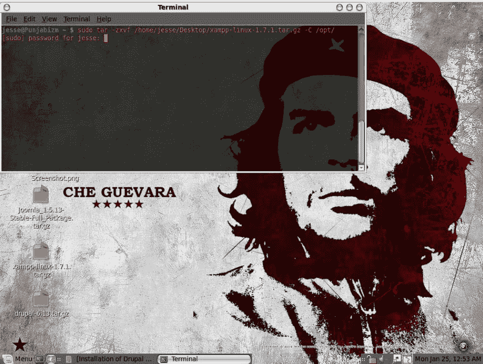

输入此命令后按回车，现在会提示你输入密码，输入你的用户登录密码并按回车。

此命令将 Xampp 的所有文件解压到你的 `/opt/` 目录中。

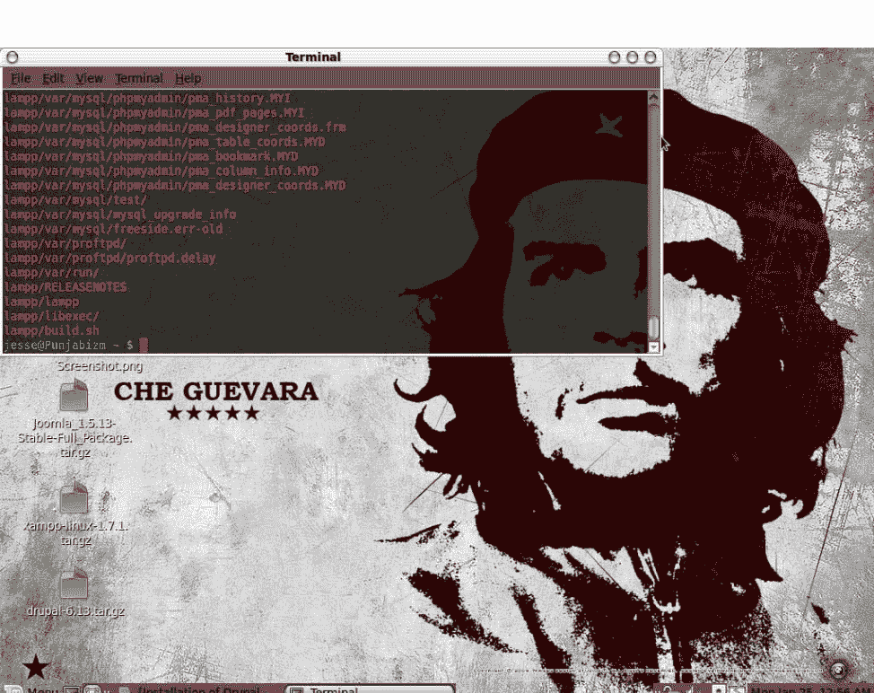

## CHE GEVARA

★★★★★

`Joomla_1.5.13-Stable-full-Package.tar.gz`

Joomla

安装 Drupal

现在所有文件都已解压。因此，我们可以启动 XAMPP

- 1. 打开终端，输入以下命令：

`sudo /opt/lampp/lampp start`

如果一切正常，你的终端上将出现以下行：

XAMPP: Starting Apache with SSL (for PHP5)...

XAMPP: Starting MySQL...

XAMPP: Starting ProFTPD...

XAMPP for Linux started.

## CHE GUEVARA

```
lampp/var/mysql/phpmyadmin/pma designer coords.MYD
lampp/var/mysql/mysql upgrade_info
lampp/var/mysql/functions.2008
lampp/var/prolog/
lampp/var/log/mysqld.delay
lampp/var/run/
lampp/XAMPP
lampp/
lampp/build.sh
$user@punjabim ~# sudo /opt/lampp/xampp start
XAMPP: Starting Apache for Linux 2.6....
XAMPP: Starting Apache with SSL (and PHP)...
XAMPP: Starting MySQL ...nXAMPP: Starting ProFTPD...
All services started.
$user@punjabim ~#
```

现在测试你的 XAMPP 安装

- 1. 打开浏览器。
- 2. 输入以下地址：

`http://localhost`

它应该显示以下页面：

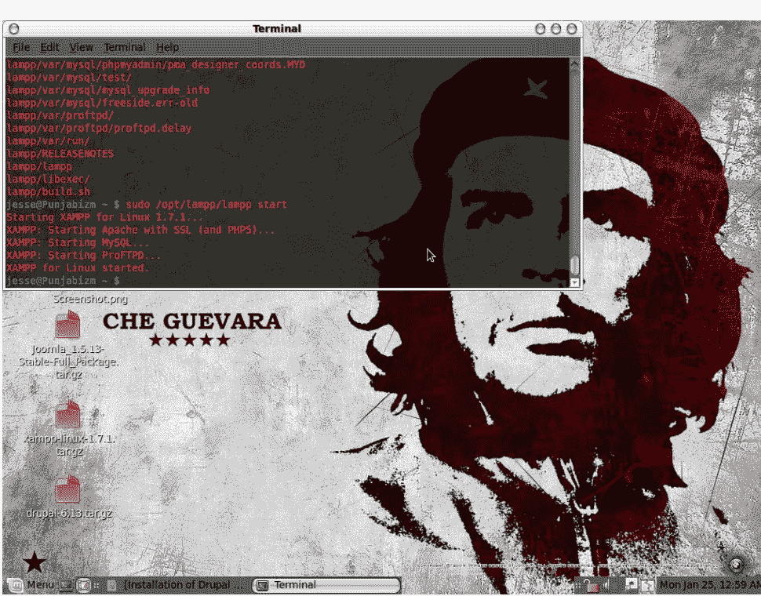

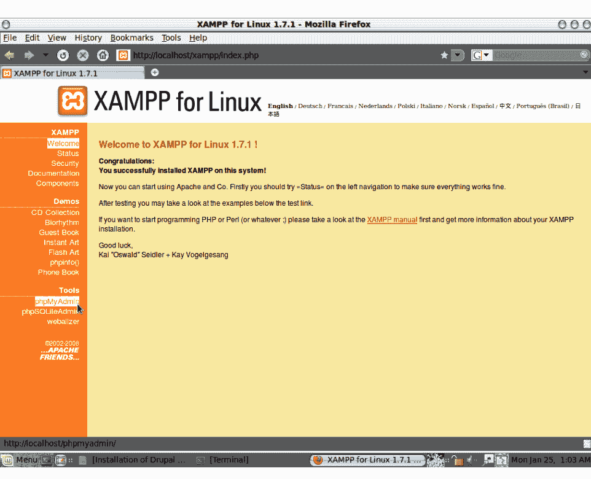

点击 Status 链接查看正在运行的内容：

### XAMPP for Linux 1.7.1 - Mozilla Firefox

#### XAMPP Status

此页面显示了关于所有运行和未运行项目的信息。

| 组件 | 状态 | 提示 |
| --- | --- | --- |
| MySQL database | ACTIVATED | |
| Perl | ACTIVATED | |
| 通用网关接口 (CGI) | ACTIVATED | |
| 服务端 (SSI) | ACTIVATED | |
| PHP 扩展 - Apache | DEACTIVATED | 596 FAQ |
| PHP 扩展 - OCI | DEACTIVATED | 596 FAQ |

对配置的更改可能会导致错误报告。

如果显示像这样，说明你走在正确的道路上。

现在点击 Tools 下的 phpadmin。在这里创建一个名为 `joomla` 的数据库。

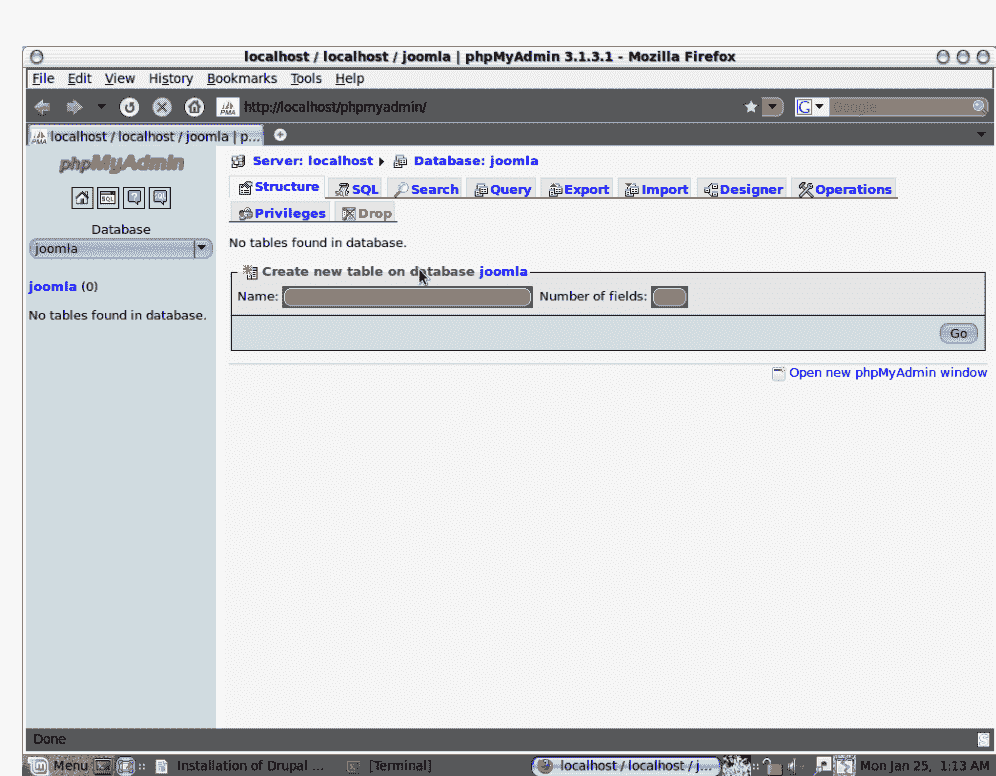

不要动其他任何地方，点击 home 返回上一个界面。

现在同样的方法创建一个名为 `drupal` 的数据库。

你的 XAMPP 安装完成。

现在安装 Joomla。

首先在 `/opt/lampp/htdocs/` 中创建一个名为 "`jooomla`" 的文件夹；你可以通过终端输入以下命令完成：

```
sudo mkdir /opt/lampp/htdocs/jooomla
```

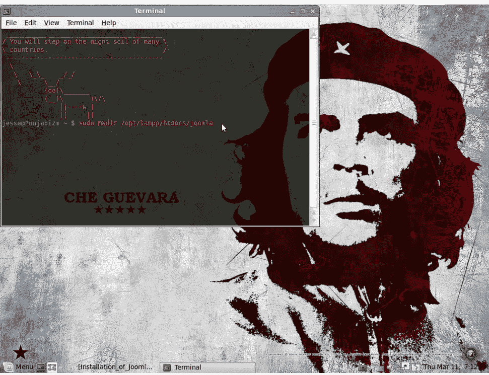

如果提示，提供密码！

Joomla 目录已创建，现在在终端输入以下命令。

```
sudo tar -xvf /home/jesse/Desktop/Joomla_1.5.13-Stable-Full-Package.tar.gz -C /opt/lampp/htdocs/jooomla
```

这将 joomla 的所有文件解压到 `htdocs/jooomla`。

```
lampp/var/mysql/frees.old
lampp/var/proftpd/
lampp/var/proftpd/proftpd.delay
lampp/log/
lampp/libexec/
lampp/php.ini
[jesse@machine] ~ sudo /opt/lampp/lampp start
XAMPP: Starting Apache 2.4..
XAMPP: Starting Apache with SSL (PHP5)...
XAMPP: Starting MySQL...
XAMPP: Starting ProFTPD.. 
XAMPP for Linux started.
[jesse@machine]$ sudo mkdir /not/htdocs/jomla
[jesse@machine]$ sudo password for jesse: 
[jesse@machine]$ tar -xvf /home/jesse/Desktop/Joomla_3.5.13-Stable-Full-Package.tar.gz -C /opt/lampp/htdocs/jooomla
```

## CHE GEVARA

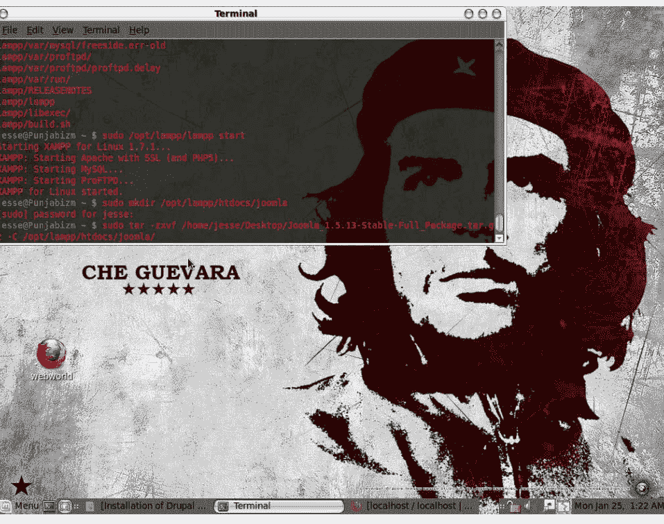

完成后打开你的浏览器并输入 `http://localhost/jooomla`，将显示如下界面。

### Joomla! 安装程序 - Mozilla Firefox

#### Joomla! 安装

##### 步骤

- 1: 语言
- 2: 安装前检查
- 3: 许可证
- 4: 数据库
- 5: FTP 配置
- 6: 配置
- 7: 完成

###### 选择语言

请选择 Joomla! 安装期间使用的语言。

- ar-AR - 阿拉伯
- be-BY - 白俄罗斯语 (беларуская)
- bg-BG - 保加利亚语 (Български)
- bn-BD - 孟加拉语 (Bangladesh)
- ca-ES - 加泰尼亚语
- cs-CZ - 捷克语 (Český)
- da-DK - 丹麦语 (Dansk)
- de-DE-CH - 德语 (DE-CH)
- de-EG - 埃及语
- en-GB - 英语 (United Kingdom)
- en-US - 英语 (US)
- id-ID - 印度尼语
- es-ES - 西班牙语 (Español internacional)
- fa-IR - 波斯语 (فارسی)
- fi-FI - 芬兰语
- fr-FR - 法语 (Français)
- gl-ES - 加利西亚语
- gu-IN - 古吉拉语 (ગુજરાતી)
- hr-HR - 克罗地亚语 (rvatski)
- h-HU - 匈牙利语 (Magyar)


# Joomla! Web 安装程序 - Mozilla Firefox

### 步骤 安装前检查

- 1: 语言
- 2: 安装前检查
- 3: 许可证
- 4: 数据库
- 5: FTP 配置
- 6: 配置
- 7: 完成

Joomla! 1.5.3 Stable [Wojmammi Ama Bai] 2009年7月23日 04:00 GMT:

如果 Neo 不支持其中任何项目，你的系统不符合安装 Joomla 的要求，可能会遇到错误。这可能导致你的 Joomla 安装无法正常运行。

| 属性 | 值 |
|---|---|
| PHP 版本 >= 4.3.10 | 是 |
| Zlib 压缩支持 | 是 |
| SSL 支持 | 是 |
| MySQL 支持 | 是 |
| 语言 = 默认 | 是 |

字符串负载

如果配置设置不符合预期，你仍然可以安装。你必须手动更新代码文件。点击下方链接下载示例配置。将此文件重命名为 `configuration.php` 并将其上传到你的根目录。


推荐设置：

确保 PHP 的推荐设置以确保与 Joomla 完全兼容。

| 指令 | 推荐 | 实际 |
|---|---|---|
| 安全模式 | Off | Off |
| 显示错误 | Off | On |
| 文件更新 | Off | On |
| 注册类 | Off | On |
| 输出缓冲 | Off | Off |
| 会话自动启动 | Off | Off |

# Joomla! Web 安装程序 - Mozilla Firefox

## Joomla! 安装

## 步骤

- 1: 语言
- 2: 安装前检查
- 3: 许可证
- 4: 数据库
- 5: FTP 配置
- 6: 配置
- 7: 完成

GNU 通用许可许可证

目录

- GNU 通用许可许可证
- 前言
- 复制、分发和修改的条款与条件
- 如何将条款应用于你的程序

版本 2，1991 年

前言

允许复制和分发本许可证的逐字副本，只要不是这样。

当我们谈论软件时，我们指的是自由，而不是价格。我们的 GNU 通用许可许可证旨在确保你有共享和更改自由软件的自由。这是为了保证这种自由是真实的且免费的。它的设计是为了防止专有干扰并确保所有用户都保持自由。

为了保护权利，我们需要制定限制，禁止任何人剥夺你的权利或要求你放弃这些权利。这些限制对于确保软件对所有用户都是免费的必要的，即使他们对其进行了修改。

例如，如果你分发此类程序的副本（无论是免费还是收费），你都将向接收者提供你拥有的所有权利。

# Joomla! Web 安装程序 - Mozilla Firefox 浏览器

文件 编辑 查看 历史 书签 帮助

```
http://localhost/joomla/installation/index.php
```

## Joomla! 安装

| 步骤 | | |
| :--- | :--- | |
| 1: 语言 | | |
| 2: 安装前检查 | | |
| 3: 许可协议 | | |
| 4: 数据库 | | |
| 5: FTP 配置 | | |
| 6: 配置 | | |
| 7: 完成 | | |

连接设置：

通过四个简单的步骤设置 Joomla 运行在您的服务器上。

第一步是数据库配置。请选择您偏好的设置。

| 基础设置 | | |
| :--- | :--- | |
| 数据库类型 | `mysql` | |
| | 这通常是 localhost 或托管提供商提供的主机名。 | |
| `localhost` | 这是数据库名称，由您的托管提供商提供的用户名。您可以将其更改为数据库名。 | |
| 用户名 | `root` | |
| | 在输入 MySQL 账户密码时，出于安全考虑是必须的。这可能是由托管提供商提供的密码。 | |
| 密码 | | |
| | 如果您的设置如此，请留空密码，可以使用表前缀选项来区分多个 Joomla 站点。 | |
| 数据库名称 | `joomla` | |
| 表前缀 | `JO_` | |
| | 不要使用前缀 'bak'。它被用于备份表。 | |

### 基础设置

输入数据库服务器的主机。Joomla 将安装在您选择的数据库中。如果您没有托管提供商，请使用 `localhost` 服务器。

输入您希望使用的 MySQL 用户名、密码和数据库名称。除了您要使用的数据库外，这些都是必须的。

### 高级设置

如何处理来自之前安装的现有表。

输入用于您的 Joomla 安装的表前缀。

- 删除现有表
- 备份旧表

来自之前安装的任何现有备份表都将被导入。

Drupal joomla! Web 安装程序菜单

1月 25日 星期一 上午 1:31

这是主窗口，选择数据库类型 "`mysql`"，填入用户名 "`root`"。

留空密码（因为您在 XAMPP 中创建数据库 `joomla` 时没有设置任何密码。）

填好数据库名称 `joomla`。保持其余设置不变并继续。

# Joomla! Web 安装程序 - Mozilla Firefox 浏览器

文件 编辑 查看 历史 书签 帮助

## Joomla! 安装

### FTP 配置

FTP 权限：

由于 Linux 和其他操作系统的系统限制，使用了 FTP 层来处理文件系统操作和安装。当 Joomla! 需要访问服务器时，Joomla! FTP 会处理所有文件系统操作。

输入具有目录访问权限的 FTP 用户名和密码。当 Joomla 需要访问服务器时，FTP 层将处理所有文件系统操作。

出于安全考虑，如果启用了该选项，最好创建一个具有 Joomla 目录访问权限独立 FTP 用户账户。在 Windows 操作系统上，不需要 FTP 层。

- 1: 语言
- 2: 安装前检查
- 3: 许可协议
- 4: 数据库
- 5: FTP 配置
- 6: 配置
- 7: 完成

| 基础设置 | | |
| :--- | :--- | |
| 启用 FTP 文件层 [ ] 是 | | |
| FTP 用户 | | |
| FTP 密码 | | |
| FTP 根路径 | | |
| 高级设置 | | |
| FTP主机 `127.0.0.1` | | |
| FTP 端口 `21` | | |
| 保存 FTP 密码 [ ] 是 | | |

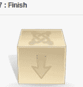

Joomla! 是根据 GNU GPL v2.0 许可证发布的免费软件。

Drupal Joomla-Web-Installer 安装 1月 25日 星期一 上午 1:30

# Joomla! Web 安装程序 - Mozilla Firefox 浏览器

文件 编辑 查看 历史 书签 帮助

`http://localhost/joomla/installation/index.php`

Joomla! Web 安装程序

## Joomla! 安装

15:13

### 主配置

上一步 下一步

- 1: 语言
- 2: 安装前检查
- 3: 许可协议
- 4: 数据库
- 5: FTP 配置
- 6: 配置

站点名称：

输入您的 Joomla 站点名称。

站点名称：

`jessewood`

### 确认管理员和电子邮件密码。

您的电子邮件：

`esse@email.ru`

管理员密码：

******

确认管理员密码

输入您的电子邮件。这将是 Web 管理员的邮箱。输入新密码并在相应的字段中确认它。在安装后，您将使用此密码登录控制面板设置。如果您正在进行升级，可以忽略此部分。您的当前设置将自动保存。


## 安装示例数据

建议初学者安装示例数据。它包含了 Joomla! 安装包中的示例内容。

安装示例数据


### 加载迁移脚本

需要在旧站点上创建迁移脚本，通过提供新站点路径并输入 URL 中使用的编码。如果文件长度超过服务器设置的限制，请查看 Joomla! 文档 (`encoding/sources`) 获取迁移大型示例数据的帮助。

加载示例数据，恢复或迁移数据

：强烈建议通过选择选项并点击按钮使用空数据库启动 Joomla! 安装。

（此处省略重复的配置步骤说明）


## 完成了..!!

现在我们通过将 Drupal 的内容解压到 "`opt/lampp/htdocs`" 来安装它：

你知道你的 drupal tar.gz 文件在桌面上，准备解压它

- 1. 打开终端，输入以下命令：


```bash
sudo tar -xvf /home/jesse/Desktop/drupal-6.13.tar.gz -C /opt/lampp/htdocs/
```

（请注意，这里的 `jesse` 是我的用户名，你必须在此输入你登录的用户名）

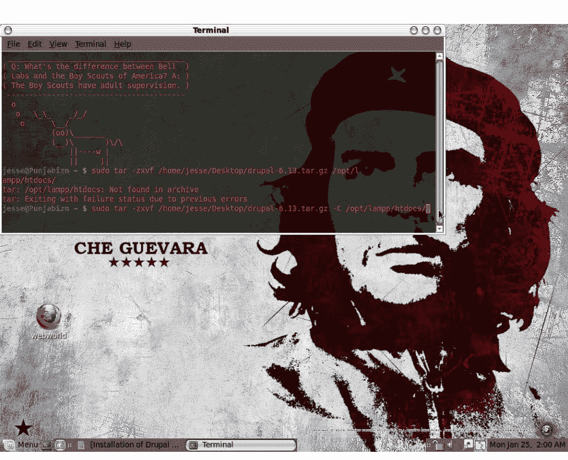

它将在你的 `/opt/lampp/htdocs/` 目录下创建一个名为 `drupal` 的文件夹。但我们需要将此文件夹重命名为 `drupal`。

- 1. 输入以下命令：

```bash
jesse@Punjabizm ~ $ sudo mv /opt/lampp/htdocs/drupal-6.13 /opt/lampp/htdocs/drupal
```

（`drupal-6.13` 是我使用的文件版本，你必须输入你下载的 `drupal` 版本名称）

### 终端

```
drupal-6.13/themes/pushbutton/logo-hover.jpg
drupal-6.13/themes/pushbutton/logo.png
drupal-6.13/themes/pushbutton/node-tip.gif
drupal-6.13/themes/pushbutton/get.php
drupal-6.13/themes/pushbutton/pushbutton.info
drupal-6.13/themes/pushbutton/checkbox.png
drupal-6.13/themes/pushbutton/style.css
drupal-6.13/themes/pushbutton/tabs-off.png
drupal-6.13/themes/pushbutton/tabs-hover.rtl.png
drupal-6.13/themes/pushbutton/tabs-on.png
drupal-6.13/themes/pushbutton/tabs-on.rtl.png
drupal-6.13/themes/pushbutton/tabs-option.png
drupal-6.13/themes/pushbutton/tabs-option-hover.rtl.png
drupal-6.13/themes/pushbutton/tabs-option-off.png
drupal-6.13/themes/pushbutton/tabs-option-rtl.png
drupal-6.13/themes/pushbutton/default.png
jesse@drupal~$ sudo mkdir -p /opt/lamp/htdocs/drupal-6.13 /opt/lamp/htdocs/drupal
jesse@drupal~$ $ 
```

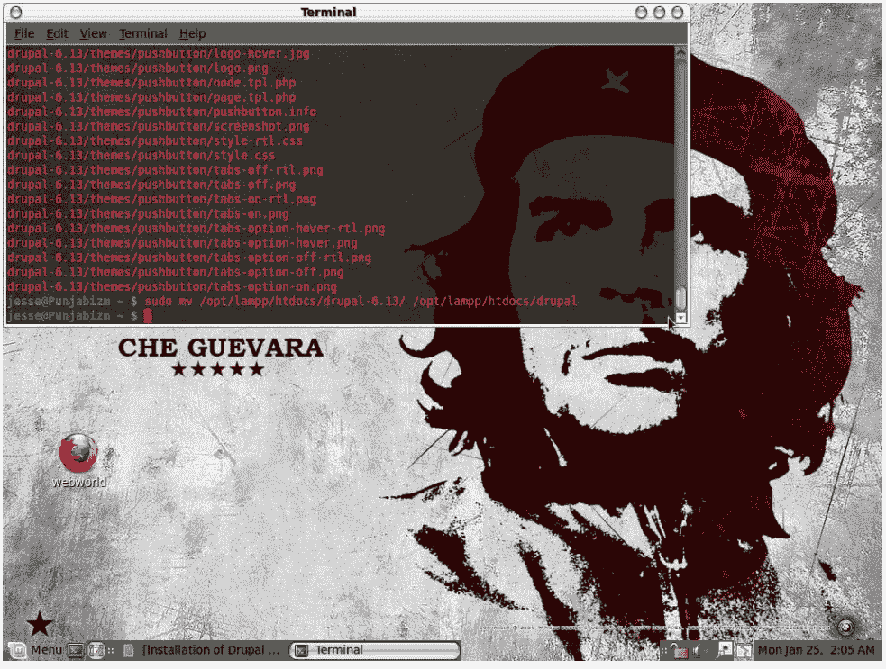

## 太太棒了 ★★★★

好了！你做到了..

现在让我们尝试一下

# Drupal

- 1. 打开你的网络浏览器。
- 2. 输入以下地址：

`http://localhost/drupal`

你应该能看到这个页面：

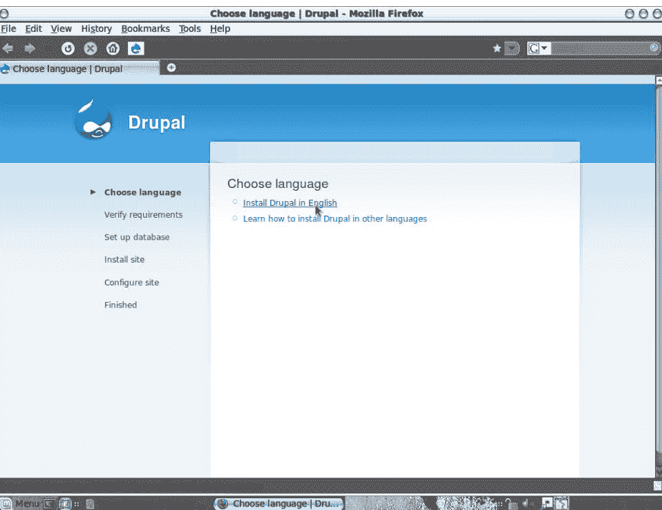

## 选择用英文安装 Drupal

接下来它将显示一个带有某些警告和其他所有其他内容的红色屏幕。

# 要求问题 | Drupal - Mozilla Firefox

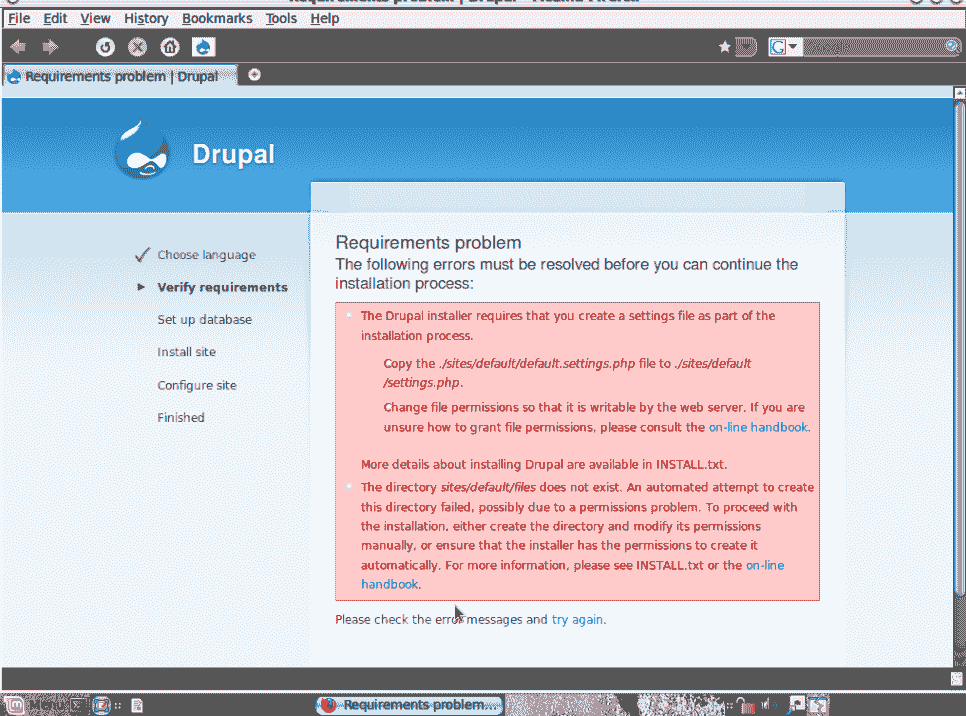

不要慌。

只需打开终端窗口并输入命令：

```bash
jesse@Punjabjab ~ sudo cp /opt/lampp/htdocs/drupal/sites/default/default.settings.php /opt/lampp/htdocs/drupal/sites/default/settings.php
```

这将创建 "`default.settings.php`" 的副本并将其重命名为 "`settings.php`"。

接下来，需要授予 `settings.php` 文件权限使其可写：

- 输入以下命令（每个命令后按回车）：

```bash
jesse@Punjabjab ~ $ sudo chmod a+w /opt/lampp/htdocs/drupal/sites/default/settings.php
jesse@Punjabjab ~ $ sudo chmod a+w /opt/lampp/htdocs/drupal/sites/default/settings.php
```

现在我们需要将 PHP 内存限制从 8M 增加到 16M。

- 打开终端并输入：

```bash
sudo nano /opt/lampp/etc/php.ini
```

会出现以下屏幕：

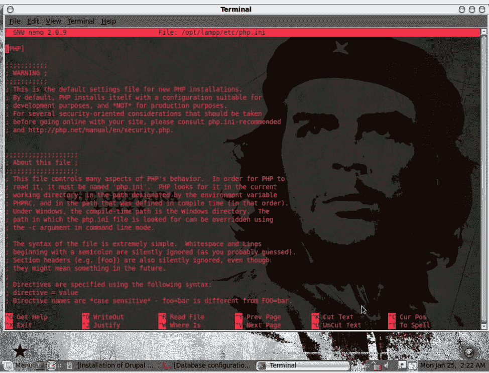

现在你需要更改缓冲区大小。位置位于下方：

### 终端

编辑文件：`/opt/lampp/etc/php.ini`

```ini
output_buffering 允许你在发送正文内容后发送头部（包括 cookies），通过将 PHP 的输出存储在内存中来节省内存。你可以通过设置特定的字节数来为所有文件启用缓冲区，而不是使用 'on'（例如 output_buffering=4096），如果你希望压缩整个输出页面。设置 output_handler 会自动开启输出缓冲区。output_handler 将被调用（带有实例化的类名，如果函数未定义则会发生序列化错误）。使用 zlib 库进行透明输出压缩，有效的输出方法：deflate 或缓冲区大小（默认为 0）。注意：如果设置为 '0'，则输出必须为空。
zlib.output_compression = off
```

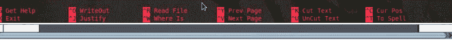

更改后，按 `Ctrl+X` 退出窗口。

屏幕上将出现选项：“保存修改的缓冲区？”

按 "`Y`" 并按回车，在下一个屏幕再次按回车。完成。现在你可以关闭终端窗口了。

按 "`F5`" 刷新你的浏览器窗口。它将显示你需要将 Drupal 连接到数据库的屏幕。

# 数据库配置 | Drupal - Mozilla Firefox

数据库配置

考虑将 PHP 内存限制增加到 16M 以防止安装过程中出错。通过编辑 `php.ini` 文件增加内存限制并重启 Web 服务器（或联系系统管理员或托管提供商寻求帮助）。欲更多信息请查看 Drupal 要求。（当前使用的 PHP 内存限制：8M）

基础选项：

设置你的 Drupal 数据库，输入以下信息：

数据库类型：

- `mysql`
- `pgsql`

你的数据库数据将存储在：

数据库名称：存储 Drupal 数据的数据库名称。在 Drupal 创建数据库之前，它必须在你的服务器上存在。

数据库用户名：

数据库密码：

填写数据库名称 "`drupal`"

填写数据库用户 "`root`"

留空密码。

点击保存并继续

然后，在下一步填写站点信息

# Drupal # 配置站点

对 `/opt/lampp/htdocs/drupal/sites/default/settings.php` 的所有更改已完成，因此现在应该移除写入权限以避免安全风险。如果你不确定如何操作，请咨询在线手册。

配置你的网站，请提供以下信息：

### 站点信息

站点名称：`website.com`

站点电子邮件地址：`admin@example.com`

管理员电子邮件将在注册、新密码请求和其他通知期间发送。使用以站点域名结尾的地址有助于防止此电子邮件被标记为垃圾邮件。

### 管理员账户

管理员账户对站点有完全访问权限。它将自动获得所有权限并可以执行任何管理活动。这将是唯一执行某些活动的账户，请妥善保存凭据。

- 选择语言
- 验证要求
- 设置数据库
- 安装站点
- 配置站点
- 完成

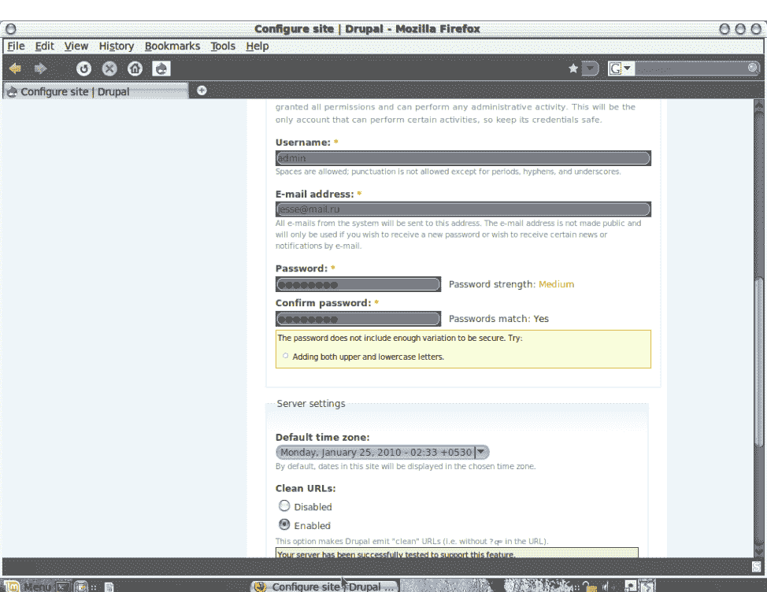

点击保存并继续

如果没有出现类似 "`Fatal error: Allowed memory size of 8388608 bytes exhausted (tried to allocate 453 bytes) in /opt/lampp/htdocs/drupal/includes/database.mysql-common.inc on line 35`" 的对话，不要生气，我们还有一次机会使用它....

打开终端，通过一个一个以下命令重启 XAMPP：

```bash
jesse@Punjabism ~ $ sudo /opt/lampp/lampp stop
jesse@Punjabism ~ $ sudo /opt/lampp/lampp start
```


```
jesse@Punjabism ~ $ sudo /opt/lampp/lampp stop
password for user:
Stopping XAMP for Linux 1.7.1..
XAMP: Stopping Apache with SQL...
XAMP: Stopping MySQL...
XAMP: Stopping ProFTPD...
stopping done.
jesse@Punjabism ~ $ sudo /opt/lampp/lampp start
Starting XAMP for Linux 1.7.1..
XAMP: Starting Apache with SQL (and MySQL)...
XAMP: Starting MySQL...
XAMP: Starting ProFTPD...
OK.
XAMP for Linux started.
```

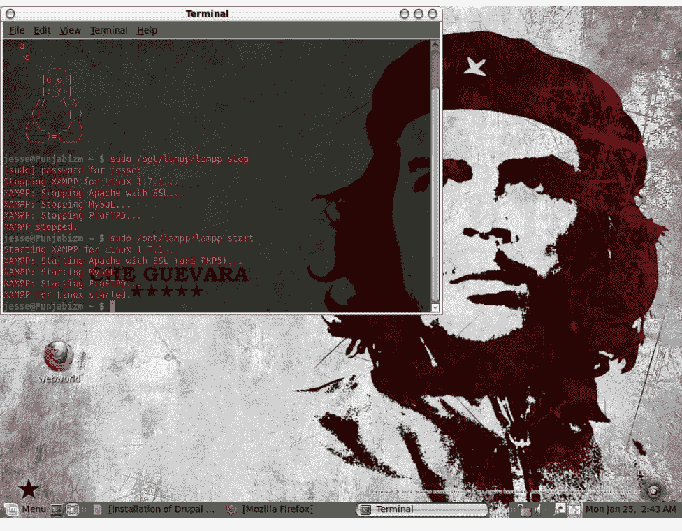

好了，现在目标达成。

刷新你的浏览器页面

出于安全考虑，它将要求你移除 `settings.php` 文件的写入权限。让我们这样做：

打开终端，输入以下命令：

```
jesse@Punjabism ~ $ sudo chmod a-w /opt/lampp/htdocs/drupal/sites/default/settings.php
```

### 终端

```
jesse@Panjabim ~$ sudo /opt/lampp/lampp stop
[sudo] password for jesse:
stopping XAMP for Linux 1.7.1...
XAMP: Stopping Apache with SSL...
XAMP: Stopping MySQL...
XAMP: Stopping ProFTPD...
jessie@Panjabim ~$ sudo /opt/lampp/lampp start
Starting XAMP for Linux 1.7.1...
XAMP: Starting Apache with SSL (and PHP)...
XAMP: Starting MySQL...
XAMP: Starting ProFTPD...
jessie@Panjabim ~$ sudo chmod a-w /opt/lampp/htdocs/drupal/sites/default/settings.php
jessie@Panjabim ~$ _
```

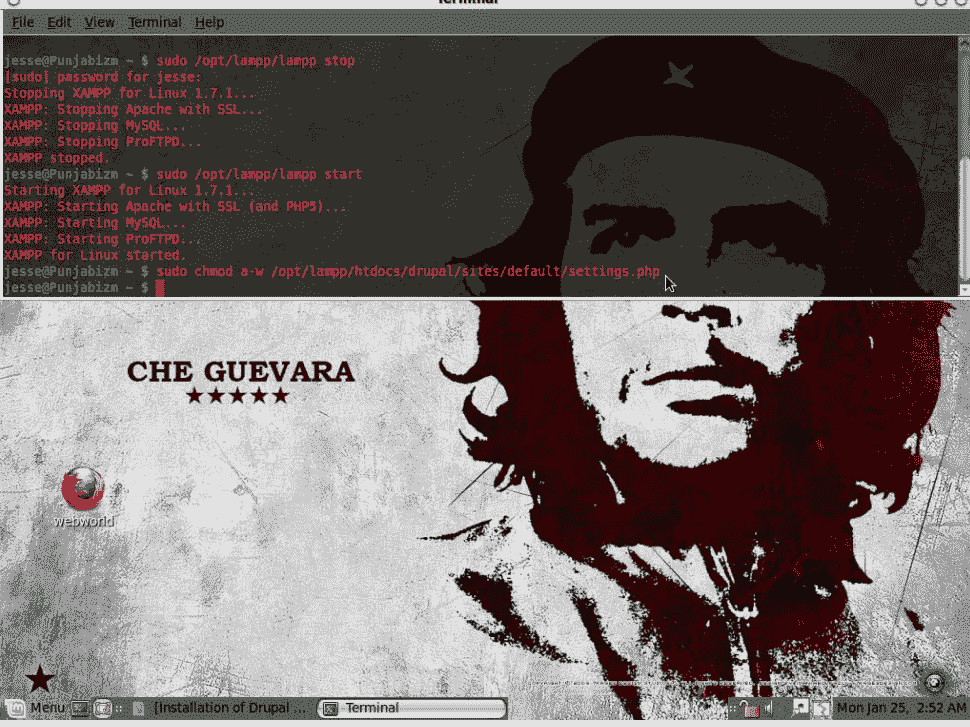

刷新浏览器后，你将看到网站的主页

## 大功告成……!!!

你做到了..

现在，你可以在本地电脑上开始构建你的网站了。

## XAMPP 服务的自动启动

但每次启动电脑时，你都要通过在终端窗口输入命令（`sudo /opt/lampp/lampp start`）来启动 Xampp 服务器，我正尝试让这对每个人变得简单。你应该将 Xampp 服务放入启动项，这样每当你启动电脑时，Xampp 服务器就会自动启动。为了实现这一点，你需要按照以下步骤操作。

- 1. 首先，找到你的默认运行级别（run level），它实际上是系统在启动时加载启动服务的文件夹。

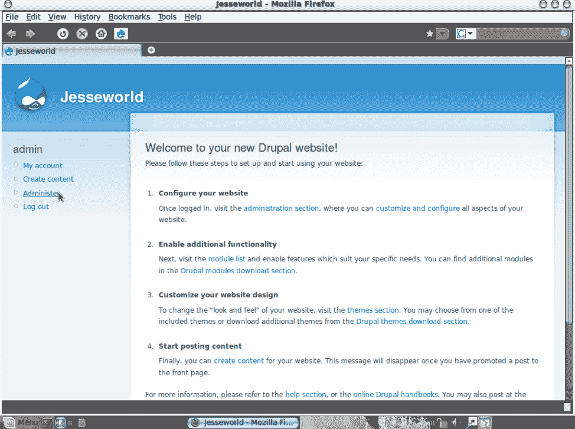

打开终端并输入命令

```
jesse@Punjabizm / $ egrep :initdefault:/etc/init.d/
```

你不应该看到包含两个冒号之间的数字的行。

大多数情况下是 3 或 5（如果你使用的是 Debian）。在这里我选择 `rc3.d` 文件夹，因为我的电脑从那里加载启动配置。

- 2. 通过终端窗口输入命令进入配置启动项的目录

```
jesse@Punjabizm / $ cd /etc/rc2.d/
```

如果你的系统没有提供 `/etc/rc2.d`，请也尝试 `/etc/init.d/rc2.d` 和 `/etc/rc2.d`。现在在命令模式下输入以下命令。

```
jesse@Punjabizm /etc/rc2.d $ sudo ln -s /opt/lampp S99lampp
jesse@Punjabizm /etc/rc2.d $ sudo ln -s /opt/lampp K01lampp
```

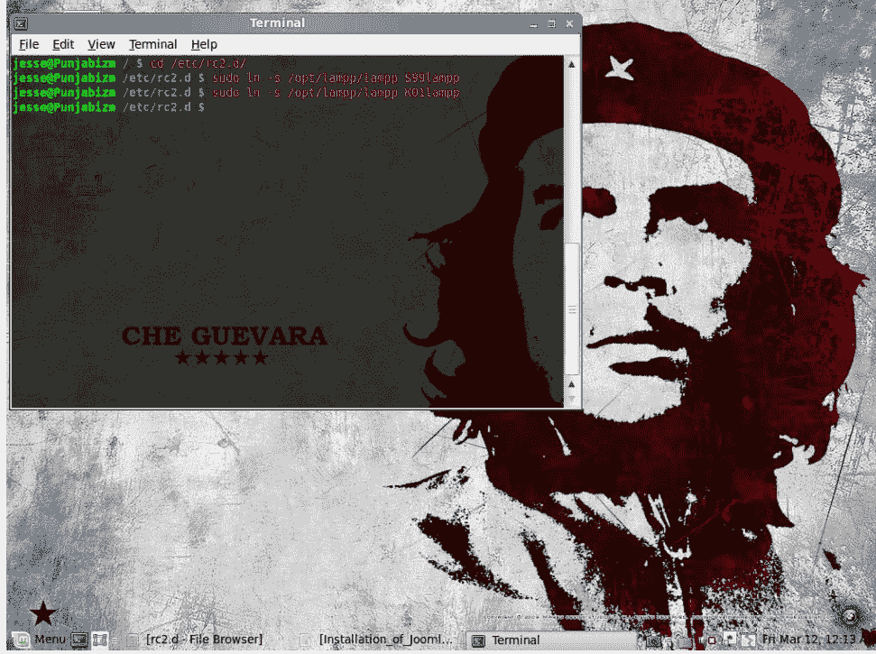

此命令将 Xampp 启动服务的快捷方式 `S99lampp` 和 `K01lampp` 放入 `/etc/rc2.d` 文件夹中。你也可以在 `rc2.d` 文件夹中看到它们。

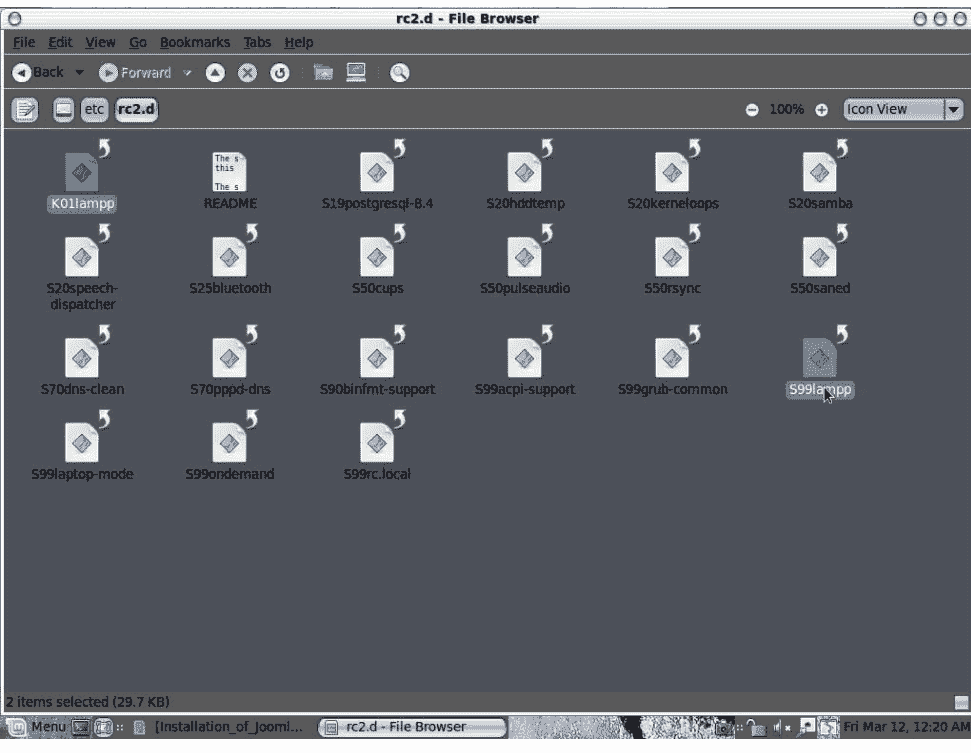

现在，当你的电脑启动或关机时，XAMPP 应该会自动启动和停止。

（这两个 CMS 的安装仅适用于 GNOME Linux 平台）

Rupinder singh Dhammu

HIIAS | Shimla

jesse@email.ru
