# Linux 上安装 Wordpress


另一个 WordPress 网络博客

要用使用 wordpress 建立你的网络博客，首先你需要从链接 http://www.wordpress.org 下载 wordpress 博客软件的源码文件。Linux 版 XAMPP（在此处下载 - http://www.apachefriends.org/en/xampp-linux.html）

**将以下三个文件保存到桌面上。**

- 1. xampp-linux-1.7.1.tar.gz
- 2. wordpress-2.9.2.tar.gz

**首先，通过命令行 (CLI) 在电脑上安装 XAMPP。**

通过将它的内容解压到名为 "opt" 的文件夹中安装 XAMPP，该文件夹位于文件系统的根目录下。

- 1. 打开**终端 (Terminal)**，输入以下命令：

```
jesse@Punjabij ~ $ sudo tar -zxvf /home/jesse/Desktop/xampp-linux-1.7.1.tar.gz -C /opt/
```

（请注意，这里的 jesse 是我的用户名，你必须输入当前登录的用户用户名）。

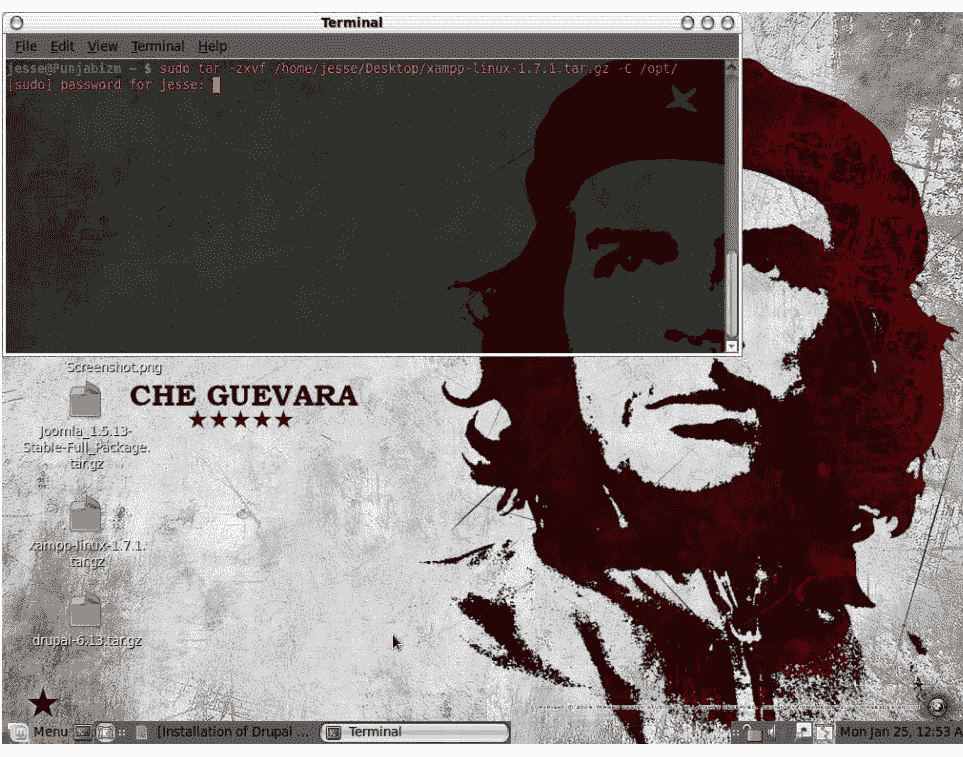

输入此命令后按回车，现在会提示你输入密码，输入用户登录密码并按回车。
此命令会将 Xampp 的所有文件解压到你的 /opt/ 目录。

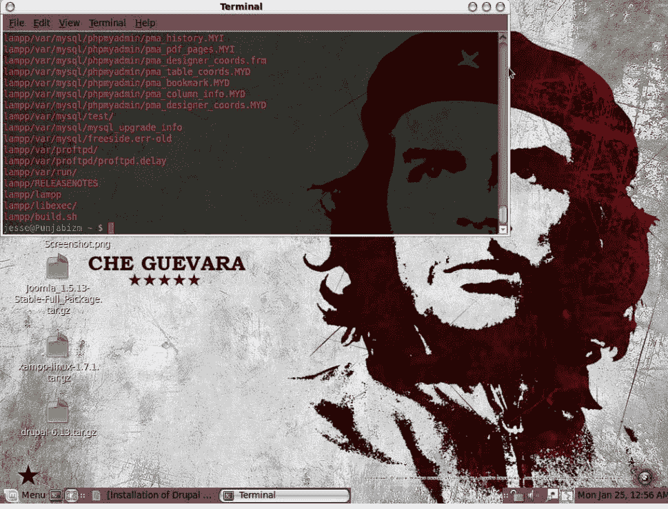

现在所有文件已解压。我们可以启动 XAMPP 了。

- 1. 打开**终端 (Terminal)**，输入以下命令：

```
sudo /opt/lampp/lampp start
```

如果一切操作正确，你的终端将显示以下几行：

XAMPP: Starting Apache with SSL (and PHP5)...
XAMPP: Starting MySQL...
XAMPP: Starting ProFTPD...
XAMPP for Linux started.


- 1. 打开浏览器。
- 2. 输入以下地址：

http://localhost

它应该显示以下页面：


欢迎使用 XAMPP for Linux 1.7.1

恭喜
你已成功在该系统上安装了 XAMPP！

现在你可以开始使用 Apache 和 MySQL 了。首先，你应该点击左侧导航中的 ~Status (状态)”以确保一切运行正常。

如果你想开始编写 PHP 或 Perl（或其他语言），请先查看 XAMPP 手册并获取有关你 XAMPP 的更多信息

祝你好运，
Kai "Oswald" Seidler + Kay Vegelong

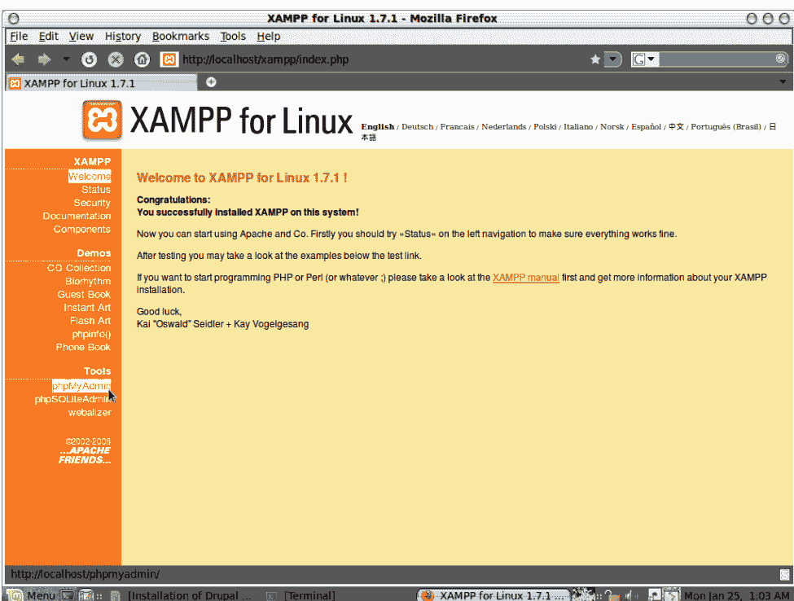

点击 Status 链接查看正在运行的内容：


此页面为你提供关于正在运行和未运行内容的所有信息视图。

| 组件 | 状态 | 提示 |
| --- | --- | --- |
| MySQL 数据库 | 已激活 (ACTIVATED) | |
| PHP | 已激活 (ACTIVATED) | |
| 共同网关接口 (CGI) | 已激活 (ACTIVATED) | |
| 服务器端包含 (SSI) | 已激活 (ACTIVATED) | |
| PHP 扩展 - validator | 未激活 (DEACTIVATED) | FAQ |
| PHP 扩展 - OCIB/Oracle | 未激活 (DEACTIVATED) | FAQ |

对配置的某些更改可能会导致虚假的状态报告。

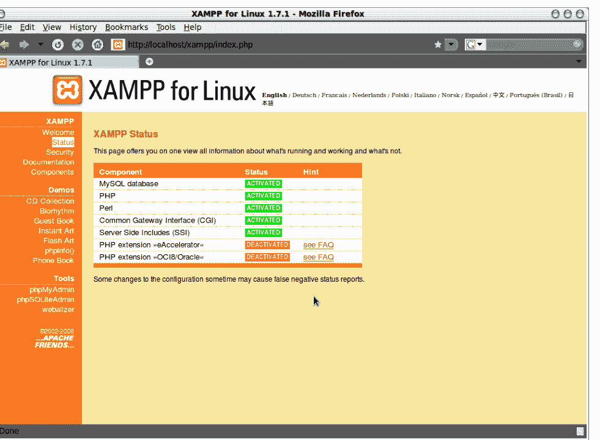

如果显示像这样，说明你的路径是正确的。

现在点击“工具 (Tools)”列表下的“phpmyadmin”。在这里创建一个名为 wordpress 的数据库。

现在使用此命令在 /opt/lamp/htdocs/ 目录中解压 wordpress 文件

```
jesse@Punjabizm / $ sudo tar -xzvf /home/jesse/Downloads/wordpress-2.9.2.tar.gz -C /opt/lampp/htdocs/
```

```
wordpress/wp-content/themes/default/single.php
wordpress/wp-content/themes/default/search.php
wordpress/wp-content/themes/default/comment.php
wordpress/wp-content/themes/default/archive.php
wordpress/wp-content/themes/default/page.php
wordpress/wp-content/themes/default/footer.php
wordpress/wp-content/themes/default/sidebar.php
wordpress/wp-content/themes/default/style.css
wordpress/wp-content/themes/default/attachment.php
wordpress/wp-content/themes/default/links.php
wordpress/wp-content/themes/default/track.css
wordpress/wp-cron.php
wordpress/wp-feed.php
wordpress/index.php
jessampunjabi ~ $ sudo tar -xzvf /home/Downloads/wordpress-2.9.2.tar.gz
cd /opt/lammps/htdocs/
```

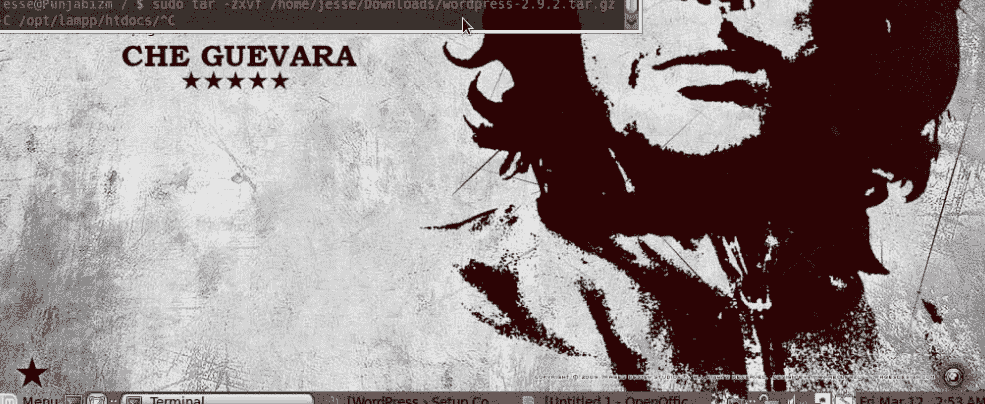

这将在 htdocs 目录中创建一个 wordpress 文件夹。
现在打开你的浏览器并访问 URL http://localhost/phpmyadmin
屏幕上将显示以下页面

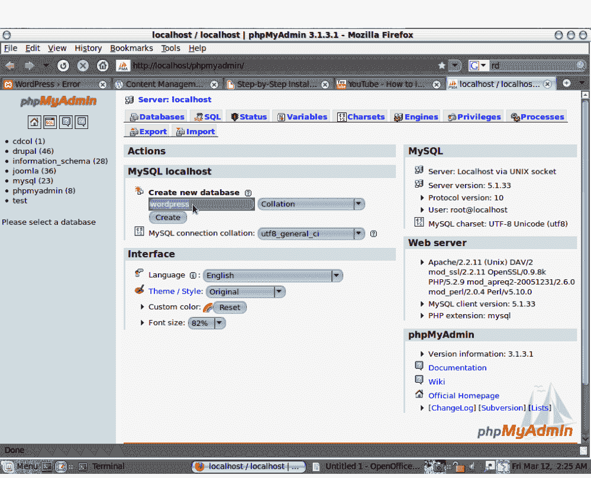

通过在输入框中填写数据库名称创建一个名为 wordpress 的数据库，然后点击创建 (create)。数据库创建后，点击首页 (home)。

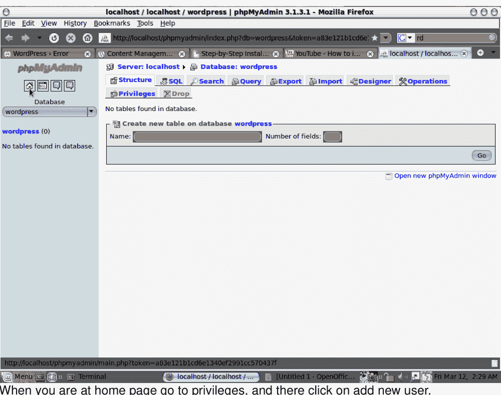

当你处于首页时，前往权限 (privileges)，然后点击添加新用户 (add new user)。

在添加用户界面中，填写用户名、数据库名称和密码等所需字段。

此部分完成后向下滚动屏幕并点击页面底部的执行 (go)按钮。
将出现下一个屏幕，稍微向下滚动并从下拉列表中选择 wordpress。


- cicol (1)
- drupal (6)
- information_schema (28)
- joomla (36)
- mysql (9)
- phpmyadmin (8)
- wordpress

请选择一个数据库

数据库特定权限

数据库权限 授予 表格特定权限 操作

在以下数据库上添加权限： 

更改密码：

密码：

密码哈希：

然后向下移动屏幕，在全局权限 (Global privileges) 中勾选全部 (check all)，这样所有复选框都会像截图所示被勾选。

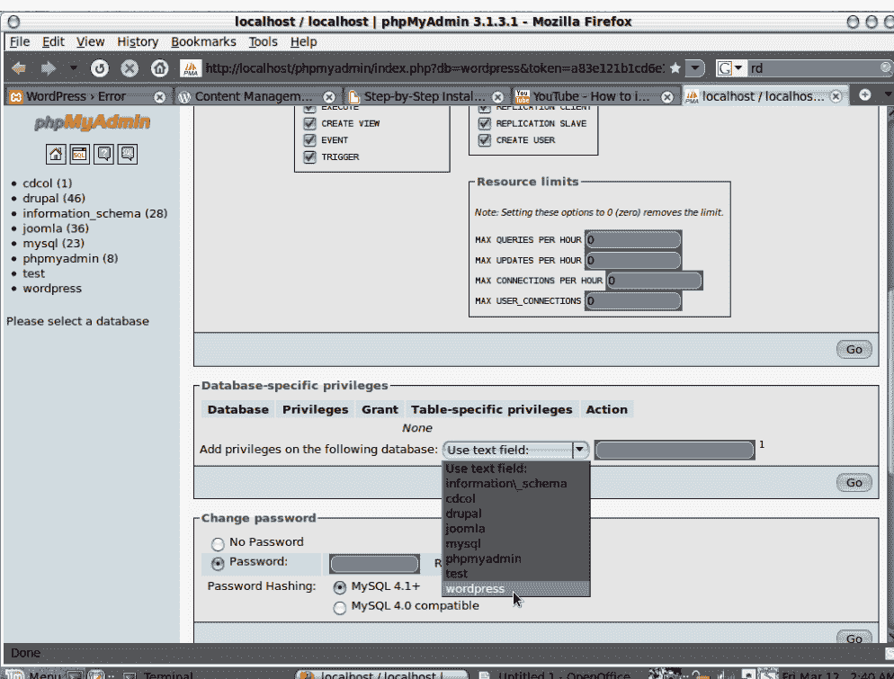

点击执行 (go)。


欢迎来到著名的分钟级 WordPress 安装流程！您可以从闲地浏览 ReadMe 文档。否则，只需填写下面的信息，您就可以开始使用世界上扩展性最高、最强大的发布平台了。


请提供以下信息。别担心，您以后随时更改这些设置。

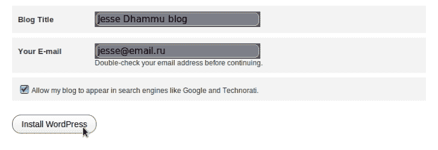

成功了……！！ 在下一个屏幕中，它应该显示 wordpress 已成功安装的消息……在这里它还会提供用户名 `admin` 和一个随机生成的密码。您需要复制该密码或将其记录在某处。以后登录博客时会用到它。

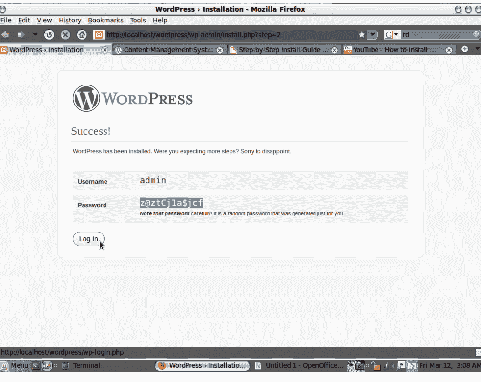

在此屏幕上，只需复制密码（您以后可以更改它）并点击登录……！

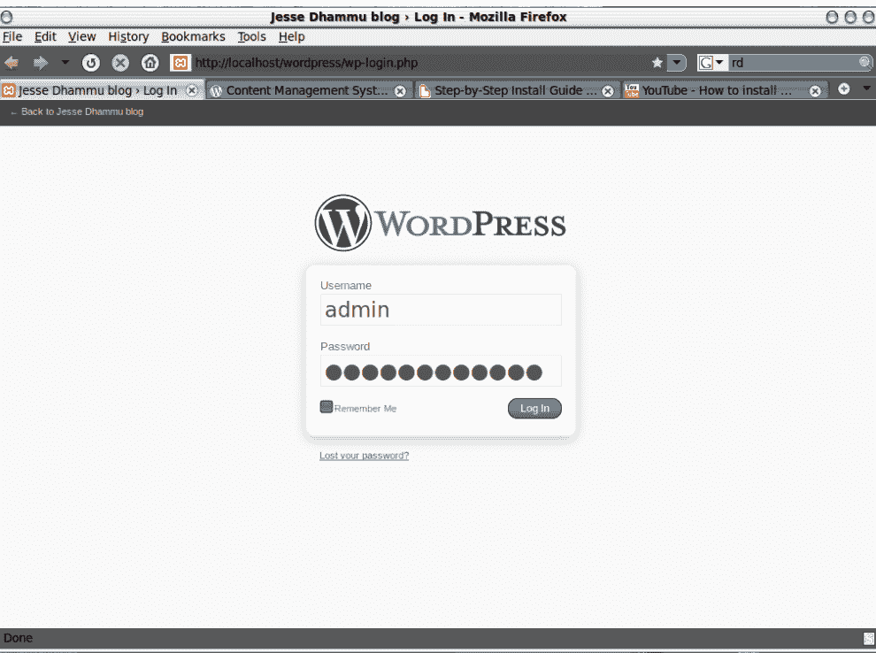

在这里您必须输入那个随机生成的密码和用户名 `admin`。只需点击登录……就完成了……下一个屏幕是您的博客仪表板，正如我之前告诉您的，您可以从此屏幕界面更改您的个人资料密码。只需点击屏幕顶部的链接“是的，带我去我的个人资料页面”。

在个人资料页面，您可以编辑和更新您的个人信息，例如：您的名、姓、网页、电子邮箱、即时通讯工具和密码（您无法更改用户名“admin”）

# 个人资料 - Jesse Dhammy 博客 — WordPress — Mozilla Firefox

点击“更新资料”即可完成。

## Jesse Dhammu 博客

### 这是 Jesse

2010年3月11日

这是我在 wordpress 上的第一篇文章

发布于：未分类 | 编辑 | 无评论 »

### 你好，世界！

2010年3月11日

欢迎来到 WordPress。这是您的第一篇文章。编辑或删除它，然后开始写博客吧！

发布于：未分类 | 编辑 | 1 条评论 »

- 页面
- 关于

- 存档
- 2010年3月

- 分类
- WordPress (2)

- 博客链接
- 开发博客
- 文档
- 插件
- 支持论坛
- 主题
- WordPress 世界

- 元数据
- 站点管理员

看您的个人 wordpress 博客已准备就绪！！

文档编写：
Rupinder singh Dhammu
IIAS | Shimla
jesse@email.ru

