# Debian Gnu/linux 安装指南（其他发行版）


副编辑

Angela Wethington

征稿编辑

Nell Rowe

开发编辑

Tony Amico

主编

Lisa Wilson

项目编辑

Dawn Pearson

文字编辑

Kezia Endsley

索引编制员

Christine Nelsen

校对员

Katherin Bidwell

技术编辑

Dan Scherf

团队协调员

Karen Opel

媒体开发人员

Dave Carson

室内设计

Karen Ruggles

封面设计

Aren Howell

文案写作

Eric Borgert

制作

Dan Harris

Louis Procter

启动 X 会话 ...................................................................85

设置 X 会话脚本 ........................................................86

桌面环境 ...................................................................87

GNOME .......................................................................................88

KDE ..........................................................................................89

设置图形登录界面 ...................................................91

管理用户账户 ...............................................................91

文件所有权与权限 .....................................................93

打印——一种 UNIX 方法 ......................................................95

设置打印系统 ........................................................96

总结 ...................................................................................97

软件包分类 ...................................................100

文本编辑器 ..........................................................................101

互联网应用程序 .................................................102

Web 浏览器 ..............................................................103

电子邮件客户端 ................................................104

生产力应用 ..........................................107

文字处理 .........................................................107

文本格式语言 ........................................108

电子表格 ......................................................109

图形软件包 .......................................110

互联网服务 ........................................111

编程工具 ......................................112

C 编译器 ........................................113

代码库与头文件 .......................113

解释型语言 ................................115

其他编程工具 ........................115

Java .........................................................115

总结 ......................................................116

初始化脚本 .......................117

配置 PPP 网络连接 .......120

配置名称服务 ...................122

激活连接 ...................123

其他家庭上网解决方案 ...............124

处理电子邮件 ...................125

发送邮件 ..................................125

收收邮件 ..................................127

邮件过滤 ...................................128

管理文件系统 ...................128

总结 ...................................................130

- 9 私有网络地址 ............................................................ 131

互联网服务器 ................................................................................ 132

登录 ....................................................................................... 133

安全远程登录 ................................................................ 133

传输文件 ............................................................................. 134

网络文件系统 (NFS) ................................................. 134

与 Windows 机器共享文件 ........................................ 136

共享打印机 ................................................................ 136

共享互联网连接 ................................................ 137

安全问题（或偏执位） ........................................ 139

总结 ............................................................................................ 140

- 10 探索 X 窗口系统 141

显示上的 X ................................................................................ 141

额外的 X ............................................................................................ 143

远程显示管理 ................................................ 144

自定义你的菜单 ......................................................... 145

用户界面工具包 ........................................................ 147

主题 ............................................................................................ 149

未来 ....................................................................................... 151

总结 ............................................................................................ 151

- 11 最后——欢迎来到社区 153

Debian 资源 ........................................................................ 154

互联网上的 GNU/Linux 社区 ............................ 154

报告 Bug ....................................................................... 157

做出贡献 ........................................................ 159

最后…… ...................................................................... 159

- 安装内核软件包 ................................................ 161

自己动手做 ................................................................163

先决条件 ............................................................163

配置内核 ............................................................164

制作内核软件包 .................................................165

# 关于作者

Thomas Down 出于 1977 年，曾担任自由职业程序员和计算机记者。在获得生物化学学位期间，他发现了 Linux 并从那时一直是忠实用户。他现在住在英国剑桥，“安装 Debian/Linux”是他的第一本书。

# 致献

致我的父母，感谢他们的倾听。

# 致谢

本书的完成离成千上万开发者的共同努力，他们在内核、相关工具以及发行本身方面的工作。感谢大家。

# 告诉我们你的想法！

作为本书的读者，你们是我们最重要的批评者和评论者。我们重视你们的意见，并想知道我们做得好不好以及希望我们出版的任何其他领域。

作为 Sams 出版商，我们欢迎你的反馈。你可以通过传真、电子邮件或直接写信的方式告诉我们你对本书的看法。

请注意，我无法帮助解决与本书主题相关的技术问题，而且由于收到的邮件很多，我可能无法回复每封邮件。

写信时，请务必提供

传真：317-581-4770

电子邮件：opsys@mcp.com

邮寄：Angela Wethington

Sams

201 West 13rd Street

Indianapolis, Indiana 46290

# 第 1 章

## 介绍 Debian

Linux 可能是 90 年代最大的计算成功故事之一。在短短几年内，一个被认为是少数爱好者专有的操作系统就赢得了广泛的尊重和部署。它最常被视为运行服务器应用程序的操作系统——特别是用于运行网站和其他基于互联网的服务。然而，当一个 Linux 系统配置了现代桌面环境（如图 1.1 所示的 GNOME 或 KDE）时，Linux（以及其他类 Unix 系统）那种对用户不友形象是完全没有根据的。并不总是明确的是 Linux 是一个内核：它只是有用操作系统的一个组件——尽管是一个核心组件。幸运的是，你不需要从头构建系统。许多小组和公司提供 Linux 内核以及一系列其他软件，它们已打包并准备好安装。Debian GNU/Linux 是这些发行版中最悠久的之一。

### 为什么使用 Debian？

多种发行版的存在是 Linux 现象的一个关键方面——发行版之间的竞争对今天使用的 Linux 系统的演变无疑很重要。但对于新手来说，这种选择往往令他们困惑。对于许多人来说，关键问题在于它的开放性。Linux 内核以及许多与之使用的工具都受益于开放方式开发。为什么他们应该

# 第 1 章：介绍 Debian

发行版是由在闭门后工作的小组组装而成的。Debian 的开发由分布在互联网各地的志愿者领导，每个人都有选择加入其中。

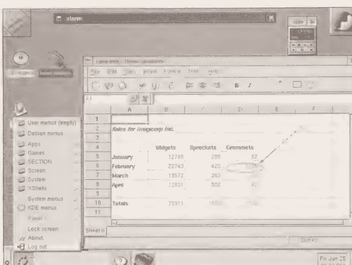

图 1.1

软件包如 Gnome 一样，为现代 UNIX 系统添加了亲切的面孔和熟悉的生产力工具。

为了协调全球范围内数百名活跃开发者（以及更多得多的多的贡献者和测试人员）之间的工作，Debian 项目拥有定义良好的发布周期。系统的每个新版本都会经过以下状态：

**不稳定的版（Unstable）：** 这指的是正在开发中的版本。任何人都可以提交修改。与闭源发行版不同，最新的不稳定的包总是可用的，任何用户都可以安装整个发行版，也可以只安装单个组件。不稳定的发行版通常以代号而不是数字命名。

**冻结版（Frozen）：** 定期，当前的不稳定的版本会被冻结。此时，通常不允许添加新功能，开发者将专注于修复任何漏洞。

**稳定版（Stable）：** 在经过一段时间的测试和漏洞修复后，冻结的发行版最终会被分配版本号并标记为*稳定*。这可以认为是 Debian 的*发布*版本——发行版的 CD-ROM 通常基于稳定版。

## 为什么使用 Debian? 3

除了开放性之外，选择 Debian 还有良好的技术理由。这种开放的开发模式产生了一个非常可靠的 Linux 发行版。每个新版本在发布之前都经过了大量严格的公开测试，因为当一个版本被描述为“不稳定”时，这个词是相对的。

Debian 在安全方面也有良好的记录。生活中一个遗憾的事实是，任何复杂的网络能力操作系统（如 Linux 或 Windows NT）都容易受到各种形式的攻击。漏洞可能是用户配置错误或安全关键程序中的 bug 导致的。Debian 通过提供更易于保护系统的配置系统，以及通过立即和公开地宣布任何安全相关问题，帮助避免这两种类型的漏洞。Debian 网站的首页始终列有最新的安全警报列表，通常还带有指向简单修复方案的链接。在整本书中，有很多提示可以帮助确保您的计算机以安全的方式配置。

发行版之间的区别，以及在安装或升级 Linux 系统时立即可可见的区别，是用于封装发行版中所有不同部分的系统。完整的 Debian 发行版由多个软件包组成，范围从基本实用程序到深奥数学应用程序。任何安装都不会包含所有包。此外，某些包依赖于其他包，而少数包是互斥的。

软件包管理软件允许您确保在安装软件包时，其所有的依赖项都能满足。同样，如果您决定删除一个包，包管理器会确保删除其所有文件，而且如果您将要破坏某些其他包的依赖关系，您将收到警告。Debian——无论是组成主发行版的包还是在其他地方提供的包——文件名扩展名均为 `.deb`。基础 Debian 包管理器叫做 `dpkg`，但通常情况下，使用名为 `dselect` 的前端来安装和删除程序要简单得多，如图 1.2 所示，并在第 4 章“基础安装”中进行了详细描述。

Debian 软件包管理系统在您想要升级系统时特别有用。它可以自动将您安装的所有包替换为较新版本，无论是来自 CD-ROM 还是通过互联网下载。`dselect` 程序让 Debian 安装保持到最新状态几乎毫无痛苦。

Debian 有时会受到批评：尽管备受尊重，但它目前不是最常用的发行版。人们对软件以 RPM 包格式提供存在一些担忧，该格式是为 Red Hat Linux 发行版开发的（随后被其他几个版本采用）。在实践中，在 Debian 系统上安装 RPM 是很容易的，可以直接安装，也可以使用 `alien` 工具，后者将其转换为标准的 `.deb` 文件。


# 第 1 章：介绍 Debian

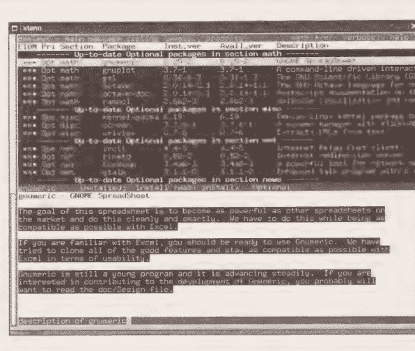

图 1.2

`dselect` 工具允许对软件包进行轻松浏览、安装和升级。

尽管各种 Linux 发行版在结构、内容和配置机制之间存在一些差异，但任何编写良好的软件都应该在所有它们上正常运行。尽管有些人声称竞争性发行版的可用增加了 Linux 的额外复杂性，但正是这种竞争迫使所有发行版保持更新。

## 主要竞争


要包含一份全面的 Linux 发行版列表几乎是不可能的。存在许多受小部分用户欢迎的次要发行版。还有一些为特定目的创建的精简发行版，例如专用的基于 Linux 的路由器。以下列表仅包含了几个可以认为是 Debian 合理替代方案的主要发行版。

- Red Hat：尽管深受尊重，但它目前不是最常用的发行版。人们对软件以 RPM 包格式提供存在一些担忧，该格式是为 Red Hat Linux 发行版开发的（随后被其他几个版本采用）。在实践中，在 Debian 系统上安装 RPM 是很容易的，可以直接安装，也可以使用 `alien` 工具，后者将其转换为标准的 `.deb` 文件。

- Red Hat：这是为 Red Hat Linux 发行版开发的（随后被其他几个版本采用）。

- Red Hat：这是为了的。

- Caldera：这是在 Debian 系统的上。

- Slackware：这是基于 Linux 系统的。

- SUSE：这是基于 系统的。

- Linux：这是是基于。

- PowerPC：这是基于。

## 为什么使用 Debian?

除了开放性之外，选择 Debian 还有良好的技术理由。这种开放的开发模式产生了一个非常可靠的 Linux 发行版。每个新版本在发布之前都经过了大量严格的公开测试，因为当一个版本被描述为“不稳定”时，这个词是相对的。

Debian 在安全方面也有良好的记录。生活中一个遗憾的事实是，任何复杂的网络能力操作系统（如 Linux 或 Windows NT）都容易受到各种形式的攻击。漏洞可能是用户配置错误或安全关键程序中的 bug 导致的。Debian 通过提供更易于保护系统的配置系统，以及通过立即和公开地宣布任何安全相关问题，帮助避免这两种类型的漏洞。Debian 网站的首页始终列有最新的安全警报列表，通常还带有指向简单修复方案的链接。在整本书中，有很多提示可以帮助确保您的计算机以安全的方式配置。

发行版之间的区别，以及在安装或升级 Linux 系统时立即可可见的区别，是用于封装发行版中所有不同部分的系统。完整的 Debian 发行版由多个软件包组成，范围从基本实用程序到深奥数学应用程序。任何安装都不会包含所有包。此外，某些包依赖于其他包，而少数包是互斥的。

软件包管理软件允许您确保在安装软件包时，其所有的依赖项都能满足。同样，如果您决定删除一个包，包管理器会确保删除其所有文件，而且如果您将要破坏某些其他包的依赖关系，您将收到警告。Debian——无论是组成主发行版的包还是在其他地方提供的包——文件名扩展名均为 `.deb`。基础 Debian 包管理器叫做 `dpkg`，但通常情况下，使用名为 `dselect` 的前端来安装和删除程序要简单得多，如图 1.2 所示，并在第 4 章“基础安装”中进行了详细描述。

Debian 软件包管理系统在您想要升级系统时特别有用。它可以自动将您安装的所有包替换为较新版本，无论是来自 CD-ROM 还是通过互联网下载。`dselect` 程序让 Debian 安装保持到最新状态几乎毫无痛苦。

Debian 有时会受到批评：尽管备受尊重，但它目前不是最常用的发行版。人们对软件以 RPM 包格式提供存在一些担忧，该格式是为 Red Hat Linux 发行版开发的（随后被其他几个版本采用）。在实践中，在 Debian 系统上安装 RPM 是很容易的，可以直接安装，也可以使用 `alien` 工具，后者将其转换为标准的 `.deb` 文件。

## Debian/Linux 的简单历史

要理解 Debian/Linux 的哲学——特别是其名称背后的原因——有必要查看 Linux 基于操作系统的早期历史。

Linux 的灵感源于 UNIX 操作系统，这些系统最初是在 1970 年代在小型计算机上开发的。在 1980 年代，UNIX 扩展到了 HP 和 Sun 等公司构建的工作站，并在萌芽的互联网发展中起了重要作用。在此期间，UNIX 是随昂贵的专有硬件提供的。

一切在 1991 年发生了变化，芬兰学生 Linux Torvalds 决定他希望在使用廉价硬件的同时获得 UNIX 的力量。他开始开发一个小型类 UNIX 内核，部分基于学术演示 Minix。内核是控制硬件设备、管理内存分配并提供调度系统的主程序，同时允许同时运行多个程序。简而言之，Linux 正在开发一个新操作系统的核心。

故事到此本可以结束。但 Torvalds 选择了发布他的内核源码，并使用了 Linux 这个名字。大约那时互联网访问开始变得越来越普遍，世界各地的许多程序员发现了 Linux 代码。虽然内核通常不是现代操作系统中最明显的部分，但它们对许多程序员来说仍然充满迷，，所以许多人

# 第一章：Debian 简介

下载 Linux 的用户开始对其进行实验。由于他们拥有完整的源代码，而不仅仅是可执行文件，他们能够修复漏洞或添加新功能。这些修改（称为补丁）被反馈给 Linux，Linux 在下一个版本中包含了其中最优秀的部分。

到 1996 年年中 Linux 达到 2.0 版本时，它已经成为一个强大且稳定的内核，可以开始与商业 UNIX 系统进行正视的竞争。此外，它是免费的，而且源代码的可用性意味着漏洞可以被迅速修复。当英特尔奔腾系列处理器中发现一个错误（被广泛称为 F00F 漏洞）时——只需发送一段特定的数据序列就能让任何电脑崩溃——在短短几个小时后，补丁就发布了，允许 Linux 内核在处理器出现故障时能够优雅地恢复。

Linux 的开发今天仍然如既往地快速，尽管这些变化并不总是立即可可见的。现在的工作很大程度上集中在支持更多硬件设备，以及提高内核在强大的多处理器机器上的性能。虽然基于英特的 PC 硬件仍然是最流行的平台，但 Linux 的设计具有很强的移植性，它现在可以运行在现代计算机上，包括 PowerMac 和基于 Alpha 的工作站。

但虽然内核是任何计算机操作系统中至关重要的部分，但它并不是让机器可用的唯一软件——甚至不是最大的部分。为了让 Linux 运行，开发者需要一个编译器；即将源代码翻译成可执行文件的程序。他们还需要许多实用程序来使系统变得可用：在 UNIX 系统上，即使是列出磁盘文件的 `ls` 命令也是一个独立的程序。

幸运的是，当 Linux 开发开始时，大多数关键工具的免费实现已经可用。它们作为自由软件基金会（FSF）GNU 项目的一部分而开发，该项目建立于 20 世纪 80 年代中期，旨在产生一个自由的类 UNIX 操作系统。当 Linux 开发进行时，GNU 软件包已经包含了构建一个可用 UNIX 系统所需的大部分关键工具——除了内核。正是这些工具让早期的 Linux 系统变得可用。你可能想在它的官方网站 `http://www.fsf.org/` 上阅读更多关于 FSF 目标以及 GNU 项目背后的逻辑的内容。

一旦人们开始将 Linux 用于除最简单的实验以外的任何用途，他们对预封装系统的需求就会增长，这些系统将 Linux 与足够的工具结合，提供一个开箱即用的设置。最初的发行版只包含几张带有基本实用程序的软盘，在协助安装和配置的工具方面几乎于没有。随着时间的推移，它们被新的发行版所取代，例如 Debian，它添加了更多的应用程序，以及日益复杂的用于配置和管理系统的工具。

今天，一个典型的 Linux 发行版包含了从 `ls` 命令到 `gimp`（一种复杂的图像编辑器）的的海量软件。其中包含的并非所有应用程序都源自 GNU 项目的工作。（例如，X Window 系统，它为 UNIX 上的所有窗口软件提供基本服务，它是独立开发的。）但如果没有高质量的 GNU 工具——特别是编译器套件——早期的 Linux 系统无疑难以起步。GNU 工具仍然构成了任何发行版中一些最重要的组件之一。为了纪念这一点，Debian 已选择将其发行版命名为 GNU/Linux，这意味着它是基于 GNU 系统，但带有 Linux 内核。

顺便提一下，GNU 项目确实开发了他们自己的内核，使用了与 Linux 不同的内部架构。（尽管从用户的角度来看，结果将是一个通用的类 UNIX 系统，并能运行所有软件。）GNU 内核（称为 HURD）的开发要慢得多，它尚未被广泛使用。然而，最近产生了一个使用 HURD 内核的不稳定 Debian 系统版本。如果 HURD 成功获得动力，未来的 Debian 用户将会有内核可供。

## 关于版本号的说明

由于 Linux 内核只是完整 Debian 系统的部分，两者的版本号并不一定匹配。事实上，如果它们匹配了，也是巧合的。Debian 和内核使用不同的版本编号方案。

Debian 版本具有 `主版本.次版本`（major minor）的形式。每当每个开发周期达到稳定阶段时，就会被分配一个新的版本号。在编写本文时，当前的 Debian 版本是 2.1，而下一个版本——名字非常奇特叫做“potato”（土豆）处于不稳定阶段。

Linux 的版本控制要复杂一点，数字格式为 `主版本.次版本.补丁级`（major minor patchlevel）。与 Debian 发行版一样，Linux 的稳定版本和不稳定版本并行存在，但使用的是奇数版本号。因此，在写作期间，当前的稳定内核是 2.2.10，而新功能正在被添加到 2.3 系列的开发内核中。由于内核中的漏洞可能会导致严重后果，建议活跃开发人员或需要开发系列中某些功能的专家使用不稳定内核。请注意，Debian 发行版——即使是不稳定版本也不使用开发内核。

## 许可自由

Linux 内核和在 Linux 系统上使用的许多软件都是免费的。但这并不意味着你不需要为它付费——根据自由软件基金会和 Linux 社区使用的定义——真正的自由意味着你可以获取程序的源代码，对其进行修改并重新分发。一个常用的（某些人会说是过度使用的）类比是，自由软件是一个类似于“自由言论而非“免费啤酒”的问题。

许多人问：“为什么要编写自由软件？”对于许多开发者来说，答案很简单，因为他们想这样做。Linux 内核始于个人项目，即使在今天，开发者也是对操作系统的内部运作有浓厚个人兴趣的人。在其他情况下，程序有时必须编写，可能是为了公司内部使用。这时问题就变成了：“为什么不公开它？”通常情况下没有损失，而且原始开发者可以从外部测试者的投入中受益。大多数自由软件都是版权保护的，并附带许可分发，该许可允许自由分发，但实施了一些轻微限制以确保作者获得荣誉。发行版中常用的两种许可证总结如下：

- 通用公共许可证 (GPL)：这是最初由自由软件基金会编写用于涵盖 GNU 系统组件的许可证。后来被许多程序采用——包括 Linux 内核。该许可证最显著的特征是，如果你向某人提供或出售 GPL 程序的二进制文件，必须提供源代码副本。该许可证的设计使得无法产生 GPL 程序的专有（非自由）衍生品。

- BSD 许可证：这是应用于加州大学伯克利分校程序员编写的软件的许可证，也被许多其他程序员采用。它比 GPL 更宽松，允许产生专有衍生品。然而，它确实包含一个要求在任何广告材料中承认原始开发者的条款——这一限制被一些人认为过分。令人混乱的是，某些程序是在修改后的 BSD 许可证下发布的，没有这一限制。

从终端用户的角度来看，许可证之间的差异通常并不重要——它们都允许你对软件进行无限的个人和商业使用，并给朋友副本。最大的差异在分发修改版本时变得明显。

## 自由的条款

关于使软件变得自由具体需要什么，一直存在争论。不断增加的不同软件许可证只会让问题变得化。为了解决这个问题，Debian 开发者制定了一份软件自由条件列表即《Debian 自由软件指南》。这些

## 为什么使用 Debian？

构成了 Debian 策略手册的核心部分，该手册以 Debian 包的多种格式提供，也可以在 Debian 项目网站上找到。Debian 系统的核心软件包的许可条款符合这些指南。其中也包含少量不符合这些指南的软件包，但它们总是被标记为“非自由”（non-free）。不言而喻，GPL 和 BSD 许可协议都符合以下指南。

- 1. 自由再发行

Debian 组件的许可协议不能限制任何一方作为包含来自多个不同来源程序的聚合软件分发的一个组件来销售或赠送该软件。许可协议可能得为此类销售收取特许费或其他费用。

- 2. 源代码

程序必须包含源代码，并且允许以源代码形式和编译后的形式进行分发。

- 3. 衍生作品

许可协议必须允许修改和衍生作品，并允许按照与原始软件许可协议相同的条款进行分发。

- 4. 作者源代码的完整性

只有当许可协议允许分发与源代码一起的补丁文件，以便在构建时修改程序时，许可协议才能限制以修改后的形式分发源代码。许可协议必须明确允许分发从修改后的源代码构建的软件。许可协议可能要求衍生作品带有与原始软件不同的名称或版本号（这是一个妥协。Debian 组鼓励所有作者不要限制任何文件（无论是源码还是二进制）被修改）。

- 5. 不对个人或团体产生歧视

许可协议不得对任何个人或个人团体产生歧视。

- 6. 不对从事领域产生歧视

许可协议不能限制任何人在特定领域使用该程序。例如，它不能限制程序在商业中使用，或将其用于遗传学研究。

- 7. 许可协议的分发

附于程序的权利必须适用于所有接收再分发程序的人，而无需这些人员执行额外的许可协议。

- 8. 许可协议不能特定于 Debian

附于程序的权利不应依赖于程序是否为 Debian 系统的一部分。如果该程序从 Debian 中提取出来并在没有 Debian 的情况下分发，但在其他方面符合程序许可协议的条款，则所有再分发程序的方都应拥有与结合 Debian 系统时授予的相同的权利。

- 9. 许可协议不能污染其他软件

许可协议不能对与许可软件一起分发的其他软件设置限制。例如，许可协议不能坚持在同一介质上分发的所有其他程序必须是自由软件。

Debian GNU/Linux 的所有核心软件包按照符合 Debian 自由软件指南的许可进行分发。但少数不符合这些要求的软件包包含在非自由部分。这些通常对个人使用是免费的，但检查许可协议的准确条款是您的责任。（例如，如果您要商业部署 MySQL 数据库系统，则必须进行许可。）

# 第 1 章：介绍 Debian

## 今天的 Debian

今天的 Debian 是一个成熟的——尽管当然，仍在演进——的发行版。它适用于各种应用，从桌面到运行大型企业 Web 服务器。与某些商业发行版不同，每个组件都是可以自由分发的。本软件包包含一个带有 Debian 2.1 核心的 CD-ROM。

对于那些拥有快速互联网连接的用户，也可以从全球许多官方认可的镜像站点之一下载 Debian。您可以在 Debian 主页 `http://www.debian.org/` 找到离您最近的镜像站。

即使您不想下载整个发行版，通过这种方式更新几个软件包通常很有用。第 5 章“做出您的选择”解释了如何设置选择在需要时自动通过网络获取软件包。

Debian 的开发一如既往活跃。未来的开发将在各种互联网邮件列表上讨论。一旦您安装了 Debian 并熟悉它的结构和用法，您可能想阅读一些幕后发生的事情，甚至可能亲自加入。关于 Debian 邮件列表的更多信息以及做出有帮助贡献的提示，请参见第 11 章“最后——欢迎来到社区”。

## 总结

本章概述了 Debian GNU/Linux 发行版的历史和发展。口号是“自由”和“开放”：任何感兴趣的人都可以加入开发工作。我们将在本书的最后一章回到这个主题。

接下来的两章集中在准备 Debian 安装的实际操作上。第 2 章“准备工作——硬件”将帮助您检查计算机是否已准备好运行基于 Linux 的操作系统。第 3 章“准备工作——磁盘空间”涵盖了发行版空间需求，并列出了如果您需要重新划分硬盘驱动器时的可用选项。

## 第 2 章

## 准备工作——硬件

Linux 内核最初设计用于在基于 Intel i386（或更高版本）处理器的 PC 类型计算机上运行。这到为止仍然是最流行的架构——也是本书关注的架构，尽管大多数信息也适用于其他架构。

这些机器的祖先都可以追溯到原始的 IBM PC。从那时起，大量的第三方生产了克隆 PC。今天，可以购买多种选择的品牌 PC。但也很容易找到由当地小型零售商组装的“白盒”机器，或者使用现成组件构建自己的机器。

PC 的爆发在某种程度上是一项忧喜参半的礼物。无疑，如果没有制造商之间的激烈竞争，我们行业可能无法以如此廉廉的价格买到高性能计算机。但在大多数情况下，该行业一直遵循事实标准——即使这些标准有时也会被灵活对待。这种多样性对于需要支持的操作系统开发者来说可能是一个麻烦。

# 基础系统

Linux 内核以及运行在其之上的许多工具在硬件方面相对落后。传统上，最可能注意到浮点性能的用户是那些处理复杂应用程序的用户以及使用 3D 图形的用户。

旧机器也有助于尝试 Linux 而不触及您的系统。基于 Intel 486 的机器，甚至是 Pentium 系统通常可以廉价地获得。虽然你不应该对这样的机器期望太大，但它为实验 Linux 及其相关工具提供了极佳的机会——特别是如果你想尽可能学习的话。

在光谱的另一端，许多高端机器——特别是为服务器市场销售的——现在配备有两个或多个处理器。多处理器主板的支持在内核 2.0 中添加，但在新的 2.2 系列中有了巨大改进。Debian 2.1 用户可能需要重新编译内核（参见附录 A“内核管理”）——您可能只是想升级到最新内核。

从 Debian 的 potato 发行版中包含的 Linux 2.2 内核开始，多处理器支持将默认开启，系统应自动检测并利用您的所有处理器。但请注意，内核软件包被认为过于关键，不会在升级现有的 Debian 安装时自动替换：内核升级的信息请参见附录 A。可以使用命令 `/proc/cpuinfo` 检查内核是否正确检测到所有处理器。

还有许多制造商制造 Intel Pentium 系列处理器的克隆。这些在 Linux 下运行良好，并且在价格范围内提供更好的性能，特别是对于低端系统。根据经验，AMD 和 Cyrix 等制造商的克隆处理器在运行整数指令（处理器数学引擎仅处理整数的简单操作）时，性能大致与相应的 Intel 设备相当。但在执行更复杂的浮点指令时，它们的表现可能不佳。克隆处理器通常不适用于多处理器系统。

这种例外是 AMD 生产的 Athlon 处理器。它与之前的任何克隆设计都不同，因为它使用了自己的主板设计——实际上与用于 Alpha 处理器的主板相关——而不是 Pentium 设计。

# 基础系统

主板。它还支持多处理器操作，并声称拥有非常快的数学协处理器，这应该解决任何关于浮点性能的疑虑。在编写时，Athlon 处理器尚未批量上市。然而，它们受到了 Linux 社区许多人的热烈欢迎，并且应该成为优秀的高性能工作站。


如果你对处理器的发展感兴趣，可以在这些制造商的网站上找到最新的规格，分别是 http://www.intel.com/ 和 http://www.amd.com/。

还有一些独立的网站提供近期硬件的新闻和评论，例如 http://www.tomshard.com/。

# 理想中的 PC 应该是什么什么样？

虽然现代 PC 的许多功能都极其复杂，但仍然有大量的遗留技术，其历史可以追溯到原始 386 处理器的时代。某些扩展卡所使用的 ISA 总线对于大多数应用来说，已经过了它的黄金时代。

系统的另一个具有悠久历史且容易引起问题的部分是 BIOS。这是一个存在于我们 PC 主板只读存储器（ROM）中的程序，负责初始化机器、启动真实的操作系统以及提供一些基本的输入输出服务。DOS 操作系统每项操作都严重依赖 BIOS。但今天，BIOS 的输入输出支持效率低下，而且有时会出问题。Windows 95 在许多操作中跳过了 BIOS，而像 Linux 和 Windows NT 这样真正的现代内核一旦启动几乎就独立于 BIOS。尽管如此，BIOS 仍然是当前 PC 架构中不可避免的一部分——相关问题将在后面的章节中讨论。

现在，变化可能正在开始。最明显的例子是 SGI 的 Visual Workstation 系列机器。与许多消费级 PC 一样，它们基于 Intel 的 Pentium II 系列处理器，但它们使用了完全不同的主板架构。BIOS 也消失了；它被一种新的固件取代，该固件提供了一种更现代的启动操作系统的方法。视觉工作站运行时的是 Windows NT，但按照惯例，Linux 开发者很快就让内核运行起来了。SGI 现在承诺支持 Linux 开发，因此 Visual Workstation 的支持将非常迅速。SGI 为任何想在其硬件上运行 Linux 的人提供了一个网站：http://www.linux.com。

视觉工作站是高端机器。但它们的基础架构具有许多吸引力，现在既然它们已经打破了模式，其他制造商可能会效仿并提供更现代的 PC。

# 移动中的 Linux

笔记本 PC 传统上被认为是 Windows 之外任何操作系统的笨劣目标。虽然这对于某些旧机器可能是事实，但大多数现代便携设备运行 Debian 的效果都非常好（碰巧的是，这本书的大部分内容在一台运行几乎完全标准安装的 Debian 汤豆开发版本的 IBM Think 上编写的）。总的来说，Linux 可以以很小的麻烦驱动大多数笔记本电脑的基础硬件。最大的问题来自软硬件（那里的支持并不总是 Linux 的最强项）以及内部调制解器（它们通常是 DSP WinMod 类型，因此需要特殊的驱动程序）。

如果你感兴趣想在便携式机器上运行 Linux，值得查看一眼 Linux on Laptops 网站：http://www.cs.utexas.edu/users/kharker/linux-laptop/。

该网站包含了指向许多有用 Linux 资源的链接。还有一份令人印象深刻的网页列表，用户在上面分享他们安装 Linux 的个人经验。此列表为特定机型提供了许多实用的提示，如果你打算购买一台旨在运行 Linux 的新笔记本电脑，这个列表也是一个非常有用的起点。

# 其他架构

Linux 内核现在已经移植到大多数常见的处理器架构。支持的系统范围从 Alpha 等架构（其性能与原始 Intel 版本相比相当出色）到 MIPS 等不寻常（MIPS 的支持仍具有某种实验性）。对于大多数已有相当稳定的内核移植的架构，都提供了 Debian 发布版。这些移植版中的许多并不成熟。在适当的情况下，内核可以利用像 Alpha 这样的 64 位处理器架构。

主要的 Debian 安装程序在所有处理器架构上的工作方式都是那样的。总的来说，在非 Intel 机器上安装可能与第 4 章“基础安装”中给出的指令有显著差异的地方是在启动内核时。

对于 Debian 用户，随你使用的特定发行版提供的 `README` 和 `install.txt` 文件提供了一些提示。对于最初设计为运行商业 UNIX 系统的工作站的机器，制造商通常会提供一些文档，描述机器的启动固件，该固件是您用于加载内核的基于 ROM 的端口。

有关于大多数非 Intel 移植项目的新闻页面，可以在 Debian 主网站 http://www.debian.org/ 找到。

- **Alpha**：Alpha/AXP 架构可能是 Linux 内核最完善的移植版本。有一个稳定的 Debian 移植版，它在任何 Alpha 工作站上都应该运行良好。在 Alpha 系统上可以看到几种启动固件实用。大多数 Linux/Alpha 用户使用名为 `MILO` 的工具启动他们的系统，通常从 AlphaBIOS 固件启动。这一过程在 `MILO-HOWTO` 文档中描述。
- **PowerPC**：PowerPC 芯片主要用于 Apple 的 PowerMac 系列机器。最近的型号非常强大，并可以作为 Linux 工作站。需要注意的是，最新的机器大量使用了 USB 接口。虽然 Linux 对此有支持，但仍在开发中。
- **Sparc**：Sparc 处理器用于除最早的 Sun 硬件之外的所有硬件。实际上有两个 Sparc 架构——一个旧的 32 位架构和一个大幅重新设计的 64 位版本（也称为 UltraSpar）。最近的内核支持两种架构。大多数基于 Sparc 的机器是单处理器工作站，但也有大型多处理器机器。
- **Motorola 68k (m68k)**：旧的 68k 架构曾用于许多机器——Amiga、Atari 机器和 Apple 计算机。Debian 支持所有这些（尽管对 Apple 的支持相当有限）。PowerPC 架构通常被视为 m68k 的继任者。虽然 m68k 移植是第一个在非 Intel 处理器上运行的 Linux 版本，但今天它对于想让旧机器作为低配置 UNIX 系统运行的人来说。
- **ARM**：ARM 处理器最初由欧洲公司 Acorn 构建。它们也出现在嵌入式设备中，并被广泛认为是新一代超便携机器的理想选择。目前有一个针对 ARM 机器的实验性 Debian 移植，目前主要针对 Net。
- **Intel ia64**：最后，一种目前不受支持但未来肯定会支持的架构是 Intel 当前标准架构。该架构通常被称为 i386 架构（Intel 事后将其命名为 ia32），现在正被一种具有许多新功能的 64 位架构所取代。从长远来看，这预示着当前标准 PC 架构的终结，尽管完全实现这一点还需要长时间。第一批 ia64 处理器预计将于 2000 年上市，尽管它们最初针对服务器系统。许多小组正在努力确保 Linux 从第一天就能在 ia64 处理器上运行。似乎在处理器上市后，很快就会有一个完整的 Debian 发行版。

还有一些架构，Linux 内核现在可以运行，但 Debian 尚未编译。其中最著名 MIPS 架构，它用于 SGI 工作站。尽管如此，Debian 支持的架构比任何其他发行版都多——事实上，它是少数支持任何非 Intel 架构的发行版之一。

## 内存磁盘

很难为 GNU/Linux 系统所需的系统资源给出一个精确数字。据推，在只有 4MB 内存的机器上启动标准的 Linux 内核仍然是可能的，如果你只需要运行几个简单的工具，那么 8MB 内存显然可以运行得相当流畅。你的应用程序究竟比这多多少内存。在实践中，如果你打算使用图形界面和一些窗口化应用程序，32MB 可能是一个合理的起点。增加更多内存可以显著提高性能。

如果在运行你的 Debian 系统后，你认为你的机器可能内存不足，可以尝试使用 `free` 命令查看当前内存使用情况详情。在解释这些信息时需要一点注意。例如，在一台负载较低的 96MB 机器上，在命令行提示符输入 `free` 会得到如下结果：

| | total | used | free | shared | buffers | cached Mem |
|---|---|---|---|---|---|---|
| +/- buffers/cache: | 94852 | 93424 | 1428 | 39460 | 46652 | 23868 |
| Swap: | 130748 | 180 | 130568 | | | |

第一行显示，机器几乎所有的内存都被用于某些地方。然而，Linux 内核会将应用程序当前没有使用的任何内存视为缓存硬盘上最近访问区域的可用空间。这可以显著提高感上的磁盘性能。但如果应用程序需要更多空间，所有这些内存都可以被快速回收。

更真实的内存使用反映体现在第二行，它将用于磁盘缓存的内存计为空闲。这表明这台机器有充足的 RAM 可用。最后一行给出了交换空间（swap space）的详情——即存储在硬盘上的虚拟内存。只有当机器接近耗尽主内存时，这种虚拟内存才会大量使用。

需要记住的一点是，任何现代计算机的性能都强烈依赖于缓存 RAM：这是一种特殊的高速内存设备，用于存储最近访问的主内存区域的副本。虽然物理上可能包含大量 RAM，但许多旧的 Pentium 主板仅将缓存用于对前 64MB 物理内存的访问。这有时会导致一种令人惊讶的情况：增加额外的内存实际上会降低性能，至少对于某些应用是如此。如果有疑问，在添加内存之前检查你的主板文档。更现代的 Pentium 主板通常允许缓存更多的内存。Pentium II 处理器采用相当不同的设计，无论使用什么主板，都支持高达 512MB 的内存。

磁盘空间是另一个需求差异巨大的领域。凭借一点经验，你可以在 50MB 的硬盘分区上安装一个较小的 Debian 系统——例如，作为简单的打印服务器运行完全足够，而且还能留有一些空间。另一方面，如果你想要一个相当全面的安装加上一些实验空间，500MB 的空闲空间可能是一个合理的最小值，而拥有一个完整的 GB 空间会让生活更舒适。关于为 Linux 分配磁盘空间的额外指南，以及重新分区驱动器的说明，包含第 3 章“准备工作——磁盘空间”。

## CD-ROM 驱动器

CD-ROM 驱动器已经在新款 PC 中普及多年，大多数人将通过 CD-ROM 发行版进行首次 Debian 安装。今天几乎所有的 CD-ROM 都是 IDE 设备（更准确说是 ATAPI，这是一种在 IDE 总线上使用类 SCSI 协议的混合系统）。虽然有一些 SCSI CD-ROM，但在新电脑中很少见到。ATAPI 驱动器会让 Debian 安装变得稍微简单。

旧机器可能配备其他类型的 CD-ROM 驱动器——当这项技术还很新时，有很多非 ATAPI 系统被用于将 CD 连接到 IDE 总线上。其中许多可以工作，但你通常无法直接从 CD 启动 Linux。

## DVD-ROM

DVD-ROM 驱动器在 Linux 下运行良好。但目前它们仅真正用于读取普通的 CD-ROM。目前可用的大多数 DVD 包含专用格式的视频数据，目前没有可以在 Linux 下运行的解码软件。

通用数据 DVD 也存在问题。其中许多使用 UDF 文件系统存储数据，而 Linux 内核目前不支持它。在本书时，Linux 内核不支持 UDF 文件系统。

## CD 刻录机

与 CD-ROM 驱动器不同，Linux 支持许多刻录机，但它们更难设置。大多数 CD-ROM 是只读的，如果你有刻录机，就可以将数据刻到 CD 中。使用 `cdrecord` 命令是 Linux 中刻 CD 的标准方法。

在某些情况下，你可能需要使用如 `wod Burning` 或 `growplus` 等特殊工具。这些工具提供了刻录 CD 的图形界面。更多信息请参阅刻录 CD 章节。

# 第 2 章：准备工作——硬件

携式电脑使用信用卡卡大小的 PC（旧称为 PCMCIA，目前仍被广泛使用）。Linux 对 PC 卡的支持由一个独立的包提供——但如果需要，它并不会自动包含在 Debian 安装中。支持的 PC 卡列表可以在斯坦福大学的 `pcmia` 软件包主页上找到：http://hyper.stanford.edu/HyperNews/get/pcmia/home.html。

### 数字中的魔术：使用 ISA 卡

在任何计算系统中，都必须有某种机制让处理器和外设硬件进行通信。计算机中的每块扩展卡都使用某些通信资源，每种资源都有一个唯一的编号。对于大多数用途来说，这些可以仅被视为计算机运行所必不可的*魔术数字*。理想情况下，当计算机启动时，所有显卡的资源都应该自动设置。这种理想情况有时被称为即插即用（PnP）。现代架构（如 PCI）从设计之初就允许了 PnP。

然而，ISA 架构本身并不具备 PnP 功能。近年来，人们曾尝试为旧的 ISA 总线改造 PnP，但特别是对于 Linux 用户来说，ISA PnP 产生的问题往往比解决的要多。

ISA 总线允许三种类型的通信资源：内存、中断和 DMA 通道。对于大多数设备，这些会自动配置。你可以可以通过以下命令查看这些资源：

```
cat /proc/ioports     # 列出 IO 端口
cat /proc/interrupts # 列出中断
cat /proc/dma        # 列出 DMA 通道
```

## 其他扩展设备 23

对于内部调制解器来说，情况要稍微复杂一些。其中许多调制解器，特别是基于 ISA 的型号，与其外部版本基本上完全相同，并通过显卡上的串口端口控制器芯片与计算机通信。内部调制解器在系统中仅表现为一个额外的串口端口，而且不需要额外的驱动程序。这些是唯一可以真正推荐在新的 Linux 机器上使用的常用 ISA 设备。

你可能需要手动配置串口驱动程序以识别你的内部调制解器（参见 ISA 扩展卡上的侧边栏）。例如，对于一个被手动设置为中断线 5 且在 0x03e 处共享内存区域的调制解器，你可以使用以下命令（以 root 用户身份登录时）配置串口驱动程序：

```
setserial /dev/tty2 port 0x03e irq 5
```

注意，`/dev/tty2` 是一个对应于串口的 UNIX 名称（在这种情况下，它是在 DOS 下通常被称为 COM3 的设备）。这些设备名称的真实含义将在后面的章节中解释。要使此设置成为永久性，请编辑配置文件：

`/etc/init.d/serial`

或（在 Debian 2.1 以上版本下）

`/etc/serial.conf`

最近的一些调制解器卡——以及几乎所有笔记本内置调制解器——的工作方式不同。DSP 调制解器（通常被称为 WinModems，尽管这个术语略有误导性，实际上它指的是某个特定品牌的商标）更简单，因此通常比真正的调制解器更便宜，但它们需要复杂驱动程序的软件支持。到目前为止，制造商一直不愿发布允许人们为这些设备编写驱动程序的规范。目前，它们确实绑定在 Windows 上。随着 Linux 的普及和商业认可度的提高，未来这种情况可能会发生变化，但目前应该避免使用任何类型的 DSP 调制解器。

笔记本用户可以从各种可用的 PC 卡调制解器中进行选择。同样，某些模拟普通的串口，而另一些是 DSP 类型——前者是应该选择的。

## 扫描仪

许多现代扫描仪型号都由 Debian 分发的 SANE 软件包支持。这允许你从命令行扫描，或者（通过 `xscanimage` 软件包）在图形环境中扫描。在 SANE 的主页 http://www.mostang.com/sane/ 上有一个兼容列表。

目前的扫描仪倾向于通过 SCSI 或并行（打印机）端口连接到计算机。大多数受支持的扫描仪通过 SCSI 端口连接，尽管 SANE 也支持一些并行扫描仪——但在购买前请进行检查。

图 2.3

SANE 软件包对许多现代扫描仪提供了良好的支持。

一些较旧的扫描仪（通常是手持型号）使用专用接口卡而不是标准端口，这些设备在 Linux 下通常是不可用的。少数扫描仪提供了独立驱动程序，但这些程序通常很老旧，而且很原始。

## 未来的接口

在过去的几年里，出现了一些新标准用于连接计算机和外围设备。趋势似乎是强力远离那些必须连接在一起、仔细设置然后就再那样的单体计算机。笔记本电脑使用的 PC 卡接口已经是热插拔的——你可以在计算机开启时插入和拔出卡，，并预期它会自动重新配置。在未来几年内，越来越多的设备将使用新的、灵活的接口进行连接。

## USB

通用串行总线（USB）是几年前提出的的一种高速串行接口，作为将键盘到扫描仪等许多设备连接到新计算机的方便方法。该标准是围绕热插拔设备的概念设计的。大多数 PC 现在都有 USB 插口，但 USB 设备仍然相对稀少。这种情况现在正在发生变化，最近的 Apple 电脑以及 SGI Visual 工作站也配备了 USB 设备。Linux 的 USB 支持目前仍在开发中，预计将合并到 2.3 开发版本。


对于内部调制解器来说，情况要稍微复杂一些。其中许多调制解器，特别是基于 ISA 的型号，与其外部版本基本上完全相同，并通过显卡上的串口端口控制器芯片与计算机通信。内部调制解器在系统中仅表现为一个额外的串口端口，而且不需要额外的驱动程序。这些是唯一可以真正推荐在新的 Linux 机器上使用的常用 ISA 设备。

你可能需要手动配置串口驱动程序以识别你的内部调制解器（参见 ISA 扩展卡上的侧边栏）。例如，对于一个被手动设置为中断线 5 且在 `0x03e` 处共享内存区域的调制解器，你可以使用以下命令（以 root 用户身份登录时）配置串口驱动程序：

```
setserial /dev/tty2 port 0x03e irq 5
```

注意，`/dev/tty2` 是一个对应于串口的 UNIX 名称（在这种情况下，它是在 DOS 下通常被称为 COM3 的设备）。这些设备名称的真实含义将在后面的章节中解释。要使此设置成为永久性，请编辑配置文件：

`/etc/init.d/serial`

或（在 Debian 2.1 以上版本下）

`/etc/serial.conf`

最近的一些调制解器卡——以及几乎所有笔记本内置调制解器——的工作方式不同。DSP 调制解器（通常被称为 WinModems，尽管这个术语略有误导性，实际上它指的是某个特定品牌的商标）更简单，因此通常比真正的调制解器更便宜，但它们需要复杂驱动程序的软件支持。到目前为止，制造商一直不愿发布允许人们为这些设备编写驱动程序的规范。目前，它们确实绑定在 Windows 上。随着 Linux 的普及和商业认可度的提高，未来这种情况可能会发生变化，但目前应该避免使用任何类型的 DSP 调制解器。

笔记本用户可以从各种可用的 PC 卡调制解器中进行选择。同样，某些模拟普通的串口，而另一些是 DSP 类型——前者是应该选择的。

## 扫描仪

许多现代扫描仪型号都由 Debian 分发的 SANE 软件包支持。这允许你从命令行扫描，或者（通过 `xscanimage` 软件包）在图形环境中扫描。在 SANE 的主页 http://www.mostang.com/sane/ 上有一个兼容列表。

目前的扫描仪倾向于通过 SCSI 或并行（打印机）端口连接到计算机。大多数受支持的扫描仪通过 SCSI 端口连接，尽管 SANE 也支持一些并行扫描仪——但在购买前请进行检查。

图 2.3

SANE 软件包对许多现代扫描仪提供了良好的支持。

一些较旧的扫描仪（通常是手持型号）使用专用接口卡而不是标准端口，这些设备在 Linux 下通常是不可用的。少数扫描仪提供了独立驱动程序，但这些程序通常很老旧，而且很原始。

## 未来的接口

在过去的几年里，出现了一些新标准用于连接计算机和外围设备。趋势似乎是强力远离那些必须连接在一起、仔细设置然后就再那样的单体计算机。笔记本电脑使用的 PC 卡接口已经是热插拔的——你可以在计算机开启时插入和拔出卡，并预期它会自动重新配置。在未来几年内，越来越多的设备将使用新的、灵活的接口进行连接。

## USB

通用串行总线（USB）是几年前提出的的一种高速串行接口，作为将键盘到扫描仪等许多设备连接到新计算机的方便方法。该标准是围绕热插拔设备的概念设计的。大多数 PC 现在都有 USB 插口，但 USB 设备仍然相对稀少。这种情况现在正在发生变化，最近的 Apple 电脑以及 SGI Visual 工作站也配备了 USB 设备。Linux 的 USB 支持目前仍在开发中，预计将合并到 2.3 开发版本。

# 磁盘简介

与任何 UNIX 系统一样，Debian 为大多数硬件设备分配了名称。这些名称不仅仅是无意义的标签：它们实际上代表了可以读写的特殊特性，尽管作为普通用户，你可能很少访问这些文件。但是，了解你在整个安装过程中将处理的设备名称，以及它们是如何被分配的，是非常有用的。

所有现代 PC 都使用某种形式的 ATA (IDE) 接口来控制硬盘和 CD-ROM 设备。每个 IDE 控制器可以驱动两个设备，即主设备（master）和从设备（slave）。如果控制器上只安装了一个设备，它始终是主设备。连接到第一个控制器上的主设备在 Linux 系统中被称为 `/dev/hda`，而从设备为 `/dev/hdb`。标准 PC 类型的主板几乎总是有两个 IDE 控制器；第二个控制器上是 `/dev/hdc` 和 `/dev/hdd`。典型机器的硬盘是 `/dev/sda`，CD-ROM 驱动器是 `/dev/hdc` 或 `/dev/hde`，取决于机器内部的布线。

在普通的桌面机器上，SCSI 硬盘并不罕见，但在高配置服务器上仍然在使用。如果你配备了此类硬盘，Linux 会分配格式为 `/dev/sdx` 的名称，其中 `x` 是根据系统启动时检测驱动器的顺序分配的字母。SCSI CD-ROM 驱动器和 CD 刻录机有自己的命名方案：第一个检测到的是 `/dev/sd0`。

硬盘可以被分为几个分区，每个分区都可以单独格式化。这种标准的分区方法使得 Linux 和某些其他操作系统能够在同一台物理设备上和平地共存。你有时会在只运行 DOS 或 Windows 的机器上遇到分区。可能存在多个 DOS 格式的分区，在这种情况下，这些分区会被检测并分配字母。一个具有两个分区的单硬盘通常显示为逻辑驱动器 `C:` 和 `D:`。

另一方面，Linux 没有采用 DOS 的驱动器字母概念。相反，分区被显式地提到，这使得成为名为虚拟文件系统的单一目录层次结构的一部分。然而，磁盘上的每个分区无论其格式如何，都有自己的设备名称。该名称由整个磁盘的名称组成，后跟一个表示特定分区的数字。

传统的分区机制允许一个磁盘上最多四个分区，称为主分区（primary partitions）。对于第一个 IDE 驱动器，这些分区的名称为 `/dev/sda1` 到 `/dev/sda4`。但如果你想要超过四个分区，其中一个分区可以是一个特殊的扩展分区（extended partition）。扩展分区有自己的分区表，并可以包含额外的分区。如果你有少于四个主分区，Linux 会从五开始对它们进行编号。它们被称为逻辑分区（logical partitions），尽管它们与主分区一样真实。对于大多数用途来说，它们之间没有区别，你可以创建最方便的哪一个。

你绝对需要使用主分区的一种情况是将其作为 `C:` 驱动器，你从它启动 Windows 系统。原则上，将 Debian 安装完全放在逻辑分区中是可能的。然而，在这样的系统上安装 Linux 加载程序时会有轻微的复杂性。Debian 安装程序会检测到这种情况并自动处理。尽管尽管如此，许多用户仍然倾向于使用主分区作为启动 Linux 的根分区。

# 磁盘分区类型

大多数操作系统使用它们自己的格式进行磁盘分区。对于当前的 Linux 系统，原生格式是第二代扩展文件系统（广泛缩写为 `ext2`）。这种格式支持现代 UNIX 文件系统的所有常见功能：使用长名的能力；将用户 ID 和访问权限详细信息与每个文件关联的能力。它在各种常见应用中，在速度和空间利用方面都提供了良好的性能。

其他操作系统有它们自己的格式。例如，MS DOS 和预 NT 的 Windows 系统使用 FAT 文件系统的变体。它们都理解旧的 FAT16 格式，该格式可以追溯到 DOS 早期。FAT16 被认为非常低效，特别是在大磁盘上。记住，在它被设计时，20 兆字节似乎已经很宽裕了！Windows 98 增加了对名为 FAT32 的更新、更高效的格式的支持，该格式在至少某些预装的 Windows 98 机器上默认使用，特别是当配备大硬盘时。FAT32 支持也存在于 Windows 95 的最终版本中：请注意，每个 Windows 版本通常有几个“维护”版本，其中某些版本包含重要功能。

最近的 Linux 内核（包括 Debian 2.1 支持的版本）可以同时读取 FAT 的两种变体。不要担心关于只有 FAT16 文件系统可以挂载的报告；这只对旧内核是 true的。

FAT 文件系统最初设计时文件名限制为八个字符的名字和三个字符的扩展名（8.3 格式）。从 Windows 95 开始，一种名为 VFAT 的扩展支持更长的文件名。当你在 Linux 下挂载 Windows 95 分区时，值得指定它是 VFAT，否则你将看到任何长文件名相当晦涩的短形式。关于 Debian-Windows 文件交换的更多提示，请参阅第 8 章“高级配置”。

Windows 可以访问 FAT16 分区，但更多地使用它自己的文件系统格式 NTFS。最近的 Linux 内核中对访问 NTFS 卷有实验性支持，但目前不建议普通用户使用。如果你想找一种在同一系统的 Debian 和 NT 安装之间传输数据的方法，请创建一个两个系统都可以访问的 FAT 分区。其他操作系统——包括其他 UNIX 类系统——都有它们自己的格式。这些格式的支持数量不断增加，至少在有限的范围内。

还有一种文件系统类型是只读的，针对读取操作进行了优化。如果你想创建一个——通常在你有 CD 刻录机时——使用 `mkisofs` 工具。

更多 Linux 文件系统？

自从 Linux 历史早期以来，ext2 文件系统一直是几乎所有安装的标准。有几种替代方案可能会取代 ext2 尽管如此，你可以确定良好的 ext2 支持将留在内核中很长时间。

第一个可能的替代方案由一些内核开发人员进行，它是 ext2 的逻辑扩展 它可能会以一个直白的名字命名。ext3 的主要功能是日志，这种技术可以在发生重大系统故障（如意外断电）时防止磁盘处于不一致状态。还会有用的性能改进。你可以预计 ext3 支持合并到 Linux 2.3 系列。

两个新的 Linux 文件系统也提供日志 XFS 是一种最初为 Irix 操作系统开发的先进文件系统。开发者最近将其提供了 Linux 用户。目前尚不确定 XFS 如何提供给 Linux 用户，但它可能会成为非常有吸引力的替代方案。另一个新兴系统是 reiserfs，一种实验性的文件系统设计可以在存储大量小文件的分区上提供巨大的性能改进。reiserfs 已经在引起系统管理员的兴趣，并可能在未来成为常用的。

# 几何问题

磁盘的大小是若干数值的乘积，这些数值共同组磁盘的几何结构。磁盘的每个数据存储表面（称为头）被分为同心圆，通常称为磁柱或轨道。轨道被进一步细分为扇区。典型的磁盘可能具有所示几何结构：

| 参数 | 值 |
| :--- | :--- |
| 磁柱 | 7944 |
| 头 | 16 |
| 每个磁柱扇区数 | 63 |
| 每个扇区字节 | 512 |

总计 4,099,866,624 字节（或者，取决于你对千兆的定义，大约 4GB）。

注意，对于几乎任何现代 IDE 驱动器，头、扇区和字节数是固定的——变化的是磁柱的数量。

对于今天的操作系统来说，如果不是因为一个不幸的事，硬盘的精确几何结构将是无关紧道的：当操作系统首次启动时，内核必须使用机器 BIOS 中存在的代码从磁盘加载内核。BIOS 接口非常老旧，它们只能从磁盘的前 1024 个柱面（cylinders）读取数据。这实际上并没有阻止使用大磁盘——一旦基于 Linux 的系统运行，它就会独立于 BIOS 访问驱动器硬件。但为了启动系统，通常存储在根分区上的内核代码必须位于磁盘的前 1024 个柱面内的某处。

当你意识到标准的 IDE 磁盘限制为每道 16 个磁头（heads）和 63 个扇区（sectors）时，这种情况变得尤为严重——这使得磁盘的可启动区域限制在略小于半 GB。幸运的是，现代 BIOS 提供了一种逻辑块寻址（LBA）选项，它隐藏了磁盘的真实几何结构，并创建一个允许多达 256 个磁头的替代逻辑几何结构。只要开启了此选项（过去几年制造的任何机器几乎肯定都开启了），对于 8GB 以下的磁盘，几何结构问题就消失了。

但随着磁盘尺寸不断增加，当前的 LBA 支持无法防止某些配置下出现启动问题。如果你有一个想在 Windows 和 Debian 之间共享的大磁盘，你可能想要一种类似于图 3.1 所示的分区方案。该方案使用了两个 Windows 分区（C 和 D）以及两个构成完整 Debian 系统部分部分的独立分区。关键特征是 Windows 和 Linux 都从 1024 柱面边界以下启动。

图 3.1 一种让大多数大硬盘变得通用的分区方案。

## 留有余地

在开始安装 Debian 之前，值得花些时间考虑你打算为 Linux 分配多少磁盘空间。简单的答案是“越多越好”，而且这样做有值得赞誉的理由。Debian 并不是一个小型的发行版——它旨在提供广泛的工具来适应所有用户。尽管可以设置一个只占用极小空间的 Debian 安装，但有很多非必需的软件包你可能至少也想尝试一下。因此，留出一些空间来玩是值得的。

作为一条实用的指南，你可以将 500MB 作为首次 Linux 安装的合理最小值。这个最小值让你拥有一个图形环境和一些应用程序，并留出一些空间尝试不常用的软件包。你使用 Debian 进行的工作类型也会产生影响。同样，如果你对使用 Gimp 等工具进行严肃的图像处理工作感兴趣，磁盘空间可能会迅速消失。如果你计划从源码构建任何软件，你还需要大量的空间来存放源代码和中间文件。新解压的 Linux 2.2 内核重量约为 60MB。今天，大多数人可以使用预编译的内核，但偶尔构建你自己的内核也是有用的——参见附录 A，“内核管理”。应用程序软件的源代码也可能很大。如果你对关注 Netscape 浏览器的开发感兴趣，你需要几百兆的空间来存放你的副本。请注意，核心 GNU/Linux 系统实际上只占用空间的一小部分。放在办公室角落充当服务器的机器通常安装和在那里的软件包较少（取决于你预计在上面存储多少文件），可能需要更少的磁盘空间。但如果你是 Linux 新手，最好从一个全量的安装开始，并留出充足的空间。一旦你熟练了使用 `dselect` 工具（参见第 5 章，“做出你的选择”）并熟悉了你需要的 Debian 主要软件包，那么你在设置符合你特定要求的安装时将会有任何困难。

## 交换空间（Swap Space）

与任何其他现代操作系统一样，Linux 内核中的内存管理系统在物理内存不足时可以将数据移到磁盘上。这个过程被称为交换（swapping）。它也被称为虚拟内存，尽管这并不完全准确，因为交换机制只是内核复杂的虚拟内存子系统的一个方面。

Windows 通常使用一个普通文件作为它的交换空间。这个文件是自动创建的，许多用户甚至不知道它的存在。Linux 也可以交换到文件，但更常见的做法是使用专门的硬盘分区——整个分区被视作单个文件。这具有了性能上的优势，因为这些交换数据可以直接发送到硬盘，而不需要先通过文件系统。Debian 在标准安装过程中会提示你激活交换分区，对于你的首次安装，你应该始终这样做。如果以后你真的想尝试不寻常交换配置，请查阅 `mkswap` 和 `swapon` 命令的手册页。

如果你有任何可能进行内存密集型工作，那么留出合理的交换空间是值得的——现代程序倾向于假设它们永远不会耗尽内存。Debian 直到 2.1 版本所使用的 Linux 2.0 内核将分区限制为最大大小 128MB。如果你有一个大磁盘且内存有限，创建一个这样的交换分区可能是值得的。Linux 2.2 内核以及未来的 Debian 版本消除了这一限制。如果你预计要编译大型程序或处理大数据文件，你可能需要一个更大的交换分区。

## 虚拟文件系统

一旦基于 UNIX 的计算机运行，你不再直接通过名称访问硬盘分区。相反，你的所有文件无论存储在哪个设备上，都出现在一个虚拟文件系统中。

当内核首次启动时，它识别出一个分区作为文件系统的根。该分区上的顶层目录变成了根目录 `/`。但随后可以通过挂载（mounting）过程添加额外的分区，挂载点是一个通常为空的目录会被新分区的顶层目录替换。通常，许多文件系统在启动时会自动挂载，但也可以任何时候挂载更多。

这对于软磁盘和光盘等移动媒体也是如此。通常会创建一个（通常称为 `/v`），为你使用的任何移动媒体提供方便的挂载点。作为一个简单的示例：为了挂载第一个 格式的软磁盘（dev/fd0）并使其内容出现在 /v/floppy目录中，你使用以下命令：

```
mount -t vfat /dev/fd0 /v/floppy
```

如果你经常使用软磁盘，不用担心这个命令的长度——简化挂载过程的方法将在第 8 章描述。当你完成一个手动挂载的文件系统后，可以使用如下命令反转过程：

```
umount /v/floppy
```

## Debian 目录层次结构

在 Windows 系统上，在硬盘分区的根目录下创建个人文件和目录是常的。只有一个顶层目录（通常是 C:\Windows）包含了所有系统文件。相反，UNIX 系统有

## 34 第 3 章 准备工作——磁盘空间

定义良好的标准目录结构。机器上拥有账户的每个用户都会特殊的家目录中创建个人文件。

所有现代 Linux 发行版都广泛遵循名为《文件系统层次结构标准》（FHS）文档中列出的目录结构。Debian 通常紧密遵循 FHS，而其他发行版在某些方面有所不同。一旦你熟悉了 Debian 的目录结构，通常在使用任何其他发行版时都不会遇到什么问题，但要对细微的差异做好准备。其中一些主要的目录如图 3.2 所示。

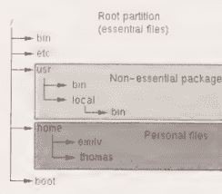

## 图 3.2

标准 Debian 文件系统结构的简化视图。注意目录结构是如何跨分布在三个磁盘分区上的——你不必使用多个分区，但这种安排可以使系统故障后更容易恢复重要数据，并且更受经验丰富的 UNIX 管理员的青睐。

也许最重要的标准目录是名为 `bin` 和 `sbin` 的目录。这些目录是存储 GNU/Linux 系统所有主要命令和程序的地方。普通用户可能出现在 `bin` 目录中的命令，而 `sbin` 通常预留给系统管理工具。

根目录下的 `bin` 和 `sbin` 目录仅保留给最核心的工具。其他顶层目录包括 `/etc`（包含系统级配置文件）和 `/var`（用于其他——例如，发出的邮件消息在此排队）。最后，另一个顶层目录 `/usr` 包含了不那么重要的文件。例如，像文字处理器这样的应用程序通常安装在非必需的程序目录 `/usr/bin` 中。

还有许多对 GNU/Linux 系统运行至关重要的额外标准目录。其中值得注意的是 `/lib` 目录，它包含了许多程序使用的共享代码段，以及 `/boot` 目录，它存储了与内核初始加载相关的文件。


用户的家目录可以放置在层次结构中的任何地方。除非你的用户非常多，否则你可能希望遵循 Debian 的标准策略，为每个用户在 `/home` 顶层目录中分配一个家目录。`adduser` 工具（参见第 6 章“Debian 的第一步”）通常在此位置创建新的家目录。

## 虚拟文件系统

虽然个人工作文件几乎总是属于你的家目录，但创建新的顶层目录是有用的。特别是，你可能想为访问你的 CD-ROM 和软磁盘驱动器创建挂载点，可能还有你的 Windows 分区。这个过程将在第 8 章中进一步讨论。

## 安排 Linux 分区

一个用于个人使用的典型 UNIX 系统通常遵循类似于图 3.2 所示的分区结构。分区方案是可选的——在许多情况下，完全可以在单个分区上保存整个目录结构。对于初次使用 Linux 的用户，这通常是一个合理的选择。尽管如此，使用多个分区也有很好的理由。

你可能需要划分磁盘的第一个首是在在大磁盘上安装时克服 1024 柱道限制。只需要有一个分区（几乎是根分区）位于 1024 柱道边界之下。构成完整文件系统的其他分区可以位于磁盘的其它位置，或者在不同的设备上。

另一个——也是更传统的多个分区的原因是安全。特别是，将用户家目录放在单独的分区上，可以让你确保它们在升级期间不会被触动。你可以对 Debian 或其他 Linux 发行版进行全新的安装，然后重新挂载你的家目录，并放心所有个人文件依然如初。对于个人机器，你可能在 `/home` 下只有一个用户目录，或者为家人或朋友留几个。对于服务器安装，通常有成百千个用户需要处理。在这种情况下，`/home` 可能会有一个大硬盘，或者是一个大磁盘阵列。

如果你安装了许多不是标准 Debian 发行版部分的包，也是如此。这些包通常放在 `/usr/local` 层次结构中的目录中——该目录永远不会被标准的 Debian 包触碰——某些用户选择挂载一个单独的分区。

结论是，使用单个分区（当然加上标准的交换分区）是可能的。如果你是初次使用 Linux 的用户并且不确定将如何使用系统，这种配置通常是最简单的。这种配置还可以防止你在一个分区上用尽空间，而在另一个分区上却有大量剩余空间。

如果你认真对待 Debian，并且有足够的磁盘空间可用，那么创建一个单独的 `/home` 分区是值得的。记住，这只包含你的个人文件：所有的程序文件都将在其他地方，除非你经常处理大文件（例如图像），否则你可能想要一个比主分区更大的 `/home` 分区。对于经验丰富的用户，在单独的分区上仅使用较小的根分区也是一个好办法。这让根分区仅留有系统配置数据和基本工具，并且如果磁盘分区损坏（例如由于在写入磁盘时断电），修复系统将变得更容易。

一旦你使用 UNIX 系统有了一段时间后，你就会找到划分磁盘驱动器的最佳方法。如果你运行大型服务器机器，你可能想看一眼 `/var` 目录。在典型的家用机器上，这通常很小。但由于 `/var` 是邮件池和分页数据的标准位置，在某些服务器安装中它可能会剧增。

## 为 Debian 系统留出空间

在决定了为系统投入多少空间后，第一步是为 Debian 留出空间。在拥有一专门用于 Linux 的理想情况下，你可以完全跳过这一步直接开始安装。当只有一个 DOS 分区且你想将此分区转换为 Windows 和 Debian 双启动机器时，困难就开始了。在这种情况下——常见的解决方案是完全格式化硬盘，将新的 Windows 安装在较小的分区中，为 Linux 留出空间。

如果你只有几个重要文件，可能备份这些文件并在之后重装是最好的选择。相反，如果你有大量数据且没有大容量备份设备，你可能想查看非破坏性分区技术。如果数据有任何价值，你仍然应该进行备份，但至少你不需要恢复所有文件并重复你在 Windows 安装上已进行的任何自定义。

## FIPS

重新格式化的另一种替代方案，至少对于使用 FAT16 分区的用户来说，FIPS（首次无破坏性交互式分区划分程序）是一个根据 GPL 协议提供的简单分区划分工具。一旦对 C: 磁盘上的数据进行了压缩（使用 Windows 自带的工具），只需运行 FIPS，它就会将你的单个主 DOS 分区划分为两个。然后你可以删除第二个分区，并使用该空间创建 Linux 分区。

主要的局限性在于它是一个旧程序，不认识新的 FAT32 磁盘格式，因此许多 Windows 98 用户将不利。尽管如此，如果你使用的是基于 FAT16 的系统，这是一种无需重新格式化的重新分区的简单有效方法。如果你认为它符合需求，可以从 http://bmrc.berkeley.edu/people/chaffee/fips/fips.html 下载。

## PartitionMagic

PartitionMagic 是解决分区问题的商业解决方案。它是一个图形化工具，不仅允许创建和删除完整分区，还可以进行移动和调整大小（见图 3.3）。最新版本识别各种 Windows 分区以及 Linux ext2 分区等其他几种类型。

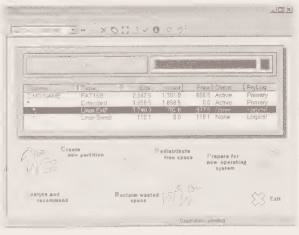

图 3.3

如果你有复杂的分区问题，PartitionMagic 可能是简单的答案。

对于初次 Linux 用户，该程序的主要益处是它提供了一种缩小现有 Windows 分区的简单方法，即使在 FIPS 无法工作的情况下也是如此。它还可以调整 ext2 分区的大小，以防你以后重新调整现有的 Linux 安装。由于 PartitionMagic 可以创建新的分区，你可能想用它来完成分区设置，并完全跳过标准安装过程中的分区阶段。

## 38 第 1 章：准备工作——磁盘划分

如果你想尝试此程序，请查看供应商的网站：

http://www.powerquest.com/

## 创建新分区

创建 Linux 分区有多种方法。如果你已使用 PartitionMagic 程序调整过 DOS 分区的大小，你可以继续创建一个或多个 Linux ext2 分区，加上一个 Linux 交换分区（swap partition），并忽略正常 Debian 安装过程中的分区阶段。大多数 Debian 用户会使用基于 Linux 的分区工具 `cfdisk`。在第 4 章描述的正常安装过程中，你将有机会启动此程序。也可以在运行 Linux 的随时运行该工具——只需以 root 用户身份登录并在命令提示符输入 `cfdisk` 即可。

### 注意

另一个 Linux 磁盘分区工具是名字容易混淆的 `fdisk`。它也随 Debian 提供，并且是某些其他 Linux 发行版使用的默认分区工具。对于典型用户来说，它提供的功能与 `cfdisk` 基本上相同，但用户界面不够友好。

## 使用 cfdisk

许多新用户发现操作分区表是一项令人担忧的前景。`cfdisk` 的主界面实际上应该显示一条写着“不要慌”的消息。当你添加或删除分区时，你实际上是在修改分区表的临时副本。只有当你选择 Write（写入）选项时，这些编辑才会写回磁盘。如果你犯了错，只需 Quit（退出）并重新开始。

当你启动 `cfdisk` 时，你会看到一个与图 3.4 所示类似的屏幕。此屏幕显示了带有两个分区（Windows 下的 C: 和 D 器）的机器的分区初始状态。使用上下方向键选择你正在操作的分区，并使用左右箭头从屏幕底部的菜单中选择选项。每个分区的尺寸最初以兆字节（MB）显示。如果你想确定根分区是否位于 1024 道边界下方，请选择 Unit 选项（或直接按 u）。

如果磁盘上还没有一些空闲空间（即不属于任何已格式化的分区），那么第一步是删除现有分区之一。在图 3.5 中，隐藏的分区（Windows 下的 D: 器）已被删除。在执行此操作之前，请确保任何想要保留的数据已移动到其他地方。

一旦释放了部分磁盘，你就可以开始创建 Linux 分区（见图 3.6）。新菜单将询问你想要创建物理分区还是逻辑分区——记住，你只能创建四个物理分区，或者三个分区加上一些逻辑分区。然后它会提示你输入新分区的尺寸。当你创建分区时，通常会输入最接近整数的道数尺寸。但为了性能最大化，程序会对此进行四舍五入。如果新分区的实际大小与你输入的尺寸略有不同，请担心。

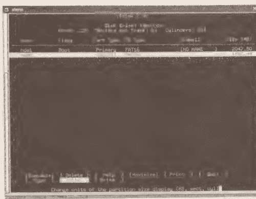

### 图 3.4

`cfdisk` 提供了一个基于菜单的界面来对你的硬盘进行分区。

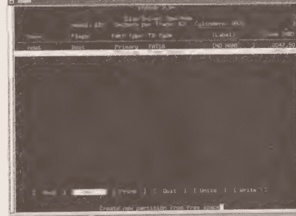

### 图 3.5

现在磁盘末尾有一块可用的未用空间，用于 Debian 安装。

### 注意

`cfdisk` 的用户界面隐藏了磁盘上的任何逻辑分区都包含在扩展分区之中的事实。如果需要扩展分区，它将自动创建。但由于只允许一个扩展分区，这意味着磁盘上的所有逻辑分区必须位于同一个扩展分区内。这通常不是一个限制。

## 图 3.6

创建 Linux 分区。

表中的每个分区都有一个代码，指定存储在其上面的文件系统类型。当你创建交换分区时，你需要使用 `cfdisk` 中的 Type 选项将其设置为 ext2（见图 3.7）。创建一个用于与其他操作系统的 FAT 分区，将成为 Windows 下的 D: 器。但注意，`cfdisk` 只创建分区而不进行格式化。在你创建了 FAT 分区后，你需要使用 Windows 命令 `format D:` 来进行格式化。这在你创建一个新的 Linux 分区并想将其添加到现有安装时也是如此。（安装程序会自动格式化你创建的分区。）在这种情况下，你需要使用 Linux 磁盘格式化程序，例如 `mk2fs /dev/hda`。最后的问题是在每个分区上设置的启动标志。这些通常只有专家用户关心。如果你从 DOS 或 Windows 启动，该分区应该设置启动标志。对于所有其他分区，关闭标志是安全的。一旦你对分区表满意，选择 Write 选项以保存你所做的更改（见图 3.8）。这是整个过程中唯一实际写入你的硬盘的部分，因此在确认之前请仔细检查表格！

创建新分区 41

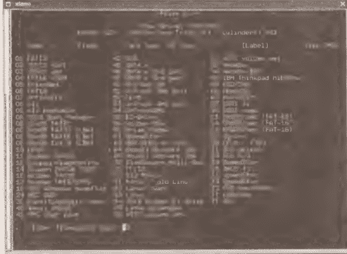

图 3.7

更改新创建分区的类型。

图 3.8

两个主要的 Linux 分区（分别成为根和 `/home` 分区）和一个交换分区。你必须手动输入 `yes` 来确认写入操作。

## 总结

当你完成本章时，你应该已经在磁盘上创建了一个空白区域，准备好存放新的 Debian 安装。你还制定了一个将此空间划分为分区的方案。如果你想快速启动并运行简单的家庭系统，一个大的 Linux 分区加较小的交换分区通常是最简单的选择。但考虑创建独立的 `/home` 和 用户`usr` 分区：这些会使你的数据更安全，代价是稍微增加了复杂性。对于服务器安装，更复杂的分区安排可能是合适的，但最好先在简单的系统上进行实验。如果你从未划分过硬盘，你可能想画一个类似于图 3.1 的图表，并将其作为参考。

空闲磁盘空间就绪，并且有了选定的分区方案，你现在可以拿出 Debian 光盘开始安装了。

## 基础安装

在阅读了 Debian 的磁盘空间和分区要求后，你现在可以查看 Linux 安装的初始阶段了。虽然对于专家用户来说有很多选项可用，但大多数第一次尝试安装的人都可以接受默认值，从而非常快速地启动并运行一个基础的 Debian 工作站。

在开始之前，请确保你的硬盘已备份，并且已经为安装准备好了空闲的磁盘分区。如果你正在使用如 PartitionMagic 之类的工具，或者你之前已经在这台机器上安装过 Linux，那么你可能已经创建了一些 Linux 分区。如果没有，只需确保驱动器上留有一些未分区的空间，或者你有一个可以删除的空分区即可。一旦安装程序启动，你将有机会运行 `cfdisk` 来创建任何你需要的新 Linux 分区。

## 安装媒体

绝大多数用户将从 CD-ROM 安装大部分 Debian 软件包，例如随本书附带的套件。如果你想获得更更新的版本，Debian CD 很容易获得。如果你在寻找当地供应商遇到困难，请查看 [Debian 网站](http://www.debian.org/)。

不过，从其他介质进行安装也是可能的。如果无法为机器连接兼容 Linux 的 CD-ROM 驱动器，理论上可以直接从硬盘（Linux 或 FAT 格式）直接安装发行版的所有部分。目前，高带宽连接的可用意味着对于普通用户来说，通过网络完整安装可能不是一个选项，但这在未来可能会发生。大型组织依赖 Debian 镜像站来获取发行版的最新副本。如果你有高带宽访问并想进行网络安装，你应该先找到主站附近的镜像站。这应该能加快下载过程并帮助保持更新。

## 针对其他架构的 Debian

Debian 已经移植到许多架构上——请参见第 2 章“准备工作”中关于此点的某些说明。但获取非 Intel 架构的 CD 可能会稍微困难一些。差异记录在为每个平台提供的文档中。

## 首次启动

Debian 安装程序在 Linux 下运行。因此，安装的第一阶段涉及运行一个专门为支持安装程序而设计的最小化系统。这个最小系统通常被称为救援系统（rescue system），因为经验丰富的用户可以使用它来修复损坏的系统。对于大多数使用现代 PC 的人来说，直接从标准 CD-ROM 启动是最简单的。

最近所有的 BIOS 都允许系统从 ATAPI (IDE) CD-ROM 驱动器而不是硬盘或软盘启动。CD 启动可能默认禁用，所以如果第一次不起作用，请不要担心。要尝试 CD-ROM 启动，只需将 CD 插入你的驱动器中（如果你有多个驱动器，使用 Windows 下字母顺序最靠的一个）并重启机器。如果一切顺利，你将看到 Debian 救援屏幕，如图 4.1 所示。

如果启动过程忽略了你的 CD-ROM 驱动器并像常一样从硬盘启动，请再次重启并进入 BIOS 设置程序（通常在启动过程的内存检查阶段后按 Delete 键）。这些实用程序的详细信息随机器而异，但将会有某种基于菜单驱动的界面。首选启动设备设置通常位于 BIOS 部分。你可能想要选择一个如 CDROM 的选项，这意味着先检查 CDROM 驱动器，但如果无法从那里启动，则改用第一个硬盘。

## 欢迎来到 Debian GNU/Linux 2.11

这是 Debian 救援磁盘。一旦你安装了系统，如果以后需要，你可以从它启动以修复硬盘硬盘上的系统（按 <F3> 详细信息）。

在大多数系统中，你可以直接按 <ENTER> 开始安装。你可能想在尝试其他事情之前先这样做。如果你遇到困难，或者已经有疑问，请按功能键 <F1> 获取快速安装帮助。

警告：在继续之前，你应该备份所有磁盘。Debian GNU/Linux 在法律允许范围内提供任何保证。如果安装程序失败或挂起，请按 <RESET>。为了版权信息，按 <F1>。

*显示救援 Debian，如图 4.1 所示，这是 Debian 救援屏幕。

*一旦你安装了系统，你可以从它启动以修复硬盘上的系统（如果以后需要的话）*（按 <F3> 详细信息）。

* Debianian *。

在大多数系统中，你可以直接按 <ENTER> 开始安装。你可能想在尝试任何事情之前先尝试这样做。如果你遇到困难，或者你已经有疑问，请按 <F1> 获取快速安装帮助。

## 从软盘启动

在情况下，情况下，从标准 CD-ROM 是不可能的可能的，因为你使用的计算机不支持，或者因为你没有 Debian CD。在任何情况下，你都可以传统方法从软盘启动。只要内核识别了磁盘，你就可以从那里安装剩下的 Debian 软件包。

典型的 Debian 发行版包含许多镜像。

# 第 4 章：基础安装

在选择了磁盘后，它们必须被写入磁盘。除非你进行非常不寻安装，第一个问题将是使用彩色还是单色显示（参见图 4.4）。颜色让某些屏幕更容易阅读。你将看到来自特定救援镜像的发行说明。继续这将进入安装程序。

## Linux 启动

一旦内核完成首次启动，你将运行安装程序，有时被称为 dbootstrap。这是一个半图形化的程序。它并没有运行在正常的 GUI 环境中，但提供了一个基于简单字符窗口和菜单的用户界面。标准安装的步骤总结在图 4.3 中。

在不寻硬件上，你可能想在这里输入额外的选项，但现在只需按回车。首先将加载一些数据，然后内核本身将被加载。

当内核启动时，会出现大量信息，大部分与各种硬件的检测有关（参见图 4.2）。其中可能某些信息是错误，由于内核尝试寻找你并不拥有的硬件，但只要启动过程成功完成，就不用担心。如果你需要查看此处显示的任何信息，你随时可以通过按 <Alt+F4> 查看。

在救援主屏幕底部，有一个启动提示符。如果你正在救援现有的安装或在不寻硬件上启动，你可以使用类似：

```
dd if=/dev/fd0 && sync
```

# Linux 启动 47

从备用磁盘启动。本章结尾名为“安装故障排除”的章节描述了一些较为常见的问题。


```
Probing PCI hardware...
Calibrating delay... ok - 233.47 BogoMIPS
Memory: 94852/98304k available (116k kernel code, 384k reserved, 1932k data)
Swanse University Computer Society NET3.03 for Linux 2.0
NET3.03: network device eth0: for Linux kernel 2.0.45-25
Swanse University Computer Society NET13.034
IP Protocols: IGMP, ICMP, UDP, TCP
VFS: Disks version dopt_5.6.0 initialized
Checking /dev/sda1... for fsusing exception 16 error reporting.
Checking "hdli" instructions: OK
linux version 2.0.36 (root@foundgor) gcc (2.7.2-3) #2 Sun Feb 21 15:55:27
EST 1999
Starting kernel 1.4.2.2
Real Time Clock Driver v1.09
uic02: Runtime config #Revision: 0.4.1.5 $idate: 1994/10/29 02:46:13 $
Rendering kernel complete, OK
uic02: DMA buffers: 20 blocks, at address 0x282600 (0x2825c4)
Memory map: 256 pages, 40 blocks of 4096k size
loop: registered device at major 7
ideo: 1823f7 PLIX on PCI bus 0 function 5
ide0: DMA at 0x0000-0x00f7
ide1: DMA at 0x0000-0x00f7
hdc0: 536531a, 620MB RAM/cache, CHS=790/255/63, UDMA
lin242, ATAPI drive on irq 14
ide0 at 0x170-0x1ff,0x376 on irq 14
ide1 at 0x170-0x1ff,0x376 on irq 15
Floppy drive(0) is 140K..
FDC 0 is a post-1991 8207
```

图 4.2

Linux 内核在首次启动时显示的启动消息的典型屏幕。

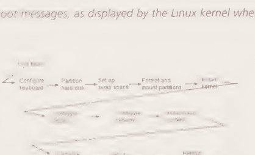

图 4.3

标准 Debian 安装过程中的主要步骤。

# 第 4 章：基础安装

图 4.4

第一个引导屏幕，也是你与 Linux 程序的首次接触。

## 填写安装数据

基础安装过程中的其余屏幕围绕着告诉 `dbootstrap` 在何处找到主包存档（如果你从标准 CD-ROM 安装，这很容易实现），并设置系统配置的一些基本部分。

主安装菜单如图 4.5 所示。对于典型的安装，你通常会通过不断选择“下一步”（Next）选项遵循标准的屏幕顺序，但如果你发现自己犯了错误，始终可以跳回之前的屏幕。

## 安装程序的额外屏幕

Linux 系统可以提供多个显示屏幕，称为虚拟控制台（`virtual consoles`）。你可以通过按下 Alt 和功能键在它们之间切换。在正常操作中，这些控制台允许你运行多个登录会话并在它们之间快速切换。当 Debian 安装程序启动时，它实际上运行在四个虚拟控制台之上。这里描述的主安装过程显示在控制台 1 (`Alt+F1`) 上。控制台 2 可以运行标准的 UNIX Shell（尽管可用的命令子集有限），主要为专家用户提供。

控制台 3 和 4 分别用于显示安装程序和 Linux 内核的额外消息。如果一切顺利，你永远不需要查看这些屏幕。但如果在安装过程中出现任何问题，这里显示的消息可以为发生了什么提供重要线索。特别是如果你准备向现有的 Linux 用户寻求特定问题的建议，值得写下任何相关消息的准确字句。

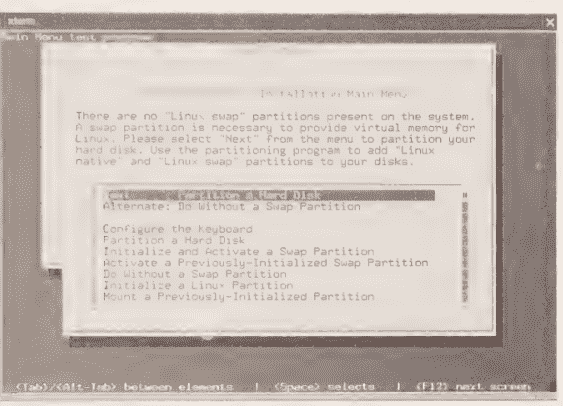

## 4.5

安装程序主菜单，列出了安装系统内的窗口和菜单有时可以滚动——## 字符代表滚动条。

你需要做的第一个实际选择是使用哪种键盘映射。在这一阶段，这并不重要——如果需要，你以后可以重新配置——但要选择最适合你系统的选项。

通常，下一个选项是对你的硬盘进行分区。如果你有多个硬盘，安装程序会提示你选择对哪个磁盘进行分区（通常答案是 `dev/sda`，第一个 IDE 驱动器），然后运行 `cfdisk` 程序。你至少可能需要创建一个 Linux 分区和一个 Linux 交换分区（`swap partition`）。一旦你对安排满意，安装程序将显示分区表。

安装过程在此继续……

## 第 4 章 基础安装

这是你刚刚安装的各种可加载内核模块。如果你之前有 Linux 经验，你可能想在此阶段快速检查所有类别，但对于在标准机器上的首次安装者来说，这些类别中的大多数可能并不重要。如果你想从非标准的 CD-ROM 安装主要的 Debian 软件包（现代 ATAPI 设备无需任何干预即可工作），请检查 `cdrom` 部分以找到一个控制你特定显卡的模块。

如果你的机器有网卡，你还可以在此阶段获得机会对其进行配置。显然，如果你计划通过网络安装 Debian 软件包，这尤为重要，但现在弄清楚它是值得的。打开网络设置并寻找一个适合你网卡的模块。

## 连接网络

在安装过程中，你有选项为机器设置网络连接。这仅适用于永久连接（通常通过以太网）。如果你将要使用拨号网络连接，这将在稍后使用一个单独的程序进行配置（见第 8 章“高级配置”）。如果你确实有任何形式的网络连接（你自己运行的私有网络除外），现在向网络管理员索要 IP 地址以及你所使用的网络的任何其他细节了。

有一项每个人都应该进行的网络配置——指定计算机的主机名。连接到互联网的连接具有多部分名称，例如 `adzel.solar-spice.com`。在这种情况下，`adzel` 是本地主机名。如果你有永久的互联网连接，你的网络管理员可能会为机器提供一个主机名。如果没有，你可能可以请求一个你喜欢的名称。Debian 系统（如任何现代 UNIX）总是需要一个主机名，即使没有互联网连接也是如此。

即使是一个很小的私有网络，为每台机器起一个好记的名字对于避免混淆也至关重要。如果你的机器作为独立系统运行，你输入的名称并不真正重要。无论如何，你现在有一个理由给你的电脑起一个愚蠢的名字了！

一旦你输入了合适的主机名，安装程序会询问你是否想要配置永久的网络连接。如果是，你会被要求输入额外信息。第一项信息是你的机器命名的互联网域名称。

## 填写安装数据

对于名为 `adzel.solar-spice.com` 的计算机，域名是 `solar-spice.com`。

接下来是机器的 IP 地址，这是一个由四个用点分隔的数字组成的值。IP 地址唯一地标识每个连接到互联网的机器（或任何使用类似互联网技术的私有网络）。

# 注意

注意，在不久的将来，某些网络可能会开始切换到称为 IPv6 的新一代网络技术，它使用更长的地址。新的 Linux 内核包含了基础的 IPv6 支持，未来的 Debian 版本将提供使用 IPv6 的选项。如果你的网络是 IPv6，管理员会告诉你是并帮助你设置连接。

你还会被询问子掩码和广播值。如果你没有被告知，安装程序会猜测默认值，这些值对于大多数常规网络安装来说是正确的。最后一个关键参数——通常适用于构成互联网一部分的网络——是网关地址。这是控制网络之间流量的机器（可以是路由器，或者对于小型站点是特殊设置的计算机）的 IP 地址。

如果你有互联网连接，你还想设置一种计算机连接到域名解析服务（DNS）的方法，这是一个翻译主机名和 IP 地址的系统。如果你的网络管理员给了你 DNS 服务器的地址，你应该使用它。

如果本地网络上没有 DNS 服务器，你可以告诉安装程序机器应该充当其 DNS 服务器。此选项不依赖任何其他机器，但你必须确保在到达软件包选择阶段时安装了 `bind` 包（见第 5 章“做出你的选择”）。

最后，在确认网络连接详细信息后，系统会询问你哪个设备代表主网络接口。对于大多数用户来说，机器中检测到的第一个以太网适配器即可。注意， UNIX 将硬件设备显示为 `/dev` 目录中特殊文件的常用抽象并不适用于网络适配器。

对于 PC Card 网络适配器用户有一个单独的选项。

## 设置简单网络

现在许多人拥有不止一个设备，并且设置网络的方式略有不同，这反映了设备可以在运行时插入的事实。到此时，你已经提供了足够的配置信息来允许安装核心工具。对于没有 CD-ROM 驱动器或网络连接的机器，可以从软盘安装基础系统。这是一个更笨拙的选项——截至 2.1 版本，基础系统占用七张 1.4MB 的镜像，每张镜像都必须写入磁盘并在适当的时间轮流插入。

最后一个选项（某些人可能觉得很有用）是从硬盘分区安装基础系统。这可以是普通的 Linux 分区，或者是 DOS 分区。如果你想这样做，将 `base2_1.tgz` 文件（或较新 Debian 版本的等效文件）复制到安装期间不会被重新格式化的分区上。当你到达基础系统安装阶段时，你有机会挂载此分区，并以从 CD-ROM 安装相同的方式找到基础系统存档。

## 基础系统安装

基础系统安装后，有一个最后一个问题需要回答：使用哪个 UNIX 时区配置文件。选择对应城市地址的文件。你还被询问系统时钟是设置为 GMT（协调世界时）还是本地时间。UNIX 世界的常见做法是将主系统时钟设置为 GMT。只要你正确设置了时区，尝试读取本地时间的程序将仍然获得正确答案。但 Windows 期望时钟设置为本地时间，所以如果你使用 Windows 到了介意时间是错误的程度，请选择本地时间。

# 重启后 55

如果你在运行 Linux 时想要更改系统时钟设置，可以使用以下命令：

```
hwclock --set --date="16:14:45"
hwclock -hwtos
```

# 准备重启

在安装了精简版 Linux 系统后，你现在必须安装 `LILO`（Linux 加载器）。这是一个由 BIOS 运行的小型程序，用于加载 Linux 内核。稍后，你可以配置 `LILO` 启动现有的 Windows 安装，而不是启动 Linux。（有关重新配置 `LILO` 的详情，请参阅“配置 Linux 加载器”侧边栏。）

现在，只需从安装程序中选择“制作可启动盘”（Make bootable）选项，并在被询问是否安装引导块以及是否将 Linux 启动为默认操作系统时回答 yes（是）。如果你的 Debian 根分区是第 3 章描述的逻辑分区，系统会询问你想要使用哪个分区作为引导加载器——默认值通常总是正确的。

此时，你还有机会创建一个引导软盘。这有点像救援盘，但它不包含自自引导程序。相反，它只是启动一个 Linux 内核并挂载你的普通根分区，就像你从硬盘启动一样。如果你正在进行常规安装，跳过这一步通常没有害。但由于某种原因导致无法启动你的 Debian 安装时，它可以帮你脱离困境。引导软盘的一个用途是在安装完新操作系统（如 Windows）后首次启动 Linux，因为 Windows 通常会覆盖引导加载器系统。如果你想要引导软盘，只需在安装程序要求格式化并添加 Linux 内核时插入一张空盘即可。

# 重启后

当你重启时，机器将通过正常的启动检查，你看到的不是加载 Windows，而是 `LILO` 提示符。如果你等待几秒钟，`LILO` 将自动从硬盘加载 Linux 内核。你会看到一组与首次启动类似的启动信息。但在此过程完成后，你将看到一些由 `init` 系统产生的额外消息。这是一系列负责执行系统任务的程序和脚本，如文件系统和启动需要一直运行的网络子系统。

一旦系统启动，你还有几个几个设置任务。第一个是设置 `root` 账户的密码。该 `root` 账户是一个拥有系统特权访问的特殊用户。你将用它安装新软件、编辑系统级配置选项以及管理其他用户账户。理论上，你可以使用 `root` 账户进行所有的计算工作，通过这样做，你绕过了所有 0953db1cdc4c59ca7bb_68.png

# 第 6 章 - 分布版

类 UNIX 系统通常提供的安全和防护检查。经验丰富的系统管理员会尽量避免以 `root` 登录，除非绝对必要。考虑到这一点，Debian 安装会自动为你提供创建一个普通（非特权）用户账户的机会。你应该在日常工作中使用它。Debian 与任何 UNIX 系统不同，它可以提供许多账户，且安全模型允许每个用户保持个人文件的私密性。在系统中创建和管理账户的说明可以在第 6 章中找到。

基础安装过程现在完成，剩下的就是使用 `dselect` 程序（在第 5 章中详细描述）来安装最后的软件包，这些包将构成你的完整安装。Debian 拥有通常认为的细粒度软件包管理系统——你可以选择在系统中安装什么内容，但代价是必须在长长的软件包列表中查找找到你确切想要的内容。从 Debian 2.1 版本开始，安装程序提供了通过多种不同的选择来设置包管理器的选项（见图 4.7）。注意，这些软件包不会立即安装。但如果你选择了其中一个选项，`dselect` 程序将以选定的方法启动，然后运行“更新”（Update）和“安装”（Install）选项。

图 4.7 0953db1cdc4c59ca7bb_69.png

你可以从多种默认安装配置中进行选择。不用太担心安装的软件包的具体选择——你可以随时运行 `dselect` 来根据需要添加或删除软件包。本书剩下的章节将介绍标准 Debian 分布版中一些重要且实用的软件包，但只能涵盖可用软件的极小比例。亲自浏览软件包列表总是值得的，以感受 GNU/Linux 系统提供的丰富软件。

## 配置 Linux 加载器

在 Intel 系统上，Linux 内核是通过一个名为 `LILO` 的程序启动的。你可以使用你喜欢的文本编辑器编辑 `/etc/lilo.conf` 文件来以多种方式配置它（如果你不熟悉 UNIX 编辑器，请参阅第 7 章“软件包导览”）。然后你必须运行 `lilo` 命令来提交你所做的更改。由于这是一项关键的系统管理任务，你必须以 `root` 账户登录以编辑 `/etc/lilo.conf` 或运行 `lilo`。

`lilo.conf` 文件包含一个全局选项部分，随后是每个可启动的操作系统的部分。每个操作系统都以 `image=`（启动 Linux 内核）或 `other=`（启动其他操作系统）行作为开头。如果你将将机器作为 Debian 和 Windows 双系统系统使用，可以通过输入 `lilo.conf` 找到完整的选项列表，你应该在文件开头添加以下行：

```
prompt
timeout=100
```

这告诉 `LILO` 它应该始终提示你指定想要启动哪种操作系统，但如果在 10 秒内未响应，则启动文件指定的操作系统（100 代表10 秒，`LILO` 以秒分之一为单位）。

现在，为了允许 Windows 启动，你应该在文件末尾添加以下部分：

```
other=/devda1
table=/devda
label=windows
```

此代码假设 Windows 安装在第一个分区。它允许通过 `LILO` 提示符输入 `windows` 从该分区启动。如果你想让 Windows 默认操作系统，只需交换文件中 Windows 和 Linux 部分的位置，让 Windows 部分在前。

## 接下来

一旦你完成了基础安装并熟悉了 `dselect` 程序，就可以开始认真设置你的 Debian 系统。对于大多数人来说，首要任务是建立图形用户界面。这以及其他重要的设置任务将在第 6 章中讨论。

或者，你可以直接使用特权账户登录并开始熟悉命令行工具。请不要使用 `root` 账户进行实验。解释命令行的力量本身就可以写一本书。但如果你有一些基础知识，可以尝试——并记住在线手册。例如，要查看 `shutdown` 命令的选项，输入

```
shutdown
```

## 关机

最后，在某个时刻，你想要关闭机器。你不应该在不关闭系统的情况下关闭或重置基于 Linux 的系统。如果不正常关闭系统，下次开启时将花费几分钟对磁盘分区进行一致性检查。在最糟糕的情况下，可能会发生磁盘损坏。标准的关机方法是以 `root` 账户登录并输入

```
shutdown -h now
```

`-h` 代表 `halt`（停止）。你会看到各种组件禁用的列表，最后会出现 `System halted` 消息，表示可以关闭电源。如果你指定的是 `-r` 选项，机器将重启。在标准的 Debian 系统上，也可以通过 `Ctrl+Alt+Delete` 安全地重启。最后，某些图形用户界面提供了自己的关机方法。

你可能注意到向 `shutdown` 命令传递了 `now` 选项。正如你预期的，这会导致系统立即启动关机过程。但如果你运行的是一台可能有其他用户通过网络连接的服务器，你也可以使用 `shutdown` 命令调度在未来的某个时刻关机或重启。要给用户留出 15 分钟完成工作并注销，输入

```
shutdown -h +15
```

在这种情况下，用户将在接近关机时间时收到一系列警告消息。详情请参阅手册页。

## 安装故障排除

按照之前的步骤操作，你应该能够在几乎任何现代 PC 上安装较新的 Debian 版本（或者通过轻微修改，也适用于许多其他架构）。偶尔可能会出现问题，通常发生在尝试启动 Linux 内核时。

如果所有其他方法都失败了，请考虑联系经验丰富的 Linux 用户。如果你不认识任何具有 Linux 经验的人，可以联系当地的 Linux 用户小组（LUG），或在互联网新闻组或邮件列表上提问。第 11 章中提供了指向社区不同领域的链接。“最后——欢迎来到社区。”

## 启动参数

某些老旧且不冷门的硬件对于操作系统内核来说难以正确且安全地检测。你可以为 Linux 内核提供一些启动参数，这些参数在救援光盘启动界面按功能键时显示的帮助屏幕上可能很有用。最有用的参数与 IDE 设备的检测有关。某些旧款机器在内核尝试识别其硬盘几何结构时会产生问题。你可以在启动提示符处手动指定这些内容。还可以提供提示，说明特定的 IDE 设备是 ATAPI CD-ROM 驱动器——尽管对于最老的设备以外，这通常是不需要的。

## 启动镜像问题


进入`/path/to/xxx`目录，找到`xxx.json`。

在表达式`cvar = avar + bvar`中，加法运算符（`+`）将`avar`与`bvar`相加，得到它们的和`cvar`

在`List.of(arg0, arg1, arg2)`中，`List`接口的工厂方法`of()`接受一系列的元素，返回包含它们的只读列表。

之后我们这样调用`cmd`命令：`cmd arg0 arg1 arg2`。

```
if (condVar > someVal) {console.log("xxx")}
```
[/content]

Wait that's example. Need actual text.

Let's process given text.

I'll output processed content.

[content]
某些机器可以运行 Debian，但并不认可 Debian 1 光盘上的启动部分以及 `rescue1440.bin` 文件中提供的标准启动镜像。最常见的问题涉及存储 Linux 内核的格式。内核有两种格式：`image` 和较新的 `bImage`，后者被用于标准启动镜像。某些机器（特别是笔记本电脑）无法加载 `bImage` 内核。常见的症状是机器在加载内核后立即静默重启。

如果你认为自己正经历内核格式错误，Debian 2.1 包含一个备用的救援镜像（`rescue1440-terra.bin`，也写在光 2 的启动部分）。顺便提一下，名称中的 Tecra 指的是东芝（Toshiba）Tecra 系列笔记本电脑，但也适用于许多其他系统。

还有救援磁盘镜像的安全变体。这些变体使用了不同版本的 Linux 加载器软件，可能处理某些 BIOS 中的 Bug。如果你在启动时遇到困难，特别是在旧机器上，尝试安装这些磁盘镜像之一可能是值得的。

### 最坏的情况：Linux 无法启动

遗憾的是，少数机器完全拒绝启动 Linux 内核，并报“Invalid compressed format”（无效压缩格式）错误。

这很少是 Linux 的错——更多情况下是细微硬件缺陷的指示，即使机器在 Windows 下看起来运行良好。这个问题最常见的原因是劣质内存芯片。由于 Linux 内核分配系统内存的方式与 Windows 不同，内存问题可能在最坏的情况下仅导致 Windows 下偶尔出现错误，但却会导致 Linux 系统完全无法启动。

此类问题并不总是容易诊断的：BIOS 在机器启动时执行的内存检查完全不全面，经常遗漏细微的问题。特殊的内存检查程序可以做得更好，但即使是这些程序，也不会像普通程序那样测试 RAM 设备。

如果你怀疑有内存问题（或者说，任何其他硬件故障），最好的诊断方法是物理追踪缺陷组件。如果你的电脑有多个内存插槽，请尝试逐一移除，看看是否允许相同的内存运行；或者尝试在两台机器之间交换 RAM 模块。或者，如果你可以访问另一台使用相同内存的电脑，请尝试在两台机器之间交换 RAM 模块。

### 总结

读完本章后，你应该熟悉在你的机器上安装 Linux 内核以及一些基本工具所需的步骤。完成后，安装程序将自动启动 `dselect` 软件包管理程序。第 5 章解释了如何使用 `dselect` 从 Debian 发行版提供的大量软件包中安装软件。完成这一步后，你就可以准备好开始探索 Debian 了。

# 第 5 章：做出你的选择

本章将介绍 Debian 软件包管理系统，这是一组提供了在你的 GNU/Linux 系统上安装新软件简易方法的程序。在后台，软件包管理系统还记录了你安装了哪些软件包，以及系统中的哪些文件属于哪个软件包。这使得能够轻松删除你认为不再需要的软件包，或将其升级到最新版本。

## 什么是软件包？

从概念上说，软件包是任何可以安装在计算机上的软件单元。Debian 软件包管理采取了精细化的方法。这意味着你对已安装的软件具有极高的控制水平。但相反，你可能需要安装许多不同的软件包来完成某项任务。例如 Gimp，一个复杂的图像处理程序。除了核心的 `gimp` 软件包外，还有包含额外数据文件和程序文档的可选软件包。

在实践中，软件包是一个文件包，类似于标准的 UNIX `tar.gz` 归档，或 DOS 和 Windows 中常见的 ZIP 文件。但软件包文件除了包含你想要安装的程序的文件外，还包含许多其他信息。最重要的额外细节是：

- 软件包版本号。通过将可用最新软件包的版本与已安装的包进行比较，可以实现系统的自动升级。
- 一组脚本（简单程序），在安装或删除软件包时自动运行。这允许软件包能够无缝地配置自己并集成到系统中。这些脚本可以实现许多 Windows 应用程序提供的安装向导的功能。
- 软件包依赖关系列表。一个 Debian 软件包可能需要其他软件包，或者声明一个冲突，使两者互斥。

Debian 软件包还遵循各种惯例，特别是关于资源文件在系统中的放置。这些惯例在 Debian 策略和打包手册中有说明。从用户的角度来看，最重要的规则是每个软件包必须创建一个 `/doc` 子目录。

Debian 软件包以 `.deb` 扩展的文件提供。文件名的主部分通常具有标准格式。例如名为 `freeciv-1.7.2-3.deb` 的软件包。第一部分 `freeciv` 是软件包的官方 Debian 名称。（顺便提一下，Freeciv 是一款流行的策略游戏。）下划线后的数字是 Debian 版本号。这表示这是从该标准代码构建的第三个 Debian 软件包，表示自软件包构建以来打包过程进行了一些微调。

从 `.deb` 软件包安装总是向系统添加新软件最简单的方法。但有时无法获得 `.deb` 文件。本章末尾将讨论安装非 Debian 软件的各种解决方案。

## Debian 归档

获取 Debian 软件的方法有很多——光盘和互联网 FTP 是主要的发行机制，这里将考虑这些方法。无论使用何种发行方法，Debian 归档都有良好的结构。任何归档的顶层可能包含一些附带的文件和目录，其中包含 Debian FAQ 等信息。它们包含一个名为 `dists` 的目录。所有的 Debian 软件都存储在 `dists` 目录中。典型 FTP 归档的一些示例如图 5.1 所示。

在 `dists` 目录内，有对应各个发行版本的子目录。对于光盘，通常只有一个发行版：制作磁盘时的稳定版本。但互联网通常还带有最新的不稳定版本，以及如果适用，还有一个在标记为稳定版之前正在最终测试和错误修复的冻结版本。

除了通过不稳定/稳定分类指定发行外，你还可以通过开发代号引用特定的 Debian 版本。某些互联网归档可能包含比当前稳定版更早的发行版本，这些版本只能通过名称访问。近期版本的代号如表 5.1 所示。

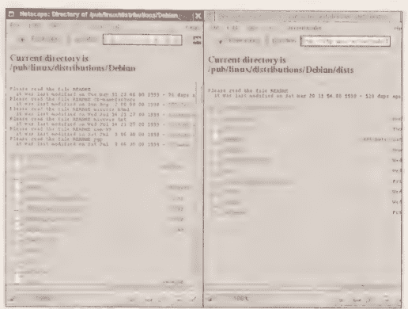

图 5.1

典型 Debian 归档中 root 和 dists 目录的视图。

## 表 5.1 近期 Debian 版本代号的演变

如果你还不相信的话，没错，它们都是以动画电影《玩具总总动员》中的角色命名的。

## 子发行版 (Sub-Distributions)

整个 Debian 发行版被分为几个子发行版，每个子发行版都有自己的目录层次结构。惊讶的是，`main`（主）部分包含了最重要的软件包。该目录下的软件包代表了 Debian 发行版本身——所有软件包都符合 Debian 手册中列出的要求。基础系统以及大多数用户需要的其他软件包都包含在 `main` 部分。

其他不符合策略准则但被认为对 Debian 用户有用的额外软件包位于 `contrib`（贡献）和 `non-free`（非自由）目录中。它们的支持程度未达到 `main` 软件包，但它们都已专门为 Debian 进行了打包，并且可以干净地安装。

对于 `non-free` 软件包，它们并不是 Debian 自由软件指南（第 1 章，“介绍 Debian”）所指定的“自由软件”。这并不一定意味着你必须付费才能使用它们——大多数软件包对于非商业用途是免费的，许多对于商业用途也是免费的。但它们可能受到不可接受的限制，或者可能无法获得源代码。如果你想使用 `non-free` 部分的软件包——特别是如果你想对其进行商业分发——应该先查看 `/usr/doc/<packagename>` 目录下的软件包文档，并在之前检查许可证。

在每个子发行版目录内，目录结构是相当自言易懂的。如果你使用的是网络归档，你将看到每个支持的架构对应的 `binary-<arch>` 目录（在 CD-ROM 上通常只有一个架构）。在架构目录内部，软件包文件根据其功能被划分为若干组。这些内容将在第 7 章“软件包概览”中讨论。

关于是否将 `contrib` 和 `non-free` 部分从主 FTP 服务器移动到另一个位置，一直一直存在一些争议，目的是明确这些部分与核心发行版的区别。在写作时，尚不清楚是否会发生这种情况。如果发生，Debian 网站上会有公告。这种划分的主要实际后果是，经常从互联网下载软件包的用户可能想要将新服务器作为额外的软件包源。`apt` 程序和软件包源的概念将在“网络安装”章节中进行讨论。

## 加入军备贸易吗？ (Joining the Arms Trade?)

一些常见的软件（通常提供加密服务）被美国政府认为代表了军事技术。结果是，下载诸如流行的 `pg` 电子邮件隐私工具之类的程序可能会让你成为潜在的国际军火走私者！Debian 项目通过让某些软件包仅从位于德国的 FTP 服务器（地址为 http://non-U.S.debian.org/non-US）以及美国以外的各种镜像站点可用，规避了这个问题。非美国发行版站点与主站结构相同，但只包含少数软件包——例如 `pg` 等工具，以及用于为远程计算机创建安全登录连接的 `ssh` 系统。如果你在互联网上安装软件包，可以由安装程序自动将非美国软件包与主列表合并。但如果你是从 CD 安装了主发行版，并且只需要一两个非美国软件包，那么使用 Web 浏览器下载它们然后手动安装可能会更容易。

## 软件包管理程序 (The Package-Management Programs)

软件包管理系统有多个层。最底层是一组库例，这些例只对寻求替换软件包管理系统部分内容的程序员感兴趣。在此之上是 `dpkg` 程序，这是一个命令行工具，允许安装和删除软件包，以及许多其他操作。`dpkg` 工具主要由专家用户使用，但在本章末尾对其中一种可以证明其有用的情况进行了简要描述。

软件包管理系统已经进化了一段时间，现在仍在改进。在 Debian 的最新版本中，`dpkg` 与 `apt` 配合使用，`apt` 是处理从多个位置获取软件包文件的系统。`apt` 工具还自动化了你安装的每个新软件包的依赖关系解析过程。这是现在通过互联网进行 Debian 安装的首选方法，它也简化了基于 Debian 机器的升级过程。

对于许多用户来说，几乎所有的软件包管理操作都可以 `dselect` 程序完成。该程序为整个软件包管理系统提供了一个友好的交互式前端，并允许轻松浏览可用软件包。`dselect` 程序本身实际上并不安装软件包。它会自动运行 `apt` 和 `dpkg` 工具以获取并安装你选择的软件包。软件包管理系统总结在图 5.2 中。

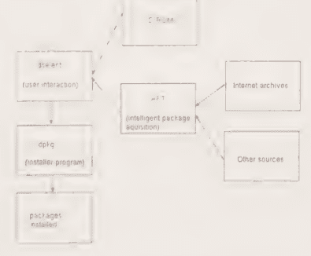

# 图 5.2

Debian 软件包管理系统的结构。

虽然 `dselect` 是大多数人看到的软件包管理系统的部分，但它实际上是其他工具上的前端层。因此，可以使用其他用户界面来替换它。目前开发中的 `gnome-apt` 程序很快将为偏好窗口界面的用户提供 `dselect` 的替代方案（图 5.3）。尽管这两个程序看起来不同，但它们提供相同的功能集。

# 第 6 章：选择 (Chapter 6: Making Selection)

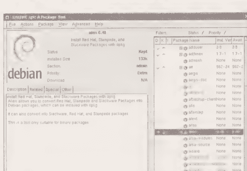

# 图 5.3

gnome-apt——一个可能是 dselect 的替代方案

## 启动软件包管理器 (Starting the Package Manager)

`dselect` 程序在任何 Debian 安装结束后自动运行。它也可以随时手动运行——尽管如果你真的想修改系统，可能需要以 root 账户登录。当 `dselect` 首次启动，它会显示一个菜单，引导你完成更新系统的阶段（见图 5.4）。

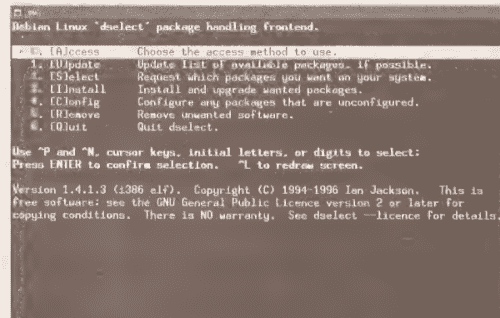

# 5.4

dselect 主菜单，对应更新系统的各个步骤

## 设置软件包源 (Setting Up Package Sources)

当你第一次运行 `dselect` 时，必须告诉系统如何找到 Debian 软件包。因此，“Access（访问）”选项是 dselect 菜单上的第一项。有很多可选的访问方法（见图 5.5）——但截至 Debian 2.1，其中许多方法已过时。你可能感兴趣的方法是 `multi_cd` 方法（你从标准的 Debian CD 集安装）和 `apt`（如果你正在进行网络安装或通过网络升级现有的发行版，则使用后者）。

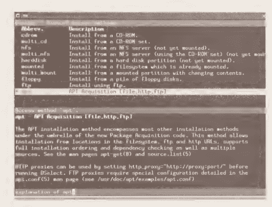

# 图 5.5

软件包管理器可以使用多种方法定位软件包。

实际上，`apt` 系统也可以从 CD-ROM 安装软件包，因此 `multi_cd` 选项最终将过时。但目前，`dselect` 不允许方便地将 CD-ROM 驱动器配置为软件包源。这种操作目前还不被推荐。如果你确实想尝试使用 `apt` 系统配合 CD-ROM，请阅读 `apt-cd` 软件包的手册。注意，`apt` 系统正逐渐成为 Debian 管理的核心，未来，`apt` 可能会成为从 CD-ROM 安装的标准方法。

## 从 CD-ROM 安装 (Installing from CD-ROM)

在选择 `multi_cd` 访问方法后，系统首先提示输入 CD-ROM 设备的 UNIX 设备名称。如果你已经从 CD 安装了 Debian 基础系统，安装程序已经创建了新的设备名称 `/dev/cdrom`，作为指向你实际使用的真实设备的链接。你在这里几乎可以接受默认值。

# 第68 页 第5章 做出选择

通常情况下，Debian 通过几张 CD 提供。完整的 Debian CD Set由四张光盘组成——两个包含实际软件包，另外两个包含源代码。书中提供的光盘与完整套装的前两张光盘对应。每当你设置 `multi_cd` 访问方法时，都应该始终插入套装中包含二进制软件包的最后一张 CD，因为它包含了关于各种 CD 内容的信息。一旦你提供了这张 CD，访问方法就会在该 CD 中搜索各种查找/子发行版（main、contrib、non-free 和 non-U.S.）。你的 CD 集合可能不包含这些子发行版中的某些。如果系统提示某个特定子发行版的位置，你通常应该回复 `none`（无）。

## 通过网络

有两种访问方法允许使用互联网文件传输协议（FTP）获取软件包。除非你是专家用户，否则应该忽略 `ftp` 选项，转而使用新的 `apt` 系统。如果你是第一次进行网络安装，最好找到离你最近的存档站点，然后使用你喜欢的 Web 浏览器或 FTP 工具熟悉目录结构。

`apt` 系统基于“源列表”（source list）的概念——该文件可以指定获取 Debian 软件包的任意位置。对于初始安装，你只需要在源列表中有一个条目，但之后可以添加更多。`apt` 软件包获取器会自动合并来自每个源的可用软件包列表。

首先要配置的是你正在使用的 Debian 存档站点的根目录。它以 URL 格式指定。取决于你使用的哪个镜像站点，Debian 存档根目录通常是包含许多其他文件的存档子目录。Debian 根目录将包含所有的 `dists` 目录。

接下来，你需要指定想要使用的发行版列表——这指的是存档中 `dists` 目录下的子目录。对于首次安装，你几乎总是可以在这里输入 `stable`（稳定版）。当你积累了一些 Debian 经验并想尝试挑战时，你可能想尝试 `unstable`（不稳定）发行版，但目前先忽略它。如果你愿意，也可以通过表 5.1 列出的代号来指定发行版版本。

最后，系统会提示你想要查找的子发行版列表。在标准存档中，默认值 `main contrib non-free` 通常是正确的，但如果你使用的是非标准站点，可能需要添加条目。现在你已经为源列表定义了一个完整的条目。

当你完成后，你还有机会向源列表添加另一个站点。如果你需要任何与加密相关的软件包，添加离你最近的 `non-U.S.` 存档镜像——按照你处理主存档完全的方式提供这些详细信息。如果你计划将 `contrib` 和 `non-free` 软件包从 Debian 主存档中提前移动到它们自己的服务器上，你可能还想为这些软件包添加一个额外的源列表条目。

作为参考，你可能想知道 `apt` 源列表存储在 `/etc/apt/sources.list` 文件中。该文件的每一行对应一个软件包源。其格式非常复杂，因此最好不要手动向该文件添加行。当某些行不再需要时，你可能会手动从该文件中删除这些行是很有用的。

要检查路径是否设置正确，请执行 `Update`（更新）操作，从源列表中的每个站点下载可用软件包列表。

## 更新和安装 Debian

设置好软件包源后，现在可以继续完成 `deselect`（取消选择）菜单上的剩余阶段。`Update` 选项会导致程序扫描所有可用软件包，并获取一个可以安装的软件包列表。如果你使用的是 CD-ROM 组，你只需执行此步骤一次——即第一次使用该组组时。但是，如果你是从互联网下载软件包，更新的软件包版本（通常是安全相关漏洞的修复）可能会经常出现，因此值得定期更新，以便 `apt` 能够自动获取这些包。

下一阶段通常是进入软件包选择屏幕（见下一节描述）。但如果已经选择了要安装的软件包（例如如果你从安装程序中选择了标准软件包选择之一），你可以直接进入安装阶段。

当你选择 `Install`（安装）时，`deselect` 首先会从 FTP 存档下载任何所需的软件包。然后它开始压缩并配置软件包。大多数软件包会自动安装。其他软件包则需要额外信息，并在安装过程中运行简单的交互式配置实用。在典型的软件包选择中可能出现的最示例如下：

- `exim`：Debian 用于低级处理电子邮件消息的服务器程序。如果你在安装 `exim` 时出错，可以随时重新运行配置。在第 8 章“高级配置”中有关于简单 `exim` 配置的某些建议。
- `gpm`：当你使用 Linux 文本控制台时提供鼠标支持的工具。它有一个相当自说其明的配置过程，可以检测你正在使用的鼠标类型。但除非你期望使用文本控制台而不是提供自带鼠标支持的 X Window 系统，否则你可能决定不需要 `gpm`。
- `bind`：一个让你的计算机成为互联网域名服务自自足部分的程序。然而，如果你像大多数用户一样，只想让名称查找工作，接受建议的默认值就能正常工作。
- `apache`：常用的 UNIX Web 服务器，也为你提供了一些配置机会。再次，除非你是 Web 服务器专家，否则请直接接受默认值——如果以后需要，重新配置也很容易。


- `X servers`：X Window 系统的核心部分。安装 X 的指令请见第 6 章。

# 第70 页 第5章 做出选择

`dselect` 的核心是 `Select`（选择）页面，它允许你浏览可用软件包（见图 5.6）。你可以使用方向键上下滚动列表。也可以通过名称搜索单个软件包。搜索功能通过按下 `/` 键激活（这是文本界面程序的常用快捷键）。`/` 键可以跳转到下一个和后续匹配项。

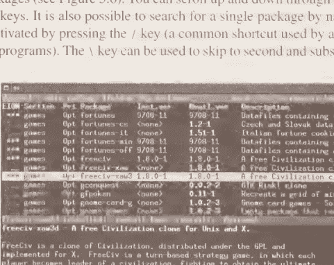

图 5.6 主选择屏幕

当安装软件包时，你会看到已安装和最新可用软件包的版本号——如果这些不匹配，`dselect` 将在你选择时将系统升级到新版本。屏幕左侧的列指示软件包的安装状态。

星号行 (`*`) 表示软件包已安装并设置。这些符号中的第三个代表软件包的选择（而非实际）状态：`*` 表示下次选择时将该软件包添加到系统，而 `**` 表示已标记删除已安装软件包。

每当你选择或取消软件包时，`dselect` 都会检查软件包关系。如果你的操作破坏了任何依赖关系，程序将显示软件包子列表以帮助解决问题（见图 5.7）。当这种情况发生时，你可以按回车接受 `dselect` 对问题的解决方案，按 `X`（必须大写）完全取消操作，或者手动选择和取消软件包直到问题解决。

| 库优先级部分 软件包 | 描述 |
|---|---|
| Opt graphics sketch | 一个交互式 X1 绘画程序 |
| Opt graphics python-pil | Python 图像库 |
| Opt interpre python-doc | 脚本语言 Python 的文档 |

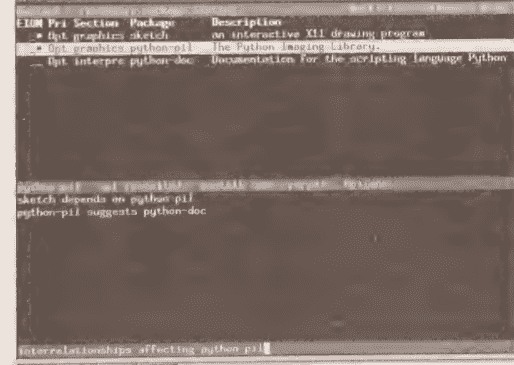

图 5.7 依赖关系解决屏幕

最常见的情况是选择了一个依赖于其他未选择包的包。在这种情况下，取消选择该包会自动选择所有所需的包，你通常可以通过按 Enter 键接受此操作。某些软件包可能还会建议你可能想要安装与其互补的其他软件包——你有机会阅读这些建议的软件包的描述，并判断你是否同意。

虚拟包（virtual packages）的概念使得依赖处理变得稍微复杂了一些。这些是代表概念而非真实程序的包名。一个典型的例子可以在 X Window 系统找到（参见第 6 章）。系统的各个部分都依赖于一个名为 X server 的程序，它充当你视频硬件的驱动程序。然而，有多个不同的 X server，你必须为你的特定系统选择正确的一个。

虽然 X 组件不能为任何特定的 X server 包指定依赖，但它们确实依赖于一个虚拟的 xserver 包。任何提供 xserver 能力的包都会满足该项依赖关系。如果你尝试安装一个依赖于虚拟包的程序，`dselect` 会找到所有提供所需能力的包，并提示你选择安装哪一个。

如果你删除了某些其他包使用的包，这显然也会触发依赖问题。在这种情况下，你可能想使用 Shift-X 来撤销此操作。如果你真的想删除该包，你需要删除依赖于它的包。

## 升级你的系统

`dselect` 程序可以自动识别可用包是否比你当前安装的版本更高。此选项允许进行自动升级。即使 是一个 Debian 发行版被标记为稳定版（stable），有时也会有微更新，通常是为了修复与安全相关的问题。在编写期间，FTP 存档存有 Debian 2.1r2，它与原始的 2.1 版本相比有几个包的差异。这种微更新可以通过简单将你最近的 Debian 存档设为包源来实现，然后选择 Update（更新），最后选择 Install（安装）。注意，软件包管理器对于来自以下位置的包非常灵活：即使你完全从 CD 完成安装，也没有什么阻止你将访问方法切换到 `apt` 并通过互联网进行升级。

同样的方法也可以用于从发行版的一个版本升级到另一个版本。但在这种情况下，必须升级更大比例的包，可能会出现一些重大变化。包安装脚本通常被编写以确保升级平稳进行，但最好的做法是在升级后仔细检查你的系统。

由于主版本之间有大量包发生了变化，除非你有快速的网络连接，否则可能值得购买一套新的 CD-ROM 并将其设置为你的包源。记住，如果你手头有一些 CD，你需要再次通过 Access（访问）和 Update（更新）阶段，以确保软件包管理器了解更新后的发行版。

## 采取直接方法

如果你使用新的 `apt` 系统作为你的包访问方法，升级到新的发行版有一个更好的方法。这种替代方法需要额外的时间来确保核心包被整洁地升级。设置你的 `apt` 源列表（例如，使用 `dselect` 中的 Access 选项），然后输入

```
apt-get update
apt-get dist-upgrade
```

升级到新的发行版是这样一种情况：如果你打算从 CD 安装新的发行版，那么使用 `apt` 可能会更容易。要做到这一点，请确保已安装 `apt-cdrom` 包，并阅读手册页。你就可以通过插入 CD-ROM 并使用命令将该套集添加到你的 `apt` 源列表中。

```
apt-cdrom add
```

然后你可以像描述的那样使用 `apt-get` 升级你的发行版。

虽然 `dselect` 工具对于浏览 Debian 主存档——以及其他可能的按 Debian 标准方式排列的其他软件存档——非常方便，但并不是每个程序都可以这种方式获取。某些不是标准 Debian 发行版部分的程序可以从程序的官方网站下载为 `.deb` 文件。同样，如果你只想从 Debian 非美国服务器获取单个包，运行 Web 浏览器或 FTP 来自己下载该文件可能比正确设置包源更简单。可以通过直接运行 `dpkg`（以 root 身份登录时）来安装包文件。例如

```
dpkg -i my_package_1.00-1.deb
```

`-i` 选项告诉你要安装该包。软件包管理器会确定是否存在任何依赖关系已损坏，但它无法自动安装任何额外的包。如果你看到任何包依赖错误，请运行 `dselect` 并搜索所需的包。偶尔，你可能会看到由多个 `.deb` 文件提供的大型应用程序，其中某些文件依赖于其他。如果是这样，文档将提供关于安装顺序的一些建议。

以这种方式安装的包会出现在 `dselect` 列表的“Obsolete/local packages”（过时/本地包）部分。这并不意味着该包有任何问题；它只是告诉你该包并不存在于 Debian 主存档中，因此 `dselect` 无法将已安装版本的版本号与存档中最新的可用版本进行比较。即使你手动安装了包，如果你以后想删除它，仍然可以使用 `dselect`。

也可以从命令行调用 `apt` 系统。你已经看到过如何使用 `apt-get` 命令来获取将你的安装升级到最新 Debian 版本所需的所有文件。也可以使用同一个程序来安装或升级单个包，例如

```
apt-get install freeciv
```

# 第 5 章：做出你的选择

注意 `apt-get` 不能通过包名直接调用：你不能提供包文件的完整文件名。此命令搜索 `apt` 源列表（假设你已经设置好）并定位名为 'freeciv' 的最新包。这会搜索 `apt` 源列表，并满足其依赖所需的包。有些用户倾向于运行 `apt-get` 这种方式，作为 `dselect` 的补充。

## 从源代码安装

使用自由软件的极大自由源于原始源代码始终可用这一事实。这对于具有某些编程经验并因此具备修复错误或添加新功能专业知识的用户来说，最有吸引力。但即使你自己不编写程序，能够从源码构建软件包有时也是很有用的。

一些不寻常程序仅以源代码形式分发。实验性版本的程序也是如此——如果几天后就会发布新版本，开发者通常懒得去构建二进制包。对于非 Intel 架构的用户的用户来说，从源码编译也往往更为重要，因为大多数 Linux 开发者只能访问 PC 类型的机器。

要从源代码编译构建一个软件包，你需要安装一些开发工具——这些工具在第 7 章中介绍。许多软件包还依赖于许多库。除了库包本身，你还需要相应的开发文件。这些文件通常由以 -dev 结尾的包提供，并在第 7 章中也有描述。

源代码通常以 tar.gz 文件的形式分发——使用如下所示命令在某处解压它们：

```
tar -xvf mypackage-1.00.tar.gz
```

源代码几乎总是出现在名为 mypackage 或 mypackage-1.00 的目录中。构建源码的方法因软件包而异，但通常记录在软件包顶层目录下名为 README 或 INSTALL 的文件中。现代开源软件的很大一部分带有一个 GNU 风格的自动配置脚本——顶层目录下名为 configure 的文件。如果存在此文件，你通常可以通过进入软件包的顶层目录然后运行 configure 脚本来为构建做好准备：

```
./configure
```

该脚本会搜索系统以确保构建过程所需的所有库和工具都已安装。如果一切顺利，你可以通过输入来启动构建过程本身：

```
make
```

对于一个主要的软件包，编译可能需要一些时间。完成后，你可以使用以下命令将程序安装到它的正常位置：

```
su -c "make install"
```

你将被提示输入系统的 root 密码。这里程序被用于以 root 权限运行单个命令（括在 -c 选项后的引号中）。在这种情况下，需要 root 权限是为了让你的新程序可以安装在主系统包目录中，这些目录对普通用户来说是不可写的。

## 总结

在本章中，你已经了解了如何使用 dselect 软件包管理前端完成你的 Debian 安装。该程序也可以随时用于从你的系统中删除软件包。除了方便安装各种 GNU/Linux 软件外，Debian 软件包系统还能帮助你对机器上安装的软件保持控制：你可以随时方便地删除或升级软件包。软件包管理系统的程序还帮助你避免任何与软件包依赖相关的问题。

如果你一直在通过网络安装或升级你的 Debian 系统，那么你已经在使用 apt 系统来获取包文件了。在未来的 Debian 版本中，你将使用相同的系统来安装 CD 提供的软件包：你已经可以通过使用 apt-cdrom 命令将 Debian CD 添加到你的 apt 源列表中来尝试这种方法。除了与 dselect 配合使用外，apt 系统可以直接从命令行使用，并作为新软件包管理前端（特别是 gnome-apt）的基础。

在读完本章并完成你的首次 Debian 安装后，你已经准备好开始使用你的 GNU/Linux 系统进行实际工作了。接下来的章节将帮助你将基础安装转变为强大且高效的系统。

## 第 6 章

## Debian 的第一步

在本章中，你开始查看你新 Debian 系统上可用的一些主要功能。本章连接下来的两章涵盖了 GNU/Linux 机器上可用的一些重要子系统的配置和使用。本章特别关注 X 窗口系统，这是类 Unix 操作系统的常用图形用户界面。

安装完成后，你看到的第一个是文本控制台登录提示，它看起来类似于 Debian/Linux 2.1 adzel tty1

```
Debian/Linux 2.1 adzel tty1
adzel login:
```

你应该在安装过程中已经为自己创建了一个普通账户，因此请使用此用户名登录以开始尝试你的系统。当你使用文本模式的 Linux 系统时，有几个虚拟控制台可用——这些在提到 Debian 安装程序时已经提过。现在整个系统已已启动并运行，你可以使用它们同时运行多个登录会话。例如，如果你想执行一些系统管理操作，可以使用 Alt+F2 切换到第二个控制台，然后再次以 root 身份登录。

## 关于配置文件的几点

传统上，UNIX 系统一直使用人类可读的文本文件进行配置。在 Debian 下，有很多实用的脚本和工具可以自动管理其中一些文件的管理，但最终，你仍然需要手动编辑其中一些文件。这听起来并没有那么困难——大多数文件都包含解释每个部分作用的注释行。而且在开始之前，你始终拥有创建文件备份副本的选项。

如果你以前用过 UNIX 系统，你可能已经对文本编辑器有了一些看法。大多数流行的 UNIX 编辑器都在标准 Debian 发行版中，只需运行 dselect 并搜索你喜喜欢的那个即可。如果你以前没有用过 UNIX 系统，现在是查看可用编辑器的时候了。第 7 章“软件包导览”中的“文本编辑器”部分比较了一些为人知的 UNIX 编辑器。你可以先查看 emacs 编辑器，它被开发为 GNU 项目的标准编辑器。emacs 编辑器是一个极其强大的程序；一些编辑操作的简要描述出现在“GNU Emacs 的第一步”侧栏中。

由于 UNIX 是一个多用户系统，某些程序有两种类型的配置文件。系统级配置文件通常存储在 `/etc` 目录中。对于提供系统服务的程序，这通常是唯一的配置文件。但对于由个人运行的工具（如邮件阅读器），每个用户通常可以在他或她的家目录中保留一个个人配置文件。个人配置文件中的值将覆盖系统默认值。家目录中的配置文件文件名通常以点开头。这意味着 ls 命令以及许多图形文件管理工具不会显示它们。要列出目录中的所有文件（包括以点开头的文件），请使用命令

```
ls
```

## GNU EMACS 的第一步

要安装 emacs，只需在 dselect 软件包列表中搜索 emacs 软件包，并按 + 选择它。你可能会发现旧版本的 GNU Emacs 以及其他几个类似 emacs 的编辑器可用。这些基本上是相似的，但可能包含不同的用户界面。

GNU Emacs 的主要优势之一是它在纯文本和窗口模式下运行良好良好——该程序在你启动时会自动检测是否存在可用的窗口环境（图 1 显示了窗口变体）。在任何种模式下，屏幕顶部都有菜单栏。在窗口模式下，可以直接用鼠标拉下菜单，而在全屏模式下，必须按下 F10 激活菜单系统，然后使用方向键选择菜单。

你可以从命令行启动编辑器，只需输入 emacs（像几乎所有的 UNIX 命令一样，这全是小写）。通常，你在命令后指定文件名。如果该文件存在，将立即进行编辑；否则将创建它。或者，你也可以通过菜单系统随时打开文件。

# 关于配置文件的说明 79

单个 emacs 可以同时打开多个文件，每个文件出现在独立的编辑器缓冲区（buffer）中。你可以使用 Buffers（缓冲区）菜单或各种快捷键在它们之间切换。

从技术上讲，emacs 被描述为一种无模式（modeless）屏幕编辑器。这在实践中意味着你可以使用方向键或鼠标定位光标，然后只需通过输入即可插入文本——注意，这对于某些其他流行的 UNIX 编辑器来说并不适用。完成后，从 Files（文件）菜单中选择 Save Buffer（保存缓冲区），或直接退出程序并在询问你是否要保存编辑过的文件时回答 y。

不用多说，还有成百上千其他命令（例如，尝试 `Control+K` 删除名称，使用 `Control+Shift` 激活撤销（Undo）功能）。完整的 emacs 软件包还包含许多子程序，包括一个用于其手册的特殊浏览器系统。如果你喜欢 emacs 并想学习如何充分利用它，可以从 Help（帮助）菜单中开始浏览提供的在线教程。

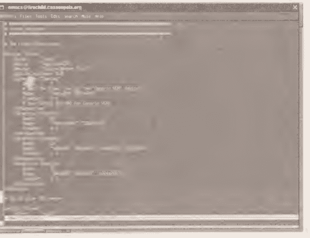

图 6.1

在 X Window System 中运行的 GNU Emacs。

你已经遇到过涵盖 GNU Linux 系统关键程序的 UNIX 手册页。某些页面记录了许多重要配置文件的格式。例如，你可以通过输入 `man lilo.conf` 查看 LILO 加载器配置文件的文档。

```
man lilo.conf
```

# 80 Debian 的第一步

配置文件格式记录在手册的第 5 节中。有时，同一个关键词在多个手册章节中都有条目。要在忽略所有其他章节的情况下，在手册的第 5 节中查找 loco.conf，你可以输入

```
man 5 loco.conf
```

手册共有九个部分，每个部分都有其特定的意义。完整列表所示：

- 标准命令和应用程序，包括 `ls` 和 `man` 等所有日常程序。

- 系统调用（程序员与 Linux 内核的接口）。

- 程序员库提供的函数。

- 特殊文件，主要是位于 `/dev` 目录下的设备文件。

- 文件格式，特别是配置文件。

- 游戏和娱乐程序。

- 文本标记系统，其中手册页的文件格式在此处描述。

- 系统管理程序。

- Linux 内核的内部文档。这是你在其他 UNIX 系统中找不到的章节。通常只有当你想要编写新的设备驱动程序或修改内核时，才会对它感兴趣。

# 设置图形用户界面

与其他某些系统不同，Linux 并没有将窗口用户界面作为操作系统的核心部分。相反，图形功能由一组运行在操作系统内核之上的若干应用程序提供，就像其他任何工具一样。这意味着对于将放在角落作为服务器运行的机器，没有需要运行 GUI。此外，这使得在不触碰核心内核功能的情况下，可以用新设计替换 GUI 系统的部分或全部。

目前，所有流行的 UNIX GUI 都基于 X Window System，有时缩写为 X11 或简单的 X。X Window System 是一个模块化的窗口环境。有三类程序共同构成了一个完整的系统：

- X 显示服务器（X display server）。这是你显卡的一种设备驱动程序。它管理一个显示器，显示器作为一个画布，系统的其他部分可以在上面绘制窗口和图形。作为 Linux 用户，你使用由 XFree86 项目开发的 X 服务器之一。

- 窗口管理器（window manager）。这是一个与 X 服务器交互的特殊程序，并执行创建系统外观和感受的功能——值得注意的是，有很多窗口管理器可供选择。一些会让 Windows 或 MacOS 的用户觉得很熟悉。另一些，例如流行的 Enlightenment，提供了易于配置的外观。某些 Enlightenment 配置看起来非常奇特，尽管它们可能属于某种需要时间才能适应的口味。除非另有说明，书中所有的 X 应用程序都是在运行流行的 GNU WindowMaker 窗口管理器时拍摄的。

- X 客户端（X clients）。这些是 X Window System 的日常应用程序——从时钟到文字处理器的任何程序。


由于 X 是一个感知网络的窗口系统，客户端实际上并不需要与 X 服务器在同一台计算机上运行。虽然在简单安装中，你通常不需要这种灵活性，但如果你有私有网络，有时它会很有用。有些人发现与 X Window System 相关的“客户端-服务器”术语有点困惑。你总会在你的工作站或其他某些机器上运行一个 X 服务器（参见图 6.2）。从用户的角度来看，运行应用程序的远程机器通常被认为是服务器，因此在 X 的术语中，客户端和服务器似乎是反了的。

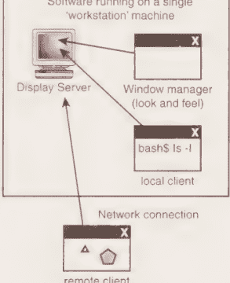

图 6.2

X 客户端与显示服务器之间的关系。窗口管理器是一个控制所有其他客户端外观的特殊客户端。

这种安排背后的逻辑是，当 X 客户端应用程序启动时，它会建立到显示服务器（可能是本地的也可能是远程的）的网络连接。这种连接类似于 Web 浏览器（客户端）建立连接从 Web 服务器获取文档的情况。因此，关键在于建立网络连接的方向。关于在网络上运行 X 应用程序的实际操作的讨论，请参阅第 10 章“探索 X Window System”。

## 安装 X 系统

在使用 X 系统之前，你需要安装 X 服务器、窗口管理器以及各种支持包。首先要决定安装哪个服务器。首先尽可能获取关于你显卡的信息：制造商以及如果可能的话，它使用的芯片组。

查找合适的 X 服务器的最佳方法是使用 `dselect`，进入包选择界面，按 `/` 然后输入 `xserver`。你会看到可用的 X 服务器列表。你可以选择一个支持你芯片组的 X 服务器。如果没有，也看看 `xserver-svg` 包。

或者，使用 `xserver-common` 包，然后阅读 `/usr/doc/xserver-common` 中的文档。

当你选择 X 服务器时，`dselect` 会提取其他依赖包——这些是库和基本程序。同时，你必须为系统安装一些字体。如果不确定，安装所有的 `xfonts` 包。当你安装服务器时，安装脚本会询问你是否想将其设为默认。显然，你想要回答 yes。

> XFree86 的开发者已经在其 X 服务器系统的 4 版本上工作了一段时间。由于一些重大设计变更，可能只有一个服务器，它应该适用于任何图形芯片组。

### Debian 的第一步

在你选了核心 X 包后，应该选择一个窗口管理器。你可能想尝试几种，但如果不确定，请选择 WindowMaker（由 `wm` 包提供）。该管理器在资源高效利用和美观（可配置）的外观之间取得了良好的平衡。当你安装窗口管理器时，会询问你是否想将其设为默认。这意味着将在不手动指定窗口管理器的情况下用于 X 会话。通过一些配置，系统上的每个用户都可以覆盖默认设置——参见本章稍后的“设置 X 会话脚本”部分。

在你选择包时，你可能还想安装其他的 X 应用程序。最少也需要安装 `xterm` 包。但有许多的应用程序供选择，从像 `xclock` 这样的小工具到像 `vamp` 这样的大程序。其他应用程序的列表请参见第 7 章或查看 `dselect` 包列表。

## 配置 X 服务器

安装了适合你系统的 X 服务器后，现在应该配置它。XFree86 服务器由文件 `/etc/X11/xF86Config` 配置。该文件可以手动编辑，但你通常可以通过运行 `xf86config` 来创建一个合适的文件。

### 设置图形用户界面

`tool`。这是一个基于文本的工具，但它提供了全面的帮助信息，解释所有关键选项并引导你完成整个过程。

在你的 X 服务器设置文件中，你需要配置的主要项目如下：

- 鼠标详情
- 键盘布局
- 你的显示器规格
- 你的显卡的一些细节（如果你使用的是旧显卡，这一点尤为重要）
- 你想要使用的屏幕分辨率选择

首先，你会被要求指定你正在使用的哪种鼠标（或其他指针设备）。某些 X 应用依赖于三键鼠标。如果你有一个双键鼠标，那么接受 `Emulate3Buttons` 选项是值得的。这允许你通过同时按下两个键来模拟中键点击。如果你频繁使用需要第三个按钮的程序，你可能会发现买一个正的三键鼠标是值得的。

你还需要输入鼠标的 Linux 设备名称。如果你使用的是连接到系统辅助端口的 PS/2 鼠标，该名称将为 `/dev/psaux`。如果你有一个串行鼠标，必须指定相应的串口。如果它连接在第一个端口（Windows 下的 COM1），Linux 名称为 `/dev/ttyS0`。COM2 变为 `/dev/tty1`。

接下来是键盘配置——按照菜单操作，你应该能看到适合你的键盘布局和母语言的选项。如果没有适合你母语言的选项，请尝试选择最接近的匹配，然后联系一位具有相同键盘布局的本地 Linux 用户并寻求建议。

现在，你需要告诉 X 服务器一些关于显示器能力的信息。重要的数字是屏幕显示水平和垂直同步率的最大值和最小值。你的显示器用户手册通常包含一个规格部分，其中提供了适当的值，你可以在提示时直接输入这些值。如果是这样，查看 `xf86config` 程序打印的值列表，并选择与你在 Windows 下通常使用的屏幕模式匹配的选项。

输入完成后，你会被要求为显示器记录输入名称，它存储在 `Xf86Config` 文件中。这并不重要，所以你可以直接按回车（Return），让程序使用默认值。

你还需要输入关于你使用的显卡的信息。首先，你会被要求打算运行哪种 X 服务器——你应该已经决定了这一点，安装了相应的服务器，并将其设置为默认。接下来，你需要告诉程序你的显卡有多大内存。与显示器设置一样，你会被要求为你的显卡定义输入一个名称，但再次强调接受默认值是安全的。

### 第 6 章：在 Debian 中的第一步

程序还会提示你选择卡上是哪种时钟芯片。对于大多数相当旧的显卡，这里不需要设置任何内容；按回车键即可跳过此部分。

最后一步是配置可用屏幕分辨率的范围。每种颜色深度都有独立的分辨率列表。当你启动 XFree86 时，通常会使用每像素 8 位颜色深度，因此你至少应该确保对这种颜色深度有一组合理的分辨率选择。

如果你设置了多个分辨率，服务器在启动时将使用列表中的第一个分辨率。你可以通过同时按下 `Control` 和 `Alt` 配合数字键盘上的 `+` 或 `-` 键来切换到列表中的其他分辨率。

#### 注意

如果你选择了多个屏幕分辨率，请注意，当你在它们之间切换时，你改变的是显示在屏幕上的内容，而不是桌面的大小（桌面在 X 会话期间永远不会改变）。当桌面区域大于选定的屏幕分辨率时，XFree86 的虚拟区域功能会被激活；当你将指针移动到屏幕边缘时，桌面将会滚动。如果你发现这很困扰，请确保你没有配置任何比你通常使用的更大的屏幕分辨率。

如果你想手动调整 `/etc/X11/XF86Config` 文件——例如，在不再次运行 `xf86config` 的情况下更改服务器模式的选择——开始阅读 `XF86Config` 的帮助页。此页面提供了有关文件格式的全面信息。你很可能会在文件的 `Screen` 部分更改许多选项。请注意，实际上有四个这样的部分：一个用于单色服务器，一个用于 16 色 VGA 驱动程序，一个用于 SVGA，还有一个是 `Accelerated`（加速），它被所有其他 X 服务器软件包使用。务必为你你正在使用的服务器编辑正确的部分，否则你将看不到任何变化。请注意，`Accelerated` 一词的使用现在相当令人困惑——在 XFree86 的最新版本中，SVGA 服务器可以利用许多显卡中存在的图形加速功能。

你可能想要手动更改的是服务器将使用的颜色深度。当 XFree86 服务器启动时，它们通常默认为每像素 8 位颜色（256 色）——显然超过了单色和 16 色 VGA 服务器。有了现代图形技术，你最可能想要的是 16bpp（65,000 色）或 24bpp（1670 万色）显示。有多种方法可以让服务器以不同的颜色深度启动，但最简单的方法是编辑 `/etc/X11/XF86Config`，找到你正在使用的服务器的 `Screen` 部分，并添加如下行：

`DefaultColorDepth 16`

## 启动 X 会话

当你认为 X 服务器设置正确后，使用你的普通账户登录。要启动会话，只需在提示符处输入 `startx`。这将加载你的默认窗口管理器，如果你配置了一个，它还将加载你的应用程序。

根窗口菜单（root window menu）是窗口管理器的共同功能。如果你右键点击桌面，将看到一个有用程序的菜单。你也可以从 shell 运行程序。例如，如果你想使用文本编辑器，输入：

```
emacs myfile.txt &
```

#### 注意

注意命令行末尾的安符号 `&`。这是一个标准的简写，告诉 shell 在后台启动该程序。如果你省略了 `&`，shell 将等待你退出 emacs 后才会让你输入另一个命令。在从命令行运行 X 应用程序时，你几乎总是想要使用 `&`。

### 第 6 章：在 Debian 中的第一步

![a0c73b609953db1cdc146c59ceca7cbb_99_0.png

简单的 WindowMaker 会话。根窗口菜单是大多数窗口管理器的功能。

当你想要结束 X 会话时，正常的方法是杀死窗口管理器。大多数窗口管理器在其根窗口菜单中提供 `Exit` 选项。当你选择此选项时，整个 X 会话将终止，并返回文本控制台。如果你选择了一个没有简单退出路径的默认窗口管理器，可以通过按下 `Control+Alt+Backspace` 来强制终止会话——但请作为最后的手段。

你也可以使用虚拟控制台临时切换出 X。仅按 Alt 和功能键在 X 运行时不起作用，但 `Control+Alt+F1` 会带你进入虚拟控制台 1。当你切换回来时，你会发现 X 会话在虚拟控制台 7 上

## 设置 X 会话脚本

默认情况下，当你启动一个新的 X 会话时，Debian 只会加载默认窗口管理器，没有其他应用程序。但很容易覆盖这种行为——如果系统在你的家目录下检测到一个名为 `.session` 的文件，它将使用该文件来配置你的会话。

`.session` 文件通常是一个 Bourne shell 脚本，如果你熟悉 UNIX 脚本，那么从该文件中可以执行的操作几乎没有限制。但在大多数情况下，你只想运行几个应用程序和一个窗口管理器（可能是也可能不是系统默认的）。典型的文件可能如下：

### 桌面环境

### 用于 thomas@adzel 的 .xsession 文件

```bash
xterm -bg black -fg wheat &
clock &
exec WindowMaker
```

与任何脚本一样，以 `#` 字符开头的行被视为注释并忽略。接下来两行是启动 X 应用程序的普通命令行——注意每行末尾的 `&`，表示该程序在后台运行。这个特定的文件启动了一个 xterm（带有一些选项 - 背景颜色和前景颜色）和一个时钟程序。

`.xsession` 文件的最后一行相当特殊。它应该始终启动某个程序（在本例中为 WindowMaker 窗口管理器），但运行方式不同。它使用了 `exec` 命令，且没有 `#` 字符。这使得以此方式启动的程序成为会话管理器。只要会话程序一直在运行，X 会话就会持续，然后静退出。

将窗口管理器设置为会话管理器是常见做法。这意味着当你从窗口管理器菜单中选择“退出”时，会话将会结束。但你可以让任何程序成为会话管理器。如果你正在使用应用程序启动面板（例如后文描述的各种桌面环境包提供的面板），你可能更倾向于将其作为会话管理器。在这种情况下，你可以使用如下这样的文件：

### 使用面板工具作为会话管理器的 .xsession 文件

```bash
clock &
WindowMaker &
exec panel
```

`.xsession` 文件应该启动一个（且只有一个）窗口管理器——即使它不被用作你的会话管理器。严格来说，可以在不使用窗口管理器的情况下使用 X 窗口系统，但这视觉上并不美观且大不相同——你在移动、调整大小和关闭窗口时会遇到困难，因为这些功能通常由窗口管理器提供。

偶尔，你可能会在会话文件中遇到错误。该错误会导致某些应用程序无法启动，甚至导致整个会话提前退出。如果是这样，请查看运行 `.xsession` 文件时产生的错误消息，这些错误记录在主目录下的 `.xsession-errors` 文件中。

## 桌面环境

X 窗口系统提供了一个运行应用程序的环境，但它本身并没有提供让用户熟悉的图形界面界面实用工具。桌面环境的定义相当模糊——它可以应用于任何提供通用外观和体验的包。对于许多人来说，桌面环境最重要的组件是图形文件管理器。

多年来，许多 UNIX 系统都配备了通用桌面环境 (CDE)。CDE 是一个商业且相当昂贵的产品，在这里不予考虑。最近，有几个开源项目为 X 窗口系统开发了新的桌面环境。GNOME 和 K 桌面环境 (KDE) 项目产生了许多高质量软件。

在某些 UNIX 和 Linux 论坛中，你可能会遇到关于桌面环境优点的激烈讨论。事实上，没有特别的理由让你选择其中一个——你完全可以在每台机器上安装两者，并从它们中运行你喜欢的程序。为了让这两个系统工作得更好——例如，未来它们将使用相同的机制来支持拖放。但如果两个阵营之间存在某种竞争，只会促进两个系统的发展。

### GNOME

对于感兴趣的人来说，GNOME 实际上是 GNU Network Object——一个反映允许系统组件之间进行交互技术的名称（类似的方法也被用于 KDE 项目）。

GNOME 并没有指定标准的窗口管理器，尽管 Enlightenment 和 WindowMaker 是流行的选择。你得到的是桌面环境的核心部分：一个高度可配置的应用程序面板、一个名为 `gmc` 的图形文件管理器（见图 6.4），以及从专用帮助浏览器到窗口实现的各种额外功能。GNOME 项目成员还在开发许多更大的应用程序，包括 balsa 邮件客户端和强大的 gnumeric 电子表格。为了完成你的桌面，还有几个游戏，包括义务寻矿游戏。

GNOME 的最终版本是 Debian 2.2 主发行版的一部分。Debian 2.1 一些 GNOME 包，它们基于预发布版本，在正式发布之前最好避免。如果你想在 Debian 2.1 系统上尝试 GNOME 或确保拥有最新版本，可以将项目的 FTP 添加为 APT 包源。通过这种方式，包将出现在你的标准选择中。网站上有关于此操作的操作。

GNOME 以大量的包文件提供——大多数应用程序是单独提供的。这意味着你只需要安装喜欢的工具，但主要的 GNOME 包依赖于大量的支持库。如果你使用 `dselect` 安装它们，所有所需的库应该会自动获取。如果你手动下载并安装包，请检查网站上的安装说明。


# 6.4

GNOME Midnight Commander 文件管理系统是桌面环境的关键组件之一。

安装了所有需要的 GNOME 包后，编辑你的 `.xsession` 文件如下：

```bash
## 运行 GNOME 和 GNOME 面板的 .xsession 文件
WindowMaker &
gmc &
exec panel
```

注意，这使得 GNOME 应用程序面板成为你的会话管理器。最后，从面板中选择“注销”，而不是退出窗口管理器。

## KDE

GNOME 工具的主要替代方案是由 KDE 项目提供的（它实际上非常像 GNOME）。同样，它提供了广泛的工具，从 kfm 文件管理器（也可以作为可靠的 Web 浏览器）到实用的小工具（如 configure，用于配置打印机）。系统还包含了自己的窗口管理器，它提供了类似于 Windows 的外观和感受（图 6.5）。但当然，如果你喜欢，可以使用不同的窗口管理器。顺便提一下，不要试图寻找初始字母 K 的隐藏含义——开发者声称它真的不代表任何内容。


图 6.5

使用 K 窗口管理器的典型 KDE 桌面。

KDE 开发者还在开发许多主要的效率应用程序，它们组 KOffice 文字处理器和 Krator 矢量图形包。关于这些程序的进展报告，请访问 http://koffice.kde.org/

KDE 不是 Debian 发行版的标准部分。但 KDE 项目团队提供了每个发布版本的 Debian 包，这些包很容易下载和安装——查看 KDE 主网站以找到你最近的存档站点镜像。虽然 KDE 被分成了多个组件，但打包的粒度没有 GNOME 那么细。尽管如此，请检查网站上最新的安装说明以确定安装包的顺序。注意 Qt 用户界面工具包的要求。这无法在 KDE 包本身的同一个地方获取，但在标准 Debian 存档中提供，因此如果不确定，在开始时通过 `deselect` 安装它即可。

安装了 KDE 后，你可以通过创建一个如下所示的最小 `.xsession` 文件来尝试整个系统：

### 管理用户账户

运行 KDE 的 .xsession 文件

```exec startkde
```

`startkde` 是一个脚本（通常安装在 `/usr/X11/bin` 目录下），用于启动所有主要的 KDE 组件。它本身也是一个有效的 `.xsession` 文件。因此，如果你决定喜欢某些组件（例如，你想要一个不同的窗口管理器），可以尝试将 `startkde` 文件复制为你的 `.xsession`，然后编辑它以运行你想要的部分。

## 设置图形化登录界面

如果你偶尔使用 Windows 应用程序，可以保持默认的在文本控制台登录系统，并在需要时随时使用 `startx` 命令启动 X 会话。但现如今，几乎每个人都惯常使用窗口环境。你可能希望在 Debian 系统启动时自动运行 X 服务器，并在登录时立即启动 X 会话。有很多被称为“显示管理器”（display managers）的工具可以启动 X 服务器并提供图形化登录界面。

传统的显示管理器称为 `xdm`，它是 X 窗口系统的核心工具之一。由于该显示管理器有很多配置选项，但其中大多数选项仅在机器运行于复杂的客户端-服务器环境中才有意义。要使用该显示管理器，只需运行 `devel` 并安装 `xdm` 软件包。你可以通过以 root 登录并输入 `xdm` 来测试程序。你应该能看到登录界面。在输入普通用户名和密码后，你将看到正常的 X 会话。`xdm` 软件包会自动集成到 Debian 系统中并在机器启动时运行。


xdm 显示管理器运行良好，但它的外观充其量只能算好用。如果你想让你的系统美观一些，现在有几种替代方案。GNOME 项目提供了 `gdm` 显示管理器——与 `xdm` 类似，只需安装相关软件包，它就会在机器启动时自动运行，而且外观更现代。`gdm` 增加了一些额外功能，特别是菜单选项，允许你无需手动输入命令即可关机或重启机器。

KDE 开发人员也制作了自己的解决方案，令人惊讶的是它被称为 `kdm`。除非你确切知道自己在做什么，否则不要同时安装超过一个显示管理器；它们之间可能会发生冲突。

## 管理用户账户

Linux 从设计之初就被设计为多用户操作系统。这意味着你磁盘上的每个文件以及系统上运行的每个程序的所有者都会被记录。每当程序尝试访问文件时，内核都会首先检查其是否有权限执行操作。即使你在机器上只有一个用户账户，这种检查仍然很有价值——因为所有关键系统文件都属于 `root` 账户，你在修改它们之前必须专门以 `root` 身份登录，从而避免意外修改的风险。

# 第 6 章：Debian 的起步

当你的电脑供家人或同事使用时，多用户功能就真正发挥作用了。用户可以保留自己的个人文件。由于许多 UNIX 应用程序从用户主目录下的文件读取配置，用户都可以设置自己的账户以满足个人需求，而不会干扰他人的选项。

UNIX 安全模型实际上涉及两种所有权——用户所有权和组所有权。用户和组都用数字 ID 表示，但在实际操作中你会使用普通名称。用户 ID 和组 ID 映射到 `/etc/passwd` 和 `/etc/group` 文件中的名称。尽管命名如此，`/etc/passwd` 并不一定包含任何密码数据。如果如建议的那样，你在安装期间接受了“影子密码”（shadow passwords）选项，密码将以（加密的形式）存储在 `/etc/shadow` 文件中。这种安排被认为更安全，因为它意味着加密密码文件系统上的普通用户不可读。即使它们经过了加密，将其公开显示也是一种不必要的风险。

UNIX 系统上的每个文件都有一个用户 ID 和组 ID。每个用户都是一个或多个组的成员。在 Debian 系统上，每个账户通常对应一个同名的组，这是该账户的主组。这意味着，以 `thomas` 身份登录的用户创建的文件将拥有用户 ID 为 `thomas`，组为 `thomas`——尽管这些可以使用 `chown` 命令进行更改。

在大型系统中，管理员有时会创建组，允许所有在该特定项目工作的用户访问共享文件。可以使用 `addgroup` 命令创建新组。组机制也可以用于控制对特定系统资源的访问。为了这个目的，在安装期间自动创建了几个标准组。例如，在标准的 Debian 系统上，对任何音频硬件的访问都限制在 `audio` 组的用户中。同样，你可以通过将用户添加到 `dip` 组来赋予其激活拨号上网 Internet 连接的权限。这一特殊案例将在第 8 章“高级配置”中进一步讨论。还有许多特殊组涉及特定应用程序的正常运行；这些组在应用程序的文档中会有描述。

从原则上讲，你可以通过直接编辑 `/etc/passwd` 和 `/etc/group` 来执行所有的账户管理功能。但 Debian 提供了许多工具，让账户管理变得更加简单。其中最重要的工具是 `adduser` 命令。该命令在安装期间创建第一个用户账户，并可以在任何时候用于创建新账户。例如：

```
adduser thomas
```

系统会提示你输入关于新用户的各种个人详情（可以使用 `finger` 命令查看这些信息）以及新账户的初始登录密码。没有密码的账户被认为是不良的策略，即使在单机上也是如此，`adduser` 不允许创建此类账户。程序将设置账户和相应的组，并创建一个新的主目录——

## 所有权与权限

在这种情况下，该目录将被称为 `/home/thomas`。新的主目录是骨架目录 `/etc/skel` 的副本创建。如果你正在设置大量账户，这种机制可以为所有用户提供标准配置文件。当 `adduser` 命令带有第二个参数调用时，它会将现有用户添加到指定的组。例如，你可以通过此命令允许账户控制拨号上网的访问：

```
adduser thomas dip
```

还有许多更改用户账户详情的命令。要更改账户密码，请使用 `passwd` 命令。如果普通用户忘记了密码，你可以使用 `root` 账户登录并输入：

```
passwd <username>
```

这允许你强制更改账户的密码。如果你忘记了 `root` 密码，你就麻烦了——要获得 `root` shell，你需要从救援磁盘启动。但请尽量记住密码。如果你担心忘记，可以把它写下来并放在安全的地方。但记住，任何拥有 `root` 密码的人对系统的任何部分都有完全访问权限。

## 所有权与权限

大多数文件系统提供某种访问控制——DOS 允许你防止文件被覆盖和删除。但由于 UNIX 系统是为了多用户操作设计的，访问控制系统要复杂得多。要查看文件的所有权访问控制数据，请使用 `ls` 命令的 `-l` 选项。该选项提供的输出看起来如下：

```
-rw-r--r-- 1 thomas  thomas    146689 Jul 10 11:07 may.jpg
```

第一列给出文件的访问限制，在 UNIX 术语中称为模式。然后你会看到所有者、所属组、文件大小（字节）以及最后修改时间。文件的所有权可以使用 `chown` 命令更改。例如：

```
chown david.coders may.jpg
```

文件的访问由三部分组成。第一部分适用于文件的所有者，第二部分适用于不拥有文件但属于文件所有者组的用户，第三部分适用于所有其他用户。对于每种用户，有三种可能的访问类型：读取、写入和执行。文件的模式使用 `chmod` 命令更改。例如，要允许组其他成员读取和执行文件，请使用：

```
chmod g+x myfile
```

# 第 6 章：Debian 的起步

要停止其他类的用户写入文件，请使用此命令：

`chmod o-w myfile`

在 Debian 下，大多数应用程序创建的文件的默认模式是所有者和组用户可读写，其他用户仅可读。如果你希望新创建的文件以其他模式创建，请查阅 `umask` 命令的手册页。

对于可执行（程序）文件，还有一些额外的访问模式：`setuid` 和 `setgid`。通常，当程序启动时，它是以运行它的的用户 ID 和组 ID 运行的。如果程序标记为 `setuid`，它将使用文件所有者的用户 ID 运行。同样，`setgid` 程序将获得文件的组 ID。这类程序最常见的例子是 `setuid root` 系统工具。这些工具允许普通用户以有限的权限使用系统管理功能。

例如，在第 8 章讨论的某些情况下，可能允许普通用户挂载新文件。为了实现这一点，`mount` 命令被设置为 `setuid root`，并由该命令负责检查用户是否真的被允许执行所需的操作。除非你是一个程序员或正在进行某些复杂的系统管理工作，否则你不需要创建新的 `setuid` 或 `setgid` 文件。然而，你应该意识到它们的存在，并且它们对系统安全至关重要。大多数与 UNIX 相关的安全警报涉及允许滥用 `setuid` 程序特权状态的漏洞。

## 数字访问

到目前为止，你已经将文件访问模式视为字母序列，其中每个字母指定了允许某些特定类型的文件访问。在内部，UNIX 文件系统将每个文件的模式表示为一个数字。你可能会在更高级的 Linux 文档中看到这些数字。可以使用数值模式作为 `chmod` 命令的参数。例如

`chmod 0644 myfile.dat`

一旦你熟悉了数值模式，你可能会发现它们比 `chmod` 命令的字母样式更方便。

数值模式是一个四位八进制数。这意味着只允许 0 到 7 的数字。数字的第一位指定文件的 `setuid` 和 `setgid` 标志。剩余的三个数字分别指定文件所有者、文件所在组成员以及所有其他用户的访问权限。一个数字的正确值通过将以下值相加得到：

- 4 读取权限
- 2 写入权限
- 1 执行文件的权限（注：原文此处为3，通常执行权限位为1）

因此，要仅给所有者提供读取/写入权限，你使用模式 0600。要允许所有人读取和执行一个文件，但只允许所有者修改它，模式 0755 是合适的。

## 打印——UNIX 方法

在某个时刻，你可能会在你的 Debian 系统上生成一些想要打印的文档。今天几乎所有的家庭和小型办公室打印机都连接到计算机的并行端口。原始打印机设备文件（相当于 Windows 下的 LPT1）是 `/dev/lp1`，你可以通过登录为 `root` 并直接向该设备发送一些文本来测试打印机。例如

```bash
cat myfile.txt >/dev/lp1
```

然而，使用端口设备进行日常打印有两个缺点。首先是传统的 UNIX 逻辑：如果有多个用户尝试同时访问单个打印机设备，第二个用户将发现设备正忙。如果你将 Debian 系统作为单机工作站使用，你可能不会认为这是一个重要的考虑因素。但如果你设置了办公室打印机，这确实很重要。因此，默认系统设置不允许普通用户直接访问设备。

解决此问题的标准方案是 `lpr` 包，它管理打印作业队列。对于简单的设置，你可以使用如下命令打印文件：

```bash
lpr myfile.txt
```

如果打印机目前开启且未忙，文件将立即打印。如果未开启，它将被添加到队列并尽快打印。你可以使用 `lpr` 命令查看打印队列中的项目，并使用 `lprm` 取消打印作业。注意，大多数提供打印功能的窗口化程序（windowed programs）会在内部生成 PostScript 文件，然后自动将数据馈入 `lpr` 程序。

设置 Linux 打印系统的第二个问题是，发送到打印机的数据必须与打印机预期的匹配。纯文本不是太大问题，但不同类型的打印机期望不同格式的图形数据。以正确的格式呈现图形数据是打印机驱动的主要功能。

另一方面，UNIX 程序传统上使用 PostScript 描述语言输出打印作业。高端打印机通常可以直接理解 PostScript 数据，这些通常没有问题。但兼容 PostScript 的打印机很昂贵，很少有家庭用户拥有。幸运的是，有一个名为 `gs`（Ghostscript 的缩写）的免费软件包，可以将 PostScript 文件转换为广泛打印机使用的数据格式。它还可以在屏幕上预览 PostScript（以及相关的 格式 PDF）。

在理想的世界中，程序将检查你尝试打印的所有文件，并运行 `gs` 或任何其他适当的过滤器程序，将文件转换为打印机可以理解的类型。`magicfilter` 尝试提供这种服务。在正确安装此软件包后，你应该能够打印 PostScript、PDF、纯文本以及各种其他文件格式，而无需手动运行所需的过滤器。

## 设置打印系统

正如通常情况那样，你可能需要实验。首先，你应该运行 `dselect` 并确保安装了以下软件包：

- `lpr`
- `gs`
- `fonts`
- `magicfilter`

你现在必须设置 `/etc/printcap` 文件，它定义了你的打印机。该文件定义了打印队列，并确保发送到打印机的所有文件都经过 `magicfilter` 处理。如果没有发生这种情况，你可能需要重新配置系统。默认打印机 `/dev/lp1` 通常是正确的，除非你有多个打印机。在设置了 `/etc/printcap` 文件后，你应该能够使用 `lpr` 命令打印文本文件和 PostScript 文档。通常，`lpr` 命令所需的参数是文件名。如果你需要向 `lpr` 命令传递任何选项，可以在此处指定。例如

```bash
lpr -P desk document.ps
```

为了进行测试，尝试从 Netscape 或 AbiWord 等程序打印文档。这些程序生成的 PostScript 数据应该被 `magicfilter` 系统识别并使用 `gs` 进行渲染。Netscape 的打印对话框（见图 6.6）是大多数 UNIX 提供的对话框的示例。

## 图 6.6：Netscape

UNIX 允许你指定用于打印文档的命令。

如果没有标准的过滤器文件看起来适用于你的打印机，你可能需要编写自己的。主要的考虑通常是 `gs` 是否能够将 PostScript 转换为适合你打印机的格式。你可以通过输入以下命令查看输出格式列表

`gs -?`

如果你的打印机在列表中，但未被 `magicfilter` 系统支持，可以复制 `/etc/magicfilter` 目录下的现有过滤器文件并修改它以使用相应的打印机类型调用 `gs`。如有疑问，请查看 `magicfilter` 和 `gs` 的手册页。

完成本章后，你的 Debian 系统上应该有一个运行良好的窗口环境。记住，X 窗口系统是高度可配置的。如果你不喜欢这里描述的基础安装的外观或行为，你可能可以通过重新配置窗口管理器或安装另一个来更改它。关于配置 X 的更多信息见第 10 章。

如果你是 UNIX 新手，现在应该更熟悉文件所有权和访问模式的概念。本章还涵盖了连接到你的 Debian 的打印机的基本步骤。如果你的计算机连接了网络，你可能还想阅读第 9 章“网络生活”中关于网络打印机的章节。

## 第 7 章

## 软件包之旅

在本章中，你将查看一些可能想在 Debian 系统上使用的较为流行的应用程序。本章的涵盖重点集中于你在日常计算中可能会遇到的重要任务，并提供了一些流行的解决方案。但 Debian 发行版中还包含了大量更专门的软件，甚至有更多可以免费下载的软件。因此，如果你需要本章中未列出的内容，值得浏览 Debian 软件包列表来查找。

如果你想跟进 GNU/Linux 系统（以及其他 Unix 类操作系统）的最新软件发布，

-   此站点允许你浏览最新的 GNU/Linux 软件发布列表。它提供了每个软件包的简要描述，并附有指向主页和主要下载站的链接。它还有一个搜索功能，可以帮助你找到正在寻找的程序。

你可能还会发现感兴趣的文档包。特别有用的是一系列被称为 HOWTOs 的文档，它们记录了特定的任务，从设置一个棘手的声卡到配置对芬兰语的支持等。这些 HOWTO 以纯文本格式存在于 `linux-text` 软件包中，并安装在 `/usr/doc/HOWTO` 目录下。像 Debian 下许多文档文件一样，它们使用 `gzip` 工具进行压缩。要读取它们，请使用如下命令：

```bash
gzip -dc /usr/doc/HOWTO/IPCHAINS-HOWTO.gz | less
```

命令的第一部分解压缩文件使其可读。然后，压缩文件被通过管道传递给 `less`，这是一个常用的 UNIX 实用程序，允许你一次一页地浏览文件。

## 软件包分类

截至 Debian 2.1，该发行版包含了 2000 多个软件包。为了让完整的 Debian 列表更有意义，软件包根据用途进行了分类。软件包浏览工具通常可以配置为按部分对软件包排序（参见图 7.1）。

图 7.1

`gnome-apt dselect` 中的发行部分也按部分对软件包进行分组，尽管图形化程度较低。

目前，标准的发行版部分如下：

-   `admin`—协助系统配置的工具。
-   `base`—构成 GNU/Linux 系统核心的软件包。该部分的大多数软件包作为 Debian 系统的一部分自动安装。
-   `comm`—与互联网相关的通信工具。例如，发送和接收传真文档的软件就在此节中。
-   `devel`—编程工具。
-   `doc`—手册和其他文档。
-   `editors`—编辑器软件包，主要用于纯文本。


- `devel`—编程工具。
- `doc`—手册和其他文档。
- `editors`—编辑器软件包，主要用于纯文本。
- `admin`—协助系统配置的工具。
- `base`—构成 GNU/Linux 系统核心的软件包。该部分的大多数软件包作为 Debian 系统的一部分自动安装。
- `comm`—与互联网相关的通信工具。例如，发送和接收传真文档的软件就在此节中。

### 编辑器

纯文本编辑器（与文字处理器不同）是最核心的。你可能需要使用一些，但其中一些需要-

### 互联网应用程序

一旦你的 Debian 系统运行并配置好，你可能很快就会用它来访问互联网资源。如果你有直接连接，可以立即使用这些程序。在现代的第 8 章，“高级配置”中描述了如何配置和使用拨号上网连接。

-, 但其中一些需要 X Window 系统。你可能更倾向于使用图形编辑器，但请记住那天你可能想要

### 编辑器

纯文本编辑器（与文字处理器不同）是最核心的。你可能需要使用一些，但其中一些需要 X Window 系统。你可能更倾向于使用图形编辑器，但请记住那天你可能想要

### 编辑器

纯文本编辑器（与文字处理器不同）是最核心的。你可能需要使用一些，但其中一些需要 X Window 系统。你可能更倾向于使用图形编辑器，但请记住那天你可能想要

### 编辑器

纯文本编辑器（与文字处理器不同）是最核心的。你可能需要使用一些，但其中一些需要 X Window 系统。你可能更倾向于使用图形编辑器，但请记住那天你可能想要拥有

## Web 浏览器

目前，GNU/Linux 用户主要使用的浏览器是 Netscape 4（参见图 7.2）。该浏览器提供 Navigator（独立 Web 浏览器）和 Communicator（集成电子邮件和新闻客户端）版本。

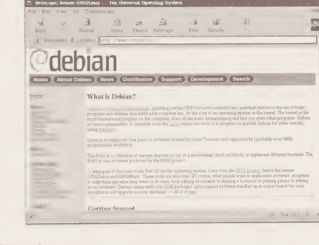

图 7.2

Netscape 是 GNU/Linux 上流行的 Web 浏览器。它的外观与 Windows 和 macOS 版本相同。

Debian 将 Netscape Communicator 拆分为几个软件包。请根据你对消息组件的兴趣程度，选择 `communicator-base` 或 `navigator-base`。此外还有可选的包，例如 `netscape-java`，它包含了对 Java applet 的运行时支持。在某些版本中，你可能会找到静态版本和动态版本。动态版本较小，但它要求你安装了专有的 Motif 库文件。

当你安装 Debian Netscape 软件包时，浏览器程序本身是通过一个 Debian 特定的脚本启动的。这不允许 root 账户运行浏览器。这种限制背后有一个真实的安全考量：Web 浏览器可以运行从互联网下载的 Java 和 JavaScript 代码，而以 root 权限运行的 Netscape 副本可能会允许对系统文件进行未经授权的。无论如何，你真的没有理由使用 root 账户运行浏览器：所有的日常计算都应该使用普通用户账户完成。

# 104 第 7 章：软件包概览

Netscape Navigator 现在已经是一个相当老的程序了，对最新 Web 标准的遵循程度参差不齐。1998 年，Netscape 出人意料地发布了其浏览器软件包的源代码。从那时起，Netscape 员工和社区开发者合作开发了新版本的浏览器（事实上，这已经是一次完全的重写）。生成的浏览器有望成为有以来编写过的最符合标准的浏览器。这一开源开发工作的主页可以在 `http://www.mozilla.org` 找到。

该网站包含定期的状态更新和指向开发快照的链接。即使你不是程序员，也可以通过运行这些快照并对发现的任何 bug 编写报告来帮助浏览器开发。一旦 Mozilla 浏览器准备好发布，它可能会取代 Netscape 4 成为 Debian 用户的标准浏览器。

你还可以使用其他各种浏览器。特别是 `lynx`，它与众不同的浏览器：它运行在文本控制台上（当然，在 X 下的终端窗口中）。对于使用图形浏览器的人来说，这听起来有点奇怪，但对于设计良好的网站，它可以出奇地有用。而且因为它不需要下载图像，`lynx` 可以加快你的浏览速度。它是一个标准的 Debian 软件包，而且很小，所以你可能想尝试一下。

另一个值得了解的 Web 相关工具是 `wget` 软件包。它不是浏览器，而是一个简单的命令行工具，允许你从任何 Web URL（HTTP 或 FTP）下载文件。它还具有允许你下载整个网站的模式——如果你使用拨号连接并想保留某些 Web 页面的副本以供参考，这非常有帮助。

## 电子邮件客户端

互联网电子邮件系统很大程度上是由 UNIX 用户开发的，因此 Debian 用户有许多功能强大的客户端可供选择，这并不意外。它们可以大致分为两类：可以在文本控制台或 `xterm` 窗口中运行的基于文本的客户端，以及需要 X 窗口系统的图形化系统。如今，图形化解决方案变得越来越流行，但它们并不一定是最好的答案——文本程序经过了多年的开发，且做得非常出色。

无论你使用哪种邮件客户端，你通常是从系统的 INBOX 文件中读取消息的，该文件位于 `/var/spool/mail` 目录。你的邮件文件夹（旧消息、发送邮件的存档等）存储在何取决于你使用的程序。大多数流行的客户端对邮件文件夹使用相同的格式，即它们存储的目录。因此，值得找到一个你喜欢的邮件客户端并坚持使用。

最流行的图形化程序之一是内置在 Netscape Communicator Web 浏览器中的 Messenger 邮件客户端（参见图 7.3）。要设置此项，从 Netscape 的 Edit 菜单打开 Preferences（选项）对话框，并根据你的系统调整 Mail and News 选项。

最重要的选项是 Mail servers（邮件服务器）部分的选项。要读取普通系统收件箱中的消息，你应该将入站邮件服务器设置为 `mmail`。如果你有永久网络连接且管理员告诉你要使用特定的发送邮件服务器，你也可以在此部分输入该详细信息。

但如果你使用的是拨号网络连接，或者不知道任何发送邮件服务器，你可能想使用自己的机器作为邮件服务器。那么 SMTP 服务器应该正确安装并配置了 `exim` 邮件传输包（更多细节请参见第 8 章）。

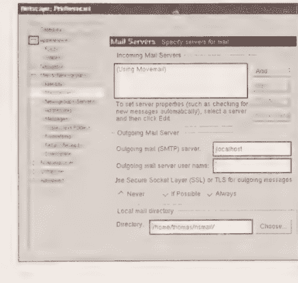

图 7.3

Netscape Communicator 提供了一个易于使用的图形化邮件系统。

你可能想查看的其他图形化邮件客户端包括 `KMail`（来自 KDE 项目）和 `tkrat`。

Debian 的标准文本客户端是 `elm`，它是许多 UNIX 用户的旧爱。但它面临来自 `mutt` 的激烈竞争（参见图 7.4），`mutt` 是一个高度可配置的程序，可以说它对 MIME（用于编码电子邮件消息附件的标准）的支持更好。尽管 `mutt` 在视觉上可能没有某些……那么吸引力

虽然大多数图形化客户端都包含内置编辑器，但你通常使用 `vi` 作为主要编辑器。要更改此，你应该设置 `EDITOR` 变量。

[PAGE 119]

# 第 7 章：Shell 览

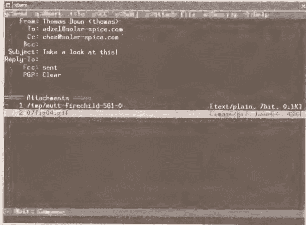

图 7.4

`Mutt` 是一个快速、灵活的邮件客户端。

某些环境变量可以使用以下形式设置

``` 
export VARIABLE=value
```

例如，要设置 `EDITOR` 变量，你可以输入

```
export EDITOR=emacs
```

在实践中，你可能想让这个设置永久生效。如果你使用 X 窗口系统，可以将该命令添加到你的 `.xsession` 文件中，

[PAGE 120]

生产力应用 107

# 第 7 章：软件包之旅

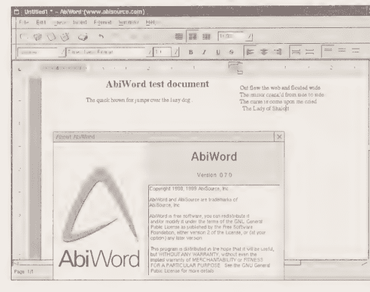

图 7.5

AbiWord 是一款开源文字处理器，正获得越来越多的追者。

## 文本格式化语言

虽然大多数人现在倾向于使用遵循“所见即所得”（WYSIWYG）模型的文字处理器，但还有另一种生产方法，这种方法在 UNIX 环境中仍然非常流行：将文档编写为纯文本文件，并带有格式化命令，然后通过一个独立的程序来生成最终的格式化版本。

这些系统的学习曲线比 WYSIWYG 软件包要陡。但一旦你熟悉了基本命令，制作外观专业的文档就变得容易了，而且比在复杂的菜单结构中寻找你需要的选项要快得多。

文本格式化语言对于生成符合定义结构的文档非常有用——例如科学报告。这里提到的两种系统都为处理大型文档不同章节之间的交叉引用以及自动生成参考文献部分提供了强大的方法。

最为人知的格式化语言是 LaTeX，它实际上是扩展了名为 TeX 的旧系统功能的额外代码层。多年来，它一直是制作科学和数学文本的流行工具。Debian 包含了 TeX 系统，它使用了 LaTeX 和许多相关软件包。这些在软件包列表的 TeX 部分中都可以找到。至少，你可能需要安装 `textex-base` 和 `textex-bin` 软件包。还有文档包，以及许多关于 LaTeX 的书籍可供。你可能对 `lyx` 也感兴趣，这是一个窗口化的文字程序，它使用 TeX 来格式化完成的文档。

另一种系统 Lout 系统提供了类似的功能和更简单的设计（这个名字起得很奇怪）。它包含了许多 LaTeX 软件包提供的功能作为标准，并将文档直接编译为 Postscript 文件，这些文件在 Debian 系统上易于查看和打印。它很容易设置——安装 `lout` 软件包，加上查看和打印 Postscript 文件的工具即可。`Lout-doc` 软件包包含一份详尽的手（当然，是用 Lout 编写的）。

如果你正在使用其中一种文本格式化语言，你几乎肯定想要安装 `ghostscript` 并按照第 6 章“Debian 的第一步”所述将其集成到你的打印系统中。你应该查看 `gy` 软件包，这是一个方便的 `ghostscript` 前端，允许你在屏幕上预览 Postscript 文件。

## 电子表格

电子表格是另一类在 Linux 系统上出现较慢的办公类应用。但 GNOME 和 KOffice 项目都有极具前景的电子表格软件。GNOME 的解决方案包含在最近的 Debian 版本中，名为 `gnumeric`（见图 7.6）。

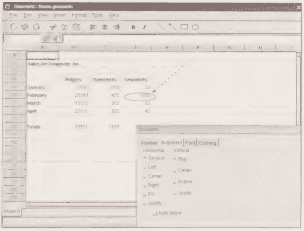

图 7.6

`Gnumeric` 电子表格具有熟悉的用户界面。

## 图形软件包

对于寻找绘画和照片修饰软件包的 UNIX 用户来说，有一个显而易见的选择——Gimp（图像处理程序）。自从发布以来，它一直是自由软件运动的展示性程序。它提供了极其广泛的功能，所有功能都可以通过精良的用户界面访问（见图 7.7）。它与在 Windows 或 MacOS 下运行的专有竞争对手不相上下，并提供了自己一些有趣的功能，例如内置的编程语言，允许专家自动化复杂的操作序列。

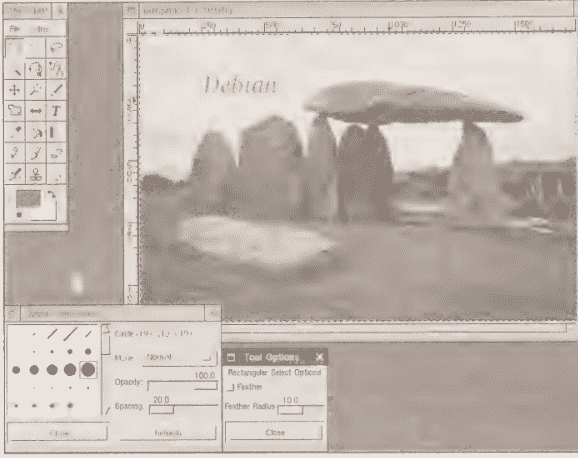

图 7.7 `Gimp` 提供了所有的绘画和照片修饰功能。

另一大类图形应用由矢量图形软件包组成，通常用于技术图纸和插图。目前（还没有）可以与 `Gimp` 媲美的的 UNIX 图形软件包。但随 Debian 分发的 `sketch` 软件包看起来非常有前景（见图 7.8）。

其他值得关注的包括 Illustrator（来自 KOffice 项目）和 GYVE。这些目前没有包含在 Debian 中，但你可以在 Freshmeat 上找到它们的最新发布公告。

图形处理是一个复杂的话题，你可能还会对许多其他软件包感兴趣。如果你想尝试 3D 建模，`blender` 软件包值得一试。还有许多软件包，例如 `gnuplot`，在生成科学和数学文档的图表时，你可能会发现它们很有帮助。

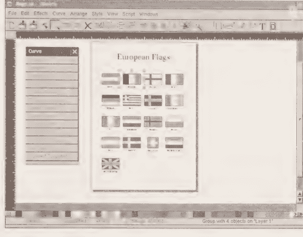

图 7.8

如果你想要一个插图工具，`sketch` 可能是你寻找的软件包。

## 互联网服务

GNU/Linux 系统非常适合用作服务器，无论是在互联网上还是内网环境中。各种网络服务都作为标准的 Debian 软件包可用。这里列出了最流行的几个。

- `Apache` 是驱动万维网上超过半数网站的服务器程序。如果你只是想用你的机器来提供几个网页，默认配置应该运行良好，但如果你正在设置一个严肃的安装，就有许多配置选项需要考虑。安装软件包后，你可以通过运行 浏览器并查看 `http://localhost/` 同时测试你的新服务器并阅读手册。
- `exim` 是服务器。
- `imap` 是用于访问服务器上邮件消息的协议。
- `samba` 的名字源自 SMB（服务器消息块）协议，它提供了 Windows 兼容性。
- `postfix` 是一个流行的邮件传输代理。

现在给出一个警告：每当你运行服务器时，你就打开了一个潜在的漏洞。服务器程序可以通过以下两种方式破坏安全：

- 首先，服务器代码中的漏洞可以让攻击者在你的系统上执行任意命令。
- 第二，如果配置不当，完全免费的服务器程序也会违反安全。例如，Web 服务器可能会在你不知情的情况下提供文件目录。

除了拔掉网络外，没有简单的方法可以保持计算机安全。但作为 Debian 用户，可以通过更新系统中所有软件包并定期检查 Debian 确保没有与你使用的软件包相关的安全警告来保护自己。

配置错误更难避免。 Debian 提供的大多数软件包默认配置是安全的。如果你认为某个软件包的默认配置有问题，考虑联系软件包维护者并建议替代方案。

但尽管如此，每当你安装服务器时，都应该立即阅读文档，然后自己检查配置文件。除非你有需要，否则不要运行服务器。在安装新的服务器之前，要确定你确实需要它，并且你有时间维护配置。如果你尝试了服务器并决定不需要它，请立即删除该软件包。

最后，如果你与整个互联网有永久连接，但你只是为一小部分用户（他们可能只使用局域网）运行服务器，请考虑通过在网络子系统中配置防火墙来保护你的机器。如果你对这个选项感兴趣`IPCHAINS` 文档是一个很好的起点。

## 编程工具

UNIX 系统一直很受程序员欢迎。因此，并不意外，在 Debian 系统上可以使用各种免费的编程工具。如果你是一个丰富的程序员，你几乎肯定能找到你寻找的内容。如果你想学习一种新的编程语言，使用 Debian 工具可能是一个巨大的优势——你能够尝试专业工具而无需购买昂贵的专有产品。

如果你从未打算自己写过一行代码，某些编程工具也可能非常重要。虽然现在大多数流行的 Linux 软件都可以以二进制格式找到（至少对于 Intel 平台），但一些晦涩的代码可能通过源代码格式更容易获得。

构建你自己的二进制文件非常简单（参见第 5 章）

## C 编译器

UNIX 操作系统和 C 语言的早期开发密切相关。C 语言仍然是 UNIX 和 Linux 开发的主要语言，这并不意外。基于 Linux 的系统的标准 C 编译器是 `GCC`，即 GNU 编译器。对于 C++、Objective-FORTRAN 和 Pascal，它已经获得了许多其他语言的支持；并且会有更多语言加入。最近，它的名称已更改为 GNU 编译器集（仍简称为 GCC）。

目前的 GCC 版本有点让人困惑。在 GCC 2.7 发布之后，开发发生了分支，精力被投入到 EGCS（实验性 GNU 编译器系统）包的开发中。GCC 具有更好的性能和对更多编程语言的支持。一旦这一点建立，旧版 GCC 的开发就会大大减慢。Debian 2.2 可能会以 EGCS 作为主 C 编译器发布。但目前，这些项目已经重新合并，目前使用 EGCS 名称正在开发的程序最终将成为 GCC 3 版本。你可以在 `http://gcc.gnu.org` 读取关于 GCC 开发的最新新闻。

幸运的是，你所使用的发行版通常带有 GCC 或 EGCS，这通常并不重要。即使你使用的是 EGCS 编译器，它仍然会被称为 `gcc`！至少，请安装 `gcc` 包。这是系统的核心，允许你编译 C 程序。如果你使用 C++，可能想使用 `g++`；如果使用 Objective-C，使用 `gobj`；对于 FORTRAN 77，使用 `g77`；对于 Pascal，使用 `gpe`。

## 代码库与头文件

Debian 包含了许多共享程序函数库，可以被许多程序使用。这些库提供了广泛的服务，从基础数学运算到专业服务，例如用于需要处理 JPEG 格式图像的程序的 `libjpeg` 库。当你安装一个需要这些库的程序时，库包会自动选择。但如果你想编译一个需要这些库之一的程序，你需要开发者包（developers package）中的一些额外文件。这些额外文件的名称类似于 `libjpeg-dev`。

如果你正在编译一个开源应用程序，它可能会带有一个自动配置脚本，扫描系统所需的库。如果报告缺少某个库，请确保已安装相关的开发者包。

114 第 7 章：软件包概览

Debian 与大多数 UNIX 类系统一样，包含一个特殊的库，称为 C 语言库 (`libc`)。正如名称所示，该库被所有用 C 语言编写的程序使用。它还充当普通应用程序与 Linux 内核之间最重要的隔离层。即使是使用非 C 语言编写的程序也至少依赖 `libc` 的功能。因此，`libc` 的实现是你 Debian 系统上最重要的包之一。

传统上，基于 Linux 的操作系统使用 Linux 实现。这个版本是从早期版本的 GNU libc 演变而来的。Linux libc 在早期早期经历过多个版本，但你今天看到的唯一版本是 5 版本。


GNU 项目的开发者也一直在开发他们的 libc 实现 (`glibc`)。随着 `glibc 2.0` 的发布，该实现被认为优于旧的 Linux libc。因此，最近的发行版（包括自 2.0 版本以来的 Debian 版本）都包含了 `glibc`。为了增加困惑的是，当 `libc2` 安装在基于 Linux 的系统上（它可以与其他内核一起工作）时，它有时被称为 `libc6`。事实上，包含该库的主要 Debian 包被称为 `libc6`。

对于普通用户来说，两种 libc 实现之间的差异并不重要，但从程序员的角度来看，这些库并不是完全兼容的。特别是，它们没有二进制兼容性：为一个库编译的软件无法在另一个库上运行。最近的 Debian 系统中的应用程序都是为 `glibc 2.0` 编译的，但你可能仍然会发现偶尔只有针对 `libc5` 二进制格式的程序。为了承认这一事实，Debian 在 `oldlibs` 部分提供了一个 `libc5` 包。这应该能让你需要的任何旧应用程序都能够正常运行。

除了应用程序包外，其他库包也依赖于 libc。这对于大多数人来说通常不应该是问题，但包命名系统仍然包含了一些库切换的遗迹。

每当库转换为与 libc 2 配合工作时，名称中就会添加一个 `g`。例如，`libc6` 包（包含所有 X Window 系统客户端的基础库）变成了 `libc6`。在 `oldlibs` 部分中仍可以找到某些关键库的非 `g` 版本。对于通用用途，规则是：如果某个库包存在带有 `g` 的版本，就使用它。但请注意，对于在 libc 切换之后添加的库包，可能只有一个没有 `g` 的 libc 2 版本。

Debian 2.2 版本引入了稍微更新的 C 语言库 `libc 2.1`。这是一个不那么剧烈的变化，不应给大多数用户带来任何问题。此外，`glibc` 开发者在 2.1 版本中增加了机制，使得为该版本编译的应用程序将与未来的所有版本兼容，无论发生什么变化。

## 解释型语言

许多在 UNIX 用户中很流行的解释型语言，特别是用于编写短小的、一次性的程序。如果你正在寻找一种简单的脚本语言，可以考虑 `perl`、`python` 和 `tel` 包。特别是 Perl，作为编写脚本（为 Web 产生动态内容的程序）的流行语言而闻名。简单的网络搜索应该会出现大量的 CGI 程序，但如果你不喜欢 Perl 代码看起来，另外两个包也可以很好地完成任务。你应该在任何电脑书店都能找到这三种语言的教程书籍。

即使你以前没有写过程序，也可以考虑一下这些语言。它们都适合编写日常任务的简单程序，而且几行代码就能实现惊人的效果。单独使用或与文本格式语言结合，你可以使用这些系统中的任何一个来执行通常与办公应用程序宏语言相关的函数。

## 其他编程工具

每个程序员的首要工具是文本编辑器。大多数 UNIX 编辑器都是根据程序员的需求设计的，某些（特别是 Emacs 变体）可以与其他编程工具交互，充当完整的集成开发环境。

还有许多大多数程序员使用的工具。例如，`make` 可以自动化编译过程，如果你打算从源码构建任何主要包，你将绝对需要它。如果你考虑参与大型开源项目，你可能需要 `cv` 版本管理工具来从开发者的中央仓库获取最新源码。最后，你可能想查看 `db` 调试器：这是 Debian 软件包列表的 `devel` 部分提供的系列较小编程工具。

## Java

尽管 Java 语言并没有某些人预言的那样占据主地位，但大量的软件是用这种语言编写的。Java 应用程序运行在任何平台上，但你需要安装合适的运行时系统才能使用它们。你可能会遇到两种 Java 软件：Applet 和应用程序。Applet 是嵌入 Web 页面中的小型程序，Linux Netscape 包可以很好地处理这些程序。

还有一些独立的 Java 应用程序。在 Debian 下运行这些独立程序的标准方法是使用 Blackdown 移植的 Sun Java 开发包 (`JDK`)，它作为 `non-free` 部分的 Debian 包包含在。正如名称所示，它不仅包含运行 Java 应用程序所需的文件，还包含了标准的 Java 编译器以及程序员的其他工具。

还有几个替代专有 Sun JDK 的开源替代方案。你可能喜欢尝试 `kaffe` 包，它也包含在 Debian 中。目前，一个名为 Japhar 的新系统正在开发中。

## 总结

本章列出了一些最重要的 Debian 软件包。这里列出的软件包应该为许多常见的计算任务提供解决方案。如果你需要其他内容，可以浏览 `dselect` 中的主软件包列表，或者尝试进行网络搜索。

在查看了一些可用的应用程序软件后，接下来的章节将回到配置 Debian 系统核心组件的主题。

# 高级配置

本章涵盖了你的 Debian 安装中一些更高级的配置机制。首先，它考虑了 init 系统，它负责在系统启动后立即设置系统。它还包含了配置 Debian 安装中两个最重要的子系统的指令：拨号网络和邮件传输传输系统。最后，它重新回顾了 `mount` 命令，并考虑了管理 UNIX 文件系统的方法。当你完成本章的学习后，你应该已经能够配置一台 Debian 工作站，以适应各种情况的使用。

如果你仍在寻找更多信息，特别是关于设置基于 Debian 的服务器机器，Linux 文档项目的 HOWs 是一个很好的起点。此外，还有许多书籍可以参考，涵盖了 UNIX 管理和网络等特定主题。最后，第 11 章“最后——欢迎来到社区”描述了 Linux 社区提供的一些最重要的互联网资源。可能有一个网站可以回答你的问题，或者如果没有，还有一个邮件列表可以让你请教专家。

## 初始化脚本

当你启动 Debian 机器时，看到的第一个是内核启动时产生的一系列消息。但随后启动过程的第二阶段开始了。内核运行一个名为 `init` 的特殊程序，它负责设置系统使其准备好使用。这包括挂载任何磁盘分区和初始化网络系统。

`init` 系统还会启动许多 UNIX 系统正常运行所需的后台进程。这些进程在历史上被称为守护进程（daemons），是磁盘访问监控器（disk access monitors）的缩写。在现代类 UNIX 系统中，守护进程执行着许多功能，从互联网服务到定期系统例行维护工作的调度。

作为参考，Debian 使用的 `init` 程序是基于 System V UNIX 系统的。许多其他 Linux 发行版也使用了类似的安排，尽管配置文件的结构略有不同。BSD UNIX 系统使用不同的 init 设计，这种设计也被几个常见的 Linux 发行版所采用。

Debian 的 init 系统基于子系统的概念——操作系统的一个特定部分，它可以独立于其他部分进行启动和停止。一个典型的例子可能是 Web 服务器，它通常在启动时启动并一直运行到机器关机。没有理由 Web 服务器不能在任何其他时间停止或启动。例如，你可能想重启它，以强制它重新读取配置文件。

还有一些较低层级的子系统：例如，`mountall` 子系统会导致机器挂载你在安装过程中配置的任何磁盘分区（根分区除外，它在内核启动时会自动挂载）。子系统由一个简单的程序定义，通常用 UNIX shell 脚本语言编写（参见 `bash` 的手册页，`bash` 是 GNU/Linux 系统上的标准 shell）。这些程序存储在 `/etc/init.d` 中。你可以自己运行这些程序（以 root 身份）来手动启动、停止或重启子系统。例如，此命令

```
/etc/init.d/cron stop
```

将产生 `cron`，这是一个允许用户调度进程在特定时间运行的后台进程。该程序运行例行维护任务，例如定期截断系统日志文件。注意，`/etc/init.d/cron` 文件并不是 `cron` 本身——它只是一个可以启动和停止 `cron` 的小脚本。如果你安装了一个想要在启动时自动运行的 Debian 软件包，它可能包含它自己的子系统脚本。

> 如果你想编写自己的子系统脚本（如果你有一个非 Debian 程序想作为标准的后台作业运行，这很有用），文件 `/etc/init.d/skeleton` 是很好的起点。

当 `init` 启动时，它不会自动启动 `/etc/init.d` 中定义的每个子系统。相反，它只运行适用于特定运行级别（run level）的子系统。运行级别由数字表示，通常在 1 到 5 之间，你可以通过在 LILO 启动提示符输入数字来指定机器启动到特定级别：Debian init 默认级别 2。对于大多数用户来说，级别 2 就足够。

## 初始化脚本

有时，为机器定义一些替代配置可能会有用。例如，如果你按照第 6 章“Debian 的第一步”中的描述配置了显示管理器，你可能想配置一个不带 X 系统的额外运行级别。

另一种情况是，你的计算机有时连接到网络，但也可以作为工作站。在这种情况下，你可能选择设置备用运行级别（例如级别 3），这样任何通常使用的系统都不会启动。如果你使用了如第 10 章“探索 X 系统”中的系统，你还会希望确保在独立运行级别下不启动 `/etc/init.d` 脚本。如果你偶尔使用像 `mysql` 这样的数据库服务器，你可能想创建一个额外的运行级别。

应该在特定运行级别下启动的子系统是由名为 `/etc<number>.d` 目录的内容定义的。例如，`/etc/rc2.d` 定义了默认运行级别。运行级别目录包含包含指向 `/etc/init.d` 中某些或所有脚本的符号链接。默认运行级别目录可能包含一个名为 `S89cron` 的链接，它指向 `cron` 守护进程的子系统。`S` 表示该子系统应该在该运行级别下启动。较小的数字代表关键子系统，它们必须在启动过程早期启动，而较大的数字代表可以在启动序列中较晚阶段启动的服务器程序。为了防止 `cron` 在特定运行级别下启动，你只需要删除该链接，如下：

```
/etc/rc2.d/S89cron
```

注意，这只是删除了指向子系统文件的链接，而不是子系统本身。如果以后你决定恢复它，你必须创建一个新链接：

```
ln -s /init/cron /etc/rc2.d/S89cron
```

运行级别目录还可以包含名称以 K 开头的符号链接。这些链接在系统启动时会被忽略，但如果你更改了正在运行系统的运行级别，K 链接指定的子系统将被停止。这种情况最常见的例子发生在你使用 `shutdown` 命令停止或重启机器时。这实际上执行的操作是分别切换到特殊的运行级别 0 或 6。如果你查看相应的运行级别目录，你会发现所有子系统都停止了，然后执行了一些最终的关机操作。

也可以使用 `telinit` 命令将运行中的系统切换到新的运行级别，但只有在你手动设置了一个或多个具有不同子系统选择的运行级别时，这才有用。

## 符号链接

与普通文件和目录一样，UNIX 文件系统还可以包含另一种对象，称为符号链接（symbolic link）。当程序访问符号链接时，实际上看到的是被链接的文件。你可以像对待普通文件一样对符号链接进行读写。然而，删除链接只会移除链接本身——它所代表的文件将完好无。

符号链接（有时称为 symlinks 或软链接）使用 `ln -s` 命令创建。例如：

```
ln -s test/links/mylink ../realfile
```

这在 `test/links` 目录下创建了一个名为 `mylink` 的链接。该链接连接到文件 `test/realfile`。链接的目标路径可以指定为绝对路径（以 `/` 开头）或相对于链接所在目录的相对路径（在本例中是后者）。当你指定相对路径时，`..` 表示父目录。符号链接是 UNIX 的一项强大功能，但在创建它们时要小心，例如，完全可能链接到父目录，从而创建一个可能引起混淆的循环引用。

你偶尔可能会听到硬链接（hard links）。这是另一种机制，即多个文件名可以代表同一个文件。硬链接对于 UNIX 文件系统的内部工作非常重要，但你通常不需要创建它们。

你可能还会听到另一个运行级别（run level）：S 级，通常称为单用户模式（single-user mode）。在这种模式下，没有任何子系统在运行。相反，内核已启动并运行，系统运行单个根 shell。无法以任何其他用户的身份登录。进入单用户模式的标准方法是在 LILO 命令行输入 `single` 单词来启动机器。

```
linux system
```

在现代系统中，你永远不会想在正常操作中使用单用户模式。然而，专家级用户有时会用它进行主要的管理工作——特别是严重损坏后的系统恢复。如果你在其中一个正常运行级别（有时称为多用户模式）下启动你的 Debian 安装遇到问题，请尝试单用户模式启动以恢复数据。

## 配置 PPP 网络连接

如果你直接连接到互联网（通常通过办公或学术网络），你应该在安装过程中已经设置好了。如果没有设置，标准的连接方法是使用调制解调器拨号到互联网服务提供商（ISP）。

目前，还没有多少 ISP 专门宣布支持 Linux 用户（尽管如果你发现了一个，也应该考虑支持它）。但用于拨号连接的 PPP 技术已经足够标准化。因此，你应该能够轻松地将机器连接到大多数 ISP。

在开始之前，你应该向 ISP 注册，并确保你知道以下信息：

- 你的账户名称

- 你的拨号密码

- 你的 ISP 最近接入点的电话号码

如果可用，知道提供者 DNS（域名服务服务器）的 IP 地址也是很有用的。该地址将由四个由点隔开的数字组成。稍后，你还需要你的 ISP 邮件服务器的名称。

连接机器的第一步是安装 `ppp` 包，它允许你建立 ppp 连接。你还需要 `pppconfig` 包，它提供了一种配置连接的简单方法。`pppconfig` 工具是一个基于字符的交互式工具，类似于主要的 Debian 安装工具（见图 8.1）。

图 8.1

`pppconfig` 程序用于设置新的拨号网络配置。

## 第 5 章：高级配置

当你第一次运行 `pppconfig` 时，可能会提示你输入 DNS 服务器的 IP 地址。如果你不知道，在此处输入 `127.0.0.1`，然后查阅下一节，该节将更详细地描述 DNS 系统。

随后你将有机会创建一个 ISP 信息文件。如果你只使用一个 ISP 账户，接受默认的名称 `provider`。但如果你有多个账户或一个具有多个电话号码的账户，你应该为每个配置赋予一个有意义的名字。然后将要求你输入 ISP 账户的密码和用户名。提供了几种登录 ISP 的方法。除非文档另有说明，几乎每个现代 ISP 都支持 PPP 方法，请选择该方法。

接下来，你需要指定连接调制解调器的串口设备。最简单的情况是外部调制解调器。在这种情况下，设备是 `/dev/tty0` 或 `/dev/tty1`，分别对应 DOS 设备 `COM1` 和 `COM2`。在 DOS 下通常显示为 `COM3` 或 `COM4` 的内部调制解调器是 `/dev/tty2` 或 `/dev/tty3`。但你可能需要使用 `serial` 命令来正确配置串口驱动，如第2 章“准备工作——硬件”所述。如果你不确定调制解调器安装在哪个端口，`wdial` 包通常可以为你检测。

`pppconfig` 程序提供的其余大部分选项是给专家用户使用的，对于任何 PPP 链路的机器，默认值都应该是没问题的。最后，你可以输入 ISP 接入点的电话号码以及是否使用脉冲拨号或调频拨号——现代电话网络使用调频。

完成后，你将有机会在保存设置之前检查所有设置。如果你之后发现自己犯了错误，或者想更新配置，你有两个选择。你可以重新运行 `pppconfig` 并创建一个新配置。

## 配置命名服务

在使用互联网之前，你需要一些将主机名映射到数值地址的名称服务器。最简单的解决方案是找到 ISP 提供的 IP 地址，然后编辑 `/resolv.conf` 以包含如下所示的一行：

```
nameserver <IP address>
```

如果你的 ISP 提供两个 DNS 服务器，你可以在 `/resolv.conf` 中添加第二行并使用第二个 IP 地址。如果第一个服务器失败，将自动使用第二个服务器。

`127.0.0.1` 是一个特殊的 IP 地址，始终指向本地主机。`bind` 程序有自己的子系统脚本，并在系统启动时运行。然而，这可能会导致一些问题。如果程序在未连接互联网时进行 DNS 查询，它可能会挂起几分钟才意识到 DNS 不会有响应。Netscape 浏览器是一个特别典型的罪祸首。解决方案是在 PPP 连接激活时才运行 `bind`。

首先，从 `/etc/rc2.d`（以及你经常使用的其他运行级别目录）删除 `bind` 的符号链接。现在查看 `/etc/ppp/ip-up` 目录。当 PPP 连接激活时，按按执行顺序顺序执行执行文件。你可以使用简单的 shell 脚本启动 `bind`，例如：

```
# /bin/sh
/etc/init.d/bind start
```

为了确保 `bind` 先启动，你应该给脚本命名为类似 `oobind`。然后你应该通过设置文件执行模式将其标记为程序文件：

```
chmod +x /etc/ppp/ip-up/oobind
```

为了在取消连接时再次停止 `bind`，你应该在 `/etc/init.d/ip-down` 放置一个类似的脚本：

```
# /bin/sh
/etc/init.d/bind stop
```

有了这些脚本，你再也不需要担心 DNS 了。

## 激活连接

一旦设置了配置文件，可以使用 `pon` 命令激活连接。激活任何已配置的通用格式如下：

```
pon <provider_name>
```

## 124 第8章 高级配置

如果你使用默认名称和提供者设置了配置，可以通过执行无需任何额外参数的 `pon` 命令来激活它。

如果你的调制调器带有音频监控，你将听到拨号和连接的声音。在连接两端的 PPP 系统交换细节时会有几秒钟的延迟。一旦过程完成，你的机器就完全连接到互联网，可以像往常一样网络程序。尝试运行 Netscape 或 Lynx 等 浏览器来测试连接。如果你的 ISP 提供 Web 缓存服务器，你可能希望配置浏览器使用它的缓存代理服务器，它可以存储频繁访问的 Web 页面的副本并加快你的浏览速度。如果可以使用此服务，配置浏览器以利用它是值得的。

如果建立连接时出现问题，错误信息将写入 `/var/log/ppp.log` 文件。你可以直接查看此文件，也可以使用 `log` 命令查看文件中新增的几行。

默认情况下，只有 root 账户可以激活连接。一旦你的 PPP 系统设置并正常运行，你可以通过将用户添加到 `dip`（拨号网络协议）组来允许普通用户激活连接。最简单的方法是使用 `adduser` 命令，如下：


```
adduser emily dip
```

当你完成连接后，只需输入 `poff` 即可禁用 PPP 系统并断开连接。

## 其他家庭互联网解决方案

对于家庭和小型办公室用户，标准拨号连接的传统替代方案是 ISDN，这是一种数字电话线，提供更快的拨号连接。最近的 Linux 内核支持许多 ISDN 卡——查看位于 `http://www.isdn4linux.de/` 的 `isdn4linux` FAQ（常见问题解答）。

在实际中，ISDN 连接与传统的拨号链路类似。你使用 PPP 协议与你的 ISP 连接（确保你的提供者支持 ISDN——许多提供者都支持，但在某些地区并非通用），配置完成后，你将以相同的方式使用 ISDN 连接。

一种较新的解决方案是数字用户线路（XDSL）技术。这项技术提供了永久的互联网连接，设置 XDSL 连接更像设置以太网连接。报道称 xDSL 连接在 Linux 系统上运行良好，但目前许多提供商拒绝支持 Linux 用户。如果你感兴趣，可以与当地提供商交流，然后尝试 Web 搜索——你可能会发现一些包含当地用户个人经验的页面。

## 处理电子邮件

你已经见过许多与 GNU/Linux 的电子邮件客户端（有时称为邮件用户代理或 MUAs）。但要使用电子邮件，你还需要另一个程序——邮件传输代理（MTA）。该程序负责将每个入站消息归档到相应用户的收件箱，并管理出站消息队列。

电子邮件使用简单邮件传输协议（SMTP）发送。该协议定义了程序如何连接到网络上的另一台机器并传输消息。远程机器必须运行 MTA 以接受入站连接并存储消息。

在最简单的情况下，消息是发送给接收消息计算机上的用户。在这种情况下，MTA 程序简单地将消息附加到用户的收件箱文件中。但 MTAs 也可以接收发往其他机器的消息。当发生这种情况时，远程机器实际上承担了消息的投递责任。通过这种方式，某些消息可以在互联网上从机器到机器进行中继，最终到达目的地。你可以通过设置邮件客户端显示消息的所有头部行来跟踪消息所经过的路径。你将看到多行以 `Received:` 开头的字。这些每一行都代表一次中继。

在 Debian 系统上，标准的 MTA 是 `exim` 程序。注意，这与 `sendmail` 不同，`sendmail` 是许多其他 Linux 发行版仍在使用的传统 UNIX MTA（`sendmail` 程序作为 Debian 包可用，但除非你有特殊需求，否则你可能想忽略它）。

## 出邮件

即使你从未将计算机连接到互联网，也应该安装 `exim` 包。`exim` 包处理计算机用户之间电子邮件消息的简单情况。即使只有一个人在使用该机器，在某些情况下也会自动生成电子邮件——例如，在常规系统维护任务期间发生错误。

现在的大多数计算机直接连接互联网或使用拨号调制调器。处理出站消息有两种方法：

- 一种解决方案是使用智能主机。如果你使用拨号连接，你的 ISP 将提供一个智能主机。
- 或者，可以直接传递消息。如果你不使用智能主机，你应该始终回答“no”。

### 126 第8章：高级配置

邮件客户端通常依赖于智能主机。如果你使用拨号连接，出站消息将保存在邮件队列中，直到你激活连接，此时它们会被发送。如果你登录了 root 账户或 mail 组成员的任何账户，可以使用 `mailq` 命令检查邮件队列的内容。如果你使用拨号连接且连接时间非常短，此选项对于确保所有消息已发送非常有用。

`exim` 由 `/etc/exim.conf` 配置。这是一个复杂的文件，但在大多数情况下你可以使用自动生成的文件。如果你确实需要自定义系统，配置的格式由 `/usr/doc/exim` 中的文件记录。当你安装 `exim` 包时，安装脚本将运行 `exconfig` 来生成配置。

首先，你会被提示从几种类型的配置中进行选择。这就是你选择是否使用智能主机的地方。然后会被问及许多额外问题。你可以接受其中许多问题的默认值，但请考虑以下因素：

- 系统的邮件名称。默认情况下，UNIX 邮件客户端通常生成带有 `From: <username>@<mail_name>` 的消息。还提供指定替代方案的选择：例如，如果你机器上的所有用户都是 `@solar-spice.com` 的地址，你应该输入 `solar-spice.com`。
- 系统会询问你是否使用实时黑洞列表（Real-time Blackhole List）来过滤垃圾邮件。此选项仅在你打算 Debian 系统直接接收电子邮件而不是使用其他机器作为入站邮件服务器时才相关。如果你不直接接收电子邮件，你应该始终回答“no”。
- 如果你使用智能主机，你需要输入它的名称。
- 有时，与自动系统功能相关的消息会被到 root 账户。仅仅为了读取这些消息而登录 root 不是一个好策略。因此，你有机会指定它们的重定向位置。你应该始终利用这个选项。

一旦设置好配置文件，你可以使用任何 UNIX 邮件工具发送消息。如果你使用拨号连接，出站消息将保存在邮件队列中，直到你激活连接，此时它们会被发送。如果你登录了 root 账户或 mail 组成员的任何账户，可以使用 `mailq` 命令检查邮件队列的内容。

## 进站邮件

如果你有一个持久连接，并且网络管理员为你的计算机分配了名称（例如 `adzel.solar-spice.com`），你就可以直接将邮件消息发送到该机器的任何用户账户，例如 `thomas@adzel.solar-spice.com`。然而，这只有在计算机始终连接、开启并持续运行 Debian 的情况下才可能发生。某些网络管理员可能会要求你使用此功能。此外，如果你使用的是拨号网络连接，那么这根本不是一个可行选项。

替代方案是使用专门的入站邮件服务器（通常由你的 ISP 或网络管理员运行）来代你接收邮件。消息存储在那里，并可以使用特殊的检索协议随时进行提取。由 ISP 运行的邮件服务器通常支持使用 POP3 协议来获取消息，而企业或学术服务器则使用名为 IMAP 的替代系统。还有一些特殊的邮件系统（通常在企业环境中）或者某些专有协议——如果你认为可能是这种情况，请咨询你的网络管理员。

如果你的邮件存储在 POP3 或 IMAP 服务器上，你需要 `fetchmail` 软件包。该软件包从入站邮件服务器检索消息并将其投送到你的本地邮件系统。你通过在主目录中创建 `.fetchmailrc` 文件来配置 `fetchmail`。该文件包含一个或多行，列出了程序应该检查新消息的邮件服务器账户。

如果你有一个电子邮件地址为 `clown@omeisp.net` 的 ISP 账户（例如），你需要在 `fetchmail` 配置中添加以下行：

```
poll mail.omeisp.net protocol pop3 username password
- Bl3rdyBloop mda //usr/sbin/exim -b thomas**
```

`.fetchmailrc` 中的每个条目必须是单行，注意 `.fetchmailrc` 的条目设计得看起来像普通的英语句子。此行指定了要检查用户名和密码的邮件服务器，以及获取的消息应投递到的本地账户名称。

`mda`（邮件投递代理）指定了用于将消息注入到普通邮件系统的命令。这实际上并不是配置 `fetchmail` 的标准方式，它绕过了标准 Debian 邮件系统中旨在防止垃圾邮件转发的一些检查。这些检查也会导致 `fetchmail` 消息被拒绝，因此应该避免这样做。

你可能会惊讶地发现密码以明文形式包含在此文件中。任何隐藏密码的尝试只会导致虚假的安全感。不过，程序会检查你的配置文件是否可以被其他用户读取。为了确保这一点，请使用诸如下命令移除组和其他用户的可读和可写权限标记：

```
chmod go-rw .fetchmailrc
```

### 128 高级配置

一旦你设置了 `.fetchmailrc` 文件，就可以通过输入 `fetchmail -a` 来获取你的消息。

该命令在下载消息时会包含进度报告。如果你在使用窗口化环境，你可能想要创建一个图标或菜单项，作为邮件获取的快捷方式。

## 邮件过滤

默认情况下，你收到的所有消息都会附加到你的普通系统收件箱文件中。从那里，你可以使用你喜欢的任何邮件客户端对其进行读取和操作。但如果你接收到大量邮件——特别是来自高流量互联网邮件列表的消息——你可能更倾向于自动过滤不同类型的消息并将将其存储在不同的邮件文件夹中。有许多独立的程序用于过滤消息。Linux 社区中广为流行的是 `procmail`，它可以作为 Debian 软件包可用。但 `elim` 本身也包含了一套非常强大的过滤系统。该过滤系统会在你的主目录下创建一个名为 `.forward` 的文件。一个非常简单的例子如下：

```
# Ex filter
if $sender_address == "nick@solar-spice.com*"
save $home/mail/nick
endif
```

这个示例过滤了来自一个特定地址的消息，并将它们放在它们自己的邮件文件夹中。所有其他消息都会正常地进入你的系统。但你并不限于仅过滤发送者地址的消息——对于所有选项，请查看退出文档。

## 管理文件系统

当你的 Debian 系统启动时，它会自动挂载至少一个（可能是多个）磁盘分区。你可以通过输入 `mount` 查看挂载的分区的列表。除了你在安装过程中设置的分区外，你还会看到一个挂载在 `/proc` 的额外文件系统。这是一个特殊的文件系统：它不代表磁盘分区，而是允许普通程序从 Linux 内核读取某些数据。例如，当你使用 `ps` 命令获取运行进程的列表时，它实际上是在读取 `/proc` 目录下的文件。

正如你在第 3 章“准备工作——磁盘空间”中看到的，你可以轻松地挂载额外的系统。例如，考虑位于 `/dev/sda1` 上的 Windows 分区是双系统 Windows/Linux 机器上 Windows C 盘的正常位置。要在 Linux 下访问此内容，首先创建一个合适的挂载点目录。例如

```
mkdir -p /dev/win_c
```

`-p` 标记告诉 `mkdir` 如果 `/dev` 目录不存在则也创建它。然后，如下所示使用 `mount` 命令：

```
mount /dev/sda1 /dev/win_c
```

注意，在这个示例中，`mount` 不需要被显式告知要挂载的文件系统类型。使用 `-t` 选项指定文件类型总是安全的，但在大多数情况下，`mount` 会做出合理的猜测。

然而，假设你经常访问某个分区。你可以通过向系统配置文件 `/etc/fstab` 中添加一行，以便在启动时自动挂载你的 DOS 分区。一个合适的行可能是：

```
/dev/hda1 /dev/win-c vfat defaults 0 2
```

`etc/fstab` 文件是列格式的。第一列指定要挂载的设备。第二列是挂载点目录，你应该先创建它。接下来是要使用的文件类型——如果不确定，可以手动挂载文件系统查看自动选择了什么类型。或者，只需在此处使用 `auto` 选项，允许 `mount` 命令在挂载时定义类型。第四列是挂载此文件系统时使用的特殊选项逗号分隔列表。如果不确定，在此处选择 `defaults`。最后两列是可选的，关于它们的描述见 `fstab` 的手册页。`0` 和 `2` 的值适用于大多数工作站设置。

但是，在启动时挂载文件系统并不总是明智的。对于可移动介质尤其如此。相反，每次需要访问设备时以 root 身份登录并执行复杂的命令可能会很麻烦。在这种情况下，在 `/etc/fstab` 中添加条目也有帮助。例如，如果你经常使用 CD-ROM 设备，可能可以使用以下：

```
/dev/cdrom /vcdrom iso9660 noauto,user,ro 0 2
```

如果你是从 CD 安装的 Debian，安装程序通常会创建一个从 `/dev/cdrom` 指向真实 CD-ROM 设备的符号链接（例如 `/dev/hdc`）。如果你不是从 CD 安装的，你可能现在想要创建这个链接。几乎所有的 CD-ROM 都使用 `iso9660` 文件系统类型，因此在此处指定了该选项。但此 `etc/fstab` 最重要的部分是选项列。`noauto` 标记意味着该设备不要在启动时自动挂载，而 `user` 标记意味着它可以被任何用户挂载，而不只是 root。`ro` 是这是一个只读设备的提示——此选项并不是严格必要的，但在你挂载设备时可以避免遇到警告消息。

有了这样的条目，任何用户都可以通过运行带单个参数的 `mount` 来随时挂载 CD-ROM。例如

```
mount /vcdrom
```

GNOME 和 KDE 提供的图形文件管理器提供了方法，可以在桌面上创建与挂载设备对应的图标。带一个合适的

通过 `/etc/fstab` 条目和配置得当的文件管理器，只需点击一下即可挂载 CD-ROM（或软盘或其他设备）并打开一个窗口查看其内容。

一个允许用户挂载软盘的对应条目可能如下：`own/dev/fd0 /v/floppy vfat noauto,user 0 2`

在这种情况下，不需要 `ro` 标志，因为你通常希望以读读写模式挂载软盘驱动器。但如果你愿意，也可以将任何分区标记为只读。这在某些某些不需要修改的硬盘分区时有时非常有用。将硬盘分区挂载为只读意味着它们被损坏的概率较低，并且可能会让访问稍微快一点。

通常，当你挂载一个文件系统时，你会指定一个包含数据文件系统的 UNIX 设备名称（硬盘分区、软盘驱动器或 CD-ROM 驱动器）。但并非所有的 Linux 文件系统类型都是需要的。你已经遇到过 `proc` 文件系统，它提供了对内核数据结构的访问而非任何物理设备。它是通过标准 `/etc/fstab` 文件中的条目进行挂载的，在正常操作中你永远不需要修改它。对普通系统管理员更有趣的是提供网络文件服务器访问的特殊文件系统。这些特殊文件系统将在第 9 章“网络生活”中介绍。

## 总结

本章涵盖了 UNIX 计算机系统中重要部分的配置：拨号网络、电子邮件和文件系统管理。高级配置的主题将在接下来的章节中继续。第 9 章包含了更多关于 Debian 网络支持的信息，重点是有助于充分利用简单私有网络优势的解决方案。第 10 章将帮助你为自己的用途对图形用户界面进行个性化。

# 第 9 章

## 网络上的生活

计算机作为独立设备的时代已经过去。大多数办公室都已联网（并且通常连接到全球互联网），而拨号接入对于家庭用户来说很常见。此外，新技术使得家庭永久互联网连接变得日益可行，许多拥有多一台计算机的个人正在选择建立小型私有网络。

将计算机连接到网络有一些巨大的优势。即使在家庭环境中，你也可以通过共享资源让你的机器变得有用得多。作为 Debian 用户，你已经可以访问多种强大的服务器技术。所以，如果你有两台计算机，只需花几块以网卡的钱就可以开始实验网络了。

## 私有网络地址

首先，你需要为私有网络中使用的名称和 IP 地址建立一些简单的约定。如果你正在将你的机器连接到现有网络，请忽略本节，并按照网络管理员告诉你的方式设置你的机器。但如果你正在建立自己的网络，你就是管理员，并且需要对网络做出某些决定。

在第 4 章“基础安装”中，我建议如果你计划将你的机器连接到私有网络（即一个不属于互联网但仍然使用互联网协议族的网络），你应该给它分配一个格式为 `192.168.1.xxx` 的 IP 地址。这是一个特殊的预留 IP 地址块，通常情况下连接到互联网的计算机通常不使用它们，但在其他情况下对于一般使用是安全的。

每当你向你的网络连接一台新机器时，请确保你为它分配一个唯一的 IP 地址。这不仅适用于 Linux 机器——任何其他计算机只要它有唯一的地址，就可以使用同一个网络。

接下来，你应该为网络上的所有计算机分配名称。在互联网上，DNS（一个复杂的分布式数据库）被用于在计算机名和 IP 地址之间进行转换，但对于简单的私有网络来说，这大材小用了。相反，网络上的每台机器都应该有一个 `/etc/hosts` 文件，为所有存在的主机命名。例如，我自己的网络中的三台机器，每台都有一个像这样的 `/etc/hosts` 文件：

```
# /etc/hosts for heatherdean.lan
# Thomas Down's personal network

127.0.0.1      localhost
192.168.1.1    firechild
192.168.1.10   adzel
192.168.1.11   sunspark
```

注意，第一个条目是特殊地址 `localhost`，它始终指向本地机器。这存在于新安装的 Debian 系统的默认 `/etc/hosts` 中，对于系统功能至关重要。不要删除它，否则会发生奇怪的事情。还要注意，每台机器的 `/etc/hosts` 文件中也包含一个针对网络上其他机器的条目。如果你在网络中有 Windows 系统，它们也可以使用一个文件来映射名称和 IP 地址。在这种情况下，Windows 文件名为 `C:\Windows\hosts.sam`，但文件格式是完全相同的。

## 互联网服务器

如果你的计算机连接到了网络，你可能想运行一些网络服务器。这些服务器可以执行任何功能，从提供网页到允许远程登录。某些服务器程序——特别是 Apache Web 服务器——是永久运行的。这类服务器由第 8 章“高级配置”中描述的 init 系统脚本启动。如果你想禁用它们，可以从你的运行级别目录中删除链接，或者干脆使用子系统脚本停止服务器。许多服务器，例如 `telnet`（允许你登录网络的程序），只有在需要时才运行。有一个名为 `inetd` 的特殊服务器会监听入站的连接。在 Debian 下，`inetd` 是 `netbase` 的一部分。要更改 `inetd` 的行为，编辑 `/inetd.conf`，然后输入

```
/init.d/netbase restart
```

这会杀死并重新加载 `inetd` 守护进程。如果不确定，在设置工作站时，你应该在行首添加 `#` 字符。

## 登录

你已经见过登录 Debian 系统的两种方式：通过文本控制台或 X 窗口管理器。但你也可以通过网络登录。从一台 UNIX 类型计算机连接到另一台的标准方法是使用 `telnet` 命令。例如

```
telnet adzel
```

如果远程机器配置为接受远程登录（Debian 安装通常如此），你会看到一个新的登录提示。输入你的用户名和密码将给你远程机器上的 shell 提示。


其他类型的计算机也有 Telnet 客户端。例如，在 Windows 机器上，你可以从开始菜单选择运行，区别是 Windows Telnet 程序在自己的窗口中运行，并且像 `xterm` 在 X Windows 下运行程序时那样模拟 UNIX 控制台。遗憾的是，它做得并不好。简单的命令行工具运行良好，但我建议运行全屏程序作为文本编辑器。

从共享软件存档中还有许多替代 Telnet 程序，其中一些具有更好的控制台模拟。注意你在 Windows 机器上只找到 Telnet 系统的客户端。这些系统本身通常不支持远程登录。

要允许远程登录，你的计算机必须运行 Telnet 系统的服务端，程序名为 `telnetd`（Telnet 守护进程）。该程序通过 `inetd` 启动，你可以通过注释 `etcinetd.conf` 文件中的行来禁用它。

你可能偶尔听到 `login`，这是一个允许你登录 UNIX 系统的替代程序。与 Telnet 不同，它允许信任的用户在不输入密码的情况下登录。在下节中描述的 `ssh` 程序是 `login` 更强大且更安全的替代方案。

## 安全远程登录

简单 Telnet 的主要替代方案是 `ssh`（安全外壳）。它可以作为 Debian 包从主非 U.S. 服务器及其镜像站点可用。`ssh` 的第一个益处是连接是加密的：即使有人看到你输入的内容（包括你的密码）。此外，如果你通过 `ssh` 连接到另一台机器，你可能根本不需要使用密码。

`ssh-keygen` 程序生成一对身份验证证书文件。你应该为每个经常使用的账户生成一对。这对文件中的私有半部分是

# 134 第 9 章：网络上的生活

必须保持安全，并且应该始终保留在生成它的计算机上。但公钥部分可以复制到任何安装了 `ssh` 的其他计算机的账户中。私钥证书允许你对任何包含该公钥的账户进行进行身份验证。因此，一旦你登录了某台计算机，你就可以安全地访问你的任何其他账户，而无需提供密码。如果你经常使用几台不同的计算机，这是一个巨大的优势。

`ssh` 系统还提供了许多超出简单 Telnet 功能的额外功能。特别是，如果你在使用 X 窗口系统，你将从自动安全连接转发中获益。这在第 10 章“探索 X 窗口系统”中会有解释，并且它可以让跨网络运行 X 应用程序变得简单得多。

还有一个 `scp` 程序用于从一台计算机安全地复制文件到另一台计算机。如果你想使用 `ssh` 系统，请从阅读 `ssh` 客户端程序和 `ssh` 守护程序的帮助页开始

## 传输文件

在 UNIX 机器之间交换文件的传统方法是 FTP 协议。这在互联网上广泛使用——事实上，你可能是通过 FTP 获取的 Debian 发行版。标准的 Debian 安装包含一个通过 `inet` 启动的 FTP 服务器（`ftpd`）。无论使用命令行 `ftp` 工具还是图形化程序，都可以登录此 FTP 服务器（使用你的用户名和密码）并存储和检索文件。配置匿名 FTP 服务器也是可能的。在这种情况下，远程用户可以通过使用名称 `anonymous` 登录并提供其电子邮件地址作为密码来访问选定的文件。在浏览网页时，你也会遇到匿名 FTP：使用 `ftp:` 方案的 URL 指定了匿名 FTP 服务器上的文件。

FTP 可以是小规模网络上机器之间传输数据的便捷方法。但也有其他值得研究的替代方案。如果你安装了 `ssh` 系统，可以简单而易地使用 `scp` 命令在机器之间移动文件。该命令的设计工作方式与标准的 UNIX `cp` 复制命令类似，当你输入源文件名和目标文件名时，你也可以像下面一样指定用户和主机名：

```
scp thomas@adzel:projects/test/myfile test/myfile-local
```

## 网络文件系统 (NFS)

在之前的章节中，你学习了 UNIX 虚拟文件系统的结构，以及如何使用 `mount` 命令访问磁盘分区。当你挂载一个新的文件系统时，它并不非要源自本地机器的磁盘分区。有几种系统允许通过网络挂载文件系统。一旦建立了这种挂载，你就可以完全透明地访问存储在另一台计算机上的文件。设置共享文件系统涉及一定的工作，但如果你发现自己经常在计算机之间传输文件，这可能是最简单的解决方案。

## 传输文件 135

经典的 UNIX 文件共享技术是网络文件系统 (NFS)。NFS 允许服务器导出其虚拟文件系统层次结构的全部或部分。假设你本地网络上有一台名为 `adzel` 的服务器正在导出目录 `/usr/packages`。安装了 Debian 的 `nfs-client` 软件包后，可以使用如下命令挂载该服务器：

```
-t nfs adzel:/usr/packages /v/adzel-packages
```

一旦建立了 NFS 挂载，你就可以像访问本地文件一样访问其中的文件。NFS 主要用于拥有大量 UNIX 或 Linux 机器的组织内部局域网。互联网上也有几台大型服务器可以以只读模式进行 NFS 挂载，作为通过 FTP 访问它们的方便替代方案。

除了作为 NFS 客户端外，你的 Debian 系统还可以使用 `nfs-server` 软件包导出目录。但请记住，像任何网络服务一样，这样做存在安全风险。鉴于它可能引发的所有潜在管理问题，将目录导出到单个客户端机器的情况是太具风险的。例如，只需在 `/etc/exports` 中添加一行，并重启 `/etc/init.d/nfs-server` 子系统即可：

```
/usr/packages      firechild(ro)
```

这意味着 `/usr/packages` 目录允许名为 `firechild` 的机器进行只读访问。如果你的网络中有两台及以上的计算机，你可以逐一列出每台机器，也可以使用各种替代表示法来指定一组机器。文件格式的详细信息说明在手册第 5 节的“exports”下。

NFS 是一项极其强大的技术。例如，如果你有几台不同的机器并等等使用它们所有机器，你可能希望将 `/home` 目录保留在一台机器上，然后在网络上的所有其他机器上 NFS 挂载 `/home`（你可以像处理普通分区一样在 `/etc/fstab` 中列出 NFS 挂载）。

# 注意

> 通过网络访问文件比直接从现代硬盘上读取要慢，但永远不需要显式地将文件从一台机器传输到另一台机器的便利性可能会超过这一因素。

管理 NFS 系统存在一些复杂性。如果你运行的是任何非常简单设置以外的内容，特别是当你的 NFS 服务器具有永久的互联网连接时，你至少应该仔细阅读 NFS-HOWTO 文档，重点关注安全部分。你可能还想读一些关于专业 UNIX 管理的书。

新 NFS 用户最大的潜在惊喜之一是，用户和组信息是以数字 ID 的形式通过网络传输的，而不是名称。

# 136 第 9 章：网络上的生活

因此，如果 `/etc/passwd` 中的用户 ID 与客户端和服务器机器不匹配，你可能无法访问文件。更危险的是，你甚至可能会获得具有相同 ID 的用户的文件。对于只有少数用户的小型网络，最好的方法可能是手动检查每台机器上的 `/etc/passwd` 以确保 UID 匹配。创建新账户时，你可以强制使用特定的 ID，如下所示：

```
adduser -uid 2001 -gid 2203 thomas
```

对于复杂的安装，这是不可行的。明显的答案是放弃在每台计算机上保留用户信息的方法，而是将信息移动到单一服务器上。实现此点的众周知技术是网络信息服务 (NIS)，它是与 NFS 一起开发的复杂系统。请注意，实施这一系统本身是一项艰巨的任务。如果你决定采取这种方法，请查看 Debian 提供的 NIS 软件包，并仔细阅读 NIS-HOWTO 文档。顺便说，没有必要使用 NIS 管理每台计算机上的账户：你可以在每台机器上普通的 `/etc/passwd` 条目，这样在 NIS 系统故障时仍然可以登录。

与 Windows 机器共享文件

除了 NFS，Linux 内核还可以使用 SMB 协议族通过网络挂载文件。这通常被称为 Windows 网络，尽管运行 Samba 程序的 UNIX 服务器也可以作为 SMB 服务器。要挂载 SMB 共享文件系统，使用如下命令：

```
mount -t smb //server/c/directory /v/win-share
```

注意，实际上在 UNIX 命令行解释器使用的惯例中，用 `/` 字符代替 Windows 系统使用的 `\`。如果你有一个连接了 UNIX 和 Windows 计算机的混合网络，你可能倾向于使用 SMB 而不是 NFS，这样网络上的所有机器都可以使用相同的共享文件系统。

如果这一切听起来太复杂了（例如，一旦你有几台计算机和许多用户，NFS 网络很容易变成管理上的头疼问题），一个更简单的解决方案是在你的 Debian 机器上使用 FTP 服务器。你可以使用许多 Windows FTP 客户端（Windows 自身自带了一个简单的）来获取和存储文件。

## 共享打印机

标准的 UNIX `lpr` 打印池管理器包含 `lpd` 守护进程，这是一种几台机器之间共享打印机的机制。第一步是在作为打印服务器的机器上设置 `lpr` 系统，如第 6 章“Debian 的第一步”所述。一旦设置好，编辑 `/etc/hosts.lpd` 文件并列出网络上所有允许在此服务器上打印文件的机器。

现在，在每台作为打印客户端的机器上，安装 `lpr` 并添加一个类似下面的 `/etc/printcap` 文件：

```
lp!remote printer:\n:lp=\n:rm=firechild:\n:rp=lp=\n:sd=/var/spool/lpd/lp:\n:mx#=@:
```

现在创建对应的打印池目录：

```bash
mkdir /var/spool/lpd/lp
```

并设置所有者访问模式：

```
chown lp:lp /var/spool/lpd/lp
chmod 755 /var/spool/lpd/lp
```

这创建了一个名为 `lp` 的本地打印队列（`lpr` 命令使用的默认队列）。放在此队列中的所有文件都会通过网络转发，并插入名为 `firechild` 的服务器上的另一个队列（此处也称为 `lp`）。注意，这里没有引用魔法过滤器——打印作业将通过服务器上 `/etc/printcap` 文件中配置的所有过滤器。

Windows 机器使用 SMB 访问共享打印机。如果你正在运行 Samba 服务器来共享文件，也可以配置它共享打印机。相应的，`sambient` 软件包（Samba 辅助包之一）提供了一个简单的工具，允许 UNIX 客户端打印到 Windows 共享打印机。

## 共享 Internet 连接

家庭网络资源共享最终可能是允许所有机器共享单个 Internet 连接（可能是标准的拨号或 ISDN线路）。Linux 内核包含一个名为 IP 伪装（masquerading）的功能，它提供了一种实现此点的近完美方法。这种方法是因为使用该方法连接的机器通常无法接收接入连接；它们只能建立出站连接。这对大多数用户来说没有问题。事实上，它可以避免安全问题，因为来自外部的用户无法访问任何可能运行的不安全网络程序。因此，这种安装有时被称为防火墙。

在本节的其余部分，假设你已经如之前所述设置了私有网络上的所有机器，地址位于 `192.168.1.xxx` 范围。网络上的机器应该有一个拨号连接，并按照第 8 章所述设置 PPP 系统（如果没有，请在继续之前确保其工作正常）。这台电脑被称为网关（见图 9.1）。注意，在简单的伪装设置中，网关是唯一需要运行 Linux 的机器。其余的客户端机器可以运行任何操作系统。

到目前为止，本章只考虑了具有单个 IP 地址电脑的情况。但事实上，图 9.1 中的网关有两个地址：由你分配并与以太接口关联的地址，另一个由你的 ISP 自动分配并与拨号连接关联的地址。当客户端机器尝试创建出站连接时，网关上的伪装代码将代表客户端连接 Internet。因此，网络上所有机器的出站连接似乎来自同一个 IP 地址：即与拨号连接关联的那个。这引入了伪装（masquerading）这一术语。

第一步是设置网络上的客户端机器。它们需要知道网关的 IP 地址。对于 Debian 系统，这是通过 `/etc/init.d/network` 中的 `GATEWAY=...` 行指定的。由于客户端将访问 Internet，它们还需要访问域名服务器。设置此点的简单方法是如第 8 章所述在网关上运行 `bind` 程序，然后让所有客户端使用网关作为它们的服务器。

现在，为了实际提供伪装系统，确保网关上已安装 `ipfwadm` 软件包。激活拨号连接，然后（以 root 身份）输入：

```bash
ipfwadm -p deny
ipfwadm -F masquerade -S 192.168.1.0/24 -D 0.0.0/0
```

地址 `0.0.0.0` 是整个 Internet 的引用。要测试这一点，请到一个客户端机器并尝试向 Internet 站点建立出站连接——在 Web 浏览器中获取页面就是一个很好的测试。这个测试应该就像你直接到客户端机器有拨号连接一样。

一旦你测试了系统，你可能想将 `ipfwadm` 命令移动到某个自动执行的地方。要实现这一点，在 `/etc/init.d/` 中放置脚本，并从你的运行级别目录创建符号链接，以确保它在机器启动时执行。在最简单的情况下，你可以写一个这样的脚本：

```bash
#! /bin/sh
ipfwadm -p deny
ipfwadm -F masquerade -S 192.168.1.0/24 -D 0.0.0/0
```

通过将其放置在 `/etc/init.d` 中、使用 `chmod` 命令将其标记为可执行，并从你的运行级别目录创建符号链接，可以在启动时执行它。伪装脚本的另一个合理位置是 `/etc/cpp/ip-up`。

# 第 10 章

## 探索 X Window 系统

本章将详细介绍 X Window 系统的某些关键属性，Debian 程序使用它提供图形化用户界面。第 6 章“Debian 的第一步”已经展示了系统可以分为客户端程序和服务器程序，它们可以通过网络连接进行通信。本章将解释这种划分产生的一些实际影响，并进一步探讨如何自定义你的 X 桌面。

## 显示器上的 X

到目前为止，书的内容主要集中在运行 X 服务器以及若干 X 客户端应用程序的独立工作站案例上。但当你启动一个 X 客户端时，你可以告诉它连接到任何显示器。根据 X 的惯例，显示器名称包含三个部分：机器名、显示器编号和屏幕编号。典型的示例如下：

```
:0.0
```

```
adzel:1.0
term21.solar-spice.co.uk:0.0
```

注意，主机名（冒号之前的）可以为空——这等同于指定 localhost。显示器编号代表一个独立的 X 服务器程序。当只运行一个 X 服务器时，显示器编号通常为 0，但有时启动一个编号更高的额外服务器也会很有帮助。最后，某些 X 服务器实现每个显示器支持多个屏幕，如果是这样，则在点号后面指定。但此选项不会影响大多数 Debian 用户。

在本地机器上运行的 X 服务器管理的第一个屏幕将是显示器 `:0.0`，这是默认值。要指定备用显示器，标准方法是设置 `DISPLAY` 环境变量：

```
export DISPLAY=adzel:0.0
```

```
xclock &
```

正如你预期的，当你启动 X 会话时，该变量会自动设置为适当的值（`:0.0`）。通常也可以为单个应用程序指定显示器。在允许的情况下，通常使用 `-display` 切换开关，例如：

```
xclock -display adzel:0.0 &
```

这两种方法都允许你强制应用程序尝试连接到特定的 X 服务器。然而，这并不意味着 X 服务器必须接受连接。请记住，通常情况下，你不会希望别人在你的显示器上运行打开窗口的程序。事实上，情况比这更糟：一旦 X 客户端连接到服务器，它就可以执行各种操作，包括截屏。

有几种机制可以控制 X 安全。最简单的方法是根据连接源的计算机来允许或拒绝对你的 X 服务器的连接。这是通过 `xhost` 命令控制的。该命令最常用的用法是允许某台特定计算机的访问：

```
xhost +adzel
```

也可以完全关闭访问控制，让你的 X 显示器处于不受保护状态：

```
xhost +
```

但请记住，当你授予连接到 X 显示器的权限时，你打开了一个巨大的安全漏洞。特别是，只有当你的机器连接到私有网络时，才应该考虑禁用访问控制。记住 UNIX 计算机是多用户的，所以当你允许来自特定机器的连接时，你就授予了该机器上所有账户用户的访问权限。

在实践中，现代 X 安全是通过使用魔法 Cookie（magic cookies）系统实现的，这是 X 服务器在首次启动时提供的随机字符串。拥有相应的 Cookie，你有权限连接到生成它的 X 服务器。魔法 Cookie 存储在主目录下的 `.authority` 文件。该文件通常使用 `xauth` 命令进行操作。例如，你可以使用此命令查看当前条目：

```
xauth list
```

你在 Debian 下启动普通会话（使用 `startx` 或显示管理器程序）时，会自动生成魔法 Cookie 并将其添加到你的 `.authority` 文件中。如果你登录到另一台机器，可以通过将 Cookie 传输到该机器来授予其访问你的 X 显示器的权限。

如果你不想担心 Cookie，有一种更简单更安全的方法来授予其他计算机访问权限——使用 `ssh` 程序。如果你正在使用 X 会话，运行 `ssh` 命令以登录另一台计算机。它会自动建立一个特殊的连接转发服务，这意味着你在远程机器上运行的 X 应用程序将自动出现在相应的显示器上。

在许多用户（即使是那些没有网络的用户）中有一种情况——在同一机器上以以启动 X 会话的用户不同的身份运行 shell 时，可能想要研究 X 身份验证。使用 `su` 命令快速以替代用户运行 shell 是很容易的。例如，假设你想快速更改一个系统级配置文件。你输入：

```
su -
```


在不带任何参数的情况下使用该命令会启动一个 root shell。如果你只想运行一个文本控制台程序（例如编辑器），那没有问题。但如果你最喜欢的编辑器是一个 X 客户端程序，那么 root 账户的主目录中将没有正确的 `.authority` 文件，除非你使用 `xhost` 命令专门允许来自本地机器上任何用户的连接，否则你到 X 服务器的连接将被拒绝。幸运的是，root 账户的特权状态（它可以读取系统中任何用户拥有的文件）在这种情况下提供了一个解决方案。你可以使用如下命令让 X 客户端在默认位置之外查找 `.authority` 文件：

```
export XAUTHORITY=/home/thomas/.authority
```

但注意，该解决方案只对 root 账户有效。如果你只是想要一些额外的工作空间，运行 X 服务器并不是正确的解决方案。大多数现代窗口管理器都提供某种形式的工作空间功能。这些是独立的桌面，每个桌面都可以有自己的窗口。你可以随时通过简单的按键或鼠标点击在工作空间之间切换。TaskManager 在菜单部分提供了强大的工作空间管理系统。

## 如何运行多个 X？

假设你通常使用 16 位像素，但突然发现一个需要不同颜色深度的应用程序（有些游戏对此很挑剔）。你可以保持正常的 X 服务器运行并使用以下命令启动另一个：

```
startx :1 -bpp 8
```

注意，X 系统不允许更改运行中服务器的颜色深度。你通常在 `/etc/X11/Xconfig` 文件（见第 6 章）中使用 `DefaultDepth` 选项，如果不指定，默认为每像素八位（256 色）。当你遇到需要特定颜色深度的应用程序时，X 服务器有时会很有用。你启动的第一个 X 服务器通常在控制台 7（`Ctrl+Alt+F7` 可以到达那里），第二个在 8，以此此类推。此时，你可以像切换控制台一样在它们之间切换。如果你运行了多个 X 服务器，最简单的方法是使用

```
startx
```

## 远程显示器管理

如果你在网络上有多台计算机，并且其中一台（在本例中名为 adzel）运行着显示管理器，请在网络上的另一台计算机上尝试执行：

```
X :0 -query adzel
```

`X` 实际上是 X 服务器本身。如果你已经在显示器 0 上运行了 X 服务器，可以指定任何未使用的显示器编号。`query` 选项导致 X 服务器使用特殊协议与指定机器上的显示管理器通信。一旦服务器启动，你应该看到名为 adzel 的机器的 X 显示管理器。

输入用户名和密码，你将启动一个会话，服务器运行在本地计算机上，但所有的客户端程序（包括窗口管理器）都运行在远程机器上。本地计算机变成了 X 终端。这种方法允许多个用户共享一台功能强大的机器。但今天，一台带有良好显卡和显示器的旧 PC 很好可能是家庭网络中 X 终端的佳人选。

要了解更多关于 X 终端机与显示管理器之间具体工作原理的信息，请阅读标准 X 显示器管理器 (`xddm`) 的手册页。最重要的配置选项可能位于 `/etc/X11/xaccess` 文件中。显示管理器在接受任何远程显示请求之前都会检查此文件。默认情况下，Debian 的 `xaccess` 文件包含一行仅有一个 `*` 字符，表示任何用户都可以作为 X 终端。用户在使用机器之前仍需输入其用户名和密码。但为了额外的安全，你可以删除 `*` 并将其替换为允许连接的特定机器列表。

## 自定义你的菜单

大多数图形用户界面都提供某种启动应用程序的机制。许多 X11 窗口管理器提供的常用概念是根菜单（root menu），通过右键点击桌面背景即可访问（见图 10.1）。这可以被等同于 Windows 系统的开始菜单。本节涵盖了 GNU WindowMaker 系统，但许多其他窗口管理器和应用程序面板也提供了以类似方式自定义的菜单。

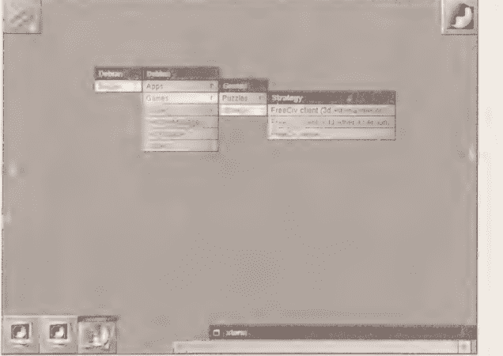

图 10.1

新安装的 Debian 系统上的默认 WindowMaker 根菜单。当你添加新软件包时，菜单会自动更新。

WindowMaker 菜单定义以及程序的其他系统级默认文件都存储在 `/etc/X11/WindowMaker` 目录下。基本的根菜单本身由 `menu.hook` 文件定义。你可以查看此文件以作为复杂的 WindowMaker 菜单定义的示例。但此文件在每次安装新软件包时都会自动重新创建，因此如果你尝试手动编辑它，你的更改很快就会丢失。

更有用的是，`menu.hook` 文件包含强制读取另外两个文件的指令，而 `menu.prehook` 和 `menu.posthook` 则不是自动生成的。正如名称所示，添加到 `menu.prehook` 中的条目将出现在自动生成部分之前，而 `menu.posthook` 条目则紧随其后。作为一个简单的示例，尝试向这些文件中的中添加一个部分，如下所示：

```
Dialup MENU
"Connect (Default)* EXEC pon
"Connect (MyISP)* EXEC pon myisp
"Disconnect" EXEC poff
Dialup END
```

编辑完菜单定义文件后，你将想要从根菜单的 Managers 部分选择 Restart 选项。此示例部分提供了一个用于控制拨号上网连接的简单界面，如图 10.2 所示。

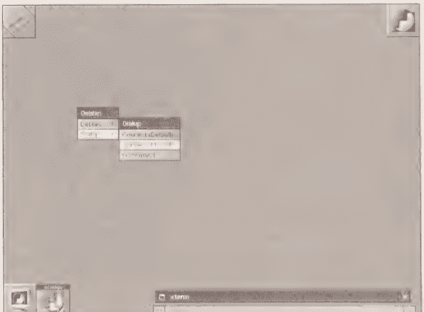

图 10.2

在 `menu.posthook` 中添加几行可以方便地控制拨号连接。

在上例示例中，使用了 WindowMaker 的 `EXEC` 命令来运行你想要的程序。这对于像 `pon` 这样通常不产生任何输出的程序，以及对于打开自己窗口的 X Window 系统应用程序是很好的。但对于设计在文本控制台上运行的程序，简单地这样运行它们将丢失你产生的任何输出。例如，你可能想在 Dialup 菜单中添加一个运行 `fetchmail` 的选项。该程序在检索邮件时会产生进度消息。你可以通过在 xterm 窗口中启动程序来查看该过程。

`Fetch mail` EXEC xterm -T "Fetching mail..." -e fetchmail -a

`xterm` 程序的 `-T` 选项设置窗口标题，而 `-e` 选项指定了在窗口打开后执行的命令。

到目前为止，本章节集中在编辑系统级默认菜单上。你必须使用 root 账户登录才能编辑这些文件，它们会影响系统上的所有 Window Maker 用户。你可能想为每个用户提供一个个人使用的菜单。实现此目的的一种典型方法是在 `menu.posthook` 中添加以下行：

`"Personal" MENU -/.windowmaker.menu`

注意 `~` 是 UNIX 中当前用户目录的简写。`OPEN_MENU` 是一个 Window Maker 命令，与上例中的 `EXEC` 类似，但它允许引导系统指向单独文件中的子菜单。个人用户现在可以创建一个 `.windowmaker.menu` 文件，内容可能如下：

```
"Server" EXEC xterm -T "My server" -e telnet server.my.net
"Info book" EXEC ghostview -~/info-theory
```

## 用户界面工具包 147

图形用户界面由用于与系统交互的通用对象构建。这里列出了最重要的工具包：

- Xt: 一个提供标准小部件（widgets）的工具包。

- Xaw: 一个提供更现代外观的实现。

- Motif: 该工具包曾很一段时间非常流行。然而，它是一个商业产品，限制了它的使用。现在 Debian 包含了一个免费的 Motif 实现。如果你不使用任何 Motif 应用程序，仍然会看到它的影响。

- GTK: 该工具包最初是为 Gimp 包编写的，但后来被 GNOME 桌面环境采用。它在各种开发者中越来越受欢迎。

- Qt: 另一个工具包，其目的是允许创建可以在 UNIX 和 Windows 平台上构建的可移植应用程序。由于它在 KDE 桌面环境中使用，因此非常重要。

## 主题

高度配置的用户界面有一种增长的趋势。“主题”（theme）一词被用来描述为你的桌面提供特定外观的任何配置数据。几年前，这种配置非常有限——如果你能更改配色方案就算幸运了——但今天，某些程序可以重新配置到无法识别。要完全更改 X 显示的外观，你需要重新配置窗口管理器和客户端应用程序。X Window 系统用户一直可以选择窗口管理器，这提供了一种更改显示外观的方法。此外，大多数窗口管理器在不同种程度上都是可主题的。WindowMaker 提供了一个典型的示例：根菜单的 Appearance 选择提供了多种配色方案（根窗口），并且普通的窗口框可以产生相当吸引人的效果。但 WindowMaker 的可配置性与 Enlightenment 窗口管理器提供的（见图 10.4）相比是微不足道。该窗口管理器旨在让几乎一切都是可配置的，如果你有兴趣，可以设计出从标准窗口管理器到科幻怪物的各种主题。

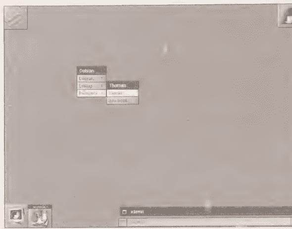

图 10.4

Enlightenment 代表了用户界面配置的极致。

# 第14章 探索 X Window 系统

配置 X 客户端的显示是一个稍微复杂一点。旧的应用程序——特别是那些使用 Xt Motif 工具包的程序——有时可以通过 X 资源机制进行一些配置。可以在 `/usr/X11R/lib/X11-defaults` 目录中查看一些示例。但这种机制通常只允许对颜色方案进行简单更改。

最近，开发者们对在用户界面工具包中添加主题支持产生了兴趣。Qt 和 GTK 的最新版本都提供了对广泛重新配置用户界面组件外观的支持（见图 10.5）。

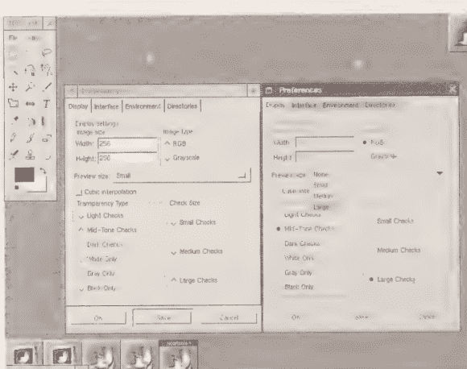

**图 10.5** - GTK（1.2 或更高版本）提供了可配置的部件件样式。

工具包主题确实可以让你的桌面看起来更有趣，但如果你经常使用由不同工具包编写的应用程序，你可能会发现安装主题会导致外观相当混乱。在理想的世界里，所有工具包可能使用单一的机制来配置组件的外观，但就目前而言，避免为不同的应用程序使用冲突的主题是用户的责任。

如果你对配置 X Window 系统的外观感兴趣，有一个网站为所有主要的可主题化窗口管理器和工具包提供了主题库，地址为：http://www.themes.org/

## 未来

X Window 系统有着悠久的历史。它可能比目前使用的任何其他窗口系统都更好地地经受了时间的考验。如今的 X 用户经常忘记了这一点；例如，人们抱怨旧的 Motif 用户界面组件很丑，却没有停下来想起它们最初被设计时，必须在当时仍然常见的单色显示器上是可用的。有一些项目旨在取代 X 成为 UNIX 计算机的主要用户界面系统。在 http://www.berlin-consortium.org 可以找到一个引起了极大关注的开源项目。

然而，全盘否定 X 是非常率莽且为时过早的——它在今天仍然运行良好，许多开发者认为它为未来的发展提供了一个非常强大的平台。像 GTK 等工具包的日益流行，使得 X 界面变得更容易编程，并为终端用户在应用程序的外观和感受上提供了越来越多的选择。

传统 X 服务的较弱方面之一是它们对字体的支持——X 传统上使用简单的位图字体。随着“所见即所得”风格的应用程序在 UNIX 平台上变得越来越常见，高品质的可缩放（即任何尺寸）字体比以往任何时候都更重要。但现在已经可以接入改进的字体支持：`xffst` 软件包提供了对流行的 TrueType 字体的支持。即将发布的 XFree86 4.0 版本应该会提供更好的内置字体支持。

图形显示的底层技术也在发生变化。许多 PC 用户现在拥有的显卡为为渲染 3D 图形提供了复杂的机制。高效地利用这一特性对于游戏程序员以及更严肃的科学技术应用都是至关重要的。编程 3D 应用程序的标准系统是 OpenGL 图形语言。对 OpenGL 编程更好的支持是新 X 服务器版本应该解决的另一个问题。关于 X 服务器开发的更多信息，请尝试这个网站：http://www.xfree86.org。

## 总结

本章研究了 X Window 系统的一些功能。尽管核心 X 技术现在已经相当老旧，但其网络感知和对灵活性的高度强调意味着这个窗口系统仍然极其强大。

本章结束了 Debian 配置的介绍。下一章将提供关于围绕 Debian 系统的用户和开发者社区的更多信息，并包含指向有用 Internet 资源的链接。

# 最后——欢迎来到社区

如果你已经读完了这本书的前 10 章，你现在应该知道如何安装一个基础的 Debian GNU/Linux 系统以及配置许多最重要的子系统。在本章中，你将更详细地查看开发该发行版的开发者组织。还有指向许多 Internet 资源的链接，它们可以帮助你充分利用 GNU/Linux 操作系统。

请记住（安装和包管理系统外），只有少数 Debian 软件包是专门针对 Debian 甚至是 Linux 系统的。事实上，许多关键程序最初是由其他 UNIX 系统的用户开发的——在某些情况下，早在 Linux 内核可用之前。因此，大多数软件包都有几个人负责。软件的原始开发者被称为上游维护者（upstream maintainers）。

如果程序仍在活跃开发，上游维护者通常决定包含哪些新功能以及修复错误。但除非上游维护者恰好是 Debian 用户，否则会有其他人负责对 Debian 程序进行任何修改并构建 Debian 软件包文件。整个过程被称为 Debian 化（Debianization）。在报告错误时，Debian 维护者应该是你的第一个联系人。Debian 维护者的姓名和地址存储在软件包文件中。你可以使用如下命令检查维护者，以及任何已安装软件包的许多其他细节：

```
dpkg -s <packagename>
```

*(注：由于提供的原文文本似乎出现了内容重复或错位，译文已根据“不要重复输出原文”的原则，仅对逻辑有效的段落进行了翻译。)*

# 互联网上的 GNU/Linux 社区 155

本页面链接了一些可能对 GNU/Linux 用户感兴趣的其他主要网站。由于 Linux 用户组成了一个相当具有合作性的社区，相关网站之间往往存在着高水平的链接，这对于普通浏览者来说非常有帮助。除了全球性网站，有些页面还为更本地的用户群体提供服务。著名的例子包括 http://www.linux.org/ 和 http://www.linux.de/

在某些地区，设有本地的 Linux 用户小组（LUGs）——通过网络搜索可能会发现你所在的地区是否存在这样的小组。

还有其他与 Linux 关系较松散的网站。也许最著名的例子是 Slashdot（见图 11.1），这是一个受欢迎的计算和技术新闻网站，在 http://slashdot.org/ 上刊载着 Debian 用户感兴趣的信息和讨论。

该网站最新趣的特性之一是“提问 Slashdot”（Ask Slashdot）板块。虽然这里可能不是询问特定安装困难的场所，但它是讨论更通用 Linux 和 UNIX 问题的良好论坛。

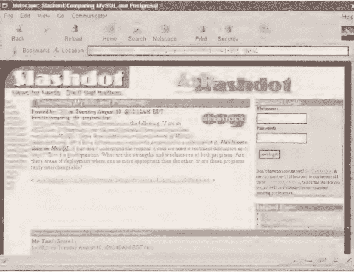

图 11.1

Slashdot 是一个带有 Linux 倾向的流行新闻和讨论论坛。

# 第 11 章：最后——欢迎来到社区

如果你正在寻找特定的软件，或者你想找到生成你喜爱的 Debian 软件包的上游项目，Freshmeat 11.2 是值得关注的地方：http://freshmeat.net/

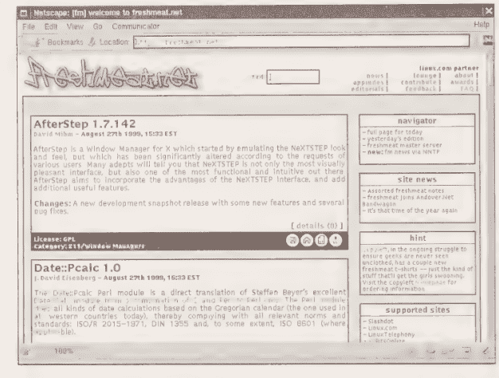

图 11.2

Freshmeat 是一个全面的 Linux 软件新闻网站。

对于更具技术头脑的人来说，还有关于 GNU/Linux 系统许多关键组件开发的资源。例如，Linux 内核本身的开发是通过一个（非常忙碌的）邮件列表进行协调的，意不意外，它被称为 linux-kernel。该列表主要供活跃开发内核或测试前沿开发版本的人士受益。但也有些努力在总结列表上的主要讨论。如果你对内核感兴趣，请查看 http://kt.linux.org/。

许多 GNU 项目工具也有自己的 网站和邮件列表。如果你对其中任何一个感兴趣，请在 http://www.gnu.org/ 网站查找链接。

该网站还包含一些关于自由软件社区开发的有趣观点，因此即使你对特定软件包的开发感兴趣，也值得一读。

最后，请记住，有大量鲜为人知的网站可能包含你对 Debian 或通用 Linux 查询的答案，值得尝试进行网络搜索。至少有一个引擎运营商现在提供了一个特殊的子数据库，用于索引与 Linux 相关的网站，http://www.google.com/linux。

## 报告 Bug

Debian 以稳定、可靠的发行版而闻名。在某种程度上，这种声誉可以归于复杂的 bug 跟踪软件。该软件记录所有的 bug 报告，并跟踪它们的状态，直到软件包维护者宣布它们已修复。Debian 数据库在 Web 上有一个：只需浏览此页面 http://www.debian.org/Bugs。

一旦你到达那里，就可以在文本字段中输入任何 Debian 软件包的名称，并获取与软件包相关的所有未解决 bug 报告的完整列表。

通过电子邮件检索 bug 信息也是可能的，但这通常对软件包维护者更有用。关于 bug 跟踪软件高级用法的文档可以在主页获取。

如果你自己发现了一个 bug，显然你应该报告它。编写良好的 bug 报告涉及某些技巧——问题的描述通常应该是简洁的，但在所有情况下都应该包含足够的信息帮助软件包维护者（或其他人）重现问题。第一阶段是自己进行一些小实验。你能让 bug 再次出现吗？触发问题的最简单命令序列（或输入文件）是什么？

bug 报告以电子邮件消息的形式提交到数据库。你可以通过遵循 bug 跟踪系统的文档手动执行，但通常安装 bug 软件包会更简单。该软件包帮助你以适当格式组装 bug 报告，然后将其发送出去。要使用它，你需要正确设置电子邮件传输系统。bug 报告的 `From:` 行将基于你计算机的邮件名称，这是你自己在安装 exim 系统时设置的。如果你不确定这是一个是否有效的电子邮件地址，可以使用第 8 章“高级配置”中描述的 `EMAIL` 变量。例如


```
export EMAIL=nick@example.com
```

bug 程序将启动一个文本编辑器，以便你输入 bug 的描述。你可能希望将 `EDITOR` 变量设置为你喜欢的编辑器名称。

当你运行它时，它会询问你包含该 bug 的 Debian 软件包名称。它将咨询软件包数据库以确定你正在使用的软件包版本，以及它所依赖的所有软件包的详细信息。然后你会被要求提供 bug 的简短描述。这将构成电子邮件消息的 `Subject:` 行，并显示在 bug 列表中。

最后，程序将启动一个文本编辑器，让你输入 bug 报告的所有剩余信息。在消息顶部，你将看到涉及软件包的一些细节。底部是自动生成的你的系统设置报告。中间留有你输入自己报告的空间。在有疑问时，提供过多的细节比提供过少的要好。对于命令行程序，你可能想要粘贴典型会话的完整转录，显示你输入的所有内容以及程序产生的任何错误信息。记住，如果你正在运行 X 系统，可以通过选择你想插入文本的地方，将文本从一个窗口粘贴到另一个窗口。

当你完成后，保存编辑后的报告并退出编辑器。bug 程序将发送该报告。在报告到达 bug 跟踪系统后，它将被归档，你将收到一个包含 bug 编号的回复。该编号随后被用于跟踪。

# 附录 A

## 内核管理

尽管我们经常谈论它，但 Linux 内核通常非常低调。内核的设计旨在连续运行数月而不需要任何干预，对于普通用户来说，大多数用户可以完全忽略它。但有时升级内核是有帮助的。新版本通常包含对漏洞或安全问题的修复，还可能提供性能改进以及针对最新硬件设备的驱动程序。

然而，在升级到最新的内核发布版本之前，请确保你了解自己正在获取什么。只有稳定内核系列（即使是次版本号——例如 2.2.11）才是供普通用户使用的。开发版内核（例如 2.15）可能不可靠，你通常应该等待下一个稳定系列（2.4.x）。

### 安装内核包

作为 Debian 用户，通常你可以安装作为普通 Debian 软件包提供的预编译内核（名称以 `kernel-image` 开头的包）。由于内核具有特殊角色的地位，`dselect` 不会像升级其他软件包那样自动安装最新版本。但手动选择你需要的 `kernel-image` 包是非常简单的。同时，你可能还想升级其他几个软件包：如果你是程序员，应该安装与你的 `kernel-image` 匹配的 `kernel-headers` 包。依赖 PC 卡设备的笔记本用户应确保 `pcmia-modules` 包也与内核匹配。

当你安装 `kernel-image` 包时，内核本身将安装在 `/boot` 目录下，名称类似于 `vmlinuz-2.2.11`。（z 表示这是一个压缩后的内核文件——某些非 Intel 平台不支持这种内核格式。）

与其他 Debian 软件包不同，安装新内核的过程不会删除旧内核。如果出现问题，降级是很容易的。为了方便起见，`kernel-image` 包的安装脚本维护了一些符号链接：`/vmlinuz` 指向你安装的最新内核，而 `/vmlinuz.old` 指向上一个版本。

`kernel-image` 还打包了一些额外文件。这些包括可加载内核模块（loadable kernel modules），它们是可以动态加载到运行内核中的额外内核代码片段。大部分代码片段都是外设硬件设备的驱动程序。大多数模块安装在它们自己的目录结构中。每个内核版本都有自己的一组模块，例如 `/lib/modules/2.2.11`。

也可以添加未随主内核打包的额外模块。PC 卡驱动程序是最为人知的例子，但某些驱动程序（特别是声卡的）也以这种形式提供。

内核安装后，安装脚本会提供一个生成新的 `/etc/lilo.conf` 并重新安装 Linux 加载程序的选项。如果 Debian 是你机器上唯一的操作系统，这通常是一个明智的选择。但如果你有其他操作系统，生成的 LILO 配置文件将无法让你启动。

安装新内核后的情况基本上与你第一次安装 Debian 时完全相同。一种方法是接受自动生成的配置文件，然后按照第 4 章“基础安装”中描述的，添加用于启动你其他操作系统的部分。另一种方法是在被询问是否要安装新启动系统时回答“否”，并手动修改 `/etc/lilo.conf` 以启动新内核。你可能还想在文件中添加一个额外部分，给你提供启动旧内核文件的选项。例如，如果旧内核是 2.2.7，你可以添加此部分：

```
image=/boot/vmlinuz-2.2.7
label=old
read-only
```

这意味着如果新内核导致了任何问题，你只需要在 LILO 启动提示符处输入 `old` 即可使用旧内核启动系统。

无论你选择哪种方案，请记住在手动编辑 `/etc/lilo.conf` 后，你需要输入以下：

```bash
lilo
```

此命令读取配置文件并重新安装 Linux 加载程序。如果你不这样做，你的更改将被忽略。此规则的例外是你接受了自动生成的配置，在这种情况下，`kernel-image` 安装脚本会自动运行 `lilo`。一旦你对配置满意，可以使用 `shutdown` 命令重启机器，然后测试新内核。如果你想双检查是哪个内核版本，使用以下命令：

```bash
uname -a
```

### 自行其

几年前，几乎所有的 Linux 用户都从源码编译自己的内核。各种发展——特别是外设硬件驱动程序从内核移动到独立加载模块的趋势——意味着今天，大多数用户使用预编译内核就可以了。但如果你有一些标准配置不支持的冷门硬件设备，那么构建自己的内核将是有用的。

还可以获得性能上的提升。通过构建自己的内核，你可以排除不必要的驱动程序，并确保内核针对你正在使用的处理器系列进行了优化。特别是在 Intel 系统上，预编译内核代表了最低公约数，它们可以在从 386 开始的任何设备上运行，但运行速度可能没有专门为利用 Pentium II 优势而优化的内核快。最后，如果你想利用多处理器 PC，你可能需要重新编译内核。标准内核通常只使用一个处理器。你可以通过输入以下命令检查是否启用了多处理器支持：

```bash
uname -a
```

检查内核版本是否包含 SMP（对称多处理）字母。SMP 在单处理器计算机上运行良好，但由于多个处理器之间的相互干涉，可能会产生轻微的性能损失。

构建新内核可以采取两种略有不同的方法。传统方法使用标准的 Linux 工具并留下内核文件。Debian 提供了一种替代方案：`kernel-package` 提供了一组允许你构建自己的内核的脚本。如果你正在使用 `kernel-package`，可能就不应该手动传统方法。

#### 编译先决条件

在开始之前，你需要安装所有的开发工具——特别是 C 编译器 (`gcc`) 和 `make`。你还需要：

- `kernel-package`（通常不在光盘上——请从归档下载）
- `fakeroot` 命令
- `tcl` 和 `tk`——图形化配置界面

可选的内核版本可以在 Debian 归档中找到，名称以 `kernel-source` 开头。注意，这些位于二进制软件包旁边，而不是源码部分。如果你安装了这些软件包之一，它会将内核源码作为 .tar.gz 文件安装在 `/usr/src`。或者，你可以从官方网站下载：

http://www.kernel.org/

`kernel.org` 站点有很多镜像，如果可以请使用附近的站点。然后你需要解压内核源码。例如：

```bash
tar xf /usr/src/kernel-source-2.2.11.tar.gz
```

传统上将 Linux 源码放在 `/usr/src/linux` 目录，但如果你正在使用 `kernel-package`，可能就不应该。编译内核不需要 root 登录。

#### 配置内核

如果你的内核源码是以 Debian 包形式提供的，它将解压在 `kernel-source-<version>` 目录下。来自其他站点的内核源码通常留在 `linux` 目录下。无论哪，进入该目录并输入以下：

```bash
make xconfig
```

会有短暂的延迟，然后窗口化内核配置界面将启动。如果你不需要 X Window 系统界面，也可以尝试

```bash
make menuconfig
```

它提供了一个类似于 Debian 安装程序的控制台界面。如果你认为即使这样也过多，仍然可以通过输入以下命令使用旧文本配置系统：

```bash
make config
```

在任何情况下，你都应该系统地检查这些选项。选项非常多，但大部分只是针对特定硬件设备的驱动程序——你应该清楚地知道这些是否适用于你的电脑。如果不确定，尝试在线帮助：大多数重要的内核选项在那里都有详细文档。一些最关键的选项在 Kernel-HOWTO 文档中也有。

# Linux 内核配置

| 模式成熟度选项 | IrDA 子系统 | 分区类型 |
|---|---|---|
| 处理器类型和特性 | | |
| 可加载模块支持 | ISDN 子系统 | 控制台驱动程序 |
| 通用设置 | | |
| 即插即用支持 | 网络设备支持 | |
| 块设备 | y n 3COM 卡 | 帮助 |
| 网络选项 | y m 3501 支持 | 帮助 |
| SCSI 支持 | y m 3503 支持 | 帮助 |
| SCSI 低级驱动程序 | y m 3505 支持 | 帮助 |
| 网络设备支持 | | |
| 业余无线电支持 | | 上一个/一个 (Next Prev) |

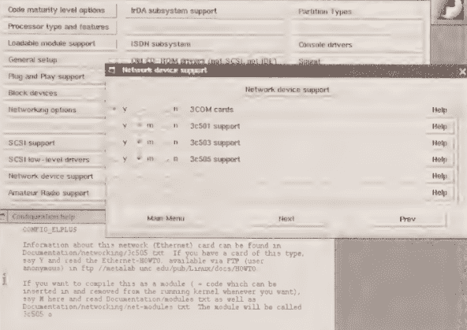

图 A.1

xconfig 内核配置界面。

对于许多内核选项（尤其是驱动程序），你会有三个选择：yes（是）、no（否）或module（模块）。选择 yes 将将该组件作为内核的标准部分构建。另一方面，选择 module (m) 会编译一个可加载的内核模块，该模块将在需要时自动添加到运行的内核中。模块化内核可以在只在需要时加载很少使用的驱动程序的情况下节省少量内存；如果你想为几台具有不同硬件配置的机器构建单一内核，模块化是一个好主意。

某些用户倾向于单体内核（无模块）的简单性。如果你对内核进行模块化，请记住这些模块在内核运行时需要从磁盘加载。因此，将硬盘控制器驱动程序或 ext2 文件系统模块化可能是一个坏主意。另一方面，模块化网络驱动程序通常是安全的。完成后，点击“保存并退出”（Save and exit）。最后，输入以下命令：

```
/usr/sbin/make-kpkg clean
```

此命令清除内核源码目录中的任何临时文件。现在你准备好编译你的第一个内核了。

#### 创建内核包

如果你正在使用 `kernel-package` 系统，可以使用单个命令构建内核（以及任何模块）。例如：

```
fakeroot /usr/sbin/make-kpkg --revision=mysystem.1.0 kernel_image
```

# 附录 A：内核管理

注意 `fakeroot` 命令的使用。它并不是 `kernel-package` 系统的一部分，但它是一种通用机制，允许某些通常需要使用 root 权限的程序（包括 make -kpkg 系统的部分）由普通用户运行。通过避免使用 root 账户，可以确保程序发生故障时重要的系统文件不会受到损坏。实际上，`kernel-package` 可能被认为是相当可靠的，因此在有可行替代方案时避免以 root 登录是一个良好习惯。

`--revision` 选项用于命名你自己编译的 `kernel-image` 包，使其与从相同内核源码构建的官方 Debian 包区分来。`make -kpkg` 命令接受的所有选项完整列表包含在 `/usr/doc/kernel-package` 目录下的文件中。

Linux 内核是一个庞大的软件，即使在快速的 PC 上编译它也需要几分钟。内核完成后，编译过程将返回编译你已模块化的任何内核组件。最后，内核、其模块以及一些 Debian 安装脚本将一起打包在一个 .deb 文件中，放在包含你内核源码目录的父目录中。如果你进行任何编程并依赖 `kernel-headers` 包，你应该构建一个与你刚刚构建的 `kernel-image` 匹配的包。例如

```
fakeroot /usr/sbin/make-kpkg --revision-mysystem.1.0 kernel_headers
```

当你构建好内核包后，可以安装它们（使用 root 权限）；在使用 `dpkg` 时（在这种情况下）不会使用 `fakeroot`：

```
dpkg -i kernel-image-2.2.11_mysystem.1.0_i386.deb
```

除了所使用的精确配置外，此 `kernel-image` 包将与 Debian 存档中的包完全相同。你将看到相同的安装脚本，它们为你提供了创建一个新的 `/etc/lilo.conf` 的机会。这是你构建的第一个内核，你可能想在 `/etc/lilo.conf` 中添加一个额外的条目，以便访问旧的（已测试的）内核，以防所选配置出现严重问题。

# 索引

# 符号

- - & 字符, 85
- *** (包状态符号), 71
- ** (包状态符号), 71
- —* (包状态符号), 71
- -query 选项, 144
- .. (相对路径字符), 120
- / 绝对路径字符, 120
- 命令行解释器, 136
- / 目录, 33

# A

- AbiSource 网站, 107
- AbiWord, 107-108
- 绝对路径，链接, 120
- 访问数字, 94-95
- 用户账户, 91-93
- `addgroup` 命令, 92
- IP 地址, 53
- 关关, 53
- 私有网络, 54, 131-132
- `adduser` 命令, 124
- 管理包, 100
- 高级 Linux 架构 (ALSA) 项目, 22
- Alpha/AXP 架构, 14
- ALSA (Advanced Linux Sound Architecture) 项目, 22
- And 字符, 85
- `apache` 工具, 69, 111
- Java 程序 (applets), 115
- `apt` 工具, 65, 67
- 架构, 14-15, 44
- 存档, 62-64
- ARM 架构, 15

# ATAPI CD-ROM 驱动器, 17, 44

- Athlon 处理器, 12
- 登录认证
- 远程, 133

# B

- Balsa 邮件客户端, 88
- 基础包, 100
- 基础系统，安装, 54-55
- Berlin Consortium 网站, 151
- `bind` 目录, 34
- DNS `bind` 包, 123
- `bind` 工具, 69
- BIOS, 13, 60
- 端口 (JDK), 115
- `blender` 包, 110
- `/boot` 目录, 34, 161
- 启动固件
- 启动, 31
- 从软盘启动, 45-46
- `init` 程序, 117-120
- 守护进程, 117
- 链接, 119
- 挂载磁盘, 118
- 运行级别, 119
- 独立运行, 111
- 重启, 55
- c, 44
- 子系统, 46
- 开始, 48
- 故障排除, 58

## Debian 维护者

- Debian 维护者，政策手册, 154
- Debian 周报 (Debian Weekly News) report, 154
- `debian-dev` 邮件列表, 159
- Debian 化的 (Debization), 153, 159
- 安装默认值, 43
- 拒绝服务 (DoS), 139
- 桌面环境, 1
    - CDE (通用桌面环境), 88
    - GNOME, 88-89
    - KDE, 89-91
    - X Windows 系统, 87-88
- 开发包, 100, 115
- 软件开发软件, 153, 159


- Debian 系统化 (Debianization), 153, 154

- 政策手册, 154

- 上游维护者, 153

- 开发内核, 161

- 诊断。参见 故障排除

- 数字用户用户回路。参见 xDSL

- 直接

    - `bin`, 34

    - `boot`, 34, 161

    - `contrib` (贡献), 63-64

    - `dists`, 62

    - `/etc`, 34

    - 层级结构, 33, 35

    - `home`, 34

    - `/lib`, 34

    - `main`, 63

    - 挂载点, 33

    - 非自由 (non-free), 63-64

    - `root`, 33

    - `sbin`, 34

    - `/usr`, 34

    - `/var`, 34

- 磁盘分区挂载, 118

- 磁盘空间需求, 16

- 磁盘

    - 软盘

    - 启动 Debian, 45-46

    - 创建启动软盘, 55

    - 分区, 49

    - 格式化, 50

    - 交换分区, 50

- `DISPLAY` 环境变量, 142

- 显示硬盘几何结构, 31

- 显示器，X 客户端, 141-143

- 色深, 144

- `enlightenment`, 149

- `gimp`, 148

- `GNOME`, 148

- `GTK`, 148

- GUI 工具包, 147-148

- `KDE`, 148

- `lessiff`, 148

- 菜单, 145, 147

- `Motif`, 148

- 多路, 143-145

- 远程, 144-145

- 主题, 149-150

- X 终端, 144

- `naw`, 148

- `xdm`, 144-145

- `xfig`, 148

- `Xt`, 148

- `term` 程序, 147

- 发行版 (of Debian)。参见 软件包

    - 优势, 1, 3-4

    - 存档结构, 62

    - 代号, 62

    - 比较, 4-5

    - 历史, 5-7

    - 镜像, 44

    - 发布周期, 2-3

    - 软件

    - 子发行版, 63-64

    - 标准版, 100-101

    - `tar` 存档, 74

- `dists` 目录, 62

- DNS (域名服务), 53, 122-123

- 文档包, 100

- 文档, 99。参见 帮助

- 配置文件, 79-80

- 软件开发，政策手册, 154

- 域名服务 (DNS), 53, 122-123

- DoS (拒绝服务), 139

- 内核降级, 162

## files 171

- 下载

    - 内核源码, 164

    - 软件，非美国站点, 64

- `dpkg` (包管理器), 3

- `dpkg` 命令, 166

- `dpkg` 工具程序, 65

- `dselect`, 3, 56, 65, 78-79

- 依赖解析, 71-72

- 安装软件包, 69-70

    - 来自 CD-ROM, 67-68

    - 通过网络, 68-69

    - 软件包选择, 69-71

    - 设置包源, 67

    - 开始, 66

    - 更新选项, 69

- 升级, 72-73

- 创建双启动系统, 36

- DVD-ROM 驱动器, 17

- 环境变量, 106-107

- PPP 连接的错误消息, 124

- 错误。参见 缺陷

- `/etc` 目录, 34

- `et/fstab`。参见 `fstab`

- `/etc/hosts` 文件, 132

- `/etc/lilo.conf` 文件, 57, 162-163

- 以太网网络, 22, 53

- `EXEC` 命令 (WindowMaker), 146

- `ex`, 111

- `exim` 程序, 69, 125-126

    - 邮件名称, 126

    - 队列, 126

    - 实时黑洞列表 (Real time Blackhole List), 125

    - 智能主机, 125

- 扩展设备, 18-19

- 以太网适配器, 22

- 显卡, 21

- ISA 卡, 19-20

- 调制解器器 22-23

- PC 卡, 20

- 扫描仪, 23-24

- SCSI 命令, 21-22

- 声卡, 22

- `ext22` 文件系统, 29

- `ext33` 文件系统, 30

- 扩展分区, 39

- 外部模型, 22

- 编辑器, 106

- 编辑器, 100

- `emacs`, 78

- `emacs.text`, 78, 101

- `emacs.`, 101-102

- 缺陷包, 157

- 变量, 78-102

- 环境变量, `DISPLAY`, 142

- 电子邮件系统, 104-107

- 电子产品, 101

- `emacs` 编辑器, 78, 101

- 安装, 78-79

- 环境变量, `DISPLAY`, 142

- 电子邮件系统, 104-107

- 电子设备, 101

- `emacs` 编辑器, 78, 101

- 安装, 78-79

- 环境变量, `DISPLAY`, 142

- 电子邮件系统, 104-107

- 电子设备, 101

- `emacs` 编辑器, 78, 101

- 安装, 78-79

- 邮件, 104

- `balsa` 客户端, 128

- `exim.`, 125-126

- `fetching`, 127-128

- `procmail`, 128

- 报告缺陷, 157

- `sending`, 125

- `sendmail`, 125

- 智能主机, 125

- SMTP, 125

- 按钮 选项, 83

- `enlightenment`, 149

- `fakeroot` 命令, 166

- FAT 文件系统, 69

- `fetchmail`, 127-128

- FHS (文件系统层级), 34

- 文件扩展名

    - `.deb`, 62

    - `.rpm`, 74

    - `.tar.gz`, 74

    - `.tgz`, 74

- 文件系统，挂载, 128-130

- 文件名，硬链接, 120

- 文件配置, 77-80

- `/etc/hosts`, 132

- `/etc/lilo.conf`, 57, 162-163

- `stab`, 129-130

- `localhost`, 132

- `menu.hook`, 146-147

- `menu.posthook`, 146-147

- `menu.prehook`, 146-147

- 客户端, 135

- 挂载, 135

- 安全性, 135

- 服务器, 135

- UIDs, 135

- 权限, 93-94

- 所有权, 93-94

- `tar` 存档, 74

- Windows, 136

- `Xauthority`, `xsession`, 86-87

- `Ghostscript`, 95-97

- `glibc`, 114

- `glibc 2`, 114

- `ngmc`, 88

- `GNOME`, 88-149

- `gnome-apt` 工具, 65

- GNU 编译器集合 (GCC), 113

- GNU Emacs, 102

- GNU 图像处理程序 (Gimp), 6, 82, 110

- GNU 内核 (HURD), 7

- GNU 项目 (软件基金), 6, 156

- GNU WindowMaker, 145-147

- `gojbc`, 113

- Google 站点, 157

- GPL (通用公共许可证), 8

- `gpm` 工具程序, 69

- 图形登录界面, 91

- 图形用户界面。参见 GUIs

- 文件系统层级标准 (FHS), 34

- 文件系统

    - `ext2`, 29

    - `ext3`, 30

    - FAT, 29

    - ISO 9660, 29

    - `reiserfs`, 30

    - 虚拟, 33

- FIPS (非破坏性分区)程序, 37

- 防火墙, 112, 137

- Firewire (IEEE 1394) 接口, 25

- 软磁盘

    - 启动 Debian, 45-46

    - 创建启动软盘, 55

    - 字体, `xftst`, 151

- FOOF 缺陷, 6

- 格式化

    - 语言，文本, 108-109

    - 分区, 50

- `free` 命令, 16

- 自由软件, 6-10

- Freshmeat 站点, 99, 156

- 冻结版本, 2

- FTP (文件传输协议), 134

- `gimp`, 148

- `GNOME`, 148

- `GTK`, 148

- `KDE`, 148

- `lestif`, 148

- `Motif`, 148

- `Qt`, 148

- `Xaw`, 148

- 格式化, 40

- 分区方案, 35

- 多分区优势, 35

- 主分区, 28

- 交换空间, 33

- 图形应用程序, 110

- 显卡, 21

- 组 ID, 92

- 组所有权, 92

- GUIs

- 工具包, 147-148

- `Xaw`, 148

- `xfig`, 148

- `Xt`, 148

- 系统, 12-13

- CD-ROM 驱动器, 17

- DVD-ROM 驱动器, 17

- 扩展设备, 18-19

- 以太网适配器, 22

- 显卡, 21

- 调制解器, 22-23

- PC 卡, 20

- 扫描仪, 23-24

- SCSI, 21-22

- X 服务, 82-85

- 安装, 81-82

- 设置, 80-81

- 开始会话, 85-86

- X 会话脚本, 86-87

- Firewire (IEEE 1394), 25

- 红外数据 (IrDA), 25

- 设置, 80

- USB, 24-25

- `gun`, 110

- `gzip` 工具程序, 74, 99

- 硬盘

    - 柱体, 30

    - 几何结构, 30-31

    - 头部, 30

    - IDE 控制器, 28, 31

    - 日志, 30

    - 为 Debian 留空间, 36

    - 分区, 28-29, 38, 49

- `cfdisk`, 38, 40

- `fdisk`, 38

- 格式化, 20

- ISA 总线, 13

- 多处理器机器, 12

- 笔记本电脑, 14

- 旧机器, 12

- 处理器

    - 架构, 14-15

    - Athlon, 12

    - 克隆版, 12

    - 要求, 12

- 支持, 113

- Debian 首页, 54

- Debian 周报, 154

- Freshmeat 站点, 99, 156

- 启动

    - 软盘, 45-46

    - 救援系统, 44-45

    - 启动, 46-48

    - Google 站点, 157

    - -kernel Linux.com 站点, 154

    - Linux.de 站点, 155

    - Linux.org 站点, 155

    - LUGs (Linux 用户组), 55

    - 邮件列表, 154

    - `debian-dev`, 159

    - `linux-kernel`, 154

    - `lur`, 156

    - Slashdot 站点, 155

- 启动, 53-54

- 内, 50-52

- 内核包, 116

- 内核, 111

- `/boot` 目录, 111

- `/etc/lilo.conf`, 57, 162-163

- LILO 实例化, 162

- 可加载内核模块, 162

- 升级现有软件包, 162

- 媒体, 43-44

- 网络连接, 52-54

- 非 Intel 安装, 44

- 重启后, 55

- 重启准备工作, 55

- 启动, 46-48

- 故障排除, 59-60

- 层级结构, 33-35

- 主目录, 34

- 主页。参见 站点, 147

- 主机名, 52

- HOWTOs, 99

- HURD (GNU 内核), 7

- IDE 控制器, 28

- IDE 硬盘限制, 31

- ID, 92

- IMAP 服务器, 111

- `inetd` 网络, 132

- 红外数据 (IrDA) 接口, 25

- `init` 网络, 132

- `init` 程序, 117-120

- 守护进程, 117

- 链接, 119-120

- 运行级别, 118-119

- 独立系统, 119

- 子系统, 118-119

- 安装

    - `emacs.` 78-75

    - 来自源码, 72

    - 软件包, 69-70

    - 分发版标签, 68

    - 来自 CD-ROM, 67-68

    - 通过网络, 68-69

    - 软件包选择, 69-71

    - 设置包源, 67

    - 更新, 69

    - 无 `dselect`, 73-74

- X Windows 系统, 81-82

- Intel, 非 Intel 安装, 44

- Intel ia64 架构, 15

- 接口

    - Firewire (IEEE 1394), 25

    - 红外数据 (IrDA), 25

    - 设置, 80

    - USB, 24-25

- X Windows 系统

    - 配置 X 服务, 82-85

    - 安装, 81-82

    - 设置, 80-81

    - 开始会话, 85-86

    - X 会话脚本, 86-87

- 初始化 Linux 分区选项, 50

- 安装, 43

- 架构, 44

- 系统, 54-55

- 内部调制调器, 23

- 内核包, 163, 165

- Internet。另见 networks

- `make-pkkg` 命令, 166

- 应用程序, 102

- 性能优化, 163

- 邮件客户端, 104-107

- 前提条件, 163-164

- Web 浏览器, 103-104

- 选择配置选项,

- 域名解析服务 (DNS), 53, 164-165

- 安全, 112

- 解压内核源码, 164

- 服务, 111-112

- `bzimage` 格式, 59

- Web 浏览器, 103-104

- 开发, 161

- xDSL, 124

- 降级, 162

- 解释型语言, 115

- HURD (GNU 内核), 7

- 解释器, 101

- 安装, 50-52, 161

- 无效压缩格式错误, 59

- `/boot` 目录, 161

- IP 地址, 53

- 配置 `/etc/lilo` 文件, 162-163

- 关关, 53

- 私有网络, 54, 131-132

- LILO 重装, 162

- IP 伪装, 139

- `ipchains`, 139

- 软件包, 161

- `ipfwadm` 包, 138

- 内核镜像包, 161-162

- IrDA (红外数据协会)接口, 25

- Linux 存档网站, 164

- Linux 内核邮件列表, 156

- ISA 总线, 13

- Linuxcare 网站, 156

- ISA 卡, 19-20

- 单体内核, 156

- ISDN, 124

- SMP (对称多处理), 163

- ISO 9660 文件系统, 29

- ISP (互联网服务供应商), 账户数量, 122

- 稳定, 161

- `zImage-image` 包, 59

# J

- 内核镜像包, 119, 192

- 日本, 116

- 键盘

- Java, 115-116

- 配置, 83

- JDK (Java 开发工具包), 115

- 映射, 49

- Joe 文本编辑器, 102

- Illustrator, 110

- 日志记录, 30

- KOffice 项目, 110

# K

- `kaffe` 包, 116

- 语言

- `KDE`, 89-91, 148

- 解释型, 115

- `kdm`, 91

- Java, 115-116

- 内核, 5, 161

- 文本格式化, 108-109

- 构建

- 编译过程, 166

- LaTeX, 108-109

- 配置, 164-165

- `lessif`, 148

- 下载内核源码, 143

- `/lib` 目录, 34

- `dpkg` 命令, 166

- `libc`, 114

- `fakeroot` 命令, 166

- `libjpeg` 库, 113

- 硬件支持问题, 163

- 库 (代码), 113-114

- `glibc`, 114

- `glibc`, 2, 114

# 库

- `libpeg`, 113

- 标准 C, 114

- 许可

- BSD, 8

- 自由软件, 7-10

- GPL (通用公共许可证), 8

- LILO (Linux 载入程序), 55

- `/etc/lilo.conf` 文件, 162-163

- 配置, 57

- 重启后, 55-56

- 重启准备, 55

- 重新, 162

- 逻辑块寻址 (LBA), 31

- 逻辑分区, 39

- `nout` 包, 109

- Lout 系统, 109

- IP 打印队列, 137

- `lpd` 打印守护进程, 136

- `lpg` 命令, 95

- `lpr` 命令, 96

- `lpr` 包, 95

- `lpr` 打印后台处理管理器, 136

- `ls -a` 命令, 78

- LUGs (Linux 用户组), 155

- 潜水 (邮件列表), 154

- `lynx`, 104

- `lyx`, 109

- 路径, 120


# M

- 运行级别, 119-120
- 符号
- 创建, 120
- 内核镜像包, 162
- 关机命令, 119

## M

- 魔法饼干, 142
- `magicfilter` 包, 96-97
- 邮件客户端, 104-107
- 邮件传输代理 (邮件), 127
- 邮件名称, 126
- 邮件队列 (邮件), 126
- 邮件传输代理。另见 MTA
- 邮件，电子。另见 email
- 邮件列表, 154
  - `debian-devel`, 159
  - `linux-内核`, 156
  - 潜水, 154
- 主目录, 63
- 主菜单, 安装, 49
- Linux 发行版, 7
- 用户友好性, 1
- Linux 内核网站, 164
- Linux 载入程序。另见 LILO
- Linux 笔记本网站, 114
- Linux 用户组 (LUGs), 155
- Linux-IRDA 项目网站, 25
- `linux-内核`邮件列表, 156
- Linux.com 网站, 154
- Linuxcare 网站, 156
- Linux 网站, 156
- 可加载内核模块, 162
- 领先 Linux, 163
- 本地主机, 132
- 维护者
- `make-kpkg` 命令, 166
- 映射, 49
- 数学, 101
- 媒体, 安装, 43-44
- 交换, 32-33
- 查看, 16
- 内存检查, 60
- 杂项包, 101
- `mkisos` 工具, 29
- 调制调器, 22, 132
- 挂载命令, 128-130
- 挂载点, 33
- 文件系统, 128-130
- 分区, 39
- 根分区, 50
- MTA (邮件传输代理), 125
  - `exim`, 125
  - 邮件名称, 126
  - 队列, 126
  - 实时块列表, 126
  - 智能主机, 125
  - `sendmail`, 125
- 多用户机器, 36
- 多处理器机器, 12
- 用户能力, 91-93
- 用户模式, 120

# N

- 设备, 28
- 主机名, 52
- 网络包, 101
- 子网掩码, 53
- Netscape , 103-105
- Netscape Navigator, 103-104
- 网络文件系统。另见 NIS
- 信息服务。另见 NIS
- 连接, 安装 52-54
- 文件, 136
- 防火墙, 137
- FTP, 134
- 关关, 138
- `inetd`, 132
- 初始化, 132
- 阻塞的软件包, 68-69
- IP 伪装, 137
- `ipchains`, 139
- `ipfwadm` 包, 138
- 开启日志, 133-134
- NFS, 134-136
  - 客户端, 135
  - 挂载, 135
  - NIS, 136
  - 安全, 135
  - 服务器, 135
  - UIDs, 135

# O

- 非自由目录, 63-64
- 数量，文件访问, 94-95
- 优化内核, 163
- 旧 PC, 14

# P

- 基础, 3, 61-62, 99-101
- 绑定, 123
- 组件, 61
- 规范, 62
- 依赖, 71-72
- 开发, 100
- 文档, 99
- 编辑器, 100-102
- 电子设备, 101
- Freshmeat 网站, 99
- 游戏, 101
- 图形, 110-111
- 硬盘分区, 28-29, 38, 49
  - `cfdisk`, 38, 40
  - `dfdisk`, 38
  - FIPS 分区分割工具, 37
  - 格式, 50
  - 分区格式化, 40
  - 为 Debian 留空间, 36
- `ppp` 包, 121-122
- `ppconfig` 程序, 121-124
- 主分区, 28
- 打印队列 (lp), 137
- 打印, 95-97
- 多重分区优势, 35
- 分区方案, 35-36
- 密码，根账户, 55
- 补丁, 6
- 路径链接, 120
- PC 卡, 20

# X

- 会话脚本, 86-87
- `xdm`, 91
- `xfig`, 148
- `xfsts`, 151
- `xserver-common`, 82
- `xterm`, 82

## 180 个程序

- 独立程序, 119
- 子系统, 118-119
- `ipchains` 程序, 139
- `pppconfig`, 121-122
- `procmail`, 128
- `scp`, 134
- `sendmail`, 125
- `ssh`, 143
- `telnet`, 133
- `term`, 147
- RPM 工具, 74
- 运行级别
  - `init` 程序, 118
  - 链接, 119-120
  - 多用户模式, 120
  - S (单用户模式), 119

## S

- S 运行级别 (单用户模式), 120
- Samba, 112, 137
- SANE 网站, 23
- `sbin` 目录, 34
- 扫描仪, 23-24
- `scp` 程序, 复制文件, 134
- 屏幕分辨率, 84
- 提示符，文本终端登录, 77
- 协议
  - FTP, 134
  - NFS, 134-136
    - 客户端, 135
    - 挂载, 135
  - NIS, 136
  - 安全, 135
  - 服务器, 135
  - UIDs, 135
  - PPP. *参见 PPP*
- SMB, 136
- 脚本
  - 创建子系统, 118
  - 初始化, 117-120
  - 守护进程, 117
  - 链接, 119-120
  - 挂载磁盘分区, 118
  - 运行级别, 118-119
  - 独立, 119
  - 子系统, 118-119
  - X 会话, 86-87

## Python, 115

## Q-R

- Qt, 148
- 邮件队列,126
- 实时黑洞列表 (Real time Blackhole List), 126
- 重启, 55
- 重启后, 55-56
- 符号链接, 119
- 红帽 Linux (Red Hat Linux), 4
- `reiserfs` 文件系统, 30
- 相对路径, 120
- 报告 漏洞, 157-159
- 需求
  - 磁盘空间, 16, 32
  - 硬件, 122
  - 内存, 16, 32-33
  - 救援系统, 44-45
  - 屏幕分辨率, 84
- `rlogin` 命令, 133
- `root` 账户，设置密码, 55
- 根目录, 33
- X Windows root 菜单, 145
- `root` 分区，挂载, 50
- `.rpm` 扩展, 74

## SCSI

- 卡片, 22
- CD-ROM, 17
- 硬盘, 28
- 搜索，Google 网站, 157
- 第二扩展文件系统 (ext2), 29
- 扇区 (硬盘), 30
- 安全, 3
- 防火墙, 137
- 登录
  - 认证证书, 133
  - 远程, 133-134
  - 多分区, 35
  - 登录, 129-140
    - DoS, 13
    - `ssh`, 140
    - NFS, 135
  - 所有权, 92-94
  - 权限, 93-94
- 客户端
  - agic cookies, 142
  - `ssh` 程序, 143
- `su` 命令, 143
- SANE, 23
- `xauth` 命令, 142
- SGI, 13
- `.Authority` 文件, 142
- Slashdot, 155
- `xhost` 命令, 142
- `xfree86`, 151
- `sendmail` 程序, 125
- 骨架脚本，创建, 118
- 消息消息块 (SMB), 112
- 草图, 110-111
- 服务器
  - Slack Linux, 5
  - Apache, 111
  - Slashdot 网站, 155
  - IMAP, 111
  - 从属设备, 208
  - 网络：智能主机, 125
- `inetd`, 132
- SMB (服务器消息块), 112, 136
- `init`, 132
- `smblenient`, 打印, 137
- 互联网 (Internet), 132-133
- SMP (对称多处理), 163
- `telnetd`, 132
- SMTP (简单邮件传输协议), 125
- 软链接。符号链接
  - NFS, 135
  - 99-101. 另见编程
- 打印机, 136
- 工具
  - 管理, 100
  - X 显示, 80
  - 基础, 100
  - 会话管理器, 87
- 漏洞包
  - `setgid`, 94
  - 报告漏洞, 157-159
- 配置
  - 文本编辑器, 157
  - `sfitt`, 151
  - 漏洞跟踪, 157
  - SGI 网站, 13
  - `comm`, 100
  - 命令, 58, 119
  - Debian 存档, 62-64
  - 关机, 58
  - Debian 化, 153
  - 简单邮件传输协议 (SMTP), 125
  - 软件包, 78-79
  - `devel`, 100, 115
  - 单用户模式, 120
  - 开发, 153-154
  - 网站 (Web), 154
  - 文档, 99
  - ALSA, 22
  - Berlin 联盟, 151
  - Debian 漏洞数据库, 157
  - Debian 周报, 154
  - 自由软件基金, 6
  - Freshmart 网站, 99, 156
  - GNU/自由软件基金 网站, 157
  - Linux 内核存档, 164
  - 笔记本上的 Linux, 14
  - Linux-IrDA, 25
  - Linux.com, 154
  - Linux.de, 55
  - Linux.org.uk, 155
  - Linux 内核包, 163-165
  - Linux 维护, 156

## 182 软件

- 库, 101
- 魔法过滤器, 96-97
- 数学, 101
- 网络, 101
- 新闻, 101
- 生产力应用, 107
- 电子表格, 109
- 文字处理器, 107-108
- Shell, 101
- 声音, 101
- `tex`, 101
- 上游维护者, 153
- 工具, 101
- 网页, 101
- `x11`, 101
- 独立工作站，`init` 程序, 119
- 标准 C 库, 114
- 标准发行, 100-101
- 启动, 46-48
- `startx` 命令, 85
- `su` 命令, 143
- 子系统创建, 118
- `init` 程序, 118-119
- `mountall` (init 程序), 118
- 运行级别，链接, 119-120
- 支持硬件, 163
- SuSE Linux, 5
- 交换分区，激活, 50
- 交换 (内存), 32-33
- 关闭, 58
- 符号链接 (symlinks), 120
- 对称多处理 (SMP), 163

# T

- `tar` 存档, 74
- `tar` 命令, 164
- `.gz` 文件扩展, 74
- `tcl` 软件包, 115
- `telinit` 命令, 119
- `netcommand`, 133
- `telnetd` 程序, 132-133
- `tetex`, 108
- TeX, 108-109
- `tex` 软件包, 101
- 文本编辑器, 78, 101-102
- 漏洞包, 157
- `emacs`, 101-102
- `vi`, 101-102
- 文本格式语言, 108-109
- 终端登录提示符, 77
- `tgz` 文件扩展, 74
- 主题，X 客户端, 149-150
- 三按钮时, 83
- 时间 (系统时)，更改命令, 55
- 时区文件 (UNIX)，基础系统安装, 54
- Torvalds, Linux, 5
- 玩具总动员, 63
- 声卡, 22
- 音频包, 101
- 源码，内核, 164
- 源码安装, 75
- 源列表, 68
- 备用架构, 15
- 内核速度优化, 163
- SMP (对称处理), 163
- `ssh` 命令, 133-134
- `ssh` 程序, 64, 140, 143
- `sh-keygen` 命令, 133
- 稳定内核, 161
- 稳定版本, 2
- 跟踪漏洞, 157
- `tr` (硬盘), 30
- 故障排除。另见帮助
- 漏洞
  - 漏洞包, 157-159
  - 漏洞跟踪软件, 157
  - 报告漏洞, 157-159
- Debian 数据库, 157
- 安装, 59
- 启动功能, 59-60
- 启动镜像, 59
- 启动参数, 59
- TrueType 字体, `xfsti`, 151

# U

- UIDs (用户 ID), 92, 135
- `umask` 命令, 34
- 通用串总线 (USB) 接口, 24-25
- UNIX 时区配置文件, 54
- 不稳定版本, 2
- 升级, 72-73
- 上游维护者, 153
- 通用串总线 (USB) 接口, 24-25
- 用户账户, 91
- 用户 ID (UIDs), 92, 135
- 用户所有权, 92
- 用户, 143

# 它来了！

你所请求的 IT 网站...

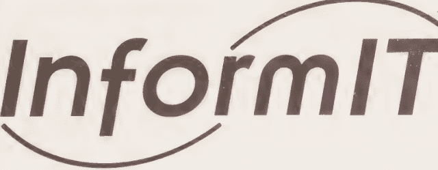

InformIT 是一个完整的在线库，为 IT 专业人士、学生和企业用户提供信息、技术、参考、培训、新闻和观点。

# 在此处寻找 IT 解决方案！

`www.informit.com`

# 在安装 CD-ROM 之前请阅读

# 光盘中包含的内容

随附的 CD-ROM 包含 Debian GNU/Linux 操作系统。

# Debian 安装说明

将随附的 CD-ROM 系统。重启电脑，Debian 将会自动运行。然后按照 Debian 安装说明进行。

如果你的系统无法从 CD 启动，还有其他选项：

1. 启动带有 CD 驱动程序的 DOS，然后从第一张光盘的 `\install` 目录运行 `boot.bat`。
2. 使用第一张光盘上 `\dists\slink\main\disks-i3862.1.9-1999-03-03` 目录中的镜像制作启动软盘。该目录下的程序 `rawwrite2.exe` 将会在 DOS 下写入软盘镜像。
3. 接下来切换到正确的 CD-ROM 驱动器。
4. 接下来使用 `cd d: \dists\main\disks-i3862.1.9-1999-03-03\rawwrite2 -f resc1440.bin -d a:` 将程序 `rawwrite2.exe` 提取到软盘驱动器。

## 注意

`d:` 是你的 CD-ROM 驱动器，`a:` 是 1.44MB 软盘驱动器。

5. 更多信息请参见 `\install\install.txt`，`\README.multicd` 提供了多光盘安装方法的最后提示。

## GNU 通用公共许可证

版本 2，1991年6月

版权所有 © 1989, 1991 Free Software Foundation, Inc.

675 Mass Ave, Cambridge, MA 02139, USA

允许任何人复制和分发本许可证文件的逐字副本，但不允许对其进行更改。

# 前言

大多数软件的许可证旨在剥夺你分享和更改它的自由。相比之下，GNU 通用公共许可证旨在保证你分享和更改自由软件的自由——确保软件对其所有用户都是免费的。本通用公共许可证适用于自由软件基金的大多数软件，以及任何其他作者承诺使用它的其他程序。（部分自由软件基金软件受 GNU 库公共许可证的保护。）你也可以将其应用于你的程序。

当我们谈论自由软件时，我们指的是“自由”，而不是价格。我们的通用公共许可证旨在确保你有自由地分发自由软件的副本并在你希望时对此项服务收费；确保你能够获得源代码或在需要时可以获取它；确保你可以在新程序中更改软件或其部分；并且让你知道你可以做这些事情。

为了保护你的权利，我们需要制定一些限制条件，禁止任何人剥夺你的权利或要求你放弃这些权利。如果你分发软件副本或对其进行修改，这些限制将转化为你必须承担的责任。

例如，如果你分发此类程序的副本（无论免费还是付费），你都必须向接收者提供你所拥的所有权利。你必须确保他们也能接收或获得源代码。你必须向他们展示这些条款，让他们知道你的权利。

我们通过两个步骤保护你的权利：(1) 对软件进行版权保护，(2) 为你提供此许可证，授予你法律许可复制、分发和/或修改软件。

此外，为了每个作者以及我们自己，我们希望确保每个人都理解此自由软件没有担保。如果软件被他人修改并传播，我们希望接收者知道他们手中的不是原始版本，这样他人引入的任何问题都不会影响原作者的声誉。

最后，任何自由程序都受到软件专利的持续威胁。我们希望避免自由程序的再分发者分别获得专利许可，从而实际上使程序变成专有软件。为了防止这一点，我们明确了任何专利必须许可供所有人免费使用，或者干脆不许可。

以下是复制、分发和修改的精确条款和条件。

## GNU 通用公共许可证

复制、分发和修改的条款和条件


本许可证适用于任何包含版权持有者声明的说明程序或其他作品，该声明称其可以根据本通用公共许可证的条款进行分发。“程序”是指任何此类程序或作品，“基于程序的作品”是指版权法下的该程序或任何派生作品：即包含程序或其部分的作品，无论是逐字复制的，还是经过修改和/或翻译成另一种语言的。（在后文中，“修改”一词在不加限制的情况下包含了翻译。）每位被许可者被统称为“你”。

复制、分发和修改以外的活动不受本许可证限制；它们在本文的范围之外。运行程序的行为不受限制，程序的输出仅当其内容构成基于程序的作品时（与是否通过运行程序产生无关）才受本许可证涵盖。这取决于程序的功能。

- 1. 你可以在选择的任何媒介上复制并分发程序的逐字副本，并向他人收取费用，只要你也提供本许可证的副本和/或附上一份告示，说明你正在接收该程序。你分发或传输的所有副本必须明确包含该作品内版权、专利或其他告示所允许的上述许可证文本。你不能从副本中删除或更改任何版权、专利或其他告示。

- 2. 你可以根据上述第 3 条的条款分发、发布或制作基于程序的作品（整体或部分），只要你还满足以下条件之一：

a) 附带完整的机器可读源代码，且必须根据上述第 1 条和第 2 条的条款，在通常用于软件交换的媒介上分发；或

b) 附带一份书面要约，该要约至少有效三年，承诺向任何第三方以不高于你物理执行源代码分发成本的费用提供一份完整的机器可读源代码副本，该副本将根据上述第 1 条和第 2 条的条款，在通常用于软件交换的媒介上分发；或

c) 附带你收到的作为分发源代码提供的的信息。这种替代方案仅适用于非商业分发，且仅在你以目标代码或可执行形式接收程序并附有此类要约时（根据上述第 b 小节）。

作品的源代码是指对作品进行修改的首选形式。对于可执行作品，完整的源代码意味着它所包含的所有模块的源代码，外加任何相关的接口定义文件，以及用于控制编译和安装可执行程序的脚本。然而，作为一个特殊例外，分发的源代码不需要包含任何通常与主要组件（编译器，无论是源代码还是二进制形式）一起分发的内容，

# 192 GNU 通用公共许可证

（以及该组件本身随附的可执行文件所在的操作系统）

如果通过提供从指定位置复制的来分发可执行代码或对象代码，则应提供从相同位置复制源代码的等效访问权限，即使第三方被强制要求与对象代码一起复制源代码。

+ 4. 除非在本许可下明确规定，否则您不得复制、修改、再分许可或分发程序。任何尝试复制、修改、再分许可或分发程序的尝试都是无效的，并将自动终止您根据本许可享有的权利。然而，根据本许可从您处获得副本或权利的方，只要这些方保持完全遵守规定，其许可就不会终止。

+ 5. 您不被要求接受本许可，因为您没有签署它。然而，没有任何条款授予您修改或分发程序或其衍生作品的许可。如果您不接受本许可，法律将禁止这些行为。因此，通过修改或分发程序（或基于该程序的任何作品），您表示您接受本许可并这样做，以及接受复制、分发或修改程序或基于该程序的作品的所有条款和条件。

+ 6. 每当重新分发程序（或基于该程序的任何作品）时，接收者自动从原始许可者处获得许可，根据这些条款和条件复制、分发或修改程序。您不得对接收者行使本许可授予的权利施加任何进一步限制。您不负责强制第三方对本许可的遵守情况。

+ 7. 如果由于法院判决、专利侵权指控或其他任何原因（不限于专利问题），对您施加了某种（无论是通过法院命令、协议或其他方式）与本许可条件冲突的条件，这些条件并不能免您履行本许可的条件。如果您无法同时通过分发来满足您在本许可下的义务以及任何其他相关义务，那么作为结果，您可能无法分发该程序。例如，如果专利许可不允许所有通过您直接或间接接收副本的人免特许费地重新分发程序，那么您同时满足该许可和本许可的唯一方法就是完全放弃分发该程序。

如果本节的任何部分在任何情况下被认为无效或不可执行，则该节的其余部分旨在适用，该节整体在其他情况下同样适用。

本节的目的不是诱导您侵犯专利或其他财产主张，或对任何此类主张的有效性提出异；本节唯一目的是保护自由软件分发系统的完整性，该系统是通过公共许可实践实现的。许多人依靠该系统的一致应用，对该系统分发的广泛软件做出了慷慨贡献；作者/捐赠者决定是否愿意通过任何其他系统分发软件，被许可者不能强加这种选择。

本节旨在彻底阐明被认为是本许可其余部分的后果。

+ 8. 如果程序的分发和/或使用由于专利或版权接口在某些国家受到限制，将程序置于本许可下的原始版权所有者可以增加明确的分发限制，以排除这些国家，使得分发仅允许在未被排除的国家内或这些国家之间进行。在这种情况下，本许可纳入了该限制，就如同写在本许可的正文中一样。

+ 9. 自由软件基金可能会经常发布修订和或新版本的通用公共许可证。此类新版本在精神上与当前版本相似，但在解决新问题或关注方面可能有所不同。

每个版本都有一个不同的版本号。如果程序指定了适用于它的许可证版本以及“任何后续版本”，您可以选择遵循该版本或自由软件基金发布的任何后续版本的条款和条件。如果程序没有指定本许可证的版本号，您可以选择自由软件基金发布过的任何版本。

+ 10. 如果您希望将程序的某些部分整合到分发条件不同的程序中，请写信给作者寻求许可。对于由自由软件基金拥有版权的软件，我们有时会对此破例。我们的决定将受两个目标的指导：维护我们自由软件所有衍生品的自由状态，以及促进软件的的共享和重用。

# 免责声明

+ 11. 由于程序是免费许可的，在适用法律允许范围内，对程序不提供任何保证。另有书面说明外，版权所有者和/或根据上述许可修改和/或重新分发程序的其他方按“原样”提供程序，不提供任何形式的保证，无论是明确还是暗示的，包括但不限于对可销性和特定用途适用性的暗示保证。有关程序质量和性能的整个风险由您承担。如果程序被证明有缺陷，您将承担所有必要的服务、维修或纠正费用。

12. 在任何情况下，除非适用法律要求或经书面同意，任何版权所有者、任何根据上述许可修改和/or重新分发程序的其他方，均不对您的损害承担法律责任，包括由于使用或无法使用程序而引起的任何一般、特殊、偶然或间接性损害（包括但不限于数据丢失、数据变得不准确、您或第三方遭受的损失，或程序无法与其他任何程序共同运行），即使此类所有者或其他方已被告知可能发生此类损害。

# Linux 与 GNU 系统 195

协作得很好。事实上，将 Linux 加入 GNU 系统使得该系统变得完备：它提供了一个可使用的自由且兼容 UNIX 的操作系统。

但讽刺的是，称之为“Linux 系统”的做法削弱了我们传播 GNU 理念的方法。从第一印象上看，“Linux 系统”听起来与“GNU 系统”完全不同的东西。而这正是大多数用户认为的观点。

大多数对“Linux 系统”的介绍都承认了 GNU 软件组件的作用。但它们没有说，整个系统在很大程度上程度上与 GNU 项目十年来编译的 GNU 系统是同一种系统。它们没有说，自由类 Unix 系统的理念源于 GNU 项目。大多数用户并不知道这些事情。

这导致许多人将自己标识为一个独立的“Linux 用户”社区，与 GNU 用户社区区分开来。

他们使用了所有的 GNU 软件；事实上，他们使用了几乎整个 GNU 系统；但他们并不认为自己是 GNU 用户，他们可能也没有考虑过 GNU 理念。

这还导致了其他问题——甚至阻碍了软件维护的合作。通常，当用户更改 GNU 程序以使其在特定系统上运行得更好时；他们会将更改发送给该程序的维护者；然后他们与维护者合作，解释该更改，为其辩护，有时会对其进行重写，以便安装。

但那些认为自己是“Linux 用户”的人更有可能发布一个分支的“仅限 Linux 版”GNU 程序，并认为任务已完成。我们希望并且每一个 GNU 程序在基于 Linux 的系统上都能“开箱即用”；但如果用户不提供帮助，这个目标将变得更加难以实现。

那么 GNU 项目应该如何应对？我们现在应该做什么来传播计算机用户自由是重要的这一理念呢？

我们继续讨论分享和修改软件的自由——并教导其他用户重视这些自由。如果我们喜欢拥有自由的操作系统，那么我们考虑长期维护这些自由是有意义的。如果我们喜欢拥有多种自由软件，那么我们鼓励他人编写更多的自由软件，而不是更多的专有软件是有意义的。

我们不应该接受社区被一分为二。相反，我们应该传播这样的信息：“Linux 系统”是变体的 GNU 系统——这些系统的用户是 GNU 用户，他们理应该考虑带来这些系统存在的 GNU 哲学。

这篇文章是实现这一目标的方法。另一种方法是使用“基于 Linux 的 GNU 系统”（或“GNU/Linux 系统”，或简称“Linux”）来指代 Linux 内核与 GNU 系统的结合。

## GNU 通用公共许可证

Copyright © 1996 Richard Stallman.（只要保留本许可证，允许不付版税地逐字复制和再发行。）

Linux 内核版权所有 © 1991, 1992, 1993, 1994 Linus Torvalds（其他对某些驱动程序、文件系统和内核的其他部分拥有版权），并根据 GNU 通用公共许可证的条款许可。

## TheFreeBSD 版权

4.4BSD 和 4.4BSD-Lite 版本中包含的所有文档和软件版权均归加州大学董事会所有。

Copyright 1979, 1980, 1983, 1986, 1988, 1989, 1991, 1992, 1993, 1994 加州大学董事会。保留所有权利。

在满足以下条件的情况下，允许以源形式或二进制形式重新分发和使用，无论经过何种：

1. 源代码的重新发行必须保留上述版权声明、本条件列表以及随后的免责声明。

2. 二进制形式的重新发行必须在分发提供的文档和/或其他材料中复制上述版权声明、本条件列表以及随后的免责声明。

3. 所有提及本软件功能或使用的广告材料必须显示以下认可声明：

本产品包含由加州大学伯伯克利分校及其贡献者开发的软件。

4. 未经特定书面许可，不得使用大学名称或其贡献者的名称来认可或推广源自本软件的产品。

> 本软件由董事会和贡献者“按样”提供，不提供任何形式或暗示的保证，包括但不限于对可销性和特定用途的暗示性保证。在任何情况下，董事会或贡献者均对因使用本软件以任何方式引起的任何直接、间接、偶然、特殊、惩性或后果性的损害（包括但不限于替代商品或服务的采购；使用、数据或利润的损失；业务中断），无论何种引起以及基于何种责任理论（无论是合同、严格责任还是侵权（包括过失或其他）），均不承担责任，即使已被告知发生此类损害的可能性。
