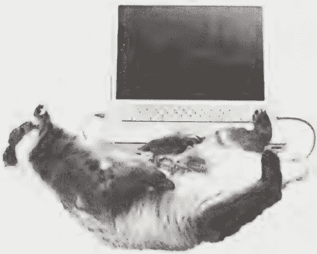
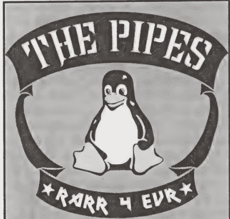
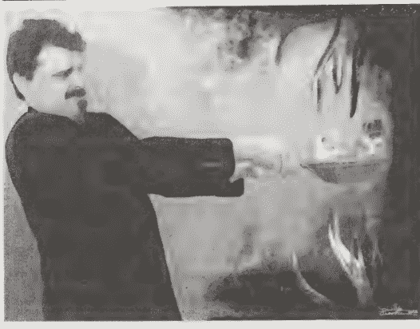
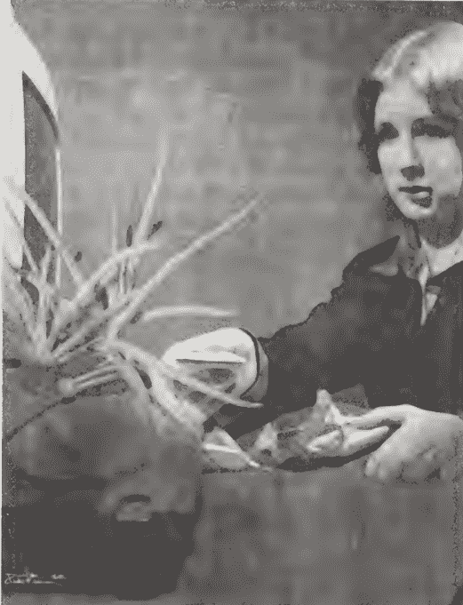
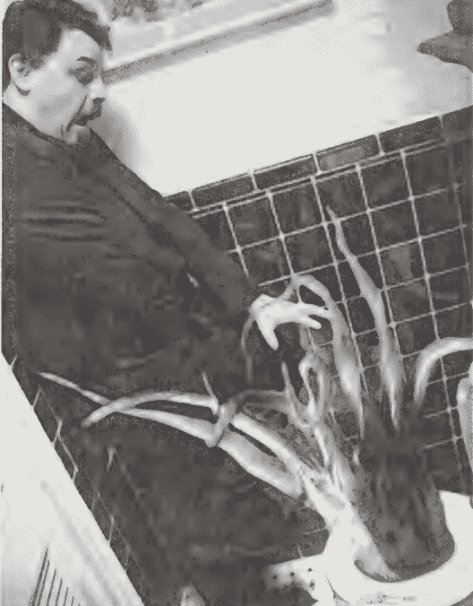
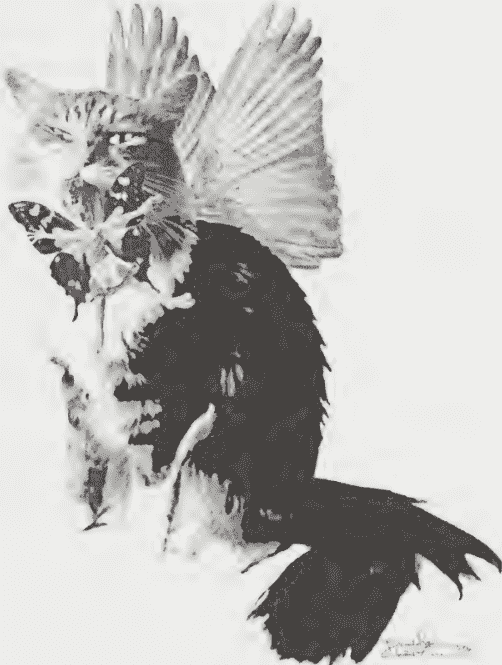
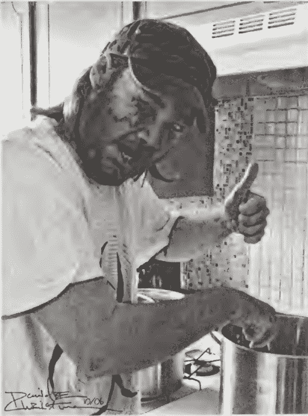
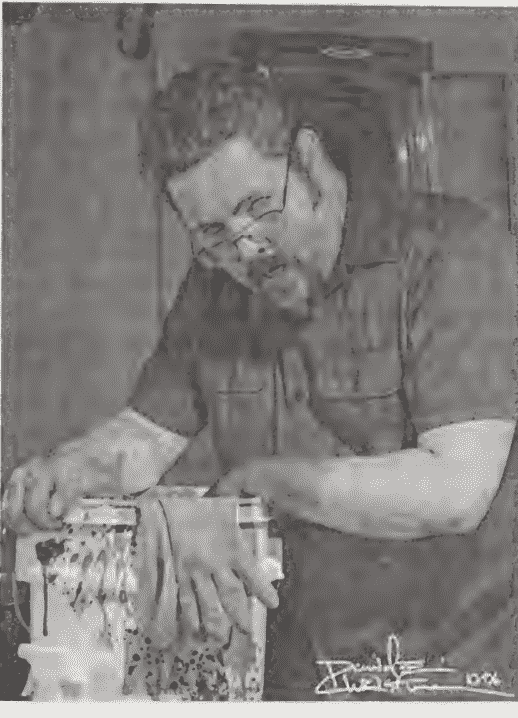
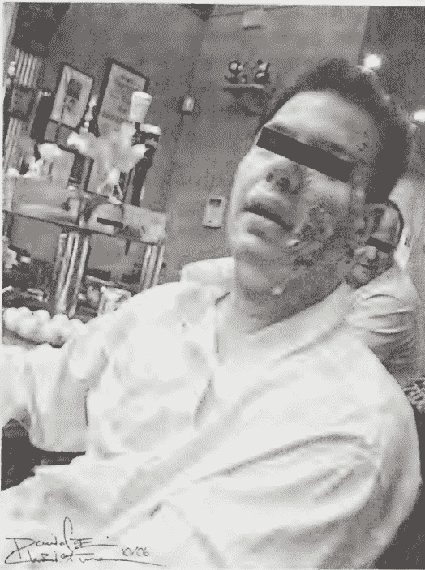
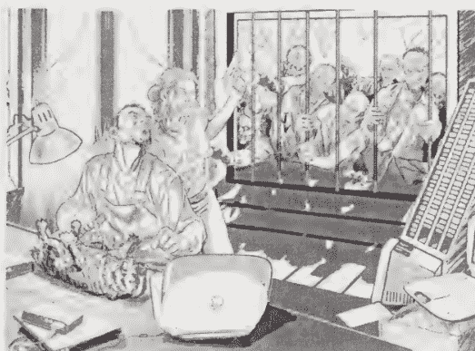

# 在死臭熊上安装 Linux（以及其他奇怪事物）

所有的荒唐话都献给全世界的 Linux 用户。

所有的荒唐话都献给万物的炽热内在美。

所有的留白都献给观者眼中。

# 在死獾鼬身上安装 Linux：

用户笔记

面对现实吧：任何拿着一把钳子的脚本小子都能把 Red Hat 装在 Compaq 电脑、他妈妈的烤面包机，甚至是家里的狗身上。但没有什么能比在死獾鼬身上安装 Linux 更更能赢得极客积分了。所以，如果你真的想赢得你的巫师帽，只需阅读以下指令，很快你的朋友就会觉得你像咖啡因肥皂一样滑溜。

最低安装要求：

- 一个（1）折叠刀
- 一个（1）十字螺丝刀，用于安装 `Duppy` 卡（见下方第4项）
- 一台电脑，带有：
  * `CD` 驱动器
  * `USB`、`以太网`或无线网卡的空槽
  * 已安装 `Telnet` 或 `SSH` 客户端
  * 网络光谱控制程序，如 `FleshGolem`（Mac OS X 和 Linux）、`Franken`（Windows 98, ME, 2000）或 `ItzalLive`（Mac OS 8.1-9x 和 Amiga）
- 一个（1）`Dippy` 卡（CardBus 和 PCI 型）或 `SpiritInTheSky` 外部适配器（提供以太网和 `USB` 型）
- `VDü Linux`（从 Twisted Faces Software 获取）
- 至少 3' x 3'（1m x 1m）的防火表面，位于安全、通风区域
- 隐私
- 一个（1）状况良好的死獾鼬

# 可选安装要求：

- 一加仑圣水（Bless! 驱魔水为理想）放在银或镀银桶中
- 一（1）双乳胶手套
- 一盎司杀灭跳子的洗发水，如 `Ecto-Soothe` 或 `Mycodex`
- 流动的水和一个大水槽或浴缸

以下测试安装是在独立单层房屋的车库混凝地上进行的，位于未经过圣化的土地上，使用一台 400Mhz 壳式 iBook，并在当地日落后不久开始。

## 第 1 步：寻找一只合适的獾鼬

动物园的标本是理想的，但在北美、英国列群岛、欧洲大陆、亚洲和非洲部分地区，可以在高速公路沿线找到死的路障。

- 鼬科和簍簍鼠科的其他动物可以代替獾鼬，但可能需要适配器。详情见附录 I。

## 第 2 步：一旦获得一只死獾鼬

仔细检查其结构性损伤，特别是脊椎、头骨和腿部。死獾鼬不会愈合，腿断了的獾鼬活动能力将有限。

大脑和脊髓损伤可能会干扰 Linux 安装，并导致任何成功安装的系统不稳定，同时根据任何和所有州、国家或未来或其他维度的法律，使所有显式和隐含保证失效。

- 为了防止感染，在处理你的死獾鼬时请始终佩戴乳胶手套。强烈建议使用合适的杀跳子洗发水冲洗尸体。

## 第 3 步：获取 FleshGolem 或精神控制程序的副本

本次测试使用的是从 Apple 网站下载的 `FleshGolem` 版本。仔细遵循所有安装指令，包括 `readme.txt` 文件中的附录。

- 所有精神控制程序都应兼容 `Duppy` 卡。

## 第 4 步：插入 Duppy 卡或连接外部 SpiritTheSky 适配器

`Dippy` 卡在带有 Airport 插槽的 Mac 上效果最好；外部 `SpiritTheSky` 适配器的响应可能缓慢。下方的备注仅适用于在测试 iBook 上安装 `Duppy` 卡。

- 卡片有一个铰页盖，透明覆盖物下方是一个像小型浅象牙盒的东西。打开它，将少量獾鼬的毛和血液放入格中，然后关上盖子，注意不要让杂毛露在格外。

## 第 5 步：在獾鼬中安装 Duppy 卡安全天线（随卡附）

獾鼬可以在没有安全线的情况下运行，但不建议。不安全的獾鼬可能会被任何拥有兼容卡和鼬碎片的人黑入。每个 `Duppy` 天线系统都有唯一编码，因此正确安装的系统仅允许原始用户运行该鼬。

- 要安装天线，用折叠刀在獾鼬颈后部切一个小口。将天线插入獾鼬背部皮下。天线必须尽可能贴着脊椎放置，否则安全性将不理想。天线也可以切开獾鼬的背部皮肤安装，但在安装后需要缝合以恢复完整性；此方法仅建议执证的标本师使用。

## 第 6 步：安装你的獾鼬操作系统

`VDü` 是獾鼬及相关物种的首选 Linux 发行版（见第 1 步）。该发行版由德国软件工程师设计，他们在牙买加创立 Twisted Faces Software 之前曾为 SuSE 项目做过贡献。另一种发行版是 `Pooka`，下载地址见 `SoulForge.net`。然而，目前没有适用于 MacOS 和 Amiga 的 Alpha 版本，某些 Windows NT 用户发现 `Pooka` 内置的 `Harvey` 工具程序可能会导致突然且不可预测的隐形问题。

### VüDü 技术提示

- 默认分区：`/root` 位于脊髓和脑干，`/swap` 和 `/soul` 位于大脑左半球，而 `/usr`、`/var` 和 `/home` 位于右半球。如果你正在处理的一只在其中一个区域受损的獾，你可以对其中一个脑球进行重新分区，但正如第 2 步提到的，不建议使用大脑受损的獾，这可能会干扰安装的成功。
- 系统配置信息和软件包的精神组件包含在一张卷起的小型羊皮纸上。上面有空间写入密码，以及任何如 `NecroNull` 等辅助程序。`VüDü` 软件包包含两卷卷轴，但经过“扭曲脸”卷轴制作训练的圣特里亚、伏多教、巫教或天主教神父/女祭也可以提供合适的羊皮纸。请访问 `VüDü` 主页以寻找您所在地区的合格神职人员。
- 修改卷轴时，请务必使用鸡血墨并书写整齐。卷轴上可以使用多种语言——`VüDü` 使用 `SoulScript` 编写，但已通过拉丁语、希伯来语和以诺克语进行了成功修改。之后你可以通过 `Telnet` 或 `SSH` 连接到你的獾进行进一步修改；开始时仅包含基本信息。完成

## 安装 LINUX

修改后，卷起卷轴插入獾的喉咙，一直胃部。使用螺丝刀或铅笔将其完全推进。

## 第 7 步：安装 VüDÜ 本身

软件包中有一张大正方形的草香纸。这就是 `VüDÜ` 的全部代码。将这张纸折叠成你正在安装 `VüDÜ` 的动物的折纸形状（见附录 II）。盒内有常见动物的折叠说明。在你的纸獾獾内部挖空，并添加一些额外的来自你动物的血液和毛发。

- 不要弄丢纸：替代品非常昂贵。网上有手工纸的配方，但要正确地转录所有信息是一项巨大的任务，因为这必须手写。此外，采集草药、干燥和固化的要求也是非常严苛的。

## 第 8 步：召唤/启动程序

将獾放在防火表面的中心，确保通风良好且所有门都已锁好。关闭所有手机和寻呼机，停止使用所有其他未经许可的电子设备。使用獾的血，在其身体周围涂抹一个英尺宽五角星。将折纸代码獾放在五角星的顶点，并在吟唱启动咒时点燃纸张：

```
Suse vivo vixi victimum reduco is ea id creatura absit
decessus a facultas Linux!
Dev root, dev root!
```

纸应该燃起绿色火焰。黑色或灰色意味着草药准备不当。紫色火焰表示内核恐慌（kernel panic）；用盆圣水熄灭火焰并立即离开安装现场。前往最近的教堂或其他神圣区域寻求避难。如果你无法及时到达避难所，可能需要请驱邪师协助。

当你产生绿烟雾时，它应该流过獾并进入它的口和鼻。獾将作为一只由 Linux 驱动的僵尸醒来。享受你的新不死獾。

## 常见问题

- 复活通常会导致动物处于高度攻击性和躁躁的状态。强烈建议在念咒时将电脑放在手边。
- 如果獾没有正确响应，你可能需要通过 `Telnet` 进行一些配置调整；说明见 `VüDü` 手册。
- 如果獾对启动咒完全没有反应，请拨打“扭曲脸”的技术支持。请确保先尝试所有其他故障排除选项。在两次免费通话后，技术支持将耗费你天文数字……而且他们只接受新鲜、无坏疽的限制条件。

> 免责声明：在本次测试安装过程中，没有獾或麦金电脑受到伤害。你的结果可能因人而异。请注意，僵尸獾在

## 安装 LINUX

加利福尼亚州和威斯康星州禁止僵尸獾；德斯州的僵尸獾必须时刻系。僵尸獾移动速度极快，且容易突然加速；驾驶你的僵尸獾时请格外小心。不要让你的僵尸獾食用蘑菇或非洲蛇，否则你的獾可能会发出节奏感强的电子音乐。不要嘲讽僵尸獾。长期使用僵尸獾可能会导致痤疮、失眠、麻风、异常天气或世界末日。请妥善处理你的僵尸獾；请咨询当地回收公司以获取适当的处置方案。



L U C Y A S N Y D E R

## 在死獾上安装 Linux：附录 I

本文中描述的技术用于在不同种类的獾上安装 Linux；以下物种由“扭曲脸”直接支持：

- 美国平原獾 (`Taxidea taxus`)
- 蜜蜜獾 (`Mellivora capensis`)
- 斑纹獾 (`Arctonyx collaris`)
- 鼬猫獾 (`Melogale spp.`)
- 欧洲獾 (`Meles meles`)
- 爪哇臭鼬 (`Mydaus javanensis`)

在 `WeezWhiz` 适配器（仅由 `Handwavium Technologies` 提供并支持）的帮助下，用户也可以选择在鼬科和矴袋类科的其他成员上安装 Linux。“扭曲脸”将不支持在经过改造的动物上安装：

- 北水獭 (`Lontra Canadensis`)
- 海水獭 (`Enhydra lutris`)
- 马克斯韦水獭 (`Lutrogale perspicillata maxwelli`)


- 欧洲水獭 (`Lutra lutra`)
- 巨水獭 (`Pteronura brasiliensis`)
- 矮貂鼬 (`Eira barbara`)
- 灵猫 (`Galictis spp.`)
- 狼獾 (`Gulo gulo`)
- 条纹鼬 (`Ictonyx striatus`)
- 貂子属 (`Martes spp.`)
- 鼬、雪鼬、水貂鼬和白鼬 (`Mustela spp.`)
- 常见袋紱 (`Vombatus ursinus`)
- 长鼻袋紱 (`Lasiorhinus spp.`)

也可以借助 Handwavium 的 VüDü 娃娃系列适配器在“隐喻意义上的獾”上安装 Linux。如上述，如果发生问题，“扭曲脸”将不提供技术支持。Handwavium 对隐喻意义上的獾提供有限支持：

- 吵闹的小狗
- 言语要求高的配偶
- 威斯康星州人
- 威斯康星大学的非本地学生、教师和员工
- Tony Kaye, David Foster, Brian Parrish, Roy Dyke, Kim Gardner, Paul Pilnick 和 Jackie Lomax

请注意，虽然僵尸水獭、鼬和袋紱在威斯康星州的部分市是合法的，但实际和隐喻意义上的獾在整个州内都是禁止持有或创造的。战斗紱在华盛顿州非法。人类和配偶安装在全美被广泛禁止。Handwavium 和 Twisted Faces 均表示，对于在使用其软件或适配器而产生的个人或精神困难不负责。

“我想要，为什么不为分布式进程建立一个獾鼬的网络集群呢？”

Retinoid 和他的朋友们最初在找不到另一只獾鼬时一头雾水。

“但后来，我妹妹养的那只吉奇被我们邻居的猫杀了，我们就在想，‘为什么不能呢？’”Retinoid 说，“事实证明，只要你懂得如何破解代码，Linux 几乎可以在任何破东西上安装。我们编写了小 ChiChi 让它伴着 Kid Rock 的 MP3 歌曲唱歌，并带着它参加了下一次局域网派对。大家都迷死它了！”

Retinoid 和他的死党“Pork_Sashimi”在那个夏天构建了一个“活化路尸冗余阵列（RARR）”。

“`The_RARR` 简直酷毙了，”Pork_Sashimi 说，“我们让它全天候地运行死亡对决和播放电影。后来，我们在一只死负鼠身上安装了摄像头视频接口，我们就能远程控制它进入街角那所女学生学院的通风管道里了。没错，宝贝们！”

十六岁的“DoomBarbie”说她在在线聊天室里遇到了 Pork_Sashimi。“他满脑子性别歧视之类的，一直要我发自己脱光衣服的 JPEG 照片。他甚至追踪了我的 IP 地址，把那只‘猫咪负鼠’送到了我家里。你能相信这居然让他报了应吗，”

LUCY SYNDER

Pork_Sashimi 完全向我道歉了！他承认自己自得其报，并对表现得像个傻瓜一样表示歉。这种事在内网上发生的频率有多高呢？

对她的黑客技术留印象深刻，Pork_Sashimi 招募 DoomBarbie 加入了“管道（The Pipes）”。她的出现很快结束了他们的虚拟窥淫癖。

“我并不是介意色情片之类的，”她说。

但他们对从一只派进脱衣舞场的老鼠身上拍到的那些模糊的视频赞叹绝口，而我只是开始对着那些假胸大肆其舌。我说：‘那个是假的，那个也是假的，你甚至能看到那个上面的接痕！’我猜在那之后他们就没那么好玩了。

然而，当 23 岁的 MIT 退学学生 Hoonboi 博士加入小组并接手领导时，更大的犯罪正向他们席面浮来。

“黑客们爱我，因为他们知道我会写代码，”Dr. Hoonboi 说，“这些孩子本很有潜力，但在我出现之前他们一直在虚耗天赋。”

Dr. Hoonboi 拒绝详细描述他小组的战绩，但 Brasslathe 特工对该帮派提出了严厉指控。

“我们将他们与佛特蒙州的一些事件联系在一起，在那些事件中，FBI 特工在执行《爱国法》调查期间遭到了攻击，”Brasslathe 说。

“我们的特工正在没收几家图书馆的记录，以确定哪些读者正在阅读查克·帕拉尼克、威廉·吉布斯以及其他恐怖分子同情文学作者的作品，”他说。

根据 Brasslathe 的说法，特工们正在制服

## 关注的当局



图书员，当几十只松鼠突然从空调通风口涌而出时。一些松鼠疯狂袭击特工，另一些松鼠则在撕碎记录。

“松鼠比大多数人想象的要凶残得多，”Brasslathe 解释道，“由于松鼠咬伤，两名特工感染了苏门特拉猴子热，这显然在僵尸化的野外动物中非常常见。这些特工仍在精神收院等待脑移植。”

儿童图书管理员 April Easley 正准备向一群学前儿童朗读故事时，FBI 搜查了她的工作场所。

“那些穿西装的家伙冲进来索我们要我们的借阅记录，我们说：‘不，没门。’于是他们掏出了枪和胡椒喷。阳光明媚的周六故事时间完全被毁了，”她哀叹道。

## LUCY A. SYNDER

“当我们的助手 Bobby 被锁住脖子并按在地上摔跤时，松鼠突然凭空冲了出来。那些毛茸茸的小家伙完全让那些 FBI 哥们大开了眼界。我们所有的图书员都在欢呼：‘噢，上吧松鼠！’”

“孩子们那天学到了重要的一课：它们看起来可能很可爱惹人怜，但千万别惹怒松鼠，”Easley 说。

“下周我们的读者将投票选出一个新的图书馆吉祥物，我确信‘速读松鼠（Speedreader Squirrel）’会赢过‘书虫本尼’的，”她说道。

Brasslathe 对像 Easley 这样把僵尸鼠攻击视为英雄行为的人感到不悦。“像 Dr. Hoonboi 这样的人类是对美国自由的威胁。今天他在干扰恐怖主义调查。谁知道他明天会做什么？”

Dr. Hoonboi 否认向 FBI 释放了僵尸松鼠。

“我本人更是个兔子控，”Dr. Hoonboi 说，“如果他们有真正的证据，尽管放来。否则他们应该换个新牌子的肥料了。他们很幸运我有这样一个完全专注的禅师，正忙于修禅而没空请律师。”

每当“管道”成员聚会时，Dr. Hoonboi 都会进行打气：“在我发现那只死獾鼬的真相之前，我还是个孩子，坐在黑暗中玩着幼稚的东西。但 Linux 让我变成了一个男人，并开启了我的视野，通向一个充满无限可能、阳光明媚的世界。”

“时候了，”Dr. Hoonboi 经常告诉“管道”成员，“让极客来继承地球吧。”

## 关注的当局

## 你的公司网络与黑暗力量

纽约，纽约 – 赛博术（Cybermancy）是目前最热门的新趋势。全球范围内的公司正急于部署赛博术策略，以通向利润的大门。

“这是一件大好事吗？”Mindy Axedame 说，她为许多财富 500 强公司提供咨询。“这些技术允许与死者交流。这意义太大了。如果一个关键员工心脏病发作，你现在可以询问那些通常会随之消失的问题，”Axedame 说。

“但这超出了会议室通灵（Ouija）的范畴——你可以让死人工作！或者运尸体来招募。这极具成本效益。”

Axedame 同意，这种技术提供了尚未获得公众认可或法律的解决方案。“对于联邦政府来说，僵尸工人处于灰色地带。而且可以打赌工会会反对。但由于你不需要支付最低



最低工资

她很快指出，赛博术不仅仅是将尸体变成资产。“这些新技术让公司与某些令人兴奋的跨维度资源进行接口。就在上周，我的一个客户将系统连接到了 Ngoleth 之云——它是一个存在于我们相邻维度的集体意识。股市预测的流入使我的客户裁减了 30% 以上的技术人员。”

Axedame 预计与超自然资源建立网络将为公司节省大量资金。“噢，这些实体给出的预言简直是纯金。我的客户将摆脱许多高薪职位，”她说，“说真的，云只需要小猫咪作为报酬。而且猫咪比图书员便宜得多！当你的电脑连接着掌控宇宙黑暗秘密的生物时，谁还需要公司图书馆？”

但随着这一新技术边界的兴起，计算机网络的物理和精神安全——以及维护它们的人——变得至关重要。

密斯卡托尼亚大学信息科学（CIS）部门主任 Erwin Mandrake 教授特别担心公司做出冲动的网络决策。“大多数人没有意识到，即使是简单的 Aetherweb 局域网对 IT 员工来说也面临着真正危险的挑战，”他说，“但与 Ichornet 相比，带有所有怪癖和陷阱的 Aetherweb 就像小兔子一样安全。”

Mandrake 对 Ichornet 近期的流行感到特别愤愤。“从第一天起，它就写满了‘坏主意’三个字。”

Zerical, Inc. 的网络工程师 Billy Winkler 和他的同事曾期待安装 Ichornet。“该死，是的，它看起来是个很棒的产品，”他在病床上说道，“部署它比建立无线网络更快、更简单，而且它领先于”

# 你的公司网络

比以太网要容易。我的意思是，你以前经历过在旧建筑里拉电缆吗？那可真是麻烦了。

“但有了**灵露网（Ichornet）**，”他说，“你只需要在建筑的关键部位插上这些小蛋，它们就会生长并遍布整个结构。我们几乎没费什么精力，在六小时内就让网络运行起来了！”

林勒（Winkler）表示，在一周内，他们的灵露网出现了问题。我们的服务台员工告诉我们，他们的电脑被恶灵附体了。但秘书们总是说是 Windows 机器的问题，所以我们没当回事。


“但后来，人们开始听到可怕的声音……你们知道，‘滚出去，否则我们会吃掉你的内脏。’这种事导致五六个人不得不请休假。我们其他人，你们知道的，只是调大了 iPod 的音量并继续工作。”

“当电缆没有固定好时，一切真的变得完透了。当我说‘电缆’时，我实际上指的是‘触须’。它们闯进了水管。”

林勒不想详细谈论那次事故。“当我正在尿尿时，它抓住了我。灵露网现在的运动饮料瓶非常短缺，如果你明白我的意思的话。”

然而，他愿意向游客展示他残破的腿。当他掀起裤子时，可以看到膝盖上方布满了大口子。它们随着他的心跳在抽动。

“是的，这太恶心了，”他说，“当地的`你的公司网络`”

驱魔师阻止了。他对这件事很务实。“可能会更糟。至少它只是抓住了我的腿。”

灵露网的制造者 `Kronozon 公司`坚持认为他们的产品没有错。

“在公司大门外，”Kronozon 的发言人说，“我们收到了许多来自人类的支持电话。他们显然没有读过那本鬼的手册。”

“网络需要不断的新鲜肉类作为诱饵，但这些人类做了什么？他们用罐装动物泥石堵住了营养枢纽。”

 你的公司网络

难怪这可怜的网络会进水管——那些电缆让它口渴了！愚蠢的人类——在垃圾邮件的攻击下没有任何网络可以正常运行。

兰斯·施莱弗（Lance Shriver）作为公司的首席执行官对林勒的事故表示遗憾。“在这个困难的时期，我们正在为他尽全力，并努力以一种成本效益高的方式抚并保护网络。”

施莱弗对员工解决灵露网问题充满信心。“我们必须修复它，因为根据合同，我们无法在明年 7 月之前更换它。我们的主要项目已经落后了，而且对股东有责任在今年实现盈利。”

“我们已经给了每位员工圣水和一把砍刀；在此之后，就取决于个人在工作环境中保持警惕了。”

施莱弗同意，在与 Kronon 的合同到期后，他们将切换到一个不那么反复的网络解决方案。

“现在，我们正在考虑`以太网（Aetherweb）`，”他说，“它和普通的以太网差不多，但具有我们保持竞争力所需的所有赛博优势。”

旧金山 Monkeybrain Computing 的系统专家阿曼达·奥布莱恩（Amanda O’Brien）被广泛认为是网络局域网调试专家。她不同意以太网是一个简单的网络解决方案。

# 你的公司网络

“但我告诉你，管理它是一件大麻烦。你看，未屏蔽的电缆会发出这种灵性气息，吸引周围几英里的各种怪异生物。你必须找人给这个地方祝福或施放保护护咒，但覆盖范围总有漏洞。超自然的东西经常进到这里。”

“你知道当你拆掉门廊灯的罩时，里面全是死虫子吗？我们的网络机房现在就是那样。我们的‘虫子’不是死的。”

奥布莱恩回忆起期的经历时打了个颤。“精灵是最糟糕的。我讨厌该死的精灵。”

她掀起上衣露出一排白色的疤痕。“一个小精这样弄了我。其他的 IT 员工起初嘲笑我，但后来我说：‘好吧，如果你们这么厉害，就去把你们疯狂的忍者技能用在那个可爱的精灵身上。试试看。’”

“他们回来时满脸是血。如果你不小心，精灵会让你落得极其惨状。”

奥布莱恩对任何她从网络机房赶出去的实体都没有什么好感。“巨魔几乎和精灵一样糟……没那么危险，但烦人三倍。如果一个巨魔进入了你的网络，它会永远在那里闹腾。我发现这可怜的网络进了水管——那些电缆让它彻底疯了！你只需要等它无聊并离开。”

自从那个小精事故后，奥布莱恩采取了亲力亲为的方法来移除

触须

奥布莱恩表示，应急计划是困难的，因为你永远不知道会有什么。然而，她说，在大多数情况下几个基本步骤可以确保良好的结果。首先，让祭司或巫师待命，并留好他们的联系方式。其次，随身携带一件厚外套和裤子。皮夹可以提供很好的保护，但 Carhartts 工作服也是。而且如果有人搞砸了安装，Carhartts 不会变成行尸。第三，储备圣水并在口袋里放一个水壶。圣水越多越好。第四，在冰箱里随时好新鲜生肉作为诱饵，并准备好灵露心蛋糕作为精灵诱饵。精灵喜欢樱桃馅心的天使蛋糕，而魔物和地精喜欢花生酱果酱味麦片。只需确保员工不要吃了你的储备。第五点是，你必须准备容器。大多数精灵可以被关在咖啡罐里——铁质会让它们动弹不得。用灵露网把它们引出机房，把罐子扣在它们身上，用一个不锈钢饼垫滑进罐底，用胶带粘住饼垫，然后把它们带走。对于灵体，你需要真正的银器。我们为偶尔进来的小精准备了一个纯银香槟桶。对于比那更大的东西，你必须寻求协助。”

那些前途可限量的年轻人，结果她去参加完聚会带回来了一群整天都在看小说和玩游戏的男孩！

“所以，我让米西同意，如果我给她买了那只猫，在她拿到商业学位之前就不许再参加聚会了。在哈佛大学。如果她一直走在成功的道路，那么这只猫就是一项好的投资，”诺特（Knott）说道。

异域猫育种员凯尔·萨利斯（Kyle Salinas）表示：“自从‘闪烁事件’（Shimmer Incident）之后，仙猫就变得极其受欢迎。现在人们真的能看到这些猫了，它们几乎是自动畅销。”

萨利斯说，仙猫——科学分类为 *Felis fae* 属——大约在公元前300年左右在欧洲和亚洲被创造。猫在欧洲繁荣到了黑暗时代。

“考虑到普通的流浪猫曾因为被认为是魔的仆而被吊死，你可以想象迷信的人对仙猫会有怎样的反应，在少数情况下，仙猫曾是各种恶魔的宠物，”萨利斯说。

大多数巫师和法师会在他们的飞行灵宠施上隐身咒以确保它们的安全。然而，在愤怒的人群抓住了猫的主人后，咒语并没有被打破，灵宠保持着隐形，它们的幼猫也是如此。

萨利斯说，因为具有隐身性，仙猫被排除在动物志谱之外，并且经常被误认为其他实体，如女妖（banshees）、骚灵鬼（poltergeists）和博格特（boggarts）。

“仙猫发情时的声音听起来非常像女妖，”他说，“而且如果一只隐形的幼猫在深夜进入



进入房子并发现了一堆猫薄荷或狼草根，大多数居民都会确信自己需要一位驱魔师。”

如果不是因为安格斯·闪烁（Angus Shimmer），仙猫可能一直一直保持隐身状态。

“这完全是一个意外，”闪烁说，他现在是密斯卡托尼州立大学（Miskatonic State）的魔法学副教授。“我当时还是本科生，我的室友在对我开恶玩笑。他们偷走了我的每一本咒书，让它们隐形了，并把它们藏在宿舍周围的树上。

“伙计，我当时气疯了，”闪烁说，“而且风暴要来了——我确定在找到它们之前，我的书都会毁掉。”

闪烁说他爬上钟楼是为了在校园范围内施一个广范围的反转咒。就在他念完咒时，闪电击中了塔楼。

除了在马萨诸塞州特伯里（Tewbury）的一栋哨屋（Whistle House）后面发现《邓威奇恐怖》（The Dunwich Horror）之类的惊喜外，全世界的人震惊发现仙猫住在他们的棚和花园里。

“我完全不知道这些东西是真实的，”艺术家吉姆·比默（Jim Beemer）说，“我的意思是，我甚至不喜欢猫，但我厌倦了去艺术展却一件作品也卖不出去，而街角科幻展会上的那些画带翅膀的狗便的可爱蜡笔画却卖得火朝天。所以，是的，我妥协了。我不觉得自豪。我总得想办法还艺术贷款的，对吧？

“但那天早上我醒来时，发现我的露台上有一只该死的 L U C Y A·S N Y O E 带着翅膀的猫。而且它正在啃着一只该死的小矮人。我每天下午去厕所检查自己，但噢，不，他们不留我，因为我并没有产生幻觉，”比默说。

“现在甚至曼哈顿的收藏家都想要带翅膀的狗便的照片。没人关心我的静物画或风景画，”他说，“那只猫每天都在外面，用它那可爱的翅膀和死的小矮人嘲笑我。缠着我。我被一只猫缠扰了。天哪。整个世界都疯了。我需要喝一杯……我的波本在哪？”

苏格兰仙猫爱好者爱德维娜·科顿（Edwina Cotton）也对这些飞行猫科种感到惊讶。

“我一直在花丛里发现小精灵（pixies）和矮人（brownies）的小尸体，”她说，“我一直以为是我的小侄子用弹弓在捣鬼，结果发现我的温室里住着一只可爱的羽毛虎猫崽。”

“我把小猫带进室内是为了防止它杀掉其他的仙猫，”科顿说，“但和我其他的猫相比，它可真不好对付！”

萨利斯同意仙猫是普通的家猫更具挑战性的宠物。

“仙猫需要空间、高天花板和栖息的地方。如果你住在小房子里，户外鸟舍也可以。但你不能只是把仙猫锁在鸟笼里并指望它过得好，”他说，“大多数品种在狭窄环境下会嚎叫或拒绝进，但某些欧洲血统的品种可以短距离传送，如果它们感到被困住就会这样做。如果发生这种情况，你的窗帘就可以走了。”

他补充说，并不是所有的宠物主都意识到仙猫是为了特定的目的而繁殖的。

## F A E R Y   C A T S

“这些生物确实美丽且神奇。但它们的工作是杀死仙类。如果它们不能完成工作，就会感到沮丧和无聊。”

加密兽医研究员鲁迪·布鲁格斯（Rudy Briggs）花了多年时间追踪仙猫的起源。

“我们已经追到了欧洲血统。”

“连续工作20小时，只为了价值20美元的猪脑。”


Hawt Shawpz系统僵尸管理员布拉·贾内特（Brad Janett）表示，运营这些僵尸员工相当简单。“我做的大部分工作是让他们正常启动Linux系统，并调试他们的生物硬件（wetware）程序。磁盘镜像给了他们一百多份电话脚本供背诵。僵尸们通常足够聪明，能够挑选正确的脚本，即使他们自己并不擅长独立组织词汇。”

贾内特说，僵尸的网络操作系统极其稳健。“我们面临的唯一问题基本上就是生物硬件故障。林特先生（Mr. Flint）去年夏天认为我们可以不需要空调，但结果导致大约四分之一的呼叫中心长了霉。”

O’Burger餐具连锁的所有者唐·弗莱斯（Don Frites）表示，受生活挑战的人员外包对他公司来说是一个福音。他遗憾自己不能像希望的那样充分利用这些亡死者。

“中部的餐厅顾客有些胆胆胆的问题，”弗莱斯说，“他们还没准备好接受由僵尸来点餐或为他们上豆汤。僵尸在幕后表现很棒；你只需要确保公众看不到他们在工作即可。”

弗莱斯迅速补充道，亡死者餐厅员工对公众没有任何健康风险。“仍然存在这种观念，认为他们是那种流着液体、到处掉零件的尸体，但那完全过时了。

“经过适当的塑胶处理，我们的僵尸比普通员工干净得多——你只需要在每班期间用橙色清洁剂擦擦他们，把油脂残留清除。”

Cybermantic员工解决方案公司（Cybermantic Staffing Solutions Inc.）的推广总监埃德·鲁奇认为企业外包前景广阔。



# 死人不需要

“当员工的生活成本成为过去时，企业为股东能做的事情将无限制，”他说，“我们的每一位客户都告诉我们同样的话：死者正在大幅提高企业的利润率。”

## 业务外包提供死后生活

亚特兰大，佐治亚州 —— 僵尸外包运动正在彻底改变美国医疗行业。

“医疗成本和保险保费每年上涨10-20%，超过5000万消费者没有医疗保障，”Cybermantic员工解决方案公司推广总监埃德·鲁奇（Ed Rudge）说，“这意味着大量的消费者将无法支付医疗账单。”

“在过去，”鲁奇说，灵媒（cybermancy）创造了对家庭和医疗行业都有益的解决方案。

“当一个没有保险的患者处于垂死边缘时，CSS会向医院或主治医生支付小笔费用，以便我们来与家人交谈，”他说。

“我们向他们展示预计账单，并告诉他们有两个选择。第一个选择是亲人去世。第二个选择是让他们亲人签署死后劳动合同，账单就消失了，而且他们可以在周日见到亲人。

“我们的企业牧师会在患者去世前不久访问他们，并举行仪式将灵魂及其记忆下载到幽灵罐（duppy jar）中，”鲁奇说。

“我们会抬起尸体，将其保存，并安装操作系统。灵魂可以通过我们的专有软件通过操作系统表达自己。这让僵尸和家人觉得他们仍然拥有完整的人格自由意志，但我们的程序控制着他们所有的工作行为。”

鲁奇解释说，患者尸体复活后，CSS与雇主签约，雇主每小时支付3-4美元让亡死者员工工作。家庭获得15%，剩余部分由CSS以及患者去世时欠钱的医生和医院平。

“大多数在医院培养的亡死者保留了相当的智力和运动机能，我们可以每周工作120小时，”鲁奇说，“我看到的周日重聚会让你感到很温暖。大多数家庭对亲人的回来感到如此兴奋，以至于完全不在意他们身上的一点味道。”

鲁奇估计，大多数亡死工人的身体状况还可以维持十年左右。“医院告诉我们，十年是付清大部分账单的魔术数字，所以我们的灵性专家一直在努力，确保我们的僵尸在长时间的体力劳动条件下能够坚持住。一个无人机应该能坚持得多。”

50岁的CSS合同工#1542A，化名“奇普（Chip）”，对他妻子将他的尸体交给公司的决定表示沮丧。



“我说，这僵尸生意……完全是胡扯，”奇普断断续续地说，从他16小时的洗碗班中休息一下，吃一桶牛脑。

“我当时还在昏迷中……还没死！现在我整天都陷入水潭……这层塑料皮肤该死的痒。我想我的律师……没法用电话。Gggggaargh。”

尽管有类似的关于欺骗性招聘的投诉，

## B U S I N E S I N O U R C I N G

许多末期患者和从事危险工作的人士正与CSS和其他劳动力供应公司签署合同。

“可不如此，我跟访问过我们连队的Infinity劳动力的人签了合同，”海军陆战队下士兰斯·派克（Lance Pike）说。派克是一个19岁的西弗吉亚州人，他表示Infinity最近刚与美国国防部签署了独家合同。

“他当时为我们提供1万美元的入职奖，”派克解释道，“我想，算吧，我老家的那个女人确实需要这笔钱，如果我在伊拉克为团队效力，Infinity就会让我带着哥们儿回到前线。”

派克的Infinity劳动力招募员鲁斯蒂·提伯伦（Rusty Tiburon）赞扬这位年轻陆战队的决定，并希望其他军人能效仿。“既然我们现在有了技术，如果只是躺在在那里烂掉而不为国家经济做点贡献，那完全是不美国式的。”

# 企业吸血鬼进入死后世界

亚特兰大，佐治亚州 —— 僵尸外包运动正在彻底改变美国医疗行业。

“医疗成本和保险保费每年上涨10-20%，超过5000万消费者没有医疗保障，”Cybermantic员工解决方案公司推广总监埃德·鲁奇（Ed Rudge）说，“这意味着大量的消费者将无法支付医疗账单。”

“在过去，”鲁奇说，灵媒创造了对家庭和医疗行业都有益的解决方案。

“当一个没有保险的患者处于垂死边缘时，CSS会向医院或主治医生支付小笔费用，以便我们来与家人交谈，”他说。

“我们向他们展示预计账单，并告诉他们有两个选择。第一个选择是亲人去世。第二个选择是让他们亲人签署死后劳动合同，账单就消失了，而且他们可以在周日见到亲人。

“我们的企业牧师会在患者去世前不久访问他们，并举行仪式将灵魂及其记忆下载到幽灵罐（duppy jar）中，”鲁奇说。

“我们会抬起尸体，将其保存，并安装操作系统。灵魂可以通过我们的专有软件通过操作系统表达自己。这让僵尸和家人觉得他们仍然拥有完整的人格自由意志，但我们的程序控制着他们所有的工作行为。”

鲁奇解释说，患者尸体复活后，CSS与雇主签约，雇主每小时支付3-4美元让亡死者员工工作。家庭获得15%，剩余部分由CSS以及患者去世时欠钱的医生和医院平。

“大多数在医院培养的亡死者保留了相当的智力和运动机能，我们可以每周工作120小时，”鲁奇说，“我看到的周日重聚会让你感到很温暖。大多数家庭对亲人的回来感到如此兴奋，以至于完全不在意他们身上的一点味道。”

鲁奇估计，大多数亡死工人的身体状况还可以维持十年左右。“医院告诉我们，十年是付清大部分账单的魔术数字，所以我们的灵性专家一直在努力，确保我们的僵尸在长时间的体力劳动条件下能够坚持住。一个无人机应该能坚持得多。”

50岁的CSS合同工#1542A，化名“奇普（Chip）”，对他妻子将他的尸体交给公司的决定表示沮丧。


“让我们面对现实，国内僵尸工人比孤儿更便宜。有几个牛脑和一只僵鬼，你可以经营一个全天候的无窗呼叫中心。但你必须拥有那个僵鬼，”他说，“除非你有哈佛之类的顶尖学校学位，否则活人的就业市场很激烈。如果你是某个州立大学MBA项目的学生，变成僵鬼无疑是进入中层管理的最佳选择。”

亚特兰大一家软件公司的夜间主管伊·哈特（Eve Hart）声CSS在招聘时遗漏了一些信息。“当然，我听过新僵尸会生病几天的恐怖故事，但CSS承诺我的转化是无痛的。我会把这种体验评为和直肠镜一样糟糕……但还有很多其他他们本该告诉我的事，”她坚持道，“太阳的问题，是的，我知道，大家都知道。我一直对光不敏感，所以没大碍。但他们告诉我我的身体几乎不需要维护，那完全是胡扯。几天后，我身上闻起来像坏掉的血。没人警告过新鲜流水的问题。确实，我的经期消失了——太棒了，但我仍然得剃腿和理头发。”

Cybermantic员工解决方案公司（CSS）的推广总监埃德·鲁奇（Ed Rudge）表示，由于企业对僵鬼的需求在过去一年增长了近1000%。

“夜电更便宜，所以让僵尸员工在工厂和组配线工作是合理的——可能性是无限的，”鲁奇说，“但僵尸带来了独特的管理挑战：他们并不怎么聪明，而且渴望生肉。当僵尸感到饿时，普通经理有很大机会被劈开脑袋，因为他们渴望鲜美多汁的大脑。”

金融分析师本特利·查兹沃斯（Bentley Chazworth）认为僵尸化不是一时的风潮。

哈特承认她并没有这样做。“但我还是觉得他们对我并不坦诚。等我的合同到期，如果我在阴暗巷子里遇到我的顾问——好吧，那顿饭由他请客，如果你懂我的意思的话。”

奥拉夫·维格罗夫男爵（Baron Olaf Würgerov）表示，他很喜欢自己在 Hart Shawpz 履行中心担任深夜领主的新职业。

“在过去，我非常喜欢把村民的头钉在标矛上，”维格罗夫男爵说，“现在我偶尔才能做一次钉头，但你知道的，这份工作让我能以一种非常积极的方式展现自我。我正在迅速成长。”

维格罗夫男爵同意，他从幽暗的地下柏林转型到为一家美国公司工作并非没有波折。


“在周会上，没人想坐在我旁边。你知道的，全是腐烂的液体。和老鼠生活了1000年之后，这些小细节你根本察觉不到，”维格罗夫男爵耸了耸肩，“所以我学会了干洗和 Altoids 薄荷糖。毕竟这并不是什么大问题。”

商业培训师、《谁动了我的脾脏》（Who Moved My Spleet）作者劳拉·勒夫鲁特（Laura Loveblut）强调，新吸鬼需要自我教育以保持竞争力。

“了解现代企业吸鬼的门道，就像知道面试时如何着装，知道要发送感谢信，或者知道在离开大时不应该杀掉秘书。告诉这些这些并不是你潜在雇主的工作，”勒夫鲁特说。

“你还需要剃胡子吗？你还需要洗澡吗？肯定的，”她说，“不死并不意味着你抛弃了人世界的期待。”

“在任何镜子面前都能很好地看到自己，除非镜子背面是纯银的，我上次检查时，Pottery Barn 没有多少那种镜子，”勒夫鲁特说。

“你需要担心来自异常干净的水或含有微量银污染的水带来的灼伤。我告诉我的新吸鬼客户，为家里投资一套可选的离子交换水过滤系统。它能除银，并加入恰好的火化炉灰来净化你的水质。Braun 有一个名为‘Midnight Bathworks’的不错型号，”她说。

“而且在洗完澡或剃完胡后，一定要使用良好的保湿乳以防止脱皮。”

“孩子们，为自己着想吧：在预约校园吸鬼代表为你转化之前，先把你们牙里那些旧的银质填充物取掉。”

俄亥俄州，哥伦比 – 一些仍然活着的工人已经秘密加入了呼叫中心和工作队的“僵尸僵尸员工”（zombloyees）行列。职业介绍介机构给这些工人起了一个绰号叫“墓中人”（cryptos）。

“我可没打算成为墓中人，这点我很确定，”一位 33 岁的哥伦比居民说，他仅自称为 John，“我有音乐剧场的艺术艺术学士学位和诺亚文学硕士学位；我一直以为能当上大学教授，但在研究生阶段我精疲力竭了。”

当互联网初创公司开始发现财富时，John 退出了博士学位课程，并很快找到了一份网页设计师的工作。然而，他的好工作并没有持续多久；互联网泡沫让他失了业，且没有钱继续学业。

“我甚至连一份烤香肠的工作都找找不到，”他说，“如果你有研究生学位，没人急着雇你做初级工作。他们认为你一有更好的机会就会卷盖走人。你确实会这样做，但谁能指有人把这些工作当成职业呢？”

在两年的失业期间，John 通过搬进城市边缘一个破旧的农场维持生计，那里还有六个林仙（dryads），她们因为失败的公寓开发项目而失去了森林。他的父母也一直借钱给他，直到他父亲被迫提前退休。

“但最后我在西边的 Hawt Shawpz 呼叫中心找到了一份工作。每小时 8 美元不多，但够付房租了。”

当 Hawt Shawpz 一夜之间将他们的呼叫员工替换为僵尸员工时，灾难降临了。John 没有失业金，很快他的室友就开始威胁，如果不交钱，就把他变成一株接骨莓丛。

当事人 John 去养老院看望他老祖母。“那里有个可爱的女孩正在为她的僵尸员工机构招募老年人——我不说是哪一家了。但听了她的话……我脑子里灵光一闪，”John 说。

“我和她聊了一会儿，问她我怎样才能加入其中一个呼叫中心，”他说，“我一直没吃得好，大家都说我看起来很病态，所以我我想装死应该很容易。”

John 说那个年轻女孩同情他的处境，给了他一份呼叫响应脚本副本。

“我从头到尾背下了它——我做戏剧时一直很擅长这个。我们达成了一个协议，我从每份薪水里给她 50 美元，她把剩下的钱转到我的银行账户；就当会计师看来，这笔钱是用来支付我去世前被提诉的一起私人诉讼。机构的女孩安排好了一切，让我部分换班间隙溜进溜出。这样，我就不需要连续工作超过 16 小时。”

“我必须在头发里抹这种腐鱼和猫荷的混合物。鱼腥味让我闻起来像死尸，而僵尸有猫荷。当我带着这些东西时，它们就不会靠近我的大脑，只要管理层按时给它们食物就好。不过，现在流猫经常跟我回家里——林仙们在我们门廊下为它们搭建了一个临时避难所。”

“我现在的工作时长是以前在 Hawt Shawpz 的两倍，而且我必须穿尿布，因为我不能休息，但至少我不是无家可归。或者不是一丛灌木，”他说。

John 对自己的处境保持乐观。“我越来越擅长扮演僵尸了。我想我是一个比我以前想象的要优秀多的演员。”



伴随着尖叫、咆哮和呻吟，约瑟夫（Joseph）将视频传输到一台安全服务器，并开始收取每次下载 5 美元的费用。

有些人告诉我我在浪费时间，但那些喷子们（trolls）完全为此买了单。于是我在我公寓附近的一个自助储室里搭建了一个小型的、未屏蔽的 Aetherweb 服务器，以吸引更多的喷子，开始拍摄更多视频，然后这种情况就一直持续下下去，”他说，“只要其他喷子继续买账，我才不在乎他们在些什么。”


在几周内，约瑟夫就建立了自己的自己的 Aetherweb 增强型录像室。在他拍摄第一段视频五个月后，他从猴脑计算（Monkeybrain Computing）辞职了。

奥布恩（O’Brien）对约瑟夫的成功感到高兴。“弗兰克是个好家伙，周五总是带新鲜的糖圈甜圈。但说实话，他的代码水平并没有那么高；弗兰克离开后我们雇的那个女孩在 PHP 和 SQL 方面要好得多。所以弗兰克富了，我们的生产力提高了，珍妮（Jenny）也不去搞加密货币了。各方面都是圆满结局。”

并不是所有人都认同奥布恩对约瑟夫业务的乐观评价。一些喷子权利活动人士指控他伤害并剥削视频主角。

“在我看来，他们看起来很痛苦，”喷子也需要拥抱（Trolls Need Hug Too）的凯·桑德（Kai Sunderland）说道，“我的意思是，好吧，我们无法证明那不是性快感，但那可能是痛苦。那就糟糕了。”

美国联邦调查局（FBI）报告，他们正密切监控约瑟夫和他的“狂野喷子”（Trolls Gone Wild）视频帝国。

“如果他在伤害这些喷子，那么，那是当地事务，”FBI 发言人马克·布拉斯拉特（Mark Brasslat）说道，“但如果这些视频具有性性质，而且这些喷子中任何一个被发现是未成年人，你可以确信我们将对约瑟夫先生提起指控。相信我，我们对跨州淫秽贩卖者持非常否定的态度。”

布拉斯拉特说，局里的色情专家正在仔细研究约瑟夫网站提供的 100 多段视频。“只要我们能搞清楚到底在看什么，我们就会采取坚决、果断的行动。”

## 大大的 Voodoo Linux 少年僵尸大屠杀

当我们在布法洛斯泉（Buffalo Springs）的 Gas & Grep 加油站加油并检查邮件时，鲍勃（BOB）和我吸引了一群僵尸。我希望我们已经甩掉了它们，但我仅只有希望。鲍勃说它们是一支高中足球队的新鲜遗体，他们在一次湖边派对上被水魔溺死并夺走了灵魂。

年轻、强壮的尸体拥有追上鹿跑的速度和耐力。在阳光和风最终将它们的肉体变成臭臭的肉干之前，它们的危险程度足以让吸血鬼吓得拉出蝙。而新鲜的僵尸像色情网站的弹广告一样执着。如果它们看中了你血的气味，它们可能会追踪你几天，直到活肉掉进它们怀里才会停止。

要等几个月后，它们才会学会“死人蹒步”（Dead Man Shamble），并能通过精准的爆射将其击杀。当然，如果有正确的软件和硬件，你可以杀死最棘手的僵尸，但那即使对于经验丰富的黑客来说，也是一些相当深奥的东西了。

如果我的编辑是对的，鲍勃是美国仅有的五个真正的网络精神专家之一。但到目前为止，他看起来更像是一个二流油工，而不是计算机大师。我深表怀疑。

“也许我们应该回到 Gas & Grep，”我建议道，“巴巴（Bubba）说他在他的围圈里有一只生病的獾。用新鲜的动物效果不是更好吗？”

更重要的是，巴巴有大量的枪和弹药；而我只有他工装裤大兜里的一把 6 发贝雷塔。鲍勃在他驾驶室的枪架上有一把小猎鹿枪。如果僵尸少年小队出现，火力完全不够。

“没挑战，小姑娘，”鲍勃说，声音里充满了蔑视和烟草汁，“任何手里拿着红帽（Red Hat）拷贝和一把钳子的傻瓜都能把 Linux 安装在一只活獾身上，甚至是一只新鲜的、穿着格子裙的獾身上。”

鲍勃撞进了一个坑洼，我差点滑掉了我的 Treo PDA。当那个穿着破烂 Godsmack T 恤的死孩子在加油泵旁的停车场里追逐我时，我那部漂亮闪闪的诺基亚手机从口袋里掉了，我绝不会允许在这趟旅程中再丢失任何东西。

我会杀了我的编辑，就因为她让我来了这趟德克萨斯地狱之旅。绝对要杀了她。或者至少要求休带薪假。我还能听到温迪（Wendy）谄媚的讨价：“高速巡逻队说卢博克（Lubbock）地区全安全；你会非常安全的，莎拉（Sarah）。”

安全个鬼。

鲍勃开始了他的长论。“这僵尸生意是战争。小姑娘，是帕顿从未梦见过的战争。我们正在与该死的黑暗力量战斗。我们必须使用一些过人的技巧，而没有什么比在死獾上安装家庭防卫系统更能体现技巧了。把这个记下来，小姑娘。Mac 的读者如果想继续保持他们和他们人的安全，就得知道这些东西。”

我尽职地在 Treo 上记了下来。我的大指键盘操作已经很很快了，但为了防止掉进泥里，我把 PDA 塞进一个没有润滑的透明聚氨酯避套里，用橡皮筋扎住了末端。避套虽然是干的，但还是很滑，给记笔记增加了一层额外的挑战。

“老天，来爸爸这儿！”鲍勃突然转向到路肩，猛踩刹车。福特车在灌树丛旁的钙质土上滑着停了下来。


在大大灯的光芒下，有一只死獾，四条腿都僵直地举在空中。它很大，可能接近 20 磅。鲍勃跳下车跑向獾，把它翻过来，在血结块的毛发里摸索着。

“腿、脊椎和头骨状况非常好，”他对我大喊道，兴奋得像圣诞节早上的十岁孩子。“我什么也感觉不到，只有几根断肋骨。这就了！”

他把獾扔进卡车货斗，很快我们就飞回了鲍勃的店。

## 大大的 Voodoo Linux 少年僵尸大屠杀

zombie apocalypse.

你的獾受了某种脑损伤，你可以尝试修改后的安装，但那真的非常棘手。而且狂犬病让整件事变得像场赌博。在尝试之前，读读那该死的手册吧。

当死死的拳头猛烈敲击着保护电脑商店前窗的胶胶板时，我的心猛地跳了一下。我听不到隔壁传来的任何声音；我希望这意味着里面的女人已经赶走了攻击者。

“别管那个没关系；即使他们穿过了木板，还得穿过窗上的栅栏。我们有的是时间。”

鲍布从桌里掏出一张卷起来的小块羊皮纸。“这里面有系统配置信息、灵魂程序组件和你的密码。你得把这些全部写在圣的羊皮纸上，用类似以诺克文（Enochian）或灵魂脚本（SoulScript）之类的字体。写整齐。卷起来，塞进獾的喉咙，一直到胃子里。”他用螺丝刀示范了一下。

僵尸仍然在捣弄胶胶板。其中几只发现了一个松动的边缘，正用力将一块板从砖墙上拉下来。一只僵尸把灰色的手臂插进栅栏间。玻璃破裂了，碎片掉了一地。

我的手抖得厉害没法做笔记，于是把 Treo 放在一边，从大腿口袋里掏出贝雷塔手枪。我的状态也不怎么能打准。

“你现在还用不上那个，”鲍布锐地说道，显然他对我停止记笔记感到不耐烦。“那些栅栏挡它们比你手里那把小气枪管用。”

我不情愿把手枪插回腰带，捡起 Treo。

他打开 VüDü 盒子，掏出一卷散发着草本香气的纸。“这是 VüDü 背后的全部代码。”他把它折成了小野兽的形状。

他展开卷轴，开始把它折成



一个像獾一样的折纸形状。“自己做纸真的很难，所以别弄丢了。在这类东西上，开源只能带你走很短一段。”

僵尸已经把窗上的第一块胶胶板完全扯掉了。三只僵尸正吼着并晃动栅栏，其他的在敲击和拉扯剩下的板子。我的胃像拧成了一个酸性的结块；那些栅栏看起来真没那么结实。每当用力一次，我都能看到空心砖里的螺栓在松动，只有那么一点点。我

### 大 VÜDU LINUX 英国青少年僵尸大屠杀

在想如果我往后门冲出去，能坚持多远。

我在心里咒了温迪一千次。一次假期加一台新电脑甚至根本无法弥补这趟旅程。

鲍布正心不在经地忽略那些僵尸。弄完折纸獾后，他用獾的血在纸上涂了一个一尺宽的五角星。他把尸体放在顶端，把折纸獾放在中间。

“现在，烧掉这张纸，念上你的咒语。”他拿出打火机，打开 VüDü 手册，一边点燃纸张一边开始念唱。明亮的绿色火焰喷薄而出，烟雾环绕着獾的尸体。我们看着烟雾流进獾的口和鼻。它在呼吸时颤抖了一下。

“我们搞定獾了！”他掏出橘色的 iPad 开始疯狂地敲击字。

獾试图爬起来，它僵硬的腿像哈利·鲍豪森的定格动画一样抽动着。它抬起头朝我们吼着，露出长长的犬齿。它听起来更像是一只愤怒的灰熊熊；我不认为某种小小的东西能产生这样的威胁。我向后退了一步，以防万一。

“这就是为什么我们管它们叫獾，小姑娘……当它们发疯的时候……”

门。

我让獾獾跳到了 Runs On Stumps 身上。当獾獾咬住它的后颈时，那只僵尸僵直了，皮肤变得苍白如灰。僵尸那 NecroNled 肉体在獾獾的牙齿和狂暴的爪子下像黏土一样崩塌。

“干得好！”鲍说道，“其他的死没这么快，因为它们伤得没那么重。”

我攻击下一只僵尸，它的肩膀只有一个浅浅的散弹枪伤。獾獾的牙齿刺入它的脖子，僵尸咆哮着将獾獾撞向一堆空电脑机箱。我听到扬声器里传出一声沉闷的断裂声，獾獾颤抖了一下。

屏幕闪烁着：

#### 警告！正在进行脊髓抽取！

无法进入战斗模式。

是否通过 IKnowKungFu 继续？(Y/N)

“开火！开火！开火！”我内心的青少年在吟唱。

我按下“Y”键，屏幕变红了。獾獾跳起来，向空中升并悬浮在天板板上扫描目标。那只咬断獾獾脊椎的僵尸正像石棉一样剥落，剩下的三只僵尸包围了鲍，他的散弹枪显然卡壳了。

这时鲍抬头看到了獾獾，用嘴唇嘟动了一句“噢该死”，然后倒在地上，护住头。

獾獾对着僵尸向下尖叫，下颚咬合和爪子的速度快过了电脑的追踪。它像一把毛茸茸的电锯一样穿透了一只僵尸的头部，又撕碎了其他的。我瞥见鲍在商店后面绝望地爬向寻找掩护的地方。獾獾进进出出，速度越来越快，像一个小小的、毛茸茸死的超人。

我向 iBook 比了一个“四指礼”，但程序被锁定了。正当我正要按下电源键时，獾獾爆炸了。

你知道物质是如何转化为能量的吗？我后来发现，NecroNull 之所以埋在 FleshGolem 选项中的原因是，当 IKnowKungFu 引发精神过载时，它会使傀儡中所有仍然活着的物质变成能量。通常是几个细菌细胞，也许是一条垂死的圆线虫。这不足以比拟核武器的威力，但足以创造出一个惊人的爆炸。

这是 Bug 还是特性？我想这取决于你必须杀死多少僵尸，以及你有多么想让它们消失。

爆炸声震动了整栋大楼，我被摔倒在地。iBook 啪嗒一声掉在肮脏的地板上，键盘弹出，屏幕变黑。我站起来，小心翼翼地打开门。鲍蜷缩在后门旁，已经昏迷。电脑店完全一片狼藉。烟雾和僵尸血弥漫在浓厚的铁锈色雾气中。窗户碎了，前门被炸飞了。视线内没有一个僵尸。两个穿着粉色工作服的中年妇女站在人行道上，眯着眼睛看向黑暗处。其中一个手里拿着一把莫斯伯（Mossberg）枪。她们的脸和工作服上沾满了烟灰。

“你还好吗？”年长点的女性喊道。

“我没关系，但鲍需要救护车，”我回答道，“你们店里有电话吗？”

“有的，我会告诉那帮伙子的，”她说。花了三天时间才回到文明世界。之后，我做了任何一个好孩子会做的事：我松开了手……的。

## 僵尸大屠杀

这是 Bug 还是特性？我想这取决于你必须杀死多少僵尸，以及你有多么想让它们消失。

## 醒醒吧裸体猴子，你要死的

怪物们。

那头古老的酸性神灵莱姆爬进闪烁的火光中，像一个巨大的、不洁的布丁，闪烁着数百万只祖绿色的眼睛。它正嗡嗡着、震动着，声音越来越大。它们只剩下几次细微的心跳，直到那致命的频率让骨骼和肌肉化成肉泥，将肉体液化，好让这个酸性怪物将它们吸进自己的百个胃里。

金博取出神圣罐子，手指张开握住它，准备出一个快球。他低声说道：“唱一首六便士的歌吧，粘液球，因为我的口袋里满了碱！”

他在心里许愿，向上帝祈祷，然后尽全力出手。闪亮的罐子命中目标，迅速没入那饥饿且恶臭的侧腹。

神灵贪婪的胶水咬穿了铝壳，突然它的内脏开始起泡、翻腾、起泡沫。腐蚀性的盐在绿色半透明的肉体内绽出白色花朵。怪物挣扎着，化得比暴雨中的糖果巫师还快，发出的嘶嘶声对聆听的英雄和幽灵来说是纯粹的喜悦，在被征服的地下墓中欢呼。

艾玛·莱格拉斯第三次转动她的福特嘉域的点火钥匙，但无济于事。她透过满是污垢的挡风玻璃盯着被雪覆盖的引擎盖，脑海中闪过一个由仁慈的果冻甜圈王统治的甜美冰霜仙境。收起这个古怪的幻想，她打开手机拨了男朋友电话。

“哟，”贝尼回答道，声音大得离谱。她能听到他在疯狂地打字。一条龙在他的电脑扬声器里咆哮。“怎么了，艾？”

“亲爱的，我的车启动不了——”

“别做！别做！别靠近那些幼崽，白痴蛋！”贝尼在车里尖叫。在刺耳声中，她听到火球呼啸而，一个电脑声音在死亡中呻吟。“真是个白痴！呃，你说什么？”

“我的车。启动不了。我好像被困在这间餐馆了。你能来接我吗，好吗？”

“可以，我想吧，突袭之后，”他回答道，语气中充满了冷漠。

“之后？”那些该死的突袭没完没了。这里没有公交车，出租车至少要50美元。她要到午夜才能回家。“亲爱的，求你了，我已经连续厨了10个小时了，我早上8点就得回到这里——”

“艾，我们在这个地下城已经被消灭两次了——这次我们得把锆石带出去！我是说；我现在不能离开！看了，回头见。如果你打到便车之类的就给我打电话。”

电话挂断了。艾玛设法忍住了挫败中想把手机砸在仪表台上的冲动。老天保佑她别被那个满脑山汽水的精子怀孕——如果她在玩游戏的晚上分娩，就得打出租车了。

我为什么要忍受这些？她想道，随即几乎就听到了母亲教诲的回声，说女孩的生活里必须有一个男人，男人是不完美的，好女孩要随遇而安。

见鬼了。贝尼比她母亲的捏心挠肺和关于单身女性命运的悲惨故事要好得多。如果艾玛报告分手，她母亲不可避免地会提到那个老人在离婚后一天被老鼠吞噬的都市传说。那个故事从未让人过时。

她把手机和车钥匙丢回包里，在黑裤上揉了揉麻木的手，怨恨地盯着积雪覆盖的引擎盖。汽车不是火箭科学，不管她那个来自弗林特的前男友试图说服她什么。换火花塞比组装电脑容易得多——她确实做过，非常谢了——甚至比做出一份非常棒的意大利烩饭简单。


艾玛拉下引擎盖释放锁，用力推开门。第一口呼吸时，她鼻子里的粘液冻结了，她穿着运动鞋的双脚没在粉末般的雪中没踝，走到车前努力拉开引擎盖。等她成功时，她的手指感觉像被锤子敲过一样。她打开钥匙扣上的手电筒检查引擎。发电机带无力地挂在生锈的轴上，有一段参差不齐断开了。粘稠的粉色冰棱从被冷侵的带边缘滴落。难道她的变速箱也坏了？该死。

她哆抖着，砰地关上门，穿过雪和冰冷的汽车排泄物，来到祖贝罗亚餐馆的后门。她推入灯光光亮的走廊，那里旁边是舒适的员工休息室，拍掉鞋上的雪，把包包和外套挂在门口。

一种奇怪的、麝性的、鱼臭的油腻味弥漫在空气中；她是中午左右开始注意到的。她倒过垃圾，在厨房里寻找过走丢的��鱼和虾，但无果。也许有什么东西掉在了柜台和冰箱之间；如果臭味持续，她会找那帮家伙帮她把它从墙上拉开。

她发现了一条闪光的、有图案的油渍或粘液，从门通向厨房。该死，她告诉过服务生不要推着自行车经过那里。轮胎总是会将泥土、草和不知道的什么带到地板上。反正，这种天气谁会骑自行车呢？可能是卡洛斯；他正在为“山地疯狂赛”训练。

艾玛冲进厨房，在不锈钢炸油锅抛光的隔缘侧面取暖，缓解她酸痛的手。过去薯条的幽灵填满了她正在解冻的鼻腔，温暖而油腻的空气刺着她的脸颊。新的点餐小哥又忘了收班清单，让机器一直开着。好吧；她有几个小时要消磨，不如为冷冻预炸一些新鲜薯条。

服务生之一的马克在小心地将最后的餐具放入洗碗机时，给了她惊讶的目光。他有清澈的蓝眼睛，焦糖色的头发，闻起来总是像姜饼味。

“我以为你还在这儿，莱格拉斯小姐。”他总是叫比他稍微大一点的人为小姐或先生。她还没决定那是贴心还是烦。

“噢，我不该在这儿的，但我的车启动不了，”她回答道，脸在反射性的微笑和皱眉之间挣扎。

“噢，不。”他的眼睛大了。“我有启动线……”

她摇了摇头。“发电机带报废了。如果我穿着丝袜，我可以用丝袜带回家。你没有对吧？”

他眨了眨眼，挪了挪脚，脸微微泛红。“没有，女士，我没有。我可以送你回家吗？”

她停顿了一下，注视着他手臂上结实的肌肉。他看起来应该是个职业网球运动员，在澳洲的阳光下发球，或者在灯光下穿紧牛仔裤，而不是在一个假装是巴斯克、主要供应各种连锁店三明治的餐馆里端脏盘。

马克看起来是她见过最漂亮、礼貌、体贴、该死的迷人的男人。

他身上有某种极其糟糕的问题。毕竟，贝尼可从未叫过她“女士”或“小姐”，而且在他们第二次约会时发过致命的短信。

马克的甜美无辜的脸绝对是连环杀手的面具。

或者是另一个战锤狂热分子。

“谢谢，但我男朋友说会接我，”她回答道。

“噢。”马克看起来还是很担心。“你确定自己一个人没事吗？我住这里不远……请拿着我的号码，以防万一。”

马克在黄色便利贴上工整地写下号码，道别后回到他的吉普。艾玛把纸条粘性面朝外塞进裤兜。等他驶出停车场后，她锁上门，把吧台的一把高凳搬进厨房。去他的妈站着做饭吧；她站了一整天了，脚弓疼得要命。

她突然想起母亲小时候托起她粉红的脚跟，告诉她她有一双漂亮的脚，像芭舞者的脚一样。艾玛在大学时和一个真正的芭舞者同住，了解到芭舞者的脚是开裂且长满茧子的。当艾玛上课时，那个芭舞者吃光了所有的奶油甜圈，事后否认，仿佛是她可怜的受伤的脚深夜溜出床，不知怎么吃掉了那些甜圈。

艾玛对这个想法笑了，随即皱起眉头，想象如果那真的会发生。如果她的运气，有一天

她醒来时，发现被子下面只剩下些残根，床头柜上放着一封用脚趾歪歪扭写的“亲爱的艾玛”的信。

她把吧凳推到柜台旁，台上放着一块宽大的枫木切菜板。她从锅架上取下一个巨大的漏勺，打开了储物箱。

一只闪烁着光泽、黄瓜大小的乌鱼，长着巨大的、像绿色的眼睛，坐在块茎植物上面，湿漉漉地望着她。

“你好！”他宣称道，声音听起来像是一个半满粘液的小喇号发出的。

她轻声叫道，向后一跳，抓起最近的厨房用具，本想要一把刀，结果却抓了一只虾夹。她挥舞着虾夹，仿佛那是“封拔之剑”。

“不要害怕，”乌鱼说道，敏捷地从箱子里爬出来，站在切菜板上面对她。它用灰色的青蛙腿站立着，脸部和颈部垂下的触须遮住了它们之间可能长出的任何东西。两条像人一样的手臂从肉质绳索中伸出来，将它们拨到一边；这个乌鱼生物双手叠在布满触须的肚子上，向她鞠了一礼。“为了找到你，我穿越了许多英里，寻找了多年，公主。

“普……公主？”她结结道，“你-你到底是什么鬼？”

“我是赫特尔雷德，深海伟大而可怕之神兽的化身，”他宣称道，一只手抓住触须，另一只只有娃娃大小的小臂举起行礼，“我是雅内特斯王座的合法继承人，那是我们坐落于奥秘海沟咸水深处的最伟大的城市。但在找到我的公主、我的王后——我们辉煌的主宰和主人帕帕·诺加德唯一的陆地后裔之前，我无法继统治者的位置。

“你就是那个后裔，美丽的艾玛·莱格拉斯，你注定要成就远比凡人大脑所能理解的大伟业！”

没有任何事像她小时候读过的故事那样美好。她的白马王子终于来了，而且他看起来完全不正常。“你-你说什么事宜？”

“嗯。你知道的。王后的事宜。”赫特尔雷德用一条触须钩住旁边的一个红洋葱，把它当作板凳。“受手足脚地侍候，饮用宇宙葡萄酒，享受征服并臣服地球的果实——”

“你要征服地球！”她感到头晕。

“那是当然的。”他站起来，华丽地挥动触须，“我找到我的公主，取她为我的王后，登上王位，集结我的海底军队，接管星球，作为一个活神统治一切。这一切都写在《预言之书》里，”他平淡地补充道。

“对于全球统治来说，你不是太小了吗？”

他对她张开鱼鳃。“我任何时候都是完全正确的尺寸！在自然状态下，我会比这栋楼还高。我只是把自己缩小了，在

海德龙的散光眼。波士顿的部下建议我，否则运费将高得无法承受。

“运费？”

“是的，在虾箱里。我今天坐着一个箱来到这里的。有舒适的海绵海草床，还有一些帽贝当零食——这是一种非常舒服的旅行方式。”

她双手交叉在围裙上，左手松松地握着虾夹。“关于这个王后的事——我是不是得住在海洋里？”

他摇着那鱼雷形状的脑袋，触须弹动着。“我们可以从这座美丽的城市统治世界和所有的海洋。《预言之书》说，克利夫兰注定将成为宇宙的权力中心，像血红钻石一样闪耀在在我们海洋军队神秘力量下沦落的奴隶城市之上。”

“这怎么可能？我们离岸远远了，”她指出。

赫特尔雷德叹了口气。“首先我们在伊利利湖建立一支军队，然后入侵加拿大，让工程部部下加宽圣罗伦斯河——看，我们花了几个世纪来计划这个。我有加班费单可以证明。”

赫特尔雷德若有所思地眨了眨瞬睑膜，透过员工休息室敞开门。“啊，太极了，那里有一个沙发，还是皮革的。我最鄙恶粗花。”他清了清嗓子，转向她，单膝跪地。“公主，我寻找了你永恒，我承认我很渴望取你为我的王后，这样我就可以耕种你的肉体田野，而你可以开始产下许多代凶猛的后代——

“等一下，你想耕种我的——你想和我性交？”她的声音提高到了只有狗能听见的的频率。

“是的。在沙发上。越快越好。”

“嗯，不是不要，而是绝对不行！”

“公主，”他恳求道，“在我恢复自然尺寸之前，你几乎察觉不到我在。想想你的宿命。想想权力，想想财富。想想寿司。”

他轻声叫道，向后一跳，抓起最近的厨房用具，本想要一把刀，结果却抓了一只虾夹。她挥舞着虾夹，仿佛那是“封拔之剑”。

“不要害怕，”乌鱼说道，敏捷地从箱子里爬出来，站在切菜板上面对她。它用灰色的青蛙腿站立着，脸部和颈部垂下的触须遮住了它们之间可能长出的任何东西。两条人一样的手臂从肉质绳索中伸出来，将它们拨到一边；这个乌鱼生物双手叠在布满触须的肚子上，向她鞠了一礼。“为了找到你，我穿越了许多英里，寻找了多年，公主。

“普……公主？”她结结道，“你-你到底是什么鬼？”

“我是赫特尔雷德，深海伟大而可怕之神兽的化身，”他宣称道，一只手抓住触须，另一只只有娃娃大小的小臂举起行礼，“我是雅内特斯王座的合法继承人，那是我们坐落于奥秘海沟咸水深处的最伟大的城市。但在找到我的公主、我的王后——我们辉煌的主宰和主人帕帕·诺加德唯一的陆地后裔之前，我无法继统治者的位置。

“你就是那个后裔，美丽的艾玛·莱格拉斯，你注定要成就远比凡人大脑所能理解的大伟业！”

没有任何事像她小时候读过的故事那样美好。她的白马王子终于来了，而且他看起来完全不正常。“你-你说什么事宜？”

“嗯。你知道的。王后的事宜。”赫特尔雷德用一条触须钩住旁边的一个红洋葱，把它当作板凳。“受手足脚地侍候，饮用宇宙葡萄酒，享受征服并臣服地球的果实——”

“你要征服地球！”她感到头晕。

“那是当然的。”他站起来，华丽地挥动触须，“我找到我的公主，取她为我的王后，登上王位，集结我的海底军队，接管星球，作为一个活神统治一切。这一切都写在《预言之书》里，”他平淡地补充道。

“对于全球统治来说，你不是太小了吗？”

他对她张开鱼鳃。“我任何时候都是完全正确的尺寸！在自然状态下，我会比这栋楼还高。我只是把自己缩小了，”

千万不要相信。艾玛盯着自己冰冷、疼痛的双脚。她母亲曾承诺过要买像芭蕾舞演员那粉色丝绸舞鞋……却拒绝让她上真正的舞蹈课。

艾玛内心有些东西硬化了，像是在油锅里炸了太久的薯条。它开始冒烟了。她用镊子把它捞出来，用冷水冲掉那具作响的尸体，扔进垃圾桶。去她她母亲那些老迷信吧。去她那多年来对冷青蛙变成热王子的等待吧。她拿起手机拨给了本尼。

“我们还没结束——”他开始说道。

“结束了，”她回答道，“你是个几乎没用的废物，一个糟糕的男朋友。我再也不想见到你。再见。”她用力按下了“挂断”键，并删除了联系方式。


她拿出马克的便签，开始输入他的号码。一个连杀杀对于如何处理可疑的暴徒或许会有实用的想法。如果他只是个为了学费而工作的纯真孩子——好吧，她确实需要人送她回家。

再多一只手来清理那该死的炸油机也不坏。

## 作者致谢

我要感谢对这些故事提供建议的编辑们：来自《小镇醉酒汉》（The Town Drunk）的 Brit Marshalk 和 Eugie Foster，以及来自《太空服与六把枪》（Spacesuits and Sixguns）的 David L. Duggins。特别感谢《奇异地平线》（Strange Horizons）的 Kyle Niedzwiecki 和 David Horwich；他们的投入确实让这些故事顺利了进展。当然，我想感谢 Pete S. Allen 出版这部合集，并感谢 Malcolm McClinton 和 D.E. Christman 提供的插画。最后，我要感谢我的丈夫 Gary A. Braunbeck 给予的爱与支持。

本合集中的以下故事曾发表于：

- “在死死的獾鼠上安装 Linux：用户笔记”——《奇异地平线》，2004年4月5日。
- “你的公司网络与黑暗力量”——《奇异地平线》，2005年6月20日。
- “仙女猫：最可爱的杀手”——《奇异地平线》，2006年2月27日。
- “墓地夜班”——《小镇醉酒汉》，2006年11月：
    - “病人不需要咖啡休息”
    - “业务外包提供死后生活”
    - “企业吸血鬼将牙刺入商业世界”
    - “失业者装死寻找工作”
- “当局对青少年 Linux 帮兴起的担忧”——《小镇醉酒汉》，2006年12月。
- “醒醒吧猴子，你要死了”——《恐怖世界》，2007年3月。
- “大 VüDü Linux Linux 僵尸大屠杀”——《太空服与六把枪》，2007年春。

## 关于作者

LUCY A. SNYDER 在德克萨斯那个充满牛仔和仙人掌的地区长大。尽管每当牛仔竞技来到小镇，孩子们就能放假，但年轻的露西渴望生活在一个季节更丰富、中暑病例更少的地方。她第一次尝试写诗的灵感源于她喜爱的宠物圈蜘蛛在四年级一次外足活动中的逃脱：

> 我有一只大而茸茸的蜘蛛
> 我给它起名叫西西先生
> 它在校车上逃脱了
> 它不在你的午盒里，对吧？

成年后她依然对蜘蛛着迷，她获得了生物学学士学位，并打算成为一名科学家。遗憾的是，她在大四时发现自己在电泳方面糟糕得离谱。尽管决心要体验秋和春天，她还是搬到了印第安纳州的布鲁明顿攻读新闻学硕士学位。她想，如果她不能做科学，至少可以在报纸上描写科学。

搬进宿舍后不久，她卖出了第一篇科幻短小说。

她非常激动，全身投入小说创作，两年后，她进入了位于密歇根州东兰辛的克拉里恩科幻幻想作家工作坊。在克拉里恩，她学习了许多关于情节、人物塑造以及保留商业收据的知识。但在工作坊接近结束时，她犯了一个错误，提交了一个幽默的幻想故事。那周的导师这样开始评价她的故事：“这个故事代表了当今科幻和幻想写作中的所有问题……”

他的批评并没有变得温和。此后，露西自然地认为，幽默和电泳一样列在她永远不要再次尝试的事情清单上。因此，她在接下来的几年里设计网站，为各种在线杂志编辑，并试图写出她认为最好的、最严肃的推想小说。

这一切在2002年发生了，当时她发现了一个名为 Everything2.com 的网站。在 E2，她发现自己可以描写脑海中出现的几乎任何奇异的事情，并能为此找到感兴趣的读者。抛开对创作畅销故事的顾虑，露西开始尝试对她来说完全全新的写作形式。

2004年初，一位 E2 用户发布了在极其过时的硬件上安装 Linux 的说明。在网站的聊天室里，另一个用户讽刺地评论道：“他接下来要做什么，告诉我们如何在死死的獾鼠上安装 Linux 吗？”

露西一直在为了网页设计工作阅读大量糟糕的技术文档，这个想法让她觉得非常有趣。如何在死死的獾鼠上安装 Linux？你会用哪种版本？由 Linux 驱动的獾鼠有什么用处？

她发布了《如何在死死的獾鼠上安装 Linux》，这很快成为了网站的宠儿。后来，她修改了这篇文章并将其卖给了《奇异地平线》的编辑部，扩展版本从热门网站 Slashdot 链接，导致该杂志获得了巨大的流量。即使是今天，“在死死的獾鼠上安装 Linux：用户笔记”仍然是 SH 最受欢迎的主题之一。

露西继续创作并销售幽默故事。今天，在她出版的40多篇短小说中，有近一半以及她的许多已散文包含了讽刺或其他强烈的幽默元素。她的几篇非獾主题幽默作品出现在她的第一个合集《火花与阴影》（Sparks and Shadows）中，该书由 HW Press 于2007年5月出版。

更多关于 Lucy 的请访问：www.lucysnyder.com

## 关于艺术家

D.E. CHRISTMAN 是一个只想把你吓死的艺术家。而且他从中获得了极大的乐趣。他灵感源自洛苏鲁的作品被描述为“扭曲、疯狂且奇异地令人毛骨悚然”（The Horror-Web），他对这个描述感到非常自豪。他的艺术作品出现在许多画廊、艺术展、杂志、书封以及专门从事死亡和奇异主题的网站上。

他通过自己的公司 Grendel’s Den Studio 为生，为印刷和网络制作艺术和设计。他也被认为是费城顶尖的僵尸专家之一，并就他对活死人和那个著名的巫毒诅咒奴隶的知识进行过各种采访和演讲。

更多关于 D.E. 的信息请访问：www.grendelsden.net

MALCOLM MCCLINTON 从他记忆开始就开始描绘科幻和幻想主题。但直到九年前，插画只是一个爱好，是他用来放松的事情。他的大部分努力都在学术界，在那里那里物理人类学和考古学获得了高级学位。但在挖掘现场劳作了五六年后，他感到精疲力竭，随后在黑马漫画找了一份制作工作。

这次职业转变重新燃了他的创作动力，三年后他离开去追求自己的绘画和项目。从那以后，他一直以插画维持生。他自己创造了一个良好的小众领域，同时满足了他天生的反权威倾向、隐居的性格以及对崇拜的需求。

更多关于 Malcolm 的请访问：hanged-man.deviantart.com

Lucy Snyder 的其他作品：

**Sparks and Shadows**

HW Press · 356 页

ISBN: 978-0-9792346-1-3

Creative Guy Publishing 的其他书籍：

## Amityville House of Pancakes, vol 3

Pete S.Allen 编辑

再次回到这个怪异的世界！今年，AHOP 3 特色三篇关于油腻、快乐与美好的短篇小说。Gary K. Wolf（曾审查《谁刺了波杰》）和 Jehane Baptiste 开头介绍了《外太空中的不健康男孩们》，随后是 K.M. Praschak 的《典范》，最后以 Paul Kane 的另一段丹尔顿·奎尔冒险作结尾，“丹尔顿·奎尔与图提弗鲁蒂国王之墓”。

Paul Kane - 《孤独（在）》和《触摸火焰》的作者回归了，这次不是为了恐吓你，而是为了挠痒你的笑穴。在这书中，你将发现他最荒诞的幽默恐怖故事集，范围从《恋爱中的德库拉》到《爱丽丝·克鲁姆的最后诱惑》……还没忘了粉丝最爱的《骨头兄弟》。

# 包含：震惊的 Linux 帮派大乱 ~ 恶作剧者失控

你的企业网络与黑暗力量 ~

吸血鬼管理指南 ~ 以及更多，更多内容！

# 向书中收录的故事致敬

《在死掉的獾熊上安装 Linux》：

“机智过敏且带有阴暗的幽默……社会评论与恐怖元素的完美结合。”

~ Tangent Online 对《死人不需要茶歇》的评价

“请务必读读（这本书）。当你读它时，嘴里不要含着任何东西，免得因为惊讶的喷嚏而把东西喷进你的鼻腔。你已经收到过警告了。”

~ Nalo Hopkinson，《新月之臂》作者

“幽默、阴暗，且带有欢快的荒诞感。”

~ Tangent Online 对《当局对青少年 Linux 帮派兴起表示担忧》的评价

“非常幽默且文笔很好，对企业为了保持领先所付出的种种手段进行了极佳的讽刺评论。”

~ Jason Lundberg，《时间旅行者之子》作者，对《你的企业网络与黑暗力量》的评价

“因为一个作者的僵尸而爱她会有错吗？”

~ The Green Man Review


