# SuSE LINUX 安装：权威解决方案 (附 CD-ROM)


助理出版人

Michael Stephens

策划编辑

Neil Rowe

开发编辑

Tony Amico

主编

Matt Purcell

项目编辑

Dawn Pearson

文字编辑

Krista Hansing

索引员

Heather McNeill

校对员

Tony Reitz

技术编辑

David Meyer

团队协调员

Pamelae Nelson

媒体开发

Dan Scherf

内设计

Anne Jones

封面设计

Anne Jones

# 概述

## 附录

## 索引 183

硬件组件要求 ................................................2

处理器 .......................................................................2

硬盘 ..........................................................................4

内存 ................................................................................5

CD-ROM 及外围设备 ................................................5

评估总结 ................................................................9

选择安装媒体 ................................14

CD 安装 .................................................................15

网络安装 ......................................................16

硬盘安装 ......................................................18

笔记本（笔记本电脑）安装.......................................19

兼容 Linux 的笔记本电脑...............20

总结 ................................................................................22

分区规划 ...................................................24

关键任务硬盘分区......................................27

对您的磁盘进行分区.......................................................28

YaST2 ................................................................................28

YaST1 分区工具 ................................29

总结 ................................................................................32

YaST 软件包处理方法...............................34

使用 YaST2 安装系统...............................................36

使用 YaST1 安装系统...............................................37

YaST1 软件包选择器 ............................................38

构建自定义包 ........................................44

更改/创建配置......................................45

可用窗口管理器 ...................................46

加载和保存配置（克隆）...........47

软件安装总结 ...................................47

SuSE Linux 安装后程序 ...................49

完成 YaST2 安装程序 ................................50

完成 YaST1 安装程序 ................................53

网络配置 ................................................55

登录 SuSE Linux ................................................................................57

示例用户名和密码功能 ................................................................58

登录 SuSE Linux 问题 ................................................................................59

启动 SuSE Linux 总结 ................................................................................62

SaX2 ............................................................................................66

Xf86config 工具 ................................................................67

Xf86Config 文件 ................................................................68

X 选项和默认设置 ................................................68

使用 YaST 配置显示管理器 ................................................69

使用 susewm 进行微调 ........................................................70

KDE .................................................................................70

Enlightenment ......................................................................71

X 窗口系统总结 ................................................72

开源音频系统（又称 OSS） ........................................................ 132

使用开源音频驱动程序 ................................................................ 132

安装 OSS 音频驱动程序 ....................................................... 133

ALSA 音频驱动程序 ................................................................................ 134

配置 ALSA 音频驱动程序 ............................................................ 135

isapnutools 工具 ....................................................................... 136


- `pnpdummy` 工具 ................................................................................ 136
- `isaplay` 工具 ................................................................................ 137
- 音频总结 ................................................................................. 138
- 12 保持系统更新 139
- 更新软件的重要性 ................................................... 140
- 从 SuSE.com 获取更新 ........................................................ 140
- 使用镜像站点 ................................................................................ 142
- 使用其他 Linux 软件网站 ........................................................ 145
- 备份文件 ................................................................................ 145
- 使用免费解决方案 ............................................................................ 145
- 更新总结 ................................................................................ 146
- 确定您的漏洞 ........................................................ 149
- 互联网上的漏洞 ......................................................... 150
- 本地局域网上的漏洞 ................................................... 156
- 确定您的漏洞 ........................................................ 157
- 内部漏洞 ........................................................................ 157
- 分析网络 ........................................................................ 158
- 使用其他方法 ................................................................ 158
- 强制网络安全 ........................................................ 161
- 破解您自己的网络 ....................................................... 162
- 需要避免的安全风险 ......................................................... 164
- 报告安全问题 ................................................................ 165
- 解决安全漏洞 ........................................................ 165
- 安全总结............................................................................... 166

## 附录

- 显卡 ............................................................................................ 173
- 笔记本电脑和便携电脑.............................................................................. 174

## 索引 183

## 关于作者

`John B. Scroggins II` 是加州帕萨迪纳的一位计算机顾问和自由职业技术编辑。他为中小型企业提供服务器搭建和集成服务。他曾是 Que Publishing 出版的特版《Using Linux 5th Edition》以及《Sams Teach Yourself SuSE Linux in 24 Hours》的技术编辑。他在 Linux 社区的努力包括参与邮件列表以及担任 Linux 认证小组的志愿者工作。在不在电脑前时，他会帮助当地教会、修理汽车以及种植辣椒辣椒。

## 献辞

本书献给我的我的岳母 Rachel Arviso。

“旧事已过去，看，一切都变成新的。”

## 致谢

我要感谢 Sams 的员工，他们在本书的编写过程中产生了极佳的影响。他们不仅是周围最优秀的出版团队，更是我的朋友。

感谢 Neil Rowe、Tony Amico、Krista Hansing 和 Dave Meyer。没有了你们的努力和指导，这本书就不可能完成。

向整个 Linux 社区、Linus Torvalds 以及所有继续突破高性能计算前沿的内核和应用程序黑客们致以敬意。感谢 Christopher Mahmood，他是一位出色的技术专家，也是一个全方位的“好人”。

接下来，感谢 Angela Wethington 和 Gretchen Ganser 的见解。

最后，感谢我的妻子和 N.H.C Fellowship 的大家庭，感谢你们的耐心。

## 告诉我们您的想法！

作为本书的读者，您是我们最重要的评论家和评价者。我们非常重视您的意见，并想知道我们做得好的地方、哪些地方可以改进、您希望我们出版哪些领域的内容，以及任何其他愿意分享给我们的良言。

作为 Sams 的副主编，我欢迎您的意见。您可以通过传真、电子邮件或直接写信给我，让我知道您对这本书的喜欢或不喜欢之处——以及我们可以做些什么来让我们的书籍更强大。

请注意，我无法帮助您解决与本书主题相关的技术问题，而且由于我收到的邮件数量非常多，我可能无法回复每一条信息。

当您写信时，请务必写上书名和作者，以及您的姓名和电话或号码。我会仔细审阅您的评论，并将其与参与此书的作者和编辑分享。

传真：317-581-4770

电子邮件：opsys_sams@macmillanusa.com

邮寄：Michael Stephens

Associate Publisher（副主编）

Sams（赛姆斯出版社）

201 West 103rd Street

Indianapolis, IN 46290

USA

# 第一章

## 评估平台

Linux 内核在过去两年中取得了显著进展。硬件检测和兼容性问题已经有所减少，尽管尚未完全消除。SuSE Linux 也致力于保持在 Linux 技术的最前沿，因此当前的发行版包含了最新的内核版本之一， 2.2.13。这本身就表明 SuSE Linux 对性能计算极其认真。此外，它还包含了所有最新的设备驱动程序，这意味着典型的安装问题将会减少。

Linux 能够任许多任务是众所周知的。然而，确保你拥有正确的平台来支持这些任务至关重要。由于普及率的提高，Linux 设备用于以下领域（仅列不一）：

- Web 服务器
- 路由器
- 打印服务器
- 防火墙
- 工作站

这些每一个环境都需要特定的资源。SuSE Linux 6.3 发行版包含了 v2.2 内核，该内核支持多处理，能够将工作负载均匀地分配在两个或多个 CPU 之间。该版本还包含支持 Beowulf 集群、并行虚拟机 (`PVM`) 以及其他前沿技术的软件。显然，我们需要对硬件进行仔细的检查。

### 硬件要求

Linux 以能够在低磁盘空间和低内存下运行而闻名。近期的改进和经证明的记录提高了门槛。部署更多的应用程序和图形界面需要更多的硬盘空间，从而需要增加内存。配备 4MB 内存的旧款 286 不支持 GUI 环境。SuSE 明白，除了企业级之外，个人计算也将从 Linux 的爆发式增长中获益匪浅。当然，并非所有的 PC 硬件组件都是平等的；始终存在出现故障的可能。随着硬件制造商越来越意识到 Linux 不会从计算领域中消失，他们将会有竞争的理由为显卡、声卡、调制解调器等硬件提供更多支持。


GUI 环境在 Linux 营中的影响力越来越大，很大程度上是因为某些用户在接触 Linux 之前已经使用了窗口型界面。虽然命令行界面 (CLI) 仍然是资深用户的喜爱，但 GUI 工具和应用程序正在大量开发，规模规模大于基于文本的等品。这对处理器类型和速度、硬盘空间以及 RAM 产生了显著影响。

以下是对基本硬件组件、其差异、功能以及与 SuSE Linux 兼容性的回顾。为了方便参考，我将组件进行了分组，并注明了在安装期间可能（或可能）引起问题的硬件。Linux 最初被编写为一种操作系统，可以利用 IA-32 处理器的功能（包括 Intel 的 80486、Pentium、PentiumPro 和 Pentium II-III；AMD 的 K 系列；Cyrix 的 6x86 系列），这些处理器在向后兼容性和独特相似性方面几乎没有或没有问题。在表 1.1 中，你将找到处理器列表及其与 SuSE 6.3 的兼容性。

### 表 1.1 处理器与兼容性

| 处理器类型 | 名称 | 兼容性 |
| :--- | :--- | :--- |
| Intel 处理器 | 286 | 否 |
| i80486SX | 386SX | 是 |
| i80486DX | 386DX | 是 |
| i80486SLC | 486SLC | 是 |
| Pentium | Pentium MMX | 是 |
| Pentium | PentiumPro II | 是 |
| Pentium | Celeron PIII | 是 |
| AMD 处理器 | K5 | 是 (K5 可能有 FPU 问题) |
| AMD | K6-2 | 是 |
| AMD | K6-3 | 是 |
| AMD | Athlon K-7 | 是 |

选择处理器时，请记住几点。首先，最低的处理器是 386sx，它支持最低的文本模式系统。如果你计划使用 SuSE 的完整功能，一台处理器速度在 133MHz 左右的 Pentium 机器提供了一个获得良好性能的理想估值。这并不排除使用闲在车库里的 P75 机器或 50MHz 的 486dx 机器：我是第一个使用旧机器的人。然而，如果你在寻找高性能计算，你将需要一些动力来支撑。

Intel 已经声名在外，新的 Xeon（至强光）芯片非常快且兼容 UNIX。凭借高达 733MHz 的时钟频率和133MHz 的总线，Pentium III 是一台真正的“猛兽”。你将从表 1.1 中注意到，每一个生产的 Pentium（除 8286 外）都与 SuSE Linux 兼容。对于运行多个 Intel 处理器（如 Pentium Pro 和 Xeon）的高端服务器，它们支持通用内核。随着 Intel 的成熟，SMP 技术也将增加，帮助你保持在技术的最前沿。

Advanced Micro Devices (AMD) 通过提供更便宜的处理器在 CPU 生产市场中占有一席之地。正如你所见，99% 的 AMD K 系列 CPU 兼容 SuSE 6.3。另一个 AMD 处理器 K5 是一个“可能”，因为在某些情况下，FPU 功能无法与 Intel 。如果你计划运行图形和 3D 渲染，这以后可能会导致问题。整个 K6 系列在兼容性方面没有问题。AMD 的新款 K7 Athlon 处理器兼容。对于预算有限的用户来说，这是一个极好的解决方案。

Cyrix 芯片通常与 Linux 兼容。如今的计算机市场上有相当这类 CPU 在流通。它们的供应限于 6x86 系列。6x86 有两种配置，MI 和 MII，唯一的区别是 MII 芯片包含 MMX 类型指令集。配合最新的内核版本，处理器应该良好——主要的投诉是 CPU 在持续负载下运行过热（例如，后台进程）。

### 硬盘

数据存储需求在过去五年中增加了。你使用的磁盘可能多种多样，从服务器上的 SCSI Raid 到工作站上的 (E)IDE，其中有百种可能。表 1.2 列出了部分硬盘类型及其兼容性。

### 表 1.2 硬盘要求

| 制造商 | 类型 | 兼容性 |
| :--- | :--- | :--- |
| Conner | SCSI/-2Fast F/W IDE-AT | Conner 1060S 在 extfs2 和 Linux 上有问题 |
| DEC | SCSI/-2Fast F/W | 是 |
| Fujitsu | SCSI/-2fast IDE-AT | 是 |
| H-P | SCSI/-2Fast | 是 |
| IBM | SCSI/-2Fast F/W IDE-AT | 是 |
| Maxtor | SCSI IDE-AT EIDE-UDMA | 某些磁盘与 Adaptec 线卡有问题 |
| Microlis | SCSI/-2Fast/WIDE IDE-AT | 是 |
| Quantum | SCSI/Ultra SCSI/-2Fast F/W IDE-AT Ultra IDE | 是 |
| Seagate | SCSI/ULTRA SCSI/-2Fast F/W IDE-AT EIDE-UDMA33/66 | 是 |
| Sony Toshiba | SCSI IDE-AT NOTEBK-IDE | 是 |
| Western Digital | SCSIUT/WIDE IDE-AT | 如果不同制造商的磁盘使用相同的 IDE 线，可能会有问题 |

注意：如果你正在使用 UDMA66 磁盘，请确保你的主板允许增加传输速率。BX 芯片组据称支持 UDMA，但这对于所有 BX 芯片组主板并不成立。

大于 8 字节 (GB) 的硬盘可能需要额外的设置信息，可以通过 `http://www.linuxdoc.org/HOWTO/mini/Large-Disk.html` 访问。该网站将为您提供如何解决与大硬盘相关的常见问题的信息。

使用 SuSE Linux，您至少需要 300MB 的可用硬盘空间来安装系统。完整安装（包含所有功能，甚至应有尽有）将需要 4GB 的磁盘空间。默认安装占用多达 750MB 的硬盘空间。请确保您有足够的空间。

SuSE Linux 兼容所有类型的内存，包括服务器的纠错码 (ECC) 内存、扩展数据输出 (EDO) 内存、快速页模式 (FPM) 内存，以及现在适用于 PIII Xeon CPU 程序的 PC100 和 PC133 内存。内核目前（重新编译后）支持高达 2GB 的物理内存，该领域的发展非常稳健；2.4 版本内核将处理更多内容。

充足的物理内存将为您带来巨大的优势。SuSE Linux 的 GUI 环境至少需要 16MB 内存，为了良好的性能需要 32MB。再次，越多越好。

内存对 SuSE Linux 的安装也起着重要作用。是的，Linux 利用了交换空间 (swap space)，但不要认为大交换可以代替 RAM。如果我有一台带有 8MB 内存的旧 P75 ，如果不激活交换空间，SuSE Linux 将无法在该机器上安装。我耗尽了 RAM，因此为了完成安装，我必须听数据在 CPU 和磁盘之间交换时硬盘的抖动声。另一方面，我可以在拥有 96MB RAM 的 350MHz AMD K-2 3D-Now 笔记本上轻松地安装、运行并进行多任务处理。我 70% 的工作是在移动设备上完成的，所以如果任务紧迫且速度是必须的，大量的 RAM 并不奢侈。如果您打算在业务环境中使用 SuSE Linux，请为大量的内存留出预算。

如果您使用 ATAPI 或 SCSI 接口安装 SuSE Linux，将没有问题。EIDE 驱动支持 ATAPI 驱动器，通用内核包含了对 Adaptec SCSI Hostadapter `aic7xxx` 的支持。

网卡 (NICs) 是必不可少的，因为它们提供了通过内部网络（内网）或广域网（如互联网）连接计算机的能力。

## 第1 章：评估平台

SuSE Linux 包含大量的网卡驱动，从 Intel Ether-Express 到 PCMCIA 驱动。以下是支持的网卡列表：

- AMD Lance and PCnet (AT1500/NE2100)
- AMD PCI PCnet (PCI 总线 NE2100)
- Ansel Communications (EISA 3200)
- Apricot Xen-II 板载以太网
- AT-LAN-TEC/RealTek 口袋适配器
- AT1700
- Cableton E21xx
- Compaq Nettelligen 10/100 NetFlex3
- Complex RL-100ATX
- D-Link DE600/DE620 口袋适配器
- DE425, DE434, DE435, DE450, DE500
- DEChip Tulip (dc21x4) PCI
- DEPCA, DE10x, DE200-DE202, DE422
- Digi Intl. RightSwitch SE-X
- EtherWorks 3 (DE203,DE204,DE205)
- FMV-181-184
- HP 10/100VG PLAN (ISA, EISA, PCI)
- HP PCLAN++ (27247B/27252A)
- HP PLAN 27245


- Intel Ether-Express 16/Pro/Pro 100
- NE2000/NE1000 (ISA)
- NE2000 (PCI)
- NI5210
- NI6510 (am79990 “lance” 芯片)
- Packet Engines Yellowfin Gigabit
- PCMC (通用) 3.0.14
- RealTek RTL8129/8139
- SMC 83c170 EPIC/100
- SMC 9194
- SMC Ultra/Ultra 32
- VIA VT86c100a Rhine-II
- Western Digital WD80x3

在第 7 章“SuSE 通信功能”中，我将提供更多关于使用 SuSE 设置工具 `YaST2` 配置网卡的信息。

调制解调器是连接网络的另一种方式。无论是模拟拨号调制解调器还是 ISDN 调制解调器，Linux 都支持多种并与大多数硬件控制的调制解调器配合良好。如果您的调制解调器是 WinModem 或依赖软件驱动运行的类型，它对您将没有任何用。如果您打算在业务环境中使用 SuSE Linux，请为大量的内存留出预算。

快速回顾一下，你会发现这一章涵盖了你大部分的硬件问题。从 CPU 到 DVD 驱动器，SuSE Linux 都能帮助你应对需求。如需更多信息，请使用列出的 URL——你会发现 Web 是 Linux 支持的庞大资源。如果你正从当前的 SuSE Linux 6.3 版本迁移或要升级到该版本，请保存所有当前的配置信息。你可能会注意到，在序言章节中多次提到了这一点——正如一句古语所说，“防患于未然胜于后治疗。”下一步是安装，这将在下一章中介绍。

Linux 中最受关注的领域可能就是安装程序了。根据过去的经验，毫无疑问，早期发行版的安装可能是痛苦且完全令人沮丧的——看到超过 25 张软盘的景象，现在看来似乎仍令我心中心存恐惧。

然而，发行版的安装在许多方面已经发生了变化，有些使用基于文本的安装，而另一些则使用某种 GUI 环境。这种差异由软件包的打包者控制。

红帽公司在提供“用户友好”的图形化安装脚本方面处于领先地位，这让人想起了老旧的 DOS 安装程序。这具有双重益处：它缓解了非 UNIX/Linux 用户的视觉过渡，让他们能够使用这一强大的操作系统；它还让更有经验的用户在安装脚本接管枯燥的按键任务之前完成更多工作。

SuSE 的 `YaST`（Yet another Setup Tool，又一个设置工具）实用于 1995 年 4 月发布，利用了红帽安装程序的开发成果。SuSE 观察了有效的因素，并确定了哪些可以进行调整和强化——结果是，最终产品兼顾了形式与功能。SuSE 的观点很明确：开发一个集成安装、更新和系统文件配置的工具包，将大大降低新用户的学习曲线。我曾有机会安装大多数主流发行版，所以当我说 `YaST` 是有效的时，这并不是偏面的陈述。

`YaST` 就像一把“瑞士军刀”——你想随身携带它。它有刀刀、开瓶器、指甲刀、小锯子、开罐器等。大多数发行版程序工作就像单片刀刃：在你第一次启动后它们就处于闲置状态，完成了它们的单一目的。执行额外任务通常需要使用第二或第三方软件。然而，`YaST` 仍然是系统的组成部分。如果你需要安装额外软件、修改网络设置或调整你的配置文件，`YaST` 会在那里提供帮助。这就是为什么我认为 `YaST` 胜一筹筹。事实上，没有其他安装/配置工具更灵活——即使是其他基于 RPM 的发行版提供的 `linux-conf` 工具也是如此。

为了保持创新步伐，SuSE 近期开发了 `YaST2`，这是 `YaST` 的图形化“前端”。我将在下一节“使用 YaST 导航”中介绍它。

请等，让我带你了解 `YaST` 实用工具的功能。我将强调一些让生活更轻松的特性——特别是在 ASCII 文本模式下控制系统配置的能力，而不是完整的 GUI 环境。对于那些拥有深厚 UNIX/Linux 背景并倾向于仅使用控制台文本的人来说，以及对于刚起步的新 Linux 系统管理员来说，这是一个合理的折中。

### 表 2.1 安装实用程序对比表

| Caldera (v2.3) | LinuxwiZARD | 系统配置，带硬件设备安装程序的图形化界面，自动探测功能，包安装，CD-ROM、NFS、硬盘安装协议，基础网络设置 |
| Red Hat (v6.1) | Anaconda | 系统配置；带硬件设备安装程序的图形化界面；自动探测功能；包安装；CD-ROM、FTP、NFS、HTTP 和硬盘安装；基础网络设置；`Xconfigurator`（用于 X Windows 系统）；Update Agent 程序。 |

到这里，你可能觉得我过高评价了它，甚至到了把它扛在肩上带出 Linux 超级赛场的地步。然而，在近四年的时间里，我还没有找到哪个 Linux 版本既能帮助我理解系统内部机制，又能让我有机会处理和调整系统文件。过去提供的系统工具对于经验较少的人来说在功能和易用性上表现不足。它们要么全是文本，要么是粘性的或 GUI。这导致你必须在 `CLI` 搜索要发布的命令，或者翻阅一堆 GUI 屏幕以找到正确的选择。

开始 SuSE 安装需要一些准备工作。SuSE CD 是可启动的，如果你的电脑支持的话。大多数机器都没有问题。

- 使用 UNIX/Linux 系统：确保拥有 `root` 或超级用户权限。插入插入 #1，挂载设备，并在 CD 上找到镜像。现在插入一张空白软盘并使用 `dd` 命令将镜像写入软盘。执行以下命令：
```
dd if=/cdrom/disks/ide of=/fd0
```
- 使用 DOS：确保你处于 DOS 环境，而不是使用 `command.com` 功能调出 MS-DOS 窗口。插入 CD 后执行以下命令：
```
D:\setup
```
按照说明操作即可。大功告成！你的启动盘制作完成了。（然而，不要创建“root”磁盘，因为这个版本的 SuSE 不需要它。）

- 使用 `rawwrite` 程序：如果你有之前的 Linux 经验，你会熟悉 `rawwrite` 程序。这是另一个允许你在 DOS 环境下从 CD-ROM 上的镜像构建启动盘的功能。插入 CD 后，你应该在 `/utils/rawwrite` 目录下找到 `rawwrite` 程序。镜像文件位于 `/use/images` 目录。启动镜像的扩展名为 `.ikr`。在 `/utils/rawwrite` 目录下，使用此命令：
```
E:\utils\rawwrite\rawwrite disks\ide
```


- 使用 SCSI 镜像：SCSI 镜像稍微复杂。你需要使用此命令创建标准镜像：

`E:\utils\rawwrite\rawwrite disks\scsi02`

然后用所需的内核镜像覆盖标准镜像：

`E:\copy use\images\scsiXX.ikr a:\linux`

如果您在进行 SCSI 启动仍然遇到困难，请参考 http://sdb.suse.de/sdb/en/html/dipa_6.3_bootdisk.html 获取有关该主题的更多信息。

无论您使用可启动的 CD 还是启动盘选项，都需要进行简单的重启。如果您立即按下 Enter 键，将出现熟悉的启动提示符。如果您按下 Enter 键以外的任何键，系统将等待额外的输入、挂载指令或启动参数。图 2.1 简要概述了安装序列。

```
启动提示符出现
init.gz 被解压
vmlinuz (已加载内核镜像)
加载 Linuxrc 程序 - 初始启动阶段
```

```
语言选择
显示选择
键盘映射选择
主菜单屏幕 - 选择阶段
```

```
可选参数选择：
设置（参考上述选择项，包括调试功能）
系统信息
内核模块
开始安装 / 系统
结束 / 重启 - 系统准备阶段
```

```
开始安装
磁盘分区 - 硬盘准备阶段
```

安装步骤序列。

Linux 是一个旨在加载所有安装所需驱动程序的程序。YaST2 利用 Linux2 程序执行其自动硬件检测和配置任务。SuSE 还提供了一种新的启动程序，这在 SCSI 检测和模块加载方面更有利。EIDE 用户在这一过程中只会看到非常少的变化。新的启动概念如下：

- LILO（此处无实际差异）。
- LILO 在 BIOS 下将 initrd 加载到内存空间。
- LILO 在 BIOS 下将内核 (Ramdisk) 加载到内存，传递任何必要的参数并启动内核。
- 内核初始化并将 Ramdisk 挂载为根文件系统。
- 必要的内核模块被加载到 Ramdisk，通常是 SCSI 模块。（这是一个新功能。）
- 根文件系统重新挂载到物理硬盘，init 进程启动。

另一方面，SCSI 内核（在 Linuxrc/YaST 程序中）的大选择已不再存在。仅列出了基础内核——i386、Pentium、SMP、APM 和 Pentium Optimized 供选择。针对专家用户也进行了更改；更多详情请参阅 `/sdb.suse.de/sb/en/html/adrian_6_3_boot.html`。Linuxrc 的主菜单允许您对设置进行某些调整。您可以修改键盘和屏幕设置，内核模块根据所使用的硬件提供替代内核镜像的选择。系统信息将确认所有硬件参数是否已检测以及模块是否正确加载。如果您已就绪，可以选择“开始安装/系统”，如果漏掉或忘记了某些内容，可以选择“结束/重启”。

正如第 1 章“评估平台”提到的，当您使用 (E)IDE 或 ATAPI CD-ROM 驱动器时，不需要特殊的驱动程序。

由于启动过程的变化，SCSI 模块的选择已被消除。由于有 200 多个可能的内核镜像供选择，现在该过程由 Linuxrc 中的硬件检测功能处理。

网络安装可能非常棘手，至少这么说是如此的。如果您想使用这种方法，请确保您或您的系统管理员熟悉该技术，并拥有完成任务所需的所有网络信息。

安装 SuSE Linux 需要以下目录。见图 2.2。

所有其他目录均为可选。如果您硬盘上有可用空间，并且想尝试多种 Linux 软件应用程序，可以复制整个目录结构。

## 通过链接网络接口 (NFS) 进行安装

企业正在摒弃“哑终端”技术，并正在配备配备网络化的 PC。例如，Burlington 工厂正在关闭旧终端并升级为 Linux 驱动的 PC。其原理是将尽可能多的资源置于用户控制之下，减少维护暴露。您可能也处于这种增长状态，或者拥有具有类似 PC 环境的运行网络。

您安装 SuSE Linux 的联网机器可能没有配备 CD-ROM 驱动器。NFS 可能是您的选择安装协议。

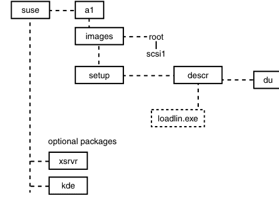

目录要求。

如果机器没有 CD-ROM，则必须配备软驱驱动器。您将需要使用随书提供的 CD 制作启动盘。您需要在另一台带有 CD-ROM 驱动器的机器上执行此步骤。将启动盘插入软驱驱动器并启动计算机。使用 Linuxre 设置所有选项并移动到主菜单。选择内核模块（硬件驱动程序），并选择加载网络卡模块。SuSE Linux 将自动检测您的驱动器。PCI 卡配置几乎完美无缺，ISA 卡已准备好 I/O 和 IRQ 信息供输入。返回安装界面，选择网络 (NFS) 作为源介质，并设置所有 NFS 参数、启动类型等。记住导出完整的目录树；如果您计划用从 Windows 或 DOS 启动，请包含 `loadlinux.exe`。

YaST 也有另一个选项：安装到现有目录。见图 2.3。


现有目录安装信息。

SuSE Linux 也可以通过 FTP 方法进行安装。除非您拥有高速网络连接（如 DSL、ISDN、T1 或宽带接入），否则我不建议使用这种方法。使用 拨号会给您的 ISP 带来一些问题，即使我告诉他们我正在下载整个发行版。虽如此，我总认为大家都知道 Linux。

这种方法与 NFS 安装类似：加载内核模块，继续安装并选择 SuSE Linux 作为您的源介质。您需要获取所选 FTP 服务器的地址。SuSE FTP 程序使用匿名登录功能。

复制所需的目录（如前所述），开始本地安装。

过去，Linux 对硬件的支持参差不齐——某些组件有效，而其他一些无效。硬盘安装是迫于之举，因为 SCSI 驱动程序仍处于阶段，且某些 CD-ROM 是没用的。现在，驱动的支持是线性的。随着产品的发布，支持变得

您对硬盘安装的选择可能取决于以下因素：

- 1. 您有足够大的硬盘，有空闲的 DOS 分区并决定将 SuSE 拷贝其中。
- 2. 您有少量想要运行 Linux 的机器，且它们没有网络连接也没有安装 CD-ROM 单元。注意：将磁盘格式化为 DOS 分区。

```
\dump
dump\suse
dump\suse\a1
dump\suse\images
dump\suse\setup
```

务必复制 `initrdsk.gz` 和适用于您系统的内核。将它们拷贝到 `\dump\suse\images` 目录。

将 CD-ROM 文件 `\suse\setup\inst-img` 和 `\suse\setup\loadlin.exe` 拷贝到 `\dump\suse\setup`。

如果有足够的磁盘空间，请复制 `$setup\images`。（这并非必须，但它可以显示磁盘空间。）

复制所需的目录后，SuSE Linux 将帮助您清除旧障碍。Linux 启动后，选择源，然后选择硬盘选项。如果您计划使用额外的软件应用程序，可以在基础系统安装后添加。

NeoMagic 发布其驱动程序源代码为笔记本电脑领域带来了巨大变化。例如，我曾想在我拥有的一台 CTX 笔记本上运行 Linux。那台电脑配备了 NeoMagic 128ZV 芯片组，而唯一的可用驱动程序售价 200 美元。我选择了等待。从那时到那时，我发生了一些变化：我不再拥有 CTX 了，再也不需要等待就能在口袋里运行 Linux 了。现在，我可以在口袋里运行 SuSE Linux。这就像太平洋电信（Pacific Bell）广告词中的一个新词——Teleis，意为“智能规划的进步”。

正如并非每种硬件都与 Linux 兼容一样，笔记本也是如此。然而，前景依然充满希望，你可以在网上找到如何在笔记本电脑上安装 Linux 的大量信息。一些机构专门负责这项任务。表 2.2 列出了一些兼容 Linux 的便携式设备。

| 表 2.2 兼容 Linux 的便携设备 |
|---|---|---|
| 制造商 | 型号 | |
| 宏碁 (Acer) | Extensa | 355-36x-390 系列 |
| 宏碁 (Acer) | Travel Mate | 3xx-5xx-7xx dito |
| Acornote | Light | 350-370 两个型号 |
| Alcam | Designer | i400 |
| AMS | Roadster | 15CTA |
| AMS | TravelEx/TravelPro | 105/256CXA 2型号 |
| Apex | | XC-200 |
| AST | | J30 |
| AST | | M1560X |
| AST | Ascentia | A/P55/810/910N 3型号 |
| Best | | 1100/6650CD 2 系列 |
| Broadax | | 6650 |
| Chembook | | 3000/6000/7000/9000 系列 |
| 康钛 (Compaq) | Armada | 1100-7790DMT 范围 |
| 康钛 (Compaq) | Armada | M700 |
| 康钛 (Compaq) | Presario | 1000-1925 范围 |


| CTX | EasyBook | 700/800 系列 |
| CTX | | V92C266 |
| 戴尔 (Dell) | Inspiron | 3000-7500 范围 |
| 戴尔 (Dell) | Latitude | CP M233XT-CpiD300XT |
| DynaNote | | 500 |
| 通电 (Fujitsu) | Lifebook | 555T-E350 2型号 |
| 通电 (Fujitsu) | LiteLine | C400DVD |
| 门威 (Gateway) | 2000 | 2000-9150 范围 |
| 日立 (Hitachi) | Visionbook | Plus/5000-7500 范围 |
| 惠普 (HP) | Omnibook | 600-7100 型 |
| IBM | Thinkpad | 350-i721 2型号 |
| 制造商 | 型号 | 系列 |
| --- | --- | --- |
| Jetta | Jetbook | 850-7080 2型号 |
| Micron | GoBook/GoBook2 | |
| Micron | Millennia Transport | |
| Micron | Transport | TREK2 |
| NEC | Ready/Vera/VersaX | 120LT/6200MMX 2型号 |
| OKI | OkiBook | D266 |
| Olivetti | Echos | |
| 松下 (Panasonic) | Toughbook | GT400VX/SENS810 2型号 |
| 锐星 (Sharp) | Actius | A100 |
| 锐星 (Sharp) | Mebius | 5600 |
| 锐星 (Sharp) | PC | 86501II-9020 2型号 |
| 索尼 (Sony) | Vaio | PCG-C2GP5-PCG707C-838 3型号 |
| 仪器 (T.I.) | Extensa | 300-655CDT |
| 东芝 (Toshiba) | Libretto | 3010-7020 范围 |
| 东芝 (Toshiba) | Satellite | 1100CS-4090XCD 范围 |
| 东芝 (Toshiba) | Tecra | 500CD-710CDT 范围 |
| Umax | Actionbook | 318T-S13T 2型号 |
| Winbook | | FX-XP5 |
| @Book | | 900C |

这些是一些可用的移动平台。如果你的特定机器没有列出，请不要灰心；我的 Compaq Presaro 1270 没有在我读过的任何支持文档中列出。我的通用哲学是：“只要我能让它启动，我就可以在这里调优！”

安装 SuSE Linux 没遇到什么问题——我的硬件被识别了，那个讨厌的多功能 PCMCIA 卡配置得几乎完美。（我将在第 5 章“首次在 SuSE Linux 6.3 中启动”中介绍特定的 SuSE PCMCIA 故障排除。）

我建议你获取相关移动单元的所有系统信息。然后访问 URL http://... 

> 警告

当前 Linux 的爆发增长产生了对快速高效分区的需求——重点是“快速”！SuSE 提供了两种不同的方法来对硬盘进行分区。关键取决于你的特定环境，即软件应用程序、工作负载和用户数量。

分区过程是最重要的部分。分区决定了你如何分配空间……

提前计划好为某些应用程序分配多少磁盘空间是开始安装的最佳方式。

## 单磁盘分区

磁盘空间分配并非一成不变，这一事实并不意味着你无法做出选择。请查看下面的分区大纲，或许可以避免当你对你的 CTO 或 IT 经理说“老板，我们遇到了一小问题……”时可能发生的糟糕局面。

如果你将文件系统（分区）跨越更广泛的区域，这将一个简单的解决方案。设置独立的 `/`、` `/usr`、` `/var` 和 `/home` 文件系统让你保存关键数据，例如系统日志文件、用户目录和软件应用程序。图 3.2 显示了如何实现。

| | 大约 |
| --- | --- |
| / (根分区) | 100-200MB |
| /swap 分区 | 取决于系统内存 |
| /usr 分区 | 最好有大量空间 |
| /opt 分区 | GNOME 和 StarOffice 位于此处 |
| /var 分区 | 日志和管理消息 |
| /home 分区 | 用户目录 |

图 3.2

单磁盘分区方案。

这种分区技术让我受益匪浅。在我拥有的一台 Linux 机器中，有一个分区（文件系统）专门用于下载软件。大部分是用于 GNOME 0.9/Enlightenment 0.14 发布版本的软件。当时存在大量的依赖关系问题（正如你可能记得那样），需要许多软件包才能让一切运行起来。我将 `.rpm` 包保在一个目录中，这样如果出现任何问题或我决定快速重装，我就可以使用现有的分区设置，只是不格式化包含软件软件包的分区。在指定新的挂载点时，我会恢复原始的分区名称，然后就能恢复正常工作。这种多花一点时间是非常值得的。

单驱动器、多分区方案对于大多数独立和网络化的 PC 来说似乎是成功的。这种设置也适用于具有新驱动器或大量未使用空间的笔记本电脑。在 4.3GB 空间中，我使用了 2.5GB 用于 Linux。欲更多信息，请参阅分区 HOWTO：http://www.linuxdoc.org/HOWTO/mini/Partition.html。

## 多磁盘分区

随着 Linux 运行在越来越多的服务器上，一个大问题是多少才够。也许你的应用程序并不需要一个 RAID-1 系统来提供极致的镜像和容错能力。多个磁盘可能是你的解决方案，因为扩展资源并保护它们免受损坏或损坏的能力至关重要。SuSE Linux 可以毫无问题地配置多个磁盘。图 3.3 展示了一个非常简单的多磁盘设置。

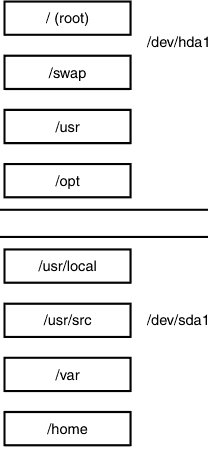

### 图 3.3

多硬盘分区方案。

注意 `/home` 和 `/var` 是在不同的磁盘上。我还将 `/opt` 包含在第二个磁盘上。这个文件系统可以作为存放数据库信息以及其他如 StarOffice 等内容的地方。你可能想检查此设置并根据你的需求构建最佳布局；例如，对于对于预算紧张且不需要 RAID 阵列的企业来说，这种方案是行有效的。

关于如何分区你的多磁盘空间的更多信息，请将浏览器指向：http://www.double-barrel.be/linux_web/LDP/HOWTO/Multi-Disk-HOWTO.html。

未来，公司和大型企业可能会决定利用 Linux 作为服务器解决方案。考虑到这一点，内核开发人员已将高级功能集成到通用 v2.2 包中。大多数改进已经在 UNIX 系统中测试并使用了一段时间，因此 Linux 的增长在某种程度上已经超过了它的成熟度。现在的目标是将现有的应用程序实现到当前的内核版本中。

## RAID 阵列

RAID（廉价磁盘冗余阵列）通过将信息分散在多个磁盘上来确保信息的一致性，使用诸如 RAID 0 级（磁盘条带化）等技术。这种方法没有提供镜像益处（以防磁盘崩溃），但它确实降低了磁盘延迟，从而提高了数据传输率。

RAID 1 级（磁盘镜像）有助于实现冗余和从硬盘崩溃中恢复。

RAID 和磁盘设置超出了本文讨论的范围。你可以在以下地址找到更多信息：http://metalab.unc.edu/pub/Linux/ALPHA/linux-ha/High-Availability-HOWTO.html，http://www.vogoninternational.com。

还有资源可以帮助特定类型的 RAID 应用。软件 RAID 和硬件 RAID HOWTO 位于 http://www.linux.org/il/LDP/HOWTO/mini/Software-RAID.html，而对于使用 DPT Smartcache 控制器的 SCSI 应用，则位于 http://www.linuxux.org/HOWTO/mini/DPT-Hardware-RAID.html。

## Reiserfs

Reiserfs 文件系统具有日志功能，可以在意外关机后由 `fsck` 程序进行完整性检查，具有动态调整功能，并使用平衡树算法来最大限度地减少磁盘访问次数。Reiserfs 的开发取得了一些重大成功。请参阅新闻稿：http://devlinux.com/

SuSE 的高可用支持组与当前的开发密切相关。如果你认为这并不是一个巨大的需求，请获取更多详细信息

逻辑卷管理器（LVM）可以在分区磁盘时作为选项可用。该工具在计算领域已经存在了一段时间——具有 UNIX 背景的用户尤其会熟悉——但 SuSE 选择突破常规并在该版本中提供。要使用 LVM 系统，你将对 LVM 结构有所了解。如果没有，最好使用传统的分区方案。

你的磁盘

SuSE 的分区工具基于老经典的 Linux `fdisk`。`YaST1` 界面让这项工作变得愉快且直接。


SuSE 的 YaST1 和 YaST2 有独立的分区工具。正如第 2 章“安装 SUSE Linux”所述，YaST2 被设计为一种过渡工具，适用于那些对自定义安装感兴趣或急于让运行系统的用户。

SuSE 的新安装程序 YaST2 尝试通过设置常见的安装后参数（如 `root` 用户名、密码以及鼠标设置）来简化初次体验。由于这些是在安装开始时完成的，安装后剩下的唯一任务就是网络设置。我们将跳过设置界面，进入 YaST2 磁盘分区工具。图 3.4 显示了 YaST2 分区选择屏幕。

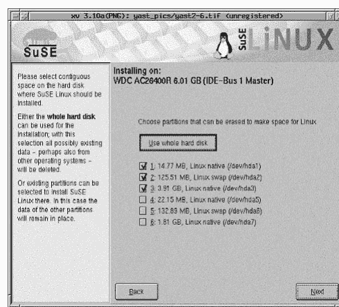

### 图 3.4

使用 YaST2 选择安装所需的分区。

你将获得两种选择：要么删除现有分区为 Linux 腾出空间，要么将整个磁盘留给 SuSE 安装。遗憾的是，YaST2 工具并没有提供太大的灵活性。如果你希望快速安装，可能需要让 YaST2 执行（自动）所有分区。这可能不是最优的，但它能让你运行起来。图 3.5 显示了安装前最终分区设置显示的示例。注意：读取“tux”的字段将包含你在初始设置期间输入的名称。

> 警告
>
> YaST2 在识别大于 8.4GB 的大磁盘时存在一个问题。如果你有一个大磁盘，你可能需要使用 YaST1 对其进行分区。YaST2 将指示磁盘检测是否存在问题。例如，我无法对我的 17.2GB 希捷硬盘进行分区。

YaST2 将进入下一步，即删除请求的分区并重建文件系统。

# YaST1 分区工具

# 30 第 3 章：硬盘分区

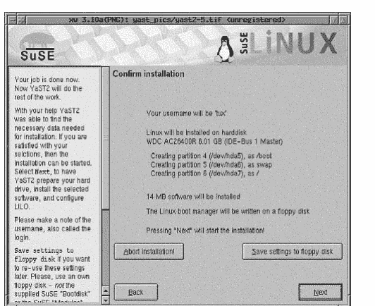

图 3.5

YaST Linux 将允许你选择要对哪个磁盘（如果有多个）进行分区。`fdisk` 工具将检测磁盘大小和分区类型。见图 3.6。

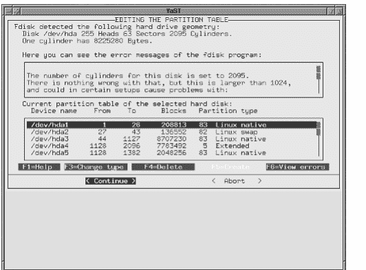

图 3.6

YaST `fdisk` 接口工具。

`fdisk` 工具支持多种类型的分区格式。图中显示的是类型 83（Linux 原生 ext2）、类型 82（Linux 交换分区 swap）以及类型 5（扩展分区）。扩展分区（SuSE 称之为逻辑分区）被频繁使用，因为 `fdisk` 工具只能分配 4 个主分区。如果你有一个大磁盘，你很有可能会创建一个相当大的扩展分区。

在磁盘上分配空间时，请记住你将需要加载的软件应用程序，以及可能的一些数据库服务器或用于主目录的用户空间。注意菜单底部的提示。使用这些按键可以访问系统帮助（`F1`）、指定文件系统类型（`F3`）、删除（`F4`）或创建新分区（`F5`）。`F6` 让你完全访问 `fdisk` 程序发现的错误（而不只是页头信息）。


SuSE 的 `fdisk` 程序具有记忆功能，如果你犯了错或按了中止过程的按键，这个功能将非常有用。当你重启 `fdisk` 时，你之前所做的更改仍然在那里。如果你使用 `Ctrl+C` 取消操作，大多数 `fdisk` 程序将回到起点。

这是软件安装的最后一步。Linux 文件系统连接在一起形成一棵树，以根目录（`/`）为中心。所有其他文件系统——`usr`、`usr/local`、`bin` 和 `/etc`——都是通向 `/` 的分支。检查图 3.7 中的设置，并注意“format”列中的“no”。

| -创建文件系统-| | | |

| :--- | :--- | :--- | :--- |

| 格式 | | | |

| 现有磁盘上的文件系统列表： | | | |

| Linux 原生 hda1 | 2048 | 16384 | no |

| Linux 原生 hda2 | 83886 | 32768 | no |

| Linux 原生 hda3 | 204856 | 40960 | no |

| Linux 原生 hda7 | 262144 | 51200 | no |

| Linux 原生 hda8 | 131072 | 70486 | no |

| Linux 原生 hdc1 | 235492 | 81920 | no |

| Linux 原生 hdc5 | 357408 | 102400 | no |

| Linux 原生 hdc6 | 102400 | 204800 | no |

| Linux 原生 hdc7 | 253984 | 409600 | no |


**图 3.7**

YaST 用于创建/修改文件系统。

# 32 第 3 章：硬盘分区

这里你可以通过名称选择挂载点。由于格式化为“no”，系统将删除数据。在这种情况下，帮助（`F1`）、挂载点（`F4`）或格式化（`F6`）应该是你唯一关心的问题。

> 警告
>
> 记得 `LILO` 的 1024 扇区限制。当你进行挂载点时，系统允许你做出不同的选择。当你重启时，启动提示会出现，并且读取 `/boot` 越界。

## 总结

现在你准备好在新准备的磁盘上安装系统了。在之前，我将进行快速回顾。

你已经决定了所需的应用程序以及你的 SuSE Linux 的用途。使用 YaST1 或 YaST2，你已经设置了交换空间并挂载了文件系统。那么你已经准备好了！

# 第 4 章

SuSE 软件安装

多年来，在一些邮件列表上阅读的信息以及软件评论阻止了我使用 SuSE。听说 YaST 令人困惑并出现过很多问题，这无助于增加我的信心。更糟糕的是，我听过启动问题、X 服务器配置问题以及其他事情。尽管我可以没有问题地安装其他 Linux 发行版，但我拒绝尝试 SuSE。好吧，是时候澄清传闻并回归事实了。是的，YaST 有它自己的问题，就像任何进行中的工作一样。过去存在的问题现在可能仍然存在。怎么说？如果用户不了解安装过程，问题仍然可能出现。你对 YaST 程序的功能越熟悉，就越会使用它。

众所周知，一次昂贵的、干净的安装需要时间——我可能会说这是值得的投入。YaST 提供了这种环境。更重要的是，SuSE 通过提供 YaST2 提升了其在图形化安装领域的地位。对于对于不太熟悉的用户来说，这个安装程序是一个很好的选择。

# 34 第 4 章：SuSE 软件安装

集成，为了……我希望能够澄清一些出现的误解并消除对 YaST 的疑虑。因此，安装和卸载软件变得简单。另一方面，Caldera、Red Hat、Turbo Linux、Mandrake、SuSE 以及许多其他发行版都使用 RPM。这让 RPM 比其他的更好吗？不，但它让你能够在另一个发行版中使用另一个发行版使用的某些软件。因此，如果多个发行版使用相同的包管理系统，找到隐藏应用程序的概率就会增加。维护系统的人对使用类似的包管理系统会有信心。

## YaST 包处理方法论

## RPM 与安全

`RPM` 使用非常方便，但你应该意识到其中的一些问题。你必须以 `root`（超级用户）身份安装 `RPM` 才能获得必要的写入权限。这对系统安全构成了威胁。然而，某些人可能并不将其视为威胁，或者认为这微不足道。尽管如此，事实是这样的：

在 `root` 账户下运行的 `RPM` 安装程序现在对你的系统拥有完全的读写权限。这开启了一个潜在的危险安全漏洞，你可能会在不经意中更换系统二进制文件和库，导致某些其他应用程序失效。此外，在最坏的情况下，你可能会安装一个木马程序，从而破坏你系统的完整性。

正因如此，软件包管理器已包含了 `MD5` 校验和功能。我将在本章的“更改/创建配置”部分向你演示如何验证软件包。从哪里获取软件至关重要——请参阅第 13 节“网络安全”。你的系统生存取决于此。

为了协助软件包的顺利安装，设计了如 `gnoRPM` 和 `xrpm` 等界面。尽管如此，无论这些工具有多华丽，它们在 YaST 面前都显得黯色无形。一个工具若要有效，你必须想要使用它。YaST 已经帮助完成了磁盘分区和格式化的任务，并已准备好引导你完成软件包选择和磁盘使用管理（这一功能本身就价值连城）。

对于任何计算机系统，软件管理都是一个关键领域。无论系统大小，都可以承担软件安装错误或配置不当所带来的成本。可以保证，没有什么是万无一失的，每个严肃开发者的目标都是降低应用程序失败的概率。使用 `RPM` 让安装工作变得更容易接受。

对于那些最近没有使用过 `RPM` 的人，软件包管理器经过了一些升级。当前版本为 3.0.3。3.0 版本包含的功能包括多个软件包安装（这减少了未验证的软件包依赖失败的概率），以及在安装前检查可用磁盘空间的能力。

然而，YaST 有两种实现方式来处理基础（核心）任务。使用原始 YaST 安装系统可能被证明具有教育意义，因此再次强调，熟悉是核心要素。


初次安装期间一个老生常谈的问题是不知道应该选择哪些软件包，以及哪些是真正必要的。对于那些正在熟悉 Linux 安装基础的人来说，这似乎是一个已经解决的问题，但我仍然在回答邮件列表中关于软件包选择的问题——而且从未给出过真正具体的答案。这些问题的主要原因是软件占据了硬盘空间。在使用 GNU/Linux 软件时，用户面临着海量的额外应用程序选择。我确定这就是为什么人们在委派方面以及在这些边界内生活存在问题。在计算机行业中，人们一生大部分时间都在使用专有软件，因此 Linux 提供了一些令人欢迎的选择。然而，当你在稀薄空气生活了一段时间后，身体就习惯了匮乏——回到海平面可能会让你感到头晕？

在输入安装程序之前，先对你每天可能需要用到的应用程序有一个良好的了解。确保你考虑了图形处理、文字处理以及任何其他每天使用的应用程序。这并不是为了在任何方面限制你；过去，我曾因为在磁盘上安装“所有”内容而浪费了大量的硬盘空间。从长远来看，我发现某些应用程序并不是必不可少的。

如果你正在构建测试机或 `R/D` 平台，或者你有大量的可用磁盘空间，这可能不适用于你的设置。然而，如果你磁盘空间有限或使用笔记本电脑，那么这些建议适用于你。

## 使用 YaST2 安装你的系统

在安装阶段，你可能选择了 `YaST2` 作为你的安装工具。如果是这样，你可以指定自动安装或引导式安装。顾如其名，自动安装尽可能减少了用户交互。然而，你可能希望选择引导式安装，以提供灵活性。`YaST` 已经帮助完成了分区和格式化的任务，并已准备好引导你完成软件包选择和磁盘使用管理（这一功能本身就价值连城）。

## YaST 包处理方法论

## RPM 与安全

`RPM` 使用非常方便，但你应该意识到其中的一些问题。你必须以 `root`（超级用户）身份安装 `RPM` 才能获得必要的写入权限。这对系统安全构成了威胁。然而，某些人可能并不将其视为威胁，或者认为这微不足道。尽管如此，事实是这样的：

在 `root` 账户下运行的 `RPM` 安装程序现在对你的系统拥有完全的读写权限。这开启了一个潜在的危险安全漏洞，你可能会在不经意中更换系统二进制文件和库，导致某些其他应用程序失效。此外，在最坏的情况下，你可能会安装一个木马程序，从而破坏你系统的完整性。

正因如此，软件包管理器已包含了 `MD5` 校验和功能。我将在本章的“更改/创建配置”部分向你演示如何验证软件包。从哪里获取软件至关重要——请参阅第 13 节“网络安全”。你的系统生存取决于此。

为了协助软件包的顺利安装，设计了如 `gnoRPM` 和 `xrpm` 等界面。尽管如此，无论这些工具有多华丽，它们在 `YaST` 面前都显得黯色无形。一个工具若要有效，你必须想要使用它。`YaST` 已经帮助完成了分区和格式化的任务，并已准备好引导你完成软件包选择和磁盘使用管理（这一功能本身就价值连城）。

对于任何计算机系统，软件管理都是一个关键领域。无论系统大小，都可以承担软件安装错误或配置不当所带来的成本。可以保证，没有什么是万无一失的，每个严肃开发者的目标都是降低应用程序失败的概率。使用 `RPM` 让安装工作变得更容易接受。

对于那些最近没有使用过 `RPM` 的人，软件包管理器经过了一些升级。当前版本为 `3.0.3`。`3.0` 版本包含的功能包括多个软件包安装（这减少了未验证的软件包依赖失败的概率），以及在安装前检查可用磁盘空间的能力。

然而，`YaST` 有两种实现方式来处理基础（核心）任务。使用原始 `YaST` 安装系统可能被证明具有教育意义，因此再次强调，熟悉是核心要素。

## 使用 YaST1 安装你的系统

一个重启提示。这将验证分区表，之后您就可以准备就绪了。

- **检查软件包依赖**——此功能允许您在安装过程中的任何时候检查软件包依赖项。如果您每个类别选择的包较少，我建议在选完每个类别后检查依赖项。程序还有一个“自动（`Auto`）”功能，它也会尝试解决任何软件包依赖问题。如果这不能解决问题，您将会被引导至带有指示器的文件，指示器为 `AND`（或所有列表中的软件包都应该安装），`OR`（如果您选择了一个软件包，则应该包含列出的软件包中的一个或多个），或 `EXCL`（列出的软件包中没有一个需要安装的）。


# SuSE 软件包安装

## 软件包管理选项

- **所有系列和软件包索引**——此项选择将为您列出该发行版提供的软件包列表。如果是更新，它将在将在您系统上安装的所有软件包上标记一个星号（*）。它还将列出软件包、版本号、文件大小以及它所属的系列组。

- **软件包信息**——这是一个非常有用的选项，允许您搜索整个 CD 和硬盘目录结构中的特定软件包。它还区分大小写，允许进行更精确的搜索。如果您不确定软件包的准确名称，可以搜索文本字符串并输出所有可能的文件。

- **安装软件包**——当您需要从 ftp 更新文件（`ftp.fuse.com/pub/fuse/e386/update/6.3` 是配置文件中列出的服务器 URL），或者您已经下载了文件到硬盘上的某个目录进行安装时，这非常有用。您还可以挂载 CD（发行版以外的 CD）并从中安装软件。`YaST1` 安装程序识别以下格式：`.rpm`、`.spm`、`.src.rpm` 以及特殊补丁文件，这些文件可以通过 SuSE ftp 服务器获取。它还支持 `.tar.gz` 和 `.tgz` 格式的压缩 tar 包。

- **删除软件包**——最后的选项选择将为您提供当前系统上安装的所有软件列表。我发现这个实用程序非常独特，因为它列出了并非由发行版安装的 SuSE 软件和软件包。请注意，安装程序将识别并删除这些程序；它们将不会出现在更新或依赖检查的列表中。如果您安装了外部程序，如果可能，最好将该软件包替换为 SuSE 构建的软件包。

所有这些元素在管理您的软件应用程序方面都起着重要作用。对于任何严肃的安装来说，充分查看整个选项范围是前提。深入了解 `YaST` 及其配套工具集是非常有必要的。

## 选择/安装软件包

SuSE Linux 在软件包可用性方面一直处于领先地位。随书的 CD 包含了大量的软件包。当您准备好安装软件时，选择“加载配置（Load Configuration）”选项。您可以从表 4.1 所示的示例中快速选择预构建的软件包。

### 40 第 4 章：SuSE 软件包安装

| 选择 | 描述 |
| --- | --- |
| SuSE 几乎所有 | 将安装 CD 上几乎所有的软件包 |
| SuSE 开发系统 | 带有编程工具的开发环境 |
| SuSE DMZ 基础系统 | 恶劣环境配置，仅安装基本要组件 |
| SuSE 游戏系统 | 安装了所有游戏的 SuSE 系统 |
| SuSE Gnome 系统 | 带有 窗口管理器（Enlightenment Window Manager）的 GNOME 项目环境 |
| SuSE KDE 系统 | 带有 KDE 及其配件的 KDE 项目环境 |
| SuSE 最小系统 | 包含有限软件应用程序的最小系统环境 |
| SuSE 多媒体系统 | 系统包含所有录制、修改和混合音频应用程序所需的软件 |
| SuSE 网络导向系统 | 为服务器交互、Samba、NFS、YP(NIS) 以及其他应用程序设计，允许将 SuSE 集成到多平台环境中 |
| SuSE 办公服务器 | 包含用于服务器交互的软件 |
| SuSE 默认系统 | 提供了日常任务有用的工具和应用程序的良好平衡 |

**注意**

- 为了帮助您，可以访问一个额外的帮助部分。
- SuSE Linux 提供一个通过 `F1` 访问的帮助部分，它区分大小写。
- 为了安全起见，建议在更新之前备份。程序将更新文件并产生所有更改文件的备份副本。


## SuSE 系统类型

| SuSE 网络导向系统 | 为服务器交互、Samba、NFS、YP(NIS) 以及其他应用程序设计，允许将 SuSE 集成到多平台环境中 |
| SuSE 办公服务器 | 包含用于服务器交互的软件 |
| SuSE 默认系统 | 提供了日常任务有用的工具和应用程序的良好平衡 |

## 注意

- 为了帮助您，可以访问一个额外的帮助部分。
- SuSE Linux 提供一个通过 `F1` 访问的帮助部分，它区分大小写。
- 为了安全起见，建议在更新之前备份。程序将更新文件并产生所有更改文件的备份副本。
- 软件包信息——这是一个非常有用的选项，允许您搜索整个 CD 和硬盘目录结构中的特定软件包。它还区分大小写，允许进行更精确的搜索。
- 如果您不确定软件包的准确名称，可以搜索文本字符串并输出所有可能的文件。
- 安装软件包——当您需要从 ftp 更新文件（`ftp.fuse.com/pub/fuse/e386/update/6.3` 是配置文件中列出的服务器 URL），或者您已经下载了文件到硬盘上的某个目录进行安装时，这非常有用。您还可以挂载 CD（发行版以外的 CD）并从中安装软件。YaST1 安装程序识别以下格式：`.rpm`、`.spm`、`.src.rpm` 以及特殊补丁文件，这些文件可以通过 SuSE ftp 服务器获取。它还支持 `.tar.gz` 和 `.tgz` 格式的压缩 tar 包。
- 删除软件包——最后的选项选择将为您提供当前系统上安装的所有软件列表。我发现这个实用程序非常独特，因为它列出了并非由发行版安装的 SuSE 软件和软件包。请注意，安装程序将识别并删除这些程序；它们将不会出现在更新或依赖检查的列表中。如果您安装了外部程序，如果可能，最好将该软件包替换为 SuSE 构建的软件包。


## 删除软件包
最后的选项选择将为您提供当前系统上安装的所有软件列表。我发现这个实用程序非常独特，因为它列出了并非由发行版安装的 SuSE 软件和软件包。请注意，安装程序将识别并删除这些程序；它们将不会出现在更新或依赖检查的列表中。如果您安装了外部程序，如果可能，最好将该软件包替换为 SuSE 构建的软件包。

所有这些元素在管理您的软件应用程序方面都起着重要作用。对于任何严肃的安装来说，充分查看整个选项范围是前提。深入了解 YaST 及其配套工具集是非常有必要的。

## 选择/安装软件包

SuSE Linux 在软件包可用性方面一直处于领先地位。随书的 CD 包含了大量的软件包。当您准备好安装软件时，选择“加载配置（Load Configuration）”选项。您可以从表 4.1 所示的示例中快速选择预构建的软件包。

### 40 第 4 章：SuSE 软件包安装

| 选择 | 描述 |
| --- | --- |
| SuSE 几乎所有 | 将安装 CD 上几乎所有的软件包 |
| SuSE 开发系统 | 带有编程工具的开发环境 |
| SuSE DMZ 基础系统 | 恶劣环境配置，仅安装基本要组件 |
| SuSE 游戏系统 | 安装了所有游戏的 SuSE 系统 |
| SuSE Gnome 系统 | 带有 窗口管理器（Enlightenment Window Manager）的 GNOME 项目环境 |
| SuSE KDE 系统 | 带有 KDE 及其配件的 KDE 项目环境 |
| SuSE 最小系统 | 包含有限软件应用程序的最小系统环境 |
| SuSE 多媒体系统 | 系统包含所有录制、修改和混合音频应用程序所需的软件 |
| SuSE 网络导向系统 | 为服务器交互、Samba、NFS、YP(NIS) 以及其他应用程序设计，允许将 SuSE 集成到多平台环境中 |
| SuSE 办公服务器 | 包含用于服务器交互的软件 |
| SuSE 默认系统 | 提供了日常任务有用的工具和应用程序的良好平衡 |

**注意**

- 为了帮助您，可以访问一个额外的帮助部分。
- SuSE Linux 提供一个通过 `F1` 访问的帮助部分，它区分大小写。
- 为了安全起见，建议在更新之前备份。程序将更新文件并产生所有更改文件的备份副本。
- 软件包信息——这是一个非常有用的选项，允许您搜索整个 CD 和硬盘目录结构中的特定软件包。它还区分大小写，允许进行更精确的搜索。
- 如果您不确定软件包的准确名称，可以搜索文本字符串并输出所有可能的文件。
- 安装软件包——当您需要从 ftp 更新文件（`ftp.fuse.com/pub/fuse/e386/update/6.3` 是配置文件中列出的服务器 URL），或者您已经下载了文件到硬盘上的某个目录进行安装时，这非常有用。您还可以挂载 CD（发行版以外的 CD）并从中安装软件。YaST1 安装程序识别以下格式：`.rpm`、`.spm`、`.src.rpm` 以及特殊补丁文件，这些文件可以通过 SuSE ftp 服务器获取。它还支持 `.tar.gz` 和 `.tgz` 格式的压缩 tar 包。
- 删除软件包—— 最后的选项选择将为您提供当前系统上安装的所有软件列表。我发现这个实用程序非常独特，因为它列出了并非由发行版安装的 SuSE 软件和软件包。请注意，安装程序将识别并删除这些程序；它们将不会出现在更新或依赖检查的列表中。如果您安装了外部程序，如果可能，最好将该软件包替换为 SuSE 构建的软件包。

## 使用 YaST 安装您的系统

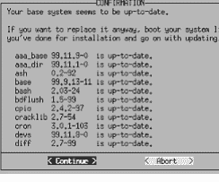

图 4.6

YaST 正在检查软件更新。

该图显示系统已是最新状态。如果系统需要更新，将显示包信息。如果你更新版本，你将对系统进行彻底改造——在这种情况下，该过程类似于初始安装，需要选择新的内核以及其余的设置程序。如果你遇到问题并决定跳过设置程序，请在启动提示符处输入：

```
boot:NO_AUTO_SETUP=true
```

通过此操作，Autosup（自动更新）功能将被禁用。

如果在更新 SuSE Linux 发行版时遇到问题，请参考 http://sdb.suse.de/sdb/en/html/adrian_6.3_update.html 或 http://sdb.suse.de/sdb/en/html/bugs63.html。

## 软件包信息

每个软件包在安装期间都会提供一个简短描述以供评估。如果你不确定是否安装某个特定的应用程序，可以使用 YaST1 挂载 CD 并调用“软件包信息”选项。这将提供有关该特定软件包的详细信息。图 4.7 显示选择了一个新包。

> 警告

如果你正在查询 CD 中的软件包信息，请在启动 YaST1 之前插入 CD。如果未这样做，搜索将局限于已挂载的设备（分区）。

完成搜索后，你可以按 `F2` 或 `F3` 按钮让实用程序为你提供更多软件包信息。软件包信息将显示适用于大多数应用程序的详尽细节。（见图 4.8。）

### 44 第 4 章：SuSE 软件包安装

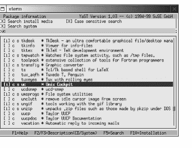

#### 4.7

使用 YAST1 识别软件包。

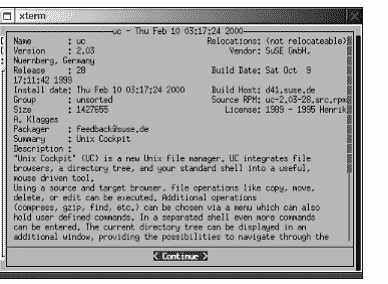

#### 4.8

查看详细软件包信息。

通过此类信息，你将对在系统上安装的内容一目了然。如果你熟悉 Linux 应用程序，那么此可选功能对你可能并非必需品。

## 构建自定义包

出于许多原因，构建自定义配置的能力是安装程序中的一项特殊创新。你所做出的选择（并由此节省的）在将来将具有巨大价值。SuSE 允许你使用渐进式选项更改安装以适应你的特定应用程序。与其在预设安装中挣扎，不如精细调整你的机器并运行最佳配置。构建自定义配置的两个关键是：1) 修改和创建配置选项，2) 将配置保存到磁盘。然后你可以在其他安装或更新中重用系统配置。

## 修改/创建配置

此菜单允许你执行字面所示的操作：如果你愿意，可以更改现有配置并创建一个新的。由于有约 1,500 个软件包可用，这里是定制的天堂。

例如，假设你决定使用 SuSE KDE 系统，而且你也喜欢开发软件。你只需要选择 SuSE KDE 系统，加载配置，然后选择“更改/创建”选项。现在浏览开发系列（以及任何符合你喜好的系列），标记应用程序，然后按下 `F10` 键——这将保存你刚刚所做的选择

如果你是一个完全的软件牛仔，你也可以在“更改/创建”选项中添加 SuSE 最小系统添加所有其他内容。图 4.9 展示了“更改/创建”配置中的系列选择菜单。

图 4.9

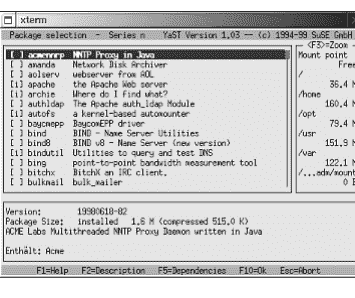

“更改/创建”菜单的软件包选择器。

为了参考，这些是安装程序使用的指示符：

- - [ ] 此软件包未安装。
- [x] 此软件包已选择安装。
- [i] 此软件包已安装。
- [r] 此软件包计划被替换（更新）。
- [d] 此软件包已安装并将移除。

当你完成软件包选择后，按下 `F10` 键回到 YaST1 主界面。选择“开始安装”，你就可以坐下放松了。程序将检查依赖关系；如果存在任何依赖项，程序将进行处理。

### 46 第 4 章：SuSE 软件包安装

# 第 5 章

## 首次进入 SuSE Linux

你的安装现在已几乎完成，你正处于新体验的边缘。但在完全准备好之前，还必须涵盖几个步骤——不过，如果你使用的是 Ya2 安装程序，剩下的步骤将非常短。这是因为你已经配置了鼠标并输入了其他信息，这些很快就会涵盖。那些选择使用 YaST1 的人需要多做一点工作，但并不多。

本章旨在帮助你快速上手，并突出 SuSE 用于确保你的系统以顶性能运行的安装后过程。正文将涵盖这两种安装协议所需的步骤。YaST2 的内容将侧重于概述，不涉及太多安装后流程；而 YaST1 的过程将更加详细。

## SuSE Linux 安装后过程

SuSE 与其他 Linux 发行版的区别在于 SuConfig 实用程序，每当在 YaST1 中更改重要配置时，它就会启动。SuSEConfig 使用基本系统中提供的预定义规范设置系统配置。无论你使用 YaST1 还是 YaST2，SuSEConfig 都可以创建或修改软件任务的配置。当你选择安装在硬盘上的软件准备好进行配置时，系统

# 第 5 章：首次启动 SuSE Linux

系统将自动执行配置，或者程序会提示你并等待你的输入。以下是 SuSEconfig 修改的一些文件：

- `/etc/resolv.conf`
- `/etc/hosts`
- `/etc/host.conf`
- `/etc/os.group`
- `/etc/ntpserver`
- `/etc/shells`
- `/etc/sendmail.conf`
- `/etc/default.keytab`
- `/var/lib/news/mailname`
- `/usr/lib/irc/ircII.servers`
- `/usr/X11R/lib/X11/fwwm2.fwwm2rc`


- `/usr/lib/zoneinfo/localtime`
- `/etc/hostname`
- `/dev/mouse` (符号链接)
- `/dev/modem` (符号链接)
- `/usr/X11R/lib/X11/fonts/*/*.fonts.dir`
- `/etc/info/dir`
- `/etc/ld.so.conf`
- `/var/catman/index.*`

系统了解某些参数并自动为你处理任务是有益的。另一方面，如果系统维护不当，这种类型的配置程序可能会导致严重问题。首先，让我们看看 YaST2 如何完成安装的。

## 使用 YaST2 安装程序完成

图形化安装程序的优势在于，在安装后处理过程中，比它的前身 YaST1 快得多。大多数系统信息在安装开始时就已经输入，这使得安装程序能够以自动类型阶段运行，无需用户交互。Linux 的安装正朝着这一方向发展：更多的系统交互和更少的用户交互。

此时有必要简要回顾一下 YaST2 的流程。基础配置任务（如输入语言、键盘类型和时区）已经处理完毕，你已经在鼠标配置步骤中识别了你的鼠标，如图 5.1 所示。

你还选择了安装方法的类型，无论是自动的还是引导式的。光是这些菜单就帮助你显著加快了安装过程——只需指向并点击即可完成。无需滚动其他菜单——这是最高效率的体现。

此外，你选择了特定的目标磁盘并使用了 `fdisk` 实用工具，该工具被集成在“安装 <硬盘名称>”选项中，这帮助你根据你的规范对磁盘进行分区。现有的分区已被擦除，并重建了新分区。你还从三种不同类型的软件包中选择了软选择：最小系统、默认系统和几乎所有。如果你选择了最小系统或默认系统，你可能添加了额外的软件，如图 5.2 所示。

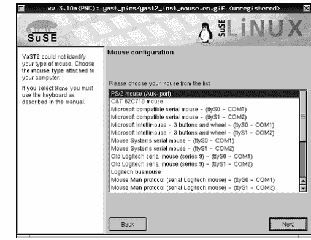

图 5.1

YaST2 鼠标配置器。

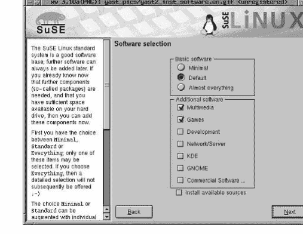

图 5.2

YaST2 额外的软件选择。

LILO 安装屏幕让你能够选择安装引导加载程序的位置。在该部分，你输入了名称、用户登录和密码。你还输入了 root 用户的密码，并选择了“确认安装”。软件现在正在安装，YaST2 将请求启动你已安装的系统。当它执行时，将默认进入 shell 环境，启动内核并运行 `initd` 脚本。在启动过程中，系统会添加 root 用户以及一个你在初始设置期间输入的名称的普通用户账户。在某些情况下，你可能需要安装额外的软件。可能还会提示你需要第二张光盘，因此在安装期间请准备好两张光盘。

当软件安装完成后，系统将由 YaST2 请求启动已安装的系统。当它执行时，将默认进入 shell 环境，启动内核并运行 `initd` 脚本。在启动过程中，系统会添加 root 用户以及一个你在初始设置期间输入的名称的普通用户账户。在某些情况下，你可能需要安装额外的软件。可能还会提示你需要第二张光盘，因此在安装期间请准备好两张光盘。

### 54 第 5 章：首次启动进入 SuSE Linux

为 Pentium 和非 Pentium (i386) 处理器构建；内核内置了针对移动用户的用户的自动电源管理功能；以及一个支持 SMP（多处理器处理）的内核。通过按下 F2 键，你可以更改内核镜像和配置文件的路径。对于大多数人来说，这并不是必要的；使用默认值即可。只有在执行自定义或专家级安装时，才可能用到此功能。

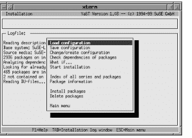

图 5.3

YaST 安装界面。

安装完选定的内核后，系统会提示你安装 LILO 加载器。如果你正在运行另一个操作系统且不确定 LILO 程序是否能工作，你可能想从软盘或其他介质启动系统。如果你运行的是 Windows NT，请参阅 http://ldp.iol.it/HOWTO/mini/Multiboot-with-LILO.html#toc4 了解如何配置 Linux 和 NT 引导加载器的详情。

LILO 安装界面让你具备了自定义启动序列的能力。此菜单界面如图 5.4 所示。

从安装菜单中可以看出，如果必须输入某些额外参数，“用于硬件参数的附加行”（Append-Line for Hardware Parameters）是菜单中的第一个选项。除非你有需要在启动序列之前确认的特殊硬件设备，否则大多数人都会跳过此项。

你将能够指定希望安装 LILO 加载器的位置。你的选项如下：

- **主引导记录 (Master boot record)**——如果你在硬盘上没有安装其他操作系统，建议在主引导记录 (MBR) 上安装 LILO。
- **根分区的引导扇区 (Boot sector of the root partition)**——如果系统已经有一个可以访问你选择的任何分区的引导管理器，可以执行此操作。
- **/boot 分区的引导选择 (Boot selector of the /boot partition)**——如果系统已经有一个可以访问你选择的任何分区的引导管理器，请使用此选项。
- **软盘 (Floppy disk)**——当你不系统是否能与 LILO 工作时，这是启动系统的一种安全有效的方法。唯一的缺点是你总是需要该磁盘才能启动。如果这是你的选择，请至少制作两块启动磁盘，以防磁盘故障。你可以更改启动延迟。系统默认为 10 秒，但如果你需要启动后直接进入，可以将其改为 0 秒。

除非你选择启动系统，否则请跳过线性选择。例如，我使用此选项在我的笔记本电脑上正确启动 Linux，而且 SCSI 和 RAID-0 硬盘设置以及控制器组合也需要启用此功能。

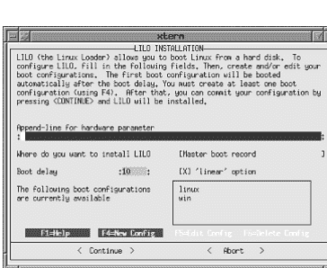

**图 5.4**

LILO 安装菜单。

F4 键允许你添加或编辑启动选择。当你选择时，请记住列表上的第一个选项将是默认系统。如果你与 Windows 共享磁盘，请务必将默认设置为最常用的系统。F5 键允许你编辑选择，F6 键删除配置。记住 SuSE 为大多数程序都提供了帮助；你可以通过按下 F1 键访问帮助。

## 网络配置

以下任务简单快捷，涉及 YaST1 或 YaST2 安装。这类似于最后的最后的检查清单，是进入项目列表之前要处理的最后几项内容。这些信息决定了分配给此机器的网络活动、网络类型（如 PPP 或以太网）以及分配给它的 Internet 地址。你将能够启动 Web 服务和安全外壳连接。为了继续此路线图，本节列出了每个步骤并提供了简要说明。

## 时区配置

在配置时区时，系统会给出一个列表。使用代表你所在区域的选项。如果不确定具体的时区，请检查 http://setmyclock.com/。

你可以选择使用本地时间或格林威标准时间 (GMT)。格林威标准时间 (GMT) 是称为协调世界时 (UTC) 标准的一部分，用于定义不依赖于个人位置的时间。科学家使用这种测量是为了避免时区的混淆。例如，假设你在美国西岸——你需要从 GMT 减去八小时（夏令期间为减去七小时）来获得当地时间。当 GMT 为 01:00 时，西雅图是下午 5:00 (pst)，或者太平洋夏令时间的下午 6:00。如果你决定使用 GMT，可以配置系统在每次重启时从全球时间服务器请求时间（详情请参阅第 10 章“管理网络设置”）。如果你选择本地时间，系统将依赖 CMOS 时钟设置的值。

## TCP/IP 网络配置

在配置时间后，SuSE 为你提供了一个简单、清晰的网络环境。在这里你可以输入有关网络环境的详细信息。设置以下项目：

- **网络类型**——回环（独立运行），IP 地址为 127.0.0.1 或“真实网络”（Real Network）。
- **主机名和域名**——如果你选择“真实网络”，这需要额外信息。
- **网络接口**——输入设备类型并选择正确的驱动程序——程序会识别你选择的接口，并提供一个驱动程序列表供选择。
- **IP 地址**——分配给机器的 IP 地址。
- **网关**——必须输入的网关地址。
- **子网掩码**——输入子网掩码。
- **DHCP**——如果你有动态主机配置，程序将询问“确认 DHCP”，见第 10 章。

### 55 SuSE 安装后过程

### 56 第 5 章：首次启动进入 SuSE Linux

### 57 登录 SuSE

## 关于服务

启动时启动 Inet 吗？(y/n) 如果你打算使用打印或其他服务，你需要运行它，因为它响应来自系统的调用。如果这台机器是防火墙，你可能不想运行它。

启动时启动 Portmapper 吗？(y/n) 只有当你提供 NFS 或 NIS 服务时才需要。这对防火墙也不建议运行。

- **调整字段**——显示系统的完整名称。如果对于用途不准确，你可以进行更改。
- **确认 DNS 服务器 (y/n)**——输入 DNS 服务器地址（此时仅一个，如果你有备用 DNS——第 10 章显示了如何添加）。域名应填写系统域名或 ISP 域名。
- **现在网络**——你的所有设置都已完成，除非你有多个网卡。如果是这样，你必须单独配置它们。详情请参阅第 7 章“SuSE 通信功能”。

## 登录 suSE


SuisseConfig 程序接管系统，写入配置文件、进行调整并设置文件权限。

1. SuisseConfig 运行并创建新的网络设置和文件。
2. 生成新的 Hostname、`/etc/resolv.conf`、`/etc/host.conf` 和 `/etc/SuSEConfig/profile` 文件。
3. 提示显示：“将重启以提交安装。”
4. 系统重启并引导内核，挂载文件系统。
5. 新提示显示：“欢迎来到 SuSE Linux。”
6. 系统询问 root 账户密码，你必须输入两次。如果你想跳过此步骤（不建议），请按 Enter 键，后安装将继续。如果你有理由在此不输入 root 密码，应尽快添加；详情请参阅第 8 章“使用 YaST 管理用户和组”。
7. SuisseConfig 脚本再次启动，屏幕显示：“YaST 必须配置一些内容，让我们开始吧。”

## 58 第 5 章：首次启动进入 SuSE Linux

### 示例用户名和密码功能

“创建示例用户”程序为您提供了一个机会，可以在系统上设置一个普通账户（非 root 账户），用于日常工作任务。（注意，在 YaST2 安装情况下不需要此项操作。）

> 注意
>
> 创建示例用户（非 root 账户）似乎是系统安装过程中一个微不足道的步骤，但请放心，事实并非如此。过去，发行版拥有简单的安装程序，它们认为用户会直接使用系统。root 账户被设置好后就此结束了。用户会（或应该）手动设置一个普通账户来执行日常工作。然而，有时这并没有发生，当用户以 root 权限工作时，会执行诸如 `#rm -r/` 的命令，并在无意中通过递归删除命令删除 root 分区。如果用户在普通账户下操作，系统将规避该命令并提示用户：“`rm -r/: 拒绝访问`”。

### 设备配置

必须对连接的设备进行配置，此步骤将帮助您识别并配置这些组件。

- **调制调器配置**——这将配置系统上的调制调器（modem）。您可以选择合适的 `ttySX` 端口。PPP 网络连接的配置将在第 7 章中介绍。
- **鼠标配置**——您可以从兼容类型列表中选择鼠标类型。选择鼠标将使用的端口，并测试设备运行正常。这是一个重要元素；如果没有配置鼠标使用，X Windows 系统将无法运行。YaST2 用户将跳过此选项，因为您在图形化安装期间已经配置过此选项。

### 安装后的最后步骤

软件已安装并初始化，基础网络连接已完成配置。YaST1 执行其最后的职责并将系统交由您。

1. YaST1 确认所有软件包均已安装，然后 YaST 退出。
2. 程序退出到壳（shell）类型环境。SuSEconfig 设置临时文件权限和邮件别名，您将在屏幕上看到权限设置的输出。默认情况下，系统设置为易操作的本地权限，这意味着大多数管理任务可以使用普通账户通过 `su`（超级用户）命令完成。根据系统的最终用途，您可以将权限设置为“secure local”（安全本地，这是我建议的）或使用“paranoid local”（疑虑本地）。如果您使用 paranoid本地设置，`su` 命令将变得几乎无效，并要求用户以 root 身份登录以执行权限任务。
3. 安装后程序通知用户将启动安装后脚本。安装日志位于 `/var/log/Config`，启动日志可以从控制台 9 获取（通过按 `Ctrl+Alt+F9` 进入控制台）。
4. SuSEconf 执行最终配置，并初始化启动服务。这些服务包括打印机守护进程、HTTP 服务器和邮件传输系统（`sendmail` 或 `postfix`）。
5. 您现在可以以 root 或示例用户的身份登录。

### 登录 SuSE Linux 时的问题

您的 Linux 系统已完全安装。您已经仔细遵循了所有的屏幕提示，假设您重启了机器，系统没有按照您预期的那样响应。系统可能无法启动，或者即使启动了，网络连接也会失败。更糟糕的是，您可能忘记了 root 密码，被困在系统外无法进入。

本节重点是帮助您识别并解决一些常见问题。由于主题范围广泛，本节提供了一些概述并提到了各种可以帮助您解决问题的资源。

如果您在登录（启动）系统时遇到问题，可以使用随书附带的 CD 中的 SuSE 内置救援系统。您的引导程序可能失败了；无论是 LinuxLoader还是其他类型，CD 都能让您恢复运行。

要执行此操作，您需要启动磁盘或可启动 CD。插入启动磁盘（或 CD 2），并选择“Start Installation/System”。程序会显示子菜单——选择“Boot Installed System”（启动已安装系统）。随后 `Linuxrc` 会询问 root 分区（例如 `/dev/hda1`）。输入信息并按回车键。`Linuxrc` 使用磁盘或 CD 上的内核镜像初始化系统。您只需要 root 密码即可回到系统进行调整或重新安装 LinuxLoader。

### 丢失或忘记 root 密码程序

丢失 root 密码是令人沮丧且耗时的。幸运的是，SuSE 有一个救援系统，可以在您丢失或忘记 root 密码时提供帮助。

某些 Linux 发行版采用了 Linux 单用户模式，这是一种命令行参数，提示用户在单用户模式下初始化系统。这是一种维护模式，不需要密码。SuSE Linux 将以单用户模式启动，但它会询问 root 密码。这就是救援系统大显用场。

## 60 第 5 章：首次启动进入 SuSE Linux

要使用救援系统，您必须构建救援磁盘（除非您有可启动的 CD）。带有可启动 CD-ROM 驱动器，冷启动系统并遵循 Linuxre 进入主菜单；然后选择“Start Installation/System”。选择“Load rescue system from CD”；屏幕显示救援系统正在加载到 RAM 磁盘。加载完成后，您就可以开始救援系统任务。救援系统不需要您的 root 密码。您将可以使用 `Alt+F1` 到 `F3` 键访问三个虚拟终端（称为控制台）。`Alt+F4` 组合键允许您查看内核和 syslog 的日志消息。

救援系统包含了重要的维护工具，如 `fdisk`、`mkfs`、`shut-down`、`mount` 等。

在救援系统内部，您必须挂载文件系统 `/dev/hda1` 和 `/dev/hda3`。救援系统还包含了诊断工具。

> 注意
>
> 如果您无法访问 CD-ROM 驱动器，请使用救援系统。编辑 `/etc/passwd` 文件：
>
> ```
> root:x:0:0:/bin/bash
> ```
>
> 重启系统。现在您应该尽快更新密码；详情请参阅第 8 章。

## 61 登录 SuSE Linux 的问题

### 构建救援磁盘

如果您需要救援系统且机器未配备可启动 CD-ROM 驱动器，或者您的 CD-ROM 故障，唯一的方法是构建救援磁盘。此磁盘应与启动磁盘配合使用，将救援系统加载到 RAM 磁盘。此磁盘与启动磁盘不同。您可能需要在另一台机器上构建它。如果是 UNIX/Linux 机器，插入 CD 并挂载 CD-ROM 驱动器。要制作此磁盘，请使用以下命令：

```
## dd if=/cdrom/rescue of=/dev/fd
```

或者在 Windows 或 DOS 机器上执行此命令：

### 损坏或部分安装

有时安装或更新无法进行。您可能会收到类似的提示：“Free list corrupt (1753864)—contact support@redhat.com。”这是一个 RPM 数据库损坏的问题。要解决这个问题，首先备份 `/var/lib/rpm` 目录，然后运行此命令：

```
#rpm --rebuilddb
```

系统启动时您可能会遇到坏块问题。文件完整性检查系统将尝试修复微小的不一致，但如果无法正常恢复，系统将停止并提示原因。如果发生这种情况，您将需要运行 `efffsck` 工具来修复文件系统问题。

> 注意
>
> 当您运行 `e2fsck` 工具时，您必须指定要检查的分区（设备）。如果文件系统已挂载，请将其卸载——提示会告诉您如果不这样做会导致严重损坏。这是事实！执行此命令：
>
> ```
> # umount /dev/hda1或相应指定
> ```
>
> 然后继续该过程。

如果您在使用 LuxLoader 时遇到问题，请访问浏览器 `http://sdb.suse.de/sdb/en/html/kgw_lilo_linear.html` 和 `http://sdb.suse.de/sdb/en/html/1024_Zylinder.html` 以获取更多关于引导程序可能发生情况的详细信息。

### 启动 SuSE Linux 总结

本章的目的是帮助你顺利完成安装后的后续操作。文中详细介绍了设置相关信息，并概述了详尽的网络配置。

问题部分仅讨论了可用信息的一小部分，与你在互联网上找到的资源相比。尽管如此，对于启动已安装的系统以及启动丢失或忘记密码程序所提供的解决方案可能会为你化解一些烦恼。

对于针对特定发行版的最新问题，SuSE 的在线支持数据库在技术问题方面是实时的。请访问此 SuSE 网站：`http://sdb.suse.de/sdb/en/html/bugs63.html`。这可以帮助解决本文未涵盖的情况。主要支持站点位于 `http://sdb.suse.de/sdb/en/html/index.html`。

# 第 6 章

## X Window 系统配置


在过去，X Window 系统的配置证明一直是大量 Linux 用户的一个障碍。某些复杂性围绕着硬件兼容性问题。当 Linux 尚未进入计算的主流（或头条新闻）时，硬件供应商对极少数“黑客类型”的人充耳不闻，并继续与专有软件公司结盟。然而，当你读到这里时，形势已经扭转；汹涌的浪潮正以飓风之势冲击着 Linux 的岸。视频硬件公司现在正在发布其组件的源代码，以便不断增长的 Linux 社区购买他们的产品。

SuSE 迈出一步，帮助你快速配置 X Window 系统。某些发行版通过脚本启用安装，并设置视频配置文件——这包括鼠标、显卡和显示器。一个障碍是，在某些情况下，这种配置是在半图形环境中进行的。问题发生在显示器设置上。SuSE 拥有一个先进的配置实用程序，它可以自动检测你的大部分硬件，特别是那些棘手的显示器设置。使用 `xf86config` 等 X 配置工具的经验丰富的用户可能再也不会看到任何显示器设置警告了。

## 警告

尽管 SuSE X 配置工具是先进的，但自动检测功能可能无法识别你的显示器。请谨慎操作，并提供正确的参数——错误的设置可能会损坏你的显示器。

## 第 6 章：X Window 系统配置

解决问题的办法是在完整的 GUI 环境下执行最后的显示器设置。SuSE 做到了这一点，并且大多数情况下都能解决问题。SuSE 与 XFree86 程序紧密相关，该程序提供了 X Window 环境。这让 SuSE 对哪些与有效配置相关、哪些无关有了更好的视野。

除非你已经使用 XFree86 工作了一段时间，否则你需要一些帮助来配置环境。SuSE Linux 提供了两种方法：第一是 SuSE 高级 X 配置工具；第二是 `xf86config` 实用程序，它已经多年老备选项。对于 XF86Setup 的粉丝来说，这个工具有点过时了，SaX 实用程序已有效地取代了它。

### SaX 窗口配置实用程序

SuSE 开发了一个名为 SaX 的高质量配置工具。该工具会在你的电脑显示器上启动一个完整的 GUI 环境，并引导你完成最终配置的任务。SaX 自动检测鼠标，识别出你连接了键盘（你需要指定类型），探测你的显卡，并确定其类型和芯片组。SaX 还会从显示器获取信息，以便你有一些基准参数可以使用。将所有这些内容放在一个包中，你就拥有了最高效的 X 配置工具。


> 如果你用过 YaST2 安装器，你仍然需要使用 SaX 或 `xf86config` 工具配置你的图形工作环境。

要使用 SaX 实用程序，你需要下一个软件包以及至少一个 `svga` 或 `xyga16`（安装默认已安装了 X 服务器包，且无论如何都会使用这两个服务器）。顺便说，如果你还没有安装 X 服务器，YaST 会自动为你安装相应的服务器。如果这是你第一次使用和或安装 Linux，请记住此时手头要有所有的硬件规格。你可能不需要它们，但准备好规格可以以防万一（请参阅第 1 章，“评估平台”）。

你可以通过两种方式访问 SaX：在 YaST1 中进行选择，或者从命令行。要使用 YaST1 界面，请使用此命令：

```bash
## yast
```

YaST1 界面将启动；选择“System administration”（系统管理）选项。在系统管理菜单中，选择“Configure XFree86”（配置 XFree86）选项。图 6.1 显示了 XFree86 配置的确认屏幕。

如果尚未配置 X 服务器，屏幕将变空，然后 SaX 实用程序将启动一个通用（SVGA 或 VGA）X 服务器。SaX 实用程序通过检测功能并向你展示主菜单，从“Mouse Settings”（鼠标设置）屏幕开始。在这里你可以通过“Expert”（专家）菜单进行调整，或选择默认设置。图 6.2 显示了鼠标的专家设置。

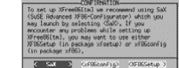

### 6.1

使用 SaX 配置 XFree 服务器。

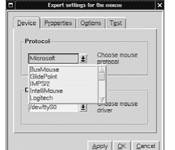

### 6.2

SaX 中的鼠标专家设置。

当你选择了正确的鼠标后，可以通过点击 SaX 右下角的“Next”按钮继续进入键盘配置。键盘配置允许你选择型号和语言，并提供一个测试字段来检查键位。再次点击“Next”按钮将带你进入显卡菜单。

你的显卡应该已经被系统通过 SaX 自动检测到。SaX 显示了 6.3. 在 X 服务器中显示了水平和垂直同步。你需要选择一个显示器厂商；如果你的厂商不在列表中，请使用 VESA 选择，并选择合适的分辨率。最后是桌面配置。

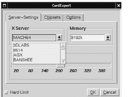

图 6.3 在专家菜单中配置显卡。

要配置桌面，输入最大颜色和标准分辨率。点击“Configure Mode”（配置模式）按钮。SaX 会给你一个 X 启动前的消息，并提供如何杀死损坏 X 服务器的说明（Ctrl+Alt+Backspace）。随后 SaX 将启动你的 X 服务器并允许你调整屏幕位置。寻找显示 X 服务器四个角的小白色矩形，并将其与显示器可见部分的四个角（边缘）对齐。如果一切正常，程序将运行，你发现自己处于 YaST1 安装界面或命令行，你可以在那里输入 `start` 来启动你的 X 会话。

运行 SaX 实用程序的另一种方法是从命令行。要调用 SaX，只需在命令行输入：

```bash
## sax
```

此命令启动 SaX；其操作与你从 YaST1 工具调用该程序相同。从命令行，你可以尝试 SaX 中帮助 选项里的可选参数。对于那些需要测试计算体验极限和尖端（抱歉，是血前沿）X 技术的个人，我建议尝试 XFree86 4.0 版本中的服务器。这个期待已久的版本已经到来，并随着其

## Xf86config 工具

运行 4.0 版本所需的必要文件和模块（是的，XFree86 正如承诺的那样是模块化的）自带新版本的 Sax SaX2。如果你认为 Sax 使用起来简单，请尝试 SaX2。SaX2 在启动时会提供一个华丽的启动界面，并对你的硬件进行自动检测。它提供了一个类似于 YaST2 的 GUI 环境。配置选项保持不变。唯一的变化是 GUI 视觉效果上的升级。这些软件组件可以在 http://ftp.suse.com/pub/suse/i386/X/XFree86/Xf86-4.0-SuSE 找到。

## 注意

我在我的笔记本电脑上尝试了新的 X 服务器，除了两点之外，几乎一切都能正常工作。首先，系统管理菜单中的 `fusewm` 是可以的。其次，你无法再通过此命令调用不同的窗口管理器了：

```
#startx <windowmanager>
```

如果你需要更改全局范围窗口管理器设置，请使用“配置文件”菜单中的 `DEFAULT_WM` 设置。

## 警告

务必注意 SuSE 的警告——这些新驱动程序至少是实验性的。如果你选择安装它们，请使用一台即使在最坏情况下你也能承受起损失的机器。

## Xf86config 工具

如果你在使用 Sax 或 SaX2 工具配置图形化环境时遇到困难，可能需要使用 `xf86config` 工具。虽然我喜欢 Sax，但我可以闭着眼睛运行 `xf86config`（某种意义上的如此）。以下列表包含了使用 `xf86config` 工具所需的关键信息：

- 你必须能够识别你的鼠标类型。
- 指明是否想让双键鼠标模拟三键鼠标。
- 输入设备名称（默认为 `/dev/mouse`）。
- 选择使用 `xmodmap` 调整你的键盘映射（你有 12 种类型可选）。
- 输入你的显示器规格（不要在此处猜测）。
- 输入你的显示器同步率（这个也不要猜测）。
- 输入你的显示器厂商名称（可选）。
- 检查有效的视频数据库 (y)。
- 从列表中选择正确的显卡（非常重要）。
- 选择你的默认 X。
- 系统将请求创建到 `/var/X11R6/bin` 的符号链接（可选）。
- 指明你有多少视频显存。
- 输入你的显卡制造商名称（可选）。
- 如果已知，输入你的时芯片设置（我通常跳过此步）。
- SuperProbe 将探测你的卡以获取额外信息 (n)。
- 设置你的显示器模式。仔细阅读此节。
- 更改模式时，你也可以选择“虚拟屏幕”。当你使用小型显示器时，此功能可以扩展扩展桌面工作区域。

## XF86Config 文件


`XF86Config` 文件由 `xf86config` 生成。该文件包含了有关服务器 (`Server`)、标志 (`Flags`)、键盘、显示器以及其他可选信息的信息。该文件的内容非常深入，是安装的范围。如果你在 X 配置上遇到问题，请参考此处列出的网站。位于 http://www.computers.iwz.com/linux/xcfg.html 的 PC 帮助网站将为你提供 X 的常见错误信息以及一些简单的配置问题——这些问题对于第一次使用 Linux 的人来说很常见。第二个是 SuSE 的模型 HOWTO，位于 http://sdb.suse.de/sdb/en/html/maddin_videomodes.html；此文档将给你关于 `xf86Config` 文件结构的详细信息。

## X 选项和默认设置

当你安装软件时，你可能选择了一个或多个窗口管理器。窗口管理器提供了工作环境的外观和感受。SuSE 提供了大量的软件；默认情况下，在它们之间选择可能是困难的。

当我说“外观和感受”时，指的是窗口、菜单、栏以及鼠标操作方式的整体特征。某些窗口管理器（如 Enlightenment）默认要求鼠标指针留在活动窗口中。Window Maker 的菜单选择是通过鼠标右键而非左键处理的。大多数窗口管理器都可以重新配置以适应你的喜好。那么，你会从所有选项中进行选择吗？试错。SuSE Linux 上唯一共同的事实是：如果选择了 KDE 程序（无论是手动选择还是默认选择），执行此命令会自动启动 KDE 窗口管理器。

```
startx
```

你选择 FVWM 或 Enlightenment，然后你需要在命令行中指定，如下所示：

```
startx fwm
```

如果你是 Window Maker 窗口管理器的粉丝，你会发现执行 `startx` 命令后输入 `wmaker` 没有任何反应。你需要在命令行中输入：

```
wmaker.inst
```

这将运行 Window Maker 的安装脚本。完成后，重启它应该不会遇到任何问题。

## 使用 usewm 进行微调

某些其他 Linux 发行版会自动设置你的登录环境。默认选择是：由相应的显示管理器 `KDM`（KDE）和 `XDM`（标准 X 显示管理器）提供的完整 GUI 登录环境；或者是非图形化环境。如果你在为你的 Linux 机器寻找一个稳如磐的桌面，KDE 可以是你的解决方案。

某些其他 Linux 发行版会自动设置你的登录环境。默认选择是：由相应的显示管理器 `KDM`（KDE）和 `XDM`（标准 X 显示管理器）提供的完整 GUI 登录环境；或者是非图形化环境。如果你在为你的 Linux 机器寻找一个稳如磐的桌面，KDE 可以是你的解决方案。

某些其他 Linux 发行版会自动设置你的登录环境。默认选择是：由相应的显示管理器 `KDM`（KDE）和 `XDM`（标准 X 显示管理器）提供的完整 GUI 登录环境；或者是非图形化环境。如果你在为你的 Linux 机器寻找一个稳如磐的桌面，KDE 可以是你的解决方案。

某些其他 Linux 发行版会自动设置你的登录环境。默认选择是：由相应的显示管理器 `KDM`（KDE）和 `XDM`（标准 X 显示管理器）提供的完整 GUI 登录环境；或者是非图形化环境。如果你在为你的 Linux 机器寻找一个稳如磐的桌面，KDE 可以是你的解决方案。

某些其他 Linux 发行版会自动设置你的登录环境。默认选择是：由相应的显示管理器 `KDM`（KDE）和 `XDM`（标准 X 显示管理器）提供的完整 GUI 登录环境；或者是非图形化环境。如果你在为你的 Linux 机器寻找一个稳如磐的桌面，KDE 可以是你的解决方案。

某些其他 Linux 发行版会自动设置你的登录环境。默认选择是：由相应的显示管理器 `KDM`（KDE）和 `XDM`（标准 X 显示管理器）提供的完整 GUI 登录环境；或者是非图形化环境。如果你在为你的 Linux 机器寻找一个稳如磐的桌面，KDE 可以是你的解决方案。

某些其他 Linux 发行版会自动设置你的登录环境。默认选择是：由相应的显示管理器 `KDM`（KDE）和 `XDM`（标准 X 显示管理器）提供的完整 GUI 登录环境；或者是非图形化环境。如果你在为你的 Linux 机器寻找一个稳如磐的桌面，KDE 可以是你的解决方案。

某些其他 Linux 发行版会自动设置你的登录环境。默认选择是：由相应的显示管理器 `KDM`（KDE）和 `XDM`（标准 X 显示管理器）提供的完整 GUI 登录环境；或者是非图形化环境。如果你在为你的 Linux 机器寻找一个稳如磐的桌面，KDE 可以是你的解决方案。

某些其他 Linux 发行版会自动设置你的登录环境。默认选择是：由相应的显示管理器 `KDM`（KDE）和 `XDM`（标准 X 显示管理器）提供的完整 GUI 登录环境；或者是非图形化环境。如果你在为你的 Linux 机器寻找一个稳如磐的桌面，KDE 可以是你的解决方案。

某些其他 Linux 发行版会自动设置你的登录环境。默认选择是：由相应的显示管理器 `KDM`（KDE）和 `XDM`（标准 X 显示管理器）提供的完整 GUI 登录环境；或者是非图形化环境。如果你在为你的 Linux 机器寻找一个稳如磐的桌面，KDE 可以是你的解决方案。

某些其他 Linux 发行版会自动设置你的登录环境。默认选择是：由相应的显示管理器 `KDM`（KDE）和 `XDM`（Standard X 显示管理器）提供的完整 GUI 登录环境；或者是非图形化环境。如果你在为你的 Linux 机器寻找一个稳如磐的桌面，KDE 可以是你的解决方案。

## Enlightenment

某些其他 Linux 发行版会自动设置你的登录环境。默认选择是：由相应的显示管理器 `KDM`（KDE）和 `XDM`（标准 X 显示管理器）提供的完整 GUI 登录环境；或者是非图形化环境。如果你在为你的 Linux 机器寻找一个稳如磐的桌面，KDE 可以是你的解决方案。

Enlightenment 是一种高度可配置的 X 窗口管理器。开发者表示，在“外观”方面，他们的工作已经基本完成。这个窗口管理器允许你设计自己的窗口框和菜单，并以你喜欢的方式编写屏幕的其他元素。棒的一点是，你不需要碰一行代码，也不需要重新编译任何东西。只需要使用像 GIMP 这样的图像绘制程序并编辑一些配置文件。

## KDE

KDE 提供了网络连接应用程序、游戏和 GUI 编程接口。如果你在为你的 Linux 机器寻找一个稳如磐的桌面，KDE 可以是你的解决方案。你可以在 http://www.kde.org 获取更多关于 KDE 的信息。该网站将让你了解所有 KDE 的动态。

# 第 6 章：X Window 系统配置

如需更多文档和常见问题解答（FAQ），请通过浏览器访问 http://e.lostworld.net/docs.html。Enlightenment 的其他主题网站位于 http://www.e-themes.org。

## X Window 系统 总结

在本章中，我们探讨了 Linux 中最受关注的话题之一：GUI 环境。其中一些讨论是积极且具有发展性的。要让 SuSE Linux 登陆桌面，需要付出专注的努力。我们逐步介绍了 SuSE 高级 X 配置工具，事实证明该工具是是独一无二的。现在，你可以期待让你的 X Window 系统运行起来，而不是对这项任务愁眉苦脸。我们还浏览了可用的窗口管理器，并学习了如何使用 YaST 修改系统范围的窗口管理器默认设置。你现在拥有了如何在控制台启动以及完整 GUI 登录的信息。SuSE 提供了 KDE 和 Enlightenment 窗口管理器，它们都是强大的工作环境——任何一种都是明智的选择。愿源码与你同在！

# 第 7 章

## SuSE 通信功能

Connectivity, con-nec-tive (kənnektiv) adj. 1. 服务于或倾向于连接。con-nec-tive n. 1. 连接器。

这个定义正是一个 Linux 操作系统所代表的：连接个人，无论是在小型网络场景下还是在巨大的广域网（如互联网）。Linux 在过去几个月连接的人比它存在的前九年加起来多。公司、企业和国家正在密切关注 Linux。此外，美国国家航空航天局（NASA）订购了近千笔记本电脑用于太空计划，国家安全局委托一家私营公司设计防弹版本的 Linux。在最近的调查中，据报告超过 23% 的服务器应用程序运行在某种 Linux 系统上。作为证据，互联网服务提供商如 Hurricane Electric（一家高流量自服务型 Web 服务器公司 (http://www.he.net)）正在使用 Linux 驱动的服务器。

Linux 与大型网络连接同义义。想象一下：如果没有某种网络连接，这个不可思议的操作系统可能仍然留在少数人手中。在网络初级阶段，串口和并行口电缆连接计算机。然而，趋势发生了变化，电话系统变成了传输网络数据的另一种工具。光纤技术的引入有助于建立一个跨越州界和国界的巨大计算机网络。这种被称为“信息高速公路”的东西，让任何电话线能够连接到计算机的地方都能通往世界。然而，通过电话线传输数据产生了一个有趣的情况：电话系统的语言与计算机不同。电话系统和计算机系统需要一个翻译官。因此，调制解调器（modem）被发明了。


# 调制解调器概述

调制解调器是将数据从一种形式转换为另一种形式的设备，例如转换为电话类型传输的形式。计算机处理数字信号，调制将其转换为模拟信号，然后通过电话线传输。这个小型设备依赖点对点协议（`PPP`），作为使用串口接口在两台计算机之间通信的方法，通常是通过电话线连接到服务器的个人电脑。

例如，一个 X 服务器提供者为你提供一个 `PPP` 连接，提供者的服务器可以响应你的请求。服务器随后将你的请求传递给互联网，反过来将你请求的响应返回给你。`PPP` 使用互联网协议（`IP`），`IP` 有时被认为是开放系统互连（`OSI`）参考模型的一部分，`PPP` 提供第 2 层（数据链路层）服务。它封装你的 `TCP/IP` 数据包并将其转发到服务器，在服务器处实际上可以通过互联网进行分发。这是一种基本拨号类型连接的模型。最大连接速度（此时）大约为 `56Kbps`，取决于电话连接和线路质量。

今天，计算已远远超过了当我开始使用 `BBS` 服务时盛行的 `4800` 或 `9600` 波特率方法。我目前的连接是一个高速电缆调制解调器，传输速度至少为 `600kbps`。电话供应商可以在标准电话线上提供甚至 `1.5Mbps`。`DSL` 技术利用了当前电话线提供的、尚未被开发的纯数字带宽。`SDN`、`DSL`、电缆甚至卫星连接解决方案随处可见，“无线”局域网时代已经到来。查看无线局域网和 Linux 资源页面 `http://www.hp.com/personal/Jean_Tourr1/Linux/`。每天似乎都有新的连接网络添加到列表中。

大量的连接协议将如何保护你的 `SuSE Linux` 系统？嗯，我有一个好消息：该发行版将帮助你连接和配置任何类型的拨号或实时网络连接。

当然，你如何连接网络将是一个重要因素。在过去的几年里，调制解调器连接已用于大部分应用程序。许多公司依赖这种技术。尽管这是一种可靠的通信形式，但非常耗时。例如，我工作过的两家公司使用调制解调器连接从州外的办公室上传和检索信息。由于连接速度慢，网络交易发生在深夜或清晨。`MIS` 部门有机会在不打断公司工作惯例的情况下传输文件并配置系统。相比之下，今天可用的调制解调器速度有助于全天传输数据并继续工作。

调制解调器作为大部分网络市场的连接媒介。想想，你本地的 `ISP` 可能配备了多个调制解调器，其中一个被数百甚至数千人用作连接互联网的链路。

自然，假设有多个连接。假设超过一个连接。

## Minicom 工具

`Minicom` 是一个基于文本的终端工具，具有多种功能。在 `Minicom` 中，你可以配置：

- 串口
- 脚本
- 文件的传输（发送和接收）
- 宏
- 拨号设置
- 调制设置

## 配置调制解调器

在 `YaST` 中，你可以配置调制解调器：

- 拨号号码
- 速度
- 调制
- 其他

```bash
yast --config modem
```


在 `YaST` 中，你可以配置调制解调器：

- 拨号号码
- 速度
- 调制
- 其他

## 拨号网络

拨号网络是目前最常用的网络连接类型。家庭和企业依靠电话线和他们的调制解调器来确保与外部的联系。无论是用于获取电子商务服务，还是在万维网上购物，拨号系统都是最方便且最廉价的连接方法。

与其他方法一样，拨号网络（`DUN`）也有其优点和缺点。拨号设备（从功能上讲）并不适合 Web 服务和邮件服务器应用等任务。我把 `DUN` 比作住在移动房中。无论你家搬到亚利桑那州、纽约州还是康萨斯州，你的房子都是是一样的——只是街道地址变了。拨号网络也表现出同样的原理。你的电脑保持不变，但每当你重新连接到你的 `ISP` 时，你的地址就会改变。硬币的另一面是，当你在 `ISP` 和你的机器之间建立连接时，在连接终止之前“拥有”这种连接。这种网络可能适用于办公室之间通信的小型企业。安全性是可控的，有 24x7 的连接需要监控，而且每次 IP 地址都会变化，这使得入侵变得有些困难。

几年前，大多数新手面临的最大障碍是配置和连接他们的调制解调器。拥有一个强大的新操作系统却没有连接到互联网的能力，这可一点不好玩。如果你需要帮助，很有可能被迫使用另一台机器来上网以获取额外的协助。在开发的早期，像 `dip` 这样的拨号类型配置程序曾尝试提供帮助，但它们都略有不从。坦率地说，Linux 用户群持续增加，使配置变得更简单的应用程序正在被迅速开发。

`SE` 整合了 `YaST`，这是一套有效的工具集，可以帮助你的 `DUN` 连接启动。`YaST` 有一个调制解调器选择菜单，它通过访问 `wvdial` 程序选择来向你提供帮助。安装后的程序为你提供了设置调制解调器的机会。如果你等到现在才打算这样做，不要担心——`YaST` 将为你提供一个平滑的界面供你操作。（见图 7.2。）

## Wvdial 调制解调器配置工具

对于让调制解调器运行起来，`Wvdial` 工具是一个极佳的工具。`Wvdial` 工具扫描所有的 `/dev/ttySx` 端口（`/dev/mouse` 符号链接除外）；如果找到调制解调器，它会测试参数并将信息转储到名为 `/etc/wvdial.conf` 的文件中。是的，`YaST` 应该静默地完成所有这些工作，以防你需要微调或修改设置，了解这些信息是有用的。图 7.3 显示了带有系统信息的 `YaST Wvdial` 界面。

### 7.2

使用 `YaST` 选择调制解调器。

### 7.3

使用 SuSE `Wvdial` 配置工具配置你的调制解调器。

记得准备好设置 `PPP` 连接所需的所有相关信息，包括电话号码、IP 地址（如果域名服务器需要）、用户名和密码。

### 注意事项

找出你的 `ISP` 软件需要何种类型的授权（登录）。SuSE `Wvdial` 菜单允许你选择登录的登录类型，以及它是否是非标准类型或 `pap/chap` 类型。这些信息非常重要——没有它，你将无法连接。

当你完成调制解调器设置后，`wvdial.conf` 文件看起来像这样：

```
[Dialer Defaults]
Modem = /dev/ttyS2
Baud = 57600
Init = ATZ
Init2 = ATQ0 V1 E1 S0=0 &C1 &D2 S11=55
; Phone = <S77-0000>
; Username = <elvin/DTE>
; Password = <S20*ocx4>
```

你应该注意，在 `[Dialer Defaults]` 标题之后，前四个参数可能略有不同，因为 `Wvdial` 会为你检测调制解调器。

要使用 `YaST` 的 SuSE `Wvdial` 配置工具，请选择“网络配置”（`Network Configuration`）并“配置 PPP 网络”（`Configure a PPP Network`）。如果你更换了调制解调器且它们不使用相同的 `IRQ`，请选择“集成硬件到系统”（`Integrate Hardware into System`）选项，并更改端口以对应新的 `IRQ`。

SuSE 为 `Wvdial` 提供了大量的信息。你可以通过使用 `Wvdial` 配置器中的“帮助”（`Help`）功能查看文档。对于困难或特殊的调制解调器配置，包含了专家菜单。（见图 7.4。）

### 图 7.4

供专家使用的 SuSE `Wvdial` 调制解调器配置工具。

应该没有理由使用专家菜单——只有在所有其他方法都失败的极少数情况下才使用它。`Wvdial` 工具应该能检测并配置除 `Winmodems` 外的任何调制解调器，那是另一个问题了。

由于某些原因你需要从命令行配置 `Wvdial`，可以使用在 `root` 或超级用户账户时输入此命令来调用配置功能：

```
wvdialconf <config file location>
```

确保你有对应 `ISP` `DNS` 服务器的正确地址。你可以从 `ISP` 的 `DNS` 部门获取这些信息。如果你有多个 IP 地址，务必在 `DNS` 服务器输入屏幕中至少添加一个 IP 地址（某些 `ISP` 会给你一个主地址和一个备用地址进行输入）。如果 `/etc/resolv.conf` 中缺少这些信息，你将无法访问网络。

## 添加网络接口

如果你计划设置多种介质，例如 `Digibord` 或 `Stallion` 类型的多方法，将需要为它们设置不同的接口选项。你可以使用点对点（`PPP`）方案，并从 `ppp0/ppp1` 开始，根据需要添加更多。你可以通过 `YaST` 工具实现这一点。

## 自动重拨

如果你熟悉一般的 Linux，你会知道它包含一个在连接中断时重新拨号的功能。这一增强功能内置在 `Wvdial` 程序中。如果 `ISP` 在一段时间后断开连接，或者你的线路质量不好，此功能非常有用。在配置 `Wvdial` 后，可以通过使用 `root` 或超级用户账户执行此命令来连接服务：

```
wvdial
```

如果你想在启动不同的 `xterm` 或 `CLI` 会话的同时继续工作，请执行此命令：

```
wvdial &
```

`Wvdial` 工具将在后台拨号，你可以继续工作。如有必要，将程序返回前台并按 `Ctrl+C`。然后 `wvdial` 将显示“收到信号 #2，正在退出……”

关于 `wvdial` 的更多信息和更新，你可以访问网站 `http://www.worldvisions.ca/wvdial/index.html`。

## 电缆接入设置

电缆互联网已经席卷了行业。尽管它与著名的电话公司竞争，但它吸引了大量的追随者。还有比同时拥有互联网和电缆电视更好的呢？带宽限制是存在的，但除非你需要专用的 `T1` 线或需要携带大量安全流量的 `VPN` 连接，否则电缆连接可能是理想选择如果你目前在使用电缆，你已经知道它的优点。你拥有高速数据传输的优势，并且不需要处理拨号连接问题，你始终在线，随时就绪。有一件事我很警惕。

大多数电缆调制解调器安装需要网络接口卡，该卡连接到电缆调制解调器本身。不需要实际配置。大多数电缆调制解调器具有内置的自配置功能，这是因为：你位于公共网络上，IP 地址分配的责任由公司承担。因此，电缆调制解调器必须与调制“通信”以验证你的连接。剩下的就是选择高质量的网卡。

# 82 第7章：SuSE 通信功能

让这套设置正常运行只需要几分钟。不过，我将为你提供一个列表形式的流程概述，因为系统可能会有所不同。

- 1. 启动 `YaST` 并访问系统管理（`System Administration`）。
- 2. 选择将硬件集成到系统（`Integrate Hardware into System`），并分配卡类型和参数。


- 3. 选择网络配置（Network Configuration），并输入电缆公司提供的网络地址信息。
- 4. 重启电脑，你就可以开始使用了。

这是一个电缆调制调器如何设置的简单示例，尽管设置电缆调制调器还涉及其他因素。如果电缆需要 DHCP 协议，你必须安装 n 系列中的客户端软件，称为 `dhclient`。有关 DHCP 设置的更多信息，可以通过可以在命令行中输入以下命令之一来访问已安装系统上的文档：

`man dhclient`

或者

`man dhclient.conf`

`man dhclient.leases`

关于配置文件的内容，请尝试以下操作：

`man dhclient.conf`

`man dhclient.leases`

几篇文章涵盖了电缆类型技术的发展和使用。其中一篇名为《第一性原理》（First Principles），可以在 http://www.ozemail.com.au/-firstpr/bband 找到。此外，当前的《电缆调制调器 HOWTO》位于 http://www.oswg.org/oswg-nightly/oswg/en_US.ISDN_0859-1/articles/Cable-Modem/Cable-Modem.html。上面的 HOWTO 是最新的，提供了本章范围无法涵盖的详尽且深入的细节。如果你恰遇到某些障碍，这里是寻找解决方案的首选。

## ISDN 接口设置

集成服务数字网络（ISDN）在 DSL 和电缆革命之前，曾是一种备受推崇的网络方法。ISDN 技术利用了拨号类型的接入，并按分钟和按英里计费。尽管如此，这种高速网络连接对于普通家庭或小型企业来说已经足够经济了。

因此，当 BISDN 迅速出现时，ISDN 作为理想连接类型的地位是短暂的。ISDN 既是一个概念，也是一组服务，它已经开发了在通过由光纤和无线电介质组成的宽带网络上集成数字传输服务的标准。BISDN 与 ATM 技术和帧中继（Frame Relay）服务结合使用，用于可以大突发发送高速数据。BSDN（以及 ATM）通信层建立在 SONET（同步光网络）之上，这有助于提供高速特性。BISDN 支持 2Mbps 及以上的数据传输。这是一项很棒的服务，但它需要一些技术改进来实现。支持 ATM 技术和帧中继的组件正在被构建到当前的内核中，希望高可用性市场将获得更多的 ax.25 和 ATM 支持。

ISDN 可以使用两种接口技术，其中一种被称为终端适配器（T/A）。本质上，这只是一个具有数字能力的调制调器的雅称。T/A 的工作方式与传统的调制调器类似，让它运行起来是一个直接的过程。T/A 有内部和外部配置可供选择。有关可用用 ISDN T/A 的完整细节，请将你的浏览器指向 http://alumnas.caltech.edu/~dank/isdn_hw.html。该页面包含了获取正确适配器可能至关重要的信息，并可以帮助你配置性能方面。

另一种 ISDN 接口是控制器。ISDN 控制器用于在局域网（LAN）或 VPN 类型环境中处理多个 ISDN 连接。这些控制器可以提供大量服务。如果你正在通过 ISDN 连接你的系统或业务，请尝试 3Com 的套装：http://www.3com.com/dsheets/400396.html。

当前技术允许在控制器上建立多个连接。你可以使用以太卡和交换机配置你的系统，并为你的模拟电话和传真机建立连接，这一切都通过一条 ISDN 线路。

要在 SuSE Linux 上使用 ISDN 控制器，你必须首先注意它是哪种类型，主动的还是被动的。如果是被动控制器，请安装位于 n 目录下的 i4l 软件包。对于主动 ISDN 控制器，你应该安装 `i4firm`。

对于那些考虑使用 ISDN 连接的人，被动控制器需要用户交互，即选择一个预设的外部号码并等待系统响应。主动 ISDN 控制器使用按需拨号程序。此发行版包含的 `Wvd` 工具可以配置为在按需拨号环境中运行。详情见 http://sdb.subse.de/sdb/en/html/no_wv_dod_start.html。这将在如启动 Telnet 会话或浏览器请求 Web 页面时建立网络连接。当连接会话终止时，链路将在预定时间内关闭。

如果已经安装了软件，你可以使用 YaST 帮助你配置适配器。图 7.6 显示了 ISDN 设置屏幕。

如果你正在更换发行版，并且已经将 ISDN 作为你主要的连接源，你已经拥有了所有可用的网络信息。如果不是，请在调整设置之前收集所有所需的网络信息。

SuSE 包含一个名为 `isdn4linux` 的包，它本身就是一个相当完整的设置。它具有硬件和软件驱动程序，以及用于数字调制调器的仿真。

# 84 第7章：SuSE 通信功能

图 7.6

使用 YaST 配置 ISDN 参数。

某些 ISDN 控制器可能会导致一些配置问题。ISDN 驱动程序作为模块加载，有时取决于控制器的类型，内核可能无法识别设备并加载加载 HiSax 模块。受影响的单元包括 ICN 和 AVM-B1 控制器。

Use site 提供了有关设置 ISDN 服务控制器的完整细节。查看 URL http://sbud.suse.de/en/html/isdn.html，同时也查看 http://sbud.suse.de/en/isdn_trouble.html。这些资源将帮助你解决一些常见的 ISDN 连接问题。

## DSL 模式接口设置

数字用户线路（DSL）服务对整个计算世界都产生了巨大影响。DSL 服务提供的性能是不可思议的。数据传输速度接近专用 T1，而成本只有其的一小部分，还有什么更大的梦想呢？

目前，调制调器上网服务在竞争中处于领先地位，但 DSL 在2000 年后的预期增长将超过竞争对手。DSL 调制调器的设置和配置与电缆调制调器类似。

由于大多数 DSL 服务主要作为非对称数字用户线路（aDSL），你的上行和下行速度可能差异很大。请参考此示例：

| 接入速度 | 上行速度 | 下行速度 |
| --- | --- | --- |
| 256kbps | 256kbps | 256kbps |
| 384kbps | 384kbps | 128kbps |
| 384kbps | 384kbps | 384kbps |
| 384kbps | 384kbps | 1.5Mbps |

用于 DSL 的设备，如果是电话公司提供的，它应该可以无故障工作。如果你打算使用 DSL，它通过一条 ISDN 线路连接，并插入一个“分路器”。这个分路器有两个输出，一个连接到普通电话线，另一个连接到调制调器。

- 1. 启动 YaST 并访问系统管理。
- 2. 选择将硬件集成到系统，并分配卡类型和参数。
- 3. 选择网络配置，并输入电缆公司提供的网络信息。
- 4. 重启电脑，你就可以开始使用了。

这是一个电缆调制调器如何设置的简单示例，尽管设置电缆调制调器还涉及其他因素。如果电缆需要 DHCP 协议，你必须安装 n 系列中的客户端软件，称为 `dhclient`。有关 DHCP 设置的更多信息，可以通过可以在命令行中输入以下命令之一来访问已安装系统上的文档：

`man dhclient`

或者

`man dhclient.conf`

`man dhclient.leases`

关于配置文件的内容，请尝试以下操作：

`man dhclient.conf`

`man dhclient.leases`

几篇文章涵盖了电缆类型技术的发展和使用。其中一篇名为《第一性原理》（First Principles），可以在 http://www.ozemail.com.au/-firstpr/bband 找到。此外，当前的《电缆调制调器 HOWTO》位于 http://www.oswg.org/oswg-nightly/oswg/en_US.ISDN_0859-1/articles/Cable-Modem/Cable-Modem.html。上面的 HOWTO 是最新的，提供了本章范围无法涵盖的详尽且深入的细节。如果你恰遇到某些障碍，这里是寻找解决方案的首选。

## ISDN 接口设置

集成服务数字网络（ISDN）在 DSL 和电缆革命之前，曾是一种备受推崇的网络方法。ISDN 技术利用了拨号类型的接入，并按分钟和按英里计费。尽管如此，这种高速网络连接对于普通家庭或小型企业来说已经足够经济了。

因此，当 BISDN 迅速出现时，ISDN 作为理想连接类型的地位是短暂的。ISDN 既是一个概念，也是一组服务，它已经开发了在通过由光纤和无线电介质组成的宽带网络上集成数字传输服务的标准。BISDN 与 ATM 技术和帧中继（Frame Relay）服务结合使用，用于可以大突发发送高速数据。BSDN（以及 ATM）通信层建立在 SONET（同步光网络）之上，这有助于提供高速特性。BISDN 支持 2Mbps 及以上的数据传输。这是一项很棒的服务，但它需要一些技术改进来实现。支持 ATM 技术和帧中继的组件正在被构建到当前的内核中，希望高可用性市场将获得更多的 ax.25 和 ATM 支持。


# 第7章：SuSE 通信功能

## ISDN 接口设置

ISDN 可以使用两种接口技术，其中一种被称为终端适配器（T/A）。本质上，这只是一个具有数字能力的调制调器的雅称。T/A 的工作方式与传统的调制调器类似，让它运行起来是一个直接的过程。T/A 有内部和外部配置可供选择。有关可用用 ISDN T/A 的完整细节，请将你的浏览器指向 http://alumnas.caltech.edu/~dank/isdn_hw.html。该页面包含了获取正确适配器可能至关重要的信息，并可以帮助你配置性能方面。

另一种 ISDN 接口是控制器。ISDN 控制器用于在局域网（LAN）或 VPN 类型环境中处理多个 ISDN 连接。这些控制器可以提供大量服务。如果你正在通过 ISDN 连接你的系统或业务，请尝试 3Com 的套装：http://www.3com.com/dsheets/400396.html。

当前技术允许在控制器上建立多个连接。你可以使用以太卡和交换机配置你的系统，并为你的模拟电话和传真机建立连接，这一切都通过一条 ISDN 线路。

要在 SuSE Linux 上使用 ISDN 控制器，你必须首先注意它是哪种类型，主动的还是被动的。如果是被动控制器，请安装位于 `n` 目录下的 `i4l` 软件包。对于主动 ISDN 控制器，你应该安装 `i4firm`。

对于那些考虑使用 ISDN 连接的人，被动控制器需要用户交互，即选择一个预设的外部号码并等待系统响应。主动 ISDN 控制器使用按需拨号程序。此发行版包含的 `Wvd` 工具可以配置为在按需拨号环境中运行。详情见 http://sdb.subse.de/sdb/en/html/no_wv_dod_start.html。这将在如启动 Telnet 会话或浏览器请求 Web 页面时建立网络连接。当连接会话终止时，链路将在预定时间内关闭。

如果已经安装了软件，你可以使用 `YaST` 帮助你配置适配器。图 7.6 显示了 ISDN 设置屏幕。

如果你正在更换发行版，并且已经将 ISDN 作为你主要的连接源，你已经拥有了所有可用的网络信息。如果不是，请在调整设置之前收集所有所需的网络信息。

SuSE 包含一个名为 `isdn4linux` 的包，它本身就是一个相当完整的设置。它具有硬件和软件驱动程序，以及用于数字调制调器的仿真。

图 7.6

使用 `YaST` 配置 ISDN 参数。

某些 ISDN 控制器可能会导致一些配置问题。ISDN 驱动程序作为模块加载，有时取决于控制器的类型，内核可能无法识别设备并加载加载 `HiSax` 模块。受影响的单元包括 `ICN` 和 `AVM-B1` 控制器。

Use site 提供了有关设置 ISDN 服务控制器的完整细节。查看 URL http://sbud.suse.de/en/html/isdn.html，同时也查看 http://sbud.suse.de/en/isdn_trouble.html。这些资源将帮助你解决一些常见的 ISDN 连接。

## DSL 模式接口设置

数字用户线路（DSL）服务对整个计算世界都产生了巨大影响。DSL 服务提供的性能是不可思议的。数据传输速度接近专用 T1，而成本只有其的一小部分，还有什么更大的梦想呢？

目前，调制调器上网服务在竞争中处于领先地位，但 DSL 在2000 年后的预期增长将超过竞争对手。DSL 调制调器的设置和配置与电缆调制调器类似。

由于大多数 DSL 服务主要作为非对称数字用户线路（aDSL），你的上行和下行速度可能差异很大。请参考此示例：

| 接入速度 | 上行速度 | 下行速度 |
| --- | --- | --- |
| 256kbps | 256kbps | 256kbps |
| 384kbps | 384kbps | 128kbps |
| 384kbps | 384kbps | 384kbps |
| 384kbps | 384kbps | 1.5Mbps |

用于 DSL 的设备，如果是电话公司提供的，它应该可以无故障工作。如果你打算使用 DSL，它通过一条 ISDN 线路连接，并插入一个“分路器”。这个分路器有两个输出，一个连接到普通电话线，另一个连接到调制调器。

- 1. 启动 `YaST` 并访问系统管理。
- 2. 选择将硬件集成到系统，并分配卡类型和参数。
- 3. 选择网络配置，并输入电缆公司提供的网络信息。
- 4. 重启电脑，你就可以开始使用了。

这是一个电缆调制调器如何设置的简单示例，尽管设置电缆调制调器还涉及其他因素。如果电缆需要 DHCP 协议，你必须安装 `n` 系列中的客户端软件，称为 `dhclient`。有关 DHCP 设置的更多信息，可以通过可以在命令行中输入以下命令之一来访问已安装系统上的文档：

```
man dhclient
```

或者

```
man dhclient.conf
```

```
man dhclient.leases
```

关于配置文件的内容，请尝试以下操作：

```
man dhclient.conf
```

```
man dhclient.leases
```

几篇文章涵盖了电缆类型技术的发展和使用。其中一篇名为《第一性原理》（First Principles），可以在 http://www.ozemail.com.au/-firstpr/bband 找到。此外，当前的《电缆调制调器 HOWTO》位于 http://www.oswg.org/oswg-nightly/oswg/en_US.ISDN_0859-1/articles/Cable-Modem/Cable-Modem.html。上面的 HOWTO 是最新的，提供了本章范围无法涵盖的详尽且深入的细节。如果你恰遇到某些障碍，这里是寻找解决方案的首选。

## ISDN 接口设置概述

集成服务数字网络（ISDN）在 DSL 和电缆革命之前，曾是一种备受推崇的网络方法。ISDN 技术利用了拨号类型的接入，并按分钟和按英里计费。尽管如此，这种高速网络连接对于普通家庭或小型企业来说已经足够经济了。

因此，当 BISDN 迅速出现时，ISDN 作为理想连接类型的地位是短暂的。ISDN 既是一个概念，也是一组服务，它已经开发了在通过由光纤和无线电介质组成的宽带网络上集成数字传输服务的标准。BISDN 与 ATM 技术和帧中继（Frame Relay）服务结合使用，用于可以大突发发送高速数据。BSDN（以及 ATM）通信层建立在 SONET（同步光网络）之上，这有助于提供高速特性。BISDN 支持 2Mbps 及以上的数据传输。这是一项很棒的服务，但它需要一些技术改进来实现。支持 ATM 技术和帧中继的组件正在被构建到当前的内核中，希望高可用性市场将获得更多的 ax.25 和 ATM 支持。


# 84 第7章：SuSE 通信功能

Use site 提供了有关设置 ISDN 服务控制器的完整细节。查看 URL http://sbud.suse.de/en/html/isdn.html，同时也查看 http://sbud.suse.de/en/isdn_trouble.html。这些资源将帮助你解决一些常见的 ISDN 连接。

## DSL 模式接口设置

数字用户线路（DSL）服务对整个计算世界都产生了巨大影响。DSL 服务提供的性能是不可思议的。数据传输速度接近专用 T1，而成本只有其的一小部分，还有什么更大的梦想呢？

目前，调制调器上网服务在竞争中处于领先地位，但 DSL 在2000 年后的预期增长将超过竞争对手。DSL 调制调器的设置和配置与电缆调制调器类似。

由于大多数 DSL 服务主要作为非对称数字用户线路（aDSL），你的上行和下行速度可能差异很大。请参考此示例：

| 接入速度 | 上行速度 | 下行速度 |
| --- | --- | --- |
| 256kbps | 256kbps | 256kbps |
| 384kbps | 384kbps | 128kbps |
| 384kbps | 384kbps | 384kbps |
| 384kbps | 384kbps | 1.5Mbps |

用于 DSL 的设备，如果是电话公司提供的，它应该可以无故障工作。如果你打算使用 DSL，它通过一条 ISDN 线路连接，并插入一个“分路器”。这个分路器有两个输出，一个连接到普通电话线，另一个连接到调制调器。

- 1. 启动 `YaST` 并访问系统管理。
- 2. 选择将硬件集成到系统，并分配卡类型和参数。
- 3. 选择网络配置，并输入电缆公司提供的网络信息。
- 4. 重启电脑，你就可以开始使用了。

这是一个电缆调制调器如何设置的简单示例，尽管设置电缆调制调器还涉及其他因素。如果电缆需要 DHCP 协议，你必须安装 n 系列中的客户端软件，称为 `dhclient`。有关 DHCP 设置的更多信息，可以通过可以在命令行中输入以下命令之一来访问已安装系统上的文档：

`man dhclient`

或者

`man dhclient.conf`

`man dhclient.leases`

关于配置文件的内容，请尝试以下操作：

`man dhclient.conf`

`man dhclient.leases`

几篇文章涵盖了电缆类型技术的发展和使用。其中一篇名为《第一性原理》（First Principles），可以在 http://www.ozemail.com.au/-firstpr/bband 找到。此外，当前的《电缆调制调器 HOWTO》位于 http://www.oswg.org/oswg-nightly/oswg/en_US.ISDN_0859-1/articles/Cable-Modem/Cable-Modem.html。上面的 HOWTO 是最新的，提供了本章范围无法涵盖的详尽且深入的细节。如果你恰遇到某些障碍，这里是寻找解决方案的首选。

## ISDN 接口设置

集成服务数字网络（ISDN）在 DSL 和电缆革命之前，曾是一种备受推崇的网络方法。ISDN 技术利用了拨号类型的接入，并按分钟和按英里计费。尽管如此，这种高速网络连接对于普通家庭或小型企业来说已经足够经济了。

因此，当 BISDN 迅速出现时，ISDN 作为理想连接类型的地位是短暂的。ISDN 既是一个概念，也是一组服务，它已经开发了在通过由光纤和无线电介质组成的宽带网络上集成数字传输服务的标准。BISDN 与 ATM 技术和帧中继（Frame Relay）服务结合使用，用于可以大突发发送高速数据。BSDN（以及 ATM）通信层建立在 SONET（同步光网络）之上，这有助于提供高速特性。BISDN 支持 2Mbps 及以上的数据传输。这是一项很棒的服务，但它需要一些技术改进来实现。支持 ATM 技术和帧中继的组件正在被构建到当前的内核中，希望高可用性市场将获得更多的 ax.25 和 ATM 支持。

ISDN 可以使用两种接口技术，其中一种被称为终端适配器（T/A）。本质上，这只是一个具有数字能力的调制调器的雅称。T/A 的工作方式与传统的调制调器类似，让它运行起来是一个直接的过程。T/A 有内部和外部配置可供选择。有关可用用 ISDN T/A 的完整细节，请将你的浏览器指向 http://alumnas.caltech.edu/~dank/isdn_hw.html。该页面包含了获取正确适配器可能至关重要的信息，并可以帮助你配置性能方面。

另一种 ISDN 接口是控制器。ISDN 控制器用于在局域网（LAN）或 VPN 类型环境中处理多个 ISDN 连接。这些控制器可以提供大量服务。如果你正在通过 ISDN 连接你的系统或业务，请尝试 3Com 的套装：http://www.3com.com/dsheets/400396.html。

当前技术允许在控制器上建立多个连接。你可以使用以太卡和交换机配置你的系统，并为你的模拟电话和传真机建立连接，这一切都通过一条 ISDN 线路。

要在 SuSE Linux 上使用 ISDN 控制器，你必须首先注意它是哪种类型，主动的还是被动的。如果是被动控制器，请安装位于 n 目录下的 `i4l` 软件包。对于主动 ISDN 控制器，你应该安装 `i4firm`。

对于那些考虑使用 ISDN 连接的人，被动控制器需要用户交互，即选择一个预设的外部号码并等待系统响应。主动 ISDN 控制器使用按需拨号程序。此发行版包含的 `Wvd` 工具可以配置为在按需拨号环境中运行。详情见 http://sdb.subse.de/sdb/en/html/no_wv_dod_start.html。这将在如启动 Telnet 会话或浏览器请求 Web 页面时建立网络连接。当连接会话终止时，链路将在预定时间内关闭。

如果已经安装了软件，你可以使用 `YaST` 帮助你配置适配器。图 7.6 显示了 ISDN 设置屏幕。

如果你正在更换发行版，并且已经将 ISDN 作为你主要的连接源，你已经拥有了所有可用的网络信息。如果不是，请在调整设置之前收集所有所需的网络信息。

SuSE 包含一个名为 `isdn4linux` 的包，它本身就是一个相当完整的设置。它具有硬件和软件驱动程序，以及用于数字调制调器的仿真。

图 7.6

使用 `YaST` 配置 ISDN 参数。

某些 ISDN 控制器可能会导致一些配置问题。ISDN 驱动程序作为模块加载，有时取决于控制器的类型，内核可能无法识别设备并加载加载 `HiSax` 模块。受影响的单元包括 ICN 和 AVM-B1 控制器。


几篇文章涵盖了电缆类型技术的发展和使用。其中一篇名为《第一性原理》（First Principles），可以在 http://www.ozemail.com.au/-firstpr/bband 找到。此外，当前的《电缆调制调器 HOWTO》位于 http://www.oswg.org/oswg-nightly/oswg/en_US.ISDN_0859-1/articles/Cable-Modem/Cable-Modem.html。上面的 HOWTO 是最新的，提供了本章范围无法涵盖的详尽且深入的细节。如果你恰遇到某些障碍，这里是寻找解决方案的首选。

## ISDN 接口设置

集成服务数字网络（ISDN）在 DSL 和电缆革命之前，曾是一种备受推崇的网络方法。ISDN 技术利用了拨号类型的接入，并按分钟和按英里计费。尽管如此，这种高速网络连接对于普通家庭或小型企业来说已经足够经济了。

因此，当 BISDN 迅速出现时，ISDN 作为理想连接类型的地位是短暂的。ISDN 既是一个概念，也是一组服务，它已经开发了在通过由光纤和无线电介质组成的宽带网络上集成数字传输服务的标准。BISDN 与 ATM 技术和帧中继（Frame Relay）服务结合使用，用于可以大突发发送高速数据。BSDN（以及 ATM）通信层建立在 SONET（同步光网络）之上，这有助于提供高速特性。BISDN 支持 2Mbps 及以上的数据传输。这是一项很棒的服务，但它需要一些技术改进来实现。支持 ATM 技术和帧中继的组件正在被构建到当前的内核中，希望高可用性市场将获得更多的 `ax.25` 和 ATM 支持。

ISDN 可以使用两种接口技术，其中一种被称为终端适配器（T/A）。本质上，这只是一个具有数字能力的调制调器的雅称。T/A 的工作方式与传统的调制调器类似，让它运行起来是一个直接的过程。T/A 有内部和外部配置可供选择。有关可用用 ISDN T/A 的完整细节，请将你的浏览器指向 http://alumnas.caltech.edu/~dank/isdn_hw.html。该页面包含了获取正确适配器可能至关重要的信息，并可以帮助你配置性能方面。

另一种 ISDN 接口是控制器。ISDN 控制器用于在局域网（LAN）或 VPN 类型环境中处理多个 ISDN 连接。这些控制器可以提供大量服务。如果你正在通过 ISDN 连接你的系统或业务，请尝试 3Com 的套装：http://www.3com.com/dsheets/400396.html。

当前技术允许在控制器上建立多个连接。你可以使用以太卡和交换机配置你的系统，并为你的模拟电话和传真机建立连接，这一切都通过一条 ISDN 线路。

要在 SuSE Linux 上使用 ISDN 控制器，你必须首先注意它是哪种类型，主动的还是被动的。如果是被动控制器，请安装位于 `n` 目录下的 `i4l` 软件包。对于主动 ISDN 控制器，你应该安装 `i4firm`。

对于那些考虑使用 ISDN 连接的人，被动控制器需要用户交互，即选择一个预设的外部号码并等待系统响应。主动 ISDN 控制器使用按需拨号程序。此发行版包含的 `Wvd` 工具可以配置为在按需拨号环境中运行。详情见 http://sdb.subse.de/sdb/en/html/no_wv_dod_start.html。这将在如启动 Telnet 会话或浏览器请求 Web 页面时建立网络连接。当连接会话终止时，链路将在预定时间内关闭。

如果已经安装了软件，你可以使用 YaST 帮助你配置适配器。图 7.6 显示了 ISDN 设置屏幕。

如果你正在更换发行版，并且已经将 ISDN 作为你主要的连接源，你已经拥有了所有可用的网络信息。如果不是，请在调整设置之前收集所有所需的网络信息。

SuSE 包含一个名为 `isdn4linux` 的包，它本身就是一个相当完整的设置。它具有硬件和软件驱动程序，以及用于数字调制调器的仿真。

# 第7章：SuSE 通信功能

图 7.6

使用 YaST 配置 ISDN 参数。

某些 ISDN 控制器可能会导致一些配置问题。ISDN 驱动程序作为模块加载，有时取决于控制器的类型，内核可能无法识别设备并加载加载 HiSax 模块。受影响的单元包括 ICN 和 AVM-B1 控制器。

Use site 提供了有关设置 ISDN 服务控制器的完整细节。查看 URL http://sbud.suse.de/en/html/isdn.html，同时也查看 http://sbud.suse.de/en/isdn_trouble.html。这些资源将帮助你解决一些常见的 ISDN 连接。

## DSL 模式接口设置

数字用户线路（DSL）服务对整个计算世界都产生了巨大影响。DSL 服务提供的性能是不可思议的。数据传输速度接近专用 T1，而成本只有其的一小部分，还有什么更大的梦想呢？

目前，调制调器上网服务在竞争中处于领先地位，但 DSL 在2000 年后的预期增长将超过竞争对手。DSL 调制调器的设置和配置与电缆调制调器类似。

由于大多数 DSL 服务主要作为非对称数字用户线路（aDSL），你的上行和下行速度可能差异很大。请参考此示例：

| 接入速度 | 上行速度 | 下行速度 |
| --- | --- | --- |
| 256kbps | 256kbps | 256kbps |
| 384kbps | 384kbps | 128kbps |
| 384kbps | 384kbps | 384kbps |
| 384kbps | 384kbps | 1.5Mbps |

用于 DSL 的设备，如果是电话公司提供的，它应该可以无故障工作。如果你打算使用 DSL，它通过一条 ISDN 线路连接，并插入一个“分路器”。这个分路器有两个输出，一个连接到普通电话线，另一个连接到调制调器。

- 1. 启动 YaST 并访问系统管理。
- 2. 选择将硬件集成到系统，并分配卡类型和参数。
- 3. 选择网络配置，并输入电缆公司提供的网络信息。
- 4. 重启电脑，你就可以开始使用了。

这是一个电缆调制调器如何设置的简单示例，尽管设置电缆调制调器还涉及其他因素。如果电缆需要 DHCP 协议，你必须安装 `n` 系列中的客户端软件，称为 `dhclient`。有关 DHCP 设置的更多信息，可以通过可以在命令行中输入以下命令之一来访问已安装系统上的文档：

```
man dhclient
```

或者

```
man dhclient.conf
```

```
man dhclient.leases
```

关于配置文件的内容，请尝试以下操作：

```
man dhclient.conf
```

```
man dhclient.leases
```


当前技术允许在控制器上建立多个连接。你可以使用以太卡和交换机配置你的系统，并为你的模拟电话和传真机建立连接，这一切都通过一条 ISDN 线路。

要在 SuSE Linux 上使用 ISDN 控制器，你必须首先注意它是哪种类型，主动的还是被动的。如果是被动控制器，请安装位于 n 目录下的 i4l 软件包。对于主动 ISDN 控制器，你应该安装 `i4firm`。

对于那些考虑使用 ISDN 连接的人，被动控制器需要用户交互，即选择一个预设的外部号码并等待系统响应。主动 ISDN 控制器使用按需拨号程序。此发行版包含的 `Wvd` 工具可以配置为在按需拨号环境中运行。详情见 http://sdb.subse.de/sdb/en/html/no_wv_dod_start.html。这将在如启动 Telnet 会话或浏览器请求 Web 页面时建立网络连接。当连接会话终止时，链路将在预定时间内关闭。

如果已经安装了软件，你可以使用 `YaST` 帮助你配置适配器。图 7.6 显示了 ISDN 设置屏幕。

如果你正在更换发行版，并且已经将 ISDN 作为你主要的连接源，你已经拥有了所有可用的网络信息。如果不是，请在调整设置之前收集所有所需的网络信息。

SuSE 包含一个名为 `isdn4linux` 的包，它本身就是一个相当完整的设置。它具有硬件和软件驱动程序，以及用于数字调制调器的仿真。

# 84 第7章：SuSE 通信功能

图 7.6

使用 `YaST` 配置 ISDN 参数。

某些 ISDN 控制器可能会导致一些配置问题。ISDN 驱动程序作为模块加载，有时取决于控制器的类型，内核可能无法识别设备并加载加载 `HiSax` 模块。受影响的单元包括 `ICN` 和 `AVM-B1` 控制器。

Use site 提供了有关设置 ISDN 服务控制器的完整细节。查看 URL http://sbud.suse.de/en/html/isdn.html，同时也查看 http://sbud.suse.de/en/isdn_trouble.html。这些资源将帮助你解决一些常见的 ISDN 连接。

## DSL 模式接口设置

数字用户线路（DSL）服务对整个计算世界都产生了巨大影响。DSL 服务提供的性能是不可思议的。数据传输速度接近专用 T1，而成本只有其的一小部分，还有什么更大的梦想呢？

目前，调制调器上网服务在竞争中处于领先地位，但 DSL 在2000 年后的预期增长将超过竞争对手。DSL 调制调器的设置和配置与电缆调制调器类似。

由于大多数 DSL 服务主要作为非对称数字用户线路（aDSL），你的上行和下行速度可能差异很大。请参考此示例：

| 接入速度 | 上行速度 | 下行速度 |
| --- | --- | --- |
| 256kbps | 256kbps | 256kbps |
| 384kbps | 384kbps | 128kbps |
| 384kbps | 384kbps | 384kbps |
| 384kbps | 384kbps | 1.5Mbps |

用于 DSL 的设备，如果是电话公司提供的，它应该可以无故障工作。如果你打算使用 DSL，它通过一条 ISDN 线路连接，并插入一个“分路器”。这个分路器有两个输出，一个连接到普通电话线，另一个连接到调制调器。

- 1. 启动 `YaST` 并访问系统管理。
- 2. 选择将硬件集成到系统，并分配卡类型和参数。
- 3. 选择网络配置，并输入电缆公司提供的网络信息。
- 4. 重启电脑，你就可以开始使用了。

这是一个电缆调制调器如何设置的简单示例，尽管设置电缆调制调器还涉及其他因素。如果电缆需要 DHCP 协议，你必须安装 n 系列中的客户端软件，称为 `dhclient`。有关 DHCP 设置的更多信息，可以通过可以在命令行中输入以下命令之一来访问已安装系统上的文档：

```
man dhclient
```

或者

```
man dhclient.conf
```

```
man dhclient.leases
```

关于配置文件的内容，请尝试以下操作：

```
man dhclient.conf
```

```
man dhclient.leases
```

几篇文章涵盖了电缆类型技术的发展和使用。其中一篇名为《第一性原理》（First Principles），可以在 http://www.ozemail.com.au/-firstpr/bband 找到。此外，当前的《电缆调制调器 HOWTO》位于 http://www.oswg.org/oswg-nightly/oswg/en_US.ISDN_0859-1/articles/Cable-Modem/Cable-Modem.html。上面的 HOWTO 是最新的，提供了本章范围无法涵盖的详尽且深入的细节。如果你恰遇到某些障碍，这里是寻找解决方案的首选。

## ISDN 接口设置

集成服务数字网络（ISDN）在 DSL 和电缆革命之前，曾是一种备受推崇的网络方法。ISDN 技术利用了拨号类型的接入，并按分钟和按英里计费。尽管如此，这种高速网络连接对于普通家庭或小型企业来说已经足够经济了。

因此，当 BISDN 迅速出现时，ISDN 作为理想连接类型的地位是短暂的。ISDN 既是一个概念，也是一组服务，它已经开发了在通过由光纤和无线电介质组成的宽带网络上集成数字传输服务的标准。BISDN 与 ATM 技术和帧中继（Frame Relay）服务结合使用，用于可以大突发发送高速数据。BSDN（以及 ATM）通信层建立在 SONET（同步光网络）之上，这有助于提供高速特性。BISDN 支持 2Mbps 及以上的数据传输。这是一项很棒的服务，但它需要一些技术改进来实现。支持 ATM 技术和帧中继的组件正在被构建到当前的内核中，希望高可用性市场将获得更多的 ax.25 和 ATM 支持。

ISDN 可以使用两种接口技术，其中一种被称为终端适配器（T/A）。本质上，这只是一个具有数字能力的调制调器的雅称。T/A 的工作方式与传统的调制调器类似，让它运行起来是一个直接的过程。T/A 有内部和外部配置可供选择。有关可用用 ISDN T/A 的完整细节，请将你的浏览器指向 http://alumnas.caltech.edu/~dank/isdn_hw.html。该页面包含了获取正确适配器可能至关重要的信息，并可以帮助你配置性能方面。

另一种 ISDN 接口是控制器。ISDN 控制器用于在局域网（LAN）或 VPN 类型环境中处理多个 ISDN 连接。这些控制器可以提供大量服务。如果你正在通过 ISDN 连接你的系统或业务，请尝试 3Com 的套装：http://www.3com.com/dsheets/400396.html。

当前技术允许在控制器上建立多个连接。你可以使用以太卡和交换机配置你的系统，并为你的模拟电话和传真机建立连接，这一切都通过一条 ISDN 线路。

要在 SuSE Linux 上使用 ISDN 控制器，你必须首先注意它是哪种类型，主动的还是被动的。如果是被动控制器，请安装位于 n 目录下的 i4l 软件包。对于主动 ISDN 控制器，你应该安装 `i4firm`。

对于那些考虑使用 ISDN 连接的人，被动控制器需要用户交互，即选择一个预设的外部号码并等待系统响应。主动 ISDN 控制器使用按需拨号程序。此发行版包含的 `Wvd` 工具可以配置为在按需拨号环境中运行。详情见 http://sdb.subse.de/sdb/en/html/no_wv_dod_start.html。这将在如启动 Telnet 会话或浏览器请求 Web 页面时建立网络连接。当连接会话终止时，链路将在预定时间内关闭。

如果已经安装了软件，你可以使用 `YaST` 帮助你配置适配器。图 7.6 显示了 ISDN 设置屏幕。

如果你正在更换发行版，并且已经将 ISDN 作为你主要的连接源，你已经拥有了所有可用的网络信息。如果不是，请在调整设置之前收集所有所需的网络信息。

SuSE 包含一个名为 `isdn4linux` 的包，它本身就是一个相当完整的设置。它具有硬件和软件驱动程序，以及用于数字调制调器的仿真。

# 84 第7章：SuSE 通信功能

图 7.6

使用 `YaST` 配置 ISDN 参数。

某些 ISDN 控制器可能会导致一些配置问题。ISDN 驱动程序作为模块加载，有时取决于控制器的类型，内核可能无法识别设备并加载加载 `HiSax` 模块。受影响的单元包括 `ICN` 和 `AVM-B1` 控制器。

Use site 提供了有关设置 ISDN 服务控制器的完整细节。查看 URL http://sbud.suse.de/en/html/isdn.html，同时也查看 http://sbud.suse.de/en/isdn_trouble.html。这些资源将帮助你解决一些常见的 ISDN 连接。

## DSL 模式接口设置

数字用户线路（DSL）服务对整个计算世界都产生了巨大影响。DSL 服务提供的性能是不可思议的。数据传输速度接近专用 T1，而成本只有其的一小部分，还有什么更大的梦想呢？

目前，调制调器上网服务在竞争中处于领先地位，但 DSL 在2000 年后的预期增长将超过竞争对手。DSL 调制调器的设置和配置与电缆调制调器类似。

由于大多数 DSL 服务主要作为非对称数字用户线路（aDSL），你的上行和下行速度可能差异很大。请参考此示例：


| 接入速度 | 上行速度 | 下行速度 |
| --- | --- | --- |
| 256kbps | 256kbps | 256kbps |
| 384kbps | 384kbps | 128kbps |
| 384kbps | 384kbps | 384kbps |
| 384kbps | 384kbps | 1.5Mbps |

用于 DSL 的设备，如果是电话公司提供的，它应该可以无故障工作。如果你打算使用 DSL，它通过一条 ISDN 线路连接，并插入一个“分路器”。这个分路器有两个输出，一个连接到普通电话线，另一个连接到调制调器。

- 1. 启动 `YaST` 并访问系统管理。
- 2. 选择将硬件集成到系统，并分配卡类型和参数。
- 3. 选择网络配置，并输入电缆公司提供的网络信息。
- 4. 重启电脑，你就可以开始使用了。

这是一个电缆调制调器如何设置的简单示例，尽管设置电缆调制调器还涉及其他因素。如果电缆需要 DHCP 协议，你必须安装 n 系列中的客户端软件，称为 `dhclient`。有关 DHCP 设置的更多信息，可以通过可以在命令行中输入以下命令之一来访问已安装系统上的文档：

`man dhclient`

或者

`man dhclient.conf`

`man dhclient.leases`

关于配置文件的内容，请尝试以下操作：

`man dhclient.conf`

`man dhclient.leases`

几篇文章涵盖了电缆类型技术的发展和使用。其中一篇名为《第一性原理》（First Principles），可以在 http://www.ozemail.com.au/-firstpr/bband 找到。此外，当前的《电缆调制调器 HOWTO》位于 http://www.oswg.org/oswg-nightly/oswg/en_US.ISDN_0859-1/articles/Cable-Modem/Cable-Modem.html。上面的 HOWTO 是最新的，提供了本章范围无法涵盖的详尽且深入的细节。如果你恰遇到某些障碍，这里是寻找解决方案的首选。

## ISDN 接口设置

集成服务数字网络（ISDN）在 DSL 和电缆革命之前，曾是一种备受推崇的网络方法。ISDN 技术利用了拨号类型的接入，并按分钟和按英里计费。尽管如此，这种高速网络连接对于普通家庭或小型企业来说已经足够经济了。

因此，当 BISDN 迅速出现时，ISDN 作为理想连接类型的地位是短暂的。ISDN 既是一个概念，也是一组服务，它已经开发了在通过由光纤和无线电介质组成的宽带网络上集成数字传输服务的标准。BISDN 与 ATM 技术和帧中继（Frame Relay）服务结合使用，用于可以大突发发送高速数据。BSDN（以及 ATM）通信层建立在 SONET（同步光网络）之上，这有助于提供高速特性。BISDN 支持 2Mbps 及以上的数据传输。这是一项很棒的服务，但它需要一些技术改进来实现。支持 ATM 技术和帧中继的组件正在被构建到当前的内核中，希望高可用性市场将获得更多的 ax.25 和 ATM 支持。

ISDN 可以使用两种接口技术，其中一种被称为终端适配器（T/A）。本质上，这只是一个具有数字能力的调制调器的雅称。T/A 的工作方式与传统的调制调器类似，让它运行起来是一个直接的过程。T/A 有内部和外部配置可供选择。有关可用用 ISDN T/A 的完整细节，请将你的浏览器指向 http://alumnas.caltech.edu/~dank/isdn_hw.html。该页面包含了获取正确适配器可能至关重要的信息，并可以帮助你配置性能方面。

另一种 ISDN 接口是控制器。ISDN 控制器用于在局域网（LAN）或 VPN 类型环境中处理多个 ISDN 连接。这些控制器可以提供大量服务。如果你正在通过 ISDN 连接你的系统或业务，请尝试 3Com 的套装：http://www.3com.com/dsheets/400396.html。

当前技术允许在控制器上建立多个连接。你可以使用以太卡和交换机配置你的系统，并为你的模拟电话和传真机建立连接，这一切都通过一条 ISDN 线路。

要在 SuSE Linux 上使用 ISDN 控制器，你必须首先注意它是哪种类型，主动的还是被动的。如果是被动控制器，请安装位于 n 目录下的 i4l 软件包。对于主动 ISDN 控制器，你应该安装 `i4firm`。

对于那些考虑使用 ISDN 连接的人，被动控制器需要用户交互，即选择一个预设的外部号码并等待系统响应。主动 ISDN 控制器使用按需拨号程序。此发行版包含的 `Wvd` 工具可以配置为在按需拨号环境中运行。详情见 http://sdb.subse.de/sdb/en/html/no_wv_dod_start.html。这将在如启动 Telnet 会话或浏览器请求 Web 页面时建立网络连接。当连接会话终止时，链路将在预定时间内关闭。

如果已经安装了软件，你可以使用 `YaST` 帮助你配置适配器。图 7.6 显示了 ISDN 设置屏幕。

如果你正在更换发行版，并且已经将 ISDN 作为你主要的连接源，你已经拥有了所有可用的网络信息。如果不是，请在调整设置之前收集所有所需的网络信息。

SuSE 包含一个名为 `isdn4linux` 的包，它本身就是一个相当完整的设置。它具有硬件和软件驱动程序，以及用于数字调制调器的仿真。

# 84 第7章：SuSE 通信功能

图 7.6

使用 `YaST` 配置 ISDN 参数。

某些 ISDN 控制器可能会导致一些配置问题。ISDN 驱动程序作为模块加载，有时取决于控制器的类型，内核可能无法识别设备并加载加载 HiSax 模块。受影响的单元包括 ICN 和 AVM-B1 控制器。

Use site 提供了有关设置 ISDN 服务控制器的完整细节。查看 URL http://sbud.suse.de/en/html/isdn.html，同时也查看 http://sbud.suse.de/en/isdn_trouble.html。这些资源将帮助你解决一些常见的 ISDN 连接。

## DSL 模式接口设置

数字用户线路（DSL）服务对整个计算世界都产生了巨大影响。DSL 服务提供的性能是不可思议的。数据传输速度接近专用 T1，而成本只有其的一小部分，还有什么更大的梦想呢？

目前，调制调器上网服务在竞争中处于领先地位，但 DSL 在2000 年后的预期增长将超过竞争对手。DSL 调制调器的设置和配置与电缆调制调器类似。

由于大多数 DSL 服务主要作为非对称数字用户线路（aDSL），你的上行和下行速度可能差异很大。请参考此示例：

| 接入速度 | 上行速度 | 下行速度 |
| --- | --- | --- |
| 256kbps | 256kbps | 256kbps |
| 384kbps | 384kbps | 128kbps |
| 384kbps | 384kbps | 384kbps |
| 384kbps | 384kbps | 1.5Mbps |

用于 DSL 的设备，如果是电话公司提供的，它应该可以无故障工作。如果你打算使用 DSL，它通过一条 ISDN 线路连接，并插入一个“分路器”。这个分路器有两个输出，一个连接到普通电话线，另一个连接到调制调器。

- 1. 启动 `YaST` 并访问系统管理。
- 2. 选择将硬件集成到系统，并分配卡类型和参数。
- 3. 选择网络配置，并输入电缆公司提供的网络信息。
- 4. 重启电脑，你就可以开始使用了。

这是一个电缆调制调器如何设置的简单示例，尽管设置电缆调制调器还涉及其他因素。如果电缆需要 DHCP 协议，你必须安装 n 系列中的客户端软件，称为 `dhclient`。有关 DHCP 设置的更多信息，可以通过可以在命令行中输入以下命令之一来访问已安装系统上的文档：

`man dhclient`

或者

`man dhclient.conf`

`man dhclient.leases`

关于配置文件的内容，请尝试以下操作：

`man dhclient.conf`

`man dhclient.leases`

几篇文章涵盖了电缆类型技术的发展和使用。其中一篇名为《第一性原理》（First Principles），可以在 http://www.ozemail.com.au/-firstpr/bband 找到。此外，当前的《电缆调制调器 HOWTO》位于 http://www.oswg.org/oswg-nightly/oswg/en_US.ISDN_0859-1/articles/Cable-Modem/Cable-Modem.html。上面的 HOWTO 是最新的，提供了本章范围无法涵盖的详尽且深入的细节。如果你恰遇到某些障碍，这里是寻找解决方案的首选。

## ISDN 接口设置

集成服务数字网络（ISDN）在 DSL 和电缆革命之前，曾是一种备受推崇的网络方法。ISDN 技术利用了拨号类型的接入，并按分钟和按英里计费。尽管如此，这种高速网络连接对于普通家庭或小型企业来说已经足够经济了。


因此，当 `BISDN` 迅速出现时，`ISDN` 作为理想连接类型的地位是短暂的。`ISDN` 既是一个概念，也是一组服务，它已经开发了在通过由光纤和无线电介质组成的宽带网络上集成数字传输服务的标准。`BISDN` 与 `ATM` 技术和帧中继（`Frame Relay`）服务结合使用，用于可以大突发发送高速数据。`BSDN`（以及 `ATM`）通信层建立在 `SONET`（同步光网络）之上，这有助于提供高速特性。`BISDN` 支持 2Mbps 及以上的数据传输。这是一项很棒的服务，但它需要一些技术改进来实现。支持 `ATM` 技术和帧中继的组件正在被构建到当前的内核中，希望高可用性市场将获得更多的 `ax.25` 和 `ATM` 支持。

`ISDN` 可以使用两种接口技术，其中一种被称为终端适配器（`T/A`）。本质上，这只是一个具有数字能力的调制调器的雅称。`T/A` 的工作方式与传统的调制调器类似，让它运行起来是一个直接的过程。`T/A` 有内部和外部配置可供选择。有关可用用 `ISDN T/A` 的完整细节，请将你的浏览器指向 http://alumnas.caltech.edu/~dank/isdn_hw.html。该页面包含了获取正确适配器可能至关重要的信息，并可以帮助你配置性能方面。

另一种 `ISDN` 接口是控制器。`ISDN` 控制器用于在局域网（`LAN`）或 `VPN` 类型环境中处理多个 `ISDN` 连接。这些控制器可以提供大量服务。如果你正在通过 `ISDN` 连接你的系统或业务，请尝试 3Com 的套装：http://www.3com.com/dsheets/400396.html。

当前技术允许在控制器上建立多个连接。你可以使用以太卡和交换机配置你的系统，并为你的模拟电话和传真机建立连接，这一切都通过一条 `ISDN` 线路。

要在 `SuSE Linux` 上使用 `ISDN` 控制器，你必须首先注意它是哪种类型，主动的还是被动的。如果是被动控制器，请安装位于 n 目录下的 `i4l` 软件包。对于主动 `ISDN` 控制器，你应该安装 `i4firm`。

对于那些考虑使用 `ISDN` 连接的人，被动控制器需要用户交互，即选择一个预设的外部号码并等待系统响应。主动 `ISDN` 控制器使用按需拨号程序。此发行版包含的 `Wvd` 工具可以配置为在按需拨号环境中运行。详情见 http://sdb.subse.de/sdb/en/html/no_wv_dod_start.html。这将在如启动 `Telnet` 会话或浏览器请求 Web 页面时建立网络连接。当连接会话终止时，链路将在预定时间内关闭。

如果已经安装了软件，你可以使用 `YaST` 帮助你配置适配器。图 7.6 显示了 `ISDN` 设置屏幕。

如果你正在更换发行版，并且已经将 `ISDN` 作为你主要的连接源，你已经拥有了所有可用的网络信息。如果不是，请在调整设置之前收集所有所需的网络信息。

`SuSE` 包含一个名为 `isdn4linux` 的包，它本身就是一个相当完整的设置。它具有硬件和软件驱动程序，以及用于数字调制调器的仿真。

# 第7章：SuSE 通信功能

图 7.6

使用 `YaST` 配置 `ISDN` 参数。

某些 `ISDN` 控制器可能会导致一些配置问题。`ISDN` 驱动程序作为模块加载，有时取决于控制器的类型，内核可能无法识别设备并加载加载 `HiSax` 模块。受影响的单元包括 `ICN` 和 `AVM-B1` 控制器。

`Use site` 提供了有关设置 `ISDN` 服务控制器的完整细节。查看 URL http://sbud.suse.de/en/html/isdn.html，同时也查看 http://sbud.suse.de/en/isdn_trouble.html。这些资源将帮助你解决一些常见的 `ISDN` 连接。

## DSL 模式接口设置

数字用户线路（`DSL`）服务对整个计算世界都产生了巨大影响。`DSL` 服务提供的性能是不可思议的。数据传输速度接近专用 T1，而成本只有其的一小部分，还有什么更大的梦想呢？

目前，调制调器上网服务在竞争中处于领先地位，但 `DSL` 在2000 年后的预期增长将超过竞争对手。`DSL` 调制调器的设置和配置与电缆调制调器类似。

由于大多数 `DSL` 服务主要作为非对称数字用户线路（`aDSL`），你的上行和下行速度可能差异很大。请参考此示例：

| 接入速度 | 上行速度 | 下行速度 |
| --- | --- | --- |
| 256kbps | 256kbps | 256kbps |
| 384kbps | 384kbps | 128kbps |
| 384kbps | 384kbps | 384kbps |
| 384kbps | 384kbps | 1.5Mbps |

用于 `DSL` 的设备，如果是电话公司提供的，它应该可以无故障工作。如果你打算使用 `DSL`，它通过一条 `ISDN` 线路连接，并插入一个“分路器”。这个分路器有两个输出，一个连接到普通电话线，另一个连接到调制调器。

- 1. 启动 `YaST` 并访问系统管理。
- 2. 选择将硬件集成到系统，并分配卡类型和参数。
- 3. 选择网络配置，并输入电缆公司提供的网络信息。
- 4. 重启电脑，你就可以开始使用了。

这是一个电缆调制调器如何设置的简单示例，尽管设置电缆调制调器还涉及其他因素。如果电缆需要 `DHCP` 协议，你必须安装 n 系列中的客户端软件，称为 `dhclient`。有关 `DHCP` 设置的更多信息，可以通过可以在命令行中输入以下命令之一来访问已安装系统上的文档：

`man dhclient`

或者

`man dhclient.conf`

`man dhclient.leases`

关于配置文件的内容，请尝试以下操作：

`man dhclient.conf`

`man dhclient.leases`

几篇文章涵盖了电缆类型技术的发展和使用。其中一篇名为《第一性原理》（First Principles），可以在 http://www.ozemail.com.au/-firstpr/bband 找到。此外，当前的《电缆调制调器 HOWTO》位于 http://www.oswg.org/oswg-nightly/oswg/en_US.ISDN_0859-1/articles/Cable-Modem/Cable-Modem.html。上面的 `HOWTO` 是最新的，提供了本章范围无法涵盖的详尽且深入的细节。如果你恰遇到某些障碍，这里是寻找解决方案的首选。

## ISDN 接口设置

集成服务数字网络（`ISDN`）在 `DSL` 和电缆革命之前，曾是一种备受推崇的网络方法。`ISDN` 技术利用了拨号类型的接入，并按分钟和按英里计费。尽管如此，这种高速网络连接对于普通家庭或小型企业来说已经足够经济了。

因此，当 `BISDN` 迅速出现时，`ISDN` 作为理想连接类型的地位是短暂的。`ISDN` 既是一个概念，也是一组服务，它已经开发了在通过由光纤和无线电介质组成的宽带网络上集成数字传输服务的标准。`BISDN` 与 `ATM` 技术和帧中继（`Frame Relay`）服务结合使用，用于可以大突发发送高速数据。`BSDN`（以及 `ATM`）通信层建立在 `SONET`（同步光网络）之上，这有助于提供高速特性。`BISDN` 支持 2Mbps 及以上的数据传输。这是一项很棒的服务，但它需要一些技术改进来实现。支持 `ATM` 技术和帧中继的组件正在被构建到当前的内核中，希望高可用性市场将获得更多的 `ax.25` 和 `ATM` 支持。

`ISDN` 可以使用两种接口技术，其中一种被称为终端适配器（`T/A`）。本质上，这只是一个具有数字能力的调制调器的雅称。`T/A` 的工作方式与传统的调制调器类似，让它运行起来是一个直接的过程。`T/A` 有内部和外部配置可供选择。有关可用用 `ISDN T/A` 的完整细节，请将你的浏览器指向 http://alumnas.caltech.edu/~dank/isdn_hw.html。该页面包含了获取正确适配器可能至关重要的信息，并可以帮助你配置性能方面。

另一种 `ISDN` 接口是控制器。`ISDN` 控制器用于在局域网（`LAN`）或 `VPN` 类型环境中处理多个 `ISDN` 连接。这些控制器可以提供大量服务。如果你正在通过 `ISDN` 连接你的系统或业务，请尝试 3Com 的套装：http://www.3com.com/dsheets/400396.html。

当前技术允许在控制器上建立多个连接。你可以使用以太卡和交换机配置你的系统，并为你的模拟电话和传真机建立连接，这一切都通过一条 `ISDN` 线路。

要在 `SuSE Linux` 上使用 `ISDN` 控制器，你必须首先注意它是哪种类型，主动的还是被动的。如果是被动控制器，请安装位于 n 目录下的 `i4l` 软件包。对于主动 `ISDN` 控制器，你应该安装 `i4firm`。

对于那些考虑使用 `ISDN` 连接的人，被动控制器需要用户交互，即选择一个预设的外部号码并等待系统响应。主动 `ISDN` 控制器使用按需拨号程序。此发行版包含的 `Wvd` 工具可以配置为在按需拨号环境中运行。详情见 http://sdb.subse.de/sdb/en/html/no_wv_dod_start.html。这将在如启动 `Telnet` 会话或浏览器请求 Web 页面时建立网络连接。当连接会话终止时，链路将在预定时间内关闭。

如果已经安装了软件，你可以使用 `YaST` 帮助你配置适配器。图 7.6 显示了 `ISDN` 设置屏幕。


如果你正在更换发行版，并且已经将 ISDN 作为你主要的连接源，你已经拥有了所有可用的网络信息。如果不是，请在调整设置之前收集所有所需的网络信息。

SuSE 包含一个名为 `isdn4linux` 的包，它本身就是一个相当完整的设置。它具有硬件和软件驱动程序，以及用于数字调制调器的仿真。

# 84 第7章：SuSE 通信功能

图 7.6

使用 YaST 配置 ISDN 参数。

某些 ISDN 控制器可能会导致一些配置问题。ISDN 驱动程序作为模块加载，有时取决于控制器的类型，内核可能无法识别设备并加载加载 HiSax 模块。受影响的单元包括 ICN 和 AVM-B1 控制器。

Use site 提供了有关设置 ISDN 服务控制器的完整细节。查看 URL http://sbud.suse.de/en/html/isdn.html，同时也查看 http://sbud.suse.de/en/isdn_trouble.html。这些资源将帮助你解决一些常见的 ISDN 连接。

## DSL 模式接口设置

数字用户线路（DSL）服务对整个计算世界都产生了巨大影响。DSL 服务提供的性能是不可思议的。数据传输速度接近专用 T1，而成本只有其的一小部分，还有什么更大的梦想呢？

目前，调制调器上网服务在竞争中处于领先地位，但 DSL 在2000 年后的预期增长将超过竞争对手。DSL 调制调器的设置和配置与电缆调制调器类似。

由于大多数 DSL 服务主要作为非对称数字用户线路（aDSL），你的上行和下行速度可能差异很大。请参考此示例：

| 接入速度 | 上行速度 | 下行速度 |
| --- | --- | --- |
| 256kbps | 256kbps | 256kbps |
| 384kbps | 384kbps | 128kbps |
| 384kbps | 384kbps | 384kbps |
| 384kbps | 384kbps | 1.5Mbps |

用于 DSL 的设备，如果是电话公司提供的，它应该可以无故障工作。如果你打算使用 DSL，它通过一条 ISDN 线路连接，并插入一个“分路器”。这个分路器有两个输出，一个连接到普通电话线，另一个连接到调制调器。

- 1. 启动 YaST 并访问系统管理。
- 2. 选择将硬件集成到系统，并分配卡类型和参数。
- 3. 选择网络配置，并输入电缆公司提供的网络信息。
- 4. 重启电脑，你就可以开始使用了。

这是一个电缆调制调器如何设置的简单示例，尽管设置电缆调制调器还涉及其他因素。如果电缆需要 DHCP 协议，你必须安装 n 系列中的客户端软件，称为 `dhclient`。有关 DHCP 设置的更多信息，可以通过可以在命令行中输入以下命令之一来访问已安装系统上的文档：

`man dhclient`

或者

`man dhclient.conf`

`man dhclient.leases`

关于配置文件的内容，请尝试以下操作：

`man dhclient.conf`

`man dhclient.leases`

几篇文章涵盖了电缆类型技术的发展和使用。其中一篇名为《第一性原理》（First Principles），可以在 http://www.ozemail.com.au/-firstpr/bband 找到。此外，当前的《电缆调制调器 HOWTO》位于 http://www.oswg.org/oswg-nightly/oswg/en_US.ISDN_0859-1/articles/Cable-Modem/Cable-Modem.html。上面的 HOWTO 是最新的，提供了本章范围无法涵盖的详尽且深入的细节。如果你恰遇到某些障碍，这里是寻找解决方案的首选。

## ISDN 接口设置

集成服务数字网络（ISDN）在 DSL 和电缆革命之前，曾是一种备受推崇的网络方法。ISDN 技术利用了拨号类型的接入，并按分钟和按英里计费。尽管如此，这种高速网络连接对于普通家庭或小型企业来说已经足够经济了。

因此，当 BISDN 迅速出现时，ISDN 作为理想连接类型的地位是短暂的。ISDN 既是一个概念，也是一组服务，它已经开发了在通过由光纤和无线电介质组成的宽带网络上集成数字传输服务的标准。BISDN 与 ATM 技术和帧中继（Frame Relay）服务结合使用，用于可以大突发发送高速数据。BSDN（以及 ATM）通信层建立在 SONET（同步光网络）之上，这有助于提供高速特性。BISDN 支持 2Mbps 及以上的数据传输。这是一项很棒的服务，但它需要一些技术改进来实现。支持 ATM 技术和帧中继的组件正在被构建到当前的内核中，希望高可用性市场将获得更多的 ax.25 和 ATM 支持。

ISDN 可以使用两种接口技术，其中一种被称为终端适配器（T/A）。本质上，这只是一个具有数字能力的调制调器的雅称。T/A 的工作方式与传统的调制调器类似，让它运行起来是一个直接的过程。T/A 有内部和外部配置可供选择。有关可用用 ISDN T/A 的完整细节，请将你的浏览器指向 http://alumnas.caltech.edu/~dank/isdn_hw.html。该页面包含了获取正确适配器可能至关重要的信息，并可以帮助你配置性能方面。

另一种 ISDN 接口是控制器。ISDN 控制器用于在局域网（LAN）或 VPN 类型环境中处理多个 ISDN 连接。这些控制器可以提供大量服务。如果你正在通过 ISDN 连接你的系统或业务，请尝试 3Com 的套装：http://www.3com.com/dsheets/400396.html。

当前技术允许在控制器上建立多个连接。你可以使用以太卡和交换机配置你的系统，并为你的模拟电话和传真机建立连接，这一切都通过一条 ISDN 线路。

要在 SuSE Linux 上使用 ISDN 控制器，你必须首先注意它是哪种类型，主动的还是被动的。如果是被动控制器，请安装位于 n 目录下的 i4l 软件包。对于主动 ISDN 控制器，你应该安装 `i4firm`。

对于那些考虑使用 ISDN 连接的人，被动控制器需要用户交互，即选择一个预设的外部号码并等待系统响应。主动 ISDN 控制器使用按需拨号程序。此发行版包含的 `Wvd` 工具可以配置为在按需拨号环境中运行。详情见 http://sdb.subse.de/sdb/en/html/no_wv_dod_start.html。这将在如启动 Telnet 会话或浏览器请求 Web 页面时建立网络连接。当连接会话终止时，链路将在预定时间内关闭。

如果已经安装了软件，你可以使用 YaST 帮助你配置适配器。图 7.6 显示了 ISDN 设置屏幕。


这是一个电缆调制调器如何设置的简单示例，尽管设置电缆调制调器还涉及其他因素。如果电缆需要 DHCP 协议，你必须安装 n 系列中的客户端软件，称为 `dhclient`。有关 DHCP 设置的更多信息，可以通过可以在命令行中输入以下命令之一来访问已安装系统上的文档：

`man dhclient`

或者

`man dhclient.conf`

`man dhclient.leases`

关于配置文件的内容，请尝试以下操作：

`man dhclient.conf`

`man dhclient.leases`

几篇文章涵盖了电缆类型技术的发展和使用。其中一篇名为《第一性原理》（First Principles），可以在 http://www.ozemail.com.au/-firstpr/bband 找到。此外，当前的《电缆调制调器 HOWTO》位于 http://www.oswg.org/oswg-nightly/oswg/en_US.ISDN_0859-1/articles/Cable-Modem/Cable-Modem.html。上面的 HOWTO 是最新的，提供了本章范围无法涵盖的详尽且深入的细节。如果你恰遇到某些障碍，这里是寻找解决方案的首选。

## ISDN 接口设置

集成服务数字网络（ISDN）在 DSL 和电缆革命之前，曾是一种备受推崇的网络方法。ISDN 技术利用了拨号类型的接入，并按分钟和按英里计费。尽管如此，这种高速网络连接对于普通家庭或小型企业来说已经足够经济了。

因此，当 BISDN 迅速出现时，ISDN 作为理想连接类型的地位是短暂的。ISDN 既是一个概念，也是一组服务，它已经开发了在通过由光纤和无线电介质组成的宽带网络上集成数字传输服务的标准。BISDN 与 ATM 技术和帧中继（Frame Relay）服务结合使用，用于可以大突发发送高速数据。BSDN（以及 ATM）通信层建立在 SONET（同步光网络）之上，这有助于提供高速特性。BISDN 支持 2Mbps 及以上的数据传输。这是一项很棒的服务，但它需要一些技术改进来实现。支持 ATM 技术和帧中继的组件正在被构建到当前的内核中，希望高可用性市场将获得更多的 ax.25 和 ATM 支持。

ISDN 可以使用两种接口技术，其中一种被称为终端适配器（T/A）。本质上，这只是一个具有数字能力的调制调器的雅称。T/A 的工作方式与传统的调制调器类似，让它运行起来是一个直接的过程。T/A 有内部和外部配置可供选择。有关可用用 ISDN T/A 的完整细节，请将你的浏览器指向 http://alumnas.caltech.edu/~dank/isdn_hw.html。该页面包含了获取正确适配器可能至关重要的信息，并可以帮助你配置性能方面。

另一种 ISDN 接口是控制器。ISDN 控制器用于在局域网（LAN）或 VPN 类型环境中处理多个 ISDN 连接。这些控制器可以提供大量服务。如果你正在通过 ISDN 连接你的系统或业务，请尝试 3Com 的套装：http://www.3com.com/dsheets/400396.html。

当前技术允许在控制器上建立多个连接。你可以使用以太卡和交换机配置你的系统，并为你的模拟电话和传真机建立连接，这一切都通过一条 ISDN 线路。

要在 SuSE Linux 上使用 ISDN 控制器，你必须首先注意它是哪种类型，主动的还是被动的。如果是被动控制器，请安装位于 n 目录下的 i4l 软件包。对于主动 ISDN 控制器，你应该安装 `i4firm`。

对于那些考虑使用 ISDN 连接的人，被动控制器需要用户交互，即选择一个预设的外部号码并等待系统响应。主动 ISDN 控制器使用按需拨号程序。此发行版包含的 `Wvd` 工具可以配置为在按需拨号环境中运行。详情见 http://sdb.subse.de/sdb/en/html/no_wv_dod_start.html。这将在如启动 Telnet 会话或浏览器请求 Web 页面时建立网络连接。当连接会话终止时，链路将在预定时间内关闭。

如果已经安装了软件，你可以使用 YaST 帮助你配置适配器。图 7.6 显示了 ISDN 设置屏幕。

如果你正在更换发行版，并且已经将 ISDN 作为你主要的连接源，你已经拥有了所有可用的网络信息。如果不是，请在调整设置之前收集所有所需的网络信息。

SuSE 包含一个名为 `isdn4linux` 的包，它本身就是一个相当完整的设置。它具有硬件和软件驱动程序，以及用于数字调制调器的仿真。

# 84 第7章：SuSE 通信功能

图 7.6

使用 YaST 配置 ISDN 参数。

某些 ISDN 控制器可能会导致一些配置问题。ISDN 驱动程序作为模块加载，有时取决于控制器的类型，内核可能无法识别设备并加载加载 `HiSax` 模块。受影响的单元包括 ICN 和 AVM-B1 控制器。

Use site 提供了有关设置 ISDN 服务控制器的完整细节。查看 URL http://sbud.suse.de/en/html/isdn.html，同时也查看 http://sbud.suse.de/en/isdn_trouble.html。这些资源将帮助你解决一些常见的 ISDN 连接。

## DSL 模式接口设置

数字用户线路（DSL）服务对整个计算世界都产生了巨大影响。DSL 服务提供的性能是不可思议的。数据传输速度接近专用 T1，而成本只有其的一小部分，还有什么更大的梦想呢？

目前，调制调器上网服务在竞争中处于领先地位，但 DSL 在2000 年后的预期增长将超过竞争对手。DSL 调制调器的设置和配置与电缆调制调器类似。

由于大多数 DSL 服务主要作为非对称数字用户线路（aDSL），你的上行和下行速度可能差异很大。请参考此示例：

| 接入速度 | 上行速度 | 下行速度 |
| --- | --- | --- |
| 256kbps | 256kbps | 256kbps |
| 384kbps | 384kbps | 128kbps |
| 384kbps | 384kbps | 384kbps |
| 384kbps | 384kbps | 1.5Mbps |

用于 DSL 的设备，如果是电话公司提供的，它应该可以无故障工作。如果你打算使用 DSL，它通过一条 ISDN 线路连接，并插入一个“分路器”。这个分路器有两个输出，一个连接到普通电话线，另一个连接到调制调器。

- 1. 启动 YaST 并访问系统管理。
- 2. 选择将硬件集成到系统，并分配卡类型和参数。
- 3. 选择网络配置，并输入电缆公司提供的网络信息。
- 4. 重启电脑，你就可以开始使用了。

这是一个电缆调制调器如何设置的简单示例，尽管设置电缆调制调器还涉及其他因素。如果电缆需要 DHCP 协议，你必须安装 n 系列中的客户端软件，称为 `dhclient`。有关 DHCP 设置的更多信息，可以通过可以在命令行中输入以下命令之一来访问已安装系统上的文档：

`man dhclient`

或者

`man dhclient.conf`

`man dhclient.leases`

关于配置文件的内容，请尝试以下操作：

`man dhclient.conf`

`man dhclient.leases`

几篇文章涵盖了电缆类型技术的发展和使用。其中一篇名为《第一性原理》（First Principles），可以在 http://www.ozemail.com.au/-firstpr/bband 找到。此外，当前的《电缆调制调器 HOWTO》位于 http://www.oswg.org/oswg-nightly/oswg/en_US.ISDN_0859-1/articles/Cable-Modem/Cable-Modem.html。上面的 HOWTO 是最新的，提供了本章范围无法涵盖的详尽且深入的细节。如果你恰遇到某些障碍，这里是寻找解决方案的首选。

## ISDN 接口设置

集成服务数字网络（ISDN）在 DSL 和电缆革命之前，曾是一种备受推崇的网络方法。ISDN 技术利用了拨号类型的接入，并按分钟和按英里计费。尽管如此，这种高速网络连接对于普通家庭或小型企业来说已经足够经济了。

因此，当 BISDN 迅速出现时，ISDN 作为理想连接类型的地位是短暂的。ISDN 既是一个概念，也是一组服务，它已经开发了在通过由光纤和无线电介质组成的宽带网络上集成数字传输服务的标准。BISDN 与 ATM 技术和帧中继（Frame Relay）服务结合使用，用于可以大突发发送高速数据。BSDN（以及 ATM）通信层建立在 SONET（同步光网络）之上，这有助于提供高速特性。BISDN 支持 2Mbps 及以上的数据传输。这是一项很棒的服务，但它需要一些技术改进来实现。支持 ATM 技术和帧中继的组件正在被构建到当前的内核中，希望高可用性市场将获得更多的 ax.25 和 ATM 支持。


# 第7章：SuSE 通信功能

## ISDN 接口设置

ISDN 可以使用两种接口技术，其中一种被称为终端适配器（T/A）。本质上，这只是一个具有数字能力的调制调器的雅称。T/A 的工作方式与传统的调制调器类似，让它运行起来是一个直接的过程。T/A 有内部和外部配置可供选择。有关可用用 ISDN T/A 的完整细节，请将你的浏览器指向 http://alumnas.caltech.edu/~dank/isdn_hw.html。该页面包含了获取正确适配器可能至关重要的信息，并可以帮助你配置性能方面。

另一种 ISDN 接口是控制器。ISDN 控制器用于在局域网（LAN）或 VPN 类型环境中处理多个 ISDN 连接。这些控制器可以提供大量服务。如果你正在通过 ISDN 连接你的系统或业务，请尝试 3Com 的套装：http://www.3com.com/dsheets/400396.html。

当前技术允许在控制器上建立多个连接。你可以使用以太卡和交换机配置你的系统，并为你的模拟电话和传真机建立连接，这一切都通过一条 ISDN 线路。

要在 SuSE Linux 上使用 ISDN 控制器，你必须首先注意它是哪种类型，主动的还是被动的。如果是被动控制器，请安装位于 `n` 目录下的 `i4l` 软件包。对于主动 ISDN 控制器，你应该安装 `i4firm`。

对于那些考虑使用 ISDN 连接的人，被动控制器需要用户交互，即选择一个预设的外部号码并等待系统响应。主动 ISDN 控制器使用按需拨号程序。此发行版包含的 `Wvd` 工具可以配置为在按需拨号环境中运行。详情见 http://sdb.subse.de/sdb/en/html/no_wv_dod_start.html。这将在如启动 Telnet 会话或浏览器请求 Web 页面时建立网络连接。当连接会话终止时，链路将在预定时间内关闭。

如果已经安装了软件，你可以使用 `YaST` 帮助你配置适配器。图 7.6 显示了 ISDN 设置屏幕。

如果你正在更换发行版，并且已经将 ISDN 作为你主要的连接源，你已经拥有了所有可用的网络信息。如果不是，请在调整设置之前收集所有所需的网络信息。

SuSE 包含一个名为 `isdn4linux` 的包，它本身就是一个相当完整的设置。它具有硬件和软件驱动程序，以及用于数字调制调器的仿真。

图 7.6

使用 `YaST` 配置 ISDN 参数。

某些 ISDN 控制器可能会导致一些配置问题。ISDN 驱动程序作为模块加载，有时取决于控制器的类型，内核可能无法识别设备并加载加载 `HiSax` 模块。受影响的单元包括 `ICN` 和 `AVM-B1` 控制器。

Use site 提供了有关设置 ISDN 服务控制器的完整细节。查看 URL http://sbud.suse.de/en/html/isdn.html，同时也查看 http://sbud.suse.de/en/isdn_trouble.html。这些资源将帮助你解决一些常见的 ISDN 连接。

## DSL 模式接口设置

数字用户线路（DSL）服务对整个计算世界都产生了巨大影响。DSL 服务提供的性能是不可思议的。数据传输速度接近专用 T1，而成本只有其的一小部分，还有什么更大的梦想呢？

目前，调制调器上网服务在竞争中处于领先地位，但 DSL 在2000 年后的预期增长将超过竞争对手。DSL 调制调器的设置和配置与电缆调制调器类似。

由于大多数 DSL 服务主要作为非对称数字用户线路（aDSL），你的上行和下行速度可能差异很大。请参考此示例：

| 接入速度 | 上行速度 | 下行速度 |
| --- | --- | --- |
| 256kbps | 256kbps | 256kbps |
| 384kbps | 384kbps | 128kbps |
| 384kbps | 384kbps | 384kbps |
| 384kbps | 384kbps | 1.5Mbps |

用于 DSL 的设备，如果是电话公司提供的，它应该可以无故障工作。如果你打算使用 DSL，它通过一条 ISDN 线路连接，并插入一个“分路器”。这个分路器有两个输出，一个连接到普通电话线，另一个连接到调制调器。

- 1. 启动 `YaST` 并访问系统管理。
- 2. 选择将硬件集成到系统，并分配卡类型和参数。
- 3. 选择网络配置，并输入电缆公司提供的网络信息。
- 4. 重启电脑，你就可以开始使用了。

这是一个电缆调制调器如何设置的简单示例，尽管设置电缆调制调器还涉及其他因素。如果电缆需要 DHCP 协议，你必须安装 `n` 系列中的客户端软件，称为 `dhclient`。有关 DHCP 设置的更多信息，可以通过可以在命令行中输入以下命令之一来访问已安装系统上的文档：

```
man dhclient
```

或者

```
man dhclient.conf
```

```
man dhclient.leases
```

关于配置文件的内容，请尝试以下操作：

```
man dhclient.conf
```

```
man dhclient.leases
```

几篇文章涵盖了电缆类型技术的发展和使用。其中一篇名为《第一性原理》（First Principles），可以在 http://www.ozemail.com.au/-firstpr/bband 找到。此外，当前的《电缆调制调器 HOWTO》位于 http://www.oswg.org/oswg-nightly/oswg/en_US.ISDN_0859-1/articles/Cable-Modem/Cable-Modem.html。上面的 HOWTO 是最新的，提供了本章范围无法涵盖的详尽且深入的细节。如果你恰遇到某些障碍，这里是寻找解决方案的首选。

## ISDN 接口设置概述

集成服务数字网络（ISDN）在 DSL 和电缆革命之前，曾是一种备受推崇的网络方法。ISDN 技术利用了拨号类型的接入，并按分钟和按英里计费。尽管如此，这种高速网络连接对于普通家庭或小型企业来说已经足够经济了。

因此，当 BISDN 迅速出现时，ISDN 作为理想连接类型的地位是短暂的。ISDN 既是一个概念，也是一组服务，它已经开发了在通过由光纤和无线电介质组成的宽带网络上集成数字传输服务的标准。BISDN 与 ATM 技术和帧中继（Frame Relay）服务结合使用，用于可以大突发发送高速数据。BSDN（以及 ATM）通信层建立在 SONET（同步光网络）之上，这有助于提供高速特性。BISDN 支持 2Mbps 及以上的数据传输。这是一项很棒的服务，但它需要一些技术改进来实现。支持 ATM 技术和帧中继的组件正在被构建到当前的内核中，希望高可用性市场将获得更多的 ax.25 和 ATM 支持。


Use site 提供了有关设置 ISDN 服务控制器的完整细节。查看 URL `http://sbud.suse.de/en/html/isdn.html`，同时也查看 `http://sbud.suse.de/en/isdn_trouble.html`。这些资源将帮助你解决一些常见的 ISDN 连接。

## DSL 模式接口设置

数字用户线路（DSL）服务对整个计算世界都产生了巨大影响。DSL 服务提供的性能是不可思议的。数据传输速度接近专用 T1，而成本只有其的一小部分，还有什么更大的梦想呢？

目前，调制调器上网服务在竞争中处于领先地位，但 DSL 在2000 年后的预期增长将超过竞争对手。DSL 调制调器的设置和配置与电缆调制调器类似。

由于大多数 DSL 服务主要作为非对称数字用户线路（aDSL），你的上行和下行速度可能差异很大。请参考此示例：

| 接入速度 | 上行速度 | 下行速度 |
| --- | --- | --- |
| 256kbps | 256kbps | 256kbps |
| 384kbps | 384kbps | 128kbps |
| 384kbps | 384kbps | 384kbps |
| 384kbps | 384kbps | 1.5Mbps |

用于 DSL 的设备，如果是电话公司提供的，它应该可以无故障工作。如果你打算使用 DSL，它通过一条 ISDN 线路连接，并插入一个“分路器”。这个分路器有两个输出，一个连接到普通电话线，另一个连接到调制调器。

- 1. 启动 `YaST` 并访问系统管理。
- 2. 选择将硬件集成到系统，并分配卡类型和参数。
- 3. 选择网络配置，并输入电缆公司提供的网络信息。
- 4. 重启电脑，你就可以开始使用了。

这是一个电缆调制调器如何设置的简单示例，尽管设置电缆调制调器还涉及其他因素。如果电缆需要 DHCP 协议，你必须安装 n 系列中的客户端软件，称为 `dhclient`。有关 DHCP 设置的更多信息，可以通过可以在命令行中输入以下命令之一来访问已安装系统上的文档：

`man dhclient`

或者

`man dhclient.conf`

`man dhclient.leases`

关于配置文件的内容，请尝试以下操作：

`man dhclient.conf`

`man dhclient.leases`

几篇文章涵盖了电缆类型技术的发展和使用。其中一篇名为《第一性原理》（First Principles），可以在 `http://www.ozemail.com.au/-firstpr/bband` 找到。此外，当前的《电缆调制调器 HOWTO》位于 `http://www.oswg.org/oswg-nightly/oswg/en_US.ISDN_0859-1/articles/Cable-Modem/Cable-Modem.html`。上面的 HOWTO 是最新的，提供了本章范围无法涵盖的详尽且深入的细节。如果你恰遇到某些障碍，这里是寻找解决方案的首选。

## ISDN 接口设置

集成服务数字网络（ISDN）在 DSL 和电缆革命之前，曾是一种备受推崇的网络方法。ISDN 技术利用了拨号类型的接入，并按分钟和按英里计费。尽管如此，这种高速网络连接对于普通家庭或小型企业来说已经足够经济了。

因此，当 BISDN 迅速出现时，ISDN 作为理想连接类型的地位是短暂的。ISDN 既是一个概念，也是一组服务，它已经开发了在通过由光纤和无线电介质组成的宽带网络上集成数字传输服务的标准。BISDN 与 ATM 技术和帧中继（Frame Relay）服务结合使用，用于可以大突发发送高速数据。BSDN（以及 ATM）通信层建立在 SONET（同步光网络）之上，这有助于提供高速特性。BISDN 支持 2Mbps 及以上的数据传输。这是一项很棒的服务，但它需要一些技术改进来实现。支持 ATM 技术和帧中继的组件正在被构建到当前的内核中，希望高可用性市场将获得更多的 ax.25 和 ATM 支持。

ISDN 可以使用两种接口技术，其中一种被称为终端适配器（T/A）。本质上，这只是一个具有数字能力的调制调器的雅称。T/A 的工作方式与传统的调制调器类似，让它运行起来是一个直接的过程。T/A 有内部和外部配置可供选择。有关可用用 ISDN T/A 的完整细节，请将你的浏览器指向 `http://alumnas.caltech.edu/~dank/isdn_hw.html`。该页面包含了获取正确适配器可能至关重要的信息，并可以帮助你配置性能方面。

另一种 ISDN 接口是控制器。ISDN 控制器用于在局域网（LAN）或 VPN 类型环境中处理多个 ISDN 连接。这些控制器可以提供大量服务。如果你正在通过 ISDN 连接你的系统或业务，请尝试 3Com 的套装：`http://www.3com.com/dsheets/400396.html`。

当前技术允许在控制器上建立多个连接。你可以使用以太卡和交换机配置你的系统，并为你的模拟电话和传真机建立连接，这一切都通过一条 ISDN 线路。

要在 SuSE Linux 上使用 ISDN 控制器，你必须首先注意它是哪种类型，主动的还是被动的。如果是被动控制器，请安装位于 n 目录下的 `i4l` 软件包。对于主动 ISDN 控制器，你应该安装 `i4firm`。

对于那些考虑使用 ISDN 连接的人，被动控制器需要用户交互，即选择一个预设的外部号码并等待系统响应。主动 ISDN 控制器使用按需拨号程序。此发行版包含的 `Wvd` 工具可以配置为在按需拨号环境中运行。详情见 `http://sdb.subse.de/sdb/en/html/no_wv_dod_start.html`。这将在如启动 Telnet 会话或浏览器请求 Web 页面时建立网络连接。当连接会话终止时，链路将在预定时间内关闭。

如果已经安装了软件，你可以使用 `YaST` 帮助你配置适配器。图 7.6 显示了 ISDN 设置屏幕。

如果你正在更换发行版，并且已经将 ISDN 作为你主要的连接源，你已经拥有了所有可用的网络信息。如果不是，请在调整设置之前收集所有所需的网络信息。

SuSE 包含一个名为 `isdn4linux` 的包，它本身就是一个相当完整的设置。它具有硬件和软件驱动程序，以及用于数字调制调器的仿真。

# 84 第7章：SuSE 通信功能

图 7.6

使用 `YaST` 配置 ISDN 参数。

某些 ISDN 控制器可能会导致一些配置问题。ISDN 驱动程序作为模块加载，有时取决于控制器的类型，内核可能无法识别设备并加载加载 HiSax 模块。受影响的单元包括 ICN 和 AVM-B1 控制器。


几篇文章涵盖了电缆类型技术的发展和使用。其中一篇名为《第一性原理》（First Principles），可以在 http://www.ozemail.com.au/-firstpr/bband 找到。此外，当前的《电缆调制调器 HOWTO》位于 http://www.oswg.org/oswg-nightly/oswg/en_US.ISDN_0859-1/articles/Cable-Modem/Cable-Modem.html。上面的 HOWTO 是最新的，提供了本章范围无法涵盖的详尽且深入的细节。如果你恰遇到某些障碍，这里是寻找解决方案的首选。

## ISDN 接口设置

集成服务数字网络（ISDN）在 DSL 和电缆革命之前，曾是一种备受推崇的网络方法。ISDN 技术利用了拨号类型的接入，并按分钟和按英里计费。尽管如此，这种高速网络连接对于普通家庭或小型企业来说已经足够经济了。

因此，当 BISDN 迅速出现时，ISDN 作为理想连接类型的地位是短暂的。ISDN 既是一个概念，也是一组服务，它已经开发了在通过由光纤和无线电介质组成的宽带网络上集成数字传输服务的标准。BISDN 与 ATM 技术和帧中继（Frame Relay）服务结合使用，用于可以大突发发送高速数据。BSDN（以及 ATM）通信层建立在 SONET（同步光网络）之上，这有助于提供高速特性。BISDN 支持 2Mbps 及以上的数据传输。这是一项很棒的服务，但它需要一些技术改进来实现。支持 ATM 技术和帧中继的组件正在被构建到当前的内核中，希望高可用性市场将获得更多的 `ax.25` 和 ATM 支持。

ISDN 可以使用两种接口技术，其中一种被称为终端适配器（T/A）。本质上，这只是一个具有数字能力的调制调器的雅称。T/A 的工作方式与传统的调制调器类似，让它运行起来是一个直接的过程。T/A 有内部和外部配置可供选择。有关可用用 ISDN T/A 的完整细节，请将你的浏览器指向 http://alumnas.caltech.edu/~dank/isdn_hw.html。该页面包含了获取正确适配器可能至关重要的信息，并可以帮助你配置性能方面。

另一种 ISDN 接口是控制器。ISDN 控制器用于在局域网（LAN）或 VPN 类型环境中处理多个 ISDN 连接。这些控制器可以提供大量服务。如果你正在通过 ISDN 连接你的系统或业务，请尝试 3Com 的套装：http://www.3com.com/dsheets/400396.html。

当前技术允许在控制器上建立多个连接。你可以使用以太卡和交换机配置你的系统，并为你的模拟电话和传真机建立连接，这一切都通过一条 ISDN 线路。

要在 SuSE Linux 上使用 ISDN 控制器，你必须首先注意它是哪种类型，主动的还是被动的。如果是被动控制器，请安装位于 `n` 目录下的 `i4l` 软件包。对于主动 ISDN 控制器，你应该安装 `i4firm`。

对于那些考虑使用 ISDN 连接的人，被动控制器需要用户交互，即选择一个预设的外部号码并等待系统响应。主动 ISDN 控制器使用按需拨号程序。此发行版包含的 `Wvd` 工具可以配置为在按需拨号环境中运行。详情见 http://sdb.subse.de/sdb/en/html/no_wv_dod_start.html。这将在如启动 Telnet 会话或浏览器请求 Web 页面时建立网络连接。当连接会话终止时，链路将在预定时间内关闭。

如果已经安装了软件，你可以使用 YaST 帮助你配置适配器。图 7.6 显示了 ISDN 设置屏幕。

如果你正在更换发行版，并且已经将 ISDN 作为你主要的连接源，你已经拥有了所有可用的网络信息。如果不是，请在调整设置之前收集所有所需的网络信息。

SuSE 包含一个名为 `isdn4linux` 的包，它本身就是一个相当完整的设置。它具有硬件和软件驱动程序，以及用于数字调制调器的仿真。

# 第7章：SuSE 通信功能

图 7.6

使用 YaST 配置 ISDN 参数。

某些 ISDN 控制器可能会导致一些配置问题。ISDN 驱动程序作为模块加载，有时取决于控制器的类型，内核可能无法识别设备并加载加载 HiSax 模块。受影响的单元包括 ICN 和 AVM-B1 控制器。

Use site 提供了有关设置 ISDN 服务控制器的完整细节。查看 URL http://sbud.suse.de/en/html/isdn.html，同时也查看 http://sbud.suse.de/en/isdn_trouble.html。这些资源将帮助你解决一些常见的 ISDN 连接。

## DSL 模式接口设置

数字用户线路（DSL）服务对整个计算世界都产生了巨大影响。DSL 服务提供的性能是不可思议的。数据传输速度接近专用 T1，而成本只有其的一小部分，还有什么更大的梦想呢？

目前，调制调器上网服务在竞争中处于领先地位，但 DSL 在2000 年后的预期增长将超过竞争对手。DSL 调制调器的设置和配置与电缆调制调器类似。

由于大多数 DSL 服务主要作为非对称数字用户线路（aDSL），你的上行和下行速度可能差异很大。请参考此示例：

| 接入速度 | 上行速度 | 下行速度 |
| --- | --- | --- |
| 256kbps | 256kbps | 256kbps |
| 384kbps | 384kbps | 128kbps |
| 384kbps | 384kbps | 384kbps |
| 384kbps | 384kbps | 1.5Mbps |

用于 DSL 的设备，如果是电话公司提供的，它应该可以无故障工作。如果你打算使用 DSL，它通过一条 ISDN 线路连接，并插入一个“分路器”。这个分路器有两个输出，一个连接到普通电话线，另一个连接到调制调器。

- 1. 启动 YaST 并访问系统管理。
- 2. 选择将硬件集成到系统，并分配卡类型和参数。
- 3. 选择网络配置，并输入电缆公司提供的网络信息。
- 4. 重启电脑，你就可以开始使用了。

这是一个电缆调制调器如何设置的简单示例，尽管设置电缆调制调器还涉及其他因素。如果电缆需要 DHCP 协议，你必须安装 `n` 系列中的客户端软件，称为 `dhclient`。有关 DHCP 设置的更多信息，可以通过可以在命令行中输入以下命令之一来访问已安装系统上的文档：

```
man dhclient
```

或者

```
man dhclient.conf
```

```
man dhclient.leases
```

关于配置文件的内容，请尝试以下操作：

```
man dhclient.conf
```

```
man dhclient.leases
```


当前技术允许在控制器上建立多个连接。你可以使用以太卡和交换机配置你的系统，并为你的模拟电话和传真机建立连接，这一切都通过一条 ISDN 线路。

要在 SuSE Linux 上使用 ISDN 控制器，你必须首先注意它是哪种类型，主动的还是被动的。如果是被动控制器，请安装位于 n 目录下的 `i4l` 软件包。对于主动 ISDN 控制器，你应该安装 `i4firm`。

对于那些考虑使用 ISDN 连接的人，被动控制器需要用户交互，即选择一个预设的外部号码并等待系统响应。主动 ISDN 控制器使用按需拨号程序。此发行版包含的 `Wvd` 工具可以配置为在按需拨号环境中运行。详情见 http://sdb.subse.de/sdb/en/html/no_wv_dod_start.html。这将在如启动 Telnet 会话或浏览器请求 Web 页面时建立网络连接。当连接会话终止时，链路将在预定时间内关闭。

如果已经安装了软件，你可以使用 `YaST` 帮助你配置适配器。图 7.6 显示了 ISDN 设置屏幕。

如果你正在更换发行版，并且已经将 ISDN 作为你主要的连接源，你已经拥有了所有可用的网络信息。如果不是，请在调整设置之前收集所有所需的网络信息。

SuSE 包含一个名为 `isdn4linux` 的包，它本身就是一个相当完整的设置。它具有硬件和软件驱动程序，以及用于数字调制调器的仿真。

# 84 第7章：SuSE 通信功能

图 7.6

使用 `YaST` 配置 ISDN 参数。

某些 ISDN 控制器可能会导致一些配置问题。ISDN 驱动程序作为模块加载，有时取决于控制器的类型，内核可能无法识别设备并加载加载 `HiSax` 模块。受影响的单元包括 `ICN` 和 `AVM-B1` 控制器。

Use site 提供了有关设置 ISDN 服务控制器的完整细节。查看 URL http://sbud.suse.de/en/html/isdn.html，同时也查看 http://sbud.suse.de/en/isdn_trouble.html。这些资源将帮助你解决一些常见的 ISDN 连接。

## DSL 模式接口设置

数字用户线路（DSL）服务对整个计算世界都产生了巨大影响。DSL 服务提供的性能是不可思议的。数据传输速度接近专用 T1，而成本只有其的一小部分，还有什么更大的梦想呢？

目前，调制调器上网服务在竞争中处于领先地位，但 DSL 在2000 年后的预期增长将超过竞争对手。DSL 调制调器的设置和配置与电缆调制调器类似。

由于大多数 DSL 服务主要作为非对称数字用户线路（aDSL），你的上行和下行速度可能差异很大。请参考此示例：

| 接入速度 | 上行速度 | 下行速度 |
| --- | --- | --- |
| 256kbps | 256kbps | 256kbps |
| 384kbps | 384kbps | 128kbps |
| 384kbps | 384kbps | 384kbps |
| 384kbps | 384kbps | 1.5Mbps |

用于 DSL 的设备，如果是电话公司提供的，它应该可以无故障工作。如果你打算使用 DSL，它通过一条 ISDN 线路连接，并插入一个“分路器”。这个分路器有两个输出，一个连接到普通电话线，另一个连接到调制调器。

- 1. 启动 `YaST` 并访问系统管理。
- 2. 选择将硬件集成到系统，并分配卡类型和参数。
- 3. 选择网络配置，并输入电缆公司提供的网络信息。
- 4. 重启电脑，你就可以开始使用了。

这是一个电缆调制调器如何设置的简单示例，尽管设置电缆调制调器还涉及其他因素。如果电缆需要 DHCP 协议，你必须安装 n 系列中的客户端软件，称为 `dhclient`。有关 DHCP 设置的更多信息，可以通过可以在命令行中输入以下命令之一来访问已安装系统上的文档：

`man dhclient`

或者

`man dhclient.conf`

`man dhclient.leases`

关于配置文件的内容，请尝试以下操作：

`man dhclient.conf`

`man dhclient.leases`

几篇文章涵盖了电缆类型技术的发展和使用。其中一篇名为《第一性原理》（First Principles），可以在 http://www.ozemail.com.au/-firstpr/bband 找到。此外，当前的《电缆调制调器 HOWTO》位于 http://www.oswg.org/oswg-nightly/oswg/en_US.ISDN_0859-1/articles/Cable-Modem/Cable-Modem.html。上面的 HOWTO 是最新的，提供了本章范围无法涵盖的详尽且深入的细节。如果你恰遇到某些障碍，这里是寻找解决方案的首选。

## ISDN 接口设置

集成服务数字网络（ISDN）在 DSL 和电缆革命之前，曾是一种备受推崇的网络方法。ISDN 技术利用了拨号类型的接入，并按分钟和按英里计费。尽管如此，这种高速网络连接对于普通家庭或小型企业来说已经足够经济了。

因此，当 BISDN 迅速出现时，ISDN 作为理想连接类型的地位是短暂的。ISDN 既是一个概念，也是一组服务，它已经开发了在通过由光纤和无线电介质组成的宽带网络上集成数字传输服务的标准。BISDN 与 ATM 技术和帧中继（Frame Relay）服务结合使用，用于可以大突发发送高速数据。BSDN（以及 ATM）通信层建立在 SONET（同步光网络）之上，这有助于提供高速特性。BISDN 支持 2Mbps 及以上的数据传输。这是一项很棒的服务，但它需要一些技术改进来实现。支持 ATM 技术和帧中继的组件正在被构建到当前的内核中，希望高可用性市场将获得更多的 ax.25 和 ATM 支持。

ISDN 可以使用两种接口技术，其中一种被称为终端适配器（T/A）。本质上，这只是一个具有数字能力的调制调器的雅称。T/A 的工作方式与传统的调制调器类似，让它运行起来是一个直接的过程。T/A 有内部和外部配置可供选择。有关可用用 ISDN T/A 的完整细节，请将你的浏览器指向 http://alumnas.caltech.edu/~dank/isdn_hw.html。该页面包含了获取正确适配器可能至关重要的信息，并可以帮助你配置性能方面。

另一种 ISDN 接口是控制器。ISDN 控制器用于在局域网（LAN）或 VPN 类型环境中处理多个 ISDN 连接。这些控制器可以提供大量服务。如果你正在通过 ISDN 连接你的系统或业务，请尝试 3Com 的套装：http://www.3com.com/dsheets/400396.html。


| 接入速度 | 上行速度 | 下行速度 |
| --- | --- | --- |
| 256kbps | 256kbps | 256kbps |
| 384kbps | 384kbps | 128kbps |
| 384kbps | 384kbps | 384kbps |
| 384kbps | 384kbps | 1.5Mbps |

用于 DSL 的设备，如果是电话公司提供的，它应该可以无故障工作。如果你打算使用 DSL，它通过一条 ISDN 线路连接，并插入一个“分路器”。这个分路器有两个输出，一个连接到普通电话线，另一个连接到调制调器。

- 1. 启动 `YaST` 并访问系统管理。
- 2. 选择将硬件集成到系统，并分配卡类型和参数。
- 3. 选择网络配置，并输入电缆公司提供的网络信息。
- 4. 重启电脑，你就可以开始使用了。

这是一个电缆调制调器如何设置的简单示例，尽管设置电缆调制调器还涉及其他因素。如果电缆需要 DHCP 协议，你必须安装 n 系列中的客户端软件，称为 `dhclient`。有关 DHCP 设置的更多信息，可以通过可以在命令行中输入以下命令之一来访问已安装系统上的文档：

`man dhclient`

或者

`man dhclient.conf`

`man dhclient.leases`

关于配置文件的内容，请尝试以下操作：

`man dhclient.conf`

`man dhclient.leases`

几篇文章涵盖了电缆类型技术的发展和使用。其中一篇名为《第一性原理》（First Principles），可以在 http://www.ozemail.com.au/-firstpr/bband 找到。此外，当前的《电缆调制调器 HOWTO》位于 http://www.oswg.org/oswg-nightly/oswg/en_US.ISDN_0859-1/articles/Cable-Modem/Cable-Modem.html。上面的 HOWTO 是最新的，提供了本章范围无法涵盖的详尽且深入的细节。如果你恰遇到某些障碍，这里是寻找解决方案的首选。

## ISDN 接口设置

集成服务数字网络（ISDN）在 DSL 和电缆革命之前，曾是一种备受推崇的网络方法。ISDN 技术利用了拨号类型的接入，并按分钟和按英里计费。尽管如此，这种高速网络连接对于普通家庭或小型企业来说已经足够经济了。

因此，当 BISDN 迅速出现时，ISDN 作为理想连接类型的地位是短暂的。ISDN 既是一个概念，也是一组服务，它已经开发了在通过由光纤和无线电介质组成的宽带网络上集成数字传输服务的标准。BISDN 与 ATM 技术和帧中继（Frame Relay）服务结合使用，用于可以大突发发送高速数据。BSDN（以及 ATM）通信层建立在 SONET（同步光网络）之上，这有助于提供高速特性。BISDN 支持 2Mbps 及以上的数据传输。这是一项很棒的服务，但它需要一些技术改进来实现。支持 ATM 技术和帧中继的组件正在被构建到当前的内核中，希望高可用性市场将获得更多的 ax.25 和 ATM 支持。

ISDN 可以使用两种接口技术，其中一种被称为终端适配器（T/A）。本质上，这只是一个具有数字能力的调制调器的雅称。T/A 的工作方式与传统的调制调器类似，让它运行起来是一个直接的过程。T/A 有内部和外部配置可供选择。有关可用用 ISDN T/A 的完整细节，请将你的浏览器指向 http://alumnas.caltech.edu/~dank/isdn_hw.html。该页面包含了获取正确适配器可能至关重要的信息，并可以帮助你配置性能方面。

另一种 ISDN 接口是控制器。ISDN 控制器用于在局域网（LAN）或 VPN 类型环境中处理多个 ISDN 连接。这些控制器可以提供大量服务。如果你正在通过 ISDN 连接你的系统或业务，请尝试 3Com 的套装：http://www.3com.com/dsheets/400396.html。

当前技术允许在控制器上建立多个连接。你可以使用以太卡和交换机配置你的系统，并为你的模拟电话和传真机建立连接，这一切都通过一条 ISDN 线路。

要在 SuSE Linux 上使用 ISDN 控制器，你必须首先注意它是哪种类型，主动的还是被动的。如果是被动控制器，请安装位于 n 目录下的 i4l 软件包。对于主动 ISDN 控制器，你应该安装 `i4firm`。

对于那些考虑使用 ISDN 连接的人，被动控制器需要用户交互，即选择一个预设的外部号码并等待系统响应。主动 ISDN 控制器使用按需拨号程序。此发行版包含的 `Wvd` 工具可以配置为在按需拨号环境中运行。详情见 http://sdb.subse.de/sdb/en/html/no_wv_dod_start.html。这将在如启动 Telnet 会话或浏览器请求 Web 页面时建立网络连接。当连接会话终止时，链路将在预定时间内关闭。

如果已经安装了软件，你可以使用 `YaST` 帮助你配置适配器。图 7.6 显示了 ISDN 设置屏幕。

如果你正在更换发行版，并且已经将 ISDN 作为你主要的连接源，你已经拥有了所有可用的网络信息。如果不是，请在调整设置之前收集所有所需的网络信息。

SuSE 包含一个名为 `isdn4linux` 的包，它本身就是一个相当完整的设置。它具有硬件和软件驱动程序，以及用于数字调制调器的仿真。

# 84 第7章：SuSE 通信功能

图 7.6

使用 `YaST` 配置 ISDN 参数。

某些 ISDN 控制器可能会导致一些配置问题。ISDN 驱动程序作为模块加载，有时取决于控制器的类型，内核可能无法识别设备并加载加载 HiSax 模块。受影响的单元包括 ICN 和 AVM-B1 控制器。

Use site 提供了有关设置 ISDN 服务控制器的完整细节。查看 URL http://sbud.suse.de/en/html/isdn.html，同时也查看 http://sbud.suse.de/en/isdn_trouble.html。这些资源将帮助你解决一些常见的 ISDN 连接。

## DSL 模式接口设置

数字用户线路（DSL）服务对整个计算世界都产生了巨大影响。DSL 服务提供的性能是不可思议的。数据传输速度接近专用 T1，而成本只有其的一小部分，还有什么更大的梦想呢？

目前，调制调器上网服务在竞争中处于领先地位，但 DSL 在2000 年后的预期增长将超过竞争对手。DSL 调制调器的设置和配置与电缆调制调器类似。

由于大多数 DSL 服务主要作为非对称数字用户线路（aDSL），你的上行和下行速度可能差异很大。请参考此示例：

| 接入速度 | 上行速度 | 下行速度 |
| --- | --- | --- |
| 256kbps | 256kbps | 256kbps |
| 384kbps | 384kbps | 128kbps |
| 384kbps | 384kbps | 384kbps |
| 384kbps | 384kbps | 1.5Mbps |

用于 DSL 的设备，如果是电话公司提供的，它应该可以无故障工作。如果你打算使用 DSL，它通过一条 ISDN 线路连接，并插入一个“分路器”。这个分路器有两个输出，一个连接到普通电话线，另一个连接到调制调器。

- 1. 启动 `YaST` 并访问系统管理。
- 2. 选择将硬件集成到系统，并分配卡类型和参数。
- 3. 选择网络配置，并输入电缆公司提供的网络信息。
- 4. 重启电脑，你就可以开始使用了。

这是一个电缆调制调器如何设置的简单示例，尽管设置电缆调制调器还涉及其他因素。如果电缆需要 DHCP 协议，你必须安装 n 系列中的客户端软件，称为 `dhclient`。有关 DHCP 设置的更多信息，可以通过可以在命令行中输入以下命令之一来访问已安装系统上的文档：

`man dhclient`

或者

`man dhclient.conf`

`man dhclient.leases`

关于配置文件的内容，请尝试以下操作：

`man dhclient.conf`

`man dhclient.leases`

几篇文章涵盖了电缆类型技术的发展和使用。其中一篇名为《第一性原理》（First Principles），可以在 http://www.ozemail.com.au/-firstpr/bband 找到。此外，当前的《电缆调制调器 HOWTO》位于 http://www.oswg.org/oswg-nightly/oswg/en_US.ISDN_0859-1/articles/Cable-Modem/Cable-Modem.html。上面的 HOWTO 是最新的，提供了本章范围无法涵盖的详尽且深入的细节。如果你恰遇到某些障碍，这里是寻找解决方案的首选。

## ISDN 接口设置

集成服务数字网络（ISDN）在 DSL 和电缆革命之前，曾是一种备受推崇的网络方法。ISDN 技术利用了拨号类型的接入，并按分钟和按英里计费。尽管如此，这种高速网络连接对于普通家庭或小型企业来说已经足够经济了。


因此，当 `BISDN` 迅速出现时，`ISDN` 作为理想连接类型的地位是短暂的。`ISDN` 既是一个概念，也是一组服务，它已经开发了在通过由光纤和无线电介质组成的宽带网络上集成数字传输服务的标准。`BISDN` 与 `ATM` 技术和帧中继（`Frame Relay`）服务结合使用，用于可以大突发发送高速数据。`BSDN`（以及 `ATM`）通信层建立在 `SONET`（同步光网络）之上，这有助于提供高速特性。`BISDN` 支持 2Mbps 及以上的数据传输。这是一项很棒的服务，但它需要一些技术改进来实现。支持 `ATM` 技术和帧中继的组件正在被构建到当前的内核中，希望高可用性市场将获得更多的 `ax.25` 和 `ATM` 支持。

`ISDN` 可以使用两种接口技术，其中一种被称为终端适配器（`T/A`）。本质上，这只是一个具有数字能力的调制调器的雅称。`T/A` 的工作方式与传统的调制调器类似，让它运行起来是一个直接的过程。`T/A` 有内部和外部配置可供选择。有关可用用 `ISDN T/A` 的完整细节，请将你的浏览器指向 http://alumnas.caltech.edu/~dank/isdn_hw.html。该页面包含了获取正确适配器可能至关重要的信息，并可以帮助你配置性能方面。

另一种 `ISDN` 接口是控制器。`ISDN` 控制器用于在局域网（`LAN`）或 `VPN` 类型环境中处理多个 `ISDN` 连接。这些控制器可以提供大量服务。如果你正在通过 `ISDN` 连接你的系统或业务，请尝试 3Com 的套装：http://www.3com.com/dsheets/400396.html。

当前技术允许在控制器上建立多个连接。你可以使用以太卡和交换机配置你的系统，并为你的模拟电话和传真机建立连接，这一切都通过一条 `ISDN` 线路。

要在 `SuSE Linux` 上使用 `ISDN` 控制器，你必须首先注意它是哪种类型，主动的还是被动的。如果是被动控制器，请安装位于 `n` 目录下的 `i4l` 软件包。对于主动 `ISDN` 控制器，你应该安装 `i4firm`。

对于那些考虑使用 `ISDN` 连接的人，被动控制器需要用户交互，即选择一个预设的外部号码并等待系统响应。主动 `ISDN` 控制器使用按需拨号程序。此发行版包含的 `Wvd` 工具可以配置为在按需拨号环境中运行。详情见 http://sdb.subse.de/sdb/en/html/no_wv_dod_start.html。这将在如启动 `Telnet` 会话或浏览器请求 `Web` 页面时建立网络连接。当连接会话终止时，链路将在预定时间内关闭。

如果已经安装了软件，你可以使用 `YaST` 帮助你配置适配器。图 7.6 显示了 `ISDN` 设置屏幕。

如果你正在更换发行版，并且已经将 `ISDN` 作为你主要的连接源，你已经拥有了所有可用的网络信息。如果不是，请在调整设置之前收集所有所需的网络信息。

`SuSE` 包含一个名为 `isdn4linux` 的包，它本身就是一个相当完整的设置。它具有硬件和软件驱动程序，以及用于数字调制调器的仿真。

# 84 第7章：SuSE 通信功能

图 7.6

使用 `YaST` 配置 `ISDN` 参数。

某些 `ISDN` 控制器可能会导致一些配置问题。`ISDN` 驱动程序作为模块加载，有时取决于控制器的类型，内核可能无法识别设备并加载加载 `HiSax` 模块。受影响的单元包括 `ICN` 和 `AVM-B1` 控制器。

Use site 提供了有关设置 `ISDN` 服务控制器的完整细节。查看 URL http://sbud.suse.de/en/html/isdn.html，同时也查看 http://sbud.suse.de/en/isdn_trouble.html。这些资源将帮助你解决一些常见的 `ISDN` 连接。

## DSL 模式接口设置

数字用户线路（`DSL`）服务对整个计算世界都产生了巨大影响。`DSL` 服务提供的性能是不可思议的。数据传输速度接近专用 `T1`，而成本只有其的一小部分，还有什么更大的梦想呢？

目前，调制调器上网服务在竞争中处于领先地位，但 `DSL` 在2000 年后的预期增长将超过竞争对手。`DSL` 调制调器的设置和配置与电缆调制调器类似。

由于大多数 `DSL` 服务主要作为非对称数字用户线路（`aDSL`），你的上行和下行速度可能差异很大。请参考此示例：

| 接入速度 | 上行速度 | 下行速度 |
| --- | --- | --- |
| 256kbps | 256kbps | 256kbps |
| 384kbps | 384kbps | 128kbps |
| 384kbps | 384kbps | 384kbps |
| 384kbps | 384kbps | 1.5Mbps |

用于 `DSL` 的设备，如果是电话公司提供的，它应该可以无故障工作。如果你打算使用 `DSL`，它通过一条 `ISDN` 线路连接，并插入一个“分路器”。这个分路器有两个输出，一个连接到普通电话线，另一个连接到调制调器。

- 1. 启动 `YaST` 并访问系统管理。
- 2. 选择将硬件集成到系统，并分配卡类型和参数。
- 3. 选择网络配置，并输入电缆公司提供的网络信息。
- 4. 重启电脑，你就可以开始使用了。

这是一个电缆调制调器如何设置的简单示例，尽管设置电缆调制调器还涉及其他因素。如果电缆需要 `DHCP` 协议，你必须安装 `n` 系列中的客户端软件，称为 `dhclient`。有关 `DHCP` 设置的更多信息，可以通过可以在命令行中输入以下命令之一来访问已安装系统上的文档：

```
man dhclient
```

或者

```
man dhclient.conf
```

```
man dhclient.leases
```

关于配置文件的内容，请尝试以下操作：

```
man dhclient.conf
```

```
man dhclient.leases
```

几篇文章涵盖了电缆类型技术的发展和使用。其中一篇名为《第一性原理》（First Principles），可以在 http://www.ozemail.com.au/-firstpr/bband 找到。此外，当前的《电缆调制调器 HOWTO》位于 http://www.oswg.org/oswg-nightly/oswg/en_US.ISDN_0859-1/articles/Cable-Modem/Cable-Modem.html。上面的 `HOWTO` 是最新的，提供了本章范围无法涵盖的详尽且深入的细节。如果你恰遇到某些障碍，这里是寻找解决方案的首选。

## ISDN 接口设置

集成服务数字网络（`ISDN`）在 `DSL` 和电缆革命之前，曾是一种备受推崇的网络方法。`ISDN` 技术利用了拨号类型的接入，并按分钟和按英里计费。尽管如此，这种高速网络连接对于普通家庭或小型企业来说已经足够经济了。

因此，当 `BISDN` 迅速出现时，`ISDN` 作为理想连接类型的地位是短暂的。`ISDN` 既是一个概念，都是一组服务，它已经开发了在通过由光纤和无线电介质组成的宽带网络上集成数字传输服务的标准。`BISDN` 与 `ATM` 技术和帧中继（`Frame Relay`）服务结合使用，用于可以大突发发送高速数据。`BSDN`（以及 `ATM`）通信层建立在 `SONET`（同步光网络）之上，这有助于提供高速特性。`BISDN` 支持 2Mbps 及以上的数据传输。这是一项很棒的服务，但它需要一些技术改进来实现。支持 `ATM` 技术和帧中继的组件正在被构建到当前的内核中，希望高可用性市场将获得更多的 `ax.25` 和 `ATM` 支持。

`ISDN` 可以使用两种接口技术，其中一种被称为终端适配器（`T/A`）。本质上，这只是一个具有数字能力的调制调器的雅称。`T/A` 的工作方式与传统的调制调器类似，让它运行起来是一个直接的过程。`T/A` 有内部和外部配置可供选择。有关可用用 `ISDN T/A` 的完整细节，请将你的浏览器指向 http://alumnas.caltech.edu/~dank/isdn_hw.html。该页面包含了获取正确适配器可能至关重要的信息，并可以帮助你配置性能方面。

另一种 `ISDN` 接口是控制器。`ISDN` 控制器用于在局域网（`LAN`）或 `VPN` 类型环境中处理多个 `ISDN` 连接。这些控制器可以提供大量服务。如果你正在通过 `ISDN` 连接你的系统或业务，请尝试 3Com 的套装：http://www.3com.com/dsheets/400396.html。

当前技术允许在控制器上建立多个连接。你可以使用以太卡和交换机配置你的系统，并为你的模拟电话和传真机建立连接，这一切都通过一条 `ISDN` 线路。

要在 `SuSE Linux` 上使用 `ISDN` 控制器，你必须首先注意它是哪种类型，主动的还是被动的。如果是被动控制器，请安装位于 `n` 目录下的 `i4l` 软件包。对于主动 `ISDN` 控制器，你应该安装 `i4firm`。

对于那些考虑使用 `ISDN` 连接的人，被动控制器需要用户交互，即选择一个预设的外部号码并等待系统响应。主动 `ISDN` 控制器使用按需拨号程序。此发行版包含的 `Wvd` 工具可以配置为在按需拨号环境中运行。详情见 http://sdb.subse.de/sdb/en/html/no_wv_dod_start.html。这将在如启动 `Telnet` 会话或浏览器请求 `Web` 页面时建立网络连接。当连接会话终止时，链路将在预定时间内关闭。

如果已经安装了软件，你可以使用 `YaST` 帮助你配置适配器。图 7.6 显示了 `ISDN` 设置屏幕。


如果你正在更换发行版，并且已经将 ISDN 作为你主要的连接源，你已经拥有了所有可用的网络信息。如果不是，请在调整设置之前收集所有所需的网络信息。

SuSE 包含一个名为 `isdn4linux` 的包，它本身就是一个相当完整的设置。它具有硬件和软件驱动程序，以及用于数字调制调器的仿真。

# 84 第7章：SuSE 通信功能

图 7.6

使用 YaST 配置 ISDN 参数。

某些 ISDN 控制器可能会导致一些配置问题。ISDN 驱动程序作为模块加载，有时取决于控制器的类型，内核可能无法识别设备并加载加载 HiSax 模块。受影响的单元包括 ICN 和 AVM-B1 控制器。

Use site 提供了有关设置 ISDN 服务控制器的完整细节。查看 URL `http://sbud.suse.de/en/html/isdn.html`，同时也查看 `http://sbud.suse.de/en/isdn_trouble.html`。这些资源将帮助你解决一些常见的 ISDN 连接。

## DSL 模式接口设置

数字用户线路（DSL）服务对整个计算世界都产生了巨大影响。DSL 服务提供的性能是不可思议的。数据传输速度接近专用 T1，而成本只有其的一小部分，还有什么更大的梦想呢？

目前，调制调器上网服务在竞争中处于领先地位，但 DSL 在2000 年后的预期增长将超过竞争对手。DSL 调制调器的设置和配置与电缆调制调器类似。

由于大多数 DSL 服务主要作为非对称数字用户线路（aDSL），你的上行和下行速度可能差异很大。请参考此示例：

| 接入速度 | 上行速度 | 下行速度 |
| --- | --- | --- |
| 256kbps | 256kbps | 256kbps |
| 384kbps | 384kbps | 128kbps |
| 384kbps | 384kbps | 384kbps |
| 384kbps | 384kbps | 1.5Mbps |

用于 DSL 的设备，如果是电话公司提供的，它应该可以无故障工作。如果你打算使用 DSL，它通过一条 ISDN 线路连接，并插入一个“分路器”。这个分路器有两个输出，一个连接到普通电话线，另一个连接到调制调器。

- 1. 启动 YaST 并访问系统管理。
- 2. 选择将硬件集成到系统，并分配卡类型和参数。
- 3. 选择网络配置，并输入电缆公司提供的网络信息。
- 4. 重启电脑，你就可以开始使用了。

这是一个电缆调制调器如何设置的简单示例，尽管设置电缆调制调器还涉及其他因素。如果电缆需要 DHCP 协议，你必须安装 n 系列中的客户端软件，称为 `dhclient`。有关 DHCP 设置的更多信息，可以通过可以在命令行中输入以下命令之一来访问已安装系统上的文档：

```
man dhclient
```

或者

```
man dhclient.conf
```

```
man dhclient.leases
```

Several articles cover the development and use of cable-type technologies. One, called First Principles, can be found at `http://www.ozemail.com.au/-firstpr/bband`. In the addition, the current Cable Modem HOWTO is located at `http://www.oswg.org/oswg-nightly/oswg/en_US.ISDN_0859-1/articles/Cable-Modem/Cable-Modem.html`. The HOWTO above is current, providing extensive and in-depth details that cannot be covered by the scope of this chapter. If you happen to run into some sort of hangup, this is the first place to look for a solution.


# 82 第7章：SuSE 通信功能

让这套设置正常运行只需要几分钟。不过，我将为你提供一个列表形式的流程概述，因为系统可能会有所不同。

- 1. 启动 YaST 并访问系统管理。
- 2. 选择将硬件集成到系统，并分配卡类型和参数。
- 3. 选择网络配置，并输入电缆公司提供的网络信息。
- 4. 重启电脑，你就可以开始使用了。

这是一个电缆调制调器如何设置的简单示例，尽管设置电缆调制调器还涉及其他因素。如果电缆需要 DHCP 协议，你必须安装 n 系列中的客户端软件，称为 `dhclient`。有关 DHCP 设置的更多信息，可以通过可以在命令行中输入以下命令之一来访问已安装系统上的文档：

```
man dhclient
```

或者

```
man dhclient.conf
```

```
man dhclient.leases
```

关于配置文件的内容，请尝试以下操作：

```
man dhclient.conf
```

```
man dhclient.leases
```

# 86 第7章：SuSE 通信功能

使用传真程序，请参阅 `/usr/doc/packages/hylafax/html/index.html`，或访问 Hylafax 网站 `http://www.hylafax.org/`。目前，SuSE 数据库尚未包含与传真相关的问题信息。

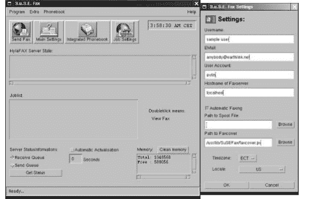

## 图 7.7

设置 SuSEFax 程序。

## 通信功能总结

SUSE Linux 为你提供了广泛的连接选项。凭借 SuSE 提供的工具，你应该能在短时间内让网络运行起来。从可以为特殊连接需求定制的现代实用程序（如 `minicom`），到拨号按需的 ISDN 系统，软件和设置资源都可以从 CD-ROM 轻松获取。由于现在有大量的可用工作方案，我信我只触了冰一角。本章提供的在线资料将证明是无价值的，请尽情使用它们。对于那些选择高速连接的用户，我建议获取一个静态 IP 地址，这样如果你恰好设置电子邮件服务器或任何需要持续且不中断连接的服务，就不必费力调整额外的应用程序了。

祝你玩得，享受与世界的交流吧！

# 第8章

## 使用 YaST 管理用户和组

YaST 已经证明自己是一个在 SuSE Linux 系统上安装软件和执行配置任务的强大工具。现在，另一个独特元素即将显现——它管理你的 Linux 机器上的用户和组的能力。


如果你在仅支持单用户且无其他功能的非网络、隔离区域内使用你的机器，那么本章包含的一些信息将毫无意义。但是，如果你计划作为文件服务器支持用户，或者你预期会有针对机器的 `ssh-` 或 `ftp` 类型的连接，请继续读下去。

系统管理可能非常耗时且枯燥。事实是，如果没有妥善的管理，你精心调优的 SuSE Linux 系统可能会陷入混乱。随着新闻中不断出现安全忧虑，监控你的系统不再是一项奢侈品，而是必需品。尽管本书的重点是安装，但如果我未能对用户管理主题提供更多说明，我将失职了。这并不是说我认为你对 UNIX/Linux 的先知识是理所当然的——相反，我将帮助澄清一些标准参数。本章简要概述了相关密码文件的用户 ID 和组 ID 原则。随着用户群的增长，熟悉这些文件的内容是非常重要的。

在小型或大型环境中支持多个用户对你的 Linux 系统来说非常简单。基本的控制因素是内核。内核将用户视为数字，每个用户都由一个特定的整数（称为用户 ID，简称 `uid`）标识。对于内核来说，读取一个数字比读取一行纯文本更容易；

这通过减少 CPU 处理开销增强了系统性能。标准的（文本类型）用户名也会分配给 `uid`，并保留在位于 `/etc/passwd` 文件的系统用户数据库中。出于安全起见，系统还会生成一个加密密码并将其放在 `/etc/shadow` 文件中。系统还必须通过 `/etc/passwd` 文件中的信息为用户分配家目录并设置工作 shell 环境。图 8.1 显示了 `/etc/passwd` 文件的内容。

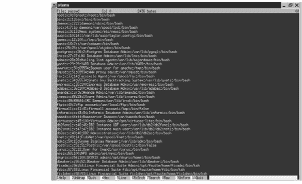

### 图 8.1

未加密密码文件 (`/etc/passwd`)。

如果你还不熟悉 `/etc/passwd`，我将为你分解第一行（user-name `root`）：

`root:x:0:0:/root:/bin/bash`

用户名是 `root`，`x` 是 `/etc/shadow` 中包含的加密密码的占位符。第一个零代表用户 ID，下一个零代表 `root` 所属的组。`/root` 表示家目录，`/bin/bash` 是分配给该用户的 shell 环境。如你所见，当内核监控 `root` 账户时，对于用户 ID 和组 ID 而言，`root` 等同于 `0`。错误。在设置用户时请记住这一点——不要使用随机编号，并为用户/组分配建立一致的模式。这有助于消除安全问题。

曾经，这是通过在命令行（CLI）中调用的单个命令处理的。`useradd` 和 `userdel` 等命令仍可在命令行可用，但现在 YaST 可以处理这些任务。

## 添加、删除和修改用户账户

要使用 YaST 从系统中添加或删除用户，你需要访问“系统管理”菜单并选择“用户管理”。

这两个功能由脚本 `/usr/sbin/useradd.local` 辅助，该脚本会在 `/etc/passwd` 和 `/etc/shadow` 创建所有所需的条目，创建家目录并从 `/etc/skel` 复制文件。脚本 `/usr/sbin/userdel.local` 删除 `/etc/passwd` 和 `/etc/shadow` 中的条目，但保留 `/home/<username>` 目录。

### 添加用户

使用 YaST 工具添加用户是一项简单的任务。用户管理的输入界面如图 8.2 所示。

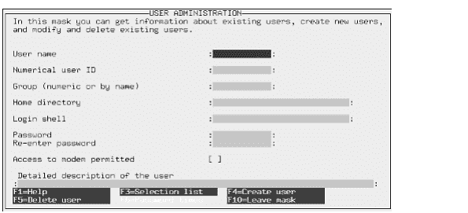

### 图 8.2

用户管理菜单。

用户管理菜单让你添加用户的能力。这非常简单：

> 注意
>
> `/home` 目录的使用是你密切关注的内容。

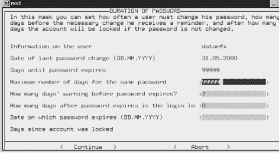

图 8.3

用户管理密码菜单。

通过此输入菜单，你可以完成许多操作。如果现有用户结婚或更改了姓名，你也可以进行添加或修改。这非常有益，并且可以为你节省大量时间。

### 删除用户

按 F5 键删除用户账户。此操作由脚本 `/usr/sbin/userdel.local` 执行，该脚本会从 `/etc/passwd` 和 `/etc/shadow` 中删除条目，但保留 `/home/<username>/` 目录。

需要注意：在删除用户账户之前，最好先禁用该账户。这可以防止在执行文件维护（从系统中删除所有账户引用）期间该人员继续使用该账户。如果某人突然离开并可能在不久后回来，或者正在请病假，禁用账户将有所帮助。要禁用账户，你需要调用你喜喜欢的编辑器，并将用户的密码占位符 (`x`) 替换为星号 (`*`)。

> 注意
>
> 如果离开的用户曾拥有 `root` 权限，请立即更改 `root` 密码，但出于显而易见的原因，不要禁用账户。

如果你确定该用户不会回来，请删除账户并使用 `find` 命令搜索系统以清除该用户的所有文件，命令如下：

```
## find / -user <username>
```

根据系统大小和用户生成的文件数量，这可能需要一段时间。在非高峰时段运行此操作有助于加速过程。在找到与用户相关的文件后，确保所有文件都已删除。这应该包括所有的邮箱箱、邮件别名、打印作业以及仍然存在的 `cron` 或 `at` 任务。

## 用户账户的 CLI 命令

尽管 YaST 可以执行系统所有者运行的许多管理任务，但命令行用户管理工具是不可替代的。你可以使用这些工具快速更改密码和其他其他重要的用户信息，而你无需调用 YaST 或在菜单选择中进行翻找。我之前提到过 `useradd` 和 `userdel` 命令，我将在本节中列出它们。

- `useradd`——添加用户并为新用户创建工作环境（`bash` shell）
- `userdel`—删除用户账户，包括 `/etc/passwd` 和 `/etc/shadow` 文件
- `chfn`—更改全名字段
- `chsh`—更改登录 shell 环境
- `passwd`—更改用户密码

注意，普通用户可以使用这些命令更改其账户的内容。如果这是一个问题，你可以通过使用 `chmod` 命令限制非 `root` 用户。更改所有命令，使得只有 `root` 拥有访问权限。

如果你打算更改用户名且无法使用 YaST，请输入命令 `vip` 来编辑 `/etc/passwd` 文件。要编辑组，请在命令行输入命令 `vig`。如果你不熟悉 `vi` 编辑器，请使用你喜喜欢的编辑器并通过文件名（`/etc/<filename>`）加载密码文件或组文件。

## 组管理

在实践中，使用组作为控制文件访问的手段在 UNIX 类型环境中已使用了一段时间。用户必须被分配到至少一组，该组可能要求同组的其他人有读取或写入同一文件的权限。在多用户环境中，允许特定人员访问——这增强了安全性和系统管理性。组由其实际名称定义，组信息包含在 `/etc/group` 文件中。图 8.4 显示了组结构的示例。

你会注意到组信息非常直观：列出了组名；接着是密码占位符（用 (`x`) 表示）、数值 ID 号 (`0`）；以及该组的成员列表。主要的关注点是组名以及你或系统分配给该组的数值分类。

> 注意
>
> 在熟悉组结构之前，不要删除或修改任何组设置。系统创建了如 `root`、`wheel`、`sys` 和 `daemon` 等组用于运行目的，因此过早更改或向此文件中添加是不明智的。建立你的工作组，然后根据需要删除不需要的组。

在为组命名时，不要使用任意名称；保持命名规范（标准）以帮助你和其他其他管理员理清组列表。

| 退出 | 保存 | 加载 `/etc/group` |
|---|---|---|

| | 使用 Control-S 和 Control-G 搜索。 | | |

| 加载：未指定文件。 | | |

| 文件 `/etc/group` 已以只读方式打开。 | | 只读 |

| | `/etc/group` | | |

```
root:x:0:0:/root:/bin/bash
daemon:2:
type:5:
bin:6:
lp:7:
wheel:8:
man:9:
gsync:10:
news:12:
ntp:14:
dialout:16:
at:25:
apt:27
yord:28:
home:29:
firewall:31:
policice:32:
infis:34:infoxis
games:38:
sck:41:
tredev:42:
manager:44:named
dbdbd:46:
@dialout:x:47@
```

图 8.4

`/etc/group` 的内容

`/etc/group` 的内容

如果你在机器上实施网络信息系统 (`NIS`)，YaST 目前无法管理用户和组。你需要手动编辑你喜喜欢的编辑器。

使用 YaST 配置系统安全


每当多个人使用计算机时，就存在安全漏洞的风险。Linux 有许多可以关闭的服务。详情请参阅第 13 章“安全网络”。默认情况下，系统初始化了一些服务。管理你的基础是我处理这种情况的主要原因——即使你是唯一用户，谨慎整合系统对于生存至关重要。考虑以下类比：如果你是一艘船的船长并知道即将进入风暴，你会让船员留在甲板上吗？我想不会。相反，你会号召船员下甲板并封好舱门

最重要的是，你会号召船员下甲板并封好舱门

# 第 8 章：使用 YaST 管理用户和用户组

## 使用 YaST 配置系统安全

帆具并确保所有的绳索都已系好。最重要的是，你会号召船员下甲板并封好舱门。系统管理就像这样——你必须确定网络天气状况，然后采取预防措施。

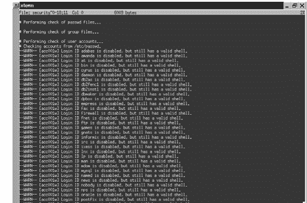

图 8.5

系统生成的默认用户。

### /etc/login.defs 的配置

| --- /etc/login.defs 的配置 --- | |
| :--- | :--- |
| 在此文件中，你可以通过对 `/etc/login.defs` 文件中的登录配置进行各种输入。 | |
| 记录失败的登录尝试 | 5 |
| 错误登录尝试后等待的秒数 | 3 |
| 记录登录尝试 | [X] |
| 最小用户 ID | 100 |
| 最大用户 ID | 60000 |
| 最小组 ID | 100 |
| 最大组 ID | 60000 |
| 密码更改之间的最小间隔 | 0 |
| 密码更改之间的最大时间 | 99999 |
| 密码密码过期前多少天应该警告用户？ | 7 |
| < 继续 | < 取消 |

### 8.6 /etc/login.def 菜单的配置

在整个系统范围内，你可以指定密码更改之间的时间因素。密码警告字段与“用户管理”中的字段类似，不同之处在于影响的是全局参数。

## 使用 YaST 配置打印机

在使用 YaST 时我遇到的任务之一是打印机配置。你需要选择“系统管理”菜单并进入“硬件集成到系统”。选择“配置打印机”以进入打印机安装界面。

我有机会使用其他打印机配置工具，例如 GUI 打印机配置器 purport 以及 magicfilterconfig（一个基于控制台的文本类型打印机程序）。两者都很好，但我非常喜欢使用 apsfilter，因为它提供了许多打印过滤器。图 8.7 显示了打印机安装界面。

| --- 下一步 | --- 信息 | 上一步 -- |
| :--- | :--- | :--- |
| 这是配置通用打印机过滤器 asfilter 的方便方法。如果你选择“安装”，必要的更改将写入你的打印机配置文件 (`/etc/printcap`)。然后将显示所创建的过滤器的名称（`lp0`, `lp1`, 等）。 | | |
| 彩色打印机 | [X] | |
| 打印机类型 | [HP Deskjet] | |
| 打印机名称 | [col0850] | |
| 纸张格式 | [letter] | |
| 连接到端口 | [Parallel] 端口 | |
| 设备名称（仅限串口） | [`/dev/lp0`] | |
| 分辨率 (dpi) | [300x300] | |
| < 安装 | < 取消 | |

### 8.7 打印机安装界面。

SuSE Linux 上的打印系统基于 apfilter，并包含一些增强功能。如果安装了 htmlps 软件包，SuSE 的 apfilter 就能识别所有颜色格式，包括普通的 HTML 文件。YaST 允许通过 Ghostscript 驱动配置 PostScript、桌面和其他打印机；也可以可能设置 HP GDI 驱动，包括 HP DeskJet 710/720、820 和 1000 打印机。这可以通过使用 ppa 软件包来实现，该包目前仅支持黑白打印。YaST 会为每台打印机生成 `/etc/printcap` 条目（raw、ascii、auto，以及如果打印机是彩色打印机则生成）。YaST 会生成相应的生成池目录并存档 apfilter 文件。从该文件中，你可以精细调整设置，例如 Ghostscript 控制、纸张尺寸、纸张方向、分辨率和打印机转义符。SuSE 数据库也可访问 http://sdb.suse.de/sdb/en/html/drucker-howto.html。如果你遇到配置问题，请检查此 URL 以获取帮助。

作为使用 YaST 进行打印机配置的选项（以防你无法访问 YaST），你可以在命令行使用 `lprsetup` 调用 `apsfilter` 设置工具。这会调用内置在 apsfilter 程序中的设置工具。该设置工具为用户提供了一个良好的用户界面，如图 8.8 所示。

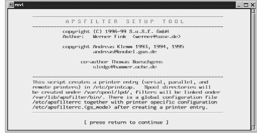

图 8.8

APSfilter 设置工具 lprsetup。

目前 YaST 打印机配置尚未具备彩色激光打印机功能。如果你配置了单色打印机，你需要编辑 `/etc/printcap` 文件。必须在 printcap 条目中将 `mono` 改为 `color`。如果你在进行这些修改后遇到打印问题，你可能还需要重命名生成池目录。

## 使用 YaST 配置远程打印机

行打印守护进程（生成池区域处理器）`lpd` 通常在启动时调用。启动时，它会尝试查询 printcap 文件中的参数（设置）以查找当前打印机的信息；它会打印留在生成池中的任何文件。如果打印机意外关闭或发生意外系统关机，这将非常有帮助。然后 `lpd` 使用两个系统调用 `listen` 和 `accept` 来接收队列中打印文件的请求、将文件传输到生成池区域、显示打印队列或从队列中删除作业。在这种情况下，`lpd` 将作业转发给子进程来处理请求，以便父进程可以继续监听更多请求。

`lpd` 的功能之一是支持通过网络打印到物理连接到不同机器的打印机。通过对过滤器脚本的仔细配置，加上 Samba 等少量工具，你可以透明地向各种类型的打印机发送打印作业。

基于打印过程的另一个组件是 `lpr`，其功能是控制打印机生成池。它联系 `lpd` 并将新的打印作业注入生成池中。如你所见，只需几步操作即可。

# 第 9 章：定制自定义内核

## 定制自定义内核

在过去的一年左右，Linux 整体取得了飞速发展，产生的新内核版本支持比以往任何时候更多的硬件。SuSE 提供了许多预编译的内核，普通系统可以毫无问题地运行。然而，事实仍然是，Linux 目前并不支持所有的硬件组件。例如，你机器中的网卡是 Tulip 芯片类型的。尽管驱动程序可能支持 Tulip 家族，但驱动程序版本可能不包含使网卡正常工作的更新代码。你现在面临着两种选择：1) 找到正确的 Tulip 驱动并单独编译，或者 2) 整体完全重新编译内核。无论哪种方式，前面都有工作要做。

如果你是为了为非商业用途或作为评估平台设置这台 SuSE 机器，重新编译内核可能是不实际的。测试机很少需要微调——除非关乎内核的整体性能——所以你可能想跳到下一章。但话回来，如果你计划将其作为网络防火墙、IP 伪装箱（IP-Masquerading）或其他特殊应用，那么这一章就是为你准备的。

本章的设计并不是为了降低该过程的复杂性，也不是为了轻视编译失败可能导致的后果。我的希望是给你提供一些切实的信息，在必要时引导你完成定制过程。

SuSE 构建并包含的通用内核（generic kernel）旨在启动并识别广泛的硬件和外围设备。为了实现这一点，它考虑了不同类型机器的功能，然后根据其占整体使用的百分比进行评估。从发行公司的角度来看，这是一个优点：操作系统能够运行的机器越多，购买的就越多。9.1 节提供了内核镜像大小的说明——看一眼 `vmlinux` 和 `vmlinuz1`。

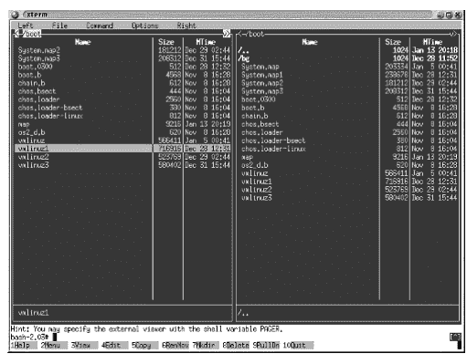

# 图 9.1

内核镜像对比——`vmlinux` 对比 `vmlinuz1`。

通用内核 `vmlinuz1` 与重新编译的内核 `vmlinux` 之间 150KB 的差异显示了通用内核中包含了多少额外代码。在启动 SuSE Linux 时，所花费的时间并不异常长，但确实需要一些时间。不必要的硬件探测以及加载未使用的驱动程序和模块也会延长启动时间。通过只运行所需的组件来减少内核内容，有助于释放内存并更高效地利用资源。

Linux 内核充当你的硬件和程序应用程序之间的接口。它还执行内存管理功能。就像马戏团团长一样，它负责平衡系统资源并确保所有进程都能获得它们的 CPU 时间。

内核的一些主要功能是：

- 管理运行进程的资源
- 创建和销毁（杀掉）进程
- 执行程序
- 提供对文件系统的访问

运行 Linux 操作系统的优点之一是它能够通过虚拟文件系统（VFS）与不同的数据结构接口。VFS 提供了一个信息在内核和文件系统模块之间传递的层。VFS 的通用性不可思议：它不仅支持标准的 UNIX 类型文件系统，还可以支持 MS-DOS、UM-DOS 和 vfat 文件等。

尽管这些文件系统原理看起来很基础，但它们将让你了解为什么你可能想要自定义内核。


内核包含的设备驱动程序识别设备，访问部分内存，并提供代码以确保其运行正常。

内核支持 TCP/IP、UDP 和 PPP 协议等网络协议。这使得 Linux 能够有效地与不同类型的操作系统进行通信。内核中的高级网络功能包括 NFS 和网络地址转换（NAT）（IP 伪装）。

编译自定义内核将产生一个只包含特定机器所需的驱动程序和服务的内核。如果你可以在启动时加载所有所需的设备驱动程序来构建内核，这被称为内核内核（monolithic kernel）。这种模块化的内核会在需要时自动加载特定的驱动程序。这一概念提高了系统的整体性能和灵活性。如果某件硬件被移除，它在启动时将不会被识别，也不会被加载。

如果网络安全是一个考虑因素，请确保不使用的驱动程序和服务已关闭或消除。诚然，内核内核层面的漏洞问题会带来安全风险，但可能会出现某些情况。关于该主题的详情，请将浏览器指向 `http://linux.com/stories/14671.html`。

## 构建自有内核的益处

构建自己的内核有什么好处？作为一个例子，让我们用你的汽车做一个类比。如果室外温度是 25°F，你会一直开启空调吗？可能不会——那将浪费能量资源，并且可能让你感到有些不舒服。引擎（或者在空调（即驱动程序）的情况下）是附件组件。你并不希望从汽车上永久移除空调单元，只需在需要时禁用该组件即可。关闭未使用的配件有助于提高油耗并提升整体性能。

安装 Linux 系统后，我的任务之一是下载最新的内核源码并从头开始。这种方法让你能够利用 SuSE Linux 的力量，并授权使用其资源。如果你管理一个多用户系统，定制内核应该是优先的。考虑一下：当系统运行后，中断用户的活动将是代价昂贵的，而你更改功能的愿望会被日常使用所抵消。如果你计划重新编译内核，事实上，这需要花费一小时左右（如果这是你第一次的话）的时间。

构建新内核的简单性令人大目一新。你可以选择使用基于文本的配置工具或菜单类型的配置工具。X 界面易于使用，如果这是你的喜好。

我之所以熟悉编译内核问题是因为需要。我需要让某个硬件在我的 Linux 系统上运行，所以我面临着保留无用硬件还是挑战定制内核的建议。随着时间的推移，我发现这一步骤对我的帮助比我想象的要大。

## 警告

> 记住，稳定内核版本是 2.2。我不建议尝试开发内核，因为这些可能非常不稳定。开发内核不保证能够成功编译，也不保证能在你的硬件上运行。

# 执行构建过程 103

> 注意

如果你不确定是否已经为打算构建的内核安装了正确的编译器，请查看内核源码中包含的 README 文件。它将指定所需的编译器类型。

## 最新内核源码

对硬件支持的需求驱动了内核开发。在重新编译之前，务必确认你正在使用的是最新的可用稳定版本。这将确保你配备了使 SuSE Linux 系统可用的当前驱动程序和选项。要找到最新源码，请将浏览器指向 `http://www.kernel.org/pub/linux/kernel/v2.2`。

源码文件可以通过压缩格式获取：`linux-2.2.xx.tar.gz` 和 `linux-2.2.xx.tar.bz2`。由于压缩方法的原因，bz2 格式的文件体积更小。无论是哪格式，完全解压后的内核都将占用约 68MB 的空间；确保你的 `/usr/src` 有足够的空间。你的下一步将要求你切换到超级用户账户，注销当前用户并以 root 身份登录。现在你可以下载源码了；如果你使用 ftp，我建议使用 `ftp:kernel.org`。

将源码下载到 `/usr/src` 目录。当前的源码目录应该是 `linux-2.2.13.SuSE`，可以先留在那里。解压文件有多种方法——我将展示我最喜欢的方法。在命令行（CLI）执行以下命令（取决于压缩格式）：

```
gzip -dc linux-2.2.xx.tar.gz | tar -xvf-
bunzip2 -cd linux-2.2.xx.tar.bz2 | tar -xvf-
```

现在你已经建立了一个准备就绪的 linux 目录。

> 警告

不要从 `/boot` 目录移除（删除）当前的内核镜像和 System.map 文件。如有必要，请使用 .old 后重命名文件。如果你删除了这些文件且新内核编译失败，你可能会遇到无法重新运行所有程序的问题。

## 应用内核补丁

你可以选择放弃下载完整源码，而是获取升级当前内核的补丁。补丁可以在源码文件相同的目录下找到，列名为 `patch-2.xx.gz`。将你的补丁下载到 `/usr/src` 目录。如果补丁是通用的（没有 acl 或预补丁系列），文件名必须为“linux”；相应地重命名文件。要重命名文件，请在命令行执行以下操作

```
mv linux-2.2.13.SuSE linux
```

## 第 9 章：定制自定义内核 104

你需要清理内核树和旧的配置文件，以防止发生任何冲突。在 `/usr/src/linux` 目录下执行此命令：

```
make mrproper
```

这将彻底清理残留的配置和对象文件。现在回到包含补丁的目录，执行此命令来修复内核源码：

```
gzip -dc patch-2.2.xx.gz | patch -p0
```

如果你正在使用 ac 或预补丁进行补丁，你需要重命名 linux 目录。某些预补丁除非重命名后的目录看起来如下所示，否则无法安装：

`/usr/src/linux.14p9`

这将版本 2.2.13 使用预补丁-2.2.14-9.gz 进行补丁。因此，如果补丁失败，请查看进程初的调试命令。这些注释将指示补丁文件正在查找要修复的目录。相应地重命名 linux 目录，补丁即可完成。

## 定制内核组件

开始之前，你必须熟悉几个命令：

- `make config`——调用时，此 make 命令使用基于文本的界面并允许进行内核选项选择。
- `make menuconfig`——此命令的作用与 `make config` 命令相同，不同之处在于界面是菜单类型的半图形化界面。（见图 9.2）
- 显示基于 X 系统的内核选项选择界面。（见图 9.3。）

图 9.2 Menuconfig 选择界面。

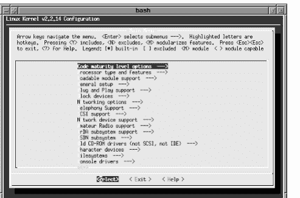

| Linux 内核层级配置 | 以太网 (100 Mb) | 软盘，软带设备 |
|---|---|---|
| 处理器类型和特性 | USB 设备 | 文件系统 |
| 可加载模块支持 | 磁带驱动设备 | 网络文件系统 |
| 通用设置 | 接口 | 分区类型 |
| 即插用支持 | 音频广播支持 | 原生语言支持 |
| 块设备 | IRQ 处理子系统 | 控制台驱动程序 |
| 网络选项 | IP 协议设备驱动程序 | 声音 |
| Go/其他公平调度 | CD-ROM 设备 (非 SCSI, 非 IDE) | 额外的低级声音驱动程序 |
| SCSI 支持 | 字符设备 | 内核黑客行为 |
| SCSI 低级驱动程序 | 鼠标 | 座与排序 |
| 网络设备支持 | 摇杆 | 不保存并退出 |
| AllOC 设备 | 监控卡 | 从文件加载配置 |
| 以太网 (10 或 100 Mb) | Linux 视频 (VGA) | 将配置保存到文件 |

图 9.3 基于 X Window 的内核配置界面 (xconfig)。

像补丁一样，我建议在开始构建之前使用 `make mrproper`。尽量确保一切都是整洁且有序的。虽然 `menuconfig` 是最喜爱的，但 `make xconfig` 是更好的选择。在你进行选择时，请记住你所选的即你所得。你必须为内核应用一些模块。这些列在表 9.1 中。

| 类别 | 不需要更改的 |
|---|---|
| 处理器类型和特性 | 正确的处理器族 |
| 网络选项 | 正确的 synookie |
| 网络设备支持 | 拨号点点支持 |
| 以太网 (10 或 100 Mb) | 正确的 NIC 驱动 |
| 摇杆 | 正确的摇杆驱动 |
| 声音 | 适用于 OSS 的模块 |
| 内核黑客行为 | |

9.1 内核配置

## 第 9 章：定制自定义内核 106

选择并退出以保存你的选择。

执行 dep 命令以确保所有依赖已满足——这应该运行很快。

接下来的命令可以一组执行，允许你起身伸伸腰喝杯咖啡。如果你愿意，也可以逐个执行。我将单独列出：

- `make bImage`——编译内核文件 bImage
- `make modules`——创建模块
- `make modules_install`——将模块安装到 `/lib/modules`

自动化此过程的可选命令如下：

```
make bImage modules modules_install
```

该命令将顺序执行列出的每个项目。对于该过程大约需要一个小时。为了充分利用可选命令集，请包含 `make bzimage` 命令。这将编译器生成的 bzimage 转换为 vmlinuz。System.map 文件和 vmlinuz 将被复制到 `(/root)` 目录，此命令还需要你将 `/boot/vmlinuz` 和 `/boot/System.map` 链接到根目录才能工作。（见图 9.4）。


你可以选择不链接 `/boot` 目录，然后手动复制文件。作为一个友情提示，在安装新内核后始终运行 `lilo` 命令。

> 尽管不像过去流行，但可能仍有一些用户使用超频处理器系统。你不应该在超频系统中编译内核。这会在内核中产生 Bug 并可能导致系统崩溃。在处理器以正常速度运行时编译内核，安装新内核后再对系统超频。

如果你使用笔记本电脑，你会有更多工作要做。稳定内核没有包含 PCMIA 支持，因此你必须从 http://sourceforge.org/pcmcia 获取当前的源码包。

# 自定义内核摘要 107

| 名称 | 大小 | 时间 | 用户 |
|---|---|---|---|
| vmlinuz | 1084 Jan 17 12:01 | root |  |
| systemmap | 1100 Dec 20 12:50 | root |  |
| boot | 1024 Dec 20 12:17 | root |  |
| boot.gz | 4562 May 11 10:22 | root |  |
| config.inject | 444 Dec 20 11:34 | root |  |
| config.loader | 2500 Dec 20 11:34 | root |  |
| config.loader-line | 888 Dec 20 11:34 | root |  |
| initrd | 6200 Jan 15 13:56 | root |  |
| vmlinuz.map | 1084 Jan 17 12:01 | root |  |
| vmlinuz.private | 1024 Dec 20 12:17 | root |  |
| vmlinuz.old | 1024 Dec 20 12:17 | root |  |
| vmlinuz.bak | 1024 Dec 20 12:14 | root |  |
| vmlinuz-1 | 3050 Dec 20 12:15 | root |  |
| vmlinuz-new | 4096 Jan 11 16:17 | root |  |
| vmlinuz-old | 1024 Dec 20 12:26 | root |  |
| vmlinuz-old.bak | 1024 Dec 20 12:26 | root |  |

*(为了简便，省略了重复的 vmlinuz.map 条目)*

**图 9.4** 将 vmlinuz 和 System.map 文件软链接到根目录。

你需要在 `/usr/src` 目录下解压源码 `linux-x.x.tar.gz`。进入新的内核目录，运行 `make config`。这会执行系统检查并提供一些供你选择的选项。完成配置后，运行 `make all` 然后运行 `make install`。最后，检查 `/etc` 中的选项以确保一切无误。有关内核设置的更多帮助，请参阅当前的 Kernel-HOWTO，地址为 http://linux.sourceforge.org/doc/kernel-howto.html。

## 自定义内核摘要

如果你正在阅读这里，要么是你直接跳过来看章节末尾的内容，要么是你已经完成了自定义构建。现在你是你系统的主人了，希望这项任务并没有你脑海中构想的那么艰巨。你已经执行了所有的 `make` 命令并成功使用了 `modprobe`。使用 `depmod` 和 `insmod` 非常轻而易举，其结果将证明你的付出。请注意警告：在确定你的新内核镜像运行之前，不要移除（删除）之前的内核镜像。

# 第 10 章：网络管理

网络管理可以相对简单，也可以极其困难，这取决于网络的规模和组成。管理职责范围从简单的备份到将不同类型的操作系统集成到公共环境中。Linux 平台为应用程序提供了灵活性，可以作为 Samba 服务器融入 Windows 类型的网络，也可以轻松地处理路由和防火墙分配。

在 SuSE YaST 的帮助下，管理工作将不会变成负担。无论你有 1 台机器还是 100 台机器，YaST 都会帮助你保持网络井洁。

我们将检查内置在 YaST 中的一些优秀网络管理工具。你将熟悉如何控制系统，并将使用随 SuSE Linux 6.3 带的一些网络监控工具。首先，让我们来看系统配置。

## 网络维护

在网络上启动、停止和添加服务可能是一个挑战。如果你是网络的唯一用户，任务更容易——你不会在不考虑网络管理职责导致的时间损失的情况下中断自己的工作。

多用户环境的情况完全不同——在中午关闭网络不是一个好主意。请将此类活动安排在一天开始（没有用户时）或一天结束（大多数用户正在完成工作时）。

### 使用 YaST 配置系统

在任何网络环境中，更改参数以及添加或删除服务的能力都有其优势。SuSE Linux 在简化系统配置方面远于其他系统。系统配置通常通过使用你喜欢的编辑器或 `vi` 编辑文件来完成。这种方法要求你牢牢掌握几点：要修改的文件位置，以及所需的特定更改。

另一个因素涉及你是否打算通过取消注释（删除相关行前的注释 `#`）来启用服务。其他示例还包括向某行添加参数（插入它）。由于系统配置中可选选项非常多，要涵盖所有内容是不切实际的。我们将关注最常用的设置。

配置以滚动滚动菜单的形式呈现，并附有单独的说明（如果可用的话）。

**图 10.1** YaST1 更改选项。

系统配置有超过 200 个字段。配置工具显示了 YaST 界面。

> 注意：配置执行对系统的更改。

> 警告：如果由于任何原因关闭了 YaST，配置工具将变得无效。

我整理了一张表格，在需要更改系统时参考。虽然可以在 YaST 工具中找到相同的列表，但你可能需要搜索许多选项才能找到你需要的内容。表 11.1 经过精简，以帮助识别你常用的服务。第一列指示 YaST 功能。在第二列中，“yes”或“no”表示服务的开启或关闭，而“open”意味着你必须提供正确的参数。系统配置的项被称为“automatic”。最后一列列出了对服务或参数影响的具体注释。

| 表 10.1 YaST 系统配置列表 |
| 系统功能 | 选项 | 注释 |
|---|---|---|
| `BEAUTIFY_ETC_HOSTS` | yes/no | 排序 `/etc/hosts` 文件。 |
| `CHECK_ETC_HOSTS` | yes/no | 检查并修改 `/etc/hosts` 文件。 |
| `CHECK_INITTAB` | yes/no | 检查并修改 `/etc/inittab` 文件。 |
| `CHECK_PERMISSIONS` | set/warn | 修正或警告 `/etc/permissions` 中的权限失败。 |
| `CONSOLE_SHUTDOWN` | ignore/reboot/halt | 选择系统范围 Ctrl+Alt+Del 键的功能。 |
| `CREATE_HOSTCONF` | yes/no | 生成/检查 `/etc/host.conf` 文件。 |

## 11 第 10 章：管理网络设置

表 10.1 继续

| 系统功能 | 选项 | 注释 |
|---|---|---|
| `CREATE_RESOLVCONF` | yes/no | 配置并维护 `/etc/resolv.conf` 文件。 |
| `CRON` | yes/no | 启动 cron 进程。 |
| `DEFAULT_WM` | KDE,WM,Enlightenment | 选择启动窗口管理器。 |
| `DHCLIENT` | yes/no | 启动 DHCP 客户端。 |
| `DHCLIENT_SLEEP` | open | 为 DHCP 初始化提供时间（秒）。 |
| `DISPLAYMANAGER` | console/kdm/xdm | 在启动时激活显示管理器。 |
| `ENABLE_SUCONFIG` | yes/no | 启用自动系统配置。 |
| `FQHOSTNAME` | current hostname | 为计算机选择的名称，例如 my.computer。 |
| `FTP_PROXY` | open | 指明 ftp 代理地址。 |
| `GMT` | -u, "" | 如果时设置为 GMT，则使用 -u；本地时间使用空引号 ("")。 |
| `GPM_PARAM` | open | 允许您修改参数。 |
| `IFCONFIG_0` | open | 提供主 IP、广播和子网掩码地址（如 ifconfig 输出所示）。 |
| `IFCONFIG_1` | open | 提供次 IP、广播和子网掩码地址（如 ifconfig 输出所示）。 |
| `IPADDR_0` | open | 提供主 IP 地址。 |

### 使用 YaST 配置系统

| 系统功能 | 选项 | 注释 |
| --- | --- | --- |
| `IPPADDR_1` | open | 提供次 IP 地址 |
| `IP_DYNIP` | yes/no | 启用启动时的动态 IP 补丁功能 |
| `IP_FORWARD` | yes/no | 转发 IP 数据包，并处理伪装和路由 |
| `IP_TCP_SYNCOOKOKIES` | yes/no | 提供 syn-flood 洪水攻击保护 |


# 系统配置选项

| `IRCSERVER` | open | 允许您在此处添加喜欢的 irc 服务器地址 |

| `KBD_CAPSLOCK` | yes/no | 询问键盘大写锁定（CapsLock）状态 |

| `KBD_NUMLOCK` | yes/no | 询问键盘数字锁定（NumLock）状态 |

| `KBD_RATE` | open | 提供重复速率；此选项生效时必须输入延迟时间（ms） |

| `KDB_TTY` | open | 指定可以使用 NumLock 和 CapsLock 的 tty（tty1 tty2 或针对所有 tty） |

| `KDM_GREETSTRING` | open | 用于在显示管理器屏幕上显示计算机的主机名 |

| `KDM_SHUTDOWN` | root, all, none, none | 在 KDM 界面上显示可以关闭系统的用户 |

| `KDM_USERS` | open | 修改 KDM 主界面上的用户列表 |

| `KEYTABLE` | <table type> | 允许您指定键盘表类型（如 us.map.gz） |

### 表 10.1 继续

| 系统功能 | 选项 | 注释 |

| --- | --- | --- |

| `LANGUAGE` | open | 允许您指定本地语言。 |

| `MAIL_LEVEL` | warn/all | warn 提供重要消息；all 提供所有邮件和日志。 |

| `MAIL_REPORTS_TO` | open | 将配置更改邮件给 root 或任何指定的用户。 |

| `MAX_DAYS_FOR_LOG_FILES` | open | 告诉日志文件的存储时长。 |

| `MAX_RPMDB_BACKUPS` | open | 指定 rpm 数据库备份文件的最大数量。 |

| `MODEM` | open | 指明用作调制调器的设备 (<TySx>)。 |

| `MOUSE` | open | 指明哪个设备是鼠标 (<TySz>)。 |

| `NAMESERVER` | open | 提供您的 DNS 服务器的 IP 地址。 |

| `NETCONFIG` | open | 指定用网络接口的设备（NIC）。 |

| `NETDEV_0` | automatic | 指明第一个网络设备 eth0。 |

| `NETDEV_1` | automatic | 指明第二个网络设备 eth1。 |

| `NFS_SERVER` | yes/no | 启动 NFS 服务器。 |

| `NNTPERVER` | yes/no | 提供新闻服务器的地址。 |

| `PASSWD_USE_CRACKLIB` | yes/no | 允许您使用 cracklib 检查新密码。 |

| `PATH` | <PATH> |此 PATH 为 SuSEconffig 和 cron 设置。请勿更改此设置。 |

| `PCMCIA` | i82365 or tcic | 指明使用的 PCMCIA 芯片组。 |

| 系统功能 | 选项 | 注释 |

|---|---|---|

| `PCMCIA_CORE_OPTS` | open | 参考 man 页面，选项查看 #man pcmcia-core。 |

| `PCMCIA_PCIC_OPTS` | open | 决定插槽驱动程序定时；详情见 #man 1823S 或 #man。 |

| `PERMISSION_SECURITY` | easy, secure, paranoid | 设置全局文件权限系统。 |

| `POSTFIX_CREATECF` | yes/no | 决定是否由系统创建 Postfix 配置文件。 |

| `POSTFIX_LOCALDOMAINS` | open | 提供 localhost 和系统域名。 |

| `POSTFIX_MAILDROP_MODE` | nosgid/sgid | 是受保护的邮件投递目录还是可写。 |

| `POSTFIX_RELAY` | open | 指明中继（relay）。 |

| `ROOT_LOGIN` | yes/no | 决定 root 是否允许登录。 |

| `SEARCHLIST` | open | 列出域名。 |

| `SMTP` | yes/no | 创建邮件服务器。 |

| `SORT_PASSWD` | yes/no | 对用户排序。 |

| `TIMEZONE` | open | 修改 `/usr/zoneinfo/local-time`。 |

| `USB_DRIVERS` | usb-keyboard,mouse | 启用 USB 设备。 |

| `USE_NIS_FOR_AUTOFS` | yes/no | 使用 NIS 进行 autofofs。 |

| `XNTPD_INITIAL_DATE` | open | 列出服务器地址。 |

## 使用 YaST 配置系统

## 配置互联网服务

在配置互联网服务时，问题在于要在机器上运行哪些服务和功能。例如，您的独立机器每天连接时间很短，没有理由使用调制调器以外配置浏览器以外。有些人可能考虑过构建家庭网络，如果是这样，您需要多台机器连接到同一个连接。让我们从处理浏览器配置开始。

### Web 浏览器配置

自从 Linux 在互联网剧图中占据中心地位以来已经过了很多时间。互联网使用的增加需要比 Linux 创建时更先进的技术。SuSE Linux 提供了两种 Web 浏览器选择：Lynx 和 Netscape Communicator。让我们来看看它们的特征。

## 第 10 章：管理网络设置

### Lynx 浏览器

通常，大多数 Linux 发行版在软件包中都包含了几个 浏览器。SuSE 也不例外；资深 Linux 用户喜欢的浏览器之一就是 Lynx。这是一个基于文本的浏览器，可能会吸引硬核 Linux 用户。该浏览器的速度惊人，因为它不需要解析图形。尽管它是一个文本类型的浏览器，但它具有其他 浏览器不具备的配置功能。列表显示了 Lynx 的某些选项。

通过按 `O` 键可以访问 Lynx 选项。

- `E`—显示选定的编辑器
- `D`—显示显示变量
- `B`—访问书签文件
- `F`—指定 ftp 排序标准
- `P`—输入个人邮箱地址
- `S`—选择类型
- `C`—选择字符集
- `V`—显示 vi 键
- `*e`—显示 emacs 键
- `K`—使用数字键盘作为方向键
- `U`—访问用户模式
- `L`—显示执行链接

在命令行输入 `Lynx` 时，可以访问 Lynx 帮助屏幕。图 10.2 显示了 Lynx 帮助页面。

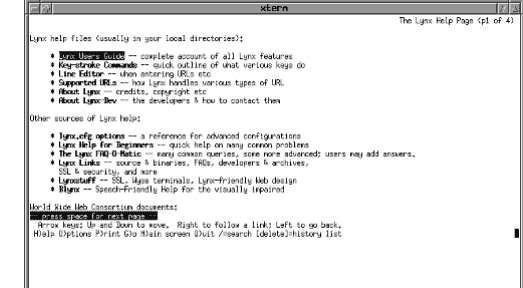

`图 10.2` 从 Lynx 获取帮助。

配置完成后，Lynx 证明是一个强大的 Web 浏览器应用程序。对于任何关注文本应用和在线阅读文档的人来说，Lynx 都是理想的浏览器。Lynx 支持一些最新的 HTML 技术（图形除外），在使用网页提供的链接时不会遇到困难。如果你的机器较旧，或者内存小于 24–32MB，这个浏览器会让生活变得可以忍受。HTML 页面的加载时间会缩短，因为 Lynx 只查看文本。

堪萨斯大学是获取有关新发布版本和用户信息的最佳来源。你们的网站位于 http://cc.ukans.edu/lynx_help/Lynx_users_guide.html 了。Lynx 的当前版本为 2.8.2。

另一个网站可能对熟悉 Lynx 有帮助。该网站提供了关于 Lynx 快速配置的额外见解：http://reality.sgi.com/raju/lynx.txt。

### Netscape 浏览器

Netscape Web 浏览器因其可携性和成本（为零）而成为 Lynx 爆发增长的一部分。Netscape 与此发行版中包含的其他软件完美融合。

Netscape 是一个完全可配置的浏览器，内置了支持 POP、IMAP 和 Movemail 协议的邮件程序。你可以设置 Netscape 以便从新闻组接收帖子。你还可以使用其他几个功能来增强你的日常上网任务。

如果你启动 Netscape 时它似乎长时间卡住并给你显示图 10.3 所示的错误，你可能存在网络连接问题。

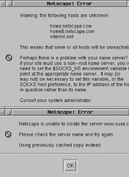

图 10.3 识别 Netscape 错误。

在前面的图中，你看到注释“警告，以下主机未知”。这表明你可能漏掉了 `resolv.conf` (DNS 域名服务器) 的条目。另一方面，你可能没有物理连接到网络或互联网。检查你的所有连接，然后查看 `/etc/resolv.conf` 文件（使用系统配置工具中的 `NAMESERVER`）。如果 `/etc/resolv.conf` 文件中没有列出 IP 地址，添加域名服务器 IP 地址应该可以解决你的问题。

此版本包含的 Netscape 浏览器可以像之前的版本一样进行配置。工具栏选择（位于浏览器区域顶部）执行功能。虽然这是一个较新的版本，但你不应该在操作上遇到困难。

Netscape 的巧妙功能之一是新闻组功能。目前订阅邮件列表的人会发现，设置新闻组是一项简单的任务。为了方便起见，Netscape Communicator 集成了一个新闻组客户端。图 10.4 显示了新闻组的设置。


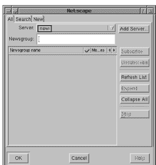

**图 10.4** 在 Netscape 中设置新闻组。

我最喜欢的列表包括 `alt.os.linux.suse`、`comp.os.linux.announce` 和 `comp.os.linux.security`。你可以尝试从这些开始；SuList 很有趣，并且非常推荐 SuSE 的新手使用，因为它讨论了当前的发行版问题和解决方案。该列表还提供了有关 SuSE Linux 未来改进的信息。

关于 Netscape Communicator 其他功能的额外信息可以写满一整本的书。你可以使用浏览器极右上角的帮助选项。帮助包含的信息将指导你进行 Netscape Communicator 的高级配置。

关于 Communicator 的更多在线帮助，请访问 `http://help.netscape.com/`。该网站将提供有关 Netscape 高级配置的信息并协助你解决技术问题，尽管我怀疑你不会遇到。

使用 Netscape 作为首选浏览器的个人和公司可以通过添加软件包将标准的 56 位加密升级到 128 位加密。如果你的机器较旧，或者内存小于 24–32MB，这个浏览器会让生活变得可以忍受。HTML 页面的加载时间会缩短，因为 Lynx 只查看文本。

堪萨斯大学是获取有关新发布版本和用户信息的最佳来源。你们的网站位于 `http://cc.ukans.edu/lynx_help/Lynx_users_guide.html` 了。Lynx 的当前版本为 2.8.2。

另一个网站可能对熟悉 Lynx 有帮助。该网站提供了关于 Lynx 快速配置的额外见解：`http://reality.sgi.com/raju/lynx.txt`。

## 配置互联网服务

关于 Communicator 的更多在线帮助，请访问 `http://help.netscape.com/`。该网站将提供有关 Netscape 高级配置的信息并协助你解决技术问题，尽管我怀疑你不会遇到。

使用 Netscape 作为首选浏览器的个人和公司可以通过添加软件包将标准的 56 位加密升级到 128 位加密。如果你的机器较旧，或者内存小于 24–32MB，这个浏览器会让生活变得可以忍受。HTML 页面的加载时间会缩短，因为 Lynx 只查看文本。

堪萨斯大学是获取有关新发布版本和用户信息的最佳来源。你们的网站位于 `http://cc.ukans.edu/lynx_help/Lynx_users_guide.html` 了。Lynx 的当前版本为 2.8.2。

另一个网站可能对熟悉 Lynx 有帮助。该网站提供了关于 Lynx 快速配置的额外见解：`http://reality.sgi.com/raju/lynx.txt`。

## 网络服务概述

在本节中，你将看到如何配置某些服务。

### 使用 YaST 配置 Sendmail

### 配置 Internet 服务

之前列出的选项字段是通用的，可以根据您的需求快速修改。这并不是 `sendmail` 程序或其功能的完整摘要；如需更多详细信息，请在命令行提示符处输入 `man sendmail` 以获取更多信息。Sendmail 还有一个位于 `http://www.sendmail.org/` 的详尽网站。该网站包含了关于该程序的所有最新信息，以及更新版本（在适用情况下）的下载。其他网站可以帮助您从零开始配置 `sendmail`——例如 `sendmail.cf` 生成器，地址为 `http://www.harker.com/gen/sendmail.cf/index.html`。更多的电子邮件管理员工具位于 `http://www.webmin.com/webmin`。

# DHCP 配置

动态主机配置协议 `DHCP` 是一种网络协议，它允许管理员从中心点进行控制，并自动分配组织网络中的 Internet 协议 `IP` 地址。

使用 Internet 的 `TCP/IP` 协议，每台必须连接到 Internet 的机器都需要一个唯一的 IP 地址。您可能有多个计算机用户；如果计算机移动到网络其他部分的区域，则需要输入新的 IP 地址。`DHCP` 让网络管理员能够从中心点监督并分配 IP 地址，并在计算机插入网络中不同位置时自动发送新的 IP 地址。

如果您想启动 `DHCP` 服务器，请使用 `START_DHCP` 选项并回答 `yes`。

由于配置 `DHCP` 客户端涉及的变量很多，我建议您查看 `http://sd.suse.de/de/html/katlist.NETDHCP.html`。该 SuSE 支持提供了比我在此概述中提供的更详细的信息。此外，`DHCP HOWTO` 是另一个极好的资源。

# NFS 文件系统

网络文件系统 `NFS` 是一种客户端/服务器应用程序，它为计算机用户提供了一个查看并在某些情况下存储和更新远程计算机文件的机会，就像这些文件位于用户自己的计算机上一样。

`NFS` 设计用于支持 `UNIX/Linux` 文件系统。它也支持如 `MS-DOS` 等文件系统。

分布式文件资源的需求和文件系统的安全性因素将决定使用这种系统的优劣。如果您有大量用户在白天远离中心位置，且您希望他们访问文件，那么可能想要提供此类服务。

如果您打算运行 `NFS` 服务器，必须存在这些参数：`START_PORTMAP [yes]`。如果没有 `portmapper` 守护进程运行，`rpc.mountd` `mount` 和 `rpc.nfsd` `filesystem` 将无法启动，`NFS` 也无法运行。

您还需要启用选项 `NFS_SERVER`；此服务将启动 `rpc.mounted` 和 `rpc.nfsd`。

如果您希望 `NFS` 转换用户 ID 和组 ID，请选择 `NFS_SERVER_UGID [yes]` 选项。另一个设置 `REEXPORT_NFS [yes]` 选项也可以通过 `YaST1` 进行调整。如果您想重新挂载 `NFS` 目录，请使用此选项。

设置 `NFS` 环境的详情位于 `http://metalab.unc.edu/mdw/HOWTO/NFS-HOWTO.html`。

网络信息系统 `NIS` 是用于较小网络的网络和管理系统。它掩盖了针对不同机器的网络，并提供了无缝的网络环境。根据设计，它旨在用于局域网 `LAN`。

与 `NFS` 一样，`NIS` 使用客户端/服务器模型和远程过程调用 `RPC` 接口进行主机间的通信，因此使用 `NIS` 时必须运行 `portmapper` 守护进程。

注意，`NIS` 最初名为 Yellow Pages（黄页），但有人已经注册了该商标，因此它被改为 Network Information System。`SE Linux` 将 `NIS` 称为 "`YP`" `Yellow Pages`。

要通过 `YaST1` 工具创建 `YP` `NIS` 配置，请选择 `CREATE_YP_CONF [yes]`。

要识别 `YP` `NIS` 服务器的域名，请使用选项 `YP_SERVER <server-name.com>`。`YP` `NIS` 主机的域名应输入在 `YP_DOMAINNAME` 字段中。

如果您的系统已配置了名称解析，您还可以使用 `NIS_FOR_RESOLVING` 选项通过 `YP` `NIS` 解析主机名的查询。

如果您将 `YP` `NIS` 作为网络的一项服务，请查看 `NIS` 的 `HOWTO`（位于 `http://metalab.unc.edu/mdw/HOWTO/NIS-HOWTO.html`），获取有关此类服务内部运作的广泛细节。您有明显的安全问题需要考虑。系统必须能够网络连接读取 `/etc/passwd`、`/etc/shadow` 和 `/etc/groups`。该系统有很多优点。您最终将权衡成本/风险收益，然后据此进行。

# Samba 配置技巧

`Samba` 程序包含了 Linux 发行版中一些最受期待的功能。它让 Linux 机器可以在 Windows 或 DOS 环境中作为网络服务器运行。该程序弥补了多平台环境中有时存在的集成差距，SUSE 在其发行版中包含了一个名为 `swat` 的简单配置工具，它提供了一个用于设置 Samba 系统的 Web 页面界面。有关 `swat` 如何工作的更多详细信息，请在命令行输入 `#man swat`。

`YaST` 将帮助您设置使用 `samba` 的打印机。执行命令 `# yast` 并选择系统管理 `System Administration`。然后选择网络配置 `Network Configuration`，并选择通过 Samba 连接打印机 `Connect to Printer Via Samba`。

这两个功能可以帮助您设置系统。有关 `swat` 如何工作的更多详细信息，请在命令行输入 `#man swat`。

## 配置 Internet 服务 127

现在到了有趣的部分。如果你已经有了连接，你将需要获取当前的防火墙包，该包可以在 SuSE FTP 网站上找到。此包将修复防火墙初始版本中发现的一些符号链接问题。


要下载文件，调用 `YaST1` 选择“选择/安装软件包”（Choose/Install Packages）；然后选择“安装软件包”（Install Packages）子菜单。按回车键，并在屏幕左上角出现的下拉菜单中选择 FTP。SuSE 的 IP 地址已经程序在安装程序中了。你将在第二个目录下找到出的新包。下载包后，使用 `YaST` 工具安装该包。在命令行提示符处输入 `yast`，并选择“安装软件包”（Install Packages）。然后按回车并选择你下载软件的目录。找到软件，通过在选择旁打 `X` 来选择要安装的软件，然后按 `F10` 键。软件将开始安装。

现在你准备好编辑配置文件了。如果你选择手动编辑配置，请加载你喜欢的编辑器并打开 `/etc/rc.config/firewall.rc.config`。我目前将使用 `joe` 编辑器。

```
# joe /etc/rc.config/firewall.rc.config
```

图 10.5 显示了 `/etc/rc.config/firewall.rc.config` 文件的部分内容。

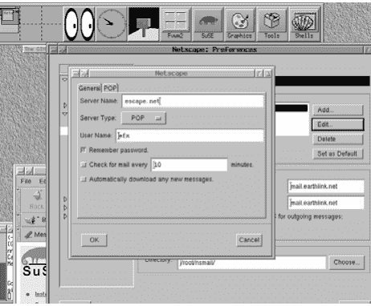

图 10.5

防火墙程序配置文件。

该配置文件根据机器当前的使用情况，指导你需要添加或修改哪些参数。当你对 `/etc/rc.config/firewall.rc.config` 文件完成所有必要的更改后，保存文件并重启机器。这将重新初始化防火墙；安装了升级后的防火墙程序后，IP Chain 启动脚本现在可以工作了，不需要其他修改或命令即可将你的内部流量路由到互联网。

你可以使用 `YaST1` 工具编辑配置文件。从 `YaST1` 程序的主菜单中，选择“系统管理”（System Administration）；然后选择“更改配置文件”（Change Configuration File）选项。表 11.2 所示的参数可以在 `YaST1` 时进行更改。

### 表 10.2 YaST1 中可修改的参数

| 参数 | 说明 |
| --- | --- |
| `FW_ALLOW_FW_SOURCEQUEN` | 如果连接拥塞则进行记录 |
| `FW_ALLOW_FW_TRACEROUTE` | 允许对防火墙进行 traceroute |
| `FW_ALLOW_FW_INCOMING_HIGHPORTS_TCP` | 允许 1023 端口以上的 TCP 流量 |
| `FW_ALLOW_FW_INCOMING_HIGHPORTS_UDP` | 允许 1023 端口以上的 UDP 流量 |
| `FW_ALLOW_PING_DMZ` | 允许向防火墙内部的 DMZ 机器 ping |
| `FW_ALLOW_PING_FW` | 允许在防火墙/DMZ 设备上 ping |
| `FW_AUTOPROTECT_GLOBAL_SERVICES` | 防止访问未绑端口（如 0.0.0.0:21） |
| `FW_DEV_DMZ` | 提供指向 DMZ 盒的网络接口的 IP 地址 |
| `FW_DEV_INT` | 提供内部网络接口的 IP 地址 |
| `FW_DEV_WORLD` | 提供外部网络接口的 IP 地址 |
| `FW_FORWARD_TCP` | 将 TCP 服务转发到内部（或 DMZ）网络 |
| `FW_FORWARD_UDP` | 将 UDP 服务转发到内部（或 DMZ）网络 |
| `FW_KERNEL_SECURITY` | 设置额外的 TCP/IP 安全功能 |
| `FW_LOG_ACCEPT_ALL` | 为所有接受的连接启用防火墙日志 |
| `FW_LOG_ACCEPT_CRIT` | 启用接受的“关键”连接的记录 |
| `FW_LOG_DEN_ALL` | 启用所有被拒绝连接的记录 |
| `FW_LOG_DENY_CRIT` | 启用被拒绝的“关键”连接的记录 |
| `FW_REDIRECT_TCP` | 允许 TCP 服务重定向到防火墙上的本地端口 |
| `FW_REDIRECT_UDP` | 允许 UDP 服务重定向到防火墙上的本地端口 |
| `FW_ROUTE` | 激活互联网与内部网络之间的路由 |
| `FW_SERVICES_DMZ_TCP` | 指定 DMZ 中允许的 TCP 服务 |
| `FW_SERVICES_DMZ_UDP` | 指定 DMZ 中允许的 UDP 服务 |
| `FW_SERVICES_EXTERNAL_TCP` | 指定来自互联网或其他不可信网络的 TCP 连接 |
| `FW_SERVICES_EXTERNAL_UDP` | 指定来自互联网或其他不可信网络的 UDP 连接 |
| `FW_SERVICES_INTERNAL_TCP` | 指定来自内部网络的 TCP 连接 |
| `FW_SERVICES_INTERNAL_UDP` | 指定来自内部网络的 UDP 连接 |
| `FW_SERVICES_TRUSTED_TCP` | 指定信任的 TCP 端口连接（25 或 stmp） |
| `FW_SERVICES_TRUSTED_UDP` | 指定信任的 UDP 端口连接（53 或 domain） |
| `FW_SERVICES_DHCLIENT` | 启用 DHCP 客户端过滤 |
| `FW_SERVICES_DHCPD` | 启用 DHCP 服务器过滤 |
| `FW_SERVICES_DNS` | 启用 DNS 服务器过滤 |
| `FW_STOP_KEEP_ROUTING_STATE` | 如果防火墙卸载或停止，保持路由 |
| `FW_TRUSTED_NETS` | 指定信任的互联网 IP 地址 |

> 如果你使用 `YaST1` 配置防火墙，我强烈建议在进行任何更改之前查看 `/etc/rc.config/firewall.rc.config` 文件的内容。

## 132 第 11 章：SuSE Linux 音频

有时由于内部设置与另一个设备冲突，会导致配置问题。幸运的是，`isnapp` 工具可以帮助找到 PnP 卡并提供一些配置信息。本章随后的章节将回顾该工具的使用。请参阅“Theapntools Utility”节。

相当多的音频开发项目正在进行中。两个主导项目是开源声音系统 (`OSS`) 和高级 Linux 音频架构 (`ALSA`)。`OSS/Free` 驱动程序集成在内核中，而 `ALSA` 则以预构建模块的形式提供。我将为你介绍每种驱动程序的概况。

## 开源声音系统（又称 OSS）

`Hannu Savolainen` 领导了开发兼容 Linux 的音频驱动程序的工作。它最初被称为 Voxware，后来更名为 Ultra Sound System (`USS`)。在开发驱动期间，Savolainen 加入了 4Front Technologies 团队，这是一家为 UNIX 平台销售专有音频系统的公司。通过为 4Front 全职工作，Savolainen 协助了维护者 Alan Cox。Cox 以 'ac' 内核补丁而闻名，在音频驱动程序的内核开发中非常忙碌。有关他的进展的更多信息可以在 http://www.4front-tech.com/ossfree/index.html 找到。

内核提供的 `OSS` 版本称为 `OSS/Free`，也称为 Linux 声音系统。主站位于 http://www.linux.org/uk/OSS，包含了有关设置和兼容性问题的宝贵信息。

4Front 为各种 UNIX/Linux 应用程序提供音频驱动程序。SuSE 慷慨地在 Pay 部分的 opsdmp 标题下提供了 Open Sound 3.9.2 驱动程序的演示副本。有关开源声音系统的更多信息可以在 http://www.opensound.com 找到。

一个由麻省理工学院（MIT）托管的项目被称为 `Csound`。这项工作非常多样，包含了优秀的教程和当前文档的维护。网站位于 http://mitpress.mit.edu/e-books/csound/frontpage.html。

还有其他小组致力于音频重放。例如 http://www.uk.gnome.org/white-papers/esd/ 上的 GNOME 和 Enlightenment 团队（注：原文此处不完整）。他们的努力是不懈的，而且每天都在持续改进。有关该项目的详情，请参见 http://www.gnome.org。

## 使用开源声音驱动程序

你可以想象拥有一个“工作正常”的声卡，在安装 SuSE Linux 后，声卡突然失效的挫败感。你有两个选择：从 4Front 购买商业驱动程序，或者重新编译内核并使用 `OSS/Free` 驱动程序。我必须说，`OSS` 软件包更容易安装和配置。唯一的权衡是，如果你想保留它，必须支付费用（20 美元），而且你无法获得源代码。

## 开源声音系统（又称 OSS） 133

如果你倾向于开源的解决方案，那么内核驱动程序将是你的最佳选择。这需要你重新编译内核并安装正确的驱动程序。在下一节中，你将找到 `OSS/Free` 驱动程序的安装概览。

## 安装 OSS 声音驱动程序

Open Sound 演示驱动程序非常容易安装。你需要找到 `oss-install` 程序文件并运行安装脚本。提示将引导你完成整个过程。当你完成配置后，使用此命令：

```
soundun
```


# 第 11 章：SuSE Linux 音频

如果你决定使用内核声音驱动程序，将需要重新配置内核参数。（参考第 9 章，“Tailoring a Custom Kernel”）。你可以选择将驱动程序集成到内核中，或构建所需的驱动模块。图 11.1 显示了 `make xconfig` 选择屏幕。OSS 驱动程序已被选择为内核组件，而不是模块。

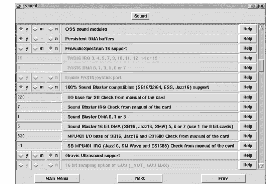

图 11.1

Linux Sound配置菜单 (OSSFree)。

当内核重新编译后，你可以重启系统并观察音频设备已被识别并初始化。如果驱动程序是模块构建的，你可以使用 `lsmod` 命令或运行 `modprobe -c` 来验证模块的干净构建和正确加载。命令 `/dev/sndstat` 显示了有关你的声卡和驱动程序的信息。

记住，在重新编译内核时，你有许多选择来选择声卡。做出正确的选择以及任何相关的驱动程序选项。配置工具中的帮助功能可以成为救星——在许多情况下，它解释了每个选项的用途。请务必根据你的知识选择选项，并使用可以验证的规格（I/O、IRQ 和 MPU）。

SoundBlaster 将松了一口气，因为 Creative 现在支持此声卡。难以获取的驱动程序信息可以在 `http://opensource.creative.com` 找到。

内核中不可支持，无法构建任何模块。该 URL 是制造商进入开源革命的方式。

## ALSA 声音驱动程序

高级 Linux 音频架构项目承担了开发高质量声音驱动系统的任务。报告显示，ALSA 驱动程序将完全集成到 Linux 内核中。驱动程序开发最初是 Linux Ultra Sound，由 Jaroslav Kyselka 领导以协调和引导该项目。ALSA 驱动模块在安装阶段可用，如你在 11.2 中所示。

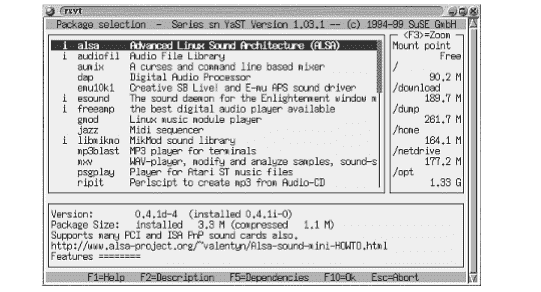

图 11.2

配置。

SuSE 慷慨地在 Pay 部分 opsdmp 标题下提供了 Open Sound 3.9.2 驱动程序的演示副本。有关开源声音系统的更多信息可以在 `http://www.opensound.com` 找到。

一个由麻省理工学院（MIT）托管的项目被称为 Csound。这项工作非常多样，包含了优秀的教程和当前文档的维护。网站位于 `http://mitpress.mit.edu/e-books/csound/frontpage.html`。

还有其他小组致力于音频重放。例如 `http://www.uk.gnome.org/white-papers/esd/` 上的 GNOME 和 Enlightenment 团队。他们的努力是不懈的，而且每天都在持续改进。有关该项目的详情，请参见 `http://www.gnome.org`。

## 配置 ALSA 驱动程序

Open Sound 演示驱动程序非常容易安装。你需要找到 `oss-install` 程序文件并运行安装脚本。提示将引导你完成整个过程。当你完成配置后，使用此命令：

`soundu`

设置将保存存在 `/etc/modules` 中。菜单界面允许你准备声卡并调整调色器。

## isapnp 工具

`isapnp` 工具根据其他设备的当前配置检查可用资源。然后它读取 `isapconf` 文件。必须读取整个文件，否则会出现调试信息。该调试信息可能是由冲突或错误的资源地址引起的，当你不确定哪个设备引起了问题时，它可以提供帮助。图 11.6 显示了一个 ISA 卡的输出。使用此命令：

`isapnp /etc/isapnp.conf`

```
bash-2.0$ isapnp /etc/isapnp.conf
IRQ 0 in use
IRQ 1 in use
IRQ 2 in use
IRQ 4 in use
IRQ 10 in use
IRQ 11 in use
IRQ 13 in use
IRQ 14 in use
Board 1: tap Identity 8d ff ff ff ff 00 Sc: CTL0F Serial No -1 [checksum 8d]
bash-2.0$ _
```

图 11.6

由 `isapnp` 工具识别的声音卡。

如果 `isapnp` 成功读取文件，它会编辑（取消注释）正确的设置，你只需要重启系统并确保声音模块已加载。

此命令列出所有加载的模块：

`lsmod`

如果仍有问题，输入此命令获取有关这些工具的更详细信息：

`man pnpdump` 或 `man isapnp`

在编写本文时，`isapnptools` 的当前版本是 1.21b。你可以在此处找到该工具包的额外文档：`http://www.roestock.demon.co.uk/isapnptools/`

ISA 声卡的配置可能是一项艰的任务，但当你获得良好的音频体验时，它是非常值得的。

## 声音摘要

要充分涵盖 Linux 机器上的声音问题可能需要写一本相当厚的书。这个简短的章节旨在帮助你找到让声卡运行起来的资源。列出的 URL 非常有用——请谨慎使用。OSS 和 ALSA 项目都有完善的文档，配置工具也将提供巨大的帮助。包含的软件将让你有机会测试这两种应用程序：我喜欢内核中的 OSS/Free 驱动，但 ALSA 正在不断缩小这一差距。

# 第 12 章

## 保持你的系统更新

所有在计算机行业花费了大量时间的人都遇到过软件应用程序过时的问题。故事在任何地方都是一样的，只是为了保护那些固执己的人而改变了名称。


几年前，我遇到了一个程序问题，该程序根据特定 ID 提供保修编码数字。该操作系统是 UNIX（这是一个优点），它使用了一个专有的软件应用程序（这可能是个坏事），该程序需要对保修程序进行重大修改。在两年的时间里，我与区域代表合作，并与公司的编程顾问交流，重建了程序无法正确响应的场景。他表示同情，并告诉我是程序员正在努力修复，问题应该在下一个版本更新中得到解决。当升级到来时，我屏息以待，希望问题已经得到纠正。结果大乎所料，更新包含了新的编码选项，但所有有问题的代码仍然留在系统中，这简直是雪上加霜。

这种场景在 SuSE Linux 中不会出现。负责修复上述程序中错误的程序员并没有面临声誉风险——他们只关心金钱分分的问题。这并不是为了贬低他们或他们的能力，而是为了指出过时软件的存在在开源阵营中并不是普遍现象。例如，考虑接下来的事件。

当所有人对 Y2K（2000 年虫问题）感到恐慌时，我相当确信我的 Linux 机器不会受到 2000 年到来的影响。凌晨 1 点多回到家里时，我发现一切正常。第二天早上醒来，启动启动 X 并调出我最喜欢的文件管理器 `FileRunner`。令我惊讶的是，文件日期是 1000 而不是 2000——天哪！我与妻子一起咕哝、呻道：“检查看看他们是否有新版本。”足够了，`FileRunner` 网页显示作者在 1 月 1 日之前的三天发布了处理日期更改问题的升级版本。这个开源程序是免费的，因此程序的维护是自愿的。这种对细节的严谨证明了对性能的另一种不同观点。

## 更新软件的重要性

更新软件的问题可能扩展到安全因素。并非所有的 Linux 应用都由同一人生产，因此可能存在细微的不一致，允许用户获得未经邀请（但已授权）的权限。有专家团队的日常工作任务就是发现 Linux 应用中的漏洞。其中一个小组是 X-Force (`http://xforce.iss.net.about.php3`)。

更多信息请参阅第 13 章“网络安全”。

如果你有一台没有连接其他计算机或互联网的单机，并且所有操作对你来说运行正常，那么更新软件对你可能没有意义。在大多数情况下，选择 SuSE Linux是为了方便一台或多台计算机建立网络连接。在这种情况下，通常需要更新。

## 从 SuSE.com 获取更新

从哪里获取更新与升级过程本身一样重要。如果你无法信任来源，那么升级就不是升级。我建议从 `ftp.suse.com` 获取更新文件，以帮助解决安全顾虑。这个 ftp 站点由 SuSE 支持，且 `rpm` 软件具有 MD5 校验功能。

`MD5` 算法用于数字签名应用，在这些应用中，大文件必须在使用像 `RSA` 的公钥系统用私钥（密钥）加密之前以安全的方式进行“压缩”。这有助于判断文件是否已从原始状态被修改。对于 SuSE Linux，你有许多选择：使用 `rpm` 包格式、安装二进制文件或从源码编译。只要你熟悉你的系统是如何配置的，你就没有问题。

关于执行更新的整个辩论是这样的：我如何确保我收到了最新的文件？某些发行版具有高度智能的包管理功能。在交互和灵活更新方面，我不会认为 Su 系统是第 1，尽管一个强有力的第 2 绝对是可能的。再次，多功能的 `YaST` 将是你的界面。你所做的就是调出 `YaST1` 菜单并选择“First/Install Packages”（首次/安装软件包），然后选择“Install Packages”（安装软件包）。图 12.1 显示了 `YaST`

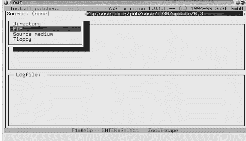

图 12.1

`YaST1` 安装软件包选择。

当你到达这一点时，你会有多个选择——选择 ftp 会自动连接你到 SuSE ftp 服务器。这是一个很好的集成功能：`YaST` 更新程序浏览你系统上的软件，当选择某个目录进行更新时（例如，`pay1`），`YaST` 会指示是否有可用软件包。更进一步，`YaST` 会安装程序。图 12.2 显示了完成情况。


图 12.2

`YaST` 更新结果。

## 保持你的系统更新

如果你运行大型站点，你可能希望将所有更新下载到本地。这通常是用户安装软件受限的情况。用于补丁和更新的官方 Suse 服务器位于 `http://suse.de/`。

关于更新的安全公告可以在 `http://www.suse.de/en/security` 找到。

## 使用镜像站点

在表 12.1 中，你将找到用于下载更新和其他类型软件的镜像站点列表。请注意任何仓库都可能被破坏，软件可能包含非作者预期的内容。熟悉各种站点，尽可能进行查询以确定 Suse 软件的性质。

### 表 12.1 Suse 软件镜像站点

| 国家 | URL | 描述 |
| --- | --- | --- |
| 阿根廷 | `ftp://ftp.unc.de.ar` | SuSE Linux (`/pub/linux/SuSE/`) |
| 奥地利 | `gd.twien.ac.at` (维也纳) | SuSE Linux (`/pub/suse/`); 更新、修复、内核源码 (`/pub/s_update/`) |
| 巴西 | `master.softaplic.com.br` (贝洛奥里森特) | SuSE Linux (`/pub/sisux/`); 更新、修复 (`/pub/sisux/`) |
|  | `ftp.genix.com.br` (福塔莱斯，塞亚拉) | 更新、修复、内核源码 (`/pub/s_update/`) |
| 加拿大 | `ftp.crc.ca` (渥太华) | Linux (`/pub/systems/linux/suse/`) |
| 芬兰 | `ftp.funet.fi` | SuSE Linux (`/pub/mirrors/`); `ftp.suse.com/pub/suse/`); 更新、修复、内核源码 (`/pub/mirrors/ftp.suse.com/Suse-Linux/use_update/`) |
| 法国 | `ftp.ese-metz.fr` | Linux (`/pub8/`) |
|  | `ftp.iut-bm.univ-fcomte.fr` | SuSE Linux (`/pub2/linux/distributions/suse/suse/i386/update/`) |
| 希腊 | `ftp.ntua.gr` (雅典) | SuSE Linux (`/pub/linux/suse/suse/i386/`); 更新、修复、内核源码 (`/pub/linux/suse/Suse-Linux/use_update/`) |
|  | `ftp.linux.gr` | SuSE Linux (`/pub/mirrors/ftp.suse.com/`) |
|  | `ftp://ftp.duth.gr` | SuSE Linux (`/pub/suse/`) |

## 更新软件的重要性 143

| 国家 | URL | 描述 |
| --- | --- | --- |
| 匈牙利 | `ftp.bke.hu` | SuSE Linux (`/pub/mirrors/SuSE/`); 更新、错误修复、内核源码 (`/pub/mirrors/SuSE/i386/update/`) |
| 意大利 | `ftp.cnr.it` | SuSE Linux (`/pub/Linux/distributions/suse/`) |
|  | `ftp.flashnet.it` | SuSE Linux (`/mirror/13/suse/`); SuSE Linux (`%BA/Linux/SuSE/`); 更新、错误修复、内核源码 (`%BA/Linux/SuSE/suse_update/`) |
|  | `ftp.uniroma2.it` (罗马) | SuSE Linux (`/mirror/linux/distributions/suse/`); SuSE Linux (`/pub/suse/`); 更新、错误修复、内核源码 (`/pub/suse/i386/update/`) |
| 荷兰 | `ftp.surfnet.nl` |  |
| 挪威 | `sunsite.io.no` | SuSE Linux (`/pub/unix/linux/SuSE/`); 更新、错误修复、内核源码 (`/pub/unix/linux/SuSE/i386/`) |
| 波兰 | `ftp.ds14.agh.edu.pl` | SuSE Linux (`/mirror/suse/`) |
|  | `ftp.task.gda.pl` | `/mirror/ftp.suse.com/pub/suse/`); 更新、错误修复、内核源码 (`/mirror/ftp.suse.com/pub/suse/i386/`) |
| 葡萄牙 | `ftp.fct.unl.pt` | SuSE Linux (`/pub/Linux/SESE/mirror-ssite.unc.edu/distributions/suse/`) |
|  | `ftp.puug.pt` | SuSE Linux (`/pub/Linux/distributions/suse/`) |


| 俄罗斯 | `ftp.chg.ru` | SuSE Linux (`/pub/Linux/SuSE/suse/`); 更新、错误修复、内核源码 (`/pub/Linux/SuSE/suse_update/`) |
| 西班牙 | `paraiso.disca.upv.es` | SuSE Linux (`paraiso.disca.upv.es/mirror/suse/`); 更新、错误修复、内核源码 (`paraiso.disca.upv.es/mirror/suse/update/`) |
| 瑞典 | `ftp.sunet.se` | SuSE Linux (`/pub4/os/Linux/distributions/suse/suse/`); 更新、错误修复、内核源码 (`/pub4/os/Linux/distributions/suse/suse_update/`) |
| 瑞士 | `sunsite.cnlab-switch.ch` | (苏黎世) SuSE Linux (`/mirror/SuSE/suse/`); 更新、错误修复、内核源码 (`/mirror/SuSE/suse_update/`) |

## 144 第 12 章：保持系统最新

### 表 12.1 续

| 国家 | URL | 描述 |
| --- | --- | --- |
| | `ftp.datacom.ch` | SuSE Linux (`/pub/suse/suse/`); 更新、错误修复、内核源码 (`/pub/suse/suse_update/`) |
| 泰国 | `ftp.nectec.or.th` | SuSE Linux (`/pub/mirrors/linux/distributions/suse/`) |
| 英国 | `unix.hensa.ac.uk` (坎特伯里) | SuSE Linux (`/mirrors/ftp.suse.com/pub/SuSE-Linux`); 更新、错误修复、内核源码 (`/mirrors/ftp.suse.com/pub/SuSE-suse_update/`) |
| | `sunsite.doc.ic.ac.uk` (伦敦) | SuSE Linux (`/Mirrors/ftp.suse.com/pub/SuSE-Linux`); 更新、错误修复、内核源码 (`/Mirrors/ftp.suse.com/pub/SuSE-suse_update/`) |
| 美国 | `ftp.cdrom.com` (加利福尼亚，Concord) | SuSE Linux (`/pub/linux/sunsite/distributions/suse/`) |
| | `ftp.varesearch.com` (加利福尼亚，山景) | SuSE Linux (`/pub/mirrors/suse/SuSE-Linux`); 更新、错误修复、内核源码 (`/pub/mirrors/suse/SuSE-Linux/Linux/suse_update/`) |
| | `ftp.wgs.com` (科罗拉多，奥罗拉) | SuSE Linux (`/pub/Linux/SuSE/suse_update/`); 更新、错误修复、内核源码 (`/pub/Linux/SuSE/suse/`) |
| | `ftp.twoquys.org` (乔治亚，亚特兰大) | SuSE Linux (`/suse/`); 更新、错误修复、内核源码 (`/pub/systems/suse/`) |
| | `ftp.cso.uiuc.edu/` (伊利诺伊，厄巴纳) | SuSE Linux (`/linux/suse/sunsite/distributions/suse/`) |
| | `herbie.ucs.indiana.edu/` (印第安，布明顿) | SUSE Linux (`/linux/suse/i386/`); 更新、错误修复、内核源码 (`/linux/suse/i386/update/`) |
| | `metalab.unc.edu` (北卡罗来纳，教堂山希尔) `http://www.cee.edoo.edu/` (弗吉尼亚，诺福克) | SuSE Linux (`/pub/Linux/distributions/suse/`)/SuSE Linux |

这些是 SuSE认可的镜像站点；请根据您的需要自行选择。找到安全性最高的站点并坚持使用它。

## 备份文件 145

`rpmfind` 工具是更新软件的另一种方法。它列出已安装的软件包，连接到 `rpmfind.net`（一个 rpm 仓库），并更新您的软件包。要运行它，只需执行此命令：

```
rpmfind --latest
```

该工具的设计非常好，但功能有限。`rpmfind` 没有可供编辑的配置文件。这是一个更新站点，以及我的更新是存储在系统中的，我不确定该工具的好处。

`xrpm` 和 `GNOrpm` 这样的工具也存在于此发行版中。可以通过 GUI 界面获取更多关于这些工具（`packages/gnorpm`）的信息。

## 使用其他 Linux 站点

如前面的章节“从 SuSE.com 获取更新”中所提到的，更新源至关重要。我建议您在获取日常应用程序时要谨慎。如果您在全范围内安装，显然希望使用经过验证的应用程序。如果您从事研究和开发，可能需要一个测试机。以下是我浏览新应用程序的一些地方：

- [freshmeat.net](http://freshmeat.net)——Freshmeat 网站，包含 Linux 应用程序
- [linuxnow.com/library/index.html](http://www.linuxnow.com/library/index.html)——LinuxNow 文件库
- [linux.org/apps/index.html](http://www.linux.org/apps/index.html)——Linux 应用程序索引
- [stommel.tamu.edu/~baum/linuxlist/linuxlisthtml](http://stommel.tamu.edu/~baum/linuxlist/linuxlisthtml)——Linux 软件百科全书

列表还可以持续几页——这些只是建议。

## 备份文件

在更新系统过程中，请务必小心。确保选择一个安全的 ftp 站点并在实际升级之前备份所有文件。SuSE Linux 包含 GNU 软件以及时间限制软件包。

## 使用免费解决方案

`cpio` 备份工具使用 SuSE Linux 软件包。关于使用特定命令，输入此命令：

```
man cpio
```

另一个开源备份工具 `flexbackup` 也很好。您可以在 [members.home.com/flexbackup/RPMS](http://members.home.com/flexbackup/RPMS) 获取副本。

## 146 第 12 章：保持系统最新

如果这些不是您寻找的，请在互联网上继续，并尝试前面章节列出的“其他 Linux 站点”中的 URL。SUSE Linux 包含一个 YaST 备份工具——集成在 Linux 发行版中。图 12.3 显示 YaST 的备份菜单。(`img/e140cb3005137846280d532cceccef_156_0.png`)

图 12.3 YaST 备份界面。SUSE Linux 包含一个 YaST 备份工具——集成在 Linux 发行版中。图 12.3 显示 YaST 的备份菜单。(`img/e140cb3005137846280d532cceccef_156_0.png`)


### 图 12.3 YaST 备份界面

`SUSE Linux` 包含一个 `YaST` 备份工具——集成在 Linux 发行版中。图 12.3 显示 `YaST` 的备份菜单。

## 确定你的脆弱性

确定你的脆弱性对于 `SUSE Linux` 的安装至关重要。一些关键因素是这些因素。你将执行以下：

- 内部网络连接 (`intranet`, `VPN`)
- 外部网络连接 (`WAN`, `Internet`)
- 入站连接 (`telnet`, `ftp`, `ssh`)
- 文件共享 (`NFS`, `Samba`)
- 网络的有限访问（通过登录 = 用户/组层级）
- 路由器应用程序

## 第 13 章

# 150 第 13 章：网络安全

`IP` 伪装、防火墙解决方案

- 代理服务器
- 基于 Web 的商业解决方案（电子商务）

如果你发现自己属于上述任何一类情况，那么你就面临着潜在的安全风险。本章将讨论安全的通用性问题，并展示 `SuSE` 如何在 6.3 版本中提供卓越的安全包。你还将学习如何使用工具以及哪些每天、每周和每月对你的系统进行监控的程序。

你可以对这些安全问题持保留态度，认为入侵和攻破承诺只会发生在别人身上。你可能会说：“我没有什么可以提供给系统破解者去利用的。”然而，你会惊讶地发现，这种心态正是那些破解不安全系统的人所追寻的。

### 互联网上的漏洞

互联网，即信息高速公路，就像欧洲的速高速（`Autobahn`）。那里很少执行限速规定，你的刺激程度取决于你所拥有的汽车以及你的驾驶技巧和技术。它也让我想起加利福尼亚的高公路——一段看似无止尽的道路，居住着软弱者和无情者。

作为提醒，我想描述一个关于漏洞的例子。你可能对 1998 年 11 月 2 日发生的事件留有记忆。

一个名叫 `Robert Morris, Jr.` 的年轻人（康奈尔大学计算机科学专业的毕业生）利用他的才华编写了一种实验性的、自我复制、自我传播的程序，称为“蠕虫”，并将其释放到互联网。`Morris` 发现该程序复制和感染机器的速度比他预想的快得多——这是程序的一个“故障”。在短时间内，全国许多地点的许多机器要么崩溃，要么变成了“僵尸”状态。`Morris` 迅速意识到发生了什么，并联系了哈佛大学的一位朋友讨论某种解决方案。最终，他们从哈佛大学向网络发送了一条匿名信息，指示程序人员杀死蠕虫并防止再次感染。由于蠕虫的影响，网络被堵塞了，这些信息直到为太晚才没有传达。许多地点的计算机受到了影响，包括大学、军事站点和医疗研究机构。

在网络节点处理该蠕虫的成本从几百美元到 40,000-50,000 美元不等。

蠕虫利用了 `sendmail` 的漏洞，`sendmail` 是互联网上几乎每个 `UNIX` 系统所使用的邮件传输代理。这一事件证明了安全是一个不容忽视的问题。基础安全审计中最大的问题是：

- 系统配置问题（无意中允许了用户访问）
- 未打补丁的软件应用程序允许了非合规或意外的用户访问

今天的商业事实表明，互联网连接对于公司的成功至关重要。这为上述问题至少一个提供了答案。在合格安全专业人员的帮助下，正在建立 `Httpd` 和服务器。建立运行网站的竞争是惊人的——在这场竞争中，人们并没有考虑真正的准备。这些漏洞正是系统破解者（我将他们称为“黑帽”）所追寻的。在这个问题的另一端是黑客社区，他们的目标是在系统被攻破之前发现软件中的破绽、漏洞和缺陷（这些是“白帽”）。在攻破之前进行测试是关键，因为发现的漏洞可以被修复，从而加固安全性。有时黑与白的界限似乎是模糊的，因此拥有这种安全执行机制是有好处的。

通过你的经验，发现 `Linux` 不受目前正在使用的其他操作系统的普通病毒的影响。当你坐下来，不用担心其他人都被感染或正在等待被感染时，那种感觉很奇妙。但请注意：`Linux` 通常不受病毒攻击的影响，但许多其他事情会引起系统操作的混乱。

考虑这种场景：由于配置不当，“黑帽”可以连接到你的系统，获得 `root` 权限并安装软件（`root kit`），这将允许他或她无阻碍地返回你的机器，然后利用你的机器作为攻击源或他或她可能想要的任何其他操作。想象一下成倍的数字，因为世界各地的机器都在不安全的情况下上线——太可怕了！


当你的机器被“占有”（被入侵者）时，系统可以被用来隐藏程序——远程访问木马（`RATs`），这些木马准备好映射密钥或密码文件，然后将其发送到特定的电子邮件地址。或者，如果你的系统被用于协调的网络攻击。想象一下向你的服务提供商解释，为什么你不是从你的 IP 地址发起的分布式网络攻击的罪祸首。

数据说明了一切：1999 年编写了 17 种木马程序，1998 年大约构建了 81 个，经统计，1999 年创建了 156 个新木马。表 15.1 所示了现有的木马及其通信的端口。在大多数情况下，低端口被木马用于窃取密码。与 `RATs` 相关的问题是检测：持续监控哪些端口是开启的可能是唯一的保障。

## 确定你的漏洞

### 第 13 章：网络安全

| 端口 | 程序 |
| :--- | :--- |
| 21 | FTP |
| 23 | Telnet |
| 25 | SMTP |
| 53 | DNS |
| 80 | HTTP |
| 110 | POP3 |
| 119 | NNTP |
| 139 | Net |
| 143 | IMAP |
| 161 | SNMP |
| 443 | HTTPS |
| 445 | SMB |
| 583 | POP3S |
| 593 | IMAPS |
| 666 | IRC |
| 8080 | HTTP |
| 8443 | HTTPS |
| 993 | IMAPS |
| 995 | POP3S |
| 1080 | HTTP-Proxy |
| 3128 | SOCKS |

*(注：由于提供的原文中表格内容高度碎片化且包含重叠部分，上述表格是根据正文中安全背景下常见的网络端口映射重建的。)*

### 表 13.1 续

| 端口 | 程序 |
|---|---|
| 5555 | ServeMe |
| 5556 | BO Facil |
| 5557 | BO Facil |
| 5569 | Robo-Hack |
| 5742 | WinCrash |
| 6400 | The Thing |
| 6669 | Vampyre |
| 6670 | Deep Throat |
| 6771 | Deep Throat |
| 6776 | BackDoor-G, SubSeven |
| 6939 | Indoctr |
| 6969 | GateCras, Priority 3 |
| 6970 | GateCras |
| 7000 | Remote Grab, Kazimas |
| 7300 | NetMonitor |
| 7301 | NetMonitor |
| 7306 | NetMonitor |
| 7307 | NetMonitor |
| 7308 | NetMonitor |
| 7789 | BackDoor, Setup |
| 8080 | RingZero |
| 9400 | InCommand |
| 9872 | Portal of Doom |
| 9873 | Portal of Doom |
| 9874 | Portal of Doom |
| 9875 | Portal of Doom |
| 9876 | Cyber Attacker |
| 9878 | TransScout |
| 9989 | Ni-Killer |
| 10067 (UDP) | Portal of Doom |
| 10101 | BrainSpy |
| 10167 (UDP) | Portal of Doom |
| 10520 | Acid Shivers |
| 10607 | Coma |
| 11000 | Senna Spy |
| 11223 | Progenic |
| 12076 | Gjamer |
| 12223 | Hack-99Logger |
| 12345 | GateBus, NetBus, Pie Gates, X-bill |
| 12346 | GateBus, NetBus, X-bill |
| 12361 | Whack-a-mole |
| 12362 | Whack-a-mole |

| 端口 | 程序 |
|---|---|
| 12631 | WhackJob |
| 13000 | Senna Spy |
| 16699 | Priority |
| 17300 | Kuang The Spring |
| 20000 | Millennium |
| 20001 | Millennium |
| 20034 | NetBus 2 Pro |
| 20203 | Logged |
| 21544 | GirlFriend |
| 22222 | Prosiak |
| 23456 | Evil FTP, Ugly FTP, Whack Job |
| 23476 | Donald Dick |
| 23477 | Donald Dick |
| 26274 (UDP) | Delta Source |
| 29891 (UDP) | The Unexplained |
| 30029 | AOL Trojan |
| 30100 | NetSphere |
| 30101 | NetSphere |
| 30102 | NetSphere |
| 30303 | Sockets de Troie |
| 30999 | Kuang2 |
| 31336 | Bo Whack |
| 31337 | Baron Night, BO2, Bo Fac |
| 31337 (UDP) | BackFire, Back Orifice, DeepBOO |
| 31338 | NetSpy DK |
| 31338 (UDP) | Back Orifice, DeepBOO |
| 31339 | NetSpy DK |
| 31666 | BOWHack |
| 31785 | Hack'a'Tack |
| 31787 | Hack'a'Tack |
| 31788 | Hack'a'Tack |
| 31789 (UDP) | Hack'a'Tack |
| 31791 (UDP) | Hack'a'Tack |
| 31792 | Hack'a'Tack |
| 33333 | Prosi |
| 33911 | Spirit 2001a |
| 34324 | BigGluck, TN |
| 40412 | The Spy |
| 40421 | Agent 40421, Masters Paradise |
| 40422 | Masters Paradise |
| 40423 | Masters Paradise |
| 40426 | Masters Paradise |

| 端口 | 程序 |
|---|---|
| 47262 (UDP) | Delta Source |
| 50505 | Sockets de Troie |
| 50766 | Fore, Schwindler |
| 53001 | Remote Windows Shutdown |
| 54320 | Back Orifice 2000 |
| 54321 | School Bus |
| 54321 (UDP) | Back Orifice 2000 |
| 60000 | Deep Throat |
| 61466 | Telecomando |
| 65000 | Devi |

在1999年，`CERT` 协调中心（位于卡内基·梅隆大学软件工程研究所的生存系统倡议的一部分）识别出一种新型的木马攻击。分布式拒绝服务（`DDoS`）攻击是将基于木马的攻击提升到了新的水平。欲了解更多信息，请将您的浏览器指向 `http://www.cert.org/incident_notes/99-07.html` 或 `http://www.cert.net/communities/ddos/index.shtml`。

还有其他类型可能来自互联网非本地源的威胁。缓冲区溢出攻击被认为是破坏 Linux 平台安全性的有效方法。该问题源于 C 语言中的错误。你会注意到，现有的应用程序可能由于漏洞而需要补丁。有关缓冲区溢出如何影响你的系统的更多细节，请参阅 `http://www.infosecurity.com`。

## 分析网络

`john /etc/password` 文件名

我在我的系统上创建了一些虚假用户，并设置了弱密码，然后运行 `John` 来破解这些密码。结果如图 13.1 所示。

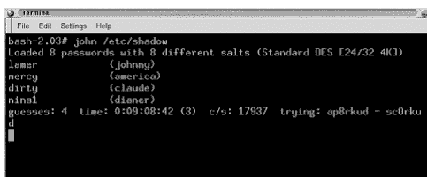

**图 13.1** 密码破解工具。

`John` 密码破解工具。

第一个密码大约在 30 秒内被破解。强密码是有用的；弱密码则不行！


SuSE 还包含了另一个工具，是一个预防性密码验证器。如果你对用户密码有怀疑，可以使用名为 `vpass` 的程序。如果你使用 `cracklib` 来判断密码是否合格，它会返回“ERRNO <reason>”并告诉你密码是否太短、是否全小写或其他。执行此命令：

```bash
echo <username> vpass -u
```

这个小程序无价连城。当管理员在白天有空时，检查几个用户并向他们发送情况说明，这被称为主动安全。

你的下一步将是检查 root 是否被攻破。尽管 SuSE 在安装后设置了权限，但你你想找出是否有任何方法可以获取 root 访问。你需要使用 Tripwire（研究助手）来完成。这是 tiger 程序的升级版，它是一组用于扫描系统安全问题（特别是 root 访问）的脚本。该程序未包含在 SuSE 发行版中，因此你需要从 http://tripwire.org/ 下载它。

下载完成后，将其解压到安全目录中（最好不是 root 目录）。运行 `make` 和 `make install`，然后运行该程序。除非你真的去找，否则你可能永远不知道系统中有哪些端口是开放的，而 Tripwire 将帮助识别潜在的威胁区域（见图 13.2）。

# 第 13 章：网络安全

## 检查输出

对于系统管理员来说，这是一个很好的程序；你可以将 Tripwire 添加到 `cron` 中让它在特定时间运行并详细检查日志。最后但同样重要的一点，为了确保系统安全，我建议在上线之前使用 Tripwire。该工具会将存储在不可访问数据库中的指定文件和目录的属性进行比较。这消除了黑客篡改的可能性。要设置并运行 Tripwire，请查看 `/usr/doc/packages/tripwire/README`。

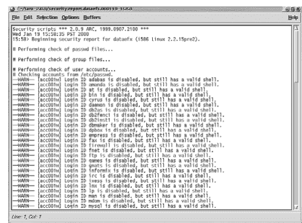

**图 13.2** Tripwire 检查程序

YaST 将为你提供检查弱密码的选项。在系统管理菜单的配置（Configuration）下，对 `PASSWD_USE` 回答 yes，将检查通过库分配的所有密码。该工具可以帮助限制弱密码的使用。当你采取这些措施后，将拥有一个相当安全的环境。如果你有多台机器，应该在上线前在所有机器上执行这些操作。

YaST 惊人灵活性的另一个方面是安全设置的系统管理选择。你可能会在全系统范围内设置权限时选择使用此工具（见图 13.3）。也可以通过此菜单修改其他设置。该工具可能不是你需要的——这取决于你对权限设置的细粒度要求。

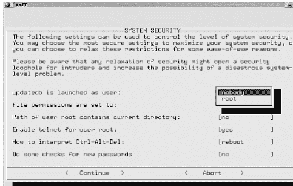

**图 13.3** YaST 安全选择

## 强制网络安全

如果你是网络上的唯一用户，执行网络安全的任务与你有 100 个用户时一样关键。你建立的习惯将可能是资产也可能是负担。安全是一种心态，而非一种运行状态。如果你成功实施了良好的安全，你很可能会保持一个调试良好的网络。

SUSE Linux 6.3 自带了一个名为 `firewall` 的包。该包本身并不是防火墙——它更像是一个使用 `iptchains` 构建的智能包过滤器。要让其工作，你需要读取 `/etc/rc.config` 中的说明并相应地编辑该文件。这将为你建立一个工业级的全功能防火墙脚本提供非常好的开始。SUSE 升级了启动脚本，使所有内容在启动时初始化；使用以下命令检查你的版本：

```bash
rpm -q firewall
```

当前版本是 `firewall-1.4`。如果你在启动过程中遇到防火墙初始化问题，请在 http://www.suse.de/en/support/download/updates/63_update.html 下载更新包。

为了能够跟上一般的安全问题，请查看该网站：http://xforce.net。

除了你可能受到防火墙保护外，如果必须允许某种类型的连接到你的网络，你就必须建立一种信任。信任关系可以使用 `ssh`（安全外壳）或 PKI（公密钥基础设施）方法建立。这种信任方法不是允许任何类型的连接，而是基于验证的授权交换理论。SuSE Linux 在安装后会为你配置好 `ssh`。

## 入侵你自己的网络

入侵自己的网络听起来很奇怪，不是吗？好吧，考虑这样一个事实：我每周至少会被扫描端口一次，我的防火墙日志显示每晚有二到三次未经授权的连接尝试——总有人在检查门是否关好了。某些选择是必须的：我是等别人发现我的安全漏洞，还是我自己进行一些高级诊断？发现弱点并修复它们比被某些未知个人侵犯要感觉好。

你需要做的第一件事是为自己的网络绘制“蓝图”。再次用房子来类比：蓝图将指示你的网络情况。

## 分析网络 163

```bash
bash-2.04# nmap -T4 102.168.1.1
Starting nmap 7.92 (https://www.nmap.org/) 
Scanning target 102.168.1.1 (102.168.1.1)
  PORT     STATE SERVICE
  25/tcp   open  smtp
  80/tcp   open  http
  111/tcp  open  rpc
  443/tcp  open  https
  515/tcp  open  printer
  8000/tcp  open  java

nmap run completed: 1 IP address (1 host) scanned in 2 seconds
bash-2.04#
```

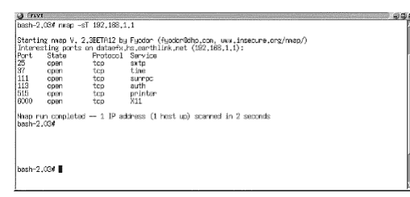

**图 13.4** `nmap` 端口扫描工具示例输出

## 网络分析器

SAINT 是 SATAN（安全管理员网络分析工具）的衍生品。两个安全专家 Dan Farmer 和 Wietse Verma 开发了该程序来探测每个响应网络系统的漏洞。随后发现的漏洞将以 HTML 格式报告给安全管理员（见图 13.5）。

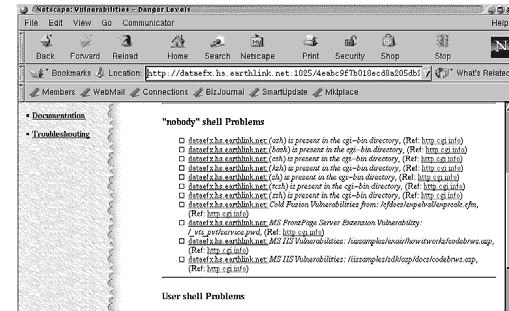

**图 13.5** SAINT 漏洞分析结果

# 164 第13章：网络安全

最新版本的 SAINT 1.5BETA1 已于2000 年 1 月初发布。如果你想保持在安全领域的前沿，请从之前的 URL 获取副本。该版本在 SuSE Linux 上运行得非常顺畅。

## 要避免的安全风险

安全的的核心思想是防范胜于事后控制。保护系统的最佳方法是通过针对网络活动制定特定的策略和程序来限制内部威胁。检查并修剪访问级别，并运行 `tiger` 程序来提醒你任何内部变化。顺便说一下，SuSE 还附带了一个名为 `secheck` 的包，它是一个 `tiger` 类型的程序。该程序进行每日、每周和每月的安全检查。（尽管我更喜欢 TARA，但你必须自己找出哪一个最适合你的需求。）记住，网络上包含有关如何获取 UNIX/Linux 系统 root 权限的信息，因此要留心对待内部用户。

解决社交工程入侵的关键在于监控用户名并频繁更改密码。教育他人，确保重要信息不会在没有某种身份验证的情况下泄露。建立一套安全的信息交换策略和程序。如果账户被终止，请删除该用户及其所有关联文件（而不仅仅是 `/home` 目录）。

关闭未使用的端口并关闭不需要的服务也将有助于加固防御。SuSE Linux 附带了一个名为 `harden_suse` 的加固脚本。该脚本是交互式的；你将看到图 13.6 所示的屏幕。

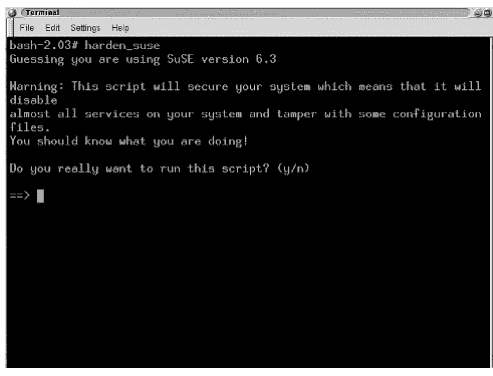

图 13.6 `harden_suse` 系统加固脚本。

## 分析网络 165

使用 `harden_suse` 时要小心，因为它可能会禁用你大部分日常所需的服务。

使用扫描和漏洞分析工具运行定期和非定期的网络安全审计。如果你将其作为日常工作的一部分，你将会有更好的视野和信心。

还有其他几种监控系统的方法：其之一是使用 SuSE 的临时监控程序，它会记录入侵者在入侵期间可能打开的临时文件。你可以通过执行命令来实现与 `temp-watch` 类似的功能：

```
lsof | less
```

这通过名为 `less` 的分页器工具显示所有打开的文件。

## 报告安全问题

你如何知道系统何时被入侵？每天检查日志是至关重要的。如果你不监控日志，入侵者就可以为所欲为。如果入侵者是你，那么活动痕迹在单次事件中可能不会被发现。你或任何负责安全的人都应该熟悉你的系统，这样系统操作的细微变化就会提醒你。SuSE 赋予了你减少或增加邮件频率的能力。进入 YaST，选择 Configuration File（配置文件），选择 MAIL，然后回答 All（全部）。这将所有日志系统发送给指定的用户。你也可以使用 `logcheck` 或 `watchdog`，它们可以在 http://www.rpmfind.net 获取。


你需要一个联系人（可能是你本人）和一个用于从入侵中恢复的计划计划。与你当地的 ISP 建立关系也是好的，以防你需要帮助来追踪入侵者。网络上的大量资源将帮助你为攻击或入侵做好准备。一个很好的网站是 NetworkICE，位于 http://www.81gm.org/。

## 解决安全入侵

这可能是安全领域中最难处理的问题。当你的网络被入侵时，你该怎么办？

脑海中浮出的第一个想法可能是跟踪执行这一切的入侵者以及他们来自哪里，除非破解者粗心大意，或者你已经注意到了他的存在并允许他建立了可以在法庭上作为证据的记录。（当然，只有当那个人恰好和你住在同一个国家时这是一个选项。）

从入侵中恢复是复杂的，如果没有备份文件并通过重新安装来清理系统，有时是不可能的。如果你的网络中部署了木马程序，且你不确定该怎么办，请寻求帮助。国防部对 `root_compromise` 的详尽介绍见 http://www.cert.mil/techtips/root_compromise.htm。或者，访问 FBI 计算机犯罪网页，地址 http://www.fbi.gov/nipc/compromise.htm。

# 166 第13章：网络安全

我希望你永远不需要使用这些 URL。然而实际上，任何事情都可能。

## 安全总结

在这一章中，你学到了安全是一种心态，而不是一种操作方式。从内向外封堵房子里所有的漏洞。建立起你的栅栏（防火墙），并时不去摇一摇门窗，以确保它们是关闭的。如果你忠实地做到这一点，就像在书房里开着灯、播放音响一样。如果你不尽你的责任，小偷就会尽他们的职责。

SuSE Linux 在安全领域不断进步，并提供的工具比大多数主流发行版都要多。图 13.7 显示了几个网络安全特色工具。

| 软件包选择 | Series.sec 工具 | 版本 |
|---|---|---|---|
| 1.03 - (c) 1994-99 SuLinux Deb | | |
| argument Networking tool | 挂载点 | (F3)z>Zoom |
| amdump -- ethernet/ip address | | |
| fct Firewall | | |
| ip | | |
| salt | | |
| we | | |

图 13.7 显示了几个网络安全特色工具。（注：表格内容的 OCR 识别严重损坏；上述结构反映了其布局）。

## 附录 A：在线寻找帮助

通过加入邮件列表，你可以保持最新动态。SuSE 提供了许多你可以订阅的邮件列表。这些列表包括公告、数据库和通用主题。你可以访问 http://www.suse.com/Maillist/index_html 并选择当前的列表来订阅。

# 更多参考资源 169

遗憾的是，列出用户组列表将占据一百多页。相反，本节为你提供了几个非常有用的 URL，帮助你找到附近的群组。大多数 Linux 用户组（LUG）都有本地聚会场所和专门为成员提供的邮件列表。联系离你最近的小组，结识你社区中参与 Linux 的一些人。

首先，访问由 LinuxMail 赞助的网站：http://linuxnews.com/programs/usergroup/list。另一个很好的网站是 http://www.linux.com/search.html。这个 URL 指向一个搜索引擎——只需输入你的位置信息，它就会标出你所在地区最近的 LUG。Yahoo! LUG 列表也可以在 http://clubs.yahoo.com/clubs/suselinuxusers 找到。

成为 Linux 社区的一员是其他用户兴趣的动力——在你所在的地区找一个小组，你就会明白我的意思。我已经使用 Linux 几乎 4 年了，我发现自己一直在学习和成长。寻找帮助也意味着寻找朋友。

一些 LUG（包括通过 http://www.ecn.purdue.edu/PLUG/Installfest/ 的小组）设有“安装节会”（installfests），在期间你可以带上软件和硬件并让它们全部运行起来——好吧，是尽可能地运行起来。

我有机会参加的一个 LUG 是他们为编程、安全和其他相关问题组建了特殊兴趣小组（SIGs）。加入一个 LUG 不仅能让你对如何在个人层面使用 Linux 有更好的了解，还可能给你一个机会去遇到在更大环境中使用 Linux 的人。

# 更多参考资源

SuSE 网站（地址为 http://www.suse.com）包含的不仅仅是安装信息。这里找到数据库和在线帮助系统代表了强大的服务背景。你将找到可以追溯到 4.2 版本的解决方案，既有针对看似孤立且棘手问题的答案，也有针对常见问题的答案。

数据库中记录了关于 Linux 软件和 ReFS 文件系统的信息。启动问题、PCMCIA 诊断以及许多其他耗时的程序也得到了解决，并在支持文本中提供了简单的解决方案。总的来说，SuSE 在支持文档领域迈出了正确的一步。

Linux 文档项目（LDP）网站位于 http://metalab.unc.edu/LDP，是与 Linux 操作系统相关信息最大的仓库。包含的 HOWTOs 包含了社区的集体知识，这个 LDP 得到了 Linux 用户的支持。如果你花时间阅读 LDP 宣言（位于 http://www.linux.org/manifesto.html），你将更清晰地理解谁在做什么以及如何做。

# 170 附录 A：在线寻找帮助

你也可以使用 LDP 来识别和解决问题。除了 SuSE 支持数据库外，这可能是你信息追踪路径上的一个关键停站。这些广泛的主题材料可以帮助你的系统正常运行。

《Linux 每周报》（Linux Weekly News）网站 http://lwn.net 也将重要的 Linux 问题推向前端。当你搜索当前的趋势和主题时，这个网站是一个极佳的资源。该网站还维护了跨越 Linux 世界的有趣链接。

Linux Today（地址为 http://www.linxtoday.com）充满了最新的 Linux 新闻。这个网站一定能提供你需要的一切，包括最近的 Linux 机会、安全文章和每周总结。为了方便起见，你可以让所有的主要文章和总结发送给你（我就是这么做的）。

最显而易见（且被引用次数最多）的网站是 Slashdot，地址为 http://slashdot.org。这个网站是当前信息的库，还刊登互联网上其他地方看不到的社论。它是一个专注于开源计算社区关注问题的大型新闻网站。

《LinuxJournal杂志》（地址为 http://www.linuxjournal.com）是另一个访问和搜索过去文章的绝佳场所。我订阅了这份杂志，我对编辑作家们在一期杂志中能涵盖的内容始终感到印象深刻。你可以根据关键词和主题搜索存档。

系统管理员应该关注 http://www.samag.com。这个网站面向 UNIX 系统管理员，但一些信息和文章也与 Linux 相关，包括“Linux 栖息地”（Linux Rookery）。如果你对大型机（big iron stuff）感兴趣，请看看这个网站。

你可以通过关注 http://www.linux.org.uk/cgi-bin/portaloo/ 来保持信息更新。这个门户网站有指向几个高流量网站的链接，可以帮你筛选出所需的信息。还有 http://www.linuxlinks.com/ 以及宾州州大学的门户页面 http://www.math.psu.edu/morris/deptpage/portals。

当然，新的门户网站和网站每天都在涌现。其普及程度的快速增长将继续推动这场被称为 Linux 的现象级爆发。

当然，互联网资源、邮件列表和 IRC 通道并不是寻找良好帮助的唯一途径。你可能会自己发现其他的援助手段或途径。无论你做什么，都要得开心！

# 附录 B

## 排除 SuSE Linux 故障

在现实世界的条件下，事情会出错。设计用来运行的系统则不会。很有可能你的 SuSE Linux 安装非常顺利，你完全没有遇到任何阻碍；我向你致敬，并祝你持续的 Linux 之上一切顺利。

另一方面，你可能会遇到导致安装停滞的问题，或者你机器上的某些组件无法正确配置。接下来的信息绝非“解决方案”，但它们可能帮助你应对这些问题。

### 显卡

显卡一直以来并将一直是一个棘手的问题。在显卡制造商意识到 Linux 是一个可行的解决方案之前，支持将非常稀少。

有几款显卡需要注意——它们可能可以工作，也可能无法工作。例如，SIS 6326 在图形加速过程中的步进（stepping）功能存在一些问题。幸运的是，SuSE 为其提供了解决办法——将你的浏览器指向 http://sdb.suse.de/sdb/en/html/cep_sis_6326.html。

此外请阅读正文以获取如何编辑配置文件的信息。如果你不确定正在使用的显卡，可以随时在 http://cdb.suse.de/cdb_english.html 检查硬件数据库以查看是否受支持。关于其他显卡的详细信息，请参阅 http://sdb.suse.de/sdb/en/html/unsupp_graphic.html。你在那里找到的信息是 SuSE 在线提供的最新信息。

### 声卡


声卡代表了一个特殊问题，因为它们在配置方面非常敏感且挑剔。你可以通过几个命令对该问题的硬件方面进行诊断，这将让你知道系统是否识别了声卡。在命令行中执行以下命令：

```
dmesg | less
```

这将允许你检查启动过程并验证声卡是否被系统识别。你可以使用命令

```
tail /var/log/messages
```

来获得相同的结果。

如果你已经确认声卡工作正常（在 Windows 或 DOS 中），请务必妥记录运行设置。Linux 使用的 I/O 端口和 IRQ 应该与在 Windows 或 DOS 时相同。

你可以使用以下命令显示系统当前可用的 IRQ：

```bash
cat /proc/interrupts
```

检查你的声卡规格。这有助于帮助你确定 IRQ 是否被其他设备占用。

执行此命令显示所有 I/O 端口地址：

```bash
cat /proc/ioports
```

这也可以帮助你确定资源冲突问题。请确保你参考的是声卡制造商的信息。

## 附录 B：SuSE Linux 故障排除

此命令列出所有 DMA 通道：

```bash
cat /proc/dma
```

你可以在 http://www.linuxdoc.org/HOWTO/Sound-HOWTO.html#toc4 找到 Sound HOWTO。

## 网络接口卡

网卡（NIC）的配置非常简单，大多数驱动程序都包含在 SuSE Linux 安装的内核中。我发现的一个问题是 PCI 卡配置。这是一个孤立案例，但我会将其记录下来供他人参考。在 10Base ISA 卡流行的时期最初构建的旧版机器上，其 BIOS 设置可能需要更改 PCI 设置。PCI 卡自动分配 IRQ 和 I/O。这意味着如果 PCI 设置被设置为遗留兼容（legacy compatibility），系统将识别显卡但不会为其分配 IRQ，或者它会分配 IRQ0 或 255，这些都不是有效地址。当设置被调整为 PCI PnP 配置时，问题应该消失。你可以在 http://csdesis.gsfc.nasa.gov/linux/misc/irq-conflict.html 获取更详细的信息。查看 sdb.suse.de/qbi-bin/sdbsearch_en.q7stichwort=PCI 数据库。

如果你在使用 ISA 卡时遇到问题，你需要使用上一个“声卡”部分列出的相同命令。这将帮助你确定你是否存在系统冲突或其他问题。再次提醒，你手头需要显卡的规格说明。

## 笔记本电脑与笔记本

如果你是用户并安装了 SuSE，你可能会发现一些不同之处——特别是 PCMCIA 配置问题。如果你面临需要诊断的情况，这可能会有所帮助。

Linux 会在安装后自动探测 PCMCIA 设备并在当时尝试设置该设备。你还会被询问想要使用哪种设备；否则，你将选择 PCMCIA，然后 YaST 将尝试配置 PCMCIA 设备。当你重启机器时，启动过程无法启动 PCMCIA 设备，提示“eth0 device not found”，或者设备初始化后 `/etc/route` 失败。该问题是因为 Linux 和 YaST 都在尝试执行相同的工作。在彼此不知情的情况下，每个程序都尝试配置 PCMCIA 设备。

你必须返回 YaST 并选择“网络配置”（Network Configuration），并取消选择 YaST 设置的 PCMCIA 设备（在基础配置下）。不要删除已有的任何项目。接下来，你需要编辑 `/etc/pcmcia/network.opts` 文件——SuSE 通过该文件查找有关 PCMCIA 设备的网络信息。添加你的 IP 地址、子网掩码、广播地址和网络信息。还要添加你的主机名和 DNS 服务器以完成任务。

## SuSE Linux 故障排除

如果在系统启动并尝试初始化 PCM 设备时遇到死机，请查看此提示：http://sdb.suse.de/sdb/en/html/mnened-6.3_pcmia-start.html。

由于 PCI 技术代差，你可能在笔记本电脑上没有声音。声卡驱动程序和配置工具是针对 ISA 类型的 PnP 的。如果你正在尝试一个内核版本，这可能解决你的音频困扰——我在运行 2.3.3 版本时就解决了这个问题。

## 软件故障排除

如果你恰好遇到由于依赖问题无法安装软件的情况，RPM 程序应该报错并告诉你哪些组件失败了。诀窍在于在不尝试浏览整个网络的情况下找到正确的解决方案。你可以在 rpmfind.net 网站 http://www.rpmfind.net 找到这类信息。当你查看软件包选择时，它们会指示提供了哪些文件和库，以及该包在系统中运行所需的文件（先决条件）。为了进一步的诊断，你可以使用此命令：

```bash
ldd <option> | <filename>
```

有关如何跟踪链接库的更多信息，请使用此命令：

```bash
man ldd
```

# SuSE Linux 177 故障排除

“管理网络设置。” 如果你决定不在 SuSE 中使用防火墙功能（数据包过滤），你仍然可以使用 IP Chains 的高级功能。

执行以下命令以在拨号连接设备 `ppp0` 上激活 IP Chains：

```
ipchains -P forward DENY
ipchains -A forward -i ppp0 -j MASQ
echo 1 > /proc/sys/net/ipv4/ip_forward
```

在定义为 `eth0` 的以太网卡机器上执行这些命令：

```
ipchains -P forward DENY
ipchains -A forward -i eth0 -j MASQ
echo 1 > /proc/sys/net/ipv4/ip_forward
```

关于 IP Chains 和伪装（masquerading）的更多资源，请参考 http://www.linuxdex.org/HOWTO/IPCHAINS-HOWTO.html 中的 HOWTO 文档。

在这个经常充满敌意的环境中，防火墙可能是你唯一的选择。很容易启用数据包过滤（第 11 章）。关于防火墙的进一步讨论超出了本文范围。请参考以下资源获取更多信息：

```
http://metalab.unc.edu/LDP/HOWTO/Firewall-HOWTO.html
http://sites.inka.de/sites/linux/freefire-1/index.en.html
http://www.rustcorp.com/linux/ipchains/
http://fwtk.netimages.com/main.html
http://www.obtuse.com/juniper/
http://www.ifi.uniz.ch/ikm/SINUS/firewall/
```

# 声卡驱动问题

SuSE Linux 自带声学驱动由 ALSA 提供。下面的列表说明了一些的声卡和芯片组类型。

列表详细列出了声卡接口，包括用于从模拟信号重现声音的 PCM（脉冲编码调制）、用于混合和修改声音的混音器（mixer），以及允许 MIDI 乐器和序列器（或运行序列器类型软件的计算机）相互通信的 MIDI 。SYNTH 功能（合成器）使电信号能够被解释。支持所有这些声音重现元素是了不起的，ALSA 正在扩展你的项目以支持更多声音。

| 芯片组 | 声卡 / 接口 |

| :--- | :--- |

| AMD InterWave | 声卡: Gravis UltraSound Plug & Play |

| | 声卡: Dynasonic 3-D |

| | 声卡: STB Sound Rage 32 |

| | 声卡: UltraSound 32-Pro (STB) |

| | 声卡: MED3210 |

| | 接口: MIXER,PCM,MIDI,SYNTH |

| Gravis UltraSound MAX | 接口: MIXER,PCM,MIDI,SYNTH |

| Gravis UltraSound Extreme | 接口: MIXER,PCM,MIDI,SYNTH |

| Gravis UltraSound Classic/ACE | 接口: MIXER,PCM,MIDI,SYNTH |

| ESS AudioDrive Es668 | 接口: MIXER,PCM,MIDI(1688) |

| SoundBlaster 1.0/2.0/Pro | 接口: MIXER (Pro only),PCM,MIDI |

| SoundBlaster 16/AWE | 接口: MIXER,PCM,MIDI |

| Yamaha OPL3-SA2/SA3 | 接口: MIXER,PCM,MIDI |

| OAK Mozart | 接口: MIXER,PCM |

| S3 SonicVibes PCI | 声卡: Schubert 32 PCI (PINE) |

| | 接口: MIXER,PCM,MIDI |

| EnsoniqAudioPCI (ES1370,ES1371) | 声卡: SoundBlaster PCI 64 |

| | 声卡: SoundBlaster PCI 128 |


| | 接口: MIXER,PCM,MIDI |

| Cirrus Logic / Crystal Semiconductors CS4232/CS4232A | 接口: MIXER,PCM,MIDI |

| Cirrus Logic / Crystal Semiconductors CS4235/CS4236/CS4236B/CS4237B/CS4238B/CS42399 | 声卡: Turtle Beach Malibu |

| | 接口: MIXER,PCM,MIDI |

| Cirrus Logic / Crystal Semiconductors CS4610/4612/4615/4288 | 接口: MIXER,PCM |

| ESS Solo-1 ES1938 | 接口: MIXER,PCM |

| ESS18XX | 接口: MIXER,PCM,MIDI |

| Opti 82Cxx | 声卡: Audio 16 Pro |

| Expert-SO9301 (82C30 based) | 声卡: Sound v2.0 (82C31 based) |

| ExpertMedia Sound-1600 (82C28 based - AD1849) | 声卡 S6026 (OT601 based - CS4231) |

| Player S-928 (82C28 based - AD1848) | | 接口: MIXER,PCM,OPL,MIDI |

| Trident 4DWave/NX | 声卡: Best Melody 4DWave |

| | 声卡: Union 4DWave |

| AzTech PCI | 声卡: Warpspeed 4DWave |

| AzTech PCI 64-Q53D | 声卡: Addonics 750 |

| AzTech PCI | 声卡: True Sound 4D |

| Hoontech Digital 4DWave | 声卡: Shark 4D |

| | 声卡: Jaton 4D |

| ForteMedia FM801 | 接口: MIXER,PCM,MIDI |

| SGI Indy (HAL2) | 接口: MIXER,PCM,MIDI |

| Turtle Beach WaveFront | 接口: PCM |

| | 声卡: Tropez (Tropez+) |

| | 声卡: Maui (with CS4232; or use OPTi 16 which is handled) |

| | 接口: MIXER,PCM,MIDI,SYNTH_MIDI,HWDEP |

| C-Media CMI8330 | 接口: MIXER,PCM,MIDI |

| Avance Logic ALS100/120 | 接口: MIXER,PCM,MIDI |

| Diamond Technologies DT-0197 | 接口: MIDI |

| Aztech Galaxy | 接口: MIDI |

| MOTU MidiTime AV | 接口: MIDI |

| EMU10K1 | 声卡: Sound Blaster Live! |

| | 声卡: Sound Blaster 512 |

| | 声卡: E-mu |

| | 接口: MIXER,PCM,MIDI,SYNTH_MIDI |

| RME Digi9652 (Hammerfall, Hammerfall) | 接口: PCM |

# SuSE Linux 179 故障排除

“网络设置。” 如果你决定不在 SuSE 中使用防火墙功能（数据包过滤），你仍然可以使用 IP Chains 的高级功能。

执行以下命令以在拨号连接设备 `ppp0` 上激活 IP Chains：

```
ipchains -P forward DENY
ipchains -A forward -i ppp0 -j MASQ
echo 1 > /proc/sys/net/ipv4/ip_forward
```

在定义为 `eth0` 的以太网卡机器上执行这些命令：

```
ipchains -P forward DENY
ipchains -A forward -i eth0 -j MASQ
echo 1 > /proc/sys/net/ipv4/ip_forward
```

关于 IP Chains 和伪装的更多资源，请参考 http://www.linuxdex.org/HOWTO/IPCHAINS-HOWTO.html 中的 HOWTO 文档。

防火墙可能是你在这个经常充满敌意的环境中唯一的选择。很容易启用数据包过滤（第 11 章）。关于防火墙的进一步讨论超出了本文范围。请参考以下资源获取更多信息：

```
http://metalab.unc.edu/LDP/HOWTO/Firewall-HOWTO.html
http://sites.inka.de/sites/linux/freefire-1/index.en.html
http://www.rustcorp.com/linux/ipchains/
http://fwtk.netimages.com/main.html
http://www.obtuse.com/juniper/
http://www.ifi.uniz.ch/ikm/SINUS/firewall/
```

# 声卡驱动问题

SuSE Linux 自带的驱动由 ALSA 提供。下面的列表说明了一些的声卡和芯片组类型。

列表详细列出了声卡接口，包括用于从模拟信号重现声音的 PCM（脉冲编码调制）、用于混合和修改声音的混音器（mixer），以及允许 MIDI 乐器和序列器（或运行序列器类型软件的计算机）相互通信的 MIDI 。SYNTH 功能（合成器）使电信号能够被解释。支持所有这些声音重现元素是了不起的，ALSA 正在扩展你的项目以支持更多声音。

| 芯片组 | 声卡 / 接口 |
| :--- | :--- |
| AMD InterWave | 声卡: Gravis UltraSound Plug & Play |
| | 声卡: Dynasonic 3-D |
| | 声卡: STB Sound Rage 32 |
| | 声卡: UltraSound 32-Pro (STB) |
| | 声卡: MED3210 |
| | 接口: MIXER,PCM,MIDI,SYNTH |
| Gravis UltraSound MAX | 接口: MIXER,PCM,MIDI,SYNTH |
| Gravis UltraSound Extreme | 接口: MIXER,PCM,MIDI,SYNTH |
| Gravis UltraSound Classic/ACE | 接口: MIXER,PCM,MIDI,SYNTH |
| ESS AudioDrive Es668 | 接口: MIXER,PCM,MIDI(1688) |
| SoundBlaster 1.0/2.0/Pro | 接口: MIXER (Pro only),PCM,MIDI |
| SoundBlaster 16/AWE | 接口: MIXER,PCM,MIDI |
| Yamaha OPL3-SA2/SA3 | 接口: MIXER,PCM,MIDI |
| OAK Mozart | 接口: MIXER,PCM |
| S3 SonicVibes PCI | 声卡: Schubert 32 PCI (PINE) |
| | 接口: MIXER,PCM,MIDI |
| EnsoniqAudioPCI (ES1370,ES1371) | 声卡: SoundBlaster PCI 64 |
| | 声卡: SoundBlaster PCI 128 |
| | 接口: MIXER,PCM,MIDI |
| Cirrus Logic / Crystal Semiconductors CS4232/CS4232A | 接口: MIXER,PCM,MIDI |
| Cirrus Logic / Crystal Semiconductors CS4235/CS4236/CS4236B/CS4237B/CS4238B/CS42399 | 声卡: Turtle Beach Malibu |
| | 接口: MIXER,PCM,MIDI |
| Cirrus Logic / Crystal Semiconductors CS4610/4612/4615/4288 | 接口: MIXER,PCM |
| ESS Solo-1 ES1938 | 接口: MIXER,PCM |
| ESS18XX | 接口: MIXER,PCM,MIDI |
| Opti 82Cxx | 声卡: Audio 16 Pro |
| Expert-SO9301 (82C30 based) | 声卡: Sound v2.0 (82C31 based) |
| ExpertMedia Sound-1600 (82C28 based - AD1849) | 声卡 S6026 (OT601 based - CS4231) |


| Player S-928 (82C28 based - AD1848) | | 接口: MIXER,PCM,OPL,MIDI |
| Trident 4DWave/NX | 声卡: Best Melody 4DWave |
| | 声卡: Union 4DWave |
| AzTech PCI | 声卡: Warpspeed 4DWave |
| AzTech PCI 64-Q53D | 声卡: Addonics 750 |
| AzTech PCI | 声卡: True Sound 4D |
| Hoontech Digital 4DWave | 声卡: Shark 4D |
| | 声卡: Jaton 4D |
| ForteMedia FM801 | 接口: MIXER,PCM,MIDI |
| SGI Indy (HAL2) | 接口: MIXER,PCM,MIDI |
| Turtle Beach WaveFront | 接口: PCM |
| | 声卡: Tropez (Tropez+) |
| | 声卡: Maui (with CS4232; or use OPTi 16 which is handled) |
| | 接口: MIXER,PCM,MIDI,SYNTH_MIDI,HWDEP |
| C-Media CMI8330 | 接口: MIXER,PCM,MIDI |
| Avance Logic ALS100/120 | 接口: MIXER,PCM,MIDI |
| Diamond Technologies DT-0197 | 接口: MIDI |
| Aztech Galaxy | 接口: MIDI |
| MOTU MidiTime AV | 接口: MIDI |
| EMU10K1 | 声卡: Sound Blaster Live! |
| | 声卡: Sound Blaster 512 |
| | 声卡: E-mu |
| | 接口: MIXER,PCM,MIDI,SYNTH_MIDI |
| RME Digi9652 (Hammerfall, Hammerfall) | 接口: PCM |

# 引导加载

`LILO` (LinuxLoader) 是一组旨在在磁盘扇区之间移动信息的程序。这些信息存储在一个文件中，其完全目的是向引导扇提供 `lilo` 数据。请记住，`LILO` 在启动时并不执行任何功能。配置文件仅在 BIOS 调用 `LILO` 时生效，而不是在启动时。默认配置文件是 `/etc/lilo.conf`。

如果没有正确安装和配置 `LILO`，你的机器可能无法启动。以下是 `LILO` 无法初始化的一些原因：

- `L` 表示 BIOS 加载并启动了 `LILO`。过程的第二个阶段无法加载，因为找不到 `/boot/boot.b`。这是由磁盘的物理问题或磁盘参数错误（几何结构）引起的。
- `LI` 表示启动的第二个阶段已被识别（找到了 `/boot/boot.b` 文件），但其位置可能错误（即超过了 1024 磁道限制）。这也发生在文件移动或更新后没有重新安装 `LILO` 时。
- `LIL` 表示启动过程的第二个阶段已开始，但描述表无法访问文件。引导文件的位置超出参数或存在物理磁盘问题。
- `LIL` 表示启动的第一、第二阶段已被识别，但其所在的地址不正确。同样，问题也发生在移动或更新引导文件后没有重新安装 `LILO` 时，或者可能是由磁盘故障引起。
- `LIL` 表示映射文件中的描述表可能损坏，或者在移动或更新文件后没有调用 `lilo` 命令来重新安装映射文件。

如果你遇到上述任何情况，请不要恐慌。SuSE Linux 光盘上内置的救援系统将帮助你。重置 BIOS 从 CD-ROM 启动。Linux 启动后，进入主菜单并选择“启动已安装系统”（Boot Installed System）。该救援系统提供用于启动的内核镜像，允许你回到系统并在必要时进行修复。然而，该救援系统无法解决位于 1024 磁道边界之外的 `/boot.b` 文件问题。如果你没有可启动的 CD-ROM，那么启动盘将起到相同的作用。关于启动问题的更多细节可以在 http://sdb.suse.de/sdb/en/html/keylist.LILO.html 和 http://linux.com/support/newsitem.php?sid=8&aid=6316 找到。

# 索引

# 符号

3Com ISDN 网站, 83
1024 `LILO` 磁道限制, 75

# A

- 终止功能，包安装, 41
- 访问 shell 环境, 90
- 账户，创建用户, 58
- 添加
  - DNS 服务器地址, 80
  - 网络接口, 80
  - 用户, 89
用户管理菜单, 89-91
`useradd` 命令, 92
- 调整 News-From 输入字段, 57
- ADSL (非对称数字用户线), 84
- Advanced Linux Sound Architecture 驱动。
见 ALSA 驱动
- Advanced Micro Devices (AMD) 芯片组, 3
- ALSA (Advanced Linux Sound Architecture)
驱动, 134-136
- `alsaconf` 命令, 134
- 修改的文件，SuSEconf 工具, 50
- AMD (Advanced Micro Devices) 芯片组, 3
- Anaconda, 12
- 应用，更新, 140
- 查找, 140-145
- `rpmfind` 工具, 145
- `apsfilter` 设置工具, 96
- `art` 工具, 12
- 阿根 SuSE Linux 软件镜像站, 142
- Arkelia 备份工具, 146
- 非对称数字用户线 (aDSL), 84
- 奥地利 SuSE Linux 软件镜像站, 142

## 184 引导程序, 故障排除

- 引导程序, 故障排除, 181
- 启动程序网站, 181
- 启动盘，从 CD-ROM 创建, 17
- 巴西 SuSE Linux 软件镜像, 142
- 浏览器
  - Lynx, 118-119
  - Netscape, 119-121
- BRU (-备份与恢复工具), 146
- 缓冲区溢出, 156
- Bugtrap 网站, 156

## C

- 线缆型号, 81-82
- Caldera, LINUXwZARD, 12
- 加拿大 SuSE Linux 软件镜像, 142
- Castlewood 网站, 7
- CD 安装, 15-16
- CD-ROM, 5
- CERT Orion 中心, 156
- Cert 的木马下载网站, 156
- 修改
  - 全名字段, `chfind` 命令, 92
  - 登录 shell 环境, `chsh` 命令, 92
  - 用户密码命令, 92
  - `chfind` 命令, 全名字段, 92
  - `chmod` 命令, 限制非 root 用户, 92
  - `chsh` 命令, 更改登录环境,
- 客户端
  - 软件包克隆, 47
  - 命令行工具, 用户账户, 92
- 命令
  - `alsaconf`, 134
  - `chfin`, 修改名称字段, 92
  - `chmod`, 限制非 root 用户, 92
  - `chsh`, 更改登录 shell 环境, 92
- 内核定制
  - `depmod`, 106
  - `make`, 104-105
  - `make bzimage`, 106
  - `make config`, 104
  - `make drop`, 106
  - `make menconfig`, 104
  - `make modules`, 106
  - `make installs`, 106
  - `make xconfig`,
  - ILO 内核安装, 106
  - `lsmod`, 加载模块, 列出, 137
  - 密码, 更改用户密码, 92
  - `susephone`, 185
  - `useradd`, 添加用户, 92
  - 删除用户, 92
- 商业级备份工具, 146
- 配置打印机, 95
- 配置
  - ALSA 音频驱动程序, 134, 136
  - 线缆型号, 81-82
  - DHCP, 123
  - DSL, 84-85
  - 防火墙程序, 126-130
  - 配置文件, 127-128
  - 外部网络连接, 126
  - 防火墙包下载, 127
  - 参数, 128-129
  - 防火墙, 125-126
  - FTP 程序, 125
- Internet 服务
  - 浏览器, 117
  - Lynx 浏览器, 118-119
  - Netscape 浏览器, 119-121
  - 网络服务, 见配置网络服务
  - ISDN 线路, 82-34


- `LLoader` (LILO) 程序, 52
- 调制解器, 58
- ISA 即插卡卡, 76
- `Minicom` 工具, 75-76
- 鼠标, 58
- 网络服务, 121
- `DHCP`, 123
- `NFS`, 123-94
- `Samba`, 124-125
- `sendmail`, 121-123
- `NFS`, 123-124
- `NIS`, 124

- 打印机
    - 配置打印机, 95
    - `YaST`-95-96
    - 使用 `YaST` 的远程打印机, 96-97
    - `Samba`, 124-125

- `SaX`
    - `desktop.go`, 66
    - 键盘, 65
    - 显示器, 65
    - 鼠标, 64
    - 显卡, 65
    - `sendmail`, 121-123
    - 启动服务, 57
    - 安全/配置参数列表, 117-111
    - `YaST1`, 110
    - TCP/IP 网络配置, 56-57
    - 时区, 56
    - 用户账户, 示例示例程序, 58

- X Window 系统
    - 显示器管理器, 69
    - XaX, 64-66
    - Xa2, 66
    - 故障排除网站, 68
    - `x86config`, 67-68

- 连通性
    - 线缆型号, 81-82
    - 拨号网络, 77
    - 自动 radius, 80
    - DNS 服务器地址, 添加, 80
    - 网络接口, 80
    - `wdial` 工具, 77, 79-80

## 文件传输协议 185

- `DSL`, 84-85
- Internet, 故障排除, 176-177
- `ISDN` 线路, 82-84
- 调制解器, 75-76
- 网络, 73-74
- 控制器, `ISDN`, 83-84
- 复制 `System.map` 文件, 106
- `cpio` 工具, 145
- 示例程序, 创建账户, 58
- 网站, 134
- 音频项目, 123
- 定制内核, 构建
    - 优势, 101-102
    - 配置, 105
    - 依赖项, 106
    - 最新源码, 103
    - `make` 命令, 104-105
    - 笔记本, 106
    - 补丁, 103-104
    - 复制 `System.map` 文件, 106
    - 依赖项, 106
    - 设备驱动程序, 101
    - 功能, 106
    - `HOWTO` 网站, 102
    - 最新源码, 103
    - 模块化, 101
    - 静态, 101
    - 网络协议, 101
    - 补丁, 103-104
    - 笔记本, 106
    - 补丁, 103-104
    - 复制 `System.map` 文件, 106
    - 定制软件包, 44
    - 软件包克隆, 47
    - 定制配置, 创建, 45-46
    - 窗口管理器, 选择, 46
    - 显示器管理器, X Window, 69
    - 显示安装警告, 53
    - 分布式拒绝服务 (`DoS`)攻击, 156
    - 域名网站, 85
    - 域名, TCP/IP 配置, 56
    - SuSE 安装, 开始, 14
    - 下载防火墙包, 127
    - 下载内核补丁, 103
    - 复制 `System.map` 文件, 106
    - 下载 `ALSA` (Advanced Linux), 134, 136
    - 内核开发网站, 132
    - `OSS/Free`, 134
    - SoundBlaster Liva, 134
    - 故障排除, 177-180
    - TCP/IP 配置, 57
    - Jaz, 172
    - DVD, 7
    - 磁, 7
    - Zip, 172
    - 选择接口 (Debian), 12
    - `DSL` (Digital Subscriber Lines), 84-85
    - 驱动器, 7
    - 动态主机配置 见 `DHCP`

## D

- `DoS` 攻击 (分布式拒绝服务), 156
- Debian, 选择接口, 12
- 删除用户, 91-92
- 国防部根站点, 165
- 依赖项, 106
- `depmod` 命令, 内核定制, 106
- 桌面配置, `SaX`, 66
- 桌面, `KDE`, 70-71
- 驱动内核, 101
- `DHCP` (Dynamic Host Configuration), 123
- 拨号网络, 77
- 自动 radius, 80
- 调制解器, 81-82
- `ISDN` 线路, 82-84
- DNS 服务器地址, 添加, 80
- 网络接口, 添加, 80
- `wdial` 工具, 77-80
- Digital Subscriber Lines, 84-85
- 禁用用户, 91
- 磁盘配额资源, 90
- 磁盘使用, 90
- 从 CD-ROM 创建磁盘, 177
- 救援, 60-61

## F

- 安装失败警告, 显示, 53
- 传真, 85-86
- FBI 计算机巡, 165
- 磁盘工具, 分区格式, 31
- 文件传输协议。见 `FTP`

## 186 文件

- 修改的, `SuConfig` 工具, 50
- 备份, 145-146
- `etc/passwd`, 88
- `isapnp.conf`, 137
- `System.map`, 配置复制, 106
- 未加密密码 (`/etc/passwd`), 88
- `wdial.conf`, 77
- `x86Config`, 68
- 分区, 23
- `LVM` (逻辑卷管理器), 28
- 多磁盘, 26
- 规划, 24
- `RAID` (冗余磁盘阵列), 27
- Reiser 文件系统, 27-28
- 单磁盘, 25-26
- 交换空间, 28
- `YaST`, 29-32
- `YaST2`, 28-29
- `SCSI`, 故障排除, 172
- 文件系统 NEXT2, 23
- 参考文献, 27-28
- 交换, 23
- 在线查找
    - Internet 聊天室 (`IRC`), 168
    - `LUGS` (Linux 用户组), 168-169
    - 邮件列表, 168
    - 参考文献, 169-170
- 更新
    - Linux 网站, 145
    - 镜像站点, 142
    - SuSE, 140-142
    - 芬兰 SuSE 软件镜像站点, 142
    - 防火墙网关, 161
    - 防火墙程序网站, 126
    - 防火墙, 配置, 125-126
    - 防火墙程序配置, 120-130
    - 使用, 177
- 第一原理网站, 82
- `flexback` 工具, 145
- 忘记密码, 故障排除, 59-60
- `tify` 软件包, 121
- 法国 SuSE 软件镜像站点, 142
- 免费备份工具, 145-146
- Freshcut 网站, 148
- `FTP` (文件传输协议), 125
- `FTP` 网络安装, 18
- `FTP` 程序, 125
- `FTP` 站点, 67
- 支持, 18
- 硬化 suse 脚本, 164
- 硬件，见外设
    - CD-ROM, 5
    - 硬盘, 4-5
    - 处理器, 4
    - RAM, 5
    - 要求, 7
    - 硬件兼容性网站, 8
    - 硬件数据库网站, 173
    - 帮助, 40
    - `Lynx` 浏览器, 118
    - Netscape, 121
- 在线查找
    - Internet 聊天室 (`IRC`), 168
    - `LUGS` (Linux 用户组), 168-169
    - 邮件列表, 168
    - 参考文献, 169-170
    - 域名, 配置, 56
    - 匈牙利 SuSE 软件镜像站点, 143
    - Hylax 网站, 86

## G

- `GMT` (格林尼治时间), 56
- `GNOME` 和启蒙团队, 92-93
- 希腊 SuSE 软件镜像站点, 142
- `GUI` 环境, 选择, 69

## H

- 攻击, 162-164
- 处理软件包, `YaST`, 34-36
- 硬盘, 4-5
- 大容量, 故障排除, 171-172
- 非兼容网站, 4
- 镜像, 53
- 安装, 11-13


## 目录

- 磁盘安装, 18
- 安装位置, 19
- 安装过程, 52
- 安装软件包, 失败, 53
- 安装界面, LILO, 52
- 安装界面, LILO, 52
- 组 (LUGs), 169

## I

- 1024 柱限制, 102
- LILO (Linuxader), 181
- OSS/Free, 133-134
- YaST, 37
- 软件包信息, 43-44
- 安装程序, 39-41
- 软件包选择器, 38-39
- 选择/安装软件包, 39-41
- 系统更新, 42-43
- YaST2, 36-37
- 集成数字网络。见 ISDN
- Intel 处理器, 3
- Intel 网站, 3
- ISDN 线路, 83
- 网络, 添加, 80
- 集成安全漏洞, 157
- 连通性, 故障排除, 176-177
- 安全漏洞, 150-156
- 提供者服务。见 ISPs。
- Internet 聊天室 (IRC), 168
- Internet 服务配置
    - 浏览器, 117
    - 防火墙, 125-130
    - Lynx 浏览器, 118-119
    - Netscape 浏览器
    - 网络服务。见网络服务
    - 内网, 安全漏洞, 156-157
    - IP 地址, 配置, 86
    - IP Chains, HOWTO 网站, 126
    - IP Chains 详情网站, 126
    - IP Chains/获取 HOWTO 网站, 177
    - IRC (Internet Relay Chat) 频道, 168
    - ISA 卡, 131
    - ISA 即插卡, 76, 131, 136
    - `isapmp` 工具, 137-138
    - 探测, 136
    - 资源可用性, 137-138
    - `isapnp.conf` 文件, 137
    - `isaptools` 工具包网站, 76
    - `isaptools` 工具, 136
    - `isapmp` 工具, 137-138
    - `pupamp` 工具, 136
    - 网站, 137
- ISDN (集成数字网络)
    - 线路, 82
    - 配置, 82-84
    - 控制器, 83-84
    - T/As, 83
    - `isdnn4linux` 软件包, 83
    - ISP (互联网服务提供商), 73
    - 意大利 SuSE 软件镜像站点, 143

## J-K

- Jaz 硬盘 HOWTO 网站, 172
- Jaz 硬盘, 7, 172
- John the Ripper 工具, 158
- KDE, 70-71
- KDE 网站, 71
- 定制, 构建
    - 优势, 101-102
    - 配置, 105
    - 依赖项, 106
    - 最新源码, 103
    - `make` 命令, 104-105
    - 笔记本, 106
    - 补丁, 103-104
    - 复制 System.map 文件, 106
    - 依赖项, 106
    - 设备驱动程序, 101
    - 功能, 106
    - HOWTO 网站, 102
    - 最新源码, 103
    - 模块化, 101
    - 静态, 101
    - 网络协议, 101
    - 补丁, 103-104
    - 笔记本, 106
    - 补丁, 103-104
    - 复制 System.map 文件, 106
    - 依赖项, 106

## 188 Linux Today 网站

Linux Today 网站, 170
- Linux 组。参见 LUGS, 168
- Linux Weekly 网站, 170
- 用于局域网的 `linux-firewall-tools` 网站, 130
- `linux-firewall-tools` 网站, 170
- LinuxLoader (LILO)
  - 配置, 52
  - 安装位置, 54-55
  - 安装, 54
- LinuxMax LUG 网站, 169
- LinuxNow 文件库 网站, 145
- `Linuxre` 程序, 15-16
- LinuxWiFiARD, 12
  - 加载模块，列表, 137
  - 本地时间，选择, 56
- `logcheck/logwatch` 网站, 165
- 登录：Linux
  - 安装部分损坏的错误，故障排除, 61
  - 丢失/忘记密码，故障排除, 59-60
  - 现代配置, 58
  - 鼠标配置, 58
  - `SuEnconfig` 程序, 57
  - 故障排除, 59
  - 用户密码示例 (LVM), 28
- 逻辑卷管理器 (LVM)
  - 登录 GUI 环境，选择, 69
  - 所有环境，Staging, 92
  - 视觉效果，Windows 系统, 68
  - 丢失，密码，故障排除, 59-60
  - `lpd` (行打印机守护进程），功能, 96-97
  - `lprpt` 工具, 97
  - `sismod` 命令, 137
- Lucent Type Winpmod 驱动程序网站, 21
- LUGS (Linux 用户组),在线帮助, 168-169
- LVM (逻辑卷管理器), 28
- Linux 浏览器, 118-119

## M

- 邮件列表，在线帮助, 168
- 维护，网络, 109
- `make bz` 命令，内核定制, 106
- `make` 命令，内核定制, 104-105
- `make config` 命令，内核定制, 104
- `make dep` 命令，内核定制, 106
- `make meanconfig` 命令，内核定制, 104
- `make modules` 命令，内核定制, 106
- `make modules install` 命令，内核定制, 106
- `make xconfig` 命令，内核定制, 105
- 管理组
  - NIS, 93
  - YaST, 92-93
- MD5 算法, 140
- 内存，参见 RAM
- 安全设置，配置
- 安全性, 94
- 系统管理, 89
- 用户管理, 89-91
- Minicom 工具, 75-76
- 镜像站点，更新, 142-145
- 调制解调器,74
  - 电缆, 81-82
  - 配置网站, 76
    - 配置, 58
    - 拨号网络, 77
    - 自动拨号, 80
    - DNS 服务器地址，添加, 80
    - 网络接口，添加, 80
    - `vdial` 工具, 77
    - 即插用卡配置, 76
- Minicom 工具配置, 75-76
- 笔记本电脑，网站, 21
- 故障排除, 175
- 模块化内核, 101
- 模块
  - 已加载的，列表, 137
  - SCSI，启动过程, 16
  - 监控器配置，SaX, 65
  - 监控器, 8
  - 单体内核, 101
  - 鼠标配置, 58, 64
  - 多磁盘分区, 26

## N

- 姓名字段，更改, 92
- DNS 服务器地址，添加, 80
- DNS 服务器配置, 57
- 组命名, 92
- NCFtp 客户端, 125
- NCFtp 网站, 125
- 荷兰 SE Linux 软件镜像站点, 143
- Netscape 浏览器
  - 配置, 119-121
  - 加密升级, 121
  - 帮助网站, 121
  - 新闻组, 120
- 网络分析仪, 163-164
- 网络文件系统。参见 NFS
- 网络安装。参见 NIS
- 网络安装, 16
- NFS, 16
- 必需目录, 16
- 网络接口卡。参见 NICs
- 网络接口，配置, 56
- 网络，服务/配置参数列表, 111-117
- 网络服务
  - 配置, 121
  - DHCP, 123
  - NFS, 123-124
  - samba, 124-125
  - sendmail, 121-123
- 网络类型，配置, 56
- NetworkICE 网站, 165
- 网络
  - 连接通性, 73-74, 77
  - 自动拨号, 80
  - 需要的电缆, 81-82
  - DSL, 84-85
  - ISDN线路, 82-84
  - DNS 服务器地址，添加, 80
  - 网络接口，添加, 80
  - `wdial` 工具, 77
  - 接口，添加, 80
  - 分析, 158
  - 强制执行, 161-162
  - 黑客, 162


- 内部漏洞, 157
- 互联网漏洞, 150-156
- 局域网漏洞, 156-157
- 入侵，解决, 165
- 问题，报告, 165
- 内核, 101
- 维护, 158-160
- 密码, 158
- 预防, 164-165
- root 权限获取, 159
- tripwire, 160
- 漏洞, 149-150
- 新组，浏览器, 120
- NFS (网络文件系统), 123
  - 配置, 123-124
  - 网络安装, 126
- NFS HOWTO 网站, 124
- NICs (网络接口卡), 5-6
  - IRQ 冲突, 174
  - 故障排除, 174
- NIS (网络信息系统),124
  - 配置, 124
  - 组管理, 93
  - HOWTO 网站, 132
- nmap 工具, 92
- 非 root 用户，限制, 92
- 挪 Linux 软件镜像站点, 143
- 笔记本
  - HOWTO 网站, 21
  - 信息网站, 21
  - 内核定制, 106
  - Linux 兼容性, 20-21
  - 调制解调器网站, 21
  - PCIA 源码网站, 106
  - SuSE 安装, 19-21
  - 故障排除, 174-175

## O

- SuSE 补丁/更新网站, 142
- 在线帮助
  - 查找, 167
  - 互联网聊天 (IRC) 频道, 168
  - LUGs (Linux 用户组), 168-169
  - 邮件列表, 168
- Open Sound 3.9.2 驱动程序, 132
- Open Sound System。参见 OSS
- 开放网站, 175
- ORB 驱动器, 7
- ORB 网站, 7
- OSS (Open Source System), 132-134
- OSS/Free, 132-134
- 超频处理器, 106

## P

- 软件包选择器 (YAST), 38-39
- 软件包信息, 43-44
- 选择/安装软件包, 39-41
- 系统更新, 42
- 软件包
  - 自定义, 44
  - 克隆, 17
  - 配置, 45-46
  - 依赖, 17
  - 防火墙, 121
  - 加固, 15
  - 信息处理, 40-43
  - 安装, 39
  - PCIA 源码, 106
  - 参数, 121-132
  - 分区, 23
  - RAID (磁盘阵列), 27
  - 重新回, 27
  - 单磁盘, 26
  - 交换空间, 28
  - YAST, 29-32
- 分区 HOWTO 网站, 26
- 密码，更改, 92
- 密码，root, 60
- 密码提示, 90
- 密码文件, 190
- 密码文件，加密的, 88
- 破解, 157
- 丢失/忘记密码, 59-60
- 用户，更改, 92
- Linux, 15-16
- LVM (逻辑卷管理器), 28
- 防火墙, 129
- 补丁, 101
- 协议, 74
- RAID (磁盘阵列), 27
- RAM (内存), 5
- RATs (远程访问木马), 151-156
- Red Hat, 123
- Red Hat 补丁, 101
- Red Hat 数据库, 127
- 恢复, 60
- 恢复磁盘，创建, 60-61
- 恢复系统，恢复 root 密码, 60
- RPM (Red Hot Package Management), 34-36
- prmfind 工具，更新, 145
- prmfind 网站, 176
- 程序。另见工具
- c2ck, 27
- 防火墙, 126
- 配置文件，编辑, 127-128
- 配置, 126-130
- 外部网络连接, 126
- 防火墙包下载, 127
- 参数, 128-129

## R

- RAID (磁盘阵列), 27
- RAM (内存), 5
- RATs (远程访问木马), 151-156
- Red Hat, 123
- Red Hat 补丁, 101
- Red Hat 数据库, 127
- 恢复, 60
- 恢复磁盘，创建, 60-61
- 恢复系统，恢复 root 密码, 60
- RPM (Red Hot Package Management), 34-36
- prmfind 工具，更新, 145
- prmfind 网站, 176
- 程序。另见工具
- c2ck, 27
- 防火墙, 126
- 配置文件，编辑, 127-128
- 配置, 126-130
- 外部网络连接, 126
- 防火墙包下载, 127
- 参数, 128-129

## S

- SAINT 工具, 163-164
- Samba，配置, 124-125
- Samba 网站, 125
- SaX, 64-66
- SaX2, 66
- Sfax2 文件, 67
- Scientific Application on Linux 网站, 168
- 带驱动器 191
- 脚本，加固 SuSE, 164
- SCSI 启动 Web, 15
- CSDI 磁盘，故障排除, 172
- CSDI 镜像，SuSE 安装, 164
- CSDI 模块，启动过程, 16
- SDB (支持数据库), 167
- 安全性,
- Slink 2.1, dpkg/apt 实用程序, 12
- 社会工程安全概念, 157
- 软件，故障排除, 175-176
- 声音
  - 内部漏洞, 157
  - 内部漏洞, 150
  - 缓冲区溢出攻击, 156
  - 分布式拒绝服务 (DDoS) 攻击,
  - 木马, 151-156
  - 瞬态漏洞, 156-197
- 网络
  - 分析,
  - 强制, 161-162
  - 黑客, 162
  - 侵入，解决, 165-166
  - 内核, 101
  - 维护, 158-160
  - 密码,
  - 预防, 164
  - 报告问题, 165
  - root 配置能力, 159
  - Tripwire, 160
- ALSA (高级 Linux 声音架构)
  - 驱动程序，配置, 134, 136
  - Scound 项目, 132
  - 驱动程序内核开发网站, 132
  - 驱动程序，故障排除, 177-180
  - GNOME 和 Enlightenment 团队, 132
  - HOWTO 网站, 174
  - ISA 卡, 131
  - ISA 即插用卡, 131, 136
  - 探测, 136
  - 资源可用性, 137-138
  - HOWTO 网站, 180
  - Open Stand 3.9.2, 132
  - OSS (开源系统), 132-134
  - OSS/Free 驱动程序, 132-134
  - PCI 第三方卡, 131
  - SoundBlaster Live, 132
  - USS (超声学系统), 132
  - 声卡, 8, 173
- RPM, 35
- 社会工程, 157
- 调试/修复网站, 142
- 网站, 156,
- 安全设置菜单，配置系统配置, 94
- GMT, 56
- 安装媒体, 14-15
- nerels, 53
- 本地时间, 56
- GO 登录环境, 69
- 软件包，YAS 软件包选择器, 39-41
- 窗口管理器, 46-69
- sendmail，配置, 121-123
- sendmail 网站, 123
- sendmail.cf 生成器网站, 123
- SoundBlaster Live 驱动程序, 134
- SuSE Linux 软件镜像站, 143
- 稳定内核版本, 102
- 启动安装, 14-15
- 启动配置, 57
- 支持数据库 (DBI), 167
- SuSE Linux，故障排除, 61
- SuSE 技术支持网站, 62
- SuSE 网站, 62, 169
- SuSE 窗口管理器。参见 usesewm 实用程序
- SuSE.com 网站，更新-140-162
- SuSEConfig，安装后过程, 53-55
- SuSEConfig 程序，登录 SuSE Linux, 57
- SuSEconfig, 49-50
- SuSEefax 实用程序, 85
- usephone 命令, 85
- usesewm 实用程序, 69
- 交换文件系统, 23
- 交换空间，分区, 28
- swat
- 系列菜单 (YaST 软件包选择器), 41
- 服务
- 互联网
  - 火火墙, 125-130
  - FTP 程序。参见 FTP 程序
  - Internet。参见 Internet 服务
  - 网络,
    - 配置, 121
  - DHCP, 123


# 带驱动器 191

脚本，加固 SuSE, 164

SCSI 启动 Web, 15

CSDI 磁盘，故障排除, 172

CSDI 镜像，SuSE 安装, 164

CSDI 模块，启动过程, 16

SDB (支持数据库), 167

安全性，

- Slink 2.1, `dpkg`/`apt` 实用程序, 12
- 社会工程安全概念, 157
- 软件，故障排除, 175-176
- 声音

+ 内部漏洞, 157

内部漏洞, 150

- 缓冲区溢出攻击, 156
- 分布式拒绝服务 (DDoS) 攻击,
- 木马, 151-156
- 瞬态漏洞, 156-197

网络

- 分析,
- 强制, 161-162
- 黑客, 162
- 侵入，解决, 165-166
- 内核, 101
- 维护, 158-160
- 密码,
- 预防, 164
- 报告问题, 165
- root 配置能力, 159
- Tripwire, 160

ALSA (高级 Linux 声音架构)

- 驱动程序，配置, 134, 136
- Scound 项目, 132
- 驱动程序内核开发网站, 132
- 驱动程序，故障排除, 177-180
- GNOME 和 Enlightenment 团队, 132

+ HOWTO 网站, 174

- ISA 卡, 131
- ISA 即插用卡, 131, 136
- 探测, 136
- 资源可用性, 137-138
- HOWTO 网站, 180
- Open Stand 3.9.2, 132
- OSS (开源系统), 132-134
- OSS/Free 驱动程序, 132-134
- PCI 第三方卡, 131
- SoundBlaster Live, 132
- USS (超声学系统), 132
- 声卡, 8, 173

RPM, 35

- 社会工程, 157
- 调试/修复网站, 142
- 网站, 156,

+ 安全设置菜单，配置系统配置, 94

- GMT, 56
- 安装媒体, 14-15
- nerels, 53
- 本地时间, 56
- GO 登录环境, 69
- 软件包，YAS 软件包选择器, 39-41
- 窗口管理器, 46-69
- `sendmail`，配置, 121-123
- `sendmail` 网站, 123
- `sendmail.cf` 生成器网站, 123

SoundBlaster Live 驱动程序, 134

SuSE Linux 软件镜像站, 143

- 稳定内核版本, 102
- 启动安装, 14-15
- 启动配置, 57
- 支持数据库 (DBI), 167

SuSE Linux，故障排除, 61

SuSE 技术支持网站, 62

SuSE 网站, 62, 169

SuSE 窗口管理器。参见 `usesewm` 实用程序

SuSE.com 网站，更新-140-162

`SuSEConfig`，安装后过程, 53-55

`SuSEConfig` 程序，登录 SuSE Linux, 57

`SuSEconfig`, 49-50


# SuSEefax 实用程序, 85

- `usephone` 命令, 85
- `usesewm` 实用程序, 69
- 交换文件系统, 23
- 交换空间，分区, 28

`swat`

系列菜单 (YaST 软件包选择器), 41

## 服务

互联网

- 火火墙, 125-130
- FTP 程序。参见 FTP 程序
- Internet。参见 Internet 服务
- 网络,
  + 配置, 121
  - DHCP, 123
  - BFS, 123-124
  - Samba, 124-125
  - `sndweal`, 121-123
- 壳环境，访问, 90
- `snoother springer`, 157
- 单磁盘分区, 25-26
- SIS 6326 显卡网站, 173
- 站点（网站站点）,
  - Dashlot 网站, 170
  - 典 SuSE Linux 软件镜像站, 143
  - 瑞士 SuSE Linux 软件镜像站, 143

系统管理菜单, 89

系统配置

+ 服务/配置参数列表, 111-117

YaST1, 110

- 系统配置, 93-98
- 系统更新, 42-53
- `system.map` 文件，复制内核定制, 106

# T

T/As (终端适配器), 83

带驱动器, 7

# 192 TARA (老虎分析研究助手)

TARA (老虎分析研究助手), 159

- TCP/IP 网络配置, 56-57
- 泰国 SuSE Linux 软件镜像站, 144

老虎分析研究助手 (TARA), 159

- 时区，配置, 56
- 工具，apost 设置, 96
- Tripwire，网络安全, 160
- 木马程序, 151-156

故障排除

+ 启动加载程序, 181
- 损坏的 SuSE Linux, 61
- 互联网连接, 176-177
- 大硬盘, 171
- 登录 SESE, 59
- 丢失/忘记的密码, 59-60
- 调制解调器, 175
- 笔记本电脑, 174-175
- 软件包，依赖关系, 176
- 部分安装的 SuSE Linux, 61
- SCSI 磁盘, 172
- 软件, 175
- 声音驱动程序, 177-180
- 显卡, 173
- X Window 系统配置, 68

Zip/Zap 驱动器, 192

# U

U.K. SuSE Linux 镜像站, 144

U.S.A. SuSE Linux 镜像站, 144

UDMA 磁盘信息, 4

超声学系统 (132)

USS (超声学系统), 132

未加密密码文件 (`/etc/passwd`), 88

协调世界时 (UTC), 56

UNIX 系统网站, 170

UNIX 安装, 144

- Linux 网站, 145
- 镜像站, 142-145

SuSE.com, 140-142

- `rpm` 实用程序, 149

更新系统，YaST 安装, 42-43

升级命名空间,

用户账户，创建, 58

密码提示, 90

用户权限, 90

用户日志, 89

用户密码，更改, 92

用户，添加, 92

用户管理, 89

用户，禁用, 91

用户-root，限制命令, 92

+ `apt`, 12
- BRU (备份恢复工具), 146
- 命令行工具, 92
- 商业备份, 146
- `cpio`，备份, 145
- 磁盘,
  - `fdisk`，分区格式, 31
- 灵活备份, 145
- 免费备份, 145
- 安装，编译, 28
- `isa` ISA 即插用卡, 136
- `istools`, 137
- `isapry` 实用程序, 137
- 镜像, 138
- `pumpid`, 136
- 网站, 137
- John the Ripper, 159
- `kmap`, 162
- Minicom, 175
- `nmap`, 162
- `noip` ISA 即插用卡, 136
- SAINT, 161-162
- SaX, 64
- SuSEConfig, 49-50
- SuSEefax, 85
- `useswm`, 69
- `swap`, 23

TARA (老虎分析研究助手), 159

Tripwire，网络安全, 160

`pass`, 159

+ 自动, 80
- 拨号上上网, 80
- 域名主机, 85
- DVD 驱动器, 7
- 丰富, 121
- 第一线, 121
- 强固, 121
- Freshmarket, 145
- GNOME 和 Enlightenment 团队, 132
- 硬件兼容性, 8
- 硬件数据库, 173
- Hylaf, 85
- 安装问题, 22
- Intel, 3

IP Chains, 126

IP Chains HOWTO, 126

IP Chains 代理, 177

ISA 即插用卡配置, 76

`isaptools` 工具工具包, 76

`isapry` 实用程序, 137

ISDN 调制解调器, 84

ISDN 终端适配器, 83

Jaz 驱动器 HOWTO, 172

KDE, 71

内核开发, 168

内核 HOWTO, 102

内核网络安全, 101

LBA (逻辑块地址), 172

LDP 文档项目, 169

LDP 宣言, 169

Linux 高性能计算, 168

Linux 在线索引, 145

Linux 门户, 170

Linux 软件百科全, 145

Linux 今日, 170

Linux Weekly News, 170

`linux-firewall-tools`, 130

`linux-firewall-tools` 局域网环境, 130

Journal, 170

LinuxMall LUG, 169

LinuxNow 文件库, 145

`logcheck/logwatch`, 165

Lucent WinMine 驱动, 21

LUG 清单, 169

LVM, 28

Lynx 配置, 119

Lynx 信息, 119

`modem` 拨号连接, 76

`modem`, 76

`modem` HOWTO, 175

多任务处理, 26

# 194 网站

- 宾州州 Linux 门户, 170
- PMFirewall, 129
- 打印 HOWTO, 97
- RAID, 27
- RAID 硬件 HOWTO, 27
- Reisystems 文件系统安全新闻稿, 27
- Reisystems 文件系统报告, 78
- `rumpfinet`, 176
- RPM, 35
- SAINT 教程, 163
- Samba, 125
- Linux 上的科学应用, 168
- SCSI 启动, 115
- 安全, 161
- `sendmail`, 123
- `sendmail.cf` 生成器, 123
- 6632 显卡修复方案, 173
- Slashdot, 170
- 社会工程安全概念, 157
- 软件更新, 145
- 音频驱动内核开发, 132
- 音频 HOWTO, 174
- 音频 NOWTO (非 HOWTO), 180
- `soundBlaster` Life, 124
- SuSE, 62, 165
- SuSE 列表, 168
- SuSE 打印检查, 96
- SuSE 技术支持, 62
- SuSE.com 更新, 140-142
- TARA (老虎型分析研究), 159
- UDM66 磁盘信息, 4
- UNIX 系统管理员, 170
- 更新/漏洞修复 性, 142
- Wget 客户端, 125
- 窗口管理器和主题, 47
- Widens, 175
- 无线局域网, 74
- Wvdial, 80
- 随需环境下的 Wvdial 工具, 83
- X Window 系统配置排排除, 68
- X-Force, 140
- `xf86Config` 文件, 68
- Yahoo! LUG, 169
- Wget 客户端, 125
- Window Maker, 46
- Window Maker 窗口管理器, 68
- 窗口管理器
    - Enlightenment, 68-71
    - 选择, 46-47, 69
    - SuSE. 见 易用性, 69
    - Window Maker, 68
- 窗口管理器和主题网站, 47
- Winix 网站, 175
- 无线局域网网站, 74
- `nworms`, 150
- Wvdial, 77-80, 83
- 域名服务器地址, 添加, 80
- 网络接口, 添加, 80
- Wvdial 网站, 80
- `wvdial.conf` 文件, 77

# X-Z

- X 服务端, 安装, 52
- X Window 系统配置
    - SaX, 64-66
    - SaX2, 66
    - 故障排除网站, 68
    - `xf86Config` 文件, 67
    - 显示管理器, 配置, 69


- 外观和感受, 68
- `X-Force` 网站, 140
- `xf86Config` 文件, 68
- `xf86utility`, X Window 系统配置, 60-67
- Yahoo! LUG 网站, 169
- `YaST` (另一个设置工具) 工具, 11-13, 29, 31
    - 备份工具, 14
    - 拨号网络选项, 77
    - 格式化选择, 31-32
    - 安装, 37
    - 包处理, 34-36
    - 包选择器, 38-39
    - 软件包信息, 43-44
    - 选择/更新, 39-41
    - 系统更新, 42-43
    - 打印机设置, 95-96
    - 远程打印机配置, 96-97
    - 安全设置, 160
    - 系统安全配置, 93-95
    - 应用程序更新, 140-141
- `YaST1`
    - 防火墙程序配置文件, 128
    - 组管理, 92-93
    - 安装后, 55, 55-58
    - sendmail 配置, 121-123
    - 系统配置, 110
    - 用户账户命令行工具, 92
    - 用户, 89-91
    - 窗口管理器, 选择, 69
    - X Window 系统显示配置, 69
- `YaST2` (另一个设置工具) 工具, 12-13, 28-29
    - 安装过程, 50-53
    - 安装, 36-37
- 黄页. 见 `NIS`
- Zip 驱动器, 7, 172
