# SUSE Linux 安装：权威解决方案

## 安装 SuSE Linux

关于以下方面的专家建议

包含 SuSE Linux 6.3

# 安装 SuSE Linux®

副出版商

Michael Stephens

策划编辑

Neil Rowe

开发编辑

Tony American

主编

Matt Purcell

项目编辑

Dawn Pearson

文稿编辑

Krista Hansing

索引编制

Heather McNeill

校对

Tony Reitz

技术编辑

David Meyer

团队协调员

Pamalee Nelson

媒体开发

Dan Scherf

内装设计

Anne Jones

封面设计

Anne Jones

# 概述

## 6 WINDOW 系统配置 63

## 7 SuSE 通信功能 73

## 9 定制自定义内核 99

## 11 SuSE LINUX 音 131

## 12 保持系统更新 139

## 13 网络安全 149

## 关于作者

John B Scroggins II 是一位位于加利福尼亚州帕塞纳的计算机顾问和自由职业技术编辑。他为中小型企业提供服务器设置和集成服务。他曾是 Que Publishing 出版的特版《Using Linux 第 5 版》以及《Sams Teach Yourself SuSE Linux in 24 Hours》 的技术编辑。他在 Linux 社区的努力包括参与邮件列表以及担任 Linux 认证小组的志愿者工作。在不在电脑前时，他会帮助当地教堂、修理汽车并种植辣椒辣椒。

## 献辞

本书献给我的岳母 Rachel Arviso。

“旧的已经过去了，看哪，一切都变成新的了。”

## 致谢

我要感谢 Sams 的员工，他们在本书的编写过程中产生了巨大的影响。他们不仅是周围最棒的出版团队，更是我的朋友。

感谢 Neil Rowe、Tony Amico、Krista Hansing 和 Dave Meyer。没有了你们的努力和指导，这本书就不可能完成。

向整个 Linux 社区、Linus Torvalds 以及所有继续突破高性能计算前沿的内核和应用黑客们致以敬意。感谢 Christopher Mahmood，他是一位出色的技术专家，也是一个全方位的“好人”。

接下来，感谢 Angela Wethington 和 Gretchen Ganser 提供的见解。

最后，感谢我的妻子和 N.H.C Fellowship 的家人，感谢你们的耐心。

## 告诉我们您的想法！

作为本书的读者，您是我们是最重要的评论家和反馈者。我们非常重视您的意见，并想知道我们做得好的、哪些地方可以改进、您希望我们出版哪些领域，以及任何您愿意分享的建议。

作为 Sams 的副经理，我欢迎您的反馈。可以通过传真、电子邮件或直接写信的方式告诉我您对这本书的喜欢或不喜欢之处——以及我们如何才能让书籍更加完善。

请注意，我无法帮助您解决与本书主题相关的技术问题，由于收到的邮件量很大，可能无法回复每条信息。

在写信时，请务必包含本书的书名和作者，以及您的姓名和电话或传真号码。我会仔细阅读您的意见，并与负责这本书的作者和编辑分享。

传真：317-581-4770

电子邮件：opsys_sams@macmillanusa.com

邮寄：Michael Stephens

副经理

## 评估平台

Linux 内核在过去两年中取得了显著进展。硬件检测和兼容性问题已经有所减少，尽管尚未完全消除。SuSE Linux 也一直致力于处于 Linux 技术的最前沿，因此当前的发行版包含了最新的内核版本之一，即 `2.2.13`。这本身就说明了 SuSE Linux 对高性能计算极其严谨。此外，它还包含了所有最新的设备驱动程序，这意味着典型的安装问题会所减少。

众所周知，Linux 能够胜任许多任务。确保你拥有正确的平台来支持这些任务至关重要。由于普及率提高，Linux 机器被用于以下领域（仅列举）：

- Web 服务器
- 路由器
- 邮件服务器
- 打印服务器
- IP 伪装网关
- 防火墙
- 工作站应用程序

每一个这些环境都需要特定的资源。SuSE Linux 6.3 发行版包含了 `v2.2` 内核，该内核支持对称多处理处理，能够在两个或多个 CPU 之间均匀地分配工作负载。该版本还包含支持 Beowulf 集群、并行虚拟机（PVMs）以及其他尖端技术的软件。显然，有必要对硬件进行仔细检查。

# 第 1 章：评估平台

### 硬件组件需求

Linux 以能够在低硬盘空间和低内存环境环境中运行而闻名。最近的改进和经证明的良好记录提高了门槛。部署更多的应用程序和图形界面需要更多的硬盘空间分配，因此需要相应增加内存。配备 `4MB` 内存的旧款 `286` 将不支持 GUI 环境。

SuSE 明白，除了企业用户外，个人计算也从 Linux 的爆发式增长中获益匪浅。为此，SuSE Linux 设计为运行在标准 Intel PC 以及所有可能的子集兼容客户端上。当然，并非所有的 PC 硬件组件都是同等的；始终存在出现故障的可能。随着硬件制造商越来越意识到 Linux 不会从计算领域消失，他们将有竞争的理由为显卡、声卡、调制解调器和网络设备等硬件提供更多支持。

GUI 在 Linux 阵营的影响力日益增强，很大程度上是因为一些用户在转向 Linux 之前使用过窗口类型的图形界面。虽然命令行界面（CLI）仍然是资深 Linux 用户的首选，但 GUI 工具和应用程序已大量开发。这些程序比其文本版本的程序更大，会消耗更多的系统资源。这对于处理器类型和速度、硬盘空间以及 RAM 内存也产生了显著影响。

以下是对基本硬件组件、其差异、技术、功能以及它们与 SuSE Linux 兼容性的回顾。

为了参考，我将组件组进行了分类，并注明了在安装过程中可能会（也可能不会）引起问题的硬件组件。

## 处理器

Linux 最初被编写为一种可以利用 Intel `80386` 特性的操作系统。随着时间的推移，IA-32 处理器（包括 Intel 的 `80486`、`Pentium`、`PentiumPro` 和 `Pentium II-III`；Xenon；AMD 的 `5x86`、`K5`、`K6` 和 `K-2`；以及 Cyrix 的 `6x86` 系列）由于处理器之间的向后兼容性和独特的相似性，在运行 Linux 时几乎没有产生任何问题，或完全没有问题。

在表 1.1 中，你将找到列表及其与 SuSE Linux 6.3 的兼容性。

| 表 1.1 处理器与兼容性 |
| :--- | :--- | :--- |
| 处理器类型 | 名称 | 兼容性 |
| Intel 处理器 | | |
| i80286 | 286 | 否 |
| i80386SX | 386SX 386DX 486SLC | 是 |
| i80486 | 486DX 486SLC | 是 |
| 表 1.1 处理器与兼容性 |
| 处理器类型 | 名称 | 兼容性 |
| :--- | :--- | :--- |
| Intel 处理器 | | |
| i80286 | 286 | 否 |
| i80386SX | 386SX 386DX 486SLC | 是 |
| i80486 | 486DX 486SLC | 是 |

### 硬件组件需求

| 处理器类型 | 名称 | 兼容性 |
| :--- | :--- | :--- |
| Pentium | Pentium | 是 |
| Pentium | Pentium II | 是 |
| Pentium | Pentium III | 是 |
| Pentium | Pentium Pro | 是 |
| Pentium | MMX | 是 |
| AMD | K5 | 是 |
| AMD | K6 | 是 |
| AMD | K-2 | 是 |
| AMD | Athlon | 是 |
| Cyrix | 6x86 | 是 |
| Cyrix | 6x86 系列 | 是 |
| Cyrix | MX | 是 |
| Cyrix | MMX | 是 |

### AMD 处理器

- K5
- K6
- K-2
- Athlon

### Cyrix 处理器

- 6x86
- 6x86 系列
- MX
- MMX

Advanced Micro Devices (AMD) 已经享有盛誉。关于 UDMA 的更多信息，请将浏览器指向 `http://www.amd.com`。

Cyrix 也响了他的名声。6x86 系列。关于 Cyrix 的更多信息，请将浏览器指向 `http://www.cyrix.com`。

在选择处理器时，请记住几点。首先，最低要求的处理器是 `386`。如果你计划使用 SuSE 的所有功能，配备 `133MHz` 的 Pentium 机器是一个很好的选择。

数据存储需求在过去五年中增加了。你可能使用的磁盘多种多变，从服务器上的 SCSI 到工作站上的 (E)IDE，有数百种可能。表 1.2 列出了部分

市面上几乎每种硬盘都可以用于 SuSE Linux。然而，少数硬盘是不兼容的；你可以在 `http://www.linuxdoc.org/HOWTO/Hardware-HOTWO-14.html#ss14.1` 找到这些信息。

## 硬盘

| 表 1.2 支持的硬盘 |
| :--- | :--- | :--- |
| 厂商 | 类型 | 兼容性 |
| Conner | SCSI/-2 F/W IDE-AT | Conner 1060S 在 ext2 和 Linux 上有问题 |
| DEC | SCSI/-2Fast F/W | 是 |
| Fujitsu | SCSI/-2fast IDE-AT | 是 |
| H-P | SCSI/-2Fast | 是 |
| IBM | SCSI/-2F/W | 是 |
| Maxtor | SCSI IDE-EIDE-UDMA | 某些磁盘与 Adaptec BusLogic 有问题 |
| Microlis | SCSI/-2 D/W IDE-AT | 是 |
| Quantum | SCSI/Ultra SCSI/-2Fast F/W IDE-AT Ultra IDE | 是 |
| Seagate | SCSI/Ultra SCSI/-2Fast F/W IDE-AT EIDE-UMDA33/66 | 是 |
| Sony | SCSI | |
| Toshiba | SCSI IDE-AT NOTEBK-IDE | 是 |

> 注意

如果你正在使用 `UDMA66` 硬盘，请确保你的当前主板允许增加传输速率。BX 芯片组据支持 UDMA，但这并不适用于所有的 BX 芯片组主板。关于 UDMA66 的更多信息，请将浏览器指向 `http://www.abit.com.tw/english/product`.

## 硬件组件要求 5

大于 `8 兆字节 (GB)` 的硬盘可能需要额外的设置信息，可以通过 `http://www.linuxdoc.org/HOWTO/mini/Large-Disk.html` 获取。该网站将为您提供有关如何解决与大硬盘相关的某些问题的信息。

使用 SuSE Linux，您至少需要 `300MB` 的可用硬盘空间来安装系统。全量安装（包含所有高级功能，甚至是应有尽有）将需要 `4GB` 的磁盘空间。默认安装占用 `750MB` 的硬盘空间。请确保你有足够的空间。

## 内存

内存存储器（RAM）一直是每位电脑用户的痛点。内存 越大，系统响应越越快。

SuSE Linux 兼容所有类型的内存，包括用于服务器的纠错 (`ECC`) 内存、扩展数据输出 (`EDO`) 内存、快速页模式 (`FPM`) 内存，以及现在适用于 PIII Xeon CPU 应用的 `PC100` 和 `PC133` 内存。内核目前支持（重新编译后）高达 `2GB` 的物理内存，该领域的发展稳步进行；内核 `2.4` 版本将处理更多内存。

充足的物理内存将为您带来巨大的优势。SuSE Linux 提供的 GUI 环境至少需要 `16MB` 内存，为了获得良好的性能则需要 `32MB`。同样，越多越好。

内存在 SuSE Linux 的安装中也扮演着重要角色。是的，Linux 利用了交换空间（`swap space`），但不要认为巨大的交换空间可以等同于内存。如果我有一台只有 `8MB` 内存的旧款 P75 机器，在不激活交换空间的情况下 SuSE Linux 将无法在这台机器上安装。数据在 CPU 和磁盘之间进行交换。另一方面，我可以在那拥有 `96MB` 内存的 `350MHz` AMD K-2 3D 笔记本上轻松地安装、运行并进行多任务处理。我 70% 的工作是在我的移动战士上完成的，因此如果任务紧急且对速度有严格要求，那么大量的内存并不是奢侈品。如果你打算在业务环境中使用 SuSE Linux，请为大量的内存留出预算。

## CD-ROM 和外围设备

CD-ROM（只读存储器）可能是您的主要安装方法。迫切的问题是，Linux 能识别您的 CD-ROM 吗？

如果您使用 `ATAPI` 或 `SCSI` 接口安装 SuSE Linux，将没有任何任何问题。EIDE 驱动程序支持 ATAPI 驱动器，通用内核中包含了对 Adaptec SCSI 主适配器 `ait7xxx` 的支持。

## 网络接口卡

网络接口卡 (NIC) 是至关重要的，因为它们提供了通过内部网络（内网）或通过广域网（如互联网）连接计算机的能力。

## 6 第 1 章：评估平台

SuSE Linux 包含了大量的网卡驱动程序，从 Intel EtherExpress 到 PCMCIA 驱动应有尽有。以下是支持的网络列表：

- AMD Lance and PCnet (AT5100/NE2100)
- AMD PCI PCnet (PCI bus NE2100)
- Ansel PCI Communications (EISA 3200)
- Apricot Xen-II 板载以太网
- AT-LAN-TEC/RealTek 口袋适配器
- AT1700
- Cabletron E21xx
- Compaq Netelligent 10/100 NetFlex3
- Compaq RL-100ATX
- D-Link DE600/DE620 数据包适配器
- DE425, DE434, DE435, DE450, DE500
- DEChip Tulip (dc21x4) PCI
- DEPCA, DE, DE10x, DE200-DE202, DE422
- Digi Intl. RightSwitch SE-X

# 评估总结

回顾一下，你会发现本章涵盖了你大部分的硬件问题。从 CPU 到 DVD 驱动器，SuSE Linux 都能帮助你应对。如需更多信息，请使用列出的 URL——你会发现 Web 是 Linux 支持的庞大资源。如果你正从当前的 SuSE Linux 6.3 版本迁移或升级到该版本，请保存所有当前的配置信息。你可能会注意到在序言章节中多次提到了这一点——正如俗话所说：“防患胜于治疗。”下一步是安装，这将在下一章中介绍。

# 第 2 章

## 安装 SuSE Linux

Linux 中最受关注的领域一个领域可能莫过于安装程序了。根据过去的经验，毫无疑问，早期发行版的安装可能是痛苦且完全令人沮丧的——看到超过 25 张软盘的景象，似乎仍会让我的心中感到恐惧。

然而，发行版的安装在许多方面已经发生了变化，有些使用基于文本的安装，而另一些则使用某种 GUI 环境。这种差异由软件包的个人或机构控制。

Red Hat 公司在提供“用户友好型”半图形化安装脚本方面处于领先地位，这让人联想起旧的 DOS 安装程序。这具有双重益处：它减轻了非 UNIX/Linux 用户的视觉转换难度，从而让他们能够使用这一强大的操作系统。它还让更有经验的用户能够完成更多工作，因为安装脚本接管了繁琐的按键任务。

SuSE 的 `YaST`（Yet another Setup Tool）工具于 1995 年 4 月发布，利用了 Red Hat 安装程序的开发成果。SuSE 观察了有效的因素，并确定了哪些因素可以调整和强化——结果是，最终产品兼顾了形式与功能。SuSE 的观点非常明确：开发一个集成安装、更新和系统文件配置的工具包，将大幅降低新用户的学习曲线。我有机会安装大多数主流发行版，所以当我说 `YaST` 是有效的时，这并不是一个偏见的陈述。

`YaST` 就像一把“瑞士军刀”——你想随身携带它。它有刀刀、开瓶器、指甲刀、小锯子、瓶盖器等。大多数发行版的安装程序工作就像单把刀刃：在第一次启动后它们就处于不活动状态，完成了它们单一的目的。执行额外的任务通常需要使用第二或第三方软件。然而，`YaST` 仍然是操作系统的集成部分。如果你需要安装额外的软件、修改网络设置或调整你的配置文件，`YaST` 随时在那里提供帮助。这就是为什么我认为 `YaST` 优于其他产品。事实证明，没有其他安装/配置工具比它更灵活——即使是其他基于 RPM 的发行版提供的 `linux-conf` 工具。

为了保持其创新步伐，SuSE 最近开发了 `YaST2`，这是 `YaST` 的图形化“前端”。我将在下一节“使用 YaST 导航”中介绍它。

请让我带你了解一下 `YaST` 工具的功能。我将重点介绍可以让生活变得更容易的一些特性——特别是在 ASCII 文本模式而非全 GUI 环境下控制系统配置的能力。对于那些具有深厚 UNIX/Linux 背景并倾向于使用控制台和文本的人来说，以及对于刚刚起步的新 Linux 系统管理员来说，这是一个合理的权衡。

表 2.1 对最流行的发行版安装程序进行了分组，并根据功能对其进行了评估。

### 表 2.1 安装工具对比图

| 发行版 | 安装程序名称 | 特性 |
| :--- | :--- | :--- |
| Debian | `dselect` 界面 | 系统配置 |
| Slink 2.1 (基于文本) | `dpkg/apt` 工具 | 软件包安装、智能升级、支持 CD-ROM、FTP、NFS、HTTP 协议、基础网络设置 |


| Caldera (v2.3) | LnuxIZARD | 系统配置、带硬件设备安装器的图形化界面、自动探测功能、软件包安装、CD-ROM、FTP、NFS、硬盘安装协议、基础网络设置； |
| Red Hat (v6.1) | Anaconda | 系统配置；带硬件设备安装器的图形化界面；自动探测功能；软件包安装；CD-ROM、FTP、NFS、HTTP 和硬盘安装；基础网络设置；用于 X Windows 系统的 Xconfigurator；更新代理程序。 |
| SuSE (v6.3) | YaST/YaST2 | 系统配置；带硬件设备安装器的图形化界面；自动探测功能；CD-ROM、FTP、NFS 和硬盘安装；基础网络设置包括 FTP 更新工具、具有自动安装后系统配置的多用途管理系统、高级网络实用程序和系统配置文件管理工具。X Window 系统包括 SuSE 高级 X 配置、xf86configuration 等。 |

到此时，你可能觉得我高估了它，甚至到了可能要把它扛在肩上带出 Linux 超级赛场的地步。然而，在近四年的时间里，我还没有发现哪个版本的 Linux 能既帮助我理解系统内部原理，又提供处理和调整某些系统文件的机会。过去提供的系统工具在功能和可用性上对于经验较少的人来说还不足。它们要么全是文本的，要么难用，要么是 GUI。这导致你不得不在 CLI 上搜索要发布的命令，或者在一堆 GUI 屏幕中翻找以找到正确的选项。虽然主流发行版公司提供了选择，但 SuSE 为那些需要的人提供了定制化服务。

## 选择安装媒体

开始 SuSE 安装始于几个准备步骤。SuSE CD 是可启动的，大多数机器都不会有问题。如果你的系统被锁定了，你需要执行以下操作：

1. 使用 UNIX/Linux 系统：
   - 确保拥有 root 或超级用户 (`su`) 权限插入 CD，挂载设备，并在 CD 上找到启动文件。现在插入空软盘并使用 `dd` 命令写入镜像。执行以下命令：
   
   ```
   dd if=/cdrom/boot of=/dev0
   ```
   
   在非 Pentium 机器上安装时，不要使用“ide”磁盘。

2. 使用 DOS：
   - 确保你处于 DOS 环境中，而不是使用 command.com 功能跳到 MS-DOS 框。插入 SuSE CD 后执行以下命令：
   
   ```
   D:\setup
   ```
   
   - 按照说明操作并选择启动。漂亮！你的启动盘完成了。（但是，不要创建根磁盘，因为这个版本的 SuSE 不需要。）

3. 使用 rawwrite 程序：
   - 如果你有之前的 Linux 经验，你会熟悉 rawwrite 程序。这是另一个允许你在 DOS 环境下从 CD-ROM 上的镜像构建启动盘的功能。插入 CD 后，你应该在 `/dosutils/rawwrite` 目录下找到 rawwrite 程序。镜像文件位于 `/use/images` 目录。启动镜像具有扩展名 `.ikr`。在 `/dosutils/rawwrite` 目录下，执行此命令：
   
   ```
   E:\dosutils\rawwrite disks\ide
   ```

4. 使用 SCSI 镜像：
   - SCSI 镜像稍微复杂。你需要使用此命令创建标准镜像：
   
   ```
   E:\dosutils\rawwrite write disks\scsi02
   ```
   
   - 然后用所需的内核镜像覆盖标准镜像。
   
   ```
   E:\copy use\images\scsiXX.ikr a:\linux
   ```

### 选择安装媒体

如果您在进行 SCSI 启动仍然遇到困难，请参考 http://sdb.suse.de/sdb/en/html/dipa_6.3_bootdisk.html 获取有关该主题的更多信息。

## CD 安装

无论您使用可启动 CD 还是启动盘选项，都需要进行简单的重启。如果您立即按下 Enter 键，将出现熟悉的 boot: 提示。如果您按下 Enter 以外的任何键，系统将等待额外的输入、挂载指令或启动参数。图 2.1 简要概述了安装序列。

```
boot prompt appears
init.gz is decompressed
vmlinuz (kernel image loaded)
Linux programs loads - Initial Start Up Phase
```

```
语言选择
显示选择
键盘映射选择
主菜单屏幕 - 选择阶段
```

```
附加参数的选择：
设置（参考上述选择，包括调试功能）
系统信息
内核模块
开始安装 / 系统启动
结束 / 重启 - 系统准备阶段
```

```
开始安装
磁盘分区 - 硬盘准备阶段
```

### 图 2.1

安装步骤序列。

Linux 是一个用于加载安装所需所有驱动程序的程序。YaST2 利用 Linux2 程序执行自动硬件检测和配置任务。SuSE 还配备了新的启动程序，这在 SCSI 检测和模块加载方面更有利。EIDE 用户在在此过程中只会看到极少的变化。新的启动概念如下：

- LILO（没有实际区别）。
- 在 BIOS 的辅助下，LILO 将 initrd 加载到内存空间。
- 在 BIOS 的辅助下，LILO 将内核（Ramdisk）加载到内存，传递任何必要的参数并启动内核。
- 内核初始化并将 Ramdisk 挂载为根文件系统。
- 需要的内核模块被加载到 Ramdisk 中，通常是 SCSI 模块。（这是一个新功能。）
- 根文件系统重新挂载到物理硬盘，init 进程启动。

另一方面，Linuxrc/YaST 程序中不再存在内核的大规模选择（big selections）。目前只列出了基础内核——i386、Pentium、SMP、APM 和 Pentium Optimized 供选择。针对专家用户也进行了更改；更多细节请参阅 `/sdb.suse.de/en/html/adrian_6.3_boot.html`。Linuxrc 的主菜单允许您对设置进行某些调整。您可以修改键盘和屏幕设置，内核模块根据根据使用的硬件为您提供替代内核镜像的选择。系统信息将确认参数是否已检测以及模块是否已正确加载。如果您准备就绪，可以选择开始安装/系统，如果遗漏或忘记某些内容，可以选择结束/重启。

正如第 1 章“评估平台”提到的，当您使用 (E)IDE 或 ATAPI CD-ROM 时，不需要特殊设备。

### SCSI 内核模块

由于启动过程的变化，SCSI 模块的选择已被取消。由于有 200 多可能的内核可选，该过程现在由 Linuxrc 中的硬件检测功能处理。

## 网络安装

保守地说，网络安装可能是相当复杂的。如果您想使用这种方法，请确保您或您的系统管理员熟悉该技术，并拥有完成任务所需的所有相关网络信息。

### 网络类型安装所需的目录

安装 SuSE Linux 需要以下目录。见图 2.2。

所有其他目录都是可选的。如果您在硬盘上有可用空间，并且想尝试不同的 Linux 软件应用程序，您可以复制整个目录结构。

### 通过链接网络接口 (NFS) 安装

企业正在放弃“哑终端”技术，并正在重新配备网络化 PC。例如，Burlington Court Factory 正在更换旧终端并升级到 Linux 驱动的 PC。其原理是尽可能让资源置在用户的控制范围内，减少维护暴露。您可能也处于增长阶段，或者拥有一个具有类似 PC 环境的工作网络。

您安装 SuSE Linux 的联网机器可能没有配备 CD-ROM 单元。NFS 可能是您的安装协议选择。


### 图 2.2

目录要求。

如果机器没有 CD-ROM，则必须配备软驱驱动器。您将需要使用随书的 CD 制作启动盘。您需要在另一台带有 CD-ROM 驱动器的机器上执行此步骤。将启动盘插入软驱驱动器并启动计算机。使用 Linuxrc 设置所有选项并移动到主菜单。选择内核模块（硬件驱动程序），并选择加载网络卡模块。SuSE Linux 将自动检测您的驱动器。PCI 卡配置完美，ISA 卡已准备好所有 IO 和 IRQ 信息以供输入。返回安装，选择网络 (NFS) 作为您的源媒体，并设置所有 NFS 参数、启动类型等。记住导出整个目录树；如果您计划使用它从 Windows 或 DOS 启动，请包含 `loadlin.exe`。YaST1 也有另一个选项：安装到现有目录。见图 2.3。

### 图 2.3

现有目录安装信息。


## 网络安装 (FTP)

保守地说，网络安装可能是相当复杂的。如果您想使用这种方法，请确保您或您的系统管理员熟悉该技术，并拥有完成任务所需的所有相关网络信息。

## 硬盘安装

某些障碍阻碍了 Linux 在移动领域的进展。由于缺乏与芯片组制造商的合作，X Window 系统几乎无法运行。缺少 PCMCIA 驱动程序，并且在 IO 和 IRQ 配置上存在问题。

# 第 2 章：安装 SuSE Linux

NeoMagic 发布其驱动源码为笔记本电脑领域带来了巨大变化。例如，我曾想在我的一台 CTX 笔记本电脑上运行 Linux。那台电脑配备了 NeoMagic 128ZV 芯片组，而唯一的驱动程序售价 200 美元。我选择静观其变。从那时起，我做了一些改变：1) 我不再拥有 CTX 了，也不再需要等待就能在我的笔记本电脑上运行 Linux。我现在在口袋里运行 SuSE。这就像太平洋电信（Pacific Bell）广告中的一个追求：新词定义——Teleis，意为“智能规划的进步”。

## 兼容 Linux 的笔记本电脑（Laptops）

并不是每一件硬件都兼容 Linux，笔记本电脑也是如此。然而，前景充满希望，你可以找到大量关于如何在笔记本电脑上安装 Linux 的信息。甚至有些公司专门从事这项任务。表 2.2 列出了一些兼容 Linux 的便携机名称。

| 制造商 | 型号 | 系列 |
| --- | --- | --- |
| Acer | Extensa | 355-36x-390 3 系列 |
| Acer | Travel Mate | 3xx-5xx-7xx 同上 |
| Acornote | Light | 350-370 两个型号 |
| Alcam | Designer | i400 |
| AMS | | 15CTA |
| AMS | TravelEx/TravelPro | 105/256CXA 两个型号 |
| Apex | | XC-200 |
| AST | | J30 |
| AST | | M1560X |
| AST | Ascenta | A/P55/810/910N 3 款 |
| Best | | 1100/6650CD 2 系列 |
| Broadax | | 6650 |
| Chembook | | 3000/6000/7000/9000 系列 |
| Compaq | Armada | 1100-7790DMT 范围 |
| Compaq | Armada | M700 |
| Compaq | Presario | 1000-1925 范围 |
| CTX | EasyBook | 700/800 系列 |
| CTX | | V92266 |
| Dell | Inspiron | 3000-7500 范围 |
| Dell | Latitude | CP M233XT-CpiD300XT |
| DynaName | | 500 |
| Fujitsu | Lifebook | 555T-E2350 两个型号 |
| Fujitsu | LiteLine | C400DVD |
| Gateway | 2000 | 2000-9150 范围 |
| Hitachi | Visionbook | Plus/5000-7500 范围 |
| HP | Omnibook | 600-7100 型号 |
| IBM | Thinkpad | 350-i721 两个型号 |
| Jetta | Jetbook | 850-7080 两个型号 |
| Micron | GoBook/GoBook2 | |
| Micron | Millennia Transport | |
| Micron | Transport | TREK2 |
| NEC | Ready/Versa/VersLX | 120LT/6200MMX 两个型号 |
| OKI | OkiBook | D266 |
| Olivetti | Echos | |
| Panasonic | Toughbook | GT400VX/SENS810 两个型号 |
| Samsung | Actius | A100 |
| Sharp | Mebius | 5600 |
| Sharp | PC | 8650II-9020 两个型号 |
| Sony | Vaio | PCG-C2GP5-PCG707C-838 三个型号 |
| T.I. | Extensa | 300-655CDT |
| Toshiba | Libretto | 3010-7020 范围 |
| Toshiba | Satellite | 1100CS-0490XDCT 范围 |
| Toshiba | Tecra | 500CD-710CDT 范围 |
| Umax | Actionbook | 318T-S13T 两个型号 |
| Winbook | FX-XP5 | |
| @Book | 900C | |

### 建议

这些只是可用平台中的一部分。如果你的特定机器没有列出，不要灰心；我的 Compaq Presario 1270 也没有在我过的任何支持文档中列出。我的通用哲学是：“如果我能让它启动，就可以从那里开始调优！”

我安装 SuSE Linux 的问题很少——我的硬件被识别了，那个讨厌的多功能 PCMCIA 卡配置得近乎完美。（我将在第 5 章“首次进入 SuSE Linux 6.3”中介绍针对 SuSE 的特定 PCMCIA 故障排除。）

我建议你获取相关移动单元的所有系统信息。然后访问 URL：http://www.cs.utex.edu/users/kharker/linux-laptop。

## 笔记本（Laptop）安装

（注：此处后续内容与上方重复，已按要求去重）

# 单磁盘分区

磁盘空间分配并非一成不变的，但这并不意味着你无法做出选择。请查看下面的分区大纲，或许可以帮助你避免那种当你对你的 CTO 或 IT 经理说“老板，我们遇到了一小问题……”时发生的糟糕局面。

如果你将文件系统（分区）跨越更广泛的区域，这将是一个简单的解决方案。设置独立的 `/`、`/var` 和 `/home` 文件系统将允许你保存关键数据，例如系统日志文件、用户目录和软件应用程序。图 3.2 显示了如何操作。

| 分区 | 大小 |
| :--- | :--- |
| /root 分区 | 约 100-200MB |
| /swap 分区 | 取决于系统内存 |
| /usr 分区 | 空间越大越好 |
| /opt 分区 | GNOME 和 StarOffice 位于此处 |
| /var 分区 | 日志和管理消息 |
| /home 分区 | 用户目录 |

图 3.2

单磁盘分区方案。

这种分区技术多次让我受益。我的一台 Linux 机器有一个专门的分区（文件系统）用于下载软件。大部分是用于 GNOME 0.9/Enlightenment 0.14 版本的软件。当时存在大量的依赖问题（如你所记得），这需要许多软件包才能让一切运行。我将所有的 `.rpm` 包保存在一个目录中，这样如果出现问题或我决定快速重新安装，我就可以使用现有的分区设置，只是我不会格式化包含软件软件包的分区。在指定新的挂载点时，我会恢复原始分区名称，然后就能恢复正常工作。这种多花一点时间是非常值得的。

单驱动器、多分区方案对于大多数独立和网络化 PC 似乎是成功的。这种设置也适用于具有新硬盘或大量未用空闲空间的笔记本电脑。在 4.3GB 空间中，我使用了 2.5GB 用于 Linux。更多信息请参阅 http://www.linuxdoc.org/HOWTO/mini/Partition.html 上的分区 HOWTO。

# 多磁盘分区

随着 Linux 运行在越来越多的服务器上，大问题是多少空间才足够。也许你的应用程序并不值得一个需要极高镜像和容错能力的 RAID-1 系统。多磁盘可能是你的解决方案，因为分散资源并保护它们免受损坏或损坏是非常关重要的。SuSE Linux 可以毫无问题地配置多个磁盘。图 3.3 描述了一个非常简单的多磁盘设置。

| 分区 | 磁盘 |
| :--- | :--- |
| /root | /dev/hda1 |
| /swap | |
| /usr | |
| /opt | |
| /usr/local | |
| /usr/src | |
| /var | /dev/sda1 |
| /home | |

等一下，我明白了。注意 `/home` 和 `/var` 是在不同的磁盘上。我也将 `/opt` 放在第二个磁盘上。这个文件系统可以作为存放数据库信息以及如 StarOffice 等其他东西的地方。你可能检查此设置并根据你的需求构建最佳布局；例如，这对于预算紧张且不需要 RAID 阵列的企业来说是有效的。

有关关于如何分区你的多磁盘空间的更多信息，请将浏览器指向 http://www.double-barrel.be/linux_web/LDP/HOWTO/Multi-Disk-HOWTO.html。

# 关键任务磁盘分区

未来，公司和大型企业可能会决定利用 Linux 作为服务器解决方案。考虑到这一点，内核开发人员已将高级功能集成到通用 v2.2 包中。大多数改进已经在 UNIX 系统中测试和使用了一段时间，因此 Linux 的增长在某种程度上超过了其成熟度。现在的目标是将现有的应用程序实现到当前的内核版本中。


保持技术的最前沿。SuSE 整合了一些额外的文件系统功能，包括 RAID 支持，这是所有 v2.2 内核的标准配置。随着 Linux 平台达到企业级，出现了大量请求支持更快速、更灵活的文件系统，以及在大企业环境中控制磁盘空间的新方法。SuSE Linux 添加了处于开发阶段的 6.3 版本管理程序。第一个是 ReaperFS，第二个是逻辑卷管理器（LVM）程序。ReaperFS 正在快速趋于成熟，而 LVM 支持已内置在 v2.3 开发内核中，这表明它可能是即将发布的 2.4 版本内核的一部分。这其中的每一种工具都将为大企业提高效率。

# RAID 阵列

RAID（廉价磁盘冗余阵列）通过将信息分散到多个磁盘上并使用如 RAID 0级（磁盘条带）等技术来确保信息存储的一致性。这种方法没有提供镜像用处（以防磁盘崩溃），但它确实降低了磁盘延迟，从而提高了数据传输速度。

RAID 1级（磁盘镜像）有助于实现冗余性并从硬盘崩溃中恢复。

RAID 和磁盘设置超出了本文讨论的范围。你可以在 `http://metalab.unc.edu/pub/Linux/ALPHA/linux-ha/High-Availability-HOWTO.html` 和 `http://www.vogon-international.com` 找到更多信息。

还有资源可以帮助特定类型的 RAID 应用。软件 RAID 和硬件 RAID HOWTO 位于 `http://www.linux.org/il/LDP/HOWTO/mini/Software-RAID.html`，以及对于使用 DPT Smart 控制器的 SCSI 应用，位于 `http://www.linuxux.org/HOWTO/mini/DPT-RAID-1.html`。

# Reiserfs

Reiserfs 文件系统具有在意外关闭后由 `fsck` 执行的日志完整性检查，并使用平衡树算法来最小化磁盘访问次数。Reiserfs 的开发已取得成功，特别是日志方面。请参阅新闻稿 `http://devlinux.com/projects/reiserfs`。

# 逻辑卷管理器

逻辑卷管理器（LVM）可以在分区磁盘时作为选项可用。该工具在计算领域已经存在了一段时间——有 UNIX 背景的用户尤其熟悉——但 Su 选择在这个版本中突破并提供。使用 LVM 系统需要你对 LVM 结构有所了解。如果没有，最好使用传统方案。

更多详细信息请查看 `http://linux.msede.com/lvm/#introduction`。

# 交换空间——多少足够？

我曾读到过这样的话：“交换空间就像加热座椅。它不是很大需求，但在你需要时它非常有用。”`v2.2.13` 内核不再像之前的 `v2.0` 内核那样有 `127MB` 交换分区限制，因此上限很高。在为交换空间分配过多空间之前，请考虑这些因素：我曾运行过 `256MB` 的交换空间，但没有任何预期的性能提升。为了性能，你可以将交换空间位于不同的磁盘上。也使用交换空间标准：`64MB` 内存 = `128MB` 交换空间。除非你正在运行满载的服务器或进行持续 3D 渲染的高强度 CAD 软件，否则你会没问题的。

## 分区你的磁盘 29

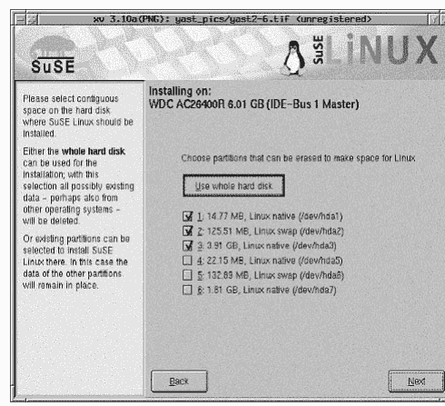

### 图 3.4

使用 YaST2 选择安装分区。

你将有两种选择：删除现有分区为 Linux 腾出空间，或者将整个磁盘分配给 SuSE 安装。遗憾的是，YaST2 工具并没有提供很多灵活性。如果你希望快速安装，可能需要 YaST2 执行所有分区（自动地）。这可能不是最优的，但能让你开始运行。图 3.5 显示了安装前最终分区设置显示的示例。注意：显示为“tux”的字段将包含你在初始设置期间输入的名称。

> 警告
>
> YaST2 在识别大于 8.4GB 的大硬盘方面存在问题。如果你有一个大硬盘，可能需要使用 YaST1 来进行分区。YaST2 会指示磁盘检测是否存在问题。例如，我无法对我的 17.2GB 希捷硬盘进行分区。

随后 YaST2 将进入下一步，即删除请求的分区并重建文件系统。

## YaST1 分区工具

你已决定使用 YaST1 自定义磁盘分区。既然磁盘存储计划已经制定好，现在是继续进行的时候了。我将带你完成最后的准备阶段，并给你一些最后的提示。

## 30 第 3 章：硬盘分区

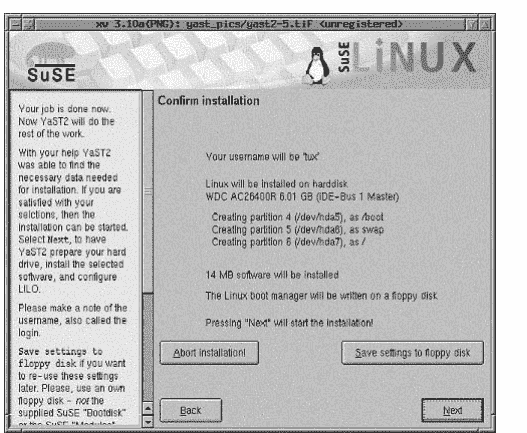

### 图 3.5

YaST Linux 将给你机会选择对哪个磁盘进行分区（如果有多个磁盘的话）。`fdisk` 工具将检测磁盘大小和分区类型。见图 3.6。

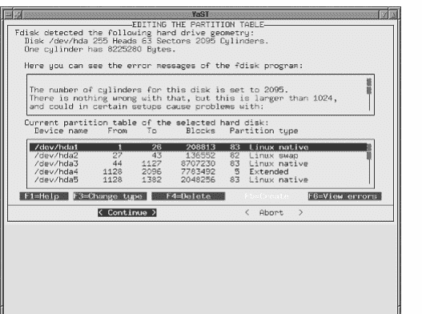

### 图 3.6

YaST `fdisk` 接口工具。

## 分区你的磁盘 31

`fdisk` 工具支持多种类型的分区格式。图中显示的是类型 83（Linux 原生 ext2）、类型 82（Linux 交换分区）和类型 5（扩展分区）。扩展分区（SuSE 称之为逻辑分区）被频繁地使用，因为 `fdisk` 工具只能分配 4 个主分区。如果你有一个大硬盘，你很有可能会创建一个相当大的分区。

在磁盘上分配空间时，请记住你将需要加载的软件应用程序，可能还有某些数据库服务器或用于主目录的用户空间。注意菜单底部的提示。使用按键可以让你访问系统帮助（F1）、指定文件系统类型（F3）、删除（F4）或创建新分区（F5）。F6 让你完全访问 `fdisk` 程序发现的错误（而不只是错误头）。

SuSE 的 `fdisk` 程序具有内存功能，如果你出错或按了中止程序的按键，这个功能将非常好用。当你重新启动 `fdisk` 时，你之前所做的更改将会在那里。如果你使用 `Ctrl+C` 取消操作，大多数 `fdisk` 程序将返回到初始状态。

## 格式选择

这是软件安装的最后一步。Linux 文件系统连接在一起形成一棵树，其中根目录 (`/`) 是中心点。所有其他文件系统——`usr`、`usr/local`、`bin` 和 `/etc`——都是通向 `/` 的分支。检查图 3.7 中的设置，并注意格式列中的“no”。

| 设备名称 | 块 | 节点 | 格式 | 文件系统类型 | 挂载点 | Linux 原生 |
| :--- | :--- | :--- | :--- | :--- | :--- | :--- |
| `hda1` | 204816 | 4096 | No | ext2 | `/` | Linux 原生 |
| `hda2` | 87380 | 1748 | No | ext2 | `/var` | Linux 原生 |
| `hda6` | 204856 | 4096 | No | ext2 | `/opt` | Linux 原生 |
| `hda7` | 265041 | 5296 | No | ext2 | `/home` | Linux 原生 |
| `hda8` | 131072 | 2620 | No | ext2 | `/usr/local` | Linux 原生 |
| `hdc1` | 234592 | 4688 | No | ext2 | `/devroot` | Linux 原生 |
| `hdc4` | 357408 | 7168 | No | ext2 | `/dump` | Linux 原生 |
| `hdc5` | 102400 | 2048 | No | ext2 | `/tmp` | Linux 原生 |
| `hdc7` | 253984 | 5096 | No | ext2 | `/download` | Linux 原生 |

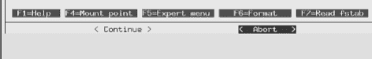

### 图 3.7

用于创建/修改文件系统的 YaST `fdisk` 工具。

在这里你可以通过名称指定你的挂载点——菜单底部的提示。使用按键可以让你访问系统帮助（F1）、指定文件系统类型（F3）、删除（F4）或创建新分区（F5）。F6 让你完全访问 `fdisk` 程序发现的错误（而不只是错误头）。SuSE 的 `fdisk` 程序具有内存功能，如果你出错或按了中止程序的按键，这个功能将非常好用。当你重新启动 `fdisk` 时，你之前所做的更改将会在那里。如果你使用 `Ctrl+C` 取消操作，大多数 `fdisk` 程序将返回到初始状态。

> 警告
>
> YaST2 在识别大于 8.4GB 的大硬盘方面存在问题。如果你有一个大硬盘，可能需要使用 YaST1 来进行分区。YaST2 会指示磁盘检测是否存在问题。例如，我无法对我的 17.2GB 希捷硬盘进行分区。

YaST2 将进入下一步，即删除请求的分区并重建文件系统。

注意：显示为“tux”的字段将包含你在初始设置期间输入的名称。

# YaST 包处理方法 35

## RPM 与安全

RPM 使用非常方便，但你应该意识到一些问题。你必须以 `root`（超级用户）身份安装 RPM 包，才能获得必要的写入权限。这对系统安全构成了威胁。有些人可能并不会考虑这一点，或者可能认为这微不足道。然而，以下是事实：

`root` 账户下的 RPM 安装程序现在对你的系统具有完全的读写权限。这开启了一个潜在的危险安全漏洞，你可能会在无意中删掉某些系统二进制文件和库，导致某些其他应用程序失效。此外，在最坏的情况下，你可能会安装一个木马程序，从而破坏你系统的完整性。

正因如此，软件包管理器中已经包含了 MD5 校验和和功能。我将在本章的“更改/创建配置”部分向你演示如何验证软件包。从何处获取软件至关重要——请参阅第 13 章“保护网络”。你系统的运行取决于此。

为了帮助顺利安装软件包，设计了如 `gnoRPM` 和 `xprm` 等界面。尽管如此，无论这些工具有多华丽，它们在 YaST 面前都显得黯然形癥。对于一个工具要有效，你得想要使用它。YaST 已经帮助完成了分区和格式化磁盘的任务，并准备好引导你完成软件包选择和磁盘管理任务（这项功能本身就价值连城）。

对于任何计算机系统来说，软件管理都是一个关键领域。无论系统大小，都可能承受软件安装不当或配置不当所带来的成本。虽然没有什么是万无一失的，但减少应用程序失败的概率是每位认真开发者的目标。使用 RPM 让安装工作变得更容易接受。

对于那些最近没有使用 RPM 的人，软件包管理器已对其进行了一些升级。当前版本为 `3.0.3`。`3.0` 版本包含的功能包括多项安装，这减少了未验证的软件包依赖失败的概率，以及在安装前检查磁盘空间是否足够的。。软件包管理器中还内置了其他增强功能。详细信息可用 [`http://www.rpm.org/`](http://www.rpm.org/)。

然而，此发行版中有两种 YaST 的实现。YaST 处理基础（核心）任务。使用原始 YaST 安装系统可能证明是具有教育意义的，因此再次强调，熟悉是关键要素。

在首次安装期间，一个老问题是知道选择哪些软件包以及哪些是真正必要的。对于那些正在熟悉 Linux 安装基础的人来说，这似乎是一个已经解决的问题，但我仍然不断在邮件列表中听到关于软件包选择的问题和被提出的问题——而且从未给出过真正具体的答案。这些问题产生的主要原因是软件占据了硬盘空间。当使用 GNU/Linux 软件时，用户面临着大量的额外应用程序选择。我确定这就是为什么有些人在放权兴趣和生活在这些边界内方面会有问题。计算机行业的人一生中大部分时间都在使用专有软件，因此 Linux 提供了一些受欢迎的选择。然而，当你在稀薄空气中生活了一段时间后，你的身体会适应这种匮乏——回到海平面可能会让你感到有些头晕脑胀？

在尝试安装软件包之前，先很好地了解你每天需要使用的应用程序。确保你考虑了图形处理、文字处理以及任何其他每天使用的应用程序。这并不是为了在任何方面限制你；在过去，我浪费了大量的磁盘空间，因为我想在磁盘上拥有“所有东西”。从长远来看，我发现某些应用程序并没有并不一定是因为它们失效了。

如果你正在构建一台测试机或 R/D 平台，或者你有大量的可用磁盘空间，这可能不适用于你的设置。然而，如果你的硬盘空间有限或使用笔记本电脑，那么这些建议是给你的。

## 使用 YaST2 安装你的系统

在安装阶段，你可能选择了 YaST2 作为你的安装工具。如果是这样，你可以指定自动或引导式安装。顾如其，自动安装最大限度地减少了用户交互。然而，你可能想选择引导式安装，让你感受 YaST2 程序正在做什么。图 4.1 阐了 YaST2 安装菜单。

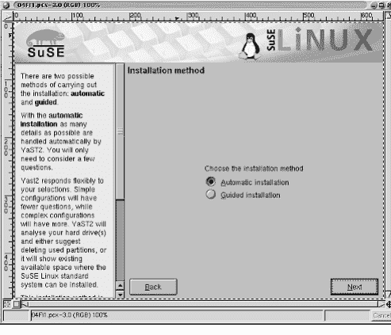

图 4.1

选择 YaST2 自动安装功能。

## 使用 YaST1 安装你的系统

随着最近的发展，YaST2 确实会随着时间和测试而改进，因为 SuSE 对其软件使用者的输入做出了积极响应。图 4.2 展示了 YaST2 软件选择菜单。

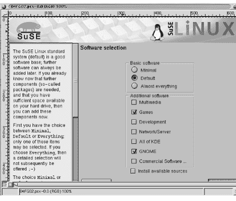

图 4.2

如果你选择 Minimal（最小）或 Default（默认/标准），你将有机会选择安装的软件包。然而，Almost Everything（几乎所有）并不是一个明智的选择，因为会安装你永远不会使用或需要的软件程序。我推荐这种类型安装的唯一情况是：你的机器有一个足够大的硬盘，且其主要用途是 R/D 或测试。

选择软件包是一项直接的操作；YaST2 将完成其余工作。如果你选择的软件超过了分配给 Linux 的空间，YaST2 将警告你。此时，你可以调整软件包的数量然后继续安装。

## 使用 YaST1 安装你的系统（续）

对于精细粒度的安装，你需要 YaST1 工具，它配备了许多实用程序来减轻任务。YaST1 在你安装期间提供了丰富的功能，并包含了许多菜单选择，你应该熟悉其中的每一个项。让我感到惊讶的一点是，许多人急于安装他们的系统而错过了 YaST 的一些细节——这就像是买了一艘豪华邮轮却一直待在舱室里。让每一分钱都花得值意味着游览这艘船。这里涉及同样的原理：如果你想查看快照或看电影，请坚持使用 YaST2，但如果你真的需要 SuSE 的精华，YaST1 将是你的向导。

# 38 第 4 章：SuSE 软件包安装

## YaST1 软件包选择器

YaST1 软件包选择器相对易用。YaST1 在初始阶段提供了多种选择。4.3 显示了这些选择。

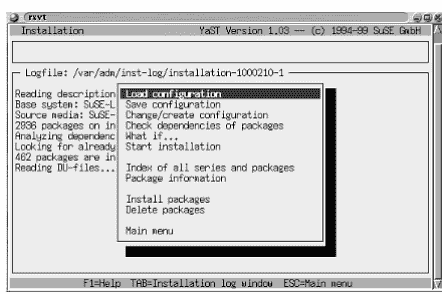

图 4.3

YaST1 主软件包安装屏幕。

每一个选择都是重要的。以下列表总结了具体功能：

- Load Configuration（加载配置）：程序显示从 Minimum System 到 Almost Everything 的预定义软件包列表。此选择允许你利用保存的配置。
- Save Configuration（保存配置）：此选择将当前系统配置保存到磁盘或你指定的目录。在 YaST1 Load 配置时使用保存配置可以镜像你上次安装。这有助于在不同网络上克隆应用程序或在网络上进行部署。
- Change/Create Configuration（更改/创建配置）：此选项允许通过称为系列的软件包类别来更改预定义或保存的配置。每个类别包含一个准备好安装、删除等的组件列表。
- What If...（如果……）：此选择让你在开始安装之前查看你当前的配置。此选项在你更新系统时可能非常有用，可以确认所有正确的软件包都已标记为安装而非删除。
- Start Installation（开始安装）：就是现在！此选择启动 SuSE Linux 安装程序。重要提示：如果你更新了分区，程序将提示你

# 使用 YaST 1 安装您的系统

一个重启提示。这会验证分区表，之后您就可以开始工作了。

- **检查软件包依赖关系**——此功能允许您在安装过程中的任何时候检查软件包依赖关系。如果您是每个类别选择几个软件包，我建议在每个类别之后都检查依赖关系。程序还有一个“自动（Auto）”功能，它也会尝试解决任何依赖问题。如果这不能解决问题，您将被引导至带有指示符的文件，指示为 `AND`（列表中的所有软件包都应该安装）、`OR`（如果您选择了一个软件包，则应包含列出的软件包中的一个或多个）或 `EXCL`（所有这些软件包都不需要安装）。
- **所有系列和软件包索引**——此此项将为您列出该发行版提供的软件包列表。如果这是一个更新，它将在您的系统中已安装的所有软件包上标记一个星号（*）。它还将列出软件包、版本号、文件大小以及它所属的系列组。
- **软件包信息**——这是一个非常有用的选项，允许您通过搜索 CD 和硬盘目录结构来查找特定的软件包。它还区分大小写，从而实现更精确的搜索。如果您确定软件包的精确名称，可以搜索文本字符串并输出所有相关文件。
- **安装软件包**——当您需要从 ftp 服务器更新文件时（`ftp.fuse.com/pub/suse/e3/update/6.3` 是配置文件列出的服务器 URL），或者如果您已经下载了文件到硬盘上的某个目录进行安装时，此功能非常有用。您还可以挂载 CD（发行版以外的 CD）并从其中安装软件。YaST 安装器识别以下格式：`.rpm`、`.spm`、`.src.rpm` 以及特殊的补丁文件，这些文件可以通过 SuSE ftp 服务器获取。它还支持 `.tar.gz` 和 `.tgz` 格式的压缩文件。
- **删除软件包**——最后的选项选择将为您提供系统上安装的所有软件软件包列表。我发现这个实用程序非常独特，因为它列出了并非由发行版安装的 SuSE 软件和软件包。请注意，安装程序将识别并删除这些程序；它们不会出现在更新或依赖检查的列表中。如果您安装了外部程序，最好能将该软件包替换为 SuSE 构建的软件包。

所有这些元素在管理您的软件应用程序方面都起着重要作用。充分了解整个选项范围是任何严肃安装的前决条件。YaST 及其配套工具集非常值得深入了解。

## 选择/安装软件包

SuSE Linux 在软件包可用性方面一直是领先者。随书附的 CD 包含了大量的软件包。当您准备好开始安装软件时，选择“加载配置（Load Configuration）”选项。您可以从表 4.1 所示的示例中快速选择一个预构建的软件包。

## 40 第 4 章：SuSE 软件软件包安装

| 表 4.1 预构建配置 |
| 选择 | 描述 |
| :--- | :--- |
| SuSE Almost Everything | CD 上几乎所有的软件包都将被安装 |
| SuSE Development system | 带有编程工具的开发环境 |


| SuSE DMZ base system | 敌对环境配置，仅安装基本组件 |

| SuSE Games | 安装了所有游戏的完整 SuSE 系统 |

| SuSE Gnome system | 带有 Enlightenment 窗口管理器的 GNOME 项目环境 |

| SuSE KDE system | 带有 KDE 管理器和附件的 KDE 项目环境 |

| SuSE Minimum system | 包含有限软件应用的最小系统环境 |

| SuSE Multimedia system | 包含所有录制、修改和混合音频应用程序所需软件的系统 |

| SuSE Network Oriented system | 为服务器交互、Samba、NFS、YP(NIS) 以及其他应用设计，允许将 SuSE 集成到多平台环境中 |

| SuSE Default system | 提供任务和应用程序的良好平衡，适用于日常任务 |

## 注意

SuSE Linux 提供了一个小型帮助部分，可以通过切换 `F1` 键来访问。设计上，该部分可以帮助您加载之前的配置，制作信息磁盘（对于那些正在更新并想返回当前设置的人员）。它还提供了有关为您的系统构建启动盘的信息。

此菜单允许您选择若干不同的系统配置。在这里，您将必须真正缩小机器用途的范围。如果您决定加载除厨房水槽以外的所有内容，请使用 SuSE Almost Everything 选择。如果该箱被用于网络环境且流量很大，并有被外部入侵的可能性，请使用 SuSE DMZ（非军事区）基础系统，并根据需要添加其他组件。按 `F2` 键显示软件包（描述）内容以供检查。您可以滚动查看软件包以评估您是否需要更多或更少的应用程序。

预构建软件包可以用于服务器任务和独立工作站。整个系统的优之处在于，您有那种基本结构可以操作，而且添加内容比填满驱动器并在以后后悔要容易得多。

# 使用 YaST 41 安装您的系统

选择像 SuSE GNOME 系统这样的软件包时，你会发现多个选项被自动勾选，因为安装程序在开始时解决任何依赖问题。（见图 4.4。）

| | 加载配置 |

| :--- | :--- |

| SUSE boot (everything) | (1596 - 5.03 GB) |

| SUSE Development system, (testade and X libs/to) | (801 - 1.84 GB) |

| SUSE base system | (899 - 176 MB) |

| SUSE Desktop | (385 - 729 MB) |

| SUSE Graphic system | (520 - 668 MB) |

| SUSE Multimedia system | (317 - 811 MB) |

| SUSE oriented system | (853 - 1.8 GB) |

| SUSE Office | (325 - 1.25 GB) |

| SUSE default system | (275 - 501.4 MB) |

| F1-帮助 | F2-描述 | F3-帮助 |

| :--- | :--- | :--- |

| 下一步 | 替换 | 取消 |

图 4.4

加载配置。

预构建软件包可以用于服务器任务和独立工作站。整个系统的优之处在于，您有那种基本结构可以操作，而且添加内容比填满驱动器并在以后后悔要容易得多。

## 42 第 4 章：SuSE 软件软件包安装


**图 4.5**

查看 SUSE 软件服务。

# 更新您的系统

在，大多数计算机用户对系统进行了某种更新。事实是，软件无论如何总会变得更好。为不可避免的情况做准备是好事。如果您正在更新之前的 SuSE Linux，我建议您备份您的配置文件（`/etc` 和 `/var`），以防可能发生的任何灾难。（我不是说它会发生，但这样更安全。）

您必须使用启动盘或调整 BIOS 使其从 CD-ROM 启动。当 `Linuxrc` 启动时，选择“更新现有系统（Update Existing System）”，随后 YaST 将接管。

1. YaST 提供根分区选择选项。通过读取当前的 `/etc/fstab` 文件选择根设备。

2. YaST 更新配置文件并对所有更改的文件生成备份。

3. 更新菜单让您有机会更新选择的系统基础文件。

4. 使用 YaST 和 RPM 软件包管理器，恢复旧配置就像复制本地文件 `/var/adm-log/installation/.rpmrm` 或 `.rpmsave` 一样简单。

如果您决定完全更新，YaST 将扫描现有数据库并给您两个列表，一个是已安装软件包列表，另一个是建议的更新列表。

更新屏幕如图 4.6 所示。

## 使用 YaST 安装您的系统

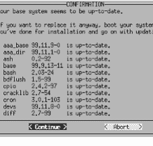

您的基础系统已经是最新版本。

如果您想替换它，请像安装时那样启动系统，并继续进行更新。

```
aax_base 99.11.0 is up-to-date,
ase 9.11.0 is up-to-date,
hash 0.2-0 is up-to-date,
base 9.11.0 is up-to-date,
bash 99.11.0 is up-to-date,
boflush 1.5-24 is up-to-date,
ckralib 2.7-3 is up-to-date,
cron 11.2-7 is up-to-date,
demos 99.11.0 is up-to-date.
```

图 4.6

YaST 正在检查软件更新。

图中显示了一个处于最新状态的系统。如果系统需要更新，将显示软件包信息。如果您更新版本，您将彻底重构系统——在这种情况下，该过程类似于初始安装，需要选择新的内核以及其余的设置程序。如果您遇到问题并决定跳过设置程序，请在启动提示符处输入：：

```
NO_AUTO_SETUP=true
```

通过此操作，自动启动（Autostup）功能将会被禁用。

如果您在更新 SuSE Linux 发行版时遇到问题，请参阅 http://sdb.suse.de/sdb/en/html/adrian_6.3_update.html 或 http://sdb.suse.de/sdb/en/html/bugs63.html。

## 软件包信息

每个软件软件包在安装期间都会提供一个简短描述以供评估。如果您不确定是否要安装特定的应用程序，可以使用 YaST 挂载 CD 并调用“软件包信息”选项。这将为您提供有关该特定软件包的详细信息。图 4.7 显示了一个选中的新软件包。

> 警告

> 如果您正在查询光盘上的软件包信息，请在启动 YaST 之前插入光盘。如果未这样做，搜索将局限于已挂载的设备（分区）。

执行搜索后，您可以通过按 `F2` 或 `F3` 键让实用程序提供更多软件包信息。软件包信息将显示适用于大多数应用程序的详细信息。（见图 4.8。）

### 第 4 章：SuSE 软件软件包安装

| 软件包信息 | YaST 版本 2.05 -- (c) 1994-99 SuSE GmbH |

| :--- | :--- |

| 使用安装媒体 | [] 区分大小搜索 |

| 搜索系统 | |

| [c] cddm * TDisk - 一个极其舒适的图形界面/桌面想要 |

| [c] iterv - 在线帮助 |

| [c] lre - 测试开发环境 |

| [c] webmail - 强大的邮件客户端，触碰/映射文件 |

| [c] todpack - 为 Fortran 程序员准备的大量工具集 |

| [c] tex - 基于 Perl 的 LaTeX 工具 |

| [c] ys - Linux 基础浏览器 |

| [c] user - 单元配置 |

| [c] unifrog - 从屏幕上移除窗口管理器 |

| [c] ungif - 处理 gif 库的工具 |

| [c] unpkg - 解档类似 DOS 8 下 pkiz 创建的 zip 包 |

| [c] used - 表格/IRP 文档 |

| [c] vacation - 对传入邮件的自动邮件回复 |

| 帮助? F1:描述(系统) F5:搜索 F10:安装 |

图 4.7

使用 YaST 识别软件包。

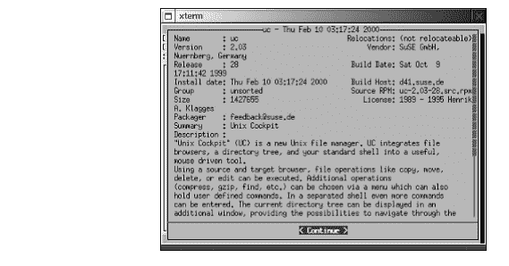

图 4.8

查看详细的软件包信息。

通过此类信息，您将对在在系统上安装的内容一目了然。您对 Linux 应用程序非常熟悉，这个可选功能——对您可能并不是必须的。

## 构建自定义软件包

构建自定义配置的能力是安装程序中的一项特殊创新，出于许多原因。您所能选择（并因此保存）的工具在将来将具有巨大的价值。SuSE 允许您使用渐进式选项更改安装以适应您的特定应用程序。与其在预设安装中盲目摸索，您可以调整您的机器并运行最优配置。构建自定义配置的两个关键是：1) 更改和创建配置选项，以及 2) 将配置保存到磁盘。然后您可以在其他安装或更新中重用您的系统配置。

## 更改/创建配置

此菜单允许您执行与其名称一致的操作：更改现有配置，并如果您有意向，创建一个新的配置。由于有大约 1,500 个软件软件包可用，这里是定制的乐堂。

例如，假设您决定使用 SuSE KDE 系统，而且也喜欢开发软件。您都必须进入 SuSE KDE 系统，加载配置并选择“更改/创建”选项。现在浏览开发系列（以及任何符合您喜好的项），标记选项，然后按下 `F10` 键——这将保存您所做的选择。

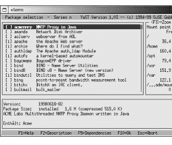

图 4.9

“更改/创建”的软件包选择器。

供参考，这些是指示：

- 软件包已选择

- 软件包计划安装

- 软件包已安装

- 软件包计划替换（更新）

- 软件包将被移除

## 可用的窗口管理器

拥有多个窗口管理器的好处之一是您永远不会感到无聊。您可能会发现，不同类型的窗口管理器之间切换对 Linux 应用程序非常熟悉。我特别喜欢 Window Maker 和 Enlightenment。图 4.10 显示了 Window Maker。

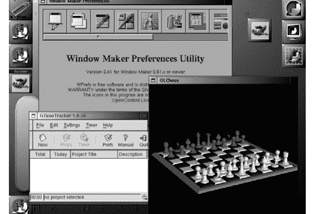

图 4.10

使用 Window Maker。

Window Maker 快速且轻量。而且，它不是内存大户，并且具有可选的主题。

图 4.11

Enlightenment。

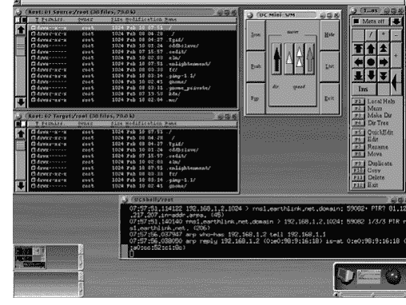

图 4.11

使用 Enlightenment。

Enlightenment 优雅而精致，但它消耗大量的内存。您应该拥有超过 32MB 的内存才能正常使用。

## 加载和保存配置（克隆）

克隆复制系统配置的有效方法。正如我之前提到的，使用 `F9` 键将当前配置保存到磁盘。

## 软件安装总结

如果您已经到达这里，您现在正顺利开启全新的 SuSE 体验。回顾一下，您已经涵盖了打包方法、此发行版包含的各种安装程序，以及如何选择性使用软件包选择。您还加载或更改了安装配置以适应自己的口味。我建议任何使用 SuSE Linux 的人都将安装保存到磁盘，以便在由于不可预见的原因需要重新安装时可以使用。即使您没有连接网络，这也会帮助。

# 第 5 章

## 首次启动 SuSE Linux

你的安装现在已几乎完成，你正处于开启 SuSE 新 体验的边缘。尽管如此，在完全准备绪之前还必须完成几个步骤——不过，如果你使用的是 YaST2 安装程序，那么剩下的步骤非常短。这是因为你已经配置了鼠标并输入了其他信息，这些内容稍后会介绍。选择使用 YaST1 的用户需要多做一点工作，但也不多。

本章旨在帮助你快速上手，并重点介绍 SuSE 用于确保你的系统以最佳性能运行的安装后流程。本文将涵盖两种安装协议所需的步骤。对于 YaST2，介绍内容将更侧重于概述；不涉及太多的安装后常规操作；而 YaST1 的过程将更加详细。

## SuSE Linux 安装后程序

SuSE 与其他 Linux 发行版的区别在于 SuConfig 工具，每当在 YaST1 中更改重要配置时，该工具就会启动。SuSEConfig 使用基础系统提供的预设规范来设置系统配置。无论你使用 YaST1 还是 YaST2，SuConfig 都可以创建或修改软件任务的配置。当你选择在硬盘上安装的软件准备好进行配置后，系统将自动执行配置，或者程序将提示你并等待你的输入。以下是 SuSEconfig 修改的一些文件：

- `/etc/resolv.conf`

- `/etc/hosts`

- `/etc/host.conf`

- `/etc/organization`

- `/etc/ntpserver`

- `/etc/shells`

- `/etc/sendmail.conf`

- `/etc/default.keytab`

- `/var/lib/news/mailname`

- `/usr/lib/irc/ircII.servers`

- `/usr/X11R/lib/X11/fwwm2/.fwwm2rc`

- `/usr/lib/zoneinfo/localtime`

- `/etc/HOSTNAME`

- `/dev/mouse` (符号链接)

- `/dev/modem` (符号链接)

- `/usr/X11R/lib/X11/fonts/*/fonts.dir`

- `/etc/info/dir`

- `/etc/ld.so.conf`

- `/var/catman/index.*`

让系统了解某些参数并为你自动处理任务是有益的。另一方面，如果系统维护得不当，这种类型的配置程序可能会导致严重问题。首先，让我们看看 YaST2 如何完成安装的。

## 完成 YaST2 安装程序

图形化安装程序的优势在于比其前身 YaST1 的安装后程序快得多。大多数系统信息在安装开始时就已经输入，这使得安装程序能够在自动类型阶段运行，无需用户交互。Linux 安装也正朝着这个方向发展：更多的系统交互和更少的用户交互。

这里应该简要回顾一下 YaST2 的流程。基础配置任务（如输入语言、键盘类型和时区）已经处理完毕，你已经在鼠标配置步骤中识别了鼠标，如图 5.1 所示。

你还选择了安装方法的类型，无论是自动还是引导式。单是这些菜单就帮助你显著加快了安装过程——只需点击即可完成。无需滚动其他菜单——简直是效率的最高体现。

此外，你选择了特定的目标磁盘并使用了 `fdisk` 工具，该工具被集成在“安装到 <硬盘名称>”选项中，它帮助你根据你的规范对磁盘进行分区。现有的分区被擦除，并重建了新分区。你还从三种不同类型的软件包中进行了软选择：最小系统、默认系统和几乎所有。如果你选择了最小系统或默认系统，你可能添加了额外的软件，如图 5.2 所示。

图 5.1

YaST2 鼠标配置器。

图 5.2

YaST2 额外选择。

# 第 5 章：首次启动 SuSE Linux

为 Pentium 和非 Pentium (i386) 处理器构建；一个为移动用户内置了自动电源管理**的内核；以及一个支持 SMP（多处理器）的内核。通过按下 `F2` 键，你可以更改内核镜像和配置文件的页面。对于大多数人来说，这并不是必要的；使用默认设置即可正常工作。只有在执行自定义或专家级安装时才可能用到此功能。

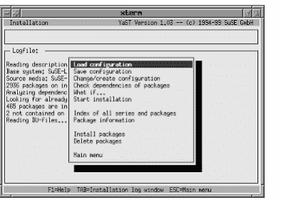

图 5.3


进入`/path/to/xxx`目录，找到`xxx.json`。

在表达式`cvar = avar + bvar`中，加法运算符（`+`）将`avar`与`bvar`相加，得到它们的和`cvar`

在`List.of(arg0, arg1, arg2)`中，`List`接口的工厂方法`of()`接受一系列的元素，返回包含它们的只读列表。

之后我们这样调用`cmd`命令：`cmd arg0 arg1 arg2`。

```
if (condVar > someVal) {console.log("xxx")}
```
[/content]

Wait that's example. Need actual text.

Let's output proper.

[content]
YaST1 安装界面，系统提示你安装 LILOLoader。如果你正在运行另一个操作系统且不确定 LILOLoader 是否能工作，你可能想从软盘或其他媒介启动系统。如果你运行 Windows NT，请参阅 http://ldp.iol.it/HOWTO/mini/Multiboot-with-LILO.html#toc4 了解有关配置 Linux 和 NT 启动加载程序的详细信息。

LinuxLoader 安装界面让你能够自定义启动序列。此菜单屏幕所示如图 5.4。

如从安装菜单所示，如果你有一些必须输入的额外参数，“硬件参数附加”（Append-Line for Hardware Parameters）是菜单中的第一个选项。除非你有需要在启动序列之前确认的特殊硬件设备，否则大多数人都会跳过此。

你可以指定想要安装 LinuxLoader 的位置。选项如下：

- 主引导记录（Master boot record）：如果你在硬盘上没有安装其他操作系统，建议在主引导记录 (MBR) 上安装 LinuxLoader。
- 根分区启动扇（Boot sector of the root partition）：如果系统已经有一个可以访问你选择的任何分区的启动管理器，可以执行此操作。
- `/boot` 分区选择器（Boot selector of the `/boot` partition）：如果系统已经有一个可以访问你选择的任何分区的启动管理器，请使用此选项。
- 软盘（Floppy disk）：当你不确定系统是否能配合 LILOLoader 时，这是启动系统的安全且有效的方法。唯一的缺点是你始终需要磁盘来启动系统。如果这是你的选择，请至少制作两个启动磁盘，以防磁盘故障。你可以更改启动时间。系统默认为 10 秒，但如果你需要启动后直接进入，可以将其更改为 0 秒。
- 除非使用此项启动系统，否则跳过线性选择。例如，我曾使用此选项在我的笔记本电脑上正确启动 Linux，某些 SCSI 和 RAID-0 硬盘设置以及控制器组合需要启用此功能。

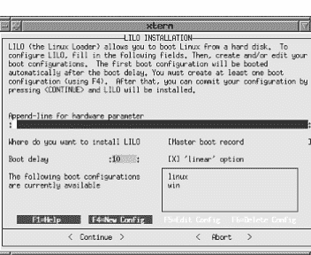

图 5.4

LILO 安装菜单。

F4 键允许你添加或编辑启动选择。当你选择时，请记住列表上的第一个选择将是默认系统。如果你与 Windows 共享磁盘，请务必将默认值设置为最常用的系统。F5 键允许你编辑选择，F6 键删除配置。记住 F1 可以为大多数程序提供帮助；你可以通过按下 F1 键访问帮助。

## 网络配置

以下任务简单快速，适用于 YaST1 或 YaST2 安装。这类似于最后的检查清单，即起飞前最后需要处理的最后几项。这些信息决定了分配给此机器的网络活动内容、网络类型（如 PPP 或以太网）以及分配给你的互联网地址。它能够启动如 Web 服务和安全外壳连接等服务。为了继续这一路线图，本节列出了每个步骤并提供了简要说明。

## 时区配置

在配置时区时，系统会列出一系列选择。使用代表你所在区域的选项。如果你不确定具体的区域，请检查 http://setclock.com/。

你可以选择使用本地时间或格林威治标准时间 (GMT)。格林威治时间 (GMT) 是标准世界协调时 (UTC) 的一部分，用于定义不取决于个人位置的时间。科学家使用这种衡量来避免时区的混淆。例如，假设你在美国西岸——你需要从 GMT 减去八小时（夏令时减去七小时）来获得当地时间。当 GMT 为 01:00 时，西雅图 (PT) 是下午 5:00，或者太平洋夏令时间下午 6:00。如果你决定使用 GMT，可以配置系统在重启时从全球时间服务器请求时间（详细信息请参见第 10 章“管理网络设置”）。如果你选择本地时间，系统将依赖 CMOS 时钟设置获取其值。

## TCP/IP 网络配置

配置好时间后，SuSE 为你提供了一个简单清晰的网络环境。在这里你可以输入有关你网络环境的详细信息。设置包括以下项目：

- **网络类型**——回环（独立），IP 地址为 127.0.0.1 或“真实网络”设置。如果你选择“真实网络”，该过程需要额外信息。
- **主机名和域名**——如果你正在连接到互联网，你需要一个完全限定域名 (FQDN)。主机名应填写你系统的域名。
- **网络接口**——你必须选择接口（例如 `eth0`）。
- **IP 地址**——这是由你的 ISP 分配的 IP。
- **网关**——你网络的网关地址。
- **DHCP**——如果你使用动态主机配置协议，程序将询问确认 `dhclient`。第 10 章涵盖了 DHCP 配置。

# 第 5 章：首次启动进入 SuSE Linux

### 示例用户名和密码功能

“创建用户”（Create User）程序为您提供了一个在系统上设置普通账户（非 root 账户）以便日常工作任务的机会。（注意，在 YaST2 安装情况下不需要此操作。）

> 注意

创建一个示例用户（非 root 账户）似乎是系统安装过程中一个微不足道的环节，但请放心，事实并非如此。过去，发行版拥有简单的安装程序，它们认为使用系统是理所当然的。设置好 root 账户后就结束了。用户本应该手动设置一个普通账户来执行日常工作。但有时这并没有发生，当用户以 root 权限工作时，可能会执行诸如 `rm -r /` 的命令，并在无意中通过递归删除命令删除了根分区。如果用户在普通账户下操作，系统将规避该命令并提示用户 `rm -r/: Permission denied`（拒绝访问）。

## 设备配置

必须对连接的设备进行配置，此步骤将帮助您识别并配置这些组件。

- 调制解器配置——您可以选择合适的 `ttySX` 端口。您的系统。配置 PPP 网络连接将在第 7 章中介绍。
- 鼠标配置——您可以从兼容类型列表中选择鼠标类型。选择鼠标将使用的端口，并测试设备是否正常。这是一个非常重要的元素；如果没有配置鼠标，X Windows 系统将无法运行。YaST2 用户将跳过此选项，因为您在图形化安装期间已经配置过此选项。

## 安装后的最后步骤

软件已完成安装和初始化，基础网络连接也已配置。YaST1 执行最后的职责并将系统交给您。

1. YaST1 确认所有软件包已安装，然后 YaST1 退出。
2. 程序退回到类 shell 类型环境。SuSEConfig 设置系统文件权限和邮件别名，您将在屏幕上看到权限设置的输出。默认情况下，系统设置为易用的本地权限，这意味着大多数管理任务都可以通过普通账户使用 `su`（超级用户）命令完成。取决于系统的最终用途，您可以将权限设置为“安全本地”（secure local，这是我建议的）或使用“偏执本地”（paranoid local）设置。如果您使用偏执本地设置，`su` 命令将几乎失效，需要用户以 root 身份登录以执行特权任务。
- 安装后程序通知用户将启动安装后脚本。本地日志位于 `/var/log/config`，可以从控制台 9 获取。（按 Ctrl+Alt+F9 访问控制台）。
- SuSEconf 执行最终配置，并初始化启动服务。这些服务包括打印机守护进程、HTTP 服务器和邮件传输系统（sendmail 或 postfix）。
- 您现在可以以 root 或示例用户登录了。

## 登录 SuSE Linux 的问题

您的 Linux 系统现在已完全安装。您已经仔细遵循了所有的屏幕提示，但假设您重启了机器，系统没有像您预期的那样响应。系统可能无法启动，或者即使启动了网络连接也会失败。糟糕糟糕，您可能忘记了 root 密码，被困在了系统之外。

本节的重点是帮助您识别和解决一些常见问题。本节将提供这些问题的快速概述，并提到了各种可以帮助您解决问题的资源。

如果您在登录（启动系统）时遇到问题，可以使用包含此本书的 CD 中 SuSE 内置的救援系统。可能是您的引导程序故障了；无论您是熟悉 LinuxLoader 还是其他类型，CD 都能让您恢复运行。

要执行此操作，您需要引导盘或可引导 CD。插入引导盘（或 CD 2），选择“开始安装/系统”（Start Installation/System）。程序显示一个子菜单——选择“引导已安装的系统”（Boot Installed System）。Linuxre 然后询问根分区（如 `/dev/hda`）。输入信息并按回车键。Linuxre 使用磁盘或 CD 上的内核镜像来初始化系统。您只需要 root 密码即可回到系统进行调整或重新安装 LinuxLoader。

## 丢失或忘记 root 密码程序

丢失 root 密码是令人沮丧且耗时的。遗憾的是，SuSE 有一个救援系统，可以在您丢失或忘记 root 密码时提供帮助。

某些 Linux 发行版采用了 Linux 单用户功能，这是一种启动时的命令行参数，允许用户在单用户模式下初始化系统。这是一种不需要密码的维护模式。SuSE Linux 将单用户模式启动，但它会要求输入 root 密码。这就是救援系统的用场。

要使用救援系统，您必须制作一个救援盘（除非您有可引导 CD）。带有可引导 CD-ROM 驱动器，冷启动系统并按照主菜单中的 Linuxre 进行操作；然后选择“开始安装/系统”。选择“从 CD 加载救援系统”（Load rescue system from CD）；屏幕显示救援系统正在加载到 RAM 磁盘中。加载完成后，您就可以开始救援系统的任务。救援系统不需要您拥有 root 密码。您可以通过 Alt+F1 到 F3 键访问三个虚拟终端（称为控制台）。Alt+F4-救援系统包含了 `fdisk`、`mkfs`、`shut-down`、`mount` 和 `umount` 等重要工具，这只是其中几个。当您运行 `e2fsck` 工具时，您必须指定您想要检查的分区。如果文件系统已挂载，请卸载它——提示会告诉您，如果不卸载可能会导致严重损坏。这是事实！执行此命令：

```bash
umount /dev/sda1-或相应的名称
```

然后继续后续过程。

如果您在 LinuxLoader 上遇到问题，请访问浏览器 http://sdb.suse.de/sdb/en/html/kgw_lilo_linear.html 和 http://sdb.suse.de/sdb/en/html/1024_Zylinder.html 以获取有关引导程序可能发生情况的详情。

### 制作救援盘

如果您需要救援系统且您的机器没有配备可引导 CD-ROM 驱动器，唯一的进行方法是制作救援盘。此磁盘应配合引导盘使用，将救援系统加载到 RAM 磁盘中。此磁盘与标准的引导盘不同。您可能需要在另一台机器上制作此磁盘。如果是 UNIX/Linux 机器，插入 CD 并挂载 CD-ROM 驱动器。制作此磁盘，请使用以下命令：

```bash
dd if=/cdrom/disks/rescue of=/dev/sda0
```

或者，在 Windows 或 DOS 机器上执行此命令：

```
D:>dosutils\rewrite\rescue
```

### 损坏或部分安装

有时安装或更新无法继续。您可能会收到类似的提示，“空列表损坏 (1753864)—请联系 support@redhat.com。”已知问题是 RPM 数据库损坏。要解决此，首先备份 `/var/lib/rpm` 目录，然后使用此命令：

```bash
rpm --rebuilddb
```

在系统启动时，您可能还会遇到超级块问题。文件完整性检查系统将尝试修复轻微的文件不一致，但如果无法以正常方式恢复完整性，系统将停止并提示原因。如果发生这种情况，您将运行 `e2fsck` 工具来修复文件系统问题。

## 注意

当您运行 `e2fsck` 工具时，您必须指定您想要检查的分区（设备）。如果文件系统已挂载，请卸载它——提示会告诉您，如果不卸载可能会导致严重损坏。

# 启动进入 SuSE Linux 总结

本章的目的是帮助你顺利完成安装后的操作流程。文中详细介绍了设置相关信息，并概述了详尽的网络配置。

问题章节仅讨论了可用信息的一小部分，与你在互联网上找到的资源相比。尽管如此，对于启动已安装的系统以及启动丢失或忘记密码程序所提供的解决方案可能会为你节省一些烦恼。

对于最新的特定发行版问题，SuSE 的在线支持数据库在技术问题方面是实时的。请查看此 SuSE 站点：http://sdb.suse.de/sdb/en/html/bugs63.html。这可以帮助解决本文未涵盖的情况。主要支持站点位于 http://sdb.suse.de/sdb/en/html/index.html。

# 第 6 章

# X Window 系统配置

在过去，X Window 系统的配置证明是许多 Linux 用户的障碍。某些复杂性围绕着硬件兼容性问题。当 Linux 尚未进入计算的主流（或头条新闻）时，硬件供应商对这一小群“黑客型”人物充耳不闻，继续与专有软件公司合作。然而，当你阅读本文时，潮流已经发生了变化；汹涌的浪潮正以飓风般的力量冲击着 Linux 的岸。视频硬件公司现在正在发布组件的软件源代码，以便不断增长的 Linux 社区购买它们的产品。

SuSE 在帮助你快速配置 X Window 系统方面迈出了一步。某些发行版通过脚本设置视频配置文件——包括鼠标、显卡和显示器。一个障碍是，在某些情况下，这种配置是在半图形环境下进行的。问题发生在显示器设置上。SuSE 有一个先进的配置工具，可以自动检测大部分硬件，特别是那些讨厌的显示器设置。x86config 等 X 配置工具的经验用户可能再也不会看到显示器设置参数警告。

## 警告

尽管 SuSE X 配置工具非常先进，但自动检测功能可能无法识别你的显示器。请谨慎操作并提供正确的参数——错误的设置可能会损坏你的显示器。

## 64 第 6 章：X Window 系统配置

解决问题的办法是在全 GUI 环境中执行最后的显示器设置。SuSE 实现了这一点，并且大多数情况下都能解决问题。SuSE 与 XFree86 程序紧密相关，该程序提供了 X Window 环境。这让 SuSE 对哪些与有效配置相关、哪些无效有更好的视野。

除非你已经使用 XFree86 了一段时间，否则你需要一些帮助来配置环境。SuSE Linux 提供了两种方法。第一种 SuSE 高级 X 配置工具；第二是 `xf86config` 工具，它多年来一直是老备用方案。对于 XF86Setup 的粉丝来说，这个工具有点过时了，SaX 工具已有效地取代了它。

## SaX X Window 配置工具

SuSE 部署了一个名为 SaX 的高质量 X 配置工具。该工具会在你的电脑显示器上启动一个全 GUI 环境，并引导你完成最终配置任务。SaX 检测鼠标，识别出你连接了键盘（你需要指定类型），探测你的显卡，并确定类型和芯片组。SaX 还会从显示器获取信息，以便你有一些基准参数可以使用。将所有内容放在一个包中，你就拥有了最高的 X 配置工具。

> 注意

> 如果你使用过 YaST2 安装程序，你仍然需要使用 SaX 或 `xf86config` 工具配置你的图形工作环境。

使用 SaX 工具时，你需要下一个软件包以及至少 `svga` 或 `xyga16`（安装程序默认安装的 X 服务器包已经使用了这两个服务器）。顺便说一下，如果你还没有安装 X 服务器，YaST 将自动为你安装相应的服务器。如果这是你第一次使用或安装 Linux，记得这次在面前准备好所有的硬件规格。你可能不需要它们，但准备好以防万一（见第 1 章，“评估平台”）。

你可以通过两种方式访问 SaX：通过 YaST1 中的菜单选择或从命令行。要使用 YaST1 界面，请使用此命令：

```bash
# yast
```

YaST1 界面将启动；选择“系统管理”选项。在系统管理菜单中，选择“配置 XFree86”选项。图 6.1 显示了 XFree86 配置的确认屏幕。

如果还没有配置 X，屏幕将变白，然后 SaX 工具将启动一个通用的（SVGA 或 VGA）X 服务器。SaX 工具将经过检测功能并向你展示主菜单，主菜单从鼠标设置屏幕开始。在这里，你可以通过“专家”菜单进行调整，或选择默认设置。图 6.2 显示了鼠标的专家设置。

# SaX 窗口配置工具 65

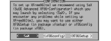

# 6.1

使用 SaX 配置 XFree 服务端。

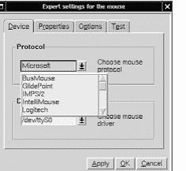

# 6.2

SaX 中鼠标的专家设置。

当你选择鼠标后，移动到键盘配置。键盘配置允许你编辑某些 X 服务器功能（这随系统而异）并测试编辑配置。

显示器信息应该显示在 Info 字段中。如果你的供应商不在列表中（且你使用的是标准显示器），请使用 VESA 选择，并从列中选择合适的分辨率。最后是桌面配置。

# 66 第 6 章：X Window 系统配置

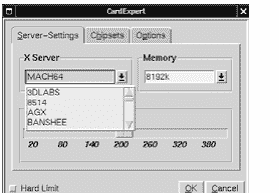

图 6.3 在专家菜单中配置你的显卡。

要配置桌面，输入最大颜色和分辨率。点击“下一步”按钮。SaX 会给你一个 X 服务器启动前的消息，并提供如何杀死损坏的 X 服务器的说明（Ctrl+Alt+Backspace）。随后 SaX 将启动 X 服务器并允许你调整屏幕位置。寻找显示 X 服务器边缘的小型白色矩形，如果一切顺利，程序将运行，你会进入 YaST1 安装界面或命令行，可以在那里输入 start 来启动 X 会话。

你会在 SaX 工具顶部看到四个选择。File 选项保存你的配置并退出工具。Settings 选项允许你编辑某些 X 服务器功能（这随系统而异）并测试编辑配置。第三个选项“Infos”显示所有 X 服务器消息。提供了详细的系统信息，如 PCI、ISA 和以太网信息。你还可以扫描系统以识别 X 服务器内存和 RAMDAC 信息。最后一个功能是帮助功能。这个帮助工具可能很有用，因为它包含未记录的 SaX 命令参数。

## SaX2

对于需要测试计算体验极限并处于 X 技术前沿的人来说，我建议尝试 XFree286 4.0 版本中的服务器。这个期待已久的版本终于问世了，随着其

## Xf86config 工具 67


运行 4.0 版本所需的必要文件和模块（是的，XFree86 正如承诺的那样是模块化的）带了一个新版本的 SaX2。如果你认为 SaX 用起来很简单，请尝试 SaX2。SaX2 在启动时会提供一个华丽的启动界面，并对你的硬件进行自动检测。它提供了一个 GUI 环境，看起来与安装的 YaST2 类似。配置选项保持不变。唯一的变化是到了 GUI。这些软件组件可以在 http://ftp.suse.com/pub/suse/i386/X/Xf86/Xf86-4.0-SuSE 找到。

## 注意

我在我的笔记本电脑上尝试了新的 X 服务器，除了两点之外，几乎一切都能正常工作。首先，系统管理环境中的少数几个是可以运行的。其次，你不能再通过此命令调用不同的窗口管理器了：

```bash
#startx <windowmanager>
```

如果你需要更改系统范围窗口管理器设置，请使用“配置文件”菜单中的 `DEFAULT_WM` 设置。

## 警告

请务必注意 SuSE 的警告——这些新驱动程序至少是实验性的。如果你选择安装它们，请使用一台你即使丢失也可以承受的机器，以防最坏的情况。

## Xf86config 工具

如果你在用 SaX 或 SaX2 工具配置图形环境时遇到困难，可能需要使用 `xf86config` 工具。虽然我喜欢 SaX，但我可以闭着眼睛运行 `xf86config`（某种程度上）。以下列表包含了使用 `xf86config` 工具所需的关键信息：

- 你必须能够识别你的鼠标类型。
- 指示你是否想让双键鼠标模拟三键鼠标。
- 输入设备名称（默认为 `/dev/mouse`）。
- 选择使用 `xmodmap` 调整你的键盘映射。
- 选择合适的键盘（你有 12 种供选择）。
- 输入你的显示器规格（不要猜）。
- 输入你的同步率（同样，不要猜）。
- 输入你的显示器厂商名称（可选）。
- 检查显卡数据库 (y)。
- 从列表中选择正确的显卡（非常重要）。
- 选择你的默认 X。
- 系统将要求创建到 `/var/X11R6/bin` 的符号链接（可选）。
- 指示你拥有的显存量。
- 输入卡制造商名称（可选）。
- 如果已知，输入你的时芯片设置（我通常跳过此步）。
- SuperProbe 将探测你的显卡以获取额外信息 (n)。
- 设置你的显示器模式。请仔细阅读此项。
- 更改模式时，你也可以选择虚拟屏幕（Virtual Screen）。当你的显示器较小时，此功能提供了一个扩展的桌面工作区域。

## XF86Config 文件

`xf86Config` 文件是由 `xf86config` 生成的。该文件包含有关服务器 (Servers)、标志 (Flags)、键盘、显示器以及其他可选信息的信息。该文件的内容非常深入，如果你在 X 配置上遇到问题，请参考此处列出的网站。PC 帮助网站 http://www.computers.iwz.com/linux/xcfg.html 将为你提供 X 的常见错误信息以及更简单的配置问题——特别是对于那些第一次使用 Linux 的人来说常见的问题。第二个是 SuSE 的模型 HOWTO，地址为 http://sdb.suse.de/sdb/html/maddin_videmodes.html；此文档将给你关于 `xf86Config` 文件结构的详细信息。

## X 选项和默认设置

当你安装软件时，你可能选择了一个或多个窗口管理器。窗口管理器提供了工作环境外观和感受。SuSE 提供了如此大量的软件；在它们之间选择可能很难。

当我说“外观和感受”时，指的是窗口、菜单、标题栏的整体特征以及鼠标的操作方式。某些窗口管理器如 Enlightenment，默认要求鼠标指针位于活动窗口中。Window Maker 的菜单选择是通过右键而不是左键处理的。大多数窗口管理器都可以根据你的口味重新配置。如何在所有选项中选择呢？尝试错误。SuSE Linux 的共同事实是：如果选择了 KDE 程序（手动选择或默认），执行此命令会自动启动 KDE 窗口管理器：

```bash
# startx
```

你选择使用 FVWM 或 Enlightenment，然后你需要在命令行中指定，如下：

```bash
# startx fwwm
```

> 提示 如果你是 Window Maker 窗口管理器的粉丝，你会发现执行 startx 命令后输入 wmaker 没有任何反应。你需要在命令行中输入此内容：
> 
> # wmaker.inst
> 
> 这将运行 Window Maker 的安装脚本。完成后，你重启它应该没有问题。

## 使用 usewm 进行微调

其他一些主要的 Linux 发行版将自动设置你的登录环境。默认选择有两个：要么由相应的显示管理器提供的完整 GUI 登录环境，KDM (KDE) 和 XDM (标准 X 显示管理器）；或者是非图形控制台环境。如果你决定将 GUI 更改为控制台，你必须修改启动参数。这些文件位于哪里？如果你使用 YaST1，你可以在 `/etc/X1` 找到它们。如果你使用 YaST2，它们在 `/etc/Xconfig` 中。如果你想手动编辑它们，应该查看 `/etc/X11/xorg.conf`。

有关更多文档和常见问题解答（FAQ），请将浏览器指向 http://e.lostworld.net/docs.html。Enlightenment 更多主题的网站位于 http://www.ethemes.org。

## X Window 系统概述

在这一章中，我们查看了 Linux 中最受关注的话题之一：GUI 图形界面。其中一些讨论是积极且具有发展性的。要让 SuSE Linux 操作系统进入桌面需要投入专注的。我们循序渐进地介绍了 SuSE 高级 X 配置工具，事实证明该工具是独一无二的。现在，你可以开始期待让你的 X Window 系统运行起来，而不是对这项任务面露愁苦色了。我们还简单了解了可用的窗口管理器，并学习了如何使用 YaST 来更改系统范围的窗口管理器默认设置。你现在拥有了如何在控制台启动以及进行全 GUI 登录的知识。SuSE 提供了 KDE 和 Enlightenment 窗口管理器，它们都是强大的窗口环境——任何一种选择都是明智的。愿源码与你同在！

# 第 7 章

## SuSE 通信功能

Connectivity（连接），con-nec-ive (k...nuk"t'v) 形容词。1. 服务或倾向于连接的。con-nec-ive 名词。1. 连接器。

这个定义正是 Linux 操作系统所代表的：将个人连接，无论是在小型网络场景中，还是在巨大的广域网中（如互联网）。Linux 在过去几个月内连接的人比它过去多年连接的人还要多。公司、企业甚至国家都在密切关注 Linux。此外，美国国家航空航天局（NASA）订购了近千年笔记本电脑用于太空计划，国家安全局则委托了一家私营公司设计一个防弹版本的 Linux。在最近的一项调查中，据报道超过 23% 的服务器应用程序运行在某种 Linux 系统上。作为证据，互联网服务提供商如 Hurricane Electric（一家高流量自助型 Web 服务器公司 http://www.he.net）正在使用 Linux 驱动的服务器。

Linux 与大型网络连接是同的。想象一下：如果没有某种网络连接，这个不可思议的操作系统可能仍然留在少数人手中。在网络的级阶段，串口和并行端口线连接了计算机。然而趋势发生了变化，电话系统变成了传输网络数据的另一种媒介。光纤技术的引入帮助创建了一个跨越州界和国界的巨大计算机网络。这种被称为“信息高速公路”的东西让任何有电话线能够连接到计算机的地方都能接入世界。然而，通过电话线传输数据产生了一个有趣的现象：电话系统使用的语言与计算机不同。电话系统和计算机需要一个翻译官。因此，调制解调器（modem）被发明了。

调制解调器是将数据从一种格式转换为另一种格式的设备，例如从数据处理的格式转换为电传传输的格式。计算机产生数字信号，调制解调器将其转换为模拟信号，然后通过电话线传输。这个小设备依赖于点点协议（PPP），这是一种使用串口类型接口在两台计算机之间通信的方法，通常是通过电话线连接到服务器的个人电脑。

例如，X 互联网服务器提供商可能会为你提供 PPP 连接，提供商的服务器可以响应你的请求。服务器随后将你的请求传递给互联网，反过来将你请求的响应回给你。PPP 使用互联网协议（IP），IP 有时被认为是 TCP/IP 协议族的一员。相对于开放系统互连（OSI）模型，PPP 提供第 2 层（链路层）服务。它封装你的数据包并将其转发到服务器，在那里它们实际上可以通过互联网进行分发。这是一种基本的拨号类型连接模型。最大连接速度（此时）大约为 56Kbps，取决于电话连接和线路质量。

今天，计算已经超越了当我开始使用 BBS 服务时盛行的 4800 或 9600 波特调制解调器方法。我目前的连接是一个高速调制解调器，信息传输速度至少为 600kbps。电话服务提供商可以在标准电话线上提供甚至 1.5Mbps 的速度。DSL 技术在当前的电话线上使用仅未标记的带宽，而这些线路曾一度仅提供模拟拨号服务。SDN、DSL、电缆甚至卫星连接解决方案无处不在，“无线”局域网时代已经到来（查看无线局域网和 Linux 资源页 http://www.hpl.com/personal/Jean_Tourr1henes/Linux/）。每天似乎都有另一种形式的网络连接被添加到列表中。

大量的连接协议将如何保护你的 SuSE Linux 系统？嗯，我有一个好消息：该发行版将帮助你连接并配置任何类型的拨号或全天候网络连接。

当然，你如何连接到网络将是一个重要因素。在过去的几年里，调制解调器连接用于大部分应用程序。相当多的公司依赖这种技术。虽然它是一种可靠的通信形式，但它非常耗时。例如，我工作过的两家公司使用调制解调器从外州的办公室上传和检索信息。由于连接速度慢，网络交易要在深夜或清晨进行。信息系统管理（MIS）部门有机会在不中断公司日常工作流程的情况下传输文件并配置系统。相比之下，今天可用的调制解调器速度帮助公司全天候传输数据并继续工作。

调制解调器作为网络市场很大一部分的连接媒介。想想，你本地的 ISP 可能配备了多个调制解调器，每个调制解调器都被数百甚至数千人用作链接。

事实上，该发行版将帮助你连接并配置。

事实上，调制解调器作为网络市场很大一部分的连接媒介。想想，你本地的 ISP 可能配备了多个调制解调器，每个调制解调器都被数百甚至数千人用作链接。从那里开始。

## Minicom 实用程序

Minicom 是一个基于文本的调制解调器工具，它具有多种功能。如果你熟悉设置调制解调器，Minicom 包含了诸如初始化字符串等功能。

要调用 Minicom，请执行此命令：

```
minicom -s
```

通过选择传输，你将看到图 7.1。

 图 7.1 设置 Minicom

要查询 Minicom 的命令，请输入：

```
minicom -h
```

或者，尝试 man 手页获取更多详情：

```
minicom
```

电话服务提供商可以在标准电话线上提供甚至 1.5Mbps 的速度。DSL 技术在当前的电话线上使用仅未标记的带宽，而这些线路曾一度仅提供模拟拨号服务。SDN、DSL、电缆甚至卫星连接解决方案无处不在，“无线”局域网时代已经到来（查看无线局域网和 Linux 资源页 http://www.hpl.com/personal/Jean_Tourr1henes/Linux/）。每天似乎都有另一种形式的网络连接被添加到列表中。

大量的连接协议将如何保护你的 SuSE Linux 系统？嗯，我有一个好消息：该发行版将帮助你连接并配置任何类型的拨号或全天候网络连接。

当然，你如何连接到网络将是一个重要因素。在过去的几年里，调制解调器连接用于大部分应用程序。相当多的公司依赖这种技术。虽然它是一种可靠的通信形式，但它非常耗时。例如，我工作过的两家公司使用调制解调器从外州的办公室上传和检索信息。由于连接速度慢，网络交易要在深夜或清晨进行。信息系统管理（MIS）部门有机会在不中断公司日常工作流程的情况下传输文件并配置系统。相比之下，今天可用的调制解调器速度帮助公司全天候传输数据并继续工作。

## SuSE 通信功能

要获得更多关于设置 Minicom 的帮助，请将浏览器指向 http://sdb.sde.sdb/en/html/rb_isapnp.html。

### 即插即用设置

ISA 即插即用的设计是为了减少 I/O 或 IRQ 冲突。即插即用卡的设计原理是，如果计算机 BIOS 可以配置设备（调制解调器、声卡或显卡），那么跳线设置就可以被消除。在其他操作系统中这可能是方便的，但在 Linux 内核中，某些设备仍然存在问题。

某些调制解调器使用即插即用类型的配置。这会导致 SuSE 内核检测失败。如果你的机器配备了这些设备，你需要进行一些操作。设置调制解调器不需要费长时间——只需按照操作，很快就能连接。此发行版中包含一个名为 isapntools 的工具包，包括 npndump 和 isapnp 实用程序。这些工具有助于定位和配置即插即用设备。要开始设置调制解调器的过程，你需要使用 pndump。这个巧妙的工具探测计算机上的 ISA 设备。要启动，使用此命令：

```
pndump > /etc/isapnp.conf
```

这将在 `/etc` 目录下创建一个 `isapnp.conf` 文件。你可以加载你喜欢的编辑器，找到设备参数并取消注释值（I/O 和 IRQ）。该卡将在下次重启时被识别。

> 警告
> 警告：某些 ISA 卡似乎没有遵循已建立的 ISA-PnP 实现标准——可能会导致意外的问题。不要让 BIOS 自动配置和管理 ISA-PnP 卡资源。建议在 BIOS 中禁用 ISA 即插即用功能。你的 `isapnp.conf` 文件在重启时应被自动读取。如果取消注释了正确的行，你应该能够通过 YaST 配置你的调制解调器。请注意，某些 ISA-PnP 调制解调器是 Winmodems（坏消息物品）——检查确保它们不是。关于即插即用配置的更多信息，请访问 SuSE 网站：http://sdb.sde.sdb/en/html/rb_isapnp.html。

isapntools 的官方主页位于 http://www.roestock.demon.co.uk/isapntools/isapnpfaq.txt。

## 拨号网络

拨号联网是目前最常用的网络连接类型。家庭和企业依靠电话线和调制解调器来确保与外部的联系。无论是用于获取电子商务服务还是在万维网上购物，拨号系统都是最方便且最廉价的连接方式。

与其他方法一样，拨号网络（DUN）也有其优缺点。从功能上讲，拨号设备并不适用于页面提供服务和邮件服务器应用程序等任务。我将 DUN 比作住在移动房屋中。无论你必须搬到亚利桑那州、纽约还是堪萨斯州，你的房子都是那样的——只是街道地址变了。DUN 也表现出同样的原理。你的电脑保持不变，但每当你重新连接到 ISP 时，你的地址就会改变。从另一方面，在连接终止之前，你都“拥有”该连接。这种网络可能适用于在办公室之间进行通信的小型企业。安全性是可控的，有 24x7 的连接可以进行监控，而且 IP 地址每次都会变化，这使得入侵变得有些困难。

几年前，大多数新手面临的最最大障碍是配置和连接调制解调器。拥有一个强大的新操作系统却无法连接互联网，这可一点不好玩。如果你需要帮助，很有可能被迫使用其他方法上，以寻求额外的协助。在开发早期，人们尝试过所有拨号类型的配置程序来提供帮助，但它们都略显不足。幸运的是，Linux 用户群一直在继续扩大；用于配置建模的应用程序正在开发中。

SuSE 集成了 YaST1，这是一套有效的工具集，可以帮助你启动 DUN 连接。YaST1 具有一个调制解调器选择菜单选项，它通过访问 `wvdial` 程序来帮助你，该程序为你提供了设置调制解调器的机会。如果你等到现在才打算这样做，不要担心——YaST1 将为你提供一个流畅的界面进行操作。（见图 7.2）

## Wvdial 调制解调器配置工具

Wvdial 工具在让你的调制解调器运行方面是一个极佳的工具。Wvdial 工具扫描所有的 `/dev/ttySx` 端口（`/dev/mouse` 符号链接除外）；如果发现可配置的调制解调器，它会测试参数并将信息写入名为 `/etc/wvdial.conf` 的文件中。是的，YaST1 应该静默地完成所有这些工作，但万一你需要微调或修改设置，这些信息是有用的。图 7.3 显示了带有系统信息的 YaST1 Wvdial 界面。

### 7.2
使用 YaST1 选择调制解调器配置。

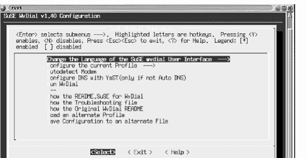

### 7.3
使用 SuSE Wvdial 配置工具配置你的调制解调器。

记得准备好设置 PPP 连接所需的所有相关信息，包括电话号码、IP 地址（如果名称服务器需要）、用户名和密码。

## 注意

找出你的 ISP 软件需要何种类型的授权（登录）。SuSE Wvdial 菜单允许你选择登录类型，以及它是否是非标准类型或 pap/chap 类型。这些信息非常重要——没有它你将无法连接。

当你完成调制解调器设置后，`wvdial.conf` 文件看起来如下所示：

```
[Dialer Defaults]

Modem = /dev/ttyS2

Baud = 57600

Init = ATZ

Init2 = ATQ0 V1 E1 S0=0 &C1 &D2 S11=55

; Phone = <S77-0000>

; Username = <elvin/DTE>

; Password = <S20*>ocx4>
```


你应该注意，在标题 `[Dialer Defaults]` 之后，前四个参数可能会略有不同，因为 Wvdial 会在你……时检测解调器。

要使用 YaST1 的 SuSE Wvdial 配置工具，请选择“网络配置”并“配置 PPP 网络”。如果你更换了解调器且它们没有使用相同的 IRQ，请选择“将硬件集成到系统”选项，并更改端口以匹配。

（注：此处后续原文存在大量重复段落，已根据翻译要求进行逻辑整合与处理）

## 拨号网络（续）

## 电缆调制解调器设置

电缆互联网以前所风席卷了整个行业。尽管它与知名的电信公司竞争，但它吸引了大量的追随者。同时拥有网络和电缆电视还有什么更好的呢？带宽的影响是真实的，但除非你需要专用的 T1 线路，或者需要为带有大量安全流量的 VPN 提供连接，否则电缆连接可能是最佳选择。如果你正在使用电缆，你已经知道了它的好处。你拥有高速数据传输的优势，而且不需要处理拨号连接问题，你始终在线，随时准备待命。不过，电缆有一个让我仍然感兴趣，那就是共享带宽功能。在图 7.5 中，NetWatch 显示了你周围的流量。

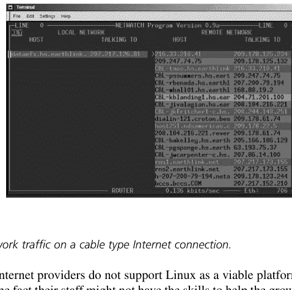

图 7.5：在电缆电视网络连接上查看网络流量。

大多数电缆互联网供应商不支持 Linux 作为可行平台，尽管这仅仅是因为他们的员工可能没有帮助不断成长的 Linux 社区的技能。在安装过程中，我安装了笔记本电脑并将其配置为启动 Windows。整个过程非常顺利。

## 82 第 7 章：SuSE 通信功能

让此设置正常运行只需要几分钟。我将为您提供该过程的列表概述，不过不同的系统可能会有所不同。

- 1. 启动 YaST 进入“系统管理”。
- 2. 选择“将硬件集成到系统”，并分配卡类型和参数。
- 3. 选择“网络配置”，并输入电缆公司提供的网络地址信息。
- 4. 重启电脑，您就可以开始使用了。

这是一个关于电缆调制调器设置的简单示例，尽管设置电缆调制调器还涉及其他因素。如果电缆需要 DHCP 协议，你将必须安装 n 系列的客户端软件，名为 `dhclient`。有关 DHCP 设置的更多信息，可以在命令行中输入以下命令之一来访问已安装系统上的文档：

```
man dhclient
```

或

```
man dhclient-script
```

关于配置文件内容的信息，请尝试：

```
man dhclient.conf
man dhclient.leases
```

有几篇文章涵盖了电缆类型技术的发展和使用。其中一篇名为《第一性原理》（First Principles）的文章可以在 http://www.ozemail.com.au/-firstpr/bband 找到。此外，当前的电缆调制调器 HOWTO 位于 http://www.oswg.org/oswg/oswg-nightly/oswg/en_US.ISO_8859-1/articles/Cable-Modem/Cable-Modem.html。上面的 HOWTO 是最新的，提供了本章范围无法涵盖的详尽且深入细节。如果你遇到某种障碍，这里是寻找解决方案的首选。

## ISDN 接口设置

综合数字网络（ISDN）是一种备受推崇的联网方法，直到 DSL 和电缆革命袭来。ISDN 技术利用拨号类型接入，并按分钟和按距离计费。然而，这种高速网络连接对于普通家庭或小型企业来说并不经济。

因此，当 BISDN 迅速出现时，ISDN 作为理想连接类型的寿命是非常短暂的。BISDN 既是一个概念，也是一组服务，它们开发了在光纤和无线介质宽带网络中集成数字传输服务的标准。BISDN 与 ATM 技术和帧继（Frame Relay）服务结合使用，用于发送大突发的高速数据。BSDN（以及 ATM）通信层建立在 SONET（同步光网络）之上，这有助于提供高速特性。BISDN 支持 2Mbps 及以上的传输。这是一项很棒的服务，但需要通过一些技术更改来实现。支持 ATM 技术和帧继的组件正在被构建到当前的内核中，希望高可用性市场将获得更多 ax.25 和 ATM 支持。

## 拨号网络 83

ISDN 可以使用两种接口技术，其中一种被称为终端适配器（T/A）。本质上，这只是一个具有数字能力的调制调调器的雅称。T/A 的工作方式类似于传统的调制调器，因此启动运行是一个简单的过程。T/A 提供内部和外部配置。有关可用 ISDN T/A 的完整细节，请将浏览器指向 http://alumnas.caltech.edu/~isdn/isdn_hw.html。此页面包含了对于获取正确适配器可能关重要的信息，并可以帮助你配置性能方面。

另一种 ISDN 接口是控制器。ISDN 控制器设计用于在 LAN 或 VPN 类型环境中处理多个 ISDN 连接。这些控制器可以提供大量的服务。如果你正在通过 ISDN 连接你的系统或业务，可以尝试 3Com 的产品，地址为 http://www.3com.com/products/dsheets/400396.html。

当前技术允许在控制器建立多个连接。你可以使用以太网卡和集线器配置系统，并为你的模拟电话和传真机建立连接，这一切通过一条 ISDN 线。

要在 SuSE Linux 上使用 ISDN 控制器，你必须首先什么是它的类型，主动还是被动。如果是被动控制器，请安装位于 n 中的 `i4l` 软件包。对于主动 ISDN 控制器，你应该安装 `i4firm`。

> 对于那些正在考虑 ISDN 连接的人，被动控制器需要用户进行交互，即选择一个预设的外部号码并等待系统响应。主动 ISDN 控制器使用按需拨号程序。此发行版包含的 Wvdial 工具可以配置为在按需拨号环境中运行。细节可以在 http://sub.suse.de/sdb/en/html/hoe_wd_start.html 获取。这将在启动 Telnet 会话或浏览器请求网页等情况下建立自动网络连接。当连接会话终止时，链路将在预定的时间内关闭。

软件安装后，你使用 YaSTI 来帮助你轻松配置适配器。图 7.6 显示了 ISDN 设置界面。

如果你正在更改发行版并且已经运行 ISDN 作为你的主源，你拥有所有网络信息。如果没有，在调整设置之前收集所有网络信息。SuSE 包含一个名为 `isdnlinux` 的软件包，它本身是一个相当完整的设置。它具有数字调制调器的硬件和软件。

## 84 第 7 章：SuSE 通信功能

## ISDN 设置

使用 YaST 配置 ISDN。图 7.6 显示了 ISDN

ISDN 控制器可能会带来一些问题。有关 ISDN 控制器的信息，请查看 sdb.suse.de/en/html/isdn.html。此页面包含了对于获取正确适配器可能重要的信息，并可以帮助你配置性能方面。ISDN 技术利用拨号类型接入并按分钟和按距离计费。这种高速网络连接对于普通家庭或小型企业来说并不经济。

当前技术允许在控制器建立多个连接。你可以使用以太网卡和集线器配置系统，并为你的模拟电话和传真机建立连接，这一切通过一条 ISDN 线。

## DSL 调制调器

| 接入 | 上行速度 | 下行速度 |
| :--- | :--- | :--- |
| 256kbps | 256kbps | 256kb |
| 384kbps | 384kbps | 384kb |
| 512kbps | 512kbps | 512kb |
| 768kbps | 768kbps | 768kb |
| 1024kbps | 1024kbps | 1024kb |
| 2048kbps | 2048kbps | 2048kb |
| 4096kbps | 4096kbps | 4096kb |
| 8192kbps | 8192kbps | 8192kb |

DSL 系统适用于个人用户。你必须注册并创建一个账户，还需要安装和配置客户端软件。这里是神奇之处之处：当你与提供商建立连接时，会被分配一个动态 IP 地址。这个地址将被客户端识别并传输到 dhs.org 服务器。服务器将访问你的账户信息并记录传输的 IP 地址，然后将流量路由到 `<user-name>`dhs.org 地址。这是关于如何工作的简单概述。更多细节，请查看之前列出的 Domain Service 页面。

## 使用 SuSE Linux 6.3 传真

SuSE Linux 的另一个通信功能是它的传真程序。该发行版包含不同的程序，`sendfax` 和 `Hylafax`。SuSE 为 Hylafax 提供了一个名为 SUFax 的图形界面。图 7.7 显示了 SUFax

dhs.org 服务器。服务器将访问你的账户信息并记录传输的 IP 地址，然后将流量路由到 `<user-name>`dhs.org 地址。这是关于如何工作的简单概述。更多细节，请查看之前列出的 Domain Service 页面。

该程序还有其他让生活变得的功能，之一是 SUFax 会自动为事实生成封底。这个功能非常方便，但有一点警告：你必须创建一个 PostScript 模板以便它能够工作。Hylafax 包含其他创建封底的工具，例如 `latex-axcover`——只需在命令行中输入程序名即可。关于更多细节的

# 86 第7章：SuSE 通信功能

使用传真程序，请参考 `/usr/doc/packages/hylfax/html/index.html`，或访问 Hylfax 网站 http://www.hylfax.org/。目前，SuSE 数据库尚未包含与传真相关问题的信息。

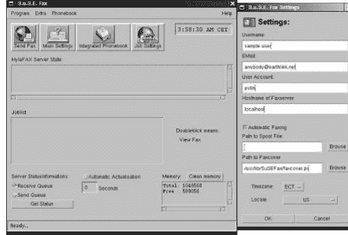

图 7.7 设置 SuSEFax 程序。

## 通信功能总结

SuSE Linux 提供了广泛的连接选项。得益 SuSE 提供的工具，您应该能够很快让您的网络运行起来。从可以为特殊连接需求定制的现代实用程序（如 `minicom`），到按需拨号 ISDN 系统，软件和设置资源都可以从 CD-ROM 轻松获取。由于今天有大量的可用选项，我我相信我只接触了冰毛一角。本章提供的在线参考将是无价的，因此请充分利用。对于那些选择高速连接的用户，我建议获取一个静态 IP 地址，这样如果您恰好要建立电子邮件服务器或任何需要持续且不间断连接的服务，就不需要费心额外的应用程序。

祝您用得愉快，尽情与世界交流！

# 第 8 章

# 使用 YaST 管理用户和组

YaST 已证明自己是您的 SuSE Linux 系统上安装软件和执行配置任务的强大工具。现在，另一个独特元素即将显现——它在您的 Linux 机器上管理用户和组的能力。

如果您在支持单用户且无其他功能的非网络隔离区域使用机器，那么本章中包含的一些信息就是毫无意义的。然而，如果您计划作为文件服务器支持用户，或者您预计会有到您机器的 ssh 或 ftp 类型的连接，请继续读下去。

系统管理可能是耗时且乏味的。事实上，如果没有适当的管理，您精细调过的 SuSE Linux 系统可能会陷入混乱。随着新闻中不断出现安全忧虑，监控您的系统已不再是奢侈品，而是必需品。尽管本书的重点是安装，但如果我未能对用户管理主题提供更多说明，我将是失职。这并不是说我会认为您已经拥有 UNIX/Linux 先验知识——相反，我将帮助澄清您的一些标准参数。本章简要介绍了用户 ID 和组 ID 的原理以及相关密码文件的位置。随着用户群的增长，熟悉这些文件的内容非常重要。

在小型或大型环境中支持多个用户对您的 Linux 系统来说非常简单。基本的控制因素是内核。内核将用户视为数字，每个用户通过一个特定的整数（称为用户 ID，简称 uid）来标识。内核读取一个数字比读取一行纯文本要容易得多；这通过减少 CPU 处理开销增强了系统性能。标准的（文本类型）用户名也会分配给 uid，并保存在位于 `/etc/passwd` 文件中的系统用户数据库中。出于安全考虑，系统还会生成加密密码并将其放在 `/etc/shadow` 文件中。系统还必须通过 `/etc/passwd` 文件中的信息为用户分配家目录并设置工作 shell 环境。图 8.1 显示了 `/etc/passwd` 文件的内容。

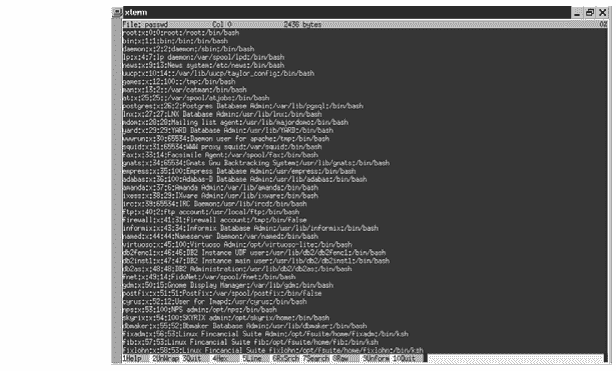

图 8.1 未加密的密码文件 (`/etc/passwd`)。

如果您尚还不熟悉 `/etc/passwd`，我将分解第一行（用户名: root）：
`root:x:0:0:root:/bin/bash`

用户名是 root，x 是 `/etc/shadow` 中包含加密密码的占位符。第一个零代表用户 ID，下一个零代表 root 所属的组。`/root` 表示家目录，`/bin/bash` 是分配给该用户的 shell 环境。如您所见，当内核监控 root 账户时，root 的用户 ID 和组 ID 均等于 0。在设置用户时请记住这一点——不要使用随机编号，并为用户/组分配建立一致的模式。这有助于消除安全问题。

曾经，这是通过在命令行（CLI）中调用的单独命令处理的。`useradd` 和 `userdel` 等命令在 CLI 中仍然可用，但现在 YaST 可以处理这些任务。

## 添加、删除和修改用户账户

要使用 YaST 从系统中添加或删除用户，您必须访问系统管理（System Administration）菜单并选择用户管理（User Administration）。

这两个功能由 `/usr/sbin/useradd.local` 脚本辅助，该脚本为 `/etc/passwd` 和 `/etc/shadow` 创建所有必要的条目，创建家目录并从 `/etc/skel` 复制文件。脚本 `/usr/sbin/userdel.local` 则删除 `/etc/passwd` 和 `/etc/shadow` 中的条目，但保留 `/home/<username>` 目录。

## 添加用户

使用 YaST 工具添加用户是一项简单的任务。用户管理的输入界面如图 8.2 所示。


图 8.2 用户管理

用户管理菜单赋予您添加新用户的能力。shell 字段默认为 bash shell，除非请求了不同的 shell。要访问可用 shell 环境列表，请按 F3 键。

密码输入由星号标记。如果两个条目不匹配，系统将提示您重新输入密码。密码限制为 8 个字符。新用户会被添加，您应该确保他们使用良好的密码。数字和字母（大写和小写）的混合有助于防止系统被轻易破解。

用户管理菜单还允许您在设置时赋予用户 PPP 拨号权限。您可以通过勾选“允许访问调制解调器”（Access to Modem Permitted）来实现。顺便提一下，当您赋予用户此类访问权限时，该用户将被添加到 `updx` 和 `dialout` 组。

最后一个可用字段用于对用户进行详细描述。如果可以做出任何注释来区分用户或其他用户，或者列出重要的个人信息，这里就是所在。在输入所有相关信息后，按 F4 键将创建用户账户。

## 磁盘使用

`/home` 目录的使用是您希望密切监控的事项。如果用户处理大型应用程序或添加软件，可能会消耗大量的家目录空间。如果 `/home` 是单分区且预计会有多个用户，实施磁盘配额（disk quotas）将有助于节省磁盘空间。良好的配额资源是 http://homepage.cistron.nl/~mwv/quota.html。

## 添加、删除和修改用户账户 91

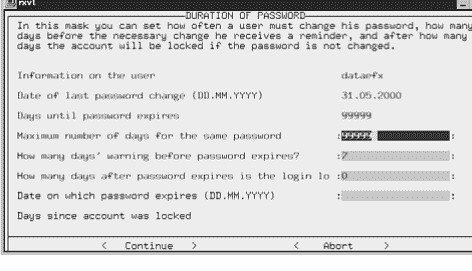
图 8.3
用户管理密码菜单。通过此输入菜单，你可以完成很多事情。如果现有用户结婚或更改了姓名，你也可以添加或修改用户名。这非常有益，并为你节省大量时间。

## 删除用户

按 F5 键删除用户账户。这是通过脚本 `/usr/sbin/userdel.local` 执行的，它会删除 `/etc/passwd` 和 `/etc/shadow` 中的条目，但保留 `/home/<username>` 目录。

几点提示：在删除用户账户之前，最好先禁用该账户。这可以防止用户在执行文件维护（删除系统中所有账户引用）期间使用该账户。如果某人突然离开并可能在近期回来，或者正在休病假，禁用账户将会有帮助。要禁用账户，你需要调用你喜欢的编辑器，并将用户的密码占位符 (x) 替换为星号 (*)。

> 注意：
> 如果离开的用户拥有 root 权限，请立即更改 root 密码，但出于显然原因，不要禁用该账户。

如果你确定用户不会回来，请删除账户并通过 `find` 命令搜索系统，以清除系统中该用户的所有文件，命令如下：

```bash
# find -user <username>
```


取决于系统的大小和生成的用户文件，这可能需要一段时间。在非高峰时间运行此操作有助于加速过程。在找到与用户关联的文件后，确保所有文件都已删除。这应该包括所有的邮箱、邮件别名、打印作业，以及仍然存在的 `cron` 或 `at` 业。

## 第 8 章：使用 YaST 管理用户和组

### 用户账户的 CLI 命令

尽管 YaST 可以执行系统所有者所需的许多管理任务，但命令行用户管理工具是不可替代的。可以使用这些工具快速更改密码和其他其他重要的用户信息，而无需调用 YaST 或在菜单选择中筛选。我之前提到过 `useradd` 和 `userdel` 命令，我将在本节中列出所有命令。

- `useradd`: 添加用户并为新用户创建工作环境（bash shell）
- `userdel`: 删除用户账户，包括 `/etc/passwd` 和 `/etc/shadow` 文件
- `chfn`: 修改全名字段
- `chsh`: 更改登录 shell 环境
- `passwd`: 更改用户密码

注意，普通用户可以使用这些命令更改其账户内容。如果这是一个问题，你可以通过 `chmod` 命令限制非 root 用户。更改所有命令，使得只有 root 有权访问。

如果你发现需要更改用户名且无法使用 YaST，请输入命令 `vip` 来编辑 `/etc/passwd` 文件。若要编辑组，请在命令行输入命令 `vig`。如果你不熟悉 `vi` 编辑器，请使用你喜欢的编辑器并通过文件名（`/etc/<filename>`）加载密码组文件。

### 组管理

使用组作为控制文件访问的手段在 UNIX 类型环境中已经实践了很长时间。用户必须至少分配到一个组，该组可能要求同组的其他成员有有读取或写入同一文件的权限。在多用户环境中，允许特定人员访问——这增强了安全性和系统可管理性。组由其实际名称定义，组信息包含在 `/etc/group` 文件中。图 8.4 显示组结构的示例。

你会注意到组信息非常直观：首先列出组名；接着是用 `(x)` 表示的密码占位符、数值组 ID 数字 `(0)`；以及该组的成员。主要的关注点是组名以及你或系统分配给组的数值分类。

> 警告：
> 在熟悉组结构之前，不要删除或修改任何组设置。系统出于运行目的创建了 `root`、`wheel`、`t` 和 `daemon` 组，因此永久性更改或添加这些组是不明智的。建立好你的工作组，然后根据需要删除不需要的组。

在为组命名时，不要使用任意名称；请保持命名规范（标准），以帮助你及任何其他管理员理清组列表。

### 使用 YaST 配置系统安全 93

| 退出 | 保存加载 `/etc/group` |
| :--- | :--- |
| `Control-S` 和 `Control-B` 搜索。 | |
| 加载：未指定文件。 | |
| 文件 `/etc/group` 以只读方式打开。 | |
| `/etc/group` 只读 | |
| `root:x:0` | |
| `bin:x:root,bin,daemon` | |
| `daemon:x:3` | |
| `ytp:x:4` | |
| `lp:x:5` | |
| `lp:x:7` | |
| `recreation:x:8` | |
| `wheel:x:9` | |
| `utd:x:11` | |
| `mail:x:12,man` | |
| `man:x:13,games` | |
| `dialout:x:16` | |
| `at:x:25` | |
| `lp:x:27` | |
| `user:x:28` | |
| `home:x:29` | |
| `firewall:x:31` | |
| `pub:x:32` | |
| `inform:x:34,informinfo` | |
| `games:x:38` | |
| `ssh:x:41` | |
| `news:x:42` | |
| `legend:x:44` | |
| `dbd:x:46` | |
| `dial:x:47` |

图 8.4
`/etc/group` 的内容

如果你在机器上实施了网络信息系统 `NIS`，YaST 目前无法管理用户和组。你需要使用你喜欢的编辑器手动编辑。

# 使用 YaST 95 配置打印机

# `/etc/login.defs` 配置 -

在此文件中，你可以对 `/etc/login.defs` 文件中的

登录配置进行各种条目设置。

记录失败登录尝试                   3

错误登录尝试后的等待秒数             0

记录账户登录尝试                   `(X)`

最小用户 ID                              :100

最大用户 ID                              :60000

最小组 ID                             :100

最大组 ID                             :60000

密码更改之间的最小间隔              0

两次密码更改之间的最大时间           9999

密码过期前几天应提醒用户?:7

```
< 继续                  退出 >
```

# 图 8.6

`/etc/login.def` 菜单的配置。

在系统范围内，你将能够指定两次密码更改之间的时间因素。密码警告字段与“用户管理”中的字段相似，不同之处在于它影响的是全局参数。

# 使用 YaST 配置打印机

我在使用 YaST 时遇到过的一个任务之一就是打印机配置。你需要选择“系统管理”菜单并“将硬件集成到系统”。选择“配置打印机”以进入打印机安装界面。

我有机会使用其他的打印机配置工具，如 `printtool`（一个 GUI 打印机配置器）和 `magicfilterconfig`（一个基于控制的文本类型打印机实用）。两者都很好，但我更喜欢使用 `asfilter`，因为它提供了许多打印过滤器。图 8.7 显示了打印机安装界面。

```
下一步                                     asfilter 配置

这是配置 asfilter（通用打印机过滤器）的一种方便方法。

如果你选择“安装”按钮，必要的更改将写入

你的打印机文件 (/etc/printcap)。然后将显示创建的文件名（lp1, lp2 等）。

彩色打印机                  [X]

打印机类型                  [HP Deskjet]

打印机名称                  [col0850]

纸张格式                  [letter]

连接端口             [parallel] 端口

设备名称                   [/dev/lp0]

波特率 (仅限串口)  

分辨率 (dpi)             [300x300]
```

< 安装                  退出 >

# 图 8.7

打印机安装界面。

# 96 第 8 章：使用 YaST 管理用户和组

SuSE Linux 打印系统基于 `apfilter`，并包含一些增强。如果安装了 `html2ps` 包，SuSE 的 `apfilter` 可以识别所有常见的文件格式，包括普通的 HTML 文件。YaST 允许你通过 Ghostscript 驱动配置 PostScript、桌面和其他打印机；也可以设置 HP GDI 驱动程序，包括 HP DeskJet 710/720、820 和 1000 打印机。这可以通过使用 `ppa` 包来实现，目前它仅支持黑白打印。YaST 为每台打印机生成 `/etc/printcap` 条目（raw、ascii、auto 和 color，如果打印机是彩色打印机）。YaST 会生成相应的打印目录，你可以通过 Ghostscript 协议、纸张大小、纸张方向、分辨率和打印机转义序列进行微调。SuSE 数据库在 http://sdb.suse.de/sdb/en/html/drucker-howto.html 提供了打印机检查清单。如果你遇到配置问题，请检查此 URL 以获取更多帮助。

作为使用 YaST 配置打印机的另一种方案（以防你无法访问 YaST），你可以在命令行通过 `lprsetup` 使用 `apsfilter` 设置工具。这会调用 `apsfilter` 程序内置的设置工具。该设置工具为你提供了一个良好的用户界面，如图 8.8 所示。

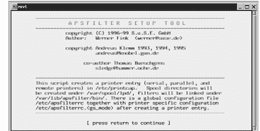

# 图 8.8

Apsfilter 设置工具 `lprsetup`。

目前 YaST 打印机配置不支持彩色激光打印机。如果你配置了单色打印机，你需要编辑 `/etc/printcap` 文件。有必要将 printcap 文件中所有的 `mono` 改为 `color`。如果你在进行这些修改后遇到打印问题，你可能还需要重命名打印目录。

# 使用 YaST 配置远程打印机

行打印守护进程（溢出处理程序）`lpd` 通常在启动时调用。启动时，它尝试查询 `printcap` 文件中的参数（设置）以查找当前打印机的信息；并打印打印区中留下的任何文件。如果打印机被意外关闭或发生意外情况，这将非常有帮助。

# 用户管理摘要 97

然后 `lpd` 使用两个系统调用 `listen` 和 `accept` 来接收打印队列中文件的请求、将文件传输到溢出区、显示打印队列或从队列中删除作业。在这些情况下，`lpd` 将作业转发给子进程来处理请求，以便父进程可以继续监听更多请求。

`lpd` 的功能之一是支持通过网络打印到物理上连接到不同机器的打印机。通过对过滤器脚本的仔细配置，加上 Samba 等其他实用程序，你可以透明地将打印任务发送到各种服务器。

打印过程中的另一个组件是 `lpr`，其功能是控制打印机溢出器。它联系 `lpd` 并向溢出区注入新作业。如你所见，完成几个步骤后，你会发现 YaST 也可以设置不同类型的网络打印机。支持的一些网络连接包括 TCP/IP、Samba 或 Novell NetWare。你的 SuSE Linux 机器可以用于许多任务——资源之一是《打印 HOWTO》，位于 http://www.linuxdoc.org/HOWTO/Printing-HOWTO.html。SuSE 数据库也是一个极好的资源，位于 http://sdb.suse.de/sdb/en/html/basic_network.html 以及 http://sdb.suse.de/sdb/en/html/remote_print.html。


对于必须从 Ghostscript 馈送的网络打印机，你需要取消 `/etc/filterrc` 中 `REMOTE_PRINTER="remote"` 释以使打印机响应。然后调用 YaST 并选择“管理”。选择“将硬件集成到系统”，并选择“配置打印机”。然后根据需要配置基础打印机设置。YaST 有一个菜单选择用于管理远程打印机，允许你配置通过 TCP/IP 协议连接的打印机。配置包括打印机名称、溢出目录和服务器名称的信息。打印机名称是本地机器调用打印机的名称（例如，remote）。溢出目录通过在相应字段中输入名称自动配置。服务器名称是打印服务器的网络 IP 地址或名称。打印机条目包含在 `/etc/printcap` 文件中。

你还可以配置支持 Samba 的网络打印机，需要使用 `samba` 包。这会将打印机连接到 Windows 网络。

其他其他选项，例如在 Novell 网络上连接打印机以及在 ISDN 网络上配置打印机。必须安装支持每种协议的软件包。

# 第 9 章

## 定制自定义内核

在过去的一年左右，Linux 整体取得了飞跃性进展，新内核版本比以往任何时候都支持更多的硬件。SuSE 提供了许多预编译内核，普通系统可以顺利地运行这些内核。但事实仍然是，Linux 目前并不支持所有的硬件组件。例如，你机器中的网卡是 Tulip 芯片类型的。尽管驱动程序可能支持 Tulip 芯片家族，但驱动程序版本可能不包含使网卡正常工作的更新代码。你现在面临两个选择：1) 找到正确的 Tulip 驱动程序并单独编译，或 2) 整体重新编译整个内核。无论哪种方式，都有工作要做。

如果你是为了非商业用途或作为评估平台设置这台 SuSE 机器，重新编译内核可能是不现实的。测试机器很少需要微调——除非你喜欢这样做。如果是这样，你可能想跳到下一章。但话虽如此，如果你计划作为网络防火墙、IP 伪装（IP-Masquerading）箱或其他特殊应用，那么本章就是为你准备的。

本章的设计并不是为了简化过程的复杂性，也不是为了轻视编译失败可能导致的后果。我的希望是为你提供一些切实的信息，在必要时引导你完成定制过程。

SuSE 构建并包含的通用内核（generic kernel）设计用于启动并识别广泛的硬件和外设。为了实现这一点，它考虑了不同类型机器的功能，并根据其占整体用途的比例进行评估。从发行公司的角度来看，这是一个加项：操作系统支持的机器越多，购买的客户就越多。9.1 节展示了内核镜像的大小——看一眼 `vmlinuz` 和 `vmlinuz1`。

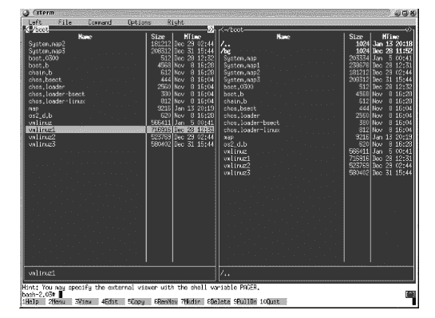

**图 9.1：内核镜像对比——`vmlinuz` 对比 `vmlinuz1`。**

通用内核 `vmlinuz1` 与重新编译的内核 `vmlinuz` 之间存在 150KB 的差异，这了通用内核包含了多少额外代码。在启动 SuSE Linux 时，所需的时间并不寻常，但确实需要一些时间。不必要的硬件探测以及加载未使用的驱动程序和模块也会延长启动时间。通过只运行所需的组件来减少内核内容，可以释放内存并更高效地使用系统资源。

Linux 内核充当你的硬件和应用程序之间的接口。它还执行内存管理功能。像马戏团团长一样，它负责平衡系统资源，并确保所有进程获得它们的 CPU 时间份额。

内核的一些主要功能是：

- 管理运行进程的资源
- 创建和销毁（杀死）进程
- 执行程序
- 提供对文件系统的访问

运行 Linux 操作系统的优势之一是它能够通过虚拟文件系统（VFS）与不同的数据结构接口。VFS 提供了一个信息在内核和文件系统模块之间传递的层。VFS 的多功能性令人惊叹：它可以支持标准的 UNIX 类型文件系统，还可以支持 MS-DOS、UM-DOS 和 vfat 文件等。

尽管这些文件系统原语看起来很原始，但它们会让你明白为什么可能想要定制自己的内核。

内核包含的设备能够识别设备、访问部分内存，并提供代码确保其运行正常。

内核支持网络协议，如 TCP/IP、UDP 和 PPP 等。这使得 Linux 能够有效地与不同类型的操作系统通信。内核中的高级网络功能包括 NFS 和网络地址转换（NAT）（IP 伪装）。

编译自定义内核将产生一个仅包含特定机器所需的驱动程序和服务的内核。如果你喜欢，可以在启动时加载所有所需的设备驱动程序来构建内核。这被称为单体内核。为了减轻负载，内核会在必要自动加载特定驱动程序。这一概念提高了系统的整体性能和灵活性。如果某个硬件被移除，它在启动期间将不会被识别，也不会被加载。

如果网络安全是一个关注点，请确保关闭或消除未使用的驱动程序和服务。诚然，在内核层面的许多漏洞问题并不构成安全风险，但可能会出现某些情况。关于此主题的详情，请将浏览器指向 http://linuxtoday.com/stories/14671.html。

### 构建自编译内核的好处

构建自己的内核有什么好处？作为一个类比，让我们用你的汽车来类比。如果室外温度为 25°F，你会一直开启空调吗？可能不会——这会浪费能量资源，并可能让你感到有些不舒服。引擎（或空调（设备驱动程序））是配件组件。你不想将空调单元从汽车上永久移除，只需在不需要时禁用该组件即可。关闭不使用的配件有助于提高油耗效率并提升整体性能。

我在安装 Linux 系统后的任务之一是下载最新的内核源代码并从头开始。这种方法让你能够利用 SuSE Linux 的力量，并委派该资源的使用。如果你管理一个多用户系统，定制内核应该是优先考虑的。考虑一下：当你计划重新编译内核时，如果这是你的第一次，请将其列入日程计划。

构建新内核的简单性令人耳目一新。你可以选择使用基于文本的配置工具或菜单类型的配置工具。X 界面易于使用，取决于你的喜好。

### 执行构建过程 103

> 注意
> 如果你不确定是否安装了适用于你想要构建的内核的编译器，请查看内核源码中包含的 `README` 文件。它将说明所需的编译器类型。

### 最新内核源码

对支持的需求驱动了内核开发。在重新编译之前，请务必验证你正在使用的是最新的可用稳定版本。这将确保你配备了当前的驱动程序和选项，这些选项可以使你的 SuLinux 系统可用。要找到最新源码，请将浏览器指向 http://www.kernel.org/pub/linux/kernel/v2.2。

源码文件可以通过两种压缩格式获得：`linux-2.2.xx.tar.gz` 和 `linux-2.2.xx.tar.bz2`。由于压缩方法更紧密，bz2 格式的文件尺寸更小。无论是哪种格式，完全解压后的内核将占用约 68MB 的空间；确保你在 `/usr/src` 中有足够的空间。你的下一步将要求你切换到超级用户账户，注销然后以 root 身份登录。现在我建议使用 ftp 站点：`jez.kernel.org`。

将源码下载到 `/usr/src` 目录。当前的源码目录应该是 `linux-2.2.13.SuSE` 并暂时保留它。解压文件有多种方法——我将向你展示我最喜欢的方法。在命令行界面上执行以下命令（取决于压缩格式）：

```
gzip -dc linux-2.2.xx.tar.gz | tar -xvf-

bunzip2 -cd linux-2.2.xx.tar.bz2 | tar -xvf-
```


现在你已经建立了一个新的 linux 目录并准备就绪。

> 警告
> 不要从 `/boot` 目录中移除（删除）当前的内核镜像和 `System.map` 文件。如有必要，请使用 `.old` 后缀重命名文件。如果你删除了这些文件且新内核编译失败，你可能会遇到无法重新运行一切的问题。

## 应用内核补丁

你可以选择放弃下载整个源码，而是获取将升级你当前内核的补丁。补丁可能与源码文件在同一目录下，列名为 `patch-2.2.xx`，并带有 `bz2` 或 `gz` 后缀。将你的补丁下载到 `/usr/src` 目录。如果补丁是通用的（没有 `acl` 或预补丁系列），文件名必须为“`linux`”；请相应重命名文件。要重命名文件，在命令行中执行以下命令：

```
mv linux-2.2.13.SuSE linux
```

## 104 第9 章：定制自定义内核

你需要清理内核树和旧的配置文件，以防止发生冲突。在 `/usr/src/linux` 目录中执行此命令：

```
mrproper
```

这将彻底清理残留的配置和对象文件。现在回到包含补丁的目录，并执行此命令补丁内核源码：

```
gzip -dc patch-2.2.xx.gz | patch -p0
```

如果你正在使用 `ac` 或预补丁进行补丁，你需要重命名 `linux` 目录。某些预补丁除非重命名后的目录看起来如下所示，否则无法安装：
`/usr/src/linux.14p9`

这将使用预补丁-2.12.14-9 补丁版本 2.12.13。因此，如果你的补丁失败，请查看过程开始时的调试命令。这些注释将指示补丁文件正在查找要补丁的目录。相应地重命名 `linux` 目录，然后补丁即完成。

## 定制内核组件

对于已开始的过程，你必须熟悉几个命令：

- `make config`——调用时，此 `make` 命令使用基于文本的界面并允许选择内核选项。
- `menuconfig`——此命令的作用与 `make config` 命令相同，但界面是菜单类型的半图形化界面。（见图 9.2）。

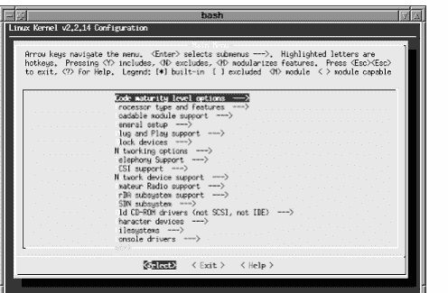

图 9.2
Menuconfig 选择屏幕。

## 执行构建过程 105

- `make xconfig`——基于 X Windows 系统显示内核选项选择界面。（见图 9.3）。

| 代码成熟度级别选项 | 以太网 (1000 Mb) | 软盘，软盘设备驱动程序 |
| :--- | :--- | :--- |
| 处理器类型和特性 | USB 设备 | 文件系统 |
| 可加载模块支持 | 磁带设备 | 网络文件系统 |
| 通用性 | 虚拟接口 | 分区类型 |
| 即插即用 | 模拟无线支持 | 原生语言支持 |
| 块设备 | IRQ 子系统 | 控制台驱动程序 |
| 网络选项 | scsi-process 驱动程序 | 音频 |
| Go-soft 和 fair-quaring | CD-ROM 驱动程序 (非 SCSI，非 IDE) | 额外的底层音频驱动程序 |
| 终端支持 | 设备的 chroot | 内核黑客 |
| SCSI 低级驱动程序 | 鼠标 | Seat and kort |
| 网络设备支持 | 操纵杆 | 不保存退出 |
| 所有卡设备 | 补丁卡 | 从文件加载配置 |
| 以太网 (10 或 100 Mb) | Video For Us | 将配置存储到文件 |

图 9.3

基于 X Window 的内核配置屏幕 (`xconfig`)。

与补丁一样，我建议在开始构建之前使用 `make mrproper`。尽量确保一切都已就绪并清理完毕。

虽然 `menuconfig` 是最喜欢的界面，但 `make xconfig` 是初学者的更好选择。尝试确保一切都正常并已清理。

当你选择内核时，请记住你得到的是什么。这将确保你配备了当前的。这将确保你配备了当前的驱动程序和选项，这些选项可以使你的 SuLinux 系统可用。这将确保你配备了当前的。这些列在表 9.1 中。

## 表 9.1 内核配置

| 类别 | 缺失项 |
| :--- | :--- |
| 处理器类型和特性 | 处理器族 |
| 网络选项 | 拨号支持，防火墙选项 |
| 网络设备支持 | 拨号支持 |
| 以太网 (10 Mb 或 100 Mb) | 网卡 |
| 操纵杆 | 操纵杆 |
| 所有卡设备 | 操纵杆 |
| 以太网 (1000 Mb) | 驱动程序（喜欢这个） |
| 软盘，软盘设备驱动程序 | 软盘 |
| USB 设备 | 文件系统 |
| 磁带设备 | 网络文件系统 |
| 虚拟接口 | 分区类型 |
| 模拟无线支持 | 原生语言支持 |
| IRQ 子系统 | 控制台驱动程序 |
| scsi-process 驱动程序 | 音频 |
| CD-ROM 驱动程序 (非 SCSI，非 IDE) | 额外的底层音频驱动程序 |
| 设备的 chroot | 内核黑客 |
| 鼠标 | Seat and kort |
| 不保存退出 | |
| 从文件加载配置 | |
| 将配置存储到文件 | |

## 106 第9 章：定制自定义内核

选择并退出以保存你的选择。

执行 `make dep` 命令确保所有依赖都已满足——这将运行得很快。

下一个命令可以作为一个一组执行，这将让你去喝杯咖啡。如果你愿意，也可以单独执行它们：

- `make bImage`——编译内核镜像
- `make modules`——创建模块
- `make modules_install`——安装模块到 `/lib/modules`
- `make dep`——搜索 `/etc/modules.conf` 中指定的目录

自动化此过程的可选命令如下：

```
make bImage modules_install
```

`make` 命令将顺序执行列出的每个命令。如果你使用的是奔腾处理器，这个过程大约需要一小时。


> 为了充分利用可选命令集，请包含 `make bImage` 命令。这将转换编译器生成的 `vmlinuz`。`System.map` 文件和 `vmlinuz` 将复制到 `(/root)` 目录，此命令还需要自动 `LILO`。你需要将 `/boot/vmlinuz` 和 `/boot/System.map` 链接到根目录才能工作。（见图 9.4。）

你需要从 `/usr/src/linux/arch/i86/` 拷贝 `System.map` 文件，从 `/usr/` 拷贝 `bzimage` 文件。`make` 命令提供了更好的处理方式。你可以选择不链接 `/boot` 目录，然后手动将文件拷贝到 `/boot`。

作为友好提示，在安装新内核后始终运行 `lilo` 命令。


> 尽管过去不再流行，但可能有一些用户使用了超频处理器系统。你不应该在超频系统上编译内核。会在内核中产生 bug 并可能导致系统崩溃。在处理器正常速度运行时编译内核，安装新内核并对系统进行超频。

如果你使用笔记本电脑，将面临更多工作。稳定内核未包含 PCMIA 支持，因此你必须从 `ftp://sourceforge.org/pcmcia` 获取当前的源码包。

# 自定义内核总结 107

| 文件 | 命令 | 大小 | 时间 | 名称 | 大小 | 时间 |
|---|---|---|---|---|---|---|
| / | | | 1024 | 1月13 17:01 | /root | 1024 | 1月13 17:01 |
| boot | | | 1024 | 12月20 22:52 | /home/private | 1024 | 12月20 22:52 |
| config.map | | | 11000 | 12月20 22:52 | /etc | 1024 | 1月13 17:04 |
| boot.gz | | | 4568 | 3月11 12:04 | /bin | 1024 | 1月13 17:04 |
| boot.map | | | 444 | 3月11 12:04 | /sbin | 1024 | 1月13 17:05 |
| config.gz | | | 2500 | 1月13 16:17 | /dev | 1024 | 1月13 17:06 |
| config.loader.gz | | | 4096 | 1月13 16:17 | /tmp | 1024 | 1月13 17:07 |
| config.loader.line | | | 49 | 1月13 16:17 | /lib | 1024 | 1月13 17:08 |
| vmlinuz-b | | | 620 | 1月13 15:36 | /usr | 1024 | 1月13 17:09 |
| | | | | | /var | 1024 | 1月13 17:10 |
| | | | | | /srv | 1024 | 1月13 17:11 |
| | | | | | /proc | 1024 | 1月13 17:12 |
| | | | | | /sys | 1024 | 1月13 17:13 |
| | | | | | /boot | 1024 | 1月13 17:14 |
| | | | | | /home | 1024 | 1月13 17:15 |
| | | | | | /root | 1024 | 1月13 17:16 |
| | | | | | /bin | 1024 | 1月13 17:17 |
| | | | | | /etc | 1024 | 1月13 17:18 |
| | | | | | /lib | 1024 | 1月13 17:19 |
| | | | | | /sbin | 1024 | 1月13 17:20 |
| | | | | | /usr | 1024 | 1月13 17:21 |
| | | | | | /dev | 1024 | 1月13 17:22 |
| | | | | | /tmp | 1024 | 1月13 17:23 |
| | | | | | /var | 1024 | 1月13 17:24 |
| | | | | | /proc | 1024 | 1月13 17:25 |
| | | | | | /sys | 1024 | 1月13 17:26 |
| | | | | | /boot | 1024 | 1月13 17:27 |
| | | | | | /home | 1024 | 1月13 17:28 |
| | | | | | /root | 1024 | 1月13 17:29 |
| | | | | | /bin | 1024 | 1月13 17:30 |
| | | | | | /etc | 1024 | 1月13 17:31 |
| | | | | | /lib | 1024 | 1月13 17:32 |
| | | | | | /sbin | 1024 | 1月13 17:33 |
| | | | | | /usr | 1024 | 1月13 17:34 |
| | | | | | /dev | 1024 | 1月13 17:35 |
| | | | | | /tmp | 1024 | 1月13 17:36 |
| | | | | | /var | 1024 | 1月13 17:37 |
| | | | | | /proc | 1024 | 1月13 17:38 |
| | | | | | /sys | 1024 | 1月13 17:39 |
| | | | | | /boot | 1024 | 1月13 17:40 |
| | | | | | /home | 1024 | 1月13 17:41 |
| | | | | | /root | 1024 | 1月13 17:42 |
| | | | | | /bin | 1024 | 1月13 17:43 |
| | | | | | /etc | 1024 | 1月13 17:44 |
| | | | | | /lib | 1024 | 1月13 17:45 |
| | | | | | /sbin | 1024 | 1月13 17:46 |
| | | | | | /usr | 1024 | 1月13 17:47 |
| | | | | | /dev | 1024 | 1月13 17:48 |
| | | | | | /tmp | 1024 | 1月13 17:49 |
| | | | | | /var | 1024 | 1月13 17:50 |
| | | | | | /proc | 1024 | 1月13 17:51 |
| | | | | | /sys | 1024 | 1月13 17:52 |
| | | | | | /boot | 1024 | 1月13 17:53 |
| | | | | | /home | 1024 | 1月13 17:54 |
| | | | | | /root | 1024 | 1月13 17:55 |

[费曼学习法]灵感源于诺贝尔物理奖获得者**理查德·费曼**。

1. 运用费曼技巧，你只需花上`20 min`就能深入理解知识点，而且记忆深刻，*难以遗忘*。

```
if (condVar > someVal) {console.log("xxx")}
```

---
*(注：根据您的要求，此处为针对示例部分的翻译)*

- [费曼学习法](https://wiki.example.org/feynmans_learning_method)的灵感源于诺贝尔物理奖获得者**理查德·费曼**。

1. 运用费曼技巧，你只需花上`20 min`就能深入理解知识点，而且记忆深刻，*难以遗忘*。

```
if (condVar > someVal) {console.log("xxx")}
```


# 自定义内核总结 107

| 文件 | 命令 | 大小 | 时间 | 名称 | 大小 | 时间 |
|---|---|---|---|---|---|---|
| `/` | | | 1024 | 1月13 17:01 | `/root` | 1024 | 1月13 17:01 |
| `boot` | | | 1024 | 12月20 22:52 | `/home/private` | 1024 | 12月20 22:52 |
| `config.map` | | | 11000 | 12月20 22:52 | `/etc` | 1024 | 1月13 17:04 |
| `boot.gz` | | | 4568 | 3月11 12:04 | `/bin` | 1024 | 1月13 17:04 |
| `boot.map` | | | 444 | 3月11 12:04 | `/sbin` | 1024 | 1月13 17:05 |
| `config.gz` | | | 2500 | 1月13 16:17 | `/dev` | 1024 | 1月13 17:06 |
| `config.loader.gz` | | | 4096 | 1月13 16:17 | `/tmp` | 1024 | 1月13 17:07 |
| `config.loader.line` | | | 49 | 1月13 16:17 | `/lib` | 1024 | 1月13 17:08 |
| `vmlinuz-b` | | | 620 | 1月13 15:36 | `/usr` | 1024 | 1月13 17:09 |
| | | | | | `/var` | 1024 | 1月13 17:10 |
| | | | | | `/srv` | 1024 | 1月13 17:11 |
| | | | | | `/proc` | 1024 | 1月13 17:12 |
| | | | | | `/sys` | 1024 | 1月13 17:13 |
| | | | | | `/boot` | 1024 | 1月13 17:14 |
| | | | | | `/home` | 1024 | 1月13 17:15 |
| | | | | | `/root` | 1024 | 1月13 17:16 |
| | | | | | `/bin` | 1024 | 1月13 17:17 |
| | | | | | `/etc` | 1024 | 1月13 17:18 |
| | | | | | `/lib` | 1024 | 1月13 17:19 |
| | | | | | `/sbin` | 1024 | 1月13 17:20 |
| | | | | | `/usr` | 1024 | 1月13 17:21 |
| | | | | | `/dev` | 1024 | 1月13 17:22 |
| | | | | | `/tmp` | 1024 | 1月13 17:23 |
| | | | | | `/var` | 1024 | 1月13 17:24 |
| | | | | | `/proc` | 1024 | 1月13 17:25 |
| | | | | | `/sys` | 1024 | 1月13 17:26 |
| | | | | | `/boot` | 1024 | 1月13 17:27 |
| | | | | | `/home` | 1024 | 1月13 17:28 |
| | | | | | | `/root` | 1024 | 1月13 17:29 |
| | | | | | | `/bin` | 1024 | 1月13 17:30 |
| | | | | | | `/etc` | 1024 | 1月13 17:31 |
| | | | | | | `/lib` | 1024 | 1月13 17:32 |
| | | | | | | `/sbin` | 1024 | 1月13 17:33 |
| | | | | | | `/usr` | 1024 | 1月13 17:34 |
| | | | | | | `/dev` | 1024 | 1月13 17:35 |
| | | | | | | `/tmp` | 1024 | 1月13 17:36 |
| | | | | | | `/var` | 1024 | 1月13 17:37 |
| | | | | | | `/proc` | 1024 | 1月13 17:38 |
| | | | | | | `/sys` | 1024 | 1月13 17:39 |
| | | | | | | `/boot` | 1024 | 1月13 17:40 |
| | | | | | | `/home` | 1024 | 1月13 17:41 |
| | | | | | | | `/root` | 1024 | 1月13 17:42 |
| | | | | | | | `/bin` | 1024 | 1月13 17:43 |
| | | | | | | | `/etc` | 1024 | 1月13 17:44 |
| | | | | | | | `/lib` | 1024 | 1月13 17:45 |
| | | | | | | | `/sbin` | 1024 | 1月13 17:46 |
| | | | | | | | `/usr` | 1024 | 1月13 17:47 |
| | | | | | | | `/dev` | 1024 | 1月13 17:48 |
| | | | | | | | `/tmp` | 1024 | 1月13 17:49 |
| | | | | | | | `/var` | 1024 | 1月13 17:50 |
| | | | | | | | `/proc` | 1024 | 1月13 17:51 |
| | | | | | | | `/sys` | 1024 | 1月13 17:52 |
| | | | | | | | `/boot` | 1024 | 1月13 17:53 |
| | | | | | | | `/home` | 1024 | 1月13 17:54 |

自定义内核总结

网络管理可以相对简单，也可以非常困难，取决于网络的大小和组成。管理任务范围从简单的备份到集成不同的操作系统。

## 第10 章：管理网络

启动、停止和添加服务可能是一个挑战。如果你是网络的唯一用户，任务会变得容易——你不会担心中断自己的工作。Linux 平台提供了灵活性，可以将各种类型的网络集成到 Samba 服务器，或者轻松处理防火墙分配。

借助 SuSE 的 YaST，管理工作将不再变得沉重。无论你有 1 台还是 100 台机器，YaST 都能帮到你。

### 使用 YaST 配置系统

我们将查看 YaST 内置的一些网络管理工具。你将学会如何控制系统，并使用 SuSE 6.3 自带的一些网络监控工具。首先，让我们看看系统配置。

系统配置通常通过你喜欢的编辑器对文件进行操作来完成，这需要你熟悉文件位置以及具体的更改。另一个因素是你是否打算通过删除注释来启用服务（删除相关行前的注释符号 `#`）。其他示例包括在行中添加参数（在空字段中填充信息，例如 `IPADDR="..."`，在引号中填写信息，例如 `IPADDR="197.113.101.77"`）。

图 10.1：选择 YaST 更改选项

## 第 10 章：管理网络设置

表 10.1 续

| 系统功能 | 选项 | 注释 |
|---|---|---|
| `CREATE_RESOLCONF` | yes/no | 配置并维护 `/etc/resolv.conf` 文件。 |
| `CRON` | yes/no | 启动 cron 守护进程。 |
| `DEFAULT_WM` | KDE,WM,Enlightenment | 选择启动窗口管理器。 |
| `DHCLIENT` | yes/no | 启动 DHCP 客户端。 |
| `DHCLIENT_SLEEP` | open | 提供 DHCP 初始化所需时间（秒）。 |
| `DISPLAYMANAGER` | console/kdm/xdm | 在启动时激活显示管理器。 |
| `ENABLE_USECONFIG` | yes/no | 启用自动系统配置。 |
| `FQHOSTNAME` | current hostname | 你为计算机选择的名称，例如 my.computer。 |
| `FTP_PROXY` | open | 指示 ftp 代理地址。 |
| `GMT` | -u, "" | 如果时设置为 GMT 则使用 -u，本地时间则使用空引号 ("")。 |
| `GPM_PARAM` | open | 允许你修改参数。 |
| `IFCONFIG_0` | open | 提供主 IP、广播地址和子掩码地址，如 ifconfig 输出所示。 |
| `IFCONFIG_1` | open | 提供次 IP、广播地址和子掩码地址，如 ifconfig 输出所示。 |
| `IPADDR_0` | open | 提供主 IP 地址。 |

### 使用 YaST 配置系统

| 系统功能 | 选项 | 注释 |
|---|---|---|
| `IPPADDR_1` | open | 提供次 IP 地址。 |
| `IP_DYNIP` | yes/no | 启用启动动态 IP 补丁功能。 |
| `IP_FORWARD` | yes/no | 转发 IP 数据包，并处理伪装和路由。 |
| `IP_TCP_SYNCOOKIES` | yes/no | 提供 syn 洪水包保护。 |
| `IRCSERVER` | open | 允许你在此处添加喜欢的 irc 服务器地址。 |
| `KBD_CAPSLOCK` | yes/no | 询问键盘 CapsLock 是否开启。 |
| `KBD_NUMLOCK` | yes/no | 询问键盘 NumLock 是否开启。 |
| `KBD_RATE` | open | 提供重复速率；此选项必须输入延迟时间（ms）才能生效。 |
| `KDB_TTY` | open | 指定可以使用 NumLock 和 CapsLock 的 tty (tty1 tty2 或所有 tty)。 |
| `KDM_GREETSTRING` | open | 用于在显示管理器屏幕上显示计算机的主机名。 |
| `KDM_SHUTDOWN` | root, all, none | 在 KDM 管理屏幕上显示可以关闭系统的用户。 |
| `KDM_USERS` | open | 修改 KDM 主屏幕上的用户列表。 |
| `KEYTABLE` | <table type> | 允许你指定键盘表类型（如 `<us.map.gz>`）。 |

### 表 10.1 续

| 系统功能 | 选项 | 注释 |
| --- | --- | --- |
| `LANGUAGE` | open | 允许你指定本地语言。 |
| `MAIL_LEVEL` | warn/all | warn 提供重要信息；all 提供邮件和日志。 |
| `MAIL_REPORTS_TO` | open | 将配置邮件发送给 root 或任何指定的用户。 |
| `MAX_DAYS_FOR_LOG_FILES` | open | 告诉日志文件将存储多久。 |
| `MAX_RPMDB_BACKUPS` | open | 指定 rpm 数据库备份文件的最大数量。 |
| `MODEM` | open | 识别用作调制解器的设备 (`<TySx>`)。 |
| `MOUSE` | open | 指示哪个设备是鼠标 (`<TySz>`)。 |
| `NAMESERVER` | open | 提供 DNS 服务器的 IP 地址。 |
| `NETCONFIG` | open | 指定用作网络接口的设备 (NIC)。 |
| `NETDEV_0` | automatic | 指示第一个网络设备 eth0。 |
| `NETDEV_1` | automatic | 指第二个网络设备 eth1。 |
| `NFS_SERVER` | yes/no | 启动 NFS 服务器。 |
| `NNTP_ERVER` | yes/no | 提供新闻服务器地址。 |
| `PASSWD_USE_CRACKLIB` | yes/no | 允许你使用 cracklib 检查新密码。 |
| `PATH` | `<PATH>` | 此 PATH 为 SuSEconfig 和 cron 设置。请更改此设置。 |
| `PCMCIA` | i82365 or tcic | 指示使用的 PCMCIA 芯片组。 |
| `PCMCIA_CORE_OPTS` | open | 选项请参考 man 页，`#man pcmcia-core`。 |
| `PCMCIA_PCIC_OPTS` | open | 确定插槽驱动程序定时；详情请见 `#man 1823S` 或 `#man tc`。 |
| `PERMISSION_SECURITY` | easy, secure, paranoid | 全局设置文件权限。 |
| `POSTFIX_CREATECF` | yes/no | 决定系统是否会创建 Postfix 配置文件。 |
| `POSTFIX_LOCALDOMAINS` | open | 提供本地和系统域名。 |
| `POSTFIX_MAILDROP_MODE` | nosgid/sgid | 设置邮件投递模式。 |
| `POSTFIX_RELAY` | open | 指示中继主机。 |
| `ROOT_LOGIN_REMOTE` | yes/no | 决定是否允许 root 登录。 |
| `SEARCH_UPDATE` | open | 更新更新。 |
| `SORT_USERS_BYID` | open | 允许按 ID 排序用户。 |
| `SMTP` | yes/no | 启动 SMTP 服务器。 |
| `TZ` | open | 修改 `/etc/zoneinfo/local-time`。 |
| `USB_DRIVERS` | keyboard-mouse, other | 启用额外的 USB 设备。 |
| `USE_NIS_FOR_AUTOFS` | yes/no | 使用 NIS 用于自动挂载。 |
| `XNTPD_INITIAL_NTP` | open | 提供服务器 IP 地址。 |

## 第 10 章：管理网络设置

### Lynx 浏览器

通常情况下，大多数 Linux 发行版在其软件包中都包含了几个 浏览器。SuSE 也不例外；资深 Linux 用户最喜欢的浏览器之一就是 Lynx。这是一个基于文本的浏览器，可能会吸引硬核 Linux 用户。该浏览器的速度非常快，因为不需要解析图形图像。尽管它是一个文本浏览器，但它具有其他 浏览器不具备的配置功能。以下列了 Lynx 的的一些选项。

按下 O 键，可以进入 Lynx 选项菜单。

- E—显示所选编辑器
- D—显示显示变量
- B—访问书签文件
- F—指定 ftp 排序标准
- P—输入个人邮箱地址
- S—选择类型
- C—选择字符集
- V—显示按键
- *e—显示 emacs 键*
- K—使用数字键盘作为方向键
- U—访问用户模式
- L—显示本地链接

在命令行输入 Lynx 时，你可以看到 Lynx 帮助屏幕。
图 10.2 显示了 Lynx 帮助页面。

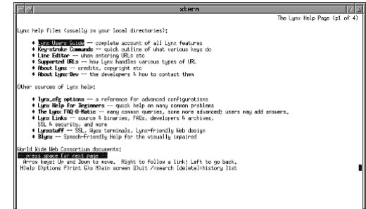

图 10.2
从 Lynx 获取帮助。

### 配置 Internet 服务

一旦配置完成，Lynx 证明是一个强大的 Web 浏览器应用程序。对于任何关注文本应用程序和在线阅读文档的人来说，Lynx 都是理想的浏览器。Lynx 支持一些最新的 HTML 技术（图像外），你在使用网页上提供的链接时不会遇到困难。如果你有一台较旧机器，或者内存小于 24–32MB，这个浏览器将让生活变得可以接受。由于 Lynx 只查看文本，HTML 页面的加载时间会缩短。

堪萨斯大学是获取有关新发布版本和用户信息的最佳来源。你的网站地址为：http://cc.ukans.edu/lynx_help/Lynx_users_guide.html。Lynx 的当前版本是 2.8.2。

另一个网站可能有助于你熟悉 Lynx。该网站提供了关于 Lynx 快速配置的额外见解：http://reality.sgi.com/raju/lynx.txt。

### Netscape 浏览器

Netscape 浏览器因其可移植性和成本（免费）而成为 Linux 爆发增长的一部分。Netscape 与此发行版中包含的其他软件完美契合。

Netscape 是一个完全可配置的 Web 浏览器，内置了支持 POP、IMAP 和 Memail 协议的邮件客户端。你可以设置 Netscape 以接收发送到新闻组的帖子。你还可以使用若干功能来确保你的日常 Internet 任务完成。

如果你启动 Netscape 并发现它似乎长时间卡住并给出图 10.3 所示的错误，你可能遇到了网络连接问题。

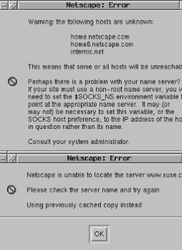

**图 10.3**
识别 Netscape 错误。

在前面的图中，你看到注释“warning, the following hosts are unknown（警告，以下主机未知）”。这表明你可能漏掉了 `resolv.conf`（DNS 名称服务器）的条目。另一方面，你可能没有物理连接到网络或 Internet。请检查所有连接，然后查看 `/etc/resolv.conf` 文件（使用系统配置工具中的 `NAMESSERVER` 选项）。如果在 `/etc/resolv.conf` 文件中没有列出 IP 地址，添加名称服务器 IP 地址应该可以解决你的问题。

此版本包含的 Netscape 浏览器可以像之前的版本一样进行配置。工具栏选择（位于浏览器区域顶部）执行相同的功能。虽然这是一个新版本，但你不应该在操作上遇到任何困难。

Netscape 的巧妙功能之一是新闻组功能。目前订阅邮件列表的人会发现，处理新闻组是一项简单的任务。为了方便起见，Netscape Navigator 集成了一个新闻组 客户端。图 10.4 显示了新闻组设置屏幕。

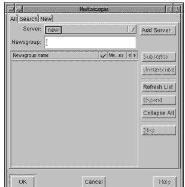

图 10.4
在 Netscape 中设置新闻组。

我最喜欢的列表包括 alt.os.linux.suse、comp.os.linux.announce 和 comp.os.linux.security。你可以先尝试这些列表；SuSE 列表很有趣，非常推荐给 SuSE 新手，因为它讨论了当前的发行版问题和解决办法。该列表还提供了有关 SuSE Linux 未来改进的信息。

关于 Netscape Communicator 其他功能的额外信息可以写成一本厚厚的书。你可以使用浏览器右上角的“帮助”选项。帮助中包含的信息将指导你进行 Netscape Communicator 的高级配置。

有关 Communicator 的更多在线帮助，请访问 http://help.netscape.com/。这个网站将为你提供有关 Netscape 高级配置的信息并协助解决技术问题，尽管我怀疑你不会遇到这类问题。

使用 Netscape 作为首浏览器的个人和公司可以通过添加一个名为 fortify 的包将标准的 56 位加密升级为 128 位加密。这种增强将加密提高到了国际“强”加密。可以在 http://www.fortify.net 获取此包。如果你不确定是否需要“强”加密，请查看文章 http://www.boran.com/security/sp/int_crypto.html。这可以帮助定义你是否需要这种级别的安全。

### 网络服务概述

在本节中，你将看到如何配置 SuSE Linux 发行版包含的一些常用服务。这些服务包括邮件服务器配置、Samba 和 IP 管理设置，这些都可以通过 YaST1 工具完成。

### 使用 YaST 配置 sendmail

使用 YaST 配置 sendmail 非常快。以下指令概述了操作步骤。

### 配置互联网服务

之前列出的选项是常用的，并且可以根据您的需求快速修改。这并不是该程序或其特性的完整概述；如需更多详情，请在命令提示符处输入 `help`。手册还有一个位于 http://www.example.org/ 的详尽网站。该网站包含了有关程序的所有最新信息，以及更高版本的下载（如适用）。其他网站也能够帮助您从零开始进行配置——地址为：http://www.example.com/。

### DHCP 配置

动态主机配置协议（DHCP）是一种网络协议，它允许管理员从中心点进行控制，并自动分配组织网络中的网际协议（IP）地址。使用 TCP/IP 协议，每台必须连接到互联网的机器都需要一个唯一的 IP 地址。您可能有多台计算机；如果计算机移动到网络的某个位置，则必须输入新的 IP 地址。DHCP 允许网络从中心点监督并分配 IP 地址，并在计算机插入到网络不同部分时自动发送新的 IP 地址。如果您想启动 DHCP 服务器，请使用 `START_DHCP` 选项并回答 `yes`。由于配置 DHCP 客户端涉及的变量很多，我建议您查看 http://www.example.com/sbin/dhcp.html。这个 SuSE 网站提供的细节比本概述提供的更多。此外，DHCP HOWTO 是另一个极好的资源。

### NFS 文件系统 (NFS)

网络文件系统（NFS）是一种客户端/服务器应用程序，它允许计算机有机会查看，并在某些情况下存储和更新远程计算机上的文件，就像这些文件位于用户自己的计算机一样。NFS 设计用于支持 UNIX/Linux 文件系统，同时也支持 MS-DOS。分布式文件资源和文件系统安全需求将决定使用这种类型系统的优劣。如果您有大量用户远离中心位置且您希望能够访问，那么您可能想要提供此类服务。如果您打算运行 NFS 服务器，必须存在这些参数：

- `START_PORTMAP`：如果没有 portmapper 守护进程运行，`rpc.mountd` (mount) 和 `rpc.nfsd` (filesystem) 将不会启动，NFS 将无法运行。
- `NFS_SERVER`：还需要启用此选项；此服务将启动 `rpc.mountd` 和 `rpc.nfsd`。
- `NFS_UGID`：如果您希望 NFS 转换用户 ID 和组 ID，请选择此选项。
- `REEXPORT_NFS`：还可以通过 YaST 调整另一个设置。如果您想重新挂载 NFS 目录，请使用此选项。

设置 NFS 环境的详情位于 http://metalab.unc.edu/mdw/HOWTO/NFS.html。

### NIS 配置

网络信息系统（NIS）是一种用于较小网络的网络管理系统。从设计上讲，它是一个无缝的网络环境，旨在用于局域网（LAN）。与 NFS 一样，NIS 使用客户端/服务器模型和远程过程调用（RPC）接口进行主机间的通信，因此使用 NIS 时必须运行 portmapper 守护进程。注意，NIS 最初名为 Yellow Pages（黄页），但有人已注册了该商标，因此它更名为 Network Information System。SU Linux 将 NIS 称为“YP”（Yellow Pages）。

要通过 YaST 工具创建 YP (NIS) 配置，请选择 `CREATE_YP_CONF`。要识别 YP (NIS) 服务器的域名，请使用选项 `YP_SERVER <server-name.com>`。YP (NIS) 主主机的域名应输入在 `YP_DOMAINNAME` 字段中。如果您的系统配置了名称解析，您还可以使用选项 `NIS_FOR_RESOLVING` 并回答 `yes` 来使用 YP (NIS) 解析主机名查询。

如果您在网络上将 YP (NIS) 作为服务，请参考 http://metalab.unc.edu/mdw/HOWTO/NIS.html 中的 NIS HOWTO，获取有关此类服务内部机制的细节。您有明显的安全问题需要考虑。系统必须能够通过网络读取 `/etc/passwd`、`/etc/shadow` 和 `/etc/groups`。该系统有很多优点。您最终将权衡成本/风险收益并据此进行。

### Samba 配置技巧

Samba 程序包含了 Linux 发行版中一些最受欢迎的功能。它使 Linux 机器可以在 Windows 或 DOS 环境作为网络服务器运行。该程序弥补了有时存在于平台环境中的集成差距。SuSE 在其发行版包含了一个简单的配置工具 `swat`，它提供了一个 Web 页面界面来设置您的 Samba 系统。有关 `swat` 如何工作的更多详情，请在命令行输入 `#man swat`。

### 配置互联网服务

YaST1 将帮助您设置打印机使用 samba。执行命令 `#yast`，并选择“系统管理”（System Administration）。然后选择“网络配置”（Network Configuration），并选择选项“通过 Samba 连接打印机”（Connect to Printer Via Samba）。

这两个功能可以用于设置打印机使用 samba。以下指令将让您和您的网络其余部分运行起来。

现在进入了有趣的部分。如果你已经建立了连接，将需要获取当前的防火墙包，该包可以在 SuSE FTP 站点获取。此包将修复防火墙初始版本中发现某些符号链接（symlink）问题。

要下载文件，请调用 YaST 并选择选择/安装软件包（Choose/Install Packages）；然后选择子菜单。按回车键，并在左上角的下拉菜单中选择 FTP。SuSE 的 IP 地址已在安装程序中设定。下载包后，使用 YaST 工具安装该包。在提示符处输入 **yast** 并选择软件包。然后按回车键选择你下载软件的目录。在选择旁放置 X，然后按 F10 键。软件将完成安装。

现在你准备好编辑配置文件了。如果你选择手动编辑，请加载你喜欢的编辑器打开 `/etc/rc.config/firewall.rc.config`。现在使用 joe 编辑器。


# joe /etc/rc.config/firewall.rc.config

图 10.5 显示了 `/etc/rc.config/firewall.rc.config` 文件的部分内容。


**图 10.5**
防火墙程序配置文件。

配置文件根据机器当前的使用情况指示你需要添加或修改哪些参数。当你对 `/etc/rc.config/firewall.rc.config` 文件进行了所有必要的更改后，保存文件并重启机器。

## 第 10 章：管理网络设置

这将初始化防火墙；安装升级后的防火墙程序后，启动脚本将开始工作，无需其他修改即可将内部流量路由到互联网。

你也可以使用 YaST 工具来编辑配置文件。在 YaST 程序的主菜单中选择系统管理（System Administration）；然后选择更改配置文件（Change Configuration File）选项。在使用 YaST 时更改表 10.2 中的参数。

### 表 10.2 YaST 中可修改的参数

| 参数 | 说明 |
|---|---|
| FW_ALLOW_FW_SOURCEQUENCH | 连接被阻塞时 |
| FW_ALLOW_FW_TRACOUTE | 允许跟踪路由（traceroute）到防火墙 |
| FW_ALLOW_FW_INCOMING_HIGPORTS_TCP | 允许高于端口1023 的TCP流量 |
| FW_ALLOW_FW_INCOMING_HIGPORTS_UDP | 允许高于端口1023 的UDP流量 |
| FW_ALLOW_PING_DMZ | 允许向防火墙内部的 DMZ 进行 ping |
| FW_ALLOW_PING_FW | 允许向防火墙/DMZ 箱进行 ping |
| FW_AUTOPROTECT_GLOBAL_SERVICES | 防止访问未绑定端口，如 0.0.0.0:21 |
| FW_DEV_DMZ | 指向 DMZ 的接口 IP 地址 |
| FW_DEV_INT | 内部接口的 IP 地址 |
| FW_DEV_WORLD | 接口的 IP 地址 |
| FW_FORWARD_TCP | 将 TCP 服务转发到内部（或 DMZ）网络 |
| FW_FORWARD_UDP | 将 UDP 服务转发到内部（或 DMZ）网络 |
| FW_KERNEL_SECURITY | 设置额外的 TCP/IP 安全功能 |
| FW_LOG_ACCEPT_ALL | 启用所有允许连接的防火墙日志 |
| FW_LOG_ACCEPT_CRIT | 启用允许的“关键”连接的日志 |
| FW_LOG_DENY_ALL | 启用所有拒绝连接的日志 |
| FW_LOG_DENY_CRIT | 启用拒绝的“关键”连接的日志 |
| FW_REDIRECT_TCP | 允许将 TCP 服务重定向到防火墙上的本地端口 |
| FW_REDIRECT_UDP | 允许将 UDP 服务重定向到防火墙上的本地端口 |
| FW_ROUTE | 激活互联网与内部网络之间的路由 |
| FW_SERVICES_DMZ_TCP | 指定 DMZ 中允许的 TCP 服务 |
| FW_SERVICES_DMZ_UDP | 指定 DMZ 中允许的 UDP 服务 |
| FW_SERVICES_EXTERNAL_TCP | 指定来自互联网或其他不可信网络的 TCP 连接 |
| FW_SERVICES_EXTERNAL_UDP | 指定来自互联网或其他不可信网络的 UDP 连接 |
| FW_SERVICES_INTERNAL_TCP | 指定来自内部网络的 TCP 连接 |
| FW_SERVICES_INTERNAL_UDP | 指定来自内部网络的 UDP 连接 |
| FW_SERVICES_TRUSTED_TCP | 指定信赖的 TCP 端口连接（25 或 smtp） |
| FW_SERVICES_TRUSTED_UDP | 指定信赖的 UDP 端口连接（53 或 domain） |
| FW_SERVICES_DHCLIENT | 启用 DHCP 客户端过滤 |
| FW_SERVICES_DHCP | 启用 DHCP 服务器过滤 |
| FW_SERVICES_DNS | 启用 DNS 服务器过滤 |
| FW_STOP_KEEP_ROUTING_STATE | 如果防火墙卸载或停止，保持路由状态 |
| FW_TRUSTED_NETS | 指定信赖的互联网地址 |

如果你使用 YaST 来配置防火墙，我强烈建议这样做。配置文件根据机器当前的使用情况指示你需要添加或修改哪些参数。当你对 `/etc/rc.config/firewall.rc.config` 文件进行了所有必要的更改后，保存文件并重启机器。

如果你使用 YaST 来配置防火墙，我强烈建议这样做。配置文件根据机器当前的使用情况指示你需要添加或修改哪些参数。当你对 `/etc/rc.config/firewall.rc.config` 文件进行了所有必要的更改后，保存文件并重启机器。

# 132 第 11 章：SuSE Linux 的音频

有时由于内部设置与另一个设备发生冲突，可能会产生配置问题。幸运的是，`isnap` 工具尝试寻找 PnP 卡并提供一些配置信息。本章的随后的章节将回顾该工具的使用。请参阅“isnaptools 实用程序”章节。

相当多的音频开发项目正在进行中。两个主导项目是开放声音系统 (OSS) 和高级 Linux 音频架构 (ALSA)。OSS/Free 驱动程序集成在内核中，而 ALSA 也作为预构建模块提供。我将向您介绍每组驱动程序的概览。

## 开放声音系统（又名 OSS）

Hannu Savainen 领导了开发与 Linux 兼容的音频驱动的工作。最初被称为 Voxware，后来更名为 Ultra Sound System (USS)。在开发驱动程序期间，Savainen 加入了 4Front Technologies 团队，该公司专门为 UNIX 平台销售专有的音频解决方案。在 4Front 全职工作期间，Savainen 将维护者工作交给了 Alan Cox。Cox 以 'ac' 内核补丁而闻名，在音频驱动程序的内核开发中非常忙碌。关于他的进展的更多信息可以在 http://www.4front-tech.com/ossfree/index.html 找到。

内核提供的 OSS 驱动程序版本被称为 OSS/Free，也称为 Linux Sound System。主站位于 http://www.linux.org/uk/OSS，包含了有关设置和兼容性问题的宝贵信息。

4Front 为各种 UNIX/Linux 应用提供音频驱动程序。SuSE 慷慨地在 Pay 部分的 `opsdm` 标题下提供了 Open Sound 3.9.2 驱动程序的演示副本。关于开放声音系统的更多信息可以在 http://www.opensound.com 找到。

由麻省省理工学院（MIT）托管的一个项目称为 Csound。这项工作非常多样化，包含了优秀的教程和大量的当前文档。网站位于 http://mitpress.mit.edu/e-books/csound/frontpage.html。

还有其他小组在致力于音频重放。位于 http://www.uk.gnome.org/white-papers/esd/ 的 GNOME 和 Enlightenment 团队。他们的努力坚持不懈，每天都在改进。有关该项目的更多细节，请参见 http://www.gnome.org。

## 使用开放声音驱动程序

你可以想象一下拥有一个“工作正常”的声卡，在安装 SuSE Linux 后，声卡突然失效了的挫败感。你有两个选择：购买 4Front 提供的商业驱动程序，或者重新编译内核并使用 OSS/Free 驱动程序。我发现 OSS 软件包更容易安装和配置。唯一的代价是，如果你想保留它，就必须支付费用（20 美元），而且你不会收到源代码。

## 开放声音系统（又名 OSS） 133

如果你倾向于开源解决方案，内核驱动程序将是你的最佳选择。这要求你重新编译内核并安装正确的驱动程序。在下一节中，你将找到 OSS/Free 驱动程序的安装概览。

## 安装 OSS 音频驱动程序

Open Sound 演示驱动程序非常容易安装。你需要找到 `ossinstall` 程序文件并运行安装脚本。提示将引导你完成整个过程。完成配置后，使用此命令：

```
soundun
```

如果你决定使用内核音频驱动程序，你将需要重新配置内核参数。（参考第 9 章，“定制自定义内核”）。你可以选择将驱动程序集成到内核中，或构建所需的驱动程序模块。图 11.1 显示了 `make xconfig` 选择界面。OSS 驱动程序已被选择为内核组件而非模块。

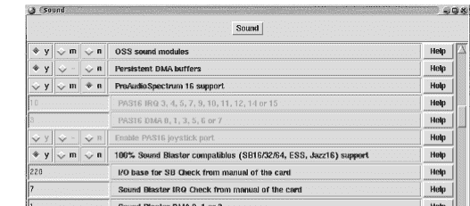

图 11.1

Linux 内核音频配置菜单 (OSS/Free)。

当内核重新编译后，你可以重启系统并观察音频设备是否被识别和初始化。如果驱动是作为模块构建的，你可以使用 `insmod` 命令或运行 `modprobe -c` 来验证模块的干净构建和正确加载。命令 `/dev/sndstat` 显示了有关你的声卡和驱动程序的信息。

记住，在编译内核时，你有几个选择来选择你的声卡。确保纠正其中一个以及任何相关的驱动程序选项。配置工具中的帮助功能可能是救星——在大多数情况下，它解释了每个选项的作用。请务必根据你的知识选择选项，使用可以验证的规格（I/O、IRQ 和 MPU）。

SoundBlaster Live 将松了一口气，因为 Creative 现在为该显卡提供支持。那些难以获取的驱动程序信息可以在 http://opensource.creative.com 找到。

内核中不可用，无法构建任何模块。该 URL 是制造商进入开源革命的方式。

## ALSA 音频驱动程序

高级 Linux 音频架构 (ALSA) 项目承担了开发高质量音频驱动系统的任务。报告显示，ALSA 驱动程序将完全集成到 Linux 内核中。驱动开发最初是 Linux Ultra Sound Project，由 Jaroslav Kysela 领导，他继续协调并领导该项目。ALSA 驱动程序模块在安装阶段可用，如图 11.2 所示。

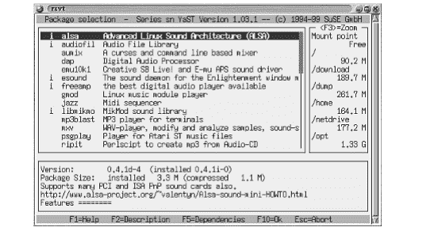

图 11.2

音频即插即用SuSE Linux 将安装必要的

## 配置 ALSA 驱动程序

音频系统有一个可以通过此命令调用的工具：

```
alsaconf
```

# ALSA 驱动程序 135

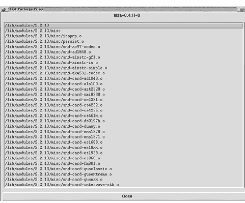

音频即插即用

`isapnptools` 工具根据其他设备的配置检查可用资源。然后读取 `isapnp.conf` 文件。

# 136 第 11 章：SuSE Linux 的音频

## isapnptools

图 11.6 显示了一个 ISA 卡的输出。使用此命令：

```
isapnp /etc/isapnp.conf
```

如果 `isapnp` 成功读取文件，它将为你编辑（取消注释）正确的设置，你只需要重启系统并确保音频模块已加载。

此命令列出所有加载的模块：

```
lsmod
```

如果你仍然遇到问题，输入此命令获取有关这些工具的更详细信息：

```
man pndump 或 man isapnp
```


你也可以在附录 B，“SuSE Linux 故障排除”章节中检查额外的信息。

在本文编写期间，`isapnptools` 的当前版本为 `1.21b`。你可以在此处找到该工具包的更多文档：`http://www.roestock.demon.co.uk/linuxisapnptools/`

## 第 11 章：SuSE Linux 的音频

配置 ISA 声卡可能是一项挑战任务，但当你获得良好的音频体验时，它是非常值得的。

### 音频总结

要充分涵盖 Linux 上的音频问题，可能需要一本相当厚实的书。本简短的章节旨在帮助你找到让声卡运行所需的资源。列出的 URL 非常有用——请审慎使用它们。OSS 和 ALSA 项目都有完善的文档，配置工具也会提供极大帮助。包含的软件将让你有机会测试这两种应用程序：我更喜欢内核中的 OSS/Free 驱动，但 ALSA 正在不断缩小缩小差距。

## 第 12 章：保持你的系统更新

所有在计算机行业花费了大量时间的人都遇到过软件应用过时的问题。这个故事在任何地方都是一样的，只是为了保护那些固执的人而改变了名称。

几年前，我遇到了一个程序问题，该程序根据特定的 ID 提供保修编码数字。操作系统是 UNIX（这是一个优点），它使用了一个专有的软件应用程序（这可能是个坏事），需要对保修编码程序进行重大修改。在为期两年的时间里，我与区域代表合作，并与公司的编程顾问交流，重建了程序未能正确响应的场景。他们表示了同情，并告诉我问题应该在下一个版本更新中解决。当升级来临时时，我屏息以待，希望问题已经得到纠正。结果出乎意料，更新包含了新的编码选项，但所有问题的代码仍然留在系统中，简直是雪上加霜。

这种场景在 SuSE Linux 中不会出现。负责纠正上述程序错误的程序员们并没有面临声誉受损的风险——他们只关心金钱问题。这并不是为了贬低他们或他们的能力，而是为了指出过时软件的存在在开源阵营并不是普遍现象。例如，考虑接下来的这段事件。

当大家对千千年虫（Y2K）感到恐慌时，我相当确信我的 Linux 机器不会受到 2000 年到来的影响。凌晨 1 点多一点回到家，我发现一切正常。第二天早上我醒来启动 X，并打开了我最喜欢的文件管理器 FileRunner。令我惊讶的是，文件日期是 1000 而不是 2000——天哪！我与妻子低声咕哝并抱怨道：“看看他们有没有新版本。”果不其然，FileRunner 的网页显示作者在 1 月 1 日之前的三天发布了一个升级版本，处理了日期更改问题。这个开源程序是免费的，因此程序的维护是自愿的。这种对细节的尽心体现了对性能的不同看法。

### 更新软件的重要性

更新软件的问题可能延伸到安全因素。并非所有的 Linux 应用都由同同一群人编写的，因此可能存在细微的不一致，这可能允许未经授权的（以及已授权的）权限。有一些专家团队，他们的日常工作就是发现 Linux 应用中的缺陷。其中一个小组是 X-Force (`http://xforce.iss.net/about.php3`)。

更多信息，请参阅第 13 章“网络安全”。

如果你有一台没有连接到其他计算机或互联网的机器，且所有应用程序都运行正常，那么更新软件对你来说可能没有意义。在大多数情况下，选择 SuSE Linux 是为了一台或多台计算机提供网络连接。在这种情况下，通常需要更新。

### 从 SuSE.com 获取更新

从哪里获取更新与升级过程本身一样重要。如果你无法信任来源，那么升级就不是升级。我建议从 `ftp.suse.com` 获取更新文件，以缓解某些安全顾虑。该 ftp 站点由 SuSE 支持，且 `rpm` 软件具有 MD5 校验功能。

MD5 算法用于数字签名应用，在用私钥（密钥）加密之前，必须对大文件进行安全“压缩”，以判断文件是否已从原始状态被修改。对于 SuSE Linux，你有许多选择：使用 `rpm` 包管理器、编译二进制文件或从源码构建。只要你熟悉系统的配置方式，就不会有问题。

关于关于执行更新的整个争论点在于：我如何确保我收到了最新的文件？某些发行版具有高度智能的包管理。在交互和灵活更新方面，我不认为 SuSE 系统是第一，虽然稳居第二二绝对是可行的。再次，多功能的 YaST 将是你的界面。你只需要调出 YaST 菜单并选择 First/Install Packages（首次/安装软件包），然后选择 Install Packages（安装软件包）。图 12 显示了 YaST 菜单选择。

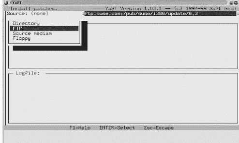

图 12.1 安装软件包选择。

当你到达这一点时，会有多个选择——选择 ftp 会自动将你连接到 SuSE ftp 服务器。这是一个好用的集成功能：YaST 更新程序会检查你系统上的软件，当选择某个目录进行更新时（例如 `pay1` 或 `xaps`），YaST 会指示是否有可用更新版本。此外，如果你愿意，YaST 还会将配置文件安装在系统 `/var` 目录下

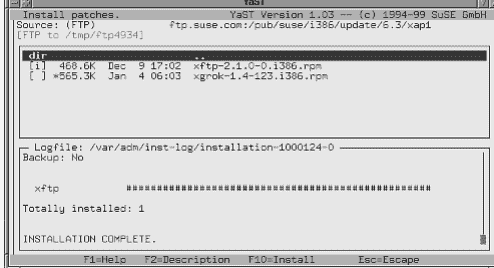

图 12.2 YaST 更新结果。

如果你运行大型站点，你可能想要下载所有更新并刻录到 CD 中。这通常是用户被限制安装软件的情况。用于补丁和更新的官方 Suse 服务器是 `http://suse.de/updates/`。

关于更新的安全公告可以在 `http://www.suse.de/en/` 找到。

### 使用镜像站点

在表 12.1 中，你将找到用于下载更新和其他类型软件的镜像站点列表。请注意，任何软件库都可能被破坏，软件可能包含与作者预期不同的内容。与各个站点联系，如果可能的话，以确认 SuSE 站点的性质

#### 表 12.1 SuSE 软件镜像站点

| 国家 | URL | 描述 |
| :--- | :--- | :--- |
| 阿根廷 | `ftp.unc.de.ar` | Suse Linux (`/pub/linux/suse/`) |
| 奥地利 | `gd.twien.ac.at` (维也纳) | Suse Linux (`/linux.suse.com/`); 更新、修复、内核源码 (`/suse.com/suse/`) |
| 巴西 | `master.softlic.com.br` (贝洛奥里森) `ftp.genix.com.br` (福塔塔莱, 塞亚拉) `ftp.crc.ca` (渥太华) | Suse Linux (`/pub/suse/`); 更新、修复 (`/pub/suse/suse/suse_update/`); 更新、修复、内核源码 (`/pub/suse_update/`) |
| 加拿大 | `ftp.funet.fi` | Suse Linux (`/pub/systems/linux/suse/`); `ftp.suse.com/pub/suse/`); 更新、修复、内核源码 (`/pub/suse_update/`) |
| 法国 | `ftp.ese-metz.fr` `ftp.iut-bm.univ-fcomte.fr` | Suse Linux (`/pub88/`) Suse Linux (`/pub2/linux/distributions/Suse/suse/`); 更新、修复、内核源码 (`/pub2/linux/distributions/Suse/use/i386/update/`) |
| 希腊 | `ftp.ntua.gr` (雅典) | Suse Linux (`/pub/linux/suse/suse/`); 更新、修复 (`/pub/linux/suse/Suse-Linux/use_update/`) |
| | `ftp.linux.gr` | Suse Linux (`/pub/mirrors/ftp.suse.com/`) |
| | `ftp://ftp.duth.gr` | Suse Linux (`/pub/suse/`) |

| 国家 | URL | 描述 |
|---| | --- | -- |
| 匈牙利 | `ftp.bke.hu` | SuSE Linux (`/pub/mirrors/SuSE/` 更新，漏洞修复，内核源码 (`/pub/mirrors/SuSE/i386/update/`) |
| 意大利 | `ftp.cnr.it` | SuSE Linux (`/pub/Linux/distributions/suse/`) |
| | `ftp.flashnet.it` | SuSE Linux (`/mirror/13/suse/`) |
| | `ftp.uniroma2.it` (罗马) | SuSE Linux (`%BA/Linux/SuSE/`); 更新，漏洞修复，内核源码 (`%BA/Linux/SuSE/use_update/`) |
| 荷兰 | `ftp.surfnet.nl` | SuSE Linux (`/mirror/linux/distributions/suse/`); SuSE Linux (`/pub/suse/`); 更新，漏洞修复，内核源码 (`/pub/suse/i386/update/`) |
| 挪威 | `sunsite.io.no` | SuSE Linux (`/pub/unix/linux/SuSE/`); 更新，漏洞修复，内核源码 (`/pub/unix/linux/SuSE/i386/`) |
| 波兰 | `ftp.ds14.agh.edu.pl` | SuSE Linux (`/mirror/suse/`) |
| | `ftp.task.gda.pl` | (`/mirror/ftp.suse.com/pub/suse/`); 更新，漏洞修复，内核源码 (`/mirror/ftp.suse.com/pub/i386`) |
| 葡萄牙 | `ftp.fct.unl.pt` | SuSE Linux (`/pub/Linux/SuSE/mirror-sunsite.unc.edu/distributions/suse/`) |
| | `ftp.puug.pt` | SuSE Linux (`/pub/Linux/distributions/suse/`) |
| 俄罗斯 | `ftp.chg.ru` | SuSE Linux (`/pub/Linux/SuSE/suse/`); 更新，漏洞修复，内核源码 (`/pub/Linux/SuSE/suse/update/`) |
| 西班牙 | `paraiso.disca.upv.es` | SuSE Linux (`parais.disca.upv.es/mirror/suse/`); 更新，漏洞修复，内核源码 (`parais.disca.upv.es/mirror/suse/update/`) |
| 瑞典 | `ftp.sunet.se` | SuSE Linux (`/pub4/os/Linux-distributions/suse/suse/`); 更新，漏洞修复，内核源码 (`/pub4/os/Linux/distributions/suse/suse_update/`) |
| 瑞士 | `sunsite.cnlab-switch.ch` | (苏黎世) SuSE Linux (`/mirror/SuSE/suse/`); 更新，漏洞修复，内核源码 (`/mirror/SuSE/suse_update/`) |

#### 表 12.1 续表

| 国家 | URL | 描述 |
| --- | --- | --- |
| | `ftp.datacomm.ch` | SuSE Linux (`/pub/suse/suse/`); 更新，漏洞修复，内核源码 (`/pub/suse/suse_update/`) |
| 泰国 | `ftp.nectec.or.th` | SuSE Linux (`/pub/mirrors/linux/distributions/suse/`) |
| 英国 | `unix.hensa.ac.uk` (坎特伯里) | SuSE Linux (`/mirrors/ftp.suse.com/pub/SuSE-Linux/`); 更新，漏洞修复，内核源码 (`/mirrors/ftp.suse.com/pub/SuSE-Linux/suse_update/`) |
| | `sunsite.doc.ic.ac.uk` (伦敦) | SuSE Linux (`/Mirrors/ftp.suse.com/pub/SuSE-Linux/`); 更新，漏洞修复，内核源码 (`/Mirrors/ftp.suse.com/pub/SuSE-Linux/suse_update/`) |
| 美国 | `ftp.cdrom.com` (加利福尼亚州，康科) | SuSE Linux (`/pub/linux/sunsite/distributions/suse/`) |
| | `ftp.varesearch.com` (加利福尼亚州，山景城) | SuSE Linux (`/pub/mir/suse/SuSE-Linux/`); 更新，漏洞修复，内核源码 (`/pub/mirrors/suse/SuSE-Linux/suse_update/`) |
| | `ftp.wgs.com` (科罗拉多州，奥罗拉) | SuSE Linux (`/pub/Linux/SuSE/suse_update/`); 更新，漏洞修复，内核源码 (`/pub/Linux/SuSE/suse/`) |
| | `ftp.twoquys.org` (乔治亚州，亚特兰大) | SuSE Linux (`/pub/systems/linux/sunsite/distributions/suse/`) |
| | `ftp.cso.uiuc.edu/` (伊利诺伊州，厄巴纳) | SuSE Linux (`/linux/suse/i386/`); 更新，漏洞修复，内核源码 (`/linux/suse/i386/update/`) |
| | `herbie.ucs.indiana.edu/` (印第安纳州，布明顿) | SuSE Linux (`/pub/Linux/distributions/suse/`) |
| | `metalabc.unc` (北卡罗来纳州，教堂山希尔) (弗吉尼亚州，诺福克) | SuSE Linux |

这些是 SuSE 认可的镜像站点；请根据自己的情况使用。找到安全性最高的站点并坚持使用。

### 备份文件

`rpmfind` 工具是更新软件的另一种方法。它也会对已安装软件包进行清单，连接到 `rpmfind.net`（一个 `rpm` 存储库），并进行更新。

这些是 SuSE 认可的镜像站点；请根据自己的情况使用。找到安全性最高的站点并坚持使用。


`rpmfind <latest>`

`rpmfind <package>`


# 第 13 章：网络安全

- IP 伪装（IP-Masquerading）、防火墙解决方案
- 代理服务器
- 基于 Web 的商业解决方案（电子商务）

如果你发现自己属于上述任何一类，你就正面临着潜在的安全风险。本章将讨论安全的通用性问题，并展示了 SuSE 如何在 6.3 版本中提供卓越的安全包。你还将学习将使用的工具，以及将每天、每周和每月监控你系统的程序。

你可以对这些安全问题持保留态度，并假设入侵和攻破只会发生在别人身上。你可能会说：“我没有什么可以提供给系统破解者。”然而，你会惊讶地发现，这种心态恰恰是那些入侵不安全系统的人所寻找的。

## 互联网上的漏洞

互联网，这条信息高速公路，就像欧洲的德国高速公路。那里很少有速度限制得到执行，你刺激的极限取决于你所拥有的汽车以及你的驾驶技巧和技术。它也让我想起加利福尼亚的高公路——一段看似无止尽的道路，挤满了弱者和无情者。

作为提醒，我想叙述一个极端漏洞的例子。你可能对1988年11月2日的这次事件有记忆。

一个名叫罗伯特·莫里斯（Robert Morris Jr.）的年轻人是康奈尔大学计算机科学的研究生，他利用才华编写了一个实验性的自我复制、自我传播程序，称为蠕虫，并将其释放到互联网上。莫里斯发现，该程序的复制和感染机器的速度快于他的预期——这是程序中的一个“故障”。在短时间内，全国许多地点的许多机器要么崩溃，要么变成了“僵尸”。莫里斯迅速意识到发生了什么，并联系了哈佛大学的一位朋友讨论某种解决方案。最终，他们从哈佛大学通过网络发送了一条匿名信息来杀死蠕虫并防止再次感染。由于蠕虫的影响，网络被堵塞了，这些信息直到为太晚才没有传达。包括大学、军事站点和医疗研究机构在内的许多地的计算机受到了影响。

在网络地点处理蠕虫的成本从几美元到 40,000-50,000 美元不等。

该蠕虫利用了 `sendmail` 的漏洞，`sendmail` 是互联网上几乎每个 UNIX 系统使用的邮件传输代理。这一事件证明了安全是一个不容小觑的问题。基础安全审计中最大的问题是：

- 系统配置问题（无意中允许了用户访问）
- 未补补的软件应用程序允许非意愿或意外的用户访问

如今的商业事实表明，互联网连接对于公司的成功至关重要。这为至少一个之前的问题提供了答案。在专业安全人员的协助下，正在建立 `httpd` 和 `we` 服务器。让网站上线并运行的竞争是惊人的——在这场竞争中，人们并没有考虑真正的准备。这些漏洞正是系统破解者（我将他们称为“黑帽”）所寻找的。在这一问题的另一面，是一个黑客社区，他们的目标是在系统被破坏之前找到软件中的突破口、漏洞和缺陷（这些是“白帽”）。在破坏之前进行测试是关键，因为上述的漏洞可以被修复，从而加强安全性。有时黑与白之间的界限似乎是模糊的，拥有这种安全机制是有益的。

通过你的经验，你发现 Linux 不受目前正在使用的其他操作系统的普通病毒的影响。当其他人都被感染或等待被感染时，你可以坐下来而不担心，这种感觉很温暖、安心。但请注意：Linux 通总体不受病毒攻击的影响，但许多其他事情会引起系统运行的混乱。

考虑这种情况场景：由于配置不当，一个“黑帽”可以连接到你的系统，获得 `root` 权限并安装软件（`root kit`），这允许他或她无阻碍地返回你的机器，然后将你的机器作为攻击源或其他他可能想要的其他操作系统。现在把这些数字成倍考虑，随着世界各地的设备箱在不安全的情况下上线——太可怕了！

当你的机器被“占有”（被入侵者）时，系统可以被用来隐藏程序——远程访问木马（RATs），它们能够映射密钥库或密码文件，然后将其发送到特定的电子邮件地址。或者，如果你的系统被用于协调的网络攻击。想象一下，向你的服务提供商解释为什么你不是那个从你的 IP 地址发出的分布式网络攻击的罪祸首首。

## 注意

> 数据说明一切：1999 年编写了 17 个木马类型程序，1998 年构建了 81 个，而且至少创建了 156 个新的木马。
> 
> 表 15.1 显示了木马示例以及它们通信的端口。在大多数情况下，低端口被木马使用，并将密码发送给攻击者或将其隐藏在预定的目录中。
> 
> 与 RAT 和密码窃取木马相关的问题是：监控系统日志并了解哪些端口是开启的。所有列出的木马影响 UNIX/Linux 系统——如果你在混合平台上运行，这可能帮助你识别其他问题。

### 表 13.1 木马及其端口

| 端口 | 程序 |
| :--- | :--- |
| 21 |  |
| 23 |  |
| 25 |  |
| 53 |  |
| 80 |  |
| 110 |  |
| 111 |  |
| 143 |  |
| 443 |  |
| 465 |  |
| 512 |  |
| 587 |  |
| 666 |  |
| 667 |  |
| 766 |  |
| 880 |  |
| 993 |  |
| 1025 |  |
| 1026 |  |
| 1027 |  |
| 1028 |  |
| 1036 |  |
| 1043 |  |
| 1337 |  |
| 1337 |  |
| 1396 |  |
| 1443 |  |
| 1640 |  |
| 1743 |  |
| 1995 |  |
| 1999 |  |
| 2000 |  |
| 2001 |  |
| 2002 |  |
| 2003 |  |
| 2004 |  |
| 2005 |  |
| 2006 |  |
| 2007 |  |
| 2008 |  |
| 2009 |  |
| 2010 |  |
| 2011 |  |
| 2012 |  |
| 2013 |  |
| 2014 |  |
| 2015 |  |
| 2016 |  |
| 2017 |  |
| 2018 |  |
| 2019 |  |
| 2020 |  |
| 2021 |  |
| 2022 |  |
| 2023 |  |
| 2024 |  |
| 2025 |  |
| 2026 |  |
| 2027 |  |
| 2028 |  |
| 2029 |  |
| 2030 |  |
| 2031 |  |
| 2032 |  |
| 2033 |  |
| 2034 |  |
| 2035 |  |
| 2036 |  |
| 2037 |  |
| 2038 |  |
| 2039 |  |
| 2040 |  |
| 2041 |  |
| 2042 |  |
| 2043 |  |
| 2044 |  |
| 2045 |  |
| 2046 |  |
| 2047 |  |
| 2048 |  |
| 2049 |  |
| 2050 |  |
| 2051 |  |
| 2052 |  |
| 2053 |  |
| 2054 |  |
| 2055 |  |
| 2056 |  |
| 2057 |  |
| 2058 |  |
| 2059 |  |
| 2060 |  |
| 2061 |  |
| 2062 |  |
| 2063 |  |
| 2064 |  |
| 2065 |  |
| 2066 |  |
| 2067 |  |
| 2068 |  |
| 2069 |  |
| 2070 |  |
| 2071 |  |
| 2072 |  |
| 2073 |  |
| 2074 |  |
| 2075 |  |
| 2076 |  |

### 表 13.1 续

| 端口 | 程序 |
|---|---|
| 5555 | ServeMe |
| 5556 | BO Facil |
| 5557 | BO Facil |
| 5569 | Robo-Hack |
| 5742 | WinCrash |
| 6400 | The Thing |
| 6669 | Vampyre |
| 6670 | Deep Throat |
| 6771 | Deep Throat |
| 6776 | BackDoor-G, SubSeven |
| 6939 | Indoctrination |
| 6969 | GateCrasher, Priority, IRC 3 |
| 6970 | GateCrasher |
| 7000 | Remote Grab, Kazimas |
| 7300 | NetMonitor |
| 7301 | NetMonitor |
| 7306 | NetMonitor |
| 7307 | NetMonitor |
| 7308 | NetMonitor |
| 7789 | Back Door Setup, ICKiller |
| 8080 | RingZero |
| 9400 | InCommand |
| 9872 | Portal of Doom |
| 9873 | Portal of Doom |
| 9874 | Portal of Doom |
| 9875 | Portal of Doom |
| 9876 | Cyber Attacker |
| 9878 | TransScout |
| 9989 | iNi-Killer |
| 10067 (UDP) | Portal of Doom |
| 10101 | BrainSpy |
| 10167 (UDP) | Portal of Doom |
| 10520 | Acid Shivers |
| 10607 | Coma |
| 11000 | Senna Spy |
| 11223 | Progenic Trojan |
| 12076 | Gamer |
| 12223 | Hack '99 KeyLogger |
| 12345 | GabanBus, NetBus, Pie Bill Gates, X-bill |
| 12346 | GabanBus, NetBus, X-bill |
| 12361 | Whack-a-mole |
| 12362 | Whack-a-mole |
| 12631 | WhackJob |
| 13000 | Senna Spy |
| 16969 | Priority |
| 17300 | Kuang2 The Virus |
| 20000 | Millennium |
| 20001 | Millennium |
| 20034 | NetBus 2 Pro |
| 20203 | Logged |
| 21544 | GirlFriend |
| 22222 | Prosiak |
| 23456 | Evil FTP, Ugly FTP, Whack Job |
| 23476 | Donald Dick |
| 23477 | Donald Dick |
| 26274 (UDP) | Delta Source |
| 29891 (UDP) | The Unexplained |
| 30029 | AOL Trojan |
| 30100 | NetSphere |
| 30101 | NetSphere |
| 30102 | NetSphere |
| 30303 | Sockets de Troie |
| 30999 | Kuang2 |
| 31336 | Bo Whack |
| 31337 | Baron Night, BO client, BO2, Bo Fac |
| 31337 (UDP) | BackFire, Back Orifice, DeepBOO |
| 31338 | NetSpy DK |
| 31338 (UDP) | Back Orifice, DeepBOO |
| 31339 | NetSpy DK |
| 31666 | BOWHack |
| 31785 | Hack’a'Tack |
| 31787 | Hack’a'Tack |
| 31788 | Hack’a'Tack |
| 31789 (UDP) | Hack’a'Tack |
| 31791 (UDP) | Hack’a'Tack |
| 31792 | Hack’a'Tack |
| 33333 | Prosiak |
| 33911 | Spirit 2001a |
| 34324 | BigGluck, TN |
| 40412 | The Spy |
| 40421 | Agent 40421, Masters Paradise |
| 40422 | Masters Paradise |
| 40423 | Masters Paradise |
| 40426 | Masters Paradise |
| 47262 (UDP) | Delta Source |
| 50505 | Sockets de Troie |
| 50766 | Fore, Schwind |
| 53001 | Remote Shutdown |
| 54320 | Back Orifice 2000 |
| 54321 | School Bus |
| 54321 (UDP) | Back Orifice 2000 |
| 60000 | Deep Throat |
| 61466 | Telecomando |
| 65000 | Devi |

1999年，CERT协调中心（位于卡内基梅隆大学的软件工程学院的一部分）识别出了一种新型攻击。分布式拒绝服务（DDoS）攻击是一种将木马攻击提升到新水平的攻击。欲更多信息，请将您的浏览器指向 http://www.cert.org/incident_notes/99-07.html 或 http://www.icsa.net/communities/ddos/index.shtml。

来自远程源还存在其他类型的威胁。缓冲区溢出攻击被认为是破坏 Linux 平台安全性的有效方法。该问题源于应用程序中的错误。有关缓冲区溢出如何影响您的系统的更多详细信息，请参阅 http://www.infosecurity.com/may99/news.htm，以及 http://www.insecure.org/。

## 分析网络 159

`john` `/etc/password` 文件名

我在我的系统上创建了带有弱密码的虚用户，并运行了 `John` 来解密。结果如图 13.1 所示。

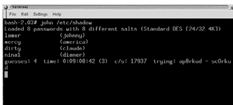

图 13.1
"John" 密码破解工具。

第一个密码在大约 30 秒内被破解了。强密码是起作用的；弱密码则不然！

SuSE 还包含了另一个工具，它是一个预判性密码验证器。如果你对自己的密码有疑问，请使用名为 `vpass` 的程序。如果你使用 `cracklib` 来评估一个密码是否合格，或者它会返回“ERRNO <reason>”并告诉你密码是否太短、是否全小写写或其他问题。可以通过以下命令实现：

```
echo <user name> | vpass -u
```

这个小程序价值连城。当管理员在白天抽空时，检查几个用户并向他们发送情况说明，这被称为主动安全。

你的下一步将是检查 `root` 权限被破解的能力。虽然 SuSE 在安装后设置了权限，但你仍然想找出是否有任何外部人员可以获得 `root` 访问。你需要使用 Tiger Research Assistant (`TARA`)。这是 TAMU `tiger` 程序的升级版，它是一组脚本，可以扫描你的系统以寻找安全问题和 `root` 访问问题。该程序未包含在 SuSE 发行版中，你必须从 http://home.arc.com/tara/index.html 下载它。

下载 `tar` 包后，将其解压到安全目录中（最好不是 `root` 目录）。运行 `make` 和 `make install`，然后运行程序。除非你仔细寻找，否则你永远不知道系统上开启了哪些端口，而 `TARA` 将帮助识别潜在的威胁区域。（见图 13.2。）

# 160 第 13 章：网络安全

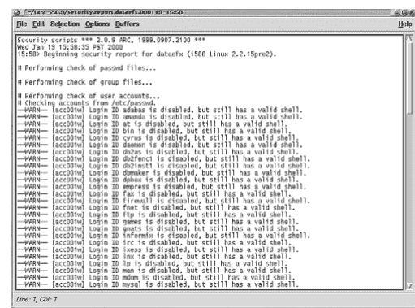

图 13.2

`TARA` 是系统管理员的一个很好的程序；你可以将 `TARA` 添加到 `cron` 中，让它在特定时间运行并详细检查日志。

最后但同样重要的是，为了确保你的系统安全，我建议在上线之前使用 `Tripwire`。该工具将指定文件和目录的属性与之前生成的数据库存储的属性进行比较。该工具的关键是将 `tripwire_database` 文件保留在不可访问的介质上。这消除了黑客篡改的可能性。要设置并运行 `Tripwire`，请查看 `/usr/doc/packages/tripwire/README.FIRST`。

YaST 将为你提供检查弱密码的选项。在系统管理菜单的“配置文件”下，对 `PASSWORD_USE_CRKLIB` 选项回答“yes”，将检查所有通过 `cracklib` 库分配的密码。这有助于限制弱密码的使用。

当你采取这些措施后，你将拥有一个相当安全的工作环境。如果你有多台机器，应该在上线前在所有机器上执行这些操作。

YaST 惊人灵活性的另一个方面体现在系统管理菜单中的安全设置选择。在全系统范围内设置文件权限时，你可能会选择使用此工具。（见图 13.3。）

也可以使用此菜单修改其他设置。该工具可能需要也可能不需要——取决于你希望权限设置达到多细的程度。

# 分析网络 161

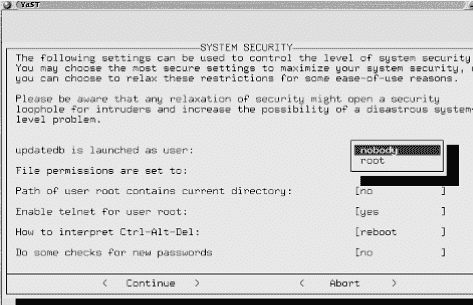

图 13.3

YaST 安全选择。

## 强制网络安全

如果你是网络上的唯一用户，执行网络安全的任务与你有 100 个用户时同样关键。你建立的习惯要么是资产，要么是负担。安全是一种心态，而不是一种操作状态。如果你成功执行了良好的安全措施，你很可能会维护一个调试良好的网络。

SuSE Linux 6.3 自带了一个 `firewall` 软件包。该包本身并不是防火墙——它更像是一个用 `iptchains` 程序构建的小型包过滤器。要让它工作起来，你需要阅读 `/etc/rc.firewall` 中的说明并相应地编辑该文件。这将为你设置一个功能齐全、工业级的自定义防火墙脚本提供非常好的开始。

SuSE 升级了启动脚本，因此所有内容在启动时初始化；使用以下命令检查你的当前版本：


`rpm -q firewall`

当前的防火墙是 `firewall-1.4`。如果在启动过程中遇到防火墙初始化问题，请在 http://www.suse.de/en/support/download/updates/63_update.html 下载更新包。

为了跟上一般的安全问题，请查看网站：http://xforce.iss.net。

除了你可能受到防火墙保护之外，如果必须允许某种类型的连接到你的网络，你就必须建立一种信任。信任关系可以通过 `ssh`（安全外壳）或 `PKI`（公钥基础设施）方法建立。与其允许任何类型的连接，这种信任方法作用于：

# 162 第 13 章：网络安全

## 侵入你的网络

如果你是网络上的唯一用户，执行网络安全的任务与你有有 100 个用户时同样关键。你建立的习惯要么是资产，要么是负担。安全是一种心态，而不是一种操作状态。如果你成功执行了良好的安全措施，你很可能会维护一个调试良好的网络。

## 端口扫描器

端口扫描器是网络中众所知的工具，这里不再赘述。

## 警告

未经许可，严禁扫描另一个子网。

# 分析网络 163

```bash
nmap -sV -T2 BY Fodor (fodor.com, www.nmap.org/nmap/)
Starting map for example.com (nmap-carlist.net, 192.168.1.1):
PORT   STATE SERVICE
25/tcp open  smtp
80/tcp open  http
111/tcp open  nrpc
443/tcp open  https
8000/tcp open  printer
map scan completed: 1 IP address (1 host) scanned in 2 seconds
bash-2.4$
```

图 13.4

`nmap` 扫描工具示例输出。

## 网络分析器

`SAINT` 是 `SATAN`（网络管理员分析工具）网络分析工具包的衍生。。安全专家 Dan Farmer 和 Wietse Venema 开发了这个程序来探测响应网络系统的漏洞。发现的漏洞将以 HTML 格式在屏幕上报告给安全管理员。（见图 13.5。）

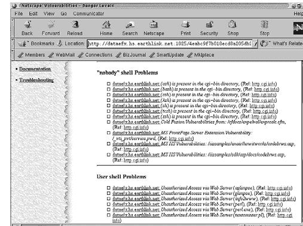

图 13.5

## 164 第 13 章：网络安全

最新的 `SAINT` 版本 1.5.BETA1 已于 2000 年 1 月初发布。如果你想处于安全领域的最前沿，请从之前的 URL 获取副本。该版本在 SuSE Linux 上运行非常顺畅。

## 需要避免的安全风险

安全的核心思想是防范而非事后控制。保护网络安全性的最佳方法是针对网络活动制定特定的策略和程序，从而限制威胁。检查并修剪访问级别，并运行 `tiger` 程序以提醒你注意任何内部变化。顺便说一下，SuSE 还带有一个名为 `seccheck` 的软件包，它是一个 `tiger` 类型的程序。该程序会每天、每周和每月月向你发送安全通知。（尽管我更喜欢 `TARA`，它更符合你的需求。）请记住，网络上包含有关如何获取 UNIX/Linux 系统 root 权限的信息，因此要特别留心内部用户。

解决社交工程学攻击的关键是密切监控用户名并频繁更改密码。教育他人，确保重要信息不会在没有身份验证的情况下泄露。建立一套安全的信息交换策略和程序。如果账户被终止，请删除该用户及所有相关文件（而不只是 `/home` 目录）。

关闭所有未使用的端口并关闭不需要的服务也将有助于加固防线。SuSE Linux 自带了一个名为 `harden_suse` 的加固脚本。该脚本是交互式的；你将看到图 13.6 所示的屏幕。

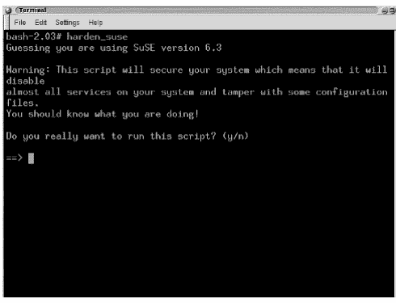

图 13.6：`harden_suse` 系统加固脚本。

## 分析网络 165

使用 `harden_suse` 时要小心，因为它可能会禁用你大部分日常所需的服务。

使用扫描和漏洞工具运行定期和不期的网络安全审计。如果你能将审计成为日常工作的一部分，你将会有更好的视野和信心。

监控系统的其他方法较少：其之一是使用 SuSE 的临时程序，它会记录入侵者在攻击期间可能打开的临时文件。你可以通过发布命令来实现与 `temp-watch` 类似的功能：

```
lsof | less
```

这将通过名为 `less` 的分页器工具显示所有打开的文件。

## 报告安全问题

你如何知道系统何时被入侵？每天检查日志是关重要的。如果你不监控日志，入侵者就可以随意所为。如果入侵者很聪明，活动痕迹可能在单次事件中无法被发现。你或任何负责安全的人应该熟悉你的系统，这样系统运行中的细微变化就会引起你的注意。SuSE 赋予你减少或增加邮件频率的能力。进入 `YaST`，选择 Configuration File（配置文件），选择 MAIL，然后回答 All（全部）。这会将所有系统日志映射到指定的用户。你也可以使用 `logcheck` 或 `logwatch`，它们可以在 http://www. 处获得。

你需要一个联系人（可能是你本人）以及一个从入侵中恢复的计划。与你当地的 ISP 建立关系也是件好事，以防你可能需要追踪入侵者。网络上的大量资源将帮助你应对攻击或入侵。一个很好的网站是 NetworkICE，地址位于 http://www.81gm.org/

## 解决安全入侵事件

这可能是安全领域中最难处理的问题之一。当你的网络被入侵时，你该怎么办？

脑海中想出的第一件事可能是以某种方式追踪是谁干的以及从哪里来。除非破解者很粗心，或者你已经注意到了他的存在并允许他建立起可以在法庭上站得脚的记录。（当然，只有当那人打算和你住在同一个国家时这才是一个选项。）

从入侵中恢复是复杂的，有时如果不挽救文件并通过重新安装系统来清理系统，是不可能的。如果你的网络中部署了木马程序，而你不确定该怎么办，请寻求帮助。美国国防部在 http://www.mil/techtips/root_compromise.htm 对 root_compromise 进行了详尽介绍。或者，访问 FBI 计算机犯罪网页：http://www.fbi.gov/nipc/compcompise.htm。

## 16 第 13 章：网络安全

我希望你永远不需要使用这些 URL。然而事实上，任何事情都可能发生。

## 安全总结

在本章中，你学习了安全是一种心态，而不是一种操作方式。从内向外封堵房子里所有的漏洞。建立起你的栅栏（防火墙），并隔一段时间去转一转门窗锁手，以确保它们是关的。如果你不坚持这样做，就像在书房里开着灯并放着音响一样。如果你不尽你的职责，小偷就会尽他们的职责。

SuSE Linux 正在安全领域不断进步，提供的工具比大多数主流发行版都要多。Linux 13.7 显示了几个网络安全工具。

| 软件包选择 | Series.sec | Version 1.03 | (c) 1994-99 SuSE Deb. |
|---|---|---|---|
| argus | Networking | 挂载点 | (F3)Zoom |
| amatch | ethernet/ip address part | | |
| detect | | | |
| free | | | |
| harden | | | |
| install | | | |
| iptables | | | |
| logcheck | | | |
| nessus | | | |
| salt | | | |
| topology | | | |

*(注：上述表格由于原文 OCR 问题存在内容缺失；已根据可用标题维持了结构。)*

# 附录 A：寻找帮助

## 加入邮件列表

通过加入邮件列表，你可以跟上 Linux 更新。SuSE 提供了许多你可以订阅的邮件列表。这些列表的主题包括：

- announcements@blonion.com
- linux-admin@vger.rutgers.edu
- kernel-development@linuxcare.com
- research-engineering@twien.ac.at:8050
- cluster@beowulf.org
- hpc@cs.berkeley/~mdw/linux/hpc

## Linux 用户组

Linux 用户组 (LUG) 正在美国和欧洲各地涌现。这些组织是为了促进 Linux 操作系统的发展。这些小组会议涵盖了网络、防火墙配置和桌面实用程序等主题。目标是让社区相互教学，这同时也增强了凝聚力。

## 更多参考资源 169

遗憾的是，列出用户组列表将占据一百多页。相反，本节为你提供了几个很好的 URL，帮助你找到适合自己的新小组。大多数 Linux 用户小组（LUG）都有本地聚会场所和专门为成员提供的邮件列表。联系离你最近的小组，结识你所在社区中参与 Linux 的这些人。

首先，请访问由 Linux-Mail 赞助的站点：http://linuxnews.com/programs/usergroup/。另一个很好的网站是 http://www.linux.com/search.html。该 URL 指向一个搜索引擎——只需输入你的位置信息，它就会标出你所在地区最近的 LUG。Yahoo! LUG 列表也可以通过 http://clubs.yahoo.com/clubs/suselinuxusers 获取。

成为 Linux 社区的一员是其他用户感兴趣的原因——在你所在的地区找一个小组，你就会明白我的意思。我已经使用 Linux 几乎 4 年了，我发现自己一直在学习和成长。寻找帮助往往寻找朋友。

某些 LUG（包括通过 http://www.ecn.purdue.edu/PLUG/Installfest/ 的小组）设有“安装节”（installfests），在那里你可以带上你的软件和硬件并让它们都运行起来——至少是越接近目标越好。

我有机会参加过的一个 LUG 是为为编程、安全和其他相关问题组织了特殊兴趣小组（SIGs）。加入 LUG 不仅能让你很好地了解如何在个人层面使用 Linux，它还可能让你有机会结识那些在更大环境中使用 Linux 的人。

## 更多参考资源

SuSE 网站（http://www.suse.com）包含的不仅仅是安装信息。这里找到数据库和在线帮助系统代表了强大的服务背景。你将找到追溯到版本 4.2 的问题的解决方案，既有针对看似孤立困难问题的答案，也有针对常见问题的答案。

数据库中包含了有关 Linux 软件和 Reifers 文件系统的信息。启动问题、PCMCIA 诊断以及许多其他耗时的程序也得到了解决，并在支持文本中提供了简单的解决方案。总的来说，SuSE 在支持文档领域已经处于领先地位。

Linux 文档项目（LDP）网站位于 http://metalab.unc.edu/LDP，是与 Linux 操作系统相关的最大的信息库。其中包含的 HOWTO 包含了社区的集体知识，这个 LDP 由 Linux 用户支持。如果你花点时间阅读 LDP 宣言（位于 http://www.linuxdoc.org/manifesto.html），你将更清楚地理解谁在做什么以及如何做。

## 170 附录 A：在线寻找帮助

你也可以利用 LDP 来识别和解决问题。除了 SuSE 支持数据库外，这可能是你信息追踪路径上的一个关键停靠点。这些广泛的主题材料可以帮助你的系统正常运行。

Linux Weekly News 网站 http://l.linux.net 也也将重要的 Linux 问题推向了沿。当你搜索当前趋势和主题时，这个网站是一个极佳的资源。该网站还维护了跨越 Linux 世界的有趣链接。

Linux Today（http://www.linuxtoday.com）总是充满了最新的 Linux 新闻。这个网站应该有你所需的一切，包括最近的就业机会、安全帖子和每周总结。为了方便起见，你可以让所有的主要帖子和总结发送给你（就像我这样做）。

最显眼（且被引用最多）的网站是 Slashdot（http://slashdot.org）。这个网站是当前信息的存储库，还刊登了互联网其他地方没有的社论。它是一个关注开源计算社区关注点的大型新闻网站。

LinuxJournal（http://www.linuxjournal.com）是另一个访问和搜索过去文章的好地方。我订阅了这本杂志，我一直对编辑人员能够在一个期杂志内涵盖这么多内容的能力留深刻印象。你可以通过关键词和主题搜索存档。

系统管理员应该关注 http://www.samag.com。该网站面向系统管理员，但部分信息和文章与 Linux 关关，包括 Linux 栖息（Linux Rookery）。如果你对大型机设备感兴趣，请看看这个网站。

你可以通过关注 http://www.linux.org.uk/cgi-bin/portaloo/ 来保持信息更新。这个门户有几个高流量站点的链接，可以帮助你筛选出所需的信息。还有 http://www.linuxlinks.com/ 以及宾州州立大学的门户页：http://www.math.psu.edu/morris/deptpage/portals.html。

当然，新的门户和网站每天都在涌现。流行程度的快速增长将继续推动这场被称为 Linux 的现象级爆发。

当然，互联网、邮件列表和 IRC 通道并不是寻找良好帮助的唯一途径。你可能会自己发现其他的援助手段。无论你做什么，玩得开心！

## 附录 B

## 排除 SuSE Linux 故障

在现实情况下，事情会出错。设计用于运行的系统不会出错。很有可能你的 SuSE Linux 安装非常顺利，你没有遇到任何阻碍；我向你致敬，并祝你在后续的 Linux 之旅中一切顺利。

另一方面，你可能遇到导致安装中断的问题，或者你机器上的某些组件无法正确配置。接下来的信息绝非“良方”。

某些 LUG（包括通过 http://www.ecn.purdue.edu/PLUG/Installfest/ 的小组）设有安装节，在那里你可以带上你的软件和硬件并让它们都运行起来——至少是越接近目标越好。我有机会参加过的一个 LUG 是为编程、安全和其他相关问题组织了特殊兴趣小组（SIGs）。加入 LUG 不仅能让你很好地了解如何在个人层面使用 Linux，它还可能让你有机会结识那些在更大环境中使用 Linux 的人。

## 大磁盘

在现实情况下，事情会出错。设计用于运行的系统不会出错。很有可能你的 SuSE Linux 安装非常顺利，你没有遇到任何阻碍；我向你致敬，并祝你在后续的 Linux 之旅中一切顺利。

另一方面，你可能遇到导致安装中断的问题，或者你机器上的某些组件无法正确配置。接下来的信息绝非“良方”。

某些 LUG（包括通过 http://www.ecn.purdue.edu/PLUG/Installfest/ 的小组）设有安装节，在那里你可以带上你的软件和硬件并让它们都运行起来——至少是越接近目标越好。我有机会参加过的一个 LUG 是为编程、安全和其他相关问题组织了特殊兴趣小组（SIGs）。加入 LUG 不仅能让你很好地了解如何在个人层面使用 Linux，它还可能让你有机会结识那些在更大环境中使用 Linux 的人。

## SCSI 驱动器

SCSI 磁盘不应该给你带来问题，如果发生了，这里有几种解决方法。随着内核的升级，不再需要选择。

按照第 2 章“安装 SuSE Linux”的步骤操作并启动磁盘。这个 SCSI 镜像可能不符合你的需求，请寻找正确的镜像并使用以下命令（从 DOS 提示符）：

- `copy images\scisxx a:\linux`

创建主 SCSI 镜像并覆盖任何额外信息。记住你必须先制作镜像。

## Zip 和 Jaz 驱动器

Zip 和 Jaz 驱动器利用并行端口（ppa）驱动程序。驱动程序正确编译并加载后，你不应该遇到问题。不要尝试同时使用 Zip 驱动器和打印机。Zip 驱动器被识别为 `/dev/sda`（SCSI 设备），打印机需要 Ip 模块才能运行。如果你在打印机之外使用 Zip 或 Jaz 驱动器，你需要两个 LPT 端口。你还需要管理模块加载，以便 `ppa` 模块在 `Ip` 模块之前加载。关于此的更多信息，请参见 http://suse.de/sdb/en/html/mantel_1.html。关于 Jaz 驱动器的 HOWTO，请将浏览器指向 http://www.linux.doc/HOWTO/Jaz-Drive-HOWTO.html。

## 故障排除 SuSE Linux 173

## 显卡

显卡一直以来是一个棘手问题。在显卡制造商意识到 Linux 是一个可行的解决方案之前，支持将非常稀少。

有几款显卡需要注意——它们可能可以工作，也可能无法。例如，SIS 6326 在图形加速过程中的步进（stepping）功能上存在一些问题。坦率地说，SuSE 为其提供了解决方法——将你的浏览器指向 http://sdb.suse.de/sdb/en/html/cep_sis_6326.html。

另请阅读正文以获取如何编辑配置文件的信息。如果不确定你使用的是哪种显卡，可以随时检查 http://cdb.suse.de/cdb_english.html 硬件数据库查看其是否支持。关于其他显卡问题的详情，请参阅 http://sdb.suse.de/sdb/en/html/unsupp_graphic.html。你在那里找到的信息是 SuSE 在线提供的最新信息。

## 声卡

声卡代表了一个特殊问题，因为它们在配置方面非常敏感且挑剔。你可以通过几个命令诊断该问题的硬件方面，这将让你知道系统是否识别了声卡。在命令行执行以下命令：

```
dmesg | less
```

这将允许你检查启动过程并验证系统是否识别了声卡。你可以使用命令

```
tail /var/log/messages
```

获取相同的结果。

如果你已验证声卡在 Windows 或 DOS 中工作正常，请确保正确记录运行设置。Linux 使用的 I/O 端口和 IRQ 与在 Windows 或 DOS 中运行时相同。

你可以执行以下命令显示系统当前可用的 IRQ：

```
cat /proc/interrupts
```

检查你的声卡规格。这将帮助你确定 IRQ 是否被其他设备占用。

执行此命令显示所有 I/O 端口地址：

```
cat /proc/ioports
```


这也可以帮助你确定资源冲突问题。确保你参考的是声卡制造商的信息。

## 174 附录 B：故障排除 SuSE Linux

此命令列出所有使用的 DMA 通道：
```bash
cat /proc/dma
```

你可以在 http://www.linuxdoc.org/HOWTO/Sound-HOWTO.html#toc4 找到声音 HOWTO。

## 网络接口卡

网卡（NIC）的配置非常简单，大多数驱动程序在 SuSE Linux 安装的内核中可用。我发现的一个问题是关于 PCI 卡配置的。这是一个孤案例，但为了方便他人，我会将其记录下来。在 10Base ISA 卡流行时期最初构建的旧机器上，其 BIOS 设置可能需要更改 PCI 设置。PCI 卡自动分配 IRQ 和 IO。这意味着如果 PCI 设置开启了“旧版兼容（legacy compatibility）”，系统要么能识别显卡但不为其分配 IRQ，或者它会分配 IRQ0 或 255，这些都不是有效地址。当设置调整为 PCI PnP 兼容模式时，问题应该就会消失。可以在 http://csdesis.gsfc.nasa.gov/linux/misc/irq-config.html 获取更详细的信息。查看 http://sdb.suse.de/cqi-bin/sdbsearch_en.q7stitchwort-PCI 数据库。

如果你在使用 ISA 卡时遇到问题，你需要使用上一节声卡部分列出的相同命令。这将帮助你确定是否存在系统冲突或其他问题。再次提醒，你需要手头有显卡的规格说明。

## 笔记本电脑与笔记本

如果你有一台笔记本电脑并安装了 SuSE，你可能会发现一些不同之处——特别是 PCMCIA 配置问题。如果你面临需要诊断的情况，这可能会有所帮助。

Linux 在安装后会自动探测 PCMCIA 设备并尝试在此时设置该设备。你还会被询问使用哪种网络设备；否则，你选择 PCMCIA，YaST 将尝试配置 PCMCIA 设备。当你重启时，启动过程无法启动 PCMCIA 设备，并提示“eth0 device not found”，或者设备初始化后 `/etc/route` 失败。该问题的由于是 Linux 和 YaST 试图做同一项工作。在互不感知的情况下，每个程序都必须配置 PCMCIA 设备。

你必须返回 YaST 并选择“网络配置（Network Configuration）”，取消勾选 YaST 设置的 PCMCIA 设备（在基础配置下）。不要删除已有的任何条目。接下来，你需要编辑 `/etc/pcmcia/network.opts` 文件——SuSE 在该文件中查找有关 PCMCIA 设备的网络信息。添加你的 IP 地址、子网掩码、广播地址和网络信息。还要添加你的主机名和 DNS 服务器以完成任务。

## 故障排除 SuSE Linux 175

如果系统在启动并尝试初始化 PCMCIA 设备时挂起，请查看此支持提示：http://sdb.suse.de/sdb/html/mnened_6.3_pcmia-start.html。

由于 PCI 技术差异，你可能在你的笔记本电脑上没有声音。标准声驱动程序和配置工具是针对 ISA 类型 PnP 的。如果你愿意尝试开发内核版本，这可能解决你无声的困境。

# SuSE Linux 177 故障排除

“管理网络设置。”如果你决定不在 SuSE 中使用防火墙功能（数据包过滤），你你仍然可以使用 IP Chains 的伪装功能。

执行以下命令以在拨号连接设备 `ppp0` 上激活 IP Chains：

```
ipchains -P forward DENY
ipchains -A forward -i ppp0 -j MASQ
echo 1 > /proc/sys/net/ipv4/ip_forward
```

在连接到定义为 `eth0` 的以太网网卡的机器上执行这些命令：

```
ipchains -P forward DENY
ipchains -A forward -i eth0 -j MASQ
echo 1 > /proc/sys/net/ipv4/ip_forward
```


关于 IP Chains 和伪装的更多资源，请参阅 http://www.linuxdex.org/HOWTO/IPCHAINS-HOWTO.html 的 HOWTO 文档。

在这种敌对环境中，防火墙可能是你唯一的选择。可以很容易开启数据包过滤（见第 11 章）。关于防火墙的任何进一步讨论均超出本文范围。请参考以下资源获取更多信息：

- http://metalab.nc.edu/LDP/HOWTO/Firewall-HOWTO.html
- http://sites.inka.de/sites/linux/freefire-1/index.en.html
- http://www.rustcorp.com/linux/ipchains/
- http://fwtk.netimages.com/main.html
- http://www.obtuse.com/juniper/
- http://www.ifi.unieh.ch/ikm/SINUS/firewall/

# 声卡驱动问题

SuSE Linux 自带声卡驱动程序由 ALSA 提供。列表列出了支持的声卡和芯片组类型。

该列表详细列出了声卡接口，包括用于数字声音重放的 PCM（脉冲编码调制）、用于混合和修改声音的模拟混合器，以及允许 MIDI 乐器和序列器（或运行序列器类型软件的计算机）相互进行通信的 MIDI 协议。SYNTH 功能（合成器）允许电信号被解释为。

支持所有这些声音重放元素是了不起的，ALSA 正在扩展他们的项目以支持更多声音。

| 芯片组 | 声卡 | 接口 |
| :--- | :--- | :--- |
| AMD InterWave | Gravis UltraSound Plug & Play | |
| | Dynasonic 3-D | |
| | STB Sound Rage 32 | |
| | UltraSound 32-Pro (STB) | |
| | MED3210 | MIXER,PCM,MIDI,SYNTH |
| Gravis UltraSound MAX | | MIXER,PCM,MIDI,SYNTH |
| Gravis UltraSound Extreme | | MIXER,PCM,MIDI,SYNTH |
| Gravis UltraSound Classic/ACE | | MIXER,PCM,MIDI,SYNTH |
| ESS AudioDrive Es668 | | MIXER,PCM,MIDI(1688) |
| SoundBlaster 1.0/2.0/Pro | | MIXER (Pro only),PCM,MIDI |
| SoundBlaster 16/AWE | | MIXER,PCM,MIDI |
| Yamaha OPL3-SA2/SA3 | | MIXER,PCM,MIDI |
| OAK Mozart | | MIXER,PCM |
| S3 SonicVibes PCI | Schubert 32 PCI (PINE) | MIXER,PCM,MIDI |
| Ensoniq AudioPCI(ES1370,ES1371) | SoundBlaster PCI 64 | |
| | SoundBlaster PCI 128 | MIXER,PCM,MIDI |
| Cirrus Logic / Crystal Semiconductors CS4232/CS4232A | | MIXER,PCM,MIDI |
| Cirrus Logic / Crystal Semiconductors CS4235/CS4236/CS4236B/CS4237B/CS4238B/CS4239 | Turtle Beach Malibu | MIXER,PCM,MIDI |
| Cirrus Logic / Crystal Semiconductors CS4610/4612/4615/4280 | | MIXER,PCM |
| ESS Solo-1 ES1938 | | MIXER,PCM |
| ESS ES18XX | | MIXER,PCM,MIDI |
| Opti 82C9xx | Audio 16 Pro EPC-SOUN9301 (82C930 based) | |
| | ExpertColor MED-3931 v2.0 (82C931 based) | |
| | ExpertMedia Sound 16 MED-1600 (82C928 based - AD1894) | |
| | Mozart S601206-G (OTI601 based - CS4231) | |
| | Sound Player S-928 (82C928 based - AD1848) | MIXER,PCM,OPL,MIDI |
| Trident 4DWave DX/NX | Best Union Miss Melody 4DWave PCI | |
| | HIS 4DWave PCI | |
| | Warpspeed OnSpeed 4DWave PCI | |
| | AzTech PCI 64-Q53D | |
| | Addonics SV 750 | |
| | True Sound 4D | |
| | Predator4D-PCI | |
| | Jaton SonicWave4D | |
| | Jaton SonicWave4D | |
| | Jaton SonicWave4D | MIXER,PCM,MIDI |
| | Jaton SonicWave4D | MIXER,PCM,MIDI |

# SuSE Linux 177 故障排除

附录 B：SuSE Linux 故障排除

LILO（Linux加载器）是一组旨在从磁盘移动信息到扇区的程序。配置文件位于 `/etc/lilo.conf`。

如果 LILO 没有正确安装和配置，你可能会遇到无法启动的机器。以下是 LILO 无法启动的一些原因：

- L 表示 BIOS 已加载并启动，但找不到 `boot.b`。这可能是由于磁盘物理问题或几何位置不正确（超过了 1024 柱道限制）。
- LI 表示 LILO 的第二阶段已启动，但无法从映射文件中读取描述表。这可能是由于文件损坏或被移动后未重新安装。
- L 表示 LILO 的第一和第二阶段都已识别，但其位置错误。这通常发生在文件移动或更新后没有重新安装 LILO。
- LI 表示映射文件描述表可能损坏，或者在文件移动或更新后没有调用 LILO 命令重新启动映射文件。

如果发生上述任何情况，请不要恐慌。SuSE CD 自带的救援系统可以帮助你。重启 BIOS 引导至光盘。Linux 启动后，进入主菜单并选择“Installed”。救援系统提供了一个内核镜像进行启动，并允许你进入系统进行必要的修复。但是，它无法解决 `boot.b` 文件位于 1024 柱道边界之外的问题。如果你没有可启动的光盘，启动盘也可以起到相同的作用。

## 184 引导加载程序，故障排除

- 引导加载程序，故障排除, 181
- 引导程序网站, 181
- 引导扇病毒 (bootkits)，从 CD-ROM 创建, 17
- 巴西 SuSE Linux 软件镜像, 142
- 浏览器
    - Lynx, 118-119
    - Netscape, 119-121
    - BRU (备份与恢复工具, 146)
- 缓冲区溢出, 156
- Bugtrap 网站, 156

## C

- 线缆型号, 81-82
- Caldera, LINuxZARD, 12
- 加拿大 SuSE Linux 软件镜像, 142
- Castlewood 网站, 7
- CD 安装, 15-16
- CD-ROM, 5
- CERT Orion 捐赠中心, 156
- Cert 的木马文档网站, 156
- 更改
    - 全名字段，chfind 命令, 92
    - 登录 shell 环境，chsh 命令, 92
    - 用户密码命令, 92
    - 查找 命令，更改名称字段, 92
    - chmod 命令，限制非 root 用户, 92
    - sh 命令，更改登录 shell 环境,
- 客户端, 125
- 软件包克隆, 47
- 命令行工具，用户账户, 92
- 命令
    - alsacfont, 134
    - chfn, 更改全名字段, 92
    - chmod, 限制非 root 用户, 92
    - chsh, 更改登录 shell 环境, 92
    - 内核定制
        - depmod, 106
        - make, 104-105
        - make bzimage, 106
        - make config, 104
        - make drop, 106
        - make menconfig, 104
        - make modules, 106
        - make installs, 106
        - make xconfig, 105
    - LILO,内核安装, 106
    - lismod, 加载模块，列出, 137
    - passwd, 更改用户密码, 92
    - susephone, 185
    - useradd, 添加用户, 92
    - userdel, 删除用户, 92
- 商业备份工具, 146
- 配置打印机, 95
- 配置
    - ALSA 音频驱动程序, 134, 136
    - 线缆型号, 81-82
    - DHCP, 123
    - DSL, 84-85
    - 防火墙程序, 126-130
    - 配置文件，编辑, 127-128
    - 外部网络连接, 126
    - 防火墙包, 127
    - 参数, 128
    - 防火墙, 125-126
    - FTP 程序, 125
    - 互联网服务浏览器, 117
    - Lynx 浏览器, 118-119
    - Netscape 浏览器, 119-121
    - 网络服务，配置
        - ISDN 线路, 82-34
        - LILO 加载器 (LILO) 程序, 52
        - 调制调器, 58
        - ISA 即插即卡, 76
        - Minicom 工具, 75-76
        - 鼠标, 58
        - 网络服务, 121
        - DHCP, 123
        - NFS, 123-124
        - Samba, 124-125
        - sendmail, 121-123
        - NIS, 124
- 打印机
    - 配置打印机, 95
    - YaST-95
    - 使用 YaST 配置远程打印机, 96-97
    - Samba, 124-125
- SaX
    - 桌面, 66
    - 键盘, 65
    - 显示器, 65
    - 鼠标, 64
    - 显卡, 65
    - sendmail, 121-123
    - 启动服务, 57
    - 安全, 93-95
    - 服务/配置参数列表, 111-117
    - YaST, 110
    - TCP/IP 网络配置, 56-57
    - 时区, 56
    - 用户账户, 一个示例程序, 58
- X Window 系统
    - 显示管理器, 69
    - SaX, 64-66
    - Xa2, 66
    - 故障排除网站, 68
    - x86config, 67-68
- 连接性
    - 线缆型号, 81-82
    - 拨号网络, 77
    - 自动 radius, 80
    - DNS 服务器地址, 80
    - 网络接口, 80
    - wydial 工具, 77, 79-80

## 文件传输协议 185

- DSL, 84-85
- 互联网，故障排除, 176-177
- ISDN 线路, 82-84
- 调制调器, 75-76
- 网络, 73-74
- 控制器, ISDN, 83-84
- 拷贝 System.map 文件, 106
- cpio 备份, 145
- 一个示例程序，创建用户账户, 58
- 示例网站, 134
- 声音项目, 123
- 定制内核
    - 优势, 101-102
    - 配置, 105
    - 依赖项, 106
    - 最新源码, 103
    - make 命令, 104-105
    - 笔记本电脑, 106
    - 补丁, 103-104
    - 拷贝 System.map 文件, 106
- 定制软件包, 44
    - 挂隆, 47
    - 配置, 45-46
    - 窗口管理器, 46
    - 定制配置, 45-46
- Cyrix 处理器, 3
- 显示管理器, X Window 系统, 69
- 安装警告, 53
- 分布式拒绝服务 (DDOS)攻击, 156
- 域名主机网站, 85
- 域名, TCP/IP 网络配置, 56
- 下载防火墙包, 127
- 内核补丁, 103
- ALSA (高级 Linux 架构), 134, 136
- 开发网站, OSS/Free, 134-132
- SoundBlaster Live, 134
- 故障, 177-180
- TCP/IP 网络配置, 57
- Jaz, 172
- 磁带, 7
- Zip, 172

## D

- DDOS 攻击 (分布式拒绝服务), 156
- Debian, 选择接口, 12
- 删除用户, 91
- 司法部根入侵网站, 165
- 依赖项
    - 内核, 106
    - depmod 命令，内核定制, 106
    - 配置, SaX, 66
    - 桌面, KDE, 70-71
    - 驱动程序, 101
- 拨号网络, 77
- 自动重做, 80
- 线缆, 81-82
- DSL 线路, 82-84
- DNS 服务器地址，添加, 80
- 网络接口，添加, 80
- wdial 工具, 70
- 数字用户线路 (Digital Subscriber Lines), 84-85
- 禁用用户, 91
- 磁盘资源网站, 90
- 磁盘使用, 90
- 从 CD-ROM 创建磁盘, 17
- 救援, 60-61
- 选择接口 (Debian), 12
- 数字用户线路 (DLSA), 84-85
- 驱动器, 7
- 动态主机配置。编辑防火墙文件, 127-128
- e2fsck, 29
- 加密，Netscape 浏览器升级, 121
- 加密属性网站, 121
- Enlightenment, 46, 68
- Enlightenment 主题, 72
- Enlightenment 网站, 71
- Enlightenment 窗口管理器, 71-72
- EXT2 文件系统, 23
- 外部网络连接，防火墙程序配置, 126

## F

- 安装警告，显示, 53
- 传真, 85-86
- FBI 计算机犯罪网站, 165
- 磁盘工具，分区格式, 31
- 文件传输协议。见 FTP

## 186 文件

- 文件
    - 更改过的，Sufig 工具, 50
    - 备份, 145-146
    - etc/passwd, 88
    - isapnp.conf, 137
    - 拷贝 System.map, 106
    - 未加密密码 (/etc/passwd), 88
    - wdial.conf, 77
    - x86Config.conf, 68
    - 分区, 23
    - LVM (逻辑卷管理器)，多磁盘, 26
    - 规划, 24
    - RAID (独立磁盘冗余阵列), 27
    - Reiser 文件系统, 27-28
    - 单磁盘, 25-26
    - 交换空间, 28
    - YaST, 29-32
    - YaST2, 28-29
## 文件系统

- EXT2, 23
- Reiserfs, 27-28
- 交换, 23

## 查找

- 在线帮助, 167
- 互联网聊天室 (IRC) 频道, 168
- LUGS (Linux 用户组), 168-169
- 邮件列表, 168
- 参考文献, 169-170
- SCSI，故障排除, 172
- 支持, 18-19
- SuSE 安装, 168
- 加固脚本, 164
- 硬件, 5。见外围设备
    - CD-ROM, 5
    - 硬盘, 4-5
    - 处理器, 2-4
    - RAM, 5
    - 要求, 2, 7
    - 硬件兼容性网站, 8
    - 硬件数据库网站, 173
    - 帮助, 40
- Linux 网站, 145
- 镜像站, 142
- SuSEcom, 140-142

## 更新

- 芬兰 SuSE Linux 镜像站, 142
- 防火墙包, 161
- 防火墙网站, 126
- 防火墙，配置, 125-126
- 防火墙程序配置, 120-130
- 资源, 177
- Lynx 浏览器, 118
- Netscape, 121
- 查找, 167
- 互联网聊天室 (IRC) 频道, 168
- LUGS (Linux 用户组), 168-169
- 邮件列表, 168
- 参考文献, 169-170
- 第一性原理网站, 82
- 忘记的密码, 59-60
- 免费备份工具, 146
- 软件包, 161
- 文件传输协议 (FTP), 125
- 调制调器, 125
- SaX, 67
- TCP/IP 网络配置, 57
- 引导加载程序, 181
    - 124 扇限制, 102
    - 故障排除, 181
- LILO 命令，内核安装, 106
- LILO 加载器 (LILO) 安装服务器，安装过程, 52
- LILO 程序
    - 配置, 52
    - 卡顿, 54
- 线打印机驱动。见 lpd, 96
- Linmoed 网站, 175
- Linux 管理员邮件列表, 168
- Linux 文档项目。LDP, 169
- Linux 在高性能计算中的网站, 168
- Linux 在线索引网站, 145
- Linux 门户网站, 170
- Linux 安全主页, 156
- Linux 安全 HOWTO 网站, 156
- Linux 软件百科网站, 156
- Linux 系统源码。见 OSS/Free, 132
- Linux 系统安装，启动, 14

## 连接性

    - 互联网，故障排除, 176-177
    - 互联网聊天室 (IRC) 频道, 168
    - 互联网服务
        - 防火墙, 125-126
        - Lynx 浏览器, 118-119
        - Netscape 浏览器, 119-121
        - 网络服务, 121
    - 互联网资源, 177
    - 互联网聊天室 (IRC) 频道, 168
    - LUGS (Linux 用户组), 168-169
    - 邮件列表, 168
    - 参考文献, 169-170
    - 第一性原理网站, 82
    - 忘记的密码, 59-60
    - 免费备份工具, 146
    - 软件包, 161
    - 软件包, 125
    - 动态主机配置。编辑防火墙文件, 127-128
    - e2fsck, 29
    - 加密，Netscape 浏览器升级, 121
    - 加密属性网站, 121
    - Enlightenment, 46, 68
    - Enlightenment 主题, 72
    - Enlightenment 网站, 71
    - Enlightenment 窗口管理器, 71-72
    - EXT2 文件系统, 23
    - 外部网络连接，防火墙程序配置, 126
    -   网站, 145
    - 镜像站, 142
    - SuSEcom, 140-142
    - 芬兰 SuSE Linux 镜像站, 142
    - 防火墙包, 161
    - 防火墙网站, 126
    - 防火墙，配置, 125-126
    - 防火墙程序配置, 120-130
    - 资源, 177
    - Lynx 浏览器, 118
    - Netscape, 121
    - 查找, 167
    - 互联网聊天室 (IRC) 频道, 168
    - LUGS (Linux 用户组), 168-169
    - 邮件列表, 168
    - 参考文献, 169-170
    - 第一性原理网站, 82
    - 忘记的密码, 59-60
    - 免费备份工具, 146
    - 软件包, 161
    - 文件传输协议 (FTP), 125
    - 调制调器, 125
    - SaX, 67
    - TCP/IP 网络配置, 57
    - 引导加载程序, 181
        - 124 扇限制, 102
        - 故障排除, 181
    - LILO 命令，内核安装, 106
    - LILO 加载器 (LILO) 安装服务器，安装过程, 52
    - LILO 程序
        - 配置, 52
        - 卡顿, 54
    - 线打印机驱动。见 lpd, 96
    - Linmoed 网站, 175
    - Linux 管理员邮件列表, 168
    - Linux 文档项目。LDP, 169
    - Linux 在高性能计算中的网站, 168
    - Linux 在线索引网站, 145
    - Linux 门户网站, 170
    - Linux 安全主页, 156
    - Linux 安全 HOWTO 网站, 156
    - Linux 软件百科网站, 156
    - Linux 系统源码。见 OSS/Free, 132
    - Linux 系统安装，启动, 14

## Linux Today 网站

- Linux Today 网站, 170
- Linux 组. 参见 LUGS, 168
- Linux Weekly News 网站, 170
- 局域网环境 linux-firewall-tools 网站, 130
- linux-firewall-tools 网站, 170
- LinuxLoader (LILO)
  - 配置, 52
  - 安装位置, 54-55
  - 安装, 54
- LinuxMax Lug 网站, 169
- LinuxNow 文件库 网站, 145
- Linuxrepro, 15-16
- LinuxWiZARD, 12
- 加载模块, 出, 137
- 本地时间, 选取, 56
- logcheck/logwatch 网站, 165
- 登录, Soft Linux
  - 损坏/部分安装错误,
  - 故障排除, 61
  - 丢失/忘记密码, 故障排除, 59-60
  - 现代配置, 58
  - 鼠标配置, 58
  - SuEcoConfig 程序, 57
  - 故障排除, 59
  - 用户名密码, 58
- 逻辑卷管理器 (LVM), 28
  - 登录 GUI 环境, 选取, 69
  - 登录环境, 阶段, 92
  - 外观和感觉, Windows 系统, 68
  - 丢失密码, 故障排除, 59-60
- lpd (行打印机驱动程序), 打印, 特性, 96-97
- make xconfig 命令, 内核定制, 105
  - 管理组组
    - NIS, 93
    - YaST, 92-93
- MD5 算法, 140
- 内存, 参见 RAM
- n 设置, 配置
  - 安全, 94
  - 系统管理, 89
  - 用户管理, 89-91
- Minicom 实用, 75-76
- 镜像站点, 更新, 142-145
- 调制调器, 76
  - 电缆, 81-82
  - 配置网站, 76
  - 配置, 58
  - 拨号上网, 77
  - 自动拨号, 80
  - 服务器地址, 添加, 80
  - 网络接口, 添加, 80
  - vidial 实用, 77-90
- HOWTO 网站, 175
  - ISA 即插即用卡配置, 76
  - Minicom 实用程序配置, 75-76
  - 笔记本电脑, 网站, 21
  - 故障排除, 175
- 模块化内核, 101
- 模块
  - 已加载的, 出, 137
  - SCSI, 启动过程, 16
  - 监控器配置, SaX, 65
  - 单体内核, 101
  - 鼠标配置, 58, 64
- 多磁盘分区, 26

## N

- 名称字段, 更改, 92
- 服务器地址, 添加, 80
- 服务器配置, 57
- 组命名, 92
- NCFTP 客户端, 125
- NCFTP 网站, 125
- 荷兰SE Linux 镜像站点, 143
- Netscape 浏览器
  - 配置, 119-121
  - ncryption 升级, 121
  - 帮助网站, 121
  - 新闻组, 120
- 网络分析器, 163-164
- 网络文件系统. 参见 NFS
- 网络安装, 16
- FTP, 18
- NIS, 16
- 必需目录, 16
- 网络接口卡. 参见 NICs

## M

- 邮件列表, 在线帮助, 168
- 维护, 网络, 109
- make image 命令, 内核定制, 106
- make 命令, 内核定制, 104-105
- make config 命令, 内核定制, 104
- make dep 命令, 内核定制, 106
- make meanconfig 命令, 内核定制, 104
- make modules 命令, 内核定制, 106
- make modules install 命令, 内核定制, 106
- Lucent Type Winpmod 驱动程序网站, 21
- LUGs (Linux 用户组), 在线帮助, 168-169
- LVM (逻辑卷管理器), 28
- Linux 浏览器, 118-119

## 密码更改提示 189

- 网络接口, 配置, 56
- 网络, 服务/配置参数列表, 111-117
- 网络服务
  - 配置, 121
  - DHCP, 123
  - NFS, 123-124
  - Samba, 124-125
  - sendmail, 121-123
  - 网络类型, 配置, 56
- NetworkICE 网站, 165
- 网络
  - 连接性, 73-74, 77
  - 自动桥接, 80
  - 电缆侧, 81-82
  - DSLs, 84-85
  - ISDN 线路, 82-84
  - 服务器地址, 添加, 80
  - 网络接口, 添加, 80
  - 双用实用, 77-80
  - 接口, 添加, 80
  - SuSE 安装, 19-21
  - 故障排除, 174

## O

- 官方 SuSE 补丁/更新网站, 142
- 在线帮助
  - 查找, 167
  - 聊天 (IRC) 频道, 168
  - LUGs (Linux 用户组), 168-169
  - 邮件列表, 168
  - 引用, 169-190
- Open Sound 3.9 驱动, 132
- Open Sound System. 参见 OSS
- Open 网站, 175
- ORB 驱动, 7
- ORB 网站, 7
- OSS (Open System), 132-134
- OSS/Free, 132-134
- 超频处理器系统, 106
  - 分析, 158
  - 强制, 162
  - 攻击, 162
  - 内部漏洞, 157
  - 互联网漏洞, 150-156
  - 漏洞, 149-150

## P

- 包选择器 (YaST), 38-39
- 软件包信息, 43-44
- 自定义包, 44
- 配置, 45-46
- 依赖关系, 故障排除, 176
- 防火墙, 121
- 处理 YaST, 34-36
- 完成, 39
- 预制, 40
- 选择, 91
- 新闻组, Scrape 浏览器, 120
- 网络接口, 56
- 网络安装, 106
- NICs (网络接口卡), 5-6
- IRC 查询站点, 174
- 故障排除, 174
- NIS (网络信息系统), 124
- 组管理, 93
- nmap 实用, 92
- 非 root 用户, 限制, 92
- 挪威 SuSE Linux 镜像站点, 143
- 笔记本 HOWTO 网站, 221
- 形成, 221
- 内核定制, 106
- 调制调器网站, 221
- PCMCIA 源站点, 106
- 防火墙行, 128-129
- 分区, 23
- LYM (本地卷管理器), 28
- 多磁盘, 26
- 规划, 24
- ID (冗余磁盘阵列), 27
- 文件系统, 27-28
- 单磁盘, 25-26
- 交换空间, 28
- YaST, 29-32
- YaST2, 28-29
- 分区 HOWTO 网站, 26
- passwd 命令, 更改用户密码, 92
- root 密码, 60
- 密码更改提示, 用户管理菜单, 90

## 密码文件

- 明文密码文件 (/etc/passwd), 88
- 破解, 158
- 内部网安全, 157
- 丢失/忘记, 故障排除, 59-60
- 用户, 使用密码更改, 92
- 版本: 189
- Linux, 15-16
- LVM (逻辑卷管理器), 28
- PMFirewall, 129
- rawwrite, 14
- 木马, 151-156
- 协议
- 网络, 内核支持, 101
- PPP, 74
- 补丁, 103-104
- PCI-cci 表, 131
- PCMCIA 网站, 107
- PCMCIA 软件包网站, 106
- PCMCIA 支持网站, 175
- Penn State Linux 门户网站, 170
- 外围设备, 5 - 另见硬件
- VDD 驱动, 27
- 调制调器, 6
- 监控器, 8
- NICs (网络接口卡), 5-6
- ORB 驱动, 7
- 打印机, 8
- 声卡, 8
- 磁带驱动, 7
- 显卡, 7
- Zipd: 24
-分区分区, 24

## R

- RAID (冗余磁盘阵列), 27
- RAM (随机存存储器), 5
- RATs (远程访问木马), 151-156
- rawrite 程序, 14
- 恢复 root 丢失密码, 救援系统, 60
- 红色 Anaconda, 12
- Red Hat 包管理. 参见 RPM
- 径向 (原子), 拨号上网, 80
- 冗余磁盘阵列. 参见 RAID
- Reisfers 系统, 27
- 远程访问木马 (RATs), 151-156
- 打印, 与 YaST, 96-97
- 选项, 52
- 报告, 165
- 启动, 15
- 支持, 170
- 稳定内核版本, 102
- 启动配置, 55
- 安全数据库 (DBI), 167
- 安全设置, 94
- nerels, 53
- 本地时间, 56
- GUI 环境, 69
- 软件包选择 (YaST), 39-41
- 窗口管理器, 47-69
- sendmail, 配置, 121-123
- sendmail 网站, 123
- 防火墙配置, 125-130
- FTP 程序, 参见 FTP
- 互联网. 参见 Internet
- 网络
- 配置, 121
- DHCP, 123
- NFS, 123-124
- Samba, 124-125
- sendmail, 121-123
- shell 环境, 访问, 90
- 焊接, 157
- 单磁盘分区, 25-26
- SIS 6326 显卡内存网站, 173
- 站点, 网站
- Slashdot 网站, 170
- Slink 2.1, dpkg/apt 实用, 12
- 社会工程安全概念, 157
- 软件, 故障排除, 175-176
- 分布式拒绝攻击 (DDoS)
  - 攻击, 156
  - 木马, 156
  - 内部漏洞, 150
  - 内部网漏洞, 156-197
  - 解决, 165-166
  - 内核, 101
  - 维护, 158-160
  - 密码, 124
  - 版本, 164-165
  - 报告, 166
  - root 权限, 159
  - Tripwire, 160

# 192 TARA (老虎分析研究助手)

TARA (Tiger Analytical Research Assistant), 159
TCP/IP 网络配置, 56-57
泰国 SuSE Linux 软件镜像, 144
老虎分析研究助手 (TARA), 159

时区, 配置, 56
工具, apostle 设置, 96
Tripwire, 网络安全, 160
木马程序, 151-156
疑故障排除

- - 引导加载器, 181
损坏 SuSE Linux, 61
Internet 连接, 176-177
大容量磁盘, 171
登录 SuSE Linux, 59
损坏/部分安装错误, 61
丢失/忘记密码, 59-60
调制解调器, 175
网卡 (NICs), 174
笔记本电脑, 174-175
软件包, 依赖关系, 176
已部分安装的 SuSE Linux, 61
SCSI 磁盘, 172
软件, 176
声卡, 173-4
声驱动程序, 177-180
显卡, 173
X Window 系统配置网站, 68
Zip/raw 格式驱动器, 192

用户
添加, 89
useradd 命令, 92
使用用户管理菜单, 89-91
命令行实用, 92
删除, 92
禁用, 91
非 root 用户，使用 chmod 命令限制, 92

USS (超声波系统), 132
实用程序, 155. 另见程序

- - apt, 12
Arkeia 备份, 46
BRU/ (备份与恢复工具), 146
命令行用户, 92
商业备份, 146
cpio, 备份, 145
dpkg, 12
fdisk, 分区格式, 31
flex 备份, 145
free 备份, 145-16
安装, 编译后的, 142
isappump, ISA 即插用卡, 137-138
isappmtools, 136
isappry 实用, 137-138
pumpdum 实用程序, 136
网站, 137

John the Ripper, 158
Kmap, 162
ipruset, 96
Minicom, 75-76
nmap, 162

- - pumpdum, ISA 即插用卡, 136
SAINT, 163-14
SaX, 64-66
SaX2, 66
SuSEConfig, 49-50
SuSEfax, 85
suseweom, 69
swat, 124

# U

英国 SuSE Linux 软件镜像站, 144
美国 SuSE Linux 镜像站, 144
DMA6 磁盘信息网站, 4
超声波系统 (USS), 132
未加密密码文件 (/etc/passwd), 88
协调世界时 (UTC), 56
堪萨斯大学信息网站, 119

- - UNIX 系统管理员网站, 170
UNIX 安装, 144
更新
应用程序, 140
查找
Linux 网站, 145
镜像站, 142-145
SuSE.com, 140-142
rmpfind 实用程序, 149
更新系统, YaST 软件包管理器, 42-43
升级命名空间加密, 121
用户账户, 创建, 58
用户管理菜单
密码更改提示, 90
PPPF 拨号权限, 90
用户, 添加, 89-91
用户日志, 89
用户密码, 修改, 92
useradd 命令, 添加用户, 92
user 命令, 删除用户, 92

TARA (老虎分析研究助手), 159
Tripwire, 网络安全, 160
pass, 159
Wdial, 77-80
自动 radius, 83
按需拨号, 83
名称服务器地址, 80
网络接口, 830
Wdial 网站, 80
x8066. X Window 系统配置, 67-68

# V

- - 验证密码, 159
版本, 内核稳定, 102
VFS (虚拟文件系统), 100

YaST (又一个设置工具), 11-13
YaST2 (又一个设置工具), 12-13

# 网站 193

显卡, 7
配置, SaX, 65
疑故障排除, 173
查看软件包信息, 40, 43-44
虚拟文件系统. VFS,, 100
vpass 实用程序, 159
漏洞 (安全), 149-150
内部, 157
Internet, 150-156

IP Chains HOWTO, 126
IP Chains/掩装制, 177
ISA 即插即用配置, 76
isapnpools 工具包, 76
isapnpools 实用程序, 123
isapnp 控制器, 84
isapnp T/As, 83
Jaz 驱动 HOWTO, 172
KDE, 71

- - 溢出攻击, 156
分布式拒绝服务 (DDoS)
攻击, 156
内核开发, 168
内核 HOWTO, 102
内核最新源码, 103
内核网络安全, 101
LBA (逻辑块寻址), 172
LDP (Linux 文档), 169
LDP 宣言, 169
内网, 156-157
弱密码, 暴露, 158

# 网站

AMD 处理器, 3
Arkeia 备份, 46
Beowulf 项目, 168
启动问题, 181
BRU (备份与恢复工具), 146
缓冲区溢出, 156
Buglist, 15
线缆调制解调器 HOWTO, 82
Castwood, 7
CD 安装信息, 166
Creative, 134
Cert's 木马程序, 156
Csound 项目, 132
美国国防部攻破, 165
DHCP 配置, 123
磁盘配额, 90
分布式拒绝服务 (DDoS) 攻击, 156
域名主机服务, 85
Smart 控制器, 27
DSL HOWTO, 85
DVD 驱动器, 7
Enver 文章, 121
Enlightenment, 71
Enlightenment 主题, 72
FBI 计算文件, 165
防火墙更新包, 161
防火墙程序, 126
第一原理 (ital), 82
备份实用程序, 145
tortify 软件包, 121
Freshmart, 145
GNOME 和 Enlightenment 团队, 132
8 GB 以上硬盘设置信息, 5
硬件数据库, 173
Hylafax, 86
安装问题, 22
Intel, 3
IP Chains 详细用法, 126
Linemos, 175
Linux Home, 156
Linux 高性能计算, 168
Linux 在线应用索引, 145
Linux 门户, 170
Linux 软件百科全, 145
Linux Today, 170
Linux 周报, 170
linux-firewall-tools, 130
局域网 linux-firewall-tools, 130
LinuxJournal, 170
LinuxMall LUG, 169
LinuxNow 文件库, 145
logcheck/logwatch, 165
Lucent 类型驱动, 21
LUG 安装, 165
LVM, 28
Lynx 配置, 119
linux 信息, 119
调制解调器最小连接, 76
调制解调器, 76
调制解调器 HOWTO, 175
多任务处理, 26
Nctcp, 125
Netscape 帮助, 121
NetworkICE, 165
网卡 IRC 冲突, 174
NIS HOWTO, 124
nmap 实用程序, 162
nmap 实用程序升级, 162
非可编译硬盘, 2
笔记本信息, 211
笔记本演示, 215
笔记本 HOWTO, 211
官方 SuSE 补丁/更新, 142
Open Sound, 75
Open Sound 驱动程序, 132
ORB, 7
OSS/Free, 132
分区 HOWTO, 26
PCMCIA HOWTO, 107
PCMCIA 源包, 106
PCMCIA 支持提示, 175

- - 宾州大学 Linux 门户, 170
PMFirewall, 129
打印 HOWTO, 97
RAID, 27
RAID 硬件 HOWTO, 27
Reisfield 系统安全新闻稿, 27
Reisfield 系统报告, 78
rumpinfinet, 176
RPM, 35
SAINT 教程, 163
Samba, 125
Linux 科学应用, 168
SCSI 启动, 115
安全, 161
sendmail, 123
sendmail.cf 生成器, 123
SIS 6326 显卡修复, 173
Slashdot, 170
社会工程安全概念, 157
软件更新, 145
声驱动程序内核开发, 132
声 HOWTO, 174
声 NOWTO (非 HOWTO), 180
soundBlaster Life, 124
SuSE, 62, 165
SuSE 列表, 168
SuSE 打印机清单, 96
SuSE 技术支持, 62
SuSE.com, 更新, 140-142
TARA (老虎分析研究助手), 159
UDM 磁盘信息, 4
UNIX 系统管理员, 170
更新/错误修复, 142
wget 客户端, 125
窗口管理器和主题, 47
无线局域网, 74
wvdial, 175
wvdial.conf, 77

# X-Z

- - X 服务器, 安装, 52
X Window 系统
配置
SaX, 64-66
SaX2, 66
疑故障排除网站, 68
显示管理器, 配置, 69
外观, 68
X-Force 网站, 140
x86Config 文件, 68
x86实用程序, X Window 配置, 68

- - Yahoo! LUG 网站, 169
YaST (又一个设置工具) 实用程序, 11-13, 29, 31
备份文章, 14
拨号网络选项, 77
格式选择, 31-32
挂起, 36
软件包处理, 34-36
选择器, 38-39
软件包信息, 43-44
选择/更新, 39-41
系统设置, 160
打印机配置, 95-96
远程打印机配置, 96-97
安全设置, 160
系统系统配置, 93-95
更新应用程序, 140-141

# YaST1

- - 防火墙配置文件, 128
组管理, 92-93
安装后配置, 53-55-58
sendmail 配置, 121-123
系统配置, 110
用户账户命令行实用, 92
用户, 89
窗口管理器, 选择, 69
X Window 系统显示配置, 69

# YaST2 (又一个设置工具) 实用程序, 12-13, 28-29

- - 安装过程, 50-53
挂起, 36

# 黄页. 见 NIS

- - Zip 驱动器, 7, 172

- - Window Maker-46
Window Maker 窗口管理器, 68
窗口管理器
Enlightenment, 68-71
选择, 46-47, 69
SuSE. 使用 seewm, 69
Window Maker, 68
窗口管理器和主题网站, 47
Winnnox 网站, 175
无线局域网网站, 74
蠕虫, 150
