# Novell Open Enterprise Server for Linux 集成指南卷 2

## 集成 Linux Enterprise Server

### 第 2 节 管理 OES Linux 服务器

- 如何注销 2-5
- 练习 3-2 监控您的 OES 服务器状态 3-52

### 第 4 节 在 Novell OES Linux 服务器上实施 DNS/DHCP

- 总结 4-17

### 第 5 节 将 NSS 卷迁移到 OES Linux 服务器

- 目标 5 使用 NCP 服务器提供文件访问 5-37
- 目标 ................................................................................................................................................ 6-1
- 为什么使用通用密码 ............................................................................ 6-5
- 练习 6-1 在 DA2 NetWare 服务器上访问 CIFS 共享 ................................................... 6-34

## 第 7 部分 将 iPrint 服务迁移到 OES Linux 服务器

- 如何配置 iFolder Web Access 服务器 8-49
- 如何访问 iManager 和 Novell iFolder 3 插件 8-55
- 管理 iFolders 8-125

## 第 10 部分 使用 NetStorage 提供文件访问

- 考虑共存和迁移问题 ................................................................................. 11-23
- 4. 将 NetWare 上的 iPrint 迁移到 OES Linux

## 引言

Novell OES 提供了多种终端用户服务，这些服务已被证明对企业和教育机构具有无价价值。

要描述 iPrint 的用途和架构，你需要了解以下内容：

iPrint 让移动员工、业务合作伙伴和客户能够利用现有的 Internet 连接从各种远程位置访问打印机。

无论用户是在办公楼工作、在家里远程办公，还是在国外参加销售会议，iPrint 都能确保他们能够快速、方便且可靠地打印文档。

使用 Web 浏览器，用户可以指向一个显示可用安装打印机的 Web 页面。

当用户选择打印机时，将安装 iPrint 客户端（如果之前未安装），下载打印机驱动程序并在用户的工作站上创建打印机，使用户能够从桌面上的任何应用程序将文档发送到打印机。

### 下图阐述了这一过程：

#### 图 7-1

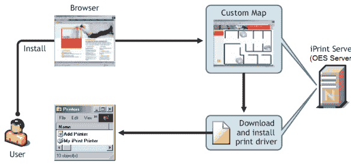

使用 iPrint，移动用户不再需要联系忙碌的网络管理员来查询打印机名称、上下文以及所需的打印机驱动程序。

相反，移动用户可以在熟悉的 Web 浏览器中操作，通过 iPrint 的打印机列表 Web 页面或管理员创建的地图查找附近的打印机。

公司还可以通过减少办公室之间传真文档的需求来降低通信成本；相反，公司可以使用现有的 Internet 连接将文档打印到远程打印机。

iPrint 使用 Internet 打印协议 (IPP)，这是一个行业标准，消除了通过 Internet 打印的复杂性，并让基于位置的打印成为现实。

IPP 的优势包括：

- 使用 IP 协议
- 提供广泛的供应商支持
- 在本地网络和 Internet 上运行
- 提供打印数据加密 (SSL, TLS)
- 为所有平台（如 Linux、Macintosh 和 Windows）提供标准的打印协议

有关 IPP 的更多信息，请参阅打印机工作组 (Printer Working Group) 网站 `http://www.pwg.org/ipp/index.html` 上的文档。

除了 IPP 的优势外，Novell 的 iPrint 实现还增加了以下价值：

- 打印机驱动程序的下载和安装
- 基于位置的打印
- 浏览器启用的打印机安装界面
- 可自定义的用户界面
- 安全信息传输

对于安全打印需求，iPrint 与 Novell eDirectory 集成，以确保只有授权用户才能访问打印机。

用户需要使用其 eDirectory 用户名和密码进行身份验证。打印数据也会被加密，以确保敏感打印内容的安全性。

### Linux 上的 iPrint 组件

OES Linux 上的 iPrint 由三个主要组件组成：`Print Manager`、`Driver Store` 和 `iPrint Client`。

### 集成 Novell Enterprise Linux

其他支持组件包括 `Apache Web Server`、`Novell iManager` 以及 `eDirectory`。

#### 图 7-2

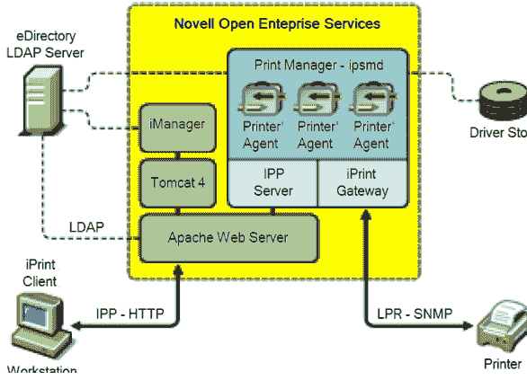

以下描述了每个 iPrint 组件：

- `Print Manager`
- `Driver Store`
- `iPrint Client`
- `Apache Web Server`
- `Novell iManager`

### Print Manager

`Print Manager` 是 eDirectory 中的一个对象，也是运行在 OES 服务器上的软件。它为 `Printer Agents` 提供了平台。7-6 严禁复制本手册的部分内容或分发此类副本。如怀疑盗版，请拨打 800-PIRATES。`Agents` 是打印机的表示。打印作业提交给 `Print Manager`；当打印机准备就绪时，打印作业转发到打印机：

#### 图 7-3

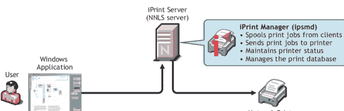

单个 `Print Manager` 可以处理多个打印机的打印作业。根据您的网络配置（例如远程位置），可以在其他服务器上创建额外的 `Print Manager`，但任何服务器上只能存在一个 `Print Manager`。`Print Manager` 使用以下访问组件授权用户打印：

- `Printer Agent`。`Printer Agent` 是 `Print Manager` 数据库中的条目，代表物理打印机。

当您创建打印机时，会在 `Print Manager` 数据库中创建一个 `Printer Agent` 并在 eDirectory 中添加打印对象。`Print Manager` 管理打印作业的处理，回答有关打印作业或打印机属性的查询，并提供显示在打印管理中的 SNMP 信息。

- `IPP server`。服务器的主要功能是处理来自 Web 服务器的 IPP 请求，并传递给 `Print Manager` (Linux) 或 `Broker` (NetWare)。

- `iPrint gateway`。`gateway` 与打印机保持通信。当打印机准备就绪时，`gateway` 向 `Print Manager` 请求打印作业。

### 集成 Novell Enterprise Linux

打印作业通过 TCP/IP 上的 LPR 发送到打印机。通过 SNMP，`gateway` 还查询打印机以获取状态和其他打印机信息。

### Driver Store

`Driver Store` 是一个 eDirectory 对象。网络上只需要一个 `Driver Store`，但根据您的网络配置，您可以创建额外的 `Driver Store`。运行的 `Driver Store` 越少越好，因为您不需要跟踪哪个 `Driver Store` 拥有哪些驱动。`Driver Store` 是打印系统的打印机驱动程序库。当第一个用户安装该打印机时，`Print Manager` 从 `Driver Store` 请求关联的打印机驱动程序，`Print Manager` 将驱动程序保存到磁盘上供以后使用。定期，`Print Managers` 会从关联的 `Driver Store` 获取更新的打印机驱动程序，刷新其托管打印机的驱动程序副本。

### iPrint Client

提供以下 iPrint 客户端：

- `Linux iPrint Client`
- `Macintosh iPrint Client`
- `Windows iPrint Client`

### iPrint Client

iPrint 客户端让 Linux 工作站安装 iPrint 客户端，并包含以下组件：

- 浏览器插件。iPrint 客户端包含一个适用于基于 Mozilla 浏览器的插件。

此插件允许您通过 Web 浏览器安装打印机。

- 控制台实用程序。Linux iPrint 客户端包含 `ipncmcd` 工具，允许您从控制台提示符安装打印机、打印测试页并将驱动程序上传到驱动程序存储库。

- CUPS 集成器。该客户端与 CUPS 后端集成，并使用 CUPS 本地打印程序将打印作业发送到打印管理器（`Print Manager`）。

## Macintosh iPrint 客户端

Macintosh iPrint 客户端包含一个适用于 Safari Web 浏览器的插件，允许您通过其 Web 浏览器安装打印机。

该客户端与 CUPS 后端集成，并使用 CUPS 本地打印程序将打印作业发送到打印管理器。

## Windows iPrint 客户端

Windows iPrint 客户端允许您在工作站上安装 iPrint 打印机并配置 iPrint，它包含以下组件：

- 打印提供程序。iPrint 打印提供程序直接与 Windows 打印程序（Spooler）通信，Windows 打印程序从应用程序接收打印作业并将其传递给打印提供程序。

启动时，iPrint 客户端会确保 iPrint 打印提供程序位于提供程序列表的首位。

当打印作业的目标是 iPrint 打印机时，iPrint 提供程序会将打印作业传递给打印管理器。

- 浏览器插件。iPrint 客户端包含一个适用于基于 Mozilla 浏览器的插件，Internet Explorer 插件是一个 OCX 插件，允许您通过 Web 浏览器安装打印机。

- 客户端配置。通过 iPrint 客户端配置界面，您可以利用多项高级客户端功能。

- 命令行实用程序。iPrint MS-DOS 命令允许您在不使用 Web 浏览器的情况下安装 iPrint 打印机，并将 LPT 端口映射到 iPrint 打印机。

当您有需要输出到 LPT 端口的旧应用程序，或想要通过登录脚本添加打印机时，这些命令非常有用。

## Apache Web 服务器

Apache 2.0 是 iPrint 的 Web 服务器。该服务器提供 HTML 页面，处理安全（SSL/TLS）和不安全请求，并利用 LDAP 进行身份验证。

## Novell iManager

您使用 `Novell iManager` 来创建、配置和管理您的 iPrint 系统。

要进行完全管理（包括上传打印机驱动和 PPD 文件），您需要从安装了 iPrint 客户端的工作站访问 `iManager`。

## NetWare iPrint 组件

NetWare Novell iPrint 使用 NDPS（Novell 分布式打印服务）基础设施。

除了 NDPS 外，iPrint 在 NetWare 上还使用以下组件：

- 打印代理（NetWare）。此存储库在 OES NetWare 服务器上存储网络打印机的驱动程序。它是您配置的第一个组件，并由您在 eDirectory 中创建的对象表示。

- 打印机驱动程序。这些特定平台的打印机驱动程序和 PostScript 打印机描述（PPD）文件存储在代理中，并在用户选择目标打印机时安装到工作站上。

打印机驱动程序和 PPD 文件以文件结构存在于驱动程序库和代理中，不以 eDirectory 对象的形式表示。

- 打印机对象。这些由您创建的 eDirectory 对象存储了通过 iPrint 可用的打印机信息。

每当关联的打印机添加到工作站的可用打印机列表时，就会使用打印机对象中存储的信息。

- 打印管理器。这是一个 eDirectory 对象。在 OES NetWare 服务器上，它是一个 NLM（`ippsvr.nm`）。

打印管理器接收用户的打印作业，并在目标打印机准备就绪时将其转发。它由您配置的 eDirectory 对象表示并对其进行控制。

当 eDirectory 打印机对象被配置为 iPrint 打印机时，打印管理器会自动在服务器上加载 NLM，为打印机生成一个 URL。

- iPrint 客户端。这组浏览器插件在第一次与 iPrint 交互时安装。iPrint 客户端可以同时用于 Macintosh 和 Windows 工作站；不需要 Novell 客户端。

- HTML 页面。这些页面用于安装 iPrint 软件和打印机，还用于查看和管理打印作业。这些页面是可以自定义的。

## iPrint 端口使用

iPrint 可以使用 Apache 上指定的任何端口；但 iPrint 默认使用两个主要端口：

- **端口 443**。所有安全打印都通过端口 443 并使用 SSL 进行。

- **端口 631**。所有不安全的打印都通过端口 631 进行。

iPrint 客户端还支持 TLS。如果您的系统（包括客户端）配置为使用 TLS，则所有安全和不安全的打印都通过端口 631 进行。

在 OES 安装 iPrint 软件期间，服务器上会禁用 CUPS 后端组件以避免端口 631 冲突。

由于 iPrint 在将打印作业发送到打印管理器之前使用 CUPS 渲染作业，因此无法从服务器本身使用 CUPS 或 iPrint 进行打印。

要在 OES Linux 服务器上设置并管理 iPrint，您需要了解如何进行操作：

如果您在 Novell OES 服务器安装期间选择了 iPrint（默认设置），则 iPrint 软件组件将自动安装在您的 OES Linux 服务器上。

要设置 iPrint 服务器，您需要执行以下操作：

## 创建驱动程序库

您的打印系统只需要一个驱动程序库；但根据您的网络设置，可以添加多个驱动程序库。您需要创建驱动程序库来创建打印管理器。

以下是创建驱动库的通用步骤：

1. 从 iManager（左侧）选择 `iPrint > 创建驱动程序库`。

2. 填写相应的字段。

有关字段的说明，请选择**帮助**。

3. 完成填写后，选择**确定**。

驱动程序库创建且守护进程加载后，您可以开始上传驱动程序。

## 添加打印机驱动程序

打印机驱动程序或 PostScript 打印机描述（PPD）文件是直接支持打印机的软件实体，使其能够功能。

硬件供应商开发针对特定打印机的驱动程序和 PPD 文件。大多数打印机对其交互的操作系统需要不同的驱动程序。

您可以查看已上传到驱动程序库的打印机驱动程序和 PPD 文件。您可以从磁盘、CD 和工作站系统添加驱动程序。

驱动程序库守护进程必须运行才能添加资源，且工作站上必须安装 iPrint 客户端。

要向驱动程序库添加资源，请执行以下操作：

1. 从 Novell iManager（左侧）选择 **iManager : 驱动程序库**；然后浏览并选择您要使用的**驱动程序库**。

2. 选择**驱动程序**；然后选择您要工作的*客户端平台*。

3. 执行以下任一：

- 选择**从文件**，通过打印程序 .inf 文件或 PPD 文件添加打印机资源。

- 或

- 选择**从系统**，从运行 iManager 的工作站添加驱动程序。

安装在工作站上的驱动程序可用于上传到驱动程序库。

您只能上传与工作站平台相同的驱动程序。

4. 选择您所需的**驱动程序**；然后选择**确定**。

5. 选择**确定**保存更改。

您还可以从 Linux 控制台提示符使用 `ipntcmd` 命令安装驱动文件。

详情请参阅 Novell OES Linux iPrint 管理指南第 37 页的“在 Linux 和 Macintosh 上使用 ipntcmd”。

可以通过 `http://www.novell.com/documentation/oes` 或从 3077 课程 CD 中的 `OES_Docs` 目录访问该指南。

## 为打印管理器创建 DNS 节点

打印管理器根据打印管理器配置为每个打印机创建 URL。

在创建打印管理器时，可以为 iPrint 服务指定 IP 地址或 DNS 节点。

您应该始终使用 DNS 节点，因为如果 IP 地址更改，用户必须删除并重新安装打印机。

要在 OES Linux 上为打印管理器创建 DNS 节点（记录），请执行以下操作：

1. 从 OES Linux KDE 桌面选择 YaST 图标。

   出现“以 root 运行 - KDE su”对话框。

2. 输入 root **密码**；然后选择**确定**。

   出现 YaST 控制中心。

返回 DNS Server - Zones 页面。

9. 从列表中，选择 Print Manager 的反向查找区域 (in-addr.arpa)，然后选择 **Edit Zone**（编辑区域）。

出现 Zone Editor 页面。

返回 DNS Server - DNS Zones 页面。

13. 选择 Finish（完成）。

配置完成后，你将返回到 YaST 控制中心。

如果你当前在 NetWare 服务器上运行 Print Manager，你还需要在 NetWare 服务器上配置 Print Manager 以使用 DNS 名称。

执行以下操作：

1. 在 NetWare 服务器上，按 `Ctrl+Esc`；然后输入 `I` 显示系统控制台。

2. 从系统命令提示符，输入以下内容卸载 Print Manager：

```
unload ndpsm
```

出现一条消息，指示 Print Manager 已卸载。

3. 输入以下内容加载 Printer Manager（全部在同一行）：

```
ndpsm .printmgr.example.novell/ dnsname=printmanager.example.com
```


其中 `.printmgr.example.novell` 代表 eDirectory 树中 Print Manager 对象的完整 DNS（区分名称），`printmanager.example.com` 代表 Print Manager 的完整 DNS 名称。

`/dnsname` 开关允许你配置 Print Manager 使用 DNS 名称而不是 IP 地址。

你只需要使用一次此开关；此后，Print Services Manager 会记住该 DNS 名称。

出现列有 HP-DJ 打印机的 Printer Agent 列表。

- 4. 按 `Ctrl+Esc` 显示 Current Screens（当前屏幕）菜单。

# 集成 Linux 版 Novell Open Server

你已完成 Print Manager 的配置。

# 创建 Print Manager

你需要为你的打印系统创建至少一个 Print Manager，但是，取决于你的网络设置，你可以创建额外的 Print Manager（例如，跨 WAN 链路）。

Print Manager 必须运行才能创建打印机。


Print Manager 会根据 Print Manager 配置为每台打印机创建一个 URL。

在创建 Print Manager 时，你可以为 iPrint 服务指定 IP 地址或 DNS 名称。

你应该始终使用 DNS 名称，因为使用 IP 地址会导致用户在 IP 地址发生变化时必须删除并重新安装打印机。

在创建 Print Manager 之前必须存在 Driver Store（驱动程序存储）。

要创建 Print Manager，请执行以下操作：

- 1. 确保你已为 Print Manager 配置了 DNS 名称。
- 2. 从 iManager（左侧），选择 `iPrint > Create Print Manager`（创建 Print Manager）。
- 3. 填写相应字段。
  要查看字段说明，请选择 Help（帮助）。
- 4. 确保勾选 `Start Print Manager after Creation`（创建后启动 Print Manager）复选框。


如果你没有选择此选项，则必须在 iManager 中使用 `Manage Print Manager`（管理 Print Manager）> `Manager Control`，或在 shell 提示符处输入 `/etc/init.d/novell-ipsmd start` 来启动 Print Manager。

- 5. 完成后，选择 OK。

在 Driver Store 创建且守护进程加载到服务器后，你就可以开始添加打印机驱动程序。

# 创建打印机

创建 Print Manager 后，你可以通过以下操作创建打印机：

- 2. 按照提示并填写字段。
  你可以通过选择 Help（帮助）查看字段说明。
- 3. 完成后，选择 Next（下一步）；然后选择此打印机的驱动程序。
  如果打印机不在列表中，你仍然可以添加驱动程序。
  打印机创建后，你可以在 Store 中管理驱动程序。
- 4. 完成后，选择 Next（下一步）。

# 管理 Print Manager

Print Manager 使用数据库存储有关其控制的打印机的信息。数据库会在午夜以及创建或删除打印机时更新。

如果数据库无法通过正常机制加载，你可以通过以下操作使用数据库：

- 1. 将 `/var/opt/novell/iprint/` 重命名为 `.db`。
- 2. 将 `/var/opt/novell/iprint/` 重命名为 `.bak`。
- 3. 启动 Print Manager。

Print Manager 使用初始化脚本启动和停止。

从命令行加载 Print Manager，输入以下内容：

```
/etc/init.d/novell-ipsmd start
```

你还可以使用 `stop`、`reload`、`force-reload` 和 `status` 操作。

- **通过 iManager。** 在 Manager Control 页面，你可以查看 Print Manager 的状态并卸载或加载 Print Manager 守护进程。

执行以下操作：

- 1. 从 iManager，选择 `iPrint > Manage Print Manager`。
- 2. 浏览并选择你想管理的 Print Manager。

出现以下内容：

# 图 7-4

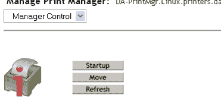

状态：

网络地址：`da-printers.da.com`

- 3. 通过选择 `Manager Control > Shutdown` 停止 Print Manager。
- 4. 选择 OK。

# 管理打印机

虽然默认设置允许用户无需配置即可打印，但你可能希望修改某些设置，以便更有效地管理打印资源。

你可以通过以下操作修改设置：

- Create Additional Printers（创建额外的打印机）
- Manage Printer Agents（管理打印机代理）
- Use Printer Driver Profiles（使用打印机驱动配置文件）
- Enable iPrint Direct（启用 iPrint Direct）
- Manage Print Jobs（管理打印作业）

# 创建额外的打印机

在创建额外的打印机之前，确保满足以下前提条件：

- 对关联打印对象所在的容器具有 Supervisor 权限。
- 被指定为控制此打印机的 Print Manager 的管理器。
- Driver Store 正在运行。
- Print Manager 正在运行。

要创建额外的打印机，请执行以下操作：

- 1. 从 iManager，选择 `iPrint > Create Printer`（创建打印机）。

# 图 7-5

显示如下：

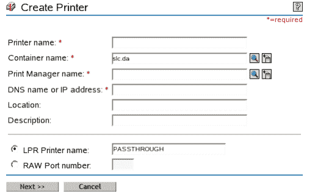

- 1. 填写字段。
  选择“帮助”（Help）获取有关字段的解释。
- 2. 选择“确定”（OK）。
- 3. 选择“下一步”（Next）。

显示如下：

# 图 7-6

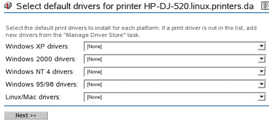

- 4. 选择此打印机的驱动程序。
  如果没有列出此打印机的驱动程序，你仍然可以创建打印机。

## 为 Linux 集成 Novell Enterprise Server

创建打印机后，你可以将打印机驱动程序添加到驱动程序存储（Driver Store）中，然后通过选择管理打印机 > 驱动程序来将驱动程序与打印机关联。

当用户以后安装此打印机时，这些驱动程序将自动下载到用户的工作站上。

由于本产品包含的打印机驱动程序列表有限，你可以将驱动程序添加到驱动程序存储中。

如果你没有选择驱动程序，用户在首次在其工作站上安装此打印机时，系统会提示他们提供带有适当驱动程序的磁盘。

- 6. 选择“下一步”（Next）创建打印机。

## 管理打印机代理（Printer Agents）

使用 iManager，你可以管理打印机代理。

你可以启动或关闭打印机代理、暂停和恢复输入输出、查看打印机信息、设置设置以及更改打印机驱动程序。

执行以下操作：

- 1. 从 Novell iManager，选择 `iPrint > 管理打印机`（Manage Printer）。
- 2. 浏览并选择你要管理的打印机。

# 图 7-7

管理打印机：`HP-DJ-520 linux printers.da`

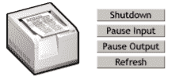

显示面板：

打印机状态：已停止 (Stopped)

其他报告 (other-report)

其他错误 (other-error)

打印机健康监视

- 3. 使用选项卡属性页（或 Firefox 中的下拉列表）完成相应的任务。

## 使用打印机驱动程序配置（Printer Driver Profiles）

打印机驱动程序配置允许你为 Windows 打印机驱动程序设置默认值。然后将打印机驱动程序配置关联到打印机，这样在安装打印机时，它将按照你所需的设置进行配置。

例如，在律师事务所，你可能希望默认纸张尺寸为法律尺寸（legal size）。这意味着每次在工作站上安装打印机和相应的驱动程序时，纸张尺寸都会设置为法律尺寸。

要使用打印机驱动程序配置，你需要了解如何执行操作：

- 创建、修改和删除打印机驱动程序配置
- 将打印机驱动程序配置与打印机关联

## 创建、修改和删除打印机驱动程序配置

在创建打印机配置时，你直接与特定平台的打印机驱动程序交互。因此，你需要在与打印机驱动程序相同的平台上创建和修改配置。

例如，要创建或修改 Windows 2000 打印机驱动程序配置，你必须访问 iManager并在 Windows 2000 工作站上完成任务。

执行以下操作：

- 1. 从 Novell iManager，选择 `iPrint > 打印机驱动程序配置`（Printer Driver Profile）。
- 2. 浏览并选择你想存储驱动程序配置并使其供该打印器上的打印机可用的打印机管理器（Print Manager）。
- 3. 选择以下项之一：
  - 创建打印机驱动程序配置（Create Printer Driver Profile）。创建一个新的打印机驱动程序配置。
  - 删除打印机驱动程序配置（Delete Printer Driver Profile）。删除现有的驱动配置。
  - 修改打印机驱动程序配置（Modify Printer Driver Profile）。更改现有打印机驱动程序配置的设置。
- 4. 选择“确定”（OK）。

## 将打印机驱动程序配置与打印机关联

创建打印机驱动程序配置后，你需要将其与打印机关联。执行以下操作：

- 1. 从 Novell iManager，选择 `iPrint > 管理打印机`（Manage Printer）。
- 2. 浏览并选择你要修改的打印机。
- 3. 选择驱动程序（Drivers）> `printer_driver_operating_system`。
- 4. 从可用驱动程序（Available Drivers）列表中，选择打印机驱动程序。
- 5. 从所选驱动程序的可用驱动程序配置（Available Driver Profiles for Selected Driver）列表中，选择要与此打印机关联的配置。
  如果你不想关联配置，请选择“无”（None）。
- 6. 选择“确定”（OK）保存更改。

## 启用 iPrint Direct

启用 iPrint Direct 的打印机用户直接将打印作业发送到打印机，而不是先将作业发送到打印管理器。

作业将以 LPR 或 raw 9100 格式发送到打印机，取决于打印机的网关自动加载设置。

尽管这很大程度上减少了服务器通信，但失去了审核打印作业的能力。iPrint Direct 仍然支持驱动程序更新，并通过 SNMP 直接从打印机收集打印机信息。

执行以下操作：

- 1. 从 Novell iManager，选择 `iPrint > 管理打印机`（Manage Printer）。
- 2. 浏览并选择要启用 iPrint Direct 打印的打印机。
- 3. 选择客户端支持（Client Support）> `iPrint Direct`。
- 4. 选择启用 iPrint Direct 打印（Enable iPrint Direct Printing）选项。

## 管理打印作业

以下提供了有关 iPrint 打印作业管理功能的信息：

- 查看打印作业信息（View Print Job Information）
- 删除打印作业（Delete Print Jobs）
- 更改打印作业顺序（Change the Order of Print Jobs）

被指定为打印机经理或操作员的用户可以对路由到该打印机的所有执行这些任务；作业所有者只能对自己的作业执行这些任务。

## 查看打印作业信息

你可以通过以下操作查看特定打印机等待处理的单独打印作业信息：

- 1. 从 Novell iManager，选择 `iPrint > 管理打印机`（Manage Printer）。
- 2. 浏览并选择作业发送到的打印机。
- 3. 选择打印机控制（Printer Control）> 作业（Jobs）。
  将显示打印作业信息。

## 删除打印作业

如果打印作业在提交后尚未开始打印，管理员可以删除任何打印作业。用户只能删除自己的打印作业。

执行以下操作：

- 1. 从 Novell iManager，选择 `iPrint > 管理打印机`（Manage Printer）。
- 2. 浏览并选择作业发送到的打印机。
- 3. 选择打印机控制（Printer Control）> 作业（Jobs）。
- 4. 勾选要删除的作业旁边的复选框。
- 5. 选择“删除”（Delete）。

## 更改打印作业顺序

有时，你可能需要将某个作业放在已提交到打印机但尚未开始打印的其他作业之前。

管理员、经理和操作员可以将列表中的任何作业向上或向下移动。用户只能移动自己的作业，且只能向下移动。

执行以下操作：

- 1. 从 Novell iManager，选择 `iPrint > 管理打印机`（Manage Printer）。
- 2. 浏览并选择作业发送到的打印机。
- 3. 选择打印机控制（Printer Control）> 作业（Jobs）。
- 4. 勾选要修改的作业旁边的复选框。
- 5. 通过选择“提升”（Promote）将作业向上移动列表。

## 管理驱动程序存储（Driver Store）

当你创建驱动程序存储时，会在 `/etc/opt/novell/iprint` 创建配置文件。文件名为 `idsd.conf`。

每当你使用 iManager 创建驱动程序存储对象并将其分配给服务器时，`idsd.conf` 就会添加一个条目。

尽管你可以为服务器分配多个驱动程序存储，但所有打印机驱动文件都存储在服务器上的一个文件结构中。

有关配置文件中条目的信息，请参阅 `/etc/opt/novell/iprint/idsd.conf`。

如果你需要更改打印管理器或驱动程序存储的 eDirectory 服务器分配，请编辑位于 `/etc/opt/novell/` 对应的配置文件（`print_manager_name_ipsmd.conf` 或 `idsd.conf`）中的 `DSSServer1=`。

你可以通过以下一种方式启动和停止驱动程序存储：

- 从命令行。驱动程序存储使用初始化脚本启动和停止守护进程。

要从命令行加载驱动程序存储，输入：

```
/etc/init.d/novell-isdd start
```

你也可以使用 `stop`、`reload`、`force-reload` 和 `status`。

- iManager。在管理器控制属性页上，你可以查看管理器的状态并卸载或加载管理器守护进程。

执行以下操作：

- 1. 从 Novell iManager，选择 `iPrint > 管理驱动程序存储`（Manage Driver Store）。
- 2. 浏览并选择你要管理的**驱动程序存储（Driver Store）**。
- 3. 通过选择驱动程序存储控制（Driver Store Control）> 关闭（Shutdown）停止驱动程序存储进程。
- 4. 选择“确定”（OK）。

## 目标 3

## 安装并配置 iPrint 客户端

要安装并配置 iPrint 客户端，你需要了解如何进行操作：

- 在 Linux 上安装 iPrint 客户端
- 在 Windows 上安装 iPrint 客户端
- 配置 iPrint 客户端设置

## 在 Linux 上安装 iPrint 客户端

为了让 iPrint 正常工作，工作站必须安装 iPrint 客户端。

你可以通过多种方式将客户端分发到工作站，例如使用 iPrint 打印机列表网页、使用如 ZENworks 等分发软件，或创建登录脚本。

要在 Linux 上安装 iPrint 客户端，你需要了解以下内容：

- iPrint 客户端要求
- 工作站打印系统权限的访问控制
- 如何在 Linux 上安装 iPrint 客户端和你的第一台打印机

## iPrint 客户端要求

为了让 iPrint 正常工作，Linux 工作站需要以下条件：

- 已安装 Novell Linux Desktop 或 SUSE 9.2（或更高版本）Professional
- 安装了 Konqueror 或基于 Mozilla 的浏览器（如 Epiphany、Firefox 或 Galeon）

除了这些要求外，你还需要了解以下内容：

- 要安装客户端，必须拥有 root 密码或 root 权限。
- 此版本的 iPrint Linux 客户端不支持打印到需要用户名和密码的安全打印机。
- 如果在你安装的打印机尝试通信时 iPrint 服务器正忙，CUPS 将打印机移至错误状态并挂留所有打印作业。
  要释放打印作业，请使用打印机管理工具重启打印机。

## 工作站打印系统权限的访问控制

Linux iPrint 客户端封装在两个不同的专用安装包，用于控制对工作站打印系统的访问。

以下解释了这两个客户端之间的区别：

| 表格 7-1 | iPrint 客户端文件名 | 说明 |
| :--- | --- | --- |
| | `novell-iprint-xclient-sh-0.5.20050201-4.i586.rpm` | 高安全性。对打印系统的访问受限。此客户端要求工作站用户必须定义了 `lpppassword` 才能在工作站上安装、删除或管理打印机。在执行这些打印操作之一时，用户会被要求输入密码。默认情况下，iPrint 打印机列表网页会安装此 RPM。 |

## 表格 7-1 iPrint 客户端文件名

| iPrint 客户端文件名 | 说明 |
|---|---|


| novell-iprint-xclient-sl-0.5.20050201-4.i586.rpm | 低安全性。对打印系统无限制访问。此客户端允许工作站的所有用户在工作站上安装、删除或管理打印机和打印作业，包括其他用户的打印机和作业。 |

这些客户端不会影响 iPrint 客户端的安装或打印功能——仅影响对工作站打印系统的访问。要安装 iPrint 客户端，仍然需要 `root` 权限。

要从系统上传驱动程序，你需要定义 `lpppassword`；否则，当你尝试从系统添加驱动程序时，驱动列表将为空。

要定义一个用户作为 `lpppassword` 的一部分，可以使用以下命令：

```
lppasswd -a linux_user_account -g sys
```

## 如何在 Linux 上安装 iPrint 客户端和你的第一台打印机

你可以使用以下方法之一在用户工作站上安装 iPrint 客户端：

- 从 iPrint 打印机列表网页安装客户端
- 使用分发软件交付客户端

## 从 iPrint 打印机列表网页安装客户端

你可以从存储在加载 Print Manager 服务器上的 iPrint 打印机列表网页下载并安装 iPrint 客户端。

默认情况下，链接被设置为安装高安全的 `novell-iprint-xclient-sh-0.5.20050201-4.i586.rpm`。

你可以通过在 `/var/opt/novell/htdocs` 中创建符号链接来更改：

```
ln -sf client novell-iprint-client.rpm
```

其中 `client` 是表中列出的文件名。

要安装 iPrint 客户端（以及你的第一台打印机），请执行以下操作：

- 在 Linux 桌面浏览器中输入以下 iPrint 服务器 URL：

```
http://server_address_or_dns_name/ipp
```

例如，如果 iPrint 服务器的 DNS 名称为 `DA3.da.com`，你应该输入：

```
http://DA3.da.com/ipp
```

将出现如下页面：

## 图 7-8

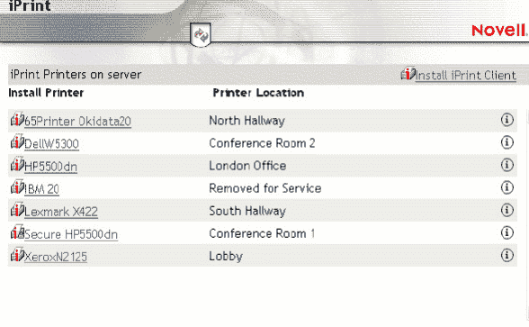

| 服务器上的 iPrint 打印机 | 位置 |
|---|---|
| iPrinter 0data20 | 北廊 |
| DELL500 | 会议室2 |
| HP550dn | 伦敦办公室 |
| IBM 20 | 服务 |
| Lexmark X42 | 南廊 |
| HP500dn | 会议室1 |
| Xerox AZ125 | 大堂 |

- 选择你要安装的打印机。

如果工作站上尚未安装 iPrint 客户端，系统会提示安装。

- 4. 双击 RPM。


- 4. 双击 RPM。
- 5. 双击 RPM。
- 6. 输入 iPrint 服务器 URL。
- 7. 从 iPrint 服务器页面选择打印机。

# 使用分发软件交付客户端

你可以使用分发软件（如 ZENWorks）向工作站交付 iPrint 客户端以及可能还有打印机。

## 在 Windows 上安装 iPrint 客户端

你需要了解以下内容：

- iPrint 客户端要求
- iPrint 客户端安装文件
- 如何在 Windows 上分发客户端
- 如何安装打印机

## iPrint 客户端要求

在 Windows 系统上安装 iPrint 客户端需要以下条件：

- Windows 95/98/ME 或 Windows NT/2000/XP
- 在 Windows NT/2000/XP 上安装客户端，必须拥有管理员权限或作为 Power 用户
- 启用了 JavaScript 且版本为以下任一的网络浏览器：
  - Microsoft Internet Explorer 5.5 或更高版本
  - 基于 Mozilla 的浏览器

Windows iPrint 客户端运行时使用 ActiveX 控件。默认情况下，Internet Explorer 的运行控件和插件是启用的。

如果禁用了这些控件或插件，你需要重新启用它们以便 iPrint 正常工作。此设置位于 Internet Explorer 的 `Tools > Internet Options > Intranet > Custom Level`。

## iPrint 客户端安装文件

Windows iPrint 客户端封装在多个不同的专用安装包中。根据你的分发方法或需求，选择你需要的文件。

以下比较了不同类型的安装：

| 表格 7-2 iPrint 客户端文件名 | 说明 |
|---|---|
| nipp.exe | 安装 iPrint Client 并显示需要用户干预的对话框和进度窗口。这是默认安装程序。 |
| nipp.zip | 可用于分发软件的 WinZip 版本客户端。解压文件后，运行 `setupipp.exe`。在命令提示符中输入 `setupipp.exe /h` 可查看可用于与 `setupipp.exe` 使用的命令行参数列表 |

# 表 7-2 iPrint 客户端文件名描述

| 文件名 | 描述 |
| :--- | :--- |
| nipp-s.exe | 安装 iPrint Client。屏幕会显示安装进度，但不需要用户干预。<br>由于 Windows 9x 用户在安装客户端后必须重启工作站，除非您正在使用一个会自动重启工作站的软件发行包，否则应使用 `nipp-sr.exe`。 |
| nipp-sr.exe | 安装 iPrint Client 并重启工作站。屏幕会显示安装进度，不需要用户干预。 |
| nipp-su.exe | 卸载 iPrint Client。屏幕会显示卸载进度，但不需要用户干预。 |
| nipp-u.exe | 卸载 iPrint Client。用户确认卸载客户端的请求，然后屏幕会显示卸载进度。 |

Windows 9x 用户必须重启其工作站。在安装 iPrint Client 后，Windows NT/2000/XP 用户不需要重启，除非他们正在使用 iPrint 工具捕获 LPT 端口。

# 如何为 Windows 分发 iPrint 客户端

您可以使用以下方法之一为用户的工作站安装 iPrint 客户端：

- 从 iPrint 打印列表网页安装客户端
- 使用分发软件交付客户端

# 从 iPrint 列表网页安装客户端

您可以从位于加载 Print Manager 的服务器上的 iPrint 列表网页下载并安装 iPrint 客户端。

- 1. 在 Linux 桌面的 Web 浏览器中，输入以下 iPrint 服务器 URL：

```
http://server_IP_address_or_dns_name/ipp
```

例如，如果安装 iPrint 服务器的 DNS 名称为 `DA3.da`，您将输入以下内容：

```
http://DA3.da.com/ipp
```

将出现如下所示页面：

图 7-9

| iPrint | 服务器上的打印机 | 打印机位置 |
|---|---|---|
| MPrinter_Zicata20 | 北走廊 |
| DellW5300 | 会室 2 |
| HP5500dn | 伦敦办公室 |
| IBM_20 | 已移除进行维护 |
| Lexmark_X422 | 南走廊 |
| Secure HP5500dn | 会室 1 |
| XeroxN2125 | 大堂 |

- 2. 选择您想要安装的打印机。

如果您的工作站尚未安装 iPrint 客户端，系统将提示您安装。

- 3. 当收到提示时，运行 iPrint 客户端安装文件 (`nipp.exe`)。

# 使用分发软件交付客户端

使用客户端分发软件（如 ZENWorks），您还可以将 iPrint 客户端以及可能的打印机交付到客户端工作站。

更多信息，请参阅您的分发软件的文档。

例如，使用 Novell 的 ZENWorks 时，可以使用“iPrint 客户端安装文件”中描述的任何 iPrint 客户端来交付 Windows iPrint 客户端。

在大多数情况下，您可能需要使用 `nipp.zip` 文件将客户端交付到桌面，并使用其中一个命令行参数执行 `setupipp.exe`。

# 如何安装打印机

您可以通过以下方式安装和分发 iPrint 打印机：

- 使用 iPrint 打印列表网页
- 创建基于位置的打印网页

# 使用 iPrint 打印列表网页

iPrint 会生成与 Print Manager 关联的打印机列表，该列表可用于安装 iPrint 客户端、安装 iPrint 打印机或检查打印机的状态和配置（包括打印作业列表）。

要使用 iPrint 打印列表网页，请执行以下操作：

- 1. 在 Linux 桌面的浏览器中，输入以下 iPrint 服务器 URL：

```
http://server_IP_address_or_dns_name/ipp
```

例如，如果安装 iPrint 服务器的 DNS 名称为 `DA3.da.com`，您将输入以下内容：

```
http://DA3.da.com/ipp
```

- 2. （条件条件）如果未安装 iPrint 客户端，请在提示时安装。
- 3. 从可用打印机列表中选择您想要安装的打印机并按照提示操作。

在安装打印机期间，如果打印机有关驱动程序，iPrint 将下载并安装该驱动程序，并将打印机安装在用户的工作站上。

第一次安装打印机时，即使工作站包含较新的驱动程序，也会强制向工作站安装驱动程序。

Print Manager 会从关联的驱动程序存储（Driver Store）更新其对其托管打印机所保存的驱动程序副本。

# 创建基于位置的打印网页

基于位置的打印允许用户使用列表视图或地图根据位置选择打印机。

使用列表视图，可以使用按建筑、办公室位置、eDirectory 上下等组织的 HTML 页面显示打印机位置。您可以以最符合用户需求的方式配置列表。

有关列表视图的示例，请查看 `/var/opt/novell/iprint/htdocs/examples/example2/innerweb.htm`。

使用 iPrint Map 设计器，您可以使用拖放技术创建打印机位置地图。创建地图后，可以将其发布在 Web 服务器上供用户访问。

当用户查看地图时，可以找到靠近其位置的打印机，然后点击其图标。客户端软件（如果尚未安装）和打印机将安装到他们的工作站上。

# 集成 Linux 版的 Novell Open Enterprise Server

有关使用 iPrint Map 设计器的信息，请参阅 Linux 版 OES 管理指南中的“使用 iPrint Map 设计器创建地图”。

您可以通过 `http://www.novell.com/documentation/oes` 访问 OES 目录。

# 配置 iPrint 客户端设置

要配置 iPrint 客户端设置，您需要了解如何执行操作：

- 使用代理服务器
- 管理远程 iPrint 服务器的密码
- 管理系统托盘图标
- 管理打印作业通知

# 使用代理服务器

代理服务器位于客户端与其尝试通信的服务器之间。

代理服务器通常与防火墙配合使用，以保护内部地址隐私，仅向外部用户暴露代理服务器地址。

如果您使用代理服务器且用户需要通过代理提交打印作业，可以使用 iPrint 的代理设置。

客户端将所有打印请求（例如打印作业）发送到代理服务器。然后代理服务器将打印作业重定向到正确的 iPrint 服务器。

例如，Juan 是一个笔记本用户，已经在总部安装并使用了多种 iPrint 打印机。

在途中，Juan 想向老板提交一份报告。与其通过电子邮件或传真发送，Juan 决定发送到老板附近的打印机。

当他尝试向打印机发送时时会收到找不到打印机的错误。他知道公司使用了防火墙和代理服务器。

他在 iPrint 代理设置中输入代理服务器地址，然后再次尝试。这次打印作业被接受了。

打印作业从笔记本传输到代理服务器。代理服务器将打印作业重定向到打印机的 Print Manager，打印作业在那里被缓存并转发到打印机。

要在 iPrint 中设置代理服务器地址，请执行以下操作：

1. 选择 `Start > Programs > Novell iPrint > iPrint Settings > Proxy`。
2. 勾选复框；然后输入代理服务器的 URL。
3. 选择 OK。

要禁用使用代理服务器，取消勾选复框。

# 管理远程 iPrint 服务器的密码

您可以管理您指示工作站应记住的打印服务的密码。删除密码的功能对于连接到不再使用的打印服务非常有用。

要管理打印服务的密码，请执行以下操作：

1. 选择 `Start > Programs > Novell iPrint > iPrint Settings > Passwords`。
2. 选择您要删除的密码；然后选择清除密码（Clear Password）。

# 管理 iPrint 系统托盘

系统托盘中的 iPrint 图标允许您在打印完成后接收通知，并查看您提交的打印作业列表。

请执行以下操作：

1. 选择 `开始 > 程序 > Novell iPrint > iPrint 设置 > 托盘图标（Tray Icon）`。
2. 修改以下设置：
    - iPrint 设置（iPrint Settings）。打开 iPrint 客户端设置。
    - 文档状态（Document Status）。允许您检查最后打印 10 份文档的状态和其他信息。
    - 打印机文件夹（Launch Printer Folder）。打开 Windows 打印机文件夹。
    - 查找/安装打印机（Find/Install Printers）。可选）打开浏览器窗口访问“托盘图标”选项卡上指定的菜单链接 URL。
    - 关闭（Close）。从系统托盘中移除 iPrint 图标，直到下次重启。

要让图标重新出现在系统托盘中，请选择 `开始 > 程序 > Novell iPrint > iPrint 客户端设置 > 托盘图标`；然后取消勾选“在系统托盘中启用 iPrint 图标”并点击确定。

重复步骤 1 和 2 以启用该图标。


# 管理打印作业通知

iPrint 可以通过系统托盘中的弹出消息在文档打印完成或需要注意时通知您。

要开启或关闭 iPrint 通知，请执行以下操作：

1. 选择 **开始** > **程序** > **Novell iPrint** > **iPrint 设置** > **通知**。
2. 按指示勾选或取消勾选复选框。

如果您关闭运行在系统托盘中的 iPrint 程序，将无法接收通知。要重启该程序，请参见第 7-44 页“管理 iPrint 系统托盘图标”。

# 目标 4 将 NetWare iPrint 迁移到 OES Linux

本目标解释了如何将运行在 NetWare 6.5 上的现有 iPrint 打印机代理（PSM）复制到运行在 OES Linux 服务器上的 iPrint 打印管理器。

要执行此任务，您需要了解以下内容：

- 迁移指南
- 迁移要求
- 如何使用服务器合并工具迁移 iPrint 打印管理器和打印机代理
- 迁移后任务

# 迁移指南

将 iPrint 打印系统从 NetWare 迁移到 OES Linux 时，请注意以下事项：

- 服务器合并工具允许您将运行在 NetWare 上的现有 iPrint 打印机复制到运行在 OES Linux 上的 iPrint 管理器。
- 只要 NDPS 打印机启用了 iPrint，也可以将其复制到 OES Linux 服务器上的打印管理器。
- 使用服务器合并工具界面，您可以将与 NetWare 上现有打印管理器关联的打印代理与与 Linux 上现有打印管理器关联的打印机合并。
- 您还可以在 Linux 上创建新的打印管理器。通过仔细规划，您可以轻松迁移打印机而不会对用户产生任何中断。
- 该工具不会移动非引用的对象，例如驱动程序配置文件和自定义横幅。
- 当您复制打印管理器和打印机代理时，它们不会从源服务器中删除。打印配置是复制到目标设备的，而不是移动。
- 完成打印系统迁移后，您必须手动删除源打印管理器和打印机代理（如果您希望删除它们）。
- 当您将打印管理器或打印机代理移动到 OES Linux 服务器时，打印机对象将复制到与打印管理器相同的 eDirectory 容器中，即使打印机对象分布在整个树中。这有助于打印运行得更高效，并避免为了打印机信息而频繁调用 eDirectory。
- 如果您更改了 `iprint.ini` 文件（位于 `sys:\apache\htdocs\ppdocs\`），您应将该文件复制到目标服务器上的 `/var/opt/novell/iprint/htdocs/`。
- iPrint Map 和自定义图像不会迁移。如果您在 iPrint 服务器上托管这些内容，将需要将它们复制到目标服务器。

# 迁移要求

在迁移过程中，打印机驱动程序从资源管理服务（RMS）复制到 iPrint 驱动程序存储（IDS）。

为了迁移成功，需要满足以下条件：

- NetWare 服务器上打印管理器使用的资源管理服务（RMS）必须处于运行状态。
- OES Linux 服务器上的 iPrint 驱动程序存储（IDS）必须处于运行状态。
- 您必须使用具有足够权限访问源和目标打印系统以及 eDirectory 权限的 eDirectory 用户。
- 现有打印系统必须正确配置 DNS。

# 如何使用服务器合并工具迁移 iPrint 打印管理器和打印机代理

要迁移 iPrint 打印系统，您需要使用从服务器合并和迁移工具包启动的服务器合并工具完成以下任务：

- 如果您尚未执行，请在将运行服务器合并工具的工作站上安装 iPrint 客户端。
  服务器合并工具会检查正确的 iPrint 客户端版本，如果需要安装更高版本的客户端，它会向您发出警告。
- 确保源和目标服务器上的两个打印管理器都在运行。如果不这样做，您将得到不可预测的结果。
- 启动服务器合并和迁移工具包并选择以下选项：
  - NetWare 或 Open Enterprise Server (eDirectory)
  - 服务器之间合并并复制数据和打印

当服务器合并工具启动时，会出现以下内容：

**图 7-10 Novell 服务器合并工具**

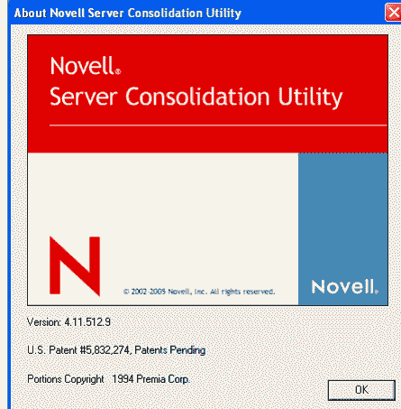

4. 选择 **确定**。
5. 选择 **创建新项目**；然后选择 **确定**。
6. 输入项目文件名；然后选择 **确定**。

出现以下内容：

**图 7-11**

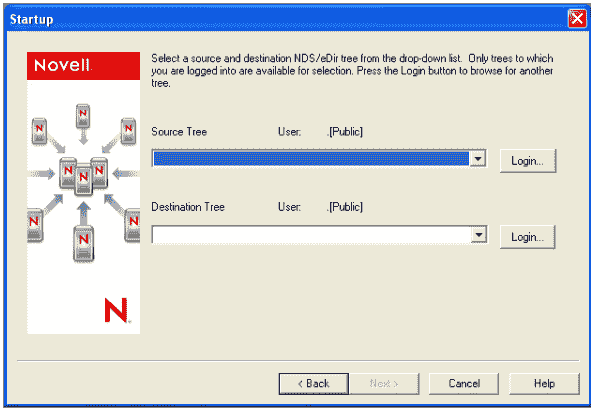

7. 选择所需的 NetWare 源服务器和 OES Linux 目标服务器；然后选择 **下一步**。

显示项目窗口（如下）：

**图 7-12**

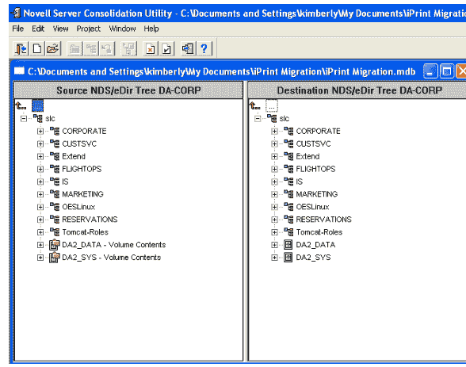

8. 从项目窗口执行以下操作之一以模拟您的 iPrint 迁移：

- 将打印管理器从 NetWare 树拖放到 Linux 树中的容器中。
  > 如果源和目标服务器在同一树中，您必须将打印管理器复制到与当前存储打印器的不同的容器。
  通过这样做，您表示想在指定的容器中创建一个新的打印管理器。

  

  提示您输入有关新打印器的以下信息：

  **表 7-3**

  | 参数 | 说明 |
  | :--- | :--- |
  | eDirectory 服务器 | 所有 eDirectory (LDAP) 调用发送到的服务器。可以使用浏览按钮在树中找到此对象。 |
  | 驱动程序存储 | 与新打印管理器关联的 Linux iPrint 驱动程序存储。可以使用浏览按钮在树中找到此对象。 |
  | DNS 名称或 IP 地址 | 建议将打印管理器与加载该打印器的 OES Linux 服务器的 DNS 名称关联。另一种选项是指定 OES 服务器的 IP 地址。您必须手动输入地址；此信息没有浏览器。 |

- 从 NetWare 上的打印管理器将单个打印机代理拖放到 Linux 上的打印管理器。这表示您想从源打印管理器将打印机代理复制到指定的打印管理器。
  > **重要**：从单个打印管理器将打印机代理到多个打印管理器需要用户删除并重新安装 iPrint 打印机。

或者

- 将打印管理器拖放到 Linux 上现有的打印管理器上。

  

  这表示您希望将源打印管理器的所有打印机代理复制到指定的目标打印管理器。

  如果您已经为打印管理器单独投放了打印机代理，系统会警告您这样做是不允许的。您可以撤回已单独投放的打印机并重新尝试操作。

9. 选择 **项目** > **验证并复制数据** 开始迁移。
   实用程序将检查它可以否与源资源管理服务以及目标驱动程序存储，并您想要执行的操作是否有效。
   为了确保迁移顺利，请在继续之前解决显示的所有错误。

10. 当您准备好进行更改时，按照提示运行合并。
    在迁移安全打印机期间，如果您在 iPrint 客户端没有选择“记住您的密码”选项，系统可能会提示您输入安全打印机的密码。

11. 迁移完成后，检查错误日志和成功日志。
    日志文件使用以下状态来标识每个打印管理器和打印机代理迁移是否成功：
    - **成功**。这表示打印管理器或打印机代理已在目标服务器上创建，并包含了所有的属性和驱动程序。
    - **部分成功**。这表示打印管理器或打印机代理已在目标服务器上创建，但未包含某些属性和驱动程序，因此您应该检查其配置。
    - **失败**。这表示打印管理器或打印机代理未在目标服务器上创建。

# 迁移后任务

完成 iPrint 系统迁移后，您可能需要执行若干任务来完成整个迁移。在将 iPrint 系统从 NetWare 服务器迁移到 Linux 服务器时尤为如此。

这些任务包括：

- **编辑打印管理器的 DNS 记录**。您应该在您的 DNS 服务器上为打印管理器配置 DNS 记录（A 记录和 PTR 记录）。这些记录与一个 IP 地址关联，您需要更改该地址以反映托管打印器的 OES Linux 服务器的 IP 地址。
- **关闭 NetWare 服务器上的 iPrint Broker 和打印管理器**。为了确保未来的 iPrint 活动定向到 OES Linux 服务器上的 iPrint 服务，您应该关闭 NetWare 服务器上的 iPrint Broker 和打印管理器。您可以通过输入以下命令来实现此操作：

```
unload ndpsm
unload broker
```

- **修改 NetWare 服务器上的 autoeec.ncf 文件**。除了卸载 iPrint Broker 和打印管理器外，您可能还想注释或删除 autoeec.ncf 文件中的命令行，以防止这些服务在下次关闭或重启 NetWare 服务器时加载。
- **删除 DA2 NetWare 服务器的打印机对象**。虽然没有必要，但我们建议从 eDirectory 树中删除所有不再使用的对象，以防止执行 eDirectory 配置和维护任务时出现任何混淆。
- **编辑 Linux 服务器上的 DA-PrintMgr.Linux.printers.da.ipsmd 配置文件**。iPrint 服务器使用的 DNS 名称存储在 Linux 服务器 `/etc/opt/novell/iprint/conf` 目录下的 `printmgr_dn_name.ipsmd.conf` 文件中，其中 `printmgr_dn_name` 是打印管理器 eDirectory 对象的 DN（区分名）。在迁移过程中，`PSMHostAddress` 参数通常会被更改。迁移后打开此文件，以确保参数设置反映 iPrint 服务的 DNS 名称。如果您更改了参数，请在控制台提示符输入 `ipsmd restart` 来重启 iPrint 服务。
- **更新 Linux 服务器上打印管理器的证书**。迁移后，您需要更新 Linux 服务器上 iPrint 服务的安全证书。您可以从 iManager 执行此操作：
  1. 选择 **iPrint** > **管理打印管理器**。
  2. 选择 **打印管理器** 对象。
  3. 选择 **iPrint 证书管理器** 链接。
  4. 选择 **允许主机 printmanager.example.com 使用此证书**，其中 `printmanager.example.com` 是打印器的 DNS 名称。
  完成此过程后，您需要从 iManager 启动打印管理器（**管理打印管理器** > **打印管理器名称** > **启动**）。

# 练习 7-1 将 iPrint 从 DA2 NetWare 服务器迁移到 DA1 Linux 服务器

Digital Airlines 的员工目前使用运行在 DA2 NetWare 服务器上的 iPrint 访问办公打印机（如 HP DeskJet 打印机）。

您决定将 iPrint 服务从 DA2 NetWare 服务器迁移到 DA1 Linux 服务器。

为了使过渡尽可能顺利，您希望员工在周五下班并在周一返回时，仍能使用现有的打印机。

您通过执行以下任务来实现这一点：

- 为 DNS 配置 DA-PrintMgr.Linux
- 安装 iPrint 客户端
- 为迁移准备 DA1 Linux 服务器
- 迁移 iPrint 服务
- 完成迁移后任务
- 验证您是否仍可以使用 HP-DJ

此外，您还学习了如何在 SUSE Linux Enterprise 10 上启用 iPrint。

练习 7-1“将 iPrint 从 DA2 NetWare 服务器迁移到 DA1 Linux 服务器”位于《Integrating Novell Open Enterprise Server for Linux》工作簿的第 7-2 页。

# 总结

## 目标 1. 描述 iPrint 的目的和架构

为了描述 iPrint 的目的和架构，您学习了以下内容：

- **iPrint 是什么**：iPrint 让移动员工、业务合作伙伴和客户能够通过现有 Internet 连接从各种远程位置访问打印机。用户使用 Web 浏览器指向一个显示可安装打印机的网页。
- **Linux 上的 iPrint 组件**：以下是 OES 服务器上的 iPrint 组件：
  - 打印管理器
  - 驱动程序存储
  - iPrint 客户端
  - Apache Web 服务器
  - Novell iManager
- **NetWare 上的 iPrint 组件**：NetWare 上的 iPrint 使用 NDPS（Novell 分布打印服务）基础设施。除了 NDPS 外，iPrint 在 NetWare 上使用以下组件：
  - 打印代理
  - 打印机驱动程序
  - 打印机对象
  - 打印管理器
  - iPrint 客户端
  - HTML 页面
- **iPrint 端口使用**：iPrint 可以使用 Apache 上指定的任何端口；然而，iPrint 默认使用两个端口：
  - 端口 443。所有安全打印均通过端口 443 使用 SSL 进行。
  - 端口 631。所有非安全打印均通过端口 631 进行。

## 目标 2. 在 OES Linux 上设置和管理 iPrint 服务器

为了在 OES Linux 服务器上设置和管理 iPrint，您学习了如何执行以下操作：

- **在 OES Linux 上设置 iPrint 服务器**：如果您在安装 Novell OES Linux 服务器期间选择了 iPrint（默认设置），则 iPrint 软件组件将自动安装在您的 OES Linux 服务器上。要设置 iPrint 服务器，您需要执行以下操作：
  - 创建驱动程序存储
  - 添加打印机驱动程序
  - 为打印管理器创建 DNS 名称
  - 创建打印管理器
  - 创建打印机
- **管理打印管理器**。打印管理器使用数据库来存储其所控制的打印机信息。当您创建打印管理器时，`/etc/opt/novell/iprint` 中会创建一个配置文件。文件名为 `print_manager_name.ipsmd.conf`。为每个分配在同一服务器上运行的打印管理器都会创建一个单独的文件。服务器上一次只能运行一个打印管理器。
- **管理打印机**。虽然默认设置允许用户在无需额外配置的情况下打印，但您可能希望修改其中某些设置，以便通过以下方式最有效地管理您的打印资源：
  - 创建额外的打印机
  - 管理打印机代理
  - 使用打印机驱动配置文件
  - 启用 iPrint Direct
  - 管理打印作业
- **管理驱动程序存储库**。当您创建驱动程序存储库时，`/etc/opt/novell/iprint` 中会创建一个配置文件。名为 `ids.conf`。每当您使用 iManager 创建驱动程序存储库并将其分配到同一服务器时，`ids.conf` 就会添加一个新的条目。尽管您可以为服务器分配多个驱动程序存储库，但所有的打印机驱动文件都存储在服务器上的一个文件结构中。

## 目标 3. 安装并配置 iPrint 客户端

为了安装和配置 iPrint 客户端，您学习了如何执行：

- **在 Linux 上安装 iPrint 客户端**。为了让 iPrint 正常工作，工作站必须安装 iPrint 客户端。可以通过多种方式将客户端分发到工作站，例如使用 iPrint 打印机列表网页、使用 ZENworks 等分发软件或创建登录脚本。要在 Linux 上安装 iPrint 客户端，您需要了解以下内容：
  - iPrint 客户端要求
  - 工作站打印系统的访问控制
  - 如何在 Linux 上安装 iPrint 客户端和第一台打印机
- **在 Windows 上安装 iPrint 客户端**。要在 Windows 上安装 iPrint 客户端，您需要了解如下：
  - iPrint 客户端要求
  - iPrint 客户端安装文件
  - 如何分发 Windows 版 iPrint 客户端
  - 如何安装打印机
- **配置 iPrint 客户端设置**。要配置 iPrint 客户端设置，您需要了解如何执行以下操作：
  - 使用代理服务器
  - 管理远程 iPrint 服务器的密码
  - 管理 iPrint 的系统托盘图标
  - 管理打印作业通知

## 目标 4. 将 NetWare iPrint 迁移到 OES Linux

在此目标中，您学习了将运行在 NetWare 6.5 上的现有 iPrint 打印机代理或打印管理器复制到运行在 OES Linux 服务器上的 iPrint 打印管理器。


为了执行此任务，您学习了以下内容：

- 迁移指南。将 iPrint 打印系统从 NetWare 迁移到 OES Linux 时，需要注意可能影响迁移的问题。

- 迁移要求。为了成功迁移，需要满足以下条件：

  - NetWare 服务器上打印管理器使用的资源管理服务（`Resource Management Service`）必须处于运行状态。

  - OES Linux 服务器上的 iPrint 驱动程序存储库必须处于运行状态。

## 目标

## 总结

## 4. 将 NetWare 上的 iPrint 迁移到 OES Linux（继续）

- 您必须使用具有足够权限的 eDirectory 用户来访问源打印系统和目标打印系统以及 eDirectory 访问权限。

- 现有的打印系统必须正确配置 DNS。

- 如何使用服务器合并工具（`Server Consolidation Utility`）迁移 iPrint 打印管理器和打印机代理。要迁移您的 iPrint 打印系统，您需要使用从“服务器合并和迁移工具包”启动的服务器合并工具。

- 迁移后任务。当完成 iPrint 系统迁移后，您可能需要执行若干任务来完成迁移。

在将 iPrint 系统从 NetWare 服务器迁移到 Linux 服务器时尤其是如此。

这些任务包括编辑 DNS 等操作。

# 在 OES Linux 上安装和配置 iFolder

在本节中，您将学习如何在 OES Linux 上安装、配置和使用 iFolder。

## 目标

1. 说明 iFolder 的用途和架构

2. 规划 iFolder 服务

3. 在 OES Linux 上安装 iFolder 和 Web 访问

4. 作为管理员管理 iFolder

5. 作为用户管理 iFolder

# 简介

Novell iFolder 是下一代 iFolder，支持多个 iFolder、用户控制的共享以及安全的网络存储。

通过 iFolder，用户的文件可以随用户随处移动，无论是在线还是离线。

iFolder 允许用户访问 iFolder 并参与加密数据。

在本节中，您将学习如何安装、配置和使用 iFolder 3.x 服务器、客户端以及 Web 访问。


尽管 Novell OES SP2 的当前 iFolder 版本是 3，但课程文档提到 iFolder 3.x。

## 目标 1

# 说明 iFolder 3.x 的用途和架构

为了说明 iFolder 3.x 的用途和架构，您需要了解：

- 对于企业的优势

- 对于用户的优势

- 企业级服务器共享

- iFolder 3.x 如何工作

- iFolder 的关键组件

# 对于企业的优势

对于企业带来的优势包括：

- 无缝数据访问

- 数据保护和恢复

- 可靠的数据安全

- 高效的用户

- 跨平台客户端支持

- 可扩展部署

- 简单的数据账户管理

- 无需培训

# 无缝数据访问

Novell iFolder 极大地简化了 IT 部门保持用户高效的能力。它通过允许数据随用户随处移动来赋予用户。

用户不再需要给自己发送项目文件以便在家里工作，也不再会有在不同机器上整理相同文件版本的困扰。

iFolder 存储并同步用户的工作，确保无论用户使用何种客户端或在什么位置登录，其文件都是可用且处于预期状态。

用户可以使用 iFolder 客户端或 Web 访问从任何计算机访问最新版本的文档。

# 数据保护和恢复

通过 Novell iFolder，存储在服务器上的数据可以轻松免受系统崩溃和可能导致数据丢失的灾难的影响。

当用户在本地保存文件时，iFolder 客户端会自动更新 iFolder 服务器上的数据，这些数据即可供组织的定期备份操作使用。

iFolder 让 IT 管理人员更容易确保组织的所有关键数据都得到保护。

# 可靠的数据安全

通过 Novell iFolder，基于 LDAP 的身份验证来访问存储的数据有助于防止未经授权的网络访问。

用户在居家办公或出差期间，无须学习或执行任何特殊程序即可访问其文件。

iFolder 消除了版本不一致的问题，使用户能够从任何连接的桌面电脑、笔记本电脑、Web 浏览器或手持设备访问其文档的最新版本。

在准备旅行或居家办公时，用户不再需要从各种桌面电脑和网络位置将关键数据拷贝到笔记本电脑上。

iFolder 客户端可以自动将用户的本地计算机更新为最新的文件版本。即使在没有个人电脑的情况下，用户也可以通过任何连接到互联网的计算机，通过 Web 访问其所有文件。

## 跨平台客户端支持

iFolder 客户端适用于 Linux、Windows 和 Macintosh 桌面系统。

Novell iFolder 3.x Web Access 服务器提供了 Web 接口，允许用户通过任何具有活动网络或 Internet 连接的计算机，使用 Web 浏览器访问其企业服务器上的文件。

## 可扩展部署

iFolder 能够轻松地从小环境到大环境进行扩展。您可以在多个服务器上安装 iFolder，让您的 iFolder 环境随业务增长而增长。

根据可用内存和存储空间，单个 iFolder 企业服务器可以处理多达 1,000 个用户账户。

在 LDAP 上下文中，用户只需通过将上下文分配给 iFolder 服务器，即可为 iFolder 服务进行并发置备。

## 简单的数据和账户管理

所有 iFolder 企业服务器的管理都通过用于 Novell iManager 2.5 的 Novell iFolder 3 插件进行集中化管理。Novell iFolder 允许从任何位置使用标准的 Web 浏览器进行管理。

iFolder 还通过提供本地文件到服务器的安全、自动同步，将 IT 部门从例行维护任务中解放出来。

## 无需培训

IT 人员不再需要引导或培训用户执行特殊任务，以确保存储在本地和网络上的数据的一致性。

使用 Novell iFolder，用户只需将文件存储在本地 iFolder 目录中。他们的文件会自动更新到 iFolder 服务器以及任何共享该 iFolder 的其他工作站。

iFolder 在后台无缝运行，确保数据得到保护和同步。

## iFolder 为用户带来的利益

通常情况下，当用户在多个位置工作或与他人协作时，他们必须谨慎地管理文件版本。

通过 iFolder，用户文件的最新版本可以跟随用户到达任何安装了 iFolder 客户端并设置了共享 iFolder 的计算机。

iFolder 还允许用户与其他 iFolder 系统的其他用户共享多个 iFolder 并分离内容。用户决定谁参与每个共享 iFolder 以及他们的访问级别是什么。

同样地，用户也可以参与由协作环境中其他人拥有的共享 iFolder。

在接下来的示例中，Ulrik 拥有一个名为 Denmark 的 iFolder，并通过他的 iFolder 企业账户与 Nigel、Luc 和 Alice 共享：

## 图 8-1

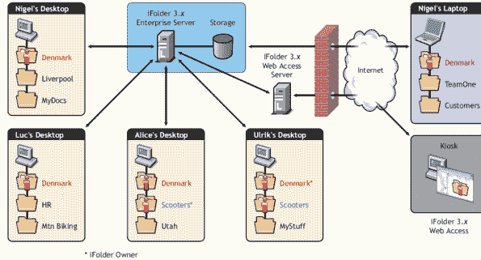

Nigel 经常出差，因此他在笔记本电脑上设置了 iFolder。任何 iFolder 成员都可以使用 iFolder Web Access 服务器从任何地方对 Denmark iFolder 上传和下载文件。

此外，Alice 与她的朋友 Ulrik 共享了一个名为 Scooters 的非工作 iFolder。

通过企业服务器，所有 iFolder 成员的 iFolder 均存储在中央位置中。iFolder 服务器将文档的最新版本同步给共享 iFolder 的所有授权用户。

iFolder 所有者和 iFolder 成员仅需要活跃的网络连接和 iFolder 客户端。

Novell iFolder 为用户提供以下利益：

- 通过自动将本地文件备份到 iFolder 服务器和多个工作站，防止本地数据丢失

- 使用 iFolder 客户端透明地将用户的 iFolder 文件更新到 iFolder 企业服务器和多个成员工作站

- 跟踪并记录用户在离线工作期间对 iFolder 文件进行的更改，并在他们在线时同步这些更改

- 通过使用 Web 浏览器和活跃的 Internet 或网络连接，在没有 iFolder 客户端的情况下访问 iFolder 服务器上的用户文件

- 在启用 SSL 加密的情况下，保护数据在传输过程中的安全

- 使 iFolder 服务器上的文件可用于定期计划的数据备份


有关用户利益的更多信息，请参阅《Novell iFolder 针对 Novell 3.x 用户指南》（`user.pdf`）第 11 页的“iFolder 的利益”。

您可以从 `http://www.novell.com/documentation/oes` 或从 3077 课程 CD 中的 `OES_Docs` 目录访问该指南。

## 企业服务器共享

此版本包含的 iFolder 客户端支持通过中央 Novell iFolder 3.x 企业服务器跨多个计算机进行同步，提供以下利益和

- 用户可以跨计算机共享文件。

- 用户可以与他人共享文件。

- 每个用户可以拥有多个 iFolder。

- 每个用户可以参与其他用户拥有的多个 iFolder。

- 文件可以随时通过中央服务器进行同步，并提高提高可用性、可靠性和性能。

- 数据使用 SSL 连接在传输线中安全传输。

- 用户根据其分配到管理员指定的 LDAP 容器和组的情况，对 iFolder 服务进行自动置备。

- iFolder 用户列表与服务器同步。

- 本地文件按定期间隔或根据需要备份到服务器。

- 需要时可以恢复本地数据。

- 管理员可以使用用于 iFolder 的插件管理 iFolder 系统、用户账户和用户 iFolder。

## iFolder 3.x 如何工作

Novell iFolder 3.x 支持每个用户拥有多个 iFolder、用户控制的共享以及用于文件存储和分发的中央网络，如图 8-2 所示

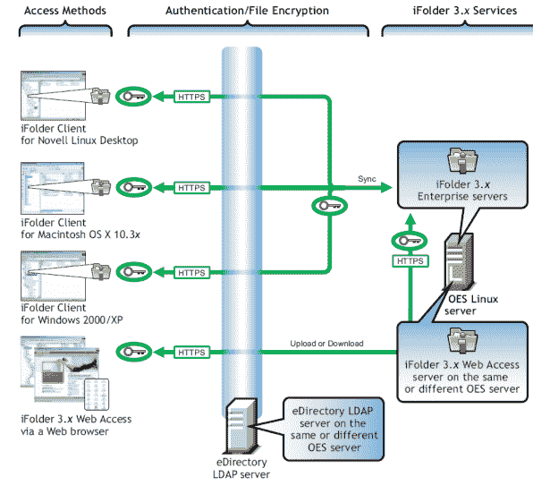

以下解释了图 8-2 中的信息：

- 访问方法：安装了 iFolder 客户端的 Linux、Macintosh 和 Windows 用户可以访问其一个或多个工作站文件夹中的文件。

- 更改会自动同步到 iFolder 3.x 服务器。

- Web 接口允许通过任何具有活动网络或 Internet 连接的计算机访问文件。

- 身份验证/文件加密：所有服务访问都通过基于 LDAP 的身份验证进行控制。

- 数据使用 SSL 进行加密。

以下是 iFolder 的关键组件：

- 用于 Novell iManager 2.5 的 Novell iFolder 3 插件

- iFolder Web Access

- iFolder 客户端

- 共享 iFolder

- iFolder 访问权限

- 企业服务器账户设置

- 访问验证

- 文件同步和数据管理

- 同步日志

- iFolder API

iFolder 企业服务器

iFolder 企业服务器是存储 iFolder 和为企业用户同步文件的中央存储库。

# 共享 iFolder (Shared iFolders)

iFolder 是用户在协作环境中选择性地与其他用户共享的本地目录。

iFolder 的成员均可访问 iFolder 文件，并由拥有相应权限的用户进行更改。用户可以在多个工作站之间以及与其他其他人共享 iFolder。

由于 iFolder 客户端集成在操作系统环境中，用户可以直接在文件管理器或“我的 iFolder”窗口中对 iFolder 进行操作。

在 iFolder 内部，用户可以设置任何符合其个人或公司工作习惯的子目录结构。子目录结构在所有成员的 iFolder 中都是一致的。

每个工作站可以为共享的 iFolder 指定不同的父目录。

# iFolder 访问权限

iFolder 客户端为 iFolder 成员提供四种访问权限：

- **所有者 (Owner)。** 只有一个用户作为所有者。这通常是创建 iFolder 的用户。

  所有者或 iFolder 管理员可以将所有权从所有者转移给另一个用户。

  iFolder 所有者拥有“完全控制”权限。该用户对 iFolder 具有读/写权限，管理成员用户的成员身份和访问权限，并可以移除任何成员的完全控制权限。

  使用企业服务器时，所有者 iFolder 使用的磁盘空间将计入所有者在企业服务器上的用户磁盘配额。

  如果用户作为 iFolder 系统的用户被删除，该用户的所有 iFolder 将变为“孤立”。孤立 iFolder 将临时分配给 iFolder 管理员用户，该用户将成为该 iFolder 的者。

  在 iFolder 管理员决定是否删除孤立 iFolder 或将其分配给新所有者期间，同步将继续。

- **完全控制 (Full Control)。** 共享 iFolder 的成员，拥有完全控制访问权限。拥有完全控制权限的用户对 iFolder 具有读/写权限，并管理除所有者以外的所有用户的成员身份和访问权限。

- **读/写 (Read/Write)。** 共享 iFolder 的成员，拥有 iFolder 内目录和文件的读/写访问权限。

- **只读 (Read Only)。** 共享 iFolder 的成员，拥有 iFolder 内目录和文件的只读访问权限。此成员可以将 iFolder 文件复制到另一个位置并在 iFolder 外部对其进行修改。

与企业服务器配合使用时，企业服务器将托管为该账户创建的每个 iFolder。

用户可以创建 iFolder，企业服务器会将其提供给指定的用户列表。用户可以在每个企业服务器上拥有单独的账户。用户在每个共享 iFolder 中的成员级别可能有所不同。

# 企业服务器账户设置

iFolder 客户端允许您设置多个账户，每个企业服务器允许设置一个。用户指定服务器地址、用户名和密码来唯一标识账户。

用户在计算机上以本地身份（或以其计划用于访问该账户及其 iFolder 的身份）登录时，设置账户。

在本地登录下，用户可以设置多个 iFolder 账户，但每个账户必须属于不同的 iFolder 企业服务器。

# 访问身份验证

每当 iFolder 连接到企业服务器同步文件时，它都会使用 HTTP BASIC 和 SSL 连接到服务器，服务器根据 LDAP 目录服务验证用户。

# 文件同步与数据管理

当设置 iFolder 账户时，您可以启用“记住密码”，以便 iFolder 可以在您工作时在后台同步 iFolder 邀请和文件。

iFolder 客户端每次在登录到计算机桌面环境时都会自动运行。当您处理本地 iFolder 中的文件时，会话会在后台运行，跟踪并记录您所做的任何更改。

使用企业服务器时，您可以按指定间隔或按需同步文件。

# 同步日志

日志显示您的 iFolder 后台活动日志文件。

# iFolder 客户端 API

欲查看 iFolder 客户端开发者文档，请访问 `http://forge.novell.com/modules/xfmod/docman/?group_id=1372` 的 iFolder 软件开发包。

# iFolder 服务安装目标 2 计划

在此目标中，您将介绍在 OES Linux 上提供 Novell iFolder 3.x 服务的规划考虑因素。这些包括：

- 安全考虑因素

- 服务器工作负载考虑因素

- 用户名和密码的命名规范

- 管理员考虑因素

- iFolder 用户账户考虑因素

- iFolder 数据和同步考虑因素

- 管理工具

# 安全考虑因素

有关为您的 iFolder 3.x 系统规划安全的信息，请参阅《Novell iFolder 3.x 安全管理员指南》。

> 您可以从 `http://www.novell.com/documentation/oes` 或 3077 课程 CD上的 `OES_Docs` 目录访问该指南。

# 服务器工作负载考虑因素

iFolder 3.x 企业服务器支持复杂的使用模型，其中每个用户可以拥有多个 iFolder，并参与其他用户拥有的 iFolder。

不是由单个用户在不同时间从不同的工作站工作，而是多个用户可以同时修改文件并同步它们。

每当用户向 iFolder 添加新成员时，服务器可以承受的工作负载增加几乎等同于您向系统添加了另一个用户。

我们建议每个 iFolder 服务器最多支持 1,000 个用户，具体取决于您的硬件性能特性。

您可以设置用户账户配额，以控制用户 iFolder 在服务器上消耗的占用的最大存储空间。

每个 iFolder 的实际带宽使用取决于以下因素：

- 订阅 iFolder 的成员数量

- 积极共享 iFolder 的计算机数量

- iFolder 中存储了多少数据

- iFolder 中文件的实际大小和平均大小

- iFolder 中的文件数量

- 每个 iFolder 的实际带宽使用情况

- 数据变化量

- 文件同步的频率

- 网络连接的可用带宽

我们建议您建立一个试点项目以评估操作需求，并据此设计系统。

以下是根据类似于 2.1 的示例负载为 iFolder 3.x 建议的配置：

| 表 8-1 | 组件 | 示例配置 |
| :--- | :--- | :--- |
| | 硬件 | 1.8 GHz 单处理器，1.2 GB 内存，300 GB 硬盘 |
| | iFolder 服务 | 500 个用户，每个用户账户配额 500 MB，每个用户未共享 |

# 用户名和密码的命名规范

以下是用户名和密码的命名指南：

- LDAP 命名要求

- 电子邮件地址命名要求

- 对象的格式考虑因素

- 多语言考虑因素

# LDAP 命名要求

用户名和密码必须符合 LDAP 服务的限制。

详细信息，请参阅《Novell eDirectory 8.7.3 管理指南》（`ed873.pdf`）。

您可以从 `http://www.novell.com/documentation/oes` 或 3077 课程 CD 上的 `OES_Docs` 目录访问该指南。

# 电子邮件地址命名要求


如果您配置 iFolder 在登录时根据电子邮件地址验证用户，请确保 eDirectory 中的每个电子邮件地址都满足以下命名要求：

- 符合标准电子邮件命名规范
- 在目录中是唯一的

例如，如果目录中存在两个相同的电子邮件地址，iFolder 可以同步它们，但它仅尝试对找到的匹配地址进行验证。

如果密码与该地址不匹配，则身份验证失败。

iFolder 不对用户输入的地址进行任何转换，并将名称区分大小写。您的用户应该了解存储在 eDirectory 中的电子邮件地址的格式和大小。

例如，如果用户 John Smith 的电子邮件地址基于用户 ID `js1234`（例如 `js1234@example.com`），但允许使用电子邮件别名 `john.smith@example.com`，您需要决定用户应该输入哪种地址作为 iFolder 名称。

# 对象的格式考虑因素

在 iManager 中，大多数 LDAP 对象的字符数限制为 64 个字符。某些字段需要通用名称格式（CN），而其他字段需要完全限定名称格式（DN）。

请查阅不同插件的 iManager 帮助，以确保您的条目符合各个插件的长度和格式限制。

# 多语言考虑因素

如果您运行在不同语言上的工作站，您可能希望将用户对象名称限制在工作站上可以显示的字符。

例如，用日语输入的名称不能包含在西方语言中不可见的字符。

在 Linux 和 HP-UNIX 上，eDirectory 的用户名和密码仅支持英语字符。这适用于 OES Linux 和 Novell Linux Desktop。

完整详情，请参阅《Novell eDirectory 8.7.3 管理指南》（`edir873.pdf`）第 70 页的“多语言考虑因素”。

您可以从 3077 课程光盘上的 `OES_Docs` 目录，通过 `http://www.novell.com/documentation/oes/` 访问该指南。

# 管理员用户考虑因素

在安装 iFolder 期间，iFolder 会创建两个管理员用户——iFolder Admin 用户和 iFolder Proxy 用户。

安装后，您还可以配置其他具有 iFolder Admin 权限的用户，使其等同于 iFolder Admin 用户。

要制定有关如何设置管理员用户的决策，您需要了解以下内容：

- iFolder Admin 用户及等同用户
- iFolder Proxy 用户

# iFolder Admin 用户及等同用户

iFolder Admin 用户是 iFolder 企业级服务器的主要管理员。每当 iFolder 变为孤立状态时，所有权将转移给 iFolder Admin 用户，以便重新分配给其他用户或删除。

您在 YaST 中配置 iFolder 企业级服务器时，最初指定 iFolder Admin 用户。

必须创建 iFolder Admin 用户对象，以便让 iFolder Admin 执行管理任务。iFolder 通过 LDAP 对象 GUID 跟踪该用户，允许其属于树中的任何 LDAP 容器或组，即使是那些未被标识为搜索 DN 的容器。

由于是通过 GUID 而不是用户 DN 来识别，因此可以跟踪树中任何位置用户的移动。

可以将 iFolder Admin 权限分配给其他用户，以便他们也能管理所选服务器的 iFolder 服务。使用 Novell iFolder iFolder 3 插件中的“管理员”页面为用户添加或删除 iFolder Admin 权限。

只有位于 LDAP DN 中指定的某个 DN 之一的用户才有资格等同于 iFolder Admin 用户。

如果您将 iFolder Admin 权限分配给其他用户，这些用户将受名单和搜索 DN 关系的约束。

如果您删除该用户、从搜索 DN 列表中删除该用户的 DN，或将用户移动到不在搜索 DN 列表中的 DN，则该用户将从名单中移除并剥夺其 iFolder Admin 权限。

# iFolder Proxy 用户

iFolder Proxy 用户用于访问 LDAP 服务器以从 iFolder LDAP 设置中定义的指定容器、组或用户检索用户列表的身份。

该身份必须具有对 LDAP 目录的“读取”权限。iFolder Proxy 用户在 iFolder 安装期间创建。您可能永远不需要修改此值。

如果您确实修改了 iFolder Proxy 用户，请确保您指定的身份与 iFolder Admin 用户或其他系统用户不同，因为 iFolder Proxy 用户密码以可逆转的加密形式存储在 iFolder 服务器的 Simias 数据库中。

当您在 YaST 中最初配置 iFolder 企业级服务器时，iFolder 会为 iFolder Proxy 用户自动生成密码。

以下是 iFolder Proxy 用户的加密方法：

# 表 8-2

| iFolder 版本 | 加密方法 | 代理用户密码 |
| :--- | :--- | :--- |
| iFolder 3.2 | YaST 加密方法 | 生成一个字母数字、13 位、混合大小写的密码。 |
| iFolder 3.0 和 3.1 | BASH 随机数生成器 | 生成一个 0 到 10000 之间的数字并附加到 `iFolderProxy` 后。例如，`iFolderProxy1234`。 |

最初，iFolder Proxy 用户密码以明文形式存储在 `/opt/novell/ifolder3/etc/simias-server-bootstrap.config` 文件中。

在配置过程结束时，系统重启 Apache 2 并启动 iFolder。当 iFolder 在配置后首次运行时，iFolder 进程会将 `simias-server-bootstrap.config` 文件复制到 Simias 配置文件。

Simias.config 文件的默认位置是 `/var/lib/wwwrun/local/share/simias` 目录或 `/home/wwwrun/local/share/simias` 目录。

代理用户密码以可逆转的加密形式存储在 Simias 数据库中，然后从两个配置文件中移除该值。

系统存储的 iFolder Proxy 用户密码必须与 iFolder Proxy 用户在 eDirectory 对象中存储的密码匹配。

如果您修改了 eDirectory 中的 iFolder Proxy 用户密码，必须同时更改系统存储的密码。

例如，如果您更改了 iFolder Proxy 赋值，或者您想为 iFolder Proxy 用户设置更长的密码，随后必须在 iFolder 的 LDAP 设置中修改这些值，否则 iFolder 将无法访问 LDAP 服务器更新用户列表。

为了安全访问 Simias.config 文件，iFolder 3_x 服务器计算机的管理员必须采取一切预防措施，防止无意中将未经授权的文件系统权限分配给 `/var/lib/wwwrun/.local/share/simias` 目录或 `/home/wwwrun/.local/share/simias` 目录。

# iFolder 用户账户考虑因素

以下是规划 iFolder 用户账户时应考虑的指南：

- 防止病毒传播
- 设置账户配额

# 防止病毒的传播

由于 iFolder 是一个跨平台解决方案，病毒感染可能会发生在 iFolder 服务器到其他平台的迁移。

您应该实施基于服务器的扫描以防止病毒进入网络。

您还应该实施基于客户端的扫描。

详情，请参阅《Novell iFolder 3 用户指南》（`user.pdf`）第 46 页的“配置 iFolder 本地扫描器设置”。可以通过 `http://www.novell.com/documentation/oes/` 或 3077 课程光盘上的 `OES_Docs` 目录访问该指南。

# 配置账户

您可以在 iFolder LDAP 设置的搜索 DN 字段中指定任何现有容器和组，以决定哪些用户会自动配置账户。

LDAP 同步通过 eDirectory GUID 跟踪用户，以便在添加、移动或重新定位用户。

适用以下指南：

- 如果用户被添加到搜索 DN 中的容器、组或用户，则用户将自动添加到 iFolder 列表中。
- 如果用户移动到不同的容器，且新容器也在搜索 DN 中，则用户将保留在 iFolder 列表中。
  如果您希望在不中断服务和丢失成员的情况下保留 iFolder 用户，必须在移动用户之前将新容器添加到搜索 DN。
- 如果将用户移动到未指定为搜索 DN 的容器，则该用户将从 iFolder 用户列表中移除，其 iFolder 将变为孤立状态，且用户将失去作为其他 iFolder 成员的身份。
  如果随后将新容器添加到搜索 DN，该用户将被视为新用户，与先前的 iFolder 和成员关系没有关联。
- 如果用户出现在多个定义的搜索 DN 中，且从设置中删除了一个或多个 DN，只要存在包含用户的 DN，用户就会保留在 iFolder 用户列表中。
- 如果从 LDAP 中删除用户或从所有定义的搜索 DN 移动用户，则该用户将从 iFolder 用户移除。其 iFolder 将变为孤立状态，且用户将失去作为其他 iFolder 成员的身份。
- iFolder Admin 用户和 iFolder Proxy 用户通过其 GUID 进行跟踪，无论其用户对象是否在搜索 DN 上下文中。

# 设置账户配额

可以通过设置账户配额来限制每个用户账户在服务器上允许存储的空间。

账户配额适用于用户拥有的 iFolder 的总空间。如果用户参与了其他 iFolder，服务器上消耗的空间将由该 iFolder 的所有者付费。

您可以在系统或用户级别设置配额。在给定的账户配额内，还可以为任何 iFolder 设置配额。

## iFolders 数据与同步考虑事项

在设置 iFolders 数据和同步策略时，请考虑以下事项：

- iFolder 及其文件夹、文件的命名规范
- 待同步文件类型和大小指南

## iFolder 及其文件夹、文件的命名规范

iFolder 客户端实施了命名规范，该等规范考虑了 Linux、Windows 和 Macintosh 文件系统的共同限制。

iFolder、文件夹或文件在同步之前，必须具有符合命名规范的有效名称。

请为您的 iFolder 及其内部的文件夹和文件使用以下命名规范：

- iFolder 支持带有 UTF-8 编码的 Unicode*（`http://www.unicode.org`）字符集。
- 请在 iFolder 的名称或其内部文件夹和文件的名称中**避免**使用以下无效字符：`\` `/` `:` `*` `?` `"` `<` `>`
- 如果您在文件或文件夹名称中使用无效字符，iFolder 将创建名称冲突。在同步该文件或文件夹之前必须解决此冲突。
- 单路径组件的最大名称长度为 255 字节。对于文件名，最大长度包括点 (`.`) 和文件扩展名。
- iFolder、文件夹和文件的名称不区分大小写；但会保留大小写。
- 如果文件名仅大小写上不同，iFolder 将创建名称冲突。在同步该文件或文件夹之前必须解决此冲突。
- 如果用户在 Linux 上的 FAT32 文件系统上创建 iFolder，应避免使用全大写命名文件。

Linux 上的 VFAT 或 FAT32 文件处理会自动将文件名从全大写字母转换为全小写字母，或符合 MS-DOS 8.3 文件格式的全大写字母。

如果 iFolder 设置了“只读”访问权限，这将为这些文件带来同步问题。

## 待同步文件类型和大小指南

您可以通过指定文件类型限制和允许同步的最大文件大小来设置管理哪些文件进行同步的策略。

您可以在系统、用户账户和 iFolder 级别设置这些策略。

某些文件类型不是同步的理想选择，例如操作系统文件、文件管理器创建的隐藏文件，或作为一组链接文件实现的数据库。

您可能仅包含业务使用的关键文件类型，或者排除可能与业务无关的文件（例如 `.mp3` 文件）。

请考虑以下因素：

- 操作系统文件
- 隐藏文件
- 数据库文件
- 文件大小

## 操作系统文件

您不应将系统目录转换为 iFolder。大多数系统文件很少更改，最好保留基本系统和关键软件的镜像文件，而不是尝试将这些文件同步到服务器。

## 隐藏文件

如果您的文件系统使用隐藏文件来跟踪显示偏好，您应该确定这些文件的类型，并将它们排除在系统同步范围之外。

通常情况下，这些文件仅与创建它们的特定计算机相关，并且在每次访问文件或目录时都会更改。

您不需要保留这些文件，同步它们会导致重复的文件冲突错误。

例如，iFolder 会自动排除两个名为 `thumbs.db` 和 `.DS_Store` 的隐藏文件管理器文件。

## 数据库文件

iFolder 同步文件的更改部分；它不会将文件作为一个集合进行同步。

如果您有一个被实现为一组链接文件的数据库文件，请勿尝试在 iFolder 中同步它们。

请勿尝试通过将 GroupWise 归档、缓存或远程目录转换为 iFolder 来同步您的 GroupWise 数据。

如果您这样做，GroupWise 数据在同步几次后就会变得损坏。GroupWise 需要归档中的文件被维护为一组完整的文件（set）。

## 文件大小

您允许同步的最大文件大小取决于您的生产环境。

虽然某些用户处理数百个小文件，但其他用户处理的是非常大的文件。您可以设置一个系统范围策略来限制大多数用户的大小，然后为高级用户设置单独策略。

## 管理工具

您可以使用以下工具来管理 Novell iFolder 3.x 企业服务器和 Web Access 服务器：

- 用于 YaST 的 iFolder 配置插件
- 用于 Novell iManager 2.5 的 Novell iFolder 3 插件
- Web Access 配置文件

## 用于 YaST 的 iFolder 配置插件

iFolder 为 YaST 提供了以下插件，用于为您的 iFolder 系统配置基础参数的配置：

# 表 8-3

| iFolder 插件 | 目的 | 任务 |
| :--- | :--- | :--- |
| iFolder 3 | 使用此功能为 iFolder 企业服务器配置以下参数：<br>- LDAP 服务器名称、LDAP 管理 DN 和密码<br>- iFolder 系统名称、存储路径和描述<br>- iFolder 代理 DN、密码和用于从 LDAP 获取用户信息的搜索上下文<br>- iFolder 管理 DN 和密码 | 在 YaST 中，选择“网络服务”；然后选择 iFolder 3。 |
| iFolder Web Access | 使用此功能为 iFolder Web Access 服务器配置以下参数：<br>- Web Access 别名<br>- iFolder 服务器 URL | 在 YaST 中，选择“网络服务”；然后选择 iFolder 3 Web Access。 |

如果两个 iFolder 组件安装在同一台计算机上，两个插件都可用；否则，仅所需的插件可用。

## 用于 Novell iManager 2.5 的 Novell iFolder 3 插件

用于 Novell iManager 2.5 的 Novell iFolder 3 插件用于管理 iFolder 系统、用户账户和 iFolder 数据。

在使用 Novell iManager 2.5 之前，您必须先安装它。

如果您的浏览器设置为支持语言以外的语言，iManager 插件可能无法正常运行。

为了避免问题，请在浏览器设置中将语言设置为支持的语言（例如英语）。

在初始版本中，iFolder 仅支持英语。其他语言的本地化计划在未来的发布中。

## Web Access 配置文件

使用 `/opt/novell/ifolder/webaccess/Web.config` 文件为您的 iFolder Web Access 配置 HTTP 运行时参数。

## 安装 Novell iFolder 3.x 和 iFolder Web Access

您需要了解以下内容：

- 前提和指南
- 在现有 OES 服务器上安装 iFolder
- 配置 iFolder 企业服务器
- 配置 iFolder Web Access 服务器
- 安装用于 iManager 的 iFolder 插件
- 访问 iManager 和 iFolder 插件
- 配置用户和 iFolder 服务

## 前提和指南

以下是 OES SP2 包含 iFolder 客户端的前提和指南。

在安装和配置 iFolder 之前，请确保您的系统满足以下类别的要求：

- 文件系统
- 企业服务器
- Novell eDirectory 8.73
- Novell iManager 2.5
- Mono
- 客户端计算机
- 浏览器

## 文件系统

iFolder 3.x 将 iFolder 文件安装在系统卷上。OES Linux 要求系统设备使用 Reiser（默认）或 EXT3 文件系统。

建议将用户的 iFolder 数据存储在单独卷上。

以下是根据 iFolder 版本支持的文件系统：

# 表 8-4

| 版本 | 数据文件系统支持 |
| :--- | :--- |
| iFolder 3.1 及更高版本 | EXT3、ReiserFS 或 NSS |
| iFolder 3.0 | EXT3 或 ReiserFS |

## 企业服务器

建议在您的 OES Linux 系统配置并正常运行后安装 iFolder 3.x 企业服务器和 Web Access 服务器。

如果您计划使用 NSS 卷存储 iFolder 数据，则必须事后安装 iFolder，因为在 OES Linux 安装期间无法设置 NSS 卷。

以下是 iFolder 企业服务器附加的前提和指南：

- 操作系统的前提
- 使用 NSS 卷存储 iFolder 数据的安装指南
- 使用 Linux 传统卷存储 iFolder 数据的安装指南
- 集成 Novell Enterprise Server for Linux
- 其他组件的安装指南

## 操作系统的前提条件


# Novell iFolder 3.2 及早期版本平台要求

Novell iFolder 3.2 及早期版本设计为仅适用于 Novell Open Enterprise Server for Linux (OES Linux) 平台，该平台由特定版本的 SUSE Linux Enterprise Server 平台以及基础 OES 应用程序和服务组成。

iFolder 3.2 及早期版本不支持未包含基础 OES 应用程序服务的 SUSE Linux Enterprise Server。它也不支持 OES NetWare。

iFolder 3.x 需要以下版本的 OES Linux 服务器：

| iFolder 版本 | OES Linux 版本 |
| --- | --- |
| iFolder 3.2 | Novell Open Enterprise Server Support Pack 2 for SUSE Linux Enterprise Server 9 Pack 3 (OES SP2 Linux) |
| iFolder 3.1 | Novell Open Enterprise Server Support Pack 1 for SUSE Linux Enterprise Server 9 Pack 2 (OES SP1 Linux) |
| iFolder 3.0 | Novell Open Enterprise Server for SUSE Linux Enterprise Server 9 Support Pack 1 (OES Linux) |

从 Novell iFolder 2.1x 及早期版本到 iFolder 没有升级或迁移路径。

---

# 使用 NSS 卷存储 iFolder 的安装指南

请确保您修改了 OES Linux 的安装和配置以符合以下指南：

- 在 YaST 的安装设置页面上，根据需要重新配置分区的设置以支持 NSS：
  - 指定 ReiserFS（默认）或 EXT3 分区作为您的系统设备。
  - NSS 卷在安装后进行配置。
  - 如果您计划使用 NSS 卷，某些部署场景要求您修改分区，使用 EVMS（企业卷管理系统）作为系统设备的设备管理器，而不是 LVM（Linux 卷管理器，默认）或第三方卷管理器。

> 请确保将您的存储部署计划与 OES 安装指南中“使用 EVMS 作为系统设备的卷管理器安装 Linux”章节列出的内容进行比较，以确定您是否需要执行此操作。
>
> 例如，如果服务器上只有一个设备（例如单个物理设备或硬件 RAID 1 或 RAID 5 设备），并且您计划配置 NSS 卷来使用您的 iFolder 数据卷，则您必须修改分区并使用 EVMS 来管理设备。

- 在 YaST 的安装设置页面上，修改软件组件以将 NSS 程序包添加到安装中。

计划在设置好 OES Linux 服务器且您已创建了供使用的 NSS 卷后安装 iFolder。

- 在 YaST 的安装设置页面上，确保您没有将 iFolder 3 或 iFolder 3 Web Access 组件添加到安装中。您将在稍后安装它们。
- 在 OES Linux 系统启动运行后，使用 iManager 中的存储插件创建 NSS 卷，在卷根目录下创建目录，然后使用 YaST 安装并配置 iFolder。

## 在 iFolder 配置期间，请确保将目录路径指定为 iFolder 数据存储库。

---

# 使用 Linux 传统卷存储 iFolder 数据的安装指南

以下是使用 Linux 传统卷存储 iFolder 数据的安装指南：

- 在 YaST 中，指定 EXT3 或 ReiserFS 分区作为您的系统设备。
- （可选）修改软件组件以将 iFolder 3 或 iFolder 3 Web Access 组件添加到安装中。

> 如果您在 OES Linux 安装期间安装了 iFolder，请准备好在安装过程中配置 iFolder。

---

# 其他组件的安装指南

我们建议您的 iFolder 企业级服务器和 Web Access 服务器运行在独立的专用服务器上。对于小型办公室使用，企业服务器和 Web 访问服务器可以运行在同一台服务器上，而不会降低性能。

为了获得最佳性能，请将 iFolder 服务器配置为一个独立系统，最多包含以下服务：

- OES Linux（最小预定义服务器，加上图形支持，如果需要则包含 NSS）
- Novell eDirectory 8.7.3（可以在不同的 OES 服务器上配置）
- Novell iManager 2.5（可以在不同的 OES 服务器上配置）
- Novell iFolder 3.x（通常在 OES Linux 服务器上进行后置安装）
- iFolder 企业级服务器
- Web Access 服务器（可以在不同的 OES Linux 服务器上安装和配置）
- Mono（iFolder 3.x 企业级服务器和 Web 访问需要 Mono 包。）
- Apache 2 Web 服务器（iFolder 3.x 企业级服务器和 Web 访问需要 `apache-worker` 包。）
- iFolder 3.x 和 iFolder 3.x Web Access 安装包在 YaST 中指定的其他 iFolder 依赖项。

在 iFolder 上安装其他应用程序或服务会影响 iFolder 的性能，并可能与 iFolder 依赖应用程序版本（如 Apache 2 或 Mono）产生冲突。

---

# Novell eDirectory 8.7.3

Novell eDirectory 8.7.3 是一种安全的身份管理解决方案，为运行在防火墙内部及外部的所有类型应用程序提供集中身份管理、基础设施、全网安全性和可扩展性。

它原生支持目录标准的轻量级访问协议 (LDAP) 3，并提供基于 OpenSSL 源码的 TLS/SSL 支持。

eDirectory 作为 Novell OES 的组件可用。

在配置 iFolder 之前，必须配置并运行 eDirectory。在 iFolder 中，您需要指定包含您想要定义的用户对象的 LDAP 容器和组。

确保您的 LDAP 对象符合命名规范。

---

# Novell iManager 2.5

Novell iManager 2.5 是一个基于 Web 的管理控制台，为网络管理工具和内容提供安全的、自定义的访问。

在为 iManager 配置 iFolder 3 插件之前，必须已安装并配置 iManager。

---

# Mono

Novell iFolder 3.x 需要 Linux 版 Mono 框架。

Mono 是一个用于运行和开发现代应用程序的开发平台。基于 ECMA/ISO 标准，Mono 可以运行针对 .NET 或 Java 框架的现有程序。

Mono 项目是由 Novell 领导的开源项目，也是许多新应用程序的字体。

有关 Mono 的详细信息，请参阅 Mono 项目网站：http://www.mono-project.com/Main_Page。

所需的 Mono 版本包含在 .iso 文件中。在安装 iFolder 企业级服务器或 Web 访问服务器期间，Mono 会作为 iFolder 的依赖项自动安装。

Linux 和 Macintosh 的 iFolder 客户端也需要 Mono 1.1.7。所需的 Mono 版本包含在分发给用户的 iFolder 客户端安装文件中。

Linux 和 Macintosh 用户必须同时安装 iFolder 和 Mono 包。

请确保使用所需的 Mono 版本。如果您的 OES Linux 服务器上有不同版本的 Mono，请在安装 iFolder 之前将其卸载。

---

# 在 OES Linux 服务器上安装并配置 iFolder

Novell iFolder 3.x 仅支持其安装软件包含的 Mono 版本。由于其他原因需要升级 Mono，请查看我们的在线文档以确认我们是否支持该版本，并了解使升级正常工作的必要步骤。

---

# 客户端计算机

iFolder 客户端支持以下工作操作系统：

- Novell Linux Desktop 9 及更高版本（Linux 需要 Mono 1.1.7.1.44342）
- SUSE Linux Enterprise Desktop 10（Linux 需要 Mono 1.1.7.1.44342）
- Windows 2000/XP/2003 带有最新的 .NET 支持补丁
- Macintosh OS X v10.3 及更高版本（Macintosh 需要 Mono 1.1.7.2）

确保您已为操作系统或 .NET 安装了最新的关键更新。

---

# Web 浏览器

在用于访问 iManager 的计算机以及客户端计算机上，需要以下支持的 Web 浏览器之一：

- Mozilla Firefox
- Microsoft Internet Explorer
- Macintosh Safari

---

# 安装 iFolder 3.x 和 iFolder 3.x Web Access（使用 YaST 软件管理）

在开始之前，请确保您的 OES Linux 系统设置符合“前提条件和安装指南”。

如果您之前在 OES SP1 服务器上安装过 Mono，请确保 Mono 目录的权限设置正确。

以下步骤将为 Mono 正确设置权限，并启用 iFolder 3.x 企业级服务器运行：

1. 在 Linux 计算机桌面的终端窗口中，切换到 root 用户（输入 `su -` 和 root 密码）。
2. 在命令提示符下，输入 `cd /usr/lib`。
3. 通过输入 `chmod 755 -R mono` 更改 `/usr/lib` 目录下的 Mono 权限。
4. 在命令提示符下，输入 `cd /etc`。
5. 通过输入 `chmod 755 -R mono` 更改 `/etc` 目录下的 Mono 权限。

通过选择桌面上的 YaST 图标来打开 YaST；然后输入 root 密码。

从左侧选择“软件”；从右侧选择“安装和移除软件”。

左上会出现一个窗口，其中过滤器下拉菜单已预选为“搜索”选项：

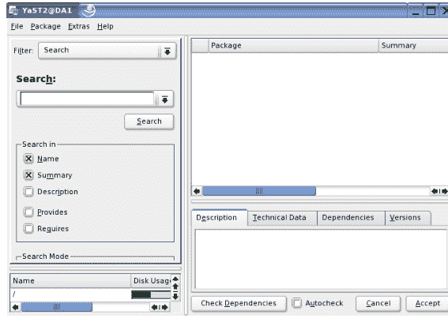

5. 从过滤器下拉菜单中选择“选择”选项。

显示选择列表，包含以下内容（在底部）：

- Novell iFolder 3.x Web Access
- Novell iFolder 3.x

您可以在同一台计算机或不同的计算机上安装 iFolder 3 企业级服务器和 Web Access 服务器。

6. 根据您的部署偏好，执行以下一项或全部：
   - 选中（勾选）Novell iFolder 3.x，表示您想要安装 Novell iFolder 3 及其依赖项的 RPM。
   - 选中（勾选）iFolder 3.x Web Access，表示您想要安装 Novell iFolder 3 Web Access 及其依赖项的 RPM。

> 如果您仅安装了其中一个组件，请在服务器上对另一个组件重复整个安装过程。

7. 要开始安装，选择“接受”（对话框右下角）。
8. （条件）如果出现对话框指示任何依赖冲突，请在继续之前解决它们。
9. 安装完成后，关闭 YaST 控制中心。

> 如果安装后 Mono 出现问题，请检查 Mono 目录的 POSIX 权限，以确保它们符合安装步骤 2 中的设置。

---

# 安装 iFolder 3.x 和 iFolder 3.x Web Access（使用 YaST iFolder 配置图标）

安装 iFolder 3.x 和 iFolder 3.x Web Access 的另一种方法是使用 YaST 控制中心中的 iFolder 配置图标。

执行以下操作：

1. 在开始之前，请确保您的 OES Linux 系统设置符合“前提条件和安装指南”。
2. 如果您之前在 OES SP1 服务器上安装过 Mono，请确保 Mono 目录的权限正确。

以下步骤将为 Mono 正确设置权限并启用 iFolder 3.x 企业级服务器运行：

a. 从 Linux 桌面的终端窗口中，切换到 root 用户（输入 `su -` 和 root 密码）。
b. 在命令提示符下，输入 `cd /usr/lib`。
c. 通过输入 `chmod 755 -R Mono` 更改 `/usr/lib` 目录下的 Mono 权限。
d. 在命令提示符下，输入 `cd /etc`。
e. 通过输入 `chmod 755 -R Mono` 更改 `/etc` 目录下的 Mono 权限。

3. 通过选择桌面上的 YaST 图标来打开 YaST；然后输入 root 密码。

出现 YaST 控制中心。

4. 从左侧选择“网络服务”；从右侧滚动并选择以下内容之一：
   - iFolder 3.x
   - 或
   - iFolder 3.x Web Access

几刻后，会出现一条消息，指示所选服务的 RPM 尚未安装。

5. 选择“继续”继续。

出现一条消息要求提供 Novell OES Linux CD。

6. 插入所需的 CD；然后选择“确定”。

在安装并配置包后，将显示 Novell iFolder 3.x 或 Novell iFolder 3.x Web Access 的配置页面。

7. 从光驱器中取出 CD。

> 虽然此方法允许您一次安装一个 iFolder 服务，但您可以立即配置该服务，无需启动单独的配置过程。

---

# 如何配置 iFolder 企业级服务器

安装 iFolder 企业级服务器后，您必须配置 iFolder 服务，包括 LDAP、iFolder 系统和 iFolder 管理设置。

> 如果您在安装 OES Linux 时安装了 iFolder，则此过程中描述的参数作为服务器安装的集成部分可用。
>
> 然而，您无法选择 NSS 卷作为 iFolder 系统路径，因为 NSS 卷无法在服务器平台安装期间创建。

执行以下操作：

1. 如果您计划使用 NSS 卷作为用户 iFolder 数据的系统路径，请使用 iManager 创建 NSS 卷；然后在卷上创建一个目录。
2. 从 OES Linux 服务器桌面，通过选择桌面上的 YaST 图标打开 YaST；然后输入 root 密码。

   出现 YaST 控制中心。

3. 从左侧选择“网络服务”；从右侧滚动并选择 iFolder 3.x。
4. （条件）如果出现警告指示您已配置了 iFolder 3.x，请选择“是”继续。

   几刻后，出现 Novell iFolder 3.x 配置页面：

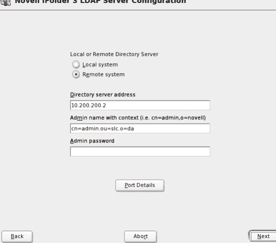

使用以下指南配置 LDAP 服务器：

- **本地或远程目录服务器**：如果 LDAP 服务与 iFolder 在同一台服务器上，选择“本地”。否则选择“远程”。
- **目录服务器地址**：如果是远程，请指定用于此 iFolder 的 LDAP 服务器 IP 地址。
- **LDAP 管理名称**：具有管理权限的用户完整 DN。如果用户不存在，只有在上下文有效时才会创建。例如：

```
cn=admin,o=acme
```

- **LDAP 管理密码**：输入 LDAP 管理用户的密码。
- **iFolder 用户登录依据**：输入验证用户时使用的 LDAP 属性。包括用户名（cn）和电子邮件（mail）。例如，如果名为 John Smith 的用户常用名为 jsmith，电子邮件为 john.smith@example.com，此字段决定了用户在登录 iFolder 时输入 jsmith 还是 john.smith@example.com。安装后无法更改此设置。

5. 完成后，选择“下一步”继续。

YaST 验证用户凭据，然后显示 iFolder 系统配置页面：

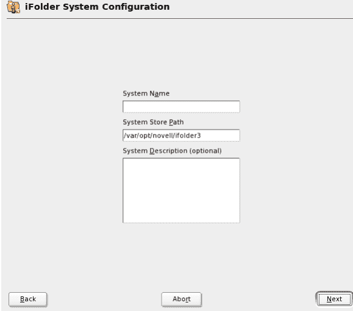

使用以下指南配置 iFolder 系统：

- **系统名称**：标识您的 iFolder 3 服务器的唯一名称（例如 IF3 Server）。
- **系统存储路径**：iFolder 企业级服务器存储 iFolder 3.x 文件以及用户 iFolder 和文件的大小敏感位置。初始配置后无法修改此位置。存储路径不应设置在卷根上，例如根目录（/）或挂载点的根（例如 `/mnt/ifolder3`）。

  确保在路径末尾添加标准目录。例如：

  ```
  /var/opt/novell/ifolder3/data
  /ifolder3/data
  /mnt/ifolder3/data
  ```

- **系统描述**：您的 iFolder 3 服务器的描述性标签（例如 iFolder 3 Eastern Server）。

6. 完成后，选择“下一步”继续。

出现 iFolder 管理配置页面：

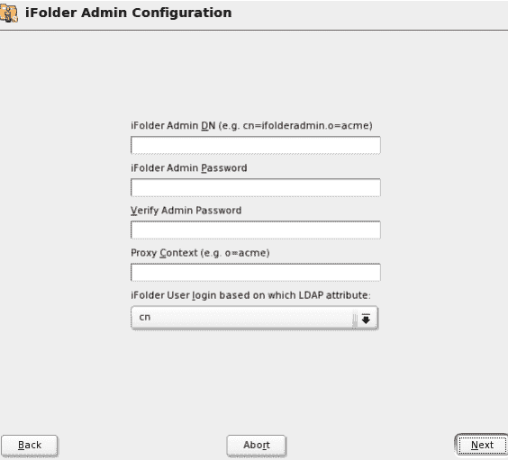

- **iFolder 管理 DN**：您使用 iFolder 管理用户通过 iManager iFolder 3 插件管理 iFolder 服务。

## 集成适用于 Linux 的 Novell 企业级服务器

如果此用户不存在，则将创建该用户并授予其管理所有 iFolder 服务所需的权限。

指定 iFolder 管理员用户的完全限定名称（DN），例如：

```
cn=ifolderadmin,o=acme
```

- **iFolder 管理员密码**：这是用于 iFolder 管理员用户的密码。再次输入密码以验证输入。
- **代理上下文**：这是您希望创建 iFolder 代理用户的现有上下文。


生成的用户名和密码将用于在指定的上下文中创建用户，然后授予该用户 LDAP 的读取权限。

生成的用户名为 `iFolderProxyxxxx`，其中 `xxxx` 是 4 位随机数。

您永远都不需要修改 iFolder 代理用户的用户名和密码，但这是可以的。

- 7. 完成后，继续选择“下一步”。

YaST 配置 iFolder 3.x，然后询问您是否想要重启 Apache。

- 8. 选择“是”以重启 Apache。

YaST 激活 iFolder 服务并将其返回到 YaST 控制中心。

然而，您仍然需要手动重启 Apache 和 Tomcat 才能访问网页（例如服务器主页）。

- 9. 在终端窗口中输入以下命令（按列表顺序）重启 Apache 和 Tomcat：

```
rcapache2 stop
rcnovell-tomcat4 stop
rcnovell-tomcat4 restart
rcapache2 start
```

如果您需要再次运行配置，可以修改除系统存储路径（System Store Path）和基于 LDAP 属性的 iFolder 用户登录（iFolder User Login Based on Which LDAP Attribute）之外的任何字段。这些参数设置在初始配置后无法修改。

## 如何配置 iFolder Web 服务器

安装 iFolder Web 服务器后，您必须指定它支持哪个 iFolder 企业服务器以及用户在 Web 浏览器中访问它时输入的友好 URL。

执行以下操作：

- 1. 从 OES Linux 服务器桌面通过选择 YaST 图标打开 YaST；然后输入 root 密码。出现 YaST 控制中心。

- 2. 从左侧选择“网络服务”（Network Services）；从右侧向下滚动并选择“iFolder 3.x Web Access”。

- 3. （条件）如果出现警告消息显示您已配置了 iFolder 3.x Web Access，选择“是”继续。

## 出现 iFolder Web Access 配置页面

图 8-7

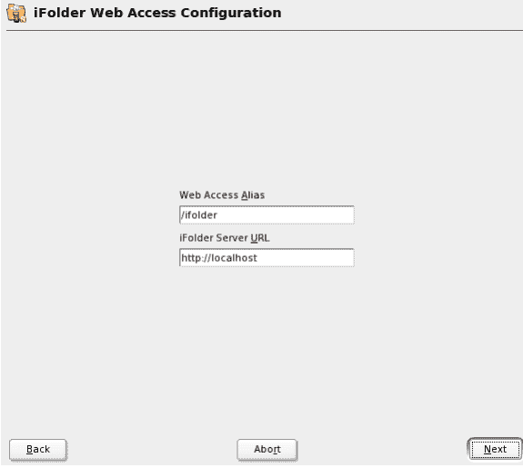

按照以下指南配置 iFolder 管理帐户：

- **Web Access 别名（Web Access Alias）**。这是访问指定 iFolder 3 企业服务器上 iFolder 服务的友好路径（例如 `*/ifolder/`）。

- **iFolder 服务器 URL**。iFolder 3 Web Access 服务器和 iFolder 3 企业服务器可以位于同一台计算机上，也可以位于不同的计算机上。

- 输入由此 Web Access 实例提供的 iFolder 3 企业服务器的 URL 和端口号。

- 确保在 URL 中指定安全 HTTP (`https://`)，以实现企业服务器与 Web Access 服务器之间的安全通信。

## 在 OES Linux 服务器上安装和配置 iFolder

HTTPS (SSL) 加密通过共享 IP 网络和 Internet 传输的信息。它有助于保护您的敏感信息免受数据拦截或篡改。

默认情况下，iFolder 企业服务器配置为通过 SSL (HTTPS) 与 iFolder Web Access 服务器通信。对于大多数部署，都应该更改此设置。

如果 iFolder 部署足够小，您可以选择将 Web Access 服务器和 iFolder 企业服务器安装在同一台机器上，并可以选择地指定 HTTP (`http://`) 使用明文流量，这将提高两个服务器之间本地通信的性能。

例如，使用 `https://192.168.1.1:443`（不同服务器）或 `http://localhost:80`（同一服务器）。

- 4. 完成后，继续选择**下一步**。

YaST 配置 iFolder 3.x Web Access；然后询问您是否想要重启 Apache。

重启 Apache 是使用新设置的必要的。

- 5. 选择**是**重启 Apache Web 服务器。

YaST 激活 iFolder 服务并将其返回到 YaST 控制中心。

## 在 iManager 中安装 Novell iFolder 3 插件

在管理 Novell iFolder 3 服务之前，您必须为 Novell iManager 2.5 安装 iFolder iManager 模块。

安装后，该插件在 iManager“角色和任务”列表中显示为 Novell iFolder 3。

确保您满足前提条件，然后使用安装 iFolder 插件的任一方法：

- 前提条件
- 在未配置 RBS 时安装插件
- 在已配置 RBS 时安装插件

### 前提条件

在从 iManager 管理 iFolder 3.x 之前，您需要满足以下前提条件：

- **iManager 2.5**。如果您尚未安装，请在与您的 iFolder 服务器相同或不同的服务器上安装 Novell iManager 2.5。

- **基于角色的服务（Role-Based Services）**。iFolder 3 插件支持在 Novell iManager 中可选使用基于角色的服务 (RBS)。

RBS 让您能够根据用户的角色向用户分配特定任务。

### 在未配置 RBS 时安装插件

如果您没有基于角色的服务 (RBS)，请执行以下操作：

- 1. 从 OES Linux 服务器桌面通过选择 YaST 图标打开 YaST；然后输入 root 密码。出现 YaST 控制中心。

- 2. 从左侧选择“网络服务”；从右侧向下滚动并选择“iFolder 3.x Web Access”。

- 3. （条件）如果出现警告消息显示您已配置 iFolder 3.x Web Access，选择“是”继续。

## 出现 iFolder Web Access 配置页面

图 8-7


按照以下指南配置 iFolder 管理帐户：

- **Web Access 别名**。这是访问指定 iFolder 3 企业服务器上 iFolder 服务的友好路径（例如 `*/ifolder/`）。

- **iFolder 服务器 URL**。iFolder 3 Web Access 服务器和 iFolder 3 企业服务器可以位于同一台计算机上或不同的计算机。

- 输入由此 Web Access 实例提供的 iFolder 3 企业服务器的 URL 和端口号。

- 确保在 URL 中指定安全 HTTP (`https://`)，以实现企业服务器与 Web Access 服务器之间的安全通信。

要重新安装现有插件，你必须先使用“模块配置 > 删除 RBS 模块”任务从 eDirectory 删除该插件的 `rbsModule` 对象。

## 如何访问 iManager 和 Novell iFolder 3 插件

Novell iManager 2.5 的 Novell iFolder 3 插件是用于管理您的 iFolder 服务器的工具。

要从 iManager 访问 Novell iFolder 插件，请执行以下操作：

- 1. 从支持的网页浏览器，以 admin 身份登录安装了 iManager 的 iFolder 服务器上的 iManager，使用以下 URL：

`https://servername.example.com/nps/iManager.html`

- 将 `servername.example.com` 替换为安装 iManager 的 OES Linux 服务器 IP 地址（例如 `10.200.200.2`）或 DNS 名称。

- 这可能是你安装 iFolder 3.x 或 iFolder 3.x Web Access 的同一台计算机，也可能是另一台计算机。

- 2. 从 iManager 登录页面，输入你在安装 OES Linux 服务器期间创建的 Admin **用户名** 和 **密码**，然后选择 **登录**。

- 3. 从左侧（角色和任务下），展开 Novell iFolder 3；然后选择 **系统**。

### 为“系统”任务出现一个连接登录页面

### 8-8 系统

指定你想要管理的 iFolder 服务器的 IP 地址或 DNS 名称，例如 `192.168.1.1` 或 `svr domain.com`。会话默认在端口 All（安全）上进行身份验证并连接；如果指定，请输入备用端口（例如 `80 (安全)`）；如果 iFolder Admin 用户名与你当前的登录名不同，请指定 iFolder Admin 用户名和密码。注意 - 输入服务器上用户的 cn - `"iFolder.admin.novell"`。要结束会话，请点击“断开”或关闭浏览器。

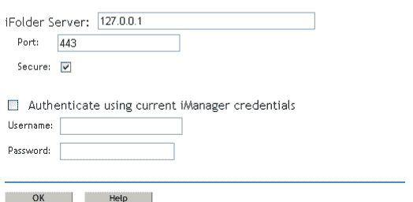

当你第一次在 iManager 会话期间选择任何 Novell iFolder 3 任务时，会显示此连接登录页面。

登录一次后，你无需再登录任何其他 Novell iFolder 3 任务。

以下是登录选项的说明：

- **iFolder 服务器**。输入你想要管理的 iFolder 企业服务器的 DNS 名称或 IP 地址（例如 `svr.example.com` 或 `192.168.1.1`）。

- **端口和安全**。输入用于管理会话的端口，并指示端口流量是否安全（选择“安全”）或不安全（取消勾选“安全”）。

服务器流量的默认设置为端口 443。

- **使用当前的 iManager 凭据进行身份验证**。如果登录 iManager 的用户名与目标服务器的 iFolder Admin 相同，选择**使用当前的 iManager 凭据进行身份验证**。

- **用户名和密码**。如果你登录 iManager 的用户名与目标服务器的 iFolder Admin 用户不同，请确保取消勾选“使用当前的 iManager 凭据进行身份验证”，然后输入 iFolder Admin 用户名和密码。

- 4. 选择 OK 连接到 iFolder 服务器。

- 5. （条件）如果提示接受服务器证书，请检查证书信息，然后选择 OK 接受证书。

Novell iFolder 3.x 将打开到系统管理页面，该页面由你可以执行的主要 iFolder 管理功能的分选项卡列表组成。

- 6. 当你完成对 iFolder 服务器的管理时，选择“断开”（位于右上角）或关闭网页浏览器，以断开与正在管理的 iFolder 服务器的连接。

如果你不注销，到 iFolder 企业服务器的连接将保持打开，直到会话超时，这可能会带来安全风险。

## 如何配置用户和 iFolder 服务

在配置 Novell iFolder 3.x 企业服务器后，你必须在 LDAP 设置中指定容器和组作为搜索 DN（Search DNs）。iFolder 使用这些来配置用户账户。

你计划在 LDAP 设置中用作搜索 DN 的上下文必须存在于 LDAP 目录；它们不是通过 iFolder 插件创建和配置的。

请执行以下操作：

- 配置用于配置用户的搜索 DN
- 将已配置用户列表与 LDAP 目录同步

### 配置用于配置用户的搜索 DN

iFolder LDAP 设置中“搜索 DN”字段中列出的容器和组中的所有用户都将自动配置为 iFolder 用户。

要配置用于配置用户的搜索 DN，请执行以下操作：

- 1. 从 iManager 左侧，展开 Novell iFolder 3；然后选择系统。

- 2. （条件）如果出现 iFolder 连接登录页面，请以 iFolder admin 用户身份登录（参见上文“如何访问 iManager 和 Novell iFolder 3 插件”）。

出现系统页面：

| 系统名称: | LDAP 服务器 |
| :--- | :--- |
| 版本: | 3.2.5347.1 |
| 主机名: | DA1 |

- 3. 选择 LDAP 选项卡。

出现 LDAP 选项卡：

使用此页面管理 iFolder。指定你想要管理的 iFolder 服务器的 IP 地址或 DNS 名称，例如 `192.168.1.1` 或 `svr domain.com`。会话默认在端口 All（安全）上进行身份验证并连接；如果指定，请输入备用端口（例如 `80 (安全)`）；如果 iFolder Admin 用户名与你当前的登录名不同，请指定 iFolder Admin 用户名和密码。注意 - 输入服务器上用户的 cn - `"iFolder.admin.novell"`。要结束会话，点击“断开”或关闭浏览器。

当你第一次在 iManager 会话期间选择任何 Novell iFolder 3 任务时，会显示此连接登录页面。

登录一次后，你无需再登录任何其他 Novell iFolder 3 任务。

以下是登录选项的说明：

- **iFolder 服务器**。输入你想要管理的 iFolder 企业服务器的 DNS 名称或 IP 地址（例如 `svr.example.com` 或 `192.168.1.1`）。

- **端口和安全**。输入用于管理会话的端口，并指示端口流量是否安全（选择“安全”）或不安全（取消勾选“安全”）。

服务器流量的默认设置为端口 443。

- **使用当前的 iManager 凭据进行身份验证**。如果登录 iManager 的用户名与目标服务器的 iFolder Admin 相同，选择**使用当前的 iManager 凭据进行身份验证**。

- **用户名和密码**。如果你登录 iManager 的用户名与目标服务器的 iFolder Admin 用户不同，请确保取消勾选“使用当前的 iManager 凭据进行身份验证”，然后输入 iFolder Admin 用户名和密码。

- 4. 选择 OK 连接到 iFolder 服务器。

- 5. （条件）如果提示接受服务器证书，请检查证书信息，然后选择 OK 接受证书。

Novell iFolder 3.x 将打开到系统管理页面，该页面由你可以执行的主要 iFolder 管理功能的分选项卡列表组成。

- 6. 当你完成对 iFolder 服务器的管理时，选择“断开”（位于右上角）或关闭网页浏览器，以断开与正在管理的 iFolder 服务器的连接。

如果你不注销，到 iFolder 企业服务器的连接将保持打开，直到会话超时，这可能会带来安全风险。


- 2. （条件）如果出现 iFolder 连接登录页面，请以 iFolder admin 用户身份登录（参见 8-55 上的“如何访问 iManager 和 Novell iFolder 3 插件”）。

出现系统页面：

| 系统名称 | LDAP 服务器 |
| :--- | :--- |
| 版本 | 3.2.5347.1 |
| 主机名 | DA1 |

- 3. 选择 **LDAP** 选项卡。

出现 **LDAP** 选项卡：

使用此页面管理 iFolder。指定你想要管理的 iFolder 服务器的 IP 地址或 DNS 名称，例如 `192.168.1.1` 或 `svr domain.com`。会话默认在端口 All（安全）上进行身份验证并连接；如果指定，请输入备用端口（例如 80 (安全)）；如果 iFolder Admin 用户名与你当前的登录名不同，请指定 iFolder Admin 用户名和密码。注意 - 输入服务器上用户的 cn - "iFolder.admin.novell"。要结束会话，点击“断开”或关闭浏览器。

当你第一次在 iManager 会话期间选择任何 Novell iFolder 3 任务时，会显示此连接登录页面。

登录一次后，你无需再登录任何其他 Novell iFolder 3 任务。

以下是登录选项的说明：

- **iFolder 服务器**。输入你想要管理的 iFolder 企业服务器的 DNS 名称或 IP 地址（例如 `svr.example.com` 或 `192.168.1.1`）。

- **端口和安全**。输入用于管理会话的端口，并指示端口流量是否安全（选择“安全”）或不安全（取消勾选“安全”）。

服务器流量的默认设置为端口 443。

- **使用当前的 iManager 凭据进行身份验证**。如果登录 iManager 的用户名与目标服务器的 iFolder Admin 相同，选择**使用当前的 iManager 凭据进行身份验证**。

用户名和密码。如果你登录 iManager 的用户名与目标服务器的 iFolder Admin 用户不同，请确保取消勾选“使用当前的 iManager 凭据进行身份验证”，然后输入 iFolder Admin 用户名和密码。

- 4. 选择 **OK** 连接到 iFolder 服务器。

- 5. （条件）如果提示接受服务器证书，请检查证书信息，然后选择 **OK** 接受证书。

Novell iFolder 3.x 将打开到系统管理页面，该页面由你可以执行的主要 iFolder 管理功能的分选项卡列表组成。

- 6. 当你完成对 iFolder 服务器的管理时，选择“断开”（位于右上角）或关闭网页浏览器，以断开与正在管理的 iFolder 服务器的连接。

如果你不注销，到 iFolder 企业服务器的连接将保持打开，直到会话超时，这可能会带来安全风险。

在 LDAP 同步过程中，iFolder 服务器会查询 LDAP 服务器，以根据搜索 DN（Search DN）字段中指定的 DN 检索用户列表。

这可能需要几分钟，具体取决于您的 LDAP 目录的大小。

- 5. 同步完成后，从页面顶部选择 **Disconnect**（断开连接），然后关闭 iManager。

iFolder 用户列表将根据 LDAP 同步间隔定期更新。

每当您从 LDAP 搜索 DN 中删除用户或从搜索 DN 列表中删除上下文时，都应使用“Update and Synchronize now”（立即更新并同步）立即同步列表以使您的更改生效。

# 在 DA1 Linux 服务器上安装和配置 iFolder 3.2

作为 Digital Airlines 的网络管理员，你收到了管理层和员工提供个人文件存储服务的请求。

你决定 iFolder 满足所有需求，并希望实施 3.2 版本（包含在 Novell OES SP2 中）以利用新功能。

在此练习中，你将通过执行以下任务开始该过程：

- 在 DA1 Linux 服务器上安装并配置 iFolder 3.x。
- 安装 iManager iFolder 插件。
- 在 DA1 Linux 服务器上安装并配置 iFolder 3.x Web Access。
- 为 Digital Airlines 员工配置用户账户以访问 iFolder。

练习 8-1 在 DA1 Linux 服务器上安装和配置 iFolder 3.2 位于《Integrating Novell Open Enterprise Server for Linux Workbook》的第 8-2 页。

# 目标 4：作为管理员管理 iFolder 3.x

一旦你安装了 iFolder 3.x 并配置了用户，就可以开始管理 iFolder 了。

以下是你在作为 OES Linux 服务器上的管理员管理 iFolder 3.x 时需要知道如何操作的基本任务：

- 分发并安装 iFolder 客户端
- 启动、停止和重启 iFolder 服务
- 管理 Simias 日志和 Simias 日志
- 恢复单个文件或目录
- 配置系统策略
- 修改 iFolder LDAP 设置
- 管理 iFolder Web Access 服务器
- 配置 iFolder 用户
- 管理 iFolders

> 有关作为管理员管理 iFolder 3.x 的更多信息，请参阅《Novell iFolder 3.x Novell iFolder 管理指南》(admin.pdf)。

你可以从 `http://www.novell.com/documentation/oes` 或从 3077 课程 CD 中的 `OES_Docs` 目录访问该指南。

# 分发和安装 iFolder 客户端

在企业服务器上配置 iFolder 服务后，用户可以从 iFolder 3.x 欢迎页下载 iFolder 客户端的安装文件。

要了解如何管理 iFolder 3.x 客户端的分发，你需要知道如何操作：

- 检查前提条件和指南
- 配置 iFolder 3.x 欢迎页
- 从 iFolder 3.x 欢迎页下载 iFolder 客户端
- 在 Windows 2000/2003 上安装 iFolder 客户端

有关分发和安装 Novell iFolder 客户端的更多信息，请参阅《Novell iFolder 3.x Novell iFolder 用户指南》(user.pdf) 和《Novell iFolder 3.x Novell iFolder 管理指南》(admin.pdf)。

你可以从 `http://www.novell.com/documentation/oes` 或从 3077 CD 中的 `OES_Docs` 目录访问这些指南。

# 检查前提条件和指南

要使用 iFolder，你的工作站必须满足以下章节中讨论的前提条件：

- 硬件
- 客户端计算机
- Mono
- Web 浏览器
- 网络连接
- 企业服务器
- Web Access 服务器

## 硬件

iFolder 客户端需要以下最低硬件：

- 对于每个工作站：
    - 硬盘上至少有足够的空间下载并安装适用于你系统的 iFolder 客户端
    - 一个网络适配器

### 集成 Novell Enterprise Server for Linux

- 一个网络连接
- 在与 Novell iFolder 3.x 企业服务器配合时，工作站可以使用静态或动态 IP 地址

## 客户端计算机

iFolder 客户端支持以下工作站操作系统：

- Novell Linux Desktop 9 和 SUSE Linux Enterprise Desktop 10（需要 Mono 框架）
    - 此版本所需的 Mono 模块已包含在 iFolder 安装文件中。
- Windows 2000/XP/2003，并已安装最新的 Microsoft .NET 1.1 支持补丁。
    - 确保你已安装你的操作系统和 .NET 1.1 的最新关键更新。请访问 Windows Updateget (`http://windowsupdate.microsoft.com`)。
- Macintosh OS X v10.3 及更高版本（需要 Mono 框架）
    - 此版本所需的 Mono 模块已包含在 iFolder 安装文件中。

## Mono

对于 Linux 或 Macintosh 工作站，iFolder 客户端需要 Mono 框架。

Mono 是一个用于运行和开发现代应用程序的开发平台。基于 ECMA/ISO 标准，Mono 可以运行针对 .NET 或 Java 框架的现有程序。

Mono 项目是一个由 Novell 领导的开源项目，是许多新应用程序的 Foundation。有关 Mono 的信息，请访问 Mono 项目网站：`http://www.mono-project.com`。

在与 Novell iFolder 3.x 企业服务器配合时，工作站可以使用静态或动态 IP 地址。iFolder 客户端在 Linux 或 Macintosh 上需要 Mono 框架。

下表列出了不同 iFolder 版本中使用的 Mono 版本：

| iFolder 版本 | Mono 版本 |
| :--- | :--- |
| iFolder 3.0 (针对 OES Linux 发布) | 1.7.4 |
| iFolder 3.1 (针对 OES SP1 发布) | 1.7.5 |
| iFolder 3.2 (针对 OES SP2 发布) | 1.7.7 |

Mono 项目是一个由 Novell 领导的开源项目，是许多新应用程序的 Foundation。有关 Mono 的信息，请访问 Mono 项目网站：`http://www.mono-project.com`。

## Web 浏览器

你的计算机上需要以下支持的浏览器：

- Mozilla Firefox
- Internet Explorer
- Safari (Macintosh 上)

## 网络连接

同步 iFolders 需要活跃的网络连接。你的计算机必须处于在线状态以便访问企业服务器。

## 企业服务器

用户需要 IP 地址或 DNS 名称（例如 `10.200.200.1` 或 `dal1.da.com`）的 Novell iFolder 3.x 企业服务器来访问 iFolders。

## Web Access 服务器

用户还需要带有 IP 地址或 DNS 名称的 URL（例如 `http://10.200.200.1/ifolder` 或 `http://da1.da/ifolder`）的 Novell iFolder 3.x Web Access 服务器。

# 配置 iFolder 3.x 欢迎页

iFolder 3.x 企业服务器将客户端安装文件安装在 `/var/opt/novell/tomcat4/webapps/ifolder3-client/` 目录下。这些文件的引用位于 `/var/opt/novell/tomcat4/webapps/welcome/WEB-INF/XMLData/ifolder3.xml` 文件。

在 iFolder 企业服务器安装完成后，必须重启 Tomcat 4 以从 OES 页面安装 iFolder 3.x。

可以在服务器控制台中输入以下命令停止并启动 Tomcat 引擎：

```
rcnovell-tomcat4 stop
rcnovell-tomcat4 start
```

Tomcat 有时需要几分钟才能完全初始化。在尝试访问 OES 页面之前至少等待 5 分钟。

# 从 iFolder 3.x 欢迎页下载 iFolder 客户端

你可以通过以下步骤从 iFolder 3.x 欢迎页下载 iFolder 客户端：

- 1. 从支持的浏览器中，使用以下 URL 显示 iFolder 3.x 页面：

`http://ifolder3.example.com`

将 `ifolder3.example.com` 替换为安装了 Novell iFolder 3.x 企业服务器的 OES Linux 服务器的 DNS 名称或 IP 地址（例如 `10.200.200.1`）。

## 出现了一个新的开放企业服务器页面：

## 图 8-12

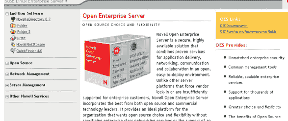

## 2. 从左侧的“用户端软件”（End User Software）下，打开 iFolder 3.x 欢迎页

出现 iFolder 3.x 欢迎页（右侧）：

## 图 8-13

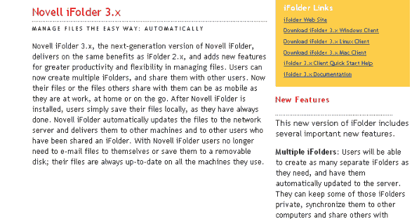

Novel Novel iFolder 3.x

以简单的方式管理：自动完成

Novel iFolder 3.x 是 Novel iFolder 的下一代产品，提供了与 iFolder 2.x 相同的优势，并添加了新功能以提高生产力和灵活性。管理用户可以创建、修改并与其他用户共享文件。现在，无论他们是在工作中、家里还是在任何地方，都可以访问自己的文件或他人与他们共享的文件。安装 iFolder 后，用户只需像以前一样，将文件保存到计算机的本地文件夹中。Novel iFolder 会自动将文件更新到网络服务器，并将其交付给共享的其他机器和用户。通过 Novel，你可以向他人发送电子邮件文件，或将其从磁盘中删除；文件在他们使用的所有机器上始终保持最新。

从页面左上角的黄色框中，选择以下客户端链接之一来下载适用于 Novell iFolder 3.x 的 iFolder 客户端的安装文件：

**表 8-7** 链接名称 操作系统和文件名

| 链接名称 | 操作系统和文件名 |
| :--- | :--- |
| iFolder 3.x Windows 客户端 | Windows 2000/XP/2003 `ifolder3-windows.exe` |
| iFolder 3.x Linux 客户端 | Novell Linux Desktop 9 及更高版本（包括 SLED 10） `ifolder3-linux.tar.gz` |
| iFolder 3.x Mac 客户端 | Macintosh OS X v10.3 及更高版本 `ifolder3-mac.tar.gz` |

解压 tar.gz 文件后，您已准备好使用以下文件安装 iFolder 客户端及其依赖项：

**表 8-8** iFolder 客户端安装文件

| iFolder 客户端 | 安装文件 |
| :--- | :--- |
| Windows 版 iFolder | `ifolder3-windows.exe` |
| Linux 版 iFolder | `../linux/ifolder3 directory`<br>`ifolder3-3.x.yyyymdd-1.i586.rpm`<br>`autilus-ifolder-3.x.yyyymdd-1.i586.rpm`<br>`simias-1.0.yyyymdd-1.i586.rpm`<br>`../linux/mono directory`<br>`gtk-sharp-1.0.9-0.sles9.novell.i586.rpm`<br>`libdigpius-1.1.7-1.ximian.i586.rpm`<br>`mono-core-1.1.7.x-xxxxx-x.novell.i586.rpm`<br>`mono-data-1.1.7.x-xxxxx-x.novell.i586.rpm`<br>`mono-web-1.1.7.x-xxxxx-x.novell.i586.rpm`<br>`xsp-1.0.9-0.novell.noarch.rpm` |
| Mac 版 iFolder | `ifolder3-3.x.yyyymdd.dmg`<br>`MonoFramework-1.1.7...x-x.dmg` |

## 在 Windows 2000/XP/2003 上安装 iFolder 客户端

在本课程中，你将在 Windows 工作站（XP 专业版）上安装 iFolder 客户端，并在 SUSE Linux Enterprise Desktop 10 (SLED 10) 工作站上运行 iFolder 客户端。

SLED 10 上已经安装了 iFolder 客户端。

有关在 Novell Linux Desktop 9 和 Macintosh 上安装 iFolder 3.x 客户端的详细信息，请参阅《Novell iFolder 3.x 用户指南》(user.pdf) 第 33 页的“安装 iFolder 客户端”。

你可以通过 `http://www.novell.com/documentation/oes` 或通过你 3077 课程 ID 中的 `OES Docs` 目录访问指南。

要在 Windows 上安装 iFolder 客户端，请执行以下操作：

- 1. 以管理员用户（或等效用户）身份登录计算机。
- 2. 将 `iFolder.exe` 文件保存到本地目录。
- 3. 双击该文件安装 iFolder；然后按照屏幕上的说明操作。Windows 版 iFolder 需要 Microsoft .NET 框架。如果没有检测到 .NET，安装程序将自动下载并安装 .NET。
- 4. 当提示重启计算机时，执行以下操作之一：
    - 选择“确定”并允许重启；然后继续第 5 步。
    - 选择“取消”并以管理员用户（或等效身份）注销；然后继续第 5 步。
    - 如果你想从当前登录创建 iFolder 账户，选择“取消”，并通过 `开始 > 程序 > iFolder 3 > iFolder Client` 启动 iFolder；然后继续第 6 步。
- 5. 要运行 iFolder，请以用户身份登录计算机。

出现 Novel iFolder 3.x 欢迎页（右侧）：

Novel iFolder 3.x 以简单的方式管理：自动完成


# Novel iFolder 3.x 概述

Novel iFolder 3.x 是 Novel iFolder 的下一代产品，提供了与 iFolder 2.x 相同的优势，并添加了新功能以提高生产力和灵活性。管理用户可以创建、修改并与其他用户共享文件。现在，无论他们是在工作中、家里还是在任何地方，都可以访问自己的文件或他人与他们共享的文件。安装 iFolder 后，用户只需像以前一样，将文件保存到计算机的本地文件夹中。Novel iFolder 会自动将文件更新到网络服务器，并将其交付给共享的其他机器和用户。通过 Novel，你可以向他人发送电子邮件文件，或将其从磁盘中删除；文件在他们使用的所有机器上始终保持最新。

## 下载 iFolder 客户端

从页面左上角的黄色框中，选择以下客户端链接之一来下载适用于 Novell iFolder 3.x 的 iFolder 客户端的安装文件：

### 表 8-7 链接名称与操作系统文件名

| 链接名称 | 操作系统和文件名 |
| :--- | :--- |
| iFolder 3.x Windows 客户端 | Windows 2000/XP/2003 `ifolder3-windows.exe` |
| iFolder 3.x Linux 客户端 | Novell Linux Desktop 9 及更高版本（包括 SLED 10） `ifolder3-linux.tar.gz` |
| iFolder 3.x Mac 客户端 | Macintosh OS X v10.3 及更高版本 `ifolder3-mac.tar.gz` |

解压 `tar.gz` 文件后，你已准备好使用以下文件安装 iFolder 客户端及其依赖项：

### 表 8-8 iFolder 客户端安装文件

| iFolder 客户端 | 安装文件 |
| :--- | :--- |
| Windows 版 iFolder | `ifolder3-windows.exe` |
| Linux 版 iFolder | `../linux/ifolder3 directory`<br>`ifolder3-3.x.yyyymdd-1.i586.rpm`<br>`nautilus-ifolder-3.x.yyyymdd-1.i586.rpm`<br>`simias-1.0.yyyymdd-1.i586.rpm`<br>`../linux/mono directory`<br>`gtk-sharp-1.0.9-0.sles9.novell.i586.rpm`<br>`libgdiplus-1.1.7-1.ximian.i586.rpm`<br>`mono-core-1.1.7.x-xxxxx-x.novell.i586.rpm`<br>`mono-data-1.1.7.x-xxxxx-x.novell.i586.rpm`<br>`mono-web-1.1.7.x-xxxxx-x.novell.i586.rpm`<br>`xsp-1.0.9-0.novell.noarch.rpm` |
| Mac 版 iFolder | `ifolder3-3.x.yyyymdd.dmg`<br>`MonoFramework-1.1.7...x-x.dmg` |

## 在 Windows 2000/XP/2003 上安装 iFolder 客户端

在本课程中，你将在 Windows 工作站（XP 专业版）上安装 iFolder 客户端，并在 SUSE Linux Enterprise Desktop 10 (SLED 10) 工作站上运行 iFolder 客户端。

SLED 10 上已经安装了 iFolder 客户端。

有关在 Novell Linux Desktop 9 和 Macintosh 上安装 iFolder 3.x 客户端的详细信息，请参阅《Novell iFolder 3.x 用户指南》(user.pdf) 第 33 页的“安装 iFolder 客户端”。

你可以通过 `http://www.novell.com/documentation/oes` 或通过你 3077 课程 ID 中的 OES Docs 目录访问指南。

要在 Windows 上安装 iFolder 客户端，请执行以下操作：

1. 以管理员用户（或等效用户）身份登录计算机。
2. 将 `iFolder.exe` 文件保存到本地目录。
3. 双击该文件安装 iFolder；然后按照屏幕上的说明操作。Windows 版 iFolder 需要 Microsoft .NET 框架。如果没有检测到 .NET，安装程序将自动下载并安装 .NET。
4. 当提示重启计算机时，执行以下操作之一：
    - 选择“确定”并允许重启；然后继续第 5 步。
    - 选择“取消”并以管理员用户（或等效身份）注销；然后继续第 5 步。
    - 如果你想从当前登录创建 iFolder 账户，选择“取消”，并通过“开始 > 程序 > iFolder 3 > iFolder Client”启动 iFolder；然后继续第 6 步。
5. 要运行 iFolder，请以用户身份登录计算机。

## 恢复单个文件

要从 Simias 集合为用户恢复单个文件或目录，请执行以下操作：

1. 收集唯一标识要恢复的文件或目录的信息，例如以下组合：
    - iFolder 名称
    - iFolder 所有者
    - iFolder 成员列表
    - 文件或目录的相对路径，例如 `/MyDir1/MyDir2/myfile.txt`
    - 时间戳或版本的大致时间
    - iFolder 中的其他文件或目录
2. 以 Admin `username` 和 `password` 登录 iManager。
3. 在 Roles and Tasks 下，展开 Novell iFolder 3；然后选择 **iFolders**。
4. 如果提示，通过输入 iFolder 服务器名称和 iFolder Admin `username` 以及 `password` 连接到存储存储的 iFolder 服务器。
5. 在 Search for iFolders 页面，搜索目标 **iFolder**（例如 MyFolder）。
6. 在 Search Results 下，选择目标 iFolder 的 **Name** 链接；然后记录其根目录的路径。
7. 从 iFolder 服务器上，使用你正常的文件系统恢复程序从备份中恢复目标文件或目录到临时位置（例如 `/tmp/MyFile`）。

> **注意**：不要将文件还原到原始位置，或 Simias 存储目录下的任何位置。

8. 使用以下方法之一将恢复的文件还原到目标 iFolder：

    **方法一：通过电子邮件**
    将恢复的文件或目录发送给 iFolder 所有者或任何具有该 iFolder 写入（Write）权限的成员。
    例如，将恢复的文件（如 `/tmp/MyFile`）通过电子邮件发送给用户。
    具有写入权限的用户只需将该文件复制回 iFolder 客户端上的相应位置，即可将其还原到 iFolder。
    例如，将 `MyFile` 复制到 `/home/username/MyiFolder/MyDir1/MyDir2/MyFile`。

    **方法二：通过 Web 访问**
    1. 在 iManager 中，展开 Novell iFolder 3 角色并选择 **Folders**（文件夹）。
    2. 搜索要管理的 iFolder；然后选择 iFolder 的 **Name**（名称）链接。
    3. 在 iFolder 页面上，选择 **Members**（成员）；然后将自己添加为 iFolder 的成员。
    4. 从 Web 浏览器登录 iFolder 3.x Web Access。
    5. 浏览并定位并打开 iFolder 文件原始所在的目录，并将文件上传到 iFolder。
       例如，将 `MyFile` 上传到 `MyiFolder/MyDir1/MyDir2/MyFile`。
       如有必要，创建你想要还原到的目录，然后向其中上传文件。

> **注意**：你一次只能上传一个文件，因此此选项在只需要恢复少数文件时可能可行。

## 配置系统策略

你可以使用 iManager 中的 **System Policies**（系统策略）页面通过以下操作来管理系统范围策略：
- 查看当前系统策略
- 修改 iFolder 系统策略

### 查看当前系统策略

要查看当前系统策略，请执行以下操作：

1. 从 iManager（左侧），展开 Novell iFolder 3 角色；然后选择 **System**（系统）。

出现以下内容：

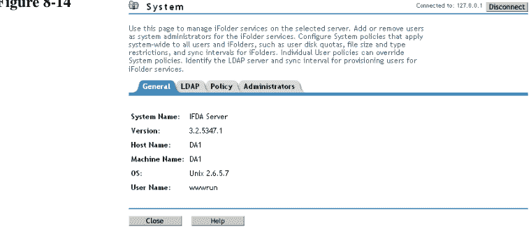

| 系统名称 | IFDA 服务器 |
| :--- | :--- |
| 版本 | 3.2.5347.1 |
| 主机名称 | DA1 |
| 机器名称 | DA1 |
| OS | Unix 2.6.5.7 |
| 用户名称 | wwwrun |

2. 选择 **Policy**（策略）选项卡。

出现以下内容：

#### 图 8-15 系统策略界面

| General（常规） | LDAP | Policy（策略） | Administrators（管理员） |
| :--- | :--- | :--- | :--- |
| 用户磁盘空间限制: 500 MB | | | |
| 最大文件大小限制: 无限制 | | | |
| 文件类型限制: 无限制 | | | |
| 最小同步间隔: 无限制 | | | |
| Close（关闭） | Help（帮助） | | |

以下描述了每个参数：

##### 表 8-9 系统策略参数说明

| 参数 | 说明 |
| :--- | :--- |
| 用户磁盘空间限制 | 指定用户拥有的所有 iFolder 中，每个用户的 iFolder 数据允许使用的最大总空间。 |
| 最大文件大小限制 | 指定 iFolder 允许同步的最大文件大小 (MB)。如果指定了配额，则有效的最大文件大小限制与配额相同。 |
| 文件类型限制 | 指定系统上所有 iFolder 在同步时要包含或排除的文件类型列表。 |
| 最小同步间隔 | 如果启用此选项，则指定每个用户账户同步 iFolder 数据的最小间隔（秒为单位）。值越大，限制越严。如果禁用此选项，则数值为无限制（No Limit）。计时器在同步会话结束时重置为同步间隔。当时间过后，将启动另一个会话。 |

### 修改 iFolder 系统策略

要修改 iFolder 系统策略，请执行以下操作：

1. 从 iManager（左侧），展开 Novell iFolder 3 角色；然后选择 **System**（系统）。
   出现 System 页面。
2. 选择 **Policy**（策略）选项卡；然后选择 **Modify**（修改）。

出现以下内容：

#### 图 8-16 修改系统策略界面

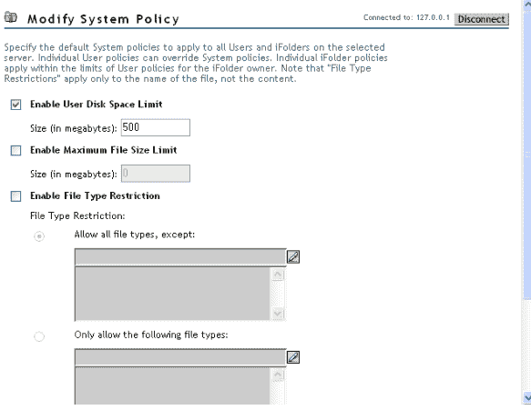

3. 通过勾选 **复选框** 来启用策略；然后为策略指定一个 **值** 并通过选择 **OK**（确定）应用它。

以下描述了每个策略：

##### 表 8-10 修改策略参数说明

| 策略 | 说明 |
| :--- | :--- |
| 启用用户磁盘空间限制 | 取消勾选复选框以禁用系统范围配额。<br>勾选复选框启用系统范围配额；然后为用户账户指定总空间配额（MB）。<br>如果你启用的系统范围配额小于用户当前的 iFolder 数据总空间，则数据将停止同步，直到数据减少到限制以下，或配额增加到某个值。 |

---

*8-76 严禁复制或分发本手册的全部或部分此类副本。如怀疑有抄袭行为，请拨打 1-800-PIRATES。版本 1*


# 修改 iFolder 系统策略

要修改 iFolder 系统策略，请执行以下操作：

1. 从 iManager（左侧），展开 `Novell iFolder 3` 角色；然后选择 **System（系统）**。
   出现 System 页面。

2. 选择 **Policy（策略）** 选项卡；然后选择 **Modify（修改）**。

## 集成 Novell Open Enterprise Server for Linux

出现以下内容：

### 图 8-16


3. 通过勾选复选框来启用策略；然后为策略指定一个值并通过选择 **OK（确定）** 应用它。

以下描述了每个策略：

### 表 8-10

| 策略 | 说明 |
| --- | --- |
| 启用用户磁盘空间限制 | 取消勾选复选框以禁用系统范围配额。<br> 勾选复选框启用系统范围配额；然后为用户账户指定总空间配额（MB）。<br> 如果你启用的系统范围配额小于用户当前的 iFolder 数据总空间，则数据将停止同步，直到数据减少到限制以下，或配额增加到某个值是 |
| 最大文件大小限制 | 指定 iFolder 允许同步的最大文件大小 (MB)。如果指定了配额，则有效的最大文件大小限制与配额相同。 |
| 文件类型限制 | 指定系统上所有 iFolder 在同步时要包含或排除的文件类型列表。 |
| 最小同步间隔 | 如果启用此选项，则指定每个用户账户同步 iFolder 数据的最小间隔（秒为单位）。值越大，限制越严。如果禁用此选项，则数值为无限制（No Limit）。计时器在同步会话结束时重置为同步间隔。当时间过后，将启动另一个会话。 |

### 表 8-11

| 字段 | 描述 |
| --- | --- |
| 服务器端口 | 指定端口 636（安全）或端口 389（不安全）。<br>如果 LDAP 服务器与 iFolder 服务器位于同一台机器上，则不需要安全端口。<br>默认值：636 |
| 端口是否安全 (SSL) | 指定 iFolder 服务器是否配置了 SSL 交换。<br>如果服务器上启用了 SSL，则该值为 Yes；否则为 No。<br>默认值：Yes |
| 代理用户 DN | iFolder 代理用户是一个现有的代理用户身份，用于在具有读取权限的范围内访问 LDAP 服务器，以检索已授权的用户列表。<br>该代理用户在 YaST 中进行 iFolder 企业级服务器配置时自动创建。用户名是自动生成的，以确保在系统中的唯一性。<br>对于大多数部署，此用户名不应被更改。请保留自动生成的 iFolder 代理用户名。<br>iFolder 管理员或等效用户可以使用 iManager 的 iFolder 3 插件来更改 iFolder 服务器 LDAP 设置中的 iFolder 代理用户身份。<br>请确保分配为 iFolder 代理用户的用户账户与用于 iFolder 管理员及其他系统用户的账户不同。 |
| 代理用户 DN（续） | 将代理用户与管理员分离提供了权限分离，这是重要的，因为代理用户密码存储在 iFolder 服务器的文件系统中。请指定您希望作为 iFolder 代理用户的现有用户的完整区分名称（DN）。此身份必须具有对 LDAP 目录的读取权限。例如：`cn=iFolderProxy1234,o=acme`。请确保同时在“代理密码”字段中输入新用户的密码。修改代理用户后，您可能希望立即使用新的 iFolder 代理信息同步 LDAP 列表；否则，在下次计划同步用户列表之前，代理用户 DN 将不会经过测试。使用 LDAP 设置页面上的“更新并同步”选项按需同步 iFolder 用户列表并验证您的代理用户设置。 |
| 代理用户密码 | 两次指定密码，并点击 OK 更新 LDAP 设置中存储的密码。每当您修改代理用户 DN 时，必须指定与新的 iFolder 代理用户关联的密码。当 iFolder 为 iFolder 用户列表同步用户时，该密码用于验证 iFolder 代理用户在 LDAP 服务器上的身份。 |
| 代理用户密码（续） | 此密码必须与存储在 iFolder 代理用户 eDirectory 对象中的密码匹配。 |
| DN | 指定 iFolder 3.x 在哪些 LDAP 容器和组中搜索以为此企业级服务器上的 iFolder 服务配置已授权的用户列表。DN 以 LDAP 格式输入。例如：`o=acme, ou=group,o=acme`。要添加 DN，请在“搜索 DN”字段中输入它，然后选择 OK。要编辑列表中的 DN，请选择它，然后选择编辑图标（笔）将其移至“搜索 DN”字段。进行更改后，选择 OK 接受这些更改。要进行搜索，选择搜索图标（放大镜）打开可浏览的 LDAP 对象列表，选择您想要添加的容器或组，然后选择 OK。如果您登录 iManager 时使用的 LDAP 树与服务器主机（iFolder 的 LDAP 服务器）所在的树不同，则无法使用 LDAP 对象选择器。要从列表中删除 DN，请选择它，选择删除图标（红色 X），然后选择 OK。当当您从搜索 DN 中删除一个 DN 时，该 DN 中的用户将在下次 iFolder 服务器同步 LDAP 信息时从 iFolder 用户列表中移除。 |
| DN（续） | 在 LDAP 同步期间，iFolder 服务器会查询 LDAP 服务器以检索 DN（在“搜索 DN”字段中指定）中的用户列表。iFolder 用户列表中的用户名将与此官方 LDAP 列表进行匹配。指定搜索 DN 中的任何新用户将被添加到 iFolder 用户列表中。如果用户不再指定的 DN 中，则该用户名将从用户列表中删除，该用户拥有的任何 iFolder 将变为孤立状态并重新分配给 iFolder 管理员，且该用户将从其他 iFolder 的成员中移除。iFolder 管理员在安装期间已配置了服务。它通过其 GUID 进行跟踪，因此即使搜索 DN 为空或您指定的搜索 DN 不包含文件夹管理员用户，它仍然可用。必须对此身份进行配置，以便 iFolder 管理员执行管理任务。 |
| 最小同步间隔 | 指定在尝试从 LDAP 服务器获取更新系统用户列表之间经过的同步间隔（秒）。默认值：86400 秒（从计时器重置开始计算的 24 小时经过时间）。 |
| 启动时同步 | 当您启动 iFolder 服务器时，指定 Yes 以立即与 LDAP 服务器同步用户列表，或指定 No 等待启动后指定的同步间隔过去后开始同步。<br>默认值：Yes |

## 管理 iFolder Web 访问

要执行基础的 iFolder 任务，您需要了解：

- **启动 iFolder Web 服务。** 启动系统或 Apache 服务。作为 root 用户，输入以下命令：`/etc/init.d/apache2`。
- **停止 iFolder Web 服务。** 停止系统或 Apache 服务。作为 root 用户，输入以下命令：`/etc/init.d/apache2`。
- **分发 iFolder URL。** 在安装并配置 iFolder 后，URL 是 iFolder 的 IP 地址或 DNS 名称（例如 `http://10.200.200.1/ifolder`）。

以下运行时参数影响用户上传：

### 表 8-12

| 参数 | 描述 |
| --- | --- |
| executionTimeout | 在尝试执行命令并成功存储文件之间等待的间隔时间（秒）。默认时间为 3 分钟。默认值：180（秒） |
| maxRequestLength | 用户允许上传到服务器的最大文件大小（字节）。默认最大大小为 10 MB。此最大值是一个硬性限制。您可以将最大长度修改为 10 MB 以内的任何值。默认值：10240（KB） |

使用 Web 访问，用户可以将本地文件上传到服务器。如果文件在超时之前未成功上传，或者文件大小超过了最大值，则上传将停止并报告失败。由于错误是由浏览器控制的，超时或超过最大值可能会导致请求无效（Bad Request）或其他通用错误。

# 集成 Linux 版本的 Novell Open Enterprise Server

例如，要为 Web Access 服务器将超时时间设置为 5 分钟（300 秒），并将最大文件大小设置为 5 兆字节（5120 KB），请修改 `../webaccess/Web.config` 文件中的其 `httpRuntime` 参数值：

```
<httpRuntime
  executionTimeout="300"
  maxRequestLength="5120"
/>
```

如果 `../webaccess/Web.config` 中的值超过了企业服务器 `../web/web.config` 中的值，则您还必须增加该文件中运行时参数的大小。

## 配置 iFolder 用户

要从 iManager 中配置 iFolder 用户，请执行以下操作：

1. 在 iManager 的“角色和任务”（左侧）下，展开 `Novell iFolder 3` 角色；然后选择“用户”。

出现以下搜索页面：

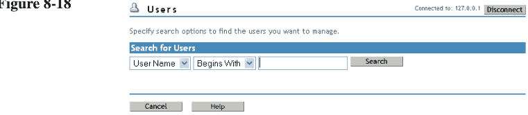

2. 选择一个名称标准（用户名、名字、姓氏）。
3. 选择一个过滤标准（包含、开头为、结尾、等于）。
4. 使用以下一种或多种搜索方法；然后选择“搜索”：
   - 在“搜索用户”字段中输入用户名称。
   - 在“搜索用户”字段中输入一个或多个字母。

在“搜索用户”字段中输入星号 (`*`) 可返回系统上所有用户的列表。
留空“搜索用户”字段以返回系统上所有用户的列表。
在页面完全刷新之前，请不要点击页面上的任何地方。

出现类似下面的搜索结果列表：

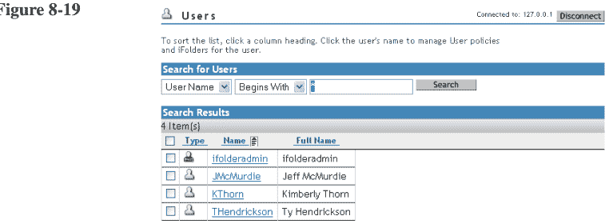

5. 浏览或排序用户列表，以找到您要配置的用户。

您的搜索结果最初按用户名的字母顺序显示。
选择列标题链接以以列作为主键启动排序。再次选择相同的标题链接以启动反向排序。

以下是每列的描述说明：

- **类型。** 一个图标，用于指示该用户是否具有 iFolder 管理员权限（穿着裁判员条纹服的用户）或是一个名称（用户图标）。
- **名称。** 分配给用户账户的用户名，例如 `jsmith`。
- **全名。** 用户账户的名字和姓氏。

## 选择用户名称以管理该用户的用户策略和 iFolders。

出现类似下面的页面：

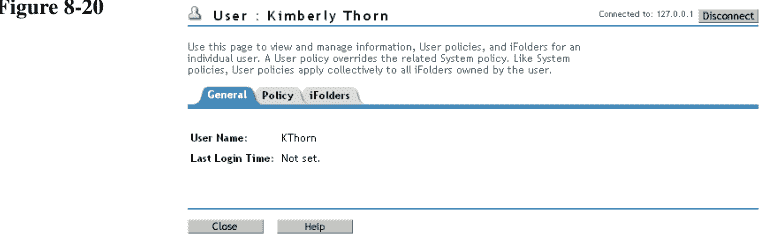

打开“常规”选项卡页面，其中显示用户的全名、用户名以及用户上次登录的时间。
如果用户未在客户端机器上设置账户，则“上次登录时间”报告为“未设置”。

7. 选择“策略”选项卡。

## 在 OES Linux 服务器上安装和配置 iFolders

出现以下信息：

### 图 8-21

用户： Kimberly Thorn

使用此页面查看和管理单个用户的信息、用户策略和 iFolders。用户策略将覆盖相关的系统策略。与系统策略一样，用户策略适用于该用户拥有的所有 iFolders。

| 账户启用 | 是 |
| --- | --- |
| 已用空间 | 0 MB |
| 可用空间 | 500 MB |
| 空间限制 | 500 MB（系统级） |
| 最大文件限制 | 无限制（系统级） |
| 文件类型限制 | 允许所有文件类型，除：BThumbs.Store（系统级） |
| 最小同步间隔 | 无限制 |
| 有效同步间隔 | 无限制 |

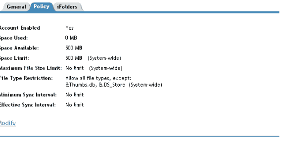

## 以下是每个参数的描述：

### 表 8-13

| 参数 | 描述 |
| --- | --- |
| 账户启用 | 指定用户当前是否允许登录以同步 iFolders。 |
| 已用空间 | 指定所选用户拥有的所有 iFolders 当前使用的总空间。 |
| 可用空间 | 指定账户上任何空间限制与当前使用空间之间的差。如果没有配额生效，则该值为“无限制”。 |
| 空间限制 | 指定用户在其拥有的所有 iFolders 中，iFolder 数据允许使用的最大总空间（单位为 MB）。 用户配额优先于系统级配额，无论用户配额大于还是小于系统级配额。用户配额可以由 iFolder 策略进行限制，但不能通过策略增加。 |
| 重要 | 用户无法成功同步会导致超出配额的尺寸的文件。如果他们尝试这样做，则只有文件的部分内容会被同步，导致数据损坏。 |
| 说明 | 如果 iFolder 数据消耗的总空间接近有效配额（系统、用户或 iFolder），用户应停止同步文件，直到完成以下一项或多项任务，从而留出足够的空间，以便在文件所在的 iFolder 中安全地同步该用户的文件：<br> - 根据需要修改系统级配额、iFolder 所有者的用户配额以及 iFolder 配额。 |


- 将该用户拥有的任何 iFolder 中的文件移动到另一个位置，使其不再影响有效配额。

## 以下是每个参数的描述

| 参数 | 描述 |
| --- | --- |
| 账户启用 | 指定用户当前是否允许登录以同步 iFolders。 |
| 已用空间 | 指定所选用户拥有的所有 iFolders 当前使用的总空间。 |
| 可用空间 | 指定账户上任何空间限制与当前使用空间之间的差。如果没有配额生效，则该值为“无限制”。 |
| 空间限制 | 指定用户在其拥有的所有 iFolders 中，iFolder 数据允许使用的最大总空间（单位为 MB）。用户配额优先于系统级配额，无论用户配额大于还是小于系统级配额。用户配额可以由 iFolder 策略进行限制，但不能通过策略增加。 |

> **重要**：用户无法成功同步会导致超出配额的尺寸的文件。如果他们尝试这样做，则只有文件的部分内容会被同步，导致数据损坏。

如果 iFolder 数据消耗的总空间接近有效配额（系统、用户或 iFolder），用户应停止同步文件，直到完成以下一项或多项任务，从而留出足够的空间，以便在文件所在的 iFolder 中安全地同步该用户的文件：

- 根据需要修改系统级配额、iFolder 所有者的用户配额以及 iFolder 配额。
- 将该用户拥有的任何 iFolder 中的文件移动到另一个位置，使其不再影响有效配额。

| 参数 | 描述 |
| --- | --- |
| 文件类型限制 | 允许你指定是否允许所有文件类型，或者排除某些文件类型。如果你没有为用户设置任何单独的文件类型限制，将显示这些设置。`thumbs.db` 和 `.DS_Store` 从不同步，它们始终生效；你无法覆盖它们。 |
| 最小同步间隔 | 指定用户检查服务器上的 iFolder 数据以识别需要下载或上传文件的最小间隔（单位为秒）。较长的间隔比短的间隔更具限制。如果设置了用户策略，它将覆盖系统策略，无论用户策略值大还是小。 |
| 有效同步间隔 | 指定用户的有效最小间隔。有效最小间隔始终是以下值的最大值：<br>- 系统策略（默认值为 0），除非设置了用户策略。<br>- 如果设置了用户策略，用户策略将覆盖系统策略，无论用户策略值大还是小。<br>- 与服务器同步的本地机器策略。<br>- iFolder（集合）策略。 |

- 8. 在查看了用户策略信息后，可以通过选择“修改”链接来修改策略。

# 图 8-22 修改用户策略：Kimberly Thorn

指定适用于所选用户的所有 iFolders 的用户策略。单独用户策略将覆盖系统策略。单独文件夹策略在用户策略的限制内应用。注意，“文件类型限制”仅适用于文件名，不适用于内容。

- 账户启用
- 启用空间限制
  - 大小（兆字节）：
- 启用最大文件限制
  - 大小（兆字节）：
- 启用文件类型限制
  - 允许所有文件类型
  - 允许所有文件类型，除：
    - 仅允许以下文件类型：

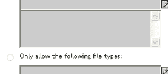

- 9. 通过勾选复选框启用策略；然后为策略指定值并点击“确定”进行应用。

以下是每种策略的描述：

| 策略 | 描述 |
| --- | --- |
| 账户启用 | 选中该值以启用账户登录。取消选择该值以禁用账户登录。如果你在进行此更改时用户已登录，则用户的会话将持续到用户注销。该策略在用户下次尝试登录账户时生效。 |

## 表 8-14

| 策略 | 描述 |
| --- | --- |
| 账户已启用（续） | 要使锁定生效，您必须重启 iFolder 服务器的 Apache 服务；这样做将断开所有活动会话，包括用户的会话。默认值：启用，是 |
| 启用空间限制 | 指定所选账户拥有的所有 iFolder 允许用户 iFolder 数据使用的最大总空间（MB）。如果没有个人用户配额或要接受所选用户账户的系统级配额，请取消勾选此选项。选择此选项以强制用户配额；然后为所选用户账户指定总空间配额（MB）。如果启用的用户空间限制小于用户当前 iFolder 数据的总空间，则用户的数据将停止同步，直到数据减少到限制以下，或将配额增加到大于用户总消耗空间的值。默认值：禁用，或如果已设置则使用系统级配额 |
| 启用文件类型限制 | 取消勾选此选项以允许同步所有文件类型进行同步，或对该用户账户应用系统级文件类型限制。选择此选项以限制该用户的某些文件类型，然后指定包含或排除过滤器，以确定该用户账户可以同步的文件类型。 |
| 启用文件类型限制（续） | 要向包含或排除过滤器添加文件扩展名，请输入扩展名（如 `.mpg`），然后选择确定以应用过滤器。<br><br>要编辑扩展名，选择该值，点击编辑（铅笔图标），修改条目，然后选择确定以应用更改。<br><br>默认值：禁用，允许所有文件类型；或系统级设置 |
| 最小同步间隔 | 取消勾选框以不设置同步间隔，或接受用户账户的系统级设置。<br><br>如果未为系统级或用户级策略设置值，则报告的值为“无限制（No Limit）”。<br><br>勾选框以启用最小同步间隔，然后指定最小间隔（秒）。<br><br>例如，一个实用的值是 600 秒（10 分钟）。<br><br>默认值：禁用，或系统级策略 |

## 管理 iFolders

要从 iManager 执行基础的 iFolders 管理任务，您需要了解如何执行以下操作：

- 在 iManager 中创建 iFolder
- 从用户页面创建 iFolder
- 搜索 iFolder
- 配置 iFolder
- 共享 iFolder

## 在 iManager 中创建 iFolder

要在 iManager 中创建 iFolder，请执行以下操作：

1. 在 iManager 角色和任务（左侧）下，展开 `Novell iFolder 3` 角色；然后选择 `iFolders`。
   出现搜索页面。
2. 选择“新建 iFolder (New iFolder)”链接。
   出现以下内容：
   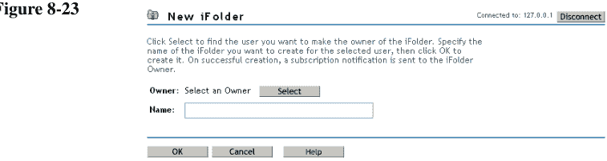
3. 在所有者（Owner）右侧，选择选择（Select）。
4. 搜索您希望作为 iFolder 所有者的用户并勾选用户（User）复选框；然后选择确定。
   在新建 iFolder 页面上，所有者字段显示用户的姓和名。
5. 为 iFolder 输入名称。
6. 选择确定创建 iFolder。
   当 iFolder 成功创建时，将向 iFolder 所有者发送订阅通知。
   新的 iFolder 将单独列在搜索结果区域。
7. 选择 iFolder 的名称链接以查看详细信息、更改所有者、配置其策略、共享 iFolder 或修改成员的访问权限。

## 从用户页面创建 iFolder

要在 iManager 的用户页面创建 iFolder，请执行以下操作：

1. 在 iManager 角色和任务下，展开 `Novell iFolder 3` 角色；然后选择 `用户（Users）`。
2. 搜索并选择您想要管理的用户名称；然后选择确定。
   打开用户页面并显示用户信息。
3. 从用户页面，选择 `iFolders` 选项卡；然后选择 `新建（New）`。
   出现“新建 iFolder”对话框。
   用户出现在所有者字段中。
4. 为 iFolder 输入名称。
5. 选择确定创建 iFolder。
   当 iFolder 成功创建时，将向 iFolder 所有者发送订阅通知。
   新的 iFolder 将单独列在搜索结果区域。
6. 选择 iFolder 的名称链接以查看详细信息、更改所有者、配置其策略、共享 iFolder 或修改成员的访问权限。

## 搜索 iFolder

要在 iManager 中搜索 iFolder，请执行以下操作：

1. 从 iManager，展开 `Novell iFolder 3` 角色。
2. 使用以下方法之一获取 iFolders 列表：
   - 选择 `iFolders` 角色以打开搜索 iFolders 页面并指定您的搜索标准；然后选择确定。
   或
   - 在 iFolders 页面上选择 `孤立 iFolders（Orphaned iFolders）` 或选择 `孤立 iFolders` 角色以检索 iFolders 列表。使用以下方法之一：
     - 选择“等于 (Equals)”作为过滤器；然后输入 iFolder 的名称。
     - 为 iFolder 选择一个过滤器（包含 `Contains`、以...开头 `Begins With`、以...结尾 `Ends With`）。
     - 在搜索字段输入星号 (`*`) 以返回所有 iFolders 列表。
     - 留空搜索字段以返回所有 iFolders 列表。
     - 在搜索字段中输入 iFolder 的名称以返回 iFolders。
3. 选择 iFolder 的名称链接以查看详细信息、更改所有者、配置其策略、共享 iFolder 或修改成员的访问权限。

## 集成 Novell Enterprise Server

要在 iManager 中配置 iFolder，请执行以下操作：

- 从 iManager，选择 `Novell iFolder 3` 角色；然后选择 `iFolders` 或 `孤立 iFolders`。

出现以下内容：

# 图 8-24

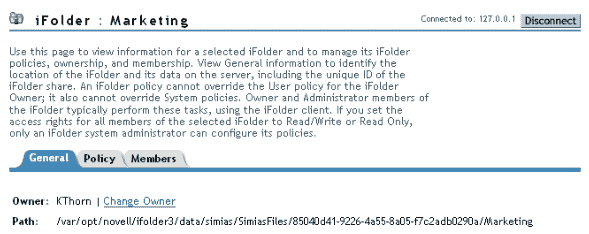

使用此页面查看所选 iFolder 的信息并管理策略、所有权成员。iFolder 策略无法覆盖用户策略。如果您选择访问权限读写或只读，则只有 iFolder 管理员可以配置其策略。

- 所有者：Thom
- 路径：`/var/opt/novell/ifolder3/data/Sims/8504d61-9226-4a55-a05-f7c2ed7290/Marketing`

# 表 8-15

| 参数 | 描述 |
| --- | --- |
| Owner | iFolder 所有者的用户名。对于孤立 iFolders，iFolder 管理员将成为保管员，直到该 iFolder 被重新分配或删除。iFolder 所有者拥有 iFolder 的完全控制权。所有者管理用户的成员和访问权限，并可以移除成员的完全控制权。在企业服务器上，所有者 iFolders 使用的磁盘空间将计入所有者在企业服务器上的账户配额。 |

## 集成 Novell Open Enterprise Server

| 续表 8-15 参数 | 描述 |
| --- | --- |
| Path | iFolder 及其数据在服务器上的实际位置。例如：<br>`/var/opt/novell/ifolder3/simias/SimiasFiles/e84fd6e-3d51-49df-ae3f-8c9213c76994/iFolder_Name`<br>在此示例中，<br>`e84fd6e-3d51-49df-ae3f-8c9213c76994` 是 iFolder 共享的唯一 ID。 |

3. 选择策略选项卡，然后选择修改链接。
   出现以下内容：
4. 通过勾选复选框启用策略；然后为策略指定值并选择确定以应用。

# 以下描述了每个策略：

| 表格 8-16 |
| --- |
| 策略 | 说明 |
| :--- | :--- |
| 启用同步 | 勾选“启用同步”以允许 iFolder 中的数据同步。取消勾选“启用同步”以关闭同步（通常是临时）。默认值：启用，是 |
| 启用空间限制 | 勾选“启用空间限制”框；然后指定所选 iFolder 的最大大小（MB）。如果您有系统级 iFolder 配额，用户的帐户配额将覆盖系统配额，无论用户配额高于还是低于系统配额。默认值：禁用，无限制 |
| 已用空间（仅读） | iFolder 当前占用了多少空间。 |
| 启用文件类型限制 | 要启用过滤，请选择“启用文件类型限制”。指定以下方法之一来过滤同步的文件：<br>* 选择“允许除以下所有文件类型外”，并在 iFolder 同步 iFolder 中的文件时指定要排除的文件类型列表。<br>* 选择“仅允许以下文件类型”，并在 iFolder 同步 iFolder 中的文件时指定要包含的文件类型列表。<br>输入文件扩展名，然后选择 OK 将添加到列表。 |

# 表格 8-16

| 策略 | 说明 |
| --- | --- |
| 启用文件类型限制（续） | 要编辑扩展名，选择该值，选择编辑（铅笔图标），修改条目，然后选择 OK 应用更改。<br><br>默认值：禁用，无限制 |
| 最小同步间隔 | 选择“同步间隔”框以为所选 iFolder 启用最小间隔设置，然后指定允许在客户端设置的最小值（秒为单位）。<br><br>要禁用同步，取消勾选“同步间隔”框。如果禁用了选项，报告的值为“无限制”。<br><br>如果启用此选项，最小同步间隔指定用户客户端检查服务器上的 iFolder 数据和本地 iFolder 以识别需要下载或上传的文件的最小间隔（秒为单位）。<br><br>实际的最小同步间隔始终是以下设置中的最大值：<br>* 系统策略（默认值为 0 (0)），除非设置了用户策略。<br>* 只要设置了用户策略，则用户策略将覆盖系统策略，无论其值较大还是较小。<br>* 本地机器策略，或与服务器同步的客户端机器上的设置。<br>* iFolder（集合）策略。<br>默认值：启用，0 秒 |

## 共享 iFolder

要从 iManager 共享 iFolder，请执行以下操作：

1. 从 iManager 中，选择 `Novell iFolder 3` 角色；选择 `iFolders` 或 `孤立 iFolders`。
2. 找到您想要管理的 iFolder；选择 iFolder 的名称链接。
   出现 iFolder 的“常规（General）”选项页。
3. 选择“成员（Members）”。
   出现一个如下所示的成员列表：

| 添加 | | 权限+ |
| --- | --- | --- |
| 权限名称 | 全名 |
| KThorn | Kimberly Thorn |

4. 选择“添加”。
5. 搜索您想要成为成员的用户，并勾选用户名旁边的复选框；选择 OK。
   用户默认获得 iFolder 的只读访问权限。
6. （可选）勾选用户复选框；选择“权限（Rights）”下拉列表并将访问权限指定为“完全控制”、“读取/写”或“只读”。
   等待页面刷新。
   用户的图标应反映新的效果。
   一条邀请用户参与的通知消息将发送到用户的帐户。

## 目标 5

## 作为用户管理 iFolder 3.x

一旦您安装了 iFolder 3.x 并配置了用户，用户就可以从 iFolder 客户端执行某些 iFolder 管理任务。

以下是用户可以执行的一些基本任务：

- 管理 iFolder 帐户和偏好
- 管理 iFolder
- 使用 Novell iFolder 3.x Web 访问

> 有关作为用户管理 iFolder 3.x 的更多信息，请参阅《Novell iFolder 3.x Novell iFolder 用户指南》(user.pdf)。
> 您可以从 `http://www.novell.com/documentation/oes` 或从您的 3077 课程光盘上的 `OES_Docs` 目录访问该指南。

## 管理 iFolder 帐户和偏好

要使用 iFolder 客户端管理 iFolder 帐户和偏好，您需要知道如何执行以下基本任务：

- 启动 iFolder 客户端
- 配置 iFolder 帐户
- 登录 iFolder 帐户
- 查看并修改 iFolder 帐户设置
- 为客户端配置 iFolder 偏好

## 启动 iFolder 客户端

要为 Novell Linux Desktop 9 启动 iFolder，请执行以下操作：

1. 使用您在创建 iFolders 时想要使用的用户身份登录您的计算机。
2. 使用以下方法之一启动 iFolder：
   - 打开终端窗口；然后输入以下内容之一：
     ```
     /opt/novell/ifolder3/bin/ifolder
     ```
     或
     ```
     ifolder
     ```
3. （条件）如果您禁用了帐户的“记住密码”，则必须登录服务器。

## 配置 iFolder 帐户

1. 打开 iFolder 客户端。
2. 选择“新建”访问帐户设置区域。
3. 在帐户设置区域指定以下信息：

# 表格 8-17

| 参数 | 说明 |
| --- | --- |
| 服务器 | 您拥有帐户的 iFolder 级域名名称或 IP 地址。<br>例如：`da1.da.com` 或 `10.200.200.1`。 |


| 用户名 | 输入此帐户的用户身份。iFolder 管理员决定您使用的格式是您的网络 ID（LDAP 通用名）还是您的电子邮件地址。例如，如果您的名字是 John Smith，ID 为 jsmith，地址为 john.smith@example.com，管理员在服务器上配置了一个设置，用于在用户名字段中接受这两种格式中的之一。 |
| --- | --- |
| 密码 | 用户名的密码。 |
| 记住密码 | 勾选“记住密码”，以便在您登录计算机时自动登录此 iFolder 帐户。如果您的网络密码更改，下次 iFolder 尝试登录帐户时，自动身份验证将优雅失败。iFolder 将提示您使用新密码登录并允许您保存新密码。 |
| 启用帐户 | 勾选“启用帐户”以允许后台同步该帐户的 iFolder 邀请、列表和 iFolders。 |
| 默认帐户 | 勾选“默认帐户”，使该帐户成为您在创建 iFolders 时帐户列表中的默认选中项。 |

4. 完成后，选择“登录”。

（可选）如果提示证书，请检查证书或证书消息；然后选择“确定”接受它。

6. 验证账户是否已创建，方法是检查账户是否出现在状态为“已登录”的账户列表中，如下：

## 图 8-28

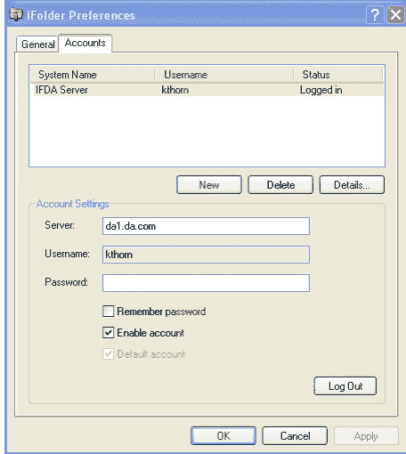

iFolder 开始同步该账户的任何现有 iFolders、iFolder 通知以及该账户的用户列表。

此初始下载可能需要几秒钟到几分钟，取决于账户用户列表的大小。

7. 选择“确定”关闭 iFolder 选项对话框。

8. 使用以下两种方法之一为该账户设置 iFolders：

- 如果该账户可用 iFolders，则会弹出 iFolder 通知消息。选择该消息以打开 iFolders 对话框。

或

- 如果该账户没有 iFolders 或你想开始添加 iFolders，请右键点击 iFolder 应用程序图标；然后选择 iFolders 以打开 iFolders 对话框。

## 登录 iFolder 账户

设置好 iFolder 账户后，每当你想同步本地 iFolder 数据、iFolder 用户列表以及你共享的 iFolder 通知时，都必须登录。

你可以同时登录多个账户。为每个账户使用以下登录方法之一：

- 启用“记住密码”，这样每当你登录桌面或启动 iFolder 客户端时，都会自动登录 iFolder 账户。

每当你的密码更改时，下次 iFolder 尝试登录该 iFolder 账户时，自动身份验证将优雅地失败。

iFolder 会提示你使用新密码登录，并允许你指定并保存新密码。

或

- 禁用“记住密码”，仅在你准备好同步其 iFolders 中的文件或管理 iFolders 时登录 iFolder 账户。

要对现有 iFolder 账户启用或禁用“记住密码”：

1. 右键点击通知区域中的 iFolder 服务图标；然后选择“账户”。

2. 选择 iFolder 账户查看你的账户设置。

3. 勾选（启用）或取消勾选（禁用）记住密码。

4. 输入密码；然后选择“确定”或“应用”。

5. 选择“确定”以验证账户设置的更改，或选择“取消”退出更改。

要登录 iFolder 账户：

1. 右键点击通知区域中的 iFolder 服务图标；然后选择“账户”。

2. 选择 iFolder 账户查看其账户设置。

3. 输入密码；然后选择“登录”。

登录成功后，账户状态将变为“已登录”。

如果登录失败，错误消息将报告原因（例如密码错误）。

4. 选择“确定”关闭“账户”对话框。

## 查看和修改 iFolder 账户设置

要查看或修改 iFolder 账户设置，请执行以下操作：

1. 右键点击通知区域中的 iFolder 服务图标；然后选择“账户”打开 iFolder 选项并切换到“账户”选项卡。

2. 选择账户查看或修改以下参数：

| 表 8-18 | 参数 | 描述 |
| --- | --- | --- |
| 服务器 | 你拥有账户的 iFolder 企业级服务器的 DNS 名称或 IP 地址。例如：`da1.da.com` 或 `10.200.200.1`。 |
| 用户名 | 输入你为此账户的用户身份。iFolder 管理员决定你应该使用网络用户 ID（LDAP 通用名称）还是你的电子邮件地址。 |

## 表 8-18（续）

| 参数 | 描述 |
| --- | --- |
| 用户名（续） | 例如，如果你的名字是 John Smith，用户 ID 为 jsmith，电子邮件地址为 john.smith@example.com，你的管理员会为服务器配置设置，以决定在身份验证的用户名字段中接受这两种格式中的哪一种。每个企业级服务器只能创建一个账户。 |
| 密码 | 你的用户名的密码。 |
| 记住密码 | 选择“记住密码”，以便每当你登录计算机时都自动登录此 iFolder。如果你的网络密码发生更改，下次 iFolder 尝试登录该 iFolder 账户时，自动身份验证将优雅地失败。iFolder 会提示你使用新密码登录，并允许你保存新密码。 |
| 启用账户 | 选择“启用账户”以允许该账户的 iFolder 邀请、用户列表和 iFolders 进行后台同步。这仅控制客户端功能。账户是“已启用”还是“已禁用”的状态显示在账户列表的“状态”列中。如果你设置了多个账户，可以查看“启用账户”设置的状态。当你配合 Novell iFolder 3.x 使用 iFolder 时，iFolder 系统管理员可以在服务器端（通常是临时）禁用你的 iFolder 账户。 |

## 表 8-18

| 参数 | 描述 |
| --- | --- |
| 启用账户（续） | 你可以预期以下行为：<br>- 如果账户从服务器端禁用时你处于登录状态，你可以继续管理你的 iFolders，直到你通过注销或禁用同步来结束会话，或者服务器断开你的会话。<br>- 如果账户在服务器端禁用，每当你尝试登录时都会收到弹出消息通知账户已禁用。请联系你的 iFolder 管理员寻求帮助。 |
| 默认账户 | 选择“默认账户”使此账户成为列表中的默认账户。 |

### 3. 在“账户”选项卡上，选择 iFolder 账户；然后选择“详细信息”查看关于你账户的信息：

| 表 8-19 | 参数 | 描述 |
| --- | --- | --- |
| 服务器 | 企业级服务器的主机名。例如，如果服务器名为 da1.da.com，则会显示。 |
| 描述 | 管理员输入的服务器友好描述。未输入描述，值为 None。 |

## （续）表 8-19

| 参数 | 描述 |
| --- | --- |
| 可用 | 你 iFolders 目前可用的总空间。该值等于配额减已用空间。 |
| 已用 | 所有 iFolders 目前消耗的总空间。 |
| 配额 | 分配给你的账户的总空间。此值可能是用户的默认配额，也可能是特定用户的配额。如果没有设置配额，为空或 N/A（不适用）。 |

## 配置客户端 iFolder 选项

要配置 iFolder 客户端，请执行以下操作：

1. 右键点击通知区域中的 iFolder 服务图标；然后选择“选项”。

出现 iFolder 选项对话框，并显示“常规”选项卡：

# 图 8-29

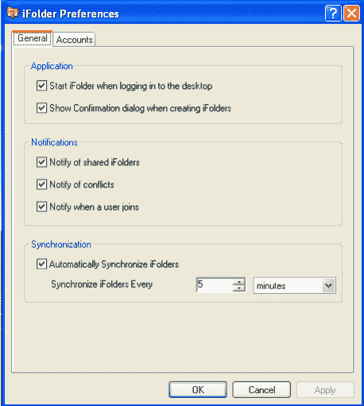

2. 选择或输入以下内容：

| 参数 | 描述 |
|---|---|
| 登录桌面时启动 iFolder | 当你登录设置 iFolder 账户的本地用户名时，选择此选项启动 iFolder。对于已启用“记住密码”的账户，同步将在指定的“同步间隔”在后台进行。取消此选项则可以手动启动 iFolder。 |

## 表 8-20

| 参数 | 描述 |
| --- | --- |
| 创建 iFolders 时显示确认 | 选择此选项，以便在每次创建 iFolder 时都收到确认消息。除了 iFolder 出现在列表中的正常视觉提示外，该消息还会出现。取消此选项以停止接收确认消息。 |
| 共享 iFolders 通知 | 选择此选项，以便当你收到新的共享 iFolder 邀请时，在通知区域启用弹出消息。插入根据你在 iFolder 选项中指定的“同步间隔”检索的。该间隔控制文件、iFolder 共享邀请和用户列表的同步。你还可以点击“刷新”来更新邀请。取消此选项以禁用邀请的弹出消息行为。 |
| 冲突 | 选择此选项，以便在同步文件时发生冲突时，在通知区域启用弹出消息。取消此选项以禁用同步冲突的弹出消息行为。 |

## 集成 Linux 版本的 Novell Open Enterprise Server

| 参数 | 说明 |
| --- | --- |
| (续) 表格 8-20 | 关联 | 选择此选项后，每当用户接受共享 iFolder 的邀请时，将在通知区域中显示弹出消息。接受操作取决于用户实际何时在自己的计算机上设置该 iFolder。取消勾选此选项，以禁用用于用户共享确认的弹出消息行为。 |
| 同步 | - **自动同步 iFolders。** 勾选此复选框以启用在当前登录身份下对此台计算机上所有 iFolders 的同步。取消勾选复选框以禁用同步。<br>- **每隔一段时间同步 iFolders。** 指定在当前登录身份下同步此台计算机上 iFolders 时使用的最小时间间隔。请指定值和单位。如果您在配合 Novell iFolder 3.x 时使用 iFolder 客户端，则有效的最小同步间隔始终为以下设置中的最大值：<br>  - 系统策略策略（默认值为 (0)），除非设置了用户策略。<br>  - 如果设置了用户策略，则用户策略将覆盖系统策略，无论用户策略的值较大还是较小。<br>  - 本地机器策略或与服务器同步的客户端机器设置。<br>  - iFolder（集合）策略。 |

8-124 严禁复制本手册的全部或部分内容或分发此类副本。如怀疑有抄袭行为，请拨打 1-800-PIRATES。版本 1

3. 完成后，选择应用保存您的更改。

4. 选择确定关闭 iFolder 偏好对话框。

## 管理 iFolders

iFolder 是一个本地目录，用于与用户指定的成员选择性地共享和同步文件。

所有成员均可访问 iFolder 文件，并且具有相应权限的人可以对其进行修改和读取。

以下是从 iFolder 客户端管理 iFolders 的基本任务：

- 创建 iFolder
- 共享 iFolder
- 设置可用的 iFolder
- 查看并配置 iFolder 属性
- 同步文件
- 删除 iFolder


> 有关管理 iFolders 的完整详细信息，请参阅 Novell iFolder 3.x Novell iFolder 用户指南 (user.pdf) 第 47 页的“管理 iFolders”。

您可以从 3077 CD 中的 OES_Docs 目录通过 `http://www.novell.com/documentation/oes` 访问指南。

## 创建 iFolder

可以通过转换现有文件夹来创建 iFolder。如果文件夹不存在，您可以浏览到某个位置并在过程中创建新文件夹。

## 集成 Linux 版本的 Novell Enterprise Server

在 iFolder 中，您可以设置任何符合您个人或公司工作习惯的子目录结构。

子目录结构在所有成员的 iFolders 中保持一致。每个工作站可以为共享的 iFolder 指定不同的父目录。

要创建 iFolders，您需要知道如何执行：

- 在文件管理器中创建 iFolders
- 在 iFolders 浏览器中创建 iFolders
- 在 FAT32 挂载点 (Linux) 上创建 iFolders

## 在文件管理器中创建 iFolders

要在文件管理器中创建 iFolder，执行以下操作：

1. 使用文件管理器导航到您想要转换为 iFolder 的文件夹；选择该文件夹。

2. 执行以下操作之一：

    - 右键点击 iFolder 图标；然后选择**转换为 iFolder**

    或者

    - 从工具栏中，选择**文件 > 转换为 iFolder**。

文件夹图标将变为带有叠加图标的 iFolder 图标。

3. 当出现“已创建 iFolder”消息时，执行以下操作之一：

    - 选择**关闭**关闭消息。

    或者

    - 选择**不再显示此消息**以禁用未来的通知；然后选择**关闭**。

如果您以后想接收确认消息，请转到 iFolder 偏好，选择**创建 iFolders 时显示对话框**，然后选择**确定**。

## 在 iFolders 浏览器中创建 iFolders

要在客户端 iFolders 浏览器中创建 iFolder，执行以下操作：

1. 从通知区域，右键点击 iFolder 图标；通过选择 iFolders 打开 iFolders 浏览器。

出现以下内容：

图 8-30

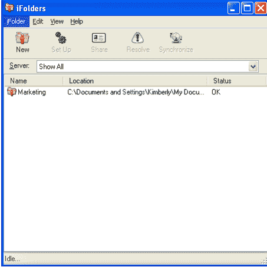

2. 选择新建。

出现“新建 iFolder”对话框。

3. (条件) 如果您有多个 iFolder 账户，请指定您想为此 iFolder 使用的 iFolder 账户。

默认账户列在第一个。使用下拉列表选择不同的账户。

4. 在“位置”字段右侧，选择浏览。

## 集成 Linux 版本的 Novell Open Enterprise Server

出现以下内容：

图 8-31

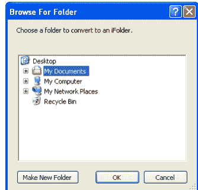

5. 在浏览器中，导航到该目录。

6. 通过执行以下操作选择您要创建的文件夹：

    - 如果文件夹存在，选择确定。

    - 如果文件夹不存在，创建新文件夹并选择确定。

7. 完成后，选择应用保存您的更改。

8. 当出现“已创建 iFolder”消息时，执行以下操作之一：

    - 选择**关闭**关闭消息。

    或者

    - 选择**不再显示此消息**以禁用未来的通知。

9. 选择确定关闭 iFolder 偏好对话框。

如果您以后想接收确认消息，请转到 iFolder 偏好，选择**创建 iFolders 时显示对话框**，然后选择**确定**。

8-124 严禁复制本手册的全部或部分内容或分发此类副本。如怀疑有抄袭行为，请拨打 1-800-PIRATES。版本 1

## 在 FAT32 挂载点 (Linux) 上创建 iFolders

在 Linux 上创建 iFolders 之前，必须设置 FAT32 挂载点。FAT32 文件系统不支持 POSIX 权限，因此您必须在 `/etc/fstab` 文件中指定用户 ID (UID)。要设置挂载点，执行以下操作：

1. 以 **root** 身份登录计算机。

2. 从命令提示符，输入以下命令创建您想要挂载的目录：

```
mkdir /home/usernamesmount
```

将 username 为计划使用 FAT32 驱动器的用户名。将 fsmount 为您想要作为挂载点的目录名称。

3. 输入以下命令将 FAT32 驱动器挂载到指定的挂载点：

```
mount -t vfat /dev/hda1 /home/usernamesmount
```

将 `/dev/hda1` 为非 Linux 设备或分区名称。将 username 为 iFolder 用户名。将 fsmount 为您想要作为挂载点的目录名称。

例如，如果 FAT32 文件系统 (vfat) 在 hda4 设备 (`/dev/hda4`)，用户名为 jsmith，且挂载点目录为 `/home/jsmith/fat32mntpt`，您将输入

```
mount -t vfat /dev/hda4 /home/jsmith/fat32mntpt
```

4. 编辑 `/etc/fstab`，在定义 FAT32 挂载点的上添加 iFolder 用户的 `uid=username` 参数，如下：

```
/dev/hda1 /home/usernamesmount vfat uid=username
```

在 jsmith 示例中，您将修改 `/etc/fstab`，为挂载点添加 `uid=jsmith`，如下：

```
/dev/hda4 /home/jsmith/fat32mntpt uid=jsmith
```

## 向 iFolder 添加用户

你可以通过执行以下操作之一向 iFolder 添加用户：

- **使用文件管理器添加用户。** 若要使用文件管理器添加用户，请执行以下操作：

  1. 从文件管理器中，导航并选择 iFolder。

  2. 右键点击 iFolder：然后选择 iFolder > 共享。

  3. 从用户列表中，选择一个或多个用户。

  4. 选择访问权限：**完全控制、读取/写入或只读。**

  5. 选择**应用**。

- **使用 iFolders 浏览器添加用户。** 若要使用 iFolders 浏览器添加用户，请执行以下操作：

  1. 在通知区域中，右键点击 iFolder 图标，然后选择 iFolders 打开 iFolders 浏览器。

  2. 从 iFolders 列表中，选择 iFolder；然后选择**共享**。

      打开 iFolder 属性对话框，并默认选中“共享”选项卡。

  3. 选择**添加**。

出现以下内容：

## 图 8-32 选择用户

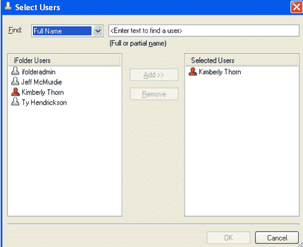

  4. 从用户列表中，选择一个或多个用户；然后通过选择**添加**将他们添加到“已选用户”列表中。

  5. 完成后，选择**确定**。


邀请同步到服务器可能需要几秒钟。

6. 选择一个或多个`用户`；然后选择`访问 (Access)`。

7. 选择`完全控制`、`读取/写入`或`只读`访问权限。

8. 完成后，选择`确定 (OK)`。

9. 选择`应用 (Apply)`；然后通过选择`确定 (OK)` 关闭 iFolder 属性对话框。

# 修改用户访问权限

随着 iFolder 成员的工作关系和状态发生变化，你可能需要更改用户对 iFolder 的访问权限设置。

例如，你可能想给一个受信任的用户该 iFolder 的文件控制权。

要为 iFolder 设置用户权限，你可以执行以下操作之一：

- **使用文件管理器设置用户权限。** 若要使用文件管理器设置用户权限，请执行以下操作：

  1. 从文件管理器中，导航到 iFolder，然后选择它。

  2. 右键点击 iFolder，然后点击 iFolder > `共享 (Share with)`。

  3. 从用户列表中，选择一个或多个用户。

  4. 选择`访问 (Access)`；然后选择`完全控制`、`读取/写入`或`只读`权限。

  5. 选择`应用 (Apply)`；然后通过选择`确定 (OK)` 关闭 iFolder 属性对话框。

- **使用 iFolders 浏览器设置用户权限。** 若要使用 iFolders 浏览器设置用户权限，请执行以下操作：

  1. 在通知区域中，右键点击 iFolder 图标；然后选择 `iFolders` 打开 iFolders 浏览器。

  2. 从 iFolders 列表中，选择 iFolder，然后选择`共享 (Share)`。

  3. 从用户列表中，选择一个或多个用户。

  4. 选择`访问 (Access)`；然后选择`完全控制`、`读取/写入`或`只读`权限。

  5. 选择`应用 (Apply)`；然后通过选择`确定 (OK)` 关闭 iFolder 属性对话框。

## 从 iFolder 中移除用户

要取消共享 iFolder，你必须移除用户作为 iFolder 的成员。用户工作站上的 iFolder 将变为普通文件夹。

数据副本将留在原成员的工作站上，文件将不再与共享的 iFolder 同步。

你可以通过以下操作之一从 iFolder 中移除用户：

- **使用文件管理器移除用户。** 若要使用文件管理器移除用户，请执行以下操作：

  1. 从文件管理器中，导航到 iFolder；然后选择它。

  2. 右键点击 iFolder；然后选择 iFolder > `共享 (Share with)`。

  3. 从用户列表中，选择一个或多个用户。

  4. 选择`移除 (Remove)`；然后选择`应用 (Apply)`。

  5. 选择`确定 (OK)`。

- **使用 iFolders 浏览器移除用户。** 若要使用 iFolders 浏览器移除用户，请执行以下操作：

  1. 在通知区域中，右键点击 iFolder 图标；然后选择 `iFolders` 打开 iFolders 浏览器。

  2. 从 iFolders 列表中，选择 iFolder；然后选择`共享 (Share)`。

  3. 从用户列表中，选择一个或多个用户。

  4. 选择`移除 (Remove)`；然后选择`应用 (Apply)`。

  5. 选择`确定 (OK)`。

## 设置可用的 iFolder

当他人与你共享 iFolders 时，iFolders 将以“可用 iFolder”图标的形式出现在你的 iFolders 浏览器中。

要在你当前的本地计算机上参与共享的 iFolder，你需要设置 iFolder 使其在计算机上激活。

要设置 iFolder，请执行以下操作：

  1. 在通知区域中，右键点击 `iFolder` 图标；然后选择 `iFolders` 打开 iFolders 浏览器。

  2. 从 iFolders 列表中，选择可用的 `iFolder`；选择`设置 (Set Up)`。

  3. （条件条件）如果你未登录账户，请使用你的`用户名`和`密码`登录；然后选择`确定 (OK)`。

  4. 浏览并选择想要创建本地 iFolder 的`位置`。

  5. 双击`确定 (OK)`。

# 查看并配置 iFolder 属性

你可以使用 iFolders 浏览器查看和配置 iFolder 的属性。

要访问属性页面，你可以执行以下操作之一：

- **使用文件管理器访问属性。** 若要使用文件管理器访问属性，请执行以下操作：

  1. 从文件管理器中，导航到 iFolder，然后选择它。

  2. 右键点击 iFolder，然后选择 iFolder > `属性 (Properties)`。

- **使用 iFolders 浏览器访问属性。** 若要使用 iFolders 浏览器访问属性，请执行以下操作：

  1. 在通知区域中，右键点击 iFolder 图标；然后选择 `iFolders` 打开 iFolders 浏览器。

  2. 从 iFolders 列表中，选择 iFolder，然后选择`属性 (Properties)`。

属性页面上，以下参数描述了 iFolder：

| 参数 | 说明 |
| :--- | :--- |
| 可用 (Available) | iFolder 当前可用空间。 |
| 已用 (Used) | iFolder 当前使用的空间。 |
| 设置配额 (Set Quota) | 如果你是 iFolder 所有者，设置配额。如果你是成员，该值显示为 N/A（不适用）。 |
| 上次成功同步 (Last Successful Synchronization) | iFolder 最近一次同步的时间。 |
| 要同步的文件/文件夹 (Files/Folders to Synchronize) | iFolder 中需要同步的项目（文件和文件夹）总数。 |
| 自动同步每 (Automatically Synchronizes Every) | iFolder 的同步间隔。以分钟、小时或天指定间隔。 |
| 立即同步 (Synchronize Now) | 选择此按钮手动启动同步。 |

| 表 8-23 删除 iFolder 的用户的访问权限 |
| :--- |
| 所有者 | 影响 |
| --- | --- |
| | 结束 iFolder 的共享关系：<br>- iFolder 的服务器副本：从服务器上删除 iFolder 的元数据和内容。<br>- iFolder 的成员副本：将所有用户处的 iFolder 恢复为普通文件夹。 |
| 完全控制用户 | 将该用户从共享中取消订阅：<br>- iFolder 的服务器副本：无影响。<br>- iFolder 的成员副本：将 iFolder 的本地副本恢复为普通文件夹。 |
| 读/写用户 | 将该用户从共享中取消订阅：<br>- iFolder 的服务器副本：无影响。<br>- iFolder 的成员副本：将 iFolder 的本地副本恢复为普通文件夹。 |
| 只读用户 | 将该用户从共享中取消订阅：<br>- iFolder 的服务器副本：无影响。<br>- iFolder 的成员副本：将 iFolder 的本地副本恢复为普通文件夹。 |

# 使用 Novell iFolder 3.x Web 访问

Novell iFolder 3.x Web 访问提供了一个界面，使用户可以通过 Web 浏览器远程访问企业服务器上的 iFolder。

要从支持的浏览器使用 Novell iFolder 3.x Web 访问，您需要了解如何执行以下操作：

- 登录和注销
- 浏览 iFolder
- 在 iFolder 中管理文件夹和文件

有关使用 Web 访问的完整细节，请参阅《Novell iFolder 3.x Novell iFolder 用户指南》(user.pdf) 中第 59 页的“使用 Novell iFolder 3.x Web 访问”。

您可以通过 `http://www.novell.com/documentation/oes` 或通过 3077 课程 CD 上的 `OES_Docs` 目录访问该指南。

## 登录和注销

您可以登录到 Novell iFolder 3.x Web 访问，以访问您的 Novell iFolder 企业服务器账户中可用的任何 iFolder 中的文件夹和文件。

这包括您参与了但尚未设置本地电脑的 iFolder。（您无法通过 Web 访问访问 2.1x 版本的 iFolder。）

URL 中指定的企业服务器会根据服务器的 LDAP 目录服务验证用户名。

您还可以指定使用哪些支持的本地化界面。这通常是 iFolder 企业服务器的语言代码。确保配置您的浏览器语言设置以支持所需的语言。

要登录 Web 访问，请执行以下操作：

1. 从支持的 Web 浏览器中，输入存储您的 iFolder 的 iFolder 服务器的 URL：

`http://servername.example.com`

将 `servername.example.com` 替换为 DNS 名称或 IP 地址（例如 `da1.com` 或 `10.200.200.1`）。

2. 从 OES 欢迎页的左侧导航面板中，选择 `iFolder 3.x` 打开 iFolder 3.x 欢迎页。

3. 在右侧的 iFolder 链接中，选择 `Web Access` 链接打开登录对话框。

4. 从 iFolder 3.x Web 访问登录对话框中，输入您的账户`用户名`和`密码`。

5. 从语言下拉列表中，选择您想要在访问文件时使用的`语言`。

6. 选择 `OK`。

这将使您能够访问与您在 URL 中指定的服务器位于同一域内的 iFolder。

要登录不同的服务器，请在 Web 浏览器中输入其服务器的 URL，然后登录。

7. 当完成 Web 访问时，选择 `Logout`（右上角头部区域）注销；然后关闭浏览器。

如果您不注销，您的会话将保持打开，直到会话超时，这可能会带来安全风险。

当您在 iFolder 中工作时系统连接超时，Web 访问会将您带回登录对话框。您可以再次登录以继续工作，而无需关闭浏览器。

## 浏览 iFolder

iFolder 页面列出了当前域内对您可用的所有 iFolder。可用的 iFolder 包括您拥有的以及其他人为您提供的 iFolder。

即使您没有在本地电脑上设置 iFolder，您也可以通过 Web 访问访问 iFolder。“所有者”列标识拥有 iFolder 的人的姓名，帮助您找到正在寻找的 iFolder。

选择 iFolder 名称以查看其文件夹和文件列表、上传和下载文件、创建文件夹以及删除文件夹和文件。

## 在 iFolder 中管理文件夹和文件

在 iFolder 内部，您可以执行以下操作：

- **查看文件夹和文件列表。** iFolder 页面按字母顺序列出文件夹和文件。滚动到感兴趣的目录或文件。

- **导航目录。** 选择文件夹名称以打开文件夹并查看其内容列表。要返回上级目录，请选择任务栏中的向上 iFolder 图标。

- **下载文件。** 选择您想要下载的文件名；然后选择以下之一：

  - **打开（Open）。** 选择打开以查看文件内容。

    您必须在计算机上拥有兼容的应用程序才能打开该文件。

    文件将被下载到临时文件夹（例如 Windows 中的“临时 Internet 文件”），Internet 文件将保在那里，然后使用您的应用程序打开它。

    如果您计划在文件中工作，最好将文件保存到本地，修改文件，然后上传。

  - **保存（Save）。** 选择保存将文件保存到本地或映射的驱动器。

    导航到您想要放置文件的位置，然后选择保存。页面上的选项可能根据您使用的浏览器有所不同。

    iFolder 3.x Web 访问不支持上传和下载大于 10 MB 的文件。

- **创建新文件夹。** 在文件夹字段中指定新文件夹名称，然后选择创建。

  文件夹名称区分大小写。页面刷新后，文件夹将按字母顺序显示。

- **删除文件夹或文件。** 选择您想要删除的一个多个文件夹或文件旁边的框；然后选择删除。

- **上传文件。** 在上传字段中，选择浏览，找到要上传的本地文件夹，然后选择 `打开` > `上传`。

  页面刷新后，文件将按字母顺序显示。

  上传限制的最大值由管理员设置。默认设置为 10 MB；您的服务器可能不同。

Novell Open Enterprise Server for Linux

# 练习 8-2 在 Windows XP 和 SLED 10 上使用 iFolder

现在您已经在 DA1 Linux 服务器上安装并配置了 iFolder 3，并为用户配置了访问，现在准备好在 Windows XP 和 SLED 10 工作站上测试 iFolder 3.x。

您通过执行以下任务来实现：

- 在 Windows XP 工作站上安装 iFolder 客户端。
- 在 Windows XP 工作站上设置并使用 iFolder 账户。
- 在 SLED 10 工作站上设置并使用 iFolder 客户端。

练习 8-2 在 Windows XP 和 SLED 10 上使用 iFolder 位于您的《Integrating Novell Open Enterprise Server for Linux》工作簿第 8-16 页。

## 总结

### 目标

#### 总结

- 1. 描述 iFolder 3.x 的目的和架构

为了描述 iFolder 3.x 的目的和架构，您学习了以下内容：

- iFolder 对企业的利益。iFolder 对企业的利益包括：
  - 无缝数据访问
  - 数据保护和数据恢复
  - 可靠的数据安全
  - 移动用户高效
  - 跨平台客户端支持
  - 可扩展部署
  - 简单的数据账户管理
  - 无需培训

- iFolder 对用户的利益。

Novell iFolder 为用户提供以下利益：

- 通过自动将本地文件备份到 iFolder 服务器和多个工作站，来防止本地数据丢失
- 使用 iFolder 客户端透明地将用户的 iFolder 文件更新到 iFolder 企业服务器和多个成员工作站

### 目标

#### 总结

1. 描述 iFolder 3.x 的目的和架构（续）

- 在用户离线工作时，跟踪并记录对 iFolder 文件的更改，并在在线时同步这些更改
- 允许通过 Web 浏览器和活跃的互联网或网络连接，从不使用 iFolder 客户端的工作站访问 iFolder 服务器上的用户文件
- 在启用 SSL 加密的情况下，保护数据在网络传输过程中的安全
- 使 iFolder 服务器上的文件可用于定期计划的数据备份
- 企业级服务器共享。此版本中包含的 iFolder 客户端支持通过中央 Novell iFolder 3.x 企业级服务器跨多台计算机进行同步
- iFolder 3.x 的工作原理。Novell iFolder 3.x 支持每个用户多个 iFolder、用户控制的共享，以及一个用于文件存储和安全分发的集中网络服务器。
- iFolder 的核心组件。以下是 iFolder 3.x 的核心组件：
  - iFolder 企业级服务器
  - 用于 Novell iManager 2.5 的 Novell iFolder 3 插件
  - iFolder Web 访问
  - iFolder 客户端

### 目标总结

1. 描述 iFolder 3.x 的目的和架构（续）

- 共享 iFolders
- iFolder 访问权限
- 企业级服务器的帐户设置
- 访问验证
- 文件同步和数据管理
- 同步日志
- iFolder 客户端 API

2. iFolder 服务安装计划

在这一目标中，你学习了在 OES Linux 上提供 Novell iFolder 3.x 服务的规划考虑因素，包括以下内容：

- 安全考虑因素
- 服务器负载考虑因素
- 用户名和密码的命名规范
- 管理员用户考虑因素
- iFolder 用户账户考虑因素
- iFolders 数据和同步考虑因素
- 管理工具

3. 安装 Novell iFolder 3.x 和 iFolder Web Access

为了安装 Novell iFolder 3.x 和 iFolder Web Access，你学习了以下内容：

- 前提条件和安装指南
- 如何在现有的 OES Linux 服务器上安装 iFolder
- 如何配置 iFolder 企业级服务器

### 目标

#### 总结

3. 安装 Novell iFolder 3.x 和 iFolder Web Access（续）

- 如何配置 iFolder Web Access 服务器
- 如何为 iManager 安装 Novell iFolder 3 插件
- 如何访问 iManager 和 Novell iFolder 3 插件
- 如何置备用户和 iFolder 服务

4. 作为管理员管理 iFolder 3.x

一旦你安装了 iFolder 3.x 并置备了用户，就可以开始管理 iFolder 了。

在这一目标中，你学习了作为管理员在 OES Linux 服务器上管理 iFolder 3.x 的以下基本任务：

- 分发并安装 iFolder 客户端
- 启动、停止和重启 iFolder 服务
- 管理 Simias 日志和 Simias 访问日志
- 恢复单个文件或目录
- 配置系统策略
- 修改 iFolder LDAP 设置
- 管理 iFolder Web Access 服务器
- 配置 iFolder 用户
- 管理 iFolders

### 目标总结

5. 作为用户管理 iFolder 3.x

一旦你安装了 iFolder 3.x 并置备了用户，用户就可以从 iFolder 客户端执行某些 iFolder 管理任务。

以下是你学习的、用户可以执行的一些基本任务：

- 管理 iFolder 帐户和偏好
- 管理 iFolders
- 使用 Novell iFolder 3.x Web Access

## 第 9 节 配置白页 (eGuide)

在本节中，你将学习如何在 OES Linux 服务器上配置 eGuide。

## 目标


# 1. 描述 eGuide 的目的和架构

# 2. 执行基础 eGuide 管理任务

## 简介

NovellGuide 允许你使用 eDirectory 中的信息为你的组织创建一个“白页”目录，用户可以通过他们的 Web 浏览器访问该目录。

eGuide 提供了许多选项。为了提供这些选项，你需要配置 eGuide 需要的组件，例如 LDAP、搜索类别、语言和 eGuide 显示。

在本节中，你将学习如何在 OES Linux 服务器上访问和使用 eGuide，并执行一些基础 eGuide 配置任务。

有关配置 Novell eGuide 的完整信息，请参阅 Novell eGuide 2.1.2 管理指南 (`eguide.pdf`)。

你可以通过 `http://www.novell.com/documentation/oes` 或从 3077 课程 CD 上的 `OES_Docs` 目录访问 eGuide。

## 目标 1

## 描述 eGuide 的目的和架构

为了描述 eGuide 的目的和架构，你需要了解以下内容：

- eGuide 提供什么
- eGuide 系统要求
- eGuide 的工作原理
- 如何访问 eGuide 客户端

## eGuide 提供什么

eGuide 是一个基于浏览器的解决方案，允许你的员工无论 LDAP 数据源位于何处都能搜索人员和地点。

eGuide 看起来像地址簿。但与普通的地址簿不同，它是独立于平台和应用程序的。可以通过标准的 Web 浏览器访问。

你可以使用 eGuide 同时搜索 Novell eDirectory 以及多个目录。

eGuide 运行在大多数广泛使用的平台上。当用户找到他们正在寻找的人时，eGuide 会启动相应的通信类型——电子邮件、即时消息和视频会议。

以下是 eGuide 功能列表：

- 基于标准的显示和管理
- 高级搜索
- 数据处理器
- 组织架构图
- 可自定义配置
- 匿名和用户身份验证模式
- 经过验证的搜索
- 与 Novell 的无缝集成
- 与任何 LDAP 服务兼容

## eGuide 系统要求

以下是设置和使用 eGuide 2.1.2 的最低系统要求：

| 系统组件 | 最低要求 |
| :--- | :--- |
| 操作系统 | 带有 Support Pack 3 或更高版本的 NetWare 6<br>Red Hat Linux 7<br>Solaris 8<br>Windows 2000/XP（推荐）<br>AIX 5L |
| Web 服务器 | Windows Internet 信息服务 (IIS) 4.0 或更高版本<br>Apache HTTP 服务器 1.3.26 或更高版本。安装 Apache 请访问文档 (`httpd.apache.org/docs-2.0/`) |
| Web 服务器 | Windows Tomcat 容器版本 3.3a、3.3.1 或 3.3.1a。安装 Tomcat 请访问 Jakarta 站点 (`http://jakarta.apache.org/tomcat-4.1-doc/index.html`)<br>Sun Java 2 标准版 (J2SE) 1.3.1 或更高版本<br>AIX 的 IBM Java 1.3.1 |
| Java 虚拟机 (JVM) | 1.4.1 或更高版本 |
| LDAP 目录 | 支持 LDAP v3<br>支持 Novell eDirectory<br>如果计划将 Novell eDirectory（以前称为 NDP）作为你的 LDAP 目录，Novell eDirectory 8 或更高版本是最低要求；8.5 或更高版本支持密码安全；8.6.2 或更高版本支持基于角色的服务（推荐版本 8.7.1）<br>对明文连接使用明文密码；在 eDirectory 8.7.1 中默认禁用明文密码 |
| eGuide 管理工具浏览器 | Netscape 7 或更高版本<br>Internet Explorer 5.5 SP2 或更高版本 |
| eGuide 客户端浏览器 | Netscape 4.8 或更高版本（推荐版本 7）<br>Internet Explorer 5.0 或更高版本（推荐版本 6） |

## eGuide 的工作原理

你可以配置 eGuide 发布存储在 eDirectory 中的任何信息。

例如，OES 默认的 eGuide 安装允许用户搜索系统上所有的 eDirectory 用户对象名称。它允许用户查看存储在 eDirectory 中的其自身用户对象的详细信息，但不允许他们修改 eDirectory 信息。

如果他们访问其他用户对象，他们只能看到与这些对象相关的电子邮件地址属性。

您可以配置 eGuide，让用户可以看到组织内其他 eDirectory 用户存储的信息（例如电话号码、办公位置和职位名称）。

您还可以配置 eGuide，让用户在 eDirectory 中维护自己的信息。您甚至可以让他们选择希望他人访问的信息。

以下是 Novel OES 中默认提供的 eGuide 功能概览：

## 图 9-1

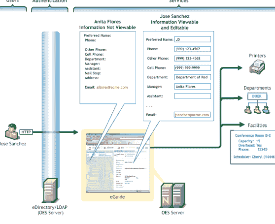

以下是对图 9-1 的描述：

- **用户。** 一个名为 Jose Sanchez 的 eDirectory 用户登录到 eGuide。
- **身份验证。** 对 LDAP 的访问通过 eDirectory 服务器的基于 LDAP 的身份验证进行控制。

### 集成适用于 Linux 版本的 Novell Enterprise Server

虽然是分开所示的，但 eDirectory 可以安装在 OES 服务器上。

- **服务。** Jose 使用星号 (`*`) 通配符进行搜索，看到了两个条目：Anita Flores 和 Jose Sanchez。

如果他点击 Anita 的名字，他只能看到她的电子邮件地址（默认），但他可以看到他自己的信息。

您可以配置 eGuide，让 Jose 可以编辑他的某些信息，更改将存储在 eDirectory 中。

您还可以允许用户搜索 eDirectory 中的任何类型对象，让他们找到高效工作和自给自足所需的人、地点、物品和信息。

## 如何访问 eGuide 客户端

从支持的 Web 浏览器访问 eGuide 客户端，请执行以下操作：

1. 输入以下 URL：

```
http://web_server/eGuide
```

将 `web_server` 替换为安装 eGuide 的 Web 服务器的主机名或 IP 地址。上述 URL 中的 `eGuide` 部分对大小写敏感。

出现 eGuide 登录页面：

## 图 9-2

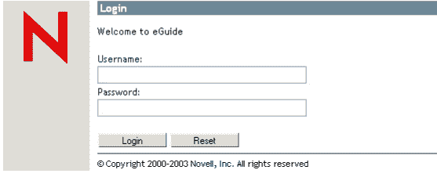

2. 使用 eDirectory 用户名和密码登录。

出现 eGuide 主页：

## 图 9-3

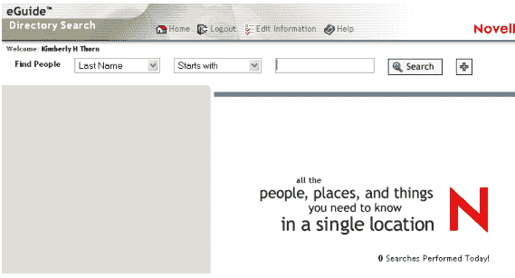

您还可以通过选择网页顶部的“启动 Novell eGuide 客户端”图标，从 eGuide 管理工具访问 eGuide 客户端。

## 目标 2

## 执行基础 eGuide 管理任务

在本目标中，您将介绍以下基础的 eGuide 管理任务：

- 如何访问 eGuide 管理工具
- 如何修改搜索类别
- 如何配置 eGuide 显示
- 如何启用 eDirectory 用户组织架构图显示


有关配置 Novell eGuide 的完整信息，请参阅《Novell eGuide 2.1.2 管理指南》(`eguide.pdf`)。

您可以从 `http://www.novell.com/documentation/oes` 或从 3077 课程 CD `OES_Docs` 目录访问该指南。

## 如何访问 eGuide 管理工具

要从兼容的 Web 浏览器访问 eGuide 管理工具，请执行以下操作之一：

- 访问以下区分大小写的 URL 并以 Admin 用户身份登录：

`http://web_server/eGuide/admin/index.html`

其中 `web_server` 是安装 eGuide 的 Web 服务器的主机名或 IP 地址。可能还需要端口号。

- 以 admin 用户身份登录 eGuide 客户端；然后在 eGuide 页面顶部，选择“管理工具”图标。

eGuide 管理工具图标仅对被指定为 eGuide 管理员的已验证用户可用。

详情，请参阅 Linux 版《Novell eGuide 2.1.2 管理指南》(`eguide.pdf`) 第 32 页的“管理角色”。

您可以从 `http://www.novell.com/documentation/oes` 或从 3077 课程 CD `OES_Docs` 目录访问该指南。

打开 eGuide 管理工具后，将出现以下内容：

## 图 9-4

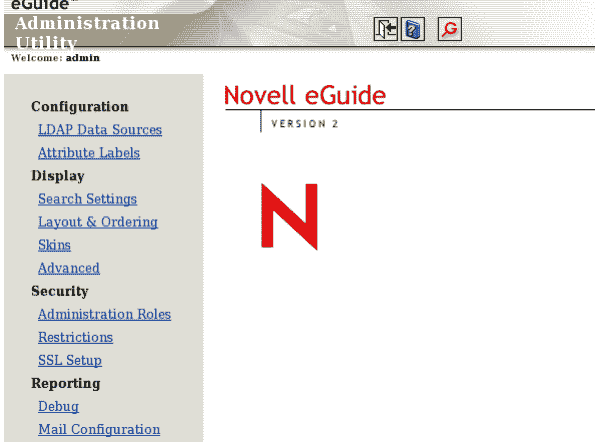

## 如何修改搜索类别

搜索类别是 eGuide 用来表示 LDAP 类组合的实体。

例如，当您将第一个目录添加到 eGuide 时，会创建“用户”搜索类别。默认情况下，它包含以下类：`InetOrgPerson`、`OrganizationalPerson` 和 `Person`。

这些用户类中的属性将出现在您配置 eGuide 在 eGuide 客户端中使用它们的页面上。此外，用户类别标签“查找人员”会出现在 eGuide 客户端中的第一个搜索筛选下拉列表中。

`InetOrgPerson`、`OrganizationalPerson` 和 `Person` 类仅在您添加它们时才会被使用。

要管理类别，您需要知道如何：

- 添加搜索类别
- 删除搜索类别
- 从搜索类别中添加或删除类

## 添加搜索类别

要添加类别，请执行以下操作：

- 从 eGuide 管理工具选择 LDAP 源，然后点击目标目录的链接。
- 选择“高级”，点击“新建”。
- 输入类别名称。
- 添加至少一个类并配置其属性。
- 完成后，选择“保存”。

## 删除搜索类别

要删除类别，请执行以下操作：

- 从 eGuide 管理工具选择 LDAP 源，然后点击目标目录的链接。
- 选择“高级”。
- 选择要删除的类别。

“用户”是一个强制类别，eGuide 不允许删除它。

- 选择类别。

## 从搜索类别中添加或删除类

要从搜索类别中添加或删除类，请执行以下操作：

- 从 eGuide 管理工具选择 LDAP 源，然后点击目标目录的链接。
- 选择“高级”。
- 选择要修改的类别。

页面如下所示：

## 图 9-5

 (此处为示例)

高级配置允许修改和创建类别。LDAP 数据源中的类可以组合创建一个类别。要创建一个类别，必须从可用列表中选择至少一个类。

- 要向类别添加类，请从可用列表中选择**类**，然后点击右向箭头将其移动到选中列表中。
- 要从类别中删除类，请从选中列表中选择**类**，然后点击左向箭头将其移动到可用列表中。
- 当您更改类别时，选择“保存”。
- 如果您仅删除了一个或多个类，则完成。
- 如果您添加了一个或多个类，继续执行第 8 步。

7. 选择“属性”选项卡。

页面如下所示：

## 图 9-6

LDAP 数据源：New_Data_Source

| LDAP 设置 | 属性 | 高级 |
| --- | --- | --- |
| accesscardnumber | ACCESSCARDNUMBER | 更多选项 |
| accountbalance | ACCOUNTBALANCE | 更多选项 |
| allowunlimitedcredit | ALLOWUNLIMITEDCREDIT | 更多选项 |
| assistant | ASSISTANT | 更多选项 |
| assistantphone | ASSISTANTPHONE | 更多选项 |
| audio | AUDIO | 更多选项 |
| businesscategory | BUSINESCATEGORY | 更多选项 |

下方列出了与此 LDAP 数据源相关的属性。在选择“可搜索”或“可编辑”之前，必须启用属性。按“保存”以应用更改。

类别：

8. 编辑新添加类的类属性的设置和映射；滚动到最后并选择“保存”。

如果您向新添加的搜索类别添加了一个或多个类，则在用户从 eGuide 客户端访问该类别之前，必须启用至少一个属性并使至少一个属性为可搜索。

9. 选择“显示 > 布局与排序”，以指示 eGuide 客户端中的搜索、列表、详细信息和组织架构表单应显示哪些属性。

## 如何配置 eGuide 显示

eGuide 页面显示了您向用户提供的功能。

要配置 eGuide 页面，您需要了解如何进行操作：

- 配置搜索设置
- 配置布局和排序
- 更改皮肤
- 配置高级设置

## 配置搜索设置

以 eGuide 管理员身份登录后，选择“显示 > 搜索设置”，显示以下页面：

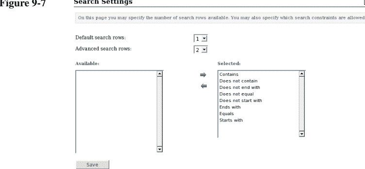

| 搜索设置 |
| :--- |
| 在此页面上，您可以指定可用的搜索行数。您还可以指定允许哪些搜索限制。 |
| 默认搜索行数：[1] |
| 高级搜索行数：[2] |
| 可用： | 已选： |
| 包含 | 不包含 | 不以...结尾 | 不等于 | 不以...开头 | 结尾 | 等于 | 开 |

搜索设置允许您指定 eGuide 客户端中普通搜索和高级搜索（当用户选择加号时）显示的搜索行数。

您还可以修改用户在每行搜索中可以选择的搜索限制列表。

一个搜索行由三个下拉列表组成：

- 一个用于搜索类别（例如，用户）
- 一个用于搜索属性（例如，姓）
- 一个用于搜索限制（例如，“以...开头...”）

要添加搜索限制，请从“可用”列表中选择它，然后点击右箭头。要删除搜索限制，请从“已选”列表中选择它，然后点击左箭头。

## 配置布局和排序

配置布局和排序页面显示来自所有配置目录的搜索属性列表。

当您选择“编辑”时，会出现以下标签页：

### 布局与排序：用户

| 搜索表 | 列表表 | 详情表 | 组织结构图表 |
| :--- | :--- | :--- | :--- |

为高级搜索指定默认选择属性（例如，如果您有三个搜索属性，在这里定义的前三个属性将作为每行搜索中的默认选择显示。）


排序搜索属性：

| 姓 | 名 | 情况 | CN | 手机 | 成本中心 | 其他电话 |
| 保存 | | |

您可以选择搜索表、列表表、详情表或组织结构图表来查看和编辑目录的显示设置。

## 更改皮肤

当您选择“皮肤”时，会出现以下内容：

## 图 9-9

下面列出了可用皮肤。皮肤允许管理员快速更改 eGuide 中的颜色和图像。选择所需的皮肤方案并点击保存。

| 名称 | 激活 | 移除 |
| :--- | :--- | :--- |
| Classic | C | ❌ |
| Cool-Blue | C | ❌ |
| Novell | C | ❌ |
| Punch | C | ❌ |
| Earth | C | ❌ |
| Quiet | C | ❌ |
| Novell-Management | R | N/A |
| Khaki | C | ❌ |
| Warm-Gray | C | ❌ |
| South-Western | C | ❌ |

eGuide 自带了一套标准皮肤供使用。您还可以为您的组织设置自定义皮肤。

> 有关添加自定义皮肤的详细信息，请参阅 Novell eGuide 2.1.2 管理指南第 43 页的“添加皮肤或主题”（`eGuide.pdf`）。

您可以通过 `http://www.novell.com/documentation/oes` 或从 3077 课程 CD `OES_Docs` 目录访问该指南。

## 配置高级设置

当您选择“高级”时，会出现以下内容：

### 图 9-10 高级

> 注意：自动编辑将允许用户管理员在选择对象的详情面板时直接进入修改页面。

| 主页链接： | `http://www.novell.com/products/eguide` |
| :--- | :--- |
| 启用自动编辑： | |
| 过滤空详细详细值： | |
| 用户身份验证密钥： | CN |
| 当前主题： | default |

您可以使用此页面对您的 eGuide 显示设置进行额外的更改。选择帮助图标 (?) 获取有关每个设置的信息。完成后，选择“保存”。

## 如何配置安全限制

eGuide 功能允许您指定谁有权更改 eGuide 配置和 LDAP 数据源属性。

您还可以通过选择“安全 > 限制”来强制或删除各种安全限制。

出现以下内容：

### 图 9-11 限制所有

> 进行任何所需的更改并按保存以应用更改。

| 允许保存凭据（cookies）： | |


## 限制设置

| 设置 | 值 |
| :--- | :--- |
| Cookie 过期（秒） | 64000 |
| 强制用户身份验证 | |
| 允许自我管理 | |

以下说明了限制页面上的每个设置：

| 限制设置 | 描述 |
| :--- | :--- |
| 允许保存凭据 | 如果您希望用户在登录页面上看到“记住登录信息”复选框，请选择此设置。如果用户选择了此选项，用户验证过的凭据将被加密并存储在工作站的 Cookie 中。用户随后可以多次加载 eGuide，而无需每次登录。当 Cookie 过期时间结束后用户选择注销图标时，将移除 Cookie。 |
| Cookie 过期 | 指定从登录到登录信息 Cookie 过期之间经过的秒数（86400 秒 = 一天）。 |
| 强制用户身份验证 | 如果您希望所有用户登录后使用 eGuide，请选择此设置。如果未选择此设置，eGuide 以匿名模式加载。如果允许保存凭据且存在登录信息 Cookie，则无需强制进行身份验证。 |

### 表 9-2 限制设置

| 设置 | 描述 |
| :--- | :--- |
| 显示更改密码链接 | 选择此设置以在编辑面板中提供更改密码链接。这允许管理员更改用户密码。必须选择“允许自我管理”，用户才能访问编辑面板。 |
| 允许自我管理 | 如果您允许用户更改自己的属性（在属性页面中指定的为可编辑），请选择此设置。当选择允许自我管理时，eGuide 中的查看个人信息图标将变为编辑个人信息。 |
| 显示组织结构图 | 如果您希望在所有用户的详情面板中激活组织结构标签页，请选择此设置。组织结构将显示当前用户经理的所有直接下属。 |

## 如何为 eDirectory 用户启用组织结构

eGuide 中的组织（org）结构由分配给用户的 `Manager` 和 `isManager` 属性控制。

`Manager` 属性中的区分名称指示该用户向谁汇报。

`isManager` 属性中的 `True` 值指示该用户是经理，并激活在组织结构中从经理向上遍历的汇报到链接（左箭头图标）。

默认情况下，组织图中仅显示用户的全名（通过组合 `FirstName`、`MI` 和 `SN` 属性创建）和抬头（如果可用）。

除了全名，您还可以通过以下操作显示多四个额外属性（默认仅选择抬头）：

1. 在 eGuide 管理工具中，选择**显示 > 布局与排序**。
2. 在显示的类别的右侧，选择**编辑**；然后选择**组织结构图表** 标签页。
3. 在四个属性下拉列表中，选择您想要显示的**属性**（以及用户的全名）。
   只有在属性页面中标记为启用的属性才能被选择。
4. 完成后，选择**保存**。

## 摘要

### 目标 1：描述 eGuide 的目的和架构

为了描述 eGuide 的目的和架构，你学习了以下内容：

- **eGuide 提供什么。** eGuide 是一个基于浏览器的解决方案，让您的员工无论 LDAP 数据源位于何处，都能搜索人员和地点。
  你可以使用 eGuide 同时搜索 Novell eDirectory 以及多个 LDAP 数据源。

- **eGuide 系统要求。** 在这一节中，你学习了设置和使用 eGuide 2.1.2 的最低要求。

- **eGuide 的工作原理。** 你可以配置 eGuide 来发布你存储在 eDirectory 中的任何信息。
  你可以配置 eGuide，让用户可以看到您组织中其他用户的信息，以及他们的电话、办公位置、职位名称以及你存储在 eDirectory 中的任何其他信息。
  你还可以配置 eGuide，让用户在 eDirectory 中维护自己的信息。你甚至可以让他们选择想要让其他用户访问的信息。

### 目标 1：描述 eGuide 的目的和架构（续）

- **如何访问 eGuide 客户端。** 要从支持的 Web 浏览器访问 eGuide 客户端，请输入以下 URL：
  `http://web_server/eGuide`
  将 `web_server` 替换为安装 eGuide 的 Web 服务器的主机名或 IP 地址。

### 目标 2：执行基础 eGuide 管理任务

在此目标中，你将接触以下基础 eGuide 管理任务：

- 如何访问 eGuide 管理工具
- 如何修改搜索分类
- 如何配置 eGuide 显示
- 如何配置安全限制
- 如何启用 eDirectory 用户组织架构显示

## 第 10 节 使用 NetStorage 提供文件访问

在这一节中，你将学习如何使用 NetStorage 提供对 Novell ES Linux 和 OES NetWare 服务器上文件的访问。

### 目标

- 1. 描述 NetStorage 的目的和架构
- 2. 实现和管理 NetStorage

## 引言

NetStorage 允许通过 Internet Web 浏览器随地、随时间访问网络文件。

虽然 iFolder 提供了个人文件存储、同步以及对 iFolder 服务器上特定 Simias 数据集的访问，但 NetStorage 提供了对跨网络 OES 服务器上目录和文件的安全、基于 Web 的访问。


有关配置和实现 NetStorage 的完整细节，请参阅《Novell OES NetStorage Administration Guide for Linux》(netstor_ix.pdf) 和《Novell OES NetStorage Administration Guide for NetWare》(netstor.pdf)。

你可以从 `http://www.novell.com/documentation/oes` 或 3077 课程 CD `OES_Docs` 目录访问这些指南。

## 目标 1：描述 NetStorage 的目的和架构

为了描述 NetStorage 的目的和架构，你需要了解以下内容：

- NetStorage 提供什么
- NetStorage 系统要求
- OES Linux 上的 Novell NetStorage
- OES NetWare 上的 Novell NetStorage
- NetStorage 的工作原理
- 用户访问 NetStorage 时看到什么

## NetStorage 提供什么

网络文件访问通常会让用户感到困惑和沮丧，如下所示：

### 图 10-1

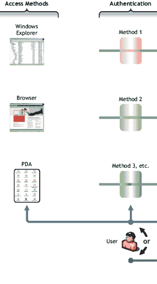

以下是对图 10-1 的描述：

- **访问方法。** 浏览器或 PDA 访问对于必须旅行的人员来说是业务关键。然而，文件服务提供商对访问方法的支持差异很大。
- **身份验证。** 身份验证有助于保护信息资产，但多种身份验证会导致沮丧和效率低下。
- **目标文件系统。** 拥有多种文件存储服务只会增加复杂性和混乱。

Novell NetStorage 用一个易于管理、易于使用的解决方案将这些问题结合在一起。

NetStorage 通过使用浏览器或 Microsoft Web Folders（Microsoft 对 WebDAV 的实现），提供网络上 Linux 和 NetWare 服务器上文件和文件夹的安全 Internet 访问。

NetStorage 身份验证依赖 Novell eDirectory 提供安全访问，因此基于 Internet 的访问与从内部访问文件一样安全。

Novell NetStorage 包括以下优点：

- 允许用户在任何支持 Internet 的机器与网络上的 Linux 或 NetWare 服务器之间安全地复制、移动、重命名、删除、读取和写入文件。
- 消除了使用虚拟专用网络 (VPN) 客户端访问文件的需求。
- 消除了通过电子邮件或从一台机器复制数据到另一台机器的需求。
- 支持 HTTP、HTTPS、HTML、XML 和 WebDAV 等 Internet 标准。
- 支持用户在用 Novell Client 登录时习惯的驱动器映射。
- 支持对用户 Novell iFolder 2.x 账户的访问。
- 提供通过 Novell Virtual Office、Novell iFolder 2.x 和 Novell eDirectory 4.1 标准版对网络文件和文件夹的访问。
- 支持用于在浏览器中显示 NetStorage 的存储位置（Storage Location）对象。

在 ES Linux 服务器上安装 NetStorage 后，用户可以访问地理位置分散的 NetWare 服务器。

## NetStorage 系统要求

除了满足 OES 要求外，NetStorage 还需要以下条件：

- **服务器要求。** 至少有一台运行 eDirectory 的 Linux 服务器，NetStorage 将安装在上面。
  eDirectory 副本不需要与 NetStorage 位于同一台服务器上。
  为了避免时间问题，必须根据网络规范正确设置时间。
- **工作站要求。** Netscape Navigator 4.7 或更高版本、Internet Explorer 5.5 或更高版本、Mozilla、Firefox、其他浏览器。

## OES Linux 上的 Novell NetStorage

Linux 上的 NetStorage 不需要 Novell 客户端即可提供许多系统文件的本地和 Web 访问，如下：

### 图 10-2

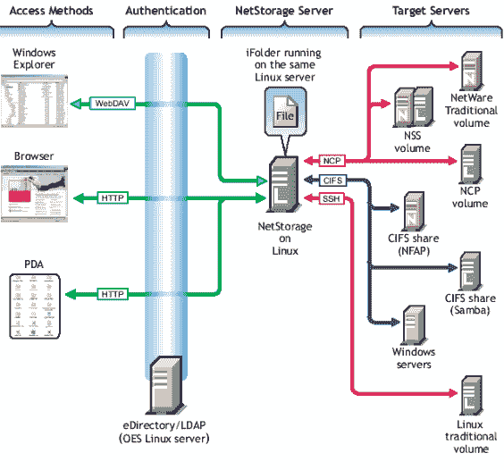

以下是对图 10-2 的描述：

- **身份验证。** 文件服务访问通过 eDirectory 的 LDAP 身份验证进行控制。
  虽然是分开显示的，但 eDirectory 可以运行在服务器上。
- **NetStorage 服务器。** NetStorage 服务器接收并处理连接请求，并提供对存储的访问。
  与 NetStorage 同一服务器上的 Novell iFolder 2.x 服务器对 iFolder 2.x 用户可用。
- **目标服务器。** Linux 上的 NetStorage 可以连接 eDirectory 用户访问存储在以下位置的文件和文件夹：
  - 如果运行 NCP 服务器，则作为 NetWare（见图 10-3）
  - Windows 工作组共享（CIFS 或 Samba 共享）
  - 通过 SSH 连接的 Linux 卷
  Linux 卷也可以作为 NCP 卷可用。

## OES NetWare 上的 Novell NetStorage

NetWare 上的 NetStorage 不需要 Novell 客户端即可提供 NetWare 和 Linux 上的文件的本地和 Web 访问，如下：

### 图 10-3

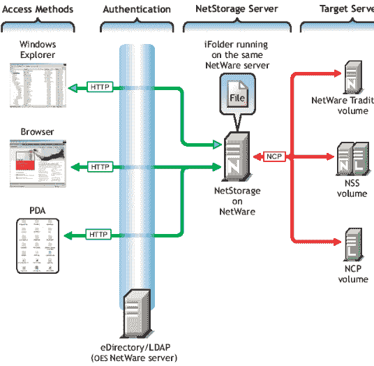

以下是对图 10-3 的描述：

- **访问方法。** 用户可以通过以下方式获得文件的读写权限：
  - **Windows Explorer。** 这是通过带有 WebDAV 扩展的 HTTP 协议实现的。
  - **浏览器。** 用户可以直接通过 NetStorage 服务器访问文件。
  - **PDA。** 有网络连接的 PDA 用户也可以访问他们的文件。
  访问通过登录脚本驱动器映射或存储位置（Storage Location）对象授予。

### 集成 Linux 版 Novell 企业级服务器

- **身份验证。** 文件服务的访问通过 eDirectory 服务器的基于 LDAP 的身份验证进行控制。
  虽然是分开展示的，但 eDirectory 可能运行在 OES NetWare 服务器上。
- **NetStorage 服务器。** NetStorage 服务器接收并处理连接请求，并提供对网络上各种服务器上存储的访问。
  运行在 NetStorage 同一台服务器上的 iFolder 2.x 服务器将自动通过 NetStorage 供 iFolder 2.x 用户使用。
  如果您想访问存储在其他服务器上的 iFolder 2.x 数据，则必须配置 NetStorage。
- **目标服务器。** NetWare 上的 NetStorage 可以连接 eDirectory 用户到存储在以下位置的文件和文件夹：
  - 用户具有访问权限的 NetWare 传统卷。
  - NetWare 或 OES Linux 服务器上用户具有访问权限的 NSS 卷。
  - 在 OES Linux 服务器上创建的任何管理员定义的 NCP 卷。

## NetStorage 的工作原理

NetStorage 安装在一个 Linux 服务器（或 NetWare 服务器）上，该服务器作为中间层（也称为 XTier）服务器：

### 图 10-4

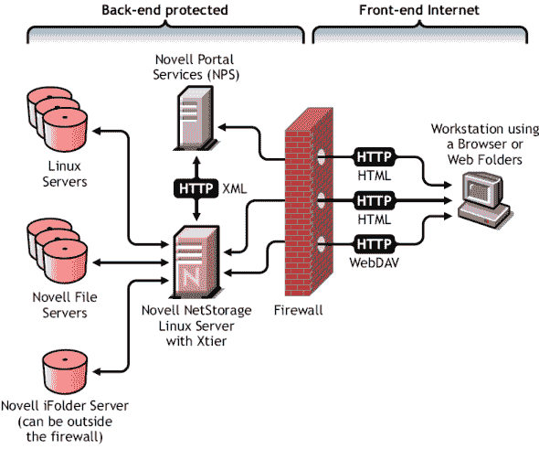

XTier 是 Novell 的 Web 服务框架，被各种 Novell 产品使用。

中间层服务器配置信息存储在 Linux 服务器上的 XML 文件中。Novell iManager 提供了一种更改中间层配置的简单方法。

> 以前版本的 NetStorage 使用 NSAdmin 工具进行管理。现在应该通过 Novell iManager 进行配置。

设置中间层服务器后，它将作为 Internet Web 服务器显示给用户，可以使用 浏览器或 Microsoft Web 文件夹（Microsoft Web Folders）进行访问。

### 集成 Linux 版开放 Novell 企业级服务器

NetStorage 还包含一个 get（gadget），可以通过 Novell eND Director 4.1 标准版提供访问。

所有事务还可以使用 SSL 进行加密以增加安全性。Novell iFolder 2.x 事务使用 iFolder 加密机制进行保护。


目前无法通过 NetStorage 访问 iFolder 2.x。由于课程不涵盖 iFolder 2.x（仅涵盖 Linux 上的 iFolder 3.x），因此在 NetStorage 练习期间登录 NetStorage 时，看不到任何 iFolder 账户。

有关配置和实施 iFolder 2.x 文件夹显示在用户 NetStorage 主页上的详细信息，请参见《Novell OES NetStorage Administration Guide for Linux》(netstor_itx.pdf) 第 10 页的注释。

您可以从 `http://www.novell.com/documentation/oes` 或从您的 3077 课程光盘上的 `OES_Docs` 目录访问指南。

## 用户访问 NetStorage 时看到的内容

NetStorage 网页显示了登录用户当前可以访问的网络文件和文件夹。以下是 NetStorage 访问的摘要：

| 表 10-10 | OES 平台 | 自动访问 |
| :--- | :--- | :--- |
| Linux | - 同一服务器上的 Novell iFolder 2.x 文件夹<br>- 同一服务器上使用默认挂载点 (`/media/nss`) 的 NSS 卷<br>- 登录脚本中的驱动器映射位置（如果 Linux 版 NCP 服务器运行在相应服务器上） | |
| NetWare | - 用户主目录<br>- 同一服务器上的 iFolder 2.x 文件夹<br>- 登录脚本中的驱动器映射位置 | |

要提供对未列文件系统的访问，您必须在 eDirectory 中创建存储位置（Storage Location）对象。

对于 NetWare 服务器，NetStorage 会读取以下内容，然后根据收集的信息显示文件和文件夹列表：

- 用户的登录脚本，用于确定驱动器映射
- eDirectory 用户对象属性，用于确定用户主目录的路径
- 用户的 Novell iFolder 2.x 账户

如果已创建存储位置对象且用户具有查看这些对象的权限，则也会显示与这些对象相关的目录。

例如，当您为主身份验证域（如 `slc.da`）安装 NetStorage 时，会创建一个默认存储位置对象。

然而，只有容器内的用户（而非任何子容器内的用户）与存储位置对象关联。您需要为其他容器（或子容器）中的用户创建其他存储位置对象（或修改默认对象），以便他们能够在 NetStorage 网页中查看目录。

NetStorage 仅从安装期间指定的原始 eDirectory 服务器读取容器、配置文件和用户登录脚本。对于 NetWare 服务器，NetStorage 仅根据这些登录脚本显示用户的驱动器映射。

然而，由于登录脚本的设计是为了由用户工作站上的 Novell 客户端处理，因此 NetStorage 仅处理登录脚本的一个子集。

如果您在 NetStorage 安装期间指定了其他 eDirectory 树中的服务器备用 IP 地址或 DNS 节点，NetStorage 将读取其他 eDirectory 树中的用户对象属性，并显示那些主目录。

如果用户通常登录多个 eDirectory 树，且您希望该用户能够访问不同主目录中的额外主目录，那么这将非常有用。

然而，由于登录脚本的设计是为了由用户工作站上的 Novell 客户端处理，NetStorage 仅处理登录脚本的一个子集。

如果您在 NetStorage 安装期间指定了其他 eDirectory 树中的服务器备用 IP 地址或 DNS 节点，NetStorage 将读取其他 eDirectory 树中的用户对象属性，并显示那些主目录。

如果用户通常登录多个 eDirectory 树，且您希望该用户能够访问不同主目录中的额外主目录，那么这将非常有用。

## 目标 2：实施和管理 NetStorage

为了执行基本的实施和维护任务，您需要了解：

- 如何访问主页
- 如何通过 Novell iManager 管理 NetStorage
- 如何创建存储对象


- 如何查看目录权限
- 如何设置 NSS 卷配额
- 如何清理删除的文件
- NetStorage 指南


如果您的 NetStorage 安装了 iFolder，在尝试让用户访问之前，必须完成第 222 页“Novell iFolder 2.x 实施与维护”。

## 如何访问主页

要在浏览器窗口访问并登录 NetStorage 主页，请执行以下操作：

1. 启动支持的浏览器（如 Internet Explorer 或 Mozilla Firefox）；然后输入 NetStorage 的 URL：`server_ip_address`/oneNet/NetStorage

将 `server_ip_address` 替换为运行 NetStorage 的服务器的 IP 地址或 DNS 名称，或者是 Apache 服务的地址。如果 Apache 服务使用非 80 端口，则必须在 URL 中指定该端口。

例如，如果 NetStorage 的 IP 地址为 10.200.200.201 且端口为 51080，则输入 `https://10.200.200.201:51080/oneNet/NetStorage`。

如果您启用了持久性 Cookie（Persistent Cookies），则访问 NetStorage 的工作站时间与运行 NetStorage 的服务器时间应在 24 小时以内，以避免冲突。

2. 输入 eDirectory 用户名和密码。NetStorage 使用您的 Novell eDirectory 用户名和密码，因此您不需要记忆或使用单独的用户名和密码。

如果你正在使用 Internet Explorer，可以通过拖放来复制和移动文件及文件夹。此功能在 Internet Explorer 以外的浏览器不支持。

在浏览器窗口中选择“文件夹视图”按钮会在另一列中显示文件夹，并允许你展开和收叠文件夹。

“文本视图”仅显示当前目录下的文件和文件夹，不允许你展开或收叠文件夹。选择“名称”、“大小”或“修改时间”标题可以按名称、大小或日期升序或降序对目录和文件列表排序。

你可以使用 NetStorage 访问安装 NetStorage 的 Linux 服务器上共享目录中的本地文件和文件夹。

这对于上传文件到 Linux 服务器非常有用。共享文件夹的路径为 `/var/opt/novell/netstorage/shared`。

你无法从 NetStorage 映射驱动器或更改登录脚本。

3. 完成后，从页面顶部选择“注销”图标；然后关闭浏览器窗口。

## 如何通过 Novell iManager 管理 NetStorage

在 NetStorage 在 Linux 或 NetWare 服务器（称为中间层或 XTier 服务器）上安装后，可以通过 Novell iManager 更改 NetStorage 配置。

NetStorage 配置信息存储在 Linux 服务器上的一个 XML 文件中。iManager 提供了一种更改 XML 文件中 NetStorage 配置的简单方法。

更改任何设置后，必须重启 Apache Web 服务器。在 Linux 服务器上，在命令提示符中输入 `rchtpd stop`。等待一分钟；然后输入 `rchtpd start` 重启 Web 服务器。你还通过输入 `novell-xxsvrd restart` 来重启 XTier。

## 集成 Linux 版 Novell 企业服务器

以下仅描述了从 iManager 可用的 NetStorage 管理任务。

有关每个任务和可用选项的完整详细信息，请参阅 iManager 提供的帮助或《Novell OES Linux 版 NetStorage 管理指南》(netstor_lx.pdf) 第 23 页的“管理 NetStorage”章节。

你可以从 `http://www.novell.com/documentation/oes` 或你的 3077 课程 CD 上的 `OES_Docs` 目录访问该指南。

要从 iManager 管理 NetStorage，请执行以下操作：

1. 启动支持的浏览器（如 Internet Explorer 或 Mozilla Firefox）；然后输入 iManager 的 URL：

`https://server_ip_address/nps/iManager`

其中 `server_ip_address` 是运行 iManager 的服务器的 IP 地址或 DNS 名称。

2. 使用相应的密码以 admin（或等效用户）身份登录。

3. 在左列中，展开**文件访问 (NetStorage)** 角色；然后选择你想要用于配置 NetStorage 的**任务**。

以下是每个任务的说明：

- **身份验证域 (Authentication Domains)。** 允许你更改或添加 NetStorage 所需的 Novell eDirectory 服务器 URL 和上下文。

此页面还允许你添加对点分隔用户名、电子邮件地址名称和通用密码的支持，并提供更改指定为主服务器的 eDirectory 服务器的选项。

- **当前会话 (Current Sessions)。** 显示包含有关当前 NetStorage 会话信息的报告。

- **文件 (Files)。** 显示 NetStorage 页面。这提供了一种无需输入 NetStorage URL 即可从 iManager 访问 NetStorage 的方法。

- **iFolder 提供程序 (iFolder Storage Provider)。** 查看或编辑 iFolder 特定配置设置（如果你在 Linux 服务器上安装了 Novell iFolder 2.x）。

- **NetWare 存储提供程序 (NetWare Storage Provider)。** 列出 NetWare 服务器上特定于 NetStorage 的配置选项。

- **NetStorage 选项 (NetStorage Options)。** 允许你配置 NetStorage 选项，如会话超时和持久连接。

- **NetStorage 统计 (NetStorage Statistics)。** 显示包含服务器运行时间、登录失败和 NetStorage 会话数量信息的报告。

- **资源使用 (Resource Usage)。** 显示 NetStorage 资源利用率的详细报告。

- **WebDAV 提供程序 (WebDAV Provider)。** 允许你编辑用户访问 NetStorage 主页时别名（moniker）。

- **存储位置 (Storage Location)。** 允许你创建一个存储位置对象，为通过 Microsoft Web Folders 或浏览器显示的网络目录访问列表指定指定的名称。

- **将存储位置分配给对象 (Assign Storage Location To Object)。** 允许将一个或多个存储位置对象与用户、组、配置文件或容器对象关联。用户下次登录时将看到与对象关联的目录。

- **编辑存储位置 (Edit Storage Location)。** 修改现有的存储位置对象以更改其显示名称、目录位置或注释。

- **删除存储位置 (Delete Storage Location)。** 删除现有的存储位置对象。

## 如何创建存储位置对象和列表

安装 NetStorage 后，你可能只能通过 NetStorage 看到你的 iFolder 2.x 目录和 Linux 服务器上的本地共享目录。

除非安装了 OES 的 NCP 服务器组件，否则访问 Linux 服务器上的文件和目录需要使用存储位置对象。它们也可以用于 NetWare 服务器。

如果没有 NCP 服务器，用户可能对你网络上的某些文件和文件夹具有特定的 eDirectory 权限，但除非创建了存储位置对象，否则他们无法使用 NetStorage 访问这些文件和文件夹。

要创建存储位置对象和列表，你需要了解以下内容：

- 如何创建存储位置对象
- 如何创建存储位置列表
- 如何创建 SSH 存储位置对象

## 如何创建存储位置对象

要创建存储位置对象，请执行以下操作：

1. 启动支持的浏览器（如 Internet Explorer 或 Mozilla Firefox）；然后输入 iManager 的 URL：

`https://server_ip_address/nps/iManager`

将 `server_ip_address` 替换为运行 NetStorage 的服务器的 IP 地址或 DNS 名称，或基于 Apache 的服务的 IP 地址。

2. 使用管理员用户名和密码登录 iManager。

3. 从左侧，展开文件访问 (NetStorage)，然后选择存储位置。

### 图 10-6 存储位置：创建对象页面出现在右侧：为通过 Microsoft Web Folders 或浏览器显示的网络目录访问列表指定名称。

| 对象名称： | |
| 显示名称： | |
| 目录位置： | |
| 上下文： | |
| 注释： | |

4. 输入以下内容：

- **对象名称 (Object Name)。** eDirectory 树中的对象名称。
- **显示名称 (DisplayName)。** NetStorage 访问列表中显示的名称。这是用户看到的快捷名称。

如果对两个存储位置使用相同的显示名称，则会添加一个数字以保持唯一。

- **目录位置 (Directory Location)。** 文件系统上的目录位置。位置是包含文件系统类型、服务器名称和目录的 URL。

如果访问的存储位于 NetWare 服务器，URL 必须符合以下格式：

```
ncp/server_name/volume/path_to_directory
```

例如

```
ncp/da2.da.com/data/reports
```

或

```
ncp/10.200.200.2/data/reports
```

如果访问的存储位于 Linux 服务器，URL 必须符合以下格式之一：

- `ncp://server_name/volume/path_to_directory`

此方法要求 Linux 服务器上安装了 OES 的 NCP 服务器组件。使用此格式的存储位置只能访问 NCP 或 NSS 卷。

- `cifs://server_name/cifs_share_name`

当你配置了 CIFS 或 Samba 共享时，可以使用此方法（格式中的 `cifs` 可以与 `smb` 交换）。

- `ssh://yourserver.yourcompany.com/home/youruser`

此方法允许访问不支持 NCP 或 CIFS (SMB) 协议的 Linux 系统。

如果省略文件系统，则假设 NCP。

- **上下文 (Context)。** 存储位置所在的目录上下文。使用字段右侧的对象选择器图标选择并输入上下文。
- **注释 (Comment)。** 你可以输入用户不可见的注释。

5. 完成后，选择“创建”，然后选择“确定”。

## 如何创建存储位置列表

创建存储位置对象后，你需要创建一个存储位置列表，供指定的用户、组、配置文件或容器对象使用。

用户下次登录 NetStorage 时将看到与对象关联的目录。

在创建此列表后，您可以在同一窗口中通过为列表分配额外的存储位置（Storage Location）对象，或从列表中删除存储位置对象来对其进行修改。

请执行以下操作：

1. 启动支持的浏览器（如 Internet Explorer 或 Mozilla Firefox）；然后输入 iManager 的 URL：

`https://server_ip_address/nps/iManager`

其中 `server_ip_address` 是运行 NetStorage 的服务器的 IP 地址或 DNS 名称，或者是基于 Apache 服务的 IP 地址。

2. 使用管理员**用户名**和**密码**登录 iManager。

3. 从左侧展开**文件访问 (File Access - NetStorage)**；然后选择**向对象分配存储位置 (Assign Storage Location to Object)**。

4. 在对象（Object）字段右侧，选择**对象选择器 (Object Selector)** 按钮。

5. 浏览并选择要创建列表的**用户、组、配置文件**或**容器**对象；然后选择**确定**。

出现“创建/修改存储位置列表”页面：

### 图 10-7

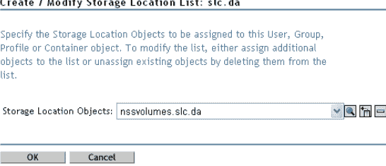

6. 在存储位置对象下拉列表右侧，选择**对象选择器 (Object Selector)** 按钮。

7. 选择您想要包含在此列表中的存储位置对象；然后选择**确定**。

您可以在对象选择器窗口中选择多个存储位置对象。当您选择多个存储位置对象时，它们会出现在“已选对象”（Selected Objects）列表中。

如果列表已包含存储位置对象且您想添加更多，请确保在选择确定之前，原始对象仍留在列表中。

您可以在选择确定之前从列表中删除现有的存储位置名称。

8. 完成后，选择**确定**。

用户、组、配置文件或容器对象（在“其他”下）将添加 `xTier-LocationList` 属性，该属性列出了分配给该对象的存储位置。

## 如何创建 SSH 存储位置对象

NetStorage 增加了一种新的文件访问方法，允许访问不支持 NCP 或 CIFS 协议的 Linux 系统上的文件。

该方法使用安全 Shell (SSH) 协议访问 Linux 系统上的文件。通过创建一个 URL 前缀为 `ssh://` 的目录位置对象来访问 SSH，如下所示：

```
ssh://yourserver.yourcompany.com/home/youruser
```

您在访问 Linux 系统文件时使用的用户名和密码必须与登录 NetStorage 使用的相同。

如果 NetStorage 运行在该 Linux 系统上，您可以使用 SSH 文件访问方法访问该 Linux 系统上的本地文件。

要执行此操作，请创建一个使用 `ssh://` 前缀和本地 Linux 机器 IP 地址的存储位置对象。

## 如何查看或修改目录和文件的属性及权限

NetStorage 允许您从 NetStorage 主页查看或更改 NSS、NCP 目录和文件的属性及权限。

如果您使用 NCP 创建存储位置对象，除非您以 admin 或相应用户的身份登录，否则更改文件和目录属性的能力将限制。如果您使用 SSH 创建了存储位置对象，则不受此限制。

要从 NetStorage 页面查看或修改目录或文件的权限：

1. 启动支持的浏览器（如 Internet Explorer 或 Mozilla Firefox）；然后输入 iManager 的 URL：

`https://server_ip_address/nps/iManager`

其中 `server_ip_address` 是运行 NetStorage 的服务器的 IP 地址或 DNS 名称，或者是基于 Apache 服务的 IP 地址。

基于 Apache 服务使用 80 以外的端口，您必须在 URL 中指定该端口号。

例如，如果 NetStorage 的 IP 地址为 10.200.200.1，端口号为 51080，则您应输入

`https://10.200.200.1:51080/oneNet/NetStorage`。

出现登录对话框。

2. 输入 eDirectory **用户名**和**密码**。

NetStorage 使用您的 Novell eDirectory 用户名和密码，因此您不需要记住或使用单独的用户名或密码。

出现 NetStorage 主页。

3. 从右侧面板，右键点击您想要查看或修改属性或权限的**目录**或**文件**；然后选择**属性 (Properties)**。

出现目录或文件的属性页面：

### 图 10-8

属性：

| NetWare 信息 | NetWare 权限 | 有效权限 | HFS 信息 |
|---|---|---|---|
| 位置: | | | |
| 大小: | [ ] 限制大小 | | |
| | [ ] 限制 KB (4 KB 增量) | | |
| 创建: | 05/12/2006 上午 3:27 | | |
| 修改: | 06/08/2006 上午 2:34 | | |
| 访问: | 06/30/2006 上午 6:47 | | |
| 归档: | 11/30/1997 上午 4:00 | | |
| 创建者: | CN=admin;OU=slc;O=dc;T=DA-CORP. | | |
| 归档员: | 未知用户 | | |
| 修改者: | CN=admin;OU=slc;O=dc;T=DA-CORP. | | |
| 属性: | [ ] 只读 | [ ] 继承 | | |
| | [ ] 归档 | [ ] 删除 | | |
| | [ ] 隐藏 | [ ] 压缩 | | |
| | [ ] 事务性 | [ ] 重命名 | | |
| | [ ] 加密 | [ ] 移动 | | |
| | [ ] 权限 | [ ] 共享 | | |
| | [ ] 锁定 | [ ] 锁定 | | |

- Windows 用户必须存在于 Windows 系统中，并且拥有这些系统上文件和目录所需的访问权限。
- 如果您的用户访问 OES Linux 服务器上的 Samba 文件，他们必须在 OES Linux 服务器上启用 LUM 和 Samba 访问权限。

通过 eDirectory 身份验证登录 NetStorage (OES) 服务器时使用的用户名和密码必须与目标系统上定义的用户名和密码匹配。

## 访问其他目标系统


在安装 NetStorage（在安装 OES 期间或之后）时，您为 NetStorage 指定一个主身份验证域（例如 `slc.da`）。

要登录 NetStorage 并访问存储位置，用户必须存在于此主域的上下文。

当接收到身份验证请求时，NetStorage 会在您指定的上下文及其所有子上下文搜索用户名。

对其他文件系统的身份验证通常由其他身份验证域控制。

例如，您可以在 OES Linux 服务器上创建一个存储位置，该位置指向位于不同 eDirectory 树中的 NetWare 服务器。要访问此存储位置，用户必须对另一个系统进行身份验证。

这意味着您必须在 NetStorage 配置中指定额外的上下文作为非主身份验证域。

在定义非主身份验证域时，您必须：

- 确保非主域中的用户名和密码与主域中的用户名和密码匹配。
- 指定用户对象的确切上下文。NetStorage 不搜索非专用域的子上下文。

有关身份验证域的详细信息，请参阅《NetStorage Administration Guide for Linux》(netstor_lx.pdf) 第 24 页的“Authentication Domains”。

您可以从 `http://www.novell.com/documentation/oes` 或从您的 3077 课程 CD 上的 `OES_Docs` 目录访问指南。

## NetStorage 身份验证持久化

默认情况下，用户每次在浏览器中访问 NetStorage 时都必须重新身份验证。即使在同一工作站上打开了另一个已验证的浏览器窗口也是如此。

这是因为默认没有启用持久化 Cookie。可以更改此设置。

有关持久化 Cookie 的详细信息，请参阅《NetStorage Administration Guide for Linux》(netstor_lx.pdf) 第 28 页的“Persistent Cookies”。

您可以从 `http://www.novell.com/documentation/oes` 或从您的 3077 课程 CD 上的 `OES_Docs` 目录访问指南。

# NetStorage 维护

随着网络的变化和演变，您的 NetStorage 安装可以通过提供对新或合并存储位置的访问而发生变化。

有关保持您的 NetStorage 实现更新可以执行的任务类型的信息，请参考以下内容：

- 对于 Linux，参考 OES NetStorage Administration Guide for Linux (netstor_lx.pdf)。
- 对于 NetWare，参考 OES NetStorage Administration Guide for NetWare (netstor.pdf)。

## 无效的 NetStorage 身份验证域

如果在 OES 安装期间（NetStorage 安装期间）或之后使用 iManager 将默认 NetStorage 身份验证域更改为无效域，用户在尝试访问 NetStorage 时可能会遇到空白屏幕或服务不可用的错误。

此外，您将无法使用 iManager 将身份验证域设置更改为有效域。

如果发生这种情况，可以使用 Linux 服务器控制台上的 `/opt/novell/xtier/bin/xsrvcfg` 命令更改身份验证域值。要更改身份验证域值，请输入以下命令：

```
LD_LIBRARY_PATH=/opt/novell/xtier/lib /opt/novell/xtier/bin/xsrvcfg -d authentication_domain -c authentication_context
```

将 `authentication_domain` 替换为有效的身份验证域。将 `authentication_context` 替换为有效的身份验证上下文。


有关身份验证域的详细信息，请参阅《NetStorage Administration Guide for Linux》(netstor_lx.pdf) 第 24 页的“Authentication Domains”。

您可以从 `http://www.novell.com/documentation/oes` 或从您的 3077 CD 访问指南。

## iManager NetStorage 插件选项

即使没有安装 NetStorage，管理 NetStorage 的 iManager 选项也会显示在 iManager 中。即使没有安装 NetStorage，NetStorage iManager 插件也会安装。如果未安装 NetStorage，NetStorage iManager 选项将无法正常工作。

如果 NetStorage 和 iManager 安装在不同的服务器上，此情况也适用。

## 练习 10-1 配置并使用 NetStorage

在此项练习中，您将配置并使用 NetStorage，允许 Digital Airlines 员工通过网络访问其服务器文件。

练习 10-1 配置并使用 NetStorage 位于您的《Integrating Novell Open Enterprise Server for Linux Workbook》第 10-2 页。

## 总结

### 目标

### 总结

- 1. 描述 NetStorage 的目的和架构

为了描述 NetStorage 的目的和架构，您学习了以下内容：

- **NetStorage 提供什么功能。** NetStorage 通过浏览器或 Microsoft Web Folders（Microsoft 对 WebDAV 的实现）提供对网络上 Linux 和 NetWare 服务器上文件和文件夹的安全 Internet 访问。

NetStorage 身份验证依赖于 Novell eDirectory 来提供安全访问，因此基于 Internet 的访问与从网络访问文件一样安全。

- **NetStorage 系统要求。** 除了满足 Novell OES 的要求外，NetStorage 还需要以下条件：

- **服务器要求。** 在安装 NetStorage 的 eDirectory 树中，至少有一台带有 OES 的 Linux 服务器或 NetWare 6.5 服务器。

- **工作站要求。** Netscape Navigator 4.7 或更高版本、Internet Explorer 5.5 或更高版本、Mozilla、Mozilla Firefox、其他 Linux 浏览器或 Microsoft Folders。

### 目标

### 总结

- 1. 描述 NetStorage 的目的和架构

- OES Linux 上的 Novell NetStorage。Linux 上的 NetStorage 不需要 Novell 客户端即可为许多系统提供本地和 Web 访问。

- OES NetWare 上的 Novell NetStorage。NetWare 上的 NetStorage 不需要 Novell 客户端即可为 Linux 文件提供本地和 Web 访问。

- NetStorage 如何工作。NetStorage 安装在一个 Linux 服务器（NetWare 服务器）上，该服务器作为中间层（也称为 XTier）服务器。Xtier 是 Novell 的 Web 服务框架，被各种 Novell 产品使用。

- 用户访问 NetStorage 时看到的内容。NetStorage Web 页面显示当前登录用户可以访问的网络文件和文件夹。

- 2. 实现和管理 NetStorage

为了对 NetStorage 执行基本的实施和维护任务，您学习了以下内容：

- 如何访问 NetStorage 主页
- 如何从 Novell iManager 管理 NetStorage
- 如何创建存储位置对象和列表
- 如何查看或修改目录和文件属性及权限

### 目标总结

2. 实现和管理 NetStorage（继续）

- 如何在 NSS 卷和目录上设置配额
- 如何清理和恢复 NSS 文件
- 关于 NetStorage 的实施指南


# 第11节 规划 Novell OES 实现

在本节中，我们将回顾一些基本信息，以帮助规划和实施 Novell Open Enterprise Server (OES) 解决方案。

## 目标

当您计划在网络上的 Novell OES 平台上安装哪些服务时，可能会有很多问题。

以下目标将帮助回答您的问题，并提醒您在成功实施 Novell OES 之前应该遵循的步骤：

1. 回顾 Novell OES 包含的服务
2. 决定哪种 OES 平台最适合提供这些服务
3. 规划 eDirectory
4. 规划文件服务
5. 规划打印服务
6. 规划网络服务器的使用
7. 回顾服务器要求
8. 考虑共存和迁移问题
9. 在开始前决定安装方案

## 引言

之前的章节已向您介绍了如何在实验室环境中测试 Novell OES，以便将其引入您的网络生产环境之前进行准备。

尽管您可能对运行在 NetWare 上的许多 Novell OES 服务熟悉，但在 NetWare 和 Linux 混合环境中实现这些服务会带来新的挑战，包括网络通信、配置和共存问题。

在本节中，您将针对规划自己的 Novell OES 实施方案，回顾其中的许多问题。


有关规划 Novell OES 实施的更多信息，请参阅《Novell OES 规划与实施指南》(implpgde.pdf)。

您可以通过 `http://www.novell.com/documentation/oes` 或从您的 3077 课程 CD 上的 `OES_Docs` 目录访问该指南。

## 目标 1 复习 Novell OES 包含的服务

在完成本课程的练习后，您学习了某些可能并不熟悉的 Novell OES 服务。

例如，您了解到 Novell 客户端允许用户将驱动器映射到运行 Linux 版 NCP 服务器的 OES Linux 服务器上的某个位置。

从 Novell Enterprise Linux Services 发布开始，并随着 Novell OES 的发布不断扩展，Novell 包含了许多 Novell 服务的 Linux 版本，而这些服务传统上仅在 NetWare 上。

此外，Novell 已将最著名的、对网络至关重要的开源产品移植到 NetWare——例如 OpenSSH 和 Apache Web 服务器。

以下内容总结了每个平台上可用的服务和技术支持，以及这些服务提供方式的差异：

| 服务 | OES Linux | OES NetWare |
|---|---|---|
| Apache Web 服务器 | 是（标准 Linux） | 是（开源产品的 NetWare 移植） |
| 归档和版本服务 | 否 | 是 |
| 备份 (SMS) | 是 | 是 |
| 集群化 | 是 | 是 |
| DFS (分布式文件服务) | 是 | 是 |
| DHCP | 是 | 是 |
| DNS | 是 | 是 |
| eDirectory 8.7.3 | 是 | 是 |
| eDirectory 证书服务器 | 是 | 是 |
| eGuide (黄页) | 是 | 是 |
| FTP 服务器 | 是 | 是 |
| 健康监控服务 | 是 | 是 |
| 身份管理器 (Identity Manager) | 是 | 是 |
| iFolder 2.x | 是 | 是 |
| iPrint | 是 | 是 |
| IPX (互连网络数据包) | 否 | 是 |
| iSCSi | 是 | 是 |
| eDirectory 的 LDAP 服务器 | 是 | 是 |
| MySQL | 是（标准 Linux） | 是（开源产品的 NetWare 移植） |
| NCP 服务器 | 是 | 是 |
| NetStorage | 是 | 是 |
| NICI (Novell 国际加密基础设施) | 是 | 是 |
| NMAS (Novell 模块化身份验证服务) | 是 | 是 |
| Windows Novell 客户端支持 | 是（通过 Linux 版 NCP 服务器或 Novell Samba） | 是 |
| Novell 集群服务 | 是 | 是 |
| Novell 许可服务 | 否 | 是 |
| NSS (Novell 存储服务) | 是 | 是 |
| Nsure 审计 | 否 | 是 |
| NTPv3 | 是 | 是 |
| OpenSSH | 是（标准 Linux） | 是（开源产品的 NetWare 移植） |
| PAM (可插拔身份验证模块) | 是（启用 eDirectory） | 否（NetWare 上的 eDirectory 认证无处不在） |
| Pervasive.SQL | 否（可在 `http://www.pervasive.com` 获取） | 是 |
| PKI (公钥基础设施) | 是（eDirectory） | 是（eDirectory） |
| RADIUS | 是（Novell RADIUS） | 是（Novell RADIUS） |
| Samba | 是（Novell 定制） | 否 |
| 搜索 (QuickFinder) | 是 | 是 |
| SLP | 是（SLES 9） | 是（Novell） |
| 软件RAIDS | 是（0 和 1） | 是（0, 1, 5） |
| 存储管理服务 (SMS) | 是 | 是 |
| TCP/IP | 是 | 是 |
| 时间同步 | 否 | 是 |
| Tomcat | 是（标准 Linux） | 是（NetWare 移植） |
| NetWare 传统文件系统 | 否 | 是 |
| 虚拟办公室 (协作) | 是 | 是 |

尽管列表很详尽，但并未涵盖所有可用服务或技术。

如果您对未列出的服务或技术感兴趣，或者需要列出服务的文档，请参阅 OES 文档网站 `http://www.novell.com/documentation/oes` 上的“A–Z 列表”。

## 决定哪个 OES 平台最适合提供这些服务

为了帮助您更好地评估哪个 Novell OES 平台最符合您的服务需求，您应该考虑 Linux 和 NetWare 的固有优势以及平台之间的差异。

以下主题将帮助您进行此评估：

- 平台优势
- 平台上的服务差异

## 平台优势

尽管 Novell OES Linux 和 NetWare 提供了完整的服务，但它们之间存在您需要考虑的差异：

| | OES NetWare | OES Linux |
|---|---|---|
| 概要描述 | 屡获殊荣的操作系统 | SLES 9 非常适合作为 |
| 认可的优势 | 可靠性-扩展性-安全性 | 开放环境-灵活性-多功能 |
| 业务价值 | 提高网络可用性-管理性 | 交付文件和打印服务 |
| | 提高用户效率 | 运行 Web 服务器、代理服务器和邮件服务器 |

## 平台服务差异

除了平台优势外，您还应该了解运行在 OES Linux 或 NetWare 上的功能差异：

**DHCP。** NetWare 的 DNS/DHCP 服务比 Linux 实现的基础功能丰富得多。许多组织发现 Linux 的 DHCP 服务足够用。然而，某些利用 NetWare 上高级服务的组织可能会对 Linux 实现感到失望。

**Novell 存储服务 (NSS)。** 在部署 NSS 时，您可能需要卷加密或 Novell 分布式文件服务 (DFS) 来移动或拆分卷。这些功能目前仅在运行于 NetWare 的 NSS 上可用。

在确定服务和平台选择之前，应充分调查平台之间的服务差异。为了帮助规划生产环境部署 Novell OES，请检查 `http://www.novell.com/documentation/oes` 上的文档。

以下显示了哪些服务是相同的，哪些是不同的，同时也显示了特定平台上不可用的服务：

| 服务 | 可用性 |
|---|---|
| Apache Web 服务器 | 关于 Apache Web 服务器的信息，请参考以下内容：<br>• 管理实例与公共实例 (`http://www.novell.com/documentation/oes/web_apache/data/aipuc6x.html#aipuc6x`)<br>• NetWare 上 Apache 的不同之处 (`http://www.novell.com/documentation/oes/web_apache/data/ail8hvj.html#ail8hvj`) |
| 归档和版本服务 | Linux 不支持 |
| 备份 (SMS) | 两个平台均可用，无功能差异。 |
| 集群化 | 两个平台均可用（设计用于在 OES Linux 集群或 OES NetWare 集群上运行）。 |
| DFS (分布式文件服务) | OES Linux 的 NSS 不支持。 |
| DHCP | 两个平台均可用，存在某些功能差异。 |
| DNS | 两个平台均可用，功能差异较小 |
| eDirectory 8.7.3 | 在所有平台上均可用，功能无差异。 |


## 服务可用性对比

| 服务 | 可用性说明 |
| :--- | :--- |
| eDirectory Certificate Server | 在两个平台上均可用，功能无差异。 |
| eGuide (黄页) | 在两个平台上均可用，功能无差异。 |
| FTP Server | 仅在 OES NetWare 上可用。请参《Novell OES NetWare FTP Server 管理指南》(ftp_enu.pdf) 第 10 页的“NetWare FTP Server 特性”。 |
| Identity Manager | 在两个平台上均可用，功能无差异。 |
| iFolder 2.x | 在两个平台上均可用，功能无差异。 |
| iPrint | 在两个平台上均可用，但存在某些功能差异。 |
| IPX (网络数据包交换) | Linux 不可用。 |
| iSCSI | 在两个平台上均可用（参见 http://linux-iscsi.sourceforge.net 上的 Linux-SCSI 项目）。 |
| eDirectory 的 LDAP Server | 在两个平台上均可用，功能无差异。 |
| MySQL | 在两个平台上均可用（访问网页上的 http://www.mysql.com 查看 MySQL）。 |
| NCP Server | 在两个平台上均可用，功能无差异。 |
| NetStorage | Linux 版 NetStorage 提供了通过 CIFS/SMB、NCP 和 SSH 协议到存储位置的连接。NetWare 仅使用 NCP。 |
| NICI (Novell 加密基础设施) | 在两个平台上均可用，功能无差异。 |
| NMAS (Novell 模块化认证服务) | 在两个平台上均可用，功能无差异。 |
| Windows Novell 客户端支持 | 与 Linux 上安装的 NCP Server 相比没有功能差异。 |
| Novell 集群服务 | 在两个平台上均可用，功能无差异。 |
| Novell 服务 | Linux 不可用。 |
| NSS (Novell 存储服务) | 在两个平台上均可用，但存在某些功能差异。 |

请参《Novell OES Novell Storage Services 文件系统管理指南》(nss_enu.pdf) 第 285 页的“NetWare 上 NSS 与 Linux 上 NSS 的比较”。

您可以通过 http://www.novell.com/documentation/oes 或 3077 课程 CD 上的 OES_Docs 目录访问该指南。

Nsure Audit Linux 不可用。

NTPv3 在两个平台上均可用。

请参《Novell OES 规划与实施指南》(impglde.pdf) 第 169 页的“时间同步”。

您可以通过 http://www.novell.com/documentation 或 3077 课程 CD 上的 OES_Docs 目录访问该指南。

## （续）表 11-3 服务可用性

| 服务 | 可用性说明 |
| :--- | :--- |
| OpenSSH | 在两个平台上均可用，功能差异很小。请参《Novell OES OpenSSH 针对 NetWare 管理指南》(openssh.pdf) 第 10 页的“NetWare 平台特有功能”。您可以通过 http://www.novell.com/documentation/oes 或 3077 课程 CD 上的 OES_Docs 目录访问该指南。 |
| PAM (可插拔认证模块) | NetWare 不支持。认证与 eDirectory 完全集成。 |
| Pervasive.SQL | 访问网页上的 Pervasive.SQL (http://www.pervasive.com/support/technical/online_manuals.asp)。 |
| PKI (公密钥基础设施) | 在两个平台上均可用，功能无差异。 |
| RADIUS | 在两个平台上均可用，功能无差异 (NMAS)。 |
| Samba | 这是一个 Linux 解决方案。NetWare 具有原生文件访问协议支持。 |
| Search (QuickFinder) | 在索引文件系统时，QuickFinder 引擎仅索引它有权查看的内容。在 NetWare 上，它对所有挂载卷具有完全访问权限。在 Linux 上，它仅对 novelwww 组有权查看的文件具有权限。更多信息请参《Novell QuickFinder Server 4.2 管理指南》(qfserver.pdf) 第 156 页的“安全特性”和第 81 页的“为 Linux 挂载的 NSS 卷生成索引”。 |

### Search (QuickFinder) （续）

您可以通过 http://www.novell.com/documentation/oes 或 3077 课程 CD 上的 OES_Docs 目录访问该指南。

### 服务器资源管理 (eDirectory)

NetWare 上的 eDirectory 管理资源。例如，您可以查看和修改文件系统信息、管理 NetWare 卷上的文件和文件夹、救回和清除已删除的文件、分配卷空间并创建对象以方便文件管理。

请参《Novell eDirectory 8.7.3 管理指南》(edir83.pdf) 第 87 页的“管理对象”。

您可以通过 http://www.novell.com/documentation/oes 或 3077 课程 CD 上的 OES_Docs 目录访问该指南。

Linux 版 eDirectory 当前版本不支持服务器资源管理。

### SLP

在两个平台上均可用，但存在某些功能差异。

OES Linux 使用 OpenSL。

OES NetWare 默认使用 Novell SLP，它在处于相同 eDirectory 上文的 DA 之间提供同步。

或者，您可以为 eDirectory 实现 OpenSL。但请注意，它不支持 DA 同步。

### 存储服务 (SMS)

在两个平台上均可用，但存在某些功能差异。

## 集成适用于 Linux 的 Novell Open Enterprise Server

| 服务 | 可用性 |
| :--- | :--- |
| TCP/IP | 在两个平台上均可用，功能无差异。 |
| Timesync | Linux 不可用。 |
| Tomcat | 在两个平台上均可用，但存在某些功能差异。请参《Novell OES NetWare FTP Server 管理指南》(ftp_enu.pdf) 第 10 页的“NetWare FTP Server 特性”。您可以通过 http://www.novell.com/documentation/oes 或 3077 课程 CD 上的 OES_Docs 目录访问该指南。 |
| NetWare 文件系统 | Linux 不可用。 |
| Virtual (协作) | 在两个平台上均可用，功能无差异。 |
| WAN Traffic Manager | Linux 不可用。请参 eDirectory 8.7.3 管理指南中的第 229 页的“WAN Traffic Manager”。您可以通过 http://www.novell.com/documentation/oes 或 3077 课程 CD 上的 OES_Docs 目录访问该指南。 |

## 规划 eDirectory

eDirectory 是 OES 强大服务的内核。如果您向现有树中安装 OES，请确保您了解《Novell OES 规划与实施指南》(impglde.pdf) 第 81 页的“eDirectory 共存”。

您可以通过 http://www.novell.com/documentation 或 3077 课程 CD 上的 OES_Docs 目录访问该指南。

如果您正在创建一个新的 eDirectory 树，必须在安装第一个服务器之前进行规划。第一台服务器非常重要，原因有两个：

- 在首次安装时创建基础 eDirectory 树。
- 第一台服务器永久托管您组织的证书体系 (CA)。

为了确保您的 eDirectory 树满足您的需求，请花时间规划以下内容：

- **eDirectory 结构**：设计良好的树为服务器、用户和打印机提供了容器。它还为分散位置之间的高效传输进行了优化。更多信息请参《Novell eDirectory 8.7.3 管理指南》(edit873.pdf) 第 67 页的“设计您的 eDirectory 网络”。

## 目标

- **时间同步**：eDirectory 要求所有 OES 服务器（包括 NetWare 和 Linux）进行时间同步。
- **分区与副本**：eDirectory 允许对树进行分区以实现扩展性。分区的副本（副本）提供了树内的容错能力。首次安装到 eDirectory 的服务器会自动接收树根分区的副本。您可能需要创建额外的分区和副本。

## 文件服务的目标 4 计划

要决定安装哪些文件服务组件，您应该将下列出的服务功能与您网络的文件服务需求相匹配：

### 表 11-4 产品特性

| 产品 | 特性 |
| :--- | :--- |
| iFolder | **访问方法功能**<br>- Linux 文件管理器<br>- 重连接后通过文件同步进行离线访问（在本地和网络副本之间）<br>- Windows 资源管理器<br>**后端存储功能**<br>- OES 服务器上的 iFolder 文件存储库<br>**安全功能** |
| 原生文件访问协议 (NFAP) (仅限 NetWare) | **访问方法功能**<br>- Linux 文件管理器<br>- Macintosh Finder<br>- UNIX 文件管理器<br>- Windows 资源管理器<br>**后端存储功能**<br>- NetWare 卷<br>**安全功能**<br>- 安全 LDAP 认证 |
| 继续的 NCP (NetWare 核心协议) 服务器 | **访问方法功能**<br>- Novell 客户端 (NCP 客户端)<br>**后端存储功能**<br>- 定义为 NCP 卷的任何 Linux 卷（包括 NSS）<br>- NetWare 卷<br>**安全功能**<br>- eDirectory 认证 |
| NetStorage | **访问方法功能**<br>- 所有支持的浏览器<br>- 个人数字助理 (PDA)<br>- 远程（基于浏览器）<br>- Web 文件夹（在 Internet Explorer 或 Windows 资源管理器中）<br>- Windows 资源管理器<br>**后端存储功能**<br>- iFolder 服务器（在同一机器上）<br>- Linux 传统卷<br>- NetWare 卷<br>- NCP 卷<br>- NSS 卷<br>- Samba (SMB) 服务器<br>- Windows (CIFS) 服务器<br>**安全功能**<br>- 安全 LDAP 认证 |
| Novell Samba (仅限 Linux) | **访问方法功能**：任何 CIFS/SMB 客户端、远程访问（Internet Explorer 浏览器中的 Web 文件夹）、Windows 资源管理器；<br>**后端存储功能**：OES 服务器上的 Linux 传统文件系统 |

NetStorage 仅提供对其他文件服务的访问。

要规划您的 OES 文件服务，请执行以下操作：

1. 对于您计划安装的文件服务，计算所需的总额外 RAM（在基本系统要求之上）

   参考以下点以获取帮助：

   - **iFolder**。有关计算额外 RAM 的建议，请参阅 Novell *iFolder 2.1 安装与管理指南* (admin.pdf) 第 25 页的“Preparing to Install iFolder 2.1”。
   - **原生文件访问协议**。没有额外的 RAM 要求。
   - **NCP**。没有额外的 RAM 要求。
   - **NetStorage**。没有额外的 RAM 要求。
   - **Samba**。没有额外的 RAM 要求。

2. 将额外的 RAM 要求记录在您的规划笔记。

3. 对于您计划安装的文件服务，计算所需的总额外磁盘空间（在基本系统要求之上）。

## 在 Linux 上集成 Novell 企业服务器

参考以下点以获取帮助：

- **iFolder**。关于计算所需额外磁盘空间的建议，请参阅 Novell iFolder 2.1 安装与管理指南 (admin.pdf) 第 25 页的“Preparing to Install iFolder 2.1”。

您可以通过 http://www.novell.com/documentation/oes 或从 3077 课程 CD 上的 OES_Docs 目录访问该指南。

- **原生文件访问协议**。您应该分配足够的磁盘空间以满足用户的文件存储需求。由于所有平台都可以访问相同的存储空间，您只需要考虑所需的总空间，而不是针对特定平台的要求。

- **NCP**。您应该分配足够的磁盘空间以满足用户的文件存储需求。在 Linux 上，此空间必须存在于您指定为 NCP 卷的分区。在 NetWare 上，所有卷都可以通过 NCP 访问。

- **NetStorage**。没有磁盘空间要求，因为 NetStorage 提供对其他文件存储服务的访问；它不提供存储服务。

- **Samba**。您应该为包含 /home 目录的分区分配足够的磁盘空间，以满足用户的文件存储需求。

4. 将额外的磁盘空间要求记录在您的规划笔记。

5. 对于您计划安装的文件服务，请参考本节以及 OES 安装指南（位于 http://www.novell.com/documentation/oes），并在规划表中记录您的规划选择。

## 目标 5

## 打印服务计划

使用以下内容帮助您规划 iPrint 安装：

- 我们建议您在规划工作表中记录您的规划决策以备将来参考。
- iPrint 没有额外的 RAM 要求。
- 大多数 iPrint 安装（即使在大型企业中）不需要为相关的打印作业缓存留额外的磁盘空间。

然而，如果您预计打印使用非常频繁并希望规划额外的磁盘空间，iPrint 打印程序区域位于 OES Linux 服务器上的 `/var` 分区或目录结构中。

在 NetWare 服务器上，您在创建打印管理器（Print Manager）对象时指定位置。

- 要完成 iPrint 安装，请参考：
  - 对于 NetWare，请参阅 Novell OES 安装指南 (install-nw.pdf) 第 46 页的“Novell iPrint Server”。
  - 对于 Linux，请参阅 Novell OES 安装指南 (install-linux.pdf) 第 43 页的“Novell iPrint”。

您可以通过 http://www.novell.com/documentation/oes 或从 3077 课程 CD 上的 OES_Docs 目录访问这些内容。

## 目标 6

## 网络服务器使用计划

为了有效地使用网络部署 Novell OES，您需要执行操作：

- 确定每个服务器的用途
- 审查要求
- 考虑共存和迁移问题

### 确定每个服务器的用途

大型网络通常由一个或多个单一服务的组成。例如，一个或多个服务器被指定提供 iFolder 文件服务，而其他服务器为相同用户提供 iPrint 服务。

对于较小的组织，将服务器专门用于单一服务通常是不现实的。例如，同一台服务器可能为用户提供文件和打印服务。

在您的网络上安装新服务器之前，您应该确定它将提供的服务。

### 审查要求

OES Linux 和 OES NetWare 都有特定的硬件和软件要求。在安装 OES 之前，请确保您的服务器和网络环境符合以下手册概述的要求：

- **OES Linux**。参阅 Linux 安装指南 (install-linux.pdf) 第 13 页的“Preparing to Install OES Linux”。
- **OES NetWare**。参阅 NetWare 安装指南 (install-nw.pdf) 第 13 页的“Meet Hardware and Software Requirements”。

您可以通过 http://www.novell.com/documentation/oes 或从 3077 课程 CD 上的 OES_Docs 目录访问这些指南。

### 考虑共存和迁移问题

您可能已经有一个为用户提供服务的网络。在许多情况下，您当前运行的服务将影响您实施 Novell OES 的方法。

在某些情况下，遵循特定的路径可以确保 Novell OES 的集成过程尽可能顺利。

Novell 在识别您可能面临的服务共存和迁移问题方面投入了大量精力。然而，我们无法预料您可能拥有的所有服务组合。

因此，我们计划持续开发并使用新开发的信息更新网络文档。

有关 Novell OES 服务器与现有 NetWare 和 Linux 网络共存的信息，以及迁移说明，请参阅 Novell OES 共存与迁移指南 (coexist-mig.pdf)。

您可以通过 http://www.novell.com/documentation/oes 或从 3077 课程 CD 上的 OES_Docs 目录访问该指南。

## 在开始之前决定安装选项

在安装 Novell OES 之前，您可能需要了解以下信息：

- 从光盘或从网络安装
- 模式部署
- 在单机服务器上安装 NSS

## 从光盘或从网络安装

OES Linux 和 OES NetWare 都可以从光盘或网络上的文件进行安装：

- **OES Linux 选项**。OES Linux 包含两个安装选项，均在《Novell OES Linux 安装指南》(install-linux.pdf) 中有说明：
  - **光盘安装**。您可以使用从 Novell 授权经销商获得的光盘进行安装，也可以从下载的 ISO 镜像文件创建光盘。

    参阅《Novell OES Linux 安装指南》第 26 页的“准备光盘安装”（Preparing for a CD Install）。


- 网络安装。如果剩余的 ISO 文件在网络可用，则您只需安装第一张光盘。

  此选项可以避免您在安装过程中在服务器上更换光盘。

  参阅《Novell OES Linux 安装指南》第 24 页的“准备网络安装”（Preparing for a Network Install）。

- OES NetWare 选项，OES NetWare 包含两个安装选项，均在《Novell OES NetWare 安装指南》(install-nw.pdf)中了他的说明：

  - 光盘安装。您可以使用从 Novell 授权经销商获得的光盘进行安装，也可以从下载的 ISO 镜像文件创建光盘。

    参阅《Novell OES NetWare 安装指南》第 30 页的“访问安装文件”（Access the Installation Files）。

  - **网络安装。** 如果您已准备带有 Novell 软件的 DOS 分区并将光盘文件复制到网络，则可以从网络安装。

    此选项可以避免您在安装过程中在服务器上更换光盘。

    参阅《Novell OES NetWare 安装指南》第 30 页的“访问安装文件”（Access the Installation Files）。


您可以通过 `http://www.novell.com/documentation/oes` 或从您的 3077 课程光盘上的 `OES_Docs` 目录访问这些指南。

## 模式部署

Novell OES 平台都包含模式——这是一种服务器安装选项，仅安装提供特定网络服务所需的组件。

例如，如果您想安装一个支持基于 Web 的、用户可配置的协作环境 Novell OES 服务器，您应该在 Novell OES 安装期间选择“虚拟办公室服务器”（Virtual Office Server）模式。

如果模式符合您服务器的预期用途，您应该始终选择模式安装。如果没有模式符合要求，您可以根据所需的服务组件安装一个自定义的 Novell OES 服务器。

## 以下是可用的 OES Linux 安装模式：

| 表 11-5 | 服务器模式 | 描述和安装的包 |
| :--- | :--- | :--- |
| | Novell Quick Finder Server | 安装一个搜索服务器，允许用户在网站和挂载的文件系统中查找他们需要的信息。不安装 KDE。 |
| | Novell iFolder2 Server | 安装一个服务器，让移动用户随时随地（在线、离线、始终）访问其本地文件。不安装 KDE。 |
| | Novell Virtual Office Server | 安装一种协作解决方案，让用户能够自如地满足其 IT 需求。不安装 KDE。 |
| | Novell Management Server | 安装 iManager、YaST（文本界面）和基础运行时系统。不安装 KDE 和图形基础系统。 |
| | Novell Print Server | 安装一个打印系统，安装工作站打印机驱动程序，并访问本地打印机和连接互联网的远程打印机。不安装 KDE。 |
| | Novell Open Enterprise Server | 安装 SLES 9 默认安装大部分 OES 服务（默认服务器模式）。不安装 KDE。 |

## 以下是可用的 OES NetWare 安装模式：

| 表 11-6 | 服务器模式 | 描述和安装的包 |
| :--- | :--- | :--- |
| | Customized NetWare Server | 允许您在服务器上选择您所需的可选产品。 |
| | Basic NetWare File Server | 仅安装基础 NetWare，不带额外产品。 |

## （续）表 11-6 服务器模式描述和安装的包

| 服务器模式 | 描述和安装的包 |
| :--- | :--- |
| Pre-Migration Server | 创建一个服务器，稍后可以使用 NetWare 迁移向导将数据迁移到该服务器。 |
| DNS/DHCP Server | 为启用目录的 DNS 和 DHCP 服务设置 Novell eDirectory 树。 |
| extend J2EE Web Application Server | 安装优化配置的 Novell extend Application Server。 |
| LDAP Server | 为 Novell eDirectory 安装轻量级目录访问协议 (LDAP) 服务。 |
| NetWare AMP (Apache, MySQL, PHP, and Perl) Server | 允许您在 NetWare 6.5 服务器上运行开源 Web 数据库应用程序。 |
| NetWare Backup Server | 在 NetWare 平台上安装备份和恢复服务的架构。 |
| QuickFinder Server | 安装一个搜索服务器，允许用户在网站和挂载的文件系统中查找他们需要的信息。 |
| Network Attached Storage (NAS) Server | 为您的网络安装多文件协议存储。 |
| Novell iPrint Server | 安装一个打印系统，安装工作站打印机驱动程序，并访问本地打印机和连接互联网的远程打印机。 |
| Apache/Tomcat Server | 安装 Apache Web 服务器和 Jakarta-Tomcat Servlet 容器，用于托管动态的应用程序驱动的网站。 |
| Novell Nsure Audit Starter Pack Server | 安装内置于 NetWare 的集中审计服务。 |

## 表 11-6 服务器模式描述

| 服务器模式 | 描述 |
| :--- | :--- |
| iSCSI SAN Storage | 将您的 OES NetWare 服务器转换为 iSCSI 存储服务器（也称为 iSCSI Target）。 |
| Novell iFolder Services | 安装一个服务器，让移动用户随时随地（在线、离线、始终）访问其本地文件。 |
| Management Server | 安装 iManager 2.5 和 ConsoleOne 1.3 网络管理软件，为您的服务器环境提供完整的解决方案。 |
| Virtual Office Server | 安装一种协作解决方案，让用户能够自如地满足其 IT 需求。 |

## 在单机服务器上安装 NSS

许多组织对运行在 OES Linux 上的 Novell Storage 服务感兴趣。

如果您计划在单机服务器上尝试 NSS，请务必遵循《Novell OES Linux 安装指南》第 117 页中“使用 LVM 作为系统卷管理器安装 Linux”（Installing with LVM as the Volume Manager of the System Device）的说明。

您可以通过 `http://www.novell.com/documentation/oes` 或从您的 3077 课程光盘上的 `OES_Docs` 目录访问此指南。


## 总结

| 目标 | 总结 |
| :--- | :--- |
| 1. 回顾 Novell OES 的服务 | 从 Novell Enterprise Linux 发布到 Novell OES 发布，Novell 包含了许多传统上仅适用于 NetWare 的 Linux 版本 Novell 服务。此外，Novell 之前已将许多著名的关键网络开源产品移植到 NetWare——例如 OpenSSH 和 Apache Web 服务器。在本目标中，您回顾了每个平台可用的服务和技术支持概述及其提供方式的区别。 |
| 2. 决定哪个 OES 平台最适合提供这些服务 | 为了帮助更好地评估哪个 Novell OES 平台符合您的网络服务需求，您应该考虑 Linux 和 NetWare 的原生平台优势以及每个平台服务的差异。在本目标中，您学习了以下内容以帮助进行评估：* 平台优势 * 平台服务的差异 |

# 目标 | 总结

| 目标 | 总结 |
|---|---|
| 3. 为 eDirectory 规划 | 如果你要在网络上创建一个新的 eDirectory 树，在将第一台服务器安装到树之前，必须进行一些额外的规划。<br><br>在此目标中，你学习了诸如时间同步和 eDirectory 结构等考虑因素。 |
| 4. 为文件服务规划 | 为了决定安装哪些服务组件，你学习了如何将服务功能（如 iFolder 和 NetStorage）与你的网络文件服务需求匹配。 |
| 5. 为打印服务规划 | 在此目标中，你学习了若干帮助你规划 iPrint 安装的指南。 |
| 6. 为网络服务器使用规划 | 为了在 Novell OES 部署中有效使用网络服务器，你需要以下操作：<br>- 为每台服务器确定用途<br>- 查看服务器需求<br>- 考虑共存和迁移问题 |

## 目标

## 总结

| 目标 | 总结 |
| --- | --- |
| 7. 在开始之前决定安装选项 | 在此目标中，你学习了在安装 Novell OES 之前，可能需要了解以下信息：<br>- 从光盘或从网络安装<br>- 模式部署<br>- 在单驱动器服务器上安装 NSS |

## 附录 A eDirectory 基础

在本附录中，你将接触一些可能需要的 eDirectory 基础概念，这些概念将帮助你在完成“Linux 下集成 Novell Open Enterprise Server”课程中的练习时理解你正在做什么。

这些基础包括以下主题：

- 目录的作用和功能
- eDirectory 的角色和优势
- eDirectory 组件
- eDirectory 对象类
- eDirectory 对象上下文和命名规范
- 构建稳固 eDirectory 基础的组件

如果你已经熟悉 eDirectory，在完成练习时可以将这些主题作为参考。如果你是 eDirectory 的初学者，我们建议你在开始课程之前花时间通读这些主题。

这些主题来自《Novell eDirectory 基础》课程（课程 3017）。如果你觉得需要 eDirectory 基础方面的额外培训，你可能想参加 3017 课程或购买自学包。

有关自学包的详情，请参阅 `http://www.novell.com/training/selfstudy.html`。有关可用课程的信息，请参阅 `http://www.novell.com/training/train_product`。

## 目录的作用和功能

在附录的这部分，你将学习关于目录的以下：

- 什么是目录？
- 描述目录的作用
- 识别常见的目录服务用户
- 识别基础目录的关键组件

大多数人熟悉如电话簿之类的目录服务。电信公司提供其订阅者的姓名、地址和电话号码目录，允许电话服务用户轻松地互相联系。

所有的联系信息都集中在一个地方——电话簿——它按字母顺序组织信息。

同样，网络目录服务提供网络资源的位置，例如文件服务器、打印机和应用程序。这使得网络服务用户和管理员能够轻松地连接以使用或管理这些网络资源。

所有的网络资源信息都在一个地方——目录树——它将物理网络组织成逻辑上的网络表示。

## 什么是目录？

目录（Directory）是提供发现、安全、存储和关系管理的服务的集合。

目录应该具备以下功能：

- 允许访问整个网络上的资源，而不仅仅是特定服务器
- 提供对网络资源的安全访问
- 提供可扩展、索引和可缓存的数据库（为了性能）
- 管理目录实体之间的关系，例如用户与他们访问的资源

## 描述目录的作用

网络提供了共享资源的能力。目录服务为用户提供定位这些共享资源的方法。

目录实现在网络操作系统（NOS）上。在大多数情况下，用户不需要知道他们访问的资源背后的操作系统。

然而，系统管理员需要知道如何与各种操作系统通信，准确地维护当前信息，并让所有操作对用户透明的。

图 A-1

在一个组织中，你可能会发现正在使用一个或多个 NOS。随着业务组织之间的交互和信息共享，可能需要额外的 NOS 进行交互。跨系统的通信是成功的关键。

为了完成这项任务，你需要跳出网络基础设施，识别连接网络与其他资源所需的工具。

目录应该能够为这个问题提供一个全企业范围的解决方案。

### 识别常见的目录服务用途

全功能目录通常按以下方式使用：

- **组织数据。** 目录服务是数据或信息的组织化列表。eDirectory 存储关于用户的信息。这有助于网络管理员更好地工作。

- **提供便捷的访问访问。** 目录服务为用户提供网络资源信息。目录服务为用户提供了对网络资源的全局访问。目录服务还帮助组织管理大量的移动用户。

某些需要访问用户信息的网络应用程序使用目录来存储这些信息。这些应用程序被称为*目录启用（Directory-enabled）*。

目录服务非常有用，因为它提供了所有网络资源的全面且逻辑的列表，例如用户、应用程序、服务、系统资源和设备。

- **提供安全性。** 组织还使用目录服务为网络资源提供用户身份验证。

- **为客户提供服务。** 医院

目录服务的威力帮助企业为电子商务奠定基础，方法如下：

- 将它们的多个数据库井井有序
- 简化异构网络
- 允许更好地管理客户、员工和供应链伙伴之间的流程

目录启用型产品提供的其他服务包括自动置备、增强的安全性、客户画像分析、电子钱包、自动通知系统、自定义 Web 界面和虚拟专用网络 (VPN)。

## 识别基础目录的关键组件

随着当今经济和商业实践的全球趋势，目录（至少在基础结构形式上）遵循某些标准是逻辑上且必要的。

X.500 是国际标准组织（ISO）和国际电信联盟（ITU）的标准，它在全球范围内定义了目录服务在基础层上应当如何构建。

Novell eDirectory 作为领先的电子商务解决方案，符合 X.500 标准的几个关键定义组件。

为了有效解理解和管理你网络中的 eDirectory，你需要理解 X.500 目录的组件。

## 以下说明了 X.500 目录的组件：

### 图 A-2

X.500 目录标准有七个核心组件：

- 目录信息数据库 (DIB)
- 目录信息树 (DIT)
- 目录用户代理 (DUA)
- 目录系统代理 (DSA)
- 目录访问协议 (DAP)
- 目录系统协议 (DSP)
- 目录信息影子协议 (DISP)

## 目录信息数据库 (DIB)

目录由代表现实世界物理资源的对象组成。例如，人员、服务器和打印机由目录树中的对象表示。

这些对象统称为目录信息数据库（DIB）。

DIB 中的每个对象（或条目）都有一个独特的名称，用于唯一标识它。每个条目由一个或多个属性组成，每个属性都有一个值。

在 eDirectory 中，DIB 设计为分布在网络中的各个 DSA（目录系统代理）。除非网络非常小，否则整个 DIB 不存在网络中的任何一个 DSA 上。DIB 应该在逻辑上分区，不同的分区位于不同的 DSA 上。

## 目录信息树 (DIT)

目录信息树（DIT）是一种树结构，在逻辑上表示并描述 DIB 中对象的集合以及信息之间的关系。

对象在该树结构中以分级方式排列。

例如，一个人（对象/条目）工作于某个国家（对象/条目）内的公司（对象/条目）。

为了保持目录的整洁，系统执行一套规则，以确保 DIB 在随着时间推移进行修改时保持稳定完整。

这些规则被称为目录架构（Schema）。它们防止条目具有错误的属性类型或防止对象成为错误的对象类的成员。

## 目录用户代理 (DUA)

X.500 规范在信息通信中使用客户端/服务器方法。客户端与服务器交互以执行特定的目录操作。

目录用户代理（DUA）作为客户端，是一个代表每个访问目录用户的应用程序进程。用户可以是能够读取、修改或搜索目录的人或程序。

DUA 从目录请求信息，然后将这些信息转发给用户或程序。

## 目录系统代理 (DSA)

目录系统代理（DSA）是客户端/服务器关系中的服务器端。

DSA 接收来自 DUA 的请求，处理该请求并向 DUA 发送回复。如果它没有请求请求的信息，它会将请求传递给另一个 DSA。

DSA 由许多不同的部分组成，包括代表 DUA 与其他 DSA 通信的组件，以及负责 DSA 之间数据复制的组件。

在 eDirectory 中，每个 DSA 都持有一个或多个 DIB 分区的主副本或复制副本。

## 目录访问协议 (DAP)

目录访问协议（DAP）是 DSA 在与 DSA 通信以向其请求时使用的协议。

访问 eDirectory 和轻级目录访问协议（LDAP）的 API 都是 DAP 的示例。

## 目录系统协议 (DSP)

如果 DSA 无法满足 DUA 的请求，该 DSA 将请求传递给另一个 DSA。目录系统协议（DSP）提供了两个 DSA 之间的通信。

## 目录信息影子协议 (DISP)

DIB（或 DIB 分区）应该复制到其他 DSA。这提高了向目录提出的请求的性能，并通过 DIB 的次级（或备份）副本提供了容错能力。

在 eDirectory 中，分布 DIB 的过程被称为*复制*（replication）；在 X.500 规范中，它被称为*影子*（shadowing）。目录信息影子协议（DISP）执行 DSA 之间实际复制信息的实际交换。

在 eDirectory 中，DIB 分区的复制是管理员最重要的任务之一。

## eDirectory 的作用和优势

Novell eDirectory 是全球最大的身份管理部署的基础——这是一种高端目录服务，允许企业管理员工、客户和合作伙伴的身份及安全访问。

通过 eDirectory，企业为安全的身份管理解决方案和多平台网络服务奠定了基础。

随着公司在全球市场中的影响力增加并整合更多具有多个平台的网络，需要一个可扩展且对多样性友好的目录。

您应该熟悉以下内容：

- eDirectory 的作用
- eDirectory 的历史
- eDirectory 特性
- eDirectory 平台支持
- eDirectory 数据库
- eDirectory 应用支持


## eDirectory 的作用

Novell eDirectory 是一种运行在多个 NOS 上的安全身份管理解决方案。它具有互联网可扩展性和可扩展性。

eDirectory 是一个分级的分布式数据库，为目录服务提供基本基础，并具有复制和分区功能。

公司使用 eDirectory 作为管理用户及其所有网络硬件和应用程序的工具。

eDirectory 的作用是为目录服务提供基本基础。该基础提供了复制和分区功能以及其他工具。它还提供了以下优势：

- 网络信息、资源和服务的集中管理
- 管理、查看和访问网络信息、资源和服务的标准方法
- 网络资源的逻辑组织，独立于网络的物理特性或布局
- 对象与其所引用的物理资源之间的动态映射

## eDirectory 的历史

`NetWare Directory Services® (NDS®)` 随着 `NetWare® 4` 的发布而引入。

随着目录服务从局域网扩展到企业级广域网，最后到互联网，目录变得可扩展且更快速变得必要。

当 `NDS 8` 引入时，实现了一个新的快速且高度可扩展的数据库。

由于其可扩展性和业务对业务（B2B）增强，新的目录被命名为 `eDirectory`。随着目录的成熟，它已移动到更多平台。现在的 `eDirectory` 版本在所有平台上都是相同的。

`eDirectory` 是行业中最强大的跨平台目录。

## eDirectory 特性

`eDirectory` 执行以下操作：

- 提供集中的身份管理基础设施
- 支持开放和新兴标准
- 动态执行全网络安全防护
- 整合了灵活的安全框架
- 提供故障转移和灾难恢复
- 扩展到超过十亿个身份
- 管理所有身份、资源、设备和策略并提供基于 Web 的管理

最新的 `eDirectory` 特性包括：

- 更新的管理工具
- 新的备份恢复工具
- 额外的平台支持

## eDirectory 平台支持

`eDirectory` 可以在以下平台上实施：

- Linux
- NetWare
- Solaris
- Tru64 UNIX
- Windows NT/2000/2003

有关系统要求，请参阅 `http://www.novell.com/products/edirectory/sysreqs.html`。

## eDirectory 数据库

`eDirectory` 使用一种高度扩展的索引数据库，称为灵活适应信息管理器（`FLAIM`）数据库，而不是固定长度记录存储。它使用日志在发生故障时回滚和向前执行事务。

尽管目录是信息的集合，但它并不取代关系数据库管理系统（`RDBMS`）。它们是两个不同的实体，具有不同的功能。

目录和数据库互为补充。目录和数据库针对各自的任务进行了优化。

组成目录的一些文件所示：

图 A-3

| FLAIM |
| :--- |
| (高度扩展的索引数据库) |

## 集成 Novell Enterprise Server for Linux

数据库文件描述如下：

- **`NDS.DB`** 是数据库的控制文件。该文件包含回滚日志，用于取消未完成的事务。
- **`00000001.LOG`** 跟踪未完成的事务。`eDirectory` 使用此文件作为向前日志，重新应用由于系统中断可能未完全写入磁盘的已完成事务。
- 向前日志命名规范从 `00000001.LOG` 开始，根据需要递增到 `FFFFFFFF.LOG`。这些文件与本课程涵盖的 `eDirectory` 备份和恢复工具一起使用。
- **`NDS.01`** 是主 Directory 数据库文件。它包含服务器上所有的记录和索引。
- 当此文件达到 4 GB 时，会创建 `NDS.02` 用于存储剩余数据。根据需要会创建 `NDS.03`、`NDS.04` 等。
- `NDS.xx` 文件到 4 GB 允许数据库保持可扩展性同时易于访问。
- `NDS.01` 文件中维护了许多索引，极大地提高了性能。
- 数据库大小可以增长到 TB 级。
- **流文件**使用十六进制字符（0–9, A–F）命名，并存储打印作业配置和登录脚本等信息。流文件具有 `.nds` 扩展名。

## eDirectory 应用支持

Novell 合作伙伴基于此基础目录结构构建的其他产品也可用。这些产品属于以下类别：

- 授权的 Novell 产品
- 合作伙伴 eDirectory 产品

## 授权的 Novell 产品

利用 `eDirectory` 提供协作、网络资源管理、网络安全和身份管理的已授权 Novell 产品包括：

- `GroupWise®`
- `ZENWorks®`
- `BorderManager®`
- `Novell Account Management`
- `Novell Identity Manager`（以前称为 `DirXML™`）

## 合作伙伴 eDirectory 产品

合作伙伴已经开发了许多不同产品来利用 `eDirectory` 的功能。

要查看哪些产品与 `eDirectory` 兼容，请访问 `http://www.novell.com/partnerguide/workswith.html` 并从右侧列表中选择 `eDirectory` 链接。

提供可搜索的产品数据库，以帮助您定位正在查找的产品。

## eDirectory 组件

`eDirectory` 由层次级树形结构组成，该结构用于存储和组织对象。架构（`Schema`）定义了可以放置在树中的对象、属性和值。以下是详细说明：

- 树 (`Tree`)
- 架构 (`Schema`)
- 对象 (`Objects`)
- 属性 (`Properties`)
- 值 (`Values`)
- 对象示例 (`Object Example`)

## 树

`eDirectory` 树是一种层次分级结构（如图 A-4 所示），用于存储和组织对象。它包括树对象和容器对象。

`eDirectory` 树允许您查看目录数据库中网络资源的逻辑组织结构。

## 架构

架构定义了可以在您的树中创建的对象类型（如用户、打印机和组），以及在创建对象时需要或可选的信息。

最初随产品分发的架构被称为基准架构（`base schema`）。如果您对基准架构进行任何修改，它被视为扩展架构（`extended schema`）。

许多 Novell 产品（如 `iFolder`、`ZENWorks` 和 `GroupWise`）在安装期间会扩展架构，添加对象类和属性，从而能够通过 `eDirectory` 管理这些产品。

例如，`iFolder` 添加了 `iFolder` 服务器对象。

## 对象

**对象**（`object`），也称为条目（`entry`）是关于资源的单元信息，类比传统数据库中的记录。`eDirectory` 将每个网络资源表示为目录中的一个对象。

存在不同类型或类别的对象。

对象可以是物理资源（工作站）、`eDirectory` 资源（组）或组织资源（容器）。

以下显示了常见的 `eDirectory` 对象：

图 A-4

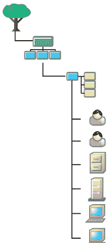

## 属性

**属性**（`property`），也称为特性（`attribute`），是您可以存储在对象上的信息类别。每个 `eDirectory` 对象都由属性组成，可用于存储有关资源的信息。

特定的属性集合定义或构成了一个对象的类。例如，工作站对象与用户对象的区别在于它们包含的属性，因此，该对象的使用方式也不同。

工作站对象没有像用户对象那样的用户名。工作站对象不能像用户对象那样属于组对象或角色对象。

对象类和属性由 `eDirectory` 架构定义并控制。

> 在引用 `eDirectory` 的层次结构时对象（`object`）和属性（`property`）术语。条目（`entry`）和特性（`attribute`）术语有时与对象和属性交替使用，通常指底层数据库。

## 值

**值**（`value`）是属性内部的数据。

例如，一个用户对象有一个名为“姓”（Last Name）的属性，该属性又有一个值，例如“Johnson”。

## 对象示例

在底图中，打印机由打印机对象表示。与打印机对象相关的属性包括名称（Name）、描述（Description）和位置（Location）。这些属性的值分别为 `Payroll_Printer`、`PostScript Laser` 和 `Room 305`。

用户由用户对象表示。与打印机对象一样，用户对象也有属性。这些属性包括登录名称（Login Name）、职称（Title）和电话（Telephone）。

所有的 `eDirectory` 对象（如下文所示的打印机对象和用户）都有属性和值：

## 图 A-5

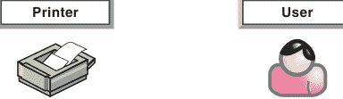

| 属性 | 值 | 属性 | 值 |
| --- | --- | --- | --- |
| Name | `Payroll_Printer` | Login Name | `BJohnson` |
| Description | `Postscript Laser` | Title | `Gen. Manager` |
| Location | `Room 305` | Telephone | `555-1234` |
| NetAddress | `ED043F43` | NetAddress | `4D3A4363` |

注意，用户对象也有属性和值。但是，因为用户对象执行不同的功能，它的属性和值也是不同的。

当在 `iManager` 中创建用户对象时，“姓”（Last Name）属性被称为 `Surname`。但是，当您打开用户对象的“常规”（General）属性页时，您看到 `Surname` 被称为 Last Name。

对象属性分为两类：

- 强制性（`Mandatory`）
- 可选（`Optional`）

## 强制性

某些属性包含如打印机名称、网络地址和配置信息等对网络至关重要的信息。

没有这些强制值就无法创建对象，且强制值不能被删除。例如，对象的名称是一个强制属性。（在用户对象中，Last Name 属性也是强制的。）

## 可选

其他属性包含非关键信息，如用户的职称、电话号码和街道地址。没有这些信息也可以创建对象，且添加或删除这些信息不会损坏对象。

许多可选属性是多值的；也就是说，它们可以包含多个值。例如，用户对象的 Telephone Number 可以包含多个号码。

## eDirectory 对象类

类是对象类型，作为目录对象的模板。目录对象由类定义。例如，用户和组织就是对象类。

每个对象类都有某些属性。例如，用户对象具有登录名称、密码、姓等许多属性。

架构定义了对象类和属性，以及包含规则（哪些容器可以包含哪些对象）。

`eDirectory` 对象类可以分为三类，如下：

图 A-6

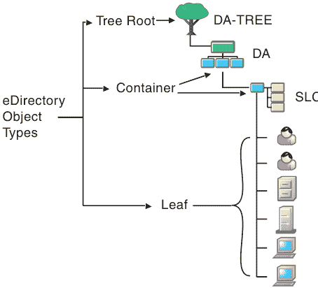

- 树对象
- 容器对象
- 叶子对象

## 树对象

树对象（也称为树根）是在您的网络中安装第一个 `eDirectory` 服务器时创建的。作为顶层容器，它通常持有组织、国家或别名对象。

别名将在后续部分讨论。

作为网络管理员，您可以从树对象对整个 `eDirectory` 树进行委托分配并授予权限。

### 树对象的特征：

- 每个目录只有一个，它形成了 `eDirectory` 树的顶端。
- 对象的名称即树名。
- 它只能包含国家、组织、安全和别名对象。（别名只能引用其所在容器中的对象；在这种情况下，别名可以引用国家和组织对象。）
- 它无法被移动或删除。

树对象有时被定义为特殊类型的容器，因为它的主要功能是包含其他对象（它包含了整个目录）。


> 有关 `eDirectory` 树的更多信息，请参阅在线文档 `www.novell.com/documentation`。

## 容器对象

容器对象包含叶子对象或其他容器对象。它们用于逻辑分组和组织目录中的对象。它们可以代表国家、国家地区、公司、部门、责任中心、工作组和共享资源。

以下图显示了常见的容器对象类型：

## 图 A-7

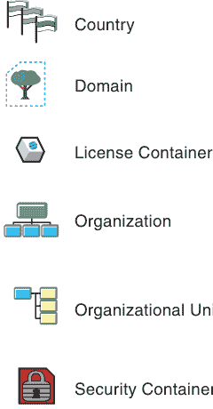

下表列出了 `eDirectory` 树中找到的某些容器对象：

## 表 A-1

| 容器对象 | 说明 |
| --- | --- |
| 国家 (C) | - 设计您的网络所在的国家，并在该国家内组织其他目录对象<br>- 按国家组织 `eDirectory` 树<br>- 仅包含有效的 2 位国家缩写<br>- 可选，但在连接到某些 X.500 全局目录时是必须的<br>- 仅存在于树对象中 |

## 在 Linux 上集成 Novell Open Enterprise Server for Linux

| 容器对象 | 说明 |
| :--- | :--- |
| 域 (DC) | - 帮助您进一步组织目录中的其他对象<br>- 域对象存在于树对象中，或者组织、组织单元和国家对象之下。<br>- 代表 DNS 域组件<br>- 允许您使用 DNS 服务资源记录 (DNS SRV) 位置来定位树中的服务 |
| 许可容器 (LC) | - 代表目录中的特殊容器对象。许可容器对象可以包含一个或多个许可证书对象。<br>- 在安装许可证书或使用 `Novell Licensing Services (NLS)` 创建计量证书时创建。<br>- 当安装启用 `NLS` 的应用程序时，由树添加该许可容器。该容器中还会添加一个证书叶子对象。 |
| 组织 (Q) | - 帮助您组织目录中的其他对象。组织对象是国家对象的下级（如果您使用了国家对象的话）。<br>- 按组织组（如公司、大学或部门）组织对象。<br>- 存在于树或国家对象中。<br>- 是必选的。 |

## 表 A-1 容器对象说明

### 组织单元 (OU)

- 帮助您进一步组织目录中的其他对象。组织单元对象是组织对象的下级。
- 按子单元组（如分部门、业务部门、项目组或部门）组织对象。
- 存在于国家、组织和组织单元中。
- 是可选的。

### 基于角色的服务 (RBS)

- 允许您指定用户在特定管理应用程序中被授权执行的任务。
- 定义 `RBS` 角色包括创建一个 `RBS` 角色对象并指定该角色可以执行的任务。
- 在某些情况下，管理应用程序可能会提供几个供您修改的预定义角色对象。

### 安全 (S)

- 存储与登录、身份验证和密钥管理等安全属性相关的全局策略。

下表列出了每种类型容器对象的区分特征：

| 表 A-2 容器对象 | 可存在于 | 可包含 | 示例 |
| --- | --- | --- | --- |
| 国家 | 树 | 组织 | `US` |
| | | 别名 | `FR` |
| 组织 | 树 | 组织结构 | `Novell` |
| | 国家 | 单元 | `UCLA` |
| | | 所有叶子对象 | |

## 在 Linux 上集成 Novell Open Enterprise Server for Linux

| 表 A-2 容器对象 | 可存在于 | 可包含 | 示例 |
| --- | --- | --- | --- |
| 组织单元 | 组织 | 组织单元 | `营销销售` |
| | 组织单元 | 所有叶子对象 | |

以下提供了三个 `eDirectory` 树结构的示例：

## 图 A-8

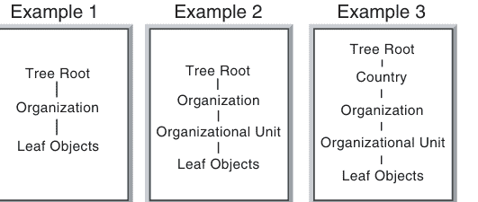

容器的限制导致了以下分级树结构：

- 树对象必须位于顶端。
- 国家对象位于树对象中。
- 组织对象位于树或国家对象中。
- 组织单元对象位于组织对象或其他组织单元对象中。

## 叶子对象

叶子对象代表网络资源，例如用户、工作站、服务器和 `NetWare` 卷。一些常见的叶子对象如下：

## 图 A-9

| 别名 | 服务器 |
| --- | --- |
| 应用程序 | 组织角色 |
| 目录映射 | 打印机 (非 NDPS) |
| 组 | 打印服务器 (非 NDPS) |
| LDAP 组 | 配置文件 |
| LDAP 服务器 | 未知 |
| 许可证书 | 用户 |
| NDPS 代理 | 卷 |
| NDPS 管理器 | 工作站 |
| NDPS 打印机 | |

## 在 Linux 上集成 Novell Enterprise Server for Linux

下表解释了最常见的 `eDirectory` 叶子对象：

| 表 A-3 | 叶子对象 | 说明 |
|---|---|---|
| | AFP 服务器 | 代表作为您的 `eDirectory` 网络上的节点运行的 AppleTalk 文件传输协议 (`AFP`) 服务器。它通常还充当 `NetWare` 路由器，以及几台 Macintosh 计算机的 AppleTalk 服务器。 |
| 别名 | 代表另一个对象，该对象可以是容器、用户对象或树中的任何其他对象。别名对象不带有自身的受托人权限。您可以创建一个指向树中另一个对象的别名对象。别名对象为用户位于其容器之外的对象提供了一个本地名称。 |
| 应用程序 | 代表一个网络应用程序。应用程序对象简化了管理任务，如分配权限、自定义登录脚本和启动应用程序。 |
| 计算机 | 代表网络上的计算机。 |
| 目录映射 | 指文件系统中的文件夹。目录映射对象是到..的指针。严禁复制本手册的全部或部分或分发此类副本。如报告疑似抄袭，请拨打 1800。 |
| 表 A-3 | 叶子对象 | 说明 |
| --- | --- | --- |
| 组 | 为用户列表分配一个名称。使用 `NLS` 在数据库中安装产品许可证书。允许使用 `MEMBER OF` 语法指定登录脚本命令。 |
| LDAP 组 | 代表 `LDAP` 组。`LDAP` 组对象存储适用于一组服务器的配置数据。这极大简化了配置更改，因为一次配置更改可以应用于多个服务器。安装时，会在服务器对象相同的容器中创建一个 `LDAP Group server_name`。 |


| LDAP 服务器 | 代表 LDAP 服务器。LDAP 服务器对象存储 LDAP Services for Directory 的配置数据。安装时，会创建一个名为 `server_name` 的 LDAP 服务器对象（`server_name` 是安装 LDAP Services for Directory 的服务器名称）。该对象创建在服务器对象相同的容器中。每个 LDAP 服务器对象配置一个 LDAP Services for Directory。不要将其分配给多个服务器。如果这样做，它将不再分配给之前的服务器。 |

| 许可证书 | 代表许可证书。使用 NLS 在数据库中安装产品许可证书。当安装感知 NLS 的应用程序时，许可证书对象会被添加到许可产品容器中。 |

## 表 A-3 叶子对象

| 叶对象 | 说明 |

| --- | --- |

| NDPS 代理 | 代表 NDPS 代理。代理提供三种网络支持服务：服务注册服务、事件通知服务和资源管理服务。每个 eDirectory 树至少应有一个 NDPS 代理。在某些情况下，您可能需要创建额外的代理。例如，您可能想为 WAN 上的每个站点在本地服务器上创建一个代理。 |

| NDPS 管理器 | 代表 NDPS 管理器。服务器打印代理提供了平台。在创建服务器打印代理之前，必须在 eDirectory 树中创建 NDPS 管理器对象。NDPS 管理器对象存储 NDPSM NLM 使用的信息。您可以在服务器终端手动加载此 NLM。单个 NDPS 管理器可以控制任意数量的打印代理。特定的 NDPS 管理器只能加载在一个服务器上。如果它控制本地打印机，则必须加载在连接该本地打印机的服务器上。 |

## 表 A-3 叶对象描述

| 叶对象 | 描述 |

| --- | --- |

| NDPS 打印机 | 代表 NDPS 打印机。通过 iManager 添加到 eDirectory 树的 NDPS 打印机被称为*受控访问打印机*。作为 eDirectory 对象，NDPS 打印机不再直接作为公共访问打印机可用。用户仅可以通过 eDirectory 对象列表访问它们，而不再通过公共访问打印机列表。 |

| 组织角色 | 定义组织中的某个位置或角色，占据该位置的用户可能会发生，但该位置的职责保持不变。组织角色中的用户被称为*占用者*。 |

| 打印队列 | 代表网络打印队列。 |

| 打印服务器 | 代表网络打印服务器。 |

| 打印机 | 代表网络打印设备。 |

| 配置文件 | 代表一组需要共享共同登录脚本命令的用户使用的登录脚本。这些用户不必在同一个容器中。 |

| 服务器 | 代表运行任何操作系统的服务器。当你在服务器上安装 eDirectory 时，树中会创建一个服务器对象。该对象类可以是任何运行 eDirectory 的服务器。你还可以创建一个服务器对象来表示 NetWare 2 或 NetWare 3 绑定服务器。 |

| 模板 | 代表标准用户对象属性，这些属性适用于新对象。你可以使用模板对象来简化创建用户对象以及设置属性以控制登录和用户网络计算环境的任务。 |

| 用户 | 代表使用网络的人。登录时需要用户对象。当你将第一个服务器安装到树中时，会创建一个名为 Admin 的用户对象。第一次请以 Admin 身份登录。 |

| 未知 | 代表 iManager 没有自定义图标的对象。 |

| 卷 | 代表网络上的物理卷。当你在服务器上创建物理卷时，树中会创建一个卷对象。默认情况下，卷对象的名称是服务器的名称，并在其后附加了下划线和物理卷的名称，例如 `DA1_SYS`。卷对象仅在 NetWare 上支持。UNIX 文件系统分区无法使用卷对象进行管理。eDirectory 中的卷对象不包含有关该卷上文件和目录的信息。但是，你可以通过 iManager 访问这些信息。文件和文件夹信息保留在文件系统本身。 |

## eDirectory 对象上下文和命名规范

要理解 eDirectory 树的流程和设计，你需要了解以下内容：

- 什么是上下文
- 对象命名规范

## 什么是上下文

上下文可以定义为：

- 对象在 eDirectory 树中的位置
- 登录后在 eDirectory 树中导航到的位置

### 对象在 eDirectory 树中的位置

当上下文用于定义对象在 eDirectory 树中的位置时，上下文是一个从该对象到树对象的容器对象列表。（通过上下文定位对象类似于使用目录路径定位文件。）

例如，在下面的图中，两个 BJohnson 对象之间的区别在于它们的上下文。左侧的用户对象在 SLC 容器中；右侧的用户对象在 DA 容器中。

### 图 A-10


eDirectory 树在同一个容器内不能有两个同名的叶对象。然而，eDirectory 树可以在不同的容器中拥有两个同名的叶对象，因为它们的上下文不同。

左侧 BJohnson 对象的上下文是 `BJohnson.SLC.DA`；右侧 BJohnson 对象的上下文是 `BJohnson.DA`。

### 登录后在 eDirectory 树中导航到的位置

当你导航到 eDirectory 树中的另一个位置时，你的上下文就是你在树中的当前位置，或当前上下文。它不是你的用户对象在 eDirectory 树中的所在地。

当前上下文：

- 影响在访问资源时必须为命令提供的对象区分名的多少部分（在本节稍后部分将解释）。
- 标识 Novell 客户端中你的工作站的默认 eDirectory 容器（如果你在登录后没有更改上下文）。
- 允许你通过通用名称引用你当前上下文中的对象，因为你的当前上下文和对象的上下文是相同的。

当前上下文有时被称为名称上下文。

## 对象命名规范

命名规范允许你精确地识别和定位树中的对象。

例如，在下面的图中，目录中两个单独的容器内存在两个名为 BJohnson 的用户对象。如果你以 BJohnson 的身份登录，eDirectory 将使用哪一个用户对象？

### 图 A-11


你或你的工作站必须为 eDirectory 提供足够的信息，以便在 eDirectory 树中定位该对象。你在对象名称中指定这些信息。

每个对象名称精确地标识 eDirectory 中的一个对象。因此，在上面的图中，精确名称是不同的，因为它们的对象名称包含了标识它们在 eDirectory 树中位置的信息。

要理解对象名称，你必须理解：

- 对象名称属性
- 对象命名规则

## 对象名称属性

你在 eDirectory 树中创建的每个对象的名称都由以下部分组成：

- 名称属性类型
- 名称值

对象名称的属性类型决定了对象在 eDirectory 树中作为容器对象还是叶对象被访问。

对象的值是你创建该对象时输入的名称。

以下名称属性分配给最常见的 eDirectory 对象：

| 表 A-4 | 属性类型 | 示例 |

|---|---|---|

| C | 国家 | `C=IR`（爱尔兰） |

| O | 组织名称 | `O=DA` |

| OU | 组织单元 | `OU=SLC` |

| CN | 通用名称 | `CN=BJohnson`（适用于叶对象） |

名称属性：

- 区分容器类型和叶对象。
- 出现在要标识的对象之前。
- 在属性类型缩写和对象之间有一个等号（`=`）。
- 是可选的（参见“无类型命名”，但有助于避免无类型命名可能出现的问题）。

叶对象的通用名称（CN）是 eDirectory 树中显示在叶对象旁的名称。

例如，图中两个用户对象的通用名称均为 `BJohnson`：

### 图 A-12


CN 属性适用于所有叶对象。任何服务器、组或其他对象的命名均为 `CN=value`。

当用户需要访问 eDirectory 树中的服务器等资源时，必须在请求中包含服务器对象的通用名称。

要使用父容器之外的资源，用户必须更改其在 eDirectory 树中的位置或上下文。

## 对象命名规则

在使用名称指定对象之前，你必须理解对象命名规则。可以使用以下方式指定对象：

- 区分名
- 相对区分名
- 带类型命名
- 无类型命名

### 区分名

对象的*区分名*是其通用名称和上下文的组合。这标识了一直到树顶部或根的对象。以图 A-13 为例，区分名必须包含到 `O=DA` 的路径。

使用区分名精确标识对象。两个对象不能具有相同的区分名。

### 图 A-13


在上面的图中，组织 DA 中组织单元 SLC 中用户对象 BJohnson 的区分名如下：

`.CN=BJohnson.OU=SLC.O=DA`

组织 DA 中用户对象 BJohnson 的区分名如下：

`.CN=BJohnson.O=DA`

卓越名称（Distinguished Name）以句号开头。名称中的对象通过句号分隔，类似于 DOS 路径通过反斜杠分隔名称。

从树对象到被命名对象，所有对象的名称都包含在卓越名称中。

## 相对卓越名称 (Relative Distinguished Name)

相对卓越名称

- 列出从被命名对象到 eDirectory 树中代表该对象当前上下文（或当前位置）的容器路径。
- 不以句号开头。
- 使用句号分隔名称中的对象。
- 可以使用尾句。

> 有关尾句的更多信息，请参阅 Novell eDirectory 在线文档：http://www.novell.com/documentation/edir873/index.html

例如，如果你的当前上下文是 `O=DA`，你可以像下面所示引用 BJohnson 用户对象：

## 图 A-14

当使用相对卓越名称时，eDirectory 必须根据它构建一个卓越名称。这是通过将相对卓越名称附加到当前上下文来实现的：

`相对卓越名称 + 上下文 = 卓越名称`

在以下示例中，当提交相同的相对卓越名称时，不同的当前上下文会创建一个不同的卓越名称：

| 提交的名称 | 当前上下文 | 结果的卓越名称 |

|---|---|---|

| `CN=BJohnson` | `O=DA` | `.CN=BJohnson.O=DA` |

| `CN=BJohnson` | `OU=SLC.O=DA` | `.CN=BJohnson.OU=SLC.O=DA` |

### 集成 Linux 版 Novell Open Server

通用名称 (CN) 是一种相对卓越名称。

尾句是更改当前上下文的简写方式。简单来说，尾句会移除当前上下文中最左侧的容器。

例如，用户 `CN=BJohnson.O=DA` 此时他所使用的客户端机器当前上下文是 `OU=SLC.O=DA`。

如果他直接登录 `CN=BJohnson`，当前上下文将附加到他的名称上，eDirectory 将认为他为 `CN=BJohnson.OU=SLC.O=DA`。这不是他想要的身份验证方式。

以正确用户登录的最简单方法是在他的相对卓越名称末尾加上尾句，如下：

`CN=BJohnson.`

尾句移除了当前上下文中最左侧的容器，将当前上下文从 `OU=SLC,O=DA` 更改为 `O=DA`。然后他将以 `CN=BJohnson.O=DA` 登录。

## 类型命名 (Typeful Naming)

类型命名使用属性缩写（如 `CN` 或 `OU`）来区分对象卓越名称或相对卓越名称中的不同容器类型和叶对象。

虽然不是强制性的，但属性类型有助于避免无类型命名（下文介绍）可能引起的混淆。

例如，以下是一个类型化名称：

`.CN=BJohnson.O=DA`

## 无类型命名 (Typeless Naming)

无类型命名（最常用的命名规范）不包含对象属性类型。例如，`.CN=BJohnson.OU=SLC.O=DA` 的无类型卓越名称为

`.BJohnson.SLC.DA`

如果你不提供类型对象名称，eDirectory 会为每个对象计算属性类型。如果工具在对象上放置错误的属性，将无法定位这些对象。

## 坚实 eDirectory 基础组件

要了解坚实 eDirectory 基础的组件，你需要知道：

- eDirectory 基础模型
- eDirectory 网络配置建议

## eDirectory 基础模型

良好的设计原则是 eDirectory 系统顺利运行的基础。只有当 eDirectory 所在的基础设施高效运行时，它才能发挥最佳性能。

eDirectory 依赖于无错误通信、准确的时间同步和高效的副本同步基础。

当底层服务设计得顺畅时，eDirectory 就能处于最佳状态。当底层服务设计得不顺畅，这些服务的性能低下会导致 eDirectory 性能低下。

下图说明了 eDirectory 顺利运行所依赖的基础服务：

时间同步和副本同步取决于稳固的网络通信基础。没有稳实的通信，这些服务无法良好运行。

副本同步独立于时间同步，但它依赖于准确的时间戳以确保副本正确同步。

有了这些基础服务的到位并正常运行，eDirectory 能够顺利且高效地运行。没有它们，eDirectory 将无法良好运行，甚至可能无法运行。

一旦在 Linux 服务器上建立了网络通信，就可以配置时间同步，然后安装 eDirectory。

eDirectory 基础模型可能意味着必须在安装 eDirectory 之前建立副本同步。随着课程的进行，你会发现在安装 eDirectory 之前无法配置或监控副本同步。

## eDirectory 网络配置建议

Linux 服务器与 Windows 服务器和工作站一样，需要配置子网掩码、网关地址，并可以通过 DHCP 动态接收 IP 地址、主机名和域名。

然而，Novell 强烈建议对 eDirectory 服务器进行静态配置。eDirectory 服务本身不需要，但如果 IP 地址是静态的，使用 eDirectory 的服务将更容易维护。此外，如果网络中的所有服务器都有静态地址，配置时间同步也会更容易。使用 eDirectory 的网络服务如果主机名被静态分配并映射到 hosts 文件中的 IP 地址，也将受益。

## 索引

（此处省略索引内容，保持格式即可）

由于提供的文本主要为索引（Index）内容，包含页码和术语。根据文档工程规范，我将保留所有页码和格式，并对对应的英文术语进行了中文翻译。

```
8–35–36, 8–42–87, 49–85–50,
8–54–85, 6–68, 8–85, 9–2–4,
9–19, 10–11, 10–17, 10–30, A–30
11–27, A–20, A–29–A3, A–45
配置自动介绍 (configure Auto-Intro), 1–6, 1–74, 2–14,
2–18–21, 2–26, 2–55, 2–61,
2–73, 3–4, 3–7–8, 3–19, 3–23–35,
3–33–34, 3–40, 3–41, 3–50,
3–63, 3–72, 3–73, 3–75, 3–81,
3–83–84, 3–87, 3–91, 3–100,
3–02–4, 4–6, 4–8, 9–12, 4–17,
5–4, 5–8, 5–11, 5–14, 5–26,
5–30, 5–34, 5–38, 5–43, 5–50,
5–58, 5–91, 6–1, 6–22, 6–18–19,
6–27, 6–29, 6–74, 7–9, 7–13,
7–17, 7–31, 7–41, 7–42, 7–56,
7–60–71, 7–61, 8–1, 8–2, 8–19,
8–22, 8–30–81, 8–33, 8–35–38,
8–43, 8–45–87, 8–49–80,
8–53–54, 8–57, 8–58, 8–63–64,
8–69, 8–77, 8–89, 9–02, 9–83,
8–102, 8–104, 8–113, 8–121, 8–135,
8–137, 8–140, 8–47, 8–48, 9–1–2,
9–6–9, 9–8, 9–12, 9–17, 9–19,
9–23, 9–25, 10–10, 10–19,
10–34, A–45
10–36, 11–13, 11–15–16, 11–24,
A–19, A–24, A–28, A–31–A33, A–37
光标 (cursor) Intro–12–Intro–13, 2–10

# D

数据库 (database) A–3, A–6–A–7
激活 (deactivate) 5–54–55
部署管理器 (Deployment Manager) 1–33, 11–16
设备 (device) 5–54, 5–56, 8–130
DHCP Intro, 1–4–Intro–5, 8–1, 16–
2–1, 1–23, 1–45, 1–58, 2–21,
4–1–4, 4–13–17, 11–3,
11–8–19, 11–27, A–45
目录索引器 (DIB) A–9
目录 (directory) Intro, 1–2, 1–5, 1–8, 1–10–1–11,
1–24, 1–29–1–30, A–55
1–50–51, 1–57, 1–59, 1–63–64,
1–73–74, 2–11–23, 2–17,
2–21–22, 2–35–26, 2–38,
2–43–44, 2–54, 2–59, 2–64,
2–64–77, 2–79–72, 3–4, 3–6,
3–9, 3–11, 3–14, 3–17, 3–22, 3–26,
3–33–35, 3–36, 3–39, 3–60,
3–54–55, 3–58, 3–50, 3–51,
3–86, 3–87, 3–89, 4–3, 4–4, 4–9–11,
4–13–5, 5–17, 5–20, 5–23, 5–32, 5–36,
5–40, 5–42, 5–54, 5–46–47, 5–50–52, 5–55–56, 5–60,
5–64–65, 5–57, 5–69, 5–74–75, 5–77, 5–86, 6–4, 6–6, 6–8, 6–10,
```


# 索引

## 版权声明

复制本手册的所有内容或分发副本均严格禁止。要复制，请拨打 1000-PIRATES。

复制本手册的全部或部分或发行都是严格的。如怀疑有复制行为，请拨打 1800-PIRATES。

## 符号

- 6–16–17, 6–19, 6–28, 6–31, 6–33, 7–71, 7–73, 7–75, 7–42, 7–5, 7–8, 7–9, 7–13, 7–17, 7–18, 7–20, 7–22, 7–24, 7–26, 7–29, 7–35, 7–41, 7–46, 7–49, 7–51, 7–58, 7–59, 8–12, 8–14, 8–14, 8–27, 8–35, 8–41, 8–44, 8–48, 8–72, 8–73, 8–76, 8–102, 8–103, 8–111, 8–113, 8–115, 8–119, 8–120, 8–123, 8–125, 8–129, 8–135, 8–142, 8–143, 9–2, 10–13, 10–14, 10–16, 10–19, 10–24, 10–30
- 11–19–21, 11–23, 11–25, 11–27–18
- A–2–A–11, A–13–A–14, A–16–A–17, A–20, A–22–A–25, A–28–A–29, A–34, A–36
- 2–10–2–12, 2–35–26, 2–43–44, 2–61–66, 2–68–2–71, 2–82, 2–85
- 3–35–36, 3–43, 3–45
- 5–25, 5–31–32, 5–35–57, 5–39, 5–44, 5–47, 5–50, 5–52, 5–55, 5–57, 5–59–60, 5–64–65, 5–57
- 6–11, 6–26, 6–29, 6–23
- 7–15, 7–18, 7–34, 7–39, 7–24, 7–26, 7–30, 7–55, 7–57, 7–41, 7–47, 7–52, 7–54, 7–56, 7–58, 7–62
- 8–21, 8–24, 8–25, 8–52, 8–53, 8–55, 8–58, 8–61, 8–62, 8–68, 8–69, 8–84, 8–87, 8–88, 8–90, 8–91, 8–118, 8–120, 8–141
- 10–14–10–15, 10–18, 10–20, 10–23, 10–25, 10–27
- 11–3, 11–8–11–9, 11–27
- A–24
- 帧 (frame) 3–56–3–57

## A

- **加密的** (encrypted) 2–47, 5–54, 5–45, 55–56, 6–7–8–6, 6–32, 7–5, 8–11, 8–22–8–23, 9–20, 10–12, 11–17
- **加密** (encryption) 2–41, 25
- **外部** (external) 2–39, 3–36, 5–54, 5–7, 5–33

## E

- **eDirectory** Intro–6, 3–59, 7–52, 5–45, 9–6–9–7
- **生成** (generate) 1–6, 35

## G

- **全局** (global) Intro–7, 4–9, 4–14, 6–11, 6–31, A–4–A–5, A–10, A–23, A–25
- **图形域** (graphical Domain)
- **用户界面** (user interface) 2–24
- **名称服务** (Name Service) 4–4
- **组** (group) 2–78, 3–93, A–2
- **域** (domain) 1–13, 10–13, 10–30, 32–24
- **驱动程序** (driver) 7–14
- **图形用户界面** (GUI) 6–16, 1–71, 2–15, 21–18–19, 2–23, 2–45, 2–50, 7–29
- **GUID** 8–21, 8–24, 6–81–8

## H

- **硬件** (hardware) Intro–3, Intro–20, 1–5–1, 1–34–1–36, 1–54, 1–56, 2–3, 2–18, 2–23, 2–39, 2–40, 2–44, 2–49, 2–52, 2–53, 2–55, 2–66, 3–33, 3–35, 3–36, 3–39, 3–43, 3–45, 3–51, 3–53, 3–59, 4–61, 4–54, 5–26, 5–29, 5–4, 5–31, 5–32, 5–36, 5–40, 5–42, 5–54, 5–46, 5–47, 5–50, 5–52, 5–55, 5–56, 5–57, 5–59, 5–60, 5–64, 65, 5–57, 5–69, 5–74, 75, 5–77, 5–86, 6–4, 6–6, 6–8, 6–10, 6–16, 17, 6–19, 6–28, 6–31, 6–33, 7–71, 7–73, 7–75, 7–42, 7–5, 7–8, 7–9, 7–13, 7–17, 7–18, 7–20, 7–22, 7–24, 7–26, 7–30, 7–35, 7–41, 7–46, 7–49, 7–51, 7–58, 7–59, 7–62, 8–21, 8–24, 8–25, 8–52, 8–53, 8–55, 8–58, 8–61, 8–62, 8–68, 8–69, 8–84, 8–87, 8–88, 8–90, 8–91, 8–118, 8–120, 8–141, 10–14–10–15, 10–18, 10–20, 10–23, 10–25, 10–27, 11–3, 11–8–11–9, 11–27, A–24
- **页眉** (header) 3–29, 3–31, 3–54, 3–79–80
- **健康** (health) 1–16, 1–23, 1–40, 2–54, 3–56, 3–58
- **十六进制** (hexadecimal) 3–8
- **高可用性** (high availability) 2–62
- **文件夹** (Folder) Intro–1, Intro–4, Intro–8, Intro–20, 1–6, 1–17, 1–19
- **身份** (identity) 3–12
- **集成** (Integrating Novell Open Server) 8–50––51
- **HTTPS** 3–69–8–51
- **IPX** 1–16, 1–24, 11–14
- **报告** (Report) 1–67

## I

- **i管理器** (iManager) Intro–4–5, 1–19, 1–7, 1–38, 1–44, 1–49, 1–52, 1–53, 1–55, 1–58, 1–70, 2–23, 2–47, 2–53
- **Linux** 1–22, 1–24–1–25, 2–17, 2–21, 2–6, 3–17, 3–19, 3–23, 3–33, 3–35, 3–36, 3–39, 3–43, 3–45, 3–51, 3–53, 3–59, 4–61, 4–54, 5–26, 5–29, 5–31, 5–32, 5–36, 5–40, 5–42, 5–54, 5–46, 5–47, 5–50, 5–52, 5–55, 5–56, 5–57, 5–59, 5–60, 5–64, 65, 5–57, 5–69, 5–74, 75, 5–77, 5–86, 6–4, 6–6, 6–8, 6–10, 6–16, 17, 6–19, 6–28, 6–31, 6–33, 7–71, 7–73, 7–75, 7–42, 7–5, 7–8, 7–9, 7–13, 7–17, 7–18, 7–20, 7–22, 7–24, 7–26, 7–30, 7–35, 7–41, 7–46, 7–49, 7–51, 7–58, 7–59, 7–62, 8–21, 8–24, 8–25, 8–52, 8–53, 8–55, 8–58, 8–61, 8–62, 8–68, 8–69, 8–84, 8–87, 8–88, 8–90, 8–91, 8–118, 8–120, 8–141, 10–14–10–15, 10–18, 10–20, 10–23, 10–25, 10–27, 11–3, 11–8–11–9, 11–27, A–24

## L

- **局域网** (LAN) 2–38–2–39, 2–57, 2–19, 2–23, 3–98, 5–33
- **限制** (limit) 8–1–8–82

## O

- **代理** 53, 7–86, 7–6, 7–24, 7–46–78, 7–52–53–7, 7–59, 7–61–72, A–31
- **处理器** 1–34–1–1, 1–56, 2–55, 3–2, 3–23, 3–33, 3–18
- **属性** 5–70–5–1, 5–76, 5–73
- **属性** 2–79, 3–83, 5–39, 5–55, 55–75–76, 6–11, 6–19, 8–112, 811–831–833, 8–135–816, 10–13–10–14, 10–25–10–28, A–16, A–18–A–20, A–25, A–33
- **协议** 1–8, 1–13, 1–24, 1–38, 1–45, 2–49, 2–73, 3–2, 3–6, 3–12, 4–3, 5–44–5, 5–52–53–35, 5–37–53–58, 5–84, 5–91, 6–2, 6–9–10, 6–5, 6–18–19–6, 7–4, 8–37, 10–22–14, 11–10, 11–17, 11–19–110–20, 11–27, A–8–A–9, A–28
- **对象** 1–11, 6–15, 7–57, 10–13, A–22, A–24
- **操作系统** A–3
- **选项** 1–37, 1–56, 5–33, 7–37

## P

- **分区** 2–54, 2–67, 2–70
- **密码** 2–18, 6–14, 6–35, 8–87
- **物理** Intro–10, 2–54, 2–67, 3–36, 3–43, 3–97, 5–35, 5–47, 5–49, 5–54, 5–56, 5–65, 6–9, 7–7, 7–14, 8–35, 2–2, A–6, A–11, A–17, A–33
- **ping** 3–51
- **PKI** 1–17, 1–25, 11–55, 11–12
- **池** 5–48, 5–54
- **端口** 1–15–18–1, 2–21, 3–10, 3–12–15, 3–27, 3–29, 3–48, 3–51–3–52, 6–62–33, 3–70, 3–95, 5–5, 5–16–5–9, 6–32, 7–10, 7–12, 7–58, 8–50, 8–56, 8–85, 9–10, 10–15–10–16, 10–25, 10–28, 11–3–11–6
- **安装后** 1–74, 2–21, 5–53
- **迁移后** 7–56
- **预** 1–45, 1–58, 11–27
- **打印数据加密** 7–4
- **作业** 7–7, 7–9, 7–12, 7–28–29
- **打印** Intro–4, 5–72–5–3, 5–86, 7–37–11, 7–14–19, 7–22–29, 72–31–75, 7–39–7–41, 7–43–74, 7–46–78, 7–52–54–4, 7–56–72–6, A–18–A–20, A–31–A–32

## Q

- **配额** 8–80, 8–96, 8–100

## R

- **公钥基础设施** 1–17, 1–25, 11–5, 11–12
- **清除** 1–26, 3–25, 5–50, 10–28–10–29, 10–37, 11–13
- **RAID** 1–27, 5–46, 5–54, 5–56, 8–83
- **读取** 2–73, 2–80
- **远程管理器** 2–37, 2–45, 3–2–3, 3–17, 3–100, 5–25, 5–50, 6–26
- **环** 7–20
- **同步** A–44–A–45, 3–66–70, 3–75–3–76, 3–78, 3–85–90, 3–92–94, 4–34, 4–8–14, 4–16–17, 5–1–53, 5–33–54, 5–37–51, 5–44, 56, 5–48–50, 5–51–53, 5–55, 57, 5–60–52, 5–74, 5–80, 5–82–84, 5–86–88, 5–89, 6–8–13, 6–15–62, 6–29, 7–7, 7–5, 7–10, 7–14, 7–16–17, 7–19–20, 7–27, 7–29, 7–35, 7–39, 7–43, 7–46–50, 7–52–79, 7–61–81, 8–7, 8–8, 8–9, 8–10, 8–12, 8–14, 8–16, 8–17, 8–18, 8–20, 8–21, 8–22, 8–24, 8–25, 8–28, 8–29, 8–30, 8–31, 8–32, 8–33, 8–34, 8–35, 8–38, 8–40, 8–42, 8–43, 8–44, 8–45, 8–46, 8–48, 8–51, 8–52, 8–53, 8–55, 8–56, 8–57, 8–58, 8–59, 8–61, 8–63, 8–64, 8–65, 8–66, 8–67, 8–70, 8–71, 8–73, 8–77, 8–85, 8–86, 8–87, 8–88, 8–90, 8–92, 8–93, 8–94, 8–95, 8–96, 8–97, 8–98, 8–99, 8–100, 9–3, 9–24, 9–119, 9–123, 10–1, 10–6, 10–12, 10–13, 10–14, 10–15, 10–16, 10–17, 10–18, 10–19, 10–20, 10–21, 10–22, 10–23, 10–24, 10–25, 10–26, 10–27, 10–28, 10–29, 10–30, 10–31, 10–32, 10–33, 10–34, 10–35, 10–36, 10–37, 10–38, 10–39, 10–40, 10–41, 10–42, 10–43, 10–44, 10–45, 10–46, 10–47, 10–48, 10–49, 10–50, 10–51, 10–52, 10–53, 10–54, 10–55, 10–56, 10–57, 10–58, 10–59, 10–60, 10–61, 10–62, 10–63, 10–64, 10–65, 10–66, 10–67, 10–68, 10–69, 10–70, 10–71, 10–72, 10–73, 10–74, 10–75, 10–76, 10–77, 10–78, 10–79, 10–80, 10–81, 10–82, 10–83, 10–84, 10–85, 10–86, 10–87, 10–88, 10–89, 10–90, 10–91, 10–92, 10–93, 10–94, 10–95, 10–96, 10–97, 10–98, 10–99, 10–100, 11–1, 11–2, 11–3, 11–4, 11–5, 11–6, 11–7, 11–8, 11–9, 11–10, 11–11, 11–12, 11–13, 11–14, 11–15, 11–16, 11–17, 11–18, 11–19, 11–20, 11–21, 11–22, 11–23, 11–24, 11–25, 11–26, 11–27, 11–28, 11–29, 11–30, 11–31, 11–32, 11–33, 11–34, 11–35, 11–36, 11–37, 11–38, 11–39, 11–40, 11–41, 11–42, 11–43, 11–44, 11–45, 11–46, 11–47, 11–48, 11–49, 11–50, 11–51, 11–52, 11–53, 11–54, 11–55, 11–56, 11–57, 11–58, 11–59, 11–60, 11–61, 11–62, 11–63, 11–64, 11–65, 11–66, 11–67, 11–68, 11–69, 11–70, 11–71, 11–72, 11–73, 11–74, 11–75, 11–76, 11–77, 11–78, 11–79, 11–80, 11–81, 11–82, 11–83, 11–84, 11–85, 11–86, 11–87, 11–88, 11–89, 11–90, 11–91, 11–92, 11–93, 11–94, 11–95, 11–96, 11–97, 11–98, 11–99, 11–100
- **requirements** 1–12, 1–19, 1–26, 1–56
- **resource** 1–12, 1–19, 1–26, 1–56
- **Resource Management** 7–47, 7–53, 7–61
- **restrictions** 3–73, 3–75, 3–58–60
- **root** 2–29, 2–64, 75
- **SCSI** 2–53, 2–67

## 集成 Linux 版 Novell Open Enterprise Server

- **NSS** Intro-4, 1-6-17, 1-17-18, 1-21-12-22, 1-25-27, 1-46, 1-57, 1-66, 1-74, 1-26, 2-47-28, 2-51-22-52, 2-57-58, 2-81, 3-25, 5-1-53-5, 5-25-26, 5-51-36, 5-39, 5-44-57, 5-57-59, 5-66, 5-80, 5-88, 5-91-52, 6-3-6-4, 6-18-19-6, 25-5, 8-33, 8-35-36, 8-43-8-44, 10-10, 10-12, 10-22, 10-25-10-29, 10-37, 11-5, 11-8-11-9, 11-11-10-12, 11-18, 11-28, 7-42-7, 44, 71, 11-21, A-14


# 索引

## search engine
1-19

## secondary
3-5, A-1, A-9

## security
1-8, 1-20, 1-29, 1-38, 1-59-60, 2-6, 2-23, 3-6, 3-12, 3-29, 4-5, 4-9, 4-11, 4-32, 5-5, 5-9, 6, 6-32, 7-10, 7-11, 7-14, 7-16, 7-17, 7-19, 7-20, 7-27, 8-13, 8-15, 8-16, 8-17, 8-18, 8-20, 8-21, 8-22, 8-23, 8-24, 8-25, 8-28, 8-29, 8-30, 8-31, 8-32, 8-33, 8-34, 8-35, 8-36, 8-37, 8-38, 8-40, 8-41, 8-42, 8-43, 8-44, 8-45, 8-46, 8-48, 8-49, 8-50, 8-51, 8-52, 8-53, 8-54, 8-55, 8-56, 8-57, 8-58, 8-59, 8-60, 8-61, 8-63, 8-64, 8-65, 8-66, 8-67, 8-70, 8-71, 8-72, 8-73, 8-74, 8-75, 8-76, 8-77, 8-79, 8-80, 8-80, 8-81, 8-82, 8-83, 8-84, 8-85, 8-86, 8-87, 8-88, 8-89, 8-90, 8-91, 8-92, 8-93, 8-94, 8-95, 8-96, 8-97, 8-98, 8-99, 8-100

## segments
5-56, 11-14, 11-15, 11-19, 11-21, 11-22, 11-24, 11-30, A-1, A-7, A-8, A-9, A-10, A-12, A-14, A-15, A-16, A-17, A-18, A-20, A-21, A-22, A224, A-25, A-28, A-29, A-30, A-31, A-32, A-33, A-34, A-35, A-38, A-40, A-42, A-43, A-44, A-45, A-46, A-48, A-51, A-52, A-53, A-55, A-56, A-57, A-58, A-59, A-61, A-63, A-64, A-65, A-66, A-67, A-70, A-71

## server
1-8, 1-17–20, 1–1–6, 1-8, 10-15, 15-17, 1-19–27, 1-30–1-38, 1-41, 1-43–1-47, 1-49, 1-51–69, 1-72, 1-75–1-76, 2–2, 2–4–6, 2–14–17, 2–19–21, 2–22–23, 2–35–36, 2–38–42, 2–46–2-50, 2–52–5-54, 2–56, 2–58, 2–60, 2–62, 2–68, 2–81–82, 2–84, 3–2–3, 3–15–31, 3–16–34, 3–37–41, 3–43–44, 3–48–51–52, 3–54–64

## service
1-72, 5-44, 7-47

## session
2-66, 2-30

## settings
7-5, 7-43, 7-74

## size
8-7, 8-19

## structure
3-16, 3-53

## subcontainer
1-59–1-60, 6-14

## subnet
1-35–1-36, 14–40–14–5, A–4

## T
7-33, 8-7, 8-76–8-77, 8-90, 8-142–8-43

## target server
Intro-20, 8-56–8-57

## user
6-23, 6-24, 8-40, 8-42, 8-58, 8-61, 8-72, 8-93

## TID
6-11, 6-13

## time
Intro-4, Intro-16, Intro-17, 1-32–1-33, 1-38, 1-44, 1-46, 1-54, 2-9, 2-15, 2-23, 2-24, 2-26, 2-28, 2-30, 2-32, 2-35, 2-36, 2-39, 2-46, 2-54, 2-56, 2-59, 2-60, 3-31–3-36, 3-75, 3-89, 3-91, 3-92, 3-97–3-98, 4-4, 4-10, 4-14–4-15, 5-2, 5-15, 5-30, 5-46, 5-54–5-55, 5-61, 5-68, 5-83, 5-89, 6-32, 7-11, 7-20, 7-24, 7-25, 7-29, 7-31, 7-31, 7-43, 7-54, 7-59, 8-2, 8-12, 8-15, 8-22, 8-28, 8-43, 8-45, 8-56, 8-74–8-77, 8-79, 8-87–8-88, 8-90–8-92, 8-94, 8-100, 8-101, 8-105, 8-113, 8-123–8-136, 9-3, 9-24, 8-119, 8-123, 115

## zone
4-8-4-11, 7-16
