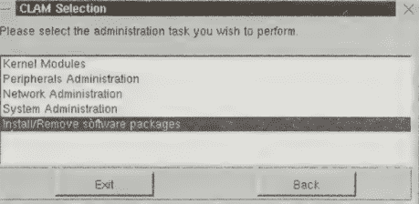
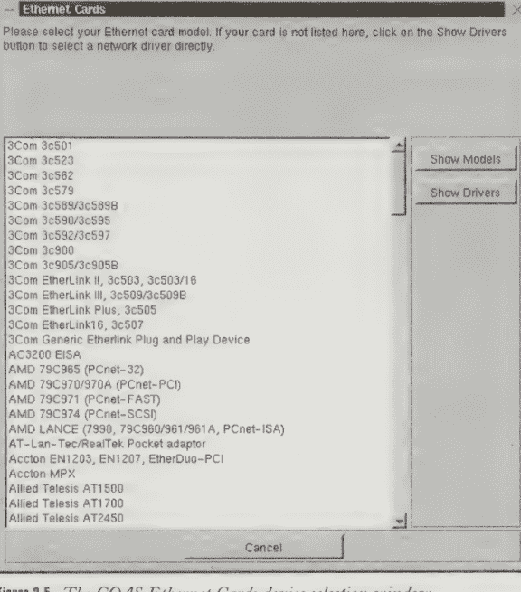
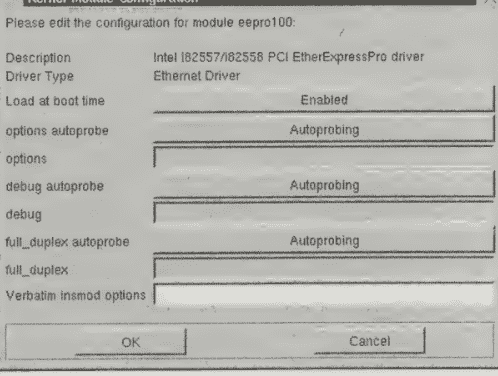
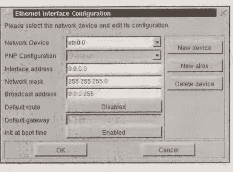
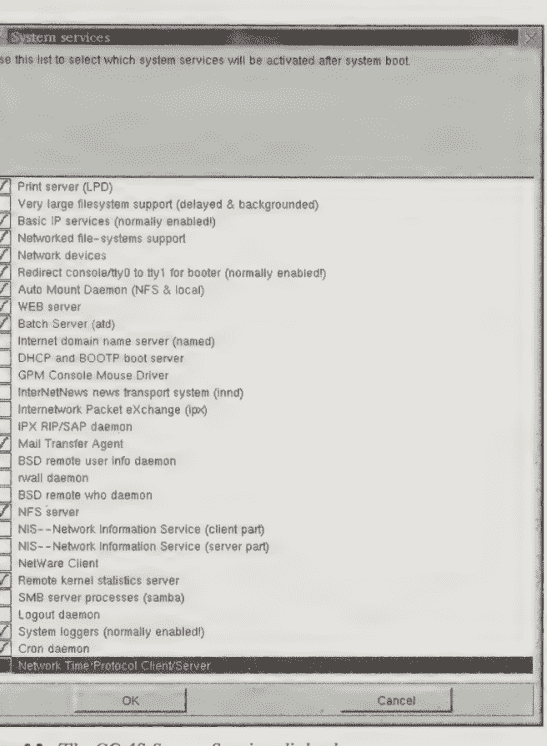
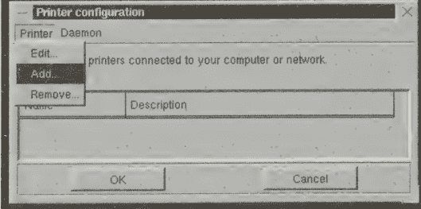
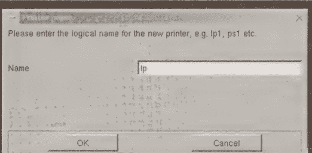
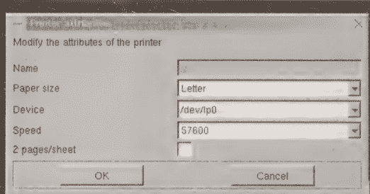
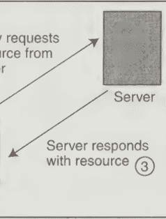

# Caldera OpenLINUX 2.3 网络集成：一种更好的网络设置方法 (附带 CD-ROM) (书籍与 CD)


已撤书

Joe Cheek

Tony Ho

Matthew Coulson

Curtis Wilber Jr.


Cathleen D. Snyder

Theresa Wehrle

# 索引

我想将本书献给我的妻子 Rachel，感谢她的优雅与祝福。献给许多让 Linux 变成今天如今的创新者。我要感谢我的妻子 Nicola 和儿子的支持；如果没有他们的爱，我可能不会承担这个项目。感谢 Joe Cheek、Tony Ho、Matthew Coulson 和 Curtis Wilber Jr. 的默默支持，感谢开源软件开发者们。

启动和停止 `rc` 网络服务 ................................................... 26
- 使更改永久 ................................... 213
- 安装 `squid` ........................................... 220

### 附录 A：重新编译 Caldera OpenLinux 2.3 内核.............. 249
- 获取并安装最新内核源码 .......................... 250
- 配置内核 ............................................................ 251
- 编译内核和模块 ........................................ 253
- 安装新内核 ................................................ 253
- 更多信息 ................................................................................. 256

### 附录 B：CD 上有什么？......................................................... 257
- 运行 CD ................................................................................ 258
- Linux ................................................................................... 258
- Windows 95/98/NT4 ......................................................... 258
- Prima 许可 ................................................................................... 258
- Prima 用户界面 ............................................................ 259
- 调整大小和关闭用户界面 ................................ 259
- 使用左侧面板 ................................................................................. 259
- 使用右侧面板 ................................................................ 259

# 引言

在本书中，我们尝试介绍当今业务环境中使用的网络类型，以及 Caldera Openlinux 特别适用于哪些网络。本书讨论了 Openlinux 在中小型组织中作为文件和打印服务器的使用，以及在中大型组织中作为互联网和电子邮件服务器的使用。

# 假设

为了限制本书的范围，我们对你作为读者的情况以及你将要使用的网络类型做了一些假设。首先，我们假设你熟悉计算机网络及其用途，并且在此之前已经具有一些相关经验。

也许你曾接触过其他网络服务器，例如 UNIX、NetWare 或基于 Windows NT 的网络，甚至是另一个 Linux 发行版。你熟悉实现网络所需的基础硬件，并已经配备了必要的硬件，包括机器、电缆、网卡等。

我们还对你正在使用的网络做了一些假设。本书讨论的是以太网网络网络，尽管 Openlinux 支持许多其他类型，如令牌环（Token Ring）、帧中继（Frame Relay）和 AX.25。本书仅涵盖用于局域网（LAN）的内容；它假设你的 Openlinux 机器将作为局域网服务器，且 Openlinux 负责的唯一广域网（WAN）连接是简单的以太网连接，如 DSL、调制解调器或通过媒介的 PPP。

安装 Openlinux 服务器的许多步骤（如硬盘分区或创建用户）在书中不会被讨论；维护 Openlinux 服务器的许多方面（如账户维护或文件系统维护）也不会被讨论。我们假设你对 Linux 或 UNIX 系统有一定程度的了解，并且对在使用本书操作的机器拥有 root 级访问权限。本书假设你已经熟悉网络概念和通用的服务器维护。最后，本书假设你以 root 用户身份登录你的 Openlinux 服务器；我们要求你使用或告知你使用的几乎所有命令都需要 root 权限才能正常运行。

# 关于本书书

本书是 Prima Tech Linux 系列的第五卷。它让读者领略 Linux 操作系统的一个方面。该系列中的其他书籍探索了为 Linux 开发的应用程序，以及操作系统本身的发行版。

书中包含了许多有用的元素，提供了与所讨论主题相关的见解和关键信息。
- 提示（Tips）告诉你完成任务的新方法和更快方法。
- 注释（Notes）深入探讨给定主题的背景信息。
- 警告（Cautions）警告在使用操作过程中可能遇到的陷阱和故障。

# 第一部分

使用 Caldera Openlinux 进行网络连接入门
- 1 Caldera Openlinux 2.3 简介
- 2 配置 Openlinux 基础网络

# 第 1 章：Caldera Openlinux 2.3 简介

Caldera Openlinux 的区分性特征

Caldera Openlinux 2.3 的新功能

额外的所需软件

Caldera Openlinux 2.3 中的网络支持

# 第 1 章：Caldera Openlinux 2.3 简介

Caldera Systems, Inc. 将其 Linux 发行版命名为 Openlinux，部分原因是为了是为了传达 Linux 内核以及许多可用插件的开源性质。Openlinux 始终位列美国三大商业 Linux 操作系统之列前茅，是 Caldera 的第二个 Linux 产品。Caldera Systems 的第一个 Linux 产品 Caldera Network Desktop 是 Red Hat 发行版的定制版本，已不再提供。随着 Caldera 将其 Linux 产品与 Linux 支持团队的 LST 发行版合并，Openlinux 应运而生。

## Caldera Openlinux 的区分性特征

Linux 发行版在安装方法和系统管理功能上差异很大。每个 Linux 发行版都自带自己的工具来完成这些任务。Openlinux 使用名为 `lizard`（Linux wizards）的工具进行安装，而 Openlinux 2.0 版本 COAS（Caldera 开放管理系统）的新功能之一为编辑配置文件提供了一个前端界面，而 `lizard` 是一个极佳的新型安装程序。本书讨论了手动编辑配置文件，而不是使用 COAS（COAS 尚未成熟到可以完成书中讨论的所有内容）。


尽管 `lizard` 和 `COAS` 是新的，但 Openlinux 还包含了旧的安装和管理实用程序 `lisa`（Linux 安装与系统管理）。 Openlinux 的口号是“面向企业的 Openlinux”；Openlinux 旨在为用户提供图形界面，但目前尚未完善。许多用户更偏于命令行，而 `lizard` 是实现这一目的的强大工具。Openlinux 对两者的支持使其具有灵活性。建议大多数用户使用 `COAS`，但 `lizard` 适用于那些习惯命令行的人。Openlinux 的功能很多，并且它们是为用户设计的。这些功能中的许多在第 1 章“Openlinux 2.3 简介”中得到了讨论。

# 第 1 章：Caldera Openlinux 2.3 简介

## Caldera Openlinux 2.3 的新功能

安装 Openlinux 服务器的许多步骤（如硬盘分区或创建用户）在书中不会被讨论；维护 Openlinux 服务器的许多方面（如账户维护或文件系统维护）也不会被讨论。我们假设你对 Linux 或 UNIX 系统有一定程度的了解，并且对在使用本书操作的机器拥有 root 访问权限。本书假设你已经熟悉网络概念和通用服务器维护。最后，本书假设你以 root 用户身份登录你的 Openlinux 服务器；我们要求你使用或告知你使用的几乎所有命令都需要 root 权限才能正常运行。

（注：后续重复章节已省略）

## OpenLinux 提供的文件和打印机服务

第 3 章和第 4 章描述了如何在多种标准网络环境中使用 OpenLinux 作为文件服务器和打印机服务器。

关于与 Windows NT 和 UNIX 网络的集成将在单独的章节中进行描述。在现实世界中，大多数网络并不是单一供应商的，你可能会发现有必要配置你的 OpenLinux 服务器以连接到多种类型的网络。幸运的是，OpenLinux 允许你这样做；使用一种类型的网络并不会排除你使用一（或多种类型的网络，而且 OpenLinux 可以同时处理所有类型的网络。

在可以使用 OpenLinux 作为网络服务器之前，需要进行一些基础配置。第 2 章描述了如何完成所有网络服务必经的任务，例如查找和加载驱动程序，以及管理 IP 地址和 IP 路由。

## Samba 和 SMB 文件系统

Samba 一词源于 SMB，即服务器消息块协议（Server Message Block），它是 Windows NT 网络的基础。Samba 是一个由 Andrew Tridgill 领导的团队开发的免费程序，可以用于在网络上模拟 Windows 机器。它可以在 Windows 9x 网络中充当对节点，也可以在 Windows NT 网络中充当服务器或域控制器。

第 3 章“使用 Samba 和 SMBFS 进行 Windows NT 文件和打印机共享”描述了如何设置和使用 OpenLinux 的 Samba 服务器。它解释了服务器程序 `smbd` 和 `nmbd`，以及相关的客户端 `smclient` 和 `smbmount`。它涵盖了 OpenLinux 内核中某些 SMB 支持。

微软的 Windows 2000 是 Windows 的下一个版本，它通过活动目录（Active Directory）扩展了 SMB 功能，它将对象放置在树形目录中而不是像 NT 4 域模型那样的扁平数据库中。目前，Samba 不支持活动目录，尽管随着开发的进行可能会改变。Samba 为 Windows 机器提供文件和打印机共享，当在局域网（LAN）上将 OpenLinux 服务器与 Windows 桌面机器集成时，这是一个很好的起点。

## NFS 和 LPRng

NFS（网络文件系统）和 LPR（行式打印机协议）长期以来一直是 UNIX 网络的主流。OpenLinux 支持 NFS 第 2 版本，以及一种 LPR 的增强版本，称为 LPRng（LPR 下一代）。OpenLinux 的 NFS 实现是由 Linux 内核开发人员从零编写的，而 LPRng 是由 AStart Technologies 的 Patrick Powell 编写的。它们共同构成了 OpenLinux 的文件和打印机共享组件。

NFS 的起源者 Sun Microsystems 创建了 NFS 第 3 版本。需要注意的是，OpenLinux（以及其他 Linux 发行版）中的 NFS 实现过去在连接 Sun Microsystems 的 Solaris 服务器时出现过问题。


虽然 OpenLinux 中的 NFS 第 2 版本是 Sun Microsystems 参考 NFS 实现的子集，但 LPrng 不是标准 LPR 打印的子集。LPrng 将 LPR 扩展为一个更健壮、安全且直观的包，同时保持了 100% 的后兼容性。

OpenLinux 可以同时作为 NFS 和 LPRng 的客户端和服务器，两者都在第 4 章“使用 NFS 和 LPRng 进行 UNIX 文件和打印机共享”中讨论。在第 4 章中，我们讨论了如何将你的 OpenLinux 服务器连接到 UNIX 网络，以及如何连接到实现这些协议的其他机器。特别是，LPR 打印包含在许多网络感知打印机中，例如惠普 N 系列激光打印机、惠普 JetDirect 打印接口以及英特尔 NetPort Express。

> LPR 打印有时被称为 LPR/LPD 打印，因为处理打印机队列的守护进程的标准名称是 `lpd`（行式打印守护进程）。


## OpenLinux 提供的互联网服务

书中描述的服务是在多种标准网络环境中使用 OpenLinux 作为文件和打印机服务器的方法。与 Windows NT 和 UNIX 网络的集成将在单独的章节中进行描述。在现实世界中，大多数网络并不是单一供应商的，你可能会发现有必要配置你的 OpenLinux 服务器以连接到多种类型的网络。幸运的是，OpenLinux 允许你这样做；使用一种类型的网络并不会排除你使用一（或多种类型的网络，而且 OpenLinux 可以同时处理所有类型的网络。

在使用 OpenLinux 作为网络服务器之前，需要进行一些基础配置。第 2 章描述了如何完成所有网络服务必经的任务，例如查找和加载驱动程序，以及管理 IP 地址和 IP 路由。

## Samba 和 SMB 文件系统

Samba 一词源于 SMB，即服务器消息块协议（Server Message Block），它是 Windows NT 网络的基础。Samba 是一个由 Andrew Tridgill 领导的团队开发的免费程序，可以用于在网络上模拟 Windows 机器。它可以在 Windows 9x 网络中充当对节点，也可以在 Windows NT 网络中充当服务器或域控制器。

第 3 章“使用 Samba 和 SMBFS 进行 Windows NT 文件和打印机共享”描述了如何设置和使用 OpenLinux 的 Samba 服务器。它解释了服务器程序 `smbd` 和 `nmbd`，以及相关的客户端 `smclient` 和 `smbmount`。它涵盖了 OpenLinux 内核中某些 SMB 支持。

微软的 Windows 2000 是 Windows 的下一个版本，它通过活动目录（Active Directory）扩展了 SMB 功能，它将对象放置在树形目录中而不是像 NT 4 域模型那样的扁平数据库中。目前，Samba 不支持活动目录，尽管随着开发的进行可能会改变。Samba 为 Windows 机器提供文件和打印机共享，当在局域网（LAN）上将 OpenLinux 服务器与 Windows 桌面机器集成时，这是一个很好的起点。

## NFS 和 LPRng

NFS（网络文件系统）和 LPR（行式打印机协议）长期以来一直是 UNIX 网络的主流。OpenLinux 支持 NFS 第 2 版本，以及一种 LPR 的增强版本，称为 LPRng（LPR 下一代）。OpenLinux 的 NFS 实现是由 Linux 内核开发人员从零编写的，而 LPRng 是由 AStart Technologies 的 Patrick Powell 编写的。它们共同构成了 OpenLinux 的文件和打印机共享组件。

NFS 的起源者 Sun Microsystems 创建了 NFS 第 3 版本。需要注意的是，OpenLinux（以及其他 Linux 发行版）中的 NFS 实现过去在连接 Sun Microsystems 的 Solaris 服务器时出现过问题。


虽然 OpenLinux 中的 NFS 第 2 版本是 Sun Microsystems 参考 NFS 实现的子集，但 LPrng 不是标准 LPR 打印的子集。LPrng 将 LPR 扩展为一个更健壮、安全且直观的包，同时保持了 100% 的后兼容性。


OpenLinux 可以同时作为 NFS 和 LPRng 的客户端和服务器，两者都在第 4 章“使用 NFS 和 LPRng 进行 UNIX 文件和打印机共享”中讨论。在第 4 章中，我们讨论了如何将你的 OpenLinux 服务器连接到 UNIX 网络，以及如何连接到实现这些协议的其他机器。特别是，LPR 打印包含在许多网络感知打印机中，例如惠普 N 系列激光打印机、惠普 JetDirect 打印接口以及英特尔 NetPort Express。

> LPR 打印有时被称为 LPR/LPD 打印，因为处理打印机队列的守护进程的标准名称是 `lpd`（行式打印守护进程）。


## OpenLinux 提供的互联网服务

书中描述的服务是在多种标准网络环境中使用 OpenLinux 作为文件服务器和打印机服务器的方法。与 Windows NT 和 UNIX 网络的集成将在单独的章节中进行描述。在现实世界中，大多数网络并不是单一供应商的，你可能会发现有必要配置你的 OpenLinux 服务器以连接到多种类型的网络。幸运的是，OpenLinux 允许你这样做；使用一种类型的网络并不会排除你使用一（或多种类型的网络，而且 OpenLinux 可以同时处理所有类型的网络。

在使用 OpenLinux 作为网络服务器之前，需要进行一些基础配置。第 2 章描述了如何完成所有网络服务必经的任务，例如查找和加载驱动程序，以及管理 IP 地址和 IP 路由。

## Caldera OpenLinux 2.3 中的网络支持

邮件投递；`procmail` 可以根据邮件头或内容将邮件分类到文件夹中、设置自动回复、提供自动或条件转发，等许多功能。第 7 章“使用 sendmail 和 procmail 配置 SMTP 电子邮件”讨论了如何配置 `sendmail` 和 `procmail` 以在您的网络上进行电子邮件投递。

## wu-ftpd，一个 FTP 服务器

OpenLinux 的 FTP 文件传输服务由 `wu-ftpd`（华盛顿大学文件传输协议）处理。默认情况下，私有和公共（匿名）FTP 均启用。配置 `ftp` 进程非常简单，特别是与其他捆绑服务器（如 Apache Web 服务器或 `sendmail` 邮件服务器）相比。第 8 章“使用 wu-ftpd 配置 FTP 服务器”解释了普通的 FTP 服务器配置，并深入了更高级的话题，例如限制用户权限和创建虚拟服务。

## UseNet NNTP 服务器：inn

UseNet 被称为“世界上最大的公告板”。每天有数十万条消息穿越 UseNet，占用数百兆字节的磁盘空间。OpenLinux 带有 `inn` 软件包，该包由互联网软件协会（ISC）维护，该组织也是维护 `bind` DNS 服务器的团体。作为 ISC 产品的标准，`inn` 实际上是包的名称，而不是程序；`inn` 程序是 `inn` 和 `nnppd`。UseNet 网络分布在互联网的数十万条消息中，不同的 UseNet 服务器以树状结构进行组织，类似于 DNS 服务器的组织方式。

与 UseNet 不同，DNS 没有中心节点——没有根服务器——因此 UseNet 服务器通过它们连接的其它服务器来区分。上游连接被称为“馈送器”（feeders），这些连接用于接收 UseNet 文章。下游连接被称为“读取器”（readers），这些连接用于将 UseNet 文章发送给其他人，无论是终端用户还是从您的服务器获取新闻馈送的另一台机器。

`inn` 软件包强大且灵活，但需要非常详细的配置。第 9 章“使用 inn 配置 UseNet 新闻”中讨论了配置内容。我们在第 9 章中解释了如何让您的 `inn` 服务器正常工作，使其能够从上游提供商接收 UseNet 消息并发送给终端用户和其他新闻服务器。

## Radius 认证

Radius 认证是一种跨网络提供用户身份验证的方法。它通常用于有远程用户连接到服务器的情况，以确保有一台单独的机器专门处理远程连接和认证。

# 第 1 章：Caldera OpenLinux 2.3 简介

互联网服务提供商和拥有大量远程员工的公司会设置其专用拨号服务器（例如 Lucent Portmaster），并在 OpenLinux 服务器等机器上运行其他服务。

Radius 是允许 Portmaster 与 OpenLinux 服务器通信的协议，用于确定谁允许访问网络服务以及他们被允许做什么。该内容在第 10 章“使用 Lucent 的 radiusd 配置 Radius”中进行了描述。该章节解释了如何在 OpenLinux 端获取、安装和配置服务器，以及对 Portmaster 的配置。（介绍的大部分信息适用于其他 Radius 客户端，例如 Lucent 的 Ascend MAX 交换机。）

OpenLinux 可以独立处理远程访问的所有方面，例如控制调制解调器、通过身份验证以及提供互联网连接等其他服务，但在大型部署中，这样做并不总是明智的。让单台服务器提供 Web 页面服务、文件传输、局域网和打印机共享、电子邮件和互联网访问等远程访问服务，即使是一台大型可靠的服务器也是如此。将远程访问卸载到专用机器是减轻 OpenLinux 负担的好方法，可以为其其他功能留出更多的处理能力。此外，Radius 提供了远程访问的日志和计数信息，为公司提供了计费和统计目的所需的所有细节。Portmaster 不是唯一支持 Radius 的远程访问解决方案，但它们无疑是最常见的。

## 防火墙配置工具：ipchains

对保护其服务器和数据免受互联网攻击的公司正在部署防火墙以限制对敏感数据的访问。然而，防火墙并非系统安全的唯一方法；其他安全方法（如使用代理服务器和网络地址转换 IP 伪装）可以提供比防火墙更高的安全性，可能更适合您的网络环境。

在 OpenLinux 上控制防火墙和网络地址转换配置的工具称为 `ipchains`。通过 `ipchains`，你可以构建一条规则链，以决定网协议数据包是否在您的 OpenLinux 服务器上进行处理。`ipchains` 名字的由来是因为被用于配置 IP 数据包规则链。每条规则都告诉 OpenLinux 如何对收到的 IP 数据包进行操作，是接受、拒绝、伪装还是等等。当数据包被防火墙或其他工具拦截时，安全性得到了增强，从而使针对您网络的攻击可以降到最低。

防火墙、代理服务器或 IP 伪装配置哪种最适用于您的网络，很大程度上取决于您的网络设置以及您希望实现的安全性。第 11 章“使用 ipchains 构建防火墙”讨论了如何使用 OpenLinux 提供的 `ipchains` 工具配置防火墙。

## Caldera OpenLinux 2.3 中的网络支持

安装和配置代理服务器非常不同，它值得有其专门的章节；第 12 章名为“配置 squid 代理服务器”。防火墙和网络地址转换都是允许两个网络之间的流量不受阻地流动并对其限制，而代理服务器是取两个独立的网络并在满足特定条件时提供桥接来连接它们。这可以提供安全性，因为两个网络永远不需要在逻辑上连接。遗憾的是，`squid` 仅提供对 Web 和 FTP 站点的访问。

## DHCP 服务器，telnet, ssh

这些服务运行互联网。`telnet` 和 `ssh` 都提供了命令行和 GUI 界面到您的服务器。然而，`telnet` 随 OpenLinux 提供但不安全，意味着它很容易被拦截。正如前面提到的，`ssh` 是安全的，意味着即使传输被拦截也没关系。

DHCP（动态主机配置协议）为许多机器获取 IP 地址，而不是为每台机器分配。这可以减少管理时间，因为整个地址池可以从一台机器（即 DHCP 服务器）管理。此外，DHCP 可以为其他服务（如 DNS 和网关）提供数字。

第 13 章“配置 telnet, ssh 和 DHCP”解释了如何在典型的 OpenLinux 上配置这三种服务。

# 第 2 章：OpenLinux 基础网络配置

# 第 2 章：配置正确的网络

要使用本书的信息，你需要在服务器上安装 OpenLinux 和正确的网络驱动程序。本章解释了如何让您的 OpenLinux 服务器进入可用状态，以便书中后续章节对你有所益。你需要在服务器上安装 OpenLinux 2.3，配置基础 IP 网络，并熟悉 OpenLinux 自带的基础网络管理工具（其他章节将介绍如何使用本章介绍的工具更改设置）。

## 本章涉及的文件

以下文件用于 OpenLinux 的基础网络：

| 文件 | 目的 |
| --- | --- |
| `/etc/inetd.conf` | `inetd` 配置文件指示应运行哪些服务 |
| `/etc/inittab` | `init` 表识别不同的运行级别并告诉在启动时执行什么 |
| `/etc/sysconfig/network-scripts/ifcfg-routes` | 此文件定义了静态网络路由 |

> 作为 `root` 用户，你对登录的 OpenLinux 系统拥有完全且总的访问权限。在使用此账户时不要粗心，因为你可能会轻易损害系统的安全性，或破坏宝贵的数据和程序。


## 寻找和安装正确的网络驱动


首先需要配置的项目是网络驱动。OpenLinux 需要加载适用于网卡的正确驱动并供使用。你可以通过 `lizard`（Caldera 最新的安装程序）自动加载这些驱动程序。你也可以在安装期间或之后，通过 `lizard`或其他安装程序手动加载它们。

# 查找并安装合适的网络驱动程序

## 让 Caldera lizard 安装器探测你的网卡

`lizard` 是你在安装 OpenLinux 时最可能使用的安装器。如果你在 Windows 下安装 OpenLinux，或者直接从书中附带的 CD 启动，就会 `lizard` 图形界面。这是配置网络最简单的方法；在安装路线的某个点，系统会要求你提供以太网的细节，包括 IP 地址、子网掩码、DNS 服务器、网关和主机名。你可以选择 DHCP IP 地址或加入 NIS 域。系统不会询问你拥有什么种类型的网卡，因为它将由 `lizard` 自动确定的。

你可以选择在此阶段不配置网络，尽管我们不建议这样做。如果你有多个网络适配卡，你有机会仅配置其中一个（遗憾的是，`lizard` 不会告诉你你正在配置哪一个）。如果你使用的是令牌环网卡或其他而非标准或快速以太网的网卡，你无法在 `lizard` 中对其进行配置，而必须在安装完成后手动配置。

`lizard` 为用户所需的安装类型提供了多种选项，例如完全安装、最小化安装、网络服务器安装等。请选择完全安装（所有软件包）或网络服务器安装。选择完全安装需要大约 1.3 GB字节的硬盘空间，并安装 X Window 系统。网络服务器安装需要大约 250 兆的硬盘空间，且不安装 X Window 系统，而是强制你从命令行进行所有管理工作；也不会安装任何开发实用（因此禁用了按 ssh 需要进行编译）。不要选择 Web 服务器安装，因为它不会加载运行功能网络服务器所需的软件包。

## 使用 lisa 安装器加载网卡驱动程序

你可以使用 Caldera 的旧版安装器 `lisa`（Linux 安装与系统管理）来加载 OpenLinux，它是基于文本的。（它探测的信息较——更多信息需要手动输入。）当 `lizard` 探测功能没有返回有效信息，或者在少数情况下探测导致系统挂起时，使用 `lisa` 很好。

要用 `lisa` 加载 OpenLinux，你必须先创建软盘。你可以在运行 DOS 或 Windows 的机器或现有的 Linux 安装上创建这些。CD-ROM 包含了两个软盘的镜像——一个启动/安装磁盘和一个包含额外驱动程序的模块磁盘。这些镜像位于 CD-ROM 的 `col/launch/lisa/floppy` 目录下，文件分别为 `install.144` 和 `modules.144`。（在开始之前确保你的软驱驱动器中有一张空盘。）要在 DOS 或 Windows 中从这些镜像创建 1.44 兆字节磁盘，请使用该目录下的 `install.bat` 和 `modules.bat` 批处理文件；Linux 则使用两次 `dd` 命令：

```
dd if=install.144 of=/dev/fd0
```

```
dd if=modules.144 of=/dev/fd0
```

要使用 `lisa` 安装，将安装软盘插入软驱驱动器，确保 OpenLinux CD 在 CD-ROM 驱动器中，然后重启。安装程序将自动开始。

`Lisa` 不会自动探测网卡；它需要被告知执行此操作。找到你的硬盘和 CD-ROM 设备，然后在询问时回答“否”以告诉它也探测你的网络卡；随后它会搜索一些更常见的网卡。如果找到了，它会加载该卡的驱动程序；如果没有找到，告诉它再次探测，并使用模块磁盘（其中包含更多驱动程序）。如果用此模块磁盘仍找不到你的网卡，你必须在 OpenLinux 安装完成后手动加载它。

在安装结束时，系统会提示输入 IP 地址信息，此时你并没有选择动态 IP（使用 DHCP）的机会。如果你想使用 DHCP，可以提供虚假信息，或者留空。你需要在安装后使用下一节描述的工具进行配置。

## 安装后通过手动加载网络驱动程序

如果你在安装期间未能成功加载网卡驱动程序，你现在可以使用 COAS（Caldera 开放管理系统）来加载并配置它们。因为 COAS 既有文本界面也有图形界面，所以它可以在终端窗口或 X Window 系统运行。从 KDE 菜单开始，点击应用程序启动器（Application Starter）；然后选择 COAS、Network（网络）、Ethernet 接口（COAS 不配置环形接口）。此菜单如图 2-1 所示。

你也可以在命令行提示符处输入命令 `coolast` 来手动运行 COAS。这将弹出菜单，如图 2-2（文本模式）和图 2-3（X Window 模式）所示。

注意，菜单包含相同的信息，只是显示方式不同。选择网络管理（Network Administration）、常用网络功能（Common Network Functions），查看以太网接口配置（Ethernet Interface Configuration）窗口，如图 2-4 所示。


图 2-1 通过 COAS 图形界面配置你的以太网

## CLAM 选择

请选择你想执行的管理任务。

- 内内核模块（Kernel Modules）
- 外设：管理（Peripherals: administration）
- 网络管理（Network Administration）
- 系统管理（System Administration）
- 安装/卸载软件包（Install/Remove software packages）



图 2-2 文本模式下的 COAS 主菜单

## CLAM 选择

请选择你想执行的任务。

- 内核模块（Kernel Modules）
- 网络管理（Network Administration）
- 系统管理（System Administration）
- 安装/卸载软件包（Install/Remove software packages）

图 2-3 X 模式下的 COAS 主菜单

第 2 章：配置 Openlinux 的网络

| 接口配置 | 请选择网络设备并编辑其 |
| :--- | :--- |
| 网络设备 | `eth0` |
| PNP 配置 | 已禁用 |
| 接口地址 | 172.16.100.1 |
| 网络掩码 | 255.255.255.0 |
| 广播地址 | 172.16.100.255 |
| 默认路由 | 已启用 |
| 默认网关 | 172.16.103.1 |
| 启动时初始化 | 已启用 |
| 确定 | 取消 |

你可以配置卡的 IP 地址、网络掩码和广播地址，以及网关。你可以告诉它使用 DHCP 而不是静态 IP。你还可以设置网络接口是否在启动时激活。

如果 OpenLinux 没有加载正确的驱动程序，在加载驱动之前无法配置网卡。在此窗口中，选择新设备（New Device）。这允许你加载新驱动程序，并列出设备列表如图 2-5 所示。

从列表中选择卡后，将出现设置该卡的选项，从 IRQ 和基地址到调试和双工选项。输入这些信息后，你可以通过 COAS 配置卡的 IP 地址等。（图 2-6 所示的选项适用于 Intel EtherFlex 100 卡。）

## 为接口分配多个 IP 地址

你可能想为一个网卡分配第二个或第三个 IP 地址。在 OpenLinux 术语中称为 IP 别名（IP Aliasing），你可以使用 COAS 工具来实现。从以太网接口窗口，选择新别名（New Aliases）。弹出的窗口与你看到的窗口几乎一样，两个不同之处在于此窗口没有填写信息，且网络设备后面带有 `:0`，这代表第一个别名（`:1` 是第二个，`:2` 是，以此类推）。从此窗口，你可以像配置第一个一样配置第二个 IP 地址（或第三个、第四个等）。（参见图 2-7。）



图 2-5 COAS 以太网卡设备选择窗口



图 2-6 针对 Intel EtherFlex 100 网卡的特定选项

## 查找并安装合适的网络驱动程序



请选择网络设备、设备并编辑其配置。

| 网络设备 | `eth0` | 新设备 |
| :--- | :--- | :--- |
| PNP 配置 | | |
| 接口、地址 | 0.0.0.0 | 新别名 |
| 网络子网掩码 | 255.255.255.0 | 删除设备 |
| 广播地址 | 0.0.0.255 | |
| 默认路由 | 已禁用 | |
| 默认网关 | 已启用 | |
| 启动初始化 | OK | 取消 |


图 2-7 别名 IP 地址以太网接口配置窗口

## 管理 IP 路由

路由受 COAS 内部设置的影响，因为无法在 COAS 中直接管理——必须从命令行提示符进行。`route` 命令用于查看和更改路由表。如果你只有一个网卡，可能只有三条路由：一个用于你的 IP 子网，一个用于你的网关，一个用于本地回环接口。当你执行 `route` 命令（不带选项）时，信息将以如下形式显示：

内核 IP 路由表

| 目的 | 网关 | 生成掩码 | 标记 | 标量 | Ref | 使用接口 |
| :--- | :--- | :--- | :--- | :--- | :--- | :--- |
| 172.16.100.0 | * | 255.255.255.0 | U | 0 | 0 | 0 eth0 |
| 127.0.0.0 | * | 255.0.0.0 | U | 0 | 0 | 0 lo |
| default | | 172.16.100.1 | 0.0.0.0 | UG | 1 | 0 | 0 eth0 |

上述示例是位于 172.16.100.0 子网的网卡，掩码为 255.255.255.0，网关为 172.16.100.1。如果你有一个具有多个网卡的更复杂网络，你可能会看到类似的内容：

内核 IP 路由表

| 目的 | 网关 | 生成掩码 | 标记 | 标量 | Ref | 使用接口 |
| :--- | :--- | :--- | :--- | :--- | :--- | :--- |
| 208.12.12.128 | 0.0.0.0 | 255.255.255.224 | U | 0 | 0 | 0 eth0 |
| 192.168.1.0 | 0.0.0.0 | 255.255.255.0 | U | 0 | 0 | 0 eth1 |
| 127.0.0.0 | 0.0.0.0 | 255.0.0.0 | U | 0 | 0 | 0 lo |
| 0.0.0.0 | 208.12.12.129 | 0.0.0.0 | UG | 0 | 0 | 0 eth0 |

在此示例中，显示了两个网卡（`eth0` 和 `eth1`），它们具有各自的子网：208.12.12.128/255.255.224 网络和 192.168.1.0/255.255.0 网络，`eth0` 接口上的默认网关为 208.12.12.129。可以告诉 OpenLinux 在两个网络之间转发数据包，作为一个或两个网络的网关。

## 启用和禁用 IP 转发

IP 转发使 OpenLinux 充当路由器：它接收从一个网络发送并目标为另一个网络的数据包，并将其转发到适当的网络。你可以在 COAS 内部开启或关闭 IP 转发。（这些设置是永久的，因此它们在服务器重启后会被保存）。从 COAS 主菜单选择“网络管理 (Network Administration)”、“TCP/IP 网络选项 (TCP/IP Network Options)”。这会弹出图 2-8 所示的菜单。

> 出于某种原因，KDE 桌面内的 COAS 菜单不允许像选择其他窗口那样直接选择 TCP/IP 网络选项窗口。你必须进入命令行提示符，然后手动运行 `coastool` 来获取该选项。


## 从 Shell 提示符更改路由

如果你正确配置了 OpenLinux 网络，大多数自动路由会自动设置；如果你在不同的子网上有两个网卡，并想在它们之间进行路由，只要你在 COAS 中输入了正确的条目，所有的路由表条目都会为你配置好。然而，有时手动修改路由表以添加或删除路由是有益的。这可以通过 `route` 命令完成。

| 网络选项 | |
| :--- | :--- |
| 网络 | 已启用 |
| IP 转发 | 已禁用 |
| | 取消 |

**图 2-8** COAS 中的网络选项窗口

如本章前述所示，如果不带任何选项调用 `route` 命令将显示当前路由表。要添加新路由，必须带有 `add` 参数调用：

```bash
route add -net 172.16.100.0 netmask 255.255.255.0 dev eth0
```

此命令向 `eth0` 接口添加到 172.16.100.0/255.255.255.0 的路由；基本上，它表示所有指向 172.16.100.0 的流量应从 `eth0` 发出。`-net` 参数意味着该路由适用于整个子网。如果我想为单个主机添加路由，我使用 `-host` 参数（在这种情况下 host 不是网段）。

```bash
route add -host 192.168.1.1 dev eth0
```

也可以添加网关。要添加默认网关，使用类似的命令：

```bash
route add gw 172.16.100.1
```

路由可以以并行的方式删除。在 `route` 命令中使用 `del` 替换 `add` 参数。要删除刚刚添加的网关，使用：

```bash
route del gw 172.16.100.1
```

## 使路由持久化

所有路由命令立即生效，但在系统重启后不会。如果你想永久更改路由，必须将这些命令添加到 `/etc/sysconfig/network-scripts/ifcfg-routes` 文件中。这是一个每次系统启动后调用的脚本。如果你想永久添加主机 192.168.1.1 的路由，请使用以下文件（列表 2-1）。

列表 2-1 示例 `/etc/sysconfig/network-scripts/ifcfg-routes`get

```bash
#!/bin/sh
## /etc/sysconfig/network-scripts/ifcfg-routes
## 永久路由更改
route add -host 192.168.1.1 dev eth0
```

此文件应由 root 用户和组所有。应如下所示赋予 root 用户执行权限（注意，安装 OpenLinux 后该文件不存在，你需要创建它）。

## 管理网络服务

你可以使用 COAS 开启和关闭网络，并启用和禁用许多系统服务（如电子邮件、DNS、NFS）。某些从 `inet` 进程运行的系统服务无法通过 COAS 管理；你必须通过 shell 命令和更改配置文件进行配置。本节将介绍如何处理这些网络管理问题。

## 开启和关闭网络

COAS 允许你在启用禁用 IP 转发的同一个屏幕上切换网络（这些设置是永久的，因此在服务器重启后保存）。从 COAS 主菜单选择“网络管理”、“TCP/IP 网络选项”。这会弹出之前图 2-8 所示的网络选项菜单。大多数情况下，你并不是永久禁用网络，而是关闭网络以排除故障；这通过使用运行级别 (`runlevels`) 轻松实现。运行级别告诉 OpenLinux 服务器处于什么状态，是在启动、重启、以单用户模式还是多用户模式运行，网络是否启用等。OpenLinux 定义了七种运行级别，如表 2-1 所示。

表 2-1 OpenLinux 运行级别及其含义

| 运行级别 | 含义 |
| :--- | :--- |
| 0 | 机（关机） |
| 1 | 单用户模式（网卡已初始化，但网络未开启） |
| 2 | 多用户模式（网络已开启，但大多数网络服务未开启） |
| 3 | 全多用户模式（全功能网络，未配置 X Window 默认值） |
| 4 | 未使用 |
| 5 | 带有 X Window 的全多用户模式（与 3 相同，但显示窗口登录） |
| 6 | 重启（系统正在重启） |

如果你的 X Window 系统正在运行并已启用，你的标准运行级别是 5；否则是 3。告诉系统更改运行级别是临时开启关闭网络服务最简单的方法。我经常将 OpenLinux 系统带入运行级别 1 来诊断并修复核心网络问题，或加载系统级补丁；执行此操作简单的方法是发布 `init` 1 命令。


不在机器控制台前请勿进入运行级别 1——如果你通过网络连接远程登录，这将关闭你的网络连接并使系统处于不可用状态。这将禁用所有网络和大多数系统服务，包括 X Window。所有用户将注销，你将在控制台终端上留下单个 shell 提示符。（完成维护后，你可以重新进入运行级别 3 或 5）。


如果你纯粹将系统作为服务器，你可能希望启动到运行级别 3 而不是5。启动到运行级别 3 不初始化 X Window 系统，这占用大量内存。要永久更改此，编辑 `/etc/inittab` 文件，并将 `id:5` 开头的行改为 `id:3`。

## 启动和停止 rc 服务


`rc` 脚本控制许多网络服务。这些服务可以通过 COAS 的系统管理启用或禁用。从 COAS KDE 菜单选择“系统”、“守护进程”。如果你运行 `coastool`，则必须选择“系统管理”、“启用/禁用系统服务”。无论哪种方式都会进入图 2-9 所示的对话框该窗口列出了许多服务，每个服务左侧都有复选框。勾选的框在启动时启用；未勾选的不会。你可以通过勾选和取消这些服务，精确指定在正常（运行级别 3 或 5）启动后启用哪些服务。遗憾的是，在此对话框中更改这些复选框不会立即启动或停止特定服务；它告诉 OpenLinux 在重启后启动服务。要立即启动或停止服务，你必须使用特定服务的 `rc` 脚本手动操作。例如，要停止 NFS 服务，使用以下命令：

```bash
/etc/rc/init.d/nfs stop
```

## 管理网络服务

### 系统服务

使用此列表选择在系统启动后激活的系统服务

- 打印服务器 (LPD)
- 超大文件系统支持（延迟和后台）连续- 基础 IP 服务（默认启用）连续- 网络文件系统支持
- 网络设备
- 恒定重定向到 tty1 用于控制台（默认启用）连续- 自动挂载守护进程 (NFS & 本地）
- Web 服务器
- 批处理服务器 (at)
- 互联网域名服务器 (named)
- DHCP 和 BOOTP 服务器
- GPM 控制台鼠标驱动程序
- InternetNews 新闻传输系统 (inftd)
- 互联网数据包交换 (ipx)
- IPX/SAP 守护进程
- 邮件传输代理
- BSD 远程用户守护进程
- nwall 守护进程
- BSD 远程守护进程
- NFS 服务器
- NIS--网络信息服务（客户端部分）
- NIS--网络信息服务（服务器部分）
- Netware 客户端
- 远程隧道统计服务器
- SMB 服务器进程 (samba)
- 登出守护进程
- 系统日志记录（默认启用）
- 代码守护进程
- 网络时间协议客户端/服务器



图 2-9. COAS 系统服务对话框

要启动 DNS 服务，请使用以下命令：

`/etc/rc.d/init.d/named`

### 启动和停止 inetd 网络服务

某些服务并不是由 `rc` 脚本管理的，而是由 `inetd` 管理。`inetd` 是一个超级服务器；它的工作是管理其他系统服务，例如登录和 telnet。`inetd` 监听指定的端口，当它收到连接时，会将将其传递给必要的程序。所有这些程序都通过 `/etc/inetd.conf` 文件进行启用和禁用。该文件中的每一行都告诉 `inetd` 在建立连接时运行哪个程序。该文件中的行如下所示：

```
ftp stream tcp nowait root /usr/sbin/tcpd in.ftpd -l -a
```

## 第 2 章：配置 OpenLinux 的基础网络

默认情况下，此文件中的几乎所有服务都是激活的。要禁用特定服务，请使用井号将其注释掉。相反，要重新启用某个系统服务，请删除相应行前的井号。

编辑此文件会更改系统启动时启动的服务。要更改当前启用的服务，在编辑 `/etc/inetd.conf` 文件后，向 `inetd` 程序发送一个信号。

```
killall -HUP inetd
```

> 参数 `-HUP` 是一个挂断信号（hangup signal）；在此情况下它用于告诉 `inetd` 它的配置文件已更改，以便它重新读取该文件。


## 更多信息

Cheek Consulting 的 Linux 知识库在这两个 URL 中提供了关于 Linux 网络和网络参考的链接。

| URL | 资源名称 |
| :--- | :--- |
| http://linuxkb.cheek.com/page.php?network | Linux 知识库 |
| | 网卡基础信息 |
| | |
| http://linuxkb.cheek.com/page.php?networking | Linux 知识库概览 |
| | 网络信息 |


| 文件 | 用途 |
| --- | --- |
| smb.conf | Samba 软件包的配置文件。 |
| smbclient | 类似 FTP 的客户端，用于访问服务器上的 SMB/CIFS 资源。 |
| smbd | 为客户端提供 SMB/CIFS 服务的服务器。 |
| smbmount | 挂载 SMB 文件系统。 |
| smpasswd | Samba 加密密码文件。 |
| smbrun | smbd 和外部程序之间的接口程序。 |
| smbstatus | 当前 Samba 连接的报告。 |
| smbtar | 直接将 SMB/CIFS 共享备份到 UNIX 磁带机的 Shell 脚本。 |
| smbtestparm | 检查 smb.conf 配置文件的内部正确性。 |
| smbtprns | 使用 smbd 检查打印机名称有效性。 |
| smbmount | 用于普通用户的工具。 |
| samba | 启动或停止 Samba 守护进程的 Shell 脚本。 |
| nmblookup | 查找 NetBIOS 名称。 |
| findsmb | 关于网络共享的信息。 |
| nmbd | 提供 NetBIOS 服务的守护进程。 |
| smadduser | 添加用户。 |
| smbd | 提供 SMB/CIFS 服务的守护进程。 |

## Samba 概述

Samba 是一组用于在 95/98/NT 系统上提供文件共享的程序。它通过 SMB 协议提供文件打印服务，并通过 NetBIOS 协议进行身份验证和授权。

## Samba 概述

Samba 是一组用于在 95/98/NT 系统上提供文件共享的程序。它通过 SMB 协议提供文件打印服务，并通过 NetBIOS 协议进行身份验证和授权。

## Samba 网络概览

Samba 是一组用于在 95/98/NT 系统上提供文件共享的程序。它通过 SMB 协议提供文件打印服务，并通过 NetBIOS 协议进行身份验证和授权。

## 为什么使用 Samba？

Samba 是一组用于在 95/98/NT 系统上提供文件共享的程序。它通过 SMB 协议提供文件打印服务，并通过 NetBIOS 协议进行身份验证和授权。

## Samba 能做什么？

除了提供文件和打印服务外，Samba 还可以执行以下：

- 文件和打印服务
- 身份验证和授权
- 名称解析
- 服务公告


## Samba 组件

Samba 由两个关键守护进程组成：`smbd` 和 `nmbd`。这两个守护进程提供了上述列表的功能。

### smbd

该守护进程为 95/98/NT 等客户端提供文件和打印服务。同时也提供身份验证和授权。你可以通过密码保护共享的文件和打印服务。简单的安全级别是共享级别，为所有用户共享的目录或打印机分配密码。下一个安全级别是用户级别，这是默认设置。每个用户都有自己的用户名和密码。因此，可以单独授予或拒绝访问。最后两个级别是服务器和域安全，适用于高级用户。服务器安全使用另一个服务器（例如 NT 服务器）来身份验证用户。域安全与服务器级别类似，但使用主域控制器进行身份验证。Windows NT 域系统（与域名系统 DNS 不同）提供了另一个安全级别。基本思想是用户只需要登录即可访问网络上的授权共享。这是通过使用域控制器实现的。NT 基本上是一组共享域控制器的计算机。Samba 提供了这种 Windows 域控制器功能。`smbd` 的配置文件为 `/etc/samba.d/smbd.conf`。

### nmbd

该守护进程处理 NetBIOS 名称解析和服务公告（浏览）。名称解析有两种形式：广播和点对点。根据配置，机器可以使用一种或两种方法。寻找名为 Mickey 服务器的客户端向网络广播消息，并等待名为 Mickey 的服务器返回 IP 地址。所有广播流量都限于子网或本地局域网。点对点名称解析涉及使用 NBNS（NetBIOS 名称服务）服务器，它包含一个简单的 NetBIOS 名称及其 IP 地址的数据库。当 SMB 客户端想要与另一个客户端通信时，它会将另一个客户端的名称发送给 NBNS 服务器。


## Samba 网络概览


nmbd 的另一部分是服务公告，也称为浏览（browsing）。这与浏览互联网不同，而是浏览由计算机提供的服务列表（服务是指文件和打印机共享）。在局域网（LAN）上，其中一台计算机将成为本地主浏览器（LMB）。其目的是维护一个可用服务列表，这样当你点击 NT 机器上的 Windows“网络邻域”图标时，就可以看到网络上有哪些文件和打印机共享。

除了 LMB 之外，还有域主浏览器（DMBs），它们负责协调 NT 域之间的浏览列表。在 NBNS 的帮助下，LMB 可以找到其 DMB，并与其他 LMB 交换和合并列表。因此，列表会传播到整个 NT 域中。对于远程子网的更改要显示在你的“网络邻域”中，这种传播时间可能从几秒到半小时不等。所以，如果你在“网络邻域”中没有看到某个服务，你可能需要等待几分钟或更久！


> 延迟取决于 LMB 与 DMB 同步的时间。

nmbd 的配置文件是 `/etc/samba.d/smb.conf`。

## Samba 工具

Samba 自带了多种工具。最常用的工具列如下表所示。

| 工具 | 描述 |
| :--- | :--- |
| `smclient` | 这是一个具有简单 FTP 界面的 SMB 客户端程序。该工具用于访问 SMB 服务器上的共享资源，例如 Windows NT 文件和打印机服务器。 |
| `smbtestparam` | 此工具允许你测试 `smb.conf` 配置文件的格式正确性。 |
| `smbtestprns` | 此工具允许你测试 `printcap` 文件中定义的打印机。 |
| `smbstatus` | 此工具允许你列出到 `smbd` 服务器的连接。 |
| `smpasswd` | 此工具允许你更改 Samba 和 NT 服务器上的 SMB 加密密码。 |
| `mkmsbcodepage` | 此工具允许你为你的 `smbd` 服务器创建 SMB 代码页（code page）定义文件。 |
| `nmlookup` | 这是 NetBIOS 名称服务客户端。`nmblookup` 用于解析网络上的名称、查找其 IP 地址，并查询远程机器认为其拥有的名称列表。 |
| `SWAT` | Samba Web 管理工具 (SWAT) 允许你使用 Web 浏览器远程配置 Samba。 |

# 第3 章：使用 Samba 和 SMBFS 进行 Windows NT 和打印机共享


> > 如果你在 Web 浏览器中输入 http://localhost:901 时看不到 SWAT Web 页面，请编辑 `/etc/hosts.deny` 文件，使其出现如下所示行：
> 
> `swat:ALL EXCEPT 127.0.0.1`

## Linux 的 SMB 文件系统

Windows NT 可以提供文件共享，就就像它是你本地机器上的一个硬盘一样。这个驱动器看起来像你自己的硬盘，但实际上是网络上其他某台计算机的磁盘空间。

你的 OpenLinux 系统可以使用 SMB 文件系统 `smbfs` 来提供此服务。例如，你可以使用 `smbmount` 将 NT 机器上的 `C:\DATA` 挂载到 Openlinux 机器的 `/mnt/smb_share` 目录；然后你就可以像处理本地文件一样对目录下的文件进行读取、写入、编辑、删除和复制。

## 设置与管理

Samba 通过编辑 `/etc/samba.d/smb.conf` 文件中的参数进行配置。这是一个简单的文本文件，设计得非常像 Windows 95 使用的 Windows .ini 文件。如果你被 `smb.conf` 中的许多参数搞得崩溃，可以使用 SWAT 通过 Web 浏览器呈现信息，以便于理解。更多详情，请查看 `smb.conf` 的 man 页面。

## SMB 服务器

在继续讨论 SMB 服务器之前，注意工作组（workgroups）和域（domains）之间的区别是有帮助的。

### 工作组

工作组是计算机（工作站或服务器）的集合，它们维护自己的安全信息。关键在于安全性是分布式的，而不是集中的。

### 域

域是计算机的集合，其安全性由集中维护。每个域有一个或多个域控制器。通常有一个主域控制器 (PDC) 和几个备份域控制器 (BDCs)。域控制器维护账户信息。

## 安全级别

Samba 支持四种安全级别。这些是：

- Share（共享）
- User（用户）
- Server（服务器）
- Domain（域）

### 共享级别 (Share Level)

在共享级别安全下，客户端为每个共享使用一个或多个密码单独进行验证。密码决定了授予什么类型的访问权限。每次挂载共享时发送密码。客户端期望每个共享都关联一个密码，而与用户无关。这种安全性类似于 Windows 95/98 通过网络控制面板的“访问控制”选项卡提供的功能。

如果你不想为网络上可以使用的每个 Windows 账户创建一个 UNIX 账户，这就是你希望 Samba 处于的安全级别。这是最简单的设置方法，但安全性也最低。

### 用户级别 (User Level)

这是默认的安全级别，也是最常用的安全级别。在用户级别安全中，客户端在协议协商后直接发送会话设置命令。该命令包含用户名和密码。服务器可以接受或拒绝用户名/密码组合。请注意，在此阶段，服务器并不知道客户端最终尝试连接到什么，因此它无法根据以外的任何内容来接受/拒绝：

- 用户名/密码
- 客户端所在的机器

如果服务器接受了密码，则客户端期望可以在不指定密码的情况下挂载任何共享。客户端也可能发送多个会话设置请求。如果你希望每个 Windows 账户在 Samba 服务器上都有自己的账户，那么用户级别安全就是你需要的。

如果你想将 Samba 服务器添加到现有的 NT 域中，请考虑使用安全级别或域级别。

在服务器级别安全下，Samba 服务器向客户端报告它处于用户级别安全状态。随后客户端按前述方式进行会话设置。Samba 服务器获取客户端发送的用户名和密码，并将从客户端获取的相同用户名和密码发送到服务器（PDC 或另一个 SMB 服务器）以尝试验证。如果服务器接受了密码，则 Samba 接受连接。这允许 Samba 服务器使用另一个 SMB 服务器作为密码服务器。

你还应该注意，在所有会话启动的最初，服务器会告诉客户端安全级别以及是否支持加密。如果支持，则客户端以加密格式发送所有密码。你必须开启加密来支持此功能。需要一个独立的 `smpasswd` 文件，其中包含 SMB 风格的加密密码。从密码学角度讲，将 UNIX 风格加密转换为 SMB 风格是不可能的。

## 安装 Samba

惊喜！在进行 NetServer 安装时已经安装了 Samba，但你需要对它进行定制以作为服务器使用。

如果由于原因未安装，请插入你的 OpenLinux 2.3 盘或从 http://fp.calderasystems.com/pub/OpenLinux/2.3/ 下载最新的 rpm 包。

截至本文，最新版本为 2.0.5。你必须以 root 身份安装软件包。后续章节中的示例位于 Samba 安装文件所在的目录。

### 安装二进制文件

在 shell 提示符处执行以下命令安装 Samba 核心二进制文件：

```
rpm -U samba-2.0.5-1.1386.rpm
```

### 安装 Samba 文档

在 shell 提示符处执行以下命令：

```
rpm -U samba-doc-2.0.5-1.1386.rpm
```

### 配置 Samba 以进行文件共享

这会将一套完整的 Samba 文档安装到 `/usr/doc/samba-2.0.5/docs` 和 `/usr/doc/samba-2.0.5/examples`。

### 安装 SWAT

在 shell 提示符下执行以下命令：

```
rpm -U swat-2.0.5-1.1386.rpm
```

这安装了 Samba 管理工具的 Web 前。您可以通过浏览器查看并管理 Samba 配置文件 `/etc/samba.d/smb.conf`。

### 安装 smbfs

执行命令：

```bash
rpm -U smbfs-2.0.5-1.1386.rpm
```

这安装了用于操作 SMB 文件系统的 `smbmount` 和 `smbunmount` 工具。

## 启动和停止 Samba

您必须使用 root 用户启动或停止 Samba 守护进程。

| 命令 | 说明 |
|---|---|
| `samba start` | 启动 Samba 守护进程 (`smbd` 和 `nmbd`) |
| `samba stop` | 停止 Samba 守护进程 |
| `lsmod` | `grep smbfs` | 查看 `smbfs` 模块是否正在运行 |
| `modprobe smbfs` | 加载 `smbfs` 模块 |
| `rmmod smbfs` | 卸载 `smbfs` 模块 |

## 配置 Samba 以进行文件共享


标准的 OpenLinux 安装会创建一个可用的 Samba 安装，但您可以根据需要对其进行自定义。您需要创建一个 `smb.conf` 文件和 Samba 密码文件。创建 `smb.conf` 文件简单的方法是执行以下命令，复制 `/etc/samba.d` 目录下提供的示例文件：

```
cp smb.conf.sample smb.conf
```

# 第 3 章：使用 Samba 和 SMBFS 进行 Windows NT 和打印机共享

`smb.conf` 文件提供了 Samba 的配置参数。下一步是通过执行以下命令创建 Samba 密码文件：

```
cat /etc/passwd | mksmbpassword > /etc/samba.d/smbpasswd
```

最后一步，将 `smb.conf` 中的 `Workgroup` 参数设置为您的 Windows 工作组名称。[注：可能为 "workgroup"]。这就是最小化 Samba 配置所需的所有内容。

所有的 Samba 配置参数都存储在 `/etc/samba.d/smb.conf` 中。起初，这个文件看起来非常复杂，但它实际上组织为三个主要部分，如下表所示：

| 部分 | 说明 |
| --- | --- |
| Global (全局) | 参数具有全局影响，或作为部分的默认值 |
| Homes (用户目录) | 定义 Samba 服务器上目录的共享 |
| Printers (打印机) | 定义 Samba 上可用打印机的共享 |

虽然您可以使用喜欢的文本编辑器来编辑 `smb.conf` 文件，但对于大多数配置任务，我建议使用 SWAT。

这些示例假设您使用明文密码连接到 Samba。如果您正在使用带有 Service Pack 3 或更高版本的 Windows 98 或 NT 4，您需要在打开连接或在 Windows 客户端上编辑注册表项之前开启加密。更多细节请参阅 `/usr/docs/samba-2.0.5/docs/textdocs/WinNT.txt`。

> 修改 `smb.conf` 文件后，不需要重启 Samba 守护进程。Samba 守护进程会定期读取 `smb.conf`。


## 用户级安全

Samba 默认配置为用户级安全。如所述，您需要为每个访问 Samba 文件服务器的 Windows 账户创建一个 UNIX 账户。这是 Samba 配置目录和打印机共享的最安全级别。查看 `smbd.conf` 文件，您需要确保 `security` 参数设置为 `user`，如下所示：

```
[global]
workgroup = Workgroup
netbios name = SAMBA-OL23
server string = Samba Server running on OL23 in User Level
guest account = smbguest
security = user
```

此设置告诉您的 Samba 服务器它属于名为 `Workgroup` 的工作组，NetBIOS 节点为 `SAMBA-OL23`，并在您的“网络邻域”图标中显示文本“Samba Server running on OL23 in Share Level”。一个 UNIX 账户 `smbguest` 可用于访问服务器。Samba 守护进程会定期读取 `smb.conf`。

### 使用 Samba 和 SMBFS 进行 Windows NT 和打印机共享

| 共享名称 | 类型 | 注释 |
| --- | --- | --- |
| public | 磁盘 | 公共内容 |
| IPC$ | IPC | 服务（Caldera OpenLinux Samba 服务器） |
| ps | 打印机 | |
| 1p | 打印机 | |
| Server | 注释 | |
| OL23 | Caldera OpenLinux Samba 服务器 | |
| WinNT4 | WinNT 测试机 | |
| Workgroup | 主节点 | |
| WORKGROUP | OL23 | |

### 在 NT 系统上查询 SMB 共享

你可以使用 `smclient` 查询 NT 系统上可用的 SMB 共享，例如所示：

```
[me@ol123 samba-2.0.5]$ smclient -L winNT
Added interface ip=25.112.149.193 bcast=25.112.151.255 nmask=255.255.255
session to 25.112.149.251 failed
```

Password:

Domain=[WORKGROUP] OS=[Windows NT 4.0] Server=[NT LAN Manager 4.0]

| 共享名称 | 类型 | 注释 |
| --- | --- | --- |
| ADMIN$ | 磁盘 | 远程管理 |
| IPC$ | IPC | 远程 IPC |
| C$ | 磁盘 | 默认共享 |
| CDR | 磁盘 | 共享光驱 |
| tony | 磁盘 | Tony 的文件夹 |
| HPLaserJ | 打印机 | HP LaserJet 5L |
| TEMP | 磁盘 | 临时文件 |
| print$ | 磁盘 | 打印机驱动程序 |
| Server | 注释 |

### 向 Windows 客户端发送 Winpopup 消息

向名为 winNT 的 Windows 客户端发送短消息并让消息显示在 Winpopup 窗口中（见图 3-1），执行此命令：

```
smbclient -M winNT
```

Added interface ip=25.112.149.93 bcast=25.112.151.255 nmask=255.255.252.0

Got a positive name query response from 25.112.149.254 ( 25.112.149.254 )

Connected. Type your message, ending it with a Control-D

Greetings Windows. Take me to your Server!

sent 45 bytes

### 额外的 Samba 工具

以下是 Samba 软件包中包含的若干实用 Samba 工具。

#### /usr/sbin/addtosmbpass

该 awk 脚本需要 root 权限才能执行，用于向 smbpasswd 文件添加新条目。其语法为：

```
addtosmbpass name[name2 .... ] < smpasswd.in > smpasswd.out
```

参数是需要添加的账户名称，例如 name1,name2, ...。

smpasswd.in 是当前的 Samba 密码文件。

smpasswd.out 是修改后的 Samba 密码文件。


图 3-1 一个 Winpopup 消息

```
/usr/bin/smbstatus
```

此可执行文件显示当前 Samba 连接的状态。

```
[me@ol123]$ smbstatus
```

```
Samba version 2.0.5
```

```
Service uid gid pid machine
```

No locked files

Share mode memory usage (bytes):

1048464(99%) free + 56(0%) used + 56(0%) overhead = 1048576(100%)

#### /usr/bin/smbdadduser

此 perl 脚本更新 `/etc/samba.d/smbpasswd` 和 `/etc/samba.d/smbusers` 文件，并为新用户执行 smbpasswd。

#### /usr/sbin/findsmb

这个简单的 perl 脚本需要 root 权限才能执行，用于显示子网上所有 SMB 机器的信息。其语法为：

```
findsmb [subnet broadcast address]
```

在不带参数的情况下，它会列出当前子网上的机器。

```
[root@ol123.mydomain.org]# findsmb
```

```
IP ADDR NETBIOS NAME WORKGROUP/OS/VERSION
```

```
172.112.149.94 win98.mydomain.org
172.112.149.93 ol23.mydomain.org
```

## 故障排除


Samba 会创建一个日志文件来帮助排除故障。默认情况下，`nmbd` 和 `smbd` 的日志文件位于 `/var/log/samba.d`。日志文件的详细程度由 `smb.conf` 中的 `log level` 参数控制。设置 `log level=3` 可以获得非常详细的信息。

## 提示

不要忘记访问 http://www.dejanans.com 这个优秀的存档和搜索网站。该网站包含了多年其他人的问题的解答。对于喜欢阅读 USENET 新闻组的人，请查看 `comp.proto cols.smb`。

为了帮助排查 Windows 客户端访问问题，不要忘记检查微软在线支持网站 www.microsoft.com/support。对于带有 Service Pack 3 及更高版本的 Windows 98 和 NT 客户端，一个常见问题是密码是加密发送的，因此需要配置 Samba 接受密码或更改 Windows 注册表以明文发送。要配置 Samba，在 `smb.conf` 的 `global` 部分下添加 `password=yes`。然后需要运行 `smbpasswd` 将用户名添加到 Samba 数据库中。在 `/usr/doc/samba-2.0.5/docs/` 中找到 `.reg` 扩展文件，将它们复制到你的计算机并执行。在 `/usr/doc/samba-2.0.5/docs/textdocs/diagnosis.txt` 有一份优秀的故障排除文档，由 Samba 的创始人 Andrew 。

## 提示

以下提示基于 `/usr/doc/samba-2.0.5/docs/textdocs/hints.txt`：

- 使用 帮助你配置 `smb.conf`。
- 使用 `test` 验证 `smb.conf` 的语法或逻辑错误。
- 使用文本文件避免格式问题。
- 为了避免 Windows 客户端和服务器之间的用户名匹配，使用 `smb.conf` 中的 `map` 选项。

## 更多信息

你可以在 Linux 系统上找到额外的 Samba 文档：

`/usr/doc/samba-2.0.5/docs/`

`/usr/doc/samba-2.0.5/docs/textdocs/`

你可以从以下网站获取在线信息：

| URL | 资源名称 |
| --- | --- |
| www.samba.org | Samba 官方首页 |
| lists.samba.org | 列表存档 |
| comp.protocol.smb | 关于 SMB 的 USENET 新闻组 |

# 第4 章：使用 NFS 和 LPRng 进行 UNIX 共享

- NFS 概述
- LPRng 概述
- 配置 NFS 文件共享
- 使用 帮助挂载你的 NFS
- NFS 故障排除
- 配置 LPRng 打印共享
- 启动和停止 LPRng

# 第4 章：使用 NFS 和 LPRng 进行 UNIX 文件和打印共享

## 本章提到的文件

| 文件 | 用途 |
|---|---|
| `/dev/nfsd` | 如果 NFS 已编译进内核的文件 |
| `/etc/exports` | 允许导出配置的文件 |
| `/etc/hosts.allow` | 允许访问主机的文件 |
| `/etc/rc.d/rc.d/init.d` | 关于需要重启 rpc 程序的程序 |
| `/etc/fstab` | 启动时挂载文件系统的文件 |
| `/etc/printcap` | 包含所有与打印机相关的信息 |

## NFS 概述

使用 NFS 共享文件类似于使用 NetWare 、Samba 共享等。NFS 已成为 Linux 以及 BSD UNIX、Solaris 等变体共享数据的标准方法。磁盘的概念自起源就是 UNIX 的。

## LPRng 概述

LPRng 是 BSD UNIX 使用的打印系统的增强版本。对于 BSD UNIX 和 Linux，一组二进制文件位于打印系统的核心。这些文件执行队列、过滤、优先级排序等操作。与其他操作系统一样，将文档转换为 PostScript 是打印过程的重要组成部分。Linux 中的 LPRng 涉及了打印步骤以及允许的自定义。

## 配置 NFS 文件共享

配置 NFS 服务器的第一部分是确定客户端-服务器关系。这意味着你需要决定客户端想要什么，以及服务器如何交付这些文件。在 NFS 的情况下，你决定客户端是什么，他们想要与他人共享什么，以及想要放在中央仓库但不与他人共享。配置服务器时，你决定用户对各种文件和目录的访问。虽然在开始配置过程之前确定这些信息是个好主意，但你可以在没有这些数据的情况下继续制作 NFS 服务器。确定客户端-服务器关系后，你需要创建一个导出。

## 创建导出

创建导出的第一步是确保 NFS 服务已编译进你的内核。你可以根据是否拥有 `/dev/nfsd` 文件来判断。在 Linux 中，默认内核已编译了 NFS，除非你重建内核，否则不需要担心。如果有人重新编译了你的内核，或者你不知道如何将 NFS 添加到内核并重新编译，请参见本章后面的故障排除部分。在确认你有 NFS 能力后，你可以开始创建导出过程。你可以通过手动编辑配置文件或使用 GUI 编辑文件来实现。

对于用户来说，理解工具实际上在做什么是有益的，因此我们将从引导你手动创建导出的过程开始。在你完成手动配置过程并了解更多关于创建导出涉及的底层概念后，我们将介绍使用 GUI 创建导出的过程。

运行相同的程序集。导出 `/usr` 目录会有一些潜在的复杂性。例如，某些用户可能具有不同的硬件配置，这会在你导出 `/usr/X11R6` 时产生问题。你有几种方法可以解决这些问题，但解决方案带来的工作量可能超过其价值。要了解具体情况，请尝试将 `/usr` 目录导出到几个客户端，看看你必须处理哪些问题。

要导出 `/home` 目录，我们需要开始准备系统工作。这通过编辑 `/etc/exports` 文件来实现。以下是三个独立的示例，说明了一些不同的可能性。

- `/home *foo.com(rw,insecure)`
- `/home 192.168.1.1-192.168.1.50(ro,noaccess)`
- `/home 162.168.5(rw,insecure)`
- `/home 162.168.7.1(rw,secure) 192.168.7.192(rw,secure) 168.7.23(rw,secure)`

左侧是我们要导出的目录。右侧的代码表示导出到的位置：一个域名、单个主机或一个 IP 地址范围。括号中的代码以 `ro` 或 `rw` 开头，分别表示只读或读写。该代码之后是 `insecure`、`noaccess` 和 `secure` 选项。`secure` 和 `insecure` 术仅与分配给 NFS 的端口有关。`insecure` 的端口号可以高于 1024，而 `secure` 则必须低于 1024。从某种意义上说，`noaccess` 选项对用户进行了 chroot（禁锢）。用户无法进入指定目录的上方或下方，因此无法在文件系统中遍历。你可以使用其他几个选项，可以在 `man 5 exports` 中找到它们。

设置导出文件后，确保 `/bin/portmap` 正在运行。通过输入 `rconfig -p (hostname)` 来执行。如果你希望 NFS 在启动时加载，请确保在你的 SYS V 初始化步骤中先加载 `portmap`。完成后，在 `hosts.allow` 文件中指定哪些域名可以访问 `portmap`。为了防止域之外的任何人访问 `portmap`，请向 `/etc/host.allow` 文件添加以下行：

```
portmap: .foo.com : allow
```

```
portmap: ALL : deny
```

通过添加这些行，不在 `foo.com` 中的用户将无法使用 `portmap`。你也可以使用 IP 地址。请按正确的顺序放置行，因为进程是从上到下处理的；如果你的文件如下，你将拒绝了所有人：

```
portmap: ALL : deny
```

```
portmap: .foo.com : allow
```

## 配置 NFS 文件共享

现在重启 portmap，因为在 OpenLinux 中它默认已经在运行：

```
killall rpcmap
```

你必须杀死每一个 rpc 程序，因为它们都依赖于 `/usr/sbin/rpc.portmap`。

要检查需要重启哪些 rpc 程序，请进入 `/etc/rc.d/init.d` 查看启动了哪些 r 程序。对于每个程序，输入：

```
./r(foo) start
```

为了确保 nfs 正常工作，进入 `/etc/rc.d/init.d/` 并输入：

```
/nfs start
```

因为它在没有任何问题的情况下启动了，你现在可以为 `/etc/rc.d/init.d/nfs` 创建符号链接，以便通过输入以下命令在启动启动：

```
ln -s /etc/rc.d/init.d/nfs /etc/rc3.d/S(some number after "network" "init" and "netmount" and before "dhcpd")nfs
```

例如：


```
ln -s /etc/rc.d/init.d/nfs /etc/rc3.d/S22nfs
```

如果在尝试启动 nfs 时出现任何问题，请参考本章末的的排除章节。

## 手动挂载导出

现在你已经创建了导出，你希望用户能够挂载它。就像你必须编辑配置文件来创建导出一样，你必须编辑另一个文件来挂载导出。在这种情况下要编辑的文件是 `/etc/fstab`。在 `/etc/fstab` 中有六列（尽管它们看起来并不总是像列）。只有前四列与本文相关。该文件对任何用户可读，但只有 root 用户可写。

第一列包含你将挂载的设备。此列中可能出现不同类型的设备，包括 NFS 服务器。

```
/dev/sda1
```

```
/dev/hdb
```

```
foo:/home/foo
```

# 第4章：使用 NFS 和 LPng 进行 UNIX 文件和打印机共享

最后一行是 NFS 服务器的名称（作为设备）以及导出的根目录。在 fstab 中，你可以选择任何完全限定的域名服务器。

> 在局域网之外使用 NFS 服务器，即使有 T1 或更大的带宽连接速度也会非常慢。

第二列表示设备相对于本地文件系统的挂载位置。现在查看 `/etc/fstab` 的第一列和第二列：

```
/dev/sda1 /
/dev/hdb /mnt
foo:/home/foo
```

第三列表示文件系统类型。第四列包含选项。第五列是 dump 选项。第六列是 pass 序号。

```
/dev/sda1 /
/dev/hdb /mnt
foo:/home
```

第三列表示文件系统类型。第四列包含选项。第五列是 dump 选项。第六列是 pass 序号。

第三列表示文件系统类型。第四列包含选项。第五列是 dump 选项。第六列是 pass 序号。

第三列表示文件系统类型。第四列包含选项。第五列是 dump 选项。第六列是 pass 序号。

- (rw,insecure) 
- (rw,insecure)
- (ro,noaccess)
- (rw,insecure)
- (rw,secure)
- rsize=8192
- wsize=8192
- timeout=60
- retrans=3
- soft
- hard
- noacl
- nosetuid
- noexec
- nodev
- bg
- atime
- async

## 手动挂载你的导入

如果你需要在不使用 GUI 的情况下继续操作，你需要学习如何挂载你的导入。这是一个相当简单的过程，但因为它只会在启动时自动发生（如果你希望这样做的话），因此你需要一种非自动的方法。如果你在启动时挂载导入，或者在不重启系统的情况下挂载它，NFS 服务器仍然必须为用户通过验证和端口分配。首先，你要么是 root 用户（即切换到 root），要么是具有执行 `fstab` 文件中所修改更改的权限的用户。

由于大多数 Linux 用户都害怕重启，他们会在不重启的情况下实现这些更改。如果你想挂载 `/home` 目录，请输入以下内容：

```
mount /home
```

只要当前登录的用户具有访问此挂载点的权限，它就会被挂载。如果用户没有挂载 `foo:/home` 的权限，由于 NFS 权限限制，即使他使用了 `su` 命令也无法挂载该目录。

> 在你手动或借助 COAS 帮助向 `etc/fstab` 文件添加相应条目之前，你将无法挂载该目录。


## 启动或停止 NFS

由于服务器或客户端系统上的某种原因，你可能需要停止 NFS。此过程在服务器和客户端系统上的执行方式不同。例如，如果你想让服务器进入 `init 1`，关闭 NFS 的过程将自动完成。如果你计划在特定时间关闭 NFS 服务器，最好给所有受此影响的人发送电子邮件，让他们保存数据和正在使用 NFS 的应用程序。

停止 nfs 第一步已经提到过；如果可能，请在此操作之前联系所有用户。然后，进入 `/etc/rc.init.d/` 目录并输入 `.nfs stop` 来停止 nfs 守护进程。这会停止 nfs 守护进程。由于某些原因，在长时间之后，命令行显示正在停止 NFS，但你会发现 nfs 守护进程挂起了。你可以向它发送 kill 信号：`kill -s nfs`。如果它没有停止，如有可以停止 `portmap` 或杀死 `portmap`，在大多数情况下，你应该能够在不更改 init 级别或重启的情况下杀死 nfs 守护进程。

通过确保守护进程在 `/etc/rc.init.d/` 中编写脚本来在服务器上启动 nfs。在检查 nfs 是否已脚本后，运行 `/usr/sbin/rpc`。

## 第 4 章：用于 UNIX 文件和打印机共享的 NFS 和 PRLng

这开始了按需映射端口的过程。接下来，你可以启动 nfs 守护进程。如果你在 `/etc/rc.cd/init.d/` 中有一个脚本，进入该目录并输入 `./nfs start`。你将在终端输出中看到正在启动 nfs。

在客户端系统上启动 nfs 是将 NFS 导出挂载到你的系统的过程。正如我们之前提到的，你可以使用 COAS 或从命令行执行。你可以通过取消挂载导入来停止客户端服务器上的 NFS，这可以在 COAS 内部或通过命令行输入 `mount /home` 完成（其中 `/home` 是导入的目录）。

## NFS 故障排除

对于管理员来说，排除 NFS 故障是一项复杂且挑战性的任务。希望以下场景之一适用于你 NFS 问题的症状。在以下每个场景中，都假设服务器和客户端具有完全的网络连接。测试此点的良好方法是让客户端 ping 服务器，或让服务器 ping 客户端。我们还假设所有相关服务器运行正常（DNS、DHCP 等）。

### 场景 1

你可以创建导出，但 nfs 失败了。这可能是由于没有运行 `portmap` 或内核中没有编译 nfs 导致的。重新编译内核的说明请参见附录。

### 场景 2

你正在运行 nfsd，当用户尝试登录时，他们遇到了 rpc 错误。这是由于没有运行 portmap 或因为 portmap 崩溃导致的。你需要（重）启动 `portmap`，或者如果它仍在运行，则杀死它并重启。然后你应该通过进入 `/etc/rc.cd/init.d/` 目录并重启 nfsd。

### 场景 3

你尝试挂载 NFS 导入但收到拒绝访问警告。这发生在你没有权限连接到 NFS 出的身份登录，或者你的系统被拒绝访问 `/etc/exports` 文件。这种拒绝也可能是由域问题或 IP 地址问题引起的。

### 场景 4

你尝试挂载导入，但挂载失败且没有错误消息。检查你的内核，如果适用，按上述方法进行重新编译。

## 配置 LPRng打印机共享

有很多你可能想共享打印机，例如效率、低成本和增加员工沟通。许多打印机只需连接到以太网并分配适当的队列即可网络化。其他打印机需要更多工作，但仍然同样有效。

在 Linux 中，打印机共享的底层概念是操作系统的一部分。要理解打印和打印机共享，你需要了解在 Linux 中是如何打印的。

“哪个先？”这个老问题对于打印过程来说是一个恰当的插图。

## 配置 LPR 共享 61

第 3 行指示了任务在发送到打印机/打印服务器之前队列的位置。

第 4 行指示了打印服务器的名称。

第 5 行指示了远程打印机的名称。

你还可以在 `/etc/printcap` 文件中添加其他几个选项，以提供额外的配置功能。基本上，如果你能想出任何想在打印机上配置的内容，该选项就在那里。要了解更多关于这些选项的信息，请参见第 5 章 printcap。

现在我能听见你在说：“我如何知道如何设置我的打印机呢？它不是 PostScript 打印机，也不是像你示例那样的 bj200。” 嗯，你可以找到 GhostScript 使用的各种定义和名称，或者使用 OpenLinux 为你提供的某些工具。接下来的节将介绍介绍使用 COAS 设置打印机的过程。

## 使用 COAS 进行打印机配置

首先，从 Kpanel 中选择 COAS、外设（Peripherals）、打印机（Printer）。在打印机配置窗口的打印机菜单中，选择“添加”（Add），如图 4-3 所示。

现在，从“选择打印机模型”（Select printer model）窗口中选择你的打印机，如图 4-4 所示。

选择打印机后，你需要给它起一个逻辑名称，如图 4-5 所示。你可以称它为你喜欢的任何名称，即使它是一台网络打印机。这仅供你打印时参考。

你可以向客户端同时添加网络打印机和远程打印机，作为系统管理员，你应该添加共享打印机。要做到这一点，你需要像设置本地打印机一样设置打印机，如图 4-6 所示的打印机属性窗口。



图 4-3 打印机配置

## 第 4 章：使用 NFS 和 LPRng 进行 UNIX 文件和打印机共享


图 4-4 选择打印机模型




图 4-5 为你的打印机命名

在此处输入基本设置后，点击 OK 返回打印机配置窗口。



图 4-6 打印机属性

## 配置 LPRng 打印机共享

为了对配置网络打印机而必须进行的精细调整，请从打印机菜单中选择“编辑”（Edit）。此时，将出现第二个更高级的打印机属性窗口，如图 4-7 所示。尽管你已经为打印机命了名，但你也可以给它其他逻辑名称。这允许你使用的本地名称与网络打印机客户端使用的名称不同。在描述字段中，你可以提供更深入的描述。这在 Samba 中或当你有多个网络和打印机时会很有帮助，以便你可以记住打印机的位置、新旧、特殊硬件等。在“类型”（Type）字段中，你可以选择打印机的类型，无论它是 HP 4000、通用原始打印机还是其他。接下来，你可以设置默认分辨率和纸张大小。完成后，你就有了打印机所在的设备点，以及速度（轮询速度，或端口与你的打印机协商的速度）。

> 如果你的端口只能协商 57,600 的波特率，而你将其设置为更高的速率，它不会增加打印速度，并可能负面影响打印质量。


| 端口 |  |
| --- | --- |
| 名称 | 通用原始打印机 |
| 类型 | 原始打印机 |
| 分辨率 |  |
| 纸张大小 |  |
| 速度 |  |
| 最大任务大小 (无限制) |  |
| 页眉 |  |
| 队列目录 |  |
| 发送 EOF |  |
| 驱动 |  |
| 远程主机 |  |
| 远程队列 |  |

**4-7** 打印机属性

## 第 4 章：使用 NFS 和 LPRng 进行 UNIX 文件和打印机共享

在配置网络打印机而必须进行的精细调整时，请从打印机菜单中选择“编辑”。此时，将出现第二个更高级的打印机属性窗口，如图 4-7 所示。尽管你已经为打印机命了名，但你也可以给它其他逻辑名称。这允许你使用的本地名称与网络打印机客户端使用的名称不同。在描述字段中，你可以提供更深入的描述。这在有助于 Samba 或你有多个网络和打印机。

## 创建队列

现在你配置了打印机，将创建一个队列。要做到这一点，你需要像设置本地打印机一样设置打印机，如打印机属性窗口所示。

## 启动和停止 LPRng

作为管理员，你可能需要停止该守护进程。你可以检查 `/etc/lpd.conf`。该文件易于理解。

## LPRng 故障排除

不幸的是，你可能会遇到 LPRng 的问题（假设已配置妥当）：共有四种问题类型：用户无法打印、打印任务丢失、打印机失败以及文本乱码。

- 用户无法打印：这种情况表现为任务进入了 `/dev/null`。首先确保他们有打印权限。你可以检查 `/etc/passwd`。
- 打印任务丢失：使用 `lp` 的调试模式可以帮助你看到错误直到任务进入队列。进入队列后，你可以使用它获取有关任务的详细信息。
- 打印机失败：你可以使用 `lpstat` 工具查看何时发生问题。在很多情况下，你会在客户联系你之前就知道。
- 文本乱码或缺失：在确保不是打印机问题（如缺粉等）后，错误位于 `/etc/printcap` 文件或 `/etc/lpd.conf` 文件中。通常情况下不需要修改此文件，但你可以检查它。该文件注释良好，易于理解。

## 获取更多信息

| URL | 资源名称 |
| --- | --- |
| [http://www.patoche.org/LTT/] | Linux Tips & Tricks |
| [http://www.picante.com/~gtaylor/pht/] | Linux Printing HOWTO |
| [http://www.linuxdoc.org] | Linux Documentation Project |

第三部分

在 Linux 上配置 Internet 服务

- 5 配置 DNS 和 bind
- 6 配置 Apache Web 服务器
- 7 使用 sendmail 和 procmail 配置 SMTP 邮件服务
- 8 使用 WU-FTPD 配置 FTP 服务器
- 9 使用 innd 配置 UseNet 新闻
- 10 使用 Livingston's radiusd 配置 Radius
- 11 使用 ipchains 构建防火墙
- 12 配置 squid 代理服务器
- 13 配置 Telnet、SSH 和 DHCP 服务


# 第 5 章：配置 DNS 和 bind

- DNS 概述
- 配置 DNS
- bind 故障排除

# 第 5 章：配置 DNS 和 bind

`bind` 是 OpenLinux 自带的通用 DNS 服务器名称，它源于几年前加利州大学伯克利分校的一个项目。从那以后它经历了许多人的手，现在由互联网软件联盟（ISC）维护，该联盟维护当前的版本——8 版本。虽然之前的版本（4 版本）在很多地方仍在在使用，但只有 8 版本随 Calder OpenLinux 2.3 发布。

在本章中，你经常看到引用 `named`（NAME Daemon 的缩写），它是实际的 `bind` 程序。


## 本章引用的文件

OpenLinux 的 `bind` 实现中用了以下文件：

| 文件 | 用途 |
| --- | --- |
| `/etc/named.conf` | named 配置文件 |
| `/var/named/root.hints` | 根 DNS 缓存文件 |
| `/var/named/pz` | 主区域文件目录 |
| `/var/named/sz` | 备用区域文件目录 |

以下文件虽然没有被 `bind` 使用，但与名称解析有关：

| 文件 | 用途 |
| --- | --- |
| `/etc/hosts` | hosts 文件，以简单的文本文件形式包含主机名对应的 IP 地址 |
| `/etc/nsswitch.conf` | 命名服务切换配置文件，告诉 OpenLinux 是查询 hosts 文件、DNS 还是 NIS 来解析主机名 |
| `/etc/resolv.conf` | 域名解析器配置文件，告诉 OpenLinux 如何执行 DNS 查询 |

## DNS 概述

名称解析是将主机名并生成其对应的 IP 地址的过程。OpenLinux 支持三种不同的名称解析方法：`/etc/hosts` 文件、DNS 和 NIS（一种通常仅用于 UNIX 系统的旧版协议）。本章重点关注 DNS（域名系统）以及它与 `/etc/hosts` 文件的交互。如果你已经熟悉 DNS 基础，可以继续阅读下一节。

DNS 查找一个名称并告诉互联网上的计算机，例如，我的 Web 服务器 `www.check.com` 和我的 ftp 服务器 `ftp.check.com` 实际上是 `208.12.12.134` 等等。此外，反向 DNS 执行相反的操作——它获取一个 IP 地址（如 `208.12.12.134`）并转换回主机名 `www.check.com`。连接到 DNS 服务器、提供地址并请求相应 IP 地址的过程被称为 DNS 查找（DNS lookup）或 DNS 查询。同样，在向 DNS 服务器提供 IP 地址时请求主机名被称为反向 DNS 查找（Reverse DNS lookup）。

DNS 不仅查找 IP 地址和主机名，它还可以提供有关主机的详细信息、为单个主机指定多个 IP 地址、提供分布式名称解析等。本章仅处理设置一个提供 IP 地址和主机名查找的基础型 DNS 服务器。


互联网上的某些计算机充当 DNS 服务器，这意味着它们会响应这些 DNS 请求；然而，许多计算机并不是这样做的，它们需要知道 DNS 服务器的地址来为它们响应这些请求。拥有自己的 DNS 服务器可以加速网络上机器的 DNS 查找，让你能够处理来自机器的 DNS 请求（如果你的公司是 ISP，这可能涉及处理互联网连接请求），并允许对你拥有的任何域名进行完全控制。例如，我在我的机器上运行 DNS 服务器，为办公室的计算机提供 DNS 服务，并根据客户需求处理我自己域名的 DNS 请求。

默认情况下，OpenLinux 使用本地的 `/etc/hosts` 文件以及可选的其他 DNS 或 NIS 服务器进行名称解析。当在 OpenLinux 上安装并配置 DNS 服务器时，它本身也需要用于名称解析。要配置 DNS 服务器使其工作，机器需要一个 IP 地址和一个功能良好的 IP 栈。理想情况下，它应该至少包含一张网卡。（第 2 章“配置 OpenLinux 基础网络”讨论了如何配置 OpenLinux 基础 IP 网络。）


## DNS 如何工作

DNS 是按层次结构组织的，就像主机名一样。考虑虚拟的主机名 `www.linuxkb.check.com`。当请求该主机名的 DNS 查找时，会发送查询来寻找 `.com`，然后是 `check.com`，然后是 `linuxkb.check.com`，最后是 `www.linuxkb.check.com`。拥有 `.com` 信息的 DNS 服务器可能不是知道 `check.com` 的服务器，以此此类推。在这方面，DNS 的排列像树，有根、分支和叶子（见图 5-1）。

根是 DNS 查找开始的地方。包含根信息的 DNS 服务器称为根服务器。在互联网上，根服务器有 `a.root-servers.net`、`b.root-servers.net`、`c.root-servers.net` 等，直到 `m.root-servers.net`。这些服务器维护有关顶级域名的信息，如 `.com` 和 `.net`。处理 `.com` 的服务器然后知道哪里找到 `check.com`；处理 `check.com` 的服务器知道哪里找到 `linuxkb.check.com`；处理 `linuxkb.check.com` 的服务器知道哪里找到 `www.linuxkb.check.com`。DNS 查找过程从根开始，通过分支找到叶子，直到找到关于 `.com` 的服务器并查询 `check.com` 服务器的 IP 地址。

图 5-1 DNS 层次结构（像树一样，有根、分支和叶子）

### 列表 5-1 基础配置文件 `/etc/named.conf`

```conf
// /etc/named.conf

options {
    directory "/var/named"; // 所有的内容都在 /var/named
};

zone "." // 根提示
    type hint;
    file "root.hints";
};

zone "0.0.127.in-addr.arpa" ( // 反向回环区域
    notify no;
    type master;
    file "zone/127.0.0";
};

zone "domain.com" ( // domain.com 主区域
    notify no;
    type master;
    file "zone/domain.com";
};

zone "192.168.192.in-addr.arpa" ( // 192.168.1 区域的反向区域
    notify no;
    type master;
    file "zone/192.168.1";
};

zone "domain2.com" ( // domain2.com 从区域
    notify no;
    type slave;
    file "sz/domain2.com";
    masters (192.168.2.1);
};
```

# 第 5 章：配置 DNS 和 bind

列表 5-1 中定义了五个区域（根区域及其下方的四个）。区域（`zone`）是一个域名或子域名，其内部包含（或可以包含）主机。区域和域名之间的细微区别在于，区域仅包含直接位于其下方的主机；例如，`www.cheek.com` 是 `cheek.com` 域名、`.com` 域名和根域名的的一部分，但仅是 `cheek.com` 区域的一部分。


如你所见，文件的每个部分都包含在大括号内的数据。`options` 部分中的 `directory` 行告诉 `bind`，我们希望所有文件都放入 `/var/named` 目录。剩下的五个区域告诉 `bind`，我们希望我们的 DNS 服务器本质上包含关于五个区域的信息：根区域 `()`、`0.0.127.in-addr.arpa`（它是 `127.0.0.1` 回环接口的反向区域）、`domain.com` 区域、`192.168.192.in-addr.arpa`（`192.168.1.x` 的反向区域）以及 `domain2.com` 区域。

根区域和 `0.0.127.in-addr.arpa` 区域是必须的。之后，你可以定义任意数量的区域。如果你只想配置一个不包含任何自身域名信息的 DNS 服务器，可以定义任何其他区域；如果你只是绑定到它从其他 DNS 服务器接收的缓存信息，这会非常有用。

`type` 行告诉 `bind` 如何处理在每个部分中找到的文件。`hint` 类型标识一个包含根服务器列表的文件。`master` 类型意味着 `bind` 将作为主 DNS 服务器对该区域具有权威性。（主服务器是主级 DNS 服务器，它们在自己的硬盘上存储信息）。

`slave` 类型告诉 `bind` 作为从级 DNS 服务器具有权威性。（从服务器是主服务器的备用服务器，意味着从服务器只在本地复制其关联主服务器持有的任何信息）。`masters` 行指定了哪些服务器是这些从区域的主级主服务器。

当 DNS 服务器对某个区域具有权威性时，意味着它非常熟悉该区域，并且可以始终信赖它拥有该区域的正确信息。当 DNS 查询进入 DNS 服务器时，如果请求是针对该服务器具有权威性的区域，服务器可以直接用信息做出响应。在这种情况下，被查询的 DNS 服务器不需要联系根服务器并遍历树状的 DNS 结构来获取信息——它可以自行做出响应。在互联网上，InterNIC 要求至少有两个 DNS 服务器对通过其服务注册的每个域名具有权威信息。在实践中，这是一个良好的最低标准。

## 创建根缓存

为了给 `bind` 提供良好的数据，你需要填充它你告诉它要使用的文件。如果目录 `/var/named` 不存在，则先创建它，然后按照列表 5-2 所示创建 `/var/named/root.hints` 文件。该文件也位于光盘介质的 `/files/book/chapter5/root.hints` 下。

### 列表 5-2 根区域文件 `/var/named/root.hints`

```
/var/named/root.hints
    NS A.ROOTSERVERS.NET.
    NS B.ROOTSERVERS.NET.
    NS C.ROOTSERVERS.NET.
    NS D.ROOTSERVERS.NET.
    NS E.ROOTSERVERS.NET.
    NS F.ROOTSERVERS.NET.
    NS G.ROOTSERVERS.NET.
    NS H.ROOTSERVERS.NET.
    NS I.ROOTSERVERS.NET.
    NS J.ROOTSERVERS.NET.
    NS K.ROOTSERVERS.NET.
    NS L.ROOTSERVERS.NET.
    NS M.ROOTSERVERS.NET.

A.ROOTSERVERS.NET      A 198.41.0.4
B.ROOTSERVERS.NET      A 128.9.0.10
C.ROOTSERVERS.NET      A 192.33.4.12
D.ROOTSERVERS.NET      A 128.8.0.0
E.ROOTSERVERS.NET      A 192.39.74.4
F.ROOTSERVERS.NET      A 199.9.14.20
G.ROOTSERVERS.NET      A 192.33.4.12
H.ROOTSERVERS.NET      A 192.23.14.200
I.ROOTSERVERS.NET      A 192.50.0.128
J.ROOTSERVERS.NET      A 192.20.22.200
K.ROOTSERVERS.NET      A 192.59.240.44
L.ROOTSERVERS.NET      A 192.59.140.44
M.ROOTSERVERS.NET      A 192.51.100.13
```

`root.hints` 文件告诉 `bind` 哪些服务器是根服务器。`root.hints` 文件告诉 `bind` 告诉哪些它对根区域具有权威性，因为它是根根区域。

## 创建 0.0.127.in-addr.arpa 区域

为了让 `bind` 获得良好的数据，你需要填充你告诉它要使用的文件。如果目录 `/var/named` 不存在，则先创建它，然后按照列表 5-2 所示创建 `/var/named/root.hints` 文件。该文件也位于光盘介质的 `/files/book/chapter5/root.hints` 下。

列表 5-2 0.0.127.in-addr.arpa 区域文件 `/var/named/root.hints`

### 列表 5-3 127.0.0 区域文件 `/var/named/127.0.0`


```
/var/named/127.0.0
$TTL
@ IN SOA domain.com. hostmaster.domain.com. (
      19990603 : Refresh
      8H : Retry
      2H : Expire
      1D : Minimum)
NS domain.com.
```

`root.hints`文件告诉`bind`根区域具有权威性。`0.0.127.in-addr.arpa`区域告诉`bind` `127.0.0.1`回环接口的反向区域。

## 创建 domain.com 区域权威

在`/etc.conf`中引用的下一个区域文件是`/var/named/zone/domain.com`（参见列表 5-4）。如果你使用不同的域名，请更改文件名以对应域名。该文件位于光盘介质的`/files/book/chapter5/domain.com`下。

### 列表 5-4 domain.com 权威文件 /var/named/zone/domain.com

| /var/named/zone/domain.com | |

| :--- | :--- |

| `$TTL` | |

| `@ IN SOA domain.com. hostmaster.domain.com. (` | |

| `19990631 : Refresh` | |

| `8H : Retry` | |

| `2H : Expire` | |

| `1W : Minimum TTL` | |

| `1D) ns.domain.com.` | 名称服务器 |

| `MX 100 mail.domain.com.` | 邮件交换器 |

| `localhost A 127.0.0.1` | |

| `ns A 192.168.1.1` | |

| `mail A 192.168.1.2` | |

| `www A 192.168.1.3` | |

此文件提供了`domain.com`域的 DNS 信息，并引入了新的记录——A 记录和 MX 记录。在这种情况下，A 代表地址，它提供了与同一行指定的宿名的 IP 地址。

# 第 5 章：配置 DNS 和 bind

`MX`代表邮件交换器（mail exchanger），用于指定由哪个主机收集该域名的邮件。主机名之前的数字（在本例中为 100）是其优先级。可以为特定区域指定多个具有不同优先级的邮件交换器。当电子邮件发送到某个区域时，会首先尝试连接 MX 优先级最低的主机；如果无法连接该主机，则连接下一个优先级的主机，以此此类推。使用多个 MX 记录是为了确保在其中一个服务器宕机时邮件不会丢失。

关于此文件还有几点重要性。首先，序列号（serial number）始终应该是当前年份、日期以及代表该日期文件修订次数的数字组合。序列号`I199906031`代表 1999 年 6 月 3 日的首次修改。对于当天的第二次修改，我将使用`199906032`，以此此类推。只要对于当前日期来说是正确的数字均可。


> 在编辑区域文件时务必更新序列号！忘记这样做可能会导致你的更改无法被 DNS 服务器识别。

其次，SOA 行上的`hostmaster.domain.com.`不是主机名，尽管它看起来像是一个——它实际上是一个电子邮件地址，负责该特定区域的人员。`hostmaster`被用标准电子邮件地址，尽管它也可以是任何其他电子邮件地址。此电子邮件地址通常是指向真实个人的别名。

# 创建 192.168.1 区域授权

你需要创建的下一个文件是`/var/named/192.168.1`（参见列表 5-5）。你应该更改 IP 地址、文件名和域名以反映你的实际情况。IP 地址按行列出并带有对应的主机名。该文件位于光盘的`/files/chapter/5/192.168.1`下。

# 创建 domain2.com 区域授权

在我的示例网络中，OpenLinux 服务器`ns.domain.com`作为`domain2.com`域的从 DNS 服务器。`/etc/named.conf`文件指定了`/var/named/sz/domain2.com`为包含该区域 DNS 信息的文件，并指定了`domain2.com`的主服务器位于 IP 地址`192.168.2.1`。

拥有像这样的从区域的一个好处是，你不需要创建该文件；`bind`在启动时会创建该文件，并定期进行更新。如果无法通过硬盘上存在的名称连接主服务器，则使用该文件中的信息（如果文件不存在且无法连接主服务器，`bind`将给出错误信息且不对该区域提供 DNS 服务）。

## 配置 DNS

# 列表 5-5 192.168.1 区域授权文件 `/var/named/pz/192.168.1`

```
; /var/named/pz/192.168.1
$TTL 1D
@  IN domain.com. hostmaster.domain.com. (
      199906031 : Serial
      8H : Refresh
      2H : Retry
      1W : Expire
      1D) : Minimum TTL
      NS ns.domain.com.
  1 PTR ns.domain.com.
  2 PTR mail.domain.com.
  3 PTR www.domain.com.)
```

# 将主机添加到你的 DNS 记录中

DNS 记录需要与网络上机器的实际主机名和 IP 地址保持同步。当新计算机上线时，请确保在区域文件（`/var/named/pz/domain.com`）和`192.168.1`授权文件（`/var/named/pz/192.168.1`）中添加相应的行，以便它们反映你的当前网络配置。同样，当你从网络中移除主机时，必须从这些文件中移除相应的行。始终，要记住更新这些文件的序列号并重启命名 服务器。

# 配置你的主机使用自己的 DNS 服务器

我们已经处理了大量的技术信息，现在该好了；既然你已经在`bind`配置中输入了所有必要信息，你可能想开始执行 DNS 查询、ping 主机等。先不要这样做！你仍然需要配置机器使用自己的 DNS 服务器，并且需要启动`named`进程。在采取这些步骤之前，你的 OpenLinux 服务器可能配置为使用不同的 DNS 服务器或者完全不使用。名称解析器（name resolver）和名称切换文件（name switch file）都需要编辑。

# 配置名称解析器

`/etc/resolv.conf`文件告诉 OpenLinux 如何执行 DNS 解析。示例文件见列表 5-6。

# 列表 5-6 名称解析文件 `/etc/resolv.conf`

```
# /etc/resolv.conf
domain domain.com
search domain.com
nameserver 127.0.0.1
```

`domain`行指定机器所在的域名。`nameserver`行告诉当需要执行 DNS 查询时应该使用的 IP 地址。在这里使用主机名而不是 IP 地址会导致 DNS 解析失败。

# 名称服务切换文件 /etc/nsswitch.conf

`/etc/nsswitch.conf`文件告诉 OpenLinux 使用哪个服务进行查找。主机名解析由`hosts:`开头的行指定，这意味着在`/etc/hosts`文件中查找名称解析。`/etc/hosts`文件的格式与`/etc/nsswitch.conf`不同。

## 启动和停止 bind

`bind`必须启动。`bind`自带一个名为`service`的程序。它的调用很简单。启动`bind`使用`start`；停止`bind`使用`stop`。如果你已经配置好一切，现在可以尝试启动`bind`了。成功启动将显示如下：

```
Server Started
.domain.com has address 192.168.1
```

如果一切顺利，恭喜！你现在有一个可以工作的 DNS 服务器了！最后一步是让它在服务器启动时自动加载；可以使用第 2 章“配置 OpenLinux 网络”（在“启动和停止网络服务”下）描述的`service`实现。如果你得到其他输出，应该首先检查在本章之前创建的文件（如果你使用了主机名而不是 IP 地址）。如果有问题，请尝试下一节中的排故障提示。

# 排故障 bind

有几种工具可以排故障不符合要求的 DNS 服务器。DNS 服务器异常的典型症状是：

- 名称解析失败。

- 连接常用服务（如 FTP、Web 或 Telnet）缓慢或无法连接。

- 服务器在启动加载常用服务（如 sendmail 或 Apache）时暂停 30 到 90 秒。


要记住，这些可能不是 DNS 服务器，而是名称解析问题。DNS 查询只是解析的最后一步，故障可能发生在任何地方。特别是，如果 `/etc/hosts`、`/etc/nsswitch.conf` 或 `/etc/resolv.conf` 文件损坏或丢失，甚至当计算机断开网络或电源时，名称解析都会失败。这些问题会导致名称解析停止，与坏 DNS 服务器无关。在开始排故障 `bind` 之前，检查这些文件是否配置错误；不过，它们必须在请求名称解析的机器上正确配置，而该机器并不一定是提供 DNS 服务的机器。

另一个常见问题是收到找不到网站的投诉：如果他们在浏览器中输入你网站的 URL，发现你的网站没有显示。这可能是一个 DNS 问题，但并不一定。即使是 DNS 问题，也可能不是你的 DNS 服务器；可能是 DNS 服务器运行异常，或者是你们之间路径上的某台服务器。对于这个特定问题，我建议最后排故障 DNS。基础排故障步骤包括检查 IP 协议栈是否正常工作、是否有物理网络连接等。在检查这些区域的问题后，使用本节介绍的工具和概念排故障 `bind` DNS 服务器。通常，修复方法只是编辑配置文件之一并重启 DNS 服务器，但并不总是如此。在阅读这些提示后，根据你的判断决定如何做。

## 检查 bind 状态

如果网络连接正常且你怀疑 DNS 服务器导致了问题，首先检查 `bind` 状态。执行 `service status` 命令将告诉你 `bind` 是否正在运行：

```
ndc status

22240 ?     00:00:00 named
```

这告诉你 `bind` DNS 服务器 `named` 正在作为进程 22240 运行。获取更详细统计的方法是使用 `ndc stats` 命令，它会写入 `/var/named/named.stats` 文件。其输出最好使用 `head /var/named/named.stats` 命令进行检查（参见列表 5-7）。

```
ndc stats

head /var/named/named.stats
```

Dumping Statistics

## bind 故障排除

### 列表 5-7 命令 `head /var/named/named.stats` 的输出

```text
code
+++ Statistics Dump +++ (928545110) Fri Jun 4 18:11:50 1999
8636 time since boot (secs)
8636 time since reset (secs)
0 Unknown query types
83 A queries
1 SOA queries
16 MX queries
1 ANY queries
++ Name Server Statistics ++
(Legend)
```

我的名称服务器在过去的两个小时二十多分钟内处理了 101 次查询。所有查询都被识别了；大多数是针对地址的查询，少数是针对我的邮件交换器的查询，有一个是针对起始权威（SOA）记录的，而 ANY 请求意味着“发送给我所有记录”。如果这些数字为零，或者不随时间的推移而增加，可能意味着你的 DNS 服务器存在问题。

我们提到的最后一个 `ndc` 命令是 `ndc`。执行此命令告诉 `bind` 列出它具有权威性的区域的所有记录；它会输出 `/var/named/named_dump.db` 文件，该文件看起来类似于你的 `/etc/named.conf` 文件中列出的所有区域文件的合并。这是检查 `bind` 是否正在提供你认为它应该提供的数据的一个好方法。

## 检查系统日志

当 `bind` 启动（或重启）时，它会将调试信息写入系统日志 `/var/log/messages`。在执行 `ndc start` 或 `ndc restart` 命令后检查此文件，可以获得宝贵的调试信息。通过执行命令 `tail /var/log/messages` 来检查系统日志中的最后几条记录。其输出在列表 5-8 中。

`ndc start`

Name Server Started

`tail /var/log/messages`

# 第 5 章：配置 DNS 和 bind

```
Jun 4 18:34:04 saltlake named[22664]: starting. named 8.1.1 Sat Apr 3
17:44:53 MST 1999 ^root@knob.kalderasysystems.com:build/BUILD/bind-
8.1.1/src/bin/named
Jun 4 18:34:04 saltlake named[22664]: cache zone "" (IN) loaded (serial 0)
Jun 4 18:34:04 saltlake named[22664]: master zone "0.0.127.in-addr.arpa" (IN)
loaded (serial 1)
Jun 4 18:34:04 saltlake named[22664]: master zone "domain.com" (IN) loaded
(serial 1999060301)
Jun 4 18:34:04 saltlake named[22664]: listening [127.0.0.1].53 (lo)
Jun 4 18:34:04 saltlake named[22664]: listening [208.12.157].53 (eth0)
Jun 4 18:34:04 saltlake named[22664]: Forwarding source address is
[0.0.0.0].1234
Jun 4 18:34:04 saltlake named[22665]: Ready to answer queries.
```

这向你显示了 `bind` 版本、已加载的区域文件，以及它在哪些端口上监听。这是 `bind` 启动时检查错误的最佳位置。

`bind` 默认每小时还将统计信息记录系统日志。这些信息以 NSTATS 和 XSTATS 消息的形式出现。它们看起来像 `named.stats` 文件的微型版本，包含了关于进行了多少 DNS 请求的统计。如果它们没有每小时出现一次，你的 DNS 服务器可能出了问题。也可以通过命令 `tail /var/log/messages` 来检查这些。

## host 和 dig 命令

`host` 和 `dig` 为从命令行执行 DNS 查询提供了快速且方便的方法。`host` 通常用于检查单个主机或 IP 地址，而 `dig`（域名信息分组器）通常用于获取关于整个域的信息。

## 使用 host 命令

在最简单的调用中，`host` 使用主机名或 IP 地址作为其唯一参数。`host` 的一个特点是，它会自动将 IP 地址转换为相应的 `in-addr.arpa` 主机名，节省了击键次数，并且无需记住反序输入数字。

`host www.domain.com`

`www.domain.com has address 192.168.1.3`

`# host 192.168.1.3`

`3.1.168.192.IN-ADDR.ARPA domain name pointer www.domain.com`

如果你向 `host` 查询一个整个域，它会返回更多信息：

`host domain.com`

`domain.com mail is handled (pri 100) by mail.domain.com`

`host` 将要查询的 DNS 服务器作为第二个参数。当你正在排除特定的 DNS 问题时，告诉 `host` 要查询哪个服务器通常是一个好主意；如果没有告诉它查询哪个 DNS 服务器，`host` 会随机选择一个，那可能不是你想验证的那个。

## 使用 dig 命令

`dig` 是一个更完整的命令，默认情况下，它会将区域作为参数，告诉你该区域内特定类型的每个记录。（可以省略类型以显示区域中的所有 A 记录。）

`dig domain.com`

（由于原文中存在大量重复内容，已按要求去重处理）

## nslookup 命令

`host` 和 `dig` 为从命令行执行 DNS 查询提供了快速且方便的方法。`host` 通常用于检查单个主机或 IP 地址，而 `dig`（域名信息分组器）通常用于获取关于整个域的信息。

# 第 6 章：配置 Apache 服务器

来自其他来源的 Apache 增强

配置 Apache

启用服务器端包含

安全考虑

适用于 Apache 的 Web 统计分析

# 第 6 章：配置 Apache 服务器

截至写作，Apache 是世界上最流行的 Web 服务器（根据 Netcraft 等 Web 统计公司的调查）。Apache 基于伊利诺伊大学厄巴纳纳-香槟槟分校 NCSA（国家超级计算机应用中心）的 `httpd` Web 服务器。Apache 已经取代了该项目；NCSA 的 `httpd` 服务器已不再进行开发或增强。尽管 Apache 仍然保留着 `httpd` 的名称，但在 OpenLinux 中，Apache 程序的文件名为 `httpd-apache`。


Apache 可以处理标准的 Web 请求，例如静态 HTML 页面、CGI（通用网关接口）内容和 SSI（服务器端包含）。越来越多的网站使用服务器端脚本语言构建，例如 ASP（活动服务器页）或 PHP（超文本预处理器）。Apache 支持通过模块进行扩展，模块可以是内置的，也可以动态加载；这些扩展可以执行数据库查询、提供 CGI 处理等功能。（大多数情况下，如果 Apache 的基础包无法实现某些功能，就会有人构建一个模块来添加该功能。）

## 本章涉及的文件

下表列出了 Apache 服务器使用的文件。（此外，每个用户家目录下的 `public_html` 目录是个人文档根目录。）

| 文件 | 用途 |
| --- | --- |
| `/etc/httpd/apache/conf` | Apache 配置文件目录 |
| `/etc/httpd/apache/conf/httpd.conf` | Apache 的基础配置文件 |
| `/etc/httpd/apache/conf/srm.conf` | Apache 的服务器资源管理配置文件 |
| `/etc/httpd/apache/conf/access.conf` | Apache 的访问配置文件 |
| `/etc/httpd/apache/logs` | Apache 日志目录，符号链接到 `/var/log/httpd/apache` |
| `/var/log/httpd/apache/access_log` | Apache 访问日志 |
| `/var/log/httpd/apache/error_log` | Apache 错误日志 |
| `/var/run/httpd.pid` | Apache 进程 ID 文件 |
| `/home/httpd` | Apache 的 http 守护进程家目录 |
| `/home/httpd/html` | Apache 的文档根目录 |
| `/home/httpd/cgi-bin` | Apache 的 CGI 目录 |

## 来自其他来源的 Apache 增强

Apache 的一个局限性是不支持 SSL（安全套接层），这是安全 Web 事务所所需的。SSL 提供 56 位和 128 位加密（56 位以上的加密不可导出）。SSL 中使用的加密算法也拥有专利，这使得实现可用的开源版本变得更加困难。目前，Raven 和 Stronghold 是两个商用的基于 Apache 的服务器。还有一个开源的 Apache-SSL。然而，由于加密专利限制，在美国境内使用是不合法的。

Apache 另一个不那么严重但可能令人沮丧的局限性是配置方法。Apache 使用文本配置文件（Linux 程序也是如此）。对 Apache 进行任何更改都需要手动编辑配置文件。有一些可以为你编辑配置文件的前端程序，为你提供易操作的界面，但 OpenLinux 没有自带这些程序。

## 配置 Apache

OpenLinux 自带的 Apache 支持 HTML、CGI 和 SSL 内容。“基础 Apache 配置”部分列出了任何类型的网站都需要更改的值，或者至少是我建议你理应将它们从默认值进行更改。这些值适用于小型网站的典型 Apache 配置，其中大多数内容是静态的，例如小型企业网站或小型公司内域网。

### 基础 Apache 配置

基础 Web 服务器设置提供静态 HTML 页面和偶尔的 CGI 内容。为这些配置 Apache 非常简单，因为这些是大多数网站的默认设置。标准的 HTML 文件可以放置在 `/home/httpd/html` 目录下，并赋予 `.html` 或 `.htm` 扩展名。

CGI 脚本可以放置在 `/home/httpd/cgi-bin` 目录下，此时 Apache 会将它们视为 cgi 脚本。只要对配置文件进行了必要的更改，CGI 脚本也可以放置在 cgi-bin 目录之外。

# 第 6 章：配置 Apache 服务器

由于 Apache 以 `nobody` 身份运行，配置分为三个步骤：OpenLinux 自带的 Apache 支持 HTML、CGI 和 SSL 内容。“基础 Apache 配置”部分列出了任何类型的网站都需要更改的值，或者至少是我建议你理应将它们从默认值进行更改。这些值适用于小型网站的典型 Apache 配置，其中大多数内容是静态的，例如小型企业网站或小型公司内域网。

## 基础 Apache 配置

基础 Web 服务器设置提供静态 HTML 页面和偶尔的 CGI 内容。为这些配置 Apache 非常简单，因为这些是大多数网站的默认设置。标准的 HTML 文件可以放置在 `/home/httpd/html` 目录下，并赋予 `.html` 或 `.htm` 扩展名。

CGI 脚本可以放置在 `/home/httpd/cgi-bin` 目录下，此时 Apache 会将它们视为 cgi 脚本。只要对配置文件进行了必要的更改，CGI 脚本也可以放置在 cgi-bin 目录之外。

## 服务器请求管理

根据 `/etc/httpd/apache/conf/srm.conf` 文件，服务器请求管理包括定义“如何处理请求以及如何格式化结果”。编辑此文件并寻找以下行：

`DirectoryIndex.html`

- 这告诉 Apache 当 URL 中没有提供文件名时查找哪个文件。Apache 应该检查的每个文件名都必须按照它们所需的顺序列在这里。检查此项以：

`DirectoryIndex.html index.htm`

- 现在 Apache 会在首先检查 `index.html` 后查找 `index.htm`。OpenLinux 与其他 Linux (UNIX) 系统一样通常使用 `index.html` 作为默认的 `DirectoryIndex`，但微软产品有时想要使用 `default.htm` 或其他名称。如果你想检查其他文件名，例如 `default.htm` 或 `home.htm`，你可以将它们添加到这里。

`AddHandler cgi-script .cgi`

- 删除此处的井号以允许 Apache 使用来自 `/home/httpd/html` 文档根目录的 CGI 程序。所有以 `.cgi` 扩展结尾的文件都将被视为 CGI 脚本。记住这些 CGI 文件必须赋予 world可执行权限。在这里添加 `.pl`（`AddHandler cgi-script .cgi .pl`）将允许 perl 脚本被视为 cgi，而无需再使用 `.cgi` 扩展名。

## 全局访问

访问权限由 `/etc/httpd/apache/conf/access.conf` 文件决定。访问权限决定哪些机器可以访问某些文件、哪些目录具有 CGI 脚本、在没有 `Index.html` 文件时哪些显示文件内容等。

这些设置是按目录划分的。OpenLinux 默认限制了许多内容；但使得经常更新此文件变得必要。

当你无法控制内容时为了安全，请考虑为每个虚拟域配置并运行独立的服务器进程，或使用 apache 的 `suexeccgi` 功能。请参阅本章稍后名为“安全考虑”的部分。

为了实现基础服务器设置，在此文件中需要更改以下内容。在 `<Directory /home/httpd/html>` 行下方，寻找以下内容：

```
## Indexes FollowSymLinks
```

### 第 6 章：配置 Apache Web 服务器

`Options None`

- 通过删除哈号标记取消第一行的注释，并通过在第二行前添加哈号标记来注释第二行。开启 `Indexes` 选项告诉 Apache，当请求目录且该目录下没有 `index.html` 文件（或其他 `DirectoryIndex` 文件）时，提供文件列表。`FollowSymLinks` 选项告诉 Apache 可以处理对符号链接文件的请求。如果你在这里有符号链接的文件或目录，当请求这些文件且未启用 `FollowSymLinks` 时，Apache 将返回错误。

`AllowOverride None`

- 如果将此行从 `None` 更改为 `All`，你可以使用位于每个文档目录下的 `.htaccess` 文件来控制访问配置。如果你的用户有权在文档根目录下创建文件以指定自己的设置，那么这将非常有利——他们不需要编辑全局的 `access.conf` 文件，或者你已经为他们完成了。允许这种访问可以让用户更加自给自足。

## 高级 Apache 配置

如果你只是想建立一个基础 Web 服务器，上一节的说明已经告诉了你需要知道的所有内容；你可以跳到下一节“启动和停止 Apache”，让 Apache 根据你的新设置运行。然而，如果你想学习如何进行更高级的管理，本节将提供关于某些 Apache 设置以及 Apache 一些更强大功能的详细信息。接下来的几个子节中将检查这些功能包括：

- 添加对服务器端包含（Server Side Includes）的支持
- 添加虚拟主机（Virtual Hosts）
- 编辑 Apache 的 MIME 类型
- 性能调优
- 启用基于 Web 的服务器状态报告

### 添加对服务器端包含的支持


服务器端包含 (SSI) 是一种在没有 CGI 的情况下生成动态内容的方法。SSI 允许你将程序的输出、当前日期和时间、服务器变量和其他信息直接嵌入 HTML 文档中，而无需编写程序。编辑 `/etc/httpd/apache/conf/httpd.conf` 文件，并查找以下行：

```
#AddType text/html .shtml
```

## 配置 Apache

## AddHandler server-parsed .shtml

通过取消这些行的注释，你可以让 Apache 将每个带有 `.shtml` 扩展名的文件视为服务器解析文件，或可能包含服务器端包含的文件。

这些文件的标准扩展名是 `.shtml`（用于服务器解析的 HTML），但如果你愿意，也可以将其更改为不同的扩展；只需将上述两行中的 `.html` 更改为其他扩展即可。

# 添加基于 IP 的虚拟主机

虚拟托管是指使用一个 Web 服务器为许多不同的网站站点提供服务。其中一个网站是默认网站，其他站点被称为虚拟主机。正如你所想象的，管理一个为许多不同网站提供服务的 Apache 服务器比管理几个不同的 Apache 服务器要容易得多。Apache 可以支持你的系统能够处理的数量的虚拟主机——许多人在单台 Apache 服务器上配置了成百个虚拟主机，尽管我个人从未在单台机器上配置过十几个左右。在高性能配置的机器上，Linux 应该能够而易举地处理成百个甚至上千个虚拟主机。

虚拟托管有两种工作方式。通过基于 IP 的虚拟托管，每个 Web 站点都有自己的 IP 地址，因此对该 IP 地址上的服务具有完全控制权。通过基于名称的虚拟托管，许多不同的站点共享相同的 IP 地址，但获得该 IP 地址的独占访问。虽然基于 IP 的虚拟托管提供了更多控制，但如果你托管许多不同的站点，它会迅速消耗 IP 地址。基于名称的虚拟托管要求 Web 浏览器指定它正在访问哪个站点（旧浏览器不具备此功能）。基于名称的虚拟托管还防止浏览器直接连接到 IP 地址——URL 中必须指定主机名。将网站托管为基于名称或基于 IP 的虚拟主机是一个复杂的决策。

# 是基于 IP 或基于名称的虚拟主机更好？

没有优劣之。通过基于 IP 的虚拟主机，你对服务器有更多的控制权（例如使用 `BindAddress`）。所有 Web 浏览器都兼容基于 IP 的虚拟主机。遗憾的是，如果你托管许多站点，为每个 Web 站点使用 IP 地址会迅速消耗 IP 地址。

基于名称的虚拟主机允许对许多不同的站点使用相同的 IP 地址，因此不会占用额外的地址。然而，它们需要现代 Web 浏览器；旧浏览器无法访问基于名称的虚拟站点上的正确内容。

# 第 6 章：配置 Apache 服务器

添加基于 IP 的虚拟主机需要执行几个步骤：

- 确定网站的新 IP 地址、新主机名、新文档根和新 CGI 目录。
- 配置 OpenLinux 使用新的 IP 地址。
- 将 Apache 服务器绑定到新的 IP 地址。
- 创建新的虚拟主机定义，用配置设置填充虚拟主机定义。
- 创建新的文档根和 CGI 目录，并在其中填充文件。
- 如有必要，为新主机名配置 DNS。

我将给出我的虚拟主机之一 `zd.cheek.com` 的示例。该网站是一个基于 IP 的虚拟主机，使用 IP 地址 `208.12.12.131`，文档根为 `/home/hosts/zd/html`，CGI 目录为 `/home/hosts/zd/cgi-bin`。用于此的 OpenLinux 机器 `seattle.cheek.com` 有一个以太网接口，使用 IP 地址 `208.12.12.130` 作为其标准 IP 地址。

该机器已在使用其标准 IP 地址为网站 `seattle.cheek.com` 服务，因此我需要为新的虚拟主机分配第二个地址。我将第二个地址 `208.12.12.131` 别名为同一个以太网接口（第 1 章“配置 OpenLinux 基础”解释了如何使用 IP 别名为分配多个 IP 地址）。

为了创建新的虚拟主机定义，我在文件的末尾添加了几行。这些行是 Apache 在整个配置文件中使用的配置行，被封装在 `<VirtualHost>` 命令中。

```
<VirtualHost 208.12.12.131>
ServerName zd.cheek.com
ServerAdmin webmaster@cheek.com
DocumentRoot /home/hosts/zd/html
ScriptAlias /cgi-bin/ /home/hosts/zd/cgi-bin/
ErrorLog logs/zd.errors
CustomLog logs/zd.access combined
<Directory /home/hosts/zd/html>
Options FollowSymlinks
</Directory>
</VirtualHost>
```

## 配置 Apache

正如你所示 `<VirtualHost>` 命令封装了整个定义，就像 HTML 标签一样 `<VirtualHost>` 命令将新网站的 IP 地址作为参数。`ServerName` 是新服务器的主机名，`ServerAdmin` 是负责服务器的人员。在这种情况下，我希望任何通信指向 webmaster 邮箱。

`DocumentRoot` 命令命名网站的文档根（存储 HTML 文件的目录）。`ScriptAlias` 命令告诉 Apache 所有路径为 `/cgi-bin/` 的 CGI 脚本位于 `/home/hosts/zd/cgi-bin/`。注意目录名以斜杠 `/` 结尾——如果没有那个斜杠，CGI 脚本将失败。我添加了 `ErrorLog` 和 `CustomLog` 命令，以便该主机的日志将与正常日志分开；如果我不这样做，这些日志条目将混杂在我主 Web 站的日志中。最后，`<Directory>` 和 `Options` 行告诉 Apache 对于此网站并在该目录下，我希望 Apache 在查找文件时遵循符号链接——此站点使用符号链接，所以我想显式地遵循它们。

# 第 6 章：配置 Apache 服务器

如果我的 `zd.cheek.com` Web 站点是一个基于名称的虚拟主机，那么配置文件的内容不会有太大变化。我只需要添加 `<VirtualHost>` 定义，并在 `<VirtualHost>` 命令之前加上以下行：

```
NameVirtualHost 208.12.12.131
```

此行指示 Apache 允许将多个 Web 站点分配到同一个 IP 地址，并根据 Web 浏览器给出的主机名进行确定。如果在配置基于名称的虚拟主机之前没有指定 `NameVirtualHost` 命令，Apache 将不允许 IP 地址用于多个 Web 站点。对于每个分配给基于名称的虚拟主机的 IP 地址，只需要提供一个 `NameVirtualHost` 命令；如果我有 10 个不同的 Web 站点使用 `208.12.12.131`，我只需要一个 `NameVirtualHost` 命令就足够了。由于我已经创建了虚拟主机，我所需要做的仅仅是创建新目录 `/home/vhosts/zd/html` 和 `/home/vhosts/zd/cgi-bin`，并在其中填充 HTML 和 CGI 文件。

在创建了 HTML 和 CGI 内容的目录后，需要为主机名添加新的 DNS。因为基于名称的虚拟主机需要主机名，添加 DNS 条目是一个重要的步骤。完成后，Apache 将准备好服务于你的新 Web 站点。如果 Apache 已经在运行，将需要重启它。新的 Web 站点应该可以通过主机名进行访问，但不能通过 IP 地址访问。

## 编辑 Apache 的 MIME 类型

作为 Web 服务器管理员，你可能偶尔需要编辑 Apache 的 MIME（多用途互联网邮件扩展）类型。MIME 类型告诉 Web 浏览器发送给它的是什么类型的文件：HTML 或文本文件、图像、音频或视频文件等。Apache 读取 `/etc/http/apache/conf/mime.types` 文件来为具有特定扩展名的文件确定正确的 MIME 类型。以下是 MIME 类型的示例：

| MIME 类型 | Apache 对应的文件扩展名（后缀） |
|---|---|
| text/html | .html, .htm |
| audio/x-wav | .wav |
| image/gif | .gif |

MIME 类型已在互联网分配编号机构（IANA）注册；`mime.types` 文件的任何添加都应该是已经向该机构注册的类型。作为管理员，你决定将哪些文件扩展名与 MIME 类型关联。`mime.types` 文件每行提供一个 MIME 类型，随后是与该类型关联的文件扩展名。例如，下面这一行将所有 `.jpeg`、`.jpg` 和 `.jpeg` 扩展名的文件与 `image/jpeg` 类型关联（但注意这里的扩展名前面没有点）。

`image/jpeg Jpg Jpg Jpe`


随着新类型的添加，操纵 MIME 类型变得重要，而当不同的文件使用相同的扩展名时，这变得更加重要。例如，`.rpm`扩展被 RealNetwork 的 RealPlayer 模块使用，也被 OpenLinux 的 Red Hat 软件包管理器使用。Apache 的 `mime.types`文件默认将 `.rpm`文件视为 RealPlayer 模块：

`audio/x-pn-realaudio-plugin rpm`

当有人尝试用浏览器获取 Red Hat 软件包时，他们的 RealNetwork Player 可能会弹出，并尝试将该包当作声音文件播放。此行可以在开头添加一个井号来注释掉，以便 Apache 不再将 `.rpm`文件视为 RealPlayer 模块。

# 启用基于 Web 的服务器状态报告

Apache 能够为 Web 浏览器提供统计报告。这些报告默认是禁用的。要启用它们，请编辑 `/etc/httpd/apache/conf/access.conf`文件并查找以下行：

```
#<Location /server-status>
#SetHandler server-status
#order deny,allow
#deny from all
#allow from .your_domain.com
#</Location>
```

要启用服务器状态报告，请取消这些行的注释，并将 `your_domain.com`替换为你的域名；这告诉 Apache 仅允许来自你域名内的计算机查看报告。要查看报告，请打开 Web 浏览器并访问 `www.your_domain.com/server-status/`，用你的 Web 主机名替换 `your_domain.com`。报告中的统计数据将显示有多少台服务器正在运行、空闲等。以及每台服务器正在做什么，例如读取请求、响应请求。报告默认是简短的，但如果你在之前的 `</Location>`行之后添加以下命令，它就可以变得更详尽（如图 6-1 所示）：

`ExtendedStatus On`

## 第 6 章：配置 Apache 服务器

`img/9102b40bb14da6b158a518630807d57_121_0.png` **图 6-1** 扩展服务器报告不仅显示每台服务器正在做什么，还提供了关于当前到服务器的每个连接的扩展信息。如果你倾向于使用用户名/密码进行身份验证，而不是域名或 IP 地址，你可以注释掉（该块的一部分）。

## 第 6 章：配置 Apache Web 服务器

然后创建 `/home/httpd_1`和 `/home/httpd_2`目录层级结构。接着，我在 `/home/httpd_1/cgi-bin`和 `/home/httpd_2/cgi-bin`中都放置了以下简单的 cgi 脚本：

```
#!/bin/tcsh
echo "Content-Type: text/plain"
echo ""
/usr/bin/id
```

### 安全性量

然后我启动了两个服务器：

```
httpd.apache -f /etc/httpd/conf/httpd_1.conf
httpd.apache -f /etc/httpd/conf/httpd_2.conf
```

我通过访问 `http://10.0.0.1`和 `http://10.0.0.2`验证了我的配置。

显示 `10.0.0.1`以 `user_1`的身份运行，而 `10.0.0.2`以 `user_2`的身份运行。

如果你使用此配置，你可能需要修改 `/etc/rc.d/init.d`脚本，或者将其替换为你自己的脚本。现有的 `httpd`脚本设计为系统启动一个 `httpd`进程，而不是多个。

然而，这在某种程度上浪费了系统资源。如果你配置了 200 个站点，会有数百个进程在运行。对于少量的虚拟域名和特定情况，这是一种为 Web 开发人员提供灵活性的强大方法，且不会为了灵活性而牺牲安全性。

Apache 还有另一个在资源利用上更好，并且能为 cgi 程序提供相同安全性的功能。该功能被称为 `suExec`。在 Linux 随带的版本中，`suExec`功能是不可用的。为了使用此功能，你需要从源码重新编译 Apache。涵盖该过程涉及的所有步骤超出了本书的范畴。如果你管理着许多服务器（100 台或更多）并希望 cgi 程序以虚拟域名所有者的身份运行，请查看参考资料以获取 Apache 关于 `suexec`功能文档的链接。

### Apache 故障排除

在 Web 服务器重启期间，如果 Apache 在配置文件中发现它不喜欢的选项，它会在控制台报错。致命错误（Fatal errors）将导致 Web 服务器无法启动；非致命错误将允许 Apache 启动，尽管功能受限。在启动或重启 Apache 时请注意这些错误。当它找不到所需的文件或目录时（例如），Apache 会报出类似下面的错误：

```
fopen: No such file or directory
```

```
httpd: could not open error log file /var/log/httpd/apache/error_log.log
```

如你所见，我上面写错了错误日志文件的文件名。这个错误阻止了 Apache 的启动。

```
httpd:[Mon Aug 2 11:01:30 1999] [error] Cannot resolve host name
host.some_domain.com -- ignoring!
Warning:DocumentRoot [/www/docs/host.some_domain.com] does not exist
```

## 第 6 章：配置 Apache Web 服务器

然而，这是一个非致命错误。Apache 无法解析我写错的 VirtualHost 指令，因为我提供了一个虚假的主机。尽管如此，它能够处理默认 Web 服务器并正常启动其服务。其他错误会出现在服务器日志中——通常，这些是非致命错误（Web 服务器正在运行），但它们可以提醒你注意可能影响观众的问题。

故障排除 Apache 的方法有几种，无论错误是否致命。大多数情况下，错误信息会具体指明它不喜欢的行号或配置指令。在检查 Apache 时，你可以查看服务器是否已经启动、它在主进程下以什么进程 ID 运行，以及错误和访问日志显示了什么。

如果你不确定 Apache 是如何编译/配置的，可以在命令行执行 `httpd.apache -v`来查找。以下是与 OpenLinux 2.3 绑定的 `httpd.apache`的输出：

```
Server version: Apache/1.3.4 (Unix)
Server built: Aug 10 1999 19:17:10
Server's Module Magic Number: 19990108:0
Server compiled with....
-D HAVE_MMAP
-D HAVE_SHMGET
-D USE_SHMGET_SCOREBOARD
-D USE_MMAP_FILES
-D USE_FLOCK_SERIALIZED_ACCEPT
-D HTTP_ROOT="/usr/local/apache"
-D SUXEC_BIN="/usr/local/apache/sbin/suexec"
-D DEFAULT_PIDLOG="logs/httpd.pid"
-D DEFAULT_SCOREBOARD="logs/apache/runtime_status"
-D DEFAULT_LOCKFILE="logs/accept.lock"
-D DEFAULT_XFERLOG="logs/access_log"
-D DEFAULT_ERRORLOG="logs/error_log"
-D TYPES_CONFIG_FILE="conf/types"
-D SERVER_CONFIG_FILE="conf/httpd.conf"
-D ACCESS_CONFIG_FILE="conf/access.conf"
-D RESOURCE_CONFIG_FILE="conf/misc.conf"
```

#### 检查 Apache 是否启动

因为 Apache 将其进程 ID 写入 `/var/run/httpd.pid`，检查 Apache 是否正在运行的一种简单方法是查看该文件是否存在。使用 `cat`命令查看文件。这里是一个显示 Apache 在进程 ID 7078 下运行的示例。

```
cat /var/run/httpd.pid
```

如果它没有运行，你的输出将是这样：

```
cat /var/run/httpd.pid: No such file or directory
```

这种方法并非万无一失；在系统崩溃后，Apache 退出但不删除其 `httpd.pid`。为了获得更准确的结果，请使用 `ps ax`命令：


```
ps ax | grep [httpd]
...
26492 ? 0:00 /etc/httpd/conf/httpd_1.conf
26493 ? 0:00 /etc/httpd/conf/httpd_2.conf
26494 ? 0:00 /etc/httpd/conf/httpd_1.conf
```

# 第 6 章：配置 Apache Web 服务器

## Apache 故障排除

在 Web 服务器重启期间，如果 Apache 在配置文件中发现它不喜欢的选项，它会在控制台报错。致命错误将导致 Web 服务器无法启动；非致命错误将允许 Apache 启动，尽管功能受限。在启动或重启 Apache 时请注意这些错误。当它找不到所需的文件或目录时，Apache 会报出类似下面的错误：

```
fopen: No such file or directory
```

```
httpd: could not open error log file /var/log/httpd/apache/error_log.log
```

如你所见，我上面写错了错误日志文件的文件名。这个错误阻止了 Apache 的启动。

```
httpd:[Mon Aug 2 11:01:30 1999] [error] Cannot resolve host name
host.some_domain.com -- ignoring!
Warning:DocumentRoot [/www/docs/host.some_domain.com] does not exist
```

然而，这是一个非致命错误。Apache 无法解析我写错的 `VirtualHost` 指令，因为我提供了一个虚假的主机。尽管如此，它能够处理默认 Web 服务器并正常启动其服务。其他错误会出现在服务器日志中——通常，这些是非致命错误，Web 服务器正在运行，但它们可以提醒你注意可能影响观众的问题。

故障排除 Apache 的方法有几种，无论错误是否致命。大多数情况下，错误信息会具体指明它不喜欢的行号或配置指令。在检查 Apache 时，你可以查看服务器是否已经启动、它在主进程下以什么进程 ID 运行，以及错误和访问日志显示了什么。

如果你不确定 Apache 是如何编译/配置的，可以在命令行执行 `httpd.apache -v` 来查找。以下是与 OpenLinux 2.3 绑定的 `httpd.apache` 的输出：

```
Server version: Apache/1.3.4 (Unix)
Server built: Aug 10 1999 19:17:10
Server's Module Magic Number: 19990108:0
Server compiled with....
-D HAVE_MMAP
-D HAVE_SHMGET
-D USE_SHMGET_SCOREBOARD
-D USE_MMAP_FILES
-D USE_FLOCK_SERIALIZED_ACCEPT
-D HTTP_ROOT="/usr/local/apache"
-D SUXEC_BIN="/usr/local/apache/sbin/suexec"
-D DEFAULT_PIDLOG="logs/httpd.pid"
-D DEFAULT_SCOREBOARD="logs/apache/runtime_status"
-D DEFAULT_LOCKFILE="logs/accept.lock"
-D DEFAULT_XFERLOG="logs/access_log"
-D DEFAULT_ERRORLOG="logs/error_log"
-D TYPES_CONFIG_FILE="conf/types"
-D SERVER_CONFIG_FILE="conf/httpd.conf"
-D ACCESS_CONFIG_FILE="conf/access.conf"
-D RESOURCE_CONFIG_FILE="conf/misc.conf"
```

## 检查 Apache 是否启动

因为 Apache 将其进程 ID 写入 `/var/run/httpd.pid`，检查 Apache 是否正在运行的一种简单方法是查看该文件是否存在。使用 `cat` 命令查看文件。这里是一个显示 Apache 在进程 ID 7078 下运行的示例。

```
cat /var/run/httpd.pid
```

如果它没有运行，你的输出将是这样：

```
cat /var/run/httpd.pid: No such file or directory
```

这种方法并非万无一失；在系统崩溃后，Apache 退出但不删除其 `httpd.pid`。为了获得更准确的结果，请使用 `ps ax` 命令：

```
ps ax | grep [httpd]
...
26492 ? 0:00 /etc/httpd/conf/httpd_1.conf
26493 ? 0:00 /etc/httpd/conf/httpd_2.conf
26494 ? 0:00 /etc/httpd/conf/httpd_1.conf
```

## 安全性考量

然后我启动了两个服务器：

```
httpd.apache -f /etc/httpd/conf/httpd_1.conf
httpd.apache -f /etc/httpd/conf/httpd_2.conf
```

我通过访问 `http://10.0.0.1` 和 `http://10.0.0.2` 验证了我的配置。显示 `10.0.0.1` 以 `user_1` 的身份运行，而 `10.0.0.2` 以 `user_2` 的身份运行。

如果你使用此配置，你可能需要修改 `/etc/rc.d/init.d` 脚本，或者将其替换为你自己的脚本。现有的 `httpd` 脚本设计为系统启动一个 `httpd` 进程，而不是多个。

然而，这在某种程度上浪费了系统资源。如果你配置了 200 个站点，会有数百个进程在运行。对于少量的虚拟域名和特定情况，这是一种为 Web 开发人员提供灵活性的强大方法，且不会为了灵活性而牺牲安全性。

Apache 还有另一个在资源利用上更好，并且能为 cgi 程序提供相同安全性的功能。该功能被称为 `suExec`。在 Linux 随带的版本中，`suExec` 功能是不可用的。为了使用此功能，你需要从源码重新编译 Apache。涵盖该过程涉及的所有步骤超出了本书的范畴。如果你管理着许多服务器并希望 cgi 程序以虚拟域名所有者的身份运行，请查看参考资料以获取 Apache 关于 `suexec` 功能文档的链接。


```
Server version: Apache/1.3.4 (Unix)
Server built: Aug 10 1999 19:17:10
Server's Module Magic Number: 19990108:0
Server compiled with....
-D HAVE_MMAP
-D HAVE_SHMGET
-D USE_SHMGET_SCOREBOARD
-D USE_MMAP_FILES
-D USE_FLOCK_SERIALIZED_ACCEPT
-D HTTP_ROOT="/usr/local/apache"
-D SUXEC_BIN="/usr/local/apache/sbin/suexec"
-D DEFAULT_PIDLOG="logs/httpd.pid"
-D DEFAULT_SCOREBOARD="logs/apache/runtime_status"
-D DEFAULT_LOCKFILE="logs/accept.lock"
-D DEFAULT_XFERLOG="logs/access_log"
-D DEFAULT_ERRORLOG="logs/error_log"
-D TYPES_CONFIG_FILE="conf/types"
-D SERVER_CONFIG_FILE="conf/httpd.conf"
-D ACCESS_CONFIG_FILE="conf/access.conf"
-D RESOURCE_CONFIG_FILE="conf/misc.conf"
```

## 检查 Apache 是否启动

因为 Apache 将其进程 ID 写入 `/var/run/httpd.pid`，检查 Apache 是否正在运行的一种简单方法是查看该文件是否存在。使用 `cat` 命令查看文件。这里是一个显示 Apache 在进程 ID 7078 下运行的示例。

```
cat /var/run/httpd.pid
```

如果它没有运行，你的输出将是这样：

```
cat /var/run/httpd.pid: No such file or directory
```

这种方法并非万无一失；在系统崩溃后，Apache 退出但不删除其 `httpd.pid`。为了获得更准确的结果，请使用 `ps ax` 命令：

```
ps ax | grep [httpd]
```

内核版本为 2.2.9 的机器，使用 X11。这是我的机器，正在从我的 Web 服务器请求文件。如果我请求了一个不存在的文件，我会在访问日志中看到这些内容：

```
208.12.12.130 - [02/Aug/1999:12:06:39 -0700] "GET /badfile.html HTTP/1.0" 404 206
-" "Mozilla/4.61 Caldera fen (X11; Linux 2.2.9; i686)"
```

由于 `badfile.html` 不存在，Apache 返回了 404 错误，在当前上下文中这意味着该文件不存在（尽管通常该代码表示未找到）。它花费 206 字节来告诉我文件不存在。这些 `-` 表示没有引用的网页；我是手动输入 URL 的。这些内容也会记录在错误日志中：

```
http: [Mon Aug 2 12:06:39 1999] [error] [client 208.12.12.130] File does not
exist: /usr/lib-install/html/badfile.html
```

这一行没有给我太多细节，但它很好地提供了 Apache 尝试检索的文件在文件系统上的完整路径。由于这个原因，检查这个文件要容易得多。Apache 记录了两次失败的文件请求，因为大多数日志分析器不检查错误日志，只检查访问日志。

在寻找特定内容时，遍历整个日志文件可能是困难的。`grep` 命令将返回包含指定关键字的行。要查看来自 aol.com 的访问日志行，请尝试：

```
grep aol.com /var/log/http/apache/access_log
```

只显示包含 "aol.com" 文本的行。由于 America Online 是一个拨号服务，你可能仍然会有几百或上千行输出。要只显示输出的最后 10 行，可以将 `grep` 命令与管道符 (|) 以及 `tail` 命令结合：

```
grep aol.com /var/log/http/apache/access_log | tail
```

现在只显示最后 10 次 aol.com 的访问。如果你想搜索 aol 地址的最后一次访问，可以反序组合这些命令：

```
tail /var/log/http/apache/access_log | grep aol.com
```

`grep` 对这类 Apache 日志等文本文件有更多搜索功能。你可以通过输入 `man grep` 查看其帮助页，学习该命令的高级搜索功能。


## 使用 lynx 进行故障排除

`lynx` Web 浏览器是一个快速且方便的浏览器，非常适合简单的网站故障排除。因为它是基于文本的，它不需要 X11 的开销。可以使用 `lynx` 强制对特定网站进行查询，然后你就可以检查 Apache 对该查询响应的访问和错误日志。可以在命令行中给 `lynx` 提供 URL，例如：

```
lynx http://localhost/
```

这会在文本屏幕上渲染 localhost Web 页面。如果你更想看源码，可以使用 `-source` 选项：

```
lynx -source http://localhost/
```

如果你不在乎查看 Web 页面而只想强制发送请求，请将输出重定向到 `/dev/null`：

```
lynx -source http://localhost/ > /dev/null
```

这会强制发送请求并丢弃输出。重定向输出时别忘记使用 `-source`，这样 `lynx` 在完成后就会退出。

# 适用于 Apache 的 Web 统计分析器

维护网站的一个重要部分是获取关于网站产生了多少流量、流量来自何处、接收到了哪些错误等的统计报告。Apache 没有附带任何统计程序，但我为此目的推荐了两个程序。第一个是 Analog，一个免费软件程序，它读取 Apache 日志文件并根据日志中的信息生成报告。另一个用于生成 Web 使用统计的更高级程序是 WebTrends，它是一个商业软件。（遗憾的是，他们没有为 Linux 日志文件分析器；他们只提供更贵的 Enterprise Reporting Server，它可以生成深度和细节详尽的实时报告。）

## 更多信息

关于 Apache Web 服务器的更多信息可以在互联网的多个地方找到。以下是我最喜欢的几个 URL：

| URL | 资源名称 |
| --- | --- |
| http://www.apache.org | Apache 软件基金会网站 |
| http://linuxkb.cheek.com/page.php?apache | Linux 知识库 |
| http://www.apache-ssl.com | Apache SSL 网站 |
| http://hohoo.ncsa.uiuc.edu/docs/tutorials/includes.html | 服务器端包含 |
| http://hohoo.ncsa.uiuc.edu/cgi/ | 通用网关接口 |

## 一个 MDA，一个 MTA

Caldera 已将 `procmail` 集成到向用户交付入站邮件的过程中。`procmail` 充入站邮件的过滤器。它可以执行许多整洁的操作，例如将邮件路由到不同的文件夹、向电子邮件发送自动回复、根据内容进行过滤，以及在邮件到达收件箱时执行程序。与 `procmail`（一种 MDA，即邮件投递代理）不同，`sendmail` 是 MTA（邮件传输代理）。因此，`sendmail` 将收到的入站邮件交给 `procmail` 进行投递。

## 其他 MTA 与 sendmail

Linux 常用使用 `sendmail` 以外的邮件传输代理。其他程序如 `smallmail` 和 `qmail` 是 `sendmail` 的直接替换方案。这些程序体积更小，更容易操作，尽管没有那么稳健或可配置性强。由于体积较小，支持者认为它们不容易受到安全漏洞的影响，而且邮件投递速度更快。

另一个 MTA `fetchmail` 并不是 `sendmail` 的替代品。`fetchmail` 用于通过 POP3 将邮件从一个服务器传输到另一个服务器，而不是通过 SMTP。当邮件服务器无法通过 SMTP 存储和转发技术访问时（即拥有邮件的服务器发起传输），这种方法非常有用。例如，许多小型工作组通过网络地址地址转换（Linux 术语称为 IP Masquerading）过程共享单个 IP 地址。位于此配置私有侧的邮件服务器将无法从公共互联网访问，也无法接收 SMTP 邮件连接。然而，该服务器可以发起 POP3 连接到拥有邮件的服务器，并在本地检索每条消息。


## 配置 sendmail 和 procmail

`sendmail` 的基础配置文件 `/etc/sendmail.cf` 非常庞大且复杂。它极其复杂，通常由 `m4` 生成，这是一个专门编写用于生成复杂配置文件的程序。在 `m4` 中，通过一个简单的配置文件和大量的规则集，最终产生一个复杂的配置文件。

幸运的是，Caldera 已经为你完成了这些工作，并从 `m4` 生成了一个可以运行的 `/etc/sendmail.cf` 文件。如果你只想发送出站邮件，该文件中的默认设置即可工作。但是，如果你想用 `sendmail` 接收电子邮件，则需要进行一些调整。我们将此调整过程分为两个部分：基础 sendmail 配置和高级 sendmail 配置。如果你按照基础部分的步骤操作，你将拥有一个用于入站邮件的功能性 `sendmail`。这些步骤是：

- 配置允许接收的邮件主机
- 创建用户别名
- 控制电子邮件转发

高级 sendmail 配置部分涉及对运行中的 `sendmail` 设置进行微调。`sendmail` 有许多方面可以调整到非常细致的程度，多到无法在一个章节中涵盖。在该部分中，我们将讨论我最经常被要求配置的方面。这些步骤虽然是可选的，但可以作为你 OpenLinux 系统的系统的补充。

- 配置虚拟用户
- 控制邮件中继
- 控制垃圾邮件

在 `sendmail` 正常接收邮件后，它会将每条消息交给 `procmail` 投递到用户的收件箱。通常，`procmail` 只做这一点。然而，它有能力针对系统或每个用户对每条消息执行许多其他操作。`procmail` 配置部分解释了如何利用这些有利功能，包括：

- 将用户邮件移动到不同的目录
- 将电子邮件分离到文件夹
- 自动删除不需要的电子邮件
- 创建自动回复消息
- 高级过滤

## 基础 sendmail 配置

`sendmail` 的出站邮件将在无需配置的情况下正常传输。然而，要接收任何邮件，它需要进行配置。本节详细说明了从默认 OpenLinux 安装中获取功能性邮件服务器所需的最少步骤。我们建议即使你只想发送出站邮件，也进行这些更改。

### 配置允许接收的邮件主机

为了正常运行，`sendmail` 需要知道它将接收哪些主机和域的邮件。这是电子邮件地址中 `@` 符号之后的所有内容。通常，它只是互联网域名（如 `domain.com`），但也可以是子域名（`seattle.domain.com`）或主机名（`mypc.domain.com`）。任何接收邮件的任何及所有所有域名、子域名和主机名都需要列出来。在我的邮件服务器 `saltlake.cheek.com` 上，我使用了以下：

- `cheek.com`
- `mail.cheek.com`
- `saltlake.cheek.com`

在我的 DNS 记录中，我将 `mail.cheek.com` 别名为 `saltlake.cheek.com`，并将我的 `saltlake` 机器设置为整个域名的默认邮件交换器。因此，发送到 `joseph@cheek.com`、`joseph@mail.cheek.com` 和 `joseph@saltlake.cheek.com` 的邮件将发送到我的主邮件服务器。发送到不同机器（如 `seattle.cheek.com`）的邮件将直接到达我的 `seattle` 机器。

如果你将向此机器发送内部（公司内部）电子邮件（允许员工之间的许可），包含主机名的本地部分（例如 `mail` 或 `saltlake`）也是一个好主意，这样此列表将接受 `joseph@mail.com` 等邮件。`sendmail` 从列表中任何机器发送的目标的邮件都将在本地投递；发送到不同机器的邮件将被转发（如果关闭了邮件中继，可能会被丢弃）。

另一组要添加到列表的域名是创建一个虚拟主机列表。主机名和域名需要每行一个列在 `/etc/aliases` 文件中。注意，对 `/etc/aliases` 的任何更改都需要重启 `sendmail` 才能生效。

### 列表 7-1：`/etc/aliases` 示例

```markdown
# sendmail.cf - 在此处包含所有别名
cheek.com saltlake
saltlake.com mail
mail.cheek.com domain1.com
domain2.com
domain3.com
```

### 创建用户别名

每个用户账户自动有一个电子邮件地址，`sendmail` 默认会将邮件路由到该用户账户。通常，发送到系统中不存在用户的邮件将退回给发送者。邮件别名允许单个用户账户通过多个地址接收邮件。除了自身之外的任何地址都别名为该用户账户。

因为我的邮件服务器上有一个名为 `joseph` 的用户账户，向 `joseph@cheek.com` 的邮件默认进入我的邮箱箱。当我想创建一个 `info@cheek.com` 的邮件地址并让邮件出现在我的邮箱箱时，我确定只需要将 `info` 别名为 `joseph`。

`/etc/aliases` 文件包含这些电子邮件别名。格式是别名、冒号、空格、然后是实际的用户账户。这里是 `info@cheek.com` 的示例：

```markdown
info: joseph
```

更复杂的例子将我有两个员工 Dan 和 John，分别作为我的销售和技术支持代表工作。在创建 `dan` 和 `john` 用户账户后，我可以将 `sales@cheek.com` 和 `support@cheek.com` 别名为他们。当邮件地址为 `info@cheek.com` 的邮件进入时，我可以将其发送给我们三个人。这需要如下的 `/etc/aliases` 文件：

```markdown
sales: dan
support: joseph, dan, john
```

别名可以扩展到多个用户，如上面的 `info` 示例所示。这允许创建简单的邮件列表。复杂的邮件列表可以由 `majodomo` 等程序更好地处理，但这种方法适用于简单列表。

邮件也可以通过别名发送到程序或文件。要发送到程序，请使用管道符 `|`，其后紧跟程序的完整路径名，而不是用户账户。此时，发送到别名账户的每条消息的文本和头部将被管道到指定的程序。这对于自动回复器很有用；将以下行放在 `/etc/aliases` 文件中，会将发送到 `autoreply@cheek.com` 的邮件管道到程序 `/usr/local/bin/autoreply`：

```markdown
autoreply: |/usr/local/bin/autoreply
```

`/usr/local/bin/autoreply` 程序必须存在，并且很可能被编写为提取 From: 地址并向该地址发回邮件消息。

同样，可以使用文件的完整路径而不是用户账户将邮件存放在文件中。假设你希望将所有发送到 `info@cheek.com` 的入站邮件记录在 `/var/log/info_mail_log` 中。请使用以下命令：

```
info: /var/log/info_mail/log
```

请务必使用文件的完整路径，因为第一个斜杠字符会告诉 `sendmail` 发送到此别名的邮件是发送到文件，而不是用户账户。

在更改 `/etc/aliases` 文件后，必须运行 `newaliases` 程序来通知 `sendmail` 新别名的存在。

通过 `/etc/aliases` 文件进行的邮件别名设置是以 `daemon` 用户和组权限完成的。如果邮件发送到文件，则该文件必须对 `daemon` 用户和组可写；如果邮件通过管道传递给程序，则该程序必须对 `daemon` 用户和组可执行。

### 控制电子邮件转发

作为系统管理员，使用 `/etc/aliases` 文件为系统上的任何账户创建邮件转发别名，因此每个用户都可以控制自己邮件账户的邮件转发。这由一个名为 `.forward`（读作 dot-forward）的文件控制，位于用户的家目录中。当用户在许多不同的计算机上拥有账户并希望将所有邮件都转发到一台机器时，使用 `.forward` 文件是很好的。（我在我的 `seattle` 和 `san francisco` 机器上使用 `.forward` 将电子邮件转发到我在 `saltlake` 机器上的主邮箱箱。）

`.forward` 文件的细节与 `/etc/aliases` 文件类似：名称被视为电子邮件别名，以管道字符 (`|`) 开头的文本被视为将消息传递给该程序的程序，而以斜杠字符 (`/`) 开头的文本被视为保存消息的文件。区别在于，这些内容在转发文本之前不需要原始用户名和冒号。。为了让这一点更清楚，我来举几个例子。如果我想将从我的 `joseph` 账户发送的邮件转发到我妻子 Liza 的账户，我会在 `.forward` 文件中放置以下内容：

```
liza
```

### SMTP 电子邮件概述

要将邮件转发到我在 `seattle` 机器上的账户，可以使用：

```
joseph@seattle
```

要将所有邮件保存在文件 `/home/joseph/mymail` 而不是收件箱，我将使用：

```
/home/joseph/mymail
```

# 第 7 章：使用 sendmail 和 procmail 配置 SMTP 电子邮件


你可以使用 `sendmail` 同时转发到多个地址。要将所有邮件保存在 `/home/joseph/mymail` 并同时在我的收件箱中留一份副本，我将使用：

`/home/joseph/mymail.` `joseph`

通过在 `.forward` 文件中使用完整的电子邮件地址，也可以很容易将邮件发送到完全不同的账户：

`me@other.email.account`

> 通过 `.forward` 文件转发的邮件是以拥有 `.forward` 文件的用户账户相应的用户和组权限完成的。在上述案例中，用户是 `joseph`，组是 `users`。如果邮件发送到文件，则该文件对该用户和组可写；如果邮件通过管道传递给程序，则该程序对该用户和组可执行。


# 第 7 章：使用 sendmail 和 procmail 配置 SMTP 电子邮件

## 高级 sendmail 配置

在上一节中配置了具有基本功能的 `sendmail` 之后，你可能希望对电子邮件 `sendmail` 获得更多控制。虽然基本功能对于任何入站邮件服务器都是强制性的，但这些功能是完全可选的。不过，在进入本节之前，你必须先配置好基本功能。

## 配置虚拟用户

虚拟用户存在于任何带有虚拟主机的系统中。正如我在“配置允许的邮件主机”节中所解释的，如果被指示这样做，`sendmail` 将接受发送你 OpenLinux 系统上任何虚拟主机的邮件。默认情况下，`sendmail` 不区分你系统的电子邮件账户和虚拟主机的电子邮件账户；如果你在你的域名机器上托管 `domain1.com` 和 `domain2.com`，`sendmail` 会认为 `bob@domain.com`、`bob@domain1.com` 和 `bob@domain2.com` 是同同一个 `bob`。除非三个不同的电子邮件地址属于三个不同的用户，且他们希望在收件箱中拥有自己的邮件，否则这不会成为问题。

遗憾的是，OpenLinux 2.3 中默认的 `/etc/sendmail.cf` 文件不支持虚拟用户，因此你需要在该文件中添加对虚拟用户的支持。要做到这一点，请编辑 `/usr/share/sendmail/cf/cf/generic-col12.2.mc` 文件。查找添加邮件器表支持行：

```
dnl # We provide a mailertable to fine-tune routing.
dnl #
FEATURE(mailertable, `hash /etc/sendmail/mailertable')
```

在该行下方，添加另一个用于虚拟用户表的行：

```
FEATURE(virtusertable, `hash /etc/sendmail/virtusertable')
```

重新生成 `/etc/sendmail.cf` 文件会导致你对该文件进行的所有更改丢失！这可能导致所有邮件服务停止工作。请在对 `/etc/sendmail.cf` 进行备份后继续。


下一步是通过执行以下命令重新生成 `/etc/sendmail.cf`：

```
m4 /usr/share/sendmail/cf/cf/generic-col12.2.mc > /etc/sendmail.cf
```

虚拟用户表在每次更改后也需要重建。执行此命令：

```
makemap /etc/sendmail/virtusertable /etc/sendmail/virtusertable.db
```

虚拟用户表还提供了一个兜获交付指令。考虑列表 7-2：

### 列表 7-2 /etc/virtable 文件中的兜获示例

```
## makemap hash /etc/sendmail/virterable /etc/virable
bob@domain.com bobjohn
bob@domain1.com bobsmith
bob@domain2.com turner
```

你可以看到，Bob Johnson 被发送到他的电子邮件地址，Jeff Baker 收到邮件，John Brown 收到 `domain.com` 其他任何人的邮件。当某个人是域名的主要邮件联系人时，这种方法非常好，这通常发生在小型企业中。确保兜获列表位于其域名列表的末尾，否则它可能会覆盖其他列表。

## 控制邮件中继

Linux 默认不会从每个地址发送到任何地址——邮件必须在其服务器上产生或投递到该服务器才能被处理。`sendmail` 会将邮件从任何服务器传递到任何服务器；这被称为邮件中继，现在被认为是一个安全漏洞，部分原因是许多人使用邮件中继来发送未经请求的电子邮件（垃圾邮件）。当垃圾邮件从与其源地不同的计算机发送时，将很难追溯。

当 `sendmail` 发现邮件通过既不源于其服务器也不终止于其服务器时，它将拒绝发送该邮件，并返回 `<550 Relaying Denied>`（拒绝中继）消息。然而，经常会有合法的邮件既不源于 OpenLinux 服务器也不终止于那里。一个很好的例子是员工从他们的桌面电脑使用他们喜爱的邮件程序（如 Netscape Mail 或 Microsoft Outlook）发送的邮件。这些邮件信息在技术上源于他们自己的计算机，而不是服务器，并可能发送到互联网的任何地方。这些计算机需要能够向任何地方发送邮件，而不会收到 `<550 Relaying Denied>` 信息。

`/etc/mail/relay-domains` 文件包含一个允许中继的主机列表。这些主机必须是完全限定域名或 IP 地址。允许通配符，因此如果你需要为 200 名员工提供访问权限，你需要 200 行主机，每行一个。由于我的 `salt.cheek.com` 机器作为你工作组的邮件服务器，我的文件看起来如下：

```
# /etc/mail/relay-domains - 包含客户端从此处发送邮件的所有主机
seattle.cheek.com
sanfrancisco.cheek.com
laptop.cheek.com
```

我这个工作组中有四四台计算机：`saltlake.cheek.com`、`seattle.cheek.com`、`sanfrancisco.cheek.com` 和 `laptop.cheek.com`。这里每台机器都有一行，除了 `saltlake` 之外，源自 `saltlake` 的邮件会被接受。请记住，这些必须是完全限定域名，而不是别名——我不能只输入 `settle`、`sanfrancisco` 和 `laptop` 并期望它们正常工作。`.cheek.com` 在这里非常重要。在修改此文件后，`sendmail` 将重启。详细信息请参阅本章后文“启动和停止 sendmail 和 procmail”章节。


根据 `sendmail` 文档，此主机列表可以是完全限定域名或 IP 地址。我在此列表使用 IP 地址时遇到过问题，因此，如果我需要为一个没有 DNS 主机的 IP 地址输入 IP 地址，我通常会创建一个伪条目并添加到该机器的 `/etc/hosts` 文件中，并将该伪名添加到 `/etc/mail/relay-domains` 文件中。如果 `/etc/mail` 目录不存在，必须先用 `mkdir` 命令创建它。在对此文件进行任何更改后，必须重启 `sendmail`。

## 控制垃圾邮件

你可能和我一样，收到大量类似于“快速致钱”、“购买产品”、“在此处出售产品”之类的电子邮件。通过 `sendmail` 发送到你系统的所有邮件，无论是合法的还是未经请求的（垃圾邮件），都会被接受。为了限制系统中用户的垃圾邮件数量，可以配置 `sendmail` 根据其来源（一组 IP 地址、域名或电子邮件地址）来过滤掉其中一些消息。要配置此过滤器，必须启用 `sendmail` 的访问数据库。这涉及修改 `/usr/share/sendmail/cf/generic.mc` 文件，就像在前面的“配置用户”部分一样。必须向该文件添加以下行：

```
FEATURE(access_db)
```

这将启用对 `/etc/mail/access` 文件的支持，该文件是一个包含用于接受或拒绝的 IP 地址、域名和电子邮件地址的数据库。你可以返回“配置用户”子章节以回顾该过程。在这里，在生成新的 `sendmail.cf` 文件后，按照列表 7-4 所示创建 `/etc/mail/access` 文件：

### 列表 7-4 示例 /etc/mail/access 文件

```
## makemap /etc/mail/access < /etc/mail/access
spammer.com      550 away
192.168.             REJECT
192.168.1           OK
friend@            550 away
```

左列是用于接受或拒绝的域名、IP 地址子网或电子邮件地址。右列是错误代码和文本消息，或者标准消息（如 `REJECT` 或 `OK`）。用制表符分隔这些列。


由于这里有几种处理邮件的各种方法，我将解释这些行的含义。第一行告诉 `sendmail` 拒绝来自任何来自 `spammer.com` 的邮件，并附带“550 away”的错误消息。该代码意味着不接受；文本可以是你想要的任何内容。接下来的两行告诉 `sendmail` 拒绝所有来自 `192.168` 子网的邮件，但来自 `192.168.1` 子网的邮件除外。这里没有使用自定义的错误消息，而是使用 `REJECT` 或 `OK`。在这些情况下，`sendmail` 会发出适当的通用响应。最后，最后一行告诉 `sendmail` 拒绝任何以 `friend@` 开头的电子邮件地址的邮件（很多时候，垃圾邮件会用这样的地址发送）。

该文件的一个重要方面是，当多行匹配到一封邮件时，将使用最后匹配的最后一行。在上面的示例中，来自 `192.168.1` 的邮件同时匹配访问 文件的第二行和第三行；因为第二行拒绝了它，但第三行允许了它，因此邮件被接受了。

为了通过这些文件有效对抗垃圾邮件，你必须为你的系统更新 `/etc/mail/access` 文件。每当垃圾邮件发送给你的某个用户时，你都必须检查文本消息并进行调整，以便在下次将其拦截。在每次对 `/etc/mail/access` 文件进行更改后（包括最初创建它），都必须执行以下命令：

```
makemap /etc/mail/access < /etc/mail/access
```

在对此文件进行任何更改后，必须重启 `sendmail`。你也可以参考本章后部分的“自动删除垃圾邮件”章节。

## 配置 procmail

到此为止的章节，我通常忽略了 `procmail`。`procmail` 的用处之一是如果配置正确，它可以对 `sendmail` 接收的邮件进行处理。配置可以是全局的（针对所有邮箱箱的默认设置），也可以针对用户的。`procmail` 会处理 `sendmail` 接收的邮件并将其送到正确的邮箱箱。例如，我使用 `procmail` 根据邮件内容来处理 `sendmail` 接收的邮件。这些更改是基于 `/sendmail.cf` 等的 `procmail` 过滤器。

`procmail` 的所有过滤信息存储在配方文件中；全局配方文件是 `/etc/procmail`。在每个用户的家目录下是本地 `.procmail` 文件。这些文件包含 `procmail` 应该查看的每封邮件的过滤器列表。

## 将邮件分类到文件夹

`procmail` 最常用的用途是将邮件分类到文件夹。通常情况下，所有收到的邮件都存储在一个地方——用户的收件箱。`procmail` 可以查看 `From:` 或 `To:` 头部、`Subject:` 行、邮件正文，或者让我举例说明邮件应该发生什么。创建我使用的 `.procmail` 文件，然后解释它是如何工作的。用户家目录中的 `.procmail` 文件所示：

### 列表 7-5 典型的 .procmail 文件

```
:0:
* TOlinux-list@ssc.com
linux-list

0:
* TOjoseph@cheek.com
my-mail

0:
* TOinfo@cheek.com
info-mail
```

> 对于电子邮件而言，文件夹是存储在单个文件中的邮件集合。这与文件系统的文件夹概念不同，后者是存储多个文件的目录。

这些简单规则中的每一个都是三行长。每个规则的第一行（冒号、零）告诉 `procmail` 一个新配方的开始，并使用默认锁。下一行以星号开头的行是过滤器条件。过滤器检查 `To:` 行中的特定电子邮件地址，例如 `linux-list@ssc.com`、`joseph@cheek.com` 或 `info@cheek.com`。最后一行告诉 `procmail` 对匹配过滤条件的每封邮件做什么；在这些情况下，邮件被发送到文件夹 `linux-list`、`my-mail` 或 `info-mail`。任何未被这些条件之一匹配的邮件将投递到用户的收件箱。

这些配方会一个一个进行检查，从 `.procmail` 文件顶部的第一个到每个文件末尾的最后一个。如果配方存在于 `/etc/procmail` 文件和用户的 `.procmail` 文件中，则会检查文件系统。

除非它不匹配任何文件中的规则，否则它将发送到收件箱。当邮件匹配过滤条件时，将执行指定的动作，并停止对该邮件的处理。这意味着可能匹配多个过滤条件的邮件仅会被其匹配的第一个过滤条件处理。你可以通过在新的配方（recipe）行末尾添加字母 `c` 来告诉 `procmail` 在匹配过滤条件后继续处理邮件。这告诉 `procmail` 生成一份匹配了过滤器的邮件副本，并从 `procmailrc` 文件中的该点开始，对该条消息的副本继续处理。使用上面的 `procmailrc`，如果邮件同时发送到了 `joseph@cheek.com` 和 `info@cheek.com`，它将匹配 `joseph@cheek.com` 的邮件并最终进入 `my-mail` 文件夹。如果我想让它同时被投递到我的两个邮件文件夹，我可以使用以下代码：

```
:0:
* TOjoseph@cheek.com
my-mail
```

```
:0:
* TOinfo@cheek.com
info-mail
```

第一行的末尾告诉 `procmail` 生成消息的副本并继续处理。然后该邮件将被下一个过滤条件匹配（匹配 `info@cheek.com`），并同样投递到 `info-mail` 文件夹。如果邮件没有发送到 `info@cheek.com`，则消息副本将不会匹配最后一个过滤条件，随后会被投递到我的收件箱。这样，我就会 `my-mail` 文件夹和收件箱中各有一份消息的副本。

每个配方条件都是正则表达式，例如可以使用 `egrep` 命令匹配的内容。脱字符符号 `^` 告诉 `procmail` 仅在行首匹配。`TO` 是一个宏，可以展开所有形式的 `To:` 报头，例如 `To:`、`Cc:` 等。如果你只想对 `To:` 行进行匹配，可以将 `TO` 替换为 `To:`。遗憾的是，`TO` 宏无法匹配发送给 `BCC:` 用户的邮件，因为密抄（BCC）不会生成任何报头。显然，`BCC` 过滤条件同样无法匹配。

正则表达式强大且复杂——它们可以用于匹配电子邮件的许多方面——但对它们的任何深层解释都超出了本书的范围。如需更多信息，我建议查看 `egrep` 的手册页。


## 将用户邮件移动到不同的目录

当在本地文件系统或通过 `IMAP` 协议读取邮件时，分离邮件是非常棒的。`POP3` 不提供多个邮件文件夹功能，因此任何发送到收件箱以外地方的邮件都无法被 `POP3` 阅读器读取。然而，当这些消息被路由到不同的文件夹时，它们默认存储在用户的家目录中。随着时间的推移，这些会让家目录变得杂乱。我建议将邮件文件夹移动到自己的目录中，例如用户家目录下的 `mail` 子目录。

邮件文件夹的位置由 `MAILDIR` 变量决定。最简单的方法是在 `procmailrc` 文件中创建过滤器之前进行设置。在你的 `procmailrc` 文件的开头添加以下内容：

```
MAILDIR=$HOME/mail
```

现在，所有到文件夹的邮件都将投递到你家目录下的 `mail` 子目录中。该子目录必须存在，且你必须对该目录具有写入权限（`procmail` 必须能够在其中创建文件，并向其中已创建的文件写入）。此变量不影响收件箱的位置，收件箱存储在 `/var/spool/mail` 目录。如果你希望每个用户的过滤邮件都存储在他们的邮件子目录中，可能想将其添加到 `/etc/procmailrc` 文件中。请记住，系统中每个用户都必须存在该邮件目录。

> 注意：`procmail` 将邮件投递到任何它具有文件系统权限的文件夹。如果被投递到一个它没有权限的文件，邮件将会丢失！始终确保你对邮件文件夹具有写入权限。许多系统管理员在测试 `procmailrc` 更改时，会在 `procmailrc` 文件的开头插入一条通用规则：
>
> ```
> *:0
> * all-mail-goes-here
> ```
>
> 这会将所有邮件保存在 `all-mail-goes-here` 文件夹中（如果 `procmail` 可以向其写入），并使用消息的副本继续处理。所有邮件都会被这条空白规则匹配，因为第二行的星号后面没有任何条件。

## 自动删除不需要的邮件

`procmail` 的过滤功能使其成为摆弃不需要的邮件的好工具。由于邮件可以被写入任何文件夹，而文件夹只是文件系统上的文件，因此将这些邮件放入 `/dev/null` 文件夹来处理不需要的邮件。


# 第 7 章：使用 sendmail 和 procmail 配置 SMTP 邮件

存储在 `/dev/null` 文件夹中的邮件实际上被删除了。垃圾邮件通常会带有奇怪的 `From:` 地址或奇怪的 `Subject:` 行；这二者都可以被过滤。考虑以下配方：

```
* ^From:bogus.email@nodomain.com
/dev/null
```

```
* ^Subject::[mM]ake.[mM]oney.[q0Juick
/dev/null
```


第一条删除任何来自 `bogus.email@nodomain.com` 地址的邮件。第二条删除任何主题包含“make money”（赚钱）的邮件。

## 创建自动回复

正则表达式是强大且复杂的——它们可以用于匹配电子邮件的许多方面——但对它们的任何深层解释都超出了本书的范围。如需更多信息，我建议查看 `egrep` 的手册页。

（注：此处由于原文文本似乎存在大量重复和乱码，已根据上下文逻辑进行结构性翻译）

```
* ^Subject:reply
|* echo "This is reply."
```

```
* ^Subject:.*reply
|* echo "This is reply."
```

此示例匹配主题包含 "reply" 单词的消息。

由于 `procmail` 过滤器，存在许多高级选项，例如：

```
* ^Subject:Important
```

## 高级过滤

许多高级选项可以使用 `procmail`。邮件可以被路由到，例如：

```
* ^Subject:
```

是 `procmail` 的高级选项。

## 启动和停止 sendmail

启动或停止 `sendmail` 最简单的方法是，根据需要类型：

```
/rc.d/mail stop
```

在启动 `sendmail` 时：

```
/rc.d/mail start
```

## 排除 sendmail

在处理 `sendmail` 的问题时，始终首先检查 sendmail 日志 `/var/log/mail`。这会告诉 sendmail 是否接收了特定的消息，以及它对其做了什么。正常的交换看起来如下：

```
Sep 7 13:07:59 saltlake sendmail[22982]: NAA22982: from=<owner-linux-list@sc.com>
size=3339,class=60,pri=141339,msgid=CNDBBGLOIAKEFGCNGCIBAPMELCAA,
joseph@chek.com>. proto=SMTP, relay=passenger.sender.com [216.39.159.17].
```

```
Sep 7 13:07:59 saltlake sendmail[22983]: NAA22982:to=<joseph@chek.com>
delay=00:00:00, xdelay=00:00:00, mailer=local, stat=Sent
```

这两行告诉我们，在当地时间 1 点，sendmail 接收了一封来自 owner-linux-list@sc.com 的邮件。它被投递到了 joseph@chek.com，延迟为 0 秒。看起来这封邮件交易是成功的，因为最后的注释是 `stat=Sent`。如果是任何负面结果，例如 `stat=Rejected`，你就能知道邮件没有被接收。

### 排除 sendmail 故障

```
Sep 7 12:51:51 saltlake sendmail[22967]: MAA22965: to=<linux-list@scc.com>, ctlad-dr=<joseph@cheek.com> (500/100), delay=00:00:05, xdelay=00:00:01, mailer=esmtp, relay=passenger.scc.com. [216.39.159.17], stat=Sent
```

在这种情况下，我的电子邮件地址是发件人（From），而 linux-list@scc.com 是收件人（To）。注意 `stat=Sent`，这意味着邮件传输代理已正确接收邮件。日志中可能还会出现其他消息，例如这些 IMAP 宣告：

- Sep 7 13:29:34 saltlake imapd[23032]: image service init from 208.12.12.156

- Sep 7 13:29:34 saltlake imapd[23032]: Login user=joseph host=sanfrancisco.cheek.com [208.12.12.156]

- Sep 7 13:30:36 saltlake imapd[23032]: Logout user=joseph host=sanfrancisco.cheek.com [208.12.12.156]

这些显示我在写这个章节时正在通过 IMAP 协议读取我的邮件。日志文件会告诉你邮件是否被接收或被拒绝。如果你没有看到任何条目，可能会怀疑 sendmail 是否在运行；你可以使用 `ps` 命令检查这一点。

```
ps | grep sendmail
```

你应该能看到：

```
477 ? S 0:11 sendmail: accepting connections on port 25
```

在这里你可以看到 sendmail 正在运行并等待连接。如果它没有运行，请使用 `/etc/rc.d/init.d` 命令启动它。

### 使用 finger

`finger` 命令会告诉你用户是否有邮件、最后一次阅读的时间，以及邮件是否（通过 `.forward` 文件）转发到了不同的电子邮件账户。这些是检查用户信箱状态的好方法。以下是我的显示：

```
finger joseph
Login: joseph Name: Joseph
Directory: /home/joseph Shell: /bin/bash
once Sep 7 13:17 (PDT) from seattle.cheek.com
Mail last read Sep 7 13:40 (PDT) No mail.
```

如果我有新邮件，它会显示：

```
New mail received Sep 7 12:45 (PDT) Mail forwarded to joseph@somewhere.com
```

如果我有一个 `.forward` 文件，它会显示：

# 第 7 章：使用 sendmail 和 procmail 配置电子邮件

## Telnet 到 25 端口

当发现 sendmail 似乎没有正确路由邮件时，最好的办法是 telnet 到 25 端口（SMTP 端口），并直接查询 sendmail。你将看到一个标准的 sendmail 欢迎消息，然后就可以像另一个想要发送邮件的程序一样与 sendmail 通信。

```
telnet localhost
127.0.0.1...
Connected to localhost.
Escape character is "*"
220 sanfrancisco.cheek.com SMTP 8.9.3
8.9.3: Tue Sep 7 14:11
```

这里有三件很有事情：`verify` 命令、`expn` 命令以及手动创建电子邮件消息。

`verify` 是 `verify` 的缩写，意思是“告诉我该用户是否存在”。在你身上试一下这个。输出中的 `250` 表示命令成功；它给了我在该 Linux 服务器上的完整电子邮箱地址。

```
verify Joseph
250 <joseph@sanfrancisco.cheek.com>
```

`expn` 是 `expand`（展开）的缩写。它用于展开别名、邮件列表等。它会告诉你如果发送给该用户，邮件将去向何。这是判断 sendmail 是否期望将邮件发送到你希望的邮件地址的好方法。

```
expn Joseph
250 <joseph@sanfrancisco.cheek.com>
250 <dan@cheek.com>
250 <joseph@cheek.com>
```

## 排除 procmail 故障

当用于既没有别名也没有转发的用户时，`expn` 的输出与 `verify` 输出没有太大区别。当用于带有别名或转发的信箱时，`expn` 则会显示它所展开的地址：

```
expn info
250-jeff@cheek.com
250-dan@cheek.com
250 <joseph@cheek.com
```

如果你想绝对确定 sendmail 接收消息时会发生什么，手动创建电子邮件消息是有益的。这需要三个命令：`mail from`、`rcpt to` 和 `data`。邮件需要来自有效域名的用户，例如 `joseph@cheek.com`。它还需要发送到你邮件服务器上的有效用户——在我的例子中，是 `joseph`。消息正文可以是任何内容，以单点句的一行结束。尝试一下：


```
mail from: joseph@cheek.com
250 joseph@cheek.com... Sender ok
rcpt to: joseph
250 joseph... Recipient ok
data
354 Enter mail, end with "." on a line itself
this is an e-mail test.
250 OK 3182 Message accepted for delivery
quit
221 sanfrancisco.cheek.com closing connection
Connection closed by foreign host.
```

你刚刚发送了一个正文为“this is an e-mail test.”的邮件给用户 `joseph`。`quit` 命令告诉 `sendmail` 你已完成操作并想要关闭连接。

## 排除 procmail 故障

尽管 `procmail` 提供的调试信息远没有 `sendmail` 那么多，但仍然有测试方法。设置一个规则将所有消息复制到特定位置是简单的。你可以从命令行手动运行 `procmail`，并通过键盘或通过文件管道（带有头信息）提供邮件消息。

当 `procmail` 错误路由消息时（可能是由于配方文件问题），追踪非常困难。很多时候，邮件会丢失；在这些情况下，人们很容易怀疑邮件是否生成过。在这种情况下，在 `procmailrc` 文件开头生成一个规则将所有消息保存到文件中是明智的。在你的 `procmailrc` 文件开头添加这三行：

```
:0:c
*
all-mail-goes-here
```

这会将所有邮件保存到 `all-mail-goes-here` 文件夹（如果 `procmail` 可以写入该目录），并继续处理消息的副本。所有邮件都会匹配此空规则，因为在第二行的星号后面没有条件。通过检查 `all-mail-goes-here` 文件，你可以看到 `procmail` 视角下的消息。如果该文件不存在，你可能遇到了文件系统问题。

以下文件虽然没有被 `WU-FTPD` 使用，但它们与 FTP 服务器相关：

| 文件 | 用途 |
| --- | --- |
| `/etc/services` | 纯 ASCII 文件，列出了互联网服务到其端口号的映射 |
| `/etc/aliases` | 用于虚拟托管的纯 ASCII 文件 |
| `/etc/passwd` | 用于验证身份的纯 ASCII 文件 |
| `/etc/shells` | 用于验证有效 shell 的纯 ASCII 文件 |
| `/etc/hosts.allow` | 允许指定主机名访问的纯 ASCII 文件 |
| `/etc/hosts.deny` | 拒绝指定主机名访问的纯 ASCII 文件 |

## WU-FTPD 概述

`WU-FTPD` 是在华盛顿大学（Washington University）开发的，它是旧版本 UNIX 自带的 `FTPD` 的替代品。`WU-FTPD` 具有许多额外功能。实际上，几乎所有的 Linux 发行版都使用 `WU-FTPD`，但也有其他类似的软件包供选择。你的 OpenLinux 安装将对 `WU-FTPD` 守护进程、FTP 客户端以及所有必要的配置文件进行标准安装。

> 在希腊神话中，daemon（守护灵）是神与人之间的侍从或守护灵。在 UNIX/Linux 中，daemon 指在后台持续运行、直到被调用的无值守程序。


`WU-FTPD` 的一些额外功能包括：

- 所有传输和执行命令的日志记录
- 即时压缩和归档
- 分类限制
- 按目录上传权限
- 受限制的访客账户
- 系统级和目录消息
- 目录别名和虚拟主机支持
- Cdpath 和文件名过滤器

访问网站 `www.wu-ftpd.org` 获取最新更新。


## FTP 客户端

有许多 FTP 客户端可以选择，包括名为 `ftp` 的 FTP 客户端。你的 OpenLinux 中可用的其他 FTP 客户端还有 `neftp` 和 `pfpt`。此外，对于喜欢点点点击的用户，还有许多为 X Window 系统编写的 FTP 客户端。`Netscape Communicator`、`gFTP` 和 `IglooFTP` 是 X Window 系统上一些常用的 FTP 客户端。访问 `www.linuxberg.com` 或 `www.freshmeat.net` 获取最新的替代 FTP 客户端。

要查看你安装的是哪个版本，只需在 Linux 命令行中输入 `ftp localhost`；FTP 客户端将显示版本号。


## FTP 账户类型

访问 FTP 服务器有三种类型的用户账户：访客（guest）、真实（real）和匿名（anonymous）。访客账户基本上就是你的 OpenLinux 账户；你可以直接在该 FTP 服务器上使用你的用户账户（Linux 登录账户和密码），但在登录后，你只能访问你的家目录。真实账户与访客账户的区别在于，使用此账户你可以访问整个文件系统。

最后，如果你在那个 FTP 服务器上没有账户，则使用匿名账户。事实上，匿名账户实际上是你名为 `"ftp"` 的 OpenLinux 账户（你可以通过检查 `/etc/passwd` 文件，或在访问 FTP 服务器时使用用户名 `ftp` 来确认）。该账户没有密码，因此你可以使用任何密码。通常，你的电子邮件地址被用作匿名 FTP 的密码；使用匿名账户后，你会被放入 `/home/ftp` 目录，该目录成为你的根目录。这与访客账户类似，不同的是任何人都可以这个没有密码保护的匿名 FTP 账户。

以下是 FTP 账户类型的总结：

| 账户类型 | 描述 |
| --- | --- |
| 匿名 | 账户名为 `anonymous` 或 `ftp`。密码可以是任何内容，因为没有密码验证。此账户的用户可以访问公共 FTP 目录和文件。大多数 FTP 站点提供此账户以促进文件共享。 |
| 访客 | FTP 账户名为该服务器上的用户名；密码与用户账户密码相同。用户名和密码指定在 `/etc/passwd` 中（因此可以使用它们登录 Linux 服务器）。默认情况下，OpenLinux 服务器上的账户持有者都有 FTP 账户，因为它们取决于 `/etc/passwd`。 |
| 真实 | 与访客账户类似，但用户拥有导航整个文件系统。此类账户应谨慎授予，因为它们存在安全风险。 |

## set FTP 会话

现在让我们仔细观察这三种不同的 FTP 账户，看看它们是如何访问 FTP 服务器的。

### 真实或访客 FTP 会话

以下是在 FTP 服务器上使用真实或账户的示例会话。

```
[tho@mydomain.com]$ ftp yourdomain.com
Connected to yourdomain.com
220 yourdomain.com FTP server (Version wu-2.5.0(1)) Sat Apr 3 15:11:49 MST 1999) ready.
Name (yourdomain.com:tho): tho
331 Password required for tho.
230 logged in.
Remote system is UNIX.
Using binary mode.
ftp>
```

### 匿名会话

以下使用匿名账户的示例会话。

```
[tho@mydomain.com]$ ftp yourdomain.com
Connected to yourdomain.com
220 yourdomain.com FTP server (Version wu-2.5.0(1)) Sat Apr 3 15:11:49 MST 1999) ready.
Name (yourdomain.com:tho): anonymous
331 Password required for tho.
230 logged in.
Remote system is UNIX.
Using binary mode.
ftp>
```

在此会话中，用户名是匿名，你可以输入任何字符字符串。匿名账户是 `"ftp"`，你会被放入 `/home/ftp` 目录。

安装后，将创建以下文件：

- `/etc/ftpaccess`
- `/etc/ftpconversions`
- `/etc/ftpgroups`
- `/etc/ftphosts`
- `/etc/ftpusers`
- `/etc/logrotate.d/ftpd`
- `/etc/pam.d/ftp`
- `/usr/bin/ftpcount`
- `/usr/bin/ftpshut`
- `/usr/bin/ftpwho`
- `/usr/doc/wu-ftpd-2.5.0`
- `/usr/doc/wu-ftpd-2.5.0/ANNOUNCE-RELEASE`
- `/usr/doc/wu-ftpd-2.5.0/README`


- `/usr/doc/wu-ftpd-2.5.0/VIRTUAL.FTP.SUPPORT`
- `/usr/man/man1/ftpcount.1.gz`
- `/usr/man/man1/ftpwho.1.gz`
- `/usr/man/man5/ftpaccess.5.gz`
- `/usr/man/man5/ftpconversions.5.gz`
- `/usr/man/man5/ftphosts.5.gz`
- `/usr/man/man5/xferlog.5.gz`
- `/usr/man/man8/ftpd.8.gz`
- `/usr/man/man8/ftpshut.8.gz`
- `/usr/sbin/in.ftpd`
- `/usr/sbin/xferstats`

## Typical WU-FTPD 配置

现在，让我们来看看 OpenLinux 如何配置 FTP 软件。遗憾的是，没有用于配置所有 WU-FTPD 的 GUI 管理工具。有一个名为 `linux` 的工具可以根据你填写的表单为你生成 `/etc/ftpaccess` 文件。配置 WU-FTPD 需要从 root 账户编辑配置文件。好消息是，OpenLinux 在开箱即用 WU-FTPD 方面做得很好。让我们先查看核心可执行文件和配置文件。

# 第 8 章：使用 WU-FTPD 配置 FTP 服务器

如果你计划将 FTP 服务器放置在互联网上，请务重考虑相关的安全问题。


## `/usr/sbin/in.ftpd`

此 FTP 守护进程使用 TCP 协议传输文件。配置 `in.ftpd` 需要在运行时传递参数，或者修改 `/etc/ftpass` 文件。该守护进程在 `/etc/services` 文件中指定的端口号上监听；通常情况下，端口 `#21` 用于 FTP 指令，端口 `#20` 用于 FTP 数据。`WU-FTPD` 在启动时从 `/etc/inetd.conf` 派生。

根据 `WU-FTPD` 帮助页中提供的信息，用户根据以下四条规则进行身份验证：

1. 用户名必须位于密码数据库 `/etc/passwd` 中或任何适用于操作系统的数据库中，且密码不能为空。在执行文件操作之前，客户端必须提供密码。这就是为什么对于匿名账户，你需要输入一个字符串，例如你的电子邮件地址。
2. 用户名不能出现在 `/etc/ftpusers` 文件中。
3. 用户必须有一个有效的 shell，即在 `/etc/shells` 中定义的——例如 `bash`。
4. 如果用户名是 `anonymous` 或 `ftp`，则密码文件中必须存在一个匿名 FTP 账户（用户 `ftp`）。在这种情况下，允许用户指定任何密码登录；通常是用户的电子邮件地址。

## `etc/ftpaccess`

这是 `WU-FTPD` 的主配置文件。有许多选项和参数可以调整。这些选项可以分为以下五类：

| 类别 | 描述 |
|---|---|
| Access (访问) | 处理谁可以访问 FTP 服务器 |
| Informational (信息) | 向用户提供欢迎消息 |
| Logging (日志) | 提供谁访问过以及做了什么审计跟踪 |
| Permissions (权限) | 处理文件和目录权限 |
| Miscellaneous (杂项) | 处理其他一切 |

# WU-FTPD 概述 153

以下是 Access 类的示例。它定义了一个名为 `all` 的用户类，由真实、来宾匿名账户组成。星号是接受任何域用户的通配符。

```
class all real,guest,anonymous *
```

下一行是 Informational 类的示例。它定义了 FTP 维护者的电子邮件地址；当下文讨论的消息文件中包含 `%E` 消息代码时，将显示该地址。

```
email mailto:root@localhost
```

下一行是 Informational 类的示例。它定义了终止 FTP 连接之前允许多少次失败尝试。

```
loginfails 5
```

接下来的两行是 Informational 类的进一步示例。它们建议用户阅读名为 `README something` 的文件，因为 `README*` 是任何以 `README` 开头的文件名的通配符。此通知在登录或导航到另一个文件夹时发生一次。

```
readme README* login
readme README* cwd=-*
```

下一行是 Informational 类的示例。它在用户登录时显示 `welcome.msg` 文件的内容。这发生一次。

```
message /welcome.msg login
```

下一行是 Informational 类的示例。它在用户导航到当前工作文件夹时显示 `.welcome` 文件的内容。这发生一次。

```
message .welcome cwd=-*
```

下一行是 Logging 类的示例。它记录匿名和真实 FTP 用户的入站和出站传输。日志记录在 `/var/log/xferlog`。

```
log transfers anonymous,real inbound,outbound
```

接下来四行是 Permissions 类的示例。它们禁止属于来宾和匿名账户的 FTP 用户执行 `chmod`、`delete`、`overwrite` 和 `rename` 命令。

```
chmod no guest,anonymous
delete no guest,anonymous
overwrite no guest,anonymous
rename no guest,anonymous
```

下一行是 Permissions 类的示例。它指示 `WU-FTPD` 为匿名 FTP 用户执行一个或多个级别的密码检查。该行后面是这些级别的列表，以及 `WU-FTPD` 根据这些值采取的操作。参见下表获取可能的值。

```
passwd-check rfc822
```

### Values Action

- `none` No
- `rfc822` warn
- `trivial` No
- `rfc822` warn
- `enforce` Yes
- `shutdown`

## `/etc/ftpconversions`

此文件包含传输时需要转换的文件信息。除非你真的需要修改行为，否则保持 `ftpconversions` 原样最好。

文件中的每行代表一种转换的描述和操作。每行由冒号分隔八个字段。每个字段引用下表中描述的操作。

| 字段 | 描述 |
|---|---|
| 1 | 去前缀 |
| 2 | 去后缀 |
| 3 | 附加前缀 |
| 4 | 附加后缀 |
| 5 | 外部命令 |
| 6 | 类型 |
| 7 | 选项 |
| 8 | 描述 |

目前，字段 1 和 3 不被支持。这就是为什么前面的示例中这些字段是空的。


```
.:Z: /bin/compress -d -c %s:T_REG|ASCII|O_UNCOMPRESS
:z: /bin/compress -c %s:T_REG|O_COMPRESS
.:gz: /bin/gzip -cd %s:T_REG|ASCII|O_UNCOMPRESS
:gz:/bin/gzip -z -9 c %s:T_REG|O_COMPRESS
tar:/bin/tar -c f %s:T_REG|T_DIR|O_TAR
tar.z:/bin/tar -c -z f - %s:T_REG|T_DIR|O_COMPRESS
tar.gz:/bin/tar c -f %s:T_REG|T_DIR|O_ZIP
```

第一行表示在传输前解压 `.z`，第二行表示在传输前压缩。其余行对其他格式遵循相同的逻辑。

## `/etc/ftpgroups`

此文件用于创建需要增强访问权限的用户组，定义见 `/etc/group`。登录 FTP 服务器后，用户可以执行 `SITE 组名` 和 `SITE 密码` 命令成为 `/etc/ftpgroups` 中指定组的成员。

```
test:ENCRYPTED PASSWORD HERE:archive
```

# 第 8 章：使用 WU-FTPD 配置 FTP 服务器

| 参数 | 描述 |
|--- |--- |
| test | 此组的名称 |
| ENCRYPTED PASSWORD HERE | 此组的密码 |
| archive | 组名，基于 /etc/group，与此组关联 |

> 要生成加密密码，只需创建一个带有密码的用户，然后从 `/etc/passwd` 中复制该密码并粘贴到 `/etc/ftpgroups` 中。


## `/etc/ftphosts`

如果你想限制从特定主机对特定账户的访问，则需要修改此文件。默认情况下，OpenLinux 没有任何设置，因此任何人都可以 FTP 登录，如下例所示。此文件没有设置任何参数。

+ # 示例主机访问文件

## "#" 之后的内容均被视为注释。

## 空行会被忽略

以下代码是一种可能的设置，用于防止来自 welcome.com 域的用户 jack 获取 FTP 访问，并允许来自 welcome.com 域或 172.121.34.* 的用户 friend（这组数字意味着用户 friend 可以在属于 172.121.34 网络的任何主机登录 FTP）。

+ #  fthosts 示例

```
deny jack notwelcome.com
allow friend welcome.com 172.121.34.*
```

## `/etc/ftpusers`

此文件中列出的用户账户由于其潜在的安全风险而被拒绝 FTP 访问。这是一个示例：

+ root
bin
deamon
adm
p1
sync
shutdown

## `/var/log/xterlog`

halt
mail
news
uucp
operator
games
nobody

`/xlog` 文件类似于审计轨迹。它包含了 WU-FTPD 执行的所有传输信息，正如你所看到的，它在故障排除时非常有用。每个传输条目由单行组成，包含以下由空格分隔的字段：

`Mon Apr 3 16:22:01 1999 5 ftp.ol123.com 568881 /file.Z a _ ogho@friend.com ftp 0 *`

以下列表描述了上述示例中的字段，从左到右依次：

- `Mon Apr 3 16:22:01 1999` 是当前时间，格式为 `DDD MMM dd hh:mm:ss YYYY`
- `5` 是以秒为单位的传输时间
- `ftp.ol123.com` 是远程主机名
- `568881` 是以字节为单位的文件大小
- `/file.Z` 是文件名
- `a` 是传输类型（`a` 代表 ASCII，`b` 代表二进制 Binary）
- `_` 是下表描述的四个值之一（如有必要将进行合并）

此表描述了可以使用哪些可能的值。

| 值 | 描述 |
|--- |--- |
| C | 文件已压缩 |
| U | 文件未压缩 |
| T | 文件被锁定 |
| - | 未采取任何操作 |

- `o` 表示文件已发送给用户（`o` 表示传出的）或从用户处接收（`i` 表示入的）
- `g` 表示以访客身份访问（`a` 表示匿名的，`r` 表示真实用户）
- `tho@friend.com` 是本地用户名

# 第 8 章：使用 WU-FTPTP 配置 FTP 服务器

* `ftp` 是服务名称
* `0` 表示身份验证方法（`0` 表示无，`1` 表示 RFC931 身份验证）
* 结尾的星号在此处代表经过身份验证的用户 ID，因为在这种情况下没有该 ID

# 配置 WU-FTPTP

开箱即用的配置 FTP 服务器实际上并不需要很多操作。在安装标准的 OpenLinux 之后，WU-FTPTP 及其配置文件已经为你安装并配置好了。如果你不打算将 FTP 服务器连接到互联网，则不需要进一步配置。但是，如果你想让你的 FTP 服务器可以通过互联网访问，则需要微调默认的 FTP 配置文件。

配置 FTP 服务器需要修改这些文件：

* `/ftpaccess`
* `/fthosts`
* `/ftpusers`
* `/ftpgroups`
* `/ftpconversions`

这五个文件都位于 `/etc` 目录。主配置文件是 `/ftpaccess`；此文件用于配置基本服务器信息以及对指定目录的访问。列表中的后三个文件与其他计算机的访问有关。最后一个文件处理文件传输期间的文件转换。

## `/ftpaccess` 文件中的基础 FTP 配置

以下是基础配置所需的参数。

# class classname users ip-address

使用此参数来管理一组用户（类）可以访问文件系统的哪个区域。默认安装创建了一个名为 `all` 的类，它由来自任何域的真实用户、访客和匿名用户组成，他们可以访问你允许的文件系统的任何区域。这是一个示例：

```
class xfiles sculley,mulder *
```

## 配置 WU-FTPD

一个名为 `xfiles` 的类，由用户 `scully` 和 `mulder` 组成可以访问我文件系统的受限区域，并具有我稍后定义的特定权限（参见本章稍后的“修改访问权限”部分）。如果 `scully` 和 `mulder` 能够访问我文件系统的受限区域，并具有我稍后定义的特定权限……（*注：此处已对原文中由于 OCR 导致的重复内容进行了清理处理*）

我们强烈建议您保留此默认设置。使用 `root` 账户访问您的 FTP 服务器可能会导致删除系统文件并使系统崩溃。更糟糕的是，外部可能会上传恶意系统文件，获取后门入口！

以下是 `/etc/ftpususers` 文件的示例列表，它允许任何知道密码的人使用 `root` 账户访问您的 OpenLinux FTP 服务器。`bin` 账户被拒绝登录 FTP 服务器。您必须拥有 `root` 权限才能编辑此文件。

```
#root
bin
```

## 修改访问权限

默认情况下，所有用户都有根据其组权限修改或删除任何文件的权限。您可以控制五个权限设置来限制他们的权限能力。（您需要 `root` 权限才能编辑 `/etc/ftaccess` 文件。）每个参数的格式为“能力 权限 类”，其中能力值如下表所示，权限为 `yes` 或 `no`，类为该类或用户的名称。

| 能力 (Capability) | FTP 用户可以... |
| --- | --- |
| chmod | 修改服务器文件权限。 |
| delete | 删除文件。 |
| overwrite | 替换文件。 |
| rename | 重命名文件。 |
| umask | 修改权限。 |

在以下示例中，`real` 类的用户无法更改服务器文件权限。

```
chmod no real
```

## FTP 管理工具

现在您已经完成了 WU-FTPD 的配置，让我们回顾一下可以使用哪些管理工具来帮助我们。这些工具是 `ftput`、`ftpcount` 和 `ftpwho`。这三个命令都要求您必须使用 `root` 账户。

## 配置 WU-FTPD

### ftpshut

语法为

```
ftpshut [ -l min] [ -d min] time warning.txt
```

使用此命令关闭 FTP 服务器。在执行此命令后，会创建一个 `/etc/ftpaccess` 中由关闭命令定义的文件。要取消 FTP 关，请使用 `root` 账户删除该文件。下表描述了 `ftpshut` 参数的作用。

| 参数 | 描述 |
| - | - |
| -l min | 在指定的分钟内关闭并拒绝任何新的 FTP 请求 |
| -d min | 在关闭前 min 分钟开始终止 FTP 连接 |
| time | 在指定时间关闭，用 24 小时格式（例如 HHMM）或时间分钟表示 |
| warning.txt | 显示 warning.txt 文件的内容，其中可以包含消息代码 |


这是一个示例，指示 FTP 服务器在 10 分钟后关闭并显示来自 `ftp-shutdown.txt` 的消息，并且仅在该点拒绝新的 FTP 请求。

```
ftpshut 10 /usr/local/ftp/ftp-shutdown.txt
```

### ftpwho

此命令显示每个 FTP 用户的当前进程信息。此外，它还显示每个类的当前 FTP 用户数。`ftpwho` 有助于评估您的系统可以接受多少 FTP 用户。您必须是 root 才能执行此命令。以下示例显示有一个属于 `all` 类的 FTP 用户，并且该类没有最大并发 FTP 会话数限制。

```
ftpwho
```

服务类 `all`:

```
1 ?      S      0:04 init

-1 users (no maximum)
```

# 第 8 章：使用 WU-FTPD 配置 FTP 服务器

## ftpcount

此命令显示连接到您的 FTP 服务器的每个类（在 `/etc/ftpaccess` 中指定）的用户总数以及该类允许的最大数量。您必须是 root 才能执行此命令。例如：

```
ftpcount

+   - Service class all - 1 users (no maximum)

```

## 高级 FTP 配置

在大多数情况下，典型的配置就足够您拥有一个功能完全的 FTP 服务器了。尽管如此，在 WU-FTPD 的配置文件中仍可以更改更多参数。在这方面，我们将简要讨论两个高级主题：虚拟托管和 TCP Wrappers 配置。

## 配置虚拟主机

就像您可以设置虚拟主机一样，您也可以设置虚拟 FTP 主机；您只需要配置相应的配置文件。这意味着什么呢？假设我的 OpenLinux 2.3 服务器表现得像两个或多个不同的 FTP 服务器。假设我想让用户在一个 FTP 服务器上看到一条消息，在另一个站点看到另一个不同的横幅消息：一个显示“Welcome to HIS FTP server”，另一个显示“Welcome to HER FTP server”。除了有不同的横幅消息外，您还可以设置不同的目录结构和权限，就像您拥有两个物理 FTP 服务器一样；但实际上，您可以使用一个物理服务器和同一个端口来托管两个或多个虚拟 FTP 主机。您必须为每个虚拟 FTP 主机提供唯一的 IP 地址。

拥有虚拟 FTP 服务器的处是降低了硬件和维护成本，因为所有虚拟 FTP 服务器都运行在一台计算机上。

这是一个设置虚拟主机的示例配置。

```
# 位于 172.10.100.100 的虚拟服务器
virtual 172.10.100.100 root /home/ftp/virtual/ftp-serv
virtual 172.10.100.100 banner /home/ftp/virtual/ftp-serv/banner.msg
virtual 172.10.100.100 logfile /home/ftp/virtual/ftp-serv/xferlog
```

在 `/etc/ftpaccess` 中为每个虚拟服务器添加与上述示例类似的行。第一个参数是虚拟服务器的 IP 地址（例如 `172.10.100.100`）。（注：原文此处存在大量重复的描述，翻译时已按逻辑处理）。

假设账户 `mulder` 被拒绝访问。请确保 `mulder` 未列在 `/etc/ftpusers` 中，因为列在此帐户中的任何用户都将无法阻止登录。如果不是，请确保 `mulder` 在系统中拥有账户。要验证这一点，请使用 `mulder` 作为用户名 `telnet` 登录 OpenLinux 服务器。

## 更多信息

| URL | 资源名称 |
|---|---|
| http://www.landfield.com/wu-ftpd/ | WU-FTPD 资源中心 |
| http://www.wu-ftpd.org | WU-FTPD 开发小组 |
| http://www.calderasystems.com | Caldera Systems, Inc. 首页 |
| http://www.dejanews.com | Deja.com |

# 第 9 章：使用 innd 配置 UseNet 新闻

## UseNet 概览

## 配置 innd

# 第 9 章：使用 inn 配置 UseNet 新闻

你可以使用 OpenLinux 自带的 UseNet 服务器 `inn`（InterNet News），来在世界范围内、公司范围内或本地范围内提供讨论组服务。本章解释了如何配置一个小型的 UseNet 服务器，适用于托管几个新闻组。`inn` 可以处理更多内容，但随着负载的增长，配置将变得相当复杂，超出了本书的范围。

## 本章涉及的文件

OpenLinux 的 `innd` 软件包使用了以下文件：

| 文件 | 用途 |
| --- | --- |
| `/etc/cron.d/lib/news.daily` | 处理每日新闻维护 |
| `/etc/cron.d/lib/news.hourly` | 处理每小时新闻维护 |
| `/etc/news/inn.conf` | 这是通用的 inn 配置文件 |
| `/etc/news/nnprp.access` | 定义哪些机器可以读取和向你的服务器发布 |
| `/etc/news/overview.fmt` | 定义在每个概览文件中提供多少详细信息 |
| `/etc/news/expire.ctl` | 定义文章何时应从系统中过期（清理） |

## UseNet 概览

UseNet 也称为 NetNews，通常被称为“世界最大的公告板”。UseNet 是 User Network 的缩写，最初作为一种在计算机间分发消息的方法，而不需要单台计算机同时存储所有消息；许多计算机可以分担负载。如今，UseNet 是一个全球性的信息和消息服务，是同类中最大的。包含所有 UseNet 新闻组和文章的少量必要数据每天就有几十甚至上百 GB，其中包含数百万条消息。由于由于原因，许多较小的系统会对其承载的 UseNet 信息量进行限制。

UseNet 消息被称为文章（articles），被放置在被称为新闻组的讨论组中。每个组名由几个缩写词组成，用点（`.`）分隔，其中最通用的类别是名称中的第一个词，最通用的名称是下一个词，依此类推，直到名称中的最后一个词是最具体的。一个例子是新闻组 `alt.linux.caldera`；`alt` 表示备用新闻（alternative news），`os` 表示处理操作系统，`linux` 意味着与 Linux 操作系统，而 `caldera` 意味着处理 Caldera Systems 版本的 Linux 操作系统，即 OpenLinux。

# inn 简介

由于 UseNet 是分布式的，因此本身没有一个管理机构，尽管互联网软件整合 way（Internet Software Consortium）对 UseNet 做了大量工作。每个站点都负责通过其发送的消息的维护。即使使用复杂的程序，设置和维护 UseNet 服务器也需要一些日常工作。`inn` 需要大量的自定义才能良好运行。

与 OpenLinux 许多程序一样，`inn` 指的是程序套，而不是单独的可执行文件名称。有二十多个实际程序在某些时刻被执行，其中最受欢迎的是 `innd`，即互联网新闻守护进程（Internet News Daemon）。


注意

# UseNet 服务器规划

当你决定运行 UseNet 服务器时，在设置之前之前有几个规划问题需要考虑。首先，你想承载整个 UseNet 系统的多少内容？如果你的答案是“全部”，请停下来重新考虑。承载整个 UseNet 新源需要计算资源；如果你只有 T-1 互联网连接和几 GB 的硬盘空间，请不要这样做——那是不够的。预计需要 50 到 100 GB 的存储空间，并占满 T-3 连接。如果你没有足够的——或不想使用这么多——存储，请考虑只承载 UseNet 的部分内容。

接下来考虑你为什么想要运行 UseNet 服务器。如果你是一个小型 ISP，只是为了给客户提供新闻服务器，可以尝试一家新闻外包公司，例如 SuperNews 和 GigaNews。他们让你使用他们的服务器处理新闻，你的客户也知道你没有自己维护新闻系统。使用此类服务可以为你节省大量的麻烦和头疼事。

包括微软在内的许多软件公司使用 UseNet 为其产品提供反馈论坛。拥有自己的新闻服务器允许你跟踪你想要承载的消息和新闻组（即仅对你的业务有用的部分），并降低维护成本。

## 配置 innd

要配置你的 UseNet 服务器，你需要编辑位于 `/etc/news` 的几个配置文件。其中最重要的 `inn.conf`。该文件包含了 `inn` 套件的许多设置。

## 通用配置

最重要的文件是 `/etc/news/inn.conf`。这是通用的 inn 配置文件。从 `/etc/news/inn.conf.sample` 复制它。你必须更改许多值，下文所示。

## 组织


organization: Cheek Consulting, Inc., Seattle, WA
组织 `organization` 行出现在输出消息中；将其更改为描述你组织的内容。指定位置也会很有帮助。

## 服务器

`server`: `caldera.com`
此此行是你的服务器的完全限定域名，`caldera.com`。填写服务器的官方名称——不要在此行上使用别名。

## 域名

`domain`: `caldera.com`
`domain` 行应设置为你服务器的域名；在我的案例中是 `caldera.com`。

### 路径主机

`pathhost`: `caldera.com`
与 `server` 行类似，此行是其他机器识别你服务器的名称。它通常与 `server` 行相同。你可以选择在这里使用别名，例如 `news.caldera.com`。

### 审核邮件员

`moderatormailer`: `%s@moderators.isc.org`
向审核新闻组的消息在发布之前需要批准。每条消息都会发送到此行指定的电子邮件地址；`%s` 被替换为新闻组的名称，名称中的点会被替换为连字符。

## 来自主机

`fromhost`: `caldera.com`
`fromhost` 再次是你的服务器名称；这次它用于输出消息。它也是你服务器的完全限定域名。如果你使用别名，例如 `news.caldera.com`，你可以在这里使用。

下一行需要编辑的文件是 `/etc/news/nnrp.access`。该文件决定了谁可以从你的服务器读取消息并向其发布消息。在文件末尾，添加一行，例如：

```
*caldera.com:Read Post:::*
```

在这个示例中，我允许 `caldera.com` 域名的所有机器访问我的新闻服务器。它们可以读取和发布消息。我可以通过删除此行中的 `Post` 来允许只读访问。此文件中的所有其他行目前都很好；不需要更改。

## 高级配置

最后，需要编辑 `/etc/news/overview.fmt` 文件。你可以在文件中看到此行：

```
Xref:full
```

从此行中删除 `full`：

```
Xref:
```

这通过减少 `inn` 为每条消息存储的信息量，通过减少 `inn` 为每条消息存储的信息量来节省磁盘空间。

## 指定你可用的新闻组

OpenLinux 自带的 `inn` 软件包包含一个拥有 27,000 多个活跃新闻组的标准列表。你可以通过 `ftp.fisc.org` 上的 `/pub/usenet/CONFIG/` 目录获取当前列表；`active` 文件是最新文件。请记住，该文件列出了互联网软件联盟（ISC）已知的所有新闻组，并不意味着你都能访问它们。

不过，你可以将该列表精简到易管理的水平。例如，在我的服务器上，我只需要本地 `cheek.test` 和 `cheek.linuxkb` 新闻组。在 `/var/state/news` 目录下，我编辑了 `active` 文件，使其看起来如列表 9-1 所示。

### 列表 9-1 /var/state/news/active 文件示例

```
cheek.linuxkb 0000000000 0000000001 y
cheek.test 0000000000 0000000001 y
control 0000000000 0000000001 y
control.newgroup 0000000000 0000000001 y
control.rmgroup 0000000000 0000000001 y
control.sensdys 0000000000 0000000001 n
control.cancel 0000000000 0000000001 n
control.checkgroups 0000000000 0000000001 n
junk 0000000000 0000000001 y
```

此文件列出了你的服务器承载的所有新闻组。新闻组名称显示每个组最高和最低的文章编号；每行末尾的字母告诉你是该组是否可以发布，以及在什么条件下。所有新组都应该以零、全零位以及根据情况的 `y` 或 `n` 开始。同样地，我编辑了 `/var/state/news/newsgroups` 文件，如列表 9-2 所示。每个新闻组的描述应该列在此文件中。

### 列表 9-2 /var/state/news/newsgroups 文件示例

```
cheek.linuxkb         关于 Linux 知识库的讨论
cheek.test             测试新闻组
control               用于存储新闻系统指令的伪组。
control.cancel        用于存储新闻系统指令的伪组。
control.checkgroups   用于存储新闻系统指令的伪组。
control.newgroup     用于存储新闻系统指令的伪组。
```

## 配置 inn 175

| 组 | 描述 |
|---|---|
| `control.rmgroup` | 用于存储新闻系统指令的伪组。 |
| `control.sensdys` | 用于存储新闻系统指令的伪组。 |
| `Junk` | 存放非标准消息的伪组。 |

这两个文件都需要由 `news` 用户和组所有：

```
chown news.news active newssgroups
```

`control` 和 `junk` 新闻组是正确使用 `inn` 必需的——请务必保留它们。

## 高级配置

你可以编辑某些文件以对你的服务器资源提供更好的控制。本节解释的编辑是可选的；你的服务器在没有这些更改的情况下也可以工作。如果你愿意，可以跳到下一节，“启动和停止 innd”。

这些文件包含许多行和可用选项，为了简洁起见，我只讨论认为需要更改的部分。每个文件都列出了相关的选项。

### /etc/news/expire.ctl

消息的过期由 `/etc/news/expire.ctl` 文件控制。在文件顶部，你可以找到以下行：

```
*A:1:10:never
```

这意味着所有组的最小过期时间为 1 天，默认过期时间为 10 天，最大不限制。你可以更改此行来调节文章在系统中停留的时间（并占用贵的磁盘空间）。要将这些设置更改为最小 1 天、默认 5 天、最大 14 天，请使用以下行：

```
*A:1:5:14
```

在文件的后面，你可以指定此规则的例外。例如，你可以让 `rec` 类别（`rec.*`）中的所有文章保留 90 天，并让所有测试新闻组（`*.test`）的消息在 1 天后过期：

```
rec.*:A:1:10:90
*.test:A:1:1:1
```

### /etc/news/hosts.nptp

如果你计划从其他机器（如上游或下游的 Usenet 连接）传播新闻组，你需要在文件中列出它们的主名和/或 IP 地址。每行一个，每行末尾加一个冒号（:）。

### /etc/news/newsfeeds

`/etc/news/newsfeeds` 文件建立了哪些新闻组允许传播到哪里；此文件带有一个极其令人困惑的默认设置：

```
ME\n:*,alt.binaries.warez.*,!junk,!control*,!local*,!foo.*\n
/world,usa,gnu,bionet,pubnet,u3b,eunet,vmsnet,inet,ddn
```

这告诉 `inn` 发送本地内容，指定的除外。

## 启动和停止 innd

在启动 `innd` 之前，你需要创建文件。使用以下命令赋予它们可执行权限：

```bash
chmod +x /etc/news/*
```

在 OpenLinux 中启动 `inn` 就像启动其他服务一样。要自动启动，使用 `/etc/init.d/news start`。要停止它，使用 `/etc/init.d/news stop`。

如果你启动服务器且没有收到错误，恭喜！`inn` 非常挑剔；你必须严格遵守本中的说明。如果收到错误，最好的检查位置是 `/var/log/news.all`。该文件包含 `inn` 系统的消息。你应该看到类似：

```
Nov 29 17:03:49 saltlake ctlinnd[2822]: Reading config from /etc/news/inn.conf
```

如果在之后之后看到任何错误，请停止 `inn` 进程并修复错误，然后重新启动。

# 第 10 章：使用 Lucent 的 radiusd 配置 RADIUS

- RADIUS 和 radiusd 概述
- 安装并编译 radiusd 源码
- 安装 radiusd 二进制文件
- 管理 radiusd
- radiusd 配置文件
- RADIUS 计费
- 安全考量

RADIUS（远程认证拨号用户服务）是一种用于身份验证远程访问网络（如通过调制解调器）的用户的协议。RADIUS 协议使用客户端/服务器模型来验证用户身份。RADIUS 将用户管理集中到单台机器上，因此可以从一个中心位置管理所有远程用户。它在网络传输密码时使用 MD5 加密。通过这种方式，从网络中嗅获的任何信息都将无法使用，因为数据经过了加密。

# 本章引的文件

| 文件 | 用途 |
|---|---|


| `/etc/raddb` | radiusd 配置文件存储在此目录中 |
| `/etc/radb/clients` | 包含所有 RADIUS 客户端的名称及其共享密钥 |
| `/etc/radb/users` | 包含 RADIUS 用户列表及其所有属性 |
| `/var/log/secure` | 正常的 radiusd 日志消息将进入此处 |
| `/var/log/radacct` | RADIUS 计费信息将存储在此目录的文件中 |

# RADIUS 和 radiusd 概述

RADIUS 是一个协议，该术语也可以指代整个系统。RADIUS 系统的一部分是 RADIUS 服务器 `radiusd`，它存储了所有的 RADIUS 密码。RADIUS 服务器处理来自所有 RADIUS 客户端的句请求，例如 Lucent（原 Livingston）Portmasters、Lucent（原 Ascend）MAX 交换机或其他计算机。`radiusd` 可以在其自身的数据库中检查用户密码，也可以使用系统自身的认证方法，例如 `/etc/passwd` 和 `/etc/shadow`、NIS（网络信息服务）等。

此外，为了让 RADIUS 发挥作用，你将需要一个经过正确配置的 RADIUS 客户端，该客户端能够接受远程用户并与你的 OpenLinux RADIUS 服务器通信。RADIUS 客户端是某种机器，其工作是连接远程用户（例如通过调制解调器），然后询问 RADIUS 服务器该用户是否可以使用网络资源。如果是，客户端将与远程用户机器协商合适的连接，并允许访问网络。RADIUS 客户端的配置也超出了本书的范围。

> 要学习 RADIUS 协议的所有细节，请参阅 RFC 2138 和 2139。你可以在任何 RFC 存储库找到它们，例如 http://www.faqs.org/rpcs/


`radiusd` 是一个 UNIX 守护进程，提供所有的 RADIUS 服务器功能。在本文编写时，`radiusd` 的当前版本为 2.1 版本。（源代码可以通过匿名 FTP 从 http://ftp.livingston.com/pub/le/radius/radius21.tar.gz 获取，位于 Lucent 的 Livingston FTP 站点）。`radiusd` 可以为各种 UNIX 平台编译，包括 Caldera 的 OpenLinux。

与 RADIUS 关联的是一个名为 `radtest` 的实用，它可以用于检查 `radiusd` 配置并验证其运行正常。`radiusd` 监听端口 1645、1646、1650 和 1651；确保没有其他服务在这些端口上运行至关重要。

`radiusd` 默认使用自己的密码数据库，但它也有使用 Linux 密码文件的能力；通过这样做，系统管理员无需维护两套不同的密码。`radiusd` 的所有配置文件都存储在 `/etc/raddb` 中。

# 安装并编译 radiusd 源码

要安装 `radiusd` 源码，将 `radius21.tar.gz` 文件复制到 `/usr/src`。使用命令 `tar xvzf radius21.tar.gz` 解压文件。

在编译 `radiusd` 之前，你需要对一些文件进行更改。首先，编辑位于 `/usr/src/radius/src` 的 `radiusd Makefile`（可以使用任何文本编辑器修改该 Makefile）。注释掉第 23 行，将其从

```
CPPFLAGS = -DNOSHADOW
```

改为：

```
#CPPFLAGS = -DNOSHADOW
```

这将允许 `radiusd` 能够与 OpenLinux 的 shadow 密码功能配合。此外，你必须为 OpenLinux 创建配置文件；创建以下文件作为 `/usr/src/radius/src/conf/OpenLinux_2.3`（参见列表 10-1）：

列表 10-1 radiusd 配置文件 `/usr/src/radius/src/OpenLinux_2.3`

```
# System: Linux 2.2.10 #1 SMP Fri Aug 6 00:46:43 CEST 1999 1686
# Caldera OpenLinux 2.3
#
RADLIBS = -ld -lcrypt
```

此外，编辑 `/usr/src/radius/src/radius.h` 文件，更改 radius 计费目录的位置：

```
#define RADACCT_DIR      "/usr/adm/radacct"
#define RADACCT_DIR      "/var/log/radacct"
```

最后，使用命令编译 `radiusd`：`make EXT=OpenLinux_2.3`

# 安装 radiusd 二进制文件

`radiusd` 应由 root 用户安装。为了安装 `radiusd`：

1. 进入 `radiusd` 生成的目录。
   
   `cd OpenLinux_2.3`

2. 将 `radiusd` 二进制文件复制到 `/usr/local/sbin`。
   
   `cp radiusd /usr/local/sbin`

3. 创建 `/var/log/radacct` 目录。
   
   `mkdir /var/log/radacct`

4. 将 `radiusd` 配置文件复制到 `/etc/raddb`。
   
   `cp -R * /etc/raddb`

5. 修改文件的所有者为 root。
   
   `chown -R root /etc/raddb`

6. 修改配置文件的权限，仅允许 root 读取。
   
   `chmod 600 /etc/raddb/*`

7. 将以下内容添加到 `/etc/services`：
   
   `radius          1645`
   
   `radacct         1646`
   
   `radius-proxy    1650`
   
   `radacct         1651`

# 管理 radiusd

在本节中，你将学习如何管理 `radiusd`。

## 配置文件

RADIUS 使用几个配置文件：

- Clients。该文件包含了哪些客户端可以连接 RADIUS 服务器。
- Users。该文件包含了 RADIUS 用户列表及其所有属性。
- Dictionary。该文件包含了 RADIUS 属性。

## 用户文件

`users` 文件是一个文本文件，包含了可以通过 RADIUS 服务器认证的用户。每个条目包含用户名、检查项和回复项。

| 表 10-1 Common RADIUS 检查项 |
| 检查项 | 定义 | 有效值 |
|---|---|---|
| Password | 用户的密码 | 双引号内的密码 |
| Auth-Type | 认证类型 | Local, System |
| Expiration | 过期日期 | MMM DD YYYY |
| Prefix | 用户名名前缀 | |
| Suffix | 用户名后缀 | |
| Group | 用户组 | |
| NAS-IP-Address | RADIUS 客户端 IP 地址 | IP 地址 |
| NAS-Port | RADIUS 客户端端口 | |
| NAS-Port-Type | 端口类型 | ISDN, Async, Sync |

| 表 10-2 Common RADIUS 回复项 |
| 回复项 | 定义 | 有效值 |
|---|---|---|
| Service-Type | 服务类型 | Login-User, Framed-User |
| Login-Service | 登录服务 | Telnet, Rlogin, TCP-Clear |
| Login-IP-Host | 登录主机地址 | IP 地址 |
| Login-TCP-Port | 登录 TCP 端口 | 端口号 |
| Framed-Protocol | 帧协议 | PPP, SLIP |
| Framed-IP-Address | 用户的 IP 地址 | IP 地址 |
| Framed-IP-Netmask | 用户的 IP 掩码 | 掩码 |
| Framed-Route | 路由信息 | <Dest Net>/<NetSize><Gateway IP> <Hops> |
| Framed-Routing | 广播 | None, Broadcast, Listen, Broadcast-List |
| Filter-ID | 过滤器标识符 | |
| Framed-MTU | 最大传输单元 | |
| Framed-Compression | 压缩类型 | None, Van-Jacobson-TCP-IP |
| Session-Timeout | 会话超时限制 | 秒 |
| Idle-Timeout | 空闲超时 | 秒 |

## 用户名

用户名可以是 63 个打印字符且不包含空格（空格、制表符等）。然而，硬件可能会进一步限制。

## 检查项定义


- `Password`。双引号内的用户密码。支持的最大密码长度取决于设备厂商。

- `Auth-Type`。认证类型。设置为 `Local` 时，使用检查项中指定的密码；设置为 `System` 时，RADIUS 将根据 OpenLinux（例如 `/etc/passwd`、NIS 等）认证系统验证密码。当需要本地认证时，可以省略 `AuthType=Local`，仅使用 `Password=value`。

- `Expiration`。定义用户访问的过期日期。使用的格式为 MMM DD YYYY。例如，`Expiration="Dec 31 2000"`。

# 第 10 章：使用 Lucent 的 radius 配置 RADIUS

- `Prefix`（前缀）：定义用户名前缀，以便根据用户名前缀设置不同的属性。例如，你可以定义 `Prefix="PPP%"` 的 Joe 为一个 PPP 用户，而定义 `Prefix="SHELL"` 的 Joe 为一个 telnet 登录用户。当 Joe 以 `PPP%joe` 的身份登录时，他将启动一个 PPP 网络会话。当他以 `SHELL%joe` 的身份登录时，他将通过 telnet 连接到 OpenLinux 服务器。

- `Suffix`（后缀）：与 `Prefix` 相同，但定义的是后缀。

- `Group`（组）：用户必须是指定组的成员才能通过验证。你可以用此将用户分组，并根据用户所属的组提供不同的服务属性。例如，你可以有一个 `staff` 组和一个 `users` 组，为用户 Bob 创建两个用户文件条目。一个是 `group=staff`，另一个 `group=users`。如果 Bob 需要禁用 staff 属性，将 Bob 从 `staff` 组移动到 `users` 组将移除他使用 staff 属性进行验证的能力。如果用户属于多个组，你可以定义一个 `Group="users-staff"` 的条目。在这种情况下，用户需要同时属于这两个组才能通过验证。

- `NAS-IP`：RADIUS 客户端（即 Lucent Portmaster）的 IP 地址。它可以限制哪些特定用户可以验证。例如，如果你有一个供员工使用的 NAS 和一个供普通使用的 NAS，可以使用此属性将用户限制在其中一个上。

- `NAS-Port`：用于验证的 RADIUS 客户端上的端口。如果某个特定账户绑定到特定端口的专用线路（例如，Lucent Portmaster），你可以使用此属性将该账户限制在该端口上。

- `Port-Type`（端口类型）：限制用户使用特定的端口类型。你可以用此防止普通异步（调制解调器）用户使用 ISDN 端口，并防止 ISDN 用户使用异步端口。

## 回复项条目定义

- `Service-Type`（服务类型）：服务的类型。可以是 `Login-User`（登录用户）或 `Framed-User`（帧用户）。`Login-User` 是一种基于字符的服务，允许用户连接到 OpenLinux 登录提示符（使用 telnet 或 login）。`Framed-User` 是网络类型连接，可以是 SLIP 或 PPP 连接。

- `Login-Service`（登录服务）：当 `Service-Type=Login-User` 时，将 `Login-Service` 设置所需的连接类型。支持的 `Login-Service` 类型有 `Telnet`、`Rlogin` 或 `TCP-Clear`。

- `Login-Host`（登录主机）：连接到 `Login-User` 的主机 IP 地址。例如，这将是你供人们登录的 OpenLinux 机器的 IP 地址。

- `Login-TCP-Port`（登录 TCP 端口）：连接到 `Login-User` 的 TCP 端口号。对于标准 telnet，此端口为 23。对于拨号到 `uucpd` 的用户（如果你提供了 `uucpd`），你将此设置为 540。

- `Framed-Protocol`（帧协议）：为 `Framed-User` 指定协议。有效值为 `PPP` 和 `SLIP`。

- `Framed-IP-Address`（帧 IP 地址）：为用户指定 IP 地址。在大多数 NAS 厂商的实现中，留空将允许 NAS 根据 NAS 定义的地址池分发动态 IP 地址。如果设置为 `255.255.255.255`，则允许用户请求 IP 地址。如果设置为 `255.255.255.254`，NAS 设备将从其动态 IP 池中为用户提供地址。

- `Framed-IP-Netmask`（帧 IP 子掩码）：为用户指定子掩码。如果省略，大多数 NAS 设备将使用 `255.255.255.255`。

- `Framed-Route`（帧路由）：指定 NAS 设备插入其路由表的路由。格式为 `<目标网络 IP>/<网络掩码长度><网关 IP 地址> <跳数>`。`Framed-Route` 的用法将在本章后面讨论。

- `Framed-Routing`（帧路由策略）：帧路由策略定义了如何处理广播协议。有效值为 `None`、`Broadcast`、`Listen` 和 `Broadcast-Listen`。如果你想向连接的用户发送广播路由信息，但不监听用户发送给你的任何信息（出于安全考虑这是一个好主意），设置 `Framed-Routing=Broadcast`。

- `Filter-Id`（过滤器 ID）：指定与用户连接关联的过滤器标识符。不同的 NAS 设备处理方式略有不同。例如，在 Lucent Portmaster 设备上，如果你指定 `Filter-Id="safe"`，NAS 将查找其配置中定义的过滤器（称为 `safe.in` 和 `safe.out`），并在相应的方向（入或出）上应用找到的任何过滤器。相反，Cisco 设备要求 `Filter-Id` 设置为访问列表数字，后跟 `.in` 或 `.out`，取决于过滤器应该应用的方向。例如，`Filter-Id="110.in"` 将导致 Cisco 设备将访问列表 110 应用于入以形成用户的连接。请检查你的 NAS 设备文档以确定如何在你的设备上使用 `Filter-Id`。

- `Framed-MTU`（帧 MTU）：为 `Framed-User` 连接指定最大传输单元大小。

- `Framed-Compression`（帧压缩）：指定压缩类型。有效值为 `None` 和 `Van Jacobson-TCP-IP`（这将允许 Van Jacobson TCP/IP 头部压缩）。

- `Session-Timeout`（会话超时）：指定以秒为的最大会话长度。将此值设置为 600 将限制会话。

- `Idle-Timeout`（空闲超时）：指定最大空闲时间。将此值设置为 600 将限制空闲时间。

## 创建新用户

要添加用户，你需要修改位于 `/etc/radius` 的 users 文件。radius 文件包含了一些示例。Joe 是一个 ISP 的拨号用户。ISP 在一个服务器上运行 `uucpd`。radius 条目如下：

```
Password="password"
Service-Type=Framed-User,
Framed-Protocol=PPP,
Framed-IP-Address=255.255.255.254,
Framed-IP-Netmask=255.255.255.255,
Framed-Routing=None,
Framed-Compression=Van-Jacobson
```

Mark 是一个 ISP 的 uucp 用户。ISP 在 192.168.14.22 的邮件服务器上运行 `uucpd`。其 radius 条目可能如下：

```
Password="getmail"
Service-Type=Login-User,
Login-Service=Telnet,
Login-Host=192.168.14.22,
Login-TCP-Port=540
```

## radiusd 配置文件

这简化了客户和 ISP 的拨号脚本和 NAS 配置。

Tom 使用不同的计算机拨号，使用各种服务器。他想通过 PPP 连接到他的 PC，通过一个使用 SLIP 的旧电脑，以及通过终端和调制解调器访问其 ISP 处同位置的 OpenLinux 服务器。ISP 用户文件中的以下条目为 Tom 提供了所需的多种访问类型：

```
tom Auth-Type=system, Suffix=".ppp"
  Service-Type=Framed-User,
  Framed-Protocol=PPP
```

```
tom Auth-Type=system, Suffix=".slip"
  Service-Type=Framed-User,
  Framed-Protocol=SLIP
```

```
tom Auth-Type=system, Suffix=".shell"
  Service-Type=Login-User,
  Login-Service=rlogin,
  Login-Host=192.168.10.2,
  Login-TCP-Port=513
```

这里 ISP 同样使用了 Unix 系统的认证机制。


Jane 在她的 ISP 有一个拨号账号。她的 ISP 还提供 Web 过滤服务（通过使用 http 代理）。Jane 有两个条目。一个是普通的拨号，另一个启用了过滤器，通过在 NAS 设备上调用名为 `kidsafe` 的过滤器来禁止访问 Web。这防止了 Jane 的孩子们在不通过其 ISP 提供的过滤服务的情况下访问 Web。以下是 Jane 的两个条目：

```
Jane Auth-Type=system
  Service-Type=Framed-User,
.Jane Password="mykids", Suffix=".filtered"
  Service-Type=Framed-User,
  Filter-Id="kidsafe"
```

XYZ 公司拥有一个拨号连接。他们有一个包含 16 个 IP 地址的范围，从 192.168.2.16 到 192.168.2.31。他们还有一个静态 IP 地址 192.168.42.18。ISP 配置了 RADIUS，使得拨入接入的 NAS 用户被告知如何将客户的局域网信息插入到其路由表中。当客户登录时，NAS 知道如何到达客户的地址，然后它可以通过 ISP 网络内部的另一种路由协议进行共享。以下是所使用的 RADIUS 条目：

```
xyzlan Password="xyzpass"

User-Service-Type=Framed-User,

Framed-Protocol=PPP,

Framed-Address=192.168.42.18,

Framed-Netmask=255.255.255.255,

Framed-Route="192.168.2.16/28 192.168.42.18"
```

另一个实用的 RADIUS 功能是用户文件中的 `DEFAULT` 功能。如果 OpenLinux 密码文件中的每个人都使用基于网络访问的 PPP，那么用户文件就可以被非常地简化。只需以下内容：

```
DEFAULT Auth-Type=system

Service-Type=Framed-User,

Framed-Protocol=PPP
```

这是一个非常好的功能，但请记住，像 root 以及服务器上的其他系统账户（以及你可能为 `(httpd)` 添加的具有有效密码的账户）也可以通过 PPP 网络访问进行验证。

RADIUS 有许多功能，使得可以创建这些高度可配置、灵活的用户条目。NAS 厂商也有许多他们自己的功能，通常可以通过将厂商特定属性添加到字典文件中将其加入 RADIUS 中。

## 删除 RADIUS 用户

要删除 RADIUS 用户，可以从 `/etc/raddb` 中的用户文件中删除该用户名和属性，或者在该用户的每行开头放置 `#` 字符。请记住，如果你使用的是带有系统密码的 `DEFAULT` 用户，则必须从你的 OpenLinux 系统中删除用户账户。

## 修改用户密码

通过更改用户文件中用户账户的 `Password` 属性来更改 RADIUS 密码。由于该文件只有 root 用户可以访问，因此只有 root 用户可以更改 RADIUS 密码。

当然，`Auth-type` 设置为 `system` 的用户可以通过普通的 OpenLinux 方式更改他们的密码。这包括任何被 `DEFAULT` 用户条目覆盖的用户。

## 连接到 RADIUS 客户端

在尝试连接到 RADIUS 客户端机器（例如 Lucent Portmaster）之前，需要将客户端的主机和共享密钥（shared secret）添加到服务器上的 `/etc/raddb/clients` 文件中。列表 10-4 显示了该文件的示例。

列表 10-4 `/etc/raddb/clients` 文件，包含 RADIUS 客户端的主机列表及其共享密钥

| RADIUS 客户端 | 共享密钥 |
| --- | --- |
| portmaster | trustme |
| localhost | testing123 |

每个 RADIUS 客户端都需要在此文件中列出，否则 radius 将不会允许其验证用户。为了使此功能正常，此文件中的共享密钥必须在客户端侧单独配置。共享密钥最多包含 14 个 ascii 字符。共享密钥中不允许出现空白字符。clients 文件中的客户端数量没有数量限制。

## RADIUS 计费

RADI 计费守护进程是 RADIUS 认证守护进程的子进程。它在你启动 RADIUS 时启动并监听端口 1646。当用户连接和断开提供的服务时，RADIUS 客户端会发送计费信息。日志位于 `/var/adm/radct/detail`。日志中的每条记录都有时间戳和关于连接的属性以及操作（START 或 STOP）。

## 计费属性定义

- `Acct-Status-Type`. 账户状态类型。为 START 或 STOP。
- `Acct-Delay-Time`. 事件发生到 NAS 发送记录之间的延迟时间。
- `Acct-Session-Id`. 由 NAS 设备分配的会话唯一标识符。
- `Acct-Authentic`. 表示用户是通过 RADIUS 还是本地 NAS 用户验证的。
- `Acct-Session-Time`. 会话连接时间，以秒为单位。
- `NAS-IP-Address`. 用户连接的 NAS 的 IP 地址。
- `NAS-Port-Type`. 用户连接的 NAS 端口类型（Async、Sync、ISDN）。
- `Framed-User-Address`. 为 Framed-User 连接分配给用户的 IP 地址。
- `Framed-IP-Netmask`. 为 Framed-User 连接分配给用户的 IP 网络掩码。
- `Acct-Input-Octets`. 从用户处接收的字节数（octets）。
- `Acct-Output-Octets`. 发送到用户的字节数（bytes）。
- `Calling-Station-Id`. 拨出的电话号码。
- `Calling-Station-Id`. 呼叫站的电话号码。
- `Timestamp`. 记录自纪元（1970/1/1 00:00:00）起到达服务器的秒数。
- `Request-Authenticator`. 当计费记录的数字签名出现问题时出现。
- `-d`. 指定 RADIUS 配置文件的备用目录。默认目录为 `/etc/raddb`。
- `-l`. 指定要使用的 RADIUS 日志文件，而不是使用 syslogset。
- `-s`. 以单线程模式运行 RADIUS，而不会派生子进程来处理每个身份验证请求。
- `-v`. 显示 RADIUS 的版本而不启动 `radiusd` 守护进程。
- `-x`. 调试模式。要将调试输出发送到 syslog，请使用 `-x -1 syslog`。

若要在每次 OpenLinux 机器重启时启动 RADIUS 服务器，请将行 `/usr/local/sbin/radiusd` 添加到 `/etc/rc.d/rc.local` 文件中。要停止 `radiusd` 服务器，请使用此命令：

```
killall radiusd
```

## 排除 radiusd

当 RADIUS 无法工作时，通常是一个相当模糊的症状，即用户无法远程连接到您的服务器。检查 radius 是否是罪魁祸首非常有帮助。排查 `radiusd` 问题的一种方法是使用 `-x` 标志运行程序。这会导致 `radiusd` 将日志消息写入标准输出。这允许系统管理员查看来自 RADIUS 客户端的所有请求以及这些请求是否成功。如果 RADIUS 失败：

- 确保每个 RADIUS 客户端都列在服务器的 `/etc/raddb/clients` 文件中。
- 验证 `/etc/raddb/clients` 文件中的共享密钥与每个 RADIUS 客户端上配置的密钥匹配。
- 检查确保 RADIUS 客户端正在使用正确的 RADIUS 服务器。这应该在您的客户端（即 Portmaster）说明书中得到解释。
- 检查 RADIUS 客户端的文档，确保用户文件定义了所需的所有属性。

您可以通过检查服务器日志来执行额外的故障排除。`radiusd` 会向文件 `/var/log/secure` 发一些信息，并向目录 `/var/log/radacct` 记录客户端信息。在其中，有一个用于 RADIUS 客户端计费信息的目录。检查日志不仅可以查看 `radiusd` 正在使用什么，还可以识别谁在何时登录了 RADIUS 客户端。

`radiusd` 2.1 的一个新功能是允许在不停止停止和重启守护进程的情况下开启和关闭调试。向 `radiusd` 发送 USR 信号将开启调试，发送 US2 信号将关闭调试。调试信息通过 syslog 记录。

此外，`radiusd` 2.1 提供的 `radtest` 程序有助于调试，它为您提供了一个简单的测试工具来确定您的 RADIUS 服务器在做什么。`radtest` 使用 `localhost` (127.0.0.1) 作为源地客户端 IP，因此您需要在您的 RADIUS 客户端文件中为 `localhost` 定义一个密钥密钥。如果不这样做，您将无法使用 `radtest` 测试您的配置。

## 安全考量


# RADIUS 安全与防火墙配置

## RADIUS 安全基础

RADIUS 本身是相当安全的，因为所有密码在授权的 RADIUS 客户端和 RADIUS 服务器之间都是通过 MD5 加密数据包进行编码的，并使用了仅客户端和服务器已知的私有共享密钥。因此，您的 RADIUS 服务器的安全对于您的网络安全至关重要。RADIUS 服务器被攻破可能会导致整个网络被攻破。

大多数 RADIUS 服务器是专用设备，因此只有少数人员（管理员）拥有登录 RADIUS 服务器的访问权限。在无法做到这一点时，遵守安全的文件权限是必须的。如果用户文件是可读的且包含明文密码，那么这些用户的访问就会受到损害。如果客户端文件是可读的，他们将拥有共享密钥（这就不再是秘密了），并且可以对客户端和服务器之间嗅获的任何数据运行解密程序。如果发生这种情况，任何 RADIUS 用户的密码都可能暴露。

对于基于 PPP 的网络访问验证，使用的协议是 `PAP`（密码验证协议）和 `CHAP`（挑战握手身份验证协议）。大多数人使用 `PAP`，但 `CHAP` 越来越流行。`CHAP` 更安全，因为有挑战响应握手，对密码又进行了一次加密（除了 RADIUS 数据包已加密的 MD5 之外）。然而，为了使用 `PAP`，您的 RADIUS 用户必须使用 `Auth Type=local`，并在 RADIUS 用户文件中具有明文密码（使用 `Auth-Type=system`）。

请确保所有 RADIUS 配置文件的所有者为 `root`，并设置了权限（文件为 `600`，目录为 `700`）。您的日志目录 `/var/log/radacct` 也应该受到保护，以便系统管理员之外的人员无法访问 RADIUS 计费和日志文件。

如果您真的想要终极安全性，您希望您的 RADIUS 服务器位于防火墙后。防火墙允许您控制 RADIUS 服务器与世界之间的网络传输。仅允许来自客户端等这些源的 `udp` 端口 `1645` 和 `1646`，并通常收紧登录和其他访问，将为您的 RADIUS 服务器提供最佳安全性。有关防火墙的更多信息以及如何使用 Linux 盒子构建防火墙，请参阅第 11 章“使用 ipchains 构建防火墙”。

## 更多信息

有关 RADIUS 的更多信息，请查看以下 URL：

| URL | 资源名称 |
| --- | --- |
| http://www.livingston.com/marketing/products/radius.html | Lucent's（以前为 Livingston）RADIUS 页面 |
| http://www.faqs.org/rfcs/ | Internet RFCs (`2138` 和 `2139` 很有帮助) |
| ftp://livingston.com/pub/doc/le/manuals/pc/radius.pdf | RADIUS 管理员指南 |

## 防火墙概述

除非有针对该数据包的规则，否则数据包通过防火墙的要求是没有意义的。防火墙中的规则可以根据管理员的意愿变得复杂。例如，简单的规则集可以指示防火墙允许所有数据包离开防火墙，并拒绝所有想要的数据包。更复杂的规则集可能会允许常见的 Internet 服务进出（如 `http`、`ftp`、`smtp`、`pop3` 和 `dns`），但拒绝本地网络内部使用的其他协议（`nfs`、`nis`、`dhcp`、`lpr`、`netbios` 等）。

## 使用防火墙对比使用代理伪装进行安全防护

创建防火墙有几种程序可以遵循。你可以使用标准防火墙，它为你的网络提供透明安全性。你也可以使用代理防火墙，它对客户端和网络外部人员是可见的。最后，你可以使用 IP 伪装（IP Masquerading），通过一个提供互联网访问的网关，允许你的网络安全地使用一个 IP 地址或一个地址块。此外，这种方法对大多数客户端应用程序是透明的。将伪装和数据包过滤相结合为你的网络增加了额外的安全性。

## 使用防火墙

透明防火墙对终端用户和管理员都有处。使用透明防火墙，用户不需要对其系统进行显眼的更改即可访问外部世界。透明防火墙还充当数据包过滤器，允许你使用单一系统，并且可能比其他方法消耗更资源。你可以购买一个现成的数据包过滤器——你不需要深入了解防火墙是如何运作的。这种方法可能会减少系统管理员需要处理的日志数量。

自然地，使用透明防火墙也存在缺点，否则每个人都会使用这种解决方案了。一个负面影响是你必须拥有一范围 IP 地址，这与伪装解决方案不同。此外，你无法缓存任何数据（这在使用代理防火墙是可以实现的）。最后，除非你经过制定一套大量规则的过程，否则你无法记录你的用户或潜在的入侵者。

假设你获得了一块 IP 地址，`12.34.56.1-70`。使用这些 IP 地址，本地网络计算机直接与 Internet 上的计算机通信。所有数据包都将通过你的路由器进入互联网，而无需使用代理服务器或进行伪装。由于所有连接仍然通过一个单点进出，你仍然可以使用防火墙对数据包进行过滤。

以下步骤说明了浏览器在公共网络中请求 Web 页面的过程。

- 1. 计算机 (`12.34.56.18`) 使用其浏览器连接到其默认网关/路由器并请求 Web 页。不需要特殊的浏览器配置。
- 2. 防火墙允许所有 `http`（端口 `80`）流量，以及配置适当的 DNS，然后将请求传递给下一个路由器。
- 3. 计算机将请求交给端口 `80` 上的 Web 服务器；Web 服务器告诉计算机使用端口 `3248` 进行进一步通信，并在端口 `3248` 将 Web 页面发送给计算机。
- 4. 请求在回程中通过路径上所有的路由器，就像前往网站时一样，并开始在端口 `3248` 上接收数据包。
- 5. 浏览器读取数据包并交付 Web 页面。

在这里，唯一的连接是于计算机和 Web 服务器之间。这些是（此时）唯一在端口 `80` 上发送请求并使请求协商后发回端口 `3248` 计算机的计算机。要拒绝对 Web 网站的所有访问，你只需拒绝来自内部网络端口 `80` 的所有出站数据包即可。通过这种，请求永远不会到达 Web 服务器，Web 页面的协商（和发送）也不会发生。

## 代理服务器

代理服务器是记录客户端和潜在入侵者的一种侵入但有效的方法。通过拥有代理服务器，管理员对你的网络拥有完全控制；这种完全控制也可以让客户端受益。例如，你可以避免客户端在某些特定网站上看到烦人的弹出窗口。作为代理，通过你网络的任何或所有数据都可以被缓存，这是有益的。ISP 可能会发现大多数用户访问特定的新闻、体育和搜索引擎类网站。当第一个客户端访问该网站时，当天的内容可以被缓存并频繁更新。使用此类缓存数据可以通过减少 ISP 从上游提供商所需的带宽，从而节省 ISP 的费用。

客户端需要对其系统进行某些调整以使用代理。因为代理软件非常有限，客户端可以访问的服务有时非常有限。

## IP 伪装

IP 伪装对客户端和管理员都有处。客户端拥有透明连接，一切表现得就像直接连接了一样，尽管事实并非如此。管理员可以使用服务器的单个 IP 地址，然后为分配的私有网络块（`RFC 1597` 地址块）的客户端分配 IP 地址。这样做，所有客户端都得到了保护，因为内部网络外部的人无法通过互联网访问私有网络。

IP 伪装的缺点涉及你网络上其他系统可以提供的服务。如果你伪装了整个网络（使用单个真实的 IP 地址），那么执行伪装的系统是唯一可以你的外部 Web、ftp、邮件或 dns 服务器的，除非你强制连接到内部机器。这可能会大幅增加服务器的负载，正因如此，它并不总是理想的。

在内核级过程中，每个数据包在通过防火墙时都会被重写。出站请求看起来像是直接来自防火墙（类似于代理），而入站数据包看起来像是直接来自请求的位置。

重写过程可能是 CPU 密集型的，并且对于某些协议来说，效率很低。为了解决这个问题，针对特定情况有特定的内核模块。针对 quake、audio、ftp 等都有模块。OpenLinux 中预编译的伪装防火墙模块位于 `/lib/modules/(kernel version)/ipv4/`。

## 配置 ipchains

- 3. 防火墙查找请求的 DNS 条目。
- 4. 防火墙连接到端口 `80` 上的 Web 服务器。它确认请求并告诉您前往 `3248` 端口。
- 5. Web 服务器使用 `3248` 端口将数据发送到防火墙。
- 6. 防火墙在接收数据包时对其进行重写，并通过 `3587` 端口发送（防火墙不需要在重传之前接收整个 页面、图片或歌曲）。
- 7. 计算机浏览器在页面来自请求的站点时对其进行处理（延迟很小，因为防火墙在接收到数据包时就会发送它们）。

在这种情况下，计算机认为网页直接来自所请求的站点。然而，使用代理后，您的计算机认为网页来自防火墙，而 Web 服务器认为请求直接来自防火墙。

## Linux 的防火墙功能

Linux 内核中的防火墙功能由一系列规则链组成。规则由一组匹配标准和一个目标（`target`）组成。当数据包匹配规则的标准时，内核会查看目标以决定如何处理它。该目标可以是另一个用户定义的规则以再次匹配数据包，也可以是告诉内核如何处理数据包的内部操作。

`ipchains` 程序控制存储在运行内核内核规则链。通过使用独立的程序，您可以在无需重新编译内核的情况下添加或删除规则。它还允许您查看链中每个特定规则匹配的统计信息。

## 配置 ipchains


`ipchains` 程序允许您控制、修改和检查内核中的链。链中的每条规则将有其匹配标准和关联目标。目标可以是用户定义的链，也可以是内核内置的操作。这些操作包括 `ACCEPT`、`DENY`、`REJECT`、`MASQ`、`REDIRECT` 和 `RETURN`。请参见表 11-1 以获取内核内置操作的描述。

三个内置链是 `input`、`output` 和 `forward`。它们根据其名称应用于数据包。到达接口的数据包将根据所有适用于该接口的 `input` 规则进行评估。离开防火墙的数据包将根据适用于出站接口的 `output` 规则进行评估。最后，通过该设备转发的数据包将根据 `forward` 链中的规则进行评估。可以编写用户定义的链，并可能被作为其他链（用户定义链或系统内置链）的目标。

# 第 11 章：使用 ipchains 构建防火墙

| | |

|---|---|---|

| `ACCEPT` | 允许数据包通过。 |

| `DENY` | 丢弃数据包。 |

| `REJECT` | 丢弃数据包并向发送者发送 ICMP 消息指示其已被丢弃。 |

| `MASQ` | 伪装数据包，使其来自防火墙主机。返回的数据包将自动去伪装（这只能用于 `forward` 链）。 |

| `REDIRECT` | 将流量重定向到防火墙本地端口。用于透明代理（参见“配置 Apache Web 服务器”章节）（此目标只能用于 `input` 链和用户定义的链）。 |

| `RETURN` | 使用此目标时，下一条要检查的规则将是调用当前链的链中的下一条规则。如果没有可以返回的调用链，则使用链策略目标。 |

`ipchains` 命令有许多选项，允许您控制和检查链。您定义的每条规则都将通过单独的 `ipchains` 命令添加到链中；每条规则一个。`ipchains` 的命令行选项在表 11-2 中记录。

要创建防火墙规则，您需要使用一个链、目标和至少一条规则（通常是几条）。所有防火墙规则都按照创建顺序执行。您可以通过更改规则的索引来更改此。表 11-2 列出了命令（`ipchain` 命令行选项）以及每个命令的简短描述。

## 表 11-2 ipchains 命令行选项

| 代码 | 名称 | 描述 |

|---|---|---|

| `-A` | Append | 向链添加一条或多条规则。 |

| `-D` | Delete | 从链中删除一条或多条规则。可以通过编号 1 - ...（从上到下）或匹配规则来实现。 |

| `-R` | Replace | 替换特定规则。必须指定——如果由于地址匹配引起歧义，则替换函数将失败。在删除时，您可以通过编号 1 - ...（从上到下）指定规则。 |

## 表 11-2 ipchains 命令行选项（续...）

| 代码 | 名称 | 描述 |

| --- | --- | --- |

| `-I` | Insert | 根据顺序将规则插入或放置在特定位置。例如，2 会使其成为指定链下的第二条规则。 |

| `-L` | List | 列出指定链的所有规则。当您未指定链时，所有链（`input`、`forward` 和 `output`）将按此顺序列出。 |

| `-F` | Flush | 移除链下的所有规则，清空该链。如果您想删除所有或大多数规则，这通常比逐条删除要快。 |

| `-Z` | zero | 清除规则启动时计数器的增量。这允许您的计数统计从零开始。 |

| `-P` | Default policy | 设置链的默认操作。您可以将其设置为任何正常目标：`ACCEPT`、`REJECT`、`DENY` 等。 |

| `-M` | Masquerade | 伪装数据包，使其来自防火墙主机。返回的数据包将自动去伪装（这只能用于 `forward` 链）。 |

| `-S` | Set | 使用此目标时，下一条要检查的规则将是调用当前链的链中的下一条规则。如果没有可以返回的调用链，则使用链策略目标。 |

| `-C` | Check | 检查规则。 |

| `-h` | Help | 提供帮助。 |

| `-P` | Protocol | 识别涉及的协议类型。 |

| 代码 | 名称 | 描述 |

|---|---|---|

| `-s` | Source | 指定相对于链的源。您必须指定地址和掩码。在地址规范中，可以使用主机名（`jack.foo.com`）、网络名（`foo.com`）或 IP 地址（`192.168.1.1`）。您还可以指定端口或范围（`1024:5000`）。如果您指定了端口或范围，必须指定协议。 |

| `-d` | Destination | 与源相反，使用相同的规则结构。 |

| `-j` | target | 对匹配规则的数据包的操作。您可以指定 `ACCEPT`、`REJECT`、`DENY`、`MASQ`、`REDIRECT`、`RETURN`。 |

| `-f` | Fragment | 允许决定如何处理分片。这里的规则很好，因为使用分片是攻击系统的常用方法。 |

| `-b` | Bi-directional | 使规则适用于双方向。 |

| `-v` | Verbose | 提供有关运行的更多数据和信息。 |

| `-n` | Numeric | 表示您只需要 IP 地址和端口号，不需要主机名（`fred.foo.com`）或端口名（`ftp`）。 |

| `-l` | Log | 开启内核对数据包的日志记录。您可以获取某些规则的特定信息（例如尝试 `telnet` 进入或退出防火墙的人）。 |

| `-y` | syn | 匹配设置 SYN 位并清除 ACK 和 FIN 位的 TCP 数据包。匹配此标准的的数据包用于请求 TCP 连接。在前面加上 `"!"`（即 `!y`）会反转该选项。 |

现在您已经了解了所有的伪装和防火墙，是时候配置 `ipchains` 了。此过程涉及：

- 测试防火墙以查看其是否正确完成任务。
- 启用 IP 转发（否则所有数据包将在防火墙处拒绝）。
- 确定规则集（防火墙规则/法律）。
- 实现防火墙规则。
- 让防火墙持久运行（直到您决定更改它）。

## 确定规则集

现在你已经了解了在规则中可以使用的所有选项，现在是时候决定你的规则应该是什么了。为了确定你防火墙的具体需求，你应该考虑以下几点：

- 你的客户端需要哪些服务？这将决定你需要开放哪些端口和服务项。
- 这些服务中是否任何会对你的网络或公司构成安全风险？为什么？该服务可能因为风险太大而无法允许。
- 如果你的网络因为特定服务被攻破，会对公司或网络造成多大的损害？这将决定风险是否大于收益。
- 这些服务被攻破的可能性是否极低，以至于不太可能由特定服务产生任何问题？
- 给定服务的风险对你或终端用户来说是否值得？
- 你是否想要任何公司外部人员不太可能利用的特定后门（`REDIRECT`）？
- 你是否想要冗长、详细的日志？
- 你是否想要任何纯数字的日志？
- 你是想使用 IP 地址，还是想使用 IP 伪装（`masquerading`）？你的应用程序支持 IP 伪装吗（大多数都支持）？
- 哪些服务可以通过其他方式提供仍然有用？
- 创建规则集最有效的方法是什么？

让我们来看一个例子。在这里，选择了伪装。私有网络空间 `192.168.1.0/24` 被用于受保护的局域网（LAN）。`eth0` 接口是面向世界的接口，`eth1` 接口将连接到受保护的局域网。防火墙上运行着一个 Web 服务器，需要外部访问。受保护的局域网客户端配置为使用上游 ISP 的 DNS 服务器。此外，防火墙上还运行着邮件服务器。

以下是满足上述要求的 `iptchains` 配置以及我们做的解释：

```
iptchains -P forward DENY
```

这设置了 `forward` 链的默认操作。如果要转发的数据包没有匹配 `forward` 链规则中的任何匹配标准，该包将被丢弃。

```
iptchains -P input DENY
```

这设置了 `input` 链的默认操作。如果进入防火墙接口的数据包没有匹配 `input` 链规则的任何匹配标准，它将被丢弃。

```bash
ipchains -A forward -i eth0 192.168.1.0/24 -d 0 -j MASQ
```

所有转发到外部的内部 IP（`192.168.1.0/24`）都将进行伪装。转发出网络的响应包其源 IP 地址将更改为防火墙的外部 IP 地址。返回的数据包将自动去伪装，并绕过 `forward` 链。

```bash
ipchains -A input -i eth1 -p tcp -s 192.168.1.0/24 -d 0 80 -j REDIRECT 3128
```

从受保护的局域网（`192.168.1.0/24`）到外部世界的出站 Web 连接（端口 `80`）将被透明地重定向到端口 `3128`，而防火墙正在运行 `squid` 代理服务器。

```bash
ipchains -A input -i eth1 -s 192.168.1.0/24 -d 0 -j ACCEPT
```

允许受保护的局域网访问外部。我们的规范没有对出站流量设置限制，因此允许所有流量。这并不意味着响应包能返回，它只是允许它们发送出去。


```bash
ipchains -A input -i eth0 -s 192.168.1.0/24 -d 0/0 -j DENY
```

如果你收到来自外部世界并声称来自受保护局域网使用地址的数据包，请丢弃它，因为这只会在在 TCP 包中欺骗（伪造）其返回 IP 地址时发生。这通常是有人尝试破坏你的安全，我们会记录这些数据包。

```bash
ipchains -A input -i eth0 -p tcp -y -j ACCEPT
```

允许从外部世界进入的对受保护局域网 TCP 请求响应的数据包。此规则查看 TCP 连接位（SYN, ACK, FIN）以判断数据包是新连接的请求（SYN 位设置，ACK 和 FIN 位清除），还是对来自受保护局域网的请求的响应（SYN 位清除，ACK 或 FIN 位设置）。记住，当由会解释 `!` 的 shell（例如 `csh` 和 `tcsh`）运行该命令时，要转义 `!`（使用 `\` 字符）。

```bash
ipchains -A input -i eth0 -p tcp -s 0/0 -d 0/0 80 -j ACCEPT
```

来自外部世界目标为端口 `80` 的入数据包被接受。由于我们除了面向世界的唯一真实 IP（ISP 分配）外没有使用其他，因此没有指定实际目的地。如果需要，可以使用 `-d 10.5.8.19 -d 0/0`（其中 `10.5.8.19` 是分配给你的 `eth0` 接口的真实世界 IP 地址）。


（注：原文在第 230-231 页存在重复或合并，我已根据提供的片段进行了处理。）

## IP 转发

为了使用可路由地址或使用 IP 伪装，内核需要转发包。默认情况下，IP 转发是禁用的。要启用 IP 转发，你需要执行以下命令：

```bash
echo 1 > /proc/sys/net/ipv4/ip_forward
```

你的下次重启将清除此值，它在启动时默认不转发。我们稍后会介绍如何处理。

# 应用程序与 IP 伪装

许多应用程序在 IP 伪装下的工作方式与非伪装环境一样。但某些程序存在问题。为了让 IP 转发与这些应用程序协同工作，你需要加载一些可加载内核模块。以下是一些已知应用程序及其在 IP 伪装环境下正常工作所需的模块列表：

表 11-3 伪装需要加载模块的应用程序

| 应用程序 | 所需模块 | |
| --- | --- | --- |
| ftp | ip_masq_ftp | |
| irc | ip_masq_irc | |
| CU-SeeMe | ip_masq_cuseeme | |
| Real Audio | ip_masq_vdaudio | *没有也可以工作，但配合使用效果更好 |
| VDOLive | ip_masq_vdolive | |
| Quake | ip_masq_quake | *仅当超过 1 个网络玩家时需要 |

要加载这些模块中的任何一个，使用 `insmod`。例如：

```bash
insmod ip_masq_ftp
```

## 使更改持久化

现在你已经实现了防火墙，开启了 IP 转发并加载了应用程序所需的任何内核模块（如果你正在使用伪装技术），你已经有了一个正在运行的防火墙。

遗憾的是，下次重启时，你的防火墙将不会自动初始化。`iptchains` 命令不会保存你的规则，它将规则安装到运行中的内核中（而不是磁盘上的内核）。`iptchains-save` 和 `iptchains-restore` 命令可以保存你的工作。建议你将链保存到 `/etc/iptchains.rules` 文件中。操作如下：

```bash
iptchains-save > /etc/iptchains.rules
```

这将保存规则，随后后可以通过以下命令进行恢复：

```bash
iptchains-restore < /etc/iptchains.rules
```

尽管如此，重启也不会对该文件产生任何作用，因为它没有作为系统启动脚本的一部分被查找。为了让你的防火墙设置链和 IP 转发，我们需要创建一个启动脚本并将其安装到正确的位置。你可以创建一个名为 `/etc/rc.d/init.d/firewall` 的脚本来启动防火墙：

```bash
#!/bin/sh
# 控制数据包过滤的脚本。
# 如果没有创建任何规则，则什么都不做。
[ -f /etc/iptchains.rules ] || exit 0
case "$1" in
start)
    echo -n "Turning on packet filtering"
    /sbin/iptchains-restore < /etc/iptchains.rules || exit 1
    echo 1 > /proc/sys/net/ipv4/ip_forward
    echo "."
    ;;
stop)
    echo -n "Turning off packet filtering"
    echo 0 > /proc/sys/net/ipv4/ip_forward
    iptchains -X
    iptchains -F
    iptchains -P input ACCEPT
    iptchains -P output ACCEPT
    iptchains -P forward ACCEPT
    ;;
*)
    echo "Usage: /etc/rc.d/init.d/firewall (start|stop)"
    exit 1
    ;;
esac
exit 0
```

当你使用上述脚本停止防火墙时，它将禁用所有通过系统的数据包。如果你只想删除所有规则并允许所有数据包通过，请删除关闭 IP 行的代码：

`echo 0 > /proc/sys/net/ipv4/ip_forward`


除了启动脚本外，你还需要将任何支持受保护局域网客户端应用程序的可加载内核模块添加到 `/etc/modules/default` 文件中。为了支持 ftp 和 irc，你需要添加：

```text
ip_masq_ftp
ip_masq_irc
```

现在我们已经有了启动脚本和伪装模块，我们需要在 `/etc/rc.d/rc.3` 目录中插入一个符号链接，指向我们创建的脚本，这样系统会在启动过程中适当的时间运行我们的脚本。操作如下：

```bash
ln -s /etc/rc.d/init.d/firewall /etc/rc.d/rc.3/S00firewall
ln -s /etc/rc.d/init.d/firewall /etc/rc.d/rc.5/S000firewall
```

我们使用 `00` 是为了让它在级别 3 下最先运行。它将在网络接口启动之前运行。这样做是为了确保规则在接口启动之前已经到位。现在，我们的防火墙是完全自动的。防火墙因断电或其他原因重启，当它重启时，你需要的规则和伪装模块将被自动处理。

创建完成后，为所有者（root）添加执行权限：

```bash
chmod u+x /etc/rc.d/init.d/firewall
```

数字 `15` 是任意数字，但脚本是按数字顺序启动的，确保防火墙在网络之前启动。网络通常是第一个启动的，即 `S1network`。在这种情况下，输入：

```bash
mv S1network S2network
```

### 应用程序与 IP 伪装

确保你的防火墙通过此时创建符号链接或移动它来启动。你可以通过输入类似的命令来实现：

```bash
mv S15firewall S15firewall
```

此时，你的防火墙将自动启动。

#### 测试接受或拒绝的数据包

一旦你完成了创建防火墙并配置其在开机时自动启动的所有工作，你可能希望确保其质量。一种方法是进入一台位于内部网的机器，并测试适用于内部网的防火墙规则。你也可以从家里访问电脑并从外部测试你的防火墙。为了防止安全漏洞，可以使用 `ipchains` 选项在没有网络连接的情况下测试防火墙。使用之前创建的一些规则进行配置，以确保返回预期的答案：

```bash
ipchains -C forward -i eth0 -p tcp -s 192.168.1.100 2048 -d 10.1.2.3 80
```

系统回复为：

```text
masqueraded
```

输入：

```bash
ipchains -C input -i eth0 -p tcp -s 192.168.1.200 2048
```

系统回复为：

```text
masqueraded
```

输入：

```bash
ipchains -C input -i eth0 -p tcp -s 192.168.1.200 2048
```

系统回复为：

```text
masqueraded
```

输入：

```bash
ipchains -C input -i eth0 -p tcp -s 192.168.1.200 2048
```


系统回复为：

```text
masqueraded
```

# squid 代理服务器概述



12-2 代理服务器充当客户端和服务器之间的中介。客户端向代理请求资源，代理服务器从服务器获取响应并将其回传给客户端。

## squid 代理服务器概述

代理服务器最实用的功能是为连接到互联网的网络提供安全保障。在配置配置的情况下，代理服务器可以阻止外部对访问的访问，同时允许网络内部访问外部互联网；像 `squid` 这样的缓存代理甚至可以通过在硬盘上保留频繁使用页面的本地副本，来加快互联网访问速度。通过强制所有互联网访问都经由代理服务器进行，管理员可以消除对防火墙的需求，并监控来自网络的所有 Web 和 FTP 流量。这可以减少在行政管理任务上花费的时间。

## squid 的优缺点

尽管 `squid` 作为一个缓存 Web 和 FTP 代理服务器既快速又安全，但它仅限于代理 Web 和 FTP 流量。这可能是 `squid` 最大的局限性。其他代理服务器（例如用于 Windows NT 的 Microsoft Proxy Server）可以代理各种 IP 流量，包括在 telnet 代理客户端加载时的 telnet。通过 `squid` 代理进行 telnet 需要先 telnet 到代理服务器网关机，然后从那里 telnet 出，这是一个相当耗时的过程。

优点方面，`squid` 具有高度定制性，并支持许多类型的访问控制列表（ACL），这些列表详细说明了谁可以在什么时间、周几的几时候访问资源等。它可以与其他代理服务器结合使用，从它们的缓存中获取信息，因此只有在少数情况下才需要访问实际的互联网资源。这大大提高了访问速度，特别是在负载沉重的互联网连接上。

## 配置 squid

要获取 `squid`，你需要完成四项任务（没有一项特别困难）：

- 1. 在你的 OpenLinux 服务器上安装 `squid`。
- 2. 执行一些 `squid` 配置调优。
- 3. 将 `squid` 作为守护进程启动。
- 4. 重新配置每个使用 `squid` 的用户的 Web 浏览器。

## 安装 squid

在 OpenLinux 光盘的 `/contrib/RPMS` 目录下查找 `squid`。它不会随完整的 OpenLinux 安装一起安装。由于 `squid` 是一个 RPM 软件包且不需要编译，你只需直接安装即可。首先，创建 `squid` 用户和组 ID。接下来，安装 `squid-2.2.STABLE-3.1386.rpm` 文件。

## 创建 squid 用户和组

`squid` 代理服务器运行在自己的用户和组 ID 下。使用 `COAS` 或 `lisa` 创建这些 ID，取决于你觉得用哪一个更方便。用户和组 ID 应该是 `squid`，主目录并不重要，且账户应被禁用。（有关使用 `COAS` 的更多信息，请参阅第 2 章“配置 OpenLinux 基础网络”。）

当你安装 `squid` 二进制文件时，它们会以 `squid` 用户和组 ID 安装。如果 `squid` 用户和组 ID 不存在，将使用 `root` ID， `squid` 无法正常运行。

## 安装 squid 二进制文件

如果尚未挂载，使用命令 `mount /mnt/cdrom` 挂载 OpenLinux 2.3 光盘。然后输入此命令：

```
rpm -ivh /mnt/cdrom/col/contrib/RPMS/squid-2.2.STABLE-3.1386.rpm
```

你会看到如下输出：

```
squid #################################
```

`rpm` 是 Red Hat 软件包管理器，它加载 Caldera 和许多其他 Linux 发行版使用的 `.rpm` 格式软件包。`i` 表示安装，`v` 选项告诉 `rpm` 显示详细信息，`h` 命令调用 `rpm` 使用井号 (`#`) 显示进度。如果你挂载了 Caldera CentOS 光盘，现在可以使用命令 `umount /mnt/cdrom` 将其卸载。

## 配置代理服务器

`squid` 的配置文件 `/etc/squid.d/squid.conf` 体积庞大，但文档详尽。此外，大多数情况下默认设置运行良好；然而，在 `squid` 为其所在机器之外的机器工作之前，需要配置访问控制。你可能还需要配置以下选项：

- 访问控制
- IP 端口
- 日志文件和类型
- IP 转发

## 配置访问控制

代理服务器带有广泛的访问控制列表，默认情况下仅允许本地服务器通过代理访问互联网。在工作组中，你可能希望允许其他机器使用代理服务器，因此需要赋予它们权限。配置文件 `/etc/squid.d/squid.conf` 在 ACCESS CONTROLS 部分下包含访问列表。

`acl` 关键字定义访问控制列表；`http_access` 关键字实现它。配置文件（已注释）列出了许多示例，之后有几条规则实际生效（未注释）。查找以下行行：

```
acl localhost src 127.0.0.1/255.255.255
```

这定义了一个名为 `localhost` 的 ACL，代表所有来自 IP 地址 `127.0.0.1`（本地 IP 地址）的访问。使用描述性名称（例如你的域名）、IP 地址和子网掩码来为你的工作组定义一个 ACL。如果你正在使用 `192.168.1.0/255.255.255.0`，你可以这样定义：

```
acl workgroup src 192.168.1.0/255.255.255.0
```

# squid 代理服务器概述


12-2 代理服务器充当客户端和服务器之间的中介。客户端向代理请求资源，代理服务器从服务器获取响应并将其回传给客户端。

## squid 代理服务器概述

代理服务器最实用的功能是为连接到互联网的网络提供安全保障。在配置配置的情况下，代理服务器可以阻止外部对访问的访问，同时允许网络内部访问外部互联网；像 `squid` 这样的代理甚至可以通过在硬盘上保留频繁使用页面的本地副本，来加快互联网访问速度。通过强制所有互联网访问都经由代理服务器进行，管理员可以消除对防火墙的需求，并监控来自网络的所有 Web 和 FTP 流量。这可以减少在行政管理任务上花费的时间。

## squid 的优缺点

尽管 `squid` 作为一个缓存 Web 和 FTP 代理服务器既快速又安全，但它仅限于代理 Web 和 FTP 流量。这可能是 `squid` 最大的局限性。其他代理服务器（例如用于 Windows NT 的 Microsoft Proxy Server）可以代理各种 IP 流量，包括在 telnet 代理客户端加载时的 telnet。通过 `squid` 代理进行 telnet 需要先 telnet 到代理服务器网关机，然后从那里 telnet 出，这是一个相当耗时的过程。

优点方面，`squid` 具有高度定制性，并支持许多类型的访问控制列表，这些列表详细说明了谁可以在什么时间、周几的几时候访问资源等。它可以与其他代理服务器结合使用，从它们的缓存中获取信息，因此只有在少数情况下才需要访问实际的互联网资源。这大大提高了访问速度，特别是在负载沉重的互联网连接上。

## 配置 squid

要获取 `squid`，你需要完成四项任务（没有一项特别困难）：

- 1. 在你的 OpenLinux 服务器上安装 `squid`。
- 2. 执行一些 `squid` 配置调优。
- 3. 将 `squid` 作为守护进程启动。
- 4. 重新配置每个使用 `squid` 的用户的 Web 浏览器。

## 安装 squid

在 OpenLinux 光盘的 `/contrib/RPMS` 目录下查找 `squid`。它不会随完整的 OpenLinux 安装一起安装。由于 `squid` 是一个 RPM 软件包且不需要编译，你只需直接安装即可。首先，创建 `squid` 用户和组 ID。接下来，安装 `squid-2.2.STABLE-3.1386.rpm` 文件。

## 创建 squid 用户和组

`squid` 代理服务器运行在自己的用户和组 ID 下。使用 `COAS` 或 `lisa` 创建这些 ID，取决于你觉得用哪一个更方便。用户和组 ID 应该是 `squid`，主目录并不重要，且账户应被禁用。（有关使用 `COAS` 的更多信息，请参阅第 2 章“配置 OpenLinux 基础网络”。）

当你安装 `squid` 二进制文件时，它们会以 `squid` 用户和组 ID 安装。如果 `squid` 用户和组 ID 不存在，将使用 `root` ID， `squid` 无法正常运行。

## 安装 squid 二进制文件

如果尚未挂载，使用命令 `mount /mnt/cdrom` 挂载 OpenLinux 2.3 光盘。然后输入此命令：

```
rpm -ivh /mnt/cdrom/col/contrib/RPMS/squid-2.2.STABLE-3.1386.rpm
```

你会看到如下输出：

```
squid #################################
```


`rpm` 是 Red Hat 软件包管理器，它加载 Caldera 和许多其他 Linux 发行版使用的 `.rpm` 格式软件包。`i` 表示安装，`v` 选项告诉 `rpm` 显示详细信息，`h` 命令调用 `rpm` 使用井号 (`#`) 显示进度。如果你挂载了 Caldera CentOS 光盘，现在可以使用命令 `umount /mnt/cdrom` 将其卸载。

## 配置代理服务器

`squid` 的配置文件 `/etc/squid.d/squid.conf` 体积庞大，但文档详尽。此外，大多数情况下默认设置运行良好；然而，在 `squid` 为其所在机器之外的机器工作之前，需要配置访问控制。你可能还需要配置以下选项：

- 访问控制
- IP 端口
- 日志文件和类型
- IP 转发

## 配置访问控制

代理服务器带有广泛的访问控制列表，默认情况下仅允许本地服务器通过代理访问互联网。在工作组中，你可能希望允许其他机器使用代理服务器，因此需要赋予它们权限。配置文件 `/etc/squid.d/squid.conf` 在 `ACCESS CONTROLS` 部分下包含访问列表。

`acl` 关键字定义访问控制列表；`http_access` 关键字实现它。配置文件（已注释）列出了许多示例，之后有几条规则实际生效（未注释）。查找以下行行：

```
acl localhost src 127.0.0.1/255.255.255
```

这定义了一个名为 `localhost` 的 ACL，代表所有来自 IP 地址 `127.0.0.1`（本地 IP 地址）的访问。使用描述性名称（例如你的域名）、IP 地址和子网掩码来为你的工作组定义一个 ACL。如果你正在使用 `192.168.1.0/255.255.255.0`，你可以这样定义：

```
acl workgroup src 192.168.1.0/255.255.255.0
```

如果一个文档在规定时间内未被访问，`squid` 会自动将其删除。默认时间为一个月；这通过 `reference_age` 参数设置：

```
#reference_age 1 month
```

一个月的时间应该足够了，但你可能想将时间缩短为一两周：

```
reference_age 2 weeks
```

再次，如果你更改了此行，请记住删除开头的井号。

## 禁用 IP 转发

用于替代直接连接连接的代理。在这种情况下，你可能希望防止用户直接访问互联网，从而绕过代理以及你在那里设置的任何安全措施。要限制访问，你需要在互联网网关机器上禁用 IP 转发。如果网关与包含代理是同一台服务器（通常情况下如此），请使用 `COAS` 禁用 IP 转发。（这在第 2 章“配置 OpenLinux 基础网络”的“管理 IP 路由”部分有解释。）

禁用 IP 转发的副作用是，如果不使用代理，任何机器都无法访问互联网（网关机器除外，因为它直接连接到互联网）。如果你有机器需要代理无法处理的服务（例如 `telnet`），它们将无法访问这些服务。在这种情况下，如果你仍然想禁用互联网访问，请使用 `ipchains` 防火墙工具。（你可以在第 10 章“使用 ipchains 构建防火墙”中找到更多关于 `ipchains` 的信息。）

## 启动和停止 squid

`squid` 服务器在 `/etc/rc.d/init.d` 目录下带有启动和停止它的脚本。在第一次使用服务器之前，你必须运行带有 `-z` 选项的 `squid` 来初始化缓存目录。

```
squid -z
```

如果成功，你将看到消息：

Creating Swap Directories

执行此操作后，可以使用可以使用 `rc` 脚本启动和停止 `squid`。使用 `/etc/rc.d/init.d/squid start` 启动 `squid`，使用 `/etc/rc.d/init.d/squid stop` 停止 `squid`。要配置 `squid` 在 OpenLinux 启动（系统引导后）时启动，请使用 `COAS`。（有关 dialog `COAS` 的更多信息，请参阅第 2 章“配置 Linux 基础网络”。）

`rc` 脚本还包含一个在 `squid` 运行时重启它的的命令（你需要在对 `squid.conf` 文件进行任何更改后告诉 `squid` 重启）。要执行此操作，为脚本传递 `restart` 参数：

```
/etc/rc.d/init.d/squid restart
```

## 配置客户端机器的 浏览器

到目前为止，每个用户的机器可能都配置为直接访问互联网，而不使用代理。每台机器都需要被告知指向代理，并被告知如何到达它。具体方法取决于 Web 浏览器，但基本原理相同：将每个浏览器配置为你的 OpenLinux 服务器的主机作为代理服务器，端口为 `3128` 或你选择要使用的任何端口。以下是 OpenLinux 2.3 自带的 Netscape Navigator 器的示例：

- 1. 从 Edit（编辑）菜单选择 Preferences（偏好）。
- 2. 展开结果对话框中的 Advanced（高级）选项卡。
- 3. 从展开菜单中选择 Proxies（代理）。
- 4. 点击 Manual proxy configuration（手动代理配置）单选按钮，然后点击 View（查看）按钮。
- 5. 将 OpenLinux 服务器的主机和 `squid` 使用的端口分别输入 FTP Proxy、HTTP Proxy 和 Security Proxy 的值。
- 6. 在每个对话框中点击 OK 返回浏览器窗口。

在 Netscape Navigator 2.0 及更高版本中，你可以自动配置代理服务器。你可以通过在你的 Web 服务器上创建一个 javascript 文件来实现，该文件将指示 Netscape 缓存的位置。然后你告诉浏览器该 javascript 文件的位置，它将自动配置你的代理服务器。

为了实现此操作，你必须编辑 Web 服务器的 `mime.types` 文件（`/etc/httpd/apache/conf/mime.types`），并添加：

```
application/x-proxy-autoconfig
```

然后重启你的服务器：

```
/etc/rc.d/init.d/httpd stop
```

```
/etc/rc.d/init.d/httpd start
```

创建一个扩展名为 `.pac` 的文件（使用 `cache.pac`）：

```
function FindProxyForURL(url, host)
  return "PROXY proxy.mydomain.com:3128; DIRECT";
```

或者，你可以创建一个更智能的文件，缓存本地网站并直接访问：

```
function FindProxyForURL(url, host)
  if (dnsMatch(host,"*.mydomain.com")) {
    return "DIRECT";
  }
  return "PROXY proxy.mydomain.com:3128";
}
```

然后，在使用代理的 Netscape 浏览器中，在代理设置框下添加 `.pac` 文件的 URL（例如服务器上的 `http://localhost/cache.pac`）。自动配置的问题是，每个 URL 都会运行 javascript，这会产生性能影响。如果是进行 DNS 查询等操作，手动代理配置可以通过 `dnsMatch(host,"mydomain.com")` 调用在最后的 `.pac` 文件中避免。

## 故障排除

代理服务器为互联网访问增加了另一层复杂性，遗憾的是，这是访问可能出现问题的另一个。当代理服务器无法工作、配置错误或用户浏览器配置正确时，你可以在服务器上检查三件事。首先，你可以从 OpenLinux 服务器检查网站是否正常，以及服务器是否可以直接访问（如果代理服务器无法直接访问）。如果你从服务器可以访问网站但从客户端不能，那么问题可能是权限。如果不是权限问题，你需要查看 `squid` 日志关于请求的内容。

## 检查服务器连接

使用浏览器查看目标网站是否正常以及是否可以到达。在不配置代理的情况下直接执行此操作以测试物理连接。如果你无法到达网站，要么是服务器配置错误，要么是网站宕机了。你可能需要从另一个机器检查连接以对比。如果你从服务器可以到达网站但从客户端不能，那么就是连接问题。

## 检查权限

访问控制列表可以根据域名、IP 地址和端口阻止远程服务器和代理客户端查看网站。如果由于 ACL 限制访问网站，你会在服务器日志中看到类似的内容：

```
937256019.522  6 192.168.0.2 TCP_DENIED/403 GET http://www.yahoo.com /NONE/-
```

`DENIED` 意味着访问控制列表拒绝了请求。此日志是原生 `squid` 格式。如果你使用的是 Web 服务器格式，就不会看到 `TCP_DENIED` 消息；你需要手动检查 `/etc/squid/squid.conf` 文件的访问列表。无论如何手动检查访问控制列表以验证是哪个规则导致了拒绝；如果你修改或删除规则并重启 `squid`，访问应该就能正常。

## 检查 squid


当其他方法都失败时，检查 `squid` 日志。首先查看请求是否发生。你可以根据客户端的 IP 地址、主机或 URL 请求进行检查。如果你使用 Web 服务器日志，还可以检查时间戳。如果请求没有被记录，可能是客户端配置错误。（如果请求确实发生了且其他检查都正常，你只能自行解决了。）

## 管理 squid 日志

`squid` 会创建大量的日志信息。如果你不需要或不在乎日志数据，只需将 `squid.conf` 中的日志语句设置为 `/dev/null`，这样你就不用处理日志文件了。如果你需要日志文件，你就需要管理这些文件，否则它们会增长到填满所有可用空间。

`squid` 包含了滚动日志文件的能力。如果你想定期滚动 `squid` 日志，可以每天向 root crontab 文件（`crontab -e root`）添加以下条：

```
0 * * * /usr/sbin/squid -k rotate
```

任何时候，这将保留 10 份旧日志（后缀为 `.0` 到 `.9`）。如果太多了，你可能想添加一个在日志滚动后运行的 cron 任务，仅保留 5 个旧日志版本（`.0` 到 `.4`）：

```
1 0 * * /bin/rm -f /var/log/squid/*.[56789]
```

这会删除 `/var/log/squid` 中所有以 `.5`、`.6`、`.7`、`.8` 和 `.9` 结尾的文件。保留的日志数量取决于你为日志提供的磁盘空间以及通过代理服务器的流量。只保留故障排除所需的以及你想对它们运行任何统计所需的日志量。

## 使用清理缓存启动 squid

如果你想用清理缓存启动 `squid`，最简单的方法是使所有配置的 `swap.state` 文件失效。要执行此操作，你需要执行以下步骤：

首先，停止服务器：

```
/etc/rc.d/init.d/squid stop
```

然后对于 `squid.conf` 配置的每个 `cache_dir`：

```
echo "" > cache/swap.state
```

最后，重启服务器：

```
/etc/rc.d/init.d/squid start
```

## 清除缓存中的对象

为了从缓存中清除对象，你必须配置一个 `acl` 来允许清除操作。以下 `squid.conf` 行允许你从 `squid` 服务器本身清除缓存对象：

```
acl PURGE method purge
acl localhost src 127.0.0.1
http_access allow purge localhost
http_access deny purge
```

通过这些配置，你可以通过执行以下操作从缓存中清除 `http://www.purgeme.com/`：

```
client -m PURGE http://www.purgeme.com/
```

如果操作成功，你将获得 `200 OK` 响应。如果对象不在缓存中，你将获得 `404 Not Found` 响应。

## 缓存管理器 (Cache Manager)

缓存管理器是一个 `cgi` 工具程序，允许你显示关于 `squid` 的当前统计数据。通过缓存管理器，你可以在无需登录 `squid` 服务器的情况下查看这些统计数据。默认情况下，安装该包时，它会将 `cachemgr.cgi` 放置在 `/home/httpd/cgi-bin` 目录下。

由于你不希望世界上都能访问此工具，因此需要通过 Web 服务器控制对该 URL 的访问。你可能希望限制请求的来源，或者安装用户名和密码。有关保护 URL 的更多信息，请参阅 Apache Web 服务器章节。

以下是一个示例：

```
<Location /home/httpd/cgi-bin/cachemgr.cgi>
order deny,allow
deny from all
allow from host.mydomain.com
</Location>
```

使用以下 URL 查看这些统计数据：

```
http://yoursquidserver.yourdomain.com/cgi-bin/cachemgr.cgi
```

# 第 12 章：配置 squid 代理服务器

`squid` 通过缓存管理器提供了许多统计数据。最有用的是：

- 内存利用率

- 通用运行信息

- 5 分钟计数平均值

- 60 分钟计数平均值

- 缓存利用率

- 要实现这一点，你需要在 `squid.conf` 文件中使用 `no_cache` 选项。例如，让我们访问一家公司的库存，它是动态的且始终更新的。URL 为 `http://www.notarealcompany.com/inventory.html`。要使其不可缓存，请在 `squid.conf` 中添加以下内容：

### 使特定 URL 不可缓存

可能会在某个时刻，你希望设置 `squid` 不缓存某些 URL。通常，你可能希望对频繁更新的页面这样做；可能是因为它们在头文件中没有通过良好的缓存过期指示，或者因为它们更新得太频繁，导致我们浪费空间来缓存它们。

```
acl dontache url_regex ^http://www.notarealcompany.com/inventory.html$
no_cache deny dontache
```

你可能正在与一位 Web 开发人员合作，他们经常更改页面，并且由于是测试站点，他们并不关心在头文件中放入缓存等信息。该开发人员正在使用 `http://www.notarealwebdeveloper.com/prototype-type`，并链接到该空间内的许多 URL。为了防止这些内容被缓存，你可以在 `squid.conf` 中添加以下内容：

```
acl dontache url_regex ^http://www.notarealwebdeveloper.com/prototype.*
no_cache deny dontache
```

你甚至可以根据时间选择何时缓存以及何时不缓存。例如：

```
acl dontache time 09:00-05:00
no_cache deny dontache
```

你也可以根据 IP 地址选择不进行缓存。例如，ISP 可以选择不缓存其自身的本地服务器（例如我们假设该 ISP 拥有一个类 C 网络 `10.1.2.0`），可以使用：

```
acl localservers dst 10.1.2.0/24
no_cache deny localservers
```

## 透明代理 (Transparent Proxying)

如今越来越多的地方正在使用透明代理。透明代理不需要对浏览器进行任何特殊配置，通过将出站端口 `80` 重定向到缓存服务器来工作。透明代理可以通过路由器、四层交换机、网关（即 OpenLinux 盒子）等实现。

为了使用这种方法，你必须使用 OpenLinux 盒子作为你的网关或防火墙（参见“使用 itchains 构建防火墙”章节有关使用 OpenLinux 构建防火墙的更多信息）。它还需要在同一机器上安装 `squid`。

对于此示例，我首先将我的 OpenLinux 盒子设置为网关，其 `eth0` 接口连接到世界，其 `eth1` 接口用于使用私有 IP 空间的内部局域网（`192.168.1.0/24`）。它使用 IP 伪装（`masquerading`）允许私有 IP 空间访问世界。以下是设置此项的脚本：

```
ipchains -P forward DENY
ipchains -A forward -i eth0 -j MASQ
echo 1 > /proc/sys/net/ipv4/ip_forward
```

`eth1` 接口上的地址是 `192.168.1.1`。我在 `192.168.1.100` 上设置了一台内部机器，并将该机器的默认网关设置为 `192.168.1.1`。此时，我可以上网、ping 它们等。现在这部分工作正常运行了，让我们看看如何设置透明代理。

为了让透明代理工作，我们需要在 `/etc/squid.conf` 文件中添加一些额外的设置。

```
httpd_accel_host virtual
httpd_accel_port 80
httpd_accel_with_proxy on
httpd_accel_uses_host_header on
```

一旦执行了这些更改，停止并重启 `squid`：

```
/etc/rc.d/init.d/squid stop
/etc/rc.d/init.d/squid start
```

剩下的就是告诉内核将所有出站端口 `80` 请求重定向到 `squid` 端口（默认为 `3128`）。通过以下 `ipchains` 命令完成：

```
ipchains -A input -p tcp -s 192.168.1.0/24 -d 0 80 -j REDIRECT 3128
```

现在，来自 `192.168.1.0/24` 网络上任何浏览器的 Web 请求都通过了透明代理。许多 ISP 使用透明代理来减少其昂贵的上行链路所占的带宽。

## 配置 telnet


DHCP 的主要作用是自动分配 IP 地址。告诉机器使用 DHCP 会会为其提供一个动态 IP 地址，而普通的寻址则会提供一个静态 IP 地址。你可以在安装时配置 OpenLinux 以通过 DHCP 接收动态 IP 地址，但如果要将其配置为 DHCP 服务器（即向其他机器提供 DHCP IP 地址并跟踪这些地址），则需要特定的配置。

# 第 13 章：配置 telnet, ssh 和 DHCP 服务


## 配置 telnet

`telnet` 是最容易配置的；在默认情况下，它是总是开启的。它不是一个从 rc 脚本运行的服务；而是从 `inetd` 运行。`inetd` 被称为超级服务器，因为它所做的只是监听特定端口上的连接，当它发现这些连接时，就会派出处理该服务的实际进程。它是让许多、许多进程等待连接并占用服务器内存的替代方案。像 `telnet` 这样不需要对初始连接做出快速响应的服务会使用 `inetd`。要查看 `inetd` 的作用，请浏览 `/etc/inetd.conf` 文件，并查找列出 `telnet` 的那行。它看起来应该是这样的：

```
telnet stream tcp nowait root /usr/sbin/tcpd in.telnet
```

此行告诉 `inetd` 每当请求 `telnet` 端口上的连接时就运行 `daemon.inetd`。如果你想禁用该服务，你需要编辑此行，放置哈希标记来注释掉该行。在对此文件进行任何更改后，你需要重启 `inetd` 守护进程，通过执行以下命令向它发送一个 HUP（挂断）信号。

```
killall -HUP inetd
```

你无法对 `telnet` 进行很多配置。你可以关闭用户 `telnet` 连接到服务器的能力（或获取任何类型的 shell 提示符），可以根据连接来源的机器限制连接，并允许 `root` 用户能够 `telnet` 到你的服务器（否则，`root` 用户无法通过 `telnet` 登录）。

## 限制 telnet 访问

除了通过 `/etc/inetd.conf` 文件关闭所有 `telnet` 访问外，你还可以按用户禁用它。要禁用某个用户的 `inetd` 访问，请将该用户的 shell 更改为 `/bin/false`。执行此任务请使用 `chsh` 命令。（你可以安全地忽略随后的错误信息。）

```
chsh -s /bin/false joseph
```

警告：`"/bin/false"` 未在 `/etc/shells` 中列出

将用户的 shell 更改为 `/bin/false` 也可以禁用该用户的控制台登录和对服务器的 FTP 访问。永远不要对 `root` 用户这样做。

> **注意**
> 要重新启用用户的登录能力，请将 shell 改回正常的 shell，如 `/bin/bash`。
> 
> ```
> chsh -s /bin/bash joseph
> ```

你可以使用 `tcpd` 守护进程根据用户的位置来限制访问，该守护进程在授予连接请求之前会检查连接是否来自允许的源。要专门地启用来自某个主机或一组主机的连接，你需要编辑 `/etc/hosts.allow` 文件。你可以根据特定主机、IP 地址、域名或 IP 地址范围来范围化连接。以下是一个示例：

```
telnetd: .cheek.com 127.0.0.1 192.168.1 host2.domain.com
```

允许连接的算法基于对 IP 地址和主机名的模式匹配。`.cheek.com` 意味着来自 `cheek.com` 域的任何主机；这些模式必须以点开头才能有效。`127.0.0.1` 匹配本地 IP 地址——我使用它是为了可以从自己的机器进行 `telnet`。`192.168.1.x` 匹配 `192.168.1x` 子网中的所有 IP 地址；IP 地址必须以点结尾以匹配地址范围。我还允许主机 `host2.domain.com` `telnet` 访问我的 OpenLinux 序。最后，成功的 `tcpd` 限制要求在 `/etc/hosts.deny` 文件中放置以下行（该行告诉 `tcpd` 停止所有未被 `/etc/hosts.allow` 明确允许的 `telnet` 流量）。

```
telnetd: ALL
```

## 允许 root telnet 权限

由于 `root` 是一个如此强大的账户，OpenLinux 仅允许 `root` 用户登录某些终端，默认情况下这些只有本地控制台。这意味着除非你进行配置，否则你无法 `telnet` 到你的 OpenLinux 机器并以 `root` 登录。受信任、安全的终端列表保存在 `/etc/securetty` 文件中。此文件通常列出了本地终端设备，如列表 13-1 所示。

### 列表 13-1 正常的 /securetty

| tty1 |
| tty2 |
| tty3 |
| tty4 |
| tty5 |
| tty6 |
| tty7 |
| tty8 |

将用户的 shell 更改为 `/bin/false` 也可以禁用该用户的控制台登录和对服务器的 FTP 访问。永远不要对 `root` 用户这样做。要重新启用用户的登录能力，请将 shell 改回正常的 shell，如 `/bin/bash`。

```
chsh -s /bin/bash joseph
```

你可以使用 `tcpd` 守护进程根据用户的位置来限制访问，该守护进程在授予连接请求之前会检查连接是否来自允许的源。要专门地启用来自某个主机或一组主机的连接，你需要编辑 `/etc/hosts.allow` 文件。你可以根据特定主机、IP 地址、域名或 IP 地址范围来范围化连接。以下是一个示例：

```
telnetd: .cheek.com 127.0.0.1 192.168.1 host2.domain.com
```

允许连接的算法基于对 IP 地址和主机名的模式匹配。`.cheek.com` 意味着来自 `cheek.com` 域的任何主机；这些模式必须以点开头才能有效。`127.0.0.1` 匹配本地 IP 地址——我使用它是为了可以从自己的机器进行 `telnet`。`192.168.1.x` 匹配 `192.168.1x` 子网中的所有 IP 地址；IP 地址必须以点结尾以匹配地址范围。我还允许主机 `host2.domain.com` `telnet` 访问我的 OpenLinux 服务器。最后，成功的 `tcpd` 限制要求在 `/etc/hosts.deny` 文件中放置以下行（该行告诉 `tcpd` 停止所有未被 `/etc/hosts.allow` 明确允许的 `telnet` 流量）。

```
telnetd: ALL
```

## 允许 root telnet 权限

由于 `root` 是一个如此强大的账户，OpenLinux 仅允许 `root` 用户登录某些终端，默认情况下这些只有本地控制台。这意味着除非你进行配置，否则你无法 `telnet` 到你的 OpenLinux 机器并以 `root` 登录。受信任、安全的终端列表保存在 `/etc/securetty` 文件中。此文件通常列出了本地终端设备，如列表 13-1 所示。

### 列表 13-1 正常的 /securetty

| tty1 |
| tty2 |
| tty3 |
| tty4 |
| tty5 |
| tty6 |
| tty7 |
| tty8 |

将用户的 shell 更改为 `/bin/false` 也可以禁用该用户的控制台登录和对服务器的 FTP 访问。永远不要对 `root` 用户这样做。要重新启用用户的登录能力，请将 shell 改回正常的 shell，如 `/bin/bash`。

```
chsh -s /bin/bash joseph
```

将用户的 shell 更改为 `/bin/false` 也可以禁用该用户的控制台登录和对服务器的 FTP 访问。永远不要对 `root` 用户这样做。要重新启用用户的登录能力，请将 shell 改回正常的 shell，如 `/bin/bash`。

```
chsh -s /bin/bash joseph
```

## 使用 ssh 配置安全终端和文件访问

`ssh` 不包含在 OpenLinux 中或本书的 CD-ROM 中；你必须从 FTP 站点获取它。在获取、编译、安装和配置之后，它可以通过网络为你提供加密的数据传输（包括文件和远程终端/会话）。

## 安装 ssh

`ssh` 的主页是 OpenLinux 版本的 `www.ssh.fi`（`datafellow.com` 提供了 Microsoft Windows 版本），但最简单的获取方法是从赫尔辛基科技大学的 FTP 站点 `ftp/cs.hu.fi/pub/ssh`。查找最新版本的 `ssh`；在本文编写期间，它是 `ssh-2.0.13`。将其传输到本地目录。然后使用命令 `tar xvzf ssh-2.0.13.tar.gz` 进行解压——你会看到许多文件和目录，包括一个名为 `ssh-2.0.13` 的目录。进入该目录。

## 使用 ssh 配置安全终端和文件访问


ssh 版本 2 是最新版本，使用的加密算法与 ssh 版本 1 不同，且它们通常不兼容。此外，商业用途必须购买 ssh2，而 ssh1 是免费的。


编译 ssh 是一个分三个步骤的过程。它涉及使用 `./configure`、`make` 和 `make install` 命令。请按顺序执行这些命令。

执行 `./configure` 命令后，你会看到大量的检查信息。随后应该会出现某行显示 `creating sshconf.h`。然后你将返回命令行提示符。

执行 `make` 命令后，你会看到大量的 `make` 和 `gcc` 消息；你可以安全地忽略任何警告信息。输入最后一个命令 `make install`。这会将 ssh 客户端（`ssh`、`scp`、`sftp`）复制到 `/usr/local/bin`，将 ssh 服务器复制到 `/usr/local/sbin`，并进行一些最后的配置，例如生成身份验证密钥。（这里也有很多输出）。

要使用 ssh 连接到你的服务器，必须首先通过执行 `/usr/local/sbin/sshd` 命令启动 ssh 服务器。不要；它会自动作为守护进程在后台运行。ssh 的进程 ID（PID）存储在 `/var/run/sshd_2.pid` 文件中；杀死该文件中包含的进程 ID 将禁用守护进程，使得无人能使用 ssh 登录。如果你希望在系统启动时启用 ssh，请将该命令添加到 `/etc/rc.d/rc.local` 文件的末尾；该文件包含系统启动后执行的命令。

## 使用 ssh 客户端

ssh 的作用方式就像 telnet 一样。要访问远程系统，命令后应跟随想要连接的系统的主机名；如果我想通过 ssh 连接到我的 saltserver，我将输入 `ssh saltlake`。这将让我以在本地系统上使用的用户身份登录，或者如果我在本地系统是以 joseph 的身份登录的，那么在远程系统上我将也将以 joseph 的身份登录。由于所有网络流量都是加密的，ssh 以 root 身份登录没有问题；如果我在本地系统上以 root 身份登录，我就可以 ssh 到远程系统并自动在那里以该身份存在。如果你想在远程系统上以不同的用户登录，请使用 `-1` 选项并在后面指定用户名，如下：

```
ssh -1 joseph saltlake.check
```

当使用 ssh 访问远程系统时，系统会提示输入密码，因为 ssh 知道你想以哪个用户身份登录。你有三次机会正确输入密码。如果你决定不想登录，请按三次 Enter 键而不是按 Ctrl+C，因为按 Ctrl+C 并不会退出 ssh 客户端连接。

# 第 13 章：配置 telnet、ssh 和 DHCP 服务

`scp` 是刚刚安装的 ssh 客户端之一，它允许你将文件复制到远程系统，而无需在正式程序中进行身份验证（如 FTP 所要求）。这对于一次复制两个文件非常方便；如果复制更多文件，可能使用 FTP 更好。`scp` 需要知道本地系统的文件名、远程系统的名称以及远程系统上的路径。如果我想从本地系统将文件 `/home/joseph/hello.txt` 复制到 sqlite 服务器，我使用以下语法：

`scp /home/joseph/hello.txt saltlake:/home/joseph/hello.txt`

你可以将文件从远程主机复制到本地系统的当前目录（在命令行末尾用 `.` 表示）。

`scp saltlake:/etc/passwd`

`scp` 还可以以远程侧另一个用户的身份复制文件；这是必须的，因为 ssh 工具会强制执行你登录时所用用户的文件权限。因为你需要能够读取或写入你尝试访问的目录。（这并不是 ssh 的特殊之处；实际上，这是在 Linux 内内核层级强制执行的）。要在远程机器上以不同用户使用 ssh，请在远程主机名之前使用用户名和 `@` 符号，如下：

`scp /home/joseph/hello.txt liza@saltlake:/home/liza/hello.txt`

在这里，我家目录下的 hello.txt 文件将使用你的用户 ID 复制到 saltlake 机器上 liza 的家目录中。

ssh 工具具有许多功能和能力，例如安全的 FTP 客户端和服务器、无需密码即可远程登录的能力等。遗憾的是，描述它们已超出了本书的范围。如果你想进一步研究 ssh（我建议这样做），我建议查看本章最后列出的网站。

## ssh 故障排除

ssh 并没有太多问题。通常情况下，如果你可以使用 telnet 连接到目标机器，你就可以使用 ssh 进行连接。构建 ssh 工具需要功能正常的编译器和开发库；如果你安装了网络服务器，在不加载开发包的情况下是无法编译它的。

如果你在用 ssh 连接到远程系统时处于 X 环境，你可以在远程系统上运行应用程序并让屏幕显示在本地。然而，如果你使用命令变成另一个用户，在尝试执行图形应用程序时可能会看到以下消息：

`X11 auth data does not match fake data.`

# 配置 DHCP 24

`Fatal 10 error: client killed`

发生这种情况是因为 ssh 代理了 X 应用程序的屏幕输出，以便通过你的连接进行加密回。X 使用身份验证来确定谁可以连接。（注意：此部分的 OCR 文本看起来非常混乱/重复，但根据 DHCP 和 SSH 的上下文，它指的是配置过程）。

## 配置 DHCP

OpenLinux 预装了 dhcp。它在工作之前只需要配置。我的经验是，无论网络大小如何，都需要 DHCP。

DHCP 租约是客户端从服务器请求地址的过程。因此，DH 服务器需要跟踪哪个计算机正在使用它。


不要混淆 `dhcpd`（服务器守护进程）和 `dhcpcd`（客户端守护进程）。本节仅讨论服务器。

### 创建配置文件

`/etc/dhcpd.conf` 文件是 `dhcpd` 的配置文件。该文件是一个文本文件，列出了提供给客户端的选项。DHCP 客户端常用的设置是：默认和最大租约时间、子网掩码、网关和广播地址、DNS 和 WINS 服务器地址、域名、静态 IP 地址映射以及动态 IP 地址范围。

服务器本身所需的最后一个设置是服务器标识主机名。你可以全局、按网段或按主机这些设置。你可能希望全局设置一些选项，然后为物理连接的每个网段创建一个定义。DHCP 客户端无法找到不在同一网段的服务器，因此这阻止了设置比连接到 OpenLinux 服务器的网络段更多的子网定义。列表 13–2 提供了一个示例 `/etc/dhcpd.conf` 文件。

```
## 示例 /etc/dhcpd.conf
default-lease-time 86400;
## 默认租约时间 86400 秒 = 1 天
max-lease-time 604800;
## 最大租约时间 604800 秒 = 1 周
option domain-name "cheek.com";
## 所有客户端将属于 cheek.com 域
option subnet-mask 255.255.255.0;
## 所有客户端将被分配子网掩码
broadcast-address 192.168.1.255;
# 和广播地址
```

## 配置 DHCP

大括号之外的选项是全局的。放在大括号内的选项与大括号所定义的任何范围相关。这里唯一定义的非全局范围选项是范围（`range`）选项，它定义在子网/掩码（`subnet/netmask`）范围之内。

所有选项均对应于给客户端的特定选项。带有 t 前缀的选项，客户端获得的默认租约时间为 1 天，最大租约时间为 1 周。客户端还将获得一个域名、子网掩码、广播地址、路由器（或网关）地址、动态 IP 地址以及两个 DNS 服务器地址。

DNS 选项是与客户端协商的，而不是分配的。客户端可以选择在获得租约时忽略所发送的选项。然而，大多数客户端不会这样做，除非它们被明确告知要覆盖从 DHCP 服务器处获取的内容。


所有的动态 IP 地址范围必须放置在子网声明中；所有子网必须使用 `subnet` 语句进行声明。要为特定客户端指定静态 IP 地址，将其封装在主机范围（`host` scope）周围，如列表 13-3 所示。

# 列表 13-3 /etc/dhcpd.conf 文件处理静态 IP 地址的部分。

# 第 19 章：配置 telnet、ssh 和 DHCP 服务

这告诉 DHCP 服务器为以太网硬件地址为 `00:50:04:83:A5:58` 的机器分配 IP 地址 `192.168.1.15` 和主机名 `client1cheek.com`。你需要知道客户端 PC 网卡的硬件地址来定义静态 IP 地址。

## 启动和停止 DHCP

要手动停止和启动 DHCP 守护进程，请使用 脚本 `/etc/rc.d/init.d/dhcpd`。分别输入以下命令：

```
/etc/rc.d/init.d/dhcpd stop
```


```
 /etc/rc.d/init.d/dhcpd start
```

启动 DHCP 服务器后，你会看到类似下面的文本（如果运行成功）：

```
Starting DHCP Server: dhcpd
Name: 192.168.1.0
Listening on eth0/192.168.1.0
Sending on eth0/192.168.1.0
route 255.255.255.255 (eth0).
```

当 DHCP 服务器启动时，它会在主网络接口（通常是 `eth0`）上为 `255.255.255.255` 添加静态路由。这是正常现象。如果你退出 DHCP 服务器，该路由会被删除。


要启用或禁用 DHCP 服务器在启动时自动启动，请使用 `config` 来启用或禁用 BOOTP 服务器（使用 `config` 的描述见第 2 章“配置 OpenLinux 的基础网络”）。

## DHCP 故障排除

DHCP 服务器给出的每个租约都会记录在文件 `/var/state/dhcpd.leases` 中。大多数情况下，如果某个租约工作不正常，这是需要检查的文件。它提供了不同机器租约状态。如果你找不到特定机器的当前租约，说明服务器未识别出该机器的租约。

此文件还用于跟踪租约的当前状态；在 DHCP 服务器运行时不能更改该文件。服务器经常轮换日志，将旧文件重命名为 `dhcpd.leases-old`。如果由于某种原因 `dhcpd.leases` 文件被破坏或损坏，可以使用此文件恢复旧版本的文件。如果 `dhcpd.leases` 文件缺失导致 `dhcpd` 无法启动，这比简单创建一个新文件要好。 如果是这种情况，且没有 `/var/state/dhcpd.leases` 文件作为备份，你必须手动创建它。使用 `touch /var/state/dhcpd.leases` 命令创建一个空的 `dhcpd.leases` 文件。

## 更多信息

如要在互联网上学习更多关于 telnet、ssh 和 DHCP 的知识，请访问这些网站。

| URL | 资源名称 |
| :--- | :--- |
| http://www.ssh.fi | ssh 通信首页 |
| http://ftp.cs.fi/pub/ssh/ | 赫尔辛基技术大学 ssh FTP 站点 |
| http://www.datafellows.com/products/crypto | Data Fellows 公司 Secure Shell 产品 |
| http://www.linuxdoc.org/HOWTO/mini/DHCP-4.html | DHCP 简明教程 |
| http://linuxkb.com/page.php?security | Linux 知识库安全页面（包含 ssh、TCP wrappers） |

# 第四部分

# 附录

## A 重新编译 Caldera OpenLinux 2.3 内核

## B CD 光上有什么？


# 附录 A：重新编译 Caldera Openlinux 2.3 内核

- 获取并安装最新内核源码
- 配置内核
- 编译内核和模块
- 安装新内核

## 附录 A：重新编译 Caldera OpenLinux 2.3 内核

OpenLinux 2.3 带有 2.2 内核。当你发布 2.4 内核时，可能希望迁移到它，但该过程并未在此书中描述。2.2 系列包含了稳定的内核，2.3 内核仅用于测试。

你可以通过 `ftp us.kernel.org/kernel/v2.2/` 获取最新内核版本，例如 2.2.13 在文件 `linux-2.13.tar.gz` 中。生成内核是一个多步骤的过程。步骤如下

- 获取并安装最新内核源码
- 配置内核
- 编译内核和模块
- 安装新内核

# 获取并安装最新内核源码

当你获取新内核时，它类似于 `linux-2.2.13.tar.gz`。此文件需要放置在 `/usr/src` 目录。此文件很大，约为 15 MB，所以如果你计划从互联网获取，你需要快速连接。

重新编译 OpenLinux 内核需要大约 100 MB 的可用磁盘空间；在重新编译之前确保你有这些空间。要检查可用空间，使用 `df -h` 命令并查看 `/usr` 分区——如果不存在 `/usr` 分区，则查看根分区。

在 `/usr/src` 中，你会看到一个名为 `linux-2.10` 的目录和一个指向该目录的名为 `linux` 的目录。为新内核创建一个目录，使用相同的 `linux-2.2x` 命名约定。如果你准备编译的内核是 2.2.13，创建一个目录 `linux-2.2.13`。

```
mkdir linux-2.2.13
```

删除 `linux` 目录并重建它，指向新目录。

```
rm linux
```

```
ln -s linux-2.2.13 linux
```

你现在准备好从下载的文件中提取新内核源码了。

```
tar xvzf linux-2.2.13.tar.gz
```

# 配置内核

从现在开始，大部分内核配置和安装都通过 `make` 命令完成。通过配置内核，你告诉它包含哪些驱动程序。你应该包含你使用的所有硬件（以及你未来可能使用的硬件）以及任何其他你需要或想尝试的驱动程序。你可以通过三个命令之一来实现这一点：`make config`、`make menuconfig` 或 `make xconfig`。本节假设你选择 `make xconfig`，之后将显示图 A-1 所示的菜单。

```
make xconfig
```

## 附录 A：重新编译 Caldera OpenLinux 2.3 内核

| Linux 内核配置 | | |
|---|---|---||
| 代码成熟度级别选项 | 环形设备 | 网络文件系统 |
| 处理器类型和特性 |  接口 | 分区类型 |
| 可加载模块支持 | 业余无线电支持 | |
| 一般设置 | IRDA 子系统支持 | 控制台驱动程序 |
| 即插用支持 | | Sound |
| 块设备 | ISDN 子系统 | |
| 网络选项 | 旧 CD-ROM 驱动 (非 SCSI，非 IDE) | 内核黑客 |
| | 字符设备 | |
| SCSI 支持 | 鼠标 | |
| SCSI 低级驱动程序 | | |
| 网络设备支持 | Video For Linux | 保存并退出 |
| Arnet 设备 | 摇杆支持 | 不保存并退出 |
| 以太网 (10 或 100M) | 软盘，软带设备驱动程序 | 从文件加载配置 |
| | 文件系统 | 将配置保存到文件 |

**图 A-1** Linux 内核配置主菜单

菜单中的每个按钮对应内核中需要配置的一个区域。点击第一个项“代码成熟度级别选项”，这将打开图 A-2 所示的菜单。

菜单中的对话框询问你是否想要包含仍在开发中且内核稳定的驱动程序。大多数情况下，你可以在这里选否。注意每个选项都有 Y 和 N 选项（分别代表是和否），但许多选项还有第三种选项 M，代表模块（module）。作为模块编译的驱动程序不会随内核一起加载；而是在启动后加载。将驱动程序编译为模块可以让你拥有更小的内核，代价是随后的开销——当你将该模块加载到内存时。底部有标记为 Next（下一个）和 Prev（上一个）的按钮；这些带你进入下一个或上一个部分。当你到达末尾时，点击标记为 Save and Exit（保存并退出）的按钮保存更改。

| 代码成熟度级别选项 | | | |
|---|---|---|---||
| 代码成熟度级别选项 | | | |
| 开发和/或不完整代码/驱动程序的提示帮助 | | | |
| 主菜单 | 下一个 | | |

**图 A-2** 代码成熟度级别选项菜单

最后，无论你使用哪种版本，都需要根据你刚刚的选择生成依赖信息（Dependency Information）。在 shell 提示符处输入 `make dep`。

```
make dep
```

## 编译内核和模块

现在可以使用 `make bzImage` 命令开始实际编译了。如果你的系统极快，只需要几分钟；否则，可能需要 40 分钟，请耐心等待。内核重新编译并没有编译你选择作为模块构建的任何驱动程序；请执行 `make modules` 命令来构建它们。

```
make bzImage
```

```
make modules
```

## 安装新内核

使用命令 `make modules_install` 将你刚刚编译的模块放置到位，这样你在重启后就能找到它们。你可以在 `/usr/src/linux/arch/i386/boot` 目录下找到新内核文件 `bzImage`。将此文件复制到你想存放新内核的地方，通常在 `/boot` 目录。

```
make modules_install
```


```
cp /usr/src/linux/arch/i386/boot/bzImage /boot
```

> 如果你之前重新编译过内核，请小心不要覆盖现有的 `/boot/bzImage` 文件！在充分测试新内核之前，不要覆盖现有的内核镜像。给新内核镜像一个不同的名称，例如 `/boot/bzImage.new`。


要测试新内核，你必须重启。在此之前，你必须告诉 LILO 你构建了一个新内核。

LILO 的选项在 `/etc/lilo.conf` 文件中配置。你现有的 `lilo.conf` 文件应该类似于列表 A-1。

## 附录 A：重新编译 Caldera OpenLinux 2.3 内核

### 列表 A-1 默认的 `/etc/lilo.conf` 文件。

```
#
#etc/lilo.conf - 由 Lizard 生成
#

# target

boot = /dev/hda3
install = /boot/boot.b

# options

prompt
delay = 50
timeout = 50
message = /boot/message

default = linux

other = /dev/hda1
label = win

image = /boot/vmlinuz-pc97-2.2.10-modular
label = linux
root = /dev/hda3
vga = 274
read-only
  append = "debug=2 noapic nosmp"
```

`image =` 之后的内容告诉 LILO 关于你的内核的信息以及如何加载它。复制这些行，使得有组 `image =` 行，后面跟着它们的选项。修改第一行以指向你刚刚生成的新内核路径，并修改第二行使 `label` 变为 `linux.old`。列表 A-2 显示了你的结果应该是的样子。

### 列表 A-2 修改后的 `/etc/lilo.conf` 文件。

```
# /etc/lilo.conf
# /etc/lilo.conf - 由 Lizard 生成
#

# target

boot = /dev/hda3
install = /boot/boot.b

# options

prompt
delay = 50
timeout = 50
message = /boot/message

default = linux

other = /dev/hda1
label = win

image = /boot/vmlinuz-pc97-2.2.10-modular
label = linux
root = /dev/hda3
vga = 274
read-only
  append = "debug=2 noapic nosmp"
```

| URL | 资源名称 |
|---|---|
| http://linuxdoc.org/HOWTO/Kernel-Installation | Linux 内核 |
| http://cheek.com/page.php?kernel | 内核页面 |

## 附录 B：CD 上有什么？

### 运行 CD

#### Prima 许可证

#### Prima 用户界面

随书的 CD 包含了各种网络工具、示例配置文件以及完整的知识库。


这张 CD 设计用于 Linux 下运行。然而，你可以在任何图形查看器中浏览 CD。

-1. 将 CD 放入托盘。
2. 以 root 身份输入：`mount /dev/cdrom/tmp`（将 `tmp` 替换为你想挂载的地方）。
3. 启动 X 会话 (`startx`)。
4. 打开 Netscape Navigator。
5. 从文件菜单中选择 Open，然后点击浏览按钮。
6. 浏览到 `start_here.html`。
1. 将 CD 放入 CD-ROM 驱动器，并关闭托盘。
2. 进入控制面板并双击 CD-ROM 驱动器。
3. 启动 `start_here.html`（Netscape 和 Internet Explorer 均可）。

# 索引

## A

- `(Address)` 资源资源，对比 PTR (指针), 79
- 访问 Apache Web 服务器, 95–96
- FTP 服务器，WU-FTPD 配置, 152–154, 158–161
- 远程访问 Linux 系统（参见 Radius (远程认证拨号用户服务)）
- 网络（另另 `ssh` (安全外壳);`telnet`）
- 带有 `smbclient` 实体的 SMB 共享
- OpenLinux 系统, 43–44
- Windows NT 系统, 44–45
- `squid` 服务器, 221–222
- Active Directory (Windows 2000)，Samba 不支持, 7
- `(Address)` 资源资源，对比 PTR (指针), 79
- 模拟分析仪，`squid` 代理服务器, 232
- 用于 Apache Web 服务器的模拟统计分析程序, 116
- 匿名 FTP 账户, 146
- 章节, 147–149
- Apache Web 服务器
    - 基础配置, 93
    - 全局访问, 95–96
    - 服务器请求管理, 95
- Asart Technologies; Powell, Patrick (`LPRng` 开发者), 8
- 认证
    - RADIUS 认证过程, 181
    - `radius`, 11
    - 管理, 183
    - 定义, 181–182
    - 安装二进制文件, 183
    - 安装源码, 182–183
    - 概述, 180
    - 用户配置文件, 184–191
- DNS
    - 配置, 74–76
    - `hosts`，添加和配置, 81
    - 名称解析器, 82
    - 根缓存, 77
    - 文件 (`switch files`), 82
    - 区域权限创建, 78–80
    - 启动/停止, 83
    - 状态检查, 84–85
    - 系统日志检查, 85–86
- `Bind/Active` 指令，Apache Web 服务器安全, 108–111
- 广播名称解析 (`WINS`)，Samba `nmb` 进程, 34

## B

- BDCs (备份域控制器), 36
- `bind` (伯克利互联网域名守护进程), 8–9
- 命令
    - `dig`, 87
    - `host`, 86–87
    - `slookup`, 88–89
- `coastool`, 18
- `finger`, `sendmail` 状态检查, 139–140
- `lsmod | grep smbfs`, 39
- `dc` 程序
    - `dumpdb`, 85
    - `start`, 83
    - 状态, 84–85
    - `stop`, 83–85
- `rmmod smbfs`, 39
- `route`, 22–24
- `rpm`，安装 WU-FTPTP, 150–151
- `samba` 启动/停止, 39
- `submount`, 36, 39
- 输出状态报告, 85
- 启动/停止, 83
- 故障排除, 83–84
- 配置
    - 基础, 73–76
    - `hosts`, 81
    - 名称解析器, 82
    - 根缓存创建, 77
    - 区域权限创建, 78–80
    - 层次结构, 72–73
    - 查询, 71
- 域主主浏览器 (DMBs), 35
- 域名系统。参见 DNS (域名系统)

## C

- 缓存管理器，`squid` 代理服务器, 229–230
- `calamaris` 日志分析器，`squid` 代理服务器, 232
- Caldera Network Desktop，与 LSTM 发发行版合并, 4
- Caldera 开放管理系统。参见 COAS (Caldera 开放管理系统)
- Caldera Systems, Inc. OpenLinux。参见 OpenLinux
- CD-ROM (附加) 内容, 258–259
- CHAP (挑战握手认证协议)，RADIUS, 196
- `checkpc` 程序, 64
- CD-ROM 中的 Check Consulting 知识库, 258
- CIFS (通用互联网文件系统)，与 Samba 的关系, 33
- COAS (Caldera 开放管理系统), 4–5
- 配置打印机共享, 61–64
- 安装网络卡驱动, 18–20
- IP 地址
    - 分配多个 IP, 20–22
    - IP 转发选项, 23
    - 挂载 NFS 目录, 55–56
- 网络管理
    - 网络的启动和关闭, 25–26


- 启动/停止服务, 26–27
- `coastool` 命令, 18
- 通用互联网文件系统 (CIFS)，与 Samba 的关系, 33
- CU-SeeMe 程序，IP 伪装所需的所需的模块, 212

- 域
    - 与工作组对比, 36
    - DNS, 9
    - 配置, 74–77
    - 区域权限创建, 78–80
    - 根和顶层, 72–73
    - Samba 安全级别, 38, 41
- 动态主机配置协议 (DHCP) 服务器, `tenlet`, 13

## D

- DHCP (动态主机配置协议) 服务器
    - 配置, 241–244
    - 概述, 234–235
    - `ssh`, 13
    - 启动/停止, 244
    - 故障排除, 245
- `dhpcd`, OpenLinux 服务器
    - 配置, 241–244
    - 启动/停止, 244
    - 故障排除, 245
- 目录
    - 导出 (exports), 51–53
    - 挂载, 53–55
    - 导入 (imports), 57
    - 与 COAS 挂载, 55–56
- DMBs (域主浏览器), 35
- DNS (域名系统)
    - `bind` 程序, 8–9
    - 状态检查, 84–85
    - 系统日志检查, 85–86
    - `dig` 命令, 87
    - `host` 命令, 86–87
    - `slookup` 命令, 88–89

## E

- 电子邮件程序
    - `promail`, 10–11
    - 配置, 122–132
    - 删除垃圾邮件, 135–136
    - 过滤邮件, 137
    - 移动到不同目录, 135
    - 与 MTA (邮件传输代理), 122
    - 自动回复邮件, 136
    - 将邮件分离到文件夹, 133–134
    - 启动/停止, 137
    - 故障排除, 141–142
    - `qmail`, 10
    - `sendmail`, 106
    - 配置, 122–123
    - hosts 配置, 123–124
    - 邮件转发, 126–127
    - 邮件代理控制, 129–130
    - 与 MTA (邮件传输代理), 122
- 以太网
    - 防火墙
        - Linux 内核中的规则, 205
        - 与 IP 伪装, 202–205
    - `ipchains` 程序, 206
    - 规则, 209
    - 概述, 200–201
    - 测试, 215–216
- Apache Web 服务器的企业级打印, 116
- 管理工具
    - 客户端, 146
    - 账户类型, 146–167
    - 虚拟主机, 164
- 文件系统
    - NFS
        - 导出 (exports), 51–53
        - 挂载, 53–55
        - 导入 (imports), 57
        - 与 COAS 挂载, 55–56
    - 与 COAS 挂载目录, 55–57
    - 启动/停止, 57–58
    - `smbfs`, 36, 39
- 文件传输协议。参见 FTP (文件传输协议)

## F

- FTP 客户端, 146
- Ghostscript 打印共享, 61–64
- `glibc` 2.1 (Gnu C 库), 5
- GNU C 库 (`glibc` 2.1), 5
- `grep`，搜索 Apache Web 服务器日志, 115
- 宾 FTP 账户, 146

## H

- `host` 命令, 86–87
- hosts
    - DNS (域名系统) 配置, 81–82
    - 解析 IP 地址, 71
    - FTP (文件传输协议), 164
    - 基于 IP 的
        - 添加, 98–99
        - 与基于名称的, 97
        - 基于名称添加, 99–100
    - `sendmail` 配置, 124
- HTTP 代理服务器，`squid`, 6

## I

- FTP 客户端, 146
- IMAP (互联网消息协议)，邮件传输过程, 121
- IMAP4 (互联网消息协议第 4 版本)，`imap` 系统守护进程, 10
- `inports` (NeFS 服务)，挂载, 57
- `in-addr` (反 ADDRESS.ARPNET) 域, 73
- `inetd` 超服务器, 235
- 停止/启动, 27–28
- `inn` (互联网守护进程) 包, 11, 171
- `innd` (互联网守护进程) 程序, 11
    - 配置, 172–173
- 新闻组
    - 消息过期, 175
    - 传播, 174–175
    - 选择, 176
    - 启动/停止, 166–177
    - 故障排除, 178
- 安装
    - 网络卡驱动
        - 使用 COAS, 18–21
        - 使用 `lisa`, 17–18
- 互联网消息协议第 4 版本 (IMAP4)，`imap` 守护进程, 10
- 互联网消息协议 (IMAP)，邮件传输过程, 121
- InterNet.News 参见 `inn` (InterNet News) 包
- InterNet News 守护进程。参见 `inn` (互联网守护进程程序)
- 互联网服务
    - Apache Web 服务器
        - `mod::perl`, 9
        - `php` (超文本处理器)模块, 10
    - DHCP 服务器，`ssh` 和 `telnet`, 13
    - `bind`, 8–9
    - 电子邮件服务器，`sendmail`, 10
    - 防火墙配置，`iptchains`, 12
    - `radiusd` 用户认证, 11–12
    - UseNet 用户，包, 11
    - `WU-FTPD`, 11
- 互联网软件联盟
    - `bind`, 8–9
    - `inn` (UseNet) 包, 11
- IP 地址
    - 分配多个 IP, 20–22
    - 反向 DNS 名称解析, 71
- 路由
    - 更改, 23–24
    - IP 转发选项, 23
    - `route` 命令, 22–23
    - 保存更改, 24
- 基于 IP 的虚拟主机
    - 添加, 98–99
    - 与基于名称的, 97
- IP 转发，在 `squid` 代理服务器中禁用, 224
- IP 伪装, 12–13。另另防火墙：
    代理服务器
    优点/缺点, 202–203
    与防火墙对比, 202–205
    应用程序的性能, 212
    从浏览器请求 Web 页面，204–205
    `squid` (Web 代理) 程序, 203–204
    `ipchains` 程序, 12
    命令/选项, 206–208
    配置, 205
    启用 IP 转发, 212
    防火墙规则集, 209–212
    `irc` 程序, 需要 IP 伪装的模块
    伪装 (masquerading), 212
    LMBs (本地主浏览器), 35
    查询（反向）, DNS (域名系统), 71–73
    `lp` 程序, 64
    `lpc` 程序, 64–65
    `lnd` (线路打印机守护进程), 8, 65
    `lpr` 程序, 65
    `lpracent` 程序, 65
    `lprm` 程序, 65
    LPRng (下一代线路打印机协议), 50
    打印机共享
    分析软件, 64–65
    定义打印机, 59–61
    打印队列, 64
    启动/停止, 64–65
    故障排除, 65
    Lprstat 程序, 65

## K

内核, 最新版本 (OpenLinux 2.3)
编译内核和模块, 253
配置内核和模块, 251–253
安装, 250–256
获取源码, 250–251
`kpackage`, 安装 `WU-FTPD`, 150
`Ismod | grep smbfs` 命令, 39
LST (Linux 支持团队) 发行版,与 Caldera Network Desktop 合并, 4

## L

租约 (DHCP), 241
线路打印机守护进程 (`lpd`), 8
下一代线路打印机协议 (LPRng), 50
OpenLinux 支持, 7–8
打印机共享
分析软件, 64–65
定义打印机, 59–61
打印队列, 64
启动/停止, 64–65
故障排除, 65
Lucent
Ascent MAX, 12
Postmaster, `radiusd` 程序, 12


lyn Web 浏览器, 故障排除 Apache Web 服务器, 116

# M

`mail`. 参见 e-mail

邮件交换 (MX) 资源记录, 79–80

邮件传输代理 (MTAs), `qmail`, `sendmail` 和 `mail`, 10

邮件用户代理 (MUAs), 10

管理网络. 参见网络管理

伪装 (IP). 参见 IP 伪装

MDAs (消息投递代理), 10

MIME (多功能互联网邮件扩展) 文件,在 Apache 中编辑, 100–101

`kmscobode` 用程序, 35

`mod:perl` Apache Web 服务器模块, 9

MTAs (邮件传输代理)

`sendmail`

`verus mail`, `qmail` 和 `fetchmail`, 122

MTAs (邮件传输代理); `qmail`, `sendmail` 和 `mail`, 10

Linux 2.2 内核, 5

Linux 安装与系统管理 (`lisa`), 4

安装网卡驱动, 17–18

Linux 支持团队的 LST 发行版与 Caldera Network Desktop 合并, 4

Linux 向导 (`lizard`), 4–5

安装网卡, 16–17

`Linuxconf` 工具, 配置 WU-FTPD, 151

`lisa` (Linux 安装与系统管理), 4

安装网卡驱动, 17–18

# MUAs (邮件用户代理), 10

多功能互联网邮件扩展 (MIME) 文件,在 Apache 中编辑, 100–101

MX (邮件交换) 资源记录, 79–80

# N

基于名称的虚拟主机

添加, 99–100

基于 IP 的, 97

NAME 守护进程 (`named`) 程序, 70

`bind`, 9

名称解析

DNS (域名系统), 复制 L1

WINS (Windows 域名服务), `nmbd` 守护进程, 9, 34

名称服务器 (NS) 资源记录, 78

`named` (NAME) 程序, 70

`bind` (Berkeley 域名守护进程), 9

超级计算应用程序, Apache, 9

NBNS (NetBIOS 域名服务), Samba `nmbd` 守护进程, 34–35

`ncftp` 客户端, 检查, 84–85

系统日志, 85–86

输出记录, 85

启动, 83

NetBEUI (NetBIOS 扩展界面), SMBs (消息块), 33

NetBIOS 扩展界面 (NetBEUI), SMBs (消息块), 33

NetBIOS 域名服务 (NBNS), Samba `nmbd` 守护进程, 34–35

NetWare (Novell),与 Linux 合并, 4

地址转换. 参见 IP 伪装

网卡, 使用 `lisa` 安装, 17–18

文件系统 (NFS), 50

客户端-服务器关系, 51

在 COAS 中挂载, 55–56

创建, 51–53

挂载, 53–55

Linux 支持, 7–8

启动/停止, 57–58

故障排除, 58

网络管理

启动和关闭网络, 25–26

`rc` 服务, 26–27

新闻阅读器. 参见新闻组,新闻组, 170

消息过期, 175

传播到其他计算机, 176

选择, 174–175

`nfs` 守护进程, 57–58

NFS (文件系统)

客户端-服务器关系, 51

在 COAS 中挂载, 55–56

创建, 51–53

挂载, 53–55

Linux 支持, 7–8

启动/停止, 57–58

故障排除, 58

`nmbd` 守护进程, 34–35

`nmbook` 用程序, 35

`nnrdp` 程序, 11

NNTP 服务器, 包, 11

Novell NetWare,与 Linux 合并, 4

NS (名称服务器) 资源记录, 78

`nslookup` 命令, 88–89

# OpenLinux 2.3

业务用户关注, 4

区分特性, 4内核 (最新)

编译内核和模块, 253

配置, 251–255

安装, 250–256

获取源码, 250–251

远程打印机, 60–61

启动/停止, 64–65

故障排除, 65

# Samba

替代, 32

OpenLinux 系统, 43–44

平台, 32

`smbd` 守护进程, 34

用途, 33

Linux 操作系统, 使用附加 CD-ROM, 258

新特性, 5

所需软件包, 5–6

Windows NT 系统, 44–45

UNIX, NFS 和 NPrng, 82

私有共享, Samba 文件共享, 42

PROCESS MAIL (`procmail`) 程序, 10–11

配置概述, 132

e-mail

数据过滤

定义, 200

IP 映射, 203

测试接受/拒绝的数据包, 215–216

PAP (密码认证协议), RADIUS, 196

密码文件 (Samba), 39–40

PDCs (主域控制器), 36 参见:`mod::perl`

`php` (超文本处理器) Apache Web 服务器模块, 10

点到名称解析, WINS (Windows 域名服务), 34

PTR (PTR) 资源记录, 78

与 A (地址) 资源记录对比, 79

POP3 (邮局协议版本 3), 10

邮件传输过程, 121

Postmaster (Lucent), `radius`, 6, 12

PostScript 打印机, LPRng 打印机共享, 59–60

创建自动回复, 136

删除不需要的, 135–136

过滤选项, 137

移动到不同目录, 135

分离文件夹, 133–134

启动/停止, 137

故障排除, 141–142

代理服务器, 122. 参见:IP 伪装

与客户端通信过程, 219

与防火墙对比, 202

`squid`, 6, 13

Powell, Patrick (LPRng 开发者), 8

Prima 许可协议 (附加 CD-ROM), 258

主域控制器 (PDCs), 36

打印机共享. 参见文件共享

在 COAS 中配置, 61–64

Samba, 42–43

LPRng, 50

分析软件, 64–65

非 PostScript 打印机, 60

PostScript 打印机, 59–60

打印队列, 64

缓存管理器, 229–230

缓存, 228–230

配置访问, 221

配置 Web 浏览器, 223–224

配置缓存, 224–225

禁用 IP 转发, 212

安装, 220–221

日志分析器, 232

启动/停止, 224–225

透明代理, 231–232

故障排除, 226–228

用户配置文件, 184–185

PTR (PTR) 资源记录, 78

与 A (地址) 资源记录对比, 79

# Index

远程身份认证服务. 参见 RADIUS

远程打印机, 60–61

资源记录 (RRs), 78–80

反向查询, in-addr.arpa (反向地址域名), 73

`rmmod` 命令, 39

根域名 (DNS), 72–73

路由, 23–24

保存更改, 24

`rpm` 命令, 安装 WU-SFD, 150–151

运行级别, 25–26

Samba, 7

替代, 32

文件和打印机共享

配置, 39–43

OpenLinux 系统, 43–44

公有和私有共享, 42

Windows NT 系统, 44–45

提示文档, 47–48

安装

核心包和文档集, 38

`smbfs` 和 SWAT, 39

`nmbd` 和 `smbd` 守护进程, 34–35

平台, 32

安全级别

域, 41

共享, 37

用户, 37, 40–41

`smbfs` 文件系统, 36

启动/停止, 39

故障排除, 47

用途, 33

实用程序

`addosmbpass`, 45

`findsmb`, 46

`list`, 35

`smbadduser`, 46

`smbclient`, 43–45

`smbatstatus`, 46

`radtest` 用程序, 182

Raven Apache 类服务器, 93

`r` 网络服务, 26–27

读取器 (下游 Uselet), 11

真实音频, 需要 IP 伪装的模块, 212

真实 FTP 账户, 146

会话, 147

远程访问. 参见 RADIUS (远程身份认证服务); `sh` (安全 Shell), `telnet`

## 简单邮件传输协议。参见 SMTP

(简单邮件传输协议)

- 邮件程序，10

- 与 MTAs（邮件传输代理）的对比，122

- SMB（服务器消息块）服务器

  - CIFS（通用互联网文件系统），33

  - NetBEUI（NetBIOS 扩展用户界面），33

  - Samba, 7

    - 备选方案，32

    - 安装，38–39

    - 平台，32

    - 用途，33

  - `smbclient` 工具，35


# 访问系统共享
- OpenLinux, 43–44
- Windows NT, 44–45

- `smb.conf` 文件，39–40
- `smbd` 守护进程，Samba, 34
- `smbfs`（SMB 文件系统），36, 39
- `smbmount` 命令，36, 39
- `smbpasswd` 工具，35
- `smbtestpart` 工具，35
- `smbestpns` 工具，35

## SMTP（简单邮件传输协议）
- 邮件传输过程，121

## procmail
- 配置，122–123, 132
- 删除不必要的邮件，135–136
- 过滤邮件，137

## MDAs（邮件传递代理），122
- 将邮件移动到不同的目录，135
- 回复邮件，196
- 将邮件分类到文件夹，133–134
- 启动/停止，137
- 故障排除，141–142

## sendmail
- 配置，122–123
- 配置主机，123–124
- 邮件中继控制，126–127

## MTAs（邮件传输代理），122
- 服务器日志检查，138–139

- `samba start` 和 `samba stop` 命令，39

## 安全外壳层 (`ssh`)，6, 13
- 客户端，239–240
- 安装，238–239
- 概述，234
- 故障排除，240–241

## 安全套接层 (`SSL`)，93
- 安全。参见所有防火墙；IP 伪装；代理服务器

## Apache Web 服务器
- `BindAddress` 指令，108–111
- `suExec` 特性，111

- `ipchains`，12

## Samba 中的级别
- 域，38, 41
- 服务器，38
- 共享，37, 41–42
- 用户，37, 40–41

- `RADIUS`，196

## sendmail，10
- 配置，122–123
- 主机，123–124
- 用户名别名，125–126
- 虚拟用户，127–129
- 转发，126–127
- 中继，129–130
- 垃圾邮件，131–132

## MTAs（邮件传输代理）的对比
- 邮件，`qmail` 和 `fetchmail`，122
- 启动/停止，137
- 故障排除。
- 邮件路由，140–141
- 服务器日志检查，138–139
- 使用 `finger` 命令查看状态，139–140

- 服务器级安全，Samba, 38
- 服务器消息块。参见 SMB (服务器消息块)
- 解析文件列表，97

## 服务器端包含 (SSI)
### Apache 配置
- 添加支持，96–97
- 启用，103–105
- 会话，客户端，147–149

- 共享级安全，Samba, 37, 41–42
- 共享文件和文件夹。参见：
  - 打印机共享

# 索引

## SMTP（简单邮件传输协议）
- 使用 `finger` 命令检查状态，130–140
- 故障排除，138
- 邮件路由故障排除，140–141
- 用户名别名，125–126
- 虚拟用户，127–129

- `SOA` (起始机构) 记录，78
- Solaris 服务器 (Sun Systems), NFS (网络文件系统)，8
- 垃圾邮件控制，`sendmail`，131–132

## squid 代理服务器，6, 203–204
- 缓存管理器，229–230
- 不可缓存的 URL，230
- 使用清理缓存启动，228
- 与客户端的通信，219
- Web 浏览器，225–226
- 日志，223
- 安装，220–221
- 端口，222, 232
- 启动/停止，224–225
- 优点与缺点，219–220
- 透明代理，231–232
- 服务器连接，227

- 客户端，239–240
- 安装，238–239
- 概述，234

## SSI (服务器端包含)，配置
- 添加支持，96–97
- 启用，103–105

- 基于 Apache 的 Web 服务器，93
- `suEXEC` 特性，111
- 访问 Web ，36
- 配置，Samba，34
- `root` 权限，236
- 超级服务器，235
- 顶级域名 (DNS)，72–232
- 故障排除，237–238
- Web 服务器错误消息，111–112
- 服务器日志，113–115
- 启动，112–113
- `bind`，83–84
- `innd` 程序，178
- `procmail`，141–142
- `sendmail` 邮件路由，140–141
- 服务器日志检查，138–139
- 使用 `finger` 命令检查邮件状态，139–140
- `ssh` (安全外壳)，240–241
- `telnet`，237–238

## SSI (服务器端包含)
- 添加支持，96–97
- 启用，103–105
- 自动启动/停止，105
- 手动，106
- 配置更改后重启，106
- 统计分析器，116
- 状态报告，101–103
- 使用 `lynx` 故障排除，116
- 错误消息，111–112
- 服务器日志，113–115
- 启动，112–113

## 虚拟主机
- 基于 IP，添加，98–99
- 基于 IP 与基于域名的对比，97
- 基于域名（基于 Apache 的）

- UNIX，OpenLinux 对 NFS 和 PR-ng 的支持，7–8

## UseNet
- `inn` 包，11, 171
- `innd` 程序，11
- 配置，172–173
- 新闻组传播，176
- 新闻组消息过期，175
- 新闻组选择，174–177
- 启动/停止，176–177
- 故障排除，178
- 概述，170–171

- 服务器设置规划，171
- 用户级安全，Samba，37, 40–41

# V
- Raven，93
- Stronghold，93
- Windows 95/98/NT4 操作系统，使用附加 CD-ROM，258
- Windows 2000 活动目录，Samba 不支持，7
- Windows NT 仿真，Samba，7
- 弹出消息，45
- WINS (Windows 命名服务)，
- Samba `nmbd` 守护进程，34
- 工作组与域的对比，36
- WU-FTPD (华盛大学 FTP 守护进程)，11。参见 FTP (文件传输协议)
  - 配置文件
    - `/etc/ftpconversions`，154–155
    - `/etc/ftpgroups`，155–156
    - `/etc/ftphosts`，156
    - `/etc/ftpusers`，156–157
    - `/ftpass`，158–161
    - `/usr/bin/ftpd`，152
    - `/var/log/ftpd`，157–158
    - `/etc/ftpass`，152–154
  - 功能
  - 传输，154–155

# T
- `SOA` (起始机构) 记录，78
- Solaris 服务器 (Sun Systems), NFS (网络文件系统)，8
- 垃圾邮件控制，`sendmail`，131–132

## squid 代理服务器，6, 203–204
- 缓存管理器，229–230
- 不可缓存的 URL，230
- 使用清理缓存启动，228
- 与客户端的通信，219
- Web 浏览器，225–226
- 日志，223
- 安装，220–221
- 端口，222, 232
- 启动/停止，224–225
- 优点与缺点，219–220
- 透明代理，231–232
- 服务器连接，227

- 客户端，239–240
- 安装，238–239
- 概述，234

## SSI (服务器端包含)，配置
- 添加支持，96–97
- 启用，103–105

- 基于 Apache 的 Web 服务器，93
- `suEXEC` 特性，111
- 访问 Web ，36
- 配置，Samba，34
- `root` 权限，236
- 超级服务器，235
- 顶级域名 (DNS)，72–232
- 故障排除，237–238
- Web 服务器错误消息，111–112
- 服务器日志，113–115
- 启动，112–113
- `bind`，83–84
- `innd` 程序，178
- `procmail`，141–142
- `sendmail` 邮件路由，140–141
- 服务器日志检查，138–139
- 使用 `finger` 命令检查邮件状态，139–140
- `ssh` (安全外壳)，240–241
- `telnet`，237–238

# Z


- zones，配置 DNS，9, 76

- authorities，78–80

- root caches,77

## PRIMA TECH SAP 丛书

```abap
DATA VAR1 TYPE I VALUE 10.
DATA STRING(10) VALUE 'ABC'.
VAR2 TYPE I VALUE 5.
DATA NUM TYPE STRING.
RESULT = 5 (VAR1).
FIELD-SYMBOLS: <FS1> TYPE ANY.
F1 TYPE P VALUE 1.
F2 TYPE P VALUE 2.
F3 TYPE P VALUE 3.
F4 TYPE P VALUE 4.
```

## IT 专业人士的 SAP 资源

对 SAP 编程和支持专家的需求正爆发式增长。Prima Tech 的 SAP 系列丛旨在帮助 IT 专业人士准备好使用这一全球 ERP 应用开启职业生涯。从 ABAP 编程到为 SAP 安装准备有效的组织结构，再到为成为 SAP 顾问提供指导，Prima Tech 的 SAP 系列丛是 IT 专业人士可用的最全面的资源。


## 现已发行


### SAP ABAP/4 编程入门

| SAP ABAP/4 编程入门 | 修订扩展版 |
| :--- | :--- |
| 07615-12992 | $59.99 |


### 支持 SAP R/3

| 支持 SAP R/3 | 07615-17503 | $59.99 |
| :--- | :--- | :--- |


### 入门 SAP R/3

| 入门 SAP R/3 | 07615-1904-1 | $29.99 |
| :--- | :--- | :--- |


### 成为 SAP 顾问

| 成为 SAP 顾问 | 07615-1884-3 | $29.99 |
| :--- | :--- | :--- |

## 另有提供

## 即将推出

- SAP ALE, EDI & IDoc 技术: 07615-19003 $69.99

- SAP 高级 ABAP 编程: 07615-17987 $69.99

- SAP Basis 管理: 07615-1887-8 $69.99

- SAP 业务信息仓库: 07615-23359 $69.99

- SAP Java & BAPI 技术: 07615-23057 $69.99

PIMA TECH

Prima Publishing 出版部

www.prima-tech.com

立即电话订购 (800) 632-8676

## 许可协议/有限质保证

通过打开书中密封的磁盘容器，您表示同意以下条款和条件。如果您在阅读以下许可协议和有限质保证后，不同意所列出的条款和条件，请将未使用的书籍和未打开的磁盘退回购买处以退款。

### 许可：

随附软件受软件磁盘上注明的版权所有者的版权保护。您被许可将软件复制到单台计算机上供单个并发用户使用，并备份到备份磁盘中。未经版权所有者的书面许可，您不得复制、制作副本、分发副本，或租借或租赁全部或部分软件。您仅可以连同本许可一起转让随附磁盘，且仅在您销毁了软件的所有其他副本且受让人同意许可条款的情况下才能进行。您不得对软件进行反编译、反汇编或反向工程。

### 有限质保证：

Prima Publishing 保证随附磁盘在从终端用户购买书/磁盘组合之日起六十（60）天内不存在材料和工艺物理缺陷。在六十天的有限质保证期内，Prima 将在收到缺陷磁盘后提供更换磁盘。

### 有限责任：

违反本有限质保证的唯一补救措施应完全由更换缺陷磁盘组成。在任何情况下，PRIMA 或作者均不对任何损害负责，包括数据丢失或损坏、硬件或操作系统的功能特性更改、与其他软件的有害交互，或任何可能发生的特殊、间接或后果性损害，**即使 Prima 和/或作者此前已被通知可能存在此类损害**。

### 保证免责声明：

Prima 和作者明确主张任何其他明示或暗示的保证，包括对销销性、对特定任务或目的的适用性以及免于错误的保证。某些州不允许排除暗示保证或对间接或后果性损害的限制，因此这些限制可能不适用于您。

### 其他：

本协议受加利福尼亚州管辖，不考虑法律冲突原则。明确主排除《国际货物销售合同公约》。本协议构成了您与 Prima Publishing 之间关于使用软件的完整协议。


