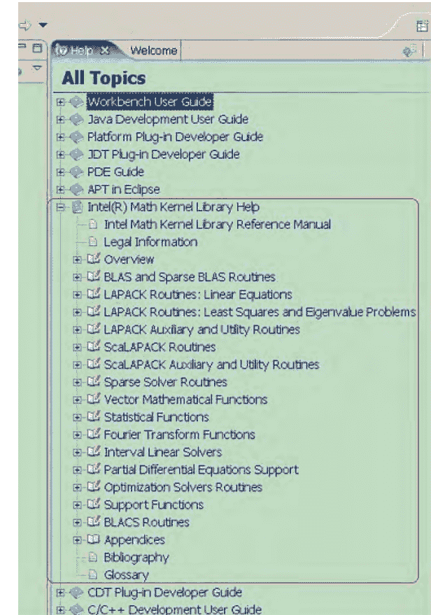
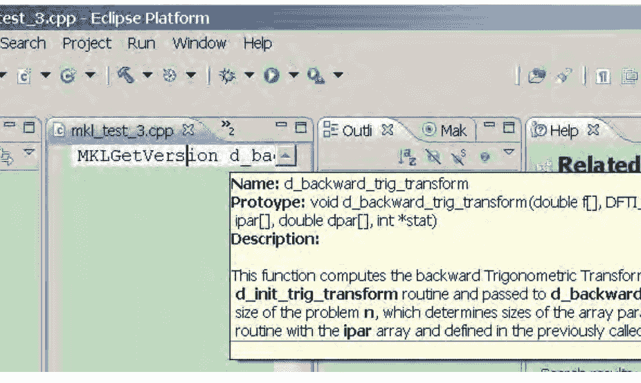

# Intel(R) Math Kernel Library for Linux＊ OS 用户指南

## 版本信息

| 版本 | 日期 |
| --- | --- |
| -001 | 初始问题。记录了 Intel® Math Kernel Library (Intel® MKL) 9.0 黄金版。 | 2006年9月 |
| -002 | 记录了 Intel® MKL：9.1 Beta 版发布。增加了“GettingGetting”、“LINLIN 和 LIN LINPACK 基准测试”以及“对第三方和已移除接口的支持”附录。扩展了现有章节。重构了文档。添加了示例列表。 | 2007年1月 |
| -003 | 记录了 Intel® MKL：9.1 黄金版发布。扩展了现有章节。进行了更多重构。讨论了 ILP64 接口。在第3章中增加了“配置 Eclipse IDE CDT 以与 Intel MKL 链接”。集群内容被组织到独立的第9章“使用 Intel® Math Kernel Library 软件”中并进行了重构，添加了适当的链接。 | 2007年6月 |
| -004 | 记录了 Intel® MKL：10.0 Beta 版发布。在第3章中描述了分层设计模型，并根据该模型调整了整个链接的内容。第4章中描述了启动时环境变量的自动化。第6章中描述了新的 Intel 线程控制。Intel 用户指南与 Intel MKL 用户指南合并，以反映各自产品的整合。 | 2007年9月 |
| -005 | 记录了 Intel® MKL：10.0 黄金版发布。在第3章中描述了将 Eclipse CDT 4.0 整合以链接 MKL 的方法。描述了 Intel® 兼容性 OpenMP® 运行库 (`libomp`)。 | 2007年10月 |
| -006 | 记录了 Intel® MKL：10.1 Beta 版发布。在文中“高层目录结构”中进一步详细说明了虚拟库（dummy libraries）的信息。删除了 Intel MKL 配置文件。第3章中增加了“访问 Man Pages”章节。第7章中增加了“对 boost uAS 矩阵乘法的支持”。增加了“在 Eclipse 中进行编程的入门”。 | 2008年5月 |
| -007 | 记录了 Intel® MKL：10.1 黄金版发布。在第5章中增加了 IA-32 架构的链接示例和“与计算库链接”章节。文档化了 DSS/PARDIISO 集成到分层结构中的内容。添加了两个 Fortran 代码示例。 | 2008年8月 |
| -008 | 记录了 Intel® MKL：10.2 Beta 版发布。描述了用于 BLAS 和 LAPACK 的预编译 Fortran 95 接口库和模块。记录了对 Intel® 高级矢量扩展 (Intel AVX) 的支持。还记录了对虚拟库和旧链接模型的持续支持。重构了第5章。 | 2009年1月 |
| -009 | 记录了 Intel® MKL：10.2 黄金版发布。文档进行了重构。增强了“入门”章节，以及对分层模型概念的描述。第3章中增加了对 SP2DP 接口的描述。在第2章和第5章中描述并引用了基于 Web 的链接顾问。 | 2009年3月 |


BunnyPopple, Celeron, Centrino, Intel386, Intel46, Atom Inside, Centrino Inside, Core Inside, Flashfile, 1960, InstantiP, Intel Inside, Intel486, IntelIDX2, IntelIDX4, IntelISX2, Intel Atom, Intel Inside, Intel486, IntelIDX2, IntelIDX4, IntelISX2, Intel Atom, Intel Inside, Intel486, IntelIDX2, IntelIDX4, IntelISX2, Intel Atom, Intel Inside, Intel486, IntelIDX2, IntelIDX4, IntelISX2, Intel Atom, Intel Inside, Intel486, IntelIDX2, IntelIDX4, IntelISX2, Intel Atom, Intel Inside, Intel486, IntelIDX2, IntelIDX4, IntelISX2, Intel Atom, Intel Inside, Intel486, IntelIDX2, IntelIDX4, IntelISX2, Intel Atom, Intel Inside, Intel486, IntelIDX2, IntelIDX4, IntelISX2, Intel Atom, Intel Inside, Intel486, IntelIDX2, IntelIDX4, IntelISX2, Intel Atom, Intel Inside, Intel486, IntelIDX2, IntelIDX4, IntelISX2, Intel Atom, Intel Inside, Intel486, IntelIDX2, IntelIDX4, IntelISX2, Intel Atom, Intel Inside, Intel486, IntelIDX2, IntelIDX4, IntelISX2, Intel Atom, Intel Inside, Intel486, IntelIDX2, IntelIDX4, IntelISX2, Intel Atom, Intel Inside, Intel486, IntelIDX2, IntelIDX4, IntelISX2, Intel Atom, Intel Inside, Intel486, IntelIDX2, IntelIDX4, IntelISX2, Intel Atom, Intel Inside, Intel486, IntelIDX2, IntelIDX4, IntelISX2, Intel Atom, Intel Inside, Intel486, IntelIDX2, IntelIDX4, IntelISX2, Intel Atom, Intel Inside, Intel486, IntelIDX2, IntelIDX4, IntelISX2, Intel Atom, Intel Inside, Intel486, IntelIDX2, IntelIDX4, IntelISX2, Intel Atom, Intel Inside, Intel486, IntelIDX2, IntelIDX4, IntelISX2, Intel Atom, Intel Inside, Intel486, IntelIDX2, IntelIDX4, IntelISX2, Intel Atom, Intel Inside, Intel486, IntelIDX2, IntelIDX4, IntelISX2, Intel Atom, Intel Inside, Intel486, IntelIDX2, IntelIDX4, IntelISX2, Intel Atom, Intel Inside, Intel486, IntelIDX2, IntelIDX4, IntelISX2, Intel Atom, Intel Inside, Intel486, IntelIDX2, IntelIDX4, IntelISX2, Intel Atom, Intel Inside, Intel486, IntelIDX2, IntelIDX4, IntelISX2, Intel Atom, Intel Inside, Intel486, IntelIDX2, IntelIDX4, IntelISX2, Intel Atom, Intel Inside, Intel486, IntelIDX2, IntelIDX4, IntelISX2, Intel Atom, Intel Inside, Intel486, IntelIDX2, IntelIDX4, IntelISX2, Intel Atom, Intel Inside, Intel486, IntelIDX2, IntelIDX4, IntelISX2, Intel Atom, Intel Inside, Intel486, IntelIDX2, IntelIDX4, IntelISX2, Intel Atom, Intel Inside, Intel486, IntelIDX2, IntelIDX4, IntelISX2, Intel Atom, Intel Inside, Intel486, IntelIDX2, IntelIDX4, IntelISX2。保留所有权利。Copyright © 2006-2009, Intel Corporation。所有名称及商标可能属于其他公司。

 目录

# 索引

# 概述

Intel® Math Kernel Library (Intel® MKL) 为需要最高性能的科学、工程和金融应用程序提供了高度优化、线程安全的数学函数。

# 技术支持

Intel 提供了一个支持网站，其中包含丰富的自助信息库，包括入门提示、已知产品问题、产品错误、许可信息、用户论坛等。访问 Intel® MKL 支持网站：http://www.intel.com/software/products/support/

# 关于本文

Intel MKL 用户指南提供了库的使用信息。使用信息涵盖了 Intel MKL 的组织、配置、性能和准确性，混合语言编程中的例程调用细节、链接等。

本指南：

- 专注于运行在 Linux* OS 上的用户应用程序调用 Intel MKL 例程所需的使用信息。
- 描述了 Intel MKL 的特定用法以及与操作系统无关的特性。
- 包含了所有 Intel MKL 功能域的使用信息，列于表-1（附录 A）。
- 假设您已在系统上完成 Intel MKL 的安装。如果没有完成，请参《Intel® Math Kernel Library 安装指南》（文件 Install.txt）。

要参考如何在应用程序中使用该库，请结合以下文档使用本指南：

# 1 Intel® Math Kernel Library 用户指南

- 《Intel MKL 参考手册》，该手册提供了关于例程序功能、参数描述、接口、调用语法和返回值的参考信息。

本用户指南旨在帮助您在 Linux 上掌握 Intel MKL 的用法。具体而言，它：

- 描述了安装后的步骤，帮助您开始使用该库。
- 向您展示了如何在您的开发环境中配置该库。
- 让您了解如何将应用程序链接到该库，并提供了简单的使用场景。
- 解释了如何使用 Intel MKL for Linux 编写、编译和运行您的应用程序。

本指南适用于从初级到高级经验的 Linux 程序员。

## 文档结构

本文档包含以下章节和附录：

第 1 节概述。介绍 Intel MKL 的使用信息并描述了本文档的符号约定。

第 2 节快速入门。描述了安装后的步骤，并提供了安装后开始使用 Intel MKL 所需的信息。


# 第 3 节 Intel® Math Kernel Library 结构
讨论了安装后 Intel MKL 目录的结构。

# 第 4 节 配置您的开发环境
解释了如何在您的开发环境中配置 Intel MKL。

# 第 5 节 将您的应用程序与 Intel® Math Kernel Library 链接
解释了如何根据特定平台将库链接到应用程序中；讨论了如何构建自定义动态库。

# 第 6 节 性能与内存管理
讨论了 Intel MKL 多线程；展示了编码技巧并为提高库的性能提供了硬件配置建议；解释了 Intel MKL 内存管理功能，特别展示了如何用您自己的函数替换该库默认使用的内存函数。

# 第 7 节 语言特定的用法选项
讨论了混合语言编程以及特定语言接口的使用。

# 第 8 节 编码技巧
提供了可能对您的特定需求有帮助的编码技巧。

# 第 9 节 与 Intel® Math Kernel Library 集群软件协同工作
讨论了 ScalLAPACK 和集群 FFT 的使用；特别描述了应用程序与这些函数域的链接，包括 C 和 Fortran 特定的链接示例；提供了有关支持的 MPI 的信息。

# 第 10 节 在 Eclipse* IDE 中获取编程帮助
讨论了软件工程师在 Eclipse* IDE 中工作时受益的 Intel MKL 特性。

# 第 11 节 LINPACK 和 MP LINPACK 基准
讨论了针对 Linux* 的 Intel® Optimized LINPACK Benchmark 以及针对集群的 Intel® Optimized MP LINPACK Benchmark。

# 附录 A Intel® Math Kernel Library 语言接口支持
总结了 Intel MKL 为每个函数域提供的语言接口信息，包括相应的头文件。

# 附录 B 对第三方接口的支持
描述了 Intel MKL 支持的一些接口。

文档还包含索引。

## 术语和符号约定

以下术语指代操作系统：

- `Linux* OS`

该术语指的是所有支持的 Linux* 操作系统有效的信息。

引用 Intel MKL 目录时使用以下符号：

- `<mkl_directory>`

Intel MKL 安装的主目录。在配置、链接和构建指令中，请将此占位符替换为特定路径。更多信息请参阅“快速入门”。

- `<Intel Compiler Pro directory>`

Intel® C++ 编译器专业版或 Intel® Fortran 编译器专业版的安装目录。更多信息请参阅“快速入门”。

表 1-1 列出了其他符号约定：

| 表 1-1 符号约定 |
| :--- | :--- |
| *斜体* | 斜体用于强调，也表示正文中的文档名称，例如：see Intel MKL Reference Manual |
| `等宽小写` | 表示文件名、目录名和路径，例如：`libmkl_core.a` `/opt/mkl/10.2.004` |
| `等宽小写混合大写` | 表示命令和命令行选项，例如：`icc myprog.c -LMKLPATH -LMKLINCLUDE -lmkl -lguide -lpthread`；C/C++ 代码段，例如：`a = new double [SIZE][SIZE];` |
| `大写等宽` | 表示系统变量，例如：`$MKLPATH` |
| `等宽斜体` | 表示讨论中的参数：例程序参数，例如：`lda`；`functions_list`；等。当在角括号中时，表示标识符、表达式、字符串或值的占位符，`<mkl_directory>`。用这些项目中的一个替换占位符。 |

- `[ ]` 方括号表示括号内的项目是可选的。
- `{ | }` 大括号表示括号列出的项目中应选择一个。竖线 (`|`) 分隔项目。

## 快速入门

本章提供了一些基本的用法信息，并描述了安装后的步骤，帮助您在 Linux* OS 上开始 Intel® Math Kernel Library (Intel® MKL)。

### 开始之前

在开始使用 Intel MKL 之前，学习几个重要概念将有助于您有一个良好的开始，如表 2-1 所示。

| 表 2-1 | 开始之前需要了解 |
| :--- | :--- |
| 目标平台 | - IA-32 或兼容<br>- Intel® 64 或兼容<br>- IA-64 (Itanium®处理器家族) |

**操作**：识别目标机器的架构：

**原因**：由于 Intel MKL 库位于对应于特定架构（参见“架构支持”），您应该提供正确的路径（参见“链接”）。为了为 Intel MKL 配置开发环境，请设置环境变量（参见“环境变量”）。

| 表 2-1 | 开始之前需要了解（续） |
| :--- | :--- |
| **操作**：识别您需要的所有 MKL 函数域：br>- BLAS<br>- 稀疏 BLAS<br>- LAPACK<br>- PBLAS<br>- ScalACK<br>- 稀疏求解器<br>- 向量数学库函数<br>- 向量统计库函数<br>- 傅叶变换函数 (FFT)<br>- 集群 FFT<br>- 三角变换例程序<br>- Poisson, Laplace 和 Helmholtz 求解器<br>- 优化 (置信)<br>- GMP* 算术函数 |

**参考**：您打算使用的函数将缩小《参考手册》中特定需求的范围。此外，如果您使用 MKL 集群软件，您的链接是特定的函数域（参见“与 Intel Math Kernel Library 集群软件协同工作”）。编码技巧也取决于函数域（参见“提高性能的技巧）。

**操作**：虽然 Intel MKL 同时支持 Fortran 和 C/C++，但并非所有函数都支持特定的语言环境，例如 C/C++ 或 Fortran 90/95。识别您的函数支持的语言接口（Intel® Math Kernel Library 语言接口支持）。

**编程语言**

**原因**：如果您的函数没有直接支持所需的语言，可以使用混合编程（参见与 Intel MKL 的混合编程）。

有关特定语言接口和模块的列表以及生成它们的示例，请参见“在 Intel MKL 中使用语言特定接口”。

**操作**：如果您的系统基于 Intel 64 或 IA-64 架构，识别您的应用程序是否对大数据数组（超过 2³¹ 个元素）进行计算。

**整数数据范围**

**原因**：为了对大数据数组进行操作，您需要使用 ILP64 接口，其中整数为 64 位；否则使用默认的 LP64 接口，其中整数为 32 位（参见对 ILP64 编程的支持）。

| 表格 2-1 | 在开始之前您需要的知识（续） |
| --- | --- |
| 线程模型 | **操作：** 识别您的应用程序是否使用了线程以及如何使用：<br> - 使用 Intel® 编译器多线程<br> - 使用第三方编译器多线程<br> - 未使用线程<br>**原因：** 您用于为应用程序创建线程的编译器决定了您应该与应用程序链接的哪个线程库。对于使用第三方编译器多线程的应用程序，您可能需要在使用顺序模式下使用 Intel MKL（更多信息，请参阅“库的顺序模式”和“与线程库的链接”）。<br>**操作：** 确定您希望 Intel MKL 使用的线程数。<br>**原因：** Intel MKL 基于 OpenMP® 线程。默认情况下，OpenMP 会设置 Intel MKL 使用的线程数。如果您需要不同的数量，则可以使用可用的机制之一自行进行设置。更多信息，请参阅“使用 Intel® MKL 并行计算”。<br>**操作：** 决定哪种链接模型适用于您的应用程序与 Intel MKL 库链接：<br> - 静态<br> - 动态<br>**原因：** 有关每种链接模型的优势、命令语法和示例、链接库以及其他链接主题（如何通过创建自定义动态库节省磁盘空间），请参阅“将您的应用程序与 Intel® Math Kernel Library 链接”。 |

| MPI 使用 | **操作：** 决定 Intel MKL 集群服务器上使用哪种 MPI。强烈建议使用 Intel® MPI 3.x。<br>**原因：** 要与 ScalAPACK/或 Cluster FFT 链接，应将特定 MPI对应的库列在链接行中（参阅“使用 Intel® Math Kernel Cluster 软件”）。 |

### 编译器支持

Intel MKL 支持发布说明（Release Notes）中标识的编译器。然而，该库也成功与其他编译器配合使用。

Intel MKL 提供了一系列函数，通过为相应函数指定枚举值和原型来简化程序开发（包含文件列表，请参阅表 A-2）。在应用程序中没有包含适当包含文件的情况下调用 Intel MKL 函数可能会导致函数行为异常。

### 入门步骤

本节帮助您在 Linux* 操作系统上开始使用 Intel MKL。

### 检查您的安装

在安装 Intel MKL 后，验证库是否已正确安装并配置。

1. 检查您选择的安装目录是否已创建。Intel MKL 的默认安装目录可能是以下路径之一：


- `/opt/intel/mkl/rr.y.xxx`，其中 `rr.r` 是版本号，`y` 是发布更新号，`xxx` 是包号，例如：

- `/opt/intel/mkl/10.2.0.004`

- 2. 如果您选择在系统中安装多个版本的 Intel MKL，请更新您的构建脚本，使其指向所需的版本。

- 3. 检查以下六个文件是否已放置在 `tools/environment` 目录下：

`mklvars32.sh`

`mklvars32.csh`

`mklvarsem64t.sh`

`mklvarsem64t.csh`

`mklvars64.sh`

`mklvars64.csh`

你可以使用这些文件在当前用户的 shell 中设置环境变量。

- 4. 若要检查 Intel MKL 安装目录的高层结构和详细结构，请参阅第 3 章。

### 设置环境变量

当 Linux* 操作系统上的 Intel MKL 安装完成后，您可以使用 `tools/environment` 目录下的三个脚本 `mklvars32`、`mklvarsm64t` 和 `mklvars64` 及其两种格式（`.sh` 和 `.csh`），来在用户 shell 中设置环境变量 `INCLUDE`、`MKLROOT`、`LD_LIBRARY_PATH`、`MANPATH`、`LIBRARY_PATH`、`CPATH`、`FPATH` 和 `NLPATH`。如需进一步配置库，请参阅第 4 章。

### 使用基于 Web 的链接顾问

Intel MKL 提供了一个基于 Web 的链接顾问，帮助您为应用程序选择链接行中指定的库和选项。

该工具可以在以下地址访问：http://software.intel.com/en-us/articles/intel-mkl-link-line-advisor。

顾问会根据您的 Intel MKL 使用场景（特别是：操作系统、架构、编译器、静态或动态链接模型、整数长度（32 位或 64 位）、Intel MKL 操作是线程还是顺序的等）在屏幕上输出链接行。

将输出复制粘贴到您的链接行中。

有关与 Intel MKL 链接的更多信息，请参阅第 5 章，特别是表 5-1 提供的典型 mkl 库列表。

### 使用 Intel MKL 代码示例

Intel MKL 软件包包含了代码示例，位于 Intel MKL 安装目录下的 `examples` 子目录中。示例为您提供了最直接的方法来了解：

- Intel MKL 是否在您的系统上正常运行

- 您应该如何调用该库

- 如何链接该库

示例主要按 Intel MKL 函数领域和编程语言分组在不同的子目录中。例如，`examples/spblas` 子目录包含稀疏 BLAS 示例，`examples/vmlc` 子目录包含 C 语言的 VML 示例。示例的源代码位于下一级 `sources` 子目录。

要编译、构建并运行示例，请使用提供的 makefile。有关如何使用它的信息，请参考 makefile 头部。

另另：

高层目录结构。

## Intel® Math Kernel Library 结构

本章讨论了 Intel® Math Kernel Library (Intel® MKL) 的结构，包括 Intel MKL 的目录结构、架构。

从版本 10.0 开始，Intel MKL 采用分层模型来精简库结构并增加灵活性。

另见：[分层模型]。

### 高层目录结构

表 3-1 显示了 Intel MKL 的目录结构。

| 目录 | 说明 |
| --- | --- |
| `<mkl directory>` | Intel MKL 主目录 |
| `<mkl directory>/benchmarks/linpack` | 内存 (SMP) 版本的 linpack |
| `<mkl directory>/benchmarks/mp_linpack` | MPI 版本的 linpack |
| `<mkl directory>/doc` | 文档 |
| `<mkl directory>/examples` | 示例源代码、数据以及示例的 makefile |
| `<mkl directory>/include` | 包含头文件以及 BLAS |
| `<mkl directory>/include/32` | 3 Intel® Math Kernel 用户指南 |

#### 表格 3-1 高层目录结构（续）

| 目录 | 说明 |
| --- | --- |
| `<mkl directory>/include/64/lp64` | 对于 Intel® 64 架构的静态库 |
| `<mkl directory>/include/64/il64` | 对于 Itanium® 处理器族 |
| `<mkl directory>/include/em64t/lp64` | 对于 Intel® 64 架构的静态库 |
| `<mkl directory>/include/em64t` | 对于 Intel® 64 架构的静态库 |
| `<mkl directory>/interfaces/blas95` | BLAS 的 Fortran 95 接口以及构建库的 makefile |
| `<mkl directory>/interfaces/fftw2_cdft` | Intel MKL 集群的 FFTW 2 接口 |
| `<mkl directory>/interfaces/fftw2xc` | Intel MKL FFTs 的 FFTW 2 C 语言接口 |
| `<mkl directory>/interfaces/fftw2xf` | Intel MKL FFTs 的 FFTW 2 Fortran 接口 |
| `<mkl directory>/interfaces/fftw3xc` | Intel MKL FFTs 的 FFTW 3 C 语言接口 |
| `<mkl directory>/interfaces/fftw3xf` | Intel MKL FFTs 的 FFTW 3 Fortran 接口 |
| `<mkl directory>/interfaces/lapack95` | LAPACK 的 Fortran 95 接口以及构建库的 makefile |
| `<mkl directory>/lib/32` | 对于 IA-32 架构的静态库和共享对象 |
| `<mkl directory>/lib/64` | 对于 IA-64 架构的静态库和共享对象 |
| `<mkl directory>/lib/em64t` | 对于 Intel® 64 架构的静态库和共享对象 |

#### 表 3-1 高级目录结构（续）

| 目录 | 注释 |
|---|---|
| `<mkl directory>/tools/plugins/com.intel.mkl.help` | 包含带有 WebHelp 格式的 Intel MKL 参考手册的 Eclipse 插件。注释请参见 mkl_documentation.com。 |
| `<Intel Compiler directory>/documentation/en_US/mkl` | 包含在 Intel® C++ Professional Edition 或 Intel® Fortran Compiler Professional Edition 中的 Intel MKL 文档。 |
| `<Intel Compiler directory>/man/en_US/man3` | 包含 Intel C++ Compiler Professional Edition 或 Intel Fortran Professional Edition 中 MKL 函数的页。 |

### 分级模型概念

从 10.0 版本开始，Intel MKL 采用了分级模型。

该库包含四个核心部分：

- 1. 接口层

- 2. 线程层

- 3. 计算层

- 4. 编译器支持运行时库。

第一部分使 Intel MKL 适配于接口相关的问题，例如是否使用 32 位或 64 位整数类型，或者不同的编译器如何返回函数值。第二部分将库适配到使用不同编译器的 OpenMP 实现，或适配到非线程用法。计算层是库的主体，在空间上进行了分离。为了避免这些部分中的每种情况生成一个库（从而导致可能性的几何级爆炸），Intel MKL 将每个部分拆分为对应于情况的独立库。你可以组合这些库来满足你的需求。一旦选择了接口库，线程库将接管该接口，而计算库将使用在前两层中选定的接口。

**接口层。** 该层提供了应用程序的编译代码与库的线程和/或计算部分之间的匹配。该层提供了：

- `LP64` 和 `ILP64` 接口（详情请参见“支持 ILP64 编程”）

- 与不同方式返回函数值的编译器的兼容性

- 对于使用 Cray* 风格命名的应用程序，单精度名称与双精度名称之间的映射（`SP2DP` 接口）


注意。`SP2DP`接口支持针对 Intel 64 或 IA-64 架构并使用 ILP64 接口的应用程序中的 Cray 风格命名。`SP2DP`接口在应用程序中的单精度名称（适用于实数和复合类型）与 Intel MKL BLAS 和 LAPACK 中的双精度名称之间提供了映射。函数名的映射如下例 BLAS 函数 `GEMM` 所示：

`SGEMM` -> `DGEMM`

`DGMM` -> `DGEMM`

`CGEMM` -> `ZGEMM`

`GEMM` -> `ZGEMM`

请注意，双精度名称没有进行任何更改。

### 线程层
该层提供了：
- 一种将线程 Intel MKL 与不同的线程编译器链接的方法。
- 用户与库的线程模式或顺序模式进行链接的能力。

该层针对不同的环境（线程的或顺序的）和编译器（来自 Intel、GNU* 等）进行了编译。

### 计算层
该层是 Intel MKL 的核心。对于任何处理器架构（IA-32、IA-64 或 Intel® 64）和操作系统，无论接口层和线程层如何，都只有一个计算层可供链接。计算层通过识别架构特征来适应多种架构，并在运行时选择合适的二进制文件。

### 编译器运行时库（简称为 RTL）
该层提供 RTL 支持。并非所有的 RTL 都是为 Intel MKL 开发的。除了与 Intel MKL 集群软件相关的之外，提供的唯一 RTL 只有 Intel® RTL：Intel® 兼容 OpenMP* 运行时库 (`libomp`) 和 Legacy OpenMP* 运行时库 (`libguide`)。要使用第三方编译器，请使用线程层中的库或适当的兼容库（更多信息，请参见“与线程库链接”）。

### 库的顺序模块

你可以以顺序模式（非线程）使用 Intel MKL。该模式不需要兼容 OpenMP* 或 Legacy OpenMP* 运行时库，并且响应 `OMP_NUM_THREADS` 或其 Intel MKL 等效变量。在此模式下，Intel MKL 运行非线程代码。然而，线程安全意味着你可以在 OpenMP* 代码的并行区域中使用它。当使用非 Intel 编译器运行 Intel MKL 或在其他情况下（例如 MPI 案例）时，你应该使用顺序库。为了获得在顺序模式下运行的 Intel MKL，请选择 `sequential.` 库。注意 `sequential.` 库依赖于 POSIX 线程 (`pthread`)，用于使 Intel MKL 软件线程安全并列在列表中。

另见：

### 对 ILP4 的支持

Intel MKL ILP4 库使用 64 位整数类型（用于索引超过 `$2^{31}-1$` 个元素的巨大数组），而 LP64 使用 32 位整数类型。

LP64 和 ILP4 接口在接口层受支持（更多信息请参见“分级模型”和“目录结构”）。提供 ILP4 接口出于以下两个原因：
- 支持巨大的数组（超过 `$2^{31}-1$` 个元素）
- 允许使用 `-i8` 编译器编译 Fortran 代码

使用哪种接口取决于你。为了与低于 9 的 Intel MKL 版本兼容，请选择 LP64 接口。如果你的应用程序使用 Intel MKL 处理巨大数组或未来可能使用该库，请选择 ILP4 接口。Intel MKL 为 ILP4 和 LP64 接口提供了相同的包含目录。

1. 弃用的例程 `?lacon`、`?lasq3` 和 `?lasq4` 之外。

### 为 LP64/ILP64 编译

表 3-2 显示了如何为 ILP64 和 LP64 接口编译：

#### 表 3-2 为 ILP64 和 LP64 接口编译

##### Fortran

```
为 LP64 编译
ifort -i8 -I<mkl directory>/include
```

```
为 LP64 编译
ifort -I<mkl directory>/include
```

##### C 或 C++

```
为 LP64 编译
icc -DMKL_IL64 -I<mkl directory>/include
```

```
为 LP64 编译
icc -I<mkl directory>/include
```

> 注意。将 i8 或 `-DMKL_IL64` 编译的应用程序链接到 LP64 可能导致不可预测的后果和错误输出。

### ILP64 代码

如果不使用 IL64，则不需要更改现有代码。迁移到 LP64，请为 MKL 函数和子程序使用适当类型：

### 表 3-3 整数类型

| 32 位整数 | Fortran | C 或 C++ |
|---|---|---|
| | `INTEGER*4` or `INTEGER(KIND=4)` | `int` |
| LP64/ILP64 通用整数 | `INTEGER` without specifying KIND | `MKL_INT` |
| - LP64 为 64 位 | | |
| - 其他为 32 位 | | |
| LP64/LP64 通用整数 | `INTEGER*8` or `INTEGER(KIND=8)` | `MKL_INT64` |
| - 64 位整数 | | |
| LP64 的 FFT 接口 | `INTEGER` without specifying KIND | `MKL_LONG` |

### 浏览 MKL 包含文件

对于带有整数参数的函数，参考手册没有解释为什么 IL64 变为 64 位而保持 32 位，建议你浏览 IL64 接口的包含文件、示例和测试。它们的位置见表 3-1。

建议从浏览表 A-2 列出的包含文件开始。某些仅支持 Fortran 接口的函数（参见表 A-1）在包含目录中为 C/C++ 提供头文件。此类 `*.h` 文件允许从 C/ 代码中使用 Fortran 二进制接口。这些文件也可用于理解 IL64 的用法。

### 限制

所有 Intel MKL 函数域均支持 ILP64 编程，以下是例外：
- FFTW 2.x 包装不支持 ILP64。
- FFTW 3.2 包装通过专用函数集 `plan_guru64` 支持 ILP64。
- GMP* 术函数不支持 ILP64。

## 架构支持

针对 Linux* 系统的 Intel MKL 提供三种特定架构的实现。表 3-4 列出了支持的架构以及每个特定架构实现的位置。

表 3–4 针对架构的实现

| 架构 | 位置 |
| IA-32 或兼容 | `<mkl directory>/lib/32` |
| Intel® 64 或兼容 | `<mkl directory>/lib/64t` |
| IA-64 | `<mkl directory>/lib/64` |

有关这些目录的详细结构请参见表 3-5、表 3-6 和表 3-7。

## 详细目录结构

下表信息显示了 Intel MKL 架构特定目录的详细结构。有关可以使用 interfaces 目录中的 makefiles 生成的额外接口库列表，请参阅《在 Intel® MKL 中使用特定语言的接口》。有关 doc 目录中子目录的内容，请参阅《文档目录内容》。对于 `benchmarks` 目录，请参阅《LINPACK 和 MP LINPACK Benchmarks》。注意，在 MKL 10.2 中，提供了与 Intel MKL 9.x 版本提供链接行兼容性的库已被移除。

表 3-5 IA-32 架构特定目录 lib/ 的详细结构

| 文件 | 内容 |
| --- | --- |
| **接口层** |  |
| `libmkl_blas_95.a` | 用于 Intel® Fortran 编译器的 BLAS Fortran 95 接口库 |
| `libmkl_gf.a` | 用于 GNU* Fortran 编译器的接口库 |
| `libmkl_intel.a` | 用于 Intel® 编译器¹ 的接口库 |
| `libmkl_lapack_95.a` | 用于 Intel 编译器的 LAPACK Fortran 95 接口库 |
| **线程层** |  |
| `libmkl_gnu_thread.a` | 用于 GNU Fortran 和 C 编译器的线程库 |
| `libmkl_intel_thread.a` | 用于 Intel 编译器的线程库 |
| `libmkl_pgi_thread.a` | 用于 PGI* 编译器的线程库 |
| `libmkl_sequential.a` | 顺序库 |
| **计算层** |  |
| `libmkl_cdft_core.a` | FFT 的集群版本 |
| `libmkl_core.a` | 用于 IA-32 架构的内核库 |
| `libmkl_scalpack_core.a` | ScLAPACK 例程 |
| `libmkl_solver.a` | 迭代稀疏求解器、置信区域求解器和 GMP 例程 |
| `libmkl_solver_sequential.a` | 迭代稀疏求解器、置信区域求解器和 GMP 例程的顺序版本 |
| **RTL** |  |
| `libguide.a` | 用于静态链接的 Intel® Legacy OpenMP* 运行时库 |
| `libiomp5.a` | 用于静态链接的 Intel® Compatibility OpenMP* 运行时库 |


| `libmkl_blacks.a` | 支持以下 MPICH 版本的 BLACS 例程：
* Myric* MPICH 版本 1.2.5.10
* ANL* MPICH 版本 1.2.5.2 |

| `libmkl_blacks_intelmpi.a` | 支持 Intel MPI 2.0/3.x 和 MPICH2 的 BLACS 例程 |

| `libmkl_blacks_intelmpi20.a` | 指 `lib/32/libmkl_blacks_intelmpi` 的软链接 |

| `libmkl_blacks_openmpi.a` | 支持 OpenMPI 的 BLACS 例程 |

# 3 Intel® Math Kernel Library 用户指南

## 表 3-5 IA-32 架构特定目录 lib/32 的详细结构（续）

| 文件 | 内容 |
| --- | --- |
| 动态库 | |
| 接口层 | |
| `libmkl_gf.so` | 用于 GNU Fortran 编译器的接口库 |
| `libmkl_intel.so` | 用于 Intel 编译器¹ 的接口库 |
| 线程层 | |
| `libmkl_gnu_thread.so` | 用于 GNU Fortran 和 C 编译器的线程库 |
| `libmkl_intel_thread.so` | 用于 Intel 编译器的线程库 |
| `libmkl_pgi_thread.so` | 用于 PGI* 的线程库 |
| `libmkl_sequential.so` | 顺序库 |
| 计算层 | |
| `libmkl_core.so` | 用于动态加载特定处理器的内核的库分发器 |
| `libmkl_def.so` | 默认内核库（Intel® Pentium®, Pentium® Pro, Pentium® II 和 Pentium III 处理器） |
| `libmkl_lapack.so` | LAPACK 和 DSS/PARDISO 例程和驱动程序 |
| `libmkl_p4.so` | Pentium® 4 处理器内核 |
| `libmkl_p4m.so` | 用于处理器的内核库（Intel® Core™ 微架构除外，Intel® Core™ Duo 和 Intel® Core™ Solo 处理器除外，后者用于 mkl_p4.so） |
| `libmkl_p4m.so` | 用于 Intel® Core™ i7 处理器的内核库 |
| `libmkl_p4p.so` | 用于带有流式 SIMD 扩展 3 (SSE3) 的 Intel® Pentium 4 处理器的内核库 |
| `libmkl_scalpack_core.so` | ScLAPACK 例程 |
| `libmkl_vm_def.so` | 用于旧 Intel® Pentium® 处理器的默认内核的 VML/VSL 部分 |
| `libmkl_vm_ia.so` | 用于较新 Intel® 架构处理器的 VML/VSL 默认内核 |
| `libmkl_vm_p4.so` | Pentium® 4 处理器的 VML/VSL |
| `libmkl_vm_p4m.so` | 基于 Intel® Core™ 微架构处理器的 VML/VSL |
| `libmkl_vm_p4m2.so` | 45nm Intel® Core™2 和 Xeon 家族的 VML/VSL |
| `libmkl_vm_p4m.so` | 用于 Intel® Core™ i7 处理器的 VML/VSL |
| `libmkl_vm_p4p.so` | 带有流式 SIMD 扩展 3 (SSE3) 的 Pentium® 4 处理器的 VML/VSL |
| 文件 | 内容 |
|---|---|---|
| `libguide.so` | 用于动态链接的 Intel® Legacy OpenMP* 运行时库 |
| `libiomp5.so` | 用于动态链接的 Intel® Compatibility OpenMP* 运行时库 |
| `libmkl_blacs_intelmpi.so` | 支持 Intel MPI 2.0/3.x 和 MPICH2 的 BLACS 例程 |
| `locale/en_US/mkl_msg.cat` | 英语 Intel MKL 消息 |
| `locale/ja_JP/mkl_msg.cat` | 日语 Intel MKL 消息 |
| | 用于抽象编译器链接。

## 表 3-6 Intel® 64 架构特定目录 lib/em64 的详细结构

| 文件 | 内容 |
| --- | --- |
| **静态库** | |
| **接口层** | |
| `libmkl_blas_95_ilp64.a` | 用于 Intel® Fortran 编译器的 BLAS Fortran 95 接口库。支持 IL64 接口 |
| `libmkl_blas_95_lp64.a` | 用于 Intel® Fortran 编译器的 BLAS Fortran 95 接口库。支持 IL64 接口 |
| `libmkl_gf_ilp64.a` | 用于 GNU Fortran 和抽象编译器的 IL64 接口 |
| `libmkl_gf_lp64.a` | 用于 GNU Fortran 和抽象编译器的 IL64 接口 |
| `libmkl_intel_ilp64.a` | 用于 Intel 编译器的 IL64 接口 |
| `libmkl_intel_lp64.a` | 用于 Intel 编译器的 IL64 接口 |
| `libmkl_lapack_95_ilp64.a` | 用于 Intel® Fortran 编译器的 LAPACK Fortran 95 接口库。支持 IL64 接口 |
| `libmkl_lapack_95_lp64.a` | 用于 Intel® Fortran 编译器的 LAPACK Fortran 95 接口库。支持 IL64 接口 |
| **线程层** | |
| `libmkl_gnu_thread.a` | 用于 GNU Fortran 和 C 编译器的线程库 |
| `libmkl_intel_thread.a` | 用于 Intel 编译器的线程库 |
| `libmkl_pgi_thread.a` | 用于 PGI 编译器的线程库 |
| `libmkl_sequential.a` | 顺序库 |
| 文件 | 内容 |
|---|---|---|
| 计算层 | |
| `libmkl_cdft_core.a` | FFT 的集群版本 |
| `libmkl_core.a` | 用于 Intel® 64 架构的内核库 |
| `libmkl_scalapack_ilp64.a` | 支持 LP64 接口的 ScaLAPACK 例程 |
| `libmkl_scalapack_ilp64.a` | 支持 LP64 接口的 ScaLAPACK 例程 |
| `libmkl_solver_ilp64.a` | 支持 LP64 接口的迭代稀疏求解器和置信区域求解器库 |
| `libmkl_solver_ilp64_sequential.a` | 支持 LP64 接口的迭代稀疏求解器和置信区域求解器的顺序版本 |
| `libmkl_solver_lp64.a` | 支持 LP64 接口的迭代稀疏求解器、置信区域求解器和 GMP 例程库 |
| `libmkl_solver_lp64_sequential.a` | 支持 LP64 接口的迭代稀疏求解器、置信区域求解器和 GMP 例程库的顺序版本 |
| RTL | |
| `libguide.a` | 用于静态链接的 Intel® Legacy OpenMP* 运行时库 |
| `libiomp5.a` | 用于静态链接的 Intel® Compatibility OpenMP* 运行时库 |
| `libmkl_blacs_ilp64.a` | 支持以下 MPICH 版本的 LP64 版本 BLAS 例程：
* Myric* MPICH 版本 1.2.5.10
* ANL* MPICH 版本 1.2.5.2 |
| `libmkl_blacs_intelmpi_ilp64.a` | 支持 Intel MPI 2.0/3.x 和 MPICH2 的 LP64 版本 BLAS 例程 |
| `libmkl_blacs_intelmpi_ilp64.a` | 支持 Intel MPI 2.0/3.x MPICH2 的 LP64 版本 BLAS 例程 |
| `libmkl_blacs_intelmpi20_ilp64.a` | 指 `/em64t/libmkl_blacs_intelmpi_ilp64.a` 的软链接 |
| `libmkl_blacs_intelmpi20_ilp64.a` | 指 `/em64t/libmkl_blacs_intelmpi_ilp64.a` 的软链接 |
| `libmkl_blacs_intelmpi20_ilp64.a` | 支持以下 MPICH 版本的 LP64 版本 BLAS 例程：
* Myric* MPICH 版本 1.2.5.10
* ANL* MPICH 版本 1.2.5.2 |


## 表 3-7 IA-64 架构特定目录 lib/64 详细结构（续）

| 文件 | 内容 |
|---|---|
| `libmkl_blacs_openmpi_ilp64.a` | 支持 OpenMPI 的 LP64 版本 BLAS 例程 |
| `libmkl_blacs_openmpi_ilp64.a` | 支持 OpenMPI 的 LP64 版本 BLAS 例程 |
| `libmkl_blacs_sgimpt_ilp64.a` | 支持 SGI MPT 的 LP64 版本 BLAS 例程。 |
| `libmkl_blacs_sgimpt_ilp64.a` | 支持 SGI MPT 的 LP64 版本 BLAS 例程。 |

| 文件 | 内容 |
|---|---|
| 接口层 |  |
| `libmkl_gf_ilp64.so` | 用于 GNU Fortran 和 Absoft 编译器的 ILP64 接口库 |
| `libmkl_gf_lp64.so` | 用于 GNU Fortran 和 Absoft 编译器的 LP64 接口库 |
| `libmkl_intel_ilp64.so` | Intel 编译器的 LP64 接口库 |
| `libmkl_intel_lp64.so` | Intel 编译器的 LP64 接口库 |
| `libmkl_intel_sp2dp.so` | Intel 编译器的 SP2DP 接口库 |
| 线程层 |  |
| `libmkl_gnu_thread.so` | 用于 GNU Fortran 和 C 编译器的线程库 |
| `libmkl_intel_thread.so` | Intel 编译器的线程库 |
| `libmkl_pgi_thread.so` | 用于 PGI* 编译器的线程库 |
| `libmkl_sequential.so` | 顺序执行库 |

| 文件 | 内容 |
|---|---|
| 计算层 | `libmkl_avx.so` | 针对 Intel® 高级向量扩展 (Intel® AVX) 优化的内核 |
| `libmkl_core.so` | 用于动态加载特定处理器的内核的库分发器 |
| `libmkl_def.so` | 默认内核库 |
| `libmkl_mc.so` | 基于 Intel® Core™ 微架构的处理器的内核库 |
| `libmkl_mc3.so` | 用于 Intel® Core™ 处理器的内核库 |
| `libmkl_lapack.so` | LAPACK 和 DSS/PARDISO 例程及驱动程序 |
| `libmkl_scalapack_lp64.so` | 支持 LP64 接口的 ScLAPACK 例程库 |
| `libmkl_scalapack_lp64.so` | 支持 LP64 接口的 ScLAPACK 例程库 |
| `libmkl_vml_avx.so` | 针对 Intel® 高级向量扩展 (Intel® AVX) 优化的 VML/VSL |
| `libmkl_vml_def.so` | 默认内核的 VML/VSL 部分 |
| `libmkl_vml_mc.so` | 基于 Intel® Core™ 微架构的处理器的 VML/VSL |
| `libmkl_vml_mc3.so` | 用于 Intel® Core™ 处理器的 VML/VSL |
| `libmkl_vml_p4n.so` | 使用 Intel® 64 架构的 Intel® Xeon® 处理器的 VML/VSL |
| `libmkl_vml_mc2.so` | 用于 45nm Hi-k Intel® Core™2 和 Intel® Xeon® 家族的 VML/VSL |
| RTL |  |
| `libguide.so` | 用于动态链接的 Intel® legacy OpenMP* 运行时库 |
| `libomp5.so` | 用于动态链接的 Intel® 兼容 OpenMP* 运行时库 |
| `libmkl_intelmpi_lp64.so` | 支持 Intel MPI 2.0/3.x 和 MPICH2 的 LP64 版本 BLACS 例程 |
| `libmkl_intelmpi_lp64.so` | 支持 Intel MPI 2.0、3.x 以及 MPICH2 的 LP64 版本 BLACS 例程 |
| `locale/en_US/mkl_msg.cat` | 英文 Intel MKL 消息目录 |
| `locale/ja_JP/mkl_msg.cat` | 日文 Intel MKL 消息目录 |

| 文件 | 内容 |
|---|---|
| **静态库** |  |
| *接口层* |  |
| `libmkl_blas95_ilp64.a` | 用于 Intel® Fortran 编译器的 BLAS Fortran 95 接口库。支持 ILP64 接口 |
| `libmkl_blas95_lp64.a` | 用于 Intel® Fortran 编译器的 BLAS Fortran 95 接口库。支持 LP64 接口 |
| `libmkl_intel_ilp64.a` | Intel 编译器的 ILP64 接口库 |
| `libmkl_intel_lp64.a` | Intel 编译器的 LP64 接口库 |
| `libmkl_intel_sp2dp.a` | Intel 编译器的 SP2DP 接口库 |
| `libmkl_gf_ilp64.a` | 用于 GNU Fortran 编译器的 ILP64 接口库 |
| `libmkl_gf_lp64.a` | 用于 GNU Fortran 编译器的 LP64 接口库 |
| `libmkl_lapack95_ilp64.a` | 用于 Intel® Fortran 编译器的 LAPACK Fortran 95 接口库。支持 ILP64 接口 |
| `libmkl_lapack_lp64.a` | 用于 Intel® Fortran 编译器的 LAPACK Fortran 95 接口库。支持 LP64 接口 |
| *线程层* |  |
| `libmkl_intel_thread.a` | Intel 编译器的线程库 |
| `libmkl_gnu_thread.a` | 用于 GNU Fortran 和 C 编译器的线程库 |
| `libmkl_sequential.a` | 顺序执行库 |
| *计算层* |  |
| `libmkl_cdft_core.a` | 集群版本的 FFT |
| `libmkl_core.a` | 用于 IA-64 架构的内核库 |
| `libmkl_scalapack_ilp64.a` | 支持 ILP64 接口的 ScLAPACK 例程库 |
| `libmkl_scalapack_lp64.a` | 支持 LP64 接口的 ScLAPACK 例程库 |
| `libmkl_solver_ilp64.a` | 支持 ILP64 接口的迭代稀疏求解器和信域求解器库 |
| `libmkl_solver_lp64_sequential.a` | 支持 LP64 接口的迭代稀疏求解器和信域求解器的顺序版本 |
| `libmkl_solver_lp64.a` | 支持 LP64 接口的迭代稀疏求解器、信域求解器和 GMP 例程库 |
| `libmkl_solver_lp64.a` | 支持 LP64 接口的迭代稀疏求解器、信域求解器和 GMP 例程库 |

| 文件 | 内容 |
|---|---|
| RTL |  |
| `libguide.so` | 用于动态链接的 Intel® legacy OpenMP* 运行时库 |
| `libomp5.so` | 用于动态链接的 Intel® 兼容 OpenMP* 运行时库 |
| `libmkl_intelmpi_lp64.so` | 支持 Intel MPI 2.0/3.x 和 MPICH2 的 LP64 版本 BLACS 例程 |
| `libmkl_intelmpi_lp64.so` | 支持 Intel MPI 2.0、3.x 以及 MPICH2 的 LP64 版本 BLACS 例程 |
| `locale/en_US/mkl_msg.cat` | 英文 Intel MKL 消息目录 |
| `locale/ja_JP/mkl_msg.cat` | 日文 Intel MKL 消息目录 |

## 表 3-7 IA-64 架构特定目录 lib/64 详细结构（续）

| 文件 | 内容 |
|---|---|
| 动态库 |  |
| `libmkl_gf_ilp64.so` | 用于 GNU Fortran 编译器的 ILP64 接口库 |
| `libmkl_gf_lp64.so` | 用于 GNU Fortran 编译器的 LP64 接口库 |
| `libmkl_intel_ilp64.so` | Intel 编译器的 ILP64 接口库 |
| `libmkl_intel_lp64.so` | Intel 编译器的 LP64 接口库 |
| `libmkl_intel_sp2dp.so` | Intel 编译器的 SP2DP 接口库 |

## 访问 Intel® MKL 文档

本节详细介绍了 Intel MKL 文档目录的内容，并解释了如何访问该库的手页（man pages）。

## 文档目录内容


表 3-8 显示了 Intel MKL 安装目录下 `doc` 子目录的内容：

表 3-8 doc 目录内容

| 文件名 | 注释 |
| --- | --- |
| Install.txt | Intel MKL 安装指南 |
| mkl_documentation.htm | Intel MKL 文档概览与链接 |
| mklULA.txt | Intel MKL 终端用户许可协议 |
| mkl.pdf | Intel MKL 参考手册 |
| mkl90_j.pdf | 日语版 Intel MKL 参考手册 |
| mksupport.txt | 供客户支持参考的包编号信息 |
| redist.txt | 可分发文件列表 |
| Release_Notes.pdf | Intel MKL 发布说明 |
| userguide.pdf | Intel MKL 用户指南，本文档 |

## 访问 man 手页

### 安装期间

为了能够在命令行 shell 中通过 `man` 命令访问手页，请将包含手页的目录添加到 `MANPATH` 环境变量中（参见“设置环境变量”）。

一旦设置了环境变量，要查看 Intel MKL 函数的手页，请在命令行 shell 中输入以下命令：

```
man <function base name>
```

在此版本中，`<function base name>` 是函数名，但省略了表示数据类型、精度或函数作用域的前缀。

示例：

- 对于 BLAS 函数 `ddot`，输入 `man ddot`
- 对于 ScaLAPACK 函数 `pgeql2`，输入 `man pgeql2`
- 对于 FFT 函数 `DftiCommitDescriptor`，输入 `man CommitDescriptor`

> **注意。** `man` 命令中的函数名是区分大小写敏感的。


### 配置您的开发环境

本章解释了如何配置您的开发环境以使用 Intel® 数学内核库（Intel® MKL）。

第 2 章解释了如何设置环境变量 `INCLUDE`、`MKLROOT`、`LD_LIBRARY_PATH`、`MANPATH`、`LIBRARY_PATH`、`CPATH`、`FPATH` 和 `NLSPATH`。“自动化设置环境变量”节解释了如何在启动时自动设置这些变量。

有关如何为线程设置环境变量的信息，请参见“使用 OpenMP® 环境变量设置线程数”。

### 自动化设置环境变量

为了自动化设置 `INCLUDE`、`MKLROOT`、`LD_LIBRARY_PATH`、`LIBRARY_PATH`、`FPATH` 和 `NLSPATH` 环境变量，请将 `mklvars*.sh` 添加到您的 shell 配置中，这样每次登录时，脚本会自动执行并设置指向适当 Intel MKL 目录的路径。

对于本地用户账户，您应该通过在导出变量之前的 mani 部分添加相应的脚本来编辑以下文件：

- bash: `~/.bash_profile`, `~/.bash_login` 或 `~/.profile`

### 为 bash 设置 MKL 环境

`<absolute_path_to_installed_MKL>/tools/environment/mklvars<arch>.sh`

- sh:

  `~/.profile`

### 为 sh 设置 MKL 环境

`. <absolute_path_to_installed_MKL>/tools/environment/mklvars<arch>.sh`

- csh:

  `~/.login`

### 为 csh 设置 MKL 环境

`<absolute_path_to_installed_MKL>/tools/environment/mklvars<arch>`

在上述命令中，请将 `mklvars<arch>` 替换为 `mklvars32`、`mklvars64t` 或 `mklvars64`。

如果您拥有超级权限，可以将相同的命令添加到 `/etc/profile`（针对 bash）和 `/etc/csh.login`（针对 csh）中的系统文件中。

在卸载 Intel MKL 之前，请从所有添加了脚本执行的配置文件删除上述命令，以避免登录时出现问题。

### 配置 Eclipse* IDE 链接 Intel MKL

本节描述了如何配置 Eclipse* IDE C/C++ 开发工具 (CDT) 3.x 和 4.0 以链接 Intel MKL。

> 提示。将您的 CDT 与 Intel MKL 链接后，您可以受益于 Eclipse 提供的代码辅助功能。请参见 Eclipse 帮助中的“Code/Context Assist”描述。

### 配置 Eclipse* IDE CDT 4.0

要配置 Eclipse 4.0 链接 Intel MKL，请遵循以下指令：

- 1. 如果工具链/编译器集成支持包含路径选项，进入 `C/C++ General > Paths and Symbols` 属性页的 `Includes` 选项卡，并设置 Intel MKL 包含路径，即 `<mkl directory>/include`。
- 2. 如果工具链/编译器集成支持库路径选项，进入 `C/C++ General > Paths and Symbols` 属性页的 `Library Paths` 选项卡，并为目标架构设置 Intel MKL 库路径，例如 `<mkl directory>/lib/em64t`。
- 3. 对于特定的构建，进入 `C/C++ Build -> Settings` 属性页，并指定要链接到应用程序的 Intel MKL 库名称，例如 `mkl_solver_lp64` 和 `mkl_core`（编译器需要库名而不是文件名，因此可以省略 "lib" 前缀和 "a" 扩展）。要了解如何选择库，请参见“选择要链接的库”。指定库的属性设置名称取决于编译器集成情况。

注意，只有在开启了自动生成 Makefile 时，编译器/链接器才会自动选取包含路径和库路径；如果没有，请直接在 Makefile 中指定包含路径和库路径。

### 配置 Eclipse** IDE CDT 3.x

要使 eclipse CDT 3.x 链接 Intel MKL，请遵循以下指令：

- 对于 Standard Make 项目：
  - 1. 进入 `C/C++ Include Paths and Symbols` 属性页，并将 Intel MKL 包含路径设置为 `<mkl directory>/include`。
  - 2. 进入 `C/C++ Project` 属性页的 `Tabs`，并设置链接到应用程序的 Intel MKL 库，例如 `<mkl directory>/lib/64t/lmkl_intel_lp64.a`、`<mkl directory>/lib/64t/lmkl_intel_thread.a` 和 `<mkl directory>/lib/64t/lmkl_core.a`。

要了解如何选择库，请参见“选择要链接的库”。

注意，对于 Standard Make，上述设置仅用于 CDT 内部功能。编译器/链接器不会自动选取这些设置，您仍需要在 Makefile 中指定它们。

- 对于 Managed 项目，可以指定特定的设置：
  - 1. 进入 `C/C++ Build -> Settings` 属性页。所有您需要的设置取决于编译器集成，因此未给出。
  - 2. 如果编译器集成支持包含路径选项，设置 Intel MKL 包含路径为 `<mkl directory>/include`。
  - 3. 如果编译器集成支持库路径选项，为目标架构设置 MKL 路径，例如 `<mkl directory>/lib/64t`。
  - 4. 指定要链接的 Intel MKL 库名称，例如 `mkl_solver_lp64` 和 `mkl_core`（编译器需要库名而不是文件名，因此省略 "lib" 前缀和 "a" 扩展）。要了解如何选择库，请参见“选择要链接的库”。

### 配置外内存（OOC）DSS/PARDISO 求解

在使用 OOC DSS/PARDISO 求解配置文件时，请注意路径行的最大长度为 100。

更多信息，请参见 Intel MKL 手册中的“稀疏求解器”章节。

### 应用程序链接 Intel® 数学内核库

本章讨论了在 Linux* 操作系统上将应用程序与 Intel® 数学内核库（Intel® MKL）。本章提供了应链接库的信息、链接示例，并解释了自定义对象的构建。

要链接采用分层模型的 MKL，请从接口层选择一个库，从线程层选择一个库，计算层的库，并在必要时添加运行时库。表 5-1 列出了链接 MKL 的典型库集。

表 5-1 典型链接库

| 接口层 | 线程层 | 计算层 | RTL |
|---|---|---|---|


| IA-32 架构，静态链接 | `libmkl_intel.a` | `libmkl_intel_thread.a` | `libmkl_core.a` | `libomp5.so` |

| IA-32 架构，动态链接 | `libmkl_intel.so` | `libmkl_intel_thread.so` | `libmkl_core.so` | `libomp5.so` |

| Intel® 64 和 IA-64 架构，静态链接 | `libmkl_intel_lp64.a` | `libmkl_intel_thread_lp64.a` | `libmkl_core.a` | `libomp5.so` |

| Intel® 64 和 IA-64 架构，动态链接 | `libmkl_intel_lp64.so` | `libmkl_intel_thread_lp64.so` | `libmkl_core.so` | `libomp5.so` |

有关上述列出库的异常和替代方案，请参见“选择要链接的库”。另见在链接行中列出库”。

### 在链接行上列出库

要链接 Intel MKL 库，请如下所示在链接行上指定路径和库。

> **注意。** 该语法用于动态链接。对于静态链接，请将每个带有 `-l` 前缀的库名替换为库文件的路径，例如，将 `-imkl_core` 替换为 `$MKLPATH/libmkl_core.a`，其中 `$MKLPATH` 是适当的用户定义环境变量。请参阅“链接示例”章节中的特定示例。

```
files to link
-LMKL path -IMKL include
[-IMKL include/][32|em64c|[il64|ip64]|64/{il64|ip64}]
-lmkl_blas[95|95_ip64|95_ip64]
-lmkl_lapack[95|95_ip64|95_ip64]
<cluster components>
-lmkl_intel_ilp64|intel_ip64|intel_sp2dp[gf|gf_il64|gf_ip64]
-lmkl_{intel_thread|gnu_thread|pgi_thread|sequential]
-lmkl_solver,[ilp64|ip64]
-lmkl_lapack -lmkl_core
-lmomp5-lguide [-lpthread]-[-lm]
```

请参考“选择要链接的库”以了解此语法用法的详情，以及根据您的 Intel MKL 使用场景建议链接哪些库。

请参阅“带有标记为 `<cluster components>` 的链接库使用 Intel 数学内核库集群软件”。

在静态链接的情况下，请将集群组件、接口、线程和计算库包含在分组符号中，例如，`-W1,--start-group $MKLPATH/libmkl_cdft.a $MKLPATH/libmkl_blacs_intpi_ilp64.a $MKLPATH/libmkl_intel_ilp64.a $MKLPATH/libmkl_intel_thread.a $MKLPATH/libmkl_core.a -W1,--end-group`。请参阅“链接示例”章节中的特定示例。

在链接行上列出库的顺序至关重要，对于上述分组符号中的库。

### 选择要链接的库

本节根据您的 Intel MKL 使用场景建议链接哪些库，并在子节中提供了链接的细节：

- 为 Fortran 95 接口库进行链接
- 与线程库链接
- 与计算库链接
- 与编译器 RTL 链接
- 与系统库链接
- 链接示例

#### 为 Fortran 95 接口库进行链接

`libmkl_blas_95.a`、`libmkl_blas_95_ilp64.a`、`libmkl_blas_95_ilp64.a`、`libmkl_lapack_95.a` 和 `libmkl_lapack_95_ilp64.a` 库分别包含 BLAS 和 LAPACK 的 Fortran 95 接口，这些接口取决于编译器。在 Intel MKL 包中，它们已为 Intel 编译器预先构建。如果您使用不同的编译器，请在使用接口之前构建这些库。请参阅“LAPACK 和 BLAS 的 Fortran 95 接口”以及“取决于编译器的函数和 Fortran 90 模块”以了解构建库的详情以及在此情况下源码依赖编译的原因。

#### 与线程库链接

Intel MKL 支持的几种编译器支持 OpenMP* 线程技术。从 10.0 版本开始，Intel MKL 支持编译器提供的 OpenMP* 实现。如果应用程序使用 OpenMP* 且使用此类编译器编译，并调用 Intel MKL 10.0 或更低版本，该版本使用 Intel 编译器进行线程处理，可能会出现性能问题甚至失败，因为来自不同编译器的线程库是不兼容的。从 Intel MKL 10.0 开始，线程层和编译器运行时库提供了这些问题的解决方案。

线程层。由于库的内部结构，线程代表少量的代码。这些代码由不同的编译器编译，您应该链接相应的线程层。

RTL。此层包含 Intel 编译器的运行时库：Intel 兼容 OpenMP* 运行时库 `libomp` 和 Intel® 遗留 OpenMP* 运行时库 `libguide`。兼容库 `libiomp` 是 `libguide` 的扩展，为 Linux 上的另一个线程编译器提供支持。这意味着使用 GNU 编译器进行线程的程序可以安全地与 Intel MKL 和 `libiomp` 链接，并高效地运行。因此，我们鼓励您使用 `libiomp` 而不是 `libguide`，并在在使用 Intel MKL 时针对每种场景选择线程库和 RTL。

表 5-2 显示了根据所用线程编译器的不同场景

##### 表 5-2 选择线程库

| 编译器 | 是否线程化 | 线程层 | 推荐的 RTL | 注释 |
|---|---|---|---|---|
| Intel | 不重要 | `libmkml_intel_thread.a` | `libomp5.so` | |
| PGI | 是 | `libmkml_pgi_thread.a` 或 `libmkml_sequential.a` | PGI* 提供的 | 使用 `libmkl_sequential_a` 会移除 Intel MKL 调用中的线程。 |
| PGI | 否 | `libmkml_intel_thread.a` | `libomp5.so` | |
| PGI | 否 | `libmkml_pgi_thread.a` | PGI* 提供的 | |
| PGI | 否 | `libmkml_sequential.a` | 无 | |
| gnu | 是 | `libmkml_gnu_thread.a` | `libomp5.so` 或 GNU OpenMP 运行时库 | `libomp5` 提供了更优的扩展性能。 |
| gnu | 是 | `libmkml_sequential.a` | 无 | |
| gnu | 否 | `libmkml_intel_thread.a` | `libomp5.so` | |
| other | 是 | `libmkml_sequential.a` | 无 | |
| other | 否 | `libmkml_intel_thread.a` | `libomp5.so` | |

#### 与计算库链接

通常，在分层链接模型下，您必须仅将应用程序链接到一个计算库。然而，某些 Intel MKL 函数领域需要多个计算库。

对于每个 Intel MKL 函数领域，表 5-3 列出了您必须包含的计算库。有关关于与 ScAPACK 和 Cluster FFTs 链接的更多信息，请参阅。

##### 表 5-3 按函数链接的计算库

| 函数 | IA-32 架构 | Intel® 64 或 IA-64 架构 |
|---|---|---|
| | 静态 | 动态 |
| | 静态 | 动态 |
| BLAS, CBLAS, LAPACK, VSL, FFT, 三角函数 | `libmk_core.a` | `libmk_lapack.so libmk_core.so` | `libmk_core.a` | `libmk_lapack.so libmk_core.so` |
| 迭代疏求解器、区域求解器和 GMP 常规 | `libmk_solver.a` | `libmk_sequential.a` | `libmk_solver.a` | `libmk_sequential.a` |
| 迭代疏求解器、区域求解器和 GMP 常规 | `libmk_core.a` | n/a | `libmk_solver_lp64.a` | `libmk_sequential_lp64.a` |
| LP64 接口 | n/a | n/a | `libmk_solver_ilp64.a` | `libmk_sequential_ilp64.a` |


| 直接疏求解器/PARDISO 求解器 | libmk_core.a | libmk_lapack.so libmk_core.so | libmk_core.a | libmk_lapack.so libmk_core.so |

#### 表 5-3 按函数链接的计算库（续）

| 函数 | IA-32 架构 | Intel® 64 或 IA-64 架构 |

|---|---|---|

| ScalAPACK¹ | libmk_scalapack_core.a | libmk_lapack.so libmk_core.so | libmk_scalapack_lp64.a | libmk_sequential_lp64.a |

| | 见下文 | 见下文 | | |

| ScAPACK, IL64 接口¹ | n/a | n/a | libmk_scalapack_ilp64.a | libmk_sequential_ilp64.a |

| 集群傅里叶变换函数¹ | libmk_cdft_core.a | n/a | libmk_cdft_core.a | n/a |

+1. 还需要添加使用所用 MPI API 的带有 BLACS 例程的库。详情请参阅“与 ScAPACK 和 Cluster FFTs 链接”。

另参阅：

与编译器 RTL 链接。

### 与编译器 RTL

强烈建议动态链接 Intel 兼容 OpenMP* 运行时库 `libomp` 或 Intel 遗留 OpenMP* 运行时库 `libguide`。不建议链接静态 OpenMP* 运行时库，因为在复杂的软件中很容易链接多个库的副本（导致线程过多），并且如果初始化了其中一个副本，可能会导致正确性问题。

### 将您的应用程序与 Intel® Math Kernel Library 链接

- 如果您使用 Intel 编译器，请链接该编译器一起提供的 `libomp`/`libguide` 版本，即使用 `-openmp` 选项。

- 如果您没有使用 Intel 编译器，请链接随 Intel MKL 提供的 `libomp`/`libguide` 版本。

如果您链接的是动态版本的 `libomp`/`libguide`（推荐），即使用 `libomp5.so` 或 `libguide.so`，请确保 `LD_LIBRARY_PATH` 已正确定义。详情请参阅设置环境变量。

### 与系统库链接

在 Linux OS* 上，`libomp`/`libguide` 均依赖于原生 `pthread` 库进行多线程处理。当需要 `libomp`/`libguide` 时，请在链接行末尾添加 `-lpthread`（库的列出顺序非常重要）。

### 链接示例

本节提供了基于 IA-32、Intel® 64 和 IA-64 架构系统的 Intel® 编译器的特定链接示例。在这些示例中，`<MKL path>` 和 `<MKL include>` 占位符被替换为用户定义的环境变量 `$MKLPATH` 和 `$MKLINCLUDE`，请参见第 9 章中 ScLAPACK 和 Cluster FFT 的链接示例。

以下示例使用了 `.f` 源文件。C/C++ 用户应改为指定 `.cpp` (C++) 或 `.c` 文件，并将 Fortran 链接器更改为 `icc`。

如需协助查找正确的行，可以使用以下提供的在线链接建议工具：http://software.intel.com/en-us/articles/intel-mkl-link-line-advisor。

### 在基于 IA-32 架构的上链接

1. myprog.f 与并行 Intel MKL 的静态链接：

```
ifort myprog.f -LMKLPATH $MKLINCLUDE
-Wl,--start-group $MKLPATH/libmkl_thread.a $MKLPATH/libmkl_core.a -Wl,--end-group
-libomp5 -lpthread
```

2. myprog.f 与并行 Intel MKL 的动态链接：

```
ifort myprog.f -LMKLPATH $MKLINCLUDE
-lmkl_intel -lmkl_intel_thread -lmkl_core -liomp5 -lpthread
```

3. myprog.f 与顺序版 Intel MKL 的静态链接：

```
ifort myprog.f -L$MKLPATH -I$MKLINCLUDE
-Wl,--start-group $MKLPATH/libmkl_sequential.a $MKLPATH/libmkl_core.a -Wl,--end-group
-lpthread
```

4. myprog.f 与顺序版 Intel MKL 的动态链接：

```
ifort myprog.f -L$MKLPATH -I$MKLINCLUDE
-lmkl_sequential -lmkl_core -lpthread
```

5. myprog.f、Fortran 95 LAPACK 接口以及并行 Intel MKL 的静态链接：

```
ifort myprog.f -L$MKLPATH -I$MKLINCLUDE -I$MKLINCLUDE/
-lmkl_lapack95
-Wl,--start-group $MKLPATH/libmkl_intel.a
$MKLPATH/libmkl_intel_thread.a $MKLPATH/libmkl_core.a -Wl,--end-group
-liomp5
```

6. myprog.f、Fortran 95 BLAS 接口以及并行 Intel MKL 的静态链接：

```
ifort myprog.f -L$MKLPATH -I$MKLINCLUDE/32 -lmkl_blas95
-Wl,--start-group $MKLPATH/libmkl_intel.a
$MKLPATH/libmkl_intel_thread.a $MKLPATH/libmkl_core.a -Wl,--end-group
-liomp5
```

7. myprog.f、迭代稀疏求解器并行版以及并行 Intel MKL 的静态链接：

```
ifort myprog.f -L$MKLPATH -I$MKLINCLUDE -lmkl_solver
-Wl,--start-group $MKLPATH/libmkl_intel.a
$MKLPATH/libmkl_intel_thread.a $MKLPATH/libmkl_core.a -Wl,--end-group
-liomp5
```

8. myprog.f、迭代稀疏求解器顺序版以及顺序版 Intel MKL 的静态链接：

```
ifort myprog.f -L$MKLPATH -I$MKLINCLUDE -lmkl_solver_sequential
-Wl,--start-group $MKLPATH/libmkl_intel.a
$MKLPATH/libmkl_sequential.a $MKLPATH/libmkl_core.a -Wl,--end-group
-lpthread
```

### 在基于 Intel 64 和 IA-64 架构的上链接

1. myprog.f 与支持 LP64 接口的并行 Intel MKL 的静态链接：

```
ifort myprog.f -L$MKLPATH -I$MKLINCLUDE
-Wl,--start-group $MKLPATH/libmkl_intel_lp64.a
$MKLPATH/libmkl_intel_thread.a $MKLPATH/libmkl_core.a -Wl,--end-group
-liomp5
```

2. myprog.f 与支持 LP64 接口的并行 Intel MKL 的动态链接：

有关如何构建 Fortran 95 LAPACK 和 BLAS 接口库，请参阅“Fortran 95 Interfaces to LAPACK and BLAS”。

```
ifort myprog.f -L$MKLPATH -I$MKLINCLUDE
-lmkl_intel_lp64 -lmkl_intel_thread -lmkl_core -liomp5 -lpthread
```

3. myprog.f 与支持 LP64 接口的顺序版 Intel MKL 的静态链接：

```
ifort myprog.f -L$MKLPATH -I$MKLINCLUDE
-Wl,--start-group $MKLPATH/libmkl_sequential_lp64.a $MKLPATH/libmkl_core.a -Wl,--end-group
-lpthread
```

4. myprog.f 与支持 LP64 接口的顺序版 Intel MKL 的动态链接：

```
ifort myprog.f -L$MKLPATH -I$MKLINCLUDE
-lmkl_intel_lp64 -lmkl_sequential -lmkl_core -lpthread
```

5. myprog.f 与支持 LP64 接口的并行 Intel MKL 的静态链接：

```
ifort myprog.f -L$MKLPATH -I$MKLINCLUDE
```


`-Wl,--start-group $MKLPATH/libmkl_intel_lp64.a $MKLPATH/libmkl_intel_thread.a -Wl,--end-group`

`-liomp5 -lpthread`

### 6. `myprog.f` 与支持 LP64 接口的并行 Intel MKL 的动态链接：

```
ifort myprog.f -L$MKLPATH -I$MKLINCLUDE
-lmkl_intel_lp64 -lmkl_intel_thread -lmkl_core -liomp5 -lpthread
```

### 7. `myprog.f`、Fortran 95 LAPACK¹以及支持 LP64 接口的并行 Intel MKL 的静态链接：

```
ifort myprog.f -L$MKLPATH -I$MKLINCLUDE -I$MKLINCLUDE/em64/lp64
-lmkl_lapack_95_lp64
-Wl,--start-group $MKLPATH/libmkl_intel_lp64.a $MKLPATH/libmkl_intel_thread.a -Wl,--end-group
-liomp5
```

### 8. `myprog.f`、Fortran 95 BLAS¹以及支持 LP64 接口的并行 Intel MKL 的静态链接：

```
ifort myprog.f -L$MKLPATH -I$MKLINCLUDE -I$MKLINCLUDE/em64/lp64
-lmkl_blas_95
-Wl,--start-group $MKLPATH/libmkl_intel_lp64.a $MKLPATH/libmkl_intel_thread.a -Wl,--end-group
-liomp5
```

### 9. `myprog.f`、迭代稀疏求解器并行版以及支持 LP64 接口的并行 Intel MKL 的静态链接：

```
ifort myprog.f -L$MKLPATH -I$MKLINCLUDE -lmkl_solver
-Wl,--start-group $MKLPATH/libmkl_intel_lp64.a $MKLPATH/libmkl_intel_thread.a $MKLPATH/libmkl_core.a -Wl,--end-group
-liomp5
```

### 10. `myprog.f`、迭代稀疏求解器顺序版以及支持 LP64 接口的顺序版 Intel MKL 的静态链接：

```
ifort myprog.f -L$MKLPATH -I$MKLINCLUDE -lmkl_solver_sequential
-Wl,--start-group $MKLPATH/libmkl_intel_lp64.a $MKLPATH/libmkl_sequential.a $MKLPATH/libmkl_core.a -Wl,--end-group
-lpthread
```

## 管理性能与内存

本章介绍了使用 Intel® Math Kernel Library (Intel® MKL) 获取最佳性能的各种方法：主要讨论了线程化（参见“使用 Intel® MKL 并行化”），然后展示了编码技巧并提供了提高性能的硬件配置建议。本章还讨论了 Intel MKL内存管理以及如何重新定义库使用的内存函数。

## 使用 Intel® MKL 并行化

Intel MKL 在许多地方使用了多线程处理：

- 直接稀疏矩阵求解器。
- LAPACK
  - 线性方程，计算例程：
    - 分解：`*getrf`, `*gbtrf`, `*potrf`, `*pptrf`, `*sytrf`, `*hetrf`, `*sptrf`, `*htprf`
    - 求解：`*gbstr`, `*gttrs`, `*ptprs`, `*pbrts`, `*pttrs`, `*sytrs`, `*sptrs`, `*hptrs`
    - `*tptrs`, `*tbtrs`。
  - 正交因子化，计算例程：
    - `*geqrf`, `*ormqr`, `*ormliq`, `*unmqr`, `*unmlq`, `*ormql`, `*unmql`, `*unmrq`。
- 奇异值分解，计算例程：`*gebrd`, `*bdsqr`。
- 对称特征值问题，计算例程：
  - `*sytrd`, `*hetrd`, `*sptrd`, `*hptrd`, `*steqr`, `*stedc`。

注意，许多其他基于线程 LAPACK 和 BLAS 例程的 LAPACK 例程也有效利用了并行性：`*gesv`, `*posv`, `*gels`, `*gesvd`, `*syev`, `*heev` 等。

## Intel® Math Kernel Library 用户指南

- 1级和 2级 BLAS 函数：
  - 1级 BLAS：`*axpy`, `*copy`, `*swap`, `/sdot`, `ddot/ddot`, `drot/srot`
  - 2级 BLAS：`*gemv`, `*rmv`, `dsyr/ssyr`, `dsyr2/ssyr2`, `dsymv/ssym`

注意这些函数针对以下情况进行了线程化：

- Intel® Core™2 Duo 和 Intel® Core™ i7 处理器
- 所有 3级 BLAS 和除 2级三角求解器外的所有稀疏 BLAS 例程。
- VML。
- FFT。

由于 Intel MKL 是为多线程设计的，它是线程安全的，这意味着所有 Intel MKL 在多个线程同时执行时都能正常工作。特别是，任何块线程化的 Intel MKL 代码都允许多个线程访问相同的共享数据，但在任何时刻只允许一个线程访问共享数据块。有不同的使用方法。你可以使用环境变量 `OM_NUM_THREADS` 来指定要使用的线程数。Intel MKL 10.0 之前的发布版本可以使用 OpenMP 环境变量（详情见环境变量）或等效的 OpenMP 运行时函数调用（详见“在运行时更改线程数”）。从 10.0 版本开始，Intel MKL 还提供了用于线程管理的变量和相应的 MKL 函数（详情参见“使用附加线程控制”）。Intel MKL 变量 `M_NUM_THREADS` 总是第一个检查，然后检查 OpenMP 变量，如果两者都没有使用，则由 OpenMP 软件选择默认线程数。这与 MKL 9.x 或更低版本有所不同。


注。从 Intel MKL 10.0 开始，由 OpenMP* 软件决定默认线程数。对于 Intel OpenMP*，默认线程数等于系统中的逻辑处理器的数量。

为了获得更高的性能，请将线程数设置为实际处理器或物理核心的数量，如“设置线程数的技巧”摘要概述。

- 除 LAPACK 已弃用的例程 `?lacon`, `?las3` 和 `?las4` 外均如此。

另见：[管理多核性能]()。

## 设置线程数的技巧

你可以采用不同的技术来更改 Intel MKL 中使用的线程数：

- 设置 OpenMP 或 Intel MKL 环境变量之一：
  - `OMP_NUM_THREADS`
  - `MKL_NUM_THREADS`
  - `MKL_DOMAIN_NUM_THREADS`
- 调用 OpenMP 或 Intel MKL 函数之一：
  - `omp_set_num_threads()`
  - `mkl_set_num_threads()`
  - `mkl_domain_set_num_threads()`

在选择合适的技术时，请考虑以下规则：

- Intel MKL 线程控制优于任何环境变量。一个例外（即调用优于之前的规则）是 OpenMP 子程序 `omp_set_num_threads()`，它的优先级不高于 Intel MKL 变量（如 `MKL_NUM_THREADS`）。
- 环境变量无法用于在运行时更改行为，因为它们只在第一次调用 Intel MKL 时读取一次。

## 避免执行环境中的冲突

某些情况会导致执行环境发生冲突，使得在 Intel MKL 中使用线程出现问题。首先，本节简要讨论存在的问题。

如果你使用 OpenMP 指令对程序进行线程化并使用 Intel® 编译器编译程序，Intel MKL 将使用相同的线程库。（注：此处原文中存在大量重复内容，已进行清理）。

#### 表 6-1 如何避免执行环境中的冲突

| 线程模型 | 讨论 |
| :--- | :--- |
| 使用 OpenMP 指令对程序进行线程化（Linux  pthreads）。 | 如果通过任何可用方法设置了多个线程（参见“设置线程数的技巧”）。 |
| 使用 OpenMP 指令对程序进行线程化并使用 Intel 以外的编译器编译程序。 | 这更为困难，因为线程数的设置会影响顺序模式（参见“编译器支持链接”）。 |
| 在多 CPU 系统上运行多个程序，每个处理器被视为节点。 | 在这种情况下，解决方案之一是将线程数设置为任何可用方法（参见“设置线程数的技巧”）。 |
| 混合 (OpenMP*) 模式。 | 针对集群优化的 LINPACK。 |

## Intel® Math Kernel Library 用户指南（续）

- 1级和 2级 BLAS 函数：


- 1级 BLAS：`*axpy`, `*copy`, `*swap`, `dot/ddot`, `drot/srot`

- 2级 BLAS：`*gemv`, `*rmv`, `dsyr/ssyr`, `dsyr2/ssyr2`, `dsymv/ssym`

注意这些函数针对以下情况进行了线程化：

- Intel® Core™2 Duo 和 Intel® Core™ i7 处理器

- 所有 3级 BLAS 和除 2级三角求解器外的所有稀疏 BLAS 例程。

- VML。

- FFT。

由于 Intel MKL 是为多线程设计的，它是线程安全的，这意味着所有 Intel MKL 在多个线程同时执行时都能正常工作。特别是，任何块线程化的 Intel MKL 代码都允许多个线程访问相同的共享数据，但在任何时刻只允许一个线程访问共享数据块。有不同的使用方法。你可以使用环境变量 `OM_NUM_THREADS` 来指定要使用的线程数。Intel MKL 10.0 之前的发布版本可以使用 OpenMP 环境变量（详情见环境变量）或等效的 OpenMP 运行时函数调用（详见“在运行时更改线程数”）。从 10.0 版本开始，Intel MKL 还提供了用于线程管理的变量和相应的 MKL 函数（详情参见“使用附加线程控制”）。Intel MKL 变量 `M_NUM_THREADS` 总是第一个检查，然后检查 OpenMP 变量，如果两者都没有使用，则由 OpenMP 软件选择默认线程数。这与 MKL 9.x 或更低版本有所不同。

注。从 Intel MKL 10.0 开始，由 OpenMP* 软件决定默认线程数。对于 Intel OpenMP*，默认线程数等于系统中的逻辑处理器的数量。

为了获得更高的性能，请将线程数设置为实际处理器或物理核心的数量，如“设置线程数的技巧”摘要概述。

- 除 LAPACK 已弃用的例程 `?lacon`, `?las3` 和 `?las4` 外均如此。

另见：[管理多核性能]()

# 设置线程数的技巧

你可以采用不同的技术来更改 Intel MKL 中使用的线程数：

- 设置 OpenMP 或 Intel MKL 环境变量之一：

  - `OMP_NUM_THREADS`

  - `MKL_NUM_THREADS`

  - `MKL_DOMAIN_NUM_THREADS`

- 调用 OpenMP 或 Intel MKL 函数之一：

  - `omp_set_num_threads()`

  - `mkl_set_num_threads()`

  - `mkl_domain_set_num_threads()`

在选择合适的技术时，请考虑以下规则：

- Intel MKL 线程控制优于任何环境变量。一个例外（即调用优于之前的规则）是 OpenMP 子程序 `omp_set_num_threads()`，它的优先级不高于 Intel MKL 变量（如 `MKL_NUM_THREADS`）。

- 环境变量无法用于在运行时更改行为，因为它们只在第一次调用 Intel MKL 时读取一次。

# 避免执行环境中的冲突

某些情况会导致执行环境发生冲突，使得在 Intel MKL 中使用线程出现问题。首先，本节简要讨论存在的问题。

如果你使用 OpenMP 指令对程序进行线程化并使用 Intel® 编译器编译程序，Intel MKL 将使用相同的线程库。（注：此处已去除了源中的重复循环）。

#### 表 6-1 如何避免执行环境中的冲突

| 线程模型 | 讨论 |
| :--- | :--- |
| 使用 OpenMP 指令对程序进行线程化（Linux pthreads）。 | 如果通过任何可用方法设置了多个线程（参见“设置线程数的技巧”）。 |
| 使用 OpenMP 指令对程序进行线程化并使用 Intel 以外的编译器编译程序。 | 这更为困难，因为线程数的设置会影响顺序模式（参见“编译器支持链接”）。 |
| 在多 CPU 系统上运行多个程序，每个处理器被视为节点。 | 在这种情况下，解决方案之一是将线程数设置为任何可用方法（参见“设置线程数的技巧”）。 |
| 混合 (OpenMP*) 模式。 | 针对集群优化的 LINPACK。 |

# 使用 OpenMP 环境变量设置线程数

你可以使用环境变量 `OMP_NUM_THREADS` 来设置线程数。要更改线程数，在程序运行的命令行 shell 中输入：

```
export OMP_NUM_THREADS=<线程数> 某些 shell，如 bash。
```

```
set OMP_NUM_THREADS=<线程数> 其他 shell，如 csh 或 tcsh。
```

参见“附加线程控制”，了解如何使用 Intel MKL 环境变量设置线程数，例如 `MKL_NUM_THREADS`。

# 在运行时更改线程数

你无法通过环境变量在运行时更改线程数。但你可以从程序调用 OpenMP API 函数在运行时更改线程数。以下示例展示了如何使用 `omp_set_num_threads()` 例程在运行时更改线程数。参见“设置线程数的技巧”。

## 示例 6-1 更改线程数

```c
// ***** ******

#include "omp.h"
#include "mkl.h"
#include <stdio.h>

#define SIZE 1000

void main(int argc, char *argv[]){

double *a, *b, *c;
a = new double [SIZE*SIZE];
b = new double [SIZE*SIZE];
c = new double [SIZE*SIZE];
}
```

# 6 Intel® Math Kernel Library 用户指南

## 示例 6-1 更改线程数（续续）

```c
double alpha=1, beta=1;
int m=SIZE, n=SIZE, k=SIZE, lda=SIZE, ldb=SIZE, ldc=SIZE, i=0, j=0;
char transa='n', transb='n';
for (i=0; i<SIZE; i++) {
    for (j=0; j<SIZE; j++) {
        a[i*SIZE+j] = (double)(i+j);
        b[i*SIZE+j] = (double)(i*j);
        c[i*SIZE+j] = (double)0;
    }
}

cblas_dgemm(CblasRowMajor, CblasNoTrans, CblasNoTrans,
            m, n, k, alpha, a, lda, ldb, beta, c, ldc);
printf("row\ta\c\n");
for (i=0;i<10; i++) {
    printf("%d:\t%f\t%f\n", i, c[i*SIZE]);
}
```

```c
omp_set_num_threads(1);

for (i=0; i<SIZE; i++) {
    for (j=0; j<SIZE; j++) {
        a[i*SIZE+j] = (double)(i+j);
        b[i*SIZE+j] = (double)(i*j);
        c[i*SIZE+j] = (double)0;
    }
}

cblas_dgemm(CblasRowMajor, CblasNoTrans, CblasNoTrans,
            m, n, k, alpha, a, lda, ldb, beta, c, ldc);
```

```c
printf("row\ta\c\n");
for ( i=0;i<10; i++) {
    printf("%d:\t%f\t%f\n", i, c[i*SIZE]);
}

omp_set_num_threads(2);

for (i=0; i<SIZE; i++) {
    for (j=0; j<SIZE; j++) {
        a[i*SIZE+j] = (double)(i+j);
        b[i*SIZE+j] = (double)(i*j);
        c[i*SIZE+j] = (double)0;
    }
}

cblas_dgemm(CblasRowMajor, CblasNoTrans, CblasNoTrans,
            m, n, k, alpha, a, lda, ldb, beta, c, ldc);
```

```c
printf("row\ta\c\n");
for ( i=0;i<10; i++) {
    printf("%d:\t%f\t%f\n", i, c[i*SIZE]);
}
```

## 示例 6-1 更改线程数（续续）

```c
delete [] a;
delete [] b;
delete [] c;
```

```fortran
// ************* Fortran 语言 ***
```


```fortran
PROGRAM DGEMM_DIFF_THREADS

INTEGER      N, I, J
PARAMETER   (N=1000)

REAL*8      A(N,N), B(N,N), C(N,N)
REAL*8      ALPHA, BETA

INTEGER*8   MKL_MALLOC
integer      ALLOC_SIZE
```

```fortran
integer      NTHRS

ALLOC_SIZE = 8*N*N
A_PTR   = MKL_MALLOC(ALLOC_SIZE, 128)
B_PTR   = MKL_MALLOC(ALLOC_SIZE, 128)
C_PTR   = MKL_MALLOC(ALLOC_SIZE, 128)
```

```fortran
ALPHA = 1.1
BETA = -1.2
```

```fortran
DO I=1,N
DO J=1,N
A(I,J) = I+J
B(I,J) = I*j
C(I,J) = 0.0
END DO
END DO
```

```fortran
CALL DGEMM('N','N',N,N,N,ALPHA,A,N,B,N,BETA,C,N)
```

```fortran
print '*',Row      A      C'
DO i=1,10
write('*','(I,F20.8,F20.8)') I, A(1,I),C(1,I)
END DO
```

```fortran
CALL OMP_SET_NUM_THREADS(1);
```

```fortran
DO I=1,N
DO J=1,N
A(I,J) = I+J
B(I,J) = I*j
C(I,J) = 0.0
END DO
END DO

CALL DGEMM('N','N',N,N,N,ALPHA,A,N,B,N,BETA,C,N)

print '*','Row
      A       C'
DO I=1,10
    write('*','(I4,F20.8,F20.8)') I, A(1,I),C(1,I)
END DO

CALL OMP_SET_NUM_THREADS(2);

DO I=1,N
DO J=1,N
    A(I,J) = I+J
    B(I,J) = 0.0
END DO
END DO

CALL DGEMM('N','N',N,N,N,ALPHA,A,N,B,N,BETA,C,N)

print '*','Row
      A       C'
DO I=1,10
    write('*','(I4,F20.8,F20.8)') I, A(1,I),C(1,I)
END DO

STOP
END
```

## 使用额外的线程控制

Intel MKL 提供了可选的线程控制，即新的环境变量和服务函数。它们的行为与 OpenMP 变量相似，但其优先级更高。通过与 OpenMP 变量配合使用这些控制，你可以对未调用 Intel MKL 的应用程序部分进行独立的线程处理。

这些控制允许你指定线程数。

## 性能与内存管理

Intel MKL 提供了可选的线程控制，即新的环境变量和服务函数。它们的行为与 OpenMP 变量相似，但其优先级更高。通过与 OpenMP 变量配合使用这些控制，你可以对未调用 Intel MKL 的应用程序部分进行独立的线程处理。

| 环境变量 | 服务函数 | 等等的 OpenMP 变量 |
| :--- | :--- | :--- |
| `MKL_NUM_THREADS` | `mkl_set_num_threads` | 建议线程数 |
| `MKL_DOMAIN_THREADS` | `mkl_set_domain_num_threads` | 启用线程数 |
| `MKL_DYNAMIC` | `mkl_set_dynamic` | 建议线程数 |

# 6 Intel® 数学库用户指南

全局变量 `MKL_ALL`、`MKL_BLAS`、`MKL_FFT` 和 `MKL_VML` 以及 MKL 线程控制函数的接口，可以在 `mkl.h` 头文件中找到。

表 6-3 阐了 `MKL_DOMAIN_NUM_THREADS` 值的解释方式。


注意。特定域的设置优于其他设置。例如，`MKL_DOMAIN_NUM_THREADS` 的值 "`MKL_BLAS=4`" 表示对 BLAS 尝试 4 个线程，无论之后如何设置 `MKL_NUM_THREADS` 都是如此；函数调用 "`mkl_domain_set_num_threads (4, MKL_BLAS);`" 也表示相同含义，无论之后如何调用 `mkl_set_num_threads()`。然而，请注意输入为 "`MKL_ALL`" 的函数调用，例如 "`mkl_domain_set_num_threads (4, MKL_ALL);`" 等同于 "`mkl_set_num_threads(4)`"，因此会被后续的 `mkl_set_num_threads` 调用覆盖。同样，设置具有 "`MKL_ALL=4`" 的 `MKL_DOMAIN_NUM_THREADS` 环境将会被 `MKL_DOMAIN_NUM_THREADS=2` 覆盖。

虽然 `MKL_DOMAIN_NUM_THREADS` 环境变量允许你一次性设置多个变量，例如 "`MKL_BLAS=4, MKL_FFT=2`"，但相应的函数不接受这种语法。因此，要通过函数调用实现相同效果，可能需要进行多次调用，在本例中如下：

```
mkl_domain_set_num_threads ( 4, MKL_BLAS );
```

```
mkl_domain_set_num_threads ( 2, MKL_FFT );
```

## 设置线程控制环境变量

要设置用于线程控制的环境变量，请在运行程序的命令行提示符中，根据所使用的 shell 输入 `export` 或 `set` 命令。例如，用于 `bash` 和其他 shell 的 `export` 命令的格式如下：

```
export <VARIABLE_NAME>=<value>
```

例如：

```
export MKL_NUM_THREADS=4
export MKL_DOMAIN_NUM_THREADS="MKL_ALL=1, MKL_BLAS=4"
export MKL_DYNAMIC=FALSE
```

对于其他 shell（如 `csh` 或 `tcsh`），请输入 `set` 命令。

```
set <VARIABLE_NAME>=<value>
```

例如：

```
set MKL_NUM_THREADS=4
set MKL_DOMAIN_NUM_THREADS="MKL_ALL=1, MKL_BLAS=4"
set MKL_DYNAMIC=FALSE
```

## 分发 Intel® 高级矢量扩展 (Intel AVX)

Intel MKL 10.2 引入了针对 Intel® AVX 的优化内核。若要在支持 Intel AVX 的硬件（或模拟器）上分发 Intel AVX 指令，请使用 Intel MKL 服务函数 `mkl_enable_instructions()`。该函数启用分发新的 AVX 指令。在调用任何其他 Intel MKL 函数之前调用此函数。

关于函数描述，参阅 Intel MKL 参考手册。


> 注意。此函数的成功执行并不保证指令一定会被分发。特定指令的分发取决于硬件是否支持 Intel AVX，以及该函数是否已经优化到分发该指令。然而，如果不调用此函数，新指令将不会被分发。

由于 Intel AVX 指令集的不断演进，`mkl_enable_instructions()` 的行为可能会随未来的 Intel MKL 版本而变化。请参阅发布说明（Release Notes）获取特定版本的行为细节。

## 提高性能的提示与技巧

为了从 Intel MKL 获得最佳性能，请遵循下方小节中的建议。

## 编码技巧

为了从 Intel MKL 获得最佳性能，请确保你的源代码符合以下对齐要求：

- 将数组对齐到 16 字节边界。
- 确保二维数组的主维尺寸值（`n*element_size`）能被 16 整除。
- 对于二维数组，避免主维尺寸值能被 2048 整除。

## LAPACK 压缩例程

在矩阵类型和存储位置（分别为第二个和第三字母）中包含 `HP`、`OP`、`PP`、`SP`、`TP`、`UP` 字母的例程对压缩格式的矩阵进行操作（详见参阅 Intel MKL 参考手册中的 LAPACK "Routine Naming Conventions" 部分）。它们的功能与 s 位置中包含 `HE`、`OR`、`PO`、`SY`、`TR`、`UN` 字母的解密例程完全相等，但性能低得多。

如果内存限制并不严格，请使用解密例程以获得更好的性能。在这种情况下，你需要比相应程序多分配 `$N^2/2$` 的内存，其中 `N` 是问题规模（方程数量）。


例如，为了使用解密例程通过专家驱动程序加速求解对称特征值问题：

```
call dsyevx(jobz, range, uplo, n, a, lda, vl, vu, il, iu, abstol, m, w, z, work, iwork, ifail, info),
```

### 示例 6-3 通过 Intel® 编译器设置亲和性掩码（继续）

```c
int tid_ZERO = omp_get_thread_num();

CPU_ZERO(&new_mask);

// 2 个包 x 2 个核心/包 x 1 个线程 (共 4 个核心)
CPU_SET(tid=0 ? 0 : 2, &new_mask);

if (sched_getaffinity(0, sizeof(was_mask), &was_mask) == -1) {
    printf("Error: sched_getaffinity(%d, sizeof(was_mask), &new_mask)\n", tid);
}
if (sched_setaffinity(0, sizeof(new_mask), &new_mask) == -1) {
    printf("Error: sched_setaffinity(%d, sizeof(new_mask), &new_mask)\n", tid);
}
printf("tid=%d new_mask=%08X was_mask=%08X\n", tid,
    *(unsigned int*)(&new_mask), *(unsigned int*))(&was_mask));
}
// 调用 Intel MKL FFT 函数
return 0;
```

请参阅 Linux 程序员手册（man 页面格式）以了解上述示例中 `sched_setaffinity` 函数的细节。

### 处理次规数（Denormals）

IEEE 754-2008 标准《二进制浮点算术 IEEE 标准》将次规数（或称为“非规格化数”）定义为小于特定浮点格式中最小归一化数的非零数字。对次规数进行浮点运算比对归一化操作数进行要慢，因为次规数操作数和结果通常通过软件辅助机制处理，而不是直接在硬件中处理。这种软件处理会导致消耗次规数的 Intel MKL 函数运行比处理归一化浮点数更慢。

你可以通过设置 MXCSR 浮点控制寄存器中的适当位域，将次规数置零（FTZ）或将从内存加载的任何次规数替换为零（DAZ），来缓解此性能问题。检查你的编译器文档以确定其是否有控制 FTZ 和 DAZ 的选项。注意，这些编译器选项可能会略微影响准确性。

### FFT 优化基数（Radices）

如果你的数据向量长度允许分解为优化的基数，你可以提高 Intel MKL FFT 的性能。

在 Intel MKL 中，优化的基数是 2, 3, 5, 7 和 11。

## 使用 Intel® MKL 内存管理

Intel MKL 拥有内存管理软件，用于控制库函数使用的内存缓冲区。当应用程序调用某些函数（第 3 BLAS 或 FFT）时，库分配的新缓冲区在程序结束之前不会被释放。要获取内存管理软件分配的内存量，请调用 `mkl_mem_stat()` 函数。如果你的程序需要释放内存，请调用 `mkl_free_buffers()`。如果再次调用需要内存缓冲区的库函数，内存管理器将分配缓冲区，这些缓冲区将保持分配状态，直到程序结束或管理器将其释放。

这种行为有助于获得更好的性能。然而，某些工具可能会将此行为报告为内存泄漏。除了调用 `mkl_free_buffers()` 函数外，你还可以通过设置环境变量从程序中释放（free）内存。

内存管理软件默认开启，这使得由第 3 层 BLAS 和 FFT 调用分配的内存保留到程序结束。要禁用此内存管理软件，请将环境变量 `MKL_DISABLE_FAST_MM` 设置为任何值，这将导致在每次调用之间进行分配和释放。禁用此功能会对第 3 层 BLAS 等程序的性能产生不利影响，特别是对于小规模问题。

使用这些方法之一释放内存并不一定能阻止程序报告内存泄漏；事实上，如果你多次调用库，导致每次调用都需要新的分配，这可能会增加此类报告的数量。通过上述任何一种方法未释放的内将在程序结束时由系统释放。

### 重定义内存函数

Intel MKL 的 C/C++ 用户可以使用它们自己的函数替换库默认使用的内存函数。内存重命名功能可以实现这种替换。

### 内存重命名（Memory Renaming）

Intel MKL 内存管理默认使用标准的 C 运行时函数来分配或释放内存。这些函数可以使用内存重命名进行进行替换。

Intel MKL 通过指针 `i_malloc`、`i_free`、`i_calloc` 和 `i_realloc` 访问内存函数，这些指针在应用程序级别是可见的。这些指针最初持有标准 C 运行时内存函数 `malloc`、`free`、`calloc` 和 `realloc` 的地址。你可以编程地重新定义这些指针的值，指向应用程序内存管理函数的地址。

重定向指针是使用自定义管理函数的唯一正确方法。如果你在不重定向指针的情况下调用自己的内存函数，内存将由两个独立的内存包管理，这可能会导致意外的内存问题。

### 如何重定义内存函数

要重定义内存函数，请按照以下步骤：

- 1. 在代码中包含 `i_malloc.h` 头文件。该头文件包含了开发者替换内存分配函数所需的所有声明。头文件还描述了在支持此功能的 Intel 库中如何替换分配。

- 2. 在第一次调用 MKL 函数之前，重定义指针 `i_malloc`、`i_free`、`i_calloc`、`i_realloc` 的值：

#### 示例 6-4 重定义内存函数

```c
#include "i_malloc.h"
i_malloc = my_malloc;
i_free = my_free;
i_calloc = my_calloc;
i_realloc = my_realloc;
```

## 特定语言用法（Language-specific）

Intel 数学库（Intel MKL）对 Fortran 和 C 有广泛支持。本节重点关注特定语言选项。如果你想使用 Fortran，请参见第 7-1 节的库和模块。

### 7-1 库

| 文件名 | 包含 |
| :--- | :--- |
| `libmkl_intel_lp64.a` | Fortran 95 接口 |
| `libmkl_intel_il64.a` | Fortran 95 接口 |
| `libmkl_intelthread_lp64.a` | Fortran 95 接口 |
| `libmkl_intelthread_il64.a` | Fortran 95 接口 |
| `libmkl_sequential_lp64.a` | Fortran 95 接口 |
| `libmkl_sequential_il64.a` | Fortran 95 接口 |

### 7-1 模块（继续）

| 文件名 | 包含 |
| :--- | :--- |
| `libmkl_core_lp64.a` | Fortran 95 接口 |
| `libmkl_core_il64.a` | Fortran 95 接口 |
| `libmkl_rt_lp64.a` | Fortran 95 接口 |
| `libmkl_rt_il64.a` | Fortran 95 接口 |

#### 表 7-1 接口库和模块（续）

| 文件名 | 包含 |
|---|---|
| `mkl95_precision.mod`¹ | BLAS95 和 LAPACK95 的 Fortran 95 精度参数定义，与 `f95_precision.mod`相同。将在未来的某个版本中移除。 |

- 1. 已为 Intel® Fortran 编译器预编译。

- 2. FFTW3 接口已集成到 Intel MKL 中。查看 `<mkl directory>/interfaces/fftw3x*/makefile` 获取定义如何构建以及何处放置带有包装器的独立库的选项。

参见“Fortran 95 LAPACK 和 BLAS 接口”，该节展示了如何生成这些库和模块。

请参阅《Intel MKL 参考手册》附录 G，了解 FFTW 到 Intel MKL 包装器的详情。

### Fortran 95 LAPACK 和 BLAS 接口

Fortran 95 接口取决于编译器。Intel MKL 提供了使用 Intel® 编译器预编译编译的接口库和模块。此外，Fortran 95 接口和包装器以源码形式提供。（更多信息请参见“编译器相关函数”和“Fortran 90 模块”）。如果您正在使用不同的编译器，请使用您的编译器构建相应的库和模块，并将库作为用户库进行链接：

- 1. 进入相应的目录 `<mkl_directory>/interfaces/blas95` 或 `<mkl_directory>/interfaces/lapack95`

- 2. 输入以下命令之一：


```
make libem32t [interface=lp64|ilp64]          用于 IA-32 架构。
INSTALL_DIR=<user_dir>                       用于 Intel® 64 架构。
make lib64 [interface=lp64|ilp64]             用于 IA-64 架构。
INSTALL_DIR=<user_dir>
```

> 注意。参数 `INSTALL_DIR` 是必需的。

结果，生成的库将在 `<user dir>/lib/<arch>` 目录中构建并安装，而 `.mod` 文件将在 `<user dir>/include/<arch>/{lp64 | ilp64}]` 目录中构建并安装，其中 `<arch>` 是 `{32, em64, 64}` 之一之一。

默认情况下，假设使用 `ifort` 编译器。您可以通过 `make` 的额外参数更改编译器命令名称：`FC=<compiler>`。

# 7 Intel® 数学内核库用户指南

例如，命令

```
libem64t FC=pgf95_DIR=<user_pgf95_dir> interface=lp64
```

将构建所需的库 `.mod` 文件并将其安装在 `<user_pgf95_dir>` 的子目录下。

在构建库时也有使用接口的方法。

要从构建目录删除库，请使用以下命令：

```
make clean32 INSTALL_DIR=<user_dir>           用于 IA-32 架构。
make clean64t INSTALL_DIR=<user_dir>     用于 Intel® 64 架构。
make clean64 INSTALL_DIR=<user_dir>      用于 IA-64 架构。
make clean INSTALL_DIR=<user_dir>        用于所有架构。
```


> 注意。在构建或清理命令中设置 `INSTALL_DIR=../` 或 `INSTALL_DIR=<mki_directory>` 将替换或删除 Intel MKL 预编译的 Fortran 95 库和模块。只有在您拥有管理员权限的情况下可行，强烈建议不要这样做。

## 编译器相关函数和 Fortran 90 模块

当编译器将函数放入对象代码调用时，就会编译器相关函数，这些调用在其运行时库 `RTL` 中解析。链接没有相应 `RTL` 的代码将导致未定义符号。Intel MKL 的设计是为了尽可能地减少对 `RTL` 的依赖。

在发生依赖的地方，Intel MKL 会随带一个支持性的 `RTL`。除了 Intel MKL 集群软件相关的外，`RTL` 的示例包括 `libomp` 和 `libguide`，这些是使用 Intel® 编译器编译的 OpenMP® 代码的库。`libomp` 和 `libguide` 都支持 Intel MKL 中的线程代码。

在其他情况下，可能会出现 `RTL` 依赖，函数以源码形式提供，您需要使用用于应用程序的任何编译器来编译代码。

特别是，Fortran 90 模块会导致需要 `RTL` 支持的特定编译器代码生成因此，Intel MKL 以源码形式提供这些模块。

## 使用 Intel® MKL 进行混合语言编程

附录 A 列出了每个 Intel MKL 函数领域支持的编程语言。然而，您可以从不同的语言环境调用 Intel MKL 例程。本节解释了如何使用混合语言编程来实现。

## 从 C 语言环境调用 LAPACK、BLAS 和 CBLAS 例程

并非所有 Intel MKL 函数领域支持 C 和 Fortran 环境。要在 C/C++ 环境中使用 Intel MKL Fortran 风格函数，您应该遵守约定，下小节将在 LAPACK 和 BLAS 中讨论了这些约定。

> 警告。避免从 C/C++ 调用 `BLAS95/LAPACK95`。此类调用需要具备处理延迟形状数组描述符的技能，这是 Fortran 90 的类型。此外，`BLAS95/LAPACK95` 例程包含对 Fortran `RTL` 的链接。

### LAPACK

由于 `LAPACK` 例程是 Fortran 风格的，当从 C 调用它们时，必须遵循以下点：

- 通过地址传递变量而不是通过值。
- 以列优先存储数据而不是行优先。

# 7 Intel® 数学内核库用户指南

图 7-1 列优先对比行优先

| | 列优先 | 行优先 |
|---|---|---|
| 1 | A(1,1) | A(1,1) |
| 2 | A(2,1) | A(1,2) |
| 3 | A(3,1) | A(1,3) |
| 4 | A(1,2) | A(2,1) |
| 5 | A(2,2) | A(2,2) |
| 6 | A(3,2) | A(2,3) |
| 7 | A(1,3) | A(3,1) |
| 8 | A(2,3) | A(3,2) |
| 9 | A(3,3) | A(3,3) |

从 C 调用 `LAPACK` 时，请注意由于 Fortran 语言对大小写敏感，例程名称可以是大写或小写，带或不带下划线。例如，这些名称是等价的：`getrf`, `GETRF_`.

### BLAS

`BLAS` 例程是 Fortran 风格的。从 C 调用它们时，必须遵循以下点：

- 通过地址传递变量而不是通过值。
- 以列优先存储数据而不是行优先。

参见 `LAPACK` 节了解这些约定。参见示例 7-2 的 `BLAS`。

### CBLAS

与其从 C 语言调用 `BLAS` 例程，可以使用 `CBLAS` 接口。

`BLAS` 是 `BLAS` 例程的 C 风格接口。可以使用标准的 C 风格调用 `CBLAS`。当使用 `CBLAS` 接口时，头文件 `mkl.h` 会简化程序开发，因为它包含了枚举以及所有函数原型。头文件会判断是否是使用 C++ 编译器编译，如果是，则包含的文件对于 C++ 是正确的。

示例 7-3

在 C/C++ 中使用复类型

如 Intel® Fortran 编译器构建应用程序文档所示，C/C++ 不直接实现 Fortran 类型 `COMPLEX(4)` 和 `COMPLEX(8)`。然而，您可以编写等效结构。

Intel MK 提供了复类型 `MKL_Complex8` 和 `MKL_Complex16`，它们分别是 Fortran 类型 `COMPLEX(4)` 和 `COMPLEX(8)` 的结构。这些类型在 `mkl_types.h` 头文件中定义。您也可以在包含 `mkl_types.h` 头文件之前用自己的类型定义这些类型。

## 在 C/C++ 代码中调用返回复值的 BLAS 函数

在处理从 C 调用返回复值的 `BLAS` 函数时，你必须格外小心。这个问题是因为 `BLAS` 由 Fortran 函数组成，而它们返回的复值在 C 和 Fortran 中的处理方式完全不同。然而，除了普通的函数调用外，Fortran 还允许像调用子程序（subroutines）一样调用函数，这为从 C 程序调用函数时提供了一种正确返回复值的机制。当 Fortran 函数被用作子程序调用时，返回值是调用序列中的第一个参数。C 程序员可以使用此特性。

下面的示例展示了这是如何运作的。

普通的 Fortran 函数调用：

`result = cdotc( n, x, l, y, 1 )`

作为子程序调用函数：

`call cdotc( result, n, x, l, y, 1, )`

从 C 调用函数（注意参数被暴露了）：

`cdotc(&result, &n, &one, y, &one )`


> 注意。Intel MKL 在 Fortran 风格（不区分大小写）的 `BLAS` 中同时具有大写和小写入口，带有或不带有结尾下划线。因此，所有这些名称都是等效且接受的：`cdotc`, `cdotc_`, `cdotc_`

上面的示例展示了从 C 和 C++ 应用调用返回复值的级 1 `BLAS` 函数的方法之一。更简单的方法是使用 `CBLAS` 接口。例如，你可以使用 `CBLAS` 接口调用相同的函数：

```c
cblas_cdotu( n, x, l, y, l, &result )
```


> 注意。在这种情况下，复值作为参数列表的最后一个。

以下示例展示了在 C 和 C++ 中使用 Fortran 风格的 `BLAS` 接口，以及 `CBLAS`（C 语言）接口。

下面的示例说明了从 C 程序调用复数 `BLAS` 1 函数 `zdotc()`。该函数计算两个双精度向量的点积。

在例示例中，复数点积通过结构体 `c` 返回。

## 示例 7-1 从 C 调用复数 BLAS 1 函数


```cpp
#include "mkl.h"

#define N 5
void main()
{
    MKL_int n = N, inc = 1, incb = 1, i;
    MKL_Complex16 a[N], b[N], c;
    for( i = 0; i < n; i++){
        a[i].re = (double)i; a[i].im = (double)i * 2.0;
        b[i].re = (double)(n - i); b[i].im = (double)i * 2.0;
    }

    zdotc(&c, &n, a, &inca, b, &incb);
    printf("The complex dot product is: %6.2f, %6.2f\n", c.re, c.im);
}
```

```cpp
#include <complex>
#include <iostream>
#define MKL_Complex16 std::complex<double>
#include "mkl.h"

#define N 5

int main()
{
    int n, incr = 1, incb = i;
    std::complex<double> a[N], b[N], c;
    n = N;
    for(i = 0; i < n; i++) {
        a[i] = std::complex<double>(i,i*2.0);
        b[i] = std::complex<double>(n-i,i*2.0);
    }
    zdotc(&c, &n, a, &incr, b, &incb);
    std::cout << "The complex dot product is: " << c << std::endl;
    return 0;
}
```

## 特定语言的用法选项 7

下面的示例使用了 `CBLAS`：

### 示例 7-3 使用 CBLAS 接口代替直接从 C 调用 BLAS

### 对 Boost uBLAS 矩阵矩阵乘法的支持

如果你熟悉 `uBLAS`，可以在 C++ 中使用 Intel MKL 替换 Boost `uBLAS` 函数来执行 `uBLAS` 矩阵矩阵乘法。`uBLAS` 属于 Boost C++ 开源库，为密集、压缩和稀疏矩阵提供 BLAS 功能。

# 7 Intel® Math Kernel Library 用户指南

该库使用表达式模板技术将表达式作为函数参数传递，这允许单次通过评估向量和矩阵表达式，而无需临时矩阵。`uBLAS` 提供了两种模式：

- `Debug`（安全）模式，默认模式。

  执行类型和一致性检查。

- `Release`（快速）模式。

  通过 `NDEBUG` 预处理器符号启用。

Boost `uBLAS` 的文档可以在 `www.boost.org/` 获取。

Intel MKL 提供了重载的 `prod()` 函数，用于用 Intel MKL `gem` 调用替换 `uBLAS` 稠密矩阵乘法。尽管这会破坏 `uBLAS` 稠密矩阵乘法与 Intel MKL `gem` 调用的结合，但对于较大的矩阵尺寸，其优势可能是巨大的。要使用 Intel MKL，请执行以下操作：

- 在代码中添加相应的头文件。

- 链接库。

- 按照文档描述使用函数。

# 特定语言的用法

在构建和运行示例时，将从 Java 源码生成特定包装器和示例类的文档。要浏览文档，请打开 `docs` 目录下的索引文件（由构建脚本创建）：

```
<mkl directory>/examples/java/docs/index.html
```

针对 `CBLAS`、`VML`、`VSL RNG` 和 `FFT` 的 Java 包装器建立了与底层原生函数对应的接口，因此您可以参考 Intel MKL 参考手册来了解它们的功能和参数。类似于 `ESSL` 的函数的接口在在生成的 `com.intel.mkl.ESSL` 类的文档中描述。

每个包装器都包含 Java 接口部分和 C 语言中的 JNI 存根（stub）。您可以在以下目录中找到源码：

```
<mkl directory>/examples/java/wrappers
```

`CBLAS` 和 `VML` 包装器的 Java 和 C 部分都演示了直观的方法，您可以使用该方法来涵盖额外的 `CBLAS` 函数。

`FFT` 包装器更为复杂，因为它需要支持 FFT 描述对象的生命周期。为了计算单个傅里叶变换，应用程序需要使用相同的 FFT 描述符副本多次调用 FFT 软件。包装器提供了处理类来持有原生描述符，而虚拟机则运行字节码。

`VSL RNG` 包装器与 `FFT` 的类似。包装器提供了处理类来持有流状态的原生描述符。

卷积和相关性函数的包装器缓解了 `VSL` 接口的相同困难，该接口假设“任务描述符”具有类似的生命周期。包装器对这些函数使用了类似于 `ESSL` 的接口，这对于 i 维数据的情况更为简单。JNI 存根理想情况下将 MKL 函数封装在 C 语言中类似于 `ESSL` 的包装器中，并将描述符的生命周期“打包”到单个原生方法的调用中。

该包装器符合 JNI 规范 1.1 和 5.0 版本，并适用于几乎所有现代 Java 实现。

示例和包装器的 Java 部分在《Java 语言规范（第一版）》中有所描述，并结合“内部类”功能进行了扩展（这指的是 20 世纪 90 年代后期）。此级别的语言版本受所有版本的 Sun Java 开发工具包 (`JDK*`) 开发工具包以及从 1.1.5 版本开始的兼容实现（或所有现代版本的 Java）的支持。

C 语言的级别为“标准 C”（即 `C89`），并对 Intel MKL 接口和 JNI 头文件所需的整数和浮点数据类型有额外假设。也就是说，原生 `float` 和 `double` 数据类型必须分别与 JNI `float` 和 `double` 数据类型相同，且原生 `int` 必须是 4 字节长度。

# 7 Intel® Math Kernel Library 用户指南

## 运行示例

Java 示例支持 Intel MKL 支持的所有 C 和 C++ 编译器。用于运行示例的 `makefile` 还需要 `make` 实用程序，该程序通常由 Linux* 操作系统发行版提供。

运行 Java 示例需要 `JDK*` 开发工具包来编译和运行 Java 代码。计算机上必须安装 Java 实现，或者通过网络可用。您可以从供应商网站下载 JDK。

示例应适用于所有版本的 JDK。然而，它们仅在以下 Java 实现上进行了测试：

- 来自 Sun Microsystems, Inc. (`http://sun.com`) 的 `J2SE* SDK 1.4.2`, `JDK 5.0` 和 `6.0`

- 来自 BEA Systems, Inc. (`http://bea.com`) 的 `JRockit* JDK 1.4.2` 和 `5.0`


> 注意。Sun Microsystems Corporation 的实现仅支持使用 IA-32 和 Intel® 64 架构的处理器。来自 BEA Systems 的 `JRockit* JDK` 也支持 Intel® Itanium® 2 处理器。

请注意，计算机上预装的 Java 运行时环境 (`JRE*`) 系统是不的。您需要支持以下工具set的 `JDK*` 开发工具包：

- `java`

- `javac`

- `javah`

- `javadoc`

为了让示例 `makefile` 使用这些工具，请设置 `JAVA_HOME` 环境变量并将 JDK 二进制目录添加到系统 PATH 中，例如，使用 `bash` shell：

```
export JAVA_HOME=/home/<user name>/jdk1.5_09
```

```
export PATH=$JAVA_HOME/bin:${PATH}
```

如果分配了 `JDK_HOME` 环境变量，您可能还需要清除它：

```
unset JDK_HOME
```

要启动示例，请使用 Intel MKL Java 示例目录下的 `makefile`：

```
make [so32|soem64|so64|lib32|libem64] [function...] [compiler=...]
```

如果您输入 `make` 命令而省略目标 (`so32`)，`makefile` 将打印帮助信息，解释目标和参数。

要查看示例列表，请查看 Java 示例目录下的 `examples.lst` 文件。

## 已知局限性

局限性分为：

- 功能

- 性能

- 已知 bug

**功能。** 如果通过包装器（如 Intel MKL Java 示例提供的包装器）从 Java 环境调用，某些 MKL 函数可能无法工作。只有在 Intel MKL Java 示例章节列出的特定 `CBLAS`、`FFT`、`VML`、`VSL RNG` 以及卷积/相关性函数在 Java 环境下经过测试。因此，您可以使用 Java 包装器处理这些 `CBLAS`、`FFT`、`VML`、`VSL RNG` 和卷积/相关性函数。


## 性能

来自 MKL 的函数必须比纯 Java 编写的函数更快。然而，包装器的主要目标是提供代码，因此 Java 应用程序调用的 Intel MKL 可能更快。

## 已知 bug

Intel MKL 中存在一些已知的 bug（在发行说明中指出），以及不同版本 JDK 之间的不兼容问题。示例和包装器包含了这些问题的解决方法，因此大多数可以工作。

本章讨论了使用 Intel® Math Kernel Library (Intel® MKL) 进行编程以满足特定的需求，例如数值稳定性。类似地，第 7 章关注特定语言的选项，第 6 章提供了与性能和内存管理相关的提示。

# 为了数值稳定性数据

如果线性代数程序（LAPACK, BLAS）应用于位相同但数组对齐方式不同，或者在不同平台或使用不同数量线程进行计算，输出可能位相同。Intel MKL 版本也会影响输出的数值稳定性，因为程序在不同版本中的实现可能不同。对于给定的 Intel MKL 版本，只要满足以下条件，输出将位相同：

字体 输出在相同平台上获得

- 输入位相同

- 输入数组在 16 字节边界上对齐相同

- Intel MKL 以顺序模式运行

与前两个受用户控制的条件不同，默认情况下未对齐。例如，使用 `malloc` 动态分配的数组按 8 字节边界对齐，而不是 16 字节边界。如果您需要数值相同的输出，请使用 `mkl_malloc()` 获取正确对齐的工作空间，如下：

示例 8-1 在 16 字节边界上对齐地址

```
// ******** C 语言 ******
...
#include <stdlib.h>
...
void *d;
int workspace;
...
// 在 16 位边界上对齐工作空间
darray = mkl_malloc(sizeof(double)*workspace, 16 );
...
// 使用 MKL 调用程序
mkl_app( darray );
...
// 释放工作空间
mkl_free( darray );

! ******** Fortran 语言 ******
...
double precision darray
pointer (p_wrk,darray(1))
integer workspace
...
! 在 16 位边界上对齐工作空间
p_wrk = mkl_malloc( 8*workspace, 16 )
...
// 使用 MKL 调用程序
call mkl_app( darray )
...
// 释放工作空间
call mkl_free(p_wrk)
```

# 使用 Intel® Math Kernel Library 集群软件

本章讨论了 Intel® Math Kernel Library (Intel® MKL) ScaLAPACK 和 Cluster FFTs 的用法，主要描述了与这些领域的链接方法，并包含了 C 和 Fortran 特定的链接示例。还讨论了支持的 MPI 信息。

请参见第 3 章查看有关 Intel MKL 目录结构的详情，包括 `doc` 目录中的可用文档。

关于集群 MP LINPACK Benchmark 的信息，你需要在第 11 章中了解如何链接。

Intel MKL ScaLAPACK 和 Cluster FFTs 支持在 *MKL Release Notes* 中指定的 MPI 实现。

要链接调用 ScaLAPACK 的程序，你首先需要知道如何链接 MPI 应用程序。

通常，这涉及使用 *mpi* 脚本和 *mpif77*（C 或 FORTRAN 77 脚本），这些脚本使用正确的 MPI 头文件等文件。例如，如果你正在使用安装在 `/opt/mpich` 中的 MPICH，那么通常 `/opt/mpich/bin/mpich/bin/mpif77` 将是编译器脚本，而 `/opt/mpich/lib/libmpich.a` 将是该安装使用的库。

## 与 ScaLAPACK 和 Cluster FFTs 链接

要与 Intel MKL ScaLAPACK 和/或 Cluster FFTs 链接，基本上使用通用形式：

```
<MPI> linker script> <files to link> \
-L<MKL> path> [-W,--start-group] <MKL Cluster Library> \ \
<BLAS> <MKL Core Libraries> [-W,--end-group>
```

其中：

`<MPI>` 是多个 MPI 实现之一（MPICH, Intel MPI 2.x/3.x, 等）。

`<MKL Cluster Library>` 是适用于相应架构的 ScLAPACK 或 Cluster FFT 库之一，列在表 3-5、表 3-6 或表 3-7 中。例如，对于 IA-32 架构，它是 `-lmkl_scalapack_core` 或 `-lmkl_cdft_core` 之一。

`<BLAS>` 是适用于该架构的 BLAS 库之一，列在表 3-5、表 3-6 或表 3-7 中。例如，对于 IA-32 架构，它是 `-lmkl_blas`, `-lmkl_blacs_intmpi` 之一。

`<MKL Core Libraries>` 是用于 ScLAPACK 的 `<MKL LAPACK & MKL kernel libraries>` 以及用于 Cluster FFTs 的 `<MKL kernel libraries>`。

`<MKL kernel libraries>` 是针对处理器优化的内核、线程库以及用于线程支持的系统库，如“链接时列出库”一节中描述的。

`<MKL LAPACK & kernel libraries>` 是 LAPACK & MKL 内核库。

静态链接需要分组符号 `-W1,--start-group` 和 `-W1,--end-group`。

例如，如果你正在使用 Intel MPI 3x 并且想在 ScaLAPACK 中使用 LP64 接口，仅使用一个 MPI 进程（核心）且不使用线程，请指定以下选项：

```
-L$MKLPATH -I$MKLINCLUDE -W1,--start-group
$MKLPATH/libmkl_scalapack_lp64.a $MKLPATH/libmkl_blacs_intmpi_lp64.a
$MKLPATH/libmkl_intel_lp64.a $MKLPATH/libmkl_sequential.a
$MKLPATH/libmkl_core.a -static_mpi -W1,--end-group -lpthread
```

更多更多示例，请参见“与 ScaLAPACK 和 Cluster FFT 链接的示例”。

注意 `<MPI> linker script>` 和 `<BLAS>` 库应与 MPI 版本对应。例如，对于 Intel MPI 3.x，使用 `<Intel MPI 3.x linker script>` 和 `libmkl_blacs_intmpi` 库。

关于 Intel® MKL 库的信息，请参见“与 Intel MKL 链接应用程序”。

## 设置线程数

OpenMP* 软件响应环境变量 `OMP_NUM_THREADS`。Intel MKL 还有其他设置线程数的机制，例如 `MKL_NUM_THREADS` 或 `MKL_DOMAIN_THREADS`（使用附加线程控制）。确保相关变量在所有节点上具有相同的值。Intel MKL 10.0 及更高版本不再将默认线程数设置为 1，而是取决于使用的 OpenMP 库。基于 Intel®编译器 (`libmkl_intel_thread.a`)，该值取决于操作系统的 CPU 数量。

要避免过度指定线程数，这可能发生在每个节点的 MPI 节点和每个节点的线程数大于 1 时。

设置如 `OMP_NUM_THREADS` 等环境变量的最佳方法是你的登录环境。记住 `mpir` 在所有节点上启动一个新的 shell，因此在一个节点上更改此值（在 SMP 系统上有效）无法有效更改所有节点的值。在 `.bashrc` 中添加以下行：

```
OMP_NUM_THREADS=1 export OMP_NUM_THREADS
```

可以使用 MPICH 在每个节点运行多个 CPU，但 MPICH 必须构建支持。请注意某些 MPICH 应用程序在线程环境中无法完美运行（参见 Release Notes 中的已知限制）。如果你遇到 MPICH 问题且线程数大于 1，首先尝试将线程数设置为 1，看看问题是否仍然。

## 使用共享库

所有需要的共享库在运行时对所有节点可见。实现这一点的方法是通过 `.bashrc` 文件中的 `LD_LIBRARY_PATH` 环境变量指向这些库。如果 Intel MKL 只安装在一个节点上，在构建 MKL 应用程序时应静态链接。

可以使用 Intel MKL 编译器或 GNU 编译器编译使用 Intel MKL 的程序。然而，请确保 MPI 实现和编译器正确匹配。

## ScaLAPACK 测试

构建 NetLib ScaLAPACK 测试：

- 对于 IA-32 架构，将 `libmkl_scalapack_core.a` 添加到链接命令中。


- 对于 IA-64 和 64 架构，添加 `libmkl_scalapack_lp64.a` 或 `libmkl_scalapack_ilp64.a`，取决于架构。

# 在 Eclipse* IDE 中获取编程辅助

本章讨论了 Intel® 数学内核库 `Intel® MKL` 的功能，软件工程师在 Eclipse* IDE 中工作时可以从中获益。

以下功能可以辅助在 Eclipse IDE 中进行编程：

- 可在 IDE 内部查看的 Intel MKL 参考手册
- 针对 Intel 网站优化的 Eclipse 帮助搜索
- Eclipse C/C++ 开发工具 `CDT` 中的上下文相关性帮助
- Eclipse Eclipse CDT 中的代码/内容自动完成 `Code/Content Assist`

前三个功能由 Intel MKL for Eclipse Help 插件提供（安装后的插件位置请参阅[表 3-1]）。要使用该插件，请将其放置在您的 Eclipse 目录下的 `plugins` 文件夹中。

最后一个功能是 Eclipse CDT 原生的。请参阅 Eclipse* 帮助中的“代码辅助” `Code Assist` 章节。

## 在 Eclipse IDE 中查看 Intel® MKL 参考手册

要在 Eclipse 中查看参考手册：

- 从菜单中选择 `Help（帮助） > Help Contents（帮助内容）`。
- 在 `Help（帮助）` 选项卡下，在 `All Topics（所有主题）` 中，点击 `Intel(R) Math Kernel Library Help（Intel(R) 数学内核库帮助）`。
- 在展开的帮助树中，点击 `Intel Math Kernel Library Reference Manual（Intel 数学内核库参考手册）`（参见[图 10-1]）。

Eclipse 中还有 Intel MKL 帮助索引，参考手册也包含在 Eclipse 帮助搜索中。

### 10 Intel® 数学内核库用户指南

图 10-1 Eclipse* IDE 中的 Intel® MKL 帮助



## 从 Eclipse* IDE 搜索 Intel 网站

Intel MKL 插件对 Eclipse 帮助搜索进行了调整，目标直指 `http://www.intel.com`，这样当您从 Eclipse 帮助面板运行搜索时，命中的网站结果将通过单独链接显示。图 10-2 显示了 Eclipse 帮助中搜索“VML Functions”的结果。在图中，“1 hit”意味着命中了相应网站条目。点击“Intel.com (1 hit)”可打开 Intel 网站的实际命中列表。

图 10-2 Eclipse* IDE 帮助搜索中命中的 Intel 网站


## 在 Eclipse* IDE CDT 中使用上下文相关性帮助

您可以通过 `Infopop` 窗口和 `F1` 帮助，在 Eclipse CDT 编辑器中查看上下文相关性帮助。

### Infopop 窗口

`Infopop` 窗口是 C 函数的弹出式描述。

> 注意：在当前版本中，此功能仅为 `VML` 函数提供。

要获取在编辑器中输入的 Intel MKL 函数的描述，请将鼠标指针悬停在函数名上。

图 10-3 带有 Intel® MKL 函数描述的 Infopop 窗口



### F1 帮助

`F1` 帮助显示与关键词相关的文档主题列表。

要为编辑器窗口中输入的 Intel MKL 函数获取 `F1` 帮助：

1. 将鼠标指针移到函数名上。
2. 按 `F1` 或双击名称。
3. 这将显示两个列表：
   - 输出产品文档中相关主题的链接列表显示在 `See also（另见）` 下的 `Related Topics（相关主题）` 页面。Intel MK 帮助索引建立了这种相关性（参见图 10-4）。通常，每个函数在此列表中显示一个链接。
   - 该函数名称的搜索结果列表显示在 `Dynamic Help（动态帮助）` 下的 `Related Topics（相关主题）` 页面（参见图 10-5）。

4. 点击链接打开相关链接。

图 10-4 Eclipse* IDE 中的相关帮助


图 10-5 Eclipse* IDE 中的帮助


- 该函数名称的搜索结果列表显示在 `Dynamic Help（动态帮助）` 下的 `Related Topics（相关主题）` 页面（参见图 10-5）。

4. 点击链接打开相关链接。

图 10-4 Eclipse* IDE 中的相关帮助


图 10-5 Eclipse* IDE 中的帮助


*(注：原文后续部分为重复乱码，已跳过无意义字符翻译)*

# 11 Intel® 数学库用户指南

## 针对集群的 Intel® Optimized MP LINPACK 基准

针对集群的 Intel® Optimized MP LINPACK 基准基于田纳西大学诺克斯维分校（UTK）创新计算实验室（ICL）对 HPL 2.0 的修改和添加。针对集群的 Intel® Optimized MP LINPACK 基准可用于 Top 500 排名运行（参见 http://www.top500.org）。要使用该基准，您需要熟悉 HPL 的分发和用法。Intel® Optimized MP LINPACK 基准提供了一些额外的增强和错误修复，旨在使 HPL 的使用更加方便，并解释了可能增强性能的 Intel® MPI 设置。`./benchmarks/mp_linpack` 添加了最小化与长时间运行相关的搜索时间的技术。

针对集群的 Intel® Optimized MP LINPACK 基准是大规模并行 MP LINPACK 基准的实现，它通过随机线性方程组 (`Ax=b`) 测量分解和求解系统所需，将该时间转换为性能率，并对结果的准确性进行测试。您可以解决任何适合内存的规模 (`N`) 方程组。该基准使用全主元法确保结果的准确性。

在分布式内存机器上使用 Intel® Optimized MP LINPACK 基准，在共享内存机器上使用 Intel® Optimized MP LINPACK 基准。

Intel 提供了 LINPACK 基准的优化版本，帮助您在基于正 Intel® 处理器的系统上比使用 HPL 基准更容易获得高 LINPACK 基准结果。使用 Intel® Optimized MP LINPACK 对您的集群进行基准测试。这些预构建的二进制文件要求您首先在集群上安装 Intel® MPI 3.x。Intel MPI 版本是免费的，可以从 www.intel.com/software/products/cluster 下载。

Intel 软件包包含了在田纳西大学诺克斯维尔分校创新计算实验室开发的软件，该大学或 ICL 均不认可或推广此产品。尽管 HPL 2.0 在某些条件下可以重新发布，但特定软件包受 Intel MKL 许可证限制。

Intel MKL 为 MP LINPACK 引入了一项新功能，称为混合构建（hybrid build），“混合”一词指的是为了利用混合 OpenMP*/MPI 并行的特殊优化。如果您希望每个节点使用一个 MPI 进程并通过 OpenMP 实现进一步的并行化，请使用混合构建。通常，当每个核心的 MPI 进程少于一个时，混合构建非常有用。如果您希望完全依赖 MPI 进行并行化并在每个核心使用一个 MPI，请使用非混合构建。

除了某些混合预构建二进制文件外，Intel MKL 还提供了一些混合预构建库以利用额外的 OpenMP* 优化。

| `./benchmarks/mp_linpack/testing/ptest/HPL_pdtest.c` | 修改后的 HPL 2.0 代码，用于在 ASYOUGO2_DISPLAY 中显示捕获的 DGEMM（如果存在，详情参见新功能章节）。 |

### 表 11-2 MP LINPACK 基准内容

| `./benchmarks/mp_linpack/src/HPL_dgemm.c` | 修改后的 HPL 2.0 代码，根据需要从 ASYOUGO2-DISPLAY 捕获 DGEMM 信息。 |
| `src/grid/HPL_grid_init.c` | 修改后的 HPL 2.0 代码，增加了原始 HPL 2.0 中没有的额外网格实验。 |
| `src/pgsev/HPL_pdgesVK2.c` | 修改后的 HPL 2.0 代码，执行 ASYOUGO 和 ENDALLY 修改。 |
| `src/pgsev/HPL_pdgesv0.c` | 修改后的 HPL 2.0 代码，执行 ASYOUGO、ASYOUGO 和 ENDALLY 修改。 |
| `testing/ptest/HPL.dat` | 修改后的 HPL 2.0 示例。 |
| `Make.em64t` | （新）针对 IA-32 架构和 Linux 的处理器的示例架构 Makefile。 |
| `Make.ipf` | （新）针对 IA-64 架构和 Linux 的示例架构 Makefile。 |
| `HPL.dat` | 顶级目录中 `testing/ptest/HPL.dat` 的重复。 |

接六六文件是预构建的可执行文件，可用于简单的性能测试。

| `bin_intel/ia32/xhpl_ia32` | （新）针对 IA-32 架构和 Linux* 系统的预构建。静态链接到 Intel® MPI 3.2。 |
| `bin_intel/ia32/xhpl_ia32_dynamic` | （新）针对 IA-32 架构和 Linux* 系统的预构建。动态链接到 Intel® MPI 3.2。 |
| `bin_intel/em64t/xhpl_em64t` | （新）针对 64 架构和 Linux* 系统的预构建。静态链接到 Intel® MPI 3.2。 |
| `bin_intel/em64t/xhpl_em64t_dynamic` | （新）针对 64 架构和 Linux* 系统的预构建。动态链接到 Intel® MPI 3.2。 |
| `bin_intel/ipf/xhpl_ipf` | （新）针对 IA64 架构和 Linux* 系统的预构建。静态链接到 Intel® MPI 3.2。 |
| `bin_intel/ipf/xhpl_ipf_dynamic` | （新）针对 IA64 架构和 Linux* 系统的预构建。动态链接到 Intel® MPI 3.2。 |

接六六文件是预构建的可执行文件。

| `bin_intel/ia32/xhpl_ia32` | （新）针对 IA-32 架构和 Linux* 系统的预构建。静态链接到 Intel® MPI 3.2。 |
| `bin_intel/ia32/xhpl_ia32_dynamic` | （新）针对 IA-32 架构和 Linux* 系统的预构建。动态链接到 Intel® MPI 3.2。 |

### LINPACK 和 MP LINPACK 基准

### 表 11-2 MP LINPACK

| `./benchmarks/mp_linpack/` |  |
| `bin_intel/em64t/xhpl_em64t` | （新）针对 64 架构和 Linux* 系统的预构建。静态链接到 Intel® MPI 3.2。 |
| `bin_intel/em64t/xhpl_em64t_dynamic` | （新）针对 64 架构和 Linux* 系统的预构建。动态链接到 Intel® MPI 3.2。 |
| `bin_intel/ipf/xhpl_ipf` | （新）针对 IA64 架构和 Linux* 系统的预构建。静态链接到 Intel® MPI 3.2。 |
| `bin_intel/ipf/xhpl_ipf_dynamic` | （新）针对 IA64 架构和 Linux* 系统的预构建。动态链接到 Intel® MPI 3.2。 |

接六六文件是预构建的可执行文件。

| `bin_intel/ia32/xhpl_ia32` | （新）针对 IA-32 架构和 Linux* 系统的预构建。静态链接到 Intel® MPI 3.2。 |
| `bin_intel/ia32/xhpl_ia32_dynamic` | （新）针对 IA-32 架构和 Linux* 系统的预构建。动态链接到 Intel® MPI 3.2. |

### 表 11-2 MP LINPACK 基准

| `./benchmarks/mp_linpack` |  |
| `bin_intel/em64t/xhpl_em64t` | （新）针对 64 架构和 Linux* 系统的预构建。静态链接到 Intel® MPI 3.2。 |
| `bin_intel/em64t/xhpl_em64t_dynamic` | （新）针对 64 架构和 Linux* 系统的预构建。动态链接到 Intel® MPI 3.2。 |
| `bin_intel/ipf/xhpl_ipf` | （新）针对 IA64 架构和 Linux* 系统的预构建。静态链接到 Intel® MPI 3.2。 |


| `bin_intel/ipf/xhpl_ipf_dynamic` | (新) 针对 IA64 架构和 Linux* 系统的预构建。动态链接到 Intel® MPI 3.2。 |

接六六文件是预构建的可执行文件。

| `bin_intel/ia32/xhpl_ia32` | (新) 针对 IA-32 架构和 Linux* 系统的预构建。静态链接到 Intel® MPI 3.2。 |

| `bin_intel/ia32/xhpl_ia32_dynamic` | (新) 针对 IA-32 架构和 Linux* 系统的预构建。动态链接到 Intel® MPI 3.2。 |

### 表 11-2 MP LINPACK 基准

| `./benchmarks/mp_linpack` |

| `bin_intel/em64t/xhpl_em64t` | (新) 针对 64 架构和 Linux* 系统的预构建。静态链接到 Intel® MPI 3.2。 |

| `bin_intel/em64t/xhpl_em64t_dynamic` | (新) 针对 64 架构和 Linux* 系统的预构建。动态链接到 Intel® MPI 3.2。 |

| `bin_intel/ipf/xhpl_ipf` | (新) 针对 IA64 架构和 Linux* 系统的预构建。静态链接到 Intel® MPI 3.2。 |

| `bin_intel/ipf/xhpl_ipf_dynamic` | (新) 针对 IA64 架构和 Linux* 系统的预构建。动态链接到 Intel® MPI 3.2。 |

接六六文件是预构建的可执行文件。

| `bin_intel/ia32/xhpl_ia32` | (新) 针对 IA-32 架构和 Linux* 系统的预构建。静态链接到 Intel® MPI 3.2。 |

| `bin_intel/ia32/xhpl_ia32_dynamic` | (新) 针对 IA-32 架构和 Linux* 系统的预构建。动态链接到 Intel® MPI 3.2。 |

### 表 11-2 MP LINPACK 基准

| `./benchmarks/mp_linpack` |

| `bin_intel/em64t/xhpl_em64t` | (新) 针对 64 架构和 Linux* 系统的预构建。静态链接到 Intel® MPI 3.2。 |

| `bin_intel/em64t/xhpl_em64t_dynamic` | (新) 针对 64 架构和 Linux* 系统的预构建。动态链接到 Intel® MPI 3.2。 |

| `bin_intel/ipf/xhpl_ipf` | (新) 针对 IA64 架构和 Linux* 系统的预构建。静态链接到 Intel® MPI 3.2。 |

| `bin_intel/ipf/xhpl_ipf_dynamic` | (新) 针对 IA64 架构和 Linux* 系统的预构建。动态链接到 Intel® MPI 3.2。 |

接六六文件是预构建的可执行文件。

| `bin_intel/ia32/xhpl_ia32` | (新) 针对 IA-32 架构和 Linux* 系统的预构建。静态链接到 Intel® MPI 3.2。 |

| `bin_intel/ia32/xhpl_ia32_dynamic` | (新) 针对 IA-32 架构和 Linux* 系统的预构建。动态链接到 Intel® MPI 3.2。 |

### 表 11-2 MP LINPACK 基准

| `./benchmarks/mp_linpack` |

| `bin_intel/em64t/xhpl_em64t` | (新) 针对 64 架构和 Linux* 系统的预构建。静态链接到 Intel® MPI 3.2。 |

| `bin_intel/em64t/xhpl_em64t_dynamic` | (新) 针对 64 架构和 Linux* 系统的预构建。动态链接到 Intel® MPI 3.2. |

| `bin_intel/ipf/xhpl_ipf` | (新) 针对 IA64 架构和 Linux* 系统的预构建。静态链接到 Intel® MPI 3.2。 |

| `bin_intel/ipf/xhpl_ipf_dynamic` | (新) 针对 IA64 架构和 Linux* 系统的预构建。动态链接到 Intel® MPI 3.2。 |

接六六文件是预构建的可执行文件。

| `bin_intel/ia32/xhpl_ia32` | (新) 针对 IA-32 架构和 Linux* 系统的预构建。静态链接到 Intel® MPI 3.2。 |

| `bin_intel/ia32/xhpl_ia32_dynamic` | (新) 针对 IA-32 架构和 Linux* 系统的预构建。动态链接到 Intel® MPI 3.2。 |

### 表 11-2 MP LINPACK 基准

| `./benchmarks/mp_linpack` |

| `bin_intel/em64t/xhpl_em64t` | (新) 针对 64 架构和 Linux* 系统的预构建。静态链接到 Intel® MPI 3.2。 |

| `bin_intel/em64t/xhpl_em64t_dynamic` | (新) 针对 64 架构和 Linux* 系统的预构建。动态链接到 Intel® MPI 3.2。 |

| `bin_intel/ipf/xhpl_ipf` | (新) 针对 IA64 架构和 Linux* 系统的预构建。静态链接到 Intel® MPI 3.2。 |

| `bin_intel/ipf/xhpl_ipf_dynamic` | (新) 针对 IA64 架构和 Linux* 系统的预构建。动态链接到 Intel® MPI 3.2. |

## 构建 MP LINPACK

包含几个示例的架构 Makefile。建议您修改它们以适应您的特定配置。特别是：
- 将 `TOPdir` 设置为构建 MP LINPACK 的目录。
# LINPACK 和 MP LINPACK 基准测试 11
- 你可以设置 MPI 变量，即 `MPdir`、`MPinc` 和 `MPlib`。
- 指定使用的 Intel MKL 文件位置（`LAdir`、`LAinc`、`LAl`）。
- 调整编译器和链接器选项。
- 指定要构建的 LINPACK 版本（混合或非混合），通过设置 `make` 命令的版本参数来实现，例如：
  `make arch=em64 linpack`

对于某些示例，例如基于 Intel 64 架构的 Linux 系统，包含必须的常用值。然而，你需要熟悉构建 HPL 以及为这些变量选择合适的值。

## 新功能

该工具集与 HPL 2.0 版本基本相同。有一些可选更改是默认禁用的，除非你明确请求它们。这些新功能包括：
**`ASYOUGO`**：在运行时提供非侵入性的性能信息。只有少量输出且不影响性能。这非常有用，因为许多运行可能会持续小时而没有任何信息。
**`ASYOUGO2`**：提供轻微侵入性的额外性能信息，因为它会截获直到 DGEMM。
**`ASYOUGO2_DISPLAY`**：显示运行中所有重要的 DGEMM 性能。
**`ENDEARLY`**：显示少量性能提示并提前结束运行。
**`FASTSWAP`**：将 LAPACK 优化的 DLWP 插入 HPL 代码中。这对于 Itanium 处理器可能会有益。
**`HYBRID`**：建立 LINPACK 的混合 OpenMP/MPI 模式，提供了使用线程化 MKL 和预编译 LINPACK 库的可能性。

> **警告**。仅在 MPI 库版本为3.1 或更高时使用此选项。建议也使用 10.0 或更高版本的编译器。

## Intel 数学库用户指南

## 对集群进行基准测试

要对集群进行基准测试，请遵循以下步骤（部分为可选）。注意第 3 和第 4 步。它们构成了一个循环来搜索 `HPL.dat` 中指定的 HPL 参数，使你达到集群的最佳性能。
1. 安装 HPL 并确保 HPL 在所有节点上运行正常。
2. 你可以运行 `nodeperf.c`（包含在发行版中）查看所有节点的 DGEMM 性能。
```
使用你的 MPI 和 Intel MKL 编译 nodeperf.c。例如：
mppiacc -o3 nodeperf.c -LMKL $MKLPATH/mkl_intel_lp64.a \
-W1,--start-group $MKLPATH/mkl_sequential.a \
$MKLPATH/mkl_core.a -W1,--end-group -thread
```
在所有节点上启动 `nodeperf.c` 对于大型集群 特为重要。确实，某个节点可能会比其他节点慢 5%，LINPACK 将以最慢节点的速度运行。在这种情况下，nodeperf 能够在搜索大量的 HPL 运行中快速识别问题所在。它逐个遍历所有节点，并报告 DGEMM 性能。因此，DGEMM 性能越高，该节点运行得越快。
3. 编辑 `HPL.dat` 以适应你的集群需求。阅读这些想法的 HPL 文档。然而，你应该至少在 4 个节点上尝试。


### 4. 运行 HPL，使用如 `ASYOUGO`、`ASYOUGO2` 和 `ENDEARLY` 等编译选项来辅助搜索（这些选项让你比 HPL 更快地获得性能洞察）。

在这样做时，请遵循以下建议：

## LINPACK 和 MP LINPACK 基准测试

- 使用 MP LINPACK（HPL 的补丁版本）来节省搜索时间。

使用补丁版本的 HPL 不会影响你的性能。这就是为什么可能影响性能的功能是可选的（在下文 MP LINPACK 中解释）。也就是说，如果你不使用“减少搜索时间”中解释的新选项，这些更改将被禁用。这些新增的主要目的是协助你找到解决方案。

HPL 需要大量时间来搜索许多参数。在 MP LINPACK 中，目标是获得可能的数值。

由于输入是不固定的，你必须搜索一个巨大的参数空间。对于强大的集群，穷尽搜索所有可能的输入可能是巨大的。

此补丁版本的 HPL 只在执行过程中提高性能，或者根据你的要求提前结束。

通过编译 `-DENDERALLY-DASYOUGO2`（“减少搜索时间”中描述）并使用负阈值来节省时间（在打算提交的 Top500 条目的最终运行中不要使用负阈值）。你可以在 HPL 2.0 输入文件的第 13 行设置阈值。

如果你运行完整个问题，请使用 `-ASYOUGO`（参见“减少搜索时间”）。

- 使用快速反馈，返回第 3 步并更新，直到你确定性能尽可能好。

## 减少搜索时间的选项

在大量节点上运行完大型问题可能需要数小时。MP LINPACK 的搜索是巨大的：你不仅可以运行任何尺寸，还可以针对块大小、网格布局、预取步（lookahead steps）、使用不同的分解方法等。运行完大型问题却发现它比你之前的最佳结果慢了 0.01%，这可能是极大的时间浪费。有 3 个选项：谨慎使用 `ASYOUGO2`，因为它会有细微影响。要查看 DGEMM 内部性能，请使用 `ASYOUGO` 和 `ASYOUGO2_DISPLAY` 进行编译。这些选项提供了大量的 DGEMM 信息，代价是大约 0.2% 的损失。如果你想使用旧版 HPL，只需跳过这些选项并从头编译（尝试 `make clean_all`）。

## MP LINPACK 基准测试

- `ASYOUGO2`：提供详细的单节点 DGEMM 信息。它捕捉所有的 DGEMM 调用（如果你使用 Fortran BLAS）并记录其数据。由于此，该程序有细微的开销。与相当非侵入的 `ASYOUGO` 不同，`ASYOUGO2` 会中断每一个 DGEMM 调用以监控其性能。你应该意识到这一点，尽管对于大问题，这种开销小于 1/10。

`ASYOUGO`：在运行期间提供非侵入性的性能信息。只有少量输出且不影响性能。这非常有用，因为许多运行可能会持续小时而没有任何信息。

以下是 DGEMM 性能示例：

| Col | DT | DF | M |
| :--- | :--- | :--- | :--- |
| 128 | 0.5 | 0.0 | 40 |
| 160 | 0.0 | 0.0 | 128 |
| 128 | 0.0 | 0.0 | 160 |
| 128 | 0.0 | 0.0 | 128 |

基于 128 列 LU 带有预取步的估计值，在输出结果时该工作尚未完成。然而，这是识别运行的良好估计。以 LU flops 的数量为基准，通过与 DGEMM 比较，你可以获得我们性能的下限。

# 11 Intel® Math Kernel Library 用户指南

例如，通过性能值来估算问题规模从 700,000 到 701,000 之间的差异。影响性能下降的另一个因素是网格维度（`P` 和 `Q`）。对于大型问题，当 `P` 和 `Q` 的取值大致相等时，性能在前几个步骤的下降幅度往往较小。你可以利用大量的参数（如广播类型）并更改它们，使得最终性能非常紧密地取决于前几个步骤。

使用这些工具将极大地帮助你增加测试的数据量。

## Intel® Math Kernel Library 语言接口支持

表 A-1 显示了 Intel® Math Kernel Library (Intel® MKL) 为每个领域提供的语言接口，表 A-2 列出了相应的头文件。可以使用混合语言编程从其他语言中调用 Intel MKL 例程。例如，请参阅《使用 Intel® MKL 进行混合语言编程》，了解如何从 C/C++ 调用 Fortran 例程。

### 表 A-1 语言接口支持

| 功能领域 | FORTRAN 77 接口 | Fortran 90/95 接口 | C/C++ 接口 |
| --- | --- | --- | --- |
| 线性代数子程序 (BLAS) | 是 | | |
| 类 BLAS 扩展转置例程 | | 是 | 是 |
| 稀疏 BLAS Level 1 | 是 | 是 | 通过 CBLAS |
| 稀疏 BLAS Level 2 和 3 | 是 | 是 | 是 |
| 用于求解线性方程组的 LAPACK 例程 | 是 | | |
| 用于求解最小二乘问题、特征值和奇异值问题以及 Sylvester 方程的 LAPACK 例程 | | 是 | † |
| 辅助和工具 LAPACK 例程 | 是 | | † |
| 并行线性代数子程序 (PBLAS) | 是 | | |
| ScLAPACK 例程 | 是 | | † |
| DSS/DPARISO* 求解器 | 是 | 是 | 是 |
| 其他直接和迭代求解器例程 | 是 | 是 | 是 |
| 向量数学库 (VML) 函数 | 是 | 是 | 是 |
| 向量统计库 (VSL) 函数 | 是 | 是 | 是 |
| 傅叶变换函数 (FFT) | | 是 | 是 |
| 聚类 FFT 函数 | | 是 | 是 |

## A Intel Math Kernel Library 用户指南

表 A-1 语言接口支持（续）

| 功能领域 | FORTRAN 77 接口 | Fortran 90/95 接口 | C/C++ 接口 |
| --- |---|---|--|
| 三角函数变换例程 | | 是 | 是 |
| 快速泊松、拉普拉斯和亥姆霍兹求解器（Poisson 库）例程 | | 是 | 是 |
| 优化（信赖区域）求解器例程 | 是 | 是 | 是 |
| GMP* 算术函数 | | | 是 |
| 服务例程（包括内存分配） | | | 是 |

† 使用混合语言编程调用。相应的头文件请见表 A-2。

表 A-2 列出了所有 Intel MKL 功能领域的可用头文件。

### 表 A-2 头文件

| 功能领域 | Fortran | C 或 C++ |
| --- | --- | --|
| 所有功能领域 | mkl.fi | mkl.h |
| BLAS 例程 | blas.f90 | mkl_blas.h |
| | mkl_blas.fi | |
| 类 BLAS 扩展转置例程 | mkl_trans.fi | mkl_trans.h |
| BLAS 的 CBLAS 接口 | mkl_cblas.fi | mkl_cblas.h |
| 稀疏 BLAS 例程 | mkl_spblas.fi | mkl_spblas.h |
| LAPACK 例程 | lapack.f90 | mkl_lapack.h |
| | mkl_lapack.fi | |
| ScalAPACK 例程 | | mkl_scalapack.h |
| 所有稀疏求解器例程 | mkl_solver.f90 | mkl_solver.h |
| | mkl_pardiso.f77 | mkl_pardiso.h |
| | mkl_pardiso.f90 | |
| DSS 接口 | mkl_dss.fi | mkl_dss.h |
| | mkl_dss.f90 | |
| RCI 迭代求解器 | mkl_rci.fi | mkl_rci.h |
| ILU 分解 | | | |
| 优化求解器例程 | mkl_rci.fi | mkl_rci.h |
| 向量数学函数 | mkl_vml.f77 | mkl_vml.h |
| | mkl_vml.fi | |

## Intel® Math Kernel Library 语言接口支持 A

表 A-2 头文件（续）

| 功能领域 | Fortran | C 或 C++ |
| --- | --- | --- |
| 向量统计函数 | mkl_vml.f77 mkl_vsl.f9 | mkl_vsl.h |
| 傅里叶变换函数 | mkl_dfti.f90 | mkl_dfti.h |
| 聚类傅里叶变换函数 | mkl_cdft.f90 | mkl_cdft.h |
| 偏微分方程支持例程 | | |
| - 三角函数变换 | mkl_trig_transforms.f90 | mkl_trig_transforms.h |
| - 泊松求解器 | mkl_poisson.f90 | mkl_poisson.h |
| - GMP 接口 | | mkl_gmp.h |


| - 服务例程 | | `mkl_service.h` |
| - 内存分配 | | `mkl_malloc.h` |
| - MKL 示例 | | `mkl_example.h` |

## 第三方接口支持

本附录简述了 Intel® Math Kernel Library (Intel® MKL) 支持的某些接口。

### GMP* 函数

Intel MKL 对 GMP* 算术函数的实现包含了对整数的任意精度操作。此类函数的接口与多精度 (GMP) 算术库完全匹配。有关这些函数的规格规范，请参阅 http://www.intel.com/software/mkl/help/。如果您目前使用 GMP* 库，则需要修改程序中的语句为 `mkl_gmp.h`。

### FFTW 接口

Intel MKL 提供了两组封装器，即 FFTW 接口 (`www.fftw.org`)，用于调用 Intel MKL 变换函数。这些封装器对应 FFTW 2.x 和 3.x 版本，以及 Intel MKL 7.0 及更高版本。这些封装器使得目前使用 FFTW 的开发者能够在不更改程序的情况下通过 Intel MKL 获取性能。

# 索引

## A

- 高级向量指令分发，6-13
- 缓存亲性，6-16
- 数据对齐支持，8-2
- 运行时支持，3-4
- 编译相关的函数，7-4
- 编译层，3-1
- 对于 Intel(R) DSS/PARISO* 的配置，4-4
- 编译环境，4-1
- Eclipse* 配置，4-2

## B

- 基准测试，11-1
- 从 C 调用例程，7-6
- Fortran 95 接口到，7-3
- 混合语言编程，7-5

## C

- 从 C 调用 LAPACK，7-5
- 从 C 用的 BLAS 函数，7-8
- 从 C 调用 BLAS Level 1，7-9
- 从 C++ 调用 BLAS Level 1，7-10

## D

- 数据对齐，8-2
- 归一化数量，6-17
- 正则性能，6-17
- 开发环境，4-1
- 目录结构，3-20
- 高层接口，3-1
- 混合语言调用，7-8
- CBLAS 示例，7-7
- 聚类 FFT 调用，9-1
- 聚类软件，9-1
- 链接扩展，9-3
- 链接语法，9-1
- AVX 指令分发，6-1
- 文档，3-20
- 在 Eclipse IDE 中查看 Intel(R) MKL，10-1
- 代码对齐，8-1
- 性能提升技巧，4-14

## E

- Eclipse 配置，4-2
- 搜索 Intel 网站，10-3

## F

- FFT 函数，6-15
- 接口优化，6-18
- FFTW 接口支持，B-1
- Fortran 95 接口到 LAPACK 和 BLAS，7-3
- 链接命令示例，5-7
- 链接库，5-5
- 对于 Intel(R) 64 架构，5-5
- 线程，5-4

## G

- GNU* 多精度算术库，B-1
- 链接，5-1
- 聚类 FFT 调用，9-1
- 使用 ScaLAPACK，9-1
- LINPACK 基准测试，11-1

## H

- Eclipse* CDT 中 Intel(R) MKL 的帮助，10-1
- HT 技术，超线程
- 超线程技术配置提示，6-15

## M

- 内存函数精炼，6-18
- 内存管理，6-18
- 内存重命名，6-18
- 混合语言编程，7-5
- Fortran 95 模块，7-4
- MP LINPACK 基准测试，11-4
- 混合版本，11-4
- 多核性能，6-16

## I

- ILP64 编程支持，3-5
- 数值稳定性消除，8-1
- 安装检查，2-4
- 接口层，3-3

## O

线程层, 3-4

## U

`uBLAS`, 矩阵矩阵乘法，用 Intel MKL 函数替换, 7-11
输出不稳定，数值上，消除, 8-1
使用信息, 1-1
+   OpenMP*
- 兼容运行时库，3-4
- 旧版运行时库， 3-4
- OpenMP*, 运行时库, 5-3

## P

+   并行性能, 6-4
并行性, 6-1
PARDISO* OOC, 配置文件, 4-4
性能, 6-1
- 提高编码技巧, 6-14
- 提高硬件提示, 6-16
- 多核, 6-16
- 使用 LAPACK 密集例程, 6-14
- 使用渐正规数 (denormals), 6-17
- 使用次正规数 (subnormals), 6-17

## R

+   RTL, 7-4
运行时库, 7-4
- 兼容性 OpenMP*, 3-4
- 旧版 OpenMP*, 3-4

## S

+   ScaLAPACK, 链接, 9-1
稳定性，数值上, 8-1
次正规数，性能, 6-17
支持，技术, 1-1
语法
链接, 集群软件, 9-1

## T

+   技术支持, 1-1
Intel(R) MKL 的线程安全, 6-2
线程
- 避免冲突, 6-4
- 环境变量和函数, 6-8
Intel(R) MKL 行为，特殊情况, 6-11
Intel(R) MKL 控制, 6-8
参见线程数
