# TCP/IP 联网。第三卷：客户端/服务器编程与应用：Linux/POSIX sockets 版本

前言 xxi

绪序 xxill

- 16.2 并发的优势 189

- 20.18 RPC 重传 255

- 23.23 总结 341

## 1 引言与概述

### 1.1 使用 TCP/IP

1986年，TCP/IP 仅包含北美的少数计算机。到1997年，其规模每几年翻倍。除了数量增长，过去十年用户用法发生了巨大变化。最近，万维网已取代文件传输成为最受欢迎的服务。

### 1.2 为分布式环境设计应用程序

为分布式环境设计程序的程序员遵循一个简单的准则：尽可能让分布式应用程序的行为类似于本地版本。本质上，分布式计算的目标是提供一个隐藏计算机地理位置的环境，使其看起来像是本地的。

例如，传统的数据库系统将信息存储在访问它的程序的同一台机器上。数据库系统的分布式版本允许用户从数据所在以外的其他计算机访问数据。

### 1.3 标准与非标准应用程序协议

TCP/IP 协议族包含许多应用程序协议，每天都有新的应用程序协议出现。事实上，程序员每开发一个使用 TCP/IP 通信的分布式程序，就会发明一个新的应用程序协议。当然，某些应用程序协议已经在 RFC 中记录并被采用官方 TCP/IP 协议族的一部分。我们将此类协议称为标准应用程序协议。其他由应用程序程序员私自开发的协议被称为非标准应用程序协议。

### 1.4 标准应用协议使用的示例

工作新闻。许多用户将远程登录作为工作环境的一部分；他们没有直接连接到用于大多数计算的机器。

TCP/IP 协议族包含了一种名为 TELNET 的标准应用协议，用于远程登录。TELNET 协议定义了应用程序连接到远程机器并登录该系统时必须使用的数据格式，以及远程机器发回的消息格式。它规定了字符数据如何进行编码以供传输，以及如何发送特殊消息来控制远程操作。

对于大多数用户来说，TELNET 协议编码数据的内部细节与他们无关；用户可以调用访问远程机器的软件，而无需关心其实现方式。事实上，使用远程服务与使用本地服务一样简单。例如，运行 TCP/IP 协议的计算机系统通常包含一个调用来运行 TELNET 软件的命令。在 Windows 95 系统上，该命令命名为 `telnet`。要调用它，用户可以输入：

```
telnet machine
```

在 MS-DOS 终端中，其中参数 `machine` 表示想要远程登录的机器的域名。因此，为了建立到 `nic.ddn.mil` 的 TELNET 连接，用户输入：

```
telnet nic.ddn.mil
```

从用户的角度来看，运行 `telnet` 会在用户的机器上创建一个直接连接到远程系统的窗口。一旦建立连接，`telnet` 应用程序会将用户输入的每个字符发送到远程机器，并将远程机器发出的每个字符显示在用户的屏幕上。

在用户调用 `telnet` 并连接到远程系统后，远程系统会显示一个提示，要求用户输入登录标识符和密码。机器向远程用户显示的提示符与它向在本地终端登录的用户显示的提示符完全相同。因此，TELNET 为每个远程用户提供了一种正处于直接连接终端上的幻觉。

### 1.5 一个示例连接

作为一个示例，考虑当用户调用 `telnet` 并连接到机器 `cnri.reston.va.us` 时会发生什么：

```
Sunos UNIX (CNRI)
```

```
login:
```

`telnet` 为 `telnet` 会话创建一个新窗口。连接一旦建立，`telnet` 就会打印上面的行，告诉用户连接尝试已成功。

输出行来自远程机器。它们识别操作系统为 SunOS，并提供标准的登录提示符。光标在 `login:` 消息后停止，等待用户输入有效的登录标识符。用户必须在远程机器上有一个账户，TELNET 会话才能继续。在用户输入有效的登录标识符后，远程机器会提示输入密码，只有当登录标识符和密码有效时才允许访问。

### 1.6 使用 Telnet 访问替代服务

TCP/IP 使用端口号来识别给定机器上的应用服务。实现给定服务的软件会在预定的（已知的）协议端口上等待请求。例如，通过 TELNET 应用协议访问的远程登录服务被分配了端口号 23。因此，当用户调用 `telnet` 程序时，该程序会连接到指定机器上的 23 端口。

有趣的是，TELNET 协议可以用于访问标准远程登录以外的服务。要做到这一点，用户必须指定所需服务的端口号。Windows `telnet` 命令使用可选的第二个参数来允许用户指定替代协议端口。如果用户不提供第二个参数，`telnet` 将使用端口 23。然而，如果用户提供了端口号，`telnet` 将连接到该端口号。例如，如果用户输入：

```
telnet cnri.reston.va.us 85
```

`telnet` 程序将与机器 `cnri.reston.va.us` 上的协议端口 185 建立连接。该机器由国家计划协会 (CNRI) 所有。

CNRI 机器上的端口 185 不提供远程登录服务。相反，它会打印有关提供服务近期更改的信息并关闭连接。

******公告******

KIS 客户端程序已从此机器移动到 `info.cnri.reston.va.us` (`132.151.1.15`) 的 185 端口。

********************

连接机器 `cnri.reston.va.us` 上的端口 185 允许访问 Knowbot 信息服务。连接成功后，用户将收到有关服务的信息，随后是 Knowbot 命令的提示符：

Knowbot 信息服务

KIS 客户端 (V2.0)。版权 CNRI 1990。保留所有权利。

KIS 搜索各种互联网目录服务以查找某人的街道地址、电子邮件地址和电话号码。

在提示符处输入 '`man`' 可获取带示例的完整参考。输入 '`help`' 可快速参考命令。输入 '`news`' 可获取有关近期更改的信息。退格键为 'H' 或 DEL

请在我们的留言板中输入您的电子邮件地址...

(您的电子邮件地址?) >

输出有所不同，并清楚地表明端口 185 上的可用服务不是远程登录服务。最后行的大于符号充当 Knowbot 命令的提示符。

Knowbot 服务搜索已知的白页目录以帮助用户找到有关另一个用户的信息。例如，假设有人想知道 MIT 研究员 David Clark 的电子邮件地址。在提示符处输入 Clark 将返回电子邮件地址：`clark@mit.edu`。

### 1.7 协议与灵活性

TCP/IP 使用端口号来识别给定机器上的应用服务。实现给定服务的会在预定的（已知的）协议端口上等待请求。例如，通过 TELNET 应用协议访问的远程登录服务分配了端口号 23。因此，当用户调用 `telnet` 程序时，该程序会连接到指定机器上的 23 端口。有趣的是，TELNET 协议可以用于访问标准远程登录以外的服务。要做到这一点，用户必须指定所需服务的端口号。Windows `telnet` 命令使用可选的第二个参数来允许用户指定替代协议端口。如果用户不提供第二个参数，`telnet` 将使用端口 23。然而，如果用户提供了端口号，`telnet` 将连接到该端口。例如，如果用户输入：

```
telnet cnri.reston.va.us 85
```

`telnet` 程序将与机器 `cnri.reston.va.us` 上的协议端口 185 建立连接。该机器由国家计划协会 (CNRI) 所有。CNRI 机器上的端口 185 不提供远程登录服务。相反，它会打印有关提供服务近期更改的信息并关闭连接。******公告******

KIS 客户端程序已从此机器移动到 `info.cnri.reston.va.us` (`132.151.1.15`) 的 185 端口。********************

连接机器 `cnri.reston.va.us` 上的端口 185 允许访问 Knowbot 信息服务。连接成功后，用户将收到有关服务的信息，随后是 Knowbot 命令的提示符：

从提供者的角度查看服务

所有协议的设计目标是提供一种足够稳健以避免歧义的通信机制。要做到这一点，协议必须定义得清晰，以便任何实现软件都能遵循。对于大多数用户来说，TELNET 协议编码数据的内部细节与他们无关；用户可以调用访问远程机器的软件，而无需关心其实现方式。事实上，使用远程服务与使用本地服务一样简单。例如，运行 TCP/IP 协议的计算机系统通常包含一个调用来运行 TELNET 软件的命令。在 Windows 95 系统上，该命令命名为 `telnet`。要调用它，用户可以输入：

```
telnet machine
```

在 MS-DOS 终端中，其中参数 `machine` 表示想要远程登录访问的机器的域名。因此，为了建立到 `nic.ddn.mil` 的 TELNET 连接，用户输入：

```
telnet nic.ddn.mil
```


从用户的角度来看，运行 `telnet` 会在用户的机器上创建一个直接连接到远程系统的窗口。一旦建立连接，`telnet` 应用程序会将用户输入的每个字符发送到远程机器，并将远程机器发出的每个字符显示在用户的屏幕上。在用户调用 `telnet` 并连接到远程系统后，远程系统会显示一个提示，要求用户输入登录标识符和密码。机器向远程用户显示的提示符与它向本地终端登录的用户显示的提示符完全相同。因此，`TELNET` 为每个远程用户提供了一种正处于直接连接终端上的幻觉。

## 1.5 一个示例连接

作为一个示例，考虑当用户调用 `telnet` 并连接到机器 `cnri.reston.va.us` 时会发生什么：

```
Sunos UNIX (CNRI)
```

```
login:
```

`telnet` 为 `telnet` 会话创建一个新窗口。连接一旦建立，`telnet` 就会打印上面的行，告诉用户连接尝试已成功。

输出行来自远程机器。它们识别操作系统为 `SunOS`，并提供标准的登录提示符。光标在 `login:` 消息后停止，等待用户输入有效的登录标识符。用户必须在远程机器上有一个账户，`TELNET` 会话才能继续。在用户输入有效的登录标识符后，远程机器会提示输入密码，只有当登录标识符和密码有效时才允许访问。

## 1.6 使用 Telnet 访问替代服务

`TCP/IP` 使用端口号来识别给定机器上的应用服务。实现给定服务的软件会在预定的（已知的）协议端口上等待请求。例如，通过 `TELNET` 应用协议访问的远程登录服务分配了端口号 `23`。因此，当用户调用 `telnet` 程序时，该程序会连接到指定机器上的 `23` 端口。

有趣的是，`TELNET` 协议可以用于访问标准远程登录以外的服务。要做到这一点，用户必须指定所需服务的端口号。`Windows telnet` 命令使用可选的第二个参数来允许用户指定替代协议端口。如果用户不提供第二个参数，`telnet` 将使用端口 `23`。然而，如果用户提供了端口号，`telnet` 将连接到该端口号。例如，如果用户输入：

```
telnet cnri.reston.va.us 85
```

`telnet` 程序将与机器 `cnri.reston.va.us` 上的协议端口 `185` 建立连接。该机器由国家计划协会 (`CNRI`) 所有。

`CNRI` 机器上的端口 `185` 不提供远程登录服务。相反，它会打印有关提供服务近期更改的信息并关闭连接。

******公告******

`KIS` 客户端程序已从此机器移动到 `info.cnri.reston.va.us` (`132.151.1.15`) 的 `185` 端口。

********************

连接机器 `.cnri.reston.va.us` 上的端口 `185` 允许访问 `Knowbot` 信息服务。连接成功后，用户将收到有关服务的信息，随后是 `Knowbot` 命令的提示符：

### 第 1.6 节 使用 TELNET 访问替代服务

`Knowbot` 信息服务

`KIS` 客户端 (`V2.0`)。版权 `CNRI` 1990。保留所有权利。

`KIS` 搜索各种互联网目录服务以查找某人的街道地址、电子邮件地址和电话号码。

在提示符处输入 `'man'` 可获取带示例的完整参考。输入 `'help'` 可快速参考命令。输入 `'news'` 可获取有关近期更改的信息。退格键为 `'H'` 或 `DEL`

请在我们的留言板中输入您的电子邮件地址...

(您的电子邮件地址?) >

输出有所不同，并清楚地表明端口 `185` 上的可用服务不是远程登录服务。最后行的大于符号充当 `Knowbot` 命令的提示符。

`Knowbot` 服务搜索已知的白页目录以帮助用户找到有关另一个用户的信息。例如，假设有人想知道 `MIT` 研究员 `David Clark` 的电子邮件地址。在提示符处输入 `Clark` 将返回电子邮件地址：`clark@mit.edu`。

## 1.7 协议与灵活性

`TCP/IP` 使用端口号来识别给定机器上的应用服务。实现给定服务的软件会在预定的（已知的）协议端口上等待请求。例如，通过 `TELNET` 应用协议访问的远程登录服务分配了端口号 `23`。因此，当用户调用 `telnet` 程序时，该程序会连接到指定机器上的 `23` 端口。有趣的是，`TELNET` 协议可以用于访问标准远程登录以外的服务。要做到这一点，用户必须指定所需服务的端口号。`Windows telnet` 命令使用可选的第二个参数来允许用户指定替代协议端口。如果用户不提供第二个参数，`telnet` 将使用端口 `23`。然而，如果用户提供了端口号，`telnet` 将连接到该端口。例如，如果用户输入：

```
telnet cnri.reston.va.us 85
```

`telnet` 程序将与机器 `cnri.reston.va.us` 上的协议端口 `185` 建立连接。该机器由国家计划协会 (`CNRI`) 所有。`CNRI` 机器上的端口 `185` 不提供远程登录服务。相反，它会打印有关提供服务近期更改的信息并关闭连接。******公告******

`KIS` 客户端程序已从此机器移动到 `info.cnri.reston.va.us` (`132.151.1.15`) 的 `185` 端口。********************

连接机器 `.cnri.reston.va.us` 上的端口 `185` 允许访问 `Knowbot` 信息服务。连接成功后，用户将收到有关服务的信息，随后是 `Knowbot` 命令的提示符：

## 1.9 文本剩余部分

本文描述了如何设计和构建分布式应用程序。尽管它使用了 `TCP/IP` 传输协议来提供具体示例，但讨论重点在于适用于网络协议的原理、算法和通用技术。早期章节介绍了客户端-服务器模型和套接接口。随后的章节介绍了客户端和服务器软件中使用的特定算法和实现技术，以及用于管理并发的算法与技术的有趣组合。

除了对客户端和服务器软件算法的描述外，本文还介绍了如隧道技术（`tunneling`）、应用层网关和远程过程调用等通用技术。最后，它考察了如 `NFS` 和 `TELNET` 等少数标准应用协议。

大多数章节都包含了示例软件，有助于说明所讨论的原理：这些软件应被视为本文的一部分。它们清晰地展示了所有细节是如何结合的，以及这些概念是如何出现在工作程序中的。

## 1.10 总结

许多程序员正在构建使用 `TCP/IP` 作为传输机制的分布式应用程序。在程序员设计和实现分布式应用程序之前，他们需要理解计算的客户端-服务器模型、应用程序访问协议软件时使用的操作系统接口、实现客户端和服务器软件的基础算法，以及标准客户端-服务器交互的替代方案（包括使用网关）。

大多数网络允许多个用户同时访问服务。并发处理技术使得构建能够同时处理多个请求的应用程序成为可能。本文的大部分内容关注应用协议的并发实现技术以及并发管理问题。

## 进一步学习

供应商随其操作系统提供的的手书中包含了有关如何调用访问如 `TELNET` 等服务的命令的信息。许多机构还购买第三方软件来增强标准应用程序。请咨询您的站点管理员以了解您系统上的可用软件。

## 练习

- 1.1 从你的本地机器通过 `TELNET` 登录到另一台机器。当第二台机器连接到同一个局域网时，你经历了多少延迟（如果有的话）？当连接到远程机器时，你注意到多少延迟？
- 1.2 读取供应商手册，确定你本地版本的 `TELNET` 是否允许连接到远程机器上除远程登录标准端口以外的端口。
- 1.3 确定本地计算机可用的 `TCP/IP` 服务。
- 1.4 使用 `FTP` 程序从远程站点检索文件。如果软件未提供统计数据，请估计大文件的传输速率。该速率是比你预期的高还是低？

# 2 客户端-服务器模型与软件设计

## 2.1 引言

从应用程序的角度来看，`TCP/IP` 与大多数计算机通信协议一样，仅提供了用于传输数据的基本机制。特别是 `TCP/IP` 允许程序员在两个应用程序之间建立通信并往返数据。因此，我们说 `TCP/IP` 提供了点对通信。端应用程序可以运行在同一台机器上，也可以运行在不同的机器上。

尽管 `TCP/IP` 指定了数据在对通信应用程序之间传递的细节，但它没有规定端应用程序何时或为何进行交互，也没有规定程序员应该如何在分布式环境中组织此类应用程序。在实践中，有一种组织方法对 `TCP/IP` 的使用占据主导地位，以至于几乎所有的应用程序都在使用它。这种方法被称为客户端-服务器范式（`client-server paradigm`）。事实上，客户端-服务器交互在点对网络系统中已变得如此基础，以至于它是大多数计算机通信的基础。

本文使用客户端-服务器范式来描述所有的应用程序编程。它考虑了客户端-服务器背后的动机，描述了客户端和服务器组件的功能，并展示了如何构建客户端和服务器软件。

在考虑如何构建软件之前，定义客户端-服务器概念和术语是重要的。接下来的章节定义了全文使用的术语。

## 2.2 动机


客户端-服务器范式的根本动机源于“会合”（rendezvous）问题。为了理解这个问题，请想象一个人试图在两台独立的机器上启动两个程序并让它们通信。还要记住计算机的运行速度比人类快几个数量级。在人类启动第一个程序后，程序开始执行并向其对端发送消息。在几毫秒内，它确定对端不存在，于是发了一条错误消息并退出。与此同时，人类启动了第二个程序。遗憾的是，当第二个程序开始执行时，它发现对端已经停止了执行。即使两个程序不断尝试通信，每个程序的执行都是如此快，导致互相发送消息的概率很低。

客户端-服务器模型通过断言解决了会合问题：即在任何对通信应用程序中，必须有一个开始执行并无限期等待另一方联系它。这个解决方案是重要的，因为 `TCP/IP` 本身不会对传入的通信请求做出响应。

> `TCP/IP` 在消息到达时不提供任何机制，程序必须在任何请求到达之前等待以接受通信。

因此，为了确保计算机准备好进行通信，大多数系统管理员都安排在操作系统启动时自动启动通信程序。每个程序永远运行，等待其提供的服务的下一个请求到达。

# 客户端/服务器模型与软件设计 第2章

## 2.3 术语与概念

客户端-服务器范式根据应用程序是等待通信还是发起通信，将通信应用程序分为两大大类。本节提供了这两个类别的简要、全面的定义，并依赖后面的章节来插图说明它们并解释许多细微之处。

### 2.3.1 客户端与服务器

客户端-服务器范式根据“发起方向”来分类一个程序是客户端还是服务器。通常，发起点对通信的应用程序被称为客户端。端用户在在使用网络服务时通常调用客户端软件。客户端应用程序每次执行时，它都会联系服务器，发送请求并等待响应。当响应到达时，客户端继续处理。

相比之下，服务器是任何等待来自客户端的传入请求的程序。服务器接收客户端的请求，执行必要的计算，并将结果返回给客户端。客户端通常比服务器更容易构建，且通常不需要特权运行。

### 2.3.2 权限与复杂性

由于服务器通常需要访问数据、计算或端口，而这些通常操作系统需要特权。由于服务器以特权运行，必须小心确保它不会向使用它的客户端传递权限。例如，作为一个特权程序的服务器服务器必须包含代码来检查特定客户端是否可以访问文件。服务器不能依赖通常系统检查，因为其特权状态覆盖了这些。服务器必须包含处理以下问题的代码：

- 认证——验证客户端的身份
- 授权——确定特定客户端是否允许访问服务器供应
- 数据安全——保证数据不被泄露或破坏
- 隐私——防止个人信息被未经授权的访问
- 保护——保证网络应用程序无法滥用系统资源

正如我们在后面的章节中看到的，执行密集计算或处理大量数据的服务器如果并发处理请求，运行效率更高。特权与并发操作的使得服务器比客户端更难设计和实现。后面的章节提供了许多说明客户端和服务器差异的示例。

### 2.3.3 标准与非标准客户端软件

第 1 章描述了两类客户端应用程序：调用标准 `TCP/IP` 服务（例如电子邮件）的程序和调用站点定义的程序（例如机构的数据库系统）。标准应用服务由由 `TCP/IP` 定义并分配了已知、通用的端口标识的服务组成；我们将所有其他视为本地定义的应用服务或非标准应用服务。

标准服务与其他服务之间的区别仅在本地环境之外通信时重要。在给定的环境中，管理员安排定义服务名称，使用使用户无法区分本地和标准服务器。然而，构建将在其他站点使用的网络应用程序的程序员必须理解这种区别，并且必须小心避免依赖仅在本地可的服务。

> †技术上，服务器是一个程序，而不是硬件设备。然而，用户经常（误用）该术语指代运行特定服务器程序的计算机。例如，他们可能会说：“那台计算机是我们的文件服务器”，“那台计算机运行着我们的文件服务器程序”。

尽管 `TCP/IP` 定义了许多标准应用协议，但大多数商业供应商仅在其 `TCP/IP` 软件中提供少量的标准应用客户端程序。例如，`TCP/IP` 软件通常包含一个使用标准 `TELNET` 协议进行远程登录的远程客户端、一个使用标准 `SMTP` 协议将邮件传输到远程系统的电子邮件客户端、一个使用标准 `FTP` 协议在两台机器之间传输文件的传输客户端，以及一个使用标准 `HTTP` 协议访问 Web 文档的浏览器。

当然，许多机构构建了使用 `TCP/IP` 进行通信的自定义应用程序。自定义的非标准应用程序从简单到复杂不等，涵盖了多种服务，如图像传输和视频会议、语音传输、远程实时数据采集、酒店及其他在线预订系统、分布式数据库访问、天气数据分发以及对海基钻井平台的远程控制。

### 2.3.4 客户端的参数化

某些客户端提供者的通用性比其他的更强。特别是某些客户端软件允许用户指定服务器运行的远程机器以及服务器监听的协议端口号。例如，第 1 章展示了标准应用客户端软件如何使用 `TELNET` 协议访问常规 `TELNET` 终端服务以外的服务，只要程序允许用户指定目标协议端口以及远程机器。

从概念上讲，允许用户指定协议端口号的软件比其他软件更灵活，因此我们使用“全参数化客户端”（fully parameterized client）这一术语。许多 `TELNET` 客户端实现将可选参数解释为端口号。若仅指定远程机器，用户提供远程机器的名称：

```
telnet machine-name
```

在仅有机器名称的情况下，`telnet` 程序使用用于 `TELNET` 服务的已知端口。若要同时指定远程机器和该机器上的某个端口，用户需要同时指定机器名称和端口号：

```
telnet machine-name-port
```

并不是所有的供应商都为其客户端应用软件提供全参数化。因此，在某些系统上，使用官方 `TELNET` 端口之外的任何端口都可能是困难的或不可能的。事实上，可能需要修改供应商的 `TELNET` 客户端软件，或者编写新的能够接受端口参数并使用该端口的新型 `TELNET` 客户端软件。当然，在构建客户端软件时，建议采用全参数化。

`SMTP` 是简单邮件传输协议，`FTP` 是文件传输协议，`HTTP` 是超文本传输协议。

在设计客户端应用软件时，应包含允许用户完全指定目标机器和目标协议端口号的参数。

全参数化在测试新客户端或服务器时特别有用，因为它允许测试独立于已使用的现有软件进行。例如，程序员可以构建一对 `TELNET` 客户端和服务器，使用非标准的协议端口调用它们它们，并在不干扰标准服务的情况下对软件进行测试。其他用户在测试期间可以继续访问旧的 `TELNET` 服务而不会受到干扰。

### 2.3.5 无连接服务器与 面向连接的服务器

当程序员设计客户端/服务器软件时，他们必须在两种交互类型之间进行选择：无连接样式或面向连接样式。这两种交互样式直接对应 `TCP/IP` 协议提供的两种主要传输协议。如果客户端和服务器使用 `UDP` 通信，则交互是无连接的；如果使用 `TCP`，则交互是面向连接的。

从应用程序的角度来看，无连接和面向连接交互之间的区别至关重要，因为它们决定了底层系统提供的可靠性水平。`TCP` 提供了跨互联网通信所需的所有可靠性。它验证数据是否到达，并自动传输未到达的分段。它对数据计算校验和以确保数据在传输过程中没有被损坏。它使用序列号确保数据按顺序到达，并自动消除重复包。`UDP` 提供流量控制以确保发送端传输数据的速度快于接收端的处理速度。最后，如果底层网络由于任何原因变得不可用，`TCP` 会通知客户端和服务器。

由于它们决定了底层系统提供的可靠性水平，无连接和面向连接交互的区别对于应用程序而言是至关重要的。相比之下，使用 `UDP` 的客户端和服务器对可靠交付没有保证。当客户端发送请求时，请求可能会丢失、重复或乱序。同样，服务器返回的结果可能会丢失、重复或乱序。

`UDP` 具有误导性，因为它提供的是尽力交付（best effort delivery）。`UDP` 不引入错误——它取决于底层网络的交付。它依赖底层网络和中间网关。从程序员的角度来看，使用 `UDP` 的后果是只要网络工作它就能工作。由于局域网很少丢失、重复或重序数据包，`UDP` 在本地环境中运行良好。当跨越广域网时会出现错误。

程序员有时会选择无连接传输（即 `UDP`），构建使用它的应用程序，然后仅在局域网上测试该软件。然而，如果该软件在广域网中使用，它可能会失败或产生错误结果。

初学者和经验丰富的人士都倾向于使用面向连接的样式。面向连接的协议简化了编程，并减轻了程序员检测和纠错误的责任。事实上，为像 `UDP` 这样的无连接网络协议添加可靠性是一项巨大的工程，通常需要大量的设计经验。

在设计客户端/服务器应用程序时，强烈建议初学者使用 `TCP`，因为它提供了可靠的面向连接通信。只有当应用程序协议处理可靠性、应用程序需要硬件广播或多播，或者无法无法虚拟电路开销时才使用 `UDP`。

### 2.3.6 无状态服务器与 有状态服务器

服务器维护持续交互信息的被称为状态信息。不保留任何状态信息的服务器被称为无状态服务器；其他被称为有状态服务器。

对效率的追求使设计人员在服务器中保留状态信息。在服务器中保留少量信息可以减少客户端和服务器交换的消息大小，并允许服务器快速响应请求。本质上，状态信息允许服务器记住客户端之前请求的内容，并在新请求到达时计算增量响应。相比之下，如果消息丢失、重复或乱序，或者客户端崩溃并重启，服务器可能会变得错误。如果服务器在计算响应时使用错误的状态信息，它可能会做出错误的响应。

### 2.3.7 有状态文件服务器示例


# 客户端-服务器模型与软件设计 第2章

一个示例将有助于解释无状态和有状态服务器之间的区别。考虑一个文件服务器，它允许客户端远程访问存储本地磁盘文件中的信息。服务器作为应用程序运行。它等待客户端通过网络与其联系。客户端发送两种请求类型之一。它发送从指定文件中提取数据的请求，或者发送将数据存储到指定文件的请求。服务器执行请求的操作并回复客户端。

## 第2.3节 术语与概念

一方面，如果文件服务器是无状态的，它就不会维护任何关于事务的节点。客户端请求服务器从文件中提取数据的每条消息都必须指定完整的文件名（文件名可能很长）、从文件中提取数据的位置以及要提取的字节数。同样，每条请求服务器将数据存储在文件的消息也必须指定完整的文件名、数据应存储在文件的位置以及要存储的数据。

另一方面，如果文件服务器为其客户端维护状态信息，它就可以消除在每条消息中传递文件名的需要。服务器维护一个表，保存当前正在访问文件的状态信息。图 2.1 显示了状态信息的一种可能的安排。

| 句柄 (Handle) | 文件名 (File Name) | 当前位置 |
|---|---|---|
| 1 | test_program.cpp | 0 |
| 2 | tcp_book.doc | 456 |
| 3 | dept_budget.txt | 38 |
| 4 | testis.exe | 128 |

**图 2.1** 有状态服务器状态信息的示例表。为了保持消息短小，服务器为每个文件分配一个句柄。句柄出现在消息中，而不是文件名。

当客户端首次打开文件时，服务器会在其状态表中添加一个条目，包含文件名、句柄（用于标识文件的小整数）以及文件中的当前位置（初始为零）。服务器将句柄发回给客户端，供后续请求使用。每当客户端想要从文件中提取额外数据时，它会发送一条包含句柄的小型消息。服务器使用句柄在它的状态表中查找文件名和当前位置。服务器会增加状态表中的文件位置，客户端的下一次请求将提取新数据。因此，客户端可以重复请求来遍历整个文件。当客户端完成对文件的使用时，它会向服务器发送消息，表示该文件不再被需要。作为响应，只要所有消息在客户端和服务器之间可靠地传输，有状态的设计就能让交互更高效。关键在于：

> 在一个理想的世界中，网络可靠地递送所有消息且计算机从不崩溃，让服务器为每个正在进行的交互维护少量的状态信息，可以使消息更小、处理更简单。

尽管状态信息可以提高效率，但如果底层网络出现重复、延迟或无序递送消息（例如，如果客户端和服务器使用 `UDP` 通信），则正确维护它可能变得困难或不可能。考虑一下如果网络重复了读取请求，我们的文件服务器示例会发生什么。

回想服务器在其状态信息中维护了一个文件位置的概念。假设服务器每次在客户端从文件中提取数据时都会更新其文件位置的概念。如果网络重复了读取请求，服务器将收到两个副本。

当第一个副本到达时，服务器从文件中提取数据，更新其状态信息中的文件位置，并将结果返回给客户端。当第二个副本到达时，服务器提取额外数据，再次更新文件位置，并将新数据返回给客户端。客户端可能将响应视为重复，或者如果它对单个请求接收了两个响应，它可能会报告错误。如果服务器或客户端的任一状态信息与客户端对真实状态的认知不符，它可能会变得错误。

在重启时，状态信息也可能变得错误。如果客户端在执行了创建额外状态信息的操作后崩溃，服务器永远收不到允许其丢弃信息的消息。最终，积累的状态信息将耗尽服务器的内存。在我们的文件服务器示例中，客户端打开了 100 个文件然后崩溃，服务器将在其状态表中维护 100 个无用的条目。

如果新客户端在重启后启动，使用与系统崩溃时运行的前一个客户端相同的协议号和端口，有状态服务器也可能变得困惑（或做出错误响应）。似乎通过让服务器在有新的交互请求到达时为客户端提供之前的信息，这个问题是很容易解决的。然而，底层网络可能会重复和延迟消息，因此任何解决重启后新客户端使用协议端口问题的解决方案也必须处理客户端正常启动的情况。

### 2.3.8 无状态性是协议重点

尽管状态信息可以提高效率，但如果底层网络出现重复、延迟或无序递送消息（例如，如果客户端和服务器使用 `UDP` 通信），则正确维护它可能变得困难或不可能。考虑一下如果网络重复了读取请求，我们的文件服务器示例会发生什么。回想服务器在其状态信息中维护了一个文件位置的概念。假设服务器每次在客户端从文件中提取数据时都会更新其文件位置的概念。如果网络重复了读取请求，服务器将收到两个副本。当第一个副本到达时，服务器从文件中提取数据，更新其状态信息中的文件位置，并将结果返回给客户端。当第二个副本到达时，服务器提取额外数据，再次更新文件位置，并将新数据返回给客户端。客户端可能将响应视为重复，或者如果它对单个请求接收了两个响应，它可能会报告错误。如果服务器或客户端的任一状态信息与客户端对真实状态的认知不符，它可能会变得错误。

在重启时，状态信息也可能变得错误。如果客户端在执行了创建额外状态信息的操作后崩溃，服务器永远收不到允许其丢弃信息的消息。最终，积累的状态信息将耗尽服务器的内存。在我们的文件服务器示例中，客户端打开了 100 个文件然后崩溃，服务器将在其状态表中维护 100 个无用的条目。

如果新客户端在重启后启动，使用与系统崩溃时运行的前一个客户端相同的协议号和端口，有状态服务器也可能变得困惑（或做出错误响应）。似乎通过让服务器在有新的交互请求到达时为客户端提供之前的信息，这个问题是很容易解决的。然而，底层网络可能会重复和延迟消息，因此任何解决重启后新客户端使用协议端口解决方案也必须处理客户端正常启动的情况。

总来说，维护状态的问题只能通过使交互幂等来解决。

> 在一个理想的世界中，网络可靠地递送所有消息且计算机从不崩溃，让服务器为每个正在进行的交互维护少量的状态信息，可以使消息更小、处理更简单。

### 2.3.9 作为客户端的服务器

程序并不总是完全贴合客户端或服务器。本质上，一个应用程序是否是无状态的取决于它的实现。例如，假设我们的服务器程序需要获取时间，而它运行的系统没有时钟。为了获取时间，服务器通过向时间服务器发送请求来充当客户端。图 2.2 显示了。

**图 2.2** 作为客户端的文件服务器。当时间服务器回复时，文件服务器将完成计算并将结果返回客户端。

## 2.4 总结

客户端-服务器范式根据是否发起通信将通信应用程序分类为客户端或服务器。除了标准应用程序的客户端服务器软件外，许多 `TCP/IP` 用户还会为定义的非标准应用程序构建客户端和服务器软件。

初学者和经验程序员使用 `TCP` 在客户端和服务器之间传输消息，因为它提供了互联网所需的可靠性。只有当 `TCP` 无法解决问题时，程序员才会使用 `UDP`。

在服务器中保持状态信息可以提高效率。然而，如果客户端意外崩溃或底层传输系统允许重复、延迟或丢包，状态信息可能会消耗资源或变得错误。因此，大多数应用协议设计者试图减少状态信息。如果应用程序协议未能实现幂等，则无状态实现是不可能的。

程序不能很容易划分为客户端和服务器，因为程序执行这两种功能。作为某种服务的服务器的程序可以作为客户端访问其他服务。

## 客户端-服务器模型

在具有许多可用服务器的网络环境中，发现一个应用程序的服务器充当另一个应用程序的客户端并不罕见。当然，设计者必须小心避免服务器之间的循环依赖。

## 2.3 术语与概念

（上述 2.3 内容已根据逻辑流进行了重新组织。）

## 习题

- 2.1 你本地实现的标准应用程序客户端哪些是完全参数化的？为什么需要完全参数化？
- 2.2 `TELNET`、`FTP`、`SMTP` 和 `NFS`（网络文件系统）等标准应用程序协议是无连接还是面向连接的？
- 2.3 当客户端请求到达时不存在服务器，`TCP/IP` 规定应该发生什么？（提示：查看 `ICMP`）。在你的本地系统上发生了什么？
- 2.4 写出一个无状态文件服务器所需的数据结构和消息格式。如果两个或多个客户端访问同一个文件，会发生什么？如果客户端在关闭文件之前崩溃，会发生什么？
- 2.5 写出一个有状态文件服务器所需的数据结构和消息格式。使用 `open`、`read`、`write` 和 `close` 操作来访问文件。安排使 `open` 操作返回一个整数，用于在 `read` 和 `write` 操作中访问该文件。你如何区分一个客户端在发送 `open` 请求后崩溃、重启并再次发送 `open` 请求时产生的重复请求？
- 2.6 在上一个练习中，如果两个或多个客户端访问同一个文件，你的设计中会发生什么？如果客户端在关闭文件之前崩溃，你的设计中会发生什么？
- 2.7 仔细检查 `NFS` 远程文件协议，识别哪些操作是等等的。如果消息丢失、重复或延迟，会导致哪些错误？

# 3

## 客户端/服务器软件中的并发处理

### 3.1 引言

上一章定义了客户端/服务器范式。本章通过讨论并发扩展了客户端/服务器交互的概念。并发是一个为客户端/服务器交互提供强大支持的概念，但它使得软件的设计和构建变得困难。并发的概念也贯穿于后续章节，这些章节将详细解释服务器如何提供并发访问。

除了讨论并发的一般概念外，本章还回顾了操作系统提供的、用于支持并发执行的设施。理解本章中描述的函数是非常重要的，因为它们出现在后续章节的许多服务器实现中。


# 客户端-服务器软件中的并发处理

由于操作系统提供了并发执行所需的基础设施，因此用于使客户端和服务器并发的各种技术细节取决于所使用的操作系统。在描述了并发的一般概念后，本章解释了在 `Windows 95` 或 `Windows NT` 下应用程序可用的设施。随后的一个节将把这些机制与 `UNIX` 下提供的机制进行对比。虽然在 `Windows` 下构建并发应用程序并非非要理解 `UNIX`，但对于任何正在从 `UNIX` 系统迁移软件的人来说，理解 `UNIX` 是至关重要的。

## 网络中的并发

“并发”（`concurrency`）一词指的是真实或表面的同时计算。例如，多用户计算机系统可以通过时间分片来实现并发，这种设计通过在多个计算任务之间快速切换单个处理器，从而产生进程同时运行的假象；或者通过多处理器处理来实现，这种设计让多个处理器同时执行计算。

并发处理是分布式计算的基础，并以许多形式出现。许多对应用程序可以并发地通信，并共享连接它们的网络。例如，一台机器上的应用程序 `A` 可能与另一台机器上的应用程序 `B` 通信，而第三台机器上的应用程序 `C` 则与第四台机器上的应用程序 `D` 通信。尽管它们共享同一个网络，但这些应用程序在运行时似乎是独立运行的。网络硬件强制执行访问规则，允许每对通信的机器交换消息。访问规则防止了某对特定的应用程序在消耗所有网络带宽的同时排除其他程序。

并发也可以发生在特定的计算机系统内部。例如，多任务系统上的用户可以调用客户端程序，该程序与另一台机器上的应用程序进行通信。一个用户可以传输文件，而另一个用户可以进行远程登录会话。从用户的角度来看，所有客户端程序似乎都是同时进行的。

除了单机上客户端之间的并发外，一组机器上的所有客户端也可以并发执行。图 3.1 展示了运行在几台机器上的客户端程序之间的并发。

客户端软件通常不需要程序员投入任何特殊关注或精力即可实现并发使用。应用程序程序员在设计和构建每个客户端程序时并不考虑并发执行；多个客户端之间的并发会自动发生，因为操作系统允许多个用户并发调用客户端。因此，单个客户端的运行方式与任何常规程序一样。总结一下：

大多数客户端软件实现并发操作，是因为底层操作系统允许用户并发执行客户端程序，或者是因为许多机器上的用户各自同时执行客户端软件。单个客户端程序的运行方式与任何常规程序一样：它并不显式地管理并发。

## 3.3 服务器中的并发

与并发客户端软件相反，服务器内部的并发需要巨大的努力。如图 3.2 所示，单个服务器程序必须处理并发请求。为了理解为什么并发很重要，请考虑需要大量计算或通信的服务器。例如，在并发系统中，进程抽象是计算的基本单元。与进程相关的最重要的信息是指定执行地址的指令指针。显然，这种设计限制了服务器只能处理一个用户。

`img/0ff5db763d2952e7895a51783bc37.png`

24 客户端/服务器软件中的并发处理 第 3 章

第 8 到 13 章讨论了并发，展示了它们如何运行。本章的剩余部分集中于并发的基本概念，并在在整个文本中使用的术语。

`img/0ff5db763d2952e7895a51783bc38.png`

**图 3.2 服务器**

## 3.4 术语与概念

由于许多程序员缺乏并发的经验，理解服务器中的并发是挑战性的。本节解释了并发的基本概念，并展示了操作系统如何提供支持。它给出：

### 3.4.1 进程概念

在并发处理系统中，进程定义了计算的基本单元。与进程相关的最重要的信息是指定执行位置的指令指针。与进程相关的其他信息包括所有者的用户标识、正在执行的编译程序以及进程的内存区域。

进程与程序的区别在于进程包含了代码的执行。在代码加载到计算机后，操作系统允许一个或多个进程执行它。特别是，并发处理系统允许多个进程“同时”执行。这意味着多个进程以自己的速率执行，并且可以在任意时间开始或结束。

当然，在单处理器上，单个 CPU 在任何时刻只能执行一个进程。操作系统通过在所有进程之间快速切换 CPU，让计算机一次执行多项计算。从人类观察者的角度来看，许多进程似乎是同时进行的。事实上，是一个进程运行一段时间，然后以此类推。我们使用“并发执行”一词来捕捉这种思想。它指的是“表面的同时执行”。在单处理器上，操作系统处理并发，而在多处理器上，每个 CPU 可以与其他 CPU 同时执行进程。

重要的概念是：

应用程序为为并发环境构建程序，无需底层硬件是单处理器还是多处理器。

### 3.4.2 线程

某些操作系统（包括 `Windows 95` 和 `Windows NT`）提供了并发执行的第二形式——执行线程。与上述进程概念类似，线程有自己的指令指针和局部变量副本，并且它与其他线程独立执行。然而，线程与进程机制的区别在于每个线程必须与单个进程关联。虽然进程中的每个线程都拥有局部变量的副本，但进程中的所有线程共享全局变量的副本。更重要的是，进程中的所有线程共享操作系统分配给进程的资源，包括用于网络通信的描述符。因此，在多线程程序中，如果一个线程打开文件并获取描述符，其他线程可以

- 某些系统使用任务（`task`）或作业（`job`）来代替进程（`process`）。

- 该术语通常缩写为线程（`threads`），有时被称为轻量级进程，因为它们比传统进程产生的系统开销更小。

使用描述符来访问文件。同样，如果一个线程关闭了描述符，其他任何线程都无法继续使用它。我们将看到，当多线程程序在网络上进行交互时，共享描述符尤为重要。

并发程序可以被写为创建独立的进程，也可以在单个进程中创建多个线程。每者都有优缺点；最优设计可能取决于所用操作系统的细节。多线程设计的潜在缺点之一是干扰——一个发生故障的线程可能会通过释放资源或更改全局变量的内容来干扰其他线程。干扰可能很难调试；可能无法一眼看出是哪个因素导致了问题。因此，编写多线程代码的程序员在创建程序时必须格外小心。

### 3.4.3 进程 vs. 线程

在并发系统中，传统的应用程序仅仅是一个特例：它由一段代码组成，这段代码由由一个线程执行。“线程”的概念在其他方面与传统的“程序”概念有所不同。例如，程序员认为程序中定义的变量集与代码相关联。然而，如果有多个线程并发执行该代码，那么每个线程都拥有它们自己的局部变量副本是至关重要的。为了理解这一点，请考虑以下 C 代码段，它打印从 1 到 10 的整数：

```
for (i = 1; i <= 10; i++)
    printf("%d\n", i);
```

迭代使用一个索引变量 `i`，它通常被声明为局部变量。在传统程序中，程序员认为变量 `i` 的存储是与代码一起分配的。然而，如果有两个或多个线程并发执行该代码，当其中一个开始第一次迭代时，另一个可能已经在第六次迭代了。它们必须有不同的 `i` 值。因此，每个线程必须拥有变量 `i` 的独立副本，否则会导致混乱。总结：

> 当多个线程并发执行一段代码时，每个线程都有与代码相关的局部变量独立副本。

### 3.4.4 过程调用

在面向过程的语言（如 `Pascal` 或 `C`）中，执行的代码可以包含对子程序（过程或函数）的调用。子程序接受参数、计算结果，并在调用点之后立即返回。如果多个线程并发执行代码，它们可能处于过程调用序列中的不同点。线程 `A` 可以开始执行，调用一个过程，然后在另一个线程 `B` 开始之前再次调用二级过程。线程 `B` 可能在 `A` 从二级调用返回时，恰好从一级过程调用中返回。

## Sec. 3.4 术语概念

面向过程编程语言的运行时系统使用栈机制来处理过程调用。每当运行时系统进行过程调用时，会在栈上推入一个过程激活记录。除其他信息外，激活记录还存储了代码中发生过程调用的位置信息。当过程执行完毕时，运行时系统从栈顶弹出激活记录，并返回到发生调用的过程。与变量的规则类似，并发编程系统在执行线程之间提供了过程调用之间的分离：

当多个线程并发执行一段代码时，每个线程都有自己自己的存储过程激活记录的运行时栈。

## 3.5 并发线程创建的示例

### 3.5.1 顺序 C 语言示例

下面的示例说明了并发处理。与大多数计算概念一样，编程语言的语法是微不足道的；它只占用了几行代码。例如，以下代码是一个传统的 C 程序，打印从 1 到 5 的整数及其和：


```cpp
/* sum.cpp - 一个求 1 到 5 整数和的传统 C 程序 */
#include <stdlib.h>
#include <stdio.h>
#include <process.h>

addem(int);

int
main(int argc, char *argv[])
{
    addem(5);
    return 0;
}

int
addem(int count) {
    int i, sum;               /* 这些是局部变量 */

    sum = 0;
    for (i=1; i<=count; i++) { /* 从 1 到 count 遍历 i */
        printf("The value of i is %d\n", i);
        fflush(stdout);               /* 刷新缓冲区 */
        sum += i;
    }
    printf("The sum is %di\n", sum);
    fflush(stdout);               /* 终止程序 */
    return 0;
}
```

执行时，程序会产生六行输出：

- The value of i is 1
- The value of i is 2
- The value of i is 3
- The value of i is 4
- The value of i is 5
- The sum is 15

### 3.5.2 并发版本

在 Windows 中创建新线程，程序会调用操作系统函数 `__beginthread_`。对于程序员来说，对 `__beginthread_` 的调用看起来就像 C 中普通的函数调用。然而，`_beginthread` 并不是调用传统的函数，而是将控制权交给操作系统，由操作系统创建一个新线程并允许两个线程继续执行。我们将原始线程称为“父线程”，将新创建的线程称为“子线程”。父线程在调用 `__beginthread_` 后继续执行（即就像函数调用返回一样）。子线程在传递给 `__beginthread_` 参数的任何函数处开始执行。例如，上述示例的以下修改版本使用了 `__beginthread_` 来创建一个新线程。注意，尽管并发的引入改变了功能，但它只改变了代码占用的几行代码：

```cpp
/* sum.cpp - 一个求 1 到 5 整数和的并发程序 */
#include <stdlib.h>
#include <stdio.h>
#include <process.h>

addem(int);

int
main(int argc, char *argv[])
{
    addem(5);
    return 0;
}

int
addem(int count) {
    int i, sum;               /* 这些是局部变量 */

    sum = 0;
    for (i=1; i<=count; i++) { /* 从 1 到 count 遍历 i */
        printf("The value of i is %d\n", i);
        fflush(stdout);               /* 刷新缓冲区 */
        sum += i;
    }
    printf("The sum is %di\n", sum);
    fflush(stdout);               /* 终止程序 */
    return 0;
}
```

执行时，程序会产生六行输出：

- The value of i is 1
- The value of i is 2
- The value of i is 3
- The value of i is 4
- The value of i is 5
- The sum is 15

在 Windows 中创建新线程，程序会调用操作系统函数 `__beginthread_`。对于程序员来说，对 `__beginthread_` 的调用看起来就像 C 中普通的函数调用。然而，`_beginthread` 并不是调用传统的函数，而是将控制权交给操作系统，由操作系统创建一个新线程并允许两个线程继续执行。我们将原始线程称为“父线程”，将新创建的线程称为“子线程”。父线程在调用 `__beginthread_` 后继续执行（即就像函数调用返回一样）。子线程在传递给 `__beginthread_` 参数的任何函数处开始执行。例如，上述示例的以下修改版本使用了 `__beginthread_` 来创建一个新线程。注意，尽管并发的引入改变了功能，但它只改变了代码占用的几行代码：

```cpp
/* sum.cpp - 一个求 1 到 5 整数和的并发 C 程序 */
#include <stdlib.h>
#include <stdio.h>
#include <process.h>

addem(int);

int
main(int argc, char *argv[])
{
    addem(5);
    return 0;
}

int
addem(int count) {
    int i, sum;               /* 这些是局部变量 */

    sum = 0;
    for (i=1; i<=count; i++) { /* 从 1 到 count 遍历 i */
        printf("The value of i is %d\n", i);
        fflush(stdout);               /* 刷新缓冲区 */
        sum += i;
    }
    printf("The sum is %di\n", sum);
    fflush(stdout);               /* 终止程序 */
    return 0;
}
```

执行时，程序会产生六行输出：

- The value of i is 1
- The value of i is 2
- The value of i is 3
- The value of i is 4
- The value of i is 5
- The sum is 15

# 客户端-服务器软件中的并发处理

使用描述符来访问文件。同样，如果一个线程关闭了描述符，其他任何线程都无法继续使用它。我们将看到，当多线程程序在网络上进行交互时，共享描述符尤为重要。

并发程序可以被写为创建独立的进程，也可以在单个进程中创建多个线程。每者都有优缺点；最优设计可能取决于所用操作系统的细节。多线程设计的潜在缺点之一是干扰——一个发生故障的线程可能会通过释放资源或更改全局变量的内容来干扰其他线程。干扰可能很难调试；可能无法一眼看出是哪个因素导致了问题。因此，编写多线程代码的程序员在创建程序时必须格外小心。

### 3.4.3 进程 vs. 线程

在并发系统中，传统的应用程序仅仅是一个特例：它由一段代码组成，这段代码由由一个线程执行。“线程”的概念在其他方面与传统的“程序”概念有所不同。例如，程序员认为程序中定义的变量集与代码相关联。然而，如果有多个线程并发执行该代码，那么每个线程都拥有它们自己的局部变量副本是至关重要的。为了理解这一点，请考虑以下 C 代码段，它打印从 1 到 10 的整数：

```
for (i = 1; i <= 10; i++)
    printf("%d\n", i);
```


迭代使用一个索引变量 `i`，它通常被声明为局部变量。在传统程序中，程序员认为变量 `i` 的存储是与代码一起分配的。然而，如果有两个或多个线程并发执行该代码，当其中一个开始第一次迭代时，另一个可能已经在第六次迭代了。它们必须有不同的 `i` 值。因此，每个线程必须拥有变量 `i` 的独立副本，否则会导致混乱。总结：

> 当多个线程并发执行一段代码时，每个线程都有与代码相关的局部变量独立副本。

### 3.4.4 过程调用

在面向过程的语言（如 Pascal 或 C）中，执行的代码可以包含对子程序（过程或函数）的调用。子程序接受参数、计算结果，并在调用点之后立即返回。如果多个线程并发执行代码，它们可能处于过程调用序列中的不同点。线程 A 可以开始执行，调用一个过程，然后在另一个线程 B 开始之前再次调用二级过程。线程 B 可能在 A 从二级调用返回时，恰好从一级过程调用中返回。

## Sec. 3.4 术语概念

面向过程编程语言的运行时系统使用栈机制来处理过程调用。每当运行时系统进行过程调用时，会在栈上推入一个过程激活记录。除其他信息外，激活记录还存储了代码中发生过程调用的位置信息。当过程执行完毕时，运行时系统从栈顶弹出激活记录，并返回到发生调用的过程。与变量的规则类似，并发编程系统在执行线程之间提供了过程调用之间的分离：

当多个线程并发执行一段代码时，每个线程都有自己自己的存储过程激活记录的运行时栈。

## 3.5 并发线程创建的示例

### 3.5.1 顺序 C 语言示例

下面的示例说明了并发处理。与大多数计算概念一样，编程语言的语法是微不足道的；它只占用了几行代码。例如，以下代码是一个传统的 C 程序，打印从 1 到 5 的整数及其和：

```cpp
/* sum.cpp - 一个求 1 到 5 整数和的传统 C 程序 */
#include <stdlib.h>
#include <stdio.h>
#include <process.h>

addem(int);

int
main(int argc, char *argv[])
{
    addem(5);
    return 0;
}

int
addem(int count) {
    int i, sum;               /* 这些是局部变量 */

    sum = 0;
    for (i=1; i<=count; i++) { /* 从 1 到 count 遍历 i */
        printf("The value of i is %d\n", i);
        fflush(stdout);               /* 刷新缓冲区 */
        sum += i;
    }
    printf("The sum is %di\n", sum);
    fflush(stdout);               /* 终止程序 */
    return 0;
}
```

执行时，程序会产生六行输出：

- The value of i is 1
- The value of i is 2
- The value of i is 3
- The value of i is 4
- The value of i is 5
- The sum is 15

### 3.5.2 并发版本

在 Windows 中创建新线程，程序会调用操作系统函数 `__beginthread_`。对于程序员来说，对 `__beginthread_` 的调用看起来就像 C 中普通的函数调用。然而，`_beginthread` 并不是调用传统的函数，而是将控制权交给操作系统，由操作系统创建一个新线程并允许两个线程继续执行。我们将原始线程称为“父线程”，将新创建的线程称为“子线程”。父线程在调用 `__beginthread_` 后继续执行（即就像函数调用返回一样）。子线程在传递给 `__beginthread_` 参数的任何函数处开始执行。例如，上述示例的以下修改版本使用了 `__beginthread_` 来创建一个新线程。注意，尽管并发的引入改变了功能，但它只改变了代码占用的几行代码：

*(注：由于原文 3.5.2 之后的代码块和输出部分与 3.5.1 完全一致，根据指令“不要重复输出原文”且“翻译给定文本”，此处仅翻译描述性文本部分)*

[由于原文在 3.5.2 之后存在重复的 3.5.1 内容，为符合“不重复输出原文”原则，此处仅翻译 3.5.2 的文本描述部分。]

## 第 3.5 节并发线程创建示例

```c
    int i, sum;
/* 这些是局部变量*/

    sum = 0;
    for (i=1; i<=count; i++) { /* 遍历 i 从 1 到 count */
        printf("the value of i is %d\n", i);
        fflush(stdout); /* 刷新缓冲区 */
        sum += i;
    }

    printf("the sum is %d\n", sum);
    fflush(stdout);
    return 0;
} /* 终止程序 */
```

当执行生成的并发程序时，它总是产生 20,002 行输出。然而，输出顺序取决于操作系统。在某个系统上，在第二个线程执行之前，第一个线程已经迭代了 74 次。在系统切换回第一个线程之前，第二个线程迭代了 63 次。在随后的序列中，每个线程都获得了 CPU 服务，在 60 到 90 次之间进行迭代。当然，这两个线程与同一台计算机上执行的所有其他线程竞争，因此表面的执行速率会根据运行程序的组合略有不同。

## 3.6 分发线程

在上面的示例中，父线程和子线程都执行相同的过程：`addem`。在实践中，并发程序中的多个线程很少执行同一个过程。相反，它们通常会分发，每个线程执行它自己的过程。

线程是如何分发的呢？答案是 `_beginthread` 的第二个参数指定了新创建的线程要执行的过程。同时，父线程在调用 `_beginthread` 之后的位置继续执行。因此，分发是直观的。例如，考虑以下两行代码：

```c
_beginthread(void (*)(void))addem, 0, (void *)5);
proc2();
```

父线程首先调用 `_beginthread`，然后调用 `proc2`。子线程带着参数 5 执行 `addem`。也就是说，创建子线程是为了调用：

```c
addem(5);
```

如果 `addem` 的调用返回，线程将停止执行。

## 3.7 上文切换与协议软件设计

虽然操作系统提供的并发处理使得程序更强大且易于理解，但它们确实具有计算代价。我们提到过，为了确保所有线程并发运行，操作系统使用了时间分片，在线程之间快速切换 CPU（或多个 CPU），快到人类看起来线程是同时执行的。

当操作系统临时停止一个线程并切换到另一个线程时，就会发生上下文切换。切换上下文需要使用 CPU，而当 CPU 忙于切换时，没有任何应用程序线程可以接收到任何服务。我们将上下文切换视为支持并发处理所需的开销。

为了避免不必要的开销，协议软件的设计应该尽可能减少上下文切换。特别是，程序员必须始终时刻保持留心，以确保在服务器中引入并发的收益大于在并发线程之间切换上下文的代价。后续章节将讨论服务器软件中并发的使用，介绍非并发设计以及并发设计，并描述证明使用每者的情况。

## 3.8 并发与异步 I/O

除了提供 CPU 并发使用的支持外，某些操作系统还允许单个应用程序启动并控制输入/输出操作。在 Windows 中，`select` 函数提供了一个程序员用于管理并发的基础性操作。简单来说，它允许程序询问操作系统哪个 I/O 来源已就绪可用。

例如，想象一个需要为远程用户之间提供网络通信的应用程序。假设计算机 A 上的程序与用户位于 B 和 C 计算机上。进一步假设任一用户都可以输入按键，这些按键通过网络发送到程序，然后传输给对方。

程序无法知道哪个用户会碰键盘；他们可能同时打字，或者其中一个可能会闲置很长时间。遗憾的是，并发 I/O 操作是阻塞的，这意味着当应用程序尝试从网络接收数据时，系统会阻塞该程序，直到数据到达。一方面，如果程序尝试从通向 B 的连接接收数据，程序将阻塞到 B 的用户打字为止。另一方面，如果程序尝试从通向 A 的连接接收数据，程序将阻塞到 A 的用户打字为止，而不知道输入将来自 A 的连接还是来自 B 的连接。为了解决这个困境，Windows 程序调用了 `select`。通过这样做，它请求操作系统告知哪个输入源变得可用。调用

† 线程之间的切换的开销小于进程之间的切换，线程通常被称为轻量级进程。

‡ 阻塞 I/O 也称为同步 I/O。

一旦某个源就绪就会返回，程序从该源读取数据。目前，理解 `select` 背后的原理是重要的；后续章节将展示细节并进行说明。

## 3.9 UNIX 下的并发


我们提到每个操作系统都提供一个程序可以调用的函数来启动并发执行。虽然本文中的示例使用了 Windows 提供的线程机制，但其他系统具有略有不同的机制。本节检查了 UNIX 分时系统中的并发机制。理解 UNIX 并发在两个方面很有帮助：首先，许多 UNIX 网络应用程序的源代码公开可用，Windows 程序员经常使用 UNIX 代码作为示例。其次，专业程序员经常被要求开发运行在许多系统上的应用程序版本，UNIX 知识可以帮助程序员适应不同的风格。

UNIX 提供了进程抽象而不是 Windows 的线程机制。当应用程序开始运行时，UNIX 创建一个进程来运行该程序。为了实现并发，UNIX 应用程序调用系统函数。

与 Windows 中的 `_beginthread` 类似，`fork` 是操作系统的一部分。然而，与 `_beginthread` 函数不同，`fork` 不接受任何参数。当调用时，`fork` 创建另一个在原始进程相同位置执行的进程。事实上，新的子进程从父进程运行栈的完整拷贝开始，包括所有的过程调用和变量（局部和全局）。在每个进程中，执行在调用 `fork` 之后继续。

创建一个运行中进程的真正拷贝既不可行也不实用，因为这意味着两个拷贝都执行完全相同的计算。在实践中，新进程与原始进程并不完全相同。进程之间的区别在于一个微小的细节：`fork` 返回的值。在新创建的进程中，`fork` 返回 0；在原始进程中，`fork` 返回一个小的正整数，用于标识新创建的进程。从上讲，返回的值被称为进程标识符或进程 ID（process id）。

运行在 UNIX 下的并发程序使用 `fork` 函数的返回值来决定如何继续。在最常见的情况下，代码包含一个条件语句来测试返回的值是否非零：

```c
#include <stdlib.h>
#include <stdio.h>
int main(int argc, char *argv[]) {
    int pid;
}
```

* 许多程序员将 process id 缩写为 `pid`。

* 生产环境代码还会检查 `fork` 返回值是否小于零。

```c
sum = 0;
pid = fork();
if (pid != 0) {
    /* 原始进程 */
    printf("The original process prints this.\n");
} else {
    /* 新创建的进程 */
    printf("The new process prints this.\n");
}

exit(0);
```

在示例代码中，变量 `pid` 记录了调用 `fork` 的返回值。记住每个进程都有变量的拷贝，并且 `fork` 在新创建的进程中返回零，在原始进程中返回非零。在调用 `fork` 之后，`if` 语句检查 `pid` 以判断是原始进程还是创建进程在执行。两个进程打印识别消息并退出。当程序运行时，会出现两条消息。总结：

UNIX `fork` 的返回值在原始进程和新创建的进程之间不同；并发程序利用这种差异允许新进程执行与原始进程不同的代码。

## 3.10 执行单独编译的程序

除了 `fork` 之外，Windows 和 UNIX 都了一种机制，允许任何进程停止执行一个应用程序并开始执行单独编译并存储在磁盘上的独立程序。该机制由名为 `exec` 的操作系统函数族组成。`exec` 的参数指定包含执行程序的磁盘文件名、传递给程序的参数列表以及程序将继承的环境变量规范。

`exec` 完全替换当前执行的进程。代码和所有变量都被磁盘程序中的代码和变量所替换；运行时栈被为进程新创建的运行时栈替换。UNIX 进程必须同时调用 `fork` 和 `exec` 来创建一个执行文件对象代码的新进程。在 Windows 下，单个函数 `CreateProcess` 处理了这两个任务。

处理许多服务的服务器可以使用 `exec` 来简化服务器程序，并允许服务独立地更改。每个服务的代码都放在单独的程序中。例如，当 UNIX 服务器需要处理特定的 ser

### 第 3.10 节 执行单独编译的程序

反之，它调用 `fork` 和 `exec` 来创建一个运行相应程序的进程。使用单独程序提供服务的主要优势在于易于维护，针对特定服务的程序可以对其进行修改和重新编译，而无需重新编译主服务器。事实上，当对单个服务的程序进行更改和安装时，中央服务器仍然可以继续执行。

## 3.11 总结

并发对于 TCP/IP 应用是至关重要的，因为它允许用户访问服务而无需等待其他服务完成。客户端的并发可以轻松允许多个用户同时执行客户端软件。服务器的并发实现则要困难得多，因为服务器软件必须显式地编程以并发处理请求。

在 Windows 中，用于并发的主要机制是执行线程。传统的应用程序由由单线程执行的程序组成。在任何时刻，正在执行的程序都可以调用 `begin` 函数，操作系统切换 CPU。参数指定了新线程应该开始执行的过程，以及要传递给该过程的参数列表。

在调用 `begin` 后，两个线程似乎是同时执行的。事实上，在具有单个 CPU 的计算机上，任何时刻只有一个线程在执行。为了实现表面的并发，操作系统在线程之间快速切换 CPU，在移动到下一个线程之前执行一个简短的时间。对于人类来说，线程之间的切换发生得如此迅速，以它们似乎都在同时执行。

并发并不是免费的。当操作系统从一个线程切换上下文到另一个线程时，系统会使用 CPU。程序员在服务器中引入并发，是为了确保并发设计的益处大于上下文切换带来的开销。

`select` 调用允许单个线程管理并发的网络 I/O。线程调用 `select` 来等待一组网络 I/O 源；一旦这些源中的任何一个变得就绪，`select` 就会通知该线程。

## 进一步学习

许多关于操作系统的书籍都描述了并发处理。Beverage 和 Weiner [1997] 描述了 Windows 中的线程。Peterson 和 Silberschutz [1985] 涵盖了这一通用主题。Comer [1984] 讨论了进程实现、消息传递和进程协调机制的实现。

## 习题

- 3.1 在你的本地计算机系统上运行示例程序。线程在单个时间片内大约可以完成输出循环多少次迭代？
- 3.2 编写一个启动五个线程的并发程序。安排每个线程打印几行输出然后停止。线程的输出是混合的吗？解释原因。
- 3.3 了解 Windows 以外的系统用于创建并发程序的机制。
- 3.4 更多地了解 UNIX `fork` 函数。新创建的进程与原始进程共享哪些信息？
- 3.5 编写一个使用 `select` 从两个网络连接读取文本的程序，并将每行文本显示在屏幕上，并带有一个标识来源的标签。
- 3.6 重写上一个练习题中的程序，使其不使用 `select`。哪个版本更容易理解？哪个更高效？哪个更容易整洁地终止？

# 4 协议的程序接口

## 4.1 引言

之前的章节描述了通信程序的客户端-服务器交互模型，并讨论了并发与通信之间的关系。本章考虑了应用程序程序在客户端-服务器模型中用于通信的接口的通用属性。下一章将通过给出特定接口的细节来阐明这些属性。

## 4.2 松散定义的协议软件接口

在大多数实现中，TCP/IP 协议软件是计算机系统软件的一部分。因此，每当应用程序使用 TCP/IP 进行通信时，它必须与系统软件交互以请求服务。从程序员的角度来看，系统提供的功能集定义了一个应用程序接口或 API。

TCP/IP 的设计用于在多供应商环境中运行。为了兼容各种机器，TCP/IP 设计者仔细地避免了选择任何供应商的内部数据表示。此外，TCP/IP 标准仔细地避免了指定使用仅某些机器可用功能的 API。因此，TCP/IP 标准松散地定义了应用程序与系统之间的接口：38 协议的接口

第 4 章

TCP/IP 标准不指定细节，松散定义的接口意味着只建议功能，允许设计人员在机器上实现

### 4.2.1 松散规范的优缺点

使用松散规范接口具有优缺点。从正面角度来看，它提供了灵活性，允许设计人员在实现 TCP/IP 时做出选择。

从负面角度来看，松散规范意味着应用程序在不同机器之间的移植变得困难。在实践中，只有少数用于 TCP/IP 的 API 被开发。加利福尼亚大学伯克利分校定义了用于 UNIX 系统的接口，称为 `sockets`。AT&T 定义了用于 Windows 系统的接口，通常缩写为 `WINSOCK`。其他接口也被定义了，但它们似乎并不被广泛接受。

## 4.3 接口功能

尽管 TCP/IP 不定义 API 的细节，但标准建议所需的功能。接口必须支持以下操作：

- 为通信分配本地资源
- 指定本地和远程端点
- 发起连接（客户端）
- 等待接入连接（服务器端）
- 发送或接收数据
- 确定数据何时到达
- 生成接入数据
- 处理接入数据
- 优雅地终止连接
- 处理来自远程的终止
- 中止通信

> `TLI` 代表传输层接口（Transport Layer Interface）。

4.3 接口功能 39 页

- 处理错误情况或连接中止
- 在通信结束时释放本地资源

## 4.4 概念接口规范


TCP/IP 标准并没有让实现者处于没有指导。它们指定了一个用于 TCP/IP 的概念接口作为示例。由于大多数操作系统使用过程化机制将控制权从应用程序程序转移到系统，标准将概念接口定义为一组过程和函数。标准指定了每个过程或函数所需的参数，以及它所执行的操作的语义。例如，TCP/IP 标准讨论了 `SEND` 过程，并列出了应用程序程序在现有连接上发送数据所需的参数。

TCP/IP 标准定义的概念接口没有指定数据表示或编程细节，它仅仅提供了一个操作系统可以提供的用于 TCP/IP 应用程序的可能接口。

因此，概念接口松散地说明了应用程序如何与 TCP 交互。由于没有规定具体的细节，操作系统设计人员可以选择替代的过程名称或参数，只要它们提供等效的功能。

## 4.5 API 的实现

特定 API 的所有实现对程序员来说都是相同的：API 只由一组应用程序可以调用以建立通信或发送接收数据的组成。然而，API 的实现取决于底层系统。例如，早期为个人计算机设计的软件系统没有传统意义上的操作系统。在这些系统中，API 中的过程处理就像任何其他库一样——应用程序在调用时链接到所需的 TCP/IP 代码的 API 过程副本。这种方案在一次只能运行一个应用程序的计算机上是合理的，因为应用程序所需的所有代码都随着应用程序加载到内存中。

更复杂的计算机系统可以同时向内存中加载多个应用程序。在这些系统中，为每个应用程序链接单独的网络代码是不合理的。相反，代码的单个副本被放在内存中，供所有应用程序共享。共享的精确实现

## 40 协议程序接口 第4章

依赖于计算机的软件系统。代码可能存在计算机的操作系统中，也可能存在用于共享库的内存区域。

例如，Windows 95 使用了一种名为动态链接库（DLL）的共享库方案。`socket` API 过程位于一个 DLL 中，而 TCP/IP 代码被放在另一个 DLL 中。在应用程序使用网络之前，没有任何网络代码被加载到内存中。此时，会加载该 DLL 的副本。如果另一个应用程序使用网络，它将共享内存中已存在的 DLL 副本。

图 4.1 展示了多个应用程序与单个 DLL 副本之间的关系。

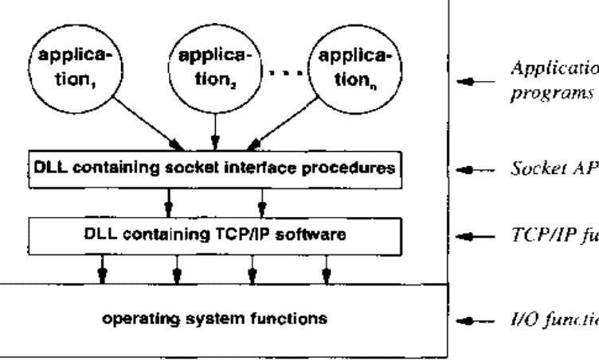

图 4.1 Windows 95 下动态链接库中 `socket` API 和 TCP/IP 代码的结构。需要时会将一个 DLL副本加载到内存中：所有应用程序共享该副本。

与 Windows 95 使用的实现不同，Windows NT 使用了包含 DLL 和驻留代码的混合方案。实现 TCP/IP 代码被链接到操作系统中。因此，TCP/IP 代码在操作系统启动时加载到内存中，并一直保留到操作系统终止。然而，`socket` API 中的过程并不是操作系统的一部分。相反，这些过程位于 DLL 中。当应用程序使用网络时，会加载 `socket` DLL 的副本，该副本由所有应用程序共享，当没有应用程序需要访问时，DLL 会被。图 4.2 展示了该实现。

## API 的实现

| 应用程序 | 应用程序 | 应用程序 |

| :--- | :--- | :--- |

| 包含 `socket` 接口过程的 DLL | Socket API | |

| 操作系统 | TCP/IP 函数和 I/O 函数 | |

图 4.2 Windows NT 下 `socket` API 和 TCP/IP 代码结构。虽然 TCP/IP 代码是操作系统的一部分，但 `socket` API 的过程属于一个 DLL。

其他实现也是可能的。特别是，某些计算机系统不支持动态库。在另一些系统中，除非程序使用操作系统函数，否则程序没有足够的权限执行输入或输出操作。在这些系统中，API 中的所有过程都是操作系统的一部分。

从程序员的角度来看，API 的具体实现方式并不重要：

> 程序员可以创建一个使用 `socket` API 的应用程序，而无需知道该 API 是如何实现的。程序员进行过程调用，这些调用可能会触发链接到应用程序的过程、动态链接库中的过程或操作系统中的过程。

## 4.6 网络通信的两种基本方法

设计者在创建 API 时，必须选择用于访问 TCP/IP 协议的精确过程集合。实现遵循以下两种方法之一：

- 设计者发明了全新的过程调用，应用程序通过这些调用来访问 TCP/IP。
- 设计者尝试使用传统的 I/O 调用来访问 TCP/IP。

在第一种方法中，设计者列出所有概念性操作列表，为每个操作发明名称和参数，并将每个操作实现为系统函数。在第二种方法中，设计者使用传统的 I/O 原语，但对其进行了重载，使其既能处理网络协议，也能处理传统的 I/O 设备。当然，有些设计者选择了混合方法，即尽可能使用基本的 I/O 函数，但对于那些无法方便表达的操作添加额外的函数。

## 4.7 ANSI C 中提供的基本 I/O 函数

尽管 Windows Socks API 不允许程序员使用基本 I/O 函数进行网络 I/O，但原始的 `socket` API 是允许的。对于需要将应用程序从 UNIX `socket` API 迁移到 Windows `socket` API 的程序员来说，这种区别尤为重要。为了理解如何将 `socket` 应用程序从 UNIX 迁移到 Windows，考虑 ANSI C 用于输入输出的六个函数。图 4.3 表列了这些操作及其传统含义。

| 操作 | 含义 |

| :--- | :--- |

| `open` | 为输入输出操作准备设备或文件 |

| `close` | 终止对先前打开的设备或文件的使用 |

| `read` | 从输入设备或文件获取数据，并将其放在应用程序的内存中 |

| `write` | 将数据从应用程序内存传输到输出设备或文件 |

| `lseek` | 移动到文件或设备的特定位置（此操作仅适用于文件或磁盘等设备） |

| `ioctl` | 控制设备或用于访问设备的软件（例如，指定缓冲区大小或更改设置映射） |

> **图 4.3** ANSI C 中提供的基本 I/O 操作。该信息供需要将应用程序从 UNIX `socket` API 迁移到 Windows Sockets API 的程序员。

当应用程序调用 `open` 来启动输入或输出时，系统返回一个名为文件描述符的小型整数，应用程序在后续的 I/O 操作中使用该整数。`open` 调用接受三个参数：要打开的文件或设备名称、一组控制特殊情况的标志（例如如果文件不存在是否创建文件），以及指定新创建文件读/写保护的访问模式。例如，代码段：

*`ioctl` 代表输入输出控制（Input Output Control）。

## 4.7 ANSI C 中提供的基本 I/O 函数

```c
int
  desc;
```

```c
desc = open(*filename*, O_RDWR, 0)
```

打开一个已存在的文件 *filename*，其模式允许同时读取和写入。在获取整数描述符 `desc` 后，应用程序在对文件的后续 I/O 操作中使用它。例如，语句：

```c
read(desc, buffer, 128);
```

从文件读取 128 字节数据到数组 `buffer`。

最后，当应用程序完成文件使用时，调用 `close` 来释放描述符并相关资源（例如，缓冲区）：

```c
close(desc);
```

## 4.8 UNIX Socket API 的历史

当设计者将 TCP/IP 协议引入 UNIX 并创建 `socket` API 时，他们扩展了传统的 I/Oset。首先，他们扩展了文件描述符集合，使得应用程序能够创建用于网络通信的描述符。其次，他们扩展了读写函数，使其能够处理新的网络描述符以及传统的文件描述符。因此，当 UNIX 应用程序通过 TCP 连接发送数据时，它创建相应的描述符并使用 `write` 传输数据。

然而，并非所有的网络通信都能轻松适应 UNIX 的 `open-read-close` 范式。Berkeley 设计者增加了新的过程以处理这些特殊情况。此外，Windows 设计者增加了使得无需使用传统 I/O 原语的过程；Windowsockets API 使用这些新过程。下一步将详细介绍 Windowsockets API。

## 总结

由于 TCP/IP 是为多供应商环境设计的，协议规范了应用程序使用的接口，允许操作系统设计者自由选择实现方式。标准讨论了一个概念性接口，但这仅作为示例。

应用程序使用的过程集合定义了程序接口（API）。用于访问 TCP/IP 协议软件的 API 被称为 `socket` API。`socket` API 最初定义为 Berkeley UNIX 操作系统的一部分。用于 Windows 操作系统的版本被称为 Windows 接口或 WINSOCK。

用于 UNIX 的原始 `socket` API 与用于 Windows 操作系统的 `socket` API 在一个重要点上有所不同：UNIX 版本允许应用程序混合传统的 I/O 函数与 `socket` 函数。因此，将 `socket` API 从 UNIX 迁移到 Windows 的程序员需要理解 I/O 函数作为读、写和关闭的语义。

## 习题

- 4.1 研究一个消息传递的操作系统。你会如何扩展应用程序编程接口（API）以适应网络通信？


### 4.2
比较 Windows 套接接口（Winsock）与 AT&T 的传输层接口（TLI）。它们的主要区别是什么？它们有哪些相似之处？设计者选择其中一种设计而非另一种可能的理由是什么？

### 4.3
在某些计算机上，硬件架构限制了操作系统内置函数的数量为较少（例如 64 或 128 个）。在这样的系统中添加 socket 函数可能是困难的。你的本地操作系统允许多少个函数？

### 4.4
思考上一个习题中讨论的操作系统函数的硬件限制。操作系统设计者如何在不改变硬件的情况下添加额外的函数？

### 4.5
了解 Korn 如何使用 `dev/tcp` 允许 UNIX shell 脚本与 TCP 通信。Windows 系统是否需要相同的功能？为什么需要或为什么不需要？

### 4.6
调查解释型语言 Perl。Perl 脚本可以使用多少 socket 函数？哪些是不可以？

### 4.7
找出 Windows 95 在何时将 DLL 加载到内存中。该操作是在应用程序启动时发生，还是在应用程序首次调用 DLL 中的某个过程时发生？

### 4.8
阅读厂商手册中关于 DLL 的内容。DLL 在加载后可以被卸载吗？请解释。

# Socket API

## 5.1 引言

上一章描述了用于在应用程序与 TCP/IP 软件之间提供通信的机制。该章描述了应用程序如何调用库函数，这些函数随后与 TCP/IP 协议进行交互。

本章描述了 Windows Sockets API 中特定函数的细节，并解释了应用程序如何使用这些函数进行通信。它涵盖了通用概念，并给出了每个调预期用途。后续章节将展示客户端和服务器如何使用这些函数，并提供说明许多细节的示例。

## 5.2 Socket 的历史

20 世纪 80 年代初，高级计划署（ARPA）资助加州大学伯克利分校的一个小组，将 TCP/IP 软件移植到 UNIX 操作系统，并将生成的软件供其他站点使用。作为项目的一部分，设计者创建了一个应用程序用于网络通信的接口。在需要时，他们通过添加访问 TCP/IP 协议的新过程来扩展 UNIX 操作系统。由于该操作系统被称为 Berkeley UNIX 或 BSD UNIX，且该接口使用了名为 socket 的抽象，因此该 API 称为 Berkeley socket 接口或简单称为 socket API。

由于许多计算机厂商（特别是像 Sun Microsystems Incorporated、Tektronix Incorporated 和 Digital Equipment Corporation 这样的工作站）都采用了 Berkeley UNIX 操作系统，socket 接口变得随处可用。

socket API 的整体设计和它提供的通用性自其诞生以来就一直受到批评。一些计算机科学家认为通用性并没有必要的，而且只会让应用程序变得难以阅读。另一些人认为，让程序员指定服务类型而非特定协议会让编程更容易，因为这让程序员从理解每个协议的细节中解放出来。

## 5.3 指定协议接口

col family 族。最后，一些 TCP/IP 软件的商业厂商主张使用替代接口，因为在计算机上添加 socket API 可能需要更改操作系统，这通常需要特殊的许可协议和源代码。

## 5.4 Socket 抽象

### 5.4.1 套接字描述符（Socket Descriptors）

在大多数操作系统中，需要执行 I/O 的应用程序会请求操作系统打开一个文件。系统通过创建一个文件描述符来响应，应用程序使用该描述符来访问文件。从应用程序的角度来看，文件描述符是应用程序在读或写文件时使用的整数。图 5.1 说明了操作系统如何将文件描述符实现为指向内部数据结构的指针数组。

| 操作系统描述符表（每个进程一个） | | |

| :--- | :--- | :--- |

| 0: ● | 文件 0 的内部数据结构 | |

| 1: ● | 文件 1 的内部数据结构 | |

| 2: ● | 文件 2 的内部数据结构 | |

| 3: ● | 文件 3 的内部数据结构 | |

图 5.1 UNIX 中每个进程的文件描述符表。操作系统使用进程描述符表来存储指向进程已打开文件的内部数据结构的指针。进程（应用程序）在引用文件时使用该描述符。

操作系统为每个程序维护一个单独的表。准确地说，系统为每个运行的进程维护一个文件描述符表。当进程打开一个文件时，系统将指向文件内部数据结构的指针放在该进程的文件描述符表中，并将表索引返回给调用者。应用程序只需要记住描述符，并在随后的请求文件操作的调用中使用它。操作系统使用描述符作为索引来访问进程的描述符表，并沿着指针找到包含所有文件信息的数据结构。

socket 接口为网络通信增加了一种新的抽象——socket。像文件一样，每个活动 socket 都由一个称为 socket 描述符的整数标识。Windows 操作系统为每个进程维护一个单独的 socket 描述符表。因此，应用程序可以同时具有相同值的文件描述符和 socket 描述符。

socket API 包含一个名为 `socket` 的函数，应用程序调用它来创建一个 socket。socket 的基本思想是，单个系统调用就足以创建任何 socket。socket 抽象是非常通用的。一旦创建了 socket，应用程序必须填充细节。

### 5.4.2 用于 socket 的系统数据结构

理解 socket 抽象最简单的方法是想象系统为每个进程维护一个描述符表。当应用程序创建一个 socket 时，系统在进程的 描述符表中分配一个新条目，并将索引返回给调用者。应用程序只需要记住描述符，并在随后的调用中使用。socket 接口为网络通信增加了一种新的抽象——socket。像文件一样，每个活动 socket 都由一个称为 socket 描述符的整数标识。Windows 操作系统为每个进程维护一个单独的 socket 描述符表。因此，应用程序可以同时具有相同值的文件描述符和 socket 描述符。

socket API 包含一个名为 `socket` 的函数，应用程序调用它来创建一个 socket。socket 的基本思想是，单个系统调用就足以创建任何 socket。socket 抽象是非常通用的。一旦创建了 socket，应用程序必须填充细节。

| socket 描述符表（每个进程一个） | 操作系统 | socket 数据结构 |

| :--- | :--- | :--- |

| 0: | | family: `PF_INET` |

| 1: | | service: `SOCK_STREAM` |

| 2: | | Local IP: |

| 3: | | Remote IP: |

| 4: | | Local port: |

| 5: | | Remote port: |

图 5.2 概念性操作系统数据结构。系统为每个进程维护一个描述符表。当应用程序创建一个 socket 时，系统在进程的 socket 描述符表中分配一个新条目，并将索引返回给调用者。应用程序只需要记住描述符，并在随后的调用中使用。

实际的数据结构比 5.2 中所示的复杂；该图说明了概念。socket 的内部数据结构包含许多未填充的字段。

### 5.4.3 使用 Socket

一旦创建了 socket，它就可以用于等待传入连接或发起连接。服务器用于等待传入连接的 socket 称为被动 socket（passive socket），而客户端用于发起连接的 socket 称为主动 socket（active socket）。主动 socket 之间的区别在于应用程序如何使用它们；socket 的创建方式相同。

## 5.5 指定端点地址

创建 socket 时，它不包含关于将如何使用的详细信息。特别是，socket 不包含本地机器或远程机器的地址信息。在应用程序使用 socket 之前，它必须指定一个或两个地址。

TCP/IP 协议定义端点由 IP 地址和协议端口号组成。其他协议族以其他方式定义它们的端点。由于 socket 抽象兼容多个协议族，它没有指定如何定义端点或特定的协议地址格式。相反，它允许每个协议族以任何方式指定端点。

为了让协议族自由选择其地址表示，socket 抽象为每种类型的地址定义了一个地址族。协议族可以使用一个或多个地址族来定义地址表示。TCP/IP 协议都使用单一地址表示，该地址族由符号常量 `AF_INET` 表示。

## 5.6 通用地址结构

应用程序可能需要操作协议地址，而无需了解每个协议族如何定义其地址表示的详细细节。例如，可能需要编写一个过程，接受任意的协议端点规范作为参数，并根据地址类型选择若干操作中的一种。为了适应此类程序，系统定义了一种所有端点地址都使用的泛化格式。该泛化格式由一对组成：

(地址族，该族中的端点地址)

其中，地址族字段包含一个表示预定义地址类型之一的常量，端点地址字段包含使用指定地址类型的标准表示的端点地址。

在实践中，socket API 提供了地址端点的预定义数据类型的声明。应用程序需要声明存储端点地址的变量，或者在需要使用覆盖层（overlay）来定位结构中的字段时进行。最通用的结构被称为 `sockaddr`，它包含一个 2 字节的地址族和一个用于存放 14 字节数据的数组：


```c
struct sockaddr {
    u_short sa_family;    /* 地址类型 */
    char    sa_data[14];      /* 地址值 */
};
```

遗憾的是，并非所有地址都定义了符合 `sockaddr` 结构的端点。例如，Berkeley UNIX 操作系统还定义了 `AF_INET` 地址族，用于指定 UNIX 程序员认为的命名管道。`AF_INET` 族的端点地址由 UNIX 路径名组成，长度可能超过 14 字节。因此，应用程序不应在声明中使用 `sockaddr`，因为类型为 `sockaddr` 的声明变量不足以容纳所有可能的端点地址。

实践中常见的错误是认为 `sockaddr` 结构可以容纳 `AF_INET` 族的地址。即使程序员声明了类型为 `sockaddr` 的变量，TCP/IP 软件也能正常工作。然而，为了保持程序的移植性和可维护性，TCP/IP 代码不应在声明中使用 `sockaddr` 结构。相反，`sockaddr` 仅应作为覆盖层使用，代码应仅引用 `sa_family` 字段。

`sockets` 定义的每个协议族定义了端点地址的精确表示，socket 软件提供了相应的结构声明。每个 TCP/IP 端点地址都由一个 2 字节的字段组成，用于标识地址类型（它必须包含 `AF_INET`、一个 2 字节的端口号、一个 4 字节的 IP 地址字段以及一个未使用的 8 字节字段）。预定义的结构 `sockaddr` 如下：

> *此文本描述了 Windows Sockets API 中定义的结构；在最新版本中，`sockaddr` 结构包含一个 8 位的 `sa_len` 字段，包含总长度。*

```c
struct sockaddr_in {
    /** 用于存放地址的结构 */
    u_short sin_family;      /** 地址类型（始终为 AF_INET） */
    u_short sin_port;       /** 协议端口号 */
    struct in_addr sin_addr; /** IP 地址（声明为 */
                             /** 在某些系统上为 u_long */
    char    sin_zero[8];      /** 未使用（置零） */
};
```

专门使用 TCP/IP 协议的应用程序可以专门使用 `sockaddr_in` 结构：它永远不需要使用 `sockaddr` 结构。因此，

当表示 TCP/IP 通信端点时，应用程序使用 `sockaddr_in` 结构，它同时包含 IP 地址和端口号。程序员在编写混合使用协议的程序时必须小心，因为某些非 TCP/IP 端点需要更大的结构。

## 5.7 Socket API 中的函数

Sockets 可以分为两组：提供底层功能访问的初级 socket 函数，以及帮助程序员的其它库例程。本节描述了提供客户端和服务器应用程序所需的主要功能的过程。

系统调用的细节、其参数和语义可能看起来扑目无章。许多复杂性源于 sockets 拥有的参数允许程序以许多方式使用它们。一个 socket 可以被客户端或服务器使用，用于传输（例如 TCP）或数据报（例如 UDP）通信，并带有特定的远程端点（通常客户端需要）或未指定的远程端点（通常服务器需要）。

为了理解 sockets，我们将从检查主要的 socket 调用开始，并描述如何使用它们。

### 5.7.1 WSAStartup 函数

使用 Windows Socks 的程序在使用 sockets 之前必须调用 `WSAStartup`。该调用需要两个参数。第一个参数指定请求的 Windows 版本；第二个参数指向系统将写入信息的 `WSADATA` 结构。

> *`sockaddr` 用于强制转换（即更改）系统函数结果的指针，以进行严格类型检查。*

#### WSAStartup

`WSAStartup` 是因为 操作系统使用动态链接库 `DLL`。而不是将代码硬编码到操作系统，此类系统在运行时绑定。当程序调用 `WSAStartup` 时，系统会搜索相应的库并绑定。

### 5.7.2 WSACleanup 函数

应用程序在完成并关闭 sockets 后调用 `WSACleanup` 以释放所有数据结构和 socket 绑定。程序通常在完全完成并准备退出时调用 `WSACleanup`。

### 5.7.3 Socket 函数

应用程序调用 `socket` 创建一个新的 socket。调用参数指定协议族（例如 `AF_INET`）、服务类型（例如流或数据报）以及协议（例如 TCP 或 UDP）。

### 5.7.4 Connect 函数

创建 socket 后，客户端调用 `connect` 建立连接。该调用参数指定远程地址、端口号和协议类型。

### 5.7.5 Send 函数

客户端和服务器使用 `send` 传输数据。该调用参数指定 socket 描述符、要发送的数据、数据的长度以及标志。

### 5.7.6 Recv 函数

客户端和服务器都使用 `recv` 接收数据。该调用参数指定 socket 描述符、应放置数据的缓冲区、缓冲区的大小以及标志。

### 5.7.7 Closocket 函数

当客户端或服务器完成使用 socket 后，会调用 `closesocket` 释放它。

### 5.7.8 Bind 函数

当 socket 首次创建时，它没有端点地址。应用程序调用 `bind` 为 socket 指定本地端点地址。

### 5.7.9 Listen 函数

当 socket 创建时，在应用程序采取进一步行动之前，socket 既不是活跃的（即客户端可以使用），也不是被动的。面向连接的服务器调用 `listen` 将 socket 置于被动模式，并准备好接受传入的连接。

56 Socket API 第 5 章

大多数服务器都由一个无限循环组成，该循环接收下一个传入的连接，处理它，然后返回去接收下一个连接。即使处理一个连接仅需几毫秒，也可能在服务器忙于处理现有请求期间，新的连接请求到达。为了确保不丢失任何连接，服务器必须传递两个参数，告诉操作系统为套接字将连接请求入队。一个参数 `listen` 指定要置于被动模式的套接字，另一个参数指定了用于该套接字的队列大小。

### 5.7.10 Accept 函数

对于 TCP 套接字，在服务器调用 `socket` 创建套接字、调用 `bind` 指定本地端点以及 `listen` 将其置于被动模式后，服务器调用 `accept` 来提取下一个传入的连接请求。一个参数指定了应该接受连接的套接字。

`Accept` 为每个新连接请求创建一个新套接字，并将新套接字的描述符返回给调用者。服务器仅对新连接使用新套接字；使用原始套接字接受额外的连接请求。一旦接受了连接，服务器就可以使用新套接字传输数据。完成新套接字的操作后，服务器将其关闭。

### 5.7.11 与 TCP 使用的套接字调用总结

图 5.3 表格提供了 Windows Sockets API 中函数的简要总结。

## 5.8 整数转换的实用例程

TCP/IP 为协议头中使用的二进制整数规定了标准表示法。这种表示被称为**网络字节序**，它用高位字节在前表示整数。

尽管协议软件隐藏了大多数值，但程序员必须意识到，在调用套接字函数时，某些参数需要网络字节序。转换函数被分为 16 位和 32 位。`htons` 和 `ntohs` 用于 16 位整数在机字节序和网络字节序之间的转换；`htonl` 和 `ntohl` 则用于 32 位整数。这种对网络字节序的转换使得程序在不同架构间具有可移植性。

以下是 Windows 套接字 API 函数及其含义的总结：

| 名称 | 含义 |
|---|---|
| `WSASStartup` | 初始化套接字库（Windows 专用） |
| `WSACleanup` | 终止套接字库（Windows 专用） |
| `socket` | 创建套接字描述符 |
| `closesocket` | 关闭套接字 |
| `bind` | 指定本地 IP 地址和套接字 |
| `listen` | 将套接字置于被动模式并设置队列长度 |
| `accept` | 接受传入的连接 |
| `recv` | 接收传入的数据流 |
| `select` | 等待一组套接字可以进行 I/O |
| `send` | 发送数据流或消息 |
| `getpeername` | 获取连接的远程端点地址 |
| `shutdown` | 单向或双终止连接 |
| `getsockopt` | 获取套接字的当前选项 |
| `setsockopt` | 设置套接字的选项 |

图 5.3 Windows 套接字 API 函数总结及其含义。

## 5.9 在程序中使用套接字调用

图 5.4 示例了使用 TCP 的客户端和服务器的调用序列。

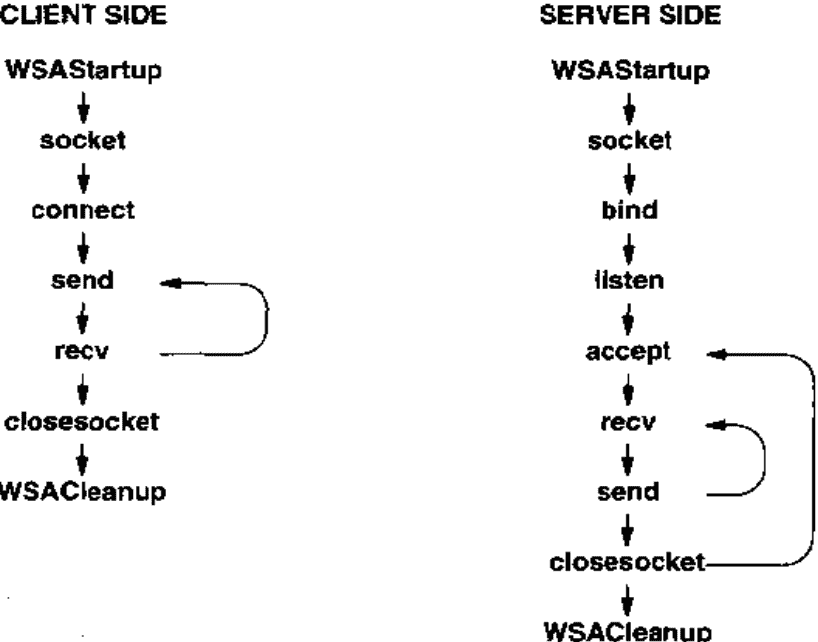


**图 5.4** 使用 TCP 的客户端和服务器示例调用序列。服务器无限运行。它在已知端口等待连接，接受连接，与客户端交互，然后关闭连接。

客户端创建一个套接字，调用 `connect` 连接服务器，然后使用 `send` 发送请求并使用 `recv` 接收响应。完成连接后，它调用 `closesocket`。服务器使用 `bind` 指定将使用的本地已知端口，调用 `listen` 进入循环。在循环内部，服务器调用 `accept` 等待下一个连接请求到达，使用 `recv` 和 `send` 与客户端交互，最后使用 `closesocket` 终止连接。服务器返回 `accept` 调用，等待下一个连接。

## 5.10 套接字调用参数的符号常量

除了实现套接字的函数外，套接字 API 的实现还提供了一组应用程序用于声明和指定参数定义的符号常量。例如，在指定使用数据报还是流服务时，程序使用符号常量 `SOCK_DGRAM` 或 `SOCK_STREAM`。

## 5.10 总结

套接字抽象是由 BSD 操作系统引入的机制，允许应用程序与协议软件接口。由于许多厂商都采用了套接字，它已成为一种事实标准。套接字结构允许每个协议族定义一个或多个表示。所有 TCP/IP 协议都使用互联网族 `AF_INET`，它指定端点包含 IP 地址和端口号。当应用程序向套接字函数指定通信端点时，使用 `sockaddr_in` 结构。如果客户端指定需要任意本地协议，TCP/IP 协议将选择一个。

在 C 语言程序可以使用套接字相关的预定义结构和符号常量之前，必须包含定义这些内容的文件。特别是，我们假设所有 C 程序都以下语句开头：

```c
#include <winsock.h>
```

## 客户端软件设计中的算法与问题

## 6.1 引言

之前的章节考虑了应用程序与 TCP/IP 软件接口的 socket 抽象，并回顾了 Windows Sockets API 中的基本函数。本章讨论了构成客户端软件的基础算法。它展示了应用程序如何通过启动通信成为客户端，以及它们如何使用 TCP 或 UDP 协议联系服务器，以及它们如何使用 socket 调用与这些协议进行交互。下一章将继续讨论，并展示实现此处所讨论思想的完整客户端程序。

## 6.2 学习算法而非细节

由于 TCP/IP 提供了丰富的功能，允许程序以多种方式进行通信，因此使用 TCP/IP 的应用程序必须对所需的通信指定许多细节。例如，应用程序必须指定它是希望充当客户端还是服务器、它将使用的端点地址（或地址）、它将与无连接的或面向连接的协议进行通信、它将如何执行授权和保护规则，以及如所需的缓冲区大小等细节。

到为止，我们检查了应用程序可用的操作set，但没有讨论应用程序应该如何使用它们。遗憾的是，了解所有可能的 socket 函数及其精确参数的低级细节，并不能让程序员理解如何构建设计良好的分布式程序。事实上，对用于网络通信的函数有通用的理解很重要，但很少程序员能记住所有细节。相反，他们学习并记住程序跨网络进行交互的可能方式，并理解每种可能设计的权衡。本质上，程序员对分布式计算的基础算法有足够的的了解，以便做出设计决策并快速选择替代算法。他们构建一个编程手册，以找到在特定系统上实现特定算法的程序所需的细节。要点在于，如果程序员知道程序应该做什么，那么找到如何做它是显而易见的。

尽管程序员需要理解协议接口的概念性能力，但他们应该集中于学习构建通信程序的方法，而不是背记特定接口的细节。

## 6.3 客户端架构

由于几个原因，充当客户端的应用程序在概念上比充当服务器的应用程序简单。首先，大多数客户端软件不处理与多个服务器的并发交互。其次，大多数客户端软件作为常规应用程序执行。与服务器软件不同，客户端软件通常不需要特权，因为它们不需要访问特权端口。第三，大多数客户端软件不需要执行保护。相反，客户端程序可以在操作系统上运行以自动执行保护。事实上，设计和实现客户端软件是直观的，经验丰富的程序员可以很快学会编写基础客户端应用程序。接下来的章节将讨论一般的客户端软件；后面的章节将关注使用 TCP 的客户端与使用 UDP 的客户端之间的差异。

## 6.4 确定服务器的位置

客户端软件可以使用几种方法之一来查找服务器的 IP 地址和协议端口号。客户端可以：

- 在程序编译时将服务器的域名或 IP 地址指定为常量，
- 在调用程序时要求用户识别服务器，
- 从稳定存储器获取有关服务器的信息（例如，从本地磁盘上的文件），
- 使用单独的协议查找服务器（例如向所有服务器发送多播或广播消息并响应）。

### 第6.4节 确定服务器的位置

将服务器地址指定为常量使客户端软件运行更快，并且对特定本地计算环境的依赖更少。然而，这也意味着如果服务器移动，客户端必须重新编译。更重要的是，这意味着客户端无法与替代服务器配合，即使是为了测试。作为折中，某些客户端固定机器名称 own IP 地址。固定名称而非地址会将绑定延迟到运行时。它还允许站点为服务器选择一个通用名称，并为该域名系统添加一个别名。使用别名允许站点管理员在不更改客户端软件的情况下更改服务器的位置。要移动服务器，管理员只需要更改别名。例如，可以在本地域中为邮箱添加一个别名，并安排所有客户端查找“mailhost”而不是特定的机器。由于所有客户端都使用通用名称而非特定机器，系统管理员可以在不重新编译客户端软件的情况下更改邮件主机的位置。

将服务器地址存储在文件中使客户端更具灵活性，但意味着除非文件可用，否则客户端无法执行。那么，客户端软件无法传输到另一台机器上。

虽然使用广播协议在较小的本地环境中查找服务器，但它在大型环境中扩展性不好。此外，使用动态机制为客户端和服务器引入了额外的复杂性，并为网络增加了不必要的广播流量。

为了避免不必要的复杂性和对计算环境的依赖，大多数客户端简单的方法解决了服务器指定的问题：它们要求用户在调用客户端程序时提供一个识别服务器的参数。构建接受服务器地址作为参数的客户端软件可以使客户端软件通用化，并消除对计算环境的依赖。

> 在调用客户端软件时允许用户指定服务器地址，可以使客户端程序更加通用，并使更改服务器变得可能。

一个需要注意的重要点是，使用参数指定服务器地址具有最大的灵活性。一个接受地址参数的程序可以与其他程序结合，即从磁盘提取服务器地址、使用远程别名查找地址或使用广播协议搜索地址的程序结合。因此，

> 构建接受服务器地址作为参数的客户端软件，易于构建使用其他方式查找服务器的软件扩展版本。

## 查找域名

客户端必须使用 `sockaddr_in` 来指定服务器。这样做意味着将十进制表示法的地址（或文本中的域名）转换为二进制地址。从十进制转换为二进制是易易的。然而，从域名转换需要更多努力。socket 接口函数 `inet_addr` 和 `gethostbyname` 执行这些转换。`inet_addr` 接收包含进制地址的 ASCII 字符串并返回相应的二进制地址。`gethostbyname` 接收包含域名的 ASCII 字符串。它返回一个主机结构的地址，其中包括 IP 地址。主机结构定义在 `winsock.h` 中：

```c
struct      hostent {
    char PAR* h_name;          /* 式主机 */
    char PAR* FAR *aliases;     /* 其他别名 */
    short       h_type;         /* 地址类型 */
    short       h_length;        /* 地址长度 */
    char PAR* FAR *h_addr_list;  /* 地址列表 */
};
#define h_addr_list[0]
```

包含名称和地址的字段必须是列表，因为具有多个接口的主机也有多个名称和地址。为了与早期版本兼容，该文件还定义了标识符 `h_addr` 指向地址列表的第一个位置。因此，程序可以使用 `h_addr` 就像字段一样。考虑一个简单的转换示例。当客户端收到字符串形式的域名 `merlin.cs.purdue.edu` 并需要获取 IP 地址时。客户端可以这样调用 `gethostbyname`：

```c
struct      hostent *htptr;
char        *explenam = "merlin.cs.purdue.edu";

if ( htptr = gethostbyname(explenam )) {
    /* IP 地址现在位于 htptr->h_addr */
} else {
    /* 名称错误 - 处理它 */
}
```

如果调用成功，`gethostbyname` 返回指向有效 `hostent` 结构的指针。如果名称无法映射为 IP 地址，调用将返回 `NULL` 指针。客户端检查 `gethostbyname` 返回的值来确定是否发生了错误。

## 6.7 通过名称查找已知端口


大多数客户端程序都必须查找其想要调用的特定服务的协议端口。例如，SMTP 邮件服务器的客户端需要查找分配给 SMTP 的已知端口。为了做到这一点，客户端调用库函数 `getservbyname`，该函数接受两个参数：一个指定所需服务的字符串和一个指定所用协议的字符串。它返回一个指向类型 `servent` 结构的指针，该结构也定义在 `winsock.h` 文件中。

```
struct servent {
    char FAR*       s_name;      /* 官方服务名称 *
    char FAR* FAR*  s_aliases;   /* 其他别名 */
    short          s_port;      /* 此服务的端口 *
    char FAR*       s_proto;      /* 使用的协议 */
};
```

如果 TCP 客户端需要查找 SMTP 的官方协议端口号，它会在下例所示中调用 `getservbyname`：

```
struct servent *sptr;

if (sptr = (struct servent*)getservbyname("smtp", "tcp")) {
    /* 端口号现在位于 sptr->s_port 中 */
} else {
    /* 发生错误 - 处理它 */
}
```

## 6.8 端口号与网络字节序

函数 `getservbyname` 返回以网络字节序表示的服务协议端口。第 5 章解释了网络字节序的概念，并描述了将网络字节序转换为本地机器所用字节序的库程序。只需理解 `getservbyname` 返回的值完全符合在 `sockaddr_structure` 结构中使用所需的格式即可，但其表示形式可能与本地机器的通常表示形式不一致。因此，如果程序在打印 `getservbyname` 返回的值之前不将其转换为本地字节序，那么它看起来可能是不正确的。

## 查找协议名称

套接字接口提供了一种机制，允许客户端或服务器将协议名称映射到分配给该协议的整数常量。库函数 `getprotname` 执行此查找。调用传递字符串参数，`getprototype` 返回类型为 `proto` 的结构体的地址。如果 `getprototype` 无法访问数据库或指定的名称不存在，它将返回一个 `NULL` 指针。协议名称数据库允许站点为每个名称定义别名。`proto` 结构有一个用于官方协议名称的字段，以及指向别名列表的字段。C 文件 `winsock.h` 包含结构声明：

```
struct proto {
    char FAR* p_name;      /* 官方协议名称 */
    char FAR* FAR p_aliases; /* 允许的别名列表 */
    short p_proto;         /* 官方协议号 */
};
```

如果客户端需要查找 UDP 的官方协议号，它会在下例所示中调用 `getprotname`：

```
if (pptr = (struct proto*)getprototype( "udp" )) {
    /* 官方协议号现在位于 pptr->p_proto 中 */
} else {
    /* 发生错误 - 处理它 */
};
```

## 6.10 TCP 客户端算法

构建客户端软件通常比构建服务器软件更容易。因为 TCP 处理了所有的可靠性和流量控制问题，构建一个使用 TCP 的客户端是所有网络编程任务中最直接的之一。TCP 客户端遵循算法 6.1 来与服务器建立连接并与其通信。算法后的章节将更详细地讨论它的每一个步骤。

### 算法 6.1

- 1. 找到想要通信的服务器的 IP 地址和协议端口号。
- 2. 分配套接字。
- 3. 指定本地机器上需要一个任意的未使用的协议端口，并允许 TCP 选择一个。
- 4. 将套接字连接到服务器。
- 5. 使用应用层协议与服务器通信（这通常涉及发送请求并等待回复）。
- 6. 关闭连接。

算法 6.1 一种面向连接的客户端。客户端应用程序分配套接字并将其连接到服务器。然后它跨连接发送请求并接收回复。

## 6.11 分配套接字

之前的章节已经讨论了查找服务器 IP 地址的方法，以及用于分配通信套接字的 `socket` 函数。使用 TCP 的客户端必须指定协议族 `PF_INET` 和服务 `SOCK_STREAM`。程序以一个 `include` 语句开始，该语句引用一个文件，该文件包含调用中使用的符号常量的定义，以及用于保存套接字描述符的变量声明。如果该协议族（由第一个参数指定）中有多个协议提供第二个参数所请求的服务，则 `socket` 调用的第三个参数将标识一个特定的协议。在 Internet 协议族的情况下，只有 TCP 提供 `SOCK_STREAM` 服务。因此，第三个参数是无关的——应该使用零。

```
#include <winsock.h>

SOCKET s;

s = socket(PF_INET, SOCK_STREAM, 0);
```

## 6.12 选择本地协议端口号

应用程序在通信中使用套接字之前，需要指定远程和端点地址。服务器在一个已知的协议端口地址运行，所有客户端都必须知道。然而，TCP 客户端并不在预定义的端口上运行。相反，它必须选择一个本地协议端口作为其端点地址。通常，只要满足以下条件，客户端并不关心它使用哪个端口：(1) 该端口与机器上其他应用程序正在使用的端口不冲突，且 (2) 该端口尚未分配。

## 6.15节 使用 TCP 与服务器通信

```c
/* 示例代码段 */
#define BLEN 120    /* 使用缓冲区长度 */
char    *req = "request of some sort";
char    buf[BLEN];      /* 响应缓冲区 */
char    *optr;          /* 缓冲区指针 */
int     n;              /* 读取的字节数 */
int     buflen;         /* 缓冲区剩余空间 */

bptr = buf;
buflen = BLEN;

/* 发送请求 */

send(s, req, strlen(req), 0);

/* 读取响应（可能多次到达） */
n = recv(s, bptr, buflen, 0);
while (n != SOCKET_ERROR && n != 0) {
	bptr += n;
	buflen -= n;
	n = recv(s, bptr, buflen, 0);
}
```

## 6.16 从 TCP 连接中读取响应

上一个示例中的代码展示了一个客户端，它向服务器发送一个短消息并期望一个小的响应（小于 120 字节）。代码包含单次 `send` 调用，但会多次调用 `recv`。只要 `recv` 返回数据，代码就会减少缓冲区中可用空间的计数，并将缓冲区向前移动以跳过已读取的数据。在输入上进行迭代是必要的，即使连接另一端的应用程序只发送了少量数据，这是因为 TCP 是一种非阻塞协议。相反，TCP 是流式传输的；它保证交付其所写入的字节序列，但不保证按照其写入时的原始分组方式进行交付。TCP 可能会将一个数据块拆分为碎片并在单独的分段中传输每个部分（例如，它可能会选择划分符合最大分段大小的数据，或者如果接收端没有足够的缓冲区空间接收大块，它可能需要发送一小块）。或者，TCP 可能会在发送分段之前在其输出缓冲区中累积许多字节（例如为了填充一个数据报）。结果，接收应用程序可能会以小块的形式接收数据，即使发送应用程序通过单次 `send` 调用将其传递给 TCP。或者，如果发送应用程序通过一系列 `send` 调用将其传递给 TCP，接收应用程序可能会以大块的形式接收数据。这种思想是使用 TCP 编程的基础：

由于 TCP 不保留记录边界，任何从 TCP 连接读取读取的程序都必须准备好一次接收几个字节的数据。即使发送应用程序以大块写入数据，这条规则仍然适用。

## 6.17 关闭 TCP 连接

### 6.17.1 部分关闭的需要

当应用程序完全完成连接的使用时，它可以调用 `closesocket` 来优雅地终止连接并释放套接字。然而，关闭连接很少是简单的，因为 TCP 允许双向通信。因此，关闭连接通常需要客户端和服务器之间的协调。

为了理解这个问题，请考虑一个需要上述请求-响应交互的客户端和服务器。客户端重复地请求，服务器对此做出响应。一方面，服务器无法终止连接，因为它不知道客户端是否会发送额外的请求。另一方面，虽然客户端知道自己何时不再有更多请求要发送，但它可能不知道所有数据是否已从服务器到达。后者对于响应请求传输任意数量数据的应用程序协议（例如，数据库查询的响应）尤为重要。

### 6.17.2 部分关闭操作

为了解决关机问题，许多套接字接口的实现都包含一个额外的原语，允许应用程序在单方向上关闭 TCP 连接。`shutdown` 函数接受两个参数：一个套接字描述符和一个方向规范，并在指定的方向上关闭套接字：


```c
errcode = shutdown(s, direction);
```

`direction` 参数是一个整数。如果它包含 `0`，则不再允许进一步输入。如果它包含 `1`，则不再允许进一步输出。

（注：此处原文逻辑似乎在某些处重复，已按字意翻译）

TCP 允许，，，，，，，，，，，。。。。。。。。。。。

。

部分关闭的优势现在很明确：

应用程序 关闭关闭，，，，，，，，

，应用程序，，，

。。。。

。

因此，接收应用程序可能会以小块的形式接收数据，即使发送应用程序通过单次 `send` 调用将其传递给 TCP。

（.应用程序或者，如果发送应用程序通过一系列 `send` 调用将其传递 TCP TCP 时，接收应用程序可能会以大块的形式接收数据。

由于 TCP. TCP TCP记录，边界，从从 TCP 连接读取的的程序都准备好好接收几个几个字节数据。

## 6.18 使用 UDP 编程 客户端

乍看，编写 UDP 客户端似乎是一项简单的任务。算法 6.2

1. 找到服务器的 IP 地址和端口号。
2. 分配套接字。
3. 指定要通信的 UDP 端口。
4. 指定要发送的远程端。
5. 与服务器通信（这通常涉及发送并等待响应）。
6. 关闭套接字。

算法 6.2 无连接客户端。UDP 客户端的前几个步骤与 TCP 客户端非常相似。该算法忽略了可靠性问题。

## 6.19 连接与未连接的 UDP 套接字

应用程序可以使用两种基本模式使用 UDP：连接和未连接。在连接模式下，客户端使用 `connect` 调用来指定远程端（即服务器的 IP 地址和端口号）。一旦指定了远程端，客户端就可以像 TCP 那样发送和接收消息。在未连接模式下，客户端不连接特定的远程端。相反，每次发送消息时都要指定目标。连接 UDP 套接字的主要优势在于对于与单个服务器交互的传统应用程序方便：无论发送多少个数据报，应用程序只需要指定服务器。未连接套接字的主要优势在于其灵活性；客户端可以等到有请求时再决定连接哪个服务器。此外，客户端可以轻松地向不同的服务器发送请求。

## 6.20 在 UDP 中使用 Connect

虽然客户端可以连接类型为 `DGRAM` 的套接字，`connect` 调用并没有启动任何数据交换，也没有验证远程端地址的有效性。相反，它只是在套接字数据结构中记录远程端信息。因此，在使用 `SOCK_DGRAM` 套接字时，`connect` 只存储地址。

## 6.21 使用 UDP 与服务器通信

在 UDP 客户端调用 `connect` 后，可以使用 `send` 发送消息或接收响应。同样，每次 `recv` 调用返回一个完整的消息。假设客户端指定了足够大的缓冲区，`recv` 调用返回下一个消息的所有数据。因此，UDP 客户端不需要多次调用 `recv` 来获取单个消息。

## 6.22 关闭使用 UDP 的套接字

UDP 客户端调用 `closesocket` 来关闭套接字并释放与其相关的资源。一旦套接字关闭，UDP 软件将拒绝所有到达该套接字所分配协议端口的后续消息。然而，套接字所在的机器不会通知远程端套接字已关闭。因此，使用无连接传输的应用程序必须经过设计，以便远程端知道在关闭套接字之前要保留多长时间。

## 6.23 UDP 的部分关闭

`shutdown` 可用于已连接的 UDP 套接字，以停止特定方向的进一步传输。遗憾的是，与 TCP 连接上的部分关闭不同，应用于 UDP 套接字时，`shutdown` 不会向对方发送任何消息。相反，它仅仅将本地套接字标记为不愿意在指定的方向传输数据。如果客户端关闭了其套接字的进一步输出，服务器将不会收到任何通信已停止的指示。

## 6.24 关于 UDP 不可靠性的警告

我们简单的 UDP 客户端算法忽略了 UDP 的一个基本方面：即它提供不可靠的数据报交付。虽然简单的 UDP 客户端在低丢包、低延迟且无包重序的本地网络上运行良好，但遵循我们算法的客户端无法在复杂的互联网环境中工作。要在互联网环境中运行，客户端必须通过超时和重传来实现可靠性。它还必须处理重复或乱序包的问题。增加可靠性可能是困难的，并且需要协议设计的专业知识。

> 使用 UDP 的客户端软件必须通过数据包排序、确认、超时和重传等技术来实现可靠性。为互联网环境设计正确、可靠且高效的协议需要大量的专业知识。

## 6.25 总结

客户端程序是最简单的网络程序之一。客户端在通信之前必须先获取服务器的 IP 地址和协议端口号；为了增加灵活性，客户端程序在调用连接时通常要求用户标识服务器。然后，客户端将服务器地址从点十进制法转换为二进制，或者使用域名系统将文本格式的机器名转换为 IP 地址。

TCP 客户端算法非常直观：TCP 客户端分配一个套接字并将其连接到服务器。客户端使用 `send` 向服务器发送请求，并使用 `recv` 接收回复。一旦完成连接的使用，客户端或服务器均会调用 `closesocket` 来终止它。

尽管客户端必须显式地指定其想要通信的服务器地址，但它可以允许 TCP/IP 软件选择一个未使用的协议端口号并填充本地 IP 地址。这样做可以避免在网关（路由器）或多宿主主机上可能出现的问题，即客户端选择的 IP 地址与 IP 路由流量的接口 IP 地址不符。

客户端使用 `connect` 为套接字指定远程端点地址。当与 TCP 使用时，`connect` 发起三次握手并确保通信的可行性。当与 UDP 使用时，`connect` 仅仅记录服务器的端点地址以备后用。

如果客户端和服务器都不知道通信何时何时结束，连接关闭可能会变得困难。为了解决这个问题，套接字接口使用了 `shutdown` 原语，会导致部分关闭并让对方知道不再有数据到达。客户端使用 `shutdown` 关闭通往服务器的路径；服务器在连接上接收到文件结束（EOF）信号表示客户端已完成。服务器发送完最后一个响应后，使用 `closesocket` 终止。

## 进阶学习

许多定义协议的 RFC 还为客户端代码建议算法或实现技术。Umar [1997b] 讨论了面向对象的客户端-服务器架构。

## 练习

- 6.1 阅读关于 `send` 和 `recvfrom` 套接字调用。它们适用于使用 TCP 的套接字还是使用 UDP 的套接字？
- 6.2 当域名系统解析机器名时，它会返回一个或多个 IP 地址。为什么？
- 6.3 编写一个使用 `gethostname` 查找你所在地机器名的客户端软件，并打印返回的所有信息。哪些官方名称（如果有）让你感到惊讶？你倾向于使用官方机器名还是别名？描述别名可能无法正常工作的情况。
- 6.4 测量查找机器名（`gethostname`）的时间。对有效和无效名称重复测试。对无效名称的查找是否显著长于对有效名称的查找？解释你观察到的任何差异。
- 6.5 使用网络监视器观察当你使用 `gethostbyname` 查询 IP 地址时计算机产生的网络流量。对于你收到的每个机器名至少运行实验一次。解释多次查找之间网络流量的差异。
- 6.6 为了测试你机器的本地字节序是否与网络字节序相同，编写一个程序使用 `getservbyname` 查找 UDP 的 ECHO 服务，并打印生成的协议端口值。如果本地字节序和网络字节序不同，该值将是 `7`。
- 6.7 编写一个程序，分配一个本地协议端口，关闭套接字，延迟几秒钟，然后分配另一个本地端口。在空闲机器和繁忙的分时系统上运行该程序。你的程序在每个系统上接收到了哪些端口值？如果它们不相同，请解释原因。
- 6.8 在什么情况下，客户端可以使用 `closesocket` 代替 `shutdown`？
- 6.9 客户端每次启动时应该使用相同的协议端口号吗？为什么或为什么不？
- 6.10 如果客户端程序包含多个线程，每个线程是否可以使用相同的协议端口号连接到不同的服务器？同一个服务器？请解释。

# 7

# 示例客户端软件

## 7.1 引言

上一章讨论了客户端应用程序基础的基础算法，以及实现这些算法的具体技术。本章提供了完整的、可运行的客户端程序示例，以更详细地说明这些概念。示例使用了 UDP 以及 TCP。最重要的是，本章展示了程序员如何构建一个过程库来隐藏套接字调用，并使其具有可移植性和可维护性。

## 7.2 小型示例的重要性


TCP/IP 定义了无数服务以及访问这些服务的标准应用协议。服务的复杂性从微不足道（例如，仅用于测试协议的字符生成器）到复杂（例如提供身份验证和保护的文件传输服务）。本章及后续章节的示例集中在简单服务的实现。后面的章节将回顾几种复杂服务的客户端-服务器应用。虽然示例中使用的协议似乎没有提供有趣或实用的服务，但学习它们很重要。首先，因为服务本身需要的代码很少，实现它们的客户端服务器软件易于理解。更重要的是，小型程序突出了基础算法，并说明了客户端服务器程序如何使用系统函数。其次，学习简单服务让读者对服务的相对大小和可用数量产生直觉。在构建客户端和服务器程序时，仔细使用过程尤为重要。首先，因为网络软件包含了端点地址等声明，构建使用网络服务的程序涉及许多传统程序中没有的细节。使用过程隐藏这些细节可以减少错误概率。其次，分配套接字、绑定地址和形成网络连接所需的许多代码在每个客户端中重复；放入过程中允许程序员重用代码而不是重复编写。第三，由于 TCP/IP 设计用于互连异构机器，网络应用程序通常运行在许多不同的架构上。程序员可以使用过程来隔离操作系统依赖，从而更容易迁移代码到新机器。为了理解过程如何简化编程任务，考虑构建客户端程序的问题。为了与服务器建立连接，客户端必须选择一种协议（例如 TCP 或 UDP）。查找服务器机器名，查找并映射所需的服务到协议端口号，分配套接字并进行连接。为每个应用程序从头编写这些步骤的代码会浪费时间。此外，如果程序员需要更改任何细节，他们必须修改每个应用程序。为了减少编程时间，程序员可以编写一次代码，将其放入过程中，并在每个客户端程序中简单地调用该过程。

## 7.4 节 客户端程序的示例过程库 81

设计过程库的第一步是抽象：程序员必须想象那些能让程序编写变得更的高层操作。例如，一个应用程序程序员可能会设想两个处理套接字分配和连接工作的过程（`procedures`）：

```cpp
socket = connectTCP(machine, service);
```

```cpp
socket = connectUDP(machine, service);
```

重要的是要理解，这并不是对某组“正确”抽象的处方，它仅仅提供了形成此类套件的一种可能方法。其核心思想是：

过程抽象允许程序员定义高层操作，在应用程序之间共享代码，并减少在细小细节上出错的概率。本文中使用的示例过程仅仅说明了其中一种可能的方法；程序员应该自由地选择自己的抽象。

## 7.5 ConTCP 的实现

由于提议的步骤 `connectTCP` 和 `connectUDP` 需要分配套接字并填入基本信息，我们选择将所有低级代码放在第三个过程 `connectsock` 中，并将这两个高层操作都实现为简单的调用。文件 `connectTCP.cpp` 展示了这一概念：

```cpp
/* connectTCP.cpp - connectTCP * */

#include <winsock.h>

SOCKET connectsock(const char *, const char *, const char *);

/*
 * connectTCP - 连接到指定主机上的指定 TCP 服务
 */
SOCKET
connectTCP(const char *host, const char *service)
{
    return connectsock(host, service, "tcp");
}
```

## 7.6 ConUDP 的实现

文件 `conUDP.cpp` 展示了如何使用 `connectsock` 来建立一个使用 UDP 的连接套接字。

```cpp
/* conUDP.cpp - connectUDP */

#include <winsock.h>

SOCKET connectsock(const char *, const char *, const char);

/*
 * connectUDP - 连接到指定主机上的指定 UDP 服务
 *
 */
SOCKET
connectUDP(const char *host, const char *service )
{
    return connectsock(host, service, "udp");
}
```

## 7.7 用于连接的过程

`connectsock` 过程包含了分配套接字并连接它所需的所有代码。调用者指定创建 UDP 套接字还是 TCP 套接字。

```cpp
/* connectsock.cpp - connectsock */

#include <stdlib.h>
#include <stdio.h>
#include <string.h>
#include <winsock.h>

#ifndef INADDR_NONE
#define INADDR_NONE 0xFFFFFFFFFF
#endif /* for INADDR_NONE */

void
    errexit(const char *, ...);

/*--
 * connectsock - 使用 TCP 或 UDP 分配并连接套接字
 * */

/*
SOCKET
connect(const char *host, const char *service, const char *transport )
{
struct host *phe;               /* 主机信息条目指针 */
struct servent *pse;            /* 服务信息条目指针 */
struct protoent *ppe;          /* 协议信息条目指针*/
struct sockaddr_in sin;         /* 网络端点地址 */
int s, type;                 /* 套接字描述符和套接字类型 */

memset(&sin, 0, sizeof(sin));
sin.sin_family = AF_INET;

/* 将服务名映射到端口号 */
if (pse = gethostbyname(service, transport)) {
    sin.sin_port = pse->s_port;
} else if ((sin.sin_port = htons((u_short)atoi(service))) == 0) {
    errxit("can't get %s service entry\n", service);
}

/* 将主机映射到 IP 地址，允许点点十进制主机名 */
if (phe = gethostname(host)) {
    memcpy(sin.sin_addr.s_addr, phe->h_addr, phe->h_length);
} else if ((sin.sin_addr.s_addr = inet_addr(host)) == INADDR_NONE) {
    errxit("can't get %s host entry\n", host);
}

/* 将协议名映射到协议号 */
if ((ppe = getprotobyname(transport)) == 0) {
    errxit("can't get %s protocol entry\n", transport);
}
/* 使用协议选择套接字类型 */
if (strcmp(transport, "udp") == 0) {
    type = SOCK_DGRAM;
} else {
    type = SOCK_STREAM;
}

/* 分配套接字 */
s = socket(AF_INET, type, ppe->p_proto);
if (s == INVALID_SOCKET) {
    errxit("can't create socket: %d\n", GetLastError());
}

/* 连接套接字 */
if (connect(s, (struct sockaddr *)&sin, sizeof(sin)) ==
    SOCKET_ERROR) {
    errxit("can't connect to %s: %d\n", host, service);
}

GetLastError();

return s;
}
```

## 示例客户端软件

## 第7 章

尽管大多数步骤都是直而易懂的，但某些细节使其变得复杂。首先，C 语言允许复杂的表达式。其次，代码使用了 `memset`。如果发生错误，过程会调用 `erxit`。最后，该过程调用 `WSleanup` 来释放系统资源。


## 7.8 使用示例库

一旦程序员选择了抽象并构建了过程库，他们就可以构建应用程序。如果抽象选择得当，它们将简化应用程序编程。为了说明我们的示例库如何工作，我们将它来构建示例应用程序。由于每个客户端都访问一个标准的 TCP/IP 服务，它们也说明了一些更简单的协议。

## 7.9 DAYTIME 服务

TCP/IP 标准定义了一种应用协议，允许用户获取人类可读的日期和时间。该服务正式名为 `DAYTIME` 服务。

要访问 `DAYTIME` 服务，用户调用客户端应用程序。客户端连接服务器以获取信息，然后将其打印。尽管标准没有规定具体的语法，但它建议了一些可能的格式。例如，`DAYTIME` 可以提供如下格式的日期：

> 星期, 月, 日, 年 时间-时区

> Thursday, February 22, 1997 17:37:43-EST

标准规定 `DAYTIME` 适用于 `TCP` 和 `UDP`。在两种情况下，它都运行在协议端口 `13` 上。

`TCP` 版本的 `DAYTIME` 使用 `TCP` 连接的存在来触发输出：一旦有新连接建立，服务器发送一个包含当前日期和时间的文本字符串，发送后即关闭连接。因此，客户端完全不需要发送任何请求。

`UDP` 版本的 `DAYTIME` 要求客户端发送请求。请求由任意 `UDP` 数据报组成。每当服务器接收到一个数据报，它就会格式化当前的日期和时间，将结果字符串放在输出数据报中，并发送回客户端。一旦发送了回复，服务器就会丢弃触发响应的数据报。

## 7.10 为 DAYTIME 实现 TCP 客户端

文件 `TCPdtc.cpp` 包含了一个访问 `DAYTIME` 服务的 `TCP` 客户端代码。

* `TCPdtc.cpp` - `main`, `TCPdaytime` *

```cpp
#include <stdlib.h>
#include <stdio.h>
#include <winsock.h>
void TCPdaytime(const char *, const char *);
void erxit(const char *, ...);
SOCKET connectTCP(const char *, const char *);
#define LINESZ 128
#define WSVERS  MAKEWORD(2, 0)
/*
* main - 用于 DAYTIME 服务的 TCP 客户端
*/
int
main(int argc, char *argv[]) {
    char *host = "localhost"; /* 如果未提供则使用的主机 */
    char *service = "daytime"; /* 默认服务端口 */
    WSADATA wsadsata;
    switch (argc) {
        case 1:
            host = "localhost";
            break;
        case 3:
            service = argv[2];
            /* 穿透 */
        case 2:
            host = argv[1];
            break;
        default:
            printf(stderr, "usage: TCPdaytime [host [port]]\n");
            exit(1);
    }
```

```cpp
if (WSStartup(WSVERS, &wsadata) != 0)
  errexit("WSStartup failed\n");
TCPdaytime(host, service);
  WSAClearup();
  return 0; /* 退出 */
```

```cpp
/*
* TCPdaytime - 在指定主机上调用 Daytime 并打印结果
*/
```

```cpp
void
TCPdaytime(const char *host, const char *service)
{
  char buf[LINESZ+1]; /* 用于存储一行文本的缓冲区 */
  SOCKET s; /* 套接描述符 */
  int cc; /* 接收的字符计数 */
  s = connectTCP(host, service);
  while((cc = recv(s, buf, LINESZ, 0)) != SOCKET_ERROR && cc > 0) {
    buf[cc] = '\0'; /* 确保空终止 */
    fputs(buf, stdout);
    cc = recv(s, buf, LINESZ, 0);
  }
closesocket(s);
}
```


一旦使用 `connectTCP`，代码就会简化。一旦建立连接，`DAYTIME` 仅从连接中读取输入并打印，不断迭代直到检测到文件结束条件。

## 7.11 从 TCP 连接中读取

`DAYTIME` 示例说明了一个重要的概念：`TCP` 提供了一种不保证保留记录边界的流式服务。在实践中，流范式意味着 `TCP` 解耦了发送和接收应用程序。例如，假设发送应用程序在单个 `send` 调用中传输了 64 字节数据，随后在第二次调用中传输 64 字节。接收应用程序可能在一次 `recv` 调用中接收所有 128 字节，也可能在第一次调用中接收 10 字节，第二次调用中接收 100 字节，第三次调用中接收 18 字节。每次调用返回的字节数取决于底层互联网中数据包的大小、可缓冲区空间以及跨越互联网时遇到的去分层。

由于 `TCP` 流服务不保证按照写入时的块块递送数据，从 `TCP` 连接接收数据的应用程序不能依赖所有数据都在单次传输中交付；它必须反复调用 `recv` 直到获取所有数据。

## 7.12 TIME 服务

`TCP/IP` 定义了一种允许一台机器从另一台机器获取当前日期和时间的服务。该服务正式命名为 `TIME`，非常简单：运行在一台机器上的客户端程序向运行在另一台机器上的服务器发送请求。每当服务器接收到请求时，它从本地操作系统获取当前的日期时间，将信息编码为标准格式，并在响应中将其发回客户端。

为了避免客户端和服务器位于不同时区时发生的问题，`TIME` 协议规定所有时间和日期都必须以协调世界时（缩写为 `UTC` 或 `UT`）表示。因此，服务器在发送回复之前将其本地时间转换为世界时间，而客户端在回复到达时将世界时间转换回其本地时间。

与旨在供存储或处理时间的程序提供给人类用户使用的 `DAYTIME` 服务不同，`TIME` 服务旨在被用作 32 位整数，代表自纪元日以来的秒数。`TIME` 协议使用 1900 年 1 月 1 日午夜作为其纪元。

使用整数表示允许计算机快速地将时间从一台机器传输到另一台机器，而无需等待将其转换为文本字符串再转回整数。因此，`TIME` 服务使得一台计算机能够从另一个系统设置其时钟。

## 7.13 访问 TIME 服务

客户端可以使用 `TCP` 或 `UDP` 访问协议端口 37 的 `TIME` 服务（技术上讲，标准定义了两个独立的服务，一个用于 `UDP`，一个用于 `TCP`）。为 `TCP` 构建的 `TIME` 服务器利用连接的存在来触发输出，就像上面讨论的 `DAYTIME` 服务一样。客户端与 `TIME` 服务器建立 `TCP` 连接并等待读取输出。当服务器检测到新连接时，它会发送编码为整数的当前时间，然后关闭连接。客户端不发送任何数据，因为服务器从未从连接中读取数据。

> *协调世界时以前被称为格林尼治时间。*

## 7.14 准确的时间与延迟

尽管 `TIME` 服务适应了时区差异，但并没有处理网络延迟问题。如果从服务器传输到客户端花费了 3 秒，客户端接收的时间比服务器慢 3 秒。然而，对于使用时间戳进行同步处理的协议，人类并不在意时钟存在微小差异。在需要更高精度的情况下，可以通过估计客户端和服务器之间的延迟来改进 `TIME`。例如，一种方法是客户端计算往返时间，通过将其减半获得延迟近似值，并将该延迟加到服务器报告的时间值上。

## 7.15 TIME 服务的 UDP 客户端

文件 `UDPtime.cpp` 包含了实现 `TIME` 服务的 `UDP` 客户端代码。

```cpp
/* UDPtime.cpp - main */
```

```cpp
#include <stdlib.h>
#include <stdio.h>
#include <time.h>
#include <winsock.h>
```

```cpp
#define BUFSIZE 64
#define WSVERS MAKEWORD(2, 0)
```

```cpp
#define EPOCH 220898800 /* Windows 纪元，UTC 秒 */
#define MSG /* 现在几点？ */
```

```cpp
SOCKET connectUDP(const char *, const char *);
void erxlit(const char *, ...);
```

```cpp
/* 用于 TIME 服务的 UDP 客户端，打印结果时间 */
int
main(int argc, char *argv[])
{
    char *host = "localhost"; /* 如果未提供则使用的主机 */
    char *service = "time"; /* 默认服务名 */
    time_t now; /* 保存时间的 32 位整数 */
    SOCKET s; /* 套接描述符 */
    int n; /* 接收计数 */
    WSADATA wsaatada;
```

```cpp
switch (argc) {
    case 1:
        host = "localhost";
        break;
    case 3:
        service = argv[2];
        /* 穿透 */
    case 2:
        host = argv[1];
        break;
    default:
        printf(stderr, "usage: UDPtime [host] [port]\n");
        exit(1);
}
{}
```

### 第 7.15 节 一个用于 TIME 服务的 UDP 客户端

```c
if (WSStartup(WSVERS, &wsata))
    return errxit("WSStartup failed\n");

s = connectUDP(host, service);

(void) send(s, MSG, strlen(MSG), 0);

/* 读取时间 */
n = recv(s, (char *)&now, sizeof(now), 0);
if (n == SOCKET_ERROR)
    return errxit("recv failed: recv(s) error %d\n", GetLastError());
WSACleanup();
now = ntohl((unsigned long)now);   /* 转换为主机字节序*
now = WINEPOCH;                  /* 将 UTC 转换为 Windows epoch *
printf("%s", ctime(&now));
    return 0;                   /* 退出 */
```

该示例代码通过发送数据来连接 `TIME` 服务。它可以等待回复并提取时间值。一旦 `UDP` 获取了时间，它必须将时间转换为适用于本地机器的格式。首先，使用 `ntohl` 将 32 位值（C 语言中的 `long`）从网络标准字节序转换为主机字节序。其次，`UDP` 必须将其转换为本地表示。该示例代码为 Windows 设计。然而，与互联网不同，Windows 假设 epoch 日期为1970 年 1 月 1 日。因此，要从 `TIME` 协议 epoch 转换为 Windows epoch，客户端必须减去1900 年 1 月 1 日到 1970 年 1 月 1 日之间的秒数。示例代码使用了转换值 220988800。一旦时间被转换为与本地机器兼容的表示，`UDP` 就可以调用库函数 `ctime`，该函数将值转换为人类可读的格式以便输出。

## 7.16 Echo 服务

`TCP/IP` 标准为 `UDP` 和 `TCP` 协议都规定了 `ECHO` 服务。从表面上看，`ECHO` 似乎几乎没有用处，除非 `ECHO` 服务器仅仅返回它从客户端接收的所有数据。尽管 `ECHO` 服务非常简单，但它们是网络管理员用于测试可连达性、调试协议软件以及识别路由问题的重要工具。

> 在 Windows 下，除非将 MS-DOS 环境变量 `TZ` 设置为正确的时区，否则 `ctime` 将无法计算正确的时间。

`TCP ECHO` 服务规定，服务器必须接受传入的连接请求，从连接中读取数据，并将数据写回连接，直到客户端终止传输。同时，客户端发送输入并将其读回。

## 7.17 一个用于 ECHO 服务的 TCP 客户端

文件 `TCPecho.cpp` 包含一个一个用于 `ECHO` 服务的简单客户端。


```c
/* TCPPecho.cpp - main, TCPPecho */

#include <stdlib.h>
#include <stdio.h>
#include <string.h>
#include <winsock.h>

void TCPPecho(const char *, const char);
void errxit(const char *, ...);
SOCKET connectTCP(const char *, const char *);

#define LINELEN           128
#define WSVERS          MAKEWORD(2, 0)

/*
-----------------------------------------------------------------------
* main - 用于 ECHO 服务的 TCP 客户端
*
-----------------------------------------------------------------------
*/
void
main(int argc, char *argv[])
{
    char *host = "localhost";      /* 如果未提供则使用的主机 */
    char *service = "echo";        /* 默认服务名称 */
    WSADATA wsadata;

    switch (argc) {
    case 1:
        host = "localhost";
        break;
    case 3:
        service = argv[2];
        /* 继续执行 */
    case 2:
        host = argv[1];
break:
default:
fprintf(stderr, "usage: TCPecho [host [port]]\n");
exit(1);

if (WSAStartup(WSVERS, &wsadata) != 0)
    errxit("WSStartup failed\n");
TCPecho(host, service);
WSACleanup();
exit(0);
}
```

/*

 * TCPecho - 向指定主机上的 ECHO 服务发送输入并打印回复

 */

```c
void
TCPecho(const char *host, const char *service)
{
    char buf[LINELEN+1]; /* 一行文本的缓冲区 */
    SOCKET s; /* socket 字描述符 */
    int cc, outchars, inchars; /* 字符计数 */

    s = connectTCP(host, service);

    while (fgets(buf, sizeof(buf), stdin)) {
        buf[LINELEN] = '\0'; /* 确保行空终止 */
        outchars = strlen(buf);
        (void) send(s, buf, outchars, 0);

        /* 回读 */
        for (inchars = 0; inchars < outchars; inchars += cc) {
            cc = recv(s, &buf[inchars], outchars-inchars, 0);
            if (cc == SOCKET_ERROR)
                errxit("socket recv failed: %d\n", GetLastError());
        }

        fputs(buf, stdout);
    }

closesocket(s);
}
```

打开连接后，`TCPPecho` 进入一个循环，反复读取一行输入，将该行通过 TCP 连接发送到 ECHO 服务器，再次读回并打印。当所有输入行都成功发送到服务器、被读回并打印后，客户端退出。

## 7.18 一个用于 ECHO 服务的 UDP 客户端

文件 `UDPPecho.cpp` 展示了客户端如何使用 UDP 访问服务。

/* UDPPecho.cpp - main, TCPPecho */

```c
#include <stdlib.h>
#include <stdio.h>
#include <string.h>
#include <winsock.h>

void TCPPecho(const char *, const char);
void errxit(const char *, ...);
SOCKET connectUDP(const char *, const char *);

#define LINELEN           128
#define WSVERS          MAKEWORD(2, 0)

/*
-----------------------------------------------------------------------
* main - 用于 ECHO 服务的 UDP 客户端
*
-----------------------------------------------------------------------
*/
void
main(int argc, char *argv[])
{
    char *host = "localhost";      /* 如果未提供则使用的主机 */
    char *service = "echo";        /* 默认服务名称 */
    WSADATA wsadata;

    switch (argc) {
    case 1:
        host = "localhost";
        break;
    case 3:
        service = argv[2];
        /* 继续执行 */
    case 2:
        host = argv[1];
break:
default:
fprintf(stderr, "usage: UDPecho [host [port]]\n");
exit(1);

if (WSAStartup(WSVERS, &wsadata) != 0)
    errxit("WSStartup failed\n");
UDPecho(host, service);
WSACleanup();
exit(0);
}
```

/*

 * UDPecho - 向指定主机上的 ECHO 服务发送输入并打印回复

 */

```c
void
UDPecho(const char *host, const char *service)
{
    char buf[LINELEN+1]; /* 一行文本的缓冲区 */
    SOCKET s; /* socket 字描述符 */
    int cc, outchars, inchars; /* 字符计数 */

    s = connectUDP(host, service);

    while (fgets(buf, sizeof(buf), stdin)) {
        buf[LINELEN] = '\0'; /* 确保行空终止 */
        outchars = strlen(buf);
        (void) send(s, buf, outchars, 0);

        /* 回读 */
        for (inchars = 0; inchars < outchars; inchars += cc) {
            cc = recv(s, &buf[inchars], outchars-inchars, 0);
            if (cc == SOCKET_ERROR)
                errxit("socket recv failed: %d\n", GetLastError());
        }

        fputs(buf, stdout);
    }

closesocket(s);
}
```

## 7.19 总结

程序员使用过程抽象来保持程序的灵活且易于维护，隐藏细节并便于移植到新计算机。一旦程序员编写并调试了一个过程，就可以将其放入库中供多个程序重用。对于使用 TCP/IP 的程序，过程库尤为重要。

本章介绍了用于创建过程示例。我们库中的主要过程 `connectTCP` 和 `connectUDP` 可以轻松地分配并连接到指定的服务或主机。

本章介绍了一些应用程序示例。每个示例都包含实现标准应用程序的完整 C 代码：`DAYTIME`（用于获取并打印人类可读的时间）、`TIME`（用于获取 32 位整数格式的时间）以及 `ECHO`（用于测试连通性）。

## 延伸阅读


这里描述的应用程序每个都是 TCP/IP 标准的一部分。Postel [RFC 867] 包含了 DAYTIME 协议的标准，Postel 和 Harrenst [RFC 868] 包含了 TIME 协议的标准，而 Postel [RFC 862] 包含了 ECHO 协议的标准。Mills [RFC 1305] 规定了网络时间协议 NTP 的第三版本。

## 习题

- 7.1 使用程序 `tcpcat` 连接机器上的服务器。它是如何格式化日期的？

- 7.2 Internet 标准使用 32 位整数表示自 epoch（1900 年 1 月 1 日午夜）以秒数。某些系统使用 32 位整数表示秒数，但使用 1970 年 1 月 1 日作为 epoch。每种方案表示的最大日期和时间是多少？

- 7.3 改进 TIME 客户端，使其检查收到的日期以验证其是否大于1997 年 1 月 1 日（或你已知的过去的某个日期）。

修改 TIME 客户端，使其计算 `$E$`，即从发送请求到接收响应之间所经历的时间。在服务器发送的时间加上 `$E$` 的一半。

构建一个 TIME 客户端，该客户端会连接两个 TIME 服务器，并报告它们返回的时间点之间的差异。

解释如果程序员将 TCP ECHO 客户端中的行大小更改为任意大值（例如 20,000），可能会发生死锁。

本章介绍的 ECHO 客户端没有验证从服务器返回的文本是否与其发送的文本一致。修改这些客户端以验证收到的数据。

本章介绍的 ECHO 客户端没有统计发送或接收的字符数。如果服务器错误地多返回了一个客户端没有发送的额外字符，会发生什么？

本章中的示例 ECHO 客户端没有使用 `shutdown`。解释使用 `shutdown` 如何提高客户端性能。

重写 `UDPecho.cpp` 中的代码，使其通过生成消息、发送消息并对回复计时来测试可达性。如果回复在 5 秒内未到达，则声明目标不可达。确保至少重传一次请求，以防互联网意外丢包。

重写 `UDPecho.cpp` 中的代码，使其每秒创建一个并发送新消息，检查回复是否与传输匹配，并且仅报告每个回复的往返时间，而不打印消息内容本身。

解释当底层网络发生以下情况时，UDPpecho 会发生什么：重复了从客户端到服务器的请求、重复了从服务器到客户端的响应、丢失了从客户端到服务器的请求、或丢失了从服务器到客户端的响应。修改代码以处理这些每一个问题。

# 服务器软件设计中的算法与问题

## 8.1 引言

本章探讨了服务器软件的设计。它讨论了基本问题，包括：无连接与面向连接的服务器访问、无状态与有状态应用程序，以及迭代式与并发服务器实现。它描述了每种方法的优点，并给出了适用场景场景示例。后续章节通过展示每个实现一种基本设计思想的完整服务器程序来阐明这些概念。

## 8.2 概念服务器算法

从概念上说，每个服务器遵循一个简单的算法：它创建一个 socket 并将其绑定到其希望接收请求的已知端口。它进入一个无限循环，在循环中接受来自客户端的下一个请求，处理该请求，构建回复，并将回复发送给客户端。

遗憾的是，这种简单的、概念性的算法仅适用于最基础的服务。为了理解原因，请考虑一个处理每个请求都需要花费大量时间的文件传输服务。假设第一个连接服务器的客户端请求传输一个大文件（例如 200 兆字节），而第二个连接服务器的客户端请求传输一个微不足道的小文件（例如 20 字节）。如果服务器等待第一次传输完成后才开始第二次传输，那么第二个客户端可能为了这一个微小的传输而等待不合理的时间，因为它期望较小的请求能被立即处理。大多数实际服务器确实会快速处理较小的请求，因为它们一次会处理多个请求。

## 8.3 并发服务器与迭代式服务器

使用“迭代服务器”（iterative server）一词来描述一次处理一个请求的服务器实现，使用“并发服务器”（concurrent server）一词来描述同时处理多个请求的服务器。虽然大多数并发服务器看起来是并发的，但我们发现并不一定需要并发实现——这取决于应用程序协议。特别是，如果服务器相对于其执行的 I/O 操作，处理量较少，则可以使用单线程实现服务器，并使用异步 I/O 来同时使用多个通信通道。从客户端的角度来看，服务器似乎在并发与多个客户端通信。要点在于：

> 并发服务器术语是指服务器是否并发处理多个请求，而不是指底层实现是否使用了多个进程或线程。

通常，并发服务器更难设计和构建，生成的代码也复杂且难以修改。然而，大多数程序员选择并发服务器实现，因为迭代式服务器会导致分布式应用程序产生不必要的延迟，并可能成为许多客户端应用程序的瓶颈。我们总结如下：

> 迭代式服务器实现更容易构建和理解，但可能导致性能低下，因为它们让客户端等待服务。相比之下，并发服务器实现虽然更难设计和构建，但性能更好。

## 8.4 面向连接与无连接访问

问题集中在客户端访问服务器时使用的传输协议。在 TCP/IP 协议族中，TCP 提供了面向连接的传输服务，而 UDP 提供无连接的服务。因此，使用 TCP 的服务器是面向连接的服务器，而使用 UDP 的服务器是无连接的。

尽管我们将术语应用于服务器，但如果将其限制在应用程序协议上会更准确，因为无连接和面向连接实现之间的选择取决于应用程序协议。设计为使用面向连接传输服务的应用程序在运行无连接传输协议时，可能会出现错误或低下的情况。总结如下：

*socket 接口允许应用程序将 UDP socket 连接到远程端点，但实际服务器并不这样做，且 UDP 不是面向连接的协议。*

## 8.5 面向连接的服务器

在考虑各种服务器实现策略的优缺点时，设计者必须记住，使用的应用程序协议可能会限制部分或全部选择。

面向连接方法的主要优点在于易编程。特别是由于传输协议会自动处理数据包丢失和乱序交付，服务器无需担心这些问题。相反，面向连接的服务器管理并使用连接。它接受来自客户端的接入连接，然后在连接上进行通信。它接收客户端的请求并发送回复。最后，服务器在交互完成后关闭。

在连接保持开启期间，可靠性得到了维护。TCP 验证数据传输无误并在必要时重新排序包。当客户端发送请求时，TCP 可可靠地交付或通知连接已中断。同样，服务器可以依赖 TCP 交付响应或通知连接已中断。

面向连接的服务器也有缺点。面向连接的设计为每个连接都需要一个独立的 socket，而无连接的设计允许通过单个 socket 与多个主机通信。Socket 的分配以及产生的连接管理对于必须永久运行的服务器来说尤为重要。对于简单的应用程序，建立和终止连接的三次握手开销使得 TCP 比 UDP 昂贵。最重要的缺点由于 TCP 不会在空闲连接上发送任何数据包。假设一个客户端与服务器建立连接，发送请求，然后崩溃。如果客户端崩溃，它将不再发送后续请求。然而，由于服务器已经对所有收到的请求做出了，它不会向客户端发送更多数据。这种情况的问题在于资源使用：服务器为该连接分配了数据结构（包括缓冲区），这些资源无法被回收。记住，服务器必须设计为永久运行。如果客户端反复崩溃，服务器将耗尽资源（例如 socket、缓冲区、TCP 连接）并停止运行。

## 8.6 无连接服务器

无连接服务器也有优缺点。虽然无连接服务器不受资源耗尽影响，但它们不能依赖底层传输来实现可靠交付。一方或另一方必须对可靠交付负责。通常，由客户端负责重传。

如果未收到响应，则将重新请求。如果服务器需要将其响应分成多个数据包，它可能还需要需要实现一种重传机制。

通过超时和重传来实现可靠性是极其困难的。事实上，这在协议设计方面需要深厚的专业知识。因为 TCP/IP 运行在端到端延迟变化迅速互联网环境中，使用固定值作为超时是行不通的。许多程序员在应用程序从局域网（延迟小且波动小）迁移到广域网（延迟大且波动大）时，通过惨痛的经历学会了这一教训。为了适应互联网环境，重传策略必须是自适应的。因此，鼓励程序员使用面向连接的传输协议。

由于 UDP 不提供可靠的交付，无连接的传输需要应用协议在需要时，通过一种名为“自适应传输”的复杂复杂的技术来提供可靠性。在现有应用中添加自适应重传是困难的，并且需要大量的专业知识。

另一个考虑因素是无连接与面向连接的设计，其重点在于服务是否需要广播或多播通信。由于 TCP 提供点对点的通信，它无法提供广播或多播通信；此类服务需要 UDP。因此，任何接受或响应多播通信的服务器都必须是无连接的。在实践中，大多数尝试都会尽可能避免广播；目前标准 TCP/IP 应用协议中没有一个要求多播（特别是那些向大量用户交付音频或视频的协议）更依赖于多播的。

## 8.7 故障、可靠性与无状态性

如第 2 章所述，服务器维护的与客户端持续交互状态的信息是状态信息。不保存任何状态信息的服务器被称为无状态服务器，而维护状态信息的服务器被称为有状态服务器。

无状态性问题的出现源于对确保可靠性的需求，特别是在使用无连接传输时。记住，在互联网中，消息可能会被重复、延迟、丢失或无序交付。如果传输协议不保证可靠交付，且 UDP 也不保证，那么应用协议必须设计为确保这一点。此外，服务器的实现必须小心进行，以防止在无意中引入状态依赖（以及效率低的问题）。

## 8.8 优化无状态服务器


为了理解优化中的细微之处，考虑一个允许客户端从存储在服务器计算机文件中读取信息的无连接服务器。为了保持协议的无状态，设计者要求每个客户端请求都指定文件名、文件中的位置以及要读取的字节数。最直接的服务器实现是独立地处理每个请求：打开指定的文件，寻道指定的位置，读取指定数量的字节，将信息发回客户端，并关闭文件。

被分配编写服务器的聪明程序员观察到：(1) 打开和关闭文件的开销很高，(2) 使用该服务器的客户端在每个请求中可能只读取几十字节，以及 (3) 客户端倾向于顺序读取文件。此外，程序员从经验知道，服务器从内存缓冲区提取数据的速度比从磁盘读取数据的速度快几个数量级。因此，为了优化服务器性能，程序员决定如图 8.1 所示维护一个小型信息表。

客户端正在使用的文件信息表。

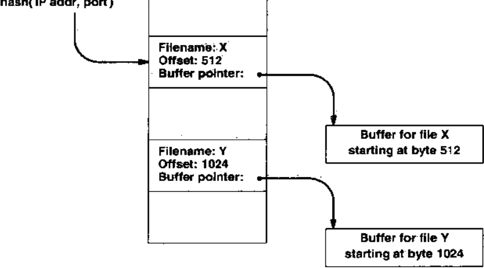

图 8.1 一个为了提高服务器性能而保留的信息表。服务器使用客户端的 IP 地址和协议端口号来查找条目。这种优化引入了状态信息。

程序员使用客户端的 IP 地址和协议端口号作为表的索引，并安排每个表条目包含一个指向正在读取的文件的大缓冲区的容器。当客户端发出第一个请求时，服务器搜索表并发现没有该客户端的记录。它分配一个大缓冲区来存放来自文件的数据，为指针分配一个新的表条目，打开指定的文件并将数据读到缓冲区中。然后它在形成回复时从缓冲区中拷贝数据。当下一次请求来自同一个客户端时，服务器在表中找到匹配的条目，顺着指针找到缓冲区，并从中提取数据而无需打开文件。如果客户端读取了整个文件，服务器将释放缓冲区和表，使资源供其他客户端使用。

当然，每个程序员构建软件时都非常仔细，他们会检查请求中的偏移量以确保请求的数据位于缓冲区中。如果数据不可用，程序必须从文件中读取数据到缓冲区。服务器还会比较请求中指定的文件与表条目中的文件名，以验证客户端仍在使用与上一个请求相同的文件。

如果客户端遵循上述假设且程序员足够小心，在服务器中添加大型文件缓冲区和简单的表可以显著提高其性能。然而，在给定的假设下，优化后的服务器版本执行性能将与先一版本一样快，因为与从磁盘读取所需的时间相比，维护数据结构花费的时间很少。因此，这种优化似乎在没有任何代价的情况下提高了性能。

然而，以一种稳定的方式将建议的更改添加到服务器中会引入状态。当然，粗率选择状态信息可能会导致服务器响应方式出现错误。例如，如果服务器使用客户端的 IP 地址和协议端口号来查找缓冲区，而不检查文件名或偏移量，重复或无序的请求可能会导致服务器返回错误的数据。但请记住，我们说过设计优化版本的程序员让我们的服务器在每个请求中检查文件名和偏移量，以防网络丢失或重复请求，而不是从旧请求按顺序执行。因此，添加状态信息似乎并没有改变其响应的方式。

## 8.9 四种基本服务器类型

服务器可以是迭代的或并发的，可以使用面向连接的传输或无连接的传输。图 8.2 显示这些属性将服务器分为四类。

| 迭代 | 迭代 |
| :--- | :--- |
| 无连接 | 面向连接 |
| 并发 | 并发 |
| 无连接 | 面向连接 |

根据是否提供并发以及是否使用面向连接的传输定义的通用服务器类别。

+虚拟内存系统这种现象描述为抖动（thrashing）。

## 8.10 请求处理时间

通常情况下，迭代式服务器仅适用于最基础的应用程序协议，因为它们会让每个客户端轮队等待。测试一个迭代式实现是否合适，取决于其所需的响应时间，这种时间可以在本地或全局范围内进行测量。

我们将服务器的请求处理时间定义为服务器处理一个孤立请求所花费的总时间，并将客户端观测到的响应时间定义为从其发送请求到服务器响应的时间之间的总延迟。显然，客户端观测到的响应时间可能小于服务器的请求处理时间。然而，如果服务器有一个待处理的请求队列，观测到的响应时间可能会远大于请求处理时间。

迭代式服务器一次只处理一个请求。当服务器忙于处理现有请求时，如果另一个请求到达，它会查看队列看是否有新的请求需要处理。如果 `N` 表示请求队列的平均长度，则到达请求的观测到的响应时间大约为 `N/2` 乘以服务器的请求处理时间。由于观测到的响应时间随 `N` 比例增加，大多数系统会将 `N` 限制在一个较小的值（例如 5），并期望程序员在较小队列不够用时使用并发服务器。

另一种看待迭代式服务器是否足够的方法是关注服务器必须处理的整体负载。一个设计用于处理 `K` 个客户端、每个每秒发送 `R` 个请求的服务器，每个请求的处理时间必须小于 `1/KR` 秒。如果服务器无法以所需的速率处理请求，其等待队列最终将溢出。为了避免可能具有较大请求处理时间的服务器发生溢出，设计者应该考虑并发

## 8.11 迭代式服务器算法

迭代式服务器是最容易设计、编程、调试和修改的。因此，只要迭代式执行能够为预期负载提供高效的快速响应，大多数程序员都会选择迭代设计。通常，迭代式服务器对于通过无连接访问协议的简单服务效果最好。然而，接下来的章节所示，无连接和面向连接的传输层都可以迭代式实现。

## 8.12 一种迭代、面向连接的服务器算法

算法 8.1 展示了通过 TCP 面向连接传输层访问的迭代式服务器算法。算法后的章节详细描述了每个步骤。

| 算法 8.1 |
| :--- |
| 1. 创建套接字并绑定到所提供服务的已知地址。 |
| 2. 将套接字置于被动模式，使其准备服务器使用。 |
| 3. 从套接字接受下一个连接请求，并为该连接获取新套接字。 |
| 4. 重复地从客户端接收请求，制定响应，并根据应用程序协议向客户端回复。 |
| 5. 当完成对特定客户端的操作后，关闭连接并返回步骤 3 以接受新连接。 |

算法 8.1 一种迭代、面向连接的服务器。单线程一次处理一个来自一个客户端的连接。

## 8.13 使用 INADDR_ANY 绑定到已知地址

服务器需要创建一个套接字并将其绑定到其提供的服务的已知端口。像客户端一样，服务器使用过程 `getservbyname` 将服务名称映射到对应的已知端口号。例如，TCP/IP 定义了 ECHO 服务。实现 ECHO 的服务器使用 `getservbyname` 将字符串 "echo" 映射到分配的端口 7。

记住，当 `bind` 为套接字指定连接端点时，它使用 `struct sockaddr_in` 结构，该结构包含了 IP 地址和协议号。因此，`bind` 在不指定 IP 地址的情况下无法为套接字指定协议端口号。遗憾的是，选择服务器接受连接的特定 IP 地址可能会导致困难。对于具有单一网络连接的主机，选择是显而易见的，因为主机只有一个 IP 地址。然而，网关（路由器）和多网主机具有多个 IP 地址。如果服务器在将套接字绑定到协议端口号时指定了一个特定的 IP 地址，则该套接字将不会接受发送到该机器其他 IP 地址的通信。

为了解决这个问题，套接字接口定义了一个特殊常量 `INADDR_ANY`，可以用来代替 IP 地址。`INADDR_ANY` 指定了一个通配符地址，匹配主机的任何 IP 地址。使用 `INADDR_ANY` 使得多网主机上的单台服务器能够接受指向主机任何 IP 地址的入站通信。总结一下：

- 在为套接字指定本地端点时，服务器使用 `INADDR_ANY` 而不是特定的 IP 地址，以便允许套接字接收发送到机器任何 IP 地址的数据报文。

## 8.14 将套接字置于被动模式

TCP 服务器调用 `listen` 将套接字置于被动模式。`listen` 还接受一个参数，指定该套接字的等待请求队列的长度。该队列持有从客户端接收的入站 TCP 连接请求，每个客户端都请求与服务器建立。

## 8.15 接受连接并使用它们

TCP 服务器调用 `accept` 获取下一个入站连接请求（即从请求队列中提取）。该调用返回用于新连接的套接字描述符。一旦接受了新连接，服务器使用 `recv` 从客户端获取应用程序协议请求，并使用 `send` 发回复。最后，当服务器完成连接后，调用 `close` 释放套接字。

## 8.16 一种迭代、无连接的服务器算法

回想迭代式服务器对于请求处理时间短的服务效果最好。由于 TCP 等面向连接的传输协议的开销比 UDP 等无连接传输协议高，大多数迭代式服务器使用无连接传输。算法 8.2 给出了使用 UDP 的迭代服务器的通用算法。迭代无连接服务器的套接字创建过程与面向连接服务器相同。服务器套接字保持未连接状态，并可以接受来自任何客户端的数据报。

## 算法 8.2

- 1. 创建套接字并绑定到所提供服务的已知地址。
- 2. 重复地从客户端接收请求，制定响应，并根据应用程序协议向客户端回复。

算法 8.2 一种迭代、无连接的服务器。单线程一次处理来自客户端的请求（数据报）。

## 8.17 在无连接服务器中形成回复地址


套接口提供了两种指定远程端点的方法。第 6 和 7 章讨论了客户端如何使用 `connect` 指定服务器地址。客户端调用 `connect` 后，可以使用 `send` 发送数据，套接字数据结构包含了远程端点地址以及本地端点地址。然而，无连接服务器无法使用 `connect`，因为这限制了套接字与特定远程主机和端口的通信；服务器再次无法接收任意客户端。因此，无连接服务器使用未连接的套接字。它显式生成地址，并使用 `sendto` 调用指定要发送的数据及其地址。

```
retcode = sendto(s, message, len, flags, toaddr, toaddrlen);
```

其中 `s` 是未连接的套接字，`message` 是包含要发送数据的缓冲区地址，`len` 指定缓冲区中的字节数，`flags` 指定调试或控制选项，`toaddr` 是指向 `sockaddr_struct` 的指针，包含应发送的消息端点地址，`toaddrlen` 是指定地址结构长度的整数。

套接字函数为无连接服务器提供了获取客户端地址的简单方法：服务器从请求中找到源地址获取回复地址。事实上，套接接口提供了一个调用，允许服务器接收下一个到达的数据报的同时获取发送者地址。该调用 `recvfrom` 接受两个指定缓冲区的参数。系统将到达的数据报放在一个缓冲区，并将发送者地址放在第二个缓冲区。`recvfrom` 的调用形式为：

```
retcode = recvfrom(s, buf, len, flags, from, fromlen);
```

其中参数指定要使用的套接字，`buf` 指定存入缓冲区的地址

系统将下一个数据报放置在此处，`len` 指定缓冲区中的可用空间，`from` 指定系统将存放源地址的第二个缓冲区，而 `fromlen` 指定一个整数的地址。初始时，`fromlen` 指定缓冲区长度。当调用返回时，`fromlen` 将包含在缓冲区中的源地址的长度。为了生成回复，服务器使用请求到达时 `recvfrom` 存储在缓冲区中的地址。

## 8.18 并发服务器算法

在服务器中引入并发的主要原因是因为需要为多个客户端提供更快的响应时间。如果满足以下条件，并发可以提高响应时间：

- 形成响应涉及大量的 I/O 操作，
- 不同请求所需的处理时间之间存在巨大差异，或
- 服务器运行在具有多个处理器的计算机上。

在第一种情况下，允许服务器并发计算响应意味着它可以重叠使用处理器和外围设备，即使机器只有一个 CPU。当处理器工作计算一个响应时，I/O 设备可以将数据传输到内存中，这些数据将是其他响应所需要的。在第二种情况下，允许单个处理器处理只需要较少处理的请求，而无需等待耗时较长的请求。在第三种情况下，在具有多个处理器的计算机上并发执行允许一个处理器计算对一个请求的响应，同时另一个处理器计算另一个请求的响应。事实上，大多数并发服务器都会自动适应底层硬件——只要硬件资源越多（例如更多的处理器），它们的性能就越好。

> 并发服务器通过重叠处理和 I/O 来实现高性能。它们的设计通常使得，如果服务器运行在提供更多资源的硬件上，性能就会自动提高。

## 8.19 主线程与从线程

虽然服务器可以使用单线程实现某些并发，但大多数并发服务器使用多个进程或多个线程。线程可以分为两种类型：一个单主线程最初开始执行。主线程在已知端口打开一个套接字，等待下一个请求，并创建一个从线程来处理每个请求。主服务器直接与客户端通信——它将责任传递给从线程。每个从线程负责与一个客户端进行通信。在从线程形成响应并将其发送给客户端后，它就会退出。接下来的章节节将更详细地解释主和从的概念，并展示它们如何应用于无连接的并发服务器和面向连接的并发服务器。

## 8.20 并发无连接服务器算法

最简单的并发无连接服务器版本遵循算法 8.3。

### 算法 8.3

主 1. 创建一个套接字并绑定到所提供服务的已知地址。让套接字保持未连接状态。

主 2. 重复调用 `recvfrom` 以接收来自客户端的下一个请求，并创建一个新的从线程来处理响应。

从 1. 在创建时接收特定的请求以及获取对套接字的访问权限。

从 2. 根据应用协议形成回复，并使用 `sendio` 将其发回客户端。

从 3. 退出（即从线程在处理完一个请求后终止）。

> 算法 8.3 无连接服务器。主服务器线程接受迁入的请求（数据报），并为每个请求创建一个从线程来处理。

程序员人员应该记住，虽然创建进程或线程的确切成本取决于操作系统和底层架构，但该操作可能是昂贵的。在无连接协议的情况下，必须仔细考虑并发的成本是否大于速度的增益。事实上：

由于线程或进程的创建是昂贵的，很少有无连接服务器具有并发实现。

## 8.21 并发面向连接的服务器算法

面向连接的应用协议使用连接作为通信的基本范式。它们允许客户端与服务器建立连接，通过该连接进行通信，然后丢弃它。在大多数情况下，客户端和服务器之间的连接处理的不止一个请求：协议允许客户端反复发送请求并接收响应，而无需终止或创建新连接。因此。

### 算法 8.4

面向连接的服务器在连接之间实现并发，而不是在请求之间。

算法 8.4 指定了并发服务器用于面向连接协议的步骤。

| :--- |
| 主 1. 创建一个套接字并绑定到所提供服务的已知地址。让套接字保持未连接状态。 |
| 主 2. 将套接字置于被动模式，使其准备供服务器使用。 |
| 主 3. 重复调用 `accept` 以接收来自客户端的下一个请求，并创建一个新的从线程来处理响应。 |
| 从 1. 在创建时接收连接请求（即连接的套接字）。 |
| 从 2. 使用连接与客户端交互：接收请求（s）并发回响应（s）。 |
| 从 3. 关闭连接并退出。从线程在处理完一个客户端的所有请求后退出。 |

算法 8.4 并发面向连接的服务器。主服务器线程接受迁入连接并为每个连接创建一个从线程。一旦从线程完成，它就会关闭连接。

在无连接的情况下，主服务器线程从直接与客户端通信。一旦新连接到达，主就会创建一个从线程来处理该连接。当从线程与客户端交互时，主线程等待其他连接。

## 8.22 使用独立程序作为从线程

算法 8.4 显示了并发服务器如何为连接创建新线程。在 Windows 中，主服务器通过调用 `_beginthread` 系统调用来实现。对于简单的应用协议，单个服务器程序可以包含主线程和线程所需的所有代码。在调用 `_beginthread` 后，原始线程循环回来以接受下一个连接，而新线程成为从线程。在某些情况下，创建一个从进程并让其执行独立的代码可能更方便。Windows 可以轻松地处理这种情况，因为它允许从进程调用 `CreateProcess`。通常的想法是：

> 对于许多服务，单个程序可以包含主线程和线程的代码。在独立程序使得更方便的情况下

## 8.23 使用单线程实现表观并发

前面的章节讨论了使用并发线程或进程实现的并发服务器。在某些情况下，使用单线程并发处理请求是有意义的。特别是，某些操作系统使得线程创建极其昂贵，以至于服务器无法为每个请求创建一个新线程。在其他仅支持进程的系统中，任何共享信息的线程都需要单个进程。

为了理解使用单线程提供表观并发的动机，请考虑 X 窗口系统。它允许多个客户端在位图显示器上绘制文本和图形窗口。每个客户端控制自己的窗口，发送更新请求。每个客户端独立运行，可能等待数小时才更改显示，也频繁更新显示。例如，一个通过绘制时钟图像显示时间的应用程序每分钟更新一次显示。与此同时，显示用户电子邮件状态的应用程序会等待新邮件到达后才显示。

X 窗口系统的服务器将从客户端获得的信息集成到内存的一个连续区域，称为显示缓冲区。因为来自所有客户端的数据都贡献于同一个共享数据结构，且系统不支持线程允许独立进程共享内存，因此服务器无法作为单独进程执行。这种冲突产生于共享内存进程之间的并发愿望与对这种并发支持缺乏。

尽管实现所需的真实并发可能是低效或不可行的，但如果呈现服务器的请求总负载不超过其处理能力，那么实现表观并发可能是可能的。为了这样做，服务器作为单线程运行，但使用类似 `select` 的函数提供异步 I/O。算法 8.5 描述了单线程服务器处理多个连接的步骤。

### 算法 8.5

1. 创建套接字并绑定到该服务的已知端口。将套接字加入可以进行 I/O 的套接字列表。
2. 使用 `select` 等待现有套接字的 I/O 操作。
3. 如果原始套接字就绪，使用 `accept` 获取下一个连接，并将新套接字加入可以进行 I/O 的套接字列表。
4. 如果原始套接字以外的某个套接字就绪，使用 `recv` 获取下一个请求，形成响应，并使用 `send` 将响应发回客户端。
5. 继续执行上述 2 步。

> 算法 8.5 一个由单线程实现的并发、面向连接的服务器。服务器等待下一个就绪的描述符，这可能意味着有一个新连接到达，也可能意味着客户端在现有连接上发送了请求。

## 8.24 何时使用每种服务器类型

迭代与并发：迭代服务器更容易设计、实现和维护，但并发服务器可以对请求提供更快的响应。如果请求处理时间很短，且迭代方案产生的响应时间对于应用程序足够快，则使用迭代实现。


真实与表现并发：单线程服务器必须管理多个连接并使用异步 I/O；多线程服务器允许操作系统自动处理并发。如果线程创建开销很大或不可用，使用单线程方案。如果服务器必须在连接之间共享或交换数据，则使用多线程方案。如果每个从进程都应该在隔离状态下运行或为了实现最大并发（例如在多进程中），则使用多进程方案。

面向连接与无连接：因为面向连接的访问意味着 TCP，这意味着可靠的交付。因为无连接传输意味着使用 UDP，这意味着不可靠的交付。只有当应用程序协议处理可靠性（几乎没有协议是这样的）或每个客户端在丢包极低且无数据包重数的局域网上访问其服务器时，才使用无连接传输。当广域网分隔客户端和服务器时，使用面向连接的传输。在检查应用程序协议是否处理了可靠性问题之前，切勿将无连接的客户端服务器移动到广网环境中。

## 8.25 服务器类型总结

### 迭代、无连接服务器

无连接服务器最常见的形式，特别适用于对每个请求仅需极少量处理的服务。迭代服务器通常是无状态的，使它们更容易理解且较不容易受到故障影响。

### 迭代、面向连接服务器

一种不常见的服务器类型，适用于对每个请求仅需极少量处理，但需要可靠传输的服务。由于建立和终止连接的关联开销可能很高，平均响应时间可能不容忽视。

### 并发、无连接服务器

一种不常见的类型，服务器为处理每个请求创建一个新线程。在许多系统中，创建线程带来的额外开销超过了从并发中获得的效率提升。为了证明并发的合理性，创建新线程所需的时间必须显著少于计算响应所需的时间，或者并发请求必须能够同时使用多个 I/O 设备。

### 并发、面向连接服务器

这是最通用的服务器类型，因为它提供了可靠的传输（即它可以在广域网网上使用）以及同时并发处理多个请求的能力。目前存在两种基本实现方式：使用并发线程或进程处理连接；另一种更少见的实现依赖于单线程和异步 I/O 来处理多个连接。

在并发进程实现中，主服务器进程为每个连接创建一个从进程来处理。每个进程都有自己的地址空间，并在从进程之间共享数据。使用多个进程可以很容易为每个连接执行一个单独编译的程序，而不是将所有代码写在一个单一的大服务器进程中。

在并发线程实现中，主线程在同一进程内创建从线程来处理每个连接。所有线程共享全局地址空间并可以共享数据。

在单线程实现中，服务器管理多个连接。它通过使用异步 I/O 实现并发。线程反复等待任何一个可以共享数据的连接的 I/O，因为单个线程处理所有连接，它可以在之间共享数据，就像在进程内使用多个线程的设计一样。然而，由于服务器只有一个线程，即使在具有多个处理器的计算机上，它处理请求的速度也不会比迭代服务器快。应用程序对每个请求必须有很短的处理时间，才能证明这种服务器实现的合理性。

## 8.2 服务器死锁的重要问题

许多并发服务器都有一个重要的缺陷：即服务器可能会发生死锁。为了理解死锁如何发生，考虑一个迭代的面向连接的服务器。假设某个客户端程序 C 行为异常。在最简单的情况下，假设 C 与服务器建立了连接，但从不发送请求。服务器将接受新连接，并调用 `recv` 来提取下一个请求。在 `recv` 调用中的服务器线程将等待一个永远不会到达的请求。

**服务器死锁**在客户端通过消耗资源表现异常时可能会更微妙的方式产生。例如，假设客户端 C 与服务器建立了连接，发送了一系列请求，但从不读取响应。服务器不断接受请求、生成响应并将它们发回客户端。在客户端端，TCP 协议栈通过连接将第一个字节传输给客户端。TCP 将填充客户端的接收窗口并停止传输数据。如果服务器程序继续生成请求，TCP 用于存储该连接数据的本地缓冲区将变满，服务器将阻塞。

死锁的产生是因为当操作系统无法满足请求时线程被阻塞。具体来说，如果 TCP 为正在发送的数据没有本地缓冲区空间，调用 `send` 将阻塞调用线程；调用 `recv` 将阻塞调用线程，直到 TCP 接收到数据。死锁产生是因为线程在操作系统无法满足请求时阻塞。特别是，如果 TCP 为正在发送的数据没有本地缓冲区空间，调用 `send` 将阻塞调用线程；调用 `recv` 将阻塞调用线程，直到 TCP 接收到数据。对于并发服务器，如果客户端不发送请求或读取响应，单线程可能会被阻塞。对于任何使用单线程的服务器，服务器会阻塞并无法处理其他连接。

> 行为异常的客户端可以导致单线程服务器发生死锁。死锁对于服务器来说是一个严重的缺陷，因为它意味着一个客户端的行为会阻止服务器处理其他连接。

## 8.27 其他实现方案

第 9 到 12 章提供了本章所述服务器算法的示例。第 13 和 14 章通过讨论两种重要的实际实现技术扩展了这些思想：多进程和多线程服务器。虽然这些技术对某些应用程序都有优势，但它们在这里被理解为第 12 章单线程算法的简单泛化。

> 死锁术语是指程序等待永远发生的事件而阻塞的状态。对于服务器来说，死锁意味着停止响应请求。

## 8.28 总结

从概念上说，服务器由一个迭代算法组成，等待客户端请求，处理请求并发送回复。在实践中，服务器使用各种实现来实现可靠性、灵活性效率。

迭代实现适用于计算量小的服务。使用面向连接传输时，迭代服务器一次处理一个连接；对于无连接传输，迭代服务器通常通过同时处理多个请求提供并发服务。面向连接的服务器通过为每个新连接创建线程或进程来实现并发。无连接服务器通过为每个新请求创建线程或进程来实现并发。

任何使用 `recv` 或 `send` 等同步函数的单线程服务器都可能发生死锁。死锁可能发生在迭代服务器中，也可能发生在单线程实现的并发服务器中。服务器死锁尤其严重，因为它意味着单个异常异常客户端就可以阻止服务器处理其他客户端的请求。

## 进一步学习

Stevens [1990] 描述了本章涵盖的一些服务器算法并展示了实现细节。

## 练习

- 8.1 如果互联网吞吐量为 2.3 KB/s，计算迭代服务器传输 200 MB 文件需要多久。
- 8.2 如果 20 个客户端向迭代服务器每秒发送 2 次请求，服务器处理每个请求最多可以花费多久？
- 8.3 在你可以访问的计算机上，并发面向连接服务器接受新连接并创建一个新线程来处理需要多久？将其与创建新进程而非线程的时间进行比较。
- 8.4 为并发无连接服务器编写一个算法，为每个请求创建一个线程。
- 8.5 修改上一个问题中的算法，使服务器为每个客户端创建一个新线程而不是为每个请求创建一个新线程。你的算法如何处理线程终止？
- 8.6 面向连接的服务器提供了连接间的并发性。对于一个并发的面向连接的服务器，通过让从为每个请求创建额外的线程来进一步增加并发性是否有意义？请解释。
- 8.7 客户端是否会导致并发服务器出现死锁或中断服务？为什么会，或者为什么不会？
- 8.8 仔细观察 `select` 函数。单线程服务器如何使用 `select` 来避免死锁？
- 8.9 `select` 调用接受一个参数，指定它应该检查多少个 I/O 描述符。解释该参数如何让单线程服务器在多个系统中具有移植性。
- 9.10 在 Windows 中，`select` 调用只能与 socket 描述符配合。解释这给单线程实现带来了哪些问题？提示：考虑一个单线程 TCP 回显客户端，它并发处理来自键盘的输入、TCP 连接的输入以及指向 TCP 连接的输出。

# 9 迭代、无连接服务器 (UDP)

## 9.1 引言

上一章讨论了许多可能的服务器设计，并比较了每种优缺点。本章提供了一个使用无连接传输的迭代服务器实现示例。该示例服务器遵循算法 8.2。后续章节将通过提供其他服务器算法的实现示例继续讨论。

## 9.2 创建被动式 socket

创建被动式 socket 所需的步骤与创建活动服务器的步骤类似。它们涉及许多细节，并要求程序查找服务器名称并获取已知协议端口号。

为了帮助简化服务器代码，程序员应该使用过程来隐藏 socket 分配的细节。就像客户端示例中一样，我们的示例实现使用了两个高级过程：`passiveUDP` 和 `passiveTCP`，它们分配一个被动式 socket 并将其绑定到服务器的已知端口。每个服务器调用这些过程中的一个，具体取决于取决于服务器使用无连接还是面向连接的传输。本章将考虑 `passiveUDP`，下一章将显示 `passiveTCP` 的代码。由于这两个过程有许多共同细节，它们都调用底层过程 `passivesocket` 来执行工作。

> + 请参阅第 109 页查看算法 8.2 的描述。

# 迭代、无连接服务器 (UDP) 第 9 章

无连接服务器调用函数 `passiveUDP` 为其提供的服务创建一个 socket。任意应用程序可以使用 `passiveUDP` 为服务创建 socket。`passiveUDP` 调用 `passocket` 创建一个无连接 socket，并将 socket 描述符返回给调用者。

为了方便测试客户端和服务器软件，`passocket` 通过加上全局整数 `portbase` 的内容重定位所有端口值。`portbase` 的重要将在后面的章节中变得更加清晰。然而，基本原理相当容易理解：

> 如果新版本的客户端-服务器应用程序与现有生产版本相同的协议端口号，那么在生产版本继续执行时，新软件无法进行测试。


`portbase`允许程序员编译服务器的修改版本，并让服务器使用标准端口并将标准端口和`portbase`值的函数计算最终端口号。如果程序员为每对客户端-服务器选择一个唯一的`portbase`值，则新版本使用的端口将不会与生产版本使用的端口冲突。事实上，使用`portbase`使得同时互不干扰地测试多个版本的客户端-服务器对成为可能，因为每对的通信都是彼此独立的。

```cpp
/* passiveUDP.cpp - passiveUDP */

#include <winsock.h>

SOCKET passocket(const char *, const char *, int);

/*------------------------------------------------------
 * passiveUDP - 为 UDP 服务器创建用于被动式 socket
 *------------------------------------------------------*/
SOCKET
passiveUDP(const char *service)
{
    return passocket(service, "udp", 0);
}
```

过程`passocket`包含了 socket 分配的细节，包括`portbase`的使用。它接受三个参数。第一个参数指定服务的名称，第二个参数指定协议名称，第三个参数（仅用于 TCP socket）指定连接请求队列所需的长度。`passocket`分配数据报或流式 socket，将 socket 绑定到服务的已知端口，并将 socket 描述符返回给调用者。

# 第 9.2 节 创建被动式 socket 121

回想起当服务器将 socket 绑定到已知端口时，它必须使用`sockaddr_in`结构指定地址，其中包含 IP 地址和协议号。`passivesocket`使用常量`INADDR_ANY`而不是特定的本地 IP 地址，使其能够在具有单个 IP 地址的主机上工作，也可以在具有多个 IP 地址的网关（路由器）和多宿主主机上工作。使用`INADDR_ANY`意味着服务器将接收发送到其机器任何 IP 地址的已知端口的通信。

```cpp
/* *passocket.cpp - passivesocket */
#include <stdlib.h>
#include <string.h>
#include <winsock.h>

void      errexit(const char *, ...);

u_short portbase = 0;               /* 端口基础，用于测试服务器 */
--------------------------------------------------------------------------------------
/* passivesocket - 使用 TCP 或 UDP 分配并绑定服务器 socket
--------------------------------------------------------------------------------------*/
SOCKET
passocket(const servant *service, const char *transport, int qlen)
{
	struct servant *pse;                /* 指向服务信息条目的指针 */
	struct proto *tpe;                 /* 指向协议信息条目的指针 */
	struct sockaddr_in *sin;           /* Internet 端点地址 */
	SOCKET s;                        /* socket 描述符 */
	int type;                      /* socket 类型 (SOCK_STREAM, SOCK_DGRAM) */
```

```cpp
memset(&sin, 0, sizeof(sin));
sin.family = AF_INET;
sin.addr.s_addr = INADDR_ANY;
```

```cpp
/* 映射服务名称到端口 */
if ( pse = getservbyname(service, transport) ) {
	sin.sin_port = htons(ntoh((u_short)pse->s_port) + portbase);
}
else if (sin.sin_port = htons((u_short)atoi(service))) == 0) {
	errexit("找不到 %s 服务条目\n", service);
}
```

```cpp
/* 映射协议名称到协议号 */
if ( ppe = getprotobname(transport)) == 0)
    errexit("找不到 %s 协议条目\n", transport);
```

```cpp
/* 使用协议选择 socket 类型 */
if (strcmp(transport, "udp") == 0)
    type = SOCK_DGRAM;
else
    type = SOCK_STREAM;
```

```cpp
/* 分配 socket */
s = socket(PF_INET, type, ppe->p_proto);
if (s == INVALID_SOCKET)
    errexit("创建 socket 失败: %d\n", GetLastError());
```

```cpp
/* 绑定 socket */
if (bind(s, (struct sockaddr *)sin, sizeof(sin)) == SOCKET_ERROR)
    errexit("绑定到 %s 端口失败: %d\n", service,
    GetLastError());
```

```cpp
if (type == SOCK_STREAM && listen(s, qlen) == SOCKET_ERROR)
    errexit("在 %s 端口监听失败: %d\n", service,
    GetLastError());
```

```cpp
return s;
```

## 9.3 线程结构

图 9.1 展示了迭代、无连接服务器使用的简单线程结构。

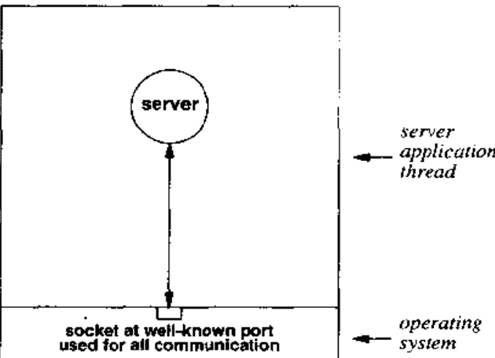

**图 9.1** 迭代无连接服务器的线程结构。单线程服务器使用一个 socket 与多个客户端通信。

单线程服务器永久运行。它使用单个被动式 socket，该 socket 已绑定到其提供的服务的已知协议端口。服务器从 socket 获取请求，计算响应，并使用同一个 socket 将回复发回客户端。服务器使用请求中的源地址作为回复中的目标地址。

## 9.4 示例 TIME 服务器

一个示例将说明无连接服务器如何使用上述 socket 分配过程。回想第 7 章，客户端使用 TIME 从另一个系统的服务器获取当前时间。由于 TIME 需要计算较少，迭代服务器实现效果良好。文件`UDPTimed.cpp`包含迭代无连接 TIME 服务器的代码。

# 迭代式、无连接服务器 (UDP) - 第9章

```cpp
/* UDP_ptimed.cpp - main */

#include <time.h>
#include <winsock.h>

SOCKET passiveUDP(const char *);
void   errexit(const char *, ...);
```

```cpp
#define WINERPOCH     2208988800  /* Windows 时间戳，UTC 秒数 */
#define WSVERS        MAKEWORD(2, 0)
```

```cpp
/*
 * main - 用于 TIME 服务器的迭代式 UDP 服务器
 * */
```

```cpp
int
main(int argc, char *argv[])
{
    struct sockaddr_in fsin;      /* 客户端地址 */
    char             *service = "time";  /* 服务名称或端口号 */
    char             buf[2048];      /* "input"缓冲区；任何大于1个数据包的大小 */
    SOCKET           sock;           /* 服务器套字 */
    time_t           now;            /* 当前时间 */
    int              alen;           /* 源地址长度 */
    WSADATA          wsadata;
```


```cpp
switch (argc) {
    case 1:
        break;
    case 2:
        service = argv[1];
        break;
    default:
        errexit("usage: UDP_ptimed\n");
}
```

```cpp
if (WSASStartup(WSVERS, &wsadata))
    errexit("WSASStartup failed\n");
sock = passiveUDP(service);
```

```cpp
while (1) {
    alen = sizeof(fsin);
    if (recvfrom(sock, buf, sizeof(buf), 0,
        (struct sockaddr *) &fsin, &alen) == SOCKET_ERROR
```

# 第 9.4 节 示例 TIME 服务器

```cpp
    errexit("recvfrom: error %d\n", GetLastError());
    (void) time(&now);
    now = htoml((u_long)now + WINERPOCH);
    (void) sendto(socket, (char *)&now, sizeof(now), 0,
        (struct sockaddr *)&fsin, sizeof(fsin));

}
return 1; /* 不可到达 */
```

与任何服务器一样，`UDPTimed` 线程必须永远执行。因此，代码的主体由一个无限循环组成，该循环接收请求、计算当前时间并将回复发送给发送请求的客户端。

代码包含几个细节。在解析参数后，`UDPTimed` 调用 `passiveUDP` 为 `TIME` 服务创建一个套接字。它进入无限循环。`TIME` 协议规定，客户端可以发送任意数据报来触发回复。该数据报可以是任意长度的，并且可以包含任何值，因为服务器并不解释其内容。`recvfrom` 将入站的数据报放置在缓冲区 `buf` 中，并填充发送该数据报的客户端的端点地址。

`Timed` 使用 Windows 函数 `time` 来获取当前时间。回想第 7 章，Windows 使用 32 位整数表示时间，从 1970 年 1 月 1 日午夜（纪元）开始测量。从 Windows 获取时间后，`UPDTimed` 必须将其转换为从互联网纪元（Internet epoch）测量的值，并将结果置于网络字节序。为了执行转换，它加上了常量 `WINERPOCH`，该常量定义值为 2208988800，即互联网纪元与 Windows 纪元之间的秒差。然后它调用函数 `htol` 将结果转换为网络字节序。最后，`UPDTimed` 调用 `sendto` 将结果传回客户端。`sendto` 使用结构体 `fsin` 中的端点地址作为目标地址（即它使用了发送数据报的客户端的地址）。

## 9.5 总结

对于简单的服务（即服务器对每个请求的计算很少的服务器），迭代式实现效果良好。本章介绍了一个用于 `TIME` 服务的迭代式服务器示例，该服务器使用 `UDP` 进行无连接访问。该示例说明了过程如何隐藏套接字分配的细节，并可以使服务器代码更简单、更易理解。

## 进一步学习

Hartenstein-[RFC 738] 规定了 `TIME` 协议。Mills [RFC 1305] 描述了网络时间协议 (`NTP`)；Mills [September 1991] 总结了在实际网络中使用 `NTP` 的相关问题，Mills [RFC 1361] 讨论了使用 `NTP` 进行时钟同步。Marzullo 和 Owicki [July 1985] 也讨论了在分布式环境中如何维护时钟。

# 练习题

- 9.1 对 `UDPTimed` 进行计时，以确定它处理每个请求花费多少时间。如果你可以访问网络分析器，也测量请求包和响应包之间经过的时间。

- 9.2 假设 `UDPTimed` 在接收和发送响应之间无意中覆盖了客户端地址（即在您调用 `sendto` 之前，服务器不地分配了一个随机值）。会发生什么？为什么？

- 9.3 进行一个实验，确定当 `N` 个客户端同时向 `UDP-timed` 发送请求时会发生什么。改变 `N`（发送者数量）和 `S`（数据包大小）。解释为什么服务器未能响应所有请求。

- 9.4 `UDPTimed.cc` 中的示例代码在调用 `recvfrom` 时指定了 2048 的缓冲区大小。如果它指定的缓冲区大小为 1 会发生什么？

- 9.5 计算 Windows 时间纪元与互联网时间纪元之间的差异。记得考虑闰年。

- 9.6 作为安全检查，系统管理员要求你修改 `UDPTimed`，使其记录所有访问服务器的客户端。修改代码，每当请求到达时在控制台上打印一行。解释日志如何影响服务。

- 9.7 如果你有两台连接的机器，使用第 7 章的 `UDP` 客户端和本章的 `UPDTimed` 服务器观察互联网丢包情况。

# 迭代式、面向连接的服务器 (TCP)

## 10.1 引言

上一章提供了一个使用 `UDP` 的迭代式服务器示例。本章展示了迭代式服务器如何使用 `TCP`。遵循算法 8.1。

## 10.2 分配被动套接字

第9章提到面向连接的服务器使用 `passiveTCP` 分配套接字并将其绑定到已知端口。`passiveTCP` 取两个参数。第一个参数是字符串，指定服务的名称或数字，第二个参数指定输入队列的长度。如果第一个参数包含名称，它必须匹配由 `getservbyname` 访问的服务数据库项。如果第一个参数指定端口号，它必须以文本字符串表示该数字（例如 `"79"`）。

```cpp
/* passTCP.cpp - passiveTCP */

#include <winsock.h>

SOCKET passivesock(const char *, const char *, int);

/*
 * passiveTCP - 为 TCP 服务器创建被动套接字
 * */
SOCKET passiveTCP(const char *service, int int)
passiveTCP(const char *service, int qlen)
{
    return passivesock(service, "tcp*", qlen);
}
```

## 10.3 用于 DAYTIME 服务的

回想第 7 章，`DAYTIME` 服务允许一台机器上的用户从另一台机器获取当前的日期和时间。因为 `DAYTIME` 服务是为了人类设计的，它规定服务器在发送回复时必须将日期格式化为易读的 ASCII 文本字符串。因此，客户端可以按照收到的方式显示响应。

第 7 章展示了客户端如何使用 `TCP` 连接 `DAYTIME` 服务器并显示服务器发送的日期。由于获取和格式化日期所需的处理很少，且预计服务需求不大，`DAYTIME` 服务器不需要为了速度进行优化。

## 10.4 线程结构

如图 10.1 所示，迭代式面向连接的服务器使用单个线程。该线程无限循环，使用一个套接字处理入站请求，并使用第二个临时套接字与客户端进行通信。

### 10.4 节 线程结构

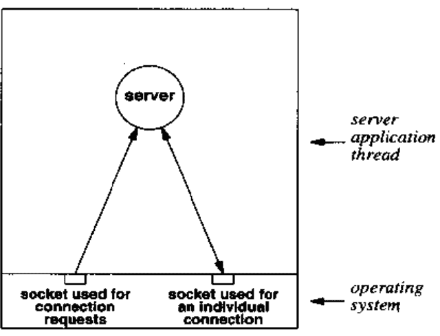

**图 10.1** 迭代、面向连接服务器的线程结构。服务器在已知端口等待连接，然后通过该连接与客户端进行通信。

使用面向连接的传输协议的服务器会对连接进行迭代：它在已知端口等待来自客户端的下一个连接到达，接受连接、处理连接、关闭连接，然后再次等待。`DAYTIME` 服务使得实现变得特别简单，因为服务器不需要从客户端接收显式请求——它利用新入入连接的出现来触发响应。由于客户端没有发送显式请求，服务器不会从该连接中接收数据。

## 10.5 示例 DAYTIME 服务器

文件 `TCPdtd.cpp` 包含一个迭代式、面向连接的 `DAYTIME` 服务器的示例代码。

```cpp
/* TCPdtdd.cpp - main, TCPdaytimed */

#include <stdlib.h>
#include <winsock.h>
#include <time.h>
```

```cpp
void   exit(const char *, ...);
void   TCPdaytimed(SOCKET);
SOCKET passiveTCP(const char *, int);
```

```cpp
#define QLEN      5
#define WSVERS  MAKEWORD(2, 0)
```

```cpp
/*-----------
* main   用于 DAYTIME 服务的迭代式 TCP 服务器
 */
```


```cpp
void
main(int argc, char *argv[])
{
    struct  sockaddr_in fsin;      /* 客户端的地址 */
    char    *service = "daytime";  /* 服务名称或端口号 */
    SOCKET  msock, ssock;          /* 主套字与从套字 */
    int     alen;                 /* 源地址长度 */
    WSADATA wsadata;
```

```cpp
switch (argc) {
    case 1:
        break;
    case 2:
        service = argv[1];
        break;
    default:
        errexit("usage: TCPdaytimed [port]\n");
}
```

```cpp
if (WSAStartup(WSVERS, &wsadata) != 0)
    failed("WSAStartup failed\n");
```

```cpp
msock = passiveTCP(service, QLEN);
```

```cpp
while (1) {
        alen = sizeof(struct sockaddr);
        ssock = accept(msock, (struct sockaddr*)fsin, &alen);
```

```cpp
if (sock == INVALID_SOCKET)
    errexit("accept failed: error number %d\n",
    GetLastError());
TCPdaytimed(sock);
    (void) closesocket(sock);
```

```cpp
/* TCPdaytimed - 执行 TCP DAYTIME 协议 */
void TCPdaytimed(socket fd) {
    char *pts; /* 指向时间字符串的指针 */
    time_t now; /* 当前时间 */
    (void) time(&now);
    pts = ctime(&now);
    (void) send(fd, pts, strlen(pts), 0);
}
```

与上一节描述的迭代无连接服务器类似，迭代、面向连接的服务器必须永远运行。在创建了监听已知端口的套接字后，服务器进入一个无限循环，在循环中接受并处理连接。

服务器的代码非常短，因为 `passiveTCP` 隐藏了套接字分配和绑定的细节。对 `passiveTCP` 的调用创建了一个与 `DAYTIME` 服务已知端口关联的主套接字。第二个参数指定主套接字将具有长度为 `QLEN` 的请求队列，允许系统在服务器忙回复特定客户端时，将来自额外 `QLEN` 个客户端的连接请求放入队列。

在创建主套接字后，服务器的主程序进入无限循环。在循环的每次迭代中，服务器调用 `accept` 从主套接字获取下一个连接请求。为了防止服务器在等待客户端连接时消耗资源，`accept` 调用会阻塞服务器直到连接到达。当连接请求到达时，TCP 协议软件会进行三次握手以建立连接。一旦握手完成且系统为新入的连接分配了新的套接字，`accept` 调用将返回新套接字的描述符，允许服务器继续执行。如果没有连接到达，服务器将永久阻塞在 `accept` 调用中。

每当有新连接到达时，服务器都会调用过程 `TCPdaytimed` 程序来处理它。`TCPdaytimed` 中的代码围绕对 Windows 函数 `time` 和 `ctime` 的调用展开。过程 `time` 返回一个 32 位整数，给出自 Windows 纪元以来的秒数。该 C 库函数接受一个整数参数，指定 Windows 纪元内的秒数时间，并返回一个 ASCII 字符串日期的地址，该格式人类可以读懂。一旦服务器获取了 ASCII 字符串格式的时间日期，就可以通过 TCP 连接将该字符串发回客户端。

一旦 `TCPdaytimed` 调用返回，主程序继续执行循环，并再次遇到 `accept` 调用。`accept` 调用阻塞服务器直到另一个请求到达。

## 10.6 关闭连接

在写入响应后，过程 `TCPdaytimed` 的调用返回。一旦调用返回，主程序会显式关闭连接到达时所在的套接字。

调用 `closesocket` 确保了优雅关闭。特别是，TCP 保证了优雅关闭。通过 `closesocket` 确保了数据被可靠交付。

当然，TCP 的优雅关闭意味着在 TCP 确认所有数据之前，`closesocket` 调用不会立即返回。

## 10.7 连接终止与脆弱性

应用程序协议决定了服务器如何管理连接。特别是，应用程序协议通常规定了终止策略。例如，考虑 `ECHO`。由于服务器必须处理任意数量的数据，客户端控制了交换的数据量。因为服务器在接收和发送后无法直接关闭连接。因此，客户端必须指示完成，以便服务器知道终止连接。

## 10.8 总结

迭代、面向连接的服务器对每个连接迭代一次。在连接到达之前，阻塞在 `accept` 调用中。一旦底层协议软件建立了新连接并创建了新套接字，`accept` 调用返回套接字描述符并允许服务器继续执行。

回顾第 7 节，`DAYTIME` 协议利用连接的出现在检测到新连接时触发响应。为了形成响应，服务器从操作系统获取当前时间，将其转换为人类可读的字符串，然后将响应发回客户端。示例服务器在发送响应后关闭与单个连接对应的套接字。立即关闭连接的策略之所以有效，是因为 `DAYTIME` 服务每个连接只允许一次响应。允许在连接上接收多次请求的服务器必须等待客户端关闭连接。

## 扩展阅读

`Postel` [`RFC 867`] 描述了本章使用的 `DAYTIME` 协议。

## 习题

+ 10.1 在你的本地系统上运行 `DAYTIME` 服务器需要特权吗？运行 `DAYTIME` 客户端需要特权吗？请解释。

+ 10.2 使用连接的出现触发服务器响应的主要优势是什么？主要缺点是什么？

某些 `DAYTIME` 服务器通过两个字符的组合：回车符（CR）和换行符（LF）来结束行。修改示例服务器，使其在行尾发送 `CR-LF` 而不是仅发送 `LF`。标准是如何规定行结束的？

`TCP` 软件通常为服务器忙期间到达的额外连接请求分配一个固定大小的队列；允许服务器在监听（`listen`）时更改队列大小。你的本地 `TCP` 软件提供的队列有多大？服务器通过 `listen` 能够将队列调大到多大？

修改 `TCPptd.cpp` 中的示例代码，使其在写入响应后不再显式关闭连接。它运行正常吗？为什么？或者为什么不？

比较在发送响应后显式关闭每个连接的面向连接的服务器，与允许客户端在关闭连接前任意长时间保持连接的服务器。这两种方法的优缺点是什么？

假设 `TCP` 使用 4 分钟的连接超时（即在连接关闭后保留 4 分钟留信息）。如果一个 `DAYTIME` 服务器运行在一个具有 100 个 `TCP` 连接信息槽位的系统中，该服务器在不耗尽槽位的情况下处理请求的最大速率是多少？

## 11

## 并发、面向连接的服务器 (TCP+)

## 11.1 引言

上一节说明了迭代服务器如何使用面向连接的传输协议。本节提供了一个使用面向连接传输协议的并发服务器示例。示例服务器遵循算法 8.4+，这是程序员在构建并发 `TCP` 服务器时最常用的设计。该服务器依赖操作系统对并发处理的支持，在计算响应时实现并发。系统管理员安排主服务器在系统启动时自动启动。主服务器持续运行，等待客户端的连接请求。主服务器创建一个新的从线程来处理每个新连接，并允许每个从线程处理与其客户端的所有通信。

后续章节将考虑并发服务器的替代实现方案，并展示如何扩展这里介绍的基本思想。

### 11.2 并发 ECHO

考虑第 7 节描述的 `ECHO` 服务器。客户端与服务器建立连接，然后通过连接反复发送数据并接收服务器返回的“回声”。`ECHO` 服务器对每个客户端做出响应。它接受连接，从连接接收数据，并发送回相同的数据。

> † 参见第 112 页关于算法 8.4 的描述。

为了允许客户端发送任意数量的数据，服务器在发送响应之前不会接收整个输入。相反，它在接收和发送之间交替。当新连接到达时，服务器进入一个循环。在循环的每次迭代中，服务器首先从连接接收数据，然后将数据发回。服务器继续迭代直到遇到文件结束（EOF）条件，此时它关闭连接。

## 11.3 迭代实现与并发实现

`ECHO` 服务器的迭代实现性能可能很差，因为它要求给客户端在它处理所有之前的连接请求时等待。如果客户端选择发送大量数据（例如许多兆字节），迭代服务器将延迟所有客户端，直到它可以满足该请求。

`ECHO` 服务器的并发实现避免了长时间的延迟，因为它不允许单个客户端占用所有资源。相反，并发服务器允许与许多客户端同时进行通信。因此，从客户端的角度来看，并发服务器提供的观测响应时间比迭代服务器更优。

## 11.4 线程结构


图 11.1 展示了并发、面向连接服务器的线程结构。如图所示，主服务器不直接与客户端通信。相反，它只是在已知端口等待下一个连接请求。一旦请求到达，系统会返回用于该连接的新套接字描述符（`socket descriptor`）。主服务器创建一个从线程来处理该连接，并允许从线程并发操作。在任何时刻，服务器由一个主线程和零或多个从线程组成。

### 11.4 节 线程结构

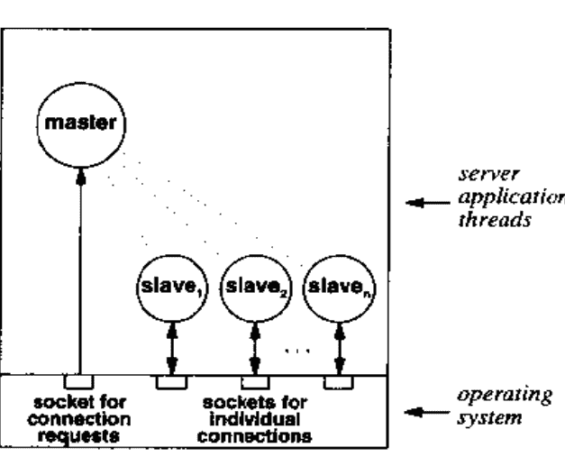

图 11.1 并发、面向连接服务器的线程结构。主服务器线程接受每个传入的连接，并创建一个从线程来处理它。

为了在等待连接时不占用 CPU 资源，主线程使用 `accept` 的阻塞调用从已知端口获取下一个连接。因此，类似于第 10 节中的迭代服务器一样，并发服务器中的主服务器线程在连接后，`accept` 调用返回，允许主线程执行。当连接请求到达时，`accept` 调用返回，主线程创建一个从线程来处理请求，并重新调用 `accept`。该调用会再次阻塞主线程，直到另一个连接请求到达。

### 11.5 一个并发 ECHO 服务器示例

文件 `TCPechod.cpp` 包含一个 ECHO 服务器的代码，该服务器使用并发线程为多个客户端提供并发服务。

138 `TCPechod` - 并发、面向连接的服务器 (`TCP`) 第 11 章

```cpp
/* TCPechod.cpp - main, TCPechod */

#include <stdio.h>
#include <winsock.h>
#include <process.h>

#define QLEN 5             /* 最大连接队列长度 */
#define STKSIZE 16536
#define BUFFERSIZE 4096
#define WSVERS MAKEWORD(2, 0)

SOCKET msock, ssock;      /* 主/从服务器套接字 */

int TCPechod(SOCKET);
void errexit(const char *, ...);
SOCKET passiveTCP(const char *, int);
```

```cpp
/*----------
 * main - ECHO服务的 TCP 服务器
 * */
int main(int argc, char *argv[]) {
	char *service = "echo"; /* 服务名或端口 */
	struct sockaddr_in fsin;  /* 客户端地址 */
	int alen;                   /* 地址长度 */
	WSADATA wsadata;

	switch (argc) {
	case 1:
		break;
	case 2:
		service = argv[1];
		break;
	default:
		errexit("usage: TCPechod [port]\n");
	}

	if (WSAStartup(WSVERS, &wsadata) != 0)
		errexit("WSAStartup failed\n");
	msock = passiveTCP(service, QLEN);

	while (1) {
```

139 `TCPechod` - 并发、面向连接的服务器 (`TCP`)

#### 11.5 节 并发 ECHO 服务器

```cpp
/*
 * main - ECHO服务的 TCP 服务器
 * */
int main(int argc, char *argv[]) {
	char *service = "echo"; /* 服务名或端口 */
	struct sockaddr_in fsin;  /* 客户端地址 */
	int alen;                   /* 地址长度 */
	WSADATA wsadata;

	switch (argc) {
	case 1:
		break;
	case 2:
		service = argv[1];
		break;
	default:
		errexit("usage: TCPechod [port]\n");
	}

	if (WSAStartup(WSVERS, &wsadata) != 0)
		errexit("WSAStartup failed\n");
	msock = passiveTCP(service, QLEN);

	while (1) {
		ssock = accept(msock, (struct sockaddr *)&fsin, (socklen_t *)&alen);
		if (ssock == INVALID_SOCKET) {
			if (GetLastError() != WSAEDBLOCK)
				errexit("accept error: %d", getLastError());
			continue;
		}
		if (_beginthread(NULL, NULL, 0, (unsigned (__stdcall *)TCPechod, (void *)(long)ssock, NULL) == 0) {
			errexit("_beginthread error: %d", getLastError());
		}
	}
	return 0;
}
```

140 `TCPechod` - 并发、面向连接的服务器 (`TCP`)

```cpp
/*
 * TCPechod - 线程函数
 */
unsigned __stdcall TCPechod(void *arg) {
	SOCKET ssock = (SOCKET)(long)arg;
	char buf[BUFFERSIZE];
	int n;

	while ((n = recv(ssock, buf, sizeof(buf), 0)) > 0) {
		if (send(ssock, buf, n, 0) < 0) {
			errexit("send error: %d", getLastError());
		}
	}
	if (n < 0) {
		errexit("recv error: %d", getLastError());
	}
	closesocket(ssock);
	return 0;
}

/*
 * passiveTCP - 创建被动套接字
 */
SOCKET passiveTCP(const char *service, int len) {
	SOCKET listensock;
	struct sockaddr_in listsin;
	int result;

	listensock = socket(AF_INET, SOCK_STREAM, IP_TCP);
	if (listensock == INVALID_SOCKET) {
		errexit("socket error: %d", getLastError());
	}

	listsin.sin_family = AF_INET;
	listsin.sin_addr.s_addr = INADDR_ANY;
	listsin.sin_port = htons(atoi(service));

	if ((result = bind(listensock, (struct sockaddr *)&listsin, sizeof(listsin))) < 0) {
		closesocket(listensock);
		errexit("bind error: %d", getLastError());
	}

	if ((result = listen(listensock, len)) < 0) {
		closesocket(listensock);
		errexit("listen error: %d", getLastError());
	}

	return listensock;
}

void errexit(const char *format, ...) {
	va_list args;
	va_start(args, format);
	vprintf(format, args);
	printf("\n");
	va_end(args);
	exit(1);
}
```

141 `TCPechod` - 并发、面向连接的服务器 (`TCP`)


```cpp
/*
 * TCPechod - 线程函数
 */
unsigned __stdcall TCPechod(void *arg) {
	SOCKET ssock = (SOCKET)(long)arg;
	char buf[BUFFERSIZE];
	int n;

	while ((n = recv(ssock, buf, sizeof(buf), 0)) > 0) {
		if (send(ssock, buf, n, 0) < 0) {
			errexit("send error: %d", getLastError());
		}
	}
	if (n < 0) {
		errexit("recv error: %d", getLastError());
	}
	closesocket(ssock);
	return 0;
}

/*
 * passiveTCP - 创建被动套接字
 */
SOCKET passiveTCP(const char *service, int len) {
	SOCKET listensock;
	struct sockaddr_in listsin;
	int result;

	listensock = socket(AF_INET, SOCK_STREAM, IP_TCP);
	if (listensock == INVALID_SOCKET) {
		errexit("socket error: %d", getLastError());
	}

	listsin.sin_family = AF_INET;
	listsin.sin_addr.s_addr = INADDR_ANY;
	listsin.sin_port = htons(atoi(service));

	if ((result = bind(listensock, (struct sockaddr *)&listsin, sizeof(listsin))) < 0) {
		closesocket(listensock);
		errexit("bind error: %d", getLastError());
	}

	if ((result = listen(listensock, len)) < 0) {
		closesocket(listensock);
		errexit("listen error: %d", getLastError());
	}

	return listensock;
}
```

*(注：提供的 OCR 文本在第 152-154 页之间存在大量重复和代码碎片。我已根据可用片段重建了 `TCPechod.cpp` 文件的逻辑结构，以按照要求维护信息的完整性。)*

# 深入学习

Postel 在 [RFC 862] 中定义了示例 TCP 服务器中使用的 ECHO 协议。

# 练习题

- 11.1 对服务器进行插桩，使其记录创建每个从线程的时间以及从线程终止的时间。你必须启动多少客户端才能发现从线程之间的任何重叠？

- 11.2 在任何客户端被拒绝服务之前，有多少个客户端可以同时访问示例并发服务器？在第 10 章的迭代服务器中，有多少个客户端可以访问而不会被被拒绝服务？

- 11.3 构建一个 ECHO 服务器的迭代实现。进行实验以确定人类是否能感知到并发版本和迭代版本之间的响应时间差异。

# 12 单线程并发服务器 (TCP)

## 12.1 引言

上一章阐述了大多数并发、面向连接的服务器是如何运行的。它们使用操作系统设施为每个连接创建一个单独线程，并允许操作系统在线程之间进行处理器的时间片轮用。本章介绍了一个有趣但并非显而易见的设计思想：它展示了服务器如何仅使用单个线程就能为客户端提供表面上的并发。首先，它检查了通用概念。讨论了为什么这种方法是可行的，以及何时它可能优于使用多线程或进程的实现。其次，它考虑了单线程服务器如何使用 Windows 系统函数并发处理多个连接。示例服务器遵循算法 8.5。

## 12.2 服务器中的数据驱动处理

对于 I/O 占据准备请求响应成本大部分的应用程序，服务器可以使用异步 I/O 在客户端之间提供表面上的并发。其理念简单：安排单个服务器线程保持与多个客户端的 TCP 连接打开，并在数据到达时让服务器处理给连接。因此，服务器利用数据的到达来触发处理。

为了理解为什么这种方法有效，请考虑上一章描述的并发 ECHO 服务器。为了实现并发执行，服务器为每个新连接创建一个单独的从线程。在理论上，服务器依赖于

> † 参见第 114 页关于算法 8.5 的描述。

操作系统的时间片轮用机制在线程之间共享 CPU，从而在连接之间共享 CPU。

但在实践中，ECHO 服务器很少依赖时间片轮用。如果能够仅观察并发 ECHO 服务器的执行情况，你会发现数据的到达往往控制着处理。原因与跨互联网的数据流有关。数据到达服务器并不是稳定的流，因为底层互联网是以离散数据包的形式传递数据的。客户端在选择发送数据块之前会增加突发量，以便生成的 TCP 分段每个都分成单个 IP 数据报。在服务器端，每个从线程的大部分时间阻塞在 `recv` 调用上等待下一次突发。一旦数据到达，`recv` 调用返回，从线程执行。从线程调用 `send` 将数据传回客户端，然后再次等待，而不会为了更多数据而减慢。能够处理许多客户端负载的 CPU 执行速度不够快，无法为另一个从线程完成接收和发送数据的循环。

当然，如果负载大到 CPU 无法在另一个请求到达之前处理完一个请求，时间共享就会接管。操作系统在所有必须处理的从线程之间切换处理器。对于每个请求需要处理较少的简单服务，执行很可能是由数据到达驱动的。总结来说：

每个请求需要处理较少的并发服务器，当数据的到达触发执行时，它们通常以顺序方式运行。只有当负载大到 CPU 无法按顺序处理时，时间分片才会接管。

## 12.3 单线程数据驱动处理

理解并发服务器行为的顺序性质，使我们能够理解单个线程如何执行相同的任务。想象一个单服务器线程与许多客户端保持着 TCP 连接。该线程阻塞等待数据到达。一旦数据在任何连接上到达，线程就会唤醒，处理请求并发送回复。然后它再次阻塞，等待从另一个连接接收更多数据。由于 CPU 的速度足够满足呈现给服务器的负载，单线程版本处理请求的能力与多线程版本一样出色。事实上，由于单线程实现所需的切换较少，它可能能够处理比使用多线程的实现略高的负载。

编写单线程并发服务器的关键在于通过 Windows Socket `select` 使用异步 I/O。服务器为它必须管理的每个连接创建一个 socket，然后调用 `select` 等待任何一个 socket 上的数据到达。事实上上，由于 `select` 可以等待所有可能的 socket 的 I/O，它也可以同时等待新连接。算法 8.5 列出了单线程服务器使用的详细步骤。

## 12.4 单线程服务器的线程结构

图 12.1 展示了单线程并发服务器的线程和 socket 结构。一个线程管理所有 socket。

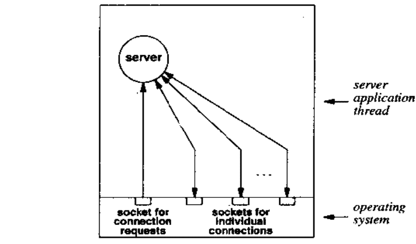

12.1 使用单线程实现并发的面向连接服务器的线程结构。该线程管理多个 socket。

本质上，单线程服务器必须同时任主线程和从线程的职责。它维护一组 socket，其中一个 socket 绑定到已知端口，主线程在该端口接受连接。集合中的其他 socket 每个对应于一个连接，从线程在这些连接上处理请求。服务器将 socket 描述符集作为参数传递给 `select` 并等待其中任何一个的活动。当 `select` 返回时，它传回一个位掩码，指定集合中的哪些描述符已就绪。服务器根据描述符就绪的顺序来决定如何继续。

为了区分主操作和从线程操作，单线程服务器使用描述符。如果对应主线程的描述符就绪，服务器将执行主线程会执行的操作：它在 socket 上调用 `accept` 以获取新连接。如果对应从线程 socket 的描述符就绪，服务器将执行从线程会执行的操作：它调用 `recv` 获取请求，然后回答它。

## 12.5 单线程 ECHO 服务器示例

示例将有助于澄清概念并解释单线程并发服务器如何工作。考虑文件 `TCPmechd.cpp`，它包含了实现 ECHO 服务的单线程服务器代码。


```c
* TCPmechd.cpp - main, echo */
#include <winsock.h>
#include <string.h>

#define QLEN             5       /* 最大连接队列长度 */

#define BUFSIZE           4096
#define WSVERS            MAKEWORD(2, 0)

void      erexit(const char *, ...);
SOCKET    passiveTCP(const char *, int);
int       echo(SOCKET);

----------------------------------------------------------------*
* main - 用于 ECHO服务的并发 TCP 服务器
----------------------------------------------------------------*
void main(int argc, char *argv[]) {
	char        *service = "echo";      /* 服务名或端口号 */
	struct sockaddr_in fsin;     /* 来自客户端的地址 */
	socket      msock;
	fd_set  rfds;                   /* 读取文件描述符集 */
	fd_set  afds;                   /* 活跃文件描述符集 */
	int     alen;                    /* 源地址长度 */
	WSADATA wdata;
\unsigned int fdnx;

switch (argc) {
	case 1:
		break;
	case 2:
		service = argv[1];
		break;
```

## 第 12.5 节 单线程 ECHO 示例

default:

```c
errexit("*usage: TCPmethod [port]\n");

if (WSASartup(WSVERS, &wdata) != 0)
    errexit("*WSASartup failed\n");

msock = passiveTCP(service, QLEN);

FD_ZERO(&fds);
FD_SET(msock, &fds);

while (1) {
    memcpy(&fds, &fds, sizeof(fds));

    if (select(FD_SETSIZE, &fds, &rfds, (fd_set*)0, (struct timeval*)0) == SOCKET_ERROR)
        errexit("*select error: %d\n", GetLastError());
    
    if (FD_ISSET(msock, &fds)) {
        ssock = 0;

        len = sizeof(fsain);
        ssock = accept(msock, (struct sockaddr*)&fsain, &len);
        if (ssock == INVALID_SOCKET)
            errexit("*accept: error %d\n", GetLastError());
        FD_SET(ssock, &fds);

        for (fdndx=0; fdndx<rfds.fd_count; ++fdndx) {
            fd = rfds.fd_array[fdndx];
            if (fd != msock && FD_ISSET(fd, &fds)) {
                if (echo(fd) == 0) {
                    (void) closesocket(fd);
                    FD_CLR(fd, &fds);
                }
            }
        }
    }
}
```

```c
/*---------------------------------------
* echo - 回显一个缓冲区的数据，返回字节数
---------------------------------------
*/
int
echo(SOCKET fd) {
    char buf[BUFSIZE];
    int cc;

    cc = recv(fd, buf, sizeof(buf), 0);
    if (cc == SOCKET_ERROR) {
        errexit("echo echo recv error %d\n", GetLastError());
    }
    if (cc && send(fd, buf, cc, 0) == SOCKET_ERROR) {
        errexit("echo send error %d\n", GetLastError());
    }
    return cc;
}
```

单线程服务器的启动方式与多线程实现中的主服务器类似，通过打开一个被动套接字来监听已知端口。它使用 `FD_ZERO` 和 `FD_SET` 创建一个与它想要测试的套接字描述符对应的向量。服务器进入无限循环，在循环中调用 `select` 等待一个或多个描述符变为就绪。

如果主描述符就绪，服务器调用 `accept` 获取一个新连接。它将新连接的描述符添加到它所管理的集合中，并继续等待更多活动。如果某个从线程描述符就绪，服务器调用 `echo`，该函数又调用 `recv` 从连接中获取数据并将其发送回客户端。如果其中一个从线程描述符报告了文件结束（EOF）状态，服务器将关闭该描述符并使用宏 `FD_CLR` 将其从正在使用的描述符集合中移除。

## 12.6 总结

并发服务器的执行通常是由数据的到达驱动的，而不是由底层操作系统的定时机制驱动。在服务处理较少的情况下，单线程实现可以使用异步 I/O 来管理与多个客户端的连接，其效率与使用多线程或进程的实现相当。

单线程实现承担了主线程和从线程的职责。当主套接字就绪时，服务器接受新连接。当任何其他从套接字就绪时，服务器接收请求并发送响应。一个 ECHO 服务的单线程服务器示例说明了这些思想并展示了编程细节。

## 进一步学习

一个良好的协议规范不会限制实现方式。例如，本章描述的单线程服务器实现了由 Postel [RFC 862] 定义的 ECHO 协议。第 11 章展示了基于相同协议规范构建的多线程并发服务器的示例。

## 练习题

- 12.1 进行一个实验，证明示例 ECHO 服务器可以并发处理连接。
- 12.2 将本章讨论的实现用于 DAY-TIME 服务是否有意义？为什么或为什么不？
- 12.3 阅读 Windows 文档以查找传递给 `select` 的列表中描述符的精确表示。写出 `FD_SET` 和 `FD_CLR` 宏。
- 12.4 在具有多个处理器的计算机上比较单线程和多线程服务器实现的性能。在什么情况下，单线程版本的性能会优于（或等同）多线程版本？
- 12.5 假设有大量客户端（例如 100 个）同时访问本章中的示例服务器。解释每个客户端可能会观察到什么。
- 12.6 单线程服务器是否会在反复响应另一个客户端请求的同时，剥夺一个客户端的服务？多线程实现是否可能表现出相同的行为？请解释。

# 13

## 多协议服务器 (TCP, UDP)

## 13.1 引言

上一章描述了如何构建一个使用异步 I/O 的单线程服务器，以便在多个连接之间提供表面的并发性。本章扩展了这一概念。它展示了单线程服务器如何适应多种传输协议。它通过展示单线程服务器可以容纳多种传输协议来阐明这一思想。

### 13.2 减少服务器数量的动机

为每个协议使用独立服务器的主要优势是控制。为每个协议使用独立服务器的缺点是它们会消耗资源。当考虑到 TCP/IP 标准定义了数十种服务时，问题的规模就显而易见了。

### 13.3 多协议服务器设计

多协议服务器由单个线程组成，该线程使用异步 I/O 处理 UDP 或 TCP 的通信。服务器最初打开两个套接字：一个使用无连接传输 (`UDP`)，另一个使用面向连接的传输 (`TCP`)。随后服务器使用异步 I/O 等待一个套接字就绪。如果 `TCP` 套接字就绪，客户端请求了连接。服务器调用 `accept` 获取新连接。如果 `UDP` 套接字就绪，客户端以数据包的形式发送了请求。服务器使用 `recvfrom` 接收请求并记录发送者的地址。一旦计算出响应，服务器使用 `sendto` 将其发回客户端。

## 13.4 线程结构

图 13.1 展示了迭代多协议服务器的线程结构。

0ff5db763d2952e789585a5178acf3bc_167_0.png


图 13.1 迭代多协议服务器的线程结构。在任何时刻，服务器最多打开三个套接字：一个用于 UDP 请求，一个用于 TCP 连接请求，以及一个用于单个 TCP 连接的临时套接字。

迭代多协议服务器在任何时刻最多打开三个套接字。最初，它打开一个套接字来接收输入的 UDP 数据包，另一个套接字来接收输入的 TCP 请求。当数据包到达 UDP 套接字时，服务器计算响应并使用同一套接字发回客户端。当连接请求到达 TCP 套接字时，服务器调用 `accept` 获取新连接。`Accept` 为连接创建第三个套接字，服务器使用新套接字与客户端进行通信。交互完成后，服务器关闭第三个套接字并等待另外两个套接字的活动。

### 13.5 多协议 DAYTIME 服务器示例

程序 `daytime` 展示了多协议服务器如何运行。它由一个单线程组成，为 UDP 和 TCP 提供 DAYTIME 服务。

`154` 多协议服务器 (TCP, UDP) 第 13 章

```cpp
/* daytime.cpp - main, daytime */

#include <stdio.h>
#include <time.h>
#include <winsock.h>
```

```cpp
void    daytime(char buf[]);
void    errexit(const char *, ...);
SOCKET  passiveTCP(const char *, int);
SOCKET  passiveUDP(const char *);
```

```cpp
#define WSERVERS    MAKEWORD(2, 0)
#define QLEN         5
```

```cpp
#define LINLEN      128
```

```cpp
/*
 * main - 用于 DAYTIME 服务的迭代服务器
 *
 */
void
int main(int argc, char *argv[]) {
    char       *service = "daytime";  /* 服务名或端口号 */
    char       buf[LINLEN+1];        /* 用于存储一行文本的缓冲区 */
    struct     sockaddr_in alen;     /* 请求地址 */
    int        alen;                 /* 源地址长度 */
    SOCKET     tsock;               /* TCP 主套接字 */
    SOCKET     usock;               /* UDP 套接字 */
    fd_set     fds;                /* 可读文件描述符集 */
    int        rv;
    WSADATA    wsadata;

    switch (argc) {
        case 1:
            break;
        case 2:
            service = argv[1];
            break;
        default:
            errexit("usage: daytime [port]\n", NULL);
    }

    if (WSSAStartup(WSERVERS, &wsadata) != 0)
```

# 第 13.5 节 示例协议 DAYTIME 服务器 155

```cpp
errexit("*WSASTartup failed\n");

tsock = passiveTCP(service, QLEN);
usock = passiveUDP(service);

FD_ZERO(&rfds);

while (1) {
    FD_SET(tsock, &rfds);
    FD_SET(usock, &rfds);

    if (select(FD_SETSIZE, &rfds, (fd_set *)0, (fd_set *)0,
        (struct timeval *)0 == SOCKET_ERROR)
        errexit("*select error: %d\n");
    if (FD_ISSET(tsock, &rfds)) {
        SOCKET ssock; /* TCP 从套接字 */

        alen = sizeof(fsin);
        ssock = accept(tsock, (struct sockaddr *)&fsin,
            alen);
        if (ssock == INVALID_SOCKET)
            errexit("*accept failed: error %d\n*",
            GetLastError());

        daytime(buf);
        (void) send(ssock, buf, strlen(buf), 0);
        (void) closesocket(ssock);
    }
    if (FD_ISSET(usock, &rfds)) {
        alen = sizeof(fsin);
        rv = recvfrom(usock, buf, sizeof(buf), 0,
            (struct sockaddr *)&fsin, &alen);
        if (rv == SOCKET_ERROR)
            errexit("*recvfrom: error number %d\n*",
            GetLastError());

        daytime(buf);
        (void) sendto(usock, buf, strlen(buf), 0,
            (struct sockaddr *)&fsin, sizeof(fsin));
    }
}
```

- * `daytime` - 用当前时间填充给定的缓冲区

`156`

多协议服务器 (TCP, UDP)

第 13 章

```cpp
void
daytime(char buf[]) {
    time_t now;

    (void) time(&now);
    sprintf(buf, "%s", ctime(&now));
}
```

`Daytime` 接受一个可选参数，允许用户指定服务名或协议端口号。如果用户未提供参数，`daytime` 将使用用于 `daytime` 服务的端口。

在解析参数后，`daytime` 调用 `passiveTCP` 和 `passiveUDP` 来创建两个用于 TCP 和 UDP 的套接字。两个套接字使用相同的服务，并且对于大多数服务，它们都将使用该协议端口号。将这些视为主套接字——服务器保持它们打开状态，来自客户端的所有初始连接都通过其中一个到达。对 `passiveTCP` 的调用指定系统必须队列 `QLEN` 个连接请求。

在服务器创建主套接字后，它通过初始化读描述符列表来准备使用。在循环的每次迭代中，它使用宏 `FD_SET` 构建一个与两个主套接字对应的描述符集合。然后它使用 `select` 等待任一套接字上的输入活动。

当 `select` 返回时，一个或两个主套接字已就绪。服务器使用 `FD_ISSET` 检查 TCP 套接字，并再次检查 UDP 套接字。服务器必须检查两者，如果一个 UDP 数据报恰好在 TCP 连接请求的同时到达，两个套接字都将就绪绪。

如果 TCP 套接字就绪，意味着客户端发起了连接请求。服务器使用 `accept` 建立连接。`accept` 返回一个新的临时套接字的描述符，其仅用于新连接。服务器调用 `daytime` 计算响应，使用 `send` 将响应发送到新连接，并调用 `closesocket` 终止连接并释放资源。

如果 UDP 套接字就绪，意味着客户端发送了一个数据报以请求 DAYTIME 响应。服务器调用 `recvfrom` 接收传入的数据报并记录客户端的端点地址。

`171`

## 13.6 共享代码的概念

我们的示例说明了一个重要的概念：共享代码允许设计者无论请求是通过 TCP 还是 UDP 到达，都将所有代码封装在单个过程中。在 DAYTIME 示例中，共享代码仅占几行。但在大多数服务器中，计算响应所需的代码可能跨越数百行。显然，将代码放在一起可以确保两种协议提供的服务是一性的。

## 13.7 并发多协议服务器

类似于之前描述的单协议服务器，多协议服务器使用迭代方法，因为 DAYTIME 服务计算量小。对于需要更多计算的服务，迭代实现可能不够。在这种情况下，多协议服务器可以扩展为并发处理请求。一个新的线程处理 UDP。

## 13.8 总结


# 多协议服务器 (TCP, UDP) 第13章

多协议服务器允许设计者避免重复并协调更改。多协议服务器由单线程组成。该线程打开 `UDP` 和 `TCP` 主套接字，并使用 `select` 等待一个或两者就绪。如果 `TCP` 套接字就绪，服务器接受并处理它。如果 `UDP` 套接字就绪，服务器接收请求并响应。

本章阐述的多协议服务器设计可以扩展为允许并发 `TCP` 连接，或使用处理通过 `TCP` 或 `UDP` 到达的请求的单线程实现。多协议服务器通过使用单个过程计算服务的响应，来消除代码重复。

## 进一步学习

`Reynolds` 和 `Postel` [`RFC 1700`] 指定了应用程序协议列表以及分配给它们的 `UDP` 和 `TCP` 端口。

## 练习

- 13.1 扩展本章中的示例服务器以并发处理请求。你能找到 `TCP/IP` 的示例吗？
- 13.2 研究 `TCP/IP` 定义的一些常用服务。多协议服务器在什么情况下可能不使用共享代码计算响应？请解释。
- 13.3 示例代码允许用户通过参数指定服务名或协议端口号，并在创建被动套接字时使用该参数。是否存在某个服务的 `UDP` 端口号与 `TCP` 不同？修改代码以允许用户为每个协议指定独立的协议端口号。
- 13.4 示例服务器不允许系统管理员控制其使用的协议。修改服务器以包含参数，允许管理员指定是为 `TCP`、`UDP` 还是两者提供服务。
- 13.5 考虑一个决定通过授权方案来实现安全的站点。该站点为每个服务器提供一份授权客户端列表，并规定服务器必须拒绝源自列表外机器的请求。为示例多协议服务器实现该授权方案。提示：仔细查看套接字函数以了解如何处理 `TCP`。

# 多服务服务器 (TCP, UDP) 第14章

## 14.1 引言

第 12 章描述了如何构建一个使用异步 `I/O` 在多个连接之间提供表观并发的单线程服务器，而第 13 章展示了多协议服务器如何同时在 `TCP` 和 `UDP` 传输协议上提供服务。本章扩展了这些概念，并将它们与前面的章节中讨论的一些迭代和并发服务器设计相结合。它展示了单个服务器如何提供多种服务，并使用一个处理一组服务的单线程服务器来阐明这一思想。

## 14.2 合并服务器

在大多数情况下，程序员会为每个服务设计一个独立的服务器来处理。之前章节中的示例服务器说明了单服务方法——即每个服务器都在一个已知端口等待，并回答与该端口相关的服务请求。因此，计算机通常会运行一个用于 `DAY` 服务的服务器，另一个用于 `ECHO` 服务的服务器，以此此类推。前一章讨论了使用多种协议的服务器如何帮助节省系统资源并使维护更容易。驱动多协议服务器的优势也促成了将多个服务合并到单个多服务服务器中的动力。

为了理解为每个服务创建一个服务器的成本，需要检查一组标准化服务。`TCP/IP` 定义了一大量简单的服务，旨在帮助测试、调试和维护计算机网络。早期的章节讨论了 `DAYTIME`、`ECHO` 和 `TIME` 等示例，但存在许多其他服务。一个为每个标准化服务都运行一个服务器的系统可能有几十个服务器，尽管其中大多数永远不会接收到请求。将许多服务合并到单个服务器中可以大幅减少运行服务的数量†，因为许多微型服务可以通过微不足道的计算来处理，而服务器中的大部分代码都在处理接受请求和发送回复的细节。将许多服务合并到单个服务器减少了所需的总代码。

† 由于 `socket` 函数的实现限制了线程可以打开的 `socket` 最大数量，一个服务器可能无法提供所有服务。然而，如果一个线程可以打开 `N` 个 `socket`，使用多服务服务器可以将请求的线程数减少 `N` 倍。

## 14.3 无连接多服务服务器设计

多服务服务器可以使用无连接或面向连接的传输协议。图 14.1 展示了无连接多服务服务器的一种可能的线程结构。

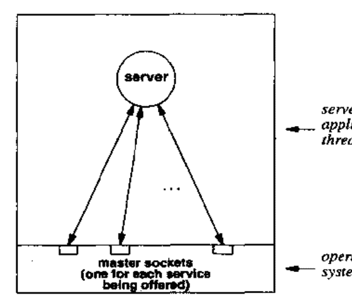

图 14.1 一个迭代的、无连接的多服务服务器。服务器在多个 `socket` 中的任意一个上等待数据报，每个 `socket` 对应一个单独的服务。

如图 14.1 所示，迭代的、无连接的多服务服务器通常由单个线程组成，该线程包含了其提供的服务所需的所有代码。服务器打开一个 `UDP` `socket`，并将每个 `socket` 绑定到所提供服务之一的已知端口。它使用一个较小的表来将 `socket` 映射到服务。对于每个描述符 `descriptor`，该表记录了处理该 `socket` 上提供的服务的过程 `procedure` 的地址。服务器使用 `select` 系统调用来等待数据报到达任意一个 `socket` 上。

当数据报到达时，服务器会调用相应的过程来计算响应并发送回复。由于映射表记录了每个 `socket` 提供的服务，服务器可以轻松将 `socket` 描述符映射到处理该服务的过程。

## 14.4 面向连接多服务服务器设计

面向连接的多服务服务器也可以遵循迭代算法。原则上，每个服务器执行的任务与一组迭代的、面向连接的服务器相同。更准确地说，多服务服务器中的单线程取代了组面向连接服务器中的主服务器线程。在顶层，多服务服务器使用异步 `I/O` 来处理其职责。图 14.2 显示了线程结构。

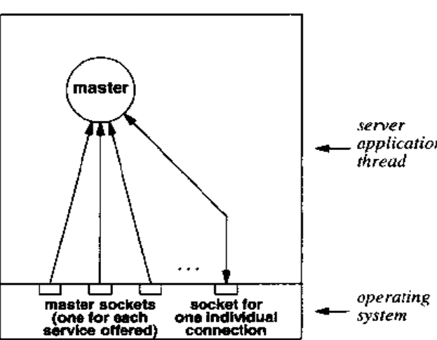

图 14.2 迭代的、面向连接的多服务服务器的线程结构。在任何时刻，服务器为每个服务都打开了一个 `socket`，并且最多额外打开了一个 `socket` 来处理特定的连接。

当多服务服务器开始执行时，它会为它所提供的每个服务创建一个 `socket`，将每个 `socket` 绑定到该服务的已知端口，并使用 `select` 等待其中任何一个 `socket` 传入的连接请求。当其中一个 `socket` 准备绪时，服务器调用 `accept` 获取新到达的连接。为传入的连接接受一个新 `socket`。服务器使用新 `socket` 与客户端交互，然后将其关闭。因此，除了每个服务对应一个主 `socket` `master socket` 外，服务器在任何时刻最多仅额外打开一个 `socket`。

与无连接的情况类似，服务器保留一个映射表，以便其决定如何处理每个传入的连接。当服务器启动时，它会分配 `socket`。对于每个主 `socket`，服务器向映射表中添加一个条目，指定 `socket` 编号和一个实现该 `socket` 提供服务的过程。在为每个服务分配了主 `socket` 后，服务器调用 `select` 等待连接。一旦连接到达，服务器使用映射表来决定调用许多内部过程中的哪一个来处理客户端请求的服务。

## 14.5 并发、面向连接、多服务服务器

多服务服务器在连接到达时调用的过程可以直接接受并处理新连接，从而使服务器变为迭代的，或者实际上，多服务服务器可以创建一个从线程 `slave thread` 来处理它，使服务器变为并发的。它可以选择迭代处理某些服务，而并发处理其他服务；程序员不需要为所有服务选择单一风格。图 14.3 显示了使用并发、面向连接实现的多服务服务器的线程结构。

在迭代实现中，进程完成与客户端的通信后会关闭连接。在并发实现中，从线程的工作方式与传统的并发、面向连接的服务器中的从线程完全相同。它通过连接与客户端通信，响应请求并发送回复。当完成交互时，从线程关闭 `socket`，断开与客户端的通信并结束执行。

## 14.6 单线程多服务服务器实现

虽然并不常见，但可以使用单线程管理多服务服务器的所有活动，其设计完全类似于第 12 章讨论的单线程服务器。与其为每个传入的连接创建一个从线程，单线程服务器会将每个新连接的 `socket` 添加到它使用的集合中。如果其中一个主 `socket` 准备绪，服务器调用 `recv` 获取来自客户端的传入请求，形成响应并调用 `send` 将响应传回客户端。

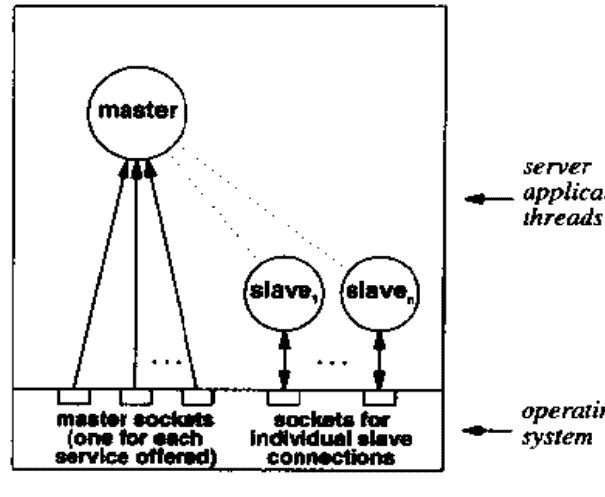

图 14.3 并发面向连接的多服务服务器的线程结构。主线程处理传入的连接请求，而从线程处理每个连接。

## 14.7 从多服务服务器调用独立程序

到目前为止讨论的大多数设计的主要缺点之一在于其灵活性：更改任何单一服务的代码都需要重新编译整个多服务服务器。只有在考虑处理许多服务的服务器时，这种缺点才会变得重要。任何微小的改变都需要程序员重新编译服务器、终止执行中的服务器程序，并使用新编译的代码重启服务器。

如果一个多服务服务器提供许多服务，那么在任何给定至少有一个客户端正在与其通信的概率更高。此外，给定的服务器提供的服务越多，它需要修改的概率就越高。

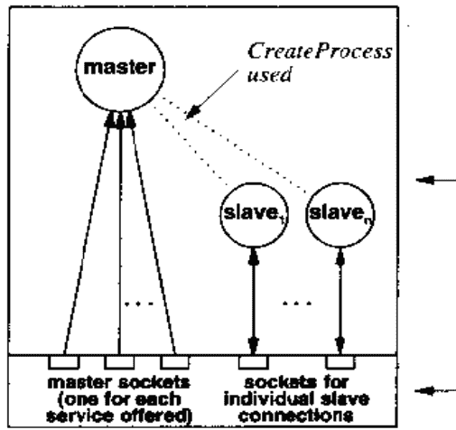

图 14.4 一个面向连接的多服务服务器的结构，该服务器通过 `CreateProcess` 执行一个独立的程序来处理每个连接。

如图所示，主服务器使用 `CreateProcess` 创建一个新进程，而不仅仅是线程来处理每个连接。`CreateProcess` 的参数之一指定了要运行的新程序名称。主进程安排在创建新进程时保持连接开启，允许新进程使用该接字处理所有客户端的通信。


由于 `CreateProcess` 是从文件中检索新程序，上述设计允许系统管理员直接替换文件，而无需重新编译多服务服务器、终止服务器进程或重启它即可实现功能更新。从概念上讲，使用 `CreateProcess` 将处理每个服务的程序与建立连接的主服务器分离来。

在多服务服务器中，Windows 的 `CreateProcess` 调用使得处理单个服务的代码与管理客户端初始请求的代码分离成为可能。

## 14.8 多服务、多协议设计

虽然将多服务服务器认为是无连接的或面向连接的似乎很自然，但多协议设计也是可行的。正如第 13 节所述，多协议设计允许单个服务器线程同时管理同一服务的 UDP 套接字和 TCP 套接字。在多服务服务器的情况下，服务器可以为其提供的部分或全部服务管理许多 UDP 和 TCP 套接字。

许多网络专家使用“超级服务器”（super server）来指代多服务、多协议服务器。原则上讲，超级服务器的工作方式与传统的多服务服务器相似。最初，服务器为其提供的每个服务打开一个或两个主套接字。给定服务的主套接字对应无连接传输（UDP）或面向连接的传输（TCP）。服务器选择等待任何套接字就绪。如果 UDP 套接字就绪，服务器调用一个过程从套接字中读取下一个（数据报），计算响应并发送回复。如果 TCP 套接字就绪，服务器调用一个过程从套接字接受下一个连接并进行处理。服务器可以直接处理连接（通过迭代方式），也可以通过创建一个新线程（或新进程）来处理连接，从而实现并发。

## 14.9 多服务服务器示例

`super.cpp` 中的多服务服务器扩展了第 12 节中的单线程服务器实现。在初始化数据结构并为其每个服务打开套接字后，主程序进入无限循环。循环的每次迭代都会调用 `select` 等待套接字就绪。当一个或多个请求到达时，`select` 调用返回。

`event` 数组中的每个元素包含一个 `service` 类型的结构体，指定了服务与套接字描述符之间的映射。当 `select` 返回时，服务器遍历 `event` 并使用宏 `FD_JSSET` 测试记录在 `sv_sock` 字段中的描述符是否就绪。如果找到就绪的描述符，服务器将调用一个函数来处理该请求。

`sv_func` 字段包含处理服务的函数地址。在 `event` 中找到与就绪描述符对应的条目后，程序调用所选的函数。对于 UDP 套接字，服务器通过 `doTCP` 直接调用服务处理程序。

TCP 套接字需要额外的过程，因为 TCP 套接字在面向连接的服务器中对应于主套接字。当此类套接字就绪时，意味着连接请求已到达套接字。服务器需要创建一个新线程来管理该连接。因此，`doTCP` 过程调用 `accept` 来接受新连接。然后它调用 `_beginthread` 创建一个从线程来调用服务处理函数（`sv_func`）。当服务函数返回时，从线程终止。

```cpp
/* superd.cpp - main, dotTCP */

#include <process.h>
#include <winsock.h>

#define UDP_SERV 0
#define TCP_SERV 1

struct service {
    char    *sv_name;
    char    *sv_useTCP;
    SOCKET sv_sock;
    void    (*sv_func) (SOCKET);
};

void TCP(SOCKET), TCPchargend(SOCKET), TCPdaytimed(SOCKET),
     TCPptimed(SOCKET);

SOCKET passiveTCP(const char *, int);
SOCKET passiveUDP(const char *);
void   errexit(const char *, ...);
void   doTCP(struct service *);

struct service svent[] = {
    { "echo*", TCP_SERV, INVALID_SOCKET, TCPPechod },
    { "chargen*", TCP_SERV, INVALID_SOCKET, TCPchcharg },
    { "daytime*", TCP_SERV, INVALID_SOCKET, TCPdaytimed },
    { "time*", TCP_SERV, INVALID_SOCKET, TCPptimed },
    { 0, 0, 0, 0 }
};

#define WSERVERS   MAKEWORD(2, 0)
#define QLEN         5
#define LINELEN      128

extern u_short portbase; /* * from passivesock() * */
```

### Sec. 14.9 一个多服务服务器示例

```cpp
/* main - 超级服务器主程序
 */
void
main(int argc, char *argv[]) {
    struct service *psv; /* 服务表指针 */
    fd_set afds;         /* 可读描述符 */
    struct timeval wsdata;
    u_short portbase;

    switch (argc) {
    case 1:
        break;
    case 2:
        portbase = (u_short) atoi(argv[1]);
        break;
    default:
        errexit("*usage: superd [portbase]\n");
    }

    if (!WSAStartup(WSERVERS, &wsdata))
        errexit("*Startup failed");

    FD_ZERO(&fds);
    for (i=0; i<QLEN; ++i) {
        if (svent[i].sv_useTCP)
            svent[i].sv_sock = passiveTCP(svent[i].sv_name, portbase);
        else
            svent[i].sv_sock = passiveUDP(svent[i].sv_name);
        if (svent[i].sv_sock != INVALID_SOCKET)
            FD_SET(svent[i].sv_sock, &fds);
    }

    while (1) {
        if (select(QLEN, &fds, NULL, NULL, &wsdata) == -1)
            errexit("select error: %d\n", GetLastError());

        for (i=0; i<QLEN; ++i) {
            if (FD_ISSET(svent[i].sv_sock, &fds)) {
                if (svent[i].sv_useTCP)
                    _beginthread(NULL, NULL, (void __ccall *)doTCP, (void *)svent[i]);
                else
                    _beginthread(NULL, NULL, (void __ccall *)svent[i].sv_func, (void *)svent[i]);
            }
        }
    }
}
```


```cpp
/* sv_funcs.cpp - TCPpechod, TCPchargend, TCPdaytime, TCPPTimed */

#include <stdio.h>
#include <time.h>
#include <winsock.h>

#define BUFFERSIZE    4096                /* 最大缓冲区大小 */
... (省略重复函数声明保持一致) ...
/*-------------------------------------------------------
 * TCPPecho - 在给套接字上执行 TCP ECHO
-------------------------------------------------------
 */
void
TCPpechod(SOCKET fd)
{
    char buf[BUFFERSIZE];
    int  cc;

    while (cc = recv(fd, buf, sizeof(buf), 0)) {
        if (cc == SOCKET_ERROR)
            errexit("echo recv: %d\n", GetLastError());
        if (send(fd, buf, cc, 0) == SOCKET_ERROR)
            errexit("echo send: %d\n", GetLastError());
    }
    closesocket(fd);
}
```

```cpp
#define LINELEN        72
```

```cpp
/*-------------------------------------------------------
 * TCPchargend - 在给定的套接字上执行 TCP CHARGEN
-------------------------------------------------------
 */
void
TCPchargend(SOCKET fd)
{
    char c, buf[LINELEN+2];    /* 打印 LINELEN 个字符 + \r\n */
    int  i;

    c = '\0';
    buf[LINELEN] = '\r';
    buf[LINELEN+1] = '\n';
    while (i) {
        for (i=0; i<LINELEN; ++i) {
            buf[i] = c++;
        }
    }
}
```

```c
if (c > '~')
    c = '~';
```

```c
}
if (send(fd, buf, LINELEN-2, 0) == SOCKET_ERROR)
    break;
```

```c
}
closes(fd);
```

```c
/* * TCPdaytimed - do TCP DAYTIME protocol * */
```

```c
void
TCPdaytimed(SOCKET fd)
{
    char buf[LINELEN];
    time_t now;
    (void) time(&now);
    sprintf(buf, "%s", ctime(&now));
    (void) send(fd, buf, strlen(buf), 0);
    closesocket(fd);
}
```

```c
#define WINEPOCH 2208988800 /* Windows epoch, in UCT secs */
```

```c
/* * TCPptimed - do TCP TIME protocol * */
```

```c
void
TCPptimed(SOCKET fd)
{
    time_t now;
    (void) time(&now);
    now = htonl((u_long)now + WINEPOCH);
    (void) send(fd, (char*) &now, sizeof(now), 0);
    closesocket(fd);
}
```

大多数独立函数的代码看起来应该很熟悉；它们源自较早章节中的示例服务器。`CHARGEN` 服务的代码可以在 `Tcpcharger` 程序中找到；它非常直观。该程序由一个循环组成，反复创建一个填充有 ASCII 字符的缓冲区，并调用发送缓冲区内容到客户端。当客户端关闭连接时，循环终止，导致返回 `SOCKET_ERROR`。

## 14.10 静态与动态服务器配置

在实践中，许多系统使用超级服务器（super server）的骨架，系统管理员可以在其中添加额外的服务。为了增加易性，超级服务器通常是可配置的——可以在不重新编译源码的情况下更改服务器处理的服务集。配置有两种类型：静态和动态。静态配置发生在服务器程序开始执行时。通常，配置放置于服务器在启动时读取的文件中。配置指定了服务器处理的一系列服务，以及用于每个服务的可执行程序。要更改正在处理的服务，系统管理员需要修改配置文件并重启服务器。

管理员如何通知服务器需要重新配置？答案取决于操作系统。在 Windows 中，动态重新配置依赖于传统的通信——程序员必须建立一个额外的输入以允许管理员输入命令。例如，服务器可以程序化打开一个用于控制的额外 `socket`。当需要重新配置时，管理员使用进程间通信机制，服务器可以使用该机制。例如，在 UNIX 系统下运行的服务器可以使用信号机制。管理员发送一个信号；服务器必须捕获该信号并将其参数解释为配置请求。

当管理员强制服务器进行动态重新配置时，服务器会读取配置文件并更改其提供的服务。如果配置文件中包含一个或多个在之前的配置中未出现的服务，服务器将打开 `socket` 以接受对新服务的请求。如果配置文件中删除了一个或多个服务，服务器将关闭与其不再处理的服务相对应的 `socket`。当然，一个设计良好的超级服务器会优雅地处理重新配置——尽管它停止接收对已停用服务的请求，但服务器不会终止已经进行中的连接。因此，客户端的请求要么被完全拒绝，要么被完全处理。

使超级服务器具有动态可配置增加了极大的灵活性。处理特定服务的可执行程序可以在不更改服务器本身的情况下进行更改。此外，由于可以在不重新编译或重启服务器的情况下更改通过服务器提供的可用服务集，程序员可以测试新服务而不中断服务。更重要的是，由于重新配置不需要更改源代码，非程序员也可以学习配置服务器。总结一下：

- 一个可以动态重新配置的超级服务器是灵活的，因为可以在不重新编译服务器程序或重启服务器的情况下更改其提供的服务集。

## 14.11 示例超级服务器，Inetd

许多计算机运行着一个处理大量服务的超级服务器。这个名为 `inetd` 的超级服务器最初是为 UNIX 设计的；许多销售服务器软件的厂商包含了 `inetd` 或类似的程序。

`inetd` 的初衷源于对高效机制的需求，该机制能够在不使用过多系统资源的情况下提供许多服务。特别是，尽管 `ECHO` 和 `CHARGEN` 等 TCP/IP 服务对于测试或调试有用，但这些服务会占用系统资源（例如操作系统表中的条目）。此外，如果不同的应用程序并发运行，它们会竞争内存。因此，将服务器合并到一个超级服务器中可以减少开销，同时又不消除功能。

`inetd` 是动态可配置的。也就是说，系统管理员可以指示 `inetd` 程序读取包含配置信息的文件，并处理文件中指定的服务。此外，管理员可以随时强制 `inetd` 重新配置；该程序不需要停止或重启。

文件中的每个条目都有六或多个字段，如图 14.5 所示。

### 示例超级服务器，inetd

| 字段 | 含义 |
| --- | --- |
| service name | 服务名称 |
| socket type | `socket` 类型（例如：stream, datagram） |
| protocol | 协议（例如：tcp, udp） |
| wait status | 服务器是否应该等待请求（wait 或 nowait） |
| userid | 运行服务的用户 ID |
| arguments | 传递给程序的参数 |

*(注：上述表格根据 OCR 文本的上下文和标准的 inetd 配置重构完成，因为 OCR 文本是碎片化的。)*

## 深入学习

许多计算机系统都有不同版本的 `inetd`；供应商的文档描述了其内部函数列表和调用约定。

## 练习题

- 14.1 如果一个面向连接的、并发的、服务的服务器处理 K 个服务，它将使用多少个套接字（sockets）？
- 14.2 通过实验找出你的操作系统对同时打开的接字数量的限制。一个线程可以打开多少个套接字？单个用户拥有的进程可以打开多少个？
- 14.3 在上一个练习中，通过实验确定这些限制是取决于物理内存的大小还是可用内存的大小。
- 14.4 考虑一个单线程的多服务服务器实现。编写一个算法展示服务器如何管理连接。


- 14.5 阅读 RFC 1288 以了解 FINGER 服务。将 FINGER 添加到本章描述的示例多用户服务器中。
- 14.6 设计一个超级服务器（super server），允许在不重新编译或重启服务器的情况下添加新服务。
- 14.7 针对本章讨论的每种迭代和并发多服务服务器设计，为服务器分配的最大套接字数量写一个表达式。将答案表示为提供的服务数量和并发处理请求数量的函数。
- 14.8 使用 `CreateProcess` 为每个请求创建一个新进程的超级服务器，其主要缺点是什么？调用 `_beginthread` 的服务器其主要缺点是什么？
- 14.9 查看运行 `inetd` 的计算机上的配置文件，找出它提供了哪些服务。
- 14.10 从超级服务器运行万维网（World Wide Web）服务合理吗？为什么合理或不合理？
- 14.11 查阅描述 `inetd` 配置文件的供应商手册。如果文件在参数字段中允许 A，它意味着什么？在什么时候很重要？

# 15

# 服务器并发的统一、高效管理

## 15.1 引言

早期的章节介绍了特定的服务器设计，并展示了每种设计如何使用迭代或并发处理。上一章考虑了如何将某些设计结合以创建一个多服务服务器。

本章从更广泛的意义上考虑了并发服务器。它研究了服务器设计背后的问题，以及适用于许多之前设计的几种并发管理技术。这些技术增加了设计的灵活性，并允许设计者优化服务器性能。尽管早期章节中提出的迭代和并发设计似乎是相互矛盾的，但它们在某些情况下都可以提高服务器性能。此外，我们将发现这两种技术都源于同一个概念。

## 15.2 在迭代与并发设计之间进行选择

到目前为止的服务器设计被分为两类：迭代处理请求的和并发处理请求的。之前章节的讨论意味着，设计者在构建服务器之前必须在两种基本方法之间做出明确选择。

迭代和并发实现之间的选择是基础性的，因为它影响了整个程序结构、感知的响应时间以及服务器处理多个请求的能力。如果设计者在设计过程早期做出了错误决定，更改成本可能会很高；程序大部分可能需要重写。

程序员能知道何时需要并发吗？程序员又如何知道哪种服务器设计是最优的？更重要的是，程序员如何估算需求或服务时间？这些问题并不容易回答，因为情况在不断变化。用户听到可用服务后，就会想要访问。随着连接用户数量的增加，单个服务器的需求随之增加。当某个特定服务变得流行或冷门时，需求可能会迅速转移。同时，新技术和产品不断提高通信和处理速度。然而，通信和处理能力的增长通常不会以相同的速率发生。先是一个，后是另一个，其他的更快。

人们可能会好奇，在一个不断变化的世界里，设计者如何做出根本性的设计选择。答案通常来自经验和直觉：设计者通过观察近期趋势做出最佳估计。从本质上说，设计者从近期历史进行外推，因此只能提供一个近似值：随着技术和用户需求的变化，设计者必须重新评估决定，并可能更改设计。重点是：选择迭代和并发服务器设计可能是困难的，因为需求、处理速度和通信能力变化很快。大多数设计者在选择时都会根据近期趋势进行外推。

## 15.3 并发水平

考虑并发服务器实现的一个细节：允许的并发水平。我们将服务器的并发水平定义为服务器在给定时刻运行的进程或线程总数。随着服务器创建从进程（slave）来处理传入请求，或者从进程完成请求并退出，并发水平随时间变化。程序员和系统管理员并不关心跟踪任何特定的并发水平，但他们关心服务器在整个生命周期内显示的最大并发水平。

在目前介绍的设计中，只有少数要求设计者为服务器指定最大并发水平。大多数设计允许主服务器线程根据需要创建尽可能多的并发进程来处理传入请求。

通常，并发的面向连接的服务器会为从客户端接收的每个连接创建一个进程。当然，实际的服务器无法处理任意数量的连接。TCP 的每种实现都对可能的活动连接数设有限制，每个操作系统也对可用进程或线程数设有限制（系统必须限制每个用户的并发数或总数）。

†尽管某些细节有所不同，但本章提出的并发概念适用于进程或线程。

### 第 15.3 节 并发水平

当服务器达到这些限制之一时，系统将拒绝来自 `_beginthread` 或 `CreateProcess` 等函数的请求。

为了增加灵活性，许多程序员避免对最大并发水平设置固定上限。如果服务器没有预定义的最大并发水平，该实现既可以运行在不需要并发的环境中，也可以运行在需要并发的环境中。当从一种类型环境移动到另一种时，程序员不需要更改代码或进行协调。然而，不限制并发的服务器在负载负载的环境中存在风险。并发会一直增加，直到操作系统交换进程或线程。

## 15.4 需求驱动并发

为了实现灵活性，早期章节介绍的大多数并发服务器使用传入请求来触发并发的增加。我们称此类方案为需求驱动，并说并发水平随需求增加。

按需增加并发的服务器似乎是最优的，因为它们只有在需要时使用系统资源（例如系统表或缓冲区）。因此，需求驱动服务器不会浪费资源。此外，需求驱动服务器提供了较低的响应时间，因为它们可以在等待现有处理完成之前处理多个请求。

## 15.5 并发的成本

虽然需求驱动并发的总体动机是赞赏的，但早期章节介绍的实现可能产生最优结果。要理解为什么，我们必须考虑线程创建和调度的细微差别以及服务器操作的细节。核心问题在于如何衡量成本和收益。特别是，必须考虑并发的成本及其收益。

> ¹请求驱动并发术语也可以用于服务器，因为需求是通过正在处理的请求数量来衡量的。

## 15.7 微小的延迟也会产生影响

尽管需求驱动方案看起来非常简单，但为每个请求创建一个新线程可能是昂贵的的。无论服务器使用无连接还是面向连接的传输协议，操作系统都必须通知主服务器有消息或连接已到达。随后，主服务器必须请求系统创建一个从线程。

从网络接收请求并创建新线程需要时间。除了会推迟请求处理之外外，创建线程还会消耗系统资源。因此，在单处理器上，当操作系统创建新线程并切换线程上下文时，服务器将不会执行任务。

创建新进程或线程时产生的短时间延迟会有影响吗？图 15.1 显示了这种影响。

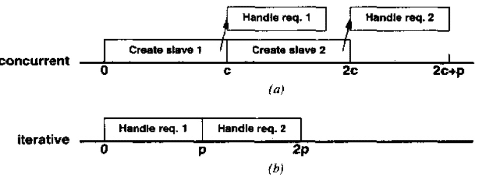

**图 15.1** (a) 在并发服务器中处理两个请求所需的时间 (b) 在迭代版本的服务器中所需的时间。迭代版本的延迟较低，因为处理请求所需的时间 `p` 小于创建线程所需的时间 `c`。

该图展示了一个示例，其中处理一个请求的时间少于创建一个新线程的时间。设 `p` 表示处理时间，`c` 表示创建线程的时间。假设两个请求在时间 `t` 突发到达。并发版本在 `c+p` 时间单位后完成第一个请求的处理，并在 `2c+p` 时间单位后完成第二个请求的处理。因此，每个请求平均需要 `3c/2+p` 时间单位。迭代服务器在时间 `p` 时完成第一个请求的处理，在时间 `2p` 时完成第二个请求，每个请求平均需要 `3p/2` 时间单位。因此，迭代服务器的设计显示的平均延迟低于并发版本。

当仅考虑少数请求时，这种微小的额外延迟似乎并不重要。然而，如果考虑到服务器在重负载下的持续运行，这种延迟可能是巨大的。如果许多请求在几乎同一时间到达，它们必须等待服务器创建线程来处理它们。如果后续请求到达的速度快于服务器处理它们的速度，延迟就会累积。

短期来看，服务器的微小延迟会影响观察到的响应时间，但不会影响整体吞吐量。如果一组请求几乎在同一时间到达，操作系统中的协议软件会将它们放入队列中，直到服务器能够提取并处理它们。例如，如果服务器使用面向连接的传输，TCP 将连接请求放入队列。如果服务器使用无连接传输，UDP 将将传入的数据报放入队列。

长期来看，额外的延迟可能导致请求丢失。为了理解这一点，想象服务器需要 `c` 个单位来创建一个线程，但只需 `p` 个单位（`p<c`）处理一个请求。服务器的并发实现每单位时间可以处理 `1/c` 个请求，而迭代版本每单位时间可以处理 `1/p` 个请求。

当请求到达速率超过 `1/c` 但小于 `1/p` 时，就会出现问题。迭代实现可以处理这种负载，但并发实现花费了太多时间创建线程。在并发变体中，协议软件中的队列最终会满，软件开始拒绝请求。

在实践中，很少有服务器在接近最大吞吐量运行。此外，当创建线程的成本超过处理成本时，很少有设计师使用并发线程。因此，在许多应用程序中不会发生请求延迟或丢失。然而，设计用于在高负载下提供最佳响应的服务器必须考虑需求驱动的并发。

## 15.8 线程预分配

当创建时间显著时，可以使用简单的技术来控制延迟、限制并发的最大级别并在并发服务器中保持高吞吐量。这种技术是预分配并发线程，以避免创建它们的成本。

要使用预分配技术，设计师编写主服务器在开始执行时创建 `N` 个从线程。每个线程使用操作系统提供的功能来等待请求。当请求到达时，其中一个等待的从线程开始执行并处理该请求。当它完成处理时，从线程不会终止。相反，它返回到等待另一个请求的代码。

预分配的主要优势在于较低的操作系统开销。因为服务器在请求到达时不需要创建线程，所以它可以更快地处理请求。当请求处理涉及的 I/O 多于计算时，这种技术尤为重要。预分配允许服务器系统在等待与之前的请求相关的 I/O 活动时切换到另一个线程并开始处理下一个请求。总结：

使用预分配时，服务器在启动时创建并发从线程。预分配可以降低服务器延迟，因为它避免了每次请求到达时创建线程的成本，允许一个请求的处理与另一个请求相关的 I/O 活动重叠。


### 15.8.1 预分配技术

预分配的细节取决于底层操作系统提供的功能以及所使用的并发类型。在 Windows 系统中，预分配线程可以使用共享内存与主服务器协调；预分配进程通常依赖于消息传递功能。在不提供共享内存的系统中，预分配仍然可能，因为主服务器和从线程可以使用 `socket` 函数进行协调。

在允许子线程或进程继承父进程已打开的 `socket` 描述符访问权的系统中，可以使用 `socket` 函数来协调并发。

为了利用 `socket` 共享的优势，主服务器在预分配任何从线程之前打开必要的 `socket`。特别是当它启动时，主服务器打开了已知端口的 `socket`。接下来的章节将讨论如何在面向连接和无连接服务器中使用 `socket` 函数。

### 15.8.2 面向连接服务器的预分配

如果并发服务器使用 `TCP` 进行通信，并发级别取决于活动连接的数量。每个传入的连接必须由一个独立的进程或线程处理。幸运的是，在大多数系统中，`socket` 函数为所有从线程提供互斥。当请求到达时，系统解锁其中一个从线程。当调用返回时，它为该连接提供一个新的 `socket`。如图所示，所有从线程都拥有已知端口的 `socket` 访问权。图 15.2 显示了线程结构。主服务器打开了已知端口，但未使用它。图中的虚线表示主服务器使用 `socket` 与从线程使用 `socket` 的区别。

尽管图 15.2 显示主服务器与从线程同时运行，但主从之间的区别是模糊的。在实践中，主服务器在预分配从线程后就没有角色了。因此，主服务器在启动后可以直接终止*。聪明的程序员甚至可以安排主服务器创建除最后一个之外的所有从线程。然后主服务器变为最后一个从线程，从而节省了一个额外线程创建的成本。在 Windows 中，实现此操作非常简单。

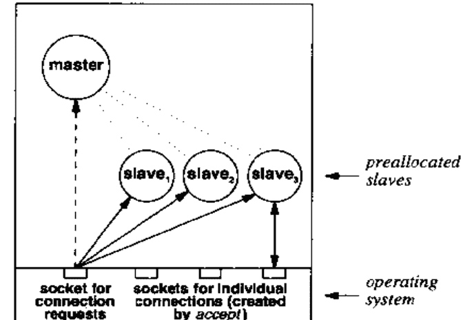

**图 15.2** 预分配从线程的并发面向连接服务器的线程结构。示例显示了三个预分配的从线程，其中正在处理连接。主服务器打开了已知端口的 `socket`，但未使用。

### 15.8.3 无连接服务器的预分配

如果并发服务器使用无连接传输，并发级别取决于到达请求的数量。每个传入的请求通过独立的 `UDP` 数据报到达，并且每个请求必须分配给一个单独的线程。并发无连接设计通常安排主服务器在请求到达时创建一个从服务器。

Windows 允许无连接服务器使用与无连接服务器相同的预分配策略预分配从线程。图 15.3 显示了线程结构。

*在实践中，某些系统要求主服务器保持分配状态，因为它“拥有”从线程。

## 184 服务器并发的统一高效管理 第 15 章

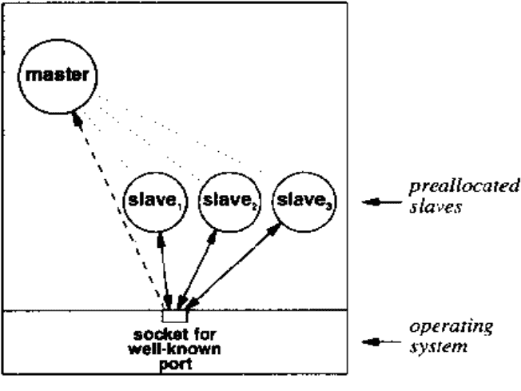

**图 15.3** 预分配从进程的并发无连接服务器的线程结构。该图显示了三个从已知端口的 `socket` 读取数据的从进程（slaves）。每个从进程只接收一个入站请求。

如图所示，每个从进程都共享对已知端口 `socket` 的访问权限。由于由于通信是无连接的，从进程可以使用单个 `socket` 发送响应以及接收传入的请求。从进程调用 `recv` 来获取发送者的地址以及来自该发送者的数据报；它调用 `sendto` 来传输回复。

在使用预分配的面向连接的服务器中，无连接情况的主进程（master）在打开已知端口的 `socket` 并预分配好从进程后，几乎没有工作可以做了。因此，它可以终止，也可以选择让自己转换为最后一个从进程，以避免创建最后一个线程的开销。

## 15.8 预分配、突发流量与 NFS

经验表明，由于大多数 `UDP` 的实现没有为到达的数据报提供长队列，入站请求的突发很容易溢出队列。`UDP` 仅仅会丢弃在接收端队列满后到达的数据报，因此突发流量会导致数据丢失。

溢出问题特别难以解决，因为 `UDP` 软件通常驻留在操作系统中。因此，应用程序程序员并不总是能够轻松地修改它。然而，程序员可以预分配从线程。预分配通常足以消除数据丢失。

许多 `NFS` 的实现都使用预分配来避免数据报丢失。如果检查一个运行 `NFS` 的系统，通常会发现一组预分配的服务器都从同一个 `UDP socket` 上读取数据。事实上，预分配可能意味着一个 `NFS` 实现是“可用的”还是“不可用的”的差异。

### 15.8.5 多处理器器上的预分配

在多处理器上进行预分配有特殊目的。它允许设计者将服务器的并发水平与硬件能力联系起来。如果机器有 `K` 个处理器，设计者可以预分配 `K` 个从进程。由于多处理器操作系统会将每个处理器（或线程）分配给某一个服务器，因此预分配确保了并发水平与硬件相匹配。当请求到达时，操作系统将其传递给预分配的从进程之一，并将该从进程分配给处理器。由于从进程已经预先分配，启动其运行所需非常短。因此，系统将快速分发请求。如果出现突发请求，每个处理器将处理一个请求，从而提供最大的可能速度。

## 15.9 延迟线程分配

虽然预分配可以提高效率，但它并没有解决所有问题。惊讶的是，在某些情况下，通过相反的方法可以提高效率：即延迟从进程的分配。

为了理解延迟如何有所帮助，回想一下线程创建需要时间和资源。只有当这样做能够增加系统吞吐量或降低延迟时，创建额外的线程是有意义的。创建一个线程不仅消耗时间，还会为必须管理线程的操作系统组件增加开销。此外，预分配尝试接收入站请求的线程可能会给网络代码增加开销。

我们曾提到过，如果创建线程的成本小于处理请求的成本，并发将降低延迟。如果处理成本较小，迭代方案效果最好。然而，程序员并不总是知道成本将如何，因为所需的时间取决于请求（例如，搜索数据库所需的时间取决于查询）。

此外，程序员无法知道是否会快速发现错误。为了理解原因，请考虑大多数服务器软件的工作原理。当请求到达时，服务器软件会检查消息以验证字段的值是否为客户端有权发出的请求。验证可能需要几微秒，也可能涉及进一步的网络通信，后者可能比前者长好几个数量级。一方面，如果服务器检测到消息中的错误，它将快速拒绝请求，使得处理消息所需的总时间变得忽略不计。另一方面，如果服务器接收到有效请求，可能会花费大量的处理时间。在处理时间短的情况下，并发处理是不受欢迎的；迭代服务器表现出更低的延迟和更高的吞吐量。

186 服务器并发的统一高效管理 第 15 章

当设计者不知道并发处理是否合理时，他们该如何优化延迟和吞吐量呢？答案在于一种延迟并发的技术。这个想法很直观：不要选择迭代设计或并发设计，而是允许服务器测量处理成本，并在迭代处理或并发处理之间进行动态选择。这种选择是动态的，因为可以在请求与请求之间发生变化。

为了实现动态延迟分配，服务器通常通过测量流逝的时间来估算处理成本。主服务器接收请求，设置定时器，并开始迭代处理该请求。如果服务器在定时器过期前完成了请求处理，服务器将取消定时器。如果定时器在服务器完成处理之前过期，服务器将创建一个从进程并允许该从进程处理请求。总结一下：

当使用动态延迟分配时，服务器开始迭代处理每个请求。只有当处理需要大量时间时，服务器才会创建一个并发线程来处理请求。这样做允许主进程在检查错误和处理短请求时避免创建线程或切换上下文。

在大多数系统中，延迟分配很容易实现。操作系统提供了允许运行程序设置异步定时器的机制。当它开始处理请求时，主进程设置一个定时器。当定时器过期时，主进程创建一个从进程，并安排该从进程在主进程之前执行的精确点继续处理。

## 15.10 两种技术的基础

预分配和延迟分配这些技术似乎没有任何共同点。事实上，它们有许多共同点，因为两者都源于同一个原理：预分配通过在需要之前创建从进程来优化延迟；延迟分配通过延迟到需要时创建从进程来优化效率。

## 15.11 结合技术

组合系统最大的问题源于对并发的控制。何时创建额外的从进程很容易，但要确定何时从进程应该停止执行而不是持续运行较困难。一种可能的解决方案是主进程在创建从进程时指定一个最大值。

## 15.12 总结

两种技术允许设计者提高并发服务器的性能：从进程的预分配和延迟分配。预分配通过在需要之前创建从进程来优化延迟。主服务器为其将使用的已知端口打开 `socket`，然后预分配所有的从进程。由于从进程共享对 `socket` 的访问权限，它们可以等待请求到达。系统将每个入站请求处理给恰好一个从进程。

# 服务器并发的统一高效管理 第 15 章

`master` 完成。延迟分配在请求处理时间存在差异，或者服务器必须检查请求的正确性（例如，为了验证客户端是否获得授权）的情况下效果良好。延迟分配消除了短请求或包含错误的请求的线程创建开销。

尽管这两种优化技术看起来是对立的，但它们源于同一个基本原理：它们放宽了服务器并发级别与等待请求数量之间的严格协调。这样做可以提高服务器性能。

# 深入学习

第 23 章和第 24 章描述了网络文件系统（`NFS`）。许多 `NFS` 实现使用预分配来帮助避免请求丢失。Beveridge 和 Weiner [1997] 描述了使用 `Win32` 的多线程应用程序。关于用于进程和定时器管理的函数的更多详细信息，可以在供应商随标准编译器提供的文档中找到。

# 练习题

- 15.1 修改之前章节中的一个示例服务器以使用预分配。性能发生了什么变化？

- 15.2 修改之前章节中的一个示例服务器以使用延迟分配。性能发生了什么变化？


- 15.3 在多处理器上测试一个使用预分配的无连接服务器。确保安排客户端发送突发请求。有效的并发水平与处理器数量之间有何关系？如果两者不相等，请解释原因。

- 15.4 编写一个结合延迟分配和预分配的服务器算法。你选择了什么方案来限制最大并发级别？为什么？

- 15.5 在上一个问题中，如果你的操作系统提供消息传递机制，你将如何使用它来控制并发级别？

- 15.6 将本章讨论的技术与并发单线程服务器结合可以获得哪些优势？

- 15.7 设计者如何将本章讨论的技术应用于多服务服务器？

# 第 16 章

# 客户端中的并发

## 16.1 引言

之前的章节展示了服务器如何并发处理请求。本章考虑了客户端软件中的并发问题。它讨论了客户端如何从并发中获益，以及并发客户端如何运行。最后，它展示了一个说明并发操作的示例客户端。

## 16.2 并发的优势

服务器使用并发主要有两个原因：

- 并发可以提高观察到的响应时间（从而提高所有所有客户端的整体吞吐量）。
- 并发可以消除潜在的死锁。

此外，并发实现允许设计者轻松地创建多协议或多服务的服务器。最后，并发实现的操作更加极端灵活，因为它们在各种硬件平台上都能良好运行。当移植到具有单个 CPU 的计算机时，它们运行得更高效，因为它们在不更改任何代码的情况下利用了额外的处理能力。

客户端似乎可能无法从并发中获益，主要因为客户端通常向服务器发送请求，而一旦它一次只执行一项活动，在接收到响应之前就无法继续。此外，客户端效率和死锁问题没有像服务器死锁问题那样严重；如果客户端变慢并停止执行，它停止的只有自己——其他客户端继续运行。

尽管表面如此，并发在客户端中也具有优势。首先，当前的实现可能更容易编程，因为它们将功能分成了在概念上独立的组件中。其次，并发实现可能更容易维护和扩展，因为它们使代码模块化。第三，并发客户端可以同时联系服务器，以比较响应时间或合并服务器的返回结果。第四，并发允许用户更改参数、忽略客户端状态或动态控制处理。本章将重点关注同时与多个服务器交互的理念。

在客户端中使用并发的关键优势在于。它允许客户端同时处理多个任务，而不会对它们施加严格的执行顺序。

## 16.3 执行控制的动机

异步执行的一种可能原因源于将控制函数与正常处理分离的需求。例如，客户端可以使用它查询大型地理数据库。假设用户生成了如下查询：

> 查找所有住在 Elm 街的人。

如果数据库包含单个小镇的信息，响应可能少于 100 个名字。然而，如果数据库包含美国所有人的信息，响应可能包含数十万个名字。此外，如果数据库系统由分布在广大区域的许多服务器组成，查找可能花费很多时间。

数据库示例说明了客户端-服务器交互背后的一个重要观点：调用客户端的用户可能完全或根本不知道接收响应需要多久，或者响应将是什么样。

大多数客户端-服务器只是等待响应。当然，如果服务器发生故障，发生死锁，客户端将阻塞并尝试读取永远不会到达的响应。遗憾的是，用户无法知道发生了真实的死锁，还是仅仅因为网络延迟导致处理变慢（因为网络延迟是服务器过载的方式）。此外，客户端知道自己是否收到来自服务器的任何消息。

如果用户变得不耐烦或认为某个特定响应需要太多时间，用户只有一个选择：终止客户端程序并在稍后重试。在这种情况下，并发可以提供帮助，因为设计得当的并发客户端可以

### 16.3节 执行控制的动机

允许用户在客户端等待响应时继续与客户端交互。用户可以发现是否收到了任何数据，选择发送不同的请求，或优雅地终止通信。

作为一个示例，考虑上述描述的假设数据库客户端。并发实现可以在执行数据库搜索的同时并发从键盘读取并处理命令。因此，用户可以输入像 `status` 这样的命令，以确定客户端是否打开了与服务器的连接，以及客户端是否发送了请求。用户可以输入 `stop` 来停止通信，或者用户可以输入 `newspaper` 来指示客户端终止现有通信并尝试与另一个服务器通信。

将客户端控制与正常处理分离允许用户即使在正常输入来自文件时也能与客户端交互。因此，即使在用户开始处理大型输入文件后，也可以与运行的客户端交互以了解进度如何。同样，并发客户端可以在将响应放入输出文件的同时保持与用户的交互。

## 16.4 与多个服务器的并发接触

并发允许单个客户端同时联系多个服务器，并在收到其中任何一个的响应后立即向用户报告。例如，用于 `TIME` 服务的并发客户端可以向多个服务器发送请求，并接受第一个到达的响应或取平均值。

考虑一个使用 `ECHO` 服务测量到给定目的地吞吐量的客户端。假设客户端与 `ECHO` 服务器建立 TCP 连接，发送大量数据，读回回显，计算任务所需的总时间并报告时间。用户可以调用客户端来确定当前的网络吞吐量。

现在考虑并发如何增强使用 `ECHO` 测量吞吐量的客户端。与其一次测量一个连接，并发客户端可以同时访问多个目的地。它可以并发地向任何一个目的地发送数据并从任何一个目的地读取数据。由于它并发执行所有测量，它的运行比非并发客户端更快。此外，由于它在同一时间进行所有测量，受 CPU 和本地网络负载的影响是相同的。

## 16.5 实现并发服务器

与大多数客户端实现一样，遵循两种基本方法：

客户端分为两个或多个线程，每个线程处理一个功能，或者

客户端由单线程组成，使用 `select` 来异步处理多个输入和输出事件。

像 Windows 等系统支持共享内存的线程。在这些系统中，当应用程序使用面向连接的协议时，可以使用多个线程来创建一个并发客户端。图 16.1 展示了此类程序的线程结构。

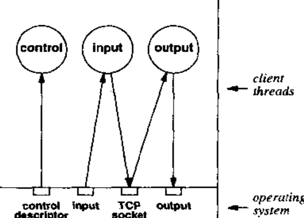

图 16.1 一种面向连接客户端的可能线程结构，使用多个线程来实现并发处理。一个线程处理输入并向服务器发送请求，而另一个线程检索响应并处理输出。

如图 16.1 所示，多线程允许客户端分离输入和输出处理。该图显示了线程如何与 I/O 设备套接字交互。输入线程从键盘读取，构建请求，并通过 TCP 连接将其发送到服务器，而单独的输出线程接收来自服务器的响应并将其显示在用户的屏幕上。同时，第三个控制线程接收用户或系统管理员的命令以控制处理过程。

## 16.6 单线程实现

某些操作系统不支持共享内存的线程。例如，上述描述的多线程实现在某些版本的 UNIX 下无法正常工作。为此类系统构建的并发客户端通常使用单线程算法来实现并发，类似于类似于算法 `8.5`† 以及第 12 章至 14 章中的示例。图 16.2 展示了此类客户端的线程结构。

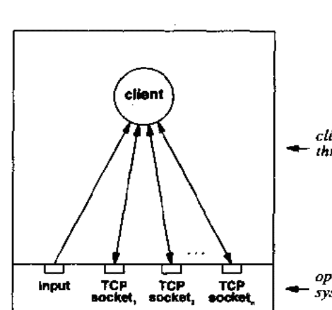

图 16.2 面向连接客户端的线程结构，通过单线程提供表象的并发性。客户端使用 `select` 并发处理多个连接。

单线程客户端像单线程服务器一样使用异步 I/O。客户端为其到多个服务器的 TCP 连接创建套接字描述符。它可能还具有到键盘等输入设备的连接。客户端程序体由一个循环组成，该循环检查输入设备并使用 `select` 等待其中一个套接字描述符变为就绪。如果输入设备就绪，客户端读取输入并存储以备后用，或立即对其处理。如果 TCP 连接变为输出就绪，客户端准备并通过 TCP 连接发送请求。如果 TCP 连接变为输入就绪，客户端则读取服务器发送的响应并对其进行处理。

当然，单线程并发客户端共享了单线程服务器实现的许多优缺点。客户端以服务器生成的任何速率从其读取输入或响应。如果服务器短暂延迟，本地处理将继续。因此，如果服务器未响应，客户端将继续读取并处理控制命令。

> +请参第 114 页查看有关算法 `8.5` 的描述。

†客户端可以使用 `select` 的超时功能来确保其频繁地检查输入设备。

## 16.7 一个使用 ECHO 的并发客户端示例

如果单线程客户端调用了阻塞的系统函数，可能会导致死锁。因此，程序员必须小心确保客户端线程不会无限期地等待一个不会发生的事件。当然，程序员可以选择忽略某些情况，允许用户检测到死锁问题的发生。对于程序员来说，理解这些细微差别并对每种情况做出有意识的决定是重要的。

一个通过单线程实现并发的客户端示例将阐明上述观点。下方文件 `TCP.cpp` 所示的示例并发客户端使用了第 7 章描述的 `ECHO` 服务来测量到一组机器的网络吞吐量。


```cpp
/* TCPecho.cpp - main, TCPecho, reader, writer, mtime */

#include <stdio.h>
#include <string.h>
#include <time.h>
#include <winsock.h>

#define BUFFERSIZE   4096            /* write buffer size */
#define COCOUNT      64*1024         /* default character count */
#define WSVERS       MAKENWORD(2, 0)

#define MIN(x, y)    ((x)>(y) ? (x) : (y))

#define USAGE        "usage: TCPecho [- c count ] host2...\n"

struct hdat {
    char         *hd_name;      /* host name */
    SOCKET       *hd_sock;       /* host socket descriptor */
    unsigned     hd_rc;         /* recv character count */
    unsigned     hd_wc;         /* send character count */
} [FD_SETSIZE2];                /* fd to host name mapping */
char         buf[BUFFERSIZE];      /* read/write data buffer */

void         TCPecho(struct fd_set *, int *);
int          reader(struct hdat *, fd_set *);
void         writer(struct hdat *, fd_set *);
void         errexit(const char *, ...);
SOCKET       connectTCP(const char *, const char *);
long         mtime(u_long *);
```

（其余实现部分遵循使用 `select` 管理多个套接字的并发 ECHO 客户端的逻辑。）

## 16.8 并发客户端的执行

`TCPecho` 程序接受多个机器名称作为参数。对于每台机器，它会向该机器上的 ECHO 服务器打开 TCP 连接，在连接上发送 `ccount` 个字符（字节），从每个服务器读取回传的字节，并打印完成该任务所需的总时间。因此，该程序可以用于测量到一组机器的当前吞吐量。

主程序首先将字符计数变量初始化为默认值 `CCOUNT`。然后它解析参数以检查是否包含 `-c` 选项。如果是，它会将指定的计数转换为整数并存储在变量 `ccount` 中以替换默认值。

程序假设除 `-c` 之外的所有参数都指定机器名称。对于每个参数，它都会调用 `connect` 来与指定机器上的 ECHO 服务器建立连接，并在数组 `hdat` 中分配一个条目来存储有关连接的信息。它在 `hd_name` 字段中记录远程机器的名称，在 `hd_sock` 字段中记录套接字的描述符。最后，它使用 `FD_SET` 将描述符添加到集合中。

一旦为参数中指定的每台机器建立了 TCP 连接，主程序就会调用 `TCPecho` 过程来处理数据的收发。`TCPecho` 并发处理所有连接。它填充缓冲区 `buf` 以待发送的数据（字母 D），然后调用 `select` 等待任何 TCP 连接准备好进行输入或输出。当 `select` 调用返回时，`TCPecho` 遍历所有描述符以查看哪些已就绪。

当它发现某个连接准备好输出时，`TCPecho` 调用 `writer` 过程，该过程会从缓冲区发送大量数据，直到 TCP 在单次 `send` 调用中接受完毕为止。如果 `writer` 发现所有数据已发送完毕，它将对输出描述符调用 `shutdown`，并从 `select` 的输出集中移除该描述符。

当某个连接准备好输入时，`TCPecho` 调用 `reader` 过程，该过程会从连接中接收大量数据，因为 TCP 可以交付并将其放入缓冲区。`reader` 过程接收数据，将其放入缓冲区，并减少剩余字符的计数。如果计数达到零（即读取器收到的字符数与发送的相同），`reader` 过程将打印消息并关闭连接。它还会从 `select` 的输入集中移除该描述符。因此，每当连接完成时，输出上都会出现报告回显每个数据所需时间的消息。

在连接上执行单次输入或输出后，`reader` 和 `writer` 过程以及 `TCPecho` 中的循环继续运行并再次调用 `select`。如果 `reader` 检测到文件结束条件并关闭了连接，则返回值 0，否则返回 1。`TCPecho` 使用 `reader` 的返回值来确定是否应该移除该连接的记录。当连接计数达到零时，`TCPecho` 中的循环终止，`TCPecho` 返回主程序，主程序也返回，导致客户端停止执行。

## 16.9 管理定时器

为了计算发送接收数据期间经过的时间，`TCPecho` 调用 `mstime` 过程。从原理上讲，计算经过的时间是直观的。然而，由于 Windows 中的 `clock` 函数返回毫秒级的时间，因此事件的经过时间必须通过从完成时间减去任务开始的时间来计算。因此，至少需要两次过程调用——一个用于在开始前记录 `clock` 的值，另一个用于从当前时间减去初始值。

`mstime` 既用于记录开始时间，也用于计算经过的时间。它接受单个参数 `pms`，并使用该值决定如何操作。如果参数为零，`mstime` 将当前时间记录在静态变量 `epoch` 中。如果参数非零，`mstime` 计算当前时间与存储的 `epoch` 值之间的差值，将结果存储在 `pms` 指定的位置，并将结果作为函数的返回值返回。

## 16.10 输出示例

图 16.3 显示了三次独立执行 `TCPtecho` 的示例输出。

```
% TCPtecho localhost
localhost: 311 ms

% TCPtecho ector arthur merlin
arthur: 601 ms
merlin: 4921 ms
ector: 11791 ms

% TCPtecho -c 1000 sage
sage: 80 ms
```

图 16.3 三次独立执行 `TCPtecho` 的输出示例。如果目标距离客户端更远或处理器较慢，则需要更多时间。

第一次调用显示，`TCPtecho` 仅需 311 毫秒即可向本地机器上的 ECHO 服务器发送数据。命令行具有参数 `localhost`。由于第二次调用有三个参数（`ector`、`arthur` 和 `merlin`），它导致 `TCPtecho` 并发与所有三台机器交互。第三次调用测量了到达机器 `sage` 所需的时间，命令行指定 `TCPtecho` 仅发送 1000 个字符而不是默认值（64K）。

## 16.11 示例代码中的并发性

`TCPtecho` 的并发实现从两个方面改进了程序。首先，并发实现获取了每个连接所需时间的更准确的测量，因为它在相同的时间间隔内测量了所有连接的吞吐量。这意味着拥塞会影响所有连接。其次，并发实现让 `TCPtecho` 对用户更有吸引力。要理解为什么，请再次查看示例输出中第二次测试报告的时间。机器 `arthur` 的输出消息出现在半秒多的一行内，机器 `merlin` 的消息出现在五秒后，而针对 `ector` 的最后消息出现在两秒后。如果用户必须等待所有程序顺序运行，总执行将需要大约十八秒。在测量互联网上更远的机器时，单个时间可能会长得多，使得并发版本快得多。在许多情况下，使用顺序客户端实现测量的时间会比并发版本长得多。

## 总结

并发执行提供了一种强大的工具，可用于客户端和服务器。并发客户端实现可以提供更快的响应时间并避免死锁问题。最后，并发可以帮助设计人员将控制处理与正常的输入输出分离。

我们研究了一个面向连接的客户端示例，它可以测量访问一个或多个机器上的 ECHO 服务器所需的时间。由于客户端并发执行，它可以通过在相同间隔内进行所有测量来避免网络拥塞引起的吞吐量差异。并发实现还允许用户访问，因为它重叠了测量而不是让用户等待。

## 练习

- 16.1 示例客户端顺序检查就绪套接字描述符。如果多个描述符同时就绪，客户端将首先处理索引最低的描述符，然后遍历其他的。处理完后，再次调用 `select` 等待另一个描述符就绪。考虑处理就绪描述符与调用 `select` 之间间隔的时间。在较高索引描述符上操作的时间比低索引描述符上操作的时间短。这种差异会导致饥饿吗？请解释。
- 16.2 修改示例客户端以避免上一个练习讨论的不公平性。
- 16.3 对于本章讨论的每种迭代和并发客户端设计，写一个给出最大使用套接字数的表达式。
- 16.4 考虑用于访问 Web 网页的浏览器。并发版本的浏览器运行是否比非并发版本更快？请解释。

# 17 传输层与应用层面的隧道


## 17.1 引言

之前的章节描述了在 TCP/IP 互联网连接所有通信机器的情况下，客户端和服务器软件的设计。所介绍的许多设计假设客户端和服务器运行在性能尚可的计算机上，这些计算机具有操作系统对并发进程或线程的支持，并对 TCP/IP 协议提供完全支持。

本章开始探索系统管理员和程序员用于利用替代拓扑结构的技术。特别地，它研究了允许计算机使用高层协议服务来承载 IP 流量的技术，以及使用 IP 传输其他协议系统流量的设计。

## 17.2 多协议环境

在理想的世界中，使用 TCP/IP 的程序员只需要为直接连接到 TCP/IP 互联网并提供（完全）TCP/IP 协议支持的计算机构建客户端和服务器软件。然而，并非所有机器提供完整的 TCP/IP 支持，并非所有组织都专门使用 TCP/IP 来连计算机。例如，一个组织可能拥有容量不足以运行服务器软件的小型个人计算机，或者可能有一组连接到使用 DECNET、SNA 或 ATM 等协议的网络的机器。事实上，随着组织不断添加新网络来连接现有的计算机组，大多数组织的网络规模随时间不断增长。通常，网络管理员为每组计算机独立地选择硬件技术和协议套。他们在做出选择时会考虑成本、距离、所需速度和供应商可用性等因素。在 TCP/IP 协议出现之前安装网络的组织可能选择了特定厂商的协议套。由于这种网络演进，大多数大型组织都有几组机器，每组使用自己的协议套。重点是：

> 因为网络多年来演进缓慢，因为供应商推广了专有网络系统，而且 TCP/IP 并不总是可用，大型组织经常使用替代协议系统进行通信。此外，为了减少费用，组织通常继续使用旧网络系统，直到能够引入新技术。

例如，图 17.1 展示了一个站点使用三个网络的组织。每个站点都有自己的以太网。一个广域网使用同步模式（ATM）连接两个站点的主机。如图所示，部分机器连接到每个网络。

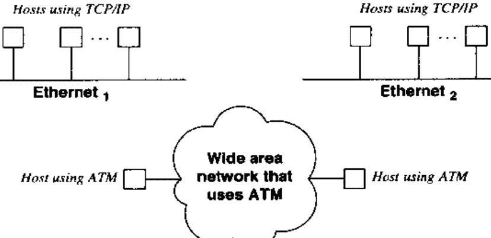

图 17.1 一个拥有三个网络的组织示例。所有连接到广域网的计算机使用 ATM，而所有连接到局域网的计算机使用 TCP/IP。

拥有多个网络系统的主要缺点在于工作重复和互操作性受限。连接到 ATM 广域网的主机上的应用程序可以选择直接与 ATM 设施交互。因此，如果客户端和服务器运行在图 17.1 所示的连接 ATM 网络的主机上，

通常，一个 TCP/IP 互联网由一组通过 IP 网关（路由器）互连的物理网络的主机组成。互联网中的所有主机和网关都必须使用 TCP/IP 协议。同样，运行 DECNET 协议的网络由专门使用 DECNET 的物理链路和计算机组成，而运行 SNA 协议的网络通常由专门使用 SNA 的物理链路和计算机组成。然而，由于传输层服务可以像数据包交换硬件一样将数据包从一个点递送到另一个点，因此理论上可以在另一个数据包交换系统中用任何传输层服务来替代单一的物理链路。

许多网络是使用交换技术而非物理网络构建的。例如，考虑图 17.1 所示的网络。假设该组织决定连接其两个以太网以形成单一 TCP/IP 互联网，允许所有连接到以太网的主机进行通信。最明显的策略涉及在它们之间安装两个 IP 网关。然而，如果两个以太网之间的地理距离遥远，则增加专用租用线路来互连这两个网络的成本可能是难以接受的。这种额外成本可能是特别合理的，因为该组织已经有一个连接两个站点的 ATM 网络。

图 17.2 展示了图 17.1 所示的组织如何利用 ATM 网络连接性在其两个站点之间提供 TCP/IP 互联网连接。

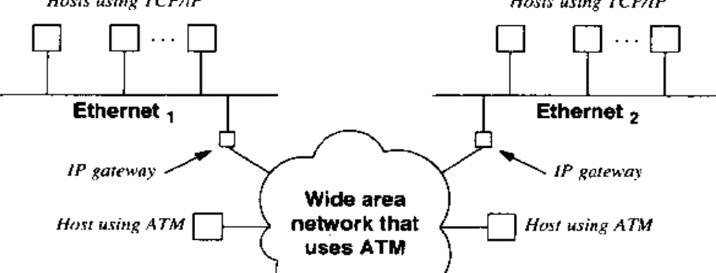

图 17.2 使用 ATM 服务的 IP 网关。

该组织在每个站点安装了一个新的 IP 网关。每个新的 IP 网关连接到该站点的 ATM 网络和本地以太网。当 IP 网关需要时，它们使用 ATM 跨越 ATM 广域网形成彼此之间的虚拟电路。每个 IP 网关都安排其路由表，以便通过 ATM 电路路由非本地流量。IP 网关使用 ATM 网络向彼此发送 IP 数据报文。从 IP 网关的角度来看，ATM 仅仅提供了一个可以发送数据报文的链路。从 ATM 网络的角度来看，两个 IP 网关上的软件的作用与其它机器上的应用程序软件完全一样。ATM 服务并不知道数据正在通过 IP 数据报文的虚拟电路发送。

在部署了两个 IP 网关后，一个主机上的用户可以调用 TCP/IP 客户端软件，连接到另一个主机上的服务器。客户端-服务器的交互跨越单一以太网，或者可能穿越 ATM 网络到达另一个站点。用户或客户端-服务器应用程序都不需要知道数据报文从一个站点的以太网传输到另一个站点时跨越了网络。两个以太网仅仅构成了 TCP/IP 互联网的一部分。此外，在广域网上使用协议的主机不需要更改。它们可以继续通信而不受 TCP/IP 流量的干扰，因为虚拟电路将保持独立。

## 17.4 动态电路分配

在图 17.2 所示的示例中，TCP/IP 互联网流量只需要通过 ATM 网络的一条 ATM 电路，因为该组织有两个站点。如果该组织通过增加额外的站点来扩展，它可以通过在每个新站点放置 IP 网关，并通过 ATM 网络创建额外的电路将每个 IP 网关连接到现有站点的 IP 网关来扩展拓扑结构。

如果 ATM 网络不限制同时分配电路的数量，上述静态电路方案可以扩展到任意数量的站点。拥有 N 个站点的组织需要 N*(N-1) 个电路来连接所有站点。因此，IP 网关对于 6 个站点需要 15 个连接，当组织请求 10 个站点时需要 45 个连接。遗憾的是，每个电路都需要硬件和软件资源。例如，路由软件存储远程 IP 网关地址与连接到该网关的 ATM 电路之间的映射，网络接口必须为发送和接收的数据分配缓冲区。更重要的是，由于通信是歇性的，连接可能长时间不使用。

为了节省资源，某些实现限制了同时打开的 ATM 电路数量。实现并不是随机允许某些连接，而是采取了不同的方法——它们按需分配电路并关闭未使用的电路。当数据报文到达 IP 网关时，IP 网关查找目标地址以确定路由 da

## 第 7.4 节动态电路分配

数据报将随后传输。路由查找会产生一个下一跳地址，即数据报应该发送的下一个 IP 网关的地址。如果下一跳地址指向连接到 ATM 网络的站点，则 IP 网关将查询其 ATM 虚拟电路表。如果存在通往下一跳的电路，IP 网关将通过该电路转发数据报。如果不存在电路，IP 网关将动态地向目标地打开一条新电路。

当 IP 网关需要打开新电路时，如果已达到 ATM 电路限制，网关必须选择一个现有电路以使其可用。问题就变成了应该选择哪一个。通常，网关遵循请求分页系统使用的策略：它选择最近未使用（LRU）的电路。在通过新电路发送其数据报后，网关会保持电路开启状态。由于发出的数据报会导致接收方重试，保持电路开启可以最大限度地减少延迟和成本。

通过动态打开和关闭虚拟电路，IP 网关可以限制同时连接的数量，而不会失去与所有站点通信的能力。网关只需为每个正在进行通信的站点保留一个电路。

## 17.5 封装与隧道

“封装”（encapsulation）一词描述了将 IP 数据报放入网络包或帧中的过程，使其能够跨越底层网络进行传输。封装指的是网络接口如何使用数据包交换硬件。例如，两个通过以太网（Ethernet）使用 IP 通信的主机，会将每个数据报封装在单个以太网包中进行传输。TCP/IP 的封装标准规定，IP 数据报占据以太网包的数据部分，且以太网包类型必须是指定为 IP 的值。

相比之下，“隧道”（tunneling）一词指的是使用传输网络服务来携带来自另一个服务的数据包或消息。例如，如果图 17.2 中的 ATM 网络被替换为传输服务（例如 X.25 网络系统），则网关将使用隧道进行通信。在隧道技术和封装中，连接到网络系统的两台计算机都使用该系统发送数据包。隧道和封装之间的关键区别在于 IP 是直接传输数据报，还是使用高层传输服务来交付它们。

当 IP 直接使用硬件时，它将每个数据报封装在数据包中。当它使用高层传输交付服务从一个点到另一个点发送数据报时，它会创建一个隧道。

## 17.6 通过 IP 互联网的隧道

在 TCP/IP 首次定义之后，研究人员尝试如何让 IP 软件隧道通过现有网络以交付数据报。其动机显而易见：许多组织已经建立了现有的网络。惊讶的是，趋势发生了反转。现在大多数隧道现象是因为供应商使用 IP 协议来交付来自非 TCP/IP 协议的数据包。

理解隧道技术的变化需要我们理解工作方式的变化。随着互联网的普及，它已成为许多群的通用数据包交付机制。事实上，IP 为大多数组织的计算机提供了最广泛的连通性。

为了查看 IP 的可用性如何影响其他协议，假设一个组织中的两台计算机需要使用特定供应商协议进行通信。经理不需要在两台计算机之间添加物理网络连接，而是可以将组织的内网看作大型网络，并允许两台计算机上的协议软件通过在 IP 数据报中发送消息来交换信息。目前已有可用软件使用 IP 携带 IPX 流量（Novell）、SNA 流量（IBM）以及来自其他高层协议的流量。此外，工程师们设计了方法允许 IP 网络承载新协议的流量，从而允许设计人员在低层实现工作之前就构建并调试新的高层协议。

## 17.7 客户端与服务器之间的应用级隧道


虽然隧道的通用概念是指他人使用传输层协议栈，但程序员可以将该想法扩展到客户端-服务器交互中，为客户端和服务器之间提供通信路径。

要理解应用级隧道如何工作，请考虑两台连接到非 IP 计算机。假设程序员希望在其中一台上运行 UDP 客户端程序，在另一台上运行 UDP 服务器程序。通常，应用程序程序员无法对操作系统软件进行更改，因为他们没有源代码的权限。因此，如果两台计算机的操作系统不支持 UDP 协议，程序员可能会发现使用 UDP 或通过底层网络制作单个 IP 数据报是不便或是不可能的。

在某些情况下，应用级隧道使得客户端和服务器可以使用 IP 协议跨非 IP 网络进行通信。要使用此类隧道，程序员必须构建一个模拟 `socket` 接口的程序库。该模拟库必须允许应用程序创建活动或被动的 UDP 套接字，并发送或接收 UDP 数据报。`socket` 库中的程序将将标准 `socket` 例程（例如 `socket`、`send` 和 `recv`）转换为分配和操作本地数据结构并在可用网络上传输消息的操作。

> *正如其中一个练习建议的，隧道也可用于跨互联网传输实验 IP 流量。*

当客户端调用 `socket` 或 `bind` 等函数时，`socket` 库例程会记录信息。当客户端或服务器发送消息时，`send` 库例程查询记录的信息以确定目标，并使用底层网络传输 UDP 数据报。

一旦创建了 `socket` 模拟库，程序员就可以编译任何 UDP 客户端或服务器程序，使用模拟库链接编译后的程序，然后运行生成的应用程序。图 17.3 展示了生成的软件结构。

| UDP 客户端 | UDP 服务器 |
| :--- | :--- |
| 应用 | 应用 |
| `socket` 模拟库 | `socket` 模拟库 |
| 支持网络的操作系统 | 支持网络的操作系统 |

图 17.3 展示了在客户端应用级隧道时生成的软件结构。

## 17.8 隧道、封装与拨号链路

目前提供的调制解调器可以允许两台计算机通过拨号链路以 56 Kbps 的速度通信。一组协议包括链路 IP (`SLIP`) 和点点协议 (`PPP`)，被设计用于在拨号上发送 IP。电话系统可以被视为传输系统。

## 210 传输层和应用层的隧道

跨拨号传输 IP 应该被视为隧道还是封装？无疑，拨号的使用类似于第 17 章中讨论的隧道概念。事实上，拨号连接可以像 ATM 电路一样管理。

尽管存在争议，但大多数专家同意拨号电话系统不应被视为传输系统。相反，电话系统应被视为面向连接的物理网络。然后 `SLIP` 和 `PPP` 等协议定义了指定如何封装数据报的链路格式。类似于专用线路，电话系统可用于连接一个站点的 IP 网关和另一个站点的 IP 网关。

## 17.9 总结

隧道是指使用传输交付系统在计算机之间发送数据包，而不是直接跨物理网络发送。通过现有网络系统进行隧道的早期研究是为了已经拥有广域网络的组织。这些组织希望避免为运行 IP 添加新物理连接的成本。研究人员设计方法允许 IP 使用现有网络传输数据包而无需更改网络。IP 将传输服务视为单一硬件链路；传输服务对待 IP 流量的方式与对待任何应用程序发送的流量相同。

# 深入学习

Cole 等人 [`RFC 1932`] 提供了在 ATM 网络上运行 IP 的通用描述。Laubach [`RFC 1577`] 描述了如何通过 IP over ATM 将 ARP 协议绑定到地址上。

Comer 和 Korb [1983] 描述了如何通过 X.25 网络隧道传输 IP，包括在硬件对并发连接施加固定限制时如何管理 X.25 虚拟电路。Malis 等人 [`RFC 1356`] 描述了基于 X.25 和 SDN 的隧道技术。Provan [`RFC 1234`] 描述了如何通过 IP Interact 隧道传输 IPX 流量。Simpson [`RFC 1853`] 讨论了在 IP 中隧道传输 IP。

# 练习题

- 17.1 阅读 `RFC 877`。通过 X.25 网络建立隧道的 IP 网关是如何将目的 IP 地址映射到等效的 X.25 地址的？
- 17.2 许多传输层服务使用它们自己的重传机制来提供可靠交付。如果 TCP 和底层网络协议都重传消息，会发生什么？
- 17.3 我们提到过许多 IP 网关使用动态虚拟电路分配，网关在需要关闭现有电路以释放可用性时通常会应用 `LRU`（最近最少使用）启发算法。如果网络接口允许 `K` 个并发电路，而网关尝试同时与 `K+1` 个其他站点通信，IP 网关会发生什么？
- 17.4 构建一个 `socket` 模拟库，允许客户端和服务器应用程序通过非 TCP/IP 传输层协议交换 UDP 数据报。通过安排 UDP ECHO 与 UDP ECHO 服务器通信来对其进行测试。
- 17.5 假设两个地点的研究人员决定实验 IP 音频组播。虽然每位研究人员可以在本地分配组播地址和路由，但他们无法更改分离这两个点的 Internet 网关中的路由。解释研究人员如何使用隧道将组播包从一个站点发送到另一个站点（考虑 IP in IP）。

# 应用层 IP 网关

## 18.1 引言

上一章研究了隧道技术，这种技术允许一个协议族使用另一个协议族的传输层交付服务，来替代物理网络。从应用程序开发者的角度来看，隧道使得客户端和服务器即使在它们之间的唯一路径包含非 TCP/IP 网络的情况下，也能使用 TCP/IP 进行通信。本章继续探索客户端和服务器在不提供完整 TCP/IP 连性的环境中进行通信的技术。它展示了运行在协议支持有限的系统上的客户端如何使用中间机器上的应用程序来转发请求，以及使用此类中介设备如何扩展可用服务的范围。

## 18.2 受限环境下的客户端与服务器

### 18.2.1 多种技术的现实状况

并非所有的计算机系统都能直接访问 Internet。此外，由于经济、政治和技术原因，产生的访问限制可能会使客户端和服务器软件变得复杂。第 17 章指出，许多机构的网络演变缓慢。结果是，各个子小组可能各自有自己的工作模式，且每个网络可能使用不同的协议族。此外，一组用户可能已经习惯了来自特定供应商或特定计算机的应用程序软件。如果该软件仅在一套协议上运行，用户可能希望保留现有的网络结构。

随着管理人员专业知识的增加，网络技术也会产生惯性。当某项技术根深蒂固时，组织会为安装、管理或操作网络的人员投入培训。除了计划和管理物理网络的人员外，程序员也会花费时间学习如何编写使用网络的软件。一旦管理人员了解了某项技术的细节和细微差别，扩展现有网络以替换为新技术就会变得更容易。拥有多个小组（每个小组管理一个独立网络）的组织通常发现，整合的初始成本很高，因为许多小组必须留住其人员。

对于程序员来说，多种网络技术通常会导致系统不兼容，无法提供互操作性。除非组织提供基于隧道的端到端传输层连接，否则他们无法使用单一传输协议，也无法轻松在任意机器的客户端和服务器之间进行通信。最后，程序员经常需要构建并维护为每种网络技术编写重复功能的程序。例如，程序员必须维护多套电子邮件系统。

### 18.2.2 功能有限的计算机

除了要与多个网络抗衡外，程序员还必须为网络功能有限的计算机创建软件。例如，许多机构有一组小型个人电脑，这些电脑缺乏并发处理或异步 I/O 的操作系统设施。此类计算机无法支持第 8 章讨论的并发服务器算法或第 16 章讨论的并发客户端算法。

### 18.2.3 由安全引起的连接性限制

组织可能会实施安全策略，从而限制客户端和服务器的通信。某些组织将计算机划分为安全和不安全子集。为了防止客户端和服务器程序破坏安全性，网络管理员会对安全分区施加限制，允许它们在内部进行通信，但它们既不会向服务器发起接触，也不会接受来自不安全分区中计算机的请求。虽然此类策略确保了安全性，但它们会使程序员设计使用客户端-服务器交互的应用程序变得困难。特别是一个分区中的计算机无法直接访问另一个分区中计算机上可的服务。

## 18.3 使用应用网关

需要在受限环境中设计和运行客户端-服务器交互的程序员通常依赖单一网关来克服连接性限制。该技术包括在中间机器上运行应用程序，以便在网络之间中继信息。

## 18.4 通过邮件网关实现互操作性

对于 18.1 节中的组织，一个邮件网关程序就可以提供该组织建立电子邮件互操作性所需的所有设施。按照惯，整个组织内的每台主机都会检查出站邮件的目的地址并选择下一跳机器。如果发出的消息的目标是与发送机所在网络上的机器，则发送机将使用本地网络上可用的电子邮件系统交付消息。然而，如果主机遇到目标是连接到非本地网络的机器的出站邮件，发送机无法直接交付消息。相反，发送机将消息传输到邮件网关程序。所有机器都可以直接访问邮件网关，因为它运行在一台连接到两个网络的计算机上，并使用两种邮件交付协议之一进行通信。

## 邮件网关的实现


在理论上，单个线程就足以实现邮件网关。然而在实践中，大多数实现将功能分为两个线程：一个线程处理邮件消息，另一个线程管理传出的邮件。处理入站邮件的线程从不发送消息。它计算地址，将邮件路由到目的地，并将传出的消息存入队列中等待传输。处理输出消息的线程不直接接收入站邮件。它定期扫描输出队列。对于在输出队列中找到每条消息，输出线程都会与目的地建立网络连接并发送消息。如果它无法与目的地建立连接（例如，因为目标机器崩溃），输出线程会将消息留在输出队列中，并继续处理队列中的下一条消息。当它重新扫描队列时，输出线程将再次尝试联系目的地并投递消息。如果一条消息留存长时间（例如三天），输出线程将向原始发送消息的用户报告投递错误。

将邮件网关拆分为输入和输出组件允许每个组件独立运行。输出线程可以发送消息，等待查看连接尝试是否成功，然后继续处理下一条消息，而无需与输入线程的活动进行协调。如果连接尝试成功，输出线程可以不考虑消息长度而发送消息。它不会中断传输来接收入站消息，因为输入线程会处理它们。同时，输入线程可以继续接收入站消息、对其进行路由并存储它们以备日后传输。由于组件独立运行，长的输出消息不会阻塞输入处理，长长的输入消息也不会干扰输出处理。

## 18.6 应用网关与隧道技术的比较

上一章展示了设计者可以选择隧道技术在异构环境中提供互操作性。在隧道技术和应用网关之间进行选择可能是的，因为没有哪种技术能解决所有问题，且每种技术在某些情况下都有其优势。

使用应用网关而不是隧道的主要优势在于，程序员可以在不修改计算机操作系统的情况下创建应用网关。在许多情况下，程序员无法修改系统，要么是因为他们没有源代码的访问权限，要么是因为他们缺乏所需的专业知识。应用网关可以使用传统的编程工具构建；网关不需要对底层协议软件进行任何更改。此外，一旦部署了应用网关，该站点就可以使用标准的客户端和服务器程序。

使用应用网关具有次要的优势：它允许所有现有网络在不受干扰的情况下继续运行。经理不需要学习新技术，也不需要更改任何物理网络连接。同样，用户不需要学习服务的新界面；每个用户继续使用与他们习惯的网络相关的现有客户端软件。

应用网关确实存在一些缺点。应用网关要求程序员为每个服务构建一个单独网关程序。邮件网关连接两个系统的邮件服务，但不提供远程文件或远程登录功能。每当组织向其网络系统添加新服务时，程序员必须构建一个新的网关，在成对的网络之间互连该新服务。

应用网关可能还需要额外的硬件资源。组织可能需要购买新计算机，或者可能需要为现有计算机添加网络连接。添加新的网络连接可能意味着要获取软件以及额外的硬件。由于消息或数据所需的翻译是复杂的，应用网关可能会消耗大量的 CPU 或内存。因此，当组织添加新服务时，可能需要购买额外的计算机或升级现有机制来处理负载。对 CPU 资源的需求还引入了计算延迟，这增加了客户端和服务器之间的延迟。如果延迟过长，客户端可能会超时并发送消息。

与应用网关方法相比，隧道技术在出现新服务时不需要任何更改。相反，传输隧道将成为底层网络结构的一部分。由于应用程序感知不到隧道，它可以用于任何应用程序服务。隧道技术还提供了统一性，因为它意味着组织可以使用单一传输协议。

与应用网关解决方案相比，隧道技术确实具有一些缺点。为了安装提供完整功能的传输层隧道，站点必须修改运行连接两个网络系统的网关的操作系统。令人惊讶的是，组织可能还需要修改使用该隧道的主机上的软件。考虑一个配置为作为 `IP` 隧道的 `X.25` 网络。在应用程序使用隧道之前，它必须拥有 `TCP/IP` 协议软件，且 `IP` 软件必须知道如何通过 `X.25` 网络对数据进行隧道处理。因此，操作系统必须为应用程序提供一个 `IP` 接口（即套接字级接口），并跨越隧道路由流量。如果操作系统不包含 `TCP/IP` 协议软件，则必须添加它。如果现有的 `IP` 协议软件不知道如何通过隧道路由，则必须对其进行更改。

隧道技术还对用户产生巨大影响。组织采用隧道作为一种在异构网络上提供统一传输服务的方式。一旦组织建立了隧道，所有主机都可以开始使用单一传输协议进行客户端-服务器交互。例如，如果一个组织选择使用 `IP` 并通过 `X-25` 网络创建隧道来提供连接，该组织中的计算机可以使用 `TCP/IP` 进行传输连接。作为直接结果，所有计算机都可以支持使用 `TCP/IP` 的客户端-服务器交互。

不幸的是，底层网络协议的变化通常会导致用户与之交互的客户端软件发生变化。大多数组织为电子邮件等标准应用程序购买市售的客户端软件。因此，组织必须使用适用于特定传输协议的任何可用软件。如果组织采用通用传输协议，它必须购买使用新协议的新类型客户端软件。从用户的角度来看，切换到新软件意味着学习新界面。除非新界面提供了现有界面的所有功能，否则用户可能会感到不满。

为了避免改变用户环境，许多组织选择应用网关解决方案。程序员仔细构建应用网关，使其不需要对任何网络上的用户界面进行更改。例如，在组织为电子邮件添加了应用网关后，用户可以使用旧客户端软件发送和接收邮件。邮件系统可以使用目的地址语法来区分发送到本地目的地的消息和发送到远程网络的消息。这样做允许用户对本地使用熟悉的地址，而仅需要他们学习非本地目的地的新地址。

小型个人计算机上的操作系统提供的功能有限，不包括对并发处理的支持。并发处理的缺乏限制了客户端-服务器的交互，因为计算机在任何时候只能专注于单一任务。特别是，用户通常无法在用计算机进行其他处理的同时，在后台运行服务器。

为了理解缺乏后台处理如何限制客户端-服务器的交互，请考虑电子邮件。个人计算机可以支持邮件客户端软件，因为它可以等待到用户决定发送消息后，再执行客户端软件。此外，一旦用户撰写了消息，客户端程序可以在将消息传输到目的地之前让用户等待（此时客户端正在传输）。然而，不支持并发处理的计算机无法在后台运行服务器软件。因此，在用户决定运行服务器之前，它无法有一个准备就绪接收入站邮件的服务器。遗憾的是，当邮件服务器运行时，用户无法运行任何其他应用程序；机器在执行任何其他任务时必须停止接收。结果是用户很少使用计算机运行电子邮件服务器。

拥有许多个人计算机的组织可以使用“应用网关”来解决服务器问题。再次考虑图 18.2 中的计算机。该组织购买了一台功能强大的计算机，上面运行着一个接受入站邮件的标准服务器。该服务器在后台运行，随时可以接收邮件。当消息到达时，服务器将其存放在磁盘上的一个文件中。存储邮件的文件通常称为“邮箱文件”或“邮箱”。系统可能为每个用户拥有一个邮箱文件，也可能为每条消息使用单独的文件，并将这些文件收集到目录中，每个目录对应一个用户。

除了标准邮件服务器外，计算机还必须运行一个特殊的应用网关，允许个人计算机上的用户访问他们的信箱。要读取邮件，其中一台个人计算机上的用户调用一个连接到特殊应用网关的客户端。网关从用户的信箱中检索每条消息，并将其发送到个人计算机供用户阅读。

使用功能强大的机器运行接受入站邮件的传统服务器解决了服务器问题，因为这意味着小型个人计算机不需要持续运行邮件服务器。使用邮件网关程序为用户提供对其信箱的访问，消除了用户登录邮件服务器机器的需求。

## 18.8 用于安全的应用网关

许多组织选择应用网关来解决安全问题。例如，假设一个组织需要限制远程登录。想象该组织将其员工分为远程登录的已授权和未授权人员。图 18.3 展示了该组织如何使用应用网关来实施其安全策略。

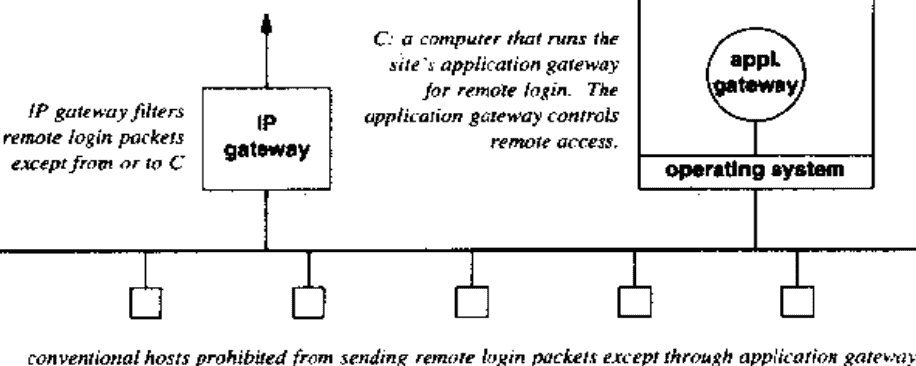

**图 18.3** 用于实施远程登录策略的应用网关。用户必须通过应用网关与远程机器通信，该网关强制执行授权控制。

图中所示的组织使用传统的 `IP` 网关过滤器来阻止所有包含远程登录请求的数据报，除非这些数据报源于运行应用网关的主机。要建立远程登录连接，组织中任何主机上的用户都会首先调用一个客户端，该客户端首先连接到应用网关。在用户获得授权后，应用网关将用户连接到目标地。

## 18.9 应用网关与“额外跳数”问题

*额外跳问题*（`the extra hop problem`）指的是数据报在通往最终目的途中跨越了同一网络的情况。该问题通常由错误的路由表引起。

在现有网络中引入应用网关也会导致某种的额外跳问题。为了理解原因，请考虑图 18.4a 的网络拓扑结构。该图显示了如果主机支持与服务器相同的传输协议，消息从主机到远程服务器将经过的路径。现在想象主机想要访问一个仅通过主机使用的协议以外的某种协议可用的服务。通过引入所示的应用网关，可以实现互操作性。应用网关使用一种协议系统接受请求，并使用另一种协议将其发送到远程服务器。遗憾的是，每条消息都跨越两次网络。该图是现实的：网络管理员通常会为每个应用网关程序购买一台新的物理计算机，因为他们想避免让现有机器过载。

到互联网其他部分

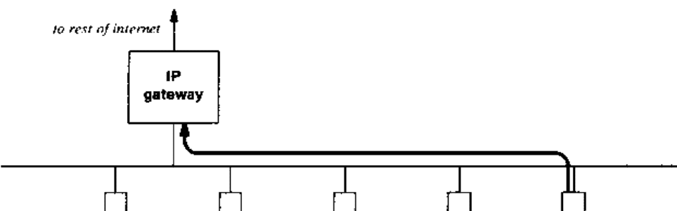

(a)

到互联网其他部分

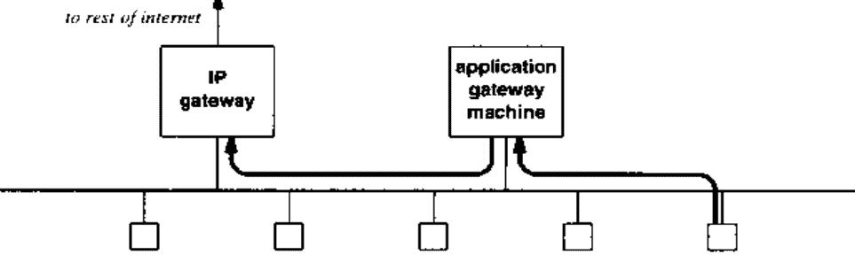

(b)

图 18.4 (a) 一组主机和一个网关。深色箭头显示了消息从主机到远程服务器的路径，以及 (b) 引入应用网关后消息的路径。新网关导致每条消息跨越两次网络。


一旦引入了应用网关，在现有主机上执行的客户端使用应用网关访问其提供的服务。客户端使用一种协议将请求发送到应用网关，网关使用另一种协议在远程服务器上转发该请求。当服务器将结果返回给应用网关时，网关将响应发回客户端。系统看起来运行良好。主机上现有的协议软件不需要更改。在安装应用网关后，在任意主机上执行的客户端将能够通过网关访问所需的服务。

## 18.9 应用网关与额外跳数问题

遗憾的是，仔细检查网络发现，配置 18.4b 并没有充分利用资源。它创建了额外跳问题。每个请求都必须跨越本地网络：从主机传输到应用网关时通过一次，从应用网关传输到服务器时通过一次。如果服务器位于互联网，第二次传输发生在消息通过网关时。如果服务器位于局域网，第二次传输发生在网关到服务器之间。

对于不需要网络流量的服务，额外跳可能是重要的。一些供应商构建了使用这种拓扑的产品。如果网络负载很大，或者服务需要大量流量，额外跳可能会使解决方案变得过于昂贵。因此，设计人员在采用应用网关方法之前需要计算负载。

## 18.10 应用网关示例

应用网关可以通过为不运行协议的客户端提供访问来扩展服务。例如，考虑一台可以访问 Web 但无法访问 FTP 等文件传输的主机。这些限制源于经济考虑（例如，FTP 软件成本过高）、商业现实（例如没有人为该计算机出售 FTP 客户端软件）或安全原因（例如站点决定通过禁止文件传输来降低安全风险）。

假设受限机器上的用户需要访问请求规范（RFC）。应用网关技术可以解决此问题，允许组织连接电子邮件和 FTP 服务，同时控制访问并确保授权。

为了从 浏览器提供 RFC 访问，应用网关必须连接这两种服务。通过网关，用户必须访问网关上相应的 RFC Web 页面。应用网关验证用户是否有权访问 RFC，建立 FTP 连接，获取 RFC 副本并作为 Web 页面显示。

例如，想象一个由统一资源定位符（URL）标识的应用网关：

```
http://gateway.somewhere.com
```

进一步想象访问该页面的用户将看到所有 RFC 文档的列表，每个文档都是可选择的项目。RFC 是连续编号的，因此一种可能的呈现方式是列出所有对应 RFC 文档的整数。

> *实际上，安全考虑是最可能的原因；Web 浏览器包含了 FTP 客户端代码，这意味着能够获取访问 Web 软件的用户也可以获得 FTP 客户端。*

另一种可能的展示方式是每行显示一个 RFC；该行包含 RFC 编号以及标题。

要使用网关，用户需要在 Web 浏览器中指定网关的 URL，该浏览器使用超文本传输协议（HTTP）连接到网关。运行在网关机器上的 Web 服务器通过向浏览器发送 RFC 列表来响应浏览器的请求。用户扫描 RFC 列表并使用鼠标选择其中一个。

到为止，我们描述的是 Web 访问；访问初始 Web 页面并没有使用应用程序网关。实际上，如果网关上的 Web 服务器在本地文件中存有每个 RFC 的副本，则可以使用传统的 Web 访问来获取 RFC。然而，我们假设 RFC 并没有预存在在网关的 Web 服务器上。相反，我们将假设使用应用程序网关来响应用户请求获取 RFC。然后，当用户从初始 Web 页面上选择一个项目时，浏览器使用 HTTP 发送标识所需 RFC 的应用程序网关请求。应用程序网关使用 FTP 获取 RFC，然后使用 HTTP 将 RFC 返回给浏览器。

## 18.11 基于 Web 的应用程序网关详情

要实现上述示例应用程序网关，需要四种设施：一台可以访问 HTTP 和 FTP 的计算机、一个传统的 Web 服务器、应用程序网关程序，以及一种将从 Web 服务器传入的 RFC 请求传递到网关的机制。通常，大多数 Web 服务器都包含了必要的设施。特别是，Web 服务器使用通用网关接口（CGI）技术来允许服务器调用程序。

包含 CGI 程序的 Web 服务器必须处理两种类型的请求。当它接收到对传统 Web 页面的请求时，服务器从磁盘中检索副本，并将副本发送到发出请求的浏览器。当它接收到由 CGI 程序管理的信息的请求时，服务器调用该程序，传递请求并等待程序运行。当 CGI 程序运行时，它会生成输出，Web 服务器将输出传回给发送请求的浏览器。例如，图 18.5 阐释了使用 CGI 程序访问 RFC 的应用程序网关的架构。

为了使该方案生效，应用程序网关必须返回一个有效的文档。对于 CGI 程序来说，程序的输出必须是浏览器可以的的文档。幸运的是，浏览器被设计为接受多种格式。如果网关返回 ASCII 文本，浏览器将用等宽字体显示它。因此，如果 CGI 程序向浏览器发送通过 FTP 获取的文件副本，浏览器将把 RFC 作为 ASCII 文本显示。如果网关修改文档以插入 HTML 命令，浏览器在显示文档时将解释格式命令。

### 网关计算机

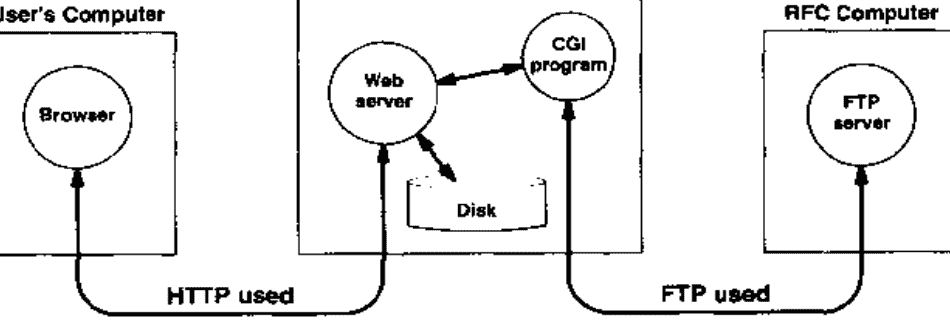

图 18.5 从浏览器通过应用程序网关到 FTP 服务器的通信。在用户计算机被限制直接访问 FTP 的情况下，会使用中间网关。

注意，从浏览器的角度来看，它无法区分传统的 Web 页面和 CGI 程序产生的文档。无论何种情况，浏览器都会发送请求、接收文档并为用户显示该文档。

## 18.12 调用 CGI 程序

Web 服务器如何知道请求对应于传统的 Web 页面还是应用程序网关？服务器使用从浏览器请求中到达的 URL 来决定检索传统页面还是 CGI 程序。事实上，大多数服务器管理多个 CGI 程序就像管理多个 Web 页面一样。每个调用 CGI 程序的 URL 必须标识要运行的特定程序，并为程序提供参数。

在大多数系统中，Web 服务器可以调用的 CGI 程序放在同一个文件夹中。例如，负责服务器的系统管理员可能会选择将所有 CGI 程序放在 `C:\cgi` 文件夹中。然后，系统管理员配置服务器将 URL 与文件夹中的程序相关联。使用一个前缀来标识 URL 为 CGI 请求，而 URL 的下部分标识特定的 CGI 程序。例如，一个网站可能会选择将以下开头的 URL：

```
http://www.somewhere.com/cgi-bin/
```

与 CGI 文件夹相关联。如果程序名为 `pgm`，则通过以下 URL 调用它：

```
http://www.somewhere.com/cgi-bin/pgm.
```

*在实践中，许多 Web 管理员选择一个比 cgi-bin 更容易记忆的术语（例如 gateways）。*

当请求到达时，服务器提取所请求项的名称并检查其前缀。对于任何以 `cgi-bin/` 开头的名称，服务器提取下一个组件，并将其作为程序的名称。

除了标识该项目为 CGI 请求的前缀和特定 CGI 程序的名称外，请求还可以包含一个将作为参数传递给程序的字符串。语法使用问号将程序名与参数字符串分开†。因此，URL：

```
http://www.somewhere.com/cgi-bin/pgm?arg-string
```

导致服务器向程序 `pgm` 传递一个参数。参数由字符字符串 `arg-string` 组成。

## 18.13 用于应用程序网关的 URL

现在获取 RFC 的应用程序网关的实现应该是清晰的。初始 Web 页面包含一组可选的链接。每个 RFC 的 URL 后面跟着一个参数。例如，一个网站可能会将以下开头的 URL：

```
http://www.somewhere.com/cgi-bin/
```

与 CGI 文件夹相关联。如果程序名为 `pgm`，则通过以下 URL 调用：

```
http://www.somewhere.com/cgi-bin/pgm.
```

*在实践中，许多 Web 管理员选择一个比 cgi-bin 更容易记忆的术语（例如 gateways）。*

当请求到达时，服务器提取请求项的名称并检查其前缀。对于任何以 `cgi-bin/` 开头的名称，服务器提取下一个组件并将其作为程序的名称。

除了标识项目为 CGI 请求的前缀和特定 CGI 程序的名称外，请求还可以包含一个将作为参数传递给程序的字符串。语法使用问号将程序名与参数字符串分开†。因此，URL：

```
http://www.somewhere.com/cgi-bin/pgm?arg-string
```

导致服务器向程序 `pgm` 传递一个参数。参数由字符字符串 `arg-string` 组成。

## 18.14 通用应用程序网关

获取 RFC 的应用程序网关的实现现在应该是清晰的。初始 Web 页面包含一组可选的链接。每个 RFC 的 URL 后面跟着一个参数。例如，一个网站可能会将以下开头的 URL：

```
http://www.somewhere.com/cgi-bin/
```

与 CGI 文件夹相关联。如果程序名为 `pgm`，则通过以下 URL 调用：

```
http://www.somewhere.com/cgi-bin/pgm.
```

*在实践中，许多 Web 管理员选择一个比 cgi-bin 更容易记忆的术语（例如 gateways）。*

当请求到达时，服务器提取请求项的名称并检查其前缀。对于任何以 `cgi-bin/` 开头的名称，服务器提取下一个组件并将其作为程序的名称。


除了标识项目为 CGI 请求的前缀和特定 CGI 程序的名称外，请求还可以包含一个将作为参数传递给程序的字符串。语法使用问号将程序名与参数字符串分开†。因此，URL：

```
http://www.somewhere.com/cgi-bin/pgm?arg-string
```

导致服务器向程序 `pgm` 传递一个参数。参数由字符字符串 `arg-string` 组成。

## 18.14 通用应用程序网关

应用程序网关已为用于拨号线而开发。特别是，大多数 Web 服务器使用通用网关接口（CGI）技术来允许服务器调用程序。

使用 SLIP 的优势是它可以访问服务。为了理解 SLIP 的设计，需要知道 SLIP 解决了 IP 地址分配的问题。事实上，SLIP 在拨号线上运行时不需要 IP 地址。使用 SLIP 的缺点是它限制了功能；例如，无法在 SLIP 上使用 IP。在 IP 模型中，每台计算机必须被分配唯一的 IP 地址。

## 18.15 SLIP 的运行

SLIP 在可以访问互联网的计算机上作为应用程序网关运行。也就是说，SLIP 与拨号调制器建立会话。也就是说，使用 SLIP 时，必须通过登录和密码建立会话。一旦用户建立了会话，用户执行两个步骤。首先，用户调用 SLIP。其次，用户在本地计算机上启动 PPP。事实上，软件会自动完成拨号、启动 SLIP 然后启动 PPP 的过程。

当 PPP 在连接上运行时，它将连接视为串口。家庭计算机上的 IP 路由将拨号连接作为所有流量的默认路由。连接一端的 PPP 将数据包封装在 PPP 帧中传输，另一端的 PPP 则移除数据包。

它理解 PPP 封装，SLIP 可以跨拨号线发送或接收数据包。此外，SLIP 包含了处理传入 TCP 段的代码以及处理 IP 数据包的代码。例如，SLIP 可以生成或验证 IP 校验和。

## 18.16 SLIP 如何处理连接

SLIP 是一个应用程序，SLIP 中的 TCP/IP 代码并不与网关计算机操作系统中的 TCP/IP 栈直接交互。相反，SLIP 仅使用其 TCP/IP 代码解释跨拨号线到达的数据包；SLIP 使用套接接口与互联网通信。

SLIP 映射拨号连接上发生的事件和互联网上发生的事件。例如，假设家庭计算机与 D 建立 TCP 连接。当段从家庭计算机传来时，SLIP 冒充 D。也就是说，当家庭计算机发送 SYN 时，SLIP 像 D 回答一样响应。同时，SLIP 创建一个套接字并连接到 D。同样，SLIP 在家庭机器和互联网之间传输数据。

†尽管我们在示例中引用 PPP，但存在使用 Slip 的 SLIPP 版本。

通过 TCP 连接来自主机，SLIP 接收数据，返回 TCP 确认，然后使用 socket 接口将数据发送到目的地 D。

## 18.17 IP 地址与 SLIP

使用 SLIP 与传统使用 PPP 有何区别？答案在于图 18.6 所示的 IP 实例化。

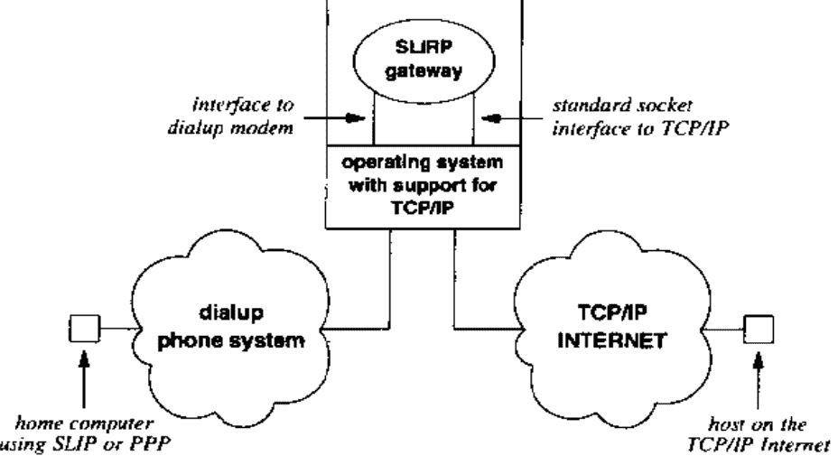

**图 18.6** SLIP 网关的插图。尽管主电脑可以使用任意 IP 地址，但在与互联网上的主机通信时，SLIP 使用有效地址。

每当 SLIP 与互联网上的主机交互时，SLIP 会使用 socket 接口。与此不同，SLIP 的运行就像在网关机器上运行的其他应用程序。特别是，SLIP 跨越互联网的所有通信都使用分配给网关计算机的 IP 地址；网关计算机无法区分远程目标。

与在互联网上的用法不同，SLIP 在拨号连接上使用的地址是不存在的。因为 SLIP 拦截了来自主机的的所有数据报，主机使用的 IP 地址不需要是有效的——在其他地方可以使用任何地址*。因此，SLIP 用户通常选择像 10.0.0.1 这样的 IP 地址，这种地址没有分配给互联网主机，且易于记忆。

> *如果使用了有效的互联网地址，主机将无法与拥有该地址的计算机通信。

## 18.18 总结

尽管隧道允许一个协议系统使用另一种高层协议作为传输设备，但传统的隧道受限于设计者可以访问操作系统代码的情况。应用程序网关技术是隧的替代方案，允许应用程序程序员在不更改操作系统的情况下连接异构系统。

应用程序网关是一种使用一种高层协议接受请求，并使用另一种高层协议履行请求的程序。本质上，每个应用程序网关都是一个服务的服务器和另一个服务的客户端。

我们看到应用程序网关可以与 Web 服务器关联。当请求到达时，Web 服务器使用 CGI 等技术调用应用程序网关程序，并将程序的输出传回发送请求的浏览器。Web 服务器使用 URL 的前缀来确定 URL 指的是 CGI 程序还是传统的 Web 页面；服务器必须配置为将特定前缀与 CGI 程序文件夹关联。除了指定 CGI 程序外，URL 还可以包含传递给程序的后缀。

许多网站使用应用程序网关来实现授权和安全检查。因为网关作为传统的应用程序运行，因此为了编写网关以过滤不需要的访问或记录每个请求所需的工作很少。

存在一种名为 SLIP 的网关，它支持多种服务。SLIP 设计用于拨号电话线，允许主电脑访问 IP 服务，而不需要为主电脑分配有效的 IP 地址。主电脑运行 PPP 或 SLIP 软件，这些软件通过拨号连接发送 IP 数据报。SLIP 接收传入的数据报，发送伪装成目的确认，并使用传统的互联网软件与目标通信。

## 进一步学习

Simpson [RFC 16611] 文档记录了 PPP 协议，Romkey [RFC 1055] 描述了 SLIP。咨询 Web 服务器文档以了解更多关于 CGI 的信息。

网站：http://ucnet.canberra.edu.au/slrip 有关于 SLIP 程序以及源代码。特别注意源代码中的 slrip.doc。

邮局协议 (POP) 了一了一种标准的应用程序网关服务，允许个人计算机从服务器访问电子邮件。Myers 和 Rose [RFC 1939] 描述了 POP 协议第 3 版本 (POP3)。

## 练习

- 1.1 应用程序网关应该执行哪些授权检查？为什么？

- 1.2 许多应用程序网关实现了缓存，网关保留最后获取的 N 个项目的本地副本，以避免为后续请求重复获取这些项目。在什么情况下缓存是有用的？什么情况下无用？

- 1.3 在上一个问题中，考虑并发应用程序网关。例如，假设 Web 服务器每当用户发送请求时创建一个新线程来执行 CGI 程序。解释线程之间如何相互干扰。

- 1.4 发送者可以使用 CGI 程序请求 RFC 索引的副本吗？为什么？

- 1.5 阅读关于 CGI 的内容。CGI 如何使用环境变量 QUERY_STRING？

- 1.6 SLIP 能用于在主电脑上运行客户端软件吗？它可以运行服务器吗？解释。

## 19

# 外部数据表示 (XDR)

## 19.1 引言

前面的章节描述了客户端和服务器程序的算法、机制和实现技术。本章开始讨论帮助程序员使用客户端-服务器范式的概念和技术，以及为这些概念提供编程支持的机制。特别是，它检查了外部数据表示和呈现的事实标准，以及一组用于数据转换的库过程。

本章描述了使用外部数据表示的总体动机以及一个特定实现的细节。下一章将展示外部数据表示标准如何简化客户端和服务器的通信，并说明标准如何使得可以使用单一、统一的远程机制进行客户端-服务器通信。

## 19.2 计算机中数据的表示

每个计算机体系都为数据表示提供了自己的定义。某些计算机将整数的最低字节存储在最低地址，另一些将最高字节存储在最低地址，而另一些则不连续存储字节。例如，图 19.1 显示了 32 位整数的两种常用表示法。

| 内存地址减小 | | | | | 内存地址增大 |

|---|---|---|---|---|

| MSB | | | | |

| 0 | 0 | 1 | 4 | |

| | | | | MSB |

| | 4 | 1 | 0 | |

**图 19.1** 存储为 32 位二进制整数的值 260 的表示：(a) “大端序”顺序，最高字节存储在最低内存地址，以及 (b) “小端序”顺序，最低字节存储在最低内存地址。数字给出每个 8 位字节的十进制值。

## 19.3 N 平方转换问题

数据表示的核心问题是软件的可移植性。在一个极端，程序员可以选择在每对客户端-服务器对中嵌入计算机体系的知识，以便客户端和服务器就由哪一方进行数据转换达成一致。直接从客户端表示转换为服务器表示的设计使用非对称数据转换，因为由其中一方或另一方执行转换。遗憾幸的是，使用非对称转换意味着程序员必须为将使用的每种架构对编写一个不同版本的客户端-服务器对。

为了理解为什么为每种架构组合构建独立的客户端-服务器对是昂贵的，考虑一组 N 台计算机。如果每台计算机都使用不同的数据表示来存储浮点数，程序员必须构建

# N 平方转换问题

$$(N^2-N)/2$$

交换浮点值的任何客户端-服务器程序的版本数量。我们将其称为“n 平方转换问题”，以强调编程工作量与不同数据表示数量的平方正比。

查看 n 平方转换问题的另一种方法是，想象向现有的 $N$ 台机器集中添加一个新架构所需的精力。每当有一台新计算机时，程序员必须在新计算机与每台现有计算机实现互操作之前，为每个客户端-服务器对构建 $N$ 个版本。


> 如果客户端-服务器软件的设计是非对称地从客户端的原生数据表示直接转换为服务器的原生数据表示，那么软件的版本数将随着架构数量的平方级增长。

为了避免维护 $N$ 平方版本的客户端-服务器程序带来的问题，程序员尝试使用非对称数据转换。相反，他们编写客户端和服务器软件，使得每个源程序都可以在无需更改的情况下各种机器上编译和执行。这样做使得编程变得更容易，因为它产生了高度可移植的程序。它也使得访问服务变得更容易，因为用户只需要记住调用一个版本的客户端。

# 19.4 网络标准字节序

如果各种架构对数据使用多种表示形式，单个源程序如何在各种架构上正确地编译和执行？如果两台机器使用不同的数据表示，客户端或服务器程序如何向另一台机器上的程序发送数据？第 5 章通过使用从计算机原生格式到网络标准字节序反之转换的函数，描述了简单整数数据的表示问题。

从概念上讲，在协议头中对跨网络发送的数据使用标准表示，意味着 TCP/IP 协议采用了对称数据转换。两端都执行所需的转换。其结果是，只需要一个版本的协议软件，因为所有协议头都以标准的、与机器无关的形式表示数据。

大多数程序员在构建客户端-服务器应用程序时，都采用相同的对称数据转换技术。他们不是直接从一台机器的表示转换为另一种，而是客户端和服务器都执行数据转换转换sion。

*某些文献将此问题称为 n*m 问题，以强调客户端可以在 $n$ 种架构上运行，而服务器可以在 $m$ 种架构上运行。*

在发送到网络之前，他们将数据从发送计算机的原生表示转换为标准的、机器无关的表示。同样，在从网络接收数据后，他们将从机器无关的表示转换为接收计算机的原生表示。用于遍历网络的标准表示被称为*外部数据表示*。

使用标准的外部数据表示既有优势也有缺点。主要优势在于灵活性：客户端和服务器都不需要理解对方的架构。单个客户端可以连接任意机器上的服务器，而无需知道机器架构。所需的总编程工作将与机器架构的数量成正比，而不是与其的大小成比例。

对称转换的主要缺点是计算开销。在客户端和服务器运行在相同架构的计算机上的情况下，这种成本似乎是不需要的。一方在发送数据之前将所有数据从架构的表示进行转换，而另一方在接收数据后将其从外部表示转换回原始表示。

即使客户端和服务器不共享共同架构，中间格式也会引入额外的复杂性。客户端和服务器不再是直接从发送者的表示转换为接收者的表示转换，而是必须花费 CPU 时间在它们的本地表示和外部表示之间进行转换。此外，由于外部表示可能会向数据添加信息或将其在字边界上进行对齐，转换可能会导致产生必要的更大的字节流。

尽管需要额外的开销和带宽，大多数程序员都认为对称转换是值得的。它简化了编程，减少了错误，并增加了程序之间的互操作性。它使得网络管理和调试变得更容易，因为网络管理器可以解释数据包的内容，而无需知道发送和接收机器的架构。

# 19.5 事实标准外部数据表示

太阳微系统公司（Sun Microsystems, Incorporated）开发了一种外部数据表示，在跨网络传输数据时指定数据的通用形式。这种以 XDR 缩写命名的*外部数据表示*已成为大多数客户端-服务器应用程序的*事实标准*。

XDR 为客户端和服务器交换大多数数据类型指定数据格式。例如，XDR 规定 32 位整数应以“大端”顺序表示（即最高有效字节位于最低内存地址中）。

## 19.6 XDR 数据类型

图 19.2 中的表格列出了 XDR 定义表示形式的数据类型。

| 数据类型 | 大小 | 描述 |
| --- | --- | --- |
| int | 32 bits | 32 位有符号二进制整数 |
| unsigned int | 32 bits | 32 位无符号二进制整数 |
| bool | 32 bits | 用 0 或 1 表示的布尔值（false 或 true） |
| enum | arb. | 由整数定义取值的枚举类型（例如，RED=1, WHITE=2, BLUE=3） |
| hyper | 64 bits | 64 位有符号二进制整数 |
| unsigned hyper | 64 bits | 64 位无符号二进制整数 |
| float | 32 bits | 单精度浮点数 |
| double | 64 bits | 双精度浮点数 |
| opaque | arb. | 未转换的数据（即发送者原生表示中的数据） |
| string | arb. | ASCII 字符字符串 |
| fixed array | arb. | 任何其他数据类型的固定大小数组 |
| counted array | arb. | 类型有限制的数组，但单个数组的大小可能各异 |

> 图 19.2 XDR 定义外部数据表示的类型。标准规定了数据项在跨网络发送时应如何编码。

图 19.2 中的类型涵盖了所有允许程序员从其他类型组合成聚合类型的结构。例如，除了允许整数数组外，XDR 还允许结构体数组或联合体（union）。因此，XDR 为 C 程序可能指定的大多数结构提供了表示。


## 19.7 隐式类型

XDR 指定了每种类型应如何编码数据对象。然而，编码仅包含数据项，而不包含其类型的信息。例如，XDR 对 32 位整数使用“大端”顺序（与 TCP/IP 协议头使用的编码相同）。如果应用程序使用 XDR 表示编码 32 位整数，结果将占据 32 位；编码不包含识别整数或指定其长度的额外位。客户端和服务器必须对它们交换的消息的精确格式达成一致。除非知道所有数据字段的类型，否则程序无法解释 XDR 编码的消息。

## 19.8 用于 XDR 的软件

选择使用 XDR 表示进行对称数据转换的程序员必须在跨网络发送之前，将每个数据项放入外部形式。同样地，接收程序必须小心地将每个输入项转换为原生表示。第 5 章展示了程序员可以使用的一种转换方法：在发送消息之前插入函数调用将消息中的每个数据项转换为外部格式，并在消息到达时插入函数调用将每个数据项转换为内部格式。

大多数程序员可以毫不力地编写所需的 XDR 转换函数。然而，某些转换需要大量的专业知识（例如，将计算机的原生浮点表示转换为 XDR 标准而不丢失精度，可能需要对基础数值分析有理解）。为了消除潜在的转换错误，XDR 实现包含了执行必要转换的库函数。

## 19.9 XDR 库函数

给定机器的 XDR 方案可以将数据项从计算机的原生表示转换为 XDR 标准表示，反之亦然。大多数 XDR 实现使用缓冲区范式，允许程序员创建完整的 XDR 格式的消息。

## 19.10 分步构建消息

XDR 的缓冲区范式要求程序分配一个足够容纳消息外部表示的缓冲区，并一次添加一个项（即字段）。例如，在 SunOS 操作系统下提供的 XDR 版本提供了转换程序，可以将外部表示附加到

## 第 19.10 节 逐个构建消息

内存中的缓冲区结束。程序调用过程 `xdrmem_create` 来在内存中分配一个缓冲区，并通知 XDR 它意图在其中构造外部表示。`xdrmem_create` 初始化内存，使其表示一个 XDR 流，该流可用于编码（转换为标准表示）或解码（转换为原生表示）数据。该调用通过将缓冲区的起始位置分配给内部指针，将 XDR 流初始化为空。`xdrmem_create` 返回一个指向流的指针，该指针必须在后续的 XDR 例程序调用中使用。创建 XDR 流所需的声明和调用如下：

```c
#include <rpc/xdr.h>
/* 编码所需的内存大小 */
#define BUFSIZE 4000

XDR *xdrs; /* 指 XDR *stream* 的指针 */
char buf[BUFSIZE]; /* 用于存储 XDR 数据的内存区域 */

xdrm_create(xdrs, buf, BUFSIZE, XDR_ENCODE);
```

一旦程序创建了 XDR 流，就可以调用各个 XDR 转换例程序将原生数据对象转换为外部形式。每次调用都会将编码后的信息附加到流的末尾（即将编码后的数据放在缓冲区中的下一个可用位置），并更新流指针。例如，过程 `xdr_int` 将一个 32 位的二进制整数从原生表示转换为标准 XDR 表示，并将其附加到 XDR 流中。程序通过传递 XDR 流的指针和指向整数的指针来调用 `xdr_int`：

```c
int i; /* 原生表示的整数 */
. . /* 假设流已为 ENCODE 初始化 */
ni = 260; /* 分配要转换的整数值 */
xdr_int(xdrs, &i); /* 整数并附加到流 * */
```

图 19.3 展示了示例代码所示的 `xdr_int` 调用，它向 XDR 流添加了 4 字节的数据。

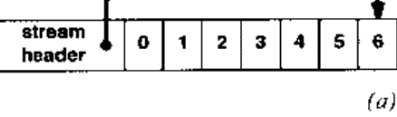

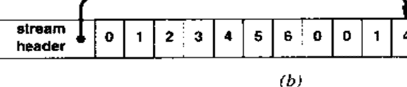

图 19.3 (a) 一个已为编码初始化的 XDR 流，且已包含 7 字节数据；(b) 在调用 `xdr_int` 后附加了值为 260 的 32 位整数的同一 XDR 流。

## 第 19.11 节 XDR 库中的转换例程序


图 19.4 中的表格列出了 XDR 转换例程序。

## 第 19.11 节 XDR 库中的转换例程序

| 过程 | 参数 | 转换的数据类型 |
|---|---|---|
| `xdr_bool` | `xdrs`, `ptrbool` | 布尔值 (C 语言中) |
| `xdr_bytes` | `xdrs`, `ptrstr`, `strsize` | 计数的字节字符串 |
| `xdr_char` | `xdrs`, `ptrchar` | 字符 |
| `xdr_double` | `xdrs`, `prtdouble` | 双精度浮点数 |
| `xdr_enum` | `xdrs`, `sprint` | 枚举数据类型变量 (C 语言中的 an) |
| `xdr_float` | `xdrs`, `ptrfloat` | 单精度浮点数 |
| `xdr_int` | `xdrs`, `ip` | 32 位整数 |
| `xdr_long` | `xdrs`, `ptrlong` | 64 位整数 |
| `xdr_opaque` | `xdrs`, `ptrchar`, `count` | 不转换的字节 |
| `xdr_pointer` | `xdrs`, `ptrobj` | 指针（用于列表或树等链式数据结构） |
| `xdr_short` | `xdrs`, `ptrshort` | 16 位整数 |
| `xdr_string` | `xdrs`, `ptrstr`, `maxsize` | 字符串 |
| `xdr_u_char` | `xdrs`, `ptruchar` | 无符号 8 位整数 |
| `xdr_u_int` | `xdrs`, `sprint` | 无符号 32 位整数 |
| `xdr_u_long` | `xdrs`, `ptrlong` | 无符号 64 位整数 |
| `xdr_u_short` | `xdrs`, `ptrushort` | 无符号 16 位整数 |
| `xdr_union` | `xdrs`, `ptrdiscrim`, `ptrunion`, `choicecen`, `default` | 判别 union |
| `xdr_vector` | `xdrs`, `ptrarray`, `size`, `elemsizelec` | 固定长度数组 |
| `xdr_void` | - | 非转换（用于表示数据结构为空） |

> 图 19.4 在 XDR 库中找到的 XDR 数据转换例程序。

这些例程序可以双向转换，因为大多数参数都是指向数据对象的指针，而不是数据值。

为了形成消息，应用程序会对消息中的每项内容调用 XDR 转换例程序。在编码每个数据项并将其放入 XDR 流后，应用程序可以通过发送结果流来发送消息。接收端必须反转整个过程。它调用 `xrdmem_create` 创建一个将持有 XDR 流的内存缓冲区，并将传入的消息放入该缓冲区中。XDR 在自身内部记录流的方向，转换例程序可以访问它。接收端在自身内部指定流的方向，转换例程序可以访问它。

事实上，Sun Microsystems 公司定义了一种已成为标准的外部数据表示。该标准被称为 XDR，Sun 标准为数据聚合（例如数组和结构体）以及基本数据类型（例如整数和字符字符串）提供了定义。XDR 库例程提供了从计算机原生数据表示到外部标准的转换，反之亦然。客户端和服务器程序使用 XDR 例程在发送数据之前将其转换为外部形式，并在接收数据后将其转换为内部形式。这些转换例程可以通过 `TCP` 或 `UDP` 与输入和输出关联。

## 深入学习

Sun Microsystems 公司 [RFC 1014] 定义了 XDR 编码和标准的 XDR 转换例程。Srinivasan [RFC 1832] 包含一个作为建议标准的新版本。更多信息可以在每个厂商软件随附的文档中找到。例如，《网络编程指南》随 `SunOS` 操作系统一同提供。

国际标准化组织 [1987a 和 1987b] 定义了一种名为抽象语法表示法一 (`ASN.1`) 的外部数据表示。尽管 TCP/IP 中的某些协议使用了 `ASN.1` 表示，但大多数程序员更倾向于 XDR。Partridge 和 Rose (1989) 显示 XDR 和 `ASN.1` 具有等效的能力。

Padlipski [1983] 讨论了不对称转换问题，并指出这需要 n 种可能的转换。

## 练习题

- 19.1 构造一个 `ntohs` 版本并进行实验，将你的版本的执行时间与系统库或头文件中版本的执行时间进行比较。解释结果。
- 19.2 XDR 对缓冲区范式的使用如何让编程变得简单？
- 19.3 设计一种在每个数据项之前包含类型字段的外部数据表示。这种方案的优点是什么？主要的缺点是什么？
- 19.4 阅读厂商文档以了解 XDR 流的格式。标头中保留了哪些信息？
- 19.5 论证：如果 XDR 的设计者必须为编码和解码选择独立的转换例程，而不是在流头中反转转换方向，程序将更易读。保持独立转换例程的缺点是什么？
- 19.6 在什么情况下，程序员可能需要在客户端和服务器之间传递不透明数据对象？

# 20

## 远程过程调用 (RPC)

## 20.1 引言

上一章开始讨论帮助程序员使用客户端-服务器范式† 的技术和机制。它考虑了使用对称数据转换的优点，并描述了 XDR 外部数据表示标准以及相关例程如何提供对称转换。

本章继续该讨论。它引入了远程过程调通用概念，并描述了一种使用 XDR 标准进行数据表示的远程过程调用特定实现。它展示了过程调用概念如何简化客户端服务器软件的设计，并使生成的程序更容易理解。接下来的两章通过描述一个生成实现远程调用所需的大部分 C 代码的工具来完成讨论。22 章包含一个完整的运行示例，展示了该工具如何生成使用远程过程调客户端和服务器。

### 20.2 远程过程调用模型

到为止，我们通过分别检查客户端和服务器组件的结构来描述客户端服务器程序。然而，当程序员构建客户端服务器应用程序时，他们不能一次专注于某一个组件。相反，他们必须考虑整个系统将如何运行以及这两个组件将如何交互。

> † 这种机制通常被称为中间件。

### 20.3 构建分布式程序的两种范式

为了帮助程序员设计和理解客户端服务器交互，研究人员设计了一个用于构建分布式程序的概念框架。该框架被称为远程过程调用模型或 RPC 模型，它将传统程序中的概念作为分布式应用设计的基础。

程序员在设计分布式应用时可以使用两种方法之一：

- **面向通信的设计**

  从通信协议开始。设计消息格式和语法。通过指定每个组件如何对传入的消息做出反应以及每个组件如何生成传出的消息，来设计客户端和服务器组件。

- **面向应用的设计**

  从应用程序开始。设计一个传统的应用程序来解决该问题。构建并测试一个在单机上运行的传统程序的工作版本。将程序划分为两个或多个部分，并添加通信协议，允许每个部分在单独的计算机上执行。

面向通信的设计有时会导致问题。首先，通过关注通信协议，程序员可能会忽略应用中重要的细微差别，并可能发现协议没有提供所有所需的功能。其次，由于很少程序员具有协议设计的经验和专业知识，他们往往会感知到笨拙、错误或低效的协议。协议设计中的微小疏忽可能导致根本性错误，这些错误在程序在压力下运行之前一直隐藏着（例如死锁的可能性）。第三，因为程序员专注于通信，它变成了所生成程序的中心，使得这些程序难以理解或修改。特别是，由于服务器是由消息列表以及当每条消息到达时所需的操作来定义的，可能很难理解其预期的交互或底层的动机。

远程过程调用模型使用了面向应用的方法，该方法强调要解决的问题，而不是所需的通信。使用远程过程调用模型，程序员首先设计一个传统程序来解决问题，然后将程序划分为在两台或多台计算机上运行的部分。程序员可以遵循良好的设计原则，使代码模块化且可维护。

在理想情况下，远程过程调用模型提供的不仅仅是一个抽象的。。它允许程序员构建、编译并测试程序版本，以便在将程序划分为运行在单独机器上的部分之前确保它正确解决了问题。此外，由于 RPC 在边界处划分程序，本地和远程部分的划分可以在不对程序结构进行重大修改的情况下完成。事实上，可以在不改变重新编译主程序的情况下，将程序的某些过程移动到远程机器。因此，RPC 将问题的解决与在分布式环境中运行解决方案的任务分开。

面向编程的过程调用范式关注应用。它允许程序员在尝试将程序划分为运行在多个计算机上的部分之前，专注于设计解决问题的传统程序。

### 20.4 传统过程调用的概念模型

过程调用模型大量借鉴了传统编程语言中的过程调用机制。过程提供了一种强大的抽象，允许程序员将程序划分为小的、易管理的、易理解的部分。过程特别有用，因为它们具有直接的实现，提供了程序执行的概念模型。图 20.1 展示了这一概念。

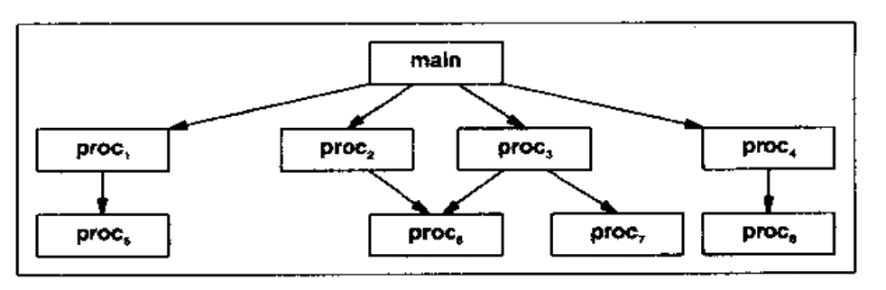


图 20.1 过程概念。程序由一个或多个过程组成，通常层次排列。从过程 n 到过程 m 的箭头表示从 n 到 m 的调用。

# 20.5 过程模型的扩展

过程调用模型使用与传统程序相同的过程抽象，但允许过程调用跨越两台计算机之间的边界。

传统的过程调用无法从一台计算机传递到另一台计算机。在程序可以使用远程过程调用之前，必须增强协议软件以允许其与远程过程进行通信。

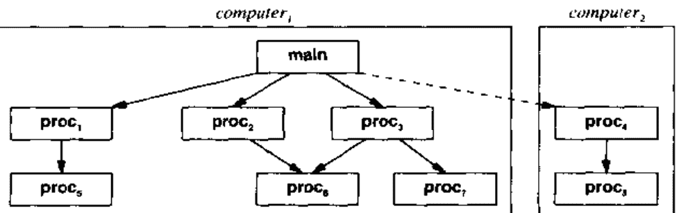

图 20.2 一个分布式程序展示了图 20.1 中的程序如何扩展以使用远程过程调用范式。划分发生在主程序和过程 A 之间。实现远程调用需要一种通信协议。

# 20.6 传统过程调用的执行与返回

过程模型为程序执行提供了一种概念性的解释，这种解释可以直接扩展到远程过程调用。通过考虑控制流与内存中编译代码之间的关系，最好能理解这一概念。例如，图 20.3 说明了控制流如何从主程序通过两个过程并返回。

执行在被调用的过程中持续进行，直到计算机遇到返回语句。返回语句导致执行在上一次调用之后的某个点处恢复。例如，在图 20.3 中，执行过程 B 会导致控制回到调用 B 之后的某个点给过程 A。

第 20.6 节传统过程调用的执行与返回

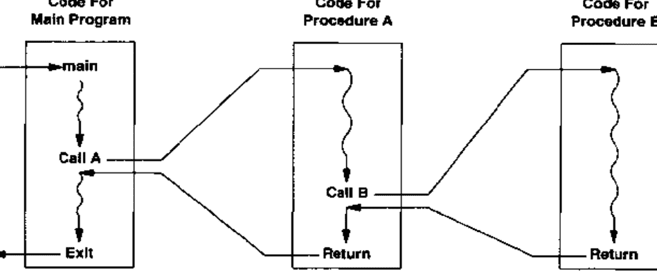

图 20.3 一个执行的概念模型，解释了过程调用和返回期间的控制流。主程序中的单一控制线程通过过程 A 和 B，并最终返回主程序。

在概念模型中，任何时候都只有一个执行线程继续。因此，当计算机执行对另一个过程的调用时，一个过程的执行必须暂时“停止”。计算机挂起调用过程，在调用期间将所有变量的值冻结。稍后，当执行从过程调用返回时，计算机在调用者中恢复执行，此时所有变量的值再次可用。被调用的过程可能会引发进一步的过程调用，因为计算机记得调用的序列，并始终返回到最近执行的调用者。

# 20.7 分布式系统中的过程模型

过程调用的执行模型可以帮助程序员在思考传统计算机程序时，帮助我们理解分布式程序是如何是如何执行的。与其思考客户端程序和服务器程序交换消息，不如想象每个服务器实现一个（远程）过程，而客户端与服务器之间的交互对应于过程调用和返回。从客户端发送到服务器的请求对应于对远程过程调用，从服务器发送回客户端的响应对应于返回指令的执行。图 20.4 释了这一类比。

远程过程调用概念 `RPC` 第 20 章

# 主程序

在机器 1 `客户端` 上

# 过程 A

在机器 2 `服务器` 上

# 过程 B

在机器 3 `服务器` 上

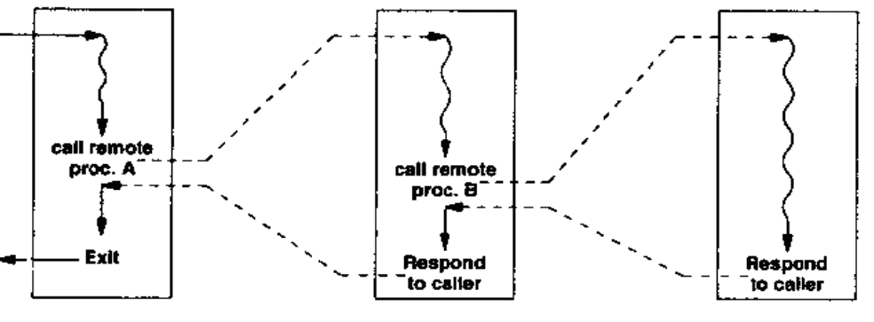

图 20.4 远程过程调用的执行模型。单一控制线程在分布式环境中执行。虚线显示了控制在远程过程调用期间如何从客户端传递到服务器，以及在服务器响应时如何传回。

# 20.8 客户端-服务器与 RPC 之间的类比

远程过程调用概念提供了一个有力的类比，允许程序员在熟悉的语文中思考客户端-服务器交互。像传统的过程调用一样，远程过程调用将控制传递给被调用的过程。也像传统的过程调用一样，系统在期间挂起调用者的执行，并仅允许被调用的过程执行。

当远程过程发出请求时，它对应于返回的执行。控制流回到调用者，被调用的过程停止执行。嵌套过程调用的概念也适用于远程过程。一个远程过程可以调用另一个过程。图 20.4 释了这一类比。

在，模型，的的的的............................................,,,,,,,,为了方便与服务器交互。

# 20.8 客户端-服务器与 RPC 之间的类比

尽管远程过程的行为如果完全相同将是理想的，但会出现一些限制。首先，网络延迟可能使远程过程更加昂贵。其次，由于远程过程在不同的地址空间中运行，它不能共享指针。第三，由于远程过程在不同的地址空间中运行，它无法访问操作系统函数。

## 20.9 作为程序的分布式计算

理解远程过程调用的关键在于理解，尽管有局限性，它有助于设计分布式程序。总结来说：将分布式计算视为一个控制跨越网络并返回的单一程序，有助于程序员指定客户端-服务器交互：它将分布式计算的交互与熟悉的过程调用和返回的概念联系起来，而不需要任何特殊的符号。

# 20.10 Sun 公司的远程过程调用定义

`Sun Microsystems, Incorporated` 定义了特定形式的远程过程调用。这种 `RPC`、开放网络计算 `ONC RPC` 或简称为 `RPC` 的，在行业内得到了广泛接受。它已被用作许多应用程序的实现机制，包括网络文件系统 `NFS`。

`RPC` 定义了调用者（客户端）发送到服务器以调用远程过程的消息格式、参数格式以及被调用过程返回给调用者的结果格式。它允许调用程序通过 `XDR` 使用 `UDP` 或 `TCP` 来表示过程参数以及 `RPC` 消息头中的其他项目。最后，除了协议规范，`RPC` 还包含一个编译器系统，帮助程序员构建分布式程序。

# 20.11 远程程序与过程

`RPC` 通过定义远程执行环境扩展了远程过程调用模型。它将远程程序定义为在远程机器上执行的软件基本单元。每个远程程序对应于我们认为的服务器并包含一组或多个远程过程。远程程序内部的过程共享其全局数据。因此，一组协作过程共享状态信息。例如，可以通过构建一个单一的远程程序来实现简单的远程数据库，该程序包含存储共享信息的结构结构和处理它的三个远程过程：插入、删除和查找。如图 20.5 所示，远程程序内部的所有远程过程都共享同一个数据库。

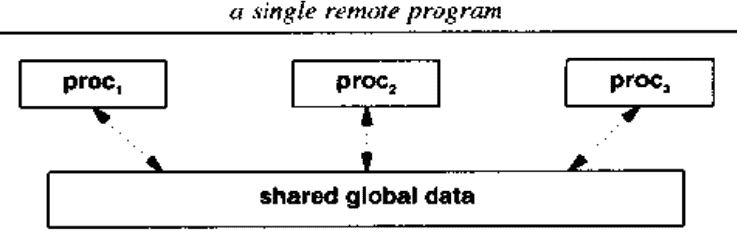

图 20.5 远程程序中三个远程过程的概念组织。所有三个过程共享程序中的全局数据，就像传统过程共享传统程序中的全局数据一样。

> †在本文其余部分，除非另有说明，`RPC` 术语指的是 `ONC RPC`。‡第 23 章详细讨论了 `NFS`。

# 12.12 减少参数数量

由于大多数编程语言使用位置表示法来表示参数，包含多个参数的过程调用可能变得难以阅读。程序员可以通过将许多参数收集到一个单一的数据聚合体（例如 `C` 结构体）并将生成的聚合体作为单个参数传递来解决这个问题。调用者在将结构传递给被调用的过程之前，为结构中的每个字段赋值；在调用返回后，调用者从结构中提取返回值。总结来说：

使用结构体代替多个参数可以使程序更具读性，因为结构体的字段名充当了关键词，告诉读者每个参数将如何被使用。

由于在接后的讨论中，我们假设所有使用 `RPC` 的程序都会将其参数收集到一个结构中，因此每个远程过程只需要一个参数。

# 20.13 识别远程程序和过程

`RPC` 标准规定，在计算机上执行的每个远程过程都必须分配一个唯一的 32 位整数，调用者用它来识别该过程。此外，`RPC` 为给定的远程程序内部的每个远程过程分配一个整数。这些过程按顺序编号：1, 2, ..., N。从概念上讲，给定远程计算机上的特定远程过程可以通过一对值来识别：

```
( prog, proc )
```

其中 `prog` 识别远程程序，`proc` 识别程序内的远程过程。为了帮助确保不同组织定义的程序编号不发生冲突，`RPC` 如图 20.6 所示，将程序编号集分为八个组。

*按照惯例，数字 0 始终保留给回显（echo）过程，用于测试远程程序是否可以访问。

远程过程调用概念 `RPC` 第 20 章

| 起始 | 结束 | 由谁分配的值 |
|---|---|---|
| 0x00000000 | 0x1ffffff | Sun Microsystems, Inc. |
| 0x20000000 | 0x3ffffff | 用户站点的系统管理员 |
| 0x40000000 | 0x5ffffff | 瞬态（临时） |
| 0x60000000 | 0x7ffffff | 预留 |
| 0x80000000 | 0x9ffffff | 预留 |
| 0xa0000000 | 0xbffffffff | 预留 |
| 0xc0000000 | 0xdffffff | 预留 |
| 0xe0000000 | 0xffffffff | 预留 |

**图 20.6** `RPC` 用于识别远程程序的 32 位数字划分为八组的说明。每个远程程序都被分配了一个唯一的编号。

`Sun Microsystems, Incorporated` 管理第一组标识符，允许任何人申请标准的 `RPC` 程序编号。由于 `Sun` 发布了这些分配情况，所有运行 `RPC` 的计算机都使用标准值。在第一组可用的 $2^{32}$ 个程序编号中，`Sun` 仅分配了少数数字。图 20.7 总结了部分分配情况。

# 20.14 容纳远程程序的多个版本

除了程序编号外，`RPC` 还为每个远程程序还包含一个整数*版本号*。通常，程序的第一个版本被分配为版本号*1*。随后的每个版本都会获得一个唯一的版本号。

版本号提供了在不获取新程序编号的情况下更改远程过程调用细节的能力。在实践中，每个 `RPC` 消息通过一个三元组识别给定计算机上的目标接收者：

```
(prog, vers, proc)
```


*其中* `prog` 识别远程程序，*vers* 指定消息发送到的程序版本，*proc* 识别该远程程序内的远程过程。RPC 规范允许计算机同时运行远程程序的多个版本，从而在更改期间允许平滑迁移。该思想可以总结为：

由于所有 RPC 消息都识别远程程序、该程序版本以及程序中的远程过程，因此可以从远程过程的一个版本平滑地迁移到另一个版本，并在旧版本继续运行的同时测试新版本的服务器。

## 容纳远程程序的多个版本

| 名称 | 分配编号 |  |
| --- | --- | --- |
| portmap | 100000 | 端口映射器 |
| rstat | 100001 | rstat, rup, and permerter |
| rusers | 100002 | 远程用户 |
| nfs | 100003 | 网络文件系统 |
| ypserv | 100004 | yp (现称为 NIS) |
| mount | 100005 | 挂载, showmount |
| dbxd | 100006 | DBXprog (调试器) |
| ypbind | 100007 | NIS 绑定器 |
| walld | 100008 | rwall, shutdown |
| yppasswd | 100009 | yppasswd |
| etherstat | 100010 | 以太网统计数据 |
| rquota | 100011 | rquotaprog, quota, rquota |
| sprayd | 100012 | spray |
| selection_svc | 100015 | 选择服务 |
| dbsessionmgr | 100016 | unify, netdbms, dbms |
| rexd | 100017 | rex, remote |
| office_auto | 100018 | alice |
| lockd | 100020 | office |
| lockd | 100021 | kimprog |
| statd | 100024 | status monitor |
| bootparam | 100026 | bootstrap |
| pcntid | 100001 | NFS for PC |

图 20.7 由 Sun Microsystems 分配的 RPC 程序编号示例

## 20.15 远程程序过程的互斥

RPC 机制规定一个程序内最多有一个过程可以被调用。因此，RPC 提供了自动互斥。这种互斥对于维护共享数据的远程程序非常重要。例如，如果远程数据库包含插入和删除操作，程序员不需要担心两个远程过程调用会相互干扰，因为系统只允许一个执行。总结来说：

RPC 提供了程序内部远程过程的互斥；一次只能执行一个远程过程调用。

在选择 RPC 时，设计者必须在两种可能性之间进行选择。一方面，为了让远程过程调用尽可能像本地过程调用，RPC 应该使用可靠的传输协议 `TCP` 并保证可靠性。远程过程调用机制必须将调用传输到远程过程并接收回复，或者报告通信不可。另一方面，为了允许程序员使用高效的无连接传输协议，远程过程调用机制应该支持通过数据报协议进行通信。

RPC 不强制可靠性。它允许每个应用程序使用 `TCP` 或 `UDP` 作为传输协议。此外，标准没有规定实现可靠交付的额外协议或机制。相反，它将 RPC 语义定义为底层传输协议函数。例如，由于 `UDP` 数据包可能会丢失或重复，RPC 规定使用 `UDP` 的远程调用可能会出现这种情况。

## 至少一次语义

RPC 以最简单的方式定义远程过程调用的语义，规定程序对任何交互都只得出最弱的结论。例如，使用 `UDP` 时，请求或消息回复（远程过程的调用或返回）可能会丢失或重复。如果远程过程调用没有返回，调用者无法确定远程过程没有被调用，因为回复可能丢失了，即使请求没有。如果远程过程调用返回了，调用者可以确定远程过程至少调用过一次。

RPC 标准使用“至少一次语义”描述调用者收到回复时的 RPC 执行，并使用“零或多次语义”描述调用者未收到回复时远程过程调用的行为。

RPC 的零或多次语义给程序员施加了一项重要的责任：

## 第 20.17 节 至少一次执行语义

选择 `UDP` 作为 ONC RPC 传输协议的程序员，必须构建应用程序以使其能够容忍“零或多次”的执行语义。

在实践中，零或多次语义通常意味着程序员使每个远程过程调用具有**幂等性**（idempotent）。例如，考虑一个远程文件访问应用程序。向文件追加数据的远程过程不是幂等等的，因为该过程的重复执行会重复追加数据。另一方面，向文件中指定位置写入数据的远程过程是幂等等的，因为重复执行始终会将数据写入相同的位置。

## 第 20.18 节 RPC 重传

带有 ONC RPC 实现的库软件包含超时和重传策略，这并不保证严格意义上的可靠性。默认超时机制实现了一个固定（非自适应）的超时时间，并带有固定次数的重试。当 RPC 库发送对应于远程过程调用的消息时，它会启动一个计时器。如果计时器在收到响应之前过期，软件将重传该请求。程序员可以为特定应用程序调整超时和重试限制，但软件并不会适应长时间的网络延迟或随时间的变化。

当然，简单的重传策略不能保证可靠性，也不能保证调用程序能够对远程过程的执行得出正确的结论。例如，如果网络丢失了所有响应，调用者可能会重传请求几次，而每个请求都可能导致远程过程执行一次。然而，调用者机器上的库将达到其重试限制并声明远程过程无法执行。最重要的一点是，应用程序不能将失败视为远程过程从未执行过的保证（事实上，该过程可能已经执行了多次）。

## 第 20.19 节将远程过程映射到消息端口

`UDP` 和 `TCP` 传输协议使用 16 位协议端口号来识别通信端点。早期的章节描述了服务器如何创建被动套接字、将套接字绑定到已知的协议端口上，并等待客户端程序与其联系。为了让客户端能够汇会（rendezvous），我们假设每个服务都被分配了一个唯一的协议端口号，且这些分配是已知的。因此，服务器和客户端都对服务器接受请求的协议端口达成一致，因为双方双方都发布了一份端口分配列表。

RPC 引入了一个有趣的问题：因为它使用 32 位数字来识别远程程序，RPC 程序的数量可能超过协议端口的限制。因此，无法直接将 RPC 程序号映射到协议端口上。更重要的是，由于 RPC 程序无法被分配一个唯一的协议端口，程序员无法使用依赖于已知协议端口分配的方案。

尽管 RPC 程序的潜力排除了已知端口分配的可能性，但 RPC 与其他服务并没有剧烈差异。在任何给定时刻，单台计算机只执行少数的远程程序。因此，只要端口分配是临时的，每个 RPC 程序都可以获得一个协议端口号并将其用于通信。

如果 RPC 程序不使用预留的、知的协议端口，客户端将无法直接与其联系。为了理解为什么，请考虑服务器和客户端组件。服务器（远程程序）开始执行，它请求操作系统分配一个未使用的协议端口。服务器使用新分配的协议端口进行所有通信。系统可能在服务器每次启动时选择不同的协议端口（即服务器在每次启动时可能分配不同的端口）。

客户端（发出过程调用的程序）知道它想要联系的远程程序的机器地址和 RPC 程序号。然而，由于 RPC 程序（服务器）只有在开始执行后才能获得协议端口，客户端无法知道服务器获取了哪个协议端口。因此，客户端无法直接联系远程程序。

## 第 20.20 节动态端口映射

为了解决端口识别问题，客户端必须能够从 RPC 程序号和机器地址映射到服务器在目标机器上启动时获取的协议端口。这种映射必须是动态的，因为如果机器重启或 RPC 程序重新启动，映射就会改变。

为了允许客户端联系远程程序，RPC 机制包含一个动态映射服务。每台提供 RPC 程序的机器（即运行服务器的机器）维护一个端口映射数据库，并提供一种允许调用者将 RPC 程序号映射到协议端口的机制。这被称为*RPC 端口映射器*（RPC port mapper）或有时简单称为*端口映射器*（port mapper），RPC 端口映射机制使用服务器在每台机器上维护一个小型数据库。图 20.8 展示了端口映射器作为一个独立的进程运行。

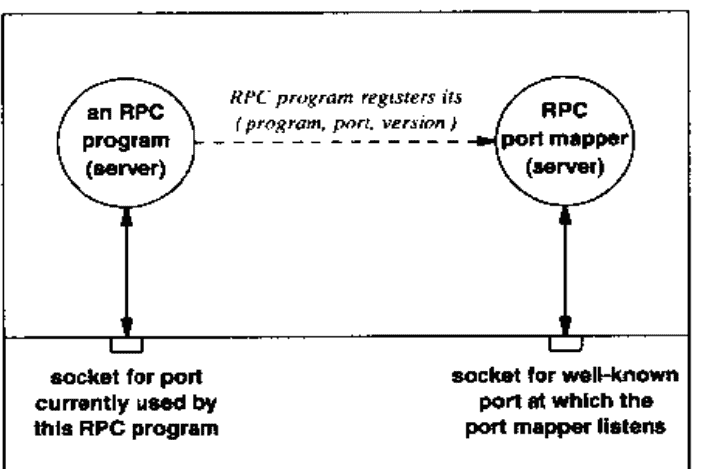

**图 20.8** RPC 端口映射器。每个 RPC 程序都在本地机器的端口映射器注册其程序号、协议端口号和版本号。调用者联系某机器上的端口映射器，以找到用于该机器上特定 RPC 程序的协议端口。

## 第 20.21 节 RPC 端口映射器算法

每台机器上的端口映射器都运行算法 20.1。端口映射器允许客户端访问远程程序，尽管远程程序动态分配协议端口。每当远程程序（即服务器）开始执行时，它会分配一个用于通信的本地协议端口。然后远程程序联系其本地机器上的端口映射器，向数据库添加一个整数三元组：

> (`RPC` 程序号, 版本号, 协议端口号)

一旦 RPC 程序注册了自身，其他机器上的调用者就可以向端口映射器发送请求来查找其协议。

### 算法 20.1

- 1. 创建绑定到分配给 Onc 端口映射服务的已知端口（111）的被动套接字。


## 2. 重复接受注册 RPC 程序号或根据 RPC 程序号查找协议端口的请求

注册请求来自与端口映射器同一台机器的 RPC 程序。每个注册请求指定一个由 RPC 程序号、版本号和当前访问该程序的协议端口组成的元组。当注册请求到达时，端口映射器将该三元组添加到映射数据库中。

查找请求来自任意机器。每个请求都指定远程程序号和版本号，并请求用于访问远程程序的端口号。端口映射器在数据库中查找远程程序，并通过返回该程序对应的端口作为响应。

> 算法 20.1 RPC 端口映射器算法。在每个实现 RPC 程序服务器端的机器上，都运行一个端口映射器服务器。

# 20.22 RPC 消息格式

与 TCP/IP 协议不同，RPC 消息并不使用固定格式。协议标准使用一种名为 XDR 语言的语言定义了 RPC 消息的通用格式以及每个字段中的数据项。由于 XDR 语言类似于 C 语言中的数据结构声明，熟悉 C 语言的人通常不需要太多的解释就能读懂并理解这种语言。通常来说，该语言规定了如何组装组成消息的序列数据项。每个项都使用 XDR 表示标准进行编码。

RPC 消息头中的消息类型字段（`message type field`）用于区分客户端用于发起过程调的消息和远程过程用于回复的消息。消息类型字段中使用的常量可以使用 XDR 语言定义。例如，以下声明：

```c
enum msg_type {
    /* RPC message type constants */
    CALL = 0;
    REPLY = 1;
}
```

该声明将符号常量 `CALL` 和 `REPLY` 为枚举类型 `msg_type` 的值。

XDR 语言中的数据结构可以被视为 XDR 类型的序列，并被解释为通过 XDR 组合数据来组装消息的指令。例如，一旦为符号常量声明了值，XDR 语言就可以定义 RPC 消息的格式：

```c
struct rpc_msg {
    /* Format of an RPC message */
    unsigned int mesgid;    /* used to match reply to call */
    union switch (msg_type msgt) {
        case CALL:
            call_body body;
        case REPLY:
            rply_body body;
    };
}
```

该声明规定 RPC 消息 `rpc_msg` 由一个整数消息标识符 `mesgid` 以及一个判别联合体（discriminated union）的 XDR 表示组成。每个联合体以一个整数开始，在本例中为 `msgt`。`msgt` 决定了 RPC 消息剩余部分的格式；它包含一个定义消息为 `CALL` 或 `REPLY` 的值。`CALL` 消息以 `call_body` 的形式包含进一步的信息；`REPLY` 则以 `rply_body` 的形式包含信息。`call_body` 和 `rply_body` 的声明必须在其他地方给出。例如，RPC 定义 `call_body` 的格式如下：

```c
struct call_body {
    /* format of RPC CALL */
    unsigned int rpcvers;     /* which version of RPC? */
    unsigned int rproc;       /* number of remote program */
    unsigned int rpcvers;     /* version number of remote rproc */
    unsigned int rproc;       /* number of remote procedure */
    opaque_auth cred;        /* credentials for called auth. */
    opaque_auth verf;        /* authentication verifier */
    /* ARGS */                 /* arguments for remote proc. */
};
```

远程过程调用体中的前几项并不意外。调用者必须在 `rpcvers` 字段中提供 RPC 协议版本号，以确保客户端和服务器都使用相同的消息格式。整数字段 `rproc`、`rprovers` 和 `rproc` 分别标识了被调用的远程程序、该程序所需的版本以及该程序中的远程过程。`cred` 和 `verf` 字段包含程序可用于验证调用者身份的信息。

# 20.23 远程过程参数的序列化

RPC 消息中认证信息之后的字段包含远程过程的参数。参数的数量和每个参数的类型取决于被调用的远程过程。

RPC 必须以外部形式表示所有参数，以便它们在计算机之间进行传输。特别是，如果传递给远程过程的任何参数包含复杂的数据结构（如链表），则必须被编码成一种可以在网络上发送的紧凑表示。我们使用 `marshal`（封化）、`linearize`（线性化）或 `serialize`（序列化）等术语来表示参数的编码。我们称 RPC 客户端将参数封化（marshal）到消息中，而服务器端将其反序列（unmarshal）。程序员必须记住，尽管 RPC 允许 RPC 调用包含复杂的数据对象，但对大型数据结构进行封化和反序列需要大量的 CPU 时间和网络带宽。因此，大多数程序员避免将链式结构作为参数传递。

## 20.24 认证

RPC 定义了几种可能的认证形式，包括源自 UNIX 的简单认证方案，以及一种使用美国国家标准与技术研究所（NIST）†发布的数据加密标准（DES）的复杂方案。认证信息可以是以下声明所示的四种类型之一：

> †NIST 在最初发布 DES 标准时还被称为国家标准局（NBS）。

```c
enum auth_type {
    AUTH_NULL = 0;
    AUTH_UNIX = 1;
    AUTH_SHORT = 2;
    AUTH_DES = 3;
```

在每个情况下，RPC 将认证的格式和解释留给认证子系统。因此，RPC 消息中的认证结构使用 `opaque` 关键字：

```c
struct opaque {
    auth_type atype;
    body<400>;
};
```

当然，认证方法使用特定的格式来编码数据。例如，无论计算机使用 Windows 还是其他操作系统，都可以配置为 UNIX 认证，其包含以下字段：

```c
struct auth_unix {
    unsigned int timestamp;
    string machine<255>;
    unsigned int userid;
    unsigned int gid;
};
```

UNIX 依赖客户端在 `machine` 字段中提供名称，并在 `userid` 字段中提供用户标识符。客户端还通过 `timestamp` 字段指定本地时间，用于请求排序。

# 20.25 RPC 消息示例

XDR 定义了每个字段的大小和外部格式。图 20.9 显示了一个 `CALL` 消息。例如，消息类型字段被定义为枚举，XDR 将其存储为 32 位整数。

| MESSAGE ID |

|--- |

| MESSAGE TYPE (0 for CALL) |

| RPC VERSION NUMBER (2) |

| REMOTE PROGRAM (0x86a3 for NFS) |

| PROGRAM VERSION (2) |

| REMOTE PROCEDURE (1 for GETATTR) |

| AUTHENTICATION |

| ARGUMENTS (IF ANY) FOR REMOTE PROCEDURE |

**20.9** 用于 CALL 消息的格式示例。

# 20.26 认证字段示例

RPC 消息中认证字段的实际大小取决于其内容。例如，UNIX 认证结构中的第二个字段是变长的机器名。XDR 将变长字符串表示为长度整数，随后是字符串字节。图 20.10 显示了认证的表示示例。在示例中，计算机名称 `merlin.cs.purdue.edu` 包含 20 个字符。

| AUTHENTICATION TYPE (1 FOR UNIX) |

| LENGTH OF BODY THAT FOLLOWS (48) |

| TIMESTAMP (e.g., 0X2B15022C) |

| LENGTH OF MACHINE NAME THAT FOLLOWS (20) |

| MACHINE NAME (merlin.cs.purdue.edu) |

| USERID OF SENDER (30) |

| GROUP ID OF SENDER (30) |

| LENGTH OF GROUP ID LIST THAT FOLLOWS (20) |

| GROUP ID1 (30) |

| GROUP ID2 (59) |

> 图20.10 RPC 消息内 UNIX 认证的表示


## 20.27 总结

远程过程模型使分布式程序更容易设计和理解，因为它将客户端-服务器通信与常规过程联系起来。远程过程调用模型将每个服务器视为实现一个或多个过程。从客户端到服务器的消息对应于远程过程调用，从服务器到客户端的响应对应于过程调用返回。

与常规过程一样，远程过程接受参数并返回一个或多个结果。调用者和被调用过程之间传递的参数和结果为客户端与服务器之间的通信提供了精确定义。使用远程过程调用模型有助于程序员关注应用程序而非通信协议。程序员可以构建并测试解决特定问题的常规程序，然后可以将程序划分为在两个或多台计算机上执行的部分。

## 26 远程过程调用概念 (RPC) 第20章

太阳太阳公司（Sun Microsystems, Incorporated）定义了一种特定的远程过程调用形式，它已成为一种事实标准。ONC RPC 规定了识别远程过程的模式作为 RPC 消息格式的标准。该标准使用外部数据表示 `XDR` 来保持消息表示与机器无关。

RPC 程序不像像传统的客户端和服务器那样使用已知的协议端口。相反，它们使用一种动态绑定机制，允许每个 RPC 程序在启动时选择任意的、未被使用的协议端口。这种绑定机制被称为 RPC 端口映射器（`port mapper`），它要求每台提供 RPC 程序的计算机必须在一个已知的协议端口上运行端口映射器。每个 RPC 程序在获取协议端口后，会在本地机器的端口映射器处注册。当 RPC 客户端想要联系 RPC 程序时，它首先联系端口映射器；端口映射器通过告诉客户端目标程序使用的哪个端口来响应。一旦客户端获取了目标 RPC 程序的正确协议端口，它就会使用该端口直接联系目标 RPC 程序。

## 未来研究

本章介绍的大多数想法。`[RFC 1831]` 包含一个新版本，该版本是一个提议的标准。更多信息可以在每个厂商 RPC 软件附带的文档中找到。

太阳公司 `[RFC 1057]` 定义了 ONC RPC 的标准

## 练习题

- 20.1 阅读 RPC 规范并创建一个图表，显示典型返回消息中字段的大小。
- 20.2 进行实验以测量使用端口映射器所引入的开销。
- 20.3 客户端可以通过缓存协议端口绑定来避免开销。也就是说，在客户端联系端口映射器获取目标 RPC 程序的协议端口后，它可以将绑定存储在缓存中以便再次查找。绑定将在多长时间内有效？
- 20.4 端口映射器概念可以扩展到 RPC 以外的其他服务吗？解释答案。
- 20.5 使用端口映射器代替已知端口的主要优缺点是什么？
- 20.6 当 RPC 客户端联系端口映射器时，它必须指定或获知目标程序是否打开了 UDP 端口或 TCP 端口。仔细阅读规范以找出 RPC 客户端是如何区分这两者的。
- 20.7 如果你的计算机上有 `rpcinfo` 工具程序，请阅读手册页以确定其功能。使用 `rpcinfo` 获取计算机上可用的 RPC 程序和版本列表。
- 20.8 阅读其他厂商对 RPC 的设计。是否存在 ONC RPC 中不存在的概念？
- 20.9 考虑 ONC RPC 中使用的身份验证方案。该方案对于组织内部的使用是否完全安全？对于两个组织之间的使用是否？
- 20.10 比较 DCE RPC 和 ONC RPC。两者有什么不同？
- 20.11 阅读通用对象请求代理架构 CORBA。这种架构为 RPC 提供了哪些新功能？

## 21 分布式程序生成 (Rpcgen 概念)

### 21.1 引言

上一章介绍了远程过程调用模型的基础原理。它描述了远程过程调用概念，并解释了程序员如何使用远程过程调用来构建在客户端-服务器范下运行的程序。最后，它描述了 ONC RPC 机制。

本章继续讨论。它关注使用 RPC 的程序的结构，并展示了如何沿过程边界划分程序。它引入了过程概念和一个程序生成工具，该工具可以自动生成与 ONC RPC 关联的大部分代码。它还讨论了一个过程库，该库易于构建提供远程过程的服务器和调用这些程序的客户端。

下一章完成对生成器的讨论。它展示了程序员创建传统程序然后将程序划分为本地和远程组件的步骤序列。它介绍了一个简单的应用程序，然后使用该示例贯穿构建分布式程序的流程。下一章中的示例通过阐明许多细节并展示生成器产生的代码，对本章的原理性描述构成了互补说明。

### 21.2 使用远程过程调用

远程过程调用模型是通用的。程序员可以按以下任一方式选择远程过程范式：

- 仅作为程序规范技术。为此，程序员遵循 RPC 模型，并将客户端和服务器之间的所有交互指定为远程过程调用或返回。过程参数指定了在客户端和服务器之间传递的数据。程序员在设计客户端和服务器时可以忽略过程结构，但要使用过程规范来验证所得结果的正确性。
- 既用于程序规范，又作为程序设计中的抽象。要实现这种方法，在设计应用程序和通信协议时考虑过程调用。设计一种通信协议，其中每条消息都与其中一个远程调用紧密对应。
- 用于概念设计并在实现中显式包含。要在实现中包含 RPC，程序员设计了一种通用的 RPC 消息格式和将控制传递给远程过程的协议。程序员在客户端和服务器之间传递数据时严格遵循过程规范。程序使用标准数据表示来编码参数，并遵循设计中给出的精确数据类型规范。在跨越网络时，调用标准库程序来转换计算机的原生表示和外部表示。
- 用于设计和实现，从零构建所有软件。程序员构建一个解决问题的传统应用程序，并沿过程边界将其划分为部分，将部分移动到单独机器。
- 用于设计和实现，使用标准库。程序员构建一个解决问题的传统应用程序...对于设计和实现，从零构建所有软件。程序员构建一个解决问题的传统应用程序，并沿过程边界将其划分为部分，将部分移动到单独机器。
- 用于设计和实现，使用标准库。程序员构建一个解决问题的传统应用程序...
- 用于自动化实现。程序员完全遵循过程规范，并使用程序生成工具生成分布式程序所需的源码。

### 21.3 支持 RPC 的编程机制

ONC RPC 规范详尽且复杂。在不使用现有软件的情况下实现 RPC 应用程序是枯燥且耗时的。大多数程序员倾向于避免重复工作。相反，他们依赖库函数和编程工具。帮助以多种形式提供：

- `XDR` 库函数将单个数据项转换为外部表示
- `XDR` 库函数格式化数据聚合（例如数组和结构体）以定义 RPC 消息
- RPC 运行时库允许程序调用远程过程、向端口映射器注册服务或将传入调用分发到远程程序内部的运行时函数
- 程序生成器产生构建分布式程序所需的源码

RPC 运行时库提供了 RPC 需要的大部分功能。例如，`callpc` 向服务器发送 RPC 消息。它的形式为：

```
callpcrc(host, prover, procnum, inproc, in, outp, out);
```

`host` 指向包含执行远程过程的机器名称的字符串。参数 `prog`、`prover` 和 `procnum` 标识远程程序号、使用的程序版本和远程过程号。参数 `inproc` 提供将参数打包到 RPC 消息中的本地过程地址，`in` 提供远程过程参数的地址。参数 `outp` 提供用于解码结果的本地过程地址，`out` 提供结果应存储的内存地址。

虽然 `callpc` 处理了发送 RPC 消息所需的许多工作，但 ONC RPC 库还包含许多其他过程。例如，客户端调用函数：

```
handle = clnt_create(host, prog, vers, proto);
```

创建一个用于发送 RPC 消息的整数。RPC 将该标识称为句柄（`handle`）；多个 RPC 库过程将句柄作为参数之一。

程序员通常将程序生成器称为存根生成器（`stub generator`）。这种术之所以流行，在我们查看生成器如何工作时将变得显而易见。

270 分布式程序生成（Rpcgen 概念）第2章

该库还包含创建、存储和处理身份验证信息的例。例如，如果程序使用 UNIX 身份验证，过程：

```
authunix_create(host, uid, gid, len, aup_gids);
```

则为给定计算机上的给定用户创建一个身份验证句柄。参数指定了用户的登录标识和主组标识符，以及用户所属的一组组 `aup_gids`。参数 `len` 指定集合中的项数。

尽管程序员可以编写直接调用 RPC 库的应用程序，但很少有程序员这样做。大多数人依赖在本章后面讨论的程序生成工具。它生成的代码包含许多对库过程的调用。

### 21.4 将程序划分为本地过程和远程过程

要理解 RPC 编程工具的工作原理，有必要理解如何将程序划分为本地和远程过程。考虑传统应用程序中的过程调用。图 21.1 展示了其中一种调用。

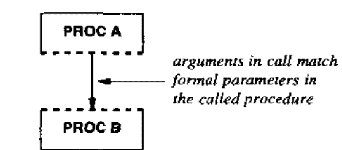

图 21.1 过程调用的示例，说明了调用过程和被调用过程之间使用的接口。虚线表示过程中的参数与被调用过程中的参数之间的匹配。

每个过程都有一组形式参数，且每个过程调用都指定一组参数。调用者中的参数总数必须等于被调用过程中的形式参数总数，且每个参数的类型必须与相应形式参数的声明类型匹配。换句话说，参数定义了调用过程与被调用过程之间的接口。

### 21.5 为 RPC 添加代码


将一个或多个过程移动到远程机器需要程序员在过程调用和远程过程之间添加代码。在客户端，代码必须对参数进行打包（`marshal`）并将其转换为机器无关的表示，创建一个 `RPC` 消息，将消息发送到远程过程，等待结果，并将结果值转换回客户端的本地表示。在服务器端，新代码必须接受 `RPC` 请求，将参数转换为服务器本地的数据表示，将消息调度到适当的过程，通过将值转换为机器无关的数据表示形成回复消息，并将结果发回给客户端。

为了保持过程结构的完整并将处理 `RPC` 的代码与处理应用程序的代码隔离开，`RPC` 所需的额外代码可以以两个额外过程的形式添加，完全隐藏通信细节。新过程可以添加所需的功能，而不改变原始调用过程和被调用过程之间的通信接口。保留原始接口有助于减少错误发生率，因为它将通信细节与原始应用程序分离开。

## 21.6 存根过程（Stub Procedures）

为实现 `RPC` 向程序添加的额外过程称为存根过程（`stub procedures`）。理解存根过程最简单的方法是将传统程序想象成分为两个程序，并将一个现有的过程移动到远程机器。在调用者（客户端）端，存根过程替换了被调用过程。在远程过程（服务器）端，存根过程替换了调用者。这两个存根实现了远程过程调用所需的所有通信，使原始调用和被调用过程保持不变。图 21.2 展示了存根概念，显示了存根过程如何允许图 21.1 所示的过程调用被分为本地和远程部分。

### 计算机 1

### 计算机 2

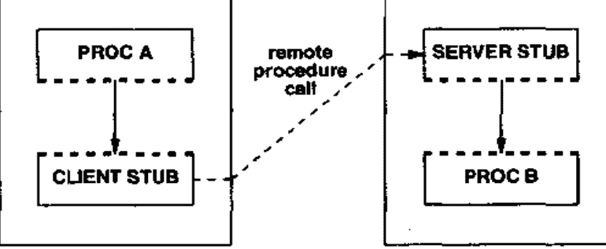

图 21.2 添加到程序中的存根过程实现了远程过程调用。因为存根使用与原始调用相同的接口，因此添加它们不需要更改原始的调用过程或被调用过程。

## 21.7 多个远程过程与调度

图 21.2 展示了 `RPC` 的简化视图，因为它只显示了一个远程过程调用。在实践中，一个给定的服务器通常在一个远程程序中包含多个远程过程。每个 `RPC` 调用都由一个识别特定远程过程的消息组成。当 `RPC` 消息到达时，服务器使用消息中的远程过程编号将调用调度到正确的过程。图 21.3 展示了该概念。

该图显示了 `RPC` 如何与传统的客户端-服务器实现相关。远程程序由一个单线程服务器组成，必须在任何消息到达之前运行。远程过程调用可以来自任何客户端，必须指定服务器运行的机器地址、该机器上远程程序的数量以及要调用的远程过程。服务器程序由一个调度程序加上远程过程和服务器端过程组成。调度程序理解远程过程编号如何与服务器端存根对应，并利用这种对应关系将每个入站远程过程调用转发到适当的存根。

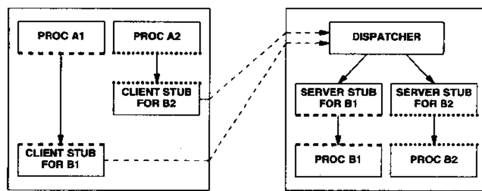

图 21.3 `RPC` 服务器中的消息调度。客户端向单个服务器程序发送 `RPC` 请求。服务器使用消息中的远程过程编号来决定哪个过程应该接收调用。在示例中，过程 `A1` 调用过程 `B1`，`A2` 调用 `B2`。虚线和点线显示了每个过程使用的接口。

## 21.8 客户端-存根过程名称

如果程序员选择将客户端存根命名为与被调用者相同，那么从传统应用程序到分布式程序的转换可以是轻而易见的。为了理解原因，再次考虑存根过程（图 21.3 所示）。调用者 `A1` 包含对 `B1` 的调用。当程序被划分后，`Rpcgen` 从远程过程描述自动生成存根的通信部分。如果存根 `B1` 与原始调用具有相同的接口，则不需要重新编译 `A1`。事实上，通过将客户端存根与 `A1` 的编译二进制文件链接，`Rpcgen` 可以生成有效的客户端。将 `RPC` 的代码与原始应用程序隔离开，使编程变得更容易并减少错误率。

当然，命名客户端存根 `B1` 会使源码管理变得困难，因为这意味着分布式程序有两个同名的 `B1`：客户端存根和原始过程。在大多数情况下，它们不在同一台计算机上执行。总结来说：为了构建应用程序的分布式版本，程序员必须将一个或多个过程移动到远程机器。这样做时，添加存根允许原始调用和被调用过程保持不变。

## 21.9 使用 Rpcgen 生成分布式程序

显而易见的是，实现 `RPC` 服务器的代码不需要更改。例如，如果远程过程编号与服务器端存根之间的映射保持在数据结构中，所有服务器可以使用相同的调度程序。同样，所有服务器可以使用代码向端口映射器注册其服务。

为了避免不必要的编程，`RPC` 的实现包含了生成分布式程序所需代码的代码。该工具被称为 `Rpcgen`，它读取规范文件作为输入并生成 C 源代码文件作为输出。规范文件包含常量、数据类型、全局数据和过程的声明（包括过程参数和结果类型）。`Rpcgen` 生成实现客户端和服务器程序的大部分代码，包括打包参数、发送 `RPC` 消息、调度入站调用到正确过程、发送回复以及在外部表示和原生表示之间转换参数和结果。与应用程序以及程序员编写的几个文件结合时，`Rpcgen` 生成完整的客户端和服务器程序。

由于 `Rpcgen` 将代码作为输出，程序员可以选择编辑代码（例如，为了优化代码提高性能）或将其与其他文件合并。在大多数情况下，程序员使用 `Rpcgen` 处理尽可能多的细节。他们尽量通过保持生成客户端和服务器的全过程自动化来避免更改输出。如果规范发生变化或需要新的远程过程调用，程序员可以修改规范并使用 `Rpcgen` 生成新的客户端和服务器，无需人工干预。

## 21.10 Rpcgen 输出与接口过程

为了保持灵活性并允许自动生成存根代码，`Rpcgen` 将每个存根过程分为两个部分。一部分是所有使用 `RPC` 的应用程序通用的提供了基本的客户端-服务器通信；另一部分为应用程序提供接口。`Rpcgen` 根据远程过程的描述自动生成存根的通信部分。

### Sec. 21.10 Rpcgen 输出与接口过程

及其参数。由于 `rpcgen` 为通信存根（`stub`）生成代码，因此它指定了客户端所需的参数以及服务器端的调用序列。程序员必须使用 `rpcgen` 生成的通信存根来接受 `rpcgen` 的调用约定。

将存根分为通信过程和接口过程背后的思想非常简单：它允许 `rpcgen` 选择通信存根所使用的调用约定，同时允许程序员选择远程过程调用所使用的调用约定。程序员创建接口存根，以便在远程过程调用约定与 `rpcgen` 生成的通信存根过程之间建立映射。图 21.4 展示了所有过程是如何交互的。

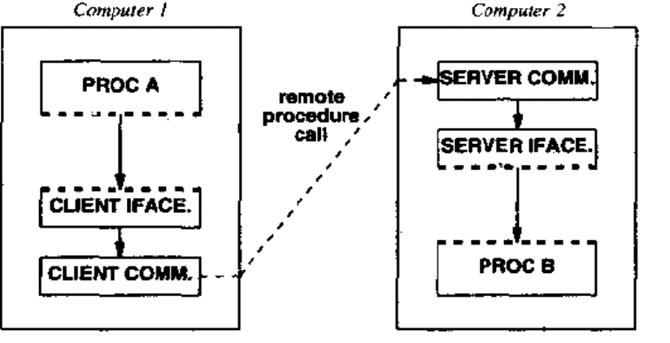

**图 21.4** 使用 `rpcgen` 创建的分布式程序的形式。`Rpcgen` 自动生成基础通信存根；程序员提供两个接口过程。

如图 21.4 所示，存根的两个部分由两个独立的过程组成。在客户端，接口过程调用通信过程。在服务器端，通信过程调用接口过程。如果存根接口过程定义得当，原始调用者和原始被调用过程将保持不变。

## 21.11 Rpcgen 输入与输出

`Rpcgen` 读取一个包含远程程序规范的输入文件。它产生输出文件，每个文件都包含源代码。`Rpcgen` 从输入文件名推导出输出文件名。如果规范文件为 `Q.x`，所有输出文件将以 `Q` 开头。图 21.5 中的表格列出了输出文件并描述了它们的内容。

276 分布式程序生成 (`Rpcgen`) 第 21 章

| 文件名 | 内容 |
| :--- | :--- |
| `Q.h` | 为客户端和服务器生成的代码使用的常量和类型声明 |
| `Q.xdr.cpp` | 客户端和服务器用于封化（`marshal`）参数的 `XDR` 过程调用 |
| `Q.clint.cpp` | 客户端通信存根过程 |
| `Q.svc.cpp` | 服务器通信存根过程 |

**图 21.5** `rpcgen` 为名为 `Q.x` 的输入文件生成的输出文件。正如名称所示，输出文件包含两个程序的 C 源码和数据声明。

## 21.12 使用 Rpcgen 构建客户端和服务器

图 21.6 展示了程序员使用 `rpcgen` 构建客户端和服务器必须编写的文件。从本质上，`rpcgen` 要求程序员编写应用程序、过程调用以及客户端端和服务器端存根的接口部分。程序员将应用程序分为驱动程序（客户端）和一组组成远程程序（服务器）的过程。然后，程序员为远程程序编写一个规范，并使用 `rpcgen` 生成剩余部分。

当 `rpcgen` 运行时，它会读取规范并生成 C 源代码，这些代码必须编译和链接以生成运行的程序。在 `rpcgen` 运行后，会发生两个独立的编译和链接步骤。一个生成客户端程序，另一个生成可执行的服务器程序。

图 21.6 仅提供了 `rpcgen` 输入和输出的概述。下一章将提供关于其使用的更多细节。该章介绍了一个简单的示例应用程序，并展示了程序员将其转换为分布式程序所采取的步骤。该章描述了 `rpcgen` 取作为输入的规范文件，以及 `rpcgen` 生成的代码。

## 21.13 总结

`RPC` 是一个广泛的概念，可以帮助程序员设计客户端-服务器软件。程序员可以使用 `RPC` 来帮助指定或实现分布式程序。在使用 `ONC RPC` 时，程序员可以选择在从零开始构建代码时遵循规范，或者使用 `RPC` 库中的过程，亦或使用一个名为 `rpcgen` 的自动程序生成工具。

图 21.6 从 `rpcgen` 输出构建客户端和服务器所需的文件，以及处理这些文件所需的编译步骤。深色框显示程序员提供的输入。


RPC 允许程序员构建一个常规程序，然后通过将某些过程移动到远程机器将其转换为分布式程序。这样做时，程序员可以通过向程序添加存根过程来尽可能减少更改并降低引入错误的概率。存根过程实现了必要的通信。使用存根允许原始的调用和被调用过程保持不变。

由于大多数使用 ONC RPC 的分布式程序遵循相同的通用架构，`rpcgen` 可以自动生成大部分所需代码。除了创建规范文件外，程序员只需要提供一对接口过程以及与应用程序相关的过程。`Rpcgen` 生成剩余的客户端和服务器程序，包括向端口映射器（`port mapper`）注册服务器的过程、提供客户端和服务器之间的通信以及将传入的调用分发到正确的远程过程的过程。

## 深入学习

在随附软件的文档可以找到关于 `rpcgen` 的更多信息。Stevens [1990] 描述了 RPC 异常处理的细节。

## 练习题

- **21.1** 写下服务器在收到 RPC CALL 消息时采取的步骤。务必指定数据值从外部表示转换为原生表示的时机。
- **21.2** 阅读文档中的 RPC 库过程。`svc_reply` 的参数是什么？为什么每个参数都是必要的？
- **21.3** RPC 库包含了允许服务器向端口映射器注册的过程。阅读文档找出 `pmap_unset` 的作用。为什么是必要的？
- **21.4** 如果你有 RPC 库的源码访问权限，查找它们占用了多少行代码。将库的大小与 `rpcgen` 源码的大小进行比较。为什么 `rpcgen` 那么大？
- **21.5** `rpcgen` 生成的是 C 源码而不是目标代码。随 `rpcgen` 提供的文档建议拥有源代码允许程序员修改生成的代码。程序员为什么要进行此类修改？
- **21.6** 参考上一个问题。修改 `rpcgen` 输出的缺点是什么？
- **21.7** 能够设计一种远程过程调用机制，通过使用额外的参数来决定调用哪个过程，将远程过程中的多个过程合并为一个过程（例如，远程过程包含一个 switch 语句，使用新参数在备选操作之间做出选择）。与 ONC RPC 方法相比，这种方法的主要优势是什么？缺点是什么？
- **21.8** 如果 ONC RPC 程序的服务器使用套接（sockets），它可以使用哪些方法来实现互斥（即，它如何保证任何时候只有一个远程过程被调用）？每个方法的优缺点是什么？提示：考虑套接选项。

# 22

### 分布式程序生成 (Rpcgen 示例)

## 22.1 引言

之前的章节介绍了远程过程调用模型和 ONC RPC 机制的底层原理。它们讨论了远程过程调用概念，并解释了如何沿调用边界划分程序。它们还描述了 `rpcgen` 工具和相关的库过程如何自动化大部分 ONC RPC 程序的代码生成。

本章完成了对 `rpcgen` 的讨论。它展示了程序员首先创建常规程序，然后将其分为本地和远程组件的步骤顺序。它使用一个示例应用程序来遵循整个过程的每一步。它展示了 `rpcgen` 的输出以及创建使用 RPC 的分布式程序的客户端和服务器组件所需的额外代码。

## 22.2 示例 rpcgen 的示例

一个示例可以阐明 `rpcgen` 的工作原理，并展示大部分细节。由于该示例的目的是解释 `rpcgen` 是如何工作的，我们选择了一个极其简单的应用程序。在实践中，很少有 RPC 程序像我们的示例这样如此简单或易于理解。因此，应该将此示例视为一个教程，而不是质疑该应用程序是否需要分布式解决方案。

## 22.3 字典查找

为了作为一个使用 `rpcgen` 的示例，考虑一个实现简单数据库的应用程序。该数据库提供四个基本操作：`initialize`（初始化数据库，即删除所有之前存储的值）、`insert`（插入新项目）、`delete`（删除项目）和 `lookup`（查找项目）。我们假设数据库中的项目是单个单词。因此，该数据库将作为一个字典运行。应用程序插入一组有效单词，并使用数据库检查新单词，以查看每个单词是否在字典中。

为了保持示例简单，我们假设应用程序的输入是一个文本文件，每行包含一个字母命令，后跟一个单词。图 22.1 中的表格列出了这些命令并给出了每个命令的含义：

| 单字母命令 | 参数 | 含义 |
|---|---|---|
| I | -none | 通过删除所有单词初始化数据库 |
| i | word | 从数据库插入单词 |
| d | word | 从数据库中删除单词 |
| l | word | 在数据库中查找单词 |
| q | -none | 退出 |

22.1 示例数据库应用程序的输入命令及其含义。某些命令必须后跟一个可以被视为命令参数的单词。

例如，以下输入包含了一系列数据命令。这些命令初始化字典、插入计算机厂商的名称、删除某些名称，并查找了三个名称：

- Navy
- IBM
- RCA
- Enlarge

## 22.4 构建分布式应用程序的八个步骤

- i Digital
- d RCA
- d Navy
- l IBM
- d Encore
- l CDC
- l Encore
- q

当此命令文件作为输入呈现时，字典应用程序应该在字典中找到 IBM，但不应该找到 Encore 或 CDC。

图 21.6 显示了 `rpcgen` 需要的输入以及它生成的输出文件。要创建所需的文件并将它们组合客户端和服务器，程序员需要采取以下八个步骤：

1. 构建并测试一个解决问题的传统应用程序。
2. 通过选择一组要移动到远程机器的程序来划分程序。将选定的过程放在单独的文件中。
3. 为远程程序编写 `rpcgen` 规范，包括远程过程的名称、编号以及其参数的声明。选择一个远程程序号和一个版本号（通常为 1）。
4. 运行 `rpcgen` 以检查规范，如果有效，则生成将在客户端和服务器使用的四个源代码文件。
5. 编写接口例程与客户端程序一起。它由四个主要文件组成：原始应用程序（已移除了远程过程）、客户端存根（由 `rpcgen` 生成）、客户端接口存根和 XDR 过程（由 `rpcgen` 生成）。当所有这些文件编译并链接在一起时，生成的可执行程序就成为客户端。
6. 编译并链接服务器程序。它由四个主要文件组成：从原始应用程序中提取并组成远程程序的程序、服务端存根（由 `rpcgen` 生成）、服务端接口存根和 XDR 过程（由 `rpcgen` 生成）。当所有这些文件编译并链接在一起时，生成的可执行程序就成为服务器。
7. 在远程机器上启动服务器，并在本地机器上调用客户端。

> 图 21.6 可以在第 277 页找到。

## 22.5 步骤 1：构建传统应用程序

构建示例字典应用程序分布式版本的第一步要求程序员构造一个解决问题的传统程序。文件 `dict.cpp` 包含用 C 语言编写的解决字典问题的应用程序。


```c
/* dict.cpp - main, initw, nextin, insertw, deletew, lookupw *//

#include <stdio.h>
#include <ctype.h>
#include <string.h>

#define MAXWORDLEN 50 /* 命令或单词的最大长度 */
#define DICTSIZ 100 /* 字典中最大条目数。 */
char    dict[DICTSIZ][MAXWORDLEN+1];/* 单词字典的存储*/
int     nwords = 0; /* 字典中的单词数 */

int    nextin(char *, char *), initw(), insertw(const char *);
int    deletew(const char *), lookupw(const char *);

/*
 * main - 按指定在字典中插入、删除或查找单词
 */
int
main(int argc, char *argv[]) {
	char    word[MAXWORDLEN+1]; /* 存储输入行中单词的空间 */
	char    cmd;
	int    wrdlen;               /* 输入单词的长度 */

	while (1) {
		wrdlen = nextin(&cmd, word);
		if (wrdlen < 0)
			exit(0);
		word[wrdlen] = '\0';
		switch (cmd) {

case 'I':    /* 初始化 */
   initw();
   printf("Dictionary initialized to empty.\n");
   break;
case 'i':    /* 插入 */
   insertw(word);
   printf("inserted.\n");
   break;
case 'd':    /* 删除 */
   if (deletew(word))
      printf("deleted.\n");
   else
      printf("not found.\n");
   break;
case 'l':    /* 查找 */
   if (lookupw(word))
      printf("found.\n");
   else
      printf("not found.\n");
   break;
case 'q':    /* 退出 */
   printf("quit.\n");
   exit(0);
default:    /* 非法输入 */
   printf("command %c invalid.\n", cmd);
   break;
}
}
```

```c
/*
 * nextin - 从读取命令和（可能的）单词
 */
int
nextin(char *cmd, char *word) {
   int i, ch;
   *cmd = (char) getc(stdin);
   while (isspace(ch))
      ch = getc(stdin);
   if (ch == EOF)
      return -1;
   if (ch == '\n') {
      return 0;
   }
   i = 0;
   while (!isspace(ch)) {
      if (i >= MAXWORDLEN) {
         printf("error: word too long.\n");
         exit(1);
      }
      word[i++] = (char) ch;
      ch = getc(stdin);
   }
   return i;
}
```

```c
/*
 * initw - 将字典初始化为没有任何单词
 */
int initw() {
    nwords = 0;
    return 1;
}
```

```c
/*
 * insertw - 在字典中插入单词
 */
int insertw(const char *word) {
    strcpy(dict[nwords], word);
    nwords++;
    return nwords;
}
```

```c
/*
 * delete - 从字典中删除单词
 */
int
deletew(const char *word) {
    int i;
    for (i=0; i<nwords; i++) {
        if (strcmp(word, dict[i]) == 0) {
            nwords--;
            strcpy(dict[i], dict[nwords]);
            return 1;
        }
    }
    return 0;
}
```

```c
/*
 * lookup - 在字典中查找单词
 */
int
lookup(const char *word) {
    int i;
    for (i=0; i<nwords; i++) {
        if (strcmp(word, dict[i]) == 0) {
            return 1;
        }
    }
    return 0;
}
```

286 分布式程序生成 (`RPgen` 示例) 第22章

其他过程按预期运行。`deletew` 搜索要删除的单词。如果找到该单词，`deletew` 将其替换为字典中的最后一个单词并减少 `nwords`。最后，`lookup` 顺序搜索数组以确定指定的单词是否存在。如果单词在字典中则返回 1，否则返回 0。

为了为应用程序生成可执行二进制文件，程序员需要编译 C 代码。例如，要为 `dict` 程序生成可执行二进制文件，程序员必须编译文件 `dict.cpp` 中的源程序。

## 22.6 第 2 步：将程序分为两部分

一旦构建并测试了常规应用程序，就可以将其划分为本地和远程组件。程序员在划分程序之前，必须对程序的过程调用图有一个概念性模型。例如，图 22.2 显示了原始字典程序的过程组织结构。

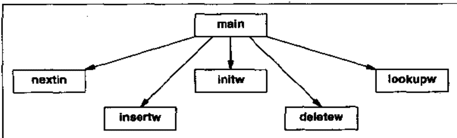

图 22.2 用于解决字典问题的原始常规图的过程调用图。调用图表示程序的的过程组织结构。

在考虑哪些过程可以移动到远程机器时，程序员必须考虑每个过程所需的设施。例如，`nextin` 过程在每次被调用时都会读取并解析下一行输入。因为它需要访问程序的标准输入文件，因此 `nextin` 必须与主程序保留在一起。总结来说：

- 执行 I/O 或其他方式访问文件描述符的过程无法轻易移动到远程机器。

程序员还必须考虑每个过程所访问的数据的位置。例如，`lookup` 过程需要访问整个单词数据库。如果 `lookup` 在字典所在的机器以外的机器上发生，那么对 `lookup` 的 RPC 调用必须将整个字典作为参数传递。

将大型数据结构作为参数传递给远程过程是极其低效的，因为 RPC 机制必须为每个远程过程调用读取并编码整个数据结构。通常情况下：

> 过程应该在其访问的数据所在的同一台机器上执行。将大型数据结构作为参数传递给远程过程是无效的。

在考虑了原始字典程序和每个过程访问的数据后，显而易见的是，`insert`、`delete`、`initw` 和 `lookup` 属于与字典本身同一的机器。

假设程序员决定将字典存储和相关过程移动到远程机器。为了帮助理解将过程移动到远程机器的结果，程序员通常会对分布式程序和数据结构创建一个构想，甚至是草图。图 22.3 展示了将数据和访问过程移动到远程机器后字典应用程序的新结构。

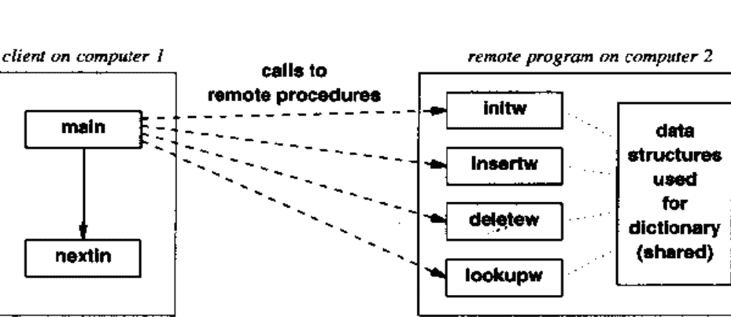

图 22.3 字典程序分为本地和远程组件的概念性划分。远程组件包含字典的数据以及访问和搜索数据的过程。

像图 22.3 这样的简单图可以帮助程序员思考将程序分为本地和远程组件。程序员必须考虑每个过程是否能够访问其所需的数据和服务，并且必须考虑每个远程过程将需要的参数，以及跨网络传递这些信息的成本。最后，该图帮助程序员评估网络延迟将如何影响程序性能。

假设程序员选择了概念性划分并决定继续，下一步是将源程序分为两个组件。程序员识别每个组件使用的常量和数据结构，并将每个组件放在单独的文件中。在字典示例中，划分是直接的，因为原始源文件可以在过程 `nextin` 和 `init` 之间划分。`dict.cpp` 包含了主程序和 `nextin` 过程：


```c
/* dict.cpp - main, nextin */

#include <stdlib.h>
#include <stdio.h>
#include <ctype.h>

#define MAXWORDLEN 50    /* 命令或单词的最大长度 */

int   nextin(char *, char *), initw(void), insertw(char *),
       deletew(char *), lookup(char *);
----------------------------------------------------------------------
/*
 * main - 按指定在字典中插入、删除或查找单词
----------------------------------------------------------------------
*/
main(int argc, char *argv[]) {
    char   word[MAXWORDLEN+1];    /* 用于存放输入行单词的空间 */
    char   cmd;
    int    wrdenlen;               /* 输入单词的长度 */

    while (1) {
        wrdenlen = nextin(cmd, word);
        if (wrdenlen < 0) {
            exit(0);
        }
        switch (cmd) {
            case 'I':                   /* 初始化 */
                initw();
                printf("Dictionary initialized to empty.\n");
                break;
            case 'i':                  /* 插入 */
                insertw(word);
                printf("%s inserted.\n", word);
                break;
```

## Sec. 22.6 第 2 步：将程序分为两部分

```c
case 'd':
    /* 删除 */
    if (deletew(word))
        printf("%s deleted.\n",word);
    else
        printf("%s not found.\n",word);
    break;
case 'l':
    /* 查找 */
    if (lookup(word))
        printf("%s found.\n",word);
    else
        printf("%s not found.\n",word);
    break;
case 'q':
    /* 退出 */
    exit(0);
default:
    /* 无效输入 */
    printf("invalid command %c\n",cmd);
    break;
        }
    }
    return 0;
}

/* ---------------------------------------------------------------------
 * nextin - 从输入行读取命令并可能读取单词
--------------------------------------------------------------------- */
int nextin(char *cmd, char *word) {
    int i = 0, ch;
    while ((ch = getchar()) != EOF) {
        if (isspace(ch)) {
            if (i > 0) {
                word[i] = '\0';
                cmd = word;
                return i;
            }
        } else {
            if (i < MAXWORDLEN) {
                word[i++] = ch;
            } else {
                printf("word too long.\n");
                return -1;
            }
        }
    }
    return -1;
}
```

`dict2.cpp` 包含了原始应用程序中将成为远程程序的部分。此外，它包含了过程共享的全局数据的声明。此时，该文件不包含完整的程序——剩余代码将添加。

```c
/* dict2.cpp - initw, insertw, deletew, lookupw */

#include <string.h>

#define MAXWORDLEN 50 /* 命令或单词的最大长度 */
#define DICTSZ 100 /* 最大条数 */
char dict[DICTSZ][MAXWORDLEN+1];/* 字典存储 */
int nwords = 0; /* 字典中的单词数 */

/*- initw - 初始化字典为空 *-
*/
initw() {
    nwords = 0;
    return 1;
}

/*- insertw - 在字典中插入单词 *-
*/
int
insertw(char *word) {
  strcpy(dict[nwords], word);
  nwords++;
  return nwords;
}
```

```c
/*
 * delete - 从字典中删除单词
 */
int
deletew(char *word) {
  int i;
  for (i=0; i<nwords; i++) {
    if (strcmp(word, dict[i]) == 0) {
      nwords--;
      strcpy(dict[i], dict[nwords]);
      return 1;
    }
  }
  return 0;
}
```

```c
/*
 * lookupw - 在字典中查找单词
 */
int
lookupw(char *word) {
  int i;
  for (i=0 ; i<nwords; i++)
    if (strcmp(word, dict[i]) == 0)
      return 1;
  return 0;
}
```

292 分布式程序生成 (`Rpcgen` 示例) 第22 章

从实践角度来看，将应用程序分为两个部分使得单独编译客户端和服务器成为可能。编译器检查两部分都引用的符号常量等问题，而链接器则检查所有数据结构是否已与引用它们的过程被收集在一起。

尽管编译器似乎是一步之读取源程序并生成可执行的二进制文件，但大多数编译器至少有两个内部步骤。在第一步中，计算机检查语法并生成中间对象文件（后缀为 `.obj` 的文件）。在第二步中，编译器调用链接编辑器将对象文件合并为可执行的二进制文件。在这一步，程序员通常会请求编译器为这两个组件生成对象文件（而不是完整的程序）。这些组件必须链接在一起以生成可执行程序，但并并不是编译它们的直接原因：编译器会检查两个文件在语法上都是正确的。

在考虑让编译器检查代码的用处时，请记住，大多数分布式程序比我们简单的示例要复杂得多。编译可能会在大型程序中发现程序员忽略的问题。在插入额外代码之前捕获这些问题将使它们更容易修复。

## 22.7 第 3 步：创建 Rpcgen 规范

一旦程序员选择了分布式程序的结构，他或她就可以准备一个 `rpc` 规范。从本质上说，`rpc` 规范文件包含了远程程序的声明，包括它所使用的数据结构。

规范文件包含常量、类型定义以及客户端和服务器程序的声明。更准确地说，规范文件包含：

- 客户端或（更常见的是）服务器（远程程序）中使用的常量声明，
- 使用的数据类型声明（特别是在远程过程的参数中），
- 远程程序的声明、每个程序中包含的过程以及其参数的类型。

记住，RPC 使用数字来识别远程程序及其内部远程过程。规范文件中的程序声明定义了详细信息，如程序的 RPC 数字、版本号以及分配给程序内每个过程的编号。

所有规范必须用 RPC 编程语言编写，而不是 C 语言。虽然差异很小，但它们可能会令人感到沮丧。例如，RPC 语言使用关键字 `string` 来表示以空字符结尾的字符字符串，而 C 使用 `char *`。甚至*链接器* 也经常被缩写。

经验丰富的程序员可能需要多次迭代才能产生正确的规范。

文件 `dict.x` 展示了一个 `rpc` 规范。它包含了字典程序 RPC 版本的示例声明。


```
/* dict.x */

/* 字典程序的 RPC 声明 */

const   MAXWORD = 50;          /* 命令或单词的最大长度 */
const   DICTSIZE = 100;       /* 字典条目数 */

struct example {               /* 此处声明了一个使用的结构以 */
    int    exfield1;         /* 演示 rpc 程序如何构建 XDR */
    char   exfield2;         /* 转换结构的例程 */
};

/* * DICTPROG - 提供 insert, delete 和 lookup 的远程程序 */
 */
program DICTPROG (\           /* 远程程序的名称（未使用） */
    version DICTVERS (        /* 版本声明（见下文） */
    int    INITW(void)     = 1;/* 此程序中的第一个过程 */
    int    INSERTW(string) = 2;/* 此程序中的第二个过程 */
    int    DELETEW(string) = 3;/* 此程序中的第三个过程 */
    int    LOOKUPW(string) = 4;/* 此程序中的第四个过程 */
);
} = 0x03000949;              /* 程序版本的定义 */
                               /* 程序编号（必须是 */
                               /* 唯一的） */
```

`rpc` 规范文件并不包含程序中找到的所有声明项。相反，它只定义客户端和服务器之间共享的这些常量和类型，需要时需指定它们。

示例规范文件首先定义了常量 `MAXWORD` 和 `DICTSIZE`。在原始应用程序中，两者都使用 C 预处理器的 `define` 语句作为符号常量，RPC 语言不使用 C 常量声明。相反，它要求使用 `const` 关键字声明符号常量，并使用等号 (`=`) 赋值。

遵循建议的约定，规范文件使用大写名称定义过程和程序。正如我们之后将看到的，这些名称变成了符号常量。使用大写并不是绝对要求的，但有助于避免命名冲突。

## 22.8 第 4 步：运行 Rpcgen

规范完成后，程序员运行 `rpcgen` 来检查语法错误并生成如图 21.6 所示的四个代码文件。在大多数 Windows 上，命令语法为：

```
rpcgen dict.x
```

`Rpcgen` 在生成四个输出文件名时使用输入文件的名称。例如，如果输入文件以 `rdict` 开头，输出文件将命名为：`rdict.h`、`rdict_clnt.cpp`、`rdict_svc.cpp` 和 `rdict_xdpr.cpp`。

## 22.9 Rpcgen 生成的 .h 文件

图 22.4 显示 `rdict.h` 的内容，它包含规范文件中声明的所有常量和数据类型的有效 C 声明。此外，`rpcgen` 增加了远程过程的定义。在示例代码中，`rpcgen` 将大写的 `INSERTW` 定义为 2，因为规范声明过程 `INSERTW` 是远程程序中的第二个过程。

`rdict.h` 中的外部声明需要解释。声明的过程构成了存根 `stub` 的接口部分：记住原始存根的作用：它允许 `rpcgen` 选择它自己的约定。作为存根命名的示例，考虑过程 `insertw`。原始过程将成为服务器的一部分并保持不变。为了避免命名冲突，服务器必须为存根使用不同的名称。`rpcgen` 安排服务器端通信调用名为 `insertw_1` 的存根。

某个特定的输出文件可能是空的，`rpcgen` 不创建它。因此，某些规范产生的文件少于四个。图 21.6 见第 277 页。

节 22.9 Rpcgen 生成的 .h 文件

```
#define MAXWORD 50
#define DICTSIZE 100
```

```
struct example {
    int exfield;
    char exfield;
};
typef struct example example;
bool_t xdr_example();
```

```
#define DICTPROG ((u_long)0x3000949)
#define DICTVERS ((u_long)1)
```

```
#define RPC_CLINT
#define INITW ((u_long)1)
extern int *initw_1(void *, CLIENT *);
#define INSERTW ((u_long)2)
extern int *insertw_1(char **, CLIENT *);
#define DELETEW ((u_long)3)
extern int *deleterw_1(char **, CLIENT *);
#define LOOKUPW ((u_long)4)
extern int *lookupw_1(char **, CLIENT);
#endif
```

```
#define RPC_SVC
#define INITW ((u_long)1)
extern int *initw_1(void *, struct svc_req *);
#define INSERTW ((u_long)2)
extern int *insertw_1(void *, struct svc_req *);
#define DELETEW ((u_long)3)
extern int *deleterw_1(void *, struct svc_req *);
#define LOOKUPW ((u_long)4)
extern int *lookupw_1(void *, struct svc_req *);
#endif
```

图 22.4 文件 `rdict.h` - 一个 `rpcgen` 生成的示例 `.h` 文件。

## 22.10 Rpcgen 生成的 XDR 文件

`Rpcgen` 会生成一个文件，其中包含对例程的调用，用于远程程序声明的所有数据类型执行 XDR 转换。例如，`dict_xdr.cpp` 文件包含了对字典程序中声明的数据类型转换例程的调用。

```cpp
#include <rpc/rpc.h>
#include "rdict.h"

bool_t
xdr_example(XDR *xdr, struct example *objp)
{
    if (!xdr_int(xdr, &objp->exfield1)) {
        return (FALSE);
    }
    if (!xdr_char(xdr, &objp->exfield2)) {
        return (FALSE);
    }
    return (TRUE);
}
```

图 22.5 `rdict_xdr.cpp` - `rpcgen` 生成的 XDR 转换例程示例文件。

在我们的示例中，规范文件中出现的唯一类型声明名为 `example`。它定义了一个包含一个整数字段和一个字符字段的结构体。`rdict_xdr.cpp` 文件包含了将 `example` 类型结构体在原生数据表示和外部数据表示之间转换的代码。这些代码是由 `rpcgen` 自动生成的，它为结构体的每个字段调用 XDR 库中的例程。一旦给出了声明，声明的类型就可以作为远程过程的参数。如果远程过程使用 `example` 结构体作为参数，`rpcgen` 将在客户端和服务端都生成代码，调用 `xdr_example` 程序来转换表示。

## 22.11 Rpcgen 生成的客户端代码

对于字典示例应用程序，`rpcgen` 会生成 `dict_clint.cpp` 文件，这是一个源程序，它将成为分布式程序中的客户端通信存根 `stub`。


## 298 分布式程序生成 (Rpcgen) 第 22 章

```cpp
#include <string.h>
#include <rpc/rpc.h>

#define RPC_CLNT
#include "rdict.h"

/* 默认超时时间可以使用 clnt_control() 更改 */
static struct timeval TIMEOUT = { 25, 0 };

int *
initw_1(void *argp, CLIENT *clnt)
{
    static int res;

    memset((char *)&res, 0, sizeof(res));
    if (clnt_call(clnt, INITW, xdr_proc_t *)xdr_void, (caddr_t)argp,
        (xdr_proc_t *)xdr_int, (caddr_t)&res, TIMEOUT) != RPC_SUCCESS)
        return (NULL);
    return (&res);
}

int *
insertw_1(char **argp, CLIENT *clnt)
{
    static int res;

    memset((char *)&res, 0, sizeof(res));
    if (clnt_call(clnt, INSERTW, xdr_proc_t *)xdr_string, (caddr_t)argp,
        (xdr_proc_t *)xdr_int, (caddr_t)&res, TIMEOUT) != RPC_SUCCESS)
        return (NULL);
    return (&res);
}
```

```cpp
int *
deletew_1(char **argv)
```

```cpp
int *
lookupw_1(char **argv, CLIENT *clnt)
{
    static int res;

    memset((char *)&res, 0, sizeof(res));
    if (clnt_call(clnt, LOOKUPW, (xdr_proc_t *)xdr_wrapping, (caddr_t)argv,
        (xdr_proc_t *)xdr_int, (caddr_t)&res, TIMEOUT) != RPC_SUCCESS) {
        return (NULL);
    }
    return (&res);
}
```

图 22.6 文件 `rdict_clnt.cpp` - `rpcgen` 生成的客户端存根示例。

该文件为远程程序中的每个过程包含一个通信存根程序。与服务器端一样，名称的选择是为了避免冲突。

### 22.12 Rpcgen 生成的服务器端代码

对于字典示例，`rpcgen` 会生成第四个文件 `rdict_svc.cpp`，它包含了服务器所需的代码。该文件包含一个在服务器启动时执行的主程序。它获取 UDP 和 TCP 协议端口，向端口映射器（`port mapper`）中注册 RPC 程序，并等待接收 RPC 调用。它将每个调用分发到服务端存根接口例程。当被调用的程序响应时，服务器创建一个 RPC 回复并将其发送回给客户端。

```cpp
#include <stdlib.h>
#include <string.h>
#include <stdio.h>
#include <rpc/rpc.h>
#include <rpc/pmap_clnt.h>
```

```cpp
#define RPC_SVC
#include "rdict.h"
```

```cpp
#define WSVERS MAKEWORD(2, 0)
```

```cpp
static void rdictprog_1(struct svc_req *, SVCXPRT *);
```

```cpp
main()
{
    SVCXPRT *transp;
    WSADATA wsdata;

    if (WStartup(WSVERS, &wsdata) < 0) {
        fprintf(stderr, "WStartup failed.\n");
        exit(1);
    }

    (void)pmap_unset(RDICTPROG, RDICTVERS);

    transp = svctudp_create(RPC_ANYSOCK);
    if (transp == NULL) {
        fprintf(stderr, "cannot create udp service.\n");
        exit(1);
    }

    if (!svc_register(transp, RDICTPROG, RDICTVERS, rdictprog_1, IPPROTO_UDP)) {
        (void)fprintf(stderr, 
            "unable to register (RDICTPROG, RDICTVERS, udp).\n");
        exit(1);
    }

    transp = svctctp_create(RPC_ANYSOCK, 0, 0);
    if (transp == NULL) {
        (void)fprintf(stderr, "cannot create tcp service.\n");
        exit(1);
    }
}
```

300 分布式程序生成 (Rpcgen 示例) 第 22 章


## 22.13.2 服务端接口程序

在服务端，接口程序接收来自 `rpc` 生成的通信存根（`stubs`）的调用，并将控制权传递给实现指定调用的过程。与客户端一样，服务端接口程序必须将 `rpc` 选择的参数类型转换为被调用过程所使用的参数类型。在大多数情况下，这种区别在于多了一层间接层——`rpc` 传递的是对象的指针而不是对象本身。要转换参数，接口只需要应用 C 语言的间接运算符（`*`）。`rdict_sif.cpp` 演示了这一概念。它包含了字典程序的服务端接口程序。

```cpp
* rdict_sif.cpp - init_1, insert_1, delete_1, lookup_1 /
```

```c
#include <rpc/rpc.h>
```

```c
#define RPC_SVC
#include "rdict.h"
```

```c
/* 手写的服务端存根迭代程序 */
static int retcode;
int initw(void), insertw(char *), deletw(char *), lookupw(char *);
```

```c
/----------------------------------------------------------------------
* insertw_1 - 远程过程 insertw 的服务端接口
*/
```

```c
int *
insertw_1(void *w, struct svc_req *rqstp)
{
  retcode = insertw_1((char **)w);
  return &retcode;
}
```

```c
/----------------------------------------------------------------------
* initw_1 - 远程过程 initw 的服务端接口
*/
```

```c
int *
initw_1(void *w, struct svc_req *rqstp)
{
  retcode = initw();
  return &retcode;
}
```

```c
/*
 * deletew_1 - 远程过程 deletew 的服务端接口
 */
int
deletew_1(void *w, struct svc_req *rqstp)
{
    retcode = deletew_1((char **)w);
    return &retcode;
}
```

```cpp
if (!svc_register(transp, DICTPROG, DICTVERS, rdictprog_1, IPPROTO_TCP)) {
    (void)fprintf(stderr, "unable to register (DICTPROG, DICTVERS, tcp).\n");
    exit(1);
}
}

static void rdictprog_1(struct svc_req *rqstp, SVCXPRT *transp)
{
    union {
        struct svc_req *req;
        struct {
            int n_ver;
            caddr_t r;
        } arg;
    } u;

    u.req = rqstp;
    switch (u.arg.n_ver) {
        case INITW:
            {
                static int res;
                memset((char *)&res, 0, sizeof(res));
                if (svc_xdr(transp, INITW, (xdr_proc_t *)xdr_void, (caddr_t)u.arg.r,
                    (xdr_proc_t *)xdr_int, (caddr_t)&res) != RPC_SUCCESS) {
                    return;
                }
                svc_reply(transp, INITW, (xdr_proc_t *)xdr_int, (caddr_t)&res);
            }
            break;
        case INSERTW:
            {
                static int res;
                memset((char *)&res, 0, sizeof(res));
                if (svc_xdr(transp, INSERTW, (xdr_proc_t *)xdr_string, (caddr_t)u.arg.r,
                    (xdr_proc_t *)xdr_int, (caddr_t)&res) != RPC_SUCCESS) {
                    return;
                }
                svc_reply(transp, INSERTW, (xdr_proc_t *)xdr_int, (caddr_t)&res);
            }
            break;
        case DELETEW:
            {
                static int res;
                memset((char *)&res, 0, sizeof(res));
                if (svc_xdr(transp, DELETEW, (xdr_proc_t *)xdr_string, (caddr_t)u.arg.r,
                    (xdr_proc_t *)xdr_int, (caddr_t)&res) != RPC_SUCCESS) {
                    return;
                }
                svc_reply(transp, DELETEW, (xdr_proc_t *)xdr_int, (caddr_t)&res);
            }
            break;
        case LOOKUPW:
            {
                static int res;
                memset((char *)&res, 0, sizeof(res));
                if (svc_xdr(transp, LOOKUPW, (xdr_proc_t *)xdr_wrapping, (caddr_t)u.arg.r,
                    (xdr_proc_t *)xdr_int, (caddr_t)&res) != RPC_SUCCESS) {
                    return;
                }
                svc_reply(transp, LOOKUPW, (xdr_proc_t *)xdr_int, (caddr_t)&res);
            }
            break;
        default:
            break;
    }
}
```

```c
/*
* insertw - 客户端接口程序，调用 insertw_1
 */
int
insertw(char *word)
{
    char **arg;           /* 参数的指针 */
    arg = &word;
    ret = insertw_1(arg, handle);
    return ret==0 ? 0 : *ret;
}
```

```c
/*
* deletew - 客户端接口程序，调用 deletew_1
 */
int
deletew(char *word)
{
    char **arg;           /* 参数的指针 */
    arg = &word;
    ret = deletew_1(arg, handle);
    return ret==0 ? 0 : *ret;
}
```

```c
/*
* lookupw - 客户端接口程序，调用 lookupw_1
 */
int
lookupw(char *word)
{
    char **arg;           /* 参数的指针 */
    arg = &word;
    ret = lookupw_1(arg, handle);
    return ret==0 ? 0 : *ret;
}
```


```c
/*
 * lookupw_1 - 远程过程 lookupw 的服务端接口
 */
int
lookupw_1(void *w, struct svc_req *rqstp)
{
    retcode = lookupw_1((char **)w);
    return &retcode;
}
```

## 22.14 第 6 步：编译并链接客户端程序

一旦编写了客户端接口程序并将其放入源文件中，就可以进行编译。例如，`rdict_cif.cpp` 文件包含了字典示例中的所有客户端接口程序。编译器将生成目标文件 `rdict_cif.obj`。为了完成客户端程序，程序员需要在主程序中添加一些细节。由于新版本使用了 RPC，它需要包含用于 RPC 声明的 C 包含头文件。它还需要包含 `rdict`，因为该文件包含了客户端和服务器共同使用的常量定义。

客户端程序还需要声明并初始化一个句柄（handle），供 RPC 通信程序用于与服务器进行通信。大多数客户端使用定义的类型 `CLIENT` 声明句柄，并通过调用 RPC 库程序 `clnt_create` 初始化句柄。`rdict.cpp` 显示了必要的代码示例：

```c
/* rdict.cpp -- main, nextin */

#include <rpc/rpc.h>

#include <stdlib.h>
#include <stdio.h>
#include <ctype.h>

#include <rdict.h>

#define WSVERS          MAKWORD(2, 0)

#define MAXWORDLEN      50              /* 命令或单词的最大长度 */

#define RMACHINE       localhost       /* 远程机器的名字 */
CLIENT          *handle;         /* 远程过程的句柄 */

int    nextin(char *, char *), initw(void), insertw(char *);
int    deletew(char *), lookupw(char);

/*----------------------------------------------------
 * main - 按指定在字典中插入、删除或查找单词
 *----------------------------------------------------------------*/
main(int argc, char *argv[])
{
    char word[MAXWORDLEN+1]; /* 用于存放输入单词的空间 */
    char cmd[];
    int   wordlen;             /* 输入单词的长度 */
    CLIENTDATA wsdata;

    if (!clnt_setup(RMACHINE, WSVERS, &wsdata)) {
        fprintf(stderr, "setup failed\n");
        exit(1);
    }
    /* 设置远程过程调用的连接 */

    handle = clnt_create(RMACHINE, RDICTPROG, RPCVERS, NULL);
    if (handle == NULL) {
        printf("Could not contact remote program.\n");
        exit(1);
    }

    while (1) {
        wordlen = nextin(&cmd, word);
        if (wordlen < 0)
            exit(0);
        word[wordlen] = '\0';
        switch (cmd) {
            case 'i': /* "initialize" */
                initw();
                printf("Dictionary initialized to empty.\n");
                break;
            case 'i': /* "insert" */
                insertw(word);
                printf("%s inserted.\n", word);
                break;
            case 'd': /* "delete" */
                if (deletew(word))
                    printf("%s deleted.\n", word);
                else
                    printf("not found.\n");
                break;
            case 'l': /* "lookup" */
                if (lookupw(word))
                    printf("%s found.\n", word);
                else
                    printf("not found.\n");
                break;
            case 'q': /* "quit" */
                printf("program quits.\n");
                exit(0);
            default: /* illegal input */
                printf("command %c invalid.\n", cmd);
                break;
        }
    }
}

/*
 * nextin - 从输入读取命令和（可能的）单词
 */
int
nextin(char *cmd, char *word) {
    int i, ch;
    while (isspace(ch = getchar(stdin)));
    if (ch == EOF)
        return -1;
    *cmd++ = ch;
    i = 0;
    while (!isspace(ch = getchar(stdin))) {
        if (i >= MAXWORDLEN) {
            printf("error: word too long.\n");
            exit(1);
        }
        word[i++] = ch;
    }
    word[i] = '\0';
    return i;
}
```

## 22.15 第 7 步：编译并链接服务端

`rpgen` 生成的输出包含了服务端大部分代码。程序员需要提供两个额外文件：服务端接口程序（我们选择放在 `rdict_sif.cpp` 中）以及远程过程本身。对于字典接口，远程过程的最终版本出现在 `rdict_srp.cpp` 文件中。过程的代码源自原始应用程序。

```c
* rdict_srp.cpp - initw, insertw, deletew, lookupw /

#include <rpc/rpc.h>

#include <string.h>

#include "rdict.h"

/* 服务端远程过程及其使用的全局数据 */

char    dict[DICTSIZE][MAXWORDLEN+1];/* 单词字典存储*/
int     nwords = 0;                /* 字典中的单词数量 */

/*
 * initw - 初始化字典不包含任何单词
 */

int
initw()
{
    nwords = 0;
    return 1;
}

/*
 * insertw - 在字典中插入一个单词
 */

int
insertw(char *word)
{
    strcpy(dict[nwords], word);
    nwords++;
    return nwords;
}
```

# 310 分布式程序生成 (Rpcgen 示例) 第 22 章

```c
/*
 * deletew - 从字典中删除一个单词
 *
```


```c
int
deletew(char *word)
{
    int i;
    for (i=0; i<nwords; i++) {
        if (strcmp(word, dict[i]) == 0) {
            nwords--;
            strcpy(dict[i], dict[nwords]);
            return 1;
        }
    }
    return 0;
}
```

```c
/*
 * lookupw 在字典中查找一个单词
 *
```

```c
int
lookupw(char *word)
{
    int i;
    for (i=0 ; i<nwords ; i++) {
        if (strcmp(word, dict[i]) == 0)
            return 1;
    }
}
```

一旦包含远程过程的文件通过了编译，构成服务器的对象程序就可以链接成一个可执行文件。再次强调，分配给可执行文件的名称是任意的。我们选择了 `rdcid.exe`。

## 22.16 第 8 步：启动服务器并执行客户端

整个系统的首次正式发生在客户端和服务器组件在同一台机器上共同运行时。服务器必须在客户端尝试连接它之前开始执行。否则，客户端将打印消息：

> 无法连接远程程序。(Could not contact remote program.)

并停止。一旦服务器启动，就可以运行客户端。

## 22.17 总结

使用 `rpc` 构建分布式程序包含八个步骤。程序员首先从一个解决问题的常规例用程序开始，决定如何将程序划分为本地执行和远程执行的组件，将应用程序分为两个物理部分，创建一个描述远程程序的规范文件，并运行 `rpc` 以生成所需的文件。程序员编写客户端端和服务器端的接口例程，并将它们与 `rpc` 生成的代码相结合。最后，程序员编译并链接客户端文件和服务器端文件，以生成可执行的客户端和服务器程序。

尽管 `rpc` 消除了许多用于 RPC 所需的代码工作，但构建分布式程序需要仔细的思考。在考虑如何将程序划分为本地和远程组件时，程序员必须检查每个部分访问的数据，以尽量减少数据移动。程序员还必须考虑每个远程过程调用引入的延迟，以及每个部分将如何访问 I/O 设备。

本章中的示例字典应用程序展示了将一个简单的应用程序转换为分布式程序需要多大的努力。更复杂的应用程序需要显著更复杂的规范和接口例程。特别是那些向远程过程传递结构化数据或检查权限的应用程序，可能需要大量的代码。

# 深入学习

关于 `rpc` 的更多信息可以在软件附带的文档中找到。

- 22.9 是否可以让字典程序的服务器端变为并发？为什么可以或为什么不行？

# 23

# 网络文件系统概念 (NFS)

之前的章节描述了远程过程调用，解释了 RPC 与客户端-服务器交互之间的关系，并展示了如何使用 RPC 创建应用程序的分布式版本。本章和下一章重点关注使用 ONC RPC 指定、设计和实现的某种应用程序和协议。本章描述了远程文件访问的一般概念，并回顾了 NFS 远程文件访问机制的底层概念。尽管该机制可以用于多种操作系统（包括 Windows），但其中许多思想和细节直接源于 UNIX 系统。因此，本章回顾了 UNIX 文件系统和文件操作的语义。它讨论了分级目录结构和路径名，并展示了远程文件访问机制如何实现对分级结构的操作。下一章提供了关于协议的更多细节，并展示了 NFS 和挂载协议如何使用 RPC 定义远程文件操作。

## 23.1 引言

许多早期的网络系统提供了文件传输服务，允许用户移动文件。而较新的网络系统提供了文件访问服务，允许用户在机器上操作文件。

## 23.2 远程文件访问 vs. 文件传输

远程文件访问允许程序在另一台机器上操作文件。由于远程文件访问允许程序在机器上操作文件，因此系统是无状态的。与文件传输不同，状态信息存储在客户端。理论上，例如，由于服务器是无状态的服务中断不会影响文件访问。因为 NFS 允许是无状态的。此外，由于服务器不需要为每个客户端分配资源，无状态设计可以处理更多的客户端。

NFS 服务器设计影响了协议及其实现。最重要的是，服务器不会保留任何位置信息。我们将通过检查 NFS 提供的操作来实现无状态设计。

## 23.3 远程文件上的操作

NFS 提供了对文件的各种操作。概念上，应用程序可以对文件进行以下操作：打开文件、读取数据、写入数据、定位到文件的特定位置（例如文件的开头或末尾），并关闭文件。

## 23.4 异构系统间的文件访问

远程文件访问并非易。除了读写文件的基本机制外，文件访问服务还提供创建和销毁文件、浏览目录、授权请求以及文件保护的方法。NFS 是为了适应各种系统设计的。由于 NFS 访问允许不同的计算机操作文件，它必须处理表示差异。在实践中，大多数选择都是可行的。

通过使用字节数作为引用，可以对任何文件进行随机访问。这允许应用程序移动到文件中的任何字节位置，并访问该位置的数据。

## 23.7.2 不带记录边界的字节序列

每个 UNIX 文件都是字节序列；除了文件本身之外，系统不为文件提供任何额外的结构。特别是，UNIX 并没有其他系统中发现的记录边界、记录分块、索引文件或类型文件的概念。当然，应用程序可以创建一个包含记录的文件，并在稍后访问它们。关键点在于，文件系统本身并不理解文件的内容：使用该文件的应用程序必须在格式上达成一致。

## 23.7.3 文件的所有者和组标识符

UNIX 系统为多个用户提供了账户支持，并为每个用户分配一个数字标识符，用于整个系统中的计费和身份验证。每个 UNIX 文件都有一个所有者，由创建该文件的用户的数字标识符表示。所有权信息存储在文件中（即而不是存储在目录系统中）。

除了用户标识符外，UNIX 还允许系统管理员为一组用户分配数字组标识符，从而实现用户组之间的文件共享。在任何时候，给定的用户都可以属于一个或多个 UNIX 组。当用户运行应用程序（例如电子表格程序或文本编辑器）时，运行的程序会继承该用户的所有者和组标识符。每个 UNIX 文件属于一个所有者和一个组标识符，这些存储在文件中，并与特定应用程序进程的用户和组标识符进行比较，以确定该程序可以对文件执行哪些操作。

## 23.7.4 保护与访问

UNIX 访问保护机制允许文件所有者对所有者、文件组组成员以及所有其他用户分别控制文件访问。对于这三组中的每一组，保护机制都允许所有者指定该组中的用户是否有权限读取、写入或执行该文件。图 23.1 显示 UNIX 文件访问权限可以被看作保护位矩阵。

| | 读读权限 | 写入权限 | 执行权限 |

|---|---|---|---|

| 所有者 | 1 | 1 | 0 |

| 文件组组成员 | 1 | 0 | 0 |

| 其他用户 | 1 | 0 | 0 |

图 23.1 视为保护位矩阵的 UNIX 文件访问权限。

UNIX 将文件保护矩阵编码在单个二进制整数的低位中，并在引用编码保护位的整数时使用“文件模式”或“文件访问模式”术语。图 23.2 展示了 UNIX 如何将文件保护位编码到文件模式整数的低 9 位。除了图 23.2 所示的保护位外，UNIX 还定义了模式整数的其他位，以指定文件的其他属性（例如，模式位指定文件是普通文件还是目录）。

## 网络文件系统概念 (NFS) 第 23 章

| 其他模式位 | 文件所有者 | 文件组用户 | 其他用户 | | | | | | |

|---|---|---|---|---|---|---|---|---|

| ... | 1 | 0 | 1 | 0 | 0 | 1 | 0 | 0 |


图 23.2 存储在模式整数低九位的 UNIX 文件访问权限。值 i 表示授权：值 0 表示拒绝。当以八进制写入时，图中所示的保护值的值为 `0644`。

当模式整数的值以八进制写入时，最右侧的三个数字提供了所有者、文件组组成员和其他用户的保护设置。因此，保护值 `0700` 指定所有者可以读取、写入或执行该文件，但其他其他用户无法访问。保护模式值 `0644` 指定所有用户都可以读取文件，但只有所有者可以写入。

## 23.5 UNIX “打开-读-写-关闭”范式

在 UNIX 下，应用程序使用“打开-读-写-关闭”范式来访问文件。为了建立对文件的访问，应用程序必须调用 `open` 函数，传递文件名和一个描述访问的参数。`open` 返回一个整数文件描述符，应用程序使用该描述符对文件进行所有操作。例如，以下代码：

```
fdesc = open(*filename, O_CREAT | O_RDWR, 0644);
```

这打开了一个名为 `filename` 的文件。第二个参数中的 `O_CREAT` 值指定如果文件不存在则应创建它，`O_RDWR` 值指定应创建一个用于读取和写入的文件。八进制值 `0644` 指定了在创建文件时分配给文件的保护模式位。第二个参数的其他值可指定文件是否应被截断，以及它应以读取、写入还是双模式打开。

## 23.7.6 UNIX 数据传输


在 UNIX 下，应用程序调用 `read` 将数据从文件传输到内存，调用 `write` 将数据从内存传输到文件。`read` 函数接受三个参数：打开的文件的描述符、缓冲区地址和要读取的字节数。例如，以下代码请求系统从描述符为 `fdsc` 的文件读取 24 字节数据：

```
n = read(fdsc, buff, 24);
```

`read` 和 `write` 都从当前文件位置开始。由于 `read` 和 `write` 操作在完成后都会更新文件位置，如果应用程序尝试读取超过文件内容的字节，`read` 将从当前文件位置开始读取，直到文件末尾返回。

# UNIX 文件系统回顾

## 23.7.7 目录的搜索权限

UNIX 使用目录来组织文件，目录包含文件。系统使用与普通文件相同的 9 位权限用于目录。读权限位决定应用程序是否可以获取文件列表，写权限位决定应用程序是否可以在目录中插入或删除文件。每个目录都有独立的权限位决定对目录本身的操作。目录可以包含程序，但目录本身不是程序。因此，执行权限的正常含义不适用于目录。UNIX 将目录的执行权限解释为搜索权限。如果应用程序具有搜索权限，就可以引用目录中的文件；否则，系统不允许访问子树。执行权限和读权限的分离意味着允许他人访问目录文件，同时拒绝他们查看目录文件的权利。

†某些操作系统和应用程序使用“文件夹”代替“目录”。

| a | b | c | d | e | f |
| :--- | :--- | :--- | :--- | :--- | :--- |

(a) 的文件包含 6 个字节，由字符 a 到 f 组成；以及 (b) 应用程序定位到位置 8 并写入一个包含字符 x 的字节后的文件状态。未写入的字节似乎包含零字节。

| a | b | c | d | e | f | 0 | 0 | x |
| :--- | :--- | :--- | :--- | :--- | :--- | :--- | :--- | :--- |

(b) 应用程序定位到位置 8 并写入字符 x 后的文件状态。

图 23.3 显示 (a) 一个 UNIX 文件包含 6 个字节，由字符 a 到 f 组成；以及 (b) 应用程序定位到位置 8 并写入一个包含字符 x 的字节后的文件状态。未写入的字节似乎包含零字节。

尽管文件系统似乎用空字节填充间隙，但存储结构使得在不向物理介质上表示空字节的情况下，模拟空字节成为可能。因此，文件大小记录的是数据写入的最高字节位置，而不是写入的字节总数。

## 23.7.10 UNIX 文件位置与并发访问

UNIX 文件系统允许多个应用程序并发访问一个文件。每个打开文件的描述符都引用一个记录文件中当前位置的数据结构。当进程调用 `fork()` 时，新的子进程会继承执行 `fork` 时已打开的所有文件描述符的拷贝。原始进程和新进程中的描述符都指向用于访问该文件的公共数据结构。因此，如果两个进程之一更改了文件位置，另一个进程的位置也会随之改变。

每次对 `open` 的调用都会生成一个新的描述符，其文件位置与之前调用所获取的位置是相互独立的。因此，如果两个应用程序都调用同一个文件，它们各自可以在文件中维护一个独立的位置。一个应用程序可以移动到文件末尾，而另一个则保持在开头。程序员在设计应用程序时必须决定它是需要与另一个进程共享文件位置，还是拥有一个独立的位置。

> † 记住，`fork` 是创建一个新进程的 UNIX 系统函数。

当我们检查远程文件操作时，理解多个应用程序可以在同一个文件中各自维护一个独立的位置将非常重要。该概念可以总结为：

每次调用 `open` 都会产生一个新的文件描述符，它存储一个文件偏移量。将当前文件位置与文件本身分离，允许多个应用程序并发访问文件而互不干扰。它还允许 `seek` 操作修改应用程序在文件中的位置，而不改变文件本身。

## 23.7.11 并发访问期间的写入语义

当两个程序并发写入一个文件时，可能会引入冲突。例如，假设两个并发程序读取文件的每个两个字节，交换这些字节，并将它们写回文件。如果调度器选择运行一个程序而不是另一个，第一个程序将交换这两个字节并将其写回文件。第二个程序将以反序读取字节，将它们换回原始位置并写回文件。然而，如果调度器同时启动两个程序，并允许它们在写入之前都从文件中读取，那么它们都将按原始顺序读取字节，然后都按反序写入字节。结果，文件中字节的最终顺序取决于系统调度器如何选择向两个程序分配 CPU。

UNIX 并不提供互斥，也没有定义并发访问的语义，除非指定文件始终包含最近写入的数据。正确正确性的责任由程序员承担。程序员必须小心构建并发程序，以便它们始终产生相同的结果。

## 23.7.12 UNIX 文件名与路径

UNIX 提供了一个分层的文件名空间。UNIX 文件系统中的每个文件和目录都有一个独立的名称，可以用 ASCII 字符串表示。此外，每个目录或文件都有一个完整路径，表示该文件在层次结构中的位置。图 23.4 展示了一个小型 UNIX 层次结构示例中的文件和目录的名称。

† 某些版本的 UNIX 提供建议性锁机制，如 `flock` 或 `lockf`；另一些则在 `open` 调用中通过参数 `O_EXCL` 提供排他访问。

## Sec. 23.7 UNIX 文件系统回顾

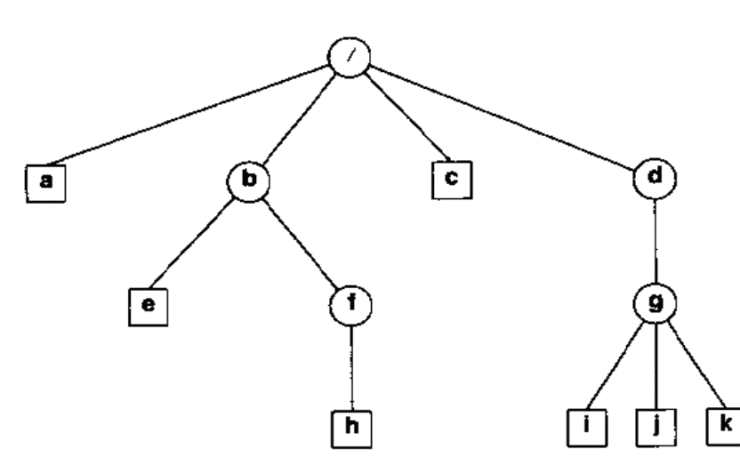

如图所示，文件系统的顶层目录称为 `root`，具有完整路径名 `/`。文件的完整路径可以被视为从根目录到文件的层次结构路径上标签的连接，并使用 `/` 作为分隔符。例如，出现在根目录下的名为 `a` 的文件完整路径名为 `/a`。出现在目录 `b` 中的名为 `e` 的文件完整路径名为 `/b/e`，而名为 `k` 的文件完整路径名为 `/d/g/k`。

## 23.7.13 UNIX Inode：与文件一同存储的信息

除了数据本身外，UNIX 还在稳定存储上存储关于每个文件的信息。这些信息存储在一个名为文件 `inode` 的结构中。`inode` 包含许多字段，包括：所有者和组标识符、模式整数、访问时间、修改时间、文件大小、文件所在的设备、使用的块数以及类型。

`inode` 有助于多项功能。由于 UNIX 将所有权和保护与文件分离，因此可以拥有多个链接。`inode` 是 `index node` 的缩写。如图所示，文件系统的顶层目录 `root` 具有完整路径名 `/`。

> † 除了数据本身外，UNIX 还在稳定存储上存储关于每个文件的信息。这些信息保存在一个名为文件 `inode` 的结构中。


## 23.7.14 UNIX Stat 操作

UNIX 系统函数 `stat` 提取文件的信息并返回给调用者。该调用接受两个参数：路径名和一个足够容纳以下结构的内存地址：

```
struct stat {
    dev_t   st_dev;
    ino_t   st_ino;
    u_short st_mode;
    short   st_nlink;
    short   st_uid;
    short   st_gid;
    dev_t   st_dev;
    long    st_size;
    time_t  st_atime;
    int     st_nused1;
    time_t  st_mtime;
    int     st_nused2;
    time_t  st_ctime;
};
```

/* `stat` 返回的结构 */

/* `inode` 所在的设备 */

/* 文件的 `inode` 号 */

/* 权限位 */

/* 文件的硬链接数 */

/* 所有者的用户 ID */

/* 分配给文件的组 ID */

/* 用于设备而非文件 */

/* 字节大小 */

/* 最后访问时间 */

/* 未使用 */

/* 最后修改时间 */

/* 未使用 */

/* 最后更改时间 */

任何用户都可以调用 `stat` 来获取文件的信息，即使文件本身不可读。调用者必须对文件路径上的所有目录具有搜索权限，否则 `stat` 将返回错误。

## 23.15 Unix 命名机制

尽管用户认为文件和目录是单一层次结构的一部分，但这种层次结构是通过文件命名机制实现的。命名机制允许系统管理员从多个较小的层次结构组合出一个单一的逻辑层次结构。用户很少理解底层文件系统结构或各个组件如何实现 UNIX 层次结构，因为命名机制隐藏了它的复杂性。我们将看到当 NFS 在 UNIX 下运行时，它利用命名机制将远程文件与本地文件集成。

命名机制的操作方式如下：

- 管理员将一个磁盘上的层次结构设计为根。
- 管理员在根层次结构中创建一个空目录。假设该空目录的路径名为由字符串 `/` 给出的。
- 管理员指示命名机制将一个新的层次结构覆盖到目录 `/` 上。


一旦管理器挂载了新的层次结构，命名机制就会将形式为 $\alpha/\beta$ 的名称自动映射到挂载层次结构中路径为 $\beta$ 的文件或子目录。重要的概念是：

尽管底层文件跨越了多个物理磁盘，UNIX 命名机制仍为用户和应用程序提供了一个单一、统一的文件层次结构。

事实上，UNIX 系统比那种将整个磁盘作为层次结构一部分的系统更具通用性。它允许系统管理员将单个物理磁盘分区为一个或多个文件系统。每个文件系统都是一个独立的层次结构；它同时包含文件和目录。文件系统可以在任何点挂载到统一层次结构中。下一节的示例将阐明该命名机制。

## 23.7.16 UNIX 文件系统挂载

UNIX 命名机制依赖于 `mount` 系统调用来构建统一层次结构。系统管理员使用 `mount` 来指定某个磁盘上的文件系统应如何挂载到层次结构中。通常，管理员会安排在启动时自动执行必要的挂载。图 23.6 展示了三个挂载在一起以形成单一层次结构的文件系统。

### Sec. 23.7 回顾 UNIX 文件系统

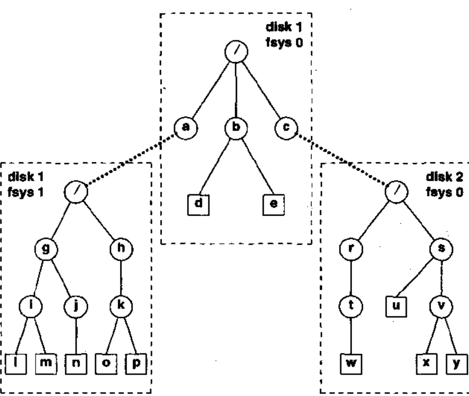

**图 23.6** 三个 UNIX 文件系统挂载形成了一个单一、统一的层次结构。挂载后，磁盘之间的边界变得不可见。例如，磁盘 2 上的文件系统 0 看起来是目录 `/a`。

在图中，磁盘 1 上的文件系统 0 已挂载在层次结构的根上。同一磁盘上的文件系统 1 已挂载在目录 `/a`，而磁盘 2 上的文件系统 0 已挂载在目录 `/a`。挂载会用新的文件系统完全覆盖原始目录。通常，系统管理员会创建一个目录用于挂载。然而，如果挂载文件系统的目录在挂载发生之前包含任何文件，那么在文件系统卸载之前，这些文件将完全被隐藏（即系统管理员无法访问）。

从用户的角度来看，这些挂载是完全不可见的†。如果用户列出目录 `/a` 的内容，系统会报告三个子目录：`a`、`b` 和 `c`。如果用户列出目录 `/a` 的内容，系统会报告两个目录：`g` 和 `h`。如果用户列出目录 `/a/s` 的内容，系统会报告一个文件 `u` 和一个目录 `v`。

> † 用户无法创建跨文件系统边界的硬链接。

## 328 网络文件系统 (NFS) 概念 第 23 章

路径名并不表示文件系统之间的边界；用户不知道文件位于何处。例如，名为 `n` 的文件（位于磁盘 0 上的文件系统 `/`）可以使用完整路径名 `/a/fg/n` 进行访问。

一旦使用 `mount` 系统函数构建了 UNIX 文件系统层次结构，各个文件系统之间的挂载就变得透明了。某些文件和目录存储在某块磁盘上，而另一些文件和目录则存储在另一块磁盘上。用户无法区分它们，因为挂载通过统一的命名方案隐藏了所有边界。

在实践中，如果用户感兴趣，可以找出文件系统是如何挂载的。系统包含一个可执行的应用程序名称，它可以查询系统并显示挂载的文件系统列表。管理员也可以使用 `mount` 命令创建条目。例如，在一台计算机上运行 `mount` 命令会产生：

```
/dev/ra0 on / type ufs (rw,quota)
/dev/rail on /usr type ufs (rw,quota)
/dev/raob on /usr/src type ufs (rw,quota)
```

输出的第一行显示文件系统 `ra0`（磁盘 0 上的第一个文件系统）已挂载并形成了层次结构的根。`ufs` 一词表示该挂载指的是 UNIX 文件系统，括号中的内容意味着该文件系统以读写模式挂载并带有配额限制。文件系统 `rail`（磁盘 1 上的主文件系统）已挂载到 `/usr`。因此，出现在目录 `/usr` 中的文件与 `/` 中的文件位于不同的磁盘上。最后，文件系统 `raob`（磁盘 0 上的第二个文件系统）已挂载到 `/usr/src`。第三次挂载提供了一个有趣的转折，因为虽然 usr 中的大多数文件位于磁盘 1 上，但子树 `/usr/src` 却位于磁盘 0 上。

将文件系统挂载到单一层次结构的概念提供了惊人的灵活性。它允许管理员根据经济考虑选择文件到磁盘的分配，以减少过度竞争，或者在发生意外丢失时保持目录隔离。正如我们将看到的，它还为将远程文件引入 UNIX 层次结构提供了一种方便的方法。

## 23.7.17 UNIX 文件名解析

当给出一个完整路径时，UNIX 文件系统机制会追踪概念层次结构以解析该名称。在 UNIX 中，名称解析意味着找到标识文件的 inode。要解析完整路径名，文件系统从层次结构的根开始，跨越目录找到目标目录。例如，给定一个如 `a/b/c/d` 的名称，文件系统打开根目录并在其中搜索名为 `a` 的子目录。一旦找到 `a`，它就打开该目录并在其中搜索名为 `b` 的子目录。同样，它在 `b` 中搜索目录 `c`，在 `c` 中搜索名为 `d` 的文件或子目录。名称解析软件在由斜杠字符分隔各个组件的每一步中，都会提取完整路径名的一个组件。

虽然 UNIX 文件名解析的细节并不重要，但该概念至关重要：

> UNIX 逐个组件地解析路径名。它从层次结构的根开始，从路径的开始。它反复提取下一个组件并找到。我们看到 NFS 采用相同的方法处理路径。

## 23.7.18 UNIX符号链接

大多数 UNIX 系统允许名为符号链接的特殊文件。符号链接是特殊的文本，包含另一个名称。例如，可以创建一个指向一个的符号链接 `b/c`。

符号链接的主要优势在于其通用性：因为符号链接可以包含任意字符串，它可以命名任何文件或目录。例如，虽然文件系统禁止对目录创建硬链接，但允许创建。

符号链接的主要缺点源于其缺乏一致性和可靠性。可以创建形成循环的符号链接或指向一个。调用这样的链接会导致运行时错误。

## 23.8 NFS 下的文件

像 UNIX 一样，NFS 假设了一种层次命名系统。NFS 层次结构使用 UNIX 术语；它认为文件层次由目录和文件组成。目录可以包含文件和其他目录。

NFS 还采用了许多文件系统细节，对某些保持不变，对另一些进行了微调。后续章节描述了 NFS 的若干功能，并展示了它们如何与 UNIX 相关。

## 23.9 NFS 文件类型

NFS 模式模式假设每个文件或目录都有一个指定其类型和访问保护的模式。图 23.7 列出了 NFS 模式整数的各个位并给出了含义。该表使用八进制值表示位；这些定义与 UNIX `stat` 函数返回的结果直接对应。

（此处为翻译内容）

NFS 使用了许多 UNIX 系统定义。它使用了与 UNIX 相同的基本文件类型。它定义了服务器在指定文件类型时使用的枚举值：

```
enum ftype {
    NNON = 0,           /* 指定名称不是文件 */
    NFREG = 1,          /* 普通数据文件 */
    NFDIR = 2,          /* 目录 */
    NFBLK = 3,          /* 块设备 */
    NFCHR = 4,          /* 字符设备 */
    NFLINK = 5           /* 符号链接 */
}
```

类型集合（包括 `NFBLK` 和 `NFCHR`）直接来自 UNIX。特别是，UNIX 允许系统管理员在文件命名空间中配置 I/O 设备，使得应用程序可以使用传统的打开-读-写-关闭范式对 I/O 设备传输数据。NFS 采纳了 UNIX 的术语，将 I/O 设备分为块设备（例如始终以 512 字节块传输数据的磁盘）和字符设备（例如逐字符传输数据的 ASCII 终端设备）。NFS 有时使用 UNIX 特殊文件来表示设备名称。对应块设备的名称类型为块特殊，而对应字符设备的名称类型为字符特殊。

### 第 23.10节 NFS 文件模式

| 模式位 | 含义 |
| :--- | :--- |
| 004000 | 这是一个目录；“类型”应为 `NFDIR`。 |
| 002000 | 这是一个字符设备文件；“类型”应为 `NFCHR`。 |
| 006000 | 这是一个块设备文件；类型应为 `NFBLK` |
| 010000 | 这是一个普通文件；类型应为 `NFREQ` |
| 012000 | 这是一个符号链接；类型应为 `NFLNK` |
| 014000 | 这是一个命名套接字；类型应为 `NFNON` |
| 000400 | 执行时设置用户 ID (`UID`) |
| 002000 | 执行时设置组 ID (`GID`) |
| 000100 | 使用后保存交换的文本 |
| 000040 | 所有者读取权限 |
| 000200 | 所有者写入权限 |
| 000100 | 所有者执行或目录搜索权限 |
| 000040 | 组读取权限 |
| 000020 | 组写入权限 |
| 000010 | 组执行或目录搜索权限 |
| 000004 | 其他读取权限 |
| 000002 | 其他写入权限 |
| 000001 | 其他执行或目录搜索权限 |

图 23.7 NFS 模式整数中各个位的含义。这些定义直接取自 UNIX。

尽管 NFS 定义了设备类型，但它并不允许远程访问（例如，客户端可能读取或写入远程设备）。因此，虽然客户端可以获取有关文件名的信息，但客户端无法操作设备，即使保护位允许这样做也不行。


尽管 NFS 定义了决定客户端是否可以读取或写入特定文件的保护位，但 NFS 拒绝远程机器访问所有设备，即使保护位指定了允许访问。

## 23.11 NFS 文件属性

与 UNIX 类似，NFS 拥有一种用于获取文件信息的机制。NFS 在指代文件信息时使用“文件属性”一术。结构描述了 NFS 提供的文件属性：

```
struct fatter {
    ftype type;
    unsigned int mode;
    unsigned int nlink;
} /* 文件属性   */
/* 类型：文件、目录等 */
/* 文件的保护位 */
/* 指向文件的硬链接总数 */
```

```
unsigned int userid;      /* 文件所有者的用户 ID */
unsigned int groupid;      /* 分配给文件的组 */
unsigned int size;         /* 文件的总大小（字节） */
unsigned int blocksize;    /* 存储文件的块大小 */
unsigned int devnum;       /* 如果设备，设备号 */
unsigned int blocks;      /* 文件使用的块数 */
unsigned int fsid;         /* 文件的文件系统 ID */
unsigned int inode;        /* 文件的唯一 ID */
timeval atime;             /* 最后访问时间 */
timeval mtime;             /* 最后修改时间 */
timeval ctime;             /* 最后 Inode 改变时间 */
;
```

该结构显示，其概念和大部分细节都源自 UNIX `stat` 返回的信息。

## 23.12 NFS 客户端与服务器

NFS 客户端运行在具有本地文件系统的机器上。服务器将某些本地文件提供给远程机器。NFS 客户端运行在任意机器上，并访问运行 NFS 服务器的机器上的文件。通常，组织会选择一台带有大磁盘的计算机专门作为服务器。这种机器通常被称为文件服务器。禁止用户在 NFS 文件系统上运行应用程序有助于保持低负载，并保证对请求的快速访问。将计算机专门用于文件服务器还可以确保远程访问流量不会减少供应用程序使用的的 CPU 时间。

大多数 NFS 客户端实现将 NFS 文件与计算机的本地文件系统集成，向应用程序和用户隐藏其位置。例如，考虑一个 Windows 95 环境。文件名的格式为：`X:path`，其中 X 是单字符标识符，path 表示该磁盘上的路径。Windows 95 使用反斜线 `\` 分隔路径中的组件。文件名 `C:\DEV file F` 表示系统硬盘上子目录 D 中的文件 F。如果系统中添加了 NFS 客户端并配置为访问远程服务器上的文件，它可以使用 Windows 95 的命名方案。例如，管理器可能会选择格式如 `\β` 的名称用于所有远程文件，其中 β 表示远程文件系统上的路径。

当应用程序调用 `open` 来访问文件时，操作系统使用路径名的语法在本地访问和文件访问过程之间进行选择。如果路径指向远程文件，系统使用 NFS 客户端软件访问远程文件。如果路径指向本地文件，系统使用计算机的标准文件系统软件访问文件。图 23.8 展示了操作系统中的模块在做出选择时是如何相互作用的。

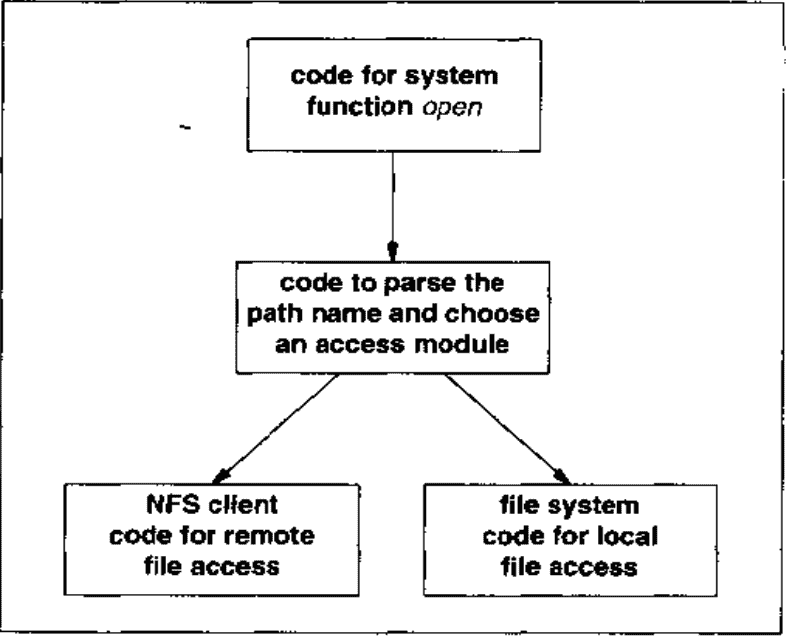

图 23.8 应用程序打开文件时调用的操作系统过程。系统使用路径名语法在 NFS（打开远程文件）或标准文件系统之间进行选择。

## 23.15 NFS 挂载

当管理员向 UNIX 挂载表添加 NFS 挂载项时，必须指定运行 NFS 服务器的远程机器、该服务器上的层级结构、挂载的目标本地目录，以及指定挂载细节的信息。例如，以下 UNIX `mount` 命令的输出显示了普渡渡大学 UNIX 系统上使用的 NFS 挂载情况（非 NFS 挂载已删除）：

```
arthur:/p4 /p1    type nfs (rw,gpid,intr,bg,noquota)
arthur:/p4 /p4    type nfs (rw,gpid,intr,bg,noquota)
ector:/u4 /u4    type nfs (rw,gpid,soft,bg,noquota)
gwen:/          /      type nfs (rw,gpid,soft,bg,noquota)
gwen:/u5 /u5    type nfs (rw,gpid,soft,bg,noquota)
```

在输出输出中，每行对应一个特定的 NFS 文件系统。每行的第一个字段指定运行 NFS 服务器的机器及其在该服务器上的层级结构，而第三字段指定了远程文件系统挂载的本地目录。例如，`arthur:/p1` 指定了机器 `arthur` 上的 `/p1` 层。系统选择将 `arthur` 的 `/p1` 文件系统挂载到名为 `/p1` 的本地目录。系统名称允许两台机器上的用户使用相同的名称访问文件。

上述示例中的所有挂载项类型均为 `nfs`，这意味着它们指的是通过 NFS 可用的远程文件系统。此外，每行括号中的参数指定了挂载的更多细节。与本地文件系统的挂载一样，远程文件系统的挂载可以指定是否允许读写（`rw`）或只读（`r`）。

NFS 为 UNIX 挂载定义了两种基本范式。使用软挂载（`soft mount`）表示 NFS 客户端应该实现一种超时机制，并在超时过期时认为服务器已离线。使用硬挂载（`hard mount`）表示 NFS 客户端不应使用超时机制。

UNIX 管理员通常安排在系统启动时自动创建所有挂载。由于系统无法区分本地文件和远程文件，用户可以使用常规应用程序像操作本地文件一样轻松地操作远程文件。例如，用户可以运行标准的文本编辑器来编辑远程文件；编辑器的操作方式与操作本地文件相同。此外，用户只需提供跨越挂载点的路径名，即可切换到远程目录或本地目录。

## 23.6 文件句柄 (File Handle)

一旦客户端识别并打开了一个文件，就需要一种方法为后续操作（如读和写）标识文件。此外，客户端在追踪服务器层级结构时，需要一种方法识别单个目录或文件。为了解决这些问题，NFS 允许服务器为每个文件分配一个唯一的句柄（file handle）作为标识符。当客户端首次打开文件时，服务器创建一个句柄并发送给客户端。当客户端请求对文件进行操作时，会将句柄发回服务器。

从客户端的角度来看，文件句柄由一个 32 字节的字符串组成；从服务器的角度来看，文件句柄可以是任何唯一标识单个文件的字节集。例如，句柄可以编码信息，允许服务器解码句柄并快速定位它。

在 NFS 术语中，文件句柄对客户端是不透明的（opaque），这意味着客户端不能解码句柄或自行伪造它。只有服务器创建文件句柄，且服务器只识别它们创建的句柄。此外，NFS 的实现使用随机编码（stochastic encoding）来防止客户端猜测文件的句柄。特别是，服务器随机选择句柄中的某些位，以确保客户端无法伪造出有效的句柄。

为了提高安全性，服务器还可以限制句柄的使用时间。这样做使得客户端无法永久保留句柄。为了限制句柄的生命周期，服务器在句柄中编码时间戳。如果句柄过期，服务器将不再对使用该句柄的文件执行后续操作。客户端在继续访问之前必须获取一个新的句柄。实践中，NFS 时间戳通常足够长，允许任何合理的访问。合法使用文件的应用程序始终可以获取新的句柄（所需的事务对应用程序来说是完全隐藏的）。

## 23.17 NFS 句柄取代路径名

为了理解为什么需要句柄，回想远程目录层级结构中的文件命名问题。记住，为了隔离客户端与服务器的路径名语法并允许异构机器运行，客户端需要执行所有的路径名解释。因此，客户端在请求对文件执行操作时，不能使用完整路径来指定文件。相反，客户端必须获取一个可以使用来引用文件的句柄。

让服务器为目录提供句柄也允许客户端在服务器层级结构中追踪路径。要了解如何实现，请看图 23.9，它说明了客户端在服务器层级中查找路径为 `/a/b/c` 的文件时，客户端与服务器之间的交互。

### 客户端发送到服务器的消息

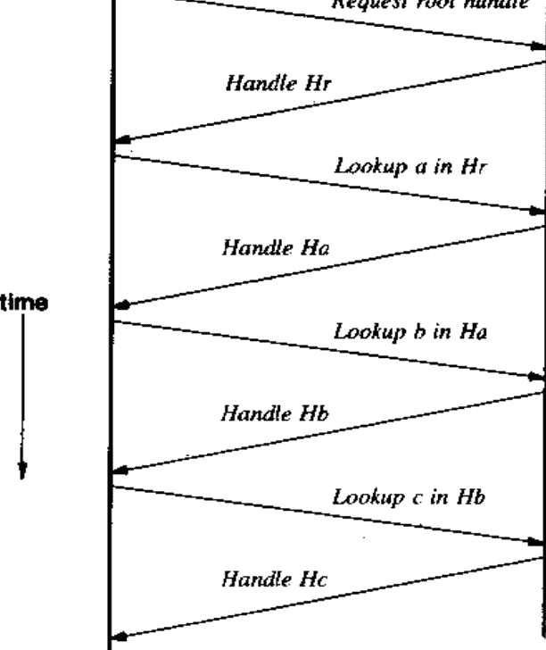

**图 23.9** 客户端查找全路径名为 `/a/b/c` 的文件时交换的消息的消息，其中 `/` 表示客户端的组件分隔符。名为 x 的文件或目录的句柄表示为 `Hx`。（注：原文此处存在大量重复描述，已根据逻辑精简翻译）。

## 23.18 Windows 下的 NFS 客户端


当 NFS 客户端安装在 Windows 等系统时，它必须与系统关联。每当应用程序打开文件时，操作系统首先开始检查设备标识符。如果设备有效，控制权交给驱动程序，驱动程序按常例执行操作。如果设备是文件系统，控制权交给 NFS 客户端代码，该代码使用路径名定位文件。由于路径位于远程机器上，NFS 客户端代码无法直接搜索它们。相反，它必须一次查找一个组件。要查找组件，客户端将组件名称发送给相应的服务器；如果组件有效，服务器返回一个句柄。客户端使用句柄让服务器在目录中搜索下一个组件。搜索按一次一个组件的方式继续，直到客户端请求有关最后一个组件的信息。如果路径有效（即对应于远程系统上的文件），服务器返回该远程文件的句柄。NFS 客户端代码存储句柄，为其创建描述符并将描述符返回给应用程序。应用程序使用描述符对远程文件进行读或写操作。（注：客户端代码使用打开文件时从服务器接收的句柄，客户端在发送读或写请求时将句柄发送给服务器）。

### 23.19 无状态服务器下的文件定位

NFS 使用无状态服务器设计，服务器无法为每个使用文件的应用程序存储文件位置。相反，客户端存储所有文件位置信息，发送到服务器的每个请求必须指定使用的文件位置。在客户端存储位置信息有助于优化更改文件位置的操作。在许多实现中，NFS 使用相同的机制存储远程文件的位置。如果应用程序更改了文件位置（例如通过 `seek` 操作），客户端会记录新的文件位置而不向服务器发送消息。

### 23.20 目录的操作

从概念上讲，NFS 将目录定义为一组键对，其中每个键对包含一个文件名和一个指向该命名文件的指针。目录的大小可以是任意的；对其大小没有预设的限制。NFS 提供了某些操作，允许客户端：从目录中插入文件、在目录中搜索名称，以及读取目录的内容。

### 23.21 无状态地读取目录

由于目录的大小可以是任意的，且通信网络对目录读取的大小施了固定限制，读取目录可能需要多次请求。由于 NFS 是无状态的，服务器无法记录每个客户端在目录中的位置。

NFS 设计者通过一种安排来克服无状态服务器的局限性：让 NFS 服务器在响应目录条目请求时返回一个位置标识符（position identifier）。客户端在下一次请求中使用该位置标识符来指定它已经读取了哪些条目，还需要哪些。因此，当客户端想要从远程目录读取时，它通过重复发送指定上一次请求返回的位置标识符的请求来遍历目录。

用流行程序员的非正式术语来说，NFS 将其位置标识符称为“魔术饼干”（magic cookie）。该术语的意思是客户端不解释该标识符，它也无法伪造标识符。只有服务器可以创建魔术饼干（该术语中的 magic）；客户端只能使用由服务器提供的魔术饼干。

魔术饼干不保证原子性，也不会锁定目录。因此，两个对目录执行操作的应用程序可能会相互干扰。例如，想象一个服务器同时处理来自两个或多个客户端的请求。假设在从某个目录 D 读取目录条目后，第一个客户端接收到了指向第四个条目之前位置的魔术饼干。然后，另一个客户端在目录 D 中执行了插入和删除文件的操作。如果第一个客户端尝试使用旧的魔术饼干从 D 读取剩余的条目，它可能无法接收所有的更改。

在实践中，并发访问目录的潜在问题很少影响用户，因为这些问题并不依赖于对文件的瞬时插入或删除。事实上，许多传统操作系统的行为与 NFS 相同；用户很少了解系统如何解释并发目录操作的细节，因为他们很少需要知道。

### NFS 服务器中的多层次结构

回想，为了让 NFS 在异构机器之间互操作，设计者选择让客户端解析所有路径名。这样做允许客户端和服务器各自使用其操作系统原生的文件命名方案，而不需要它们任何一方理解对方的环境。

限制全路径名的使用对大多数文件操作的影响很小。然而，它引入了一个严重的问题，这意味着客户端无法使用全路径名来识别远程文件系统或目录。

早期版本的 NFS 协议假设每个服务器仅提供对单一层次结构的访问。原始协议包含一个函数 `NFSPROC_ROOT`，客户端可以调用它来获取服务器层次结构中根目录的句柄（handle）。一旦客户端拥有根目录的句柄，它就可以读取目录条目并遵循层次结构中的任何任意路径。

后世版本的 NFS 允许访问位于若干层次结构中的远程文件。在这种情况下，仅靠返回单个根句柄的程序是不够的。为了让单个服务器处理多个层次结构，NFS 需要一种额外的机制。下一节描述的这种额外机制允许客户端指定可能的层次结构中的一个，并获取其根目录的句柄。

### 23.23 挂载协议（The Mount Protocol）

当前版本的 NFS 使用一个单独协议来处理查找根目录的问题。该协议被称为挂载协议（mount protocol），使用 RPC 定义。然而，挂载协议并不是 NFS 远程程序的一部分。尽管它是 NFS 服务器所必需的，但挂载协议作为一个独立的远程程序运行。

挂载协议提供了客户端在使用 NFS 之前需要的四种基本服务。首先，它允许客户端获取可以通过 NFS 访问的目录层次结构列表（即文件系统）。其次，它接受全路径名。第三，它验证客户端访问层次结构的权限。第四，它返回请求的层次结构的根句柄。

挂载协议的概念和名称源于 UNIX：UNIX 系统在将远程挂载到本地命名空间时使用挂载协议。如果挂载协议拒绝访问，客户端系统报告错误。如果挂载协议允许访问，客户端使用从挂载协议获取的句柄将其挂载到 UNIX 命名空间。在系统管理器将远程挂载到 UNIX 命名空间时，客户端使用从挂载协议获取的句柄来访问该文件。

### 23.24 总结

Sun Microsystems, 定义了一种名为 NFS 的远程文件访问机制，它已成为行业标准。为了使服务器不受客户端崩溃的影响，NFS 使用无状态服务器。

由于 NFS 是为异构环境设计的，为了适应异构性，NFS 要求客户端解析路径名并逐一查找组件。当客户端查找特定组件时，服务器返回一个 32 字节的文件句柄。

许多 NFS 中的概念操作源自 UNIX：NFS 支持层次目录，将文件视为字节序列，允许文件动态增长，提供随机访问，并提供与 `stat` 函数相同的信息。NFS 采用了 UNIX 的打开-读-写范式，以及基本类型和文件保护机制。

作为 NFS 的辅助，挂载协议使得单个服务器能够访问多个层次结构。一旦客户端获取了层次结构的根句柄，就可以使用 NFS 程序访问目录和文件。

### 进一步学习

Ritchie 和 Thompson [1974] 解释了原始 UNIX 文件系统，并讨论了使用节点的文件实现。Bach [1986] 涵盖了 UNIX 文件系统语义。McKusick 等人 [1984年8月] 描述了后期 BSD 使用的快速文件系统。RFC 1094 规定了 NFS 定义的 NFS 和挂载协议的细节。它提到了这里介绍的大部分内容。Callahan 等人 [RFC 1813] 描述了第 3 版 NFS 协议：

### 习题

- 23.1 编写一个从 NFS 服务器获取魔术饼干的程序。使用该程序获取多个服务器上多个目录的魔术饼干并以十六进制打印。尝试猜测饼干包含什么信息以及服务器是如何编码的。
- 23.2 使用网络分析器观察 NFS 客户端和服务器之间交换的消息。对于以下操作：打开不在顶层目录的文件、读取文件 10 字节、关闭文件，交换了多少数据包？
- 23.3 假设连接 NFS 客户端和服务器的网络乱序交付数据包。重排序 NFS 操作会导致哪些错误？
- 23.4 假设连接 NFS 客户端和服务器的网络可以重复数据包，也可以乱序交付数据包。重复和乱序会导致哪些错误？重复是否引入了额外的错误情况？为什么或为什么不？
- 23.5 检查 NFS 第 2 版和第 3 版的规范。主要差异是什么？第 3 版是否有程序员可见或重要的更改？
- 23.6 尽管 NFS 设计为无状态的，但文件句柄机制为协议增加了状态。文件句柄引入了哪些问题（如果有）？如何克服这些问题？（提示：许多 NFS 的实现在服务器崩溃并重启后要求所有活动客户端重启。）

# 24

# 网络文件系统协议 (NFS, 挂载)

## 24.1 引言

前一章描述了 Sun 网络文件系统（NFS）的底层概念，并展示了许多术语和细节均源自 UNIX 文件系统。本章将通过描述该协议继续对 NFS 的讨论。它将展示 NFS 如何被定义为使用 ON RPC 的远程程序，以及对文件进行的每项操作如何对应于远程过程调用。

## 24.2 使用 RPC 定义协议

第 20 章至 22 章展示了如何使用 RPC 将程序划分为在不同机器上执行的组件。大多数程序员使用 RPC 的方式与这些章节描述的完全相同：他们首先编写一个常规程序，然后使用 RPC 将其构建为分布式版本。本节将展示了如何使用 RPC 定义一个协议，而不必将其绑定到任何特定程序上。

使用 RPC 构建程序的分布式版本与构建通用协议之间的主要区别在于设计者考虑问题的方式。在构建程序的分布式版本时，程序员是从一个包含过程和数据结构的既有程序开始的。而在设计协议时，程序员则是从一组所需服务开始，并设计支持这些服务的抽象过程。

设计协议需要考虑服务如何被使用，还需要考虑程序员将如何实现提供这些服务的定义。设计者必须选择一个在精确性和自由度之间取得平衡的协议定义。协议必须足够精确，以保证遵循协议的程序之间的互操作性，但必须足够通用，以允许各种实现方式。


在真空状态下思考协议设计是极少见的。成功的协议规范要求设计者精通通信的技术细节，并对设计有良好的直觉。这种直觉通常源于对计算机系统、应用程序和其他通信协议的丰富经验。因此，协议设计可能比看起来要困难得多。特别是，不要将协议表面的简单性误认为是设计没有花费太多思考。要点在于：

> 尽管 RPC 提供了一种指定协议的方便方法，但它并不会让协议设计变得更容易，也无法保证效率。

## 24.3 使用数据结构和过程定义协议

要使用 RPC 指定协议，必须：

- 为用作过程参数或函数结果的常量、类型和数据结构提供声明。
- 为每个远程过程提供声明，指定其执行的操作的参数、结果和语义；以及
- 通过指定远程过程如何处理其参数并计算返回值，为每个远程过程提供语义。

从概念上讲，使用 RPC 指定的协议将服务器定义为单一远程程序。从客户端到服务器的操作对应于远程调用，而从服务器返回到客户端的消息对应于过程返回。因此，在任何由 RPC 定义的协议中，客户端必须启动所有操作；服务器只能响应客户端请求。

对于 NFS 而言，要求客户端启动每项操作是有合理的，因为文件访问协议可以从客户端设计。服务器提供若干过程，允许客户端：创建或删除文件、目录和符号链接；读取或写入数据；在目录中搜索命名文件；以及获取整个文件系统或单个文件或目录的状态信息。虽然其他应用程序可能无法像 NFS 那样直接适用于 RPC 规范，但经验表明，大多数客户端-服务器交互都可以在花费较少精力的情况下被转换为远程过程范式。

NFS 提供了一个 RPC 规范的有趣示例，因为该协议足够复杂，需要多个远程过程和数据类型，但它在直观和概念上又足够简单，易于理解。下一节描述了 NFS 协议中使用的基本常量和类型声明示例。后续章节将展示过程声明如何使用常量和类型来指定参数和结果。

## 24.4 NFS 常量、类型和数据声明

NFS 协议标准定义了整个过程声明中使用的常量、类型名和数据结构。所有声明均使用 RPC 声明语法。

### 24.4.1 NFS 常量

NFS 定义了六个基本常量，用于指定数组的大小。这些声明使用以下格式：

```c
const MAXDATA = 8192; /* 数据传输字节 */
const MAXHELEN = 1024; /* 路径名字节 */
const NAMELEN = 255; /* 名称字节 */
const COOKIZE = 4; /* Cookie 字节 */
const FHANDLESIZE = 42; /* NFS 句柄字节 */
const PATH = 8; /* 路径 */
```

除了基本常量外，协议还定义了一个枚举集合，用于报告错误。该集合被命名为 `stat`，并按如下方式定义：

```c
enum stat {
    OK = 0; /* 成功 */
    IO = 1; /* I/O 错误 */
    NOENT = 2; /* 不存在 */
    ACCES = 3; /* 访问被拒绝 */
    EXISTS = 4; /* 已存在 */
    NODEV = 5; /* 设备不存在 */
    NOTDIR = 6; /* 不是目录 */
    PERM = 7; /* 权限不足 */
    ROFS = 8; /* 只读文件系统 */
    NOSPC = 9; /* 空间不足 */
    NAMETONG = 10; /* 文件名过长 */
    NOEMPTY = 11; /* 目录为空 */
    QUOTA = 12; /* 配额超限 */
    STALE = 13; /* 句柄过期 */
    FLUSH = 99; /* 缓存已刷入磁盘 */
};
```

这些错误值在某些调用中是有意义的。例如，如果客户端尝试对普通文件执行操作，服务器会返回错误。

### 24.4.2 NFS 类型定义声明

为了使结构声明更清晰，NFS 标准为多个结构使用的类型定义了名称。例如，文件名被定义为足够包含组件名的字符数组。在 RPC 语法中，必须使用 `string` 关键字来声明字符数组。因此：

```c
typedef string filename[MAXLEN];
```

同样，标准将 `handle` 定义为包含文件句柄的类型。该类型被声明为 `opaque`，因为客户端不知道内部结构：

```c
typedef opaque handle[FHANDLESIZE];
```

### 24.4.3 NFS 数据结构

有了常量和类型定义，设计者就可以指定所有使用的数据结构类型。NFS 遵循将远程过程调用的所有参数合并到一个结构的惯。因此，标准为每个远程过程定义了一个参数结构，并为每个过程定义了一个独立的结构。此外，标准还定义了一些多个过程共享的结构。例如，第 22 章描述了 NFS 使用的 `fattr` 结构。`fattr` 中的某些字段记录了文件最后修改或访问的时间。这些字段被声明为 `timeval` 类型：

```c
struct timeval {
    /* NFS 使用的日期时间 */
    unsigned int seconds;      /*  epoch (1/1/70) 的秒数 */
    unsigned int microseconds;  /* 额外的微秒 */
};
```

# 第 24.4节 NFS 常数、类型与数据声明 347

```c
struct diropsargs { /* 目录操作参数 */
    handle dir;      /* 目录文件的句柄 */
    filename;       /* 目录中的文件名 */
};
```

该结构体显示参数由一个目录的文件句柄和该目录下的文件名组成。为了理解为什么需要 `diropsargs`，请记住 NFS 客户端解析所有的路径名。因此，客户端不能使用完整路径来标识文件。相反，NFS 要求所有操作都通过提供文件所在目录的句柄以及该目录中的文件名来指定。

除了参数类型的声明外，该标准还定义了远程过程返回的类型。例如，目录操作返回一个名为 `dirores` 的 union。

```c
union dirores switch (stat status) { /* 操作结果 */
case NFS_OK: /* 如果操作成功 */
    struct { /* 成功结果结构体 */
        handle handle;     /* 新文件的句柄 */
        fattr attributes;/* 文件的状态 */
    } diropok; /* 成功结构体结束 */
default: /* 如果操作失败 */
    void;             /* 不返回任何 */
};
```

这允许两种可能的返回值形式，具体取决于状态。如果操作成功，状态将具有值 `NFS_OK`，且返回值将由新创建的文件（或已更改的文件）的文件句柄以及一个包含文件属性的结构体组成。如果操作失败，调用将不返回任何内容。

其他远程过程的参数有时包含一个或多个规格。例如，重命名文件的远程过程需要两个文件名：现有文件的名称和该文件的新名称。`rename` 过程的参数被声明为 `renameargs` 类型，这是一个结构体：

```c
struct renameargs { /* RENAME 操作的参数 */
    diropsargs from; /* 现有文件 */
    diropsargs to;   /* 文件的新位置/名称 */
};
```

提供旧文件名和新文件名的独立字段被声明为 `diropsargs` 类型。

大多数其他 NFS 参数类型都对应于远程过程。例如，NFS 定义了结构体 `writeargs` 用于指定向文件写入数据调用中使用的参数：

```c
struct writeargs {
    handle file;           /* WRITE 操作的参数 */
    unsigned beginoffset;  /* 要写入的文件 */
    unsigned offset;       /* 过时（忽略） */
    unsigned offset;        /* 写入数据的位置 */
    unsigned totalcount;    /* 过时（忽略） */
    nfsdata data;           /* 放入文件的数据 */
};
```

同样，`readargs` 结构体指定了读取操作的参数：

```c
struct readargs {
    handle file;           /* READ 操作的参数 */
    unsigned offset;       /* 要读取的文件 */
    unsigned offset;       /* 读取数据的位置 */
    unsigned count;        /* 请求的字节数 */
    unsigned totalcount;   /* 过时（忽略） */
};
```

过程 `readlink` 允许客户端读取符号链接的内容。其结果由 union `readlink` 定义：


```c
union readlink switch (stat status) { /* READLINK 结果 */
    case NFS_OK:            /* 如果操作成功 */
        path data;              /* 在链接中找到的路径名 */
    default:                /* 如果操作失败 */
        void;                   /* 无 */
};
```

# 24.5 NFS 过程

一旦声明了常量和数据类型，只需要指定实现协议的远程过程。NFS 服务器提供了一个实现 18 个过程的远程程序。使用 RPC 语言，可以声明该程序：

```c
program NFS_PROGRAM {
    version NFS_VERSION {
        void NFSPROC_NULL(void) = 0;
        attrstat NFSPROC_GETATTR(handle) = 1;
        attrstat NFSPROC_SETATTR(satterargs) = 2;
        void NFSPROC_ROOT(void) = 3;
        diopres NFSPROC_LOOKUP(diopargs) = 4;
        readlinks NFSPROC_READLINK(handle) = 5;
        readres NFSPROC_READ(readargs) = 6;
        void NFSPROC_WRITECACHE(void) = 7;
        attrstat NFSPROC_WRITE(writeargs) = 8;
        diopres NFSPROC_CREATE(createargs) = 9;
        stat NFSPROC_REMOVE(diopargs) = 10;
        stat NFSPROC_RENAME(renameargs) = 11;
        stat NFSPROC_LINK(linkargs) = 12;
        stat NFSPROC_SYMLINK(symlinkargs) = 13;
        diopres NFSPROC_MKDIR(createargs) = 14;
        stat NFSPROC_RMDIR(diopargs) = 15;
        readdirres NFSPROC_READDIR(readdirargs) = 16;
        statfsres NFSPROC_STATFS(handle) = 17;
    } = 2; /* NFS 协议的当前版本 */
} = 100003; /* 分配给 NFS 的 RPC 程序号 */
```

大多数 NFS 操作语义遵循文件操作的语义。以下章节描述了远程过程是如何运行的。

# NFS 操作语义

### 24.6.1 NFSPROC_NULL (过程 0)

按照惯例，任何过程都被称为 null，因为它不执行任何操作。调用返回一个状态值。

### 24.6.2 NFSPROC_GETATTR (过程 1)

客户端调用过程 1 以获取文件的属性，包括权限模式、大小、访问时间等。

### 24.6.3 NFSPROC_SETATTR (过程 2)

过程 2 允许客户端设置某些属性（例如通过截断文件）。如果操作失败，状态值将包含错误代码。

### 24.6.4 NFSPROC_ROOT (过程 3)

过程 3 是为早期版本的 NFS 定义的，但现在被挂载协议取代。

### 24.6.5 NFSPROC_LOOKUP (过程 4)

客户端调用过程 4 在目录中查找文件。如果成功，结果包含文件句柄和属性。

### 24.6.6 NFSPROC_READLINK (过程 5)

过程 5 允许客户端从符号链接读取值。

### 24.6.7 NFSPROC_READ (过程 6)

过程 6 允许客户端从文件读取数据。服务器返回的结果是 union `readres`。如果操作成功，结果包含请求的数据以及属性。

### 24.6.8 NFSPROC_WRITECACHE (过程 7)

过程 7 在当前协议中未使用。

### 24.6.9 NFSPROC_WRITE (过程 8)

过程 8 提供了基本功能之一：它允许客户端向远程文件写入数据。调用返回一个 `attrstat`，如果操作失败则包含错误，否则包含属性。

### 24.6.10 NFSPROC_CREATE (过程 9)

客户端调用过程 9 在指定的目录中创建一个文件。文件必须不存在，否则调用将返回错误。调用返回一个 `dipres` 类型，其包含一个错误状态或新文件的句柄。

### 24.6.11 NFSPROC_REMOVE (过程 10)

客户端调用过程 10 删除一个现有文件。调用返回一个状态值，指示操作是否成功或提供失败原因。

### 24.6.12 NFSPROC_RENAME (过程 11)

过程 11 允许客户端重命名文件。由于参数允许客户端指定文件的新目录以及名称，该操作对应于 UNIX `mv` 命令。NFS 保证重命名在服务器上是原子的（即不会被中断）。原子性的保证非常重要，因为这意味着在安装新名称之前，旧名称不会被移除。

### 24.6.13 NFSPROC_LINK (过程 12)

客户端调用过程 12 为现有文件创建硬链接。NFS 保证，如果一个文件有多个硬链接，无论使用哪个链接访问，该文件的可见属性将都是相同的。

### 24.6.14 NFSPROC_SYMLINK (过程 13)

过程 13 创建符号链接。参数指定了目录句柄、要创建的文件名，以及一个将成为符号链接内容的字符串。服务器创建符号链接，然后返回一个状态值，指示成功或给出失败原因。

### 24.6.15 NFSPROC_MKDIR (过程 14)

客户端调用过程 14 来创建一个目录。如果调用成功，服务器将返回一个新目录的句柄（`handle`）以及其属性列表。如果调用失败，返回的状态值将指明失败的原因。

### 24.6.16 NFSPROC_RMDIR (过程 15)

客户端可以使用过程 15 来删除目录。与 UNIX 一样，目录在被删除之前必须是空的。要删除一个子树，客户端必须遍历该子树并删除所有文件，然后删除剩余的空目录。通常，文件和空目录的删除是通过对目录树进行后序遍历在一次通过中完成的。

### 24.6.17 NFSPROC_READ (过程 16)

客户端调用过程 16 来从目录中读取条目。参数结构 `readdirargs` 规定了要读取的目录的句柄、一个魔数饼干（magic cookie）以及读取的最大字符计数。在初始调用中，客户端指定了一个包含为零的魔数饼干，这导致服务器从目录的开始处读取条目。返回值的类型为 `readdir`，包含一个零或多个条目的链表，以及一个指示最后一个返回的条目是否成功的布尔值。

成功返回后，链表上的每个条目都包含文件名、文件的唯一标识符、一个给出客户端在目录中位置的魔数饼干，以及一个指向列表中下一个条目的指针。

要读取目录中的条目序列，客户端首先开始调用 `NFSPROC_READ`，其魔数饼干值为零，字符计数等于其内部缓冲区的大小。服务器返回能够放入缓冲区的所有目录条目。如果返回值显示客户端已到达目录末尾，则停止处理。否则，客户端使用上一个条目中的魔数饼干再次向服务器发起调用以获取更多条目。客户端继续读取条目组，直到到达目录末尾。

### 24.6.18 NFSPROC_STATFS (过程 17)

过程 17 允许客户端获取文件所在远程文件系统的信息。返回的结果是一个 `statfs` 类型的结构体，包含以下字段：最传输传输大小（即读或写请求中产生最佳传输速率的数据大小）、存储设备上的数据块大小、设备上的块数、当前未使用的块数以及特权用户可用的空闲块数。

## Sec. 24.6 NFS 操作的语义

复杂的客户端程序可以使用 `NFSPROC_STATFS` 来优化传输，或估计磁盘上是否留有足够的空间来容纳写入请求。

# 24.7 挂载协议 (The Mount Protocol)

第 22 章描述的挂载协议也是使用 RPC 定义的。尽管 NFS 服务器必须有一个配套的挂载服务器，但这两个者被定义为两个独立的远程程序。因此，挂载协议的标准规定了构成服务器的常量、类型和一组远程过程（`procedures`）。

## 24.7.1 挂载常量定义

尽管这两个协议是分别定义的，但为挂载协议定义的许多常量和类型的值都源自 NFS 协议中使用的相应常量。事实上，除非这两个协议对文件句柄（file handlers）等对象使用共同表示，否则它们无法协同工作。例如，挂载协议定义了文件名、路径名和文件句柄的大小：

```
const MNTNAMLEN = 255;
const MNTPATHLEN = 1024;
const FSIZE = 32;
```

这些声明使用 RPC 语法，每个声明将长度表示为字节数。

## 24.7.2 挂载类型定义


挂载协议还规定了与 NFS 协议中的对应项一致的类型定义。例如，挂载协议规定了文件句柄的类型：

```
typedef opaque fhandle[FSIZE];
```

同样，挂载协议规定路径名由字符数组组成：

```
typedef string dirpath-MNTPATHLEN;
```

### 24.7.3 挂载数据结构

由于挂载协议是用 `RPC` 定义的，它遵循了为每个远程过程的参数和结果声明结构的约定。例如，协议中的基本过程之一返回一个命名层次结构中根目录的文件句柄。返回的值是一个名为 `fhstatus` 的联合，声明如下：

```
union fhstatus switch (unsigned status) {
    /* 如果成功 */
case 0:
        handle directory; /* 指定根目录的句柄 */
        default;        /* 否则 */
        void; /* 无 */
};
```

与 NFS 协议一样，挂载协议中的每个过程都会返回一个值以及其他信息。如果操作失败，状态值将指明原因。

除了返回文件句柄的过程外，挂载协议还提供了一个允许客户端确定哪些文件系统可供访问的过程。该过程在一个名为导出列表（export list）的链表中返回结果。导出列表上的节点类型使用结构体进行声明：

```
struct *exportlist {
    /* 可用层次结构列表 */
    dirpath filesys; /* 此层次结构的路径名 */
    groups groups; /* 允许访问它的组 */
    exportlist next; /* 指向列表中下一项的指针 */
};
```

导出列表中的 `groups` 字段包含一个指向链表的指针，该链表指定了哪些组允许访问指定的层次结构。列表上的节点被定义为 `groups` 类型的结构：

```
struct *groups {
    /* 组名 */
    string name;
    groups next; /* 指向下一项的指针 */
};
```

早期版本的 NFS 通过固定方式组合文件或目录的信息来创建。例如，图 24.1 显示了 UNIX 实现如何将 32 字节的句柄（handle）划分为十个字段：

| 字段 | 大小 | 内容 |
|---|---|---|
| Field | 4 | 文件的 UNIX 主设备和次设备号 |
| one | 1 | 始终为 1 |
| length | 2 | 后三个字段的总长度 |
| zero | 2 | 文件的 UNIX 内部编号 |
| inode | 4 | 文件生成号（为了安全进行了随机化） |
| length | 2 | 后三个字段的总长度 |
| zero | 4 | 文件系统根目录的 UNIX 内部编号 |
| rinode | 4 | 根目录生成号（为了安全进行了随机化） |

> 图 24.1 NFS 文件句柄中字段的内容。这种特定格式来自运行在 UNIX 操作系统下的 NFS 服务器；并非所有服务器构建文件句柄的方式相同

使用固定格式文件句柄的主要危险在于 NFS 对未经授权的访问保护很小。想要访问文件的客户端可以通过伪造任意文件的句柄来绕过挂载协议。然后它可以获取该文件的属性信息，包括文件所有权和保护位。因此，即使挂载协议未授权访问，它也能访问 world可读的文件。此外，如果客户端在本地机器上拥有权限，它将能够向服务器发送包含任意用户标识符。因此，具有权限的客户端可以发现特定文件的所有者，然后发送请求进行使用。

为了使文件句柄难以猜测，许多管理员经常使用一种对文件生成号进行随机化的工具。该工具遍历整个磁盘，并为每个文件关联一个随机数。挂载协议在分发文件时使用该随机数，而 NFS 会检查句柄中的值是否与文件的编号匹配。

随机化生成号增加了安全性，但并没有增加形成句柄所需的计算开销，因为随机化是在使文件变得难以猜测之前执行的。尝试获取未经授权访问的客户端必须在 2^32 个可能的生成号值中进行选择。因为获取文件未经授权访问的概率也很低。

## 24.11 NFS 版本 3 的变化

虽然 NFS 版本 2 和 3 之间有很多细微差异，但大多数更改可以归类为三大类类：

- 改进 NFS 性能的更改。
- 允许 NFS 匹配传统系统中发现的功能更改。
- 提高安全性的更改。

性能更改侧重于调优。例如，版本 3 协议没有指定最大数据传输大小，也没有指定首选大小。相反，版本 3 允许为每个文件系统单独指定参数。为了实现这一更改，版本 3 包含了一个新过程 `FSINFO`，客户端调用它来获取有关文件系统的信息。

单个过程经过了调优，以消除不必要的开销。例如，版本 3 过程返回了之前可以通过单独过程调用获取的信息。这样做减少了远程过程调用的总数。

该协议的版本 3 还允许缓存和异步操作。虽然版本 3 不要求客户端缓存信息或数据，但协议现在包含了客户端可以使用来更有效地管理缓存的额外信息。更重要的是，版本 3 允许服务器端的写操作是异步的。也就是说，客户端可以选择是否允许 `WRITE` 过程在服务器将数据存储到磁盘之前返回。如果客户端选择使用异步 `WRITE`，版本 3 提供了一个额外的 `COMMIT` 过程，客户端调用它来强制服务器将所有数据写入磁盘。

为了适应额外的文件系统功能的更改侧重于 UNIX。例如，版本 3 包含一个 `MKNOD` 过程，允许客户端创建一个特殊文件，类似于 UNIX 系统过程 `knod` 允许程序创建特殊文件。同样，版本 3 允许客户端请求独占文件创建，类似于程序在 UNIX 下请求独占文件创建的方式。最后，`FSTAT` 允许客户端获取有关文件系统的信息，包括总大小、文件数量和剩余可用空间。因此，远程客户端可以获得与 UNIX 命令提供的相同信息。

提高安全性的更改是可变的，使得 cookie 变得更大从而更难以猜测。例如，文件大小已从固定的 32 字节数组增加到多达 64 字节的可变大小数组。较大的句柄意味着需要或返回句柄的远程过程调用将占用更多的网络带宽。通过使句柄大小可变，版本 3 允许服务器在大句柄大小（提高安全性）或小句柄大小（提高性能）之间进行选择。

## 24.12 总结

使用 `RPC` 定义协议时，必须为规范中使用的常量和数据类型提供定义、服务器提供的过程定义、所有过程参数和结果的类型，以及每个过程的语义。协议定义与使用 RPC 构建程序的的分布式版本有所不同，它要求设计者处理抽象概念而不是现有的程序。

NFS 已经使用 RPC 定义。协议标准规定了组成服务器的 18 个过程。除了允许客户端 `read` 或写入文件的操作外，协议还定义了数据结构和操作，允许客户端从目录读取条目、创建文件、删除文件、重命名文件或获取有关文件的信息。

作为 NFS 的辅助，挂载协议提供了客户端认证，并允许客户端查找层次结构根的句柄。挂载协议允许服务器导出多个层次结构，并允许客户端使用全路径名指定特定的层次结构。

NFS 依赖挂载协议。安全性。挂载协议允许客户端获取根目录的句柄后即可访问。许多 NFS 实现对文件生成号进行了随机化，这种随机化使得句柄变得难以猜测。

## 进一步研究

Sun Microsystems 公司使用 RPC 定义了 NFS 2 和挂载 协议。它提供了每个协议的常量、类型和过程声明，以及预期的描述。RFC 1813 描述了 NFS 版本 3。

## 练习

24.1 编写一个使用挂载协议获取句柄的程序。你选择了哪种认证？为什么？

24.2 使用上一个程序检查给定服务器上的多个文件，查看该服务器是否对生成号进行了随机化。

24.3 查询标准查找 `NFSPROC_WRITECACHE` 操作。它的目的是什么？

24.4 NFS 使用 UDP 传输。许多公司现在销售使用 TCP 的软件。如何优化协议以利用可靠流传输？

24.5 NFS 协议规范提到某些操作可能是等等的。读取这些操作并解释每个操作如何可能是非等等的。

24.6 在 NFS 中， 语义保证写操作在数据存储到稳定存储设备（例如磁盘）之前不会完成。如果协议允许服务器将数据复制到任意缓冲区并在写入磁盘之前返回，估计你的本地服务器写操作会快多少？

24.7 NFS 设计用于允许在异构环境中运行。解释符号链接如何引起问题。（提示：仔细考虑协议以确定是由客户端还是服务器解释符号链接）。

24.8 阅读协议规范找出哪些文件属性可以由客户端设置

24.9 因为 RPC 使用 UDP，远程过程可能会被重复、延迟或乱序交付。解释一组有效的 NFS 调用从客户端角度看可能会创建一个文件并写入数据，却导致零长度文件。

24.10 假设客户端调用 `NFS_STATFS` 来查找首选的数据传输大小。哪些限制可能导致传输大小并非最优？

24.11 阅读协议规范查找状态句柄的信息。为什么服务器可能会宣布句柄已失效？使句柄失效如何提高安全性？

24.12 编写一个程序在某些服务器上调用 `MOUNTPROC_UMNTALL`。该调用对后续的 S 调用有影响吗？为什么或为什么？

24.13 编写一个调用 `MOUNTPROC_EXPORT` 的程序。运行程序并打印导出的文件名列表。

# 25

# TELNET 客户端（程序结构）

## 25.1 引言


之前的章节使用简单的示例来说明了客户端-服务器软件中使用的概念和技术。本章和下一章将探索客户端-服务器范式如何应用于复杂的应用协议。示例协议是 TELNET，它是 TCP/IP 协议族中最广泛使用的协议之一。

本章侧重于整体程序结构。它假设读者熟悉 TELNET 协议的基础知识，并重点解释其一种实现方式。它讨论了客户端软件的设计、线程结构，并展示了如何使用有限状态机来控制处理。它解释了如何使用 TCP 在运行在同一台计算机上的两个线程之间通信，以及如何建立本地连接。此外，它还展示了客户端如何将 TELNET 通信映射到本地键盘和显示器。

下一章将完成描述。它将侧重于执行与有限状态机转换相关的语义动作的调用例程细节。两个章节中的示例代码都清晰地说明了编程细节如何主导代码，以及它们是如何使实现变得复杂的。

## 25.2 概述

### 25.2.1 用户终端

TELNET 协议定义了一种交互式通信设施，允许用户与远程机器上的服务进行通信。在大多数情况下，用户使用 TELNET 与远程登录服务进行通信。如第 1 章中的示例所示，设计良好的 TELNET 客户端还允许用户连接到其他服务。

TELNET 协议定义了交互式的、面向字符的通信。它指定了一个网络虚拟终端（NVT），该终端由键盘和显示屏组成。协议定义了虚拟终端的字符集。某些按键对应于概念操作而非数据值。例如，某个按键会导致中断或终止。使用网络虚拟终端的主要优势是，它允许来自各种计算机的客户端连接到某个服务。与第 19 章描述的 XDR 标准一样，TELNET 使用对称数据表示。每个客户端在发送数据时从其本地终端的 NVT 字符表示进行映射，在接收数据时从 NVT 表示映射到本地字符集。总结一下：

> TELNET 是一种面向字符的协议，在传输数据时使用标准编码。

### 25.2.2 命令与控制信息

除了字符数据外，TELNET 允许客户端和服务器交换命令或控制信息。由于客户端和服务器之间的所有通信都通过单个 TCP 连接进行，协议安排了命令或控制信息的编码方式，以便接收方将其与普通数据区分开。因此，协议的大部分重点在于发送端如何发送命令以及接收端如何识别命令的定义。

### 25.2.3 终端、窗口和文件

TELNET 定义了用户终端与远程服务之间的通信。协议规范假设终端由一个键盘组成（用户可以在其上输入字符）以及一个可以显示多行文本的显示器。

实践中，用户可以决定使用输入文件代替键盘，或使用输出文件代替显示器。在现代计算机上，用户从显示器上的窗口内调用客户端。虽然这些替代方案为代码增加了额外内容，但如果我们假想每个调用客户端的用户都拥有一个传统的终端，那么对协议和实现的理解将是最容易的。 总结一下：

> TELNET 客户端软件的设计旨在处理与用户终端的交互式通信。

### 25.2.4 并发的需求

从概念上讲，TELNET 客户端在用户终端和远程服务之间传输字符。在一方，当它与用户终端交互时，使用本地操作系统函数；在另一端，当它与远程服务通信时，使用 TCP 连接。图 25.1 阐了这一概念：


**图 25.1** TELNET 客户端的概念性角色。客户端必须从用户键盘传输字符到远程服务，并且必须从远程服务传输字符到用户显示器。

为了在用户终端和远程服务之间提供全双工连接，TELNET 客户端必须同时执行两个任务：

- 客户端必须读取用户在键盘上键入字符，并通过 TCP 连接将它们发送到远程服务。
- 客户端必须读取来自 TCP 连接的字符，并将它们显示在用户的终端屏幕上。

由于远程服务可以随时发出输出，或者用户可以随时打字，客户端不知道哪一个数据源会先可用。因此，它不能在不检查另一个源输入的情况下无限期地等待其中一个源的输入。简之，客户端必须同时向两个方向传输数据。

### 25.2.5 TELNET 客户端的线程模型

为了适应并发数据传输，客户端必须在单线程中实现并发 I/O，或者使用多个并发执行的线程。由于 Windows `select` 函数将并发 I/O 限制为套字，我们的示例代码使用了混合策略。客户端由两个线程组成。主线程通过阻塞直到来自键盘或远程设备的输入到达来处理并发 I/O。另一个线程通过将用户的按键输入通过本地 TCP 连接转发到主线程（即通过本地套接字）来适应这种受受形式的 `select` 形式。图 25.2 展示了我们选择的线程结构：

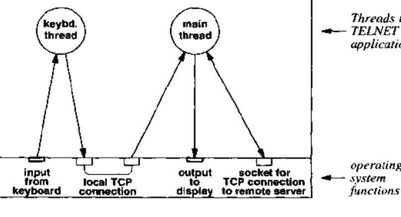

图 25.2 TELNET 客户端的线程结构。一个线程将键盘的字符转发到套接字，另一个线程处理套接字上的 I/O，因为 `select` 只能操作套接字。

## 25.3 TELNET 客户端算法

算法 25.1 规定了主线程如何运行。主线程类似于第 12 章描述的单线程并发设计。它使用 `select` 函数来实现算法 25.1 的第 3 步。当客户端调用 `select` 时，它指定阻塞直到对应键盘的本地套接字或对应 TCP 连接的套接字有输入。当某个描述符就绪时，`select` 返回，客户端从就绪的描述符进行读取。

### 算法 25.1

1. 解析参数并初始化数据结构和线程。
2. 打开到远程端口的 TCP 连接。
3. 阻塞直到键盘上有打字或通过 TCP 连接到达数据。
4. 如果数据来自键盘，读取、处理它、转换为 NVT 表示并通过 TCP 连接发送；从 TCP 连接接收数据、处理它、转换为本地字符表示并发送到用户显示器。
5. 回到上述第 3 步。

算法 25.1 TELNET 客户端。主线程双向转发字符；它阻塞直到键盘或 TCP 连接可用数据。

## 25.4 Windows 下的键盘 I/O

算法 25.1 看起来非常简单。确实，程序的某些方面是直观易懂。例如，Windows 提供了从键盘读取字符的函数。然而，TELNET 协议和输出到显示器的细节使得代码变得复杂。本章侧重于协议和程序的基础，将许多细节留给下一章。我们从键盘线程开始。

Windows 提供了两个处理键盘的基本函数。`getch` 函数从键盘读取一个字符。因此，语句：

```
ch = _getch();
```

从键盘读取一个字符并赋值给变量 `ch`。调用 `_getch` 是阻塞的。也就是说，它在用户按下按键之前会等待。

正如我们将看到的，TELNET 利用了控制按键输入是否显示在屏幕上的能力。当一个 TELNET 程序在输入时显示每个按键时，我们说 TELNET 正在使用字符回显（character echo）。当它选择不显示字符时，我们说 TELNET 正在抑制字符回显（suppressing character echo）。回显抑制很重要，因为它允许远程计算机上的服务决定是否显示字符（例如，远程登录服务可以选择不向用户显示密码）。

除了控制字符回显外，应用程序还可以选择对某些键分配含义，或将其视为数据。这种功能允许远程系统处理按键输入。例如，大多数应用程序可以选择让退格键（backspace）或删除键（delete）擦除上一个按键。然而，TELNET 可以选择将所有字符（包括退格键和删除键）直接传递给远程服务。

最后，软件可以选择识别特殊字符（或多个字符），这些字符会导致系统中断或终止当前应用程序。例如，当计算机系统定义控制-C 为中止运行的程序时，当用户输入该特殊字符时，它会导致程序终止。

## 25.5 用于键盘控制的全局变量

文件 `local.h` 包含了全局变量 `itflags`、`t_flush`、`t_intrc`、`t_quit`、`sg_erase` 和 `sg_kill` 的声明。变量 `it` 用于控制字符回显，而其他变量用于持有已分配了特殊含义的字符。例如，`sg_erase` 包含执行退格功能的字符。

```c
/* local.h */
#define ECHO            0x001
extern FILE         *scrfp;
extern char        scrname[];
extern unsigned int ttyflags;
extern char        t_flush, t_intrc, t_quit, sg_erase, sg_kill;
extern int          errno;
void               errexit(const char *, ...);
void               ttwrite(SOCKET, FILE *, unsigned char *, int);
void               scwrite(SOCKET, FILE *, unsigned char *, int);
void               fsmbuild(void);
int                sputc(const char, SOCKET);
#define SPUTS (s, fd)   (send(fd, strlen(s), 0))
```

## 25.6 初始化键盘线程


在示例代码中，过程 `ttycon` 执行了两个任务：它初始化一个套，用于在两个程序线程之间创建本地 TCP 连接。然后它创建键盘线程并建立通信。文件 `ttycon.cpp` 包含以下代码：

```cpp
/* ttycon.cpp - ttycon, conreader */

#include <conio.h>
#include <process.h>
#include <stdio.h>
#include <string.h>
#include <winsock.h>

#include <local.h>

static void conreader(unsigned int);

unsigned int flags = ECHO;

/*
ttycon - 将控制台设置为 SOCKET 连接
------------------------------------------------------
*
*/
SOCKET
ttycon(void)
{
	struct sockaddr_in sin;
	SOCKET             lsock, rsock;
	int             len;

	/* initialize special characters */
	lsock = socket(PF_INET, SOCK_STREAM, IPPROTO_TCP);
	if (lsock == INVALID_SOCKET)
		terxit("ttycon: socket failed (%d)\n", GetLastError());
	memset(&sin, 0, sizeof(sin));
	sin.sin_family = AF_INET;
	sin.sin_addr.addr = htonl(INADDR_LOOPBACK);
	sin.sin_port = 0;      /* let Windows pick a port */
	if (bind(lsock, (struct sockaddr *)&sin, sizeof(sin)) ==
	SOCKET_ERROR)
		terxit("ttycon: bind failed (%d)\n", GetLastError());

	len = sizeof(sin);
	if (getsockname(lsock, (struct sockaddr *)&sin, &len) ==
    SOCKET_ERROR)
		errexit("ttyncon: getsockname error %d\n", GetLastError());
	if (_beginthread(void (*conreader, 0,
    (void *)sin.sin_port) < 0)
		errexit("ttyncon: beginthread failed %s\n",
    strerror(errno));
	if (listen(lsock, 1) == SOCKET_ERROR)
		errexit("ttyncon: listen failed %d\n", GetLastError());
	len = sizeof(sin);
	rsock = accept(lsock, (struct sockaddr *)&sin, &len);
	if (rsock == INVALID_SOCKET)
		errexit("ttyncon: accept failed %d\n", GetLastError());
	closesocket(lsock);
	return rsock;
/*
 conreader - 执行控制台 I/O 并将其传递给 socket
 */
static void
conreader(unsigned int port)
{
    struct sockaddr  sin;
    SOCKET          elsock;
    char            ch;
    memset(&sin, 0, sizeof(sin));
    sin.sin_family = AF_INET;
    sin.sin_addr.addr = ntohl(INADDR_LOOPBACK);
    sin.sin_port = port;
    elsock = socket(AF_INET, SOCK_STREAM, IPPROTO_TCP);
    if (elsock == INVALID_SOCKET)
        errexit("conreader: socket error %d\n", GetLastError());
    if (connect(elsock, (struct sockaddr *)&sin, sizeof(sin)) ==
    SOCKET_ERROR)
        errexit("conreader: connect error %d\n", GetLastError());
    while (1) {
        ch = _getch();
        if (ttyflags & ECHO)
            putch(ch);
        if (send(elsock, &ch, 1, 0) == SOCKET_ERROR)
            return;
    }
    return;
}
```

`ttycon` 通过在键盘线程和主线程之间创建 TCP 连接开始。为此，它以客户端和服务器相同的方式使用 `socket` 函数。例如，我们将看到一旦连接建立，两个线程就会使用 `send` 和 `recv` 在 TCP 连接上传输数据：键盘线程调用 `send` 传输字符，主线程调用 `recv` 接收字符。

线程也使用常规 `socket` 函数建立连接。`ttycon` 调用 `socket` 创建本地 socket，并将生成的描述符分配给变量 `isock`。线程并不使用本地 socket 进行通信，而是使用它来建立连接。为此，`ttycon` 调用 `bind` 分配 `INADDR_LOOPBACK` 地址，这是一个单计算机系统内的特殊 Internet 地址。`ttycon` 调用 `getsockname` 来确定分配的 TCP 端口号。

一旦创建了本地 socket，`ttycon` 调用 `beginthread` 创建读取器。如代码所示，键盘线程使用本地 socket 的协议作为参数执行 `conreader`。

当开始执行 `conreader` 时，键盘线程创建第二个 socket，并将描述符分配给变量 `elsock`。`tsock` 是使用 `send` 将按键传输到主线程的 socket。在此之前，必须连接 socket。为了建立连接，键盘线程调用其 socket 函数 `connect`。键盘线程如何与主线程建立连接？为此，它指定 Internet 地址 `INADDR_LOOPBACK`，它标识了本地机器。

本质上，主线程像服务器，键盘线程像客户端。当然，主要的区别在于连接端点的距离。在这种情况下，用于访问连接的 socket 都在计算机上。

## 25.7 有限状态规范

TELNET 规定了客户端如何将字符传递给远程服务，以及客户端如何显示远程返回的内容。通过连接的大部分流量由单个数据字符组成。数据字符在用户在键盘上打字时产生于客户端；在远程会话输出时产生于服务器。除了数据字符，TELNET 还允许客户端和服务器交换控制信息。特别是客户端可以发送一组构成向服务器命令的字符序列。

大多数 TELNET 实现使用有限状态机（FSM）来规范命令序列的解释。作为一种规范工具，有限状态提供了协议的精确描述。它准确显示了发送者如何将命令序列嵌入数据流中，并规定了接收者如何解释此类序列。更重要的是，有限状态机可以直接转换为遵循协议的程序。因此，可以验证程序是否遵守协议规范。总结如下：

> 因为 TELNET 是一种面向字符的协议，在客户端和服务器之间的数据流中嵌入命令序列，因此大多数实现使用有限状态机来定义正确行为。

## 25.8 在 TELNET 数据流中嵌入命令

TELNET 的底层原理很简单：每当客户端或服务器想要发送命令序列而不是普通数据时，它会在数据流中插入一个特殊的保留字符。该保留字符被称为“解释为命令字符”（IAC）。当接收者在入站数据流中发现 IAC 字符时，它会将随后的字节视为命令序列处理。为了将 IAC 作为数据发送，发送者会在其前面填充一个额外的 IAC。

单个命令序列可以包含选项请求或选项回复。请求要求接收方尊重（或不尊重） TELNET 选项；回复确认请求并指定接收者是否将尊重它。

### Sec. 25.8 将命令嵌入 TELNET 数据流中

该协议定义了发送者可以用于构建请求的两个动词：`DO` 和 `DONT`。像 TELNET 定义的大多数项目一样，协议标准规定每个动词和选项必须编码为单个字符。因此，当请求出现在数据流中时，它由三个字符组成：

`IAC verb option`

其中 `verb`（动词）表示 `DO` 或 `DONT` 的编码字符，`option`（选项）表示 TELNET 选项之一的编码字符。


TELNET 接收端发送回显选项（`echo option`）提供了一个很好的例子。通常，服务器会回显它收到的每个字符（即将其副本发送回用户的显示器）。要关闭远程回显，客户端发送三个对应于以下内容的编码字符：

`IAC DONT ECHO`

## 25.9 选项协商

通常，接收端使用 `WILL` 或 `WONT` 动词来响应请求，用 `WILL` 表示它将遵守请求的选项，用 `WONT` 表示将不遵守。

对请求的响应向发送者提供确认，并告诉发送者接收端是否同意遵守请求。例如，在启动时，客户端向服务器发送字符，服务器将它们回显到用户的终端。然而，如果网络延迟变得成问题，用户可能倾向于让本地系统回显字符。客户端在本地系统中启用字符回显之前，会向服务器发送序列：

`IAC DONT ECHO`

当服务器接收到请求时，它会发送3字符的响应：

`IAC WONT ECHO`

注意，动词 `WONT` 指的是选项，它并不一定意味着服务器拒绝了请求。在这种情况下，例如，服务器必须按照要求关闭回显。

## 25.10 请求/提供的对称性

有趣的是，TELNET 允许连接的一端在另一端请求之前提供某个特定选项。为了做到，提议执行（或不执行）选项的一端会发送一条包含动词 `WILL`（或 `WONT`）的消息。因此，`WILL` 或 `WONT` 要么确认请求，要么确认执行某个选项的提。例如，像文本编辑器之类的应用程序经常发送特殊的控制序列来定位光标。它们不能使用网络终端编码，因为内核不支持所有的 8 位字符。因此，大多数计算机上的 TELNET 服务器在客户端连接到它时，都会为二进制选项自动发送 `WILL`，提议使用 8 位二进制（编码）字符传输代替 NVT 编码。客户端必须通过发送指定 `DO transmit binary` 或 `DONT transmit binary` 的命令序列来响应。

## 25.11 TELNET 字符定义

文件 `telnet.h` 包含了协议中使用的常量定义：

```c
/* telnet.h */
/* TELNET 命令代码： */
#define TCESB          (u_char)250      
#define TCSE           (u_char)240      
#define TCNOOP         (u_char)241      
#define TCIM           (u_char)242      
#define TCBRK          (u_char)243      
#define TCIP           (u_char)244      
#define TCAYT          (u_char)245      
#define TCBRC          (u_char)247      
#define TCKL           (u_char)248      
#define TOGA           (u_char)249      
#define TCOWILL         (u_char)251      
#define TCWMONT         (u_char)252      
#define TCDO           (u_char)253      
#define TCWONT          (u_char)254      
#define TCIAC          (u_char)255

/* Telnet 选项代码： */
#define TOTXBINARY      (u_char) 0      * TRANSMIT-BINARY 选项 *
#define TOECHO          (u_char) 1      * ECHO 选项 *
#define TONOGA          (u_char) 3      * 抑制 Go-Ahead 选项 *
#define TOTERMYYPE      (u_char) 24      * Terminal-Type 选项 *
```

```c
/* 网络虚拟打印机特殊字符： */
#define VPLF '\n'    /* 换行符 */
#define VPCR 'r'    /* 回车符 */
#define VPBEL 'a'    /* 蜂鸣（注意信号） */
#define VPBS 'b'    /* 退格 */
#define VPHT 't'    /* 水平制表符 */
#define VPTFT 'v'    /* 垂直制表符 */
#define VFFF 'f'    /* 换页 */
```

```c
/* 键盘命令字符： */
#define KCSCAPE 035    /* 本地转义字符 ('^]') */
#define KCIXON         /* 断开转义命令 */
#define KCCRIPT 's'   /* 开始脚本转义命令 */
#define KCUSCRIPT 'u'  /* 结束脚本转义命令 */
#define KCSTATUS 024   /* 打印状态转义命令 ('^T) */
#define KCXR '\r'      /* 新行符 */
```

```c
#define KCANY (NHCRS+1)
```

```c
/* 选项子协商字符： */
#define TT_IS 0       /* TERMINAL_TYPE 选项 "IS" 命令 */
#define TT_SEND 1      /* TERMINAL_TYPE 选项 "SEND" 命令 */
```

```c
/* 布尔选项和状态 */
extern unsigned char synching, recobary;
```

## 25.12 用于服务器数据的有限状态机

为了理解 FSM 如何工作，想象一下每当数据通过连接到达时，客户端都会使用它。当一个字符从服务器到达时，客户端遵循有限状态机中的某种转换。某些转换使机器保持相同状态；另一些则导致转移到新状态。TELNET 的有限状态机只需要六个状态，因为协议仅依赖于到达字符的短历史。例如，在跟随 `TCIAC` 字符之后，服务器可以发送其中一个选项请求或响应：`TCDO`, `TCDONT`, `TCILL` 或 `TCWONT`，并且可以发送一个选项协商请求。选项子协商允许发送者在选项中发送变长度的字符串（例如，客户端用于向服务器子协商传递终端类型的选项，以便服务器可以发送一个编码终端名称的字符串）。尽管子协商允许变长度的命令序列，但 FSM 只需要两个状态即可处理它，因为 2 字符的序列就会终止子协商。客户端在第一次遇到子协商请求时进入 `TSUBNEG` 状态。当它收到字符 `TCIAC` 时，移动到 `TSUBBIAC` 状态，如果紧接着跟随 `TCSE`，则完全退出子协商。如果发生任何其他 2 字符序列，FSM 将留在 `TSUBNEG`。

## 25.13 状态之间的转换

客户端在启动时以 `TSDATA` 状态启动其状态机。`TSDATA` 状态对应于期望接收普通字符并将其发送用户显示器的情况（即客户端尚未开始命令序列）。例如，如果字符 `q` 到达，客户端将留在 `TSDATA` 状态并执行操作 `K`，然后循环回到相同状态。

如果当 FSM 处于 `TSDATA` 状态时 `TCI` 到达，客户端遵循转换进入 `TCIAC` 状态，并执行图中的 `E`。图例说明 `E` 对应于“无操作”。一旦移动到 `TCIAC` 状态，客户端就开始解释命令序列。如果 `TCIAC` 之后的字符是动词（例如 `TCDO`），客户端将遵循转换进入其他处理状态之一。

### TSWOPT

`TCANY`/`C`

`TOECHO`/`A`

`TONOGA`/`B`

`TOTXBINARY`/`D`

`TCANY`/`K`

`TCDM`/`J`

`TCIAC`/`K`

`TCNOP`/`E`

`TCANY`/`E`

`TCWILL`/`F`

`TCWONT`/`F`

`TCANY`/`H`

开始

### TSDATA

### TSIAC

`TCSB`/`E`

### TSSUBNEG

`TCANY`/`N`

`TCIAC`/`E`

`TCDOF`/`F`

`TCDONT`/`F`

`TCANY`/`L`

`TOTXBINARY`/`N`

`TERMYTYPE`/`M`

### TSOOPT

### TSSUBIAC

`TCSE`/`G`

### 动作过程：

- A - `do_echo`
- B - `do_noga`
- C - `do_notsup`
- D - `do_txbinary`
- E - `no_op`
- F - `receipt`
- G - `subend`
- H - `subopt`
- J - `tcdm`
- K - `ttput`
- L - `will_nots`
- M - `will_termtype`
- N - `will_txbinary`

图 25.3 描述 TELNET 如何对命令序列及数据进行编码的有限状态机。状态和字符名称直接取自软件。`TCANY` 表示“除显式字符以外的任何字符”。

## 25.14 有限状态机的实现


由于可以构建出高效的有限状态机实现，而且由于此类机器可以容易地描述面向字符的协议，我们的示例代码使用了三个有限状态机。其中一个控制客户端如何响应来自键盘的字符，另一个控制客户端如何处理来自服务器的 TCP 连接的字符，第三个处理选项子协商的细节。这三个 FSM（有限状态机）使用相同类型的数据结构，使得共享某些操作数据结构的方法过程成为可能。

为了使处理更高效，我们的实现将有限状态机的转移编码到转移矩阵中，如图 25.4 所示。

| | 输入字符 | 0 | 1 | 2 |
|---|---|---|---|---|
| 0 | | | 255 | |
| 1 | | | | |
| 2 | | | | |
| 当前状态 | | . . | |
| N-1 | | | | |

> **图 25.4** 用转移矩阵表示的有限状态机。每一行对应一个状态，每一列对应一个可能的输入字符。

在运行时，客户端维护一个整数变量来记录当前状态。当字符到达时，客户端使用当前状态变量和字符的数值作为转移矩阵的索引。

# 25.15 紧凑的 FSM 表示

编写 C 语言来初始化大型矩阵可能是繁琐的。此外，如果转移矩阵的每个元素都包含关于要执行的操作和下一个状态的完整信息，矩阵可能会消耗大量内存。为了保持转移矩阵较小并简化初始化，我们的代码使用了有限状态机的紧凑表示。

## 第 25.15 节 紧凑的 FSM 表示 377

本质上讲，程序员选择的数据结构是为了创建一个表示有限状态机的紧凑数据结构，然后安排程序在运行时构建关联的转移矩阵。文件 `infsm.h` 包含了在紧凑表示中使用的结构体 `fsm_trans` 的声明：

```c
/* tnfsm.h */
/* Telnet 键盘输入 FSM 状态： */
#define TSDATA      0    /* 正常数据处理 */
#define TSIAC       1    /* 见过 IAC */
#define TSWOPT     2    /* 见过 IAC-(WILL/WONT) */
#define TSDSDOPT     3    /* 见过 IAC-(DO/DONT) */
#define TSSUBNEGO   4    /* 见过 IAC-SB */
#define TSSUBIAAC   5    /* 见过 IAC-SB-...IAC */

#define NTSTATES     6    /* TS 状态数量 */

/* Telnet 键盘输入 FSM 状态： */
#define KSREMOTE    0    /* 输入发送到 socket */
#define KSLOCAL     1    /* 输入发送到本地函数 */
#define KSCOLLECT   2    /* 输入是脚本文件名 */

#define NRSTATES     3    /* KS 状态数量 */

/* Telnet 选项子协商 FSM 状态： */
#define SS_START    0    /* 初始状态 */
#define SS_TERTYPE  1    /* TERMINAL_TYPE 选项子协商 */
#define SS_END      2    /* 所有合法输入后的状态 */

#define NSSTATES     3    /* SS 状态数量 */

#define FSINVALID   0xff /* 无效状态编号 */
#define NCHRIS      256  /* 有效字符数量 */
#define TCANY       (NCHRIS+1) /* 匹配任意字符 */

struct fsm_trans {
    u_char  ft_state;      /* 当前状态 */
    short   ft_char;       /* 输入字符 */
    u_char  ft_next;       /* 下一个状态 */
    int     (*ft_action)(SOCKET fd, FILE *tfp, int c);
                            /* 要执行的操作 */
};
```

紧凑的 FSM 表示由 `fsm_trans` 结构体的一维数组组成。每个元素指定一次转移。字段 `fi_state` 指定转移开始的 FSM 状态。字段 `fi_char` 指定触发转移的字符（或使用 `TC_ANY` 表示除具有显式转移的字符以外的所有字符）。`ft_next` 表示转移结束的状态，字段 `ft_action` 提供了调用的过程地址，以执行与该转移关联的操作。

# 25.16 在运行时保持紧凑表示

示例客户端并没有将紧凑表示中的所有信息复制到转移矩阵中。相反，它保持紧凑表示不变，并利用它来持有转移信息。为了实现这一点，软件在转移矩阵的每个元素中存储一个整数。该整数提供了紧凑表示中对应于该转移的索引。图 25.5 展示了这些数据结构。 图 25.5 运行时的 FSM 数据结构。转移矩阵中的项指向紧凑表示中的元素。紧凑表示的用处在我们看到它如何被用于生成转移矩阵时就会变得清晰。

# 25.18 构建 FSM 转移矩阵

一旦看到紧凑表示如何被用于生成转移矩阵，其效用就会变得清晰。文件 `fsminit.cpp` 包含了代码：

```c
/* fsminit.cpp - fsminit */
```

## 第 25.15 节 紧凑表示

```c
/* tnfsmam.cpp */

#include <stdio.h>
#include <winsock.h>
```

```c
#include "telnet.h"
#include "tnfsm.h"
```

```c
#include "stdio.h"
#include "local.h"
```


```c
extern int do_echo(SOCKET fd, FILE *tfp, int c);

struct fsm_trans ttstab[] = {
    /* 状态             输入           目标状态       动作 */
    /*                ------------------------- */
    { TSDATA,          TCANY,           TSIAC,           no_op },
    { TSDATA,          TCANY,           TSDATA,          ttput },
    { TSIAC,           TCIAC,           TSDATA,          ttput },
    { TSIAC,           TSEB,           TSSUBNEG,       no_op },
    { TSIAC,           TCDM,            TSDATA,          tcdm },
    { TSIAC,           TCWILL,          TSWOPT,          recept },
    { TSIAC,           TCWONT,          TSWOPT,          recept },
    { TSIAC,           TCDO,            TSDFT,          recept },
    { TSIAC,           TCION,            TSDFT,          recept },
    { TSIAC,           TCANY,           TSDATA,          no_op },
    /* 选项协商 */
    { TSSUBNEGO,       TCIAC,           TSSUBIAC,       no_op },
    { TSSUBNEGO,       TCANY,           TSSUBNEG,       subopt },
    { TSIAC,           TCSE,            TSDATA,          subend },
    { TSIAC,           TCANY,           TSSUBIAC,       subopt },
    /* 选项子协商 */
    { TSWOPT,          TOTERTYPE,       TSDATA,          will_termtype },
    { TSWOPT,          TOTBINARY,       TSDATA,          will_txbinary },
    { TSWOPT,          TCANY,           TSDATA,          will_notsup },
    { FSINVALID,       TCANY,           FSINVALID,       tnabort }
};

/*----------------------------------------------------------------------*/
* fsminit - 有限状态机初始化器
/*----------------------------------------------------------------------*/
void
fsminit(u_char ftfsm[][NCHRS], struct fsm_trans ttab[], int nstates)
{
    struct fsm_trans       *pt;
```

## Sec. 25.18 构建 FSM 转移矩阵

`int` `sn`, `ti`, `cn`;

```c
for (cn=0; cn<nCRS; ++cn)
    for (ti=0; ti<nstates; ++ti)
        fsm[ti][cn] = TINVALID;
```

```c
for (ti=0; ttab[ti].ft_state != FSINVALID; ++ti) {
    pt = &ttab[ti];
    sn = pt->ft_state;
    if (pt->ft_char == TCANY)
        for (cn=0; cn<nCRS; ++cn)
            if (fsm[sn][cn] == TINVALID)
                fsm[sn][cn] = ti;
    else
        fsm[sn][pt->ft_char] = ti;
}
```

```c
/* 将所有未初始化的索引设置为无效转移
for (cn=0; cn<nCRS; ++cn)
    for (ti=0; ti<nstates; ++ti)
        if (fsm[ti][cn] == TINVALID)
            fsm[ti][cn] = ti;
```

过程 `fsminit` 需要三个参数。参数 `fsm` 指定一个必须初始化的转移矩阵。参数 `ttab` 给出了紧凑 FSM 表示的地址，`nstates` 指定了生成的 FSM 中的状态数量。

`Fsminit` 首先将整个转移矩阵初始化为 `TINVALID`。它遍历紧凑表示的每个元素，并将该元素指定的状态转移添加到转移矩阵中。最后，它再次遍历转移，将任何未填充的转移更改为指向紧凑表示末尾的无效转移。

`fsminit` 中的大部分代码都是直观的。在添加转移时，`fsminit` 必须区分显式转移和缩写。为了理解这些代码，请记住紧凑表示使用 `TCANY` 来表示所有未显式指定的字符。因此，当 `fsminit` 检查单个转移时，它会检查触发转移的字符。如果条目指定的字符是 `TCANY`，`fsminit` 将遍历所有可能的字符，并将转移添加到任何未初始化的字符上。如果条目指定的是 `TCANY` 以外的任何字符，`fsminit` 将为单字符填充转移数组。

## Sec 25.19 Socket 输出有限状态机

图 25.3 显示的有限状态机定义了客户端针对从服务器到达的每个字符所采取的动作。另一个独立且更简单的有限状态机描述了客户端如何处理来自键盘到达的字符。我们将与键盘输入相关的 FSM 称为 socket 输出 FSM。这个名字听起来可能很寻常。图 25.6 显示了客户端软件如何支持这样一个命名。

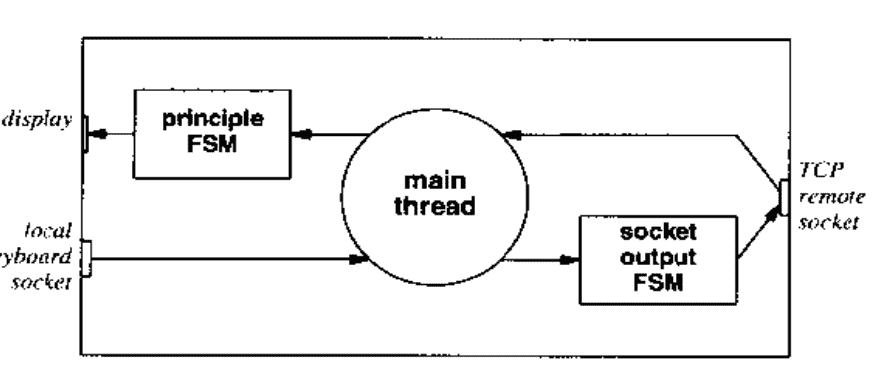

图 25.6 客户端软件组织。主线程等待通往远程服务器的 TCP 连接或通往键盘的本地连接就绪。然后，它从就绪的套接字读取一个字符，并调用 FSM 过程进行处理。处理键盘数据的 socket 输出 FSM 与用于向远程服务器传递输出的套接字相关。

与原理有限状态机不同，用于 socket 输出的有限状态机非常直观。如图 25.7 所示，该机器包含三个状态。本质上，`KSREMOTE` 状态处理正常情况。当机器保持在 `KSREMOTE` 时，客户端会将用户在键盘上输入的每个字符通过 TCP 连接发送到服务器。

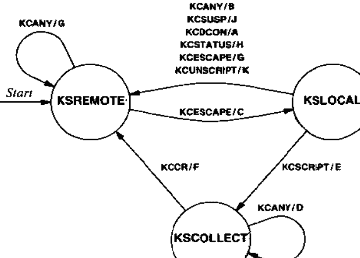

动作过程：

- A - `dcon`

- F - `scrwrap`

- B - `sonotsup`

- G - `sopute`

- C - `no_op`

- H - `status`

- D - `scrgetc`

- J - `suspend`

- E - `scrint`

- K - `unscript`

**图 25.7** 用于定义用户输入的每个字符的动作的 socket 输出 FSM。客户端将大多数数据字符发送到远程服务器。然而，该设计允许用户跳出数据连接与本地客户端进行通信。

socket 输出 FSM 从 `KSREMOTE` 状态开始。因此，当它首次启动时，客户端将每个按键发送到远程服务器。当用户输入键盘上的 键时，客户端进入 `KSLOCAL` 状态并等待下一个按键。大多数在转义键之后的按键没有意义，但少数按键会导致客户端采取行动并返回 `KSREMOTE` 状态。只有 `KSCRIPT` 会导致客户端进入 `KSCOLLECT` 状态，在该状态下它收集一个用于脚本的文件名。

## Sec 25.20 Socket 输出 FSM 的定义

```c
#define NTRANS (sizeof(sostab)/sizeof(sostab[0]))
```

```c
int sostate;
u_char bofsm[NKRSTATES][NCHRS];
```

数组 `sostab` 包含紧凑表示，变量 `sostate` 包含一个整数，给出 socket 输出 FSM 的当前状态。

## Sec 25.21 选项子协商有限状态机


## 25.8 展示了客户端使用的第三个 FSM

它处理在选项子协商期间到达的字符序列。由于它只识别一种可能的选项子协商（终端类型），该 FSM 只需要三个状态。


动作过程：

- A - `dcon`
- F - `scrwrap`
- B - `sonotsup`
- G - `sopute`
- C - `no_op`
- H - `status`
- D - `scrgetc`
- J - `suspend`
- E - `scrint`
- K - `unscript`

**图 25.7** 用于定义用户输入的每个字符的动作的 socket 输出 FSM。客户端将大多数数据字符发送到远程服务器。然而，该设计允许用户跳出数据连接与本地客户端进行通信。

`socket` 输出 FSM 从 `KSREMOTE` 状态开始。因此，当它首次启动时，客户端仅仅将每个按键发送到远程服务器。当用户输入键盘上的 键时，客户端进入 `KSLOCAL` 状态并等待下一个按键。大多数在转义键之后的按键没有意义，但少数按键会导致客户端采取行动并返回 `KSREMOTE` 状态。只有 `KSCRIPT` 会导致客户端进入 `KSCOLLECT` 状态，在该状态下它收集一个用于脚本的文件名。

## Sec 25.20 Socket 输出 FSM 的定义

```c
#define NTRANS (sizeof(sostab)/sizeof(sostab[0]))
```

```c
int sostate;
u_char bofsm[NKRSTATES][NCHRS];
```

数组 `sostab` 包含紧凑表示，变量 `sostate` 包含一个整数，给出 socket 输出 FSM 的当前状态。

## Sec 25.21 选项子协商有限状态机

25.8 展示了客户端使用的第三个 FSM。它处理在选项子协商期间到达的字符序列。由于它只识别一种可能的选项子协商（终端类型），该 FSM 只需要三个状态。


动作过程：

- A - `dcon`
- F - `scrwrap`
- B - `sonotsup`
- G - `sopute`
- C - `no_op`
- H - `status`
- D - `scrgetc`
- J - `suspend`
- E - `scrint`
- K - `unscript`

**图 25.7** 用于定义用户输入的每个字符的动作的 socket 输出 FSM。客户端将大多数数据字符发送到远程服务器。然而，该设计允许用户跳出数据连接与本地客户端进行通信。

`socket` 输出 FSM 从 `KSREMOTE` 状态开始。因此，当它首次启动时，客户端仅仅将每个按键发送到远程服务器。当用户输入键盘上的 键时，客户端进入 `KSLOCAL` 状态并等待下一个按键。大多数在转义键之后的按键没有意义，但少数按键会导致客户端采取行动并返回 `KSREMOTE` 状态。只有 `KSCRIPT` 会导致客户端进入 `KSCOLLECT` 状态，在该状态下它收集一个用于脚本的文件名。

第 25.24 节 TELNET 客户端参数 389

出现，客户端将第二个参数视为远程机器上服务的名称，并将第一个参数视为远程主机的名称。在解析完参数后，主程序调用 `telnet` 函数。

## 25.25 TELNET 客户端的核心

文件 `telnet.cpp` 包含了实现算法 8.1 的代码：

## Sec. 25.18 构建 FSM 转移矩阵

`int sn, ti, cn;`

```c
for (cn=0; cn<nCRS; ++cn)
    for (ti=0; ti<nstates; ++ti)
        fsm[ti][cn] = TINVALID;
```

```c
for (ti=0; ttab[ti].ft_state != FSINVALID; ++ti) {
    pt = &ttab[ti];
    sn = pt->ft_state;
    if (pt->ft_char == TCANY)
        for (cn=0; cn<nCRS; ++cn)
            if (fsm[sn][cn] == TINVALID)
                fsm[sn][cn] = ti;
    else
        fsm[sn][pt->ft_char] = ti;
}
```

```c
/* 将所有未初始化的索引设置为无效转移
for (cn=0; cn<nCRS; ++cn)
    for (ti=0; ti<nstates; ++ti)
        if (fsm[ti][cn] == TINVALID)
            fsm[ti][cn] = ti;
```

过程 `fsminit` 需要三个参数。参数 `fsm` 指定一个必须初始化的转移矩阵。参数 `ttab` 给出了紧凑 FSM 表示的地址，`nstates` 指定了生成的 FSM 中的状态数量。

`Fsminit` 首先将整个转移矩阵初始化为 `TINVALID`。它遍历紧凑表示的每个元素，并将该元素指定的状态转移添加到转移矩阵中。最后，它再次遍历转移，将任何未填充的转移更改为指向紧凑表示末尾的无效转移。

`fsminit` 中的大部分代码都是直观的。在添加转移时，`fsminit` 必须区分显式转移和缩写。为了理解这些代码，请记住紧凑表示使用 `TCANY` 来表示所有未显式指定的字符。因此，当 `fsminit` 检查单个转移时，它会检查触发转移的字符。如果条目指定的字符是 `TCANY`，`fsminit` 将遍历所有可能的字符，并将转移添加到任何未初始化的字符上。如果条目指定的是 `TCANY` 以外的任何字符，`fsminit` 将为单字符填充转移数组。

## Sec 25.19 Socket 输出有限状态机

图 25.3 显示的有限状态机定义了客户端针对从服务器到达的每个字符所采取的动作。另一个独立且更简单的有限状态机描述了客户端如何处理来自键盘到达的字符。我们将与键盘输入相关的 FSM 称为 socket 输出 FSM。这个名字听起来可能很寻常。图 25.6 显示了客户端软件如何支持这样一个命名。


图 25.6 客户端软件组织。主线程等待通往远程服务器的 TCP 连接或通往键盘的本地连接就绪。然后，它从就绪的套接字读取一个字符，并调用 FSM 过程进行处理。处理键盘数据的 socket 输出 FSM 与用于向远程服务器传递输出的套接字相关。

与原理有限状态机不同，用于 socket 输出的有限状态机非常直观。如图 25.7 所示，该机器包含三个状态。本质上，`KSREMOTE` 状态处理正常情况。当机器保持在 `KSREMOTE` 时，客户端会将用户在键盘上输入的每个字符通过 TCP 连接发送到服务器。


动作过程：

- A - `dcon`
- F - `scrwrap`
- B - `sonotsup`
- G - `sopute`
- C - `no_op`
- H - `status`
- D - `scrgetc`
- J - `suspend`
- E - `scrint`
- K - `unscript`

**图 25.7** 用于定义用户输入的每个字符的动作的 socket 输出 FSM。客户端将大多数数据字符发送到远程服务器。然而，该设计允许用户跳出数据连接与本地客户端进行通信。

`socket` 输出 FSM 从 `KSREMOTE` 状态开始。因此，当它首次启动时，客户端仅仅将每个按键发送到远程服务器。当用户输入键盘上的 键时，客户端进入 `KSLOCAL` 状态并等待下一个按键。大多数在转义键之后的按键没有意义，但少数按键会导致客户端采取行动并返回 `KSREMOTE` 状态。只有 `KSCRIPT` 会导致客户端进入 `KSCOLLECT` 状态，在该状态下它收集一个用于脚本的文件名。

## Sec 25.20 Socket 输出 FSM 的定义

```c
#define NTRANS (sizeof(sostab)/sizeof(sostab[0]))
```

```c
int sostate;
u_char bofsm[NKRSTATES][NCHRS];
```

数组 `sostab` 包含紧凑表示，变量 `sostate` 包含一个整数，给出 socket 输出 FSM 的当前状态。

## Sec 25.21 选项子协商有限状态机

25.8 展示了客户端使用的第三个 FSM。它处理在选项子协商期间到达的字符序列。由于它只识别一种可能的选项子协商（终端类型），该 FSM 只需要三个状态。


```cpp
/* telnet.cpp - telnet */

#include <io.h>
#include <stdlib.h>
#include <stdio.h>
#include <string.h>
#include <winsock.h>

#include "local.h"

extern unsigned char    synchronizing;

#define BUFSIZE      2048      /* 读取缓冲区大小 */

SOCKET connectTCP(const char *host, const char *service);
SOCKET ttycon(void);

/*
* telnet - 对指定的主机和端口执行 TELNET 协议
+
*/
void
telnet(const char *host, const char *service)
{
    SOCKET sock, con; /* 远程和控制台套字字描述符 */
    u_char buf[BUFSIZE];
    int cc;
    int on = 1;
    fd_set arfds, rfds;

    con = ttycon();

    sock = connectTCP(host, service);
```

*† 算法 8.1 的描述请参见第 107 页。

```cpp
fsmbuild();            /* 设置 FSM */

(void) setsockopt(sock, SOL_SOCKET, SO_OOBINLINE, (char *)&on,
      sizeof(on));

FD_ZERO(&rfds);
FD_SET(sock, &rfds);        /* 套接字 */
FD_SET(con, &rfds);         /* 标准输入 */

while (1) {
    memcpy(&rfds, &rfds, sizeof(rfds));

    if (select(FD_SETSIZE, &rfds, (struct timeval*)0, NULL) < 0) {
        if (GetLastError() == WSAEINTR)
            continue;      /* 只是一个信号 */
        errexit("select: %d\n", GetLastError());
    }
    if (FD_ISSET(con, &rfds)) {
        unsigned long no_urg;
        if (ioctl(sock, SIOCATURMARK, &no_urg) ==
            SOCKET_ERROR)
            errexit("ioctl error %d\n",
                GetLastError());
    }
    synching = &no_urg;

    cc = recv(sock, (char *)buf, sizeof(buf), 0);
    if (cc == SOCKET_ERROR)
        errexit("socket recv: %d\n",
            GetLastError());
    else if (cc == 0)
        errexit("\nconnection close.\n");
    else
        ttwrite(sock, stdout, buf, cc);
    }
    if (FD_ISSET(con, &rfds)) {
        cc = recv(con, (char *)buf, sizeof(buf), 0);
        if (cc == SOCKET_ERROR)
            errexit("tty read: %d\n",
                GetLastError());
    } else if (cc == 0) {
        FD_CLR(con, &rfds);
        (void) shutdown(sock, 1);
    } else {
        sowrite(sock, stdout, buf, cc);
    }
}
```

第 25.25 节 TELNET 客户端的核心 391

)

(void) fflush(stdout);

}

`telnet`过程需要两个参数来指定远程机器的名称，代码开始调用`connectTCP`来分配套接字并与服务器建立 TCP 连接。然后它调用`fsbuild`来初始化三个有限状态机。

一旦完成初始化，客户端的主线程将进入无限循环。在循环的每次迭代中，它使用`select`从远程连接或键盘进行 I/O 操作。如果程序在调用`select`时接收到中断，`select`调用将返回`WSAEINTR`。如果发生这种情况，客户端将继续循环的下一次迭代。

如果`select`正常返回，则键盘、远程连接或两者都可能可用数据。Telnet 首先检查远程连接，看是否有数据从服务器到达。如果是，它会调用`recv`提取数据，并调用`twrite`将数据写入用户的显示器。我们将在下文中看到`twrite`实现了解释数据流并处理嵌入命令序列的有限状态机原理。

在 telnet 检查通往远程服务器的套接字上的输入数据后，它检查键盘套接字。如果数据从键盘到达，telnet 调用`recv`提取数据并调用`sov`写入套接字。`swrite`包含了执行本地转义处理有限状态机的代码。作为一种特殊情况，客户端将键盘输入的文件结束（EOF）解释为终止连接的请求。如果接收到文件结束（例如`recv`返回 0），`telnet`调用`shutdown`向服务器发送文件结束状态。在任何情况下，`telnet`在每次迭代中都会调用`flush`，以确保输出程序不会缓存已写入的数据。`flush`强制操作系统立即发送所有数据，即使缓冲区未满。

## 25.26 TELNET 同步

TELNET 包含一种允许客户端和服务器跳过 TCP 缓冲影响的机制。这种机制被称为同步（synchronization），它安排服务器进行某种操作。当`select`发现套接字就绪时，服务器报告有紧急数据到达。为了同步，客户端在处理紧急数据之前必须进行同步。

当`synching`设置为非零时，客户端会丢弃输入数据而不将其显示在屏幕上。当`DATA MARK`字符到达时，`icm`过程将其重置。

```cpp
/* sync.cpp - tcdm */

#include <stdio.h>
#include <winsock.h>
```

unsigned char syncing;/* 如果正在进行 telnet */

```cpp
/* tcdm 处理 SYNCH */
int
tcdm(SOCKET fd, FILE *tfp, int c)
{
  if (synching > 0)
    synching--;
  return 0;
}
```

## 27 处理严重错误

在某些情况下，套接字函数返回错误代码，该错误表示意外事件。在这种情况下，程序可以选择忽略错误、打印警告或自动修复问题。在其他情况下，套接字函数报告的错误是致命的——应用程序无法继续。例如，`telnet`过程包含了处理严重错误的代码。如果`select`调用返回错误代码（即小于 0），操作系统在操作完成之前中断了`select`调用——`telnet`继续循环的下一次迭代。如果`GetLastError`返回其他错误代码，主线程调用`errexit`打印并终止。同样，如果其他套接字函数指示发生错误，`telnet`调用`errexit`。因此，如果系统耗尽资源（例如套接字或内存），应用程序将打印错误消息并终止。`errexit`接收一个包含消息的字符串参数。它显示消息并导致整个进程退出。注意，如果多线程进程中的任何线程调用`errexit`，进程中的所有其他线程都将被终止。因此，`errexit`应用于严重错误。

## 25.28 主 FSM 的实现

`ttwrite`过程实现了图 25.3 中的 FSM，用于解释从服务器到达的数据。代码出现在`ttwrite.cpp`文件中。


```cpp
/* ttwrite.cpp ttwrite */

#include <stdio.h>
#include <winsock.h>

#include <tnfsm.h>

extern struct fsm_trans ttstab[];
extern u_char ttfsm[] [NCHRS];
extern int ttstate;

/*
 * ttwrite - 对（本地）网络虚拟打印机进行输出处理
 *
*/
void ttwrite(SOCKET sfd, FILE *tfp, u_char, u_char *buf, int cc)
{
    struct fsm_trans *pt;
    int i, ti;

    for (i=0; i<cc; i++) {
        int c = buf[i];

        ti = ttfsm[ttstate][c];
        pt = &ttstab[ti];

        pt->ft_action(sfd, tfp, c);
        ttstate = pt->ft_next;
    }
}
```

### 394 一个 TELNET 客户端（程序结构） 第25章

`twrite` 从缓冲区 `buf` 中逐个提取 `cc` 字符。每当提取一个字符时，`twrite` 会使用该字符和当前状态（变量 `rstate`）来索引转移矩阵。转移矩阵返回它在紧凑表示（`ttab`）中的转移索引。`twrite` 调用与该转移相关的过程（字段 `ft_action`），并将当前状态设置为合适的下一个状态（字段 `ft_next`）。

## 25.29 用于立即断开连接的程序

`*socket 输出状态机*` 包含一个允许用户断开连接的项。当用户指定断开时，主线程调用过程 `dcon`，该过程可以在文件 `dcon.cpp` 中找到。

```cpp
* dcon.cpp - dcon */

#include <stdlib.h>
#include <stdio.h>
#include <winsock.h>

#include "local.h"

-------------------------------------------------------
* dcon - 断开远程连接
-------------------------------------------------------
/*ARGSUSED*/
int
dcon(SOCKET sfd, FILE *tfp, int c)
{
    fprintf(tfp, "disconnecting.\n");
    WSACleanup();
    exit(0);
    return 0; /* pro forma */
}
```

代码显示，我们的客户端将断开解释为立即且永久的；`dcon` 调用 Windows 函数 `exit`，这会导致整个进程（包括主线程和键盘线程）终止。当进程退出时，系统会释放该进程已分配的所有资源。因此，本地和远程 TCP 连接都将关闭，`socket` 将被释放。

`* socket 输出状态机的规范细可以在第 384 页查找到。`

## 25.30 中止程序

在 `socket` 输出有限状态机中，并不是所有的输入序列都能将机器移动到有效状态。为了防止非法序列产生错误，无效的状态转移被分配了过程 `abort`。如果发生无效序列，`abort` 会调用 `erxit` 打印错误消息并终止程序。文件 `abort.cpp` 包含以下代码：

```cpp
/* tabort.cpp - tabloid */

#include <stdio.h>
#include <winsock.h>

void erxit(const char *, ...);

/*--------------------------------------------------------------------
* tabort - 由于无效状态导致telnet终止
----------------------------------------------------------------------
/*ARGSUSED*/
int
tnabort(SOCKET file sfd, FILE *tfp, int c)
{
    erxit("invalid state reached (aborting)\n");
    return 0;      /* to keep picky compilers happy */
}
```

## 25.31 总结

TELNET 是 TCP/IP 协议族中最流行的应用程序协议之一。该协议提供了客户端和服务器之间的交互式字符传输。通常，客户端通过 TCP 连接将终端到服务器。我们的示例客户端软件由两个线程组成，它们之间通过 TCP 连接。键盘线程读取用户在键盘上输入的每个字符，并通过本地 TCP 连接将该字符发送到主线程。主线程使用 `socket` 函数 `select` 来允许并发输入。线程会等待数据来自远程服务器的 TCP 连接或来自键盘的本地连接到达。在接收并处理数据后，主线程返回 `select`，等待额外的输入到达。

TELNET 使用转义序列将命令和控制信息嵌入到数据流中。为了简化代码，我们的示例客户端实现使用了三个有限状态机来解释字符序列。一个处理来自服务器的数据，另一个处理来自用户键盘的数据，第三个则处理选项子协商（`option subnegotiation`）。

本章中的示例代码说明了两个客户端线程的实现，以及用于实现有限状态机的数据结构。下一章将考虑执行有限状态机转移相关动作的过程的细节。

## 进一步学习

Postel [RFC 854] 包含了基础 TELNET 协议的标准，包括网络虚拟终端编码。Postel 和 Reynolds [RFC 855] 规定了选项协商和选项子协商的细节。关于单个选项的详细信息可以在其他 RFC 中找到。VanBakellen [RFC 1091] 规定了终端类型选项。Postel 和 Reynolds [RFC 857] 描述了回显（`echo`）选项，而 Postel 和 Reynolds [RFC 856] 描述了二进制传输选项。关于 `*登录*`（`login`）协议（TELNET 的替代方案）的信息可以在大多数 UNIX 系统的文档中找到。

## 习题

- 25.1 将本章介绍的设计与设计进行比较：另一种设计是从远程键盘读取并发送到远程服务器，另一个线程从远程连接读取并发送到显示。每种设计的优缺点是什么？

- 25.2 调查 Windows 对异步 I/O 的支持。异步 I/O 如何在 TELNET 客户端中使用？

- 25.3 将使用问题中所描述的异步 I/O 设施的设计与使用阻塞 I/O 的设计进行比较。它们的优缺点是什么？

- 25.4 要了解其他操作系统系统中的 I/O，请阅读 UNIX 程序员手册中描述终端设备和设备驱动程序的章节。什么是熟制模式（`cooked mode`）、逐字节模式（`break mode`）和原始模式（`raw mode`）？它们如何对应于 TELNET 选项？

- 25.5 重写原理有限状态机（FSM），以包含子协商的状态。

- 25.6 示例 FSM 使用了紧凑表示来节省空间。估计使用传统表示法 FSM 所需的空间，并与紧凑表示所需的空间进行比较。

- 25.7 在什么情况下从键盘连接 `recv` 会返回 0？

- 25.8 阅读 TELNET 协议规范以找到同步规则。发送者何时传输紧急数据？为什么同步是必要的？

- 25.9 在客户端发送文件结束符后，服务器可以选择发送更多数据。客户端如何知道要终止连接？

- 25.10 重写 `write` 使不使用 FSM。每种设计的优缺点是什么？

- 25.11 当发生错误时，代码打印一条晦涩的消息并退出。改进代码以打印用户能理解的消息。

- 25.12 在上一个练习中，检查你的系统可以返回的所有错误代码。所有错误对用户来说都有意义吗？为什么或为什么？

- 25.13 有限状态机没有显式的同步状态。修订状态图以包含同步。需要多少额外的状态？

- 25.14 为 FSM 添加用于脚本的状态是否有意义？如果是，需要修改哪些有限状态机？如果不是，请解释原因。

### 400 一个 TELNET 客户端（实现细节）第 26 章

后续章节分别描述了与 FSM 转换相关的各个操作过程。

## 26.3 记录选项请求的类型

在状态 `TSIAC` 下（即在收到 `TCIAC` 字符后），`TCWILL` 或 `TCWONT` 的到达会导致状态转换到 `TSWOPT`。FSM 规定应调用 `record` 过程。`record` 会记录导致转换的字符，以便日后使用。同样，FSM 使用 `recept` 在转换到状态 `TSOPT` 期间记录字符 `TCDO` 或 `TCDONT`。`recept.cpp` 包含以下代码：


```cpp
/* recept.cpp - recept, no_op */

#include <stdio.h>
#include <winsock.h>

char option_cmd;      /* 值为 WILL, WONT, DO, 或 DONT */

/*----------------------------------------------------------------------*/
* recept - 记录选项类型
/*------------------------------------------------------*/
/*ARGSUSED*/
int
recept(SOCKET sfd, FILE *tfp, int c)
{
    option_cmd = c;
    return 0;
}

/*----------------------------------------------------------------------*/
* no_op - 无操作
/*------------------------------------------------------*/
/*ARGSUSED*/
int
no_op(SOCKET sfd, FILE *tfp, int c)
{
    return 0;
}
```

## 26.4 执行无操作

`recept.cpp` 中也包含过程 `no_op` 的代码。由于 FSM 必须为所有状态和输入字符的可能组合定义一个操作，因此 `no_op` 过程可以用于那些不需要任何操作的转换。例如，从状态 TSDATA 到 TSIACAC 的转换不需要任何操作。因此，FSM 规定调用 `no_op`。

## 26.5 响应 ECHO 选项的 WILL/WONT

服务器发送 WILL 或 WONT 后紧跟 ECHO 选项，以通知客户端它愿意回显字符或愿意停止回显字符。FSM 规定当此类消息到达时，应调用 `do_echo` 过程。

```cpp
* do_echo.cpp - do_echo */

#include <stdio.h>
#include <winsock.h>

#include "local.h"
#include "telnet.h"

unsigned char doecho;      /* 非零，如果开启远程 ECHO */
extern u_char     option_cmd;

----------------------------------------------------------------------
/*
  * do_echo    处理 TELNET WILL/WONT ECHO 选项
----------------------------------------------------------------------
*/
int
do_echo(SOCKET sfd, FILE *tftp, int c)
{
    if (doecho) {
        if (option_cmd == TCWILL)
            return 0;      /* 已经在执行 ECHO */
    } else if (option_cmd == TCWONT)
        return 0;          /* 已经未执行 ECHO */
    }
    if (option_cmd == TCWILL)
        ttyflags &= ~ECHO;
    else
        ttyflags |= ECHO;
    doecho = !doecho;
}

(void) sputc(TCIAC, sfd);
if (doecho)
    (void) sputc(TDO, sfd);
else
    (void) sputc(TDONT, sfd);
    (void) sputc((char)c, sfd);
    return 0;
```

TELNET 协议规定，服务器可以发送 WILL 或 WONT 来宣告其执行给定选项的意愿，也可以在响应客户端请求时发送消息。因此，如果客户端的请求中包含 DO 或 DONT，则来自服务器的消息构成了一个回复；否则，它构成一个宣告。

客户端使用其状态来决定如何响应。如果客户端当前期望服务器执行字符回显，全局变量 `doecho` 包含非零值。如果服务器发送 WILL 而客户端已经启用了远程回显，则客户端不回复。同样，如果服务器发送 WONT 而客户端已禁用了远程回显，客户端不回复。然而，如果服务器发送 WILL 而客户端当前开启了远程回显（即全局变量 `ttyflags` 中的 ECHO 位开启，请注意键盘线程会检查该位以决定是否进行按键输入）。当 WONT 到达时，如果客户端禁用了本地回显，客户端假设服务器已禁用远程回显模式。因此，客户端设置全局变量 `ttyflags` 中的 ECHO 位以启用本地回显。客户端仅在更改本地回显时才发送 DO 或 DONT 响应。

## 26.6 发送响应

当过程 `do_echo` 需要向服务器发送响应时，它调用函数 `sputc`。该函数接受两个参数：要发送的单个字符以及发送该字符的套接字描述符。因此，像 `do_echo` 这样需要发送双字符的过程必须调用两次 `sputc` 处理 IAC，调用一次处理 DO 或 DONT。由于响应应通过连接服务器的 TCP 连接发送，因此每次调用的第二个参数都是 `sfd`，即连接的套接字描述符。

`sputc` 的代码很简单，可以在 `sputc.cpp` 文件找到。

```cpp
* sputc.cpp - sputc */
#include <winsock.h>

/*-------------------------------------------------------
* sputc - 向套接字发送一个字符
-------------------------------------------------------
*/
int sputc(char c, SOCKET sfd)
{
    // 实现
```

## 26.7 对不支持选项响应 WILL/WONT

当客户端收到其不支持选项的 WILL 或 WONT 时，它调用 `do_nots` 过程回复 DONT。

```cpp
/* do_nots.cpp - do_nots */
#include <stdio.h>
#include <winsock.h>

#include "local.h"
#include "telnet.h"

extern u_char option_cmd;

/*---------------------------------------
* do_nots - 处理不支持的 telnet "will/wont" 选项
---------------------------------------
*/
/*ARGSUSED*/
int
do_nots(SOCKET sfd, FILE *tfp, int c)
{
    (void) sputc(TCIAC, sfd);
    (void) sputc(TCDONT, sfd);
    (void) sputc((char)c, sfd);
    return 0;
}
```

## 26.8 响应 No-Ahead 选项的 WILL/WONT

客户端使用 `dooga` 响应。对于其他选项，如果客户端的当前设置与服务器请求一致，则客户端不响应。如果服务器请求更改，客户端会反转全局变量 `noga` 并发送 DO 或 DONT。

```cpp
/* do_noga.cpp - do_noga */
#include <stdio.h>
#include <winsock.h>

#include "local.h"
#include "telnet.h"

static int noga;

/*
* do_noga - 处理 telnet will/wont no-ahead 选项
*/
/*ARGSUSED*/
int
do_noga(SOCKET sfd, FILE *tfp, int c)
{
    if (option_cmd == TCWILL)
        return 0;
    } else if (option_cmd == TCWONT)
        return 0;
    noga = !noga;
    (void) sputc(TCIAC, sfd);
    if (noga)
        (void) sputc(TDO, sfd);
    else
        (void) sputc(TDONT, sfd);
    (void) sputc((char)c, sfd);
    return 0;
}
```

## 26.9 为二进制传输生成 DO/DONT


服务器可以以编码（使用虚拟终端编码）或未编码（使用 8 位二进制值）的方式向客户端发送字符。全局变量 `rcvbinary` 控制客户端期望接收二进制字符还是 NVT 编码。当服务器就二进制选项发送 WILL 或 WONT 时，客户端调用 `do_binary` 进行响应。与其他处理选项的过程一样，`do_binary` 的设计允许请求服务器发送二进制数据，或响应服务器的宣告。它使用全局变量 `option_cmd` 来决定如何继续，并假设其包含一个请求。`do_binary` 测试客户端是否期望接收二进制，根据传入请求设置 `rcvbinary`，并在 `rcvbinary` 发生变化时响应服务器。

```c
(void) sputc((char)c, sfd);

return 0;
```

## 26.10 对不支持选项的 DO/DONT 响应

服务器发送 DO 或 DONT 消息来告知客户端应该启用或禁用指定的选项。如果客户端同意遵守该选项，则通过发送 WILL 来响应；如果不遵守，则发送 WONT。如图 25.3 所示的状态机（FSM），当客户端发现不支持某个特定选项时，会调用 `will_notsup` 过程。`will_notsup` 过程发送 WONT 告诉服务器不支持该选项。

```cpp
/* will_notsup.cpp - will_notsup */

#include <stdio.h>
#include <winsock.h>

#include <local.h>
#include <telnet.h>

/*
 * will_notsup 处理不支持的 telnet "do/don't" 选项
 * *
 */
/*ARGSUSED*/
int
will_notsup(SOCKET sfd, FILE *tfp, int c)
{
    (void) sputc(TCIAC, sfd);
    (void) sputc(TCWONT, sfd);
    (void) sputc((char)c, sfd);
    return 0;
}
```

## 26.11 对传输二进制选项的 DO/DONT 响应

当客户端启动时，它对网络虚拟终端（NVT）编码处理发送到服务器的所有数据。虽然 NVT 编码包含了更多的打印字符，但它并没有为所有控制字符提供编码。运行在支持面向屏幕应用程序系统上的服务器通常需要传输任意字符数据的能力。因此，此类服务器通常宣布愿意传输二进制数据，并请求客户端也传输二进制数据。

### Sec.2.11 对传输二进制选项的 DO/DONT 响应

服务器发送传输二进制选项的 DO 消息，请求客户端开始使用 8 位无编码传输。当此类请求到达时，客户端调用 `will_txbinary` 过程。

```cpp
/* will_txbinary.cpp - will_txbinary */

#include <stdio.h>
#include <winsock.h>

#include <local.h>
#include <telnet.h>

unsigned char sndbinary;      /* 如果 TRANSMIT-BINARY 则为非零 */
extern u_char option_cmd;

/*----------
* will_txbinary      处理 telnet "do/don't" TRANSMIT-BINARY 选项
----------------------------------------------------------------------*/
/*ARGSUSED*/
int
will_txbinary(SOCKET sfd, FILE *tfp, int c)
{
    if (sndbinary) {
        if (option_cmd == TCDO)
            return 0;
    } else if (option_cmd == TCDONT)
        return 0;
    }
    sndbinary = !sndbinary;
    (void) sputc(TCIAC, sfd);
    if (sndbinary)
        (void) sputc(TCWILL, sfd);
    else
        (void) sputc(TCWONT, sfd);
    (void) sputc((char)c, sfd);
    return 0;
}
```

客户端使用全局变量 `sndbinary` 来控制其传输模式。如果请求强制更改状态，客户端通过发送 WILL 或 WONT 来确认该请求。

## 26.12 对终端类型选项的 DO/DONT 响应

从客户端向服务器通信终端类型需要两个步骤。首先，服务器询问客户端是否遵守 termtype 选项。其次，如果客户端同意遵守终端类型选项，服务器将使用子协商（subnegotiation）请求一个识别用户终端类型的字符串。

与 Windows 不同，Windows 并没有标准机制来识别终端类型。我们的代码检查程序环境中的 `TERM` 变量。如果该变量存在，程序假设它已被分配了一个提供有效终端类型的字符串。

当终端类型选项的请求到达时，客户端调用 `will_termtype` 过程。文件 `will_termtype.cpp` 包含代码：

```cpp
/* will_termtype.cpp - will_termtype */

#include <stdio.h>
#include <stdlib.h>
#include <winsock.h>

#include <local.h>
#include <telnet.h>

char            termtype;       /* 如果收到 "DO TERMTYPE" 则为非零 */
char            *term;          /* 终端名称 */
externtern u_char  option_cmd;

int do_txbinary(SOCKET,FILE, *int),will_txbinary(FILE, *int);

/*
* will_termtype - 处理 telnet 'do/don't' TERMINAL-TYPE 选项
*/
int will_termtype(SOCKET sfd, FILE *tfp, int c)
{
    if (termtype) {
        if (option_cmd == TCDO)
            return 0;
    } else if (option_cmd == TCIDONT)
        return 0;
    }
    termtype = !termtype;
    if (termtype) {
        if (!term && (term = getenv("TERM"))) {
            termtype = !termtype;      /* 无法做到... */
        }
    }
    (void) sputc(TCIAC, sfd);
    if (termtype)
        (void) sputc(TCWILL, sfd);
    else
        (void) sputc(TCWONT, sfd);
    (void) sputc((char)c, sfd);
    return 0;
}
```

412 一个 TELNET 客户端（实现细节）第26章

## 26.15 终止子协商

当图 25.3 所示的主 FSM 遇到选项子协商的结束时，它会返回状态 `TSDATA`。每当发生这种情况时，它都会调用 `subend` 过程。`subend` 将选项子协商 FSM 重置为起始状态，以便准备处理下一次子协商。文件 `subend.cpp` 包含代码：

```cpp
/* subend.cpp - subend */

#include <stdio.h>
#include <winsock.h>

#include "trnsm.h"

extern int               substate;

/*-------------------------------------------------------
* subend - 结束选项子协商；重置 FSM
*
------------------------------------------------------*/
/* 使用的参数 */
int
subend(SOCKET sfd, FILE *tfp, int c)
{
    substate = SS_START;
    return 0;
}
```

## 26.16 向服务器发送字符

客户端调用 `soputc` 过程将输出字符转换为网络虚拟终端（NVT）编码，并通过 TCP 套接发送到服务器。文件 `soputc.cpp` 包含代码：


```cpp
/* soputc.cpp - soputc */

#include <stdio.h>
#include <winsock.h>

#include "telnet.h"
#include "local.h"
```

```cpp
/* ---------------------------------------------------------- --
* soputc 将字符从键盘移动到套接字
 * ---------------------------------------------------------- -- *//* 使用的参数*/
int
soputc(SOCKET sfd, FILE *tfp, int c)
{
    if (isndisary) {
        if (c == IAC) {
            (void) soputc(TCIAC, sfd); /* 字节填充 IAC */
            (void) soputc(c, sfd);
            return 0;
        }
        c &= 0x7f; /* 仅限 7 位 ASCII */
        if (c == t_intr || c == t_quite) { /* 中断 */
            (void) soputc(TCIAC, sfd);
            (void) soputc(TCIP, sfd);
        } else if (c == sg_erase) { /* 擦字符 */
            (void) soputc(TCIAC, sfd);
            (void) soputc(TCBC, sfd);
        } else if (c == sg_kill) { /* 删除行 */
            (void) soputc(TCIAC, sfd);
            (void) soputc(TCEL, sfd);
        } else if (c == t_flush) { /* 取消输出 */
            (void) soputc(TCIAC, sfd);
            (void) soputc(TCAO, sfd);
        } else
            (void) soputc(c, sfd);
        return 0;
    }
}
```

在二进制模式下传输时，只需要对 `IAC` 字符进行填充。也就是说，`soputc` 必须将每个 `IAC` 字符替换为两个 `IAC` 字符。对于任何其他字符，`soputc` 仅仅是调用 `soputc` 来发送它。

### IAC IP

它显式地检查 NVT 定义的每个特殊字符。`soputc` 还必须处理没有 NVT 编码的字符。然而，NVT 协议规定，如果服务器没有请求客户端使用二进制传输，服务器将丢弃用户输入的大多数控制字符。

## 26.17 在用户终端上显示传入数据

从服务器通过 TCP 连接到达的数据可以被解码（如果服务器同意传输二进制），或者它可能由根据 NVT 规则编码的字符组成。客户端调用 `ttputc` 过程在用户的终端上显示传入的字符。

```cpp
/* ttputc.cpp ttputc */

#include <stdio.h>
#include <winsock.h>

#include "telnet.h"

int xputc(char, FILE);

/*
 * ttputc - 在网络虚拟终端上打印单个字符
 */
/* 使用的参数*/
int
ttputc(SOCKET sfd, FILE *tfp, int c)
{
    static last_char;
    int tc = 0;

    if (recvbinary) {
        (void) xputc(c, tfp);      /* 不经解释地打印 */
        return 0;
    }
    if (syncing)                /* 如果在 SYNCH 状态，无数据 */
        return 0;
}

    if ((last_char == VPCR && c == VPLF) ||
        (last_char == VPLF && c == VPCR)) {
        (void) xputc(VPLF, tfp);
        last_char = 0;
        return 0;
    }

    if (last_char == VPCR) {
        (void) xputc(VPCR, tfp);
    } else if (last_char == VPLF) {
        (void) xputc(VPLF, tfp);
    }

    if (c >= ' ' && c < IAC)         
        (void) xputc(c, tfp);
    } else {
        switch (c) {
            case VPLF:
                tc = 1;
            case VPCR:
                tc = 1;
            default:
                break;
        }
    }
    if (!tc) {
        (void) xputc(c, tfp);
    }
    last_char = c;
    return 0;
}
```

## 26.18 向服务器写入数据块

Telnet 调用 `sowrite` 向服务器写入一个数据块。如果服务器处于二进制模式，块中的每个 `IAC` 字符都必须填充。文件 `sowrite.cpp` 包含代码：

```cpp
/* sowrite.cpp - sowrite */

#include <stdio.h>
#include <winsock.h>

#include "trnsm.h"

extern int substate;

/*
 * sowrite - 对服务器进行输出处理
 */
void
sowrite(SOCKET sfd, FILE *tfp, u_char *buf, int c)
{
    for (int i = 0; i < c; i++) {
        u_char ch = buf[i];
        if (ch == IAC) {
            // 在二进制模式下，填充 IAC
            // 此为实现的占位符
        }
        fputc(ch, tfp);
    }
}
```

```c
if ((pt->ft_action)(sfd, tfp, c) < 0)
    sostate = KSREMOTE;    /* 发生错误 */
else
    sostate = pt->ft_next;
```

`Sowrite` 遍历指定块中的每个字符，并运行有限状态机（`fsms`）来处理每个字符。

## 26.19 与本地客户端交互

大多数 TELNET 客户端程序中，我们的实现允许用户与本地客户端程序进行交互。要实现这一点，用户输入键盘转义字符，后跟跟一个命令。表 26.1 列表列出了可以转义转义字符的可能命令及其含义：

| 符号名称 | 输入的字符 | 含义 |

| --- | --- | --- |

| KCDCONKSTATUS | ¶T | 立即终止会话。打印关于当前连接的状态信息。 |

| KCESAPE | ] | 将转义字符作为数据发送到服务器。 |

| KCSCRIPT | s | 开始向指定文件写入脚本。 |

| KCUNSCRIPT | u | 终止脚本。 |

> 图 26.1 TELNET 客户端在跟随 `KCESAPE` 之后解释为命令的输入字符。符号 † 表示通过按住 CONTROL 并输入 X 生成的字符。

文件 `telnet.h` 包含每个键盘字符的符号定义。例如，它定义转义字符 `KCESAPE` 为 `]`（即八进制值为 035 的字符）。

当客户端遇到转义字符时，它会将套接字输出 FSM 的状态从 `KSREMOTE` 更改为 `KSLOCAL`，并将随后的字符解释为命令。大多数命令由单个字符组成，套接字输出 FSM 通常回到 `KSREMOTE` 并执行与命令相关的操作。例如，如果字符 `KCDCON` 遇到 `KCESAPE`，它将调用过程 `dcon`。

*`telnet.h` 位于第 372 页。

† 套接字输出 FSM 在第 383 页的图 75.7 中描述。

## 26.20 响应非法命令

如果用户在键盘输出 FSM 调用动作过程后输入了未识别的字符，将调用动作过程 `sonotsup`，该过程会打印错误消息。文件 `sonotsup.cpp` 包含代码：


```c
* sonotsup.cpp - sonotsup * /

#include <stdio.h>
#include <winsock.h>

/*
 * sonotsup - 不支持的转义命令
 *
*/
/*ANGUSUSED*/
int
sonotsup(SOCKET sfd, FILE *tfp, int c)
{
  fprintf(tfp, "\unsupported escape: %c.\n", c);
  fprintf(tfp, "%s - turn on scripting\t\t", "");
  fprintf(tfp, "%u - turn off scripting\n", "");
  fprintf(tfp, ". - disconnect\t\t", "");
  fprintf(tfp, "* - print status\n", "");
  return 0;
}
```

## 26.21 向文件脚本

我们的示例 TELNET 客户端具有其他客户端所没有的新功能：它允许用户动态创建一个脚本文件，该文件包含发送到用户显示器的所有数据的副本。脚本的核心思想是用户可能需要保留 TELNET 会话全部或部分记录。

脚本是动态的，因为用户可以随时启动或停止它。此外，用户可以更改客户端写入脚本的文件。因此，为了捕获单个远程命令的输出，用户可以在禁用脚本的状态下登录远程系统，然后启用脚本并发布必须保留输出的命令或多个命令，最后禁用脚本。脚本文件将包含脚本启用期间客户端在用户终端上显示的所有内容的副本。

## 26.22 脚本的实现

图 25.7 所示的套接字输出有限状态机定义了客户端如何处理脚本。如果用户输入 ↑（即字符 `KESCAPE` 后紧跟字符 `KSCRIPT`），套接字输出 FSM 会调用动作过程 `scrint` 并进入 `KSCOLLECT` 状态，直到用户输入行尾字符（即 `KCCR`）。在此期间，FSM 保持在 `KSLECT` 状态，并调用过程 `scrget` 来收集形成脚本文件名的字符字符串。一旦用户结束输入行，FSM 将调用 `scrubwrap` 打开脚本文件并返回 `KSREMOTE` 状态。接下来的章节将讨论与脚本相关的每个动作过程。

## 26.23 脚本的初始化

当套接字输出 FSM 首次遇到开始脚本的请求时，它调用动作过程 `scrint`。

```c
* scrint.cpp - scrint */

#include <stdio.h>
#include <string.h>
#include <winsock.h>

#include "telnet.h"
#include "local.h"

extern int scindex;
extern unsigned int flags;

/*
 * scrint - 为脚本文件收集初始化 tty 模式
 * ------------------------------------------------------
 */
/* ARGSUSED */
int
scrint(SOCKET sfd, FILE *tfp, int c) 
{
	ifif (!doecho) {
		fprintf(tfp, "\nncripting requires remote ECHO.\n");
		return -1;
	}
	}
	if (scrfp) {
		fprintf(tfp, "\nalready scripting to \%s\.\n", scname);
```

### 26.23 脚本的初始化

```c
return -1;
scrindex = 0;
ttyflags;
```

套接字输出 FSM 首次遇到开始脚本的请求时，它调用动作过程 `scrint`。

套接字输出 FSM 首先验证客户端是否启用了远程回显（即字符是否来自服务器而非键盘）。它验证用户是否已启用脚本，并将全局变量 `scrindex` 设置为 0。

## 26.24 收集字符

```c
/* scrget.cpp - scrget */

#include <stdio.h>
#include <string.h>
#include <winsock.h>

#include <local.h>

#define SFBUZ
```index 256;

```

直到用户输入行尾字符（即 `KCCR`）。在此期间，FSM 保持在 `KSLECT` 状态，并调用过程 `scrget` 来收集形成脚本文件名的字符字符串。一旦用户结束输入行，FSM 将调用 `scrubwrap` 打开脚本文件并返回 `KSREMOTE` 状态。

## 26.25 打开脚本文件

```c

/* scrwrap.cpp - scrwrap */

#include <io.h>

#include <fcntl.h>

#include <stdio.h>

#include <string.h>

#include <errno.h>

#include <winsock.h>

#include <local.h>

extern char      scrname[];

extern int       scindex;

extern unsigned int tnflags;

```

```c

/*---------------------------------

 * scrwrap - 结束收集

---------------------------------

 */

```

```c

/*ARS_USED*/

int

scrwrap(SOCKET sfd, FILE *tfp, int c)

{

    int      fd;

    if (scrindex) {

        scrname[scrindex] = '\0';

        scrindex = 0;

        fd = open(scrname, O_WRONLY|O_CREATE|O_TRUNC, 0644);

        if (fd < 0)

            fprintf(tfp, "\can't write \%s\": %s\n",

                scrname, strerror(errno));

    }

    else

        scrfp = fdopen(fd, "w");

    }

    putchar('\n');

    ttyflags = tnflags;

    return 0;

}

```

## 26.26 终止脚本

```c

/* unscript.cpp - unscript */

#include <sys/types.h>

#include <sys/stat.h>

#include <stdio.h>

#include <winsock.h>

#include <local.h>

/-------------------------------------------------------

* unscript - 结束会话脚本

-----------------------------------------------------------------------

*/

```

```c

/*ARGSUSED*/

int

urscript(SOCKET sfd, FILE *tfp, int c)

{

    struct stat statb;

    if (scrfp == 0) {

        fprintf(tfp, "\nNot scripting.\n*");

        return 0;

    }

    (void) fflush(scrfp), &statb) == 0

    if (fstat(fileno(scrfp), &statb) == 0)

        fprintf(tfp, "\n\*&@\s*: %d bytes.\n*",n,

        statb.st_size);

    (void) fclose(scrfp);

    scrfp = 0;

    return 0;

}

```

## 26.26 节 终止脚本 425

`unscript` 向用户打印一条信息消息，告知客户端已停止脚本，它使用 Windows 函数 `fstat` 获取有关生成的脚本文件的信息，并打印一条显示该脚本文件大小的消息。最后，`unscript` 关闭脚本文件并清空全局文件指针 `scrf`。

## 26.27 节 打印状态信息

用户可以在按下键盘 Escape 键后，使用 `KCSTATUS` 命令获取当前连接的状态信息。套接字输出 FSM 会调用动作过程来打印连接状态。

```cpp

/* status.cpp - status */

#include <stdio.h>

#include <winsock.h>

#include <telnet.h>

extern char *host, sname[];
```


`extern FILE *scrf;`

```c
/*
 * status - 打印连接状态信息
 *
*/
/*/ARGUSED*/
int status(SOCKET sfd, FILE *tfp, int c)
{
    struct sockaddr_in sin;
    int sinlen;
    printf(tfp, "\unconnected to %s", host);
    sinlen = sizeof(sin);
    if (getsockname(sfd, (struct sockaddr *)&sin, &sinlen) == 0)
        printf(tfp, "*local port %d", ntohs(sin.sin_port));
    sinlen = sizeof(sin);
    if (getpeername(sfd, (struct sockaddr *)&sin, &sinlen) == 0)
        printf(tfp, "*remote port %d", ntohs(sin.sin_port));
    (void) putc('\n', tfp);
if (doecho || sndbinary || recvbinary) {
    printf("options in effect: %s");
    if (doecho)
        printf(tfp, "remote_echo %s");
    if (sndbinary)
        printf(tfp, "send_binary %s");
    if (recvbinary)
        printf(tfp, "receive_binary %s");
    (void) putc('\n', tfp);
}
if (scrfp) {
    printf(tfp, "scripting to file %s*\n", name);
    return 0;
}
}
```

`status` 过程打印如远程主机名、连接情况以及生效选项列表的信息。为了实现这一点，它调用套接字函数 `gethostname` 获取本地协议端口号的信息，并调用 `getpeername` 获取远程协议端口号相对于本地主机的字节序的信息。它使用库函数 `ntohs` 将端口号从网络字节序转换为本地主机的字节序。最后，`status` 检查当前生效的选项。如果启用了远程回显或二进制传输，`status` 将打印这些选项的状态。

## 26.28 总结

我们的示例 TELNET 客户端使用三个有限状态机来解释从服务器或用户键盘到达的字符序列。每个进入的字符都会导致有限状态机的状态转换。当客户端执行转换时，它会调用实现与该转换关联的动作。

本章描述了构成示例客户端的三个有限状态机的动作过程。某些动作是显而易懂的，而另一些则是复杂的。将客户端软件组织为有限状态机的动作过程的主要缺点在于可读性。生成的代码可能难以理解，因为在不引用有限状态机的情况下，无法确定各个过程之间的关系。

## 深入学习

一系列 RFC 涉及 TELNET 选项的细节，并包含了示例代码处理的每个选项的协议标准。Postel 和 Reynolds [RFC 858] 讨论了允许选项（go-ahead），而 Postel 和 Reynolds [RFC 857] 讨论了字符回显。Postel 和 Reynolds [RFC 856] 描述了控制 8 位二进制传输的选项。最后，VanBokkel [RFC 1091] 讨论了终端类型选项以及相关的选项否定协商（subnegrogation）。

## 练习

- 26.1 某些终端类型支持多种仿真模式，使得单个终端可以拥有一组终端类型名称。阅读 RFC 1091。当客户端与服务器协商终端类型时，如何使用终端名称的列表？

# 将服务器从 UNIX 移植到 Windows

## 27.1 引言

本文中的示例代码从编写开始就是为从零开始构建 Windows 环境客户端/服务器软件的程序员提供概念的说明演示。许多程序员面临着更困难的挑战：将为其他操作系统开发的软件移植到 Windows。特别是由于许多客户端/服务器应用程序最初是为 UNIX 操作系统编写的，程序员经常被要求从 UNIX 移植服务器代码。

本章通过描述专业 UNIX 程序员构建构建程序时遵循的惯例和做法来促进移植工作。尽管这里描述的某些设施和技术在 Windows 中没有对应物，但理解为什么要使用它们将有助于程序员理解它们如何影响程序。

## 27.2 在后台运行

UNIX 允许进程在前台或*后台*（background）执行。理解这种差异的简单方法是想象用户正在向命令解释器输入命令。通常情况下，每个命令都在前台执行，这意味着解释器在命令执行时会等待。一旦命令完成，解释器会发出另一个提示并允许用户输入新命令。相比之下，在后台运行的程序不会在命令解释器之前结束。

## 27.5 工作目录

与 DOS 类似，UNIX 使用“目录”（directory）一术来指代文件系统的抽象，某些系统和应用程序称为“文件夹”（folder）。在 UNIX 中，每个执行进程都会被分配一个当前目录。进程可以通过调用 `chdir` 函数随时更改其当前目录。例如，要更改目录到 `/etc/server1`，程序执行执行：

```c
(void) chdir("/etc/server1");
```

当前目录的概念对于文件名最为重要。不以斜杠（`/`）开头的名字被解释为程序当前目录下的文件。因此，如果服务器的当前工作目录是 `/etc/server1`，创建一个名为 `x` 的文件，它将位于磁盘上的 `/etc/server1/x`。翻译到 Windows 环境时，用于 `chdir` 的文件名必须是有效的，且字符串常量中的反斜杠必须双写：

```c
(void) chdir("C:\\server1");
```

## 27.6 文件创建与 Umask

与 Windows 类似，UNIX 中的每个文件都有一个保护模式，规定了所有者和非所有者允许的访问权限。文件上的 UNIX 保护模式以九位的形式存储，每个 UNIX 进程都有一个 `umask`，它指定了系统为该进程创建的文件分配保护模式。`umask` 是一个整数，其低 9 位是有效的。每当创建一个文件时，系统都会通过对 `open` 调用指定的模式与进程 `umask` 的按位取反进行按位与运算，来计算出该文件的模式。例如，假设一个进程的 `umask` 为 `027`（八进制）。为了创建一个模式为 `0777`（所有人均可读、可写、可执行）的文件，系统通过计算 `0750`（`umask` 027 的取反）与 `0777`（请求的模式）的按位与运算，得到正确的文件模式。结果是，文件模式为 `0750`（所有者和文件所在组可读可执行，仅所有者可写，其他人无法访问）。

### 27.6 文件创建与 Umask

服务器经常执行限制文件创建模式的代码。服务器通常如下所示调用 `umask` 函数：

```c
(void) umask(027);
```

Windows 的 `_umask` 函数工作方式与 UNIX 的 `umask` 函数类似。然而，由于 Windows 没有关于组或其他用户的规定，因此只使用两种模式：只读或读写。相应的常量是：`_S_IREAD` 和 `_S_IWRITE`。

## 27.7 进程组

UNIX 有一种进程组抽象，允许一组进程被视为一个单元。通常，每个服务器都独立于其他进程运行，并调用 `setpgrp` 函数指定自己不属于任何进程组：

```c
(void) setpgrp(0, getpid());
```

在将服务器移植到 Windows 时，可以消除该调用。

## 27.8 标准 I/O 描述符

在 UNIX 中，许多库函数执行打开三个文件描述符以供 I/O 使用。这些描述符被称为标准输入、标准输出和标准错误，其值为 0、1 和 2。例如，用于打印错误信息的库函数 `error` 会直接写入标准错误描述符，而不会检查其是否已打开。为了避免问题，服务器即使不显式地将这三个描述符用于 I/O，也会打开它们。代码类似于以下：

```c
fd = open("/dev/null", O_RDWR); /* stdin */
(void) dup(fd);               /* stdout */
```

对 `open` 调用获取控制终端的描述符，对 `ioctl` 调用将进程从终端分离，而对 `close` 调用释放该描述符。

Windows 没有控制终端的概念。因此，Windows 服务器不需要检测自身以避免来自终端的信号。因此，在将 UNIX 服务器移植到 Windows 时，可以消除上述代码。


`(void) dup(fd);               /* stderr */`

该代码假设所有描述符已关闭；它不需要指定描述符编号，因为 UNIX 从零开始顺序分配描述符。

## 27.9 服务器的互斥性

服务器的互斥性体现在：在任何时候都应该存在一个主服务器的副本。为了避免无意之外的错误，某些服务器在开始执行时会调用一种机制来保证互斥性。大多数 UNIX 服务器使用锁机制来实现互斥执行；为每个服务器分配一个单独的锁文件。当服务器副本开始执行时，它会尝试建立其指定的锁文件。如果没有其他进程持有该锁，则尝试成功；如果另一个服务器副本已经锁定了该文件，则尝试失败。获取锁的代码通常由以下组成：

```c
/* 获取排斥锁，否则退出。 */

/* 符号常量 LOCKF 已定义为 */

/* 服务器锁文件的名称。例如， */

/* define LOCKF /usr/local/lpd.lock */

int lf = open(LOCKF, O_RDWR|O_CREAT, 0640);

if (lf < 0)

/* 打开时发生错误 */

    exit(1);

if (flock(lf, LOCK_EX|LOCK_NB))

    /* 无法获取锁 */

    exit(0);
```

在 Windows 中，`LockFile` 函数执行锁定。

## 27.10 记录进程 ID

由于 UNIX 信号机制要求发送者知道进程 ID，许多服务器会将 ID 记录在文件中，以便系统管理员方便地信号服务器。因此，一旦创建了文件，可能会发现如下代码：

```c
char pfuf[10]; /* 用于存储 pid 的数组 */

/* 将当前进程 ID 写入文件，假设文件已打开 */

(void) sprintf(pfuf, "%d", getpid());

(void) write(lf, pfuf, strlen(pfuf));
```

Windows 的 `_getpid` 类似于 `getpid`。因此，在 Windows 下运行的服务器可以调用 `_getpid` 获取进程 ID，然后将其记录在文件中。系统管理员可以使用该信息终止服务器。

## 27.11 等待进程退出

当 UNIX 进程退出时，会出现两种情况：它由于父进程退出而成为孤儿，或者父进程仍然存在。如果父进程已退出，进程将终止。如果没有，除非形成父，否则系统无法完成终止。父进程必须调用系统 `wait`。在此期间，退出的进程处于僵尸状态，有时被称为死亡进程。

为每个请求创建句柄的并发 UNIX 服务器在每个从完成后必须调用 `wait`。系统会发送信号，服务器必须捕获该信号。以下代码在每次子进程终止时调用清理程序：

```c
signal(SIGCHLD, cleanup);
```


UNIX 服务器可能包含额外的 `signal` 函数调用，为其他信号建立处理程序。例如，通过拨号电话连接的服务器将包含处理 `SIGHUP` 的调用，该信号在电话断开时被发送。

## 27.12 使用系统日志设施

### 27.12.1 生成日志消息

我们之前提到过，许多服务器为调试和维护生成输出。在生产服务器中，输出通常限制为发现异常情况或意外事件时生成的错误消息。然而，某些生产服务器被设计为记录每次连接或事务。UNIX 服务器通常使用一种名为 `syslog` 的客户端-服务器机制。当运行程序需要向日志写入消息时，它就变成了 `syslog` 服务器的客户端，该服务器可能位于另一台计算机上。运行程序将消息发送给日志服务器，然后继续执行。日志服务器通过记录消息（例如写入磁盘）来处理该消息。

### 使用该设施的设施名称

| 设施名称 | 使用它的子系统 |
| :--- | :--- |
| `LOG_KERN` | 操作系统内核 |
| `LOG_USER` | 任何应用程序 |
| `LOG_MAIL` | 电子邮件系统 |
| `LOG_DAEMON` | 在后台运行的系统程序 |
| `LOG_AUTH` | 授权与认证系统 |
| `LOG_LPR` | 打印机溢打印系统 |
| `LOG_RPC` | RPC 和 NFS 子系统 |
| `LOG_LOCAL` | 留供本地使用；names_LOCAL1 到 LOCAL7 也已保留 |

**图 27.1** `syslog` 定义的设施类型。每条日志消息必须源自这些设施之一。

如图所示，`syslog` 为每个主要子系统提供了一个设施。例如，与相关的程序属于 `LOG_MAIL` 设施，而大多数在后台运行的服务器属于 `LOG_DAEMON` 设施。

如图 27.2 所示，Syslog 定义了八个优先级级别，范围从用于最严重紧急情况的 `LOG_EMERG` 到程序员用于记录信息的 `LOG_DEBUG`。

| 优先级 | 描述 |
| :--- | :--- |
| `LOG_EMERG` | 极端紧急情况；消息应广播给所有用户 |
| `LOG_ALERT` | 应该立即纠正的状态（例如，损坏的系统数据库） |
| `LOG_CRIT` | 关键状态，如硬件错误（例如磁盘故障） |
| `LOG_ERR` | 需要注意但非关键的错误 |
| `LOG_WARNING` | 对可能存在错误状态的警告 |
| `LOG_NOTICE` | 非错误但可能需要注意的状况 |
| `LOG_INFO` | 信息性消息（例如服务器开始执行时发出的消息） |
| `LOG_DEBUG` | 程序员用于调试的的消息 |

**图 27.2** `syslog` 定义的优先级级别。每条日志消息必须具有指定的优先级级别之一。

每当程序使用 `syslog` 处理日志消息时，该程序都必须指定一个设施和一个优先级级别。为了使 `syslog` 更易于使用，库例程允许程序员在程序开始时指定一个设施，并让 `syslog` 在后续消息中使用该设施。要指定初始设施，程序会调用 `pro`

UNIX 和 Windows 处理描述符方式的差异使得实现变得困难。特别是，程序使用像 `select` 这样的函数来处理一组包含 `socket` 和文件描述符的描述符。例如，第 25 和第 26 节描述的 UNIX 版本 TELNET 客户端结构完全不同。UNIX 版本不是键盘线程和主线程，而是由单线程进程组成。进程调用 `select` 等待来自键盘或连接到服务器的 TCP `socket` 的输入。

UNIX 和 Windows 之间的另一个小不兼容之处在于返回错误代码的方式。由于 UNIX `socket` 函数返回值 `-1` 表示发生了错误，大多数 UNIX 程序将小于 0 的返回值视为错误。在 Windows 中，`socket` 函数返回显式值 `INVALID_SOCKET` 或 `SOCKET_ERROR` 来表示发生了错误！因此，在移植程序时，所有的错误检查代码都必须进行进行更改。

UNIX 和 Windows 之间的最后一个区别是因为 UNIX 限制了对特定协议端口的访问。在 UNIX 系统中，服务器必须有权使用小于 1024 的 TCP 或 UDP 端口。客户端-服务器软件——由于双方都知晓这些是为 UNIX 系统创建的，因此它们会使用低端口号作为一种安全手段——它们都意识到自己正在与特权程序通信，而不是普通用户。在 Windows 下，不存在这样的限制，因此客户端和服务器不能依赖低端口号来保证安全。

## 27.14 总结

Windows 程序员经常被要求从 UNIX 操作系统移植服务器代码，或者设计可以同时用于 Windows 和 UNIX 的代码。由于 UNIX 的设施与 Windows 不同，代码可能会有显著差异。本章讨论了 UNIX 服务器使用的几种技术，并展示了每种技术所需的代码示例。讨论的特定技术包括：

- 在后台运行
- 描述符的继承
- 剥离控制终端
- 切换目录
- 文件保护模式
- 进程组
- 标准 I/O 描述符
- 互斥
- 记录进程标识符
- 子进程终止信号
- 使用 `syslog` 记录消息

## 进一步学习

Beveridge 和 Weiner [1997] 以及 Rector 和 Newcomer [1997] 讨论了在 Win32 接口下的编程，包括多线程应用程序。UNIX 程序员在实现服务器时遵循的许多规则源于不成文的习惯和启发式方法；程序员经常通过阅读现有代码来学习技术。Stevens [1990] 讨论了如何编写守护进程程序，并描述了本章概述的一些技术。

> ^返回的值取决于 `socket` 函数和错误；请参附录 1 的示例。

## 练习题

- 27.1 检查一个 UNIX 服务器，看看你可以识别出本章中的多少技术。
- 27.2 查阅 Windows 文档，列出本章描述的、在 Windows 中具有对应设施的技术。
- 27.3 在 Windows 中，如果一个子线程在开始时关闭了所有 `socket` 描述符会发生什么？
- 27.4 在 Windows 中可以使用文件创建来提供互斥吗？请解释。
- 27.5 阅读 Windows 中用于打开文件的函数。如果你的版本允许 `O_EXCL`，请找出它是如何工作的。服务器可以使用它来提供互斥吗？为什么或为什么？
- 27.6 检查在 Windows 下运行的生产服务器的源代码。它使用了本章中的哪些技术？它使用了哪些本章未涵盖的技术？
- 27.7 阅读供应商的文献。

# 28 客户端服务器系统中的死锁与饥饿

### 28.1 引言

之前的章节关注客户端-服务器系统的设计。本章扩展了潜在问题，特别是对于在生产环境中工作的程序员来说非常重要的。它讨论了死锁和饥饿如何产生，并解释了为了避免死锁和饥饿，必须理解

### 28.2 死锁的定义

在计算机系统中，死锁一词用于描述一种由于它导致计算无法进行的状态，这不应与临时阻塞混淆。相反，一组线程当每个成员都由于由于而陷入。

> ^死锁的同义词包括循环等待、致命拥抱和同步锁；本章对它们没有区分。

### 28.4 避免死锁

我们能做什么来保证服务不会被中断？通常情况下，答案在于周密的规划。每个设计、实现软件或配置客户端-服务器系统的人都必须意识到潜在的。

### 28.5 客户端与服务器之间的死锁

最简单形式的客户端-服务器死锁发生在单个客户端和服务器之间。如果客户端阻塞等待服务器的消息，而服务器阻塞等待客户端的消息，这对组合将陷入死锁。

为了防止这种死锁，应用程序协议被设计为使用请求-响应范式。也就是说，一方（通常是客户端）发送请求，另一方做出响应。协议必须指定哪一侧创建请求，哪一侧发送响应。

死锁错误可以通过两种方式引入单个客户端-服务器交互中。首先，没有完全指定同步的协议会导致客户端和服务器失败。其次，假设可靠交付的协议设计如果与不可靠的传输机制一起使用可能会表现异常。

为了理解完整的同步规范如何导致问题，考虑以下应用程序协议：

+ 1. 客户端必须与服务器建立连接。
+ 2. 建立连接后，客户端或服务器中的一方必须等待消息并发送初始消息响应。
+ 3. 在初始消息交换后，客户端可以发送请求，服务器对每个请求发送响应。
+ 4. 在收到其最终请求的响应后，客户端断开连接。

这种不精确的协议规范可能当设计师试图实现选择自由时产生。在示例中，设计师可能无法决定让客户端还是服务器发送第一条消息。因此，为了允许最大的灵活性，协议被表述得故意具有模糊性。遗憾的是，两个遵循此类协议的实现发生了死锁：实现客户端侧的程序员可能假设初始消息来自服务器，而实现服务器侧的程序员可能假设初始消息来自客户端。当

# 客户端-服务器系统中的死锁与饥饿

当客户端和服务器交互时，它们彼此都会阻塞，等待对方的初始消息到达。

为了理解不可靠的传输如何引入错误，请考虑一种设计为可靠传输（例如 TCP）设计的请求-响应协议。该协议可能规定客户端应该发送请求并等待响应。如果在不可靠的传输（例如 UDP）上使用此类协议，消息可能会丢失。不幸的是，请求或响应的丢失会导致死锁，即客户端一直保持阻塞状态等待响应，而服务器则一直保持阻塞状态等待下一个请求。

## 2.6 避免单次交互中的死锁

避免单个客户端和服务器之间死锁的方法有两种。首先，应用程序协议的设计应明确规定以指定同步机制。应该为其中一方分配发起交互（即发送请求）的责任，并且交互的顺序必须是不歧义的。其次，实现上必须是使用可靠的传输协议，要么包含一个计时器，为发送者在重传请求之前等待响应的最大时间设定一个上限。

虽然客户端和服务器之间的死锁是不希望看到的，但共享服务器还承担着额外的风险，因为任何导致服务器不可用的问题都会阻止其他客户端访问服务。更重要的是，容易受到这些问题的服务器容易受到恶意客户端的攻击，从而阻止向他人提供服务。

## 2.7 客户端组与服务器之间的饥饿

“饥饿”一词用于描述某些客户端无法访问服务，而其他客户端可以访问的情况。饥饿违反了公平性原则，该原则规定服务器必须平等向所有客户端提供服务。

允许长时间交互的迭代式服务器本质上是不公平的，因为它允许单个客户端使用服务，而将其他客户端排除在外。因此，迭代式服务器不允许单个客户端独占性地长期使用服务。为了保证公平性，迭代式服务器可以限制允许客户端发送请求的数量。例如，一个面向连接的迭代式服务器可能会在处理完单个客户端请求后关闭连接。或者，服务器可以在固定时间后关闭连接。

作为一个恶意客户端如何阻止他人使用服务的示例，请考虑客户端如何利用交互式、面向连接的服务器。假设协议规定客户端应该向会响应的服务器发送请求。为了让其他产生饥饿，恶意客户端可以与服务器建立连接，然后永远不发送请求。服务器将阻塞等待客户端请求，而该请求永远不会到来。与此同时，其他其他客户端都无法使用该服务器。

## 2.8.7 客户端组与服务器之间的饥饿

当然，服务器可以通过包含计时器机制来防止此类问题，该机制在固定超时后自动关闭空闲连接。当客户端首次建立连接时，服务器从零开始计时。当请求到达时，服务器增加计时器值，计算响应并将计时器重新置零。如果计时器达到值 T，服务器将关闭连接。

## 2.8.8 繁忙连接与饥饿

尽管上一节描述的空闲计时器处理了客户端不发送请求的情况，但饥饿仍然是可能的。为了理解原因，我们需要观察两个因素。首先，空闲计时器测量的是响应传输与接收下一个请求之间的时间。其次，传输协议使用缓冲区并实现流控。

缓冲的细节非常重要，因为传输协议在连接的每端都放置了一个缓冲区。在发送端，发送应用程序将传出的数据放入发送缓冲区以供 TCP 传输；在接收端，TCP 将传入的数据存入接收缓冲区，由接收应用程序从中提取数据。只要接收端缓冲区中留有空间，TCP 就会继续从发送端的缓冲区传输数据。

客户端如何获取服务器时间的不公平份额？客户端可以延迟或阻止传输。特别是，客户端可以：

- 指定一个与预期数据量相比小的 TCP 接收缓冲区大小！
- 发送一个需要服务器传输数据的请求。
- 要么允许接收缓冲区填充（而不读取传入数据以阻止传输），要么缓慢读取传入数据以延迟传输。

在这些情况下，发送端的 TCP 将传输数据，直到接收端的 TCP 缓冲区填充，此时接收端将通告零窗口。在接收缓冲区出现可用空间之前，发送者无法传输额外数据。因此，传输将停止，直到客户端读取数据。

在发送端，服务器继续向输出缓冲区写入数据。由于传输被延迟或停止，输出缓冲区最终会满。当服务器尝试写入已满的缓冲区时，服务器将被阻塞。这种情况无法通过空闲连接计时器解决，因为服务器并不是在等待请求。相反，服务器是在发送响应时被阻塞的。

> ^ 存在一个套字选项，允许应用程序指定 TCP 使用的缓冲区大小。

## 2.8.9 避免阻塞操作

服务器如何在传输期间避免阻塞？通常情况下，有两种解决方案：服务器可以是并发的，或者服务器可以避免产生阻塞的调用。在第一种情况下，由于单独的线程或进程处理每个客户端，引入延迟的客户端不会影响其他客户端。在后一种情况下，服务器可以为繁忙连接实现超时机制。在每次调用如 `send` 这样的阻塞操作之前，服务器必须验证该调用不会阻塞。如果系统报告套接字未准备好接受数据，服务器将设置一个计时器，然后重试。如果套接字在指定的超时时间内未就绪，服务器可以关闭连接。

## 2.8.10 线程、连接和其他限制

尽管并发有助于解决许多死锁问题，但并发也有局限性。第 15 章指出，必须管理并发，因为无限制并发会导致问题。特别是，服务器为每个客户端连接创建一个新线程，这容易受到行为不当客户端的攻击，因为操作系统不允许任意并发。最终，服务器会耗尽资源。例如，操作系统限制了线程数量、活动套接字数量以及 TCP 可以分配的传输控制块（TCB）数量。此外，每个 TCP 连接都会使用缓冲区空间，因此每个连接都需要内存。

为了避免产生饥饿问题，程序员必须规划所有资源利用，包括内存利用、打开连接和并发程度。不幸的是，预测或控制资源利用是困难的。因为服务器很少为特定的计算机构建，所以程序员在编写代码时通常不担心系统限制。此外，更多的服务器通常运行在复杂的计算机系统中，这些系统供服务器使用的资源取决于其他应用程序正在使用的资源。

## 28.11 客户端与服务器的循环

最有害的死锁和饥饿形式源于多个服务之间的相互依赖关系。要理解这个问题，请记住，一个服务的服务器可以是另一个服务的客户端。例如，想象一个程序员正在构建一个文件服务器。如果文件系统记录了文件最后修改的时间，那么服务器在每次调用写入请求时，可能需要获取该时间。

在大多数操作系统中，应用程序调用系统函数来获取当前时间，并将该值返回给应用程序。然而，在客户端-服务器环境中，时间可以从远程机器获取。本质上，获取当前时间的函数包含了客户端代码。调用该客户端的应用程序就变成了时间服务器的客户端。客户端发送请求，等待包含时间的响应，并将该值返回给调用它的应用程序。

在这样的环境中，当客户端和服务器在无意中形成循环时，就会发生死锁。在上面的示例中，假设一个程序员要修改时间服务器。为了调试更改，程序员可能需要输出所有对时间服务器调用的日志。不幸的是，如果日志被写入文件，就会出现循环依赖：文件服务器调用时间服务器，时间服务器又调用文件服务器来写入日志消息。如果任何一个服务器不支持并发，将导致立即死锁。如果两个服务器都支持并发，文件服务器将再次调用时间服务器并等待回复，回复又会调用文件服务器，循环将持续直到资源耗尽。

上面的示例说明了一个被称为活锁（livelock）的问题。与死锁一样，活锁源于循环依赖。与死锁不同，服务器调用的参与者正在使用 CPU 并发送消息。在示例中，如果客户端和服务器使用无连接协议进行通信，就会发生活锁。文件服务器向时间服务器发送消息并等待回复。当时间服务器处理该消息时，它向文件服务器发送请求。当请求到达时，文件服务器为时间服务器生成第二个消息，导致时间服务器生成第三个请求，此类此类。尽管两个服务器都在忙于发送和接收消息，但队列变满了，导致一个或多个消息丢失。然而，一旦服务器从队列中读取一条消息，另一个消息就会到来取代它的位置。服务器无法执行有用工作，因为它们被困在无尽的消息循环中。

## 28.12 文档依赖关系

为了防止导致死锁或活锁的循环，程序员和经理必须避免在服务器之间引入循环依赖。随着计算机系统向客户端-服务器环境发展，理解此类依赖关系变得更加困难。例如，尽管 Windows 系统可以配置为使用 NFS 访问远程文件，但文件名并不会告知用户或程序员该文件是远程的。同样，嵌入在系统命令中的客户端软件（例如获取当前当天时间）可能是不显眼的。

为了避免无意依赖，处理客户端-服务器软件的程序员需要了解库例程或操作系统函数是否访问了远程服务器。为了提供必要的信息，组织应该对每个服务器及其所依赖的服务器进行详细记录。任何创建或安装软件的人都应该更新依赖关系列表。

保持依赖独立性有两种方法：粗粒度和细粒度。粗粒度依赖规避将每个服务视为一个独立的实体，并确保服务器之间不存在循环。例如，如果一个远程服务器依赖于时间服务，那么时间服务就不能被程序为使用远程文件服务。细粒度依赖规避将每个服务器视为独立的实体，并确保服务器之间不存在循环。例如，服务器 X 可以调用服务器 Y，而时间服务器 Y 可以调用服务器 Z（但不能调用文件服务器 X）。

粗粒度方法的优点是容易记录——一个典型的环境只包含几十的服务的服务，之间的依赖关系很少。粗粒度方法的缺点是不确定性。相比之下，细粒度方法允许最大的依赖关系——只要单个服务器之间不存在循环。细粒度方法的主要缺点在于必须维护额外的详细信息。每当集合中添加一个服务器，或者当服务器配置发生更改时，必须更新依赖关系记录。

## 28.13 总结

死锁和饥饿是客户端-服务器环境中的基本问题。死锁是指两个或多个系统组件相互等待的状态。饥饿是一个更通用的概念，指的是访问服务不公平的任何情况：一组客户端比另一组获取了更好的的访问权限。

死锁可能发生在单个客户端和服务器之间。此类死锁通常由于模糊的协议规范，或由于在使用设计用于可靠传输的协议使用了不可靠的传输层。

当多个客户端访问单个服务器时，一个客户端与服务器之间的死锁或活锁会导致饥饿，这意味着其他客户端被阻止访问服务。饥饿可能是由于客户端向交互式服务器打开连接但不发送请求引起的，或者是由于产生请求但不消耗响应的客户端引起的。空闲连接超时可以防止前者情况，但不能防止后一种。

由于服务器可以临时变成客户端，如果一组两个或多个服务器中的每个服务器都尝试成为该集合中另一个服务器的客户端，那么它们可能会发生死锁。为了防止死锁，必须禁止服务器之间的循环依赖。

## 进一步学习

大多数操作系统教材，包括 Peterson 和 Silberschatz [1985]，都讨论了运行在单机上的程序之间的死锁和活锁问题。

## 习题

- 28.1 为你的组织内部的依赖关系制作图表。
- 28.2 为你的组织内部的依赖关系制作图表。
- 28.3 A 上的文件系统可以通过 NFS 访问 B 上的文件，同时 B 上的文件系统通过 NFS 访问 A 上的文件吗？解释。
- 28.4 三个服务器之间会发生死锁吗？
- 28.5 测试你组织的服务器查看它们允许多少连接。
- 28.6 检查本地操作系统的配置。系统会耗尽 TCB、缓冲区或套接字？
- 28.7 如果可以选择调试死锁问题或活锁问题，你会选择哪一个？为什么？你会如何进行？
- 28.8 客户端使用 TCP 能区分是因为连接请求失败导致的故障还是由于网络宕机导致的故障吗？
- 28.9 在 NFS 的一种实现中，执行文件系统挂载的软件是阻塞的——NFS 客户端阻塞直到系统响应。为了避免死锁，程序员可以使用 ping (ICMP echo) 在尝试挂载文件系统之前确定另一台机器是否可用？在什么情况下可能会发生死锁？
- 28.10 网络课程的学生构建了分析网络流量的网络设备。两个学生决定使用 X Window 系统在彩色屏幕上显示他们的结果。任何一组学生都可以单独运行他们的项目，但一旦两组都开始，网络就饱和了。解释。

# Accept 函数

# 头文件

```


#include <winsock.h>

# accept 函数

## 使用

`retvalue = accept(socket, addr, addlen);`

## 描述

服务器在调用 `socket` 创建套接字、调用 `bind` 指定本地 IP 地址和协议号以及调用 `listen` 将套接字设为被动模式并设置连接请求队列长度后，使用 `accept` 函数来接受被动套接字上的下一个传入连接。`Accept` 从队列中移除下一个连接请求（或等待请求到达），为该请求创建一个新的套接字，并返回新套接字的描述符。`Accept` 适用于流套接字（例如用于 TCP 的套接字）。

## 参数

| Arg | 类型 |  |
|---|---|---|
| `socket` | `SOCKET` | 由 `socket` 函数创建的套接字描述符。 |
| `addr` | `struct addr FAR*` | 指向地址结构的指针。`Accept` 用该结构填充远程机器的 IP 地址和协议号。 |
| `addlen` | `int FAR*` | 指向整数的指针，初始指定 `sockaddr` 参数的大小，当调用返回时，指定存储在参数 `addr` 中的字节数。 |

## 返回值

如果成功，`accept` 返回类型为 `SOCKET` 的套接字描述符：

`SOCKET`

返回 `INVALID_SOCKET` 表示发生了错误。发生错误时，可以调用 `WSAGetLastError()` 来获取代码，该代码提供了错误的特定原因。

# Bind 函数

## 头文件

```
#include <winsock.h>
```

## 使用

`retvalue = bind(socket, localaddr, addlen);`

## 描述

`Bind` 为套接字指定本地 IP 地址和协议端口号。`Bind` 主要用于服务器，服务器需要指定一个已知的协议端口。

## 参数

| Arg | 类型 | 含义 |
| --- | --- | --- |
| `socket` |  | 由 `socket` 函数创建的套接字描述符。 |
| `localaddr` | `const struct sockaddr FAR*` | 指定 IP 地址和协议端口号的结构地址。 |
| `addlen` | `int` | 第二个参数中地址结构的大小（单位为字节）。 |

第 5 章包含了对 `sockaddr` 结构的描述。

## 返回值

`Bind` 成功返回 `0`，返回 `SOCKET_ERROR` 表示发生了错误。当发生错误时，可以调用 `WSAGetLastError()` 来获取代码，该代码提供了错误的特定原因。

# Clososocket 函数

## 头文件

```
#include <winsock.h>
```

## 使用

`retvalue = closesocket(socket);`

## 描述

应用程序在完成对套接字的使用后调用 `closesocket`。`Clososocket` 会优雅地终止通信并移除套接字。等待套接字上的任何未读数据将被丢。

在实践中，Windows 系统实现了引用计数机制，允许多个应用程序共享套接字。如果有 n 个程序共享一个套接字，引用计数将为 n。`Clososocket` 每次调用都会减少引用计数。一旦引用计数达到零（即所有使用该套接字的应用程序都调用了 `closesocket`），套接字将被释放内存。

## 参数

| Arg | 类型 | 含义 |
|---|---|---|
| `socket` | `SOCKET` | 要关闭的套接字描述符。 |

## 返回值

`Clososocket` 成功返回 `0`，返回 `SOCKET_ERROR` 表示发生了错误。发生错误时，可以调用 `WSAGetLastError()` 来获取代码，该代码提供了错误的特定原因。

# Connect 函数

## 头文件

```
#include <winsock.h>
```

## 使用

`retvalue = connect(socket, addr, addrlen);`

## 描述

`Connect` 允许调用者为之前创建的套接字指定远程端点地址。如果套接字使用 TCP，`connect` 使用三次握手建立连接；如果套接字使用 UDP，`connect` 指定远程端点但不向其传输任何数据报。

## 参数

| Arg | 类型 | 含义 |
| --- | --- | --- |
| `socket` | `SOCKET` | 由 `socket` 函数创建的套接字描述符。 |
| `addr` | `const struct sockaddr FAR*` | 远程机器端点。 |
| `addrlen` | `int` | 第二个参数的长度。 |

第 5 章包含了对 `sockaddr` 结构的描述。

## 返回值

`Connect` 成功返回 `0`，返回 `SOCKET_ERROR` 表示发生了错误。发生错误时，可以调用 `WSAGetLastError()` 来获取代码，该代码提供了错误的特定原因。

# Gethostbyaddr 库调用

## 头文件

```
#include <winsock.h>
```

## 使用

`retvalue = gethostbyaddr(addr, alen, atype);`

## 描述

`Gethostbyaddr` 根据给定的 IP 地址搜索关于主机的信息。

## 参数

| Arg | 类型 | 含义 |
|---|---|---|
| `addr` | `const char FAR*` | 指向数组的指针，该数组包含主机的地址（例如 IP 地址）。 |
| `alen` | `int` | 提供地址长度的整数（IP 为 4）。 |
| `atype` | `int` | 提供地址类型的整数（IP 地址为 `PF_INET`）。 |

## 返回值

`Gethostbyaddr` 成功时返回指向 `hostent` 结构的指针，失败时返回 `NULL` 指针表示发生了错误。当发生错误时，可以调用 `WSAGetLastError()` 来获取代码，该代码提供了错误的特定情况。`hostent` 结构定义如下：

```
struct hostent { /* 主机项 */
    char FAR* h_name;           /* 官方名称 */
    char FAR* h_aliases[];      /* 别名列表 */
    short h_addr_type;           /* 地址类型 */
    short h_length;              /* 地址长度 */
    unsigned char* h_addr_list[]; /* 地址列表 */
};
```

# Gethostbyname 库调用

## 头文件

```
#include <winsock.h>
```

## 使用

`retvalue = gethostbyname(name);`

## 描述

`Gethostbyname` 将主机名映射到 IP 地址。在大多数系统上，`gethostbyname` 通过查询域名系统 (`DNS`) 来执行映射。

## 参数

| Arg | 类型 | 含义 |
|---|---|---|
| `name` | `const char FAR*` | 包含主机名的地址字符串。 |

## 返回值

`Gethostbyname` 成功时返回指向 `hostent` 结构的指针，失败时返回 `NULL` 指针表示发生了错误。当发生错误时，可以调用 `WSAGetLastError()` 来获取代码，该代码提供了错误的特定情况。`hostent` 结构定义如下：

```
struct hostent { /* 主机项 */
    char FAR* h_name;           /* 官方名称 */
    char FAR* h_aliases[];      /* 别名列表 */
    short h_addr_type;           /* 地址类型 */
    short h_length;              /* 地址长度 */
    unsigned char* h_addr_list[]; /* 地址列表 */
};
```

# Gethostname 库调用

## 头文件

```
#include <winsock.h>
```

## 使用

`retvalue = hostname(name, namelen);`

## 描述

`Gethostname` 以文本字符串的形式返回调用它的计算机的主机。

## 参数

| Arg | 类型 | 含义 |
| --- | --- | --- |
| `name` | `char FAR*` | 用于存放名称的字符数组地址。 |
| `namelen` | `int` | 名称数组的长度（应至少为65）。 |

## 返回值

`Hostname` 成功时将空终止字符串放在第一个参数指定的数组中并返回 `0`。否则，调用返回 `SOCKET_ERROR`。发生错误时，可以调用 `WSAGetLastError()` 来获取代码，该代码提供了错误的特定原因。

# Getpeername 函数

## 头文件

```
#include <winsock.h>
```

## 使用

```


`retvalue = getpeername(socket, remaddr, addlen);`

# 描述

应用程序使用 `getpeername` 获取连接套接字的远程计算机地址。通常，客户端由于调用了 `connect` 所以知道端点地址。然而，使用 `accept` 获取连接的服务器可能需要查询套接字以查找远程地址。

注意，`getpeername` 可以用于数据报或流套接字，但套接字必须处于连接状态。

# 参数

| Arg | 类型 | 含义 |
|---|---|---|
| `socket` | `SOCKET` | 由 `socket` 函数创建的套接字描述符。 |
| `remaddr` | `structaddr FAR*` | 指向 `sockaddr` 结构的指针，该结构将包含套接字连接的远程端点地址。 |
| `addlen` | `int FAR*` | 指向整数的指针，初始包含第二个参数的长度，返回端点地址的实际长度。 |

# 返回值

`Getpeername` 成功返回 `0`，返回 `SOCKET_ERROR` 表示发生了错误。当发生错误时，可以调用 `WSAGetLastError()` 来获取代码，该代码提供了错误的特定原因。

# Getprotobname Library Call

## Include File

```c
#include <winsock.h>
```

## Use

```c
retvalue = getprotobname(name);
```

## Description

应用程序调用 `getprotobname` 根据名称获取有关协议的信息。返回的信息包括官方整数值。

## Arguments

| Arg | Type | Meaning |
|---|---|---|
| `name` | `const char FAR*` | 包含协议名称的字符串的地址。 |

## Return value

`Getprotobname` 成功时返回一个指向 `protoient` 类型结构体的指针，失败时返回 `NULL` 指针表示：发生了错误。当发生错误时，可以调用 `WSAGetLastError()` 获取提供错误特定原因的代码。结构 `protoient` 声明为：

```c
struct protoient {
    /* 描述协议的条目 */
    char FAR* p_name;           /* 协议官方名称 */
    char FAR* FAR* p_aliases;   /* 协议别名列表 */
    short p_proto;              /* 官方协议号 */
};
```

# Getprotobynumber Library Call

## Include File

```c
#include <winsock.h>
```

## Use

```c
retvalue = getprotobynumber(number);
```

## Description

应用程序调用 `getprotobynumber` 根据数字获取有关协议的信息。返回的信息包括官方名称。

## Arguments

| Arg | Type | Meaning |
|---|---|---|
| `number` | `int` | 协议号（采用本地主机的原生字节序） |

## Return value

`Getprotobynumber` 成功时返回一个指向 `protoent` 结构体的指针，失败时返回 `NULL` 指针表示发生了错误。当发生错误时，可以调用 `WSAGLastError()` 获取提供错误特定原因的代码。结构 `protoent` 声明为：

```c
struct protoent {
    /* 描述协议的条目 */
    char FAR* p_name;      /* 协议官方名称 */
    char FAR* FAR* p_aliases; /* 协议别名列表 */
    short p_proto;         /* 官方协议号 */
};
```

# Getservbyname Library Call

## Include File

```c
#include <winsock.h>
```

## Use

```c
retvalue = getservbyname(name, proto);
```

`Getservbyname` 根据服务名称从网络服务数据库中获取条目。客户端和服务器调用 `getservbyname` 将服务名称映射到协议端口号。

如果第二个参数为非空，`getservbyname` 将同时匹配服务名称和协议。如果第二个参数为 `null`，`getservbyname` 将忽略该参数并仅匹配名称。

## Arguments

| Arg | Type | Meaning |
|---|---|---|
| `name` | `const char FAR*` | 指向包含服务名称的字符串的指针。 |
| `proto` | `const char FAR*` | 指向包含要协议名称（例如 "tcp"）或 `NULL` 值字符串的指针。 |

## Return value

`Getservbyname` 成功时返回一个指向 `servent` 结构体的指针，失败时返回 `NULL` 指针表示发生了错误。`servent` 结构声明为：

```c
struct servent {
    char FAR* s_name;      /* 一个服务条目 */
    char FAR* s_name;      /* 官方服务名称 */
    char FAR* s_aliases;   /* 其他别名列表 */
    short    s_port;          /* 此服务使用的端口 */
    char FAR* s_proto;      /* 此服务使用的协议 */
};
```

# Getservvbyport Library Call

## Include File

```c
#include <winsock.h>
```

## Use

```c
retvalue = getservvbyport(port, proto);
```

## Description

`Getservvbyport` 根据端口号从网络服务数据库中获取条目。虽然使用频率不高，但 `getservvbyport` 可以协议端口号映射到服务名称。
如果第二个参数为非空，`getservvbyport` 将同时匹配端口号和协议。如果第二个参数为 `null`，`getservvbyport` 将忽略该参数并仅匹配端口。

## Arguments

| Arg | Type | Meaning |
|---|---|---|
| `port` | `int` | 网络字节序下的协议端口号。 |
| `proto` | `char FAR*` | 指向包含要协议名称（例如 tcp）或 `NULL` 值字符串的指针。 |

## Return value

`Getservvbyport` 成功时返回一个指向 `servant` 结构体的指针，失败时返回 `NULL` 指针表示发生了错误。`servant` 结构声明为：

```c
struct servant {
    /* 一个服务条目 */
    char FAR* s_name;      /* 官方服务名称 */
    char FAR* s_aliases;   /* 其他别名列表 */
    short s_port;          /* 此服务使用的端口 */
    char FAR* s_proto;     /* 此服务使用的协议 */
};
```

# Getsockname Function

## Include File

```c
#include <winsock.h>
```

## Use

```c
retvalue = getsockname(socket, name, nameelen);
```

## Description

`Getsockname` 获取指定 `socket` 的本地地址和协议端口号。

## Arguments

| Arg | Type | Meaning |
|---|---|---|
| `socket` | `SOCKET` | 一个 `socket` 描述符。 |
| `name` | `struct FAR*` | 地址和协议端口号。 |
| `namelen` | `int FAR*` | 长度。 |

## Return value

`Getsockname` 成功时返回 `0`，失败时返回 `SOCKET_ERROR`。当发生错误时，可以调用 `WSAGLastError()` 获取提供错误特定原因的代码。

# Getsockopt Function

## Include File

```c
#include <winsock.h>
```

## Use

```c
retvalue = getsockopt(socket, level, opt, optval, optlen);
```


# Description

`Getsockopt` 允许获取 socket 的选项值。

# Arguments

| Arg | Type | Meaning |
|---|---|---|
| socket | SOCKET | 一个 socket 描述符。 |
| level | int | 协议整数。 |
| opt | int | 标识选项整数。 |
| optval | char FAR* | 返回的值。 |
| optlen | int FAR* | optval 的大小。 |

# options:
- `SO_BROADCAST` 发送广播消息的权限
- `SO_DONTROUTE` 跳过输出消息的路由
- `SO_ERROR` 获取 socket 的最后的错误
- `SO_LINGER` 如果存在数据时滞留关闭
- `SO_OOBLINE` 接收带外数据
- `SO_RCBUF` 输入缓冲区大小?
- `SO_SNDBUF` 输出缓冲区大小?

# Return value

`Getsockopt` 成功时返回 0，失败时返回 `SOCKET_ERROR`。

# Htonl Function

# Include File

```
#include <winsock.h>
```

# Use

```
retvalue = htonl ( hostlong );
```

# Description

`htonl` 将本地主机的原生字节序无符号长整数转换为网络字节序。

# Argument

| Arg | Type | Meaning |
|---|---|---|
| hostlong | u_long | 需要转换的 32 位整数。 |

# Return value

`htonl` 返回网络字节序的值。

# Htons Function

# Include File

```
#include <winsock.h>
```

# Use

```
retvalue = htons ( hostshort );
```

# Description

`htons` 将本地主机的原生字节序无符号短整数转换为网络字节序。

# Argument

| Arg | Type | Meaning |
|---|---|---|
| hostshort | u_short | 需要转换的 16 位整数。 |

# Return value

`htons` 返回网络字节序的值。

# Inet_addr Function

Include File

```
#include <winsock2.h>
```

Use

```
retvalue = inet_addr ( dotted );
```

# Description

客户端和服务器都使用 `inet_addr` 函数将点进制形式的 IP 地址转换为 socket 函数预期的二进制格式。

# Argument

| Arg | Type | Meaning |
| --- | --- | --- |
| dotted | const char FAR* | 包含点进制 IP 地址的字符串。 |

# Return value

如果成功，`inet_addr` 返回包含二进制格式 IP 地址的无符号长。否则，`inet_addr` 返回 `INADDR_NONE` 表示参数不包含有效的点进制地址（例如某个值大于 255，或者由点分隔的数字超过四个）。

## Inet_ntoa 函数

# 头文件

```
#include <winsock.h>
```

# 用法

```
retvalue = inet_ntoa ( ipaddr );
```

# 描述

必须为人类显示 IP 地址的应用程序会调用 `inet_ntoa` 将地址从内部二进制格式转换为文本字符串，该字符串以点分十进制形式包含地址。

# 参数

| Arg | 类型 | 含义 |
|---|---|---|
| ipaddr | struct in_addr | 要转换的 IP 地址。 |

# 返回值

如果成功，`inet_ntoa` 返回类型为
char FAR* PASCAL FAR
的值，该值指向包含空终止字符串的缓冲区，以点分十进制形式给出地址。发生错误时，`inet_ntoa` 返回 NULL。

## ioctlsocket 函数

# 头文件

```
#include <winsock.h>
```

# 用法

```
retvalue = ioctlsocket ( socket, cmd, argp );
```

# 描述

`ioctlsocket` 用于检索或设置套接的信息。例如，`ioctlsocket` 可以判断 socket 是否处于阻塞状态，或者所有带外数据是否已读取。

该函数的名称源于 Berkeley UNIX 的 ioctl 命令，该命令可控制任何 I/O 设备。`Ioctlsocket` 仅为套接字提供了 ioctl 功能子集。

# 参数

| Arg | 类型 | 含义 |
|---|---|---|
| socket | SOCKET | 由 `socket` 函数创建的套接字描述符。 |
| cmd | long | 在套接字上执行的特定命令。 |
| argp | u_long FAR* | cmd 参数的地址。 |

# 返回值

`ioctlsocket` 成功时返回 0，返回 `SOCKET_ERROR` 表示发生了错误。当发生错误时，可以调用 `WSAGetLastError()` 获取一个提供错误特定原因的代码。

## Listen 函数

# 头文件

```
#include <winsock.h>
```

# 用法

```
retvalue = listen ( socket, queuelen );
```

# 描述

服务器使用 `listen` 使套接字变为被动状态（即准备好接受传入的请求）。`Listen` 还设置了协议软件在服务器处理另一个请求时，应为给定的套接字入队列的传入连接请求数。`Listen` 仅适用于 TCP TCP 套接字。

# 参数

| Arg | 类型 | 含义 |
|---|---|---|
| socket | SOCKET | 由 `socket` 函数创建的套接字描述符。 |
| queuelen | int | 入队连接请求队列的大小（最大为 5）。 |

# 返回值

`Listen` 成功时返回 0，返回 `SOCKET_ERROR` 表示发生了错误。当发生错误时，可以调用 `WSAGetLastError()` 获取一个提供错误特定原因的代码。

## Ntohl 函数

# 头文件

```
#include <winsock.h>
```

# 用法

```
retvalue = ntohl ( netlong );
```

# 描述

`Ntohl` 将无符号长整数从网络字节序转换为本地主机的原生字节序。

# 参数

| Arg | 类型 | 含义 |
|---|---|---|
| netlong | u_long | 要转换的 32 位整数。 |

# 返回值

`Ntohl` 返回主机字节序的值。

## Ntohs 函数

# 头文件

```
#include <winsock.h>
```

# 用法

```
retvalue = ntohs ( netshort );
```

# 描述

`Ntohs` 将无符号短整数从网络字节序转换为本地主机的原生字节序。

# 参数

| Arg | 类型 | 含义 |
| --- | --- | --- |
| netshort | u_short | 要转换的 16 位整数。 |

# 返回值

`Ntohs` 返回主机字节序的值。

## Recv 函数

### 头文件

```
#include <winsock.h>
```

### 用法

```
retvalue = recv ( socket, buffer, length, flags );
```

### 描述

`Recv` 从套接字获取下一条传入的消息。对于流式套接字，`recv` 获取的数据最多为缓冲区大小。对于数据报套接字，`recv` 从一个数据报中获取直到缓冲区大小的数据（如果缓冲区小于数据报，则该数据报的剩余数据将丢失）。

### 参数

| Arg | 类型 | 含义 |
|---|---|---|
| socket | SOCKET | 由 `recv` 创建的套接字描述符。 |
| buffer | char FAR* | 用于存放消息的缓冲区地址。 |
| length | int | 缓冲区的长度。 |
| flags | int | 控制位，指定是否接收带外数据以及是否向前查找消息。 |

### 返回值

`Recv` 成功时返回接收的消息的字节数，连接已关闭则返回 0，返回 `SOCKET_ERROR` 表示发生了错误。当发生错误时，可以调用 `WSAGetLastError()` 获取一个提供错误特定原因的代码。

## Recvfrom 函数

# 头文件

```
#include <winsock.h>
```

# 用法

```


`retvalue = recvfrom(socket, buffer, buflen, flags, from, fromlen);`

`Recvfrom`提取到达套接字的下一条消息。`recvfrom`对数据报套接字特别有用。

# 参数

| Arg | 类型 | 含义 |
|---|---|---|
| `socket` | `SOCKET` | 由 `socket` 创建的套接字描述符。 |
| `buffer` | `char FAR*` | 用于存放消息的缓冲区。 |
| `buflen` | `int` | 缓冲区的大小。 |
| `flags` | `int` | 指定带外数据或消息查找的控制位。 |
| `from` | `sockaddr FAR*` | 存放发送者地址的结构体。 |
| `fromlen` | `int` | 地址的大小。 |

# 返回值

`Recvfrom`成功时返回接收的消息字节数，连接已关闭则返回 `0`，返回 `SOCKET_ERROR` 表示发生了错误。当发生错误时，可以调用 `WSAGetLastError()` 获取一个提供错误特定原因的代码。

## Select 函数

# 头文件

```
#include <winsock.h>
```

# 用法

```
retvalue = select(ignore, rfds, wrfds, exfds, time);
```

# 描述

`Select`通过允许单个进程等待指定集合中的第一个套接字就绪来实现异步 I/O。调用者可以指定等待的最大超时时间。

# 参数

| Arg | 类型 | 含义 |
|---|---|---|
| `ignore` | `int` | 不使用（为了兼容 Windows）。 |
| `rfds` | `fd_set FAR*` | 输入套接字集合地址。 |
| `wrfds` | `fd_set FAR*` | 输出套接字集合地址。 |
| `exfds` | `fd_set FAR*` | 异常套接字集合地址。 |
| `time` | `const struct time FAR*` | 最大等待时间，或为 `NULL` 则无限等待。 |

引用套接字集合的参数可以通过宏进行操作。宏 `FD_CLR` 或 `FD_SET` 清除或设置单个套接字。宏 `FD_ISSET` 测试套接字是否已设置，`FD_ZERO` 初始化整个集合。所有宏使用变量 `FD_SETSIZE` 来确定每个集合的最大套接字数量。

# 返回值

`Select`成功时返回就绪套接字数量，如果达到时间限制则返回 `0`，返回 `SOCKET_ERROR` 表示发生了错误。

## Send 函数

# 头文件

```
#include <winsock.h>
```

# 用法

```
retvalue = send(socket, msg, msgen, flags);
```

# 描述

应用程序调用 `send` 使用以前创建的套接字向另一端传输消息。

# 参数

| Arg | 类型 | 含义 |
| --- | --- | --- |
| `socket` | `SOCKET` | 由 `socket` 创建的套接字描述符。 |
| `msg` | `const char*` | 消息的指针。 |
| `msgen` | `int` | 消息的字节长度。 |
| `flags` | `int` | 指定带外数据或消息查找的控制位。 |

# 返回值

`Send`成功时返回发送的字符数，返回 `SOCKET_ERROR` 表示发生了错误。

## Sendto 函数

# 头文件

```
#include <winsock.h>
```

# 用法

```
retvalue = sendto(socket, msg, msglen, flags, to, tolen);
```

# 说明

`Sendto`通过从结构中获取目标地址来发送消息。使用数据报文套字（datagram sockets）的服务器使用 `sendto` 向客户端返回消息。

# 参数

| Arg | 类型 | 含义 |
|---|---|---|
| `socket` | `SOCKET` | 由 `socket` 函数创建的套字描述符。 |
| `msglen` | `const char FAR*` | 指向消息的指针。消息的字节长度。 |
| `flags` | `int` | 控制位，用于指定带外数据或消息预读。 |
| `to` | `const struct sockaddr FAR*` | 指向地址结构的指针。 |
| `tolen` | `int` | 地址的长度（字节）。 |

第 5 节包含对 `sockaddr` 结构的描述。

# 返回值

`Sendto`成功时返回发送的字节数，并返回 `SOCKET_ERROR` 表示发生错误。当发生错误时，可以调用 `WSAGLastError()` 获取提供特定错误原因的代码。

## Setsockopt 函数

# 头文件

```
#include <winsock.h>
```

# 用法

```
retvalue = setsockopt(socket, level, opt, optval, optlen);
```

# 说明

`Setsockopt`允许应用程序更改与 `socket` 或其使用的协议相关的选项。

# 参数

| Arg | 类型 | 含义 |
| --- | --- | --- |
| `socket` | `SOCKET` | 由 `socket` 函数创建的套字描述符。 |
| `level` | `int` | 标识协议的整数（例如 `TCP`）。 |
| `opt` | `int` | 标识选项的整数。 |
| `optval` | `const char*` | 包含值的缓冲器地址（非零用于启用选项或禁用选项）。 |
| `optlen` | `int` | `optval` 的长度。 |

- `setsockopt` 支持的选项包括：
- `SO_BROADCAST`: 发送广播消息的权限
- `SO_DONTROUTE`: 出站消息跳过路由
- `SO_LINGER`: 如果存在数据，则在关闭时保持连接（Linger）
- `SO_OBINLINE`: 在带内接收带外数据
- `SO_RCVBUF`: 设置输入缓冲区大小
- `SO_SNDBUF`: 设置输出缓冲区大小

# 返回值

`Setsockopt`成功时返回 `0`，返回 `SOCKET_ERROR` 表示发生错误。当发生错误时，可以调用 `WSAGetLastError()` 获取提供特定错误原因的代码。

## Shutdown 函数

# 头文件

```
#include <winsock.h>
```

# 用法

```
retvalue = shutdown(socket, how);
```

# 说明

`shutdown`函数用于终止传输、接收或两者。该函数通常与已连接的 TCP 套字配合使用，以单向关闭连接（例如，关闭从客户端到服务器的数据连接，但允许服务器向客户端发送数据）。

# 参数

| Arg | 类型 | 含义 |
|---|---|---|
| `socket` | `SOCKET` | 由 `socket` 函数创建的套字描述符。 |
| `how` | `int` | 期望关闭的方向：`0` 表示终止后续接收，`1` 表示终止后续传输，`2` 表示终止两者。 |

# 返回值

如果操作成功，`shutdown`返回 `0`；返回 `SOCKET_ERROR` 表示发生错误。当发生错误时，可以调用 `WSAGetLastError()` 获取提供特定错误原因的代码。

## Socket 函数

# 头文件

```
#include <winsock.h>
```

# 用法

`retvalue = socket(afam, type, protocol);`

# 说明

`socket`函数创建一个用于网络通信的套字，并返回该套字的整数描述符。

# 参数

| Arg | 类型 | 含义 |
|---|---|---|
| `afam` | `int` | 协议族或地址族（TCP/IP 使用 `PF_INET`）。 |
| `type` | `int` | 服务类型（TCP 使用 `SOCK_STREAM` 或 UDP 使用 `SOCK_DGRAM`）。 |
| `protocol` | `int` | 与套字使用的协议号，或使用 `0` 以使用与指定的 `afam` 和 `type` 值匹配的标准协议。 |

# 返回值

`socket`调用成功时返回新创建的套字的描述符，或返回 `INVALID_SOCKET` 表示发生错误。当发生错误时，可以调用 `WSAGetLastError()` 获取提供特定错误原因的代码。

## WSACleanup 函数

# 头文件

```
#include <winsock.h>
```

# 用法

```
retvalue = WSACleanup(void);
```


# `WSACleanup()` 函数

## 说明
应用程序在执行完毕后使用 `WSACleanup()` 函数终止所有后续套字的使用。在应用程序调用 `WSACleanup()` 之前，应使用 `closesocket()` 关闭打开的套字。在正常操作中，客户端终止但服务器持续运行。

## 参数
`WSACleanup()` 不接受任何参数。

## 返回值
`WSACleanup()` 成功时返回 0，返回 `SOCKET_ERROR` 表示发生错误。当发生错误时，可以调用 `WSAGetLastError()` 获取提供特定错误原因的代码。

# `WSAGetLastError()` 函数

## 头文件
```
#include <winsock.h>
```

## 用法
`retvalue = WSAGetLastError(void);`

## 说明
应用程序调用 `WSAGetLastError()` 函数获取套字失败后的错误代码。在多线程环境中，`WSAGetLastError()` 是全局变量 `errno` 的替代品。

## 参数
`WSAGetLastError()` 不接受任何参数。

## 返回值
`WSAGetLastError()` 返回套字函数的状态。

# `WSAStartup()` 函数

## 头文件
```
#include <winsock.h>
```


# 用法

`retvalue = WSAStartup ( rvers, wsimpl );`

# 说明

在使用任何套字函数之前，应用程序必须调用 `WSAStartup` 函数来初始化套字软件。客户端和服务器都使用 `WSAStartup`。

# 参数

| Arg | 类型 | 含义 |
|---|---|---|
| `rvers` | `WORD` | 请求套字版本的两个字节。高字节指定次版本，低字节指定主版本。 |
| `wsimpl` | `WSADATA` | 指向结构的指针，函数将其中存储实现信息。 |

# 返回值

`WSAStartup` 成功时返回 `0`。否则返回以下错误代码之一。

| Value | 错误原因 |
|---|---|
| `WSASYSNOTREADY` | 网络系统未准备好网络通信。 |
| `WSAVERNOTSUPPORTED` | 本地套字实现不支持请求的版本。 |
| `WSAEINVAL` | 使用的 DLL 不支持的版本。 |

# 附录2

# Windows 套字描述符的操作

# 引言

在 Windows 中，所有网络输入输出操作都使用称为套字描述符的抽象。程序调用 `socket` 函数获取用于网络通信的描述符。第 4 和第 5 节描述了套字接口。第 23 节更详细地描述了 Windows 描述符和 I/O；它指出新创建的线程继承父进程在创建时打开的所有套字描述符。

本附录描述了程序如何将 I/O 描述符作为参数，并说明了父进程如何告知儿子必须使用哪些描述符。该技术主要用于为每个客户端处理独立线程的并发服务器。

# 描述符符

当 Windows `_beginthread` 函数创建一个新线程时，新创建的孩子继承父进程打开的所有套字描述符。此外，孩子共享套字描述符表，这意味着对于给定的套字，父子的描述符完全相同。因此，如果父进程中的描述符 5 对应于 TCP 套字，新创建的儿子也可以使用 5 来访问同一个套字。

从概念上讲，套字描述符可以构成新创建线程的隐式或显式参数。在显式情况下，父进程为子必须使用的每个描述符传递一个参数。例如，假设父进程为子打开了一个 TCP 连接。进一步假设 Windows Sockets 为该连接分配了描述符 4。为了让子进程知道连接，父进程在创建子进程时将整数 4 作为参数传递。当子进程开始执行时，它使用该参数访问 TCP 连接。

由于 Windows 允许线程共享内存，并发程序可以使描述符成为隐式参数。要传递隐式参数，父进程将值放在共享内存中。例如，父进程可以打开一个 `socket`，然后将生成的描述符放在共享内存中。当子进程开始执行时，它从共享内存中提取该值。

总结：

- 网络通信使用 `socket`，每个 `socket` 被分配一个整数描述符。父进程可以使用隐式或显式参数将描述符传递给新创建的线程。

## 隐式参数与并发

隐式参数有几个缺点。最重要的一点是，它们让程序更难以理解和修改。与指定了从父进程传递到子进程的显式参数不同，隐式参数是隐藏的。事实上，父进程可以任何时间为共享内存变量赋值——设置该变量的代码可能与创建使用该变量的线程的代码并不相邻。因此，程序员必须彻底地阅读并理解代码。

不习惯于并发编程的程序员在使用隐式参数时可能会出错。产生的错误可能很难发现和调试，因为它们依赖于操作系统选择运行线程的顺序，如图 A2.1 所示。

遵循图中算法的程序使用变量 `x` 来持有隐式参数。父进程在创建子进程之前在 `x` 中存储一个值，子进程在开始执行时从 `x` 中提取该值。父线程和子线程的代码都被编写为使用变量 `x` 作为隐式参数：`x` 未出现在对 `_beginthread*` 的调用中。

父进程：
```
do forever {
    accept next TCP connection from client;
    place descriptor for connection in shared variable x;
    create child thread to handle connection;
}
```

子进程：
```
extract descriptor for the client TCP connection from shared variable x and place in local variable d;
handle connection using descriptor d;
close descriptor d;
exit;
```

**A.2.1** 一个使用隐式参数的包含缺陷的算法示例。程序可能会正常或错误运行，取决于操作系统如何调度线程。

遗憾的是，这样的程序是不正确的。要理解为什么，请记住操作系统不保证线程之间的执行顺序。考虑一下如果操作系统在运行子进程之前长时间运行父进程会发生什么。父进程运行的时间足够接收两个连接并创建两个子进程。然而，程序只使用了一个单一的共享变量作为隐式参数。假设第一个客户端连接在描述符 5 上到达。父进程将 5 放在 `x` 中创建一个线程。由于父进程继续运行，它接收了第二个客户端连接。如果第二个连接在描述符 6 上到达，父进程将用值 6 覆盖 `x` 并创建第三个线程。当操作系统最终运行两个新线程之一时，该线程将在 `x` 中找到值 6。当操作系统运行另一个线程时，该线程也会在 `x` 中找到值 6。因此，两个子进程都将尝试与同一个客户端通信。

点在于：

> 隐式参数传递需要协调；父进程不能使用同一个共享变量向多个子进程传递隐式参数。

如何避免上述图示的问题？程序必须编写为避免在第一次使用完成之前复用共享变量。有三种可能的方法。避免复用简单且通常最高效的方法是消除共享（即只使用显式参数）。另一种方法是在共享内存中为传递给给定线程的隐式参数分配一个单独区域。父进程向子进程传递一个显式参数，包含子进程隐式参数的位置。当然，如果唯一的隐式参数是一个整数，那么将参数值传递给子进程就像将值放在共享内存并传递位置一样简单。因此，第二方法仅在父进程传递许多隐式参数时使用。第三种方法使用操作系统提供的协调原语，允许父子协调使用共享内存。父进程创建子进程后，等待子进程读取参数。一旦子进程进程告知操作系统父进程可以继续执行。这种协调很少用于隐式参数，因为难以编程且会引入运行时开销。

## 总结

在网络上通信的并发程序在创建新线程时通常将 `socket` 描述符作为参数。子线程的参数可以是显式的或隐式的。显式参数包含在对 `_beginthread` 的调用中；隐式参数被放在共享内存中。

使用隐式参数时，线程必须协调以确保一次只有一个子线程使用给定的变量。缺乏协调可能导致程序在某些情况下失败。协调错误特别难以调试，因为它们依赖于操作系统和网络连接的时机，使得难以复现。

## 参考文献

ABRAMSON, N. and F. KUO (EDS.) [1973], Computer Communication Networks, Prentice Hall, Upper Saddle River, New Jersey.

ADLER, R., [1995], Distributed Coordination Models for Client/Server.

ANDREWS, G. [1991], Paradigms for Interprocess Interactions.

AT&T [1993], User Manual Version 3.0.

BACH, M. [1986], The Design of Unix.

BALL, J. [1983], Local Networking and Internetworking.

BERNSTEIN, P. [1996], Middleware.

CHESWICK, W. and S. BELLOVIN [1996], Firewalls and Internet Security.

# 索引

`/ /dev/tcp 45`
`/etc/rc 430`

- 终止 `abort` 362, 366
- 抽象语法表示法一 `Abstract Syntax Notation One` 242
- `accept` 108, 165, 452
- `accept` 函数 `accept function` 56, 58
- `accept` 系统调用 `accept system call` 131
- 地址族 `address family` 48, 51
- 地址解析 `address parsing` 64
- `AF_INET` 51
- `AF_UNIX` 52
- `algorithm`
- `RPC` 端口映射器 `RPC port mapper` 258
- `TELNET` 客户端 `TELNET client` 365
- 面向连接客户端 `connection-oriented client` 68
- 面向连接服务器 `connection-oriented server` 107, 112, 114
- 无连接客户端 `connectionless client` 73
- 无连接服务器 `connectionless server` 109, 111
- `API` 37, 47
- 显性并发 `apparent concurrency` 113, 143
- 应用层网关 `application gateway` 215
- 应用程序接口 `Application Program Interface` 37
- 应用服务 `application services`
    - 自定义的 `customized` 11
    - 本地定义的 `locally-defined` 11
    - 标准的 `standard` 11
- 应用层网关 `application-level gateway` 224
- 应用层隧道技术 `application-level tunneling` 208
- 面向应用的设计 `application-oriented design` 244
- 参数封化 `argument marshaling` 260
- 参数序列化 `argument serializing` 260
- 参数 `arguments` 174
- `ASN.1` 242
- 非对称数据转换 `asymmetric data conversion` 232
- 非对称数据表示 `asymmetric data representation` 241
- 异步的 `asynchronous` 358
- 异步 I/O `asynchronous I/O` 113
- 异步传输模式 `Asynchronous Transfer Mode` 204
- 异步写 `asynchronous write` 358
- 至少一次语义 `at least once semantics` 254
- `ATM` 203, 204, 206
- `ATM` 虚拟电路 `ATM virtual circuit` 206
- 吸引 `attract` 351
- 身份验证 `authentication` 11, 262
- 授权 `authorization` 11
- `authunix_create` 270
- `AUTH_NONE` 356
- 认证类型 `auth_type` 261
- `AUTH_UNIX` 356
- `auth_unix` 结构 `auth_unix structure` 261
- `autoexc.bat` 430

- `B` 后台执行 `background execution` 229
- 反斜杠 `backslash` 332
- 退格键 `backspace` 366
- 伯克利套接字接口 `Berkeley socket interface` 47

## 伯克利软件发行 `Berkeley Software Distribution` 60

- 伯克利 UNIX `Berkeley UNIX` 47
- 尽力交付 `best effort delivery` 13
- Beveridge 35
- 大端序 `big-endian` 261
- `bind` 453
- `bind` 函数 `bind function` 55
- 面向块的 `block-oriented` 71
- 块设备 `block-special` 330
- 阻塞 `blocking` 32, 365
- 浏览器 `browser` 12
- `BSD` 60
- `BSD` 47
- 缓冲区范式 `buffer paradigm` 236
- 突发性流量 `bursty traffic` 184
- 字节序 `byte order` 66, 91
- 字节填充 `byte stuff`
    （见 字符填充 `character stuff`）

# C

- `C` 包含语句 `C include statement` 259
- `CALL` 259
- `callprpc` 269
- 调用体 `call_body` 259, 260
- 回车模式返回 `carriage mode return` 417
- 断出模式 `break mode` 396
- `cGI` 224
- 字符回显 `character echo` 366
- 字符栈 `character staff` 370, 413
- 特殊字符 `character-special` 330
- `CHARGEN` 服务 `CHARGEN service` 168
- 子进程 `child` 28
- 循环等待 `circular wait` 442
- Clark, David D. 5
- 客户端 `client` 9, 10
- 客户端 `client`
    - 死锁的 `deadlock` 190
    - 观测响应 `observed response` 316
    - 单线程 `single-thread` 193
    - 标准 `standard` 11
- 客户端-服务器与 RPC `client-server and RPC` 248
- 客户端-服务器范式 `client-server paradigm` 9
- `clnt_create` 269
- 时钟 `clock` 199
- 关闭 `close` 43, 314, 431, 432
- 关闭日志文件 `closelog` 437
- 关闭套接字 `closesocket` 454
- 关闭套接字函数 `closesocket function` 55, 58
- `CNRI` 4
- `enri.reston.ua` 3, 4
- 命令 `command` 362, 370, 418
- 通网关接口 `Common Gateway Interface` 224
- 通信端 `communication endpoint` 51
- 通信进程 `communication process` 275
- 面向通信的设计 `communication-oriented design` 244
- 紧凑有限状态机 `compact FSM` 376
- 感知接口 `perceptual interface` 39
- 并发 `concurrency` 22
- 成本 `cost` 179
    - 需求驱动 `demand-driven` 179
    - 层级 `level` 178
    - 管理 `management` 177
- 并发示例 `concurrency example` 28
- 客户端中的并发 `concurrency in clients` 23, 189, 191
- 服务器中的并发 `concurrency in servers` 23
- 并发执行 `concurrent execution` 25
- 并发文件访问 `concurrent file access` 321, 322
- 并发处理 `concurrent processing` 6
- 并发服务器 `concurrent server` 100, 110
- 条件编译编译 `conditional compilation` 233
- 配置 `configuration`
    - 动态的 `dynamic` 171
    - 静态的 `static` 171
- `connext` 455
- 连接函数 `connect function` 54, 58, 70, 74
- 已连接模式 `connected mode` 73
- 面向连接 `connection-oriented` 13, 100
- 无连接服务器 `connectionless server` 103
- 无连接 `connectionless` 101
- `consock.cpp` 中的 `connsock` `connsock in consock.cpp` 82
- `conTCP.cpp` 中的 `connectTCP` `connectTCP in conTCP.cpp` 81
- `conUDP.cpp` 中的 `connectUDP` `connectUDP in conUDP.cpp` 82
- `conreader` 369
- `sconsock.cpp` 82
- `conTCP.cpp` 81
- 上下文切换 `context switch` 32
# 控制 `control` 362

- 控制终端 `control terminal` 431
- 控制线程 `control thread` 192
- 控制C `control-C` 366
- 控制 tty `controlling tty` 431
- `conUDP.cpp` 82
- 熟化模式 `cooked mode` 396
- `CORBA` 265
- 国家研究倡议协会 `Corporation For National Initiatives` 4
- `CR-LF` 417
- `DES` 260
- 描述符 `descriptor` 431
- `dict.cpp` 282
- `dict1.cpp` 288
- `dict2.cpp` 290
- 字典示例 `dictionary example` 280
- 目录 `directory` 319, 432
- `NFS` 330
- `diroags` 346
- `diropres` 447, 351
- 断开 `disconnect` 394
- 分发 `dispatch` 272
- 显示缓冲区 `display buffer` 113
- 分布式程序创建 `distributed program creation` 281
- `ctime` 91
- 当前位置 `current position` 321
- 当前工作目录 `current working directory` 432
# E

- 数据表示 `data representation` 231
- 密加密标准 `Data Encryption Standard` 260
- 数据安全 `data security` 11
- 需求驱动处理 `data-driven processing` 143
- 日期 `date` 128
- `DAYTIME` 服务 `DAYTIME service` 85, 128, 153, 168
- `dtc.cpp` 中的 `DAYTIME` 服务 `DAYTIME service in dtc.cpp` 86
- `dayimed.cpp` 154
- `dcon.cpp` 中的 `DAYTIME` 服务 `day in dcon.cpp` 394
- 死锁 `deadlock` 116, 441, 442
- 致命拥抱 `deadly embrace`
- 僵尸进程 `defunct process` 435
- 延迟 `delay` 180
- 延迟并发 `delayed concurrency` 186
- 删除 `delete` 366
- `dict.x` 中的删除 `DELETE in dict.x` 293
- `dict.cpp` 中的删除 `delete in dict.cpp` 282
- `dict2.cpp` 中的删除 `delete in dict2.cpp` 290
- `dict_cif.cpp` 中的删除 `delete in dict_cif.cpp` 302
- 删除 `delete` 309
- 删除_1 `delete`
- `dict_clnt.cpp` 中的删除_1 `delete_1 in dict_clnt.cpp` 297
- `dict_sif.cpp` 中的删除_1 `delete_1 in dict_sif.cpp` 304
- 需求驱动并发 `demand-driven concurrency` 179
- 域名 `domain name` 65
- 这种 371, 402, 403, 404, 407, 409
- `do_echo.cpp` 401
- `do_noga.cpp` 404
- `do_notsup.cpp` 403
- `do_tbinary.cpp` 405
- 动态配置 `dynamic configuration` 171
- 链接库 `Dynamic Linked Library` 765
- `echo` 366
- `echo` 选项 `echo option` 401
- `ECHO` 服务 `ECHO service` 91, 107, 135, 168, 191, 194
- `echo` 抑制 `echo suppression` 366
- 电子邮件 `electronic mail` 2
- 电子邮件客户端 `electronic mail client` 12
- 电子邮件服务 `electronic mail service` 2
- 封装 `encapsulation` 207
- 文件结束 `end-of-file` 72, 87, 136, 140, 319, 391
- 端到端延迟 `end-to-end delay` 102
- 端点地址 `endpoint address` 51
- 环境 `environment` 34, 408
- `epoch` 88, 125, 346
- `epoch date` 88, 125, 346
# Index

- `erxit` 393
- `erxit.cpp` 中的 `erxit` `erxit in erxit.cpp` 84
- `erno` 483
- 转义字符 `escape character` 418
- 示例客户端 `example client` 361
- `exec` 34
- `exit` 394, 430
- 导出列表 `export list` 354
- `exportlist` 结构 `exportlist structure` 354
- 外部数据表示 `External Data Representation` 234
- 外部数据表示 `external data representation` 234
- 额外跳数问题 `extra hop problem` 221
- 文件访问 `file access` 313
- 文件访问模式 `file access mode` 317
- 文件属性 `file attributes` 331
- 文件描述符 `file descriptor` 42, 49
- 文件组 `file group` 316
- 文件句柄 `file handle` 336
- 文件命名 `file naming` 325
- 文件偏移量 `file offset` 222
- 文件所有权 `file ownership` 316
- 文件保护 `file protection` 316, 324
- 文件服务器 `file server` 11
- 文件大小 `file size` 315
- 文件系统 `file system` 315, 326
- 文件传输 `file transfer` 213
- 文件传输客户端 `file transfer client` 12
- 文件传输服务 `file transfer service` 2
- 文件名 `filename` 346
- `FINGER` 服务 `FINGER service` 175
- 有限状态机 `finite state machine` 370
- `flock` 322
- 控制流 `flow of control` 247
- 文件夹 `folder` 319, 432
- 前台执行 `foreground execution` 429
- `fork` 33, 430
- `FSM` 370
- `FSM` 实现 `FSM implementation` 393
- `FSM` 初始化 `FSM initialization` 387
- `fsmfuild.cpp` 中的 `smfbuild` `smfbuild in fsmfuild.cpp` 387
- `fsminit.cpp` 中的 `sfinit` `sfinit in fsminit.cpp` 380
- `fsmfm.h` 中的 `sfm_trans` `sfm_trans in fsmfm.h` 377
- `fistat` 425

# F

- 协议族 `family of protocols` 248
- `fatr` 331
- `FD_CLR` 148, 476
- `FD_ISSET` 156, 165, 476
- `FD_SET` 148, 476
- `FD_SETSIZE`
- `FD_ZERO` 148, 476
- `handle` 346
- `status` 315
- `file` 315, 346
- `NFS` 330
- 块设备 `block-special` 330
- 字节数 `byte numbering` 315
- 特殊字符 `character-special` 330
- 并发访问 `concurrent access` 321
- 节点 `inode` 323
- 链接 `link` 32
- 解析 `resolution` 318
- 位置 `position` 315
- `stat` 330
- `type_action` `ftype_action` 378
- `type_char` `ftype_char` 378
- `type_next` `ftype_next` 378
- `type_state` `ftype_state` 378
- 路径 `full path` 322
- 客户端 `fully client` 12
- 函数 `functions` 451
# G

- 网关 `gateway` 215
- `getenv` 409
- `getbyaddr` 456
- `hostname` 315, 457
- `getpeername` 392, 483
- `getport` 311, 360
- `getsockopt` 362, 365
- 组 `group` 316
- 结构 `structure` 354

# H

- 句柄 `handle` 270, 345
- 链接 `link` 322
- 挂载 `mount` 335
- 层次结构 `hierarchy` 319
- 套接字 `socket` 370, 376
- 挂接字 `socket` 370
- 挂接字 `socket` 374

# I

- `I/O` 315
- 状态 `status` 315
- 索引 `index` 318
- 包含 `include` 259
- 整数 `integer` 321
- 接口 `interface` 370
- 进程 `process` 275
- 协议 `protocol` 374
- 中断 `interrupt` 365

# J

- 任务 `job` 190

# K

- 内核 `kernel` 311
- 杀死 `kill` 430
- 退出 `exit` 394

# L

- 最后字符 `last_char` 366
- 链接 `link` 322
- 级别 `level` 178
- 行 `line` 317
- 锁 `lock` 334
- 列表 `list` 354
- 列表 `list` 355

# M

- 机器 `machine` 65
- 邮件 `mail` 215
- 邮件箱 `mailboxes` 220
- 内存 `main` 310
- 映射 `main` 306
- 映射 `main` 299
- 内存 `main` 166
- 拷贝 `memcpy` 84
- 设置 `memset` 84
- 中间件 `middleware` 243

# 索引

505

- 多服务服务器 159
- 互斥 434
- `mv` 351

N
- `n` 平方级转换问题 233
- 名字
  - 服务器 332
  - `stat` 声明 345
  - 类型声明 345
  - 版本 3 358
  - `writeargs` 348

`NFS` 语义
315
- `NFPROC_CREATE` 351
- `NFPROC_GETATTR` 350
- `NFPROC_LINK` 351
- `NFPROC_LOOKUP` 350
- `NFPROC_MKDIR` 352
- `NFPROC_NULL` 350
- `NFPROC_READ` 350
- `NFPROC_READDIRTY` 352
- `NFPROC_READLINE` 350
- `NFPROC_REMOVE` 351
- `NFPROC_RENAME` 351
- `NFPROC_RMDIR` 352
- `NFPROC_ROOT` 340, 350
- `NFPROC_SETATTR` 350
- `NFPROC_STATFS` 352
- `NFPROC_SYMLINK` 351
- `NFPROC_WRITE` 351

- 机器 65
- 服务器 65
- 名称解析 65
- 原生数据表示 232
`NBS` 260
- 网络字节序 56, 66, 91, 233
网络文件系统 314
- 网络虚拟终端 362, 406
- 下一跳 69
- 下一跳地址 207
- `nextin in dict.cpp` 282
- `nextin in dictl.cpp` 288
- `nextin in rdict.cpp` 306
`NFS` 314, 343, 346
  - 客户端 332, 333
  - 常量声明 345
  - 目录 330
  - 目录访问 339
  - `diropargs` 347
  - `dirores` 347
  - `fatr` 331
  - 文件 330
  - 文件属性 331
  - 文件句 336
  - 文件模式 330, 331
  - 文件语义 329
  - 文件类型 330
  - 句 357
  - `magic cookie` 339
  - 模式 330
  - 挂载 335
  - 挂载协议 340
  - 三级层次结构 340
  - 过程 349
  - `readargs` 348
  - `readlinkres` 348
  - `renameargs` 347

- `NFS_OK` 347
`nic.dnn.mil` 3
`NIST` 260
- `go-ahead` 选项 404
- `noga` 404
- 非自引用 505
- 非标准应用服务 11
- 非标准协议 2
- `no_op in recept.cpp` 400
- `tohol` .57, 91
- `tohs` 56, 473
`NTP` 96, 126
- `null` 350
- 数字组 ID 316
- 数字用户 ID 316
`NVT` 362

506 索引

# O

- 观测响应时间 106
- 随需开启 179
- `ONC RPC` 250
- 不透明 261, 336, 346
- `opaque_auth` 261
- `open` 42, 314, 318, 321, 332
开放网络计算 250
- `open-read-close` 318, 329
- `openlog` 473
- 选项回复 370
- 选项请求 370
- 选项子协商 385
- 选项协商请求 374
- 输出线程 192

- 管道 52
点对点协议 209
`POP` 229
- 端口
  - `well`良端口 11, 66
  - 端口映射 256
  - 端口号选择 69
  - `portbase` 120
  - `portbase in passsock.cpp` 121
- 位置
  - 文件 315
  - 位置标识符 339
- Postel 96, 133, 141, 149, 158, 396
- `PPP` 209, 226
- 预分配 181
- 线程预分配 181, 182
- 多处理器上的预分配 215
- 表现表示层 231

- Owicki 126
- 所有者 316
- `O_CREAT` 318
- `O_EXCL` 322, 439
- `O_RDWR` 318

# P

- Padlipsky 242
- 父级 28
- 解析地址 64
- 部分关闭 72
- Partridge 242
- 被动模式 55
- 被动套字 51
- `passock in passsock.cpp` 121
- `passiveTCP in passTCP.cpp` 128
- `passiveUDP in passUDP.cpp` 120
- `passock.cpp` 121
- `passTCP.cpp` 128
- `passUDP.cpp` 120
- `path name` 322
- 点对点 9
- Perl 45
- 权限位 317
- `perror` 433
- Peterson 35
- `PF_INET` 50, 51, 54, 481
- `pid` 33
- Presetto 60
- `printf` 85, 437
- 隐私 11
- 过程 27
- 过程调用 246
- 过程执行 246
- 进程 25, 33
- `see also thread`
- 进程组 433
- 进程标识符 33
- 程序版本 252
- 保护 11
- 保护 173
- 块面向的 71
- 连接面向的 100
- 无连接 100
- 标准 22
- 流面向的 71
- 协议族 48
- `proto in winsock.h` 506
- `proto`结构 67
- Provan 211

507 索引

# Q

- `QUERY_STRING` 230
- 队列溢出 106

# R

- 随机文件访问 316
- 原始模式 396
- `rcvbinary` 405
- `rdict.cpp` 306
- `rdict.h` 295
- `rdict.x` 293
- `rdict_prog in rdict_svc.cpp` 299
- `rdict_cif.cpp` 302
- `rdict_clnt` 297
- `rdict_sif.cpp` 304
- `rdict_srp.cpp` 309
- `rdict_svc.cpp` 296
- `rdict_xdr` 296
- `read` 43, 314, 316, 319
- `readargs` 348
- `readdis` 352
- `readdire` 352
- `reader in TCPcho.cpp` 194
- `readlink` 348
- `readlinkxs` 348
- `readres` 350
- `real concurrency` 400
- `recopt in recopt.cpp` 316
- `record blocking` 316
- `record`面向的接口 241
- `recv` 144, 474
- `recv function` 55, 58
- `rcvfrom` 109, 125, 475
- `remote file`访问 314
- 远程文件操作 314
- 远程登录服务 2, 12
- 远程过程调用模型 244
- 远程程序 250
- 远程程序号 251, 252
- 远程程序版本 252
- 远程终端客户端 12
- `renameargs` 347
- `rendezvous_IO`
- `REPLY` 259
- `reply_body` 259
- 数据表示 231
- Request For Comments 223
- 请求处理时间 106
- 请求队列溢出 106
- 请求驱动的并发 179
- 请求-响应 443
- 请求-响应交互 70, 72
- 解析 328
- 解析名称 328
- 主机 70
- 重重传 255
- `return` 246
- Reynolds 158, 396, 427
- `rfds` 156
- Ritchie 60
- `rlogin` 396
- Romkey 229
- `root` 323
- Rose 229, 242
- `RPC` 250, 269, 343
- `RPC` 至少一次执行 254
- `RPC` 身份验证 263
- `RPC` 动态端口分配 256
- `RPC` 示例 280
- `RPC` 消息分发 272
- `RPC` 模型 244
- `RPC` 不透明数据 261
- `RPC` 端口映射 256
- `RPC` 程序映射 255
- `RPC` 重传 255
- `RPC` 语义 254
- `RPC` 规范 292
- `RPC` 存根名称 273
- `RPC` 存根探针 271
- `RPC` 零或多个语义 254
- `rpcgen` 274, 294
- `rpcgen.x` 文件 292
- `rpcgen` 客户端接口 301
- `rpcgen` 示例 280
- `rpcgen` 输入文件 277
- `rpcgen` 输出 297
- `rpcgen` 过程 274
- `rpcgen` 服务接口 304
- `rpcgen` 规范文件 275
- `rpcgen` 字符串 292
- `rpc_msg` 259
- `rsock` 369

`identifying location` 62
- 迭代 122, 128, 161
- 迭代算法 108
- 并发级别 178
- 主 163, 183
- 主线程 110
- 多协议 159, 161
- `multer` 多协议 164
- 预分配 182, 183
- 请求处理 106
- 单线程 146, 162
- 被动 183
- 被动 线程 110
- 状态 14, 102
- 有状态服务器 14, 99, 102, 315
- 无状态服务器 14, 99, 102, 315, 338
- 总结类型 115
- 吞吐量 181
- 服务器程序 174
- 服务 11
- `CHARGEN` 168
- `DAYTIME` 85, 128, 153, 168
- `ECHO` 91, 168
- `TIME` 88, 89, 123, 168
- 服务名称 173
- 服务结构 165
- `setprgrp` 433
- `setsockopt` 479
- `sg_crase` 366
- `sg_kilic` 366
- 共享库 40
- `shutdown` 480
- `shutdown` 72
- `signal` 171, 435
- Silberscha 355
- 简单服务 160
- Simpson 211, 229
- 单线程服务器 146
- Sinha 18
- `sin_addr` 53
- `sin_family` 53
- `sin_len` 53
- `sin_port` 53
- `sa_data` 52
- `sa_family` 52
- `sa_len` 52
- `scrfp` 424
- `srcget srcget.cpp` 422
- `scrinit in scrinit.cpp` 420
- 脚本 416, 419
- `scwrap in scwrap.cpp` 423
- `search` 权限 319
- 安全分区 214
- 安全 214
- `seek` 314
- `select` 312, 113, 162, 364, 391, 375
- `SEND` 411
- `and` 477
- `send` 54, 58
- `sendto` 109, 478
- `Serial IP` 209
- 序列化参数 260
- `servent in winsock.h` 508
- 服务器 9
- `ECHO` 137, 146
- 算法 99
- 类型比较 114
- 并发 23
- 并发 110, 112, 135, 162
- 连接面向的 100, 107
- 无连接 100, 101, 103
- 数据驱动 143
- 死锁 116
- 延迟 181
- 设计 99
- 四种基础类型 105

# 索引

- `sin_zero` 53
- `size` 315
- `slash` 323
- 被动服务器线程 110
- `SLIP` 209, 226
- `slirp.doc` 229
- `SMTP` 112
- `SNA` 203
- `sndbinary` 407
- `sockaddr_in` 52, 56, 65
- 活跃 55
- 已连接 73
- 被动 55
- `socket` 47, 50, 54, 481
- `socket API` 47
- `socket` 字符 50, 485
- `socket function` 54
- `socket functions` 47, 451
- `socket` 接口 38
- `socket` 输出 FSM 382
- `socket` 系统调用 50
- `socket` 类型 173
- `sockets` 38
- `SOCKET_ERROR` 438
- `SOCKET_DGRAM` 59, 74, 481
- `SOCKET_STREAM` 50, 59, 481
- `sosfm` 418
- `sofsm in sofsm.cpp` 384
- 软挂载 335
- `sontysup.cpp` 419
- `soputc.cpp` 412
- `stab` 385
- `stab in sofsm.cpp` 384
- `sowrite.cpp` 417
- 特殊文件 330
- `sputc:` 402
- `sputc: in sputc.cpp` 403
- `SPUTs` 411
- `SS_END` 386
- 标准客户端 11
- 标准错误 433
- 标准 I/O 流 240
- 标准输入 433
- 标准输出 433
- 标准协议 2
- 标准服务 11
- 饥饿 441, 444
- `stat` 324, 345
- `stat function` 324
- `stat` 操作 330
- `stat` 结构 325
- 状态信息 14, 102
- 有状态服务器 14, 102
- 无状态服务器 14, 102
- `statfsres` 352
- 静态配置 171
- `status in status.cpp` 425
- Stevens 18, 117
- `strecy` 484
- 流 384
- 流面向的 71
- 字符串 346
- 同步 392
- 同步 332
- 脚本 416, 419
- 脚本 420
- 脚本 423
- 脚本 413

# 索引

## 511

`TELNET` 回显选项 371
`TELNET` 选项 370
`TELNET` 服务 12
`telnet.cpp` 389
`telnet.h` 372
`telsock` 369
`TERM` 408
`term` 409, 411
终端 362
打字机类型 385, 408
打字机 409
打字机选项 408
内存抖动 105
控制流 246
执行线程 246
线程 25
执行线程 25
三次路握手 376
`ttstab` 380, 394
`tstab in`
`tystace` 394
`ttwrite in ttwrite.cpp` 393
`ttycon` 367
`ttycon in ttycon.cpp` 367
`ttyflags` 366, 402
`TT_SEND` 386
隧道技术 207, 217
服务类型 48
类型化文件 316
`TZ` 91
`L_flush` 366
`L_intric` 366
`L_quitc` 366
纪元 88, 91
表示 88
时间纪元 125, 132, 346
当日时间 128
`TIME` 服务 88, 89, 123, 168
日时钟 88
分时系统 22
定时器 444
时间分片 30
时间戳 336
`timeval` 346
`TLI` 38, 45
`tnabort` 395
`tnabort in tnabort.cpp` 395
`tnflags` 421
`tnfsm.` 377
`nfsm.h` 377
转移矩阵 376
传输二进制传输 372
二进制传输选项 407
传输层接口 38, 45
`TSSUBDIAC` 374
`TSSUBNEG` 374
`ttfsm in ttfsm.cpp` 379
`tputc` 374
`tntputc in tputc.cpp` 414

U
`UCT` 88
`UDP` 13, 119
`UDPecho in UDPecho.cpp` 94
`UDptime in UDptime.cpp` 90
`UDPTimed in UDPTimed.cpp` 124
`umask` 432
未连接模式 73
统一资源定位符 223
协调协调时间 88
`UNIX` 60
`I/O` 315
访问模式 317
后台执行 429
`cbreak` 模式 396
并发访问 321
并发文件访问 322
`cook` 模式 396
目录 319
目录搜索 319
文件结束 319
文件组 316
文件模式 317
文件命名 325
文件偏移 322
文件所有权 316
文件权限 316
文件保护 316

## 512

# 索引

- 文件语义 315
文件系统 326
前景执行 429
索引节点 323
链接 323
寻 320
挂载 335
挂载计数 326
挂载命令 328
移动 351
`mv` 351
名称解析 328
打开 318
路径名 322
保护位 316
随机文件访问 320
原始模式 396
读取 319
根目录（斜杠） 323
特殊文件 330
`stat` 330
`stat` 操作 324
写入 319
`UNIX` 文件系统 315, 328
`unscript in unscript.cpp` 424
不安全分区 214
非紧急数据 391, 396
`URL` 223
- `will_notsup in will_notsup.cpp` 406
`will_termtype.cpp` 408
`will_binary.cpp` 407

Windows
`ctime` 132
`telnet` 命令 3
时间 132
Windows 95 332
Windows Sockets API 47, 57, 451
Windows Sockets 函数 60
Windows Sockets 接口 38
Windows Sockets 接口 451
`WINEPOC` 125
`WINSOCK` 338
`WONT` 371, 401, 402, 403, 404, 406
写入 43, 314, 316, 319
`write3args` 347
`writer in TCPtecho.cpp` 194
`WSACleanup` 54, 482
`WSACleanup` 函数 54
`WSADATA` 53
`WSAEINTR` 391
`WSAGetLastError` 483
`WSStartup` 484
`WSStartup` 函数 533

V
- VanBokkelen 396, 427
版本号 252
虚拟电路 206

X
- `XDR` 234
`XDR` 语言 259
`XDR` 流 237
`dxdmem_create` 237
`dxdrecc_create` 241
`xput.cpp` 416
`xpute in xput.cpp` 416
`xputs in xput.cpp` 416

W

Z
- `wait` 435
等待状态 173
网页浏览器 12
已知端口 11, 66, 99
通配符地址 108
`WILL` 371, 401, 402, 403, 404, 405, 406, 409
- 零或多个语义 254
僵尸状态 435

# Index
- `_beginthread` 28, 35, 112, 369, 485
- `_getch` 365
- `_getpid` 435
- `_S_READ` 433
- `_S_WRITE` 433
- `_umask` 433
