# Linux 进程间通信：细节全解

献给我的妻子，Marie

## 引言

进程间通信技术的主题广泛、具有挑战性且不断演进。除最基本的操作系统外，所有操作系统都提供了进程通信的方法。早期，UNIX 支持一些基本的进程间通信构造（如锁文件、信号和管道）。在 20 世纪 80 年代初，随着 AT&T 发布 UNIX System V，消息队列、信号量和共享内存等设施被加入其中。大致同期，伯克利软件分发版添加了对互联网协议（4.3BSD）的支持，并将套接字接口作为一种通信构造。到 20 世纪 90 年代中期，线程和多线程编程技术已对 UNIX 主流产生了重大而持久的影响。

在此过程中，UNIX 衍生出了无数类 UNIX 操作系统。其中一个操作系统是 MINIX。MINIX 由 Andrew S. Tanenbaum 编写，是一个小型（约一万两千行）的 PC 版本 UNIX。MINIX 被作为一种教学工具呈现，旨在帮助用户更好地理解类 UNIX 操作系统的内部工作原理。由于提供了全部操作系统源代码，用户可以修改代码并完善其功能。作为大学生，Linus Torvalds 接触 MINIX 后，促使他开发了一个更健壮的类 UNIX 操作系统，名为 Linux。简而言之，Linux 是一个自由分发的 UNIX 混合版本。

### 简介

系统管理具有 BSD 风格，而其编程环境则带有明显的 AT&T 特色。市面上存在多种商业版 Linux。这些版本将 Linux 与各种其他操作系统相关的实用工具和软件包捆绑在一起。其中发行较广的商业版本之一是 Red Hat Linux。Red Hat Linux 包含了 Richard Stallman 的 GNU 项目 C 语言（`gcc`）和 C++（`g++`）编译器。

本文探讨了 Red Hat Linux 7.3 和 8.0 版本所支持的进程间通信的复杂性。假定读者具备 C/C++ 编程的工作知识。进一步假定，尽管不是专家，但读者曾在 UNIX 类型环境中工作，并且对使用 `vi` 或 `pico`（可从华盛顿大学获取）等编辑器生成和编辑文本相当熟悉。本文广泛引用了特定的系统调用和预定义库函数。鼓励读者在遇到每个系统调用/库函数时查阅其手册页。与 UNIX 一样，Linux 中的手册页是无与伦比的信息来源。附录 A 介绍了手册页的格式和使用方法。

所有编程参考和示例均在基于 PC Pentium 的平台上生成，该平台运行 Red Hat Linux 7.3，使用 GNU C/C++ 编译器 2.96 版本。随着 Red Hat Linux 8.0 和 GNU 3.2 的发布，这些示例已根据需要进行了重新审视和微调。许多示例和大部分练习也在 Solaris 2.8 环境下使用 GNU 2.95 进行了编译和运行。通常，在这个备用环境中生成干净、可执行的代码几乎不需要或完全不需要修改。

每个示例都是一个完整的独立程序。除非另有说明，命令行示例基于 Korn shell。在任何环境下，用户要学习关于信号量、消息队列和共享内存章节中涵盖的内容，必须提供 IPC（进程间通信）支持。安装 Linux 时，通常 IPC 支持是启用的（检查 `/proc` 目录中是否存在 `sysvipc` 目录）。如果不存在，你可能需要修改系统配置文件并重新编译内核。有许多地方可以查阅相关信息。一个信息来源是 `/usr/src/linuxXXXX/Documentation` 子目录（其中 XXXX 是 Linux 版本号）中的 `Configure.help` 文件。第二个来源是 URL `http://www.tldp.org/docs.html`。然而，除非你是系统管理员，否则你很可能需要在进行此操作时寻求帮助。要使用线程，必须有一个符合 POSIX 标准的线程库（例如 LinuxThreads）。幸运的是，大多数新版 Linux 都随 GNU 编译器附带了线程库（检查 `/usr/lib` 目录中包含 `pthread` 的文件名，例如 `libpthread.a` 或 `libpthread.so`）。

URL `http://sources.redhat.com/glibc/` 提供了一个网页，包含有关 glibc（GNU libc 程序）的更多信息。

任何复杂度的作品都永远不会完全完成。欢迎提出您的意见、建议、纠正和练习解答。可以通过 `gray@cs.hartford.edu` 联系我。程序示例可在 `www.phptr.com/gray` 获取。

### 致谢

虽然我的名字出现在这本书的封面上，但我首先要承认，其创作并非我一人之功。我的家人——我的妻子 Marie 和儿子 Bill——在我的努力中扮演了重要角色。当我要完成手头任务的热情减退时，他们始终如一地为我提供精神支持，并且常常不得不放弃他们自己的活动，以便我能继续我的工作。谢谢你们！

我还要感谢那些以多种方式帮助我完善我的想法和课堂笔记，使之成为以下材料的人。Hoaiphong Truong 为我提供了许多有益的意见和建议。外部技术审阅者 Robert Lynch 和 Ryan Caveney（Science Applications International Corporation, NASA Goddard Space Flight Center）为我提供了宝贵的反馈。我在哈特福德大学的 UNIX Internals 课程继续作为拟议练习的试验场，以及新想法和主题的跳板。

哈特福德大学慷慨地为我提供了休假时间来撰写本书的大部分内容。我要感谢数学/物理/计算机科学和交互信息技术系的成员们，他们提供了持续的同行支持。特别感谢我的计算机科学系主任 Joel Kagan，感谢他对我所有学术努力的持续支持。个人感谢 Prentice Hall 的执行编辑 Greg Doench，他一如既往地以熟练而稳健的方式处理事情。我的制作编辑 Kathleen M. Caren 在帮助将所有部分整理成最终形式方面功不可没。我也感谢才华横溢的 Justin Muir（Muir Designs, `muirdesigns1790@yahoo.com`），他将我的企鹅构想变为了现实。如果没有提到我的父母和祖父母，我的感谢就不算完整，是他们从一开始就灌输给我，几乎任何事情只要你坚持不懈都是可能的。

# 第1章

## 程序与进程

## 1.1 引言

所有操作系统的基础概念都是**进程**。进程是一个由操作系统调度和控制的动态实体。虽然有些抽象，但进程包括一个正在执行（运行）的程序、其当前值、状态信息，以及操作系统用于管理该进程的资源。在基于 UNIX 的操作系统（如 Linux）中，在任何给定时刻，多个进程*似乎*在并发执行。从每个相关进程的角度来看，它们*似乎*可以访问和控制所有系统资源，就像它们处于自己的独立环境中一样。这两种观点都是一种错觉。大多数操作系统运行在具有单个处理单元的平台上，该单元能够支持许多*活动*进程。然而，在任何时刻，只有一个进程实际上正在被处理。通过快速更改其当前执行的进程，操作系统营造出并发进程执行的外观。操作系统将其资源多路复用给处于不同执行阶段的多个进程的能力被称为**多道程序设计**（或**多任务处理**）。具有多个处理单元的系统（根据定义可以支持真正的并发处理）被称为**多重处理**。

如前所述，进程的一部分由**程序**的执行组成。程序是一个不活动的、静态的实体，由一组指令和相关数据组成。

如果一个程序被多次调用，它可以生成多个进程。我们可以认为程序有两种基本格式之一：

- **源程序**——源程序是一系列针对特定编程语言（如 C 或 C++）的有效语句。源程序存储在纯 ASCII 文本文件中。出于我们讨论的目的，我们将纯 ASCII 文本文件视为包含 ASCII 值在 32–127 范围内的字符的文件。此类源文件可以显示在屏幕上或在行式打印机上打印。在大多数情况下，源文件的访问权限被设置为不可执行。程序 1.1 显示了一个示例 C++ 语言源程序。

- **可执行程序**——可执行程序是通过翻译程序（如编译器或汇编器）转换为操作系统可执行（运行）的特殊二进制格式的源程序。可执行程序不是纯 ASCII 文本文件，在大多数情况下无法在终端上显示或由用户打印。

**程序 1.1** 一个 C++ 源程序。

```
File : p1.1.cxx
/*
    Display Hello World 3 times
*/
#include <iostream>
#include <unistd.h>            // needed for write
#include <cstring>             // needed for strcpy
#include <cstdlib>             // needed for exit
using namespace std;
char *cptr = "Hello World\n"; // static by placement
char buffer1[25];
int main( ){
    void showit(char *);
    int i = 0;                // automatic variable
    strcpy(buffer1, "A demonstration\n"); // library function
    write(1, buffer1, strlen(buffer1)+1); // system call
    for ( ; i < 3; ++i)
        showit(cptr);         // function call
    return 0;
}
void showit( char *p ){
    char *buffer2;
    buffer2 = new char[ strlen(p)+1 ];
    strcpy(buffer2, p);      // copy the string
    cout << buffer2;         // display string
    delete [] buffer2;       // release location
}
```

## 1.2 库函数

任何复杂程度的程序都会使用函数。**函数**是一组声明和语句的集合，用于执行特定的动作和/或返回一个值。函数可以由用户定义，也可以是之前已定义并可供用户使用的。那些具有相关功能或常用的预定义函数（例如，数学或图形例程）以**库（归档）文件**中的目标代码格式存储。目标代码格式是在生成可执行程序时产生的中间步骤的一种特殊文件格式。与可执行文件一样，目标代码文件也不会显示在屏幕上或被打印出来。存储在库文件中的函数通常被称为**库函数**或**运行时库例程**。

在大多数 UNIX 系统中，库文件的标准位置是目录 `/usr/lib`。辅助库文件也可能在 `/usr/local/lib` 目录中找到。编译过程中使用两种基本类型的库——静态库和共享目标库。静态库是对象文件的集合，用于程序的链接阶段。被引用的代码从库中提取并包含在可执行文件中。共享库包含可重定位的对象，可供多个应用程序共享。在编译期间，库中的目标代码不会被合并到可执行代码中，只是对该对象进行引用。当使用共享对象库的可执行文件被加载到内存中时，相应的共享对象库会被加载并附加到映像中。如果共享对象库已经在内存中，则会引用此副本。正如可能预期的那样，共享对象库比静态库更复杂。在 Linux 中，默认情况下，如果存在共享对象库，则使用共享对象库，否则使用静态库。大多数（但不是全部）编译器安装都包含这两种类型的库。在下面的例子中，我们将更关注更普遍的静态库。

按照惯例，库文件的三字母前缀是 `lib`，静态库的文件扩展名是 `.a`。UNIX 归档工具 `ar` 可用于创建、修改和从归档中提取成员，从而可以检查库文件内容。¹ 例如，命令

```
linux$ ar t /usr/lib/libc.a | pr -4 -t
```

将标准 C 库文件（`libc.a`）的目录表（由命令行选项 `t` 指示）通过管道传输给 `pr` 工具，后者将以四列格式将输出显示在屏幕上。默认情况下，当编译所有 C 程序时，此库中的目标代码会与它们合并。因此，在 C 程序中，当引用 `printf` 时，`printf` 函数的目标代码是从 `/usr/lib/libc.a` 库文件中获取的。同样，命令

```
linux$ ar t /usr/lib/libstdc++-3-libc6.2-2-2.10.0.a | pr -4 -t
```

将显示 `gcc` 编译器使用的 C++ 库文件的目录表。请记住，当编译器更新时，库文件的版本（因此名称）可能会更改。

可以使用 `nm` 工具从库文件中提取更多信息。例如，命令

```
linux$ nm -C /usr/lib/libstdc++-3-libc6.2-2-2.10.0.a | grep 'bool operator=='
```

将找到引用库文件中所有 C++ 相等运算符。`nm` 的 `-C` 命令行选项会反转编译器生成的 C++ 函数名称，使其更具可读性。

`ar` 命令也可用于创建库。例如，假设我们有两个函数。第一个函数名为 `ascii`，存储在名为 `ascii.cxx` 的文件中。当传入字符串的起始和结束点时，此函数生成并返回一个 ASCII 字符串。第二个函数名为 `change_case`（存储在文件 `change_case.cxx` 中），接受一个字符串并反转字符串中所有字母字符的大小写。这两个程序的清单如图 1.1 所示。

**图 1.1** 要存储在归档 `libmy_demo.a` 中的两个函数的源代码。

```
File : ascii.cxx
|      char *
|      ascii( int start, int finish ){
|          char *b = new char(finish-start+1);
|          for (int i = start; i < finish; ++i)
+              b[i-start]=char( i );
|          return b;
|      }

File : change_case.cxx
|      #include <ctype.h>
|
|      char *
|      change_case( char *s ){
+          char *t = &s[0];
             while( *t )
                if( isalpha(*t) )
                    *t += islower(*t) ? -32 : 32;
                ++t;
         }
         return s;
```

每个文件都编译成目标代码，生成归档 `libmy_demo.a`，并使用以下命令序列将目标代码添加到归档中：

```
linux$ g++ -c change_case.cxx
linux$ g++ -c ascii.cxx
linux$ ar cr libmy_demo.a ascii.o change_case.o
```

`my_demo` 库中函数的原型放在相应的头文件 `my_demo.h` 中。在此文件中使用预处理器指令以防止其被无意中多次包含。创建了一个小型 C++ 程序 `main.cxx` 来测试这些函数。使用 `main.cxx` 中 `include` 语句的 `""` 符号，编译器将在当前目录中查找 `my_demo.h` 头文件。`my_demo.h` 头文件和 `main.cxx` 程序的内容如图 1.2 所示。

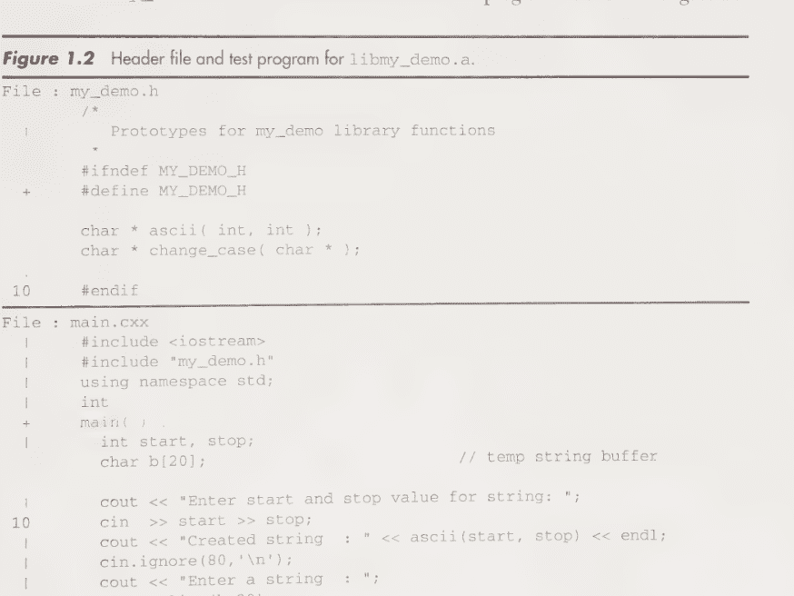

下面的编译使用 `-L` 命令行选项，以指示编译器在搜索库文件时还应包含当前目录。库的名称通过 `-l` 命令行选项传递。由于编译器按顺序处理源文件，因此最好将链接器选项放在命令序列的末尾，以避免生成任何未定义的引用错误。

```
linux$ g++ -o main main.cxx -L. -lmy_demo
```

`main.cxx` 程序的示例运行如图 1.3 所示。

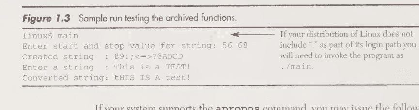

如果你的系统支持 **apropos** 命令，你可以发出以下命令来获取系统手册页中描述的所有预定义库函数调用的单行摘要：

```
linux$ apropos '(3'
```

如上所示，此命令将搜索包含系统命令简要描述的一组系统数据库文件，返回包含传递参数的文件。在这种情况下，`'(3'` 表示应显示手册第 3 节的所有命令。第 3 节（及其几个小节）包含子程序和库函数手册页。命令序列中使用单引号，以便 shell 将括号传递给 **apropos** 命令。否则，shell 将尝试解释括号，这将导致语法错误。

另一个使用与 **apropos** 命令相同的数据库的便捷实用程序是 **whatis** 命令。命令

```
linux$ whatis exit
```

将生成 **exit** 所有手册条目的单行列表。如果这些命令的数据库不存在，则命令 `/usr/sbin/makewhatis`（假设你有适当的访问权限）将生成它。

可以通过查看第 3 节的 **intro** 手册页条目获得库函数的更全面的概述。在大多数系统上，命令 `man 3 intro` 将返回 **intro** 手册页的内容。在此调用中，**3** 用于通知 **man** 相应的章节。对于某些版本的 **man** 命令，可能需要选项 `-s3` 来指定手册的第 3 节。有关手册页组织和使用的其他手册页信息可在附录 A"使用 Linux 手册页"中找到。

除了手册页，大多数 GNU/Linux 系统都附带一个名为 **info** 的便捷实用程序。此实用程序显示以 **Info** 格式编写的文档以及标准手册页文档。显示的信息是基于文本的、菜单驱动的。**Info** 文档可以支持有限的类似超文本的链接，当选择时会将查看者带到相关文档。如果存在，**Info** 文档有时比相关手册页更完整。一些更有趣的 **Info** 文档列在表 1.1 中。

### 表 1.1 部分 Info 文档列表。

| 主题 | 描述 |
| :--- | :--- |
| **as** | GNU 汇编器。 |
| **binutils** | GNU 二进制工具（如 **ar**）。 |
| **fileutils** | GNU 文件操作实用程序。 |
| **gcc** | **gcc**（和 **g++**）编译器。查看此处以获取有关如何使用编译器、特殊 C++ 扩展等信息。 |


| `gdb` | 如何使用GNU符号调试器。 |

| `info` | 如何使用`info`系统。查看此处以获取有关如何使用`info`和编写`Info`类型文档的所有详细信息。 |

| `ipc` | System V风格的进程间通信构造：消息队列、信号量和共享内存。 |

| `libc` | C库（由GNU实现）。这是概述信号、管道、套接字和线程等主题的好起点。 |

应在命令行上调用`info`实用程序，并传递要查找的项目（一般主题或特定命令——系统调用、库函数等）。如果存在`Info`文档，则由`info`实用程序显示。如果不存在`Info`文档，但该项目有手册页，则显示该手册页（在Info显示的顶部将有字符串`*manpages*`以通知你信息的来源）。如果找不到`Info`文档或手册页，则`info`会将用户置于`info`实用程序中。¹

¹归档实用程序是系统实用程序的所有命令行选项都以连字符（-）开头这一规则的众多例外之一。

最高级别。当在`info`实用程序中时，使用字母`q`退出，或输入`?`让`info`列出它所知的命令。输入字母`h`将指示`info`显示有关如何使用该实用程序的入门指南。

## 1.3 系统调用

一些程序使用的预定义函数实际上是**系统调用**。虽然格式上类似于库函数，但系统调用请求操作系统代表调用进程直接执行一些工作。由操作系统执行的代码位于**内核**中（通常是永久驻留在内存中的中央控制程序）。系统调用充当此代码的高级/中级语言接口。为了保护内核的完整性，执行系统调用的进程必须暂时从**用户模式**（具有用户权限和访问权限）切换到**系统模式**（具有系统/根权限和访问权限）。这种上下文切换会带来一定的开销，在某些情况下，可能会使系统调用比执行相同任务的库函数效率更低。请记住，许多库函数（特别是那些处理输入和输出的函数）是完全缓冲的，因此允许系统在一定程度上控制何时实际执行特定任务。

手册的第`2`节包含有关系统调用的页面。发出与前面讨论的类似但将`3`替换为`2`的`apropos`命令，将生成手册页中定义的所有系统调用的概要信息。重要的是要记住，一些库函数嵌入了系统调用。例如，C++的插入和提取运算符`<<`和`>>`，使用了底层的`read`和`write`系统调用。

库函数与系统调用之间的关系如图`1.4`所示。图中的箭头表示可能的通信路径，深色圆点表示上下文切换。如图所示，可执行程序可以直接使用系统调用来请求内核执行特定功能。另一方面，可执行程序也可以调用库函数，而库函数又可能执行系统调用。

## 1.4 链接目标代码

来自库文件（预定义或用户定义）的代码在编译时根据需要与来自源程序的**目标代码**结合。当使用C/C++编程时，可以在编译时指定包含标准库中未包含的系统调用和库函数的目标代码的其他库文件。这是通过使用`-l`编译器选项，后跟库名称（*不*带`lib`前缀和`.a`扩展名）来完成的。例如，编译命令

```
gcc -o prgm prgm.c -lm
```

指示`gcc`编译器程序的链接加载器部分，应将`libm.a`中的数学库目标代码与从源程序`prgm.c`创建的目标代码结合。如果需要不在标准位置的特殊库，可以通知编译器。GNU编译器使用`-L`选项，后跟要搜索的额外目录（或多个目录）。传递给编译器的命令行文件是按顺序处理的。因此，链接器选项通常放在命令序列的末尾，以避免任何未定义（未解析）的引用错误。

请注意，库函数通常需要在源程序中包含额外的头文件。头文件包含诸如必需的函数原型、宏定义和定义常量之类的信息。如果不包含适当的头文件，程序将无法正确编译。相反，如果您包含了正确的头文件，但忘记链接包含目标代码的关联库，程序也无法正确编译！此类遗漏通常是晦涩的编译器错误消息的来源。例如，尝试使用`gcc`编译一个使用数学函数（如`pow`）的C程序，而没有链接数学库，将生成以下消息

```
linux$ gcc m.c
/tmp/ccjKM13A.o: In function 'main':
/tmp/ccjKM13A.o(.text+0x15): undefined reference to 'pow'
collect2: ld returned 1 exit status
```

手册页的概要部分（参见附录A）列出了所需头文件的名称。当指示多个包含文件时，它们在源程序中列出的顺序应与手册页中指定的顺序相匹配。包含的顺序很重要，因为有时包含特定头文件可能取决于先前引用的头文件。这种依赖关系最常见于需要在包含其他系统头文件之前包含`<sys/types.h>`头文件。符号`<sys/types.h>`表示头文件`types.h`可以在通常的位置（在基于UNIX的系统上通常是`/usr/include`）的子目录`sys`中找到。

**1-1 练习**

检查标准C库（`/usr/lib/libc.a`）的内容。标准C库中存档了多少个与`printf`相关的函数？

**1-2 练习**

是否存在出现在多个库中的库函数/系统调用？如果是，举出一个并解释为什么这样做。

**1-3 练习**

在第`1.2`节讨论的`my_demo`库中添加一个`reverse`函数。该函数应反转其字符参数字符串的内容。提供你的函数正常工作的证据。

## 1.5 管理失败

在大多数情况下，如果系统调用或库函数不成功，它会返回`−1`的值，并为一个名为`errno`的外部（全局）变量赋值以指示实际的错误是什么。所有错误代码的定义常量可以在头文件`<sys/errno.h>`中找到（或在某些系统上是`<asm/errno.h>`）。按照惯例，定义常量是大写的，并以字母`E`开头。养成让调用程序检查系统调用或库函数的返回值以确定其是否成功是一个好习惯。如果调用失败，程序应采取适当的措施。一个常见的操作是显示一条简短的错误消息并`exit`（终止）程序。库函数`perror`可用于生成错误消息。

对于文本中详细讨论的每个系统调用和库函数，都会提供一个摘要表。摘要表是手册页信息的精简版本。典型摘要表的格式（本例中是`perror`的格式）如图`1.5`所示。

`perror`的摘要表表明，如果我们使用`perror`，必须包含头文件`<stdio.h>`。请注意，前面提到的头文件`<sys/errno.h>`在摘要表中没有被引用。只有当需要引用特定错误代码的定义常量时，才会包含`<sys/errno.h>`文件。`perror`库函数接受一个参数，该参数是指向字符字符串常量的指针（即`const char *`）。此外，`perror`库函数不返回值（如数据类型`void`所示），并且如果它自身失败，也不会修改`errno`。

这种谨慎是必要的，因为返回整数值的系统调用/库函数通常在失败时返回−1，而返回指针的则返回NULL指针。然而，由于这些例程是由不同的程序员编写的，他们对应该做什么有不同的想法，偶尔会遇到不符合此经验法则的返回值。

使用库函数系统调用时必须包含的头文件。这些是ANSI-C头文件。请注意，其中一些有ANSI-C++的等效文件。

手册中可以找到完整描述的部分。一些库函数/系统调用出现在手册的多个部分中。

| Include File(s) | `<stdio.h>` | Manual Section | 3 |

| --- | --- | --- | --- |

| Summary | `void perror( const char *s );` | | |

| Return | Success | Failure | Sets errno |

原型语法 — 给出例程的返回值数据类型和每个参数的数据类型。

如果例程成功，返回的值。

如果例程失败，返回的值。

是或否。

如果手册页中未定义`Success`、`Failure`或`Sets errno`，相应的方框将灰显。

图`1.5`摘要表格式说明。

程序`1.2`展示了一个使用系统调用并通过`perror`和`errno`提供一些错误检查的程序示例。

### 程序 1.2 使用 errno 和 perror。

```
File : p1.2.cxx
/*
    Checking errno and using perror
*/
#include <iostream>
#include <cstdio>          // needed for perror
#include <cstdlib>         // needed for exit
#include <unistd.h>        // needed for read and write
using namespace std;
extern int errno;
int main(int argc, char *argv[ ] ) {
    int n_char = 0,
        buffer[10];        // temporary buffer
    // Initially n_char is set to 0 and errno is 0 by default
    cout << "n_char = " << n_char << "\t errno = " << errno << endl;
    // Display a prompt to stdout
```

## 1.5 故障管理

```cpp
n_char = write(1, "Enter a word: ", 15);

// Use the read system call to obtain 10 characters from stdin

n_char = read(0, buffer, 10);
cout << "n_char = " << n_char << "\t errno = " << errno << endl;

if (n_char == -1) {
    perror(argv[0]);
    exit(1);
}

n_char = write(1, buffer, n_char);  // Display the characters read
return 0;
```

请注意，要使用`errno`变量，必须先在程序顶部将其声明为外部（`extern`）整数。如果运行该程序，初始输出表明`n_char`和`errno`的值都为`0`。图`1.6`显示了用户在提示时输入单词testing的输出结果。

### 图 1.6 程序 1.2 无错误时的首次运行

```
linux% p1.2
n_char = 0      errno = 0
Enter a word: testing
n_char = 8      errno = 0
testing
```

在这种情况下，`read`系统调用没有失败，而是如手册页所定义的，返回了从标准输入（键盘）读取的字符数。请注意，由于程序中使用的是`read`而非`cin`，换行符也是被读取和计数的字符之一。因为没有错误发生，`errno`中的值未被修改，保持为`0`。图`1.7`显示了我们再次运行程序并在提示时输入超过10个字符（期望产生错误）的输出结果。

### 图 1.7 程序 1.2 增加键盘输入后的第二次运行

```
$ p1.2
n_char = 0      errno = 0
Enter a word: testing further
n_char = 10     errno = 0
testing further
rther: Command not found.
```

## 1 • 程序与进程

这一次程序恰好读取了10个字符并显示出来。剩余的字符留在输入缓冲区中，最终在程序执行结束后被操作系统处理。这导致了奇怪的输出行`testing fu$rther`，后面紧跟一行`rther: Command not found`。字符`testing fu`由程序显示。`Command not found`消息是操作系统尝试将剩余输入`rther`作为命令执行时生成的。在这种情况下，提供比需要更多的输入值（即多余的字符）并不会导致`read`系统调用失败，因此`errno`也不会被改变。

然而，如果我们把`read`系统调用的文件描述符改为`3`（一个未被打开的文件描述符，对比`0`[标准输入]是操作系统在程序运行时自动为我们打开的），`read`系统调用将会失败。运行后，程序输出将如图`1.8`所示。

图 1.8 程序 1.2 引入错误后的第三次运行

```
linux$ p1.2
n_char = 0    errno = 0
Enter a word: n_char = -1    errno = 9
p1.2: Bad file descriptor
```

如预期所料，这一次`read`系统调用的返回值为`-1`。外部变量`errno`现在包含值`9`，它等价于`<sys/errno.h>`文件中定义的符号常量`EBADF`。³ 如果我们用`NULL`参数（即`""`）调用`perror`，将显示消息"Bad file descriptor"（系统与错误代码`9`关联的错误消息）。如前所述，`perror`接受一个参数：一个字符指针。如果传入指向有效字符串的字符指针，`perror`将显示引用的字符串，后跟一个冒号（`:`），然后附加其预定义的错误消息。程序员通常使用传给`perror`的参数来限定错误消息（例如，传递正在执行的程序名称，如前面示例中所示），或者在文件操作的情况下，传递当前文件的名称。遗憾的是，`perror`会在其产生的错误消息后输出一个换行符，从而阻止用户向`perror`显示行追加额外信息。有两种方法可以绕过这个疏忽。

与`perror`相关联的还有两个额外的外部变量。这些变量是`extern const char *sys_errlist[]`和`extern int sys_nerr`。外部变量`sys_nerr`包含一个比最大错误消息编号大`1`的值，而`sys_errlist`是一个指向错误消息外部字符数组的指针。我们可以（如果提供了正确的声明）不调用`perror`来返回特定错误，而是使用`errno`中的值作为`sys_errlist[]`数组的索引来直接获取错误消息。

³ 再次说明，在某些Linux环境中，你可能会发现该常量实际上定义在`/usr/include/asm`目录中的`errno.h`头文件中。

## 1.5 故障管理

生成错误消息的另一种方法是使用库函数`strerror`（见表`1.2`）。

表 1.2 strerror 库函数摘要

| 头文件 | `<string.h>` | 手册章节 | 3 |

| :--- | :--- | :--- | :--- |

| 摘要 | `char *strerror(int errnum);` | | |

| 返回值 | 成功 | 失败 | 设置 errno |

| | 错误消息的引用 | | |

`strerror`函数将整数`errnum`参数（通常是`errno`的值）映射到一条错误消息，并返回对该消息的引用。`strerror`生成的错误消息应与`perror`生成的消息相同。如果需要，可以向`strerror`返回的字符串追加额外的文本。

此外，Linux提供了一个名为`perror`的命令行实用程序，用于返回与特定错误代码关联的错误消息。该实用程序的调用示例如下：

```
Error code 9: Bad file descriptor
```

请注意，系统永远不会清除`errno`变量（即使在成功的系统调用之后也是如此）。它始终包含系统为最后一次失败调用分配的值。附录B "Linux错误消息" 包含有关错误消息的更多信息。

### 1-4 练习

编写一个程序，以每行两列的编号格式显示所有可用的系统错误消息。

### 1-5 练习

`read`/`write`系统调用的第一个参数是一个整数值，表示文件描述符。当程序执行时，操作系统会自动打开三个文件描述符：`stdin`（标准输入，默认为键盘，由值`0`引用）、`stdout`（标准输出，默认为终端[屏幕]，由值`1`引用）和`stderr`（标准错误，默认为控制台设备，由值`2`引用）。如果程序`1.2`中的最后一次`write`写入到`0`（标准输入——键盘），程序仍然可以编译、运行、产生输出，并且*不会*生成错误消息。这是为什么呢？解开这个谜团的一个切入点可能是命令`apropos stdin`。

### 1-6 练习

编写自己的错误消息函数，在文件操作失败时调用。该函数应提供比`perror`更具描述性、更*用户友好*的接口。在开始此任务之前，查阅头文件`<sys/errno.h>`（如前所述，该文件的替代位置是`/usr/include/asm`目录）以及Section 2中`intro`的手册页条目（即`man 2 intro`）可能会有所帮助。

## 1.6 可执行文件格式

在Linux环境中，已编译为可执行形式以供系统运行的源文件被放入一种称为**ELF**（可执行与链接格式）的特殊格式中。**ELF**格式的文件包含一个头表项（用于指定硬件/程序特性）、程序文本、数据、重定位信息以及符号表和字符串表信息。**ELF**格式的文件被操作系统标记为可执行文件，可以通过在命令行输入其名称来运行。早期版本的UNIX以`a.out`格式（汇编器输出格式）存储可执行文件。虽然这种格式如今已很少使用，但其名称仍与编译流程相关联。当C/C++程序文件被编译时，编译器默认将可执行文件放入名为`a.out`的文件中。

> **1-7 练习**


ELF 格式文件的头表项布局由头文件 `<elf.h>` 中的 `Elf32_Ehdr`（或 `Elf64_Ehdr`）结构定义。编写一个简短的 C/C++ 程序，读取命令行传递的文件名，并确定该文件是否为 ELF 格式；如果是，则确定该文件将在哪种架构（硬件）类型上运行。你需要包含头文件 `<libelf/libelf.h>` 以访问预定义的 ELF 头部例程，例如 `elf_begin`（用于获取 ELF 描述符）。编译程序时还必须链接 ELF 库（即 `-lelf`）。

请注意，用于识别文件类型的系统实用程序 `file` 使用 `/usr/share/magic` 文件中的信息来识别文件。此练习的另一种方法是使用 `/usr/share/magic` 中的信息来识别 ELF 文件及其将要执行的架构。

## 1.7 系统内存

在 UNIX 中，当可执行程序被内核读入系统内存并执行时，它就成为一个进程。我们可以将系统内存视为划分为两个不同的区域或空间。

首先是**用户空间**，用户进程在此运行。系统在此空间内管理各个用户进程，并防止它们相互干扰。用户空间中的进程称为**用户进程**，处于**用户模式**。

其次是称为**内核空间**的区域，内核在此运行并提供其服务。如前所述，用户进程只能通过系统调用访问内核空间。当用户进程通过系统调用运行内核代码的一部分时，该进程暂时被称为**内核进程**，并处于**内核模式**。在内核模式下，进程将拥有特殊的（root）权限并可访问关键的系统数据结构。这种从用户模式到内核模式的切换称为**上下文切换**。

在 UNIX 环境中，内核是可重入的，因此多个进程可以同时处于**内核模式**。如果系统只有一个处理器，那么在任何给定时间只有一个进程在推进，而其他进程则被阻塞。操作系统使用存储在程序状态字（**PSW**）中的一个位来跟踪进程的当前模式。

## 1.8 进程内存

每个进程都在其自己的私有地址空间中运行。当驻留在系统内存中时，用户进程，就像高卢一样，被划分为三个段或区域：**文本段、数据段**和**栈段**。

- **文本段**—文本段（有时称为指令段）包含可执行程序代码和常量数据。文本段被操作系统标记为只读，进程不能修改它。多个进程可以共享同一个文本段。如果需要并发执行程序的第二个副本，进程会共享文本段。在这种情况下，系统引用先前加载的文本段，而不是重新加载一个副本。如果需要，共享文本（这是使用 C/C++ 编译器时的默认行为）可以通过在编译行上使用 `-N` 选项来关闭。在程序 1.1 中，函数 `main` 和 `showit` 的可执行代码可以在文本段中找到。

- **数据段**—数据段（在虚拟意义上）与文本段连续，可以细分为初始化数据（例如，在 C/C++ 中，声明为 `static` 或由于其放置位置而具有静态属性的变量）和未初始化数据。⁴ 在程序 1.1 中，指针变量 `cptr` 可以在初始化区域中找到，而变量 `buffer1` 在未初始化区域中。在其执行生命周期内，进程可能会请求额外的数据段空间。在程序 1.1 中，`showit` 函数中对库例程 `new` 的调用就是对额外数据段空间的请求。库内存分配例程（例如 `new`、`malloc`、`calloc` 等）反过来使用系统调用 `brk` 和 `sbrk` 来扩展数据段的大小。新分配的空间被添加到当前未初始化数据区域的末尾。这个可用内存区域有时称为**堆**。在图 1.9 中，这个内存区域被标记为未映射。

⁴ 一些作者使用术语 BSS 段来表示未初始化数据段。

- **栈段**—栈段被进程用于存储自动标识符、寄存器变量和函数调用信息。函数 `main` 中的标识符 `i`、函数 `showit` 中的 `buffer2`，以及在 `for` 循环内调用 `showit` 函数时存储的栈帧信息都可以在栈段中找到。根据需要，栈段向未初始化数据段方向增长。栈*之外*的区域包含进程的命令行参数和环境变量。栈的实际物理位置取决于系统。

## 1.9 `u` 区

除了文本段、数据段和栈段之外，操作系统还为每个进程维护一个称为**u 区**（用户区）的区域。u 区包含特定于进程的信息（例如，打开的文件、当前目录、信号操作、记账信息）以及供进程使用的系统栈段。

如果进程进行系统调用（例如，程序 1.1 中 `main` 函数中的 `write` 系统调用），则系统调用的栈帧信息存储在系统栈段中。同样，这些信息由操作系统保存在进程通常无法访问的区域中。因此，如果需要这些信息，进程必须使用特殊的系统调用来访问它。与进程本身一样，进程的**u 区**内容由操作系统换入换出。

系统和进程内存的概念关系如图 1.9 所示。

## 1.10 进程内存地址

系统跟踪与每个用户进程段相关的虚拟地址⁵。此地址信息对进程可用，可以通过引用外部变量 `etext`、`edata` 和 `end` 来获取。这三个变量的*地址*（不是*内容*）分别对应于文本段、初始化数据段和未初始化数据段上方的第一个有效地址。程序 1.3 展示了如何获取和显示此信息。

### 程序 1.3 显示段地址信息

```cpp
File : p1.3.cxx
/*
    Displaying process segment addresses
 */
 1   #include <iostream>
 2   extern int etext, edata, end;
 3   using namespace std;
 4   int
 5   main( ){
 6       cout << "Adr etext: " << hex << int(&etext) << "\t ";
10      cout << "Adr edata: " << hex << int(&edata) << "\t ";
        cout << "Adr end: "  << hex << int(&end ) << "\n";
        return 0;
        }
```

⁵ 逻辑地址——在计算和使用时无需关心其实际物理位置。

如果我们向原始程序 1.1 添加几行代码，就可以验证程序中关键标识符的虚拟地址位置。程序 1.4 包含一个内联函数 `SHW_ADR( )`，用于显示标识符的地址。

### 程序 1.4 确认程序 1.1 的地址位置

```cpp
File : p1.4.cxx
/*
    Program 1.1 modified to display identifier addresses
    */
    #include <iostream>
    #include <unistd.h>                 // needed for write
    #include <cstring>                  // needed for strcpy
    #include <cstdlib>                  // needed for exit
    using namespace std;
    char           *cptr = "Hello World\n";  // static by placement
10  char           buffer1[25];

    inline void SHW_ADR(char *ID, int address){
        cout << "The id " << ID << "\t is at : "
             << hex << address << endl;
        }
    extern int etext, edata, end;

    int main( ){
        void       showit(char *);           // function prototype
20      int        i = 0;                     // automatic variable
                                        // display addresses
        cout << "Adr etext: " << hex << int(&etext) << "\t ";
        cout << "Adr edata: " << hex << int(&edata) << "\t ";
        cout << "Adr end: "  << hex << int(&end ) << "\n";
        SHW_ADR("main", int(main));              // function addresses
        SHW_ADR("showit", int(showit));
        SHW_ADR("cptr", int(&cptr));             // static
        SHW_ADR("buffer1", int(&buffer1));
30      SHW_ADR("i", int(&i));                   // automatic

        strcpy(buffer1, "A demonstration\n");  // library function
        write(1, buffer1, strlen(buffer1)+1);  // system call
        showit(cptr);                          // function call
        return 0;
        }
```

```cpp
void showit( char *p ){
    char        *buffer2;
    SHW_ADR("buffer2", int(&buffer2)); // display address
    if ((buffer2= new char[ strlen(p)+1 ]) != NULL){
        strcpy(buffer2, p);                // copy the string
        cout << buffer2;                   // display string
        delete [] buffer2;                 // release location
    } else {
        cerr << "Allocation error.\n";
        exit(1);
    }
}
```

运行此程序会产生输出（图 1.10），验证了我们关于不同存储类型标识符地址范围的断言。注意，程序显示的实际地址取决于系统。注意，命令行 `nm` 实用程序也可用于验证程序 1.4 显示的地址。

### 图 1.10 程序 1.4 的输出

```text
Adr etext: 8048bca    Adr edata: 8049e18    Adr end: 8049ea8
The id main    is at : 8048890
The id showit  is at : 8048a44
The id cptr    is at : 8049c74
The id buffer1 is at : 8049e8c
The id i       is at : bffffc54
A demonstration
The id buffer2 is at : bffffc34
Hello World
```

程序 1.4 的输出以图形方式呈现在图 1.11 中。

对于那些对此主题有进一步兴趣的人，许多版本的 Linux 都有一个 `objdump` 实用程序，可以为指定对象文件提供额外信息。

## 1-8 练习

在 Bourne shell 中，研究命令 `ulimit -a` 和 `size`。这些命令报告的信息与 `etext`、`edata` 和 `end` 的值有何关系？

## 1.11 创建进程

显然，必须有某种机制让系统能够创建新进程。除了内核在引导过程中生成的一些特殊初始进程（例如 `init`）之外，Linux 环境中的所有进程都是通过 `fork` 系统调用创建的，如表 1.3 所示。发起调用的进程称为**父进程**，新生成的进程称为**子进程**。

*表 1.3* **fork** 系统调用摘要。

| | | 手册章节 | 2 |
|---|---|---|---|
| 头文件 | `<sys/types.h>`<br>`<unistd.h>` | | |
| 摘要* | `pid_t fork ( void );` | | |
| 返回值 | 成功：子进程中返回 0，父进程中返回子进程 ID | 失败：-1 | 设置 `errno`：是 |

\* 头文件 `<sys/types.h>` 通常包含 `pid_t` 的定义。然而，在某些环境中，其实际定义位于 `<bits/types.h>` 中。幸运的是，在这些环境中 `<sys/types.h>` 包含了指向替代定义位置的包含语句，对普通用户来说一切都是透明的。头文件 `<unistd.h>` 包含了 `fork` 系统调用的声明。

`fork` 系统调用不接受参数。如果 `fork` 系统调用失败，它返回 −1 并设置 `errno` 的值以指示表 1.4 中所示的错误条件之一。

### 表 1.4 `fork` 错误消息⁶

| # | 常量 | `perror` 消息 | 说明 |
|---|---|---|---|
| 11 | EAGAIN | 资源暂时不可用 | 操作系统无法分配足够的内存来复制父进程的页表信息并为子进程分配任务结构。 |
| 12 | ENOMEM | 无法分配内存 | 可用交换空间不足，无法生成另一个进程。 |

否则，成功时，`fork` 将子进程的进程 ID（一个唯一的整数值）返回给父进程，并向子进程返回 0。通过检查 `fork` 的返回值，进程可以轻松判断自己是父进程还是子进程。一个父进程可以生成多个子进程，但每个子进程只有一个父进程。图 1.12 展示了一个典型的父/子进程关系。

⁶ 如果库函数/系统调用设置了 `errno` 并且可能以*多种*方式失败，摘要表之后会附带一个错误消息表。该表将包含错误编号（#）、等效的定义常量、调用 `perror` 生成的消息，以及当前上下文中该消息的简要说明。

如图所示，进程 P1 产生了三个子进程：C1、C2 和 C3。子进程 C1 又生成了自己的子进程（C4）。一旦子进程生成了自己的子进程，它就变成了父进程。

> 当你在 Linux 系统上检查进程状态表时（参见进程状态命令 `ps`），你会发现许多具有低进程 ID（1、2、3 等）的进程（例如 `init`、`keventd`、`kswapd`）。搜索文件系统会发现，虽然有一个名为 `init` 的系统程序（通常位于 `/sbin/init`），但这些其他进程却没有对应的系统程序文件。这是为什么呢？

当发起 `fork` 系统调用时，操作系统会生成父进程的一个副本，该副本成为子进程。操作系统将父进程的大部分系统信息（例如，打开的文件描述符、环境信息）传递给子进程。然而，有些信息是子进程独有的：

- 子进程拥有自己的进程 ID（PID）。
- 子进程的父进程 ID（PPID）与父进程的不同。
- 系统强加的进程限制（分配给进程的 CPU 时间量）会被重置。
- 文件上的所有记录锁都会被重置。
- 接收信号时采取的操作也不同。

### 程序 1.5 生成子进程

```cpp
File : p1.f.cpp
1     /*
2      First example of a fork system call (no error check)
3      */

4

5     #include <iostream>
6     #include <sys/types.h>
7     #include <unistd.h>
8     using namespace std;
9     int
10    main( ) {
11        cout << "Hello\n";
12        fork( );
13        cout << "bye\n";
14        return 0;
15    }
```

该程序的输出如图 1.13 所示。

### 图 1.13 程序 1.5 的输出

```text
linux$ p1.5
Hello
bye
bye
```

注意，语句 `cout << "bye\n";` 在程序中第 12 行只出现了一次，但程序运行时产生了两次"bye"——一次由父进程输出，一次由子进程输出。一旦第 11 行的 `fork` 系统调用被执行，就会产生两个进程，每个进程都会执行剩余的程序语句。关于 `fork` 系统调用及其用途的更详细描述可以在第 3 章"使用进程"中找到。

## 1.12 小结

进程是由操作系统运行和管理的可执行程序实例。程序使用预定义的函数来实现其任务。其中一些预定义函数实际上是系统调用。系统调用请求内核直接为进程执行任务。其他预定义函数是库函数。库函数可能间接包含系统调用，也执行任务，但方式不太具有侵入性。系统调用和库函数的目标代码以目标代码格式存储在库文件中。在编译程序时，会根据需要包含系统调用和库函数的目标代码。

当系统调用或库函数失败时，可以检查外部变量 `errno` 来确定失败原因。库函数 `perror` 或 `strerror` 可用于生成描述性的错误消息。

执行中的程序被放置在系统内存中。程序的可执行代码和常量数据放置在一个称为文本段的区域中。已初始化和未初始化的程序数据放置在数据段中。程序栈段用于处理自动程序变量和函数调用数据。此外，系统还会在内存的用户区域（u 区域）中保存进程特定的信息和系统调用数据。

进程由 `fork` 系统调用生成。新生成的进程从其父进程继承了大部分状态信息。

## 1.13 关键术语和概念

- a.out 格式


- `apropos` 命令
- `ar` 命令
- 子进程
- 上下文切换
- 数据段
- `ELF` 格式
- `errno` 变量
- 可执行程序
- `fork` 系统调用
- 函数
- 堆
- `info` 命令
- 内核
- 内核模式
- 内核进程
- 内核空间
- 库文件
- 库函数
- `man` 命令
- 多处理
- 多道程序设计
- 多任务
- `nm` 命令
- 目标代码
- 父进程
- `perror` 库函数
- 进程
- 程序
- 运行时库例程
- 源程序
- 栈段
- `strerror` 库函数
- `sys_errlist` 变量
- `sys_nerr` 变量
- 系统调用
- 系统模式
- 文本段
- u 区域
- 用户模式
- 用户进程
- 用户空间
- `whatis` 命令

## 第 2 章 处理环境

### 2.1 简介

所有进程都有一个处理环境（不要与环境*变量*混淆，环境变量正如我们将会看到的，只是处理环境的一部分）。处理环境由一组独特的信息和条件组成，这些信息和条件由系统的当前状态和进程的父进程决定。进程可以访问处理环境信息，并且在某些情况下可以修改它。这可以通过直接操作或使用适当的系统调用或库函数来完成。

### 2.2 进程 ID

每个进程都关联一个唯一的正整数标识号，称为进程 ID（`PID`）。由于进程 ID 是按顺序分配的，当系统启动时，一些仅启动一次的系统进程总是会被分配相同的进程 ID。例如，在 Linux 系统上，进程 0（历史上称为 `swapper`）是在系统启动时从零开始创建的，启动进程。此进程初始化内核数据结构并创建另一个称为 `init` 的进程。`init` 进程（PID 1）创建许多特殊的内核线程¹来处理系统管理。这些特殊线程通常具有较低的 PID 号。

其他进程被分配递增的可用 PID，直到达到系统定义的 PID 最大值。PID 的最大值可在头文件 `<linux/threads.h>` 中作为已定义常量 `PID_MAX` 找到（在较旧的系统上请查看 `<linux/tasks.h>`）。当分配了最高的 PID 后，系统会循环并开始重用当前未使用的较低 PID 号。

系统调用 `getpid` 可用于获取 PID（表 2.1）。`getpid` 系统调用不接受参数。如果成功，它将返回 PID 号。如果调用进程没有适当的访问权限，`getpid` 调用将失败，返回 -1 并将 `errno` 设置为 `EPERM` (1)。

#### 表 2.1 `getpid` 系统调用摘要

| 包含文件 | `<sys/types.h>`, `<unistd.h>` | 手册部分 | 2 |
|---|---|---|---|
| 摘要 | `pid_t getpid( void );` | | |
| 返回 | 成功 | 失败 | 设置 errno |
| | 进程 ID | -1 | 是 |

进程可以使用 `getpid` 系统调用来确定其自身的 PID，如下所示：

```
cout << "My process ID is " << getpid() << endl;
```

`getpid` 系统调用用途有限。通常，PID 在程序的每次调用中都会不同。`getpid` 的手册页条目指出，该系统调用最常见的用途是生成唯一的临时文件名。然而，对于日常使用，库函数 `mkstemp` 更适合生成唯一的临时文件名。

¹ 线程在第 11 章中有详细介绍。简单来说，线程是通过进程的控制流。操作系统在实际实现线程的方式上各不相同。在 Linux 中，线程是一种特殊类型的进程，与其父进程共享地址空间和资源。仅在内核模式下运行的内核线程负责单个内核功能，例如将缓冲区刷新到磁盘或回收返回的内存。

### 2.3 父进程 ID

每个进程都有一个关联的父进程 ID (PPID)。父进程是派生（生成）子进程的进程。可以使用系统调用 `getppid` 获取父进程的 ID（表 2.2）。

#### 表 2.2 `getppid` 系统调用摘要

| 包含文件 | `<sys/types.h>`, `<unistd.h>` | 手册部分 | 2 |
|---|---|---|---|
| 摘要 | `pid_t getppid( void );` | | |
| 返回 | 成功 | 失败 | 设置 errno |
| | 父进程 ID | -1 | 是 |

与 `getpid` 系统调用一样，`getppid` 不需要参数。如果成功，它将返回父进程的 PID 号。如果调用进程没有适当的访问权限，`getppid` 调用将失败，返回 -1 并将 `errno` 设置为 `EPERM` (1)。

以下代码段显示 PPID：

```
cout << "My Parent Process ID is " << getppid( ) << endl;
```

不幸的是，没有允许父进程确定其所有子进程 PID 的系统调用。如果需要此类信息，父进程应在每个子进程创建时保存从 `fork` 系统调用返回的子进程 PID 值。

> **2-1 练习**
>
> `getppid` 系统调用的手册页条目没有明确说明如果在调用 `getppid` 时父进程已不再存在，`getppid` 返回什么。编写一个程序，在发生这种情况时（父进程先于子进程终止）显示 `getppid` 返回的值。你如何确保在子进程进行 `getppid` 调用时父进程不存在？

### 2.4 进程组 ID

每个进程都属于一个进程组，该进程组由一个整数进程组 ID 值标识。当进程生成子进程时，操作系统会自动创建一个进程组。最初的父进程称为 **进程组长**。进程组长的 PID 将与其进程组 ID 相同。² 由进程组长生成的其他进程组成员继承相同的进程组 ID。操作系统使用进程组关系向进程组分发信号。例如，如果进程组长接收到导致其终止的 kill 或挂起信号，则其组中的所有进程也会收到相同的终止信号。进程可以通过系统调用 `getpgid` 找到其进程组 ID。在某些版本的 Linux 中，你可能会发现 `getpgid` 系统调用不存在。在这些版本中，系统调用 `getpgrp`（不需要 PID 参数）提供了与 `getpgid` 系统调用相同的功能。`getpgid` 系统调用在表 2.3 中定义。

#### 表 2.3 `getpgid` 系统调用摘要

| 包含文件 | `<sys/types.h>`, `<unistd.h>` | 手册部分 | 2 |
|---|---|---|---|
| 摘要 | `pid_t getpgid( pid_t pid );` | | |
| 返回 | 成功 | 失败 | 设置 errno |
| | 进程组 ID | -1 | 是 |

如果成功，此调用将返回传递的 `pid` 的进程组 ID。如果 `pid` 的值为 0，则该调用针对当前进程（无需单独调用 `getpid`）。如果 `getpgid` 系统调用失败，则返回 -1，并将 `errno` 中的值设置为表 2.4 中的一个值以指示错误来源。

#### 表 2.4 `getpgid` 错误消息

| # | 常量 | perror 消息 | 解释 |
|---|---|---|---|
| 1 | EPERM | 非所有者 | 调用进程的访问权限无效。 |
| 3 | ESRCH | 无此进程 | 没有像 `pid` 这样的进程 ID。 |

² 啊哈——除了生成临时文件名，`getpid` 系统调用的另一个用途！

程序 2.1 显示了一个使用 `getpgid` 系统调用的简短程序。在查看程序之前，需要对程序的编译进行简要说明。随着 UNIX 的发展，开发人员建立了一些标准，如 ANSI C、POSIX.1、POSIX.2、BSD、SVID、X/Open 等。有时，根据一个标准（比如 BSD）创建的系统调用（如 `getpgid`）和库函数会被稍微修改以满足另一个标准（如 POSIX）的要求。使用 `g++` 编译器时，定义常量 `_GNU_SOURCE` 可指示编译器在存在冲突时使用 POSIX 定义。

#### 程序 2.1 显示进程组 ID

```
File : p2_1.cpp
*
   Displaying process group ID information
*
#define _GNU_SOURCE
#include <iostream>
#include <sys/types.h>
#include <unistd.h>
using namespace std;

int main( ){
    cout << "\n\nInitial process \t PID " << getpid()
         << "\t PPID " << getppid()
         << "\t GID " << getpgid(getppid()) << endl;

    for (int i = 0; i < 2; ++i) {  // Generate some processes
        if (fork( ) == 0) {
            cout << "New process     \t PID " << getpid()
                 << "\t PPID " << getppid()
                 << "\t GID " << getpgid(0)
                 << endl;
            return 0;
        }
    }
}
```

#### 图 2.1 程序 2.1 输出

| | PID | PPID | GID |
|---|---|---|---|
| 初始进程 | 3350 | 3260 | 3350 |
| 新进程 | 3351 | 3350 | 3350 |
| 新进程 | 3352 | 3351 | 3350 |
| 新进程 | 3353 | 3350 | 3350 |
| 新进程 | 3356 | 3353 | 3350 |
| 新进程 | 3355 | 3351 | 3350 |
| 新进程 | 3354 | 3352 | 3350 |
| 新进程 | 3357 | 3350 | 3350 |

请注意，实际的 ID 号每次运行程序时都会更改。进程组中进程的关系如图 2.2 所示。

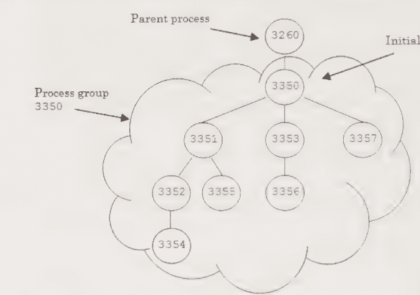

**图 2.2** 进程 ID 关系。

程序生成的所有进程都表明它们属于同一个进程组：初始进程 3350 的进程组。如果进程的父进程³在其子进程之前死亡（终止），则进程 `init`（进程 ID 为 1）将继承该子进程并成为其 *养* 父母。如果发生这种继承，进程的进程组 ID 不会更改。

进程可以使用系统调用 `setpgid` 来更改其进程组，该调用设置进程组 ID（表 2.5）。

`setpgid` 系统调用将进程组 `pid` 设置为 `pgid` 的值。如果 `pid` 的值为 0，则该调用指代当前进程。否则，该调用

³ 似乎没有对父/子进程进行拟人化的终结，即使它们接近于怪诞！

#### 表 2.5 `setpgid` 系统调用概要

| 头文件 | `<sys/types.h>` `<unistd.h>` | 手册章节 | 2 |
| --- | --- | --- | --- |
| 概要 | `int setpgid(pid_t pid, pid_t pgid);` | | |
| 返回值 | 成功 | 失败 | 设置 errno |
| | 0 | -1 | 是 |

`pid` 参数引用指定的 PID。`pgid` 的值表示该进程将归属的组。如果 `pgid` 的值为 0，则被 `pid` 引用的进程将成为进程组领导者。要使此调用成功，调用进程必须具有正确的权限来执行所请求的更改。`setpgid` 系统调用成功时返回 0，失败时返回 -1 并设置 `errno`。`setpgid` 失败时 `errno` 被赋予的值如表 2.6 所示。

#### 表 2.6 `setpgid` 错误信息

| # | 常量 | perror 消息 | 说明 |
| --- | --- | --- | --- |
| 1 | EPERM | Operation not permitted | • 进程 `pid` 已是会话领导者。<br>• 进程 `pid` 与调用进程不在同一会话中。<br>• 指定了无效的进程组。 |
| 3 | ESRCH | No such process | 没有 `pid` 这样的进程 ID。 |
| 22 | EINVAL | Invalid argument | `pgid` 的值小于 0 或大于 `MAX_PID-1`。 |

对于我们这些说话快或听讲随意的人来说，很容易将进程组 ID 与进程的组 ID 混淆。进程的组 ID 在第 2.6 节中介绍。

除了进程组之外，UNIX 还支持会话的概念。会话是相关和不相关的进程及进程组的集合。与进程组类似，有若干系统调用（如 `setsid`、`getsid`）可用于创建和操控会话。调用 `setsid` 的进程成为会话领导者以及进程组领导者。在这种安排中，没有控制 tty（终端设备）。请记住，进程从其父进程继承其控制终端。由控制终端接收的某些输入序列，如退出命令（`CTRL+\`）或中断命令（`CTRL+C`），会自动传播到会话中的其他进程。

#### 2-2 练习

修改程序 2.1，使每个新进程成为自己的组领导者。

### 2.5 权限

所有 UNIX 文件（可执行文件及其他文件）都有一组相关的所有者权限位，操作系统使用这些位来确定访问权限。权限位分为三组，每组三位。每组中的每一位决定文件是否可以被读取、写入或执行。这三组对应三类用户：文件**所有者**、文件所有者**组**中的成员以及所有**其他**用户。我们可以将九个权限位视为一个三位八进制数，如图 2.3 所示。该权限集表示文件所有者具有读、写和执行权限；组成员具有读和执行权限；而所有其他用户仅具有执行权限。文件的权限是操作系统存储在 **I-list**（每个文件一个唯一条目）中的信息的一部分。当文件被访问时，其属性会存储在系统 **inode** 表中。

在系统层面，文件的权限使用 `chmod` 命令修改。可以使用 `ls` 命令的 `-l`（长格式）标志列出文件的权限。例如，在图 2.4 所示的 `ls` 命令输出中，文件（`vi`）的所有者（`root`）具有读取（`r`）、写入（`w`）和执行（`x`）该文件的权限。文件所有者组的成员可以读取和执行该文件，被归类为其他的用户也可以。在 Linux 中，执行 `ls -l` 命令时默认会显示文件的组名。在某些 UNIX 形式中（如 *true-blue* BSD），必须在命令中添加 `-g` 标志（即 `ls -lg`）才能获取组名。

目录的权限位解释与文件略有不同。当文件是目录时，设置读取位表示该目录可以被读取或显示。设置写入位表示可以从目录中添加或删除文件或链接，设置执行位表示授予遍历权限。如果未设置遍历权限，则目录名称只能作为路径名的一部分使用，而不能直接查看其内容。

#### 2-3 练习

文件的所有者也是"其他"类别的成员吗？如果一个文件的保护设置为只有"其他"类别中的用户具有读/写/执行访问权限，所有者仍然可以访问该文件吗？这合理吗？为什么？

在 UNIX 中生成文件时（例如通过 I/O 重定向或将源程序编译为可执行文件），操作系统会为文件分配权限。分配给文件的默认权限由两个三位八进制掩码值的按位运算确定。这些掩码值是**创建掩码**和 **umask**。除非另有指定（例如在程序中创建或打开文件时），系统使用的创建掩码对于可执行文件和目录文件为 777，对于文本文件为 666。默认的 umask 值由系统管理员设置，最常见的是 022。如果你想更改 umask 的值并希望该值对所有进程生效，请在启动文件 `.login`（或 `.profile`）中插入命令 **umask** `nnn`（其中 `nnn` 是 umask 的新值）。

在系统层面，当前的 umask 值可以使用 **umask** 命令显示/修改。图 2.5 展示了使用 **umask** 命令的示例（注意在某些系统上会显示前导 0）。

当创建新文件时，系统会将文件的创建掩码与当前 umask 值进行异或（XOR）运算。异或运算的效果等同于从创建掩码中减去 umask 值（无借位）。最终结果决定了新文件的权限。例如，使用命令行 I/O 重定向生成名为 `foo` 的文本文件，如图 2.6 所示。

这将文本文件 `foo` 的权限设置为 644（666 减去 022）。这可以通过 `ls` 命令使用 `-l` 选项的输出来验证，如图 2.7 所示。

如果我们生成一个目录（或使用 C/C++ 编译器生成的可执行文件如 `a.out`），使用 022 umask 的默认权限将是 755（777 减去 022）。参见图 2.8。

允许进程访问此信息的系统调用 `chmod`、`stat`（文件状态信息）和 `umask` 的使用将在第 2.7 节中介绍。

### 2.6 真实和有效用户 ID 与组 ID

在 UNIX 中，除了一些特殊的系统进程外，进程都是由登录到系统的用户（root 及其他用户）生成的。在登录过程中，系统会查询密码文件⁴以获取两个标识（ID）号码。系统获取的号码分别位于用户密码条目的第三个和第四个字段中。它们分别是用户的**真实用户 ID**（`UID`）和**真实组 ID**（`GID`）。例如，在以下示例密码文件条目中

```
ggluck:x:1025:1001:Garrett Gluck:/home/student/ggluck:/bin/tcsh
```


用户登录名`ggluck`的真实用户 ID 为 1025，组 ID 为 1001。真实用户 ID 应当（如果系统管理员尽职的话）是一个唯一的整数值，而真实组 ID（同样是整数值）可能被多个登录名共用。组 ID 号码应映射到存储在`/etc/group`文件中的组名⁵。通常，小于 500 的 ID（但并非总是如此）表示具有特殊状态的用户登录。

对于每个进程，系统还保留第二组 ID，称为有效 ID，即有效用户 ID（`EUID`）和有效组 ID（`EGID`）。操作系统使用真实 ID 来识别*真实用户*，用于进程记账或发送邮件等用途，而使用有效 ID 来确定应授予进程的额外权限。大多数情况下，进程的真实 ID 和有效 ID 是相同的。但是，在某些情况下，系统上的非特权用户必须被允许访问/修改特权文件（如密码文件）。为了允许对关键文件的受控访问，Linux 有一组额外的文件权限，称为 set-user-ID（`SUID`）和 set-group-ID（`SGID`），可由文件所有者指定。当指定这些权限时，它们告诉操作系统，当程序运行时，生成的进程应具有程序所有者/组的权限（而不是与该进程关联的真实用户/组权限）。在这种情况下，进程的有效 ID 变为文件所有者指示的 ID。以下是一个`suid`程序的列表。

> ⁴ 在旧版本的 Linux 中，完整的密码文件（`passwd`）位于`/etc`目录中。在较新版本中，出于安全原因，密码文件虽然仍然存在，但部分相关信息可能存储在其他位置（例如`/etc/shadow`文件中）。虽然`/etc/passwd`文件可被普通用户读取，但补充密码文件通常不可读。

> ⁵ 如果由于某种原因，分配的组号没有对应的组名，则在执行`ls -l`命令时系统会显示组号。

如图所示，这个`passwd`程序（系统级命令`passwd`的可执行文件）的所有者权限被设置为`r-s`。所有者类别中字母`s`出现在字母`x`的位置，这表示当运行该程序时，进程应拥有文件所有者（即 root）的权限。设置用户标识信息由系统存储在第十个权限位中，可以使用系统级命令`chmod`进行修改。`passwd`程序的`SUID`设置允许运行它的非特权用户临时拥有 root（超级用户）权限。在这种情况下，运行该程序的用户将能够修改系统密码文件，因为密码文件的权限表明它们由 root 拥有并且只能由 root 修改。不用说，设置了`SUID`或`SGID`位的程序应该经过仔细考量，特别是当程序由超级用户（root）拥有时。

在系统层面，命令`id`（如图 2.9 所示）显示当前用户的用户 ID、组 ID 和组隶属信息。请注意，虽然一个文件只能属于一个组，但一个用户可以属于多个组。


```
linux$ id
uid=500(gray) gid=1000(faculty) groups=1000(faculty)
```

在编程环境中，返回进程的用户/组真实 ID 和有效 ID 的系统调用在表 2.7 中给出。

**表 2.7** 用户/组真实和有效 ID 调用摘要。

| 包含文件 | 手册章节 | 摘要 | 返回值 |

| :--- | :--- | :--- | :--- |

| `<sys/types.h>`<br>`<unistd.h>` | 2 | `uid_t getuid( void );`<br>`uid_t geteuid( void );`<br>`gid_t getgid( void );`<br>`uid_t getegid( void );` | 成功：请求的 ID。<br>失败：-1，并设置 errno。 |

有相应的系统调用可以传递 ID 值来设置（更改）用户/组的真实 ID 和有效 ID。此外，Linux 实现了一个文件系统用户 ID，内核用它来限制用户对给定文件系统的访问。文件系统 ID 通过`setfsuid`系统调用进行设置。`setfsuid`的使用以及设置用户/组真实和有效 ID 的调用超出了本文的范围。

## 2.7 文件系统信息

除了进程 ID 信息外，进程环境还包含文件系统信息。每个打开的文件都关联一个整数文件描述符值，操作系统将其用作指向位于进程`u`（用户）区中的一个 1,024 条目的`文件描述符表`的索引。每个进程的文件描述符表引用一个位于内核空间的`系统文件表`。反过来，系统文件表映射到一个`系统 inode 表`，其中包含对文件更完整的内部描述的引用。

当生成子进程时，它会接收其父进程文件描述符表的*副本*（这包括三个描述符——stdin、stdout 和 stderr）以及每个打开文件相关的文件指针偏移量。如果一个文件被标记为可共享，操作系统将需要分别保存每个文件指针偏移量。进程和系统表之间的关系如图 2.10 所示。

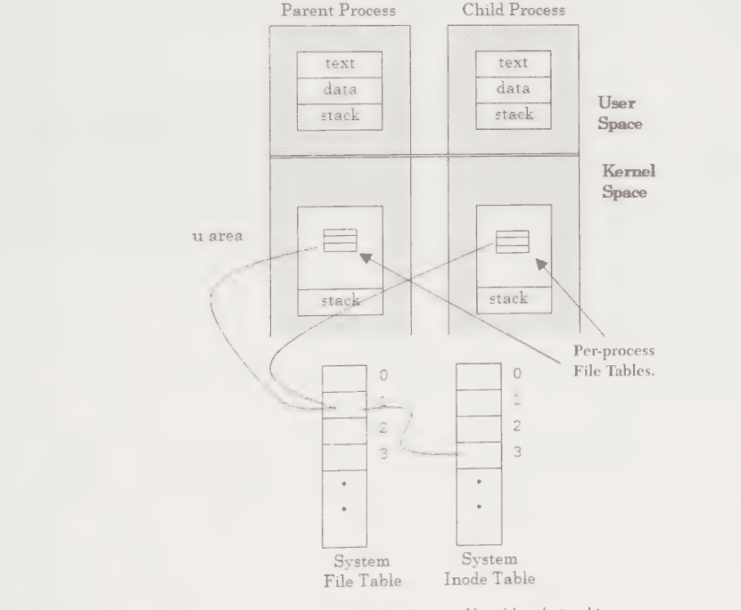

**图 2.10** 进程/系统文件表关系。

## 2.4 练习

编写一个程序，验证父进程和子进程共享相同的文件指针和文件指针偏移量。父进程应`open`一个文本文件并`fork`一个子进程。子进程应`read`该文本文件并显示其读取的内容。当子进程终止后，父进程应`read`同一个文件并显示其读取的内容。在这个阶段，你可能需要使用`sleep`系统调用来同步父子进程之间的文件访问。

## 2.5 练习

编写一个程序，通过*反复试验*来确定一个进程可以同时打开多少个文件（真的是文中提到的 1,024 个吗？）。确保*删除*（研究`unlink`系统调用）你生成的任何文件。

## 2.8 文件信息

进程可以使用许多系统调用来获取文件信息。其中，`stat`系统调用（如表 2.8 所示）为进程提供了一套全面的文件相关信息，这在某种程度上类似于使用 Linux 中的系统级`stat`命令可以获得的信息。例如，命令

```
linux$ stat a.out
File: "a.out"
Size: 14932     Blocks: 32         Regular File
Access: (0755/-rwxr-xr-x)  Uid: ( 500/ gray)  Gid: (1000/ faculty)
    Device: 815    Inode: 97541    Links: 1
    Access: Tue Jan 1 16:05:58 2002
    Modify: Tue Jan 1 16:05:57 2002
    Change: Tue Jan 1 16:05:57 2002
```

显示了当前目录中文件`a.out`的信息。

**表 2.8** `stat`系统调用摘要。

| 包含文件 | 摘要 | 手册章节 |

| :--- | :--- | :--- |

| `<sys/types.h>`<br>`<sys/stat.h>`<br>`<unistd.h>` | `int stat(const char *file_name, struct stat *buf);`<br>`int fstat(int filedes, struct stat *buf);`<br>`int lstat(const char *file_name, struct stat *buf);` | 2 |

| 返回值 | 成功：0<br>失败：-1<br>设置 errno：是 | |

`stat`系统调用的第一个参数是一个字符指针，指向包含文件路径的字符串。`lstat`系统调用类似于`stat`，但当引用的文件是符号链接时除外。对于符号链接，`lstat`返回关于链接条目的信息，而`stat`返回关于实际文件的信息。`fstat`系统调用以打开的文件的整数文件描述符值作为其第一个参数。

所有三个`stat`系统调用都通过它们的第二个参数返回一个指向`stat`结构的指针。`stat`结构在其头文件`<sys/stat.h>`和`<bits/stat.h>`中完整定义。`<bits/stat.h>`文件由`<sys/stat.h>`自动包含，程序员不应直接包含它。`stat`结构通常包含以下成员：

```c
    dev_t     st_dev;     /* device file resides on */
    ino_t     st_ino;     /* this file's number */
    u_short   st_mode;    /* protection */
    short     st_nlink;   /* number of hard links to the file */
    short     st_uid;     /* user ID of owner */
    short     st_gid;     /* group ID of owner */
    dev_t     st_rdev;    /* the device identifier(special files only) */
    off_t     st_size;    /* total size of file, in bytes */
    time_t    st_atime;   /* file data last access time */
    time_t    st_mtime;   /* file data last modify time */
    time_t    st_ctime;   /* file data last status change time */
    long      st_blksize; /* preferred blocksize for file system I/O */
    long      st_blocks;  /* actual number of blocks allocated */
```

各个结构成员的特殊数据类型（例如`dev_t`、`ino_t`）在头文件`<sys/types.h>`中映射到标准数据类型。如果`stat`系统调用成功，它们返回值为 0。否则，它们返回值为 -1 并设置`errno`。由于这些系统调用引用文件信息，可能会遇到许多错误情况。`errno`可能被赋予的值以及相关的`perror`消息说明如表 2.9 所示。

**表 2.9** `stat`错误消息。

| # | 常量 | perror 消息 | 解释 |

| :--- | :--- | :--- | :--- |

| 2 | ENOENT | No such file or directory | 文件不存在（或为 NULL）。 |

| 4 | EINTR | Interrupted system call | 在系统调用期间捕获到信号。 |

| 9 | EBADF | Bad file number | fildes 中的值不是有效的打开文件描述符。 |

| 12 | ENOMEM | Cannot allocate memory | 内存不足（即内核内存）。 |

| 13 | EACCES | Permission denied | 在文件路径的部分路径上搜索权限被拒绝。 |

| 14 | EFAULT | Bad address | 路径引用了非法地址。 |

| 20 | ENOTDIR | Not a directory | 指定路径的部分不是目录。 |

| 36 | ENAMETOOLONG | File name too long | 路径值超过系统路径/文件名长度。 |

| 40 | ELOOP | Too many levels of symbolic links | perror 消息已说明一切。 |

| 67 | ENOLINK | The link has been severed | 路径值引用了不再活跃的远程系统。 |

| 72 | EMULTIHOP | Multihop attempted | 路径值需要跳转到多个远程系统，但文件系统不允许。 |

| 75 | EOVERFLOW | Value too large for defined data type | buf 引用的结构的成员值太大。 |

## 2.8 文件信息

程序 2.2 展示了`stat`系统调用的使用方法。

**程序 2.2** 使用 stat 系统调用。

```cpp
/*
    Using the stat system call
*/
#include <iostream>
#include <cstdio>
#include <sys/types.h>
#include <sys/stat.h>
#include <unistd.h>
using namespace std;
const int N_BITS = 3;
int main(int argc, char *argv[]) {
    unsigned int mask = 0700;
    struct stat buff;
    char *perm[] = {" ", "-x", "-w-", "-wx",
                    "r ", "r-x", "rw-", "rwx"};
    if (argc > 1) {
        if ((stat(argv[1], &buff) != -1)) {
            cout << "Permissions for " << argv[1] << " ";
            for (int i=3; i>-1; i--) {
                cout << perm[(buff.st_mode & mask) >>
                 (i-1)*N_BITS];
                mask = mask >> N_BITS;
            }
            cout << endl;
        } else {
            perror(argv[1]);
            return 1;
        }
    } else {
        cerr << "Usage: " << argv[0] << "file_name\n";
        exit(-1);
    }
    return 0;
}
```

运行该程序并在命令行中传入其自身的程序名，输出如图 2.11 所示。

**图 2.11** 程序 2.2 的输出。

```
linux$ p2.2 a.out
Permissions for a.out rwxr-xr-x
```

对同一文件使用系统命令`ls -l`会显示相同的一组权限信息，如图 2.12 所示。

**图 2.12** 使用`ls`命令验证程序 2.2 的输出。

```
linux$ ls -l a.out
-rwxr-xr-x 1 gray faculty 15290 Jan 2 07:26 a.out
```

### 2-6 练习

修改示例`stat`程序，使其在命令行中传入文件或目录名时，输出尽可能*接近*系统的`ls -l`输出。请注意，`stat`调用不会返回用户的名称（只会返回`UID`）。可以将`UID`传递给`getpwuid`库调用。`getpwuid`调用将返回用户名称（以及附加的密码条目信息）。`getpwuid`库调用的描述可在手册第 3 节中找到。如果需要，可以使用第二个库调用`getgrgid`来将`GID`值映射为实际的组名。

在编程环境中，文件的访问权限可以通过`chmod/fchmod`系统调用进行修改（表 2.10）。

**表 2.10** `chmod/fchmod`系统调用摘要。

| 头文件 | `<sys/types.h>`<br>`<sys/stat.h>` | 手册章节 | 2 |

| :--- | :--- | :---: | :---: |

| 摘要 | `int chmod( const char *path, mode_t mode );`<br>`int fchmod( int fildes, mode_t mode );` | | |

| 返回值 | 成功：0<br>失败：-1 | 设置 errno | 是 |

两个系统调用实现的功能相同，仅在第一个参数的格式上有所不同。`chmod`系统调用的第一个参数是指向文件路径的字符指针引用，而`fchmod`的第一个参数是已打开文件的整数文件描述符值。两个系统调用的第二个参数都是模式（mode）。模式可以字面指定为八进制数（例如 0755），也可以通过对头文件`<sys/stat.h>`中定义的权限常量进行按位或运算的组合来指定。除非进程的有效用户 ID 是超级用户的 ID，否则有效用户 ID 必须与要修改权限的文件所有者相同。如果任一系统调用成功，则返回 0。否则，调用返回 -1 并设置 errno 中的值。与 stat 系统调用一样，错误条件的数量相当多（见表 2.11）。

**表 2.11** `chmod/fchmod`错误消息。

| # | 常量 | perror 消息 | 说明 |

|---|---|---|---|

| 1 | EPERM | Operation not permitted | 不是文件所有者或超级用户。 |

| 2 | ENOENT | No such file or directory | 文件不存在（或为 NULL）。 |

| 4 | EINTR | Interrupted system call | 在系统调用期间捕获到信号。 |

| 5 | EIO | I/O error | 尝试对文件系统进行读写时发生 I/O 错误。 |

| 9 | EBADF | Bad file number | fildes 中的值不是有效的打开文件描述符。 |


| 12 | ENOMEM | Cannot allocate memory | 内存不足（即内核内存）。 |
| 13 | EACCES | Permission denied | 文件路径的某部分搜索权限被拒绝。 |
| 14 | EFAULT | Bad address | `path` 引用了非法地址。 |
| 20 | ENOTDIR | Not a directory | 指定路径的某部分不是目录。 |
| 30 | EROFS | Read-only file system | `path` 引用的文件位于只读文件系统上。 |
| 36 | ENAMETOOLONG | File name too long | 路径值超过了系统路径/文件名长度限制。 |
| 40 | ELOOP | Too many levels of symbolic links | `perror` 消息已经说明了一切。 |
| 67 | ENOLINK | The link has been severed | `path` 值引用了一个不再活跃的远程系统。 |
| 72 | EMULTIHOP | Multihop attempted | `path` 值需要多次跳转到远程系统，但文件系统不允许这样做。 |

`umask` 值从父进程继承而来，可以通过 `umask` 系统调用进行修改（表 2.12）。

**表 2.12** `umask` 系统调用摘要。

| 头文件 | `<sys/types.h>` <br> `<sys/stat.h>` | 手册章节 | 2 |
|---|---|---|---|
| 摘要 | `mode_t umask(mode_t mask);` | | |
| 返回值 | 成功：之前的 `umask` 值 | 失败 | 设置 `errno` |

调用 `umask` 时，它会将 `umask` 值更改为传入的八进制整数值，并返回旧（之前）的 `umask` 值。如果你使用 `umask` 系统调用来确定当前的 `umask` 设置，你应该第二次调用 `umask`，将第一次调用返回的值传入，以将设置恢复到初始状态。例如，

```cpp
mode_t cur_mask;
cur_mask = umask(0);
cout << "Current mask: " << setfill('0') << setw(4) << oct << cur_mask << endl;
umask(cur_mask);
```

`umask` 系统调用永远不会产生错误或设置 `errno` 中的值。如果你尝试赋值一个 `-011` 的掩码值会发生什么？

库函数 `getcwd` 用于将进程当前工作目录的绝对路径复制到已分配的位置。该函数的定义如表 2.13 所示。它返回一个指向目录路径名的指针。该函数需要两个参数。第一个是指向应存储路径名的位置的指针。如果该参数设置为 `NULL`，`getcwd` 将使用 `malloc` 自动分配存储空间。第二个参数是要返回的路径名的长度（加上 1 用于 `\0` 终止字符串）。头文件 `<sys/param.h>` 中包含定义的常量 `MAXPATHLEN`，可用于确保缓冲区具有足够的大小（即 `MAXPATHLEN+1`）。在以下代码片段中，分配用于保存路径信息的空间恰好是存储绝对路径所需的大小（很可能小于 `MAXPATHLEN+1`）。

```cpp
char *path;
path = getcwd(NULL, MAXPATHLEN+1);
cout << path << endl;
cout << "Path length: " << strlen(path) << endl; // sufficient to hold path
```

该系统调用似乎是在此类技术被质疑之前编写的（即同时更改 `umask` 的状态并返回其当前值）。

**表 2.13** `getcwd` 库函数摘要。

| 头文件 | `<unistd.h>` | 手册章节 | 3 |
|---|---|---|---|
| 摘要 | `char *getcwd(char *buf, size_t size);` | | |
| 返回值 | | 成功 | 失败 | 设置 `errno` |
| | 指向当前目录名称的指针 | `NULL` | 是 |

如果 `getcwd` 失败，它返回 `NULL` 并设置 `errno`（表 2.14）。如果使用 `malloc` 动态分配存储空间，在不再需要该空间时应使用 `free` 将其释放。

**表 2.14** `getcwd` 错误消息。

| # | 常量 | `perror` 消息 | 说明 |
|---|---|---|---|
| 13 | EACCES | Permission denied | 文件路径的某部分搜索权限被拒绝。 |
| 22 | EINVAL | Invalid argument | `size` 的值小于或等于 0。 |
| 34 | ERANGE | Numerical result out of range | `size` 的值大于 0 但小于路径长度加 1。 |

系统调用 `chdir` 用于更改当前工作目录（与系统级别的 `cd` 命令相同）。见表 2.15。

`chdir` 系统调用的参数是指向有效路径名的字符指针引用（进程必须对所有引用的目录具有搜索权限）。`fchdir` 系统调用的参数是目录的已打开文件描述符。如果成功，系统调用返回 0，而 `cd` 命令与许多其他系统级命令不同，它不是作为子进程运行的，因此其更改将对当前进程生效。

## 表 2.15 `chdir`/`fchdir` 系统调用摘要。

| 包含文件 | `<unistd.h>` | 手册章节 |
|---|---|---|
| 摘要 | `int chdir( const char *path ); int fchdir( int fildes );` | 2 |
| | 成功 | 失败 | 设置 `errno` |
| 返回值 | 0 | -1 | 是 |

进程的新工作目录将被设置为指定的目录。如果调用失败，将返回 -1 并设置 `errno`（表 2.16）。

## 表 2.16 `chdir`/`fchdir` 错误消息。

| # | 常量 | `perror` 消息 | 解释 |
|---|---|---|---|
| 2 | ENOENT | No such file or directory | 文件不存在（或为 `NULL`）。 |
| 4 | EINTR | Interrupted system call | 系统调用期间捕获到信号。 |
| 5 | EIO | I/O error | 尝试读取或写入文件系统时发生 I/O 错误。 |
| 9 | EBADF | Bad file number | `fildes` 中的值不是有效的打开文件描述符。 |
| 12 | ENOMEM | Cannot allocate memory | 内存不足（即内核内存）。 |
| 13 | EACCES | Permission denied | 文件路径的某部分搜索权限被拒绝。 |
| 14 | EFAULT | Bad address | `path` 引用了一个非法地址。 |
| 20 | ENOTDIR | Not a directory | 指定路径的某部分不是目录。 |
| 36 | ENAMETOOLONG | File name too long | 路径值超过了系统路径/文件名长度。 |
| 40 | ELOOP | Too many levels of symbolic links | `perror` 消息已说明一切。 |
| 67 | ENOLINK | The link has been severed | 路径值引用了一个不再活动的远程系统。 |
| 72 | EMULTIHOP | Multihop attempted | 路径值需要跳转到多个远程系统，但文件系统不允许。 |

## 2.8 练习

预测当一个进程**fork**出一个子进程，并且子进程发出**chdir**系统调用时会发生什么——父进程的当前目录也会被改变吗？编写一个程序来验证你的答案。

## 2.9 进程资源限制

由于系统资源是有限的，每个进程都受到操作系统施加的某些限制。在命令行中，**ulimit** 命令（实际上是 Bourne shell [`/bin/sh`] 中的一个内置命令）为用户提供了一种显示和修改 shell 及其启动的进程当前可用系统限制的方法。

命令 **ulimit -Ha** 显示系统的硬限制。硬限制只能由超级用户增加。图 2.13 展示了系统硬限制的示例。

**图 2.13** Linux 系统上的典型硬限制。

```
linux$ ulimit -Ha
core file size          (blocks, -c) 0
data seg size           (kbytes, -d) unlimited
file size               (blocks, -f) unlimited
max locked memory       (kbytes, -l) unlimited
max memory size         (kbytes, -m) unlimited
open files                      (-n) 1024
pipe size            (512 bytes, -p) 8
stack size              (kbytes, -s) 8192
cpu time               (seconds, -t) unlimited
max user processes              (-u) 4095
virtual memory          (kbytes, -v) unlimited
```

当 **ulimit** 命令使用 **-Sa**（Soft, all）命令行选项时显示的软限制，是一种可以由用户设置的限制。软限制通常低于

8 C shell (`/bin/csh`) 提供了一个类似的内置命令 **limit**。

51

# 2 处理环境

已建立的硬限制。请注意，此系统上当前进程的栈大小限制略小一些，如图 2.14 所示。

**图 2.14** 单个进程的资源限制。

```
linux$ ulimit -Sa
core file size      (blocks, -c) unlimited
data seg size       (kbytes, -d) unlimited
file size           (blocks, -f) unlimited
max locked memory   (kbytes, -l) unlimited
max memory size     (kbytes, -m) unlimited
open files          (-n) 1024
pipe size           (512 bytes, -p) 8
stack size          (kbytes, -s) 8192
cpu time            (seconds, -t) unlimited
max user processes  (-u) 4095
virtual memory      (kbytes, -v) unlimited
```

进程的资源限制信息也可以在编程环境中获取。历史上，使用 `ulimit` 系统调用来获取部分信息。在较新版本的操作系统中，`ulimit` 系统调用已被下文描述的 `getrlimit`/`setrlimit` 调用所取代。然而，`ulimit` 仍然值得简要研究，因为它有时出现在遗留代码中（表 2.17）。

### 表 2.17 `ulimit` 系统调用摘要。

| | | 手册章节 | 3 |
| :--- | :--- | :---: | :---: |
| 包含文件 | `<ulimit.h>` | | |
| 摘要 | `long ulimit(int cmd /*, long newlimit */ );` | | |
| | **成功** | **失败** | **设置 errno** |
| 返回值 | 非负长整型 | -1 | 是 |

参数 `cmd` 可以取以下四个不同的值之一：

1. 获取此进程的文件大小限制。返回值以 512 字节块为单位。

## 2.9 进程资源限制

2. 将文件大小限制设置为 `newlimit` 指示的值。非超级用户只能减小文件大小限制。这是唯一使用 `newlimit` 参数的命令。

3. 获取最大 `break` 值。此选项不被 Linux 支持。

4. 返回调用进程可以打开的最大文件数。

如果 `ulimit` 成功，它返回一个正整数值；否则，它返回 -1 并设置 `errno` 中的值（表 2.18）。

## 表 2.18 `ulimit` 错误消息。

| # | 常量 | `perror` 消息 | 解释 |
|---|---|---|---|
| 13 | EPERM | Permission denied | 调用进程不是超级用户。 |
| 22 | EINVAL | Invalid argument | `cmd` 的值无效。 |

较新的 `getrlimit`/`setrlimit` 系统调用为进程提供了更完整的系统资源限制访问权限（表 2.19）。

## 表 2.19 `getrlimit`/`setrlimit` 系统调用摘要。

| 包含文件 | `<sys/time.h>` `<sys/resource.h>` `<unistd.h>` | 手册章节 | 2 |
|---|---|---|---|
| 摘要 | `int getrlimit(int resource, struct rlimit *rlim); int setrlimit(int resource, const struct rlimit *rlim);` | | |
| 返回值 | 成功 | 失败 | 设置 `errno` |
| | 0 | -1 | 是 |

`rlimit` 结构体：

```c
struct rlimit {
    rlimit_t rlim_cur;   /* current (soft) limit */
    rlimit_t rlim_max;   /* hard limit             */
};
```

以及这两个函数使用的若干已定义常量：

```c
RLIMIT_CPU      /* CPU time in seconds */
RLIMIT_FSIZE    /* Maximum filesize */
RLIMIT_DATA     /* max data size */
RLIMIT_STACK    /* max stack size */
RLIMIT_CORE     /* max core file size */
RLIMIT_RSS      /* max resident set size */
RLIMIT_NPROC    /* max number of processes */
RLIMIT_NOFILE   /* max number of open files */
RLIMIT_MEMLOCK  /* max locked-in-memory address space*/
RLIMIT_AS       /* address space (virtual memory) limit */
RLIMIT_INFINITY /* actual value for 'unlimited' */
```

可以在头文件 `<sys/resource.h>` 及其相关包含文件中找到。程序 2.3 展示了一个使用 **getrlimit** 系统调用的程序。

### 程序 2.3 显示资源限制信息。

```cpp
/*
   Using getrlimit to display system resource limits
*/

#include <iostream>
#include <iomanip>
#include <sys/time.h>
#include <sys/resource.h>
using namespace std;

int main(){
    struct rlimit plimit;
    char *label[] = {"CPU time", "File size",
                     "Data segment", "Stack segment",
                     "Core size","Resident set size",
                     "Number of processes", "Open files",
                     "Locked-in-memory", "Virtual memory",
                     };
    int constant[]= { RLIMIT_CPU  , RLIMIT_FSIZE,
                      RLIMIT_DATA  , RLIMIT_STACK,
                      RLIMIT_CORE  , RLIMIT_RSS,
                      RLIMIT_NPROC , RLIMIT_NOFILE,
                      RLIMIT_MEMLOCK, RLIMIT_AS };
    for (int i = 0; label[i]; ++i) {
        getrlimit(constant[i], &plimit);
        cout << setw(20) << label[i] << "\t Current: "
             << setw(10) << plimit.rlim_cur << "\t Max: "
             << setw(10) << plimit.rlim_max << endl;
    }
    return 0;
}
```

## 2.9 进程资源限制

该程序的输出序列（图 2.15）与前面展示的系统级 `ulimit` 命令的输出相当。

**图 2.15** 程序 2.3 的输出。


```text
linux$ p2.3
                  CPU time   Current: 4294967295   Max: 4294967295
                  File size  Current: 4294967295   Max: 4294967295
              Data segment  Current: 4294967295   Max: 4294967295
             Stack segment  Current:    8388608   Max: 4294967295
                 Core size  Current: 4294967295   Max: 4294967295
         Resident set size  Current: 4294967295   Max: 4294967295
      Number of processes  Current:     16383   Max:      16383
              Open files  Current:      1024   Max:       1024
       Locked-in-memory  Current: 4294967295   Max: 4294967295
          Virtual memory  Current: 4294967295   Max: 4294967295
```

`setrlimit`系统调用与`ulimit`调用一样，只能由非超级用户用来降低资源限制。如果这些系统调用成功，则返回 0；否则返回 -1 并在`errno`中设置相应的值（表 2.20）。

| # | 常量 | perror 消息 | 说明 |
|---|---|---|---|
| 13 | `EPERM` | Permission denied | 调用进程不是超级用户。 |
| 22 | `EINVAL` | Invalid argument | `resource`的值无效。 |

### 2-9 练习

在 Bourne（或 BASH `/bin/bash`）shell 中，执行命令`ulimit -u 2`后再执行命令`ls -1`。解释发生了什么。你是如何解决该问题的？如果在 C Shell（`/bin/csh`或`/bin/tcsh`）中，请将`ulimit`命令替换为`limit ma 2`。

可以使用`sysconf`库函数获取更多进程限制信息（表 2.21）。

### 表 2.21 `sysconf`库函数摘要

| 头文件 | `<unistd.h>` | 手册章节 | 3 |
|---|---|---|---|
| 摘要 | `long sysconf(int name);` | | |
| 返回值 | 成功：非负长整型 | 失败：-1 | 设置 errno：否 (?) |

`sysconf`函数接收一个整型`name`值（通常是以定义常量的形式），用于指示所请求的限制。如果成功，该函数返回与限制对应的长整型值，如果该限制可用则返回 0 或 1。如果`sysconf`函数失败，则返回 −1 且不设置`errno`的值。`sysconf`所了解的限制被定义为头文件`<unistd.h>`中的常量。<sup>9</sup>在早期版本的操作系统中，部分限制值可以在头文件`<sys/param.h>`中找到。以下列出了一些较为常用的限制查询常量：

```cpp
_SC_ARG_MAX       /* argv & envp 所需空间 */
_SC_CHILD_MAX     /* 每进程最大子进程数 */
_SC_CLK_TCK       /* 每秒时钟滴答数 */
_SC_STREAM_MAX    /* 每进程最大数据流数 */
_SC_TZNAME_MAX    /* 时区名称规范中的最大字节数 */
_SC_OPEN_MAX      /* 每进程最大打开文件数 */
_SC_JOB_CONTROL   /* 是否支持作业控制？ */
_SC_SAVED_IDS     /* 是否支持保存的 uid/gid？ */
_SC_VERSION       /* 支持的 POSIX 版本 YYYYMML 格式 */
```

程序 2.4 显示了与系统限制相关的值，如下所示。

### 程序 2.4 显示系统限制

```cpp
File : p2.4.cxx
/*
        使用 sysconf 显示系统限制
*/
#include <iostream>
#include <iomanip>
```

<sup>9</sup>实际上，这里有些含糊。头文件`<unistd.h>`通常会包含另一个定义了常量的文件。`<unistd.h>`中有逻辑根据所满足的标准（POSIX.1 等）来包含正确的文件。目前实际的定义可以在`<bits/confname.h>`中找到——程序员不应直接包含该文件。

```cpp
int main( ){
  char *limits[ ]={"Max size of argv + envp",
                         "Max # of child processes",
                         "Ticks / second",
                         "Max # of streams",
                         "Max # of bytes in a TZ name",
                         "Max # of open files",
                         "Job control supported?",
                         "Saved IDs supported?",
                         "Version of POSIX supported",
                         0};
  int constant[ ]={ _SC_ARG_MAX,   _SC_CHILD_MAX,
                    _SC_CLK_TCK,  _SC_STREAM_MAX,
                    _SC_TZNAME_MAX, _SC_OPEN_MAX,
                    _SC_JOB_CONTROL,_SC_SAVED_IDS,
                    _SC_VERSION };
  for (int i=0; limits[i]; ++i) {
    cout << setw(30) << limits[i] << "\t"
         << sysconf(constant[i])  << endl;
  }
  return 0;
}
```

在本地系统上运行时，程序 2.4 产生了如图 2.16 所示的输出。

## 图 2.16 程序 2.4 的输出

```text
$ a.out
         Max size of argv + envp 1024
    Max # of child processes 26
              Ticks / second 100
            Max # of streams 16
 Max # of bytes in a TZ name 0
      Max # of open files 1024
        Job control supported? 0
        Saved IDs supported? 1
   Version of POSIX supported 199506L
```

如果`sysconf`函数因无效的`name`值而失败，则返回 −1。手册页表明`errno`不会被设置；然而，某些 Linux 版本会将`errno`设置为`EINVAL`，表示无效的参数。

## 2.10 向进程发送信号

当发生异常事件时，进程可能会收到一个信号。信号是异步的，在需要关注的事件发生时产生。可以将其视为硬件中断的软件版本，可由多种来源产生：

- **硬件**——例如当进程试图访问其地址空间之外的地址或发生除零错误时。
- **内核**——通知进程其等待的 I/O 设备（例如终端输入）已可用。
- **其他进程**——子进程通知其父进程它已终止。
- **用户**——按下键盘序列产生退出、中断或停止信号。

信号以编号表示，历史上定义在头文件`<signal.h>`中。在 Linux 中，信号定义位于`<bits/signum.h>`中。当你包含`<signal.h>`时，该文件会被自动包含。不应在程序中直接包含`<bits/signum.h>`。接收信号的进程可以采取以下三种操作之一：

1. **执行系统指定的默认操作。** 对于大多数信号，默认操作（如果未指定其他操作则由进程执行的操作）是：(a) 通知父进程它正在终止，(b) 生成`core`文件（包含进程当前内存映像的文件），以及 (c) 终止。
2. **忽略信号。** 除两个特殊信号外，进程可以忽略所有信号：`SIGSTOP`（信号 23），一个非终端产生的停止处理信号，以及`SIGKILL`（信号 9），表示进程将被杀死（终止）。进程无法忽略这些特殊信号，这确保了操作系统能够移除异常进程。
3. **捕获信号。** 与忽略信号一样，除`SIGSTOP`和`SIGKILL`信号外，可以对所有信号进行此操作。当进程捕获一个信号时，它会调用一个特殊的信号处理例程。在执行完信号处理例程中的代码后，进程会在适当的时候从中断处恢复执行。

子进程从其父进程继承与特定信号关联的操作。然而，如果子进程用另一个可执行映像覆盖其进程空间，例如通过`exec`系统调用（参见第 3 章“使用进程”），则进程空间中与特定地址处信号处理例程关联的所有信号都会在新进程中重置为默认操作。这种重置为默认操作是由系统执行的，因为与信号处理例程关联的地址在新的进程映像中不再有效。

在大多数情况下（除非是在终端等慢速设备上进行 I/O），当进程正在执行系统调用且收到信号时，被中断的系统调用会产生一个错误（通常返回 −1）并设置全局`errno`变量为`EINTR`。发起系统调用的进程负责重新执行被中断的系统调用。由于检查每个系统调用是否被信号中断所带来的开销很大，信号被捕获后进程很少会恢复正常执行。更常见的情况是，进程使用信号处理例程在自行退出之前执行清理工作（如关闭文件等）。发送给进程/会话组领头进程的信号也会传递给组的成员。信号和信号处理例程在第 4 章“基本通信”中有详细介绍。

### 2-10 练习

信号 1 到 31 的系统指定默认操作在`signal`的通用手册页（手册第 7 节）中给出。作为默认操作，有多少信号 (a) 产生核心转储，(b) 使进程停止（终止），以及 (c) 被丢弃（忽略）？

## 2.11 命令行值

每个进程的处理环境的一部分是传递给`main`函数的值。这些值可以来自命令行，也可以由父进程通过`exec`系统调用传递给子进程。这些值存储在一个参差字符数组中，该数组由一个字符指针数组引用，按惯例称为`argv`。`argv`数组中的元素数量存储为一个整数值，同样按惯例由标识符`argc`引用。程序 2.5 显示命令行值，利用了在较新的 ANSI 标准版本的 Linux 中，最后

## 2.11 命令行参数

`argv`数组的末尾元素（即`argv[argc]`）保证是一个空指针。然而，在大多数编程场景中，尤其是在需要考虑向后兼容性的情况下，最好在遍历`argv`数组时，使用`argc`的值作为上限。如果我们以`p2.5`的方式运行程序，并在命令行中输入一些任意值，我们将获得如图 2.17 所示的输出。

```cpp
// 程序 2.5 显示命令行参数。
// 文件 : p2.5.cxx
/*
显示 argv[]（命令行）的内容
*/
#include <iostream>
using namespace std;
int
main(int argc, char *argv[])
{
    for ( ; *argv; ++argv )
        cout <<  *argv << endl;
    return 0;
}
```

**图 2.17** 程序 2.5 的输出。

```text
linux$ p2.5 This is a test.
p2.5
This
is
a
test.
```

我们可以将系统想象为将这些命令行参数值存储在`argc`和`argv`中，如图 2.18 所示。在这种情况下（由系统填充`argv`数组），`argc`将始终大于 0，而`argv`引用的第一个值将是正在执行的程序的名称。系统会自动为每个字符串添加空字符作为结尾，并在`argv`数组的末尾地址放置一个 0。

在程序中，扫描命令行以确定其内容（例如，查找命令行选项）是一种常见的做法。过去，希望检查命令行内容以寻找选项的程序员必须编写自己的命令行解析代码。然而，有一个通用的库函数`getopt`可以完成这项工作。¹⁰`getopt`库函数有点像瑞士军刀——它能做很多事情，但对于初学者来说，初次接触时可能显得过于复杂（表 2.22）。

¹⁰如果你进行 shell 编程，你会发现你的系统支持一个名为`getopt`的 shell 版本库函数。这个 shell 版本使用库函数版本来进行解析。

### 表 2.22 `getopt`库函数摘要

| 包含文件 | `<unistd.h>` | 手册章节 | 3 |
|:---|:---|:---|:---|
| 摘要 | `int getopt( int argc, char * const argv[], char *optstring );`<br>`extern char *optarg;`<br>`extern int optind, opterr, optopt;` | | |
| 返回值 | | | |
| | 成功 | 失败 | 设置`errno` |
| | 下一个选项字母 | -1 或 ? | |

`getopt`函数需要三个参数。第一个是整数值`argc`（第二个参数中的元素数量）。第二个参数是指向字符字符串数组的指针的指针。通常，这是由`argv`引用的字符字符串数组。第三个参数是指向一个有效选项字母（字符）字符串的指针，`getopt`应该识别这些字母。如前所述，在大多数设置中，`argc`和`argv`的值与`main`函数的第一和第二个参数相同。然而，这并不妨碍用户自行生成传递给`getopt`的这两个参数。

`optstring`内容的格式需要进一步解释。如果一个选项字母需要后跟一个参数，那么`optstring`中的选项字母后面会跟一个冒号。例如，如果选项字母`s`（假设代表大小）后面需要跟一个整数大小值，那么对应的`optstring`条目将是`s:`。在命令行上，用户应输入`-s 200`来表示大小为 200。为了使命令行选项能被`getopt`正确处理，它前面必须有一个连字符（`-`），而选项的参数则不应有前导连字符，并且可以与选项用空格分隔，也可以不分隔。

`getopt`函数以整数形式返回以下三个值之一：

- −1 表示所有选项都已处理完毕。
- `?`表示处理了一个不在`optstring`中的选项字母，或者指定了一个选项参数（使用`optstring`中的`:`表示法），但在处理命令行时未找到该参数。当返回`?`时，`getopt`还会在标准错误输出上显示一条错误信息。可以通过将外部标识符`opterr`中存储的值更改为 0（默认值为 1）来禁用错误信息的自动显示。引发错误的字符（存储为整数）由`optopt`变量引用。
- `argv`中下一个与`optstring`中某个字母匹配的选项字母。如果在`optstring`中匹配的字母后面跟有冒号，那么外部字符指针`optarg`将引用参数值。请记住，如果参数值需要作为数值（而不是字符串）处理，则必须进行转换。

外部整数`optind`在第一次调用`getopt`之前由系统初始化为 1。它将包含`argv`中下一个非选项参数的索引。默认情况下，`getopt`处理参数数组的方式是将所有非选项参数放在列表末尾。将`optind`中的值与`argc`中的值进行比较，可用于确定命令行上的所有项目是否都已处理完毕。`getopt`函数有一个相关函数`getopt_long`，其功能与`getopt`类似，但能处理长（那些以两个前导破折号开头）命令行参数。有关详细信息，请查阅该函数的手册页。程序 2.6 展示了一个演示`getopt`用法的程序。

### 程序 2.6 使用库函数`getopt`


```cpp
// 文件 : p2.6.cxx
/*
    使用 getopt 的命令行
*/
#define _GNU_SOURCE
#include <iostream>
#include <cstdlib>
#include <unistd.h>
using namespace std;
extern char    *optarg;
extern int      optind, opterr, optopt;

int
main(int argc, char *argv[ ]){
    int     c;
    char    optstring[] = "abs:";
    opterr = 0;  // 关闭自动错误信息
    while ((c = getopt(argc, argv, optstring)) != -1)
    {
        switch(c) {
            case 'a':
                cout << "Found option a\n";
                break;
            case 'b':
                cout << "Found option b\n";
                break;
            case 's':
                cout << "Found option s with an argument of: ";
                cout << atoi(optarg) << endl; // 转换为整数
                break;
            case '?':
                cout << "Found an option that was not in optstring.\n";
                cout << "The offending character was " << char(optopt) << endl;
        }
    }
    if (optind < argc){
        cout << (argc-optind) << " arguments not processed.\n";
        cout << "Left off at: " << argv[optind] << endl;
    }
    return 0;
}
```

使用一些*示例*命令行选项运行该程序的输出如图2.19所示。

**图 2.19** 程序 2.6 的输出。

```bash
linux$ p2.6 -abc -s 34 -b joe -a student
Found option a
Found option b
Found an option that was not in optstring.
The offending character was c
Found option s with an argument of: 34
Found option b
Found option a
2 arguments not processed.
Left off at: joe
```

正如输出所示，`getopt` 可以分组处理选项（例如`-abc`）或单独处理（例如`-b`），并且不关心选项的字母顺序。当处理停止时，可以检查`optind`以确定是否有任何命令行选项不属于指定的选项。

## 2-11 练习

修改程序2.3以接受命令行选项，这些选项将使用库调用`getopt`进行处理。在适当的情况下，允许用户指定参数以更改特定限制的值（使用`setrlimit`系统调用）。考虑使用`getopt_long`来支持一个`--help`选项，该选项可以为用户提供一些关于如何运行该程序的最低限度帮助。

## 2.12 环境变量

每个进程还可以访问一个环境变量列表。环境变量与命令行参数一样，存储为字符的参差数组。环境变量通常在shell级别设置¹¹，在进程开始执行时由其父进程传递给该进程。可以通过使用一个名为`environ`的外部指针在程序中访问环境变量，该指针定义为

```cpp
extern char **environ;
```

在大多数旧版本（以及一些当前版本）的Linux中，也可以通过使用`main`函数的第三个参数`envp`来访问环境变量。使用时，`main`的`envp`参数定义为

```cpp
main(int argc, char *argv[], char **envp /* OR as *envp[]*/)
```

由于`environ`和`envp`都可用于完成相同的任务，并且当前标准不鼓励使用`envp`，因此将仅详细讨论外部指针`environ`的用法。环境变量的内容可以通过类似于命令行参数的方式获取（程序2.7）。图2.20显示了在本地系统上运行此程序的输出的*部分*列表。

## 程序 2.7 显示环境变量。

```cpp
File : p2.7.cxx
/*
    Using the environ pointer to display the command line
*/
#include <iostream>
using namespace std;
extern char **environ;
int
main( ){
    for (  ; *environ ; )
        cout << *environ++ << endl;
    return 0;
}
```

## 图 2.20 程序 2.7 的输出。

```bash
PWD=/home/faculty/gray/revision/02
VENDOR=intel
REMOTEHOST=zeus.cs.hartford.edu
HOSTNAME=kahuna
LOGNAME=gray
SHLVL=2
GROUP=faculty
USER=gray
PATH=/usr/kerberos/bin:/usr/local/bin:/bin:/usr/bin:/usr/X11R6/bin:.
```

输出表明所有环境变量都以`name=value`的字符串格式存储。此处显示的许多环境变量在所有Linux系统中都是通用的（例如`USER`、`PATH`等），而其他一些则是系统相关的（例如`VENDOR`）。请注意，按照惯例，环境变量通常以大写字母拼写。对于更感兴趣的人，`environ`的手册页（`$ man 5 environ`）提供了常用环境变量及其用途的详细描述。

表2.23和表2.24中所示的两个库函数可用于操作环境变量。

第一个库函数`getenv`在环境列表中搜索指定变量的首次出现。传递给`getenv`的字符串参数应采用`name`格式，其中`name`是要查找的环境变量的名称，不带末尾的`=`。请注意，`name`区分大小写（环境变量通常为大写）。如果`getenv`成功，则返回指向分配给指定环境变量的字符串的指针；否则返回`NULL`指针。如果`getenv`失败，它返回`-1`并将`errno`设置为`ENOMEM`（12—"Cannot allocate memory"）。在程序2.8中，输出（如图2.21所示）表明在此例中环境变量`TERM`已被找到，其当前值为`vt220`。请注意，`getenv`仅返回等号右侧的字符串。

**表 2.23** `getenv`库函数摘要。

| 包含文件 | `<unistd.h>` | 手册章节 | 3 |
|---|---|---|---|
| 函数原型 | `char *getenv( const char *name );` | | |
| 返回值 | | 成功 | 指向环境中该值的指针 |
| | | 失败 | `NULL` |
| | | 设置`errno` | |

**表 2.24** `putenv`库函数摘要。

| 包含文件 | `<stdlib.h>` | 手册章节 | 3 |
|---|---|---|---|
| 函数原型 | `int putenv( const char *name );` | | |
| 返回值 | | 成功 | `0` |
| | | 失败 | `-1` |
| | | 设置`errno` | 是 |

## **程序 2.8** 使用`getenv`。

```cpp
File : p2.8.cxx

/*
    Displaying the contents of the TERM variable
*/
#include <iostream>
#include <cstdlib>
using namespace std;

main() {
    char *c_ptr;
    c_ptr = getenv("TERM");
    cout << "The variable TERM is "
         << (c_ptr==NULL ?  "NOT found" : c_ptr)
         << endl;
}
```


```bash
linux$ echo $TERM
...
The variable TERM is vt220
```

修改或添加环境变量信息（通常通过库函数`putenv`来完成）则稍微复杂一些。环境变量以及命令行值由系统存储在进程栈段之后的区域中（参见第1章第1.8节）。该区域可由进程访问并可由进程修改，但*不能*被扩展。当添加环境变量或修改现有的环境变量使其在存储上大于其初始设置时，系统会将环境变量信息从其栈位置移动到进程的文本段（`putenv`函数使用`malloc`来分配额外的空间）。在此情况下，问题变得更加复杂的是，`envp`（如果支持的话）在引用原始环境变量时仍然指向栈上的表，但指向*新*环境变量时则指向文本段。这是应该避免使用`envp`的又一个原因！

最后一个注意事项出现在`putenv`的手册页中。`putenv`的参数不应是自动变量（例如函数内的局部变量），因为一旦退出该函数，这些变量就会变为未定义。

程序2.9演示了`putenv`函数。


```cpp
File : p2.9.cxx
/*
    Using putenv to modify the environment as seen by parent - child
*/
#define _GNU_SOURCE
#include <iostream>
#include <cstdlib>
#include <sys/types.h>
#include <unistd.h>
using namespace std;
extern char **environ;
int show_env( char ** );
int
main( ){
    int numb;
    cout << "Parent before any additions **********" << endl;
    show_env( environ );
    putenv("PARENT_ED=parent");
    cout << "Parent after one addition  **********" << endl;
    show_env( environ );
    if ( fork( ) == 0 ){        // In the CHILD now
        cout << "Child before any additions **********" << endl;
        show_env( environ );
        putenv("CHILD_ED=child");
        cout << "Child after one addition  **********" << endl;
        show_env( environ );
        return 0;
    }                           // In the PARENT now
    sleep( 10 );                // Make sure child is done
    cout << "Parent after child is done **********" << endl;
    numb = show_env( environ );
    cout << "... and at address [" << hex << environ+numb
         << "] is ... "
         << (*(environ+numb) == NULL ? "Nothing!" : *(environ+numb))
         << endl;
    return 0;
}
/*
    Display the contents of the passed list ... return number found
*/
int show_env( char **cp ){
    int i;
    for (i = 0; *cp; ++cp, ++i)
        cout << "[" << hex << cp << "] " << *cp << endl;
    return i;
}
```

此程序在本地系统上运行时的精简输出（为清晰起见，移除了部分中间输出行）在图2.22中进行了解释。

## 图 2.22 程序 2.9 的输出。

```bash
    Parent before any additions **********
    [0xbffffc9c] TERM=vt220
    ...
    Parent after one addition **********
    [0x8049ec8] TERM=vt220
    ...
    [0x8049f34] CA_DB=
    [0x8049f38] PARENT_ED=parent
    Child before any additions **********
    [0x8049ec8] TERM=vt220
    ...
    [0x8049f34] CA_DB=
    [0x8049f38] PARENT_ED=parent
    Child after one addition **********
    [0x8049ec8] TERM=vt220
    ...
    [0x8049f34] CA_DB=
    [0x8049f38] PARENT_ED=parent
    [0x8049f3c] CHILD_ED=child
    Parent after child is done **********
    [0x8049ec8] TERM=vt220
    ...
    [0x8049f34] CA_DB=
    [0x8049f38] PARENT_ED=parent
    ... and at address [0x8049f3c] is ... Nothing!
```

环境变量最初存储在栈段之后的区域中（注意地址）。

此环境变量由父进程添加。所有变量已被移动到文本段。

请注意，子进程中的地址与父进程相同。

此环境变量由子进程添加。

当子进程消失时，它添加的环境变量也随之消失。

通过检查此程序及其输出，可以获得几个重要概念。首先，很明显，当添加新的环境变量时，与环境变量关联的地址会发生变化（从栈段变为文本段）。其次，子进程从其父进程继承环境变量的*副本*。第三，由于每个进程都有自己独立的地址空间，子进程无法将信息传回给父进程。[12] 第四，添加环境变量时，应遵守`name=value`的格式。虽然示例程序中没有进行检查，但如果使命完成成功，`putenv`将返回`0`，如果失败则返回`-1`。

[12] 我确信许多*人类*子女会说，这在他们的父母/子女关系中也是正确的——一切（尤其是任务）似乎都是单向的。

## 2-12 练习

Sam想到了一种让子进程通过环境与其父进程通信的方法。他的方案是让子进程修改一个最初在父进程中找到的环境变量（不改变存储大小，也不使用`putenv`）。他编写了以下程序来测试他的想法。他的程序能否如他所想那样工作——为什么能，或者为什么不能？


```cpp
// File : sam.cxx

/*
    Sam's environment program
*/
#define _GNU_SOURCE
#include <iostream>
#include <cstdlib>
#include <sys/types.h>
#include <unistd.h>
using namespace std;
int
main( ){
    int numb;
    char *p;
    putenv("DEMO=abcdefghijklmnop");
    p = getenv("DEMO");
    cout << "1. Parent environment has " << p << endl;

    if ( fork( ) == 0 ){          // In the CHILD now
        *(p + 9) = 'X';           // Change ref location
        p = getenv("DEMO");
        cout << "2. Child environment has  " << p << endl;
        cout << "3. Exiting child." << endl;
        return 0;
    }                             // In the PARENT now
    sleep( 10 );                  // Make sure child is done
    cout << "4. Back in parent:" << endl;
    p = getenv("DEMO");
    cout << "5. Parent environment has " << p << endl;
    return 0;
}
```

## 2.13 /proc 文件系统

Linux 实现了一个名为 `/proc` 的特殊虚拟文件系统，用于存储关于内核、内核数据结构以及每个进程和关联线程状态的信息。请记住，在 Linux 中，线程是以特殊类型的进程来实现的。`/proc` 文件系统存储在内存中，而非磁盘上。其中提供的大部分信息是只读的，并且在不同版本的 Linux 之间可能有很大差异。标准系统调用（如 `open`、`read` 等）可供程序用来访问 `/proc` 文件。

Linux 提供了一个 `procinfo` 命令，可以生成格式化的 `/proc` 信息显示。图 2.23 展示了该命令的默认输出。正如预期的那样，`procinfo` 有多种命令行选项（具体细节请查阅手册页 `$ man 8 procinfo`）。此外，虽然 `/proc` 中的大多数文件采用特殊格式，但许多文件可以通过命令行 `cat` 工具来显示。

**图 2.23** 典型的 `procinfo` 输出。

```
linux: procinfo
Linux 2.4.3-12enterprise (root@porky) (gcc 2.96 20000731 ) #1 2CPU [linux]

Memory:       Total        Used        Free      Shared    Buffers      Cached
Mem:         512928      510436        2492          84       65996      265208
Swap:        1068284         544     1067740

Bootup: Thu Dec 27 12:31:23 2001   Load average: 0.00 0.00 0.00 <fr>>1/85 10791
user :   0:12:34.61  0.0% page in :  7194848
nice :   0:00:15.34  0.0% page out:  1714280
system:  0:16:18.81  0.0% swap in :          1
idle :  21d 20:49:43.68  99.9% swap out:          0
uptime: 10d 22:39:26.21             context : 31669318

irq  0:   94556622 timer               irq  8:          2 rtc
irq  1:       2523 keyboard            irq 12:      15009 PS/2 Mouse
irq  2:           0 cascade [4]         irq 26:   17046596 e100
irq  3:           4                     irq 28:          30 aic7xxx
irq  4:    6223833 serial              irq 29:          30 aic7xxx
irq  6:           3                     irq 30:      155995 aic7xxx
irq  7:           3                     irq 31:      918432 aic7xxx
```

> 注意：不要因为 `/proc` 中的大多数文件在执行长列表显示时显示 0 字节而感到困惑——请记住这不是一个真正的文件系统。

## 2 处理环境

在 `/proc` 文件系统中有各种数据文件和子目录。一个典型的 `/proc` 文件系统如图 2.24 所示。

**图 2.24** `/proc` 文件系统的目录列表。

```
linux$ ls /proc
1    1083 20706 4   684  9228 dma       loadavg   stat
1025 1084 20719 494 7    9229 driver    locks     swaps
1030 1085 20796 499 704  9230 execdomains mdstat  sys
10457 1086 20797 5   718  9231 fb        meminfo   sysvipc
10458 19947 20809 511 752  9232 filesystems misc    tty
10459 2    3    526  758  9233 fs        modules   uptime
1057 20268 32463 6   759  9234 ide       mounts    version
10717 20547 32464 641 765  9235 interrupts mtrr
10720 20638 32466 653 778  9236 iomem     net
10721 20652 32468 655 780  997  ioports   partitions
10725 20680 32469 656 795  bus  irq       pci
10726 20695 32471 657 807  cmdline kcore  scsi
10731 20696 32470 658 907  cpuinfo kmsg   self
10736 20704 32474 669 9227 devices ksyms  slabinfo
```

数字条目（如 1 或 1025）是现有进程的进程子目录，包含该进程的特定信息。非数字条目（不包括 `self` 条目）包含与内核相关的信息。目前，全面介绍 `/proc` 中与内核相关的条目还为时过早，因为其中许多条目反映的是本书后续章节将详细讨论的构造（如共享内存）。接下来的讨论将重点介绍 `/proc` 中与进程相关的条目。

`/proc/self` 文件是一个指向当前进程 ID 的指针（符号链接）。程序 2.10 使用系统调用 `readlink`（参见表 2.25）从 `/proc/self` 获取当前进程 ID。

**程序 2.10** 读取 `/proc/self` 文件。

```cpp
// File : p2.10.cxx
/*
   Determining Process ID by reading the contents of
   the symbolic link /proc/self
*/
#define _GNU_SOURCE
#include <iostream>
#include <cstdlib>
#include <sys/types.h>
#include <unistd.h>
using namespace std;
const int size = 20;
```

```cpp
int
main( ){
    pid_t proc_PID, get_PID;
    char buffer[size];
    get_PID = getpid( );
    readlink("/proc/self", buffer, size);
    ...
    cout << "getpid    : " << get_PID << endl;
    cout << "/proc/self : " << proc_PID << endl;
    ...
}
```

**表 2.25** `readlink` 系统调用摘要。

| 头文件 | `<sys/types.h>` | 手册章节 | 2 |
|---|---|---|---|
| 摘要 | `int readlink(const char *path, char *buf, size_t bufsiz);` | | |
| 返回值 | 成功 | 失败 | 设置 `errno` |
| | 读取的字符数 | -1 | 是 |

`readlink` 系统调用读取 `path` 引用的符号链接，并将该数据存储在 `buf` 引用的位置。`bufsiz` 参数指定要处理的字符数，通常设置为 `buf` 参数引用位置的大小。`readlink` 系统调用不会在输入末尾追加空字符。如果该系统调用失败，则返回 -1 并设置 `errno`；否则返回读取的字符数。在错误情况下，`errno` 可能取到的值列于表 2.26 中。

操作系统保存了关于每个进程的大量数据。这些数据位于 `/proc` 目录中以进程 ID 命名的十进制数字子目录下。每个进程子目录包括：

- `cmdline` —— 包含启动该进程的命令行参数列表的文件。每个字段之间以空字符分隔。
- `cpu` —— 当存在时，此文件包含 CPU 利用率信息。
- `cwd` —— 指向进程当前工作目录的指针（符号链接）。
- `exe` —— 指向作为该进程源文件的二进制文件的指针（符号链接）。
- `environ` —— 包含进程环境变量的文件。与 `cmdline` 文件类似，每个条目之间以空字符分隔。
- `fd` —— 一个子目录，包含进程已打开的每个文件的一个十进制数字条目。每个数字是指向与该文件关联的设备的符号链接。
- `maps` —— 包含进程虚拟地址映射以及映射区域访问权限的文件。这些映射涉及与该进程关联的各种可执行文件和库文件。
- `root` —— 指向进程根文件系统的指针（符号链接）。通常为 `/`，但可以通过 `chroot` 系统调用设置为另一个目录。
- `stat` —— 包含进程状态信息的文件（如 `ps` 命令所使用的）。
- `statm` —— 包含进程内存使用状态的文件。
- `status` —— 包含与 `stat` 和 `statm` 中相同的大部分信息，以及额外的进程（当前线程）状态。

## 2 处理环境

**表 2.26** `readlink` 错误消息。

| # | 常量 | `perror` 消息 | 说明 |
|---|---|---|---|
| 2 | ENOENT | No such file or directory | 文件不存在。 |
| 5 | EIO | I/O error | 尝试读写文件系统时发生 I/O 错误。 |
| 12 | ENOMEM | Cannot allocate memory | 内存不足（即内核内存）。 |
| 13 | EACCES | Permission denied | 文件路径的某部分搜索权限被拒绝。 |
| 14 | EFAULT | Bad address | 路径引用了一个非法地址。 |
| 20 | ENOTDIR | Not a directory | 指定路径的某部分不是目录。 |
| 22 | EINVAL | Invalid argument | • 无效的 `bufsiz` 值。<br>• 文件不是符号链接。 |
| 36 | ENAMETOOLONG | File name too long | 路径值超出了系统路径/文件名长度限制。 |
| 40 | ELOOP | Too many levels of symbolic links | `perror` 消息已说明一切。 |

## 2.13 /proc 文件系统

信息。该文件以纯文本格式存储，较容易解读。

如前所述，`cmdline` 文件包含进程的参数列表。相同的数据以 `argv` 的形式传递给 `main` 函数。数据以单个字符字符串存储，每项之间用空字符 `\0` 分隔。在命令行上，可以使用 `tr` 工具将空字符转换为换行符，从而使文件内容更易阅读。例如，命令行序列

```
linux$ cat /proc/cmdline | tr "\0" "\n"
```

将按每行一个参数的形式显示 `cmdline` 文件的内容。程序 2.11 实现了类似的功能。它通过访问正在执行的进程的 `cmdline` 文件中的数据来显示命令行的内容。

**程序 2.11** 读取 `cmdline` 文件。

```
file : pro2.11.cc
#include <iostream>
#include <fstream>
#include <sstream>
#include <sys/types.h>
#include <unistd.h>
using namespace std;
const int size = 512;
int
main( ){
    ostringstream oss (ostringstream::out);
    oss << "/proc/" << getpid( ) << "/cmdline";
    cout << "Reading from file: " << oss.str() << endl;

    static char buffer[size];
    ifstream i_file;
    i_file.open(oss.str().c_str()); // open to read
    i_file.getline(buffer, size, '\n');

    char *p = &buffer[0];           // ref 1st char of seq
    do {
        cout << "[" << p << "]" << endl;
        p += strlen(p)+1;           // move to next location
    } while ( *p );                 // still ref a valid char
    return 0;
}
```

在程序的第 11 行，声明了一个用于字符串的新输出流描述符（`oss`）。在第 12 行，构造了文件名（通过调用 `getpid` 获取进程 ID）并写入字符串。打开指定文件并读入 `buffer`。对 `buffer` 的内容进行解析和显示。处理循环利用命令行参数之间以空字符分隔这一特性，将数据拆分为各个独立的参数。图 2.25 显示了在命令行上传递多个参数时程序的输出。

**图 2.25** 程序 2.11 的输出。

```
linux$ p2.11 this is 1 test
Reading from file: /proc/12123/cmdline
[p2.11]
[this]
[is]
[1]
[test]
```

### 2-13 练习

`environ` 文件以与 `cmdline` 文件类似的内容格式存储进程的环境变量。修改程序 2.11，使其读取并显示 `environ` 文件的内容。

### 2-14 练习

在大多数 Linux 版本中，`statm` 文件包含一系列以空格分隔的整数值。对于 Red Hat Linux，该文件中有七个值。从左到右依次为：（a）程序大小（KB），（b）程序内存占用部分（KB），（c）共享页数，（d）代码页数，（e）数据/栈页数，（f）库页数，（g）脏页数。在操作系统术语中，脏页是指已被修改过的页面（因此在某个时候需要写回以进行更新）。编写一个程序，执行某种操作以使进程的脏页数发生可验证的增加。

## 2.14 总结

进程执行活动的框架是其处理环境。处理环境由多个组件组成。一系列标识号——进程 ID、父进程 ID 和进程组 ID——用于引用各个进程、其父进程以及进程所属的组。进程在其环境中可以访问资源（即文件和设备）。对这些资源的访问由资源创建时设置的权限决定。在访问文件时，进程可以获取有关资源的其他系统信息。所有进程都受系统强加的资源限制约束。进程可以使用适当的系统调用或库函数获取限制信息。进程可能接收信号，而信号反过来可能要求执行特定操作。可以通过命令行传递给进程的值也可以被获取。此外，进程可以访问环境变量，并且在某些设置下可以修改它们。Linux 还支持 `/proc` 目录，其中包含有关内核、其数据结构以及所有活动进程信息的特殊文件。

## 2.15 关键术语和概念

- `/proc` 文件系统
- `argc`
- `argv`
- `chdir` 系统调用
- `chmod` 系统调用
- `cmdline` 文件
- 命令行值
- `cpu` 文件
- 创建掩码
- `cwd` 指针
- 有效组 ID（EGID）
- 有效用户 ID（EUID）
- `environ`


- `environ`命令
- `environ`文件
- 环境变量
- `fchdir`系统调用
- `fchmod`系统调用
- `fd`子目录
- 文件描述符表
- 文件权限
- `getcwd`库函数
- `getenv`库函数
- `getgrgid`系统调用
- `getopt`库函数
- `getpgid`系统调用
- `getpid`系统调用
- `getppid`系统调用
- `getpwuid`系统调用
- `getrlimit`系统调用
- `init`进程
- `inode`
- `lstat`系统调用
- `maps`文件
- 进程组
- 进程组ID（GID）
- 进程ID（PID）
- 进程领导者
- `procinfo`命令
- `putenv`库函数
- `readlink`系统调用
- 真实组ID（GID）
- 真实用户ID（UID）
- 根指针
- 会话
- 设置组ID（SGID）
- `setpgid`系统调用
- `setrlimit`系统调用
- 设置用户ID（SUID）
- 信号
- `stat`文件
- `stat`系统调用
- `statm`文件
- `status`文件
- `sysconf`库函数
- 系统文件表
- 系统inode表
- `ulimit`命令
- `ulimit`系统调用
- `umask`命令
- `umask`系统调用

# 第3章

# 使用进程

## 3.1 引言

进程是操作系统的核心。如我们所见，除极少数特殊进程外，所有进程都是由`fork`系统调用创建的。如果成功，`fork`系统调用会生成一个子进程，该子进程从其在父进程中被调用的位置继续执行。在本章中，我们将详细探讨子进程的生成和使用。第11章"线程"将讨论线程的创建。

## 3.2 再论`fork`系统调用

`fork`系统调用的独特之处在于，它只被调用一次，却返回两次——分别返回给子进程和父进程。如第1章"程序和进程"所述，如果`fork`系统调用成功，它将向子进程返回0，并向父进程返回子进程的进程ID。如果`fork`系统调用失败，它将返回−1并设置全局变量`errno`。系统无法创建新进程的原因可以通过检查`errno`的值来追溯，可能是超出了进程数量限制（系统范围或特定用户的限制），也可能是新进程缺少可用的交换空间。值得注意的是，理论上操作系统应始终在进程表中为至少一个超级用户进程预留空间，以便用于移除（终止）挂起或失控的进程。不幸的是，在许多系统上，编写一个（有时被委婉地称为`fork`炸弹的）程序仍然相对容易，该程序会用虚拟进程填满系统，从而有效地阻止包括超级用户在内的任何人访问系统。

`fork`系统调用返回后，父进程和子进程都在运行，并从`fork`之后的下一条语句继续执行。可以检查`fork`系统调用的返回值，从而决定接下来执行哪段代码。从`fork`系统调用收到0的进程知道自己是子进程，因为0不是有效的PID。相反，父进程将收到子进程的PID。程序3.1展示了一个`fork`系统调用的示例。

**程序3.1** 创建子进程。

```
File : p3.1.cxx

/*
  Generating a child process
*/
#include <iostream>
#include <sys/types.h>
#include <unistd.h>
using namespace std;
int
main( ){
    if (fork( ) == 0)
        cout << "In the CHILD process" << endl;
    else
        cout << "In the PARENT process" << endl;
    return 0;
}
```

无法保证此程序产生的输出顺序。例如，如果我们多次执行命令行序列

```
linux$ p3.1 ; echo DONE ; p3.1 ; echo DONE ; p3.1
```

有时`In the CHILD process`语句会显示在`In the PARENT process`之前，有时则不会。输出顺序取决于内核使用的调度算法。请记住，命令行中用分号分隔的命令是按顺序执行的，shell会等待每个命令完成。

## 3.2 重新审视fork系统调用

命令在执行下一条之前终止。程序3.2进一步展示了进程调度的效果。

**程序3.2** 多活动父子进程。

```c++
File : p3.2.cxx
/*
    Multiple activities PARENT -- CHILD processes
*/
#include <iostream>
#include <cstring>
#include <sys/types.h>
#include <unistd.h>
using namespace std;

int main( ) {
    // ... (variable declarations omitted in extraction)
    if (fork( ) == 0) {
        // ... (child code omitted)
    } else {
        strcpy(buffer, "PARENT..");
    }
    for (int i=0; i < 3; ++i) {
        sleep(1);
        write(1, buffer, sizeof(buffer));
    }
    return 0;
}
```

图3.1展示了该程序在本地系统上运行两次时的输出。

**图3.1** 程序3.2的输出。

```
linux> p3.2
PARENT..CHILD...CHILD...PARENT..PARENT..CHILD...linux$
linux$ p3.2
PARENT..CHILD...PARENT..CHILD...PARENT.. $ CHILD...
```

关于该程序及其输出，有几件有趣的事情值得注意。首先，程序中使用的是`write`（第19行）系统调用，而非`cout`对象。`cout`对象（定义在`<iostream>`中的`ostream`类的实例）是带缓冲的，如果使用它，每个进程的三条消息输出将一次性全部显示，而不会产生消息交错。其次，使用了系统调用`sleep`（休眠指定的秒数），以防止进程在一个时间片内运行完毕（否则同样会产生同质化的输出序列）。第三，一个进程总会比另一个先结束。如果在第二个进程结束之前有足够的间隔时间，系统将重新显示提示符，从而产生最后一行输出——子进程的输出被追加到提示符之后（即`linux$ CHILD...`）。

请记住，系统会在多种情况下刷新输出流（将其数据写入物理介质）。这种同步发生在以下情况：(a) 文件被关闭时，(b) 缓冲区满时，(c) 在C++中将`flush`或`endl`操纵符放入输出流时，(d) 调用`sync`系统调用时。

### 3-1 练习

当以下程序被编译并运行时，

```c++
File : funny.cxx
/*
        A very funny program ...
*/
#include <iostream>
#include <sys/types.h>
#include <unistd.h>
using namespace std;
int
main( ) {
    fork( );  cout << "hee " << endl;
    fork( );  cout << "ha "  << endl;
    fork( );  cout << "ho "  << endl;
    return 0;
}
```

假设所有`fork`系统调用都成功，将产生多少行输出？`ho`是否有可能在`hee`之前输出？为什么？如果每个`cout`语句中去掉`<< endl`，`hee`、`ha`和`ho`的数量会有所不同吗？为什么？

## 3.3 exec的附属函数

进程出于多种原因生成子进程。在Linux环境中，存在多个长期运行的进程，它们在后台持续运行，并根据需求提供系统服务。这些进程称为守护进程，经常生成子进程来执行所请求的服务。Linux环境中常见的一些守护进程有`lpd`（行式打印机守护进程）、`xinetd`（扩展互联网服务守护进程）和`syslogd`（系统日志守护进程）。某些问题（如数据库相关问题）适合通过并发类型的解决方案来处理，即通过多个执行相同代码的子进程来实现。更常见的情况是，例如当shell处理一条命令时，进程会派生一个子进程，因为它希望通过更改子进程正在执行的程序代码来变换子进程。

在Linux中，五个库函数和一个系统调用中的任何一个都可以用来用新镜像替换当前进程镜像。¹ 这些库函数充当该系统调用的前端。库函数在`exec`手册页（第3节）中讨论，而系统调用（`execve`）在第2节中有其自己的手册页条目。程序员可以直接调用其中任何一个。为了便于比较，库函数和系统调用作为一组进行讨论。短语`exec`调用将指代这组函数。

重要的是要记住，当进程发出任何`exec`调用时，如果调用成功，现有进程将被一组新的程序代码所覆盖。进程的文本段、数据段（已初始化和未初始化的）以及栈段都会被替换，只有进程的`u`（用户）区保持不变。新的程序代码（如果是C/C++二进制文件）从`main`函数开始执行。由于系统现在为同一进程执行不同的代码集，某些内容必然会发生变化：

- 之前被指定为由进程捕获的信号（即与信号捕获例程关联的信号）会被重置为其默认操作。这是必要的，因为信号捕获例程的地址不再有效。
- 类似地，如果进程正在进行性能分析（确定各个例程花费了多少时间），在被覆盖的进程中性能分析将被关闭。
- 如果新程序设置了`SUID`位，则有效`EUID`和`EGID`将相应设置。

要执行的程序可以是一个脚本。在这种情况下，脚本应设置其可执行位，并以`#! interpreter [arg(s)]`行开头，其中_interpreter_是一个有效的可执行文件（但不能是另一个脚本）。如果成功，`exec`调用不会返回，因为初始调用镜像在被新镜像覆盖时已丢失。

¹ 在某些UNIX版本中，如Solaris，所有`exec`调用都是系统调用，并作为库函数归为一组，在手册的同一章节中讨论。Linux采用的是一种更传统的方式。

在深入研究这些调用之前，我们应该先快速了解一下当在系统（shell）层发出有效命令时通常会发生什么，因为这个过程将反映程序中可用的功能。如果发出的命令是

```
linux$ cat file.txt > file2.txt
```

shell会解析命令行并将其分为有效的标记（例如`cat`、file.txt等）。shell（通过调用`fork`）然后生成一个子进程。在`fork`之后，shell关闭标准输出并打开文件file2.txt，将其映射到子进程的标准输出。接下来，通过调用`execve`，shell用命令的程序代码（本例中为`cat`的代码）覆盖当前程序代码。当命令完成后，shell重新显示其提示符。图3.2展示了进程创建和命令执行序列。

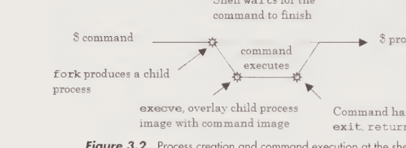

当命令执行时，shell默认在后台等待。正如我们将看到的，有一个`wait`系统调用允许shell或任何其他进程进行等待。如果用户在命令末尾放置一个`&`（向shell表示该命令应在后台运行），shell将不会等待，而是立即返回其提示符。当命令完成时，它可以在`main`函数中调用`exit`或`return`。传递给这些调用的整数值通过`wait`系统调用的参数提供给父进程。在命令行上，返回值存储在名为`status`的系统变量中。如果在Bourne或BASH shell中你发出以下命令

```
linux$ echo $?
```

系统将显示最后执行的命令所返回的值。由于标准输出到文件file2.txt的映射是在子进程中完成的，而非在shell中，因此I/O重定向对后续命令序列没有进一步的影响。

我们应该注意到，用户在命令行上有可能发出`exec`调用。语法为

```
linux$ exec command [arguments]
```

然而，大多数用户*不会*这样做。当前进程（shell）将被命令的程序代码覆盖。一旦命令完成，用户将被注销，因为原始的shell进程将不再存在！

在编程环境中，`exec`调用可用于执行另一个程序。`exec`调用的原型列于表3.1。

### 表3.1 exec调用原型。

```c++
#include <unistd.h>

extern char **environ;

int execl (const char *path, const char *arg , ...);
int execv (const char *path, char *const argv[]);
int execle(const char *path, const char *arg , ..., char * const envp[]);
int execve(const char *path, char *const argv[], char * const envp[]);
int execlp(const char *file, const char *arg , ...);
int execvp(const char *file, char *const argv[]);
```

这些系统调用的命名约定反映了它们的功能。每个调用都以字母`exec`开头。调用名称中的下一个字母表示该调用是采用列表格式（即字面指定为一系列参数）还是采用参数数组指针（类似于之前讨论的`argv`结构）。字母`l`的存在表示列表排列（可变参数列表——详见`stdarg`手册页）；`v`表示数组或向量排列。调用名称的下一个字母（如果存在）是`e`或`p`。`e`的存在表示程序员将自行构造（以数组/向量格式）并传递自己的环境变量列表。传递的环境变量列表将成为函数`main`的第三个参数（即`envp`）。正如在环境变量一节中所述，`envp`的实际用途有限。当

## 3.3 exec的"小跟班"

程序员负责环境，当前环境变量列表*不会*被传递。参数中`p`的存在表示，在搜索不含斜杠的文件名时，应使用当前环境的PATH变量。² 在四种调用方式（`execl`、`execv`、`execle`和`execve`）中，PATH字符串未被使用，因此必须完全指定待执行程序的路径。

`exec`系统调用的功能最好用表3.2来总结。

### *表3.2 exec调用的功能*

| 库名调用 | 参数格式 | 是否传递当前环境变量集合？ | 是否自动搜索PATH？ |
|---|---|---|---|
| execl | 列表 | 是 | 否 |
| execv | 数组 | 是 | 否 |
| execle | 列表 | 否 | 否 |
| execve | 数组 | 否 | 否 |
| execlp | 列表 | 是 | 是 |
| execvp | 数组 | 是 | 是 |

在这六种变体中，`execlp`和`execvp`调用最常使用（因为自动传递环境和路径搜索通常是期望的功能），下面将详细解释。

### 3.3.1 `execlp`

当预先知道要传递给待执行程序的参数数量时，可以使用`execlp`库函数（表3.3）。

使用`execlp`时，第一个参数`file`是一个指向包含待执行程序代码的文件的指针。如果这个文件引用以`/`开头，则认为该引用是文件的绝对路径。在这种情况下，`p`规范（`execlp`）似乎是多余的；但是，如果其他参数是文件名，或者待执行的代码包含文件引用，仍然会使用PATH字符串。如果未找到`/`，则PATH变量中指定的每个目录将依次被预先附加到指定的文件名前，并且找到的*第一个*有效程序引用将被执行。在所有情况下都完全指定待执行程序是一种好习惯，以防止在先前的PATH字符串目录中找到的同名程序被意外执行。要使`execlp`调用成功，引用的文件必须被找到并被标记为可执行。如果调用失败，它返回-1并设置`errno`以指示错误。由于用一个进程映像覆盖另一个非常复杂，失败的可能性很多（如表3.4所示）。

**表3.3** `execlp`库函数摘要

| 包含文件 | `<unistd.h>` `extern char **environ;` | 手册章节 | 3 |
|---|---|---|---|
| 摘要 | `int execlp(const char *file, const char *arg, . . .);` | | |
| 返回 | **成功** | **失败** | **设置errno** |
| | 不返回 | -1 | 是 |

²如果可执行文件是一个脚本，则会调用Bourne shell (`/bin/sh`) 来执行该脚本。然后shell会接收指定的参数信息。

**表3.4** `exec`错误消息

| # | 常量 | perror消息 | 解释 |
|---|---|---|---|
| 1 | EPERM | Operation not permitted | • 进程正被跟踪，用户不是超级用户，且文件设置了SUID或SGID位。<br>• 文件系统以nosuid方式挂载，用户不是超级用户，且文件设置了SUID或SGID位。 |


| 2 | ENOENT | No such file or directory | 新进程文件的路径的一个或多个部分不存在（或为NULL）。 |
| 4 | EINTR | Interrupted system call | 在系统调用期间捕获到信号。 |
| 5 | EIO | Input/output error | |
| 7 | E2BIG | Argument list too long | 新进程参数列表加上导出的shell变量超过了系统限制。 |
| 8 | ENOEXEC | Exec format error | 新进程文件不是可识别的格式。 |
| 11 | EAGAIN | Resource temporarily unavailable | 在读取原始I/O时，系统总内存暂时不足。 |
| 12 | ENOMEM | Cannot allocate memory | 新进程内存需求超出系统限制。 |
| 13 | EACCES | Permission denied | • 文件路径的某部分搜索权限被拒绝。<br>• 要处理的新文件不是普通文件。<br>• 要处理的新文件没有执行权限。 |
| 14 | EFAULT | Bad address | path引用了非法地址。 |
| 20 | ENOTDIR | Not a directory | 指定路径的某部分不是目录。 |
| 21 | EISDIR | Is a directory | ELF解释器是一个目录。 |
| 22 | EINVAL | Invalid argument | ELF可执行文件有多个解释器。 |
| 24 | EMFILE | Too many open files | 进程已超出最大打开文件数。 |
| 26 | ETXTBSY | Text file busy | 多个进程打开了可执行文件以进行写入。 |
| 36 | ENAMETOOLONG | File name too long | 路径值超出了系统路径/文件名长度。 |
| 40 | ELOOP | Too many levels of symbolic links | perror消息已经说明了一切。 |
| 67 | ENOLINK | Link has been severed | 路径值引用了一个不再活跃的远程系统。 |
| 72 | EMULTIHOP | Multihop attempted | 路径值需要多次跳转到远程系统，但文件系统不允许。 |
| 80 | ELIBBAD | Accessing a corrupted shared library | ELF解释器不是可识别的格式。 |

`execlp` 函数原型中的省略号可以被视为从参数0 (`arg0`) 到参数n (`argn`)。这些参数是指向以空字符结尾的字符串的指针，如果程序在命令行上调用，这些字符串通常会由系统传递给程序。也就是说，按照惯例，参数0应该是正在执行的程序的名称。这通常与`file`中的值相同，尽管`file`引用的程序可能包含绝对路径，而参数0中的值通常不包含。参数1将是传递给程序的第一个参数（使用`argv`表示法，将是`argv[1]`），参数2将是第二个，依此类推。`execlp`库调用的最后一个参数必须是一个NULL，出于可移植性原因，它被强制转换为字符指针。程序3.3演示了`execlp`库调用的使用，它调用了`cat`实用程序。

### 程序3.3 使用`execlp`系统调用

```
/*
    通过exec系统调用运行cat实用程序
*/
#include <iostream>
#include <cstdio>
#include <unistd.h>
using namespace std;
int
main(int argc, char *argv[ ]){
    if (argc > 1) {
        execlp("cat", "cat", argv[1], (char *) NULL);
        perror("exec failure ");
        return 1;
    }
    cerr << "Usage: " << *argv << " text_file" << endl;
    return 2;
}
```

当在命令行上传递一个文本文件名时，此程序会将文件内容显示在屏幕上。该程序通过将自身的进程映像替换为`cat`实用程序的程序代码来实现这一点。程序将要显示的文件的名称（由`argv[1]`引用）传递给`cat`实用程序。如果`execlp`系统调用失败，则会调用`perror`，程序退出并向系统返回值1。如果调用成功，则`perror`和`return`语句永远不会被执行，因为它们被`cat`实用程序的程序代码替换了。程序的运行示例如图3.3所示。

### 图3.3 程序3.3的输出

```
linux% p3.3 test.txt
This is a sample text
file for the program to
display!
```

### 3-2 练习

Harley想知道，当发出`execlp`调用时，系统使用什么值来生成系统进程表条目。是`file`引用的值还是`arg0`引用的值？进一步

```
文件 : count.cxx
|     #include <iostream>
|     #include <cstdlib>
|     #include <unistd.h>
|     using namespace std;
+     int
|     main(int argc, char *argv[]){
|        cerr << "argc = " <<  argc  << endl;
|        cerr << "Processes running" << endl;
|        system("ps -f");                // 发出shell
|                                        // ps命令
10      if ( argc > 1 ) {                 // 传递的值？
|          int limit = atoi(argv[1]);    // 转换为数字
|          for(int i=limit; i ;--i){     // 倒计时
|             cerr << i << endl;
|             sleep( 1 );
|          }
|        } else {
|          cerr << "Nothing to count" << endl;
|          return 2;
|        }
20      return 0;
|     }
```

### 3.3.2 execvp

如果待执行程序的参数数量是动态的，则可以使用`execvp`调用（表3.5）。与`execlp`调用一样，`execvp`的第一个参数是指向包含待执行程序代码的文件的指针。但是，与`execlp`不同，`execvp`只需要一个额外的参数。这第二个参数，定义为

## 3.3 exec 的小助手

`char *const argv[]`表示应传递一个指向字符字符串指针数组的引用。该数组的格式与`argv`并行，在许多情况下就是`argv`。如果引用的不是当前程序的`argv`值，则程序员负责构造并初始化一个类似`argv`的新数组。如果采用第二种方法，新`argv`数组的最后一个元素应包含一个`NULL`地址值。如果`execvp`失败，它将返回 -1 的值，并在`errno`中设置一个值以指示错误来源（参见表 3.5）。

**表 3.5 `execvp`系统调用总结。**

| 头文件 | `<unistd.h>` `<br>` `<extern char **environ;` | 手册章节 | 3 |
| :--- | :--- | :--- | :--- |
| 总结 | `int execvp(const char *file, char *const argv[]);` | | |
| 返回值 | 成功：不返回 | 失败：-1 | 设置`errno`：是 |

程序 3.4 使用了当前程序的`argv`值。

## 程序 3.4 使用带有 argv 值的 execvp

```
文件：p3.4.cxx
/*
    使用 execvp 执行 argv 的内容
*/
#include <iostream>
#include <cstdio>
#include <unistd.h>
using namespace std;
int main(int argc, char *argv[]) {
    if (argc > 1) {
        execvp(argv[1], &argv[1]);
        perror("exec failure");
        return 1;
    }
    cerr << "Usage: " << *argv << " exe [arg(s)]" << endl;
    return 0;
}
```

该程序将通过`execvp`执行通过命令行传递给它的程序。`execvp`的第一个参数`argv[1]`是对要执行程序的引用。第二个参数`&argv[1]`是对命令行`argv`数组剩余部分的引用。请注意，这两个引用都从`argv`的第二个元素开始（即`argv[1]`），因为`argv[0]`是当前程序的名称（例如`p3.4`）。图 3.4 的输出显示该程序确实按预期工作。

```
图 3.4 程序 3.4 在传递 cat 命令时的输出。

linux$ p3.4 cat test.txt
This is a sample text
file for a program to
display!
```

如果我们运行程序 3.4 时在命令行上放置额外的信息，我们会发现程序将传递该信息，如图 3.5 所示。

```
图 3.5 程序 3.4 在传递带有 -n 选项的 cat 命令时的输出。

linux$ p3.4 cat -n test.txt
1  This is a sample text
2  file for a program to
3  display!
```

如果当前程序的命令行`argv`值未与`execvp`一起使用，那么程序员必须构造一个新的`argv`来传递。程序 3.5 展示了如何做到这一点的示例。

```
程序 3.5 使用带有程序员生成的参数列表的 execvp。

文件：p3.5.cxx
/*
 *         为 execvp 生成我们自己的 argv 类型列表
 *         
 */
#include <iostream>
#include <cstdio>
#include <unistd.h>
using namespace std;
int main( ) {
    char *new_argv[ ] = {"cat",
                        "test.txt",
                        (char *)0};
    execvp("/bin/cat", new_argv );
    perror("exec failure ");
    return 1;
}
```

当编译并以`p3.5`运行时，该程序的输出将与程序 3.4 第一次运行的输出相同。

## 3.4 结合使用 fork 和 exec

在大多数程序中，`fork`和`exec`调用是相互结合使用的（在一些操作系统中，`fork`和`exec`调用被封装为单个`spawn`系统调用）。父进程生成一个子进程，然后通过调用`exec`来覆盖它，如程序 3.6 所示。

## 程序 3.6 结合使用 fork 和 execlp

```
文件：p3.6.c
/*
    通过 exec 覆盖子进程
*/
#include <iostream>
#include <sstream>
#include <cstdlib>
#include <unistd.h>
using namespace std;
int
main( ){
    char  *mesg[ ] = {"Fie", "Foh", "Fum"};
    int   display_msg(char *);
    for (int i=0; i < 3; ++i)
        display_msg(mesg[i]);
    return 0;
}
int
display_msg(char *m){
    ostringstream oss(ostringstream::out);
    switch (fork( )) {
    case 0:
        sleep(1);
        execlp("/bin/echo", "echo", m, (char *) NULL);
        oss << m << " exec failure";     // 构建错误消息字符串
        perror(oss.str().c_str());
        return 1;
    case -1:
        perror("Fork failure");
        return 2;
    default:
        return 0;
    }
}
```

程序 3.6 显示三条消息（基于数组`mesg`的内容）。此操作通过调用`display_msg`函数三次完成。一旦进入`display_msg`函数，程序会`fork`一个子进程，然后用`echo`命令的程序代码覆盖子进程代码。程序的输出如图 3.6 所示。

**图 3.6** 程序 3.6 的输出。
```
linux$ p3.6
Foh
Fie
Fum
```

由于调度的原因，多次运行时消息的顺序可能会改变。

有趣的是观察如果`display_msg`中的`execlp`调用失败（第 23 行）会发生什么。如果我们故意破坏`execlp`系统调用，将其更改为

```
execlp("/bin/no_echo", "echo", m , (char *) NULL );
```

并假设在`/bin`中找不到名为`no_echo`的可执行文件，那么程序的输出就变成了图 3.7 所示的内容。

**图 3.7** 当`execlp`失败时程序 3.6 的输出。
```
linux$ p3.6
Foh exec failure: No such file or directory
Fie exec failure: No such file or directory
Fum exec failure: No such file or directory
Fum exec failure: No such file or directory
Foh exec failure: No such file or directory
Fum exec failure: No such file or directory
Fum exec failure: No such file or directory
```

该程序使用了一种常见的编程*技巧*，动态创建一个消息字符串传递给`perror`例程。

令人惊讶的是，当`execlp`调用失败时，我们最终总共得到八个进程——初始进程和它的七个子进程。这很可能不是原始程序员的意图。纠正此问题的一种方法是在`display_msg`函数中：在`switch`语句的`case 0:`分支中，将第 26 行的`return`语句替换为调用`exit`。

> 3-3 练习

在其当前实现中，程序 3.6 未使用`display_msg`函数返回的值。修改程序，以便在第 14 行使用返回的值。将此修改的输出与上一段中建议的修改（将第 26 行的`return`语句替换为调用`exit`）的输出进行比较和对比。

结合我们到目前为止所学的知识，我们可以在相对较少的代码行中创建一个 shell 程序，将用户限制在几个基本命令（在此示例中为`ls`、`ps`和`df`）。我们的 shell 程序的代码如程序 3.7 所示。

该程序可被视为一个*非常*精简的受限 shell 版本。该程序的主要重点是教学性的，改进和扩展（可能有很多）将在本文后续部分和一些练习中解决。

## 程序 3.7 huh shell


文件：`huh.cc`

```cpp
/*
    一个 _非常_ 有限的 shell 程序
*/
#include <iostream>
#include <cstring>
#include <cstdlib>
#include <unistd.h>
#include <unistd.h>
using namespace std;

const int MAX    =256;
const int CMD_MAX=10;
char *valid_cmds = " ls  ps  df ";
int
main( ){
    char  line_input[MAX], the_cmd[CMD_MAX];
    char  *new_args[CMD_MAX], *cp;
    int   i;
    while (1) {
        cout << "cmd> ";
        if (cin.getline(line_input, MAX, '\n') != NULL) {
            cp = line_input;
            i  = 0;
            if ((new_args[i] = strtok(cp, " ")) != NULL) {
                strcpy(the_cmd, new_args[i]);
                strcat(the_cmd, " ");
                if ((strstr(valid_cmds, the_cmd)-valid_cmds) % 4 == 1) ;
                do {
                    cp = NULL;
                    new_args[++i] = strtok(cp, " ");
                } while (i < CMD_MAX && new_args[i] != NULL);
                new_args[i] = NULL;
                switch (fork( )) {
                case 0:
                    execvp(new_args[0], new_args);
                    perror("exec failure");
                    exit(1);
                case -1:
                    perror("fork failure");
                    exit(2);
                default:
                    // 在父进程中，我们应该等待
                    // 子进程完成
                    ;
                }
            } else
                cout << "huh?" << endl;
        }
    }
}
```

用户在运行我们的 shell 时被允许发出的命令位于名为`valid_cmds`的全局字符字符串中。在`valid_cmds`字符串中，每个两个字母的命令前后都带有一个空格。

⁴当程序运行时原因会变得明显，因此该程序绰号为 *huh* shell。

⁵许多 UNIX 环境都带有预定义的受限 shell（这不同于远程 shell `/bin/rsh`）。受限 shell 有时被指定为需要更受控环境的用户（如`ftp`）的登录 shell。Linux 没有为用户配备特定的受限 shell，但一些标准 shell（如`bash`和`ksh`）可以传递一个命令行选项（`-r`），该选项将以受限模式运行 shell。Linux 确实为`sendmail`配备了一个受限 shell（`smrsh`）。

## 3.4 结合使用 fork 与 exec

通过一个空格来分隔命令，可以使用预定义的 C 字符串搜索函数`strstr`来判断用户是否输入了有效命令。虽然这种技术很简单，但在需要检查的命令数量有限时非常有效。程序随后发出类似 shell 的提示符`cmd>`，并使用 C++ 的输入函数`getline`将用户输入存储到名为`line_input`的字符数组缓冲区中。`getline`函数会读取一行输入，包括由换行符终止的中间空白符。如果`getline`函数失败（例如用户只按了回车键），程序会循环并重新提示用户输入更多内容。输入内容后，程序使用 C 字符串函数`strtok`从`line_input`数组中获取第一个有效标记。`strtok`函数用于将引用的字符串分割为标记，它需要一个指向要解析的数组的指针，以及一个用于分隔标记的分隔符列表（此处只指定了一个空格“ ”）。`strtok`函数是 C/C++ 中一些函数具有独特性质的一个绝佳例子。当连续调用`strtok`并传递一个引用 NULL 的参数时，它将继续解析初始输入行，每次从上一次停止的地方开始。`strcat`函数用于在此第一个标记（假定为命令）末尾添加一个空格，得到的序列存储在名为`the_cmd`的字符数组中。

程序的下一行在基于模4的偏移量处检查`valid_cmds`字符串中是否存在该命令（参见图 3.8）。

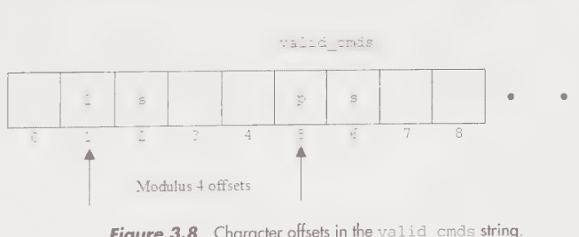

如果找到该命令，则使用`do-while`循环获取剩余标记（最多到限制`CMD_MAX`）。这些标记存储在先前声明的`new_args`数组的连续元素中。退出循环后，我们确保`new_args`数组的最后一个元素包含必需的 NULL 值。一个`switch`语句，与`fork`和`execvp`系统调用协同工作，用于执行命令。

在程序 3.7 中，为什么将`new_args[0]`而不是引用`the_cmd`传递给`execvp`系统调用？

运行程序 3.7 时，我们可以为命令指定选项。例如，

`df -t`

将像运行常规 shell 一样工作。但是，如果我们将命令的输出重定向到一个文件，比如`df -t > /tmp/ps_out`，命令将不再按预期工作。这是为什么？

将程序 3.7 重构为功能单元。将`pwd`（打印工作目录）、`lo`（注销）和`cd`（更改目录）命令添加（作为`valid_cmds`字符串的一部分）进去。提交证据表明这些新命令已成功实现。

## 3.5 终止一个进程

最终一切都会结束。既然我们已经生成了进程，就应该更仔细地看看如何结束一个进程。在自身能力范围内（假设进程未收到终止信号且系统未崩溃），进程通常以三种方式之一终止。⁶ 按优选顺序，这些是：

> ⁶ 当然，库函数`abort`也可用于结束进程，但它的调用会导致进程异常终止。

1.  它在其代码中的任意位置调用`exit`或`_exit`。

2.  它在`main`函数中执行`return`。

3.  它*从`main`函数末尾掉出*，隐式结束。

程序员经常使用库函数`exit`来终止程序。此函数不返回值，其定义如表 3.6 所示。

**表 3.6** `exit`库函数总结。

| 包含文件 | `<stdlib.h>` | 手册章节 | 3 |

|---|---|---|---|

| 总结 | `void exit(int status);` | | |

| | 成功 | 失败 | 设置 errno |

| 返回值 | 无返回 | 无返回 | |

在早期版本的 C 中，使用`exit`时不需要包含特定的头文件。较新版本的 C（和 C++）要求包含文件`<stdlib.h>`（如果完全采用 ANSI-C++ 路线，则为`<cstdlib>`），该文件包含`exit`函数原型。`exit`函数接受一个参数，一个整数 **status** 值，该值将返回给父进程。⁷ 按照惯例，如果程序正常终止，则返回 0；否则，返回非零值。⁸ 对于那些希望标准化`exit`在终止时返回的值的人来说，头文件`<stdlib.h>`包含两个定义的常量，`EXIT_SUCCESS`和`EXIT_FAILURE`，它们可以分别用于指示程序成功和失败。如果我们在某种程度上能够让编译器接受一个不传递退出状态值（即`exit();`）的`exit`调用，或者在`main`中执行一个不指定值的`return;`，那么返回给父进程的内容*在技术上是未定义的*。

一旦调用，`exit`函数会执行若干操作。图 3.9 展示了所采取行动之间的关系。

首先，`exit`将按*相反*顺序调用所有已使用`atexit`库函数注册的函数。`atexit`函数相对较新。一些基于旧版 BSD 的 C 版本（以及一些 GNU 版本）

⁷ 我知道，我知道——如果父进程不在了怎么办？记住`init`会继承父进程已消失的进程。状态值的处理将在第 3.6 节进一步讨论。

⁸ 只有低八位被返回，因此值范围从 0 到 255。（嗯，我很好奇……`exit(-1)`实际上会返回 255 吗？）

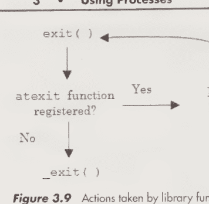

支持一个名为`on_exit`的库函数，它提供了类似的功能。由于未来对`on_exit`的支持看起来有点不确定；最好避开它。`atexit`函数应提供类似的功能。

简要描述一下`atexit`函数是必要的。表 3.7 中显示的`atexit`定义表明，要调用的函数（当进程正常终止时）通过将函数的地址传递给`atexit`函数来注册。注册的函数不应有任何参数。如果`atexit`成功注册该函数，`atexit`返回 0；否则，它返回 -1，但不会设置 *errno*。

程序 3.8 演示了`atexit`的使用。

运行时，程序的输出显示注册的函数按逆序被调用（图 3.10）。

在旧版本的 C 中，一旦所有`atexit`函数都被调用，标准 I/O 库函数`_cleanup`会被调用。较新版本的 GNU C/C++ 不支持`_cleanup`函数。现在，当所有`atexit`函数都已处理完毕时，`exit`会调用系统调用`_exit`（传递

**表 3.7** `atexit`库函数总结。

| 包含文件 | `<stdlib.h>` | 手册章节 | 3 |

| --- | --- | --- | --- |

| 总结 | `int atexit(void (*function)(void));` | | |

| 返回值 | | 成功: 0 | 失败: -1 | 设置 *errno*: 否 |

9 正常终止被视为调用`exit`或在`main`中返回。在我们的系统上，即使程序隐式结束（没有在`main`中返回），`atexit`注册的函数也会被调用。

10 这是系统设计者不提供 *errno* 值解释的罕见情况之一。

## 程序 3.8 使用 atexit 库函数。

文件 : `p3.8.cxx`

```cpp
#include <iostream>
#include <cstdlib>
using namespace std;
int
main( ){
    void     f1( ), f2( ), f3( );
    atexit(f1);
    atexit(f2);
    atexit(f3);
    cout << "Getting ready to exit" << endl;
    exit(0);
}
void
f1( ){
    cout << "Doing F1" << endl;
}
void
f2( ){
    cout << "Doing F2" << endl;
}
void
f3( ){
    cout << "Doing F3" << endl;
}
```

## 图 3.10 程序 3.8 的输出。

```
linux> p3.8
Getting ready to exit
Doing F3
Doing F2
Doing F1
```

## 3-7 练习

探索`atexit`函数。如果与`atexit`注册的某个函数包含对`exit`的调用，会发生什么？如果被注册的函数（带有`exit`调用）被直接调用，而不是在`main`中结束程序——事情会得到正确处理吗？

## 3.6 等待进程

`_exit`系统调用与其相对的`exit`类似，不会返回。此调用还接受一个整数状态值，该值将提供给父进程。在终止进程时，系统会执行一系列内务操作：

- 所有已打开的文件描述符均被关闭。

- 父进程被通知（通过 SIGCHLD 信号）该进程正在终止。

- 状态信息被返回给父进程（如果父进程正在等待）。如果父进程没有在等待，系统会存储状态信息，直到父进程执行`wait`操作。

- 正在终止的进程的所有子进程，其父进程 ID (PPID) 会被设置为 1——它们被`init`进程继承。

- 如果该进程是进程组的领导进程，进程组成员将收到 SIGHUP/SIGCONT 信号。

- 共享内存段和信号量引用会被重新调整。

- 如果该进程正在运行记账功能，记账记录会被写入记账文件。

如果程序员希望绕过`atexit`注册函数的调用和 I/O 缓冲区的刷新，他们可以直接调用`_exit`。详见表 3.8。

表 3.8 `_exit`系统调用摘要。

| 头文件 | `<unistd.h>` | 手册章节 | 2 |

| --- | --- | --- | --- |

| 摘要 | `void _exit(int status);` | | |

| 返回值 | 成功 | 失败 | 设置 errno |

| | 不返回 | 不返回 | |

> 他们也站着等待服务。

> *约翰·弥尔顿 1608–1674*

> *《致失明》[1652]*

通常情况下，父进程需要通过等待子进程停止或终止来同步其操作。`wait`系统调用允许父进程暂停其活动，直到这些操作之一发生（表 3.9）。

表 3.9 `wait`系统调用摘要。

| 头文件 | `<sys/types.h>` `<sys/wait.h>` | 手册章节 | 2 |

| --- | --- | --- | --- |

| 摘要 | `pid_t wait(int *status);` | | |

| 返回值 | 成功：子进程 ID 或 0 | 失败：-1 | 设置 errno：是 |

`wait`的活动总结在图 3.11 中。

`wait`系统调用接受一个参数，该参数是指向整数的指针，并返回一个定义为`pid_t`类型的值。数据类型`pid_t`位于头文件`<sys/types.h>`中，通常是一个`long int`。如果调用进程没有与之关联的子进程，`wait`将立即返回 -1，并且`errno`会被设置为`ECHILD` (10)。但是，如果有任何子进程仍然处于活动状态，调用进程将阻塞（暂停其活动），直到子进程终止。当被等待的子进程终止时，该子进程的状态信息及其进程 ID (PID) 将返回给父进程。状态信息作为整数值存储在指针`status`所引用的位置。该位置的低 16 位包含实际的状态信息，高位（假设是 32 位机器）设置为零。低位信息可以进一步细分为低字节和高字节。此信息有两种解释方式：

1. 如果子进程正常终止，低字节为 0，高字节包含退出码（0-255）：

| 字节 3 | 字节 2 | 字节 1 | 字节 0 |

| :--- | :--- | :--- | :--- |

| | | 退出码 | 0 |

2. 如果子进程由于未捕获的信号而终止，低字节包含信号编号，高字节为 0：

| 字节 3 | 字节 2 | 字节 1 | 字节 0 |

| :--- | :--- | :--- | :--- |

| | | 0 | 信号编号 |

在第二种情况下，如果已生成核心转储文件，则字节 0 的最左位（*bit*）将为 1。如果为`wait`指定了 NULL 参数，则子进程状态信息*不会*返回给父进程，父进程只会收到子进程终止的通知。

以下是两个程序，一个父程序（程序 3.9）和一个子程序（程序 3.10），演示了`wait`的使用。

**程序 3.9** 父进程。


`File : p3.9.cxx`

```
/*
    A parent process that waits for a child to finish
*/
#include <iostream>
#include <cstdlib>
#include <iomanip>
#include <unistd.h>
#include <sys/types.h>
#include <sys/wait.h>
using namespace std;
int
main(int argc, char *argv[] ){
    pid_t pid, w;
    int    status;
    if (argc < 4)
    {
        cerr << "Usage " << *argv << " value_1 value_2 value_3\n";
        return 1;
    }
    for (int i = 1; i < 4; ++i) // generate 3 child processes
        if ((pid = fork()) == 0)
            execl("./child", "child", argv[i], (char *) 0);
        else // assuming no failures here
            cout << "Forked child " << pid << endl;

    Wait for the children

    while ((w=wait(&status)) && w != -1)
        cout << "Wait on PID: " << dec << w << " returns status of "
             << setw(4) << setfill('0') << hex
             << setiosflags(ios::uppercase) << status << endl;
    return 0;
}
```

父程序 `fork` 了三个子进程。每个子进程都用子程序（见程序 3.10）的可执行代码覆盖。父进程从其命令行向每个子进程传递一个数字值。每生成一个子进程，父进程就显示该子进程的 ID。在所有三个进程生成后，父进程启动一个循环，等待子进程完成其执行。每个子进程终止时，显示返回给父进程的值。

**程序 3.10** 子进程。

```
File : p310.cc
/*
    The child process
*/
#define _GNU_SOURCE
#include <iostream>
#include <cstdlib>
#include <iomanip>
#include <sys/types.h>
#include <unistd.h>
#include <signal.h>
using namespace std;
int
main(int argc, char *argv[]){
    pid_t      pid = getpid();
    int        ret_value;
    srand((unsigned) pid);
    ret_value = int(rand() % 256); // generate a return value
    sleep(rand() % 3);             // sleep a bit
    if (atoi(*(argv + 1)) % 2) {    // assuming argv[1] exists!
        cout << "Child " << pid << " is terminating with signal 0009" << endl;
        kill(pid, 9);                 // commit hara-kiri
    } else {
        cout << "Child " << pid << " is terminating with exit("
             << setw(4) << setfill('0') << setiosflags(ios::uppercase)
             << hex << ret_value << ")" << endl;
        exit(ret_value);
    }
}
```

在子程序中，子进程使用`getpid`调用获取自己的 PID。PID 值被用作*种子*值来初始化`srand`函数。调用`rand`用于生成一个唯一的值，在进程退出时返回。然后子进程休眠一个随机秒数（0-3）。休眠后，如果通过命令行传递给子进程的参数是奇数（即不能被 2 整除），子进程会通过向自己的 PID 发送信号 9 (`SIGKILL`) 来杀死自己。如果命令行上的参数是偶数，子进程将正常退出，返回先前计算的返回值。在这两种情况下，子进程都会在实际执行语句之前显示一条消息，说明它将做什么。

源程序被编译，可执行文件分别命名为`parent`和`child`。它们通过调用父程序来运行。两个示例输出序列如图 3.12 所示。

**图 3.12** 程序 3.9 和 3.10 的两次运行。

```
linux$ parent 2 1 2           ←—— 两个偶数和一个奇数
Forked child 8975
Forked child 8976
Child 8976 is terminating with signal 0009
Forked child 8977
Wait on PID: 8976  returns status of  0009
Child 8977 is terminating with  exit(008F)
Wait on PID: 8977  returns status of  8F00
Child 8975 is terminating with  exit(0062)
Wait on PID: 8975  returns status of  6200

linux$ parent 2 2 1           ←—— 两个偶数和一个奇数，但顺序不同
Forked child 8980                    不同的顺序。
Forked child 8981
Forked child 8982
Child 8982 is terminating with signal 0009
Wait on PID: 8982  returns status of  0009
Child 8980 is terminating with  exit(00B0)
```

## 3.6 等待进程

```
Wait on PID: 8980 returns status of B000
Child 8981 is terminating with exit(00D3)
Wait on PID: 8981 returns status of D300
```

这段输出中有几点值得注意。在第一个输出序列中，一个子进程（PID 8976）在父进程完成其进程生成之前就已终止。已终止但尚未被其父进程**等待**的进程被称为**僵尸**进程。僵尸进程占用进程表中的一个条目，不消耗其他系统资源，并且在执行进程状态命令时（例如，`ps -alx`或`ps -el`）会被标记为字母 Z。僵尸进程即使使用标准的“特氟龙子弹”（例如，在系统层面：`kill -9` *进程ID号*）也无法被杀死[^11]。当其父进程执行`wait`操作以获取其进程状态信息时，**僵尸**进程才会被“清理”。当这种情况发生时，内核将回收为该进程分配的任何剩余系统资源。如果在父进程发出`wait`之前，子进程成为了孤儿，那么该进程将被`init`进程继承，而`init`进程的设计就是会为该进程发出`wait`。在一些非常*罕见*的情况下，即使这样也不会导致僵尸进程“消亡”。在这些情况下，可能需要系统重启来清除进程表中的该条目。

这两组输出清楚地表明，当子进程正常终止时，子进程返回的退出值存储在父进程中`wait`调用参数所引用的整数值的第二个字节中。同样，如果子进程由于未捕获的信号而终止，则信号值存储在同一引用位置的第一个字节中。同样明显的是，`wait`将返回第一个终止的子进程的信息，这个子进程可能是也可能不是生成的第一个子进程。

## 3-8 练习

将`wait`系统调用添加到`huh`shell 程序（程序 3.7）中。

## 3-9 练习

编写一个程序，生成三个僵尸进程。通过`ps`命令的输出提交证据，证明这些进程确实被生成并最终被销毁。

> [^11] 这种神奇的能力正是*僵尸*这一名称的由来。

## 3 • 使用进程

## 3-10 练习

在程序 3.10 中，如果子进程使用信号 8（而非 9）来终止，作为信号值返回给父进程的是什么？为什么？

很容易就能看出，状态信息的解读至少可以说是繁琐的。曾经，程序员编写自己的宏来查询状态的内容。现在大多数人使用预定义的状态宏之一。这些宏如表 3.10 所示。

**表 3.10 wstat 宏。**

| 宏 | 描述 |
| :--- | :--- |
| `WIFEXITED(status)` | 如果子进程正常退出则返回真。 |
| `WEXITSTATUS(status)` | 返回`main`函数的退出码或返回值。应仅在`WIFEXITED(status)`返回真后调用。 |
| `WIFSIGNALED(status)` | 如果子进程由于未捕获的信号退出则返回真。 |
| `WTERMSIG(status)` | 返回终止子进程的信号。应仅在`WIFSIGNALED(status)`返回真后调用。 |
| `WIFSTOPPED(status)` | 如果子进程被停止则返回真。 |
| `WSTOPSIG(status)` | 返回停止子进程的信号。应仅在`WIFSTOPPED(status)`返回真后调用。 |

每个宏的参数是返回给`wait`调用的整数状态值（不是指向该值的指针）。这些宏通常成对使用。`WIF`宏用作给定条件的测试。如果条件为真，则使用这对宏中的第二个宏来返回指定的值。如下所示，这些宏可以被整合到父程序 3.9 的等待循环中，以获取子进程状态信息：

```
...
while ((w = wait(&status)) && w != -1)
    if (WIFEXITED(status))                     // 用宏测试
        cout << "Wait on PID: " << dec << w << " returns a value of "
             << hex << WEXITSTATUS(status) << endl;   // 获取值
    else if (WIFSIGNALED(status))              // 用宏测试
        cout << "Wait on PID: " << dec << w << " returns a signal of "
             << hex << WTERMSIG(status) << endl;      // 获取值
...
```

## 3.6 等待进程

## 3-11 练习

一些系统支持`WCOREDUMP`宏。此宏仅在`WIFSIGNALED`宏返回真时被调用。如果导致终止的信号产生了核心转储，`WCOREDUMP`则返回真。编写你自己的`WCOREDUMP`宏版本（内联函数）。你可能需要查阅信号手册页（第 7 节）来确定哪些信号会产生核心转储，或者进行一些位操作（参见前面的讨论）。展示你的宏在进程接收到产生或不产生核心映像文件的终止信号时都能正常工作。

虽然`wait`系统调用很有用，但它确实有一些局限性。它总是返回*第一个*终止或停止的子进程的状态。因此，如果`wait`返回的状态信息不是来自我们想要的子进程，则可能需要暂时存储该信息以备将来参考，并需要进行额外的`wait`调用。`wait`的另一个局限性是，如果状态信息不可用，它总是会阻塞。幸运的是，另一个系统调用`waitpid`，它更灵活（因此也更复杂），解决了这些缺点。在大多数调用中，`waitpid`调用会阻塞调用进程，直到指定的某个子进程状态改变。`waitpid`系统调用的概要如表 3.11 所示。

### 表 3.11 waitpid 系统调用概要。

| 头文件 | `<sys/types.h>`, `<sys/wait.h>` | 手册章节 | 2 |
| :--- | :--- | :--- | :--- |
| **概要** | `pid_t waitpid(pid_t pid, int *status, int options);` | | |
| **返回值** | 成功：子进程PID或0 | 失败：-1 | 设置errno：是 |

**waitpid** 系统调用的第一个参数`pid`用于指定应该等待的子进程标识符集合（表 3.12）。

### 表 3.12 waitpid 对 pid 值的解释。

| pid 值 | 等待对象 |
| :--- | :--- |
| < -1 | 任何进程组ID等于`pid`绝对值的子进程。 |
| -1 | 任何子进程——方式类似于`wait`。 |
| 0 | 任何进程组ID等于调用者进程组ID的子进程。 |
| > 0 | 具有此进程ID的子进程。 |

第二个参数`status`，与`wait`调用一样，引用一个整数状态位置，如果`waitpid`调用成功，子进程的状态信息将存储在此位置。可以直接检查此位置，或使用前面介绍的`wstat`宏。

第三个参数`options`可以是 0（不关心），或者可以通过按位或组合表 3.13 中列出的一个或多个标志形成（这些标志通常在`<sys/wait.h>`头文件中定义）。这些标志适用于前面讨论的指定子进程集合。

### 表 3.13 waitpid 的标志值。

| 标志值 | 指定内容 |
| :--- | :--- |
| `WNOHANG` | 如果没有子进程退出则立即返回——如果状态无法获取则不阻塞；返回值为0，而不是PID。 |
| `WUNTRACED` | 如果子进程被阻塞则立即返回。 |

如果`pid`给出的值是 -1 且选项标志设置为 0，则`waitpid`和`wait`系统调用的行为方式相似。如果`waitpid`失败，它返回 -1 并设置`errno`以指示错误来源（表 3.14）。

### 表 3.14 waitpid 错误消息。

| # | 常量 | perror 消息 | 解释 |
| :--- | :--- | :--- | :--- |
| 4 | `EINTR` | 被中断的系统调用 | 系统调用期间捕获到信号。 |
| 10 | `ECHILD` | 无子进程 | `pid`指定的进程不存在，或子进程已将`SIGCHILD`的动作设置为`SIG_IGN`（忽略信号）。 |
| 22 | `EINVAL` | 无效参数 | `options`的值无效。 |
| 85 | `ERESTART` | 被中断的系统调用应该重新启动 | 未指定`WNOHANG`，且未被阻塞的信号或`SIGCHILD`被捕获。 |

[^11]: 这种神奇的能力正是*僵尸*这一名称的由来。

## 3.6 等待进程

我们可以修改当前版本的父程序（程序 3.9）中的几行代码，将生成的子进程 PID 保存到数组中。此信息可与`waitpid`系统调用配合使用，强制父进程按子进程生成的顺序而非终止顺序来显示子进程的状态信息。程序 3.11 展示了具体实现方法。

### 程序 3.11 使用 waitpid 的父程序


```cpp
File : p3.11.cxx
#include <iostream>
#include <cstdlib>
#include <iomanip>
#include <unistd.h>
#include <sys/types.h>
#include <sys/wait.h>
using namespace std;
int
main(int argc, char *argv[] ){
    pid_t pid[3], w;
    int    status;
    if ( argc < 4 ) {
        cerr << "Usage " << *argv << " value_1 value_2 value_3\n";
        return 1;
    }
    for (int i=1; i < 4; ++i)          // generate 3 child processes
        if ((pid[i-1] = fork( )) == 0)
            execl("./child", "child", argv[i], (char *) 0);
        else                             // assuming no failures here
            cout << "Child process id: " << pid[i-1] << endl;
    /*
        Wait for the children
    */
    for (int i=0;(w=waitpid(pid[i], &status,0)) && w != -1; ++i) {
        cout << "Wait on PID " << dec << w << " returns ";
        if (WIFEXITED(status))                    // test with macro
            cout << " a value of  " << setw(4) << setfill('0') << hex
                 << setiosflags(ios::uppercase) << WEXITSTATUS(status)
                 << endl;
        else if (WIFSIGNALED(status))              // test with macro
            cout << " abnormal " << setw(4) << setfill('0') << hex
                 << setiosflags(ios::uppercase) << WTERMSIG(status)
                 << endl;
        else
            cout << " unexpectedly!" << endl;
    }
    return 0;
}
```

运行此程序（使用相同的子程序——程序 3.10）证实，返回给父进程的状态信息确实是按照子进程生成的顺序排列的，而不是进程终止的顺序。同时请注意，状态宏用于评估`waitpid`系统调用的返回值（图 3.13）。

**图 3.13** 程序 3.11 的输出。

```
linux$ p3.11 2 2 1
Forked child 9772   -----> Order of creation: 9772, 9773, 9774
Forked child 9773
Child 9773 is terminating with exit(008B) <----- Order of termination: 9773, 9772, 9774
Forked child 9774
Child 9772 is terminating with exit(00CD)
Wait on PID 9772 returns a value of 00CD <----- Order of wait: 9772, 9773, 9774
Wait on PID 9773 returns a value of 008B
Child 9774 is terminating with signal 0009
Wait on PID 9774 returns a signal of 0009
```

## 3-12 练习

文中讨论的核心是父进程*等待*子进程终止或停止。我们已经拥有了判断父进程是否已终止所需的全部工具。请展示具体实现方法。你的实现有哪些优缺点？

在某些情况下，`wait`或`waitpid`返回的信息可能不够充分。可能需要获取子进程资源使用方面的额外信息。有两个 BSD 兼容库函数——`wait3`和`wait4`<sup>12</sup>——可用于提供此类信息（表 3.15）。

> <sup>12</sup> 目前尚不清楚后续版本的 GNU 编译器是否会支持这些函数，而且使用这些函数可能会限制程序的可移植性。由于这些是基于 BSD 的函数，因此必须在程序代码中定义`_USE_BSD`，或在编译源代码时通过命令行定义。

**表 3.15** wait3/wait4 库函数摘要。

| 头文件 | `#define _USE_BSD`<br>`#include <sys/types.h>`<br>`#include <sys/resource.h>`<br>`#include <sys/wait.h>` | 手册章节 | 3 |
|---|---|---|---|
| 摘要 | `pid_t wait3(int *status, int options, struct rusage *rusage);`<br>`pid_t wait4(pid_t pid, int *status, int options, struct rusage *rusage);` | | |
| 返回值 | 成功 | 失败 | 设置 `errno` |
| | 子进程 PID 或 0 | -1 | 是 |

`wait3`和`wait4`函数分别与`wait`和`waitpid`函数对应。`wait3`函数等待第一个子进程终止或停止。`wait4`函数等待指定的 PID（`pid`）。此外，如果传递给`wait4`函数的`pid`值设为 0，则`wait4`将以类似于`wait3`的方式等待第一个子进程。两个函数都接受选项标志，用于指示是否应该阻塞和/或报告已停止的子进程。这些选项标志如表 3.16 所示。

**表 3.16** wait3/wait4 的选项标志值。

| 标志值 | 说明 |
|---|---|
| `WNOHANG` | 如果没有子进程退出则立即返回——如果无法获取状态则不阻塞；返回值为 0 而非 PID。 |
| `WUNTRACED` | 如果子进程被阻塞则立即返回。 |

两个函数都包含一个引用`rusage`结构体的参数。该结构体在头文件`<sys/resource.h>`中定义。<sup>13</sup>

```c
struct rusage {
    struct timeval ru_utime; /* user time used */
    struct timeval ru_stime; /* system time used */
    long ru_maxrss;          /* maximum resident set size */
    long ru_ixrss;           /* integral shared memory size */
    long ru_idrss;           /* integral unshared data size */
    long ru_isrss;           /* integral unshared stack size */
    long ru_minflt;          /* page reclaims */
    long ru_majflt;          /* page faults */
    long ru_nswap;           /* swaps */
    long ru_inblock;         /* block input operations */
    long ru_oublock;         /* block output operations */
    long ru_msgsnd;          /* messages sent */
    long ru_msgrcv;          /* messages received */
    long ru_nsignals;        /* signals received */
    long ru_nvcsw;           /* voluntary context switches */
    long ru_nivcsw;          /* involuntary context switches */
};
```

如果`rusage`参数非空，系统将使用指定子进程的当前信息填充`rusage`结构体。有关更多信息，请参阅手册页第 2 节中的`getrusage`系统调用。状态宏（参见前文关于`wait`和`waitpid`的章节）可与`wait3`和`wait4`返回的状态信息配合使用。详见表 3.17。

**表 3.17** *wait3/wait4* 错误消息。

| # | 常量 | perror 消息 | 说明 |
|---|----------|----------------|-------------|
| 4 | `EINTR` | Interrupted system call | 系统调用期间捕获到信号。 |
| 10 | `ECHILD` | No child process | `pid`指定的进程不存在，或子进程已将`SIGCHILD`的动作设置为`SIG_IGN`（忽略信号）。 |
| 22 | `EINVAL` | Invalid argument | `options`的值无效。 |
| 85 | `ERESTART` | Interrupted system call should be restarted | 未指定`WNOHANG`，且捕获到未阻塞的信号或`SIGCHILD`。 |

## 3-13 练习

修改程序 3.11，使用`wait4`库函数。在每个子进程终止后，让父进程显示该子进程产生的页面错误数量。页面错误发生在程序请求的数据当前不在内存中时。为满足该请求，操作系统必须定位数据并将其加载到内存中。由于从设备加载数据需要时间并会降低处理速度，因此产生的页面错误越少越好。

## 3.7 总结

进程通过`fork`系统调用生成。发出`fork`系统调用的进程称为父进程，新进程称为子进程。子进程可以通过`exec`系统调用将其可执行代码覆盖为其他可执行代码。当进程执行完其代码、在`main`函数中执行返回或调用`exit`系统调用时，进程终止。父进程可以`wait`其子进程终止。终止的子进程会返回状态信息，父进程可以检查这些信息。

## 3.8 关键术语和概念

- `_exit`系统调用
- `atexit`系统调用
- 守护进程
- `exec`
- `execl`库函数
- `execle`函数调用
- `execlp`库函数
- `execv`库函数
- `execve`系统调用
- `execvp`库函数
- 退出码
- `exit`库函数
- 刷新
- `rand`库函数
- 受限 shell
- `rusage`结构体
- `srand`库函数
- 状态信息
- `strstr`库函数
- `strtok`库函数
- `wait`系统调用
- `wait3`库函数
- `wait4`库函数
- `waitpid`系统调用
- `WEXITSTATUS`宏
- `WIFEXITED`宏
- `WIFSIGNALED`宏
- `WIFSTOPPED`宏
- `wstat`宏
- `WSTOPSIG`宏
- `WTERMSIG`宏
- 僵尸进程

## 第4章

## 初级通信

## 4.1 引言

既然我们已经介绍了进程结构和生成的基础知识，现在可以开始探讨进程间通信这一主题了。进程常常需要协调它们的活动，例如在访问不可共享的系统资源时。从概念上讲，这种协调是通过进程间某种形式的被动或主动通信来实现的。正如我们将看到的，有多种方式可以实现进程间通信。接下来的章节将介绍各种进程间通信技术。随着技术变得越来越复杂，它们也会变得更加精巧，并有望更加灵活可靠。我们首先讨论初级的通信技术，这些技术虽然能够完成任务，但存在某些局限性。

## 4.2 锁文件

锁文件（不应与文件/记录锁定混淆，这是一种在第4.3节中介绍的I/O技术）可以被进程用作相互通信的一种方式。涉及的进程可以是不同的程序，也可以是同一程序的多个实例。在UNIX中，锁文件的使用有着悠久的历史。早期版本的UNIX（以及一些当前版本）使用锁文件作为通信手段。锁文件有时出现在行式打印机和`uucp`的实现中。在某些系统中，对密码文件和邮件文件的访问协调也依赖于锁文件和/或对特定文件的锁定。

使用锁文件作为进程间通信技术的理论基础很简单。简而言之，通过使用约定的文件命名规范，进程会在预定的位置检查锁文件的存在与否。这个位置通常是一个临时目录（例如`/tmp`），其中的文件在系统重启时（或由系统管理员定期清理）会自动清除，并且所有用户通常都具有读/写/执行权限。在其最基本的形式中，如果文件存在，进程就执行一套操作；如果文件缺失，则执行另一套操作。例如，假设有两个进程，`Process_One`和`Process_Two`，它们都试图访问一个不可共享的资源（例如打印机或磁盘）。这两个进程可以使用基于锁文件的通信约定，如图4.1所示。

> `Process_One`检查锁文件是否存在。如果未找到锁文件，`Process_One`使用约定的命名规范创建该锁文件。然后`Process_One`使用该资源。当`Process_One`使用完资源后，它会释放资源并删除锁文件。然而，如果在检查时发现锁文件存在（在这种情况下，表示`Process_Two`正在使用该资源），`Process_One`将会循环等待一段指定的时间，然后再次检查锁文件是否存在，如此反复。`Process_Two`的行为方式与`Process_One`类似。

图4.1 使用锁文件进行两个进程之间的通信。

很明显，以这种方式实现的通信只能传递极少的信息。本质上，进程是使用锁文件的存在与否作为二进制信号量。文件的存在与否将资源的可用性从一个进程传递给另一个进程。

## 4.2 锁文件（续）

这样的通信技术问题重重。最明显的问题是进程必须就锁文件的命名规范达成一致。然而，还可能出现其他额外的、或许无法预见的问题。例如，

- 1. 如果其中一个进程在完成资源使用后未能删除锁文件怎么办？
- 2. 轮询（不断检查以确定是否发生了某个事件）在CPU方面开销很大，应尽量避免。未获得资源访问权的进程如何等待资源变得空闲？
- 3. 竞态条件：两个进程同时发现锁文件不存在，因此同时尝试创建它，这种情况不应该发生。我们能否使锁文件的生成是原子性的（不可分割的，即不可中断的）？

正如我们将看到的，我们将能够解决其中的一些问题，而对于其他一些问题，我们只能将其影响限制在一定范围内。下面展示了一个使用锁文件实现通信的程序。程序主要部分的代码如程序4.1所示。

### 程序4.1 使用锁文件——主程序。

```cpp
File : p4...cxx
/*
    Using a lock file as a process communication technique.
*/
#include <iostream>
#include <unistd.h>
#include "lock_file.h"    /* This header resides locally. */
using namespace std;
int
main(int argc, char *argv[ ]){
    int numb_tries, i = 5;
    int sleep_time;
    char *fname;
    /*
        Assign values from the command line
    */
    set_defaults(argc, argv, &numb_tries, &sleep_time, &fname);
    /*
        Attempt to obtain lock file
    */
    if (acquire(numb_tries, sleep_time, fname)) {
        while (i--) {                      // simulate resource use
            cout << getpid( )<< " " << i << endl;
            sleep(sleep_time);
        }
        release(fname);                     // remove lock file
        return 0;
    } else
        cerr << getpid( ) << " unable to obtain lock file after "
             << numb_tries << " tries." << endl;
    return 1;
}
```

在程序的第7行，包含了本地头文件`lock_file.h`。该文件（图4.2）包含了三个函数`set_defaults`、`acquire`和`release`的原型，这些函数用于操作锁文件。头文件中使用了预处理器语句来防止文件被意外多次包含。


在主程序的第17行，调用了`set_defaults`函数来建立默认值。一旦这些值被赋值，程序就尝试通过调用`acquire`函数（第21行）来获取锁文件。如果程序成功创建了锁文件，它就可以访问不可共享的资源。在程序4.1中，涉及的资源是屏幕。当获得屏幕访问权后，程序会显示一系列整数值。一旦程序完成了对资源的使用（所有值都已显示），就会使用`release`函数删除锁文件。

```cpp
File : lock_file.h
    #ifndef LOCK_FILE_H
    #define LOCK_FILE_H
    /*
        Lock file function prototypes
    */
    void  set_defaults(int, char *[], int *, int *, char **);
    bool  acquire(int, int, char *);
    bool  release(char *);
    #endif
```

`set_defaults`函数接受五个参数。前两个参数（一个整数和一个字符指针数组）是传递给主程序（程序4.1）的`argc`和`argv`值。根据当前编写方式，程序允许用户在调用程序时通过命令行传递替代值来更改部分或全部默认值。`set_defaults`的其余三个参数是尝试生成锁文件时的尝试次数、每次尝试之间等待的时间（以秒为单位）以及对锁文件名的引用。

`acquire`函数接受三个参数。第一个是尝试创建锁文件的次数，第二个是每次尝试之间的休眠间隔，第三个是对锁文件名的引用。`acquire`函数返回一个布尔值，指示其是否成功。

`release`函数删除锁文件。该函数接受一个对锁文件的引用，并返回一个布尔值，指示其是否成功。这些函数的代码存储在单独的文件中，如图4.3所示。

图4.3 `set_defaults`、`acquire`和`release`函数的源代码。

```cpp
File : lock_file.cxx
/*
   Source code for using lock file. Compile using -c and
   -D_GNU_SOURCE options. Link object code as needed.
*/
#include <iostream>
#include <cstring>
#include <cstdlib>
#include <cerrno>
#include <limits.h>
#include <fcntl.h>
#include <unistd.h>
const int NTRIES = 5;               // default values
const int SLEEP  = 5;
const char *LFILE = "/tmp/TEST.LCK";
using namespace std;
void
set_defaults(int ac, char *av[],
             int *n_tries, int *s_time, char **f_name){
    static char full_name[PATH_MAX];
    *n_tries = NTRIES;               // Start with defaults
    *s_time  = SLEEP;
    strcpy(full_name, LFILE);
    switch (ac) {
        case 4:                       // File name was specified
            full_name[0] = '\0';      // "clear" the string
            strcpy(full_name, av[3]); // Add the passed in file
        case 3:
            if ((*s_time = atoi(av[2])) <= 0) // Seconds of sleep time
                *s_time = SLEEP;
```

## 4 原始通信

```c
30 case 2:
     if ((*n_tries = atoi(av[1])) <= 0) // 尝试次数
          *n_tries = NTRIES;
     case 1:
                               // 使用默认值
     break;
   default:
     cerr << "用法: " << av[0] <<
          " [tries][sleep][lockfile]" << endl;
     exit(1);
40 }
     *f_name = full_name;

bool
acquire(int numb_tries, int sleep_time, char *file_name){
     int  fd, count = 0;
     while ((fd = creat(file_name, 0)) == -1 && errno == EACCES)
          if (++count < numb_tries)      // 如果还有尝试机会
               sleep(sleep_time);        // 暂停一段时间
50     else
          return (false);                 // 无法生成
     close(fd);                           // 关闭（文件大小为0字节）
     return (bool(fd != -1));             // 如果确实完成则返回OK
}

bool
release(char *file_name){
     return bool(unlink(file_name) ==  );
}
```

在`lock_file.cxx`文件顶部，分配了默认值。`set_defaults`函数检查传递给命令行的参数数量（这些参数已作为变量`ac`传递给它）。使用级联`switch`语句来确定是否应更改默认赋值。`set_defaults`函数假设命令行参数（如果存在）按以下格式排列：

```bash
linux$ program_name numb_of_tries sec_to_sleep lck_file_name
```

`numb_of_tries`和`sec_to_sleep`的值应为非零。`lck_file_name`是用于锁文件的名称。按照编写方式，`set_defaults`函数不验证传入的锁文件位置/名称，但会尝试禁止尝试次数和睡眠间隔为零或负值。

`acquire`函数依赖于系统调用`creat`（注意没有末尾的`e`）来生成锁文件（表4.1）。

## 4.2 锁文件

**表4.1 `creat`系统调用摘要**

| 头文件 | `<sys/types.h>`, `<sys/stat.h>`, `<fcntl.h>` | 手册章节 | 2 |
|---|---|---|---|
| 摘要 | `int creat(const char *pathname, mode_t mode);` | | |
| 返回值 | 成功：最低的可用整数文件描述符 | 失败：-1 | 设置`errno`：是 |

根据定义，`creat`用于创建新文件或重写已存在的文件（首先将其截断为0字节）。`creat`系统调用将以只写模式打开文件。

`creat`需要两个参数。第一个参数`pathname`是指向要创建的文件的字符指针，第二个参数`mode`是类型为`mode_t`的值（在大多数情况下在`<sys/types.h>`文件中定义为`int`类型），用于指定所创建文件的模式（访问权限）。头文件`<fcntl.h>`包含许多预定义常量，可以按位或运算来指定文件的`mode`。程序函数`acquire`中的`creat`系统调用创建一个访问模式为0的文件。如果`creat`成功，生成的文件将没有读、写或执行权限适用于任何用户组（这不包括超级用户root）。^1

创建文件的另一种方法是使用`open`^2系统调用。使用`open`的等效语句为：

```c
open(path, O_WRONLY | O_CREAT | O_TRUNC, 0);
```

如果`creat`调用成功，它将返回一个整数值，即最低的可用文件描述符。如果`creat`失败，它返回/设置-1并设置`errno`。表4.2包含使用`creat`系统调用时可能遇到的错误。

如表所示，许多情况可能导致`creat`失败，包括打开的文件太多、指定的文件和/或路径名不正确等。我们在`acquire`函数的`while`循环中测试的失败是`EACCES`。^3 `creat`失败并将`errno`设置为`EACCES`表明要创建的文件已存在，并且写权限被拒绝（记住，文件是以模式0生成的）。

^1 由于超级用户具有特殊权限，此处显示的锁文件实现不适用于超级用户。

^2 曾经有一段时间`open`系统调用不支持`O_CREAT`（创建）选项。

^3 `EACCES`是在`<sys/errno.h>`头文件中找到的已定义常量。

**表4.2 `creat`错误消息**

| # | 常量 | `perror`消息 | 解释 |
|---|---|---|---|
| 2 | `ENOENT` | 没有该文件或目录 | 新文件路径的一个或多个部分不存在（或为`NULL`）。 |
| 6 | `ENXIO` | 没有该设备或地址 | 设置了`O_NONBLOCK`和/或`O_WRONLY`，指定的文件是管道，并且没有进程为读取打开该文件。 |
| 12 | `ENOMEM` | 无法分配内存 | 内核内存不足。 |
| 13 | `EACCES` | 权限被拒绝 | • 不允许请求的文件访问。<br>• 文件路径的搜索权限被拒绝。<br>• 文件不存在。 |
| 14 | `EFAULT` | 错误地址 | `pathname`引用了非法地址空间。 |
| 17 | `EEXIST` | 文件已存在 | `pathname`（文件）已存在，并且指定了`O_CREAT`和`O_EXCL`。 |
| 19 | `ENODEV` | 没有该设备 | `pathname`引用设备特殊文件，并且不存在相应的设备。 |
| 20 | `ENOTDIR` | 不是目录 | 指定路径的一部分不是目录。 |
| 21 | `EISDIR` | 是目录 | `pathname`引用目录，并且请求的访问涉及写操作。 |
| 23 | `ENFILE` | 系统中打开的文件过多 | 已达到打开文件的系统限制。 |
| 24 | `EMFILE` | 打开的文件过多 | 进程已超过其最大打开文件数。 |
| 26 | `ETXTBSY` | 文本文件忙 | 超过一个进程为写操作打开了可执行文件。 |
| 28 | `ENOSPC` | 设备上没有剩余空间 | `pathname`的设备没有空间容纳新文件（inode用尽）。 |
| 30 | `EROFS` | 只读文件系统 | `pathname`指向只读文件系统上的文件，并且请求了写访问。 |
| 36 | `ENAMETOOLONG` | 文件名过长 | `pathname`值超过了系统路径/文件名长度。 |
| 40 | `ELOOP` | 符号链接层级过多 | `perror`消息说明了一切。 |

如前所述，`acquire`函数中的`while`循环用于测试是否可以创建文件。如果可以创建文件，则退出循环并关闭文件描述符（文件存在且长度为0字节）。当文件无法创建且`errno`中的错误代码是`EACCES`时，将执行循环体中的`if`语句。在`if`语句中，将`count`的值与指定的创建文件尝试次数进行比较。如果尝试次数不足，则调用`sleep`暂停处理。

`sleep`是一个库函数，它会使调用进程暂停由其参数`seconds`指定的秒数。⁴ 参见表4.3。如果`sleep`被中断（例如由信号），则返回未休眠的秒数。如果休眠时间等于传递的参数值，`sleep`将返回0。在轮询循环中使用`sleep`让进程等待是一种妥协。这不是一种减少CPU密集型代码的优雅方法，但在此时，它比没有内置等待或运行某种临时计算循环要好。在后面的章节中，我们讨论此问题的替代解决方案。

**表4.3 `sleep`库函数摘要**

| 头文件 | `<unistd.h>` | 手册章节 | 3 |
|---|---|---|---|
| 摘要 | `unsigned int sleep(unsigned int seconds);` | | |
| 返回值 | 成功：剩余的休眠时间。 | 失败： | 设置`errno`： |

如果在程序函数`acquire`中，尝试次数已超过，则返回FALSE值，表示失败。如果因为`creat`调用成功而退出`while`循环，则返回布尔TRUE类型值。此外，如果`creat`因任何其他原因失败，则返回FALSE类型值。

`release`函数尝试使用系统调用`unlink`（表4.4）删除文件。如果引用是文件的最后一个链接且文件当前未被使用，此调用将从文件系统中删除文件。如果引用是符号链接，则删除该链接。在程序中，`release`函数的编码返回`unlink`完成任务的成功或失败。按照编写方式，主程序丢弃了`release`函数返回的值。

⁴ 如果需要更短的间隔，有一个`usleep`（无符号休眠）库函数，它会使调用进程暂停指定的微秒数。

**表4.4** `unlink`系统调用总结。

| 头文件 | `<unistd.h>` | 手册章节 | 2 |
|---|---|---|---:|
| **总结** | `int unlink(const char *pathname);` | | |
| **返回值** | **成功** | **失败** | **设置`errno`** |
| | 0 | -1 | 是 |

如果`unlink`系统调用失败，它返回-1并将`errno`设置为表4.5中的某个值。如果`unlink`成功，则返回0。

**表4.5** `unlink`错误消息。

| # | 常量 | `perror`消息 | 说明 |
|---|---|---|---|
| 1 | `EPERM` | Operation not permitted | • 不是文件的所有者或不是超级用户。<br>• 文件系统（在Linux中）不允许删除文件。 |
| 2 | `ENOENT` | No such file or directory | 要处理的文件的`pathname`中一个或多个部分不存在（或为`NULL`）。 |
| 4 | `EINTR` | Interrupted system call | 在系统调用期间捕获到一个信号。 |
| 5 | `EIO` | I/O error | 发生了I/O错误。 |
| 12 | `ENOMEM` | Cannot allocate memory | 内核内存不足。 |
| 13 | `EACCES` | Permission denied | • 文件路径的某部分搜索权限被拒绝。<br>• 该进程的EUID不允许请求的文件访问。 |
| 14 | `EFAULT` | Bad address | `pathname`引用了非法地址空间。 |
| 16 | `EBUSY` | Device or resource busy | 引用的文件正忙。 |
| 20 | `ENOTDIR` | Not a directory | 指定路径的某部分不是目录。 |
| 21 | `EISDIR` | Is a directory | `pathname`指向一个目录（而非文件）。 |
| 26 | `ETXTBSY` | Text file busy | 多个进程以写方式打开了该可执行文件。 |
| 30 | `EROFS` | Read-only file system | `pathname`指向位于只读文件系统上的文件。 |
| 36 | `ENAMETOOLONG` | File name too long | `pathname`过长。 |
| 40 | `ELOOP` | Too many levels of symbolic links | `perror`消息已经说明了一切。 |
| 67 | `ENOLINK` | The link has been severed | 路径值引用了一个不再可用的远程系统。 |
| 72 | `EMULTIHOP` | Multihop attempted | 路径值需要多次跳转到远程系统，但文件系统不允许。 |

## 4.2 锁文件

该程序的一次编译运行示例如图4.4所示。

**图4.4** 程序4.1的输出。

```bash
linux$ g++ p4.1.cxx lock_file.o -o p4.1
linux$ p4.1 &
linux$ p4.1 &
[2] 24348
linux$ 24348 unable to obtain lock file after 2 tries.
24347 3
24347 2
24347 1
24347 0
[2]  + Exit 1                        p4.1 2 2
[1]  + Done                         p4.1 1 5
```


程序`p4.1`被调用了两次。为了让两个进程并发执行，程序调用被放在后台运行（通过末尾的`&`）。第一个进程创建锁文件并获得屏幕访问权。该进程负责生成屏幕上显示的五个值（4, 3, 2, 1, 0）。第二个进程在尝试两次（每次间隔两秒）后退出，并产生消息 "Unable to obtain lock file after 2 tries"。当每个进程完成时，操作系统会显示退出/返回值。无法获得资源的进程以值 1 退出。使用不同的设置多次运行该程序会很有启发性。这样做时，你应该能够确认锁文件是否确实允许相关进程之间进行基本通信。

我们的示例使用`creat`系统调用作为原子文件锁定的基础。不幸的是，`creat`可能在 NFS 文件系统（网络挂载文件系统）上产生竞争条件。Linux 手册页建议使用`link`系统调用作为原子文件锁定操作（它表明在 NFS 环境中不应导致竞争条件）。`link`系统调用用于生成指向锁文件的硬链接，为其赋予新名称。使用硬链接时，链接和被链接的文件必须位于同一文件系统上。如果文件的`stat`系统调用返回链接计数为 2，则锁已成功实现（获取）。有关使用`link`与`creat`的更多内容，请参见练习 4-1。

### 4-1 练习

Hillary 编写了以下使用`link`和`stat`系统调用的`acquire`函数代码。

```cpp
// File : hillary.cxx
#include <cstdio>
bool
acquire(int numb_tries, int sleep_time, char *file_name){
    char my_link[512];
    sprintf( my_link, "%s.%d", file_name, getpid());
    int count = 0;
    struct stat buf;
    while ( ++count < numb_tries) {
        creat(my_link,0);
        link( my_link, file_name );
        if (!stat(my_link, &buf) && buf.st_nlink == 2){
            unlink(my_link);
            return true;
        }
        sleep(sleep_time);
    }
    return false;
}
```

她的函数是否正确工作？为什么是或为什么不是？请提供支持你答案的输出。

### 4-2 练习

编写一个程序，其中父进程`fork`出三个子进程。子进程应类似于刚刚给出的示例程序（`p4.1.cxx`）。每个子进程应接收一个要在屏幕上显示的文本文件名。展示所有进程最终都能获得文件访问权的输出，以及至少有一个进程失败时的输出。父进程应在 fork 子进程之前删除之前调用可能遗留的任何*残留*锁文件。

### 4-3 练习

一个经典的操作系统问题是协调生产者和消费者进程。生产者*生产*一个值并将其存储（例如在公共缓冲区或文件中），该存储位置只能*容纳一个*生产出的项目。消费者以非破坏性方式从存储位置获取该值并*消费*它。生产者和消费者以不同的速率工作。为了保证完整性，每个*生产*的值都必须被*消费*（不会因快速的生产者和缓慢的消费者而通过覆盖丢失），并且不应有任何值被消费两次（例如当消费者比生产者快时）。编写一个使用锁文件通信技术来协调活动的生产者/消费者进程对。为了确保数据不丢失或重复，生产者进程应通过从输入文件中逐个读取值来生产值，并依次存储到公共位置。消费者应将消费的值（从公共位置读取）追加到输出文件中。在处理了例如 100 个唯一值之后，生产者的输入文件和消费者的输出文件应该完全相同。使用`sleep`库调用并传入小的随机值来模拟生产者和消费者以不同速率工作。

解决此问题的一种方法是使用*两个*锁文件。使用两个锁文件时，一个文件表示数字是否已被生产，第二个文件表示数字是否已被消费。两个待协调进程的活动可以总结如下：

```
Producer
do
    sleep random amount
    read a number from input file
    if # has been consumed
        write number to common buffer
        indicate new # produced
until 100 numbers produced

Consumer
do
    sleep random amount
    if a new # produced
        read number from common buffer
        indicate # was consumed
        append number read to output file
until 100 numbers produced
```

*提示：* 使用锁文件时，我们测试是否能创建锁文件。因此，我们可以将锁文件的成功创建作为允许访问的标志，将无法创建锁文件作为禁止访问的标志。使用这种方法时，初始状态下表示数字已被消费的锁文件应不存在，而表示新数字已生产的锁文件应存在。

## 4.3 文件锁定

第二种基本通信技术，与锁文件的精神类似，可以通过使用 UNIX 中的一些标准文件保护例程来实现。UNIX 允许锁定记录。由于文件上没有强制的记录结构，记录（有时称为段或节）被认为是从指定位置开始的一定数量的连续存储字节。如果记录的起始位置是文件的开头，并且字节数等于文件中的字节数，则整个文件被视为所讨论的记录。锁定例程可用于实现建议性或强制性锁定。在建议性锁定中，操作系统跟踪哪些进程已锁定了文件。使用这些文件的进程相互协作，仅在确定锁处于适当状态时才访问记录/文件。当使用建议性锁定时，违规进程仍然可以忽略锁，并且如果权限允许，可以修改文件。

在强制锁定中，操作系统会在每次`read`和`write`调用时检查锁信息。操作系统将确保遵循适当的锁协议。虽然强制锁定提供了额外的安全性，但这是以额外的系统开销为代价的。如果被锁定的文件是普通文件（非可执行文件）且设置了组 ID 位而组执行位关闭，则锁将变为强制锁定。

在系统级别，可以使用`chmod`命令来指定文件支持强制锁定。例如，在图 4.5 中，数据文件`x.dat`的权限被设置为支持强制文件锁定。`ls`命令将在支持强制锁定的文件的组执行位字段中显示字母`S`。请注意，在示例中使用了`chmod`命令的绝对模式来设置锁定。模式值的第一位应为 2，第三位应为 6、4、2 或 0（但不能是 1）。

图 4.5 使用`chmod`指定强制锁定。

```
linux$ echo hello > x.dat                                     <-- Create a small text file.
linux$ ls -l x.dat
-rw-r--r-- 1 gray faculty 6 Jan 30 12:06 x.dat                <-- Default protections.
linux$ chmod 2644 x.dat                                       <-- Set the execution bit
$ ls -l x.dat                                                    for the group.
-rw-r-Sr-- 1 gray faculty 6 Jan 30 12:06 x.dat
```

记录锁定的主题十分广泛。我们只关注其中一个小的方面。我们使用文件锁定例程在整个文件上放置和移除建议锁，作为与协作进程通信的技术。

设置锁有几种方式。这里介绍两种最常见的方法：`fcntl`系统调用和`lockf`库函数。我们先从`fcntl`开始（表 4.6）。

表 4.6 `fcntl`系统调用摘要。

| 头文件 | 手册章节 | 摘要 | 返回值 |

| :--- | :--- | :--- | :--- |

| `<unistd.h>` | 2 | `int fcntl(int fd, int cmd /*, struct flock *lock */);` | 成功：返回值取决于传入的 cmd 参数。失败：-1。设置 errno：是。 |

## 4 • 原始通信

`fcntl`系统调用的第一个参数传入一个打开文件的有效整数文件描述符。第二个参数*cmd*是一个整数命令值，用于指定`fcntl`应执行的操作。锁定的命令值在`<bits/fcntl.h>`头文件中定义为常量，该头文件由`<fcntl.h>`头文件包含。锁相关的常量如表 4.7 所示。

表 4.7 与`fcntl`系统调用一起使用的锁相关定义常量。

| 定义常量 | `fcntl`执行的操作 |

| :--- | :--- |

| F_SETLK | 设置或移除锁。具体操作取决于作为第三个参数传递给`fcntl`的`flock`结构的内容。 |

| F_SETLKW | 与 F_SETLK 相同，但如果指定的记录/段不可用则阻塞（等待）—默认不阻塞。 |

| F_GETLK | 通过作为第三个参数传递给`fcntl`的`flock`结构返回锁状态信息。 |

`fcntl`的第三个参数对于某些调用是可选的（如函数原型中被注释掉所示）。然而，当处理锁时，第三个参数需要指定并引用一个`flock`结构，该结构定义如下

```
struct flock {
    short int l_type;   /* Type of lock: F_RDLCK, F_WRLCK, or F_UNLCK. */
    short int l_whence; /* Where 'l_start' is relative to. */
    #ifndef __USE_FILE_OFFSET64
    __off_t l_start;    /* Offset where the lock begins. */
    __off_t l_len;      /* Size of the locked area; (0 == EOF). */
    #else
    __off64_t l_start;  /* For systems with 64 bit offset. */
    __off64_t l_len;
    #endif
    __pid_t l_pid;      /* PID of process holding the lock. */
};
```

`flock`结构用于向`fcntl`调用传递信息和从`fcntl`调用返回信息。锁的类型`l_type`通过使用表 4.8 中显示的定义常量来指定。`l_whence`、`l_start`和`l_len` `flock`成员用于指示起始位置（0，文件开头；1，当前位置；2，文件末尾）、相对偏移量和记录（段）的大小。如果这些值设置为 0，将对整个文件进行操作。`l_pid`成员用于返回放置锁的进程的 PID。

**表 4.8** `flock` `l_type`成员中使用的定义常量。

| 定义常量 | 锁说明 |

| :--- | :--- |

| F_RDLCK | 读锁 |

| F_WRLCK | 写锁 |

| F_UNLCK | 移除锁 |

在处理锁时，如果`fcntl`无法执行指定的命令，它将返回 -1 并设置`errno`。与锁定相关的错误消息如表 4.9 所示。

**表 4.9** `fcntl`与锁定相关的错误消息。

| # | 常量 | perror 消息 | 说明 |

| :--- | :--- | :--- | :--- |

| 4 | EINTR | 中断的系统调用 | 在系统调用期间捕获到信号。 |

| 9 | EBADF | 错误的文件号 | `fd`未引用有效的打开文件描述符。 |

| 11 | EAGAIN | 资源暂时不可用 | 锁操作被禁止，因为文件已被另一个进程进行内存映射。 |

| 13 | EACCES | 权限被拒绝 | 锁操作被另一个进程持有的锁禁止。 |

| 14 | EFAULT | 错误的地址 | `*lock`引用非法地址空间。 |

| 22 | EINVAL | 无效的参数 | `cmd`无效；`cmd`为 F_GETLK 或 F_SETLK 且`*lock`或`*lock`引用的数据无效；`fd`不支持锁定。 |

| 35 | EDEADLK | 避免资源死锁 | `cmd`为 F_SETLKW 且请求的锁被另一个进程的锁阻塞。如果`fcntl`阻塞调用进程等待锁释放，将发生死锁。 |

| 37 | ENOLCK | 没有可用的锁 | 系统已达到最大记录锁数。 |

## 4 • 原始通信

程序 4.2 演示了文件锁定的使用。

## 程序 4.2 使用 fcntl 锁定文件。

```
File : p4.2.cxx
/* Locking a file with fcntl
*/
#include <iostream>
#include <cstdio>
#include <cerrno>
#include <fcntl.h>
#include <unistd.h>
using namespace std;
const int MAX = 5;
int main(int argc, char *argv[ ]) {
    int             f_des, pass = 0;
    pid_t           pid = getpid();
    struct flock    lock;           // for fcntl info
    if (argc < 2) {             // name of file to lock missing
        cerr << "Usage " << *argv << " lock_file_name" << endl;
        return 1;
    }
    sleep(1);                       // don't start immediately
    if ((f_des = open(argv[1], O_RDWR)) < 0){
        perror(argv[1]);           // could not access file
        return 2;
    }
    lock.l_type     = F_WRLCK;        // set a write lock
    lock.l_whence = 0;              // start at beginning
    lock.l_start  = 0;              // with a 0 offset
    lock.l_len    = 0;              // whole file
    while (fcntl(f_des, F_SETLK, &lock) < 0) {
        switch (errno) {
        case EAGAIN:
        case EACCES:
            if (++pass < MAX)
                sleep(1);
            else {                  // run out of tries
                fcntl(f_des, F_GETLK, &lock);
                cerr << "Process " << pid << " found file "
                     << argv[1] << " locked by " << lock.l_pid << endl;
                return 3;
            }
            continue;
        }
        perror("fcntl");
        return 4;
    }
```

```
    cerr << endl << "Process " << pid << " has the file" << endl;
    sleep(3);                       // fake processing
    cerr << "Process " << pid << " is done with the file" << endl;
    return 0;
}
```


在此程序中，要锁定的文件名通过命令行传递。在程序开头调用`sleep`以减慢处理速度（仅用于演示目的）。指定的文件以读写方式打开。在第 24 到 27 行中，锁结构被赋值，表示将对整个文件应用写锁。在随后的 while 循环中，调用`fcntl`请求放置锁。如果`fcntl`失败且`errno`被设置为`EAGAIN`或`EACCES`（表示锁无法应用的值），进程将`sleep`一秒并再次尝试应用锁。为安全起见，`EACCES`常量与`EAGAIN`分组在一起，因为在某些 UNIX 版本中，当锁无法应用时返回的是此值。

如果超过了 MAX 次尝试（轮次），将进行另一次`fcntl`调用（第 35 行）以获取有关已锁定文件的进程的信息。在此调用中，锁结构的地址被传递给`fcntl`。显示锁定进程的 PID 后程序退出。如果在尝试设置锁时遇到`EAGAIN`或`EACCES`以外的错误，将调用`perror`，显示消息后程序退出。

如果进程成功获得锁，进程将打印一条信息消息，睡眠三秒（模拟某种处理），然后在终止时打印第二条消息。当进程终止时，系统自动移除文件上的锁。如果进程不终止，则需要将`l_type`成员设置为`F_UNLCK`并重新发出`fcntl`调用以清除锁。

如果我们使用文件`x.dat`作为锁文件，快速连续运行三个程序 4.2 的副本，它们的输出将类似于图 4.6 中所示的内容。

## 图 4.6 运行多个程序 4.2 副本—锁定文件

```text
linux$ p4.2 x.dat & p4.2 x.dat & p4.2 x.dat &
[1] 28392
[2] 28393
[3] 28394
$
Process 28392 has the file
Process 28392 is done with the file
```

进程 28393 拥有该文件。

进程 28394 发现文件`x.dat`被 28393 锁定。

进程 28393 已完成对文件的操作。

```text
[3] - 退出 3               p4.2 x.dat
[2] - 完成                 p4.2 x.dat
[1] + 完成                 p4.2 x.dat
```

请注意，最后一个进程（本例中的 PID 28394）无法在该文件上放置锁，并返回了当前持有该文件锁的进程的进程 ID。第二个进程（PID 28393）通过反复重试（期间穿插了`sleep`调用），一旦第一个进程完成操作，就能够锁定该文件。

## 4-4 练习

将程序 4.2 中的`F_SETLK`常量更改为`F_SETLKW`。重新编译该程序，并按照图 4.6 所示重新运行。现在产生了什么样的消息序列？为什么？

`lockf`库函数也可用于应用、测试或移除已打开文件上的锁。在其底层，该库函数是`fcntl`系统调用的替代接口。`lockf`库函数在表 4.10 中进行了总结。

### 表 4.10 `lockf`库调用总结

| 头文件 | `<sys/file.h>` `<unistd.h>` | 手册章节 | 3 |
| :--- | :--- | :--- | :--- |
| 摘要 | `int lockf(int fd, int cmd, off_t len);` | | |
| | 成功 | 失败 | 设置 errno |
| 返回值 | 0 | -1 | 是 |

参数`fd`是一个已为写入（`O_WRONLY`）或读写（`O_RDWR`）而打开的文件的文件描述符。`lockf`的`cmd`参数类似于`fcntl`所使用的`cmd`参数。`cmd`值表示要执行的操作。`lockf`对每个`cmd`值（如头文件`<unistd.h>`中所指定）将执行的操作总结在表 4.11 中。

## 4.3 文件锁定

### 表 4.11 已定义的`cmd`常量

| 定义的常量 | 锁规格 |
| :--- | :--- |
| `F_ULOCK` | 解锁先前锁定的文件。 |
| `F_LOCK` | 如果文件可用，则锁定文件（或文件的某个部分）以供独占使用。如果不可用，`lockf`函数将阻塞。 |
| `F_TLOCK` | 测试并（如果成功）锁定文件（或文件的某个部分）以供独占使用。如果无法应用锁，则返回错误；使用此选项时，如果锁无法应用，`lockf`函数不会阻塞。 |
| `F_TEST` | 测试文件是否存在锁。如果文件未被锁定或被当前进程锁定，则返回 0。如果被另一个进程锁定，则返回 -1 并将`errno`设置为`EACCES`。 |

`lockf`的`len`参数表示要锁定或解锁的连续字节数。值为零表示应从当前位置到文件末尾的部分。如果`lockf`调用成功，则返回值 0。如果调用失败，则设置`errno`并返回值 -1（表 4.12）。

### 表 4.12 `lockf`错误消息

| # | 常量 | `perror`消息 | 解释 |
| :--- | :--- | :--- | :--- |
| 9 | `EBADF` | Bad file number | `fd`不是有效的打开文件描述符。 |
| 11 | `EAGAIN` | Resource temporarily unavailable | • `cmd`是`F_TLOCK`或`F_TEST`，且指定的部分已被锁定。<br>• 文件被另一个进程内存映射。 |
| 13 | `EACCES` | Permission denied | 锁操作被另一个进程持有的锁禁止。 |
| 22 | `EINVAL` | Invalid argument | 为`fd`指定了无效的操作。 |
| 35 | `EDEADLK` | File locking deadlock | 请求的锁操作将导致死锁。 |
| 37 | `ENLOCK` | No locks available | 已达到系统锁的最大数量。 |

这两种技术中，`lockf`更简单，但比使用`fcntl`灵活性差。请注意，使用`lockf`调用时，用户必须在调用前发出单独的`lseek`系统调用，将文件指针定位到文件中的正确位置。此外，在生成父/子进程对时，每个进程共享相同的文件指针。如果要在两个进程中都使用锁，有时最好关闭并重新打开相关文件，以便每个进程都有自己的独立文件指针。

最后一点——Linux 支持一个可以在 shell 脚本中使用的`shlock`命令。`shlock`命令创建一个包含标识性 PID 的锁文件。

### 4.5 练习

使用`lockf`系统调用编写练习 4.3。验证你的解决方案是否有效。

## 4.4 信号详解

第二种基本的进程间通信技术涉及信号的使用。如前所述，信号是异步发生的（没有指定的时序或顺序）。信号可以由进程或内核发送，作为事件已发生的通知。信号在事件首次发生时生成，并被认为在进程对信号采取行动时被交付。大多数信号的交付可以被阻塞，以便信号可以稍后被处理。被阻塞的信号以及发送给非运行状态进程的信号通常称为挂起信号。

每个信号的符号名称可以在多个地方找到。通常，`signal`的手册页（尝试`man 7 signal`）或头文件`<asm/signal.h>`将包含每个信号名称的列表。如手册第 7 节所述的信号如表 4.13 所示。

信号的定义（其符号名称、相关的整数值和所指示的事件）随时间而演变。POSIX 1 标准定义的信号在 **Def** 列中有字母 P；由 SUS v2（单一 UNIX 规范第 2 版）定义的信号有字母 S。字母 O 表示未被这两个标准定义的信号。

此外，请记住有些信号是体系结构相关的。为了表示这一点，如果 **Value** 列中为某个信号列出了三个数字，则第一个数字是 alpha 和 sparc 平台的信号；中间数字是 i386 和 ppc 平台的信号；最后一个数字是 mips 平台的信号。破折号（-）表示该信号在该平台缺失。单个值表示所有平台使用相同的信号编号。

与信号关联的默认操作由表格的 Action 列中的一个或多个字母定义。字母 A 表示接收进程将终止；B 表示进程将忽略该信号；C 表示进程将终止并生成核心转储文件；D 表示进程将停止（挂起）执行。此外，字母 E 表示信号无法被捕获（陷阱），字母 F 表示信号无法被忽略。

### 表 4.13 信号定义

| 符号名称 | Def | 值 | 动作 | 描述 |
| :--- | :--- | :--- | :--- | :--- |
| `SIGABRT` | P | 6 | C | 来自`abort`的中止信号。 |
| `SIGALRM` | P | 14 | A | 来自`alarm`的计时器信号。 |
| `SIGBUS` | S | 10, 7, 10 | C | 总线错误（错误的内存访问）。 |
| `SIGCHLD` | P | 20, 17, 18 | B | 当子进程停止或终止时发送给父进程。 |
| `SIGCLD` | O | -, -, 15 | B | `SIGCHLD`的同义词。 |
| `SIGCONT` | P | 19, 18, 25 | B | 如果进程已停止，则恢复执行。 |
| `SIGEMT` | O | -, -, 7 | C | 仿真陷阱。 |
| `SIGFPE` | P | 8 | C | 浮点异常。 |
| `SIGHUP` | P | 1 | A | 在控制终端上检测到挂起，或控制进程已死亡。 |
| `SIGILL` | P | 4 | C | 非法指令。 |
| `SIGINFO` | O | 29, -, - | B | `SIGPWR`的同义词。 |
| `SIGINT` | P | 2 | A | 来自键盘的中断。 |
| `SIGIO` | O | 23, 29, 22 | A | I/O 现在可能。 |
| `SIGIOT` | O | 6 | C | IOT 陷阱——等同于`SIGABRT`。 |
| `SIGKILL` | P | 9 | A, E, F | 终止信号——强制进程终止。 |
| `SIGLOST` | O | -, -, - | A | 文件锁丢失。 |
| `SIGPIPE` | P | 13 | A | 管道破裂；向没有读取端的管道写入。 |
| `SIGPOLL` | S | 23 | A | 可轮询事件已发生——与`SIGIO`（也是 23）同义。 |
| `SIGPROF` | S | 27, 27, 29 | A | 性能分析计时器已过期。 |
| `SIGPWR` | O | 29, 30, 19 | A | 电源故障。 |
| `SIGQUIT` | P | 3 | C | 来自键盘的退出。 |
| `SIGSEGV` | P | 11 | C | 无效的内存引用（段错误）。 |
| `SIGSTKFLT` | O | -, 16, - | A | 协处理器栈错误。 |
| `SIGSTOP` | P | 17, 19, 23 | D, E, F | 停止进程——不是来自 tty。 |
| `SIGSYS` | S | 12, -, 12 | C | 系统调用的参数错误。 |
| `SIGTERM` | P | 15 | A | 来自`kill`的终止信号。 |
| `SIGTRAP` | S | 5 | C | 用于调试的跟踪/断点陷阱。 |
| `SIGTSTP` | P | 18, 20, 24 | D | 在 tty 上键入停止。 |
| `SIGTTIN` | P | 21, 21, 26 | D | 后台进程需要输入。 |
| `SIGTTOU` | P | 22, 22, 27 | D | 后台进程需要输出。 |
| `SIGUNUSED` | O | -, 31, - | A | 未使用的信号（将是`SIGSYS`）。 |
| `SIGURG` | S | 16, 23, 21 | B | I/O 通道（套接字）上的紧急情况。 |
| `SIGUSR1` | P | 30, 10, 16 | A | 用户定义的信号 1。 |
| `SIGUSR2` | P | 31, 12, 17 | A | 用户定义的信号 2。 |
| `SIGVTALRM` | S | 26, 26, 28 | A | 虚拟闹钟。 |
| `SIGWINCH` | O | 28, 28, 20 | B | 窗口大小调整信号。 |
| `SIGXCPU` | S | 24, 24, 30 | C | CPU 时间限制超出。 |
| `SIGXFSZ` | S | 25, 25, 31 | C | 文件大小限制超出。 |

一些额外的注意事项包括：

- 对于一些 S 信号（SUS v2），默认动作列为 A（终止），但其实际动作应为 C（终止进程并生成核心转储文件）。

## 4.4 更多关于信号

信号 29 在 alpha 平台上是`SIGINFO`/`SIGPWR`，但在 sparc 平台上是`SIGLOST`。

请注意，所有信号都以 SIG 为前缀，并以半助记后缀结尾。为了可移植性，引用信号时通常最好使用它们的符号名称，而不是它们被分配的整数值。定义的常量`SIGRTMIN`和`SIGRTMAX`也存在于`<asm/signal.h>`中，并允许生成额外的实时信号。

实时信号（通常是值 32 到 63）可以排队。信号的排队确保了当多个信号发送到一个进程时，它们不会丢失。目前，Linux 内核并未使用实时信号。

对于每个信号，进程可以采取以下三种操作之一：

1. **执行默认操作。** 这是除非另有指定否则将采取的操作。每个信号的默认操作在上表中列出。具体来说，这些操作是：
   - **终止（中止）**——执行与`exit`系统调用相关的所有活动。
   - **核心（转储）**——生成核心转储文件，然后执行终止活动。
   - **停止**——挂起处理。
   - **忽略**——忽略该信号。

2. **忽略信号。** 如果要忽略的信号当前被阻塞，则它将被丢弃。`SIGKILL`和`SIGSTOP`信号不能被忽略。

3. **捕获信号。** 在这种情况下，进程提供一个函数的地址（通常称为信号处理程序），该函数在接收到信号时执行。在大多数情况下，信号处理函数将有一个单一的整数参数。该参数值由系统分配，将是被捕捉到的信号的数值。当信号处理函数完成时，除非另有指定，被中断的进程将从它中断的地方恢复执行。

关于忽略和捕获信号的实现细节的讨论在第 4.5 节中介绍。

信号以多种方式产生：

1. 由内核产生，表示：
   - **硬件条件**，其中最常见的是`SIGSEGV`（当进程发生地址访问违规时）和`SIGFPE`（表示除以零）。
   - **软件条件**，例如`SIGIO`（表示文件描述符上可以进行 I/O）或计时器到期。

## 4 • 原始通信

2. 由终端上的用户产生：
   - **键盘**——用户产生键盘序列，这些序列将中断或终止当前正在执行的进程。例如，中断信号`SIGINT`通常映射到按键序列 CTRL+C，终止信号`SIGQUIT`映射到按键序列 CTRL+\。命令`stty -a`将显示中断和退出信号的按键序列的当前映射。
   - **`kill`命令**——通过使用`kill`命令，用户可以在命令行上为任何具有相同有效 ID 的进程生成前面列出的任何信号。`kill`命令的语法是：

```text
$ kill [ -signal ] pid . . .
```

执行时，`kill`命令将向指定的 PID 发送指定的信号。信号可以是一个整数值，或者是去除 SIG 前缀的符号信号名称之一。如果没有给出信号编号，默认为`SIGTERM`（终止）。PID（多个 PID 用空格分隔）是将被发送信号的进程的 ID。如果需要，可以使用`ps`命令获取用户的当前 PID。

`pid`值可能小于 1 和/或信号值可能为 0。在这些情况下，`kill`命令将执行与下一节中描述的`kill`系统调用所指定的相同操作。正如预期的那样，`kill`命令只是`kill`系统调用的命令行接口。

3. 由其他进程产生：
   - 通过`kill`系统调用（表 4.14）。`kill`系统调用用于向进程或进程组发送信号。

请注意，`kill`系统调用的参数顺序与`kill`命令相反。为`pid`参数指定的值表示哪个进程或进程组将接收信号。表 4.15 总结了如何指定进程或进程组。

### 表 4.14 `kill`系统调用总结

| 包含文件 | `<sys/types.h>` | 手册页 |
| :--- | :--- | :--- |
| | `<signal.h>` | 2 |
| 总结 | `int kill(pid_t pid, int sig);` | |
| | 成功 | 失败 | 设置 errno |
| 返回值 | 0 | -1 | 是 |

### 表 4.15 `kill`系统调用对`pid`值的解释

| `pid` | 接收信号的进程 |
| :--- | :--- |
| >0 | 进程 ID 与`pid`相同的进程 |
| 0 | 与发送者在同一进程组中的所有进程 |
| -1 | 非超级用户：所有真实 ID 与发送者有效 ID 相同的进程。超级用户：所有进程，排除特殊进程 |
| <-1 | 所有进程组为 abs(-pid) 的进程 |

`sig`的值可以是信号头文件中找到的任何符号信号名称（或等效的整数值）。如果`sig`的值设置为 0，`kill`系统调用将对指定的 PID 执行错误检查，但不会向进程发送信号。

有时会向一个 PID 发送信号值为 0 的信号，并检查`kill`系统调用的返回值，以此作为确定给定 PID 是否存在的方法。此技术并非万无一失，因为进程可能在检查它的调用之后立即自行终止。请记住，一旦达到最大 PID 值，UNIX 将重用 PID 值。语句：

```c
kill(getpid(), sig);
```

可以被进程用来向自身发送由`sig`指定的信号。^5

如果`kill`系统调用成功，它返回 0；否则，它返回 -1 并如表 4.16 所示设置`errno`。在 Linux 中，出于安全考虑，无法向进程 1（`init`）发送信号。信号通过`telinit`传递给`init`。

### 表 4.16 `kill`错误消息


| # | 常量 | `perror` 消息 | 解释 |
| --- | --- | --- | --- |
| 1 | `EPERM` | 操作不允许 | 调用进程没有向指定进程发送信号的权限。进程不是超级用户，其有效 ID 与真实或保存的用户 ID 不匹配。 |
| 3 | `ESRCH` | 没有此类进程 | 没有`pid`所指的进程或进程组。 |
| 22 | `EINVAL` | 无效参数 | 指定了无效的信号编号。 |

^5 ANSI C 还定义了一个`raise`库函数，进程可以使用它向自身发送信号。

## 4-6 练习

`kill`命令也接受选项`-l`（小写字母 L），该选项列出`kill`知道的已定义信号。在系统级别，执行命令：

```bash
$ kill -l
```

找出至少两个信号的（a）整数值，（b）默认操作，以及（c）所指示的事件，这些信号是`kill`命令已知但未在前面的信号表（表 4.13）中描述过的。

## 4-7 练习

编写一个父程序，该程序派生几个子进程，每个子进程休眠随机数秒。父进程应然后等待子进程终止。一旦子进程终止，父进程应通过向每个剩余子进程发送`SIGTERM`信号来终止它们。确保（通过`wait`系统调用）验证每个终止的子进程都收到了`SIGTERM`信号。

## 4.3 通过 `alarm` 系统调用

`alarm`系统调用为发起进程设置一个计时器，并在指定数量的实际秒数过去后生成一个`SIGALRM`信号。

**表 4.17 `alarm` 系统调用总结。**

| | | 手册页 | 2 |
| --- | --- | --- | --- |
| 包含文件 | `<unistd.h>` | | |
| 总结 | `unsigned int alarm(unsigned int seconds);` | | |
| 返回值 | 成功 | 失败 | 设置 `errno` |
| | 剩余时间 | | |

## 4.4 更多关于信号

如果传递给`alarm`的值为 0，则重置计时器。通过`fork`生成的进程其`alarm`值设置为 0，而通过`exec`创建的进程继承剩余时间的`alarm`。`alarm`调用不能被叠加——多次调用会重置`alarm`值。对`alarm`的调用返回闹钟上剩余的时间量。可以使用`alarm`为进程实现一种“休眠”类型的安排。然而，混合调用`alarm`和`sleep`并不是一个好主意。

程序 4.3 演示了`alarm`系统调用的使用。

**程序 4.3 设置 `alarm`。**

```cpp
#include <iostream>
#include <iomanip>
#include <cstdlib>
#include <sys/types.h>
#include <sys/wait.h>
#include <unistd.h>
using namespace std;
int
main(int argc, char *argv[] ) {
    int w, status;
    if (argc < 4) {
        cerr << "Usage: " << *argv << " value_1 value_2 value_3 "
             << endl;
        return 1;
    }
    for(int i=1; i <= 3; ++i) {
        if (fork() == 0) {
            int t = atoi(argv[i]);
            cout << "Child " << getpid( ) << " waiting to die in "
                 << t << " seconds." << endl;
            alarm( t );
            pause( );
            cout << getpid( ) << " is done." << endl;
        }
    }
    while (( w=wait(&status)) && w != -1)
        cout << "Wait on PID: " << dec <<  w << " returns status of "
             << hex << setiosflags(ios::uppercase) << status << endl;
    return 0;
}
```

当程序被调用时，三个整数值被传递给程序。父进程生成三个子进程，使用命令行值来设置进程中的`alarm`。在第 22 行，`pause`库函数使子进程等待接收信号。在本例中，等待接收的是`SIGALRM`信号。当信号到达时，子进程执行该信号的默认操作。`SIGALRM`的默认操作是进程退出，并将信号值返回给等待它的父进程。父进程等待所有子进程执行完毕。每当一个子进程结束，父进程就会显示该子进程的 PID 及其返回状态信息。需要注意的是，第 23 行的`cout`语句永远不会被执行，因为子进程在到达该语句之前就已经退出了。这一点可以通过图 4.7 中的输出得到验证。

### 图 4.7 在多个子进程中设置 `alarm`

```text
linux$ p4.3 3 1 5
Child 17243 waiting to die in 3 seconds.
Child 17244 waiting to die in 1 seconds.
Child 17245 waiting to die in 5 seconds.
Wait on PID: 17244 returns status of 000E
Wait on PID: 17243 returns status of 000E
Wait on PID: 17245 returns status of 000E
```

子进程按照其`alarm`设定的时间顺序依次结束。每个子进程都返回了`SIGALRM`的值（14 或十六进制的 E）。

调用`pause`会挂起一个进程（使其进入休眠状态），直到它收到一个未被忽略的信号为止（表 4.18）。

### 表 4.18 `pause` 库函数摘要⁶

| 头文件 | `<unistd.h>` | 手册章节 | 2 |
| --- | --- | --- | --- |
| 摘要 | `int pause ( void );` | | |
| 返回值 | 成功 | 失败 | 设置 `errno` |
| | 如果信号未导致进程终止，则返回 `–1` | 不会返回 | 是 |

如果在暂停期间收到的信号未导致进程终止，`pause`将返回`–1`。此时，`errno`的值为`EINTR` (4)。如果收到的信号导致了进程终止，`pause`将不会返回（这也是意料之中的）！

⁶ 虽然位于手册的第 2 章节中，但手册页表明这是一个库函数。

## 4.5 信号与信号管理调用

在上一节中我们提到，进程可以通过三种方式处理信号：不做任何处理（即允许默认操作执行）、忽略信号，或捕获信号。忽略信号和捕获信号都涉及到将一个信号处理例程与特定信号关联起来。简而言之，完成关联后，当指定的信号到达时，进程会自动调用该信号处理例程。

有两个基本的系统调用可用于修改进程在收到信号时的行为：`signal`和`sigaction`。`signal`系统调用在 UNIX 的所有版本中都存在，现在被归类为 ANSI C 版本的信号处理例程（表 4.19）。`sigaction`系统调用（表 4.20）出现较晚，属于 POSIX 信号管理调用之一。

### 表 4.19 `signal` 系统调用摘要

| 头文件 | `<signal.h>` | 手册章节 | 2 |
| --- | --- | --- | --- |
| 摘要 | `void (*signal(int signum, void (*sighandler)(int)))(int);` | | |
| 返回值 | | 成功 | 信号之前的处置方式 |
| | | 失败 | `SIG_ERR`（定义为 `-1`） |
| | | 设置 `errno` | 是 |

### 表 4.20 `sigaction` 系统调用摘要

| 头文件 | `<signal.h>` | 手册章节 | 2 |
| --- | --- | --- | --- |
| 摘要 | `int sigaction(int signum, const struct sigaction *act, struct sigaction *oldact);` | | |
| 返回值 | | 成功 | 0 |
| | | 失败 | -1 |
| | | 设置 `errno` | 是 |

使用`signal`最困难的部分是解读其函数原型。本质上，该原型将`signal`声明为一个接受两个参数的函数——一个整数`signum`值和一个函数指针——该函数在信号到达时被调用。如果`signal`调用成功，它将返回一个指向返回值为`void`的函数的指针。这就是该信号之前的处置方式。在原型最右侧的神秘的`(int)`表示被引用的函数有一个整数参数。该参数由系统自动填充，包含信号编号。

如果任一系统调用被中断，将返回`-1`并将`errno`设置为`EINTR` (4)；如果`signum`的值无效或被设置为`SIGKILL`或`SIGSTOP`，则`errno`被设置为`EINVAL` (22)。此外，如果`act`或`oldact`参数引用了无效的地址空间，`sigaction`将返回`EFAULT` (14)。

虽然`signal`和`sigaction`都用于信号处理，但两者在功能上略有不同。让我们先从`signal`系统调用开始。

`signal`系统调用的第一个参数是我们打算关联新操作的信号。信号值可以是一个整数或一个符号信号名称。该值不能是`SIGKILL`或`SIGSTOP`。`signal`的第二个参数是信号处理函数的地址。信号处理函数可以是用户自定义的函数，也可以是预定义的常量`SIG_DFL`或`SIG_IGN`之一。为信号指定`SIG_DFL`表示将该信号收到时的操作重置为默认操作。为信号指定`SIG_IGN`表示进程将忽略该信号的接收。

查看信号头文件可以发现，`SIG_DFL`和`SIG_IGN`被定义为经过适当类型转换后指向无效地址位置的整数值（如 -1 等）。`SIG_DFL`和`SIG_IGN`最常见的声明如下所示。与这些定义一起的还有一个可用的预定义常量——`SIG_ERR`。该常量是`signal`失败时返回的值。参见图 4.8。

```c
/* Fake signal functions. */

#define SIG_ERR ((__sighandler_t) -1)  /* Error return. */
#define SIG_DFL ((__sighandler_t)  0)  /* Default action. */
#define SIG_IGN ((__sighandler_t)  1)  /* Ignore signal. */
```

程序 4.4 使用`signal`系统调用来演示如何忽略信号。

## 程序 4.4 伪 `nohup`——忽略信号

```cpp
File : p4.4.cxx
/* Using the signal system call to ignore a hangup signal */

#include <iostream>
#include <cstdio>
#include <cstdlib>
#include <signal.h>
#include <fcntl.h>
#include <unistd.h>
using namespace std;
const char *file_out = "nohup.out";
int
main(int argc, char *argv[]){
    int new_stdout;
    if (argc < 2) {
        cerr << "Usage: " << *argv << " command [arguments]" << endl;
        return 1;
    }
    if (isatty( 1 )) {
        cerr << "Sending output to " << file_out << endl;
        close( 1 );
        if ((new_stdout = open(file_out, O_WRONLY | O_CREAT |
                              O_APPEND, 0644)) == -1) {
            perror(file_out);
            return 2;
        }
    }
    if (signal(SIGHUP, SIG_IGN) == SIG_ERR) {
        perror("SIGHUP");
        return 3;
    }
    ++argv;
    execvp(*argv, argv);
    perror(*argv);            // Should not get here unless
    return 4;                 // the exec call fails.
}
```

程序 4.4 是大多数基于 UNIX 的系统上`/usr/bin/nohup`命令的简化版本。`nohup`命令可用于运行命令，使命令不受`SIGHUP`信号接收的影响。如果当前进程的标准输出关联到终端设备，`nohup`的输出将被发送到文件`nohup.out`中。`nohup`命令常与命令行后台指定符`&`配合使用，以允许命令在用户注销后继续在后台执行。

与真正的`nohup`一样，我们的伪`nohup`程序（程序 4.4）将执行通过命令行传递给它的命令（及可选参数）。在检查命令行参数数量之后，程序会获取与`stdout`关联的文件描述符。这里假设与`stdout`关联的文件描述符是 1。不过，如果需要，有一个名为`fileno`的标准 I/O 函数可以用来获取给定参数流的整数文件描述符。库函数`isatty`（表 4.21）用于判断该描述符是否关联到终端设备。

### 表 4.21 `isatty` 库函数摘要

| 头文件 | `<unistd.h>` | 手册章节 | 3 |
| --- | --- | --- | --- |
| 摘要 | `int isatty( int desc );` | | |
| | 成功 | 失败 | 设置 `errno` |
| 返回值 | 1 | 0 | |

`isatty`库函数接受一个整数参数`desc`。如果`desc`关联到终端设备，`isatty`返回 1；否则返回 0。在程序中，如果`isatty`函数返回 1，则会向标准错误输出一条提示信息，告知用户传递给伪`nohup`程序的命令的输出可以在哪里找到。

接下来，关闭`stdout`的文件描述符。关闭之后的`open`语句将返回第一个可用的文件描述符。由于我们刚刚关闭了`stdout`，`open`返回的描述符就将是`stdout`的描述符。完成这一重新赋值后，程序中写入`stdout`（`cout`）的所有信息将被追加到文件`nohup.out`中。

请注意，调用`signal`以忽略`SIGHUP`信号的操作是在一个`if`语句中完成的。如果`signal`系统调用失败（返回`SIG_ERR`），将向标准错误输出一条消息并退出程序。如果`signal`调用成功，则`argv`指针会递增，跳过当前程序的名称。然后命令行的其余部分被传递给`execvp`系统调用。如果`execvp`调用失败，将调用`perror`并显示一条消息。如果`execvp`成功，当前进程将被命令行传递的程序/命令覆盖。

图 4.9 中的输出展示了伪`nohup`程序在本地系统上运行并传递一个需要较长时间执行的命令时的结果。在本例中，长时间运行的命令是一个名为`count`的小型 Korn Shell 脚本，它从 1 数到 100，每显示一个数值后休眠一秒。按照脚本的写法，其输出通常会显示在屏幕上。

### 图 4.9 当传入一个需要长时间执行的命令时，程序 4.4 的输出

```sh
linux$ cat count
#! /bin/ksh
c=1
while (( $c <= 100 ))
do
  echo "$c"
  sleep 1
  (( c = c + 1 ))
done

linux$ ./p4.4 ./count &
Sending output to nohup.out
linux$ jobs
[1] + Running              p4.4 count
linux$ kill -HUP %1
linux$ jobs
[1] + Running              p4.4 count
linux$ kill -KILL %1
linux$
[1] Killed                 p4.4 count
linux$ jobs
```

该脚本从 1 数到 100，每个数字显示后休眠一秒。如果在命令行上运行，从 1 数到 100 大约需要 100 秒。

将`count`脚本传递给我们模拟的`nohup`程序——将其置于后台。

操作系统返回后台进程的 PID。

向进程发送挂起信号并不会导致其终止。


当程序被置于后台时，系统报告了作业编号（本例中是`[1]`）和`PID`（`19481`）。`jobs`命令确认进程仍在运行。可以看到，`kill -HUP %1`命令（向后台的第一个作业发送挂起信号）并未导致程序终止。这并不意外，因为`SIGHUP`信号被忽略了。使用`kill -KILL %1`命令向进程发送`SIGKILL`信号来终止它。

### 4-8 练习

如果由程序`4.4`运行`find`命令（例如，`find / -name \* -print`），`find`产生的错误消息（例如它没有权限读取某些目录）会输出到`stderr`，这些消息仍然会显示。修改程序`4.4`，使得被运行的程序产生的错误消息被丢弃（写入到`/dev/null`）。这种修改有什么优缺点？

## 4 • 原始通信

如前所述，如果为`signal`系统调用提供了一个信号捕捉函数名，当进程收到信号时将自动调用此函数。但是，在调用该函数之前，如果信号不是`SIGKILL`、`SIGPWR`或`SIGTRAP`，系统会将信号的处置重置为其默认值。这意味着，如果连续收到两个相同的信号，完全有可能在执行信号捕捉例程之前，第二个信号可能导致进程终止（如果这是该信号的默认操作）。这种行为降低了使用信号作为通信设备的可靠性。通过在捕捉例程中重置信号的处置，可以减少但无法完全消除这种失败的可能性窗口。程序`4.5`捕捉信号并试图减少这个失败的可能性窗口。

### 程序4.5 捕捉SIGINT和SIGQUIT信号。

```cpp
File : p4.5.cxx
     /* 捕捉信号
      */
     #include <iostream>
     #include <cstdlib>
     #include <cstdio>
     #include <signal.h>
     #include <unistd.h>
     using namespace std;
     int
10    main( ) {
         void           signal_catcher(int);
         if (signal(SIGINT , signal_catcher) == SIG_ERR) {
             perror("SIGINT");
             return 1;
         }
         if (signal(SIGQUIT , signal_catcher) == SIG_ERR) {
             perror("SIGQUIT");
             return 2;
         }
20        for (int i=0;  ; ++i) {         // Forever ...
             cout << i << endl;          // display a number
             sleep(1);
         }
         return 0;
     }
     void
     signal_catcher(int the_sig){
         signal(the_sig, signal_catcher);  // 立即重置
         cout << endl << "Signal " << the_sig << " received." << endl;
30        if (the_sig == SIGQUIT)
             exit(3);
     }
```

为了避免对两个被捕捉的信号中的任何一个采取默认操作（在本例中是终止），程序函数`signal_catcher`中的第一条语句（第`28`行）是对`signal`的调用。此调用重新建立了被捕捉的信号与信号捕捉例程之间的关联。

图`4.10`显示了程序在本地系统上运行时的输出。

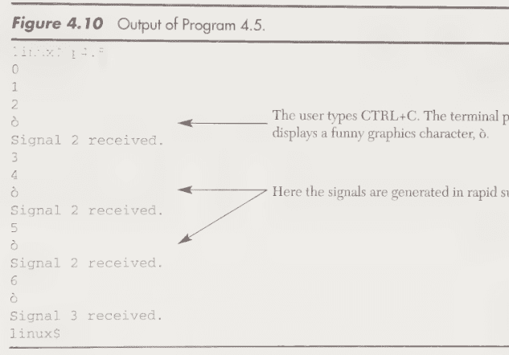

从输出可以看出，每次按下`CTRL+C`时，它都会作为`ò`回显到终端。如果快速连续按两次`CTRL+C`，程序会对每个键盘序列都响应`Signal 2 received`消息。在这个系统上，如果信号快速连续接收，似乎部分信号被排队了。然而，这有些误导性，因为终端`I/O`的机制介入了。假设我们（通过后台进程）向该进程快速连续发送多个相同的信号副本。在这种情况下，我们通常会发现只有一个信号副本被传递给进程，而其他的则被丢弃。大多数系统不会对`1`到`31`号信号进行排队。当生成`SIGQUIT`信号时，显示了一条消息，程序随后退出。

## 4 • 原始通信

### 4-9 练习

`Lad`编写了下面的程序，试图确定哪些按键会产生可被捕捉的信号。

```cpp
File : lad.cxx

/* Lad的信号捕捉程序 */
#include <iostream>
#include <cstdlib>
#include <cstdio>
#include <signal.h>
#include <unistd.h>
using namespace std;
int
main( ) {
    void signal_catcher(int);
    char a_num[5];
    for (int i=1; i < _NSIG; ++i)
        switch( i ){
            case SIGKILL: case SIGSTOP:
                break;
            default:
                if (signal(i , signal_catcher) == SIG_ERR) {
                    sprintf( a_num, "%d", i );
                    perror(a_num);
                    return 1;
                }
        }
    for (int i=0; ; ++i) { // Forever ...
        cout << i << endl; // display a number
        sleep(1);
    }
    return 0;
}
void
signal_catcher(int the_sig){
    signal(the_sig, signal_catcher); // reset
    cout << endl << "Signal " << the_sig << " received." << endl;
    if (the_sig == SIGQUIT)
        exit(3);
}
```

常量`_NSIG`是信号编号的上限。在某些系统上，此常量没有前导下划线。

捕捉所有可被捕捉的信号——将每个信号映射到信号捕捉函数。

运行他的程序时，`Lad`发现他能从键盘生成多少个信号？它们是什么？当输入以下按键时会发生什么（为什么）？`CTRL+S`、`CTRL+Q`和`CTRL+R`。

## 4.5 信号与信号管理调用

### 4-10 练习

从程序`4.5`中移除以下语句

```cpp
if (the_sig == SIGQUIT)
    exit(3);
```

重新编译程序并在后台运行（即，`p4.5 &`）。你如何阻止程序在屏幕上显示数字？

### 4-11 练习

编写一个程序，该程序`fork`一个子进程。父进程和子进程应生成并向对方发送随机信号。在每个进程中，显示正在发送的信号和被捕捉到的信号。确保两个进程都能`优雅退出`，并且如果其中一个因收到`SIGKILL`信号而终止，另一个不会保持活动状态。*提示：*记住，你可以使用`kill`来确定进程是否存在。

`sigaction`系统调用，类似于`signal`系统调用，可用于将替代动作与信号接收相关联。此系统调用有三个参数。第一个是指定信号的整数值。与`signal`系统调用一样，此参数可以是除`SIGKILL`或`SIGSTOP`之外的任何有效信号。第二个和第三个参数是`sigaction`结构的引用。这些结构分别存储信号的新动作和之前的动作。`sigaction`结构的完整定义在文件`sigaction.h`中。此文件由`signal.h`自动包含。基本上，`sigaction`结构是

```cpp
struct sigaction {
    void (*sa_handler)(int);
    void (*sa_sigaction)(int, siginfo_t *, void *);
    sigset_t sa_mask;
    int sa_flags;
    void (*sa_restorer)(void);
}
```

`sa_handler`和`sa_sigaction`都可用于引用信号处理函数。在任何给定时间应只指定其中之一，因为

## 4 • 基本通信

在大多数系统中，该数据通常存储在 `sigaction` 结构体内的一个 `union` 中。根据定义，联合体一次只能容纳其成员中的一个。我们的讨论重点是使用 `sa_handler` 成员。`sa_mask` 成员指定在信号处理程序执行期间应被阻塞的信号。每个信号由一个`位`表示。如果掩码中的位被置位，则该信号被阻塞。默认情况下，触发处理程序的信号会被阻塞。`sa_flags` 成员用于设置标志，以修改信号处理过程的行为。标志常量如表 `4.22` 所示，可以使用按位或进行组合。

### 表 4.22 `sa_flags` 常量

| 标志 | 动作 |

| :--- | :--- |

| `SA_NOCLDSTOP` | 如果信号是 `SIGCHILD`，则调用进程在其子进程退出时将不会收到 `SIGCHILD` 信号。 |

| `SA_ONESHOT` 或 `SA_RESETHAND` | 在信号处理程序被调用一次后恢复默认动作（类似于 `signal` 调用的默认行为）。 |

| `SA_RESTART` | 使用 BSD 信号语义（某些被中断的系统调用在信号被捕获后会被重新启动）。 |

| `SA_NOMASK` 或 `SA_NODEFER` | 撤销默认行为，即触发处理程序的信号不会被自动阻塞。 |

| `SA_SIGINFO` | 信号处理程序有三个参数——使用 `sa_sigaction`，而非 `sa_handler`。 |

剩余的结构成员 `sa_restorer` 已过时，不应使用。

与 `signal` 不同，通过 `sigaction` 安装的信号捕获例程即使在被调用后也会保持安装状态。程序 `4.6` 与程序 `4.5` 类似，展示了 `sigaction` 系统调用的用法。

同样需要注意的是，在程序函数 `signal_catcher` 中，不再需要将捕获的信号与信号捕获例程之间的关联进行重置。

### 程序 4.6 使用 `sigaction` 系统调用

```
File : p4.6.cxx
/* Catching a signal using sigaction
*/
#define _GNU_SOURCE
#include <iostream>
#include <cstdlib>
#include <cstdio>
#include <signal.h>
#include <unistd.h>
using namespace std;
int main( ) {
    void signal_catcher(int);
    struct sigaction new_action;
    new_action.sa_handler = signal_catcher;
    new_action.sa_flags = 0;

    if (sigaction(SIGINT, &new_action, NULL) == -1) {
        perror("SIGINT");
        return 1;
    }
    if (sigaction(SIGQUIT, &new_action, NULL) == -1) {
        perror("SIGQUIT");
        return 1;
    }

    for (int i=0; ; ++i) {
        cout << i << endl;  // Forever ...
        sleep(1);           // display a number
    }
    return 0;
}
void signal_catcher(int the_sig){
    cout << endl << "Signal " << the_sig << " received." << endl;
    if (the_sig == SIGQUIT)
        exit(3);
}
```

## 4.5 信号与信号管理调用

分配一个 `sigaction` 结构体。将信号捕获函数赋值，并将 `sa_flags` 成员设置为 `0`。将新动作与每个信号关联。

还有三个可用于信号管理的其他 `POSIX` 信号相关系统调用，如表 `4.23` 所示。

### 表 4.23 `sigprocmask`、`sigpending` 和 `sigsuspend` 系统调用摘要

| 头文件 | `<unistd.h>` | 手册章节 | 2 |

|---|---|---|---|

| 摘要 | `int sigprocmask (int how, const sigset_t *set, sigset_t *oldset);` `int sigpending(sigset_t *set);` `int sigsuspend(const sigset_t *mask);` | | |

| 返回值 | 成功 | 失败 | 设置 `errno` |

| | 0 | -1 | 是 |

每个函数成功时返回 `0`；否则返回 `−1` 并设置 `errno` 的值（表 `4.24`）。

### 表 4.24 `sigprocmask`、`sigpending` 和 `sigsuspend` 错误消息

| # | 常量 | `perror` 消息 | 说明 |

|---|---|---|---|

| 4 | `EINTR` | `Interrupted system call` | 在系统调用期间捕获到一个信号。 |

| 14 | `EFAULT` | `Bad address` | `set` 或 `oldset` 引用了无效的地址空间。 |

可以使用 `sigprocmask` 系统调用来操作进程的信号掩码。第一个参数 `how` 指示如何处理信号列表（由第二个参数 `set` 引用）。`sigprocmask` 将采取的动作取决于 `how` 的值，汇总在表 `4.25` 中。

### 表 4.25 已定义的 `how` 常量

| 信号 | 动作 |

|---|---|

| `SIG_BLOCK` | 阻塞由当前信号集与 `set` 参数指定的信号集的并集所指定的信号。 |

| `SIG_UNBLOCK` | 解除 `set` 参数指定的信号的阻塞。 |

| `SIG_SETMASK` | 仅阻塞 `set` 参数指定的信号。 |

如果第三个参数 `oldset` 非空，则信号掩码的先前值将存储在 `oldset` 引用的位置中。

程序 `4.7` 展示了 `sigprocmask` 系统调用的用法。

```
File : p4.7.cpp
/* Demonstration of the sigprocmask call */
#define _GNU_SOURCE
#include <iostream>
#include <cstdio>
#include <signal.h>
#include <unistd.h>
using namespace std;
sigset_t new_signals;
int
main( ) {
    void    signal_catcher(int);
    struct  sigaction new_action;

    sigemptyset(&new_signals);
    sigaddset(&new_signals, SIGUSR1);

    sigprocmask(SIG_BLOCK, &new_signals, NULL);
    new_action.sa_handler = signal_catcher;
    new_action.sa_flags   = 0;
    if (sigaction(SIGUSR2, &new_action, NULL) == -1) {
        perror("...");
        return 1;
    }
    cout << "Waiting for signal" << endl;
    pause( );
    cout << "Done" << endl;
    return 0;
}
void
signal_catcher( int n ) {
    cout << "Received signal " << n << " will release SIGUSR1" << endl;
    sigprocmask(SIG_UNBLOCK, &new_signals, NULL);
    cout << "SIGUSR1 released!" << endl;
}
```

清空（清除）信号集。

将 `SIGUSR1` 信号添加到该集合中。


该示例使用了`SIGUSR1`和`SIGUSR2`信号。这两个是用户定义的信号，其默认动作是终止进程。在示例的第 14 和 15 行中，有两个信号掩码操作库函数（`sigemptyset`和`sigaddset`），用于清除信号掩码并向其中添加一个信号。信号掩码本质上是一个位串——每个被置位的位代表一个信号。信号掩码操作库函数在第 11 章"线程"中有详细介绍。在程序 4.7 中，第 17 行的`sigprocmask`系统调用*保持*（阻塞）传入的`SIGUSR1`信号。`sigaction`系统调用（第 20 行）用于将`SIGUSR2`的接收与信号捕获例程关联起来。此后，显示一条提示信息，并调用`pause`。在程序函数`signal_catcher`中，`sigprocmask`系统调用用于释放待处理的`SIGUSR1`信号。注意，一条`cout`语句被放置在`sigprocmask`调用的*之前*和*之后*。该程序在本地运行的示例如图 4.11 所示。

运行时，程序被放入后台，以便用户可以继续从键盘发出命令。系统显示该进程的作业号和 PID。程序开始时显示`Waiting for signal`消息。用户通过`kill`命令向进程发送`SIGUSR1`信号。虽然进程接收到了该信号，但由于进程已被指示阻塞此信号，因此不会对其采取动作。当`SIGUSR2`信号发送给进程时，进程捕获该信号，并调用程序函数`signal_catcher`。信号捕获例程中初始的`cout`语句被执行，其关于接收信号的消息被显示。随后的`sigprocmask`调用解除之前发出的待处理`SIGUSR1`信号的阻塞。由于`SIGUSR1`的默认动作是终止，进程因此终止，系统产生尾部信息，指示进程是通过用户信号 1 终止的。由于进程异常终止，信号捕获例程中的第二条`cout`语句和程序主函数中的`cout`均未被执行。

### 图 4.11 程序 4.7 的输出

```
linux$ ./p4.7 &
Waiting for signal
[1] 21895
linux$ kill -USR1 21895
linux$ kill -USR2 21895
Received signal 12 will release SIGUSR1
linux$
[1]    User signal 1          ./p4.7
```

`SIGUSR1`通常会导致进程退出——但它已被阻塞。`SIGUSR2`已被映射到信号捕获例程。在此例程中，`SIGUSR1`被解除阻塞；因此，进程在未执行信号捕获器中第二条`cout`语句的情况下退出。

`sigsuspend`系统调用用于暂停（挂起）进程。它将当前信号掩码替换为作为参数传入的信号掩码。进程将挂起，直到一个动作为执行信号捕获函数或终止进程的信号被传递。程序 4.8 演示了`sigsuspend`系统调用的用法。

### 程序 4.8 使用 sigsuspend

```
File : p4.8.cxx
/* Pausing with sigsuspend */
#define _GNU_SOURCE
#include <iostream>
#include <cstdio>
#include <signal.h>
#include <unistd.h>
using namespace std;
int
main( ){
10  void      signal_catcher(int);
    struct    sigaction new_action;
    sigset_t  no_sigs, blocked_sigs, all_sigs;
```

## 4.5 信号与信号管理调用

```c
sigfillset(&all_sigs); // 开启所有位
sigemptyset(&no_sigs); // 关闭所有位
sigemptyset(&blocked_sigs);
// 关联到捕获器
new_action.sa_handler = signal_catcher;
new_action.sa_mask = all_sigs;
new_action.sa_flags = 0;
if (sigaction(SIGUSR1, &new_action, NULL) == -1) {
    perror("SIGUSR1");
    exit(1);
}
sigaddset(&blocked_sigs, SIGUSR1);
sigprocmask(SIG_SETMASK, &blocked_sigs, NULL);
while (1) {
    cout << "Waiting for SIGUSR1 signal" << endl;
    sigsuspend(&no_sigs); // 等待
}
cout << "Done." << endl;
return 0;
}

void signal_catcher(int n) {
    cout << "Beginning important stuff" << endl;
    sleep(10); // 模拟工作....
    cout << "Ending important stuff" << endl;
}
```

在`main`函数中，建立了信号捕获功能。第 14 至 16 行创建了三个信号掩码。`sigfillset`调用开启所有位，而`sigemptyset`关闭所有位。被填充的集合（所有位开启，表示所有信号）成为信号捕获例程的信号掩码。这样指定，它指导信号捕获例程阻塞所有信号。在第 21 行，接收到信号`SIGUSR1`被关联到信号捕获函数`signal_catcher`。在第 25 和 26 行，进程被指示阻塞任何`SIGUSR1`信号。虽然初看之下这似乎是多余的，因为该信号的接收已被映射到`signal_catcher`，但它允许重复的`SIGUSR1`信号挂起而不是被丢弃。然后，在一个无限循环中，当程序执行到`sigsuspend`语句时会暂停，等待接收到`SIGUSR1`信号。一旦接收到（捕获到）`SIGUSR1`信号，就会执行信号捕获函数。在信号捕获函数执行期间，所有可被阻塞的信号都被保持（挂起）。一组指示*重要*代码部分开始和结束的消息被显示出来。当信号捕获例程退出时，任何被阻塞的信号都会被释放。总而言之，该程序延迟执行一个受中断保护的代码段，直到它接收到`SIGUSR1`信号。程序的运行产生了图 4.12 所示的输出。

**图 4.12** 程序 4.8 的输出。

```
linux$ p4.8 &
Waiting for SIGUSR1 signal
[1] 6277
linux$ kill -USR1 %1
Beginning important stuff
linux$ kill -INT %1
linux$ jobs
[1] + Running                p4.8
linux$ Ending important stuff
[1] Interrupt                p4.8
```

首先向进程发送了一个`SIGUSR1`信号，导致它开始执行程序函数`signal_catcher`。当它在`signal_catcher`函数中时，一个中断信号被发送给该进程。这个信号没有导致进程立即终止，因为进程已表明所有信号都应被阻塞（保持）。`jobs`命令确认在发送中断命令后进程仍然处于活动状态。然而，一旦被阻塞的信号被释放（当信号捕获例程退出时），挂起的`SIGINT`信号就会被处理，进程随之终止。

### 4-12 练习

仔细检查图 4.12。运行程序`p4.8`并将其置于后台。在发出`kill -INT %1`命令之前，尝试发出多个`kill -USR1 %1`命令（注意，如果你打字速度较慢，并且想在进程处于信号捕获例程中时发出信号，你可能需要将睡眠时间从 10 增加到更大的值）。系统是否在响应`SIGINT`信号之前处理了所有被阻塞的`SIGUSR1`信号？为什么是或为什么不是？

### 4-13 练习

编写一个程序，生成一个父进程和一个子进程，以解决练习 4-3 中提出的生产者/消费者问题。让父进程作为生产者，子进程作为消费者。使用信号代替锁文件来协调进程的活动。一种方法是使用`SIGUSR1`表示资源可访问，使用`SIGUSR2`表示有新值可用。信号是解决该问题的可靠方法吗？在其使用中固有什么问题？

## 4.6 总结

正如我们所看到的，锁文件、文件加锁和信号都可以用作进程间通信的基本手段。锁文件要求参与的进程就文件名和位置达成一致。创建锁文件会带来所有文件操作特有的一定系统开销。此外，必须解决与移除"遗留"的无效锁文件和实现非系统密集型轮询技术相关的问题。积极的一面是，锁文件技术可以在任何支持`creat`系统调用的 UNIX 环境中使用，并且协作进程不需要具有关联关系。

UNIX 有预定义的例程可用于锁定文件。我们可以使用文件上的锁的存在来表示资源不可用。建议性锁比强制性锁的系统开销更小，因此更为常见。与锁文件一样，使用建议性锁的参与进程必须进行协作才能有效通信。

信号为我们提供了另一种基本的通信技术。虽然信号不携带任何信息内容，但正如我们所看到的，它们可用于从一个进程通信到另一个进程。从系统实现的角度来看，信号比使用锁文件更高效。然而，参与的进程必须能够访问彼此的 PID（在大多数情况下，进程将是父/子对）。在大多数环境中，用户指定的信号数量是有限的。协作进程必须就每个信号的"含义"达成一致。当一个信号从一个进程发送到另一个进程时，除非接收进程确认收到该信号，否则发送进程无法知道其初始信号是否被接收。信号操作可能很棘手，并且其从一个 UNIX 版本到另一个版本的实现可能不同（这是 UNIX 最后几个标准化的领域之一）。所有这些技术都易于理解和实现，但通常难以实现好。然而，当需要进程间的可靠通信时，所有方法都存在许多局限性，使其不在严重考虑之列。

## 4.7 关键术语和概念

- 中止进程

- 建议性锁

- `alarm`系统调用

- 异步

- 原子

- 消费者进程

- 核心映像

- `creat`系统调用

- `fcntl`系统调用

- 文件加锁

- `flock`结构

- 忽略信号

- 中断

- `isatty`库函数

- `kill`命令

- `kill`系统调用

- `link`系统调用

- 锁文件

- `lockf`库调用

- 强制性锁

- `nohup`命令

- `pause`库函数

- 轮询

- 生产者进程

- 竞争条件

- `raise`库函数

- 实时信号

- `shlock`命令

- `sigaction`结构

- `sigaction`系统调用

- 信号阻塞

- 信号捕获器

- 信号传递

- 信号生成

- `signal`系统调用

- 信号

- `sigpending`系统调用

- `sigprocmask`系统调用

- `sigsuspend`系统调用

- `sleep`库函数

- 停止进程

- `unlink`系统调用

# 第 5 章

# 管道


## 5.1 介绍

我们已经讨论了进程的本质和产生。在前一章中，我们探讨了两个或多个进程之间通信的原始技术。这些技术范围有限，并且缺乏可靠的同步。从本章开始，我们探索使用系统设计的进程间通信设施进行进程间通信的技术。我们从管道开始，它为进程提供了一种简单的、同步的信息传递方式。到 20 世纪 70 年代初，管道成为 UNIX 的标准组成部分。

我们可以将管道看作一种特殊的文件，它以先进先出（FIFO）的方式存储有限数量的数据。在大多数系统上，管道被限制在特定大小。在 Linux 中，定义的常量`PIPE_SIZE`（通常等同于系统的`PAGE_SIZE`）确定为管道分配的总字节数。定义的常量`PIPE_BUF`（在`<linux/limits.h>`中找到，该头文件由`<limits.h>`包含）设置原子写入管道的块大小。在我们的系统上，`PIPE_BUF`的值为 4096。通常，一个进程写入管道（就像写文件一样），而另一个进程从管道读取。

如图 5.1 所示，从概念上我们可以将管道想象为一条由数据块组成的传送带，数据在"写入端"不断填充（写入），在"读取端"不断取出（读取）。系统会跟踪最近一次读/写位置的当前位置。数据从管道的一端写入，从另一端读取。从实现角度来看，管道并未定义与普通文件相关的实际文件指针，因此不支持定位操作。


操作系统提供写入进程和读取进程之间的同步机制。默认情况下，如果写入进程试图向已满的管道**写入**数据，系统会自动阻塞该进程，直到管道能够接收数据。同样，如果试图从空管道**读取**数据，进程也会被阻塞，直到数据可用。此外，如果管道已为读取打开，但另一个进程尚未为写入打开该管道，进程也会被阻塞。

在程序中，数据通过无缓冲 I/O 的`write`系统调用写入管道（表 5.1）。

**表 5.1 write 系统调用摘要。**

| | | 手册章节 | 2 |
|---|---|---|---|
| 头文件 | `<unistd.h>` | | |
| 摘要 | `ssize_t write(int fd, const void *buf, size_t count);` | | |
| 返回值 | 成功：写入的字节数 | 失败：-1 | 设置 errno：是 |

使用`fd`指定的文件描述符，`write`系统调用尝试将`buf`所引用缓冲区中的`count`个字节写入。如果`write`系统调用成功，则返回实际写入的字节数。否则，返回 -1，并设置全局变量`errno`以指示错误的性质。如表 5.2 所示，`write`可能失败的原因数量确实令人印象深刻！

## 5.1 简介

**表 5.2 *write* 错误消息。**

| # | 常量 | perror 消息 | 说明 |
|---|---|---|---|
| 4 | EINTR | Interrupted system call | 系统调用期间捕获到信号。 |
| 5 | EIO | I/O error | 尝试从文件系统`read`或向文件系统`write`时发生底层 I/O 错误。 |
| 6 | ENXIO | No such device or address | 已设置`O_NONBLOCK \| O_WRONLY`，指定文件为 FIFO，且没有进程以读取方式打开该文件。 |
| 9 | EBADF | Bad file descriptor | `fd`是无效的文件描述符，或未以写入方式打开。 |
| 11 | EAGAIN | Resource temporarily unavailable | • 已设置`O_NDELAY`或`O_NONBLOCK`，且文件当前被另一个进程锁定。<br>• 原始 I/O 的系统内存暂时不足。<br>• 尝试向管道`write` `count`个字节，但可用字节数少于`count`。 |
| 14 | EFAULT | Bad address | `buf`引用了一个非法地址。 |
| 22 | EINVAL | Invalid argument | `fd`关联的对象不适合写入。 |
| 27 | EFBIG | File too large | 尝试向超出当前系统限制的文件`write`数据。 |
| 28 | ENOSPC | No space left on device | 文件所在的设备已无可用空间。 |
| 32 | EPIPE | Broken pipe | • 尝试向一端未以读取方式打开的管道`write`数据（此时还会生成`SIGPIPE`信号）。<br>• 尝试向一端未以读取方式打开的 FIFO `write`数据。<br>• 尝试向仅有一端打开的管道`write`数据。 |
| 34 | ERANGE | Numerical result out of range | `count`的值小于 0 或大于系统限制。 |
| 35 | EDEADLK | Resource deadlock avoided | `write`系统调用本将进入休眠，从而产生死锁情况。 |
| 37 | ENOLCK | No locks available | • 已启用锁定，但该区域先前已被锁定。<br>• 系统锁定表已满。 |
| 63 | ENOSR | Out of streams resources | 尝试向流`write`数据，但流内存不足。 |
| 67 | ENOLINK | The link has been severed | `buf`的值引用了一个不再活跃的远程系统。 |

向管道的写入操作与对文件的写入操作类似，但有以下区别

- 每个文件写入请求始终追加到管道的末尾。

- 大小为`PIPE_BUF`或更小的写入请求保证不会与同一管道上的其他写入请求交叉。¹

- 当`O_NONBLOCK`和`O_NDELAY`标志均未设置时，写入请求可能导致进程阻塞。定义的常量`O_NONBLOCK`和`O_NDELAY`包含在头文件`<sys/fcntl.h>`中，可通过`fcntl`系统调用设置。默认情况下，这些值被视为未设置，因此当设备忙时写入会阻塞，写入会被延迟（写入内部缓冲区，随后由内核写入磁盘）。写入完成后，返回成功写入的字节数。

- 当`O_NONBLOCK`或`O_NDELAY`标志已设置，且写入`PIPE_BUF`字节或更少数据的请求不成功时，`write`系统调用返回的值可总结如下

| O_NONBLOCK | O_NDELAY | 返回值 |
| :--- | :--- | :--- |
| 已设置 | 未设置 | -1 |
| 未设置 | 已设置 | 0 |

如果`O_NONBLOCK`和`O_NDELAY`标志均已设置，`write`不会阻塞进程。


如果向没有任何进程以读取方式打开的管道写入数据，将生成 `SIGPIPE` 信号，并将 `errno` 的值设置为 `EPIPE`（管道断裂）。`SIGPIPE` 信号的默认操作（如果未被捕获）是终止进程。

数据通过表 5.3 所示的无缓冲 I/O `read` 系统调用从管道读取。

¹虽然当字节数大于 `PIPE_BUF` 时 `write` 仍然可能有效，但最好保持在此限制范围内以保证数据的完整性。

**表 5.3** `read` 系统调用摘要。

| 头文件 | `<unistd.h>` | 手册章节 | 2 |
|---|---|---|---|
| 摘要 | `ssize_t read(int fd, void *buf, size_t count);` | | |
| 返回值 | 成功：读取的字节数 | 失败：-1 | 设置 `errno`：是 |

`read` 系统调用从与文件描述符 `fd` 关联的已打开文件中读取 `count` 个字节到 `buf` 所引用的缓冲区中。如果 `read` 调用成功，则返回实际读取的字节数。如果管道中剩余的字节数少于 `count`，`read` 返回的值将反映这一点。当到达文件末尾时，返回 0。如果 `read` 系统调用失败，返回 -1 并设置全局变量 `errno`。`read` 失败时 `errno` 可能取的值如表 5.4 所示。

**表 5.4** `read` 错误消息。

| # | 常量 | perror 消息 | 说明 |
|---|---|---|---|
| 4 | `EINTR` | Interrupted system call | 系统调用期间捕获到信号。 |
| 5 | `EIO` | I/O error | 后台进程无法从其控制终端 `read` 数据。 |
| 6 | `ENXIO` | No such device or address | 文件描述符引用无效。 |
| 9 | `EBADF` | Bad file descriptor | `fd` 是无效的文件描述符，或未以读取方式打开。 |
| 11 | `EAGAIN` | Resource temporarily unavailable | `O_NDELAY` 或 `O_NONBLOCK` 已设置，且文件当前被另一个进程锁定。原始 I/O 的系统内存暂时不足。`O_NDELAY` 或 `O_NONBLOCK` 已设置，但没有等待 `read` 的数据。 |
| 14 | `EFAULT` | Bad address | `buf` 引用了一个非法地址。 |
| 22 | `EINVAL` | Invalid argument | `fd` 关联的对象不适合读取。 |
| 35 | `EDEADLK` | Resource deadlock avoided | `read` 系统调用本将进入休眠，从而产生死锁情况。 |
| 37 | `ENOLCK` | No locks available | • 已启用锁定，但该区域先前已被锁定。<br>• 系统锁定表已满。 |
| 67 | `ENOLINK` | Link has been severed | `buf` 的值引用了一个不再活跃的远程系统。 |
| 74 | `EBADMSG` | Not a data message | 要读取的消息不是数据消息。 |

## 5 管道

在其他方面，对管道执行的**读取**操作与对文件的读取类似，但有以下区别：

- 所有**读取**都从当前位置开始（即不支持定位操作）。
- 如果 `O_NONBLOCK` 和 `O_NDELAY` 标志均未设置，则 `read` 系统调用会阻塞（默认行为），直到数据被写入管道或管道被关闭。
- 如果另一个进程以写入方式**打开**了管道，但管道为空，则 `read`（结合 `O_NDELAY` 和 `O_NONBLOCK` 标志）将返回以下值：

| `O_NONBLOCK` | `O_NDELAY` | 返回值 |
|---|---|---|
| 已设置 | 未设置 | -1 |
| 未设置 | 已设置 | 0 |

- 如果没有其他进程以写入方式打开管道，`read` 返回 0（表示文件结束条件）。请注意，这与设置 `O_NDELAY` 标志且管道已打开但为空时返回的值相同。

管道可分为两类：**匿名**管道和**命名**管道。匿名管道只能用于相关进程之间（如父/子进程或子/子进程），且仅在使用它们的进程存在期间存在。命名管道实际上作为目录条目存在。因此，它们具有文件访问权限，可用于不相关的进程之间。

## 5.2 无名管道

无名管道通过 `pipe` 系统调用创建（参见表 5.5）。

**表 5.5** `pipe` 系统调用摘要。

| 包含文件 | `<unistd.h>` | 手册章节 |
| :--- | :--- | :--- |
| 摘要 | `int pipe(int filedes[2]);` | 2 |
| 返回值 | 成功：0，失败：-1 | 设置 `errno`：是 |

如果成功，`pipe` 系统调用返回一对整数文件描述符，`filedes[0]` 和 `filedes[1]`。这些文件描述符引用两个数据流。历史上，管道是单向的，数据只能朝一个方向流动。如果需要双向通信，则需要打开两个管道：一个用于读取，另一个用于写入。这在今天的 Linux 中仍然成立。然而，在一些 UNIX 版本（如 Solaris）中，`pipe` 返回的文件描述符是全双工（双向）的，并且都以读/写模式打开。

在全双工设置中，如果进程写入 `filedes[0]`，则使用 `filedes[1]` 进行读取；否则，进程写入 `filedes[1]`，并使用 `filedes[0]` 进行读取。在半双工设置中（如 Linux），`filedes[1]` 总是用于写入，`filedes[0]` 总是用于读取——尝试写入 `filedes[0]` 或从 `filedes[1]` 读取将产生错误（即，无效文件描述符）。

如果 `pipe` 系统调用失败，它将返回 -1 并设置 `errno`（表 5.6）。

**表 5.6** `pipe` 错误消息。

| # | 常量 | perror 消息 | 解释 |
| :--- | :--- | :--- | :--- |
| 23 | `ENFILE` | File table overflow | 系统文件表已满。 |
| 24 | `EMFILE` | Too many open files | 进程已超出打开文件数量的限制。 |
| 14 | `EFAULT` | Bad address | `filedes` 无效。 |

如前所述，管道中的数据按先进先出（FIFO）的顺序读取。程序 5.1 展示了一对进程（父/子），它们使用一个管道将命令行传递的第一个参数作为给子进程的消息发送给父进程。注意，管道是在分叉子进程之前建立的。

**程序 5.1** 父/子进程通过管道通信。

```cpp
File : p5.1.cxx
/* Using a pipe to send data from a parent to a child process
*/
#include <iostream>
#include <cstdio>
#include <unistd.h>
#include <string.h>
using namespace std;
int main(int argc, char *argv[ ]) {
    int          f_des[2];
    static char  message[BUFSIZ];
    if (argc != 2) {
        cerr << "Usage: " << *argv << " message\n";
        return 1;
    }
    if (pipe(f_des) == -1) {          // generate the pipe
        perror("Pipe");    return 2;
    }
    switch (fork( )) {
        case -1:
            perror("Fork");   return 3;
        case 0:                // In the child
            close(f_des[1]);
            if (read(f_des[0], message, BUFSIZ) != -1) {
                cout << "Message received by child: [" << message
                     << "]" << endl;
                cout.flush();
            } else {
                perror("Read");   return 4;
            }
            break;
        default:               // In the Parent
            close(f_des[0]);
            if (write(f_des[1], argv[1], strlen(argv[1])) != -1) {
                cout << "Message sent by parent   : [" <<
                     argv[1] << "]" << endl;
                cout.flush();
            } else {
                perror("Write");  return 5;
            }
    }
    return 0;
}
```

在父进程中，“读取”管道文件描述符 `f_des[0]` 被关闭，消息（`argv[1]` 引用的字符串）被写入管道文件描述符 `f_des[1]`。在子进程中，“写入”管道文件描述符 `f_des[1]` 被关闭，读取管道文件描述符 `f_des[0]` 以获取消息。虽然关闭未使用的管道文件描述符不是必须的，但这是一个良好的实践。请记住，为了使 `read` 成功，请求的数据字节数必须存在于管道中，或者管道的所有写入文件描述符必须关闭，以便返回文件结束符。当每个进程退出时，子进程中的管道文件描述符 `f_des[0]` 和父进程中的 `f_des[1]` 将被关闭。程序 5.1 的输出如图 5.2 所示。

**图 5.2** 程序 5.1 的输出。

```
linux$ p5.1 Once_upon_a_starry_night
Message sent by parent   : [Once_upon_a_starry_night]
Message received by child: [Once_upon_a_starry_night]
```

### 5-1 练习

修改程序 5.1，使得子进程在收到消息后，改变其大小写，并通过管道将消息返回给父进程，然后由父进程显示。在不支持双工管道的系统上，你需要在分叉子进程之前创建两个管道。

在命令行层面，管道由 `|` 符号指定。如图 5.3 所示，管道用于将一个命令的标准输出连接到另一个命令的标准输入，以创建命令管道。

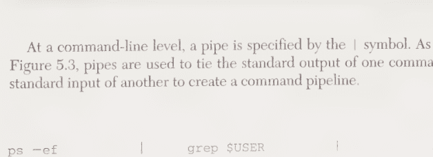

# 5 管道

例如，命令行序列

```
linux$ ps -ef | grep $USER | cat -n
```

将执行 `ps -ef` 命令（以完整形式显示所有用户的进程状态），并将其输出通过管道传递给 `grep $USER` 命令。`grep` 命令打印包含变量 `$USER` 内容（即用户登录名）的那些行。第二个管道将 `grep` 命令的输出传递给 `cat`，`cat`（使用 `-n` 选项）将其输出显示为带编号的列表。将 `ps` 命令的输出重定向为 `grep` 命令的输入，以及将 `grep` 命令的输出重定向为 `cat` 命令的输入，是通过在命令行中加入管道规范来实现的。为了在我们的父/子进程对中实现类似的安排，我们需要一种方法将标准输入和标准输出与我们创建的管道关联起来。这可以通过使用 `dup` 或 `dup2` 系统调用（表 5.7 和 5.8）来实现。

`dup2` 调用取代了 `dup` 系统调用，但两者都值得讨论。`dup` 系统调用复制一个已打开的原始文件描述符。新描述符引用系统文件表中下一个可用的非负文件描述符条目。新描述符将共享相同的文件指针（偏移量），具有与原始描述符相同的访问模式，并共享锁。两者都将在 `exec` 调用期间保持打开状态，但它们不共享执行时关闭标志。需要考虑的一个重要点是，当被调用时，`dup` 总是返回下一个最低的可用文件描述符。

**表 5.7** `dup` 系统调用摘要。

| 包含文件 | `<unistd.h>` | 手册章节 | 2 |
| :--- | :--- | :--- | :--- |
| 摘要 | `int dup( int oldfd );` | | |
| 返回值 | 成功 | 失败 | 设置 `errno` |
| | 下一个可用的非负文件描述符 | -1 | 是 |

**表 5.8** `dup2` 系统调用摘要。

| 包含文件 | `<unistd.h>` | 手册章节 | 2 |
| :--- | :--- | :--- | :--- |
| 摘要 | `int dup2( int oldfd, int newfd );` | | |
| 返回值 | 成功 | 失败 | 设置 `errno` |
| | `newfd` 作为 `oldfd` 的文件描述符 | -1 | 是 |

一段代码序列

```cpp
int f_des[2];
pipe(f_des);
close( fileno(stdout) );  // close standard output
dup(f_des[1]);            // duplicate 1st free descriptor as write end of pipe
```

声明并生成一个管道。标准输出的文件描述符（假设是文件描述符 1）被关闭。随后的 `dup` 系统调用返回下一个最低的可用文件描述符，在本例中应该是之前关闭的标准输出文件描述符（即 1）。因此，在后续语句中写入标准输出的任何数据现在都将写入管道。注意，这个序列中有两个步骤：关闭描述符，然后 `dup` 它。存在一种微小的可能性，即序列会被中断，并且 `dup` 返回的描述符不是刚刚关闭的那个。如果信号被捕获，并且信号处理例程关闭了一个文件，就可能发生这种情况。

现在引入 `dup2` 系统调用。`dup2` 系统调用以一个原子操作关闭并复制文件描述符。当调用 `dup2` 时，在 `newfd` 被关闭而 `oldfd` 尚未被复制之间没有任何时间间隔。如果 `newfd` 引用的文件已经打开，它将在执行复制之前被关闭。对于那些更勇于探索的人，`dup` 和 `dup2` 调用都可以使用 `fcntl` 系统调用（传递适当的标志值）来实现。

程序 5.2 展示了一个模拟 `last | sort` 命令行序列的简短程序。一旦程序 5.2 在第 17 行成功执行 `fork` 系统调用，两个进程的文件/管道如图 5.4 所示。

| | 父进程 | 子进程 |
| :--- | :--- | :--- |
| 0 | `stdin` | 0 `stdin` |
| 1 | `stdout` | 1 `stdout` |
| 2 | `stderr` | 2 `stderr` |
| 3 | `f_des[0]` | 3 `f_des[0]` |
| 4 | `f_des[1]` | 4 `f_des[1]` |
| 5 | ... | 5 ... |
| 6 | ... | 6 ... |


## 5 • 管道

假设在一个相当标准的环境下（即 `stdin` = 0，`stdout` = 1，`stderr` = 2），且 `stdout` 和 `stderr` 都映射到同一设备（很可能是终端），最初父进程和子进程在系统文件表中引用相同的条目。子进程生成后，我们使用 `dup2` 调用关闭标准输出并对其进行复制。系统返回标准输出的先前引用，该引用现在与 `f_des[1]` 的文件表条目相关联。一旦建立了这种关联，文件描述符 `f_des[0]` 和 `f_des[1]` 就会被关闭，因为子进程不再需要它们。

### 程序 5.2  一个 `last | sort` 管道示例。

文件：`p5.2.cxx`


```cpp
/* A home grown last | sort cmd pipeline
*/
#define _GNU_SOURCE
#include <iostream>
#include <cstdio>
#include <unistd.h>
using namespace std;
enum { READ, WRITE };

int main( ) {
    int f_des[2];
    if (pipe(f_des) == -1) {
        perror("Pipe");
        return 1;
    }
    switch (fork( )) {
    case -1:
        perror("Fork");
        return 2;
    case 0:                 // In the child
        dup2( f_des[WRITE], fileno(stdout));
        close(f_des[READ] );
        close(f_des[WRITE]);
        execl("/usr/bin/last", "last", (char *)0);
        return 3;
    default:                // In the parent
        dup2( f_des[READ], fileno(stdin));
        close(f_des[READ] );
        close(f_des[WRITE]);
        execl("/bin/sort", "sort", (char *)0);
        return 4;
    }
    return 0;
}
```

## 5.2 匿名管道

在父进程中，`dup2` 调用关闭标准输入并将其复制为引用 `f_des[0]`。文件/管道的条目现在看起来如图 5.5 所示。在父进程中，`stdout` 和 `stderr` 没有被修改。然而，`stdin` 现在是与子进程共享的管道的读端。在子进程中，`stdout` 和 `stderr` 保持其默认值。然而，`stdout` 已与和父进程共享的管道的写端相关联。

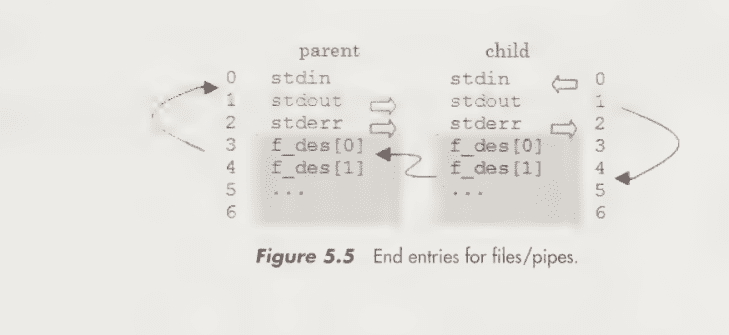

运行程序 5.2 时，两个进程（父进程和子进程）是并发执行的（同时运行）。这些进程的执行顺序是不确定的。对于涉及的进程来说，这并不是问题，因为管道允许两个进程同时进行读写操作。

我们可以通过以下步骤来总结使用匿名管道进行通信的过程：

1. 创建所需的管道。
2. 生成子进程。
3. 关闭/复制文件描述符以正确关联管道的*两端*。
4. 关闭管道不需要的一端。
5. 执行通信活动。
6. 关闭所有剩余的打开的文件描述符。
7. 如果合适，等待子进程终止。

如果 `dup` 或 `dup2` 失败，它们会返回 `-1` 并设置 `errno`。`dup` 和 `dup2` 的错误代码如表 5.9 所示。

| # | 常量 | perror 消息 | 说明 |
|---|------|------------|------|
| 4 | EINTR | Interrupted system call | 系统调用期间捕获到信号。 |
| 9 | EBADF | Bad file descriptor | 文件描述符无效。 |
| 24 | EMFILE | Too many open files | 进程已超出打开文件数量的限制。 |
| 67 | ENOLINK | The link has been severed | 文件描述符值引用了一个不再活跃的远程系统。 |

### 练习 5-2

大多数基于 UNIX 的系统都包含一个名为 `tee` 的实用程序，它将标准输入复制到标准输出以及命令行上传递的文件描述符。因此，命令序列

`linux$ cat x.c | tee /dev/tty | wc`

会`cat`（读取）文件 `x.c` 的内容，并将标准输出通过管道传递给 `tee`。`tee` 程序会将其标准输入（来自 `cat` 命令）复制到文件 `/dev/tty` 和其标准输出，然后标准输出通过管道传递给 `wc`（字数统计）程序。请使用匿名管道编写你自己的 `tee` 版本，命名为 `my_tee`。*提示*：如果你不知道你的终端设备，在大多数系统上 `stty` 命令会显示设备信息。如果 `stty` 不起作用，可以尝试 `who` 命令。将终端设备名称传递给你的 `my_tee` 程序时，请确保包含设备的完整路径。

### 练习 5-3

修改程序 5.2，使其能够传递可变数量的命令给程序。传递给程序的每个命令都应该通过管道与下一个命令*连接*。使用这个新程序时，一个包含三个命令的序列，例如

`linux$ last | sort | more`

应表示为

`linux$ my_p5.2 last sort more`

重新编写为练习 4.3 编写的程序（第 4 章中的生产者/消费者问题），使生产者和消费者现在使用管道相互通信。

由于生成管道、fork 子进程、复制文件描述符以及通过管道将命令执行信息从一个进程传递给另一个进程的序列相对常见，因此提供了一组标准库函数来简化此任务：`popen` 和 `pclose`。参见表 5.10 和表 5.11。

表 5.10 `popen` 库函数概要。

| 头文件 | `<stdio.h>` | 手册章节 | 3 |
|---|---|---|---|
| 概要 | `FILE *popen( const char *command, const char *type )` | | |
| 返回值 | 成功 | 失败 | 设置 errno |
| | 指向 FILE 的指针 | NULL 指针 | 有时 |

表 5.11 `pclose` 库函数概要。

| 头文件 | `<stdio.h>` | 手册章节 | 3 |
|---|---|---|---|
| 概要 | `int pclose( FILE *stream );` | | |
| 返回值 | 成功 | 失败 | 设置 errno |
| | 命令的退出状态 | -1 | 有时 |

成功时，`popen` 调用返回一个指向文件流的指针（而不是整数文件描述符）。`popen` 的参数是指向将要执行的 shell 命令[^2]的指针和 I/O 模式 `type`。I/O 模式 `type`

[^2] 这可以是任何有效的 Bourne shell 命令，包括带有 I/O 重定向的命令。最常见的是，命令被放在双引号字符串中。

## 5 • 管道

（读或写）决定了进程将如何处理 `popen` 调用返回的文件指针。

调用时，`popen` 调用会自动生成一个子进程。子进程 `exec` 一个 Bourne shell（`/bin/sh`），它将执行传递的 shell 命令。子进程的输入和输出通过管道完成。如果 `popen` 的 I/O 模式类型指定为 `w`，父进程就可以向 shell 命令的标准输入**写入**数据。换句话说，向 `popen` 在父进程中生成的文件指针引用写入数据，将使运行 shell 命令的子进程能够作为其标准输入**读取**数据。相反，如果 I/O 类型为 `r`，使用 `popen` 文件指针，父进程可以从 shell 命令（由子进程运行）的标准输出**读取**数据。默认情况下，`popen` 生成的 I/O 流是全缓冲的。

如果 `popen` 因无法分配内存而失败，`errno` 不会被设置。然而，如果模式类型指定不正确，`popen` 会将 `errno` 设置为 `EINVAL`。

`pclose` 调用用于关闭通过 `popen` 调用打开的数据流。如果正在关闭的数据流与 `popen` 关联，`pclose` 返回 `popen` 引用的 shell 命令的退出状态。如果数据流不与 `popen` 调用关联，`pclose` 调用返回 -1。如果 `pclose` 无法获取子进程的状态，`errno` 会被设置为 `ECHILD`。

程序 5.3 展示了使用 `popen` 和 `pclose` 调用将一个 shell 命令的输出通过管道传递给另一个命令的输入的一种方式。

### 程序 5.3  使用 popen 和 pclose。

文件：p5.3.cxx

```cpp
/* Using the popen and pclose I/O commands */
#define _GNU_SOURCE
#include <iostream>
#include <cstdio>
#include <limits.h>
#include <unistd.h>
using namespace std;
int
main(int argc, char *argv[]) {
    FILE    *fin, *fout;
    char    buffer[PIPE_BUF];
    int     n;
    if (argc < 3) {
        cerr << "Usage " << argv[0] << " cmd1 cmd2" << endl;
        return 1;
```

## 5.2 无名管道

```c
fin = popen(argv[1], "r");
fout = popen(argv[2], "w");
fflush(fout);
while ((n = read(fileno(fin), buffer, PIPE_BUF)) > 0)
    write(fileno(fout), buffer, n);
pclose(fin);
pclose(fout);
return 0;
```

如上所示，程序 5.3 需要两个命令行参数：两个标准输出/输入通过使用 `popen` 调用生成的管道进行重定向的 shell 命令。第一个 `popen` 调用，I/O 选项为 `r`，指示系统**派生**一个子进程来执行 `argv[1]` 引用的 shell 命令。该命令的输出将被重定向，以便父进程在使用文件指针引用 `fin` 时能够**读取**它。类似地，第二个 `popen` 调用，I/O 选项为 `w`，指示系统**派生**第二个子进程。当该子进程执行其 shell 命令（由 `argv[2]` 引用）时，其标准输入将是父进程写入管道的数据，而其输出将进入标准输出。父进程使用文件指针引用 `fout` 向第二个管道写入数据，并使用文件指针引用 `fin` 从第一个管道读取数据。程序中的 `while` 循环用于将数据从一个管道的输出端复制到另一个管道的输入端。程序第 20 行中对 `fflush` 的调用用于清除缓冲输出，使其不会与管道中的数据交错。图 5.6 展示了当 shell 命令 `last` 和 `more` 在命令行上传递给程序 5.3 时的排列方式。

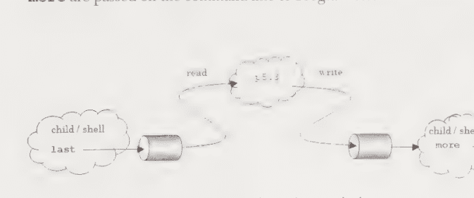

### 5-5 练习

仅使用 `popen` 调用来生成管道，我们能否创建一个由三个独立 shell 命令组成的管道（例如，一个程序在命令行上传递三个 shell 命令时，会以 `cmd1 | cmd2 | cmd3` 的方式将命令串联起来）？如果可以，编写一个程序来展示如何实现。如果不可以，请给出原因。

## 5.3 命名管道

UNIX 提供了第二种类型的管道，称为命名管道或 FIFO（我们将交替使用这两个术语）。命名管道在概念上与无名管道类似，但具有额外的优势。创建时，命名管道具有一个目录项。目录项中包含文件访问权限以及不相关进程使用管道文件的能力。尽管 FIFO 具有目录项，但请记住，写入 FIFO 的数据是传递给内核并由内核存储的，而不是直接写入文件系统。

命名管道可以在 shell 层级（命令行上）或在程序内创建。在讨论其在程序中的使用之前，先了解在 shell 层级生成命名管道是有益的。在 shell 层级，用于创建命名管道的命令是 `mknod`。正式地说，`mknod` 是一个用于生成特殊文件的实用命令。它最常被超级用户用来生成特殊设备文件（例如，在 `/dev` 目录中找到的块设备、字符设备文件）。对于非特权用户，`mknod` 只能用于生成命名管道。`mknod` 命令创建命名管道的语法是

```
linux$ mknod PIPE p
```

`mknod` 命令的第一个参数是 FIFO 的文件名（这可以是任何有效的 UNIX 文件名；但是，通常使用大写文件名来提醒用户该文件的特殊性质）。第二个参数是小写的 `p`，通知 `mknod` 要创建一个 FIFO 文件。如果我们执行上述命令并检查它创建的文件的目录项，我们会发现类似下面的列表：

```
linux$ ls -l PIPE
prw-r--r--  1 gray  faculty  0 Feb 26 07:18 PIPE
```

权限字符串开头的小写字母 `p` 表示名为 `PIPE` 的文件是一个 FIFO。FIFO 的默认文件权限使用之前讨论的标准 `umask` 机制分配。FIFO 中的字节数列为 0。一旦所有使用命名管道的进程完成操作，管道中任何剩余的数据将被系统释放，文件的字节数恢复为 0。如果我们愿意，可以在命令行上将 shell 命令的输出重定向到命名管道。如果这样做，我们应该将命令序列放在后台以防止其挂起。然后我们可以将同一 FIFO 的输出重定向为另一个命令的输入。

例如，命令

```
[1] 27742
```

将导致文件 `test_file` 的内容显示被重定向到命名管道 `PIPE`。如果在此命令之后跟随

```
linux$ cat < PIPE
test file to use
with our pipe.
[1] + Done                    cat test_file > PIPE
```

第二个 `cat` 命令将从名为 `PIPE` 的命名管道读取其输入，并将其输出显示到屏幕上。

### 5-6 练习

只要 FIFO 有一个活动的读取者和/或写入者，系统就会维护其内容。是否可以生成一个命令序列来证明这一点？尝试发出一个产生大量输出的命令（例如，`cat p5.2.cxx`），并将输出重定向到 FIFO，将该命令放在后台。在此命令之后使用 `ls -l` 查看管道是否确实有内容。现在尝试以下命令序列：

```
linux$ cat p5.2.cxx > PIPE & more < PIPE & ls -l PIPE
```

你如何解释观察到的输出差异？

虽然前面的讨论很有启发性，但其实际用途有限。在大多数情况下，FIFO 是在编程环境中创建的，而不是在命令行上。在程序中生成 FIFO 的系统调用与系统命令同名：`mknod`（表 5.12）。

**表 5.12** `mknod` 系统调用摘要。

| 头文件 | `<sys/types.h>`<br>`<sys/stat.h>`<br>`<fcntl.h>`<br>`<unistd.h>` |
| :--- | :--- |
| 手册章节 | 2 |
| 摘要 | `int mknod(const char *pathname, mode_t mode, dev_t dev);` |
| 返回值 | 成功：0 |
| 失败 | -1 |
| 设置 errno | 是 |

`mknod` 系统调用创建 `pathname` 引用的文件。创建的文件类型（FIFO、字符或块特殊文件、目录^a 或普通文件）及其访问权限由 `mode` 值确定。通常文件的 `mode` 是通过将表示文件类型的符号常量与文件访问权限进行按位或运算来创建的（有关更详细的讨论，请参阅 `umask` 部分）。允许的文件类型列于表 5.13。

**表 5.13** `mknod` 的文件类型指定常量。

| 符号常量 | 文件类型 |
| :--- | :--- |
| S_IFIFO | FIFO 特殊文件 |
| S_IFCHR | 字符特殊文件 |
| S_IFDIR | 目录 |
| S_IFBLK | 块特殊文件 |
| S_IFREG | 普通文件 |

`mknod` 的 `dev` 参数仅在指定字符或块特殊文件时使用。对于字符和块特殊文件，`dev` 参数用于分配设备的主设备号和次设备号。对于非特权用户，`mknod` 系统调用只能用于生成 FIFO。生成 FIFO 时，`dev` 参数应保留为 0。如果 `mknod` 成功，则返回值为 0。否则，将设置 `errno` 以指示错误，并返回值 -1。

> ^a 虽然大多数版本的 `mknod` 也可以用于生成目录（如果你是超级用户），但 Linux 中的版本不能（请改用 `mkdir` 系统调用）。

**表 5.14** mknod 错误消息。

| # | 常量 | perror 消息 | 说明 |
| :--- | :--- | :--- | :--- |
| 1 | EPERM | Operation not permitted | 调用进程的有效 ID 不是超级用户的 ID。 |
| 4 | EINTR | Interrupted system call | 在系统调用期间捕获到信号。 |
| 12 | ENOMEM | Cannot allocate memory | 可用的内核内存不足。 |
| 13 | EACCES | Permission denied | 父目录（或 pathname 中的某个目录）缺少写权限。 |
| 14 | EFAULT | Bad address | pathname 引用了非法地址。 |
| 17 | EEXIST | File exists | pathname 已存在。 |
| 20 | ENOTDIR | Not a directory | 指定的 pathname 的某部分不是目录。 |
| 22 | EINVAL | Invalid argument | 指定了无效的 dev。 |


| 28 | ENOSPC | No space left on device | 文件系统没有剩余的 inode 可用于新文件生成。 |

| 30 | EROFS | Read-only file system | 引用的文件在（或将在）只读文件系统上。 |

| 67 | ENOLINK | The link has been severed | `pathname` 值引用了一个不再活动的远程系统。 |

| 72 | EMULTIHOP | Multihop attempted | `pathname` 值需要多次跳转到远程系统，但文件系统不允许。 |

| 36 | ENAMETOOLONG | File name too long | `pathname` 值超过了系统路径/文件名长度。 |

| 40 | ELOOP | Too many levels of symbolic links | `perror` 消息已经说明了一切。 |

在许多 UNIX 版本中，一个名为 `mkfifo` 的 C 库函数简化了 FIFO 的生成。`mkfifo` 库函数（表 5.15）使用 `mknod` 系统调用来生成 FIFO。与 `mknod` 不同的是，大多数情况下 `mkfifo` 不要求用户具有超级用户权限。

## 5.3 命名管道

表 5.15 `mkfifo` 库函数总结。

| 头文件 | `<sys/types.h>` <br> `<sys/stat.h>` | 手册章节 | **3** |

| :--- | :--- | :---: | :---: |

| 总结 | `int mkfifo (const char *pathname, <br> mode_t mode)` | | |

| 返回值 | **成功** | **失败** | **设置 errno** |

| | 0 | -1 | 是 |

如果使用 `mkfifo` 代替 `mknod`，`mkfifo` 的 `mode` 参数仅指 FIFO 的文件访问权限，因为文件类型默认设置为 `S_IFIFO`。如果 `mkfifo` 调用失败，它返回 -1 并设置 `errno` 中的值。生成 FIFO 时，`mkfifo` 可能遇到的错误与之前为 `mknod` 系统调用列出的错误类似（表 5.14）。在我们的示例中，我们生成 FIFO 时使用更通用的 `mknod` 系统调用。

我们的下一个示例在范围上比一些过去的示例更为宏大。我们结合使用无名管道和命名管道来产生一种**客户端-服务器**关系。客户端和服务器进程将在同一平台上运行。首先运行单个服务器进程并将其置于后台。随后运行的客户端进程处于前台。客户端进程从用户那里接受一个 shell 命令。该命令通过一个*公共* FIFO（所有客户端和服务器已知）发送到服务器进行处理。一旦接收到命令，服务器使用 `popen-pclose` 序列执行它（在此过程中会生成一个无名管道）。服务器进程通过一个*私有* FIFO 将命令的输出返回给客户端，客户端在收到后将其显示到屏幕上。图 5.7 展示了进程和管道的关系。

更简洁地说，相关进程采取的步骤如下：

- 服务器生成公共 FIFO（可供所有参与的客户端进程使用）。

- 客户端进程生成其自己的私有 FIFO。

- 客户端提示并接收一个 shell 命令。

- 客户端将其私有 FIFO 的名称和 shell 命令写入公共 FIFO。

- 服务器读取公共 FIFO 并获取私有 FIFO 名称和 shell 命令。

- 服务器使用 `popen-pclose` 序列执行 shell 命令。shell 命令的输出通过私有 FIFO 发送回客户端。

- 客户端显示命令的输出。

为确保服务器和客户端进程都将使用相同的公共 FIFO 名称并具有相同的消息格式，使用了一个本地头文件。此头文件如图 5.8 所示。

### 图 5.8 客户端-服务器示例的头文件。

```
File : local.h
/*
    pipe client-server 的本地头文件
*/
#include <cstdio>
#include <sys/types.h>
#include <sys/stat.h>
#include <fcntl.h>
#include <unistd.h>
#include <cstring>
#include <cstdlib>
#include <stdlib.h>
using namespace std;
const char *PUBLIC = "/tmp/PUBLIC";
const int B_SIZ = (PIPE_BUF / 2);
struct message {
    char fifo_name[B_SIZ];
    char cmd_line[B_SIZ];
};
```

在此文件中，使用一个常量将公共 FIFO 的名称设置为 `/tmp/PUBLIC`。通过 `struct` 语句声明了将通过公共 FIFO 发送的消息格式。消息结构包含两个字符数组成员。第一个成员名为 `fifo_name`，存储私有 FIFO 的名称。第二个结构成员 `cmd_line` 存储要由服务器执行的命令。

程序 5.4 显示了客户端进程的代码。

### 程序 5.4 客户端进程。

```
File : client.cxx
/* 客户端进程 */
#define _GNU_SOURCE

#include "local.h"
int
main( ){
    int           n, privatefifo, publicfifo;
    static char   buffer[PIPE_BUF];
    struct message msg;
    sprintf(msg.fifo_name, "/tmp/fifo%d", getpid( ));
    if (mknod(msg.fifo_name, S_IFIFO | 0666, 0) == 0) {
      perror(msg.fifo_name);
      return 1;
    }
    if ((publicfifo = open(PUBLIC, O_WRONLY)) == -1) {
      perror(PUBLIC);
      return 2;
    }
    while ( 1 ) {
      write(fileno(stdout), "\ncmd> ", 6);
      memset(msg.cmd_line, 0x0, B_SIZ);
      n = read(fileno(stdin), msg.cmd_line, B_SIZ);
      if (!strncmp("quit", msg.cmd_line, 4)) {
        break;
      }
      write(publicfifo, (char *) &msg, sizeof(msg));
      if ((privatefifo = open(msg.fifo_name, O_RDONLY)) == -1) {
        perror(msg.fifo_name);
        return 3;
      }
      while ((n = read(privatefifo, buffer, PIPE_BUF)) > 0) {
        write(fileno(stderr), buffer, n);
      }
      close(privatefifo);
    }
    close(publicfifo);
    unlink(msg.fifo_name);
    return 0;
}
```

为本进程的*私有* FIFO 构建唯一名称。

生成*私有* FIFO。

打开*公共* FIFO 进行写入。

提示输入命令：清空空间以容纳命令。

将命令写入公共管道供服务器处理。

使用 `sprintf` 函数，客户端通过结合 `getpid` 系统调用返回的值为其私有 FIFO 创建唯一名称。接下来使用 `mknod` 系统调用创建私有 FIFO，并为所有人设置读写权限。以下 `open` 语句打开公共 FIFO 进行写入。如果由于某种原因公共 FIFO 尚未由服务器先前生成，`open` 将失败。在这种情况下，`perror` 调用会产生错误消息，客户端进程退出。如果 `open` 成功，客户端进程随后进入无限循环。客户端首先提示用户输入命令。在获取命令之前，使用 C 库函数 `memset` 将存储命令的结构成员设置为全 NULL。此操作确保此存储位置不会留下多余字符。请注意，使用 `memset` 清除字符串优于使用已弃用的 `bzero` 库函数。第 24 行的 `read` 语句从标准输入获取用户输入并将其存储在 `msg.cmd_line` 中。检查输入以确定用户是否想退出程序。通过将输入与字符串 `"quit"` 进行比较来完成检查。我们使用 `n-1` 作为比较的字符数，以避免包含用户输入末尾的换行符 `\n`。如果输入了 `"quit"`，则通过 `break` 语句退出 `while` 循环，删除私有 FIFO，客户端进程终止。如果用户不想退出，则整个消息结构（包括私有 FIFO 名称和用户输入的命令）被写入公共 FIFO（从而将信息发送到服务器）。客户端进程随后尝试读取其私有 FIFO 以获取将从服务器发送给它的输出。在此时，如果服务器尚未完成执行客户端的命令，客户端进程将阻塞（这是 `read` 的默认行为）。一旦私有 FIFO 中有可用数据，客户端中的 `while` 循环将读取其内容并写入标准错误。服务器进程的代码如程序 5.5 所示。

请注意，程序中的所有 I/O 都使用 `read`/`write` 完成，以避免与标准 I/O 库调用相关的缓冲区刷新问题。

### 程序 5.5 服务器进程。

```
File : server.cxx
/* 服务器进程 */
#define _GNU_SOURCE

#include "local.h"
int
main( ){
    int          n, done, dummyfifo, publicfifo, privatefifo;
    struct message msg;
    FILE         *fin;
    static char   buffer[PIPE_BUF];

    mknod(PUBLIC, S_IFIFO , 0666, 0);

    if ((publicfifo = open(PUBLIC, O_RDONLY)) == -1 ||
        (dummyfifo  = open(PUBLIC, O_WRONLY | O_NDELAY)) == -1 ) {
        perror(PUBLIC);
        return 1;
    }

    while (read(publicfifo, (char *) &msg, sizeof(msg)) > 0) {
        n = done = 0;
        do {
            if ((privatefifo=open(msg.fifo_name,
                              O_WRONLY|O_NDELAY)) == -1)
                sleep(3);
            else {
                fin = popen(msg.cmd_line, "r");
                write(privatefifo, "\n", 1);
                while ((n = read(fileno(fin), buffer, PIPE_BUF)) > 0) {
                    write(privatefifo, buffer, n);
                    memset(buffer, 0x0, PIPE_BUF);
                }
                pclose(fin);
                close(privatefifo);
                done = 1;
            }
        } while (++n < 5 && !done);
        if (!done)
            write(fileno(stderr),
              "\nNOTE: SERVER ** NEVER ** accessed private FIFO\n", 48);
    }
    return 0;
}
```

## 5.3 命名管道

服务器进程负责创建公共 FIFO。一旦创建，公共 FIFO 就会被同时打开以进行读写。这看起来可能有些奇怪，因为服务器进程只需要从公共 FIFO 中读取数据。通过同时以写入方式打开公共 FIFO，可以确保公共 FIFO 始终至少关联一个写入进程。因此，服务器进程将永远不会在公共 FIFO 上收到文件结束符。当公共 FIFO 为空时，服务器进程会阻塞等待，直到有新的消息写入。这种技术免去了每次客户端进程完成活动后都必须关闭并重新打开公共 FIFO 的麻烦。

一旦建立公共 FIFO，服务器就尝试从其中读取消息。当读取到一条消息（包含一个私有 FIFO 名称和要执行的命令）后，服务器会尝试打开指定的私有 FIFO 以进行写入。打开私有 FIFO 的尝试是在一个 `do-while` 循环中完成的。使用 `O_NDELAY` 标志是为了防止打开操作产生死锁。如果客户端因某种原因未打开其读取端的私有 FIFO，那么在没有指定 `O_NDELAY` 标志的情况下，服务器将在打开私有 FIFO 进行写入时阻塞。如果打开私有 FIFO 失败，服务器会休眠三秒后再次尝试。经过五次不成功的尝试后，服务器会向标准错误输出一条信息性消息，并继续处理。如果成功打开了私有 FIFO，则使用 `popen` 来执行消息结构中传递的命令。命令的输出（通过无名管道获取）使用 `while` 循环写入私有 FIFO。当命令的所有输出都写入无名管道后，无名管道和私有 FIFO 将被关闭。客户端-服务器程序的示例运行如图 5.9 所示。

图 5.9 典型的客户端-服务器输出。

```
linux$ server &          <----------- 将服务器置于后台。

$ client                  <----------- 在前台运行一个客户端进程。
cmd>ps

   PID  TTY          TIME  CMD

14736 pts/3     00:00:00  csh

27107 pts/3     00:00:00  server

27108 pts/3     00:00:00  client

27110 pts/3     00:00:00  ps
cmd>who

gray       pts/3    Feb 27 11:28
cmd>quit               <----------- 必须通过发送 kill 信号来终止服务器进程。

linux$ kill -9 27107
[1]    Killed                  server
$
```

服务器进程被置于后台。然后运行客户端进程，并在 `cmd>` 提示符下输入 shell 命令（`ps` 和 `who`）。显示了每个命令的输出（在服务器进程执行并将其输出发送回客户端之后）。通过输入 `quit` 字来终止客户端进程。即使客户端已被移除，服务器进程仍在后台运行，需要使用 `kill` 命令来终止。

## 5-7 练习

可以对客户端程序进行许多改进，使其更加健壮。例如，如果客户端因收到中断信号（CTRL+C）而退出，私有 FIFO 不会被删除。使用信号捕获例程来纠正此疏忽。当客户端进程启动时，如果服务器进程不可用，它将启动失败。通过让客户端在服务器未活动时启动服务器进程来纠正此问题。

## 5-8 练习

按照目前的编写方式，服务器程序将依次处理每个命令请求。如果其中一个请求需要长时间执行，所有其他客户端进程都必须等待服务。重写服务器程序，使得当服务器进程收到消息时，它 `fork` 一个子进程来执行命令并将命令输出返回给客户端进程的任务。

## 5.4 总结

管道为用户提供了更可靠、同步的进程间通信方式。无名管道只能用于相关进程。`popen` 系统调用为用户提供了一种简单的方法来生成一个无名管道以执行 shell 命令。命名管道（FIFO）作为实际的目录条目存在，可以由不相关的进程共享。管道可以容纳的数据量受系统限制。当管道不再与任何进程关联时，其内容会被系统刷新。可以与管道一起使用的 `read` 和 `write` 系统调用为用户提供了一种简单的方法来协调管道中的数据流。使用管道时必须注意防止死锁情况。当一个进程以写入方式打开管道的一端，而另一个进程以写入方式打开同一管道的另一端时，就可能发生死锁。每个进程依次等待另一个进程完成其操作。⁵ 管道只能由在同一平台上运行的进程使用。不幸的是，管道没有提供简单的方法让读取进程确定写入进程是谁。所有涉及使用管道的进程必须事先知道它们的存在。

## 5.5 关键术语和概念

- `bzero` 库函数

- `dup` 系统调用

- `dup2` 系统调用

- FIFO

- `memset` 库函数

- `mkdir` 库函数

- `mkfifo` 库函数

- `mknod` 命令

- `mknod` 系统调用

- 命名管道

- `O_NDELAY` 标志

- `O_NOBLOCK` 标志

- `pclose` 库函数

- 管道

- `pipe` 系统调用

- `PIPE_BUF`

- `PIPE_SIZE`

- `popen` I/O 函数

- 私有 FIFO

- 公共 FIFO

- `read` 系统调用

- `tee` 命令

- 无名管道

- `write` 系统调用

> ⁵ 由于 `popen` 生成的无名管道无需用户直接使用 `open` 系统调用，因此如果需要设置 `O_NDELAY` 或 `O_NOBLOCK` 标志，则必须使用 `fcntl` 系统调用。

## 第 6 章

## 消息队列

## 6.1 简介


UNIX 的设计者们发现，使用信号和管道可以实现的进程间通信类型存在限制。为了增加进程间通信的灵活性和范围，添加了补充通信设施。这些设施是在 1970 年代发布 System V 时添加的，被统称为 IPC（进程间通信）。简而言之，这些设施包括：

- **消息队列**——要通信的信息被放置在一个预定义的消息结构中。生成消息的进程指定其类型并将消息放入系统维护的消息队列中。访问消息队列的进程可以使用消息类型以*选择性*地以先进先出（FIFO）方式读取特定类型的消息。消息队列为用户提供了一种异步地从多个进程多路复用数据的方式。

- **信号量**——信号量是系统实现的数据结构，用于在进程之间传输少量数据。信号量最常用于进程同步。

- **共享内存**——通过访问共享进程数据空间来传递信息。这是最快的进程间通信方法。共享内存允许参与进程随机访问共享内存段。信号量通常用于同步对共享内存段的访问。

所有这三种设施都可以由相关和不相关的进程使用，但这些进程必须在同一系统（机器）上。

与文件类似，IPC **资源**¹ 在使用之前必须先创建。每个 IPC 资源都有创建者、所有者和访问权限。这些属性在 IPC 创建时建立，可以使用适当的系统调用进行修改。在系统级别，可以使用 `ipcs` 命令获取有关系统支持的 IPC 设施的信息。例如，在我们的系统上，`ipcs` 命令产生如图 6.1 所示的输出。

图 6.1 `ipcs` 的部分输出。

```
linux$ ipcs

------ 共享内存段 ------
key        shmid      owner      perms      bytes      nattch     status
0x00000000 25198594   root       666        247264     3

------ 信号量数组 ------
key        semid      owner      perms      nsems      status
0x00000000 65537      root       666        4
0x00000000 98306      root       666        16
0x00000000 131075     root       666        16
0x00000000 163844     root       666        16

------ 消息队列 ------
key        msqid      owner      perms      used-bytes messages
```

`ipcs` 实用程序支持多种选项，用于指定特定资源和输出格式。每个选项的含义如表 6.1 所示。

此外，`-s`、`-q` 或 `-m` 可用于指示信号量、消息队列或共享内存，后面可以跟 `-i` 和一个有效的十进制 ID，以显示有关特定 IPC 资源的更多信息（图 6.2）。

¹ 在 IPC 设施的上下文中，术语资源表示该设施的一个实例。

## 6.1 简介

**表 6.1** `ipcs` 命令行选项。

| 资源指定 | 输出格式 |

| :--- | :--- |

| `-a` 全部（默认） | `-c` 创建者 |

| `-m` 共享内存 | `-l` 限制 |

| `-q` 消息队列 | `-p` 进程 ID |

| `-s` 信号量 | `-t` 时间 |

| | `-u` 汇总 |

每个设施的限制在内核生成时确立。命令

```
linux$ /sbin/sysctl -a
```

会显示所有可配置的内核参数。在我们的系统上，此命令会产生大量输出。来自此命令的 IPC 相关信息如下：

```
...
kernel.sem = 250 32000 32 128
kernel.msgmnb = 16384
kernel.msgmni = 16
kernel.msgmax = 8192
kernel.shmmni = 4096
kernel.shmall = 2097152
kernel.shmmax = 33554432
...
```

将此输出与 `ipcs -l`（限制）命令的输出进行比较，可以轻松确定每个值的作用——例如，`kernel.msgmni` 是系统范围内消息队列的最大数量。

IPC 资源在创建它们的进程终止后仍然存在并维护其内容。IPC 资源可以由其所有者移除，方法是在程序中使用适当的系统调用或使用系统级命令 `ipcrm`。上一个 `ipcs` 命令输出中显示的消息队列，可以通过其所有者发出命令来移除

```
linux$ ipcrm sem 65537
```

`sem` 命令行选项告诉 `ipcrm` 要移除一个信号量，参数 65537 是信号量的 ID 号。由于对可用的 IPC 资源数量存在每个用户和系统范围的限制，用户应尽责地移除不需要的已分配 IPC。请注意，作为超级用户，轻率地移除 root 拥有的 IPC 资源是不明智的。

## 6.2 IPC 系统调用概述

一组类似的系统调用用于创建 IPC 资源和操作 IPC 信息。[^1] 由于其灵活性，这些调用的语法有些晦涩（这些调用就像骆驼一样，看起来像是由委员会设计的）。System V IPC 调用在表 6.2 中进行了总结。

**表 6.2** System V IPC 调用摘要。

| 功能 | 消息队列 | 系统调用信号量 | 共享内存 |

|---|---|---|---|

| 分配 IPC 资源；获取对现有 IPC 资源的访问权限。 | `msgget` | `semget` | `shmget` |

| 控制 IPC 资源：获取/修改状态信息，移除资源。 | `msgctl` | `semctl` | `shmctl` |

| IPC 操作：发送/接收消息，执行信号量操作，附加/分离共享内存段。 | `msgsnd` `msgrcv` | `semop` | `shmat` `shmdt` |

[^1]: 使用 `shm` 表示共享内存段，或使用 `msg` 表示消息队列。

[^2]: 请注意，Linux 还支持一个非标准、不可移植的系统调用 `ipc`，可用于操作 IPC 资源。由于这是一个特定于 Linux 的调用，最好将其使用留给 Linux 系统开发人员。

*get* 系统调用[^3]（`msgget`、`semget` 和 `shmget`）用于分配新的 IPC 资源（生成其关联的系统 IPC 结构）或获取对现有 IPC 的访问权限。每个 IPC 都有一个所有者和一个创建者，在大多数情况下，两者通常是相同的。分配新资源时，用户必须指定 IPC 的访问权限。与 `open` 系统调用类似，*get* 系统调用返回一个称为 IPC 标识符的整数值，类似于文件描述符。IPC 标识符用于引用 IPC。从系统的角度来看，IPC 标识符是包含 IPC 权限结构信息的系统表中的索引。IPC 权限结构定义在 `<bits/ipc.h>` 中，该文件由头文件 `<sys/ipc.h>` 包含。该结构定义如下

```c
struct ipc_perm {
    __key_t __key;         /* 密钥            */
    __uid_t uid;           /* 所有者的用户 ID。   */
    __gid_t gid;           /* 所有者的组 ID。  */
    __uid_t cuid;          /* 创建者的用户 ID。 */
    __gid_t cgid;          /* 创建者的组 ID。 */
    unsigned short int mode;       /* 访问权限。  */
    unsigned short int __pad1;
    unsigned short int __seq;      /* 序列号。   */
    unsigned short int __pad2;
    unsigned long int __unused1;
    unsigned long int __unused2;
};
```

`__uid_t`、`__gid_t` 等的类型定义可以在头文件 `<sys/types.h>` 中找到。通常，所有使用 IPC 设施的程序都应包含 `<sys/types.h>` 和 `<sys/ipc.h>` 文件。正如将在讨论 *ctl* 系统调用时解释的那样，权限结构的某些成员可以由用户修改。三个 *get* 系统调用中有两个参数是通用的。每个 *get* 系统调用都接受一个定义类型为 `__key_t`（基本类型为整数）的参数。这个参数称为 `key` 值，由 *get* 系统调用用于生成 IPC 标识符。*get* 系统调用返回的 IPC 标识符与 `key` 值之间存在直接的一对一关系。虽然 `key` 可以以任意方式生成，但有一个名为 `ftok` 的库函数通常用于标准化密钥生成。[^4] 通过使用相同参数调用 `ftok`，不相关的进程可以确保生成相同的 `key` 值，从而引用相同的 IPC 资源。`ftok` 函数在表 6.3 中进行了总结。

**表 6.3** `ftok` 库函数摘要。

| 包含文件 | `<sys/types.h>` <br> `<sys/ipc.h>` | 手册部分 | 3 |

|---|---|---|---|

| 摘要 | `key_t ftok ( char *pathname, char proj );` | | |

| 返回值 | 成功：返回用于 IPC `get` 系统调用的 `key_t` 值 | 失败：−1 | 设置 `errno`：类似 `stat` 系统调用 |

`ftok` 函数接受两个参数。第一个参数 `path` 是对一个现有可访问文件的引用。通常，此参数使用值 `"."`，因为在大多数情况下，自引用目录项 `"."` 始终存在、可访问，且不太可能随后被删除。`ftok` 的第二个参数 `proj` 是一个单字符项目标识符，最常用作字面量表示。成功调用 `ftok` 返回的值是定义类型 `key_t`。`ftok` 的底层算法使用由指定 `pathname` 的 `stat` 系统调用返回的数据以及 `proj` 参数值，但不保证返回唯一的密钥值。如果 `ftok` 失败，它返回 −1 并以类似 `stat` 系统调用的方式设置 `errno`（`stat` 系统调用在第 2.8 节 "文件信息" 中讨论）。如程序 6.1 所示，`ftok` 返回的值的最高有效字节是字符 `proj` 值，该值作为第二个参数传递。

**程序 6.1** 使用 `ftok` 生成一些密钥值。

```cpp
// 文件 : p6.1.cxx
/*
    使用 ftok 生成密钥值
*/
#include <iostream>
#include <sys/types.h>
#include <sys/ipc.h>
using namespace std;

int
main()
{
    key_t key;
    for (char i = 'a'; i <= 'd'; ++i) {
        key = ftok(".", i);
        cout << "proj = " << i << " key = [" << hex << key
            << "] MSB = " << (char)(key >> 24) << endl;
    }
    return 0;
}
```

图 6.3 显示了程序 6.1 在本地 32 位系统上运行时的输出。

**图 6.3** 程序 6.1 的输出。

```
linux$ p6.1
proj = a key = [61153384] MSB = a
proj = b key = [62153384] MSB = b
proj = c key = [63153384] MSB = c
proj = d key = [64153384] MSB = d
```

`proj` 参数成为 `ftok` 返回的值的最高有效字节。

### 6-1 练习

如程序 6.1 所示，`ftok` 返回的密钥值的最高有效字节是作为第二个参数传递的字符值，即分配给 `proj` 的值。密钥的其余部分来自 `stat` 系统调用（使用 `pathname` 作为其参数）返回的信息。`ftok` 使用了哪些 `stat` 信息？`ftok` 的底层算法是什么？编写一个简短的程序来支持你的答案。

*get* 系统调用的密钥值也可以设置为定义的常量 `IPC_PRIVATE`。在底层，`IPC_PRIVATE` 被定义为值 0。请注意，无论其参数值如何，`ftok` 库函数都不会返回值 0。指定 `IPC_PRIVATE` 指示 *get* 系统调用创建一个具有唯一 IPC 标识符的 IPC 资源。因此，没有其他创建或尝试获取 IPC 资源访问权限的进程将获得相同的 IPC 标识符。

使用 `IPC_PRIVATE` 创建的 IPC 资源通常在相关进程（如父/子进程或子/子进程）之间共享，或在客户端-服务器架构中共享。

[^3]: 术语 *get*（斜体）将用于引用这组系统调用。

[^4]: 老实说，`ftok` 库函数是多余的，但出于历史和连续性的原因而介绍它。只要希望访问公共 IPC 资源的进程有一种方法可以通信 IPC 的密钥值（例如在公共头文件中），就可以避免使用 `ftok`。

## 6 消息队列

在相关的进程设置中，父进程会创建IPC资源。当执行`exec`时，关联的IPC标识符会通过环境变量或命令行参数传递给子进程。在客户端-服务器关系中，服务器进程通常使用`IPC_PRIVATE`创建IPC。随后，IPC标识符通过文件提供给客户端。需要注意的是，在这两种场景中，子进程/客户端进程在执行其`get`系统调用以访问现有的私有资源时，都不会指定`IPC_PRIVATE`。最后，使用`IPC_PRIVATE`并不能阻止其他进程访问该资源；它只是让进程确定与资源关联的标识符变得稍微困难一些。

所有IPC `get`系统调用的第二个常见参数是消息标志。消息标志是一个整数值，用于在创建IPC资源时设置访问权限。消息标志参数的低九位定义了访问权限。表6.4总结了每个IPC系统调用执行其功能所需的后续权限类型。执行位对IPC机制无关紧要。

表6.4 IPC系统调用所需的权限

| 所需权限 | 消息队列 | 信号量 | 共享内存 |

| :--- | :--- | :--- | :--- |

| 写入（修改） | `msgsnd` 将消息放入队列<br>`msgctl` 写入修改后的IPC状态信息 | `semop` 增加或减少信号量值<br>`semctl` 设置单个或整组信号量的值；写入修改后的IPC状态信息 | `shmat` 写入共享内存段<br>`shmctl` 写入修改后的IPC状态信息 |

| 读取 | `msgrcv` 从队列获取消息<br>`msgctl` 检索IPC状态信息 | `semop` 阻塞直到信号量变为0<br>`semctl` 检索IPC状态信息 | `shmat` 从共享内存段读取<br>`shmctl` 检索IPC状态信息 |

⁶ 每种IPC机制的头文件（即 `<sys/msg.h>`、`<sys/sem.h>` 和 `<sys/shm.h>`）都为该机制的读/写（访问）权限定义了常量。如前所述，使用定义的常量确实能增加代码的可移植性。然而，天下没有免费的午餐，程序员必须经常花时间查找不常用的定义常量的正确拼写。

## 6.2 IPC系统调用概览

除了设置访问模式外，`<sys/ipc.h>`中还有两个定义的常量，它们可以与访问权限值进行按位或运算，以修改IPC创建时采取的操作。常量`IPC_CREAT`指示`get`系统调用在当前不存在IPC资源时创建一个。指定`IPC_CREAT`时，如果资源已存在且不是使用`IPC_PRIVATE`创建的，则返回其IPC标识符。与`IPC_CREAT`一起，创建者也可以指定`IPC_EXCL`。同时使用这两个常量（即`IPC_CREAT | IPC_EXCL`）会使`get`系统调用以*不覆盖*的方式运作。也就是说，如果指定的`key`值已存在一个IPC，`get`系统调用将失败；否则，将创建该资源。通过使用这种技术，进程可以确保它是IPC资源的创建者，而不是访问先前创建的IPC。在此上下文中，单独指定`IPC_EXCL`没有意义。

`ctl`系统调用（`msgctl`、`semctl` 和 `shmctl`）作用于前面描述的系统IPC权限结构中的信息。所有这些系统调用都需要一个IPC标识符和一个整数命令值来指定其操作。命令可能取的值由以下定义的常量表示（在头文件 `<sys/ipc.h>` 中）：

- **IPC_STAT** — 返回所引用IPC资源的状态信息。指定`IPC_STAT`时，`ctl`系统调用必须传递一个指向已分配的适当类型结构的指针，用于存储返回的信息。

- **IPC_SET** — 更改IPC资源的所有者、组或模式。此外，与`IPC_STAT`一样，必须传递一个指向适当类型结构（包含更改后的成员信息）的指针。

- **IPC_RMID** — 销毁IPC资源的内容并将其从系统中移除。

只有进程是IPC的所有者或创建者（或具有超级用户权限），才能指定`IPC_SET`或`IPC_RMID`。一些`ctl`系统调用具有额外的功能，将在后续章节中介绍。

剩余的IPC系统调用用于IPC*操作*。`msgsnd` 和 `msgrcv` 调用用于从消息队列发送和接收消息。默认情况下，如果消息队列已满，系统会在 `msgsnd` 上阻塞；如果消息队列为空，则在 `msgrcv` 上阻塞。进程将保持阻塞状态，直到指定的操作成功、收到信号或IPC资源被移除。进程可以通过将`IPC_NOWAIT`标志与指定的操作标志进行按位或运算来指定不阻塞。`semop` 系统调用对信号量执行各种操作（例如设置和测试）。同样，默认情况下，当尝试减少一个当前为0的信号量或进程等待信号量变为0时，会发生阻塞。`shmat` 和 `shmdt` 系统调用用于共享内存，以映射/附加和取消映射/分离共享内存段。这些调用不会阻塞。


出于只有文档作者才知道的原因，`msgsnd` 和 `msgrcv` 的手册页（在第2节中）引用了 `msgop`。然而，系统调用中并不存在 `msgop`。同样，`shmat` 和 `shmdt` 的手册页引用了 `shmop`，这同样不是一个系统调用。`semop` 的手册页仅引用了 `semop`（这确实是一个系统调用）。人们只能得出结论，最初的意图是将所有这些调用归类在IPC操作的总标题下。

在介绍消息队列、信号量和共享内存时，我们将详细讨论每一组IPC系统调用。

## 6.3 创建消息队列

消息队列使用`msgget`系统调用创建（表6.5）。

**表6.5** `msgget`系统调用摘要

| 头文件 | `<sys/types.h>`<br>`<sys/ipc.h>`<br>`<sys/msg.h>` | 手册章节 | 2 |
| --- | --- | --- | --- |
| 摘要 | `int msgget (key_t key, int msgflg);` |  |  |
| 返回值 |  | 成功 | 失败 | 设置`errno` |
|  | 与`key`关联的非负消息队列标识符 | -1 | 是 |

如果`msgget`系统调用成功，则返回一个非负整数。此值是消息队列标识符，可在后续调用中用于引用该消息队列。如果`msgget`系统调用失败，则返回值-1，并相应地设置全局变量`errno`以指示错误（见表6.6）。参数`key`的值可以直接由用户指定，也可以使用`ftok`库函数生成（如前面讨论所述）。分配给`key`的值由操作系统用于生成唯一的消息队列标识符。`msgflg`参数的低位用于确定消息队列的访问权限。额外的标志（例如，`IPC_CREAT`, `IPC_EXCL`）可以与权限值进行按位或运算，以指示特殊的创建条件。

如果定义的常量`IPC_PRIVATE`用作`key`参数，或者`IPC_CREAT`标志与访问权限进行按位或运算且没有先前存在的消息队列与`key`值关联，则会创建新的消息队列。如果指定了`IPC_CREAT`（但没有`IPC_EXCL`）且消息队列已存在，`msgget`将不会失败，而是返回与`key`值关联的消息队列标识符（表6.6）。

| # | 常量 | `perror`消息 | 解释 |
|---|----------|----------------|-------------|
| 2 | `ENOENT` | No such file or directory | 此键的消息队列标识符不存在，且未设置`IPC_CREAT`。 |
| 12 | `ENOMEM` | Cannot allocate memory | 系统内存不足以分配消息队列。 |
| 13 | `EACCES` | Permission denied | 此键的消息队列标识符存在，但当前访问权限不允许请求的操作。 |
| 17 | `EEXIST` | File exists | 此键的消息队列标识符存在，但同时设置了标志`IPC_CREAT`和`IPC_EXCL`。 |
| 28 | `ENOSPC` | No space left on device | 已达到系统限制（`MSGMNI`）的消息队列数量上限。 |
| 43 | `EIDRM` | Identifier removed | 指定的消息队列已标记为待移除。 |

## 6.2 生成消息队列

程序6.2生成五个具有读/写权限的消息队列，使用`ipcs`命令（通过管道）显示消息队列状态，然后删除这些消息队列。

**程序6.2** 生成消息队列

```cpp
File : p6.2.cpp

/*  消息队列生成
    */
#define _GNU_SOURCE
#include <cstdio>
#include <unistd.h>
#include <linux/limits.h>
#include <sys/types.h>
#include <sys/ipc.h>
#include <sys/msg.h>
using namespace std;
const int MAX=5;
int
main(){
    FILE *fin;
    char  buffer[PIPE_BUF], proj = 'A';
    int   i, n, mid[MAX];
    key_t key;
    for (i = 0; i < MAX; ++i, ++proj) {
        key = ftok(".", proj);
        if ((mid[i] = msgget(key, IPC_CREAT | 0660)) == -1) {
            perror("Queue create");
            return 1;
        }
    }
    fin = popen("ipcs", "r");
    while ((n = read(fileno(fin), buffer, PIPE_BUF)) > 0)
        write(fileno(stdout), buffer, n);
    pclose(fin);
    for (i = 0; i < MAX; ++i )
        msgctl(mid[i], IPC_RMID, 0);
    return 0;
}
```

在我们的系统上运行时，此程序会产生如图6.4所示的输出，表明已生成五个消息队列。

**图6.4** 程序6.2的输出

```
linux$ p6.2

Shared Memory Segments --------
key        shmid      owner  perms  bytes    nattch status
0x00000000 25198594   root   666    247264   3

------ Semaphore Arrays --------
key        semid      owner  perms  nsems    status
0x00000000 65537      root   666    4
0x00000000 98306      root   666    16
0x00000000 131075     root   666    16
0x00000000 163844     root   666    16

------ Message Queues --------
key        msqid      owner  perms  used-bytes messages
0x41153384 2260992    gray   660    0          0
0x42153384 2293761    gray   660    0          0
0x43153384 2326530    gray   660    0          0
0x44153384 2359299    gray   660    0          0
0x45153384 2392068    gray   660    0          0
```

### 6-2 练习

快速连续运行几次程序6.2。观察生成的消息队列标识符。系统使用的编号方案似乎是什么？*提示：* 查看头文件`<linux/msg.h>`。你能找到这种方法背后的任何原理吗？现在，在第28行的`pclose(fin);`语句之后添加语句`sleep(5);`。重新编译程序，并调用程序两次，每次都在后台运行。假设程序仍称为`p6.2`，这可以通过以下方式完成：

```
linux$ p6.2 & p6.2 &
```

计算生成的消息队列数量，并解释为什么没有10个存在。

当创建消息队列时，会生成一个称为`msqid_ds`的系统消息队列数据结构。此结构由系统维护，定义在系统相关的头文件`<bits/msg.h>`中，而该文件又被头文件`<sys/msg.h>`包含。Linux的`msqid_ds`结构定义如下：

```c
struct msqid_ds {
    struct ipc_perm msg_perm;      /* structure describing operation
                                     permission */
    __time_t msg_stime;             /* time of last msgsnd command */
    unsigned long int __unused1;
    __time_t msg_rtime;             /* time of last msgrcv command */
    unsigned long int __unused2;
    __time_t msg_ctime;             /* time of last change */
    unsigned long int __unused3;
    unsigned long int __msg_cbytes; /* current number of bytes on queue */
    msgqnum_t msg_qnum;             /* number of messages currently on queue */
    msglen_t msg_qbytes;            /* max number of bytes allowed on queue */
    __pid_t msg_lspid;              /* pid of last msgsnd() */
    __pid_t msg_lrpid;              /* pid of last msgrcv() */
    unsigned long int __unused4;
    unsigned long int __unused5;
};
```

然而，从概念上讲（并与其原始定义保持一致），`msqid_ds`结构被认为是头文件`<linux/msg.h>`中所定义的：

```c
struct msqid_ds {
    struct ipc_perm msg_perm;
    struct msg *msg_first;          /* first message on queue, unused */
    struct msg *msg_last;           /* last message in queue, unused */
    __kernel_time_t msg_stime;      /* last msgsnd time */
    __kernel_time_t msg_rtime;      /* last msgrcv time */
    __kernel_time_t msg_ctime;      /* last change time */
    unsigned long msg_lcbytes;      /* Reuse junk fields for 32 bit */
    unsigned long msg_lqbytes;      /* ditto */
    unsigned short msg_cbytes;      /* current # of bytes on queue */
    unsigned short msg_qnum;        /* number of messages in queue */
    unsigned short msg_qbytes;      /* max number of bytes on queue */
    __kernel_ipc_pid_t msg_lspid;   /* pid of last msgsnd */
    __kernel_ipc_pid_t msg_lrpid;   /* last receive pid */
};
```

但是，如果我们进一步深入研究，会发现内核实际实现的内容仍然有所不同。对内核源代码`msg.c`（通常位于`/usr/src/linux-XX.XX.XX/ipc`目录下，其中`XX`是特定操作系统的版本号）中消息队列实现的检查，定义了一个称为`msg_queue`的内核结构：

```c
struct msg_queue {
    struct kern_ipc_perm q_perm;
    time_t q_stime;          /* last msgsnd time */
    time_t q_rtime;          /* last msgrcv time */
    time_t q_ctime;          /* last change time */
    unsigned long q_cbytes;  /* current number of bytes on queue */
    unsigned long q_qnum;    /* number of messages in queue */
    unsigned long q_qbytes;  /* max number of bytes on queue */
    pid_t q_lspid;           /* pid of last msgsnd */
    pid_t q_lrpid;           /* last receive pid */
    struct list_head q_messages;
    struct list_head q_receivers;
    struct list_head q_senders;
};
```

虽然这一切起初看起来可能有些混乱，但存在一些共同点（例如，权限结构和对消息队列列表的引用）。接下来的讨论基于头文件`<linux/msg.h>`中的概念性定义。

`msqid_ds`结构的第一个成员是前面讨论过的IPC权限结构。当资源被分配时，系统分别将`msg_perm.cuid`、`msg_perm.uid`、`msg_perm.cgid`和`msg_perm.gid`成员设置为调用进程的有效用户和组ID。`msgflg`（来自`msgget`调用）的低九位用于设置`msg_perm.mode`中的值。

接下来，在`msqid_ds`结构中，有两个指针分别指向队列中的第一条和最后一条消息。从概念上讲，队列中的各个消息是`msg`类型的结构，定义如下：

```c
struct msg {
    struct msg *msg_next;   /* ptr to next message on q */
    long msg_type;          /* message type */
    ushort msg_ts;          /* message text size */
    short msg_spot;         /* address of text message */
};
```

单个消息由系统放入链表中。每个`msg`结构包含四个成员：对列表中下一条`msg`的引用、一个长整型用户赋值的值表示消息类型、一个短整型值表示消息的大小（以字节为单位，最大8192字节），以及对实际消息的引用。当消息队列创建时，系统将`msqid_ds`成员`msg_qnum`、`msg_lspid`、`msg_lrpid`、`msg_stime`和`msg_rtime`设置为0。成员`msg_ctime`被设置为当前时间，`msg_qbytes`被设置为系统限制。因此，从概念上讲，我们可以设想一个包含N个条目的消息队列类似于图6.5。

### 系统消息队列结构

## 6.4 消息队列控制

消息队列创建时确立的所有权和访问权限，可以使用`msgctl`系统调用（见表6.7）进行检查和修改。

`msgctl`系统调用引用由`msqid`参数指定的消息队列。`cmd`参数的值用于指示`msgctl`应采取的操作。可以指定以下定义的常量/操作：

**表6.7** `msgctl`系统调用总结

| 头文件 | `<sys/types.h>`<br>`<sys/ipc.h>`<br>`<sys/msg.h>` | 手册章节 | 2 |
| :--- | :--- | :--- | :--- |
| 摘要 | `int msgctl (int msqid, int cmd, struct msqid_ds *buf);` | | |
| 返回值 | 成功：0 | 失败：-1 | 设置`errno`：是 |

- **`IPC_STAT`** — 返回`msqid_ds`数据结构各成员的当前值（请记住，这也包含权限结构）。使用`IPC_STAT`标志时，用户*必须*提供一个位置来存储返回的信息。存储信息的地址作为第三个参数传递给`msgctl`系统调用。当然，调用进程必须对消息队列拥有读权限。
- **`IPC_SET`** — 使用此标志，用户（创建者、所有者或超级用户）可以修改`msqid_ds`结构中有限数量的成员值。可以修改以下成员：
  - `msg_perm.uid`, `msg_perm.gid`, `msg_perm.mode`, 和`msg_qbytes`


与`IPC_STAT`类似，用户必须先生成一个`msqid_ds`类型的结构，修改相应的结构成员，然后使用`IPC_SET`标志调用`msgctl`并传递修改后结构的地址。成功的更新也会更新`msg_ctime`成员。

- **`IPC_RMID`** — 立即移除所有关联的消息队列结构。指定`IPC_RMID`时，`msgctl`的第三个参数不会被考虑，因此可以省略。然而，为了万无一失，大多数程序员会将第三个参数设置为指向`msqid_ds`结构的`NULL`指针。

如果`msgctl`系统调用失败，它返回`-1`并设置`errno`；否则返回`0`表示成功。`msgctl`失败时`errno`可能被赋予的值在表 6.8 中给出。

程序 6.3 创建一个消息队列，使用`msgctl`系统调用获取消息队列结构信息，并将相关数据显示到屏幕上。

### 表 6.8 `msgctl`错误消息

| # | 常量 | perror 消息 | 解释 |
| :--- | :--- | :--- | :--- |
| 1 | `EPERM` | Operation not permitted | • `cmd`为`IPC_RMID`且调用进程不是所有者或超级用户。<br>• `cmd`为`IPC_SET`且非超级用户进程试图将`msg_qbytes`增加到超过系统限制（`MSGMNB`）。 |
| 13 | `EACCES` | Permission denied | `cmd`为`IPC_STAT`，但操作被当前访问权限禁止（即缺乏读权限）。 |
| 14 | `EFAULT` | Bad address | `cmd`设置为`IPC_SET`或`IPC_STAT`，但`buf`引用了一个无效地址。 |
| 22 | `EINVAL` | Invalid argument | • 消息队列标识符无效。<br>• `cmd`无效。<br>• `cmd`为`IPC_SET`，但`msg_perm.uid`或`msg_perm.gid`的值无效。 |
| 43 | `EIDRM` | Identifier removed | 消息队列已被移除。 |
| 75 | `EOVERFLOW` | Value too large for defined data type | `cmd`为`IPC_STAT`且`buf`引用的位置太小，无法容纳`uid`或`gid`值。 |

### 程序 6.3 使用`msgctl`

```cpp
/*
        显示消息队列状态信息
 */
#include <iostream>
#include <cstdio>
#include <sys/types.h>
#include <sys/ipc.h>
#include <sys/msg.h>
using namespace std;

int main( ){
    int         mid;
    key_t       key;
    struct msqid_ds buf;

    key = ftok(".", 'a');
    if ((mid = msgget(key, IPC_CREAT | 0660)) == -1) {
        perror("Queue create");
        return 1;
    }
    msgctl(mid, IPC_STAT, &buf);
    cout << "Message Queue *Permission* Structure Information" << endl;
    cout << "Owner's user ID \t" << buf.msg_perm.uid << endl;
    cout << "Owner's group ID \t" << buf.msg_perm.gid << endl;
    cout << "Creator's user ID \t" << buf.msg_perm.cuid << endl;
    cout << "Creator's group ID\t" << buf.msg_perm.cgid << endl;
    cout << "Access mode in HEX\t" << hex << buf.msg_perm.mode << endl;
    cout << "\nAdditional Selected Message Queue Structure Information\n";
    cout << "Current # of bytes on queue \t" << dec
            << buf.msg_cbytes << endl;
    cout << "Current # of messages on queue\t" << buf.msg_qnum << endl;
    cout << "Maximum # of bytes on queue \t" << buf.msg_qbytes << endl;
    msgctl(mid, IPC_SET, (struct msqid_ds *) 0 );
    return 0;
}
```

结构`buf`将存储关于消息队列的返回信息。生成消息队列。

在本地运行时，程序 6.3 产生如图 6.6 所示的输出。

### 图 6.6 程序 6.3 的输出

```
linux$ pr.6
Message Queue *Permission* Structure Information
Owner's user ID			500
Owner's group ID		1000
Creator's user ID		500
Creator's group ID	1000
Access mode in HEX	1b0

Additional Selected Message Queue Structure Information
Current # of bytes on queue	0
Current # of messages on queue	0
Maximum # of bytes on queue	16384
```

如图所示，首次生成时，消息队列的创建者和所有者是相同的。如果我们将显示的十六进制访问模式值转换为二进制：

```
1B0₁₆ = 110 110 000₂
```

并检查该二进制数的低九位，我们会看到访问权限确实是我们指定的`0660`。这里显示的消息队列最大字节数值`16384`是系统施加的几个消息队列限制之一。其他消息队列限制信息可以在头文件`<linux/msg.h>`中找到。

> **6-3 练习**
>
> 无法原子地创建和初始化消息队列成员。这是一个设计缺陷还是一个特性？请用例子支持你的答案。

## 6.5 消息队列操作

消息队列用于发送和接收消息。从系统的角度来看，实际的消息由头文件`<sys/msg.h>`中的`msgbuf`结构定义，如下：

```cpp
struct msgbuf {
    long int mtype;     /* 接收/发送消息的类型 */
    char mtext[1];      /* 消息的文本 */
};
```

此结构被用作发送到消息队列和从消息队列接收的消息的*模板*。

`msgbuf`结构的第一个成员是消息类型。消息类型`mtype`是一个长整型值，通常大于`0`。消息类型由发起消息的进程生成，用于表示消息的种类（类别）。该类型值被`msgrcv`系统调用用于选择性地检索落在某些边界条件内的消息。消息按发送顺序放入消息队列，而*不是*按其消息类型分组。

`mtype`之后是对消息正文的引用。如图所示，它被定义为一个包含一个元素的字符数组：`mtext[1]`。实际上，任何有效的结构成员（字符数组或其他）只要构成消息，都可以放在必需的`mtype`条目之后。系统假设一个有效的消息总是由一个长整型后跟一系列`0`个或多个字节组成（数据字节的组织是程序员的特权）。系统在操作`msg`结构（在第 6.3 节讨论）时，使用的是`mtype`之后第一个结构成员的地址作为其参考。因此，用户可以生成自己的消息结构放入消息队列，只要第一个成员（在大多数系统上是*前*四个字节）是一个长整型。

消息使用系统调用`msgsnd`（表 6.9）放入消息队列（发送）。

### 表 6.9 `msgsnd`系统调用总结

| 头文件 | `<sys/types.h>`<br>`<sys/ipc.h>`<br>`<sys/msg.h>` | 手册章节 | 2 |
| :--- | :--- | :--- | :--- |
| 摘要 | `int msgsnd (int msqid, struct msgbuf *msgp, size_t msgsz, int msgflg);` | | |
| 返回值 | 成功：`0` | 失败：`-1` | 设置`errno`：是 |

`msgsnd`系统调用需要四个参数。第一个参数`msqid`是从先前的`msgget`系统调用返回的有效消息队列标识符。第二个参数`msgp`是指向要发送的消息的指针。如前所述，消息是一个结构，其第一个成员是长整型。消息结构在发送前必须被分配（并且最好初始化）。第三个参数`msgsz`是要发送的消息的大小（字节数）。消息的大小是为消息结构分配的存储空间减去用于消息类型（存储为长整型）的存储空间。消息大小可以从`0`到系统施加的限制。`msgsnd`的第四个参数`msgflg`用于指示如果消息队列的系统限制（例如，消息队列中的字节数限制）已经达到时应采取什么操作。`msgflg`可以设置为`IPC_NOWAIT`或`0`。如果设置为`IPC_NOWAIT`并且已达到系统限制，`msgsnd`将不会发送消息，并立即返回给调用进程，`errno`设置为`EAGAIN`。如果`msgflg`设置为`0`，`msgsnd`将阻塞，直到限制不再处于系统最大值（此时消息被发送）、消息队列被移除，或调用进程捕获一个信号。系统使用`msgsz`参数

传递给`msgsnd`系统调用的`msg.msg_ts`值，`msgbuf.mtype`的值作为`msg.msg_type`，而`msgbuf.mtext`的引用则作为`msg.msg_spot`。

如果`msgsnd`调用成功，它返回一个值为`0`；否则，它返回一个值为`−1`，并设置`errno`以指示错误的性质。参见表 6.10。

**表 6.10** `msgsnd`错误消息。

| # | 常量 | perror 消息 | 解释 |
|---|----------|----------------|-------------|
| 4 | `EINTR` | 中断的系统调用 | 当进程在满消息队列上休眠时，收到了一个中断。 |
| 11 | `EAGAIN` | 资源暂时不可用 | 消息无法发送（超出`msg_cbyte`限制）并且指定了`IPC_NOWAIT`。 |
| 12 | `ENOMEM` | 无法分配内存 | 系统内存不足，无法复制消息。 |
| 13 | `EACCES` | 权限被拒绝 | 调用进程缺少对消息队列的写访问权限。 |
| 14 | `EFAULT` | 错误的地址 | `msgp`引用了一个错误的地址。 |
| 22 | `EINVAL` | 无效的参数 | • 消息队列标识符无效。<br>• `mtype`是非正数。<br>• `msgsz`小于`0`或大于系统限制。 |
| 43 | `EIDRM` | 标识符已移除 | 消息队列已被移除。 |

消息是通过系统调用`msgrcv`从消息队列中检索的，该调用在表 6.11 中进行了总结。

**表 6.11** `msgrcv`系统调用摘要。

| 头文件 | `<sys/types.h>`<br>`<sys/ipc.h>`<br>`<sys/msg.h>` | 手册章节 | 2 |
|-----------------|---------------------------------------------------|----------------|---|
| 摘要 | `ssize_t msgrcv (int msqid, struct msgbuf *msgp,<br>                size_t msgsz, long msgtyp, int<br>                msgflg);` | | |
| 返回值 | **成功** | **失败** | **设置 errno** |
| | 实际接收的字节数 | `-1` | 是 |

## 6.5 消息队列操作

`msgrcv`系统调用接受五个参数。第一个参数与`msgsnd`系统调用一样，是消息队列标识符。第二个参数`msgp`是一个指向将要放置接收消息的位置（结构体）的指针。接收位置的第一个字段应该是一个长整型，以容纳消息类型信息。第三个参数`msgsz`是消息的最大字节大小。这个值应该等于要接收的最长消息。如果大小值指定不正确，消息将被截断，并且根据`msgflg`的值（见下节），可能会产生错误。第四个参数`msgtyp`是要检索的消息的类型。消息类型信息由`msgrcv`系统调用进行解释，如表 6.12 所示。

**表 6.12** `msgrcv`根据`msgtyp`值采取的操作。

| 当`msgtyp`值为 | `msgrcv`采取的操作 |
|---|---|
| `0` | 检索**任何**`msgtyp`的第一条消息。 |
| `> 0` | 如果未指定`MSG_EXCEPT`，则检索第一条**等于**`msgtyp`的消息。如果指定了`MSG_EXCEPT`，则检索第一条**不等于**`msgtyp`的消息。 |
| `< 0` | 检索类型值**最低**且小于或等于`msgtyp`绝对值的第一条消息。 |

通过明智地使用类型参数，用户可以以最小的努力实现基于优先级的消息安排，其中消息类型指示其优先级。

第五个也是最后一个参数`msgflg`，用于指示如果给定的消息类型不在消息队列中，或者要检索的消息大于`msgsz`指示的字节数时应采取的操作。`msgflg`可以取三个预定义的值。`IPC_NOWAIT`用于通知`msgrcv`，如果请求的消息类型不在消息队列中，则不应阻塞。如果指定了`MSG_EXCEPT`且`msgtyp`值大于`0`，`msgrcv`返回第一条不等于`msgtyp`的消息。`MSG_NOERROR`指示`msgrcv`在发现消息过长时静默地将其截断为`msgsz`字节。如果未指定`MSG_NOERROR`并且`msgrcv`接收到一条过长的消息，它将返回`−1`并将`errno`中的值设置为`E2BIG`以指示错误。在无关紧要的情况下，`msgflg`的值可以设置为`0`。当`msgrcv`成功时，它返回实际检索到的字节数。参见表 6.13。

**表 6.13** `msgrcv`错误消息。

| # | 常量 | perror 消息 | 解释 |
|---|----------|----------------|-------------|
| 4 | `EINTR` | 中断的系统调用 | 当进程在满消息队列上休眠时，收到了一个中断。 |
| 7 | `E2BIG` | 参数列表过长 | `mtext`大于`msgsz`且未指定`MSG_NOERROR`。 |
| 13 | `EACCES` | 权限被拒绝 | 尝试读取消息，但调用进程没有权限。 |
| 14 | `EFAULT` | 错误的地址 | `msgp`引用了一个错误的地址。 |
| 22 | `EINVAL` | 无效的参数 | • 消息队列标识符无效。<br>• `msgsz`小于`0`或大于系统限制。 |
| 42 | `ENOMSG` | 没有所需类型的消息 | 消息队列中没有类型为`msgtyp`的消息，并且设置了`IPC_NOWAIT`。 |
| 43 | `EIDRM` | 标识符已移除 | 消息队列已被移除。 |

## 6.6 客户端-服务器消息队列示例

此时，我们可以运用所学的消息队列知识来编写一对程序，建立客户端-服务器关系，并使用消息队列进行双向进程间通信。客户端进程从键盘获取输入，并通过消息队列将其发送给服务器。服务器从队列中读取消息，处理消息（将消息中的所有字母文本转换为大写），并将消息放回队列供客户端读取。通过共同约定，客户端进程通过将值`1`放在消息结构体的消息类型成员中来标识指定给服务器的消息。⁷ 此外，客户端在消息中包含其进程 ID (PID) 号。服务器使用客户端的 PID 号来标识已处理并放回队列的消息。以这种方式标记已处理的消息允许服务器处理来自多个客户端的消息。

> ⁷ 这在多客户端场景下效果很好，因为并非每个客户端都能初始访问服务器的 PID。

## 6.6 客户端-服务器消息队列示例

例如，如果 PID 为`17`的客户端进程将语句 "The anticipation is greater than the realization." 中的每个单词放入单独的消息中，则消息队列的当前状态将如图 6.7 所示。如图所示，客户端 (PID 17) 放入队列的消息被标记为消息类型`1`（针对服务器）。

当服务器读取队列时，它获取类型为`1`的第一条消息。在我们的示例中，这是包含单词 The 的消息。服务器处理该消息，将消息类型更改为客户端的类型，并将消息放回队列。这使得消息队列处于图 6.8 所示的状态。


为了完成此任务，客户端和服务器程序都需要访问公共的包含文件和数据结构。这些项被放置在一个名为`local.h`的本地头文件中，其内容如图 6.9 所示。检查此文件可以发现，放入队列的消息由一个包含三个成员的结构体组成。第一个成员（如果一切要正常工作，其类型必须为`long`）充当消息类型（`mtype`）成员。在这里，我们将此成员称为`msg_to`，因为它包含一个值，指示我们正在寻址消息的进程。我们使用值 1 来指定给服务器进程的消息，其他正的 PID 值表示给客户端的消息。消息结构体的第二个成员称为`msg_fm`（也是一个长整型），包含发送消息的进程的 ID。在程序示例中，如果消息由客户端发送，此值将是客户端的 PID。如果消息由服务器发送，此值将设置为 1。消息结构体的第三个成员是一个固定大小的数组，将包含实际消息的文本。

```c
文件：local.h
/*
    第二个消息队列示例的公共头文件
*/
#define _GNU_SOURCE
#include <cstdio>
#include <cstring>
#include <sys/types.h>
```

## 6.6 客户端-服务器消息队列示例

```c++
#include <sys/ipc.h>
#include <sys/msg.h>
#include <unistd.h>
const char SEED = 'M';           // 用于ftok的通用种子
const long int SERVER = 1L;       // 服务器的消息类型
typedef struct {
    long int msg_to;              // 队列中发往此类型的消息
    long int msg_fm;              // 由此类型放置到队列的消息
    char buffer[BUFSIZ];          // 实际的消息内容
} MESSAGE;
using namespace std;
```

如程序 6.4 所示的客户端程序，首先获取其进程 ID（PID）。这个值稍后用于标记发送到服务器的消息，以标识它们来自特定的客户端进程。`ftok`库函数用于生成一个键值。当客户端进程被调用时，我们希望它能创建消息队列（如果尚不存在的话）。此外，如果服务器进程不存在，我们希望客户端能启动它。我们假设如果消息队列不存在，那么服务器进程也不存在。为了实现这一点，第 19 行的初始调用`msgget`，`mid=msgget(key, 0)`，会被测试以确定调用是否失败。如果未找到消息队列（调用失败），则通过第二次调用`msgget`来创建消息队列。如果发生这种情况，客户端进程将派生一个子进程，并通过调用`exec`来覆盖它以运行服务器进程。服务器通过命令行接收消息队列标识符。由于所有命令行参数都是字符串，因此使用`sprintf`字符串函数将消息队列标识符转换为正确的格式。

一旦创建了消息队列，客户端程序就进入一个无限循环，提示用户输入，将输入放入消息队列供服务器处理，检索已处理的输入，并将结果显示到标准输出。如果用户输入 0 字节的消息（即从键盘输入 CTRL+D），客户端将退出循环，并向服务器发送一个特殊的 0 字节长度的消息（见第 47 行），表示它已完成。

**程序 6.4** 客户端。

```c++
File : client.cxx
/*
          CLIENT ... 向服务器发送消息
*/
#include "local.h"
#include <cstdio>
using namespace std;
int
main( ){
    key_t       key;
    pid_t        cli_pid;
    int          mid, n;
    MESSAGE      msg;
    static char m_key[10];
    cli_pid = getpid( );
    if ((key = ftok(".", SEED)) == -1) {
        perror("Client: key generation");
        return 1;
    }
    if ((mid=msgget(key, 0 )) == -1 ) {
        mid = msgget(key,IPC_CREAT | 0660);
        switch (fork()) {
            case -1:
                perror("Client: fork");
                return 2;
            case 0:
                sprintf(m_key, "%d", mid);
                execlp("./server", "server", m_key, "&", 0);
                perror("Client: exec");
                return 3;
        }
    }
    while (1) {
        msg.msg_to = SERVER;
        msg.msg_fm = cli_pid;
        write(fileno(stdout), ">msg-> ", 7);
        memset(msg.buffer, 0x0, BUFSIZ);
        if ( (n=read(fileno(stdin), msg.buffer, BUFSIZ)) == 0 )
            break;
        n += sizeof(msg.msg_fm);
        if (msgsnd(mid, &msg, n, 0) == -1 ) {
            perror("Client: msgsnd");
            return 4;
        }
        if ((n=msgrcv(mid, &msg, BUFSIZ, cli_pid, 0)) == -1 )
            perror("Client: msgrcv");
        else
            write(fileno(stdout), msg.buffer, n);
    }
    msgsnd(mid, &msg, 0, 0);
    return 0;
}
```

> 为消息队列生成一个键值。

> 如果消息队列不存在，则创建该队列。

> 将消息队列 ID 转换为字符串，以便通过命令行传递给服务器。

> 将消息标记为接收和发起进程。

> 消息大小是结构体第二个成员（第一个成员被假定）的大小加上消息中的字节数。

> 服务器将暂停，等待消息被添加到消息队列。一旦检索到一条消息，它就会被写入标准输出。

服务器进程（如程序 6.5 所示）首先检查命令行参数的数量。如果找不到三个命令行参数，将生成错误消息并且服务器程序退出。否则，`argv[1]`的内容将被转换为一个整数值，用作消息队列标识符。然后服务器进入一个循环。它首先尝试从队列中接收一条类型为`SERVER`(1)的消息。如果`msgrcv`返回的字节数为 0，服务器则假定客户端进程已完成。在这种情况下，退出循环，服务器使用`msgctl`系统调用（第 35 行）移除消息队列并退出。然而，如果成功从消息队列中检索到一条消息，它将被处理（在`process_msg`函数中）并放回队列，以便客户端进程可以检索它。

## 6 消息队列

**程序 6.5** 服务器。

```c++
File : server.cxx
/*
 SERVER-从客户端接收消息
*/
#include "local.h"
#include <iostream>
#include <cstdio>
#include <ctype.h>
#include <stdlib.h>
using namespace std;
int
main(int argc, char *argv[ ]) {
    int mid, n;
    MESSAGE msg;
    void process_msg(char *, int);
    if (argc != 3) {
        cerr << "Usage: " << argv[0] << " msq_id &" << endl;
        return 1;
    }
    mid = atoi(argv[1]);
    while (1) {
        memset( msg.buffer, 0x0, BUFSIZ );
        if ((n = msgrcv(mid, &msg, BUFSIZ, SERVER, 0)) == -1 ) {
            perror("Server: msgrcv");
            return 2;
        } else if (n == 0) break;
        process_msg(msg.buffer, strlen(msg.buffer));
        msg.msg_to = msg.msg_fm;
        msg.msg_fm = SERVER;
        n += sizeof(msg.msg_fm);
        if (msgsnd(mid, &msg, n, 0) == -1 ) {
            perror("Server: msgsnd");
            return 3;
        }
    }
    msgctl(mid, IPC_RMID, (struct msqid_ds *) 0 );
    exit(0);
}
/*
 将小写字母转换为大写
*/
void
process_msg(char *b, int len){
    for (int i = 0; i < len; ++i)
        if (isalpha(*(b + i)))
            *(b + i) = toupper(*(b + i));
}
```

> 检查命令行参数的数量。

> 从队列中检索消息；如果没有消息则等待。

> 如果是一条零长度的消息，则退出循环。

> 重新为消息分配接收和发送字段。

> 处理消息并将其放回消息队列。

> 移除消息队列。

在命令行输入客户端程序的名称即可执行该程序。客户端创建消息队列并调用服务器进程（服务器必须位于本地）。屏幕上会出现一个提示，请求输入。每次用户输入一串字符并按回车键，客户端都会将输入放入消息队列进行处理。消息被处理后，客户端从消息队列中检索消息并将其显示到屏幕上。从键盘输入 CTRL+D 会终止客户端进程。根据实现，多个客户端进程可以同时运行/与服务器通信。一种尝试方法是打开多个窗口并运行多个客户端副本。另一种方法是将客户端和服务器程序的可执行版本放入`/tmp`（确保更改权限以便所有用户都能访问它们）。**然后`cd`到`/tmp`并运行客户端程序。** 让另一个用户做同样的事情（同样，请记住这一切都在同一台机器上进行）。你们每个人都应该能够运行客户端程序并获得处理服务。无论哪种场景，都只会生成一个消息队列。

## 6-4 练习

根据当前编写方式，当任何客户端发送长度为 0 的消息时，服务器程序会移除消息队列。修改服务器程序，使其仅在*所有*客户端进程都处理完毕后才移除消息队列。一种方法是服务器跟踪使用消息队列的客户端进程，仅当最后一个客户端发送长度为 0 的消息时才退出。

## 6.7 消息队列类

由于消息队列的功能和语法有些复杂，它们是将其封装到 C++ 类中的理想候选对象。一个消息队列类将定义消息队列数据与操作这些数据的函数（方法）之间的关系。图 6.10 展示了一个名为`Message_que`的简化消息队列类的声明。

## 6.7 消息队列类

图 6.10 基本消息队列类的头文件。

```c++
File : Message_que.h
/*
   一个用于标准 UNIX 环境的高度简化的消息队列类。
   如何使用此类的说明请参见正文。版权所有 (c) 2002 W. S. Gray

   类操作的退出码：

   1  无法创建队列      2  - 无法访问队列
   3  入队失败          4  出队失败
   5  无法移除队列
*/
#ifndef Message_que_h
#define Message_que_h
#define _GNU_SOURCE
#include <iostream>
#include <cstring>
#include <sys/types.h>
#include <sys/ipc.h>
#include <sys/msg.h>
#include <stdlib.h>
#include <unistd.h>

class Message_que {
public:
    Message_que(const char = 'M');       // 构造函数
    void Remove();                       // 移除队列
    void Enque(void *, int);             // 将消息放入队列
    int  Deque(void *, int *);           // 从队列获取消息
    bool Exist(const char = 'M');        // 如果队列存在则为真
    void Create();                       // 创建队列
    void Acquire();                      // 获取对队列的访问权
private:
    int   msqid;                         // 消息队列ID
    key_t ipc_key;                       // 来自ftok的键
};
#endif
```

如上所定义，`Message_que`类有七个公有方法和三个私有数据成员。每个方法的功能如表 6.14 所示。

实现消息队列类的 C++ 代码位于程序文件`Message_que.cxx`（程序 6.5）中。如代码所示，其实现非常基础——几乎没有进行错误处理，只涉及了基本的消息队列功能。

# 6 • 消息队列

**表 6.14** `Message_que`类方法。

| 方法名 | 说明 |
| --- | --- |
| `Message_que` | 这是类构造函数。此方法接受一个参数，如果指定，其默认值为`M`。构造函数生成消息队列 ID。 |
| `Remove` | 此方法从系统中移除消息队列。 |
| `Enque` | `Enque`用于向消息队列添加消息。此方法传入消息的引用和消息大小（以字节为单位）。 |
| `Deque` | `Deque`方法从消息队列中移除单个消息。此方法有三个参数：一个用于存储返回数据的结构引用、返回消息的最大大小和消息类型。 |
| `Exist` | 此方法根据消息队列是否存在返回真或假。 |
| `Create` | 创建（生成）一个新的消息队列。 |
| `Acquire` | 获取对现有消息队列的访问权。 |

## 程序 6.5 消息队列类的程序代码。

```c++
File : Message_que.cxx
/*
        消息队列实现 - 版权所有 (c) 2002 J. S. Gray
*/
#include "Message_que.h"
#include <cstdio>

// 消息队列构造函数。
Message_que::Message_que( const char the_key ){
        ipckey = ftok( ".", the_key );
        msqid = -1;
}

// 移除消息队列（如果此进程创建了它）
void
Message_que::Remove( ) {
        if ( msgctl( msqid, IPC_RMID, (struct msqid_ds *) 0 ) == -1 )
                exit( 5 );
}

// 将消息放入消息队列。
void
Message_que::Enque( void *msg, int msg_size ) {
        if ( msgsnd( msqid, msg, msg_size, 0 ) == -1 )
                exit( 3 );
}
```

```c++
// 从消息队列返回一条消息。
int
Message_que::Deque( void *msg, int msg_size, int msg_type ){
    int n;
    memset( msg, 0x0, msg_size );             // 清空空间
    if ( (n=msgrcv( msqid, msg, msg_size, msg_type, IPC_NOWAIT)) == -1 )
        return -1;
    return n;
}
// 如果消息队列存在则为真，否则为假。
bool
Message_que::Exist( const char the_key ){
    return (msgget(ipckey, 0) != -1);
}
// 生成一个新的消息队列。
void
Message_que::Create( ){
    if ( (msqid=msgget(ipckey, IPC_CREAT|0660)) == -1 )
        exit( -1 );
}
// 获取（获得对）现有消息队列的访问权。
void
Message_que::Acquire( ){
    if ( (msqid=msgget(ipckey, 0)) == -1 )
        exit( -1 );
}
```

要使用此类，文件`Message_que.h`和`Message_que.cxx`应位于本地。可以使用以下命令行将`Message_que`类编译为目标代码：

```bash
linux$ g++ Message_que.cxx -c
```

在将使用`Message_que`对象的源文件顶部，添加语句：

```c++
#include "Message_que.h"
```


以使类定义对编译器可用。编译源文件时，包含消息队列目标代码文件：

```c
linux$ g++ your_file_name.cxx Message_que.o
```

程序6.6演示了消息队列对象的使用。该程序允许对消息队列进行命令行操作。因此，消息队列可用作消息的投放和检索站点。

## 程序6.6 命令行消息队列操作工具

```c
File : p6.6.cxx
/*
    一个消息队列操作工具
*/
#include "Message_que.h"
#include <iostream>
#include <cstdlib>
#include <unistd.h>
using namespace std;

typedef struct {
    long int m_type;
    char m_text[1024];
} MESSAGE;
extern char    *optarg;
extern int      optind, opterr, optopt;

int main(int argc, char *argv[ ]){
    int      c;
    char     optstring[] = "sri:m:";
    opterr = 0;
    bool     snd_msg=false, get_msg=false, rmv_que=false;
    char    *the_message;
    //
    MESSAGE my_msg;
    memset( my_msg.m_text, 0x0, 1024 );
    //
    Message_que MQ('M');
    if ( !MQ.Exist('M') )
        MQ.Create( );
    else
        MQ.Acquire( );
    //
    while ((c = getopt(argc, argv, optstring)) != -1 )
        switch (c) {
        case 's':
            snd_msg=true;
            break;
        case 'r':
            get_msg=true;
            break;
        case 'i':
            my_msg.m_type=atol(optarg);
            break;
        case 'm':
            strcpy(my_msg.m_text,optarg);
            break;
        }
```

包含 `Message_que` 类定义。

可接受的命令行选项：`-s` 发送，`-r` 读取，`-i xx` 将消息ID类型设置为`xx`，以及 `-m my_message`（在 `-m` 后面跟上消息内容）。

分配`msg` - 清空文本

分配 - 获取消息队列

处理命令行参数

使用 `optarg` 引用获取实际的命令行数据。

```c
if ( snd_msg && my_msg.m_type > 0 ){
    MQ.Enque( &my_msg, strlen(my_msg.m_text)+1);
    cerr << "Added : " << my_msg.m_text << endl;
} else if ( get_msg && my_msg.m_type > 0 ){
    MQ.Deque(&my_msg, 1024, my_msg.m_type);
    cerr << "Message: " << my_msg.m_text << endl;
} else
    cerr << "Invalid command line option(s)" << endl;
    return 0;
}
```

在程序的第4行，包含了 `Message_que` 类的定义。在第10行，定义了消息队列消息的格式。在 `main` 函数中，可接受的命令行选项被赋值给 `optstring` 数组。该程序接受两个标准格式的命令行选项。`-s` 选项表示要向消息队列发送一条消息，而 `-r` 表示应从消息队列读取一条消息。程序的其余两个选项需要参数。`-i` 选项后面应跟消息队列ID（类型），`-m` 选项后面应跟实际的消息内容。如果消息超过一个单词，应该用引号括起来。

一个 `while` 循环和 `getopt` 库函数用于解析命令行选项。如果用户指示要发送一条消息，则必须指定消息类型（`-i`）和实际消息（`-m`）。如果要检索消息，则只需指明消息类型（`-i`）。该程序会通知用户其活动情况，包括在传递了不正确的命令行选项集合时显示的消息。图6.11演示了程序6.6的使用。

## 图6.11 从命令行操作消息队列

```c
linux$ ipcs -q
------ Message Queues ------
key        msqid    owner    perms    used-bytes messages

linux$ p6.6 -i 98 -s -m "Don't forget the fish!"
Added : Don't forget the fish!

linux$ p6.6 -i 98 -s -m "See you Wednesday -jg"
Added : See you Wednesday -jg

linux$ p6.6 -s -i 72 -m "Paper due on the 16th"
Added : Paper due on the 16th

linux$ ipcs -q
------ Message Queues ------
key        msqid    owner    perms    used-bytes messages
0x4d15ae86 4718592  gray     660      67         3
```

开始时，系统中没有消息队列。

向消息队列添加一些消息。

现在队列中有三条消息。

## 6 · 消息队列

```c
linux$ p6.6 -r -i 98
Message: Don't forget the fish!
```

```c
linux$ p6.6 -r -i 98
Message: See you wednesday -jg
```

```c
linux$ ipcs -q
------ Message Queues ------
key        msqid    owner    perms   used-bytes   messages
0x4d15ae86 4718592  gray     660     22           1
```

```c
linux$ ipcs -q -i 4718592
Message Queue msqid=4718592
uid=500          gid=1000          cuid=500         cgid=1000        mode=0660
cbytes=22        qbytes=16384      qnum=1           lspid=17306      lrpid=17309
send_time=Sun Mar 10 17:06:40 2002
rcv_time=Sun Mar 10 17:06:40 2002
change_time=Sun Mar 10 17:06:40 2002
```

### 6-5 练习

程序 6.6 有很大的改进空间。例如，当消息被获取时，它会从消息队列中被移除。此外，用户无法删除消息队列（除非借助 `ipcrm` 命令）。请修改程序 6.6，以支持消息的非破坏性读取以及从系统中删除消息队列。

### 6-6 练习

修改客户端-服务器程序，实现一个基本的聊天程序，允许用户进行交互式对话（类似于简易版的 `talk`）。一种实现方式是让服务器检查 `SERVER` 消息文本部分的第一个字符。如果该字符是，例如"."，则认为该消息是服务器应执行的命令。例如，如果序列为 `.lo`，则服务器记录该客户端的 PID 为已登录状态。如果序列为 `.who`，服务器返回所有已登录（已连接）客户端的 PID 列表。然后可以利用 PID 信息来连接两个进程，从而实现交互式通信。

## 6.8 小结

消息队列是 System V 发布时添加到 UNIX 的三种进程间通信机制之一。一旦创建，消息队列就由系统维护。在不同时间执行的不相关进程可以使用消息队列来传递信息。每条消息都有一个关联的类型，当涉及多个生产者时，可用于实现基本形式的数据多路复用。消息队列通过 `msgget` 系统调用来创建和访问。消息通过 `msgsnd` 系统调用放入消息队列，通过 `msgrcv` 系统调用从队列中取出。其他消息队列操作通过 `msgctl` 系统调用来完成。`msgctl` 系统调用返回关于消息队列的信息，允许修改访问权限，并允许所有者删除消息队列机制。

## 6.9 关键术语与概念

- `ftok` 库函数
- `IPC` 机制
- `IPC` 键
- `IPC` 资源
- `IPC_CREAT`
- `IPC_EXCL`
- `IPC_NOWAIT`
- `ipc_perm` 结构体
- `IPC_PRIVATE`
- `IPC_RMID`
- `IPC_SET`
- `IPC_STAT`
- `ipcs` 命令
- `ipcrm` 命令
- 消息队列类
- 消息队列
- 消息类型
- `msg` 结构体
- `MSG_EXCEPT`
- `MSG_NOERROR`
- `msgbuf` 结构体
- `msgget` 系统调用
- `MSGMNB`
- `MSGMNI`
- `msgrcv` 系统调用
- `msgsnd` 系统调用
- `msqid_ds` 结构体
- 信号量
- 共享内存

# 第 7 章

## 信号量

## 7.1 引言

从概念上讲，信号量是一个由多个进程共享的数据结构。¹ 信号量最常用于在多个进程访问公共的、不可共享的资源时同步操作。通过使用信号量，我们试图避免饥饿（即进程习惯性地被拒绝访问其所需的资源）和死锁（即两个或多个进程各自持有对方所需的资源，同时等待对方释放其资源）。当用于同步对资源的访问时，信号量最初被设置为可用资源的数量。每次进程想要获取资源时，都会测试关联的信号量。正的、非零的信号量值表示资源可用。为了表明它已获得对资源的访问权，进程会递减信号量。为了使事件正确进展，对信号量的测试和递减操作必须是原子的（即不可中断/不可分割的）。如果被测试的信号量为零，表示资源不可用，则请求进程必须等待。当进程用完与信号量关联的资源时，进程通过递增信号量来表示资源的归还。一旦资源被归还，系统会通知一直在等待该资源的其他进程。控制对单个资源访问的信号量，其值为 0（资源正在使用中）或 1（资源可用），通常被称为**二元**信号量。² 控制对多个资源访问的信号量，因此取非负值范围，通常被称为**计数**信号量。

E. W. Dijkstra（1965）在早期做了大量描述信号量用于协调共享资源访问的工作。大多数大学级别的操作系统教材——例如 Silberschatz 和 Peterson（1989）、Tanenbaum（2001）、Nutt（2002）、Stallings（2001）和 Deitel（1990）——都包含关于信号量理论及其在进程同步中使用的精彩讨论。

从实现角度来说，信号量是一个存储在内核中的非负整数。对信号量的访问通过一系列信号量系统调用来提供。信号量系统调用向用户保证对信号量的测试和递减操作将是原子的。同样，信号量系统调用默认情况下会在信号量值表示资源不可用时（即信号量为 0）导致调用进程阻塞。当资源变为可用且信号量变为非零时，系统会通知排队等待的进程这一事件。为了增加灵活性，在 UNIX 中信号量是以集合（数组）的形式生成的，每个集合包含一个或多个信号量。提供了对集合中单个信号量或对整个信号量集合进行操作的功能。

## 7.2 创建和访问信号量集合

在使用信号量集合之前，必须先创建它。信号量集合的创建会生成一个唯一的数据结构，系统用它来标识和操作信号量。系统信号量数据结构的定义可以在系统相关的头文件 `<bits/sem.h>` 中找到。程序员不会直接引用此文件，因为标准头文件 `<sys/sem.h>` 已包含了该文件。

```c
struct semid_ds {
    struct ipc_perm sem_perm;           /* operation permission struct */
    __time_t sem_otime;                  /* last semop() time */
    unsigned long int __unused1;
    __time_t sem_ctime;                  /* last time changed by semctl() */
    unsigned long int __unused2;
    unsigned long int sem_nsems;         /* number of semaphores in set */
    unsigned long int __unused3;
    unsigned long int __unused4;
};
```

与其起源保持一致，并为了 System V 兼容性，`semid_ds` 结构体也在 `<linux/sem.h>` 中定义为

```c
struct semid_ds {
    struct ipc_perm sem_perm;           /* permissions .. see ipc.h */
    __kernel_time_t sem_otime;          /* last semop time */
    __kernel_time_t sem_ctime;          /* last change time */
    struct sem     *sem_base;           /* ptr to first semaphore in array */
    struct sem_queue *sem_pending;      /* pending operations to be processed */
    struct sem_queue **sem_pending_last;/* last pending operation */
    struct sem_undo *undo;              /* undo requests on this array */
    unsigned short  sem_nsems;          /* no. of semaphores in array */
};
```

与消息队列一样，我们看待和讨论信号量的方式与它们在系统层面的实际实现方式之间存在一定的差异。更多系统特定的细节可以在内核源代码目录 `/usr/src/linux-XX.XX.XX/ipc` 中的信号量实现源代码中找到（其中 XX 为相应的版本号）。在我们的系统上，`sem.c` 和 `util.h` 文件包含更多信号量实现的细节。

以 `<linux/sem.h>` 的定义为参考，系统信号量数据结构 `semid_ds` 包含一个 `ipc_perm` 类型的权限结构体，用于指定信号量集合的访问权限。权限结构体后面是两个时间成员。它们分别存储信号量的最后一次操作时间（`sem_otime`）和最后一次修改时间（`sem_ctime`）。下一个成员是一个引用 `sem_base`，指向一个 `sem` 类型的结构体数组（集合）。`sem` 结构体包含信号量的值以及最后操作该信号量的进程的 ID。以下是 `sem` 结构体的定义：

```c
struct sem {
    int     semval;     /* current value */
    int     sempid;     /* pid of last operation */
};
```

---

¹ 本章我们集中讨论与进程相关的信号量。在第 11 章中，我们将重新讨论信号量并探讨其在线程中的使用。

² 在功能上，二元信号量与第 4 章讨论的锁文件类似。不幸的是，信号量只能由驻留在同一系统上的进程使用，而锁文件在一定程度上可以在网络环境中实现。当然，信号量比锁文件更快、更可靠。

沿着指向信号量数组基地址的指针，还有三个额外的指针。`sem_pending` 成员引用一个待处理信号量操作的链表（被视为队列）。通常，信号量操作会立即执行，因此只有当请求因某些原因无法立即处理时，才会将请求添加到此列表中。`sem_pending_last` 成员引用同一列表的末尾。`sem_undo` 成员引用一个撤销操作列表。这些操作在信号量操作设置 `SEM_UNDO` 标志时被存储，可用于撤销请求的信号量操作，从而将信号量恢复到其先前状态。内核使用撤销列表信息，在进程退出而未释放其分配的信号量时逆转信号量操作。此操作有助于减少死锁的可能性。系统信号量数据结构还跟踪集合中的信号量数量（`sem_nsems`）。

图 7.1 显示了为新分配的包含三个信号量的集合的系统信号量结构的概念排列。

要创建一个信号量或访问一个已存在的信号量，需要使用图 7.1 所示的 `semget` 系统调用。

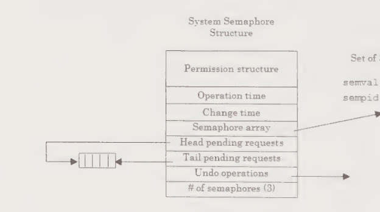

**图 7.1** 一组三个信号量的数据结构。


**表 7.1** `semget` 系统调用摘要。

| | | | 手册章节 |
| :--- | :--- | :--- | :--- |
| **包含文件** | `<sys/types.h>`<br>`<sys/ipc.h>`<br>`<sys/sem.h>` | | **2** |
| **摘要** | `int semget (key_t key, int nsems, int semflg);` | | |
| **返回值** | | | |
| | **成功** | **失败** | **设置 errno** |
| | 信号量标识符 | -1 | 是 |

## 7.2 创建和访问信号量集

`semget` 系统调用接受三个参数。第一个参数 `key` 由系统用于生成唯一的信号量标识符。第二个参数 `nsems` 是集合中的信号量数量。系统在分配 `sem` 结构数组时使用 `nsems` 值。记住，与 C/C++ 中的所有数组一样，表示信号量集的 `sem` 结构数组从 0 开始索引。`nsems` 值应小于或等于 `SEMMSL` 值，该值为给定信号量 ID 的信号量数量设定了上限。第三个参数 `semflg` 用于指定访问权限和/或特殊的创建条件。`semflg` 值的低位用于指定所有者、组和其他用户的访问权限。读写权限控制信号量的读取和更改；执行权限设置被忽略。标志 `IPC_CREAT` 和 `IPC_EXCL` 可以与权限值进行或运算。

如果 `semget` 系统调用成功，将返回一个非负整数，即信号量标识符。如果 `key` 的值为 `IPC_PRIVATE` 或 `key` 的值没有关联的信号量标识符，并且指定了 `IPC_CREAT`，则会创建一个新的信号量集。创建时，由 `sem` 结构数组表示的信号量集不会被初始化。如果指定了 `IPC_CREAT`（但未指定 `IPC_EXCL`），并且指定的键值对应的信号量集已经存在，`semget` 系统调用将返回关联的信号量标识符。当使用 `semget` 访问已建立的信号量集（例如在客户端进程中）时，`nsems` 的值可以设置为 0（一个无关值）。

当信号量被创建时，系统分别将 `semid_ds` 成员 `sem_perm.cuid`、`sem_perm.uid`、`sem_perm.cgid` 和 `sem_perm.gid` 设置为调用进程的有效用户和组 ID。成员 `sem_otime` 被设置为 0，`sem_ctime` 被赋值为当前时间。`nsems` 成员存储信号量集中的信号量数量。

如果 `semget` 系统调用失败，它将返回 -1 并设置 `errno` 中存储的值。`semget` 的错误消息如表 7.2 所示。

### 表 7.2 `semget` 错误消息。

| # | 常量 | perror 消息 | 解释 |
|---|---|---|---|
| 2 | `ENOENT` | No such file or directory | 此 `key` 没有信号量标识符，且未设置 `IPC_CREAT`。 |
| 12 | `ENOMEM` | Cannot allocate memory | 系统内存不足，无法分配信号量集。 |
| 13 | `EACCES` | Permission denied | 此键存在信号量标识符，但当前访问权限不允许请求的操作。 |
| 17 | `EEXIST` | File exists | 此键存在信号量标识符，但同时设置了标志 `IPC_CREAT` 和 `IPC_EXCL`。 |
| 28 | `ENOSPC` | No space left on device | 已达到系统规定的信号量集数量限制（`SEMMNI`）或系统范围内的信号量总数最大值（`SEMMNS`）。 |
| 43 | `EIDRM` | Identifier removed | 指定的信号量集已被标记为要移除。 |

程序 7.1 尝试创建几个信号量集，每个包含三个信号量。

### 程序 7.1 创建信号量集。

```cpp
/* Creating sets of semaphores */
#include <iostream>
#include <cstdio>
#include <sys/types.h>
#include <sys/ipc.h>
#include <sys/sem.h>
using namespace std;
int
main(){
    int    sem1, sem2, sem3;
    key_t  ipc_key;
    ipc_key = ftok(".", 'a');
    if ((sem1 = semget(ipc_key, 3, IPC_CREAT | 0666)) == -1) {
        cerr << "semget: IPC_CREAT | 0666" << endl;
    }
    cout << "sem1 identifier " << sem1 << endl;
    if ((sem2 = semget(ipc_key, 3, IPC_CREAT|IPC_EXCL|0666)) == -1) {
        cerr << "semget: IPC_CREAT | IPC_EXCL | 0666" << endl;
    }
    cout << "sem2 identifier " << sem2 << endl;
    if ((sem3 = semget(IPC_PRIVATE, 3, 0600)) == -1) {
        cerr << "semget: IPC_PRIVATE" << endl;
    }
    cout << "sem3 identifier " << sem3 << endl;
}
```

第一次调用 `semget`，只要系统限制未达到，就会创建一个包含三个信号量的集合。该集合的权限是所有者、组和其他人（所有人）的读和修改（写）。信号量标识符的值与 `ftok` 调用产生的键值相关联。第二次调用 `semget` 尝试创建第二个包含三个信号量的集合。该调用使用与第一次相同的键值，但包含了 `IPC_EXCL` 规范。由于设置了 `IPC_EXCL` 标志，并且之前已使用相同的键值成功创建了信号量集，因此此 `semget` 调用将失败。第三次调用 `semget` 通过指定 `IPC_PRIVATE` 而不是使用 `ftok` 键值来创建一个包含三个信号量的集合。为此集合生成的信号量标识符将是此进程私有的。

当程序连续运行两次时，生成的输出将类似于图 7.2 所示。

### 图 7.2 程序 7.1 的两次连续运行。

```
sem1 identifier 9797637
semget: IPC_CREAT | IPC_EXCL | 0666: File exists
sem2 identifier -1
sem3 identifier 9830406

linux$ p7.1
sem1 identifier 9797637
semget: IPC_CREAT | IPC_EXCL | 0666: File exists
sem2 identifier -1
sem3 identifier 9863175
```

请注意，当程序第二次运行时，初始 `semget` 调用返回相同的信号量标识符（9797637）。没有 `IPC_EXCL` 标志，如果信号量集已经创建，`semget` 系统调用不会失败，而是返回关联的信号量标识符。程序的第二次调用创建第二个私有信号量集，生成另一个唯一的信号量标识符（9863175），它与第一个私有信号量标识符（9830406）不同。图 7.3 所示的 `ipcs` 命令输出验证了用户 gray 创建的三个信号量集的存在和权限。请注意，每个私有信号量集的键都是 0。

### 图 7.3 `ipcs` 输出。

```
linux$ ipcs -s
----- Semaphore Arrays -----
key        semid      owner      perms      nsems
0x53157f08 9797637    gray       666        3
0x00000000 9830406    gray       600        3
0x00000000 9863175    gray       600        3
```

如程序所示，程序 7.1 并未移除它创建的信号量集。信号量与消息队列一样，是一种有限资源。在编程环境中，可以使用 `semctl` 系统调用移除信号量（见下一节）。也可以在命令行级别使用 `ipcrm` 命令移除信号量（如第 6 章第 6.1 节所述）。如果有多个信号量需要移除，可以使用如程序 7.2 所示的 shell 脚本来自动化移除过程。

### 程序 7.2 用于移除用户所有信号量的 Korn shell 脚本。

```bash
#!/bin/ksh
#
### Korn Shell script to remove all existing semaphores for a user
#
list=$(ipcs -s | grep "$USER" | cut -d' ' -f2)
count=0
for semaphore in $list
do
  ipcrm sem $semaphore > /dev/null
  ((count=count+1))
done
print "$count semaphore(s) for $USER removed"
```

### 7-1 练习

重写程序 7.2 中显示的 shell 脚本，允许用户指定四个命令行选项：`-q` 用于移除消息队列，`-s` 用于移除信号量，`-m` 用于移除共享内存段，`-a` 用于移除所有 IPC 设施。如果脚本由 root 运行，应包含警告消息和验证请求。

### 7-2 练习

编写一个程序，通过试错法确定每个信号量集（`semid`）和信号量集中的最大信号量数量。如果你已经完成了练习 7-1，你可能会发现你的脚本有助于移除已分配的信号量。

## 7.3 信号量控制

`semget` 系统调用（表 7.3）用于创建或获取对一组信号量的访问。`semctl` 系统调用允许用户对系统信号量结构、信号量集以及单个信号量执行各种通用的控制操作。对信号量集中特定信号量的额外操作将在下一节关于信号量操作（第 7.4 节）中介绍。

表 7.3 `semctl` 系统调用摘要

| 头文件 | `<sys/types.h>`<br>`<sys/ipc.h>`<br>`<sys/sem.h>` | 手册页 | 2 |
|---|---|---|---|
| 摘要 | `int semctl(int semid, int semnum, int cmd, union semun arg);` | | |
| 返回 | 成功 | 失败 | 设置 `errno` |
| | 0 或请求的值 | -1 | 是 |

`semctl` 系统调用接受四个参数。第一个参数 `semid` 是一个有效的信号量标识符，由先前的 `semget` 系统调用返回。第二个参数 `semnum` 是信号量集中的信号量数量。在大多数情况下，此值大于 0 但小于系统限制。然而，我们会看到 `semnum` 的值被设置为 0 的情况。当我们要求 `semctl` 执行一个与信号量集中信号量数量无关的操作时，就会出现这种情况。`semctl` 的第三个参数 `cmd` 是一个整型命令值（通常表示为头文件 `<sys/sem.h>` 或 `<sys/ipc.h>` 中的符号常量之一）。如第 7.3.1 节“信号量控制详情”中详细讨论的那样，`cmd` 值指示 `semctl` 执行以下几种控制操作之一。每种操作都需要对信号量控制结构具有特定的访问权限（即**读**或**修改**）。`semctl` 的第四个参数 `arg` 是一个 `semun` 类型的联合体。根据前面的 `cmd` 参数指定的操作，`arg` 中的数据可以是以下四种值中的任何一种：

1. 一个整数，与 `SETVAL` 一起使用，用于指定信号量集中特定信号量的值。
2. 一个指向 `semid_ds` 结构体的引用，当指定 `IPC_STAT` 或 `IPC_SET` 时，信息将返回到此结构体中。
3. 一个指向无符号短整型数组的引用；该数组用于初始化信号量集（例如，当规定 `SETALL` 时）或作为指定 `GETALL` 时的返回位置。
4. 一个指向 `seminfo` 结构体的引用，当请求 `IPC_INFO` 时使用。

在某些 UNIX 版本中，`semun` 联合体的定义可以在 `semctl` 所需的包含文件中找到。然而，从技术上讲，用户应该自己定义这个联合体。为此，`semctl` 的手册页包含以下晦涩的参考信息。

```
#if defined(__GNU_LIBRARY__) && !defined(_SEM_SEMUN_UNDEFINED)
/* union semun is defined by including <sys/sem.h> */
#else
/* according to X/OPEN we have to define it ourselves */
union semun {
    int val;                    /* value for SETVAL */
    struct semid_ds *buf;       /* buffer for IPC_STAT, IPC_SET */
    unsigned short int *array;  /* array for GETALL, SETALL */
    struct seminfo *__buf;      /* buffer for IPC_INFO */
};
#endif
```

这组预处理指令用于确定程序员是否定义了 `semun` 联合体。如果已定义 `__GNU_LIBRARY__`（不为零），且未定义 `_SEM_SEMUN_UNDEFINED`，则联合体 `semun` 的定义可以在包含文件 `<sys/sem.h>` 中找到。否则，用户需要自己定义该联合体。为安全起见，应在任何将使用 `semctl` 调用第四个参数的程序的顶部放置这组预处理指令。省略它可能会导致 `semctl` 系统调用失败，返回 `EFAULT`（错误地址）值。此外，当将 `arg` 指定为 `semctl` 的第四个参数时，`arg` 的值应该被显式赋值（例如，`arg.buf=ptr_to_my_structure`）。此赋值必须在调用 `semctl` 之前完成（参见程序 7.3）。

## 7.3.1 信号量控制详情

以下 `cmd` 值会导致 `semctl` 对系统信号量结构体（`semid_ds`）进行操作：

- **IPC_STAT**—返回指定信号量标识符的 `semid_ds` 结构体的当前值。返回的信息存储在由 `semctl` 的第四个参数引用的用户生成的结构体中。要指定 `IPC_STAT`，进程必须对与信号量标识符关联的信号量集拥有**读**权限。
- **IPC_SET**—修改 `semid_ds` 结构体中的有限数量的成员。如果访问进程的有效 ID 是超级用户或与存储在 `sem_perm.cuid` 或 `sem_perm.uid` 中的 ID 值相同，则可以更改 `semid_ds` 中权限结构内的成员 `sem_perm.uid`、`sem_perm.gid` 和 `sem_perm.mode`。要进行这些更改，必须分配一个 `semid_ds` 类型的结构体。然后为相应的成员赋值，并将修改后结构体的引用作为第四个参数传递给 `semctl` 系统调用。
- **IPC_RMID**—移除与信号量标识符关联的信号量集。

当指定 `IPC_STAT`、`IPC_SET` 或 `IPC_RMID` 时，`semnum`（信号量集中的信号量数量）的值不会被考虑，可以设置为 0。

以下 `cmd` 值会导致 `semctl` 对整个信号量集进行操作：

- **GETALL**—返回信号量集的当前值。这些值通过作为第四个参数传递给 `semctl` 的数组引用返回。用户负责在将其地址传递给 `semctl` 之前分配正确大小和类型的数组。指定 `GETALL` 需要信号量集的**读**权限。指定 `GETALL` 时，参数 `semnum` 将被忽略。
- **SETALL**—使用作为第四个参数传递给 `semctl` 的数组引用中存储的值初始化信号量集中的所有信号量。同样，用户必须在将数组地址传递给 `semctl` 之前分配初始化数组并赋值。进程必须对信号量集具有**修改**访问权限才能使用 `SETALL`。指定 `SETALL` 时，系统信号量数据结构的 `sem_ctime` 成员会被更新。

最后一组 `semctl` `cmd` 值作用于单个信号量或 `semid_ds` 结构体中的特定成员。除 `SETVAL`（需要修改权限）外，所有这些命令都需要读权限：

- **GETVAL**—返回由 `semnum` 参数值引用的单个信号量的当前值（记住，C/C++ 中的数组是基于零的；因此，信号量集的第一个信号量位于索引 0 处）。
- **SETVAL**—将由 `semnum` 参数引用的单个信号量的值设置为 `semctl` 的第四个参数指定的值（例如，存储在 `arg.val` 中的值）。
- **GETPID**—返回 `semid_ds` 结构体中 `sem_perm` 结构体内的 PID。
- **GETNCNT**—返回等待由 `semnum` 参数引用的信号量增加的进程数。
- **GETZCNT**—返回等待由 `semnum` 参数引用的信号量变为 0 的进程数。


如果`semctl`成功执行了这些命令中的任何一个，它将返回请求的整数值：`GETNCNT`返回`semncnt`的值，`GETPID`返回`sempid`的值，`GETVAL`返回`semval`的值，`GETZCNT`返回`semzcnt`的值。如果`semctl`失败，它将返回 -1 并设置`errno`以指示特定错误。表 7.4 显示了`semctl`返回的错误及其含义解释。

| # | 常量 | perror 消息 | 解释 |
|---|------|------------|------|
| 1 | EPERM | Operation not permitted | `cmd`的值是`IPC_RMID`或`IPC_SET`，且调用进程不是所有者或超级用户。 |
| 13 | EACCES | Permission denied | 当前访问权限不允许此进程执行请求的操作。 |
| 14 | EFAULT | Bad address | `semctl`的第四个参数包含对非法地址的引用（联合体`semun`可能未被声明）。 |
| 22 | EINVAL | Invalid argument | • 信号量标识符无效。 |

## 7.3 信号量控制

表 7.4（续）

| # | 常量 | perror 消息 | 说明 |
|---|---|---|---|
| 34 | ERANGE | 数值结果超出范围 | `cmd`的值为`SETVAL`或`SETALL`，且要赋的值大于系统最大值或小于 0。 |
| 43 | EIDRM | 标识符已移除 | 指定的信号量集已被标记为待移除。 |

程序 7.3 使用`semctl`系统调用执行多种信号量控制操作。

程序 7.3 使用`semctl`。

```
文件：p7.3.cxx
/*
     使用 semctl 系统调用
*/
#include <iostream>
#include <cstdio>
#include <sys/ipc.h>
#include <sys/sem.h>
#include <time.h>
#define NS    3
#if defined(__GNU_LIBRARY__) && !defined(_SEM_SEMUN_UNDEFINED)
    // <sys/sem.h> 中的定义
#else
union semun {
    int val;                // SETVAL 的值
    struct semid_ds *buf;   // IPC_STAT, IPC_SET 的缓冲区
    unsigned short int *array; // GETALL, SETALL 的数组
    struct seminfo *__buf;  // IPC_INFO 的缓冲区
};
#endif
using namespace std;
int
main( ) {
```

我们需要定义`semun`联合体吗？

```
int              sem_id, sem_value, i;
key_t            ipc_key;
struct semid_ds  sem_buf;
unsigned short int sem_array[NS] = {3, 1, 4};
union semun      arg;
ipc_key = ftok(".", 'S');

if ((sem_id = semget(ipc_key, NS, IPC_CREAT | 0660)) == -1) {
    perror("semget: IPC_CREAT | 0660");
    return 1;
}
cout << "Semaphore identifier " << sem_id << endl;
arg.buf = &sem_buf;
if (semctl(sem_id, 0, IPC_STAT, arg) == -1) {
    perror("semctl: IPC_STAT");
    return 2;
}
cout << "Created " << ctime(&sem_buf.sem_ctime) << endl;
arg.array = sem_array;
if (semctl(sem_id, 0, SETALL, arg) == -1) {
    perror("semctl: SETALL");
    return 3;
}
for (i = 0; i < NS; ++i) {
    if ((sem_value = semctl(sem_id, i, GETVAL, 0)) == -1) {
        perror("semctl: GETVAL");
        return 4;
    }
    cout << "Semaphore " << i << " has value of " << sem_value << endl;
}
if (semctl(sem_id, 0, IPC_RMID, 0) == -1) {
    perror("semctl: IPC_RMID");
    return 5;
}
return 0;
}
```

将`arg`设置为存储返回值的地址。

将`arg`设置为初始化向量的地址。

程序 7.3 创建了一组三个信号量。程序打印了该组的信号量标识符。在第 35 行，`sem_buf`的地址被赋给`arg`的相应成员。联合体`arg`现在包含了用于存储返回数据的位置。然后，通过指定`IPC_STAT`并传递正确的地址，`semctl`获取了系统信号量结构的当前值。使用库函数`ctime`显示了信号量创建的日期和时间。使用类似的语法，也可以显示`semid_ds`结构的其他成员。然而，还有另一种方法可以获取`semid_ds`结构的全部内容（尽管是临时性的）。为此，使用`-g`选项编译程序 7.3，然后使用调试器`gdb`来检查`semid_ds`结构。这可以通过使用可执行文件名调用`gdb`来完成，例如`linux$ gdb p7.3`。在`gdb`中，指示`gdb`在正确的行（例如`break 40`）处停止。然后运行程序，当`gdb`停在第 40 行时，使用`gdb`命令要求其打印结构内容：`print sem_buf`。这一系列操作的输出将显示整个`sem_buf`结构的内容。在我们的系统上，程序 7.3 在`gdb`中运行产生的输出如图 7.4 所示：

### 图 7.4 程序 7.3 的 gdb 输出

```
linux$ g++ -g -o p7.3 p7.3.cxx
linux$ gdb p7.3
GNU gdb 5.0rh-5 Red Hat Linux 7.1
Copyright 2001 Free Software Foundation, Inc.
GDB is free software, covered by the GNU General Public License, and you are
welcome to change it and/or distribute copies of it under certain conditions.
Type "show copying" to see the conditions.
There is absolutely no warranty for GDB. Type "show warranty" for details.
This GDB was configured as "i386-redhat-linux"...
(gdb) break 40
Breakpoint 1 at 0x8048890: file p7.3.cxx, line 40.
(gdb) run
Starting program: /home/faculty/gray/revision/07/p7.3
Semaphore identifier 10027013
Breakpoint 1, main () at p7.3.cxx:40
40       cout << "Created " << ctime(&sem_buf.sem_ctime) << endl;
Current language: auto; currently c++
(gdb) print sem_buf
$1 = {sem_perm = {__key = 1393917704, uid = 500, gid = 1000, cuid = 500,
      cgid = 1000, mode = 432, __pad1 = 0, __seq = 306, __pad2 = 0,
      __unused1 = 0, __unused2 = 0}, sem_otime = 0, __unused1 = 0,
      sem_ctime = 1016545082, __unused2 = 0, sem_nsems = 3, __unused3 = 0,
      __unused4 = 0}
(gdb)
```

请注意，正如预期的那样，信号量集中的信号量数量（三个）已存储在`sem_nsems`成员中。

程序 7.3 使用`semctl`系统调用将三个信号量集初始化为数组`sem_array`中存储的值。同样，请注意在调用`semctl`之前，初始化向量（参见第 41 行）的地址被赋给了`arg`的相应成员。一旦值被赋给信号量集，程序就使用一个循环来向屏幕显示存储在每个信号量中的值。

程序 7.3 的最后一个操作是使用带有`IPC_RMID`标志的`semctl`系统调用来移除信号量集。

当在`gdb`之外运行时，程序 7.3 的输出应与图 7.5 所示的类似。

### 图 7.5 程序 7.3 的输出

```
linux$ p7.3
Semaphore identifier 10027013
Created Tue Mar 19 08:38:02 2002

Semaphore 0 has value of 3
Semaphore 1 has value of 1
Semaphore 2 has value of 4
```

### 7-3 练习

生成一组（比如三个）信号量后，能否使用`semctl`来改变`sem_nsems`的值，以指示信号量集中信号量数量的增加或减少？这是一个缺陷还是一个特性？提供一个支持你答案的程序段。

### 7-4 练习

在早期的 IPC 实现中，信号量集的基地址存储在成员`sem_base`中。在当前版本中，用户无法访问此地址。你认为开发者为什么移除了直接访问信号量集的能力？

## 7.4 信号量操作

对单个信号量的附加操作通过使用`semop`系统调用来完成，如表 7.5 所示。`semop`系统调用需要三个参数，并返回一个整数值。如果成功，`semop`返回 0；否则它返回 -1 并设置`errno`以指示错误来源（详情见表 7.9）。`semop`的第一个参数`semid`是先前成功调用`semget`返回的信号量标识符。第二个参数`sops`是对信号量操作数组基地址的引用，这些操作将对与`semid`值相关联的信号量集执行。`semop`系统调用将尝试以“全有或全无”的方式执行`sops`指示的所有信号量操作。第三个参数`nsops`是信号量操作数组中的元素数量。信号量操作数组的每个元素都是一个`sembuf`类型的结构。

表 7.5 `semop`系统调用摘要

| 头文件 | <sys/types.h><br><sys/ipc.h><br><sys/sem.h> | 手册章节 | 2 |
| --- | --- | --- | --- |
| 摘要 | int semop(int semid, struct sembuf *sops, unsigned nsops); | | |
| 返回值 | 成功：0 | 失败：-1 | 设置 errno：是 |

> 用于 semop 系统调用的用户信号量模板。

```
struct sembuf {
    unsigned short int sem_num;  // 信号量编号：0 = 第一个
    short int sem_op;           // 信号量操作
    short int sem_flg;          // 操作标志
};
```

`sembuf`结构的第一个成员`sem_num`是信号量编号（记住，第一个信号量是 0，第二个是 1，依此类推）。`sembuf`的第二个成员`sem_op`是要在信号量上执行的操作。一个正整数值表示递增信号量（通常表示释放或归还资源），`sem_op`的负值表示递减信号量（尝试获取资源），值为 0 表示测试信号量当前是否为 0（正在使用，所有资源已分配）。信号量操作的更多细节将在后续部分提供。`sembuf`的第三个成员是操作标志。这些标志是：

- **IPC_NOWAIT**—如果信号量操作无法执行（例如当尝试递减信号量或测试其是否等于 0 时），调用将立即返回。如果指定的某个信号量操作因`IPC_NOWAIT`标志而失败，则不会修改集中的其他信号量。
- **SEM_UNDO**—如果未指定`IPC_NOWAIT`，`SEM_UNDO`标志允许在被阻塞的操作（等待特定条件的操作）随后失败时撤销一个操作。系统会跟踪每个信号量集所需的调整值。系统

## 7 信号量

*N* 个信号量的集合

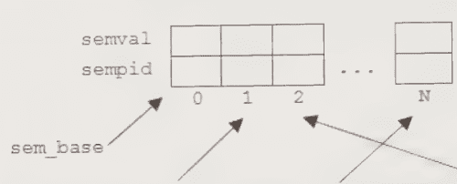

| sem_num | 1 | N | 2 |
| --- | --- | --- | --- |
| sem_op | -1 | 2 | 0 |
| sem_flag | SEM_UNDO | SEM_NOWAIT | SEM_UNDO |

**图 7.6** 一个 *N* 元素信号量集合的三信号量操作。

调整值按进程维护，实际上指示了该进程持有的资源数量，而系统范围内的信号量值则指示了当前可用的资源数量。

图 7.6 展示了一个任意的三元素信号量操作数组与一个 *N* 元素信号量集合之间的关系。

### 7.4.1 信号量操作细节

当`sem_op`值为*负数*时，指定该操作的进程正试图减少信号量。减少信号量用于记录获取与该信号量关联的资源。当要修改信号量值时，访问进程必须对信号量集拥有 **alter** 权限。当`sem_op`值为负数时，**semop** 系统调用采取的操作总结在表 7.6 中。

当`sem_op`值为正数时，进程正在增加信号量的值。增加信号量用于记录归还（释放）与该信号量关联的资源。同样，当要修改信号量值时，访问进程必须对信号量集拥有 **alter** 权限。当`sem_op`值为正数时，**semop** 系统调用采取的操作总结在表 7.7 中。

当`sem_op`值为零时，进程正在测试信号量以确定其是否为 0。当信号量值为 0 时，测试进程可以认为与该信号量关联的所有资源当前都已分配（正在使用）。要测试信号量值，访问进程必须对信号量集拥有读权限。当`sem_op`值为 0 时，**semop** 系统调用采取的操作总结在表 7.8 中。

### 7.4 信号量操作

表 7.6 当`sem_op`值为负数时`semop`采取的操作

| 条件 | 标志设置 | semop 采取的操作 |
| --- | --- | --- |
| semval >= abs(sem_op) | | 从 semval 中减去 abs(sem_op)。 |
| semval >= abs(sem_op) | SEM_UNDO | 从 semval 中减去 abs(sem_op)，并更新该信号量的撤销计数器。 |
| semval < abs(sem_op) | | 增加该信号量的 semncnt 并等待（阻塞）直到 semval >= abs(sem_op)，然后调整 semncnt 并按表 7.6 前两行所述进行减法。如果 semid 被移除，则返回 -1 并将 errno 设置为 EIDRM。如果捕获到信号，则调整 semncnt 并将 errno 设置为 EINTR。 |
| semval < abs(sem_op) | IPC_NOWAIT | 立即返回 -1 并将 errno 设置为 EAGAIN。 |

表 7.7 当`sem_op`值为正数时`semop`采取的操作

| 条件 | 标志设置 | semop 采取的操作 |
| --- | --- | --- |
| | | 将 sem_op 加到 semval。 |
| | SEM_UNDO | 将 sem_op 加到 semval，并更新该信号量的撤销计数器。 |

表 7.8 当`sem_op`值为零时`semop`采取的操作

| 条件 | 标志设置 | semop 采取的操作 |
| :--- | :--- | :--- |
| semval == 0 | | 立即返回。 |
| semval != 0 | IPC_NOWAIT | 立即返回 -1 并将 errno 设置为 EAGAIN。 |
| semval != 0 | | 增加该信号量的 semzcnt 并等待（阻塞）直到 semval == 0，然后调整 semzcnt 并返回。如果 semid 被移除，则返回 -1 并将 errno 设置为 EIDRM。如果捕获到信号，则调整 semzcnt 并将 errno 设置为 EINTR。 |

表 7.9 显示了`semop`返回的错误及其含义说明。

表 7.9 `semop`错误消息

| # | 常量 | perror 消息 | 说明 |
| :--- | :--- | :--- | :--- |
| 4 | EINTR | Interrupted system call | 在等待信号量队列中时，调用进程收到一个信号。 |
| 7 | E2BIG | Argument list too long | nsops 的值大于系统限制。 |


| 11 | `EAGAIN` | Resource temporarily unavailable | 请求的操作将导致调用进程阻塞，但指定了 `IPC_NOWAIT`。 |
| 12 | `ENOMEM` | Cannot allocate memory | 请求 `SEM_UNDO` 的进程数限制已超出。 |
| 13 | `EACCES` | Permission denied | 当前访问权限禁止请求的操作。 |
| 14 | `EFAULT` | Bad address | `sops` 的值引用了一个非法地址。 |
| 22 | `EINVAL` | Invalid argument | 信号量标识符无效。请求 `SEM_UNDO` 的信号量数量大于系统限制。 |
| 27 | `EFBIG` | File too large | `sem_num` 的值 < 0 或 >= 集合中的信号量数量。 |
| 34 | `ERANGE` | Numerical result out of range | 请求的操作将导致系统信号量调整值超出其限制。 |
| 43 | `EIDRM` | Identifier removed | 与 `semid` 值关联的信号量集已被移除。 |

如果 `semop` 成功，对于每个被修改/引用的信号量，`semop` 将 `sops` 引用的数组中指定的每个信号量的 `sempid` 值设置为调用进程的值。此外，`sem_otime` 和 `sem_ctime` 成员都将设置为当前时间。

程序 7.4 演示了 `semop` 系统调用的使用。两个信号量用于协调并发的生产者和消费者进程。生产者进程（以其自己的节奏）生成一个整数值。该值存储在一个不可共享的资源中（在此例中是本地目录中的一个文件）。消费者进程在生成新值后，从同一文件中检索该值并将其显示在屏幕上。生产者进程使用两个信号量来防止在消费者进程检索之前覆盖先前存储的整数值（如果生产者进程比消费者进程更快）。消费者进程使用两个信号量来防止多次检索相同的值（如果生产者进程生成新值的速度较慢）。我们将任意地称为 `READ` 和 `MADE` 的信号量以二进制方式处理。按照惯例，一旦生产者将其新创建的整数值存储在文件中，生产者进程将 `MADE` 信号量设置为 1。一旦消费者读取了生产者存储在文件中的值，消费者进程将 `READ` 信号量设置为 1。如果该数字尚未由生产者生成，或者消费者尚未读取该数字，则相应的信号量值将为 0。只有当文件中的当前数字已被消费时，生产者才能访问文件以存储生成的数字。同样，只有当新值已生成时，消费者才能访问文件以读取存储的数字。图 7.7 显示了生产者和消费者进程中两个信号量的内容及其相互关系。在开始时，我们表明当前存储的数字已被读取（我们将 `READ` 设置为 1），并且新数字尚未生成（我们将 `MADE` 设置为 0）。

图 7.7 生产者和消费者进程中的信号量值。

| | 生产者 `READ` | 生产者 `MADE` | | 消费者 `READ` | 消费者 `MADE` | |
|---|---|---|---|---|---|---|
| 获取 `READ` | 1 | 0 | × | 0 | 1 | 获取 `MADE` |
| 临界区 | 0 | 0 | | 0 | 0 | 临界区 |
| 释放 `MADE` | 0 | 1 | | 1 | 0 | 释放 `READ` |

生产者和消费者进程的高级算法如下：

## 生产者
- 当未生成 10 个新数字时
  - 生成一个新数字
  - 如果当前存储的数字尚未被读取，则等待
  - 将新数字存储到文件中
  - 指示新数字已生成

## 消费者
- 无限循环
  - 如果新数字尚未生成，则等待
  - 从文件中检索新数字
  - 指示新数字已被读取
  - 显示检索到的数字

为了讨论方便，该程序（实际上位于单个文件中）被分为三个部分，显示为程序 7.4A、7.4B 和 7.4C。程序的第一部分（建立将在信号量上执行的操作、创建包含两个信号量的集合并对其进行初始化）如程序 7.4A 所示。

## 程序 7.4A 生产者/消费者问题的第一部分。

```cpp
File : p7.4.cxx
/*
|       The producer/consumer problem
|       */
| #include <iostream>                    // Section ONE
| #include <cstdio>
| #include <unistd.h>
| #include <stdlib.h>
| #include <sys/types.h>
| #include <sys/ipc.h>
10 #include <sys/sem.h>
#define BUFFER "./buffer"
#if defined(__GNU_LIBRARY__) && !defined(_SEM_SEMUN_UNDEFINED)
                                              definition in <sys/sem.h>
#else
. union semun {                       // We define:
,   int val;                          // value   for SETVAL
  struct semid_ds *buf;              // buffer for IPC_STAT, IPC_SET
  unsigned short int *array;         // array   for GETALL, SETALL
|   struct seminfo *__buf;            // buffer for IPC_INFO
```

## 7.4 信号量操作

```
};
#endif
using namespace std;
int
main(int argc, char *argv[] ) {
    FILE       *fptr;
    static struct sembuf acquire = {0, -1, SEM_UNDO},
                        release = {0,  1, SEM_UNDO};
    . . . .
    key_t        ipc_key;
    static unsigned short  start_val[2] = {1, 0};
    int          semid, producer = 0, i, n, p_sleep, c_sleep;
    union semun  arg;
    enum { READ, MADE };
    if (argc != 2) {
        cerr << argv[0] << " sleep_time" << endl;
        . . . . .
    }
    . . . . . ;
    if ((semid=semget(ipc_key, 2, IPC_CREAT|IPC_EXCL|0660)) != -1) {
        producer = 1;
        arg.array = start_val;
        if (semctl(semid, 0, SETALL, arg) == -1) {
            perror("semctl--producer--initialization");
            return 2;
        }
    } else if ((semid = semget(ipc_key, 2, 0)) == -1) {
        perror("semget--consumer--obtaining semaphore");
        . . . ;
    }
    cout << (producer==1 ? "Producer" : "Consumer" )
         << " starting" << endl;
```

该程序使用符号常量 `BUFFER` 来引用一个名为 `./buffer` 的本地文件。此文件充当生产者和消费者进程需要访问的不可共享资源。在此定义之后，是联合体 `semun` 的声明，因为 `semctl` 系统调用需要一个 `semun` 类型的参数。

程序以 `sembuf` 结构体为模板，定义了两个操作——`acquire`（获取）和 `release`（释放）——可用于任一信号量。对于这两个操作，`sem_num` 成员的值都设置为 0。此值用作占位符，将被动态修改以指示我们引用的是信号量集中的哪一个信号量。每个操作的 `sem_op` 成员分别设置为 -1（对应 `acquire`）和 1（对应 `release`）。当我们想要获取与信号量关联的资源时（通过递减信号量来表示），使用 -1 的值。当我们想要表示资源的归还时（从而递增关联的信号量），使用 1 的值。在任何一种情况下，我们将 `sem_flg` 的值设置为 `SEM_UNDO` 以允许回滚。类型为联合体 `semun` 的变量 `arg` 被声明并用作 `semctl` 系统调用的第四个参数。数组 `start_val` 中的值（1, 0）用于设置两个信号量的初始值。枚举常量 `READ` 和 `MADE` 用作索引，以指示我们正在使用的是两个信号量中的哪一个。

程序首先检查命令行，以确定是否传递了参数。程序期望传递一个小整数值。此值用于指示进程在其处理周期中应 `sleep`（休眠）多少秒。包含 `sleep` 允许生产者和消费者进程以不同的速率进行，从而为用户提供了一种简便的方法来检查信号量安排的完整性。

`semget` 系统调用用于创建/获得对信号量集的访问权限。标志组合 `IPC_CREAT | IPC_EXCL` 确保程序首次运行时将创建包含两个信号量的集。根据程序编写，第一次调用该程序被视为生产者（将生成整数值的进程）。变量 `producer` 在生产者进程中被设置为 1 以指示这一点。一旦信号量集成功创建，程序就使用 `semctl` 系统调用将信号量集初始化为存储在 `start_val` 中的值。³ 当程序第二次运行时，生成的进程被视为消费者（将获取存储的整数值的进程）。在第二次调用程序时，最初位于 `if` 语句中的 `semget` 系统调用会失败，因为信号量集已经由生产者生成。同一 `if` 语句的 `else-if` 分支第二次调用 `semget`，不设置任何标志。这第二次调用 `semget` 允许消费者进程获得对先前生成的信号量集的访问权限。

程序的第二部分，包含生产者执行的逻辑，如程序 7.4B 所示。

## 程序 7.4B  生产者/消费者问题的第二部分——生产者逻辑。

```
// 第二部分
switch (producer) {
    case 1:                    // 生产者
        srand((unsigned) getpid());
        for (i = 0; i < 10; i++)
            sleep(p_sleep);
            n = rand() % 100;
            cout << "A. 生产者生成的数字 [" << n << "]" << endl;
            acquire.sem_num = READ;
            if (semop(semid, &acquire, 1) == -1) {
                perror("semop -生产者- 等待消费者读取数字");
                return 4;
            }
            if ((fptr = fopen(BUFFER, "w")) == NULL ){
                perror(BUFFER);
                return ;
            }
            fclose(fptr);
            release.sem_num = MADE;
            cout << "B. 生产者存入的数字 [" << n << "]" << endl;
            if (semop(semid, &release, 1) == -1) {
                perror("semop -生产者- 指示新数字已生成");
                return 6;
            }

            sleep(5);
            if (semctl(semid, 0, IPC_RMID, 0) == -1) {
                perror("semctl -生产者-");
                return 7;
            }
            cout << "信号量已移除" << endl;
            break;
```

如前所述，程序第一次运行时，变量 `producer` 的值设置为 1。当 `producer` 包含 1 时，执行程序代码的 `case 1:` 部分，即生产者逻辑。传递在命令行上以指示进程应休眠多少秒的小整数值，通过库函数 `atoi` 转换并存储在变量 `p_sleep` 中以供将来参考。此后，使用当前 PID 的值初始化随机数生成器。进入一个 `for` 循环，生成 10 个在 1 到 99 范围内的随机整数值。程序休眠后，生成一个随机数并显示在屏幕上（这允许用户验证程序的活动）。随后，将 `acquire` 操作的 `sem_num` 成员设置为值 `READ`。这指示后续的 `semop` 系统调用引用 `READ` 信号量，即信号量集中的第一个信号量。我们使用值 1 表示 `READ` 信号量表示当前存储的数字已被读取（消费），值 0 表示数字尚未被读取。由于 `READ` 信号量的初始值为 1，生产者第一次使用 `semop` 系统调用测试 `READ` 信号量时，就可以获取该信号量。一旦发生这种情况，生产者继续执行下一段代码，在其中打开文件、存储生成的值并关闭文件。在稍后的代码执行中，生产者可能找到也可能找不到值为 1 的 `READ` 信号量。如果信号量值为 0（表示消费者尚未读取该值），生产者默认会阻塞（等待）直到此事件发生。一旦生成的值被写入文件，生产者进程使用 `release` 操作递增 `MADE` 信号量。通过递增 `MADE` 信号量，生产者指示有一个新的数字现在可供消费者使用。当所有 10 个数字都已生成后，生产者退出 `for` 循环，并在休眠 5 秒以允许消费最后一个生成的值后，使用 `semctl` 系统命令移除信号量集。如果需要，可以使用 `unlink` 调用来移除临时文件。

消费者的逻辑如程序 7.4C 所示。

## 程序 7.4C  生产者/消费者问题的第三部分——消费者逻辑。

```
    case 0:                                             // 第三部分
        c_sleep = atoi(argv[1]);                        // 消费者
        c_pid = getpid();
        while (1) {
            sleep(c_sleep);
            acquire.sem_num = MADE;
            if (semop(semid, &acquire, 1) == -1) {
                perror("semop -消费者- 等待新数字生成");
                return 8;
            }
            if ( (fptr = fopen(BUFFER, "r")) == NULL ){
                perror(BUFFER);
                return 9;
            }
            fptr = fopen(BUFFER, "r");
            fscanf(fptr, "%d", &n);
            fclose(fptr);
            release.sem_num = READ;
            if (semop(semid, &release, 1) == -1) {
                perror("semop -消费者- 指示数字已被读取");
                return 10;
            }
            cout << "C. 消费者 " << c_pid << " 获得的数字 [" << n << "]" << endl;
        }
    }
    return 0;
}
```

消费者进程与生产者类似，使用库函数 `atoi` 将传递在命令行上的值转换为整数值。然后，消费者使用 `getpid` 系统调用获取其 PID。当存在多个消费者进程时，PID 用于标识单个消费者进程。然后，消费者进入一个无限循环。它休眠 `c_sleep` 秒，然后测试 `MADE` 信号量。为此，将 `acquire` 操作的 `sem_num` 成员设置为值 `MADE`。这指示后续的 `semop` 系统调用引用 `MADE` 信号量。消费者将阻塞，直到 `MADE` 信号量被生产者递增。一旦消费者获取了 `MADE` 信号量，它就打开文件、读取值并关闭文件。然后，消费者使用 `release` 操作递增 `READ` 信号量，向生产者指示该值已被消费，生产者可以存入一个新值。然后，消费者显示获取的值及其 PID，循环重复。

---

³ 注意，在调用 `semctl` 之前，联合体成员 `arg.array` 被赋值为数组 `start_val` 的基地址。

## 7.4 信号量操作


`acquire`操作结构的`sem_num`成员被设置为`MADE`。对`semop`的调用（传入`acquire`的引用）会导致消费者在信号量值为 0 时阻塞（等待）。一旦`MADE`信号量变为 1，消费者便打开记录该数字的文件，读取数字，并关闭文件。随后，消费者表明它已读取该数字。`release`结构成员`sem_num`被设置为`READ`，以引用信号量集中的第二个信号量。接下来的`semop`系统调用会使`READ`信号量的值递增。然后，消费者在屏幕上显示一条简短消息，指出检索到的值及其 PID 值。消费者持续消费数值，直到由于生产者移除了信号量集而导致`semop`调用失败。

我们可以运行该程序来模拟多种情况。我们首先使生产者进程慢于单个消费者进程。图 7.8 中的输出展示了如何实现这一点。

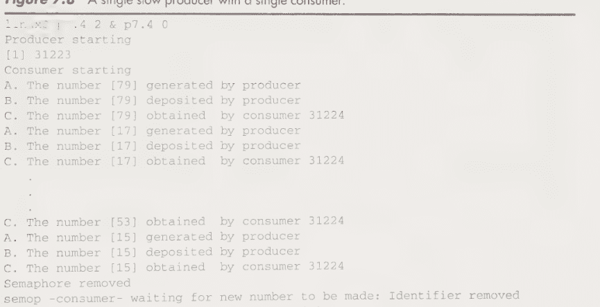

在此示例中，程序`p7.4`在命令行上被运行了两次。第一次调用（即生产者）传入值 2。这指示生产者进程在每次`for`循环中休眠 2 秒。通过在命令行休眠值后指定`&`，生产者进程被置于后台运行。

> 这可能在某些系统上是一个无效假设，因为进程调度可能允许第二个调用的程序先运行并从而成为生产者。如果你的输出表明这种情况发生了，请在单独的行中输入两个命令——不要忘记在第一个命令后添加`&`以将其置于后台。

第二次调用程序时，消费者被传入值 0 作为休眠值。系统响应命令序列的方式是显示被置于后台的命令的 PID。显示

```
[1] 31222
```

意味着，对于此次调用，生产者的 PID 是 31223。随着两个进程执行，我们可以从输出中清楚地看到，生产者必须首先生成并存入数值到文件中，消费者才能获取它。由于生产者进程慢于消费者进程，消费者进程会花费部分时间等待生产者存入数字。当所有数字都生成完毕后，生产者进程会移除信号量集。当这种情况发生时，消费者进程便会退出。如果我们多次运行此命令序列，应该会发现其行为是一致的。尽管消费者进程快于生产者进程，但消费者不应从文件中读取两次相同的值（除非生产者偶然生成了两次相同的数字）。

我们可以反转条件，使生产者进程快于消费者进程。图 7.9 中的输出展示了如何实现这一点。

### 图 7.9 具有单个慢速消费者的生产者。

```
linux$ p7.4 0 & p7.4 2
[1] 31229
Producer starting
A. The number [28] generated by producer
B. The number [28] deposited by producer
A. The number [69] generated by producer
Consumer starting
C. The number [28] obtained by consumer 31230
B. The number [69] deposited by producer
A. The number [83] generated by producer
C. The number [69] obtained by consumer 31230
.
.
.
A. The number [29] generated by producer
C. The number [65] obtained by consumer 31230
B. The number [29] deposited by producer
C. The number [29] obtained by consumer 31230
Semaphore removed
semop -consumer- waiting for new number to be made: Identifier removed
[1] + Done                  p7.4 0
```

## 7.4 信号量操作

这个输出序列与前一个略有不同。请注意，与之前一样，生产者生成并存入数字。由于生产者比消费者快，它接着生成了另一个数字。然而，这个数字直到较慢的消费者进程读取了现有存储值后才会被存入。如果我们多次运行此命令序列，应该能再次确认生产者进程绝不会在消费者进程读取现有存储值之前覆盖它。

> **7-5 练习**

如果存在多个竞争的消费者进程会怎样？当前的信号量集能否正确处理这种情况？竞争的消费者进程会交替访问生成的数值吗？一些消费者进程会饿死吗？尝试以下命令序列（每种多次运行）并解释每种情况下 *发生了什么* 以及 *为什么*。

- A) `linux$ p7.4 2 & p7.4 1 & p7.4 0`

- B) `linux$ p7.4 0 & p7.4 2 & p7.4 0 & p7.4 1`

- C) `linux$ p7.4 2 & p7.4 1 & p7.4 0 & p7.4 1`

> **7-6 练习**

如下述代码所示，我们可以为`semop`添加另一个操作（称为`zero`），该操作可用于确定指定的信号量是否为 0（关于`semop`在`sem_op`值为零时采取的操作，请参见表 7.8）。

修改程序 7.4，整合`zero`操作，使生产者可以在适当的信号量上使用此操作来确定是否应继续处理。为了验证你的解决方案没有快速地在生产者循环中跳过，请注释掉生产者对`sleep`的调用（第 78 行）。一旦你确信你的实现是可靠的，

```c
static struct sembuf
    acquire = {0, -1, SEM_UNDO},
    release = {0,  1, SEM_UNDO},
    zero    = {0,  0, SEM_UNDO};
```

取消对`sleep`调用的注释。生成足够的输出，以确保用户知道生产者进程绝不会覆盖未被消费的值，并且消费者进程绝不会两次消费同一个值。

**7-7 练习**

修改程序 7.4，以支持多个生产者以及多个消费者访问单个不可共享资源。*提示：* 你可能需要额外的信号量来协调活动。

## 7.5 信号量类

与消息队列一样，信号量的语法和操作有些复杂，这使得它们非常适合被整合到一个 C++ 类中。一个信号量类将定义信号量数据与操作这些数据的函数（方法）之间的关系。一个名为`SSemaphore`⁵ 的简化信号量类声明如图 7.10 所示。

### 图 7.10 基本信号量类的头文件。

```
File : SSemaphore.h
/*
    A VERY simplified semaphore class for use in a std UNIX
    environment.  See the text for instructions on how to use
    this class.  Copyright ...

    Exit codes for class operations:

    1 - Semaphore allocation failure     2 - Unable remove semaphore
    3 - Unable to LOCK semaphore         4 - Unable to UNLOCK semaphore
    5 - Failure on wait for ZERO         6 - Unable to assign value
    7 - Unable to return value
```

> ⁵ 选择`SSemaphore`（额外的'S'）这个名字是为了尽量减少与现有信号量定义的任何冲突。

## 7.5 信号量类

```cpp
#ifndef SSemaphore_h
#define SSemaphore_h
#define _GNU_SOURCE
#include <iostream>
#include <cstdio>
#include <sys/types.h>
#include <sys/ipc.h>
#include <sys/sem.h>
#include <stdlib.h>
#include <unistd.h>
using namespace std;

class SSemaphore {
    public:
        SSemaphore ( );                     // 构造函数
        ~SSemaphore( );                    // 析构函数 - 移除信号量
        int  P( );                         // 加锁（递减信号量）
        void V( );                         // 解锁（递增信号量）
        int  Z( );                         // 等待信号量不为 0
        void Put( const int );             // 为信号量赋值
        int  Get( );                       // 返回信号量的值
    private:
        #if defined(__GNU_LIBRARY__) && !defined(_SEM_SEMUN_UNDEFINED)
                                // definition in <sys/sem.h>
        #else
        union semun {                       // 我们定义：
            int val;                        // 用于 SETVAL 的值
            struct semid_ds *buf;           // 用于 IPC_STAT, IPC_SET 的缓冲区
            unsigned short int *array;      // 用于 GETALL, SETALL 的数组
            struct seminfo *__buf;          // 用于 IPC_INFO 的缓冲区
        };
        #endif
        union semun arg;                    // 用于 semctl 调用
        struct sembuf zero,lock, unlock;    // 用于 P,V 和 Z 操作的结构
        int  semid;                         // 信号量的 ID
        pid_t my_pid;                       // 创建者的 PID
};
#endif
```

如定义所示，`SSemaphore`类创建一个包含单个元素的私有信号量集。该类有七个公共方法和六个私有数据成员。每个方法的功能如表 7.10 所示。

## 7.5 信号量类

**表 7.10 SSemaphore 类方法。**

| 方法名 | 说明 |

|---|---|

| `SSemaphore` | 这是类的构造函数。该方法为`zero`、`lock`和`unlock` sembuf 结构赋予适当的值，并保存调用进程的 PID。此外，它生成私有的单元素信号量并将其设置为 0。 |

| `~SSemaphore` | 如果调用函数是生成该信号量的进程，则此方法将从系统中移除该信号量。 |

| `P` | 该方法以原子方式测试并递减信号量。如果信号量为 0，则阻塞。 |

| `V` | 该方法递增信号量。 |

| `Z` | 该方法测试信号量是否为 0。如果不是 0，则阻塞。 |

| `Put` | `Put`为信号量赋值。 |

| `Get` | `Get`返回信号量的当前值。 |

实现信号量类的 C++ 代码位于程序文件`SSemaphore.cxx`（程序 7.5）中。如代码所示，其十分精简——几乎没有做错误处理，只涉及基本的信号量功能。

### 程序 7.5 信号量类的程序代码。

```
File : SSemaphore.cxx
/*
    SSemaphore implementation - Copyright (c) 2002 J. S. Gray
*/
#include "SSemaphore.h"

SSemaphore::SSemaphore() {
    zero.sem_num = 0; zero.sem_op = 0; zero.sem_flg = SEM_UNDO;
    lock.sem_num = 0; lock.sem_op = -1; lock.sem_flg = SEM_UNDO;
    unlock.sem_num = 0; unlock.sem_op = 1; unlock.sem_flg = SEM_UNDO;
    my_pid = getpid();
    if ((semid = semget(IPC_PRIVATE, 1, 0660)) == -1) {
        exit(1);
    }
    Put(0);
}

SSemaphore::~SSemaphore() {
    if (semctl(semid, 0, IPC_RMID) == -1)
        exit( 2 );
}

int                                        // LOCK semaphore
SSemaphore::P( ) {                         // Atomic test & decrement
    if ( semop( semid, &lock, 1 ) == -1 )
        perror("P");
        exit( 3 );
}

void                                       // UNLOCK semaphore
SSemaphore::V( ) {                         // Increment semaphore
    if ( semop( semid, &unlock, 1 ) == -1 )
        exit( 4 );
}

int                                        // Wait for semaphore to be 0
SSemaphore::Z( ) {
    if ( semop( semid, &zero, 1 ) == -1 )
        perror("Z");
    return 0;
}

void                                       // Assign value to the semaphore
SSemaphore::Put( int const value ) {
    arg.val = value;
    if ( semctl( semid, 0, SETVAL, arg ) == -1 )
        exit( 6 );
}

int                                        // Return value of the semaphore
SSemaphore::Get( ) {
    int sem_value;
    if ((sem_value=semctl(semid, 0, GETVAL, 0)) == -1 )
        exit( 7 );
    return sem_value;
}
```

要使用此类，文件`SSemaphore.h`和`SSemaphore.cxx`应存放在本地。使用以下命令行将`SSemaphore`类编译为目标代码：

```
linux$  g++ SSemaphore.cxx -c
```

在使用`SSemaphore`对象的源文件顶部，添加如下语句

```
#include "SSemaphore.h"
```

以使类定义对编译器可用。编译源文件时，需要包含消息队列目标代码文件：

```
linux$ g++ your_file_name.cxx SSemaphore.o
```

1965 年，Dijkstra 提出了一个如今被认为是经典的同步问题，涉及一群就餐的哲学家。简而言之，一群哲学家围坐在一张桌子旁。每人进行思考和进食活动。要进食，哲学家必须取得其左右两侧的叉子。进餐需要两把叉子，且一旦取得，在哲学家用餐完毕之前不会释放任何一把。对于 $N$ 位哲学家，有 $N$ 把叉子（而不是 $2 \times N$）。显然，如果所有哲学家都要进食，则需要对他们的活动进行某种同步。

我们可以使用刚刚介绍的`SSemaphore`类来实现就餐哲学家问题的一个朴素解决方案。本质上，每把叉子将由一个单独的二元信号量表示。如果一位哲学家能同时取得左右两把叉子（即获取信号量），他或她将随机进食若干秒，完成后归还叉子。如果任一叉子不可用，则他或她将等待。请记住，这个解决方案有一个非常基本的缺陷。如果所有哲学家同时拿起他们的左叉子，就会发生死锁。这种情况可能发生，因为每位哲学家的左叉子同时也是其左侧哲学家的右叉子。当每位哲学家都在等待其右叉子（即其右侧哲学家的左叉子）时，就无法取得任何进展。程序 7.6 实现了我们这个不太完美的解决方案。

### 程序 7.6 使用信号量对象的简易就餐哲学家解决方案。


# 文件：`p7.6.cxx`

```c
/*
    The dining philosophers
*/
#include <iostream>
#include "SSemaphore.h"    // Our basic semaphore class
const int MAX = 5;
SSemaphore Forks[MAX];
void Philosopher( int );
void Eat_It( const int ,const int , const int );
int
main(int argc, char *argv[] ) {
    int i;
    if ( argc < 2 ) {
        cerr << "Usage: " << argv[0] << " secs_to_wait " << endl;
        return 1;
    }
    for( i=0; i < MAX; ++i )
        Forks[i].Put(true);
    for(i = 0; i < MAX; ++i )
        Philosopher( i );
    sleep(atoi(argv[1]));    // Parent process waits a bit
    return 0;
}
void
Philosopher(int number ){
    if (fork() == 0) {              // Run in the child
        int left, right;
        srand(getpid( ));
        left = number;
        right= (number+1) % MAX;
        do {
            cout << "A. P" << number << " is thinking\n";
            sleep(rand( ) % 3 + 1);  // Take a while to THINK
            cout << "B. P" << number << " ASKS to eat with forks "
                << left << " & " << right << endl;
            Forks[left].P( );        // Acquire left fork
            Forks[right].P( );       // Acquire right fork
            Eat_It(number, left, right);
            Forks[right].V( );
            Forks[left].V( );
        } while( true );
    }
}
void
Eat_It(const int number, const int left, const int right) {
    cout << "C. P" << number << " is EATING  with forks "
        << left << " & " << right << endl;
    sleep(rand( ) % 3 + 1);  // Take a while to EAT
    cout << "D. P" << number << " is now DONE with forks "
        << left << " & " << right << endl;
```

如代码所示，该程序期望用户通过命令行传入一个整数值，用于指定程序运行的秒数。值为 10 时似乎能产生合理的输出量。在程序第 7 行，实例化了一个包含五个私有信号量对象的数组。该数组表示五把叉子。第 17 行的循环将每个信号量设置为 `true`（叉子可用）。随后，第二个循环调用 `Philosopher` 函数 `MAX` 次。每次调用时，`Philosopher` 函数生成一个子进程来执行哲学家的活动。哲学家的活动包括随机时间的思考和进食。要进食，必须获取左叉子和右叉子（即信号量）。当两个信号量都已获取后，调用 `Eat_It` 函数，在其中随机进食一段时间。当子进程执行其活动时，父进程休眠一段时间（见第 21 行）。当父进程退出时，信号量对象的析构函数被调用。子进程在尝试访问已移除的信号量时遇到错误条件而退出。

图 7.11 显示了向程序传入值 10 时的典型运行结果。为节省空间，输出以两列形式显示。

## 图 7.11 就餐哲学家程序 10 秒的输出

```
linux$ g++ p7.6.cxx SSemaphore.o -o p7.6
linux$ p7.6 10
A. P0 is thinking
A. P1 is thinking
A. P2 is thinking
A. P3 is thinking
A. P4 is thinking
B. P1 ASKS to eat with forks 1 & 2
C. P1 is EATING  with forks 1 & 2
B. P3 ASKS to eat with forks 3 & 4
C. P3 is EATING  with forks 3 & 4
B. P0 ASKS to eat with forks 0 & 1
B. P2 ASKS to eat with forks 2 & 3
B. P4 ASKS to eat with forks 4 & 0
D. P1 is now DONE with forks 1 & 2
A. P1 is thinking
D. P3 is now DONE with forks 3 & 4
A. P3 is thinking
C. P0 is EATING  with forks 0 & 1
C. P2 is EATING  with forks 2 & 3
D. P2 is now DONE with forks 2 & 3
A. P2 is thinking
D. P0 is now DONE with forks 0 & 1
A. P0 is thinking
B. P1 ASKS to eat with forks 1 & 2
C. P1 is EATING  with forks 1 & 2
B. P3 ASKS to eat with forks 3 & 4
C. P4 is EATING  with forks 4 & 0
B. P2 ASKS to eat with forks 2 & 3
D. P4 is now DONE with forks 4 & 0
A. P4 is thinking
C. P3 is EATING  with forks 3 & 4
B. P0 ASKS to eat with forks 0 & 1
D. P1 is now DONE with forks 1 & 2
A. P1 is thinking
C. P0 is EATING  with forks 0 & 1
D. P3 is now DONE with forks 3 & 4
C. P2 is EATING  with forks 2 & 3
A. P2 is thinking
B. P1 ASKS to eat with forks 1 & 2
B. P4 ASKS to eat with forks 4 & 0
D. P0 is now DONE with forks 0 & 1
D. P2 is now DONE with forks 2 & 3
B. P3 ASKS to eat with forks 3 & 4
```

## 7.8 练习

如前所述，`SSemaphore` 类生成的是私有信号量。私有信号量适用于相关进程之间的通信，但难以用于不相关的进程。请修改 `SSemaphore` 类以支持生成非私有信号量。使用新定义的类重写生产者/消费者程序（程序 7.4）。请务必提供输出以证明你的类可以正常工作，并在完成后移除所有信号量。

## 7.6 总结

## 7-9 练习

如果在程序 7.6（哲学家就餐问题）中，奇数编号的哲学家先拿右叉再拿左叉，而偶数编号的哲学家先拿左叉再拿右叉，这会防止死锁吗？修改程序 7.6 以实现此方法。多次运行你的程序，以合理地确认此方法是否有效。*提示*：以下是用于在 100 秒内收集一些摘要信息的命令序列：

```
linux$ p7.6 100 | sort | uniq -c
```

## 7.6 总结

信号量是用于协调对不可共享资源（代码段）访问的专用数据结构。协作（或可能竞争）的进程使用信号量来确定特定资源是否可用。如果资源不可用，默认情况下系统会将请求进程放入关联的队列中。当资源可用时，系统会通知等待的进程。这免除了进程使用轮询来确定资源可用性的负担。信号量可分为二进制信号量或计数信号量。二进制信号量用于同步对不可共享资源的单个实例的访问，而计数信号量用于具有多个实例的不可共享资源。

操作信号量所需的动作由一系列系统调用提供。`semget` 系统调用用于生成新的信号量/信号量集（数组）或获取对现有信号量的访问权限。`semctl` 系统调用允许用户设置信号量的初始值、获取其当前值以及删除信号量。对信号量的操作通过 `semop` 系统调用执行。这些操作（是原子的）用于递减（获取）、递增（释放）和对特定信号量进行零测试。如果需要协调多个信号量来访问特定资源，可以指定操作集。这些操作集也可以被标记为原子的。

虽然使用信号量的语法有些复杂，但它们确实提供了一种标准化的方法来实现大多数操作系统教科书中引用的经典原始信号量操作。与许多先前的通信技术一样，使用信号量来控制对资源的访问意味着所有相关进程都将遵守规则。信号量无法阻止进程访问受控资源。

## 7.7 关键术语和概念

- 二进制信号量
- 计数信号量
- 临界区
- `ctime` 库函数
- 死锁
- 哲学家就餐
- `GETALL`
- `GETNCNT`
- `GETVAL`
- `GETZCNT`
- `IPC_CREAT`
- `IPC_EXCL`
- `IPC_NOWAIT`
- `IPC_PRIVATE`
- `IPC_RMID`
- `IPC_SET`
- `IPC_STAT`
- `sem` 结构
- `SEM_UNDO`
- 信号量类
- `semctl` 系统调用
- `semget` 系统调用
- `semid_ds` 结构
- `semop` 系统调用
- `semun` 联合体
- `SETALL`
- `SETVAL`
- 饥饿

# 第8章 共享内存

## 8.1 简介

共享内存允许多个进程共享虚拟内存空间。这是进程间相互通信的最快但不一定最简单（在同步方面）的方式。通常，一个进程创建或分配共享内存段。段的大小和访问权限在创建时设置。然后进程附加共享段，导致其被映射¹到其当前数据空间中。如果需要，创建进程随后初始化共享内存。一旦创建，并且权限允许，其他进程可以获取对共享内存段的访问权限并将其映射到其数据空间。每个进程相对于其附加地址访问共享内存。虽然这些进程引用的数据是相同的，但每个进程使用不同的附加地址值。对于涉及的每个进程，映射的内存看起来与其任何其他内存地址没有区别。图 8.1 以图示方式展示了三个进程共享一个公共内存段的概念。由于没有内在的共享内存同步构造，通常使用信号量来协调对共享内存段的访问。当进程完成共享内存段的使用后，它可以从中分离。此外，段的创建者可以将段的所有权授予另一个进程。当所有进程完成对共享内存段的使用后，通常由创建该段的进程负责将其删除。

¹段到虚拟地址空间的实际映射取决于系统的内存管理（MMU）硬件。

## 8.2 创建共享内存段

`shmget` 系统调用用于创建共享内存段并生成相关的系统数据结构，或获取对现有段的访问权限。共享内存段和系统数据结构由 `shmget` 系统调用返回的唯一共享内存标识符标识（见表 8.1）。

在不超过任何系统参数的情况下，`shmget` 系统调用在以下情况下创建一个*新的*共享内存段：

- 其第一个参数 `key` 的值为符号常量 `IPC_PRIVATE`，或
- `key` 的值*未*与现有共享内存标识符关联，并且 `IPC_CREAT` 标志作为 `shmflg` 参数的一部分被设置

（否则，返回与 `key` 值关联的现有共享内存标识符），或

- `key` 值未与现有共享内存标识符关联，并且 `IPC_CREAT` 和 `IPC_EXCL` 标志均已作为 `shmflg` 参数的一部分设置。设置了 `IPC_CREAT` 和 `IPC_EXCL` 后，用户可以确保创建唯一的共享内存段，而不会意外地获取对预先存在的段的访问权限。

与先前用于消息队列和信号量的 IPC 系统调用一样，可以使用 `ftok` 库函数生成 `key` 值。

参数 `size` 确定共享内存段的字节大小。如果我们使用 `shmget` 来访问现有的共享内存段，`size` 可以设置为 0，因为段大小由创建进程设置。与共享内存相关的常见默认系统最大值如表 8.2 所示。

### 表 8.1 `shmget` 系统调用总结

| 包含文件 | `<sys/ipc.h>`<br>`<sys/shm.h>` | 手册页 | 2 |
| --- | --- | --- | --- |
| 摘要 | `int shmget (key_t key, int size, int shmflg);` | | |
| | 成功 | 失败 | 设置 `errno` |
| 返回 | 共享内存标识符。 | -1 | 是 |

### 表 8.2 共享内存限制

| 共享内存段默认值 | 常量 | 值 |
| --- | --- | --- |
| 最大段大小 | `SHMMAX` | 4 MB |
| 最小段大小 | `SHMMIN` | 1 字节 |
| 系统范围最大段数 | `SHMMNI` | 4096 |
| 每个进程最大段数 | `SHMSEG` | 未指定 |

`shmget` 的最后一个参数 `shmflg` 用于指示段创建条件（例如，`IPC_CREAT`、`IPC_EXCL`）和访问权限（存储在 `shmflg` 的低 9 位中）。此时系统不使用执行权限设置。要指定创建条件以及访问权限，将各个项进行按位或运算（例如，`0660 | IPC_CREAT`）。

`shmget` 系统调用并不赋予创建进程实际使用分配内存的权利；它只是保留请求的内存。要被进程使用，分配的内存必须使用单独的系统调用附加到进程。实现此目的的技术在第 8.4 节中讨论。

如果 `shmget` 成功分配了共享内存段，它返回一个整数共享内存标识符。在创建时，生成并初始化在 `<bits/shm.h>` 头文件中定义的系统数据结构 `shmid_ds`。与其他 System V IPC 设施一样，用户不直接包含 `<bits/shm.h>`，而是包含共享内存的标准头文件 `<sys/shm.h>`，后者又包含 `<bits/shm.h>`。`shmid_ds` 数据结构的标准定义如下：

```c
struct shmid_ds {
    struct ipc_perm shm_perm;    /* operation permission struct */
    size_t shm_segsz;             /* size of segment in bytes */
    __time_t shm_atime;           /* time of last shmat() */
    unsigned long int __unused1;
    __time_t shm_dtime;           /* time of last shmdt() */
    unsigned long int __unused2;
    __time_t shm_ctime;           /* time of last change by shmctl() */
    unsigned long int __unused3;
    __pid_t shm_cpid;             /* pid of creator */
    __pid_t shm_lpid;             /* pid of last shmop */
    shmat_t shm_nattch;           /* number of current attaches */
    unsigned long int __unused4;
    unsigned long int __unused5;
};
```

System V IPC 的内核源文件（位于 `/usr/src/linux-XX.XX.XX/ipc`，其中 `XX` 是操作系统版本号）定义了一个类似的私有内核共享内存结构，称为 `shmid_kernel`。

`shmid_ds` 结构包含一个名为 `shm_perm` 的 `ipc_perm` 权限结构。创建时，`shm_perm.cuid` 和 `shm_perm.uid` 成员被分配调用进程的有效用户 ID，而 `shm_perm.cgid` 和 `shm_perm.gid` 成员被设置为调用进程的组 ID。存储在 `shm_perm.mode` 成员中的访问权限位根据 `shmflg` 值指定的值设置。`shm_segsz` 成员被设置为 `shmget` 系统调用指定的大小。`shm_lpid`、`shm_nattch`、`shm_atime` 和 `shm_dtime` 成员各自设置为 0，而 `shm_ctime` 成员被设置为当前时间。`shm_cpid` 成员存储创建进程的 ID。

## 8.2 创建共享内存段

如果 `shmget` 失败，它会返回一个 -1 的值，并设置 `errno` 中的值以指示具体的错误条件。`errno` 可能被赋予的值及其解释如表 8.3 所示。

### 表 8.3 `shmget` 错误消息

| # | 常量 | `perror` 消息 | 解释 |
| :--- | :--- | :--- | :--- |
| 2 | `EONENT` | 没有该文件或目录 | 此 `key` 没有共享内存标识符，并且未设置 `IPC_CREAT`。 |
| 12 | `ENOMEM` | 无法分配内存 | 创建共享内存段时，可用内存不足。 |
| 13 | `EACCES` | 权限被拒绝 | 此 `key` 存在共享内存标识符，但当前访问权限不允许所请求的操作。 |


| 17 | `EEXIST` | 文件已存在 | 此 `key` 存在共享内存标识符，但同时设置了 `IPC_CREAT` 和 `IPC_EXCL`。 |

| 22 | `EINVAL` | 参数无效 | • `size` 的值小于系统最小值或大于系统最大值。<br>• 共享内存标识符存在，但请求的 `size` 过大。 |

| 28 | `ENOSPC` | 设备上没有剩余空间 | 已达到系统施加的共享内存段数量限制。 |

| 43 | `EIDRM` | 标识符已移除 | 内存段被标记为已移除。 |

程序 8.1 尝试创建两个不同大小的共享内存段。

## 程序 8.1 创建共享内存段

```
File : p8.1.cxx

|      |
|      |          分配一个共享内存段
|      |
|      | #include <iostream>
|      | #include <cstdio>
|      | #include <sys/ipc.h>
|      | #include <sys/shm.h>
|      | using namespace std;
|      | int
|      | main( ) {
|      |    key_t key = 15;
|      |    int shmid_1, shmid_2;
```

275

```
if ((shmid_1=shmget(key, 1000, 0640|IPC_CREAT)) == -1){
    perror("shmget shmid_1");
    return 1;
}
cout << "First shared memory identifier is : " << shmid_1 << endl;
if ((shmid_2=shmget(IPC_PRIVATE, 20, 0640)) == -1){
    perror("shmget shmid_2");
    return 2;
}
cout << "Second shared memory identifier is: " << shmid_2 << endl;
return 0;
}
```

图 8.2 显示了连续两次调用程序 8.1 时的输出。

## 图 8.2 程序 8.1 的输出

```
linux$ p8.1                                       ← 运行程序。
First shared memory identifier is : 40665091
Second shared memory identifier is: 40697860

linux$ ipcs -m                                    ← 使用 ipcs 检查。
------ Shared Memory Segments --------
key        shmid    owner    perms    bytes    nattch   status
0x0000000f 40665091 gray     640      1000     0
0x00000000 40697860 gray     640      20       0

linux$ p8.1                                       ← 再次运行程序。
First shared memory identifier is : 40665091
Second shared memory identifier is: 40730629

linux$ ipcs -m                                    ← 重新用 ipcs 检查。
------ Shared Memory Segments --------
key        shmid    owner    perms    bytes    nattch   status
0x0000000f 40665091 gray     640      1000     0
0x00000000 40697860 gray     640      20       0
0x00000000 40730629 gray     640      20       0
```

检查输出显示，第一次调用创建了两个共享内存段，其标识符值分别为 `40665091` 和 `40697860`。第一个段（共享内存标识值为 `40665091`）是由第一次调用 `shmget` 创建的，因为程序中编码的 `key` 值（`15`）未与任何先前分配的内存段关联。第二个段（标识为 `40697860`）是由 `shmget` 创建的，因为指定了 `IPC_PRIVATE`。然而，当程序第二次被调用时，结果略有不同。第一次调用 `shmget` 返回了程序第一次调用时的共享内存标识符，因为 `key` 值为 `15` 的共享内存段已经存在。第二次调用 `shmget`，由于它使用 `IPC_PRIVATE`，产生了另一个唯一的共享内存段（`40730629`）。请注意，`ipcs` 命令的输出显示，两个使用 `IPC_PRIVATE` 生成的唯一共享内存段的 `key` 值条目都设置为零。

> **8-1 练习**

编写一个程序，通过试错法确定最大共享内存段大小是否为所述的 4 MB。如果最大值不是此值，那么最大值是多少（精确到 1K）？*注意：* 请务必*移除*为此练习生成的任何共享内存段。你可能需要参考第 8.3 节以获得在程序中移除共享内存段的正确语法（而不是在命令行使用 `ipcrm` 命令）。当然，如果你修改了清理脚本（练习 7.1），你可以用它来移除你的共享内存段。

## 8.3 共享内存控制

`shmctl` 系统调用允许用户在现有的共享内存段和系统共享内存数据结构上执行一些通用的控制操作（见表 8.4）。

**表 8.4 `shmctl` 系统调用摘要**

| 包含文件 | 手册部分 |
| --- | --- |
| `<sys/ipc.h>`<br>`<sys/shm.h>` | 2 |

| 摘要 | |
| --- | --- |
| `int shmctl(int shmid, int cmd, struct shmid_ds *buf);` | |

| 返回值 | 成功 | 失败 | 设置 errno |
| --- | --- | --- | --- |
| | 0 | -1 | 是 |

`shmctl` 系统调用有三个参数。第一个参数 `shmid` 是一个有效的共享内存段标识符，由先前的 `shmget` 系统调用生成。第二个参数 `cmd` 指定 `shmctl` 要执行的操作。第三个参数 `buf` 是一个指向 `shmid_ds` 类型结构体的引用。

`shmctl` 将执行的操作由以下定义的常量指定，包括：

- **IPC_STAT** — 返回由 `shmid` 值指示的内存段的 `shmid_ds` 结构体的当前值。返回的信息存储在一个用户生成的结构体中，该结构体作为第三个参数以引用方式传递给 `shmctl`。要指定 `IPC_STAT`，进程必须对该共享内存段具有**读取**权限。

- **IPC_SET** — 修改 `shmid_ds` 结构体中权限结构内的有限数量的成员。可以修改的权限结构成员有 `shm_perm.uid`、`shm_perm.gid` 和 `shm_perm.mode`。访问进程必须具有超级用户的有效 ID，或者具有等同于 `shm_perm.cuid` 或 `shm_perm.uid` 值的 ID。要修改结构体成员，通常采取以下步骤：分配一个 `shmid_ds` 类型的结构体。通过调用设置了 `IPC_STAT` 标志的 `shmctl` 并传递指向*新* `shmid_ds` 结构体的引用来初始化该结构体以获取当前系统设置。然后将结构体的相应成员赋值为它们的新值。最后，将 `cmd` 参数设置为 `IPC_SET`，第二次调用 `shmctl` 系统调用并传递指向*已修改*结构体的引用。要执行此修改序列，访问进程必须对该共享内存段具有**读取**和**写入**权限。当指定 `IPC_SET` 时，`shm_ctime` 成员会自动更新为当前时间。

- **IPC_RMID** — 移除引用的共享内存标识符（`shmid`）的系统数据结构。指定 `IPC_RMID` 时，`buf` 使用地址值 `0`。该 `0` 地址值被转换为正确的类型 (`shmid_ds *`)。一旦对共享内存段的所有引用被消除（即 `shm_nattch` 等于 `0`），系统将移除实际的段。如果未进行指定 `IPC_RMID` 的 `shmctl` 系统调用，内存段将保持活动状态并与其*键*值关联。

- **SHM_LOCK** — 将 `shmid` 参数引用的共享内存段锁定在内存中。锁定的共享段不会被系统换出，从而避免引用时的 I/O 故障。锁定只能由具有等于超级用户有效 ID 的进程指定。

- **SHM_UNLOCK** — 解锁 `shmid` 参数引用的共享内存段。一旦解锁，共享段可以被换出。同样，这只能由具有等于超级用户有效 ID 的进程指定。

如果 `shmctl` 成功，它返回一个 `0` 值；否则，它返回一个 `-1` 值并设置 `errno` 中的值以指示具体的错误条件。`errno` 可能被赋予的值及其解释如表 8.5 所示。

**表 8.5 `shmctl` 错误消息**

| # | 常量 | perror 消息 | 解释 |
|---|---|---|---|
| 1 | `EPERM` | 操作不允许 | • `cmd` 的值为 `IPC_RMID` 或 `IPC_SET`，并且调用进程不是所有者、创建者或超级用户。<br>• `cmd` 的值为 `SHM_LOCK` 或 `SHM_UNLOCK`，并且调用进程不是超级用户。 |
| 13 | `EACCES` | 权限被拒绝 | 当前访问权限不允许所请求的操作。 |
| 12 | `ENOMEM` | 无法分配内存 | `cmd` 是 `SHM_LOCK`，但可用内存不足。 |
| 14 | `EFAULT` | 地址错误 | `shmctl` 的第三个参数 `buf` 包含对非法地址的引用。 |
| 22 | `EINVAL` | 参数无效 | • 共享内存标识符无效。<br>• `cmd` 的值无效。<br>• `cmd` 的值为 `IPC_SET`，但 `shm_perm.uid` 或 `shm_perm.gid` 的值无效。 |
| 43 | `EIDRM` | 内存段被标记为已移除 | |

### 8-2 练习

贾斯汀无法理解关于共享内存的种种争论。他想，为什么不直接使用对父/子进程来说是全局的变量，然后用信号量来控制对它们的访问呢？他使用上一章中的 `SSemaphore` 对象，编写了下面的程序来验证他的理论：

```
File : justin.cxx
#include <iostream>
#include <sys/types.h>
#include <sys/wait.h>
#include "SSemaphore.h"
using namespace std;
char c = 0;                    // 'global' variable
int
main( ){
    SSemaphore S;               // SSemaphore object
    S.Put(1);                   // Start it at 1
    switch(fork( )){
        case -1:
            perror("fork failure");
            return 1;
        case 0:                 // Child - lowercase
            srand(getpid( ));
            for (int i=0; i < 10; ++i){
                S.P( );         // Obtain semaphore
                cout << char(c+'a'); cout.flush( );
                ++c;
                S.V( );         // Release semaphore
                sleep(rand( ) % 3 + 1);
            }
            break;
        default:                // Parent - uppercase
            srand(getpid( ));
            for (int i=0; i < 10; ++i){
                S.P( );         // Obtain semaphore
                cout << char(c+'A'); cout.flush( );
                ++c;
                S.V( );         // Release semaphore
                sleep(rand( ) % 3 + 1);
            }
            break;
    }
    wait(0);
    return 0;
}
```

在运行程序之前，贾斯汀预计他的输出类似于 `AbcDefGhIj`（十个大小写交替的字符）。然而，当他看到输出更像下面这样时，他大吃一惊：`AaBbCcDdEeFfGgHhIiJj`。为什么贾斯汀得到了这样的输出——他的推理有什么缺陷？

## 8.4 共享内存操作

共享内存有两个操作系统调用。第一个是 `shmat`，用于将引用的共享内存段附加（映射）到调用进程的数据段中。参见表 8.6。

**表 8.6 `shmat` 系统调用摘要**

| 头文件 | `<sys/types.h>` `<sys/shm.h>` | 手册章节 | 2 |
| :--- | :--- | :--- | :--- |
| **摘要** | `void *shmat(int shmid, const void *shmaddr, int shmflg);` | | |
| **返回值** | **成功**<br>数据段的引用 | **失败**<br>`-1` | 设置 errno<br>是 |

`shmat` 的第一个参数 `shmid` 是一个有效的共享内存标识符。第二个参数 `shmaddr` 允许调用进程在指定共享内存段位置时具有一定的灵活性。如果给定一个非零值，`shmat` 将其用作共享内存段的附加地址。如果 `shmaddr` 为 `0`，系统将选择附加地址。在大多数情况下（尤其是考虑到可移植性时），建议使用 `0` 值并让系统选择地址。第三个参数 `shmflg` 用于指定共享内存段的访问权限，并请求特殊的附加条件，如对齐地址或只读段。`shmaddr` 和 `shmflg` 的值由系统用于确定附加地址，使用图 8.3 所示的算法。

# 8 共享内存


默认情况下，已附加的段可进行读写访问。如果需要，可以将 `SHM_RDONLY` 标志与 `shmflg` 值进行按位或运算，以指示只读段。没有标志用于指定只写内存段。`SHM_RND` 标志用于指定附加地址是否应按页边界对齐。定义常量 `SHMLBA`（位于 `<bits/shm.h>` 中）的值被系统用作页大小。作为参考，页是虚拟地址空间的一个单位。当一页映射到物理内存时，它被称为页帧。当 `shmat` 成功时，它返回实际附加的地址。它还会将 `shm_atime` 设置为当前时间，将 `shm_lpid` 设置为调用进程的 ID，并将 `shm_nattch` 递增一。如果 `shmat` 失败，它返回 `-1` 并设置 `errno` 以指示错误来源。表 8.7 列出了 `shmat` 系统调用失败时产生的错误代码及其解释。请记住，在 `fork` 之后，子进程会继承已附加的共享内存段。但是，在 `exec` 或 `exit` 之后，已附加的共享内存段会被分离但不会被销毁。

### 表 8.7 `shmat` 错误消息

| # | 常量 | perror 消息 | 说明 |
|---|---|---|---|
| 12 | `ENOMEM` | Cannot allocate memory | 没有足够的内存来容纳共享内存段。 |
| 13 | `EACCES` | Permission denied | 当前访问权限不允许所请求的操作。 |
| 22 | `EINVAL` | Invalid argument | • 共享内存标识符无效。<br>• 非法地址。 |
| 24 | `EMFILE` | Too many open files | 已附加的内存段数量超出了系统限制。 |

**8-3 练习**

创建三个 1 字节的共享内存段。附加段时指定 `shmaddr` 为 `0`。系统是否会将这些段放置在连续的位置？为什么？系统是否会允许引用或修改刚好"超出"段大小的地址（例如段大小 +1 [或 2]）而不产生错误？为什么？如果段大小为 `4096`，系统的响应是否相同？为什么？

第二个共享内存操作 `shmdt` 用于将调用进程的数据段从共享内存段中分离。参见表 8.8。

**表 8.8 `shmdt` 系统调用摘要**

| 头文件 | `<sys/types.h>` `<sys/shm.h>` | 手册章节 | 2 |
|---|---|---|---|
| **摘要** | `int shmdt(const void *shmaddr);` | | |
| | **成功** | **失败** | **设置 errno** |
| **返回值** | `0` | `-1` | 是 |


`shmdt`系统调用有一个参数`shmaddr`，它是对已附加内存段的引用。如果`shmdt`成功分离内存段，它返回`0`。它还会将`shm_atime`设置为当前时间，将`shm_lpid`设置为调用进程的ID，并将`shm_nattch`递减一。如果`shm_nattch`变为`0`且内存段已被操作系统标记为删除，则它会被移除。如果`shmdt`调用失败，它返回`-1`并设置`errno`。表8.9给出了`shmdt`失败时产生的错误代码。

### 表 8.9 `shmdt`错误消息

| # | 常量 | perror消息 | 说明 |
|---|---|---|---|
| 22 | EINVAL | Invalid argument | `shmaddr`中的值没有引用有效的共享内存段。 |

在程序8.2中，第18行创建了一个长度为30字节的私有共享内存段。第22行使用系统选择的第一个可用地址将共享内存段映射到进程的数据空间。实际的附加地址以及`etext`、`edata`和`end`的地址被显示出来以供参考。一个字符指针被设置为引用共享内存段，然后将一系列大写英文字母写入引用的位置（第31–33行）。使用`fork`系统调用生成一个子进程。子进程重新显示共享内存段的内容。然后子进程通过将大写字母转换为小写来修改共享内存的内容（第49行）。转换完字母后，子进程分离共享内存段并退出。父进程在等待子进程退出后，重新显示共享内存的内容（现在是小写字母），分离共享内存段，并将其删除。

### 程序 8.2 创建、附加和操作共享内存。

```
File : p8.2.cxx

/* Using shared memory */
#include <iostream>
#include <cstdio>
#include <unistd.h>
#include <sys/types.h>
#include <sys/ipc.h>
#include <sys/shm.h>
#include <sys/wait.h>
#define SHM_SIZE 30
using namespace std;
extern int etext, edata, end;
int
main() {
    int     shmid;
    char    c, *shm, *s;
    if ((shmid=shmget(IPC_PRIVATE,SHM_SIZE,IPC_CREAT|0660)) < 0) {
        perror("shmget fail");
        return 1;
    }
    if ((shm = (char *)shmat(shmid, 0, 0)) == (char *) -1) {
        perror("shmat : parent");
        return 2;
    }
    cout << "Addresses in parent" << endl;
    cout << "shared mem: " << hex << int(shm) << " etext: "
         << &etext << " edata: " << &edata
         << " end: " << &end << endl << endl;
```

## 8.4 共享内存操作

```
30     s = shm;                      // s now references shared mem
       for (c='A'; c <= 'Z'; ++c)    // put some info there
           *s++ = c;
       *s='\0';                      // terminate the sequence
       cout << "In parent before fork, memory is: " << shm << endl;
       switch (fork( )) {
       case -1:
           perror("fork");
           return 3;
       default:
40         wait(0);                    // let the child finish
           cout << "In parent after fork, memory is : " << shm << endl;
           cout << "\nParent removing shared memory" << endl;
           shmdt(shm);
           shmctl(shmid, IPC_RMID, (struct shmid_ds *) 0);
           break;
       case 0:
           cout << "In child after fork, memory is  : " << shm << endl;
           for ( ; *shm; ++shm)       // modify shared memory
50             *shm += 32;
           shmdt(shm);
           break;
       }
       return 0;
}
```

运行程序8.2（输出如图8.4所示），我们发现系统为共享内存段选择的地址不在进程的文本段或数据段地址空间中。此外，子进程通过`fork`系统调用获得了对共享内存段的访问权限，而无需自行调用`shmget`和`shmat`。如图所示，子进程对共享内存段所做的修改会被父进程*看到*，即使在子进程已解除其对共享内存段的引用并终止之后也是如此。

### 图 8.4 程序8.2的输出。

```
linux$ p8.2
Addresses in parent
shared mem: 40018000 etext: 0x8048c6e edata: 0x8049f6c end: 0x8049fb4

In parent before fork, memory is: ABCDEFGHIJKLMNOPQRSTUVWXYZ
In child after fork, memory is  : ABCDEFGHIJKLMNOPQRSTUVWXYZ
In parent after fork, memory is : abcdefghijklmnopqrstuvwxyz

Parent removing shared memory
```

### 8.4 练习

在你的系统上运行程序8.2并记录它显示的地址。通过添加各种静态和自动变量声明来修改程序。系统为共享内存段选择的第一个空闲地址是否保持不变？如果不是，系统使用的偏移量相对于`etext`、`edata`或`end`值是否有固定的距离？这可能是为什么？如果共享内存段不在进程的文本段或数据段中，它实际上是否位于进程的栈段中？你是如何确定这一点的？

以我们之前程序7.4中的生产者/消费者示例为基础，我们可以实现一种生产者/消费者关系，使用共享内存代替文件来在进程之间传递信息。在我们的示例中，生产进程生成一系列随机消息，存储在共享内存段中供消费进程读取。为了便于两个可能以不同速率运行的进程之间的通信，使用了一个包含六个消息缓冲区（槽位）的数组。消息缓冲区数组被当作队列使用，新消息被添加到列表尾部，待处理的消息从列表头部移除。两个整数索引分别引用列表的头和尾，也存储在共享内存段中。共享内存段的基本配置如图8.5所示。


**图 8.5** 内存的概念配置。

### 8.4 共享内存操作

我们将使用两个信号量来协调对共享内存段的访问。第一个信号量被视为计数信号量，包含可写入的可用槽位数量。只要该信号量不为零，生产进程就可以继续向共享内存段写入消息。最初，该信号量被设置为指示有六个槽位可用。第二个信号量同样被视为计数信号量，指示可供消费（读取）的槽位数量。生产者和消费者进程并发执行，并引用相同的共享内存段。进程的活动如图8.6所示，方框内的区域表示对共享内存段的访问。


为了减少编码量并提供编程一致性，生成了一个名为`local.h`的公共本地头文件。`local.h`文件包含组成此示例的每个程序所需的`include`语句和变量声明。每个程序在其程序代码的前几行通过预处理语句`#include "local.h"`引用该文件。`local.h`文件的内容如图8.7所示。第35至38行定义了共享内存段的构成。

### 图 8.7 公共头文件。

```
File : local.h
/*
   Common header file: parent, producer and consumer
*/
#ifndef LOCAL_H
#define LOCAL_H
#define _GNU_SOURCE
#include <iostream>
#include <cstdio>
#include <unistd.h>
#include <stdlib.h>
#include <string.h>
#include <sys/types.h>
#include <sys/ipc.h>
#include <sys/sem.h>
#include <sys/shm.h>
#include <signal.h>
#include <wait.h>
#define ROWS 5       // Establish some common values
#define COLS 3
#define SLOT_LEN 50
#define N_SLOTS 6
using namespace std;
#if defined(__GNU_LIBRARY__) && !defined(_SEM_SEMUN_UNDEFINED)
#else
union semun {          // We define:
    int val;                  // value for SETVAL
    struct semid_ds *buf;     // buffer for IPC_STAT, IPC_SET
    unsigned short int *array;// array for GETALL, SETALL
    struct seminfo *__buf;    // buffer for IPC_INFO
};
#endif
enum {AVAIL_SLOTS, TO_CONSUME};
                // Layout for shared memory
struct MEMORY {
    char buffer[N_SLOTS][SLOT_LEN];
    int head, tail;
};
                // Actions for semaphores
struct sembuf acquire = { 0, -1, SEM_UNDO},
               release = { 0,  1, SEM_UNDO};
#endif
```

在此示例中，父进程负责创建和初始化共享内存段以及控制对其访问的两个信号量。一旦完成这些操作，父进程将`fork`两个子进程。第一个进程将是生产进程，第二个是消费进程。父进程的代码如程序8.3所示。

### 程序 8.3 父进程。

```
File : parent.cpp
/*
    The PARENT
*/
#include "local.h"
int
main(int argc, char *argv[ ]) {
    static struct MEMORY    memory;
    static unsigned int short   start_val[2] = {N_SLOTS, 0};
    int             semid, shmid, croaker;
    char            *shmptr;
    pid_t           p_id, c_id, pid = getpid( );
    union semun     arg;
    memory.head = memory.tail = 0;
                                        // Check command line arguments
    if ( argc != 3 ) {
        cerr << argv[0] << " producer_time consumer_time" << endl;
        return 1;
    }
                                        // Create, attach, clear segment
    if ((shmid=shmget((int)pid, sizeof(memory),
                IPC_CREAT | 0600 )) != -1){
        if ((shmptr = (char *)shmat(shmid, 0, 0)) != (char *) -1){
            perror("shmptr -- parent -- attach ");
            return 2;
        }
        memcpy(shmptr, (char *)&memory, sizeof(memory));
    } else {
        perror("shmid -- parent -- creation ");
        return 3;
    }
                                        // Create & initialize semaphores
    if ((semid=semget((int)pid, 2, IPC_CREAT | 0666)) != -1) {
        arg.array = start_val;
        if (semctl(semid, 0, SETALL, arg) == -1) {
            perror("semctl -- parent -- initialization");
            return 4;
        }
    } else {
        perror("semget -- parent -- creation ");
        return 5;
    }

    if ( (p_id=fork( )) == -1) {
        perror("fork -- producer");
        return 6;
    } else if ( p_id == 0 ) {
        execl( "producer", "./producer", argv[1], (char *) 0);
        perror("execl -- producer");
        return 7;
    }

    if ( (c_id =fork( )) == -1) {
        perror("fork -- consumer");
        return 8;
    } else if ( c_id == 0 ) {
        execl( "consumer", "./consumer", argv[2], (char *) 0);
        perror("execl -- consumer");
        return 9;
    }
    croaker = (int) wait( (int *) 0 );
    kill( ((croaker == p_id ) ? c_id : p_id ), SIGKILL);

    shmdt( shmptr );
    shmctl(shmid,IPC_RMID,(struct shmid_ds *) 0);
    semctl( semid, 0, IPC_RMID, 0);
    return 0;
}
```

父进程期望通过命令行传递两个整数值（程序第15-18行）。这些值指示进程在执行周期中休眠的最大时间（以秒为单位）。第一个值传递给生产进程，第二个值传递给消费进程。通过在命令行上指定不同的值，我们可以轻松模拟以不同速度运行的生产者/消费者关系。在第20至25行中，我们创建并附加了共享内存段。完成此操作后，我们使用库函数`memcpy`将内存结构体（已设置为初始值）的内容复制到共享内存段。`memcpy`函数是一组以字节计数值而非终止NULL字符来界定字节序列的函数之一。参见表8.10。

`memcpy`函数将*n*个字节从*src*引用的位置复制到*dest*引用的位置。完成后，返回指向*dest*位置的指针。请注意：`memcpy`函数不会检查溢出。

在父程序的第32至41行中，控制对共享内存段访问的两个信号量被创建并设置为初始值。

### 8.4 共享内存操作

**表 8.10** memcpy库函数总结

| 包含文件 | `<string.h>` | 手册章节 | 3 |
| :--- | :--- | :--- | :--- |


# 共享内存与信号量示例

## 函数原型与返回值

| 摘要 | `void *memcpy(void *dest, const void *src, size_t n);` | | |

| 返回值 | 成功：指向 `dest` 的指针 | 失败 | 设置 `errno` |

## 初始化与进程创建

初始值。信号量 `AVAIL_SLOTS` 被设置为6，以表示六个可用的槽位，而 `TO_CONSUME` 信号量被设置为0。然后，一个子进程被创建（`fork`）并覆盖为生产者进程的代码（第47行）。该生产者进程被传递一个整数参数，用作其睡眠时间。之后，父进程创建第二个子进程，并将其覆盖为消费者进程的代码（第56行）。该消费者进程也被传递一个整数睡眠值作为其第一个参数。完成后，父进程等待其某个子进程（生产者或消费者）终止。当此情况发生时，进程ID（PID）被返回并存储在程序变量 `croaker` 中。父进程然后检查此变量的内容，以确定哪个子进程仍在运行。使用 `kill` 调用移除仍在运行的进程，并分离并移除共享内存段。生产者进程的代码如程序 8.4 所示。

## 程序 8.4 生产者进程

```cpp
File : producer.cxx
/*
     The PRODUCER ...
*/
#include "local.h"
int main(int argc, char *argv[]) {
  static char *source[ROWS][COLS] = {
    {"A", "The", "one"},
    {"red", "polka-dot", "yellow"},
    {"spider", "dump truck", "tree"},
    {"broke", "ran", "fell"},
    {"down", "away", "out"}
  };
};
```

```cpp
static char local_buffer[SLOT_LEN];
int i, r, c, sleep_limit, semid, shmid;
pid_t ppid = getppid();
char *shmptr;
struct MEMORY *memptr;
```

```cpp
// 检查命令行
if ( argc != 2 ) {
    cerr << argv[0] << " sleep_time" << endl;
    return 20;
}
```

```cpp
// 访问、附加并引用内存
if ((shmid=shmget((int) ppid, 0, 0)) != -1 ){
    if ((shmptr=(char *)shmat(shmid,(char *)0,0))==(char *)-1){
        perror("shmat -- producer -- attach " );
        return 21;
    }
    memptr = (struct MEMORY *) shmptr;
} else {
    perror("shmget -- producer -- access ");
    return 22;
}
```

```cpp
// 访问信号量集
if ( semid=semget((int) ppid, 2, 0 )) == -1 ) {
    perror("semget -- producer -- access ");
    return 23;
}
```

```cpp
sleep_limit = atoi(argv[1]) % 20;
i = 20 - sleep_limit;
srand((unsigned)getpid());
while( i-- ) {
    memset(local_buffer, '\0', sizeof(local_buffer));
    for (r = 0; r < ROWS; ++r) {
        c = rand() % COLS;
        strcat(local_buffer, source[r][c]);
    }
    acquire.sem_num = AVAIL_SLOTS;
```

```cpp
if (semop(semid, &acquire, 1 ) == -1 ){
    perror("semop -- producer -- acquire ");
    return 24;
}
strcpy(memptr->buffer[memptr->tail], local_buffer);
cout << "P: [" << memptr->tail << "] "
     << memptr->buffer[memptr->tail] << endl;
memptr->tail = (memptr->tail +1) % N_SLOTS;
release.sem_num = TO_CONSUME;
if (semop( semid, &release, 1 ) == -1 ) {
    perror("semop -- producer -- release ");
    return 25;
}
```

> 一旦生成随机字符串，就获取 `AVAIL_SLOTS` 信号量，存储字符串，更新尾部索引，并增加 `TO_CONSUME` 信号量。

## 生产者进程分析

生产者进程分配一个二维数组 `source`，其中包含一系列字符串，用于生成要存储在共享内存段中的随机消息。创建一个存储位置 `local_buffer`，用于临时保存消息。接下来，通过 `getppid` 系统调用获取父进程的进程ID（PID）。父进程的PID被用作 `shmget` 系统调用的键值。这使得生产者进程能够引用父进程创建的共享内存段。另一种方法是将共享内存标识符从父进程通过命令行传递给生产者。如果这样做，父进程在传递之前需要将整数共享内存标识符转换为字符串，而生产者进程则需要将字符串转换回原始的整数格式。

在程序第25到29行，生产者进程获取共享内存段的访问权限并将其附加。生产者使用一个本地指针 `memptr` 在程序第30行将共享内存地址赋值，以便引用共享内存位置。然后，生产者进程获取信号量集的访问权限（再次使用父进程的PID作为 `semget` 键值）。此后，获取其处理周期内 `sleep` 的时间限制（第40行），并计算要生成的最大消息数量。

程序随后循环执行以下步骤。它通过填充空字符来清空 `local_buffer`。生成一条短的随机消息并存储在 `local_buffer` 中。然后，生产者评估 `AVAIL_SLOTS` 信号量。一旦生产者可以获取该信号量（根据定义，只有当信号量非零时才会发生），<sup>2</sup> `local_buffer` 中的消息就会被复制到共享内存位置，使用 `memory->tail` 位置的值作为偏移索引。存储的消息会显示在屏幕上以供参考。然后，`memory->tail` 的值以模运算方式递增，以引用下一个有效的存储位置。接下来，递增 `TO_CONSUME` 信号量，以指示添加了另一条消息。然后生产者休眠最多 `sleep_limit` 秒，并继续其处理循环。当所有消息都已生成并写入共享内存段，或者当生产者收到终止信号（例如来自其父进程）时，生产者退出。消费者进程的代码如程序 8.5 所示。

<sup>2</sup> `AVAIL_SLOTS` 信号量的内容在获取时会递减。

## 程序 8.5 消费者进程

```cpp
File : consumer.cxx
/*
            The CONSUMER
    */
    #include "local.h"
    int
    main(int argc, char *argv[]) {
        static char    local_buffer[SLOT_LEN];
        int            i, sleep_limit, semid, shmid;
        pid_t          ppid = getppid( );
        char           *shmptr;
        struct MEMORY  *memptr;

                                         // 检查命令行
        if ( argc != 2 ) {
            cerr << argv[0] << " sleep_time" << endl;
            return 30;
        }

                                         // 访问、附加并引用内存
        if ((shmid=shmget((int) ppid, 0, 0)) != -1 ){
            if ( (shmptr=(char *)shmat(shmid, (char *) 0, 0)) == (char *) -1 ) {
                perror("shmat -- consumer -- attach");
                return 31;
            }
            memptr = (struct MEMORY *) shmptr;
        } else {
            perror("shmget -- consumer -- access");
            return 32;
        }

        if ( (semid=semget((int) ppid, 2, 0)) == -1 ) {
            perror("semget -- consumer -- access ");
            return 33;
        }
        sleep_limit = atoi(argv[1]) % 20;
        i = 20 - sleep_limit;
        srand((unsigned)getpid());
        while( i ) {
            acquire.sem_num = TO_CONSUME;
            if (semop(semid, &acquire, 1 ) == -1 ){
                perror("semop -- consumer -- acquire ");
                return 34;
            }
            memset(local_buffer, '\0', sizeof(local_buffer));
            strcpy(local_buffer, memptr->buffer[memptr->head]);
            cout << "C: [" << memptr->head << "] "
                 << local_buffer << endl;
            memptr->head = (memptr->head +1) % N_SLOTS;
```

```cpp
release.sem_num = AVAIL_SLOTS;
if (semop( semid, &release, 1 ) == 1)
    perror("semop -- consumer -- release ");
}
sleep( rand( ) % sleep_limit + 1 );
return 0;
```

## 消费者进程分析

在大多数方面，消费者进程的逻辑与生产者进程类似。但是，消费者将通过 `TO_CONSUME` 信号量获得对共享内存段的访问权限。如果此信号量非零，则表示有消息可供消费者读取。当有消息可用时，消费者使用 `memory->head` 的值作为偏移索引，将消息从共享内存位置复制到其 `local_buffer` 数组中。然后，`local_buffer` 的内容会显示在屏幕上以供参考。与生产者进程一样，`memory->head` 引用的值以模运算方式递增，以引用下一个有效位置。`AVAIL_SLOTS` 信号量被递增，消费者继续其处理。

## 运行输出与性能分析

在查看程序运行输出时，请注意，如果父进程传递给生产者进程的值使其比消费者进程更快，共享内存位置最终会变满。当这种情况发生时，生产者必须阻塞并等待³消费者读取消息。只有在消费者读取消息后，才会释放一个槽位，生产者才能存储新消息。参见图 8.8。

**图 8.8** 当生产者进程工作速度快于消费者进程时的输出

```bash
linux$ parent 1 3
P: [0] The yellow tree broke out
C: [0] The yellow tree broke out
P: [1] One yellow spider broke away
C: [1] One yellow spider broke away
P: [2] One red dump truck fell away
P: [3] The polka-dot dump truck broke away
P: [4] One red spider broke away
C: [2] One red dump truck fell away
P: [5] The yellow dump truck ran out
P: [0] A red dump truck broke away
. . .
```

生产者比消费者工作得更快。

> ³ 尝试获取零值信号量时的默认操作。

如果传递给生产者/消费者的参数允许它们以相似的速率工作，我们应该会发现六元素消息数组足以让两个进程在不需要彼此等待对方完成任务的情况下继续工作。但是，如果没有新的消息可用，消费者进程仍将等待。参见图 8.9。

**图 8.9** 消费者进程与生产者进程以相同速率工作时的输出

```bash
linux$ parent 5 3
P: [0] One yellow spider fell away
C: [0] One yellow spider fell away
P: [1] One yellow spider fell away
C: [1] One yellow spider fell away
P: [2] One yellow tree broke out
P: [3] A yellow dump truck ran away
C: [2] One yellow tree broke out
C: [3] A yellow dump truck ran away
P: [4] The polka-dot dump truck broke out
C: [4] The polka-dot dump truck broke out
...
```

## 练习

### 8-5 练习

在这个生产者/消费者示例中，将消息显示到屏幕上以及调整头/尾索引的代码是在由两个信号量界定的临界区内完成的。这实际上有必要吗？为什么？如果生产者和消费者*知道*有六个缓冲区槽位，实际上还需要两个信号量吗？为什么？

### 8-6 练习

修改生产者/消费者示例以支持多个消费者。这能在不添加另一个信号量的情况下实现吗？用输出支持你的发现。

### 8-7 练习

修改生产者/消费者示例以支持多个生产者。是否还需要另一个信号量来协调进程活动？提供输出来支持你的发现。

## 使用文件作为共享内存

大多数 Linux-UNIX 版本也支持 **mmap** 系统调用，该调用可用于将文件映射到进程的虚拟内存地址空间。在许多方面，**mmap** 比其共享内存系统调用对应物更灵活。一旦建立了映射，就可以使用标准系统调用而非专用系统调用来操作共享内存对象（表 8.11）。与内存不同，文件的内容是非易失性的，即使在系统关闭（并重新启动）后仍然可用。

**表 8.11 mmap 系统调用摘要。** 如果已定义 `_POSIX_MAPPED_FILES`。

| 头文件 | `<unistd.h>` `<sys/mman.h>` | 手册章节 | 2 |

|---|---|---|---|

| 摘要 | `#ifdef _POSIX_MAPPED_FILES`<br>`void *mmap(void *start, size_t length, int prot,`<br>`            int flags, int fd, off_t offset);`<br>`#endif` | | |

| 返回值 | **成功**: 一个指向映射区域的指针 | **失败**: `MAP_FAILED` ((void *) -1) | **设置 errno**: 是 |

**mmap** 系统调用需要六个参数。第一个参数 `start` 是附加地址。与 **shmat** 系统调用一样，该参数通常设置为 0，指示系统选择一个有效的附加地址。要附加的字节数由第二个参数 `length` 指定。虽然该调用允许用户指定一个超出映射文件末尾的字节长度，但实际引用这些位置将产生错误（`SIGBUS` 信号）。第三个参数 `prot` 用于设置段的访问类型（保护）。指定的访问不应与关联文件描述符的访问权限冲突。`prot` 参数使用在头文件 `<sys/mman.h>` 中定义的常量。这些常量如表 8.12 所示。

**表 8.12 定义的保护常量**

| 定义的常量 | 访问 |

| :--- | :--- |

| `PROT_READ` | 对指定区域的读访问。 |

| `PROT_WRITE` | 对指定区域的写访问。 |

| `PROT_EXEC` | 对指定区域的执行访问。 |

| `PROT_NONE` | 无访问。 |

常量可以通过 OR 运算来提供不同的访问组合。`mmap` 的手册页指出，在某些系统上，`PROT_WRITE` 被实现为 `PROT_READ | PROT_WRITE`，`PROT_EXEC` 被实现为 `PROT_READ | PROT_EXEC`。无论如何，如果进程要写入映射的段，则必须设置 `PROT_WRITE`。第四个参数 `flags` 指定映射类型。映射类型也使用 `<sys/mman.h>` 头文件中的定义常量来表示。这些常量如表 8.13 所示。

**表 8.13 定义的映射类型常量**

| 定义的常量 | 映射类型 |

| :--- | :--- |

| `MAP_SHARED` | 共享所有更改。 |


| `MAP_PRIVATE` | 不共享更改。 |
|---|---|
| `MAP_FIXED` | 严格解释`start`参数的值。 |

前两个常量指定对共享内存的写入是与其他进程共享还是私有的。`MAP_SHARED`和`MAP_PRIVATE`是互斥的。指定`MAP_PRIVATE`时，私有副本仅在首次写入映射对象时生成。这些规范在`fork`系统调用后保留，但在`exec`调用后不保留。`MAP_FIXED`指示系统显式使用`start`中的地址值。当指定`MAP_FIXED`时，`start`和`length`的值应为系统页面大小的倍数。指定`MAP_FIXED`会大大降低程序的可移植性，因此不鼓励使用它。指定`flags`参数时，必须指定`MAP_SHARED`或`MAP_PRIVATE`。Linux 还支持表 8.14 中所示的`flags`。

**表 8.14 特定于 Linux 的定义映射类型常量。**

| 定义的常量 | 映射类型 |
| :--- | :--- |
| `MAP_GROWSDOWN` | 将该段视为栈。 |
| `MAP_EXECUTABLE` | 将该段标记为可执行。 |
| `MAP_DENYWRITE` | 不允许写入。 |
| `MAP_NORESERVE` | 不检查保留。 |
| `MAP_LOCKED` | 锁定映射的段。 |

第五个参数`fd`是一个有效的已打开文件描述符。一旦映射建立，文件就可以关闭。第六个参数`offset`用于设置映射的起始位置。如果`mmap`系统调用成功，它返回对映射内存对象的引用。如果调用失败，它返回定义的常量`MAP_FAILED`（实际上是指针类型转换为`void *`后的 -1 值）。失败的调用将设置`errno`的值以反映遇到的错误。`mmap`的错误如表 8.15 所示。

**表 8.15 `mmap`错误消息。**

| # | 常量 | `perror`消息 | 解释 |
| :--- | :--- | :--- | :--- |
| 6 | `ENXIO` | No such device or address | `off`或`off + len`的值对于指定的设备是非法的。 |
| 9 | `EBADF` | Bad file descriptor | `fd`引用的文件无效。 |
| 11 | `EAGAIN` | Resource temporarily unavailable | • 映射的交换空间不足。<br>• 映射无法锁定在内存中。<br>• 映射的文件已被锁定。 |
| 12 | `ENOMEM` | Cannot allocate memory | 地址空间不足以实现映射。 |
| 13 | `EACCES` | Permission denied | • 指定了`MAP_PRIVATE`且文件描述符未以读模式打开。<br>• 文件描述符未以写模式打开，且映射类型为`MAP_SHARED`时指定了`PROT_WRITE`。 |
| 19 | `ENODEV` | No such device | `fd`引用了无效的设备（例如终端）。 |
| 22 | `EINVAL` | Invalid argument | • 指定了`MAP_FIXED`，且`start`或`offset`的值不是系统页面大小的倍数。<br>• 非法的标志值。<br>• 参数`length`小于 1。 |
| 26 | `ETXTBSY` | Text file busy | 设置了`MAP_DENYWRITE`但`fd`以写模式打开。 |

虽然系统会在进程终止时自动取消映射一个区域，但系统调用`munmap`（如表 8.16 所示）可用于显式取消内存页的映射。

**表 8.16 `munmap`系统调用摘要。**

| 头文件 | `<unistd.h><signal.h>` | 手册章节 | 2 |
|---|---|---|---|
| 摘要 | `#ifdef _POSIX_MAPPED_FILES`<br>`int munmap(void *start, size_t length);`<br>`#endif` | | |
| 返回值 | 成功: 0 | 失败: -1 | 设置`errno`: 是 |

`munmap`系统调用接收内存映射的起始地址（参数`start`）和映射的大小（参数`length`）。如果调用成功，它返回值 0。未来对已取消映射的内存区域的引用将失败。

## 8.5 使用文件作为共享内存

如果`munmap`系统调用失败，它将返回值 -1 并将`errno`的值设置为`EINVAL`。与`munmap`相关的错误解释见表 8.17。

**表 8.17 `munmap`错误消息。**

| # | 常量 | `perror`消息 | 解释 |
|---|---|---|---|
| 22 | `EINVAL` | 无效参数 | • 参数`length`小于 1。<br>• 参数`start`地址不是系统页大小的整数倍。<br>• 参数`start`地址或`start`地址 + `length`超出进程的地址空间。 |

`msync`系统调用与`mmap`配合使用，用于将映射内存的内容与物理存储同步（表 8.18）。调用`msync`会导致系统将所有已修改的内存位置写入其关联的物理存储位置。如果在`mmap`中指定了`MAP_SHARED`，则存储位置是一个文件。如果指定了`MAP_PRIVATE`，则存储位置是交换区。

**表 8.18 `msync`库函数摘要。**

| 包含文件 | 手册章节 |
|---|---|
| `<unistd.h>`<br>`<sys/mman.h>` | 2 |
| 摘要 | `#ifdef _POSIX_MAPPED_FILES`<br>`#ifdef _POSIX_SYNCHRONIZED_IO`<br>`int msync(const void *start, size_t length,`<br>`int flags);`<br>`#endif`<br>`#endif` |
| 返回值 | 成功：0<br>失败：-1<br>设置`errno`：是 |

`msync`的`start`参数指定映射内存的地址；`length`参数指定内存的大小（以字节为单位）。`flags`参数指示系统执行表 8.19 中所示的操作。

**表 8.19** `msync`的已定义标志常量。

| 已定义常量 | 操作 |
| :--- | :--- |
| `MS_ASYNC` | 一旦所有写操作已排入队列，立即返回。 |
| `MS_SYNC` | 一旦所有写操作已执行完毕，返回。 |
| `MS_INVALIDATE` | 使内存的缓存副本无效——系统从关联的存储位置重新加载内存。 |

如果`msync`失败，它返回 −1 并设置`errno`（表 8.20）。如果调用成功，它返回值 0。

**表 8.20** `msync`错误消息。

| # | 常量 | `perror`消息 | 解释 |
| :--- | :--- | :--- | :--- |
| 1 | `EPERM` | 操作不允许 | 指定了`MS_INVALIDATE`，但某些引用的内存位置已被锁定在内存中。 |
| 14 | `EFAULT` | 无效地址 | 无效的地址引用。 |
| 16 | `EBUSY` | 设备或资源忙 | 指定了`MS_SYNC`和`MS_INVALIDATE`，但某些引用的地址当前已被锁定。 |
| 22 | `EINVAL` | 无效参数 | • 参数`addr`不是页大小的整数倍。<br>• 参数`flags`不是`MS_ASYNC` \| `MS_INVALIDATE` \| `MS_SYNC`的组合。 |

## 程序 8.6 使用`mmap`。

```
File : p8.6.cxx
    /*
      Using the mmap system call
    */
    #define _GNU_SOURCE
    #include <iostream>
    #include <cstdio>
    #include <sys/types.h>
    #include <sys/mman.h>
    #include <sys/stat.h>
    #include <fcntl.h>
    #include <stdlib.h>
    #include <unistd.h>
    #include <signal.h>
    #include <string.h>
    using namespace std;
    int
    main(int argc, char *argv[]){
      int fd, changes, i, random_spot, kids[2];
      struct stat buf;
      char *the_file, *starting_string="ABCDEFGHIJKLMNOPQRSTUVWXYZ";
      if (argc != 3) {
        cerr << "Usage " << *argv << " file_name #_of_changes" << endl;
        return 1;
      }
      if ((changes = atoi(argv[2])) < 1) {
        cerr << "# of changes < 1" << endl;
        return 2;
      }
      if ((fd = open(argv[1], O_CREAT | O_RDWR, 0666)) < 0) {
        perror("file open");
        return 3;
      }
      write(fd, starting_string, strlen(starting_string));
      if (fstat(fd, &buf) < 0) {
        perror("fstat error");
        return 4;
      }
      // Obtain size of file
      // Establish the mapping
      if ((the_file = (char *) mmap(0, (size_t) buf.st_size,
            PROT_READ | PROT_WRITE, MAP_SHARED,
            fd, 0)) == (void *) -1) {
        perror("mmap failed");
        exit(5);
      }
      for (i = 0; i < 2; ++i)
        if ((kids[i] = (int) fork()) == 0)
          while (1) {
            cout << "Child " << getpid() << " finds: " << the_file << endl;
            sleep(1);
          }
      srand((unsigned) getpid());
      for (i = 0; i < changes; ++i) {
        random_spot = (int) (rand() % buf.st_size);
        *(the_file + random_spot) = '*';
        sleep(1);
      }
      cout << "In parent, done with changes" << endl;
      for (i = 0; i < 2; ++i)
          kill(kids[i], 9);
      cout << "The file now contains: " << the_file << endl;
      return 0;
    }
```

程序 8.6 使用父进程/两个子进程的安排来演示`mmap`的使用。父进程修改内存映射文件的内容。每个子进程重复显示映射文件的内容，以便验证更改。程序接收两个命令行参数。第一个参数是它将用于映射的文件名。第二个参数表示应对文件进行的修改次数。程序执行时，会检查命令行参数的有效性。如果遇到问题，程序会生成相应的错误消息并退出。如果命令行参数无误，程序将以读写方式打开作为第一个命令行参数传入的文件名对应的文件。由于指定了`O_CREAT`标志，如果文件不存在，它将被创建。接下来，字符串 "ABCDEFGHIJKLMNOPQRSTUVWXYZ" 被写入文件的前部。此后，使用`fstat`调用来确定文件的大小。

在我们的示例中，如果我们从一个空文件开始，文件的大小实际上就是写入文件的字符串的长度。然而，如果文件包含之前的数据，情况就不是这样了。在许多情况下，我们希望知道要映射的文件的完整大小——`fstat`为我们提供了一种确定文件大小的便捷方法（它作为`stat`结构的一部分返回）。`mmap`调用（第 40 行）建立了实际的映射。我们允许系统选择地址，并表示我们希望能够从映射的内存区域读取和写入。我们还指定该区域标记为共享，与打开的文件描述符`fd`关联，并且偏移量（文件内的起始位置）为 0。然后生成两个子进程。每个子进程使用从初始`mmap`调用返回的`the_file`引用来显示内存映射文件的内容。需要注意的是，不需要调用`read`。子进程随后休眠一秒钟，并重复相同的活动序列，直到接收到终止信号。父进程按第二个命令行参数指定的次数循环。在此循环中，父进程随机选择一个内存映射位置并将其更改为星号（`*`）。同样，这是通过使用`the_file`引用直接引用该位置来完成的；注意没有使用`write`函数。在修改之间，父进程休眠一秒钟以减慢处理序列。父进程完成后，它显示内存映射文件的最终内容，终止子进程，然后退出。程序的一次示例运行如图 8.10 所示。

在此调用中，子进程 PID 16592 和 16593 最初发现映射位置包含未修改的起始字符串。对映射位置的第二次检查显示，每个子进程现在*看到*字符串中有一个 `'\*'` 替换了字母 H。后续的检查揭示了进一步的修改。当所有进程终止后，我们将发现文件`demo`将包含完全修改后的字符串。

### 8-8 练习

如果我们用`MAP_PRIVATE`替换`MAP_SHARED`，程序 8.6 的输出是否会保持不变？为什么，为什么不会？文件`test`将包含经过 `\*` 修改的字符串还是原始字符串？为什么，为什么不会？为什么`MAP_SHARED`规范在`fork`系统调用中保留，而在`exec`系统调用中不保留？

---

### 8-9 练习

如果映射的文件位于共享文件系统上会怎样？这样，位于不同工作站上的不相关进程是否就能利用该文件作为通信手段？请用一个程序示例来支持你的答案。

## 8.6 共享内存类

共享内存类如图 8.11 所示。如定义所示，该类只能与能够访问相同共享内存 ID 的进程一起使用。

**图 8.11 基本共享内存类的头文件。**

```cpp
File : Shared_mem.h
/*
 一个用于标准 UNIX 环境的、极其简化的共享内存类。
 使用此类的方法请参见正文说明。版权所有 (c) 2002 J. S. Gray

 类操作的退出码：
  1 - 无法分配内存
  2 - 无法映射内存
  3 - 无法移除共享内存
*/
#pragma interface                                    This notifies the compiler that
#ifndef Shared_mem_h                                        a template class is being declared.
#define Shared_mem_h
#define _GNU_SOURCE
#include <iostream>
#include <cstdio>
#include <sys/types.h>
#include <unistd.h>
#include <stdlib.h>
#include <sys/ipc.h>
#include <sys/shm.h>
using namespace std;
template <class S_type>          // Allow for different data types
class Shared_mem {
   public:
     Shared_mem ( );              // Constructor
     ~Shared_mem( );              // Destructor - remove shared memory
     void Put( const S_type );    // Assign value to shared memory
     S_type Get( );               // Return value from shared memory
   private:
     int shmid;                   // ID of shared memory
     S_type *shm_ptr;             // Reference to shared memory
     pid_t my_pid;                // Hang on to originator PID
};
#endif
```

共享内存类是模板化的，以允许传递不同的数据类型。该共享内存类会为相应的数据类型生成一个适当大小的私有共享内存段。该类有四个公共方法和三个私有数据成员。公共方法及其功能描述见表 8.21。

### 表 8.21 `Shared_mem`类方法

| 方法名 | 说明 |
|---|---|
| `Shared_mem` | 这是类的构造函数。此方法生成共享内存段。该段的大小由数据类型决定。一旦创建，该段即被附加。创建者的 PID 会保存在`my_pid`数据成员中。 |
| `~Shared_mem` | 类的析构函数。如果调用函数是创建该段的进程，则此方法会从系统中移除共享内存段。 |
| `Put` | 将值赋给共享内存段。 |


| `Get` | 检索内存段中存储的当前值。 |

实现共享内存方法的 C++ 代码见程序 8.7，文件 `Shared_mem.cxx`。与之前定义的 System V IPC 类（`Message_que` 和 `SSemaphore`）一样，这只是一个非常基本的实现。

### 程序 8.7 共享内存类的程序代码

```cpp
File : Shared_mem.cxx
#pragma implementation
/*
共享内存实现 - 版权所有 (c) 2002 J. S. Gray
使用以下命令编译: -fexternal-templates
*/
#include "Shared_mem.h"

template <class S_type>
Shared_mem<S_type>::Shared_mem( ){
    my_pid = getpid( );
    if ((shmid = shmget(IPC_PRIVATE, sizeof(S_type),
        IPC_CREAT | 0660)) < 0)
        exit(1);
    if ((shm_ptr = (S_type *) shmat(shmid, NULL, 0)) == NULL)
        exit(2);
}

template <class S_type>
Shared_mem<S_type>::~Shared_mem( ) {
    if ( getpid( ) == my_pid ) {
        shmdt( (char *) shm_ptr );
        if ( shmctl(shmid, IPC_RMID, (struct shmid_ds *) 0) == -1 )
            exit( 3 );
    }
}

template <class S_type>
void
Shared_mem<S_type>::Put( const S_type stuff ){
    *shm_ptr = stuff;
}

template <class S_type>
S_type
Shared_mem<S_type>::Get( ){
    static S_type stuff;
    stuff = *shm_ptr;
    return stuff;
}

typedef Shared_mem<int> Shared_int;
typedef Shared_mem<char> Shared_char;
typedef Shared_mem<float> Shared_float;
typedef Shared_mem<double> Shared_double;
```

请注意，由于涉及模板，如果我们想将类声明和定义代码分放在不同的文件中，就需要进行一些额外的操作。为实现此目的，使用 `g++` 编译器时，必须将 `#pragma interface` 指令放在头文件中包含类声明的代码顶部，而 `#pragma implementation` 指令则放在包含类定义的文件（即相应的 `.cxx` 文件）中。在类定义的末尾，使用 `typedef` 来强制编译器为每种指定的数据类型生成目标代码。最后，当我们将共享内存类编译为目标代码时，必须在命令行编译选项中同时指定 `-fexternal-templates`（生成外部模板）选项和 `-c` 选项。如果这还不够，较新版本的编译器可能会通知用户，外部模板选项已弃用（未来版本可能不再支持）。可以使用编译器开关 `-Wno-deprecated` 来关闭这些警告。包含模板的代码编译起来可能有些棘手。有关 `g++` 编译器的最新信息可从网站 http://www.gnu.org 获取。

要使用共享内存类，文件 `Shared_mem.h` 和 `Shared_mem.cxx` 应位于本地。使用以下命令将 `Shared_mem` 类编译为目标代码：

```
linux$ g++ Shared_mem.cxx -c -fexternal-templates
```

在使用 `Shared_mem` 对象的源文件顶部，添加以下语句：

```cpp
#include "Shared_mem.h"
```

以使类定义对编译器可用。编译源文件时，请包含消息队列目标代码文件：

```
linux$ g++ your_file_name.cxx Shared_mem.o
```

程序 8.8 使用了 `Shared_mem` 类。该程序在命令行上传入一个较小的整数值（1–6）。它接着生成若干子进程。生成的第一个进程被视为进程 0，下一个为 1，依此类推。每当生成一个进程时，它都会显示其序列号。为了增加一点趣味性，输出以树状格式显示。树的深度即为在命令行上传入的值。公共信息，如进程序列号、输出字段宽度等，存储在一个共享内存中，该内存可供父进程和所有子进程访问。该程序的源代码如程序 8.8 所示。

### 程序 8.8 使用共享内存类

```cpp
File : p8.8.cxx
1    #include <iostream>
2    #include <iomanip>
3    #include <sys/types.h>
4    #include <sys/wait.h>
5    #include "Shared_mem.h"
6
7    int
8    main(int argc, char *argv[]) {
9        int n;
10       Shared_mem<int> s[4];
11       if (argc < 2 || (n = atoi(argv[1])) > 6 || n < 1 ) {
12           cerr << "Usage: " << argv[0] << " value 1-6" << endl;
13           return 1;
14       }
15       setbuf(stdout, NULL);                              // 标准输出无缓冲
16                                                          // 初始值
17       s[0].Put(0);                                      // 进程计数器
18       s[1].Put(1);                                      // 行尾时的进程号
19       s[2].Put(64);                                     // 输出宽度
20       s[3].Put(0);                                      // 开始新行的进程号
21       cout << "\t\t\tTree of level " << n << endl << endl;
22       for (int i=0; i < n; ++i) {
23           if ( !fork() ) {                               // 在子进程中
24               int temp_width = s[2].Get();               // 获取输出宽度
25               if ((s[0].Get()) == s[3].Get())             // 如果是行首，则使用一半宽度
26                   temp_width /= 2;
27               cout << setiosflags(ios::uppercase) << hex
28                    << setw(temp_width) << (s[0].Get()) % 16;
29               s[0].Put(s[0].Get()+1);                    // 计数进程
30           }
31           if ( s[0].Get() == s[1].Get() ) {             // 如果到了行尾
32               s[1].Put( s[1].Get() * 2 + 1 );            // 更新行尾进程号
33               s[2].Put( s[2].Get() / 2 );                // 减小输出宽度
34               s[3].Put( s[0].Get() );                    // 新的行首进程号
35               cout << endl << endl;
36           }
37           wait(0);                                      // 等待子进程结束！
38       }
39       return 0;
40   }
```

实例化一个共享内存对象数组——每个对象用于保存一个整数值。

在程序的第 9 行，实例化了一个包含四个元素的共享内存对象数组。在第 14 行，使用 `setbuf` 库函数关闭标准输出的行缓冲。数据流可以是块缓冲、行缓冲或无缓冲。对于块缓冲，操作系统会将数据保存在临时位置，直到形成一个数据块，此时才执行 I/O 操作。文件 I/O 通常是块缓冲的。对于行缓冲，数据会被保存直到遇到换行符；而无缓冲数据则会立即生效。`fflush` 库函数也可用于强制系统传输数据，关闭流（`fclose`）也会达到同样效果。默认情况下，标准输出（`stdout`，`cout`）是行缓冲的，而标准错误（`stderr`，`cerr`）不是。将 I/O 设置为无缓冲会导致标准库 I/O 函数为每个数据字符调用底层的 I/O 系统调用。

## 8.6 共享内存类

这反过来又会增加进程所需的 CPU 时间。实际上，`setbuf` 是 `setvbuf` 库函数调用的一个别名。如程序示例中所用，`setbuf` 的第一个参数引用文件流，而第二个参数引用数据要存储的缓冲区。如果第二个参数设置为 `NULL`（如我们的例子所示），则只有流的模式会受到影响。

第 16 至 20 行建立共享内存段的初始内容。`for` 循环由命令行传入的值驱动。循环的每次迭代生成输出显示的一层。`fork` 调用生成一个子进程。每个子进程通过在特定位置显示一个十六进制序列值来宣告其存在。回到父进程，会进行检查以确定当前共享内存值是否需要调整（例如，当处于一行输出的末尾时）。父进程等待子进程终止（第 36 行）。

图 8.12 显示了当程序运行并传入值 4 时生成的输出。请注意，虚线不是由程序生成的。

```
linux$ p8.7 4
              Tree of level 4
                       0
                    /      \
                   1        2
                /     \       \
              3        4        5                 6
           /    \    /    \   /    \             /     \
          7      8  9      A B      C           D       E
```

**图 8.12** 当传入值 4 时，程序 `p8.7` 的一次运行。

## 8-10 练习

如果移除 `wait` 调用（第 36 行），程序 8.8 将会失败（通过注释掉该行并重新编译程序来验证这一点）。为什么？修改程序 8.8，使其在不使用第 36 行的 `wait` 调用的情况下产生正确的输出。*提示：* 考虑使用信号量来同步对共享内存段的访问。

## 8-11 练习

如前所述，共享内存类分配一个段来保存指定数据类型的单个实例。虽然这对于少量的单个值来说没问题，但对于长字符数据序列等情况则不是好的解决方案。重写共享内存类以支持向类构造函数传递一个整数值来指示重复次数。例如，传递 3 将分配一个足以存储 3 个指定数据类型的段（默认值为 1）。使用你修改后的共享内存类重写程序 8.8。请记住，你可能需要调整类中的其他方法以适应此更改。

## 8.7 总结

共享内存为用户提供了一种通过共享内存中驻留的数据进行高效通信的手段。与基于管道的通信不同，这种数据可以以非串行（随机）方式访问。为了防止不一致性，通常使用信号量来协调对共享内存段的访问。当使用基于 System V 的共享内存技术时，共享内存段是通过 `shmget` 系统调用生成的。如果共享内存段已经创建，`shmget` 调用为进程提供对该段的访问。`shmctl` 系统调用用于获取内存段的状态、设置权限以及删除共享内存段。`shmat` 和 `shmdt` 系统调用用于附加（将段映射到进程的地址空间）和分离内存段。

`mmap` 系统调用也可用于将进程的虚拟内存空间映射到文件。由于文件在进程终止后仍然存在，`mmap` 映射的文件提供了一种在不同时间存在的进程之间进行信息通信的手段。总体而言，基于 `mmap` 的技术比其基于 System V 的对应技术更简单且具有更好的可移植性。

## 8.8 关键术语和概念

- `#pragma implementation`
- `#pragma interface`
- `MAP_DENYWRITE`
- `MAP_EXECUTABLE`
- `MAP_FIXED`
- `MAP_GROWSDOWN`
- `MAP_LOCKED`
- `MAP_NORESERVE`
- `MAP_PRIVATE`
- `MAP_SHARED`
- `memcpy` 库函数
- `mmap` 系统调用
- `msync` 系统调用
- `munmap` 系统调用
- `PROT_EXEC`
- `PROT_NONE`
- `PROT_READ`
- `PROT_WRITE`
- `setbuf` 库函数
- 共享内存
- `SHM_LOCK`
- `SHM_RND`
- `SHM_UNLOCK`
- `shmat` 系统调用
- `shmctl` 系统调用
- `shmdt` 系统调用
- `shmget` 系统调用
- `SHMLBA`
- `SHMMAX`
- `SHMMIN`
- `SHMMNI`
- `SHMSEG`

# 第 9 章

## 远程过程调用

## 9.1 引言

到目前为止，我们使用的示例都在同一工作站或主机上运行。然而，随着我们对进程间通信技术掌握程度的提高，很明显在许多时候我们会希望与可能驻留在不同工作站上的进程进行通信。这些工作站可能位于我们自己的局域网上，或者是更大广域网的一部分。在基于 UNIX 的联网计算环境中，有多种方式可以实现此类通信。本章研究涉及远程过程调用（RPC）的技术。¹ 作为一种编程接口，RPC 的设计旨在类似于标准的本地过程（函数）调用。*客户端*进程（发出请求的进程）调用一个通常称为**客户端存根**的本地过程，其中包含网络通信细节和实际的 RPC。*服务器*进程（执行请求的进程）有一个类似的**服务器存根**，其中包含其网络通信细节。客户端和服务器都不需要了解底层的网络传输协议。

> ¹ RPC 中的 *remote*（远程）这个词有些误导性。RPC 也可以由驻留在同一主机上的进程使用（确实，当调试包含 RPC 的例程时，这种方法经常被使用）。

编程存根通常使用协议编译器创建，例如 Sun Microsystems 的 `rpcgen`。本章基于 Sun 的 RPC 实现移植到 Linux 的情况。协议编译器接收一个用类似 C 语言编写的协议定义文件。对于 `rpcgen`，所使用的语言称为 RPC 语言。协议定义文件包含远程过程的定义、其带数据类型的参数及其返回数据类型。

当客户端调用 RPC（生成请求）时，客户端会等待服务器的回复。由于客户端必须等待响应，因此有几个协调问题需要关注：

- 客户端应该等待服务器回复多长时间（服务器可能已关闭或非常繁忙）？通常，RPC 通过使用默认超时来限制客户端的等待时间来解决这个问题。
- 如果客户端发出多个相同的请求，服务器应该如何处理？这个问题的解决方案是特定于程序的。根据处理类型（例如 `read` 请求），请求的操作可能确实会被执行多次。在其他情况下，例如事务处理，请求必须只执行一次。在这些情况下，软件必须实现自己的管理例程。根据定义，RPC 与传输协议无关；但是，如果 RPC 运行在可靠的传输协议（例如 TCP）之上，客户端可以从收到服务器进程的回复推断出其请求将被执行。
- 当进程驻留在不同的进程空间时，如何实现按引用传递（传递地址指针）？此外，完全有可能客户端和服务器进程不仅不在同一系统上，甚至可能在不同的平台（例如 Sun、VAX、IBM 等）上执行。为了解决这些问题并确保客户端和服务器进程可以使用 RPC 进行通信，进程之间传递的数据被转换为与体系结构无关的表示形式。Sun 使用的数据格式称为 XDR（e**X**ternal **D**ata **R**epresentation，外部数据表示）。客户端和服务器程序存根负责将传输的数据在 XDR 格式之间进行翻译。这个过程称为**序列化**和**反序列化**。使用 RPC 的客户端和服务器进程的高级关系如图 9.1 所示。

我们会发现，虽然对普通用户隐藏，但 RPC 使用了基于套接字的通信。基于套接字的通信的细节在第 10 章“套接字”中涵盖。

## 9.2 在系统层面执行远程命令

在系统层面，可以使用 `rpcinfo` 命令指示系统显示所有当前已注册的 RPC 服务。当向 `rpcinfo` 传递 `-p` 标志时，会显示当前主机的服务信息。`rpcinfo` 命令通常位于 `/usr/sbin` 目录中。如果你的系统也是这样，`/usr/sbin` 应该包含在搜索路径中（这样你就无需在每次调用时都指定完整路径）。某些版本的 `rpcinfo` 需要指定主机名。如果你不知道主机名，`hostname` 命令会显示你当前所在主机的名称。


在从编程角度深入探讨 RPC 的细节之前，先从系统（命令行）层面了解一下远程命令的执行方式是很有启发性的。大多数 UNIX 系统提供了多个命令，允许用户在远程系统上执行命令。历史上最常用的远程执行命令是`rsh`（远程 shell 命令）。

`rsh`命令连接到指定的主机并执行指定的命令。来自本地主机的标准输入会被复制到远程主机的标准输入。远程主机的标准输出和标准错误会分别复制到本地主机的标准输出和标准错误。中断、退出和终止等信号会被传递到远程主机。由于`rsh`命令已被证明存在安全风险，建议用户使用`ssh`命令来代替，该命令包含在 OpenSSH 工具套件中。`ssh`命令在两台主机之间提供安全的加密通信，并支持更安全的用户认证方式（稍后将详细介绍）。

`ssh`命令的一般语法为：

```
linux$ ssh remote_host_name the_command
```

图 9.2 演示了在名为`linux`的系统上使用`ssh`在名为`morpheus`的远程系统上运行`who`命令。

### 图 9.2：典型的 ssh 命令

```
linux$ ssh morpheus who
gray@morpheus's password:
root     console  Feb 18 11:54    (:0)
root     pts/6    Mar 28 14:03    (:0.0)
gray     pts/2    Apr  8 11:29    (zeus)
root     pts/7    Apr  5 12:37    (:0.0)
root     pts/8    Mar 28 13:02    (:0.0)
root     pts/3    Mar 14 12:11    (:0.0)
root     pts/9    Apr  4 12:10    (:0.0)
root     pts/10   Apr  4 12:15    (:0.0)
```

远程系统（本例中为`morpheus`）会提示输入用户密码（由远程系统要求）。命令的输出显示在本地主机`linux`上。可以对远程命令产生的输出进行重定向。但是，当我们在要远程执行的命令中指定 I/O 重定向时，有一些值得注意的细节。例如，以下两个命令序列*看起来*非常相似：

```
linux$ ssh morpheus who > /tmp/whoosie
linux$ ssh morpheus who ">" /tmp/whoosie
```

第一个命令序列将`who`命令的输出放置在本地主机`linux`的`tmp`目录下的`whoosie`文件中。第二个命令序列将`who`命令的输出放置在远程主机`morpheus`的`tmp`目录下的`whoosie`文件中！这是因为第二个命令序列中的重定向被放在引号中，作为远程命令的一部分传递，而不会被本地主机执行。

如果只向`ssh`传递主机名而不传递要执行的命令，它将登录到指定的主机并提供用户密码条目中指定的 shell。与远程 shell 的所有通信都是加密的。

要让`ssh`执行远程命令，发起命令的用户必须经过认证。² 这可以通过多种方式实现。与`rsh`类似，如果用户登录的主机列在远程主机的`/etc/hosts.equiv`（或`/etc/shosts.equiv`）文件中，并且用户在两台系统上的登录名相同，则允许用户访问。如果不满足此条件，如果用户在远程主机上的`$HOME/.rhosts`（或`$HOME/.shosts`）文件中包含本地主机名和用户的登录名，则授予用户访问权限。然而，由于这种认证方式本身不安全（由于 IP、DNS 和路由欺骗），通常将其与公钥-私钥加密认证结合使用。

对于`ssh`，公钥-私钥认证可以通过多种方式指定（以下是概览——详细信息请参阅`ssh`的手册页）。配置文件`sshd_config`（通常位于`/etc/ssh`目录中）指定了认证方法。虽然有四种不同的方法可用，但大多数系统管理员选择让系统通过检查用户的公钥或提示用户输入正常登录密码（默认方式）来认证请求。

公钥-私钥方法值得进一步讨论。用户通过运行`ssh-keygen`工具来生成公钥-私钥对。该工具的新版本允许用户指定要创建的密钥类型（`-t`）。选项有协议版本 1（指定为`rsa1`）或协议版本 2（指定为`rsa`或`dsa`）。如果指定`rsa1`，密钥将分别存储在`$HOME/.ssh`目录中的单独文件中（通常私钥文件名为`identity`，公钥文件名为`identity.pub`）。虽然从权限角度来说`identity.pub`文件可被所有人访问，但`identity`文件不应被除其所有者之外的任何人读取。首次使用`ssh`访问远程系统时，`ssh`会将认证信息添加到用户的`$HOME/.ssh/known_hosts`文件中。图 9.3 展示了生成公钥-私钥对然后使用`ssh`从远程主机连接回作者的基础系统（`linux.hartford.edu`）的过程。

### 图 9.3：创建公钥-私钥对并首次使用 ssh 访问系统

```
[gray@remote_sys ~]$ ssh-keygen -t rsa1                     创建一个 rsa1 类型的公钥和
                                                             私钥对。

Generating public/private rsa1 key pair.
Enter file in which to save the key (/home/gray/.ssh/identity):
Enter passphrase (empty for no passphrase):
Enter same passphrase again:
Your identification has been saved in /home/gray/.ssh/identity.
Your public key has been saved in /home/gray/.ssh/identity.pub.
The key fingerprint is:
6b:8d:a5:32:7d:8e:cc:66:56:c2:60:5b:a3:76:23:10 gray@remote_sys.somewhere.edu
```

```
[gray@remote_sys ~] ssh linux.hartford.edu
```

从远程系统使用`ssh`访问本地系统。

```
The authenticity of host 'linux.hartford.edu(137.49.6.1)' can't be established.
RSA key fingerprint is 4b:a4:ac:a6:4f:22:43:e1:1a:35:6d:b9:19:41:fd:ba.
Are you sure you want to continue connecting (yes/no)? yes
Warning:Permanently added 'linux.hartford.edu,137.49.6.1' (RSA) to the list of
known hosts.
gray@linux.hartford.edu's password:
Last login: Tue Apr  9 08:20:26 2002 from remote_sys.somewhere.edu
Red Hat Linux Thu Mar 29 18:44:10 CST 2001
[gray@linux ~]$
```

² 如今对系统安全的需求与五年前相比已经大不相同。对安全性的深入讨论超出了本书的范围。

## 9.3 在程序中执行远程命令

库函数`rexec`可以在程序中用于在远程主机上执行系统级命令。在很多方面，我们可以将`rexec`库函数看作是前面讨论过的系统调用`system`的远程版本，因为它允许我们请求在远程系统上执行命令。`rexec`的语法总结在表 9.1 中。

**表 9.1 `rexec` 库调用概要。**

| | | 手册章节 |
|---|---|---|
| 头文件 | `<netdb.h>` | 3 |
| 概要 | `int rexec( char **ahost, unsigned short inport, char *user, char *passwd, char *cmd, int *fd2p );` | |
| 返回值 | **成功**：流套接字文件描述符 | **失败**：-1 | 设置 errno |

`rexec`库调用接受六个参数。第一个参数是对远程主机名的引用。该引用由`rexec`传递给`gethostbyname`网络调用以进行认证（`gethostbyname`调用的详细内容将在本章后续部分讨论）。

（第10章将介绍按名称函数）。第二个参数`inport`是一个整数值，用于指示连接所使用的端口。与`rexec`一起使用的端口号通常是512（与使用TCP协议执行远程命令相关的端口）。端口参数之后是两个字符引用参数，分别表示用户的名称和密码。如果这些条目被设置为`NULL`，系统将检查位于用户主目录中的`.netrc`文件的内容，以获取机器（主机）、登录名（用户名）和密码信息。如果`$HOME/.netrc`文件不存在或只包含部分信息，系统会提示用户输入其名称和/或密码。`rexec`的第六个参数是对一个整数的引用。如果此值不为0，`rexec`会将其视为对有效文件描述符的引用，并将远程命令执行过程中的标准错误映射到指定的文件描述符。如果`rexec`命令成功，它将返回一个有效的流套接字文件描述符，该描述符被映射到本地主机的标准输入和输出。如果`rexec`函数失败，则返回-1。程序9.1演示了`rexec`库调用的使用。

**程序9.1** 在程序中使用`rexec`。

文件：`p9.1.cxx`

```cpp
/*
使用 rexec
*/
#define _GNU_SOURCE
#include <iostream>
#include <cstdio>
#include <sys/types.h>
#include <unistd.h>
#include <netinet/in.h>
#include <netdb.h>
using namespace std;
int main(int argc, char *argv[]) {
    int     fd, count;
    char    buffer[BUFSIZ], *command, *host;
    if (argc != 3) {
        cerr << "Usage " << argv[0] << " host command" << endl;
        return 1;
    }
    host    = argv[1];
    command= argv[2];
    if ((fd=rexec(&host,htons(512),NULL,NULL,command,(int *)0)) == -1) {
        perror("rexec ");
        return 2;
    }
    while ((count = read(fd, buffer, BUFSIZ)) > 0)
        fwrite(buffer, count, 1, stdout);
    return 0;
}
```

请注意，在某些系统上，您可能需要安装`nfs-utils`、`rsh`和`rsh-server`软件包才能运行此程序。可以使用软件包管理器`rpm`来检查这些软件包是否已安装，例如：

```
$ /bin/rpm -qv nfs-utils
```

此外，可能需要启用`rexec`服务器服务。这可以通过`chkconfig`工具来完成：

```
### /sbin/chkconfig --level 5 rexec on
```

在程序9.1中，第一个命令行参数是将要执行远程命令的主机。第二个命令行参数是要传递给远程主机的命令。`rexec`函数的调用（第22行）在其第二个参数上使用了`htons`网络调用，以确保在指定端口号时采用正确的网络字节序。<sup>a</sup> `htons`的原型位于头文件`<netinet/in.h>`中。用户名和密码参数被设置为`NULL`。这指示`rexec`首先检查所有者主目录中的`.netrc`文件以获取用户名和密码信息。如果`.netrc`文件不存在或不完整，`rexec`会提示用户输入此信息。请注意，虽然这在技术上是应有的工作方式，但在我们的系统（运行Red Hat Linux 7.1版本）上，除非`.netrc`文件存在且内容完整（包括主机和用户的登录名及密码），否则`rexec`调用将会失败。为了勉强获得一点安全性，`rexec`会读取权限仅为文件所有者可读的`.netrc`文件。如果`rexec`调用成功完成，那么在远程主机上执行命令的输出将被读取并显示到本地主机的标准输出。图9.4显示了程序9.1的编译和运行。请注意，在某些操作系统版本中，可能需要包含库`-lnsl`和/或`-lsocket`，因为网络函数的目标代码可能位于这些独立的库中。

**图9.4** 使用程序9.1。

```
linux$ g++ p9.1.cxx -o p9.1
linux$ p9.1 morpheus df
/			(/dev/dsk/c0t0d0s0 ) : 1066026 blocks  241598 files
/usr			(/dev/dsk/c0t0d0s4 ) : 3538746 blocks  384628 files
/proc			(/proc             ) :       0 blocks    3768 files
/dev/fd			(fd                ) :       0 blocks       0 files
/etc/mnttab		(mnttab            ) :       0 blocks       0 files
. . .
```

`rexec`函数与主机系统上的`rexecd`（远程执行守护进程）进行通信。虽然`rexec`函数很有趣，并且确实提供了一种相对简便（但通常不安全）的在远程主机上执行命令的方式，但我们更频繁地会希望编写自己的客户端-服务器对，来执行特定的、有针对性的任务。

<sup>a</sup> 在i80x86平台上，主机字节序是LSB（最低有效字节在前），而在互联网上，字节序是MSB（最高有效字节在前）。

## 9.4 将本地函数调用转换为远程过程

我们开始探索RPC编程，方法是将一个具有单个本地函数调用的简单程序转换为具有单个RPC的客户端-服务器配置。一旦生成，这个基于RPC的程序就可以在分布式环境中运行，其中包含待执行函数的服务器进程可以位于与客户端进程不同的主机上。我们将要转换的程序（程序9.2）是一个C程序<sup>4</sup>，它调用单个本地函数`print_hello`，该函数生成消息`Hello, world`。如所写，`print_hello`函数将显示其消息，并向`main`函数返回从`printf`返回的值。返回值表示`printf`是否成功执行了其操作。<sup>5</sup>

**程序9.2** 一个用于显示消息的简单C程序。

文件：`hello.c`

```c
/*
一个包含本地函数的C程序
*/
#include <stdio.h>
int print_hello( );
int main( ){
    printf("main : Calling function. \n");
    if (print_hello())
        printf("main : Mission accomplished.\n");
    else
        printf("main : Unable to display message.");
    return 0;
}
int print_hello( ) {
    return printf("funct: Hello, world. \n");
}
```

<sup>4</sup> 到目前为止，我们的示例主要是基于C++的。由于编译器无法将完整的C++代码与`rpcgen`生成的输出结合处理，本节我们将坚持使用C程序示例。可以将此视为温习C编程技能的机会！

<sup>5</sup> 许多程序员没有意识到`printf`会返回一个值。然而，将任何包含`printf`函数的C程序通过`lint`工具处理通常会返回一条消息，指出`printf`返回的值未被使用。

在其当前配置中，`print_hello`函数及其调用位于单个源文件中。程序9.2编译和运行的输出如图9.5所示。

**图9.5** 程序9.2的输出。

```
linux$ hello
main : Calling function.
funct: Hello, world.
main : Mission accomplished
```

将具有本地函数调用的程序转换为RPC的第一步是程序员创建一个协议定义文件。该文件将帮助系统跟踪哪些过程要与服务器程序关联。定义文件也用于定义远程过程返回的数据类型及其参数的数据类型。使用RPC时，远程过程是作为服务器进程运行的远程程序的一部分。RPC语言用于定义远程程序及其组成过程。RPC语言实际上是带有两个扩展（程序和版本类型）的XDR。附录C介绍了RPC语言的语法。对于勤奋的读者，`xdr`的手册页提供了XDR数据类型定义和语法的良好概述。

图9.6包含了`print_hello`函数的协议定义文件。从语法上讲，RPC语言是C和Pascal的混合体。按照惯例，协议定义文件的扩展名为`.x`。

关键字`program`将用户定义的标识符`DISPLAY_PRG`标记为远程过程程序的名称。<sup>6</sup> 程序名称，就像


> <sup>6</sup> 通常，放在协议定义文件中的标识符是大写的。请注意，这是一个惯例，不是必需的。

## 9.4 将本地函数调用转换为远程过程调用

### 图 9.6 协议定义文件 `hello.x`

```
File : hello.x
/*
    This is the protocol definition file. The programmer writes
    this file using the RPC language. This file is passed to the
    protocol generator rpcgen. Every remote procedure is part of
    a remote program. Each procedure has a name and number. A
    version number is also supplied so different versions of the
    same procedure may be generated.
*/
program DISPLAY_PRG {
    version DISPLAY_VER {
        int PRINT_HELLO(void) = 1;
    } = 1;
} = 0x20000001;
```

程序名在 Pascal 程序中，并不需要与可执行文件的名称相同。程序块包含一组相关的远程过程。嵌套在程序定义块内的是关键字`version`，后面跟着第二个用户生成的标识符`DISPLAY_VER`，用于标识远程过程的版本。允许同一过程有多个版本，每个版本由不同的整数值表示。拥有同一过程不同版本的能力，便于软件更新时的升级过程，有助于实现向后兼容性。如果参数数量、某个参数的数据类型或函数返回的数据类型发生变化，则应更改版本号。

由于这是我们第一次生成远程过程，版本号在版本块的闭合大括号后被设置为 1。版本块内部是远程过程的声明（第 11 行）。<sup>7</sup> 远程过程声明之后是一个过程编号。由于只定义了一个过程，该值被设置为 1。程序块闭合大括号之后是一个八位十六进制的程序编号。程序编号、版本编号和过程编号共同构成一个三元组，唯一地标识一个特定的远程过程。为防止冲突，应使用表 9.2 所示的编号方案来分配版本号。

协议规范可以通过向`rpc@sun.com`发送请求（包括协议定义文件）在 Sun 公司注册。被接受的规范将从 Sun 获得一个唯一的程序编号（范围在`00000000-1FFFFFFF`之间）。

<sup>7</sup> 如果过程名称用大写字母书写，RPC 编译器`rpcgen`在编译时会自动将其转换为小写。

表 9.2 RPC 程序编号

| 编号范围 | 描述 |
|---|---|
| 00000000 - 1FFFFFFF | 由 Sun 定义 |
| 20000000 - 3FFFFFFF | 用户自定义 |
| 40000000 - 5FFFFFFF | 用于动态分配编号程序的用户自定义范围 |
| 60000000 - FFFFFFFF | 保留供将来使用 |

检查你系统上的文件`/etc/rpc`，将显示系统已知的一些 RPC 程序（及其程序编号）的列表。如下所示，协议定义文件的名称在命令行上传递给 RPC 协议编译器`rpcgen`：

```
$ rpcgen -C hello.x
```

`rpcgen`编译器会生成实现所定义 RPC 所需的 C 代码。`rpcgen`有许多命令行选项，我们只探讨其中有限的一部分子集。图 9.7 给出了`rpcgen`命令行选项和语法的摘要。

### 图 9.7 rpcgen 的命令行选项

```
usage: rpcgen infile
    rpcgen [-abkCLNTMm] [-Dname[=value]] [-i size] [-I [-K seconds]] [-Y path] infile
    rpcgen [-c | -h | -l | -m | -t | -Sc | -Ss | -Sm] [-o outfile] [infile]
    rpcgen [-s nettype]* [-o outfile] [infile]
    rpcgen [-n netid]* [-o outfile] [infile]
options:
-a             generate all files, including samples
-b             backward compatibility mode (generates code for SunOS 4.1)
-c             generate XDR routines
-C             ANSI C mode
-Dname[=value] define a symbol (same as #define)
-h             generate header file
-i size        size at which to start generating inline code
-I             generate code for inetd support in server (for SunOS 4.1)
-K seconds     server exits after K seconds of inactivity
-l             generate client side stubs
-L             server errors will be printed to syslog
-m             generate server side stubs
-M             generate MT-safe code
-n netid       generate server code that supports named netid
-N             supports multiple arguments and call-by-value
-o outfile     name of the output file
-s nettype     generate server code that supports named nettype
-Sc            generate sample client code that uses remote procedures
-Ss            generate sample server code that defines remote procedures
-Sm            generate makefile template
-t             generate RPC dispatch table
-T             generate code to support RPC dispatch tables
-Y path        directory name to find C preprocessor (cpp)
```

## 9-1 练习

除了标准的 C 注释外，`rpcgen`将尝试解释协议定义文件中的所有行。你如何通知`rpcgen`你希望某条语句原样传递而不被解释？*提示：* 仔细阅读`rpcgen`的手册页。

在我们的调用中，我们指定了`-C`选项，要求`rpcgen`的输出符合 ANSI C 标准。虽然某些版本的`rpcgen`默认生成 ANSI C 输出，但额外的按键可以确保`rpcgen`生成你想要的输出类型。在处理`hello.x`文件时，`rpcgen`会创建三个输出文件——一个头文件、一个客户端存根和一个服务器存根文件。同样，默认情况下`rpcgen`给头文件与协议定义文件相同的名称，只是将`.x`扩展名替换为`.h`。<sup>8</sup> 此外，客户端存根文件被命名为`hello_clnt.c`（`rpcgen`源文件名后附加`_clnt.c`），服务器存根文件被命名为`hello_svc.c`（使用类似的算法）。如果默认的命名约定过于限制，头文件以及客户端和服务器存根文件可以独立生成，并且可以唯一指定它们的名称。例如，要生成具有唯一指定名称的头文件，可以向`rpcgen`传递以下选项和文件名：

```
linux$ rpcgen -C -h -o unique_file_name hello.x
```

使用此调用，`rpcgen`将生成一个名为`unique_file_name.h`的头文件。使用类似的技术，可以使用`-Sc`和`-Ss`选项指定客户端和服务器存根文件的唯一名称（语法细节见图 9.7）。

<sup>8</sup> 如果碰巧你也生成了同名同扩展名的本地头文件，这可能会成为一个麻烦的默认设置。

`rpcgen`生成的头文件`hello.h`的内容如图 9.8 所示。

### 图 9.8 由`rpcgen`从协议定义文件`hello.x`生成的文件`hello.h`

```
File : hello.h
/*
 * Please do not edit this file.
 * It was generated using rpcgen.
 */

#ifndef _HELLO_H_RPCGEN
#define _HELLO_H_RPCGEN

#include <rpc/rpc.h>

#ifdef __cplusplus
extern "C" {
#endif

#define DISPLAY_PRG 0x20000001
#define DISPLAY_VER 1

#if defined(__STDC__) || defined(__cplusplus)
#define print_hello 1
extern  int * print_hello_1(void *, CLIENT *);
extern  int * print_hello_1_svc(void *, struct svc_req *);
extern int display_prg_1_freeresult (SVCXPRT *, xdrproc_t, caddr_t);

#else /* K&R C */
#define print_hello 1
extern  int * print_hello_1();
extern  int * print_hello_1_svc();
extern int display_prg_1_freeresult ();
#endif  /* K&R C */

#ifdef __cplusplus
}
#endif

#endif /* !_HELLO_H_RPCGEN */
```

`rpcgen`创建的`hello.h`文件在客户端和服务器存根文件中都被作为包含文件引用。预处理指令`#ifndef _HELLO_H_RPCGEN`、`#define _HELLO_H_RPCGEN`和`#endif`防止`hello.h`文件被多次包含。在文件`hello.h`内部，包含了文件`<rpc/rpc.h>`，如其内部注释所述，“……只是包含了进行远程过程调用所必需的数十亿个 rpc 头文件。”<sup>9</sup> 变量`__cplusplus`（见第 20 行）用于确定是否存在 C++ 编程环境。在 C++ 环境中，编译器会在函数名内部添加一系列后缀来编码其参数的数据类型。这些新的“修饰”函数名允许 C++ 检查函数，以确保在函数调用时参数匹配正确。C 编译器不提供 C++ 编译器需要的修饰函数名。必须警告 C++ 编译器使用标准的 C 链接约定和非修饰函数名。这通过`#ifdef __cplusplus`编译器指令之后的行来实现。

协议定义文件中指定的程序和版本标识符在`hello.h`文件中作为常量定义（第 17 和 18 行）。这些常量被赋予在协议定义文件中指定的值。由于我们向`rpcgen`指定了`-C`选项（标准 ANSI C），预处理指令的 if 分支（即`#if defined (__STDC__)`）包含了我们感兴趣的语句。如果协议定义文件中的远程过程名称是用大写字母指定的，它将在头文件中映射为小写。过程名称被定义为一个整数，并被赋予先前为其指定的过程编号。请注意，我们将在服务器存根中的 switch 语句中再次发现这个定义常量，用于选择调用远程过程时要执行的代码。

在此定义之后是两个`print_hello`函数原型。第一个原型`print_hello_1`用于客户端存根文件。第二个`print_hello_1_svc`用于服务器存根文件。`rpcgen`使用的命名约定是以远程过程的名称为根，然后附加一个下划线（`_`）、版本号（`1`）表示客户端存根，以及下划线、版本号、下划线和`svc`表示服务器存根。预处理指令的 else 分支包含一组类似的语句，用于不支持标准 C 原型的环境。

在我们探索`rpcgen`创建的客户端和服务器存根文件的内容之前，我们应该看看如何将我们的初始程序分割成客户端和服务器组件。一旦初始程序（例如`hello.c`）被分割，并且我们运行了`rpcgen`，我们将拥有如图 9.9 所示的六个文件可用。

我们从编写客户端组件开始。在初始程序中，客户端调用`print_hello`函数。然而，在我们新的配置中，`print_hello`函数的代码，曾经是一个本地函数，

<sup>9</sup> 虽然这个评论有些戏谑，但并非完全不可信（检查一下吧）！

## 9 远程过程调用

驻留在一个由服务器进程运行的独立程序中。客户端组件程序的代码被放置在名为`hello_client.c`的文件中，如程序 9.3 所示。

### 程序 9.3 客户端程序 hello_client.c

```
File : hello_client.c
/*
 *   The CLIENT program: hello_client.c
 *   This will be the client code executed by the local client process.
 */
#include <stdio.h>
#include "hello.h"               /* Generated by rpcgen from hello.x */
int
main(int argc, char *argv[]) {
    CLIENT          *client;
    int             *return_value, filler;
    char            *server;
    /*
     *   We must specify a host on which to run.  We will get the host name
     *   from the command line as argument 1.
     */
    if (argc != 2) {
        fprintf(stderr, "Usage: %s host_name\n", *argv);
        exit(1);
    }
    server = argv[1];
    /*
        Generate the client handle to call the server
    */
    if ((client=clnt_create(server, 	DISPLAY_PRG,
                            DISPLAY_VER, "tcp")) == (CLIENT *) NULL) {
        clnt_pcreateerror(server);
        exit(2);
    }
    printf("client : Calling function.\n");
    if (*return_value)
        printf("client : Mission accomplished.\n");
    else
        printf("client : Unable to display message.\n");
    exit(0);
}
```

### 9.4 将本地函数调用转换为远程过程

虽然大部分代码与原始的`hello.c`程序相似，但为了适应 RPC 做出了一些更改。让我们逐点检查这些更改。在第 6 行包含了文件`hello.h`。该文件由`rpcgen`生成，其内容在前文已讨论过，假定它存在于本地。

在这个例子中，我们将信息从命令行传递给客户端程序中的`main`函数。因此，`main`的空参数列表已被替换为标准的 C 语法，以引用`argc`和`argv`参数。随后，在客户端程序的声明部分中，分配了一个指向数据类型`CLIENT`的指针。`CLIENT`数据类型的描述如图 9.10 所示。

`CLIENT` typedef 位于包含文件`<rpc/clnt.h>`中。对`CLIENT`数据结构的引用将在生成客户端句柄时使用。程序 9.3 中声明之后的代码段用于获取服务器进程运行所在的主机名。在之前的调用中，这不是一个问题，因为所有代码都在本地执行。但是，在这个新配置中，客户端进程必须知道服务器进程所在主机的名称；它不能假定服务器程序在本地主机上运行。主机名通过命令行作为`hello_client`的第一个参数传递。如代码所示，没有检查传递的主机名是否有效且可达。接下来创建客户端句柄（第 24 行）。这是通过调用`clnt_create`库函数来完成的。`clnt_create`库函数是远程过程函数套件的一部分，其摘要见表 9.3。

### 图 9.10 CLIENT 数据结构


`struct CLIENT` 结构体定义如下：

```
struct CLIENT {
    AUTH    *cl_auth;                                          /* authenticator            */
    struct clnt_ops {
        enum clnt_stat (*cl_call) (CLIENT *, u_long, xdrproc_t, caddr_t, xdrproc_t,
                                  caddr_t, struct timeval);   /* call remote procedure    */
        void (*cl_abort) (void);                                /* abort a call             */
        void (*cl_geterr) (CLIENT *, struct rpc_err *;                                          /* get specific error code  */
        bool_t (*cl_freeres) (CLIENT *, xdrproc_t, caddr_t);
                                          /* frees results            */
        void (*cl_destroy) (CLIENT *);                          /* destroy this structure   */
        bool_t (*cl_control) (CLIENT *, int, char *);
    } *cl_ops;
    caddr_t cl_private;                                         /* private stuff            */
};
```

### 表 9.3 `clnt_create` 库调用摘要

| 包含文件 | `<rpc/rpc.h>` | 手册章节 | 3N |
| :--- | :--- | :--- | :--- |
| 摘要 | `CLIENT *clnt_create(char *host, u_long prog, u_long vers, char *proto);` | | |
| | 成功 | 失败 | 设置 errno |
| 返回值 | 一个有效的客户端句柄 | NULL | 是 |

`clnt_create` 库调用需要四个参数。第一个参数 `host` 是一个字符串引用，表示服务器进程所在的远程主机名称。接下来的两个参数 `prog` 和 `vers` 分别是程序编号和版本号。这些值用于指定特定的远程过程。注意这里使用了 `rpcgen` 生成的常量作为这两个参数。`proto` 参数用于指定传输协议的类别。在 Linux 中，该参数可以设置为 `tcp` 或 `udp`。请记住，UDP（用户数据报协议）编码的消息限制为 8KB 数据。此外，根据定义，UDP 不如 TCP（传输控制协议）可靠。但是，UDP 所需的系统开销确实更少。如果 `clnt_create` 库调用失败，它将返回一个 NULL 值。如果发生这种情况，如示例所示，可以调用库例程 `clnt_pcreateerror` 来显示一条指示失败原因的消息。参见表 9.4。`clnt_pcreateerror` 生成的错误消息（指示客户端句柄创建失败的原因）会追加到作为 `clnt_pcreateerror` 唯一参数传递的字符串后面（详见表 9.5）。参数字符串和错误消息之间用冒号分隔，整个消息后面跟着一个换行符。如果你想要更精确地控制错误消息处理过程，还有另一个库调用 `clnt_spcreateerror(char *s)`，它会返回一个错误消息字符串，可以合并到自定义的错误消息中。此外，可以直接检查外部结构 `rpc_createerr` 的 `cf_stat` 成员来确定错误的来源。

### 表 9.4 `clnt_pcreateerror` 库调用摘要

| 包含文件 | `<rpc/rpc.h>` | 手册章节 | 3N |
| :--- | :--- | :--- | :--- |
| 摘要 | `void clnt_pcreateerror(char *s);` | | |
| 返回值 | 成功：向标准错误输出打印一条 RPC 创建错误消息。 | 失败 | 设置 errno |

### 表 9.5 `clnt_create` 错误消息

| # | 常量 | `clnt_pcreateerror` 消息 | 说明 |
| :--- | :--- | :--- | :--- |
| 13 | `RPC_UNKNOWNHOST` | Unknown host | 无法找到引用的主机系统。 |
| 17 | `RPC_UNKNOWNPROTO` | Unknown protocol | `proto` 参数指示的协议未找到或无效。 |
| 19 | `RPC_UNKNOWNADDR` | Remote server address unknown | 无法解析远程服务器的地址。 |
| 21 | `RPC_NOBROADCAST` | Broadcast not supported | 系统不允许广播消息（即发送到网络上所有 `rpcbind` 守护进程）。 |

回到客户端程序，`print_hello` 函数的原型已被移除。函数原型现在位于 `hello.h` 头文件中。`print_hello` 函数的调用使用了它的新名称 `print_hello_1`。该函数现在返回的不是整数值，而是指向整数的指针，并且有两个参数（而原来没有）。按照设计，所有 RPC 都返回一个指针引用。通常，传递给 RPC 的所有参数都是通过引用传递的，而不是通过值传递的。由于该函数最初没有任何参数，因此使用标识符 `filler` 作为占位符。`print_hello_1` 的第二个参数 `client` 是对 `clnt_create` 调用返回的客户端结构的引用。服务器组件现在驻留在文件 `hello_server.c` 中，如程序 9.4 所示。

### 程序 9.4 `hello_server.c` 组件

```
File : hello_server.c
/*
    The SERVER program: hello_server.c
    This will be the server code executed by the "remote" process
*/
#include <stdio.h>
#include "hello.h"        /* is generated by rpcgen from hello.x */
int *
print_hello_1_svc(void * filler, struct svc_req * req)
{
    static int ok;
    ok = printf("server : Hello, world.\n");
    return (&ok);
}
```

服务器组件包含 `print_hello` 函数的代码。注意，为了适应 RPC，增加和/或修改了几个部分。首先，正如在客户端程序的讨论中所述，`print_hello` 函数现在返回一个整数指针，而不是整数值（第 7 行）。在这个例子中，要返回的地址与标识符 `ok` 相关联。该标识符被声明为存储类 `static`（第 9 行）。被引用的返回标识符*必须*是 `static` 类型，而不能是局部变量，这一点*至关重要*。局部标识符在栈上分配，一旦函数返回，对其内容的引用将无效。函数名称后面附加了一个额外的 `_1`（版本号）。由于在 `rpcgen` 中使用了 `-C` 选项，函数名称后面还添加了辅助后缀 `_svc`。不必担心函数名称的明显不匹配。函数调用 `print_hello_1` 的映射

## 9.4 将本地函数调用转换为远程过程

在客户端程序中对服务端程序 `print_hello_1_svc` 的调用，是通过 `rpcgen` 生成的存根文件 `hello_svc.c` 中的代码完成的。

传递给 `print_hello` 函数的第一个参数是一个指针引用。如果需要，可以将多个项（代表多个参数）放在一个结构体中，并传递该结构体的引用。在较新版本的 `rpcgen` 中，可以使用 `-N` 标志来编写多个参数的 RPC，前提是参数是按值传递而非引用传递，或者 RPC 返回的是值而非指针引用。此外，还添加了第二个参数 `struct svc_req *req`，该参数将用于传递调用信息。

客户端组件（程序）首先被编译。当只涉及少数几个文件时，直接使用命令行编译序列就足够了。稍后我们将讨论如何生成 `makefile` 来自动化编译过程。编译器接收两个客户端文件的名称：我们编写的 `hello_client.c` 和由 `rpcgen` 生成的 `hello_clnt.c`。我们指定将可执行文件放置在名为 `client` 的文件中。图 9.11 显示了编译命令的详细信息。

**图 9.11** 编译客户端组件。

```
linux$ gcc hello_client.c hello_clnt.c -o client
```

服务端组件（程序）以类似方式编译（图 9.12）。

**图 9.12** 编译服务端组件。

```
linux$ gcc hello_server.c hello_svc.c -o server
```

> **9-2 练习**

> `filler` 变量真的需要吗？尝试注释掉 `hello_client.c` 和 `hello_server.c` 文件中对 `filler` 的引用。同时调整 `hello.x` 协议定义文件。运行 `rpcgen` 并重新编译修改后的组件。会发生什么？为什么？

## 9-3 练习

修改 `hello` 应用程序的服务端组件，使其在指定时间段（例如 5 分钟）内未被引用时能自动移除自身。使用 `signal` 系统调用将 `alarm` 信号的接收与终止函数关联。请注意，你需要同时在 `hello_server.c` 和 `hello_svc.c` 文件中放置代码来完成此任务。

最初，我们通过在同一工作站上运行客户端和服务端程序来测试程序。我们首先通过在命令行输入其名称来启动服务端。服务端进程不会自动置于后台运行，因此需要加上尾部的 `&`。通过检查 `ps` 命令可以验证服务端进程是否正在运行（参见图 9.13）。

**图 9.13** 运行服务端程序并使用 `ps` 检查其存在。

```
linux$ server &
[1] 21149
linux$ ps -ef | grep server
. . .
gray    21149 15854  0 08:09 pts/5    00:00:00 server
gray    21154 15854  0 08:10 pts/5    00:00:00 grep server
```

`ps` 命令报告服务端进程（在此例中为进程 ID 21149）在内存中。其父进程 ID 为 15854（在此例中为登录 shell），其关联的控制终端设备被列为 `pts/5`。即使启动它的用户已经登出，服务端进程也会保留在内存中。在生成和测试 RPC 程序时，重要的是用户要记得在登出前移除多余的基于 RPC 的服务端类型进程。

当进程在本地运行时，客户端程序按名称调用，并传递当前工作站的名称。执行此操作后，输出将如图 9.14 所示。请注意，由于我们的系统中 `/usr/sbin` 目录下已有一个名为 `client` 的现有程序，因此对我们的客户端程序的调用是使用相对引用（即 `./client`）进行的。

*这与在 Sun Solaris 环境中发生的情况正好相反，在 Solaris 环境中不需要尾部的 `&`，因为进程会自动置于后台。*

## 9.4 将本地函数调用转换为远程过程

```
图 9.14 在与服务端程序相同的主机上运行客户端程序。
think$ ./client linux
client : Calling function.
server : Hello, world.
client : Mission accomplished.
```

虽然我们的客户端-服务端应用程序仍需完善，但我们可以在一个服务器运行在一个主机、客户端运行在另一个主机的环境中测试它。假设我们有如图 9.15 所示的设置，其中一个主机名为 `medusa`，另一个名为 `linux`。

```
medusa$ ./client linux

client : Calling function.
client : Mission accomplished.
```

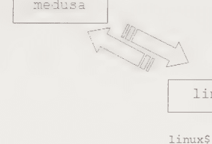

```
linux$ server : Hello, world.
```

```
图 9.15 在远程主机上运行客户端程序。
```

在主机 `linux` 上，服务端程序在后台运行。在主机 `medusa` 上，客户端程序被传递了运行服务端程序的主机名称。有趣的是，在主机 `medusa` 上显示了消息 `Calling function.` 和 `Mission accomplished.`，但消息 `Hello, world.` 则显示在主机 `linux` 上。这并不奇怪，因为每个程序都将其输出写入标准输出，而标准输出又关联到一个控制终端（在我们的例子中，是与用户登录 shell 关联的同一终端）。然而，服务端程序也可能将其输出写入标准输出，但所写内容可能不会被看到。当服务端进程没有关联的控制终端设备时，就会发生这种情况。请记住，服务端进程在被移除之前会一直保留在内存中。

当用户登出时，它不会被移除。但是，当用户确实登出时，操作系统会断开该进程的控制终端设备（调用 `ps` 会将该进程的控制终端设备列为 `?`）。如果在标准设置中，一个进程没有关联的控制终端设备，那么该进程发送到标准输出的任何内容都会进入"黑洞"！

有几种方法可以纠正这个问题。首先，服务端的输出可以被硬编码为显示在控制台。在这种情况下，服务端在调用时会对 `/dev/console` 设备执行 `fopen`。`fopen` 调用返回的 `FILE` 指针随后可以与 `fprintf` 函数一起使用，以在控制台上显示输出。不幸的是，这种解决方案存在一个潜在问题：用户可能没有访问控制台设备的权限。如果是这样，`fopen` 将失败。第二种方法是将客户端进程的控制台设备作为 RPC 的第一个参数传递给服务端。这是一个稍好一些的解决方案，但当客户端和服务端进程位于具有不同输出设备的不同工作站上时，它仍然会失败。第三种方法是让服务端进程将其消息返回给客户端，并由客户端在本地显示。

## 9-4 练习

以下程序使用 `ttyname` 库函数来显示与 `stdout` 关联的输出设备。

```
File : ttyname.c
     #include <stdio.h>
     int
     main( ){
.        char *dev = (char *)ttyname(fileno(stdout));
+        if (dev)
!            printf("My standard output device is %s\n", dev);
!        else
!            fprintf(stderr, "I don't know my standard output
!                device!\n");
!        return 0;
10     }
```

修改客户端和服务端程序，使得与 `stdout` 关联的输出设备由客户端确定，并作为 `print_hello` 函数的第一个参数传递给服务端。服务端将打开该设备进行写入，以显示 `Hello, world` 消息。提示：输出设备必须由客户端存储为一个字符数组，以便它可以传递给服务端。协议定义文件中的 `void` 参数必须更改为反映字符数组的传递。

## 9.4 将本地函数调用转换为远程过程

然而，在进行此更改时，你不能使用数据类型 `char *`，因为它是含糊的——它可能是对单个字符的引用，也可能是对字符数组的引用。在 RPC 语言中，数据类型 `string` 用于表示以 NULL 结尾的字符数组。

## 9-5 练习

编写一个基于 RPC 的"时间"服务器。当被客户端联系时，服务器应返回时间。显示时，输出应采用用户友好的格式。

我们还应该检查 `rpcgen` 生成的两个 RPC 存根文件。`hello_clnt.c` 文件相当小（图 9.16）。此文件包含对 `print_hello_1` 函数的实际调用。

## 图 9.16 hello_clnt.c 文件。


`File : hello_clnt.c`
```
/*
 * Please do not edit this file.
 * It was generated using rpcgen.
 */

#include <memory.h>           /* for memset */
#include "hello.h"

/* Default timeout can be changed using clnt_control() */
static struct timeval TIMEOUT = { 25, 0 };

int *
print_hello_1(void *argp, CLIENT *clnt) {
    static int clnt_res;

    memset((char *)&clnt_res, 0, sizeof(clnt_res));
    if (clnt_call (clnt, print_hello,
                   (xdrproc_t) xdr_void, (caddr_t) argp,
                   (xdrproc_t) xdr_int, (caddr_t) &clnt_res,
                   TIMEOUT) != RPC_SUCCESS) {
        return (NULL);
    }
    return (&clnt_res);
}
```

由于我们使用`rpcgen`来降低RPC的复杂度，因此不会正式介绍`clnt_call`函数。不过，需要说明的是，执行实际RPC操作的`clnt_call`函数，其第一个参数是先前通过`clnt_create`调用生成的客户端句柄。第二个参数从`hello.h`头文件获取，实际上就是其中的`print_hello`常量。第三和第五个参数分别是对XDR数据编码/解码例程的引用。夹在这两个参数之间的，是一个名为`argp`的引用，它指向将由服务器进程传递给远程过程的初始参数。`clnt_create`的第六个参数是返回数据存储位置的引用。第七个也是最后一个参数是`TIMEOUT`（超时）值。尽管警告性注释表明你不应编辑此文件（通常确实不应编辑），但`TIMEOUT`值可以从默认的25改为其他合理的用户自定义最大值。

`hello_svc.c`文件中的代码要复杂得多，出于篇幅考虑，此处不作展示。鼓励感兴趣的读者输入`hello.x`中的协议定义，生成并查看`hello_svc.c`文件。在此阶段，只需注意`hello_svc.c`文件包含了服务器进程的代码。服务器进程一旦被调用，将驻留在内存中。当收到客户端进程的通知时，它将执行`print_hello_1_svc`函数。

## 9.5 调试RPC应用程序

由于其分布式特性，RPC应用程序可能非常难以调试。一种使用`gdb`等工具测试和调试RPC应用程序的简便方法是，在链接客户端和服务器程序时*不包含*其`rpcgen`存根。为此，需要注释掉客户端程序中的RPC引用。如果曾向`rpcgen`传递了`-C`选项，则必须相应地调整函数调用名称（即添加`_svc`后缀）。此外，可能需要将带有客户端引用的函数调用参数强制转换为正确的类型（即`struct svc_req *`）。通过预处理指令整合这些更改后，我们的`hello_client.c`文件现在将如图9.17所示。

**图9.17** `hello_client.c`的“调试就绪”版本。

```
File : hello_client.c
    /*
       客户端程序：hello_client.c
       这将是本地客户端进程执行的客户端代码。
    */
    #include <stdio.h>
    #include "hello.h"              /* 由rpcgen从hello.x生成  */
    int
    main(int argc, char *argv[]) {
    . . .                              /* 与hello_client.c中第9-20行相同 */
      /*
        生成用于调用服务器的客户端句柄
      */
      #ifndef DEBUG
        if ((client=clnt_create(server,    DISPLAY_PRG,
                                DISPLAY_VER, "tcp")) == (CLIENT *) NULL) {
          clnt_pcreateerror(server);
          exit(2);
        }
      printf("client : 正在调用函数.\n");
       return_value = print_hello_1((void *) &filler, client);
      #else
        printf("client : 正在调用函数.\n");
        return_value = print_hello_1_svc((void *) &filler,
                                         (struct svc_req *)client);
      #endif
      if (*return_value)
        printf("client : 任务完成.\n");
      else
        printf("client : 无法显示消息\n");
      return 0;
      }
```

我们将使用图9.18所示的命令序列编译此修改后的版本。由于未引用任何网络库，因此无需链接`libnsl`库（对于大多数版本的`gcc`，这不成问题）。向编译器传递`-g`标志（以为`gdb`生成符号表信息），并指定`-DDEBUG`来定义预处理器将要测试的`DEBUG`常量。

## 图9.18 使用gdb调试客户端-服务器应用程序。

```
linux$ gcc -DDEBUG -g hello_client_gdb.c hello_server.c

linux$ gdb -q a.out
(gdb) list 25,35
25      if ((client=clnt_create(server,     DISPLAY_PRG,
26                              DISPLAY_VER, "tcp")) == (CLIENT *) NULL  :
27        clnt_pcreateerror(server);
28        exit(2);
29      }
30      printf("client : 正在调用函数.\n");
31      return_value = print_hello_1((void *) &filler, client);
32 #else
33      printf("client : 正在调用函数.\n");
34      return_value=print_hello_1_svc((void *)&filler,(struct
35 #endif

(gdb) break 34
Breakpoint 1 at 0x804853f: file hello_client_gdb.c, line 34.

(gdb) run kahuna
Starting program: /home/faculty/gray/revision/09/hello_files/a.out kahuna
client : 正在调用函数.

Breakpoint 1, main (argc=2, argv=0xbffffc34) at hello_client_gdb.c:34
34      return_value=print_hello_1_svc((void *)&filler,(struct
        svc_req *)client);

(gdb) step
print_hello_1_svc (filler=0xbffffbbc, req=0x80497ec) at hello_server.c:10
10      ok = printf("server : Hello, world.\n");

(gdb) list
5      #include <stdio.h>
6      #include "hello.h"     /* 由rpcgen从hello.x生成  */
7      int *
8      print_hello_1_svc(void * filler, struct svc_req * req) {
9        static int  ok;
10       ok = printf("server : Hello, world.\n");
11       return (&ok);
12     }

(gdb) quit
The program is running.  Exit anyway? (y or n) y
```

使用`gcc`编译。定义`DEBUG`常量并生成符号表信息。

在客户端程序的第34行设置断点。

单步进入曾经是远程过程的代码。

这现在是服务器的代码。

## 9.6 使用RPCGEN生成模板和MAKEFILE

`rpcgen`命令具有额外功能，可协助RPC应用程序的开发。如果向`rpcgen`传递`-a`标志（参见图9.7），它将生成客户端和服务器存根文件及头文件之外，还会生成一套客户端和服务器的模板文件，以及整个应用程序的makefile。与会导致`rpcgen`覆盖预先存在的存根文件的`-C`标志不同，`-a`标志会导致`rpcgen`在当前目录存在模板文件（使用默认名称）时终止并显示警告消息。因此，最好仅在确定协议定义文件准确无误时才使用`-a`标志；否则，必须手动删除或重命名先前生成的模板文件。

例如，假设我们有一个名为`fact.c`（程序9.5）的程序，它请求一个整数值，并在该值在可存储在`long integer`的范围内时返回其阶乘；否则返回0。

**程序9.5** 原始阶乘程序`fact.c`。

```
File : fact.c

/*
    计算阶乘的程序
*/

#include <stdio.h>

int main() {
    long int f_numb, calc_fact(int);
    int number;
    
    printf("阶乘计算器 \n");
    printf("输入一个正整数值 ");
    scanf("%d", &number);
    if (number < 0)
        printf("仅支持正值！\n");
    else if ((f_numb = calc_fact(number)) > 0)
        printf("%d! = %d\n", number, f_numb);
    else
        printf("抱歉，%d! 超出了我的范围！\n", number);
    return 0;
}

/*
    计算阶乘数并返回结果，如果值超出范围则返回0。
*/

long int
calc_fact(int n){
    long int total = 1, last = 0;
    int idx;
    for (idx = n; idx - 1; --idx) {
        total *= idx;
        if (total <= last)              /* 是否超出范围？ */
            return (0);
        last = total;
    }
    return (total);
}
```

我们希望将阶乘程序转换为客户端-服务器应用程序，使客户端可以向远程*factorial*服务器请求阶乘值。为实现此目标，我们首先编写如图9.19所示的协议定义文件。

```
File : fact.x
/*
    阶乘程序的协议定义文件。
    由程序员生成此文件。
*/
program FACTORIAL {
    version ONE {
        long int CALC_FAC( int ) = 1;
    } = 1;
}   0x20000049;
```

然后我们使用带有`-a`和`-C`标志的`rpcgen`来生成头文件、客户端和服务器存根文件、客户端和服务器模板文件，以及应用程序的`Makefile`。此过程的详细信息和输出如图9.20所示。

```
linux$ ls
fact.x

linux$ rpcgen -a -C fact.x

linux$ ls -x
fact_client.c  fact_clnt.c  fact.h  fact_server.c  fact_svc.c  fact.x
Makefile.fact
```

## 9.6 使用 RPCGEN 生成模板和 MAKEFILE

如前所述，通过 `-a` 和 `-C` 标志将协议定义文件传递给 `rpcgen`，会生成六个文件：头文件 `fact.h`，以及 RPC 桩文件 `fact_clnt.c` 和 `fact_svc.c`，它们在内容和性质上与前一个示例中的文件类似。`rpcgen` 创建的三个新文件值得进一步研究。客户端模板文件是 `fact_client.c`。同样，`rpcgen` 使用协议定义文件的文件名作为生成文件名的基础，并添加了 `_client.c` 后缀。`fact_client.c` 文件的内容如图 9.21 所示。

### 图 9.21 由 `rpcgen` 生成的 `fact_client.c` 模板客户端文件。

```
File : fact_client.c
/*
    This is sample code generated by rpcgen.
    These are only templates and you can use them
    as a guideline for developing your own functions.
*/
#include "fact.h"
void
factorial_1(char *host) {
    CLIENT *clnt;
    long  *result_1;
    long factorial_1_arg;

#ifndef DEBUG
    clnt = clnt_create (host, FACTORIAL, ONE, "udp");
    if (clnt == NULL) {
        clnt_pcreateerror (host);
        exit (1);
    }
#endif  /* DEBUG */
    result_1 = calc_fac_1(&calc_fac_1_arg, clnt);
    if (result_1 == (long *) NULL) {
        clnt_sperror (clnt, "call failed");
    }
#ifndef DEBUG
    clnt_destroy (clnt);
#endif  /* DEBUG */
}
int
main (int argc, char *argv[]) {
    char *host;

    if (argc < 2) {
        printf ("usage: %s server_host\n", argv[0]);
        exit (1);
    }
    host = argv[1];
    factorial_1 (host);
    exit (0);
}
```

在模板文件中，`rpcgen` 创建了一个名为 `factorial_1` 的函数（第 7 至 27 行）。函数名源自协议定义文件中给出的程序名，并带有 `_1`（版本号）后缀。如图所示，`factorial_1` 函数接收主机名作为参数。该函数用于进行 RPC `clnt_create` 调用以及远程 `calc_fac_1` 函数调用。注意，正确参数类型和函数返回类型的变量已放置在 `factorial_1` 函数的顶部。默认情况下，`clnt_create` 调用的传输协议指定为 `udp`（而非前一个示例中使用的 `tcp`）。对远程 `cal_fac_1` 函数的调用之后会检查其返回值。如果返回值为 `NULL`，表示调用失败，则会调用库函数 `clnt_perror`（表 9.6）来显示错误消息。

**表 9.6** `clnt_perror` 库调用摘要。

| 头文件 | `<rpc/rpc.h>` | 手册章节 | 3N |

| :--- | :--- | :--- | :--- |

| 摘要 | `void clnt_perror(CLIENT *clnt, char *s );` | | |

| 返回值 | **成功** | **失败** | **设置 errno** |

| | 将表明 RPC 调用失败原因的消息打印到标准错误输出。 | | |

`clnt_perror` 库调用接收来自 `clnt_create` 调用的客户端句柄和一条信息性消息字符串。`clnt_perror` 的输出消息将在信息性消息前加上一个冒号作为分隔。

对库函数 `clnt_destroy` 的调用也会被生成（表 9.7）。`clnt_destroy` 函数用于将 `clnt_create` 函数分配的资源归还给系统。正如预期的那样，一旦客户端 RPC 句柄被销毁，它就变为未定义状态，不再能被引用。


为了方便测试，`rpcgen` 还在模板文件中放置了一系列预处理指令。然而，它似乎忽略了对`clnt_perror`的调用需要网络库这一事实，因此在调试应用程序时可能也需要将其注释掉。与前一个示例一样，如果为`rpcgen`指定了`-C`选项，并且要在调试环境中调用远程阶乘函数（`calc_fac_1`），则函数名应附加`_svc`字符串，并且`clnt`参数应转换为（`struct svc_req *`）数据类型。我们现在可以编辑`fact_client.c`程序，并从初始`fact.c`示例的`main`函数中添加相应的代码。修改后的`fact_client.c`程序如图 9.22 所示。注意对`calc_fact`函数的调用已更改为`factorial_1`函数。

### 图 9.22 修改后的`fact_client.c`模板文件。

```
File : fact_client.c
/*
   This is sample code generated by rpcgen.
   These are only templates and you can use them
   as a guideline for developing your own functions.
*/
#include "fact.h"
long int
factorial_1(int calc_fac_1_arg, char *host) {
    CLIENT *clnt;
    long *result_1;
    #ifndef DEBUG
    clnt = clnt_create (host, FACTORIAL, ONE, "udp");
    if (clnt == NULL) {
        clnt_pcreateerror (host);
        exit (1);
    }
    #endif /* DEBUG */
    result_1 = calc_fac_1(&calc_fac_1_arg, clnt);
    if (result_1 == (long *) NULL) {
        clnt_perror (clnt, "call failed");
    }
#ifndef DEBUG
    clnt_destroy (clnt);
#endif
    return *result_1;
}
int
main (int argc, char *argv[]) {
    char *host;
    long int f_numb;                /* 自定义声明 */
    int number;
    if (argc < 2) {
        printf ("usage: %s server_host\n", argv[0]);
        exit (1);
    }
    host = argv[1];
                /* factorial_1 (host); */
    /*
        用之前 fact.c 程序中 main 函数的代码替换固定的调用
    */
    printf("Factorial Calculator\n");
    printf("Enter a positive integer value ");
    scanf("%d", &number);
    if (number < 0)
        printf("Positive values only!\n");
    else if ((f_numb = factorial_1(number, host)) > 0)
        printf("%d! = %d\n", number, f_numb);
    else
        printf("Sorry %d! is out of my range!\n", number);
    exit (0);
}
```

对客户端程序的修改按顺序如下。首先，生成函数（`factorial_1`）的返回类型从`void`更改为`long int`。其次，调整`factorial_1`的参数列表以包含传入的数值。该参数的数据类型和其他信息列在函数顶部。注意，为防止参数被遮蔽，之前的声明必须删除或注释掉（如第 11 行所示）。第三，在函数末尾添加了`factorial_1`函数的返回类型。第四，在`main`中添加了适当的声明（参见第 32 行和第 33 行）。第五，也是最后一步，将`fact.c`中`main`函数的大部分代码复制到本程序的`main`中。完成后，必须移除（或注释掉）对`factorial_1`的固定调用，最重要的是，被调用函数的名称必须从原来的`calc_fact`更改为`factorial_1`。

### 图 9.23 由 rpcgen 生成的服务器模板文件`fact_server.c`。

```
File : fact_server.c

/*
	This is sample code generated by rpcgen.
	These are only templates and you can use them
	as a guideline for developing your own functions.
*/

#include "fact.h"

void *
calc_fac_1_svc(int *argp, struct svc_req *rqstp) {
	static long  result;
	/*
	 * insert server code here
	 */

	return &result;
}
```

由`rpcgen`生成的服务器模板文件如图 9.23 所示。与客户端模板文件一样，我们现在可以修改服务器模板以融入远程过程的代码。修改后的`fact_server.c`文件如图 9.24 所示。

### 图 9.24 修改后的`fact_server.c`模板文件。

```
File : fact_server.c

/*
	This is sample code generated by rpcgen.
	These are only templates and you can use them
	as a guideline for developing your own functions.
*/

#include "fact.h"

void *
calc_fac_1_svc(int *argp, struct svc_req *rqstp) {
	static long  result;
	/*
	 * insert server code here
	 */

	long int	total = 1, last = 0;
	int		idx;
	for (idx = *argp; idx - 1; --idx) {
		total *= idx;
	}
```

# 9 • 远程过程调用

## 9.6 使用 RPCGEN 生成模板和 MAKEFILE

```c
        if (total <= last) {
            /* Have we gone out of range? */
            result = 0;
            return (&result);
        }
        last = total;
    }
    result = total;
    return &result;
}
```

服务器程序的修改比客户端程序更简单直接。本质上，函数代码被粘贴到指定位置。唯一的编码调整发生在第17行，即`idx`初始化的地方。由于传递给此函数的参数是引用（而非值），因此必须对其进行解引用。由`rpcgen`生成的 Makefile 如图 9.25 所示。

### 图 9.25 由`rpcgen`生成的 Makefile.fact。

```makefile
File : Makefile.fact
    |
        # This is a template Makefile generated by rpcgen
        
        # Parameters
        
        CLIENT = fact_client
        SERVER = fact_server
        
        SOURCES_CLNT.c = 
    10    SOURCES_CLNT.h = 
        SOURCES_SVC.c = 
        SOURCES_SVC.h = 
        SOURCES.x = fact.x
        
        TARGETS_SVC.c = fact_svc.c fact_server.c
        TARGETS_CLNT.c = fact_clnt.c fact_client.c
        TARGETS = fact.h fact_clnt.c fact_svc.c fact_client.c fact_server.c
        
        OBJECTS_CLNT = $(SOURCES_CLNT.c:%.c=%.o) $(TARGETS_CLNT.c:%.c=%.o)
    20    OBJECTS_SVC = $(SOURCES_SVC.c:%.c=%.o) $(TARGETS_SVC.c:%.c=%.o)
    |    # Compiler flags
        
        CFLAGS += -g
        LDLIBS += -lnsl
    +    RPCGENFLAGS =
        
        # Targets
```

```makefile
all : $(CLIENT) $(SERVER)

$(TARGETS) : $(SOURCES.x)
	rpcgen $(RPCGENFLAGS) $(SOURCES.x)

$(OBJECTS_CLNT) : $(SOURCES_CLNT.c) $(SOURCES_CLNT.h) $(TARGETS_CLNT.c)

$(OBJECTS_SVC) : $(SOURCES_SVC.c) $(SOURCES_SVC.h) $(TARGETS_SVC.c)

$(CLIENT) : $(OBJECTS_CLNT)
	$(LINK.c) -o $(CLIENT) $(OBJECTS_CLNT) $(LDLIBS)
```

虽然这个 Makefile 可以直接使用，但你可能希望修改编译器标志部分的一些条目。例如，你可能希望在`RPCGENFLAGS`中添加`-C`标志，或者通过将`-lm`添加到`LDLIBS`来指示需要链接数学库。如果要使用默认编译器（大多数系统上为`gcc`）以外的编译器，你会在此部分添加相应的注释（例如，使用 Sun 的 C 编译器则`CC = cc`，使用 Sun 的 C++ 编译器则`CC = c++`）。`make`工具会假定它要处理的 Makefile 称为`makefile`。由于`rpcgen`创建的 Makefile 名称是`makefile`加上协议定义文件（`fact`）的根名（用点号分隔），用户有两种解决方法。第一，使用`mv`命令将生成的 Makefile 重命名为`makefile`；第二，使用`make`的`-f`标志。如果使用`-f`标志，则应紧跟在该标志之后指定`make`要使用的文件名。

图 9.26 展示了使用带`-f`标志的`make`工具在本地系统上生成阶乘应用程序的事件序列。

### 图 9.26 使用 Makefile.fact 文件。

```bash
linux$ make -f Makefile.fact
cc -g -c -o fact_clnt.o fact_clnt.c
cc -g -c -o fact_client.o fact_client.c
cc -g -o fact_client fact_clnt.o fact_client.o -lnsl
cc -g -c -o fact_svc.o fact_svc.c
cc -g -c -o fact_server.o fact_server.c
cc -g -o fact_server fact_svc.o fact_server.o -lnsl
```

图 9.27 展示了运行阶乘客户端-服务器应用程序的序列。

在前面的示例中，阶乘服务器程序在名为`linux`的工作站上调用。`ps`命令验证了`fact_server`进程的存在。阶乘客户端程序被调用，并传递了运行阶乘服务器进程的主机名。客户端进程请求用户输入一个整数值。用户输入了值 11。客户端进程向服务器进程发起远程调用，传递了值 11。服务器进程通过计算阶乘值并将其返回给客户端来做出响应。客户端进程显示返回的结果。客户端程序被第二次调用并传递了值 15。值 15! 超出了服务器上整数的存储范围。因此，服务器返回值 0，表示无法完成计算。客户端显示相应的错误消息。接下来，用户登录到同一网络上的另一台工作站（`medusa`）并切换到阶乘应用程序可执行文件所在的目录。`ps`命令用于检查此工作站上是否存在阶乘服务器进程——它不存在。阶乘客户端再次被调用并传递了运行服务器进程的工作站名（`linux`）。客户端程序请求一个整数值（输入为 12）。该值通过 RPC 传递到工作站`linux`上的服务器进程。`linux`上的服务器进程计算阶乘值并返回给`medusa`上的客户端进程，后者将结果显示到屏幕。

### 图 9.27 运行阶乘客户端-服务器应用程序。

```bash
linux$ fact_server &
[1] 24366

linux$ ps -ef | grep fact
gray    24366 24036 0 14:30 pts/2  00:00:00 fact_server
gray    24368 24036 0 14:30 pts/2  00:00:00 grep gray

linux$ fact_client linux
Factorial Calculator
Enter a positive integer value 11
11! = 39916800

linux$ fact_client linux
Factorial Calculator
Enter a positive integer value 15
Sorry 15! is out of my range!

medusa$ ps -ef | grep fact_server
gray    28332 28192 0 15:17 pts/1  00:00:00 grep fact_server

medusa$ fact_client linux
Factorial Calculator
Enter a positive integer value 12
12! = 479001600
```

## 9.7 任意数据类型的编码与解码

### 9-6 练习

编写一个基于 RPC 的客户端-服务器应用程序，该程序以单次遍历、从左到右的顺序（忽略运算符优先级）评估一个由一系列个位操作数和二元运算符`+`、`-`、`/`（整数除法）和`*`组成的简单表达式。客户端应处理该表达式并调用服务器应用程序执行所需的算术运算。服务器应为四种运算各有一个单独的过程。使用以下输入序列测试你的应用程序（务必检查除零的情况）：

```
2 * 3 / 2 + 5 - 8

7 - 9 / 0
```

提示：要传递多个参数，你应使用`rpcgen`的`-N`选项，或者将要传递的参数放入一个结构体中，然后传递该结构体的引用。

## 9.7 任意数据类型的编码与解码

为了使 RPC 能够在具有不同架构的系统之间传递数据，数据首先被转换为标准的 XDR 格式。从本地表示形式到 XDR 格式的转换称为**序列化**。当数据以 XDR 格式接收时，它会被转换回接收方进程的本地表示形式。从 XDR 格式到本地格式的转换称为**反序列化**。为了实现透明性，转换过程必须考虑诸如本地字节顺序、<sup>11</sup> 整数大小、浮点值的表示方式以及字符字符串的表示方式等因素。其中一些差异可能依赖于硬件，而另一些则可能依赖于编程语言。一旦数据被转换，就假定单个数据字节（每个由八位组成）本身可以从一个平台移植到另一个平台。标准简单数据类型（如整数、浮点数、字符等）的数据转换是通过一系列预定义的 XDR 原始类型库例程<sup>12</sup>实现的，这些例程有时被称为**过滤器**。如果这些过滤器成功转换数据，则返回简单数据类型；否则，它们返回值 0。每个原始例程都接受一个指向结果的指针和一个指向 XDR 句柄的指针。原始例程被整合到用于复杂数据类型（如数组）的更复杂例程中。数据转换实际完成的具体细节虽然有趣，但超出了本章对 RPC 概述的范围。然而，重要的是要记住此类例程是必要的，并且在通过 RPC 传递数据时，必须选择正确的转换例程。幸运的是，当使用`rpcgen`时，相应的 XDR 转换例程的引用会自动生成并放置在应用程序可以引用的另一个 C 源文件中。这个包含客户端和服务器转换例程的文件将具有后缀`_xdr.c`，附加在协议定义文件名之后。

为了说明数据转换如何完成，我们将创建一个执行远程目录树列表的应用程序。当此应用程序的服务器收到一个有效的目录名时，它将遍历指定的目录并生成该目录下所有子目录的缩进列表。例如，假设我们有如图 9.28 所示的目录结构。

**图 9.28** 假设的目录结构。

如果我们请求该应用程序生成目录`/usr0`的目录树，则从目录树应用程序返回的输出将类似于图 9.29 所示。

<sup>11</sup> 例如，对于一个 4 字节（32 位）的数字，最高有效字节（MSB）始终在最左边，最低有效字节（LSB）在最右边。如果组成数字的字节序列从左到右排序，如 SPARC 架构，则该顺序称为**大端序**。如果字节序列从右到左编号，如 i80x86 处理器系列，则该顺序称为**小端序**。

<sup>12</sup> 更多详情，请参阅关于`xdr`的手册页。


## 9.7 编码和解码任意数据类型

图 9.29 显示了`/usr0`的目录树列表。

```
/usr0:
    home
        joe
        bill
    prgm
        ex0
        ex1
        ex2
```

被遍历的目录以冒号结尾列出。随后，显示的每个子目录都缩进以表示其与父目录和同级子目录的关系。`home`和`prgm`子目录位于同一级别，因此缩进相同的空格数。`home`目录下的`joe`和`bill`子目录的缩进级别，与`prgm`目录下的`ex0`、`ex1`和`ex2`子目录的缩进级别相同。

如代码所示，应用程序将客户端要遍历的服务器目录名称传递给服务器。服务器将分配一个固定大小为 ¹³ 的数组来存储目录树列表，并在成功时返回数组内容。如果服务器失败，它将返回一个`NULL`值。服务器使用以下高级算法将目录树信息填充到数组中。

打开传入的目录引用。当目录引用不为`NULL`时，检查每个条目以确定其是否可访问。请注意，如果服务器进程没有`root`权限，这可能会导致某些条目被跳过。如果条目可访问且是目录引用（相对于文件引用），但不是点条目（我们希望出于明显原因跳过`.`和`..`条目），则该条目将连同适当数量的缩进存储在分配的数组中。出于显示目的，每个存储的条目都附加一个换行符（`\n`）以将其与后续条目分开。由于目录结构本质上是递归的，在处理可访问的目录条目后，树显示例程将再次调用自身，并传递新目录条目的名称。一旦处理完目录的全部内容，该目录即被关闭。当所有目录和子目录都已处理完毕，包含目录树内容的数组将返回给客户端进程，该进程将显示其内容。上一示例返回的数组的部分内容如图 9.30 所示。

¹³ 我知道，我知道，这*不是*做这件事的*最好*方法——使用动态分配会更合适，因为我们事先不知道实际需要多少存储空间。这里展示的是一个教学示例。在练习部分将讨论如何修改文本示例以使用动态内存分配。

图 9.30 `/usr0`的目录树数组的部分列表。

树程序的协议定义文件`tree.x`如图 9.31 所示。

### 图 9.31 协议定义文件，`tree.x`。

```
File : tree.x

/*
         Tree protocol definition file
*/
const   MAXP  = 4096;   /* Upper limit on packet size it 8K.              */
const   DELIM = "\n";    /* To separate each directory entry.               */
const   INDENT= 5;      /* # of spaces to indent for one level.            */
const   DIR_1 = 128;    /* Maximum length of any one directory entry.       */

typedef char line[MAXP]; /* A large storage location for all the entries   */
typedef line *line_ptr;  /* A reference to the storage location.            */

                              /* If no errors return reference else return void */
union dir_result
      switch( int errno ) :
      case 0:
            line *line_ptr;
      default:
            void;
      };
      /*
      *  The do_dir procedure will take a reference to a directory and return
      *  a reference to an array containing the directory tree.
      */
program TREE (
      version one(
            dir_result do_dir( string ) = 1;
      ) = 1;
) = 0x2000001;
```

在协议定义文件中有一系列常量。这些常量将被`rpcgen`编译器映射为`#define`语句。常量部分之后是两个类型声明。第一个`typedef char line[MAXP]`声明了一个名为`line`的新类型，它是`MAXP`个字符的数组。为了转换此类型，`rpcgen`创建了一个名为`xdr_line`的例程，并将其放置在`tree_xdr.c`文件中。该例程的内容如图 9.32 所示。

### 图 9.32 `rpcgen`创建的`xdr_line` XDR 转换例程。

```
File : tree_xdr.c
    /*
     * Please do not edit this file.
     * It was generated using rpcgen.
     */
    #include "tree.h"

    bool_t
    xdr_line (XDR *xdrs, line objp)
{
        register int32_t *buf;

        if (!xdr_vector (xdrs, (char *)objp, MAXP,
                sizeof (char), (xdrproc_t) xdr_char)))
                return FALSE;
        return TRUE;
}
```

生成的`xdr_line`例程调用预定义的`xdr_vector`例程，后者又调用`xdr_char`原语。正是`xdr_char`原语（可在客户端和服务器存根文件中找到）执行了实际的转换。为行指针（`line_ptr`）声明和用于声明用户定义远程`do_dir`过程返回类型的鉴别联合，会生成类似的代码集。如果我们检查由`rpcgen`从`tree.x`文件生成的`tree.h`文件，会发现鉴别联合被映射为一个包含联合的结构体（如图 9.33 所示）。`do_dir`过程的单个参数是一个字符串（一种特殊的 XDR 数据类型），它被映射为指向字符指针的指针。传递给`do_dir`的参数将是待检查的目录。

### 图 9.33 `rpcgen`从`tree.x`中的鉴别联合生成的结构体，位于`tree.h`中。

```
File : tree.h
    /*
     * Please do not edit this file.
     * It was generated using rpcgen.
     */
*/
#ifndef _TREE_H_RPCGEN
#define _TREE_H_RPCGEN

#include <rpc/rpc.h>
...
typedef line *line_ptr;

struct dir_result {
    int errno;
    union {
        line *line_ptr;
    } dir_result_u;
};
typedef struct dir_result dir_result;
...
```

树程序的客户端部分代码（`tree_client.c`）如程序 9.6 所示，服务器部分（`tree_server.c`）如程序 9.7 所示。

### 程序 9.6 目录树客户端程序`tree_client.c`。

```
File : tree_client.c
/*
... (ASCII art or header comments)
*/
#include "local.h"
#include "tree.h"

void
tree_1(char *host, char *the_dir) {
    CLIENT *client;
    dir_result *result;

#ifndef DEBUG
    client = clnt_create(host, TREE, one, "tcp");
    if (client == (CLIENT *) NULL) {
          clnt_pcreateerror(host);
          exit(2);
       }
       result = do_dir_1(&the_dir, client);
#else
       result = do_dir_1_svc(&the_dir, (svc_req *) client);
#endif                                           /* DEBUG */
       if (result == (dir_result *) NULL) {
#ifndef DEBUG
       clnt_perror(client, "call failed");
#else
       perror ("call failed");
#endif                                            /* DEBUG */
          exit(3);
       } else                                    /* display the whole array */
          printf("%s:\n\n%s\n",the_dir,result->dir_result_u.line_ptr);
#ifndef DEBUG
       clnt_destroy(client);
#endif                                           /* DEBUG */
    }
    int
    main(int argc, char *argv[]) {
       char        *host;
    static char directory[DIR_1]; /* Name of the directory */
       if (argc < 2) {
          fprintf(stderr, "Usage %s server [directory]\n", argv[0]);
          exit(1);
       }
       host = argv[1];                /* Assign the server */
       if (argc > 2)
          strcpy(directory, argv[2]);
       else
          strcpy(directory , ".");
       tree_1(host, directory);        /* Give it a shot! */
       return 0;
    }
```

`tree_client.c`程序的大部分代码要么与先前的 RPC 示例性质相似，要么是自说明的。可能需要进一步解释的一条语句是将目录树信息显示到屏幕上的`printf`语句。请记住，远程过程返回一个指向字符串的指针。该字符串已经是显示格式，其中每个目录条目通过换行符与下一个条目分隔。对该字符串的引用写作`result->dir_result_u.line_ptr`。通过检查由`rpcgen`生成的`tree.h`文件，可以获得此引用的正确语法。

# 9 · 远程过程调用

程序 9.7 目录树客户端程序`tree_server.c`。

文件：`tree_server.c`


```c
/*
| #####  ####    #####  #####   ####   #####  #####  #  #   #####  #####
| #      #   #   #  #      #  #    #  #      #   #  # #   #   #      #
| #      #   #   #   #  ####   #    #  #####  #####   #   #   #  ####   #
| +      #####   #      #     # #  #   #####  #   #  #   #####  #####
| #      #   #   #      #      # #  #      #  #   #  # #   #      #   #
| #      #   #   #  #####  #####   ####   #####  #    ##   #####  #   #
*/
#include "local.h"
#include "tree.h"

static int cur = 0,                     /* Index into output array    */
            been_allocated = 0,          /* Has array been allocated? */
            depth = 0;                   /* Indenting level            */

dir_result *
do_dir_1_svc(char **f, struct svc_req *rqstp) {
    static dir_result result;          /* Either array or void       */
    struct stat   statbuff;            /* For status check of entry  */
    DIR       *dp;                     /* Directory entry            */
    struct dirent *dentry;             /* Pointer to current entry   */
    char      *current;                /* Position in output array   */
    int       length;                  /* Length of current entry    */
    static char buffer[DIR_1];         /* Temp storage location     */

    if (!been_allocated)                        /* If not done then allocate */
        if ((result.dir_result_u.line_ptr=(line *)malloc(sizeof(line))) == NULL)
            return (&result);
        else{
            been_allocated = 1;                 /* Record allocation          */
    } else if ( depth == 0 )    {           /* Clear 'old' contents.      */
        memset(result.dir_result_u.line_ptr, 0, sizeof(line));
        cur = 0;                       /* Reset indent level          */
    }
    if ((dp = opendir(*f)) != NULL) {        /* If successfully opened    */
        chdir(*f);                      /* Change to the directory    */
        dentry = readdir(dp);               /* Read first entry          */
        while (dentry != NULL) {
            if (stat(dentry->d_name, &statbuff) != -1)   /* If accessible  */
                if ((statbuff.st_mode & S_IFMT) == S_IFDIR &&   /* & a directory */
                    dentry->d_name[0] != '.') {             /* & not . or .. */
                    depth += INDENT;                    /* adjust indent  */
                    /*
                     * Store the entry in buffer - then copy buffer into larger array.
                     */
                    sprintf(buffer, "%*s %-10s\n", depth, " ", dentry->d_name);
                    length = strlen(buffer);
                    memcpy((char *)result.dir_result_u.line_ptr + cur, buffer, length);
                    cur += length;                  /* update ptr to ref next loc */
                    current = dentry->d_name;      /* the new directory          */
                    (dir_result *)do_dir_1_svc(&current, rqstp);  /* call self   */
                    chdir("..");                    /* back to previous level     */
                    depth -= INDENT;                /* adjust the indent level    */
                }
            dentry = readdir(dp);           /* Read the next entry        */
        }
        closedir(dp);                   /* Done with this one         */
    }
    return (&result);               /* Pass back the result       */
}
```

在`tree_server.c`程序中，有几个静态整数用作计数器或标志。`cur`标识符引用输出数组中的当前偏移量，下一个目录条目将存储在那里。初始时，偏移量设置为 0。`been_allocated`标识符作为一个标志，用于指示输出缓冲区是否已被分配。初始时，该标志设置为 0 (FALSE)。最后一个静态标识符`depth`用于跟踪当前缩进级别。它在开始时也设置为 0。

`do_dir_1_svc`过程接收一个字符串（实际上是一个字符数组）的引用和一个 RPC 客户端句柄的引用。在该过程内部，分配了一系列局部标识符来操作和访问目录信息。之后是一个`if`语句，用于测试`been_allocated`标志。如果输出缓冲区尚未分配，则通过调用`malloc`生成它。分配的缓冲区经过适当转换，并由`dir_result_u`结构体的`line_ptr`成员引用。一旦缓冲区被分配，`been_allocated`标志就被设置为 1 (TRUE)。如果输出缓冲区已经分配，并且这是对该过程的首次调用（即`depth`为 0；请记住这是一个递归过程），则使用`memset`调用通过用 NULL 值填充缓冲区来清除先前的输出内容。当输出缓冲区的内容被清除后，`cur`索引计数器被重置为 0。

该过程随后尝试打开引用的目录。如果成功，则调用`chdir`来更改目录（这样做是为了在检查当前目录时避免构建和维护完全限定路径的需求）。接下来，使用`readdir`函数获取目录的第一个条目。使用`while`循环遍历目录条目。那些进程有访问权限的条目会被测试以确定它们是否引用目录。如果它们是目录，并且目录不以点 (.) 开头，则`depth`计数器会递增。格式化的目录条目临时在缓冲区中使用`sprintf`字符串函数构造。格式描述符指示`sprintf`使用`depth`值作为动态指示器，以确定在目录条目之前应插入多少个空格。每个条目都附加了一个换行符。然后使用`memcpy`将格式化的条目复制到输出缓冲区的正确位置，使用`cur`的值作为偏移量。然后，目录名通过调用自身传递回`do_dir_1_svc`过程。从解析子目录返回后，该过程通过调用`chdir`返回上一级，并相应地递减`depth`计数器。一旦整个目录被处理，目录文件就会关闭。当过程完成时，它返回对输出缓冲区的引用。

目录树客户端-服务器应用程序的输出序列如图 9.34 所示。在此示例中，目录树服务器`tree_server`在名为`kahuna`的主机上运行。用户在主机`medusa`上运行`tree_client`程序，传递主机名`kahuna`和目录`/usr/bin`。在主机`medusa`上显示的输出是`kahuna`上的目录树（其中`tree_server`程序在后台运行）。

**图 9.34** 目录树应用程序的示例运行。

```
medusa$ tree_client kahuna /usr/bin
/usr/bin:
    x11
    man
        man1
        man4
        man5
        man7
        man6
        man3
```

**9-7 练习**

在大多数基于 UNIX 的系统上，`spell`实用程序使用单词文件作为其拼写检查的基础。在我们的 Linux 系统中，此文件位于`/usr/share/dict`目录中。编写一个基于 RPC 的客户端-服务器应用程序，其中客户端向服务器发送一个单词或部分单词。为了处理请求，服务器返回所有包含请求的单词（部分单词）的单词，如果无法进行匹配，则返回消息“Nothing appropriate”。

## 9.8 使用广播搜索 RPC 服务

### 9.8 练习

修改目录树示例，使服务器进程动态分配一个节点（结构体）用于每个目录条目。应将节点列表返回给客户端（而不是示例中的固定数组）。请确保在应用程序使用完所有分配的内存后将其释放。

## 9.8 使用广播搜索 RPC 服务

用户可以向本地网络上的所有`rpcbind`守护进程发送消息，请求有关特定服务的信息。请求使用`clnt_broadcast`网络调用生成。广播请求通过无连接 UDP 传输发送到所有本地连接的广播网络。发送后，可能会从同一服务器和多个服务器获得多个响应。每获得一个响应，`clnt_broadcast`调用会自动调用一个预定义的例程。表 9.8 提供了`clnt_broadcast`调用的语法细节。

**表 9.8 clnt_broadcast 库调用摘要。**

| 头文件 | rpc/rpc.h | 手册章节 | 3N |

| :--- | :--- | :--- | :--- |

| **摘要** | `enum clnt_stat clnt_broadcast(u_long prognum, u_long versnum, u_long procnum, xdrproc_t inproc, char *in, xdrproc_t outproc, char *out, resultproc_t eachresult);` | | |

| **返回值** | **成功**：一个枚举类型值`RPC_SUCCESS`，表示广播调用成功。 | **失败**：使用`clnt_perrno`获取错误消息。 | **设置 errno**：是 |

`clnt_broadcast`调用与`callrpc`函数（另一种用于调用远程过程的调用）性质相似。`clnt_broadcast`的前三个参数是服务的程序号、版本号和过程号。参数`inproc`和`in`分别引用编码过程及其参数的地址，而`outproc`和`out`分别引用解码过程和解码成功后输出结果的地址。每次`clnt_broadcast`调用收到响应时，都会调用由`eachresult`参数引用的函数。`eachresult`函数有两个参数：第一个是`char *`类型，引用与`clnt_broadcast`调用中`out`参数相同的值；第二个参数引用一个结构体`struct sockaddr_in *`，其中包含响应广播请求的主机的地址信息。请记住，系统在调用该函数时会提供这些值。每次`eachresult`引用的函数返回 0 (FALSE) 时，`clnt_broadcast`调用会继续等待更多回复。`clnt_broadcast`调用最终会超时（用户无法控制超时时间）。

程序 9.8 演示了`clnt_broadcast`调用的使用。


程序 9.8 程序 `broad.c`，发送广播请求。

文件 : `broad.c`

```c
#include <stdio.h>
#include <rpc/rpc.h>
#include <rpc/pmap_clnt.h>  // For resultproc_t cast

u_long program_number, version;  // Note: These are global
static bool_t
who_responded(char *out, struct sockaddr_in *addr)
{
    int my_port_T, my_port_U;
    my_port_T = pmap_getport(addr, program_number, version, IPPROTO_TCP);
    my_port_U = pmap_getport(addr, program_number, version, IPPROTO_UDP);
    if ( my_port_T )
        printf("host: %s \t TCP port: %d\n", inet_ntoa(addr->sin_addr),
                my_port_T);
    if ( my_port_U )
        printf("host: %s \t UDP port: %d\n", inet_ntoa(addr->sin_addr),
                my_port_U);
    return 0;
}
int
main(int argc, char *argv[]) {
    enum clnt_stat stat;
    struct timeval tv;
    if (argc < 2) {
        fprintf(stderr, "usage: %s RPC_service_[name | #] version\n", *argv);
        return 1;
    }
    ++argv;                          // Step past your own prog name
    if (isdigit(**argv))             // Check to see if # was passed
        program_number = atoi(*argv);    // If # passed use it otherwise
    else {                               // obtain RPC entry information
        if ((rpc_entry = getrpcbyname(*argv)) == NULL) {
            fprintf(stderr, "Unknown service: %s\n", *argv);
            return 2;
        }                                // Get the program number
        program_number = rpc_entry->r_number;
    }
    ++argv;                          // Move to version #
    version = atoi(*argv);
    rpc_stat = clnt_broadcast(program_number, version, NULLPROC,
                              (xdrproc_t)xdr_void, (char *) NULL,
                              (xdrproc_t)xdr_void, (char *) NULL,
                              (resultproc_t) who_responded);
    if (rpc_stat != RPC_TIMEDOUT) { // If error is not a time out
        fprintf(stderr, "Broadcast failure : %s\n", clnt_sperrno(rpc_stat));
        return 1;
    }
    return 0;
}
```

该程序检查命令行参数的数量。它期望传入要检查的服务名称（或编号）及其版本号。程序会检查第一个参数的第一个字符。如果是数字，则假定传入的是服务编号，并使用`atoi`函数将数字的字符串表示转换为整数值。如果传入的是服务名称，则使用`getrpcbyname`网络调用（第 31 行）获取指定服务的详细信息。表 9.9 总结了`getrpcbyname`网络调用。

### 表 9.9 getrpcbyname 网络调用摘要

| 头文件 | `<rpc/rpc.h>` | 手册章节 | 3N |
| :--- | :--- | :--- | :--- |
| 摘要 | `struct rpcent *getrpcbyname(char *name);` | | |
| 返回值 | 成功：指向该服务 `rpcent` 结构体的指针。 | 失败：NULL | 设置 `errno` |

`getrpcbyname`调用有一个参数，即指向包含服务名称的字符数组的指针。如果成功，该调用返回指向服务的`rpcent`结构体的指针（该结构体存储在`/etc/rpc`文件中的 RPC 程序号数据库中）。`rpcent`结构体定义如下：

```c
struct rpcent {
    char *r_name;    /* name of this rpc service */
    char **r_aliases; /* zero-terminated list of alternate names */
    long r_number;   /* rpc program number */
};
```

在第 38 行，程序将命令行第二个参数转换为版本号。然后使用`clnt_broadcast`调用来收集响应。每次服务器响应广播请求时，都会自动调用用户定义的函数`who_responded`。

`who_responded`函数包含另外两个函数调用：`pmap_getport`和`inet_ntoa`。`pmap_getport`库函数用于获取与服务关联的端口。表 9.10 提供了`pmap_getport`库函数的具体语法。

### 表 9.10 pmap_getport 库函数摘要

| 头文件 | `<rpc/rpc.h>` | 手册章节 | 3N |
| :--- | :--- | :--- | :--- |
| **摘要** | `u_short pmap_getport(struct sockaddr_in *addr, u_long prognum, u_long versnum, u_long protocol);` | | |
| **返回值** | **成功** | **失败** | **设置 errno** |
| | 关联的端口号。 | 0 | 否，它设置`rpc_createerr`，需用`clnt_pcreateerror()`查询 |

此调用的第一个参数是地址结构体的指针。该结构体如下所示：<sup>14</sup>

<sup>14</sup> 在`gdb`调试器中，可以使用命令`ptype TYPE`来显示`TYPE`值的类型定义（当然，前提是该类型在当前代码中被引用）。

```c
struct sockaddr_in {
    sa_family_t    sin_family;    // address family
    in_port_t      sin_port;      // port
    struct in_addr sin_addr;      // reference to the address structure
    unsigned char  sin_zero[8];    // unused
};
```

`prognum`和`versnum`参数分别是服务的程序号和版本号。最后一个参数`protocol`应设置为 TCP 的`IPPROTO_TCP`或 UDP 的`IPPROTO_UDP`。如果调用成功，则返回端口号；否则，它会设置变量`rpc_createerr`以指示错误。如果发生错误，应使用库函数`clnt_pcreateerror`来检索相关的错误消息。

此时，有些人可能会问，为什么完全要使用`pmap_getport`？难道我们不能直接在`who_responded`函数中调用`htons(addr->sin_port)`来获取端口号吗？答案是，如果我们只想要服务的 UDP 关联端口，那就可以这样做。

`who_responded`中使用的第二个函数是网络函数`inet_ntoa`。此函数接受一个编码的四字节网络地址，并将其转换为其带点表示法的对应形式。图 9.35 显示了请求`status`服务版本 1 信息的程序示例运行结果。

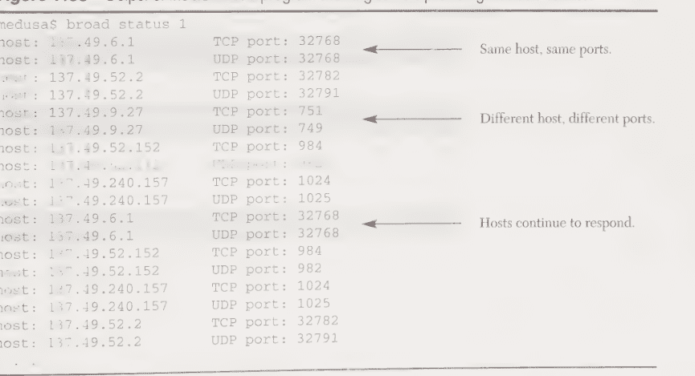

请注意，在广播调用超时之前，某些服务器响应了不止一次。还要注意，服务可以在不同主机上关联到不同的端口。此输出应与执行以下命令时 **rpcinfo** 命令产生的输出有些相似：

```
medusa$ rpcinfo -b status 1
```

## 9.9 练习

修改 **broad.c** 程序，以显示响应广播的主机的名称（而不是 IP 地址）。*提示：* 查阅 **gethostbyaddr** 网络函数，当传入一个地址时，它将返回一个包含主机名引用的结构体。

## 9.10 总结

使用 RPC 进行编程允许程序员编写分布式应用程序，其中一个工作站上的进程可以请求另一个“远程”工作站执行指定的过程。由于其复杂性，大多数基于 RPC 的程序都使用协议编译器，例如 Sun Microsystem 的 **rpcgen**。协议编译器为基于 RPC 的应用程序提供了基本的编程框架。在 RPC 应用程序中，客户端和服务器进程不需要了解底层网络协议的细节。进程间传递的数据通过预定义的过滤器转换为/从外部数据表示（XDR）格式。在底层，基于 RPC 的程序使用套接字接口进行通信。虽然本章未讨论，但 RPC 确实支持认证技术以促进安全的客户端-服务器通信。

## 9.11 关键术语和概念

- `<netdb.h>` 头文件
- `<netinet/in.h>` 头文件
- `<rpc/pmap_clnt.h>` 头文件
- `<rpc/rpc.h>` 头文件
- 客户端进程
- 客户端存根

## 9.10 关键术语和概念

- 1. `CLIENT` 类型定义
- 2. `clnt_broadcast` 库调用
- 3. `clnt_create` 库调用
- 4. `clnt_destroy` 库调用
- 5. `clnt_pcreateerror` 库调用
- 6. `clnt_perror` 库调用
- 7. 反序列化
- 8. RPC 程序的 `gdb` 调试
- 9. `gethostbyaddr` 网络函数
- 10. `gethostbyname` 网络调用
- 11. `getrpcbyname` 网络调用
- 12. `hostname` 命令
- 13. `htons` 网络调用
- 14. `inet_ntoa` 网络调用
- 15. `LDLIBS`
- 16. `make` 工具
- 17. 修饰（mangled）的函数名
- 18. `memset` 函数
- 19. `pmap_getport` 库调用
- 20. 协议定义文件
- 21. 公钥-私钥认证
- 22. `readdir` 库函数
- 23. `rexec` 库函数
- 24. `rexecd` 远程执行服务器
- 25. RPC（远程过程调用）
- 26. RPC 过滤器
- 27. RPC makefile
- 28. RPC 程序号
- 29. RPC 模板文件
- 30. RPC 版本号
- 31. `RPC_NOBROADCAST`
- 32. `RPC_UNKNOWNADDR`
- 33. `RPC_UNKNOWNHOST`
- 34. `RPC_UNKNOWNPROTO`
- 35. `rpcent` 结构
- 36. `rpcgen` 命令
- 37. `rpcgen` 工具
- 38. `RPCGENFLAGS`
- 39. `rpcinfo` 命令
- 40. `rsh`（远程 Shell 命令）
- 41. 序列化
- 42. 服务器进程
- 43. 服务器存根（server stub）
- 44. `ssh`（安全 Shell 命令）
- 45. `ssh-keygen` 命令
- 46. TCP（传输控制协议）
- 47. 传输协议
- 48. `ttyname` 库调用
- 49. UDP（用户数据报协议）
- 50. XDR（外部数据表示）
- 51. `xdr_char` 函数
- 52. `xdr_line` 函数
- 53. `xdr_vector` 函数

## 第10章

## 套接字（SOCKETS）


## 10.1 引言

UNIX 及其变体的一大优点是，它们为访问驻留在单个主机上的文件和设备提供了通用的接口。通过使用由`open`系统调用生成的文件描述符，用户可以轻松地从文件描述符读取数据和向其写入数据。这个过程无需过度关注底层机制，也无需知道描述符被映射到了哪个设备（例如，屏幕、磁盘上的文件等）。当我们讨论`管道`的使用时，我们看到了类似的方法。使用管道，只要相关进程有关联，我们就可以使用`read`和`write`系统调用进行双向（双工）通信。同样，这些进程通过使用`read`和`write`系统调用进行通信，就像处理文件一样。当我们讨论基于 System V 的消息队列、信号量和共享内存作为进程间通信（IPC）技术时，我们开始偏离读/写范式。我们还发现，虽然我们可以使用其中一些技术进行进程间通信，即使是与不相关的进程，但每种技术都有自己特殊的发送和接收信息的方法。不幸的是，虽然这些技术功能强大，并且确实有其用武之地，但它们晦涩的语法在某种程度上限制了其使用。在上一章中，我们研究了远程过程调用（RPC）。我们注意到 RPC 机制用于进程间通信。开发 RPC API（应用程序接口）是为了减轻编写在分布式环境中需要相互通信的不相关进程的应用程序的负担。为了使事情更容易，RPC 的开发者在某些情况下反而使事情变得更加复杂和受限。RPC 应用程序本质上拥有大量辅助文件，其内容和关系有时可能会模糊其功能。在基于 RPC 的应用程序中，很容易失去对通信过程机制的接触和控制。看起来需要的是对基本读/写范式的扩展，并加入足够的网络语义，以允许不同主机上的不相关进程能够像读写本地文件一样进行通信。这种中间级别的进程间通信将介于管道、消息队列、共享内存技术和 RPC 应用程序之间。幸运的是，在 UNIX 中，有几个应用程序接口支持这种类型的通信，并且实际上是 RPC 接口的底层基础。

提供远程进程间通信最常见的 API 是 Berkeley 套接字接口，于 1980 年代初推出，以及 AT&T 在 1980 年代中期实现的传输层接口（TLI）编程。关于这两种方案中哪种为远程进程间通信提供了更好的解决方案，存在很多讨论。由于 Berkeley 套接字接口早于 TLI，现有的大部分远程进程间通信编码都是使用套接字完成的。然而，Berkeley 套接字并非与传输无关，在多线程处理环境中必须谨慎使用。另一方面，TLI 被设计为与传输无关（即，应用程序可以以协议无关的方式访问传输特定信息）。不幸的是，迄今为止，并非所有传输协议都支持每个 TLI 服务。与套接字不同，TLI 基于 STREAMS，并且要求应用程序在执行读写操作之前在流上推入一个特殊模块。特权端口（Berkeley 的一个概念）的概念在 TLI 中不受支持。此外，广播（向一组主机发送相同消息的能力）并非与传输无关。最近，TLI 已开始被 X/Open 传输接口（XTI）取代。

在本章中，我们将探讨 Berkeley 套接字接口。从概念上讲，套接字是一个抽象的数据结构，用于创建一个通道（连接点），以在不相关的进程之间发送和接收信息。一旦建立通道，连接的进程就可以使用通用的文件系统类型访问例程进行通信。在大多数情况下，当使用

### 10.2 通信基础

要了解套接字的工作原理，需要对网络环境中进程间通信的一些细节及其相关术语有基本的了解。

#### 10.2.1 网络地址

网络上的每个主机至少有两个唯一地址。第一个唯一地址是分配给其网络接口卡（NIC）的 48 位¹ 媒体访问控制（MAC）地址。该地址由网卡制造商分配。MAC 地址（有时称为其以太网地址或硬件地址）以十六进制表示法书写。地址被分成六个 8 位数字，中间用冒号（:）分隔。使用十六进制时，每个 8 位数字最多是两位数字，每位数字由 0–9、A–F 组成。字母数字的大小写无关紧要，通常不包括前导零。这个数字的前三个分组（字节）标识硬件制造商。互联网上存在各种网站，可以将制造商标识符值映射到其对应的供应商。可以在 http://www.iana.org/assignments/ethernet-numbers 找到这样一个表格。

在某些基于 UNIX 的系统上，文件`/etc/ethers`包含本地主机的 MAC 地址。此外，文件`/proc/net/arp`包含最近解析的地址（Internet 地址及其对应的硬件地址）。在 Linux 主机上，可以使用`ifconfig`工具来显示其 NIC 的硬件地址。图 10.1 显示了 **ifconfig** 命令在传递 -a（全部）选项时的输出。

¹ 在 IPv4（互联网协议第 4 版，已存在约 20 年）中，这些地址是 48 位的。在 IPv6（最初称为 IPng：互联网协议——下一代）中，这些地址是 64 位的。


```
linux$ /sbin/ifconfig -a
eth0  Link encap:Ethernet  HWaddr **00:B0:D0:AB:7C:96**
      BROADCAST MULTICAST  MTU:1500  Metric:1
      RX packets:0 errors:0 dropped:0 overruns:0 frame:0
      TX packets:0 errors:0 dropped:0 overruns:0 carrier:0
      collisions:0 txqueuelen:100
      Interrupt:16  Base address:0xecc0  Memory:e08fc000-e08fcc40

eth1  Link encap:Ethernet  HWaddr **00:02:B3:35:9E:21**
      inet addr:137.49.6.1  Bcast:137.49.255.255  Mask:255.255.0.0
      UP BROADCAST **RUNNING** MULTICAST  MTU:1500  Metric:1
      RX packets:471693034 errors:2 dropped:0 overruns:27398 frame:2
      TX packets:2147483647 errors:0 dropped:0 overruns:0 carrier:0
      collisions:0 txqueuelen:100
      Interrupt:26  Base address:0xd4c0  Memory:e08fe000-e08fec40

lo    ink encap:Local Loopback
      inet addr:127.0.0.1  Mask:255.0.0.0
      UP LOOPBACK RUNNING  MTU:16436  Metric:1
      RX packets:95939986 errors:0 dropped:0 overruns:0 frame:0
      TX packets:95939986 errors:0 dropped:0 overruns:0 carrier:0
      collisions:0 txqueuelen:0
```

主机的第二个唯一地址是 32 位的互联网（IP）地址。Internet 地址过去由互联网网络信息中心（InterNIC）分配。目前，这个过程稍微复杂一些。在最高级别，ICANN（互联网名称与数字地址分配机构）在区域基础上分配地址块。在区域级别，美洲互联网号码注册管理机构（ARIN）分配北美、南美、加勒比地区和撒哈拉以南非洲的 IP 地址空间；亚太网络信息中心（APNIC）分配亚洲和太平洋地区的地址；欧洲 IP 地址注册机构（RIPE）处理欧洲地址。在本地级别，互联网服务提供商（ISP）从其区域管理机构获得地址。在下一级别，用户从其 ISP 请求地址。一个 32 位 IP 地址被分成四个 8 位数字，每个数字由点（`.`）分隔。以点分十进制表示法（DDN）书写时，四个子数字中的每一个范围可以从 0 到 255（尽管 0 和 255 这两个数字在

² 使用 IPv6 时，32 位 IP 地址将变为 128 位。

## 10.2 通信基础

最后分组通常具有特殊含义，例如本地环回或广播地址。

IPv4 互联网地址可细分为网络部分和本地部分。网络部分（或 netid）占据 IP 地址的最左侧部分，本地部分（或 hostid）占据最右侧部分。使用 netid 值的前导位，网络可分为五类，从 A 到 E。我们将讨论前三类。³ 在 A 类网络中，第 0 位为 0；在 B 类网络中，前两位为 10；在 C 类网络中，前三位为 110。地址的 netid 部分由 ISP 分配，指示您的网络关联。hostid 部分的内容由本地网络管理员确定，并指定您网络中的单个主机（工作站）。如图 10.2 所示，本地网络管理员可分配的 hostid 范围与网络类别直接相关。一般来说，小型站点使用 C 类网络地址，较大的站点使用 B 类，依此类推。当这种编号方案启动时，人们并未预料到可用网络地址的范围会受到限制，因为它允许 2⁷ 个 A 类网络、2¹⁴ 个 B 类网络和 2²¹ 个 C 类网络（有关此主题的更多信息，请参见练习 10.1）。

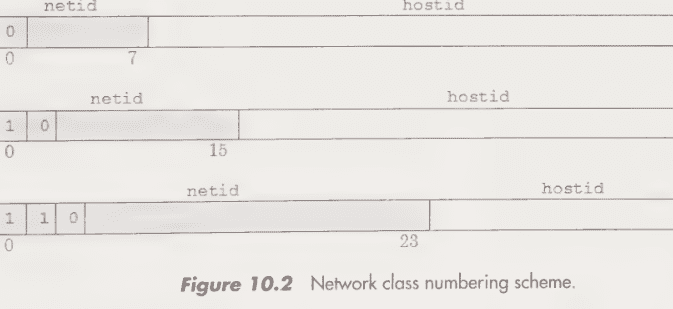

主机负责将特定的互联网地址映射到其对应的以太网（硬件）地址。此过程称为地址解析，使用其自身的协议，称为地址解析协议（ARP）。命令 `/sbin/arp -a` 显示当前主机上最近解析的互联网/以太网地址对列表。

³ D 类和 E 类是特殊的网络类别。D 类用于多播，E 类保留供实验使用。这两类都没有固有的主机寻址方案。

在讨论套接字时，除非另有说明，我们提到的地址均指其互联网（IP）地址。

> **10-1 练习**

提供足够 IP 寻址空间的长期解决方案将是迁移到 128 位 IPv6 地址。在过渡期间，无类别域间路由（CIDR）被作为解决方案提出。什么是 CIDR，为什么它是分配 32 位 IP 地址的更高效方法？

#### 10.2.2 域——网络与通信

虽然 IP 地址是引用特定主机的便捷方式，但我们通常使用域名系统（DNS）将点分十进制 IP 地址映射为更易理解的符号表示法。在此方案中，所有互联网地址被划分为一组高层级组织和地理域。每个组织域（有时称为顶级域）都有一个标识代码（通常是三个小写字母），例如 `com`（商业）、`edu`（教育）和 `gov`（政府）。每个地理域由两个字母的国家代码组成，例如 `fi`（芬兰）、`ca`（加拿大）和 `us`（美国）。在每个高层级域内是子域。例如，在 `edu` 域内是 `hartford` 子域（代表哈特福德大学）。在 `hartford` 域内可能还有进一步的子域（例如 `cs` 代表计算机科学），或者只是单个主机的名称。虽然似乎没有建立限制，但域名的最大层级数通常为四到五层。通过使用域名系统，我们现在可以将主机引用为，例如 `morpheus.cs.hartford.edu`，而不是 `137.49.52.1`。以这种格式读取名称时，范围最广的域列在最右侧。向左移动时，找到的每个域都位于其右侧的域内。序列中的最后一个名称（最左侧）通常是主机的名称。大多数网络运行软件（例如 BIND [伯克利互联网域名系统]），该软件使用分布式 DNS 数据库信息，将域名引用动态映射到其对应的互联网（IP）地址。

^4 网站 http://www.iana.org/cctld/cctld-whois 提供了完整的两字母国家代码列表。

### 10-2 练习

通过阅读其手册页来探索 `dig`（域名信息搜索器）、`nslookup` 和 `host` 命令。将您的域名传递给 `dig`（例如，`dig ucla.edu`）。检查返回的 AUTHORITY SECTION 信息。您域的 DNS 服务器的符号名称是什么？给定此符号名称，该服务器的 IP 地址是什么（尝试使用命令 `host -a` 加上该符号名称）？*如果您的系统支持 `nslookup`（它已弃用但仍广泛使用）*，请调用该命令并将服务器设置为相应的 DNS 服务器。然后发出命令 `ls` 查看该域。该命令显示什么？

术语 *域* 在引用套接字接口的通信类型时再次被使用。当我们创建套接字时，我们指定其**通信域**。我们将讨论的两种套接字通信域是

1.  **UNIX 域**。在此域中，当套接字被创建时，它们具有实际的文件（路径）名称。这些套接字只能与驻留在同一主机上的进程一起使用。UNIX 域套接字有时用作基于套接字的通信开发的第一步，因为由于其局部性，它们相对更容易调试。

2.  **互联网域**。这些套接字允许不同主机上的不相关进程进行通信。

虽然从讨论的上下文中应该很清楚，但大多数时候当我们谈论域时，我们谈论的是套接字的通信域，而不是主机的域名。

#### 10.2.3 协议族

进程还必须就其通信的一组规则和约定达成一致。这样一组规则和约定称为**协议**。协议在其整体上可能相当复杂，是分层设计的。协议的分层促进了某种程度的隔离，允许更改一层而不影响相邻层的功能。国际标准化组织（ISO）开放系统互连（OSI）参考模型通常用作此分层应如何发生的通用指南。⁵ 图 10.3 显示了标准的七层 OSI 模型。

**图 10.3** ISO/OSI 分层蛋糕。

| | 层 | 功能 |

|---|---|---|

| 高层级 | 应用层 | 为进程提供访问进程间设施的接口。 |

| | 表示层 | 负责数据转换——文本压缩和重新格式化，加密。 |

| | 会话层 | 处理进程对话的同步——建立、管理和终止连接。 |

| 协议族 | 传输层 | 负责维护商定的数据交换级别。确定服务类型、流量控制、错误恢复等。 |

| | 网络层 | 关注数据从一个网络到另一个网络的路由——建立、维护和终止连接。 |

| 低层级 | 数据链路层 | 确保数据的无差错传输。 |

| | 物理层 | 处理物理连接和原始数据流的传输。 |

一组层，最常见的是 OSI 模型的传输层和网络层，构成一个**协议族**或套件。可以看出，协议族包含诸如数据格式、寻址约定、服务类型信息、流量控制和错误处理等内容。存在多种协议族，包括以下几种：

-   **SNA**——IBM 的系统网络架构

-   **UUCP**——UNIX 到 UNIX 复制

-   **XNS**——施乐网络系统

-   **NETBIOS**——IBM 的网络基本输入/输出系统

-   **TCP/IP**——DARPA（国防高级研究计划局）互联网

⁵ 某些协议（如 TCP）在 OSI 模型之前就已出现，因此不能完全映射到其分层。TCP/IP 使用四个概念层完成相同的功能：应用、传输、互联网和网络接口（数据链路）。TCP/IP 的传输层和网络层大致相当于 OSI 模型的传输层和网络访问层，但 TCP/IP 支持 UDP，这是一种不可靠的协议。

## 10.2 通信基础

我们的讨论围绕TCP/IP协议族（`PF_INET`）展开，该协议族是互联网域的组成部分，由以下协议构成：

- **TCP**——传输控制协议。TCP是可靠的、全双工的、面向连接的。数据以字节流形式传输。

- **IP**——互联网协议。提供数据包的传输。TCP、UDP和ICMP通常调用IP。

- **ARP/RARP**——地址解析协议/逆向地址解析协议。这些协议用于解析互联网/硬件地址。

- **UDP**——用户数据报协议。UDP是不可靠的、全双工的、无连接的。数据以一系列数据包的形式传输。

- **ICMP**——互联网控制消息协议。用于错误处理和流量控制。

在TCP/IP协议族中，我们重点关注TCP和UDP。当我们创建一个套接字时，需要指定其协议族为`PF_UNIX`（UNIX）⁶或`PF_INET`（TCP/IP）。对于好奇的读者，协议定义文件`/etc/protocols`包含了TCP/IP子系统中可用的DARPA互联网协议列表。

⁶ 从技术上讲，UNIX并非真正的通信协议，但在我们的套接字讨论中，我们将这样处理它。

## 10.2.4 套接字类型

进程在网络环境中进行通信，必须传输和接收数据。我们可以将传输的数据视为**流**（即字节序列）或**数据报**格式。数据报是小的、离散的数据包，大体上包含报头信息（如地址）、数据和报尾信息（错误校正等）。由于数据报尺寸较小，进程间的通信可能由一系列数据报组成。

当我们创建一个套接字时，其类型将决定使用该套接字的进程之间将如何进行通信。套接字必须是相同类型才能通信。用户可以指定两种⁷基本的套接字类型：

1.  **流套接字。** 这些套接字是**可靠的**。使用这些套接字时，数据按其发送顺序有序传输。数据不会重复，并且通常有某种形式的错误检查和流量控制。流套接字允许双向（全双工）通信。流套接字是**面向连接的**。也就是说，使用套接字的两个进程会创建一个逻辑连接（虚拟电路）。有关连接的信息在数据传输之前建立，并在通信期间由连接的每一端维护。数据以字节流形式传输。在非常有限的情况下，这些套接字还允许用户将优先级更高的紧急消息放置在当前流中数据的前面。

⁷ 同样，这略有变通——还有其他套接字类型，如原始套接字和顺序数据包套接字。原始套接字适用于希望设计和实现自己网络协议的超级用户。我们将不讨论使用原始或顺序数据包套接字。

2.  **数据报套接字。** 数据报套接字可能是**不可靠的**。因此，使用这些套接字时，接收到的数据*可能*是无序的。数据报套接字支持双向通信，但被认为是**无连接的**。发送和接收进程之间没有逻辑连接。每个数据报都是独立发送和处理的。单个数据报可能经过不同的路由到达同一目的地。在无连接服务中，没有流量控制。错误控制（如果指定的话）也是最小的。数据报包通常尺寸较小且固定。

一个常用的类比将流套接字通信比作电话对话（连接建立时确定发送方和接收方地址），而将数据报通信比作通过明信片进行通信（每张卡片数据包都有自己的地址信息）。虽然这个类比不完全准确，但它确实抓住了两种通信方式的本质。

## 10.3 使用 `socketpair` 的进程间通信

作为热身，我们通过生成一对UNIX域套接字开始我们对套接字的探索。如表10.1所示的**socketpair**调用用于创建这一对套接字。

**表10.1** `socketpair` 系统调用概要

| 包含文件 | `<sys/socket.h>` | 手册章节 | 2 |

|---|---|---|---|

| 概要 | `int socketpair( int d, int type, int protocol, int sv[2] );` | | |

| 返回值 | 成功：0 和两个打开的套接字描述符 | 失败：-1 | 设置 errno：是 |

**socketpair** 调用有四个参数。第一个参数 *d* 是一个整数值，用于指定域。通常，基于套接字的调用的域应指定为头文件 `<bits/socket.h>` 中找到的协议族定义常量之一。与之前的示例一样，程序员不会直接包含此文件，因为必须包含的 `<sys/socket.h>` 文件会包含这个更系统特定的头文件。当我们查看 `<bits/socket.h>` 文件时，会找到两组类似的已定义常量。一组常量以 `AF_` 开头（表示地址族），第二组以 `PF_` 开头（表示协议族）。曾几何时，`PF_` 常量是基于 `AF_` 常量定义的。现在，`AF_` 组常量是基于 `PF_` 常量定义的。这种混乱的发生是因为地址族的概念早于协议族。由于我们正朝着使用协议族的方向前进，在生成套接字时，使用 `PF_` 指定的常量更为合适。`<bits/socket.h>` 文件中当前定义的所有协议族如表10.2所示。

**表10.2** 协议族常量

| 常量 | 值 | 说明 |

|---|---|---|

| `PF_UNSPEC` | 0 | 未指定。 |

| `PF_LOCAL` | 1 | 主机本地（管道和文件域）。 |

| `PF_UNIX` | `PF_LOCAL` | `PF_LOCAL` 的旧BSD名称。 |

| `PF_FILE` | `PF_LOCAL` | `PF_LOCAL` 的另一个非标准名称。 |

| `PF_INET` | 2 | IP协议族。 |

| `PF_AX25` | 3 | 业余无线电AX.25。 |

| `PF_IPX` | 4 | Novell互联网协议。 |

| `PF_APPLETALK` | 5 | AppleTalk DDP。 |

| `PF_NETROM` | 6 | 业余无线电NetROM。 |

| `PF_BRIDGE` | 7 | 多协议桥接。 |

| `PF_ATMPVC` | 8 | ATM PVCs。 |

| `PF_X25` | 9 | 保留给X.25项目。 |

| `PF_INET6` | 10 | IP版本6。 |

| `PF_ROSE` | 11 | 业余无线电X.25 PLP。 |

| `PF_DECnet` | 12 | 保留给DECnet项目。 |

| `PF_NETBEUI` | 13 | 保留给802.2LLC项目。 |

| `PF_SECURITY` | 14 | 安全回调伪AF。 |

| `PF_KEY` | 15 | PF_KEY密钥管理API。 |

| `PF_NETLINK` | 16 | |

| `PF_ROUTE` | `PF_NETLINK` | 用于模拟4.4BSD的别名。 |

| `PF_PACKET` | 17 | 包族。 |

| `PF_ASH` | 18 | Ash。 |

| `PF_ECONET` | 19 | Acorn Econet。 |

| `PF_ATMSVC` | 20 | ATM SVCs。 |

| `PF_SNA` | 22 | Linux SNA项目 |

| `PF_IRDA` | 23 | IRDA套接字。 |

| `PF_PPPOX` | 24 | PPPOX套接字。 |

| `PF_MAX` | 32 | 目前。 |

请注意，大多数基于套接字的调用仅适用于有限的地址/协议族子集。`socketpair` 调用仅为 `PF_LOCAL` (`PF_UNIX`) 族实现，因此将其限制为同一主机内的通信。

`socketpair` 调用的第二个参数 `type` 表示套接字类型。已定义的常量 `SOCK_STREAM` 可用于表示流套接字，而常量 `SOCK_DGRAM` 用于表示基于数据报的套接字。第三个参数 `protocol` 用于指定族内的协议。在大多数情况下，此参数设置为 0，表示让系统选择协议。对于互联网域通信，系统默认对无连接套接字使用 UDP，对面向连接套接字使用 TCP。如果需要，可以使用头文件 `<netinet/in.h>` 中找到的 `IPPROTO_TCP` 或 `IPPROTO_UDP` 常量直接选择特定族内的协议。第四个参数 `sv` 是一个整数数组的基地址，该数组引用在调用成功时创建的两个套接字描述符。每个描述符都是

## 10.3 使用 Socketpair 进行 IPC


双向且可用于读写。如果`socketpair`调用失败，它会返回 -1 并设置`errno`。`errno`的可能取值及其解释如表 10.3 所示。

**表 10.3** socketpair 错误消息。

| # | 常量 | perror 消息 | 解释 |
|---|------|-------------|------|
| 14 | EFAULT | Bad address | sv 引用了非法地址。 |
| 24 | EMFILE | Too many open files | 此进程已达到打开文件描述符的限制。 |
| 93 | EPROTONOSUPPORT | Protocol not supported | 请求的协议在此系统上不受支持。 |
| 95 | EOPNOTSUPPORT | Operation not supported | 指定的协议不支持 socket 对。 |
| 97 | EAFNOSUPPORT | Address family not supported by protocol | 无法将指定的地址族与指定的协议族一起使用。 |

程序 10.1 创建一个 socket 对，分叉一个子进程，并使用创建的套接字在父进程和子进程之间通信信息。

**程序 10.1** 创建和使用 socket 对。

```
文件 : p10.1.cxx
/*
    创建一个 socket 对
 */
#include <iostream>
#include <cstdio>
#include <unistd.h>
#include <sys/socket.h>
using namespace std;
const int BUF_SZ = 10;
int
main( ) {
    int         sock[2],    // socket 对
                i;
    static char buf[BUF_SZ]; // 用于消息的临时缓冲区
    if (socketpair(PF_LOCAL, SOCK_DGRAM, 0, sock) < 0) {
        perror("Generation error");
        return 1;
    }
    switch (fork( )) {
      case -1:
          perror("Bad fork");
          return 2;
      case 0:                              // 子进程
          close(sock[1]);
          for (i = 0; i < 10; i += 2) {
              sleep(1);
              sprintf(buf, "c: %d", i);
              write(sock[0], buf, sizeof(buf));
              read( sock[0], buf, BUF_SZ);
              cout << "c-> " << buf << endl;  // 来自父进程的消息
          }
          close(sock[0]);
          break;
      default:                             // 父进程
          close(sock[0]);
          for (i = 1; i < 10; i += 2) {
              sleep(1);
              read( sock[1], buf, BUF_SZ);
              cout << "p-> " <<  buf << endl;  // 来自子进程的消息
              sprintf(buf, "p: %d", i);
              write(sock[1], buf, sizeof(buf));
          }
          close(sock[1]);
      }
      return 0;
  }
```

程序首先在第 15 行通过单次调用创建一对本地 UNIX 数据报套接字。然后程序分叉，产生一个子进程。在子进程中，程序关闭由`sock[1]`引用的套接字描述符。然后它进入一个从 0 到 9、步长为 2 的循环，并执行以下操作：进程休眠一秒以减慢其输出显示序列。然后它在一个临时缓冲区中创建一条要发送给父进程的消息。消息包含字符序列`c:`以标记其来自子进程，后跟当前的整数循环计数器值。临时缓冲区的内容随后使用`write`系统调用写入到套接字描述符 0 (`sock[0]`)。在向套接字写入之后，子进程从同一套接字描述符读取以获取父进程生成的消息。子进程随后在屏幕上显示来自父进程的消息。

父进程遵循类似的一组步骤。然而，它关闭`sock[0]`并使用`sock[1]`进行套接字读写。运行此程序时，将产生如图 10.4 所示的输出。

**图 10.4** 程序 10.1 的输出。

```
linux$ p10.1
c-> p: 1
p-> c: 2
c-> p: 3
p-> c: 4
c-> p: 5
c-> p: 7
p-> c: 8
c-> p: 9
```

在进程分叉之前，`sock[0]`和`sock[1]`描述符在父进程中都可用于读写。分叉后，子进程关闭`sock[1]`并使用`sock[0]`进行读写。父进程关闭`sock[0]`并使用`sock[1]`进行读写。在内核层面，这些套接字仍然是同一个。因此，子进程写入`sock[0]`的内容可以被父进程从`sock[1]`读取，反之亦然。图 10.5 展示了此关系的示意图。

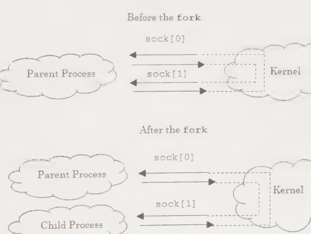

**图 10.5** 进程分叉前后的 socketpair。

## 10-3 练习

当你调整程序 10.1 中子/父进程的`sleep`时间时会发生什么？无论时间差如何，父/子进程都会互相等待吗？为什么？为什么不会？现在编辑`p10.1.cxx`文件，将两个`sleep`时间都更改为 3 秒。将源文件重新编译为`p10.1`。阅读`netstat`的手册页。执行以下命令序列：

```
linux$ p10.1 & netstat -p -x | grep p10.1
```

`netstat`命令返回什么信息？一旦`p10.1`程序完成，仅使用`-p -x`选项重新发出`netstat`命令。这告诉你系统在做什么？

## 10.4 套接字：面向连接的范式

当使用套接字进行进程间通信时，我们可以将套接字类型指定为面向连接的（类型`SOCK_STREAM`）或无连接的（类型`SOCK_DGRAM`）。面向连接的通信必须发生的事件序列如图 10.6 所示。在这种设置中，发起连接的进程是客户端进程，接收连接的进程是服务器。

如图所示，客户端和服务器进程都使用`socket`调用创建一个新的套接字实例。该套接字将充当数据交换的排队点。`socket`系统调用的摘要如表 10.4 所示。

`socket`系统调用接受三个参数。这些参数与`socketpair`调用的参数相似，但没有第四个整数数组/套接字对引用。简而言之，`socket`调用接受一个整数值（`<sys/sockets.h>`文件中定义的常量之一）作为第一个参数，该值表示协议族。目前，表 10.5 中显示的协议族受到支持。

第二个参数`type`表示套接字类型（例如`SOCK_STREAM`或`SOCK_DGRAM`）。第三个参数`protocol`是在指定的地址/协议族中使用的特定协议。与`socketpair`调用一样，我们通常会将此值设置为 0，以让系统根据协议族选择协议。如果`socket`调用成功，它将返回一个可用于引用套接字描述符的整数值。如果调用失败，它返回 -1 并设置`errno`。`errno`的值及其错误消息的解释如表 10.6 所示。

**表 10.4** socket 系统调用摘要。

| 包含文件 | `<sys/types.h><br><sys/socket.h>` | 手册章节 | 2 |
| :--- | :--- | :--- | :--- |
| 摘要 | `int socket( int domain, int type, int protocol );` | | |
| 返回值 | 成功：返回 0 和一个打开的套接字描述符。 | 失败：返回 -1 | 设置`errno`：是 |

**表 10.5** 支持的协议族。

| 常量 | 协议族 |
| :--- | :--- |
| PF_APPLETALK | Appletalk |
| PF_ATMPVC | Access to raw ATM PVCs |
| PF_AX25 | Amateur radio AX.25 protocol |
| PF_INET | IPv4 Internet protocols |
| PF_INET6 | IPv6 Internet protocols |
| PF_IPX | IPX - Novell protocols |
| PF_NETLINK | Kernel user interface device |
| PF_PACKET | Low-level packet interface |
| PF_UNIX, PF_LOCAL | Local communication |
| PF_X25 | ITU-T X.25 / ISO-8208 protocol x25(7) |

在某些（但不是所有）开发环境中，当在程序中进行`socket`调用时，必须在编译时使用`-lsocket`选项专门链接套接字库。

**表 10.6** socket 错误消息。

| # | 常量 | perror 消息 | 解释 |
| :--- | :--- | :--- | :--- |
| 12 | ENOMEM | Cannot allocate memory | 创建套接字时，内存不足。 |
| 13 | EACCES | Permission denied | 无法创建指定类型/协议的套接字。 |
| 22 | EINVAL | Invalid argument | 未知协议或协议族不可用。 |
| 23 | ENFILE | Too many open files in system | 系统内存（内核）不足以分配套接字。 |
| 24 | EMFILE | Too many open files | 此进程已达到打开文件描述符的限制。 |
| 93 | EPROTONOSUPPORT | Protocol not supported | 请求的协议在此系统或在此域中不受支持。 |
| 105 | ENOBUFS | No buffer space available | 在资源释放之前无法创建套接字。 |

## 10.4 套接字：面向连接的范式

### 10-4 练习

阅读关于`netstat`的手册页。执行以下命令来确定你系统上所有正在监听的套接字及其关联的端口号：

```
linux$ netstat -l -n      # alt_cmd$  netstat -a -n | grep LISTEN
```

有多少个套接字正在监听连接？如果系统正在监听端口 80，请执行以下命令序列（注意反引号）：

```
linux$ telnet 'hostname' 80
```

当系统响应时，输入`GET /`。会发生什么？屏幕上返回了什么信息？`/`代表什么？

最初，当套接字被创建时，它是未绑定的（即，没有名称或地址/端口号对与该套接字关联）。如果创建套接字的进程要充当服务器，则必须绑定该套接字。这在概念上类似于为已安装的电话分配电话号码，或为邮寄地址分配街道名称和门牌号。`bind`系统调用用于将名称或地址/端口对与套接字关联。如果套接字要在 UNIX 域中使用，必须提供文件名，并且我们说地址驻留在本地命名空间中。在 Internet 域中，必须分配一个地址/端口对——地址驻留在 Internet 命名空间中。表 10.7 提供了`bind`系统调用的摘要。

### 表 10.7 bind 系统调用摘要

| 头文件 | `<sys/types.h> <sys/socket.h>` | 手册章节 | 2 |
| --- | --- | --- | --- |
| 摘要 | `int bind(int sockfd, struct sockaddr *my_addr, socklen_t addrlen);` | | |
| | 成功 | 失败 | 设置`errno` |
| 返回值 | 0 | -1 | 是 |

`bind`的第一个参数是从先前成功的`socket`调用返回的整数值。第二个参数是对`sockaddr`结构的引用，这是一个真正的亮点。简而言之，`my_addr`参数引用一个类型如下的通用地址结构：

```
/* 描述通用套接字地址的结构。 */
struct sockaddr {
    __SOCKADDR_COMMON (sa_); /* 公共数据：地址族和长度。 */
    char sa_data[14]; /* 地址数据。 */
};
```

我们将以此结构定义作为地址引用的起点。稍后我们将回到这个结构的使用。对于那些喜欢语法挑战的人，关于`sockaddr`结构定义以及`SOCKADDR_COMMON`宏定义的更详细解释，可以在头文件`<sys/socket.h>`的前 100 行左右找到。

同样，`bind`可用于 UNIX 和 Internet 域套接字。对于 UNIX 域套接字，必须将文件的引用绑定到套接字。UNIX 套接字域地址在头文件`<sys/un.h>`<sup>8</sup>中定义为

```
#define UNIX_PATH_MAX 108
struct sockaddr_un {
    sa_family_t sun_family; /* AF_UNIX */
    char sun_path[UNIX_PATH_MAX]; /* 路径名 */
};
```

使用此结构时，`sockaddr_un.sun_family`成员通常被赋值为定义的常量`AF_UNIX`，以指示正在使用 UNIX 寻址。第二个成员`sun_path`是要绑定到套接字的文件的路径（绝对或相对路径）。在 UNIX 域中，`bind`为套接字创建一个文件条目。如果该文件已经存在，则会发生错误。当使用`ls`命令以长格式列出目录时，绑定到套接字的文件的文件类型将显示字母`p`或`s`，表示它是管道或套接字。文件中的字节数将列为 0。`sun_path`成员的最大长度（包括 NULL 终止符）为 108 个字符。

如果套接字要在 Internet 域中使用，则使用文件`<netinet/in.h>`中的寻址结构。与 UNIX 域套接字一样，如果我们使用的是 Internet 域套接字，则该文件必须在程序的包含文件列表中。此地址结构定义为

```
struct sockaddr_in {
    sa_family_t    sin_family;     /* 地址族：AF_INET */
    u_int16_t      sin_port;       /* 网络字节序的 16 位端口号 */
    struct in_addr sin_addr;       /* Internet 地址结构 */
};

struct in_addr {
    u_int32_t      s_addr;         /* 网络字节序的 32 位地址 */
};
```

请记住，在 Internet 命名空间中，我们必须将套接字映射到 Internet 地址/端口号对。为此，我们使用上面显示的`sockaddr_in`结构。该结构的第一个成员与`sockaddr_un`结构一样，是一个指示地址族的整数值。在此场景中，该成员被赋值为`AF_INET`。第二个成员`sin_port`指示服务的端口号。端口号是一个 16 位值，充当指定 Internet 地址的偏移量⁰，并引用通信的实际端点。可以通过查看`/etc/services`文件的内容来获取已分配端口号的列表。图 10.7 显示了本地`/etc/services`文件的部分摘录。

### **图 10.7** 本地`/etc/services`文件的部分内容。

```
linux$ cat /etc/services

# /etc/services:
# $Id: services,v 1.17 2001/02/28 20:11:31 notting Exp $
#
# 网络服务，Internet 风格
...

# 每行描述一个服务，格式如下：
#
# 服务名称  端口/协议  [别名 ...]  [# 注释]
tcpmux          1/tcp                          # TCP 端口服务多路复用器
tcpmux          1/udp                          # TCP 端口服务多路复用器
rje             5/tcp                          # 远程作业提交
rje             5/udp                          # 远程作业提交
echo            7/tcp
echo            7/udp
discard         9/tcp          sink null
discard         9/udp          sink null
systat          11/tcp         users
systat          11/udp         users
...
```

⁰沿用我们关于面向连接协议的电话系统类比，这类似于给定电话号码的分机号。

## 10 • 套接字


如图所示，每个服务都有一个名称，例如`echo`，与特定端口（例如 7）关联，并使用特定协议（例如`tcp`）。值小于 1024 的端口是保留的（只能由有效用户 ID 为 root 的进程使用）。许多这些低编号端口被认为是**众所周知的**：即它们具有一致的值，并且总是与使用相同协议的相同类型的服务相关联。一个端口可以与多个协议关联。

`sockaddr_in`结构的第三个成员`sin_addr`是对`in_addr`结构的引用。这个结构只有一个成员，它保存了实际的 32 位主机 Internet 地址值（已针对字节顺序进行了调整；即，小端序与大端序）。我们将在示例部分介绍如何填充`sockaddr_in`结构的细节。

我们现在可以回到*通用的*`sockaddr`结构，它是`bind`调用的第二个参数。通用`sockaddr`结构有两个成员。第一个成员，宏`__SOCKADDR_COMMON (sa_)`，用于指示地址族信息。第二个成员`sa_data`是对实际地址的引用。为了使`bind`工作，我们首先用正确的值填充相应的寻址结构（`sockaddr_un`或`sockaddr_in`）。然后，当将该结构作为参数传递给`bind`时，将引用强制转换为`(struct sockaddr *)`，以让`bind`相信我们传递的是正确结构类型的引用。`bind`的第三个参数提供了地址结构的大小，这有助于解决诸如传递一个带有 108 字节文件/路径引用的 UNIX 域地址等问题。同样，如何计算地址结构大小的细节将在示例部分介绍。

如果`bind`成功，它返回 0；否则，它返回 -1 并设置`errno`的值。表 10.8 总结了在本地（UNIX）和 Internet 命名空间中`bind`失败相关的错误。

### 表 10.8 bind 错误消息

| # | 常量 | perror 消息 | 解释 |
|---|------|------------|------|
| 2 | ENOENT | 没有那个文件或目录 | 文件名条目的路径组件不存在。 |
| 9 | EBADF | 错误的文件描述符 | `sockfd`引用无效。 |
| 12 | ENOMEM | 无法分配内存 | 内存不足。 |
| 13 | EACCES | 权限被拒绝 | • 无法创建指定类型/协议的套接字。<br>• 对`name`指定的路径的搜索访问被拒绝。 |

## 10.4 套接字：面向连接的范式

表 10.8（续）

| # | 常量 | perror 消息 | 说明 |
|---|------|------------|------|
| 14 | EFAULT | 地址错误 | `my_addr`引用的地址超出了用户空间范围。 |
| 20 | ENOTDIR | 不是目录 | `my_addr`路径的某部分不是目录。 |
| 22 | EINVAL | 无效参数 | • `addrlen`无效。<br>• `sockfd`已绑定到一个地址。 |
| 30 | EROFS | 只读文件系统 | 文件将位于一个只读文件系统上。 |
| 36 | ENAMETOOLONG | 文件名太长 | `my_addr`名称太长。 |
| 40 | ELOOP | 符号链接层级过多 | `my_addr`中包含过多的符号链接。 |
| 63 | ENOSR | 流资源耗尽 | 指定操作的 STREAMS 资源不足。 |
| 88 | ENOTSOCK | 对非套接字执行套接字操作 | `sockfd`是一个文件描述符，而不是套接字描述符。 |
| 98 | EADDRINUSE | 地址已被使用 | 指定的地址已在使用中。 |
| 99 | EADDRNOTAVAIL | 无法分配请求的地址 | 指定的地址在本地系统上不可用。 |

虽然我们主要关注的是互联网域协议，但 UNIX 域套接字也可以被绑定。在 UNIX 域中，会创建一个实际的文件条目，当用户用完套接字后应将其移除（取消链接）。

继续讨论面向连接设置中的服务器进程，下一个发出的系统调用是`listen`。此调用仅适用于类型为`SOCK_STREAM`或`SOCK_SEQPACKET`的套接字，它创建一个用于传入连接请求的队列。如果队列已满且协议不支持重传，生成请求的客户端进程将从服务器收到`ECONNREFUSED`错误。如果协议支持重传，则该请求会被忽略，以便后续重试能够成功。`listen`的摘要在表 10.9 中给出。

表 10.9 `listen`系统调用摘要

| 包含文件 | `<sys/types.h>` `<br><sys/socket.h>` | 手册章节 | 2 |
|---------|-----------------------------------|---------|---|
| 摘要 | `int listen(int s, int backlog);` | | |
| 返回值 | 成功：0 | 失败：-1 | 设置 errno：是 |

`listen`系统调用的第一个参数是有效的整数套接字描述符。第二个参数`backlog`表示队列的最大长度。最初，基于 BSD 的文档指出`backlog`的值没有限制。然而，在许多衍生自 BSD 的 UNIX 版本中，任何大于五的`backlog`值都被限制为五。从 Linux 2.2 开始，`backlog`的值是指完全建立好等待接受的套接字与未完成连接请求的区分。如有需要，可以使用`/sbin/sysctl`命令通过`tcp_max_syn_backlog`变量设置未完成套接字请求的最大队列大小。

如果`listen`调用失败，它将设置`errno`并返回表 10.10 中显示的值之一。

表 10.10 `listen`错误消息

| # | 常量 | `perror`消息 | 说明 |
|---|------|------------|------|
| 9 | EBADF | 文件描述符错误 | `s`引用无效。 |
| 88 | ENOTSOCK | 对非套接字执行套接字操作 | `s`是一个文件描述符，而不是套接字描述符。 |
| 95 | EOPNOTSUPP | 操作不支持 | 套接字类型（例如`SOCK_DGRAM`）不支持`listen`操作。 |

此时，服务器进程已准备好接受来自客户端进程的连接（该客户端进程已建立了一个基于连接的套接字）。默认情况下，如果没有待处理的连接请求，`accept`调用将阻塞。`accept`系统调用的摘要在表 10.11 中给出。

第一个参数是一个套接字描述符，它之前已通过`bind`系统调用绑定到一个地址，并且当前正在`listening`以等待连接。如果有一个或多个客户端连接待处理，`accept`调用将返回队列中的第一个连接。`accept`的第二个参数`*addr`是一个指向通用`sockaddr`结构体的指针。一旦与客户端的连接建立，该结构体就会返回给服务器。其实际格式与`bind`系统调用一样，取决于通信发生的域。`addr`指针引用的结构体包含客户端的地址信息。第三个参数`*addrlen`最初包含一个对前一个`sockaddr`结构体长度（以字节为单位）的引用。当调用返回时，此参数引用返回地址的大小（以字节为单位）。

表 10.11 `accept`系统调用摘要

| 包含文件 | `<sys/types.h>` `<br> <sys/socket.h>` | 手册章节 | 2 |
|---------|-----------------------------------|---------|---|
| 摘要 | `int accept(int s, struct sockaddr *addr, socklen_t *addrlen);` | | |
| 返回值 | 成功 | 失败 | 设置 errno |
| | 新套接字描述符的正整数值 | -1 | 是 |

如果`accept`成功，它将返回一个新的已连接套接字描述符，其属性类似于`accept`系统调用第一个参数指定的套接字。这个新套接字可用于读写。原始套接字保持原样，并且在某些设置中，仍然继续`accept`额外的连接。如果`accept`调用失败，它将返回 -1 并将`errno`的值设置为表 10.12 中显示的值之一。

表 10.12 `accept`错误消息

| # | 常量 | perror 消息 | 说明 |
|---|------|------------|------|
| 1 | EPERM | 操作不允许 | 防火墙软件禁止连接。 |
| 4 | EINTR | 中断的系统调用 | 在接受过程中收到了信号。 |
| 9 | EBADF | 文件描述符错误 | 套接字引用无效。 |
| 11 | EWOULDBLOCK, EAGAIN | 资源暂时不可用 | 套接字被设置为非阻塞，且没有待处理的连接。 |
| 12 | ENOMEM | 无法分配内存 | 内存不足，无法执行操作。 |
| 14 | EFAULT | 地址错误 | addr 的引用不可写。 |
| 19 | ENODEV | 没有此设备 | 在 netconfig 文件中找不到指定的协议族/类型。 |
| 22 | EINVAL | 无效参数 | 传递给`accept`调用的参数无效。 |
| 24 | EMFILE | 打开的文件过多 | 进程已超出最大打开文件数。 |
| 63 | ENOSR | 流资源耗尽 | 指定操作的 STREAMS 资源不足。 |
| 71 | EPROTO | 协议错误 | 发生协议错误。 |
| 85 | ERESTART | 中断的系统调用应重启 | `accept`调用必须重启。 |
| 88 | ENOTSOCK | 对非套接字执行套接字操作 | 该套接字是一个文件描述符，而不是套接字描述符。 |
| 93 | EPROTONOSUPPORT | 协议不支持 | 指定了无效的协议。 |
| 94 | ESOCKTNOSUPPORT | 套接字类型不支持 | 指定了无效的套接字类型。 |
| 95 | EOPNOTSUPP | 操作不支持 | s 不是 SOCK_STREAM 类型。 |
| 103 | ECONNABORTED | 软件导致连接中止 | 连接已中止。 |
| 105 | ENOBUFS | 没有可用缓冲区空间 | 内存不足，无法执行操作。 |
| 110 | ETIMEDOUT | 连接超时 | 无法在指定的时间限制内建立连接。 |

有趣的是，Linux 手册页指出，当调用时，`accept`也会将待处理的网络错误传递下去，就好像它们来自`accept`一样。这种行为与没有此特殊性的直接 BSD 套接字实现不同。

在面向连接的设置中，客户端进程使用`connect`系统调用发起与服务器进程的连接。`connect`调用的摘要如表 10.13 所示。

第一个参数是有效的整数套接字描述符。第二个参数`*serv_addr`的处理方式取决于所引用的套接字是面向连接的（类型`SOCK_STREAM`）还是无连接的（类型`SOCK_DGRAM`）。在面向连接的环境中，`*serv_addr`引用客户端想要与之通信的套接字地址（即，服务器进程的地址）。对于无连接套接字，`*serv_addr`引用数据报将发送到的地址。通常，流套接字只连接一次，而数据报套接字可以连接多次。此外，如果协议域是 UNIX，`*serv_addr`将引用一个路径/文件名，而在互联网域（即`AF_INET`）中，`*serv_addr`将引用一个互联网地址/端口号对。无论哪种情况，该引用都应转换为通用的`sockaddr`结构体引用。完全糊涂了，对吧？希望带有客户端-服务器示例的章节将有助于阐明`connect`系统调用的细节。第三个参数`addrlen`传递`*serv_addr`引用的大小。

由于`connect`调用有多种失败方式，`connect`可能产生的错误列表相当广泛。`connect`错误列表见表 10.14。

表 10.14 `connect`错误消息

| # | 常量 | perror 消息 | 解释 |
|---|------|------------|------|
| 1 | EPERM | 操作不允许 | • 尝试在未设置广播标志的情况下广播。<br>• 请求因防火墙而失败。 |
| 4 | EINTR | 系统调用被中断 | 在`connect`过程中接收到信号。 |
| 9 | EBADF | 文件描述符错误 | `sockfd`引用无效。 |
| 11 | EAGAIN | 资源暂时不可用 | 没有更多空闲的本地端口。 |

**表 10.14**（续）

| # | 常量 | perror 消息 | 解释 |
|---|------|------------|------|
| 13 | EACCES | 权限被拒绝 | 对`*serv_addr`引用路径的部分搜索权限被拒绝。 |
| 14 | EFAULT | 地址错误 | `*serv_addr`引用的地址超出用户的地址空间。 |
| 22 | EINVAL | 无效参数 | `*serv_addr`引用的地址的`namelength`不正确。 |
| 63 | ENOSR | STREAMS 资源不足 | 指定操作的 STREAMS 资源不足。 |
| 88 | ENOTSOCK | 对非套接字进行套接字操作 | `sockfd`是文件描述符，而非套接字描述符。 |
| 91 | EPROTOTYPE | 协议类型与套接字不符 | 协议冲突，`socketfd`与`*serv_addr`引用冲突。 |
| 97 | EAFNOSUPPORT | 协议族不支持该地址族 | `*serv_addr`引用的地址无法与此套接字一起使用。 |
| 98 | EADDRINUSE | 地址已在使用中 | `*serv_addr`引用的本地地址已在使用中。 |
| 99 | EADDRNOTAVAIL | 无法分配请求的地址 | `*serv_addr`引用的地址在远程系统上不可用。 |
| 101 | ENETUNREACH | 网络不可达 | 无法到达指定系统。 |
| 106 | EISCONN | 传输端点已连接 | `sockfd`已连接。 |
| 110 | ETIMEDOUT | 连接超时 | 无法在时限内建立连接。 |
| 111 | ECONNREFUSED | 连接被拒绝 | 连接尝试被拒绝；套接字已连接。 |
| 114 | EALREADY | 操作已在进行中 | 套接字为非阻塞模式，且先前的连接尚未完成。 |
| 115 | EINPROGRESS | 操作正在进行中 | 套接字设置为非阻塞模式，连接无法立即建立。 |

一旦客户端和服务器之间的连接建立，它们可以使用标准 I/O 调用（如`read`和`write`），或第 10.5 节中介绍的众多专用发送/接收类型调用之一进行通信。当进程完成对套接字描述符的使用后，它们会发出标准的`close`调用，如果连接的协议（如 TCP）指定可靠传输，则默认情况下会尝试发送剩余的排队数据。

#### 10.4.1 UNIX 域流套接字示例

在以下示例（程序 10.2 和 10.3）中，我们创建一个服务器进程和一个客户端进程，它们各自使用一个 UNIX 域、面向连接的（`SOCK_STREAM`）套接字进行通信。服务器将创建套接字，将其绑定到一个地址，生成一个等待队列，接受一个连接，并在数据可用时从套接字`read`数据并将结果显示到屏幕上。客户端进程将创建一个套接字，连接到服务器，并从用户那里获取 10 个表达式，然后将每个表达式写入套接字。服务器读取传递的数据（表达式），并通过管道将其传递给`bc`工具进行求值来处理表达式。`bc`工具的输出由服务器读取，并通过套接字发回给客户端进程进行显示。

### 程序 10.2 UNIX 域面向连接的服务器


文件：`svr.c`

```
/*
   服务器 - UNIX 域，面向连接
*/
#define _GNU_SOURCE
#include <iostream>
#include <cstdio>
#include <unistd.h>
#include <sys/types.h>
#include <sys/socket.h>
#include <sys/un.h>    // UNIX 协议
using namespace std;

const char *NAME = "/my_sock";
const int MAX = 1024;
void clean_up( int, const char * ); // 关闭套接字并移除
int main( ) {
    socklen_t  clnt_len;   // 客户端地址长度
    int        orig_sock,  // 原始套接字描述符
               new_sock;   // 来自连接的新套接字描述符
    static struct sockaddr_un // 将使用的 UNIX 地址
    clnt_adr,               // 客户端地址
    serv_adr;               // 服务器地址
    static char        clnt_buf[MAX],          // 来自客户端的消息
                   pipe_buf[MAX];          // bc 命令的输出
    FILE *fin;               // 用于管道 I/O 的文件
                                          // 生成套接字
    if ((orig_sock = socket(PF_UNIX, SOCK_STREAM, 0)) < 0) {
        perror("生成错误");
        return 1;
    }
                                          // 赋值地址信息
    serv_adr.sun_family = AF_UNIX;
    strcpy(serv_adr.sun_path, NAME);
    unlink(NAME);                             // 如果存在，移除旧副本
                                          // 绑定地址
    if (bind( orig_sock, (struct sockaddr *) &serv_adr,
            sizeof(serv_adr.sun_family)+strlen(serv_adr.sun_path)) < 0) {
        perror("绑定错误");
        clean_up(orig_sock, NAME);
        return 2;
    }
    listen(orig_sock, 1);                     // 监听连接
    clnt_len = sizeof(clnt_adr);              // 接受连接
    if ((new_sock = accept( orig_sock, (struct sockaddr *) &clnt_adr,
                                            &clnt_len)) < 0) {
        perror("接受错误");
        clean_up(orig_sock, NAME);
        return 3;
    }
                                          // 处理 10 个请求
    for (int i = 0; i < 10; i++) {
        memset(clnt_buf, 0x0, MAX);           // 清空客户端缓冲区
        read(new_sock, clnt_buf, sizeof(clnt_buf));
                                          // 为 bc 构建命令
        memset(pipe_buf, 0x0, MAX);
        sprintf(pipe_buf, "echo \'%s\' | bc\n", clnt_buf);
        fin = popen( pipe_buf, "r" );
        memset(pipe_buf, 0x0, MAX);
        read(fileno(fin), pipe_buf, MAX);
        cout << clnt_buf << " = " << pipe_buf << endl;
    }
    close(new_sock);
    clean_up(orig_sock, NAME);
    return 0;
}
void
clean_up( int sd, const char *the_file ){
    close( sd );                          // 关闭套接字
    unlink( the_file );                   // 移除它
}
```

> 当接受连接时，会生成一个新的套接字——其形式与原始套接字类似。

注意服务器程序（程序`p10.2.cxx`，第 36 和 37 行）中对`bind`的调用。如代码所示，第三个参数（即地址结构的长度）是一个表达式。该表达式通过将地址结构体的`sun_family`成员的大小与`sun_path`成员的字符串长度相加来计算总大小。如果我们只是对整个地址结构应用`sizeof`运算符，在大多数平台上返回的值将是 110（假设`sun_family`成员占 2 字节，`sun_path`成员占 108 字节）。

客户端程序如程序 10.3 所示。

### 程序 10.3 UNIX 域面向连接的客户端

文件：`p10.3.cxx`

```
/*
 * 客户端 - UNIX 域，面向连接
 */
#define _GNU_SOURCE
#include <iostream>
#include <cstdio>
#include <unistd.h>
#include <sys/types.h>
#include <sys/socket.h>
#include <sys/un.h>           // UNIX 协议
using namespace std;

const char *NAME = "./my_sock";
const int  MAX = 1024;
int
main(  ) {
  int            orig_sock;  // 原始套接字描述符
  struct sockaddr_un serv_adr; // 服务器进程的 UNIX 地址
  static char    buf[MAX];   // 消息缓冲区
  // 生成套接字
  if ((orig_sock = socket(PF_UNIX, SOCK_STREAM, 0)) < 0) {
    perror("生成错误");
    return 1;
  }
  serv_adr.sun_family = AF_UNIX;
  strcpy(serv_adr.sun_path, NAME);
  // 连接
  if (connect( orig_sock, (struct sockaddr *) &serv_adr,
       sizeof(serv_adr.sun_family)+strlen(serv_adr.sun_path)) < 0) {
    perror("连接错误");
    return 2;
  }

  // 提示输入表达式
  cout << "输入一个表达式并按回车键进行处理。" << endl;
```

```
for (int i = 0; i < 10; i++) {
    memset(buf, 0x0, MAX);
    cin.getline(buf, MAX-1, '\n');
    write(orig_sock, buf, sizeof(buf));
}
close(orig_sock);
return 0;
}
```

我们通过将服务器进程置于后台来运行客户端-服务器对。然后，我们在前台运行客户端进程。编译序列和客户端-服务器程序生成的一些示例输出如图10.8所示。

## 图10.8 UNIX域客户端-服务器程序编译与运行

```
linux$ g++ p10.2.cxx -o server

linux$ g++ p10.3.cxx -o client

linux$ ./server &

[1] 4739

linux$ ls -l my_sock

srwxr-xr-x 1 gray faculty 0 May 9 15:25 my_sock

linux$ ./client

Enter an expression and press enter to process.

78 * 92

78 * 92 = 7176

89 % 6 + 34 - 2 * -9

89 % 6 + 34 - 2 * -9 57

1 && 0 || 1

1 && 0 1 1

!( 1 && 1 || 0 )

!( 1 && 1 || 0 ) = 0

. . .
```

在命令行上，也可以通过使用`netstat`命令来确认套接字的存在。此命令具有众多选项，可用于显示基于套接字的通信信息。图10.9展示了将UNIX域服务器程序置于后台后，本地系统上`netstat`的部分输出。

## 10.4 套接字：面向连接的范式

## 图10.9 `netstat` 命令的示例输出

```
linux$ netstat -x -a

Active UNIX domain sockets (servers and established)

Proto RefCnt Flags Type State I-Node Path

unix 13 [ ] DGRAM 1384 /dev/log

unix 2 [ ACC ] STREAM LISTENING 1681 /var/lib/mysql/mysql.sock

unix 2 [ ACC ] STREAM LISTENING 2202 /tmp/.font-unix/fs7100

unix 2 [ ACC ] STREAM LISTENING 5914 /opt/ARCserve/data/ds_callback

unix 2 [ ACC ] STREAM LISTENING 65439 ./my_sock
```

### 10-5 练习

如果我们把服务器进程放在后台，并在同一台主机上打开，比如，三个窗口，然后尝试运行多个客户端进程，我们会发现一个客户端可以正常工作，但其他客户端则不能。请重写服务器程序 (`p10.2.cxx`)，使其能够正确接受并处理多个客户端连接（每个连接在各自的窗口中）。

> 提示：服务器是否应该派生一个子进程来处理每个连接？

#### 10.4.2 一个互联网域流套接字示例

在互联网域中，进程必须拥有地址和端口信息才能进行通信。一个应用程序可能知道它想要通信的主机名称（例如`linux`, `kahuna`, 或`morpheus`），但缺乏关于该主机的完全限定名、互联网地址、提供的服务（在哪些端口上）以及其他信息的具体细节。有许多网络信息调用可用于返回这些信息。

`gethostbyname`调用在传入主机名称时，将返回有关特定主机的信息。表10.15总结了`gethostbyname`调用。

`gethostbyname`调用接受一个包含主机名称的单个字符串引用。该调用查询本地网络数据库以获取有关指定主机的信息。如果找到主机名，该调用将返回一个指向`hostent`结构的引用。`hostent`结构在包含文件`<netdb.h>`中定义如下：

```
struct hostent {

    char *h_name;            /* Official name of host. */

    char **h_aliases;        /* Alias list. */

    int h_addrtype;          /* Host address type. */

    int h_length;            /* Length of address. */

    char **h_addr_list;      /* List of addresses from name server. */

#define h_addr h_addr_list[0] /* Address, for backward compatibility. */

};
```

如果未找到主机名，`gethostbyname`调用将返回`NULL`。如果调用遇到错误情况，它会设置一个名为`h_errno`（而非`errno`）的全局变量来指示错误。`h_errno`可以取的值及其关联的定义常量（在包含文件`<netdb.h>`中）如表10.16所示。可以调用一个名为`herror`的过时错误消息函数（其精神类似于`perror`）来生成错误消息。

> 10 信息可能来自`/etc/nsswitch.conf`文件中指定的服务源中的任何一个（详情请参见手册页第5节中的`nsswitch.conf`）。

## 表10.15 `gethostbyname` 库函数摘要

| Include File(s) | `#include <netdb.h>` `#include <sys/socket.h>` `extern int h_errno;` | Manual Section | 3 |
| --- | --- | --- | --- |
| Summary | `struct hostent *gethostbyname(const char *name);` | | |
| Return | Success | Failure | Sets errno |
| | Reference to a hostent structure | NULL | NO, sets h_errno |

## 表10.16 `gethostbyname` 错误消息

| # | Constant | Explanation |
| --- | --- | --- |
| 0 | NETDB_SUCCESS | 无问题。 |
| 1 | HOST_NOT_FOUND | 未找到权威应答/无此主机。 |
| 2 | TRY_AGAIN | 未找到非权威主机或 SERVERFAIL。 |
| 3 | NO_RECOVERY | 不可恢复的错误。 |
| 4 | NO_DATA | 有效的名称但没有所请求类型的数据记录。 |

在某些开发环境中，`gethostbyname`网络调用的位于`libnsl.a`归档中。在这些设置中，使用此调用时，必须在编译行中添加开关`-lnsl`。程序10.4使用了`gethostbyname`调用来获取有关主机的信息。

## 程序10.4 使用`gethostbyname`获取主机信息

文件：`p10.4.cxx`

```
/*

    Checking host entries

 */

#include <iostream>

#include <cstdio>

#include <netdb.h>

#include <sys/socket.h>

#include <netinet/in.h>      // for inet_ntoa

#include <arpa/inet.h>

#include <string.h>           // for memcpy

extern int h_errno;

using namespace std;

int main(  ) {

    struct hostent *host;

    static char who[60];

    cout << "Enter host name to look up: ";

    cin  >> who;

    host = gethostbyname( who );

    if ( host != (struct hostent *) NULL ) {

        cout << "Here is what I found about " << who << endl;

        cout << "Official name : " <<  host->h_name  << endl;

        cout << "Aliases       : ";

        while ( *host->h_aliases ) {

            cout << *host->h_aliases << " ";

            ++host->h_aliases;

        }

        cout << endl;

        cout << "Address type  : " << host->h_addrtype << endl;

        cout << "Address length: " << host->h_length   << endl;

        cout << "Address list  : ";

        struct in_addr in;

        while ( *host->h_addr_list ) {

            memcpy( &in.s_addr, *host->h_addr_list, sizeof (in.s_addr));

            cout << "[" << *host->h_addr_list << "] = "
```


进入`/path/to/xxx`目录，找到`xxx.json`。

在表达式`cvar = avar + bvar`中，加法运算符（`+`）将`avar`与`bvar`相加，得到它们的和`cvar`

在`List.of(arg0, arg1, arg2)`中，`List`接口的工厂方法`of()`接受一系列的元素，返回包含它们的只读列表。

之后我们这样调用`cmd`命令：`cmd arg0 arg1 arg2`。

```
if (condVar > someVal) {console.log("xxx")}
```

<< inet_ntoa(in) << " ";

++host->h_addr_list;

}

cout << endl;

} else

herror(who);

return 0;

}

```
在程序10.4中，`gethostbyname`调用用于获取有关主机的网络数据库信息。当程序运行时，系统会提示用户输入主机名称（如代码所示，名称最多59个字符）。如果`gethostbyname`调用成功，将显示主机的正式数据库条目名称。随后是别名（替代名称）列表。接下来显示地址类型和长度。在互联网域设置中，我们期望这些值分别是2（`AF_INET`的值）和4（存储一个整数值所需的字节数）。程序的最后部分显示主机的互联网地址。它使用了一个额外的互联网地址操作调用`inet_ntoa`，将`h_addr_list`成员引用的字符编码网络地址转换为更标准的点分十进制表示法。`inet_ntoa`的手册页很好地解释了如何转换该调用的字符串参数。程序10.4的一次运行如图10.10所示。

## 图10.10 程序10.4的一次运行

```
linux$ p10.4

Enter host name to look up: www-cs

Here is what I found about www-cs

Official name : zeus.hartford.edu

Aliases       : www-cs.hartford.edu

Address type  : 2

Address length: 4

Address list  : [14] = 137.49.52.2
```

显示了经过和未经`inet_ntoa`转换的地址列表。

### 10-6 练习

存在一个类似于`gethostbyname`的调用，当传入主机的点分十进制互联网地址时，它会返回主机条目信息。请基于程序10.4编写一个程序，请求输入一个主机的互联网地址。然后使用`gethostbyaddr`调用来显示该主机的信息。

除了知道服务器的32位互联网地址外，客户端还必须能够引用服务器上给定端口的特定服务。如前所述，有一些基于TCP和UDP的知名端口，它们与标准服务（如`echo`）相关联。端口号小于1024的端口保留给有效用户ID为root的进程使用。端口号1024及以上的端口被认为是**临时**端口，可以使用。

任何系统用户都可以使用。有些系统进一步将高端口范围细分为**注册端口**（1024–49151）和**动态端口**（49152及以上）。应用程序可以调用`getservbyname`函数（参见表10.17）来获取关于特定服务或端口的信息。

### 表10.17 getservbyname 库函数摘要

| 头文件 | `<netdb.h>` | 手册章节 | 3 |
|---|---|---|---|
| 摘要 | `struct servent *getservbyname(const char *name, const char *proto);` | | |
| 返回值 | **成功**：指向`servent`结构体的引用 | **失败**：`NULL` | **设置errno**： |

`getservbyname`调用传入主机名和协议（例如`tcp`）。如果成功，它返回一个指向`servent`结构体的引用。`servent`结构体在`<netdb.h>`中定义如下：

```
struct servent {
    char   *s_name;      /* official service name */
    char  **s_aliases;    /* alias list             */
    int     s_port;       /* port number            */
    char   *s_proto;      /* protocol to use        */
};
```

如果调用失败，它返回一个`NULL`值。程序10.5使用`getservbyname`库函数，为给定协议返回所选服务类型的信息。

## 程序 10.5 使用 getservbyname 获取主机上的服务信息

```
File : p10.5.cxx

/*
    检查主机的服务 -- 端口条目
*/
#include <iostream>
#include <cstdio>
#include <netdb.h>
using namespace std;
int
main( ) {
    struct servent *serv;
    static char protocol[10], service[10]; <--- 任意的缓冲区大小。
    cout << "Enter service to look up : ";
    cin  >> service;
    cout << "Enter protocol to look up: ";
    cin  >> protocol;
    serv = getservbyname( service, protocol );
    if ( serv != (struct servent *)NULL ) {
        cout << "Here is what I found " << endl;
        cout << "Official name  : " << serv->s_name << endl;
        cout << "Aliases        : ";
        while ( *serv->s_aliases ) {
            cout << *serv->s_aliases << " ";
            ++serv->s_aliases;
        }
        cout << endl;
        cout << "Port number    : " << ntohs(serv->s_port) << endl;
        cout << "Protocol Family: " << serv->s_proto << endl;
    } else
        cout << "Service " << service << " for protocol "
             << protocol << " not found." << endl;
    return 0;
}
```

在显示端口号之前，它被传递给`ntohs`函数。这是一组函数中的一个，用于确保在转换表示主机和网络地址的16位和32位整数值时保持字节顺序。`ntohs`的摘要如表10.18所示。

### 表10.18 ntohs 库函数摘要

| 头文件 | `<netinet/in.h>` | 手册章节 | 3 |
| :--- | :--- | :--- | :--- |
| 摘要 | `unsigned short int ntohs(unsigned short int netshort);` | | |
| 返回值 | **成功**：参数按网络字节顺序排列。 | **失败**： | **设置errno**： |

`ntohs`调用的逆操作是`htons`（注意字母`h`和`n`的切换）。字母`s`表示参数是一个`short`（16位）整数，返回值也是如此。还有两个类似的例程`ntohl`和`htonl`，它们接受并返回`long`（32位）整数。如果给定平台不需要字节顺序转换，这些调用将不执行任何操作（空操作）。

程序10.5的示例运行以及相应的`/etc/services`条目副本如图10.11所示。

### 图10.11 程序 10.5 的运行示例

```
linux$ p10.5
Enter service to look up : discard
Enter protocol to look up: tcp
Here is what I found
Official name : discard
Aliases       : sink null
Port number   : 9
Protocol Family: tcp
```

```
linux$ grep discard /etc/services
discard         9/tcp       sink null
discard         9/udp       sink null
```

验证信息。

## 10-7 练习

`getservbyname`的手册页包含一个名为`getservent`的网络函数的描述。`getservent`调用可用于枚举主机上的所有服务。编写一个程序，请求协议类型，并使用`getservent`网络调用显示主机上使用指定协议的所有服务。确保在发出`getservent`调用之前调用`setservent`。

我们现在拥有大多数编写使用Internet协议和面向连接套接字的客户端-服务器应用程序的基本工具。在下一个示例中，服务器进程从客户端进程接收消息。每接收到一条消息，服务器就更改消息的大小写并将其返回给客户端。当客户端发送一个在第一列有点号（`.`）的字符串时，通信终止。对于客户端发起的每个连接，服务器进程将`fork`一个子进程，该子进程并发运行并进行通信。

所有剩余的客户端-服务器类型套接字示例共享一个名为`local_sock.h`的公共头文件。`local_sock.h`文件的内容如图10.12所示。

### 图10.12 所有套接字示例程序的 local_sock.h 包含文件

```
File : local_sock.h
/*
   套接字程序的本地包含文件
*/
#ifndef LOCAL_SOCK_H
#define LOCAL_SOCK_H
#define _GNU_SOURCE
#include <iostream>
#include <sys/ioctl.h>
#include <cstdio>
#include <string.h>
#include <ctype.h>
#include <unistd.h>
#include <stdlib.h>
#include <signal.h>
#include <wait.h>
#include <sys/types.h>
#include <sys/socket.h>
#include <sys/un.h>
#include <netdb.h>
const  int  PORT=2002;            // 程序员选择的任意端口
static char buf[BUFSIZ];         // 用于消息的缓冲区
const  char *SERVER_FILE="server_socket";
#endif
using namespace std;
```

`local_sock.h`文件包含了服务器和客户端程序所需的包含文件的引用。定义的常量`PORT`是一个任意的整数端口号，我们将在此应用程序中使用它。端口的值应该是当前未使用且大于或等于1024的一个端口。另一种方法是在`/etc/services`文件中添加一个端口条目。如果端口在`/etc/services`文件中，那么端口信息就可以通过`getservbyname`网络调用动态获取。然而，大多数用户没有所需的`root`权限来添加条目。字符数组`buf`用作字符的临时存储位置。

首先介绍服务器程序，程序10.6。

## 程序 10.6 Internet 域、面向连接的服务器

```
File : p10.6.cxx
/*
    Internet 域，面向连接的 SERVER
*/
#include "local_sock.h"
void signal_catcher(int);
int
main( ) {
    int         orig_sock,    // 服务器中的原始套接字
                new_sock;     // 来自连接的新套接字
    socklen_t   clnt_len;     // 客户端地址的长度
    struct sockaddr_in           // 客户端和服务器的 Internet 地址
                clnt_adr, serv_adr;
    int         len, i;       // 杂项计数器等。
                                // 捕获子进程终止
    if (signal(SIGCHLD , signal_catcher) == SIG_ERR) {
        perror("SIGCHLD");
        return 1;
    }
    if ((orig_sock = socket(PF_INET, SOCK_STREAM, 0)) < 0) {
        perror("generate error");
        return 2;
    }
    memset( &serv_adr, 0, sizeof(serv_adr) );   // 清空结构体
    serv_adr.sin_family      = AF_INET;         // 设置地址类型
    serv_adr.sin_addr.s_addr = htonl(INADDR_ANY); // 任何接口
    serv_adr.sin_port        = htons(PORT);     // 使用我们指定的端口
                                                // BIND
    if (bind( orig_sock, (struct sockaddr *) &serv_adr,
              sizeof(serv_adr)) < 0){
        perror("bind error");
        close(orig_sock);
        return 3;
    }
    if (listen(orig_sock, 5) < 0 ) {           // LISTEN
        perror("listen error");
        close (orig_sock);
        return 4;
    }
    do {
        clnt_len = sizeof(clnt_adr);            // ACCEPT 一个连接
        if ((new_sock = accept( orig_sock, (struct sockaddr *) &clnt_adr,
                                &clnt_len)) < 0) {
            perror("accept error");
            close(orig_sock);
            return 5;
        }
        if ( fork( ) == 0 ) {                   // 生成一个 CHILD 子进程
            while ( (len=read(new_sock, buf, BUFSIZ)) > 0 ){
                for (i=0; i < len; ++i)         // 更改大小写
                    buf[i] = toupper(buf[i]);
                write(new_sock, buf, len);       // 写回套接字
                if ( buf[0] == '.' ) break;      // 我们完成了吗？
            }
            close(new_sock);                    // 在 CHILD 子进程中
            return 0;
        } else
            close(new_sock);                        // 在父进程中
    } while( true );                            // 永远循环
    return 0;
}
void
signal_catcher(int the_sig){
    signal(the_sig, signal_catcher);        // 重置
    wait(0);                                // 控制僵尸进程
}
```


服务器程序包含了一些在之前的示例中没有出现的新功能。服务器进程会 `fork` 出一个子进程来处理每个连接。当子进程结束时，操作系统会将子进程的退出状态返回给其父进程。通常情况下，父进程会等待子进程。由于可能存在多个连接（产生多个子进程），我们不希望父进程（服务器进程）因等待某个特定子进程而阻塞，而这正是 `wait` 的默认行为。为了解决这个问题，我们将 `SIGCHLD` 信号的接收（子进程已终止）与一个信号捕获例程关联起来（参见第 15 到 18 行）。当信号被捕获时，信号捕获例程会执行 `wait`。这种安排可以防止子进程在等待父进程获取其返回的状态信息时变成僵尸进程。此外，请注意第 23 行中使用了 `memset` 库函数，在为地址结构赋值之前先将其清零。<sup>11</sup> 在为服务器结构的地址成员赋值时，地址会先传递给 `htonl`。在这个示例中，服务器将定义在头文件 `<netinet/in.h>` 中的常量 `INADDR_ANY` 传递给 `htonl`。这个常量的值为 0，它向服务器表明任何套接字类型（`SOCK_STREAM`）的地址都是可接受的。客户端程序如程序 10.7 所示。

## 程序 10.7 互联网域、面向连接的客户端

```cpp
File : p10.7.cxx
/*
    互联网域、面向连接的客户端
*/
#include "local_sock.h"
int
main( int argc, char *argv[] ){
    int             orig_sock,            // 客户端中的原始套接字
```

<sup>11</sup> 另一种方法是使用 `bzero`（一个严格属于 BSD 的字符串函数）用 NULL 字节填充内存位置。但是，`bzero` 是一个已弃用的函数，如果需要考虑可移植性，就不应该使用它。如果使用 `bzero`，则应包含 `<string.h>` 文件。

412

## 10.4 套接字：面向连接的范式

```cpp
    len;                                          // 杂项计数器
    struct sockaddr_in
10      serv_adr;                                // 服务器的互联网地址
    struct hostent *host;                           // 主机（服务器）信息
    if ( argc != 2 ) {                              // 检查命令行中的主机名
        cerr << "usage: " << argv[0] << " server" << endl;
        return 1;
    }
    host = gethostbyname(argv[1]);                  // 获取主机（服务器）信息
    if ( host == (struct hostent *) NULL ) {
        perror("gethostbyname ");
20      return 2;
    }
    memset(&serv_adr, 0, sizeof( serv_adr));        // 清空结构体
    serv_adr.sin_family = AF_INET;                  // 设置地址类型
    memcpy(&serv_adr.sin_addr, host->h_addr, host->h_length);
    serv_adr.sin_port   = htons( PORT );            // 使用我们定义的端口
                                            // 套接字
    if ((orig_sock = socket(PF_INET, SOCK_STREAM, 0)) < 0) {
        perror("generate error");
        return 3;
    }
                                            // 连接
    if (connect( orig_sock,(struct sockaddr *) &serv_adr,
                sizeof(serv_adr)) < 0) {
        perror("connect error");
30      return 4;
    }
    do {                                            // 处理
        write(fileno(stdout),"> ", 3);
        if ((len=read(fileno(stdin), buf, BUFSIZ)) > 0) {
            write(orig_sock, buf, len);
            if ((len=read(orig_sock, buf, len)) > 0 )
40              write(fileno(stdout), buf, len);
        }
    } while( buf[0] != '.' );                       // 直到输入结束
    close(orig_sock);
    return 0;
}
```

客户端程序期望通过命令行传递服务器（主机）的名称。`gethostbyname` 网络调用用于获取特定的主机地址信息。返回的信息存储在 `hostent` 结构中，由 `*host` 引用。这些信息被部分用于填充存储在 `serv_adr` 结构中的服务器互联网地址信息。在为其成员赋值之前，`serv_adr` 结构使用 `memset` 库函数进行清零。地址族设置为 `AF_INET`。`memcpy` 库函数用于将获取的主机地址复制到服务器地址成员中。

使用 `memcpy` 函数是因为即使引用的位置包含非标准字符串（即包含 NULL 或不以 NULL 结尾），它也会复制指定数量的字节。端口号的赋值与服务器中的做法类似。

接下来，创建一个套接字并与服务器进程建立连接。然后客户端进程进入一个无限循环。在循环中，它通过 `>` 提示符请求用户输入。用户输入从映射到标准输入的设备（很可能是键盘）读取。然后将该输入写入套接字，服务器将读取并处理它（即将字符串转换为大写）。客户端进程通过从套接字描述符读取来获取处理后的字符串。该字符串的内容（存储在 `buf` 数组中）被写入映射到标准输出的设备（通常是屏幕）。客户端持续循环，直到输入以 "." 开头的字符串为止。

互联网域、面向连接的客户端-服务器应用程序的示例运行如图 10.13 所示。

## 图 10.13 互联网域、面向连接的客户端-服务器应用程序的运行示例

```
linux$ ps
  PID TTY          TIME CMD
21604 pts/0    00:00:00 csh
23026 pts/0    00:00:00 3

linux$ ./server &
[1] 23028

linux$ ./server &
bind error: Address already in use
[2] 23029
[2]  - Exit 2                        ./server

linux$ telnet medusa
. . .
medusa$ ./client linux

> this is a test of the system
THIS IS A TEST OF THE SYSTEM
> .
.
medusa$ ps
  PID TTY          TIME CMD
23095 pts/0    00:00:00 csh
23387 pts/0    00:00:00 ps
```

- 我们检查系统中是否存在服务器进程——没有。
- 将服务器放入后台运行。
- 服务器已经绑定了地址。
- 在另一台本地主机上运行终端会话。
- 运行客户端；传递运行服务器进程的主机名称（`linux`）。

在这个过程中，用户已登录到主机 `linux` 并执行了 `ps` 命令。命令的输出确认没有服务器进程存在。然后调用服务器进程并使用 `&` 显式地将其放入后台。当第二次调用服务器时，会显示错误消息 `bind error: Address already in use`。该消息由 `bind` 调用生成，因为之前调用的服务器程序已经绑定了该端口。然后用户运行 `telnet` 登录到网络上的另一台主机（`medusa`），并切换到客户端-服务器应用程序所在的目录。调用客户端程序并传递运行服务器程序的主机名称（在此示例中为 `linux`）。当提示符出现时，输入一行文本。客户端进程将文本传递给服务器。服务器运行在主机 `linux` 上，处理该行文本并将其返回给主机 `medusa` 上的客户端。客户端进程显示该行（即原始文本，现在已全部转换为大写）。当输入以单个句号开头的行时，应用程序终止。随后的 `ps` 调用表明客户端进程已消失。

## 10-8 练习

修改程序 10.6 和 10.7，实现一个远程井字棋游戏。客户端（用户）将与服务器（计算机）对战。客户端（先手）请求用户输入一个有效的位置。该位置存储在棋盘的表示中。然后将棋盘传递给服务器。服务器生成一个有效的走法 [首先尝试获胜；如果无法获胜，则进行阻挡；如果不需要阻挡，则随机移动]。服务器的走法存储在棋盘中，棋盘返回给客户端，依此类推。客户端负责验证用户请求的走法、显示棋盘以及判断赢、输或平局。服务器应有单独的例程来生成获胜走法、阻挡走法或随机走法。服务器应始终生成有效的走法。服务器应为每个连接的客户端创建一个单独的进程。*注意：* 作为起点，可以在本章的文件中找到此练习的一个 PC 平台可执行版本（由前学生 Mark Cormier 编写）。文件名为 `toe_server` 和 `toe_client`。

## 10-9 练习

进一步修改井字棋游戏，允许两个用户通过连接到一个独立的井字棋裁判进程（服务器）来相互对战。将部分通用功能，如检查胜负或平局、谁先手以及轮到谁下棋，卸载到裁判进程中处理。

## 10.5 套接字：无连接范式

无连接客户端-服务器通信的事件序列与面向连接的通信有一些共同之处。客户端和服务器仍然都使用 `socket` 调用生成套接字。服务器以及通常情况下客户端，会将它们的套接字 `bind`（绑定）到一个地址。然而，在面向连接的序列中，*只有*服务器执行此步骤。客户端进程不使用 `connect` 来与服务器建立连接。相反，服务器和客户端都向指定地址发送和接收数据报包。服务器进程将其数据包发送到客户端地址，客户端则将其数据包发送到服务器地址。这些事件如图 10.14 所示。

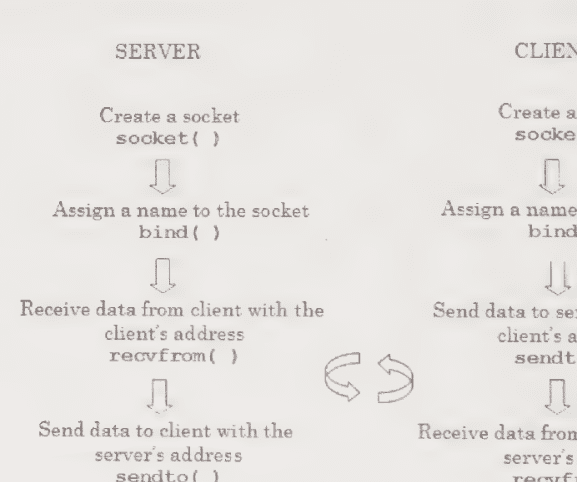

## 图 10.14 无连接客户端-服务器通信序列

在此示例中，我们使用了 `sendto` 和 `recvfrom` 系统调用进行数据交换。客户端中的 `sendto` 调用在功能上类似于我们在初始互联网域面向连接示例中看到的 `connect-write` 序列。类似地，`recvfrom` 调用类似于我们在同一示例中用于服务器的 `accept-read` 序列。

`sendto` 调用是向套接字写入数据的几种替代方式之一。表 10.19 概述了三个可以向套接字描述符写入数据的调用。

### 表 10.19 `send`、`sendto` 和 `sendmsg` 系统调用概述

| 包含文件 | <sys/types.h> <sys/socket.h> | 手册章节 | 2 |
| :--- | :--- | :--- | :--- |
| 概要 | int send (int s, const void *msg, size_t len, int flags);<br>int sendto (int s, const void *msg, size_t len, int flags, const struct sockaddr *to, socklen_t tolen);<br>int sendmsg (int s, const struct msghdr *msg, int flags); | | |
| 返回值 | 成功 | 失败 | 设置 errno |
| | 已发送字节数。 | -1 | 是 |

`send` 调用由于不包含目标寻址信息，只能用于已连接的（`SOCK_STREAM`）套接字。`sendto` 和 `sendmsg` 调用可用于任何套接字类型，但最常用于数据报套接字（`SOCK_DGRAM`）。`send` 和 `sendto` 调用发送一个字节序列。`sendmsg` 调用用于传输位于非连续（分散）内存位置（例如结构体中）的数据。

在所有三个调用中，整型参数 `s` 是一个有效的套接字描述符。`msg` 参数引用要发送的消息。在 `sendmsg` 调用中，`msg` 引用的是一个 `msghdr` 类型的结构体，其中包含额外的寻址/消息传递信息[^12]。该结构体定义如下：

> 12 由于其用法相当复杂，我们仅在**传送**（双关语，指 send 和 recv）过程中提及 `sendmsg`（及其对应的 `recvmsg`）！

```c
struct msghdr {
    void         *msg_name;       /* optional address */
    socklen_t     msg_namelen;    /* size of address */
    struct iovec *msg_iov;        /* scatter/gather array */
    size_t        msg_iovlen;     /* # elements in msg_iov */
    void         *msg_control;    /* ancillary data, see below */
    socklen_t     msg_controllen; /* ancillary data buffer len */
    int           msg_flags;      /* flags on received message */
};
```

其中类型 `iovec` 为：

```c
struct iovec {
    void  *iov_base;  /* Pointer to data.  */
    size_t iov_len;   /* Length of data.   */
};
```

参数 `len` 是要发送的消息的长度。消息大小受底层协议限制。`sendto` 调用包含一个额外参数，该参数引用包含消息发送目标地址信息的地址结构。对于 `sendto`，此参数之后是一个包含寻址结构大小的参数。如果 `sendto` 用于面向连接的套接字，则这两个参数将被忽略。所有三个调用都有一个基于整数的 `flag` 参数。将值 0 与表 10.20 中定义的一个或多个常量进行按位或运算即可生成 `flag` 值。

### 表 10.20 `send`、`sendto` 和 `sendmsg` 调用的标志

| 标志 | 含义 |
| :--- | :--- |
| MSG_OOB | 带外消息。目前此标志仅对基于互联网流的套接字有效。指定 `MSG_OOB` 允许进程发送紧急数据。接收进程可以选择忽略该消息。 |
| MSG_DONTROUTE | 绕过路由表并尝试在跳点内发送消息。这通常用于诊断目的。 |
| MSG_DONTWAIT | 对阻塞操作采用非阻塞操作，返回 `EAGAIN`。 |
| MSG_NOSIGNAL | 在基于流的套接字上，当连接一端断开时，不发送 `SIGPIPE` 错误。 |
| MSG_CONFIRM | 对于 `SOCK_DGRAM` 和 `SOCK_RAW` 套接字（Linux 2.3+），通知链路层已成功收到对方的回复。 |

在某些设置中使用上述调用时，必须指定网络和套接字库。在此类设置中，使用 `-lnsl` 和/或 `-lsocket` 编译器选项来通知链接器。这些调用返回发送的字节数，或者在出错时返回 -1，并将 `errno` 设置为表 10.21 中找到的值之一。发送到未绑定套接字的数据将被丢弃。

### 表 10.21 `send`、`sendto` 和 `sendmsg` 错误消息

| # | 常量 | perror 消息 | 说明 |
|---|---|---|---|
| 4 | EINTR | 被中断的系统调用 | 进程在数据发送前收到一个信号。 |
| 9 | EBADF | 错误的文件描述符 | 套接字引用无效。 |
| 11 | EWOULDBLOCK, EAGAIN | 资源暂时不可用 | 套接字设置为非阻塞，且无待处理连接。 |
| 12 | ENOMEM | 无法分配内存 | 内存不足，无法执行操作。 |
| 14 | EFAULT | 错误的地址 | 参数引用的位置在用户地址空间之外。 |
| 22 | EINVAL | 无效的参数 | `tolen` 参数包含不正确的值。 |
| 32 | EPIPE | 管道破裂 | 面向连接的套接字的本地端已关闭。 |
| 88 | ENOTSOCK | 对非套接字进行套接字操作 | 套接字参数是文件描述符，而不是套接字描述符。 |
| 90 | EMSGSIZE | 消息过长 | 套接字类型要求发送的消息是原子性的（一次全部发送），而要发送的消息过长。 |
| 105 | ENOBUFS | 无可用缓冲区空间 | 输出队列已满。 |

除了 `read`，还有三个与 `send` 可比的系统调用，用于从套接字描述符接收数据。这些调用是 `recv`、`recvfrom` 和 `recvmsg`。除非另有指定（例如使用 `fcntl`），否则如果套接字没有到达消息，这些调用将阻塞。表 10.22 概述了这些调用。


由于不包含发送者地址信息，`recv`网络调用应仅用于面向连接的（`SOCK_STREAM`）套接字。`recvfrom`和`recvmsg`调用可用于面向连接或无连接的套接字。通常，当使用`send`、`sendto`或`sendmsg`向套接字写入数据时，应使用相应的`recv`、`recvfrom`或`recvmsg`调用来读取。

## 表 10.22 `recv`、`recvfrom`和`recvmsg`系统调用概述

| 包含文件 | | 手册章节 |
|---|---|---|
| | `<sys/types.h>` `<sys/socket.h>` | **2** |
| 概要 | `int recv(int s, void *buf, size_t len, int flags);`<br>`int recvfrom(int s, void *buf, size_t len, int flags, struct sockaddr *from, socklen_t *fromlen);`<br>`int recvmsg(int s, struct msghdr *msg, int flags);` | |
| 返回值 | 成功：已接收字节数 | 失败：-1 | 设置`errno`：是 |

在每次调用中，整型参数`s`是一个有效的套接字描述符。`buffer`参数引用接收到的消息将被存储的位置。用户负责为接收到的消息分配存储空间。与`sendmsg`网络调用类似，`recvmsg`的`msg`参数引用一个`msghdr`结构体。`len`参数是接收消息缓冲区的长度。请记住，消息大小受底层协议限制，过长的消息可能会被截断。接收调用返回实际接收到的字节数。如果`from`参数非空，则`recvfrom`和`recvmsg`调用会填充该结构体，以返回发送者的地址。

### 表 10.23 `recv`、`recvfrom`和`recvmsg`调用的标志

| 标志 | 含义 |
| :--- | :--- |
| `MSG_ERRQUEUE` | 从错误消息队列接收错误消息。实现错误消息检索的细节超出了本文范围（具体信息请参阅`recv`的手册页）。 |
| `MSG_NOSIGNAL` | 对于流套接字，当套接字另一端消失时，不引发`SIGPIPE`错误。 |
| `MSG_OOB` | 带外消息。目前，此标志仅对基于互联网流的套接字有效。指定`MSG_OOB`允许进程读取*紧急*带外数据。 |
| `MSG_PEEK` | 查看当前数据但不消耗它。后续的`read`-接收类型调用将检索相同的*已窥视*数据。 |
| `MSG_TRUNC` | 对于数据报套接字，即使消息长度超过指定长度，也返回消息的真实长度。 |
| `MSG_WAITALL` | 等待直到满足完整的数据请求。 |

### 表 10.24 `recv`、`recvfrom`和`recvmsg`错误消息

| # | 常量 | `perror`消息 | 说明 |
|---|---|---|---|
| 4 | `EINTR` | 被中断的系统调用 | 在接收到数据之前，进程收到了一个信号。 |
| 9 | `EBADF` | 无效的文件描述符 | 套接字引用无效。 |
| 11 | `EAGAIN` | 资源暂时不可用 | • 套接字被设置为非阻塞，且没有待处理的连接。 • 定时器在接收数据前超时。 |
| 14 | `EFAULT` | 地址错误 | 参数引用了用户地址空间之外的位置。 |
| 22 | `EINVAL` | 参数无效 | 一个参数包含不正确的值。 |
| 88 | `ENOTSOCK` | 对非套接字执行套接字操作 | 套接字参数是一个文件描述符，而不是套接字描述符。 |
| 107 | `ENOTCONN` | 传输端点未连接 | 一个面向连接的套接字尚未连接。 |
| 111 | `ECONNREFUSED` | 连接被拒绝 | 远程主机拒绝了连接请求。 |

### 10.5.1 UNIX 域数据报套接字示例

我们的 UNIX 域数据报套接字示例在功能上与第 10.4 节中介绍的流套接字示例有些相似。在此示例中，服务器在 UNIX 域中创建一个数据报套接字（`SOCK_DGRAM`）并将其绑定到一个地址（文件名）。客户端也创建一个数据报套接字并将其绑定到一个地址（使用一个不同的文件名，每个客户端进程唯一）。客户端和服务器使用`sendto`和`recvfrom`网络调用进行通信。客户端生成 10 条消息（`/usr/games/fortune`工具的输出），并将其发送到服务器。服务器显示它接收到的消息。服务器进程的代码如程序 10.8 所示。

## 程序 10.8 UNIX 域无连接服务器

文件：p10.8.cxx

```cpp
/*
    SERVER - UNIX domain - connectionless
*/
#include "local_sock.h"

void clean_up(int, const char *);   // Close socket and remove
int
main( ) {
    socklen_t          clnt_len;    // Length of client address
    int                orig_sock;   // Original socket descriptor
    static struct sockaddr_un
                     clnt_adr,      // Client address
                     serv_adr;      // Server address
    static char        buf[BUFSIZ]; // Buffer for messages
                                    // Generate socket
    if ((orig_sock = socket(PF_UNIX, SOCK_DGRAM, 0)) < 0) {
        perror("generate error");
        return 1;
    }
                                    // Assign address information
    serv_adr.sun_family = AF_UNIX;
    strcpy(serv_adr.sun_path,SERVER_FILE);
    unlink( SERVER_FILE);           // Remove old copy if present
                                    // BIND the address
    if (bind(orig_sock, (struct sockaddr *) &serv_adr,
          sizeof(serv_adr.sun_family)+strlen(serv_adr.sun_path)) < 0) {
        perror("bind error");
        clean_up(orig_sock, SERVER_FILE);
        return 2;
    }
                                    // Process
    for (int i = 1; i <= 10; i++) {
        recvfrom(orig_sock, buf, sizeof(buf), 0,
                (struct sockaddr *) &clnt_adr, &clnt_len);
        cout << "S receives " << buf;
    }
    clean_up(orig_sock, SERVER_FILE);
    return 0;
}
void
clean_up( int sd, const char *the_file ){
    close( sd );                    // Close socket
    unlink( the_file );             // Remove it
}
```

客户端进程的代码如程序 10.9 所示。

## 10.5 套接字：无连接范式

### 程序 10.9 UNIX 域无连接客户端

文件：p10.9.cxx

```cpp
/*
    CLIENT - UNIX domain - connectionless
*/
#include "local_sock.h"

void clean_up(int, const char *); // Close socket and remove
int
main( ) {
    int         orig_sock;       // Original socket descriptor
    static struct sockaddr_un    // UNIX addresses to be used
        clnt_adr,                // Client address
        serv_adr;                // Server address
    static char clnt_buf[BUFSIZ], // Message from client
        pipe_buf[BUFSIZ],        // Output from fortune command
        clnt_file[]="XXXXXX";// Temporary file name
    FILE        *fin;            // File for pipe I/O
                                   // Assign SERVER address
                                   // information
    serv_adr.sun_family = AF_UNIX;
    strcpy(serv_adr.sun_path, SERVER_FILE);
    if ((orig_sock = socket(PF_UNIX, SOCK_DGRAM, 0)) < 0) {
        perror("generate error");
        return 1;
    }
    mkstemp(clnt_file);
    clnt_adr.sun_family = AF_UNIX; // Assign CLIENT address
                                   // information
    strcpy(clnt_adr.sun_path, clnt_file );
    unlink( clnt_file );           // Remove
                                   // BIND the address
    if (bind(orig_sock, (struct sockaddr *) &clnt_adr,
        sizeof(clnt_adr.sun_family)+strlen(clnt_adr.sun_path)) < 0) {
        perror("bind error");
        return 2;
    }                             // Process
    for (int i=0; i < 10; i++) {
                                   // slow things down a bit
        sleep(1);
        fin = popen("/usr/games/fortune -s", "r");
        memset( pipe_buf, 0x0, BUFSIZ ); // clear buffer before reading
                                         // cmd output
        read( fileno(fin), pipe_buf, BUFSIZ );
        sprintf( clnt_buf, "%d : %s", getpid(), pipe_buf );
        sendto( orig_sock, clnt_buf, sizeof(clnt_buf), 0,
                (struct sockaddr *) &serv_adr, sizeof(struct sockaddr) );
    }
    clean_up( orig_sock, clnt_file );
    return 0;
}
void
clean_up( int sd, const char *the_file ){
    close( sd );
    unlink( the_file );
}
```

在客户端，`mkstemp`库函数用于生成一个要绑定到客户端套接字的唯一文件名。该函数接收一个`XXXXXX`模板，该模板将被一个唯一的文件名替换。该函数还会打开该文件。由于只需要文件名，文件本身可以被删除（*解除链接*）。如果多个客户端与服务器通信，则每个客户端都拥有自己唯一的绑定文件名是*至关重要的*。

使用该客户端-服务器对的标准编译/输出序列如图 10.15 所示。

### 图 10.15 编译并运行 UNIX 域无连接客户端-服务器应用程序

```
linux$ g++ p10.8.cxx -o server
linux$ g++ p10.9.cxx -o client
linux$ ./server &
[3] 31801
linux$ ./client

S receives 31802 : Go to a movie tonight.  Darkness becomes you.
S receives 31802 : Out of sight is out of mind.
S receives 31802 : Q: What's tan and black and looks great on a lawyer?
         A: A doberman.
. . .
[3]  Done                      server
```

图 10.16 显示了如果运行两个客户端并使用`ls`命令检查客户端和服务器套接字所绑定的文件名会发生什么。请注意，服务器仍然处理 10 条消息。然而，它从其中一个客户端接收一半的消息，从另一个客户端接收另一半。当客户端继续向未绑定（已关闭）的服务器套接字发送数据时，不会生成错误消息。

### 图 10.16 运行具有多个客户端的相同应用程序

```
linux$ ./server &
[1] 32244
linux$ ./client & ./client & ls -l | grep ^s
[2] 32248
[3] 32249
srwxr-xr-x  1 gray  faculty  0 May 17 09:37 eUcOXq
srwxr-xr-x   1 gray  faculty      0 May 17 09:37 q0c0tq
srwxr-xr-x   1 gray  faculty      0 May 17 09:37 server_socket
```

S receives 31754 : Anything worth doing is worth overdoing.

S receives 31755 : Marriage causes dating problems.

S receives 31754 : A handful of patience is worth more than a bushel of brains.

S receives 31755 : OK, so you're a Ph.D. Just don't touch anything.

. . .

```
[3]  - Done                      ./client
[2]  - Done                      ./client
[1]  + Done                      ./server
```

## 10-10 练习

那是一个平静的夜晚，Frick 和 Frack 正在讨论 UNIX 域无连接套接字。Frick 指出，他认为程序 10.9 中给出的客户端代码*过于冗长*。Frick 的客户端代码（大约少了 20 行）如下所示。

文件：frick.cxx


```cpp
/*
            Frick's CLIENT - UNIX domain - connectionless
*/
#include "local_sock.h"

int
main()
{
    int             orig_sock;
    static struct sockaddr_un
                    serv_adr;
    static char     clnt_buf[BUFSIZ],
                    pipe_buf[BUFSIZ];
    FILE            *fin;

    if ((orig_sock = socket(PF_UNIX, SOCK_DGRAM, 0)) < 0) {
        perror("generate error");
        exit(1);
    }
    serv_adr.sun_family = AF_UNIX;
    strcpy( serv_adr.sun_path, SERVER_FILE );
    for (int i=0; i < 10; i++) {
        sleep(1);
        fin = popen("/usr/games/fortune -s", "r");
        memset( pipe_buf, 0x0, BUFSIZ );
```

```markdown
read( fileno(fin), pipe_buf, BUFSIZ );
sprintf( clnt_buf, "%d : %s", getpid(), pipe_buf );
sendto( orig_sock, clnt_buf, sizeof(clnt_buf), 0,
	(struct sockaddr *) &serv_adr, sizeof(struct sockaddr) );
}
return 0;
}
```

Frick 的客户端代码能否与程序 10.8 中的服务器一起工作？如果 Frick 的代码可以工作，它的局限性是什么？如果它不能工作，需要做些什么才能使其工作？

## 10.5.2 一个互联网域数据报套接字示例

在下一个示例中，我们创建一个使用无连接套接字的客户端-服务器应用程序。这个应用程序将像一个基本的聊天程序一样工作。运行服务器进程的用户可以与运行客户端程序的用户进行交互式读取消息和写入消息，反之亦然。当这个应用程序运行时，服务器程序首先被调用并保持在前台运行。在启动时，服务器会显示客户端应该绑定的端口。客户端程序同样在前台运行，可以位于不同的主机上，或者在同一主机的另一个窗口中运行，并通过命令行传递服务器进程所在主机的名称和端口号。一旦两个进程都启动并运行，客户端用户输入一行文本并按回车键。客户端的输入会显示在服务器的屏幕上。然后运行服务器进程的用户输入响应，该响应又会显示在客户端的屏幕上，如此往复。以一种有组织的、严格的、一来一往的方式，两个用户可以进行非常基本的交互式通信。¹³ 当用户输入 `^D` 时，客户端进程终止。服务器是迭代式的，除非使用 `kill` 命令将其移除，否则它会一直继续运行。服务器进程的程序如程序 10.10 所示。

## 程序 10.10  互联网域无连接服务器

```cpp
// File : p10.10.cxx
/*
Program 10.10    SERVER - Internet Domain - connectionless
*/
#include "local_sock.h"
int main() {
    int                sock, n;
    socklen_t          server_len, client_len;
    struct sockaddr_in server,          // Internet Addresses
                      client;
                                          // SOCKET
    if ((sock = socket(PF_INET, SOCK_DGRAM, 0)) < 0) {
        perror("SERVER socket "); return 1;
    }
    memset(&server, 0, sizeof(server));   // Clear structure
    server.sin_family     = AF_INET;     // Set address type
    server.sin_addr.s_addr = htonl(INADDR_ANY);
    server.sin_port       = htons(0);
                                          // BIND
    if (bind(sock, (struct sockaddr *) &server,
             sizeof(server) ) < 0) {
        perror("SERVER bind "); return 2;
    }
    server_len = sizeof(server);          // Obtain address length
                                          // Find picked port #
    if (getsockname(sock, (struct sockaddr *) &server,
                    &server_len) < 0) {
        perror("SERVER getsockname "); return 3;
    }
    cout << "Server using port " << ntohs(server.sin_port) << endl;
    while ( 1 ) {                         // Loop forever
        client_len = sizeof(client);      // set the length
        memset(buf, 0, BUFSIZ);           // clear the buffer
        if ((n=recvfrom(sock, buf, BUFSIZ, 0,  // get the client's msg
                       (struct sockaddr *) &client, &client_len)) < 0){
            perror("SERVER recvfrom ");
            close(sock); return 4;
        }
        write(fileno(stdout), buf, n);    // display msg on
                                          // server
        memset(buf, 0, BUFSIZ);           // clear the buffer
        if ( read(fileno(stdin), buf, BUFSIZ) != 0 ) {
            if ((sendto(sock, buf, strlen(buf), 0,  // send to client
                       (struct sockaddr *) &client, client_len)) <0){
                perror("SERVER sendto ");
                close(sock); return 5;
            }
        }
    }
    return 0;
}
```

¹³ 诚然，这永远无法取代 `talk` 工具、`IRC` 或当前的一些即时通讯应用程序，但它可以作为更复杂应用程序的基础。

## 10.5 套接字：无连接范式

请记住，为了在协作进程之间发生通信，必须建立一个唯一的关联。在互联网域中，该关联由一个五元组来表征，包括：

协议、本地地址、本地端口、远程地址、远程端口

在服务器程序中，一个数据报（无连接）套接字通过 `socket` 调用创建。地址族设置为 `AF_INET`，默认情况下协议（设置为 0）将是 UDP。接下来分配服务器的寻址信息。定义的常量 `INADDR_ANY` 是一个通配符地址，表明服务器可以使用（在该协议的任何有效地址上接收消息）。将端口号设置为 0（第 15 行）指示系统选择一个端口。当传递值为 0 时，系统会选择一个未使用且大于 `IPPORT_USERRESERVED` 的端口。在我们的系统上，该常量设置为 5000。有关端口号的其他信息存储在 `/proc/sys/net/ipv4` 子目录中找到的 `ip_local_port_range` 文件中。此文件中存储的第一个值是系统上用于 TCP 和 UDP 流量的第一个本地端口号。第二个值是最后一个本地端口号。在我们的系统上，此文件包含值 32768 和 61000。

发出 `getsockname` 调用（第 26 行）以确定系统选择了哪个端口。注意在调用 `getsockname` 之前，将此调用的第三个参数初始化为地址参数的长度非常重要（参见第 24 行）。服务器进程显示端口号，以便运行客户端进程的用户知道要指定哪个端口（更优雅的解决方案是将端口号存储在环境变量中）。然后服务器程序进入一个无限循环。它清除一个接收缓冲区并发出 `recvfrom` 调用。默认情况下，`recvfrom` 调用将导致服务器进程阻塞，直到接收到信息。一旦接收到信息，关联的其余部分，即远程地址和端口，就被确定了，因为该信息包含在接收到的数据中。接收到的消息被写入标准输出（屏幕）。然后服务器清除缓冲区并通过调用 `read` 收集用户的响应。同样，`read` 会导致服务进程在等待输入时阻塞。如果用户输入了非空响应，则使用 `sendto` 调用将响应发送到接收到消息的客户端地址/端口。服务器进程保持活动状态，直到使用 `kill` 命令移除或从键盘输入中断（`^C`）。

如前所述，当调用客户端程序时，运行服务器进程的主机名称和服务器上的端口通过命令行传递。然后客户端使用 `gethostbyname` 调用获取有关服务器的更多信息。此信息与传递的端口号一起存储在客户端的服务器套接字地址结构中。在互联网域设置中，接下来创建一个数据报套接字，设置客户端寻址信息。

并发出 `bind` 调用。在此时，客户端进程拥有足够的信息来启动与服务器进程的通信。客户端进入一个循环。使用 `read` 调用获取用户输入。如果用户输入未指示文件结束条件（即，用户未输入 `^D`），则使用 `sendto` 调用将输入发送到服务进程。然后清除接收缓冲区，并调用 `recvfrom` 从运行服务器程序的用户检索响应。响应显示在屏幕上，清除缓冲区，并重复循环。如果运行客户端进程的用户输入 `^D`，则退出处理循环，关闭套接字，客户端进程终止。

在此示例中，客户端-服务器通信的约定是极其严格的。服务器进程始终首先启动。客户端进程必须传递运行服务器进程的主机名称和正确的端口号。客户端进程首先获取其用户输入，然后将其发送到服务器。然后运行服务器进程的用户做出响应。运行客户端的用户对此响应进行响应，如此往复。可以看出，这个应用程序有很多改进的空间！客户端的代码如程序 10.11 所示。

## 程序 10.11  互联网域无连接客户端

```cpp
// File : p10.11.cxx
/*
    Program 10.11 - CLIENT - Internet Domain - connectionless
*/
#include "local_sock.h"
int main(int argc, char *argv[]){
    int           sock, n;
    socklen_t     server_len;
    struct sockaddr_in  server, client; // Internet addresses
    struct hostent *host;               // For host information
    if ( argc < 3 ) {                   // We need server name & port #
        cerr << "usage: " << argv[0] << " server_name port_#" << endl;
        return 1;
    }
    if (!(host=gethostbyname(argv[1]))){
        perror("CLIENT gethostbyname ");  return 2;
    }
    // Set server address info
    memset(&server, 0, sizeof(server)); // Clear structure
    server.sin_family = AF_INET;        // Address type
    memcpy(&server.sin_addr, host->h_addr, host->h_length);
    server.sin_port   = htons(atoi(argv[2]));
                                        // SOCKET
    if ((sock=socket(AF_INET, SOCK_DGRAM, 0)) < 0) {
        perror("CLIENT socket "); return 3;
    }
```

## 10 · 套接字

```cpp
perror("CLIENT socket "); return 3;
}

memset(&client, 0, sizeof(client));  // Clear structure
client.sin_family        = AF_INET;   // Address type
client.sin_addr.s_addr = htonl(INADDR_ANY);
client.sin_port        = htons( 0 );
                            // BIND
if (bind(sock, (struct sockaddr *) &client,
    sizeof(client)) < 0) {
   perror("CLIENT bind "); return 4;
}

cout << "Client must send first message." << endl;

while( read(fileno(stdin), buf, BUFSIZ) != 0 ){ // get client's msg
   server_len=sizeof(server);              // length of address
   if (sendto( sock, buf, strlen(buf), 0,  // send msg to server
       (struct sockaddr *) &server, server_len) < 0 ){
      perror("CLIENT sendto ");
      close(sock); return 5;
   }
   memset(buf,0,BUFSIZ);                // clear the buffer
   if ((n=recvfrom(sock, buf, BUFSIZ, 0,  // get server's msg
       (struct sockaddr *) &server, &server_len)) < 0){
      perror("CLIENT recvfrom ");
      close(sock); return 6;
   }
   write( fileno(stdout), buf, n );    // display msg on client
   memset(buf,0,BUFSIZ);                // clear the buffer
}
close(sock);
return 0;
```

该应用程序的编译和运行示例如图 10.17 所示。

```
linux$ g++ p10.10.cxx -o server
linux$ g++ p10.11.cxx -o client
linux$ ./server
Server using port 33680
Is someone listening?
Yes, I am here. What do you want?
What is the meaning of life?
Beats me.
Me too. Thanks.
```

```
medusa$ ./client linux 33680
Client must send first message.
Is someone listening?
Yes, I am here. What do you want?
What is the meaning of life?
Beats me.
Me too. Thanks.
^D
medusa$
```


**图 10.17** 使用两台不同主机运行程序 10.10 和 10.11。

### 10-11 练习

运行程序 10.10 和 10.11 中提供的聊天应用程序，并使用多个客户端。为此，你需要访问多台主机，或者能够在同一主机上创建多个窗口。修改客户端代码，使其最初向用户请求一个三字母的 `ID`（标识）。为了识别每条消息的来源，请在从客户端发送到服务器的所有消息开头添加该标识。

## 10.6 使用 `select` 进行 I/O 多路复用

从上一个示例可以清楚地看出，当进程进行通信时，它们需要一种协调其活动的方式，而不是阻塞（等待）接收方进程响应。一种方法是将套接字从其默认的阻塞模式更改为非阻塞模式。然后进程可以在某个指定的间隔执行自己的轮询/检查，以确定是否有待处理的 I/O。这种技术在修改后的服务器程序 10.12 中展示。新增或显著修改的代码部分在灰色区域中以粗体显示（第 5、6、10、18–20 和 42–49 行）。

**程序 10.12** 互联网域无连接**服务器**，非阻塞。

```cpp
File : p10.12.cxx

/*

    Program 10.12 - SERVER Internet Domain - connectionless -

                   NON-BLOCKING

*/

#include "local_sock.h"

#include <sys/ioctl.h>

#include <errno.h>

int

main()

{

    int            sock, n,

    errcount=0, flag=1;

    socklen_t      server_len, client_len;

    struct sockaddr_in server, // Internet Addresses

                      client;

                      // SOCKET

if ((sock = socket(PF_INET, SOCK_DGRAM, 0)) < 0) {

    perror("SERVER socket "); return 1;

}

if (ioctl(sock, FIONBIO, &flag) < 0 ) {

    perror("SERVER ioctl "); return 2;

}

memset(&server, 0, sizeof(server)); // Clear structure

server.sin_family = AF_INET; // Set address type

server.sin_addr.s_addr = htonl(INADDR_ANY);

server.sin_port = htons(0); // BIND

if (bind(sock, (struct sockaddr *) &server,

    sizeof(server) ) < 0) {

    perror("SERVER bind "); return 3;

}

server_len = sizeof(server); // Obtain address length

// Find picked port #

if (getsockname(sock, (struct sockaddr *) &server,

    &server_len) < 0) {

    perror("SERVER getsockname "); return 4;

}

cout << "Server using port " << ntohs(server.sin_port) << endl;

while ( 1 ) { // Loop forever

    client_len = sizeof(client); // estimate length

    memset(buf, 0, BUFSIZ); // clear the buffer

    if ((n=recvfrom(sock, buf, BUFSIZ, 0, // get the client's msg

        (struct sockaddr *) &client, &client_len)) < 0){

        if ( errcount++ > 60 || errno != EWOULDBLOCK ) {

            perror("SERVER recvfrom ");

            close(sock); return 5;

        }

        sleep(1);

        continue;

    }

    errcount = 0;

    write( fileno(stdout), buf, n ); // display msg on server

    memset(buf, 0, BUFSIZ); // clear the buffer

    if ( read(fileno(stdin), buf, BUFSIZ) != 0 ) {// get server's msg

        if ((sendto(sock, buf, strlen(buf) ,0, // send to client

            (struct sockaddr *) &client, client_len) <0){

            perror("SERVER sendto ");

            close(sock); return 6;

        }

    }

}

return 0;

}
```

## 10.6 使用 `select` 进行 I/O 多路复用

在此示例中，`ioctl` 系统调用用于将套接字更改为非阻塞模式。`ioctl` 调用执行各种文件控制操作。¹ 其操作在手册的两部分中进行了完整描述：`ioctl` 和 `ioctl_list`，均位于手册的第 2 部分。`ioctl` 调用并非将套接字设置为非阻塞的唯一方法。另一种方法是使用 `fcntl`（文件控制）系统调用。如果使用 `fcntl`，语法将是

```cpp
#include <unistd.h>          // include for fcntl call

#include <fcntl.h>

. . .

if (fcntl(s, F_SETFL, FNDELAY) < 0 ) ( // new lines 18-20

    . . .

)
```

在程序 10.12 中，文件`<sys/ioctl.h>`被添加到包含部分。此文件包含 `ioctl` 系统调用使用的定义常量。在程序中，我们还引用了 `errno`，并使用了包含文件`<errno.h>`中的一个定义常量。一旦套接字被创建，就使用 `ioctl` 调用将套接字状态更改为非阻塞。`ioctl` 调用传递套接字描述符、定义常量 `FIONBIO`（表示文件 I/O 非阻塞 I/O）和一个整型标志的地址。如果 `ioctl` 调用成功，它将返回一个非负值。

服务器的处理循环被修改以引入一种有限形式的轮询。如果消息不可用且已进行的接收尝试少于 60 次，进程将**休眠**并重试。当套接字被设置为非阻塞时，如果消息不可用，`recvfrom` 调用会立即返回。发生这种情况时，外部变量 `errno` 被设置为 `EWOULDBLOCK`，表示该调用本会被阻塞。如程序所示，当 `recvfrom` 返回的错误代码是 `EWOULDBLOCK`，且尝试接收消息的次数少于 60 次时，进程会发出一个 `sleep` 调用，休眠一秒。一旦收到消息，错误计数器将重置为 0，消息将像以前一样被处理。如果 `recvfrom` 返回的错误代码不是 `EWOULDBLOCK`，或者尝试接收消息的次数超过 60 次，将生成错误消息并退出进程。重试的次数和休眠的时间是任意的，可以通过反复试验进行调整以满足特定需求。

虽然上述方法既有趣又实用，但它具有任何自行实现轮询的代码的所有缺点。如果进程能够以某种方式通知接收方进程消息可用，通信协调似乎会大大提高。例如，

¹ 我意识到这偏离了正常的方法（即，一旦遇到/使用系统调用就进行完整解释）。`ioctl` 系统调用很复杂，由于我们只会顺便使用它，因此省略了其语法和使用方面的细节。


我们可以在套接字有数据可读时向进程发送信号。为此，接收信号的进程必须为 `SIGIO` 信号建立信号处理程序。其次，它必须将其进程 ID 与套接字关联。第三，必须将套接字设置为允许异步 I/O。虽然所有这些都可以实现（使用 `signal` 和 `fcntl` 系统调用），但这并不理想。信号可能会丢失，并且如果多个进程参与通信过程，编码可能会变得相当复杂。在可能的情况下，最好让系统处理通知进程 I/O 待处理这一细节。`select` 库调用可用于此目的。如表 10.25 所示，`select` 调用相当复杂。

**表 10.25** `select` 系统调用概要

| | 包含文件 | 手册章节 |
|---|---|---|
| | `<sys/time.h>`<br>`<sys/types.h>`<br>`<unistd.h>` | 2 |
| **概要** | `int select( int n, fd_set *readfds, fd_set *writefds, fd_set *exceptfds, struct timeval *timeout );` | |
| **返回值** | **成功**：就绪文件描述符的数量 | **失败**：-1 | **设置 *errno***：是 |

`select` 系统调用使用一系列**文件描述符掩码**来确定应该检查哪些文件的待处理 I/O。这些引用指示了用于读取 (`*readfds`)、写入 (`*writefds`) 和需要检查异常（例如，带外消息：`*exceptfds`) 的文件描述符。第一个参数 `n` 是掩码中应处理的位数。由于这些掩码是基于 0 的，传递值 4 表示要使用前四位，代表描述符 0 到 3。`select` 的最后一个参数 `*timeout` 引用一个 **timeval** 结构，其中包含有关系统在完成 `select` 调用前应等待多长时间的信息。

读、写和异常文件描述符掩码实际上是长整数数组。在大多数 Linux 系统上，掩码可以表示的文件描述符数量（`FD_SETSIZE`）为 1024（描述符 0-1023）。数组第一个元素的第一个位用于文件描述符 0，第二个位用于文件描述符 1，依此类推。如果进程不需要检查任何描述符是否有待处理的读取，可以将读描述符掩码设置为 `NULL`。这同样适用于写和异常掩码。

这些是文件描述符，而不是文件指针。在使用 `select` 时，套接字描述符与文件描述符的处理方式相同。

为了简化对由单个位表示的特定文件描述符的引用，提供了几个位操作宏。这些宏的描述通常可以在 `select` 的手册页上找到，它们是：

```c
void FD_ZERO(fd_set *fdset);

void FD_SET(int fd, fd_set *fdset);

void FD_CLR(int fd, fd_set *fdset);

int  FD_ISSET(int fd, fd_set *fdset);
```

每个宏都必须传递要操作的文件描述符掩码的地址引用。`FD_ZERO` 宏将引用的掩码清零（设置为全零）。`FD_SET` 宏将为传递的文件描述符值设置相应的位。`FD_CLEAR` 宏将清除传递的文件描述符对应的位。`FD_ISSET` 宏将在不更改其状态的情况下，返回传递的文件描述符对应位的状态（未设置为 0，已设置为 1）。实际上，当 `select` 调用返回时，使用 `FD_ISSET` 宏来确定哪些描述符实际上已准备好进行指定的 I/O 事件。

`select` 的最后一个参数指定调用在完成其操作并返回之前应该等待多长时间。此参数引用一个 **timeval** 结构，如下所示：

```c
struct timeval {

    long    tv_sec;     /* seconds */

    long    tv_usec;    /* and microseconds */

};
```

如果此参数设置为 `NULL`，`select` 将无限期地等待（阻塞），直到其中一个指定的描述符准备好进行 I/O。如果 `tv_sec` 成员和 `tv_usec` 成员都设置为 0，`select` 将轮询指定的描述符并立即返回它们的状态。如果 `timeval` 成员非零，系统将等待指定的秒数/微秒数，以等待 I/O 事件发生，*或者*如果在指定时间到期之前发生了其中一个指定的事件，则立即返回。

如果所有文件描述符掩码都为空，则可以使用 `select` 的时间规格来微调进程应休眠的时间量。

虽然 `select` 调用的 Linux 版本相当标准，但它在一个非常重要的方面有所不同。返回时，`select` 的 `timeout` 参数会被修改以反映未休眠的时间量。因此，如果多次调用 `select`（或在循环中），则必须在每次调用前重新初始化 `timeout` 参数。移植代码时应考虑这种行为差异。

如果 `select` 成功，它将返回就绪的文件描述符数量。如果调用超时，则返回 0。如果调用失败，则返回 -1 并将 `errno` 设置为表 10.26 中所示的值之一。当 `select` 调用成功或超时时，文件描述符掩码会被修改以反映描述符的当前状态。发生错误时，掩码不会被修改。

**表 10.26** `select` 错误消息

| # | 常量 | perror 消息 | 解释 |
|---|---|---|---|
| 4 | `EINTR` | 被中断的系统调用 | 在指定的事件发生或时间限制到期之前，进程接收到了一个信号。 |
| 9 | `EBADF` | 错误的文件描述符 | 其中一个文件描述符掩码引用了无效的文件描述符。 |
| 12 | `ENOMEM` | 无法分配内存 | 系统无法分配 `select` 使用的内部表。 |
| 22 | `EINVAL` | 无效的参数 | 其中一个时间限制值超出范围或文件描述符为负数。 |

关于 `select` 的最后一点：第一个参数（指示 `select` 将在文件描述符掩码中处理的位数）必须被赋值为最大的文件（套接字）描述符值加 1（记住引用是基于 0 的）。最后，`select` 虽然仍被广泛使用，但在 Linux 中已被列入弃用调用列表。系统调用 `poll` 是 `select` 的一种变体，提供类似的功能。

## 10.6 使用 `select` 进行 I/O 多路复用

程序 10.13 展示了如何使用 `select` 调用，它是对原始互联网域无连接服务器程序（10.10）的修改。修改过的语句和新的代码行以粗体显示并放置在灰色背景上（第 5、9-11、37-44、54-65、72 和 73 行）。

### 程序 10.13 在服务器程序中使用 `select` 进行 I/O 多路复用。

```cpp
文件 : p10.13.cxx

/*

    程序 10.13 - 服务器 - 互联网域 - 无连接

*/

#include "local_sock.h"

#include <sys/time.h>

int

10     fd_set             read_fd;

10     struct timeval      w_time;

1

|      socklen_t         server_len, client_len;

|      struct sockaddr_in server,     // 互联网地址

*                        client;

|                                             // 套接字

|      if ((sock = socket(PF_INET, SOCK_DGRAM, 0)) < 0) {

|        perror("服务器 socket "); return 1;

|      }

20     memset(&server, 0, sizeof(server)); // 清除结构

|      server.sin_family            = AF_INET;    // 设置地址类型

|      server.sin_addr.s_addr = htonl(INADDR_ANY);

|      server.sin_port             = htons(0);

|                                             // 绑定

+      if (bind(sock, (struct sockaddr *) &server,

|          sizeof(server) ) < 0) {

||       perror("服务器 bind "); return 2;

||     }

||     server_len = sizeof(server);          // 获取地址长度

30                                                // 查找选择的端口号

|      if (getsockname(sock, (struct sockaddr *) &server,

||         &server_len) < 0) {

||       perror("服务器 getsockname "); return 3;

||     }

|.     cout << "服务器使用端口 " << ntohs(server.sin_port) << endl;

|      while ( 1 ) {                                    // 无限循环
```


设置等待时间：

```c
w_time.tv_sec = 5; w_time.tv_usec = 0;    // 设置等待时间

FD_ZERO( &read_fd );                        // 清零所有位

FD_SET( sock, &read_fd );                   // 指示要读取的一个
```

```c
if ( (n_ready = select( sock + 1, &read_fd, (fd_set *) NULL,
                (fd_set *) NULL, &w_time)) < 0 ) {
    perror("服务器读取套接字 select "); continue;
}

if ( FD_ISSET( sock, &read_fd ) ) {         // 套接字上有活动
    client_len = sizeof(client);            // 估计长度
    memset(buf, 0, BUFSIZ);                 // 清除缓冲区
    if ((n = recvfrom(sock, buf, BUFSIZ, 0, // 获取客户端消息
            (struct sockaddr *) &client, &client_len)) < 0){
        perror("服务器 recvfrom ");
        close(sock); return 4;
    }
    write( fileno(stdout), buf, n );        // 在服务器上显示消息
    memset(buf, 0, BUFSIZ);                 // 清除缓冲区
    need_rsp = 1;
}

if ( need_rsp ) {
```

```c
w_time.tv_sec = 5; w_time.tv_usec = 0;      // 设置等待时间

FD_ZERO( &read_fd );                        // 清零所有位

FD_SET( fileno(stdin), &read_fd );          // 设置要读取的文件描述符

if ( (n_ready = select( fileno(stdin) + 1, &read_fd,
        (fd_set *) NULL, (fd_set *) NULL, &w_time)) < 0 ) {
    perror("SERVER read stdin select "); continue;
}                                           // 获取服务器的消息
                                            // 如果 stdin 有活动

if ( FD_ISSET( fileno(stdin), &read_fd ) ) {
    if ( read( fileno(stdin), buf, BUFSIZ) != 0 ) {
        if ((sendto(sock, buf, strlen(buf), 0, // 发送数据给客户端
            (struct sockaddr *) &client, client_len)) < 0){
            perror("SERVER ser.dto ");
            close(sock); return 5;
        }
        need_rsp = 0;
    }
}
return 0;
```

修改后的服务器程序添加了头文件`<sys/time.h>`，因为它引用了`timeval`结构体。同时还添加了两个整型变量。`n_read`变量将被赋值为`select`调用找到的就绪 I/O 描述符的数量。在此设置中，该变量的值应仅包含 0 或 1。第二个变量`need_rsp`用作标志，用于跟踪服务器是否已对接收到的消息进行了响应。由于发送消息的进程地址包含在消息中，因此在接收到消息地址对之前，不能发出`sendto`调用来响应消息。接下来分配表示读取描述符的掩码`read_fd`。随后分配一个用于保存`select`调用等待时间的结构体。

在处理循环中，等待时间被任意设置为 5 秒，读取描述符掩码被清零，并设置用于指示要处理的套接字的位。`select`调用用于确定套接字的状态。由于我们只关心读取操作，其余的描述符掩码被设置为 `NULL`（注意每个都进行了适当的类型转换）。当`select`调用返回时，`FD_ISSET`宏会确定套接字是否确实可用于读取。如果套接字就绪，则通过`recvfrom`接收消息并显示。消息显示后，`need_rsp`变量被设置为 1 以标记已接收到消息。

在检查已接收的消息并收到消息或等待超时后，服务器会尝试发送响应。对`need_rsp`变量进行求值，以确定是否应该生成对消息的响应。如果需要响应，则重置等待时间，将`read_fd`掩码重置为引用`stdin`，并调用`select`以确定是否有任何输入（在此设置中来自键盘）可用于读取。如果运行服务器进程的用户已输入信息，则该信息将被`read`并发送给客户端。消息发送后，`need_rsp`变量被设置为 0，表示已生成并发送了响应。

虽然这些更改有助于服务器进程更好地处理与客户端进程的异步通信，但它并不能解决所有通信问题。客户端进程也必须以类似的方式进行更改，以允许非阻塞异步通信。还有额外的协调问题需要解决。例如，假设有多个客户端，而运行服务器的用户响应较慢。一旦服务器上的用户确实做出了响应，如果在此期间服务器从其他客户端收到了额外的消息，服务器进程如何知道（跟踪）应该将响应发送给谁？

## 10.7 窥探数据

`recv`、`recvfrom`和`recvmsg`调用允许用户在不消耗数据的情况下查看接收到的数据（数据仍可用于下一次接收类型的调用）。当接收进程需要检查消息（例如，可能需要根据消息采取行动而不是将其传递给另一个进程）时，这非常方便。要实现非消耗性接收，用户必须将接收调用的整型`flags`参数设置为已定义常量`MSG_PEEK`。一个修改后的 Internet 域服务器程序（程序 10.6）展示了如何实现这一点。程序的处理循环（生成子进程来处理来自客户端的连接）被修改为包含对传入消息的窥探。这些修改如程序 10.14 所示。

### 程序 10.14 使用`MSG_PEEK`的 Internet 域面向连接的`server`

```c
File : p10.14.cxx

/*
    Internet domain, connection-oriented SERVER - MSG_PEEK
*/

// Same as Program p10.6.cxx

if ( fork ( ) == 0 ) {
    while ( (len = recv(new_sock, buf, BUFSIZ, MSG_PEEK)) > 0) {
        write( fileno(stdout), "Peeked and found: ", 19);
        write( fileno(stdout), buf, len);   // 显示窥探到的消息
        if ( !strncmp(buf, ".done", len-1) ) break;
        len = recv(new_sock, buf, BUFSIZ, 0 );   // 取回同一条消息
        write( fileno(stdout), "Re-read buffer : ", 19);
        write( fileno(stdout), buf, len);
    }
    write( fileno(stdout), "Leaving child process\n", 22);
    close(new_sock);    // 在子进程中
    return 0;
} else close(new_sock); // 在父进程中
} while ( true );       // 无限循环

// Same as Program p10.6.cxx
```

客户端程序（程序 10.7）的修改如程序 10.15 的部分代码清单所示。

### 程序 10.15 使用`MSG_PEEK`的 Internet 域面向连接的客户端

```c
File : p10.15.cxx

/*
    Internet domain, connection-oriented CLIENT
*/

// Same as Program p10.7.cxx

do {    // 处理过程
    write(fileno(stdout), "> ", 3);
    if ((len = read(fileno(stdin), buf, BUFSIZ)) > 0) {
        write(fileno(stdout), "Sending ", 9);
        write(fileno(stdout), buf, len);
        send(orig_sock, buf, len, 0);
    }
} while ( strncmp(buf, ".done", len-1) );    // 直到输入结束

// Same as Program p10.7.cxx
```

当这些修改后的程序被编译并运行时（如图 10.18 所示），可以很容易地看到服务器进程可以通过指定`MSG_PEEK`来窥探接收到的数据。当第二次调用接收调用时，被窥探的数据会再次被接收。

## 10.8 带外消息

```c
linux$ g++ p10.14.cxx -o server
linux$ g++ p10.15.cxx -o client
linux$ server
Peeked and found: George Orwell was
an optimist.
Re-read buffer  : George Orwell was
an optimist.
Peeked and found: Life is like a
simile.
Re-read buffer  : Life is like a
simile.
Peeked and found: .done
Leaving child process
```

```c
perseus$ client linux
> George Orwell was an optimist.
Sending George Orwell was an
optimist.
> Life is like a simile.
Sending Life is like a simile.
> .done
Sending .done
perseus$
```

图 10.18 窥探消息——服务器和客户端运行在不同的主机上。

有时发送进程需要通知接收方进程有紧急消息。`MSG_OOB`标志与`send`和`receive`调用一起使用，用于指示和处理紧急消息。目前，只有基于流的套接字支持带外消息传递。

与`MSG_PEEK`类似，我们可以修改程序 10.6 来展示服务器进程如何处理客户端发送的紧急消息。由于修改相对更为广泛，整个服务器程序如程序 10.16 所示。修改部分的代码以粗体（第 5、15、16 和 42–68 行）突出显示并以灰色表示。

### 程序 10.16 使用`MSG_OOB`的 Internet 域面向连接的服务器

```c
File : p10.16.cxx

/*
     Internet domain, connection-oriented SERVER - MSG_PEEK
*/

    #include "local_sock.h"
+   #include <time.h>             // For nanosleep

    void signal_catcher(int);
    int
    main(  ) {
        int         orig_sock,     // 服务器中的原始套接字
                    new_sock;       // 来自 connect 的新套接字
                    clnt_len;       // 客户端地址的长度

441

## 10 • 套接字

    struct sockaddr_in              // Internet 地址，客户端和服务器
                                   clnt_adr, serv_adr;
    int                len, i,     // 杂项计数器等
+                       urg, mark;  // 接收 OOB 消息的标志，以及
                                   // 记录其在流中位置的标志
                                   // 捕获子进程终止的信号

    if (signal(SIGCHLD, signal_catcher) == SIG_ERR) {
        perror("SIGCHLD");
        return 1;
    }

    if ((orig_sock = socket(PF_INET, SOCK_STREAM, 0)) < 0) {
        perror("generate error");
        return 2;
    }

    memset( &serv_adr, 0, sizeof(serv_adr) );         // 清空结构体
    serv_adr.sin_family           = AF_INET;          // 设置地址类型
    serv_adr.sin_addr.s_addr = htonl(INADDR_ANY);     // 任意接口
    serv_adr.sin_port             = htons(PORT);      // 使用我们指定的端口

    // BIND（绑定）
    if (bind( orig_sock, (struct sockaddr *) &serv_adr,
                    sizeof(serv_adr)) < 0){
        perror("bind error");
        close(orig_sock);
+       return 3;
    }

    if (listen(orig_sock, 5) < 0 ) {                  // LISTEN（监听）
        perror("listen error");
        close (orig_sock);
        return 4;
    }

    struct timespec req, rem;                         // 用于 nanosleep

    do {
        clnt_len = sizeof(clnt_adr);                  // ACCEPT（接受）一个连接
+       if ((new_sock = accept( orig_sock, (struct sockaddr *) &clnt_adr,
                                &clnt_len)) < 0) {
            perror("accept error");
            close(orig_sock);
            return 5;
        }
        if ( fork( ) == 0 ) {                         // 创建一个子进程
            urg = mark = 0;
            do {
                req.tv_sec = 5; req.tv_nsec = 0;     // 设置休眠时间
+               nanosleep( &req, &rem);              // 让服务器减慢速度

            if ( (len = recv(new_sock, buf, BUFSIZ, MSG_OOB)) > 0) {
                write( fileno(stdout), "URGENT msg pending\n", 19);
                urg = 1;
            }
        }
        if ( urg ) ioctl(new_sock, SIOCATMARK, &mark);

## 10.8 带外消息

if ( mark ) {


`write(fileno(stdout), " <-- the URGENT msg\n",20);`

`mark = urg = 0;`

`}`

`if ((len=recv(new_sock, buf, BUFSIZ, 0)) > 0) {`

`    if ( !strncmp(buf, ".done", len-1) ) break;`

`    write( fileno(stdout), buf, len);`

`}`

`} while( 1 );`

`write( fileno(stdout),"Leaving child process\n",22);`

`close(new_sock);                    // In CHILD process`

`return 0;`

`} else`

`    close(new_sock);                // In PARENT process`

`} while( true );                    // FOREVER`

`return 0;`

`}`

`void`

`signal_catcher(int the_sig){`

`    signal(the_sig, signal_catcher);   // reset`

`    wait(0);                            // keep the zombies at bay`

`}`

在服务器程序（10.16）中，整型变量`urg`和`mark`被添加用于辅助处理带外消息。这些变量充当标志，分别用于指示何时接收到带外消息（`urg`）以及何时实际处理完毕（`mark`）。在服务器的处理循环中，这些变量初始值设为 0。内部`do while`循环以调用`nanosleep`开始。添加`nanosleep`调用是为了减慢服务器的处理速度，以便清晰地展示客户端消息的接收顺序。选择`nanosleep`（而非`sleep`）是因为它已被 POSIX 标准化，不会影响其他信号，并且能提供更精细的暂停粒度。

### 表 10.27 nanosleep 系统调用摘要

| 项目 | 值 | 手册章节 | 2 |
|---|---|---|---|
| 头文件 | `<time.h>` | | |
| 摘要 | `int nanosleep(const struct timespec *req, struct timespec *rem);` | | |
| 返回值 | 成功：0 | 失败：-1 | 设置 errno：是 |

`nanosleep`调用的两个参数均使用`timespec`结构体的引用。第一个参数`req`是所需的睡眠时间（以秒和纳秒为单位）。第二个参数`rem`是当调用被信号中断时的剩余时间。调用成功时返回 0；失败时返回 -1，并按表 10.28 所示设置`errno`。

### 表 10.28 nanosleep 错误消息

| # | 常量 | perror 消息 | 说明 |
|---|---|---|---|
| 4 | EINTR | Interrupted system call | 进程在完整时间到期前接收到一个未阻塞的信号。`rem`中的值为剩余的睡眠时间。 |
| 22 | EINVAL | Invalid argument | 某个时间限制值超出范围（0 到 999,999,999），或`tv_sec`的值为负数。 |

运行该程序时，我们会看到带外消息的接收通知先于已经发送但尚未接收的消息到达。接下来会发起一个`flags`参数设为`MSG_OOB`的`recv`调用。如果已收到带外消息的通知，该调用将返回一个大于 0 的值（即 1）。当服务器接收到通知时，会向标准输出显示消息`URGENT msg pending`，并将`urg`变量设为 1。随后检查`urg`变量。如果已设置（即非零），则发起`ioctl`调用。添加了`ioctl`调用后，我们必须在`local_sock.h`文件中包含头文件`<sys/ioctl.h>`。`ioctl`调用接收套接字描述符、标志`SIOCATMARK`[^15]以及`mark`变量的地址。使用该参数设置时，如果下一次 I/O 调用将处理超出带外数据的数据，`ioctl`调用会将变量`mark`赋值为正数；否则，将其赋值为 0。接下来测试`mark`变量的内容。如果服务器已处理完带外消息数据，则将字符串`<-- the URGENT msg`追加到当前显示的数据后，并将`mark`和`urg`变量重置为 0 来清空它们。无论哪种情况，都会发起第二次`recv`调用来接收和处理来自客户端的待处理消息。如果消息不是字符串`.done`，则显示该消息；否则，生成一条指示子进程正在退出的消息，关闭套接字描述符，子进程退出。

客户端代码只需进行最少的修改。如果用户输入数据的第一个字符是感叹号（!），则剩余数据被视为带外消息，并使用`MSG_OOB`标志参数发送；否则，使用标志参数 0 发送数据。程序 10.17 展示了修改后的客户端程序（10.7）。

### 程序 10.17 使用 MSG_OOB 的 Internet 域面向连接的客户端

**文件：pl0.17.cxx**

```cpp
/*

        Internet domain, connection-oriented CLIENT - MSG_OOB

*/

// Same as Program 10.7

do {

    write(fileno(stdout),"> ", 3);                 // Prompt the user

    if ((len=read(fileno(stdin), buf, BUFSIZ)) > 0) {

        if ( buf[0] == '!' ){

            write(fileno(stdout), "URGENT msg sent\n", 16);

            send(orig_sock, buf, len, MSG_OOB );

        } else

            send(orig_sock, buf, len, 0 );

    }

} while( strncmp(buf, ".done", len-1) );  // until end of input

// Same as Program 10.7
```

图 10.19 展示了运行此 MSG_OOB 客户端-服务器应用程序时的情况。

```
linux$ g++ pl0.16.cxx -o server

linux$ g++ pl0.17.cxx -o client

linux$ server

a

b

URGENT msg pending

c

!help <-- the URGENT msg

d

e

Leaving child process

^C
```

```
perseus$ client linux

> a

> b

> c

> !help

URGENT msg sent

> d

> e

> .done

perseus$
```

**图 10.19** 在不同主机上的两个独立窗口中使用 MSG_OOB。

首先建立服务器进程，然后建立客户端。运行客户端程序的用户依次输入字母 a、b、c，字符串`!help`，然后输入字母 d、e，最后输入字符串`.done`。服务器进程开始处理来自客户端的消息（请记住，我们在服务器中添加了`nanosleep`调用来减慢其处理速度）。在处理完初始消息后，服务器收到带外消息待处理的通知。但它此时并未实际接收带外消息。最终被服务器进程接收并以` <-- the URGENT msg`标记的带外消息是按其正确顺序接收的。如果我们希望在收到通知时就获取带外消息，则必须缓冲中间消息或丢弃它们。

## 10.12 练习

进一步完善聊天程序，允许不同客户端上的多个用户以类似于群组通话或会议对话的方式进行通信。在此实现中，每个用户选择一个聊天名称，用于标识该用户随后输入的所有消息。聊天名称前缀为聊天对话可能如下所示：

```
[beta:fred] What did you think of the test yesterday?

[xi:zippo] Ok, but I didn't like the question about efficiency!

[rho:joe] Yeah, more or less efficient-we should have got

          the points on that one.
```


调用此版本聊天程序的选项为：

- `chat`：调用聊天程序进行窃听（即不允许发言——仅查看消息）
- `chat fred`：使用聊天名称`fred`调用聊天程序

在聊天中，用户应能发出命令来执行操作，而非作为消息发送给其他人。例如，一些聊天命令（以`.`或`!`开头的行）可能包括：

- `.re jokes`：读取文件`jokes`——内容显示在对话中
- `.wr cstuff`：将对话内容写入名为`cstuff`的文件副本
- `.ap cstuff`：将对话内容追加到名为`cstuff`的文件副本
- `.en`：结束对话记录到输出文件
- `!cmd`：暂时退出聊天并执行命令`cmd`
- `.wn rho:joe`：仅对主机`rho`上的聊天用户`joe`耳语（私聊）
- `.wf`：关闭耳语模式
- `.lo`：离开聊天
- `.wo`：显示所有聊天参与者的名字

聊天程序应利用套接字。实现某种形式的非阻塞 I/O 以防止可能的死锁情况。要完成此任务，你需要编写两个程序：一个服务器程序，负责在客户端之间协调通信并在后台持续运行；一个客户端程序，在前台运行。你需要决定服务器是应该`fork`子进程来管理与各个客户端的通信，还是以某种表格形式保存信息。当用户调用客户端程序时，它会连接到聊天服务器。由于广播不被推荐，客户端程序应读取环境变量`CHAT`以获取聊天服务器的名称。如果无法在`/etc/services`文件中为聊天端口添加条目，则应使用环境变量（如`PORT`）来保存端口号。你可能需要使用`MSG_PEEK`选项来窥探数据，以判断它是命令还是消息。一些命令应由客户端本地处理，而另一些则最好由服务器处理，并将信息返回给相应的客户端。

## 10.9 小结

套接字为用户提供了一种进程间通信的方式，使得涉及的进程可以驻留在网络上的不同主机上。最常见的套接字类型是流套接字和数据报套接字。流套接字在进程之间提供逻辑连接，支持可靠的数据交换；数据报套接字是无连接的，可能不可靠。数据的实际编码及其传输还取决于所选的特定传输协议。

一系列套接字系统调用用于建立基于套接字的通信。`socket`系统调用用于使用特定协议创建特定类型的套接字。`bind`系统调用建立套接字与系统地址之间的关联关系。在基于流的设置中（面向连接的），

[^15]: 该常量定义在`<asm/sockios.h>`文件中（这是包含套接字标准头文件时自动引用的另一个头文件）。

服务进程随后使用`listen`系统调用为传入连接创建一个队列。当收到来自客户端进程的连接请求时，服务器使用`accept`系统调用生成一个新的套接字，该套接字将用于实际通信。面向连接的客户端进程创建自己的套接字，并使用`connect`系统调用与服务器进程发起连接。一旦连接建立，相关进程就可以使用`read-write`系统调用或专用的网络发送/接收调用来交换数据。

如果通信是基于数据报（无连接）的，客户端和服务器进程都会生成一个套接字并将其绑定。通信通过`connect-write / accept-read`序列或使用专用的发送/接收网络调用来进行。在无连接环境中，寻址细节包含在消息内部。

`select`系统调用可用于对基于套接字的通信进行多路复用。在基于流的环境中，进程可以在不消耗数据的情况下窥视到达的数据，并且可以被通知有挂起的紧急消息。

## 10.10 关键术语与概念

- `local_sock.h`包含文件
- `__SOCKADDR_COMMON(sa_)`宏
- `<arpa/inet.h>`包含文件
- `<netdb.h>`包含文件
- `<netinet/in.h>`包含文件
- `<sys/ioctl.h>`包含文件
- `<sys/socket.h>`包含文件
- `<sys/time.h>`包含文件
- `<sys/un.h>`包含文件
- `<time.h>`包含文件
- `accept`系统调用
- 地址解析协议 (ARP)
- `AF_INET`
- `AF_UNIX`
- 美洲互联网号码注册机构 (ARIN)
- `arp`实用工具
- ARP/RARP
- 亚太网络信息中心 (APNIC)
- BIND
- `bind`系统调用
- `bzero`库函数
- A类网络
- B类网络
- C类网络
- 通信域
- `connect`系统调用
- 无连接通信
- 面向连接的通信
- 数据报套接字
- `dig`实用工具
- 域名系统 (DNS)
- 点分十进制表示法 (DDN)
- 动态端口
- 临时端口
- 以太网地址
- `EWOULDBLOCK`
- `fcntl`系统调用
- `FD_CLR`宏
- `FD_ISSET`宏
- `FD_SET`宏
- `FD_ZERO`宏
- 文件描述符掩码
- `fortune`实用工具
- `gethostbyaddr`库函数
- `gethostbyname`库函数
- `getservbyname`库函数
- `getservent`库函数
- `host`实用工具
- `hostent`结构体
- `hostid`
- 互联网名称与数字地址分配机构 (ICANN)
- `ICMP`
- `ifconfig`实用工具
- `in_addr`结构体
- `INADDR_ANY`
- `inet_ntoa`库函数
- 国际标准化组织 (ISO)
- 互联网 (IP) 地址
- 互联网域
- 互联网络信息中心 (InterNIC)
- `IPPORT_USERRESERVED`
- `IPPROTO_TCP`
- `IPPROTO_UDP`
- `IPv4`
- `ipv4`子目录
- `IPv6`
- `listen`系统调用
- 媒体访问控制 (MAC) 地址
- `memcpy`库函数
- `memset`库函数
- `mkstemp`库函数
- `MSG_CONFIRM`
- `MSG_DONTROUTE`
- `MSG_DONTWAIT`
- `MSG_ERRQUEUE`
- `MSG_NOSIGNAL`
- `MSG_OOB`
- `MSG_PEEK`
- `MSG_TRUNC`
- `MSG_WAITALL`
- `msghdr`结构体
- `nanosleep`系统调用
- `NETBIOS`
- `netid`
- `netstat`实用工具
- `nslookup`实用工具
- `ntohs`库函数
- 开放系统互连 (OSI)
- `PF_INET`
- `PF_LOCAL`
- `PF_UNIX`
- 协议
- 协议族
- `recv`系统调用
- `recvfrom`系统调用
- `recvmsg`系统调用
- 注册端口
- 可靠连接
- `select`系统调用
- `send`系统调用
- `sendmsg`系统调用
- `sendto`系统调用
- `servent`结构体
- `services`文件
- `setservent`库函数
- `SNA`
- `SOCK_DGRAM`
- `SOCK_RAW`
- `SOCK_SEQPACKET`
- `SOCK_STREAM`
- `sockaddr`结构体
- `sockaddr_in`结构体
- `sockaddr_un`结构体
- 套接字接口
- `socket`系统调用
- `socketpair`系统调用
- 流套接字
- `sysctl`实用工具
- `TCP/IP`
- `timeval`结构体
- 传输层接口 (TLI)
- `UDP`
- UNIX 域
- 不可靠连接
- `UUCP`
- 知名端口
- X/Open传输接口 (XTI)
- `XNS`

# 第11章

## 线程

## 11.1 引言

可以使用多种技术来解决问题。一种常见的编程方法是将问题分解成更小的特定子任务。然后，根据子任务的性质及其必须执行的顺序，将它们分配给独立的进程（通过`fork`系统调用生成）。之后，如果需要，让进程使用进程间通信机制相互通信。当每个子任务（进程）完成时，它解决问题的部分被整合到整体中，以提供一个全面的解决方案。实际上，这种方法是分布式计算的基础。

然而，生成和管理单个进程会消耗系统资源。正如我们在前面章节中看到的，创建一个进程涉及到相当大的系统开销。在其执行生命周期内，系统必须跟踪进程的当前状态、程序计数器、内存使用情况、文件描述符、信号表以及其他细节。此外，当进程退出时，操作系统必须删除与进程相关的数据结构，并将其状态信息返回给其父进程（如果仍然存在）或返回给`init`。如果再加上进程使用标准进程间通信设施与其他进程通信的开销，我们可能会发现这种方法过于耗费资源。

意识到这些局限性，现代版本UNIX的设计者预见到了需要一种既能促进并发解决方案，又不像独立进程那样耗费系统资源的抽象机制。正如在多任务操作系统中多个进程并发（或伪并发）运行一样，为什么不允许单个进程同时在其进程空间中采取不同的执行路径呢？这个想法导致了一种称为**线程**的新抽象。概念上，线程是在进程内执行的一系列不同的执行步骤。在传统设置中，一个UNIX进程执行，比如一个简单的C/C++程序，只有一个控制线程。在任何给定时间，只有一个执行点（由程序计数器引用）。线程从`main`中的第一条语句开始，以串行方式沿程序逻辑执行，直到进程结束。在多线程（MT）设置中，一个进程内可以有多个控制线程同时活跃，每个线程并发推进。请注意，一些作者使用多线程程序一词来指代任何使用两个或更多并发运行、共享内存并相互通信的进程的程序（就像我们在第8章所做的那样）。如果进程（及其线程）在单独的处理器上同时执行并取得进展，则发生**并行**。

某些类型的问题适合采用多线程解决方案。本质上由多个独立任务组成的问题是主要候选对象。例如，管理大量同时连接、并发窗口显示以及类似过程的监视器和守护进程可以使用线程编写。同样，生产者–消费者和客户端–服务器类型的问题也可以有优雅的多线程解决方案。此外，一些可以分解成单独子任务的数值计算（如矩阵乘法）也受益于多线程。另一方面，有许多必须以严格串行方式执行的问题，对于这些问题，多线程可能产生效率较低的解决方案。

每个线程都有自己独立的栈、寄存器组、程序计数器、线程特定数据、线程局部变量、线程特定信号掩码和状态信息。然而，所有这些线程与同一进程内的其他线程共享相同的地址空间、通用信号处理、虚拟内存、数据和I/O。在多线程进程中，每个线程独立且异步地执行。在这种设置中，同一进程内线程之间的通信不太复杂，因为每个线程都可以轻松引用公共数据。然而，正如预期的那样，线程处理的许多任务都有必须串行执行的序列。当遇到这些序列时，就可能出现与数据访问/更新相关的同步问题。最常见的是，操作系统使用基于优先级、抢占式、非时间片算法来调度线程活动。在抢占式调度中，线程执行直到它阻塞或已用完其分配的时间。术语“同级线程”有时用于表示其他对等线程，因为线程之间没有固有的父子关系。

图11.1比较了多个进程（每个进程有一个线程）与单个进程有多个线程之间的通信。

**图11.1** 概念通信——多进程单线程与单进程多线程。

在系统实现层面，有两种传统方法或模型用于生成和管理线程。第一种是**用户级**模型，它在现有操作系统之上运行，对操作系统是透明的。操作系统维护一个运行时系统来管理线程活动。在线程内部进行的库函数和系统调用被包装在特殊代码中，以允许线程运行时管理。¹ 以此方式实现的线程系统开销较低，并且在需要额外功能时易于扩展。有时，操作系统可能难以高效管理未时间片划分且包含CPU密集型代码的用户级实现线程。更重要的是，用户级线程设计为在单个处理器上运行时与其进程空间中的其他线程共享资源。

¹ 例如，通常会阻塞的调用（如`read`）被包装在允许它们变为非阻塞的代码中。

内核级模型则不同。在这种实现中，操作系统了解每个线程。虽然内核级线程的管理比单个进程的管理强度低，但它仍然比基于用户级的线程成本更高。提供直接线程支持的内核必须为每个指定的线程函数包含系统级代码。然而，内核级线程可以支持多个线程在多个处理器上运行的并行性。

为了结合两种方法的优点，许多线程实现是复合（混合）的。在一种实现中，系统将每个用户级线程**一对一**地绑定到一个内核级线程。Windows NT和OS/2使用这种方法。另一种方法是让系统将用户级线程与单个内核级线程**多对一**地复用。更常见的复合模型依赖于多个用户级线程与一组内核级线程的支持。内核级线程作为轻量级进程运行，并由操作系统调度和维护。在多处理器环境中，一些操作系统允许LWP绑定到特定的CPU。

旧版本的Linux支持用户级线程。在较新版本的Linux中，有内核线程。然而，这些线程由操作系统用于执行内核相关功能，与用户程序的执行没有直接关联。多线程支持通过LWP提供。Linux使用一个特定于系统（非可移植）的`clone`系统调用来为线程生成LWP。线程应用程序应使用下一段描述的标准化线程API之一。相比之下，Sun的Solaris使用内核级方案的一个变体，用户可以指定一对一绑定或使用默认的多对多映射。虽然Sun的方法更灵活，但实现更复杂，需要两个调度例程（用户级和内核级）的交互。

从编程角度来看，有多种线程API。其中两种更常见的是POSIX（可移植操作系统接口）Pthreads和Sun的线程库（UNIX International，或UI）。到目前为止，POSIX线程（基于IEEE操作系统技术委员会生成的POSIX 1003.1标准）是实现最广泛的线程API。POSIX标准1003.1c是1003.1的扩展，包括对多线程的额外接口支持。

在当前版本的Linux（如Red Hat 5.0及更高版本）中，POSIX 1003.1c线程API是使用LinuxThreads库实现的，该库包含在`glibc2` GNU库中。在Sun Solaris环境中，支持POSIX和Sun线程库，因为Sun在生产线程库方面的努力早于POSIX标准，并且许多POSIX构造具有浓厚的Sun风格。我们将专注于POSIX线程，因为它们保证完全可移植到其他符合POSIX的环境中。POSIX线程函数（除信号量操作外）以`pthread`为前缀。而POSIX线程常量以`PTHREAD_`为前缀。线程相关函数（超过100个）可在手册页的`3thr`部分找到。

请注意，所有使用POSIX线程函数的程序都需要预处理器指令`#include <pthread.h>`来包含线程原型。如果代码将包含**可重入**函数，则应在所有包含和程序代码之前放置定义常量`#define _REENTRANT`。可通过查询`/usr/lib/libc.a`库来找到支持的可重入函数列表。例如：

```
linux$ ar t /usr/lib/libc.a | grep '_r\.o' | pr -n -2 -t

    1  random_r.o                    32  getspnam_r.o
    2  rand_r.o                      33  sgetspent_r.o
    3  drand48_r.o                   34  fgetspent_r.o
    4  erand48_r.o                   35  getnssent_r.o
    5  lrand48_r.o                   36  gethstbyad_r.o
    6  nrand48_r.o                   37  gethstbynm2_r.o
    7  mrand48_r.o                   38  gethstbynm_r.o
    8  jrand48_r.o                   39  gethstent_r.o
    9  srand48_r.o                   40  getnetbyad_r.o
   10  seed48_r.o                    41  getnetent_r.o
   11  lcong48_r.o                   42  getnetbynm_r.o
   12  tmpnam_r.o                    43  getproto_r.o
   13  strtok_r.o                    44  getprotent_r.o
   14  ctime_r.o                     45  getprtnname_r.o
   15  readdir_r.o                   46  getsrvbynm_r.o
   16  readdir64_r.o                 47  getsrvbypt_r.o
   17  getgrent_r.o                  48  getservent_r.o
   18  getgrgid_r.o                  49  getrpcport_r.o
   19  getgrnam_r.o                  50  getrpcbyname_r.o
   20  fgetgrent_r.o                 51  getrpcbynumber_r.o
   21  getpwent_r.o                  52  ether_aton_r.o
   22  getpwnam_r.o                  53  ether_ntoa_r.o
   23  getpwuid_r.o                  54  getnetgrent_r.o
```


可重入函数在其非可重入名称后附加了`_r`，相关文件列表如下：

- `fgetpwent_r.o`
- `getaliasent_r.o`
- `getlogin_r.o`
- `getaliasname_r.o`
- `ttyname_r.o`
- `nscd_getpw_r.o`
- `mntent_r.o`
- `nscd_getgr_r.o`
- `efgcvt_r.o`
- `nscd_gethst_r.o`
- `qefgcvt_r.o`
- `getutent_r.o`
- `hsearch_r.o`
- `getutid_r.o`
- `getspent_r.o`
- `getutline_r.o`

POSIX线程函数的目标代码库必须在编译时使用编译器开关`-lpthread`链接。此外，如果需要严格遵守POSIX标准，应定义`_POSIX_C_SOURCE`³。例如：

```
linux$ cat demo.c

#define _REENTRANT

#include <pthread.h>

.

.

.

linux$ g++ demo.cxx -D_POSIX_C_SOURCE -lpthread
```

线程及其使用是一个复杂的话题。本章介绍了POSIX线程的基础知识——它们的生成、调度、同步和使用。希望获得有关该主题额外见解的读者鼓励阅读涉及线程编程的最新文本，例如Comer等人，2001；Nichols等人，1996；Kleiman等人，1996；Mitchell等人，2000；Norton等人，1997；Lewis等人，1996；Northrup，1996；和Wall，2000，以及在线文档（手册页）和供应商提供的系统支持文档。

## 11.2 创建线程

每个进程都包含至少一个主线程或初始控制线程，该线程由操作系统在进程开始执行时创建。库函数`pthread_create`用于向当前进程添加一个新的控制线程。新线程与进程内的其他线程协同执行，并且如果被指定，还与其他进程中的其他控制线程协同执行。`pthread_create`的语法如表11.1所示。

`pthread_create`有四个基于指针的参数。⁴ 第一个参数`*thread`是对`pthread_t`类型对象（一个被typedef为数据类型`pthread_t`的无符号整数）的引用。在成功完成`pthread_create`调用后，`*thread`将引用一个唯一的（仅对此进程）整数线程ID（TID）值。如果此参数设置为`NULL`，则不会返回生成的线程ID。第二个参数`*attr`引用一个动态分配的属性结构。

³ 有时，使用`-D_POSIX_C_SOURCE`标志会给我们带来麻烦，因为某些定义的数据类型（如`timeval`）在指定ANSC C时似乎未被正式定义。

⁴ 这次`create`中的`e`又回来了！

表 11.1 `pthread_create` 库函数

| | | 手册章节 | 3 |
| :--- | :--- | :--- | :--- |
| 头文件 | `<pthread.h>` | | |
| 摘要 | `int pthread_create(pthread_t *thread, pthread_attr_t *attr, void *(*start_routine) (void *), void *arg);` | | |
| 返回值 | 成功：0 | 失败：非零值 | 设置 errno |

`pthread_attr_t`结构体包含一个空指针（如下方代码片段所示，摘自`/usr/include/bits/pthreadtypes.h`文件）。

```c
/*  Attributes for threads. */

typedef struct __pthread_attr_s {
    int __detachstate;
    int __schedpolicy;
    struct __sched_param __schedparam;
    int __inheritsched;
    int __scope;
    size_t __guardsize;
    int __stackaddr_set;
    void *__stackaddr;
    size_t __stacksize;
} pthread_attr_t;
```

属性决定了线程的行为方式。属性包括栈大小—地址；调度策略—优先级以及分离状态。如果`attr`值被设置为`NULL`，新线程将使用系统默认值作为其属性。如果用户想在创建线程前修改默认属性，他或她应该调用库函数`pthread_attr_init`。`pthread_attr_init`库函数及其相关的属性设置函数将在后续章节中介绍。

`pthread_create`的第三个参数是一个指向用户自定义函数的引用，该函数将由新线程执行。用户自定义函数应编写为返回一个指向`void`的指针，并带有一个`void`指针参数。如果用户自定义函数的返回类型是指针，但不是`void`类型，请使用类型转换（例如`(void * (*)())`）来传递函数引用，以避免编译器报错。传递给用户自定义函数的实际参数的引用是`pthread_create`的第四个参数。与用户自定义函数引用一样，此参数也是一个`void`指针。如果要传递多个参数给用户自定义函数，应**静态**分配并初始化一个包含这些参数的结构体。⁵ 在调用`pthread_create`时，该结构体的引用应被强制转换为`void`指针。

一旦线程被创建，它就拥有自己的一组属性和一个执行栈。它从调用程序（发起线程）继承其信号掩码（之后可以更改）和调度优先级。它不继承任何待处理信号。如果需要，线程可以为其线程特定数据分配自己的存储空间。

如果`pthread_create`调用成功，它返回值`0`，并将`*thread`引用设置为此进程的唯一ID。如果调用失败，它返回一个非零值。POSIX线程函数在失败时通常不会设置`errno`，而是返回一个非零值，指示遇到的错误来源。但是，当库函数**或**系统调用在由线程执行的代码段中失败时，会设置`errno`。在这些情况下，`errno`值是线程特定的。如果`pthread_create`调用失败并返回值`EAGAIN (11)`，则表示系统施加的限制——例如，线程总数已超出。新创建的线程（在Linux中直接与一个LWP绑定）开始执行引用的用户自定义函数。线程继续执行直到：

- 函数完成（显式或隐式）。
- 调用`pthread_exit`。
- 通过调用`pthread_cancel`取消线程。
- 创建线程的进程退出（显式或隐式）。
- 其中一个线程执行`exec`。

## 11.3 退出线程

`pthread_exit`库调用以与调用`exit`终止进程非常相似的方式终止线程。`pthread_exit`库调用如表11.2所示。

`pthread_exit`库调用接受一个参数，即指向`retval`值的引用。当非分离线程退出时，会返回此引用。终止时，线程释放其线程特定（而非进程特定）的资源。如果线程是非分离的，系统会保留其状态信息和线程ID，直到发出join请求或创建进程终止。当被执行的线程执行返回（显式或隐式)时，系统会隐式调用`pthread_exit`。

在第3章第5节“结束进程”中，介绍了`atexit`库函数。此函数允许用户指定一个或多个用户自定义函数，在进程退出时以LIFO（后进先出）方式调用。类似地，有一小套`pthread`清理调用，可用于指定和操作在线程退出时调用的用户自定义函数。这组调用包括`pthread_cleanup_pop`（从取消清理栈中移除一个函数）和`pthread_cleanup_push`（将一个函数推入当前线程的取消栈）。此外，还提供了这些函数的不可移植版本（称为`pthread_cleanup_pop_restore_np`和`pthread_cleanup_push_defer_np`）。对这些函数的全面讨论超出了本文的范围。

表 11.2 `pthread_exit` 库函数

| | | 手册章节 | 3 |
| :--- | :--- | :--- | :--- |
| 头文件 | `<pthread.h>` | | |
| 摘要 | `void pthread_exit (void * retval);` | | |
| 返回值 | 成功 | 失败 | 设置 errno |
| | 此调用不返回 | | |

## 11.4 基本线程管理

一旦线程被创建，我们可以指示调用进程等待，直到线程完成（它调用`pthread_exit`或被取消）。这通过调用表11.3所示的`pthread_join`库函数来实现。

第一个参数是有效的线程ID（如`pthread_create`调用所返回）。指定的线程必须与调用进程关联，并且不应指定为分离的。第二个参数`status`引用一个静态位置，等待线程的完成状态将存储在此。状态值是传递给`pthread_exit`的值，或函数代码到达`return`状态时返回的值。

表 11.3 `pthread_join` 库函数

| | | 手册章节 | 3 |
| :--- | :--- | :--- | :--- |
| 头文件 | `<pthread.h>` | | |
| 摘要 | `int pthread_join(pthread_t target_thread, void **status);` | | |
| 返回值 | 成功 | 失败 | 设置 errno |
| | 0 | 非零值 | |

如果`pthread_join`的第二个参数设置为`NULL`，则状态信息将被丢弃。

连接线程有一些注意事项。一个线程应仅由另一个线程等待（join）。发起join的线程不一定是发起线程。如果多个线程等待同一个线程完成，只有一个会收到正确的状态信息。竞争线程中的join将返回错误。如果发起join的线程被取消，被等待的线程可以被另一个线程join。如果目标线程在发出`pthread_join`调用之前已经终止，则该调用将立即返回，不会阻塞。最后但同样重要的是，非分离线程（默认情况）如果未被join，将在其完成时不释放资源，只有在其创建进程终止时才会释放资源。此类线程可能是内存泄漏的来源。如果`pthread_join`成功，它返回0；否则，它返回一个非零值。返回ESRCH (3)表示找不到对应线程ID的未分离线程，或者线程ID设置为0。返回EINVAL (22)表示由线程ID指定的线程是分离的，或者调用线程已经为同一线程ID发出了join请求。如果返回EDEADLK (35)，则表示遇到了死锁情况。

连接线程的过程在某种程度上类似于进程等待其fork的子进程。然而，与fork的子进程不同，线程可以通过单个库调用变为分离的。当一个分离的线程完成时，其资源会自动返回给系统。`pthread_detach`库调用（表11.4）用于动态分离一个可连接的线程。在后面的章节中，将讨论使用线程属性对象生成分离线程。

表 11.4 `pthread_detach` 库函数

| | | 手册章节 | 3 |
|---|---|---|---|
| 头文件 | `<pthread.h>` | | |
| 概要 | `int pthread_detach(pthread_t threadID);` | | |
| 返回值 | 成功：0 | 失败：非零 | 设置 errno |

`pthread_detach`库函数接受一个线程ID作为其唯一参数。如果成功，调用`pthread_detach`将分离指定线程并返回0。如果调用失败，指定线程不会被分离，并返回一个非零值。如果尝试分离一个已经分离的线程，则返回EINVAL (22)；如果未找到指定的线程ID，则返回ESRCH (3)。请记住，一旦线程被分离，其他线程就无法再基于其终止来同步各自的活动。

程序11.1使用`pthread_create`和`pthread_join`库调用来创建和汇合若干线程。

## 程序 11.1 创建和汇合线程

文件：`p11.1.cxx`

```c
/*
    Creating and joining threads
*/

#define _GNU_SOURCE

#define _REENTRANT

#include <iostream>

#include <cstdio>

#include <cstdlib>

#include <pthread.h>

#include <sys/types.h>

#include <sys/time.h>

#include <unistd.h>

using namespace std;

int MAX=5;

inline int my_rand( int, int );

void      *say_it( void * );

int

main(int argc, char *argv[]) {
    pthread_t    thread_id[MAX];
    int    status, *p_status = &status;

    setvbuf(stdout, (char *) NULL, _IONBF, 0);

    if ( argc > MAX+1 ){            // check arg list
        cerr << *argv << " arg1, arg2, ... arg" << MAX << endl;
        return 1;
    }

    cout << "Displaying" << endl;

    for (int i = 0; i < argc-1; ++i) {   // generate threads
        if( pthread_create(&thread_id[i],NULL,say_it,(void *)argv[i+1]) > 0){
            cerr << "pthread_create failure" << endl;
            return 2;
        }
    }

    for (int i=0; i < argc-1; ++i){      // wait for each thread
        if ( pthread_join(thread_id[i], (void **) p_status) > 0){
            cerr << "pthread_join failure" << endl;
            return 3;
        }
        cout << endl << "Thread " << thread_id[i] << " returns "
             << status;
    }

    cout << endl << "Done" << endl;

    return 0;
}

//  Display the word passed a random # of times

void *
say_it(void *word) {
    int numb = my_rand(2,6);
    cout << (char *)word << "\t to be printed " << numb
         << " times." << endl;
    for (int i=0; i < numb; ++i){
        sleep(1);
        cout << (char *) word << " ";
    }
    return (void *) NULL;
}

//  Generate a random # within given range

int
my_rand(int start, int range){
    struct timeval t;
    gettimeofday(&t, (struct timezone *)NULL);
    return (int)(start+((float)range * rand_r((unsigned *)&t.tv_usec))
                / (RAND_MAX+1.0));
}
```


当程序 11.1 执行时，它会检查命令行上传入的参数个数。对于每个参数（最多 5 个），程序会创建一个独立的线程。每个线程创建后，其线程 ID 会被保存在`thread_id`数组中。按照当前代码，程序向`pthread_create`的第二个参数传递了一个`NULL`值；因此，每个创建的线程都具有默认属性集。用户自定义函数`say_it`作为每个线程的入口点传入。相应的命令行参数作为`pthread_create`的第四个参数传递给`say_it`函数。在创建线程之后，程序使用`pthread_join`库函数调用等待线程结束。每个线程返回的值及其线程 ID 会被显示出来。

用户自定义的`say_it`函数用于将传入的字符序列随机显示若干次。在`say_it`函数开始时，会计算一个随机值。我们之前使用的库函数`srand`和`rand`没有被采用，因为它们在多线程环境下使用不安全。不过，有一个线程安全的库函数`rand_r`。`rand_r`库函数被封装在一个名为`my_rand`的用户自定义内联函数中。在`my_rand`函数中，`gettimeofday`库函数返回的自 00:00 协调世界时 1 月 1 日以来经过的微秒数被用作`rand_r`的种子值。然后将`rand_r`返回的值进行调整以落在指定范围内。计算得到的随机值和要显示的字符序列会显示在屏幕上。最后进入一个循环，按照计算的次数，函数休眠一秒后打印传入的字符序列。程序的编译和运行过程如图 11.2 所示。

> ^8 注意类型转换。如有必要，我们在传递函数引用时也可以使用类型转换，采用不太直观的类型转换形式`(void * (*)( ))`。^9 对于`gettimeofday`，必须包含头文件`<sys/time.h>`。

在此次运行中，程序 11.1 接收了五个命令行参数：s、p、a、c、e。程序为每个参数创建了五个新线程。然后显示每个参数将被打印的次数。请求打印此信息是用户自定义函数`say_it`中最早执行的几行代码之一（参见第 48 行）。如图所示，所有五个线程在任何一个线程显示其各自的单词之前，都先处理了这条语句。这在一定程度上具有误导性。如果我们将`say_it`函数`for`循环中的`sleep`语句移到循环内打印语句之后，我们应该能看到初始输出语句与每个单词的显示交替出现。如果我们统计显示的单词数量，会发现它们与承诺的次数一致（例如，字母 *s* 被显示五次，以此类推）。

粗略查看输出的其余部分，可能会让人以为线程是有序退出的。`pthread_join`是在调用函数（`main`）的第二个循环中执行的。由于线程 ID 是按顺序传递给`pthread_join`的，因此关于它们终止的信息也是按顺序显示的。查看输出，我们无法判断哪个线程最先结束（尽管显示最少单词数的线程最先结束似乎很合理）。当每个线程完成`say_it`函数后，它返回一个`NULL`。这个值被`pthread_join`获取后显示为 0。`say_it`函数中的`return`语句可以替换为对`pthread_exit`的调用。但是，如果我们用`pthread_exit`替换`return`，大多数编译器会报错说`say_it`函数没有返回值，迫使我们即使在不可达的情况下也要包含`return`语句！如果我们多次运行该程序，输出序列会有所不同。

按照当前代码，每个单词（命令行参数）的显示之前都会调用一次一秒的`sleep`。在图 11.3 所示的运行中，`sleep`被调用了 19 次（*f* 7 次，*a* 5 次，等等）。然而，程序完成所需的时间远远小于 19 秒。这是意料之中的，因为每个线程都在并发地休眠。我们可以使用`/usr/bin/time`^10 工具来验证程序所用的时间。使用`/usr/bin/time`工具对程序 11.1 进行多次重新运行，证实了我们的推测。

## 图 11.3 程序 11.1 的运行计时

```
linux$ /usr/bin/time -p p11.1 f a c e

Displaying

f       to be printed 7 times.

a       to be printed 5 times.
```

> ^10 在大多数 UNIX 版本中，有多个工具可以提供执行特定命令（或程序）所花费时间的统计信息。这些工具中最常见的是`time`、`/usr/bin/time`和`timex`。大多数 Linux 版本不自带`timex`。

## 11.5 线程属性

c 被打印 3 次。
e 被打印 4 次。

线程 1026 返回 0
线程 2051 返回 0
线程 3076 返回 0
线程 4101 返回 0
完成

```
real 7.07    <----->    实际经过时间（以秒为单位）。

user 0.00    <----->    用户模式下的 CPU 秒数

sys 0.02     <----->    内核模式下的 CPU 秒数
```

## 11-1 练习

程序 11.1 的输出表明，系统将其创建的第一个线程的线程 ID 分配为 1026，下一个分配为 2051，依此类推（每次递增 1025）。要探究该程序生成线程的过程，请使用`-g`选项编译`p11.1.cxx`，并将其加载到 gdb 调试器中（`linux$ gdb p11.1`）。在程序的第 55 行（即`say_it`函数中的`return`语句处）设置一个断点（为此，在 gdb 提示符下输入命令`break 55`）。现在使用两个参数运行程序（即在 gdb 提示符下输入`run A B`）。当程序停止执行时，在 gdb 提示符下输入命令`info thread`。生成了多少个线程？使用三个参数运行程序。现在生成了多少个线程？你如何解释这些额外的线程？

如果你的系统支持用户命令`strace`，可以尝试以下命令行序列

```
linux$ strace -c -f p11.1 A B C > /dev/null
```

对`clone`系统调用的调用次数是否与生成的线程数相同？为什么？请注意，当多线程程序失败（或被中断）时，它可能会为每个线程生成一个核心转储文件。如果磁盘空间有限，你可能希望删除这些文件。

## 11.5 线程属性

在 POSIX 实现中，如果我们想生成一个不具有默认属性（通过将`pthread_create`调用的第二个参数设置为`NULL`获得）的线程，则使用属性对象。要使用属性对象，必须首先对其进行初始化。这可以通过调用库函数`pthread_attr_init`来完成（见表 11.5）。

**表 11.5** `pthread_attr_init`库函数。

| 包含文件 | `<pthread.h>` | 手册节 | 3 |
| :--- | :--- | :--- | :--- |
| 概要 | `int pthread_attr_init ( pthread_attr_t *attr );` | | |
| 返回值 | 成功：0 | 失败：非零值 | 设置 errno |

`pthread_attr_init`库函数有一个参数，即对先前分配的`pthread_attr_t`类型对象的引用。如果调用成功，它返回 0，并使用每个属性的默认值初始化引用的属性对象（见表 11.6）。返回`ENOMEM`（12）表示系统没有足够的内存来初始化线程属性对象。

一旦初始化完成，就可以修改单个属性值（见以下讨论）。属性对象作为第二个参数传递给`pthread_create`调用。新创建的线程将具有指定的属性。属性对象独立于线程，线程创建后对属性对象的更改不会反映到现有线程中。一旦建立，线程属性对象可用于生成多个线程。线程属性及其默认值如表 11.6 所示。

**表 11.6** 线程属性及默认设置。

| 属性 | 默认值 | 说明 |
| :--- | :--- | :--- |
| `detachstate` | `PTHREAD_CREATE_JOINABLE` | 可由其他线程合并的非分离线程。在调用`pthread_join`或调用进程退出之前，线程的资源不会被释放。 |
| `inheritsched` | `PTHREAD_EXPLICIT_SCHED` | 指示调度属性是从父线程继承，还是由属性对象显式设置。 |

续表

**表 11.6** *(续)*

| 属性 | 默认值 | 描述 |
|---|---|---|
| `schedparam` | 0 | 调度参数（优先级）。 |
| `schedpolicy` | `SCHED_OTHER` | 调度由系统决定（通常是一些时间共享机制）。注意缺少`PTHREAD_`前缀。 |
| `scope` | `PTHREAD_SCOPE_SYSTEM` | 调度争用范围——与同一进程中的所有线程或系统中的所有进程。 |

如前所述，如果用户希望线程具有不同的特性，他或她应首先使用`pthread_attr_init`库调用初始化属性对象，然后更改他或她希望不同的属性。表 11.7 中列出的每个属性都有一个关联的`pthread_attr_setxxx`和`pthread_attr_getxxx`函数调用，用于操作属性对象。

### 表 11.7 线程属性设置与获取函数

| 属性 | 设置和获取调用 | 第二个 setxxx 参数的定义常量 |
|---|---|---|
| `detachstate` | `int pthread_attr_setdetachstate (pthread_attr_t *attr, int detachstate);` | **PTHREAD_CREATE_JOINABLE** |
| `detachstate` | `int pthread_attr_getdetachstate (const pthread_attr_t *attr, int *detachstate);` | `PTHREAD_CREATE_DETACHED` |
| `inheritsched` | `int pthread_attr_setinheritsched (pthread_attr_t *attr, int inheritsched);` | **PTHREAD_EXPLICIT_SCHED** |
| `inheritsched` | `int pthread_attr_getinheritsched (const pthread_attr_t *attr, int *inheritsched);` | `PTHREAD_INHERIT_SCHED` |

续表

¹¹ 高亮显示的值是默认值。

### 表 11.7 *(续)*

| 属性 | 设置和获取调用 | 第二个 setxxx 参数的定义常量 |
|---|---|---|
| `schedparam` | `int pthread_attr_setschedparam (pthread_attr_t *attr, const struct sched_param *param);` `int pthread_attr_getschedparam (pthread_attr_t *attr, const struct sched_param *param);` | 0 对有效`sched_param`¹² 结构的引用，其`sched_priority`成员被赋值为有效的优先级。 |
| `schedpolicy` | `int pthread_attr_setschedpolicy (pthread_attr_t *attr, int policy);` `int pthread_attr_getschedpolicy (const pthread_attr_t *attr, int *policy);` | **SCHED_OTHER¹³** `SCHED_FIFO` `SCHED_RR` |
| `scope` | `int pthread_attr_setscope (pthread_attr_t *attr, int contentionscope);` `int pthread_attr_getscope (const pthread_attr_t *attr, int *contentionscope);` | **PTHREAD_SCOPE_SYSTEM** `PTHREAD_SCOPE_PROCESS` |

如果在程序 11.1 中我们想使用线程属性对象来指示我们的线程是分离的（即线程在完成其任务后立即退出，而不是在调用函数中执行合并），我们将添加并修改以下程序语句：¹⁴

```c
int main(int argc, char *argv[]) ;

    pthread_t thread_id[MAX];
```

¹² `sched_param`结构在包含文件`<sched.h>`中定义，该文件被`<pthread.h>`文件包含。

¹³ 只有具有超级用户权限的进程才能指定`SCHED_FIFO`或`SCHED_RR`。

¹⁴ 虽然未显示，但我们也必须删除执行合并的代码行。当然，如果初始线程（进程）在所有线程完成之前终止，则不会生成完整的输出。

```c
20    int status, *p_status = &status;

|     pthread_attr_t attr_obj;       // 分配属性对象

|     setvbuf(stdout, (char *) NULL, _IONBF, 0);

.

.

.

      cout << "Displaying" << endl;

                         // 分配并设置属性对象

|     pthread_attr_init( &attr_obj);

|     pthread_attr_setdetachstate( &attr_obj, PTHREAD_CREATE_DETACHED );

|     for (int i = 0; i < argc-1; ++i) {   // 生成线程

.

.

.
```

设置和获取属性的调用如果成功则返回 0。如果失败，当传递无效参数时返回`EINVAL`（22），或者当参数指定不支持的特性时返回`ENOTSUP`（95）<sup>15</sup>。

## 11-2 练习

在程序 11.1 中添加一个对`pthread_attr_getschedparam`的调用，以确定你系统上线程的默认优先级（数值）。是否可以修改程序，在创建每个线程时更改其优先级（使用`pthread_attr_setschedparam`），使得命令行参数的显示总是按有序的逆序进行？注意，显示从最后一个参数开始，进行到第一个参数（参见下面的部分输出）。

```
linux$ your_solution one two three four five

      <----------- 传递了五个单词

. 显示最后一个单词的线程具有最高的优先级，因此首先显示，依此类推。

five five four three two one five four three one four three

one three
```


如果是，运行你的程序几次以确认其正常工作；如果不是，为什么？注意：你可能希望在代码实际执行的线程内使用`pthread_getschedparam`库函数来验证线程的优先级是否已正确设置。

<sup>15</sup> Linux 不直接支持常量`ENOTSUP`（通常赋值为 48），但作为补丁，它根据`EOPNOTSUPP`定义了`ENOTSUP`。

## 11.6 调度线程

我们在前面的章节中已经提及了调度。作为一门学科，调度非常复杂，在操作系统教材中通常会用一整章甚至更多篇幅来阐述。*《深入理解Linux内核》*对Linux调度机制进行了出色的深度解析。本质上，调度用于决定CPU接下来将执行哪个就绪运行的任务。查阅任何一本优秀的操作系统教材都会发现多种调度策略，其中比较常见的包括：

- 先来先服务——最先请求服务的任务最先被处理（也称为FIFO安排）。
- 最短作业优先——处理时间最短的任务最先执行。
- 基于优先级——优先级高的任务先执行。
- 轮转——每个任务获得一个小的时间片；任务在循环队列中等待，直至完成。

此外，许多策略可以实现为**非抢占式**（任务一旦开始执行，就持续运行到结束）或**抢占式**（任务可被更高优先级的任务中断）。在现代操作系统中，抢占式是常规模式。请记住，如第1章所述，进程可以处于用户模式或内核模式。传统上，在单处理器系统上运行的进程处于内核模式时是非抢占式的。

与进程类似，线程也可能处于几种状态之一。图11.4展示了一个非常简化的线程状态图。如图所示，线程可以是就绪运行状态（被选中即可运行）；运行状态（活跃）；或阻塞状态（等待某些其他事件发生，如I/O或唤醒信号）。

## 11.6 调度线程

在Linux中，POSIX线程的调度由两个因素决定：优先级和调度策略。

系统使用线程的静态优先级值将其分配到就绪运行列表。Linux系统的静态优先级值范围是0到99，其中0是最低优先级。处理POSIX线程时，优先级高的线程会优先于优先级低的线程被调度。通常，线程的优先级继承自创建它的线程。然而，线程的优先级可以在创建时通过修改线程属性对象来设置。从概念上讲，系统为每个静态优先级值维护一个单独的列表。库函数`sched_get_priority_max`和`sched_get_priority_min`可用于确定特定调度策略的实际优先级限制。

POSIX指定了三种线程调度策略。第一种策略`SCHED_OTHER`用于普通（常规）进程。其余两种策略`SCHED_FIFO`和`SCHED_RR`用于实时（时间相关）应用。在实现上，由于所有调度本质上都是抢占式的，系统使用这些策略来决定线程在列表中的插入位置以及在列表内的移动方式。

- `SCHED_OTHER`——系统默认策略。这是一种时间共享策略，具有相同静态优先级（0）的竞争线程根据其动态优先级进行多路复用（每个线程获得一个时间片）。线程的动态优先级基于其nice级别，该级别在运行时确定。可以使用`setpriority`系统调用更改nice级别。每当线程准备运行但未被允许访问CPU时，其动态优先级就会增加。
- `SCHED_FIFO`——先进先出调度策略。`SCHED_FIFO`线程的静态优先级大于0。优先级最高、等待时间最长的线程成为下一个执行的线程。该线程将执行直至完成、被阻塞（例如由I/O请求引起）、被抢占或让出（调用`sched_yield`）。最初，就绪运行的`SCHED_FIFO`调度线程被放置在其列表的末尾。如果`SCHED_FIFO`线程被抢占，它将保留在列表头部，当所有更高优先级的线程完成或阻塞后，它将恢复执行。让出处理器的`SCHED_FIFO`线程会被放置在其列表的末尾。
- `SCHED_RR`——轮转调度。这与`SCHED_FIFO`类似，但增加了时间片因子（量子）。当线程运行的时间等于其量子（且尚未完成）时，它会被放置在其列表的末尾。如果`SCHED_RR`调度的进程被抢占，与`SCHED_FIFO`一样，它会停留在列表头部，但当被召回时，仅执行其量子的剩余部分。

可以使用`pthread_setschedparam`库函数设置已存在线程的调度策略和优先级，详见表11.5。

**表11.8** `pthread_setschedparam`库函数

| 头文件 | `<pthread.h>` | 手册章节 | 3 |
| :--- | :--- | :--- | :--- |
| **摘要** | `int pthread_setschedparam(pthread_t target_thread, int policy, const struct sched_param *param);` | | |
| **返回值** | **成功** | **失败** | **设置errno** |
| | 0 | 非零值 | |

`pthread_setschedparam`的第一个参数是有效的线程ID。第二个参数应为以下定义常量之一：`SCHED_OTHER`、`SCHED_FIFO`或`SCHED_RR`（参见前述讨论）。此调用的第三个参数是`sched_param`结构体的引用（请查阅头文件`<sched.h>`了解定义详情）。

如果成功，`pthread_setschedparam`库返回0；否则，它返回以下值之一：`EPERM` (1)，调用进程没有超级用户权限；`ESRCH` (3)，指定的线程不存在；`EFAULT` (14)，`param`引用了一个非法地址；或`EINVAL` (22)，无效的`policy`或`param`值，或优先级值与调度策略不一致。再次强调，只有超级用户才能指定`SCHED_FIFO`或`SCHED_RR`调度（从而将线程的静态优先级更改为非0值）；其他用户只能使用系统默认的`SCHED_OTHER`，其静态优先级为0。

程序11.2演示了`pthread_setschedparam`、`pthread_getschedparam`、`sched_get_priority_max`和`sched_get_priority_min`函数的使用。在`main`函数中，指定了一个调度策略，并显示了该策略的系统最大和最小优先级值。策略和一个任意计算的优先级被赋值给一个`parameter`结构体，该结构体传递给`threadfunc`函数。当创建新线程时，`threadfunc`函数调用`pthread_setschedparam`来设置调度策略和优先级。为确认更改已实际生效，使用`pthread_getschedparam`库函数来检索当前的调度和线程优先级设置。返回的结果被显示出来。

**程序11.2** 操作调度参数

文件：p11.2.cxx

```
/*

    Changing scheduling parameters.

*/

#define _GNU_SOURCE

#define _REENTRANT

#include <iostream>

#include <cstdio>

#include <cstring>

#include <pthread.h>

#include <sched.h>

#include <unistd.h>

using namespace std;

char *p[] = {"OTHER ","FIFO ","RR "};

struct parameter {

    int  policy;          // 要传递的数据

    int  priority;        // 新策略

};                         // 新优先级

void *threadfunc( void *);

int

main( ) {

    pthread_t        t_id;

    struct parameter parm;

    int              status;

    setvbuf(stdout, (char *)NULL, _IONBF, 0);  // 无缓冲输出

    for( int i=0; i < 3; ++i ){               // 显示限制

        cout << p[i] << " SCHED " << i << " : MAX = "

             << sched_get_priority_max(i);

        cout << " MIN = " << sched_get_priority_min(i) << endl;

        parm.policy  = i;                       // 赋值要传递的数据

        parm.priority= (i+1) * 2;               // 构造一个优先级

        status=pthread_create( &t_id, NULL, threadfunc, (void *)&parm );

        sleep(1);

    }

    return 0;

}

void *

threadfunc( void *d ) {

    struct sched_param  param;                   // 此函数局部变量

    int                 policy;

    parameter *p_ptr=(parameter *)d;             // 类型转换以访问

    param.sched_priority = p_ptr->priority;      // 传递的数据值

                                                  // 设置新调度

    pthread_setschedparam(pthread_self(), p_ptr->policy, &param );

    memset(&param, 0, sizeof(param));           // clear

                                                 // retrieve

    pthread_getschedparam(pthread_self(), &policy, &param );

    cout << "In thread with policy = SCHED_" << p[policy]

         << " \tpriority = " << param.sched_priority

         << " effective ID = " << geteuid() << endl;

    return NULL;

}
```

图11.5展示了程序11.2的两次运行情况。第一次运行中，用户的有效ID为0（超级用户）。因此，请求的调度更改得以实现。在第二次运行中，用户的有效ID为500。请求的更改在线程中未生效，默认设置仍然有效。

现在我相信你已经注意到了`pthread_setschedparam`库调用与`pthread_attr_setschedpolicy`和`pthread_attr_setschedparam`库调用之间的相似之处。`pthread_setschedparam`调用结合了基于属性的调用的功能，并允许用户动态修改现有线程的调度策略和优先级。

## 11.7 在线程中使用信号

**11-3 练习**

找到属于你所用Linux版本源代码一部分的`sched.h`文件。其位置在一定程度上取决于具体系统。以下命令

```
linux$ find /usr/src -name sched.h -print
```

应能揭示其位置。在我们的系统中，此文件位于`/usr/src/linux-2.4.18-3/include/linux`目录下。检查`sched.h`文件，找到用于设置各种调度参数的`INIT_TASK(tsk)`宏。以下各项被赋予的初始值是什么：动态优先级、静态优先级、调度策略和时间片？

## 11.7 在线程中使用信号

在POSIX多线程环境中，信号被传递到进程。如果信号是同步的（由特定线程的操作产生），操作系统会将该信号传递给产生异常的线程。因此，诸如`SIGFPE`（除零错误）、`SIGSEGV`（地址越界）和`SIGPIPE`（管道破裂）之类的同步信号将被传递给出错的线程（这很合理）。如果使用同步的`pthread_kill`调用（见表11.9）发送信号，指定的线程也会收到该信号。根据POSIX标准，如果信号是异步的（与特定线程的活动无关），例如`SIGHUP`（挂起）或`SIGINT`（中断），由例如`kill`系统调用产生，那么决定哪个线程应处理该信号是基于进程中线程的信号掩码配置。如果多个线程未阻塞接收到的信号，则无法保证哪个线程将实际接收到该信号。为了维护互斥锁的完整性，由线程处理的、导致线程终止、停止—继续的信号，也将导致与该线程关联的进程终止、停止—继续。互斥锁的详细信息在第11.8节“线程同步”中介绍。Linux中线程处理异步信号（使用LinuxThreads库实现）的方式与POSIX标准稍有不同。LinuxThreads是拥有自己进程ID的轻量级进程。因此，信号总是定向到特定线程。

### 表11.9 pthread_kill库函数

| 头文件 | `<pthread.h> <signal.h>` | 手册章节 | 3 |
| :--- | :--- | :--- | :--- |
| 概要 | `int pthread_kill(pthread_t thread, int signo);` | | |
| | 成功 | 失败 | 设置errno |
| 返回值 | 0 | 非零 | |

`pthread_kill`库函数接受一个线程ID（兄弟线程中的）作为其第一个参数，一个整数信号值作为其第二个参数。与`kill`系统调用类似，可以通过将`pthread_kill`的信号参数设置为0并检查调用返回值来检查给定线程的存在性。如果`pthread_kill`成功，信号被发送，函数返回0。如果调用失败，返回一个非零值，信号不会被发送。返回`ESRCH`（3）表示指定的线程不存在，而返回`EINVAL`（22）表示指定了无效的信号。`pthread_kill`调用不能用于向另一个进程中的线程发送信号。

进程内的所有线程共享一个通用的信息表，该表指定了在接收到特定信号时应采取的行动。每个线程都可以通过使用信号掩码来改变其对特定信号的处理（在某些限制下）。当线程被创建时，它从创建它的线程继承其信号掩码和优先级。新线程开始时拥有一个干净的起点，不会继承其创建者的任何待处理（未处理的）信号。信号掩码可以使用`pthread_sigmask`库函数（表11.10）进行操作。

由于我们正在处理信号，使用此调用时需要额外的头文件`<signal.h>`。`pthread_sigmask`的第一个参数

### 表11.10 pthread_sigmask库函数

| 头文件 | `<pthread.h> <signal.h>` | 手册章节 | 3 |
| :--- | :--- | :--- | :--- |
| 概要 | `int pthread_sigmask(int how, const sigset_t *newmask, sigset_t *oldmask);` | | |
| | 成功 | 失败 | 设置errno |
| 返回值 | 0 | 非零 | |

应是以下定义的常量之一。这些常量指示应如何更改信号掩码。

| 常量 | 值 | 含义 |
| :--- | :---: | :--- |
| `SIG_BLOCK` | 1 | 阻塞（忽略）指定的信号。 |
| `SIG_UNBLOCK` | 2 | 解除指定信号的阻塞。 |
| `SIG_MASK` | 3 | 用引用的掩码替换当前掩码。 |

第二个参数`newmask`是对`sigset_t`类型对象的引用。如果我们追踪`sigset_t`数据类型，通常可以在头文件`<sys/signal.h>`中找到，它应该是对一个`unsigned long`整数数组的引用。该数组用作信号的位掩码。如果我们正在修改信号掩码，`newmask`参数应引用新的信号掩码。虽然我们可以手动制作新的信号掩码，但大多数人更喜欢使用表11.11中所示的适当的POSIX信号掩码操作函数。

**表11.11 信号掩码操作函数**

| 信号掩码函数 | 功能 |
| :--- | :--- |
| `int sigemptyset(sigset_t *set)` | 将信号集初始化为不包含任何已定义信号。 |
| `int sigfillset(sigset_t *set)` | 将信号集初始化为包含所有已定义信号。 |
| `int sigaddset(sigset_t *set, int signo)` | 将指定信号添加到信号集中。 |
| `int sigdelset(sigset_t *set, int signo)` | 将指定信号从信号集中移除。 |
| `int sigismember(sigset_t *set, int signo)` | 如果指定的信号是引用信号集的成员，则返回非零值。 |

使用信号掩码操作函数时，务必在尝试操作之前初始化信号掩码。`pthread_sigmask`的第三个参数引用当前信号掩码（一个返回值）。因此，如果第二个参数设置为`NULL`，使得`how`参数无关紧要，函数将通过第三个参数`*oldmask`返回当前信号掩码。

如果`pthread_sigmask`调用成功，它将返回0。当传递给`newmask`或`oldmask`无效的地址时，它将返回`EFAULT`（14）。否则，如果`how`参数不是`SIG_BLOCK`、`SIG_UNBLOCK`或`SIG_MASK`，它将返回`EINVAL`（22）。

程序11.3演示了`pthread_sigmask`调用以及几个信号掩码操作调用的使用。

程序11.3 使用`pthread_sigmask`

文件：p11.3.cxx

```
/*


`pthread_sigmask` 示例

```cpp
#define _GNU_SOURCE
#define _REENTRANT
#include <iostream>
#include <cstdio>
#include <cstring>
#include <cstdlib>
#include <pthread.h>
#include <unistd.h>
#include <signal.h>

using namespace std;

const int MAX = 3;
void trapper(int);
int global_i = 0;

int main(int argc, char *argv[])
{
    struct sigaction new_action;
    new_action.sa_handler = &trapper;
    new_action.sa_flags = 0;
    sigset_t my_sigs; // 信号掩码
    int i;

    setvbuf(stdout, (char *)NULL, _IONBF, 0);

    if (argc > 1 && argc < MAX + 2) {
        sigemptyset(&my_sigs); // 清空，设置为全0
        while (argc-- > 1)     // 添加传入的信号编号
            sigaddset(&my_sigs, atoi(argv[argc]));
    } else {
        return 1;
    }

    for (int i = 1; i < NSIG; ++i) // 尝试捕获所有信号
        sigaction(i, &new_action, NULL);

    // 在掩码中阻塞信号
    pthread_sigmask(SIG_BLOCK, &my_sigs, NULL);
    cout << "Signal bits turned on" << endl;
    ...
```

## 11.7 在线程中使用信号

```cpp
putchar(sigismember(&my_sigs, i) == 0 ? '0' : '1');
while (global_i < MAX) {
    if ((sigwait(&my_sigs, &sig_in)) != -1)
        cout << "Signal " << sig_in
             << " in mask - no signal catcher" << endl;
    ++global_i;
}
return 0;
}

void
trapper(int s) {
    cout << "Signal " << s << " not in mask - in signal catcher" << endl;
```

程序 11.3 使用其命令行参数（假定为表示有效信号编号的数值）来构建一个信号掩码。`sigemptyset` 调用会清空表示信号掩码的数组。通过 `sigaddset` 调用（第 28 行），将命令行传递的每个值添加到信号掩码中。信号掩码创建后，程序使用 `sigset` 调用，将接收每个信号的默认操作替换为对用户定义的 `trapper` 函数的调用。`trapper` 函数的唯一目的是打印一条消息，显示传入信号的数值。对 `pthread_sigmask` 的调用会阻止在构造的信号掩码中的信号的接收。指定的信号将不会被线程处理（请记住，尽管我们尚未调用 `pthread_create`，但我们仍在处理 `main` 中的单个线程）。信号掩码的内容通过 `sigismember` 函数（第 39 行）显示，以验证特定信号在信号掩码中的存在或缺失。

然后程序等待信号的接收。在一个循环中，使用 `sigwait` 调用（表 11.12）来等待信号。

**表 11.12** `sigwait` 库函数

| 头文件 | `<pthread.h>`, `<signal.h>` | 手册章节 | 3 |
|---|---|---|---|
| **概要** | `int sigwait(const sigset_t *set, int *sig);` | | |
| **返回值** | **成功** | **失败** | **设置 errno** |
| | 0 | 非零 | |

## 11 • 线程

POSIX 版本的 `sigwait` 接受两个参数：一个对信号集的引用，以及一个用于存储返回的信号值的位置的引用。如果成功，`sigwait` 返回 0，并在第二个参数中返回信号的引用（请记住，此调用等待任何信号，而不仅仅是信号掩码中的信号）。如果调用不成功，它将返回一个非零值，将其第二个参数设置为 -1，并返回值 `EINVAL` (22)，表示在信号集中发现了不支持的信号编号，或者如果传递了无效的信号集地址，则返回 `EFAULT` (14)。

使用 `sigwait` 来管理同步信号，例如发送给进程本身的浮点异常，是不明智的。此外，LinuxThreads 库对 `sigwait` 的实现会为信号掩码中指定的每个信号安装一个虚拟的信号捕获例程。图 11.6 显示了程序 11.3 的一次示例运行。

**图 11.6** 程序 11.3 的输出

```
linux$ p11.3 2 3
Signal bits turned on
011
Waiting for signals
Signal 20 not in mask - in signal catcher <-- 用户从键盘输入 ^Z。
Signal 3 in mask - no signal catcher <-- 用户从键盘输入 ^\。
Signal 2 in mask - no signal catcher <-- 用户从键盘输入 ^C。
```

在所示的输出中，由程序 11.3 运行产生，用户在命令行上向程序传递了值 2 和 3。程序使用这些值来创建一个信号掩码。当接收到信号 2 或 3 时，由 `main` 执行生成的初始线程不会处理这些信号（即，不会调用 `trapper` 函数）。当收到一个未被阻塞的信号（例如 ^Z）时，会发生默认操作：调用用户定义的函数 `trapper`。

### 11-4 练习

程序 11.3 可以在后台运行，这样就可以将无法在键盘上生成的信号发送给进程。例如，

```
linux$ p11.3 32 33 19 & <-- 程序被置于后台。
[1] 5414 <-- 系统返回进程 ID。
linux$
Signal bits turned on
0000000000000000100000000000011000000000000000000000000000000000
Waiting for signals
```

## 11.7 在线程中使用信号

```
linux$ kill -32 5414
```

当程序 11.3 被传递信号值集合 32 33 19 时，依次将这些信号发送给进程时会产生什么输出？为什么你会得到这个输出？

在多线程环境中，大多数作者主张使用一个单独的线程来处理信号处理。程序 11.4 展示了如何做到这一点的一个示例。

### 程序 11.4 使用单独的线程来处理信号处理。

文件 : `p11.4.cxx`

```cpp
/*
    在单独的线程中处理信号
*/
#define _GNU_SOURCE
#define _REENTRANT
#include <pthread.h>
#include <iostream>
#include <csignal>
#include <cstdlib>
#include <unistd.h>

using namespace std;

void *sibling(void *);
void *thread_sig_handler(void *);

sigset_t global_sig_set;
int global_parent_id;

int main() {
    pthread_t t1, t2, t3;
    sigfillset(&global_sig_set);
    pthread_sigmask(SIG_BLOCK, &global_sig_set, NULL);
    pthread_create(&t1, NULL, thread_sig_handler, NULL);
    pthread_create(&t2, NULL, sibling, NULL);
    pthread_create(&t3, NULL, sibling, NULL);
    global_parent_id = getpid();
    while (1) {
        cout << "main thread PID: " << getpid() << " TID: " << pthread_self() << endl;
        sleep(3);
    }
    return 0;
}
```

## 11 • 线程

```cpp
void *
sibling(void *arg) {
    while (1) {
        cout << "sibling thread \t PID: " << getpid() << " TID: "
             << pthread_self() << endl;
        sleep(3);
    }
    return NULL;
}

void *
thread_sig_handler(void *arg) {
    int sig;
    cout << "signal thread \t PID: " << getpid() << " TID: "
         << pthread_self() << endl;
    while (1) {
        sigwait(&global_sig_set, &sig);
        if (sig == SIGINT) {
            cout << "I am dead" << endl;
            kill(global_parent_id, SIGKILL);
        }
        cout << endl << "signal " << sig << " caught by signal thread "
             << pthread_self() << endl;
    }
    return NULL;
}
```

在第 21 行，程序生成并填充了一个信号掩码（表示所有信号）。调用 `pthread_sigmask` 会阻塞这些信号（当然，即使请求也无法阻塞的信号除外）。随后生成的任何线程都将继承此信息。接下来，创建一个处理信号处理的线程。该线程运行 `thread_sig_handler` 函数中的代码。该函数标识自身并进入一个无限循环。在循环中，`sigwait` 调用会导致该线程阻塞，等待接收信号掩码中的一个信号。当收到一个信号时，会检查该信号。如果信号是 `SIGINT`，线程会向父进程（运行主线程）发送一个 `SIGKILL` 信号，该信号会终止所有处理。注意，由于它们在程序代码中的声明位置，信号掩码和初始线程（进程）的 PID 是全局的。一旦信号处理线程建立，就会生成另外两个线程。这两个线程都运行 `sibling` 函数中的代码。该函数包含另一个无限循环。每隔几秒钟，运行此代码的线程会标识自身并显示其进程和线程 ID。当所有线程都已生成时，`main` 也会进入一个循环，每隔几秒标识自身（进程和线程 ID）。运行此程序（如图 11.7 所示）非常具有启发性。

## 11.7 在线程中使用信号

**图 11.7** 程序 11.4 的输出

```
linux$ p11.4
signal thread PID: 15760 TID: 1026
sibling thread PID: 15761 TID: 2051
main thread PID: 15758 TID: 1024
sibling thread PID: 15762 TID: 3076
```

生成了四个线程：主线程、一个信号线程和两个兄弟线程。每个线程都有自己的线程 ID，并作为单独的进程运行。

```
signal 3 caught by signal thread 1026
```

用户从键盘输入 ^\ 和 ^Z。这些信号由信号处理线程处理。

```
signal 20 caught by signal thread 1026
sibling thread PID: main thread PID: 15758 TID: 1024
sibling thread PID: 15761 TID: 2051
15762 TID: 3076
I am dead
```

虽然输出没有被缓冲，但当线程竞争时，它仍然是交错的。

```
signal 2 caught by signal thread 1026
Killed
```

输入 ^C（从键盘）会终止处理。信号处理线程能够插入最后一条消息。

### 11-5 练习

首先，修改程序 11.4，移除对信号掩码和父进程 ID 的全局引用（可以参考程序 11.2 中的一种做法）。其次，运行 `sibling` 函数的线程应该被传递一个它们（这些线程）将负责捕获和处理的信号值。第一个兄弟线程应被传递 `SIGUSR1`，第二个兄弟线程被传递 `SIGUSR2`。兄弟线程*不应*使用 `sigwait`（考虑 `sigaction`）。在后台运行修改后的程序。然后使用用户命令 `kill` 将 `SIGUSR1` 和 `SIGUSR2` 信号发送给主线程和兄弟线程。使用 `script` 命令记录你的输出。验证每个线程是否正确处理了信号的接收。在一个线程中建立的信号捕获例程是否会被其他线程共享？请注意，在旧的（2.1 或更早）内核实现中，`SIGUSR1` 和 `SIGUSR2` 被 LinuxThreads 用于线程管理。在这些环境中，尝试使用 `SIGINT` 和 `SIGQUIT` 代替 `SIGUSR1` 和 `SIGUSR2`。

## 11.8 线程同步

要充分利用线程，我们显然需要可靠地协调它们的活动。线程对修改共享数据结构的公共代码临界区的访问必须受到保护，以确保所引用数据的完整性不被破坏。POSIX 线程活动可以通过多种方式进行同步。

### 11.8.1 互斥量变量

确保协调的最简单方法之一是使用**互斥锁**，或称**互斥量**。从概念上讲，互斥量可以被视为一个具有所有权的二元信号量，其状态允许（0，已解锁）或禁止（非零，已锁定）访问。与二元信号量不同，互斥量作用域内的任何线程都可以锁定互斥量，但*应该*只有锁定该互斥量的线程才能解锁它。再次强调，虽然不应该这样做，但解锁一个非当前线程锁定的互斥量不会产生错误。然而，这种操作会导致未定义的行为——有备无患。无法获得锁的线程将被挂起。由于对互斥量的操作是原子的，并且一次只能有一个线程成功修改互斥量的状态，因此可以利用它来强制线程活动的串行化。如果需要协调多个进程关联的线程，则互斥量必须映射到相关进程共享的公共内存区域。

互斥量的创建和初始化方式决定了其使用方式。互斥量的数据类型为 `pthread_mutex_t`。查看头文件 `<bits/pthreadtypes.h>`，我们可以发现此数据类型是以下结构体：

```
typedef struct {
    int __m_reserved;
    int __m_count;
    _pthread_descr __m_owner;
    int __m_kind;
    struct _pthread_fastlock __m_lock;
} pthread_mutex_t;
```

请记住，`pthread_mutex_t` 是所谓的**不透明数据类型**。也就是说，其具体结构取决于实现。因此，Linux 的 POSIX 线程实现中的 `pthread_mutex_t` 数据类型很可能与 Sun 的实现不同。如有疑问，请查阅！

与线程类似，互斥量可以通过一个属性对象来指定其属性，然后将该对象传递给 `pthread_mutex_init` 库函数。为了不落后于人，互斥量属性对象也有自己的初始化函数 `pthread_mutexattr_init`、一个释放函数以及库函数（如 `pthread_mutexattr_settype`），用于在创建对象后修改属性设置。更改互斥量属性对象的设置不会更改先前分配的那些互斥量的设置。我们将本节的讨论限制在以下库调用上：`pthread_mutexattr_init`、`pthread_mutexattr_settype` 和 `pthread_mutex_init`（表 11.13、11.14 和 11.15）。

**表 11.13** `pthread_mutexattr_init` 库函数

| 包含文件 | <pthread.h> | 手册章节 | 3 |
| :--- | :--- | :--- | :--- |
| 摘要 | `int pthread_mutexattr_init( pthread_mutexattr_t *attr );` | | |
| 返回值 | 成功：0 | 失败：非零 | 设置 errno |

`pthread_mutexattr_init` 调用用于初始化互斥量属性对象，它接收一个指向 `pthread_mutexattr_t` 结构体的引用。该结构体的定义如下，可以在 `/usr/include/bits/pthreadtypes.h` 文件中找到。

```
typedef struct {
    int __mutexkind;
} pthread_mutexattr_t;
```


目前，LinuxThreads 的 POSIX 线程实现仅支持指定互斥量类型的属性。在 LinuxThreads 中，互斥量可以是以下三种类型之一，默认类型是快速锁。互斥量的类型决定了当线程尝试锁定互斥量时系统的行为（表 11.14）。

表 11.14

| 互斥量类型 | 常量 | 行为 |
| :--- | :--- | :--- |
| 快速锁 | `PTHREAD_MUTEX_FAST` | 如果互斥量已被另一个线程锁定，则调用线程将被阻塞。如果拥有（锁定）互斥量的线程尝试第二次锁定它，该线程将*死锁*！解锁互斥量的线程被假定为该互斥量的所有者。解锁一个未锁定的互斥量将导致未定义的行为。 |
| 递归锁 | `PTHREAD_MUTEX_RECURSIVE` | 系统将记录该互斥量的锁定请求次数。只有当执行了相同数量的解锁操作后，互斥量才会被解锁。 |
| 错误检查锁 | `PTHREAD_MUTEX_ERRORCHECK` | 如果线程尝试锁定一个已锁定的互斥量，将返回错误（`EDEADLK`）。 |

如果 `pthread_mutexattr_init` 调用成功，它将返回 0 和一个指向默认 `pthread_mutexattr_t` 对象的引用；否则，它将返回值 `ENOMEM` (12)，表示没有足够的内存来执行初始化。最后要注意一点：快速互斥量（默认）是基于 POSIX 的，因此是可移植的。递归锁和错误检查锁是非标准的，因此不可移植。

`pthread_mutexattr_settype` 库函数用于修改互斥量属性对象。

表 11.15 `pthread_mutexattr_settype` 库函数

| 包含文件 | `<pthread.h>` | 手册章节 | 3 |
| :--- | :--- | :--- | :--- |
| 摘要 | `int pthread_mutexattr_settype(pthread_mutexattr_t *attr, int kind);` | | |
| 返回值 | 成功 | 失败 | 设置 errno |
| | 0 | 非零 | |

`pthread_mutexattr_settype` 库调用接收一个有效的 `pthread_mutexattr_t` 对象引用（推测之前已通过成功调用 `pthread_mutexattr_init` 初始化）和一个整型参数（定义的常量），用于指示互斥量类型。互斥量类型由前面讨论过的 `PTHREAD_MUTEX_xxx` 常量之一指定。例如，代码序列

```
pthread_mutexattr_t      my_attributes;

pthread_mutexattr_init( &my_attributes );

pthread_mutexattr_settype( &my_attributes, PTHREAD_MUTEX_RECURSIVE );
```

将分配一个互斥量属性对象，设置默认属性，然后在稍后将互斥量类型更改为递归锁。如果 `pthread_mutexattr_settype` 调用成功，它将返回 0；否则，它将返回值 `EINVAL` (22)，表示发现了无效的参数。

此时，我们必须记住几件事。首先，初始化互斥量属性对象并不会创建实际的互斥量。其次，如果互斥量属性对象需要在独立地址空间的线程间共享，用户有责任设置互斥量属性对象到公共共享内存位置的映射。第三，如果互斥量跨进程共享，则必须动态分配，因此需要调用 `pthread_mutex_init` 和/或 `pthread_init`。如何为共享同一进程空间的线程以及位于独立进程空间的线程设置共享互斥量的具体机制，可以在程序 11.5 中找到。

接下来，让我们看看如何使用 `pthread_mutex_init` 库调用来初始化互斥量。表 11.16 提供了 `pthread_mutex_init` 的详细信息。

表 11.16 `pthread_mutex_init` 库函数

| 包含文件 | `<pthread.h>` | 手册章节 | 3 |
|---|---|---|---|
| 摘要 | `int pthread_mutex_init(pthread_mutex_t *mutex, const pthread_mutexattr_t *mutexattr);` | | |
| | **成功** | **失败** | **设置 errno** |
| 返回值 | 0 | 非零 | |

> 17 旧版本的 LinuxThreads 可能不支持 `pthread_mutexattr_settype` 调用。一个等效但已弃用的调用是 `thread_mutexattr_setkind_np(&my_attributes, PTHREAD_MUTEX_RECURSIVE_NP);`

`pthread_mutex_init` 库函数用于初始化互斥量。其第一个参数 `*mutex` 是互斥量的引用，第二个参数 `*mutexattr` 是先前初始化的互斥量属性对象的引用。如果第二个参数为 NULL，则互斥量将使用默认属性进行初始化。因此，使用 `pthread_mutex_init`，我们可以生成一个具有默认特性的互斥量。例如，使用以下语句

```
...

pthread_mutex_t    my_lock;

...

pthread_mutex_init( &my_lock, NULL );
```

如果成功，`pthread_mutex_init` 将返回 0 和一个指向互斥量的引用。如果 `pthread_mutexattr_settype` 调用失败，它将返回值 `EINVAL` (22)，表示 `mutex` 或 `mutexattr` 参数的值无效。

虽然这种方法（如果我们使用属性对象）有些迂回，但它确实允许在分配互斥量对象时有更大的自由度。另一种方法是使用预定义的常量 `PTHREAD_MUTEX_INITIALIZER` 来初始化互斥量。其代码序列为：

```
pthread_mutex_t    my_lock = PTHREAD_MUTEX_INITIALIZER;
```

此外，LinuxThreads 为其两种非标准互斥量类型提供了类似的初始化器：`PTHREAD_RECURSIVE_MUTEX_INITIALIZER_NP` 和 `PTHREAD_ERRORCHECK_MUTEX_INITIALIZER_NP`。

一旦互斥量被创建和初始化，就有四个库函数对其进行操作，如表 11.17 所列。

表 11.17 `mutex` 操作库函数

| 包含文件 | `<pthread.h>` | 手册章节 | 3 |
| :--- | :--- | :--- | :--- |
| 摘要 | `int pthread_mutex_lock( pthread_mutex_t *mutex );`<br>`int pthread_mutex_trylock( pthread_mutex_t *mutex );`<br>`int pthread_mutex_unlock( pthread_mutex_t *mutex );`<br>`int pthread_mutex_destroy( pthread_mutex_t *mutex );` | | |
| 返回值 | 成功：0<br>失败：非零 | 设置 errno | |

> 18 在 `<pthread.h>` 中，我们发现此常量定义为 `{0, 0, 0, PTHREAD_MUTEX_TIMED_NP, _LOCK_INITIALIZER}`。

## 11.8 线程同步

每个函数都接受一个参数 `*mutex`，它是对互斥锁的引用。库函数 `pthread_mutex_lock` 和 `pthread_mutex_unlock` 用于锁定和解锁互斥锁。如果对一个已经锁定的互斥锁调用 `pthread_mutex_lock`，调用线程将会阻塞，直到锁被释放。如果互斥锁处于未锁定状态，`pthread_mutex_lock` 会锁定该互斥锁，并将互斥锁的所有权更改为发起锁定的线程。该函数的手册页指出，如果一个互斥锁的所有者对之前已锁定的互斥锁再次发起锁定，将会导致死锁。`pthread_mutex_unlock` 库函数用于解锁互斥锁。发起解锁调用的线程应当与锁定互斥锁的线程相同；否则，结果行为是未定义的。同样，违反规则是很容易的，例如对于默认的快速类型互斥锁，并不强制执行所有权概念。`pthread_mutex_trylock` 调用类似于 `pthread_mutex_lock`（即，它会锁定一个未锁定的互斥锁）；然而，如果指定的互斥锁已被锁定，它不会导致线程阻塞。`pthread_mutex_destroy` 库函数会使引用的互斥锁变为未初始化状态。但是，用户必须显式释放互斥锁引用的内存，以便操作系统回收它。通常，如果多个线程需要获取两个或多个资源，且每个资源都由一个互斥锁保护，则应建立锁定层次结构以减少死锁的可能性。也就是说，每个线程都应按照相同的顺序尝试获取每个资源，并且在完成后，按照获取的相反顺序释放相关的互斥锁。

当这些函数成功时，它们返回 0；否则，它们返回一个非零值。`pthread_mutex_trylock` 和 `pthread_mutex_destroy` 在互斥锁已锁定时返回 `EBUSY` (16)。如果 `mutex` 参数无效，所有函数都返回 `EINVAL` (22)。

我们使用两个程序来演示互斥锁的用法。这两个程序改编自早前在信号量章节（第 7 章）中详细描述的生产者-消费者示例。由于两个程序使用相同的生产和消费逻辑部分，因此将这段代码连同一个小的驱动程序 `do_work` 放在了单独的文件中。出于类似原因，包含和声明的代码被放在一个名为 `local_mutex.h` 的公共头文件中。程序 11.5 使用互斥锁来协调多个非分离线程的活动。每个线程执行一系列对 `produce` 和 `consume` 例程的调用。这些例程访问一个充当公共缓冲区的共享文件。对缓冲区的访问由互斥锁控制。程序 11.5 的包含文件如下所示。

## 程序 11.5 互斥锁示例的头文件

```
File : local_mutex.h

/*

   Common local header file: local_mutex.h

*/

#ifndef LOCAL_MUTEX_H

#define LOCAL_MUTEX_H

#define _GNU_SOURCE

#define _REENTRANT

#include <iostream>

#include <cstdio>

#include <pthread.h>

#include <fstream>

#include <stdlib.h>

#include <unistd.h>

#include <sys/types.h>

#include <sys/wait.h>

#include <sys/time.h>

#include <sys/ipc.h>            // When we share a mutex

#include <sys/shm.h>            // we will need these.

static const char *BUFFER="./buffer";

static const int MAX=99;

void do_work( void );

using namespace std;

#endif
```

我们在头文件中看到的大部分内容都是自解释的或已在前面的章节中介绍过。但是，有一些值得注意的地方。第一个互斥锁程序示例包含一个进程空间中的多个线程；第二个示例使用单个线程，每个线程与其自己的重量级进程相关联。当需要进行进程间协调时，互斥锁和两个额外的公共变量必须映射到共享内存位置。为了实现这一点，我们需要使用 IPC 共享内存函数（在第 8 章中讨论），因此必须包含它们对应的头文件。定义的常量 `BUFFER` 是一个本地文件的名称，该文件将被用作存储生成数据的公共共享位置。

包含数据生产和消费通用逻辑的列表在程序 11.5.PC 中展示。

## 程序 11.5.PC 互斥锁示例的通用生产者-消费者代码

```
File : p11.5.PC.cxx

/*

   Common producer & consumer code

*/

#include "local_mutex.h"

struct timespec some_time;

fstream fptr; // common buffer location

extern pthread_mutex_t *m_LOCK; // shared mutex

extern int *s_shm, // setup flag

*c_shm; // counter
```

```
/*

Generate a random # within specified range

*/

my_rand(int start, int range){

struct timeval t;

gettimeofday(&t, (struct timezone *)NULL);

return (int)(start+((float)range * rand_r((unsigned *)&t.tv_usec))

/ (RAND_MAX+1.0));

}
```

```
/*

Produce a random # and write to a common repository

*/

void

produce( ) {

int err, *n;

cout << pthread_self( ) << "\t P: attempting to produce \t"

<< getpid( ) << endl;

if (pthread_mutex_trylock(m_LOCK) != 0) { // LOCK

cout << pthread_self( ) << "\t P: lock busy \t"

<< getpid( ) << endl;

return;

}

n = new int; // allocate

*n = my_rand(1,MAX);

fptr.open(BUFFER, ios::out | ios::app); // Open for append

fptr.write( (char *) n, sizeof(*n) );

fptr.close( );

delete n; // release

cout << pthread_self( ) << " P: The # |" << *n

<< "] deposited \t" << getpid( ) << endl;

some_time.tv_sec = 0; some_time.tv_nsec = 10000;

nanosleep(&some_time, NULL); // sleep a bit

if ((err=pthread_mutex_unlock(m_LOCK)) != 0){ // UNLOCK

cerr << "P: unlock failure " << err << endl;

exit(102);

}

}
```

```
/*

Consume the next random number from the common repository

*/

void

consume( ) {

int err, *n;

cout << pthread_self( ) << "\t C: attempting to consume \t"

<< getpid( ) << endl;

cout.flush( );

if (pthread_mutex_trylock(m_LOCK) != 0) { // LOCK

cout << pthread_self( ) << "\t C: lock busy \t"

<< getpid( ) << endl;

cout.flush( );

return;

}

fptr.open(BUFFER, ios::in); // Try to read

if ( fptr ) { // If present

fptr.close( );

fptr.open (BUFFER, ios::in|ios::out); // Reopen for R/W

}

fptr.seekp( *c_shm * sizeof(int), ios::beg );

n = new int; // allocate

*n = 0;

fptr.read( (char *)n, sizeof(*n) );

if ((*n) > 0) { // For positive values

cout << pthread_self() << "\t C: The # [" << *n

<< "] obtained \t" << getpid( ) << endl;

cout.flush( );

fptr.seekp( *c_shm * sizeof(int), ios::beg );

*n = -(*n);

fptr.write( (char *) n, sizeof(*n) );

fptr.close( );

++*c_shm; // increment counter

} else {

cout << pthread_self( ) << "\t C: No new # to consume \t"

<< getpid( ) << endl;

cout.flush( );

}

delete n; // release

fptr.close( );

some_time.tv_sec = 0; some_time.tv_nsec = 10000;

nanosleep(&some_time, NULL);

if ((err=pthread_mutex_unlock(m_LOCK)) != 0){ // UNLOCK

cerr<< "C: unlock failure " << err << endl;

exit(104);

}

}

/*

Simulate some work, 10 iterations about half produce, half consume

*/

void

doWork( ) {

if (!(*s_shm)) { // Clear @ start
```


`pthread_mutex_lock(m_LOCK);` // LOCK

```
if (!(*s_shm)++) {
    cout << pthread_self( ) << " \t : clearing the buffer \t"
         << getpid() << endl;
    fptr.open( BUFFER, ios::out | ios::trunc );
}
```

`pthread_mutex_unlock(m_LOCK);` // UNLOCK

```
for (int i = 0; i < 10; ++i) {
    some_time.tv_sec = 0; some_time.tv_nsec = 10000;
    nanosleep(&some_time, NULL); // sleep a bit
    switch(i % 2) {
        case 1:
            produce();
            break;
        case 2:
            consume();
    }
}
```

总的来说，程序11.5.PC中列出的`produce`和`consume`代码与我们在第7章示例中看到的非常相似。尽管如此，还是有一些重要的更改和一些新增内容。在列表的顶部，声明了一个`timespec`结构`some_time`。程序使用`nanosleep`实时库函数而不是`sleep`来挂起当前线程的执行。

接下来是文件流指针`fptr`的声明，它用于引用存储和检索生成值的文件。其后是对互斥锁(`m_LOCK`)的引用和对两个整数(`s_shm`和`c_shm`)的引用。第一个`*s_shm`用作标志，指示用作生成数据存储位置的文件是否已被清除（重置）。第二个`*c_shm`用作从文件中检索当前项目的计数器索引偏移量。由于变量`m_LOCK`、`s_shm`和`c_shm`最初是在包含函数`main`代码的源文件中声明的，因此在此处它们被限定为`extern`（外部）。

如所示，用户定义的`produce`函数尝试使用`pthread_mutex_trylock`调用来锁定由`m_LOCK`引用的互斥锁。如果不成功，则显示消息并退出函数。如果可以获取互斥锁，则生成一个随机值。随机值存储在由`n`引用的临时分配的内存位置。一旦值存储在文件中，文件缓冲区将被刷新，文件将关闭。接下来，临时存储位置会被释放，同时会调用`nanosleep`来模拟额外的处理过程。最后一步，互斥锁会被释放。相反，用户自定义的`consume`函数会尝试锁定互斥锁。如果锁定成功，它会尝试从文件中消费（读取）一个数值。为此，文件会以读写模式打开（`ios::in | ios::out`）。文件的偏移量通过`*c_shm`引用的当前索引乘以写入文件的数据值的`sizeof`结果来计算。`seekp`方法用于将文件指针移动到文件中要检索数值对应的正确偏移位置。和`produce`函数中一样，会使用临时分配的存储位置来存放检索到的数值。新分配的存储位置在调用`read`前会被初始清零（设为0）。如果获取到的数值为正，就会将该数值输出。输出的数值会以负数形式写回其在文件中的同一存储位置。`seekp`方法会将文件指针移回正确的位置，这样更新过程就会覆写正确的数据项。将数值重写为负数是一种用来追踪已消费数值的技巧。数值重写完成后，文件缓冲区会被刷新，当前索引值也会自增。无论是否成功获取到有效数值，文件都会被关闭。随后会进行一次短时间的`nanosleep`调用（同样是为了模拟额外处理），临时存储位置也会被释放。最后，互斥锁会被解锁，可供其他线程使用。

用户自定义的`do_work`函数会通过`*s_shm`引用来判断存储输出的文件是否已被清空。首次进入时，`*s_shm`引用的值为0，此时会进入`if`逻辑。`m_LOCK`引用的互斥锁用于限定对以下代码的访问：以写入模式（`ios::out`）打开文件，并截断（`ios::trunc`）其原有内容。该过程中`*s_shm`引用的值会被自增，从而保证初始化操作仅执行一次。之后，用户自定义的`do_work`函数会休眠数秒，以留出随机的启动时间间隔，随后循环10次来模拟一系列的生产-消费事件。如果随机数生成器表现良好，循环内对`produce`和`consume`的调用会有相对均匀的分配。循环中也包含着对`nanosleep`的调用。

## 程序11.5.INTRA 进程内互斥锁示例的`main`函数代码

```
File : p11.5.INTRA.cxx 

| | 

/* 
INTRA进程主函数（多线程 - 单一进程空间）
编译命令：g++ p11.5.PC.cxx p11.5.INTRA.cxx -lpthread -o INTRA 
*/ 

+#include "local_mutex.h"
```

## 11.8 线程同步

```
pthread_mutex_t LOCK, *m_LOCK = &LOCK; 
int setup, *s_shm = &setup, current, *c_shm = &current; 

int main(int argc, char *argv[]) 
{ 
    int i, n; 
    pthread_t worker[MAX]; // worker TID's 

    if ( argc != 2 ) 
    { 
        cerr << "Usage: " << *argv << " n_workers" << endl; 
        return 1; 
    } 

    pthread_mutex_init(&LOCK, NULL); 
    *s_shm = 0; // Start as NOT setup 
    *c_shm = 0; // current index (offset) 
    n = atoi(argv[1]) < MAX ? atoi(argv[1]) : MAX; // # of threads to create 

    for( i=0; i < n; ++i) // create each thread 
        pthread_create( &worker[i], NULL, (void * (*)(void *))msh_work, (void *)NULL ); 

    // wait for all to finish 
    for( i=0; i<n; ++i ) 
        pthread_join(worker[i], (void **) NULL); 

    // show contents of buffer 
    cout << "Contents of " << BUFFER << " negative values were 'consumed'." << endl; 
    fstream fptr; 
    bool done = false; 
    fptr.open( BUFFER, ios::in ); 
    while ( !done ) 
    { 
        fptr.read( (char *)&n, sizeof(n) ); 
        if ( fptr.fail() ) 
            done = true; 
        else 
            cout << n << endl; 
    } 
    fptr.close( ); 
    return 0; 
}
```

在程序11.5.INTRA中，进行了若干静态声明（通过将它们放在`main`函数之前的位置实现），包括名为`LOCK`的互斥锁，以及指向该互斥锁的引用`*m_LOCK`。变量`setup`（用于标识文件是否已完成初始化-清空）和`current`（文件内的索引）也是静态分配的。本示例中的所有线程共享同一个地址空间，且均关联到底层轻量级进程（LWP）。

在`main`函数中，互斥锁会被初始化（第17行）。注意初始化操作仅应执行一次——对已经完成初始化的互斥锁再次初始化会引发未定义行为。由于向`pthread_mutex_init`传递的第二个参数是`NULL`，因此该互斥锁具备默认特性。接下来的两条语句会将`setup`和`current`变量的值都设为0。随后程序会检查命令行传入的参数值，该值代表要创建的线程数量。按照当前实现，该值应小于`MAX`（在头文件中被随意设定为99）。程序会使用`for`循环来创建指定数量的线程，线程ID会被保存，同时每个线程都会接收到`do_work`函数的引用。由于`do_work`函数的引用不符合该参数的所需类型，因此需要进行强制类型转换以避免编译器报错。所有线程创建完成后，程序会等待所有线程终止。所有线程执行完毕后，会输出文件的内容（也就是线程共享的公共缓冲区）。该程序的编译过程和部分运行结果如图11.8所示。

### 图11.5 使用进程内互斥锁的程序11.5的编译与部分运行结果

```
linux$ g++ p11.5.PC.cxx p11.5.INTRA.cxx -lpthread -o INTRA 
linux$ INTRA 3 
1026 : clearing the buffer 
18353 
1026 P: attempting to produce 18353 
1026 P: The # [94] deposited 18353 
2051 C: attempting to consume 18354 
2051 C: lock busy 18354 
3076 C: attempting to consume 18355 
3076 C: lock busy 18355 
. . . 
1026 C: attempting to consume 18353 
3076 P: attempting to produce 18355 
3076 P: lock busy 18355 
1026 C: The # [48] obtained 18353 
2051 C: attempting to consume 18354 
2051 C: No new # to consume 18354 
. . . 
1026 P: attempting to produce 18353 
1026 P: The # [30] deposited 18353 
Contents of ./buffer negative values were 'consumed'. 
-94 
-48 
-50 
58 
-98 
-49 
51 
30
```

该程序的输出通常篇幅较长，但信息量非常丰富。通过所有的`cout`语句，我们可以轻松了解每个线程的运行状态。本示例中共有3个线程，线程ID分别为1026、2051和3076。互斥锁会强制竞争的线程以不会导致数据丢失的方式访问共享数据结构。如果我们重新运行程序，将输出传递给`grep`并仅保留包含#符号的行，就会发现输出表现非常良好，进而可以注意到：一个线程写入文件的值可以被另一个线程消费。这类输出的样例如图11.9所示。

### 图11.9 程序输出过滤结果

```
1026 C: No new # to consume 18321 
3076 P: The # [51] deposited 18323 
2051 P: The # [77] deposited 18322 
3076 C: The # [51] obtained 18323 
2051 P: The # [61] deposited 18322 
← Deposited by thread 2051 and 3076 
P: The # [86] deposited 18323 consumed by thread 1026 
2051 C: The # [77] obtained 18322 
← 1026 C: The # [61] obtained 18321 
3076 C: The # [86] obtained 18323 
1026 C: No new # to consume 18321 
2051 P: The # [33] deposited 18322 
3076 P: The # [96] deposited 18323 
2051 C: The # [33] obtained 18322 
3076 P: The # [91] deposited 18323
```

> 由线程2051写入，由线程1026消费

## 11-6 练习

在第7章的示例中，我们使用了两个信号量（`MADE`和`READ`）来协调线程活动。为什么本示例仅使用一个互斥锁就实现了线程活动的协调？请编辑源码文件`p11.5_PC.cxx`，注释掉所有对`nanosleep`的引用。重新编译程序。多次运行`INTRA`可执行文件，每次传入不同的线程数量。将输出重定向到`grep`，让它搜索关键词*获取到*。将该输出传递给`wc -l`，即可统计实际*获取到*的数值的总数。示例如下：

```
linux$ INTRA 5 | grep obtained | wc -l 
18 
linux$ INTRA 10 | grep obtained | wc -l 
40
```

## 11.8 线程同步

包含`main`函数的代码段可以重写，以通过映射到共享内存位置的互斥锁，支持多个重量级进程。在本实现中，必须在进程间可访问的`setup`和`current`变量也会被映射到共享内存位置。

## 程序11.5.INTER 用于进程间互斥锁示例的`main`函数代码

```
File : p11.5.INTER.cxx 
/* INTER process main (multiple processes - 1 thread each) 
Compile: g++ p11.5.FC.cxx p11.5.INTER.cxx -lpthread -o INTER */

#include "local_mutex.h"

pthread_mutex_t *m_LOCK; // Shared memory pointer
int m_shmid, i_shmid, // Shared memory IDs
    *s_shm, *c_shm;    // Shared setup and counter

int main(int argc, char *argv[])
{
    pthread_mutexattr_t the_attr_obj; // attribute object
    int i, n;

    if ( argc != 2) {
        cerr << "Usage: " << *argv << " n_workers" << endl;
        return 1;
    }

    n = atoi(argv[1]) < MAX ? atoi(argv[1]) : MAX;

    if((m_shmid=shmget(IPC_PRIVATE,sizeof(pthread_mutex_t),IPC_CREAT|0666))<0){
        perror("shmget fail mutex");
        return 2;
    }

    if ((m_LOCK=(pthread_mutex_t *)shmat(m_shmid,0,0)) == (pthread_mutex_t *) -1){
        perror("shmat fail mutex");
        return 3;
    }

    if ((i_shmid=shmget(IPC_PRIVATE,sizeof(int)*2,IPC_CREAT|0666))<0){
        perror("shmget fail ints");
        return 4;
    }

    if ((s_shm=(int *) shmat(i_shmid, 0, 0)) == (int *) -1){
        perror("shmat intc");
        return 5;
    }

    c_shm = s_shm + sizeof(int); // reference correct loc
    *s_shm = *c_shm = 0;         // start counter (offset)

    pthread_mutexattr_init( &the_attr_obj); // initialize attrib obj

    for( i=0; i < n; ++i)
        if ( fork() == 0){ // generate child process
            do_work( );    // child process does work
            exit( 0 );
        }

    while( (n = (int) wait( NULL)) && n != -1 ) // wait for child processes
        ;

    shmdt((char *) m_LOCK); // cleanup shared memory
    shmdt((char *) s_shm);
    shmctl(m_shmid, IPC_RMID, (struct shmid_ds *) 0);
    shmctl(i_shmid, IPC_RMID, (struct shmid_ds *) 0);

    cout << "Contents of " << BUFFER // show contents of buffer
         << " negative values were 'consumed.'" << endl;
    fstream fptr;
    bool done = false;
    fptr.open( BUFFER, ios::in );
    while ( !done ) {
        fptr.read( (char * ) &n, sizeof(int) );
    }
}
```


```
if ( fptr.fail() )
    done = true;
else
    cout << n << endl;

fptr.close( );
return 0;
```

虽然部分代码与前面的进程内示例相似，但需要额外执行步骤来创建和操作共享互斥锁，以及共享数据值（`setup`和`current`）。首先，分配一块足够容纳互斥锁的共享内存段（第18行），并将该内存段的引用赋值给`m_LOCK`。其次，分配一块足够容纳两个整数的共享内存段。第二段中用于存放`setup`值的部分由`s_shm`引用，该段的后半部分用于存放`current`值，由`c_shm`引用。使用`sizeof`运算符来查找第二个整数引用的正确偏移量（见第34行）。`setup`和`current`的共享内存位置被设置为0。用于生成线程的`for`循环被替换为生成子进程的循环（使用`fork`）。默认仅拥有单个控制线程的子进程会执行`do_work`函数。初始进程会等待所有子进程终止。子进程全部运行结束后，将移除共享内存，并输出公共缓冲区（即文件）的内容。

该程序段可通过以下语句编译：

```
linux$ g++ p11.5.PC.cxx p11.5.INTER.cxx -lpthread -o INTER
```

该进程间互斥锁示例的输出应与进程内示例类似，线程ID恒定保持为1024。输出序列样例如图11.10所示。

**图11.10** 程序11.3使用进程间互斥锁的一次运行结果。

```
linux$ INTER 3 | grep # 1024 P: The # [76] deposited 18755
1024 P: The # [25] deposited 18754
1024 C: The # [76] obtained 18755
1024 P: The # [68] deposited 18754
1024 C: The # [25] obtained 18755
1024 C: The # [68] obtained 18754
1024 C: No new # to consume 18753
1024 C: No new # to consume 18755
1024 C: No new # to consume 18754
1024 C: No new # to consume 18755
1024 P: The # [17] deposited 18754
1024 C: The # [17] obtained 18755
```

注意所有线程ID均相同。每个线程都与一个重量级（标准）进程关联，而非与轻量级进程（LWP）关联。

## 11-7 练习

就涉及的线程和进程数量而言，哪个示例（`INTRA`还是`INTER`）似乎能处理最多的数值？使用`/usr/bin/time`运行两个版本以获取CPU时间使用数据。你可以将程序的输出重定向到`/dev/null`以减少输出量。为什么结果差异如此显著？

## 11.8.2 条件变量

有时我们需要借助互斥锁保护的数据的当前值来协调线程的活动。例如，我们希望在写线程填充完其数据集后通知读线程。数据集的条目计数以及数据访问均由互斥锁保护。POSIX线程实现提供了一个名为条件变量的构造，可用于实现上述功能。条件变量与特定的互斥锁和谓词（条件）关联。与互斥锁类似，条件变量应为全局变量，如果要在多个进程空间的线程中使用，可将其映射到共享内存。

线程可使用条件变量来通知其他协作线程（可访问同一条件变量）条件（谓词）已满足，或阻塞并等待通知的接收。当线程在条件变量上阻塞时，会自动释放关联的互斥锁，允许其他线程访问该互斥锁。多个线程可以同时阻塞，等待同一通知。生成通知的线程通过向关联的条件变量发信号来完成通知。此前讨论的关于互斥锁创建与初始化技术的大部分内容，同样适用于条件变量的创建与初始化。对应的库函数会将字符串`_mutex_`的出现替换为`_cond_`。与互斥锁类似，条件变量属性对象可被创建、设置，并在创建条件变量时被引用。但目前POSIX线程的`LinuxThreads`实现不支持条件变量属性，`cond_attr`对象（`pthread_cond_init`函数的第二个参数）的引用会被忽略。与互斥锁类似，条件变量可通过单条语句创建并初始化：

```
pthread_cond_t my_condition = PTHREAD_COND_INITIALIZER;
```

当线程需要通知其他线程时，它会使用库函数`pthread_cond_signal`（向单个线程发信号）或`pthread_cond_broadcast`（向所有线程发信号）。条件变量通知函数的具体说明可参见表11.18。

### 表11.18 条件变量通知库函数

| 包含文件 | `<pthread.h>` | 手册章节 | 3 |
| --- | --- | --- | --- |
| 概要 | `int pthread_cond_signal(pthread_cond_t *cond);`<br>`int pthread_cond_broadcast(pthread_cond_t *cond);` | | |
| 返回值 | | 成功：0 | 失败：非零值 | 设置`errno` |

# 11 • 线程
参数`*cond`是指向类型为`pthread_cond_t`的条件变量的引用。当使用`pthread_cond_signal`时，阻塞在同一条件变量上的一个线程会被解除阻塞。如果有多个线程被阻塞，接收通知的线程是不确定的。如果调用`pthread_cond_broadcast`，所有阻塞在该条件变量上的线程都会收到通知。线程被唤醒后，仍然需要获取关联的互斥锁。若没有线程等待通知，上述任一调用本质上都是空操作。如果`*cond`引用了非法地址，会返回值`EINVAL`（22）。

库函数`pthread_cond_wait`和`pthread_cond_timedwait`会使调用线程在条件变量上等待并阻塞。底层实现中，这些函数会原子地解锁关联的互斥锁（调用前必须已锁定该锁）、挂起线程的执行，然后重新锁定互斥锁（通过发起`pthread_lock_mutex`调用）。等待的线程不会消耗CPU时间。

**表 11.19** 条件等待库函数。

| 包含文件 | `<pthread.h>` | 手册章节 | 3 |
| --- | --- | --- | --- |
| 摘要 | `int pthread_cond_wait(pthread_cond_t *cond, pthread_mutex_t *mutex);`<br>`int pthread_cond_timedwait(pthread_cond_t *cond, pthread_mutex_t *mutex, const struct timespec *abstime);` | | |
| 返回值 | | 成功：0 | 失败：非零值 | 设置`errno` |

第一个参数`*cond`是指向条件变量的引用，第二个参数`*mutex`是指向关联互斥锁的引用。`pthread_cond_timedwait`函数与`pthread_cond_wait`类似，区别在于如果`*abstime`引用的值被达到或超过，该函数会超时并返回错误`ETIME`（62）。`pthread_cond_timedwait`的`*abstime`参数引用一个`timespec`结构体，其定义如下：

```c
typedef struct timespec {
    time_t tv_sec; /* 秒 */
    long tv_nsec; /* 纳秒 */
} timespec_t;
```

## 11.8 线程同步
如果信号或`fork`中断了上述任意一个调用，会返回值`EINTR`（4）。如果任意参数无效，会返回值`EFAULT`（14）。

程序11.6是有界缓冲区生产者-消费者问题的一个变体，演示了条件变量的使用。在本程序中，一个读线程持续从标准输入读取数据并填充一个小数据缓冲区。当缓冲区满时，读线程会通知写线程清空（输出）缓冲区，以便再次填充。当遇到文件尾时，会向写线程发送通知，输出缓冲区中剩余的所有部分数据。此时会设置完成标志，通知读线程和写线程处理已完成。

**程序11.6 条件变量的使用**

```c
File : p11.6.cxx
/* * Using a condition variable */
#define _GNU_SOURCE
#define _REENTRANT
#include <iostream>
#include <cctype>
#include <pthread.h>
using namespace std;

const int MAX=5; // global
pthread_mutex_t lock_it = PTHREAD_MUTEX_INITIALIZER;
pthread_cond_t write_it = PTHREAD_COND_INITIALIZER;

typedef struct { // a small data buffer
    char buffer[MAX]; // the buffer
    int how_many; // # of chars in buffer
} BUFFER;

BUFFER share = {"", 0}; // start as empty
void *read_some (void *), *write_some(void *);
bool finished = false;

using namespace std;

int main( ) {
    pthread_t t_read, t_write; // TID's
    // create the threads
    pthread_create(&t_read, NULL, read_some, (void *) NULL);
    pthread_create(&t_write, NULL, write_some,(void *) NULL);
    // wait for the writer
    pthread_join(t_write, (void **) NULL);
    pthread_mutex_destroy( &lock_it ); // clean up
    pthread_cond_destroy( &write_it );
    return 0;
}

// Code to fill the buffer
void * read_some(void * junk) {
    char ch;
    cout << "R " << pthread_self( ) << "\t: Starting" << endl;
    while (!finished) {
        pthread_mutex_lock(&lock_it);
        if (share.how_many != MAX) { // buffer not full
            cin.get(ch);
            if ( cin.fail( ) ) { // end-of-file
                share.buffer[share.how_many] = (char)NULL;
                share.how_many = MAX;
                finished = true; // we are all done
                cout << "R " << pthread_self( ) << "\t: Signaling done" << endl;
                pthread_cond_signal(&write_it); // signal condition var
                pthread_mutex_unlock(&lock_it);
                break;
            } else { // sanitize input chars
                share.buffer[share.how_many] = isalnum(ch) ? ch : '#';
                cout << "R " << pthread_self( ) << "\t: Got char [" << share.buffer[share.how_many++] << "]" << endl;
                if ( share.how_many == MAX ) { // if full
                    cout << "R " << pthread_self( ) << "\t: Signaling full" << endl;
                    pthread_cond_signal(&write_it);
                }
            }
        }
        pthread_mutex_unlock(&lock_it);
    }
    cout << "R " << pthread_self( ) << "\t: Exiting" << endl;
    return NULL;
}

// Code to write (display) buffer
void * write_some(void *junk) {
    int i;
    cout << "W " << pthread_self( ) << "\t: Starting" << endl;
    while (!finished ) {
        pthread_mutex_lock(&lock_it);
        cout << "W " << pthread_self( ) << "\t: Waiting" << endl;
        while (share.how_many != MAX) // while not full
            pthread_cond_wait(&write_it, &lock_it); // wait for notify
        cout << "W " << pthread_self( ) << "\t: Writing buffer" << endl;
        for( i=0; share.buffer[i] && share.how_many; ++i, share.how_many--)
            cout.put(share.buffer[i]);
        pthread_mutex_unlock(&lock_it);
        cout << "W " << pthread_self( ) << "\t: Exiting" << endl;
        return NULL;
    }
}
```


在本程序中，互斥锁`lock_it`与条件变量`write_it`均在`main`函数之前完成分配，并初始化为默认设置。二者被定义在`main`函数及所有会引用它们的函数之前，这保证了它们具有全局作用域，可被该进程空间内的所有线程访问。程序定义了一个包含5个存储单元的小缓冲区与一个索引计数器，并分配、初始化了名为`share`的该类型缓冲区。处理开始前，名为`finished`的布尔标志被设为`false`。

在`main`函数中，共创建两个线程：其一为读线程（从输入源消费数据），执行`read_some`函数；另一为写线程（生成输出），执行`write_some`函数。线程创建完成后，程序将等待执行`write_some`函数的线程终止。该线程终止后，会销毁互斥锁与条件变量，随后程序退出。

`read_some`函数会在`finished`标志为`false`时持续循环。互斥锁`lock_it`用于序列化对操作共享缓冲区的代码的访问。获取到互斥锁后，会检查缓冲区内的字符数量（即判断条件）。若缓冲区已满，则释放互斥锁（默认缓冲区将由写线程处理，写线程需要通过互斥锁获取访问权限）。若缓冲区未满，则从标准输入获取一个额外字符。随后检查新字符：若非文件尾值，则将该字符加入缓冲区，同时字符计数加1。若该字符使缓冲区被填满，则调用`pthread_cond_signal`通知条件变量`write_it`。若输入字符为文件尾值，则在缓冲区中插入NULL值以替代该文件尾值。随后，将字符计数器设为最大值以满足写线程的判断条件检查，将`finished`标志设为`true`，并使用`pthread_cond_signal`通知写线程，以便处理缓冲区中剩余的内容。

执行写线程代码的线程同样会在`finished`标志为`false`时循环。与读线程一致，它使用`lock_it`互斥锁获取共享代码与数据的访问权限。内部的`while`语句会检查缓冲区中存储的字符数量。只要字符数小于最大值，执行该代码的线程就会因`pthread_cond_wait`的调用而持续阻塞。当被读线程通知时（当字符计数达到最大值时，`while`循环退出），写入器会显示公共缓冲区的内容。随着缓冲区内容被显示，字符计数器会相应地递减。

## 11.8 线程同步

程序11.6在本地系统上的编译运行结果如图11.11所示。

### 图11.11 程序11.6的编译运行结果

```
linux$ g++ p11.6.cxx -lpthread -o p11.6
linux$ p11.6
R 1026 : Starting
W 2051 : Starting
twinkle toes
R 1026 : Got char [t]
W 2051 : Waiting
R 1026 : Got char [w]
R 1026 : Got char [i]
R 1026 : Got char [n]
R 1026 : Got char [k]
R 1026 : Signaling full
W 2051 : Writing buffer twink
R 1026 : Got char [l]
W 2051 : Waiting
R 1026 : Got char [e]
R 1026 : Got char [#]
R 1026 : Got char [t]
R 1026 : Got char [o]
R 1026 : Signaling full
W 2051 : Writing buffer le#to
R 1026 : Got char [e]
W 2051 : Waiting
R 1026 : Got char [s]
R 1026 : Got char [#]
^D
R 1026 : Signaling done
R 1026 : Exiting
W 2051 : Writing buffer es#
W 2051 : Exiting
```

> 程序运行时，会生成一个读线程（TID 1026）和一个写线程（TID 2051）。

> 用户输入短语“twinkle toes”，以回车符结束输入。

> 读线程发出缓冲区已满的信号。

> 用户按下CTRL+D表示键盘输入结束，剩余的已存储输入会被显示出来。

程序运行时，其输入来自键盘。用户输入字符串`twinkle toes`，程序会边获取字符边逐一显示。各个线程的显示会分别标注为R（代表读线程）或W（代表写线程），同时给出对应线程的ID。处理完第五个字符后，读线程会向条件变量发出信号。由于此时仅有一个写线程（本例中线程ID为2051），该写线程会被“唤醒”，进而处理（显示）缓冲区的内容。非字母数字字符会显示为#。当输入CTRL+D表示输入结束时，缓冲区的剩余内容会被显示，随后程序终止。对该程序稍作测试就能得到一些有趣的输出结果。例如，若我们将`main`函数中（第28行）的写线程`pthread_create`语句复制一份，使系统拥有两个各自拥有独立控制流的写线程，那么在我们系统上运行该程序会得到如图11.12所示的输出。

### 图11.12 使用信号通知机制、包含两个写线程的程序11.6运行结果

```
linux$ p11.6
R 1026 : Starting
W 2051 : Starting
W 3076 : Starting
twinkle toes
R 1026 : Got char [t]
W 2051 : Waiting
W 3076 : Waiting
R 1026 : Got char [w]
R 1026 : Got char [i]
R 1026 : Got char [n]
R 1026 : Got char [k]
R 1026 : Signaling full
W 2051 : Writing buffer twink
R 1026 : Got char [l]
W 2051 : Waiting
R 1026 : Got char [e]
R 1026 : Got char [#]
R 1026 : Got char [t]
R 1026 : Got char [o]
R 1026 : Signaling full
W 3076 : Writing buffer le#to
R 1026 : Got char [e]
W 3076 : Waiting
R 1026 : Got char [s]
R 1026 : Got char [#]
^D
R 1026 : Signaling done
R 1026 : Exiting
W 2051 : Writing buffer es#
W 2051 : Exiting
^C
```

> 此次运行包含两个写线程，线程ID分别为2051和3076。

> 写线程2051会第一个收到缓冲区已满的通知。

> 写线程3076会第二个收到缓冲区已满的通知。

> 本次是写线程2051收到通知，它会将缓冲区内容写出，随后退出。剩余的写线程只有在按下CTRL+C时才会退出。

输出结果显示，两个写线程交替执行显示输出任务。在输入序列结束时，CTRL+D会使读线程向条件变量发出终止信号。响应该信号的是写线程2051（2051和3076会交替响应）。写线程3076（即传入唯一一次`join`调用的线程ID）未感知到这一变化，会持续循环运行，必须按下CTRL+C才能终止。若我们保留两个写线程，并将第49行和第55行的两次`pthread_cond_signal`调用替换为`pthread_cond_broadcast`调用，就能得到如图11.13所示的输出。

### 图11.13 使用广播通知机制、包含两个写线程的程序11.6运行结果

```
linux$ p11.6
R 1026 : Starting
W 2051 : Starting
W 3076 : Starting
twinkle toes
R 1026 : Got char [t]
W 2051 : Waiting
W 3076 : Waiting
R 1026 : Got char [w]
R 1026 : Got char [i]
R 1026 : Got char [n]
R 1026 : Got char [k]
R 1026 : Signaling full
W 3076 : Writing buffer twink
R 1026 : Got char [l]
W 3076 : Waiting
R 1026 : Got char [e]
R 1026 : Got char [#]
R 1026 : Got char [t]
R 1026 : Got char [o]
R 1026 : Signaling full
W 3076 : Writing buffer le#to
R 1026 : Got char [.]
W 3076 : Waiting
R 1026 : Got char [e]
R 1026 : Got char [#]
^D
R 1026 : Signaling done
R 1026 : Exiting
W 2051 : Writing buffer es#
W 2051 : Exiting
^C
```

在本例中，当通过`pthread_cond_broadcast`调用唤醒所有线程并使它们进入竞争状态时，ID为3076的线程总是会第一个响应信号，直到最后一次（退出时的）广播调用发出为止。需要注意的是，操作系统会选择哪个线程响应信号是不确定的。虽然我们的示例看起来运行稳定，但仍有部分场景我们没有进行测试（见习题11.9）。

> **11-8 习题** 对部分人来说，自定义写函数`write_some`中第75行的第二个`while`语句似乎是多余的。这个`while`语句能否替换为`if`语句？如果可以或不可以，原因是什么？

> **11-9 习题** 三名计算机专业的学生Alice、Kumar和Rocco曾在Linux系统上对程序11.6的初始版本进行实验。他们想验证：在单写多读、多写多读的场景下，程序是否能正确处理信息；此外，他们还好奇如果在读线程之前启动写线程，是否会导致程序运行失败。这些学生得到了什么结论（原因是什么）？请务必编译、运行程序并记录输出结果，以佐证你的发现。

## 11.8.3 读写锁

编写程序时，经常会遇到类似数据库的场景：涉及的数据读取频率远高于修改（写入）频率。这种情况下需要一种锁机制：若当前没有写入操作，允许多个线程同时读取数据；若当前没有读取或写入操作，允许执行写入操作。直到不久前，POSIX线程规范的读写锁实现还尚未普及，用户只能自行实现相关功能。幸运的是，新版本的LinuxThreads已经支持基于POSIX标准的读写锁。读写锁在使用前必须先进行初始化，可通过库函数`pthread_rwlock_init`完成初始化（见表11.20）。

### 表11.20 `pthread_rwlock_init`库函数

| 包含文件 | `<pthread.h>` | 手册章节 | |
| :--- | :--- | :---: |
| **概要** | `int pthread_rwlock_init( pthread_rwlock_t *rwlock, const pthread_rwlockattr_t *attr );` | | |
| **返回值** | **成功** | **失败** | **设置errno** |
| | 0 | 非零值 | |

参数`*rwlock`是指向待初始化读写锁的指针。参数`attr`用于引用属性对象（与之前介绍的`pthread`系列函数类似）。若该参数设置为`NULL`，则读写锁会被设为默认属性。单进程中多线程场景下的典型读写锁初始化流程如下¹⁹

```c
pthread_rwlock_t rw_lock;
...
pthread_rwlock_init( &rw_lock, NULL );
```

> ¹⁹ 与之前的初始化讨论一致，若采用单语句初始化方式，可跳过显式调用`pthread_rwlock_init`的步骤，即直接写为`pthread_rwlock_t rw_lock = PTHREAD_RWLOCK_DEFAULT_NP;`。

## 11.8 线程同步

若`pthread_rwlock_init`调用成功，将返回0；若调用失败，则返回非零值。返回EINVAL（22）表示参数无效。与互斥锁类似，读写锁也有一套操作函数。表11.21总结了其中部分常用函数，所有函数均接收一个已分配的读写锁的单一引用，本文仅讨论基础操作：对读写锁进行加锁与解锁。

**表11.21** 部分常用读写锁库函数

| 函数原型 | 说明 |
| --- | --- |
| `int pthread_rwlock_rdlock(` <br> `pthread_rwlock_t *rwlock );` | 对引用的读写锁加读锁。若该锁当前已被用于写操作，调用线程将被阻塞。多个线程可同时持有该锁的读锁。 |
| `int pthread_rwlock_wrlock(` <br> `pthread_rwlock_t *rwlock );` | 对引用的读写锁加写锁。若该锁当前已被用于读或写操作，调用线程将被阻塞。仅有一个线程可持有该锁的写锁。 |
| `int pthread_rwlock_unlock(` <br> `pthread_rwlock_t *rwlock );` | 解锁调用线程持有的读写锁。若有其他线程阻塞在该读写锁上，其中任意一个线程将被解除阻塞。当前实现优先解除阻塞的写线程而非读线程。若调用线程未持有读或写锁却发起此次解锁调用，程序行为未定义。 |
| `int pthread_rwlock_tryrdlock(` <br> `pthread_rwlock_t *rwlock );` | 尝试对引用的读写锁加读锁。若该锁未被用于写操作，则返回读锁；若该锁当前已被用于写操作，则返回错误值EBUSY（16）。 |
| `int pthread_rwlock_trywrlock(` <br> `pthread_rwlock_t *rwlock );` | 尝试对引用的读写锁加写锁。若该锁未被用于读或写操作，则返回写锁；若该锁当前已被用于读或写操作，则返回错误值EBUSY（16）。 |

## 11 • 线程

程序11.7使用读写锁，允许多个线程对以单向链表存储的字符栈进行读写访问。每个线程都可以向列表压入（添加）字符、从非空列表弹出（移除）字符、显示列表、休眠或退出。随机数生成器控制每个线程的活动，线程之间相互竞争列表的访问权。程序11.7的头文件如下所示。

### 程序11.7 读写锁示例头文件

```c
File : local_stack.h
/* ! Common local header file: local_stack.h ! */
#ifndef LOCAL_STACK_H
#define LOCAL_STACK_H
#define _GNU_SOURCE
#define _REENTRANT
#include <iostream>
#include <cstdlib>
#include <pthread.h>
#include <unistd.h>
#include <sys/time.h>
using namespace std;
const int MAX=6;
class Stack {
public:
    Stack ( ) : head( NULL ) {}
    ~Stack ( );
    bool StackEmpty( void ) const { return (head == NULL); }
    void Display ( void ) const ;
    void Push ( const char );
    char Pop ( void );
private:
    struct node {
        char item;
        struct node *next;
    };
    node *head;
};
#endif
```

正如预期，该文件内容与前一示例的头文件内容相似，但新增了一些内容。本示例使用了用户自定义的`Stack`类，该类定义位于头文件底部，更复杂的`Stack`方法代码位于程序11.7B中，此外，程序11.7B还包含每个线程将执行的代码。

## 11.8 线程同步

### 程序11.7B 读写锁示例的栈类方法及通用列表操作函数


```cpp
// File: p11.7B.cxx
#include "local_stack.h"

extern pthread_rwlock_t *rw_ACCESS; // previously declared
extern Stack *S;                    // RW lock
                                  // Stack

// remaining Stack methods
Stack::~Stack()
{
    // List destructor
    node *curr = head, *next;
    while (curr) {
        next = curr->next;
        delete curr;
        curr = next;
    }
    head = NULL;
}

// Display the list
void Stack::Display(void) const
{
    node *temp = head;
    cout << "\t" << pthread_self() << " [head]" << endl;
    while (temp != NULL) {
        cout << "\t" << pthread_self() << " [" << temp->item << "]" << endl;
        temp = temp->next;
        sleep(1); // slow things down
    }
    cout << "\t" << pthread_self() << " [tail]" << endl;
}

// Add an item
void Stack::Push(const char item)
{
    node *temp = new node;
    temp->item = item;
    temp->next = head;
    head = temp;
}

// Remove an item
char Stack::Pop(void)
{
    char item;
    node *temp = head;
    item = temp->item;
    head = temp->next;
    delete temp;
    return item;
}

// Random # in range
int my_rand(int start, int range)
{
    struct timeval t;
    gettimeofday(&t, (struct timezone *)NULL);
    return (int)(start + ((float)range * rand_r((unsigned *)&t.tv_usec)) /
        (RAND_MAX + 1.0));
}

void *do_stack(void *junk)
{
    char item;
    sleep(my_rand(1, 3));

    do {
        switch (my_rand(1, 10)) {
        case 1:
        case 2:
            pthread_rwlock_rdlock(rw_ACCESS); // read lock - block on W
            cout << pthread_self() << " Display:" << endl;
            if (S->StackEmpty())
                cout << pthread_self() << " Empty list" << endl;
            else
                S->Display();
            pthread_rwlock_unlock(rw_ACCESS); // unlock
            break;

        case 3:
        case 4:
        case 5:
            // Add item 3/10
            item = my_rand(1, 25) + 64;
            pthread_rwlock_wrlock(rw_ACCESS); // write lock - block on W|R
            cout << pthread_self() << " Push : " << item << endl;
            S->Push(item);
            pthread_rwlock_unlock(rw_ACCESS); // unlock
            break;

        case 6:
        case 7:
        case 8:
            // Remove item 3/10
            pthread_rwlock_wrlock(rw_ACCESS); // write lock - block on W|R
            if (S->StackEmpty())
                cout << pthread_self() << " Underflow" << endl;
            else {
                cout << pthread_self() << " Pop : ";
                item = S->Pop();
                cout << pthread_self() << " " << item << endl;
            }
            pthread_rwlock_unlock(rw_ACCESS); // unlock
            break;

        case 9:
            // Sleep 1/10
            cout << pthread_self() << " Sleep :" << endl;
            sleep(my_rand(1, 3));
            break;

        case 10:
            // Quit 1/10
            cout << pthread_self() << " Quit :" << endl;
            return NULL;
        }
    } while (1);
}
```

## 11.8 线程同步

该代码包含一个名为`do_stack`的驱动函数，每次循环都会为线程随机选择一个活动。在`do_stack`循环中会生成1到10的随机值，该数值决定了线程的活动。若随机值分布合理，执行该代码的线程大约有20%的概率会显示当前列表，约30%的概率会生成新字符并将其压入列表，大致30%的概率会从列表顶部弹出字符（若列表非空），剩余20%的概率线程会休眠数秒或退出活动。

除休眠和退出外的所有活动都附带了相应的读写锁调用。由于列表的显示（读取）可由多个线程完成，因此在显示前会调用`pthread_rwlock_rdlock`获取读锁，显示完成后会调用`pthread_rwlock_unlock`释放读锁。会导致列表内容被修改的`Push`和`Pop`方法则附带了`pthread_rwlock_wrlock`和`pthread_rwlock_unlock`调用，因此同一时间仅允许一个线程修改该链表。

需要注意的是，所有关键代码都附带了读写锁。例如，若我们将代码移到加锁区域外，在调用`Pop`（第75行）的代码段中检查栈是否为空，偶尔会出现程序因竞争条件而失败的情况。当列表中仅有一个元素时就可能发生这种情况：例如某个线程调用`Stack_Empty`，发现栈非空，尝试弹出（移除）该元素；与此同时第二个线程（同样发现列表非空）也尝试移除元素。虽然两个线程都认为列表非空，但其中一个线程会出现错误，因为竞争线程会抢先完成操作。

每一行输出都会标识生成该输出的底层线程，`main`函数的代码位于程序11.7C中。

## 11 • 线程

```cpp
// File: p11.7C.cxx
#include "local_stack.h"

// global by placement
pthread_rwlock_t *rw_ACCESS = new pthread_rwlock_t;
Stack *S = new Stack;

void *do_stack(void *);

int main(int argc, char *argv[])
{
    int i, n;
    pthread_t worker[MAX];

    pthread_rwlock_init(rw_ACCESS, NULL);

    if (argc != 2) {
        cerr << "Usage: " << *argv << " n_workers" << endl;
        return 1;
    }

    n = atoi(argv[1]) < MAX ? atoi(argv[1]) : MAX;

    for (i = 0; i < n; ++i) // create threads
        pthread_create(&worker[i], NULL, do_stack, (void *)NULL);

    for (i = 0; i < n; ++i) // wait
        pthread_join(worker[i], (void **)NULL);

    return 0;
}
```

图11.14展示了程序11.7在4个线程竞争访问链表时的部分运行输出。如图所示，多个线程可以同时显示链表，但任意时刻仅有一个线程能修改链表。

**图11.14** 程序11.7在4个竞争线程下的编译与运行结果

```bash
$ g++ p11.7B.cxx p11.7C.cxx -o p11.7 -lpthread
$ p11.7 4
2051 Push : A
2051 Sleep : 3076
Pop : 3076 A
3076 Push : L
3076 Push : L
3076 Push : L
3076 Push : K
3076 Push : K
3076 Push : F
3076 Quit : 1026
Pop : 1026 F
1026 Quit : 4101
Push : J
4101 Pop : 4101 J
4101 Display: 4101 [head]
4101 [K]
2051 Display: 2051 [head]
2051 [K]
4101 [K]
2051 [K]
4101 [L]
2051 [L]
4101 [L]
2051 [L]
```

> 一系列字母被多个不同的线程压入链表中。

> 线程4101开始显示链表。 Shortly, thereafter, thread 2051 displays the list as well. This is perfectly acceptable, as more than one thread can access the list concurrently for reading. Their output is interspersed on the screen.

```text
4101 [L]
2051 [L]
4101 [tail]
4101 Display: 4101 [head]
4101 [K]
2051 [tail]
4101 [K]
4101 [L]
4101 [L]
41...
[L]
4101 [tail]
```

最终，每个线程都完成了链表的显示操作。

## 11-10 练习

调整程序11.7中用户自定义`do_stack`函数里的`switch`语句，使约70%的线程操作为链表显示操作。使用最大线程数重新编译并运行该程序。将输出重定向到临时文件（例如`output.txt`）。使用`grep`、`sort`和`uniq`工具获取`push`、`pop`和`display`操作的执行次数信息。

例如，以下序列：

```bash
$ p11.7 6 > output.txt
$ grep Push output.txt | sort | uniq -c
```

将统计每个线程输出中单词`Push`（每次调用`push`时打印该词）的出现次数。以下序列：

```bash
$ grep :1 output.txt | wc -l
```

可用于计算输出的总活动行数（每行都标记有`:1`）。

你是否总能发现实际执行的操作比例和你指定的70%一致？为什么？

删除`Stack`类中用户自定义`Display`方法里的`sleep`调用，是否会影响操作分布——即所有线程终止前的总操作数？

请生成对应输出支撑你的结论。你应该多次运行每个序列，确保你能准确了解程序的操作情况。

## 11.8.4 多线程信号量

线程之间的操作还可以通过信号量进行协调。信号量的功能与互斥锁类似，但信号量既可以是类似互斥锁的二元实体，也可以是计数实体。计数信号量可用于管理多种资源。由于信号量相对更复杂，因此其系统开销比互斥锁更高。

信号量的概念和操作在第7章中有详细介绍，但第7章介绍的信号量操作基于System V，不具备多线程安全性。POSIX 1003.1b标准定义了可与线程配合使用的信号量。由于这些信号量操作的开发时间早于POSIX线程库调用的诞生，因此其接口风格略有不同。最明显的特点是，这些操作不以`pthread_`开头，且调用失败时会设置`errno`。所有包含POSIX信号量操作的程序都必须引入头文件`<semaphore.h>`。

从概念上看，POSIX信号量是一个非负整数值，可用于同步线程操作。对其可执行递增（post）和递减（wait）操作。如果对值为0的信号量执行递减操作，发起该操作的线程将被阻塞，直到其他线程对该信号量执行递增操作。

与互斥锁不同，信号量不存在所有权概念，无需由同一个线程完成获取（递减）和释放（递增）操作。信号量在使用前必须完成初始化，表11.22所示的库调用`sem_init`就是用于初始化信号量的。

**表11.22** `sem_init`库函数

| 引入的头文件 | `<semaphore.h>` | 手册章节 | 3 |
|---|---|---|---|
| 概要 | `int sem_init(sem_t *sem, int pshared, unsigned int value);` | | |
| **返回值** | **成功** | **失败** | **是否设置`errno`** |
| | 0 | -1 | 是 |

```c
/* System specific semaphore definition. */
typedef struct {
    struct _pthread_fastlock __sem_lock;
    int __sem_value;
    _pthread_descr __sem_waiting;
} sem_t;
```

## 11.8 线程同步

`sem`参数指向待初始化的信号量。`pshared`参数用于指示该信号量是否可在进程间共享。取值为0表示信号量不可在进程间共享，非0值表示信号量可共享。

如果信号量需要跨进程共享，程序员需要自行将其映射到共享内存区域或内存映射文件中。目前LinuxThreads的POSIX线程实现不支持跨进程共享的信号量，受此限制，该参数应始终设置为0。

`value`参数是非负整数，用于指定信号量的初始值。`sem_init`调用成功时返回0，并将指向的信号量设置为指定的初始值。如果调用失败，返回值为-1，并设置`errno`以标识错误来源（见表11.23）。

**表11.23** `sem_init`错误信息

| 编号 | 常量 | `perror`输出信息 | 说明 |
|---|---|---|---|
| 22 | `EINVAL` | 无效参数 | `value`参数超出了`SEM_VALUE_MAX`的值 |
| 89 | `ENOSYS` | 函数未实现 | `pshared`参数不是0 |

信号量创建完成后，可通过`sem_wait`或`sem_trywait`库调用对其进行加锁（即递减操作）。需要记住，加锁的本质是对信号量值执行原子递减操作。

这两个调用都需要传入`sem_t`类型的信号量引用。如果被引用的信号量值非0，调用会将该信号量的值减1。如果信号量为0，`sem_wait`调用会阻塞，直到信号量值大于0。如果信号量为0，`sem_trywait`调用不会阻塞，会直接返回。

两个调用在成功时都返回0；如果失败，`sem_trywait`返回-1，并将`errno`设置为表11.25中的对应值。调用失败不会改变信号量的状态。

**表11.24** `sem_wait`和`sem_trywait`库函数

| 引入的头文件 | `<semaphore.h>` | 手册章节 | 3 |
|---|---|---|---|
| 概要 | `int sem_wait(sem_t *sem);`<br>`int sem_trywait(sem_t *sem);` | | |
| **返回值** | **成功** | **失败** | **是否设置`errno`** |
| | 0 | -1 | 仅`sem_trywait`会设置 |

**表11.25** `sem_wait`和`sem_trywait`错误信息

| 编号 | 常量 | `perror`输出信息 | 说明 |
|---|---|---|---|
| 11 | `EAGAIN` | 资源暂时不可用 | `sem_trywait`检测到信号量为0 |

信号量的解锁（即递增操作）通过`sem_post`库调用完成（见表11.26）。

**表11.26** `sem_post`库函数

| 引入的头文件 | `<semaphore.h>` | 手册章节 | 3 |
|---|---|---|---|
| 概要 | `int sem_post(sem_t *sem);` | | |
| **返回值** | **成功** | **失败** | **是否设置`errno`** |
| | 0 | -1 | 是 |

`sem_post`调用会对被引用的信号量执行解锁操作。如果信号量之前的值为0，且有其他线程或轻量级进程（LWP）因该信号量阻塞，它们会按照当前调度策略被通知（通常优先级最高、等待时间最长的线程或LWP会被优先调度）。

如果信号量之前的值非0，其值会加1。`sem_post`调用成功时返回0；失败时返回-1，并将`errno`设置为表11.27中的对应值以标识错误类型。`sem_post`调用是异步信号安全的（可在信号处理器内部调用）。

## 11.8 线程同步

**表11.27** `sem_post`错误信息

| # | 常量 | `perror`消息 | 说明 |
|---|---|---|---|
| 34 | `ERANGE` | 数值结果超出范围 | 如果信号量被递增，其值将超过`SEM_VALUE_MAX`。 |

第7章提供了许多信号量示例，这些示例可以通过将非多线程的信号量操作更改为对应的POSIX多线程等效操作，轻松地应用于多线程环境。为了避免重复这些先前的示例，在程序11.8中，我使用信号量来协调协作线程的活动，以确定线程是否已按照特定顺序执行了其活动。

## 程序11.8：在线程中使用POSIX信号量


```cpp
File : p11.8.cxx
/*
   使用线程与信号量
*/
#define _GNU_SOURCE
#define _REENTRANT
#include <pthread.h>
#include <iostream>
#include <cstdio>
#include <cstdlib>
#include <cstring>
#include <unistd.h>
#include <sys/time.h>
#include <semaphore.h>          // 用于 POSIX 信号量
using namespace std;
const int BUF_SIZE= 15;
const int MAX    = 4;
int   world_state = 1;
sem_t check_state;
typedef struct {
    char word[BUF_SIZE];
    int  my_state;
} Info;
void *speaker( Info * );
//  生成给定范围内的随机数
int
my_rand(int start, int range){
    struct timeval t;
    gettimeofday(&t, (struct timezone *)NULL);
    return (int)(start+((float)range * rand_r((unsigned *)&t.tv_usec))
                        / (RAND_MAX+1.0));
}
int
main( int argc, char *argv[] ){
    pthread_t t_ID[MAX];
    Info     words[MAX];
    if ( argc != MAX+1 ) {
        cerr << "Usage " << *argv << " word1 ... word" << MAX << endl;
        return 1;
    }
    sem_init( &check_state, 0, 1 );              // 将信号量初始化为 1
    for (int i = 0; i < MAX; ++i){
        strcpy( words[i].word, argv[i+1] );
        words[i].my_state = i+1;
        if ( (pthread_create( &t_ID[i],NULL,
            ( void *(*) (void *) )speaker,(void *) &words[i])) != 0 ) {
            perror("Thread create speaker");
            return i;
        }
    }
    pthread_join( t_ID[MAX-1], (void **) NULL);
    cout << "!" << endl;
    return 0;
}
/*
    显示传入的单词
*/
void  *
speaker( Info * s ){
    while( true ) {
        sleep(my_rand(1,3));
        sem_wait( &check_state );          // 获取并递减，否则阻塞
        cout << s->word << " ";
        cout.flush( );
        if ( s->my_state == world_state ) {
            ++world_state;
            if ( world_state > MAX ) break;
        } else {
            cout << endl;
            world_state = 1;
        }
        sem_post( &check_state );            // 释放并递增
    }
    return( (void *) NULL );
}
```

在程序 11.8 中，包含了 `<semaphore.h>` 文件，因为使用了 POSIX 信号量。分配了一个全局整型变量`world_state`（在`main`之前声明），并设置为 1。此变量被协作线程用于确定何时应停止处理（即，当此变量超过值`MAX`时）。对`world_state`变量的访问由信号量`check_state`控制。

使用`typedef`创建了一个名为`Info`的用户定义类型。此类型的项将包含 15 个字符的存储空间和一个整数值。字符数组将保存一个短字符序列（一个单词），整数值表示当前的输出状态。

在`main`中分配了两个数组。第一个`t_ID`用于存储线程 ID。第二个数组`words`存储传递给每个线程的单词和状态信息。`sem_init`调用用于将分配的信号量设置为 1。由于此调用的第二个参数为 0，因此只有同一进程空间内的线程才能共享该信号量。

使用一个循环来创建额外的线程，并将每个线程传递一个从命令行获取的值（存储在`words`数组的元素中）及其状态值。每个线程被定向执行用户定义函数`speaker`。然后，`main`中的线程等待（通过`pthread_join`）最后一个生成的线程退出。当`pthread_join`完成时，程序结束。

`speaker`函数持续循环。它`sleep`一个随机的秒数（1–3），然后尝试锁定（获取）信号量。一旦成功，线程就显示它被传递的单词。然后，它检查其状态值与进程的当前状态值（存储为`world_state`）。

如果其状态值等于`world_state`的当前值，则递增`world_state`，因为正在朝着按正确（命令行）顺序打印单词的方向取得进展。如果线程的状态值不等于`world_state`的值，则发生了乱序处理，并且`world_state`变量被重置为 1 以表示序列重新开始。一旦对`world_state`的评估和操作完成，信号量就被释放。

程序 11.8 的一次运行及其输出如图 11.15 所示。

## 图 11.15 程序 11.8 的运行

```text
linux$ p11.8 once upon a time
upon
a
once time
a
once time
upon
once time
a
time
once upon a once
time
```

> 每当不再取得进展时，输出序列就会重新开始。所有命令行参数按顺序显示；处理停止。

如图所示，线程只有在成功地以与命令行上传递的相同顺序显示序列后，才会结束其活动。函数`sem_getvalue`（用于检索信号量的当前值）也受支持（表 11.28）。

## 表 11.28 `sem_getvalue`库函数

| 包含文件 | `<semaphore.h>` | 手册章节 | 3 |
| :--- | :--- | :---: | :---: |
| 摘要 | `int sem_getvalue(sem_t *sem, int *sval);` | | |
| 返回值 | | **成功** | **失败** |
| | | 0 | -1 |
| | | | 设置`errno` |

此函数将由`sem`引用的信号量的当前值存储在`sval`引用的位置。返回值不应用于程序决策，因为它是暂时的，在其用于决策构造时可能导致竞态条件。

## 11-11 练习

编写一个实现多线程冒泡归并排序的程序。让初始进程生成 10,000 个随机数——将数字按每组 1,000 个写入 10 个单独的临时文件。然后创建 10 个线程，并向每个线程传递对其中一个临时文件的引用和一个通用的冒泡排序例程。

每个线程完成时，其排序结果应返回给初始线程，该线程将排序结果（即临时 1,000 个数字文件）与最终的完全排序文件进行归并。在适当的地方，使用信号量和/或互斥锁或条件变量来协调活动。多次运行您的解决方案以确保其正常工作。

所有数据排序完成后，显示最终数据集中每隔 100 个值，以尝试确定数据是否真正排序。所有临时文件和其他数据结构应在处理完成后删除。

如果时间允许，保持待排序的总值数恒定（假设为 10,000），并尝试凭经验确定传递给冒泡归并排序例程的列表大小（例如，每个起始列表 1,000 个值与 10 个文件 vs. 每个起始列表 100 个值与 100 个文件，等等）是否存在下限，在该下限处处理时间没有明显的减少。为保持理智，保持您尝试的列表大小的粒度相当大。

可执行文件`grays_mbms`（可在本章的程序文件中找到）允许您将您的解决方案与作者的解决方案进行比较。该程序接受两个命令行参数：要排序的值的数量和文件的数量。

## 11.9 线程特定数据

有时我们需要能够维护特定于给定线程的数据，但该数据在将由多个线程执行的代码部分中被引用。这种性质的数据存储在线程私有的内存块中，通常称为线程特定数据或 TSD。此数据使用线程特定指针和关联的键进行引用。

TSD 的键对于进程内的所有线程都是全局的。要使用 TSD，线程必须分配键并将该键与数据绑定（关联）。库调用`pthread_key_create`（表 11.29）用于分配新键。对于 TSD 项，应只有一个线程发出创建调用。

## 表 11.29 `pthread_key_create`库函数

| 包含文件 | `<pthread.h>` | 手册章节 | 3 |
| :--- | :--- | :---: | :---: |
| 摘要 | `int pthread_key_create( pthread_key_t *key, void(*destr_function)(void *) );` | | |
| 返回值 | | **成功** | **失败** |
| | | 0 | -1 |
| | | | 设置`errno` |

其第一个参数，`pthread_key_create`库调用传递了一个指向`pthread_key_t`数据类型的引用，`*key`。`pthread_key_t`数据类型被`typedef`为无符号整型。如果对`pthread_key_create`调用成功，则`*key`参数指向新分配得到的键。

每个线程可创建的键数量存在系统上限，该上限由已定义常量`PTHREAD_KEYS_MAX`指定。`pthread_key_create`的第二个参数是析构函数的引用。若该参数非`NULL`，在线程退出（即调用`pthread_exit`）或被终止时，系统会调用该析构函数，并将关联的线程特定数据（TSD）传入。

若 TSD 在析构函数内被分配，系统会重复调用析构函数，直到所有键都变为`NULL`。正如预期的那样，该行为可能引发一些有趣的递归场景。部分线程实现（如 LinuxThreads）会限制解决 TSD 移除问题的调用次数，部分则不会。在 LinuxThreads 中，该调用次数由已定义常量`PTHREAD_DESTRUCTOR_ITERATIONS`限制。

若`pthread_key_create`调用成功，则返回值为 0；否则，若键数量上限已被超出，则返回`EAGAIN`（11）；若没有足够内存来分配键，则返回`ENOMEM`（12）。

`pthread_key_delete`库函数（见表 11.30）用于移除与指定键关联的存储空间（而非键关联的数据）。

## 表 11.30 `pthread_key_delete`库函数

| 包含的头文件 | `<pthread.h>` | 手册章节 | 3 |
| :--- | :--- | :--- | :--- |
| 摘要 | `int pthread_key_delete(pthread_key_t key);` | | |
| 返回值 | 成功 | 失败 | 设置`errno` |
| | 0 | −1 | |

有效的 TSD 键是`pthread_key_delete`唯一的参数。若键值非`NULL`，该键会被移除。尽管看起来合理，但`pthread_key_delete`函数不会自动调用与该键关联的析构函数。若传入该函数的键无效，则返回`EINVAL`（22）；否则返回 0，表示键已成功移除。

TSD 通过`pthread_setspecific`和`pthread_getspecific`库调用进行操作（见表 11.31）。这两个函数都接受全局分配的键作为参数。

`pthread_setspecific`库函数使用`pthread_key_create`调用创建的键，来存储指针参数所引用的数据。根据定义，每个调用线程都可以为该键绑定不同的数据值。通常情况下，指针引用的是调用线程动态分配的内存。一旦完成绑定，关联的值会按线程单独维护。

若没有足够内存为键关联值，`pthread_setspecific`函数会调用失败并返回`ENOMEM`（12）；若调用成功，则返回 0。`pthread_getspecific`库函数使用键参数来检索（返回）TSD 的引用。若键未绑定任何值，则返回`NULL`（0）。

程序 11.9 演示了一种使用 TSD 的方法。

## 表 11.31 TSD 操作库函数

| | | 手册章节 | |
| :--- | :--- | :--- | :--- |
| 包含的头文件 | `<pthread.h>` | | **3** |
| 摘要 | `int pthread_setspecific(pthread_key_t key, const void *pointer);`<br>`void *pthread_getspecific(pthread_key_t key);` | | |
| 返回值 | **成功** | **失败** | **设置`errno`** |
| | 0 | -1 | |

## 程序 11.9 使用 TSD

文件：`p11.9.cxx`


```cpp
/* Using thread specific data */
#define _GNU_SOURCE
#define _REENTRANT
#include <iostream>
#include <pthread.h>
#include <stdlib.h>
#include <unistd.h>
using namespace std;
const int MAX = 5;
void *TSD( int ); // manipulates TSD
free_me( void * ); // destructor
static pthread_key_t key; // global TSD key
int main( int argc, char *argv[] )
{
  pthread_t thr_id[MAX];
  int inc;
  if ( argc < 2 || atoi(argv[1]) > MAX ) {
    cerr << " usage: " << argv[0] << " num_threads" << endl;
    return 1;
  }
  // generate key (once)
  pthread_key_create(&key, (void(*)(void*))free_me);
  for(int i=0; i < atoi(argv[1]); ++i){
    inc = i+1; // can't cast an expr
    if (pthread_create(&thr_id[i],NULL,(void *(*)(void *))TSD, (void *)inc) > 0){
      cerr << "pthread_create failure" << endl;
      return 2;
    }
  }
  // wait for all threads
  for(int i=0; i < argc-1; ++i)
    pthread_join(thr_id[i], NULL);
  sleep( 1 );
  return 0;
}
/* TSD routine - passed a value that it will keep private */
void * TSD( int private_stuff ){
  static pthread_mutex_t the_lock;
  void *tsd = NULL;
  tsd = pthread_getspecific(key); // initially NULL
  if (tsd == NULL) {
    tsd = new pthread_key_t; // create storage
    tsd = &private_stuff; // make the association
    pthread_setspecific(key, tsd);
    cout << pthread_self( ) << " TSD starts at \t " << *(int *)pthread_getspecific(key) << endl;
  }
  for( int i=0; i < 3; ++i ){
    sleep(1);
    pthread_mutex_lock(&the_lock); // enter critical region
    cout << pthread_self( ) << " incrementing" << endl;
    *(int *)pthread_getspecific(key) *= 2; // double private value
    cout << pthread_self( ) << " yielding" << endl;
    pthread_mutex_unlock(&the_lock); // exit critical region
    sched_yield(); // notify scheduler
  }
  cout << pthread_self( ) << " TSD finishes at \t " << *(int *)pthread_getspecific(key) << endl;
  cout.flush( );
  pthread_exit(NULL);
  return NULL;
}
/*
 * Dummy destructor routine */
void free_me( void *value ){
  cout << pthread_self( ) << " free reference to \t " ... // Code partially obscured
}
```

用于操作TSD的用户自定义函数`TSD`、作为析构函数的用户自定义函数`free_me`的原型均定义在`main`函数之前。此外，用于访问TSD的键也在`main`之前完成分配，这样的位置可保证其具有全局作用域。

在`main`函数中，会调用`pthread_key_create`（第24行），并传入该键和析构函数的地址。此处使用了强制类型转换，避免编译器因参数类型不匹配报错。

在`main`的第一个`for`循环中，会将循环计数值加1后赋值给变量`inc`。<sup>20</sup> 每个线程创建时，都会传入用户自定义的`TSD`函数引用，以及`inc`中存储的数值。此处同样使用了强制类型转换，避免编译器标记其认为不匹配的参数。

线程创建完成后，`main`会使用第二个`for`循环，配合`pthread_join`调用等待所有线程完成运行。`pthread_join`循环结束后会调用`sleep`，为最后一个终止的线程留出足够时间刷新其输出缓冲区。

在用户自定义的`TSD`函数中，会分配一个互斥锁`the_lock`和一个空指针`tsd`。`the_lock`的存储类为静态（`static`），而`tsd`的存储类为自动（`auto`，即默认类型）。函数会调用`pthread_getspecific`，将其返回值赋值给`tsd`。若传入`pthread_getspecific`的键未关联TSD值，则该调用会返回`NULL`值。若返回值为`NULL`（初始进入函数时理应如此），则使用`new`操作符分配存储空间（第47行）。随后通过`pthread_setspecific`库函数将TSD与该键关联。随后使用一个`for`循环模拟线程活动。循环内部，名为`the_lock`的互斥锁用于限定一段代码的范围，确保该段内的显示消息不会与执行相同代码的其他线程的消息交错输出。在这段代码中，TSD的值会被乘以2。此处使用强制类型转换将`void *`转为`int *`。调用库函数`sched_yield`会使当前线程将执行权让渡给同优先级的其他线程。<sup>20</sup> 注：`inc`变量仅作为临时存储位置使用，因为在此场景下直接传入表达式引用是不合法的。

## 11.9 线程特定数据或更高优先级

程序的不同位置会显示带有线程ID的信息性消息。

程序11.9的一次运行结果如图11.16所示。

### 图11.16 程序11.9在四个竞争线程下的运行结果

```
1026 TSD starts at 1
2051 TSD starts at 2
3076 TSD starts at 3
4101 TSD starts at 4
1026 incrementing
1026 yielding
4101 incrementing
4101 yielding
3076 incrementing
3076 yielding
2051 incrementing
2051 yielding
1026 incrementing
1026 yielding
4101 incrementing
4101 yielding
3076 incrementing
3076 yielding
2051 incrementing
2051 yielding
1026 incrementing
1026 yielding
1026 TSD finishes at 8
1026 free reference to 8
4101 incrementing
4101 yielding
3076 incrementing
3076 yielding
2051 incrementing
2051 yielding
4101 TSD finishes at 32
4101 free reference to 32
3076 TSD finishes at 24
3076 free reference to 24
2051 TSD finishes at 16
2051 free reference to 16
```

每个线程的数据具有不同的起始值。

每个线程访问其私有数据，对其进行递增，然后为每次线程执行让出三次。

当每个线程完成时，它会释放对线程特定数据（TSD）的引用。处理顺序由调度器决定，并在多次调用中可能有所不同。

如图11.16所示，每个线程维护自己的TSD值。当每个线程完成执行时，会调用析构函数`free_me`。

## 11.9 线程特定数据

在程序11.9中，我们在`main`之前为TSD分配了键，并在`main`中创建了键。如果我们小心的话，可以在多个线程共享的代码段内分配和创建键。例如，在程序11.9中，我们可以移除（注释掉）`main`之前分配键的语句（第14行）：

```cpp
// static pthread_key_t key;
```

以及`main`中的`pthread_key_create`语句（第24行）：

```cpp
// pthread_key_create(&key, (void(*)(void*))free_me);
```

并在用户定义的TSD函数中添加以下语句（第45至53行）：

```cpp
/* TSD routine - passed a value that it will keep private */
void * TSD( int private_stuff )
{
    static pthread_mutex_t the_lock;
    void *tsd = NULL;
    // do once
    static pthread_key_t key;
    static int done_once = 0;
    if ( !done_once ) {
        pthread_mutex_lock(&the_lock); // bracket code
        if ( !done_once++ ) // re-check & inc
            pthread_key_create(&key, (void(*)(void*))free_me);
        pthread_mutex_unlock(&the_lock); // end bracket
    }
    tsd = pthread_getspecific(key); // initially NULL
```

在第二种方法中，在用户定义的TSD函数中分配键时使用了存储类限定符`static`。一个名为`done_once`的整型标志变量，被指定为`static`，也被分配并初始设置为0（使用`static`限定符时，这应该是其默认值）。互斥锁用于限定对`done_once`变量内容的内部检查。只有一个线程会发现`done_once`变量为0，递增该变量，并创建键。一旦`done_once`变量被递增，外部`if`将阻止进一步访问此部分代码。这绝不是完成此操作的唯一方式。另一种方法是使用`pthread_once`库函数。²¹

> ²¹ 如果这是一本仅关于线程的书，那么对`pthread_once`的检查将是必要的。然而，由于这只是一个介绍，我们将跳过关于`pthread_once`的细节，并引导感兴趣的读者参阅`pthread_once`的相关手册页。

本节以最后一个程序示例程序11.10结束，该示例使用了TSD并结合了先前讨论的多个与线程相关的函数。在此示例中，程序被传递一个文件名以存储其输出，以及要生成的线程数（1-10）。每个线程由字母表中的不同大写字母表示，负责在一个共同的二维网格中移动。当线程移动时，其路径会显示在屏幕上。线程的起始点用@符号标记。当线程移动到新位置时，其先前的位置会更改为小写字母。按照编写，线程可以向四个方向之一移动：左、右、上或下。超出网格的移动以模运算方式包装到下一个有效的行-列位置。如果线程移动到一个被包围的位置（即其左、右、上、下的邻居都被占据），则该线程终止。当所有线程都被包围时，程序终止。

为了使输出更有趣，使用基本的vt100转义码显示网格的当前状态。vt100转义码被整合在用户定义的函数`LOCATE`（用于将光标放置在特定屏幕坐标）和`CLS`（用于清屏）中。显示是动态更新的，在支持vt100的设置中，产生一种粗略的动画外观。程序11.10的头部信息放在文件`local_TSD.h`中。`local_TSD.h`的内容如图11.17所示。

### 图11.17 程序11.10的`local_TSD.h`文件

```cpp
File : local_TSD.h
/* local header file for example p11.10.cxx */
#define _REENTRANT
#define _GNU_SOURCE
#include <pthread.h>
#include <iostream>
#include <cstdio>
#include <cstdlib>
#include <cstring>
#include <fcntl.h>
#include <unistd.h>
#include <sys/types.h>
#include <sys/time.h>
#include <sys/stat.h>
#include <sys/mman.h>
using namespace std;
const int ROW=20, COL=42, MAX=10;
```

> 22 我知道使用vt100仿真–转义码将限制示例可以运行的平台范围。然而，由于vt100仿真相当普遍，实际被排除的平台数量应该很少。

## 11.9 线程特定数据

```cpp
const char ESC='\033';
inline void LOCATE(int row, int col){
    cout << ESC << "[" << row << ";" << col << "H";
}
inline void CLS( ){
    LOCATE(1, 1);
    cout << ESC << "[2J";
}
int my_rand(int start, int range){
    struct timeval t;
    gettimeofday(&t, (struct timezone *)NULL);
    return (int)(start+((float)range * rand_r((unsigned *)&t.tv_usec))
        (RAND_MAX+1.0));
}
typedef struct {
    int left, right, top, bot;
} DIRECTION;
static char guys[] = "ABCDEFGHIJ";
int n_dead = 0;
char *the_file;
pthread_mutex_t scrn_lock;
// function prototypes
void display_screen(char *);
bool boxed(char *, int, int);
void move(char *, int *, int *, char);
void neighbors(int , int , DIRECTION * );
void *play( void * );
```

除了vt100函数外，`local_TSD.h`文件还包含一个`DIRECTION`结构的类型定义，该结构将保存邻居位置的索引。在程序中，二维网格被视为一个向量。五个用户定义的函数被原型化。`display_screen`函数，传递一个网格的引用，在屏幕上的固定位置显示网格的当前内容。`boxed`函数，传递一个网格的引用以及一个行和列位置，如果行-列位置的邻居都被占据则返回`true`；否则返回`false`。`move`函数查找并移动到新位置。`move`函数被传递一个网格的引用和行-列位置，以及与给定线程关联的当前字母的副本。`move`完成后，网格和行-列位置会更新。`neighbors`函数被传递一个行-列位置的副本，并返回一个包含邻居位置索引的`DIRECTION`结构。`play`函数被传递给每个线程，作为线程活动的驱动程序。

## 11 • 线程

### 程序11.10 动画线程


`File : p11.10.cxx`
```
/* p11.10.cxx: Thread animation
Compile : g++ -o p11.10 p11.10.cxx -lpthread */
#include "local_TSD.h"
int main(int argc, char *argv[])
{
    char the_screen[ROW][COL];
    pthread_t thread_id[MAX];
    int fd0, n_threads;
    struct stat buf;
    if (argc != 3) {
        // check cmd line
        cerr << "Usage " << *argv << " file_name #_threads" << endl;
        return 1;
    }
    if ((n_threads = atoi(argv[2])) > MAX ) {
        cerr << "# threads must be < " << MAX+1 << endl;
        return 2;
    }
    setbuf(stdout, NULL);
    guys[n_threads] = '\0';
    memset(the_screen, ' ', sizeof(the_screen)); // clear screen array
    // open file for mapping
    if ((fd0 = open(argv[1], O_CREAT | O_RDWR, 0666)) < 0) {
        cerr << "Open error on file " << argv[1] << endl;
        return 3;
    }
    // write screen to file
    write(fd0, the_screen, sizeof(the_screen));
    if (fstat(fd0, &buf) < 0) { // stats on mapped file
        cerr << "fstat error on file " << the_file << endl;
        return 4;
    }
    // establish the mapping
    if ((the_file = (char *) mmap(0, (size_t) buf.st_size, PROT_READ | PROT_WRITE,
            MAP_SHARED, fd0, 0)) == NULL) {
        cerr << "mmap failure" << endl;
        return 5;
    }
    CLS( ); // clear the display
    for (int i=0; i < n_threads; ++i) { // generate the threads
```

## 11.9 线程特定数据

``` 40 pthread_create( &thread_id[i], NULL, play, (void *)i); } do { // in main thread sleep(1); // pause a bit pthread_mutex_lock( &scrn_lock); display_screen(the_file); // display screen pthread_mutex_unlock( &scrn_lock); } while (n_dead < n_threads); // while threads left for(int i=0; i < n_threads; ++i) pthread_join( thread_id[i], (void **) NULL); 50 LOCATE(25, 1); close(fd0); return 0; } /* Play the game by moving a character around the grid */ void * play( void *numb ){ static pthread_mutex_t the_lock; // single copy of these 60 static pthread_key_t the_key; static int first_time = 1; int row, col; // local to each invocation char pch; void *my_let = NULL; // thread specific data if ( first_time ) { pthread_mutex_lock( &the_lock ); if ( first_time ) { pthread_key_create( &the_key, NULL ); first_time = 0; 70 } pthread_mutex_unlock( &the_lock ); } if ( (my_let = pthread_getspecific( the_key )) == NULL ) { my_let = (int *) &numb; pthread_setspecific( the_key, my_let ); // associate with key } row=my_rand(1,ROW)-1; // start at random location col=my_rand(1,COL)-1; pch = (char) (65+*(int *)pthread_getspecific(the_key)); 80 do { move(the_file, &row, &col, pch); // move around } while( !boxed( the_file, row, col)); // while not boxed in n_dead++; // update terminated threads guys[*(int *)pthread_getspecific(the_key)] = '*'; pthread_mutex_lock( &scrn_lock ); LOCATE(1, 1); cout << "Dead = " << n_dead << "[" << guys << "]"; pthread_mutex_unlock( &scrn_lock ); return NULL; } /* Find and move to new location. */ void move(char *s, int *r, int *c, char pch) { int old_offset = (*r * COL + *c), new_offset = -1; DIRECTION d; neighbors( *r, *c, &d ); // get neighbor locations do { if ( my_rand(1,3) == 1 ) sleep(1); // 1/3 time sleep first switch ( my_rand(1,4) ) { case 1: if ( *(s + d.left ) == ' ' ) new_offset = d.left; break; case 2: if ( *(s + d.right ) == ' ' ) new_offset = d.right; break; case 3: if ( *(s + d.top ) == ' ' ) new_offset = d.top; break; case 4: if ( *(s + d.bot ) == ' ' ) new_offset = d.bot; break; } } while( new_offset == -1 ); *r = new_offset / COL; *c = new_offset % COL; *(s + new_offset) = pch; // assign new location if ( *(s + old_offset) != '@' ) // if its not a start loc *(s + old_offset) += 32; // change old loc to LC } /* Display the screen using VT100 escape codes for cursor placement. */ void display_screen(char *s) { static int pass = 1; static char buffer[COL + 1]; LOCATE(1, 33); cout << "Thread World"; LOCATE(2, 18); cout << "+-----------------------------+"; for (int i=3; i < 23; ++i) { LOCATE(i, 18); // move to screen location strncpy(buffer, (s + (i - 3) * COL), COL); // get output segment cout << "|" << buffer << "|"; } LOCATE(23, 18); cout << "+-----------------------------+"; LOCATE(24, 20); cout << "Pass " << ++pass; } /* Check neighbors to see if any free locations are left */ bool boxed(char *s, int r, int c) { DIRECTION d; neighbors( r, c, &d ); // get my neighbors return ... & ... & (d.right) != ' ' && & ... & (d.left) != ' '); } /* Calculate the surrounding locations */ void neighbors( int row, int col, DIRECTION *d ){ d->left = row * COL + (col > 0 ? col - 1 : COL - 1); d->right = row * COL + (col > COL - 2 ? 0 : col + 1); d->top = (row > 0 ? row - 1 : ROW - 1) * COL + col; d->bot = (row > ROW - 2 ? 0 : row + 1) * COL + col; } ```

主函数中会分配一个名为`the_screen`的字符数组，以及一个用于存放线程ID的数组。随后会解析命令行参数，用户必须传入一个文件名以及要生成的线程数量。存储为`n_threads`的线程数量会被用作索引，在`guys`数组中填入NULL。`guys`数组是一个由大写字母组成的列表，用来代表存活的线程。一系列语句被用来将`the_screen`的显示内容映射到命令行传入的文件名上。虽然将显示内容映射到文件并非该示例核心功能的一部分，但这一部分展示了实现方式，如果用户有需要，还可以借此实现程序输出的归档功能。程序会通过循环创建线程，每个线程都会传入用户自定义函数`play`的引用。执行`main`函数的初始线程会进入循环，直到所有线程都完成自己的运行任务。循环过程中，每经过一次时长1秒的`sleep`，就会重新渲染屏幕。

用户自定义的`play`函数会分配`key`。实现这一功能的逻辑是我们之前示例的变体。对于每次调用`play`函数而言都是本地变量的线程特定数据（TSD）引用`*my_let`，会通过检查`pthread_getspecific`库函数的返回值与`key`关联。如果返回值是NULL（首次遍历时就是如此），来自`main`的循环值（以`numb`为参数传入）会被赋值给`my_let`，再通过调用`pthread_setspecific`与`key`关联。系统会随机选择一个位置作为线程的起始点，要显示的字符通过调用`pthread_getspecific`获取。线程通过`do-while`循环在网格中移动，直到被完全围住为止。一旦被围住，线程就会退出活动循环。随后它会递增代表已终止（过期）线程数量的全局值，并在`guys`数组的对应位置标记为`*`。最后它会更新已终止线程的显示，然后退出。

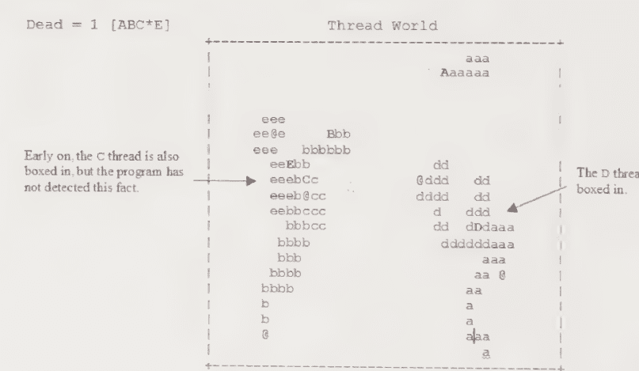

**图 11.18** 程序11.10的部分运行输出。按照当前写法，该示例*通常*会生成相当有趣的运行结果。不过，由于程序中存在一些逻辑上的*疏漏*，偶尔会出现无法按预期运行的情况。<sup>23</sup> 图11.18展示了程序11.10一次部分运行的输出，该次运行涉及5个相互竞争的线程（字母A-E）。如图所示的运行中，共生成了5个线程。线程D在被围住时终止（此次运行中它是被之前移动留下的小写d包围的）。所示输出的左上角原本是字母D的位置现在显示为*（代表该线程已终止）。如图所示，线程C也已经被围住。不过，要么是程序漏掉了这一事实（也就是之前提到的疏漏），要么是在它完全更新屏幕之前就被中断了。其余线程仍处于活跃状态。如图所示，执行`main`的线程已经完成了15轮循环。

### 11-12 练习

如果我们多次运行程序11.10，偶尔会发现程序无法正常终止。出现这种情况时，程序会认为有一个或多个线程仍处于活跃状态，尽管屏幕显示已经明确表明这些线程已经被围住。找出并修正这个“问题”的根源。

### 11-13 练习

用户自定义的`move`函数的逻辑非常简单。修改程序11.10，加入两个（或更多）不同的`move`函数。这些新的`move`函数分别由不同的线程运行，移动逻辑应该尽可能避免线程被围住。在可行的情况下，这些函数还应该尝试围堵（从而终止）其他线程。收集数据，证明你实现的`move`函数优于最初的简化版本。如果时间允许，可以尝试让你的`move`函数和其他人编写的`move`函数进行对比。如果你不想公开函数的源代码，只需在`main`函数中传入你实现的`move`函数的唯一名称，并在编译时链接该`move`函数的目标代码即可。

<sup>23</sup> 这些疏漏是与此程序相关的习题的核心依据。

### 11-14 练习

以程序11.10中的代码为基础，编写康威生命游戏的线程化版本，要求每个线程管理一组细胞的初始配置。请自行制定竞争线程尝试访问同一细胞位置时的处理规则。

## 11.10 调试多线程程序

编写能正确执行的多线程程序是一项不小的挑战。幸运的是，有一些工具可以帮助完成这项任务。目前许多C、C++编译器都自带支持线程感知的调试器。例如，新版GNU C、C++编译器`gcc`、`g++`自带`gdb`，Solaris的C、C++编译器则自带`dbx`。

支持线程感知的调试器可以自动识别多线程代码。这类调试器可用于单步执行多线程程序，并检查互斥锁和线程特定数据（TSD）的内容。我们将以程序11.11作为线程调试示例的源码。本次演示将使用GNU的`gdb`（版本5.1.90CVS-5）<sup>24</sup>。该程序语法正确，但存在多个分离线程访问和操作公共数据时的逻辑错误。

```
Program 11.11 Debugging multithreaded programs. File : p11.11.cxx
/*
| Debugging multithreaded prgrms - WITH LOCKING ERRORS
| Compile: g++ p11.11.cxx -lpthread -o p11.11
*/
#define _REENTRANT
#define _GNU_SOURCE
#include <iostream>
#include <cstdio>
#include <cstdlib>
```

<sup>24</sup> 本文仅介绍调试器的命令行版本。GNU还为窗口环境使用者提供了名为`xxgdb`的图形化调试器界面。

## 11.10 调试多线程程序

```


```
10 #include <pthread.h>
#include <unistd.h>
#include <sys/time.h>
using namespace std;
const int MAX=5, HOME=25;
int my_rand(int start, int range){
    struct timeval t;
    gettimeofday(&t, (struct timezone *)NULL);
    return (int)(start+((float)range * rand_r((unsigned *)&t.tv_usec))
    / (RAND_MAX+1.0));
}
typedef struct {
    int increment;
    char *phrase;
} argument;
void step( void * );
// common to all threads
pthread_t thread_id[MAX];
bool alive = true, home = false;
int position,total=0;
char walk[] = "   |     | ";
int main(int argc, char *argv[]) {
    argument right={ +1, "ZOINK! Stepped off the RIGHT side.\n"},
    left ={ -1, "SPLAT! Stepped off the LEFT side.\n"};
    pthread_attr_t attr_obj;
    if (argc < 2) { /* check arg list */
        cerr << *argv << " start_position" << endl;
        return 1;
    }
    position = atoi(argv[1]);
    if ( position < 1 )
        position = 1;
    else if ( position > MAX )
        position = MAX;
    walk[position*5] = '*';
    setvbuf(stdout, (char *) NULL, _IONBF, 0);
    cout << "The drunken sailor walk" << endl << endl;
    cout << "  +12345+" << endl;
    cout << walk << endl;
    pthread_attr_init( &attr_obj );
    pthread_attr_setdetachstate( &attr_obj, PTHREAD_CREATE_DETACHED );
    pthread_create(&thread_id[0], &attr_obj,
    (void *(*) (void *)) step, (void *) &right);
    pthread_create(&thread_id[1], &attr_obj,
    (void *(*) (void *)) step, (void *) &left );
    pthread_exit(NULL);
    return 0;
}
```

```
60 void step( void *a ) {
    argument *my_arg=(argument *)a;
    do {
        sleep( my_rand(1,3) ); // pause a bit
        walk[position+MAX] = ' '; // clear old position
        position += my_arg->increment; // calculate new position
        alive = bool(position > 0 && position <= MAX);
        walk[position+MAX] = alive ? '*' : '$';
        cout << walk << endl;
        home = bool(++total >= HOME);
        if ( !alive || home ) {
            if ( !alive )
                cout << my_arg->phrase;
            else
                cout << "The sailor made it home safely this time!\n";
            pthread_kill(thread_id[ (position < 1 ? 1 : 0)], 9);
        }
        sched_yield( );
    } while ( alive && !home );
}
```

程序11.11包含多种POSIX线程调用。该程序是纯教学性质的，实现了“醉酒水手”问题的一个版本。在这个版本中，醉酒水手被放置在一个宽5步的步道上，拥有给定的起始位置。程序会追踪水手沿步道走向家（家的位置距离起点任意步数）的路径。如果水手走出步道的两侧，就会坠落。如果水手在走完设定步数后仍在步道上，就视为他安全到家。

水手在步道上的位置存储在名为`position`的变量中。两个线程会操作这个数据：一个线程执行用户定义的`step`函数，让水手向右移动，另一个线程执行同样的函数，让水手向左移动（移动方向基于传递给`step`函数的参数）。两个线程都与启动线程分离。当水手坠落或走到步道尽头时，分离线程会被终止。

程序11.11的典型输出如图11.19所示。第一次运行时，程序的表现基本符合预期。但第二、三次运行的结果却有些出人意料：第二次运行时，看起来步道上好像有两个水手（我猜你可能会以为是看花了眼——但事实并非如此）；第三次运行时，步道的右侧似乎消失了。

## 11.10 调试多线程程序

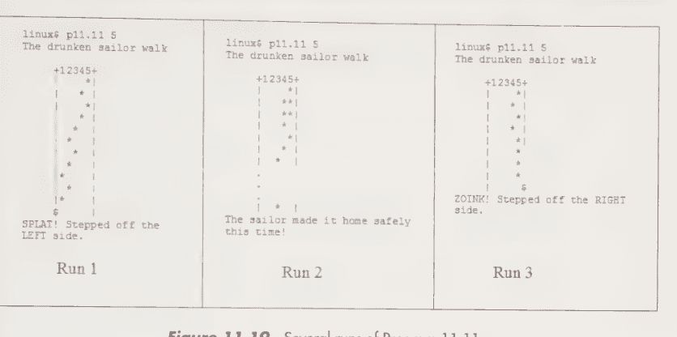

*图11.19* 程序11.11的多次运行结果。显然，程序出现了异常！

问题的根源在于竞争线程对公共数据的无限制访问。要检查问题所在，一种方法是在调试器中运行程序。要在调试器中运行程序，需要在编译时传入`-g`参数，防止可执行文件自动删除额外的符号表信息。例如，执行如下命令序列：

```
linux$ g++ -g p11.11.cxx -lpthread -o p11.11
```

可生成可在调试器中加载运行的可执行文件`p11.11`。

启动调试器时，需要传入可执行文件的名称。就本示例而言，启动命令如下：

```
linux$ gdb p11.11
GNU gdb Red Hat Linux (5.1.90CVS-5)
Copyright 2002 Free Software Foundation, Inc.
GDB is free software, covered by the GNU General Public License, and you are welcome to change it and/or distribute copies of it under certain conditions.
Type "show copying" to see the conditions.
There is absolutely no warranty for GDB.
Type "show warranty" for details.
This GDB was configured as "i386-redhat-linux"...
(gdb)
```

假设我们希望调试器在用户定义的`step`函数处暂停。我们可以使用`gdb`中的`list`命令查看指定的代码行序列（包含行号）。例如：

```
(gdb) list 61,81
61 void
62 step( void *a )
63 {
64   argument *my_arg=(argument *)a;
65   do {
66     sleep( my_rand(1,3) ); // pause a bit
67     walk[position+MAX] = ' '; // clear old position
68     position += my_arg->increment; // calculate new position
69     alive = bool(position > 0 && position <= MAX);
70     walk[position+MAX] = alive ? '*' : '$';
71     cout << walk << endl;
72     home = bool(++total >= HOME);
73     if ( !alive || home ) {
74       if ( !alive )
75         cout << my_arg->phrase;
76       else
77         cout << "The sailor made it home safely this time!\n";
78       pthread_kill(thread_id[ (position < 1 ? 1 : 0)], 9);
79     }
80     sched_yield( );
81   } while ( alive && !home );
82 }
```

此外，我们也可以使用`list`命令并传入想要查看的用户定义函数名（例如`step`）。这样做的话，调试器会显示所引用函数的前N行（通常为10行），列出的内容通常从函数本体之前的一两行开始：

```
(gdb) list step
57 (void *(*)(void *)) step, (void *) &left );
58 pthread_exit(NULL);
59 return 0;
60 }
61 void
62 step( void *a )
63 {
64   argument *my_arg=(argument *)a;
65   do {
66     sleep( my_rand(1,3) ); // pause a bit
67     walk[position+MAX] = ' '; // clear old position
```

要在第66行暂停，我们需要设置断点：

```
(gdb) break 66
Breakpoint 1 at 0x8048b61: file p11.11.cxx, line 66.
```

要执行程序，需使用`run`命令。通常需要传入命令行的参数放在`run`命令之后。

```
(gdb) run 5
Starting program: /home/faculty/gray/revision/11/sailor/p11.11 5
[New Thread 1024 (LWP 3176)]
The drunken sailor walk +12345+ *|
[New Thread 2049 (LWP 3193)]
[New Thread 1026 (LWP 3194)]
[New Thread 2051 (LWP 3195)]
[Switching to Thread 1026 (LWP 3194)]
Breakpoint 1, step (a=0xbffffb48) at p11.11.cxx:66
66 walk[position+MAX] = ' '; // clear old position
```

当调试器在指定行暂停时，可以执行`info thread`命令获取丰富的线程信息。

```
(gdb) info thread
4 Thread 2051 (LWP 3195) 0x420b4b31 in nanosleep () from /lib/i686/libc.so.6
* 3 Thread 1026 (LWP 3194) step (a=0xbffffb48) at p11.11.cxx:66
2 Thread 2049 (LWP 3193) 0x420e0037 in poll () from /lib/i686/libc.so.6
1 Thread 1024 (LWP 3176) 0x420292e5 in sigsuspend () from /lib/i686/libc.so.6
```

敏锐的读者会发现很多细节。线程1（发起线程）本该在第58行（`pthread_exit(NULL);`）退出，但此刻仍处于活跃状态。当前共有4个线程关联到该程序。当前活跃的线程（用星号标注）是线程ID 3，对应LWP 3194。`display variable_name`命令中，`variable_name`为你想要监控的变量名，该命令会指示调试器每次遇到断点时都显示该变量的当前值。在下面的执行序列中，我们在执行`run`命令前，已经指示调试器显示全局变量`alive`、`position`和`home`的内容。

```
Starting program: /home/faculty/gray/revision/11/sailor/p11.11 5
[New Thread 1024 (LWP 3274)]
The drunken sailor walk +12345+ | *|
[New Thread 2049 (LWP 3291)]
[New Thread 1026 (LWP 3292)]
[New Thread 2051 (LWP 3293)]
[Switching to Thread 1026 (LWP 3292)]
```

```
Breakpoint 1, step (a=0xbffffb48) at p11.11.cxx:66
66 walk[position+MAX] = ' '; // clear old position
3: home = false
2: position = 5
1: alive = true
(gdb) cont
Continuing.
| $ ZOINK! Stepped off the RIGHT side.
[Switching to Thread 2051 (LWP 3293)]
```

此时，处于位置5的水手尚未到家，仍然存活。

```
Breakpoint 1, step (a=0xbffffb40) at p11.11.cxx:66
66 walk[position+MAX] = ' '; // clear old position
3: home = false
2: position = 6
1: alive = false
(gdb) cont
Continuing.
| *
```

现在水手处于位置6。他/她尚未到家，也不再存活。程序本应在此处停止，但实际上没有。

```
Breakpoint 1, step (a=0xbffffb40) at p11.11.cxx:66
66 walk[position+MAX] = ' '; // clear old position
3: home = false
2: position = 5
1: alive = true
. . .
```

突然，水手又回到了位置5。虽然此时水手已经到家，但又恢复了存活状态！显然，对位置执行减操作的线程，在存活状态检查之前就完成了自己的操作。可以使用`thread N`命令来指定特定线程，其中`N`是对应线程的编号。如下所示，加载指定线程后，就可以查看该线程独有的信息。

```
(gdb) thread 4
[Switching to thread 4 (Thread 2051 (LWP 3342))]#0 step (a=0xbffffb40) at p11.11.cxx:66
66 walk[position+MAX] = ' '; // clear old position
(gdb) print *my_arg
$24 = {increment = -1, phrase = 0x8048da0 "SPLAT! Stepped off the LEFT side.\n"}
(gdb) thread 3
[Switching to thread 3 (Thread 1026 (LWP 3341))]#0 step (a=0xbffffb48) at p11.11.cxx:66
66 walk[position+MAX] = ' '; // clear old position
(gdb) print *my_arg
$25 = {increment = 1, phrase = 0x8048d60 "ZOINK! Stepped off the RIGHT side.\n"}
```

这就是执行减操作的线程。只要调试器处于暂停状态，就可以显示互斥锁的内容（前提是该互斥锁在当前作用域内）。例如，如果我们有一个名为`my_lock`的互斥锁，它在被获取之前的内容如下：

```
(gdb) print my_lock
$1 = {__m_reserved = 0, __m_count = 0, __m_owner = 0x0, __m_kind = 0, __m_lock = {__status = 0, __spinlock = 0}}
```

它被获取之后的内容如下。该成员在互斥锁被锁定时会被设为1。

```
(gdb) print my_lock
$2 = {__m_reserved = 0, __m_count = 0, __m_owner = 0x0, __m_kind = 0, __m_lock = {__status = 1, __spinlock = 0}}
```

**退出**命令用于退出调试器。在`gdb`中执行`help`命令可以显示`gdb`命令的简略列表。`gdb`手册页包含了如何调用`gdb`的更详细说明。在命令行中执行`info gdb`可以获取大量关于如何使用`gdb`的信息（包括相当详细的示例会话）。

## 11-15 练习

修改程序11.11，使其支持两名（或更多）水手同时沿着木板路行走（你可能需要拓宽木板路的宽度）。为每个水手分配不同的符号。任意时刻不允许两名水手占据同一位置（这是明文规定！）。当所有水手都耗尽体力，或有一名及以上水手达成目标（即走完预设的步数）时，程序结束。

## 11.11 小结


线程是由一个或多个进程执行的独立步骤序列。根据定义，所有程序都包含单一控制线程。线程可以动态创建、独立执行，能够以极低的成本（包括系统资源和编程工作量两方面）实现并发。由多个独立任务组成的问题适合用多线程方案解决，而本质上是串行的问题则不适用。线程库（例如POSIX线程库）为程序员提供了生成和协调多线程的能力。这些线程可以包含在单个进程中，也可以分布在多个进程中。同一个进程内的线程共享该进程的大部分状态信息。从系统实现层面来看，线程可以分为绑定型（直接与底层LWP关联）和非绑定型。非绑定线程会按需从系统维护的池中映射到LWP。线程可以设置为分离状态。分离线程无法被等待，它在完成处理之后会自动退出。非分离线程可以被等待（通常由创建它的线程执行），并获取其退出状态。创建线程时，会向它传入一个指向其要执行代码的引用。每个线程都有对应的优先级和调度算法，系统会依据这些参数来决定线程何时以及如何获得处理时间。线程的实际调度由线程库（非绑定型）或内核（绑定型）负责。线程可以发送和接收信号。在多线程环境中，通常会将其中一个线程指定为信号捕获线程。信号掩码用于指定线程是否会对特定信号做出响应或直接忽略。线程的活动可以通过互斥锁、条件变量和信号量进行协调。互斥锁用于锁定特定的代码段（通常称为临界区），该区域中访问的数据的完整性必须得到保证。当需要锁定的代码段覆盖整个待执行模块时，通常会使用“监视器”这一术语。部分线程库支持读写互斥锁。读写互斥锁允许任意数量的线程读取受保护的数据，但同一时间只允许一个线程写入或修改数据。读写互斥锁的运行速度比更简单的普通互斥锁慢得多。被不同进程中的线程使用的互斥锁，必须映射到共享内存位置。条件变量用于强制线程在任意条件上阻塞。基于POSIX4实现的多线程安全信号量可以是二进制信号量或计数信号量。信号量可以用于管理多种资源。通常，最佳实践是仅锁定最少数量的代码行，以保证数据一致性。如果需要，可以在公共代码段中包含针对每个线程有特定值的数据项。这类数据称为线程特定数据（TSD），所有线程都可以访问它，但它是按线程为单位维护的。系统会使用唯一的键值来确定给定线程中的数据值。

## 11.12 术语与核心概念

- `/usr/bin/time` 实用工具

- `POSIX_C_SOURCE` 定义常量

- `REENTRANT` 定义常量

- `<pthread.h>` 头文件

- `<semaphore.h>` 头文件

- `<signal.h>` 头文件

- `clone` 系统调用

- 条件变量

- `gdb` 实用工具

- 重量级进程

- 内核级线程

- 轻量级进程（LWP）

- 多线程互斥量

- `nanosleep` 实时库函数

- 非抢占式调度

- 不透明数据类型

- 并行性

- POSIX 1003.1 标准

- POSIX 1003.1c 标准

- 抢占式调度

- `pthread_attr_getschedparam` 库函数

- `pthread_attr_init` 库函数

- `pthread_attr_setschedparam` 库函数

- `pthread_cleanup_pop` 库函数

- `pthread_cleanup_pop_restore_np` 库函数

- `pthread_cleanup_push` 库函数

- `pthread_cleanup_push_defer_np` 库函数

- `PTHREAD_COND_INITIALIZER` 定义常量

- `pthread_cond_broadcast` 库函数

- `pthread_cond_signal` 库函数

- `pthread_cond_timedwait` 库函数

- `pthread_cond_wait` 库函数

- `pthread_create` 库函数

- `PTHREAD_CREATE_DETACHED` 定义常量

- `PTHREAD_CREATE_JOINABLE` 定义常量

- `PTHREAD_DESTRUCTOR_ITERATIONS` 定义常量

- `pthread_detach` 库函数

- `PTHREAD_ERRORCHECK_MUTEX_INITIALIZER_NP` 定义常量

- `pthread_exit` 库函数

- `PTHREAD_EXPLICIT_SCHED` 定义常量

- `pthread_getschedparam` 库函数

- `pthread_getspecific` 库函数

- `PTHREAD_INHERIT_SCHED` 定义常量

- `pthread_join` 库函数

- `pthread_key_create` 库函数

- `pthread_key_delete` 库函数

- `pthread_kill` 库函数

- `pthread_mutex_destroy` 库函数

- `PTHREAD_SCOPE_PROCESS` 定义常量

- `PTHREAD_MUTEX_ERRORCHECK` 定义常量

- `PTHREAD_SCOPE_SYSTEM` 定义常量

- `PTHREAD_MUTEX_FAST` 定义常量

- `pthread_setschedparam` 库函数

- `pthread_mutex_init` 库函数

- `pthread_setspecific` 库函数

- `PTHREAD_MUTEX_INITIALIZER` 定义常量

- `pthread_sigmask` 库函数

- `pthread_mutex_lock` 库函数

- 可重入函数

- `PTHREAD_MUTEX_RECURSIVE` 定义常量

- `SCHED_FIFO` 定义常量

- `pthread_mutex_trylock` 库函数

- `sched_get_priority_max` 库函数

- `pthread_mutex_unlock` 库函数

- `sched_get_priority_min` 库函数

- `SCHED_OTHER` 定义常量

- `pthread_mutexattr_init` 库函数

- `SCHED_RR` 定义常量

- `pthread_mutexattr_settype` 库函数

- `sched_yield` 系统调用

- `pthread_once` 库函数

- `sem_getvalue` 库函数

- `PTHREAD_RECURSIVE_MUTEX_INITIALIZER_NP` 定义常量

- `sem_init` 库函数

- `pthread_rwlock_init` 库函数

- `sem_post` 库函数

- `pthread_rwlock_rdlock` 库函数

- `sem_trywait` 库函数

- `pthread_rwlock_t` 数据类型

- `sem_wait` 库函数

- `pthread_rwlock_tryrdlock` 库函数

- `setpriority` 系统调用

- `pthread_rwlock_trywrlock` 库函数

- `SIG_BLOCK` 定义常量

- `pthread_rwlock_unlock` 库函数

- `SIG_MASK` 定义常量

- `SIG_UNBLOCK` 定义常量

- `sigaction` 库函数

- `sigaddset` 库函数

# 附录A 使用Linux手册页

## A.1 手册页章节

Linux系统中的在线手册页提供了丰富的信息。手册页大致按类别分为以下章节：

- 1. 用户命令和应用程序。
- 2. 系统调用。完整的系统调用列表可查阅本附录末尾。
- 3. 库函数——这类函数不会直接调用内核原语。
- 4. 设备。
- 5. 文件格式。
- 6. 游戏和演示程序。
- 7. 特殊约定与协议、字符集标准、标准文件系统布局以及各类其他杂项内容。
- 8. 仅超级用户可用的管理和特权命令。
- 9. 设备驱动与内核接口。
- n. 新增内容。

有多种方式可以获取手册页信息。最标准的方法是在命令行使用`man`实用工具。例如，几乎每个章节都有一个名为`intro`的手册页，用于提供该章节的概览。要获取指定章节的对应`intro`手册页，只需在调用`man`命令时在命令行传入章节编号即可。例如，第2章（系统调用）的`intro`手册页可通过如下命令指定：

``` linux$ man 2 intro ```

在命令行中，可通过以下命令序列将手册页发送到打印机：

``` linux$ man 2 intro | col -b | lp ```

在该序列中，`man`命令的输出会被管道传输到`col`实用工具。该工具传入`-b`选项时，会过滤所有退格符，仅输出每个列位置最后写入的字符。`col`工具的输出随后会通过管道传输到`lp`工具执行打印。

另一种方法是使用`info`实用工具。该程序是文档阅读类工具，可方便地进行手册页导航并访问相关主题。命令行序列

``` linux$ info intro ```

会调出`info`工具的对应手册页。在我们的Linux系统上，该命令会显示以下界面：

``` File: info.info, Node: Top, Next: Getting Started, Up: (dir) Info: An Introduction ********************* Info is a program, which you are using now, for reading documentation of computer programs. The GNU Project distributes most of its on-line manuals in the Info format, so you need a program called "Info reader" to read the manuals. One of such programs you are using now. If you are new to Info and want to learn how to use it, type the command 'h' now. It brings you to a programmed instruction sequence. To learn advanced Info commands, type 'n' twice. This brings you to 'Info for Experts', skipping over the 'Getting Started' chapter. * Menu: * Getting Started:: Getting started using an Info reader. * Advanced Info:: Advanced commands within Info. * Creating an Info File:: How to make your own Info file. * Index:: An index of topics, commands, and variables. ```

在该初始界面输入字母`h`会显示该工具的基础使用方法，输入字母`q`则会退出（关闭）`info`实用工具。

另一种方法是使用`xman`，即X Window系统的手册浏览器。例如，在我们的Linux系统上，输入以下命令序列：

``` linux$ setenv MANPATH /mit/kit/man:/usr/share/man linux$ xman & ```

会将环境变量`MANPATH`（`xman`使用的变量）赋值为需要搜索的目录位置。<sup>1</sup> 该命令会禁用访问控制（允许X Window客户端从任意主机连接），并启动`xman`，将其置于后台运行。

在客户端会显示一个类似下方的小型X Window窗口：


选择`[Help]`会显示带有在线帮助的窗口，`[Quit]`会终止服务，`[Manual Page]`会显示包含手册页浏览器的窗口。选择`[Manual Page]`后输入`[Ctrl] + [S]`会生成一个文本输入框，可在其中输入特定命令的名称。

`/etc/man.config`是一个文本文件，存储了`man`工具的默认自定义配置项。该文件中包含多个被赋值的自定义大写标识符，这些标识符与`man`工具使用的对应环境变量一一对应。如果对应的环境变量未被设置，`man.config`文件中标识符的赋值将作为默认值生效。

除了`MANPATH`外，另一个值得关注的项目是`MANSECT`的赋值。`MANSECT`规定了需要搜索的手册章节及其顺序。在我们的系统初始配置中，`MANSECT`的设置为：

``` MANSECT 1:8:2:3:4:5:6:7:9:tcl:n:l:p:o ```

从管理角度看该设置是合理的。但如果你需要大量进行编程工作，可能希望调整默认顺序，将<sup>1</sup>此处内容因系统差异会有些不同，请查阅`/etc/man.config`文件获取`MANPATH`变量的具体内容说明。无论如何，使用`xman`时务必把`/mit/kit/man`添加到需要搜索的目录中。

若调整手册页章节顺序，将第8节（管理及特权命令）往后排，同时把第2节（系统调用）和第3节（库函数）往前挪，一种可行的调整方案如下：

``` MANSECT 3:2:1:4:5:6:7:8:9:tcl:n:l:p:o ```

## A.2 手册页格式

使用`man`命令查看的单个手册页遵循一定的标准格式。下面展示了一个典型的手册页（位于第3节的`perror`手册页）。

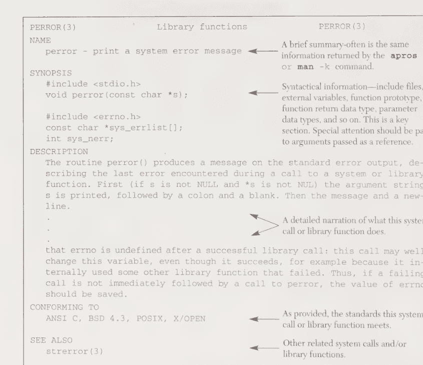

## 附录A • 使用Linux手册页

手册页顶部是标题行，标题行下方是一系列由大写标签标注的次级部分。

大部分（非全部）系统调用和库函数手册页共有的分区如下：

- **NAME**
  该部分首先列出入条目的名称，随后附上简要描述。该描述通常与使用`man -k`（关键词查询）命令查询特定主题时返回的描述相同，至少也非常相似。`man -k`管道命令会返回所有包含`管道`术语的条目（系统调用、库函数等）的手册页摘要。
  例如：
  ``` linux$ man -k pipe

  fifo (4) - first-in first-out special file, named pipe

  funzip (1) - filter for extracting from a ZIP archive in a pipe

  IO::Pipe (3pm)- supply object methods for pipes

  mkfifo (1) - make FIFOs (named pipes)

  mkfifo (3) - make a FIFO special file (a named pipe)

  open (n) - Open a file-based or command pipeline channel

  perlipc (1) - Perl interprocess communication (signals, fifos, pipes, safe subprocesses, sockets, and semaphores)

  pipe (2) - create pipe ```
  在大多数系统中，`man -k`等同于使用`apropos`工具（即`man -k`管道的返回结果和`apropos`管道的返回结果一致）。

- **SYNOPSIS**
  该部分提供正确使用该条目的语法信息。如果是系统调用或库函数，该部分会列出所需的包含文件、所引用的外部变量和函数原型。系统调用或库函数的返回值数据类型可以从原型定义中获取。
  例如，`perror`库函数的手册页包含如下`SYNOPSIS`内容：
  ``` #include <stdio.h>

  void perror(const char *s);

  #include <errno.h>

  extern const char *sys_errlist[];
```


`extern int sys_nerr;`  
  
这表明要使用`perror`，必须包含头文件`stdio.h`。`perror`调用接受单个参数`s`，该参数是指向`char`类型常量的指针。`perror`的返回值类型为`void`，表示它不返回值。此外，SYNOPSIS部分还表明，如果要使用`sys_errlist`引用的外部错误列表，或存储所有可能错误数量的外部变量`sys_nerr`，需要包含`errno.h`文件。

需要注意指针（引用）类型的参数，这类参数必须引用正确的数据类型（例如`char`、`int`等）。如果要向系统调用或库函数传递信息，被引用的对象必须设置为正确的初始值。此外，如果要通过引用返回信息，程序员必须在调用前为被引用的项分配足够的空间。

`man`命令的`-k`选项使用`windex`数据库，该数据库通过运行`catman`程序生成。如果系统管理员没有运行过该程序，或`windex`数据库已过时，`man`的`-k`选项将无法正常工作。

- **DESCRIPTION**  
  该部分包含对系统调用或库函数功能的详细说明。
- **RETURN VALUE**  
  该部分说明系统调用或库函数返回的值，以及如何解读这些返回值。该条目会说明是否设置了`errno`。
- **CONFORMING TO**  
  该部分说明系统调用或库函数符合的相关标准。通常这些标准会使用缩写，例如`SVr4`、`SVID`、`POSIX`、`X/OPEN`或`BSD 4.3`。有时也会注明特定的编译选项和/或特定常量的定义（例如`_GNU_SOURCE`）。
- **ERRORS**  
  该部分列在`errno`被设置的情况下出现的内容，即系统调用或库函数执行失败时生成的错误码，同时附上每个错误码的简要解读说明。
- **FILES**  
  该部分列出系统调用或库函数访问或修改的文件。
- **SEE ALSO**  
  该部分列出其他相关条目，例如关联的系统调用或库函数。
- **NOTES**  
  该部分为综合类条目，包含不属于上述任何类别的其他相关信息。
- **LINUX NOTES**  
  该部分包含仅针对Linux实现的相关说明。
- **AUTHORS**  
  该部分列出作者列表（通常会附带作者的电子邮箱地址）。

还存在其他一些不常用的手册页分区，这些分区和上述分区一样通常不需要额外解释（例如`OPTIONS`、`EXAMPLE`、`BUGS`、`HISTORY`、`WARNINGS`、`DIAGNOSTICS`等）。偶尔还能看到一些自嘲式的小幽默，以下是用于调优Linux第二扩展文件系统的系统命令`tune2fs`的手册页内容："我们目前还没发现任何bug，但这不代表没有……"。遗憾的是，随着相关规范日益标准化，这类轻松的内容正变得越来越少见。

## A.3 标准Linux系统调用

- `llseek`
- `newselect`
- `_sysctl`
- `access`
- `acct`
- `adjtimex`
- `afs_syscall`
- `alarm`
- `bdflush`
- `break`
- `brk`
- `capget`
- `capset`
- `chdir`
- `chmod`
- `chown`
- `chown32`
- `chroot`
- `clone`
- `close`
- `creat`
- `create_module`
- `delete_module`
- `dup`
- `dup2`
- `execve`
- `exit`, `_exit`
- `fchdir`
- `fchmod`
- `fchown`
- `fchown32`
- `fcntl`
- `fcntl16`
- `fdatasync`
- `fgetattr`
- `flistxattr`
- `flock`
- `fork`
- `fremovexattr`
- `fsetxattr`
- `fstat`
- `fstat64`
- `fstatfs`
- `fsync`
- `ftime`
- `ftruncate`
- `ftruncate64`
- `futex`
- `get_kernel_syms`
- `getcwd`
- `getdents`
- `getdents64`
- `getegid`
- `getegid32`
- `geteuid`
- `geteuid32`
- `getgid`
- `getgid32`
- `getgroups`
- `getgroups32`
- `getitimer`
- `getpgid`
- `getpgrp`
- `getpid`
- `getpmsg`
- `getppid`
- `getpriority`
- `getresgid`
- `getresgid32`
- `getresuid`
- `getresuid32`
- `getrlimit`
- `getrusage`
- `getsid`
- `gettid`
- `gettimeofday`
- `getuid`
- `getuid32`
- `getxattr`
- `gtty`
- `idle`
- `init_module`
- `ioctl`
- `ioperm`
- `iopl`
- `ipc`
- `kill`
- `lchown`
- `lchown32`
- `lgetxattr`
- `link`
- `listxattr`
- `lock`
- `lremovexattr`
- `lseek`
- `lsetxattr`
- `lstat`
- `lstat64`
- `madvise`
- `madvise1`
- `mincore`
- `mkdir`
- `mknod`
- `mlock`
- `mlockall`
- `mmap`
- `mmap2`
- `modify_ldt`
- `mount`
- `mprotect`
- `mpx`
- `remap`
- `msync`
- `munlock`
- `munlockall`
- `munmap`
- `nanosleep`
- `nfsservctl`
- `nice`
- `oldfstat`
- `oldlstat`
- `oldolduname`
- `oldstat`
- `olduname`
- `open`
- `pause`
- `personality`
- `pipe`
- `pivot_root`
- `poll`
- `prctl`
- `pread`
- `prof`
- `profil`
- `ptrace`
- `putmsg`
- `pwrite`
- `query_module`
- `quotactl`
- `read`
- `readahead`
- `readdir`
- `readlink`
- `readv`
- `reboot`
- `removexattr`
- `rename`
- `rmdir`
- `rt_sigaction`
- `rt_sigpending`
- `rt_sigprocmask`
- `rt_sigqueueinfo`
- `rt_sigreturn`
- `rt_sigsuspend`
- `rt_sigtimedwait`
- `sched_get_priority_max`
- `sched_get_priority_min`
- `sched_getaffinity`
- `sched_getparam`
- `sched_getscheduler`
- `sched_rr_get_interval`
- `sched_setaffinity`
- `sched_setparam`
- `sched_setscheduler`
- `sched_yield`
- `security`
- `select`
- `sendfile`
- `sendfile64`
- `setdomainname`
- `setfsgid`
- `setfsgid32`
- `setfsuid`
- `setfsuid32`
- `setgid`
- `setgid32`
- `setgroups`
- `setgroups32`
- `sethostname`
- `setitimer`
- `setpgid`
- `setpriority`
- `setregid`
- `setregid32`
- `setresgid`
- `setresgid32`
- `setresuid`
- `setresuid32`
- `setreuid`
- `setreuid32`
- `setrlimit`
- `setsid`
- `settimeofday`
- `setuid`
- `setuid32`
- `setxattr`
- `sgetmask`
- `sigaction`
- `sigaltstack`
- `signal`
- `sigpending`
- `sigprocmask`
- `sigreturn`
- `sigsuspend`
- `socketcall`
- `ssetmask`
- `stat`
- `stat64`
- `statfs`
- `stime`
- `stty`
- `swapoff`
- `swapon`
- `symlink`
- `sync`
- `sysfs`
- `sysinfo`
- `syslog`
- `time`
- `times`
- `truncate`
- `truncate64`
- `ugetrlimit`
- `ulimit`
- `umask`
- `umount`
- `umount2`
- `uname`
- `unlink`
- `uselib`
- `ustat`
- `utime`
- `vfork`
- `vhangup`
- `vm86`
- `vm86old`
- `wait4`
- `waitpid`
- `write`
- `writev`

## 附录B

## UNIX错误信息

系统调用或库函数执行失败产生的错误，可以通过调用`perror`或`strerror`库函数来显示（参见1.5节"管理失败"中的"管理系统调用失败"部分）。

例如，在Linux系统上，可以使用程序B.1完整显示`strerror`返回的所有错误信息。

```
Program B.1 显示strerror错误信息

文件 : errors.cxx

| #include <iostream>
| #include <cstring>
| #include <errno.h>
|
extern int sys_nerr;
+ using namespace std;
|
| int
| main( ){
! for (int err=0; err < sys_nerr; ++err )
. cout << err << '\t' << strerror(err) << endl;
10 return 0;
| }
```

## 附录B · UNIX错误消息

由于程序输出会占满多个屏幕，因此将输出重定向到文件（供日后参考）或`more`命令（以便以可控的速度查看输出）会很有帮助。

若要编译源文件并将程序输出捕获到名为`emessages`的文件中，命令序列如下：

```
linux

$ g++ errors.cxx -o errors
$ errors > emessages
```

如果编译后希望将程序输出通过管道传递给`more`命令，命令序列如下：

```
linux

$ errors | more
```

请注意，C/C++程序中`strerror`（以及`perror`）返回的错误消息，与名为`perror`的Linux命令行工具返回的消息一致。

用于查询错误码13对应错误消息的命令行序列如下：

```
linux

$ perror 13
Error code 13: Permission denied
```

使用命令行`perror`工具显示所有错误消息的Bourne shell脚本如**程序B.2**所示。

### 程序B.2 使用`perror`生成错误消息的Bourne shell脚本

```
bash

File : errors_script
#! /bin/bash

err=0
while test $err -lt 125; do
echo -n "$err "
perror -s $err
err=`expr $err + 1`
done
```


表B.1列出了错误码、其符号常量名，以及`strerror`生成的实际消息。

### 表B.1 错误消息

| 错误码 | 符号常量 | `strerror`生成的消息 |
|---|---|---|
| 0 | | 成功 |
| 1 | `EPERM` | 操作不被允许 |
| 2 | `ENOENT` | 无此文件或目录 |
| 3 | `ESRCH` | 无此进程 |
| 4 | `EINTR` | 系统调用被中断 |
| 5 | `EIO` | 输入/输出错误 |
| 6 | `ENXIO` | 无此设备或地址 |
| 7 | `E2BIG` | 参数列表过长 |
| 8 | `ENOEXEC` | `exec`格式错误 |
| 9 | `EBADF` | 错误的文件描述符 |
| 10 | `ECHILD` | 无子进程 |
| 11 | `EAGAIN` | 资源暂时不可用 |
| 12 | `ENOMEM` | 无法分配内存 |
| 13 | `EACCES` | 权限不足 |
| 14 | `EFAULT` | 地址错误 |
| 15 | `ENOTBLK` | 需要块设备 |
| 16 | `EBUSY` | 设备或资源忙 |
| 17 | `EEXIST` | 文件已存在 |
| 18 | `EXDEV` | 无效的跨设备链接 |
| 19 | `ENODEV` | 无此设备 |
| 20 | `ENOTDIR` | 不是目录 |
| 21 | `EISDIR` | 是目录 |
| 22 | `EINVAL` | 无效参数 |
| 23 | `ENFILE` | 系统中打开的文件过多 |
| 24 | `EMFILE` | 打开的文件过多 |
| 25 | `ENOTTY` | 设备不支持该`ioctl`操作 |
| 26 | `ETXTBSY` | 文本文件正被占用 |
| 27 | `EFBIG` | 文件过大 |
| 28 | `ENOSPC` | 设备无剩余空间 |
| 29 | `ESPIPE` | 非法寻址 |

续前561页 **表B.1** *（续）*

| 错误码 | 符号常量 | `strerror`生成的消息 |
|---|---|---|
| 30 | `EROFS` | 只读文件系统 |
| 31 | `EMLINK` | 链接过多 |
| 32 | `EPIPE` | 管道破裂 |
| 33 | `EDOM` | 数值参数超出定义域 |
| 34 | `ERANGE` | 数值结果超出范围 |
| 35 | `EDEADLK` | 避免了资源死锁 |
| 36 | `ENAMETOOLONG` | 文件名过长 |
| 37 | `ENOLCK` | 无可用锁 |
| 38 | `ENOSYS` | 函数未实现 |
| 39 | `ENOTEMPTY` | 目录非空 |
| 40 | `ELOOP` | 符号链接层数过多 |
| 41 | `EWOULDBLOCK` | 未知错误41 |
| 42 | `ENOMSG` | 无所需类型的消息 |
| 43 | `EIDRM` | 标识符已被移除 |
| 44 | `ECHRNG` | 通道号超出范围 |
| 45 | `EL2NSYNC` | 2级未同步 |
| 46 | `EL3HLT` | 3级已停止 |
| 47 | `EL3RST` | 3级已重置 |
| 48 | `ELNRNG` | 链接号超出范围 |
| 49 | `EUNATCH` | 协议驱动未连接 |
| 50 | `ENOCSI` | 无可用CSI结构 |
| 51 | `EL2HLT` | 2级已停止 |
| 52 | `EBADE` | 无效的交换 |
| 53 | `EBADR` | 无效的请求描述符 |
| 54 | `EXFULL` | 交换队列已满 |
| 55 | `ENOANO` | 无阳极 |
| 56 | `EBADRQC` | 无效的请求码 |
| 57 | `EBADSLT` | 无效的插槽 |
| 58 | `EDEADLOCK` | 未知错误58 |
| 59 | `EBFONT` | 字体文件格式错误 |
| 60 | `ENOSTR` | 设备不是流设备 |
| 61 | `ENODATA` | 无可用数据 |
| 62 | `ETIME` | 定时器超时 |
| 63 | `ENOSR` | 流资源不足 |
| 64 | `ENONET` | 机器未接入网络 |
| 65 | `ENOPKG` | 软件包未安装 |
| 66 | `EREMOTE` | 对象为远程对象 |
| 67 | `ENOLINK` | 链接已断开 |
| 68 | `EADV` | 广播错误 |
| 69 | `ESRMNT` | `Srmount`错误 |
| 70 | `ECOMM` | 发送时通信错误 |
| 71 | `EPROTO` | 协议错误 |
| 72 | `EMULTIHOP` | 尝试多跳传输 |
| 73 | `EDOTDOT` | RFS专属错误 |
| 74 | `EBADMSG` | 消息错误 |
| 75 | `EOVERFLOW` | 值超出定义数据类型的范围 |
| 76 | `ENOTUNIQ` | 网络上的名称不唯一 |
| 77 | `EBADFD` | 文件描述符状态异常 |
| 78 | `EREMCHG` | 远程地址已变更 |
| 79 | `ELIBACC` | 无法访问所需的共享库 |
| 80 | `ELIBBAD` | 访问了损坏的共享库 |
| 81 | `ELIBSCN` | `a.out`中的`.lib`区段已损坏 |
| 82 | `ELIBMAX` | 尝试链接的共享库过多 |
| 83 | `ELIBEXEC` | 无法直接执行共享库 |
| 84 | `EILSEQ` | 无效或不完整的多字节/宽字符 |
| 85 | `ERESTART` | 被中断的系统调用应重启 |
| 86 | `ESTRPIPE` | 流管道错误 |
| 87 | `EUSERS` | 用户过多 |
| 88 | `ENOTSOCK` | 在非套接字上执行套接字操作 |
| 89 | `EDESTADDRREQ` | 需要目标地址 |
| 90 | `EMSGSIZE` | 消息过长 |
| 91 | `EPROTOTYPE` | 套接字协议类型错误 |
| 92 | `ENOPROTOOPT` | 协议不可用 |
| 93 | `EPROTONOSUPPORT` | 协议不被支持 |
| 94 | `ESOCKTNOSUPPORT` | 套接字类型不被支持 |
| 95 | `EOPNOTSUPP` | 套接字不支持该操作 |
| 96 | `EAFNOSUPPORT` | 地址族不被该协议支持 |
| 97 | `EADDRINUSE` | 地址已被使用 |
| 98 | `EADDRNOTAVAIL` | 无法分配请求的地址 |
| 99 | `ENETDOWN` | 网络已断开 |
| 100 | `ENETUNREACH` | 网络不可达 |
| 101 | `ENETRESET` | 网络重置时断开连接 |
| 102 | `ECONNABORTED` | 软件导致连接终止 |
| 103 | `ECONNRESET` | 连接被对等方重置 |
| 104 | `ENOBUFS` | 无可用缓冲区空间 |
| 105 | `EISCONN` | 套接字已连接 |
| 106 | `ENOTCONN` | 套接字未连接 |
| 107 | `ESHUTDOWN` | 套接字关闭后无法发送数据 |
| 108 | `ETOOMANYREFS` | 引用过多：无法拼接 |
| 109 | `ETIMEDOUT` | 连接超时 |
| 110 | `ECONNREFUSED` | 连接被拒绝 |
| 111 | `EHOSTDOWN` | 主机已宕机 |
| 112 | `EHOSTUNREACH` | 到主机的路由不可达 |
| 113 | `EALREADY` | 操作已在执行中 |
| 114 | `EINPROGRESS` | 操作正在执行中 |
| 115 | `ESTALE` | 过期的NFS文件句柄 |
| 116 | `EUCLEAN` | 结构需要清理 |
| 117 | `ENOTNAM` | 不是XENIX命名类型文件 |
| 118 | `ENAVAIL` | 无可用XENIX信号量 |

**564** 请注意，在C/C++程序中，最好始终通过符号常量引用特定错误，因为同一错误在不同UNIX实现（甚至是同一实现的不同版本）中的底层数值可能不同。例如，在Solaris 2.8中，错误`EBADR`（无效的请求描述符）对应错误码53；在Red Hat Linux 7.3中，同一错误也对应错误码53。类似地，错误`EIDRM`（标识符已被移除）在Red Hat Linux 7.3中对应错误码43，而在Solaris 2.8中对应错误码37。

除错误消息外，命令行工具`perror`还会返回MyISAM/ISAM¹表处理器的错误码及消息，这些错误码和对应消息如表B.2所示。同样地，这些错误大多依赖于具体系统。

### 表B.2 MyISAM/ISAM错误消息

| 错误码 | `perror`生成的MyISAM/ISAM消息 |
|---|---|
| 120 | 读写时未找到键 |
| 121 | 写入或更新时键重复 |
| 122 | |
| 123 | 行在读取后被他人修改 |
| 124 | |
| 126 | 索引文件损坏/文件格式错误 |
| 127 | 记录文件损坏 |
| 131 | 数据库不支持该命令 |
| 132 | 数据库文件版本过旧 |

### 表B.2（续）

| 错误编号 | 由`perror`生成的MyISAM/ISAM错误消息 |
|---|---|
| 133 | 更新前未读取到记录 |
| 134 | 记录已被删除（或记录文件损坏） |
| 135 | 记录文件无剩余空间 |
| 136 | 索引文件无剩余空间 |
| 137 | 无更多记录（已读取到文件末尾） |
| 138 | 使用了表不支持的扩展 |
| 139 | 行过大（>= 16 MB） |
| 140 | 创建选项错误 |
| 141 | 写入或更新时出现重复唯一键或约束冲突 |
| 142 | 使用了未知字符集 |
| 143 | MERGE表与映射表的表定义冲突 |
| 144 | 表已损坏，上次修复失败 |
| 145 | 表被标记为已损坏，需要修复 |
| 146 | 锁超时；请重试事务 |
| 147 | 锁表已满；请使用更大的锁表重启程序 |
| 148 | 只读事务下不允许执行更新 |
| 149 | 锁死锁；请重试事务 |

# 附录C

## C.1 简介

RPC语言（XDR扩展了**程序**和**版本**类型）的正确语法可通过按照箭头指示的流程浏览语法图<sup>1</sup>获得。在每个语法图中，圆角框内列出的单词或符号应完全按照所示内容输入。方角框中的非斜体条目会引用其他语法图。*斜体*条目引用“通用”条目，这些条目包括：

- 标识符（例如`const-ident`、`type-ident`等），遵循C标识符的标准语法；
- 类型，引用标准C数据类型（例如`int`、`double`等），并额外新增三种特殊XDR语言数据类型：`bool`（布尔型）、`string`（以NULL结尾的字符序列）和`opaque`（无类型数据）；
- 值，引用标准C值（例如整型常量、字面量等）。

> <sup>1</sup> 虽然我很想注明这些语法图遵循既定标准，但它们并不完全符合。不过它们的格式和风格足够接近，大多数读者应该能轻松理解。

`rpcgen`编译器会将所有RPC定义转换为标准C代码。首列为`%`的语句会原样传递，不进行解释。RPC语言由一系列以分号分隔的RPC定义组成：


RPC定义分为六类（或称六个定义）。

## C.2 RPC定义


#### C.2.1 程序定义

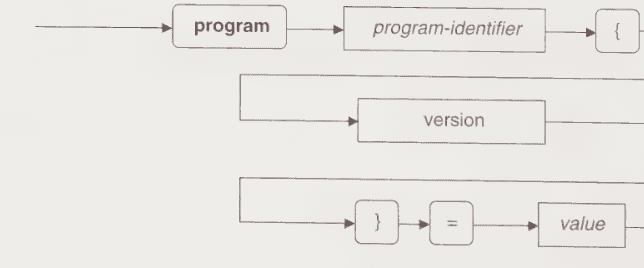

##### C.2.1.1 版本

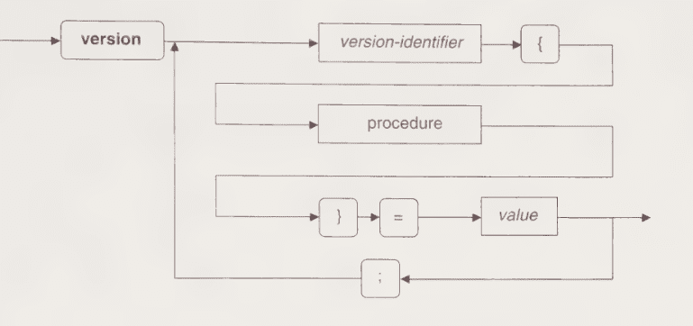

##### C.2.1.2 过程

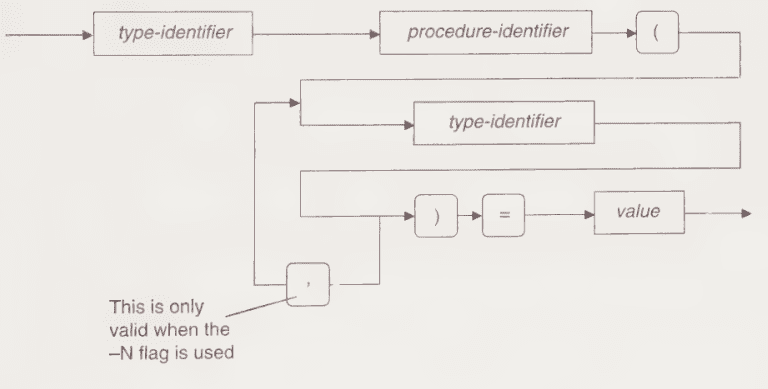

仅在使用了`-N`标志时，该定义才有效。

## C.2.2 常量定义


## C.2.3 枚举定义

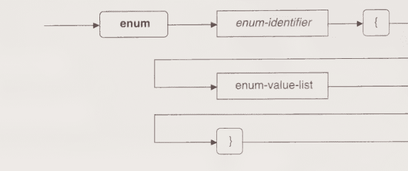

#### C.2.3.1 枚举值列表


#### C.2.3.2 枚举值


## C.2.4 类型定义（typedef定义）


#### C.2.4.1 声明²


#### C.2.4.2 简单声明


#### C.2.4.3 定长数组声明

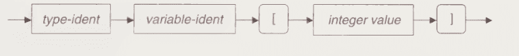

#### C.2.4.4 变长数组声明³


#### C.2.4.5 指针声明⁴


² 这些是类型声明，而非变量声明（例如`int my_number`），`rpcgen`不支持此类声明。

³ 尖括号内的整数值表示最大长度；若为空，则表示任意大小的数组。

⁴ 并非真正的地址，技术上称为可选数据，常用于引用链表结构。

## C.2.5 结构定义

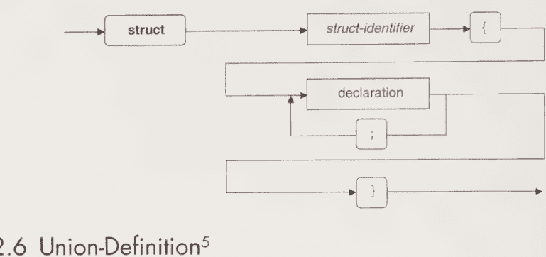

## C.2.6 联合定义⁵


#### C.2.6.1 分支列表

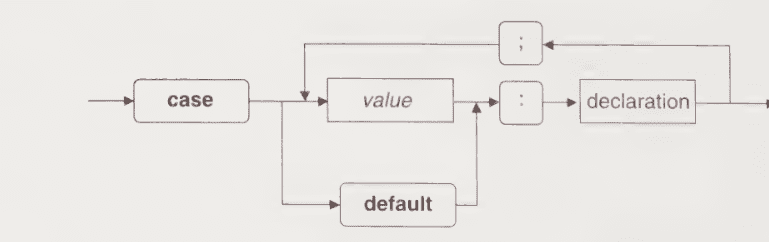

⁵ 在RPC中，联合的语法（和语义）更接近Pascal中的可变记录，而非标准C/C++联合。

## C.3 RPC关键字

以下RPC关键字具有特殊含义，不可用作标识符：

`bool` `const` `enum` `int` `string` `typedef` `double` `hyper` `quadruple` `unsigned` `void` `case` `default` `float` `switch` `struct` `union`

## C.4 部分RPC示例

以下示例中，RPC `.x`文件中的每组条目后都跟着一段灰色语句，这些是`rpcgen`编译器生成的代码。

```
/* *********************** ********************************** */
const MAX = 1024;
const DELIMITER "@";
/* is converted to:
#define MAX 1024
#define DELIMITER "@"
/* *********************** enum ********************************** */
enum primary {
    red,
    yellow = 4,
    blue
};
/* is converted to:
enum primary {
    red = 0,
    yellow = 4,
    blue = 4 + 1
};
typedef enum primary primary;
/* *********************** typedef ********************************** */
typedef colors strange; /* simple */
typedef char line[80]; /* fixed length array */
typedef string var_line<80>; /* variable len array with max */
typedef int some_ints< >; /* variable len array - NO max */
typedef var_line *line_ptr; /* pointer */
/* is converted to: */
```

等号和分号会被移除，`const`会被替换为`#define`。注意每个颜色的赋值是如何处理的。由于C/C++编译器将这些标识符存储在不同的命名空间中，因此重复使用`primary`是被允许的。

```
typedef colors strange;
typedef char line[80];
typedef char *var_line;
typedef struct {
    u_int some_ints_len;
    int *some_ints_val;
} some_ints;
typedef var_line *line_ptr;
```

变长数组会被映射为包含两个成员的结构。第一个成员存储数组的元素数量，第二个成员引用数组的基地址。注意成员名的命名会包含数组的基名。

```
/*************** struct ***************** */
struct record {
    var_line name;
    int age;
};
/* is converted to: */
struct record {
    var_line name;
    int age;
};
typedef struct record record;
```

这个转换和预期基本一致。同样，由于命名空间的存在，在`typedef`中重复使用`record`不会产生冲突。


`union` 的声明方式如下：

```
/*************** union ***************** */
union ret_value
switch( extern errno )
{
  case 0: line answer;
  default: void;
};
/* is converted to: */
struct ret_value
{
  extern errno;
  union { line answer; } ret_value_u;
};
typedef struct ret_value ret_value;
```

联合会被映射为一个结构，该结构包含对外部声明的 `errno` 值的引用，以及一个联合，其元素是初始列出的成员中占用存储空间更大的那个。

---

# 附录D

## 性能分析程序

### D.1 简介

获取程序执行相关信息的一种方式是使用GNU性能分析工具`gprof`。该工具是大多数标准Linux发行版的组成部分，可提供程序调用的函数相关信息。通过分析它提供的数据，你可以通过修改缓慢、低效的代码段来提升程序的执行速度。此外，性能分析可能揭示尚未暴露的缺陷。后续章节将概述如何使用`gprof`。鼓励希望了解更多该工具相关信息的读者阅读其手册页，并访问GNU官方网站（`www.gnu.org`）浏览`gprof`的完整在线文档。

对程序进行性能分析分为三个步骤：

1. 编译程序并启用性能分析链接。
2. 运行程序的可执行版本以生成特殊的性能分析数据文件。
3. 使用`gprof`工具分析并展示性能分析数据。

---

## 附录 D • 程序性能分析

### D.2 性能分析示例程序

选择排序程序用于演示性能分析流程。选择排序是一种通用排序算法，是交换排序的一种变体。

其基本逻辑是：遍历元素列表，找到最小元素的索引（位置），将该索引处的数据与列表第一个元素存储的数据交换；随后对剩余元素重复上述选择流程，找到次小元素，将其对应索引处的数据与列表第二个元素存储的数据交换，重复该流程直到列表完成排序。

实现选择排序的编码方式有很多，以下是该排序的 C++ 版本。

```cpp
File : ss.cxx

#include <iostream>

using namespace std;

// Function prototypes

void Get_Data ( int [], int );

void Display ( int [], int );

void Do_S_Sort ( int [], int );

int Find_Least( const int [], int, int );

int Compare ( const int & , const int & );

void Swap ( int &, int & );

int main() {

    const int max = 10;

    int List[max];

    Get_Data ( List, max );    // Obtain data

    cout << "Initial list" << endl;

    Display ( List, max );     // Show it

    Do_S_Sort( List, max );    // Sort it

    cout << "Sorted list" << endl;

    Display ( List, max );     // Show it again

    return 0;

}

// Obtain data to sort from standard input

void Get_Data(int a[], int n) {

    cout << "Please enter " << n << " integers" << endl;

    for(int i=0; i < n; ++i)

        cin >> a[i];

}

// Display the current contents of list

void Display(int a[], int n) {

    for(int i=0; i < n; ++i)

        cout << " " << a[i];

    cout << endl;

}

// Do the Selection Sort, Display after each pass

void Do_S_Sort( int a[], int n ){

    int index;

    for (int i=0; i < n-1; ++i){

        index=Find_Least( a, i, n );

        if ( i != index )

            Swap( a[i], a[index] );

        cout << "After pass " << i+1 << " : ";

        Display( a, n );

    }

}

// Find the index of the least element in list

int Find_Least( const int a[], int start, int stop ){

    int Index_of_Least = start;

    for (int i=start+1; i < stop; ++i )

        if ( Compare(a[i], a[Index_of_Least]) )

            Index_of_Least = i;

    return Index_of_Least;

}

// Compare two data elements

int Compare( const int &a, const int &b ){

    return ( a < b );

}

// Exchange two data elements

void Swap( int &a, int &b ){

    int temp;

    temp = a;

    a = b;

    b = temp;

}
```

如上所示，该排序的实现共使用了 6 个函数。

| 函数 | 功能 |
| :--- | :--- |
| `Get_Data` | 从标准输入获取待排序数据。 |
| `Display` | 将列表当前内容打印到标准输出。 |
| `Do_S_Sort` | 执行选择排序流程。 |
| `Find_Least` | 遍历列表的一部分，查找（并最终返回）最小元素的索引。 |
| `Compare` | 比较两个列表元素，若第一个元素小于第二个元素则返回非零值。 |
| `Swap` | 交换列表中两个元素的数据。 |

乍一看，为如此简单的算法使用这么多函数似乎有些大材小用。不过，将部分语句（如第 52 行的比较操作）编码为函数调用，可方便后续使用 `gprof` 生成性能分析信息时的引用。

选择排序的大部分工作实际上由 `Find_Least` 函数完成（见第 49 行）。该函数接收列表和两个整数值作为参数：第一个整数值是在列表剩余部分进行查找的起始位置，第二个值是列表的大小（本例中即列表的结束/终止位置）。

该函数的运行逻辑是：将值最小的元素的索引存储在变量 `Index_of_Least` 中，初始时该值为列表当前起始位置的索引（见第 50 行）；随后它通过 for 循环遍历列表剩余部分，将每个位置的值与当前最小值比对，判断是否找到了更小的值，每次比对都由 `Compare` 函数执行。若找到更小的值，则存储该位置的索引（而非值本身）。循环结束后，最小元素的索引会被返回给调用函数。若返回的索引不是当前列表首元素的索引，则调用 `Swap` 函数交换这两个值；若当前值已经有序，则无需交换。

### D.3 生成性能分析数据

要收集性能分析信息，需要编译并链接开启了性能分析功能的程序，为此需要向编译器传递 `-pg` 命令行选项。

例如，若我们的源码文件为 `ss.cxx`，可使用如下命令：

```bash
linux$ g++ ss.cxx -pg -o ss
```

如果你的程序由多个独立源码文件组成，且每个文件单独编译，那么若需要对某个源码文件中的函数进行性能分析，需为每次中间编译过程都传递 `-pg` 选项。

如果同时指定了调试用的命令行选项 `-g`，`gprof` 工具会生成额外的逐行性能分析信息，该技术将在本附录末尾详细讨论。

编译成功后，可正常传入参数、输入文件等运行程序。程序执行生成的性能分析数据会存储在名为 `gmon.out` 的文件中，该文件位于当前目录下，若已存在同名 `gmon.out` 文件，它会被覆盖。

注意，若程序未正常退出（即未从 `main` 函数返回或未调用 `exit` 函数），则不会生成 `gmon.out` 文件。¹

¹ 这种情况下调用 `_exit()` 无效，因为它不会执行 `exit` 调用对应的清理操作。`gmon.out` 是数据文件而非纯文本文件，因此不应直接打印或在屏幕上显示。

### D.4 查看与解析性能分析数据

`gmon.out` 文件中存储的性能分析数据可通过 `gprof` 工具进行分析和展示。

若未传入任何选项或命令行参数，`gprof` 会默认其处理的可执行文件为 `a.out`，且该可执行文件的性能分析数据存储在 `gmon.out` 文件中。此外，除非另有指定，`gprof` 会基于收集到的数据生成并展示完整的注释型平面性能分析图和调用图。

与大多数工具一样，`gprof` 支持大量选项，本节将仅介绍其中部分常用选项。

仍以前文的选择排序示例为例，如下命令行序列：

```bash
linux$ g++ ss.cxx -o ss
```

随后运行该程序，本示例中程序通过命令行重定向从名为 `data_reverse` 的数据文件中获取输入，该文件包含按降序排列的 1 到 10 的数字。程序执行输出会显示在屏幕上。

```bash
linux$ ss < data_reverse

Please enter 10 integers

Initial list

10 9 8 7 6 5 4 3 2 1

After pass 1 : 1 9 8 7 6 5 4 3 2 10

After pass 2 : 1 2 8 7 6 5 4 3 9 10

After pass 3 : 1 2 3 7 6 5 4 8 9 10

After pass 4 : 1 2 3 4 6 5 7 8 9 10

After pass 5 : 1 2 3 4 5 6 7 8 9 10

After pass 6 : 1 2 3 4 5 6 7 8 9 10

After pass 7 : 1 2 3 4 5 6 7 8 9 10

After pass 8 : 1 2 3 4 5 6 7 8 9 10

After pass 9 : 1 2 3 4 5 6 7 8 9 10

Sorted list

1 2 3 4 5 6 7 8 9 10
```

由于输入数据的特殊性（初始为降序排列），结合算法逻辑，数据实际在程序终止前就已经完成排序！

程序运行完成后，使用 `gprof` 工具分析与查看性能分析数据。若需要向 `gprof` 传递选项，需在工具调用后的命令行中单独指定各个选项。可执行文件名需跟在选项之后，若未指定则默认使用 `a.out`；可执行文件名后可选择性传入性能分析文件名，若未指定则默认使用 `gmon.out`。

如下示例中指定了 `-b` 选项（表示输出简要内容）：

```bash
linux$ gprof -b ss
```

调用 `gprof` 时传入 `-b` 选项和可执行文件名（`ss`），未指定的性能分析数据文件默认视为 `gmon.out`。

本次调用生成的输出分为两部分，第一部分为平面性能分析图，该部分展示了程序在每个函数上花费的时间，以及每个函数的调用次数。

即便使用效率较低的选择排序，对 10 个数据项排序也是极其简单的任务，因此为了生成更具指导意义的数据集，我们将待排序数值的数量增加到了 1000，并重新编译运行了程序。为了减少展示所需的时间，我们将可执行程序的输出重定向到 `/dev/null`，即丢弃了程序输出。

```bash
linux$ ss < data_reverse > /dev/null
```

下方的 `gprof` 输出基于对 1000 个数值的排序结果生成。

平面性能分析图：每个采样对应 0.01 秒。

| 耗时占比 | 累计耗时（秒） | 自身耗时（秒） | 调用次数 | 单次自身耗时（微秒） | 单次总耗时（微秒） | 函数名 |
| :--- | :--- | :--- | :--- | :--- | :--- | :--- |
| 100.00 | 0.04 | 0.04 | 999 | 40.04 | 40.04 | `Find_Least(int const *, int, int)` |
| 0.00 | 0.04 | 0.00 | 499500 | 0.00 | 0.00 | `Compare(int const &, int const &)` |
| 0.00 | 0.04 | 0.00 | 1001 | 0.00 | 0.00 | `Display(int *, int)` |
| 0.00 | 0.04 | 0.00 | 500 | 0.00 | 0.00 | `Swap(int &, int &)` |
| 0.00 | 0.04 | 0.00 | 1 | 0.00 | 40000.00 | `Do_S_Sort(int *, int)` |
| 0.00 | 0.04 | 0.00 | 1 | 0.00 | 0.00 | `Get_Data(int *, int)` |

---

## 附录 D • 程序性能分析

在平面性能分析部分，每个函数按运行时间降序列出（如果运行时间过小无法记录，则报告为0）。平面性能分析中每个字段的含义如下表所示。

| 字段名 | 含义 |
|---|---|
| `% time` | 占总执行时间的百分比。 |
| `cumulative seconds` | 执行此函数及表中其上方所有函数的总秒数。 |
| `self seconds` | 仅执行此函数的总秒数（主要排序键）。 |
| `calls` | 此函数被调用的次数（如果未被调用则为空）。 |
| `self Ts/call` | 在此函数中平均花费的 T 秒数（m = 毫秒，u = 微秒，n = 纳秒等）。 |
| `total Ts/call` | 每次调用，在此函数及其后代中平均花费的 T 秒数。 |
| `name` | 函数名（作为次要排序键） |

正如包含1000个元素的列表所预期的那样，我们示例中的 `Compare` 函数被调用了499,500次（即 999 + 998 + 997 … + 1 的总和，这个序列代表了比较次数）。显然，`Find_Least` 函数是其中时间开销最大的。平面性能分析之后是一个调用图，详细说明了在每个函数中花费的时间量。此部分的输出被划分为一系列条目，每个函数一个。每个条目（长度为一行或多行）之间由一串破折号分隔。每个条目中有一条主行。主行指示与该条目数据关联的函数。主行很容易识别，因为它以方括号中的索引号开头。在每个条目中，主行之前的行是调用该函数的函数，而主行之后的行是被该函数调用的函数（在调用图术语中，称为其子函数）。如果无法确定函数的调用者，则打印 `<spontaneous>` 代替。以下是我们的选择排序程序在对初始为逆序的1000个值列表进行排序时的调用图。为便于参考，每条主行都已突出显示。

```
调用图粒度：每个样本命中覆盖 4 字节，占 0.04 秒的 25.00%

索引 % 时间 自身 子代 被调用次数 名称

[1] 100.0 0.04 0.00 999 Find_Least(int const *, int, int) [1]

  0.00 0.00 499500/499500 Compare(int const &, int const &) [4]

[2] 100.0 0.00 0.04 1 Do_S_Sort(int *, int) [2]

  0.04 0.00 999/999 Find_Least(int const *, int, int) [1]

  0.00 0.00 999/1001 Display(int *, int) [5]

  0.00 0.00 500/500 Swap(int &, int &) [6]

-------------------------------------------------------------------------

<spontaneous> [3] 100.0 0.00 0.04 1 main [3]

  0.00 0.04 1/1 Do_S_Sort(int *, int) [2]

  0.00 0.00 2/1001 Display(int *, int) [5]

  0.00 0.00 1/1 Get_Data(int *, int) [7]

-------------------------------------------------------------------------

  0.00 0.00 499500/499500 Find_Least(int const *, int, int) [1] [4]

  0.0 0.00 0.00 499500 Compare(int const &, int const &) [4]

-------------------------------------------------------------------------

  0.00 0.00 2/1001 main [3]

  0.00 0.00 999/1001 Do_S_Sort(int *, int) [2] [5]

  0.0 0.00 0.00 1001 Display(int *, int) [5]

-------------------------------------------------------------------------

  0.00 0.00 500/500 Do_S_Sort(int *, int) [2] [6]

  0.0 0.00 0.00 500 Swap(int &, int &) [6]
```


`0.00 0.00 1/1 main [3] [7]`

`0.0 0.00 0.00 1 Get_Data(int *, int) [7]`

```


```

按函数名索引
- `[4] Compare(int const &, int const &)`
- `[2] Do_S_Sort(int *, int)`
- `[7] Get_Data(int *, int)`
- `[5] Display(int *, int)`
- `[1] Find_Least(int const *, int, int)`
- `[6] Swap(int &, int &)`

每个字段的含义取决于其上下文（即行的标识）：主行、函数的调用者（调用此函数），或被调用的函数（被此函数调用）。

| 字段 | 主行 | 函数的调用者 | 被调用的函数 |
| :--- | :--- | :--- | :--- |
| `index` | 此函数的索引号。 | | |
| `% time` | 在此函数及其子函数中花费的总时间百分比。 | | |
| `self` | 仅在此函数中花费的总时间（与平面性能分析中的 `self seconds` 值相同）。 | 当被调用者函数调用时，在此函数中花费的时间估计。 | 在被调用函数中花费的时间估计。 |
| `children` | 在此函数进行的函数调用中花费的总时间。 | 在其子函数调用中花费的时间估计。 | 在被调用函数的子函数中花费的时间估计。 |
| `called` | 此函数被调用的次数。用 `+` 分隔递归调用。 | 此函数被调用的次数；非递归调用的总次数。 | 此函数被调用的次数；非递归调用的总次数。 |
| `name` | 函数的名称和索引号。 | 函数的名称和索引号。 | 函数的名称和索引号。 |

如果我们查看调用图输出中的第一个条目，我们会注意到主行由 `[1]` 标记。关联的函数 `Find_Least` 被 `Do_S_Sort` 函数调用了999次。反过来，`Find_Least` 函数调用了 `Compare` 函数499,500次。

`gprof` 工具可以被指示显示带注解的源代码列表，其中它标识函数的调用次数。要产生此输出，源程序必须使用 `-g` 选项编译，并且 `gprof` 需要传入 `-A` 选项（表示带注解的源码）。使用我们相同的源程序，此序列为：

```
linux$ g++ -g ss.cxx -pg -o ss
linux$ ss < data_reverse > /dev/null
linux$ gprof -A ss
```

如下所示，`gprof` 的输出列出了程序源代码并指示每个函数的调用次数。在列表末尾，它显示一个前10名列表，根据执行活动指出前10行。前10名列表之后是一个执行摘要。

```
*** 文件 /home/faculty/gray/revision/profile/ss.cxx:

#include <iostream>
using namespace std;

// 函数原型
void Get_Data ( int [], int );
void Display ( int [], int );
void Do_S_Sort ( int [], int );
int Find_Least( const int [], int, int );
int Compare ( const int &, const int & );
void Swap ( int &, int & );

int ##### -> main( )
{
    const int max = 1000;
    int List[max];
    Get_Data ( List, max ); // 获取数据
    cout << "初始列表" << endl;
    Display ( List, max ); // 显示它
    Do_S_Sort( List, max ); // 排序它
    cout << "已排序列表" << endl;
    Display ( List, max ); // 再次显示它
    return 0;
}

// 从标准输入获取要排序的数据
void 1 -> Get_Data(int a[], int n)
{
    cout << "请输入 " << n << " 个整数" << endl;
    for(int i=0; i < n; ++i)
        cin >> a[i];
}

// 显示列表的当前内容
void 1001 -> Display(int a[], int n)
{
    for(int i=0; i < n; ++i)
        cout << " " << a[i];
    cout << endl;
}

// 执行选择排序，每轮后显示
void 1 -> Do_S_Sort( int a[], int n ){
    int index;
    for (int i=0; i < n-1; ++i){
        index=Find_Least( a, i, n );
        if ( i != index )
            Swap( a[i], a[index] );
        cout << "第 " << i+1 << " 轮后：";
        Display( a, n );
    }
}

// 找到列表中最小元素的索引
int 999 -> Find_Least( const int a[], int start, int stop ){
    int Index_of_Least = start;
    for (int i=start+1; i < stop; ++i )
        if ( Compare(a[i], a[Index_of_Least]) )
            Index_of_Least = i;
    return Index_of_Least;
}

// 比较两个数据元素
int
```

```c
int Compare(const int &a, const int &b) {
    return (a < b);
}

// Exchange two data elements
void Swap(int &a, int &b) {
    int temp;
    temp = a;
    a = b;
    b = temp;
}
```


```
| Line | Count |
|------|-------|
| 58 | 499500|
| 30 | 1001 |
| 49 | 999 |
| 63 | 500 |
| 23 | 1 |
| 37 | 1 |

| Value | Description |
|-------|-------------|
| 8 | 该文件中的可执行行数 |
| 8 | 已执行的行数 |
| 100.00 | 文件执行百分比 |
| 502002 | 总行执行次数 |
| 62750.25 | 每行平均执行次数 |
```

虽然`gprof`工具在分析程序执行过程时很有用，但当前Linux版本的这个工具确实存在一个严重限制。就目前的实现而言，该工具使用信号处理器来收集性能分析信息，该信号处理器由周期生成的`SIGPROF`（27）信号触发。默认情况下，通过`fork`生成的子进程或通过调用`pthread_create`创建的新线程不会接收这些信号，因此不会收集子进程或新线程的性能分析数据。

## 附录E

### 参考文献

Bach, M. J.，*UNIX操作系统设计*。新泽西州恩格尔伍德克利夫斯：普伦蒂斯霍尔出版社，1986年。

Bloomer, J.，*RPC高级编程*。加利福尼亚州塞巴斯托波尔：欧莱礼公司，1992年。

Brown, C.，*UNIX分布式编程*。新泽西州恩格尔伍德克利夫斯：普伦蒂斯霍尔出版社，1994年。

Bovet, B. P. 和 Cesati, M.，*深入理解Linux内核*。加利福尼亚州塞巴斯托波尔：欧莱礼公司，2001年。

Comer, D. E. 和 Stevens, D. L.，*TCP/IP网际互联（第三卷）：客户端-服务器编程与应用，Linux/Posix套接字版本1/E*。新泽西州上萨德尔河：普伦蒂斯霍尔出版社，2000年。

Dijkstra, E. W.，“协作顺序进程”，埃因霍温理工大学，荷兰埃因霍温，1965年。

Ditel, H. M.，*操作系统*。马萨诸塞州雷丁：艾迪生-韦斯利出版社，1990年。

Johnson, M. K. 和 Troan, E. W.，*Linux应用开发*。马萨诸塞州雷丁：艾迪生-韦斯利出版社，1998年。

Kernighan, B. W. 和 Pike, R.，*UNIX编程环境*。新泽西州恩格尔伍德克利夫斯：普伦蒂斯霍尔出版社，1984年。

Kleiman, S.、Shah, D. 和 Smaalders, B.，*线程编程*。新泽西州上萨德尔河：SunSoft Press—普伦蒂斯霍尔出版社，1996年。

Kochan, S. G. 和 Wood, P. H.，*UNIX网络编程*。印第安纳州印第安纳波利斯：Hayden Books出版社，1989年。

Leach, R. J.，*UNIX高级主题：进程、文件与系统*。纽约：John Wiley & Sons公司，1994年。

Leffler, S. J.、McKusick, M. K. 和 Quarterman, J. S.，*4.3 BSD UNIX操作系统的设计与实现*。马萨诸塞州雷丁：艾迪生-韦斯利出版社，1989年。

Lewis, B. 和 Berg, D. J.，*线程入门：多线程编程指南*。新泽西州上萨德尔河：SunSoft Press—普伦蒂斯霍尔出版社，1996年。

Matthew, N. 和 Stones, R.，*Linux编程入门*。伊利诺伊州芝加哥：Wrox Press出版社，1999年。

Matthew, N. 和 Stones, R.，*Linux专业编程*。伊利诺伊州芝加哥：Wrox Press出版社，2000年。

Maxwell, S. A.，*Linux核心内核注释*。亚利桑那州斯科茨代尔：Coriolis出版社，2001年。

Mitchell, M.、Oldham, J. 和 Samuel, A.，*高级Linux编程*。马萨诸塞州波士顿：New Riders出版社，2001年。（注：可免费下载于：http://www.advancedlinuxprogramming.com/）

Mitchell, M.、Oldham, J. 和 Samuel, A.，*高级Linux编程*。印第安纳州印第安纳波利斯：New Riders出版社，2001年。

Nichols, B.、Buttlar, D. 和 Farrell, J. P.，*线程编程*。加利福尼亚州塞巴斯托波尔：欧莱礼公司，1996年。

Northrup, C. J.，*UNIX线程编程*。纽约：John Wiley & Sons公司，1996年。

Norton, S. J. 和 Dipasquale, M.，*线程时代：多线程编程指南*。新泽西州上萨德尔河：普伦蒂斯霍尔出版社，1997年。

Nutt, G.，*操作系统：现代视角（实验更新版）*，第2版。马萨诸塞州雷丁：艾迪生-韦斯利出版社，2002年。

Rago, S. A.，*UNIX System V网络编程*。马萨诸塞州雷丁：艾迪生-韦斯利出版社，1993年。

Rieken, B. 和 Weiman, L.，*UNIX网络应用编程实战*。纽约：John Wiley & Sons公司，1992年。

Rochkind, M. J.，*UNIX高级编程*。新泽西州恩格尔伍德克利夫斯：普伦蒂斯霍尔出版社，1985年。

Silberschatz, A. 和 Peterson, J. L.，*操作系统概念*。马萨诸塞州雷丁：艾迪生-韦斯利出版社，1989年。

Stallings, W.，*操作系统：内部结构与设计原理*，第4版。新泽西州上萨德尔河：普伦蒂斯霍尔出版社，2001年。

Stevens, W. R.，*UNIX环境高级编程*。马萨诸塞州雷丁：艾迪生-韦斯利出版社，1992年。

Stevens, W. R.，*UNIX网络编程（卷2）：进程间通信*。新泽西州上萨德尔河：普伦蒂斯霍尔出版社，1999年。

Tanenbaum, A. S.，*现代操作系统*，第2版。新泽西州上萨德尔河：普伦蒂斯霍尔出版社，2001年。

Wall, K.，*Linux编程实战*，第2版。印第安纳州印第安纳波利斯：SAMS出版社，2000年。

互联网上有海量与Linux及其所有衍生发行版相关的网站，几乎无法整理出一份无遗漏的站点列表——只要少收录哪怕一个（或多个）网址，就一定会有人前来指正。话虽如此，下表（按重要性不分先后）仍是不错的入门参考。如需查找更多站点及相关资源，可使用任意一款主流搜索引擎（例如www.google.com、www.dogpile.com等），搜索`GNU`、`GNU/Linux`、`Linux`等关键词。

| URL | Description |
|-----|-------------|
| gcc.gnu.org | GNU编译器官网。 |
| linuxtoday.com | 《Linux Today》杂志官网。 |
| www.debian.org | Debian GNU/Linux的官方网站。 |
| www.gnome.org | GNOME是Linux系统下的免费桌面环境。 |
| www.gnu.org | GNU项目的官方网站。 |
| www.kde.org | KDE是另一款Linux系统下的免费桌面环境。 |
| www.kernel.org | Linux内核源码归档站点。 |
| www.li.org | 致力于推广和发展Linux的国际非营利网站。 |
| www.linux.com | Linux信息与资源站点。 |
| www.linux.org | 提供Linux操作系统相关信息和资源的站点。 |
| www.linuxdoc.org | Linux文档开发项目站点。 |
| www.linuxgazette.com | 在线Linux期刊站点。 |
| www.linuxhq.com | 收录Linux补丁、发行版索引及相关链接的站点。 |
| www.linuxjournal.com | 《Linux Journal》杂志官网。 |
| www.linux-mag.com | 《Linux Magazine》杂志官网。 |
| www.linuxworld.com | 提供实用的技术信息和产品评测。 |
| www.redhat.com | Red Hat Linux软件的官方网站。 |
| www.suse.com | SuSE Linux的官方网站。 |

# 索引

## A

- `a.out`格式，16
- `accept`系统调用，394、395、448
- 地址解析协议（ARP），375、379
- 咨询锁，130、163
- `AF_INET`常量，391、397、406、411、413、427、428、429、430、432、437、442
- `AF_UNIX`常量，390、400、401、422、423、425
- `alarm`系统调用，144、145
- 美国互联网号码注册机构（ARIN），374
- `apropos`命令，6、9
- `ar`命令，4
- `argc`，12、46、60、61、62、63、64、65、89、90、91、104、105、111
- `argv`，12、13、46、57、58、60、61、62、63、64、65、76、85、89、90、91、92、93、104、105、106、111
- `argv`数组，60、61、91、92
- `<arpa/inet.h>`头文件，405
- ARP/RARP，379
- 亚太网络信息中心（AP-NIC），374
- `<asm/errno.h>`头文件，11
- 异步，59、434、439、475、520
- 原子操作，119、128、165、175、233、234、269、419、484、519

## B

- Bach, M. J.，587
- `bc`命令，399、400
- 伯克利互联网名称域系统，376、400、411、422、423、427、430、432、437、442
- 伯克利套接字接口，372
- 二元信号量，118、234、266、484
- `bind`系统调用，389、394、447
- `<bits/shm.h>`头文件，274、282
- `<bits/signum.h>`，59
- 阻塞，103、109、110、113、114、132、137、159、160、161、165、166、168、170、182、184、189、191、202、203、215、217、234、251、252、258、259、264、295、310、325、394、412、415、418、419、428、435、453、460、482、489、501、502、505、514、518、519、522、525、539、548
- Bloomer, J.，587
- 有界缓冲区，503
- Bovet, B. P.，470、587
- Brown, C.，587
- `bzero`库函数，189
- 591

## C

- `cat`命令，92、174、178、183
- 聊天程序，230、426、446、447
- `chdir`系统调用，50、52
- 子进程，24、25、26、31、32、34、41、43、50、52、58、59、60、70、71、79、80、81、82、84、85、93、94、102、103、104、105、106、107、108、109、110、111、112、113、114、115、129、138、144、145、146、155、156、163、172、173、176、177、179、180、181、192、202、221、267、280、284、285、289、291、304、305、309、311、383、384、385、386、403、409、412、439、440、443、444、447、460、499、585
- `chmod`命令，36、131
- `chmod`系统调用，47
- A类网络，375
- B类网络，375
- C类网络，375
- 客户进程，186、187、188、189、191、192、202、218、219、220、221、222、224、237、315、323、330、331、338、340、341、352、355、373、386、393、394、396、399、402、403、409、414、415、416、421、422、426、428、429、439、448
- 客户桩，315、327、329
- `clnt_broadcast`库函数，363
- `clnt_create`库函数，332、333
- `clnt_destroy`库函数，347
- `clnt_pcreateerror`库函数，333
- `clnt_perror`库函数，346
- `clone`系统调用，454、465
- 命令行文件，74、76、77
- Comer, D. E.，456、587
- 命令行值，60、61、65、68、145、479
- 通信域，377
- 条件变量，501、502、503、505、506、508、524、548
- `connect`系统调用，396、397、448
- 无连接通信，363、379、380、382、386、396、416、419、422、423、424、425、426、428、429、431、436、447、448
- 面向连接通信，379、382、386、387、391、393、396、399、401、409、410、412、414、416、417、418、419、421、439、440、441、445、447
- 消费者进程，129、253、254、255、256、258、259、260、261、262、286、287、291、293、294、295、296
- 上下文切换，9、17、114
- 核心映像，109、141
- 计数信号量，234、269、287
- `creat`系统调用，123、128、163
- 创建掩码，37、38
- 临界区，296、528

## D

- 守护进程，83、322、452
- 数据段，18、19、20、27、281、283、285、286
- 数据报套接字，384、397、417、420、421、428、447
- 死锁，133、137、167、170、191、193、233、236、266、269、447、460、486、489
- `DEBUG`常量，341
- 反序列化，316、353
- `dig`命令，377
- Dijkstra, E. W.，234、266、587
- 哲学家进餐问题，266、269
- Ditel, H. M.，587
- 域名系统（DNS），319、376、377
- 点分十进制记法（DDN），374
- `dup`系统调用，174、175
- `dup2`系统调用，174、175

## E

- `edata`变量，20、21、22、284、285、286
- 有效组ID（EGID），39、83
- 有效用户ID（EUID），39、83、126
- ELF格式，16
- `environ`变量，65、66、69、74、77、85
- 环境变量，19、29、65、66、67、68、70、71、74、77、78、85、447、353
- `errno`变量，13、15、60
- 以太网地址，376
- `EWOULDBLOCK`常量，395、419、432、433
- `exec`函数，60、82、83、84、85、86、87、89、91、93、94、96、115、145、149、175、180、202、221、222、282、298、305、458
- `execlp`库函数，86、87、89
- 可执行程序，2、3、9、17、18、26、247
- 退出码，104
- `exit`库函数，99、458
- `_exit`系统调用，102、115、141
- 外部数据表示（XDR），316、324、326、340、353、357、368

## F

- `F_RDLCK`常量，132、133
- `F_UNLCK`常量，132、133、135
- `F_WRLCK`常量，132、133、134
- `fchdir`系统调用，50
- `fchmod`系统调用，47
- `fcntl`系统调用，131、132、136、168、175、193、434
- `host`命令，321、377
- `hostent`结构，404、413
- `FD_ISSET`宏，435、438
- `hostname`命令，317
- `FD_SET`宏，435
- `FD_ZERO`宏，435

## G

- 先进先出队列（FIFO），165、167、182、183、184、185、186、188、189、191、470、471、472、473、555
- 网际控制报文协议（ICMP），379
- 文件描述符掩码，434、435、436
- `ifconfig`命令，373、374
- 文件描述符表，41
- 忽略信号，149
- 文件锁，128、131、134
- i节点表，36
- 文件权限，39、183
- `in_addr`结构，392
- 文件/记录锁，118
- `INADDR_ANY`常量，411、412、427、428、430、432、437、442
- `FIONBIO`常量，432、433
- `flock`结构，132
- `init`进程，30
- 刷新，82、172、280、491、492、513、522、528、529
- 索引节点，36、41
- `fork`系统调用，23、24、25、26、27、31、79、80、82、115、175、284、285、298、451
- 国际标准化组织（ISO），377、378
- `fortune`命令，423
- 网际（IP）地址，319、368、374、375、376、377、378、379、381、382
- `fstat`系统调用，44
- 互联网名称与数字地址分配机构（ICANN），374
- `ftok`库函数，199、200、201、205、221、273
- 网际域，377、379、382、389、390、393、397、403、406、410、412、414、417、426、428、429、431、436、439、440、441、445
- 全双工，171、379、380
- 互联网网络信息中心（InterNIC），374

## G

- `gdb`命令，547
- 中断，59、142、161、162、192、216、218、317、428、475
- `GETALL`常量，242、243、245、254、263、288
- 进程间通信资源，196、198、199、200、201、202、203、204
- `getcwd`库函数，50
- `getenv`库函数，67
- `gethostbyname`库函数，404
- `IPC_CREAT`常量，203、205、206、213、222、227、237、238、239、246、255、256、273、275、276、284、289、308、498
- `GETNCNT`常量，244
- `getopt`库函数，61、62、229
- `getpgid`系统调用，32、33
- `GETPID`常量，244
- `getpid`系统调用，30、31、32、189、258
- `IPC_EXCL`常量，203、205、237、238、239、255、256、273、275
- `getppid`系统调用，31、293
- `getpwuid`库函数，47
- `getrlimit`系统调用，55
- `IPC_NOWAIT`常量，204、215、216、217、218、227、251、252
- `getservbyname`库函数，407
- `GETVAL`常量，244、246、265
- `IPC_PRIVATE`常量，201、203、205、237、238、239、264、276、284、308、498
- `GETZCNT`常量，244
- `_GNU_SOURCE`常量，33、63、69、71、73、105、121、158、160、176、180、188、190、206、220、225、263、288、302、306、321、399、401、410、461、473、478、481、490、503、512、521、527、532、540、556
- `IPC_RMID`常量，203、206、211、212、213、223、226、243、244、246、247、257、264、278、279、285、290、308、499
- `IPC_SET`常量，203、211、212、242、243、244、245、254、263、278、279、288
- `IPC_STAT`常量，203、211、212、213、242、243、245、246、254、263、278、288
- `grep`命令，174
- `ipcs`命令，196、197、198、206、239、277
- `IPPORT_USERRESERVED`常量，428
- `IPPROTO_TCP`常量，364、367、382
- 硬限制，52、53、54
- `IPPROTO_UDP`常量，364、367、382
- 堆，19
- `IPv4`，373、375
- 重量级进程，490、498
- IPv4子目录，428
- IPv6，373、374、376、449
- `isatty`库函数，150

## K

- 内核，8、9、17、18、23、26、30、40、41、45、48、51、72、73、74、78、80、107、124、126、138、141、168、182、185、197、198、208、234、235、236、274、385、388、454、470、483、548、549、551、589
- 内核态，17、18、30、470
- 内核进程，17
- 内核空间，17、41
- 内核级模型，454
- 内核级线程，454
- Kernighan, B. W.，587
- `kill`命令，142、144、159、192、426、428
- `kill`系统调用，142、143、475、476
- Kleiman, S.，456、588
- Kochan, S. G.，588

## L

- LDLIBS，350、351
- Leach, R. J.，588
- Leffler, S. J.，588
- Lewis, B.，456、588
- `libc`（C标准库），3、455、545
- 库文件，3、4、6、9、26、75
- 库函数，2、3、5、6、7、8、9、11、15、21、24、26、29、30、33、49、50、56、57、61、62、63、67、68、78、83、86、87、98、99、100、101、112、113、114、125、136、146、150、159、185、189、199、246、257、258、290、301、310、320、323、332、346、366、367、456、457、458、459、463、485、488、489、493、501、502、510、511、527、529、555、556、559
- 轻量级进程（LWP），454、458、494、520、545、546、548
- `link`系统调用，128
- `<linux/sem.h>`头文件，235
- LinuxThreads库，454、475、480、483、485、487、488、501、510、519、526
- `listen`系统调用，393、394、448
- 锁文件，118、119、120、121、122、123、127、128、129、130、135、138、163、234
- `lockf`库函数，131、136
- `lstat`系统调用，44

## M

- `man`命令，7、552、554
- 强制锁，130、131、163
- 修饰的函数名，329
- `MAP_DENYWRITE`常量，299、300
- `MAP_EXECUTABLE`常量，299
- `MAP_FIXED`常量，298、300
- `MAP_GROWSDOWN`常量，299
- `MAP_LOCKED`常量，299
- `MAP_NORESERVE`常量，299
- `MAP_PRIVATE`常量，298、300、301、305
- `MAP_SHARED`常量，298、300、301、303、305、534
- `MAXPATHLEN`常量，49、50
- Maxwell, S. A.，588
- 媒体访问控制（MAC）地址，373、374
- `memcpy`库函数，291、413
- `memset`库函数，412、413
- 消息队列，195、196、198、203、204、205、206、207、208、209、210、211、212、213、214、215、216、217、218、219、220、221、222、224、225、226、227、228、229、230、231、235、240、262、265、273、309、371、420
- 消息队列类别，224、225、226
- 消息类型，195、209、214、215、217、218、219、226、229
- Mitchell, M.，456、588
- `mkfifo`库函数，185、186
- `mknod`系统调用，184、185、186、189
- `mkstemp`库函数，424
- `mmap`系统调用，297、299、302、312
- `MS_ASYNC`常量，302
- `MS_INVALIDATE`常量，302
- `MS_SYNC`常量，302
- `msg`结构，209、215
- `MSG_CONFIRM`常量，418
- `MSG_DONTROUTE`常量，418
- `MSG_DONTWAIT`常量，418
- `MSG_ERRQUEUE`常量，420
- `MSG_EXCEPT`常量，217
- `MSG_NOERROR`常量，217、218
- `MSG_NOSIGNAL`常量，418、420
- `MSG_OOB`常量，418、420、441、442、444、445
- `MSG_PEEK`常量，420、439、440、441、447
- `MSG_TRUNC`常量，420
- `MSG_WAITALL`常量，420
- `msgbuf`结构，214
- `msgctl`系统调用，210、211、224、231
- `msgget`系统调用，204、215、231
- `msghdr`结构，420
- `MSGMNB`常量，212

## M

- `MSG_MNI`常量，205
- `msgrcv`系统调用，214、216、217、231
- `msgsnd`系统调用，215、217、231
- `msqid_ds`结构体，207、208、209、211
- `msync`系统调用，301
- 多进程，1
- 多道程序设计，1
- 多任务处理，1、452
- 多线程的，372、452、475、481、519、521、524、540、548
- `munmap`系统调用，300
- 互斥锁，484
- 互斥量变量，475、484、485、486、487、488、489、490、491、492、493、494、495、497、498、499、500、501、502、503、504、505、515、528、529、531、533、535、536、547、548

## O

- `oopterr`变量，63、64、228
- 不透明数据类型，485
- 开放系统互连（OSI），377、378
- `optarg`变量，63、64、228
- `optind`变量，63、64、228
- `optopt`变量，63、64、228

## N

- `nanosleep`，493、494
- `nanosleep`系统调用，443
- NETBIOS，378
- `<netdb.h>`头文件，321、404、405、407、410
- `netid`，326、375、449
- `<netinet/in.h>`头文件，321、322、382、390、405、412
- `netstat`命令，386、389、402、403
- 网络文件系统（NFS），128
- Nichols, B.，456、588
- `nohup`命令，149
- 非抢占式调度，470
- Northrup, C. J.，456、588
- Norton, S. J.，456、588
- `nslookup`命令，377
- `ntohs`库函数，408
- Nutt, G.，234、588

## P

- 并行性，452、454
- 父进程，24、25、26、30、31、32、43、49、59、70、78、79、80、81、84、93、99、102、103、104、105、107、111、112、114、115、129、144、145、163、173、177、180、181、202、267、284、289、290、291、293、295、304、311、336、354、365、386、412、451、482、483
- `pause`库函数，146
- `perror`库函数，11、555
- `PF_INET`常量，379、381、382、411、413、427、429、432、437、442
- `PF_LOCAL`常量，381、382、383
- `PF_UNIX`常量，379、381、382、400、401、422、423、425
- 管道，3、52、53、124、139、165、166、167、168、169、170、171、172、173、174、175、176、177、178、179、180、181、182、183、186、187、191、193、206、312、390、399、400、419、423、425、426、475、555
- `pipe`系统调用，171
- `PIPE_BUF`常量，165、168、180、181、187、188、189、190、206
- `PIPE_SIZE`常量，165
- `pmap_getport`库函数，366
- 轮询，125、163、269、431、433
- POSIX 1003.1标准，454、518
- POSIX 1003.1c标准，454
- `#pragma implementation`，307、308
- `#pragma interface`，306、308
- 抢占式调度，452、470、471
- `printenv`命令，65
- 私有FIFO，186、187、188、189、190、191、192
- 进程，1、8、17、18、19、20、23、24、25、26、27、29、30、31、32、33、34、35、36、38、39、40、41、42、43、48、49、50、52、53、54、56、57、59、60、63、64、65、69、70、71、72、73、74、75、76、77、78、79、80、81、83、84、85、87、88、89、90、93、94、95、98、99、100、102、103、104、105、106、107、108、109、110、111、112、113、114、115、117、118、119、124、125、126、127、129、132、133、135、136、137、138、139、140、141、142、143、144、145、146、147、148、149、150、151、152、153、155、156、158、159、160、161、162、163、403、406、409、410、412、413、415、426、428、433、436、438、439、440、441、443、444、445、446、447、451、452、454、455、458、462、463、464、465、468、469、479、480、482、483、490、493、496、497、500、503、505、506、507、509、511、515、517、523、524、525、530、532、533、538、539、540、542、543、544、545、547、552、555、559、560、575、576、578、579、580、581、583
- 进程组，32、33、34、35、78、102、110、143
- 进程组ID（GID），33、34、39、47
- 进程ID（PID），25、29、30、33、34、35、74、80、104、105、106、107、108、110、111、112、113、132、136、145、146、191、263、307、308、414、481、482、483
- 进程组长，32、35
- `procinfo`命令，72
- 生产者进程，129、253、256、258、259、260、261、262、291、293、295、296
- 程序，1、2、3、5、6、7、8、9、10、11、12、13、14、15、16、17、18、21、22、25、26、27、30、31、33、34、37、39、40、43、46、47、52、55、56、59、61、63、64、65、66、69、70、71、77、80、81、82、83、84、85、86、88、89、90、91、92、93、94、95、97、99、100、101、105、106、107、111、112、118、119、120、122、123、125、127、128、129、135、136、144、145、150、151、153、154、155、156、159、161、162、163、165、166、167、168、169、170、171、173、174、176、177、179、180、181、185、186、189、191、192、193、195、196、198、201、202、203、209、211、212、214、215、216、218、219、220、221、222、223、224、226、230、233、234、235、236、237、239、240、243、244、245、250、251、252、253、256、257、258、259、260、261、264、266、267、269、271、273、274、278、279、281、282、283、284、285、286、287、289、290、291、293、295、296、297、298、300、301、304、307、308、309、310、311、312、315、316、319、325、331、333、334、335、336、337、338、340、344、351、352、353、361、362、368、371、373、374、375、378、383、384、385、386、388、389、395、397、399、401、402、403、409、411、412、414、415、416、418、419、420、421、426、428、429、431、433、435、436、438、439、440、441、443、444、446、448、451、452、453、456、458、459、460、464、466、467、468、470、471、472、475、476、480、481、482、487、490、494、496、498、499、500、501、505、509、510、519、523、524、525、545、548、555、575、576

## R

- 竞争条件，128、515、524
- Rago, S. A.，588
- `raise`库函数，143
- `rand_r`，463
- `read`系统调用，13、14、168、169、170
- `readlink`系统调用，74
- 实际组ID（GID），33、34、39、47
- 实际用户ID（UID），39、47
- 实时信号，141
- `recvfrom`系统调用，417
- `recvmsg`系统调用，420
- `_REENTRANT`，455
- `_REENTRANT`常量，455、456、461、473、478、481、490、503、512、521、527、532、540
- 可重入函数，455
- 受限shell，95
- `reexec`函数，321、322
- `reexec`库函数，320、321
- `rexecd`远程执行服务器，322
- Rieken, B.，588
- `rlimit`结构体，54
- Rochkind, M. J.，588
- `<rpc/pmap_clnt.h>`头文件，364
- `<rpc/rpc.h>`头文件，328、329、358、364
- RPC（远程过程调用），315、316、317、323、324、325、326、327、333、334、335、336、339、340、343、345、346、353、354、359、361、362、363、364、365、366、368、372、587
- RPC程序号，326、366
- `RPC_NOBROADCAST`常量，333
- `RPC_UNKNOWNADDR`常量，333
- `RPC_UNKNOWNHOST`常量，333
- `RPC_UNKNOWNPROTO`常量，333
- `rpcent`结构体，366
- `rpcgen`，316、323、325、326、327、328、329、330、331、332、334、335、339、340、341、342、343、344、345、346、347、349、350、351、353、354、356、357、359、368
- `rpcinfo`命令，317、368

## S

- `rsh`（远程Shell命令），95、317
- `rusage`结构体，113、114
- `rwlock_init`，510

## S

- `S_IFBLK`常量，184
- `S_IFCHR`常量，184
- `S_IFDIR`常量，184、360
- `S_IFIFO`常量，184、186、188、190
- `S_IFREG`常量，184
- `SCHED_FIFO`常量，468、471、472、474
- `SCHED_OTHER`常量，467、468、471、472、474
- `SCHED_RR`常量，468、471、472、474、550
- `select`系统调用，434、448
- `sem`结构体，235、237
- `sem_getvalue`库函数，524
- `sem_init`，518、519、523
- `sem_init`库函数，518
- `sem_post`，520、521
- `sem_post`库函数，520
- `sem_t`数据类型，518
- `sem_trywait`，519、520
- `sem_trywait`库函数，519
- `SEM_UNDO`常量，236、251、252、255、256、261、264、288
- `sem_wait`，519、520
- 信号量类，262、264、266、267、268、269、272、273、280、286、287、288、289、290、296、312、371、489、497、518、519、521、522、524、548、555
- `<semaphore.h>`头文件，518、521、522
- `sembuf`结构体，249、255、264
- `semctl`系统调用，240、241、242、243、245、247、255、256、258、269
- `semget`系统调用，236、237、239、241、256、269
- `semid_ds`结构体，235、242、243、244、246
- `SEMMNI`常量，238
- `SEMMSNS`常量，238
- `semop`系统调用，204、248、249、250、251、257、259、269
- `semun`联合体，242
- `sendmsg`系统调用，417
- 序列化，316、353、484
- `servent`结构体，407
- 服务器进程，186、189、190、191、192、202、220、221、222、224、315、316、323、324、330、331、332、336、337、338、340、351、355、363、368、373、386、393、394、396、401、402、403、409、412、414、415、417、421、426、428、429、439、440、441、443、446、448
- 服务器桩，315、327、328、329、343、344、357
- `services`文件，391、410、447
- 会话，35、60、547
- `SETALL`常量，242、243、245、246、254、255、263、288、289
- `setbuf`库函数，310
- `setfsuid`系统调用，40
- 设置组ID（SGID），39、40、87
- `setpgid`系统调用，34
- `setpriority`系统调用，471
- `setrlimit`系统调用，54、56、65
- 设置用户ID（SUID），39、40、83、87
- `SETVAL`常量，242、244、245、254、263、265、288
- 共享内存，102
- 共享内存类，306、307、309、312
- `shlock`命令，138
- `SHM_LOCK`常量，279
- `SHM_RND`常量，282
- `SHM_UNLOCK`常量，279
- `shmat`系统调用，281、282、297
- `shmctl`系统调用，277、278、312
- `shmdt`系统调用，204、283、312
- `shmctl`系统调用，272、274、278、293、312
- `shmid_ds`结构体，274、278
- `SHMLBA`常量，282
- `SHMMAX`常量，273
- `SHMMIN`常量，273
- `SHMMNI`常量，273
- `SHMSEG`常量，273
- `SIG_BLOCK`常量，158、159、477、478、481
- `SIG_DFL`常量，148
- `SIG_ERR`常量，148、149、150、152、154、411、442
- `SIG_IGN`常量，110、114、148、149
- `SIG_MASK`常量，477、478
- `SIG_SETMASK`常量，158、161
- `SIG_UNBLOCK`常量，158、159、477、478
- `sigaction`结构体，155、156
- `sigaction`系统调用，147、155、156、159
- `sigaddset`，477、479
- `sigemptyset`，477、479
- `sigismember`，477、479
- 信号，20、32、59、60、83、98、102、104、105、106、107、108、109、110、111、112、114、125、126、133、138、139、140、141、142、143、144、146、147、148、149、150、151、152、153、154、155、156、157、158、159、160、161、162、163、167、168、175、192、203、215、251、252、288、293、298、301、303、304、336、395、397、410、411、412、419、421、434、436、441、442、443、444、451、452、455、475、476、477、478、479、480、481、482、483、501、502、503、504、505、507、508、509、520、548、549、585
- 信号捕获函数，141、479、480、548
- `sys_nerr`变量，14、555、556、559
- `signal`系统调用，147、148、149、150、152、155、336
- `sysconf`库函数，56、57
- `<signal.h>`头文件，59、105、138、141、149、152、154、155、157、158、160、288、303、410、476、477、478
- `sysctl`命令，394
- `<sys/msg.h>`头文件，202、206、207、208、209、212、214、221、225
- `sigprocmask`系统调用，158、159
- `<sys/param.h>`头文件，49、57
- `sigset`，477、479
- `<sys/resource.h>`头文件，55、113
- `sigsuspend`系统调用，157、160
- `<sys/sem.h>`头文件，202、234、238、241、242、245、254、263、288
- `sigwait`库函数，479、480
- `<sys/shm.h>`头文件，202、274、275、284、288、306、490
- Silberschatz, A.，234、589
- `sizeof`运算符，401、499
- `<sys/socket.h>`头文件，380、383、390、399、401、405、410
- `sleep`库函数，125、129
- `<sys/time.h>`头文件，55、436、438、461、463、490、512、521、532、541
- SNA，378、382
- `SOCK_DGRAM`常量，382、383、386、394、397、417、418、421、422、423、425、427、429、432、437
- `<sys/un.h>`头文件，390、399、401、410
- 系统调用，2、7、8、9、11、13、14、15、17、18、20、21、23、24、25、26、27、29、30、31、32、33、34、35、38、40、43、44、45、46、47、48、49、50、51、52、53、54、55、56、60、65、72、73、74、75、78、79、80、81、82、83、84、85、86、87、89、91、93、94、97、98、100、102、103、107、109、110、111、112、114、115、122、123、125、126、128、133、135、140、142、143、147、148、150、155、156、157、158、159、160、166、167、169、174、175、178、183、184、185、186、192、193、196、198、199、200、201、202、203、204、205、215、216、217、218、231、234、237、247、248、252、256、257、269、272、273、274、281、297、300、301、305、310、318、320、371、389、393、394、395、396、397、419、421、433、436、444、447、453、458、551、552、555、556、559
- `SOCK_RAW`常量，418
- `SOCK_SEQPACKET`常量，393
- `SOCK_STREAM`常量，382、386、393、396、399、400、401、411、412、413、417、419、442
- `sockaddr`结构体，390、392、394、397、421
- `sockaddr_in`结构体，391、392
- `sockaddr_un`结构体，391
- 套接字接口，368、372、377
- `socket`系统调用，356、387、447
- `socketpair`系统调用，381
- 软限制，52
- 源程序，2、9、10、37、106、578、583
- `ssh`（安全Shell命令），318
- `ssh-keygen`命令，319
- 栈段，19、20、27、68、70、83、286
- Stallings, W.，234、589
- 饥饿，233
- `stat`结构体，44、304
- `stat`系统调用，43、44、45、46、48、128、200、201
- `statm`文件，77
- 系统文件表，41、174、176
- 状态信息，38、75、76、102、104、107、108、109、110、111、112、114、115、132、146、198、202、203、212、412、451、459、460
- 系统i节点表，36、41
- 系统态，8
- Stevens, W. R.，587、589
- `strace`命令，465
- 流套接字，321、350、382、397、420、421、447
- System V，195、198、231、235、274、307、312、371、518、588
- `strerror`库函数，15、559
- `swapper`进程，29
- `sys_errlist`变量，14、555、556、559

## T

- Tanenbaum, A. S.，234、589
- TCP（传输控制协议），321、333、364、367、378、379、382、391、399、406、428、587
- TCP/IP，378、379、587
- 文本段，18、27、68、70
- `thr_yield`，529
- 线程，30、72、75、452、453、454、455、456、457、458、459、460、461、462、463、464、465、466、467、468、469、470、471、472、474、475、476、479、480、481、482、483、484、485、486、487、489、493、495、496、497、498、500、501、502、503、505、506、507、508、509、511、512、514、515、516、517、518、520、523、524、525、526、527、529、530、531、532、533、534、535、537、538、539、540、541、542、544、545、546、547、548、585
- 线程ID（TID），462、465、481、482、483、495、497、503、508
- 线程特定数据（TSD），525、526、527、528、529、530、531、532、533、534、538、548
- `<time.h>`头文件，55、245、441
- `timeval`结构体，434、435、438
- `timex`，464
- `t_bind`，463
- 传输层接口（TLI），372
- 传输协议，316、332、346、372、447
- TSD，525
- `ttyname`库函数，338

## U

- u区，20、27
- UDP（不可靠数据报协议），332、363、364、367、378、379、382、406、428
- `ulimit`命令，52、56
- `ulimit`系统调用，53
- `umask`命令，37、38
- `umask`系统调用，49
- UNIX域，377、380、389、390、392、393、399、401、402、403、421、422、423、424、425
- `unlink`系统调用，43、126
- 无名管道，170、171、177、178、182、186、191、192、193
- 用户态，8、17、470
- 用户进程，17、18、20、52、53
- 用户空间，17
- 用户级模型，453
- 用户级线程，453、454
- UUCP，378、450

## W

- `wait`系统调用，84、103、107、109、110、144
- `wait4`库函数，113、114
- `waitpid`系统调用，109、111、112
- Wall, K.，456、589
- 知名端口，392、406
- `whatis`命令，6
- `WIFSIGNALED`宏，109
- `write`系统调用，166、167、168、193、371、384、448
- `wstat`宏，108、110

## X

- X/Open传输接口（XTI），372
- `xinetd`，83
- XNS，378

## Z

- 僵尸进程，107、412

http://www.phptr.com/

普伦蒂斯霍尔PTR | InformIT | InformIT在线图书 | 《金融时报》普伦蒂斯霍尔 | 图书 | ETS互动 | 特色内容

## 面向当今专业人士的明日解决方案

## 普伦蒂斯霍尔专业技术参考

搜索 | 帮助 | 首页

## 通过PH PTR在线平台了解最新动态

PTR精选

我们致力于紧跟计算机科学与工程领域的最新发展。当您访问`www.phptr.com`时，会发现以下丰富内容：

- **PHPTR有什么新内容？** 我们不仅为专业社区出版图书，本身也是社区的一员。您可以查看我们的活动日程，关注您喜爱的作者，获取您感兴趣领域的最新书评与新闻稿。
- **特色专区** 提供最新图书、丛书、月度专题、相关链接及其他实用信息，助您高效完成工作。
- **用户组** 普伦蒂斯霍尔专业参考的用户组项目致力于帮助志愿性质的非营利用户组，为其成员提供前沿技术的培训与相关信息。
- **配套网站** 我们的配套网站提供书籍之外的实用解决方案。您可以在此下载源码、获取更新与勘误、与其他读者及作者就本书内容展开交流，或发现同领域的其他网站链接。
- **需要查找书店吗？** 您附近很可能就有销售大量PTR图书的书店。您可以在`www.phptr.com`查找身边的Magnet书店。
- **立即订阅！加入PHPTR每月电子邮件通讯！** 想随时了解您感兴趣领域的最新动态吗？请在我们的网站选择目标分类，我们将为您推送您所关注领域的最新PHPTR产品、作者活动、书评及会议信息。欢迎访问我们的订阅中心立即订阅！`http://www.phptr.com/mail_lists`

## informIT

www.informit.com

### IT参考指南

#### 文章

通过数千篇免费文章、深度专题、访谈及IT参考推荐保持您的行业领先优势，所有内容均由您熟知并信赖的专家撰写。

#### 在线图书

从`InformIT在线图书`即时获取答案，收录600余本可全文检索的电子书。立即注册即可享受**首14天免费**权益。


#### 目录

在线预览样章、作者简介及用户评分，从5000余种图书中精准挑选最适合您的那本。

#### InformIT在线图书

如果全球顶尖的技术出版商联合起来，在统一的数字参考平台推出各自最好的技术图书，岂不妙哉？如今这一设想已成为现实。我们推出由Safari提供支持的`InformIT在线图书`服务。

- 精准解答具体问题。InformIT在线图书的强大搜索引擎可在数秒内返回按相关性排序的结果。
- 即时获取结果。使用InformIT在线图书，您可选择想要的图书，立即查看所需的章节或小节。
- 剪切、粘贴与批注。粘贴代码可节省时间、避免输入错误。您可对实用内容做笔记，还可选择是否与工作团队共享笔记。
- 企业级定制服务。您可为自身、部门或整个组织定制专属图书馆，仅需为您需要的内容付费。

**首14天免费使用！** InformIT在线图书为其会员提供14天无风险的10本图书订阅服务。详情请访问http://www.informit.com/onlinebooks。


## Linux内幕详解

### 《Linux®进程间通信：细节全解析》

读者对格雷所著的UNIX®姊妹卷好评如潮！

> 此前一知半解的概念，如今我完全弄懂了！书中的示例代码和练习题非常出色，就像大力钳一样牢牢把握住了这些概念精髓……
> ——S. Lee Henry，约翰斯·霍普金斯大学

**专家级、示例丰富的Linux进程与进程间通信（IPC）指南**

专业的Linux软件开发人员需要精通进程、系统级编程与进程间通信技术。本书作者约翰·沙普利·格雷是广受好评的《UNIX进程间通信（第二版）》的作者，他在本书中重点解析了Linux用于管理进程与IPC的核心技术。格雷以极高的准确性和清晰的表述，讲解了进程的定义、生成方式、环境访问方法、通信机制——*以及如何利用这些技术构建稳定、高性能的系统*。

- 全面涵盖命名/匿名管道、消息队列、信号量和共享内存
- 提供System V IPC设施的C++类
- 深入讲解基于socket的通信
- 揭秘Linux的`/proc`文件系统
- 详解LinuxThreads的POSIX线程实现及其在多线程应用中的使用方法
- 提供实用技巧与注意事项，并深入剖析Linux与Unix实现的关键差异
- 包含用于巩固核心概念的习题集与示意图

格雷在书中列举了数十个独立程序示例，所有示例均使用GNU C/C++编译器2.96与3.2版本编译，并在运行Red Hat Linux 7.3与8.0的PC平台上完成全量测试。

### *作者简介*

约翰·沙普利·格雷（JOHN SHAPLEY GRAY）是康涅狄格州西哈特福德哈特福德大学计算机科学教授、交互信息技术学位项目主任，同时也是格雷软件开发公司的负责人。格雷从事UNIX及其衍生系统相关工作逾20年；他讲授的UNIX内幕课程在大哈特福德地区的学生与开发者中享有盛誉。他是畅销书《UNIX进程间通信（第二版）》的作者，同时也是《C++程序员笔记》的合著者。


美国 49.99美元 加拿大 77.99加元

普伦蒂斯霍尔专业技术参考

新泽西州上萨德尔河 07458

http://authors.phptr.com/gray/

本出版物为XIOTECH公司所有

定价 49.99美元
