# Fedora 入门指南：基于印刷版记录的描述 - 包含索引

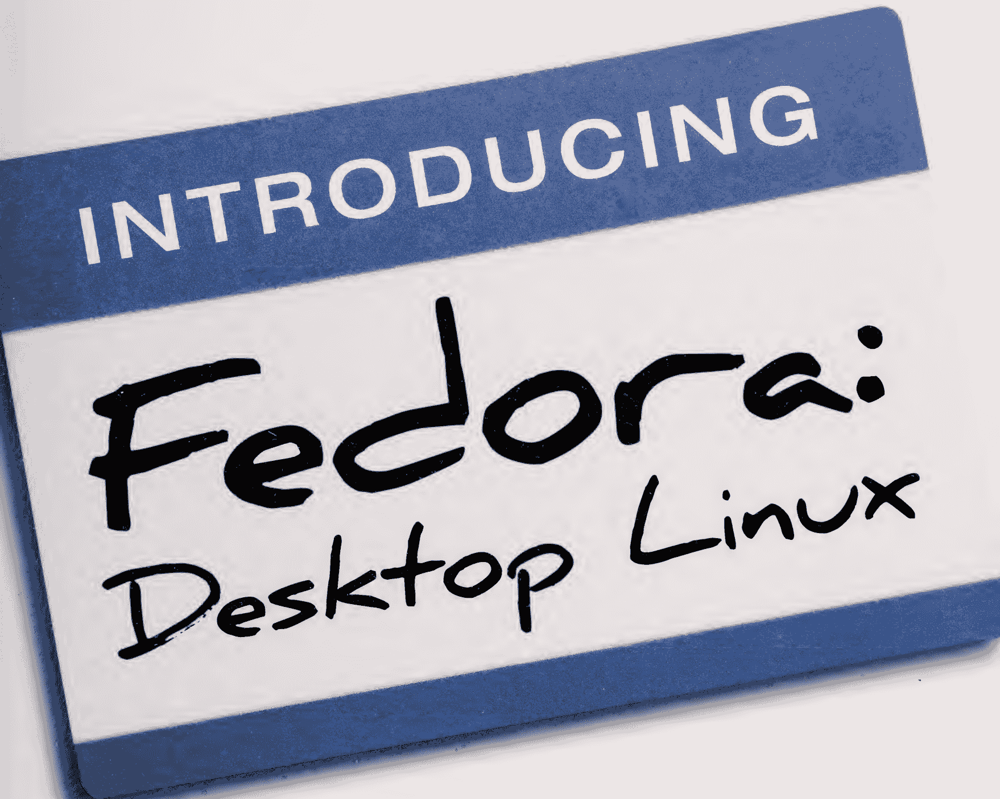


介绍 Fedora

> 献给 Aberash，她带来了光。

# 致谢

不而喻，如果没有一些非常有才华且富有创造力的人贡献他们的技能帮助我以可能创纪录的速度完成这项工作，你手里不会拿着这本书。
我对我的编辑们感激不尽。对于你们中那些认为精妙的文字仅仅是我狂热工作产物的人来说，你们大错错了。因此，我非常感谢 Mitzi Koontz、Marta Justak、Chris Small 和 Sharon Gilenberg，是他们的努力让我的作品变得好得多。Marta 得到了额外的谢意，因为多年来她一直忍受我古怪的幽默感。
俗说人不是一座孤岛。我很幸运，生命中有四位出色的女性，她们知道如何很好地对待我（或者修理我，取决于一天中的时间）。我的妻子和三个不起的女儿应该得到最大的感谢和亲吻，因为她们忍受了我连续几天躲在地下室办公室（又名“洞穴”）里。
还必须感谢 Linux 社区的朋友和同事们，他们总是随时提供技术支持、不请自的建议，以及在各方面让我保持清醒。特别是 Joe Brockmeier、Joe Eckert 和 Robert Bogueue——尽管他是一个自认的微软顾问，但他拥有一颗企鹅的心。

# 关于作者

Brian Proffitt 是一位 Linux 和开源专家，最近曾担任 Linux 基金社区经理，并参与了 2009 年 Linux.com 的重新启动。他还担任过 Linux Today (linxtoday.com) 的主编辑（这是一个关于所有 Linux 和开源事务的新闻和信息网站），并曾为 Jupitermedia Corp 管理过其他四个 Linux Web 网站。他编写了多本关于计算机技术的书籍，大部分是 Linux 的。他住在印第安纳州。

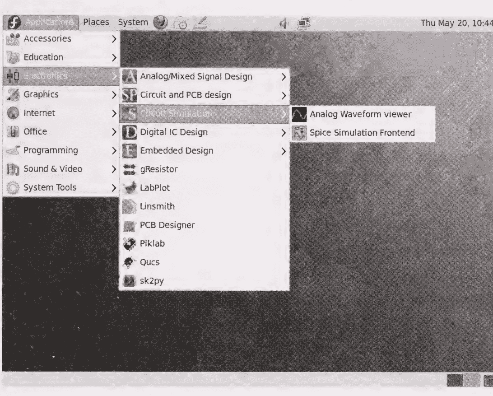

## 第 3 章 安装 Fedora . . . . . . . . . . . . . . . . . 41
## 第 4 章 桌面基础 . . . . . . . . . . . . . . . . . . . . .
- 窗口装饰 . . . . . . . . . . . . . . . . . . . . . . . . . . . . . . . . . . . . 92
## 第 5 章 在线 . . . . . . . . . . . . . . . . . . . . . . . . . . . . . . 99
## 第 6 章 安装和更新软件. . . . . . . . . . . . . . . 113
## 第 7 章 让一切运行起来 . . . . . . . . . . . . . . . . . . . . 129
## 第 8 章 深度游览 . . . . . . . . . . . . . . . . . . . . . . . . . . . . . . . . . . 151
## 第 9 章 基础文件管理 . . . . . . . . . . . . . . . 65
## 第 10 章 浏览网页. . . . . . . . . . . . . . . . . . . . . . . . . . . . . . . 83
## 第 11 章 邮件. . . . . . . . . . . . . . . . . . . . . . . . . . . . . . . . . . . . . . . . . . . . . . . . . . . . 111
- 组织邮件 . . . . . . . . . . . . . . . . . . . . . . . . . . . . . . . . . . . . . . . . . . . . . . . . . . . . . . . 124
- 保护收件箱 . . . . . . . . . . . . . . . . . . . . . . . . . . . . . . . . . . . . . . . . . . . . . . . . . . . . . . . 125
## 第 12 章 消息工具 . . . . . . . . . . . . . . . . . . . . . . . . . . . 129
## 第 13 章 多媒体工具 . . . . . . . . . . . . . . . . . . . . . . . . . . . . . . . . . . . . 142
## 第 14 章 与 Windows 工作 . . . . . . . . . . . . . . . . . . . . . . . . . . . . . . . . 166
- 结论 ................................................................................................................................................... 299

# 第 15 章使用 Writer 文档 ..................................................................................................... 301
# 第 16 章使用 Calc 分析 ............................................................................................ 335
- 第 17 章使用 Impress 演示 ................................................................................. . . . . . 361
- 第 18 章使用 Base 组织 .......................................................................................... 381

# 引言

很多人认为 Fedora 是一个他们高不可及的操作系统——认为只有技术人员才能使用这个名字古怪、晦涩的 OS（操作系统）。
对于所有产生过这些想法的人，这本书是想告诉你，事实并非如此。Fedora，以及广义的 Linux，已经变得普通家庭和商业用户非常易于安装和使用。
现在，你只需要在一个周末就能亲身发现开始使用 Fedora 有多简单，并发现 Windows 之外还有另一个世界。

## 这本书适合你吗？

《介绍 Fedora》适合任何想要开始使用 Fedora（特别是 Fedora 13），并且在家里或办公场所只有一台电脑可以安装此新操作系统的读者。请将这本书看作一本私人教程，一堂与 Fedora 专家用户面对面授的课程。你可以待在自己家里或办公室的舒适环境中，学习如何完成以下操作：
- 将 Fedora 作为唯一的操作系统，或让它与 Windows和谐共存。
- 收集有关系统的信息，以评估系统运行 Fedora 的能力。
- 了解 Linux 的许多版本以及整个 Fedora 系列。
- 安装 Fedora 操作系统。
- 处理任何异常的安装问题。
- 检查 GNOME 界面。
- 创建自定义桌面。
- 探索 Fedora 文件系统。
- 连接互联网。
- 为你的 PC 添加打印机。
- 为你的 PC 添加额外硬件。
- 使用 PackageKit 安装软件。
- 探索 Fedora 自带的一些基础工具。
- 检查并配置 Firefox 以浏览互联网，并使用 Evolution 读取邮件和管理日程。
- 使用 OpenOffice 3.2 作为你的首选办公套件。
- 排除解决可能出现的任何安装和配置问题。

# CD 中包含什么

开始使用 Fedora 不需要很多东西——基本上，只需要软件和一台基于 Intel 处理器的 PC。它甚至不必是一台新电脑。Fedora 在旧电脑上运行良好，而且在旧电脑上的性能远优于 Windows XP，而在那些新的 Windows 7 甚至无法运行的旧机器上，它的表现也更好。
Fedora 是一个免费的 Linux 发行版，这意味着任何拥有宽带连接（如电缆调制解调器或 DSL 线）和“可写”CD-ROM 驱动器的人都可以下载整个包并创建他们自己的 CD-ROM。这是免费的，除了空白光片的费用外。
对于不想花太多钱且没有高速互联网连接的人来说，还有第二个选择。几家公司会在每个新版本发布时下载它，创建数百张包含完整 Fedora 发行版的 CD-ROM，然后以低价出售。


安装的大部分准备工作将在第 1 章和第 2 章中讨论。你应该先阅读这些章节，以便为后续对 Fedora 的探索做好准备。

本书详细介绍了如何找到并下载你自己的 Fedora 操作系统副本，这对于任何版本的 Fedora 都很有用。我们还认为一个好主意是在书的末尾直接附带一个免费的授权的 Fedora 副本。在 CD 上，你将找到一个完整的 Fedora 13 副本，已准备好安装。

在那张 CD 上，除了 Fedora 操作系统，你还会找到以下软件的副本：

- OpenOffice.org：适用于 Fedora 和 Windows 的全功能办公套件。
- Firefox：在速度和可靠性上胜过 Internet Explorer 的流行浏览器。
- Evolution：一个强大的消息和联系人管理应用程序。

# CD-ROM 下载

如果你购买了这本书的电子版，且书中配有 CD-ROM，我们将为你邮寄一份光盘。请向 `pressupplements@cengage.com` 发送书名、ISBN、你的姓名、地址和电话。谢谢。

# 第 1 章

## 什么是 Fedora？

Fedora（费多拉帽）通常被定义为一种带有低褶顶的男士帽。这种时尚配件在 20 世纪中期非常流行，最近在美美国男性中开始重新复兴。

如果你认为自己只是拿起了一本被错误错放在电脑类而非时尚类区域的书，请等一下。我们马上就会。

Fedora 也是一种流行的桌面 Linux 发行版的名称。与其他发行版一样，它是由社区驱动的并且对用户免费。

你可能会问，Linux 是什么？从此来说，什么是发行版？一个能做 Windows 能做的任何事情的操作系统是如何被免费提供的？

这些对于初接触 Fedora 以及“免费和开源软件”整个概念的人来说，是常见的问题。要真正解释 Fedora，我们需要向后退一步，检查其产生的源头软件——GNU/Linux。

在本章中，我们将探索 Linux 的起源，学习它的许多不同类型，Fedora 只是其中之一。我们将研究 Linux 这一分支 Fedora 的较近期历史，它直接源自 Red Hat Linux（红帽 Linux），以及迄今最成功的商业公司如何通过赠送免费软件来赚钱。

## 什么是 Linux？

你可能会问自己，为什么要费心上上一堂历史课？没有人会在关于如何使用 Windows 或 Mac OS X 的书里用详尽的历史课开篇。

### 第1章 ■ 什么是 Fedora？

这些区块被焊接成了一个巨大的整体。其他区块可以连接到这个内核，但只能以非常特定的方式连接。（事实上，为了更生动地体现这个类比，在 Linux 中，区块可以是你想要的任何颜色或形状；而在 Windows 中，所有的区块都是同一种色调，且形状非常相似。）

在 Linux 中，单个“区块”很小，而且你永远不会同时使用所有它们。然而，在 Windows 中，单个“区块”较大，并且通常成组使用。这种结构上的差异迅速揭示了 Linux 优于 Windows 的一个显著优势：Linux 高效运行不需要 Windows 那么多的机器资源。事实上，在 Windows 运行起来都吃力的个人 PC 上，Linux 运行速度非常快。

这种差异在最新的 Windows 操作系统 Windows 7 中表现得最为明显，因为它需要大量的硬件资源。以至于许多潜在的 Windows 7 用户正面临着高昂的升级成本，以让他们的机器准备就绪。或者他们正考虑直接购买全新的机器。在上一版本的 Windows Vista 中，客户也面临同样的问题（甚至更严重）。

### 安全

这两个操作系统构成上的另一个大区别在于它们的安全性。一个事实事实是，世界上有成千上万的 Windows 病毒、木马和蠕虫：这是一个名其实际软件动物园，旨在破坏你的数据、复制数据以供他人滥用，甚至接管你的计算机以便将其用来攻击其他计算机。另一方面，已知的 Linux 病毒只有 500 个，而且没有任何一个曾像 Windows 病毒那样在大规模范围内肆虐。许多 Linux 专业人士认为，Linux 上的恶意软件极其罕见，因此防病毒保护完全没有必要。你最好的保护是永远不要以 root 运行可执行程序，这个主题将在第 6 章“安装和更新软件”中介绍。

为什么会有这样的差距？有人可能会认为，由于 Windows 操作系统占据了世界上绝大多数桌面电脑，这使其成为恶意软件编写者的更大目标，这确实是一个很好的理由。但 Windows 操作系统的构建方式可能也与此有关。回想我们的类比：Windows 的连接砖基本上形状和颜色都完全相同。从实际角度来说，这意味着如果其中一个区块受到坏东西的影响，那么其他区块也更容易受到相同东西的影响。

## 什么是 Linux？

在 Linux 中，这种情况通常不会发生，因为它是由许多种不同的区块组成的。可能有人可以“接管” Linux 上运行网络浏览器的区块，但这可能就是一个糟糕的程序员能得到的全部了。在 Windows 中，类似的浏览器接管可能会导致对机器的完全夺取。最后，Windows 和 Linux 之间还有最后一个重要的区别。由于 Linux 的模块化特性，它可以运行在任何种计算机的任何机器上。你可以发现 Linux 运行在从 IBM Big Gen/L 这样的超级计算机到 TiVo 设备、Droid 手机再到笔记本电脑的各种设备上。

这种现象发生是因为 Linux 直到内核层都是模块化的。并不是只有操作系统是由区块组成的，内核本身也具有模块化本质。如果你想让 Linux 运行在像 Google One 这样的手机上，你就不需要内核中运行鼠标的部分，所以只需将其取出。移除工程师不需要的硬件，为他们留下了一个可以仅为其设备运行的内核，无论设备大小。

自然地，这对于 Fedora 用户来说并不重要。他们将使用“通用”版本的 Linux 内核，以及 Fedora 开发者决定分发的所有特殊应用程序。这一切都是免费的。

是的，那个词又出现了。免费（Free）。当你获取 Fedora 时，它以及随附的大多数应用程序都是免费提供的。你不需要支付一分钱。这是如何运作的呢？

### 自由软件的含义

在 Linus Torvalds 决定着手那个不可避免将撼动 IT 世界基础的学校项目之前，在远洋的一所学校有一位年轻的软件开发者：位于马萨诸塞州剑桥市的萨诸塞理工学院。这位开发者的名字叫 Richard M. Stallman，凭借 MIT 人工智能实验室的工作，他想出了非常棒的主意。他推论，软件应该是供所有人自由使用的。不仅是免费使用，而且是自由分享。他不仅想出了这个想法，还通过创建一套完美的免费工具来实现它，这套工具非常适合创建一个新的、自由的。一个婴儿级操作系统所需的一切都包含在内，除了内核。他将这套工具称为 GNU，这是你在与 Fedora 工作时有时看到的缩写。它通过一种巧妙的、极客的递归文字游戏，意思是 `GNU's Not UNIX`（GNU 不是 UNIX）。

与此同时，除了文字游戏之外，Stallman 真的做了一件非常激进的事：他创建了一种自由软件许可证。

所有创建的软件都以某种许可证发布。许可证规定了软件如何被销售、复制和使用。你目前为止使用的许多软件，特别是使用 Windows 或 OS X 时，都使用了所谓的专有许可证（proprietary licenses）。专有许可证在极其冗长的法律细节中说明——你作为用户可以使用软件的一个副本，例如 Windows。你不能将其复制并卖给其他人。你也不被允许查看或以其他方式操纵制作它的代码。这样做会带来毁灭性的后果。如果你改进了它，请确保你包含了所有的源代码。这些是在 GPL 中找到的四个基本原则：

- 你有自由为了任何目的运行该程序。
- 你有自由为了适应你的需求而修改该程序。
- 你有自由重新分发程序的副本，无论是免费提供还是收取费用。
- 你有自由重新分发修改后的程序副本。

这些就是我们愿意让你拥有它的条款。在这种语境下，“free”（自由）是指像言论自由自由，而不是像免费啤酒那样的。用非技术语言来拆解这一点，GPL 的意思是：永远不要试图阻止他人获取源代码。友善相待。

GPL 如何与 Linux 产生联系，实际上是一个务实的问题。Torvalds 有了他的内核，但没有任何工具能使其成为真正的操作系统。（想象一下带有齿轮、轮子和轴的汽车汽车。）灵光一闪，Torvalds 修改了 GNU 工具，使其能与他的 Linux 内核一起运行，然后砰！Linux 操作系统诞生了。

因为 GNU 工具和 Linux 内核之间紧密的相互作用，Torvalds 决定内核也采用 GNU 的 GPL。这种相互作用也是为什么你经常看到操作系统被称为 GNU/Linux，而内核仅被称为 Linux。纯粹主义者（其中呼声最高的是 Stallman）认为，在名称中加入 GNU 反映了 GNU 工具对 GNU/Linux 诞生所做的巨大贡献。无论人们是否支持这一观点，内核和操作系统的通用术语都是 Linux，除非是指代特定使用“GNU/Linux”名称的 Linux 版本，本书将如此称呼。

# 第1章 ■ 什么是 Fedora？


相反，你可以付钱给一家公司，他们已经为你整合好了 Linux，让你从互联网下载，或者购买一个包装精美的盒子，并附有说明书。任随你的喜好。这样的公司或机构创建了所谓的 Linux 发行版（distribution）。所有的发行版之间都略有不同，但它们都是 Linux。

人们为某样东西付费的第二个原因是为了支持。在购买软件后，许多公司会提供免费或付费的技术支持，例如电话号码或网站，以便你获得问题的解答。Linux 也不例外；事实上，Linux 公司依靠支持费用来产生收入。

这里需要指出的是，Fedora 并会在你每次需要帮助时都向你收费。Fedora 不会向单个用户甚至商业用户索要支持费用。相反，Fedora 的商业赞助商红帽公司（Red Hat）会向那些决定在其组织中使用更具业务针对性的红帽企业级 Linux（Red Hat Enterprise Linux）的大型公司收取费用。对于这些客户来说，拥有支持联系人不是奢侈品，而是必需。

Fedora 与红帽企业 Linux (RHEL) 之间的关系非常简单：Fedora 是基于社区的发行版，作为新功能的测试场和“沙盒”，这些功能在经过安全处理和精简后，最终会进入 RHEL。

现在你掌握了通过 Linux 赚钱的秘密：不要为软件本身收费——要为你能为软件提供的服务收费。

那么，是谁把所有这些代码整合在一起的呢？他们为什么要这样做？这并不总是像你预期的那样为了谋生。

# 各种形状大小的发行版

在最开始，只有一个 Linux 发行版，被称为 MCC Interim Linux。它的独特地位并没有持续多久。很快，就出现了几个发行版。今天，在近 18 年后，已经有 200 多个发行版。没有人知道确切的数量，因为每周都有新的发行版诞生，而旧的则被遗忘在无人角落。

## 关注发行版

要查看 Linux 发行的最新清单，请访问 DistroWatch (`www.distrowatch.com`)。

无论准确数字是多少，市面上有很多发行版，它们都属于以下两类之一：商业性的（如 RHEL）或非商业性的（如 Fedora）。

商业发行版的存在有一个非常显而易见的原因：某些人——无论是公司还是一群开发者——想要赚钱。这些发行版往往是 Linux 发行版中最为人知的，尽管它们并不一定是影响力最大的。

这一类别的发行版包括 RHEL、`SUSE Linux Enterprise Server`、`Mandriva Linux` 和 `Ubuntu Server`。这些是商业上更成功的发行版；这绝不是一份完整的列表。

非商业发行版通常作为非营利机构运行（如果它们组织得当），或者作为一群开发者中某一个人的爱好。开发者的动机是多样的。有些人想创造一些有意义的事物。有些人是为了赚取外快。（事实上，一些非营利发行版通过自愿支持和捐赠获得一些资金。）有些人是想享受编程的乐趣。无论出于什么原因，开发者都让非商业发行版变得非常流行，并且在所有 Linux 开发者中都具有极大的影响力。

非商业发行版包括 `Debian GNU/Linux`、`Slackware Linux`、`Ubuntu`、`openSUSE` 和 `SimplyMEP`。为了让你了解非商业发行版的影响力有多大，可以知道 `SimplyMEPIS`、`Freespire`、`Linspire` 和 `Xandros` 都是许多 Linux 发行版（商业或其他）中的，而它们都基于当今最流行的非商业发行版：`Debian GNU/Linux`。

# 什么是 Fedora

如果你问及 Fedora 属于哪一类，从技术上说答案必须是商业性的，仅仅是因为它的开发最终由红帽公司（Red Hat, Inc.）资助。然而，这很难定义，因为社区对 Fedora 开发的参与如此剧烈。事实上，这种参与正是 Fedora 变得如此流行的良好原因。在如此多的用户参与和公司资金的支持下，Fedora 已经成为可用的最易于使用的 Linux 发行版之一。

当然，这还有更多内容。

## 红帽联系

根据传说——因为在互联网不到 20 年的历史里会有很多传说——“红帽”（Red Hat）这个名字源于尤宁（Ewing）在卡梅大学（CMU）期间习惯戴红帽子。这个名字流了下来，即使后来尤宁的公司在 1995 年被企业家鲍·杨（Bob Young）收购。

红帽最初的流行归于它相对于当时其他 Linux 发行版的一些关键技术优势。其中一个优势是在安装红帽时增加了一个图形化配置系统。尽管按今天的标准来看它很原始，但这一系列简单的屏幕对于那些想要尝试 Linux 的早期采用者来说非常有帮助。

## 家族历史

红帽 Linux 是现今三个 Linux 发行版主要分支之一。许多成功的发行版（包括 Fedora）都基于红帽 Linux，例如流行的中国发行版红旗（Red Flag），以及专为在 Apple Mac 硬件上运行而设计的 Linux 变体 Yellow Dog。

红帽所拥有的另一个优势是软件应用程序在红帽 Linux 平台上的发方式。

记住，虽然开源免费软件始终以源代码形式可用，但这种格式并不容易使用。软件开发者必须以易于安装的形式交付他们的程序。在 Windows 上，这是通过一个自执行文件完成的，用户只需双击它即可安装新程序。

在 Linux 上，这种方法并不是好主意。自执行安装会给计算机带来一系列错误和潜在的恶意更改，在最基础层，所有 Linux 系统都抵抗此类包。相反，应用程序是使用软件包（packages）安装的。一个 Linux 软件包可以包含许多与 Windows 安装程序相同的文件，但安装的控制权在软件包管理器，而不是软件包本身。

软件包管理器不仅能确保软件包正确安全地安装，还会确保应用程序所需的其他软件也能被安装。

红帽在这里的优势是引入了 RPM 软件包系统。RPM 软件包是两个主要的 Linux 包系统之一（另一个是 Debian GNU/Linux 的 DEB 软件包系统）。

在过去的九年里，红帽 Linux 继续利用这些和其他优势，将其大部分营销和销售精力投入到进入工作场所；具体来说就是拥有 500 或更多计算机用户的企业。通过目标这一市场，红帽实际上是在寻找“触手可得”；企业客户并不多，但只需要几个就能建立收入流。

但这种方法在商业上是成功的，却给红帽带来了一个问题。当红帽 Linux 在企业界变得越来越流行时，那些帮助红帽 Linux 达到技术的社区开发者和用户感到日益被边缘化。他们抱怨道，开发前沿软件有什么用呢，红帽担心担心富客户遇到软件不稳定，只在经过艰难的质量控制过程后包含它？

这个问题严重到迫使红帽启动了若干社区外活动计划——因为如果社区开始用脚离开红帽，极宝贵的开发资源可能会丢失，红帽的社区声誉将暴跌。其中一些活动起到了作用，但最终，一个新发行版的诞生和红帽 Linux 的终结才救了红帽。

# Fedora 联系

Fedora 的存在实际上始于一个简单的软件集合。

红帽在努力保持社区兴趣时，启动的社区外活动项目之一是 Fedora 项目，它是一系列较新且更具实验性的软件集合，这些软件在安装到红帽 Linux 上时，可以给用户增强计算机的机会，而不会向红帽主发行版引入风险软件。

需要注意的是，Fedora Linux 并不是像其他发行版那样的独立的 Linux 版本，它实际上被称为软件仓库（repository）。但它在接下来的事情中发挥了关键作用。

## 第1章 什么是 Fedora？

2003年9月，Red Hat 发布了一项令人震惊的公告：Red Hat Linux 将不再作为一个产品存在。相反，希望获得商业级支持的用户（例如那些梦寐以求的企业客户）现在将使用并付费 Red Hat Enterprise Linux（红帽企业级 Linux）。而希望继续免费且无支持地使用 Red Hat 用户将使用 Fedora Core，这是 Red Hat Linux 与 Fedora Linux 项目软件的正式合并产物。

新的 Fedora Core 发行版将不再由 Red Hat 管理，而是由一个名为 Fedora 项目（Fedora Project）的独立非营利组织管理。在当时，这被认为是一个激进的举，但随着 Linux 变得越来越商业化，像 Red Hat 这样的供应商能够转向纯商业化的发行版。

起初，人们的反响不一。毕竟，许多人都在想，那些希望获得某种程度支持的家庭和小企业用户该怎么办？作为回应，Red Hat 在2004年（相当低调）发布了 Red Hat Professional Workstation（红帽专业工作站），这是一个售价 100 美元的 Red Hat Linux 版本，附带 Red Hat 的直接支持。遗憾的是，它在商业上失败了。

接下来发生的事情将塑造未来所有发布版本的商业/社区发行版模型——不仅适用于 Red Hat，也适用于其他该模式的跟随者。

简单来说，Fedora 社区自己解决了支持问题。

通过成为一个凝聚力、灵活的整体，Fedora 项目的成员开始填补曾经由 Red Hat 占据的空白。文档被创建了；支持问题得到了解决；漏洞被追踪、识别并移除。简而言之，Fedora Core 发行版变得像 Red Hat Linux 一样健壮强大，并很快在用途和功能上超越了它的母发行版。


事实上，Fedora 项目变得如此强大，以至于 Red Hat 最后放弃了对家庭/小企业桌面产品的投入，并将时间、精力和资源重新投入 Fedora Core。

最终，这种方法对双方都非常有效。高级用户和开发者获得了一个完整健壮的发行版供实验和使用，而 Red Hat 则保持了其商业发行版的稳定和成熟。而且作为一个额外的收益，Fedora Core（后来的 Fedora）将成为新技术和应用程序的测试平台，这些技术后来会被包含在 Red Hat Enterprise Linux 中。

对于用户、开发者和商业供应商来说，这都是一个双赢的良好范。

## 总结

在本章中，你学习了关于你即将安装的操作系统系统的许多知识。这很重要，因为如果你理解 Fedora 源自何处以及它是如何组合而成的，你就能理解这个流行操作系统的能力和局限性。

在第 2 章“在安装 Fedora 之前”中，我们将花费非常重要的时间为你的 Fedora 安装制定计划。你会专门使用它，还是与 Windows 进行双系统启动？你的硬件会与 Fedora 兼容吗，还是你需要计划进行一些调整以确保一切运行顺畅？这些答案的开头将在下一章中探讨。

# 第 2 章 在你安装 Fedora 之前

你已经做出了决定。在从朋友、家人或办公室的 IT 人员那里听说了这个名为 Fedora 的操作系统后，你打算亲自尝试一下。

但安装操作系统并不像安装 Photoshop 或 Firefox 这样的应用程序简单。虽然 Fedora 开发者已经让这个过程尽可能地不痛苦，但无法回避这样一个事实：在 PC 上安装新的操作系统不是一件可以轻视的事。除非你刚从商店买了电脑并拆箱，否则机器上会有你想要保存的现有数据。

此外，虽然 Fedora 最终比基于 Windows 的操作系统更安全、更快，但仍需要一些前期计划（在本章后半部分讨论），以确保安装过程顺畅。

在本章中，你将完成成功安装 Fedora 所需的所有调查和计划工作。具体来说，你将：

- 了解 Fedora 的不同版本（称为 `spins`/旋转），并决定哪种最适合你。
- 发现如何获取 Fedora。
- 收集有关 Fedora 的信息，以评估它运行运行顺畅。
- 准备你的系统，以顺利安装 Fedora。

## 在安装 Fedora 之前

### 选择适合你的 Fedora

你已经做出了决定。在从朋友、家人或办公室的 IT 人员那里听说了这个名为 Fedora 的操作系统后，你打算亲自尝试一下。

但安装操作系统并不像安装 Photoshop 或 Firefox 这样的应用程序简单。虽然 Fedora 开发者已经让这个过程尽可能地不痛苦，但无法回避这样一个事实：在 PC 上安装新的操作系统不是一件可以轻视的事。除非你刚从商店买了电脑并拆箱，否则机器上会有你想要保存的现有数据。

此外，虽然 Fedora 最终比基于 Windows 的操作系统更安全、更快，但仍需要一些前期计划（在本章后半部分讨论），以确保安装过程顺畅。

在本章中，你将完成成功安装 Fedora 所需的所有调查和计划工作。具体来说，你将：

- 了解 Fedora 的不同版本（称为 `spins`），并决定哪种最适合你。
- 发现如何获取 Fedora。
- 收集有关 Fedora 的信息，以评估它是否运行顺畅。
- 准备你的系统，以顺利安装 Fedora。

# 第 1 章 什么是 Fedora？

简单来说，Fedora 社区自己解决了支持问题。

通过成为一个凝聚力、灵活的整体，Fedora 项目的成员开始填补曾经由 Red Hat 占据的空白。文档被创建了；支持问题得到了解决；漏洞被追踪、识别并移除。简而言之，Fedora Core 发行版变得像 Red Hat Linux 一样健壮强大，并很快在用途和功能上超越了它的母发行版。

事实上，Fedora 项目变得如此强大，以至于 Red Hat 最后放弃了对家庭/小企业桌面产品的投入，并将时间、精力和资源重新投入 Fedora Core。

最终，这种方法对双方都非常有效。高级用户和开发者获得了一个完整健壮的发行版供实验和使用，而 Red Hat 则保持了其商业发行版的稳定和成熟。而且作为一个额外的收益，Fedora Core（后来的 Fedora）将成为新技术和应用程序的测试平台，这些技术后来会被包含在 Red Hat Enterprise Linux 中。

对于用户、开发者和商业供应商来说，这都是一个双赢的良好范。

## 总结

在本章中，你学习了关于你即将安装的操作系统的许多知识。这很重要，因为如果你理解 Fedora 源自何处以及它是如何组合而成的，你就能理解这个流行操作系统的能力和局限性。

在第 2 章，“在安装 Fedora 之前”中，我们将花费非常重要的时间为你的 Fedora 安装制定计划。你会专门使用它，还是与 Windows 进行双系统启动？你的硬件会与 Fedora 兼容吗，还是你需要计划进行一些调整以确保一切运行顺畅？这些答案的开头将在下一章中探讨。

# 第 2 章 在你安装 Fedora 之前

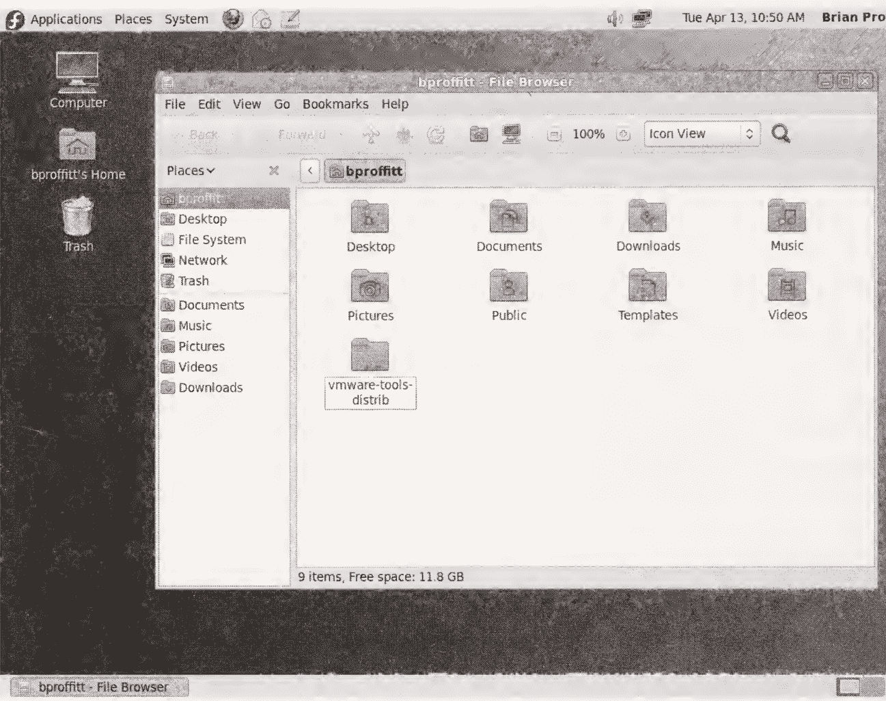

**图 2.1** Fedora 桌面，配备 Nautilus 文件管理器。

## Fedora LXDE 版本

LXDE 代表“轻量级 X11 桌面环境”，其设计目标是运行快速且极低电子资源。虽然不如 GNOME 和 KDE 流行，但 LXDE 界面具有多语言支持、标准键盘快捷键和标签文件浏览功能。

LXDE（如图 2.3 所示）是网络上电脑、移动互联网设备或旧旧机器等低功耗设备的良好环境。

## Fedora Xfce 版本

此 Fedora 版本使用 Xfce 环境，这是一个基于旧版 UNIX CDE 环境的简单且快速的环境。Xfce 需要一点时间来适应，因为它的图形界面工具比更强大的 GNOME 和 KDE 环境稍微不直观。

## 选择合适的 Fedora

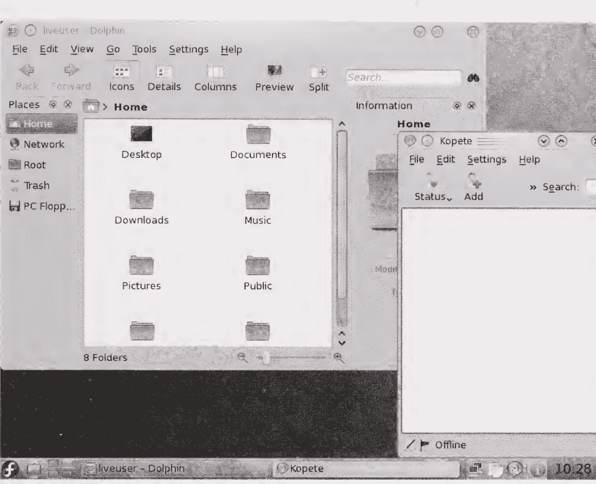

图 2.2

Fedora KDE，配备 Plasma 桌面组件。

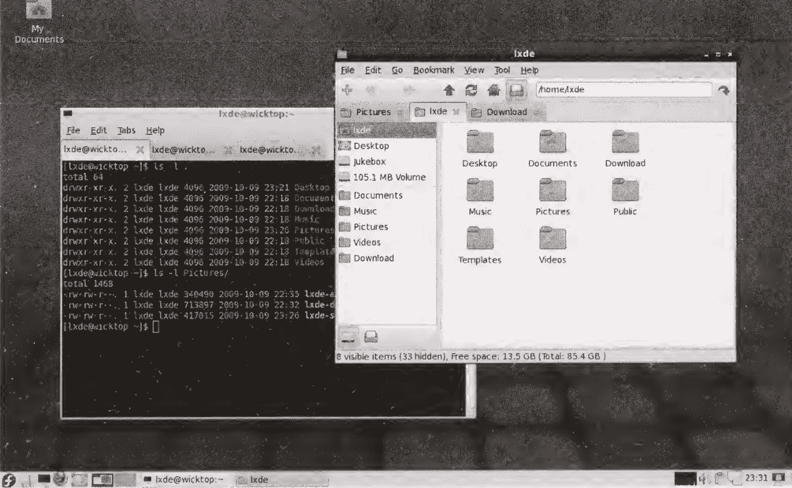

图 2.3

Fedora LXDE 界面。

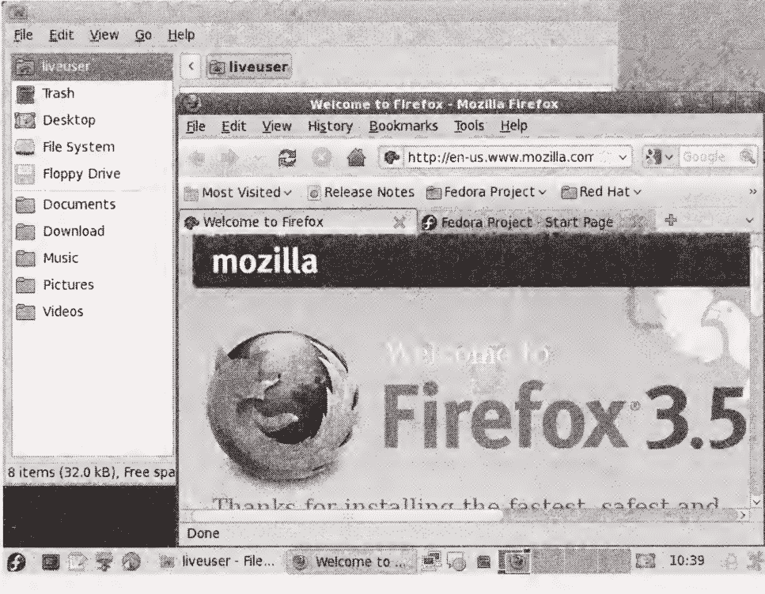

**图 2.4**

Fedora Xfce 桌面。

但使用 Xfce 为这个 Fedora 版本带来了额外优势，它不像其他 Linux 发行版那样消耗资源，使其非常适合在速度较慢的旧 PC 上运行（见图 2.4）。

## Fedora Games 版本

喜欢玩游戏吗？Fedora Games 版本为 Fedora 提供了丰富的游戏集合。

并不是所有的 Fedora 游戏都包含在这个版本中，但设计者尝试汇了可以在 Fedora 发行版中获取的不同风格游戏的良好代表（见图 2.5）。

## Fedora Edu 版本

与其他 Fedora 版本不同，Fedora Edu 的不同之处不在于它的外观或感受。相反，Fedora Edu 的差异在于它提供给用户的内容和工具。


Fedora Edu 有时被称为“儿童的 Fedora”，确实，教育和开发软件的加入无疑符合这一描述。但该项目的整体目标是为所有年龄段的学生提供一个易于使用的发行版。


### 图 2.5

像 *FlightGear* 这样的游戏在 Fedora Games 版本中是可以使用的。

根据项目主页，“此版本的目的是创建一个开箱即用的开发环境，用于为 Fedora 生态系统内部及外部的教育项目做出贡献……”

如你在图 2.6 中所示，Edu 运行 GNOME 桌面，其区别主要在于随发行版一起发送的教育应用程序套件。这些工具包含了各种语言、科学和开发学习工具。

# Fedora BrOffice 版本

在互联网国际舞台工作的有趣结果之一是，名称在不同国家可以用于不同的用途。

例如，Fedora 中的办公套件 OpenOffice.org，其官方名称中的“.org”来自于 OpenOffice 实际上是荷兰的一家注册商标的公司，也是英国电信公司 Orange UK 拥有的商标。

项目组织者并没有引起大吵大闹，而是决定简单地在名称后加上“org”。但即使这样也没有行得通，因为 OpenOffice.org 在巴西是一个持有的商标。

因此，巴西的 OpenOffice.org 用户使用 BrOffice。正如你可能猜到的那样，BrOffice 是 Fedora BrOffice 版本的中心。但该版本的创建者并未止于此。该版本加载了语言包和应用程序，非常适合中南美洲的用户，无论他们说的是西班牙语还是葡萄牙语。

# Fedora FEL 版本

与最专业的 Fedora 版本非常相似的是 Fedora 电子实验室 (FEL) 版本。

FEL 的建立完全是为了为电子设计自动化 (EDA) 社区提供一个坚实的平台。这些人是组装微芯片、处理器和机器人等东西的人。你知道的，很简单。

根据项目的网站，FEL “提供了一个完整的电子实验室设置，配备可靠的开源设计工具，以帮助你跟上当前的技术水平。”


**图 2.7** FEL 版本中的 Xcircuit。

## 明确你想做什么

有了所有这些功能，知道你想做什么非常重要。对于本书的目的来说，选择 Fedora 有一些很好的理由：

- **GNOME 是默认的。** 它是一个现代且精良的环境。
- **一切皆可得。** 你可以找到广泛的软件。
- **它易于配置。** GNOME 对初学者非常友好。

## 下载 Fedora

下载软件已经比以前要常见得多。宽带的出现，加上一些将软件分成较小包以缩短下载时间的技巧，使得这一切成为可能。

## 获取 Fedora

如果你有快速的互联网连接，这是最佳选择。

## 通过网络获取

通过网络获取 Fedora 既简单又（最重要的是）免费。除了你之后刻录光盘的成本和你花费的时间（花不了多久），你很快就能在 PC 上安装一个功能齐全的操作系统。

开始之前，打开你喜欢的浏览器。

## 你从哪里来

正如引言提到的，假设你在实施 Fedora 之前使用的是 Windows Vista 或 7。

- 1. 访问 Fedora 项目网站 `http://fedoraproject.org/`
- 2. 点击 `Get Fedora` 链接。打开 Get Fedora 页面。
- 3. 在 Get Fedora 13 Desktop Now 部分点击 `Download Now!` 按钮。打开 `Opening Fedora-13-i686-Live ISO` 对话框。

## 这是实时版吗？

“实时版”（Live）指的是可以直接从 CD 或 DVD 驱动器运行的 Linux 版本。这允许你无需实际安装即可使用 Fedora。

- 4. 点击“保存文件”单选按钮。（在 Internet Explorer 中，点击“保存”按钮。）
- 5. 点击“确定。（在 Internet Explorer 中，选择目标位置并再次点击“保存”按钮。）下载过程将开始，文件将保存到你 Windows PC 默认位置。

## 通过 BitTorrent

即使在宽带连接下，下载一个接近 660MB 的文件也需要一些时间。在平均情况下，这大约需要 15 分钟，上下浮动。但如果你在每个人都尝试获取这个磁盘镜像文件时，所需的时间可能会延长到几个小时,[因为]你的浏览器会耐心地等待轮到，一点一点地下载文件。

有一种下载文件的方法，通常可以避免中央文件服务器有时会出现流量拥堵，这种方法使用了一种名为 BitTorrent 的较新方法。

你可能在新闻或技术媒体中听过 BitTorrent，因为它经常（错误地）被认为是软件盗版下载和传输非法物品的工具。实际上，BitTorrent 有许多合法用途：下载像 Fedora 这样的 Linux 发行版无疑就是其中之一。

它的工作原理如下：BitTorrent 不是从中央服务器下载文件，而是由所有想要获取这些文件的人共享下载。该组（被称为“种子群”，swarm）中至少有一个用户拥有该文件或多个文件的所有部分。这就是“种子”（seed）计算机。在 BitTorrent 下载中，群体中的所有计算机相互查询，并找出每台机器拥有下载内容的哪些部分。如果我的电脑需要文件 42 的第 863 部分，而计算机 B 拥有它，我将从它那里下载。如果我的电脑有文件 23 的第 567 部分，而计算机 B 需要它，它将从我这里下载该部分。如果群体中还没有人拥有它，计算机将查询种子计算机，获取所需的文件部分，并与群体中的其他成员共享。

## 获取 Fedora 27

这种方法被称为点对点或分布式下载，没有某台计算机需要承担作为特定文件或多个文件源的负担。流量负载在群体的所有成员之间共享。奇妙的一点是，随着群体中越来越多的计算机获取了它们所需的 100% 文件，这些机器反过来也变成了种子。通过这种方式，过程实际上随着时间的推移而变快。

三大操作系统都有许多 BitTorrent 客户端可用，你可能已经有了一个。可以推荐的是 Vuze，这是一个强大的 BitTorrent 客户端，可用于 Linux、OS X 和 Windows。它还（作为一个巨大的额外加分）是一个开源软件产品。

## 获取 Vuze

要获取你的 Vuze 副本，请使用你喜欢的浏览器访问 `www.vuze.com`。

在获得 Vuze 或任何其他 BitTorrent 客户端副本后，你需要找到并下载所谓的“跟踪器文件”（tracker file）。跟踪器文件非常小，它会告诉你的 BitTorrent 应用程序在互联网上拥有你所需文件的种子和群体位于何。

定位 BitTorrent 跟踪器文件非常简单，因为 Fedora 在其网站上列出了这些文件。你只需要确保获取的是正确的一个即可。

- 1. 访问 `http://fedoraproject.org/en/get-fedora` 的 Get Fedora 页面。
- 2. 在页面底部，点击“查看所有 Torrents”链接。将出现一个非常详细的文件列表。
- 3. 点击 `Fedora-13-i686-Live.torrent` 链接。你的浏览器将打开“打开 Fedora-13-i686-Live.torrent”对话框。

## 正确的选择

如果你有一台旧 PC，请确保文件名中出现“i686”。如果你的 PC 好是 64 位的，点击 `Fedora-12-x86_64-Live.torrent`。

- 4. 点击“保存文件”单选按钮。
- 5. 点击“确定。下载过程将开始，跟踪器文件将保存到你 Windows PC 默认位置。

## 第 2 章 ■ 在安装 Fedora 之前

获取跟踪器文件后，打开你的 BitTorrent 客户端并使用该文件开始下载实际镜像文件。使用 Vuze，这是一个非常简单的过程。

- 1. 打开 Vuze 应用程序（见图 2.8）。
- 2. 选择“文件 | 打开 | Torrent 文件”菜单选项。将出现“打开 Torrent(s)”对话框（见图 2.9）。
- 3. 点击“添加文件”按钮。将打开“选择 Torrent 文件”对话框。
- 4. 导航到保存 Fedora 跟踪器 (.torrent) 文件的文件夹。
- 5. 选择跟踪器文件。
- 6. 点击“打开”。对话框将关闭，Torrent 内容的信息将出现在“打开 Torrents”对话框中。
- 7. 点击“确定”。BitTorrent 下载过程将开始，镜像文件将保存到你 Windows PC 上指定的位置。

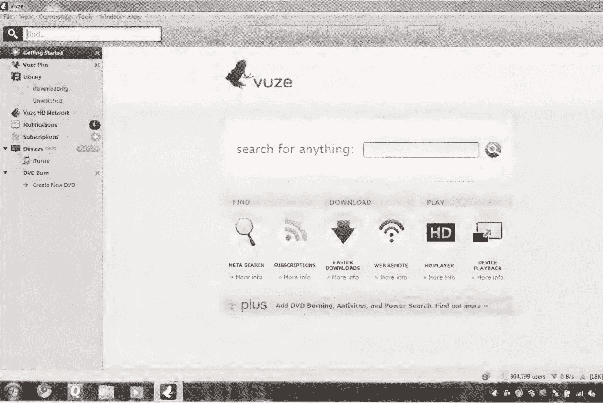

图 2.8

Vuze 应用程序。

## 获取 Fedora 29

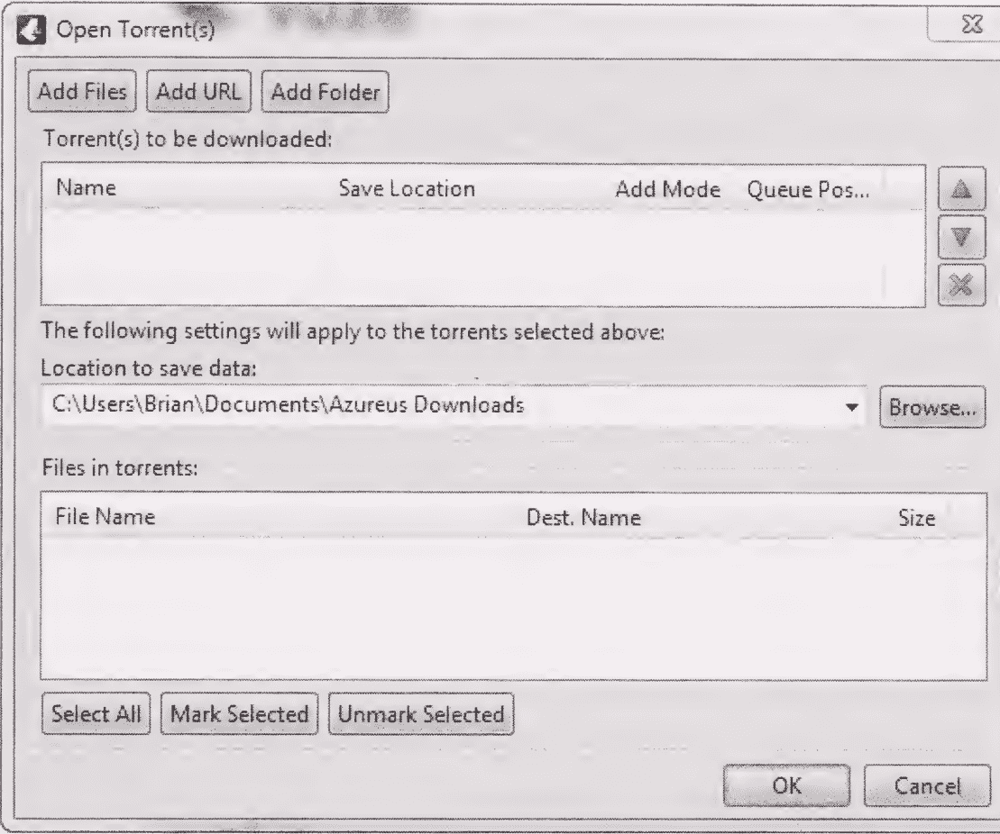

图 2.9

打开 Torrent(s)对话框。

## 给予与取

不要做吸血者！

## 正确的选择


如果你有一台旧 PC，请确保文件名中出现“`i686`”。如果你的 PC 好是 64 位的，点击 `Fedora-12-x86_64-Live.torrent`。

# 第 2 章 在安装 Fedora 之前

## 获取 Fedora

在一个硬件公司只关注 Windows 的世界中，

## 获取系统信息

Fedora 是一个非常稳健的操作系统，在大多数计算机上，它都可以没有问题地安装。但如果出现了问题，很可能是因为 Fedora 没有识别你 PC 上的硬件。

以及你可能拥有的其他外部设备。你需要记录设备上显示的品牌名称和型号。

除了识别外部设备外，你还需要确定计算机内部实际的硬件配置。一个开始的方法是显示由你现有操作系统识别的设备列表。`Windows XP`、`Vista` 和 `Windows 7` 使用一个名为“设备管理器”的内置应用程序（applet）来列出已知设备。

在 `Vista` 和 `Windows 7` 中，按照此处列出的步骤打开设备管理器。

1. 点击 Windows 任务栏上的“开始”按钮；然后选择“控制面板”。将出现控制面板窗口。
2. 点击“硬件和声音”链接。“硬件和声音”页面将打开。
3. 点击“设备管理器”链接。列出计算机内部工作情况的“设备管理器”将如图 2.10 所示出现。

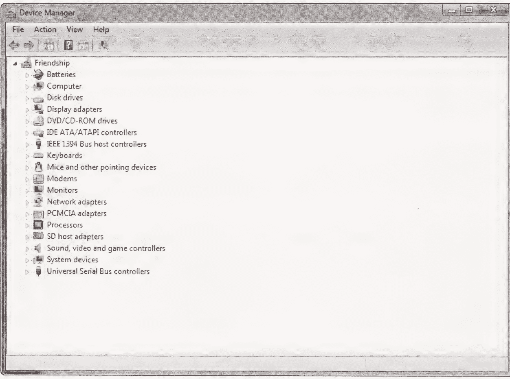

图 2.10

Windows 设备管理器。

现在，你需要做一些老派的侦探工作。你的计算机可能（也可能没有）实际上使用了设备管理器列出的每种类型的设备。例如，要确定计算机安装了什么种的 CD-ROM 驱动器，首先通过点击其扩展控件（每个类别旁边的小三角形）来展开 DVD/CD-ROM 驱动器列表，如图 2.11 所示。

如你在图 2.11 所示，这台计算机有一个 CD-ROM 驱动器，其标签相当晦涩。要了解更多有关设备的信息，双击所需的设备。将出现 CD-ROM 驱动器的“属性”对话框（见图 2.12）。

这是一个符合 Windows 标准设备的典型示例——以至于 Windows 根本不在乎它是谁制造的。对于 Windows 而言，这仅仅是一个标准的 CD-ROM 驱动器。记录这些非通用信息仍然是一个好主意，以防以后在安装 Fedora 时出现问题。

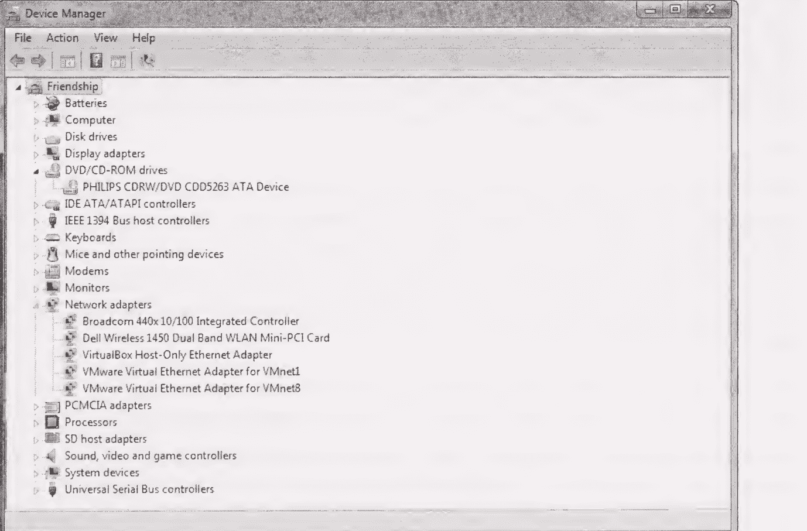

图 2.11

点击扩展框打开设备列表。

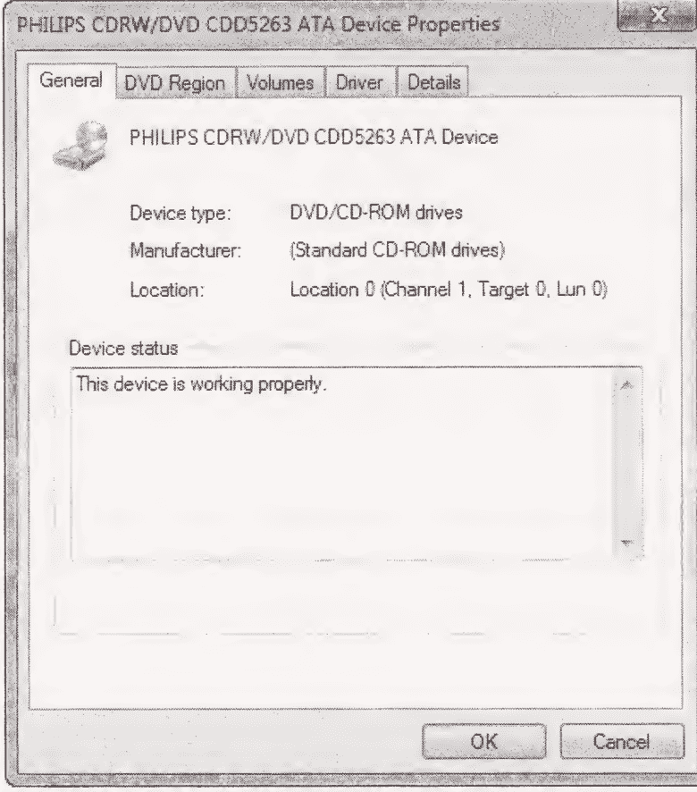

图 2.12

这里信息太多了，但每一点都有帮助。

你可能会发现其他书籍建议读者记录日志，以跟踪和记录他们 PC 的所有硬件以及在安装 Fedora 期间出现的任何其他问题。这种方法有其价值，但不需要拿出笔和纸。在 `Windows XP` 的设备管理器中，有一个你可以使用的“打印”图标，可以直接打印出 `Windows XP` 关于你 PC 硬件的所有信息。

你会发现这份打印的文档包含了许多技术性信息——其中大部分你将不需要。尽管如此，这比手写所有内容要节省时间。

在较新版本的 Windows 中，硬件信息需要手动记录。

为了成功安装 Fedora 并在以后出现问题时进行故障排除，你需要的最重要的信息是表 2.1 中列出的那些让你的计算机最正常运行的设备。

### 表 2.1 安装/故障排除 Fedora 需要的重要硬件信息

| 硬件 | 所需信息 |
| --- | --- |
| CPU | 制造商、型号、速度 |
| 主板 | 制造商、型号 |
| 总线 | 制造商、型号 |
| 内存 (RAM) | 大小 |
| 显卡 | 制造商、型号、显存 大小、芯片组 |
| 声卡 | 制造商、型号 |
| 显示器 | 制造商、型号、水平和垂直同步率 |
| 硬盘 | 制造商、型号、类型 (SCSI vs. IDE) |
| 网卡 | 制造商、型号 |
| CD-ROM 驱动器 | 制造商、型号、大小 |
| 软盘驱动器 | 制造商、型号、大小 |
| 调制解调器 | 制造商、型号、传输速度 |
| 打印机 | 制造商、型号 |
| 鼠标 | 制造商、型号、类型 (PS2 /串口或 USB) |
| 键盘 | 制造商、型号、键数、语言 |
| SCSI 卡及设备 | 制造商、型号、控制的设备类型 |
| IDE 适配器 | 制造商、型号、控制的设备类型 |

你所需的大部分信息包含在打印的设备管理器输出中，但并非所有。例如，你可以通过点击“系统属性”对话框中的“常规”选项卡来查找计算机上安装的 RAM 数量。另一个选项可能是右键点击“我的电脑”中显示的硬盘图标并选择“属性”选项查看你的驱动器空间有多大。侦探工作将让你的 Fedora 安装变得更加容易。

## 备份你的数据

在确定了硬件设置后，你将需要采取下一步为计算机安装做好准备：备份 PC 上的数据。

备份你的贵贵数据总是一个好主意，以防止系统灾难。至少，你希望你的数据免受电涌、病毒攻击、计算机被盗或任何其他可能影响你访问计算机数据能力的干扰。

你首先应该决定的是哪些数据应该被备份。这取决于你打算在 Fedora 安装中做什么。如果你计划进行双启动（在同一台机器上运行 Windows 和 Fedora），那么你需要确保在出现问题时仍然可以进入 Windows 端。

### 完全替换 Windows

即使你计划完全移除 Windows 并代之 Fedora，保存数据仍然有意义。在 Windows 中创建的文件可以在 Fedora 中打开，例如图形文件（GIF、JPEG、PNG）和 Adobe Acrobat (PDF) 文件。此外，如果你使用兼容软件，甚至 Microsoft Office 文件也可以打开。

### 为双启动做准备

大多数计算机应用程序占用大量的磁盘空间，主要是因为现在的硬盘允许它们这样做。因此，备份你的数据和应用程序文件是一项巨大的工作。如果你有足够的容量（如外部硬盘），建议你备份整个驱动器。

对于那些没有足够容量设备存储整个驱动器数据的人，只需备份你的数据文件。你的数据文件是你随时间创建的文档、电子表格、绘图和其他文件。如果你遇到麻烦，可以通过原始磁盘重新安装 Windows 操作系统和应用程序，然后恢复备份的个人数据文件。

如果你从未用过备份程序，你会发现它们很容易用。有很多备份程序可用，包括随 Norton 系统工具带的一个非常棒程序。备份程序的原理大都是：定位并识别你想要存档的文件、指定新存档的位置并创建该文件。恢复仅仅是此操作的反向。

Microsoft Windows 有自己的备份工具可以用于存档你的数据。下面的步骤描述了如何使用 Windows 备份工具。

1. 点击“开始”。开始菜单将出现。
2. 在“搜索程序和文件”字段中输入“备份”。备份和恢复”链接将出现在菜单的程序部分。
3. 点击“备份和恢复”链接。“备份和恢复向导”应用程序将打开（见图 2.13）。

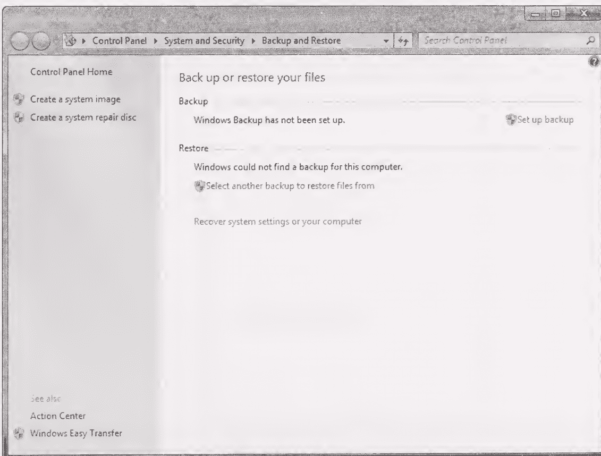

图 2.13

Microsoft 备份工具。

4. 点击“设置备份”链接。将出现“设置备份”对话框，如图 2.14 所示。
5. 点击驱动器以保存备份文件并点击“下一步”。将出现“你想备份什么”页面（见图 2.15）。
6. 在此处，你可以选择备份整组计算机文件，也可以选择仅备份选定的文件。如果你想备份所有内容，选择“由 Windows 选择”单选按钮，然后点击“下一步”。将出现“检查备份设置”页面（见图 2.16）。
7. 点击“保存设置并运行备份”。备份过程将开始。

确保备份文件存储在硬盘之外。正如你将在下一章中看到的，你的硬盘将发生巨大的变化。

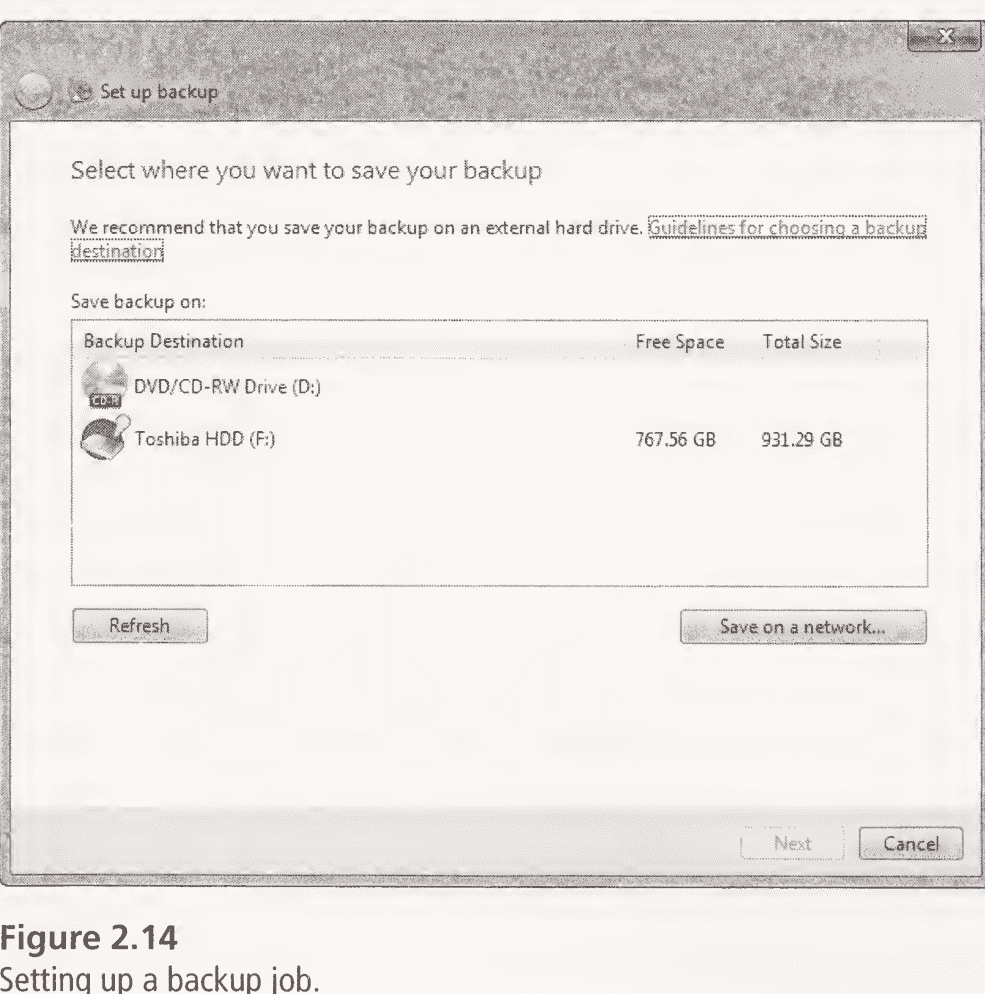

## 安装准备

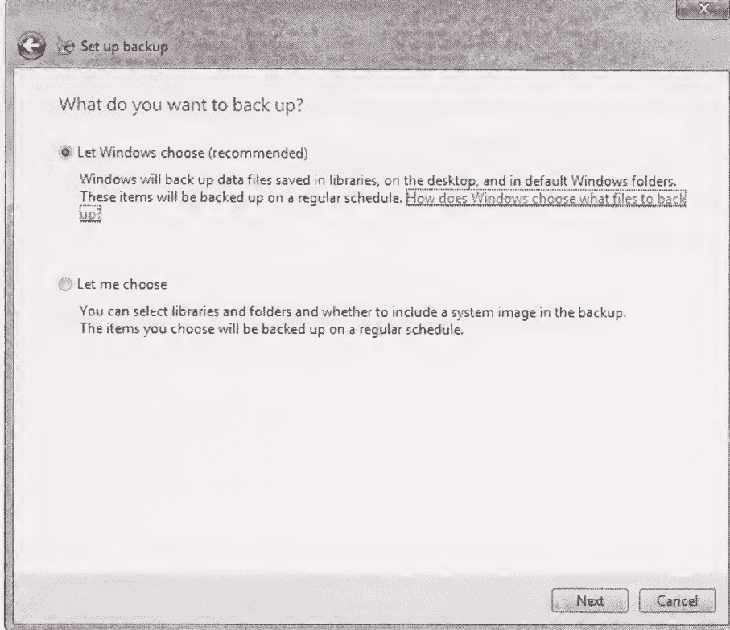

图 2.15

你可以选择你想要备份的文件。

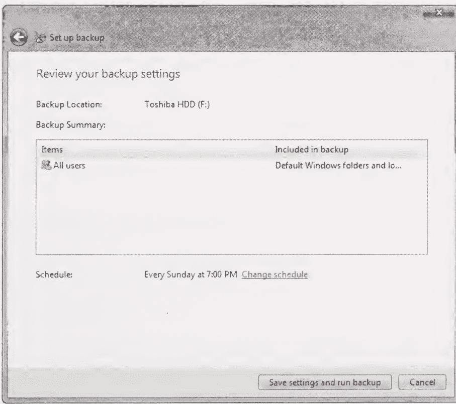

图 2.16

检查你选择的内容。

## 总结

在本章中，你学习了为安装 Fedora 准备机器的关键步骤，包括定位和下载 Fedora、刻录 CD 或 DVD 以及为你的计算机安装做好准备。这些准备工作即将获得成效，因为在下一章中，大时刻到到了：Fedora 将很快在你的计算机上运行起来。

# 第 3 章

## 安装 FEDORA

现在是见真实的时刻。你已经做好了功课，想好了如何安装你的 Fedora 版本，并且准备好出发了。

本章不会让你失望。它的唯一目标是引导你使用 Anaconda 图形安装程序完成整个安装过程。在此过程中，你将：

- 发现如何探索 Fedora——无需安装它。
- 选择哪种方案最适合你，单独安装 Fedora 还是与另一个操作系统并存。
- 逐步体验整个安装过程。
- 为你的 Fedora 机器创建一个或多个用户。

## 先试用后购买


这一部分可能会让你不再抓耳挠腮疑惑为什么刚刚在第 2 章中做了所有的准备。耐心点，这种疯狂是有章法的。

目前 Fedora 的所有版本都以 `LiveCD` 版本供用户使用。“`LiveCD`”是那些可以直接从 CD 本身启动并运行而操作系统的标签——无需安装在计算机的硬盘上。

## 第 3 章 ■ 安装 Fedora

这意味着，当你将 `Fedora CD` 插入光驱驱动器并重启计算机时，`Fedora` 将自动在你的计算机上运行，而不会放置任何新文件，也不会触碰机器上已有的数据。`Fedora` 只是启动并运行。

那么你可能会问，我为什么还要费劲安装 `Fedora` 呢？我可以直接从 CD 运行它。嗯，事实确实如此，而且很多人都这样做——特别是当他们使用别人的 PC 且不想使用原有的操作系统时。当你只需插入 `Fedora LiveCD` 就能准备好更熟悉的环境时，我们为什么要在朋友的计算机上使用 Windows 呢？

第一个问题是：从光驱驱动器运行任何操作系统意味着过程将缓慢得多。数据必须不断从驱动器中传输，只有最快的驱动器才能带给你尚可的用户体验。

如果你的系统 `RAM` 内存不足，`LiveCD` 的性能将受到更大的打击。当操作系统及其应用程序运行时，它们会使用 `RAM` 作为工作空间来执行操作。可用内存越多，应用程序运行得越高效。但一旦运行大量应用程序，`RAM` 就会被填。为了跟上需求，操作系统使用磁盘驱动器上称为“交换空间”的区域来满足内存需求。这就是为什么当你在计算机上运行很多程序时，你会听到硬盘在嗡嗡响。使用交换空间速度较慢，但它可以完成任务。

### 何时升级 RAM

> 如果你的硬盘工作非常频繁——即使在你只使用一两个应用程序时，考虑在机器上安装更多 `RAM` 也是合适的。这不仅能加快你的操作速度，还能减少硬盘的磨损。

然而，当你运行 `LiveCD` 时，交换选项并不适用，因为来自 CD 的 `Fedora` 不会触碰你的驱动器数据。如果你的系统没有安装大量 `RAM`，请准备好缓慢的 `LiveCD` 操作。

尽管操作缓慢，但 `LiveCD` 的优势在于它让你随身携带操作系统（如前文提到的），而且它现在对你很有用——它能让你在“购买”之前尝试 `Fedora`。在这里，“购买”意味着安装。

`Fedora LiveCD` 实例中的一切与你将 `Fedora` 安装到 PC 上所得到的完全一致。你只需要将光盘插入 CD 驱动器并重启 PC 即可。

## 一个或两个操作系统？

你将在黑屏上看到一个文本菜单，询问你想做什么。预选选项是“启动（`Boot`）”或“安装（`Install`）”，所以你不需要做任何操作。（注：原文此处存在大量重复的无效 OCR 文本，已根据逻辑清理）。

## 一个或两个操作系统 45

脑海中有了蜂窝的形象，你就可以将这种比应用于数据存储在硬盘驱动器上的方式。你可以看到，如果没有预先建立某种结构来组织数据，数据是无法存储在驱动器上的。

当数据被放入驱动器时，它会被写入这种结构中，在 Linux 社区中，这被称为文件系统。文件系统是存储数据的格式——你可以将其理解为由单元格组成的蜂窝，每个微小的数据块都被放置在其中。

电脑毕竟是电脑，情况要比这复杂得一点。例如，单个文件的数据并不是存储在相邻的数据块中。数据可能存储在 456、457 和 458 数据块中，然后是 6,134 块，接着是 7,111 块，依此类推。（这是一种简化处理，但你明白我的意思）。文件系统的任务就是跟踪每个文件所在的位置，这样当你发送命令处理某个文件时，文件系统就知道存储该文件的所有独立数据块。

由于所有这些文件的跟踪和检索，计算机工程师提出了即使在大容量硬盘上也保持文件系统较小的想法。因此，分区的概念应运生。基本上，分区是一个虚拟屏障，告诉文件系统：“你以前可以向整个硬盘上的 1–25,000 块写入数据，但现在你只被允许写入 1–17,500 块。第二个文件系统将写入 17,501–25,000 块，所以请放手！”

因此，你就拥有了分区。每个分区都可以使用不同的文件系统。打个比方，蜜蜂创建的蜂窝与黄蜂创建的蜂窝不同——结构相似，但结果不同。

如果你的 PC 包含典型的 Windows 安装，那么你的 Windows 文件系统就包含在一个覆盖了整个硬盘的大型分区内。这没有为另一个分区和新文件系统留出任何空间。请记住，即使你的驱动器上有几 GB 的空闲空间，这些空间就像文件和目录一样，可能分散在整个硬盘中，但仍然属于 Windows 分区。

向现有的硬盘文件系统添加分区的简单方法是使用 `Anaconda` 内的分区工具。这会将你现有的分区显示为一个单一、更小的数据块集合，在硬盘的其它位置留下真正的空白且未结构化的（未格式化的）空间，你可以在那里安装一个存放 `Fedora` 的分区。

## 第 3 章 ■ 安装 Fedora

## 备份你的数据

如第 2 章所述，在使用任何工具操纵或创建分区之前，请将你的数据备份或保存到另一个物理驱动器上。如果你计划用 `Fedora` 完全替换 Windows，请务必备份所有内容。拜托了。

## Fedora 需要的分区

安装 `Fedora` 时，它使用一个名为 `Anaconda` 的七步应用程序来完成任务。当 `Anaconda` 检测到你的计算机上还有另一个操作系统时，它会询问你是想替换整个硬盘的内容还是执行分区操作。

这个选择点将决定你的计算机上是一个单一 `Fedora` 操作系统还是多个操作系统（`Fedora` 和 Windows）。执行此过程的机制将在本章稍后的后的“分区设置”部分进行概述。目前，有一些应该传给新 `Fedora` 用户的建议。

在 `Fedora` 系统中，文件系统面向一个基于硬盘盘器符的关键根目录。对于大多数主驱动器来说，盘器符是“C”，因此 Windows 中的根目录表示为 `C:\`。其他驱动器也有根目录（`D:\`、`E:\` 等）。根目录始终与物理驱动器或分区绑定，所有的子目录（在 Windows 中称为子文件夹）都直接源自同一物理驱动器上的根目录。`C:\Documents and Settings\Brian\My Documents` 将始终位于同一物理驱动器上。

向现有的硬盘文件系统添加分区的简单方法是使用 `Anaconda` 内的分区工具。这会将你现有的分区显示为一个单一、更小的数据块集合，在硬盘的其它位置留下真正的空白且未结构化的（未格式化的）空间，你可以在那里安装一个存放 `Fedora` 的分区。

安装到 PC。`Anaconda` 的第 1 步如图 3.2 所示，显示了 `Fedora` 支持的多种键盘。

选中的键盘是根据你首次运行 `Fedora LiveCD` 时选择的语言设置的默认键盘。如果你不确定使用的是哪种键盘，请保留默认选项。否则，选择合适的键盘并点击“下一步（`Next`）”进入第 2 步。

## 设备类型设置

大多数 `Fedora` 用户可能会在 PC 或类 PC 设备（如笔记本电脑或手笔记本）上安装 `Fedora` 操作系统。然而，高级用户和系统管理员也可以在使用存储区域网络（`SAN`）的其他类型机器上安装 `Fedora`，这是一组为大型组织存储数据设计的服务器和磁盘。

推测，如果你有这类项目，你就不需要这本书了。因此，我们将假设一个更基础的选择，并保留“基础存储设备”（`Basic Storage Devices`）选项（如图 3.3 所示）。点击“下一步”继续到第 3 步。

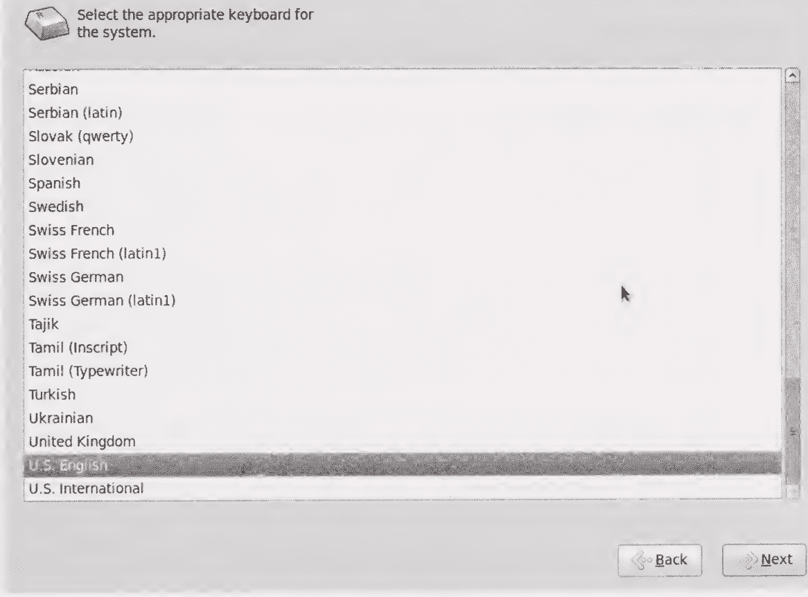

图 3.2

世界上不只有 QWERTY 布局。

# 第 3 章 ■ 安装 Fedora

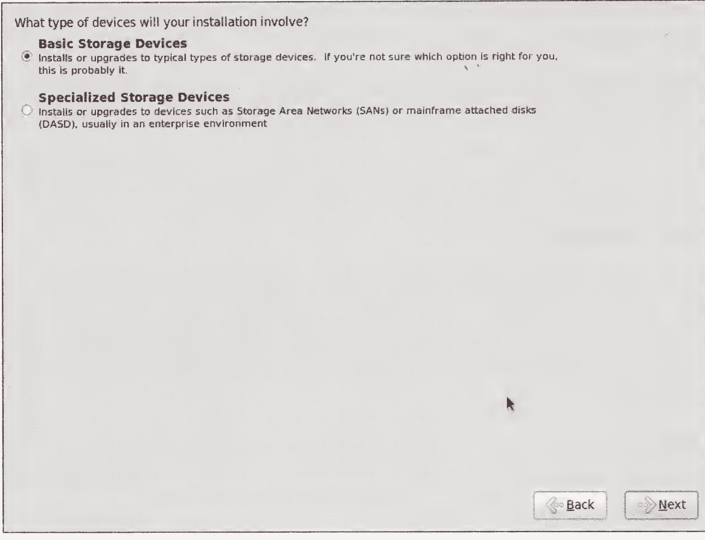

**图 3.3**

你的 PC 有什么种存储设备？

## 硬盘和计算机设置

如今大多数计算机配有一个硬盘，通常是一个大硬盘。尽管如此，有很多系统配备了多个硬盘，或者其用户后来添加了一个。

考虑到这一点，`Fedora` 允许你选择想要安装 `Fedora` 的硬盘。在图 3.4 所示的示例中，只有一个驱动器，因此点击它进行选择，然后点击“下一步”进入第 4 步。

然而，如果你的系统中有多个硬盘，你可以选择你偏好的硬盘进行 `Fedora` 安装。

在下一个屏幕中，你有机会为你的计算机命名（见图 3.5）。选择像“`Fedora`”或“`officepc`”之类的名称。如果你的计算机连接到了网络，该名称将用于在网上识别你的计算机。

点击“下一步”进入第 5 步。

## 运行 Anaconda 51

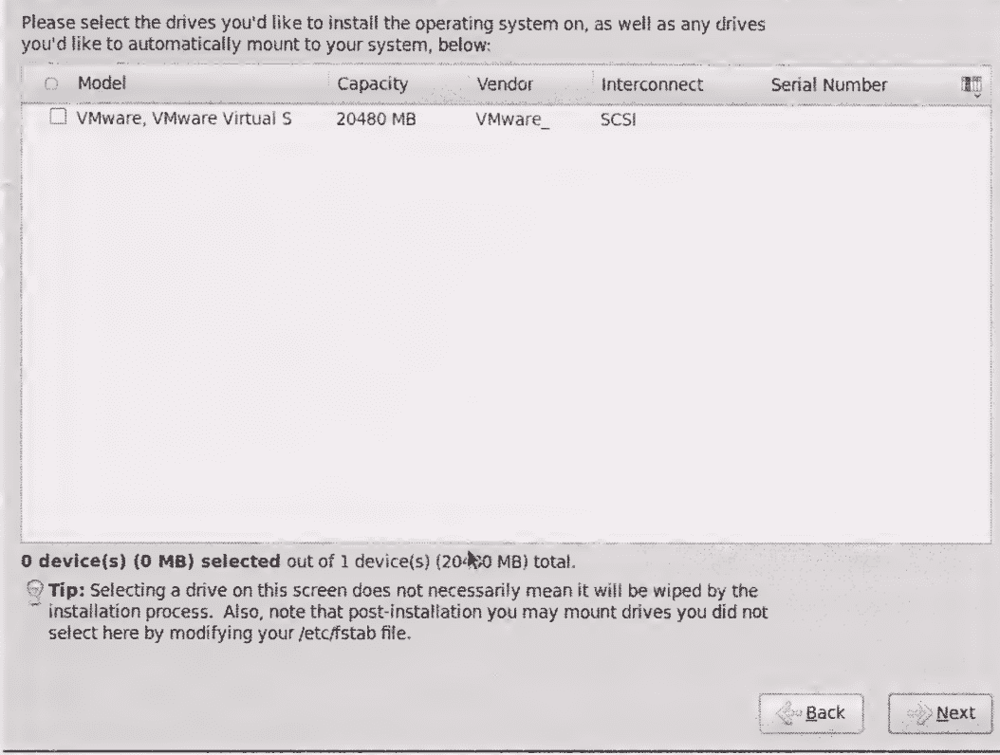

图 3.4

选择目标硬盘。

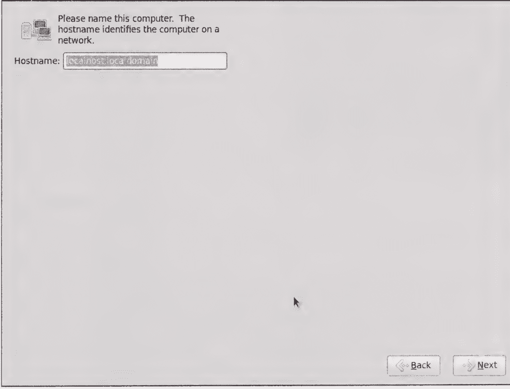

图 3.5

命名你的计算机。

## 时区设置

`Anaconda` 的第 5 步显示了世界地图，通过地图你可以确定正确的时区设置（见图 3.6）。

如果你想使用地图，可以使用地图左侧的放大滑块放大到特定区域。点击距离你所在地最近且仍处于同一时区的城市。该城市将出现在地图下方的“已选城市”（`Selected City`）下拉列表中。如果你点击了错误的城市，只需重试。

确认你选择了正确的城市且时区也是正确的。点击“下一步”继续第 6 步。

## Root 设置


在图 3.7 所示的屏幕上，你需要设置系统的 `root` 密码。“Root”是赋予任何 Linux 系统管理员账户的名称。`root` 用户拥有巨大的权限，可以以其所能的方式配置 Linux 系统。

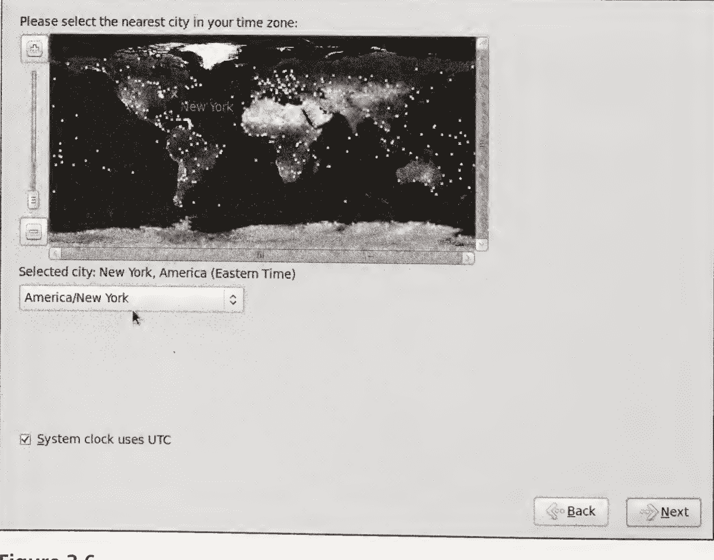

图 3.6

发现你的 Fedora。

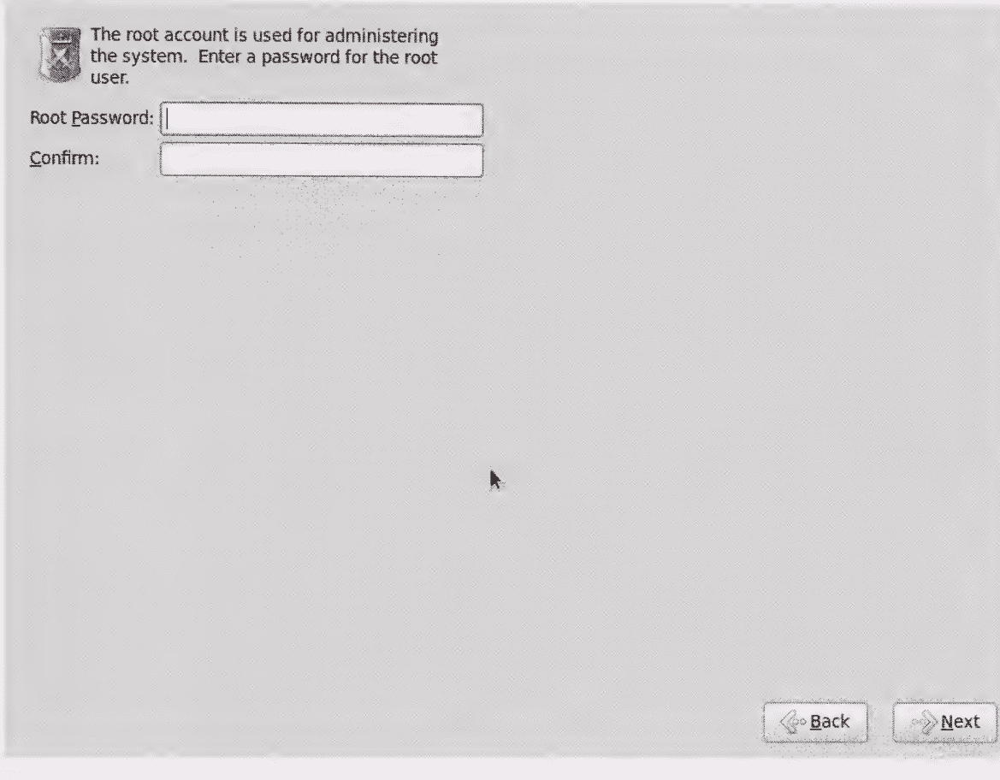

图 3.7

设置 `root` 密码。

因此，这不是一个你会随手使用的密码。设置一个好密码，并且不要忘记它。

在输入两次相同的密码后，点击“下一步”进入第 7 步。如果 Fedora 检测到你输入了弱密码（例如基于字典单词的密码），它会向你发出警告，并给你输入更强密码的机会。

## 分区设置

现在是 Anaconda 过程中最重要的部分：选择你的分区选项。

默认情况下，Anaconda 会选择“替换现有的 Linux 系统”（Replace Existing Linux System(s)）选项。但你需要选择“缩小当前系统”（Shrink Current System）选项（见图 3.8）。在离开该选项并点击“下一步”之前，让我们回顾一下这意味着什么。

缩小当前系统意味着 Anaconda 将尝试使用该文件系统中任何未使用的空间来缩小现有 Windows 系统的大小，为磁盘上空白部分的 Fedora 腾出空间。

# 第 3 章 ■ 安装 Fedora

你想选择哪种安装类型？

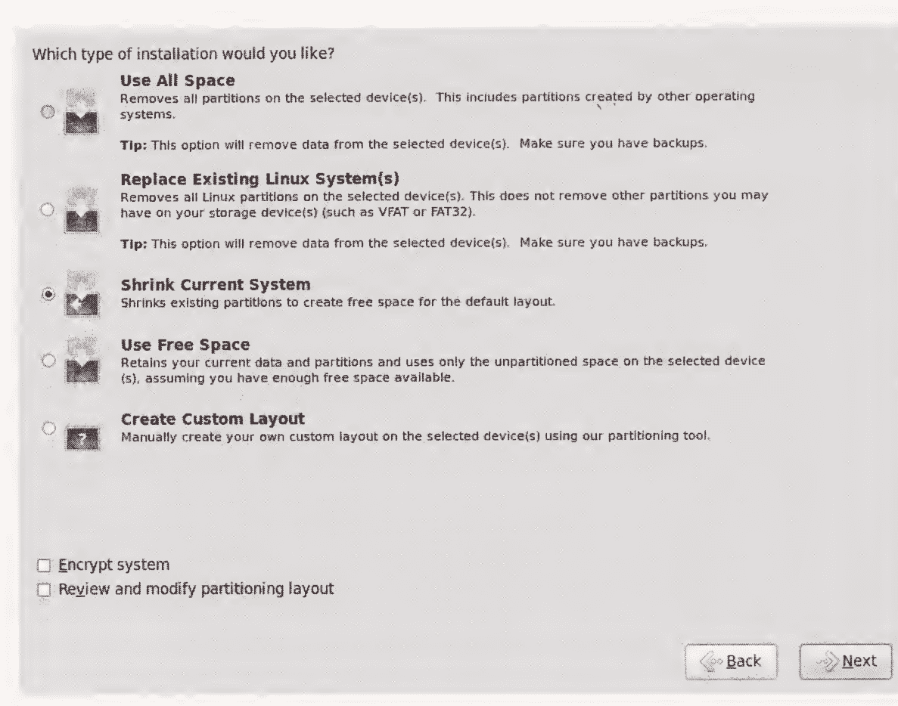

图 3.8

注意：分区。

例如，假设你安装了 Windows 并并与它一起安装 Fedora。你需要缩小 Windows 分区为 Fedora 腾出空间。这通过选择“缩小当前系统”选项来实现。Anaconda 然后将尝试调整 Windows 分区的大小并为新安装腾出可用空间。

## 第3章 安装 Fedora

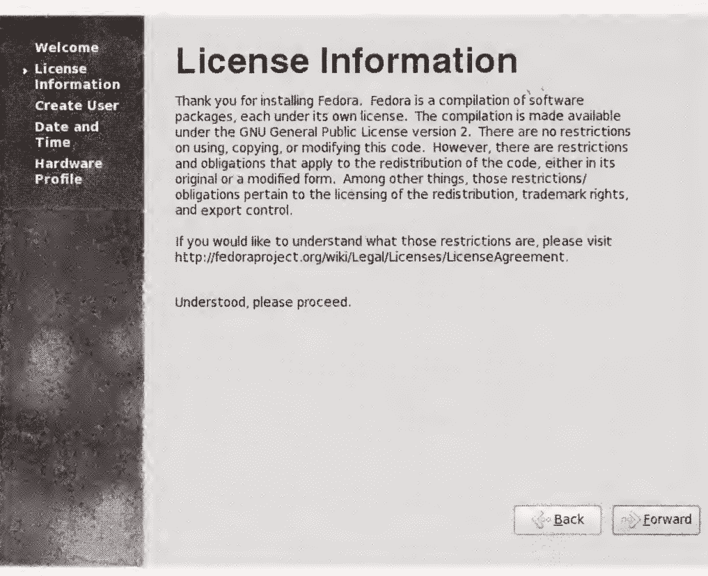

图 3.12

基础 Fedora 许可声明。

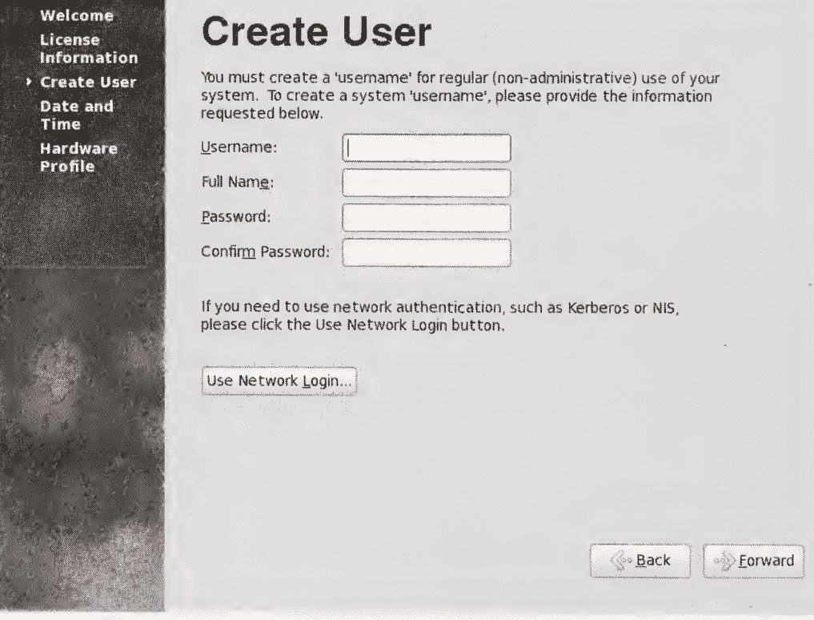

图 3.13

创建用户界面。

## 首次运行配置

可以使用你最喜欢的歌曲中副歌部分单词的首字母。你应该能获得一个足够复杂的密码。

填写完信息后，点击“下一步”继续。

在图 3.14 所示的日期和时间界面中，你可以确认 Fedora 从系统中获取的日期和时间信息，以及你在 Anaconda 中设置的时区。

### 同步时间

如果你需要非常准确的时间，请点击“网络同步日期和时间”。这将会将你的计算机连接到互联网上的高精度服务器，这些服务器从原子钟获取时间设置。你以后再也不会迟到了。

确认时间设置后，点击“继续”将进入设置向程序的最后一个界面：硬件概要界面（见图 3.15）。

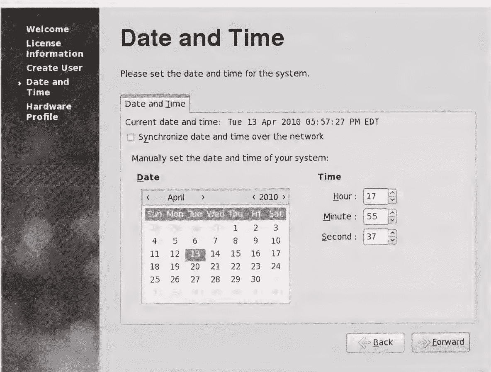

图 3.14

日期和时间界面。

### 硬件概要

`Smolt` 是 Fedora 项目的硬件分析器。提交你的概要是回馈社区的一种极佳方式，因为这些信息被用于将精力集中在热门硬件和平台上。提交是匿名的。发送你的概要将实现每月一次签到。

```
General
===================
UUID: 8a7f267d-e8e1-4a69-a678-b2eea7039ed9
OS: Fedora release 13 (Idara)
Default run level: 3
Language: UTF-8
Platform: i686
BogoMIPS: 313.34
CPU Vendor: Intel
CPU Model: Intel() Core(TM) J2 Duo CPU L7500 @ 1.60GHz
CPU Stepping: 10
CPU Family: 6
CPU Model Number: 15
Number of Cores: 2
```

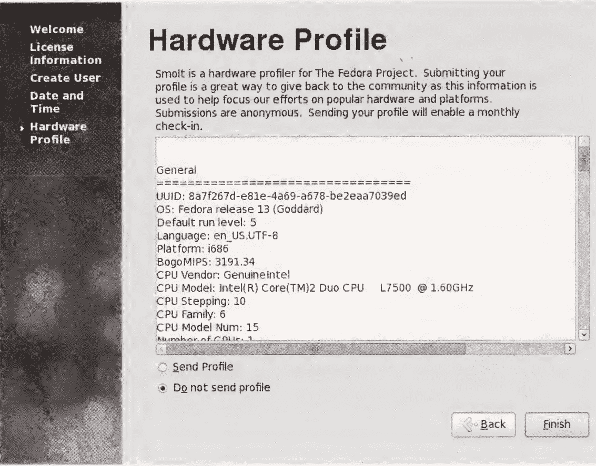

图 3.15

向 Fedora 社区回馈。

向 Fedora 提供信息。为什么？因为通过对每个系统进行调查，Fedora 开发人员将更好地了解在未来版本中将精力放在哪里。这些信息是严格匿名的，不会发送你的任何个人数据。

选择你想要的选项，然后点击“完成”。设置程序将关闭，随后你会看到登录界面。

输入你的用户名和密码信息，进入 Fedora。

## 总结

在本章中，你回顾了在 PC 上获取 Fedora 的安装步骤。我们特别关注了分区设置，因为这是安装过程中唯一可能导致重要数据丢失的部分。

现在 Fedora 已经安装好了，是时候在第 4 章“桌面基础”中对这个出色的操作系统进行全面巡检了。

# 第 4 章 ■ 桌面基础

新用户对 Fedora 桌面最先注意到的之一是它的柔和色调。有些用户可能会更直接一点：“这确实是……蓝色的……”他们可能会这样咕咕，语气并不那么热情。

事实上，如今许多图形环境的华丽与鲜艳相当内敛。但有一个充分的理由：将一个朴素的桌面想象成一块空白画布，你可以在上面创建一个完全根据你的需求定制的桌面。事实上，自定义桌面的方法非常多，而且不仅仅通过颜色——你几乎不知道从何处开始。

这正是本章乐意要做的：提供关于如何开始让你的 Fedora 桌面真正属于自己的指导。

在本章中，你将：

- 学习更多关于 GNOME 桌面开发的知识。
- 确保你的显示器设置为最佳分辨率。
- 发现如何修改各种桌面元素的设置。
- 导航 GN 桌面。

## 理解 GNOME 桌面

首先，它不是“gnome”（像那些在斯堪的纳维亚乡村穿梭的、穿着蓝色外套、戴着红帽的小生物）。它的读音是“guh-mome”，G 音重，uh 音轻。

`GNOME` 是 Miguel de Icaza 的结晶，他是一位墨西哥计算机工程学生，他看了一眼 KDE 环境并非常喜欢他所看到的——直到他发现其中（当时）存在非自由代码。

De Icaza 是自由软件理想的忠实追随者，他决定 Linux 需要一个类似的桌面环境，但不能具备 KDE 那种许可限制。

`GNOME` 最初于 1997 年 8 月首次亮相，当时 De Icaza 在 `comp.os.linux.announce` 新闻组中首次宣布他正在进行的项目。到同年的 12 月，第一个版本于 1999 年 3 月发布。

`GNOME` 像 KDE 一样是一个桌面环境。窗口管理器控制窗口的外观和感受。桌面环境提供了一个稳定的平台供人们创作。

在 Linux 社区中，`GNOME` 因其美学吸引力而赞誉。除了 `GNOME` 的外观之外，de Icaza 还突破了新的边界。在 `GNOME 1.0` 发布一年后，`GNOME` 基金与几家大型公司合作以推动开发。

## 桌面设置与功能

`GNOME` 基金在红帽、HP 和 IBM 等强大成员的支持下，希望让 `GNOME` 变得非常容易适应。使用 Linux 的人们面临的一个大障碍是认为它太难用，这正是 `GNOME` 基金想要改变的认知。通过为软件开发者提供一个可以创建应用的稳定环境，它起到了孵器的作用。

正是由于许多相同的原因，Fedora 的默认桌面是 `GNOME`。让我们进行简短的浏览，并在过程中学习如何更改桌面外观。

### 桌面设置与功能

当你观察 `GNOME` 桌面时，你会发现它是多简单干净。这是因为界面设计师决定以尽可能不干扰的方式来呈现你所需的工具。

桌面的某些元素如果你过去用过 Windows 或 OS X，在功能上是熟悉的。有些控件和功能可能不那么熟悉，但一旦你了解它们是如何工作的，这种情况很快就会消失。

- 菜单：此菜单的功能与 Windows 的开始菜单非常。。在这个菜单中可以找到安装在 Fedora 机器上的几乎所有的图形应用程序，并按类别分类。
- 位置菜单：此菜单允许你快速导航到机器或其他上的特定目录，取决于你如何配置。
- 系统菜单：系统菜单是桌面的重要组件，让用户访问各种配置设置，以及电源控制和通用帮助。
- 面板：Fedora 的面板是存放许多 Fedora 控件（菜单、启动器、切换器等）的地方。面板可以自定义为具有不同的位置、大小和外观，这些将在本章稍后的“面板”部分进行讨论。
- 垃圾桶（Trash）。垃圾桶图标是你的 Fedora PC 上垃圾桶文件夹的占位符。当你在电脑上删除文件时，它们不会被永久删除；而是会被发送到此文件夹中。要查看垃圾桶的内容，请点击该图标（参见图 4.5）。如果你想彻底删除垃圾桶中的文件，请点击“清空垃圾桶”按钮。

应用程序 系统菜单 菜单 位置 位置 启动器 面板 时钟 辅助工具 图标

应用程序 位置 系统 周四 4 月 15 日， 下午 2:56 Brian Proffitt

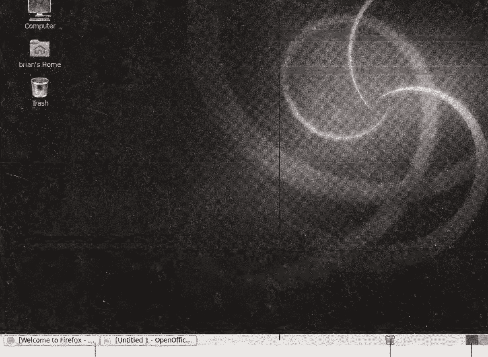

窗口列表 垃圾桶 工作空间切换器

图 4.1

Fedora GNOME 桌面。


- `工作空间切换器（Workspace Switcher）`。这个控件是大多数具有像 GNOME 这样强大的桌面环境的 Linux 发行版所特有的。它不仅仅是一个...

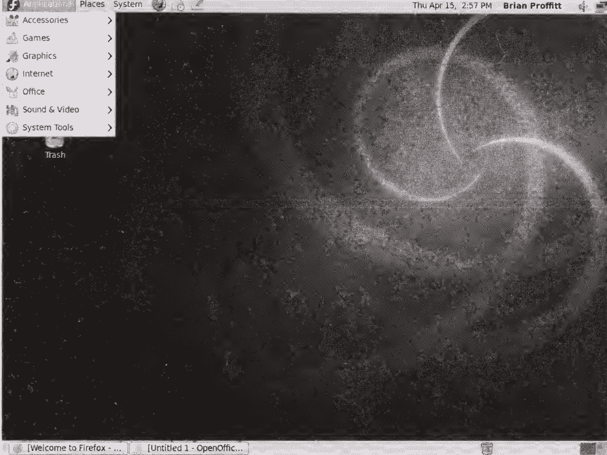

### 图 4.2

应用程序菜单。

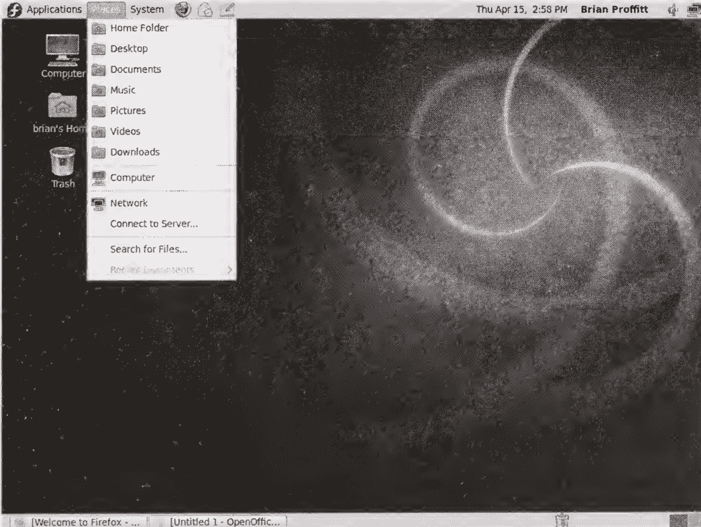

### 图 4.3

位置菜单。

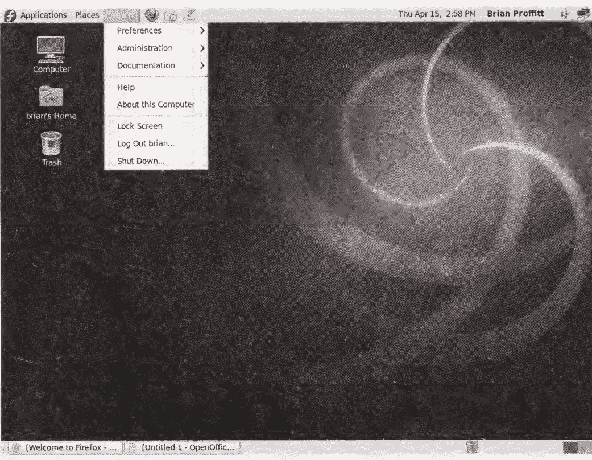

### 图 4.4

系统菜单。

# 第 4 章 ■ 桌面基础

图 4.4

系统菜单。

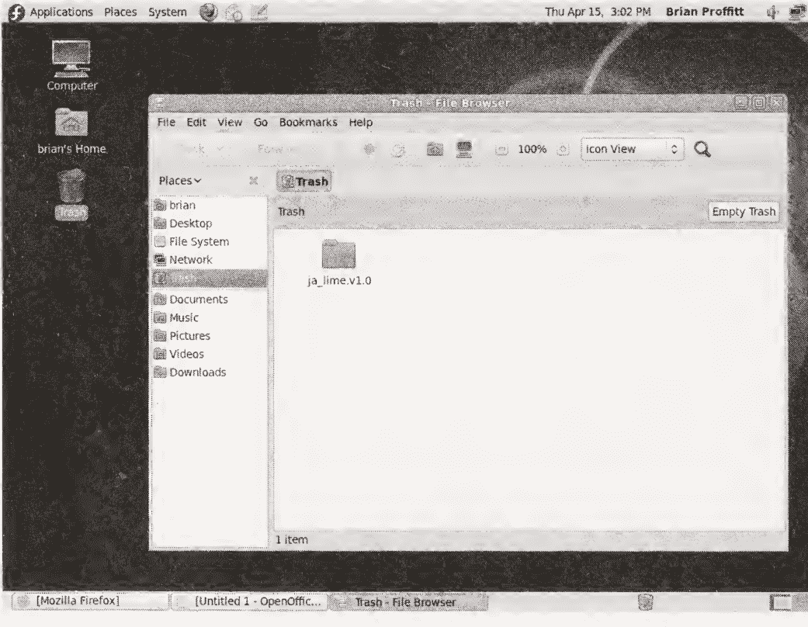

### 图 4.5

垃圾桶文件夹。

桌面，你实际上可以拥有多个桌面，每个桌面都有自己的一套打开的应用、图标——甚至是外观。有关更多信息，请参阅本章稍后的“工作空间”部分。

- `窗口列表（Window List）`。类似于 Windows 任务栏或 OS X Dock，窗口列表将显示 Fedora 中运行的所有应用程序和窗口（参见图 4.6）。

- `启动器（Launchers）`。Fedora 中的图标仍然被称为图标，但如果它们被分配了启动某些内容（如应用程序、文件或文件夹）的任务，那么它们就称为启动器。启动器可以出现在桌面上或桌面面板中。

- `辅助工具图标（Accessory Icons）`。某些图标不仅仅是为了启动程序；它们还为了告诉用户某些信息，例如计算机是否连接到了网络。

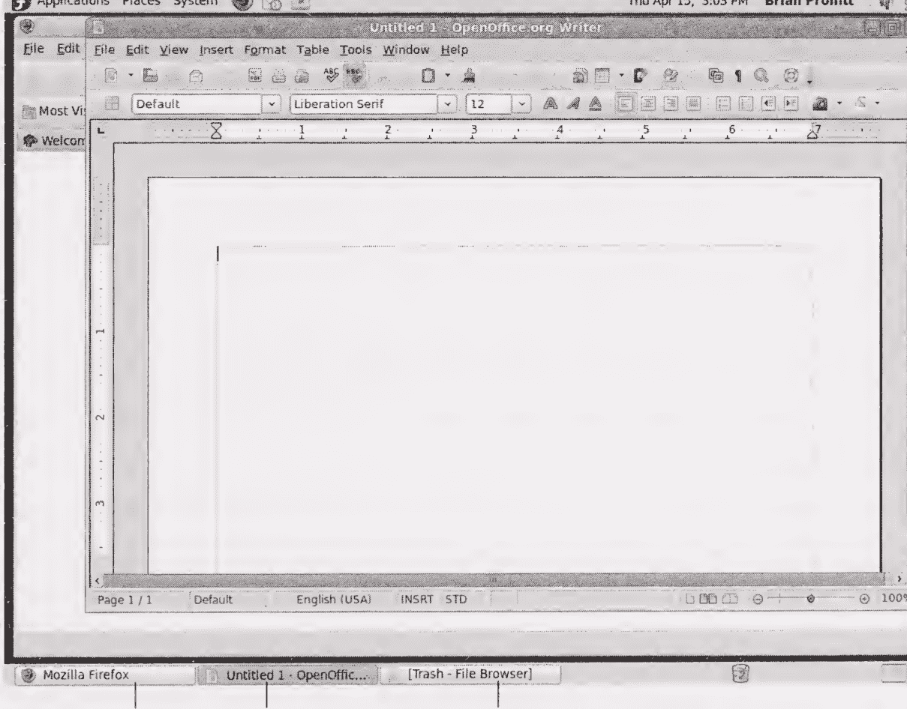

**图 4.6**

激活的窗口列表。

## 68 第 4 章 桌面基础

- `时钟（Clock）`。名字几乎说明了一切——这是一个告知用户时间和日期的面板配件。它的功能更多，因为它可以接入 Evolution（Fedora 的个人信息管理应用），以访问当前的预约和任务。它还会告诉你天气预报。

GNOME 桌面的功能远比这里列出的这些要多。但在你继续探索这个新界面之前，这些是你首先需要了解的基础知识。现在是时候学习如何自定义桌面并让它成为你自己的了。

## 分辨率（Resolution）

Fedora 中的屏幕分辨率并不是严格的桌面功能，因为更改屏幕分辨率的大小实际上会影响 Fedora 中的所有内容，而不仅仅是桌面。尽管如此，在执行其他操作之前，让我们看看能否让你的体验变得更好。

Fedora 中的屏幕分辨率并不是严格的桌面功能，因为更改屏幕分辨率的大小实际上会影响 Fedora 中的所有内容，而不仅仅是桌面。尽管如此，在执行其他操作之前，让我们看看能否让你的体验变得更好。

Fedora 中的屏幕分辨率并不是严格的桌面功能，因为更改屏幕分辨率的大小实际上会影响 Fedora 中的所有内容，而不仅仅是桌面。尽管如此，在执行其他操作之前，让我们看看能否让你的体验变得更好。

Fedora 中的屏幕分辨率并不是严格的桌面功能，因为更改屏幕分辨率的大小实际上会影响 Fedora 中的所有内容，而不仅仅是桌面。尽管如此，在执行其他操作之前，让我们看看能否让你的体验变得更好。

Fedora 中的屏幕分辨率并不是严格的桌面功能，因为更改屏幕分辨率的大小实际上会影响 Fedora 中的所有内容，而不仅仅是桌面。尽管如此，在执行其他操作之前，让我们看看能否让你的体验变得更好。

Fedora 中的屏幕分辨率并不是严格的桌面功能，因为更改屏幕分辨率的大小实际上会影响 Fedora 中的所有内容，而不仅仅是桌面。尽管如此，在执行其他操作之前，让我们看看能否让你的体验变得更好。

Fedora 中的屏幕分辨率并不是严格的桌面功能，因为更改屏幕分辨率的大小实际上会影响 Fedora 中的所有内容，而不仅仅是桌面。尽管如此，在执行其他操作之前，让我们看看能否让你的体验变得更好。

Fedora 中的屏幕分辨率并不是严格的桌面功能，因为更改屏幕分辨率的大小实际上会影响 Fedora 中的所有内容，而不仅仅是桌面。尽管如此，在执行其他操作之前，让我们看看能否让你的体验变得更好。

Fedora 中的屏幕分辨率并不是严格的桌面功能，因为更改屏幕分辨率的大小实际上会影响 Fedora 中的所有内容，而不仅仅是桌面。尽管如此，在执行其他操作之前，让我们看看能否让你的体验变得更好。

Fedora 中的屏幕分辨率并不是严格的桌面功能，因为更改屏幕分辨率的大小实际上会影响 Fedora 中的所有内容，而不仅仅是桌面。尽管如此，在执行其他操作之前，让我们看看能否让你的体验变得更好。

Fedora 中的屏幕分辨率并不是严格的桌面功能，因为更改屏幕分辨率的大小实际上会影响 Fedora 中的所有内容，而不仅仅是桌面。尽管如此，在执行其他操作之前，让我们看看能否让你的体验变得更好。

Fedora 中的屏幕分辨率并不是严格的桌面功能，因为更改屏幕分辨率的大小实际上会影响 Fedora 中的所有内容，而不仅仅是桌面。尽管如此，在执行其他操作之前，让我们看看能否让你的体验变得更好。

Fedora 中的屏幕分辨率并不是严格的桌面功能，因为更改屏幕分辨率的大小实际上会影响 Fedora 中的所有内容，而不仅仅是桌面。尽管如此，在执行其他操作之前，让我们看看能否让你的体验变得更好。

Fedora 中的屏幕分辨率并不是严格的桌面功能，因为更改屏幕分辨率的大小实际上会影响 Fedora 中的所有内容，而不仅仅是桌面。尽管如此，在执行其他操作之前，让我们看看能否让你的体验变得更好。

Fedora 中的屏幕分辨率并不是严格的桌面功能，因为更改屏幕分辨率的大小实际上会影响 Fedora 中的所有内容，而不仅仅是桌面。尽管如此，在执行其他操作之前，让我们看看能否让你的体验变得更好。

Fedora 中的屏幕分辨率并不是严格的桌面功能，因为更改屏幕分辨率的大小实际上会影响 Fedora 中的所有内容，而不仅仅是桌面。尽管如此，在执行其他操作之前，让我们看看能否让你的体验变得更好。

Fedora 中的屏幕分辨率并不是严格的桌面功能，因为更改屏幕分辨率的大小实际上会影响 Fedora 中的所有内容，而不仅仅是桌面。尽管如此，在执行其他操作之前，让我们看看能否让你的体验变得更好。

Fedora 中的屏幕分辨率并不是严格的桌面功能，因为更改屏幕分辨率的大小实际上会影响 Fedora 中的所有内容，而不仅仅是桌面。尽管如此，在执行其他操作之前，让我们看看能否让你的体验变得更好。

Fedora 中的屏幕分辨率并不是严格的桌面功能，因为更改屏幕分辨率的大小实际上会影响 Fedora 中的所有内容，而不仅仅是桌面。尽管如此，在执行其他操作之前，让我们看看能否让你的体验变得更好。

Fedora 中的屏幕分辨率并不是严格的桌面功能，因为更改屏幕分辨率的大小实际上会影响 Fedora 中的所有内容，而不仅仅是桌面。尽管如此，在执行其他操作之前，让我们看看能否让你的体验变得更好。

Fedora 中的屏幕分辨率并不是严格的桌面功能，因为更改屏幕分辨率的大小实际上会影响 Fedora 中的所有内容，而不仅仅是桌面。尽管如此，在执行其他操作之前，让我们看看能否让你的体验变得更好。

Fedora 中的屏幕分辨率并不是严格的桌面功能，因为更改屏幕分辨率的大小实际上会影响 Fedora 中的所有内容，而不仅仅是桌面。尽管如此，在执行其他操作之前，让我们看看能否让你的体验变得更好。

Fedora 中的屏幕分辨率并不是严格的桌面功能，因为更改屏幕分辨率的大小实际上会影响 Fedora 中的所有内容，而不仅仅是桌面。尽管如此，在执行其他操作之前，让我们看看能否让你的体验变得更好。

## 桌面设置与功能 73

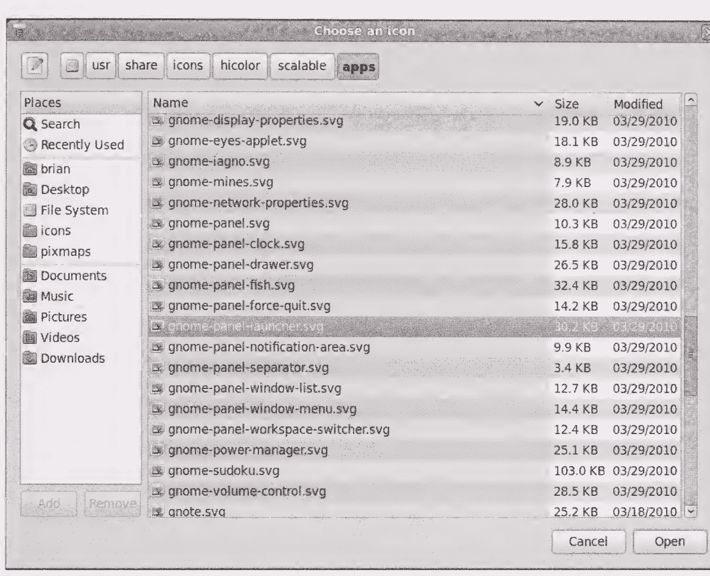

### 4.12

寻找图标。

要在菜单选择中添加新的子菜单，请按照以下步骤操作：

- 1. 点击你想要添加新子菜单的顶级菜单。

- 2. 点击“新建菜单”。将打开“目录属性”对话框（见图 4.13）。

- 3. 在“名称”字段中输入你想要添加的应用程序名称。

- 4. 若要添加图标，点击“文件夹”按钮。将打开“选择图标”对话框。

- 5. 点击所需的图标，然后点击“确定”。选中的图标将出现在“目录属性”对话框中。

- 6. 点击“关闭”。“目录属性”对话框将关闭，新的子菜单项将出现在“主菜单”对话框的“菜单”列中。

- 7. 点击“关闭”。菜单将反映你的更改。

# 第 4 章 ■ 桌面基础

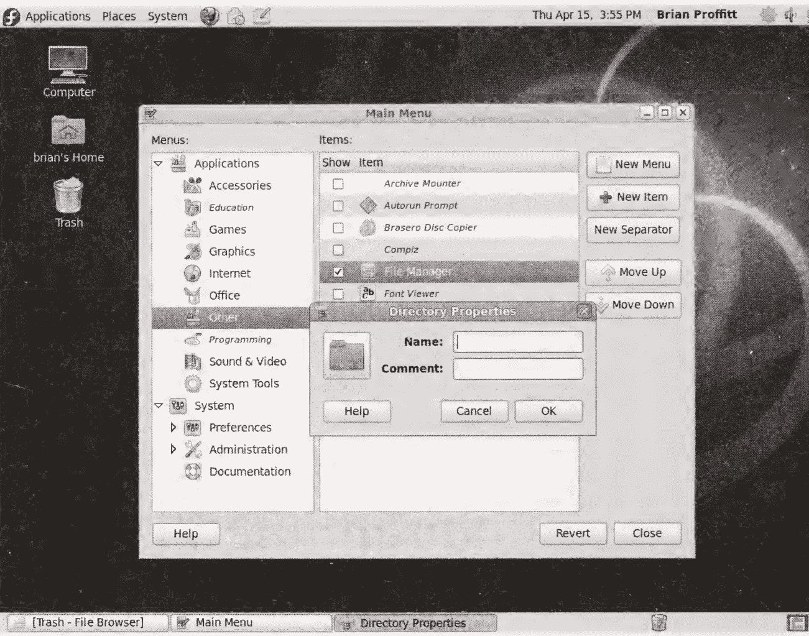

图 4.13

创建一个新的子菜单。

## 面板 (Panels)

在 Fedora 中，菜单并不是唯一可以自定义的内容。事实上，归根结底，列出 Fedora 中无法以某种方式自定义的元素要容易得多。

面板也不例外。面板是 Fedora 桌面顶部和底部的灰色水平条，包含了各种工具和菜单。至少，它们最初是这样的。但经过一些微调，你会发现“灰色”、“水平”、“顶部和底部”都只是松散的概念：面板可以看起来像几乎任何样子，并位于不同的地方。这取决于你。

你可以进行的一个快速更改是重新定位任何面板。

- 1. 右键点击你想移动的面板。将出现右键菜单。

- 2. 点击“属性”。将打开“面板属性”对话框。

- 3. 选择一个新的“方向”设置。


# 第 4 章 ■ 桌面基础

- 4. 点击“关闭”。面板将固定在其新位置（见图 4.14）。

和菜单一样，项可以从面板中添加或删除。面板中可以添加三类项：工具（例如辅助工具或监控工具）、来自“应用程序”菜单的“应用程序启动器”，或自定义的“应用程序启动器”。我们可以只需几步就完成所有这些内容，从 GNOME 工具开始。

- 1. 右键点击你想添加项的面板。将出现右键菜单。
- 2. 点击“添加到面板”。将打开“添加到面板”对话框（见图 4.15）。
- 3. 点击你想要添加的项。该项将被选中。


图 4.14

移动面板。

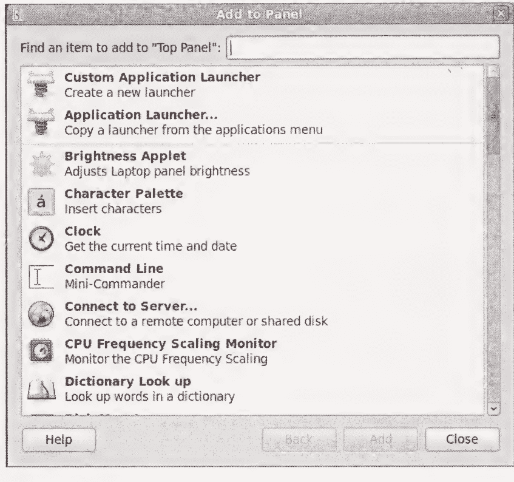

图 4.15

向面板添加项。

- 4. 点击“添加”。该项将出现在面板中（见图 4.16）。
- 5. 若要移动该项，右键点击其图标。将出现右键菜单。
- 6. 点击“移动”。鼠标指针将变为抓握手。
- 7. 在屏幕上向左或右移动鼠标指针。面板项将相应移动。
- 8. 当项放置在正确位置时，点击该项。它将位于所需位置。
- 9. 点击“关闭”。添加到面板”对话框将关闭。

添加应用程序同样简单。你可以从“应用程序”菜单中选择，也可以运行自己的。

- 1. 右键点击你想添加项的面板。将出现右键菜单。
- 2. 点击“添加到面板”。将打开“添加到面板”对话框。

## 桌面设置与功能

## 新项：天气预报

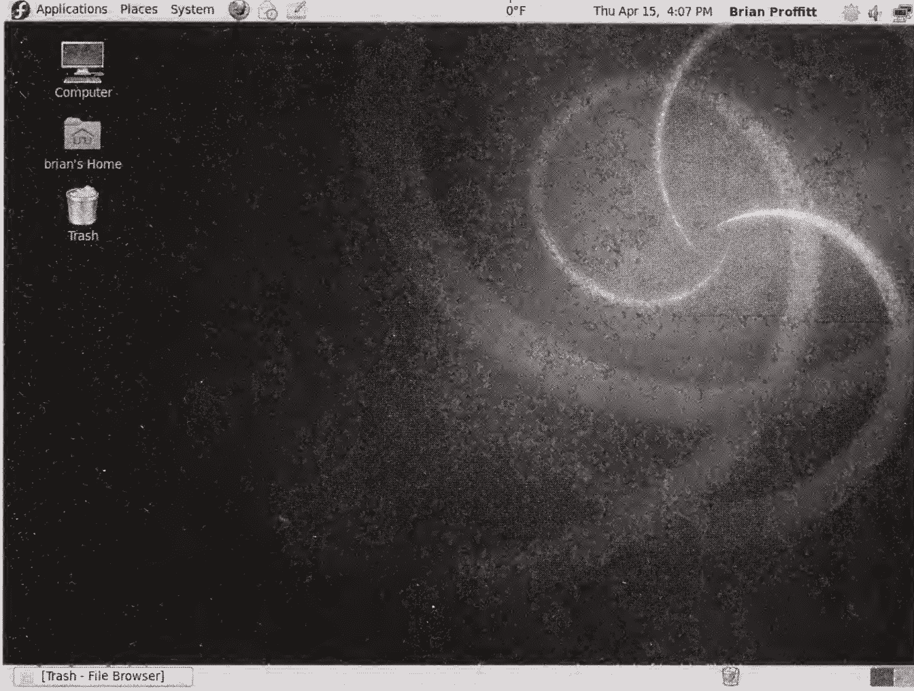

图 4.16

新项几乎准备就绪。

- 3. 点击“应用程序启动器”，然后点击“前进”。应用程序菜单的内容将出现在窗口中。
- 4. 点击展开箭头（三角形）以展开一组应用程序。
- 5. 点击你想添加的应用程序。该程序将被选中。
- 6. 点击“添加”。应用程序项将出现在面板中。
- 7. 若要移动该项，右键点击其图标。将出现右键菜单。
- 8. 点击“移动”。鼠标指针将变为抓握。
- 9. 在屏幕上向左或右移动鼠标指针。面板项将相应移动。
- 10. 当项放置在正确位置时，点击该项。它将位于所需位置。
- 11. 点击“关闭”。添加到面板对话框将关闭。

你不局限于“应用程序”菜单中的应用；只需使用启动器。

- 1. 右键点击你想添加项的面板。将出现右键菜单。
- 2. 点击“添加到面板”。添加到面板对话框将打开。
- 3. 点击“自定义启动器”，然后点击“添加”。将出现“创建启动器”对话框。。
- 4. 在“名称”字段中输入你想添加的应用程序名称。
- 5. 在“命令”字段中输入启动程序的命令，或点击“浏览”按钮在 PC 的任何地方找到该程序。
- 6. 若要添加图标，点击“启动”。将打开“选择图标”对话框。
- 7. 点击所需的图标，然后点击“确定”。选中的图标将出现在“创建启动器”对话框中。
- 8. 点击“确定”。创建启动器对话框将关闭，新的菜单项将出现在面板中。
- 9. 移动该项，右键点击其图标。将出现右键菜单。
- 10. 点击“移动”。鼠标指针将变为抓。
- 11. 在屏幕上向左或右移动鼠标指针。面板项将相应移动。
- 12. 当项放置在正确位置时，点击该项。它将位于所需位置。
- 13. 点击“关闭”。添加到面板对话框将关闭。

从面板移除项的过程要快得多。

- 1. 右键点击你想删除的项。将出现右键菜单。
- 2. 点击“移除面板”。该项将从面板中删除。

如果你不喜欢面板的外观，有一个好消息：你可以快速地更改面板的外观。

- 1. 右键点击你想配置的面板。将出现右键菜单。
- 2. 点击“属性”。将打开“面板属性”对话框（见图 4.18）。
- 3. 点击“背景”标签页。
- 4. 点击“纯色”单选按钮。颜色选项将变为，如图 4.19 所示。
- 5. 点击并拖动“样式”滑动指向“透明”设置。面板将变得更加透明。
- 6. 点击“关闭”。面板属性对话框将关闭，面板将变得相当……清晰（见图 4.20）。

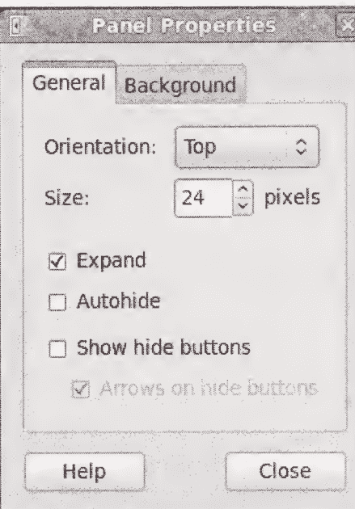

图 4.18

面板属性对话框。

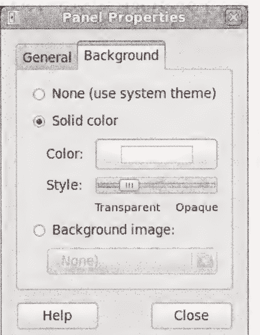

图 4.19

选择你面板的颜色。

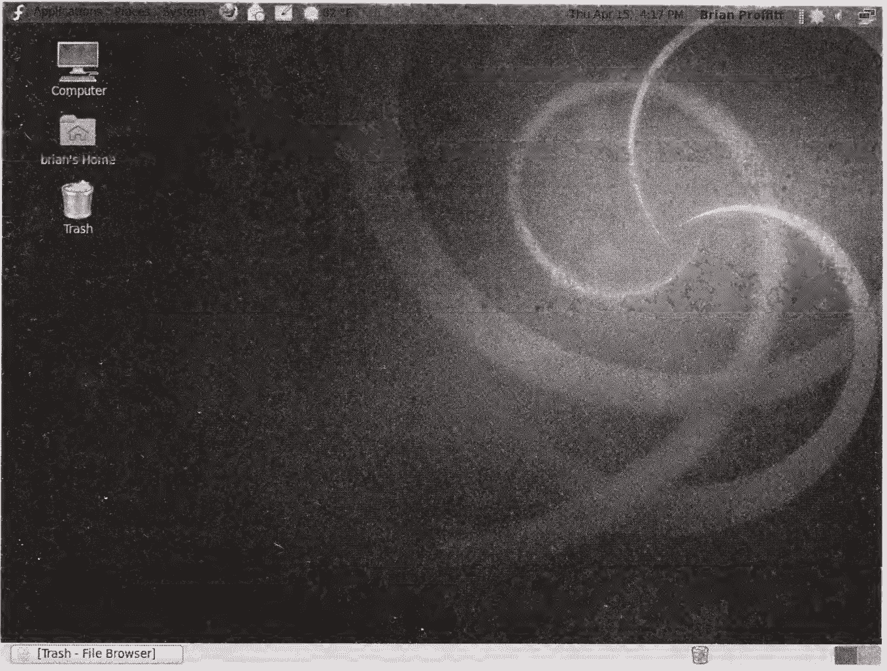

图 4.20

更透明的面板。

## 面板设计

使面板透明只是你在“面板属性”对话框中可以做的的一种更改。尝试在“背景”标签页中尝试不同的颜色、阴影和背景图像。在“常规”标签页中，你可以调整面板的大小，将其设置为“自动隐藏”，甚至减小其宽度。

## 鼠标和键盘

在安装过程中，你能够定义你正在使用的键盘类型。虽然 Anaconda 不可能弄错，但将来可能会某一天你会更换键盘，或者添加一个倾向于插入自己独特输入设备的新用户。而你从未被赋予任何设置鼠标设置的选项。

当你玩玩 Fedora 桌面时，让我们花时间看看这些设置可以在哪里配置。

首先，让我们看看如何配置鼠标。你可能认为鼠标没有什么可以更改的，但你可能会感到惊讶。

点击 `系统 | 偏好 | 鼠标` 命令。将打开“鼠标偏好”对话框（见图 4.21）。

- 在“常规”页面上，你可以将鼠标设置为左手型（这会切换按钮操作）以及双击时间——对于反应速度较慢的用户非常有用。还可以设置鼠标的加速度和敏度，以及鼠标在拖放桌面对象时的范围。你还可以激活一个控制功能，当你按下键盘上的 Ctrl 键时会在屏幕上突出显示鼠标。

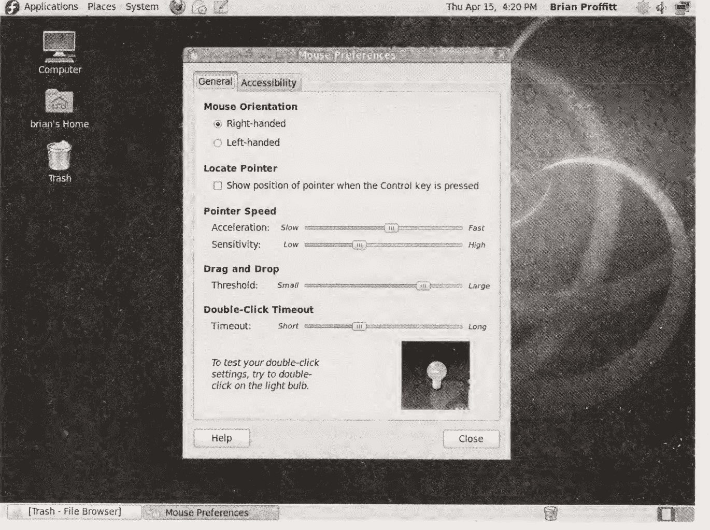

图 4.21

除了奶酪，鼠标所需的一切。

- 在图 4.22 所示的“辅助功能”页面上，如果您在身体上面临挑战，可以设置让鼠标更易使用的功能。这包括在鼠标停止在屏幕上时设置点击动作以及创建自定义鼠标手势。

你的 Fedora 键盘也可以引起许多关注，它包含许多你可能从未听说过的功能，但一旦使用，就会发现它们非常合理。要访问键盘配置，请点击“系统 | 偏好 | 键盘”菜单命令。将打开“键盘偏好”对话框（见图 4.23）。

- 在“通用”页面上，可以设置按键重复的响应时间和光标闪烁速度。
- 在“布局”页面上，你可以像在安装 Fedora 时一样选择你的键盘类型，并可以添加额外的键盘配置（见图 4.24）。

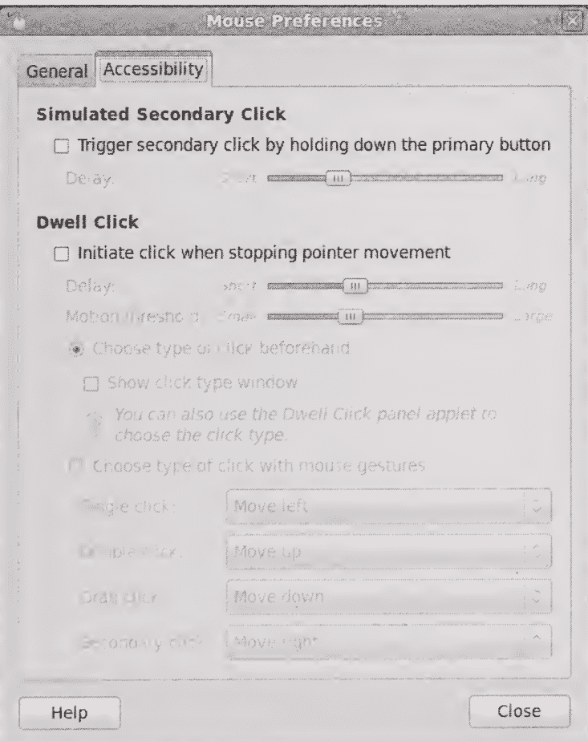

图 4.22

设置鼠标辅助功能选项。

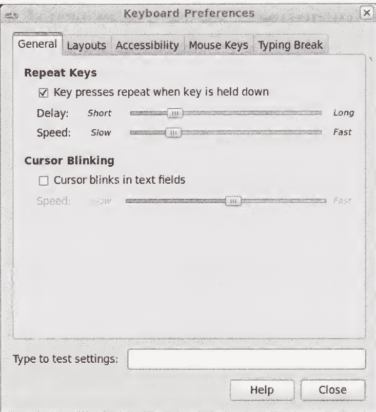

图 4.23

通用键盘设置。

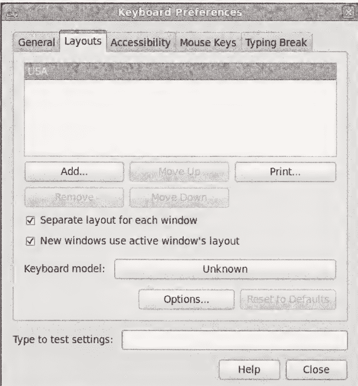

图 4.24

选择键盘布局。

在“辅助功能”页面上，如果需要，你可以配置如“粘滞键”或“慢键”等功能来帮助你（见图 4.25）。

在“鼠标”页面上，你可以设置数字键盘控制鼠标光标（见图 4.26）。

在“打字休息”页面上，你可以强制键盘锁定并在任何间隔时间强制你休息（见图 4.27）。这可能看起来像是在浪费时间，但定期的休息有助于防止过度打字常见的重复性应力损伤。

## 时间和日期

运行在面板中的“时钟”插件非常直观：它显示日期和时间。它还会显示你在世界白昼地图上的位置，并提供天气预报。

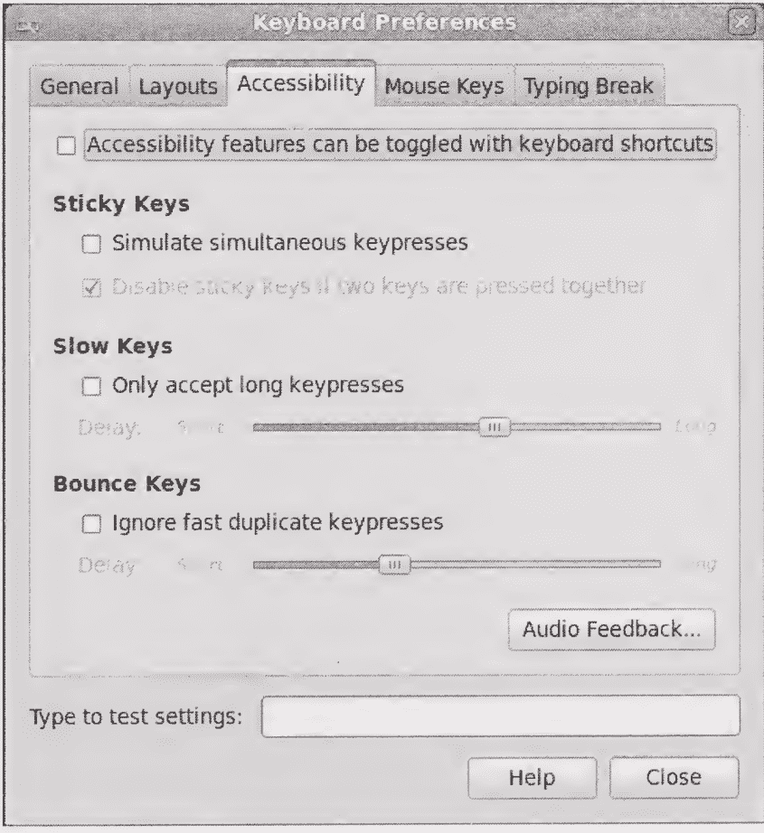

图 4.25

设置键盘辅助功能选项。

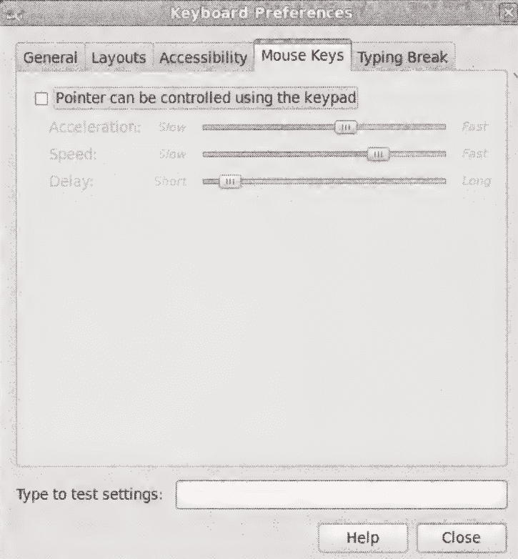

**图 4.26**

你可以使用数字键盘驱动光标。

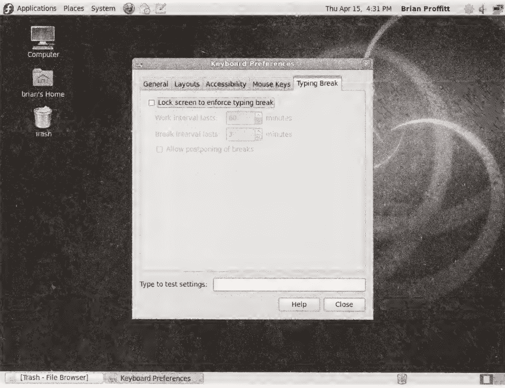

**图 4.27**

一项为了你健康的功能。

如果你愿意，可以手动设置时间。但你们中那些非常守时的人可能想知道，你可以将时钟同步以匹配各国政府维护的原子钟。

- 右键点击时钟。将出现一个上下文菜单。
- 点击“偏好”。将打开“时钟偏好”对话框（见图 4.28）。
- 要设置桌面上的时间，点击“时间设置”。将打开“时间与日期”对话框（见图 4.29）。
- 时钟的设置可以通过此对话框中的控制控件手动完成。设置时间并点击“设置系统时间”按钮。将打开一个“验证”对话框，如图 4.30 所示。
- 输入管理员密码并点击“验证”。

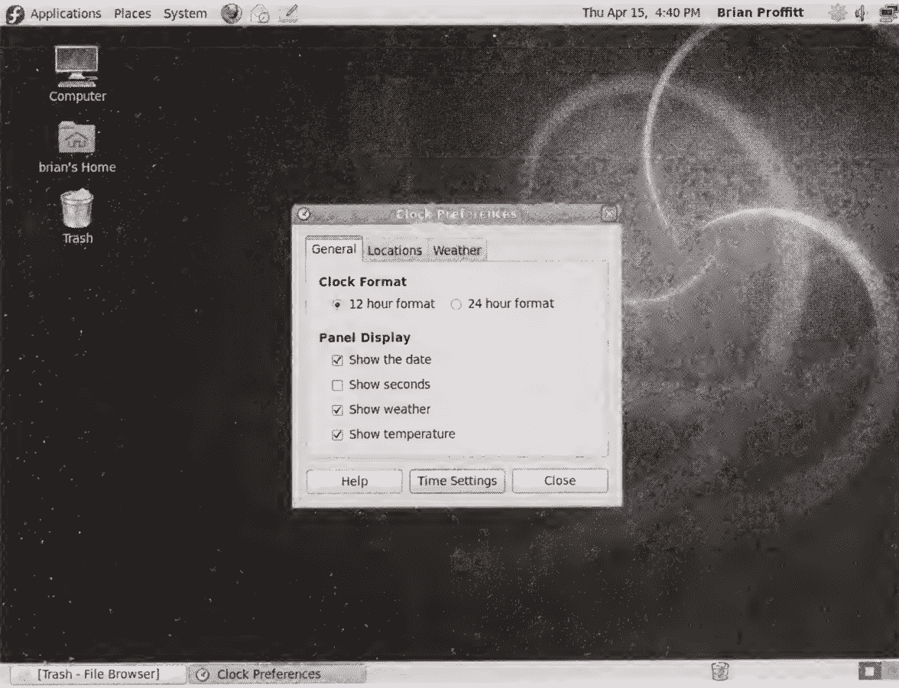

图 4.28

设置时钟偏好。

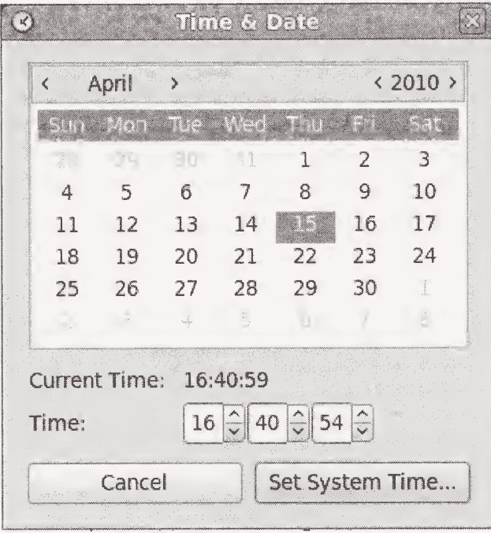

图 4.29

设置你的时间。


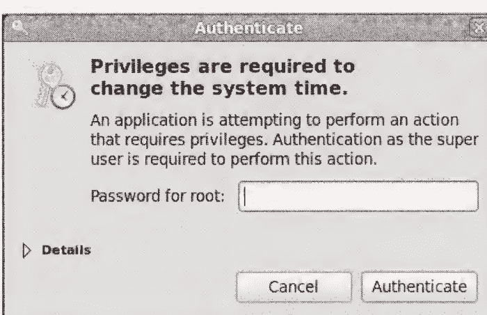

图 4.30

系统设置需要权限。

你也可以在时钟中设置多个位置，以便查看家里或世界上任何地方的时间。

1. 右键点击时钟。将出现一个上下文菜单。
2. 点击“偏好”。将打开“时钟偏好”对话框。
3. 点击“位置”标签。将出现位置页面（见图 4.31）。

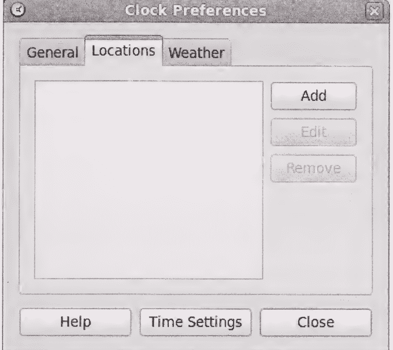

**图 4.31**

设置你的位置。

时钟的设置可以通过此对话框中的控件手动完成。设置时间并点击“设置系统时间”按钮。将打开一个“验证”对话框，如图 4.30 所示。

输入管理员密码并点击“验证”。

... 要在工作区中打开窗口，你可以导航到一个工作区并在那里打开应用程序，或者只需一步即可将任何窗口移动到工作区。只需点击任何打开窗口左上角的窗口菜单图标并选择“移动到另一个工作区”。然后点击目标工作区。

要在工作区之间切换，只需点击你想要的工作区。


图 4.32

设置你的位置。


**图 4.33**

选择键盘布局。

要更改工作区数量，在“工作区数量”字段中输入你需要的数字。要给每个工作区起一个唯一的名称，双击默认名称并输入新名称。

右键点击“切换器”。将出现一个上下文菜单。

点击“偏好”。将打开“切换器偏好”对话框（见图 4.34）。

要更改工作区数量，在“工作区数量”字段中输入你需要的数字。


图 4.34

控制工作区数量。


**图 4.35**

工作区有正式名称。

## 工作区

工作区非常适合那些需要分离任务的人。默认情况下，Fedora 提供两个工作区，但如果你需要，可以添加更多。要在工作区中打开窗口，你可以导航到一个工作区并在那里打开应用程序，或者只需一步即可将任何窗口移动到工作区。只需点击任何打开窗口左上角的窗口菜单图标并选择“移动到另一个工作区”。

## 窗口装饰

就像定制汽车一样，人们似乎喜欢用最时尚的主题和颜色来定制他们的电脑。对于性价比最高的视觉享受，很少有桌面环境能与 GNOME 桌面相提。因此，为了纯粹的享受，让我们接触如何开始装饰你的 Fedora 座驾。

## 背景

背景是 Fedora 中最容易更改的内容，尽管遗憾的是为了节省安装光盘，只包含了几个背景。因此，最好的想法先从其他来源（如互联网或个人图形文件）获取背景。

## 美化

为你的 Fedora PC 寻找漂亮壁纸艺术场所之一是 GNOME-Look 的壁纸部分，地址为 http://www.gnome-look.org。请确保访问与你桌面分辨率匹配的章节。

- 右键点击桌面任意位置。将出现一个上下文菜单。
- 点击“更改桌面背景”。将打开“外观偏好”对话框的“背景”页面（见图 4.36）。
- 如果看到喜欢的壁纸，点击它。Fedora 背景将立即更新。


图 4.36

更改壁纸非常简单。

# 第 4 章 ■桌面基础

4. 若要使用其他文件作为壁纸，点击“添加”。将打开“添加壁纸”对话框。
5. 导航到并选择你想要作为壁纸的文件。
6. 点击“打开”。“添加壁纸”对话框将关闭，新壁纸将出现，并在“外观偏好”对话框中已被选中。
7. 点击“完成”。对话框将关闭，并将显示你的新壁纸（见图 4.37）。

## 主题

Fedora 使用主题来一次性更改整个颜色方案和窗口方案。这些主题非常好玩，即使你从网上下载了一个主题，也可以自定义它的任何部分，使其真正独一无二。


图 4.37

唯一的限制是你的想象力。

要加载新主题，请遵循以下步骤。

- 1. 点击“系统 | 偏好 | 外观”菜单命令。将打开“外观偏好”对话框并跳转到“主题”页面（见图 4.38）。
- 2. 点击所需的主题。主题设置将立即反映在 Fedora 桌面上（见图 4.39）。
- 3. 若要更改主题的一部分，点击“自定义”按钮。将打开“自定义主题”对话框（见图 4.40）。
- 4. 探索各种控件并观察会发生什么。完成后，点击“关闭”。如果你制作了任何更改，该主题将显示为“自定义”主题。
- 5. 点击“另存为”。将出现“保存主题”对话框。
- 6. 为主题输入“名称”和“描述”并点击“保存”。新主题将保存在主题列表中。
- 7. 点击“关闭”。主题现在已生效。


图 4.38

Fedora 有各种主题可供选择。


**图 4.39**

主题会立即生效。


**图 4.40**

你可以更改主题的任何部分。

## 总结

> 就像壁纸一样，在 GNOME-Look 网站可以找到许多优秀主题。

在本章中，我们游览了 Fedora 界面本身——GNOME 桌面。你看到它与 Windows 和 OS X 桌面非常相似，尽管存在一些重要的区别。

GNOME 桌面上有许多可以看和玩的地方，在你继续学习下一章之前，邀请你花点时间做这件事——玩一玩。然后我们将处理任何电脑的要事务：连接互联网。

# 第 5 章

## 接入互联网

现在你已经运行了 Fedora PC 的一些基础配置步骤，是时候看看如何让 Fedora 与其他计算机通信了，即通过 21 世纪无处不在的媒介——互联网。

在本章中，你将学习如何配置 Fedora 通过以下方式连接互联网：

- 家庭或办公网络
- 宽带电缆/DSL 调制解调器
- 拨号连接
- 通过 WiFi 无线连接

## 如何接入互联网

在过去的几十年里，人们对互联网有很多论述。尽管这一现象（所有公共计算机网络最大的）伴随着大量的轰动和炒作，但值得注意的是，即使在发达国家，互联网的发展也远未完全完成。

互联网的增长（截至目前）在许多方面与 19 世纪后期美国电话的增长相似。在电话商业化生存的最初五年里，电话进入了约 10% 的美国家庭。又五年后，它进入了 50% 的美国家庭。再过五年，它进入了 90% 的所有家庭。


互联网的增长模式与此匹配得非常吻合。到 1994 年（即互联网脱离纯学术环境五年后），约 10% 的美国家庭可以找到互联网连接。现在，16 年后，美国互联网访问的普及率已达到近 80%。尽管听起来可能难以置信，但美国在完全使用互联网方面仅超过四之三的关口。（其他国家的互联网普及正在追赶，在百分比上已经超过了美国，尽管美国拥有领先优势。）

无论你是互联网上的新兵，还是从 Mozilla 时代就开始冲浪的人，你都会发现互联网变得越来越不像一个玩的地方，而越来越是一个工作的地方。每天人们都在转向互联网来处理银行业务、购物和与朋友聊天。`Linux` 的历史是交织的。事实上，`PPP` 并非 `UNIX` 的发明——它的前身 `SLIP` 是为了将 Windows 计算机连接互联网而开发的。尽管 `PPP` 起源于 Windows，但 `Fedora` 在处理此协议时完全没有问题。

在大多数情况下，`Fedora` 都是“即插即用”上网的。这意味着如果你在你连接互联网的电脑上插上某种线缆，很大概率 `Fedora` 都会识别出情况并自动为你建立该连接。

尽管如此，过程中的某些部分可能需要你的帮助。例如拨号上网，弄清楚如何使用电脑自带的调制解调器可能是一个障碍，因为许多制造商没有提供 `Linux` 驱动程序。无线连接有时也会很棘手，同样是因为缺少驱动程序。

# 第 5 章 上网

## 拨号上网

互联网的“语言”被称为 `TCP/IP`（传输控制协议/网协议）。这种语言是数据从你的计算机发送到世界上任何地方 Web 服务器的方式。

尽管 `TCP/IP` 是基于 `UNIX` 的产品，但 `Fedora` 需要一种额外的协议通过拨号连接到互联网。毕竟，`TCP/IP` 在串行线路（例如电话线）上无法很好地传输 IP（网协议）数据包。

为了通过调制解调器传输所有数据包，使用了一种额外的协议 `PPP`。讽刺的是，`PPP` 并非 `UNIX` 的发明。

以下是启动拨号连接的方法。在开始之前，你应该准备好你的互联网服务提供商（ISP）信息，特别是你的用户名、密码和要拨号的电话号码。

- 1. 点击 系统 | 管理员 | 网络。系统将要求你提供管理员密码。
- 2. 输入密码。将出现“网络配置”对话框（见图 5.1）。
- 3. 点击“新建”。打开“添加新设备类型”对话框。
- 4. 点击“调制解调器连接”，然后点击“下一步”按钮。打开“选择调制解调器”页面，如图 5.2 所示。
- 5. `Fedora` 通常能准确检测调调器的功能。检查速度（波率）设置并确定你所需的调制解调器速率。点击“下一步”。将出现“选择提供商”页面（见图 5.3）。
- 6. 在“电话号码”字段中输入拨号号码。


图 5.1

网络配置对话框。

- 7. 在相应的字段中输入你的 ISP 用户名和密码。你的信息应类似于图 5.4 所示。
- 8. 点击“下一步”。将出现“IP 设置”页面（见图 5.5）。


图 5.2

配置你的调制解调器设置。


图 5.3

配置你的拨号设置。

- 9. 大多数拨号提供商会自动为你的计算机分配互联网地址，因此你可以保持这些设置不变并再次点击“下一步”。将出现“创建拨号连接”页面。


图 5.4

拨号设置示例。


图 5.5

你拨号提供商的 IP 设置。

配置连接 105

- 10. 点击“应用”。添加新设备类型”对话框将关闭。
- 11. 选择 文件 | 退出菜单命令。将出现确认对话框。
- 12. 点击“是”保存新配置。“网络配置”对话框将关闭。

现在你只需要启动拨号连接。

- 1. 确保你的电话线已插入调制解调器（且你的调制解调器已连接到计算机）。
- 2. 点击上方面板上的 `NetworkManager` 图。将出现上下文菜单。
- 3. 点击 拨号连接 | 通过调制解调器连接到 `ppp0`。调制解调器会自动拨号并连接到互联网。

断开拨号连接同样简单。

- 1. 确保你的电话线已插入调制解调器（且你的调制解调器已连接到计算机）。
- 2. 点击上方面板上的 Network Manager 图。将出现上下文菜单。
- 3. 点击 拨号连接 | 通过调制解调器断开 `ppp0`。调制解调器将断开互联网连接。

## 我的调制解调器在哪里？

推测你的调制解调器已被 `Fedora` 正确识别，并且所有步骤都顺利完成。遗憾的是，如果你的调制解调器是内置的，那么情况可能并不顺利。内置调制解调器和纯软件调制解调器（winmodems）因不支持 `Fedora` 和其他 `Linux` 发行版而臭名昭彰，因为制造商没有提供 `Linux` 支持。但这意味着无法使用内置调制解调器。请参第 7 章中的“调制解调器”部分，获取启动内置调制解调器所需的步骤。

## DSL

`DSL` 是目前美国使用的两种主要宽带形式之一，另一种是电缆。当然，还有其他方法可以将宽带带入家中，例如宽带蜂窝、卫星、光纤或市政 WiFi。但在

许多情况下，这些方法并不常见，或者距离太远而不值得使用。

`DSL` 使用与接入你或业务场所相同的铜质电话线；事实上，你可以在同一条线路上进行语音通话的同时保持互联网访问。这是因为 `DSL` 线路以远高于人耳范围的频率发送数字“互联网”信号。一旦信号回到电话公司，交换机就会将语音信号和网络信号分离，语音信号路由到对话另一端的人，网络信号则发送到互联网。

然而，这种技术壮举也有一个缺陷：由于涉及的频率非常高，`DSL` 中的数字信号在电线中传输很短距离后就会衰减，大约一四分之一里。

配置连接 124

安装相对廉价。如果你的电话运营商没有给你以太网线，请向他们索要。

## LAN/电缆

如今家庭或办公室的大多数宽带连接将通过被称为局域网（LAN）的网络连接到你的 端口。电缆本身（在 IT 领域被称为“`Cat 5`”或“`Cat 6`”线）看起来像电话线，有一个矩形插头，可以插入路由器上的匹配端口。你听过的另一个术语是以太网（`Ethernet`），它描述了你插入的特定类型网络，即许多 PC 连接到一个中央路由器。

如果由于某种原因，您的网络设置为各个设备使用特定的 IP 地址，请将配置更改为静态 IP 地址。请咨询您的网络管理员获取地址、子网掩码和默认网关地址字段所需的数值。

## 配置连接

- 5. 点击“确定”。以太设备对话框将关闭。
- 6. 选择“文件 | 退出”菜单命令。将出现一个确认对话框。
- 7. 点击“是”保存新配置。网络配置对话框将关闭。

现在，你只需要将第 5 类网线插入电脑的网卡端口即可。上方面板中的网络管理器图标将显示旋转动画，然后通知你连接已成功。

现在，你可以访问互联网或其他网络上的其他计算机和打印机。

## WiFi

`WiFi` 是 `Fedora` 的真实成功案例之一。在不久以前，`Fedora`（或者实际上是任何 `Linux` 发行版）上的无线网络连接体验是非常糟糕的。


图 5.6

配置以太网连接。

发行版，那时充其量非常不稳定。那些时代已经过去了，大多数无线解决方案在 `Fedora` 上运行得非常好。

几乎所有新笔记本电脑都内置了无线功能，这就是为什么移动用户对这一节感兴趣。但即使在家庭或办公室电脑中，无线也是一个很好的选择，因为它为你节省设置无线网络的时间、材料和麻烦。

从一个层面来说，配置无线与配置有线网络访问完全相同。你仍然需要连接到路由器，仍然需要一个唯一的 IP 地址让路由器识别你的机器。而且与以太网连接一样，`DHCP` 是将该 IP 地址自动分配给电脑的最佳方法。

无线需要额外的配置层。将你的无线卡想象成一个收音机（它确实是），它需要调到特定的电台（在路由器上）。或者，如果你带着笔记本电脑移动，它需要能够搜索范围内所有的无线路由器，并让你选择连接哪一个。

一旦解决了收音机/电台的连接，你就必须告诉你的 WiFi 卡如何与路由器实际通信。这是因为大多数路由器的信号都是加密的，这样没有未经授权的计算机接入网络。这通常通过被称为 `WEP` 的加密协议完成。

## 获取安全

如果你的无线路由器没有启用 `WEP`，那么它应该启用。请参阅路由器的文档了解如何设置。

无线连接有三个层级的复杂度需要处理：网络寻址、无线信号获取和安全性。幸运的是，`Fedora` 的 `NetworkManager` 在一个地方处理了所有问题。

- 点击系统 | 管理 | 网络。你将被要求提供管理员密码。
- 输入你的密码。网络设置对话框将打开。
- 点击无线连接，然后点击“编辑”。无线设备配置对话框将打开，如图 5.7 所示。

## 结论

- 4. 确认选中“计算机启动时激活设备”复选框。
- 5. 点击“确定”。无线设备配置对话框将关闭。


进入 `/path/to/xxx` 目录，找到 `xxx.json`。

在表达式 `cvar = avar + bvar` 中，加法运算符（`+`）将 `avar` 与 `bvar` 相加，得到它们的和 `cvar`

在 `List.of(arg0, arg1, arg2)` 中，`List` 接口的工厂方法 `of()` 接受一系列的元素，返回包含它们的只读列表。

之后我们这样调用 `cmd` 命令：`cmd arg0 arg1 arg2`。

```
if (condVar > someVal) {console.log("xxx")}
```

- 6. 点击“关闭”。网络设置对话框将关闭。

这样每当你打开电脑时，你的 WiFi 卡都会自动寻找 WiFi 网络。这可能会稍微减慢启动速度，但如果你在外出，这将让你省去以后开启 WiFi 卡的麻烦。它让使用无线功能变得几乎不可思议地简单。

## 结论

在本章中，你发现了使用 Fedora 的 NetworkManager 工具连接网络和互联网是多么简单。这个过程并没有什么奥秘，它本该如此。


图 5.7

配置无线连接。

然而，偶尔事情并不总是按照你的计划进行。由于缺乏硬件制造商对 Linux 的支持，某些网络设备并不总是正常工作。但那里有很多修复方法，在第 7 章中你将学习如何使用它们。

在此之前，你需要学习如何在你的 Fedora PC 上查找、更新和安装软件。第 6 章“安装和更新软件”将向你展示所需的所有知识。

# 第 6 章 安装和更新软件

说 Fedora 是“开箱即用”实际上是一个比喻性的说法。毕竟，并没有一个真实的箱子让你从里面拆出软件。尽管如此，这个短语在软件行业被频繁使用，指的是当你首次在电脑上安装某个软件或操作系统时，自带的功能和应用程序。

Fedora（以及泛指 Linux）真正有趣的地方之一是它开箱就带了很多软件。如果你还记得第 1 章“什么是 Fedora?””，由于其模块化的本质，Fedora 本质上是一系列独立应用程序的集合，它们共同协调工作，使操作系统表现得像单一的功能性工具。

然而，抛开哲学不谈，Fedora 仍然为用户打包了大量应用程序，足以让你开箱即用。这并不意味着没有更多应用程序可供。

在本章中，你将学习：

- Fedora 如何处理软件安装
- 软件仓库以及如何管理它们
- 如何使用 Software Update、PackageKit 和 `yum`
- 如何使用命令行安装软件

## Fedora 如何安装软件

在 Windows 世界中，通常只有一种安装软件的方法：运行安装程序，它从头到尾为你运行整个设置。

在 Fedora（以及大多数 Linux 发行版）中，有三种方法。诚然，一种方法听起来很有吸引力且不费时间，但这种一刀式的安装服务存在潜在的代价：Windows 安装程序经常为了某个应用程序而覆盖操作系统的底层文件。这对于你安装的应用程序是有利的，但对于系统中任何使用该部分代码的预存应用程序可能是糟糕的。

在 Fedora 中，所有三种安装方法都尽力使用 Fedora 中已有的内容来安装应用程序。如果应用程序需要的尚未安装在 Fedora 中，它就有依赖项。安装软件的用户（即你）将被告知任何依赖项，并询问如何继续。

- **自包含安装程序**。这种方法与 Windows 使用的方法非常相似。运行一个特殊的安装程序会自动处理应用程序在电脑上的设置。这种类型的安装在 Fedora 上并不常见，一些较大的消费者应用程序（OpenOffice.org 或 Firefox）可以通过这种方式安装。与 Windows 的一个重要区别是：安装程序不会更改现有软件。依赖项通常处理得很好，但并非万无一失。
- **源码编译**。还记得任何用户都可以获取任何免费软件应用程序的源代码吗？好了，一旦你有了这些代码，就可以执行所谓的编译，将这些代码（至少只有聪明的人才能读懂）转换为电脑可以读取和处理的内容。软件编译并不难，但有时很耗时，而且依赖项不会自动处理。
- **包管理**。这种方法是 UNIX 系统特有的。安装和运行应用程序所需的所有文件和设置都包含在一个包中。Fedora 使用基于 `RPM`（或称 `.rpm`）的软件包。（其他 Linux 发行版，如 Debian 或 Ubuntu，使用基于 Debian（或称 `.deb`）的软件包。）

正如你可能猜到的那样，包管理是 Fedora 中安装软件的首选方法。软件包的安装实际上是由一个名为包管理器的应用程序执行的。它可以帮助跟踪你 PC 上已安装的所有应用程序，并帮助跟踪我们提到的那些依赖关系。如果你安装了一个需要某些额外软件工具才能在 Fedora 系统上正常运行的包，将由包管理器来确定出你还需要哪些其他包。

在 Fedora 中，实际上有三个包管理器可以协助你完成安装需求：

- `PackageKit`。这是一个强大的图形化包管理器，它列出了 Fedora 可用的所有包，让你能够从一个非常大的列表中搜索软件应用程序。应用程序按类型、在系统中的状态（已安装或未安装）或来源进行分类。
- `Software Update`（软件更新）。这是另一个图形化工具，该包管理器只负责一件：让你的系统尽可能保持最新。如果你已安装的任何应用程序有了新版本，软件更新将获知并标记供你下载和安装。
- `yum`。这是 Fedora 的核心包管理器，这是一个命令行应用程序，获取新包变得像输入一行文本并按回车键一样简单。

这三个包管理器中的每一个都已配置为查找来自 Fedora 软件包存储库的所有包。在接节节中，我们将介绍存储库以及它们的工作原理。

## 了解软件存储库

Fedora 的卓越特性之一是它只带有一张 CD 光盘。并不是每个操作系统都能吹嘘此点的。事实上，许多 Linux 发行版是通过多张光盘交付给用户的。

以前，向家庭或办公室交付 Linux 发行版的策略并不复杂：用户现在或将来可能需要的所有应用程序都将通过一套完整的 CD（或者，后来是一张或两张 DVD）交付。这样做的好处是，一旦你下载并刻录了所有 CD，你就可以运行该发行版，而无需在以后下载额外的软件。但在第 2 章“在安装 Fedora 之前”中讨论的平均 CD 镜像下载量接近 700MB。对于如今的宽带连接来说，这也是大量数据了。对于大多数用户来说，对三张、五张或七张 CD 执行此操作是一项非常耗时的任务，除非他们愿意付费通过邮寄接收这些 CD。

Fedora 稍微改变了世界格局。考虑到大多数 Internet 用户现在已拥有宽带访问能力，Fedora 项目决定在一张 CD 上发送所有必要的 Fedora 应用程序，并将其余部分留在网上分布在世界各地的服务器上，供用户根据需要下载。

这看起来可能很低效，因为你需要某种 Internet 访问来完成这项工作。但请考虑，大多数操作系统本身就是通过 Internet 自更新的，因此为了让 Fedora 保持最新，反正是需要访问的。而且，只下载和刻录一张 CD 比下载多张 CD 快得多。交付一个“核心”发行版也为用户提供了更大的灵活性，让他们在自己的系统中选择他们需要的应用程序。这也节省空间。为了让你直观了解可用软件的多少，请参考这些数字：Fedora 的标准安装大约有 1,100 个包。目前，共有超过 12,000 个应用程序包可用。

Fedora 与它的兄弟版本 Red Hat Enterprise Linux 一样，通过存储库组织其软件。Fedora 有三个主要的存储库，每个存储库持有特定类别的软件。让我们现在过一遍它们。

### 存储库之旅

三个官方 Fedora 存储库的命名非常清晰，让我们来检查一下。

- `Fedora`。此存储库持有所有 Fedora 官方支持的软件。Fedora 运行所必须的所有软件都在这里，且所有软件都采用自由软件许可。此存储库中的额外应用程序包括 `AbiWord`、`Evolution`、`Firefox`、`Gaim`、`OpenOffice.org` 和 `Thunderbird`。
- **Updates**（更新）。此存储库包含任何由于错误或安全修复而更新的软件。
- **Source**（源码）。Fedora 软件的所有源代码包都可以在此存储库中找到。

### 添加存储库

这些并不是 Fedora 可以使用的全部存储库。Internet 上有许多由社区运行的 Fedora 存储库，每个都持有 Fedora 项目不想托管的专业化软件。

世界上有很多可以在 Linux 上运行的软件应用程序，但由于它们的许可证完全是专有的，某些 Linux 发行版对其避之远之。鉴于它们的 Linux 源，Fedora 的制作者认为有义务遵守这一哲学，将完全商业化的包排除在 Fedora 之外。

但这里有一个重要的区别。虽然 Fedora 项目不会随 Fedora 发布商业软件，但这并不排除用户在下载并安装 Fedora 后访问商业存储库。这确实是一个细微的区别，但它赋予了用户对自己想要使用的软件做出自主选择的。

Fedora 中的所有包管理器都根据存储在你 PC 上的存储库主列表工作。从这个名为 `sources.list` 的文件中，包管理器知道检查哪些存储库以获取新软件，以及系统上安装的软件是否有可用更新。如果你想让这些管理器浏览另一个存储库，将需要用新信息修改 `sources.list`。

懂行的 Fedora 用户知道三个这样的第三方存储库，它们可以让你访问最新的软件。你不需要一个接一个地添加它们。相反，你可以使用一个命令将 RPM Fusion 添加到你的源中。

此操作将通过命令行完成。要启动 Terminal（终端），点击应用程序 | 系统工具 | Terminal。

[PAGE 135]

# 第 6 章安装与更新软件

用户名@主机名 提示符


图 6.1 终端

在 `Terminal` 中输入命令只需输入命令并按回车。要查看当前目录下的所有文件，输入 `ls` 然后按回车。

有很多很酷的可以使用，但现在我们先处理存储库，稍后考虑其他工具。以下任务将添加一组非常重要的存储库，尽管涉及一个很长的命令，但它是值得的。

1. 在 `Terminal` 中输入以下命令：

将被提示管理员密码。

2. 输入管理员密码并按回车。提示符将变为 `root` 提示符。

3. 输入以下命令：

```
rpm -Uvh http://download1.rpmfusion.org/free/fedora/rpmfusion-release-stable.noarch.rpm http://download1.rpmfusion.org/nonfree/fedora/rpmfusion-nonfree-release-stable.noarch.rpm
```

这将为你源添加三个新的 RPM 存储库。

[PAGE 136]

使用软件更新 119

现在，当你下次运行任何 Fedora 包管理器时，它将感知到这些存储库并允许你从中查看和安装软件。

什么是包管理器？好问题！让我们来看看吧。

## 使用软件更新

默认情况下，软件更新配置为在有可用更新时通知你——当你的 PC 连接到 Internet 时，它每天都会检查一次。当发现已安装软件的更新时，顶部面板会出现一个橙色的星形图标，如图 6.2 所示。

图 6.2 关于新更新的提示。

## 第 6 章 安装与更新软件

通知图标将一直留在面板中，直到实际运行“软件更新”`Software Update`。

1. 点击通知图标启动软件更新。软件更新窗口将打开，启动过程将立即开始，如图 6.3 所示。
2. 完成后，你将看到 Fedora 建议你安装的更新列表（见图 6.4）。点击任何应用程序进行更新。描述字段将显示所选应用程序的更改列表。
3. 如果你选择不更新某个应用程序，点击其复选框以取消选择。
4. 完成选择后，点击“安装更新”。软件更新将首先解决所选包的任何依赖关系，然后开始更新过程。


图 6.3 启动软件更新。

## 使用软件更新


**图 6.4** 更新列表。

5. 如果为了适应当前更新需要添加或删除任何包，将弹出一个类似于图 6.5 的确认对话框。
6. 确认更改并点击“继续”。下载和安装过程将开始，如图 6.6 所示。

完成后，将出现一个已更新完成的消息框（见图 6.7）。

7. 点击“确定”关闭消息框。软件更新将关闭。

偶尔，你可能在更新后需要重启 Fedora 系统。这并不常见，因为 Fedora 的模块化特性意味着通常对一个应用程序的更改不会影响其他程序。但某些更新（例如较版本的 Linux 内核）确实需要重启才能使更改生效。如果是这种情况，顶部面板将出现一个电源图标，在软件更新完成后你将被要求重启电脑。


图 6.5 确认任何额外的更新。


图 6.6 更新是自动的。


图 6.7 已完成的更新。

选择你想要的选项。建议尽快重启，但如果你有其他工作要处理，可以稍后等重启。（一天结束时的关机也将算作重启。）

## 计划更新

由于更新后有重启的可能性，请尝试在工作日开始或结束时更新 Fedora 系统，这样就不会中断正在进行的工作。

## 使用 PackageKit

尽管软件更新非常实用，但它无法与 Fedora 的秘密武器 `PackageKit` 的强大性相比。这个包管理器在 Linux 用户中非常受欢迎，Fedora 团队对其进行了增强，使其更容易使用。

与仅更新现有包的软件更新不同，`PackageKit` 只需点击几次即可更新、安装和卸载应用程序。

操作 `PackageKit` 非常简单。你可以点击“系统 | 管理 | 添加/删除软件”菜单命令启动该程序，这将弹出 `PackageKit` 窗口，如图 6.8 所示。

## 安装新软件

基于存储库的包安装是安装软件的一种强大方式。不仅简单，而且一旦 `PackageKit` 安装了它，你可以确保该应用程序的任何后续更新都会被跟踪并在应用。

5. 当“运行新应用程序”对话框出现时，根据需要点击“运行”或“关闭”按钮。

## 使用 yum 管理软件


图 6.9 确保为你的应用程序安装依赖项。

## 卸载软件

有时——并不经常——你会遇到需要从 Fedora 系统中删除应用程序的情况。“并不经常”是因为 Fedora 只安装你真正需要的内容，其他内容可能是你最初添加的软件。

尽管如此，如果发生这种情况，这里是使用 `PackageKit` 卸载任何应用程序的方法。

1. 浏览 `PackageKit` 直到找到想要卸载的包并选择它。包的描述将出现在“描述”面板中。
2. 点击包的“选择”复选框。该包将被取消选择。
3. 点击“应用”。将出现身份验证对话框。
4. 输入管理员密码并点击“身份验证”。软件卸载将自动完成。

## 解决依赖

- 正在运行事务检查
- 软件包 `gnuchess.i686` 0:5.07-14.fc12 将被删除
- 完成依赖关系解析

依赖关系已解决

| 软件包 | 架构 | 版本 | 存储库 | 大小 |
|---|---|---|---|---|
| | | | | |

| gnuchess | i686 | 5.07-14.fc12 | @fedora | 3.8 M |

移除：

`gnuchess` `i686` 5.07-14.fc12 @fedora 3.8 M

事务摘要

- 移除 1 个软件包
- 重新安装 0 个软件包
- 降级 0 个软件包
- 是否确认？[y/N]:

输入 `y`。卸载过程将快速完成。

如果你想让 `yum` 下载最新版本的应用程序，请输入：

```
yum upgrade
```

这将执行与“软件更新”相同的功能

## 结论

现在你已经了解了使用包管理器来更新、安装或卸载软件的三种方法。现在你有了更多能力在 Fedora 中进行操作和工作。

这些功能也有助于 Fedora 的正常运行。正如前面的章节提到的，有时 Fedora 的功能运行并不如预期顺畅。关于 Fedora 社区，现在你已经如何安装软件，可以快速为你的 Fedora 应用任何所需的修复。你将在第7章学习如何“让运行”。

# 第7章 让运行

Fedora 并不完美。这会让某些读者感到惊讶，但事实是，在未尝试过的计算机上安装任何系统都有风险，因为不可预见的硬件冲突可能会干扰安装。（对于发现硬件兼容性问题的 Windows 用户，如果你在桌面电脑上安装了 Fedora，到目前为止可能还没有遇到任何问题。这里提到的问题最终不会影响未来的用户。）

即使你在让运行方面遇到困难，本章对你仍然有用。大多数用户仍处理一些事情：

- 创建和管理额外账户
- 设置打印机
- 使用 USB 存储
- 排除硬件故障

## 设置账户

当你首次安装 Fedora 时，创建了两个账户：管理员 `root` 和你自己。`Root` 是 Fedora 的“超级”账户。与所有的 Linux 发行版一样，`root` 用户最强大也最危险。因为 `root` 可以在 Fedora 机器上执行任何操作。如果你正尝试快速完成大量管理任务且不想一直输入管理员密码，这非常有帮助。但如果你失误并意外删除了系统上的关键文件，就非常糟糕了。更不用说如果你以 `root` 身份登录离开机器，有人路过并决定玩你的电脑。

## 关于 Root 的另一个警告

-永远不要以 `root` 身份登录你的电脑。

你在安装 Fedora 时创建的账户拥有管理员权限，因为系统的原始安装用户将是管理员。然而，有时安装 Fedora 的用户并不是管理员，或者你只是想要多个拥有独立工作空间的账户。如果是这样，你需要知道如何设置新账户。按照以下步骤操作：

- 点击 系统 | 管理 | 用户和组 菜单。输入管理员密码后，管理器将打开，如图 7.1 所示。
- 点击 添加用户 按钮。打开添加新用户对话框（见图 7.2）。
- 使用用户信息在添加新用户对话框的顶部填写信息。
- 确认选中了“创建主目录”和“为用户创建私有组”选项。
- 点击确定。新用户将被添加到管理器中（见图 7.3）。
6. 点击 文件 | 退出 菜单。管理器将关闭。

创建任何用户后，你可以根据需要修改账户。

1. 点击 系统 | 管理 | 用户和组 菜单。管理器将打开。
2. 点击用户以选择该账户。
3. 点击 属性 按钮。用户属性对话框将打开（图 7.4）。
4. 在四个页面中的任何一页进行所需的更改。
5. 点击确定。用户属性对话框将关闭。


6. 点击 `文件 | 退出` 菜单。管理器将关闭。

如果用户不再使用这台电脑（例如员工离职），删除该用户账户是一个好主意。


# 第7章 让运行


图 7.2


图 7.3


图 7.1

# 第7章 使用打印机

1. 点击 `系统 | 管理 | 用户和组` 菜单。管理器将打开。
2. 点击用户以选择账户。
3. 点击 `属性` 按钮。用户属性对话框将打开（图 7.4）。
4. 在四个页面中的任何一页进行所需的更改。
5. 点击 `确定`。用户属性对话框将关闭。
6. 点击 `文件 | 退出` 菜单。管理器将关闭。


图 7.5


图 7.

## 设置本地打印机

将打印机连接到你的 Fedora PC 有两种方法。第一种是本地，将打印机插入电脑的并行端口，或者现在更多的是其 USB 端口。

一旦打印机物理连接到系统并开启电源，它应该会自动开始配置，如图 7.6 所示。如果不是，按照以下步骤让打印机工作。

1. 点击 `系统 | 管理 | 打印` 菜单。打印窗口将打开（见图 7.6）。
2. 点击 `添加`。输入两次管理员密码后，新打印机窗口将打开，系统将开始搜索连接的打印机。找到后，打印机将出现在列表中（见图 7.7）。
3. 选择要添加的打印机并点击 `下一步`。应用程序将搜索可用驱动并安装它们。如果有可用选项，将出现可安装选项页面（见图 7.8）。
4. 选择所需的选项并点击 `下一步`。将出现描述打印机页面（见图 7.9）。

### 打印机具有多重人格？

有时，单个打印机会显示为多个列表项。这是因为某些打印机（特别是新款）带有独立的内置内存卡，CUPS 数据库将其读取为独立设备。选择信息最多的列表并继续。如果这不起作用，你始终可以回来连接另一个选项。


# 第7章 ■ 让一切正常运转


图 7.7

打印机通常很容易找到。


图 7.8

有时，打印机可能会有一些附加选项。

## HP 打印机用户的好消息

HP 在为 Linux 用户提供打印机驱动程序方面做了非常出色的工作。如果您有一台 HP 打印机并且可以使用 HPLIP 选项，请务必选择那一个。HPLIP 是 HP 开发的用于 HP 设备的控制应用程序。

- 5. 点击“应用”。会出现一个“验证”消息对话框。
- 6. 输入您的管理员密码并点击“验证”。可能会出现 CUPS Root 对话框。
- 7. 如果提示，输入您的 root 密码（与您的管理员密码相同）并点击“确定”。打印机将被添加，并弹出一个消息窗口询问您是否想要打印测试页。
- 8. 点击“是”。如果配置正确，打印机将打印出测试页，并打开一个通知对话框。
- 9. 点击“确定”。通知对话框将关闭。
- 10. 点击“取消”。打印机属性”对话框将关闭，打印机现在将出现在“打印”窗口中（见图 7.10）。


图 7.9

用用户易懂的术语描述您的打印机。


图 7.10

新添加的本地打印机。

## 设置网络打印机

连接网络某处的远程打印机的步骤与连接本地打印机非常相似。您只需要确定该打印机在网络上的位置即可。

大多数情况下，Fedora 会为您完成工作并检测网络打印机。如果是这样，请按照上一节概述的步骤连接检测到的网络打印机。如果由于原因未找到打印机，请按照以下步骤操作：

- 1. 点击“系统 | 管理 | 打印”菜单命令。打印机窗口将打开。
- 2. 点击“添加”。在输入两次管理员密码后，将打开“新打印机”窗口。
- 3. 展开“网络打印机”列表并点击“查找新打印机”。将出现“网络打印机”页面（见图 7.11）。

### 查找打印机地址

要查找打印机的 IP 地址，请联系您的系统管理员。如果是在家庭或小型企业网络，请参考您的打印机文档以查找它如何报告其 IP 地址。大多数连接网络的打印机都有实用程序来报告它们位于网络上的位置。


图 7.11

查找网络打印机。

- 5. 选择您要添加的打印机并点击“向前”。应用程序将搜索可用驱动程序并安装它们。如果有其他可用选项，将出现“可安装选项”页面。
- 6. 选择所需的选项并点击“向前”。将出现“描述打印机”页面。
- 7. 点击“应用”。会出现一个“验证”消息对话框。
- 8. 输入您的管理员密码并点击“验证”。可能会出现 CUPS Root 对话框。
- 9. 如果提示，输入您的 root 密码（与您的管理员密码相同）并点击“确定”。打印机将被添加，如果想要打印测试页，将出现消息窗口。
- 10. 点击“是”。如果配置正确，打印机将打印出测试页，并打开一个通知对话框。
- 11. 点击“确定”。通知对话框将关闭。
- 12. 点击“取消”。打印机属性”对话框将关闭，打印机现在将出现在“打印”窗口中。

## 使用 USB 大容量存储设备

数字技术最新、最伟大的发明之一是便式大容量存储设备，它可以存储 1GB 到 1000GB 不的数据。这些便携设备有各种配置，从您放在口袋里或挂在绳上的小型内存棒或 U 盘，到在本文编写时可以存储高达 2TB (2000GB) 数据的便携外部硬盘。

这些设备的共同特征是它们都通过 USB 端口连接到您的计算机。Fedora 非常擅长识别 USB 存储设备；字面上说，您只需要将存储硬件插入您的 PC 即可。桌面上将出现一个驱动器图标，Nautilus 文件管理器将打开并显示设备内容，如图 7.12 所示。


图 7.12 透明的 USB 驱动支持。

移除驱动器只需多了一个额外步骤。您可以直接拔掉物理连接，通常也没问题。为了让 Fedora 确保所有数据都从任何缓冲区刷新并写入磁盘，请点击设备旁边的“弹出”图标。在 Nautilus 中，点击侧边栏中设备旁边的“弹出”图标。设备将消失。

## 设置数相机

数字相机非常普及，能够将照片移动到计算机是必要的。如果 Fedora 无法识别相机，它将将其视为 USB 设备。如果 Fedora 识别了相机，您将可以使用一些实用的工具。

- 将相机连接到计算机并打开电源。会出现“数字相机”对话框。
- 勾选“打开 Shotwell 管理器”选项并点击“确定”。将打开“相机 管理器”窗口（见图 7.13）。


图 7.13

已检测到。


图 7.14

管理器。

- 1. 在列表中选择相机。会出现“卸载”确认对话框。
- 2. 点击“卸载”。相机上的照片将扫描并显示在 Shotwell 中（见图 7.15）。
- 3. 点击“全部导入”或点击单个照片并点击“导入已”。照片将被导入，并出现“导入完成”对话框（见图 7.16）。

### 选择多张照片

要选择您想要导入的照片，按住键盘上的 Ctrl 键点击所需的照片。

- 6. 点击您想要的选项。导入的照片将出现在 Shotwell 库中（见图 7.17）。


图 7.15

预览照片。


图 7.16

保留或删除相机上的照片。

# 第7章 ■ 让一切正常运转


图 7.17

在 Shotwell 中启动照片集。

Shotwell 允许用户对照片集进行排序、分类、标记和搜索。您甚至可以与家人一起全屏幻灯片展示一组照片。

## 特殊硬件问题


在完成常规硬件设置后，您应该已经完全准备就绪。然而，并非每次安装都顺利，某些已知的硬件 bug 可能会出现并让事情变得……有趣。在这一节中，您将了解有关 Fedora 和硬件最常见的问题，并进入解决这些问题的正轨。

这并不是一个全面的解决方案；市面上的硬件种类太多，无法在书中尝试这样做。但最常见的问题应该得到解决。

# 调制解调器

遗憾的是，PC 中几乎每一个内置调制调器在 Linux 下运行都会遇到问题。因为这些设备，以及被称为 winmodems 的纯软件调制调器，其驱动程序仅为 Windows 环境编写。

如果你的 Fedora PC 需要调制调器，有两种方法可以解决这个问题。一种是获取一个外部调制调器。通常情况下，这些调制调器可以在 Fedora 中工作，因为它们接入 PC 的方式（通过串口或 PCMCIA 端口）允许 Fedora 能够与它们自由通信。

如果你不想花钱，可以尝试由 Linmodem 项目（`http://linmodems.technion.ac.il/Linmodem-howto.html`）提供的解决方案，这是一个旨在让那些 winmodems 在 Linux PC 上运行的社区服务。

基本上，要让 winmodem 在 Fedora 上运行大有两个主要步骤。首先，你需要运行一个名为 `scanModem` 的应用程序，以确定你的系统到底拥有的是什么种类型的内置调制调器（除非调制调器是 ISA 类型设备，否则任何解决方案都无用）。其次，你需要根据调制调器的制造商应用特定的解决方案。

要下载并运行 `scanModem`，请打开终端并遵循以下步骤：

- 1. 输入

```
wget -c http://linmodems.technion.ac.il/packages/scanModem.gz
```

- 2. 为了解压压缩的 `.gz` 文件，输入

```
gzip scanModem.gz
```

- 3. 现在输入

```
chmod +x scanModem
```

- 4. 通过输入 `su` 然后你的管理员密码来成为管理员用户。

- 5. 运行 `scanModem`，输入

```
./scanModem
```

在主目录下将创建几个新文件夹。

# 第 7 章 让一切运行起来

- 1. 点击“应用程序 | 附件 | Gedit 文本编辑器”菜单命令。`Gedit` 程序将打开（见图 7.18）。

- 2. 点击“打开”按钮。打开对话框将出现。

- 3. 导航到你主目录下的 Modem 文件夹。

- 4. 选择 `Read.txt` 和 `ModemData.txt` 并点击打开。文件将在 `Gedit` 中打开。

- 5. 读取文件以确定你拥有什么种类型的调制调器。


图 7.18

`Gedit` 程序。

## 声卡和麦克风

声音是某些 Fedora 安装中出现的另一个问题。然而，奇怪的是，Fedora（以及 Linux）几乎具有良好的声卡兼容性。尽管，可能会出现一个奇怪的问题：声卡被正确检测，但麦克风可能无法工作。这种情况在笔记本电脑上经常发生，它们通常有一个内置的小麦克风（这真的需要避免），以及你插入的任何外部麦克风。

如果你的声音正常但麦克风无效，请尝试这些步骤。

- 1. 右键点击上方面板上的音量图标，从上下文菜单中选择“声音偏好”。声音偏好对话框将打开（见图 7.19）。

- 2. 点击“输入”选项卡。输入页面将出现。


图 7.19

声音偏好对话框。

- 3. 点击连接器组合列表并寻找额外的麦克风输入连接器。选择那个新的连接器选项。

- 4. 对着麦克风说话。如果成功，你将看到输入电平条亮起（见图 7.20）。

- 5. 点击关闭。声音偏好对话框将关闭。

- 6. 勾选“外部放大器”。

- 7. 点击“文件 | 退出”菜单命令。音量控制窗口将关闭。

还有其他问题确实会出现，网上有很多资源处理特定制造商的问题。然而，这个问题似乎出现得频繁，如果不提到这个简单的解决方案将是失职。


图 7.20

测试，一、二、三、四……

## 总结

在本章中，你学习了如何在你的 Fedora PC 上完成硬件安装。你还学习了如何处理 Fedora/硬件兼容性中一些棘手的地方。

在第 8 章中，我们将开始探索 Fedora 操作系统，并看看它拥有什么种工具可以让你的家庭或办公室体验变得非常棒。

# 第 8 章 开始大旅行

它已经安装好了，运行良好，现在你有一个整个 Fedora 操作系统可以玩耍了。在完成了所有的配置和自定义之后，你可能在想：Fedora 真的*能*做什么吗？

确实可以。例如，当你听到人们将 Linux 与 Windows 比较时，你会听到的主要抱怨之一就是关于缺乏可用 Linux 应用程序。目前，Windows 有超过 100,000 多个应用程序。

## 第 8 章 全览

## 介绍 Evolution

在 1999 年，GNOME 创始人 Miguel de Icaca 提到了 Camel 代码集，这是 Evolution 邮件客户端的起点。它最初被称为 Helix Code，de Icaca 的公司开始开发这项软件，使其成为了 Fedora 或任何其他 Linux 发行版中最受欢迎的邮件客户端之一。

尽管 GNOME 界面已经有了许多邮件客户端、日历和联系人列表，但缺乏某种程度的集成。例如，很少邮件客户端能利用联系人列表。可用程序中没有一个能提供像 Groupwise 或 Outlook 应用程序那样合一的便利。`Evolution` 的设计就是为了改变现状（见图 8.2）。

该应用在发展过程中经历了许多变化：从原始公司更名为 Ximian，再到 Ximian 后被大型 IT 公司收购


图 8.2

`Evolution` 应用程序。

## 介绍 OpenOffice

Novell。但在此过程中，`Evolution` 始终与其 GNOME 起源紧密相连，由于 Fedora 桌面主要是基于 GNOME 的 Linux 发行版，因此它在这里被如此突出介绍也是理合理的。

第 11 章“邮件演示”将演示如何使用 `Evolution` 以及其他 Linux 邮件客户端。现在，让我们关注一下 OpenOffice.org。

## 介绍 OpenOffice.org

`OpenOffice.org` 是一个绝对值得关注的产品。`OpenOffice.org` 是有史以来最强大的办公套件吗？不是。一切都可以改进，而且并不是人都喜欢使用 `OpenOffice.org`。但 `OpenOffice.org` 提供了其他套件不具备的：一个独特的、完全集成的界面，无缝融合了不同的组件。

是时候启动它（使用应用程序 | Office 菜单命令），亲自看看这个强大的办公套件是如何组合的。

### Writer

文字仍然是我们日常生活中的重要组成部分。报纸、网页和书籍——文字构成了这一切。甚至我们的视听媒体也源于文字脚本和新闻稿。

`Writer` 是原始 Star Division 为 StarOffice 套件开发的第一个产品，因此它也是最完整的。你可以从图 8.3 中看到它的健壮性，该图显示了一个典型的 `Writer` 窗口。你可以看到 `Writer` 提供了许多熟悉的工具。

`Writer` 的用途正如想象力无限，将在第 15 章“使用 Writer 编写文档”中探讨。你可以创建任何形式的文字文档，并使用 `OpenOffice.org` 其他任何部分的元素来满足你的需求。

### Calc

电子表格的名称源于办公会计师使用的旧式账簿页。在工作中，他们会将数字排列在巨大的网格线纸上。有时，这些纸有几码之长，如果仅仅在一个单元格中出现了一个错误……额吧，我们只能说，要发现并修复那个错误会非常费力。


## 介绍 OpenOffice.org

`OpenOffice.org` 是我们绝对应该关注的产品。`OpenOffice.org` 是有史以来最强大的办公套件吗？不是。一切都可以改进，而且并不是人都喜欢使用 `OpenOffice.org`。但 `OpenOffice.org` 做到了其他套件做不到的：完全集成的界面，无缝融合了不同的组件。

是时候启动并亲自看看这个强大的办公套件是如何组合的。

### Writer

文字是我们日常生活中的重要组成部分。报纸、网页和书籍软件编写了所有内容。每种视听媒体都源自 Writer 脚本和新闻稿。

`Writer` 是原始 Star Division 为旧 Office 套件开发的第一个产品，它是最完整的。你可以从图 8.3 中看到这种特性，该图显示了一个典型的 `Writer` 窗口。你可以看到 `Writer` 提供了许多相当的

> ***Figure openOffice03.odt***

**图 8.3**


Writer 表格的元素。

这些纸张的概念被沿到了电子格式。将数据保留在这种熟悉的表格格式中是有意义的。因此，第一个电子表格程序 `VisiCalc` 诞生了。虽然它与 `Calc` 无关，但 `VisiCalc` 中引入的许多概念为 `Calc` 的设计提供了基础。

单元格是电子表格的核心。它们包含数据。数据值可以是数字、字母——任何你想跟踪的内容。单元格还可以包含公式。公式是数学方程，它们通过获取一个单元格的值并与另一个单元格的值相关来得出一个唯一的答案。如果需要，公式可以使单元格范围相等。

图 8.4 显示所有电子表格的基本元素都在 `Calc` 中：单元格、行和列。没有这些元素，就没有电子表格。电子表格程序在展示和利用这些元素的方式有所不同，但 `Calc` 使用了非常直观的界面，你将在第 16 章“使用 `Calc` 分析”中学习到。

## 介绍 OpenOffice.org

|  |  | 版本 | Kernel 版本 | gcc 版本 | glibc 版本 |
|---|---|---|---|---|---|
| 1 | 发行版 |  | 2.6.18 | 4.1 | 2.5 |
| 2 |  |  |  |  |  |
| 3 |  |  |  |  |  |
| 4 |  |  |  |  |  |
| 5 |  |  |  |  |  |
| 6 |  |  |  |  |  |
| 7 |  |  |  |  |  |
| 8 |  |  |  |  |  |
| 9 |  |  |  |  |  |
| 10 |  |  |  |  |  |
| 11 |  |  |  |  |  |
| 12 |  |  |  |  |  |
| 13 |  |  |  |  |  |
| 14 |  |  |  |  |  |
| 15 |  |  |  |  |  |
| 16 |  |  |  |  |  |
| 17 |  |  |  |  |  |
| 18 |  |  |  |  |  |
| 19 |  |  |  |  |  |
| 20 |  |  |  |  |  |
| 21 |  |  |  |  |  |
| 22 |  |  |  |  |  |
| 23 |  |  |  |  |  |
| 24 |  |  |  |  |  |
| 25 |  |  |  |  |  |
| 26 |  |  |  |  |  |

*注：表格的 OCR 文字高度碎片化；上方是根据提供的表头和可见数据重建的。*

## Impress

在商界曾有一个这样一个时代，普通员工并不被期望一次性与工作场所的其余部分分享知识。但在如今这种开放交流的时代，有更多机会去做大多数人讨厌做的事：公开演讲。

`OpenOffice.org` 有一个组件可以帮助缓解这种焦虑。`Impress` 是一个强大的演示工具，旨在向世界展示你的想法。图 8.5 显示了一个 `Impress` 演示示例。

`Impress` 让你从零开始创建演示文稿，或根据现有的大纲构建演示文稿。你可以使用演示向导在一个简单的流程中添加模板、背景甚至额外的幻灯片，这将在第 17 章“使用 `Impress` 进行演示”中演示。

## Base: 跟踪你的数据

数据库是可怕的。这是人们公开的秘密。


# 介绍 OpenOffice.org 159

许多人经常认为数据库是潜伏在电脑中、黑暗且阴暗的怪兽，只有在用奇怪而晦涩的查询进行诱导时，它们才会吐出数据和报告。

事实并非如此。近年来，个人数据库已变得更加友好和直观。`Base` 例外。

在所有 `OpenOffice.org` 组件中，`Base` 在创建数据库之前需要用户提供最多的输入。尽管数据库已经变得非常简单，你仍然无法通过一个命令就将其构建起来。你需要知道哪些表将存储数据、数据输入表单长什么样，以及数据库需要生成哪些报告。

听起来又很可怕，不是吗？其实并不如此，为了演示这一点，请看图 8.6，它显示了 `Base` 应用程序。

在第 18 章“使用 `Base` 进行组织”中，你将学习关于这个所谓的阴暗怪兽的知识，并学会如何驯服它。


图 8.6

`Base` 界面。

# 其他实用的 Fedora 工具

在 Fedora 安装中可以运行许多应用程序，多到无法在任何一本书中全部介绍。但在许多优秀的应用程序中，确实有一些脱颖而出，非常出色且值得关注。

## Empathy

`Empathy` 是 Fedora 的主要即时消息客户端。`Empathy` 现在兼容全系列消息系统，包括 AIM, MSN, Yahoo!, Jabber, ICQ, IRC, SILC, SIP/SIMPLE, Novell GroupWise, Lotus Same-time, Zephyr, Gadu-Gadu 和 QQ。

同时支持。

如果你在这些服务中的任何一个拥有消息账号，而且你的朋友和同事也有，你需要时可以使用单个 `Empathy` 客户端与他们任何一个聊天。

图 8.7 显示了 `Empathy` 的好友列表（Buddy List），所有在线联系人都存储在这里。在第 12 章“消息工具”中，你将深入研究 `Empathy`。


图 8.7

`Empathy` 应用程序。

## GIMP

`GIMP`（GNU Image Manipulation Program 的缩写）是一个免费应用，经常与 Adobe Photoshop 相比，因为它具有许多相同的功能。

`GIMP` 有一些特殊功能，使得你在首次启动应用程序时必须进行次要安装。当 `GIMP` 安装对话框出现时，点击“安装”。安装成功完成后，会弹出一个消息框通知你安装完成。点击“继续”打开 `GIMP` 界面，如图 8.8 所示。


GIMP 界面有点奇怪，因为没有一个立眼可见的“画布”屏幕——只有一个工具栏和（如果你的设置了该选项的话）一个“今日提示”消息框。但一旦你开始使用该程序，你会发现它的功能令人惊叹。


图 8.8

不寻常 GIMP 界面。

## Skype

想象一下能够向地球上的任何人拨打免费电话。这就是 Skype 允许你做到的，它使用被称为 IP 语音（VoIP）的网络系统。VoIP 客户端不是用数据包携带数据，而是将声音分解成数字数据包，然后分解成 IP 包，最后发送到互联网。这是对 VoIP 的简单解释。我们将在第 12 章详细介绍它，并介绍图 8.9 所示的界面。

### VLC 电影播放器

Linux 电影一直是用户长期以来的一个痛点。并不是说 Linux 在技术上无法显示电影，而是因为创建 AVI、WMA 或 DVD 等电影格式的软件制造商


图 8.9

Fedora  Skype。

某些 Linux 播放器最终对这些格式进行了反向工程，使得它们能够被显示。其中最优秀的工具之一是 VLC 播放器（见图 8.10）。

在第 13 章“多媒体工具”中，你将学习如何使用 VLC 播放器，以及其他音频/视觉应用。

#### Rhythmbox

如今对任何电脑来说，一个非常重要的预期就是它具备播放音乐的能力。无论是 MP3 文件还是你收藏的 CD，你都会期望 Fedora 有某种东西来处理这项重要任务。

事实上，这项任务的应用程序是 Rhythmbox，这是一个复杂的音频播放器，可以处理标准音频文件、CD、播客和流媒体网络电台（见图 8.11）。将在第 13 章更仔细地检查 Rhythmbox。


图 8.10

VLC 播放器。

# 第 8 章 ■ 概览


图 8.11

Rhythmbox 界面。

## 总结

这一章并不大，但它为后续内容提供了预览。第 9-14 章将探索最重要的部分。

# 第 9 章 ■ 基础文件管理

## 使用 Nautilus

`Nautilus` 是 GNOME 桌面环境默认的文件管理名称。当你第一次看到 `Nautilus`（见图 9.1）时，你会看到很多 Windows 用户熟悉的东西。要打开 `Nautilus`，请选择“位置”菜单中的任何选项，例如“主目录”。

`Nautilus` 实际上有两种模式：你在图 9.1 中看到的浏览器模式，以及空间模式，后者工具较少，而是将每个目录的内容作为单独窗口显示（见图 9.2）。空间模式在本章稍后详细讨论，但来自 OS X 的人会在 Finder 中发现相同的功能。

我们将在本章的“配置 Nautilus”部分检查如何切换模式。现在，我们将留在浏览器模式以演示基础文件任务。

### 移动和复制文件

使用图形文件浏览器移动和复制文件是一个简单的过程：拿起你想移动或复制的文件或目录，将其拖动到新位置。但有些细节会有帮助。

- 1. 点击“位置 | 主目录”菜单命令（或双击桌面上的主文件夹）。`Nautilus` 文件管理器将打开。
- 2. 双击“文档”目录。将显示内容。
- 3. 点击并拖动文件到侧边窗格中的主目录。
- 4. 放开鼠标键。文件将移动到主目录。
- 5. 点击位置栏中的主目录。窗口将显示你主目录的内容。
- 6. 找到你移动到此目录的文件。
- 7. 按住 Ctrl 键，点击并拖动文件到“文档”（Documents）目录图标上。文件夹图标将打开以接收文件。
- 8. 松开鼠标按钮。文件将被复制到“文档”目录。

### 删除文件

与其他操作系统一样，在 Fedora 中删除文件或目录并不会真正地删除它。相反，文件会被移动到“回收箱”（Trash）目录，它会一直停留在那里，直到你决定永久删除回收箱的内容。

这消除了大多数对意外删除某些不想消失的内容的担心。

有三种方法可以将文件或目录发送到回收箱目录：

- 点击文件并按 Delete（删除）键。
- 将文件拖放到回收箱图标上。
- 右键点击文件，并在上下文菜单中选择“移动到回收箱”（Move to Trash）命令。

如果你决定永久从回收箱中移除文件，请按照以下步骤操作：

1. 点击底部面板中的回收箱图标。`Nautilus` 将打开并显示回收箱目录的内容（见图 9.3）。
2. 检查目录内容。确保所有内容都可以安全删除。
3. 右键点击文件并点击“还原”（Restore），将其自动移回删除之前的位置。
4. 准备好后，点击“清空回收箱”（Empty Trash）。将出现警告对话框（见图 9.4）。
5. 点击“清空回收箱”。文件将被永久删除，回收箱将被清空。


图 9.3

回收箱目录。


图 9.4

确认最终删除。

### 查找文件

当你拥有大量文件和目录时，记住每个东西在哪里会变得越来越困难。而且为什么要记住它们呢？存储和记忆事物正是我们构建计算机的目的！

`Nautilus` 拥有一个易用的工具来定位文件。`Nautilus` 只搜索你当前的位置，所以如果你在“主目录”（Home）文件夹中，它将搜索所有的个人文件。例如，如果你只想在“音乐”（Music）文件夹中搜索一首歌，请先在 `Nautilus` 的左侧选择“音乐”文件夹，然后点击搜索图标。

1. 点击搜索按钮。位置栏将变为搜索工具（见图 9.5）。
2. 输入搜索词并按 Enter 键。结果将显示出来，如图 9.6所示。
3. 你可以添加额外的搜索参数。点击加号图标。屏幕的“搜索结果”部分将添加一个新的过滤器（见图 9.7）。
4. 点击标准列表以添加额外参数。
5. 点击“重载”（Reload）。将显示新结果。
6. 退出搜索界面，点击“后退”按钮。


图 9.5

寻找答案。


图 9.6

热闹在哪儿？


图 9.7

缩小搜索范围。

### 配置 Nautilus

如前所述，`Nautilus` 有两种不同的模式：浏览器（Browser）和空间（Spatial）。到目前为止，我们一直在浏览器模式下工作，但如果你想在空间模式下使用 `Nautilus`，方法如下：

1. 在 `Nautilus` 中，点击“编辑 | 偏好”（Edit | Preferences）命令。将打开文件管理偏好对话框（见图 9.8）。
2. 点击“行为”（Behavior）选项卡。将打开行为页面（见图 9.9）。
3. 点击“每个文件夹在自己的窗口打开”（Each Folder in Its Own Window）复选框。该选项将取消勾选。
4. 点击“关闭”（Close）。文件管理偏好对话框将关闭。
5. 重启 `Nautilus`。它现在将处于空间模式。


**图 9.8**

定义你的偏好。


图 9.9

切换模式。

在浏览器模式下，你可以对设置进行很多调整。尝试这些操作来实验 `Nautilus` 的呈现效果。

- 点击侧边栏顶部的下拉列表并选择其中一个选项。
- 测试缩放控制设置。
- 更改视图。

## 命令行管理

Linux 的优点之一是强大且简单。如果你有一组文件想要移动到另一个目录，而不需要逐个输入文件名，你可以使用通配符。

### 复制文件：`cp` 命令

`cp` 命令类似于 MS-DOS 的 copy；它用于复制文件或目录。如果你想移动文件而不是创建它的副本，请改用 `mv` 命令。

假设你向主目录下载了一个名为 `program.zip` 的文件，并想将其复制到 `/tmp` 目录。如果你想一次复制多个文件，可以用空格分隔文件列表。

表 9.1 `cp` 命令选项

| 选项 | 名称 | 描述 |
| :--- | :--- | :--- |
| -f | 强制 | 移除任何同名文件。 |
| -i | 交互 | 如果目标目录中存在同名文件，则提示用户。 |
| -p | 保留 | 告诉 `cp` 命令尽可能保留原始文件的权限、所有者时间戳数据。 |
| -R, -r | 递归 | 复制起始目录下的目录。默认不复制子目录。 |

### 移动文件：`mv` 命令


`mv` 命令可将一个或多个文件移动到另一个目录，或者重命名文件或文件。

# 第 9 章 - 文件管理

MS-DOS 也有对应的命令，但 `mv` 命令比其对应的强大得多。`mv` 命令会删除被移动的原始文件，因此请务必小心使用该命令。在 Fedora 中 `mv` 命令也用于重命名文件，因此它取代了 MS-DOS 中的 `REN` 命令。

要移动文件，输入 `mv`，后跟任意选项，然后是要移动的文件或目录名称，最后是想要移动这些文件的目标位置。与 `cp` 命令一样，你可以使用通配符来移动多个文件，而不是逐个输入文件名。

表 9.2 列出了 `mv` 命令的一些可用选项。

要将文件 `index.html` 移动到另一个目录，且不创建备份或在覆盖时不提示，请使用 `mv` 命令，后跟文件名和目标路径（`username` 为你的登录名）：

```
mv index.html /home/username/backup/
```

| 表 9.2 mv 命令选项 |

| 选项 | 名称 | 描述 |

| - | - | - |

| -b | 备份 (Backup) | 对因移动文件而将被覆盖的任何文件创建备份文件。默认情况下，备份文件具有波浪号 (-) 扩展。 |

| -f | 强制 (Force) | 在尝试移动文件时，不提示用户直接删除任何同名文件。 |

| -i | 交互 (Interactive) | 当当前文件将要覆盖另一个文件时，会提示用户。如果没有冲突文件，`mv` 将直接移动文件而不会报错。 |

| -S | 后缀 (Suffix) | 为任何备份文件添加后缀。默认应用波浪号后缀，但你可以指定任何类型的后缀，例如 `.bak` 或 `.tmp`。 |

## 命令行文件管理

如果你不确定是否已存在同名文件，请使用 `mv` 的交互模式。如果文件已存在，你的输出将如下：

```
mv -i index.html /home/username/backup/
mv: replace /home/username/backup/index.html?
```

你可以使用通配符将多个文件移动到另一个地方。要小心！`mv` 命令既可以移动目录，也可以移动普通文件。在使用通配符 (`*`) 之前，请确保你确实想移动该目录下的所有内容。

如果你想将当前目录下的所有 `.html` 文件移动到 `/home/httpd` 目录，可以使用此命令：

```
mv *.html /home/httpd/
```

`*.html` 指定你想要移动所有以 `.html` 结尾的文件到另一个目录。如果你想将当前目录下的所有文件移动到 `/home/httpd/` 目录，输入：

```
mv * /home/httpd/
```

Fedora 没有单独的 `rename` 命令，因此使用 `mv` 命令来重命名文件。例如，如果你想将 `index.html` 重命名为 `index.html.old`，可以这样使用 `mv` 命令：

```
mv index.html index.html.old
```

对于 Fedora 而言，移动文件和重命名文件是同一件事的。

## 创建目录：mkdir 命令

`mkdir` 命令非常直观。它的行为与 MS-DOS 的 `MKDIR` 命令相同。Fedora 命令具有一些额外功能——你可以在创建目录时设置其权限。

要创建一个新目录，只需输入 `mkdir` 以及任意选项，然后是你想要创建的目录名称。

表 9.3 列出了 `mkdir` 命令的一些选项。

要在当前目录下创建一个名为 `html` 的新目录，使用 `mkdir` 命令后跟新目录的名称：

```
mkdir html
```

| 表 9.3 mkdir 命令选项 |

| 选项 | 名称 | 描述 |

| --- | --- | --- |

| -m | 模式 (Mode) | 创建指定权限的目录。 |

| -p | 父目录 (Parents) | 根据需要创建父目录。 |

| -v | 详细 (Verbose) | 为创建的每个目录提供文字报告。 |

如果你想在 `/tmp` 目录下创建一个名为 `download` 的新目录：`mkdir /tmp/download`

你不需要进入 `/tmp` 目录即可为其子目录。如果 `/tmp` 目录下已存在名为 `/download` 的文件或目录，你将收到错误消息：

```
mkdir /tmp/download
mkdir: cannot make directory 'download': File exists
```

## 列出和查找文件：ls 命令

`ls` 命令列出目录的内容。该命令类似于 MS-DOS 的 `DIR` 命令。事实上，在 Fedora 中输入 `dir` 等同于输入 `ls -c`。`ls` 命令是你 Fedora 终端中最常用的命令之一。你也可以使用 `ls` 命令获取目录中特定文件的信息。

要使用 `ls` 命令，只需输入该命令，后跟你想要调用的任意选项以及你想指定的任何文件名（包括通配符）。

表 9.4 列出了 `ls` 命令的一些可用选项。

你可能经常需要知道你的主目录下包含哪些文件，因此了解如何检查是一个好主意。要列出主目录中的文件，输入以下命令：

```
ls ~
```

这就是你需要输入的内容。`~` 字符是指向主目录的快捷方式。

| 表 9.4 ls 命令选项 |

| 选项 | 名称 | 描述 |

|---|---|---|

| -a | 所有 (All) | 使用 -a 选项 |

| -A | 几乎 (Almost) | 列出除 `.` 和 `..` 以外的所有条目 |

| -l | 长 (Long) | 以长列表格式显示信息 |

| -r | 反转 (Reverse) | 按反顺序排序输出 |

| -s | 千字节 (Kilobytes) | 以千字节为单位打印大小 |

| -t | 时间 (Time) | 按文件时间排序输出 |

## Touch 文件（访问文件）

“touch”一词并非凭造。在 Unix 风格的操作系统（如 Fedora）中，当文件被用户以某种方式修改或查看时，该文件被称为被 touch。当你只是列出目录内容或查看文件内容时，文件不会被 touch。

命令行文件管理 181

## 在文件系统中移动：cd 命令

`cd` 命令可将你的工作目录更改为指定的另一个目录。此命令用于导航 Linux 中的目录结构。仅输入 `cd` 将带你返回到主目录。`cd` 命令的作用与 DOS 下的 `CD` 命令类似。然而，`cd` 命令要灵活得多，因为它允许使用快捷方式在主目录和上一个工作目录之间切换。

使用 `cd` 命令更改目录。不指定任何目录将返回到主目录。

父目录用 `..`（两个点）表示。要进入目录结构中的上一级，只需输入：

```
cd ..
```

### 注意输入

> 你在 `..` 和 `cd` 之间必须有一个空格。如果你不加空格输入 `cd..`，将收到一个错误信息，提示找不到命令 `cd..`。

如果你想在目录结构中向上跳几级，可以输入以下内容：

```
cd ../..
```

这将让你从当前目录向上移动两级。

要切换到特定目录，请执行 `cd` 命令然后输入目标目录的名称。如果你在主目录工作并决定切换到 `/tmp` 目录，可以使用此命令：

```
cd /tmp
```

### 知道你在哪里

> 需要注意的是，在这种情况下，`/tmp` 和 `tmp` 是不相同的。`/tmp` 命令意味着你想进入 `/`（根）目录下的 `tmp`，而不是当前工作目录下的 `tmp` 目录。

要快速回到主目录，只需使用不带参数的 `cd` 命令，如下：

```
cd
```

## 第 9 章基础文件管理

如果你不指定目录，命令行界面假设你想返回主目录。你也可以使用波浪线（`~`）符号来指定主目录，如下所示：

```
cd ~
```

如果你想快速跳回上次所在的目录，而无需输入该目录的完整路径，可以输入此快捷方式：

```
cd -
```

在你熟悉了 `cd` 命令和 Fedora 的目录结构后，你可能会发现使用命令行界面并没有像你刚开始时认为的那么不友好。

## 我到底在哪？：pwd 命令

`pwd` 命令非常简单：它是一个单一功能的工具。如果你忘记了自己在目录结构中的位置，只需使用 `pwd` 让 shell 打印出当前的工作目录。

在命令行提示符下输入：

```
pwd
```

输出是当前工作目录。`pwd` 命令不接受任何选项或参数。

### 总结

在本章中，你学习了如何在 Nautilus 文件管理器和命令行中管理文件和目录。正如你所看到的，这与你过去使用的任何操作系统都非常相似，因此过渡到 Fedora 应该容易得多。

在第 10 章“冲浪网页”中，你将开始关注 Fedora 桌面之外的内容，并发现浏览互联网的最佳方式之一：Firefox。

# 第 10 章

## 冲浪网页

浏览器其实已经存在很久了，但它们从未真正被称为浏览器。相反，它们被称为文本阅读器或只读应用程序，因为这些程序的作用是打开简单的文本文件并让人阅读——就像书一样。这些程序运行在被称为“哑终端”的计算机上。


把计算机称为“笨的”似乎很奇怪，但与今天的计算机相比，这些计算机并不高明。它们所做的是从名为“大型机”的大型服务器上显示信息，这些服务器的大小相当于一个普通客厅。这些服务器并不完全聪明，但足以处理大量信息并帮助商务人士和科学家理解这些信息。

问题在于，所有的哑终端只能与它们连接的服务器通信。那时已经有了互联网，但还没有世界维网（World Wide Web）；互联网流量主要限于消息和文件传输，使用 `Usenet`、`Archie` 和 `Gopher` 等工具。

随后，在1990年，瑞士的一位科学家蒂姆·伯纳斯李爵（Sir Tim Berners-Lee）产生了一个绝妙的主意。如果你可以随地读取连接到互联网的任何计算机上的文件呢？你可以将这些文件放在一个特殊的服务器上，它的唯一工作就是——向任何请求的人显示这些文件。伯纳斯李爵因在欧洲原子研究组织（`CERN`）的工作被封，他知道只有当所有文件都能被任何计算机读取时，这个想法才能生效。文件兼容性（现在仍然如此）是用户需要克服的巨大障碍。

# 第 10 章 冲浪网页

因此，伯纳斯李建议人们使用超文本标记语言（`HTML`）文件。因为它们本质上是 ASCII 文本文件，`HTML` 文件可以被任何计算机读取，允许人们创建他们想要的任何内容，并带有超链接——这将彻底改变人们吸收材料的方式。

浏览器的出现是作为阅读所有这些新 `HTML` 文件的工具。就像哑终端一样，伯纳斯李只想让人们快速阅读文件中的信息——而不是改变其内容。因此，他和同事们想出了一种方法，制作出一个只读取和显示 `HTML` 的程序。其他人加入并制作了更复杂的 `HTML` 代码。

人们开始阅读网页上的信息，并将阅读这些网页的过程称为“浏览”（browsing）——这就是浏览器名称的由来。后来，当普通大众开始使用网页时，“浏览”一词进入了“冲浪”（surfing）。不过，这个名字留了下来，因为它在今天与浏览器更具同义：`Firefox`。

在本章中，你将学习到：

- `Firefox` 的起源
- 基础工具
- 使用标签
- 添加主题

## 使用 Firefox 185

`Netscape` 增加了较少的功能，例如表格、颜色和滚动文本。对于发布来说，这本没什么大不了——免费的。然后，为了让 `Netscape` 的处境更糟，微软宣布从现在起将实现对“真正的”标准化 `HTML` 的支持。

浏览器战争已经开始。

`IE` 的批评者（他们有很多）知道，只有当 `IE` 支持类似于以下的内容时，微软才能与 `Netscape` 平起平坐：

### 第 10 章 ■ 冲浪网络

`JavaScript`。1996年8月，批评者们得到了他们想要的结果：`Navigator` 和 `IE 3.0` 分别在短短一周内相发布，其中 `IE 3.0` 包含了一种名为 `ActiveX` 的新技术。`ActiveX` 超越了 `JavaScript` 的简单脚本模型和 `Navigator` 的插件机制。现在，`IE` 可以自动获取所需的工具来读取任何特殊的 Web 媒体——它们不再需要像 `Navigator` 那样寻找并安装任何辅助程序。

再也没有人会嘲笑 `IE` 了。

这两大浏览器的下一个目标发布版本将是 4.0，它们各自都有改变桌面本身面貌的计划。`IE` 将直接集成到 `Windows` 桌面中（这一决定后来让他们付出了代价），而 `Navigator` 将变得更加强大和多功能，以至于它本质上将成为每个应用程序运行所需的平台。1997年，`Netscape` 在一次会议上宣布，桌面将变成互联网。但为太晚了——`Netscape` 的市场份额正在像崩石一样下跌。到当年年底，`Navigator` 仅占了整个浏览器市场 10% 到 20% 的份额。

到世纪之交，`IE` 的市场份额一直保持在 95% 或以上。

浏览器大战还没有明确的终点，尽管许多人认为它在1997年12月停滞了，当时美国政府因为微软将 `IE` 集成到即将推出的 `Windows 98` 中的决定，对其提起了不公平竞争行为的指控。

但对 `Netscape` 来说可能是结束的事情，可能变成了 `IE` 终结的开始。1998年，`Andreessen` 宣布发布 `Netscape Communicator 5.0` 应用程序套件，该套件包含了 `Navigator` 浏览器和 `Messenger` 邮件客户端，以及位于开源 `Mozilla Public License` 下的日历功能。“`Mozilla`”曾是 `Netscape` 蜥蜴吉祥物的名字，后来它将成为创建一个用于管理非免费 `Netscape` 代码的项目名称。

`Netscape Communicator` 套件最终被称为 `Mozilla Application Suite`（`Mozilla` 应用程序套件），从这个丰富的源码库中创建了许多衍生产品，包括几个用于 `Linux` 的浏览器，如 `Galeon`、`Epiphany` 和 `K-Melon`。负责维护 `Mozilla` 代码的组织 `Mozilla` 基金继续对整个套件进行开发，但某些应用程序开发者认为，套件本身（代号为 `SeaMonkey`）太太大了，无法保持快速和高效。即使是 `Mozilla` 浏览器（或其商业后代 `Navigator`，当时由 `Netscape` 的新母公司 `America Online` 生产）也被许多人认为相当缓慢且笨重。

2002年，两位开发者 `Blake Ross` 和 `Dave Hyatt` 开始开发一种新型浏览器，这是一个精简、干练且强悍的代码片段，被称为 `Phoenix`。尽管这个名字没有流行起来，但它被证明是具有预言性的。

在两年和两次更名后（`Phoenix` 已被占用，下一个选定的名称 `Firebird` 也是如此），`Firefox 1.0` 在 `Windows`、`Mac OS X` 和 `Linux` 上发布。它非常快速且极简：早期版本只有一个“后退”按钮和一个位置栏。其他所有内容都是填充的。让人们蜂拥于这个时尚浏览器的原因有两个：标签页浏览，即一个浏览器可以打开许多打开的 Web 页面；以及为 `Firefox` 添加扩展的能力。这些与上个世纪的 `HTML` 扩展不同：这些扩展实际上是工作方式与旧 `Netscape` 插件相同的小型程序。需要在 Web 页面上查看特定类型的媒体吗？下载并安装扩展。与插件不同，扩展可以以统一的方式轻松安装和管理，而 `Netscape` 插件在这些功能上有时是不一致的。

缓慢但确实，显而易见的是 `Firefox` 正在迅速崛起成为 `IE` 的有力竞争者，而 `IE` 本身几乎持续不断的安全漏洞更是雪上加花：因为那个将 `IE` 集成到 `Windows` 的致命性决定——这一决定引发了与司法部的整个纠纷——黑客可以更轻松地利用 `IE` 的漏洞入侵 `Windows`。`Firefox` 作为一个完全独立的应用程序，在 `Windows` 中没有此类问题（在 `Fedora` 中也是如此）。

看来，浏览器大战又回来了。只是这次，战斗是为了功能而展开的，而不是为了 `HTML` 标准化的不断变迁。

## 浏览

浏览不仅仅是点击一组超链接文件。真正让这一切运行起来的是统一资源定位符（`URL`）。`URL` 是伪英语标签，使得人们能够以一种恒定、可预测且定义良好的方式在互联网上查找和检索资源。每个 Web 服务器都有一个 `IP` 地址，但 `URL` 让普通人可以轻松地在 `Firefox` 位置栏中输入地址并调出页面。

当然，当你查看像 `http://www.lanfairpwllgwyngyllgo-gerchwyrndrobwllantisiliogogogoch.co.uk/` 这样的 `URL` 时，使用 `IP` 地址可能实际上是一种幸运，但对于大多数 `URL` 来说，后者更简单。

## 我们造不出这些东西

`Llanfairpwllgwyngyllogerychwyrndrobwllantisiliogogogoch` 是威尔士北部安格西岛上的一个村庄，目前拥有最长英语地名的金氏纪录。该村庄的网站拥有最有效 `URL` 的记录。

一旦启动应用程序，就可以开始使用 `Firefox` 进行浏览。如果你尚未连接互联网，启动 `Firefox` 将提示电脑开始建立连接，特别是当你使用拨号上网时。

- 1. 点击 `应用 | 互联网 | Firefox`。`Firefox` 应用程序将启动（如图 10.1 所示）。


图 10.1 `Fedora` 中的 `Firefox`

### 启动 Firefox

你也可以通过点击面板中的启动图标来启动 `Firefox`。

- 2. 双击位置栏，使字段中的内容高亮。
- 3. 在位置栏中输入你想访问的网站的 `URL`。

#### URL 帮助

你不需要在网站地址之前输入 `URL` 标识符 `http://`。`Firefox` 会为你填充。

- 4. 按回车进入新页面。
- 5. 将鼠标指针悬停在高亮或下划线的链接上。

链接将改变颜色，的完整 `URL` 将出现在底部的状态栏。

- 6. 点击链接进入新页面。

得益于位置栏的自动填充功能，你每次访问网站时不需要输入完整地址。只需输入 `URL`，`Firefox` 就会为你显示一组相似的 `URL`。

在浏览一段时间后，你可能需要返回某个 Web 页面。导航工具栏上的两个控件——“后退”和“前进”按钮将允许你在访问过的页面之间导航。

当然，后退和前进按钮的操作不仅仅是循环循环 页面。


1. 在导航到几个 Web 页面后，点击前进按钮右侧的下拉列表控件。会出现最近访问页面列表（见图 10.2）。
2. 点击选项之一。该页面将出现在浏览器窗口。

# 标签页

标签页并非 Firefox 特有；在它出现之前，其他浏览器就有这个功能了。但 Firefox 可以在推广这一功能方面赢得功劳。标签页允许你访问多个页面，并为每个页面在 Firefox 浏览器内提供一个独立的窗口。这种功能的视觉示例见图 10.3。

## 使用 Firefox

技术 TechNews 银行、Linux 用户与 Vic - 9 个月的求助呼唤 - Mozilla Firefox 火狐浏览器

文件 编辑 查看 历史记录 书签 工具 帮助

```
http://www.technewsworld.com/story/69811.html
```

经常访问 发布说明 Fedora 红帽 免费内容

技术 伦敦股票... Chrome OS AS... Synaps 发布... eUKHost Arvio... Peppermint A... 多点触控...

电子商务 | 技术 | LINUX | MAC | ECTNEWS.COM

欢迎 | 登录

# TECHNEWSWORLD (科技新闻世界)

# 全科技 - 全时代

# 科技杂烩

技术 计算机 移动互联网 安全 IT 管理

TechNewsworld > 开发者 > 技术网站 > 阅读下一篇文章


# 银行，来自 Linux 与 9 个月的求助呼唤

查询账户信息

作者：Katherine Myers

属于 ECT News 网络的一部分

04/25/09

James Hunt 几个月来一直在努力，想让银行向 Linux 和 Unix 开放其存款首页功能。正如其他一些用户发现的那样，有一种方法可以实现这一点。对他们所有人来说，银行都被要求伪装成 Mac。目前，银行一直拒绝 Hunt 持续且礼貌的请求——令人惊讶的是，他仍然是一个非常忠诚的客户。

银行名称

账户代码

+   * 最佳版本

* 移动版文章

* 评论

+   * 特性与技术新闻项目

* 最热门 | 特性

* 本周 ECT News 网络节目 | 播客

* Firefox 帮助定位器

* TechNews 内部消息

绿色出行 利兹

预计电动汽车 SV 证书现在仅需 $1.99

技术博客

读者服务

2009年4月20日 下午 03:40:13


免费 下载：MPLS VPN 的优势

完成

# 图 10.3

标签页的操作演示。

如你所见，每个标签页都包含自己的 Web 页面。不仅如此，标签页实际上是同一个窗口内独立的浏览器会话。如果你浏览一系列页面，可以像上一节描述的那样使用后退”和“前进”按钮。然而，当你切换到另一个标签页时，导航规则将在新标签页中访问网站。

要打开新标签页，选择“文件 | 新标签页”命令。你也可以在键盘上按下 `Ctrl+T`。一旦打开新的空白标签页（图 10.4），你可以在位置栏中输入 URL，或使用书签导航到新页面。

打开标签页的另一种方法是右键点击超链接。在弹出的菜单中，点击“在新标签页中打开链接”命令。链接页面将在新标签页中打开。此操作的快捷键是按住 `Ctrl` 键并点击超链接。

# 第 10 章 浏览网页


图 10.4

一个空白标签页。

标签页也可以移动并按照你喜欢的任何顺序排列。只需点击标签页并将其拖动到新位置，当你移动鼠标指针时，标签栏中会显示屏幕的微缩预览和一个小箭头，以指示新位置（见图 10.5）。

# 更多标签页技巧

如果你想查看另一个标签页，只需用鼠标指针点击它。如果你想按顺序循环标签页，请在键盘上按下 `Ctrl+Tab`。这会带你向标签栏右侧移动。按下 `Shift+Ctrl+Tab` 则将向左循环标签页。

当你完成某个标签页的内容后，你可能想关闭它。这不仅仅是为了美观；打开很多标签页会给任何电脑带来压力，即使是你的 Fedora 设备。当你准备好关闭标签页时，只需点击想要关闭的标签页上的红色“关闭”图标。该标签页及其内容将消失。

# 使用 Firefox 19


图 10.5

标签页的新位置由箭头标记。

如果你犯错了并选择了错误的标签页，不必担心。你可以通过右键点击标签页来恢复。在菜单中，点击“撤销关闭标签页”命令。上一个关闭的标签页重新出现。

# 恢复已关闭的标签页

如果你在浏览器中关闭了标签页，那么“撤销关闭标签页”命令将不起，除非你始终开启标签栏。

如果你真的想清理并删除所有标签页只留一个，请点击你想保留的标签页。右键点击该标签页并选择“关闭其他标签页”菜单命令。你选择的每个标签页将被选中。

# 书签

人类是习惯的生物，在忙碌的生活中，我们经常发现自己执着于熟悉的事物。Firefox 通过其“书签”功能适应了这一特质。书签是标记，在菜单中选择或在书签工具栏中点击时，将直接带你进入页面。

你也可以点击地址栏中的星形图标来书签页面。这允许你保存 URL 以备日后访问。你可以将书签组织到文件夹中以便方便查找。

# 开启侧边栏


图 10.6

侧边栏。

# 第 10 章 浏览网页


图 10.7

新文件夹对话框。

# 使用 Firefox 19


图 10.8

侧边栏。

# 标签页

图 10.9

列出书签文件夹。

图 10.11

列出书签文件夹。


6. 在“名称”字段中输入书签文件夹的名称。
7. 点击“添加”。该文件夹将添加到文件夹和书签窗格中。
8. 点击并拖动书签到书签窗格中某个文件夹的上方。
9. 松开鼠标按钮。书签将被放置在文件夹中。
10. 点击书签或文件夹将其移除，然后点击“删除”按钮。该书签将被移除。

## 搜索引擎


# 第 10 章 浏览网页

在 Web 上查找东西曾非常简单；在 20 世纪 90 年代，世界上只有大约 500 个网站，你几乎可以手动建立索引。今天，有数十亿个网页，寻找有用的信息有时会令人感到困扰。Firefox 有一个搜索工具，它不仅使用最强大的搜索工具，还允许你选择你喜欢的搜索引擎。

使用搜索栏非常简单：输入你正在查找的内容并按回车键。默认情况下，搜索栏连接到 Google 搜索引擎，它将在新标签页中显示你的搜索结果。

## 建议搜索

> Firefox 的最新版本将建议与你输入的内容相似的搜索词，以节省你的时间。如果你看到了你正在查找的词项，选择它并按回车键开始实际搜索。

要更改搜索引擎，点击搜索栏的下拉列表，并选择你想要使用的其他引擎，如图 10.12 所示。

按照以下步骤添加或删除搜索引擎。

1. 点击搜索栏下拉列表，并选择“管理搜索引擎”选项。将打开“管理搜索引擎列表”对话框（见图 10.13）。
2. 要移除搜索引擎，点击该引擎以进行选择。
3. 点击“移除”。该搜索引擎将从已安装列表中移除。
4. 点击“获取更多搜索引擎”超链接。“管理搜索引擎列表”框将关闭，并将打开一个新的 Firefox 窗口，显示 Firefox 扩展网站上的搜索引擎页面（见图 10.14）。
5. 点击一个搜索引擎。该搜索引擎的页面将出现。
6. 点击“添加到 Firefox”。“添加搜索引擎”对话框将打开（见图 10.15）。
7. 勾选“立即使用”复选框。
8. 点击“添加”。新搜索引擎将添加到搜索栏列表。


图 10.12

最初可用的搜索引擎。


图 10.13

管理搜索引擎。

## 使用 Firefox 201


图 10.14

添加搜索引擎。


图 10.15

你可以立即使用新的搜索引擎。

## 实时书签

Web 上一个相对较新的现象是实时简单源聚合（RSS）馈送，简称 RSS 馈。RSS 馈通常是一个非常简短的网站内容的简要摘要。用户可以“订阅”网站的内容。RSS 馈允许用户在无需访问网站的情况下获取更新。Firefox 拥有一个实时书签功能，允许用户订阅这些并在书签栏中查看更新。

许多网站使用 RSS 馈来自动更新。Firefox 的实时书签允许用户订阅这些网站。

## 利润率

| 利润率 | 主菜单 | |

|---|---|

| 2010 年 4 月 12 日，星期一，17:01 利润率 | 首页 |

| SearchDataCenter: 让旧数据硬件发挥作用 | 利润笔记 |

| 虚拟化：云计算存储区域网络。这些技术代表了 IT 的边缘，使管理员能够合并服务器机架并更高效地运行。硬件、规模和电源控制规划，为组织预算留出了急需的空间。 | 出版 |

| 2010 年 4 月 26 日，星期一，11:55 利润率 | 客户端 |

| ITworld 云：选择个人服务云 | Bruce Schneider |

| 当讨论云计算时 | 版权斗争 |

| | IT 专家：如何使用开源将 Windows 7 连接到云 | 版权 |

| 某些良好的开源解决方案 | 共享新闻 |

| | 2010 年 3 月 17 日，星期三，18:35 利润率 | ITWORLD: 开放讨论 |

| | 如 Pleiades, Go Will 文 |

| 书籍为那些待家里有时间反思自己的人提供了更好的工作。如果用户群发生变化，我们看待互联网的方式也会发生。遗憾的是，这可能是一种更昂贵的方式。免费时代的终结？Andreev 和 MeSo |


# 第 10 章 浏览网页


+ 6. 在“名称”字段中输入书签文件夹的名称。
+ 7. 点击“添加”。该文件夹将添加到文件夹和书签窗格中。
+ 8. 点击并拖动书签到书签窗格中某个文件夹的上方。
+ 9. 松开鼠标按钮。书签将被放置在文件夹中。
+ 10. 点击书签或文件夹将其移除，然后点击“删除”按钮。该书签将被移除。

## 搜索引擎

在 Web 上查找东西曾非常简单；在 20 世纪 90 年代，世界上只有大约 500 个网站，你几乎可以手动建立索引。今天，有数十亿个网页，寻找有用的信息有时会令人感到困扰。Firefox 有一个搜索工具，它不仅使用最强大的搜索工具，还允许你选择你喜欢的搜索引擎。

使用搜索栏非常简单：输入你正在查找的内容并按回车键。默认情况下，搜索栏连接到 Google 搜索引擎，它将在新标签页中显示你的搜索结果。

## 建议搜索

> Firefox 的最新版本将建议与你输入的内容相似的搜索词，以节省你的时间。如果你看到了你正在查找的词项，选择它并按回车键开始实际搜索。

要更改搜索引擎，点击搜索栏的下拉列表，并选择你想要使用的其他引擎，如图 10.12 所示。

按照以下步骤添加或删除搜索引擎。

+ 1. 点击搜索栏下拉列表，并选择“管理搜索引擎”选项。将打开“管理搜索引擎列表”对话框（见图 10.13）。
+ 2. 要移除搜索引擎，点击该引擎以进行选择。
+ 3. 点击“移除”。该搜索引擎将从已安装列表中移除。
+ 4. 点击“获取更多搜索引擎”超链接。“管理搜索引擎列表”框将关闭，并将打开一个新的 Firefox 窗口，显示 Firefox 扩展网站上的搜索引擎页面（见图 10.14）。
+ 5. 点击一个搜索引擎。该搜索引擎的页面将出现。
+ 6. 点击“添加到 Firefox”。“添加搜索引擎”对话框将打开（见图 10.15）。


## 利润率

| 利润率 | 主菜单 | |
|---|---|---|
| 2010 年 4 月 12 日，星期一，17:01 利润率 | 首页 |
| SearchDataCenter: 让旧数据硬件发挥作用 | 利润笔记 |
| 虚拟化：云计算存储区域网络。这些技术代表了 IT 的边缘，使管理员能够合并服务器机架并更高效地运行。硬件、规模和电源控制规划，为组织预算留出了急需的空间。 | 出版 |
| 2010 年 4 月 26 日，星期一，11:55 利润率 | 客户端 |
| ITworld 云：选择个人服务云 | Bruce Schneider |
| 当讨论云计算时 | 版权斗争 |
| IT 专家：如何使用开源将 Windows 7 连接到云 | 版权 |
| 某些良好的开源解决方案 | 共享新闻 |
| 2010 年 3 月 17 日，星期三，18:35 利润率 | ITWORLD: 开放讨论 |
| 如 Pleiades, Go Will 文 |
| 书籍为那些待家里有时间反思自己的人提供了更好的工作。如果用户群发生变化，我们看待互联网的方式也会发生。遗憾的是，这可能是一种更昂贵的方式。免费时代的终结？Andreev 和 MeSo |

图 10.12

最初可用的搜索引擎。


图 10.13

管理搜索引擎。

## 使用 Firefox 20


图 10.14

添加搜索引擎。


图 10.15

你可以立即使用新的搜索引擎。

+ 7. 勾选“立即使用”复选框。
+ 8. 点击“添加”。新搜索引擎将添加到搜索栏列表。

## 实时书签

Web 上一个相对较新的现象是实时简单源聚合（RSS）馈送，简称 RSS 馈。RSS 馈通常是一个非常简短的

网站内容的简要摘要。用户可以“订阅”网站的内容。RSS 馈允许用户在无需访问网站的情况下获取更新。Firefox 拥有一个实时书签功能，允许用户订阅这些并在书签栏中查看更新。

许多网站使用 RSS 馈来自动更新。Firefox 的实时书签允许用户订阅这些网站。


# 图 10.22

角色画廊。


- 4. 浏览网站找到一个你想要安装的角色。
- 5. 点击任何角色。几刻之后，该角色将应用到你的浏览器。
- 6. 如果你喜欢这个角色，点击“佩戴”（Wear It）按钮。该角色将应用到你的浏览器（见图 10.23）。

## 结论

在本章中，你学习了操作 Firefox 浏览器的某些精要点。凭借众多的扩展，可以非常写实地说，这个工具将是 Fedora 工具集中最强大的应用程序。

在第 11 章“邮件来信”中，我们将探讨如何使用互联网最常用的方面——电子邮件，以及 Fedora 的邮件客户端如何处理这项重要工作。

# 第 11 章

# 邮件来信

在明尼苏达州奥斯汀的一栋新建筑里坐落着 SPAM 博物馆，这是一个完全奉献加工肉产品的圣殿，这种产品在美国文化中赢得了独特的地位。在这里，至少 SPAM 是一件好事。

在其他地方，除了烹饪讨论，“spam”一词的吸引力明显小得多。垃圾邮件占据了所有邮件流量的绝大部分。幸运的是，我们从未见过大部分邮件，因为我们互联网提供商雇主的服务器清理了其中的大部分内容。然而，漏掉的部分仍然是不需要的。你需要一个好的邮件客户端来帮助你费力处理垃圾邮件，并整理你想要接收的所有优质邮件。

Fedora 与大多数 Linux 发行版一样，配备了一个非常强大且高效的邮件客户端：Evolution。但还有另一个在 Fedora 用户中非常流行的应用程序，你可能也想尝试：Thunderbird。与其推荐使用某一个，不如读者根据个人喜好进行比较和选择。毕竟，两者都具有相似的功能，易于使用，并且都是非商业应用程序。在本章中，你将学习这两个应用程序都如何执行以下操作：

- 创建电子邮件账户
- 下载你的邮件
- 永久过滤掉垃圾邮件

## 使用 Evolution

Evolution 是 GNOME 环境的个人信息管理器和工作组应用程序。它出现的时间并不长，自 2004 年 9 月发布以来（作为 GNOME 2.8 的一部分发布，作为参考，它与 GNOME 3 一起发布）。由于 Fedora 主要是一个使用 GNOME 的发行版，因此将其作为默认邮件应用包含在 Fedora 中是有意义的。

如果你用过 Microsoft Outlook，Evolution 中有很多内容是你会熟悉的：邮件、日历、联系人和任务列表功能都是其功能集的一部分。如果你在一家使用 Microsoft Exchange Server 的办公室工作，Evolution 是可以完全连接并利用 Exchange 的非微软客户端之一。你还可以将你的 Palm Pilot 和 Windows Mobile 设备与你的 Evolution 数据进行同步。

本章将主要关注 Evolution 的邮件功能。

## 设置账户


如今获取电子邮件账户是一件很简单的事。大多数雇主为员工准备了账户，大学为学生和员工准备了账户，私人互联网提供商通常为每个网络连接提供多个电子邮件账户：如果你愿意，可以为每个每个成员提供一个。

大多数邮件（尤其是内部业务账户之外）通过邮局协议 `POP` 或互联网邮件访问协议 `IMAP` 通过互联网传递。`POP` 或 `IMAP` 账户的工作原理如下：有人给你发了一封邮件。互联网服务器将该消息路由到你的邮件服务器，该服务器位于世界的任何地方。你的邮件将停留在那里，直到你将其（以及任何其他消息）下载到你的邮件客户端中。除非你在家里或位子里有一个邮件服务器，否则邮件永远不会直接送给你。这实际上是好事，因为这个双步过程给了你的邮件服务器和你的客户端（如 `Evolution`）一个清理垃圾邮件和邮件邮件的机会。

出站邮件略有不同。输入消息，填写地址并点击发送。消息将通过简单邮件传输协议 `SMTP` 服务器立即发送到目标服务器。它不会在那里留太久；`SMTP` 服务器有一项工作要做，而且执行得非常快。它检查你消息中的地址，并确保另一端确实有一个邮件服务器准备好接收消息。如果有，砰！你的消息就发走了。如果没有，`SMTP` 服务器将立即将你的消息退回给你的客户端，并告诉你哪里出了问题。

## 退回发件者

注意，你端的 `SMTP` 服务器只检查有效的邮件服务器。如果地址中的用户名不正确，或用户不再拥有账户，则是接收端 `POP` 服务器的任务来识别并向你发送退回消息。这是一条微妙的界限，但如果你收到了退回消息，说明出问题了。

当你设置邮件账户时，你需要一些重要的信息：

- 你的电子邮件地址
- `POP` 服务器的地址
- `POP` 服务器的密码

当你启动 `Evolution` 时，会提供一些你需要记忆或存储在某处的信息。

1. 点击 `应用程序 | 日历` 菜单。`Evolution` 设置向导将打开（见图 11.1）。
2. 点击 `继续`。从恢复页面将打开。
3. 如果你从另一台计算机恢复 `Evolution` 文件，点击 `恢复文件`。否则，点击 `继续`。身份页面将打开，如图 11.2 所示。

212 第 11 章 邮件来信


### 图 11.1

`Evolution` 设置向导。


### 图 11.2

声明身份。

4. 在字段中输入适当的信息。务必填写填写字段。
5. 点击 `继续`。接收邮件页面将打开（见图 11.3）。
6. 从服务器类型列表中选择 `POP`。

### `POP` 账户

在本例中，我们将使用 `POP` 账户，尽管 `IMAP` 的设置基本上是相同的。联系你的系统管理员并获取所需的任何账户类型的类型信息。

7. 在服务器字段中输入你的 `POP` 服务器地址。
8. 在用户名字段中确认你的用户名。


### 图 11.3

指定服务器类型。

9. 如果你的邮件服务器使用加密，在安全连接字段中选择适当的值。
10. 大多数 `POP` 服务器使用密码进行身份验证。如果你不确定，点击 `检查支持类型` 按钮。`POP` 服务器将被查询，并应插入正确的身份验证值。
11. 如果你想让 `Evolution` 在每次获取邮件时都不询问密码，请勾选 `记住密码` 选择框（尽管这可能是一个潜在的安全风险）。
12. 点击 `继续`。接收选项页面将打开（见图 11.4）。
13. 勾选相应的复选框以获得你想要的设置。


### 图 11.4

详细说明接收偏好。

### 轻松使用 `POP` 服务器

你可以设置 `Evolution` 按特定间隔自动下载邮件——间隔不少于 10 分钟，这样就不会让你的 `POP` 服务器过载。对于那些拥有一直在线互联网账户的用户来说，这是一个好主意。如果你使用的是拨号上网，请考虑关闭此选项。如果你可以控制邮件下载的时间，就可以管理窄带连接的流量流量。

14. 点击 `下一步`。将打开 `发送邮件` 页面（见图 11.5）。
15. 将 `服务器类型` 设置为 `SMTP`。
16. 在 `服务器` 字段中输入你的 `SMTP` 服务器地址。
17. 如果你的 `SMTP` 服务器使用加密，请在 `使用安全连接` 字段中选择相应的值。


图 11.5

指定 `SMTP` 设置。

18. 某些 `SMTP` 服务器使用密码进行身份验证。如果你不确定，点击 `检查支持的类型` 按钮。系统将查询 `SMTP` 服务器，并插入正确的身份验证值。
19. 在 `用户名` 字段中确认你的用户名。
20. 如果你想让 `Evolution` 在发送邮件时不再询问密码，请点击 `记住密码` 复选框。
21. 点击 `下一步`。将打开 `账户管理` 页面（见图 11.6）。
22. 为账户命名并点击 `下一步`。将出现 `完成` 页面（见图 11.7）。
23. 点击 `应用`。`Evolution` 设置向导对话框将关闭，`Evolution` 将启动。


图 11.6

命名账户。

## 使用 `Evolution`


图 11.7

完成并准备就绪。

如果你将账户设置为自动检查邮件，只要 `Evolution` 一打开，就会弹出 `输入 <账户名称> 的密码` 对话框。输入密码并点击 `确定`。对话框将关闭，你的邮件将被下载。

如果你想在 `Evolution` 中添加另一个邮件账户，你需要使用 `Evolution` 账户向导，它与设置向导相同。要访问它，请在 `Evolution` 中遵循以下几个步骤：

- 点击 `编辑 | 偏好` 菜单命令。将打开 `Evolution` 偏好窗口（见图 11.8）。
- 确认已选择 `邮件账户` 选项并点击 `添加` 按钮。`Evolution` 账户向导对话框将打开，如图 11.9 所示。
- 按照你使用 `Evolution` 设置向导时使用的步骤来完成任务。


图 11.8

`Evolution` 偏好。


图 11.9

`Evolution` 账户向导。

## 接收和发送邮件

一旦你在 `Evolution` 中设置好了一个账户，只要连接到互联网，就可以自由地发送接收邮件。

如果你没有设置 `Evolution` 自动下载消息（或者你只想在下次计划下载发生之前查看新邮件），请点击 `发送/接收` 按钮（或按键盘上的 `F9`）。你的消息将会被下载。

如图 11.10 所示，`Evolution` 窗口与 Microsoft Outlook 非常相似。

阅读消息非常简单：点击消息列表中的一条消息，其内容将显示在预览窗口中。双击消息将在自己的消息窗口中打开消息（见图 11.11），并配有一套用于处理消息的工具。

读完邮件后，你会发现它在消息列表中不再加粗，且其信封图标将变为打开状态。

你对邮件可以做的比阅读多多。事实上，大多数情况下，消息都需要回复。如果仅回复消息的发送者：

- 选择一条要回复的消息。消息将显示在预览窗口中。
- 点击 `回复` 按钮。将打开一个预填了地址的 `Re:` 消息窗口。
- 在消息正文中输入你的回复。
- 点击 `发送`。消息窗口将关闭，消息将出现在发件箱中，直到它发送到 `SMTP` 服务器。

如果邮件是发给和你和其他人的，你可以回复所有人：

- 选择一条要回复的消息。消息将显示在预览窗口中。
- 点击 `回复` 按钮。将打开一个预填了地址的 `Re:` 消息窗口。


图 11.11

消息窗口。

## 联系人

如果你使用 `联系人`，可以创建一个姓名和地址的数据库。然后你可以点击 `通讯录` 并快速选择地址。

- 如果你需要抄送邮件，在 `Evolution` 中选择 `Bcc` 字段并输入地址。
- 输入主题。
- 在正文中输入消息。
- 点击 `发送`。消息窗口将关闭并。

## 组织邮件

在你读完消息并发送回复后，接下来要做什么？你不希望收件箱变得杂乱，除非是垃圾邮件，否则你不想删除所有内容。

`Evolution` 非常擅长处理大量邮件。采取一些步骤来组织收件箱。


如果你点击下拉列表，将看到过滤收件箱的类别列表。根据需要点击这些类别以查看结果。

你还可以根据消息列表中列的标准对消息进行排序。如果你想按日期排序，点击“日期”列。标题会出现一个向下箭头，消息将从最早到最新列表。再次点击“日期”标题将排序顺序更改为最新到最早。你可以对任何列执行此操作。

文件夹是 Evolution 中组织信息非常有用的工具。使用文件夹，你本质上可以将消息视为文件，可以像 Nautilus 文件管理器中的文件一样进行组织。

创建文件夹非常快。

- 1. 右键点击“收件箱”文件夹。将出现一个菜单。
- 2. 选择“新建文件夹”菜单命令。将打开“创建文件夹”对话框。
- 3. 输入文件夹名称。
- 4. 点击“创建”。创建文件夹”对话框将关闭，新文件夹将添加到收件箱。
- 5. 要查看新文件夹，点击收件箱文件夹旁边的展开图标。

在创建文件夹后，你可以在 Evolution 中设置规则，检查传入的消息并自动将某些消息移动到这些文件夹中。如果你正在进行某个项目，可以创建一个规则，将任何包含该项目引用的消息移动到你创建的文件夹中。

Evolution 通过让你选择一条代表性消息并从那里开始构建规则来帮助这一过程。

- 1. 右键点击示例消息。将出现一个菜单。
- 2. 选择“创建规则”菜单命令；然后选择一个“过滤依据”选项。主题、发送者或收件者。将出现“添加过滤规则”对话框。
- 3. 确认或编辑规则名称。
- 4. 确认或编辑主题标准。如果不需要某个标准，点击其对应的“删除”按钮。
- 5. 确认已选择“移动到文件夹”选项。
- 6. 点击“在此选择文件夹”按钮。将打开“选择文件夹”对话框。
- 7. 选择所需的文件夹并点击“确定”。选择文件夹”对话框将关闭。
- 8. 点击“确定”。添加过滤器规则”对话框将关闭。

要对现有的收件箱邮件运行过滤器，请选择“消息 | 应用过滤器”菜单命令。

# 第 11 章 ■ 邮件处理

## 图 11.14

查看新文件夹。


## 图 11.15

创建一个新规则。


## 使用 Evolution

- 3. 确认或编辑规则名称。
- 4. 确认或编辑主题标准。如果不需要某个标准，点击其对应的“删除”按钮。
- 5. 确认已选择“移动到文件夹”选项。
- 6. 点击“在此选择文件夹”按钮。将打开“选择文件夹”对话框。
- 7. 选择所需的文件夹并点击“确定”。选择文件夹”对话框将关闭。
- 8. 点击“确定”。添加过滤器规则”对话框将关闭。

## 保护你的收件箱

处理网络消息时的一个悲伤的事实是，没有人能完全免受垃圾邮件的影响。有很多方法可以减少这种影响，最重要的方法是让你的电子邮件地址保持保密。有时这是不可可能的，特别是对于工作账户。但如果你有个人邮箱地址，只需把它给家人和朋友，千万不要在网络上发布它。

当你开始收到垃圾邮件时，Evolution 起初会让它们直接进入你的收件箱，让你怀疑那些所谓的保护到底在哪里。别担心，它确实在那里。

Evolution 使用贝叶斯过滤器来筛选垃圾邮件。贝叶斯过滤器通过查看消息并根据其随时间推移学习的标准来判断它们是否为垃圾邮件。但为了学习，它必须经过训练，这就是用户参与的地方。

当你选择一条垃圾邮件并将其标记为“垃圾”时，会发生两件事：首先，违规邮件将从收件箱中移除并移动到“垃圾”文件夹。其次，贝叶斯过滤器将“学习”到具有某些词汇和特征的消息在未来应被视为垃圾邮件。当更多此类邮件进入时，垃圾过滤器应该会自动将这些垃圾邮件丢进垃圾过滤器，让你的收件箱变得干净得多。

- 1. 右键点击示例消息。将出现右键菜单。
- 2. 选择“标记为垃圾”菜单命令。该消息将从文件夹中移除并输入垃圾过滤器。

在使用 Evolution 的垃圾邮件过滤器时，有几点需要记住。首先，它需要一段时间来学习哪些是真正的垃圾邮件，因此在前几次会话中，它看起来可能没有发挥。随着学习过程的持续，最终会有垃圾邮件漏掉。

另一个重要点是：垃圾过滤器并非万无一失，特别是在学习过程早期。不仅垃圾邮件不会被标记，真实的邮件也可能被误认为垃圾邮件。因此，定期扫描你的“垃圾”文件夹内容以寻找真实邮件是非常重要的。如果你发现任何真实邮件，请务必在选中消息时点击“不是垃圾”按钮。这将帮助 Evolution 的垃圾过滤器更快地学习。

## 使用 Thunderbird

正如你在第 10 章“畅游网页”中所学的，Mozilla 应用程序套件是开源 Firefox 浏览器的来源。负责维护 Mozilla 代码的组织 Mozilla 基金仍在致力于整个套件的工作，但一些应用程序开发者认为该套件本身太庞大了，无法做到快速且高效。

就像一个开发团队从 SeaMonkey 中衍生出一个轻量且快速的网络浏览器一样，另一个团队获取了 SeaMonkey 邮件和联系人管理器的代码，并创建了 Thunderbird。

与 Evolution 相比，Thunderbird 的功能更简洁。如果你正在寻找像 Outlook 那种全能个人信息管理器，Thunderbird 可能不是最佳选择。但如果你不需要所有工具，只需要一个快速的邮件客户端，Thunderbird 绝对符合要求。

与 Evolution 不同，Thunderbird 未包含在 Fedora 的默认安装中。因此，如果你想使用它，就需要进行安装。按照第 6 章“安装和更新软件”所示启动 PackageKit，并搜索 Thunderbird 包。一旦找到，将其标记为安装并允许安装依赖包。

### 设置账户

当你首次启动 Thunderbird 时，将立即获得设置电子邮件帐户的机会。记住，你需要所有的账户信息来完成设置。

- 1. 点击“应用程序 | 互联网 | Thunderbird”菜单命令。将打开“邮件账户设置”对话框。
- 2. 在字段中输入相应信息并点击“继续”。Thunderbird 将开始在互联网查询信息。
- 3. 在字段中输入相应信息并点击“继续”。Thunderbird 将开始在互联网查询信息。


图 11.16 邮件账户设置框。


图 11.17 邮件账户设置框。

5. 输入主题。
6. 在正文中输入消息。
7. 点击发送。消息窗口将关闭，消息将出现在“未发送”文件夹中，直到它被发送到 SMTP 服务器。

### 组织邮件

与任何电子邮件客户端一样，让你的收件箱堆满大量你可能想要保留的杂物是非常容易的。让我们快速浏览一下一些组织方法。

如果你点击“查看”下拉列表，你将看到一个用于过滤“消息”列表的类别列表。根据需要点击这些类别，即可在收件箱中查看结果。

你还可以根据消息列表中列的标准对消息进行排序。如果你想按日期排序，请点击“日期”列标题。标题按钮中会出现一个向下箭头，消息将从最早到最近在屏幕上向下列出。再次点击“日期”标题将把排序顺序从最近更改为最早。你对任何列标题都执行此操作。

文件夹在 Thunderbird 中也是非常有用的工具，就像在 Evolution 中一样。

创建文件夹非常简单。

- 1. 右键点击“收件箱”文件夹。将出现一个上下文菜单。
- 2. 选择“新建文件夹”菜单命令。“新建文件夹”对话框将打开。
- 3. 输入文件夹名称。
- 4. 点击“确定”。新建文件夹”对话框将关闭，新文件夹将添加到收件箱中。

一旦创建了文件夹，你也可以在 Thunderbird 中设置过滤器。你还可以选择一条具有代表性的消息，并从该点开始构建过滤器。

- 1. 点击示例消息。
- 2. 选择“消息 | 从消息创建过滤器”菜单命令。“过滤器规则”对话框将出现。


图 11.22 创建新的过滤器规则。

- 3. 确认或编辑过滤器名称。
- 4. 确认或编辑选择标准。
- 5. 确认“移动消息到”选项已选中。
- 6. 点击“本地过滤器”下拉列表并选择所需的文件夹。
- 7. 点击“确定”。“过滤器规则”对话框将关闭，“消息过滤器”对话框将出现。

你可以直接关闭此对话框。要对现有的收件箱消息运行过滤器，请选择“工具 | 在文件夹运行过滤器”菜单命令。


# 第 11 章 ■ 邮件通话

## 保护收件箱

与 Evolution 类似，Thunderbird 使用自适应贝叶斯过滤器过滤垃圾邮件。但与 Evolution 不同，你对垃圾邮件有更多的控制权。

如果你选择“工具（Tools） | 在文件夹运行垃圾邮件控制（Run Junk Mail Controls on Folder）”菜单命令，垃圾邮件控制将运行。


图 11.23 消息过滤器。

你只需要担心选中的那个标签页：“设置（Settings）”。在此页面上，你可以更好地确定判断什么是垃圾邮件，还可以确定如何处理你自己标记的垃圾邮件。

记住，没有任何过滤器是万无一失的，你需要定期检查“垃圾邮件”文件夹，以确保没有真实的邮件被标记为垃圾邮件。

## 结论

如今的电子邮件远不止是读写那么简单。随着这种媒介深度融入我们的日常生活，看到 Fedora 中有极出色的工具可以使邮件的使用变得简单，是一件很好的事情。

在第 12 章“消息工具”中，你将学习 Fedora 中提供的另一种更新颖的通信形式：即时消息和网络电话。

# 第 12 章 消息工具

归结起来，互联网的发明实际上是为了让学术和政府环境的科学家能够以一种非常快速且可靠的方式相互通信海量数据。军事领域也看到了这种全球网络的用途，这就是为什么美国国防部赞助了早期的 DARPanet 基础设施，该设施最终演变成了互联网。

他们需要传输的数据量是庞大的，并且需要快速安全地往复移动；电话系统无法提供这种服务。因此，带有讽刺意味的是最后，公司们正将互联网变成另一个全球语音，就像电话系统一样。

即时通信是一件非常奇妙的事情，我们大多数人对此视作理所应当。想象一下，你可以拿起手机，进行即时消息（IM）会话，或（最近）使用 IP 语音（VoIP）技术与数千之外的人通信。对于 50 年前的人来说，这简直等于魔法。我们的孩子是随着这些进步长大的，我们也适应得相当好，因此很难退后一步去欣赏这到底有多酷。

在本章中，你将发现 Fedora 提供了在互联网上进行 IM 和 VoIP 会话的工具，具体来说，你将学习如何：

- 获取你自己的 IM 账户
- 使用 Empathy 进行 IM 会话
- 使用 Skype 拨打世界上任何人的电话

## 使用 Empathy

我们今天所熟知的即时消息实际上是各种技术的结合。首先是互联网中继聊天（IRC），这是一种许多用户可以同时参与的意识流式聊天会话。稍后，随着美国 Online (AOL) 或 Prodigy 等私有网络提供商的流行，他们推出了各自版本的即时消息。今天，几乎所有网络都简单地被称为“即时消息”。

Empathy 是一个软件客户端，允许你连接到各种网络。不同在于，通过 Empathy，你可以同时进行很多对话。通过 Empathy 可以连接的网络包括：

- AIM
- Facebook Chat
- Gadu-Gadu
- Google Talk
- GroupWise
- ICQ
- Jabber
- 互联网中继聊天 (IRC)
- MSN
- MySpace
- QQ
- Yahoo!
- Zephyr

正如你所见，这非常有灵活性，所以 Empathy（共情）这个名字是有含义的，意味着无论语言如何都能分享情感。

在任何这些网络上进行 IM 会话之前，你需要完成两个步骤。你需要获取这些网络中的一个账户（如果你还没有的话），你需要在 Empathy 中配置你的账户。非常棒的一点是，你可以在 Empathy 中设置多个账户并同时运行。如果你有兴趣，可以同时与不同的朋友和同事进行对话。

### 获取 IM 账户


图 12.1 创建一个 Gmail 账户。

1. 填写页面上的所有字段，确保你点击了“检查可用性”（Check Availability）按钮以确认你想要的登录名是否可用。

#### 名称的灵活性

在选择你想要的登录名时，尽量保持灵活。注册 Google 的用户非常多，有时很难获得你的首选登录名。

2. 字段填写无误后，点击页面底部的“我接受”（I accept）并创建我的账户”（Create My Account）按钮。将出现 Gmail 简介页面（见图 12.2）。

3. 点击右上角的“显示我的账户”（Show Me My Account）链接。你可能会看到 Google Buzz 的推广界面。

4. 点击页面底部的“直接进入我的收件箱，我稍后再尝试 Buzz”（Just Go to My Inbox, I'll Try Buzz Later）链接。将出现该账户的初始 Gmail 页面（见图 12.3）。


图 12.2 初始 Gmail 账户屏幕。


图 12.3 Gmail 主页面。

现在 Gmail 账户已经创建，你将自动获得 Google Talk（或 Chat）功能的权限，因此你现在可以登录 Empathy 了。

### 登录

第一次登录 Empathy 时，在应用程序启动之前，系统会提示你添加至少一个账户的信息。使用现有账户的信息或按照上一节中采取的步骤操作，注册将既快速又轻松。

1. 选择“应用程序（Applications） | 互联网（Internet） | Empathy IM Client”菜单命令。将打开“消息和 VoIP 账户助手”（Messaging and VoIP Accounts Assistant）对话框（见图 12.4）。

2. 确认选中了“是，我现在就输入我的账户详情”（Yes, I'll Enter My Account Details Now）并点击“下一步”（Forward）。将出现“输入账户详情”（Enter Account Details）页面（见图 12.5）。

3. 选择 Google chat 账户选项，并填写 Google ID 和密码字段。

4. 确认选中了“不，目前这些了”（No, That's All for Now）并点击“下一步”（Forward）。将出现“请输入个人详情”（Please Enter Personal Details）页面。


图 12.4 在 Empathy 中输入账户。


图 12.5 Empathy 中的账户配置。

5. 点击“应用”（Apply）。“消息和 VoIP 账户助手”对话框将关闭，并打开 Empathy 联系人列表主窗口，如图 12.6 所示。


图 12.6 还没有联系人……。

### 使用 Empathy 进行即时消息

当你第一次创建账户时，会面临一个暂时的不愉快的想法：你没有联系人。

联系人是 Empathy 术语中你的朋友或同事的在线形象。Empathy 不允许你向任何人发送消息。你必须先指定你想发送消息的人。一旦你的联系列表中有了人，Empathy 就会显示谁在线，以及他们是可用、忙碌还是离线。

添加联系人是第一步。许多拥有 Google Talk或其他 IM 账户的用户会通过电子邮件发送他们的联系信息，或在他们的网站上发布。

- 选择“聊天（Chat） | 添加联系人（Add Contact）”菜单命令。将打开“新联系人”（New Contact）对话框（见图 12.7）。
- 输入你想连接的人的标识符。这将是他们的完整 Google Gmail 地址。如果你愿意，可以添加别名（例如他们的名字）。
- 点击“添加”（Add）。“新联系人”对话框将关闭，在请求的联系人确认他们认识你之后，他们将被添加到你的联系人列表中，如图 12.8 所示。

图 12.8 中显示的联系人 Kent 实际上是可用的，因为默认图标是一个亮绿色圆圈，且 Kent 图标没有关联任何“离开通知”。如果 Kent 在线但无法进行 IM 通，则会出现一个红色三角形图标和一条类似于图 12.9 所示的离开消息。


图 12.7 添加联系人。


图 12.8 列表中的联系人。


图 12.9 有时候小伙伴们会闹脾气。


如果联系人未连接到 Google Talk（或其他网络），图标将显示“离线（Offline）”状态。如果你想与联系人聊天，请遵循以下步骤操作：

- 1. 双击你想发送 IM 消息的联系人。将打开该联系人的对话窗口（见图 12.10）。
- 2. 在对话窗口底部的输入行中，向联系人输入消息并按回车键。
- 3. 根据你的联系人，回复可能很快返回，也可能在几分钟后返回，并显示在 IM 窗口中（见图 12.11）。
- 4. 当然，如果在对话过程中你想向联系人发送文件，请点击“联系人（Contact） | 发送文件（Send File）”。将打开“选择文件”（Select File）对话框。
- 5. 导航到你想发送的文件并点击“发送”（Send）。将打开“文件传输”（File Transfers）对话框（见图 12.12）。


图 12.10 开始 IM 消息。


图 12.11 消息进行中。


图 12.12 正在发送文件。

- 6. 接收人确认他们想要该文件后，文件将下载（见图 12.13）。


图 12.13 传输完成。

- 7. 点击“清除”（Clear）。“文件传输”对话框将关闭。
- 8. 如果有人要发送文件，顶部会出现一个像纸飞机的图标（见图 12.14）。

## 安全性

始终确保你正在和谁说话，不要接受你不认识的人的文件。

- 9. 导航到你想存储文件并点击“保存”（Save）。文件将打开（见图 12.15）。
- 10. 点击“清除”（Clear）关闭文件传输对话框。
- 11. 对话窗口将关闭。
- 12. 要结束对话，只需关闭对话窗口。

如果你想将自己设为“离开（away）”，请点击联系人列表顶部的下拉列表选择“离开（Away）”。

要创建自定义离开消息，请点击下拉列表中的“自定义消息（Custom Message）”选项并填写状态字段。

填写屏幕上的信息并点击“注册”（Sign Up）。将出现“创建新的 Skype 账户”页面， Skype 窗口将打开（见图 12.17）。

点击“编辑个人资料以便朋友找到你”链接。个人资料对话框将打开。

填写相应的字段并点击“更新”。个人资料对话框将关闭。

点击“进行测试通话以检查你的音频配置”链接。Skype 测试通话窗口将打开（见图 12.18）。

按照测试中的语音指令操作。如果一切顺利，你应该能从麦克风中听到自己的声音。

## 现在能听我说话吗？

> 如果你在音频配置方面遇到任何问题，请查看第 7 章“让设备运行起来”获取更多帮助。


图 12.17
Skype 欢迎界面。

# 第 12 章 ■ 消息工具


## 联系与接触他人

拨打 Skype 电话非常简单。找到一个联系人，然后点击按钮连接。

- 1. 点击 Skype 窗口底部的“添加或搜索 Skype 联系人”图标。“添加 Skype 联系人”对话框将打开（见图 12.19）。
- 2. 在顶部字段中输入联系人的姓名。你可以使用他们的全名、Skype ID 或电子邮件地址。
- 3. 点击“搜索”。Skype 将搜索该人员。
- 4. 找到联系人后，点击该联系人然后点击“添加联系人”。你好”对话框将打开（见图 12.20）。
- 5. 点击“确定”。“你好”对话框将关闭，新联系人将添加到你的联系列表中。

## 添加 Skype 联系人

在 Skype 目录中搜索老旧朋友。如果你知道他们的 Skype 名称、全名或电子邮件地址，请将其输入到下方的框中。


图 12.19
寻找聊天对象。

## 向 Brian Proffitt 打招呼

输入一条简短消息向 Brian Proffitt 介绍你自己。


图 12.20
向联系人介绍你自己。


图 12.21
使用 Skype 给朋友打电话。

- 6. 要开始通话，点击联系人姓名旁边的绿色电话图标。“通话”窗口将打开（见图 12.21）。
- 7. 要结束通话，点击红色挂断图标。“通话”窗口将关闭，你将被断开连接。

## 总结

现在你已经准备好使用你的 Fedora PC 与全新的各种群体进行即时通信了。这种通信对业务的优势是巨大的，非常值得花时间学习。

但 PC 不仅仅是为了工作，特别是对于一台具有先进多媒体功能的 Fedora PC。在第 13 章“多媒体工具”中，你将学习如何享受你喜爱的多媒体演示，无论是音乐还是电影。准备好以 Fedora 的方式尽情享受。

# 第 13 章

# 多媒体工具

计算机从未真正设计用于处理音频和视频。这种能力更多是事后考虑的，当计算机处理器变得非常快且视频显示器出现世时才发生的。在此时，越来越多的用户开始注意到计算机和电视之间的相似之处。

如果电脑有屏幕，而电视也有屏幕，人们在想，为什么它们不能都显示图片呢？别忘了计算机和电视在技术上几乎就像大象和杜鹃花一样不相似。新的显示器给程序员们带来了挑战：如何在这类新设备上引入动画和视频。

这一切这些都是多媒体吗？从严格意义上说，是的。用于创建一种媒体形式的机器正被用于创建另一种形式。一个设备上存在多种媒介显然符合多媒体的定义。当然，我们认为的多媒体是我们的扬声器中传出的带有立体声的全动态视频。

电脑上的视觉和听觉是非常必要的东西，尽管你的老板可能并不总是认同。在 PC 上播放音乐和视频文件的能力起初似乎是一种享受。然而，越来越多的职场人员被要求为雇主制作多媒体演示和交互式 Web 网站。将该功能内置到现代操作系统变得越来越有意义。

而且，在为老板写季度报告时，顺便听些曲子也没有坏处。

在本章中，你将复习以下内容：

- 为什么某些多媒体无法开箱即用
- 播放 CD
- 播放 MP3 文件（包括播客）
- 调频
- 刻录 CD
- 播放文件

## 大事：格式和解码器

- 为什么某些多媒体无法开箱即用
- 播放 CD
- 播放 MP3 文件（包括播客）
- 调频
- 刻录 CD
- 播放文件

## 大事：格式和解码器

- 为什么某些多媒体无法开箱即用
- 播放 CD
- 播放 MP3 文件（包括播客）
- 调频
- 刻录 CD
- 播放文件

## 大事：格式和解码器

- 为什么某些多媒体无法开箱即用
- 播放 CD
- 播放 MP3 文件（包括播客）
- 调频
- 刻录 CD
- 播放文件

## 大事：格式和解码器

- 为什么某些多媒体无法开箱即用
- 播放 CD
- 播放 MP3 文件（包括播客）
- 调频
- 刻录 CD
- 播放文件

## 大事：格式和解码器

- 为什么某些多媒体无法开箱即用
- 播放 CD
- 播放 MP3 文件（包括播客）
- 调频
- 刻录 CD
- 播放文件

## 大事：格式和解码器

- 为什么某些多媒体无法开箱即用
- 播放 CD
- 播放 MP3 文件（包括播客）
- 调频
- 刻录 CD
- 播放文件

## 大事：格式和解码器

- 为什么某些多媒体无法开箱即用
- 播放 CD
- 播放 MP3 文件（包括播客）
- 调频
- 刻录 CD
- 播放文件

## 大事：格式和解码器

- 为什么某些多媒体无法开箱即用
- 播放 CD
- 播放 MP3 文件（包括播客）
- 调频
- 刻录 CD
- 播放文件

## 大事：格式和解码器

25

## 大事：格式和解码器

- 为什么某些多媒体无法开箱即用
- 播放 CD
- 播放 MP3 文件（包括播客）
- 调频
- 刻录 CD
- 播放文件
- 为什么某些多媒体无法开箱即用
- 播放 CD
- 播放 MP3 文件（包括播客）
- 调频
- 刻录 CD
- 播放文件
- 为什么某些多媒体无法开箱即用
- 播放 CD
- 播放 MP3 文件（包括播客）
- 调频
- 刻录 CD
- 播放文件
- 为什么某些多媒体无法开箱即用
- 播放 CD
- 播放 MP3 文件（包括播客）
- 调频
- 刻录 CD
- 播放文件
- 为什么某些多媒体无法开箱即用
- 播放 CD
- 播放 MP3 文件（包括播客）
- 调频
- 刻录 CD
- 播放文件
- 为什么某些多媒体无法开箱即用


# 第 13 章 = 多媒体工具

- 播放 CD
- 播放 MP3 文件（包括播客）
- 调频
- 刻录 CD
- 播放文件
- 为什么某些多媒体无法开箱即用

272

打击电影盗版是一个值得赞的目标，但无辜的用户（如那些运行 Linux 系统的用户）可能会卷入火火。

在此说明的是，需要注意的是，`libvdcss` 未在任何法院判决中经过测试，到目前为止，电影行业一直不愿发起任何真正的法律战——可能是因为他们知道大多数用户只是想看自己拥有的电影，而不是偷窃。

## Fedora 音频

能够将 CD 插入电脑并直接收听，无需任何繁琐操作，这种感觉很棒。但让音乐进入你 PC 的方式不仅限于早期的光光或 CD：互联网上还有许多网站可以让你购买你喜爱的曲目的 MP3 版本，还有流媒体式互联网“广播电台”。播客仍然很流行：它们是由新闻机构或博主组合的 MP3 文件，可以在电脑或便携式 MP3 播放器上播放。

让我们开始听吧。

## 播放 CD

幸运的是，音频 CD 是使用高级音频编码格式 (AAC) 编码的，这是一种非常开放的标准，因此 Fedora（以及其他 Linux 发行版）在播放它们时没有法律问题。更好的是，AAC 文件的质量高于 MP3，而 Fedora 包含了一些强大的应用程序，实际上可以增强你的音乐收藏体验。

Fedora 中有两个可以播放 CD 的应用程序：Sound Juicer 和 Rhythbox。Sound Juicer 是一个音乐播放器和提取器，可以播放和复制 CD 内容。

Rhythmbox 是一个功能全媒体应用，类似于 Apple 的 iTunes 或 Real 的Player。它也可以为你播放 CD，尽管不是默认开启。它设计用于处理和组织存储在系统中或来自互联网的音乐文件。

许多 Fedora 用户通常的做法是结合使用这两个应用程序。Sound Juicer 用于从音频 CD 复制文件，并将其存储为在硬盘上占用空间较小的格式。然后，可以使用 Rhythmbox 将你的音乐组织成播放列表，供你享用。

当然，你如何使用这些应用程序取决于你。有些用户只想一次只听一张 CD 上的音乐——也许他们的硬盘已经被其他文件几乎快满了。在这种情况下，Sound Juicer 的简单界面就是完美的。

1. 将音频 CD 插入你的 CD-ROM 驱动器。桌面上会出现音频磁盘图标，并打开音频磁盘对话框（见 13.1）。
2. 选择“打开 CD 提取器”选项并点击 OK。Sound Juicer 窗口将打开，并查询 MusicBrainz 网站此 CD 的播放列表和标题信息（见 13.2）。
3. 点击“播放”。CD 将开始播放（见 13.3）。
4. 要移动到另一首曲目，选择“磁盘”菜单，然后选择相应的命令。你也可以双击所需的曲目编号直接跳转到 CD 的该曲目。
5. 点击“暂停”。播放将停止。

如果播放 CD 是你唯一想要做的，那么到这一步，你就已经准备好了。但如果你硬盘上有空间且有点额外时间，为什么不保护你的 CD 免受磨损并将文件保存到你的 PC 上呢？这将让你获得一个即使在 CD 不方便时也能播放音乐的优势。


图 13.1

决定你想如何处理此 CD。


图 13.2

获取音频 CD 的曲目信息。


图 13.3

播放音频 CD 音乐。

### 核心大脑 (MusicBrainz)

MusicBrainz 是一个社区音乐网站，试图创建一个全面的音乐信息数据库。专辑、艺术家、曲目以及大量信息都由志愿者收集。

## Fedora 音频

要实现这一点，只需点击“提取”按钮。提取过程将开始，并在 Sound Juicer 窗口底部显示状态报告（见 13.4）。几分钟后，CD 的内容将被提取出来。

### 将你的音乐存放在哪里

Sound Juicer 将 CD 文件提取到你主目录下的“艺术家/专辑”目录中。如果你想更改提取文件的存储位置，选择“编辑 | 偏好”菜单命令并更改“音乐文件夹”设置。

提取后，刻录的文件现在存储在你的硬盘上，初始为 Ogg Vorbis 格式。如果你没有 CD 要播放或提取，可以关闭 Sound Juicer 应用程序并从 CD-ROM 驱动器中取出任何 CD。

一旦你的 Fedora PC 上有一组音乐文件，Rhythmbox 就是要使用的应用程序。

### 打开 Rhythmbox

第一次运行 Rhythmbox 时，你会看到一个向导，询问你是否想将计算机上的任何音乐文件导入到中央音乐库中。如果你计算机上有音乐，请按照系列向导对话框中的指令首次将文件导入你的库中。

你可以从将刚用 Sound Juicer 提取的音乐文件导入 Rhythmbox 音乐库开始。


图 13.4

提取音乐。

1. 将音频 CD 插入你的 CD-ROM 驱动器。桌面上会出现音频磁盘图标，并打开音频磁盘对话框（所示）。
2. 选择“打开 CD 提取器”选项并点击 OK。Sound Juicer 窗口将打开，并查询 MusicBrainz 网站此 CD 的播放列表和标题信息（所示）。
3. 点击“提取”按钮。提取过程将开始，并在 Sound Juicer 窗口底部显示状态报告（所示）。几分钟后，CD 的内容将被提取出来。

### 将你的音乐存放在哪里

Sound Juicer 将 CD 文件提取到你主目录下的“艺术家/专辑”目录中。如果你想更改提取文件的存储位置，选择“编辑 | 偏好”菜单命令并更改“音乐文件夹”设置。

提取后，刻录的文件现在存储在你的硬盘上，初始为 Ogg Vorbis 格式。如果你没有 CD 要播放或提取，可以关闭 Sound Juicer 应用程序并从 CD-ROM 驱动器中取出任何 CD。

一旦你的 Fedora PC 上有一组音乐文件，Rhythmbox 就是要使用的应用程序。

## 打开 Rhythmbox


第一次运行 Rhythmbox 时，你会看到一个向导，询问你是否想将计算机上的任何音乐文件导入到中央音乐库中。如果你计算机上有音乐，请按照系列向导对话框中的指令首次将文件导入你的库中。

你可以从将刚用 Sound Juicer 提取的音乐文件导入 Rhythmbox 音乐库开始。


图 13.5

提取音乐。

- 1. 选择“`音乐 | 偏好`”命令。Rhythmbox 窗口将打开。
- 2. 选择“`音乐 | 导入文件夹`”命令。导入文件夹对话框将打开。
- 3. 。。

一旦你的 Fedora PC 上有一组音乐文件，Rhythmbox 就会要使用的应用程序。

- 3. 。Rhythmbox 切换到浏览模式，显示音乐库的内容。


图 13.6

导入文件。


图 13.7

在 Rhythmbox 中播放音乐。

# 第 13 章 多媒体工具

如果你喜欢按特定顺序听某些歌曲，你可以在 Rhythmbox 中创建播放列表。播放列表不仅是为了组织音乐，而且当你需要刻录 CD 时。

- 选择“`音乐 | 播放列表 | 新播放列表`”。Rhythmbox 将配置为播放列表模式（见 13.8）。
- 为你的播放列表命名并按回车。该名称将出现在播放列表中。
- 将艺术家、专辑或单曲点击并拖到新的播放列表并释放鼠标按钮。播放列表将包含所选歌曲。


图 13.8

创建播放列表。

## 播放 MP3

正如在本章前面提到的，Fedora 的音频应用程序没有播放或创建 MP3 文件的能力。当从 CD 提取音乐时，例如 Sound Juicer 默认以 Ogg Vorbis 格式保存文件。如果你只想在 Fedora 上播放该音乐，你就已经准备好了。但并不是所有的便持音乐播放器都能处理 Ogg 文件；它们需要 MP3。此外，许多播客仍然以 MP3 文件存储。

显然，确保你的应用程序能够处理 MP3 文件对你有利。方法如下：

- 1. 选择“`系统 | 管理 | 添加/删除软件`”菜单。PackageKit 窗口将打开（见 13.9）。
- 2. 在搜索字段中输入 `gstreamer` 并找到它。结果将显示（见 13.10）。


图 13.9

应用程序安装。

- 3. 点击以下选项以选择它们：
    - `gstreamer`
    - `gstreamer-plugins-bad-free`
    - `gstreamer-plugins-base`
    - `gstreamer-plugins-good`
    - `gstreamer-plugins-ugly`
    - `gstreamer-python`
    - `gstreamer-rtsp`
    - `gstreamer-tools`
    - `PackageKit-gstreamer-plug-in`


图 13.10 缩小列表。

### 好的、坏的与不丑的

不，这不是克林·伊德伍德的电影。“好”、“坏”和“不丑”指的是这些插件在许可方面的自由度程度。“好（good）”插件中的解码器是免费的，而“坏（bad）”插件的解码器限制更多，而“不丑（ugly）”解码器则是完全专有的。必须强调的是，这并不反映它们的性能性能。

- 4. 点击“应用”。系统会要求你输入管理员密码。
- 5. 输入密码并点击“确定”。PackageKit 将自动安装软件。

## Fedora 上的音频

之前的步骤将使 Rhythmbox（以及你之后可能安装的任何媒体应用程序）播放 MP3 文件。现在，你需要配置 Sound Juicer，以便在从 CD 提取音乐时创建 MP3 文件。

- 1. 选择“`系统 | 管理 | 添加/删除软件`”菜单命令。将打开 PackageKit 窗口。
- 2. 输入 `lame-libs` 并点击“查找”。搜索结果将将显示在 PackageKit 中。
- 3. 点击 `lame-libs` 软件包进行选择。
- 4. 点击“应用”。系统会要求你输入管理员密码。
- 5. 输入密码并点击“确定”。PackageKit 将自动安装软件。

现在，你已经准备好将 CD 提取为 MP3 文件，你可以在任何 MP3 播放器上播放它们。首先，你需要在 Sound Juicer 中指定此输出格式。

- 1. 在 Sound Juicer 中，选择“`编辑 | 首选项`”菜单命令。将打开“首选项”对话框，如图 13.11 所示。
- 2. 点击“格式”部分的“编辑配置文件”按钮。将打开“编辑 GNOME 音频配置文件”对话框（见图 13.12）。


图 13.11 Sound Juicer 首选项。


图 13.12 GNOME 音频配置文件。

- 3. 确认 CD 质量 MP3 配置文件已就绪。如果是，你就完成了 Sound Juicer 的配置。如果不是，点击“新建”打开“新建配置文件”对话框。
- 4. 输入 `MP3` 并点击“创建”。新建配置文件”对话框将关闭，MP3 配置文件将出现在 GNOME 音频配置文件列表中。
- 5. 点击 `MP3` 并点击“编辑”。将打开“编辑”对话框。
- 6. 在 GStreamer Pipeline 字段中输入以下命令。

```
audio/x-raw-int,rate=44100,channels=2! lame name=enc vbr=0 bitrate=192! id3v2mux
```

- 7. 在“文件扩展名”字段中输入 `mp3`。
- 8. 点击“活动”复选框并点击“关闭”。编辑配置文件对话框将关闭。
- 9. 关闭所有对话框并重启 Sound Juicer。MP3 应该出现在“输出格式”字段中。

## 播放播客

播客由两个部分组成：首先是音频文件，通常为 MP3 格式。其次是播客的源，它本质上与第 10 章“上网”中讨论的 Web 馈源没有区别。源是一个特殊的 Web 网页，定期列出新文件，允许馈源客户端（如 Firefox 的实时书签功能）前来检查新文件。

Rhythmbox 有它自己的馈源阅读器，只监控播客的馈源。你只需要将 Rhythmbox 指向正确的地方来获取源，它将完成其余工作。

### 寻找播客

在任何你感兴趣的主题上寻找播客几乎简单到离谱。访问 Google 并对你感兴趣的任何主题进行搜索，并在搜索词中加入“podcast”。这不会花费你太长时间。

当你找到一个要链接的播客源后，你需要将该源的 URL 添加到 Rhythmbox。这里有一种极少打字的方法。

- 1. 在 Firefox 中，找到一个带有播客链接的页面。

### 识别播客地址

> 以防你不确定使用哪个 URL，播客源 URL 几乎以 `.xml` 扩展名结尾。

- 2. 右键点击链接，在出现的右菜单中选择“复制链接位置”。
- 3. 在 Rhythmbox 中，点击库中的“播客”。
- 4. 点击“订阅新播客源”按钮。将打开“新播客源”对话框。
- 5. 按 `Ctrl+V` 将从 Firefox 的 URL 粘贴到“播客源 URL”字段中并点击“添加”。播客将开始加载最新文件（见图 13.13）。
- 6. 播客下载完成后，点击相应的播客并点击“播放”。播客将开始播放。

当你想要获取最新的播客时，点击“更新源”按钮。


来自 Graceland 的 Paul Simon Graceland

| 日期 | 标题 | 源 | 时间 |
|---|---|---|---|
| Mar 26 06:03 | Bacterial Infections Defy | NPR: Graceland Podcast | 48:06 |
| Mar 26 06:04 | Caterpillar's Oil And Seed | NPR: Graceland Podcast | 12:47 |
| Apr 02 06:16 | Compiling Bugs In... | NPR: Graceland Podcast | 9:34 |
| Apr 02 06:15 | Court Rules Against Myriad... | NPR: Graceland Podcast | 12:06 |


| Mar 26 06:03 | Finding Ways To Make Earth... | NPR: Graceland Podcast | 23:59 |
| Mar 19 07:13 | Fossil Finger Points To New... | NPR: Graceland Podcast | 10:08 |
| Apr 02 06:11 | Keeping The Revolution | NPR: Graceland Podcast | 47:09 |
| Apr 02 07:24 | Pulling Power The Plains | NPR: Graceland Podcast | 17:35 |
| Mar 26 06:03 | Science And In... | NPR: Graceland Podcast | 22:36 |
| Mar 26 06:02 | Scientific And In... | NPR: Graceland Podcast | 47:48 |

图 13.13 下载播客。

## 收听网络电台

流媒体是一种下载到客户端但并不存储的在线多媒体。流媒体方法提供了两个优势。第一个优势是对于用户，因为流媒体可以立即发送，无需等待整个文件。第二个优势是对于生产者。如果你正在收听来自 Wausau 的电台，你已经做得很好。

`Rhythmbox`（再次）是收听网络电台的工具。

1. 在 `Rhythmbox` 中，点击库中的“电台”。
2. 点击任何电台并点击“播放”（见图 13.14）。
3. 要添加链接，点击“新网络电台”按钮。将打开“新网络电台”对话框。
4. 按 `Ctrl+V` 将从 `Firefox` 的 URL 粘贴到“播客源 URL”字段中并点击“添加”。电台将被添加到电台列表中。
5. 点击该电台并点击“播放”。流媒体将开始。


图 13.14 收听网络电台。

## 格式化电台名称

添加电台后，其标题显示为实际 URL，这有点麻烦。要编辑该条目，右键点击电台并在右菜单中选择“属性”。在打开的“属性”对话框中，编辑“标题”和“类型”字段。

## 备份 CD

如果你想保护你的 CD 收藏，可以将其刻录到另一张 CD 上使用。`Rhythmbox` 可以处理此，但它只刻录你已经创建的播放列表。如果你只想刻录一个专辑的副本，创建播放列表并启动复制过程有点迂回。

相反，你可以使用 `Brasero` 来处理你的 CD 刻录任务。

1. 将一张空白 CD-RW 插入你的 CD-ROM 驱动器。空白 CD 盘图标将出现在桌面。
2. 选择“应用程序 | 音频和视频 | Brasero 刻录机”命令。将打开 `Brasero` 窗口（见图 13.15）。


图 13.15 Brasero。

` 标签内的文本进行了规范的中文翻译。

以下是翻译后的内容：

3. 点击“音频项目”（Audio Project）。将出现“新音频光盘项目”窗口。
4. 点击“添加”（Add）按钮。打开“选择文件”对话框。
5. 导航到所需文件，点击选择它们，并将它们拖到 `Brasero` 窗口。
6. 通过点击并拖动列表中的轨道到新位置，重新排列音乐歌曲的顺序。
7. 点击“刻录”（Burn）按钮。打开 CD 驱动器属性对话框。
8. 点击“刻录”（Burn）按钮。打开“刻录 CD”对话框，详细显示任务进度（参见图 13.16）。


图 13.16

刻录音频光盘。

## 取消是糟糕的

> 不要在此光盘刻录过程中点击“取消”。如果刻录被中断，您的光盘将无法使用。

9. 完成后，光盘将从驱动器中弹出。在最后的消息框中点击“关闭”（Close）完成过程并关闭所有对话框。

## Fedora 上的视频

音乐并不是你在互联网上找到唯一娱乐内容。你还可以在许多地方找到电影文件。

得益于 `YouTube` 和 `Hulu` 等网站的流行，互联网上的视频内容呈爆炸式增长。电影、电视节目和家庭电影只需点击几次即可。但当你首次安装 `Fedora` 时，你会发现 `Firefox` 需要一些帮助才能在网站上播放电影（参见图 13.17）。

当你看到如图 13.17 所示的屏幕时，可能会想点击“安装缺失插件”按钮。遗憾的是，Flash 插件的 Linux 安装过程尚未完善，因此采用这种方法并不是好主意。相反，请遵循这些快速步骤安装大多数互联网视频网站所需的 Flash 插件。

1. 选择“应用程序 | 系统工具 | 终端”菜单命令。终端窗口将打开。
2. 在终端中输入 `su`。在提示时输入你的管理员密码。


图 13.17

没有 Flash 插件无法播放 YouTube 电影。

## Fedora 273 上的视频

3. 现在输入此命令：

这将为你的 `Fedora` 机器添加 Adobe 存储库。

4. 选择“系统 | 管理 | 添加/删除软件”菜单命令。`PackageKit` 窗口将打开。
5. 输入 `Flash` 并点击“查找”（Find）。结果将显示在 `PackageKit` 中。
6. 点击 Flash 插件包进行选择。
7. 点击“应用”（Apply）。系统会要求输入管理员密码。
8. 输入你的密码并点击“确定”（OK）。`PackageKit` 将自动安装软件。

如图 13.18 所示，Flash 视频播放将在 `Firefox` 中立即开始工作。


图 13.18

运行正常的 Flash 安装。

`Rhythmbox` 是音频文件的神经中心，而 `VLC` 媒体播放器是视频文件的中心。它可以处理许多视频格式，包括 DVD。`VLC` 包含在 RPMFusion 存储库中，因此你可以在安装后添加到 `Fedora`。你还需要安装一些解码器文件以适应 DVD 播放。

1. 选择“系统 | 管理 | 添加/删除软件”菜单命令。`PackageKit` 窗口将打开。
2. 输入 `vlc` 并点击“查找查找Find）。结果将显示在 `PackageKit` 中。
3. 点击 `vlc` 包进行选择。
4. 点击“应用”（Apply）。系统会要求输入管理员密码。
5. 输入你的密码并点击“确定”（OK）。`PackageKit` 将自动安装软件。
6. 选择“应用程序 | 系统工具 | 终端”菜单命令。终端窗口将打开。
7. 在终端中输入 `su`。在提示时输入你的管理员密码。
8. 现在输入此命令：

```
rpm -ivh http://dl.atrpms.net/all/libdvdcss2-1.2.10-5.fc12.i686.rpm
```

这将 DVD 解码器添加到 `Fedora` 机器。你需要重启 `Fedora` 系统以完成安装。

一旦安装了 `VLC` 媒体播放器和解码器，你就可以播放喜欢的任何电影格式，包括 DVD。

1. 将 DVD 插入你的 DVD 驱动器。电影对话框将打开（参见图 13.19）。
2. 选择“使用 VLC 播放器打开”选项并点击“确定”（OK）。`VLC` 播放器窗口将打开，电影将开始播放（参见图 13.20）。


图 13.19

如何处理 DVD。


图 13.20

运行正常的 Flash 安装。

版本。开源版本包含了商业版的所有功能，但缺少 USB 支持和远程显示协议服务器（该服务器允许用户远程连接到虚拟机）。

两个版本的 `VirtualBox` 都是免费的，但提前决定要使用哪一个至关重要，因为为其中一个版本创建的虚拟机无法在另一个版本中运行。商业版对个人评估免费，但如果您需要将其用于商业部署，则需要获得每个席位 50 美元的永久许可。开源的 `VirtualBox`（称为 `VirtualBox OSE`）无论您如何使用，都是免费的。

对于个人使用，您应该使用商业版，因为 USB 端口非常方便。

## 安装 VirtualBox

在 `Fedora` 中，只包含 `VirtualBox OSE`，因此您将需要直接从 `VirtualBox` 网站下载软件包。

1. 在 `Firefox` 中，访问 `www.virtualbox.org/wiki/Linux_Downloads`。将出现“下载适用于 Linux 主机的 VirtualBox”页面。
2. 点击对应 `Fedora` 版本的链接。将打开“打开 VirtualBox”对话框。

### 32 位还是 64 位？


计算机处理器可能是 32 位或 64 位版本的。通常当处理器类型不重要时，因为 PackageKit 已经知道要为您获取什么。当您从第三方源安装软件时，您需要知道自己使用的是什么种处理器。要查看结果，请打开终端并输入 `uname -m`。如果返回 `i386` 或 `i6686`，则您拥有一台 32 位机器，应该使用 `i386` 链接。如果返回 `amd64`，则您正在使用 64 位 PC，并应该使用该链接下载 VirtualBox。

- 3. 确认已选择“用软件包安装程序打开”并点击确定。文件将下载，并打开“您是否要安装此文件？”对话框。
- 4. 点击安装。VirtualBox 将被安装，但您至少需要使用管理员密码进行身份验证。

安装完成后，确保将您的用户名添加到 `vboxusers` 组中，这样您就可以运行并连接到虚拟机。

# 第 14 章 与 Windows 操作

- 1. 在终端窗口中，输入 `su`。系统会提示您输入管理员密码。
- 2. 输入您的管理员密码。
- 3. 输入：

```
usermod -G vboxusers -a username
```

其中 `username` 是您的用户名。

为了确保 VirtualBox 拥有运行所需的所有工具，还要输入：`yum install make automate autoconf gcc kernel-devel dkms`

这将实现与 Fedora 和 VirtualBox 系统之间更好的集成。

首次启动 VirtualBox 时，您需要通过一个简短的初始配置程序。

- 1. 点击“应用程序 | 系统工具 | VirtualBox”菜单命令。将打开“VirtualBox 许可”对话框（见图 14.1）。
- 2. 阅读许可并在到达末尾时点击“我同意”按钮。将打开 VirtualBox （见图 14.2）。


图 14.1

VirtualBox 许可。

## 配置虚拟机


图 14.2

VirtualBox 窗口。

在虚拟机上安装客机操作系统之前，您首先需要构建一个用于安装客机系统的虚拟机。别担心，您不需要拿出钳子和螺丝刀——记住，这是虚拟机，VirtualBox 会为您完成所有工作。

- 1. 点击“应用程序 | 系统工具 | VirtualBox”菜单命令。

将打开 VirtualBox 窗口。
- 2. 点击“新建”按钮。将打开“创建新虚拟机”对话框（见图 14.3）。
- 3. 点击“下一步”。将出现图 14.4 所示的“虚拟机和操作系统类型”页面。
- 4. 为您的虚拟机输入名称。在本示例中，我们正在安装 Windows 7，但可以将操作系统和版本设置为您想要的任何内容。


图 14.3

构建虚拟机的第一步


图 14.4

为您的虚拟机命名。

- 5. 点击“下一步”。将出现“内存”页面（见图 14.5）。
- 6. 使用滑块为虚拟机设置 RAM 数量。一个经验法是：除非情况允许，否则给虚拟机分配推荐数量的一半。
- 7. 点击“下一步”。将出现“硬盘”页面（见图 14.6）。
- 8. 由于您正在安装 Windows，请确认选择“新建硬盘”选项并点击“下一步”。将打开“虚拟磁盘”对话框。
- 9. 点击“下一步”。将出现“存储类型”页面。
- 10. 确认已选择“动态扩展”选项并点击“下一步”。将出现“虚拟磁盘位置和大小”页面（见图 14.7）。
- 11. 设置您希望硬盘的最大大小。


图 14.5

为虚拟机设置可用内存。

### 内存用多少？


图 14.6

为虚拟机建立可用磁盘。


图 14.7

设置磁盘空间。

### 硬盘用多少？

- 12. 点击“下一步”。将出现“摘要”页面。
- 13. 检查设置并点击“完成”。“创建新虚拟机”对话框将关闭，并出现“摘要”页面。
- 14. 点击“完成”。新的虚拟机将出现在 VirtualBox 窗口中（见图 14.8）。


图 14.8

新的 VirtualBox 虚拟机。

## 在 VirtualBox 中安装 Windows

这在关于 Fedora 的书中出现这种场合似乎很奇怪，特别是考虑到你们中的许多人已经使用过 Windows 并对其非常熟悉。问问自己：你曾经在机器上安装过 Windows 吗？如果你像大多数人一样，你购买的是已经安装了 Windows 的机器——你从未处理过安装。安装 Windows 就像 Linux：将光盘放入驱动器并启动机器开始安装过程。在这种情况下，我们将启动的是一个虚拟机。

- 1. 将您的 Windows 光盘插入 Fedora 的 DVD 驱动器。
- 2. 在 VirtualBox 中，点击 Windows 虚拟机然后点击“启动”。将打开“首次运行向导”对话框（见图 14.9）。
- 3. 点击“下一步”。将出现“选择安装媒体”页面。
- 4. 确认已选择“CD/DVD-ROM 设备”选项并点击“下一步”。将出现“摘要”页面。
- 5. 确认设置并点击“完成”。首次运行向导对话框将关闭，随后开始正常的 Windows 安装启动过程，正如图 14.10 所示。
- 6. 经过漫长的启动过程后，VirtualBox 内部将出现“安装 Windows”对话框（见图 14.11）。
- 7. 选择您的语言和区域设置，并点击“下一步”。将出现“现在安装”页面（见图 14.12）。


图 14.10

Windows 安装启动的开始。


图 14.11

安装 Windows 看起来与安装 Fedora 相似。


图 14.12

开始安装。

### 鼠标陷阱

当安装新的虚拟机时，在客户操作系统中使用鼠标将捕获该窗口内的鼠标，导致您无法在 Fedora 外部使用鼠标。要释放鼠标，请按下键盘上的 `右 Ctrl` 键。

- 8. 点击“现在安装”。将出现“许可条款”页面。
- 9. 勾选“我接受许可条款”复选框并点击“下一步”。将出现“安装类型”页面（见图 14.13）。
- 10. 点击“自定义（高级）”选项。将出现“您将 Windows 安装在何处？”页面。
- 11. 确认位置为“磁盘 0 未分配空间”并点击“下一步”。将开始自动化的 Windows 安装过程（见图 14.14）。


图 14.13

您可以选择升级或全新安装。


图 14.14

安装将需要一些时间。

需要注意的是，Windows 安装在开始时非常缓慢，而且在虚拟机上运行也会导致性能影响。在安装的这一阶段，您可以随时离开一会儿去享受生活。

请注意，安装过程中至少会重启一次（可能更多），但 VirtualBox 会自动处理。

- 12. 安装过程完成后，将出现“设置 Windows”对话框（见图 14.15）。
- 13. 输入您偏好的用户名和计算机名称，然后点击“下一步”。将出现“为帐户设置密码”页面（见图 14.16）。
- 14. 在必需字段中输入密码以及提示，然后点击“下一步”。将出现“输入您的 Windows 产品密钥”页面。


图 14.15

完成 Windows 设置。


图 14.16

设置密码。


# 第 14 章 ■ 使用 Windows

## 宿主机与虚拟机之间的共享

在安装完任何客户操作系统（Windows 或其他）后，你应该做的第一件事就是在客户操作系统和宿主机操作系统之间建立一个更顺畅的接口。


图 14.18

确认您的网络位置。


图 14.19

Fedora 内部的 Windows。

这种顺畅的体验将允许鼠标在两个操作系统之间自由移动，并实现文件传输。在安装增强功能（Guest Additions）之前，请注意：

在两个虚拟机之间安装增强功能。

### 安装增强功能

尽管增强功能是“虚拟”的，但在 Windows 运行后，你仍然需要安装它们。

- 1. 在虚拟机运行状态下，通过 `VirtualBox` 安装增强功能。
- 2. 在“设备”菜单中点击“安装增强功能”。
- 3. Windows 内部将弹出 U 程序提示。
- 4. 可能会弹出“用户账户控制”对话框。
- 5. 点击“下一步”。
- 6. 点击“安装”。
- 7. 安装增强功能。

- 12. 安装过程完成后，将出现“设置 Windows”对话框（见图 14.15）。
- 13. 输入您偏好的用户名和计算机名称，然后点击“下一步”。将出现“为帐户设置密码”页面（见图 14.16）。
- 14. 在必需字段中输入密码以及提示，然后点击“下一步”。将出现“输入您的 Windows 产品密钥”页面。
- 15. 输入 Windows 产品密钥并点击“下一步”。将出现“安全设置”页面（见图 14.17）。
- 16. 点击“使用推荐设置”选项。将出现“时间和和日期”页面。
- 17. 设置您的当前时区、日期和时间；然后点击“下一步”。将出现“当前位置”页面（见图 14.18）。
- 18. 点击合适的选项。Windows 将搜索您的网络（由 `VirtualBox` 提供），一旦找到，Windows 将开始启动，正如图 14.19 所示。

为了让 Fedora 真正运行，你还需要一种集成：文件共享。为了这样做，你需要将 Windows 映射到 Fedora 目录。

安装增强功能后，你可以创建一个共享文件夹。

- 1. 在 Windows 虚拟机关闭状态下，选择虚拟机并点击“设置”。设置对话框将打开。
- 2. 点击“共享文件夹”。将出现“共享文件夹”页面（见图 14.24）。
- 3. 点击“添加共享文件夹”图标。“添加共享文件夹”对话框将打开。
- 4. 在“文件夹路径”字段中点击“其他”。查找目录对话框将打开。
- 5. 导航到你想共享的文件夹并点击“选择”。目录对话框将关闭，文件夹路径和名称将在“添加共享文件夹”对话框中设置。记下文件夹名称。
- 6. 点击“确定”。添加共享文件夹”对话框将关闭。
- 7. 点击“确定”。设置对话框将关闭。
- 8. 启动 Windows 虚拟机并登录 Windows。
- 9. 在 Windows 中，点击“开始”按钮然后“此电脑”。资源管理器将打开。
- 10. 点击“映射网络驱动器”。映射网络驱动器对话框将打开（见图 14.25）。
- 11. 在“文件夹”字段中输入 `\\vboxsvr\folder name`，其中 `folder name` 是你在 `VirtualBox` 设置中设置的共享文件夹名称。或者在资源管理器中浏览查找共享的 `vboxsvr` 文件夹。
- 12. 点击“完成”。新驱动器将出现在资源管理器中，你指定的 Linux 目录的所有内容可见（见图 14.26）。

### 结论


图 14.26

与 Fedora 共享文件。

在本章中，你学习了如何在无法完全放弃 Windows 的情况下，兼顾两者的优势。通过使用虚拟化技术，你可以轻松地在 Linux 内部运行一个功能完整的 Windows 安装系统。

虽然保留 Windows 固然很好，但不要忘记，Fedora 也有自己一些非常强大的原生工具。在本书的剩余章节中，你将深入研究这款强大办公套件的主要组件，完成你的 Fedora 之旅。

# 第 15 章

# 使用 WRITER 编写文档

这是一个黑暗而风雨交加的夜晚……

在大多数文化中，将文字记录在纸上的冲动是非常强的。纸张和墨水提供了一种持久感，而这种感觉在我们脑中似乎并不存在。科学家们推测，我们确实记得经历过的一切，甚至可以追溯到第一分钟。但在我们找到如何*回忆*所有细节的方法之前，我们仍然需要将它们写下来。

书文字的用途不仅仅是存档记忆和事件。它仍然是世界上最普及的交流形式。每种媒体都以写作为基础，即使是电视也是（尽管有些脚本显得生硬）。互联网拥有世界上最快的媒介，即使随着流媒体音频视频的出现，人们大部分仍在阅读他人的书面作品。

无论是在纸上还是在电子阅读器设备上，这种写作活动将会持续很一段时间，因此，拥有正确的工具将你的词汇组合在一起是非常重要的，这样你就可以担心写什么，而不是如何写。

`OpenOffice.org` 的 `Writer` 组件是一个能将你的文字带到纸上或全球各地的计算机屏幕上的绝佳工具。在本章中，你将：

- 探索 `Writer` 界面的基础知识
- 创建和编辑文档
- 在文档中插入特殊元素

## Writer 界面

与你可能认为的不同，`Writer` 并不是 `OpenOffice.org` 套件中的一个独立应用程序。更多地把它看作 `OpenOffice.org` 为了构建文档而穿上的一套“衣服”。它仍然是 `OpenOffice.org`，并共享其许多功能，但穿上这套新装后，它就变成了 `Writer`。

`Writer` 一部分是文字处理器，部分是桌面出版系统，挤满了用于组合文档的工具和功能。本节将详细介绍组成 `Writer` 装备的工具栏、菜单和快捷键中的工具。

### 探索工具栏

当 `Writer` 出现在屏幕上时，你可以仔细观察它的界面，并看到它与其他文字处理程序有多么相似（见图 15.1）。


# Writer 界面 303

首先，标准工具栏出现在窗口顶部，格式工具栏增加了更多功能。由于工具栏是在你操作 `Writer` 时的极大资源，让我们更全面地检查它们。

### 标准工具栏


要检查的第一组工具是标准工具栏，这是一组为 Writer 专门配置的工具集。通常，标准工具栏出现在屏幕顶部，尽管它可以重新定位位置（见图 15.2）。

表 15.1 描述了标准工具栏每个按钮的基本功能。

## 格式工具栏

正如你预期的，Writer 版本的格式工具栏主要关注文本操作和段落样式设置（正如 Calc 工具栏关注行和单元格的操作）。

图 15.3 显示了 Writer 的格式工具栏。表 15.2 描述了同一组工具的功能。


图 15.2

标准工具栏。

### 表 15.1 标准工具栏按钮

| 名称 | 功能 |
|---|---|
| 新建 | 创建新文档。 |
| 打开 | 打开现有文档。 |
| 保存 | 保存当前文档。 |
| 另存为 | 以新名称保存文档。 |
| 导出 | 导出当前文档。 |
| 打印 | 打开打印对话框。 |
| 预览 | 显示文档预览。 |
| 帮助 | 打开帮助系统。 |
| 撤销 | 消上一次操作。 |
| 重做 | 重做已撤销的操作。 |
| 查找 | 在文档中搜索文本。 |
| 复制 | 复制选中的文本或对象。 |
| 粘贴 | 从剪贴板粘贴内容。 |
| 剪切 | 移动选中的文本或对象。 |
| 格式 | 打开格式对话框。 |
| 替换 | 用新内容替换找到的文本。 |
| 加粗 | 切换加粗格式。 |
| 斜体 | 切换斜体格式。 |
| 下划线 | 切换下划线格式。 |
| 对齐 | 更改文本对齐方式。 |
| 大小 | 更改字体大小。 |
| 字体 | 更改字体类型。 |
| 颜色 | 更改文本颜色。 |
| 项目符号 | 切换项目列表。 |
| 编号 | 切换编号列表。 |
| 缩进 | 增加段落缩进。 |
| 缩进 | 减少段落缩进。 |
| 表格 | 插入或管理表格。 |
| 绘制 | 打开绘制工具。 |
| 链接 | 插入或管理超链接。 |
| 注释 | 添加或编辑注释。 |
| 搜索 | 搜索文档。 |
| 状态栏 | 切换状态栏。 |
| 缩放 | 更改缩放比例。 |
| 窗口 | 管理窗口设置。 |

### 格式工具栏

| 名称 | 功能 |
|---|---|
| 样式和格式 | 切换样式和格式窗口，显示打开文档中的样式。 |
| 应用样式 | 将选定的样式应用于选取文本。 |
| 字体名称 | 更改选取文本的字体。 |
| 字体大小 | 更改选取文本的字体大小。 |
| 字体颜色 | 点击将显示的颜色应用于选取文本。按住显示更多颜色。 |
| 高亮 | 点击高亮文本。 |
| 加粗 | 切换加粗格式。 |
| 斜体 | 切换斜体格式。 |
| 下划线 | 切换下划线格式。 |
| 左对齐 | 将选中的段落左对齐。 |
| 居中 | 使选中的段落在页面上居中。 |
| 右对齐 | 将选中的段落右对齐。 |
| 两端对齐 | 使选中的段落两端对齐以填充页边距之间的所有空间。 |
| 编号开启/关闭 | 将选中的段落变为编号列表。 |
| 项目符号开启/关闭 | 将选中的段落变为项目符号列表。 |
| 增加缩进 | 增加段落缩进。 |
| 减少缩进 | 减少段落缩进。 |
| 表格 | 插入或管理表格。 |
| 绘制 | 打开绘制工具。 |
| 链接 | 插入或管理超链接。 |
| 注释 | 添加或编辑注释。 |

图 15.3

格式工具栏。


## 自定义工具栏

标准工具栏和格式工具栏并不是 Writer 中唯一的工具集，远非如此。事实上，从与 Fedora 13 自带的 OpenOffice 3.2 版本开始，Writer 中总共有 22 个可用的工具栏。这些工具栏中的大多数会在需要时弹出。例如，当你开始插入表格时，表格工具栏将作为一个浮动窗口出现。

要让工具栏随时可见，你只需要一个简单的操作。

1. 点击“视图 | 工具栏”菜单。将出现“工具栏”子菜单（见图 15.4）。
2. 点击“图片”。图片工具栏将作为浮动工具栏出现（见图 15.5）。


图 15.5

新工具栏浮动显示。

3. 要停靠或固定一个浮动工具栏使其不再阻塞文档窗口，仔细点击并拖动工具栏的标题栏，向你希望工具栏停靠的窗口部分。将出现一个灰色轮廓，标记工具栏的预期位置。请轻触。
4. 松开鼠标按钮。工具栏将放置在文档窗口边缘的指定位置（见图 15.6）。
5. 要取消停靠或将工具栏移动到另一个位置，点击工具栏手柄（参考图 15.2）并将光标拖动到你希望工具栏所在的窗口部分。将出现一个灰色轮廓，标记工具栏的预期位置。
6. 松开鼠标按钮。工具栏将放置在指定位置。

# 第 15 章使用 Writer 编写文档


**图 15.6**

停靠工具栏非常简单。

你还可以显示或隐藏工具栏工具集中任何按钮，如下述步骤所示。

1. 点击格式工具栏上的工具栏扩展按钮。将出现扩展菜单。
2. 选择“可见按钮”命令。将出现可用按钮的子菜单（见图 15.7）。
3. 勾选的菜单命令代表可见按钮。点击任何未勾选的按钮。选中的图标将出现在格式工具栏中。
4. 再次点击格式工具栏上的工具栏扩展按钮。将出现扩展菜单。
5. 选择“可见按钮”命令。
6. 选择已勾选的图标选项。选中的图标将从格式工具栏中消失。

## Writer


图 15.7

选择要显示和隐藏的按钮。

### 这些菜单意味着什么？

工具栏包含了大量的函数来辅助创建文档。然而，与 Writer 中菜单命令的深度相比，它们显得相浅见肘。菜单代表了每一个工具栏命令，外加许多额外命令。理论上，你可以将每个菜单命令都放在工具栏上，但那会让屏幕变得非常杂乱，以至于你只有两英寸的高度来输入文档。

由于菜单命令的数量巨大，本章的这一部分不会详细列出每一个可用命令。相反，将解释更常用的菜单命令。

### 编辑你的文档

在 Writer 的所有可用菜单中，“编辑”菜单可能是最有用的。它包含了 Writer 中最通用的命令，除了“文件”菜单中的“打开”和“保存”命令外。

在这个菜单中，你将找到无处不在的“剪切”、“复制”和“粘贴”功能，以及“撤销”、“重做”和“重复”命令。你可以这里打开“查找与替换”对话框，还可以跟踪文档的更改。

本节的示例将重点介绍这些命令中最基础的，从使用编辑命令剪切和粘贴任何文档对象开始。

1. 在打开的 Writer 文档中，选择一段文本、一个图形或表单字段。

#### 点击技巧

在段落内任何地方连续四击可以选择段落中的整个文本。双击选择一个单词。三击选择段落中的整个句子。

2. 从“编辑”菜单点击“剪切”。
3. 将光标移动到文档的另一个区域。
4. 再次从“编辑”菜单点击“粘贴”。剪切的文本将出现在新位置。

你只需要几步即可创建文档项目（如文本或图形）的副本。

1. 要复制项目，选择所需的项目。
2. 从“编辑”菜单点击“复制”。
3. 将光标移动到文档的另一个区域。
4. 从“编辑”菜单点击“粘贴”。文本的副本将出现在新位置。

以下是文档的撤销、重做和重复功能的原理：

1. 在执行任何编辑后，点击“编辑 | 撤销”。最近的更改将消失。

#### 撤销操作

撤销、重做和重复功能将对帮助。

2. 从“编辑”菜单点击“重做”。最近的更改将恢复。
3. 从“编辑”菜单点击“重复”。

### 查看文档

查看文档的方式很重要。当你有很多图形时，一次性查看整个页面很有帮助。要更改缩放比例，请执行步骤：

1. 在打开的文档中，点击“视图 | 缩放”。将出现“缩放布局”对话框（见图 15.8）。
2. 选择符合你要求的选项。
   - 如果你需要精确缩放，点击该选项并输入数值（见图 15.9）。

#### 缩放！

最小缩放百分比为 20%，最大缩放百分比为 600%。

- 要查看整个页面，在“缩放布局”对话框中选择“适应宽度”。
- 对于屏幕的最佳大小，选择“优化”选项。


图 15.8

决定查看文档的距离。

# 第 15 章使用 Writer 编写文档


图 15.9

在 600% 时，变得很大。


我们已经讨论了 OpenOffice.org 通过移动工具栏和更改菜单来更改界面的能力。你可以进行其他更微妙的界面更改，这些可能非常重要。要查看协助处理文档的各种界面添加，请执行步骤：

- 1. 在打开的文档中，打开“视图”菜单。
- 2. 点击“文本边界”命令。
- 3. 点击“尺”命令。
- 4. 点击“字段显示”命令。
- 5. 点击“状态栏”命令。注意实施这些命令后的屏幕变化。你可以通过实验决定最适合你工作方式的组合。

## 插入素材

在电子文档创建的早期，只有文本。仅此而已。当斜体文本出现时，事情变得相当有趣。下划线引起了巨大的骚动。但随后平静了一些几年（按计算机时间），直到有人产生了在文档中放入实时艺术的想法。现在，如果你的文档中没有图形，人们会觉得很奇怪。

Writer 的“插入”菜单包含了快速快捷地将艺术作品插入文档的命令，如下步骤所示。

- 1. 在打开的 Writer 文档中，选择`插入 | 图片 | 从文件`。将出现“插入图片”对话框（见图 15.10）。
- 2. 在“插入图片”对话框中，浏览目录以选择所需的图像。


图 15.10

在“插入图片”对话框中预览你想要插入的艺术品。

3. 勾选“预览”复选框，以便在文件列表中选择时查看图形文件。
4. 选择好要插入的图像后，点击“打开”按钮。

在文档中，图形将出现在由绿色正方形组成的框包围中（见图 15.11）。这些是图形句柄。后续步骤将向您展示如何在文档中调整图形的大小、移动和锚定图形。

- 将指针悬停在左侧中间的句柄上。指针将变为左右箭头。向左拖动句柄以在水平方向上拉伸图形。您可以对任何图形句柄重复此操作。

### 复制图形

按住 `Ctrl` 键并拖动任何图形句柄会立即产生图形的副本。


图 15.11

一个已插入的准备好放置的图形。

将指针放置在图形内并跨屏幕移动。图形随指针移动。

3. 要使文字环绕图形，右键点击图形。将出现一个上下文菜单。
4. 选择`环绕 | 最佳页面环绕（Optimal Page Wrap）`。文档文本现在将环绕图形显示（见图 15.12）。

### 酷炫环绕

为了获得酷炫的效果，从上下文菜单中选择`环绕 | 背景（In Background）`。文本将流过图形上方。

5. 要将图形保持在文档的特定部分，从上下文菜单中选择相应的锚定（Anchor）命令。


图 15.12

文档中整齐环绕的图形。

### 绝对定位

要进行绝对定位，从图像的上下文菜单中选择`锚定 | 所在位置（As）`。图形将精确地保持在文档中所在的位置。

变音符号、重音符号、装饰符号。这些听起来像是属于阴暗幽灵墓地的术语。信不信，这些都是 Writer 可以放在你的文档中的特殊字符描述。

由于标准的 101 键或 103 键美国 PC 键盘没有容纳它们，OpenOffice.org 提供了一个易用的对话框来查找和插入特殊字符。

1. 将光标置在文档中想要插入特殊字符的位置。
2. 在“插入”菜单中，点击“特殊字符”。“特殊字符”框将打开（见图 15.13）。


图 15.13

特殊字符对话框。

3. 在子集列表选择框中选择“装饰符号”（Dingbats）字体。
4. 选择任何所需的字符。该字符将出现在对话框底部的“字符”字段中。
5. 点击“确定”。该字符将被放置在文档中。

## 组合键

组合键是执行命令的最快方式。像鼠标一样快，每当你必须抬起手指抓鼠标时，它就会减慢你的打字速度。

加速键很好地模拟了菜单命令，但组合键通常更短，因此速度更快。

表 15.3 列出了 Writer 默认菜单中的组合键。虽然这并不是所有可用的组合键，但这些通常使用得最频繁。

### 组合键列表

> 若要查看 Writer 中所有可用组合键的完整列表，请点击任何工具栏扩展控件，从菜单中选择“自定义”，然后点击“自定义”对话框中的“键盘”选项卡。

## 创建文档

飞行学校提供两种类型的课程：地面课程和空中课程。在地面学校中，学生学习飞机如何飞行以及所有仪表的作用。在飞机上，学生体验到所有设备如何协同工作以完成飞行的奇迹。

Writer 的工具已在本章的数几节中进行了详细描述。地面课程结束了。现在是时候飞行并体验如何使用这些工具来完成你文档的基本任务了。

## 文本格式化

在当今世界，对文档进行格式化至关重要。读者不再满足于看到一个字母看起来很普通的页面。即使是一部长篇小说，除了文字外，也使用了出版者认为最具吸引力同时最具可读性的字体进行了格式化。

### 表 15.3 Writer 组合键

| 组合键 | 等效菜单命令 |
| :--- | :--- |
| `Ctrl + A` | 编辑 | 全选 |
| `Ctrl + C` | 编辑 | 复制 |
| `Ctrl + F` | 编辑 | 查找与替换 |
| `Ctrl + N` | 文件 | 文本文档 |
| `Ctrl + O` | 文件 | 打开 |
| `Ctrl + P` | 文件 | 打印 |
| `Ctrl + Q` | 文件 | 退出 |
| `Ctrl + S` | 文件 | 保存 |
| `Ctrl + V` | 编辑 | 粘贴 |
| `Ctrl + X` | 编辑 | 剪切 |
| `Ctrl + Z` | 编辑 | 撤销 |
| `Ctrl + Shift + J` | 视图 | 全屏 |
| `F4` | 视图 | 数据源 |
| `F5` | 视图 | 导航器 |
| `F7` | 工具 | 拼写和语法 |
| `F9` | 工具 | 更新字段 |
| `F11` | 格式 | 样式和格式 |
| `Ctrl + F2` | 插入 | 字符 |
| `Ctrl + F3` | 插入 | 其他 |
| `Ctrl + F7` | 工具 | 词典 |
| `Ctrl + F8` | 视图 | 字段阴影 |
| `Ctrl + F9` | 视图 | 字段名称 |
| `Ctrl + F10` | 视图 | 非打印字符 |
| `Ctrl + F12` | 插入 | 表 |


### 在子集列表选择框中选择“装饰符号”（Dingbats）字体。

选择任何所需的字符。该字符将出现在对话框底部的“字符”字段中。

点击确定。该字符将被放置在文档中。

# 组合键

组合键是执行命令的最快方式。像鼠标一样快，每当你必须抬起手指抓鼠标时，它就会减慢你的打字速度。

加速键很好地模拟了菜单命令，但组合键通常更短，因此速度更快。

表 15.3 列出了 Writer 默认菜单中的组合键。虽然这并不是所有可用的组合键，但这些通常使用得最频繁。

## 组合键列表

> 若要查看 Writer 中所有可用组合键的完整列表，请点击任何工具栏扩展控件，从菜单中选择“自定义”，然后点击“自定义”对话框中的“键盘”选项卡。

## 创建文档

飞行学校提供两种类型的课程：地面课程和空中课程。在地面学校中，学生学习飞机如何飞行以及所有仪表的作用。在飞机上，学生体验到所有设备如何协同工作以完成飞行的奇迹。

Writer 的工具已在本章的数几节中进行了详细描述。地面课程结束了。现在是时候飞行并体验如何使用这些工具来完成你文档的基本任务了。

## 文本格式化

在当今世界，对文档进行格式化至关重要。读者不再满足于看到一个字母看起来很普通的页面。即使是一部长篇小说，除了文字外，也使用了出版者认为最具吸引力同时最具可读性的字体进行了格式化。

Writer 有三个级别的格式化：字符、段落和页面。格式菜单是所有这些级别的起点。

对格式化这些项目时，你应用新字体、更改大小和颜色，并设置制表符、缩进和页边距——这只是开始。

以下两个示例将引导你进行字符和段落的格式化。

1. 在打开的文档中选择一段文字。
2. 点击`格式 | 字符`命令。`字符`对话框将出现（见图 15.13）。
3. 在字体列表中选择一种所需的字体。
4. 在字体类型选择`粗体` `斜体`。
5. 在大小列表中选择 `14 pt`。
6. 点击“效果”选项卡。`效果`选项卡将打开。
7. 在效果区域，勾选“大纲”复选框。
8. 从字体列表中选择不同的颜色。
9. 点击确定查看你的结果（见图 15.12）。

你不仅可以改变字符的外观，还可以为它们创建超链接。


图 15.14

使用对话框格式化文本。

从未尝试过。

由于我在生活中做出的选择以及生活似乎对我做出的选择，运动和体力活动并不是我的天赋。三十个俯卧撑？这些人人疯了吗？我感到我的食物在胃里移动。就这样吧。

我到底在想什么？

我的同学对我来说是陌生人，戴着比我高级的腰带。他们在执行踢腿和拳击时并不完美，而我实际上拳中了了自己的侧面。

那么，这是一项徒劳工作。我本该开个自嘲的笑话，但我发现自己除了剧烈呼吸什么也做不了。

第一天并不好看。第二天，第三天也不是。但到第二周，我注意到房间里似乎有更多空气了。我成功做了几次跪俯卧撑。但这种缓慢的身体进步让我一直坚持下去。

段落也可以根据不同的边距和行间距进行格式化。

1. 在文档的任何段落内，点击`格式 | 段落`。段落”对话框将出现（见图 15.16）。

# 段落


图 15.16

使用“段落”对话框来格式化相似的文本块。

- 2. 使用箭头，将“正文前”字段中的数值更改为 1.00。
- 3. 在“行间距”字段中，更改为“双倍行距”。
- 4. 点击“确定”以查看更改结果。

段落可以两端对齐以填充页面宽度，如下步骤所示。

- 1. 将光标放在另一个段落中，点击`格式 | 段落`。
- 2. 点击“对齐方式”选项卡。
- 3. 点击“两端对齐”单选按钮。保持其他设置不变。
- 4. 点击“确定”以查看更改结果。

也可以在此对话框中更改段落的属性。

- 1. 将光标放在另一个段落的开头，再次点击`格式 | 段落`。
- 2. 点击“制表位”选项卡。
- 3. 在“位置”字段中，将 0.00" 的设置更改为 2.50"。
- 4. 在“类型”部分，选择“右对”单选按钮。
- 5. 在“填充字符”部分，选择一系列点号（........）单选按钮。
- 6. 点击“确定”。
- 7. 按 Tab 键查看你的设置结果。

你甚至可以在段落开头创建一个巨大的首字母大写。

将光标放在另一个段落中，再次点击`格式 | 段落`。

- 1. 选择“字下字母”选项卡。
- 2. 勾选“显示字下字母”框。
- 3. 选择“整个单词”框。
- 4. 点击“确定”以查看更改结果（见图 15.17）。

# 第 15 章 ■ 使用 Writer 文档

格式化文档可能是一项困难的工作。在探索 Writer 的各种工具时，你可能已经注意到它有许多可以调整的潜在设置。

首先，不要慌张。大多数情况下，除非在非常特殊的文档中，否则你不需要使用这些设置中的许多。它们只是在你需要时在那里。

不过，你会用到某些设置，而且频率比其他设置高。也许不是每天用，但确实偶尔一次，特别是在使用特殊信纸的商务环境中。这些设置包括页边距、页眉和页脚以及多列。本节将解释如何完成这些任务，从设置页边距开始。

- 1. 在 OpenOffice.org 中创建一个新的文本文档。
- 2. 点击`格式 | 页面`菜单命令。将打开`页面样式：默认`对话框。
- 3. 点击“页面”选项卡（见图 15.18）。

## 创建文档


图 15.17

字下字母让你的文档看起来更具文学性。


图 15.18

“页面”选项卡包含页边距和尺寸的设置。

- 4. 在“格式”字段中，选择“法律”。注意-区域的变化。
- 5. 尝试通过将“左、右、上、下”设置更改为 1.50" 来平衡页边距。
- 6. 点击“确定”完成。

## 查看边距

要在屏幕上查看文档的边距，点击`视图 | 文本边界`。

## 组织样式

在“页面样式”对话框的“组织器”选项卡中，你可以通过从预设类别中选择来更改页面样式。

此任务演示如何向文档添加页眉和页脚。

- 1. 在法律尺寸文档中，点击`格式 | 页面`菜单命令。
- 2. 在`页面样式：默认`对话框中，点击“页眉”选项卡（见图 15.19）。

- 3. 选择“启用页眉”框以使其他选项可用。
- 4. 将“间距”值（页眉与文档之间的空间）增大到 0.25"。
- 5. 勾选“自动高度”复选框。
- 6. 取消“相同内容/右侧”框，这允许页面有不同的页眉。
- 7. 点击“页脚”选项卡。
- 8. 重复“页眉”选项卡的设置，但这次保持“相同内容/右侧”框选中。
- 9. 点击“确定”关闭对话框。

文档由不同类型的页面组成。第一页是一种类型，通常配置不同，如下步骤所示：

- 1. 在文档中，将光标放在第一页的页眉区域。如果当前文档中没有页眉，选择`插入 | 页眉`。
- 2. 选择`插入 | 字段 | 页码`。
- 3. 点击格式工具栏上的“右对齐”图标。（奇数页始终右对齐。）
- 4. 创建足够的虚拟文本使文档至少有四页。
- 5. 查看第 3 页的页眉。它有一个右对齐的数字。
- 6. 将光标放在第 2 页的页眉。
- 7. 选择`插入 | 字段 | 页码`。
- 8. 查看第 4 页的页眉。它是左对齐的。
- 9. 将光标放在页脚区域。
- 10. 选择`插入 | 字段 | 日期`。
- 11. 点击格式工具栏上的“居中”图标。
- 12. 查看你的设置结果。

你甚至可以在文档开头创建一个。这些步骤演示了如何在 中创建列：

- 1. 在 OpenOffice.org 中创建一个文本文档。
- 2. 点击`格式 | 页面`菜单命令。
- 3. 在`页面样式：默认`对话框中，点击“列”选项卡。
- 4. 在“格式”字段中，选择“法律”选项。注意-区域的变化。
- 5. 尝试通过将“左、右、上、下”设置更改为 1.50" 来平衡页边距。
- 6. 点击“确定”完成。

## 列间距

除非你在创建索引，否则建议保持四列或更少，因为多列会让文本更难读。

- 6. 如果你需要不等宽的列，取消勾选“自动宽度”复选框。
- 7. 调整列间距。

## 查看边距

如果你有超过三列，使用左右箭头按钮查看屏幕外的列设置。

- 8. 在“线”字段中选择分隔线。
- 9. 点击“确定”。


# 创建列表

如果你想记住某事，就写下来。

我们每天都做这件事：创建待办事项、购物清单、要寄卡片的人。。列表是我们生活的很大一部分，部分是因为我们的大脑按顺序思维的。

我们喜欢计划，由于我们感知周围世界的方式是时刻，我们也倾向于按顺序组织思想。所以我们使用列表来计划和沟通。


文档中的列表很常见。两种主要类型包括编号列表和符号列表。以下步骤描述了如何在 Writer 中创建编号列表和符号列表。

- 1. 输入一个四到五行的列表，在每项后按回车键。
- 2. 选择整个列表。
- 3. 点击“格式 | 符号和编号”。
- 4. 在“符号和编号”对话框中，点击“编号类型”选项卡（见图 15.22）。
- 5. 选择八个选项之一。
- 6. 点击“确定”。图 15.23 显示了一个编号列表示例。

# 编号列表

点击格式工具栏上的“编号开启/关闭”按钮可以创建一个具有默认编号样式的列表。

我们将演示符号列表的创建。

- 1. 输入一个四到五行的列表，在每项后按回车键。
- 2. 选择整个列表。
- 3. 点击“格式 | 符号和编号”。
- 4. 在“符号和编号”对话框中，点击“符号类型”选项卡。

图 15.22

在此处选择编号样式。

- 5. 如果你需要超过三列，在“列”字段中选择所需的样式。

# 第 15 章 使用 Writer 编写文档

- 4. 在“项目符号和编号”对话框中，点击“项目符号”选项卡（见图15.24）。
- 5. 选择八选项中的任意一个。

## 图形项目符号

如需更多选项，点击“图形”选项卡从多个基于图形的项目符号中选择。

- 6. 点击确定。图 15.25 显示了一个项目列表示例。

## 项目符号列表

点击格式工具栏上的“启用/禁用项目符号”按钮，创建一个带有默认符号样列表。

## 创建表格

要探索的最后一个基本文档元素是表格。比列表更完整的，表格提供了一种快速、紧凑的方法向读者传递信息。在 Writer 中创建表格是一个相当自动化的过程，尽管如下步骤所示，它并不是完全功能的自动驾驶（AutoPilot）。


图 15.24

在此选项卡中选择项目符号样式。

## 创建文档


图 15.25

项目符号列表以无特定顺序显示项目。

1. 在 Open Writer 文档中，将光标置于想要插入表格的位置。
2. 从“插入”菜单中，点击“表格”。
3. 在“插入表格”对话框的“名称”字段中，为新表格输入一个单单词名称（见图 15.26）。
4. 在“大小”区域，输入所需的行数和列数。
5. 如果表格需要表头，请确保勾选“标题”复选框。如果行和列需要框，请勾选“边框”复选框。

## 重复标题

如果表格可能跨页，请勾选“重复标题”复选框。

- 6. 点击确定。图 15.27 显示了一个五列三行的表格。

# 第 15 章 使用 Writer


图 15.26

开始创建表格。


图 15.27

新设计的表格。

## 结

Writer 及其许多工具介绍介绍了很多内容，但 OpenOffice.org 不仅仅是一个文字处理器。

第 16 章将专注于 OpenOffice.org 的电子表格软件——资深的 Calc 应用。

# 第 16 章 使用 Calc 进行分析

如今，会计师不再是唯一使用电子表格的人。随着在线银行、在线交易和在线贷款申请向普通消费者开放，越来越多的人使用电子表格来跟踪他们快速变化的财务状况。

这种新需求，结合业务世界对更清晰、更快速报告的现有需求，Calc 将所需的电子表格功能带到了你的 Fedora 桌面。OpenOffice.org 的此组件提供了许多与 Microsoft Excel 或 Lotus 1-23 相同的功能，并保持与 OpenOffice.org 其他部分的互操作性。

在本章中，你将学习到：

- 电子表格和 Calc 基础
- 在 Calc 中格式化数据
- 构建基础电子表格

## 电子表格入门

你可能在某个时候用过电子表格。然而，许多电子表格用户通常并不创建或修改他们所使用的电子表格的基本机制。他们只是按照要求输入数字并打印分配的报告。

计算机用户的生活总会有需要为自己创建一个电子表格的时候。那时，了解这些电子表格小工具是如何运作的是一个好主意。

这归结底涉及到细胞。一种熟悉的细胞是你身体的基本构建单元。有很多不同的细胞：肌肉细胞、皮肤细胞、肝细胞——列列不穷。但无论你观察哪种细胞，它们都具有基本相同的相同的结构：细胞核、细胞质、细胞壁、线粒体和其他难以发音成分。尽管它们具有相同的整体结构，但由于组合方式的不同，细胞可以承担完全不同的工作。

同样的理论适用于电子表格单元格。它们都是矩形的，并且都可以包含数据。但电子表格中的每个单元格可以有不同的类型。一个可能是空的，填充了吸引人的紫色。另一个单元格可能包含数字 42。另一个可能包含一个公式，引用另一个单元格中的数字 42 并显示完全不同的内容。

单元格都是相同的，但它们可以用许多不同的方式使用。

单元格通常通过行和列进行定位和引用。根据通用约定，电子表格的行用数字表示，列用字母表示。因为电子表格有时需要超过 26 列，字母 Z 之后的列移动到双字母表示（AA, AB, AC...），一直持续到 IV。这 16,384 列。在 OpenOffice.org 的最新版本中，有 1,048,576 行。

# 第 16 章 使用 Calc 进行分析


图 15.24

在此选项卡中选择项目符号样式。


图 15.26

开始创建表格。


图 15.27

新设计的表格。


图 15.24

选择项目符号列表。


图 15.25

项目符号列表以无特定顺序显示项目。

# 创建文档

1. 在 Open Writer 文档中，将光标置于想要插入表格的位置。
2. 从“插入”菜单中，点击“表格”。
3. 在“插入表格”对话框的“名称”字段中，为新表格输入一个单单词名称（见图 15.26）。
4. 在“大小”区域，输入所需的行数和列数。
5. 如果表格需要表头，请确保勾选“标题”复选框。如果行和列需要框，请勾选“边框”复选框。

## 重复标题

如果表格可能跨页，请勾选“重复标题”复选框。

- 6. 点击确定。图 15.27 显示了一个五列三行的表格。

# 第 15 章 使用 Writer 编写文档


图 15.26

开始创建表格。


图 15.27

新设计的表格。

## 结

Writer 及其许多工具介绍介绍了很多内容，但 OpenOffice.org 不仅仅是一个文字处理器。

第 16 章将专注于 OpenOffice.org 的电子表格软件——资深的 Calc 应用。

# 第 16 章 使用 Calc 进行分析

如今，会计师不再是唯一使用电子表格的人。随着在线银行、在线交易和在线贷款申请向普通消费者开放，越来越多的人使用电子表格来跟踪他们快速变化的财务状况。

这种新需求，结合业务世界对更清晰、更快速报告的现有需求，Calc 将所需的电子表格功能带到了你的 Fedora 桌面。OpenOffice.org 的此组件提供了许多与 Microsoft Excel 或 Lotus 1-23 相同的功能，并保持与 OpenOffice.org 其他部分的互操作性。

在本章中，你将学习到：

- 电子表格和 Calc 基础
- 在 Calc 中格式化数据
- 构建基础电子表格

## 电子表格入门

你可能在某个时候用过电子表格。然而，许多电子表格用户通常并不创建或修改他们所使用的电子表格的基本机制。他们只是按照要求输入数字并打印分配的报告。

计算机用户的生活总会有需要为自己创建一个电子表格的时候。那时，了解这些电子表格小工具是如何运作的是一个好主意。

这归结底涉及到细胞。一种熟悉的细胞是你身体的基本构建单元。有很多不同的细胞：肌肉细胞、皮肤细胞、肝细胞——列列不穷。但无论你观察哪种细胞，它们都具有基本相同的相同的结构：细胞核、细胞质、细胞壁、线粒体和其他难以发音成分。尽管它们具有相同的整体结构，但由于组合方式的不同，细胞可以承担完全不同的工作。


同样的理论适用于电子表格单元格。它们都是矩形的，并且都可以包含数据。但电子表格中的每个单元格可以有不同的类型。一个可能是空的，填充了吸引人的紫色。另一个单元格可能包含数字 42。另一个可能包含一个公式，引用另一个单元格中的数字 42 并显示完全不同的内容。

单元格都是相同的，但它们可以用许多不同的方式使用。

单元格通常通过行和列进行定位和引用。根据通用约定，电子表格的行用数字表示，列用字母表示。因为电子表格有时需要超过 26 列，字母 Z 之后的列移动到双字母表示（AA, AB, AC...），一直持续到 IV。这 16,384 列。在 OpenOffice.org 的最新版本中，有 1,048,576 行。

# 第 16 章 使用 Calc 进行分析


图 15.24

在此选项卡中选择项目符号样式。


图 15.26

开始创建表格。


图 15.27

新设计的表格。


图 15.24

选择项目符号列表。

# 创建文档

1. 在 Open Writer 文档中，将光标置于想要插入表格的位置。
2. 从“插入”菜单中，点击“表格”。
3. 在“插入表格”对话框的“名称”字段中，为新表格输入一个单单词名称（见图 15.26）。
4. 在“大小”区域，输入所需的行数和列数。
5. 如果表格需要表头，请确保勾选“标题”复选框。如果行和列需要框，请勾选“边框”复选框。

## 重复标题

如果表格可能跨页，请勾选“重复标题”复选框。

6. 点击确定。图 15.27 显示了一个五列三行的表格。

# 第 15 章 使用 Writer 编写文档

## 表 16.2 Calc 专用格式工具栏按钮

| 名称 | 功能 |
|---|---|
| 合并并居中 | 在所选单元格内将数据水平居中。 |
| 数字格式：货币 | 对所选单元格中的数值数据应用货币格式。 |
| 数字格式：百分比 | 对所选单元格中的数值数据应用百分比格式。 |
| 数字格式：标准 | 对所选单元格中的数值数据应用标准格式。 |
| 数字格式：增加小数位 | 为所选单元格内数据的有效值增加一位小数。 |
| 数字格式：删除小数位 | 从所选单元格内数据的有效值中删除一位小数。 |
| 减少缩进 | 减少特定单元格内数据的缩进空间。 |
| 增加缩进 | 增加特定单元格内数据的缩进空间。 |
| 边框 | 为所选单元格应用边框。 |

此此组件。这里就是你输入电子表格中所有函数和公式的地方。

公式栏有两种不同的模式：单元格编辑模式和数据输入模式。这种区别看起来可能非常细微，但你很快就能掌握它。

在单元格编辑模式下，公式栏的工具处理所选单元格或单元格及其与其他单元格的关系。在数据输入模式下，公式栏的功能应用于单个单元格内的数据或公式。

图 16.6 显示了单元格编辑模式下的公式栏，图 16.7 显示了数据输入模式下的同一工具栏。

表 16.3 列出了公式栏在两种模式下所有按钮的功能。

## 样式、格式和导航器工具的应用

“样式和格式”窗口是 OpenOffice.org 中一个被低估的工具。在 Writer 中，由于格式工具栏中存在“应用样式”字段，它似乎几乎没有必要。

在 Calc 中，格式工具栏不包含此类字段，因此“样式和格式”窗口变得更加重要。


### 图 16.6

单元格编辑模式下的 Calc 公式栏。


### 图 16.7

数据输入模式下的 Calc 公式栏。

“样式和格式”窗口的外在不同的 OpenOffice.org 组件之间有所不同，但其功能保持不变。“样式和格式”窗口列出了每个 OpenOffice.org 组件中所有可用的样式，并允许你在活动文件中应用这些样式。

图 16.8 显示了 Calc 版本的“样式和格式”窗口。“样式和格式”窗口有两个部分：左侧的样式区域和右侧的工具区域。样式区域的内容随……而异：

| 表 16.3 公式栏按钮 |
| 名称 | 模式 | 功能 |
|---|---|---|
| 名称框 | 均 | 显示所选单元格或单元格范围的坐标。在此字段中输入坐标并按回车键会将光标移动到输入单元格范围。 |
| 函数向导 | 均 | 打开函数向导。 |
| 求和 | 编辑 | 激活 SUM 函数，相加所选单元格的值并在相邻单元格中显示总和。 |
| 函数 | 编辑 | 激活数据输入模式并开始向所选单元格及其输入行输入公式。 |
| 取消 | 输入 | 输入值并将单元格恢复到上一个值。 |
| 接受 | 输入 | 将输入行中的值复制到所选单元格。 |
| 输入行 | 均 | 显示或允许向所选单元格输入数据值和公式。 |

## 学习 Calc 界面 343

页面样式填充模式

单元格样式 更新样式

从选择创建样式

样式列表


样式类别

**图 16.8** Calc 样式和格式窗口。

OpenOffice.org 组件。例如，在 Calc 中，只有两个样式按钮，而 Writer 有五个按钮。这些样式按钮根据样式应用的对象类型来控制“样式”列表的内容。这与“样式和格式”窗口底部的“样式类别”列表不同。该列表通过对可用样式进行进一步分类来控制“样式”列表。表 16.4 详细说明了 Calc 样式和格式窗口内按钮的功能。

理解“样式和格式”窗口如何工作的最佳方法是观察它的运行。

1. 在打开的 Calc 电子表格中，点击格式工具栏上的“样式和格式”按钮打开该窗口。
2. 在电子表格中选择任意带有数据的单元格。
3. 在“样式和格式”窗口中双击“标题（Heading）”样式。标题样式将格式化该单元格。
4. 点击“样式和格式”窗口中的“填充模式”按钮。
5. 在“样式和格式”窗口中选择“默认”样式。
6. 此时光标显示为油漆桶，点击带有“标题”样式的单元格。该单元格的样式将变为“默认”。
7. 选择一个包含你偏好的默认文本样数据的单元格。
8. 点击“样式和格式”窗口中的“从选择创建样式”按钮。
9. 在“创建样式”对话框中，输入一个名称。
10. 点击确定。

导航器是用于在大型文档中导航的强大工具。它允许你快速跳转到不同部分。在 Calc 中，它对于在多个工作表、图像等之间跳转非常有用。

图 16.9 显示了导航器的运行状态。导航器显示文档中的所有元素，你可以点击任何项目跳转到其位置。在处理多个工作表时，它特别有用。

| 表 16.4 导航器按钮 |
| 名称 | 功能 |
|---|---|
| 单元格 | 跳转到下一个单元格。 |
| 行 | 跳转到下一行。 |
| 列 | 跳转到下一列。 |
| 工作表 | 跳转到下一个工作表。 |
| 图片 | 跳转到下一个图像。 |
| 注释 | 跳转到下一个注释。 |
| 表格 | 跳转到下一个表格。 |
| 段落 | 跳转到下一个段落。 |
| 超链接 | 跳转到下一个链接。 |

## 不仅仅是一个表格

感知宇宙有三个维度：长度、高度和深度。有些人将时间定义为第四维度，科学家们理论上存在 11 个维度，这足以让非科学家们感到头疼。

现在，我们将这种三维类比应用于 Calc。因为你已经掌握了二维电子表格，现在是进入第三个维度：多个工作表了。

多个工作表的起源可以追溯到我们之前讨论过的纸质电子表格。当早期的电子表格变得很大——拥有成百上千行列时——某些会计师不得不将某些计算转移到其他工作表。通过这种方式，电子表格没有变得巨大，但仍然保持了他们需要的细节。

当电子表格被创建时，这种方法被延续了下来。尽管由于电脑屏幕滚动，尺寸不再是一个紧迫的问题，但许多人仍然难以在一个合理的区域看到所有数据。而且，由于我们经常打印电子表格，它们仍然与旧的纸质媒介相关联。

新建的 Calc 文档默认有三个工作表。有时，你可能需要更多（或更少）工作表。下面的步骤将指导你完成此过程。

1. 在打开的 Calc 文档中，右键点击要插入新工作表位置相邻的工作表标签。
2. 从右键菜单中选择“插入表”。将打开“插入表”对话框。
3. 在“插入表”对话框的“位置”区域（见图 16.10），选择“当前工作表之后”单选按钮。
4. 选择“新表”单选按钮。


# 第 16 章 ■ 使用 Calc 分析

## 创建新工作表

5. 将“表数量”值保持为 1，并在“名称”字段中为工作表输入新名称。

6. 点击“确定”。将出现一个新的工作表，如图 16.11 所示。

7. 右键点击另一个工作表标签页。

8. 从右键菜单中选择“删除表”。

9. 当系统询问是否确定要删除所选工作表时，点击“是”。该工作表将从电子表格中移除。

除了从头开始创建新表外，Calc 还可以从其他文档导入工作表。这比从一个文档剪切并粘贴数据区域到另一个文档更有效、更快速。


图 16.10

此对话框允许您创建新工作表或从其他文档引用工作表。

## 从其他文档导入工作表

1. 在打开的 Calc 文档中，右键点击位于插入新工作表位置相邻的工作表标签页。

2. 从右键菜单中选择“插入表”。

3. 在“插入表”对话框的“位置”区域，选择“当前工作表之后”单选按钮。

4. 点击“来自文件”单选按钮。

5. 点击“浏览”按钮，在“插入”对话框中定位正确的文件。

6. 在“插入”对话框中点击“打开”。现在，“插入表”对话框将显示“来自文件”列表中第二个文件中所有可用工作表的列表（见图 16.12）。

7. 选择所需的工作表。


图 16.11

新工作表，已准备好输入数据。

8. 点击“确定”。来自其他文档的新工作表将出现在活动文档中。

## 交叉引用检查

如果你新导入的工作表与其他表有任何交叉引用（特别是在其主页中），这些交叉引用将失效。请彻底检查你的新工作表。

由于文档中到处都是这些工作表，你可能需要执行一些清理功能，以保持文档看起来整洁有序。

在 Calc 中，移动、复制和重命名工作表是轻而易举的，你将在后续步骤看到。

## 移动、复制和重命名工作表

1. 在打开的 Calc 文档中，右键点击你想要移动的工作表标签页。

2. 在右键菜单上点击“移动/复制工作表”。

3. 在“移动/复制工作表”对话框中（见图 16.13），确保活动文档出现在“目标文档”字段中。

4. 在“插入”列表中，选择你想要将所选工作表放在之前的工作表。

5. 点击“确定”。工作表将移动到它的新位置。


图 16.12 从工作表列表中选择放置在文档中。


图 16.13

移动/复制工作表对话框。

要将工作表复制到电子表格的另一个位置，请重复步骤 1–4 并继续后续操作。

1. 勾选“复制”复选框。

2. 点击“确定”。工作表的副本将移动到它的新位置。

## 发送电子表格

> 要向另一个文档发送工作表或其副本，请在“文档”列表中选择目标电子表格并完成移动或复制工作表的步骤。

3. 工作表的副本将采用原始工作表的名称，后跟副本编号。要重命名此副本，右键点击复制的工作表标签页。

4. 在右键菜单中点击“重命名表”。

5. 在“重命名表”对话框中输入新名称。

6. 点击“确定”。该工作表现在将具有新名称。

## 美观的数据

除了从头开始创建新表外，Calc 还可以从其他文档导入工作表。这比从一个文档剪切并粘贴数据区域到另一个文档更有效、更快速。


除了从头开始创建新表外，Calc 还可以从其他文档导入工作表。这比从一个文档剪切并粘贴数据区域到另一个文档更有效、更快速。


图 16.10

此对话框允许你创建新工作表或从其他文档引用工作表。

1. 在打开的 Calc 文档中，右键点击位于插入新工作表位置相邻的工作表标签页。
2. 从右键菜单中选择“插入表”。
3. 在“插入表”对话框的“位置”区域，选择“当前工作表之后”单选按钮。
4. 点击“来自文件”单选按钮。
5. 点击“浏览”按钮，在“插入”对话框中定位正确的文件。
6. 在“插入”对话框中点击“打开”。现在，“插入表”对话框将显示“来自文件”列表中第二个文件中所有可用工作表的列表（见图 16.12）。
7. 选择所需的工作表。


图 16.11

新工作表，已准备好输入数据。

8. 点击“确定”。来自其他文档的新工作表将出现在活动文档中。

# 交叉引用检查

如果你新导入的工作表与其他表有任何交叉引用（特别是在其主页中），这些交叉引用将失效。请彻底检查你的新工作表。

由于文档中到处都是这些工作表，你可能需要执行一些清理功能，以保持文档看起来整洁有序。

在 Calc 中，移动、复制和重命名工作表是轻而易举的，你将在后续步骤看到。

1. 在打开的 Calc 文档中，右键点击你想要移动的工作表标签页。
2. 在右键菜单上点击“移动/复制工作表”。
3. 在“移动/复制工作表”对话框中（见图 16.13），确保活动文档出现在“目标文档”字段中。
4. 在“插入”列表中，选择你想要将所选工作表放在之前的工作表。
5. 点击“确定”。工作表将移动到它的新位置。


**图 16.12** 从工作表列表中选择放置在文档中。

## 第 16 章 ■ 使用 Calc 分析


图 16.13

移动/复制工作表对话框。

要将工作表复制到电子表格的另一个位置，请重复步骤 1–4 并继续后续操作。

1. 勾选“复制”复选框。
2. 点击“确定”。工作表的副本将移动到它的新位置。

## 发送电子表格

> 要向另一个文档发送工作表或其副本，请在“文档”列表中选择目标电子表格并完成移动或复制工作表的步骤。

3. 工作表的副本将采用原始工作表的名称，后跟副本编号。要重命名此副本，右键点击复制的工作表标签页。
4. 在右键菜单中点击“重命名表”。
5. 在“重命名表”对话框中输入新名称。
6. 点击“确定”。该工作表现在将具有新名称。

## 文本格式化

日期、数字和货币都可以以后方式显示。文本也许是最容易理解的。Calc 处理文本的方式与 Writer 相同。每个单元格可以包含超过 64,000 个字符，所以你将看到。

1. 在打开的 Calc 文档中，右键点击你想要移动的工作表标签。
2. 点击格式工具栏上的**加粗**按钮。

## 第 16 章 使用 Calc 进行分析

在电子表格中，读者可能无法一眼看出什么是数据值，什么是文本。在单元格 C3 中的 1999 是一个年份、是 2000 个项目中的一项，还是某个新公司的品牌？接下来的步骤将展示找到答案的快速方法。

1. 打开 Calc 电子表格后，点击“工具 | 选项”。
2. 在“选项”对话框中，选择“OpenOffice.org Calc | 视图菜单树选项”（参见图 16.16）。
3. 在对话框的“显示”部分，勾选“数值高亮”复框框
4. 点击“确定”。电子表格现在将用新颜色显示所有数据值。

## 数字格式化

伽利略·伽开莱曾说：“数学是上帝用来编写宇宙的字母。”这意味着我们最好对数字格外加小心。你永远不知道会有谁在检查你的工作。

还有一点：数字格式因国家而异，因此，如果您为另一个国家的读者创建电子表格，请尽量礼貌地考虑他们的习惯。以下步骤演示了如何修改电子表格中数值的格式。


图 16.16

“选项”对话框的“视图”页。

1. 在打开的 Calc 电子表格中，选择一个带有数值数据的单元格。
2. 选择“格式 | 单元格”。
3. 在“单元格格式”对话框中，点击“数字”选项卡（参见图 16.17）。
4. 在“类别”列表中选择“货币”。
5. 在“格式”列表中选择 –1234.12 。所选数字的预览将出现在预览窗口中，选项区域的值将更改以对应所选格式。
6. 点击“确定”。

## 日期和时间格式化

大多数 30 岁以上的人还记得被教看时间的方法。短针指向 3，长针指向 12，即 3:00。

如今，你很难找到一个指针式的时钟。


图 16.17

设置数值格式。

## 第 16 章 使用 Calc 进行分析

计时方面的共识仍然是国际领域的一个热点。虽然大多数国家为了贸易目的采用了格利略历，但许多国家仍有自己的历法和日期。而且，更令人混乱的是，同一历法显示的日期可以以不同的方式显示。在美国，4/27/10 对应欧洲是 27.4.10。

Calc 能够轻松应对这一切，并让你选择偏好的日期和时间显示方法——至少基于格利略历。这些步骤演示了如何修改电子表格中日期和时间值的格式。

1. 在任何打开的 Calc 文档的空单元格中输入你的出生日期。使用任何基于数字的格式。
2. 选择单元格。
3. 选择“格式 | 单元格”。
4. 在“单元格格式”对话框中，点击“数字”选项卡。
5. 在“类别”列表中选择“日期”。
6. 在“格式”列表中选择“1999年12月31日，星期五”选项。在预览窗口中，你可以看到你出生时的几。
7. 要将日期转换为基于小时的格式，在“类别”列表中选择“时间”。
8. 在“格式”列表中选择 876613:37:00 。
9. 点击“确定”。现在你可以看到从 1900 年 1 月 1 日凌晨到你生日之间经过的小时、分钟和秒。

## 货币格式化

现在是细节部分。作为电子表格发明明的会计师最看重什么？

钱。

接下来的步骤演示了 Calc 不仅能格式化货币值，而且是以非常国际化的方式进行的。

美观的数据 35

1. 在打开的 Calc 电子表格中，选择一个带有数值或货币数据的单元格。
2. 选择“格式 | 单元格”。
3. 在“单元格格式”对话框中，点击“数字”选项卡。
4. 在“类别”列表中选择“货币”。
5. “格式”列表有两个字段：国家列表和该国家可用格式列表。在顶部的下拉列表中选择 €（意大利语）。
6. 选择 –€1234.- 选项。
7. 点击“确定”。该值现在将以欧元显示。

尽管 Calc 提供了大量的常用和冷门格式，但未来某天你可能需要创建自己的格式，如下步骤所示的那样。

1. 打开任何 Calc 电子表格后，选择“格式 | 单元格”。
2. 在“单元格格式”对话框中，点击“数字”选项卡。
3. 在“类别”列表中选择“百分比”。
4. 在“格式”列表中选择 –12.95% 。
5. 勾选“负数显示红色”复框。信息现在将出现在“格式代码”字段中。
6. 点击“编辑注释”按钮，它有一个备注图标并紧邻格式代码的右侧。
7. 在“格式代码”字段中，输入自定义格式。
8. 点击“确定”。

尽管 Calc 提供了大量的常用和冷门格式，未来某天你可能需要创建自己的格式，如下步骤所示。

（注：原文中存在大量重复的 OCR 错误和干扰信息，已按要求提取核心内容进行翻译）

# 第二大恐惧

有些人擅长做演讲。他们站在所有人面前，用逻辑、魅力和气质让我们如痴如醉。没有笔记，没有幻灯片——只有他们本人和他们的愿景。

我们其他人可能需要一点些帮助。在公开演讲中，演讲者语言的力量是唯一能帮助人们记住其演讲信息的手段。你是否注意到政客们总是在演讲中加入某种口号？他们并不是想显得陈词滥调——他们是试图给观众留下一些可以记住的东西，因为我们的记忆力和听力并不总是能良好地协同工作。

在私私的商务环境中，可能需要大量的细节，完全的口头演示是不可能让人之后记住的。因此，演讲者有两个选择：将演示精简到核心本质以传达整体观点，或者依靠其他形式的通信将信息的更多细节传给观众。

由于许多人对公开演讲感到极度恐的，大多数人宁愿成为热情的演说家以传达他们的观点。这留下了第二种选择：使用另一种交流方式。如果我们能亲眼看到它们，记忆就会变得更牢固。

因此，公司幻灯片演示诞生了。

它始于告示牌，显示由人们制作的图表，这些人的工作除了展示图表别无其他。接着使用了胶片投影，让演讲者能够现场支持他们的观点。然后是幻灯片（Slides），它们为演示增加了色彩和速度。最后，幻灯片直接在计算机上创建并从那里投影。


这引我们我们了 OpenOffice.org 中为你完成这项任务的组件：Impress。

# 学习使用的工具

Impress 的制作者在其中加载了数十种有趣的工具，让你能够轻松地创建精彩的演示。查看 Impress 界面（见图 17.1），这一点显而易见。

- 标准工具栏
- 线和填充工具栏
- 幻片窗格
- 视图控制
- 演示工具栏


- 绘制工具栏
- 幻片
- 查看/编辑窗格
- 任务窗格

## 图 17.1

普通视图下的 Impress 界面。

在 Impress 中，处理演示文时可以从六种视图中选择。其中五个视图允许你以不同的方式编辑演示文。第六个让你从头到尾查看演示文。图 17.1 突出了界面中央的视图控制控件。表 17.1 概述了不同的视图及其用途。

Impress 中的五个编辑视图中的每一个都有一套不同的工具可以使用。接下来的章节将检查这些工具。

| 表 17.1 Impress 视图 |
| 视图 | 功能 |
| :--- | :--- |
| 普通 (Normal) | Impress 中的默认（也是主要的）视图，你可以在此处单独编辑幻灯片。此视图允许创建和编辑演示大纲，幻灯片直接反映大纲。 |
| 大纲 (Outline) | 许多演讲者需要笔记来引导演讲。使用此视图创建笔记。 |
| 讲义 (Handout) | 有时讲义会随演示一起，以便观众跟随并创建自己的笔记。此视图允许创建演示讲义。 |
| 幻片排序 (Slide Sorter) | 如果需要，使用幻片排序视图更改演示文中的幻灯片顺序。 |
| 幻灯片 (Slide Show) | 此只读视图显示整个演示。 |

## 普通视图 (Normal View)

如果说任何视图都可以被称为 Impress 的中心，那么普通视图就是它。在此视图中（你可以回到图 17.1），你进行所有单个幻灯片的编辑和创建。你输入文本、应用幻灯片切换、添加图片——任何可以在幻灯片上做的操作，你都在这里完成。

当然，这转化为许多你可以使用的工具。工具太多了，无法对每个工具花费大量文字。为了引导你走向正确的方向，接下来的章节将重点介绍普通视图中的主要工具。

### 标准工具栏

在 Impress 的所有视图中，只有标准工具栏几乎总是存在的，并且保留了你已经在 Writer 和 Calc 中见过的许多相同工具。此工具栏上只发现了一个新按钮，显示网格按钮，如图 17.2 所示。显示网格按钮在幻灯片上显示一个放置网格，以协助对象和文本对齐。

显示网格


图 17.2

Impress 标准工具栏。

### 线和填充工具栏

在大多数 OpenOffice.org 应用中，格式工具栏通常出现在标准工具栏正下方。但在 Impress 中，这并不总是。事实上，你可能熟悉并称之为“格式”的工具栏只有当你专门在 Impress 中编辑文本时才会出现。在所有其他时候，线和填充工具栏将取代而之。图 17.3 展示了在编辑大多数 Impress 对象时线和填充工具栏。表 17.2 详细说明了线和填充工具栏内按钮的功能。


图 17.3

线和填充工具栏。

| 表 17.2 线和填充工具栏 |
| 名称 | 功能 |
| :--- | :--- |
| 显示网格 (Display Grid) | 在幻灯片上激活放置网格以协助对象和文本对齐。 |
| 线 (Line) | 控制边界的粗细。 |
| 填充 (Fill) | 对象的填充颜色或图案。 |
| 渐变 (Gradient) | 为对象设置渐变填充。 |
| 阴影 (Shadow) | 从对象添加或删除阴影效果。 |

### 绘制工具栏

绘制工具栏对于正在读这本书的你来说是一个新的工具栏。你会在 Impress 和 Draw 组件中找到它。此工具栏包含各种功能，用于自定义你编辑或创建幻灯片的方式。

| 表 17.3 绘制工具栏 |
| 名称 | 功能 |
| :--- | :--- |
| 选择 (Select) | 激活选择光标。 |
| 箭头 | 使用浮动工具栏创建线条和箭头。 |
| 矩形 (Rectangle) | 创建矩形对象。 |
| 椭圆 (Ellipse) | 创建椭圆对象。 |
| 文本 (Text) | 激活文本工具栏。 |
| 曲线 (Curve) | 创建曲线。 |
| 连接 (Connector) | 在其他对象之间创建连接。 |
| 基础形状 (Basic Shapes) | 创建基础几何形状。 |
| 符号 (Symbol Shapes) | 在幻灯片上创建符号。 |
| 块箭头 (Block Arrows) | 创建 2D 箭头形状。 |
| 流图 (Flowcharts) | 创建标准的流程图形状。 |
| 注释 (Callouts) | 创建注释形状。 |
| 星形 (Stars) | 创建星形形状。 |
| 点 (Points) | 编辑选中对象的控制点。 |
| 胶点 (Glue Points) | 编辑选中连接的胶点。 |
| 文字艺术 (Fontwork) | 从幻灯片插入样式化的文字艺术。 |
| 来自库 (From Gallery) | 激活 OpenOffice 图像和艺术库。 |
| 旋转 (Rotate) | 允许旋转选中对象。 |
| 对齐 (Alignment) | 对齐幻灯片上对象层与其他对象的位置。 |
| 挤出开启/关闭 (Extusion On/Off) | 激活对象的 3D 挤出。 |
| 交互 (Interaction) | 允许在点击时向幻灯片部分分配操作。 |

### 演示工具栏

绘制工具栏对于正在读这本书的你来说是一个新的工具栏。你会在 Impress 和 Draw 组件中找到它。此工具栏包含各种功能，用于自定义你编辑或创建幻灯片的方式。

- 选择
- 箭头
- 矩形
- 椭圆
- 文本
- 曲线
- 连接
- 基础形状
- 符号
- 块箭头
- 流图
- 注释
- 星形
- 点
- 胶点
- 文字艺术
- 来自库
- 旋转
- 对齐
- 挤出开启/关闭
- 交互

# 第 17 章 使用 Impress 进行演示

## 大纲视图

Impress 中的大纲视图便于在幻灯片中输入整洁且良好的文本。由于幻灯片中的所有文本都属于一个大纲，这是 Impress 中的一个关键视图。屏幕上的点应该支持并组织你的演示，而不是逐字重复。

### 第 17 章 ■ 使用 Impress 进行演示


**图 17.5** 工具栏。

演示工具栏。

表 17.4 演示工具栏按钮

| 名称 | 功能 |
|---|---|
| 幻灯片 | 在选定的幻灯片后插入新幻灯片。 |
| 幻灯片设计 | 允许更换当前幻灯片的设计方案。 |
| 幻灯片播放 | 启动 Impress 的幻灯片播放视图 |

大纲视图（Outline view）中的工具和界面非常简单，因为普通视图（Normal view）处理了大部分格式和特殊效果。图 17.6 显示了大纲视图的视图。

如你在图 17.6 所示，标准工具栏保持不变，而没有线条和填充、绘制以及演示工具栏——任务面板也没有。取替线条和填充工具栏的是文本格式工具栏，而演示工具栏被替换成了大纲工具栏。

大纲视图的功能原理非常简单：当在幻灯片面板中选择某个幻灯片图标时，大纲中对应的顶级标题会被突出显示。

此视图中的工具栏还提供了一套独特的工具。

### 大纲工具栏

在大纲视图中，大纲工具栏上的图标数量大幅减少。同样，这没有关系，因为此视图只需要一个简单的文本编辑器。

图 17.7 重点了大纲工具栏，表 17.5 详细说明了按钮的功能。

### 标准工具栏

### 幻灯片图标

### 学习使用的工具

369

幻灯片面板

大纲工具栏


## 什么是 Fedora？

- 基于桌面、笔记本电脑和服务器的 Linux 操作系统
- 完全免费且开源
- 基于 Red Linux 和 Fedora 项目

## 使用 Fedora 上网

- 浏览网页
- 观看电影
- 发送电子邮件
- 与朋友聊天
- 全球拨打 VoIP 电话

图 17.6

Impress 的大纲视图。


图 17.7

大纲工具栏。

## 表 17.5 大纲工具栏按钮

| 名称 | 功能 |
|---|---|


| 第一级 | 隐藏大纲中除第一级以外的所有级别。 |
| 所有级别 | 显示大纲中的所有级别。 |
| 隐藏子项目 | 隐藏选中大纲段落下的任何子项目。 |
| 显示子项目 | 显示选定大纲段落下的所有子项目。 |
| 格式开启/关闭 | 在大纲视图中显示幻灯片文本的格式。 |
| 黑白视图 | 无论格式如何，均黑白显示所有文本。 |

## 文本格式工具栏

如前所述，在大纲视图中没有线条和填充工具栏。相反，文本格式工具栏取代了它的位置。此工具栏的形式与其他 `OpenOffice.org` 应用程序中出现的普通格式工具栏非常相似。但它拥有足够的工具，足以使其在 `Impress` 工具栏集中拥有自己的名称和位置。如你在图 17.8 所示，文本格式工具栏有很多许多熟悉之处。表 17.6 讨论了这个新工具栏。

## 笔记和讲稿视图

笔记和讲稿视图中的控件与普通视图中的控件几乎相同。


图 17.8

文本格式工具栏。

## 表 17.6 文本格式工具栏按钮

| 名称 | 功能 |
| --- | --- |
| 字体 | 更改选中文本的字体。 |
| 字号 | 更改选中文本的字号。 |
| 加粗 | 给选中文本应用加粗样式。 |
| 斜体 | 给选中文本应用斜体样式。 |
| 下划线 | 给选中文本添加下划线。 |
| 阴影 | 给选中文本应用阴影效果。 |
| 左对齐 | 将选中的段落对齐到左边距。 |
| 居中 | 使选中的段落在页面居中。 |
| 右对齐 | 将选中的段落对齐到右边距。 |
| 两端对齐 | 将选中段落对齐以填充所有空间。 |
| 符号开启/关闭 | 将选中段落转换为符号列表。 |
| 提升 | 将选中段落提升到下一个大纲级别。 |
| 降低 | 将段落降低到下一个大纲级别。 |
| 向上移动 | 将选中段落在文本块中向上移动。 |
| 向下移动 | 将选中段落在文本块中向下移动。 |
| 字符 | 格式化选中字符。 |
| 段落 | 格式化选中段落。 |
| 符号和编号 | 格式化选中列表的符号和编号。 |
| 字体颜色 | 单击为选中文本应用颜色。长按可显示更多颜色。 |

如你在图 17.9 和 17.10 所示，控件上的一个显著区别是演示工具栏。

笔记视图在单张纸上单独显示每张幻灯片。幻灯片占据上半部分，下半部分有一个笔记框。在笔记框内，你可以输入大纲之外的任何观点，以协助实际演示。

讲稿（Handout）是所有视图中最简单的。它只是在页上显示指定数量的幻灯片，你可以打印并分给观众参考。在演示提供细节时，讲稿非常有用。

## 第 17 章 ■ 使用 Impress 进行演示


**图 17.9**

笔记视图。

要更改讲稿视图中每页显示的幻灯片数量，请点击任务面板中显示的备选布局之一

## 幻灯片排序视图

图 17.11 所示的幻灯片排序视图以微缩形式显示演示中的所有幻灯片。顾名之，此视图提供了一种对演示幻灯片顺序排序的方法。

幻灯片视图和排序器工具栏是 `Impress` 这种模式特有的。这些小工具栏取代了线条和填充以及文本格式工具栏，但功能异常强大。

## 学习使用的工具


图 17.10

`Impress` 的讲稿视图。

## 回到普通

双击幻灯片排序视图中的任何幻灯片将会在普通视图中打开该幻灯片。

此视图不仅可以排序幻灯片，还允许编辑幻灯片之间的过渡。下一节将详细讨论为了适应这些工作而创建的新工具栏。

## 幻灯片排序和视图工具栏

过渡是在从一张幻灯片移动到另一张幻灯片时发生的效果。在编辑过渡时，请记住你正在编辑当前幻灯片的过渡

## 第 17 章 ■ 使用 Impress 进行演示

幻灯片视图工具

排序工具栏


图 17.11

幻灯片排序视图。

图 17.12 显示了排序工具栏的详细信息，而图 17.13 为幻灯片视图视图完成了相同的操作。表 17.7 解释了这两个工具栏按钮的功能。

## 创建演示

在你确定了要说什么之后，开始新的 `Impress` 演示有两种相反的观点：

- 先组织你的演示内容，再考虑设计。
- 先创建一个空白设计，以后填充文本。

## 创建演示


图 17.12

排序工具栏。

图 17.13

幻灯片视图工具栏。

表 17.7 排序和视图工具栏按钮

| 名称 | 功能 |
|---|---|
| 选择 | 激活选择光标。 |
| 幻灯片播放 | 启动幻灯片播放。 |
| 演练计时 | 通过启动带有显示此幻灯片演讲时间的计时器的幻灯片视图来确定幻灯片时间。 |
| 显示幻灯片 | 在幻灯片播放视图中显示选定的幻灯片。 |
| 隐藏幻灯片 | 在幻灯片视图中隐藏选中幻灯片。 |
| 每行幻灯片 | 在此视图中输入每行的幻灯片数量。 |

实际上，并没有正确的方法。每种方法都有同样的优缺点。这基本上取决于个人偏好：你喜欢先组织文本还是先组织幻灯片？

如果你是使用 `Imp` 或类似应用程序的新手，我建议你使用向导开始。它简单又快速。而且，根据需要构建幻灯片基础要容易得多。

1. 从任何 `OpenOffice.org` 应用程序中，选择 `文件 | 向导 | 演示`。演示向导对话框将打开（见图 17.14）。
2. 选择“从模板”单选按钮。将出现演示文模板列表。
3. 选择“策略建议”选项。模板将出现在预览窗口中（参见图 17.15）。
4. 点击“下一步”。将出现“幻灯片背景”页面，如图 17.16 所示。
5. 在“选择幻灯片设计”列表中，选择“水滴”选项。
6. 在“选择输出媒介”中，选择“屏幕”单选按钮。预览窗口将显示该样式的预览。
7. 点击“下一步”。将出现“切换”页面（参见图 17.17）。
8. 在“效果”下拉列表中选择一个选项。你选择的每个效果都会在预览窗口中显示其切换的动画。
9. 选择一个“速度”选项。预览窗口将显示切换的动画。
10. 点击“下一步”。将出现“内容”页面，如图 17.18 所示。


11. 在每个字段中输入相关信息，然后点击“下一步”。将出现“幻灯片选择”页面（参见图 17.19）。
12. 使用展开控件查看每张幻灯片的内容。根据需要勾选或取消勾选幻灯片的选框。


图 17.15

`Impress` 有了一些非常不错的模板。


图 17.16

选择背景设计。

第 17 章 ■ `Impress`

13. 点击“创建”。将创建演示文并在“普通”视图中显示。

图 17.20 显示了基于向导中设置的带有占位符幻灯片的新演示文稿可能的样子。


图 17.17

在此处配置切换。


图 17.18

在此处输入基本内容信息。

# 创建演示文稿 379


图 17.19

选择你想要的幻灯片。


图 17.20

供你修改的新演示文稿。

现在你只需要点击幻灯片窗格中的每张幻灯片即可查看它，并在“普通”或“大纲”视图中编辑幻灯片内容。当你的演示文稿完成并保存后，只需点击演示工具栏中的“幻灯片播放”图标即可开始播放。

# 结

在本章中，你回顾了 `Impress` 组件包含的丰富工具。

在第 18 章中，我们将查看 `OpenOffice.org` 应用程序套中最新的新增之一，你绝对可以在办公室甚至家里使用的：这就是名副其实的数据库应用程序——`Base`。

# 第 18 章

# 使用 Base 进行组织

传言：数据库是巨大、邪恶且可怕的东西。在你职业生涯的某个时刻，你可能听过这个传闻。数据库管理员在你的公司可能被人们敬畏。事实是，任何人都可以创建数据库并理解它的工作原理。

在本章中，你将在探索 `OpenOffice.org` 的数据库组件 `Base` 时亲眼看到。具体来说，你将学习：

- 数据库的基本概念
- 数据库的不同组件
- 如何使用 `Base` 界面
- 如何构建数据库

# 数据库概念


数据库由四种不同对象组成。所有这些对象共同构成了数据库。单独使用任何一个对象都没有太大用。

这些对象是表、表单、查询和报告。在检查实际数据库的工作之前，回顾每个对象的功能将会有帮助。

# 第 18 章 使用 Base 进行组织

你可能已经熟悉了表。它们本质上是简化的电子表格，因为行和列的作用是固定的，而电子表格在行和列的使用上更具灵活性。此外，电子表格允许单元格之间相互作用，而数据库表则不会。如果你需要进行数学比较，可以将数据放在电子表格中。

在数据库表中，每一行都是一条数据库记录。数据库记录是相关数据的集合。例如，在书籍数据库中，一条记录可以是：

Ivanhoe, Sir Walter Scott, New American Library, September 1987

此条记录有五个字段：书名、作者、出版者、出版月份和出版年份。该数据库表中的所有其他记录都使用相同的字段。如果一条记录需要更多信息，那么数据库表就需要额外的字段。在数据库程序员的术语中，这有时被称为添加列。

表单是用户和表之间的接口结构。虽然你可以直接向表输入数据（有些人更倾向于这样做），但表单提供了视觉提示，帮助快速输入更多数据，而不是在数据库表的行之间费力地移动。

至少，一个良好的数据库需要表和表单。如果数据库只有表，它将非常枯燥。如果只有表单，它将只是空洞的空壳。

查询是从数据库中提取特定信息的小型编程脚本。如果你认为自己不会编写任何程序，不要担心。一旦你理解了它们的结构，就能精通查询。Base 有一个向导来帮助你完成。

一旦查询收集了信息，就需要显示出来。这是通过报告完成的，它是数据库谜图的最后一块。报告再次类似于电子表格，它们通常以表格形式呈现数据。然而，报告是不交互的。

## 构建你的数据库

（注：原文存在大量重复段落，已按要求翻译并保留核心逻辑）

### 构建你自己的数据库 385


图 18.1
创建数据库的第一步。


图 18.2
创建数据库的第二步。

## 第18 章 组织 Base

+ 3. 确认选中了“是，为我注册数据库”单选按钮。
+ 4. 确认选中了“打开数据库进行编辑”复选框。
+ 5. 点击“完成”。打开“保存”对话框。
+ 6. 在“名称”字段中为你的新数据库文件输入名称。
+ 7. 点击“保存”。“保存”对话框将关闭，Base 主窗口将打开（见图 18.3）。

在继续创建数据库之前，检查一下 Base 精简的界面是一个好主意。窗口分为三个主要区域，如图 18.3 所示：数据库、任务和数据库对象窗格。

在同一张图中，你可能注意到“数据库对象”窗格实际上标记为“表（Tables）”。Base 界面的流体性质意味着随着某些数据库对象的处理，“数据库对象”窗格将变化以反映这些对象。随着不同对象的处理，“数据库对象”工具栏和任务窗格的内容也会发生变化。尝试点击不同的对象来查看操作效果。

在 Base 窗口中，“标准”工具栏保持不变，如图 18.4 所示。

在这些工具中，OpenOffice.org 用户唯一新熟悉的工具是“表单”按钮。点击它将开始在 Writer 设计视图中创建表单的过程，Writer 是 Base 借用的应用程序，用于用户手动构建表单。点击“表单”下拉菜单将显示各种工具，所有工具都是旨在创建各种数据库组件或它们。

“数据库对象”工具栏有四个版本，对应每个对象。每个版本中都有四个按钮：打开数据库对象、编辑、删除和重命名，见图 18.5。这些按钮的功能非常直观，因此我们不再深入探讨。

如你所见，Base 的界面非常简单。这是好事，因为正如章节开头提到的，传统的数据库工作一直被认为是复杂的。虽然处理数据有时确实是一个复杂的过程，但 Base 的工具不会让它变得更复杂。事实上，Base 中的自动向导可以创建任何需要的组件，这使得它更加简单。


图 18.4 Base 中的标准工具栏。


图 18.5 数据库对象工具栏。

## 创建数据表

现在你已经创建了数据库文件并熟悉了界面，是时候向数据库文件中放入一些东西了。逻辑上的起点是创建一个用于载数据的容器，即数据表。使用“表向导”是创建数据库表的方法。

+ 1. 点击数据库窗格中的“表（Tables）”对象。Base 窗口将显示面向表的函数和对象。
+ 2. 在任务窗格中使用“使用向导创建表”。表向导对话框将打开（见图 18.6）。
+ 3. 在“类别”部分，选择“个人（Personal）”单选按钮。
+ 4. 在下拉列表中选择与你想要构建的表类型最匹配的“示例表”选项。如果没有看到完全匹配的，不要担心——稍后你可以修改该表。对于此示例，选择“图书馆（Library）”。

+ 5. 在“可用字段”框中，点击与你想使用的字段最匹配的字段。
+ 6. 使用方向键将字段从“可用字段”框移动到“已选字段”框。

### 添加新字段

如果你没有看到任何接近所需的的字段，可以添加额外的可以重命的占位字段。对于此示例，选择标题（Title）、出版社（Publisher）、版本号（EditionNumber）、版权年份（CopyrightYear）、类型（Genre）和备注（Notes）。

+ 7. 点击“下一步”按钮。出现“设置字段类型和格式”页面（见图 18.7）。
+ 8. 在“已选字段”框中选择“版本号（EditionNumber）”。
+ 9. 在“字段名称”字段，将“EditionNumber”更改为“卷（Volume）”。
+ 10. 重复步骤 8 和 9，将“CopyrightYear”更改为“期（Issue）”。
+ 11. 点击“下一步”按钮。出现“设置主键”页面（见图 18.8）。


图 18.7 你选择的字段。


图 18.8 确认主键

+ 12. 确认“自动添加主键”单选按钮并点击“下一步”。出现“创建表”页面（见图 18.9）。
+ 13. 在“要命名表？”字段中输入“漫画（Comics）”。


图 18.9 表。

+ 14. 点击“立即插入数据”并“完成”。表向导将关闭。

要查看你刚刚创建的表，双击表窗格中的表。

除了你更改的字段外，其他属性可能还需要。例如，“版权年份（CopyrightYear）”默认是日期格式，但我们需要将其改为数字。

+ 1. 点击表窗格中的“漫画（Comics）”表。
+ 2. 点击工具栏上的“编辑”。表设计窗口将打开（见图 18.11）。
+ 3. 在“字段类型”列表中选择“整数（Integer）”。


图 18.10 新表。

+ 4. 点击“保存”。
+ 5. 关闭表设计窗口。

你通过制作表创建了数据库的核心。你现在可以停止并输入数据。但过了一段时间，输入数据可能会变得困难。所以采取下一步，创建一个表单来输入你的材料。

+ 1. 点击数据库窗格中的“表单（Forms）”对象。Base 窗口将显示面向表单的函数和对象。
+ 2. 在任务窗格中使用“使用向导创建表单”。表向导对话框和 Writer 设计视图将打开（见图 18.12）。
+ 3. 确认选定的表或查询为“表：漫画（Comics）”。
+ 4. 在“可用字段”框中，点击你想在表单中的字段。
+ 5. 使用方向键将字段从“可用字段”框移动到“表单中的字段”框。
+ 6. 点击“下一步”。出现“设置子表”页面（见图 18.13）。

### 子表与你

当你需要对数据的特定方面添加大量详细信息时（可以使用子表），例如对象的多个分类。例如，我们将放弃子表，管理简单的库存不需要它们。

+ 7. 点击“下一步”。出现“排列控件”页面（见图 18.14）。
+ 8. 选择“块 - 标签在上方”选项并点击“下一步”。出现“数据输入”页面，如图 18.15 所示。


图 18.13 决定是否使用子表。

+ 9. 如果你只是急于输入新数据，选择“此表单用于输入新数据”单选按钮。否则，保持设置不变并点击“下一步”。出现“应用样式”页面（见图 18.16）。


图 18.14 选择表单的总体结构。


图 18.15

决定如何输入数据。


图 18.16

为表单添加一些样式。

- 10. 选择“水”（Water）选项。为表单向导设计的表单将更改配色方案。
- 11. 确认选中 3D外观单选按钮并点击“下一步”。将“设置名称”（Set Name）页面，如图 18.17 所示。

# 第 18 章 ■ 使用 Base 进行组织


图 18.17

润化表单细节。

- 12. 在表单上输入新名称。
- 13. 选择“在表单中工作”（Work with the Form）单选按钮并点击“完成”。表将在 Writer 窗口中显示（见图 18.18）。
- 14. 关闭表单。

向导在设置表单方面做得很好，但它也有自己的局限性。如果你使用“表单设计”（Form Design）功能来微调此表单，就可以回避这些局限性。

- 1. 点击表单面板中的 `Comics_Form` 表单对象。
- 2. 点击数据库对象工具栏中的“编辑”。Writer 中的表单设计窗口将打开（见图 18.19）。
- 3. 点击 `Notes` 字段。将出现锚点和字段句柄，如图 18.20 所示。
- 4. 右键点击 `Notes` 字段。将上下文菜单。
- 5. 选择“分组 | 取消分组”（Group | Ungroup）菜单命令。这将断开 `Notes` 字段与其标签之间的连接。

# 图 18.18

一个很不错的表单开头。

# 图 18.19

表单设计在 Writer 中完成。

# 第 18 章 ■ 使用 Base 进行组织

锚点字段句柄


# 取消分组

取消字段及其标签是有必要的，否则任何缩放操作都会同时缩放标签和字段，导致你的表单看起来很奇怪。

- 6. 从上下文菜单拖动“锚点 | 到页面”（Anchor | To Page）的下方的字段句柄来增大字段大小。
- 7. 右键点击字段并从上下文菜单选择“锚点 | 到页面”。
- 8. 将 `Notes` 字段拖到表单上的另一个位置。
- 9. 将 `Notes` 标签拖到 `Notes` 字段的相邻位置。
- 10. 点击表单主区域并在表单的第一段输入文本，为表单添加标题。图 18.21 显示了表单的一种可能的完成外观。

# 构建你自己的数据库


图 18.21

更符合你需求的自定义表单。

- 11. 点击“保存”保存你的更改。
- 12. 点击“文件 | 关闭”关闭表单设计窗口。

# 要询问的查询

你向表单输入数据，数据转而进入表格。世界变得和和如意。

然后你想知道到目前为止输入了多少本《蜘蛛侠》漫画。你无法在表单看到这一点，在输入了这么多漫画后，你发现为了每一期拥有的《蜘蛛侠》去扫描表格是不切实际的。

那么你该做呢？构建一个查询！

查询是一组指令，告诉数据库提取某些信息并将其存储在查询表中，查询表类似于子表。你甚至可以在查询表中编辑记录，并让这些更改反映在主数据库表中。

# 进阶学习

在这个示例中，已经向数据库输入了几条漫画书记录。

- 1. 点击数据库面板中的“查询”对象。Base 窗口将显示面向查询的函数和对象。
- 2. 使用任务面板中的“使用向导创建查询”（Wizard to Create Query）。打开查询对话框。
- 3. 在“可用字段”（Available Fields）对话框中，选择你想在查询中的字段。在本示例中，将除 `Notes` 之外的所有字段移动到“查询字段”框。
- 4. 点击“下一步”。出现“排序顺序”页面。
- 5. 在第一个“排序依据”（Sort By）字段中选择 `Comics.Publisher`。
- 6. 在第一个“以此为”（Then By）字段中选择 `Comics.Title`。
- 7. 点击“下一步”。出现“搜索条件”页面。
- 8. 选择 `Comics.Title` 作为第一个“字段值”。
- 9. 为第一个“条件值”选择“等于”（Equal to）。
- 10. 在“值”（Value）字段中输入 `Spider`。
- 11. 点击“下一步”。出现“详细或摘要”页面。
- 12. 对于大多数查询，保留默认值设置并点击“下一步”。出现“别名”（Aliases）页面。
- 13. 再次，对于大多数查询，保留默认别名设置并点击“下一步”。出现“摘要”页面。
- 14. 检查查询选择并点击“完成”。向导关闭，出现查询结果。如果你在编辑后点击数据库上的“刷新”，主数据库将反映查询中的任何更改。

# 要制作的报告

查询对于自己在 PC 上寻找信息的情况很好用。但如果你想与他人共享信息或传输信息，报告是更好的选择。报告与查询的区别仅在于输出类型。报告是只读的。一旦信息进入报告，你就无法更改它。你必须更改数据库表中的数据并运行报告。

- 1. 点击数据库面板中的“报告”对象。Base 窗口将显示面向报告的函数和对象。
- 2. 使用任务面板中的“使用向导创建报告”（Wizard to Create Report）。打开报告向导对话框。
- 3. 确认表格为 `Comics`。
- 4. 在“可用字段”框中，点击你想在表单中的字段。
- 5. 使用箭头键将字段从“可用字段”框移动到“报告字段”框。
- 6. 点击“下一步”。出现“标记”页面。
- 7. 选择你想使用的标签并点击“下一步”。出现“分组”页面。
- 8. 点击箭头将所需字段移动到“分组”框。
- 9. 点击“下一步”。出现“排序选项”页面。
- 10. 在第一个“排序依据”字段中选择 `Publisher`。
- 11. 在第一个“以此为”字段中选择 `Title`。
- 12. 点击“下一步”。出现“布局”页面。
- 13. 在“数据”字段中选择一个选项。将在报告向导的 Writer 窗口中反映。
- 14. 在“页眉和页脚”字段中选择一个选项。将在报告向导的 Writer 窗口中反映。
- 15. 点击“下一步”。出现“创建报告”页面。
- 16. 为报告输入名称，所有选项保持不变。
- 17. 点击“完成”。报告将在 Writer 窗口中生成。

## 结论

Base 的功能远不止于记录收藏，本章旨在让你会在工作、业务或家庭项目中使用 Base。

我们已经到了 Fedora 介绍的最后。到目前，你应该对这个流行的系统有了很好的了解，并让 Fedora 成为你生活的一部分。感谢这段旅程，并享受 Fedora！

# 索引

# A

- AAC (高级音频格式), 256
- Abi, 116
- 帐户设置对话框, 228
- ActiveX, 186
- Skype 对话框, 250
- 命令, 94
- 过滤器对话框, 29
- 设备类型对话框, 102–105
- 新用户对话框, 130–131
- 插件和 Firefox, 203–205
- 插件窗口, 203, 205
- 通讯录对话框, 222
- 搜索引擎对话框, 199
- 分享对话框, 297
- 添加面板命令, 75–76, 78
- 添加面板对话框, 75–79
- 壁纸对话框, 94
- Adobe Photoshop, 151
- Adobe 存储库, 273
- 高级音频格式。见 AAC (高级音频格式)
- Aero 界面, 16
- AIM, 106
- America Online, 187, 236
- Anaconda, 45
- 驱动器和计算机设置, 49–50
- 键盘设置界面, 48–49
- 分区, 46, 53–56
- 根设置, 52–53
- 运行, 48–56
- 时区设置, 52
- 锚点 | 命令, 316
- 锚点命令, 315
- Andreessen, Marc, 184, 186
- 外观字体对话框, 95
- Apple I 和 II 微型计算机, 134
- Apple iTunes, 256
- 启动器, 75–76
- 应用
- Base, 158–159
- Calc, 155–157
- 命令行, 117
- 显示所有运行, 67
- Empathy, 160
- Evolution, 154–155
- 查找, 72
- Firefox, 152–153
- GIMP (GNU 图像处理程序), 161
- Impress, 157–158
- Linux, 151
- 列表, 63
- MP3 文件, 263–264
- OpenOffice, 159–155
- 面板, 76
- 只读, 183
- Rhythmbox, 163
- 搜索, 115


- 自执行安装, 10
- Skype, 162
- VLC 电影播放器, 162–163
- Windows, 151
- Writer, 153

# 索引

- 菜单, 63
- 应用程序 | Office | Evolution 邮件和日历菜单, 211
- 应用程序 | Office 菜单, 155
- 应用程序 | 音频与视频 | Brasero 光光刻刻录机菜单, 270,
- 应用程序 | 音频与视频 | Rhythmbox 音乐播放器菜单, 260
- 应用程序 | 系统工具 | Sun VirtualBox 菜单, 280, 281
- 应用程序 | 系统工具 | 终端菜单, 117, 272, 274

整理内容, 393

艺术家/专辑 牙科, 259

音频
- 备份 CD, 270–271
- 从 CD 提取文件, 259
- 互联网广播电, 268–269
- Ogg Vorbis 格式, 263
- 播放 CD, 256–262
- 播放 MP3 文件, 262–266
- 播客, 256–262

音频 CD
- 音频磁盘对话框, 257
- 音频文件, 266

身份验证对话框, 124, 125

+ B
- 背景图像和面板, 81
- 背景
  - 单元格, 358, 359
  - 演示文, 376
  - 壁纸, 93–94
- 备份
  - CD, 270–271
  - 数据, 35–39
  - 文件, 31, 46
  - 硬盘, 36–37
- 备份与恢复向导, 37
- 备份程序, 35
- Base, 158–159
- 数据库格式, 383–388
- 数据库对象页面, 386
- 数据库, 387–393
- 表单创建, 392–396
- 安装, 384
- 界面, 366–388
- 标准工具栏, 387
- 表创建, 382–392
- Base 窗口, 392
- 贝叶斯费勒, 225
- Berners–Lee, Tim, 183–184
- BitTorrent, 26–29
- 书签文件夹, 196–199
- 为多个表添加书签, 196
- 书签, 173–199
  - 书签 | 书签所有标签页 菜单, 196
  - 书签 | 为此页添加书签 菜单, 195
  - 书签 | 组织书签 菜单, 197
  - 书签工具栏, 196
- Brasero 和 刻录 CD, 270–271
- 宽带接入, 100
- 宽带连接, 105–109
- BrOffice, 21
- 浏览器模式, 16
- 浏览器, 152, 183–184
  - 默认, 190
  - 下载 Fedora, 25
- Epiphany, 186
- Firefox, 152–153, 184–199
- Galeon, 160
- K-Melon, 186
- Phoenix, 187
  - 标签页, 190
- 浏览器大战, 184–187
- 浏览, 184
- URLs (统一资源定位符), 187–189
- 项目符号和编号编号对话框, 328–330
- 刻录 CD 对话框, 271
- 刻录 CD, 29–30

# C
- 线缆, 107–109
- Calc, 151, 155–157
  - 基本元素, 156
  - 一致性, 351
  - 单元格格式化, 357–359
  - 格式化工具栏, 340–341
  - 格式化, 353–357
  - 公式栏, 341
  - 界面, 337–345
  - 带有数据的多个场景, 157
  - 多个表格, 346–350
  - 导航器窗口, 344–345
  - 表格, 347–350
  - 标准工具栏, 338–340
  - 样式和格式窗口, 342–344
  - 时间, 351
  - 工具, 338
- 带窗口通话, 252
- Camel 字符集, cd 命令, 181–182
- CD-ROM 驱动器, 33–34
- CD, 163, 256–262
  - AAC (高级音频编码格式), 256
  - 从其备份, 270–271
  - 从中提取音频, 259
  - 中断写入, 271
  - Ogg Vorbis 格式, 259
- 单元格编辑模式, 341
- 单元格, 336
  - 文本自动换行, 352
  - 背景, 358, 359
  - 边框, 358–359
  - 默认样式, 344
  - 填充, 358, 394
  - 格式化, 342
  - 标识, 336
- CERN 学院, 183
- 更改桌面, 393
- 字符对话框, 319–320
- 字符, 317–372
- 聊天 | 添加文件 菜单, 242
- 选择选项对话框, 72
- 选择图标对话框, 72–73
- 选择位置对话框, 89
- 选择 Torrent 文件对话框, 28
- 钟, 68–89
- 选项对话框, 87–89
- 关闭其他标签页 菜单, 193
- 编码器/解码器, 255, 264
- 协作会, 361
- 颜色, 91–95
- 列, 156–326, 332, 386
- 命令表, 391
- 命令行应用程序, 117, 125
- 命令行文件管理, 174–175
- 复制文件, 127–177
- 目录, 178–180
- 列出和查找文件, 181–182
- 移动文件, 174, 177
- 当前工作目录, 182
- 命令行工具, 118
- 命令组合键, 317
- 商业发行版, 9
- 商业存储库, 117
- 社区发行版, 8
- 社区会议, 361
- 社区运行存储库, 117
- 编译软件, 114
- Compose: Pwd: 消息窗口, 231
- Compose: Re 消息窗口, 229, 230
- Compose 消息窗口, 221
- os.linux.announce 新组, 62
- 设置, 50
- USB 端口, 140
- 配置文件, 179
- 配置设置, 63
- 联系人, 242, 244–246, 250
- 联系 | 发送文件 菜单, 244
- 复制目录, 175
- 文件, 168, 174–175
- 图像, 314
- 复制位置, 267
- cp 命令, 174–175
- 创建新帐户对话框, 248–249
- 创建文件对话框, 223
- 创建启动器对话框, 72, 78–79
- 创建虚拟磁盘对话框, 283, 285
- 创建虚拟机对话框, 281, 285
- 创建规则命令, 223
- 创建样式对话框, 344
- CUPS 数据库, 135
- CUPS 根对话框, 137, 139
- 货币，格式化, 355, 356–357
- 自定义启动器工具, 75–78
- 自定义对话框, 95
- 剪切菜单, 310

# D
- DARPANet, 235
- 数据
  - 备份, 35–39
  - 块, 45
  - 导入, 384
  - 表格, 156
- 数据库对象工具栏, 387, 391, 396
- 数据库面板, 388, 392
- 数据库, 158–159, 381
  - 概念, 381–383
  - 创建, 384–386
  - 格式, 383–388
  - 表单, 159, 382
  - 导入数据, 384
  - 命名, 386
  - 查询, 382
  - 记录, 382
  - 注册, 384
  - 报告, 159, 382
  - 表, 159, 382, 388–392
- 数据库向导, 384–386
- 数据块, 45
- 数据输入模式, 341
- 数据值, 354
- 日期, 59, 68, 85, 355–356
- Debian GNU/Linux, 9
- .deb 软件包, 11, 115
- Icaza, Miguel, 62, 154
- 删除键, 168
- 删除文件, 64, 168
- 依赖关系和软件, 124
- 桌面背景偏好对话框, 93
- 桌面环境, 17
- GNOME, 3, 62–67
- 特定的, 17
- 桌面
  - 键盘和鼠标, 81–85
  - 启动器, 67
  - 调整过的, 61
- 桌面壁纸窗口, 94
- 开发者和发行版, 9
- 设备管理器, 32
- 设备, 33–34, 107
- 设备 | 安装增强功能命令, 294
- 设备特定内核, 5
- DHCP, 107
- 拨号连接, 105–109
- 拨号连接 | 安装增强功能, 294


- 拨号连接 | 安装增强功能, 294


- 拨号连接 | 安装增强功能, 294
- 拨号连接 | 安装增强功能, 294
- 拨号连接 | 安装增强功能, 294
- 拨号连接 | 安装增强功能, 294
- 拨号连接 | 安装增强功能, 294
- 拨号连接 | 安装增强功能, 294
- 拨号连接 | 安装增强功能, 294
- 拨号连接 | 安装增强功能, 294
- 拨号连接 | 安装增强功能, 294
- 拨号连接 | 安装增强功能, 294
- 拨号连接 | 安装增强功能, 294
- 拨号连接 | 安装增强功能, 294
- 拨号连接 | 安装增强功能, 294
- 拨号连接 | 安装增强功能, 294
- 拨,  | 1功能, 194
-  , , 1,,, 2
- ,    
- ,, 9
- 列, 156–326, 332, 386
- 命令表, 391
- 命令行应用程序, 117, 125
- 命令行文件管理, 174–175
- 复制文件, 127–177
- 目录, 178–180
- 列出和查找文件, 181–182
- 移动文件, 174, 177
- 当前工作目录, 182
- 命令行工具, 118
- 命令组合键, 317
- 商业发行版, 9
- 商业存储库, 117
- 社区发行版, 8
- 社区会议, 361
- 社区运行存储库, 117
- 编译软件, 114
- Compose: Pwd: 消息窗口, 231
- Compose: Re 消息窗口, 229, 230
- Compose 消息窗口, 221
- `os.linux.announce` 新组, 62
- 设置, 50
- USB 端口, 140
- 配置文件, 179
- 配置设置, 63
- 联系人, 242, 244–246, 250
- 联系 | 发送文件 菜单, 244
- 复制目录, 175
- 文件, 168, 174–175
- 图像, 314
- 复制位置, 267
- `cp` 命令, 174–175
- 创建新帐户对话框, 248–249
- 创建文件对话框, 223
- 创建启动器对话框, 72, 78–79
- 创建虚拟磁盘对话框, 283, 285
- 创建虚拟机对话框, 281, 285
- 创建规则命令, 223
- 创建样式对话框, 344
- CUPS 数据库, 135
- CUPS 根对话框, 137, 139
- 货币，格式化, 355, 356–357
- 自定义启动器工具, 75–78
- 自定义对话框, 95
- 剪切菜单, 310

# D

- DARPANet, 235
- 数据
  - 备份, 35–39
  - 块, 45
  - 导入, 384
  - 表格, 156
- 数据库对象工具栏, 387, 391, 396
- 数据库面板, 388, 392
- 数据库, 158–159, 381
- 概念, 381–383
- 创建, 384–386
- 格式, 383–388
- 表单, 159, 382
- 导入数据, 384
- 命名, 386
- 查询, 382
- 记录, 382
- 注册, 384
- 报告, 159, 382
- 表, 159, 382, 388–392
- 数据库向导, 384–386
- 数据块, 45
- 数据输入模式, 341
- 数据值, 354
- 日期, 59, 68, 85, 355–356
- Debian GNU/Linux, 9
- `.deb` 软件包, 11, 115
- Icaza, Miguel, 62, 154
- 删除键, 168
- 删除文件, 64, 168
- 依赖关系和软件, 124
- 桌面背景偏好对话框, 93
- 桌面环境, 17
- GNOME, 3, 62–67
- 特定的, 17
- 桌面
  - 键盘和鼠标, 81–85
  - 启动器, 67
  - 调整过的, 61
- 桌面壁纸窗口, 94
- 开发者和发行版, 9
- 设备管理器, 32
- 设备, 33–34, 107
- 设备 | 安装增强功能命令, 294
- 设备特定内核, 5
- DHCP, 107
- 拨号连接, 105–109
- 拨号连接 | 安装增强功能, 294
- 拨号连接 | 安装增强功能, 294
- 拨号连接 | 安装增强功能, 294
- 拨号连接 | 安装增强功能, 294
- 拨号连接 | 安装增强功能, 294
- 拨号连接 | 安装增强功能, 294
- 拨号连接 | 安装增强功能, 294
- 拨号连接 | 安装增强功能, 294
- 拨号连接 | 安装增强功能, 294
- 拨号连接 | 安装增强功能, 294
- 拨号连接 | 安装增强功能, 294
- 拨号连接 | 安装增强功能, 294
- 拨号连接 | 安装增强功能, 294
- 拨号连接 | 安装增强功能, 294
- 拨号连接 | 安装增强功能, 294
- 拨号连接 | 安装增强功能, 294
- 拨号连接 | 安装增强功能, 294
- 拨号连接 | 安装增强功能, 294
- 拨号连接 | 安装增强功能, 294
- 拨号连接 | 安装增强功能, 294
- 拨号连接 | 安装增强功能, 294
- 拨号连接 | 安装增强功能, 294
- 拨号连接 | 安装增强功能, 294
- 拨号连接 | 安装增强功能, 294
- 拨号连接 | 安装增强功能, 294
- 拨号连接 | 安装增强功能, 294
- 拨号连接 | 安装增强功能, 294
- 拨号连接 | 安装增强功能, 294
- 拨号连接 | 安装增强功能, 294
- 拨号连接 | 安装增强功能, 294
- 拨号连接 | 安装增强功能, 294
- 拨号连接 | 安装增强功能, 294
- 拨号连接 | 安装增强功能, 294
- 拨号连接 | 安装增强功能, 294
- 拨号连接 | 安装增强功能, 294
- 拨号连接 | 安装增强功能, 294
- 拨号连接 | 安装增强功能, 294
- 拨号连接 | 安装增强功能, 294
- 拨号连接 | 安装增强功能, 294
- 拨号连接 | 安装增强功能, 294
- 命令行内核, 5
  - 命令行文件管理, 174–175
  - 复制文件, 127–177
  - 目录, 178–180
  - 列出和查找文件, 181–182
  - 移动文件, 174, 177
  - 当前工作目录, 182
  - 命令行工具, 118
  - 命令组合键, 317
  - 商业发行版, 9
  - 商业存储库, 117
  - 社区发行版, 8
  - 社区会议, 361
  - 社区运行存储库, 117
  - 编译软件, 114
  - Compose: Pwd: 消息窗口, 231
  - Compose: Re 消息窗口, 229, 230
  - Compose 消息窗口, 221
  - `os.linux.announce` 新组, 62
  - 设置, 50
  - USB 端口, 140
  - 配置文件, 179
  - 配置设置, 63
  - 联系人, 242, 244–246, 250
  - 联系 | 发送文件 菜单, 244
  - 复制目录, 175
  - 文件, 168, 174–175
  - 图像, 314
  - 复制位置, 267
  - `cp` 命令, 174–175
  - 创建新帐户对话框, 248–249
  - 创建文件对话框, 223
  - 创建启动器对话框, 72, 78–79
  - 创建虚拟磁盘对话框, 283, 285
  - 创建虚拟机对话框, 281, 285
  - 创建规则命令, 223
  - 创建样式对话框, 344
  - CUPS 数据库, 135
  - CUPS 根对话框, 137, 139
  - 货币，格式化, 355, 356–357
  - 自定义启动器工具, 75–78
  - 自定义对话框, 95
  - 剪切菜单, 310

# 索引

文件偏好设置框，172
文件管理器，140, 165–166
文件 | 新建 | 数据库菜单命令，384
文件 | 新建 | 邮件帐户菜单命令，228
文件 | 新建 | 标签菜单命令，191
文件 | 退出菜单命令，105, 109, 131, 133, 148
+ 属性，179
- 备份，46, 54
- 复制，167–168, 174–175
- 删除，64
- 查找，169–170, 178–180
- 隐藏，179
- 关于...信息，176
- 列出，178–180
- Microsoft Office，36
- 修改日期，179–180


- 移动，167–168, 174–177

- 覆盖，174

- 所有者和权限，179–

- 个人数据，165

- 重命名，177

- 发送，244

- 大小，179–180

- 特殊类型，180

- 访问（touched），186

- 未知来源，246

- Windows，36

文件共享，296–298

文件系统，45–47, 181–182

文件传输对话框，244, 246

`文件 | 向导 | 演示菜单命令`，375

填充和单元格，359

过滤器规则对话框，233

查找目录对话框，297

Firefox，116, 152–153, 237

- 插件，203

- 自动填充功能，189

- 书签签，193–199

- 浏览，187–190

- 下载 Fedora，25–26

- 扩展，153, 203–207

- Linux，187

- 活书签，201–203

- Mac OS X，187

- 人设（personas），205–207

- 播客，267

- 最近访问的页面，189–190

- 重启，205

- RSS（极其简单信息分发），馈送，201–203

- 搜索引擎，199–201

- 安全，152

- 启动，188–189

标签，153, 190–193

URLs（统一资源定位符），189

Windows，152, 187

网页窗口，190–191

Firefox 插件网站，203

防火墙，108

首次运行向导对话框，286，第一（1st）.Read.txt 文件，145

Flash 插件页面，272–273

工具栏，326

`格式 | 项目符号和编号菜单命令`，328

单元格格式对话框，352–359

`格式 | 单元格菜单命令`，352, 356, 357, 358

`格式 | 字符菜单命令`，319, 322

`格式 | 页面菜单命令`，322, 321, 322

`格式 | 段落菜单命令`，320, 229–330

格式工具栏，303, 305, 308, 325–329, 340–341, 353

表单设计视图，352

表单窗口，396

表单，159, 382

- 创建，392–396

- Writer 设计视图，387

- 修改，396

- 命名，396

- 子表单，393

表单对象，392

表单窗，396

公式栏，341

公式，156, 341

表单向导对话框，392–396

FreeMedia 程序，30

自由软件，5–8

Freesprite，9

Freshrepo 仓库，117

函数，341

Fwd: 消息窗口，221

# G

Gadu-Gadu，160, 236

Gaim，116

Galeon，186

Galilei, Galilei，354

游戏，20

编辑，17, 145

GIMP（GNU 图像处理程序），151, 161

GIMP 安装对话框，161

Gammund 帐户，237

# Gmail 页面，238

# 硬件

+ GNOME 桌面，17, 62–63

- 辅助图标，67

- 通讯录，154

- 菜单，63

- 音频配置，266

- 日历，154

- 钟，68

- 默认桌面环境，23

- Evolution，210–226

- Fedora spin，21, 24

- 启动器，67

- 邮件客户端，154

- MP3 配置文件，266

- Nautilus，163–166

- 面板，63–64

- 地点菜单，63

- 设置和功能，63–68

- 系统菜单，62

- 主题，62

- 垃圾图标，64

- 绘图，92–96

- 列表，67

- 时区，89–92

- 工作空间切换器，64, 67

GNOME 基金会，62–63

GNOME 网站，33, 97

GNOME 项目，17

GNU 通用许可证。见 GPL（GNU 通用许可证）

GNU（非 Unix），11, 5–6

GNU 图像处理程序。见 GIMP（GNU Image Manipulation Program）

GNU（非 Unix）。见 GNU（GNU’s Not Unix）

Google，199, 237, 267

Google Buzz，238

Google Talk，236–240

GPL（GNU 通用许可证），6–8

图形界面，16–17

`Group | 取消菜单`，396

gstreamer，263

Guest Admissions，294–298

Guest 操作系统，278, 285, 292–299

gz 文件，145

+ CD-ROM 驱动器，33–34

- 兼容性问题，31

- 数字相机，141–144

- 外部设备，32

- 硬盘，35

- 关于...的...，31–35

- 麦克风，147–148

- 调制调器，145–150

- 显示器，31

- 多种操作系统，44

- 打印机，31, 134–139

- RAM，35

- 软件驱动程序，31

- 声卡，147–148

- 特别关注，144–148

- USB 质存储设备，140

Hard Mark，134

- 页眉和页脚，324–325

Hex 代码，154

- 访问帮助，63

- 隐藏文件，179

- 家庭和办公网络，107–108

- `/home` 目录，46–47, 181–182

- 列出文件，167, 178

- 移动到，167

- 主机操作系统，272–299

HP 打印机，137

HTML（超标记语言），148–185

Hulu，271

Hyatt, Dave，187

超标记语言。见 HTML（HyperText Markup Language）

# H

+ 图标，67

ICQ，160, 236

IE（Internet Explorer），185

ActiveX，186

下载 Fedora，26

图像文件，下载，28

图像，314–316

IM 帐户，获取，237–240

IMAP（互联网邮件协议），210

IM（即时消息），235

Empathy，236–246

IRC（网络聊天），236

导入完成对话框，142

- 讲义，371–372

讲义视图，371–372

硬盘，44–48

- 备份，36–37

- 设置，50

+ 导入文件夹到库对话框，260

导入数据，384

Impress，151, 157–158

绘制工具栏，365

界面，362–363

线条和填充，364–367

普通视图，364–367

备注视图，371–372

大纲工具栏，368–380

大纲视图，361–377

创建演示，374–380

演示工具栏，366–387

演示向导，158

Slide S 工具栏，373–374

幻灯片排序视图，372–374

幻灯片视图工具栏，373–387

标准工具栏，364

文本格式工具栏，370–371

工具，362–365

+ 收件箱

- 过滤邮件，222, 232–235

- 组织，222, 223–232

- 保护，225, 226–234

- 排序邮件，222

`插入 | 字段 | 日期菜单命令`，325

`插入 | 字段 | 页码菜单命令`，325

`插入 | 页眉 | 菜单命令`，325

插入菜单，313

`插入 | 图片对话框`，313

`插入 | 来自菜单命令`，313

插入 表格命令，348

插入 表格对话框，347, 348

`插入 | 特殊字符命令`，316

插入 表格对话框，331

插入 表格菜单命令，331

Anaconda，48

- 备份文件，31

- 驱动器和计算设置，50

- 键盘设置，43–48

- 多种操作系统，43–48

- 分区设置，53–56

- 准备，15–39

- 根设置，52–53

- 时区设置，52

- 购买前的 Fedora，41–43

- 安装操作系统，15

- 安装软件，114–115, 123–124

Windows 对话框，287

即时消息。见 IM（instant messaging）

即时消息客户端，160

内部调制调器，105, 145

国际数字格式，354–355

浏览，187–190

配置连接，100–101

拨号，101–105

DSL，105–107

增长，99–100

获取，99–110

AP（互联网邮件协议），210

LAN（局域网），107–109

物理限制 IP 地址，108

POP（邮局协议），210

TCP/IP（传输控制/IP协议），101

Wi-Fi，109–111

Internet-Explorer。见 IE（Internet Explorer）

互联网邮件访问协议。见 IMAP（Internet Mail Protocol）

互联网广播，268–269

网络聊天。见 IRC（Internet Relay Chat）

互联网服务商。见 ISP（Internet service provider）

互联网视频网站和插件，272–273

IP 地址，107–108

IP 数据包，101

IRC（网络聊天），160, 236


## ISO 镜像，25

## ISP（互联网服务商）

## 邮件帐户，221

## 信息，102

+ Jabber，160, 236

## Java，185

## JavaScript，185, 186

## 垃圾过滤器，225–226

+ KDE（K桌面环境），17

## K 桌面环境。见 KDE（K Desktop Environment）

## 内核，2–5

## GPL 许可证，7

## 更新，121

## 键盘，48–49, 81–85

## 键盘偏好设置框，83, 85

## 组合键，317

## 根目录，46

## K-Melon，186

# L

## lame-libs 软件包，265

## LAN（局域网），107–109

## 笔记本电脑，110

## 启动器，67

## LCD 显示器，69

## libvdcss，256

## 库窗口，197

## 许可证，6–24

## 轻量级 X11桌面环境。见 LXDE（Lightweight X11 Desktop Environment）

## 线条和填充工具栏，365

## Linmod 项目，145

## Linspire，9

## Linux，3

### 应用程序，151
- 开始，7
- 块，4
- 浏览器和计算机，5
- 桌面环境，17
- 发行，1–9
- DVD 电影，255–256

### 免费，2
### 或免费，7–8
### GPL 与，7
### 图形界面，16–17
### 历史，2
### 内核，2
### 活的，26
### 机器资源，4
### MCC 中间 Linux，8
### 模块化本质，5
### 安全，4–5
### 自提取安装，10
### 软件驱动程序，31
### 开箱即用，113
### 技术支持，8
### 病毒，4
### vuze，27
### 网站软件，2
### verix Windows，3–5

## 列出文件，178–180

## 活书签，201–203

## LiveCD，41–43, 48

## 局域网。见 LAN（Local Area Network）

## 本地打印机，134–137

## 登录根用户，130

## Lotus Sametime，160

## `ls` 命令，118, 178–180

## LXDE（轻量级 X11桌面环境），18

# M

## Macintosh 和 Yellow Dog，10, 126

## Mac OS X
### Aqua 界面，16
### 将文件刻入 CD，30
### Finder，166
### Firefox，187
### Vuce，27

## 邮件帐户设置对话框，227–228

## 邮件服务器，210

## maframes，183

## 主菜单对话框，70, 72

## 管理搜索引擎对话框，199

## 管理搜索引擎命令，199

## 管理文件，169–170

## Mandriva Linux，9

## 映射网络驱动器框，298

## 边距，322, 324

## 标记为链接菜单命令，226

## MCC 中间 Linux，8

## 会议，361

## 内存和查询操作系统，285

## 菜单，70–73, 309–317

## Message | 从消息创建过滤器 命令，233

## 消息页面，229–231

## 消息和 VoIP 帐户 框，246–241

## Messenger，186

## 麦克风，147–148

## Microsoft Exchange 服务器，210

## Microsoft 网络。见 MSN（Microsoft）

## Microsoft Office 文件，36

## Microsoft Outlook，210

## Microsoft Windows。见 Windows

## Minix 操作系统，2

## MIT 人工智能实验室，5

## `mkdir` 命令，177–188

## ModernData 文件，145

## Modem 文件夹，145

## 调制调器，101–102, 105–150

## 显示器偏好设置框，69

## 显示器，31

## Mosaic，184

## 美国电影协会，255

## 挂载目录，47

# 索引

- 挂载点, 47
- 鼠标, 81–85
- 鼠标偏选项对话框, 82–83
- 移动命令, 76
- 移动/复制工作表命令, 349
- 移动/复制工作表对话框, 349
- 移动到另一个工作区菜单, 92
- 移动到垃圾桶命令, 168
- 电影文件, 271–275
- 电影, 162–163
- Mozilla 应用套件, 186–187, 226
- Mozilla 浏览器, 187
- Mozilla 基金会, 186–187, 226
- Mozilla 公共许可, 156
- MP3 文件, 播放, 262–266
- MS-DOS
    - `CD` 命令, 181
    - `copy` 命令, 174
    - `DIR` 命令, 178
    - `MDKIR` 命令, 177
    - `move` 命令, 175–176
    - `REN` 命令, 176
- MSN (微软网络, 160, 185, 236)
- 多媒体, 134, 253
    - 音频, 256–271
    - DVD 电影, 255–256
    - 文件格式, 254–256
    - MP3 格式, 255
    - 视频, 271–275
- 多重桌面, 67
- 多个操作系统, 43–48
- 多个电子表格, 346–350
- 音乐, 163
- Musicbrain 网站, 257
- Music | 导入文件夹菜单命令, 260
- Music | 播放列表 | 新播放列表菜单, 262
- `mv` 命令, 174–177
- MySpace, 236

# N

- 国家级超级计算应用中心。参见 NCSA (国家级超级计算应用中心)
- 原生分辨率, 69
- Nautilus, 140, 165
    - 浏览器模式, 166, 172–173
    - 配置, 172–173
    - 删除文件, 168
    - 查找文件, 169–170
    - 移动和复制文件, 167–168
    - 打开, 166
    - 移除 USB 大容量存储设备, 141
    - 搜索当前位置, 169–170
    - 搜索参数, 170
    - 空间模式, 166, 172
    - 调整设置, 173
- Navigator, 186–187
- Navigator 窗口, 344–345
- NCSA Mosaic, 184
- NCSA (国家级超级计算应用中心), 152, 184
- Netscape, 185, 187
- Netscape 通公司, 184
- Netscape Navigator 5.0
- Netscape Navigator, 152, 184–185
- 网络配置对话框, 102–105, 108–109
- 网络管理器, 105
- 网络打印机页, 138
- 网络打印机, 138–140
- 网络, 108
- 网络设置对话框, 110–111
- 新音频碟项目, 271
- 新书签对话框, 196
- 新联系人对话框, 242
- 新文件夹对话框, 197, 232
- 新文件夹菜单命令, 223, 232
- 新互联网广播电台对话框, 269
- 新播客对话框, 267
- 新打印机窗口, 134, 138
- 新个人配置对话框, 266
- 非商业发行版, 9
- 正常视图, 364–367, 373
- 笔记本系统实用程序, 37
- 笔记视图, 371–372
- Novell, 155
- Novell Group Wise, 160
    - 列表列表, 328–329
    - 数字，格式化, 354–355

# O

- OEM (原始设备制造商)
    - 版本, 286
- Ogg Vorbis, 255, 259, 263
- 在标签页中全部打开命令, 196
- 打开命令, 309
- 打开对话框, 145
- 打开 Fedora–12-i686-Live iso 对话框, 25
- 打开 Fedora–13-i686-Live.torrent 对话框, 27
- 打开 VirtualBox 对话框, 279
- 在标签页中打开链接命令, 191
- OpenOffice.org, 21, 116
    - Base, 158–159, 381–396
    - Calc., 155–157, 335–359
    - 目录样式, 342
    - Impress, 157–158, 361–380
    - 样式和格式窗口, 341
    - Writer, 155, 301–332
    - 开源许可, 254
    - 开源软件开发者, 254
- OpenUSE, 9
- 打开 Torrent(s) 对话框, 28
- 操作系统
    - 图形化界面, 16–17
    - 访客或主机, 27
    - 安装, 15
    - 设备列表, 32
    - 多个, 43–48
    - 从 CD 驱动器运行, 42
- 选项对话框, 354
- 原始设备制造商版本。参见 OEM。
- 大纲工具栏, 368–370
- 大纲视图, 367–371（注：原文此处提到工具栏/视图，此处已对齐）
    - 大纲工具栏, 368–370


- 大纲视图, 367–371
- 覆盖文件, 174

# P

- PackageKit, 115, 123–126
- PackageKit 窗口, 263, 275–274
- 软件包管理, 114–115
- 软件包管理器, 115
- PackageKit, 115, 123–125（注：OCR 重复项，已保留）
- 软件更新, 115, 119–123
- yum, 125–128
- RPMFusion, 263
- 存储库, 117
- PackageKit 安装, 123–124, 11
- 列表, 125
- 可用数量, 116
- 获取, 115
- 移除项, 127
- 解决依赖, 120
- 搜索, 124
- 页面书签消息, 195–196
- Palm Pilot, 210
- 面板对话框, 74–75, 79–81
- 面板, 63–64
- 启动器, 75–76
- 应用程序, 76–79
- 背景图像, 181
- 钟, 85–81
- 启动器, 67
- 修改外观, 79–81
- 重新定位, 74–75
- 移除项目, 79
- 调整大小, 81
- 阴影, 81
- 工具, 75–76
- 透明的, 80
- 段落对话框, 320–322
- 首字放大, 322
- 格式化, 317–322
- 对齐, 321
- 行间距, 321
- 选择, 310
- 标签, 322
- 父级目录（两个点）, 181
- 分区, 44–48, 53–56
- 密码, 57, 99, 102
- 个人数据文件画廊网站, 205, 207
- Phoenix, 187
- 电话和 Skype, 250–252
- 图片工具栏, 306
- Places | 文件夹命令, 167
- Places 菜单, 63
- 播放 CD, 256–262
- 播客, 163–266
- POP (邮局协议), 210
- POP 服务器, 214
- 便携式音乐播放器和 MP3 文件, 263
- 邮局协议, PPP, 101
- 偏选项命令, 87, 88, 91
- 偏选项对话框, 265
- 演示文, 157–158, 362
- 背景, 376
- 创建, 374–380
- 讲义, 371–372
- 幻灯片, 362
- 排序幻灯片, 372–374
- 页面样式：默认对话框, 322, 324–326
- 页面样式对话框, 324, 模板, 376
- 切换, 373
- 查看幻灯片内容, 377
- 视图, 363–374
- 演示工具栏, 366–367
- 演示向导对话框, 158, 375–378
- 预览窗口, 220, 221
- 主键, 389–390
- 打印机驱动程序, 137
- 打印机属性对话框, 137, 140
- 原型, 31
- 添加, 135
- 针矩阵, 134
- IP 地址, 138
- 本地, 134–137
- 多重人格, 135
- 网络, 138–140
- 测试页, 137
- 打印窗口, 134, 137, 138
- 私有组, 130
- 处理器, 239
- Prodigy, 236
- 个人配置对话框, 249
- 属性命令, 74, 79, 270
- 属性对话框, 33, 270
- 你的 CD 驱动器对话框, 271
- 专有许可, 6, 254
- 专有供应商, 254–255
- pwd 命令, 182
- 注册数据库, 384
- 重载命令, 170
- 从面板移除命令, 79
- 移除软件包, 127–128
- 重命名工作表命令, 350
- 重命名工作表对话框, 350
- 重命名文件, 176, 177
- 存储库, 159, 382
- 存储库, 111, 119
- 分辨率率, 68–69
- 恢复命令, 168
- RHEL (Red Hat Enterprise Linux), 8–9
- Rhythmbox, 163, 256
- Rhythmbox 窗口, 260
- 添加馈源, 267
- 馈源阅读器, 267
- 互联网广播, 269
- MP3 文件, 265
- 打开, 259
- 播放歌曲或专辑, 260
- 播放列表, 262
- 账户, 130
- 设置密码, 52–53
- 目录监控, 47
- 根提示符, 118
- 根使用, 52–53
- Ross, Blake, 187
- 路由器/调制调器, 108
- 路由器, 107
- 行, 336
- RPMfusion 存储库, 263, 274
- rpm.org, 11
- QQ, 160, 236
- 查询, 382
- R:
- RAM, 35, 223
- 范围, 336–337, 359
- 消息窗口, 220, 221
- 只读应用程序, 183
- 权限, 180
- RealPlayer, 256
- 记录, 382
- Red Flag, 10
- Red Hat, 8–11
- Red Hat Enterprise Linux。参见 RHEL (Red Hat Enterprise Linux)
- Red Hat Linux, 10–12
- Red Professional Workstation, 12
- Red Hat Software Linux, 10

# S

- 保存命令, 309
- 保存对话框, 386
- 另存为对话框, 95
- Say Hello 对话框, 250
- 扫描调制调器, 145
- 屏幕分辨率, 68–69
- 搜索引擎, 199–201
- 安全, 4–5
- Firefox, 152
- 无线连接, 110
- 选择目标对话框, 246
- 选择文件对话框, 244
- 选择文件对话框, 271
- 选择文件夹对话框, 225
- 自执行安装, 10
- 设置对话框, 296, 297
- 设置错误, 56–59
- 备份对话框, 38
- 设置 Windows 对话框, 290
- 共享文件夹, 296–298
- Shotwell, 142, 144
- Shotwell, 141
- SILC, 160
- Simple邮件传输协议。参见 SMTP (简单邮件传输协议)
- SimplyMEP, 9
- SIP/SIMPLE, 160
- Skype, 162
- 话, 250–252
- 联系人, 250
- 拨打普通电话, 248
- 安装和配置, 248–249
- 许可协议屏幕, 248
- 测试通话, 249
- 视频会议, 247–248
- VoIP (IP 电话), 247–252
- Skype 话窗口, 248
- Skype 网站, 248
- Skype 窗口, 248
- Slackware Linux, 9
- 幻灯片
  - 背景, 376
  - 定制, 365–366
  - 备注框, 371
  - 对象和文本对齐, 364
  - 布局网, 364
  - 排序, 372–374
  - 文本, 367–371
  - 切换, 373
  - 查看内容, 377
  - 幻灯片演示, 362
- 幻灯片排序工具栏, 373–374
- 视图视图排序, 372–374
- 视图视图工具栏, 373–374
- SLIP, 101
- Smolt, 59
- SMTP 服务器, 210–211, 215–216
- 软件
  - 编译, 114
  - 依赖项, 124
  - 免费, 5–8
  - 安装, 114–115
  - 许可, 66
  - 管理, 125–128
  - PackageKit 安装, 123–124, 11
  - 存储库, 11
  - 卸载, 125
  - 安装, 117, 119–123
- 软件安装对话框, 203
- 专有调制调器, 105, 145
- 软件存储库, 115–116
- 软件更新, 117, 119–126
- 排序幻灯片, 372–374
- 音频卡, 147
- Sound Juicer, 256, 259, 265–266
- 偏选项命令, 147
- 偏选项对话框, 147–148
- 源存储库, 117
- sources.file, 117–119
- 垃圾邮件, 225–226
- 空间模式, 166
- 特殊对话框, 316–317

# 索引

- 基站名称，格式化, 270
- 状态栏命令, 312
- 存储区域网络, 49
- 流媒体互联网网络电台, 163
- 流媒体媒体, 268
- 样式与格式窗口, 341, 342–344
- 子表单, 293
- 子菜单, 73
- 使用实时书签订阅对话框, 203
- 内容, 118, 126


# T

- Sun VirtualBox 增强功能对话框, 295
- Sun VirtualBox 窗口, 285
- 超用户账户, 57
- 支持, 8
- 浏览, 184
- SUSE Linux 企业版服务器, 9
- 交换空间, 42, 48
- 群蜂 (swarm), 267
- 符号链接, 180
- 系统，相关信息, 31–35, 59
- 系统 | 管理 | 添加/删除软件菜单命令, 123, 263, 275, 274, 354
- 系统 | 管理 | 网络菜单命令, 102, 108
- 系统 | 管理 | 打印菜单命令, 134, 138
- 系统 | 管理 | 用户和组菜单命令, 130, 131, 133
- 系统 | 选项 | 外观菜单命令, 95
- 系统 | 选项 | 键盘菜单命令, 83
- 系统 | 选项 | 主菜单命令, 70
- 系统 | 选项 | 显示器菜单命令, 69
- 系统 | 选项 | 鼠标菜单命令, 82
- 查看, 391
- Writer, 330–331
- 表格窗格, 391
- 表格工具栏, 306
- 表格窗口, 391
- 表格向导, 388–391
- 标签页, 190–195, 196
- 任务面板, 387, 382
- TCP/IP (传输控制协议/互联网协议), 101
- 技术支持, 8
- 模板和演示文, 376
- 终端, 117–118, 174–182
- 终端窗口, 117, 274
- 文本, 354
- 单元格自动换行, 352
- 列, 326–372
- 复制和粘贴, 310
- 剪切并粘贴, 310
- 格式化, 317–332, 351–352
- 超链接, 320
- 图形, 315
- 选择段落, 310
- 幻灯片, 367–371
- 样式化, 303
- 环绕图片布局, 315
- 文本边界, 312
- 文本格式工具栏, 370–371
- 文本阅读器, 183
- 主题, 94–95
- 第三方存储库, 117
- 汤姆消费电子, 255
- Thunderbird, 116, 209
- 贝斯过滤器, 233
- 下载邮件, 228
- 特性, 226
- 文件夹, 232
- 转发邮件, 231
- 收件箱, 232–233
- 阻塞, 226
- 垃圾邮件控制, 234
- 邮件账户设置, 227–228
- 整理邮件, 233–234
- 保护收件箱, 233–234
- 阅读邮件, 228–229
- 接收和发送邮件, 228–232
- 回复邮件, 229–230
- 设置邮件账户, 227–228
- 时间, 59, 85
- Calc, 351
- 格式化, 355–356
- 时间与日期对话框, 87
- 时区设置, 52, 59
- 表格设计窗口, 391
- 表格, 159
- 列, 382
- 创建, 388–392
- 数据库, 382
- 样本, 388
- 字段, 382, 389
- 多页, 331
- 命名, 390
- 主键, 389–390
- 记录, 382
- 电子表格, 382
- `/tmp` 命令, 181
- 工具栏
  - 自定义, 306–308
  - 解离, 367
  - Writer, 302–308
  - 工具栏菜单, 306
- 工具, 75–76
- 工具 | 插件菜单命令, 203, 205
- 工具 | 选项菜单命令, 354
- 工具 | 在文件夹上运行垃圾控制菜单命令, 234
- 瓦尔德斯，Linus, 2, 7
- tr 文件, 27
- 切换效果, 373, 376
- 传输控制协议/互联网协议: TCP/IP (Transmission Control Protocol/Internet Protocol)
- 垃圾目录, 168
- 垃圾文件夹, 64
- 电视节目, 271

# U

- Ubuntu, 9, 115
- Ubuntu Server, 9
- 撤销标签页菜单, 193
- 统一资源定位符: URLs (Uniform Resource Locators)
- 卸载软件, 125
- UNIX, 106
- UNIX 系统管理, 114–115
- 不常见的确认对话框, 142
- 未发送文件夹, 230, 231
- 更新存储库, 119–123
- 统一资源定位符 (URLs), 187–189, 267
- 美国国防部, 235
- USB 存储设备, 140–141
- USB 模块, 106
- USB 端口, 140
- 用户控制对话框, 295
- 用户账户
  - `/home` 目录, 163
  - 设置, 130–133
- 用户定义值, 357
- 用户名, 102
- 用户, 46, 130
- `/usr/bin` 目录, 72
- `/usr/sbin` 目录, 72

# V

- 值，格式化, 353–357
- 用户组, 279
- 视频, 271–275
- 视频会议, 247–248
- 视频文件, 274
- 查看 | 字段菜单, 222
- 查看文档, 311–312
- 查看菜单, 312
- 查看 | 侧签命令, 194
- 查看 | 文本边界命令, 324
- 查看 | 工具栏菜单命令, 306
- 查看 | 菜单命令, 331
- VirtualBox
  - 商业版, 278–279
  - 配置虚拟机, 281–285
  - 初始配置, 280
  - 安装 Windows, 285
  - 开源版本, 278–279
  - 主机与虚拟机之间的共享, 279
- 虚拟机
  - VirtualBox 许可证对话框, 280
  - VirtualBox 网站, 279
  - VirtualBox 窗口, 280, 281
- 虚拟桌面, 89–90
- 虚拟化, 278–279
- 虚拟机, 278–279
  - 配置, 281–285
  - 安装 Windows, 285–292
  - RAM, 283
- 可视按钮命令, 308
- visi, 156
- VLC 播放器, 274
- VLC 播放器控制窗口, 274
- VLC | 电影播放器, 162–163
- vlc 包, 274
- 语音 IP: VoIP (Voice over IP)
- VoIP (Voice over IP), 162, 235–252
- 容量控制窗口, 147–148
- Vuze, 27–28
- Vuze 网站, 276

# W

- 壁纸, 93–94
- W3C (万维网), 185
- 天气预报, 68, 85
- 天气信息, 89
- Web，下载 Fedora, 25–26
- 网页，书签标记, 193–199
- 网站和 RSS (简单信息聚合)
  - 馈送, 201–203
- 网站软件, 2
- WEP 加密协议, 110
- WiFi, 109–111
- WiFi 卡, 101
- 通配符, 174
- 窗口列表, 67
- 窗口管理器, 62
- Windows
  - 应用程序, 10, 151
  - 自动播放窗口, 294
  - 块, 4
  - 浏览器和 5
  - 将 iso 文件刻入 CD, 29–30
  - 双系统, 277
  - 在其中的文件, 36
  - Firefox, 152, 187
  - 安装软件, 114
  - 内核, 3–4
  - OEM (原始设备制造商)
  - 版本, 286
  - 分区, 45
  - 安装期间的重启, 290
  - 缩小大小, 53–54
  - 替换, 36
  - 根目录, 46
  - 安全性, 4–5
  - 设置分区大小, 54
  - 与 Fedora 共享, 292–299
  - 软件驱动, 31
  - 升级版本, 286
  - VirtualBox, 285–292
  - 虚拟机, 278
  - 病毒, 4
  - Vuze, 27
  - Windows 备份工具, 37–38
- 窗口
  - 显示所有, 67
  - 对比 Linux, 3–5
- 工作空间, 92
- Windows, 7, 45, 52
- Windows 应用程序, 277
- Windows 备份文件, 36
- Windows 备份工具, 37–38
- 窗口方案, 94–95
- Windows 磁盘映像刻录程序, 30
- Windows 资源管理器, 298
- Windows 家庭版, 16
- Windows 移动设备, 210
- Windows 专业版, 16
- Windows 旗舰版, 16
- Windows Vista, 4, 25
- win, 105
- WiFi 连接, 101
- WiFi 设备对话框, 110
- WiFi 路由器, 110
- 文字处理, 301–332
- 文字处理, 155
- 工作和互联网, 100
- 工作空间, 88–92
- 工作空间切换器, 64


- 工作空间切换器对话框, 91
- 万维网。参见 W3C (万维网)
- 包装命令, 315
- 最佳页面菜单, 315
- Writer, 151, 155
- 列式文本, 226–327
- 自定义工具, 306–308
- 文档创建, 317–332
- 编辑文档, 309–310
- 编辑菜单, 309–310
- 增强文档, 113–317
- 页面格式化, 222–327
- 文本格式化, 317–332
- 格式工具栏, 303, 505
- 页眉和页脚, 224–325
- 图像, 313–314
- 接口, 302, 317
- 组合键, 317, 318
- 列表, 328–331
- 页边距, 222, 324
- 菜单, 309–317
- 标准工具栏, 303
- 样式按钮, 343
- 样式与格式工具栏, 341
- 表格, 330–331
- 表格工具栏, 306
- 工具栏, 302–308
- 查看文档, 311–312
- 写入窗口, 231–332
- 写入 (w) 权限, 180

# X
- andros, 9
- 环境, 18, 20
- imian, 154
- 扩展, 267
- Young, Bob, 10
- YouTube, 271
- yum (Yellow Dog Update Manager), 115, 125–128

# Y
- Yahoo!, 160, 237
- Yellow Dog, 10, 126
- Yellow Dog Update Manager。参见 yum (Yellow Dog Update Manager)

# Z
- Zephyr, 160, 237
- 缩放文档, 311
- Zoom & View 对话框, 311


## 简介
Fedora：桌面级 Linux

# 关于作者
Brian Profitt 是一位 Linux 和开源专家，他最近担任 Linux 基金会的社区经理，并参与了 2009 年 Linux.com 的重新发布工作。他曾担任 Linux Today (linuxtoday.com) 的主编辑，这是一个关于所有 Linux 和开源事务的新闻和信息网站，还为 Jupiteredia Corp 公司运营过其他 Linux 网站。他编写撰写了许多本关于计算机技术的书籍，大部分关于 Linux，但为了增加多样性也写了一本关于 Mac 和 Windows 的书。此外，他还编写了一本关于柏拉图的学生指南。

许多人认为 Fedora 是一个自己高不可攀的操作系统——认为只有技术人员才能使用这个名字古怪、深奥莫测的操作系统。*介绍 Fedora* 这本书的目的是告诉你，事实并非如此。Fedora 以及整个 Linux 已经变得普通家庭和商务用户非常容易安装和使用。现在，你只需一个周末，就能亲身体验上手 Fedora 有多简单，并发现此之外的精彩世界。

*介绍 Fedora* 适合任何想要学习 Fedora（特别是 Fedora 13）的人。请将这本书看作一本私人教程，一堂与专家面对面的教学课程。你将学习到：
- 将 Fedora 作为唯一的操作系统，或使其与 Windows 共存。
- 收集你的系统信息，以评估你的系统运行 Fedora 的能力。
- 探索许多版本的 Linux 以及整个 Fedora 家族。
- 安装 Fedora 操作系统。
- 处理任何安装问题。
- 探索 GNOME 界面。
- 创建自定义桌面。
- 连接网络。
- 为你的 PC 添加打印机。
- 为你的 PC 添加额外的硬件。
- 探索 Fedora 中包含的一些基础实用工具。
- 检查并配置 Fedora 以浏览网页，并使用 Evolution 阅读邮件和管理日程。
- 使用 OpenOffice 3.2 作为你的首选办公软件套件。
- 排除可能出现的任何安装和配置问题。

## 光盘内容
- 一份免费、授权的 Fedora 13 副本，准备好进行安装
- OpenOffice.org，适用于 Fedora 和 Windows 的全功能软件套件
- Firefox，在速度和可靠性上胜过 Internet Explorer 的流行浏览器
- Evolution，一个强大的消息和联系人管理应用程序


## 课程技术
CENGAGE Learning

ISBN-13: 978-1-4354-5778-2

ISBN-10: 1-4354-5778-1

courseptr.com

书架分类：计算机/操作系统/Linux

美国售价 $29.99


