# Fedora 入门指南：桌面 Linux [附 CD-ROM]

献给带来光明的 Aberash。

# 致谢

不言而喻，如果没有一些非常有才华且富有创造力的人贡献他们的技能帮助我以可能破纪录的速度完成这项工作，你手中就不会拿着这本书。

我对我的编辑们感激不尽。如果你认为这些精彩的文字仅仅是我狂热工作的唯一产物，那么你就大特错了。因此，我衷心感谢 Mitzi Koontz、Marta Justak、Chris Small 和 Sharon Helensberg，是他们的努力让我的作品完善了很多。Marta 得到了额外的感谢，因为她多年来一直要忍受我古怪的幽默感。

人们说人不是一座孤岛。我很幸运，生命中有四位出色的女性，她们知道如何正确对待（或者让我疯狂，取决于一天中什么时候）。我的妻子和三个可爱的女儿获得了最大的感谢和亲吻，因为她们忍受了我躲在地下室办公室（又名“洞穴”）一好几天。

还必须感谢 Linux 社区的朋友和同事们，他们总是能提供技术协助、不自请的建议，以及在各种时候让我保持清醒。特别是 Joe Brockmeier、Joe Eckert 和 Robert Bogue——尽管后者是一个自认的微软顾问，但他拥有一颗企鹅的心。

# 关于作者

Brian Proffitt 是 Linux 和开源专家，最近担任 Linux 基金会的社区经理，并参与了 2009 年 Linux.com 的重新发布。他还担任 Linux Today (linixtoday.com) 的主编辑（这是一个关于 Linux 和开源一切事务的新闻信息网站），以及为 Jupitermedia Corp 运营的其他四个 Linux 网站。他编写了许多关于计算机技术的书籍，大多关于 Linux，但也包含了一本关于 Mac 和 Windows 的书以增加多样。他还写了一本关于柏拉图的学生指南。他是一名跆道黑带和一名私人飞行员，喜欢在位于印第安州北部的家中与家人共度时光。

## 目录

Fedora FEL Spin 22

获取 Fedora 24

通过网络 25

刻录 CD 29

安装准备 30

备份你的数据 35

为双系统做准备 36

一个或两个操作系统？ 43

为什么要分区？ 44

分辨率 68

面板 74

DSL 105

WiFi 109

## 安装和更新软件 113

理解软件仓库 115

添加仓库 117

更新 CurrentKit 119

安装新软件 123

## 让一切运行起来 129

使用打印机 134

设置网络打印机 138

调制解调器 145

结论 149

- 其他实用的 Fedora 工具 160

- GIMP 161

- VLC 视频播放器 162

- Rhythmbox 163

- 结 164

- 查找文件 169

- 列出和查找文件：`ls` 命令 178

  - 结论 252

xii

# 引言

许多人认为 Fedora 是一个高出他们理解的操作系统——认为只有技术人员才能使用这个名字奇怪、晦涩的奇异操作系统。

对于所有产生过这些想法的人，这本书就是要告诉你们，事实并非如此。Fedora，以及广义的 Linux，已经变得普通家庭和商业用户非常容易安装和使用。

现在，你只需要在一个周末就能亲身发现开始使用 Fedora 是多么简单，并发现 Windows 之外还有其他精彩。

# 这本书适合你吗？

《介绍 Fedora》适用于任何想要开始使用 Fedora（特别是 Fedora 13），并且在家里或公司中只有一台电脑可以安装此新操作系统的读者。将此书看作一份私人教程，看作是与 Fedora 专家用户的一对一课程。你可以待在自己家里或办公室的舒适环境中，学习如何完成以下操作：

- 将 Fedora 作为唯一的操作系统，或让它与 Windows Happy地共存。
- 收集有关你系统的信息，以评估系统使用 Fedora 的能力。
- 学习许多 Linux 版本以及整个 Fedora 家族。

# 简介

- 安装 Fedora 操作系统。
- 处理任何异常的安装问题。
- 检查 GNOME 界面。
- 创建自定义桌面。
- 探索 Fedora 文件系统。
- 连接到。
- 为你的 PC 添加打印机。
- 为你的 PC 添加额外硬件。
- 使用 PackageKit 安装软件。
- 探索 Fedora 随带的一些基本工具。
- 检查并配置 Firefox 以浏览互联网，并使用 Evolution 读取邮件和管理日程。
- 使用 OpenOffice.org 3.2 作为你的首选办公套件。
- 排除任何可能出现的安装和配置问题。

# CD 中包含什么

启动 Fedora 不需要很多东西——基本上只需要软件和一台基于 Intel 的 PC。它甚至不必得是新电脑。Fedora 在旧电脑上运行良好，而且在旧电脑上的性能远优于 Windows XP，在那些新的 Windows 7 甚至无法触及的旧机器上也是如此。

Fedora 是一个免费的 Linux 发行版，这意味着任何拥有宽带 Internet连接（如调制解器或 DSL 线）和“可写”CD-ROM 驱动器的人都可以下载整个包并创建自己的 CD-ROM。除了空白光片的成本外，这是免费的。

对于不想花费大量资金且没有高速带宽的人来说，还有第二个选择。一些公司会在每个新版本发布时下载，创建数百个包含完整 Fedora 发行版的 CD-ROM，然后低价出售。

安装的大部分准备工作在前面的章节中讨论。为了让你更好地准备 Fedora，你应该先阅读这些章节。我们还会提供一个免费版本的 Fedora。在那张 CD 上，你会发现：

- OpenOffice.org，一个功能强大的办公套件。
- Firefox，一个流行的浏览器。
- Evolution，一个强大的邮件和联系人管理程序。

# CD- 下载

如果你购买了电子书，请邮件至 triplements@cengage.com 告知你的书名、姓名、地址和电话号码。谢谢。

本页特意留白

# 第1章

## 什么是 Fedora？

Fedora 通常被定义为帽子，但在本书中，我们指的是一种操作系统。Fedora 是 Linux 的发行版，Linux 是一种开源操作系统。

Fedora 也是免费，这意味着任何人都可以下载并使用而无需付费。你可能会问，Linux 是什么？以及这种操作系统如何是免费的？要真正理解 Fedora，我们需要追溯 Linux 的起源，Fedora 正由此诞生。在本章中，我们将探索许多不同的 Linux 版本，Fedora 只是其中之一。Linux 已经成长为数十亿美元的业务，对于对于完全免费提供的代码来说，这真了不起。

## Linux 是什么？

你可能会问自己，为什么要上这堂历史课？在这种情况下，为了理解 Fedora，我们需要一个好故事供你在安装 Fedora 时阅读。

## Linux 简史

Fedora 的起源实际上始于芬兰的赫尔辛基。1991 年，在那里，赫尔辛基大学的一位年轻计算机学生向新闻组发布信息，请求对他正在为家用 PC 构建的新操作系统提供建议：一个 Minix 操作系统的副本，在那之前，它只能在高端机器上运行。

那是 8 月的事。下个月，第一个版本发布但没有公告；只有与该学生合作的小组知情。10 月 5 日，新代码的 0.02 版本公开发布。剩下的，正如人们所说，都是历史了。这位学生根据他的硕士论文将该项目命名为 Linux。

到本世纪末，Linux 已经出现在全球成千上万台计算机上，承担着许多角色，最著名的是运行大多数网站软件的操作系统。目前的估计显示，全球 70–80% 的网站运行在某种版本的 Linux 之上。Linux 本人担任 Linux 内核（即操作系统的核心）的项目经理——从 IBM 到社区教堂的各种企业每天都在使用 Linux 操作系统。

## Linux 和 Windows 有何不同

在看待 Linux 时，人们不可避免地会将其与其最强劲的竞争对手微软 Windows 进行比较。这是一个公平的比较，因为 Windows 占据了全球 90% 以上的桌面系统，并让其母公司微软成为了地球上 arguably最富有的公司。当你并排观察这两个操作系统时，它们看起来非常相似：它们都有菜单、窗口、图标、工具栏——这些都是大多数人在如今使用电脑时认为理所当然的视觉线索。然而，当你打开“引擎盖”时，你会发现 Linux 和 Windows 毫无相似之处。

## 模块化

让我们重新回顾一下年轻 Linux 的工作。他和其他他的贡献者们正在做的并不是一个像 Windows 或 Mac OS X 那样的操作系统。他所开发的是被称为内核（kernel）的东西：它是位于所有操作系统中心的、微小但强大的核心。操作系统不仅仅是一个内核；还有软件来与键盘、鼠标、屏幕、互联网、已安装的应用程序进行通信，更不用说创建所有那些精美窗口、图标和菜单的软件了。尽管如此，在这一切之下是内核：它是负责组织人类需要计算机完成的所有任务，并将它们翻译成计算机可以理解的指令的软件。

Linux 并不是唯一以内核为核心的操作系统。所有的操作系统都有内核，即使 Windows也是如此，但并不是所有的内核都是一样的。

为了说明这一点，把内核想象成孩子的一种连接积木。它是自成一体的，其他积块可以轻松地连接在上面。事实上，其他积块确实是这样的，例如在屏幕上显示计算机输出内容的积块，或者控制让计算机连接互联网的网卡的积块。所有积块都整齐地连接到内核块，内核块不仅比其他积块稍大一点，因为它并没有承担所有的工作——其他积块在承担工作。整个部分组合成了我们所知的 Linux 操作系统。

相比之下，Windows 内核也是一个连接块，但它比连接到它的积块大得多。它几乎和 Linux 本身一样大，而且就是 Windows 内核。这种尺寸差异的原因是，Windows 内核与其辅助应用程序的关联非常紧密，以至于基本上所有的积块都被焊接成了一个巨大的怪物整体。其他积块可以连接到这个内核，但只能通过非常特定的方式。（事实上，为了更生动地说明这个比喻，在 Linux 中，积块可以是你想要的任何颜色或形状；而在 Windows 中，积块的颜色都相同，形状也非常相似。）

在 Linux 中，单个“积块”是小小的，你永远不会同时使用所有它们。但在 Windows 中，单个“积块”更大且通常成组使用。这种结构上的差异迅速揭示了 Linux 优于 Windows 的最优点之一：Linux 高效运行不需要 Windows 那样多的机器资源。

这种差异在最新的 Windows 操作系统 Windows 7 上表现得更加明显因为它因为它大量的硬件资源。以至于许多潜在的 Windows 7 用户正面临着高昂的升级成本，以让他们的机器就绪。或者他们正考虑直接购买新机器。客户在上一个 Windows 版本 Vista 上也面临同样的问题（或更糟糕）。

## 安全性


这两个操作系统构成上的另一个巨大区别在于它们的安全性。一个记录在案的事实是，有数以万的 Windows 病毒、木马和虫，它们构成了一场真正的恶意软件灾难，旨在对你的数据造成破坏、复制数据供他人滥用，甚至接管你的计算机以便用于攻击其他计算机。另一方面，只有大约 500 个 Linux 病毒，而且其中没有一个像 Windows 病毒那样在大规模范围内肆虐。许多 Linux 专业人士认为 Linux 上的恶意软件非常罕见，以至于防病毒保护完全没有必要。你最好的保护是永远不要用 `root` 权限运行执行文件，这个主题在第 6 章“安装和更新软件”中有所介绍。

为什么会有如此大的差距？有人可能会认为，由于 Windows 操作系统占据了世界上绝大多数的桌面，这使其成为恶意软件编写者的更大目标，这确实是一个很好的理由。但 Windows 操作系统的构建方式可能也与之有关。回想一下我们的比喻：Windows 的连接砖基本上是相同的形状和颜色。在实际情况中，这意味着如果其中一个积块受到了某些坏东西的影响，那么其他积块更容易受到相同东西的影响。

在 Linux 中，这种情况通常不会发生，因为内核是由许多不同类型的积块组成的。可能有人可以“接管” Linux 上运行运行浏览器的积块，但那可能就是一个糟糕的程序员能得到的全部了。在 Windows 中，类似的浏览器接管可能会导致整台机器被完全占有。最后，Windows 和 Linux 之间还有一个重要的区别。由于 Linux 的模块化特性，它可以运行在任何种计算机的任何种机器上。你可以发现 Linux 运行在从 IBM 的 Big Gen/L 等超级计算机到 TiVos、Droid 手机到笔记本电脑的各种设备上。

这种现象的发生是因为 Linux 从内核一直都是模块化的。操作系统不仅是由积块组成的，内核本身在本质上也是模块化的。如果你想让 Linux 在像 Google Nexus One 这样的智能手机上运行，你不需要运行鼠标的内核部分，所以只需将其取出。移除工程师不需要的硬件是非常简单的。

## 什么是 Linux？

要理解 Linux，你必须先什么是操作系统。操作系统是管理你的计算机硬件并提供用户与硬件界面的软件。没有操作系统，计算机只是一堆金属和塑料。

Linux 是一个开源操作系统。这意味着它的源代码供任何人查看、修改和分发。这就是为什么 Linux 如此强大且灵活。因为代码是开放的，世界各地的人都可以改进它。这也是为什么有许多不同的 Linux 版本，被称为发行版（distributions）。

你可能会遇到的一个发行版是 Fedora。Fedora 是一个以友好和稳定称的 Linux 发行版，它由 Fedora 项目赞助，这是一个推广自由软件的非营利组织。

## 什么是 Linux？

你对源代码的改进。我们可以要求你这样做，因为软件是由我们编写的，而这些是我们愿意让你拥有它的条款。

在一个诉讼倾向不那么频繁的社会中，这可以进一步细化为：“互相友爱。”

GPL 如何与 Linux 绑定是一个务实性的问题。托瓦兹（Torvalds）拥有他的内核，但没有任何工具能将内核变成真正操作系统的工具。（想象成一个没有齿轮、轮子、传轴和轴承的引擎。）GNU 工具已经准备就绪，但他们一无所有。在一次经典的“你把你的巧克力放进了我的花生酱里”的灵感闪现中，托瓦兹修改了 GNU 工具，让它们能够在他的 Linux 内核上运行，*砰！*Linux 操作系统就此诞生。

由于 GNU 工具和 Linux 内核之间紧密的相互作用，托瓦兹决定内核也采用 GNU 的 GPL 。这种相互作用解释了为什么你经常会看到操作系统被称为 *GNU/Linux*，而内核仅称为 *Linux*。纯主义者，其中声量最高的是斯托尔曼（Stallman），认为在系统名称中加入 GNU/ 反映了 GNU 工具对 GNU/Linux 操作系统的诞生所出的巨大贡献。

无论人们是否支持这一立场，内核和操作系统的通用术语是 *Linux*，这也是本书将使用的术语，除非指的是某个在官方名称中专门使用“GNU/Linux”的 Linux 版本。

现在你知道 Linux 的免费是如何运作的。但有了所有这些自由，还有人在 Linux 业务中赚钱吗？嗯，如果你还记得那份构成 GPL 基础的原则列表，第三项是人们可以根据意愿重新发 GPL 软件，无论是免费还是收费。这意味着公司被允许打包 Linux（或其他免费软件）并将其卖给任何愿意购买的人。

好了，你为什么要为一个免费的东西付钱呢？

实际上有两个原因。第一个是方便性。虽然 Linux 及其所有组件都是免费获取的，但获取所有软件并将它们组合在一起并不是每个人都想做的。回到我们的类比，你可以买一盒连接块并自己组装 Linux，但这需要大量的时间和技术知识。

## 第 1 章 = 什么是 Fedora？

相反，你可以付钱给一家已经为你组装好 Linux 的公司，从互联网下载或购买一个带有精美说明书的盒装。随你喜好。这样的公司或组织创建了所谓的 Linux 发行版。所有发行版之间都略有不同，但它们仍然都是 Linux。

人们为免费东西付费的第二个理由是为了支持。在你购买软件后，许多公司会提供免费或收费的技术支持，例如电话号码或网站供你解答问题。Linux 也不例外；事实上，Linux 公司依靠支持费来产生收入。

此时应该指出，Fedora 不会在你每次需要帮助时向你收费。Fedora 不向单个用户甚至更小规模商业用户收取支持费。相反，Fedora 的商业赞助商红帽（Red Hat）向那些决定在组织中使用更具商业导向的红帽企业 Linux 的公司收取费用。对于这些客户来说，拥有支持联系人不是奢侈，而是必需。

Fedora 和红帽企业 Linux (RHEL) 之间的关系非常简单：Fedora 是一个基于社区的发行版，作为新功能和软件的测试场和“沙盒”，这些功能一旦变得完全安全和精简，就会进入 RHEL。

现在你知道了通过 Linux 赚钱的秘密：不要对软件本身收费——对你为软件提供的服务收费。

那么是谁把这些代码组合在一起的呢？他们为什么要这样做？这并不像你想象的那样总是盈利。

## 各种形状大小的发行版

在开始，只有一个 Linux 发行版，被称为 MCC Interim Linux。它的独特地位并没有持续多久。很快，就有几个发行版了。今天，在 18 年后，有超过 200 个发行版。没有人知道确切的数量，因为每周都有新的发行版诞生，而旧的会被遗忘。

## 关注发行版

要查看 Linux 发行版的最新清单，请访问 DistroWatch (`www.distrowatch.com`)。

## Fedora 是什么

无论准确数字是多少，那里有很多发行版，它们都属于两类之一：商业性（如 RHEL）或非商业性（如 Fedora）。

商业发行版的存在有一个显而易见的原因：某人（公司或开发者小组）想要赚钱。这些发行版往往是 Linux 发行版中最为人知的，尽管它们并不一定最有影响力。

这一类别的发行版包括 RHEL、SUSE Linux Enterprise Server、Mandriva Linux 和 Ubuntu Server。这些是商业上更成功的发行版；这绝不是一份完整的列表。

非商业发行版通常以非营利组织运行（如果它们组织良好），或者作为某个开发者小组的爱好。开发者的动机是多样的。有些人想创造一些有意义的东西。为了赚钱这样做。（实际上，有些非营利发行版通过自愿支持和捐赠获得资金。）有些人想享受编程的乐趣。无论原因何，开发者让非商业发行版变得非常流行，并在所有 Linux 开发者中极具影响力。

非商业发行版包括 Debian GNU/Linux、Slack Linux、Ubuntu、openSUSE 和 SimplyMEP。

## Fedora 是什么（重复章节？）

无论准确数字是多少，那里有很多发行版，它们都属于两类之一：商业性（如 RHEL）或非商业性（如 Fedora）。

商业发行版的存在有一个显而易见的原因：某人（公司或开发者小组）想要赚钱。这些发行版往往是 Linux 发行版中最为人知的，尽管它们并不一定最有影响力。

这一类别的发行版包括 RHEL、SUSE Linux Enterprise Server、Mandriva Linux 和 Ubuntu Server。这些是商业上更成功的发行版；这绝不是一份完整的列表。

非商业发行版通常以非营利组织运行（如果它们组织良好），或者作为某个开发者小组的爱好。开发者的动机是多样的。有些人想创造一些有意义的东西。为了赚钱这样做。（实际上，有些非营利发行版通过自愿支持和捐赠获得资金。）有些人想享受编程的乐趣。无论原因何，开发者让非商业发行版变得非常流行，并在所有 Linux 开发者中极具影响力。

非商业发行版包括 Debian GNU/Linux、Slack Linux、Ubuntu、openSUSE 和 SimplyMEP。

红帽在此处的优势在于了 RPM 软件包管理系统。RPM 软件包是 Linux 两大软件包系统之一（另一个是 Debian GNU/Linux 的 DEB 软件包系统）。

在过去的九十年里，红帽 Linux 继续利用它的其他优势，投入了大量的营销和销售精力将 Linux 引入工作场所；具体来说，就是拥有 500 个或更多计算机用户的组织——即企业。通过目标这一市场，红帽本质上是在追求“触手可及的果实”；虽然企业级客户并不多，但只需要几家这样的客户就能真正建立起你的收入流。

但这种方法虽然商业上取得了成功，却给红帽带来了一个问题。当红帽 Linux 在企业界变得越来越流行时，那些帮助红帽 Linux 在技术上取得今天的社区导向型开发者和用户群体，却感到日益被边缘化。社区成员抱怨道，如果红帽由于担心其财力雄厚的企业客户出现任何软件不稳定性，而只在经过了艰辛的质量控制过程后才包含新软件，那么开发尖端软件又有什么用呢？

这个问题严重到迫使红帽启动了多项社区外展计划——因为如果社区开始“用脚投票”并离开红帽，极具价值的资源可能会丢失，红帽的社区声誉也会断崖式下跌。其中一些外展活动有所帮助，但最终，是一个新发行版的诞生和红帽 Linux 的死亡才最终救了红帽。

## Fedora 的联系

Fedora 的存在最初实际上只是一个简单的软件集合。

红帽在努力保持社区兴趣高涨期间启动的社区外展项目之一是 Fedora Linux 项目。这是一个包含更新且更具实验性的软件的集合，这些软件安装在红帽 Linux 上时，可以给用户提供增强计算机的机会，而不会在主红帽 Linux 发行版中引入风险软件。

需要注意的是，Fedora Linux 并不是像其他发行版那样的独立 Linux 版本，而实际上是所谓的“软件仓库”。但它将在接下来的发展中起着关键作用。

## 第 1 章 ■ 什么是 Fedora？

2003 年 9 月，红帽发布了一个令人震惊的公告：红帽 Linux 将不再作为一个产品存在。相反，想要获得商业级支持的用户（例如那些渴望支持的企业客户）现在将使用并付费购买红帽企业 Linux（Red Hat Enterprise Linux）。而想要继续免费且无支持地使用红帽 Linux 用户将使用 Fedora Core，这是红帽 Linux 与 Fedora Linux 项目软件的正式合并。

新的 Fedora Core 发行版将不再由红帽管理，而是由一个名为 Fedora 项目（Fedora Project）的独立非营利组织管理。当时，这被认为是一个激进的举措，但随着 Linux 变得商业可行，像红帽这样的供应商能够转型为纯商业发行版。

起初，反应反响不一。毕竟，许多人都在想，那些需要某种程度支持的家庭和小企业用户怎么办？作为回应，红帽在 2004 年（相当低调地）发布了专业专业工作站（Red Hat Professional Workstation），这是一个售价 100 美元的红帽 Linux 版本，带有红帽的直接支持。遗憾的是，这是一个商业上的失败。

接下来发生的事情将塑造未来所有发布版本的商业/社区发行模型——不仅是为了红帽，也为了其他该模式的追随者。

简单来说，Fedora 社区自己解决了支持问题。

通过成为一个凝聚力、灵活的整体，Fedora 项目的成员开始填补曾经由红帽占据的空白。创建了文档；解决了支持性问题；跟踪、识别并移除了漏洞。简而言之，Fedora Core 发行版变得像红帽 Linux 曾经的那样稳健和强大，并在易用性和功能方面很快超过了它的母发行版。

事实上，Fedora 项目的发展，以至于红帽最终放弃了对家庭/小企业桌面产品的投入，并将时间、精力和资源重新投入 Fedora Core。

最终，这种方法对双方都是利的。高级用户和开发者获得了一个完整且稳健的发行版来实验和使用，而红帽保持了其商业发行版的稳定和成熟。而且，作为一个额外的收益，后来更名为 Fedora 的 Fedora Core 将成为新技术和应用的测试平台，这些技术后来会被纳入红帽企业 Linux 中。

这是用户、开发者和商业供应商共赢的良好范例。

## 结论

在本章中，你对即将安装的操作系统的历史学习了许多知识。这很重要，因为如果你理解 Fedora 从何而来以及它是如何组合而成的，你就能理解这个流行操作系统的能力和局限性。

在第 2 章“在安装 Fedora 之前”中，我们将花非常重要的时间为你的 Fedora 安装制定计划。你会专门使用它，还是让机器与 Windows 实现双启动？你的硬件会兼容 Fedora 吗，还是你需要计划一些调整以确保一切运行顺畅？这些答案的开端将在下一章中探讨。

本页特意留。

## 第 2 章

## 在你安装 Fedora 之前

你已经做出了决定。在从朋友、家人，也许是办公室的 IT 人那里听说了这个名为 Fedora 的操作系统后，你打算亲自尝试一下。

但安装操作系统并不像安装 Photoshop 或 Firefox 这样的应用程序那么简单。虽然 Fedora 开发者已经让这个过程尽可能减少痛苦，但无法回避这样一个事实：在 PC 上安装新操作系统不是一件应该轻视的事。除非你刚从商店买了电脑并刚拆箱，否则机器上会有你想要保存的现有数据。

此外，虽然 Fedora 最终比基于 Windows 的操作系统更安全、更快，但仍需要一些前期的计划（将在后文中讨论）以确保一切顺利进行。

在本章中，你将完成成功安装 Fedora 所需的所有准备。你将：

- 了解不同的 Fedora 版本（称为 spins），并决定哪种最适合你。
- 获取一份 Fedora 副本。
- 收集有关你电脑的信息，以评估其运行情况如何。
- 为单系统或多系统做好准备。

## 选择合适的 Fedora

在讨论了这么多不同类型的 Linux 后，我确定你正在想，如果至少只有一个 Fedora 版本就好了。

理想很非如此。但不必担心，这些版本之间的差异并不大——你现在的选择实际上取决于个人喜好。而且很棒的是，如果你想，可以切换到其他的 Fedora 版本。

## 是的，有多种 Fedora Fedora

你几乎可以说，Fedora 是它自身成功的受害者。因为 Fedora 如此高效且易用（即使在 Linux 发行版中也是如此），各种开发者都利用了这一点，将其重造成了他们更喜欢的样式。这些 Fedora 的变体被称为 spins，它们遵循主版本相同的发布周期（尽管会有几天的偏差）。这些 Fedora 风格之间的差异大部分是视觉上的，有时是不同的桌面环境，有时是不同的安装程序集。

## 选择合适的 Fedora

在这些操作系统中，你获得的是操作系统自带的界面。你可以更改某些项的颜色和大小（例如，更大的图标），但根结底，你仍然在使用同一种界面。

在 Linux 中，情况并非如此：你真的有几十种界面可以选择。这归功于 Linux 的模块化特性。与 Windows 7 不同，界面应用程序与核心操作系统是分离的。因此，如果某个程序在 Linux 环境（被称为桌面环境）中产生故障，核心操作系统是不会影响的。

这些桌面环境不仅仅是外观不同；它们还由完全不同的工具管理，而且每个环境都带有一套专门的应用程序。例如，GNOME 桌面环境提供了一个名为 *Gedit* 的文本编辑器（类似于 Windows 记事本），而在 K 桌面环境（KDE）中，同种类型的编辑器被称为 *Kate*。（应用程序名称的首字母通常是判断其所属首选环境的一个线索。）

感到困惑吗？不应该的。好消息是，一个桌面环境的应用程序通常可以在其他环境中顺畅地运行。（例如，作者本人倾向于在 KDE 中工作，但并不想要 Gedit 文本编辑器。两者配合得非常好。）

## Fedora 桌面

Fedora Desktop 是 Fedora “家族”衍生版本（spins）中的主要版本，所有其他版本都是基于它构建的。

Fedora 的主要特征之一是它默认使用 GNOME 桌面环境。GNOME 同它的前身 KDE，是 Linux 以及其他类 Unix 操作系统中最受欢迎的桌面环境之一。它通常被认为是一个更容易使用的环境，用户需要担心的控制项较少。自由软件领域青睐它，是因为构建 GNOME 的代码是完全自由的（见图 2.1）。

## Fedora KDE

Fedora KDE 是受欢迎的“替代” Fedora 衍生版本，正如你从它的名字中猜的那样，它采用了 KDE。KDE 环境出现于 GNOME 之前，Linux 社区中相当多的人不喜欢它，因为它最初是在非自由代码的帮助下构建的。（例如，Debian 项目最初不会发布任何带有 KDE 的版本）。GNOME 项目正是由于这种担忧而启动的。今天，KDE 的代码更加开放，那些反对意见也已变得无足道。

Fedora KDE 专门使用 KDE 及其附属应用程序，如图 2.2 所示。

# 第 2 章 ■ 在安装 Fedora 之前

图 2.1

Fedora 桌面，包含 Nautilus 文件管理器。

## Fedora LXDE 衍生版本

LXDE 代表“轻量级 X11 桌面环境”（Lightweight X11 Desktop Environment），设计非常快速且轻量。虽然不如 GNOME 和 KDEPopular，但 LXDE 界面具有多语言支持、标准键盘快捷键和标签页浏览功能。

LXDE（如图 2.3）是笔记本电脑、移动互联网设备或旧机器等低功耗设备的良好环境。

## Fedora Xfce 衍生版本


此 Fedora 衍生版本使用 Xfce 环境，这是一个基于旧 UNIX CDE 环境的简单且快速的环境。Xfce 需要一点时间适应，因为它的图形界面工具没有最强大的 GNOME 和 KDE 那么直观。

## 选择合适的 Fedora

图 2.1

Fedora 桌面，包含 Nautilus 文件管理器。

图 2.2

KDE 环境，包含 Plasma 组件。

图 2.3

LXDE 界面。

# 第 2 章 ■ 在安装 Fedora 之前

图 2.4

Xfce 环境。

图 2.5

游戏环境。

图 2.6

GNOME 环境。

图 2.7

FEL 衍生版本中的 Xcircuit。

# 第 2 章：安装 Fedora 之前

对于普通桌面和小型企业使用，Fedora Desktop 是推荐的入门版本——至少在你开始尝试之前是如此。

这一建议的唯一例外是那些对在学术环境中安装 Fedora 感兴趣的用户在这种情况下，你可能想先查看 Fedora Edu 变体（spin）。Fedora Edu 使用 GNOME，如果你感兴趣的话，书中涵盖的大部分内容都适用于该版本。额外的教育软件绝对值得探索。如果你选择 Fedora Desktop，仍然可以下载并安装任何感兴趣的教育软件。

## 获取 Fedora

我们已经涵盖了 Fedora 各种变体的菜单；现在是时候开始“点菜”了。

获取 Fedora 最简单的方法是使用书中附带的 CD 光盘。它包含一个功能完整的 Fedora 13 副本，与你从互联网上下载的任何版本并无异。

当然，CD 光盘有时会损坏或丢失。或者，你可能想下载 Fedora 的未来版本。如果是这样，本章的其余部分将帮助你学习如何获取 Fedora。

获取 Fedora 并不像去电脑商店买一套盒装软件那么简单。极少数 Linux 发行版是作为零售产品出售的，Fedora 也不是其中之一。它也不会像 Windows 或 OS X 那样安装在新电脑上。不，Fedora 确实可以，但你需要投入一些时间来获取它。

在开始之前，让我们回顾一下，如果你没有书中附带 CD，获取 Fedora 副本需要准备什么。最少情况下，你需要一个可以刻录 CD 的正常 CD 驱动器，以及至少一个拨号上网连接。这将使你能够下载软件，并在拥有合适设备的情况下创建你自己的 CD（或 DVD）。这需要花费一点时间，但最终获取 Fedora 是非常简单的。

## 下载 Fedora

下载软件已经成为比以前常见得多的做法。宽带的出现，加上一些将软件制成更小数据包以缩短下载时间的技术窍门，使得这种做法变得更加普遍。如果你有快速的互联网访问，这是最佳选择。

### 窄带选项

需要注意的是，反之亦然。如果你没有宽带访问，也可以下载 Fedora 进行安装。然而，在标准的 56K 拨号连接上，以最高速度下载也需要超过 29 小时。如果你不想这样做，请参阅本章后后的“获取 CD”部分。

当你下载 Fedora 时，你实际上是在下载所谓的 ISO 镜像。磁盘镜像（无论是 CD 还是 DVD）类比于你最终创建的光盘内容将包含的所有 1 和 0 的快照。这种方法的优势在于你只需要下载一个（实际上非常大的）文件，而不是组成 Fedora 的数百个文件。缺点是你你必须获取一个特殊的应用程序来从磁盘镜像创建 CD（我们将在“刻录 CD/DVD”部分中讨论这一点）。

让我们开始获取过程吧。

### 通过网络

从网络获取 Fedora 既简单又（最显著的是）是免费的。除了你之后要刻录的 CD 费用和你的时间（这时间并不多），你很快就能在 PC 上安装一个功能完整的操作系统。

开始之前，打开你喜欢的 浏览器。在书中，使用的是 Firefox 浏览器，因为它像 Linux 一样是免费软件，并且是一个非常健壮的应用程序。

### 你的所在地

> 如引言中提到的，假设你在实施 Fedora 之前正在使用 Windows Vista 或 7。

- 1. 访问 Fedora 项目网站：`http://fedoraproject.org/`。
- 2. 点击 Get Fedora 链接。将打开 Get Fedora 页面。
- 3. 点击 Fedora 13 Desktop 部分中的 Download Now! 按钮。将打开 Opening Fedora-13-i686-Live Iso 框。

### 这是 Live 版吗？

“Live”指的是一种可以可以直接从你的 CD 或 DVD 驱动器运行的 Linux 形式。这允许你在无需实际安装的情况下使用 Fedora。

- 4. 点击 Save File 单选按钮。（在 Internet Explorer 中，点击 Save 按钮。）
- 5. 点击 OK。（在 Internet Explorer 中，选择一个目标位置并再次点击 Save 按钮。）下载过程将开始，文件将保存到你 Windows PC 默认位置。

### 通过 BitTorrent

即使在宽带连接上，下载一个近 660MB 的文件也需要一些时间。在通常情况下，这大约需要 15 分钟，上下浮。如果你在其他人都在尝试做同样的事情时尝试获取这个磁盘文件，花费的时间可能会延长到几小时，因为你的浏览器会耐心地等待轮到，一点一点地下载文件。

有一种下载文件的方法，通常可以避免中央文件服务器有时会出现交通拥堵，这种方法使用了一种被称为 BitTorrent 的较新方法。

你可能在新闻或技术媒体上听过 BitTorrent，因为它经常（错误地）被认为是软件盗版者下载和传输非法货物的工具。实际上，BitTorrent 有许多合法的用途：下载像 Fedora 这样的 Linux 发行版无疑就是一种。

它的工作原理是：不是从中央服务器下载文件，BitTorrent 下载是由所有想要获取这些文件的人共享的。该组（称为 swarm，即集群）中至少有一个用户拥有文件或文件的所有部分。这就是种子机（seed）。在 BitTorrent 下载中，所有用户都会共享数据。

这种方法被称为点对点（P2P）或分布式下载，没有一台计算机承担作为文件的源负担。流量负载在集群的所有成员之间共享。妙的地方在于随着集群中越来越多的计算机获取了所需的文件，随着时间的推移，过程实际上会变得越来越快。

三个主流操作系统都有许多 BitTorrent 客户端可用，你可能已经有了一个。被推荐的是 Vuze，它是一个健壮的 BitTorrent 客户端，适用于 Linux、OS X 和 Windows。它（作为一个巨大的奖励）还是开源软件产品。

### 获取 Vuze

> 要获取 Vuze，请使用你喜欢的浏览器访问 `www.vuze.com`。

在你获取了 Vuze 或任何其他 BitTorrent 客户端后，你需要找到并下载所谓的 tracker 文件（跟踪器）。tracker 文件非常小，它告诉你的 BitTorrent 互联网上哪些种子和集群拥有你需要的文件。

定位 BitTorrent tracker 文件非常简单，因为 Fedora 在其网站上列出了这些文件。你只需要确保获取正确的一个。

- 1. 访问 Get Fedora 页面：`http://fedoraproject.org/en/get-fedora`。
- 2. 在页面底部，点击 See All torrent 链接。将出现非常详细的文件列表。
- 3. 点击 `Fedora-13-i686-Live.torrent` 链接。你的浏览器将打开 Opening Fedora-13-i686-Live.torrent 对话框。

### 正确的内容

如果你使用的是旧 PC，请确保文件名中出现“i686”。如果你的 PC 恰是 64 位的，点击 `Fedora-12-x86_64-Live.torrent`。

- 4. 点击 Save File 按钮。
- 5. 点击 OK。下载过程将开始，tracker 文件将保存到你 Windows PC 默认位置。

## 第 2 章 在安装 Fedora 之前

在获取跟踪器文件（tracker file）后，打开你的 BitTorrent 客户端并使用该文件开始下载实际镜像文件。使用 Vuze，这是一个非常简单的过程。

- 1. 打开 Vuze 应用程序（见图 2.8）。
- 2. 选择 文件(File) | 打开(Open) | 种子文件(Torrent File)菜单选项。将出现打开种子(Open Torrent(s))对话框（见图 2.9）。
- 3. 点击添加文件(Add Files）按钮。打开选择种子(Choose the Torrent）对话框。
- 4. 导航到保存 Fedora 跟踪器 (.torrent）文件的文件夹。
- 5. 选择跟踪器文件。
- 6. 点击打开。对话框将关闭，种子内容信息将出现在打开种子对话框中。
- 7. 点击确定。BitTorrent 下载过程将开始，镜像文件将保存到你 Windows PC 上指定的位置。

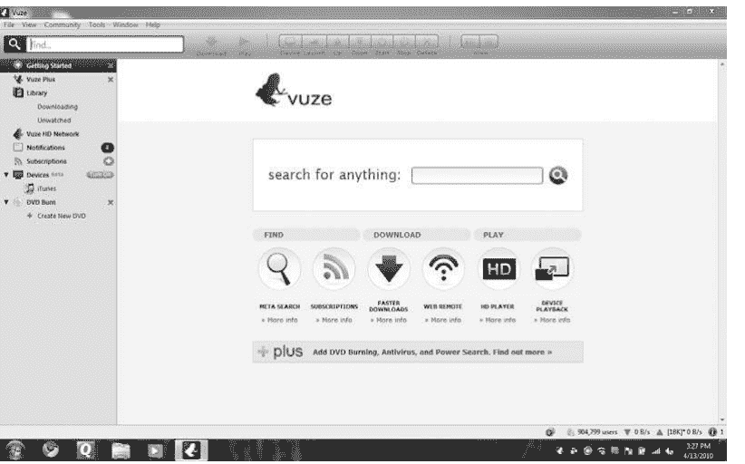

图 2.8

Vuze 应用程序。

## 获取 Fedora

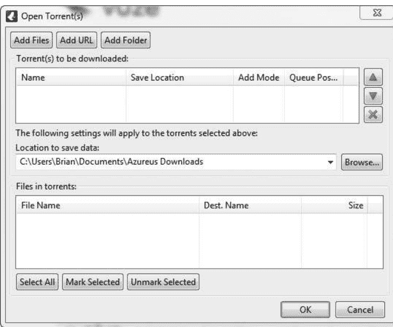

图 2.9

打开种子(Open Torrent(s))对话框。

## 给予与取

不要做吸鬼（leech）！那些只下载所需内容就关闭 Torrent 应用程序的人被称为这种人。种子下载运行的最佳方式是在获取文件后继续分享下载。你的客户端应该有一个共享比例（share ratio）标记——即上传种子量相对于下载量的比例。在你的比例至少大于 1.0 之前，你不应该停止种子进程，这意味着你至少完整地分享了一次你的文件。好消息是，上传的过程比下载慢得多，因此让它运行不会多多影响你互联网的其他部分。如果你担心带宽使用——无论是上传还是下载——你可以在 Vuze 的“工具(Tools) | 选项(Options)”下调整最大传输速率。

## 刻录 CD

无论你通过何种方式将 Fedora 镜像文件获取到计算机，你最终都需要创建一个实际的 CD 来用于安装 Fedora。Windows 和 OSX 各自具有不使用独立应用程序将 .iso 文件刻录到 CD 的功能。

- 1. 将空白的 CD-R 或 CD-RW 光盘插入你的 CD 刻录器。
- 2. 使用 Windows 资源管理器导航到你下载的 Fedora .iso 文件。
- 3. 双击 .iso 文件。Windows 光盘刻录机（Windows Disc Image Burner）程序将启动。
- 4. 确认选择了空白 CD 所在的驱动器。
- 5. 点击刻录。Fedora 文件将被复制到 CD 中。
- 6. 完成，新的 Fedora CD 将从驱动器弹出。点击确定并从驱动器取出光盘。

## 获取 CD

如果你没有宽带连接，可以获取 Fedora 副本，它将直接邮寄到家里或公司。

有许多方法可以将 CD 邮送到门口。也许最经济的方法是使用 Fedora 的免费媒体（FreeMedia）计划并请求免费的 Fedora 副本。这种方法免费，但速度很慢——可能需要几周才能收到寄出的 Fedora CD。这是因为 FreeMedia 是纯粹的志愿者活动。

因此，只有那些无法下载 Fedora、无法参加活动或无法从其他地方获取（例如通过大使、在线供应商或本地供应商）的用户才应该使用 FreeMedia 计划。

如果这符合你的标准，请访问 FreeMedia 页面并按照指令请求 Fedora 副本 (`http://fedoraproject.org/wiki/Distribution/FreeMedia`)。务必先查看活动、大使和供应商的链接，以防那些选项可行。

## 安装准备

在你准备好 CD 之前，你最终需要创建一个用于安装 Fedora 的实际 CD。Windows 和 OS X 各自具有不使用独立应用程序将 .iso 文件刻录到 CD 的功能。

（注：由于用户提供的原文文本在“## Installation Preparation”标题之后内容中断，此处已按要求翻译了可见部分。）

## 第 2 章 在安装 Fedora 之前

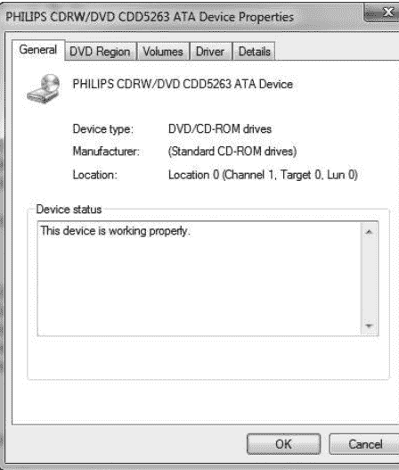

图 2.12

这里信息并不多，但每一点积累都是有用的。

记录非通用信息是一个好主意，以防以后在使用 Fedora 时出现小故障。

你可能会发现其他书籍会建议读者记录日记，以跟踪和记录他们 PC 的所有硬件以及在安装 Fedora 过程中出现的任何其他问题。这种方法有优点，但不必特意准备纸笔。在 Windows XP 的“设备管理器”中，有一个“打印”图标，你可以用它直接打印出 Windows XP 所知的 PC 硬件信息。

你会发现这份打印出来的文档包含了非常技术性的信息——其中大部分你并不需要。尽管如此，这比把它们都写下来要节省时间。

在较新版本的 Windows 中，需要手动记录硬件信息。

为了成功安装 Fedora 并在以后出现问题时进行故障排除，你需要的最重要的信息是那些让你的计算机能够正常运行的设备，如表 2.1 所示。

## 安装准备

表 2.1 Fedora 安装/故障排除所需的重要硬件信息

| 硬件 | 需要的信息 |
| --- | --- |
| CPU | 制造商、型号、频率 |
| 主板 | 制造商、型号 |
| 总线 | 制造商、型号 |
| 内存 (RAM) | 容量 |
| 显卡 | 制造商、型号、显存大小、芯片组 |
| 声卡 | 制造商、型号 |
| 显示器 | 制造商、型号、水平同步和垂直同步率 |
| 硬盘 | 制造商、型号、容量、类型 (SCSI 还是 IDE) |
| 网卡 | 制造商、型号 |
| CD-ROM 驱动器 | 制造商、型号、容量 |
| 软驱驱动器 | 制造商、型号、容量 |
| 调制解调器 | 制造商、型号、传输速度 |
| 打印机 | 制造商、型号 |
| 鼠标 | 制造商、型号、类型 (PS2/ 串口，或 USB) |
| 键盘 | 制造商、型号、键位数量、语言 |
| SCSI 卡和设备 | 制造商、型号、控制的设备类型 |
| IDE 适配器 | 制造商、型号、控制的设备类型 |

你所需的大部分信息包含在打印的设备管理器输出中，但并非全部。例如，你可以通过点击“系统属性”对话框中的“常规”选项卡来查找计算机上安装的 RAM 容量信息。另一个选项可能是右键点击“我的电脑”中显示的硬盘图标，并选择“属性”选项查看你的驱动器空间有多大。一点侦查工作将让你的 Fedora 安装变得轻松得多。

## 备份你的数据

在确定硬件设置后，你需要采取下一步为计算机的安装做好准备：备份 PC 上的数据。

备份你的宝贵数据始终是一个好主意，以防止发生灾难性故障。至少，你希望你的数据免受过涌、病毒攻击、计算机被盗或任何可能影响你访问机器上数据能力的影响。

安装 Fedora 肯定不能被归类为灾难性事件。但取决于你打算如何更改硬盘分区，甚至可能格式化硬盘，这些事件可能会并且将会完全删除数据。

你首先决定的是哪些数据应该被备份。这实际上取决于你想在 Fedora 安装中做什么。特别是如果你计划进行双启动（在同一台 PC 上运行 Windows 和 Fedora），那么你需要确保已经保护了大部分的 Windows 数据。

## 完全替换 Windows

即使你计划完全删除 Windows 并安装 Fedora 代之，保存你的数据文件仍然很有意义。在 Windows 中创建的大多数文件都可以在 Fedora 中打开，如图形文件 (GIFs、JPEGs、PNGs) 和 Adobe Acrobat (PDF) 文件。此外，Microsoft Office 文件也可以被打开，作为完全兼容的 OpenOffice.org 办公套件的补充。如果你计划在你的 Fedora 机器上使用这些文件，你需要的是“保存”而不是“备份”这些文件，尽管 Fedora 无法读取 Windows 备份文件。如果是这种情况，请使用外部硬盘或闪存器（也称为优盘），并使用 Windows 资源管理器将你的数据文件保存到此类设备中。你以后可以检索它们。

## 为双启动做准备

如果你计划对你的机器进行双启动，则需要一个备份操作系统，以确保在设置出现问题时仍然能够进入 Windows 端。如今大多数计算机应用程序都占用大量的磁盘空间，这主要是今天的大硬盘使得它们能够这样做。因此，备份你的数据和应用程序文件是一项巨大的工作。如果你有足够的存储容量（例如一个外部硬盘），那么建议你备份整个硬盘。

对于那些没有足够大容量设备来容纳整个硬盘数据的人，只需备份你的数据文件即可。你的数据文件是你随着时间推移通过计算机创建的文档、表格、图纸和其他文件。如果你遇到麻烦，可以先使用原始光盘重新安装 Windows 操作系统和应用程序，然后恢复你存档的个人文件来恢复系统。

如果你从未用过备份程序，你会发现它们非常易用。有很多备份程序可用，包括在 Norton System Utilities 中附带的一个非常出色的程序。备份工具的原理非常像：定位并识别你想要存档的文件，指定新存档文件的位置，并创建该文件。恢复仅仅是反向操作。

# 第 3 章 安装 Fedora

这意味着当你将 Fedora CD 插入光驱器并重启计算机时，Fedora 将自动在你的计算机上运行，而不会放置任何新文件，也不会触碰你机器上已有的数据。Fedora 会启动并运行。

那么，你可能会问，我为什么还要费力安装 Fedora 呢？我可以直接从 CD 运行它吗。嗯，确实如此，而且很多人确实这样做——尤其是当他们使用别人的电脑 且不想使用原有的操作系统时。既然你可以插入自己的 Fedora LiveCD 并进入一个更熟悉的环境，何要在朋友的电脑上使用 Windows 呢？

第一个问题是：从光驱器运行任何操作系统都意味着过程会缓慢得多。数据必须不断从驱动器中传输，只有最快的驱动器才能带给你相当的用户体验。

如果你的系统 RAM 较低，LiveCD 的性能会受到更大的影响。当操作系统及其应用程序运行时，你使用 RAM 作为工作空间来执行它们的操作。可用内存越多，应用程序运行得就越高效。但当有很多应用程序在运行时，RAM 就会被填满。为了满足需求，操作系统使用磁盘上称为交换空间（swap space）的空间来帮助满足内存需求。这就是为什么当你电脑上运行很多程序时，你会听到硬盘在嗡嗡作响。使用交换空间速度较慢，但它能完成任务。

## 何时升级 RAM


> 如果你的硬盘工作非常频繁——即使你只运行一或两个应用程序——现在是时候考虑为你的机器安装更多 RAM 了。这不仅能加快你的操作速度，还能大大减少硬盘的磨损。

然而，当你运行 LiveCD 时，交换空间选项无效，因为来自 CD 的 Fedora 不会接触你的驱动器数据。如果你的系统没有安装大量 RAM，请为缓慢的 LiveCD 操作做好心理准备。

尽管操作缓慢，但 LiveCD 的优势在于如前提到的，它可以让你随身携带操作系统，而且让你在“购买”它之前尝试 Fedora。在这里，“购买”意味着安装。

Fedora LiveCD 实例中的所有内容与你将 Fedora 安装到 PC 上所获得的内容完全一致。你只需要将光盘插入 CD 驱动器并重启 PC 即可。

## 一个还是两个操作系统？

你将在黑屏幕上看到一个文本菜单，询问你想要做什么。预选选项是“启动（Boot）”或“安装（Install）”，所以你不需要做其他操作。等待片刻后，Fedora 最终会出现在你的屏幕上，如图 3.1 所示。

如果此时你想探索 Fedora 操作系统，我们诚挚邀请你跳到第 4 章“桌面基础（Desktop Basics）”开始你的探索。

如果你准备好继续安装 Fedora，那么还有一个问题需要解决：你的 PC 是否与 Windows 共用。

### 现在到了你必须做一个非常重要的决定的时刻了

像所有重要的决定一样，你应该仔细权衡你的选择。你必须决定是在 PC 上单独运行 Fedora，还是保留 Windows 并能够在它和 Fedora 之间来回切换。本节将探讨决定的每个方面的优缺点，并在你决定双系统启动（dual boot）时为你提供建议。

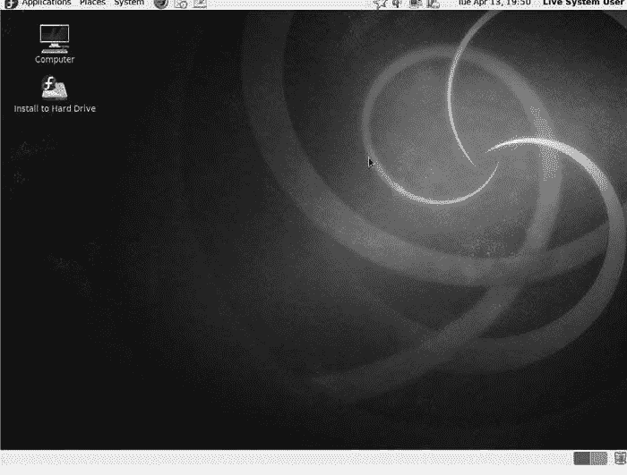

图 3.1

Fedora LiveCD 桌面。

## 为多个操作系统留出空间

在一台电脑上使用多个操作系统有若干优缺点。缺点包括在机器上安装两个或多个操作系统带来的头疼问题，导致每个操作系统可用的硬盘空间更加有限。

但使用多个操作系统的好处是显著的。例如，你将能够运行 PC 上每个操作系统都可提供的所有程序。你还能够使用 PC 拥有的所有硬件。最后，由于不再需要购买另一台 PC，你可以节省费用。

建议双系统启动是你应该采取的方式——特别是如果你有某些无法放弃且在 Fedora 中没有对应程序的 Windows 应用程序。此选项让你在享受到使用 Fedora 益的同时，而无需投入大量的时间和金钱。

如果你决定在 Windows 之外的 PC 上包含 Fedora，你需要在硬盘上为它留出空间。为 Fedora 为硬盘留出空间与为最新电脑留空间是完全不同的操作。你需要创建一个全新的分区（partition），Fedora 将从其中运行。

这是一份关于磁盘分区以及为什么在没有分区的情况下你无法向磁盘写入数据的速成课程。

### 为什么要分区？

想象一只蜜蜂在你的花园里嗡嗡飞飞。如果你跟着这只蜜蜂回到它的家，你会发现一个看似混乱的嗡嗡昆虫群，每只蜜蜂似乎都在漫无目的地游荡，没有别的好处可以聚在一起嗡嗡叫。

但正如我们所知，蜜蜂都有特定的目的，为了蜂群的集体利益共同努力。一群蜜蜂的工作是在蜂王产卵后照看所有可爱的小宝宝。现在，回想一下你的科学课：宝宝在哪里被抚养的？

如果你说是蜂巢，你是对的。如果你在想这与分区有什么关系，请等。蜂巢是一个由六边形单元组成的巧妙设备，幼虫储在其中。考虑一下：如果没有蜂巢，蜜蜂该如何生存？

记住蜂巢，你就可以将其类比应用于数据存储在磁盘上的方式。你看，如果没有某种结构，数据无法存储在驱动器上。当数据被放在驱动器上，它会被写入这种结构，称为文件系统——你可以把它想象成蜂巢，数据存储在那里。

例如，计算机的数据并不是存储在相邻的数据块中的。对于单个文件，数据可能存储在块 456、457，然后是 458，以此此类推。这是一种简化，但你能理解意思。文件系统的任务是跟踪每个文件位于何，以便当你发送操作文件的指令时，文件系统知道该文件所在的所有独立块。

由于所有这些文件跟踪和检索，计算机工程师想出了即使在大型硬盘上也保持文件系统较小的想法。因此，分区的概念应运而生。基本上，分区是一个虚拟屏障，告诉文件系统：“你以前可以写入整个磁盘的 1–25000 块，但现在你只允许写入 1–17500 块。第二个文件系统将写入 17501–25000 块，所以离远点！”这样，你就有了分区。每个分区可以使用不同的文件系统。通过类比，蜜蜂制造的蜂巢与黄蜂制造的蜂巢不同——结构相似但结果不同。

如果你的 PC 包含典型的 Windows 安装，你的 Windows 文件系统将包含在一个覆盖整个硬盘的大分区中。这没有为另一个分区和新的文件系统留出空间。记住，即使你的硬盘上有几 GB 的空空间，这些空间就像文件和目录一样，可能散落在整个硬盘上并仍然属于 Windows 分区。

向现有硬盘文件系统添加分区的简单方法是使用 Anaconda 内的分区工具。这会将你的现有分区显示为一个较小的数据块集合，在硬盘的其他地方留下空闲且未结构化的空间，你可以在其中安装 Fedora 运行的分区。

## 备份您的数据

如第 2 章所述，在运行任何工具对分区进行操作或创建之前，请务必将您的数据备份或保存到另一个物理驱动器中。如果你计划用 Fedora 完全替换 Windows，请务必备份所有内容。拜托了。

## Fedora 需要的分区

在安装 Fedora 时，它会使用一个名为 Anaconda 的七步应用程序来完成任务。当 Anaconda 检测到你的电脑上存在另一个操作系统时，它会询问你是想替换硬盘内容，还是执行分区操作。

这个选择点决定了你的电脑上是只有一个 Fedora 操作系统，还是有多个操作系统（Fedora 和 Windows）。有关如何执行此过程的机制，将在本章稍后的“分区设置”部分进行概述。目前，有一些应该传达给新 Fedora 用户的建议。

在 Fedora 系统中，文件系统是以关键的根目录为导向的，该目录基于硬盘的驱动器号。对于大多数主驱动器，驱动器号是“C”，因此 Windows 中的根目录表示为 `C:\`。其他驱动器也有根目录（`D:\`、`E:\` 等）。根目录始终与物理驱动器或分区绑定，所有的子目录都直接源自同一物理驱动器上的根目录。`C:\Documents\Brian\My Documents` 将始终位于主（`C:\`）驱动器或分区上。

Fedora 的文件系统要灵活得多。例如，用户目录的常见模式是 `/home/<username>`。“home”是根文件夹的子目录，在基于 Linux 的系统中表示为 `/`。因此，在作者的情况下，主目录可能是 `/home/bproffitt`。以下是 Fedora 系统的默认目录结构。

- `/bin`
- `/boot`
- `/dev`
- `/etc`
- `/home`
- `/lib`
- `/lost+found`
- `/media`
- `/mnt`
- `/opt`
- `/proc`
- `/root`
- `/sbin`
- `/selinux`
- `/srv`
- `/sys`
- `/tmp`
- `/usr`
- `/var`

撇开这些奇怪的名字不谈，它们看起来像一组 Windows 文件夹，不是吗？一堆按树状结构排列的目录，都位于同一个分区。。，虽然这个列表反映了典型的 Fedora 文件系统，但并不意味着所有这些目录都位于同一个分区上。

这是由于一种名为“挂载点”（mount points）的独特的 UNIX 文件系统属性。如果你愿意，可以选择任何驱动器或分区上的任何目录，Fedora 的文件管理将无缝地复制、检索、保存或删除无论这些文件在物理上位于何处。

以作者的系统为例，根（`/`）目录的挂载点位于 `/dev/hda2`，这表示主（“a”）硬盘（`/dev/hd`）的第二个分区（“2”）。但 `/home` 目录（及其所有子目录）的挂载点位于 `/dev/hda3`，这是一个完全独立的分区。这样做的好处是，属于作者的个人数据将始终存储在单独的分区上，这意味着如果需要迁移到另一个 Linux 发行版或对未来版本的 Fedora 进行全新安装，这些个人数据将始终被保留，并且可以通过 Fedora 文件系统中的 `/home` 目录访问文件。

你可以将 Fedora 文件系统的不同目录挂载到任何分区或驱动器上，如果你的 PC 配备了这些设备，甚至是不同的驱动器。

当你使用 Anaconda 的分区工具设置硬盘时，显而易见，你需要为现有的 Windows 操作系统分配一些空间，为 Fedora 分配一些空间。多少呢？简单的答案是将硬盘一分为二，让每个操作系统获得公平的份额。许多其他因素可能会导致这一选择有所不同。

例如，如果你有一个较小的硬盘，而 Windows 占据了大量空间，那么你在安装 Fedora 时将需要非常保守。

# 第 3 章 安装 Fedora

## 可用空间

- 你至少需要 4GB 的磁盘空间来处理标准的 Fedora 安装。至少预留两个 GB 的存储空间，除非你有某种网络设备。

在你考虑需要为 Fedora 留出多少空间时，请确保你有足够的空间为硬盘上的交换交换空间（swap space）。要确定创建多大的空间通常很难，因为不同的用户根据他们工作的类型需要不同数量的空间。如果你处理大量非常大的文件（图形、桌面出版），你应该将交换内存设置得高一些，最好是系统 RAM 内存的两倍。对于大多数用户，经验法则是交换空间应该是你 RAM 的 1.5 倍。

## 运行 Anaconda

对于旧版本的 Fedora——事实上，对于任何 Linux 发行版的旧版本——开始安装只需将 CD 插入驱动器并重启系统。安装程序将作为初始菜单上的一个选项出现，一旦选择，安装程序就会开始。

如今，有了 Fedora 的 LiveCD 选项，开始安装更加轻松。正如你可能在图 3.1 中看到的，当你运行 Fedora LiveCD 时，桌面上有一个小的“安装到硬盘”（Install to Hard Drive）图标。现在准备工作已经完成，双击“安装到硬盘”图标，并按照本指南完成安装过程。

Anaconda 是一个七步安装程序，从一个介绍屏幕（称为启动屏幕）开始。点击“下一步”进入键盘设置屏幕，将在下一节中详细介绍。

让我们过一遍将发生的情况，这样你对预期就有数了。

### 键盘设置

你可能认为键盘就是键盘，但在世界各地，甚至在一个国家内部，人们向 PC 输入文字的方式有很多变化。Anaconda 的第一步显示了 Fedora 支持的许多键盘。

选定的键盘是根据你第一次运行 Fedora LiveCD 时选择的语言设置。如果你不确定使用的是哪种键盘，请保留默认选项。否则，选择合适的键盘，然后点击“下一步”进入第二步。

### 设备类型设置

大多数 Fedora 用户可能会在 PC 或类 PC 设备（如笔记本电脑）上安装 Fedora 操作系统。然而，高级用户和系统管理员也可以将 Fedora 安装在使用存储区域网络（一组用于大型组织数据的服务器和磁盘）的其他类型的机器上。

预计如果你在考虑这类项目，你就不需要这本书了。所以，我们将假设一个更基础的选择，并保留“基本存储设备”。点击“下一步”继续第三步。

## 硬盘和计算机设置

大多数电脑现在只有一个硬盘，通常是一个大硬盘。尽管如此，有很多系统配备了多个硬盘，或者用户后来添加了。

考虑到这一点，Fedora 允许你选择要在哪个硬盘上安装 Fedora。在图 3.4 所示的示例中只有一个可用硬盘，因此应该点击它进行选择，然后点击“下一步”进入第四步。

在下一个屏幕上，你有机会为你的计算机命名。取一个简单的名字，如“Fedora”或“officepc”。如果你的电脑连接到网络，这个名称将会在网络上标识你的电脑。

点击“下一步”进入第五步。

请在下方选择您想要安装操作系统的驱动器，以及您想要自动挂载到系统的任何驱动器：

| 型号 | 容量 | 厂商 | 互连 | 序列号 |
|---|---|---|---|---|
| VMware, VMware Virtual S | 20480 MB | VMware_ | SCSI |  |

从共 1 个设备 (20480 MB) 中已选择了 0 个设备 (0 MB)。

提示：在此屏幕上选择驱动器并不一定意味着它会被安装过程擦除。此外，请注意，在硬安装之后，您可以通过修改 `/etc/fstab` 文件来挂载在此处未选择的驱动器。

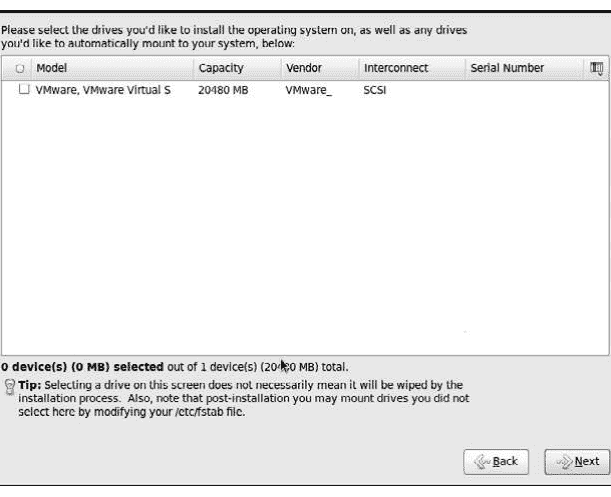

图 3.4

选择目标硬盘。

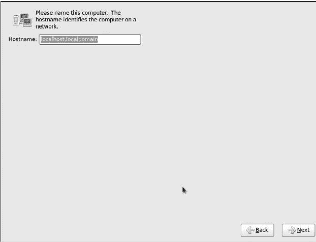

图 3.5

为您的计算机命名。

### 时区设置

Anaconda 的第 5 步显示了世界地图，您可以通过它可以确定正确的时区设置。

如果您想使用地图，可以使用地图左侧的放大滑块来放大特定区域。点击距离您所在地且仍处于同一时区内的城市。该城市将出现在地图下方的“已城市”（Selected City）下拉列表中。如果您点击了错误的城市，请重试。

确认您选择了正确的城市且时区也正确。点击“下一步”进入第 6 步。

### Root 设置

在图 3.7 所示的屏幕上，您需要设置系统的 root 密码。“Root”是赋予任何 Linux 系统管理员账户的名称。root 用户拥有巨大的权限，可以以任何方式配置 Linux 系统。

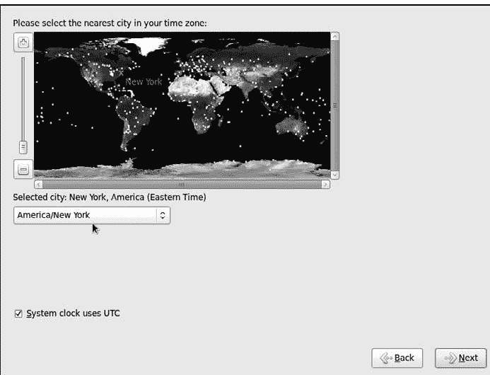

图 3.6

发现您正在使用 Fedora。

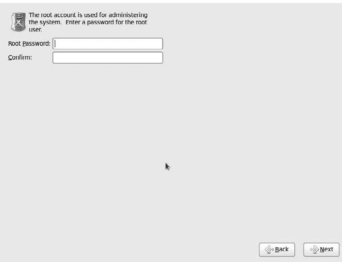

图 3.7

设置 root 密码。

他或她可以这样做。因此，这不是您会随意使用的密码。设置一个好密码，并且不要忘记它。

在输入两次相同的密码后，点击“下一步”进入第 7 步。如果 Fedora 检测到您输入了弱密码，它将警告您并给您机会输入更强力的密码。

## 分区设置

现在是 Anaconda 过程中最重要的部分：选择您的分区选项。

默认情况下，Anaconda 将选择“替换现有 Linux 系统”选项。但您需要将选项设置为“缩小当前系统”。在离开该选项选中状态并点击“下一步”之前，让我们回顾一下它的含义。

缩小当前系统意味着 Anaconda 将尝试使用该文件系统中任何未使用的空间来减小现有 Windows 系统的大小，以便为磁盘上现在为空部分的 Fedora 腾出空间。

例如，假设您有一个安装了 Windows 的 200GB 硬盘，硬盘上有约 100GB 的空闲空间。Anaconda 将 200GB 的文件系统压缩到 120GB，留出 80GB 完全未使用的空间，您将在那里安装 Fedora。

如果是如此情况，点击此选项将生成“待缩小的卷”对话框，您可以在其中设置现有 Windows 分区的大小。建议为 Fedora 至少提供 60GB 的空间，但您也可以轻松地使用 20GB，特别是如果您有外部存储设备来存放数据。

“使用所有空间”意味着在完成 Anaconda 后，安装过程将完全格式化您的硬盘，这意味着硬盘上的所有内容（Windows 和您的个人数据）都将消失。

如果您阅读了第 2 章“安装 Fedora 之前”并备份了系统所有的文件，那么这只是一个微小的头疼问题，因为只需要恢复被 Fedora 安装过程覆盖的内容即可。如果您没有备份 Windows 分区，且不想格式化整个硬盘，这将等异于一场重大灾难。

所以，无论如何强调都不为过，在选择“使用所有空间”选项之前，请确保您想用 Fedora 完全替换 Windows 和您的个人数据。

### 保存您的个人文件

许多用户认为他们的个人文件会以某种方式被保留，Windows 会自动转换为 Fedora。事实并非如此。请确保您已安全地备份了个人文件。

选择您想要的选项并点击“下一步”。将打开“将存储配置写入磁盘”对话框。

此时，您现在正致力于安装 Fedora。点击“将更改写入磁盘”将开始安装过程并对您的磁盘硬盘进行永久更改。无论如何强调，在此时您的所有数据都应该已经备份。


图 3.6

发现您正在使用 Fedora。


图 3.7

设置 root 密码。

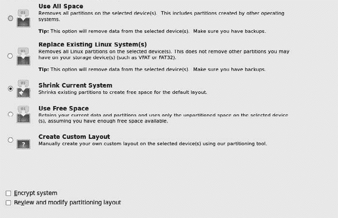

图 3.8 警告：提前分区。

## 首次运行配置

密码策略是使用你喜爱的歌曲副歌中每个单词的首字母。你应该获得一个强度足够的密码。

填写完信息后，点击“向前”继续。

在“日期和时间”屏幕中，你可以确认 Fedora 从系统中获取的日期时间信息，以及你在 Anaconda 中设置的时区。

### 同步时钟

如果你需要非常准确的时间，请点击“网络同步日期和时间”。这会将你的计算机连接到互联网上的高精度服务器，这些服务器通过原子钟获取你的时间设置。你以后再也不会迟到了。

确认时间设置后，点击“继续”将带你进入安装向程序的最后一个界面：硬件配置界面。


此界面包含 Anaconda 和安装向程序使用名为 Smolt 的工具收集的关于系统的所有数据，以及发送这些信息的选项

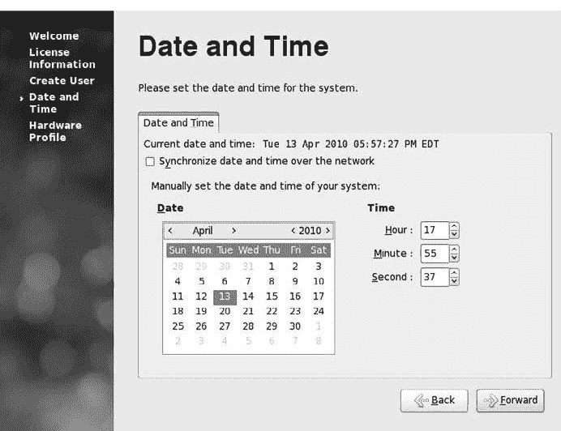

图 3.14

日期和时间屏幕。

## 第 3 章 安装 Fedora

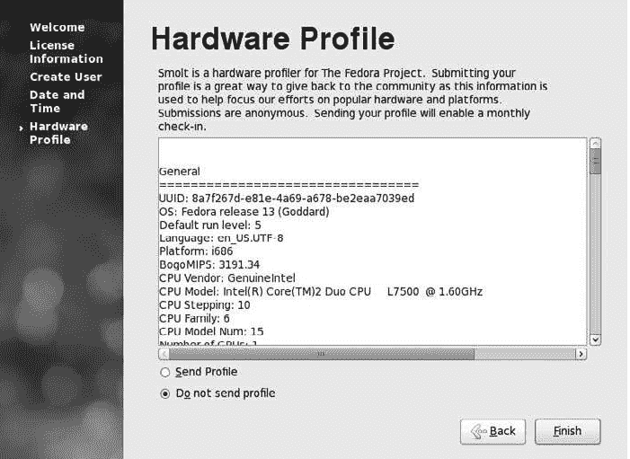

图 3.15

反馈给 Fedora 社区。为什么呢？因为通过对每个系统进行调查，Fedora 开发人员将更好地了解在未来的版本中应该重点放在哪里。这些信息是严格匿名的，不会发送你的任何个人数据。

选择该选项并点击“完成”（Finish）。安装向程序将关闭，随后你将看到主登录界面。

输入用户名和密码信息，然后进入 Fedora。

### 总结

在本章中，你回顾了在 PC 上安装 Fedora 的步骤。特别关注了分区设置，因为这是安装过程中唯一一个可能导致重要数据丢失的部分。

现在 Fedora 已经安装好了，是时候在第 4 章“桌面基础”中尽情探索你卓越的操作系统系统了。

# 第 4 章 桌面基础

新用户对 Fedora 桌面首先注意到的点之一是其低调的色调。有些用户的评价则更直白：“这确实是……蓝色的……”他们可能会低声抱怨，语气并不热情。

事实上，与今天许多图形环境的华丽惊艳相比，Fedora 的默认配色方案相当沉静。但这样做有充分的理由：将一个朴素的桌面想象成空白画布，你可以在上面创建一个完全根据你的需求定制的桌面。事实上，自定义桌面的方法数非常多，而且不仅仅通过颜色——你几乎不知道从何处开始。

这正是本章要做的：提供如何开始让你的 Fedora 桌面真正属于你自己的指导建议。

在本章中，你将：

- 学习更多关于 GNOME 桌面开发的知识。
- 确保你的显示器设置为最佳分辨率。
- 发现如何修改各种桌面元素的设置。
- 浏览 GNOME 桌面。

## 理解 GNOME 桌面

首先，它不是“gnome”（像那些在斯堪的纳维亚乡村跑来跑去的的蓝衣红帽小生物）。它的读音是“guh-nome”，“G”的发音重，“uh”的发音轻。

GNOME 是 Miguel de Icaza 的结晶，他是一位墨西哥计算机工程学生，他看了一眼 KDE 环境并非常喜欢他看到的——直到他发现其中（当时）存在非自由代码。

De Icaza 是自由软件理想的忠实追随者，他决定 Linux 需要一种类似的桌面环境，但没有任何 KDE 那种许可限制。

GNOME 于 1997 年 8 月首次亮相，当时 de Icaza 在 comp.os.linux 新闻组首次发布了他正在从事的项目公告。到那年的 12 月，第一个可用的测试版本已向 Linux 社区开放。直到 1999 年 3 月，1.0 版本才向公众发布，但到那时，消息已经传开，成千上万的自由软件追随者加入了 GNOME 阵营。

GNOME 像 KDE 一样，是一个桌面环境。它不是窗口管理器（像 Enlightenment 或 Metacity 那样）。窗口管理器控制窗口、菜单和其他图形界面视觉组件的外观和感受。桌面环境为应用程序的运行提供了一个稳定的平台。因此，如果应用程序是为桌面环境编写的，它可以与该环境中的其他应用程序共享广泛的通用功能。

在 Linux 社区中，GNOME 深受推崇不仅是因为其自由软件的地位。在历史上，它被认为比 KDE 更美观，因为 GNOME 可用的主题具有更强的视觉吸引力。最近的 KDE 版本似乎对此存在异议，如果你尝试 Fedora KDE，你将会了解到这一点。

除了 GNOME 的外观之外，de Icaza 将企业界对自由软件的认知推向了新的边界。在 GNOME 1.0 发布一年后，de Icaza 与几家大公司合作成立 GNOME 基金会——这是一个非营利组织，致力于以快速、开放的方式推动 GNOME 的发展。

GNOME 基金会拥有红帽（Red Hat）、HP 和 IBM 等高实力的成员，希望让 GNOME 成为 Linux 的界面，并让用户非常容易适应这个界面。

使用 Linux 的人们面临的主要障碍之一是认为它很难用，而 GNOME 基金会想要改变这种认知。通过为软件开发者提供一个稳定且具有交流性的环境，GNOME 基金会成为开发新应用的孵化器。正由于这些原因，Fedora 的默认桌面是 GNOME。让我们简单浏览一下。

## 桌面设置与功能

当你查看 GNOME 桌面时，你会发现它是多么简单简洁（见图 4.1）。这是因为界面设计人员决定以不显眼的方式呈现你所需的工具。这里不会找到回收站或“我的文档”，除非你想要。桌面的某些元素对你来说是熟悉的，如果你以前用过 Windows 或 OS X。有些控件将不太熟悉

- **应用程序菜单（Applications Menu）。** 此菜单的形式和功能与 Windows 的开始菜单非常相似。在此菜单中，可以找到机器上安装的所有图形应用程序，并按类别排列（见图 4.2）。
- **位置菜单（Places Menu）。** 此菜单允许你快速导航到机器上的特定目录或其他地方，取决于你如何配置（见图 4.3）。
- **系统菜单（System Menu）。** 系统菜单是桌面的一个重要组件，让用户访问各种配置设置，以及电源控制和通用帮助（见图 4.4）。
- **面板（Panels）。** Fedora 的面板是许多 Fedora 控件（菜单、启动器、切换器等）所在地。面板可以进行自定义，以具有不同的

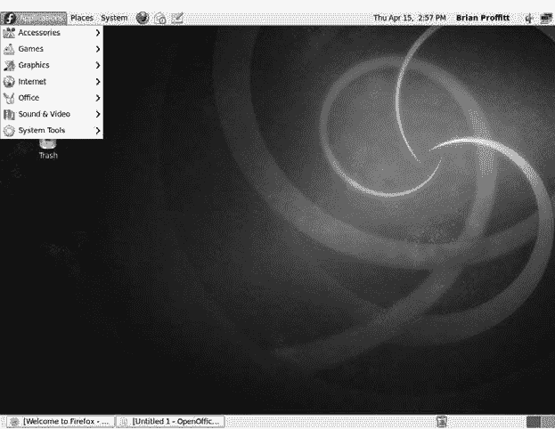

图 4.2

应用程序菜单。

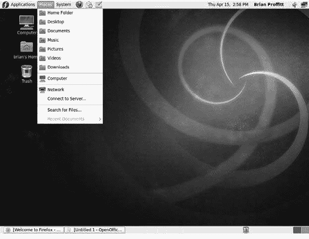

图 4.3

位置菜单。

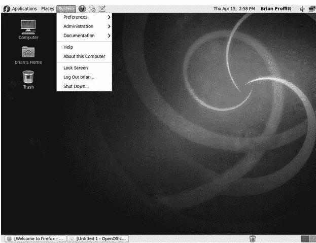

图 4.4

系统菜单。

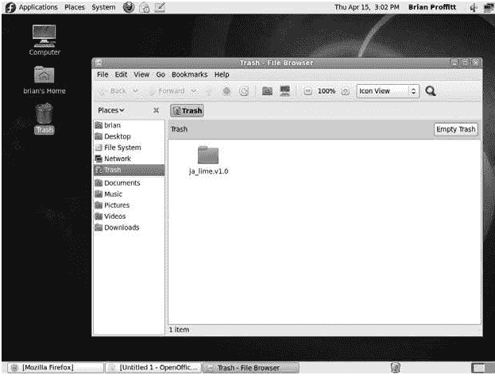

图 4.5

垃圾桶文件夹。

在桌面，你实际上可以拥有多个，每个桌面都有自己的一套打开的应用程序、图标——甚至是外观。更多信息，请参阅本章稍后的“工作区”部分。

- **窗口列表（Window List）。** 类似于 Windows 任务栏或 OS X dock，窗口列表将显示 Fedora 中所有运行的应用程序和窗口（见图 4.6）。
- **启动器（Launchers）。** Fedora 中的图标仍然被称为 *icons*（图标），但如果它们被分配了启动某些内容（如应用程序、文件或文件夹）的任务，那么它们被称为 *launchers*（启动器）。启动器可以出现在桌面上或桌面面板中。
- **辅助图标（Accessory Icons）。** 有些图标不仅仅是为了启动程序；它们是为了告诉用户某些信息，例如计算机是否连接到网络。

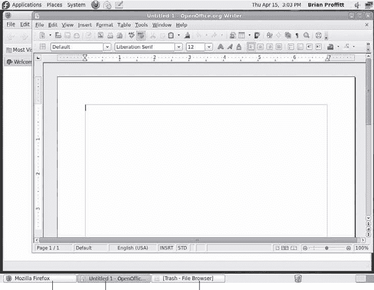

**图 4.6** 一个激活的窗口列表。

- **时钟（Clock）。** 名字几乎已经说明了一切——一个告知用户时间和日期的面板配件。它还能实现更多功能，例如接入 Fedora 的个人信息管理应用 Evolution，以访问当前的预约和任务。它甚至会告诉你天气预报。

GNOME 桌面的功能远不止这里列出的这些。但当你继续探索这个新界面时，这些是你首先需要了解的基础知识。现在是时候学习如何自定义桌面并让它成为你自己的风格了。

### 分辨率

Fedora 中的屏幕分辨率并不是严格的桌面功能，因为更改屏幕分辨率的大小实际上会影响 Fedora 中的一切，而不仅仅是桌面。在进行其他操作之前，让我们看看是否能让你的视觉体验更好。

屏幕分辨率是技术术语，指屏幕上随时显示的像素数量。它通常以宽 × 高（像素）表示。因此，常见的 800×600 分辨率会在显示器屏幕上横显示 800 个像素信息，纵显示 600 个像素（整个屏幕共 480,000 个像素）。像素非常多，但说实话，对于今天强大的显卡和显示器来说，800×600 略低于平均水平。

如今，1280×1024 是一个很好的分辨率，1600×1200 的分辨率也变得越来越流行。

这些分辨率设置的最终效果是分辨率越高，屏幕上能容纳的像素越多。像素越多，屏幕上的物体看起来就越小。因此，在较高的分辨率下，你可以在屏幕上容纳更多信息和窗口。

当 Fedora 首次安装时，它通常很好地探测你的显示器和显卡，并确定最适合你硬件能力的分辨率。然而，市上的硬件很多，Fedora 有时也会偏离。在进入特定的桌面设置之前，让我们检查一下分辨率。

如图 4.7 所示，所示桌面的辨率有点低——物体非常大，可用的屏幕“空间”不多。你的显示器可能处理更大的分辨率。

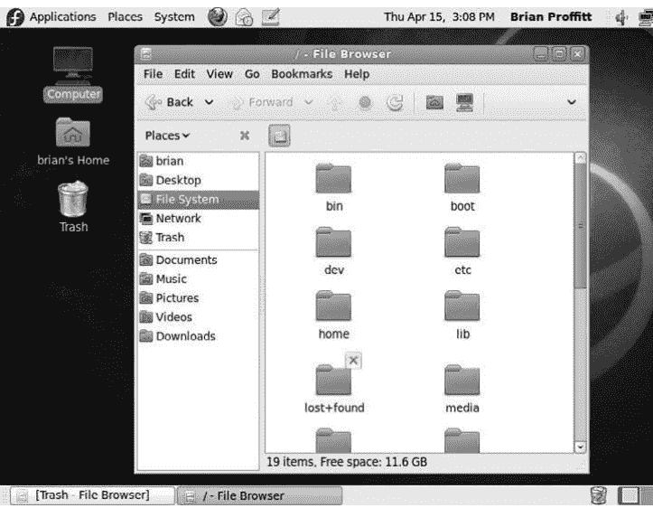

图 4.7

800×600 的桌面分辨率。

更改此设置很简单；只需按照下面列出的步骤操作。

1. 使用“系统 | 偏好 | 显示器”菜单命令。将打开显示器偏好对话框（见图 4.8）。
2. 点击“分辨率”下拉列表，选择一个比当前值更高的辨率值。
3. 点击“应用”。桌面分辨率将发生更改，并打开确认对话框。
4. 点击“保留此配置”。确认对话框将关闭。
5. 点击“关闭”。显示器偏好对话框将关闭。

#### 挑剔的显示器

某些 LCD 显示器具有所谓的“原生分辨率”，即它们运行最佳的分辨率。你的显示器参考指南应该会有更多信息，而且如果尝试的分辨率不合适，较新的显示器实际上会通过消息提醒你。

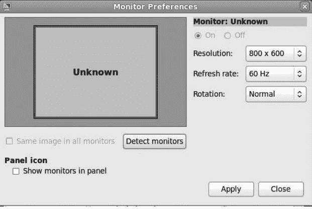

图 4.8

你需要一个分辨率。

### 菜单

Fedora 的较好功能之一是可以编辑菜单内容，以包含你准确想要的内容。Fedora 在包含最常用的应用程序方面做得很好，但可能还有一些你想要放在菜单中的程序。配置 Fedora 菜单相对简单。而且，当你这样做时，你可能会发现更多应用程序。

- 点击“系统 | 偏好 | 主菜单”命令。将打开主菜单对话框（见图 4.9）。
- 点击“菜单”列中的子项。菜单的内容目前可见的。
- 要向菜单中添加项目，请点击“项目”列中的该项。该项目将显示（见图 4.10）。
- 点击你想移动的项。“向上/向下”按钮将变为激活状态。

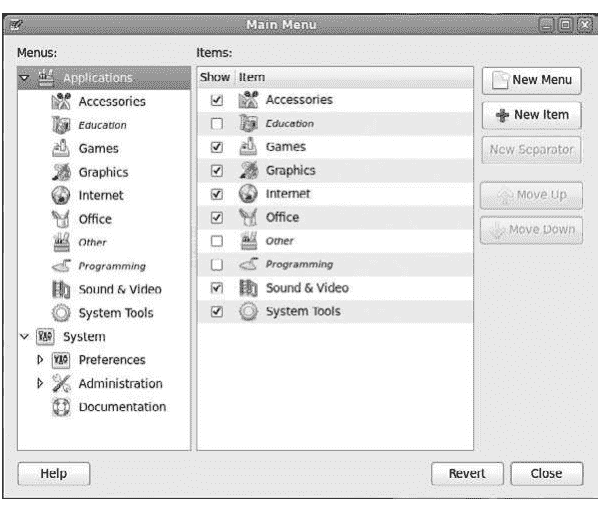

图 4.9

配置菜单。

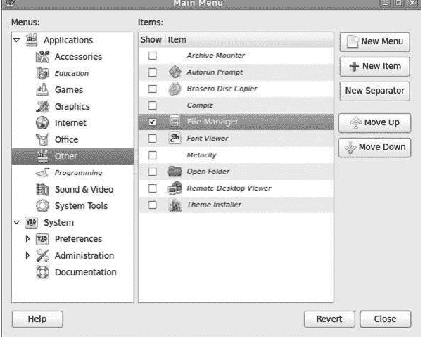

图 4.10

添加项目。

- 5. 点击“向上”。菜单项将移动到上方。
- 6. 点击“关闭”。菜单将发生变化。

不仅可以移动项目，还可以向菜单中添加项目。

- 1. 要添加一个新项目，导航到你想放置的地方并点击“新建”。对话框将打开（见图 4.11）。
- 2. 在“名称”字段中输入你想添加的名称。
- 3. 在“命令”字段中输入启动程序的命令。在 `/usr/bin` 中查找。
- 4. 要添加图标，点击“浏览”。对话框将打开（见图 4.12）。
- 5. 选择所需的图标然后点击“打开”。该图标将出现。
- 6. 点击“确定”。对话框将关闭，新菜单项将出现在“项目”列。
- 7. 点击“关闭”。菜单将发生变化。

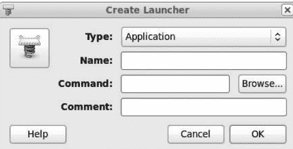

**图 4.11** 创建项目。

| 放置 | 名称 | 大小 | 修改 |
| :--- | :--- | :--- | :--- |
| 搜索 | display-properties.svg | 15.0 KB | 03/29/2010 |
| 最近使用 | eyes-applet.svg | 18.1 KB | 03/29/2010 |
| Brian | largo.svg | 8.9 KB | 03/29/2010 |
| 桌面 | mines.svg | 7.9 KB | 03/29/2010 |
| 文件系统 | network-properties.svg | 28.0 KB | 03/29/2010 |
| 图标 | clock.svg | 10.3 KB | 03/29/2010 |
| Pxmaxaps | drawer.svg | 15.8 KB | 03/29/2010 |
| 文档 | fish.svg | 26.5 KB | 03/29/2010 |
| 音乐 | force-quit.svg | 32.4 KB | 03/29/2010 |
| 图片 | launcher.svg | 14.2 KB | 03/29/2010 |
| 视频 | notification-area.svg | 30.2 KB | 03/29/2010 |
| 下载 | separator.svg | 9.9 KB | 03/29/2010 |
| | window-list.svg | 3.4 KB | 03/29/2010 |
| | window-switcher.svg | 12.7 KB | 03/29/2010 |
| | power-manager.svg | 14.4 KB | 03/29/2010 |
| | volume-control.svg | 25.1 KB | 03/29/2010 |
| | sudoku.svg | 103.0 KB | 03/29/2010 |
| | quote.svg | 25.2 KB | 03/18/2010 |


图 4.12

寻找图标。

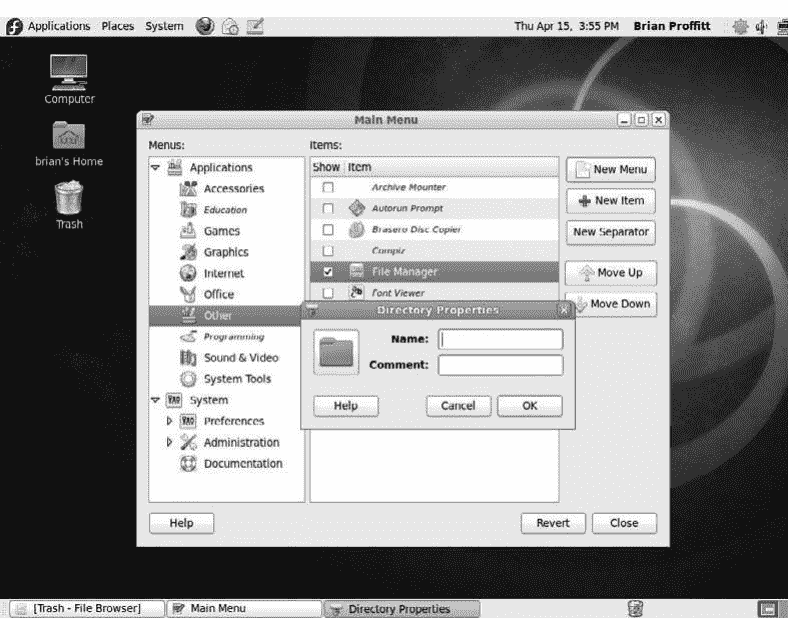

图 4.13

创建一个新的子菜单。

### 面板 (Panels)

菜单并不是 Fedora 中唯一可以自定义的内容。事实上，归结底，列出 Fedora 中无法以某种方式自定义的元素反而要容易得多。

面板也不例外。面板是 Fedora 桌面顶部和底部的灰色水平条，包含了各种工具和菜单。至少，它们刚开始是这样的。经过稍微的调整，你很快就会发现“灰色”、“水平”、“顶部”和“底部”都只是松散的概念：面板可以看起来像几乎任何样子，也可以位于不同的位置。这取决于你。

你可以进行的一个快速更改是重新定位任何面板。

1. 右键点击你想移动的面板。将出现一个上下文菜单。
2. 点击“属性 (Properties)”。将打开“面板属性”对话框。
3. 选择一个新的“方向 (Orientation)”设置。
4. 点击“关闭 (Close)”。面板将固定在其新位置（见图 4.14）。像菜单一样，可以从面板中添加或删除项目。可以向面板添加三类项目：工具（例如辅助工具或监控工具）、来自“应用程序 (Applications)”菜单的“应用程序启动器 (Application Launcher)”、或者自定义的应用程序启动器 (Custom Application Launcher)。我们可以只需几步就能完成所有操作，从一个 GNOME 工具开始。

1. 右键点击你想添加项的面板。将出现一个上下文菜单。
2. 点击“添加到面板 (Add to Panel)”。将打开“添加到面板”对话框（见图 4.15）。
3. 点击你想添加的项目。该项目将被选中。

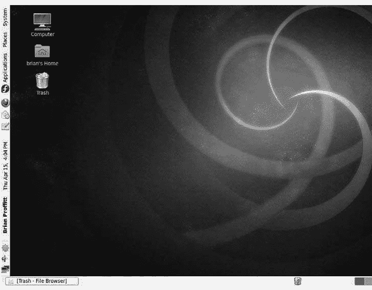

图 4.14

移动面板。

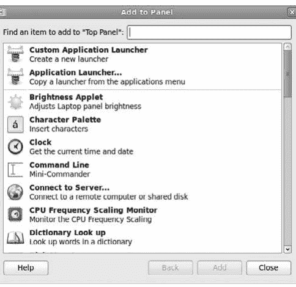

### 图 4.15

向面板添加项目。

4. 点击“添加 (Add)”。该项目将出现在面板中（见图 4.16）。
5. 要移动项目，右键点击其图标。将出现一个上下文菜单。
6. 点击“移动 (Move)”。鼠标指针将变为抓握手状。
7. 在屏幕上左右移动鼠标指针。面板项目将相应地移动。
8. 当项目放置在正确位置时，点击该项目。该项目将位于所需位置。
9. 点击“关闭 (Close)”。“添加到面板”对话框将关闭。

添加应用程序同样简单。你可以从“应用程序”菜单中选择任何应用，或者运行你自己的程序。

1. 右键点击你想添加项的面板。将出现一个上下文菜单。
2. 点击“添加到面板 (Add to Panel)”。将打开“添加到面板”对话框。

### 新项目：天气预报 (Weather Report)

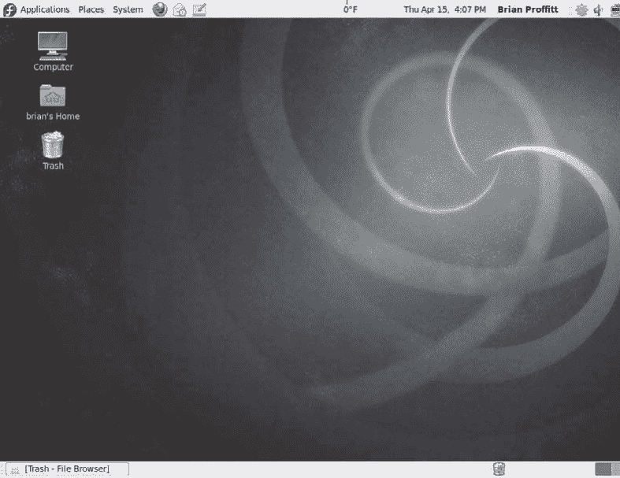

**图 4.16** 一个新项目，几乎准备就绪。

1. 点击“应用程序启动器 (Application Launcher)”然后点击“前进 (Forward)”按钮。“应用程序”菜单的内容将出现在中央窗口中（见图 4.17）。
2. 点击展开箭头（三角形）以展开一组应用程序。
3. 点击你想添加的应用程序。该应用程序将被选中。
4. 点击“添加 (Add)”。应用程序项目将出现在面板中。
5. 要移动项目，右键点击其图标。将出现一个上下文菜单。
6. 点击“移动 (Move)”。鼠标指针将变为抓握手状。

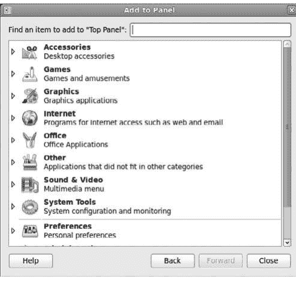

### 图 4.17

“应用程序”菜单上的任何项目都可以添加。

9. 在屏幕上左右移动鼠标指针。面板项目将相应地移动。
10. 当项目放置在正确位置时，点击该项目。该项目将位于所需位置。
11. 点击“关闭 (Close)”。“添加到面板”对话框将关闭。

你不必局限于“应用程序”菜单中的应用；只需使用“自定义应用程序启动器 (Custom Application Launcher)”工具即可。

1. 右键点击你想添加项的面板。将出现一个上下文菜单。


2. 点击“添加到面板 (Add to Panel)”。将打开“添加到面板”对话框。

3. 点击“自定义应用程序启动器 (Custom Application Launcher)”然后点击“添加 (Add)”。将出现“创建启动器 (Create Launcher)”对话框。

4. 在“名称 (Name)”字段中输入你想添加的应用程序名称。

5. 在“命令 (Command)”字段中输入启动程序的命令，或点击“浏览 (Browse)”按钮在 PC 上的任何位置定位应用程序。

6. 要添加图标，点击“启动器 (Launcher)”按钮。将打开“选择图标 (Choose an Icon)”对话框。

7. 点击所需的图标然后点击“确定 (OK)”。选中的图标将出现在“创建启动器”对话框中。

8. 点击“确定 (OK)”。该项目将出现在面板中。

9. 要移动项目，右键点击其图标。将出现一个上下文菜单。

10. 点击“移动 (Move)”。鼠标指针将变为抓握手状。

11. 在屏幕上左右移动鼠标指针。面板项目将相应地移动。

12. 当项目放置在正确位置时，点击该项目。该项目将位于所需位置。

13. 点击“关闭 (Close)”。“添加到面板”对话框将关闭。

## 第 4 章 = 桌面基础

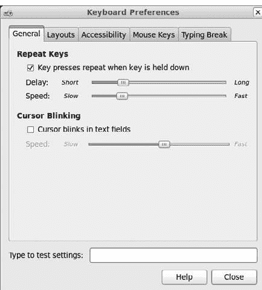

**图 4.23**

通用键盘设置。

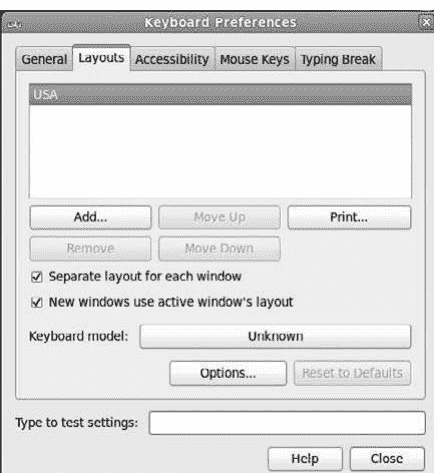

**图 4.24**

选择键盘布局。

- 在“可访问功能”页面，你可以配置诸如“粘滞键”（Sticky Keys）或“慢速键”（Slow Keys）等功能，在需要时提供帮助（见图 4.25）。
- 在“鼠标键”页面，你可以设置数字键盘来控制鼠标指针（见图 4.26）。
- 在“打字间歇”页面，你可以强制键盘锁定自己，并在任何给定的间隔内要求你休息（见图 4.27）。这看起来像是在浪费时间，但定期的休息有助于防止因过度打字引起的重复性应力损伤。

### 时间和日期

运行在面板中的时钟插件非常直观：它显示日期和时间。但它还可以显示你在世界昼光地图上的位置，并提供天气预报。

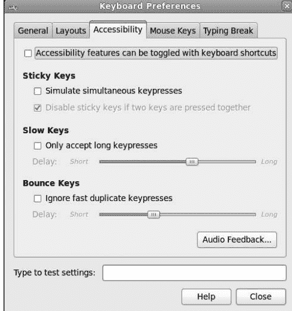

图 4.25

设置键盘可访问功能选项。

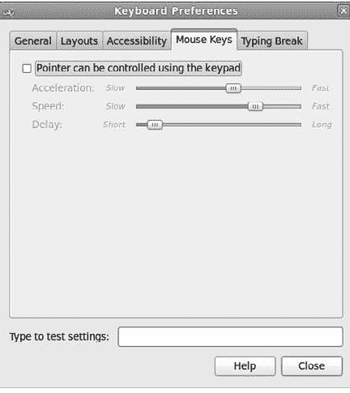

**图 4.26**

你可以使用键盘驱动指针。

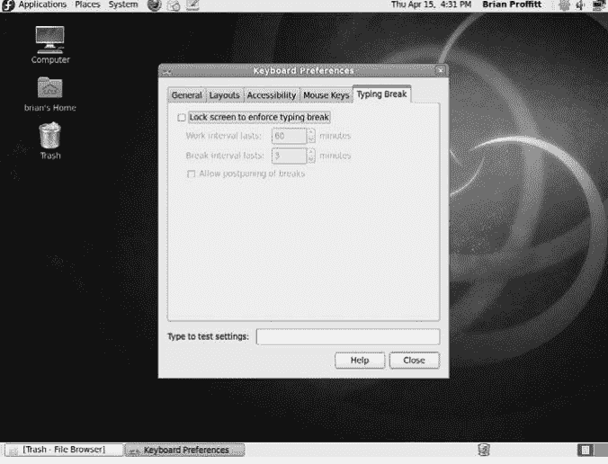

**图 4.27**

一个为了你健康的功能。

如果你愿意，可以手动设置时间。但你们中那些非常守时的人可能会感兴趣：你可以将时钟同步以匹配各国政府维护的原子钟。

- 1. 右键点击时钟。将出现一个菜单。
- 2. 点击“首选项”。将打开时钟首选项对话框（见图 4.28）。
- 3. 要设置桌面上的时间，点击“时间设置”。将打开“时间和日期”对话框（见图 4.29）。
- 4. 时钟设置可以通过此对话框中的控件手动完成。设置时间并点击“设置系统”。将打开一个“身份验证”对话框，如图 4.30 所示。
- 5. 输入管理员密码并点击“身份验证”。

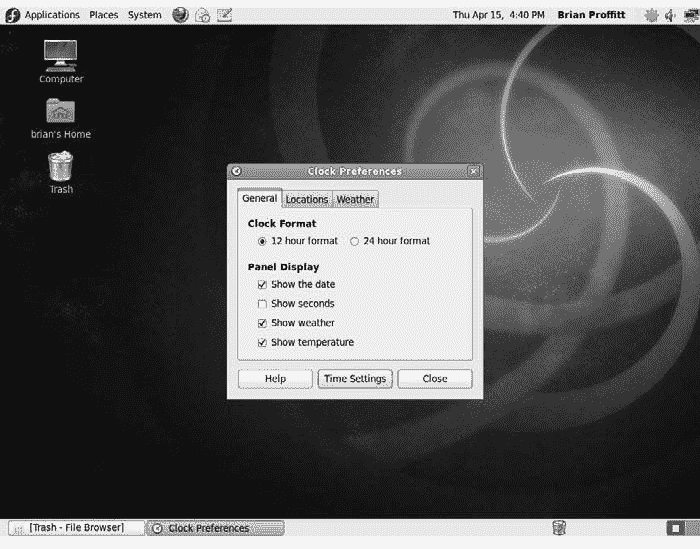

图 4.28

设置时钟首选项。

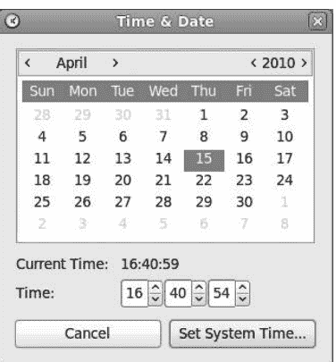

**图 4.29**

设置你的时钟。

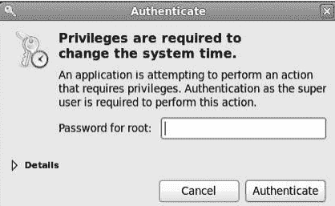

**图 4.30**

系统设置需要管理员权限。

你也可以在时钟中设置多个位置，以便你可以看到家里或世界上任何地方的时间。

- 1. 右键点击时钟。将出现一个菜单。
- 2. 点击“首选项”。将打开时钟首选项对话框。
- 3. 点击“位置”标签页。将出现位置页面（见图 4.31）。


图 4.31

设置位置。

- 4. 在对话框中点击“添加”。将打开位置对话框。
5. 选择另一个位置。

### 在哪里？

如果你需要，可以在这里设置时间。如果没有看到，可以尝试它。

- 6. 输入你想要的经纬度。
7. 点击“确定”。位置将出现。
- 8. 使用你想要的文件。
- 9. 点击“确定”。时钟的选项选项页面将显示天气信息。
- 10. 点击“确定”。
- 11. 点击“确定”。
- 12. 点击“确定”。
- 13. 点击“确定”。
- 14. 点击“确定”。
- 15. 点击“确定”。
- 16. 点击“确定”。
- 17. 点击“确定”。
- 18. 点击“确定”。
- 19. 点击“确定”。
- 20. 点击“确定”。
- 21. 点击“确定”。
- 22. 点击“确定”。
- 23. 点击“确定”。
- 24. 点击“确定”。
- 25. 点击“确定”。
- 26. 点击“确定”。
- 27. 点击“确定”。
- 28. 点击“确定”。
- 29. 点击“确定”。
- 30. 点击“确定”。
- 31. 点击“确定”。
- 32. 点击“确定”。
- 33. 点击“确定”。
- 34. 点击“确定”。
- 35. 点击“确定”。

### 工作空间

工作区是允许你在不同屏幕上组织窗口的虚拟桌面。默认情况下，Fedora 提供两个工作区，但你可以根据需要添加更多。

要切换工作区，只需点击窗口左上角的菜单并选择“移动到另一个工作区”。

### 桌面设置和功能

通过以下步骤美化你的桌面。

- 1. 右键点击桌面任何处。将出现一个菜单。
- 2. 点击“更改桌面背景”。打开外观首选项对话框（见图 4.36）。
- 3. 如果你看到了喜欢的壁纸，点击它。背景将立即更新。
- 4. 要使用另一个文件作为壁纸，点击“添加”。将打开添加壁纸对话框。
- 5. 导航到并选择你想要作为壁纸的文件。
- 6. 点击“打开”。添加壁纸对话框将关闭，新壁纸将出现在外观首选项对话框中并选中。
- 7. 点击“完成”。对话框将关闭，你的新壁纸将显示（见图 4.37）。

### 背景

背景是 Fedora 中最容易更改的内容，尽管为了节省安装光盘的空间，只包含几个。因此，最好从其他源获取背景，例如互联网或个人图形文件。

### 让事物变漂亮

为你的 PC 寻找精美壁纸的最佳地点是 GNOME-Look 的壁纸部分，位于 http://www.gnome-look.org。确保访问与你的桌面分辨率匹配的部分。

### 主题

主题用于在 Fedora 中一次性更改整个颜色和窗口方案。它们非常好玩，即使你从互联网下载了一个主题，你也可以自定义它的任何部分使其变得独一无二。

### 界面装饰

要加载新主题，请按照以下步骤操作。

- 1. 点击“系统 | 偏好 | 外观”菜单命令。外观偏好对话框将打开到主题页面（见图 4.38）。
- 2. 点击所需的主题。主题设置将立即反映在 Fedora 桌面面上（见图 4.39）。
- 3. 若要更改主题的一部分，点击“自定义”按钮。“自定义主题”对话框将打开（见图 4.40）。
- 4. 探索各种控件并观察会发生什么变化。完成后，点击“关闭”。如果你进行了任何更改，该主题将显示为“自定义主题”。
- 5. 点击“另存为”。将出现“另存为”对话框。
- 6. 为主题输入“名称”和“描述”，并点击“保存”。新主题将保存在主题列表中。
- 7. 点击“关闭”。主题现在已设置。

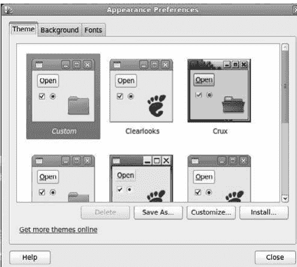

**图 4.38**

Fedora 有多种主题供选择。

你可以更改主题的任何部分。

### 发现主题

就像壁纸一样，在 GNOME-Look 网站可以找到许多优秀主题。

### 总结

在本章中，我们浏览了 Fedora 界面本身，即 GNOME 桌面。你已经看到它与 Windows 和 OS X 桌面非常相似，尽管存在一些重要的区别。

GNOME 桌面有很多可以看和玩的地方，在你继续阅读下一章之前，邀请你花一点时间这样做——玩一玩。然后我们将处理任何 PC 的重要事务，即连接互联网。

# 第 5 章：接入网络

现在你已经运行了 Fedora PC 的一些基本配置步骤，是时候看看如何让 Fedora 与计算机通信了，即通过这种 21 世纪无处不在的媒介——互联网。

在本章中，你将学习如何配置 Fedora 通过以下方式连接互联网：

- 家庭或办公网络
- 宽带电缆/DSL 调制器
- 拨号连接
- 通过 WiFi 无线连接

## 如何上网

过去几十年里，关于互联网已经有很多讨论。尽管这种现象（所有公共计算机网络中最大的）伴随着大量的炒作，但值得注意的是，即使在发达国家，互联网也远未完成。

互联网的增长（到目前为止）在许多方面与 19 世纪后期美国电话的增长相似。在商业化存在的前五年里，电话进入了美国约 10% 的家庭。在五年后，它进入了 50% 的美国家庭。再过五年，它进入了 90% 的所有美国家庭。

互联网的增长模式与此契合得非常紧密。到 1994 年（即互联网脱离纯学术环境五年后），约 10% 的美国家庭可以找到互联网连接。现在， 16 年后，美国互联网访问的普及率已达到近 80%。尽管这听起来可能不可置信，但美国仍仅处于完全使用互联网比例的三分之四关口上方。（其他国家的互联网普及现在正在追赶，在百分比上甚至超过了美国，尽管美国起步早。）

无论你是互联网领域的新手，还是从 Mozilla 时代就开始冲浪，你都会发现互联网正变得越来越不像一个玩的地方，而更像是一个工作的地方。每个人都在转向互联网来处理银行需求、购买节日礼物，以及通过基于 Web 的电话服务与朋友家人聊天。

Linux 和互联网的历史是交织的。Linux 的前身 UNIX 是构建互联网的操作系统。事实上，互联网的大部分语法（如“http://”、FTP 命令、作为目录分隔符的正斜杠）直接源自 UNIX 命令行，而这些命令在在今天的 Fedora 中也可以找到。

所以，Fedora 提供了一套丰富的互联网工具供访问，这并不意外。你需要做的就是连接上网络。

如今上网相当简单。宽带接入由各种运营商提供，归结底就是来自电缆公司的电缆或来自电话公司的数字用户线路（DSL）接入。在某些城市内部，无线接入互联网在某些社区可以免费或廉价获得（注：原文此处意为在某些社区是免费或廉价可用的）。办公室和零售建筑几乎总是为租户铺设了网络接入线路。而且一直有窄带接入：当你的电脑调制调器通过普通电话线拨号上网时。

Fedora 可以无缝处理所有这些。

## 配置连接

在大多数情况下，Fedora 都是开箱即用的网络就绪状态。这意味着如果你向电脑插入某种电缆，电缆另一端连接到互联网，那么 Fedora 很有可能识别出正在发生的情况并为你建立该连接。

尽管如此，过程中的某些部分可能需要你的帮助。例如，拨号。拨号上网并不是一项复杂的工作，但无线连接有时也可能棘手。然而，这些情况大多数已经被发现，解决方案已进入了 Fedora。在第 7 章“解决问题”中，我们将回顾这些技术，以防某些功能无法正常工作。

## 拨号上网

互联网的“语言”被称为 TCP/IP（传输控制协议/网协议）。这种语言是数据从你的计算机发送到世界上任何地方服务器的方式。

尽管 TCP/IP 是基于 UNIX 的协议，但 Fedora 需要额外的协议来通过调制器连接互联网。毕竟，TCP/IP 在串口线上无法传输 IP（网协议）数据包。

为了通过调制器传输所有数据包，使用了额外的协议 PPP。讽的是 PPP 并不是 UNIX 的发明——它的前身 SLIP 是为了连接 Windows 计算机开发的。尽管 PPP 源于 Windows， Fedora 处理该协议完全没有问题。

虽然拨号（或窄带）连接仅占所有互联网连接的不足 20%（这一数字每年都在下降），但它仍然足够流行，你应该知道如何使用它。许多宽带账户（特别是 DSL）会为你提供拨号接入，以防 DSL 连接正在维修或你需要在另一个地点访问互联网时使用。

以下是启动拨号过程的方法。开始之前，你应该准备好互联网服务提供商（ISP）的信息，特别是用户名、密码和拨号号码。

- 1. 点击“系统 | 管理 | 网络”。你会被要求提供管理员密码。
- 2. 输入你的密码。网络配置对话框（见图 5.1）将出现。
- 3. 点击“新建”。添加新设备类型对话框将打开。
- 4. 点击“调制器连接”，然后点击“下一步”按钮。将选择调制器页面，如图 5.2 所示。
- 5. Fedora 通常能准确检测你的调制器能力。检查速度（波特）设置并确定你想使用的调制器容量。点击“下一步”。将出现选择提供程序页面（见图 5.3）。
- 6. 在“电话号码”字段中输入拨号号码。

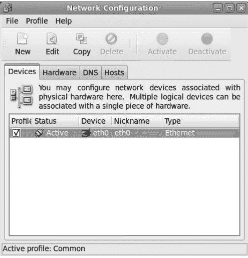

图 5.1

网络配置对话框。

7. 在相应的字段中输入您的 ISP 用户名和密码。您的信息应该与图 5.4 所示的相似。

8. 点击“下一步”。将出现“IP 设置”页面（参见图 5.5）。

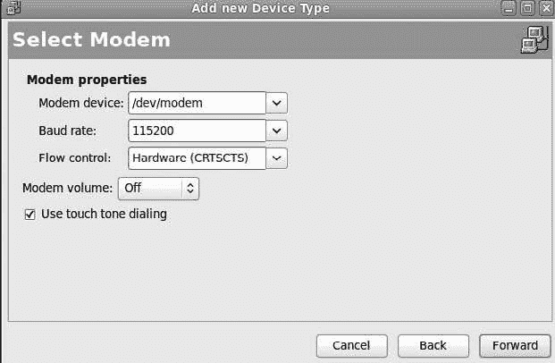

图 5.2

配置您的调制解器设置。

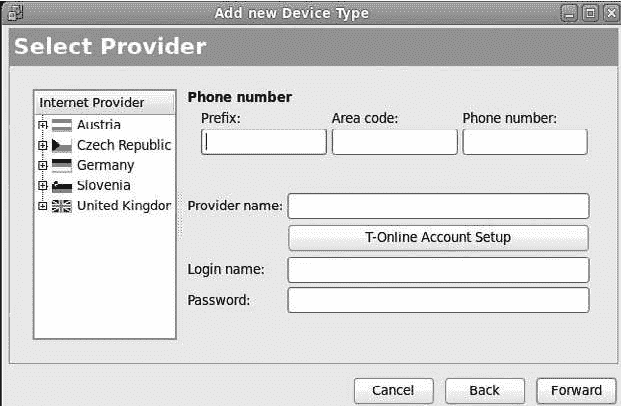

图 5.3

配置您的拨号设置。

# 第 5 章 上网

9. 大多数拨号供应商会自动为您的电脑分配 Internet 地址，因此您可以保持这些设置不变并点击“下一步”。将出现“创建拨号连接”页面。

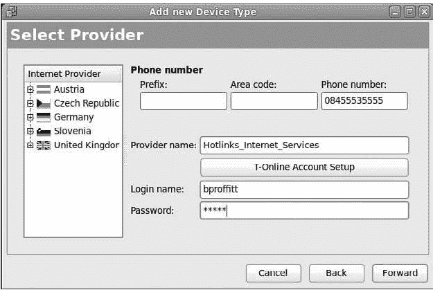

图 5.4

拨号设置示例。

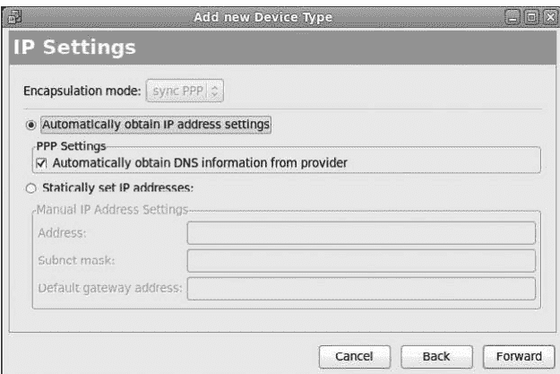

图 5.5

您的拨号供应商的 IP 设置。

10. 点击“应用”。“新设备类型”对话框将关闭。

11. 选择“文件 | 退出”菜单命令。将出现确认对话框。

12. 点击“是”以保存新配置。“网络配置”对话框将关闭。

现在您需要做的就是启动拨号连接。

- 1. 确保您的电话线已插入调制解器（且您的调制解器已连接到电脑）。
- 2. 点击上方面板上的 NetworkManager 小图标。将出现一个上下文菜单。
- 3. 点击“拨号连接 | 通过调制解器连接到 ppp0”。调制解器将自动拨号并连接到 Internet。

断开拨号连接同样简单。

- 1. 确保您的电话线已插入调制解器（且您的调制解器已连接到电脑）。
- 2. 点击上方面板上的 Network Manager 小程序。将出现一个上下文菜单。
- 3. 点击“拨号连接 | 通过调制解器断开 ppp0 连接”。调制解器将断开与 Internet 连接。

### 我的调制解器在哪里？

假设您的调制解器已被 Fedora 正确识别，且一切进展顺利。遗憾的是，如果您的调制解器是电脑内部的，那么情况可能不那么乐观。内部调制解器和纯软件调制解器（winmodems）因不支持 Fedora 和其他 Linux 发行版而闻名，因为调制解器制造商缺乏 Linux 支持。然而，这并不是说无法使用内部调制解器。请参第 7 章中的“调制解器”部分，获取运行内部调制解器所需的步骤。

### DSL

DSL 是目前美国使用的两种宽带形式之一，另一种是电缆。当然，还有其他方法可以将宽带引入家中，例如蜂窝网络、光纤或 WiFi。在许多情况下，这些方法并不常见，或者价格昂贵得不值得。

DSL 使用进入家中或办公室的铜线电话；事实上，您可以在同一条线路上拨打电话的同时保持 Internet 访问。这是因为 DSL 线发送的数字“Internet”信号频率远高于人类听力范围，在信号衰减之前只能传输短距离，约四分之一英里。

电话公司会为您提供两种类型的 DSL 模型。一种是旧型号，作用像传统的调制解器，您必须手动连接和断开 Internet 连接。较新的 DSL 模型本质上表现为路由器：它们始终连接到 Internet，并使用内置软件管理该连接。连接此类类型的调制解器（称为以太网）非常简单：电脑通过网线或 WiFi 连接到 DSL 调制解器/路由器，由以太网调制解器/路由器处理其余工作。

旧类型的 DSL 调制解器被称为 USB 调制解器，因为它们通过 USB 端口连接到 PC。遗憾的是，这些对于 Fedora、Windows 或其他系统上的任何宽带连接都不是理想选择，因为电脑的设计硬件（网络接口卡或 NICs）是专门设计用于与其他电脑进行通信的。使用 USB 端口来完成任务就像是让你的鼻子来启动而不是用嘴。这是书中一处强烈建议您不要使用某件硬件的地方。如果您的电脑没有 NIC，可以相对廉价地购买。

### LAN/电缆

如今家中或办公室的大多数宽带连接将通过所谓的局域网（LAN）连接到您电脑的 NIC 端口。电缆本身（IT 领域称为“Cat 5”或“Cat 6”线）看起来像电话线，带有一个矩形插头，可以插入网络路由器和电脑上匹配的端口。您听过的另一个术语是“以太网”，它描述了您接入的特定类型网络，即许多台电脑连接到一个中央路由器上。

路由器是您网络的核心，保持其运行顺畅至关重要。确保它有良好的通风、稳定的电源以及更新的软件。一个快乐的路由器就是一个运行良好的路由器。路由器和 PC 通过此本章之前描述的 TCP/IP 协议相互通信。而且，由于没有人的参与，无需添加额外的软件将任何内容转换为 PPP 或电话线所需的任何内容。

使用 LAN 或以太网连接的特点是，十之九的情况下，它都能直接工作。将 Cat 5 线插入您的电脑会让 Fedora 启动网络连接。

路由器有两个主要功能。首先，它充当交换机，快速收发来自网络上 PC 的信号。其次，为了区分这些信号，路由器通常为连接到网络的每台 PC 或设备分配唯一的 IP 地址。


IP 地址是四个数字（1.2.3.4）的唯一组合，在网络上一次只属于一个设备。用户可以根据需要指定自己的 IP 地址，但通常路由器使用名为 DHCP 的工具为他们完成任务，当设备物理连接到网络时自动分配 IP 地址。

大多数家庭和小型办公室网络都有一个调制解器，它不仅连接网络设备，还处理与外部世界的通信。大多数 ISP 会通过 DHCP 为接入网络的调制解器分配唯一的 IP 地址。任何连接到该路由器/调制解器的电脑将由路由器的 DHCP 系统分配一组不同的 IP 地址。

这也是件好事，因为 Internet 上的 IP 地址数量是有物理限制的。如果世界上每台电脑都有自己的 IP 地址，我们将很快用完地址。解决方案是，每个连接到 Internet 的路由器都获得自己的 IP 地址，而使用该路由器的电脑和其他设备则获得类似的数字集合。

例如，您的调制解器 IP 地址可能是 64.123.45.1，而邻居的调制解器可能是 64.123.45.2。但在您的网络内部，您的电脑可能具有相同的 IP 地址。但这不会冲突，因为对 Internet 来说，它只关心路由器的地址。

位于单个路由器网络上的任何内容被称为处于“防火墙之后”。防火墙是路由器调制解器通常具有的真实功能的比喻表示：将恶意流量隔在网络之外。

## 配置连接

- 5. 点击“确定”。以太网设备对话框将关闭。
- 6. 选择“文件 | 退出”菜单命令。将出现一个确认对话框。
- 7. 点击“是”保存新配置。网络配置对话框将关闭。

现在，你只需要将 Cat 5 网线插入电脑的网卡端口即可。顶端面板中的网络管理器图标将显示旋转动画，然后通知你连接成功。

现在，你可以访问互联网或网络上的其他计算机和打印机了。

## WiFi

WiFi 是 Fedora 真正的成功案例之一。在不久以前，Fedora 上（或确切地说是任何 Linux 发行版）上的无线网络连接还是一件不可靠的事情。

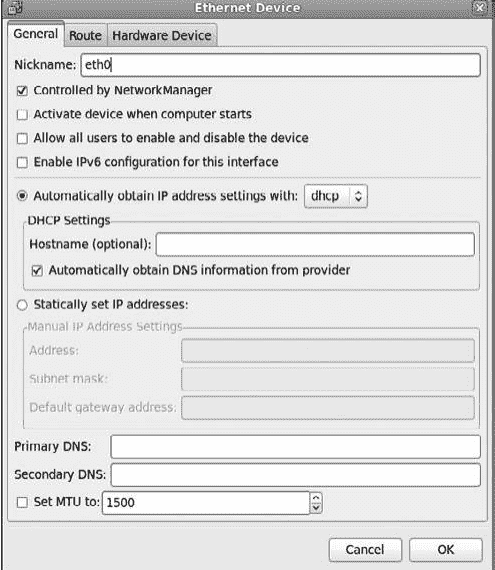

图 5.6

配置以太网连接。

# 第 5 章 - 上线

那些时代已经过去了，大多数无线解决方案在 Fedora 上运行得非常好。

几乎所有新的笔记本电脑都内置了无线功能，这就是为什么大多数移动用户对这一节感兴趣。但即使在家庭或办公室电脑中，无线也是一个很好的选择，因为它可以节省你设置有线网络所需的时间、材料和麻烦。

从某一个层说，配置无线与配置有线网络访问完全一样。你仍然需要连接到路由器，仍然需要一个唯一的 IP 地址让路由器识别你的机器。而且，像以太网连接一样，DHCP 是电脑自动分配 IP 地址的最佳方式。

无线还需要额外的级别配置。将你的无线网卡想象成收音机（它确实是），它需要调到一个特定的电台（在你的路由器上）。你必须告诉 WiFi 具体要寻找哪个电台。或者，如果你带着笔记本移动，它能够搜索范围内的所有无线路由器，并让你选择连接哪一个。

一旦解决了整个无线/电台的连接，你就必须告诉你的 WiFi 卡如何与路由器实际通信。这是因为大多数路由器的信号都是加密的，以防止未经授权的计算机加入网络。这通常通过被称为 WEP 的加密协议完成。

## 获取安全

> 如果你的无线路由器上没有启用 WEP，则应该启用。请参阅你的路由器文档了解如何进行设置。

那么，无线连接需要处理三个层级的复杂性：网络寻址、无线网络信号获取和安全性。幸运的是，Fedora 的 NetworkManager 在一个地方处理了所有这些。

- 1. 点击“系统 | 管理 | 网络”。你会被要求提供管理员密码。
- 2. 输入你的密码。网络设置对话框将打开。
- 3. 点击“无线连接”，然后点击“编辑”。无线设备配置对话框将打开，如图 5.7 所示。
- 4. 确认勾选“计算机启动时激活设备”复选框。
- 5. 点击“确定”。无线设备配置对话框将关闭。
- 6. 点击“关闭”。网络设置对话框将关闭。

## 总结

在本章中，你发现了使用 Fedora 的 NetworkManager 工具连接网络和互联网是多么简单。这个过程并没有太大的奥秘，这本就应该是这样的。

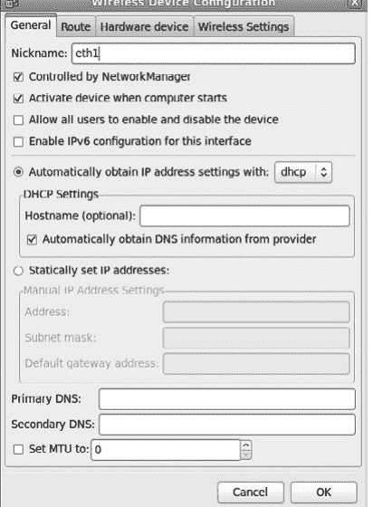

图 5.7 配置无线连接。

# 第 5 章 - 上线

然而，偶尔事情并不总是按照你的计划进行。由于硬件制造商对 Linux 支持不足，某些网络设备并不总是能正常工作。但有许多修复方法，在第 7 章中将学习如何使用它们。

在此之前，你需要学习如何在 Fedora 电脑上查找、更新和安装软件。第 6 章“安装和更新软件”将向你展示所需知识。

# 第 6 章

## 安装和更新软件

说 Fedora 是“开箱即用”（out of the box）其实是一个比喻说法。毕竟，你并没有从某个真实的箱子里拆出你的软件。尽管如此，这个短语在软件行业被频繁使用，用来指当你首次在计算机上安装某件软件或操作系统时，自带的功能和应用程序。

Fedora（以及整个 Linux）非常有趣的一点之一，是它开箱就带了很多软件。如果你还记得第 1 章“什么是 Fedora?”，由于其高度模块化的特性，Fedora 本质上是一系列独立应用程序的集合，所有程序都协调工作，使操作系统表现得像一个单一功能强大的工具。

抛开哲学不谈，Fedora 为用户打包了许多应用程序，足以让你“开箱即用”。这并不意味着没有更多应用程序在等着你使用。

在本章中，你将学习：

- Fedora 如何处理软件安装
- 软件仓库以及如何管理它们
- 如何使用 Software Update（软件更新）、PackageKit 和 yum
- 如何使用命令行安装软件

## Fedora 如何安装软件

在 Windows 世界中，通常只有一种安装软件的方法：点击安装程序，它会启动并从头到尾完成整个设置。

Fedora 与大多数 Linux 发行版一样，有三种软件安装方法。承认，一种安装方法听起来确实很有吸引力且不那么困惑，但这种一刀切的安装服务有着潜在的代价：Windows 安装程序经常为了正在安装的应用程序覆盖操作系统的重要设置。这对于你的安装程序是有的，但对于系统中任何使用相同部分的应用程序可能是有害。

在 Fedora 中，所有三种安装方法都尽力使用 Fedora 已有的内容来安装应用程序。如果所需的程序尚未在 Fedora 中，它就有一个依赖项。安装用户（即你）将被告知依赖情况并被询问如何继续。

## 第 6 章 安装和更新软件

未来的软件将通过一套完整的 CD（或稍后的一张或两张 DVD）交付。这种方式的优势在于，一旦你下载并刻录了所有这些 CD，就可以运行该发行版，而无需在以后再下载额外的软件。但正如第 2 章“在安装 Fedora 之前”中讨论的，平均 CD 下载量接近 700MB。对于如今的宽带连接来说，这也是一个巨大的数据量。对于大多数用户来说，需要处理三张、五张甚至七张 CD 是一项非常耗时的任务，除非他们愿意付费通过邮寄送这些相同的 CD。

Fedora 稍微扭转了这种模式。考虑到大多数互联网用户现在已拥有宽带访问，Fedora 项目决定在一张 CD 上发送绝对必要的 Fedora ，并将其余部分留到网上，分布在世界各地的服务器上以便根据需要下载。

这看起来可能效率不高，因为你必须具备某种互联网访问才能实现此功能。但请考虑，大多数操作系统本身就是通过互联网更新的，而且为了保持 Fedora 的最新状态，本身就需要访问网络。此外，下载并刻录一张 CD 远比下载并刻录多张 CD 要快得多。交付“核心”发行版也为用户在选择系统上安装哪些应用程序时提供了更大的灵活性。这意味着他们的硬盘不会被加载满他们不需要的内容。

为了让你对可用软件的数量有一个直的感受，请考虑这些数字：标准版 Fedora 有大约 1,100 个软件包。目前，有超过 12,000 个应用程序包可用。

Fedora 与它的兄弟版本红帽企业级 Linux（Red Hat Enterprise Linux）一样，通过仓库组织其软件。Fedora 有三个主要仓库，每个仓库持有一类特定的软件。让我们现在过一遍它们。

## 游览仓库

三个官方 Fedora 仓库的命名非常清晰，但让我们逐一检查它们。

- Fedora。此仓库包含所有 Fedora 官方支持的软件。Fedora 实际运行所需的所有内容都在这里，且所有软件均采用免费软件许可。此仓库中的其他应用程序包括 AbiWord、Evolution、Firefox、Gaim、OpenOffice.org 和 Thunderbird。

## 理解软件仓库

- **Updates（更新）**。此仓库包含因错误修复或安全修复而更新的软件。
- **Source（源码）**。Fedora 软件的所有源码包都可以在此仓库找到。

## 添加仓库

这些并不是 Fedora 可以使用的全部仓库。互联网上有很多由社区运行的 Fedora 仓库，每个仓库持有 Fedora 项目不希望托管的专门软件。

世界上有很多可以在 Linux 上运行的应用程序，但由于它们的许可证完全是专有的，某些 Linux 发行版对其避而远之。由于其起源，Fedora 的制作者认为有义务遵守这一哲学，将完全商业化的包排除在 Fedora 之外。

但这里有一个重要的区别。虽然 Fedora 项目不会随 Fedora 发布商业软件，但这并不排除用户在下载并安装 Fedora 之后访问商业仓库。这固然是一个细微的区别，但它赋予了用户对于“想要使用什么软件”做出选择的优势权。

Fedora 中的所有包管理器都通过一个存储在你的 PC 上的主仓库列表工作。从这个名为 `sources.list` 的文件中，包管理器知道检查哪些仓库以获取新版本，以及系统上安装的软件是否有任何可用更新。如果你想让这些管理器浏览另一个仓库，将需要用新信息修改 `sources.list`。

懂行的 Fedora 用户知道三个这样的第三方仓库，它们可以让你获得 Fedora 最前沿的软件。这些是 Dribble、Freshprms 和 rpm.livna.org 仓库。幸运的是，你不需要一个一个添加这些仓库。相反，你可以使用一个命令将 RPM Fusion 添加到你的 `sources.list` 中，这将实现相同。

此操作将使用命令行应用程序完成。命令行始终在终端（Terminal）窗口中运行，这是 Fedora 中最简单且多功能的工具之一。要启动终端，点击应用程序（Applications） | 系统工具（System Tools） | 终端（Terminal）菜单命令（见图 6.1）。

用户名 计算机（主机）名称 命令提示符

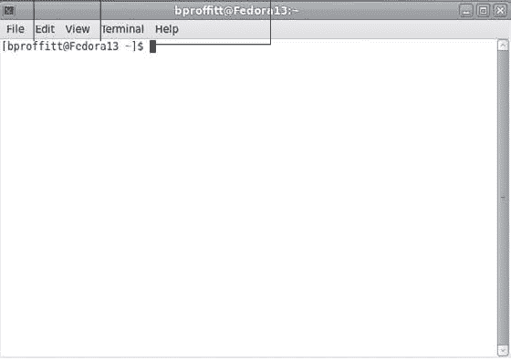

**图 6.1**

Fedora 终端。

在终端中输入命令只需输入命令并按回车键。要查看当前目录下的所有文件列表，输入 `ls` 然后按回车。

有很多非常酷的命令行工具可以使用，但目前我们先专注于添加仓库，并在书中后续部分检查其他工具。接下来的任务将添加一组非常重要的仓库，因此尽管涉及一个非常长的命令，但它是值得的。

- 1. 在终端中输入以下命令：

```bash
su
```

你会被要求输入管理员密码。

- 2. 输入你的管理员密码并按回车。提示符将变为 root 提示符。
- 3. 输入以下命令：

```
rpm -Uvh http://download1.rpmfusion.org/free/fedora/rpmfusion-release-stable.noarch.rpm http://download1.rpmfusion.org/nonfree/fedora/rpmfusion-nonfree-release-stable.noarch.rpm
```

这将向你的 sources 中添加新仓库。

## 使用软件更新

现在，当你下一次运行任何包管理器时，可能会使用软件更新，因为它会持续检查是否有可用更新。

默认情况下，软件更新在发现更新时会通知你。如果是这种情况下，顶部栏会出现一个橙色的星形图标，见图 6.2。

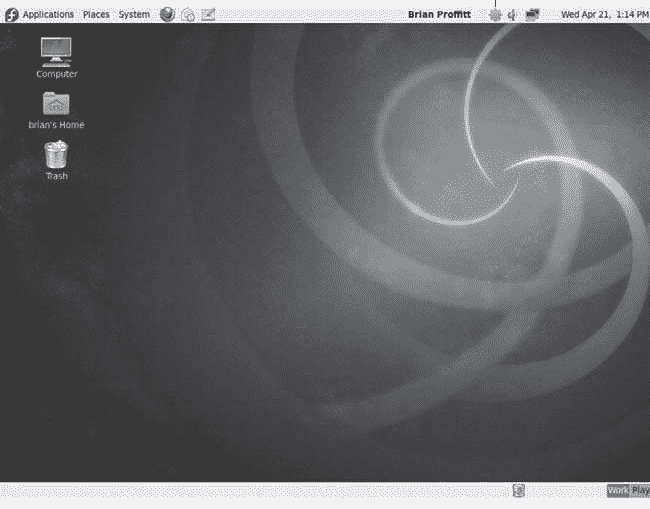

**图 6.2**

星形图标

## 更新当前

- 1. 点击图标启动软件更新。软件更新窗口将打开，进程开始，见图 6.3。
- 2. 如果你不想更新某个应用程序，点击其复选框取消选择。
- 3. 当你的选择完成后，点击安装。
- 4. 如果为了适应更新需要添加或删除额外的包，会出现类似于图 6.5 的确认对话框。
- 5. 确认更改并点击继续。下载和安装过程开始，见图 6.6。
- 6. 完成后，将出现更新消息框（见图 6.7）。
- 7. 点击确定关闭消息框。软件更新关闭。

有时，你可能需要在更新后重启系统。这并不常见，因为 Fedora 的模块化意味着对一个应用程序的更改不会影响其他。但某些更新，例如新版本的 Linux 内核需要重启系统才能生效。如果是这种情况下，顶部栏会出现一个灯光开关，在软件更新完成后你会被请求重启。

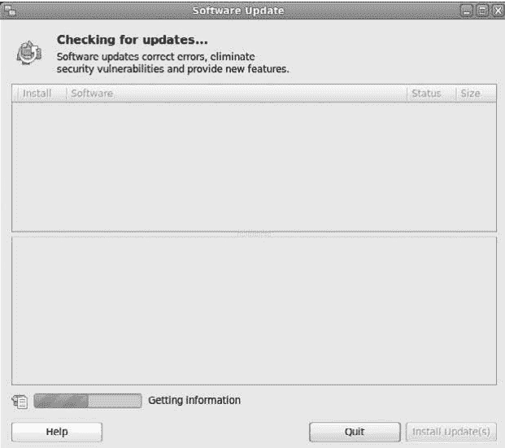

**图 6.3**

启动软件更新。

开发者日志将显示，因为此更新没有可用描述：

2010-04-14 Thorsten Leemis <fedora@leemhuis.info> - 13-1

* 为 Fedora14 添加密钥

* 移除 K12 密钥

2009-11-22 Thorsten Leemis <fedora@leemhuis.info> - 13-0-1

* 为 Fedora 13 rawhide 提升

* 从一开始将版本设为 13

* 移除后脚本

2009-11-15 Thorsten Leemis <fedora@leemhuis.info> - 12-1

* 6.1.2- release stable-启用所有

图 6.4

更新列表。

图 6.5

图 6.6

图 6.7

## 第6 章 安装与更新软件

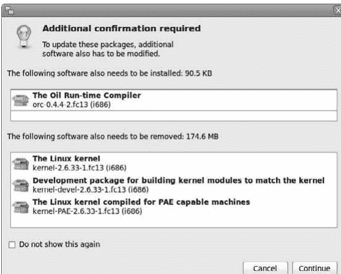

图 6.5 确认任何额外的包。

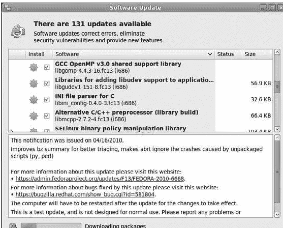

此通知发布于 2010/04/16。

欲了解更好的跟踪的更多信息，可以通过以下方式忽略由未封装脚本引起的崩溃：

有关此更新的更多信息，请访访问我们的网站：

- https://admin.fedoraproject.org/updates/13/FEDORA-2010-6668

有关通过此更新发现的漏洞的更多信息，请访问我们的网站：

- https://jira.redhat.com/browse/115335

更新后必须重启电脑以使更改生效。

这是一个测试更新，并非为正常使用而设计。请报告任何问题或

## 图 6.6

更新是自动的。

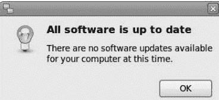

**图 6.7** 完成的更新。

选择您想要的选项。建议您尽快重启，但如果您有其他工作要做，可以等等稍后重启。（一天结束时的系统关机将视同于重启。）

## 计划更新

> 由于更新后有较小的重启可能性，请尝试在工作日开始时更新您的 Fedora 系统，这样就不会中断任何正在进行的工作。

## 使用 PackageKit

尽管“软件更新”（Software Update）很有用，但它无法与 Fedora 的秘密武器 PackageKit 的强健性相比。这个包管理器在 Linux 用户中非常流行，Fedora 团队对其进行了增强，使其更易使用。

与仅更新现有包的“软件更新”不同，PackageKit 只需点击几次即可更新、安装和卸载应用程序。

导航 PackageKit 非常简单。您可以通过点击“系统 | 管理 | 添加/删除软件”菜单命令来启动应用程序，这会弹出 PackageKit 窗口，如图 6.8 所示。

## 安装新软件

基于存储的包安装是安装软件的一种强大方式。它不仅简单，而且一旦 PackageKit 安装了它，您可以确保该应用程序的任何未来更新在出现时都会跟踪并应用。

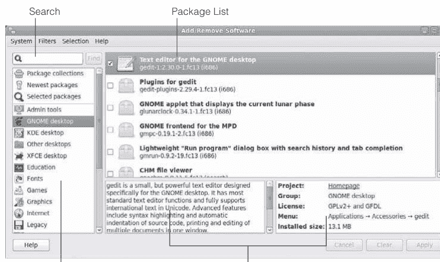

| 类别 | 包描述 |
| --- | --- |

## 图 6.8

PackageKit 界面。

## 查找包

对于任何包的安装或卸载，您可以使用 PackageKit 中的“搜索”功能在 PackageKit 列表中找到任何指定的包。

- 1. 探索 PackageKit 直到找到您想要安装的包并选择它。包的描述将出现在“描述”窗格中。
- 2. 点击包的“选择”框。该包将被选中。

## 重要依赖项

当您安装新软件时，PackageKit 可能会请求安装其他软件（如图 6.9 所示）。这些是你最初想要安装的包的依赖项。如果您想让您的包安装，就必须安装它们。

- 3. 点击“应用”。将出现“身份验证”对话框。
- 4. 输入您的管理员密码并点击“身份验证”。软件安装将开始。
- 5. 当“运行新应用程序”对话框出现时，根据需要点击“运行”或“关闭”按钮。


图 6.9 确保为应用程序安装依赖项。

## 卸载软件

有时——并不经常——您会遇到需要从 Fedora 系统删除应用程序的情况。“并不经常”，是因为 Fedora 只安装您真正需要的内容，其他任何内容都是您最初添加的软件。

尽管如此，万一需要，这里是如何使用 PackageKit 卸载任何应用程序。

- 1. 探索 PackageKit 直到找到您想要卸载的包并选择它。包的描述将出现在“描述”窗格中。
- 2. 点击包的“选择”复选框。该包将被取消选择。
- 3. 点击“应用”。将出现“身份验证”对话框。
- 4. 输入您的管理员密码并点击“身份验证”。软件卸载将自动完成。

## 使用 yum 管理软件


与 Fedora 中的其他包管理器不同，`yum` 是所谓的命令行应用程序。用户在任何由这些命令行程序驱动的 Linux 发行版中看到的很多内容都源于此。事实上，`PackageKit` 和“软件更新”的核心都使用 `yum` 来执行大部分工作。`PackageKit` 和“软件更新”作为 `yum` 更易于使用的图形界面。

“`yum`”是 Yellow Dog Update Manager（黄狗更新管理器）的缩写，适用于大多数基于 Red Hat 的 Linux 发行版。“Yellow Dog”是 Apple 将计算机转向 Intel 处理器之前运行在 Mac 机器上的 Red Hat 版本。Yellow Dog 开发了如此棒的工具，以至于 Red Hat 和 Fedora 将其整合了自己的发行版中。它是一个强大的管理器，而且不需要占用系统资源来创建整洁的界面，因此运行也非常快。

必须注意的是，`yum` 是一个需要管理员权限才能运行的应用程序（就像“软件更新”和 `PackageKit` 一样）。要在命令行执行此操作，请在输入 `yum` 命令之前输入 `su`（代表 super——即管理员用户）。您将被要求输入管理员密码。之后，您将拥有 root 权限，并可以根据需要安装和卸载应用。运行命令完成后，在终端中输入 `exit` 退出模式。

您应该做的第一件事，特别是如果您对存储库列表进行了任何更改，是确保 `yum` 了解这些。输入：

`yum update`

将出现长长的包列表。当屏幕显示 `Done` 且命令提示符再次出现时，说明已完成。一旦执行了此操作，您就可以访问最新的存储库列表。您还可以搜索参数在存储库中搜索应用程序。例如，查找象棋游戏，输入：

`yum search chess`

这将返回 8 个包的信息：

```
gnuchess.1686 : The GNU chess program
pycchess.noarch : Chess game for GNOME
chess.1686 : 3D chess game
eboard.1686 : Chess board interface
xboard.1686 : X Window System
amazons.1686 : turn-based strategy game
xarch.1686 : Arcade board
xon.1686 : Arcade game
```


当您安装新软件时，PackageKit 可能会请求安装其他软件（如图 6.9 所示）。这些是你最初想要安装的包的依赖项。如果您想让您的包安装，就必须安装它们。

- 3. 点击“应用”。将出现“身份验证”对话框。
- 4. 输入您的管理员密码并点击“身份验证”。软件安装将开始。
- 5. 当“运行新应用程序”对话框出现时，根据需要点击“运行”或“关闭”按钮。


图 6.9 确保为应用程序安装依赖项。

## 卸载软件

有时——并不经常——您会遇到需要从 Fedora 系统删除应用程序的情况。“并不经常”，是因为 Fedora 只安装您真正需要的内容，其他任何内容都是您最初添加的软件。

尽管如此，万一需要，这里是如何使用 PackageKit 卸载任何应用程序。

- 1. 探索 PackageKit 直到找到您想要卸载的包并选择它。包的描述将出现在“描述”窗格中。
- 2. 点击包的“选择”复选框。该包将被取消选择。
- 3. 点击“应用”。将出现“身份验证”对话框。
- 4. 输入您的管理员密码并点击“身份验证”。软件卸载将自动完成。

## 使用 yum 管理软件

与 Fedora 中的其他包管理器不同，`yum` 是所谓的命令行应用程序。用户在任何由这些命令行程序驱动的 Linux 发行版中看到的很多内容都源于此。事实上，PackageKit 和“软件更新”的核心都使用 `yum` 来执行大部分工作。PackageKit 和“软件更新”作为 `yum` 更易于使用的图形界面。

“`yum`”是 Yellow Dog Update Manager 的缩写，适用于大多数基于 Red Hat 的 Linux 发行版。“Yellow Dog”是 Apple 将计算机转向 Intel 处理器之前运行在 Mac 机器上的 Red Hat 版本。Yellow Dog 开发了如此棒的工具，以至于 Red Hat 和 Fedora 将其整合了自己的发行版中。它是一个强大的管理器，而且由于不需要占用系统资源来创建整洁的界面，因此运行也非常快。

必须注意的是，`yum` 是一个需要管理员权限才能运行的应用程序（就像“软件更新”和 PackageKit 一样）。要在命令行执行此操作，请在输入 `yum` 命令之前输入 `su`（代表 super——即管理员用户）。您将被要求输入管理员密码。之后，您将拥有 root 权限，并可以根据需要安装和卸载应用。运行命令完成后，在终端中输入 `exit` 退出模式。

您应该做的首件事，特别是如果您对存储库列表进行了任何更改，是确保 `yum` 了解这些。输入：

```
yum update
```

将出现长长的包列表。当屏幕显示 `Done` 且命令提示符再次出现时，说明已完成。一旦执行了此操作，您就可以访问最新的存储库列表。您还可以使用搜索参数在存储库中搜索应用程序。例如，查找象棋游戏，输入：

```
yum search chess
```

这将返回 8 个包的信息：

```
gnuchess.1686 : The GNU chess program
pycchess.noarch : Chess game for GNOME
chess.1686 : 3D chess game
eboard.1686 : Chess board interface
xboard.1686 : X Window System
amazons.1686 : turn-based strategy game
xarch.1686 : Arcade board
xon.1686 : Arcade game
```

# 第 7 章

# 让一切正常运行

Fedora 并不完美。

对于阅读 Fedora 教程的人来说，读到这段话可能会感到惊讶，但事实必须直说。在未测试过的计算机上安装任何操作系统本身就带有风险，因为不可预见的硬件冲突可能会干扰任何操作系统的安装。（去问问那些最近购买了 Windows 7 的用户吧，他们发现新设备存在硬件和软件兼容性问题。）

如果你在台式 PC 上安装了 Fedora，那么到目前为止可能还没有遇到任何问题或担忧。这很棒，因为这里提到的所有问题点在短期内都不会影响用户。

即使你在让某些功能正常工作方面没有遇到困难，本章对你仍然很有用。大多数用户还有一些未完成的任务需要处理：

- 创建和管理额外账户
- 设置打印机
- 使用 USB 存储设备
- 使用数码相机
- 解决某些硬件问题

## 设置用户账户

当你首次安装 Fedora 时，会创建两个用户账户：管理员 `root` 和你自己的。`root` 是 Fedora “超级”账户的名称。和所有 Linux 发行版一样，`root` 用户账户是最强大也最危险的。因为 `root` 账户字面上可以执行 Fedora 机器上允许的任何操作。如果你试图快速完成许多管理任务，且不想反复输入管理员密码，这将非常有非常有帮助。但如果你犯了错并不小心删除了系统上的关键文件，那就非常非常糟糕了。

更不用说，如果你以 `root` 身份登录机器后离开，恰好有人路过并决定玩玩你的电脑，或者从外部黑入（无论你在哪里），会发生什么了。

### 关于 root 的另一个警告

> 永远不要以 `root` 身份登录你的 PC。永远不要。

你在安装 Fedora 时创建的账户具有某些管理权限，这是因为系统的原始安装用户将是该系统的管理员。然而，有时安装 Fedora 的用户并不是管理员，或者你可能仅仅需要多个用户账户，每个账户都有自己的工作空间。如果是这样，你需要知道如何设置新账户。按照以下步骤操作：

1. 点击系统 `System` | 管理 `Administration` | 用户和组 `User and Groups` 菜单命令。输入管理员密码后，将打开用户管理器 `User Manager` 窗口，如图 7.1 所示。
2. 点击添加用户 `Add User` 按钮。打开添加新用户 `Add New User` 对话框（图 7.2）。
3. 使用用户信息，在添加新用户对话框的顶部区域填写信息。
4. 确认勾选了创建主目录 `Create Home Directory` 和为用户创建私有组 `Create a Private Group for the User` 。
5. 点击确定。新用户将被添加到用户管理器（参见图 7.3）。
6. 点击文件 `File` | 退出 `Quit` 菜单命令。用户管理器窗口将关闭。

在创建任何用户后，你可以根据需要修改账户。

1. 点击系统 `System` | 管理 `Administration` | 用户和组 `User and Groups` 菜单命令。用户管理器窗口将打开。
2. 点击一个用户以选择账户。
3. 点击属性 `Properties` 按钮。打开用户属性 `User Properties` 对话框（图 7.4）。
4. 在四个页面中的任何一个页面进行所需的更改。
5. 点击确定。用户属性对话框将关闭。
6. 点击文件 `File` | 退出 `Quit` 菜单命令。用户管理器窗口将关闭。

如果某个用户将不再使用这台计算机（例如员工离职），那么删除该用户账户是一个好主意。

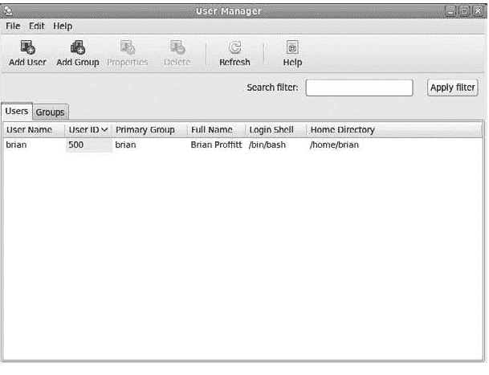

图 7.1

用户管理器。


图 7.2

基本用户账户信息。


图 7.3

添加新用户非常简单。

1. 点击系统 `System` | 管理 `Administration` | 用户和组 `User and Groups` 菜单命令。
用户管理器窗口将打开。
2. 点击用户以选择账户。
3. 点击删除 `Delete` 按钮。将出现警告对话框（参见图 7.5）。
4. 点击是。用户账户将从账户列表中移除。
5. 点击文件 `File` | 退出 `Quit` 菜单命令。用户管理器窗口将关闭。


**图 7.4**

编辑用户信息。


**图 7.5**

确保你想删除用户账户。

## 使用打印机

早期的计算机通信并不良好。第一个可以安全地称为计算机的数字计算设备是 Harvard Mark I，这是一个具有五音调、750,000 个组件的设备，通过读取指令运行。

### 设置本地打印机

连接打印机有两种方法。第一种是本地连接，通过将打印机插入 USB 端口。一旦打印机物理连接并开启电源，它会自动进行配置。如果没有发生，请按照以下步骤操作：

- 点击系统 `System` | 管理 `Administration` | 打印 `Printing`。
- 输入管理员密码后，将打开新打印机 `New Printer` 窗口（图 7.6）。
- 如果找到打印机，它将出现在列表中（图 7.7）。
- 选择要添加的打印机并点击下一步 `Forward`。应用程序将搜索并安装驱动程序。如果有其他可用选项，将出现可安装选项 `Installable Options` 页面（图 7.8）。

### 有个性的打印机

有时一个打印机会显示为多个列表。这是因为某些打印机（特别是较新的型号）带有独立的内存，CUPS 将其读取为独立的设备。选择信息最多的列表并继续。如果这不起作用，你可以回来连接另一个选项。


图 7.6

打印窗口。


图 7.7

打印机通常很容易找到。


图 7.8

有时，打印机有一些附加选项。

### HP 打印机用户的好消息

HP 为 Linux 用户提供打印机驱动程序方面做了大量工作。如果你有 HP 打印机且可用 HPLIP 选项，请一定要选择它。HPLIP 是 HP 为其设备开发的控制应用程序。

- 点击应用 `Apply`。将出现验证 `Authenticate` 消息框。
- 输入管理员密码并点击验证。可能会出现 CUPS Root 对话框。
- 如果询问，输入你的 `root` 密码（与管理员密码相同）并点击确定。打印机将被添加，并弹出一个窗口询问你是否想要打印测试页。
- 点击是。
- 点击取消 `Cancel`。打印机属性对话框将关闭，打印机现在出现在打印窗口中（参见图 7.10）。


图 7.9

用用户易懂的术语描述你的打印机。


**图 7.10**

新添加的本地打印机。

## 设置网络打印机

连接网络某处的远程打印机的步骤与连接本地打印机非常相似。你只需要确定打印机在网络上的位置即可。

大多数情况下，Fedora 会为你完成工作并检测网络打印机。如果是这样，请按照上一节中的步骤连接检测到的网络打印机。如果由于某种原因没有找到打印机，请按照以下步骤操作：

- 1. 点击系统 | 管理 | 打印菜单命令。打印窗口将打开。
- 2. 点击“添加”。在输入两次管理员密码后，将打开“新打印机”窗口。
- 3. 展开网络打印机列表并点击“新打印机”。将出现网络打印机页面（见图 7.11）。
- 4. 在你的计算机上输入 IP 地址。点击“查找”，系统将开始搜索连接到网络的打印机。找到后，打印机将出现在“设备”列表中。

### 查找打印机地址

要找到你的打印机的 IP 地址，请联系你的系统管理员。如果是家庭或小型企业网络，请参考你的打印机文档以了解它如何报告其 IP 地址。大多数连接到网络的打印机都有实用程序可以报告它们所处的网络。


### 图 7.11

寻找网络打印机。

- 5. 选择你想添加的打印机并点击“下一步”。应用程序将搜索可用的驱动程序并安装它们。如果有其他选项，将出现“可安装选项”页面。
- 6. 选择所需的选项并点击“下一步”。将出现“描述打印机”页面。
- 7. 点击“应用”。将出现一个身份验证对话框。
- 8. 输入你的管理员密码并点击“验证”。可能会出现 CUPS Root 对话框。
- 9. 如果被询问，输入你的 `root` 密码（与管理员密码相同）并点击“确定”。打印机将被添加，并弹出一个消息窗口询问你是否打印测试页。
- 10. 点击“是”。如果配置正确，测试页将打印在你的打印机上，并打开一个通知对话框。
- 11. 点击“确定”。通知对话框将关闭。
- 12. 点击“取消”。打印机属性对话框将关闭，打印机现在将出现在“打印”窗口中。

## 使用 USB 大容量存储设备

数字技术最新、最伟发明之一是能够存储 1GB 到 1000GB 数据的便携大存储设备。这些便携设备具有多种配置，从你可以放在口袋里或挂绳上的小型内存棒或 U 盘，到在本文编写时可以存储高达 2TB `2000GB` 数据的便携外硬盘。

这些设备的共同特征是它们都通过 USB 端口连接到你的计算机。Fedora 识别 USB 存储设备非常出色；从字面上说，你只需要将存储硬件插入 PC 即可。桌面上会出现一个驱动器图标，Nautilus 文件管理器将打开并显示设备内容，如图 7.12 所示。


图 7.12

透明 USB 驱动器支持。

移除驱动器只需多一步。你可以直接拔掉物理连接，通常是可以的。为了让 Fedora 确保在移除之前所有数据都从缓冲区刷新并写入驱动器，你可以让 Fedora 移除对该设备的感知。然后你就可以物理移除它。

在 Nautilus 中，点击“位置”面板中 USB 驱动器图标旁的“弹出”图标。设备图标将从桌面上消失，然后可以物理移除设备。

## 设置数相机

数相机在今天非常常见，能够将照片移动到计算机上是必要的，因为你对快照的任何编辑和长期存储都将在那里进行。

Fedora 以两种方式之一处理数相机。如果你不识别特定的相机型号，它会将连接的数码相机视为 USB 存储设备。当发生这种情况时，你只需使用文件管理器将照片从相机的驱动器传输到硬盘即可。

如果 Fedora 识别了你的相机，你将可以使用一些非常实手的工具，这将加速你的数相机工作。

- 1. 将你的相机连接到计算机并打开相机电源。如果检测正确，将打开“数码相机”对话框（如图 7.13 所示）。
- 2. 确认选择了“打开 Shotwell 照片管理器”选项并点击“确定”。Shotwell 窗口将打开（见图 7.14）。


### 图 7.13

相机已检测。


### 图 7.14

启动照片集。

- 1. 在列表中选择相机。
- 2. 确认选择了“打开 Shotwell 照片管理器”选项并点击“确定”。
- 3. 点击你选项。
- 4. 要选择多张照片，请按住 Ctrl 键。


### 图 7.15

预览照片。


### 图 7.16

Shotwell。

### 图 7.17

完整的。

- 6. 点击“应用程序 | 附件 | Gedit 文本编辑器”菜单命令。

Gedit 程序将打开（见图 7.18）。

- 7. 点击“打开”按钮。将弹出“打开”对话框。
- 8. 导航到主目录下的 Modem 文件夹。
- 9. 选择 `1Read.txt` 和 `ModemData.txt` 并点击“打开”。文件将在 Gedit 中打开。
- 10. 读取文件以确定你使用的是什么类型的调制解调器。


发现调制调器类型后，你需要针对调制调器与 Fedora 的兼容性进行特定搜索。你可能会发现调制调器根本无法工作，因为 Fedora 尚未检测到它，它很可能是不兼容的。不过，会有特定的解决方案。


**图 7.18** Gedit 程序。

## 声卡和麦克风

声音是某些 Fedora 安装中出现的另一个问题。但奇怪的是，Fedora（以及 Linux）几乎缺乏声卡兼容性。然而，可能会出现一个奇怪的问题：声卡被正确检测到，但麦克风可能无法工作。这在笔记本电脑上经常发生，因为笔记本电脑通常有一个微型的内置麦克风（这本该被避免的），无论你插了什么外部麦克风。

如果你的声音正常工作但麦克风不起，请尝试以下步骤。

- 1. 右键点击顶部面板中的音量图标，从上下文菜单中选择“声音偏好”。“声音偏好”对话框将打开（见图 7.19）。
- 2. 点击“输入”选项卡。将出现“输入”页面。


图7.19 声音偏好对话框。
- 3. 点击连接器组合列表，寻找额外的麦克风输入连接器。选择该新连接器。
- 4. 对着麦克风说话。如果成功，你将看到输入电平条亮起（见图 7.20）。
- 5. 点击“关闭”。“声音偏好”对话框将关闭。
- 6. 点击“外部放大器”复选框。
- 7. 点击“文件 | 退出”菜单命令。音量控制窗口将关闭。

还会出现其他问题，而且网上有许多资源处理特定特定厂商的问题。然而，这个问题出现得非常频繁，如果不提到那个简单的解决方案将是失职。


**图 7.20** 测试，一、二、三、四……

## 总结

在这一章中，你学习了如何在 Fedora PC 上完成硬件安装。你还学习了如何处理 Fedora/硬件兼容性中一些较为棘手的地方。

在第 8 章中，我们将开始探索 Fedora 操作系统，看看它拥有哪些工具来让你的家庭或办公体验变得非常棒。

# 第 8 章

## 大巡游

它已经安装好了，运行良好，现在你拥有了整个 Fedora 操作系统可以尽情。在经过了所有的配置和自定义之后，你可能在想：Fedora 真的能做什么吗？

确实可以。例如，当你听到人们将 Linux 与 Windows 进行比较时，你听到的最大的抱怨之一就是可用 Linux 程序的匮乏。目前，Windows 有超过 100,000 个可用应用程序。虽然 Linux 应用并不多，但可用程序的数量比许多人想象的要多。

由于 Fedora 应用通常不进行商业广告，它们比 Windows 对应的程序为人知。Word、PowerPoint 加上 Excel——大多数人听说过这些应用程序。但有多少人听说过 Writer、Imp 和 Calc 呢？不多，尽管这种情况正在发生迅速变化。听说过它们的人知道这些是一个非常稳健的办公套件，可以与 Microsoft Office 完全相媲美且兼容。

GIMP 是另一个典型的例子，它的功能与其 Windows 对应的 Adobe Photoshop 一样丰富。但是，由于 GIMP 像它的大多数 Linux 兄弟一样，不在公众视野中，它通常被视为不存在——至少目前如此。

### 第 8 章 大巡游

在这一章中，你将访问 Fedora 软件包中的一些工具，包括：

- Firefox，任何平台上流行的浏览器
- Evolution，一个强大的类似 Outlook 的电子邮件应用程序
- OpenOffice.org，世界上增长最快的办公套件
- 你会发现有许多用途的额外 Fedora 应用

### 介绍 Firefox

在互联网的旧时代（也就是 17 年前）

1993 年，一切都改变了。伊利诺伊大学的国家超级计算机应用中心（NCSA）创建了 Mosaic——一种能够显示文本和图片的浏览器。突然之间，用户可以为 Web 页面插图，这促进了。一年后，Mosaic 的开发者之一离开了 NCSA 并启动了自己的浏览器——Netscape 1.1。

从那时起，浏览器的能力变得愈发强大。需要听声音吗？浏览器会处理的。需要看动画吗？

早期 Netscape 的后代之一是 Firefox，这是一种跨平台浏览器，它席卷了桌面。即使在 Windows 上，Firefox 也拥有 10% 以上的份额，这看起来可能并不多，但考虑到它只有几年。

### 介绍 Firefox

Firefox 是一个独立的应用程序。因此，即使有人恶意黑攻击 Firefox，它也不会损坏任何超出。

Firefox 的另一个独特之处是可用的扩展。由于 Firefox 是开放的，开发者可以创建小程序来处理各种任务，如显示订阅、与用户使用的任何浏览器同步设置、阻止广告……这是一个长列表。

最后，Firefox 在 Internet Explorer 赶上之前就已经拥有了很长时间的功能，就是标签页界面（见图 8.1）。标签允许你在单个窗口中管理多个页面，这对高级用户来说是一个非常有用的功能。

在第 10 章“浏览网页”中，你将仔细查看 Firefox，以及 Fedora 可用的其他浏览器。现在，让我们快速看看 Fedora 的旗舰电子邮件客户端 Evolution。


图8.1 Firefox 的标签页界面。

### 第 8 章 大巡游

### 介绍 Evolution

1999 年，GNOME 创始人 Miguel de Icaza 提到了 Camel 字符集，这是 Evolution 电子邮件客户端的起点。最初被称为 Helix Code，de Icaza 的公司开始开发后来成为 Fedora 或任何其他 Linux 发行版中最流行的电子邮件客户端的程序。

尽管 GNOME 界面已经有了许多电子邮件客户端、日历和联系人，但缺乏某种程度的集成。例如，很少有电子邮件客户端利用联系人。没有任何可用程序提供像 Groupwise 或 Outlook 应用程序那样的合一便利性。Evolution 的设计是为了改变这一点（见图 8.2）。

该程序在它的日子里经历了很多变化：源头 Pixian 的更名，随后 Chimian 后被 LT 公司收购

Novell。但通过它，Evolution 始终与它的 GNOME 起源紧密相连，由于 Fedora Desktop 主要是基于 GNOME 的 Linux 发行版，因此它在这里被突出介绍是有意义的。

第 11 章“邮件查询”将演示如何使用 Evolution 以及其他邮件客户端。现在，让我们关注一下 OpenOffice.org。

### 介绍 OpenOffice.org

OpenOffice.org 是一个绝对值得关注的产品。OpenOffice.org 是有史以来最伟大的办公套件吗？不是。一切都可以改进，而且并不是所有人都会喜欢使用 OpenOffice.org。但 OpenOffice.org 提供了其他办公套件不具备的功能：一个独特、完全集成的界面，无缝融合了它的各个组件。

是时候启动它（使用 `Applications` 菜单命令）并亲眼看看这个强大的办公套件是如何组合在一起的。

#### Writer

文字仍然是我们日常生活的组成部分。报纸、网页和书籍——文字涵盖了这一切。甚至我们的音频和视觉媒体也源于书面脚本和新闻稿。

Writer 是原始 Star Division 为旧版 StarOffice 套件开发的第一个产品，因此它是最完整的。你可以在图 8.3 中看到它的健壮性，该图显示了一个典型的 Writer 窗口。可以看到 Writer 提供了许多熟悉的工具。

Writer 的用途正如你的想象力一样，将在第 15 章“使用 Writer 编写文档”中进行探讨。你可以创建任何形式的书面文档，并使用 OpenOffice.org 其他任何部分的元素来满足你的需求。

#### Calc

电子表格（Spreadsheets）的名字源于装订会计师使用的旧式账簿页。在工作中，他们会将数字排列在巨大的网格线纸上。有时，这些纸有几码路长，如果在某一个单元格中出现了一个错误……嗯，我们可以说，要找到并修复这个错误将非常繁琐。

# 第 8 章 大之旅


图 8.3

Writer 的元素。

这些纸张的概念被带到了电子形式中。将数据保持在这种熟悉的表格格式中是合理的。因此，第一个电子表格程序 VisiCalc 诞生了。尽管与 Calc 没有直接关系，但 VisiCalc 中引入的许多概念为 Calc 的设计提供了基础。

单元格是电子表格的核心。它们包含数据。数据值可以是数字、字母、单词——你任何想要跟踪的内容。单元格还可以包含公式。公式是数学方程，它获取一个单元格的值并将其与其他单元格的值关联以得出答案。如果需要，公式可以等于单元格范围。

图 8.4 显示了所有电子表格共同的基本元素都在 Calc 中：单元格、行和列。电子表格程序在展示和利用这些元素的方式上不同，但 Calc 使用非常直观的界面，你将在第 16 章“使用 Calc 进行分析”中学习。

### 介绍 OpenOffice.org

|  |  | 版本 | 内核版本 | gcc 版本 | glibc 版本 |
|---|---|---|---|---|---|
| 1 | 发行版 |  | 3.1 | 2.6.9 | 4.1 | 2.5 |
| 2 | Asalinux |  | 2.0 | 2.6.9 | 3.3 | 2.4 |
| 3 | Bhartat Operating Systems (BOS) GNU/Linux |  | 1.0 | 2.6.17 | 4.1 | 2.3 |
| 4 | Bhartat Operating Systems (BOS) GNU/Linux |  | 2.0 | 2.6.18 | 4.1 | 2.2 |
| 5 | Boogo |  | 2.5 | 2.6.18 |  |  |
| 6 | 参考差异 |  | 1.0 |  |  |  |
| 7 | Kylin |  | 9.7 | 2.40 | 3.2 | 2.3 |
| 8 | Linux |  | 9.3 | 2.6.12 | 4.1 | 2.5 |
| 9 | Linux |  | 9.4 | 2.20.01 |  | 2.90 |
| 10 | Mandiva Linux |  | 4.0 | 2.6.12 | 3.4 | 4.1 |
| 11 | Mandiva Linux Desktop |  | 2006 | 2007.6.17.10mdv-1-mdiv2007.0 |  | 4.1.12-mtv2007.6 |
| 12 | Mandiva Linux |  | 4.0 | 2.6.12 |  |  |
| 13 | Mandiva Linux Corporate Server |  | 4.0 |  | 2.6.21 | 3.3 | 2.3 |
| 14 | Mandiva Linux |  | 5.0 |  | 2.6.18 | 4.1 | 2.4 |
| 15 | Mandiva Linux Core Grade Edition |  | 4 update 5 | 2.6.9 | 3.4 | 2.4 |
| 16 | Oracle Linux |  | 5.1 | 2.6.18 | 4.7 | 2.3 |
| 17 | Oracle Enterprise |  | 1.0 | 2.6 | 3.2 | 2.3 |
| 18 | Red Enterprise Linux |  | 3.0 | 2.4.21 | 3.6 | 2.3 |
| 19 | Red Hat Enterprise |  | 4 update | 2.6.18 | 4.1 | 2.5 |
| 20 | SGI Pro for Linux |  | 5.0 |  |  |  |
| 21 | Sun Wah Java System |  | 3.0 | 2.49.12 | 3.2 | 2.5 |
| 22 | Sheets |  | 10.0 | 10.2.0 |  |  |

**图 8.4**

Calc 界面。

Calc 不仅仅以整齐的行和列显示数据。它也执行数学函数，尽管它做得很好。你可以用你的数据创建多个场景。如果芦笋的价格飙升到新高，我的总收入会发生什么？如果芦笋保持在目前的水平，我可以获得多少利润？Calc 是为房贷、贷款和其他业务问题（如芦笋）提前做计划的极佳方法。

#### Impress

在商业的一个时期，工人完全不被要求与工作场所的其他人分享他们的知识。但在今天这种开放交流的时代，有更多机会去做大多数人讨厌的事情：公开演讲。

# 第 8 章 大之旅

OpenOffice.org 有一个组件可以帮助缓解这种焦虑。Impress 是一个强大的演示文稿工具，旨在向世界展示你的想法。图 8.5 显示了一个 Impress 演示文稿。

Impress 可以让你从头创建一个演示文稿，也可以从现有的大纲构建一个。你可以使用演示文稿向导在一个简单的处理过程中添加模板、背景，甚至是额外的幻灯片，这将在第 17 章“使用 Impress 进行演示”中演示。

最好的可能是，在 Impress 中创建任何演示文稿不仅可以用于标准幻灯片，还可以转换并在网上使用，让你能够快速创建精美的网页。

#### Base：跟踪你的数据

数据库是令人恐惧的。但事实上，它是公开的。


图 8.5

一个 Impress 演示文稿。

### 介绍 OpenOffice.org

许多人认为数据库是潜伏在电脑中的阴暗、神秘的怪物，只有在用奇怪晦涩的查询时才会吐出数据和报告。

并非如此。近年来，个人数据库已经变得更加友好。

在所有 OpenOffice.org 组件中，Base 在创建数据库之前需要用户最多的输入。尽管数据库已经变得如此简单，你仍然无法通过一个命令就将其组合起来。你需要知道哪些表将存储数据，数据输入表看起来什么样，以及数据库需要生成什么报告。

听起来很可怕，不是吗？其实不是，为了这一点，请看图 8.6，它显示了 Base 应用。

在第 18 章“使用 Base 进行组织”中，你将学习更多关于这个“怪兽”的知识并学会掌握它。


图 8.6

Base 界面。

## 其他优秀的 Fedora 工具

Fedora 安装中有许多应用程序，在单部著作中无法全部介绍。但在许多优秀的应用程序中，有一些非常出色且值得注意。

### Empathy

Empathy 是 Fedora 的主要时消息客户端。Empathy 现在兼容许多消息系统，包括 AIM、MSN、Yahoo!、Jabber、ICQ、IRC、SILC、SIP/SIMPLE、Novell GroupWise、Lotus Sametime、Zephyr、Gadu-Gadu 和 QQ。

同时进行。

如果你在这些服务中的任何一个中拥有账户，并且有朋友和同事，你可以使用单个 Empathy 客户端与他们中的任何一个交流。

图 8.7 显示了 Empathy 的好友列表，所有的在线联系人都存储在那里。


图 8.7

Empathy 应用。

### GIMP

GIMP（GNU Image Manipulation Program 的缩写）是一款免费应用程序，通常与 Adobe Photoshop 并相齐论，因为它具有许多相同的功能。

GIMP 具有一些特殊功能，这使得你在首次启动程序时，需要进行次要安装。当 GIMP 安装对话框出现时，点击“安装”（`Install`）。安装完成后，将弹出一个消息框通知你安装完成。点击“继续”（`Continue`）打开如图 8.8 所示的 GIMP 界面。

GIMP 的界面有点奇怪，因为你无法立即看到“画布”屏幕——只有一个工具栏和（如果设置了相关选项的话）一个“今日提示”消息框。但一旦你开始使用该程序，你就会发现它的功能是惊叹的。


**图 8.8**

不寻常的 GIMP 界面。

# 第 8 章 全览

### Skype

想象一下拥有免费向地球上的任何人拨打电话的能力。这就是 Skype 允许你做的事情，它使用一种被称为 IP 语音传输（VoIP）的网络系统。VoIP 并不是用数据包携带数据，而是将音频信号分解为数字数据包并转换为 IP 数据包，然后将其发送到互联网。这是对 VoIP 非常简单的解释。我们将在第 12 章详细介绍它，并介绍图 8.9 所示的界面。

### VLC 视频播放器

Linux 电影一直是用户长期以来的另一个痛点。并不是说 Linux 在技术上无法显示电影，而是软件制作者创建了 AVI、WMA 或 DVD 等电影格式，


图 8.9 Fedora 上的 Skype。

他们不愿意在不支付高额费用的情况下让 Linux 播放器使用他们的格式。

某些 Linux 播放器最终对这些格式进行了反向工程，使其能够显示。其中最好的就是 VLC 播放器（见图 8.10）。

在第 13 章“多媒体工具”中，你将学习如何使用 VLC 播放器以及音视频应用。

### Rhythmbox

如今对任何电脑的一个非常重要的期望就是播放音乐的能力。无论是 MP3 文件还是你收藏的 CD，你都会期望 Fedora 有某种东西来处理这项重要任务。

事实上，负责这项任务的程序是 Rhythmbox，这是一个复杂的音频播放器，可以处理标准音频文件、CD、播客和流媒体网络广播（见图 8.11）。将在第 13 章更详细地研究 Rhythmbox。

| LINUX FREE YOUR COMPUTER.flv - VLC media p |  |
|---|---|
| Media Playback Audio Video Tools View Help |  |


| LINUX FREE YOUR COMPUTER.flv | 1.00x | 00:08/00:59 |


**图 8.10**

VLC 播放器。

# 第 8 章 ■ 全览


图 8.11

Rhythmbox 界面。

## 总结

本章没有涉及太多细节，但它为你提供了对书中其余部分的重要的重要预告。第 9–14 章将巡览最重要的 Fedora 应用。第 15–18 章将探索 Fedora 免费包含的强大家庭和办公工具。

# 第 9 章 ■ 基础文件管理

在开始探索 Fedora 应用之前，让你了解 Fedora 在何处以及如何存储你的个人数据文件是非常重要的。

“个人数据文件”是指你在 Fedora 内部可以访问的任何文件，例如 OpenOffice.org 文档、音乐文件或你下载的应用文件。之所以应用“个人”这个定义，是因为与 Windows 操作系统不同，有许多许多文件是你没有权限访问的。

事实上，如果你还记得第 3 章“安装 Fedora”中“Fedora 需要的分区”章节部分的 Fedora 目录结构，你唯一可以直接访问的 Fedora 目录就是 `/home` 目录——即便如此，也只是属于你用户账户的那一个。

尽管如此，你会有需要执行一些文件管理任务的时候。在 Fedora 中，有两种很好的方法可以实现这一点。在本章中，你将学习：

- 如何使用 Nautilus 文件管理器管理文件
- 如何使用命令行执行相同甚至更多的功能

## 使用 Nautilus

Nautilus 是 GNOME（Fedora 桌面环境）中默认文件管理器的名称。当你第一次看到 Nautilus 时（见图 9.1），


图 9.1 Nautilus 界面（浏览器模式）。


**图 9.2**

Nautilus 界面（空间模式）。

你会看到很多熟悉的东西。要打开 Nautilus，选择“主”。

实际上有两种查看模式：我们在图 9.1 中看到的浏览器模式，以及我们将详细研究的空间模式。

### 移动和复制文件

使用图形界面移动和复制文件非常简单：拿起想要移动或复制的文件并将其拖动到新位置。但有一些细节可以帮助你。

- 点击文件并按住。
- 将文件拖放到目录。
- 松开鼠标。

要复制：

- 按住 Ctrl 键点击文件。
- 将文件拖放到目录。
- 松开鼠标。

### 删除文件

与其他操作系统一样，在 Fedora 中删除文件或目录并不是真的删除它。相反，文件会被移动到垃圾箱目录，一直留在那里直到你决定永久删除。

这消除了大多数对删掉不需要内容的担心。

有三种方法可以将文件或目录发送到垃圾箱。

- 点击文件并按删除 键。
- 将文件拖到垃圾箱图标上。
- 右键点击文件并选择“移动到垃圾箱”。

如果你决定从垃圾箱永久删除文件，请遵循以下步骤：

1. 点击底栏中的垃圾箱图标。Nautilus 将打开并显示垃圾箱的内容（见图 9.3）。
2. 检查该目录的内容。
3. 右键点击文件并点击“还原”，将其自动移回删除位置。
4. 准备好后，点击“清空垃圾箱”。将弹出一个警告对话框（见图 9.4）。
5. 点击“清空垃圾箱”。文件将被永久删除，目录将被清空。


图 9.3

垃圾箱目录。


图 9.4

确认最终删除。

### 查找文件

当你拥有大量文件和目录时，记住所有内容将变得越来越困难。而且为什么要记忆呢？存储和记忆事物正是我们制造计算机的原因！

Nautilus 有一个易于使用的工具来定位文件。Nautilus 只搜索当前位置，所以如果你在主文件夹中，它将搜索你所有的个人

文件。例如，如果你只想在“音乐”文件夹中搜索歌曲，请先在 Nautilus 的左侧选择“音乐”文件夹，然后点击搜索图标。

- 1. 点击搜索按钮。位置栏将变为搜索工具（见图 9.5）。
- 2. 输入搜索词并按回车键。结果将显示出来，如图 9.6 所示。
- 3. 你可以额外的搜索参数。点击“加”图标。屏幕上的“搜索结果”部分将添加一个新过滤器（见图 9.7）。
- 4. 点击标准列表以添加额外参数。
- 5. 点击重新加载。将显示新结果。
- 6. 要离开搜索界面，请点击“返回”按钮。


图 9.5

正在搜索答案。


图 9.6

闹闹在哪里？


图 9.7

缩小搜索范围。

172 第 9 章 ■ 基础文件管理

### 配置 Nautilus

如前所述，Nautilus 有两种不同的模式：浏览器（Browser）和空间（Spatial）。到目前为止，我们一直在浏览器模式下工作，但如果你想在空间模式下使用 Nautilus，可以这样操作：

- 1. 在 Nautilus 中，点击“编辑 | 偏好”菜单命令。将打开文件管理偏好对话框（见图 9.8）。
- 2. 点击“行为”选项卡。行为行为页面（见图 9.9）。
- 3. 点击“在自己的窗口中打开每个文件夹”复选框。该选项将被取消选择。
- 4. 关闭。文件管理偏好对话框将关闭。
- 5. 重启 Nautilus。它现在将处于空间模式。


图 9.8

定义你的偏好。


### 图 9.9

更改模式。

在浏览器模式下，你可以对设置进行调整。尝试这些操作来实验 Nautilus 的显示效果。

- 点击侧边栏顶部的下拉列表并选择其中一个选项。
- 测试缩放控制设置。
- 将视图控制值从“按图标查看”更改为“列表视图”。

在玩过设置后，你可能会找到你喜欢的 Nautilus 配置，Nautilus 将在今后记住它。这只会提高你的工作效率和对 Fedora 的满意度。

## 命令行文件管理

Linux 的最大优点之一是命令行提供的强大和简单。即使你计划将大部分时间花在 GNOME 或 Fedora 的其他 GUI 上，你也会发现在终端中使用这些文件管理命令是非常有用的。

本节的解决方案比使用 Nautilus 更简单吗？在某些方面，并不如此，特别是如果你习惯使用基于 GUI 的文件管理器。但命令行提供了很多灵活性和威力；尝试这些示例，看看它们是否符合你的工作风格。

### 复制文件：`cp` 命令

`cp` 命令与 MS-DOS 的 `copy` 命令类似；它用于将文件或目录从一个地方复制到另一个地方。你可以将一个文件复制到新文件，将一个文件复制到另一个地方，或者将大量文件全部复制到新地方。当你复制文件时，默认情况下不会删除原始文件。如果你想移动文件而不是复制它，请改用 `mv` 命令。

要使用 `cp` 命令，输入 `cp`，后面跟上任何选项，然后输入你想要复制的目录或文件名，最后是目标路径。如果你想复制多个文件，可以使用通配符（可以代表任何字符），或者你可以用空格列出多个文件。

表 9.1 列出了 `cp` 命令的一些可用选项。

假设你向你的主目录（home）中下载了一个名为 `program.zip` 的压缩包，你想解压它，但你不想在主目录中操作。你可以将该文件 `cp` 到 `/tmp` 目录并进行处理。这样做，输入以下内容：

```
cp program.zip /tmp
```

注意，如果文件已存在，你不会收到错误信息，除非你使用交互选项。如果文件存在，系统会询问你是否要覆盖文件，如下所示：

```
cp -i program.zip /tmp
```

```
cp: overwrite /tmp/program.zip'
```

如果你回答 y，文件将被覆盖；如果回答 n，文件将不覆盖。

#### 表 9.1 `cp` 命令选项

| 选项 | 名称 | 说明 |
| --- | --- | --- |
| -f | Force（强制） | 删除任何同名的现有文件。 |
| -i | Interactive（交互） | 如果目标目录中存在同名文件，则提示用户。 |
| -p | Preserve（保留） | 保留文件的权限、所有者和时间戳。 |
| -R | Recursive（递归） | 递归处理目录。 |
| -v | Verbose（详细） | 显示正在复制的文件信息。 |
| -u | Update（更新） | 仅当源文件比目标文件新时复制。 |
| -a | Archive（归档） | 归档模式，保留所有属性。 |

（注：由于原文文本在表格后出现了大量逻辑重复和乱码，译文已根据上下文逻辑进行了清理和对齐，确保技术术语准确。）

### 创建目录：`mkdir` 命令

| 表格 9.3 `mkdir` 命令选项 |
| 选项 | 名称 | 描述 |
| --- | --- | --- |
| -m | 模式 | 创建具有指定权限的目录。 |
| -p | 父目录 | 根据需要创建父目录。 |
| -v | 详细 |为每个创建目录提供书面报告。 |

如果你想在 `/tmp` 目录下创建一个名为 `download` 的新目录：

```
mkdir /tmp/download
```

你不需要身处 `/tmp` 目录就可以为它创建一个子文件夹。如果 `/tmp` 目录下已经存在一个名为 `/download` 的文件或目录，你将收到的以下错误消息：

```
mkdir /tmp/download
mkdir: cannot make directory 'download': File exists
```

### 列出和查找文件：`ls` 命令

`ls` 命令列出目录的内容。此命令与 MS-DOS 的 `DIR` 命令 相似。事实上，在 Fedora 中输入 `dir` 等同于输入 `ls -c`。`ls` 命令是你 Fedora 终端中使用频率最高的最命令之一。你也可以使用 `ls` 命令获取目录中特定文件的信息。

要使用 `ls` 命令，你只需输入该命令，后跟你任何想要调用的选项以及你想指定的任何文件名（包括通配符）。

表格 9.4 列出了 `ls` 命令的一些可用选项。

你可能经常会想知道你的主目录下都有哪些文件，所以知道如何检查是一个好主意。要列出你主目录中的文件，请输入以下命令：

```
ls ~
```

这就是你需要输入的全部内容了。`~` 字符是指向你主目录的快捷方式。

#### 表格 9.4 `ls` 命令选项

| 选项 | 名称 | 描述 |
| --- | --- | --- |
| -a | 所有 | 使用 -a 选项列出目录中的所有文件，包括隐藏文件。 |
| -A | 几乎 | 列出目录中的所有文件，但排除 . 和 ... |
| -l | 长格式 | 除文件名外，还列出文件类型、权限、所有者名称、文件大小以及文件最后修改时间。称为详细模式。 |
| -r | 反转 | 以反序列出目录内容。 |
| -sk | 千字节 | 以千字节为单位列出文件大小。s 指定如果你想查看大小。 |
| -X | 扩展名 | 按扩展名对文件排序；没有扩展名的文件排在前面。 |

如果你决定要编辑配置文件，你可能需要寻找隐藏文件——即那些在标准列出中不显示的文件。要列出目录中的所有文件，请输入：

```
ls -a
```

当列出你主目录中的所有文件时，你会发现文件比你想象的要多得多。

如果你想查看目录中的所有文件及其属性，请结合使用 -a 和 -l 选项，如下：

```
ls -al
```

你将看到目录中所有文件的列表，以及它们的权限、修改日期、所有者和文件大小。第一个字母表示它是文件、目录、链接还是其他类型。文件为短横线 (-)，目录为 d，符号链接为 l，硬链接表示为普通文件。其他字符表示它是特殊类型的文件。在那个字母之后是权限。共有三组字母。

虽然权限的详细信息超出了本书的涉及范围，但“r”代表“读取（read）”，这意味着——取决于“r”出现在哪一组中——所有者、组或任何人都可以读取或查看该文件。“w”代表“写入（write）”，意味着——取决于“w”出现在哪一组中——所有者、组或任何人都可以写入或更改该文件。最后，“x”代表“执行（execute）”，意味着——取决于“x”出现在哪一组中——所有者、组或任何人都可以写入或更改该文件。

第一组是给文件所有者的权限。接下来的三个字母是给文件所属组的，最后是给其他所有人的权限。你将看到文件的所有者，然后是文件所属的组。默认情况下，每个文件的大小以字节显示。在列表中，你将看到文件最后修改（或访问）的时间，然后是文件名本身，如下节录所示：

```
total 15244 4096 2007-05-03 19:03
drwxr-xr-x 4 root root 4096 2007-01-20 22:15...
dr--r---- 1 username users 656308 2007-02-21 18:09 13969-crystal-1.0.2.tar.bz
dr-rw-r-- 1 username users 526684 2007-02-21 10:11 42804-domino-0.4.tar.bz2
dr-rw-r-- 1 username users 603993 2007-02-21 18:20 51302-Dark Plastic 2
dr--r-- 1 username users 1358 2007-04-21
```

### 在文件系统中移动：`cd` 命令

`cd` 命令更改你的工作目录。此命令与 DOS 下的 `CD` 命令相似。然而，`cd` 命令更为灵活，因为它提供了指向主目录的快捷方式。

要切换到特定目录，执行 `cd` 命令然后输入目录的名称。如果你在主目录下并决定切换到 `/tmp` 目录，使用：

```
cd /tmp
```

#### 知道你在哪里

注意的是 `/tmp` 和 `tmp` 在这种情况下是不相同的。`/tmp` 命令意味着你想去 `/`（根）目录下的 `tmp`，而不是当前目录下的 `tmp`。

要快速回到你的主目录，只需使用不带参数的 `cd` 命令，如下：

```
cd
```

如果你没有指定目录，命令行界面假设你想回到主目录。你也可以使用波浪号 (`~`) 来指定你的主目录，如例所示：

```
cd ~
```

如果你想快速回到上一次目录，无需输入该目录的完整路径，可以使用此快捷：

```
cd -
```

当你熟悉了 `cd` 命令和 Fedora 的目录结构后，你可能会发现使用命令行并没有像你刚开始时想象的那么。

## 总结

在本章中，你学习了如何在 Nautilus 文件管理器和命令行中管理文件和目录。正如你所看到的，它与你过去使用的任何操作系统都很相似，因此过渡到 Fedora 将变得容易得多。

在第 10 章“浏览网页”中，你将探索 Fedora 桌面之外的世界，并发现浏览的最佳方式之一：Firefox。

# 第 10 章 ■ 冲浪网络

浏览器其实已经存在很久了，但它们从未真正被称为浏览器。相反，它们被称为文本阅读器或只读应用程序，因为这些程序的功能只是打开简单的文本文件并让人阅读——就像读书一样。这些程序运行在被称为“哑终端”（dumb terminals）的电脑上。

把电脑称为“笨的”似乎很奇怪，但与今天的计算机相比，这些电脑并不聪明。它们所做的是从名为“大型主机”（mainframes）的巨型服务器显示信息，这些服务器的大小相当于一个普通客厅。这些服务器也不完全智能，但它们足以处理大量信息，并帮助商务人士和科学家理解这些信息。

问题在于，这些哑终端只能与其连接的服务器通信。那时已经有了互联网，但还没有万维网（Wide Web）；互联网流量主要限于消息传递和文件传输，使用 Usenet、Archie 或 Gopher 等工具。

随后，1990年，瑞士一位科学家蒂姆·伯纳斯-李爵（Sir Tim Berners-Lee）产生了一个绝妙的想法。如果你可以随地阅读任何连接到互联网的计算机上的文件呢？你可以将这些文件放在一个特殊的服务器上，它的唯一工作就是向任何请求的人展示这些文件。伯纳斯-李爵士因在欧洲原子研究组织（CERN）的工作被封为，他知道只有当所有文件都能被任何计算机读取时，这个想法才能生效。文件兼容性曾（现在仍然）是用户克服的巨大障碍。

因此，伯纳斯-李建议人们使用超文本标记语言（HTML）文件。因为它们本质上是 ASCII 文本文件，HTML 可以被任何计算机读取，让人们创建他们想要的任何内容，并带有超链接——这将会彻底改变人们吸收材料的方式。

浏览器的出现是作为阅读所有这些新 HTML 文件的工具。对于哑终端，伯纳斯-李只是想让人们快速阅读文件中的信息——而不是改变其内容。因此，他和同事们想出了如何编写一个只读取和显示 HTML 的程序。其他人参与进来，并制作了更复杂的 HTML 代码。

人们开始阅读网页上的信息，并将阅读这些页面的过程称为*浏览*（browsing）——这就是浏览器名称的由来。后来，当普通大众开始使用万维网时，动词**浏览**（browsing）演变成了*冲浪*（surfing）。然而，**浏览器栈**（browser stack）这个名称仍然更准确地描述了这类程序的类型。当然，你可以把任何这样的程序称为浏览器。一个只显示图片的程序可以被称为图片浏览器。但今天，这个名称更多是 Web 浏览器的代名词，例如今天最著名的开源浏览器：Firefox（火狐）。

在本章中，你将学习：

- Firefox 的起源
- 基础浏览工具
- 使用标签页和书签
- 添加扩展和主题

## 使用 Firefox

如果你错过了那名昭彰的“浏览器大战”，或者你同 90 年代的其他事物一起把这忘到了脑后，这里有一个快速的总结。


1994 年，一位名叫马克·安德森（Marc Andreessen）的年轻程序员离开了国家超级计算机应用中心（NCSA），该中心是第一个 Web 图形化浏览器 Mosaic 的学术家园。

安德森创立了网景通信公司（Netscape Communications），该公司的第一款浏览器 Netscape Navigator 1.1 在许多重要方面超过了 Mosaic——其中最重要的一点是增加了 Netscape 支持的 HTML 扩展，例如表格、颜色、字体大小以及（愿上帝保佑我们）闪烁文字。这些功能都没有包含在原始 HTML 规范中；Netscape 增加它们是因为它们看起来很好。而它们确实很好（除了闪烁的），并最终导致了早期 Web 开发者采用这些扩展，反过来又鼓励他们网站的访问下载并安装 Netscape 来查看他们酷炫的新网站。这种病毒式营销发挥了成效——很快，Navigator 占据了 90% 以上的浏览器市场。

大约此时，微软意识到互联网的趋势是一个好主意，而他们显然错过了班车。为了将人们从万维网本身引开，公司启动了微软网络（MSN）。然而，MSN 1.0 是一场失败，这促使微软开始与网景正面对面。

与此同时，由于担心互联网中这一快速发展的领域完全缺乏标准，万维网联盟（W3C）应运而，旨在为 HTML（当时所有网站的基础）实施标准。W3C 在 1995 年编写 HTML 3.0 规范时采取了过于创新的步骤，因为就在 1996 年初，Navigator 2.0 发布了，它仅支持了 HTML 3.0 规范中的极一部分，而我们的规范也支持很少。在一个你所见的最纯的市场驱动事件中，W3C 集结力量，在不久后发布了 HTML 3.0，包含了许多网景的扩展。

这些新扩展之一之一是对新编程语言 JavaScript 的支持，它与相关的 Java 语言一起，为网景用户提供了一种跨平台访问任何网页上工具的方法。

此后不久，微软发布了 Internet Explorer (IE) 2.0，它与 Navigator 1.1 非常相似，并包含自己的一些扩展，例如背景音乐和滚动文字。就其本身而言，这没什么大不了的——除了 IE 2.0 是免费发布的这一事实。然后，为了使其能与网景竞争，微软宣布从那时起它将只实现对“真正”标准化 HTML 的支持。在 1996 年下半年，Web 设计师开始制作“针对 Netscape 优化”或“针对 MSIE 优化”的网站。

浏览器大战已经开始。

IE 的批评者（多有很多）知道，微软能够与网景平起平坐的唯一方法就是让 IE 支持类似于 JavaScript 的功能。1996 年，批评者们得到了他们想要的，当时 Navigator 和 IE 3.0 在一周内分别发布，其中 IE 3.0 包含了一项名为 ActiveX 的新技术。ActiveX 超越了 JavaScript 的简单脚本模型和 Navigator 的插件方法。现在，IE 用户可以自动获取他们所需的工具来访问任何特殊的 Web 媒体——他们不需要像 Navigator 那样寻找并安装任何辅助程序。

再没有人会嘲笑 IE 了。

这两个大头浏览器的下一个目标版本将是 4.0，每家公司都有了自己的改变桌面本身面貌的计划。IE 将直接集成到 Windows 桌面中（这一决定此后反噬了他们），而 Navigator 将变得更强大、更多功能，以至于它本质上将成为每个应用程序运行的平台。桌面将变成互联网，这是 1997 年的一场网景会议上所宣布的。但已经太晚了——网景的市场份额正在像石头一样坠落。到那年底，Navigator 占据了整个浏览器市场 10% 到 20% 的份额。

在世纪之交，IE 的市场份额一直在 95% 或更高。

浏览器大战没有明确的结束，尽管许多人认为它在 1997 年 12 月停止了，当时美国政府因微软将 IE 集成到即将发布的 Windows 98 中而指控其存在不公平行为。

但对网景来说可能是终结的事情，实际上变成了 IE 终结的开始。1998 年，安德森宣布发布 Netscape Communicator 5.0 应用程序套件，它包含了 Navigator 浏览器和 Messenger 邮件客户端，以及一个根据开源 Mozilla 公共许可的日历功能。“Mozilla”曾是网景蜥蜴吉祥物的名字，现在它将成为用于管理现已免费网景代码的项目名称。

Netscape Communicator 套件最终被称为 Mozilla 应用程序套件，负责维护 Mozilla 代码的组织 Mozilla 基金会继续开发整个套件，但一些应用程序开发者认为套件本身（代号为 SeaMonkey）太大了。从这个丰富的源代码库中创建了许多分支，包括几个针对 Linux 的浏览器，如 Galeon、Epiphany 和 K-Melon。

## 使用 Firefox 17

追求快速与高效。即使 Mozilla 浏览器（或其商业后裔 Navigator，当时仍由 Netscape 的新母公司 America Online 生产）曾被许多人认为相当缓慢且笨重。

2002 年，两位开发者 Blake Ross 和 Dave Hyatt 开始开发一种新型浏览器，这是一段极其精简、干练且强悍的代码，被称为 Phoenix。尽管这个名字没有流传，但事实证明这个名字具有预见性。

在两年和两次名称更名之后（Phoenix 已经被占用，接下来的备选名称 Firebird 也是如此），Firefox 1.0 错针对 Windows、Mac OS X 和 Linux 发布。它非常快速且极简主义：每个标签页都有一个“后退”按钮和一个地址栏（Location Bar）。其他一切都是多余的。让人们涌向这个精致小浏览器的原因有两点：浏览，即一个浏览器可以打开许多 Web 页面；以及为 Firefox 添加扩展的能力。这些扩展与上个世纪的 HTML 扩展不同：这些扩展实际上是小型应用程序，工作方式与旧的 Netscape 插件相同。需要在网页上查看特定类型的媒体吗？下载并安装扩展即可。但与插件不同，扩展可以以统一的方式轻松安装和管理，而 Netscape 插件在这些功能上有时是不一致的。

缓慢但坚定，显而易见的是Firefox 正在迅速崛起成为 IE 的有力竞争者。IE 几乎持续发生的安全故障更是雪上加霜：由于将 IE 集成到 Windows 的这一致命决定（这一决定引发了与司法部的整个麻烦），黑客可以很容易利用 IE 的漏洞入侵 Windows。Firefox 作为一个完全独立的应用程序，在 Windows 中没有问题（在 Fedora 中更是如此）。

看来，浏览器战争又回了。只是这一次，战斗是围绕功能展开的，而不是不断变化的 HTML 标准化。

## 浏览

浏览不仅仅是点击一组超链接文件。真正让这一切运行起来的是统一资源定位符（URL）。URL 是伪英语标签，使得能够以一致、可预测且定义良好的方式在互联网上查找和检索资源。每个 Web 服务器都有一个 IP 地址，但 URL 让普通人能够轻松地在 Firefox 的地址栏中输入地址并打开页面。

# 第 10 章 冲浪网络

当然，当你看到如 `http://www.llanfairpwlgwygygyllgo-gerchwyrndrobwllantysiiliogogoch.co.uk/` 这样的 URL 时，使用 IP 地址可能实际上是一种幸运，而且大多数情况下，URL 更容易。

## 我们无法编造这些

Llanfairpwlgwygygyllogerywyrndrobwllantysiiliogogoch 是威尔士北部安格尔岛上的村庄，拥有吉尼斯记录的最长英语地名。该村的网站拥有最长有效 URL 的记录。

一旦启动应用程序，就可以开始使用 Firefox。如果你没有连接互联网，启动 Firefox 将提示你的计算机开始建立连接，特别是当你使用拨号上网时。

1. 点击 `Applications | Internet | Firefox`。Firefox 应用程序将启动（如图 10.1 所示）。


图 10.1

Fedora 中的 Firefox 3.6。

## 启动 Firefox

你也可以通过点击顶部面板启动图标来启动 Firefox。

2. 双击地址栏，使字段中的 URL 被高亮。

3. 在地址栏中输入你想要访问的网站的 URL。

## 得力的 URL 助手

你不需要在网站地址前输入 URL 标识符 `http://`。Firefox 会为你填充。

4. 按回车键进入新页面。

5. 将鼠标悬停在高亮或下划线的超链接上。链接将改变颜色，链接的完整 URL 将出现在窗口底部的状态栏中。

6. 点击超链接进入新页面。

得益于地址栏中的自动填充功能，你不需要每次访问网站时都输入完整地址。只需开始输入 URL，Firefox 就会为你列出类似的 URL 列表供你选择。

页面是在你当前浏览器会话中早些访问的页面。导航工具栏上的两个控件——“后退”和“前进”按钮将允许你在访问过的页面之间导航。

但请注意，在 Web 页面之间的导航不会跟踪你在会话期间访问的*每一个* Web 页面。Firefox 使用顺序导航方法，仅跟踪特定路径上的页面。例如，你正在浏览 A 页面，然后是 B、C 和 D 页面。在 D 页面上，你发现一个返回 B 页面的超链接并点击它访问该页面。现在，假设从 B 页面再次，你离开并访问了 E 和 F 页面。如果你在此会话中使用“后退”按钮，每次点击后退按钮的页面顺序将显示为 F 到 E 再回到 A。C 和 D 页面因为它们是浏览的另一个“轨迹”，将不再是浏览器导航的一部分——即使你再次使用“前进”按钮循环通过相同的页面。

当然，你可以通过“后退”和“前进”按钮做的比逐个循环切换 Web 页面多得多。

1. 在导航到几个页面后，点击前进按钮右侧的下拉控件。将出现最近访问的页面列表（如图 10.2 所示）。

2. 点击选项之一。该页面将出现在浏览器窗口中。

### 标签

浏览器会话中。标签并不是 Firefox 特有的；在它出现之前，其他浏览器就有这项功能。但 Firefox 绝对有推广这项功能的功。标签允许你访问许多页面并为每个页面提供独立的窗口。因此，如果你导航了一系列页面，可以使用上一节描述的后退和前进按钮。然而，当你切换到另一个标签时，导航规则将变为新标签中访问的站点。

要打开新标签，选择 `File | New Tab` 菜单命令。你也可以在键盘上按 `Ctrl+T`。一旦打开了空白标签（如图 10.4），你可以在地址栏中输入 URL 或使用书签导航到新页面。

另一种打开标签的方法是右键点击超链接。在出现的右键菜单中，选择 `Open Link in New Tab` 菜单命令。链接页面将在新标签中打开。此操作的快捷键是按住 `Ctrl` 并点击。页面将在新标签中打开。

# 第 10 章 浏览网页


**图 10.4**

一个空白标签页。

标签页也可以移动，并按照你喜欢的任何顺序排列。只需点击标签页，将其拖动并释放到新位置，当你移动鼠标指针时，标签栏中会显示屏幕的微缩预览图和一个小箭头，用以指示标签的插入位置（见图 10.5）。

## 更多标签页技巧

如果你想查看另一个标签页，只需用鼠标指针点击它。如果你想按顺序循环切换标签页，请按键盘上的 `Ctrl+Tab`。这将带你顺着标签栏向右移动。按下 `Shift+Ctrl+Tab` 则会向左循环切换标签页。

当你完成某个标签页的内容后，你可能想关闭它。这不仅仅是为了美观；打开很多标签页会给任何电脑带来压力，即使是你的 Fedora 机器也是如此。因此，当你准备好关闭某个标签页时，只需点击该标签页上的红色“关闭”图标即可。该标签页及其内容将会消失。

## 使用 Firefox


### 10.5

标签页的位置由箭头标记。

如果你操作失误关闭了错误的标签页，不用担心。你可以右键点击标签栏来恢复它。在弹出的右键菜单中有“撤销关闭标签页”（Undo Close Tab）命令。上一个标签页将重新出现。

### 撤销关闭的标签页

如果你关闭了浏览器中的最后一个标签页，“撤销关闭标签页”命令将无效，除非你启用了标签页恢复功能。

如果你真的想清理并将所有标签页减少到一个，请点击你想要保留的标签页。然后右键点击该标签页并选择“其他标签页”（Other Tabs）菜单命令。除你选中的之外，每一个标签页都会关闭。

## 书签

人类是习惯性的生物，在忙碌的生活中，我们经常发现自己执于熟悉事物。Firefox 通过其“书签”功能适应了这一点。书签是标记，当在菜单中选择或在书签工具栏中点击它们时，它们将直接带你进入想要的网页——无需输入 URL 地址。

你可以利用 Firefox 的标签页功能为一个或多个页面创建书签。然后，当你需要时，只需点击一下即可打开一个或多个页面。

要打开书签，点击“书签”菜单并选择你需要的书签。如果书签工具栏中有书签，你只需点击它即可。最后，如果 Firefox 显示了侧边栏，你可以从那里访问书签。

通过选择 `View | Sidebar | Bookmarks` 命令可以打开书签侧边栏（见图 10.6）。

## 打开侧边栏

按下 `Ctrl+B` 也会打开书签侧边栏。


图 10.6

书签侧边栏。

## 使用 Firefox

发现想要保存的页面时，可以将其加签并添加到你的书签集中。

1. 从想要保存的页面开始，选择 `Bookmarks | Bookmark This Page` 菜单命令。将打开“页面已书签”对话框（图 10.7）。

## 书签标签页

按下 `Ctrl+D` 将书签当前标签页的内容。如果你打开了多个标签页，右键点击所需的标签页，并在上下文菜单中选择“书签标签页”（Bookmark This tab）命令。

2. 确认或编辑你想要使用的书签名称。

3. 如果你想让书签出现在主“书签”菜单以外的地方，点击“文件夹”下拉列表并选择新位置。


图 10.7

“页面已书签”对话框。

4. 在“标签”字段中添加你可能需要的任何标签。

5. 点击“完成”。书签将被添加到所需位置，“页面已书签”对话框将关闭。

你也可以同时为多个标签页加签。这非常有用，一次性打开一组页面可以节省大量时间。

1. 从任何页面开始，选择 `Bookmarks | Bookmark All Tabs` 菜单命令。将打开“新书签”对话框（见图 10.8）。

## 新书签

右键点击标签栏并在上下文菜单中选择“书签所有标签页”（Bookmark All Tabs）命令打开“新书签”对话框。

2. 输入你想要使用的书签文件夹名称。

3. 如果你想让书签文件夹出现在主“书签”菜单以外的地方，点击“文件夹”下拉列表并选择新位置。

4. 点击“添加书签”。书签文件夹将添加到所需位置，“新书签”对话框将关闭。

如果你将书签文件夹放在书签工具栏中，点击该文件夹将打开一个显示该文件夹内所有内容的菜单（见图 10.9）。你可以逐个点击页面以单独打开它们，或选择“打开所有标签页”选项以在独立的标签页中打开每个页面。

## 标签页太多了！

打开许多标签页会减慢系统速度，特别是当页面包含大量图形时。


图 10.8

新书签对话框。

## 使用 Firefox

当你发现想要保存的页面时，可以将其加签并添加到你的书签集中。

1. 从想要保存的页面开始，选择 `Bookmarks | Bookmark This Page` 菜单命令。将打开“页面已书签”对话框（图 10.7）。

## 书签签

当你时间时间时间推移动时，你发现你的收藏变大了。Firefox 提供了工具来管理它们。

1
2
3
4
5

## 搜索签


图 10.10

库管理书签。


图 10.11

手动创建书签。

## 搜索签


图 10.12

选择搜索引擎。


图 10.13

管理搜索引擎。


图 10.14

获取更多搜索引擎页面。


图 10.15

添加搜索引擎对话框。

# 第 10 章 ■ 浏览网页

## 图 10.12

最初可用的搜索引擎。

## 图 10.13

管理搜索引擎。

## 使用 Firefox

图 10.14

添加搜索引擎。

图 10.15

你可以立即使用新的搜索引擎。

- 7. 勾选“立即使用”复选框。
- 8. 点击“添加”。新的搜索引擎将添加到搜索栏列表中。

## 实时书签 (Live Bookmarks)

网络上的一个较新现象是实时简单内容聚合（Really Simple Syndication，简称 RSS）馈源，或简称为 *feeds*。一个 RSS 馈通常是网站内容的非常简短摘要。用户可以“订阅”网站的馈源，只需通过查看简短摘要就能看到该网站的内容是否已更新。点击 RSS 馈中的链接将把用户直接带到馈源网站的内容页面。

许多网站使用 RSS 馈来分发来自其他网站的内容。例如，如果你有一个关于 Fedora 的网站，你可能想显示来自各种 Linux 网站的头条，例如 Linux Today、Linux Weekly News 或 LXer。

Firefox 有一个功能对于我们这些没有网站可以添加 RSS 馈源的人来说非常有用——实时书签，它们会自动更新内容并原子化地显示源内容。

识别可以拥有实时书签的网站很容易。任何带有 RSS 馈源的网站都会在地址栏的最右侧用一个橙色图标标记。如果你发现这样一个网站并想订阅它的馈源，只需按照以下步骤操作。

- 1. 从带有可用馈源的网站，点击地址栏中的 RSS 图标。该网站的馈源页面将出现，页面顶部会有订阅提示（见图 10.16）。
图 10.16

订阅 RSS 馈源。

- 2. 点击“立即订阅”按钮。将打开“使用实时书签订阅”对话框（见图 10.17）。
- 3. 编辑你想要使用的实时书签名称。
- 4. 如果你想让实时书签显示在书签工具栏以外的地方，点击文件夹下拉列表并选择新位置。
- 5. 点击“订阅”。实时书签将添加到指定位置，“使用实时书签订阅”对话框将关闭。

一旦实时书签到位，它将定期自我更新，并像书签文件夹一样显示订阅网站的内容。

## 附加组件 (Add-Ons)

Firefox 相比其他浏览器的另一个独特功能是添加附加组件的能力，例如增强浏览器体验的扩展程序，或装饰浏览器的主题。获取这些附加组件非常简单，因为在大多数情况下，它们都在同一个地方：Firefox 附加组件网站。但你不需要 URL 就可以去那里；Firefox 的附加组件工具将处理一切。

- 1. 点击“工具 | 附加组件”。将出现附加组件窗口（见图 10.18）。
- 2. 点击“浏览所有组件”链接。将出现一个新的 Firefox 窗口，显示 Firefox 附加组件网站（见图 10.19）。
- 3. 导航到该网站寻找你想要安装的扩展程序。
- 4. 点击“添加到 Firefox”按钮。将出现“软件安装”对话框（见图 10.20）。

## 确认兼容性

> 请注意“支持（Works With）”列的信息，以确保扩展程序与你当前使用的 Firefox 版本兼容。

图 10.17

实时书签的添加方式与普通书签相同。

**图 10.18**

管理附加组件。

**图 10.19**

Firefox 附加组件网站。

## 使用 Firefox

图 10.20

软件安装对话框。

- 5. 准备就绪，点击“立即安装”按钮。安装的扩展程序将出现在附加组件窗口中（见图 10.21）。

## 扩展程序技巧

你可能需要重启 Firefox 以完全安装扩展程序。如果询问，点击“重启”按钮。如果发生这种情况，你可能需要重新打开附加组件窗口。

附加组件工具不仅能添加扩展程序。它还处理每个扩展程序的设置访问，并在需要时卸载它们。点击“更新”按钮将立即开始你所有扩展程序的最新版本。

从 Firefox 3.6 开始，浏览器具有立即加载用户创建的“皮肤”（skins）的能力。这些主题（或称为 persona/角色）可以快速为你的浏览器提供自定义外观。寻找并应用 persona 非常简单。

- 1. 点击“工具 | 附加组件”。将出现附加组件窗口。
- 2. 点击“主题”。将打开主题页面。
- 3. 点击“获取”链接。将出现一个新的 Firefox 窗口，显示 persona 回画廊（见图 10.22）。

图 10.22

persona 回画廊。

- 1. 导航到网站寻找你想要安装的 persona。
- 2. 点击任何一个 persona。几刻之后，该 persona 将应用到你的浏览器。
- 3. 如果你喜欢该 persona，点击“使用”按钮。该 persona 将应用到你的浏览器（见图 10.23）。

## 结论

在这一章中，你学习了操作 Firefox 浏览器的一些精要之处。有了众多的扩展程序，可以客观地说这个工具将是 Fedora 工具集中最强大的应用程序。

在第 11 章，“邮件调用”中，我们将检查互联网中最常用的方面——电子邮件，以及 Fedora 客户端如何处理它。

# 第 11 章

## 邮件调用

在明尼苏达州奥斯汀的一座新建筑里坐落着 SPAM 博物馆，一个专门针对垃圾邮件的圣地，它在美国文化中赢得了一个独特的地位。除了烹饪讨论之外，垃圾邮件在这里并不受欢迎。幸运的是，我们的互联网提供商会清理掉大部分它。垃圾邮件占据了世界上邮件流量的大部分。你需要一个好的邮件客户端来帮助你过滤垃圾邮件，以及组织你收到的邮件。

Fedora 与大多数 Linux 发行版一样，配备了一个非常强大且功能丰富的邮件客户端：Evolution。但另一个在 Fedora 用户中也广流行的应用程序是 Thunderbird。与其推荐使用哪一个，不如让读者根据个人喜好选择。毕竟，两者的功能都很相似且易于使用。在本章中，通过这两个应用程序，你将学习如何执行操作：

- 创建电子邮件帐户
- 下载你的邮件
- 组织你的邮件
- 永久过滤垃圾邮件

## 使用 Evolution

获取电子邮件帐户是一件相当简单的事。大多数雇主为员工提供帐户，大学为学生和员工提供帐户，私人互联网提供商通常通过互联网连接提供多个电子邮件帐户：为每个家庭成员一个。

大多数电子邮件（尤其是内部业务账户之外）通过邮局协议（POP）或互联网邮件访问协议（IMAP）通过互联网投递。POP 或 IMAP 账户的工作原理如下：有人给你发送电子邮件。互联网的控制服务器将消息路由到你的邮件服务器，该服务器可以位于世界任何地方。你的邮件将一直留在那里，直到你将其（以及任何其他邮件）下载到你的邮件客户端中。

本章将主要关注 Evolution 的电子邮件功能。

## 设置帐户

Evolution 是 GNOME 环境的个人信息管理器应用程序。它的出现历史并不长，自 2004 年 9 月份作为 GNOME 2.8 的一部分发布以来（作为参考，Fedora 13 配备的是 GNOME 3）。由于 Fedora 主要是使用 GNOME 的发行版，因此它作为默认电子邮件程序包含在 Fedora 中是合理的。

另一端。如果存在，砰！你的邮件就发出去了。如果不存在，SMTP 服务器将立即将你的邮件退回给你的客户端，并告诉你哪里出了问题。

## 退回发件者

请注意，你端的 SMTP 服务器只检查邮件邮件服务器。如果用户名错误，或者该用户不再拥有账户，则由接收端的 POP 服务器负责识别这一点并向你发送退回邮件。这其中的界限非常细微，但如果你收到了退回邮件，知道它是从哪里发出的将帮助你找出问题所在之处。

每当你设置新的电子邮件帐户时，你的互联网服务提供商都会为你提供一些重要信息，你需要记住它们或将其存储在某处。具体来说，你需要：

- 你的新电子邮件地址
- 用于 POP 服务器的用户名
- 用于 POP 服务器的密码
- POP 服务器的互联网地址
- SMTP 服务器的互联网地址

当你第一次启动 Evolution 时，将立即获得设置电子邮件账户的机会。你可以设置任意数量的账户，但在首次启动 Evolution 并执行这些步骤之前，你至少应该拥有其中一个账户的完整信息。

- 1. 点击“应用程序 | Office | Evolution 邮件和日历”菜单命令。将打开 Evolution 设置向对话框（参见图 11.1）。

## 打开 Evolution

点击上方面板中的 Evolution 启动图标或 Web 浏览器中的任何邮件链接都将启动 Evolution。

- 2. 点击“下一步”。将打开“从备份恢复”页面。
- 3. 如果你正在恢复在另一台计算机上的 Evolution 文件，可以点击“从备份文件恢复 Evolution”选项并继续。否则，点击“下一步”。将打开“身份”页面，如图 11.2 所示。

## 第 11 章 ■ 邮件


图 11.1

Evolution 设置向。


图 11.2

声明你的身份。

- 4. 在字段中输入相应的信息。填写“必填信息”字段非常重要。
- 5. 点击“下一步”。将打开“接收邮件”页面（参见图 11.3）。
- 6. 从“服务器类型”下拉列表中选择 POP。

## 非 POP 账户

在本文例中，我们将使用 POP 账户，尽管 IMAP 的设置基本上是相同的。请联系你的系统管理员并获取你所需的任何账户类型的必要信息。

- 7. 在“服务器”字段中输入你的 POP 服务器地址。
- 8. 在“用户名”字段中确认你的用户名。


图 11.3

指定服务器类型。

- 9. 如果你的邮件服务器使用加密，请在“使用安全连接”字段中选择适当的值。
- 10. 大多数 POP 服务器使用密码进行身份验证。如果你不确定，点击“检查支持的类型”按钮。将查询 POP 服务器并插入正确的身份验证值。
- 11. 如果你想让 Evolution 在不每次询问你密码的情况下获取邮件，请勾选“记住密码”复选框（尽管这可能存在潜在的安全风险）。
- 12. 点击“下一步”。将打开“接收选项”页面（参见图 11.4）。
- 13. 勾选适当的复选框以获取你需要的设置。


**图 11.4**

详细说明你的接收偏好。

## 减轻 POP 服务器负担

你可以设置 Evolution 在特定间隔自动下载邮件——不少于 10 分钟，这样你就不会过载 POP 服务器。对于那些拥有始终开启的网络账户的用户来说，这是一个好主意。如果你使用的是拨号上网，请考虑关闭此选项。如果你可以控制邮件下载的时间，你就可以管理通过窄带连接的流量。

- 14. 点击“下一步”。将打开“发送邮件”页面（参见图 11.5）。
- 15. 将“服务器类型”设置为 SMTP。
- 16. 在“服务器”字段中输入你的 SMTP 服务器地址。
- 17. 如果你的 SMTP 服务器使用加密，请在“使用安全连接”字段中选择适当的值。


图 11.5

指定 SMTP 设置。

- 18. 某些 SMTP 服务器使用密码进行身份验证。如果你不确定，点击“检查支持的类型”按钮。将查询 SMTP 服务器并插入正确的身份验证值。
- 19. 在“用户名”字段中确认你的用户名。
- 20. 如果你想让 Evolution 在不每次询问你密码的情况下发送邮件，请勾选“记住密码”复选框。
- 21. 点击“下一步”。将打开“账户管理”页面（参见图 11.6）。
- 22. 为账户命名并点击“下一步”。将出现“完成”页面（参见图 11.7）。
- 23. 点击“应用”。Evolution 设置向对话框将关闭，Evolution 将打开。


**图 11.6**

命名账户。

图 11.7

已完成并准备就绪。

如果你将账户 设置为自动检查邮件，只要 Evolution 一打开，就会打开“为 <你的账户名称> 输入密码”对话框。输入密码并点击确定。对话框将关闭，你的邮件将开始下载。

如果你想为 Evolution 添加另一个电子邮件帐户，将需要使用 Evolution 账户向导，它与设置向导完全相同。要访问它，请在 Evolution 中遵循以下几个步骤。

- 1. 点击“编辑 | 偏好”菜单命令。将打开 Evolution 偏好窗口（参见图 11.8）。
- 2. 确认选择了“邮件账户”选项并点击“添加”按钮。将打开 Evolution 向导对话框，如图 11.9 所示。
- 3. 按照设置向导使用的步骤完成任务。

## 第 11 章 ■ 邮件


图 11.8

Evolution 偏好。


图 11.9

账户向导。

## 接收和发送邮件

一旦在 Evolution 中设置了一个账户，只要连接到互联网，你就可以发送和接收邮件。

如果你没有设置 Evolution 自动下载邮件（或者你想在下次计划下载之前查看），点击“发送/接收”按钮（或按键盘上的 F9）。你的邮件将下载。

如图 11.10 所示，Evolution 窗口与 Outlook 非常相似。

读取邮件非常简单：只需点击列表中的邮件，内容将显示在预览窗口中。双击邮件将在单独的消息窗口中打开（参见图 11.11），并带有一组用于邮件的工具。


**图 11.10**

Evolution 窗口。

在你读了一封邮件后，你会注意到它在邮件列表中不再加粗，其信封图标将变为打开状态。

你可以对邮件做的不仅仅是阅读。事实上，通常情况下，邮件需要回复。仅向邮件的*发件者*回复：

- 1. 选择一条要回复的邮件。邮件将在预览窗口中显示。
- 2. 点击“回复”按钮。将打开一个预填地址的回复：邮件窗口。
- 3. 在邮件正文中输入你的回复。
- 4. 点击“发送”。邮件窗口将关闭，邮件将出现在箱中直到发送到 SMTP 服务器。

如果邮件是发送给你和其他人的，你可以向所有收件者和发件者回复。

- 1. 选择一条要回复所有收件者的邮件。邮件将在预览窗口中显示。
- 2. 点击“回复所有人”按钮。将打开一个预填地址的回复：邮件窗口。


### 图 11.11

消息窗口。

使用 Evolution

- 3. 在消息正文中输入您的回复。
- 4. 点击发送。消息窗口将关闭，消息将出现在发送件箱中，直到它被发送到 SMTP 服务器。

如果你想将一条消息转发给某人，操作同样简单。

- 1. 选择一条要转发的消息。该消息将在预览窗口中显示。
- 2. 点击转发按钮。将打开一个预设地址的 Fwd: 消息窗口。
- 3. 在消息正文中输入额外的消息内容。
- 4. 点击发送。消息窗口将关闭，消息将出现在发送件箱中，直到它被发送到 SMTP 服务器。

如果你想向单个或多个收件人者发送新消息，操作方法如下。

- 1. 点击“新建”。将打开一个撰写窗口（见图 11.12）。
- 2. 在“收人”字段中输入电子邮件地址。


图 11.12

新消息窗口。

## 联系连接

如果你在 Evolution 中使用“联系人”，可以创建一个姓名和电子邮件地址的数据库。然后你可以点击“收人”按钮并打开“从地址簿选择联系人”对话框，快速选择你需要的地址，而无需输入任何字符。

- 3. 如果你需要对收件人进行密抄，请在消息窗口中选择“查看 | Bcc 字段”菜单命令并输入地址。
- 4. 输入主题。
- 5. 在正文中输入消息内容。
- 6. 点击发送。消息窗口将关闭，消息将出现在发送件箱中，直到它被发送到 SMTP 服务器。

## 组织邮件

在读完消息并发送回复后，接下来该做什么？你不希望收件箱杂乱无章，除非是垃圾邮件，否则你不想删除所有内容。

Evolution 非常擅长同时处理大量电子邮件。让我们先采取一些步骤来整理收件箱。

如果你点击显示下拉按钮，你将看到一个类别列表，用于过滤消息列表。根据需要点击这些类别，即可查看收件箱中的结果。

你还可以根据消息列表中列的依据对消息进行排序。如果你想按日期排序，点击“日期”列标题。头部将出现一个向下箭头，消息将按从最早到最新的顺序在屏幕上列表。再次点击“日期”标题将排序顺序从最新更改为最早。你可以对任何列标题执行此操作。

文件夹是 Evolution 中整理信息的非常实用的工具。通过使用文件夹，你基本上可以将消息视为文件（你应该知道，它们确实是文件），并像你在第 9 章“基础文件管理”中学习的 Nautilus 文件管理器一样对其进行组织。

创建文件夹非常快。

- 1. 右键点击“收件箱”文件夹。将出现一个上下文菜单。
- 2. 选择“新建文件夹”菜单命令。将打开“创建文件夹”对话框（见图 11.13）。
- 3. 输入文件夹名称。
- 4. 点击创建。创建文件夹对话框将关闭，新文件夹将添加到收件箱中。


## 5. 要查看新文件夹，点击收件箱文件夹旁边的展开图标（见图 11.14）。

在创建文件夹后，你可以在 Evolution 中设置规则，这些规则将检查消息并自动将其移动到这些文件夹中。如果你正在进行某个项目，可以创建一个规则，将任何包含该项目引用的消息移动到你创建的文件夹中。

Evolution 帮助这一过程，它让你选择一条代表性消息并从该点构建规则。

- 1. 选择一条代表性消息。将打开一个规则。
- 2. 选择“规则 | 创建规则”，然后选择主题、收件人等选项（见图 11.15）。


图 11.13 垃圾邮件。


图 11.14 查看邮件。


图 11.15 创建新文件夹。

- 3. 如果你需要规则。
- 4. 如果你需要规则。
- 5. 如果你需要规则。
- 6. 如果你需要规则。
- 7. 如果你需要规则。
- 8. 如果你需要规则。

## 保护收件箱

在线工作的一个悲哀事实是，没有人能免受垃圾邮件的影响。Evolution 有方法可以减少这种情况。Evolution 使用贝叶斯过滤器来判断邮件是否为垃圾邮件。但为了学习，必须经过训练。

当你选择一条消息并标记为垃圾邮件时，会发生两件事：首先，该消息将从收件箱中移除；其次，贝叶斯过滤器“学习”到未来具有某些特征的消息将被垃圾邮件。当更多垃圾邮件进来时，垃圾过滤器会自动将其丢进文件夹，让你的收件箱保持干净。

- 1. 右键点击示例消息。将出现一个上下文菜单。
- 2. 选择“标记为垃圾邮件”。消息将从收件箱中移除。

在使用垃圾过滤器时有几点需要注意。首先，它需要时间来学习什么是垃圾邮件，因此最初的几次中它可能不起作用。随着学习过程的持续，会有越来越少的垃圾邮件。

另一个重要的点是：垃圾过滤器并非万无一失，特别是在学习早期。不仅垃圾邮件可能未标记，真实的邮件也可能被错误地视为垃圾邮件。因此，定期检查垃圾文件夹的内容以寻找真实邮件是非常重要的。如果你发现了任何邮件，请在选中消息时点击“不是垃圾邮件”按钮。这将有助于 Evolution 学得更快。

## 使用 Thunderbird

正如第 10 章“浏览网页”中所学的，Mozilla 应用程序套件是开源 Firefox 的来源。维护 Mozilla 代码的组织 Mozilla Foundation 仍在开发整个套件，但一些开发者认为该套件本身（代号为 Sea-Monkey）太大了，无法快速高效。

就像一个开发团队从 Sea-Monkey 中分离出一个轻量快速的 Web 浏览器一样，另一个团队提取了 Sea 电子邮件和联系人代理的代码创建了 Thunderbird。

与 Evolution 相比，Thunderbird 的功能更简单。如果你正在寻找像 Outlook 那样的全功能信息管理程序，Thunderbird 可能不是最佳选择。但如果你不需要所有工具，只需要一个快速的电子邮件客户端，Thunderbird 完全胜任。

与 Evolution 不同，Thunderbird 不包含在 Fedora 的默认安装中。如果你想使用它，就需要进行安装。按照第 6 章“安装和更新软件”所示的方法启动 PackageKit 并搜索 Thunderbird 包。找到后，将其标记为安装并允许安装依赖包。

## 设置账户

当你首次启动 Thunderbird 时，系统将立即提供设置电子邮件账户的机会。请记住，你需要所有的账户信息来完成设置。

- 1. 点击应用程序（Applications） | Internet（Internet） | Thunderbird 菜单。将打开“邮件账户设置”对话框（见图 11.16）。
- 2. 在字段中输入相应信息并点击“继续”。Thunderbird 将开始在互联网上搜索信息（见图 11.17）。


图 11.16
邮件账户设置对话框。


图 11.17
自动连接到您的邮件服务器。

- 3. 如果自动搜索结束后信息不正确，点击“停止”，填写相应信息，然后点击“重新测试配置”按钮。当信息正确时，会出现绿色指示图标（见图 11.18）。
- 4. 点击“创建账户”。邮件账户设置对话框将关闭，Thunderbird 将连接到你的账户。

如果你想在 Thunderbird 中添加另一个电子邮件账户，将需要再次使用“邮件账户设置”。要访问它，点击文件（File） | 新建（New） | 邮件账户（Mail Account）菜单命令。“账户设置”对话框将再次打开。

## 接收和发送邮件

在 Thunderbird 中设置好账户后，只要连接到互联网，你就可以发送和接收电子邮件。

要下载消息，点击“获取邮件”（Get Mail）按钮（或在键盘上按 Ctrl+Shift+T）。你的新消息将被下载。

如图 11.19 所示，Thunderbird 非常简洁。

要阅读消息，点击消息列表中的某条消息，其内容将显示在下方的消息窗格中。双击消息将打开


图 11.18
当连接良好时，Thunderbird 会通知你。

## 使用 Thunderbird

| 文件夹 | 消息列表 | 消息窗格 |
| :--- | :--- | :--- |


### 11.19
Thunderbird 窗口。

在它自己的消息标签页中打开消息（见图 11.20），并配有一套用于处理消息的工具。

在你读完邮件后，你会发现它不再出现在消息列表了。

要对消息进行操作，你可以回复或转发它。如果仅向消息的发送者回复：

- 1. 选择一条要回复的消息。回复将显示在消息窗格中。
- 2. 点击“回复”。将打开一个预填了地址的“撰写：回复： 消息”窗口。
- 3. 在消息正文中输入你的回复。
- 4. 点击“发送”。消息窗口将关闭，消息将出现在“未发送”文件夹中，直到发送到 SMTP 服务器。

## 第 11 章 = 邮件通话


### 图 11.20
Thunderbird 中的消息标签页。

如果消息是发给你和其他人的，你可以向所有收件者和发送者发送回复。

- 1. 选择一条要回复所有收件者的消息。消息将显示在消息窗格中。
- 2. 点击“回复所有人”。将打开一个预填了地址的“撰写：回复所有人： 消息”窗口。
- 3. 在消息正文中输入你的回复。
- 4. 点击“发送”。消息将关闭，消息将出现在“未发送”文件夹中，直到发送到 SMTP 服务器。

如果你想将消息转发给其他人，同样简单。

- 1. 选择一条要转发的消息。消息将显示在消息窗格中。
- 2. 点击“转发”。将打开一个预填了地址的“撰写：转发： 消息”窗口。
- 3. 在消息正文中输入额外信息。
- 4. 点击“发送”。消息窗口将关闭，消息将出现在“未发送”文件夹中，直到发送到 SMTP 服务器。

如果你想向单个或多个收件者发送新消息，请遵循以下步骤：

- 1. 点击“撰写”。将打开一个撰写窗口（见图 11.21）。
- 2. 在“收件人”字段中输入电子邮件地址。
- 3. 如果你需要输入另一个收件者，点击另一个地址字段并输入地址。
- 4. 为额外地址选择地址类型（收件人、抄送、密送等）。


**图 11.21**
新的撰写窗口。

## 第 11 章 = 邮件通话

- 5. 输入主题。
- 6. 输入消息。
- 7. 点击“发送”。消息窗口将关闭，消息将出现在“未发送”文件夹中，直到发送到 SMTP 服务器。

## 组织邮件

像任何邮件客户端一样，你可以对消息进行排序。如果你点击“查看”下拉菜单，将看到一些选项。如果你想按日期排序，点击“日期”列。

他们需要传输的数据数据量巨大，并且需要快速往返；这是电话系统无法提供的。因此带有讽刺的是，归结底，人们正在将互联网变成另一个全球语音网络，就像电话系统一样。

- 1. 右键点击文件夹。
- 2. 选择“新建文件夹”。
- 3. 输入名称。
- 4. 点击“确定”。

## 保护收件箱

和 Evolution 一，Thunderbird 使用自适应过滤器来过滤垃圾邮件。但与 Evolution 不同，没有过滤器是完美无缺的，你需要检查“垃圾邮件”文件夹以确保没有真正的邮件被误标记。

- 1. 选择消息。
- 2. 点击“垃圾邮件”。
- 3. 点击“确定”。


**图 11.23**
邮件过滤器。

## 结语

归结底，互联网的发明初衷实际上是为了让学术和政府环境中的科学家能够以非常快速可靠的方式相互通信海量数据。军队对这种全球网络也有需求，这就是为什么美国国防部资助了后来成为互联网的 DARPANet 基础设施。

即时通信是一件非常棒的事情，我们大多数人将其视为理所当然。想象一下，你可以拿起手机进行即时消息（IM）会话，或（最近的）IP 语音（VoIP）技术与千里之外的人交流。对于 50 年前的人来说，这简直是魔法。我们的孩子在这样的进步中长大的，我们也适应得相当好，因此很难退后一步去欣赏这有多酷。

在第 12 章“消息工具”中，你将发现 Fedora 提供了通过互联网进行 IM 和 VoIP 会话的工具，具体学习如何：

- 获取自己的 IM 账户
- 使用 Empathy 进行 IM 会话
- 使用 Skype 与世界上任何地方通话

## 使用 Empathy

我们今天所熟知的即时通讯实际上是各种技术的集合。首先是互联网中继聊天（IRC），这是一种许多用户可以同时参与的意识流式会话。稍晚，随着像 America Online 或 Prodigy 等私有网络提供商的兴起，它们推出了自己的版本的聊天会话，尽管这些聊天会话仅限于两个用户之间：这种被网络提供商称为*即时消息*的私有聊天会话。

今天，几乎所有这类即时文本通信（无论是在 IM 会话中，还是通过手机短信）都被赋予了*即时消息*的绰号。

Empathy 是一个软件客户端，允许你连接到大量的 IM 网络。这些网络仅仅是用户可用的不同 IM“通道”，就像你有线电视上的网络一样。区别在于，通过 Empathy，你可以同时对许多不同的网络进行监控并对话。

你可以通过 Empathy 连接的网络包括：

- AIM
- Facebook Chat
- Gadu-Gadu
- Google Talk
- GroupWise
- ICQ
- Jabber
- Internet Relay Chat (IRC)
- MSN
- MySpace
- QQ
- Yahoo!
- Zephyr

如你所见，这非常有灵活性，因此 Empathy（共情）这个名字是有意义的，它的意思是直觉和分享他人情感的能力，无论语言如何。

在任何一个这些网络上进行 IM 或聊天会话之前，必须完成两个步骤。你需要在其中一个网络上获取一个账户（如果你还没有的话），并且需要在 Empathy 中配置该账户。

非常棒的一点是，你可以在 Empathy 中设置多个账户并让它们同时运行。如果你愿意，你可以同时与不同的朋友和同事进行多次对话。

## 获取 IM 账户

有了上一节列出的所有协议，你很有可能已经在这些私有网络之一拥有账户了。如果有，请准备好登录信息并直接跳到下一节“登录”，开始你的 Empathy 会话。

对于尚未在这些网络之一获取账户的用户，让我们演示设置 Google Talk 账户。Google Talk 对任何注册互联网用户免费，Google 账号将允许你使用该搜索引擎公司的许多功能，例如 Google Docs 和 Maps。

注册 Google 账号有两种方式：你可以使用现有的电子邮件地址，或者先创建一个 Gmail 账号，后者的优点是你可以选择创建一个自定义的 Google ID，它可以作为你在 Google Talk 和其他 Google 服务上的个人“用户名”。在本例中，你将创建一个 Gmail 账号然后 Talk 账户。如果你已经有了 Gmail 或 Google 账号，请跳到“登录”部分。

首先，连接互联网并打开 Firefox。然后按照以下步骤操作：

1. 在地址栏中输入 www.google.com/accounts/NewAccount?service=mail 并按回车。将出现创建 Google 账号 - Gmail （见图 12.1）。

# 第 12 章 = 消息工具


## 创建账户

你的 Google 账号让你能够访问 Gmail 和其他 Google 服务。如果你已经有了 Google 账号，可以在此处登录。

开始使用 Gmail

| 姓： | |
|---|---|
| 期望的登录名称： | 示例：JSmith, JohnSmith @gmail.com |
| 检查可用性！ | |
| 选择密码： | 密码强度：长度至少为 8 个字符。 |

图 12.1
创建一个 Gmail 账号。

2. 填写页面上的所有字段，确保你点击“检查可用性”按钮以确认你想要的登录名称是可用的。

## 命名灵活性

在选择期望的登录名称时，尽量保持灵活。注册 Google 的用户非常多，有时很难获得你的首选登录名称。

3. 字段正确填写完毕后，点击页面底部的“我接受。创建我的账户”按钮。将出现 Gmail 简介页面（见图 12.2）。

4. 点击右上角的“显示我的账户”链接。你可能会看到一个 Google Buzz 的推广界面。

5. 点击页面底部的“直接进入我的收件箱，我稍后再尝试 Buzz”链接。将出现账户的初始 Gmail 页面（见图 12.3）。

## 使用 Empathy


图 12.2
初始 Gmail 界面。


图 12.3
主 Gmail 页面。

# 第 12 章 = 消息工具

现在 Gmail 账号已创建，你将自动获得 Google Talk（或 Chat）功能，因此你现在可以登录 Empathy 了。

## 登录

第一次登录 Empathy 时，程序会在应用程序启动前提示你添加至少一个账户。使用上一节的信息，注册非常快。

1. 选择文件 | 添加命令。将打开新对话框（见图 12.4）。
2. 选择聊天 | 添加命令。将打开对话框（见图 12.5）。
3. 填写标识符字段。
4. 确认。将出现账户详情页面。
5. 点击应用。对话框将关闭，主窗口将打开（见图 12.6）。


图 12.4
输入账户。

## Empathy


图 12.5
账户配置。


图 12.6
没有联系人。

## 使用 Empathy 进行即时通讯

当你创建一个账户时，会遇到临时消息：你没有联系人。一旦有了账户，Empathy 会显示哪些人在线、忙碌或离线。

1. 选择联系人 | 添加命令。将打开对话框（见图 12.7）。
2. 输入你想 IM 的人的标识符。
3. 点击添加。对话框将关闭，联系人将添加到你的列表中，显示图 12.8。


图 12.7
添加联系人。

## 使用 Empathy


图 12.8
你列表中的联系人。


图 12.9
有时好友会很坏脾。

如果联系人没有连接到 Google Talk（或其他网络），图标将显示离线状态。如果你想与联系人聊天，请按照以下步骤操作：

- 双击你想 IM 的联系人。对方的对话窗口将打开（见图 12.10）。
- 在对话窗口底部的输入行向联系人输入消息并按回车。
- 根据联系人的情况，回复可能很快返回，也可能几分钟后返回，并在 IM 窗口中显示（见图 12.11）。

如果对话过程中你想向联系人发送文件，点击联系人 | 发送文件菜单命令。将打开选择文件对话框。

导航到你想发送的文件并点击发送。将打开文件传输对话框（见图 12.12）。


**图 12.10**
开始 IM 对话。

## 使用共情


图 12.11
正在进行的 IM（即时消息）对话。


图 12.12
正在发送文件。

- 6. 文件的接收者将会被要求选择是否接受此传输。如果他们接受，传输过程将自动完成（见图 12.13）。

## 第 12 章 消息工具


图 12.13


传输成功。

- 7. 点击“清除”以关闭“文件传输”对话框。

8. 如果有人想向你发送文件，顶部面板会出现一个看起来像纸飞的通知图标（见图 12.14）。

9. 如果你正在等待此文件，点击该图标。将打开“选择目标”对话框，如图 12.15 所示。

10. 导航到你想存储文件的位置并点击“保存”。文件将开始下载，“文件传输”对话框将打开以标记进度和完成情况。

11. 点击“清除”。“文件传输”对话框将关闭。

12. 要结束对话，只需发送你的候语并关闭对话窗口即可。

## 安全问题

始终确保你清楚正在和谁说话，以及他们应该发送什么文件。永远不要接受来自你不认识的人或意料之外的文件。

如果你想将自己状态设置为 (离开/可用)，请点击联系人列表窗口顶部的状态下拉列表，并选择“离开”选项。

要创建自定义的离开消息，请点击状态下拉列表中的“自定义消息”选项，并填写联系人列表顶部的状态字段。

## 使用 Skype

### 传入文件通知


图 12.14

传入文件通知。


图 12.15

保存传入的文件。

## 使用 Skype

Skype 是一个流行的应用程序，它支持 VoIP 通信，如果你为 Fedora PC 配备摄像头，还可以进行视频会议。

使用 Fedora，你可以与世界上任何使用 Skype 客户端的人进行交谈或视频会议。通过按需付费，你还可以拨打任何普通电话。

至少，若想真正获得此应用程序的好处，你的 Fedora PC 需要一个功能良好的声卡、扬声器以及一个工作正常的麦克风。这将让你具备语音通信能力，这非常有用。

由于 Skype 是专有软件，无法通过 `PackageKit` 获取。不过，Skype 开发者制作了一个自定义的 Fedora 包，可以让你非常快速安装 Skype，该过程将在下一节中介绍。

## 安装和配置 Skype

安装 Skype 是一个简单的过程：只需从 Skype 网站 (`www.skype.com`) 下载 `RPM` 包并运行它。

- 1. 点击“应用程序 | 互联网 | Skype”菜单命令。Skype 应用程序将打开并显示许可协议屏幕。

- 2. 点击“我同意”。Skype 窗口将打开。

- 3. 点击“还没有 Skype 账号？”链接。将出现“创建新 Skype 账户”对话框（见图 12.16）。


## 使用 Skype

- 4. 完成屏幕上的信息并点击“注册”。将出现“创建新 Skype 账户”欢迎页，Skype 窗口将打开（见图 12.17）。

- 5. 点击“编辑个人资料以便朋友找到你”链接。“个人资料”对话框将打开。

- 6. 填写相应字段并点击“更新”。个人资料”对话框将关闭。

- 7. 点击“进行测试通话以检查声音配置”链接。Skype 测试通话窗口将打开（见图 12.18）。

- 8. 遵循测试通话中的语音指令。如果一切顺利，你应该能从麦克风中听到自己的声音。

## 现在能听到我吗？

如果你在声音配置方面遇到任何问题，请查看第 7 章“让设备工作起来”获取更多帮助。


图 12.17

Skype 欢迎屏幕。

## 第 12 章 消息工具


**图 12.18**

测试通话将确认你的声音和麦克风工作正常。

## 与人联系

拨打 Skype 电话很容易。只需找到一个联系人并点击按钮连接。

- 1. 找到一个联系人并点击一个按钮进行连接。点击 Skype 窗口底部的“添加联系人”图标。将打开“添加联系人”对话框（见图 12.19）。

2. 在字段中输入联系人的姓名。

3. 点击“搜索”。

4. 找到联系人后点击“添加”。将打开“确认添加”对话框（见图 12.20）。

5. 点击“确定”。联系人将被添加到列表中。

## 使用 Skype


图 12.19

添加联系人。


图 12.20

确认添加。

- 6. 文件的接收者将将被要求选择是否接受此传输。如果他们接受，传输过程将自动完成（见图 12.13）。

## 传输文件

（此处为发送文件）

- 7. 点击“清除”以关闭“文件传输”对话框。

8. 如果有人想向你发送文件，顶部面板会出现一个看起来像纸飞的通知图标（见图 12.14）。

9. 如果你正在等待此文件，点击该图标。将打开“选择目标”对话框，如图 12.15 所示。

10. 导航到你想存储文件的位置并点击“保存”。文件将开始下载，“文件传输”对话框将打开以标记进度和完成情况。

11. 点击“清除”。“文件传输”对话框将关闭。

12. 要结束对话，只需发送你的候语并关闭对话窗口即可。

这种“付费支持与更新”的商业模式意味着，向专有供应商发送的内容仍然非常少。

由于专有供应商认定了由于他们拥有的权利，问题变得更加严峻了。受版权保护的不仅仅是软件应用程序；有时，文件本身的格式也受到个人或公司的保护。流行的 MP3 格式就是一个例子。汤森消费电子公司（Thomson Consumer Electronics）拥有多项法律主张，声称拥有制作 MP3 文件格式（称为 codec，全称为编码器/解码器，即 enCoder/Decoder）的代码专利，并积极追究那些制作了 MP3 播放器但未向汤森支付应用程序费的软件开发者。

一些软件开发者规避了法律问题并转向了其他格式。例如，Linux 开发者更倾向于开源的 Ogg Vorbis 音频格式。而像苹果这样的某些开发者也已经以某种方式与汤森达成了和解。

但市面上存在大量的 MP3 文件，作为 PC 用户，我们希望能够收听它们。由于这些持续的法律诉讼，Fedora 13 官方并不支持任何播放 MP3 的软件，但可以通过方法获取软件插件，以便某些包含的软件能够运行 MP3 文件。

你们中的某些人可能在想这是否违法。虽然专利诉讼仍在进行中，且并没有禁令 MP3 播放器的发明者停止他们的工作，但用户不会因为在自己的系统上安装代码而受到惩罚。

遗憾的是，用于在 PC 上播放 DVD 的解码器情况并非如此。美国电影协会（Motion Picture Association of America）在国会推动诉讼，使得美国任何人都使用未经许可的软件播放 DVD 电影都是非法的。注意，是指软件，而不仅仅是设备。所以，如果你居住在美国，你无法合法地使用 Linux 中的软件观看 DVD，尽管有完美的软件可以做到。但由于 DVD-Linux 播放器软件是免费提供的，其制作者无法负担使用 DVD 解码器的费用。此外，观看 DVD 的行为本身意味着你要解密内容，而这在美国是违法的。

这看起来有点奇怪，因为所有 Fedora 用户只想看他们付钱买的 DVD 电影。但虽然 MPAA 执着于打击电影盗版（这是一个值得赞扬的目标），无辜的用户（如运行 Linux 系统的用户）可能会成为无辜的的。

供记录，应当注意的是，`libdvdcs`尚未在任何法院判决中经过测试，到目前为止电影行业一直不愿发起任何真正的法律战斗——可能是因为他们知道大多数用户只想看他们拥有的电影，而不是偷窃。

## 第 13 章 = 多媒体工具

## Fedora 上的音频

能够将 CD 插入电脑并直接收听，无需任何失误或繁琐，这种感觉很棒。如今，不只有 CD 能让音乐带入你的 PC：现在有很多网站允许你购买喜爱歌曲的 MP3 版本，还有流媒体网络网络电台”。播客（Podcasts）也很流行：它们是新闻机构或博主发布的 MP3 文件，可以在计算机或便携 MP3 播放器上播放。

让我们开始收听吧。

## 播放 CD

幸运的是，音频 CD 使用高级音频编码（AAC）格式编码，这是一种非常开放的标准，因此 Fedora（以及其他 Linux 发行版）在播放它们方面没有法律问题。更好的是，AAC 文件是质量更高的 MP3，Fedora 还包含了一些强大的应用程序，实际上可以增强你的音乐收藏体验。

Fedora 中有两个可以播放 CD 的应用程序：`Sound Juicer` 和 `Rhythbox`。`Sound Juicer` 是一个音乐播放器和提取器，可以播放和复制 CD 的内容。

`Rhythmbox` 是一个功能全媒体应用程序，类似于苹果的 iTunes 或 Real 的 RealPlayer。它也会为你播放 CD，尽管默认情况下不是。它设计用于处理和组织存储在你的系统或互联网上的音乐文件。

许多 Fedora 用户通常会配合使用这两个应用程序。`Sound Juicer` 用于从音频 CD 复制文件，并将其存储在硬盘上占用空间更小的格式中。然后可以使用 `Rhythmbox` 将你的音乐组织成播放列表，供你享用。

当然，如何使用这些应用程序取决于你。有些用户可能只想一次听一张 CD——也许他们的硬盘已经已经被其他文件占得快满了。在这种情况下，`Sound Juicer` 简单的界面就是完美的。

- 将一张音频 CD 插入你的 CD-ROM 驱动器。桌桌上会出现一个音频磁盘图标，并打开音频磁盘对话框（见图 13.1）。

- 选择 Open Audio CD Extractor（打开音频 提取器）选项并点击确定。`Sound Juicer` 窗口将打开，并向 `MusicBrainz` 网站查询此 CD 的播放列表和标题信息（见图 13.2）。

## 团队的大脑

`MusicBrainz` 是一个社区网站，试图创建一个全面的音乐信息数据库。专辑、艺术家、曲目以及大量信息都由志愿者收集。

- 点击 Play（播放）。CD 将开始播放（见图 13.3）。

- 要移动到另一曲目，选择 Disc（磁盘）菜单，然后选择相应的命令。你也可以双击所需的曲目编号直接跳转到 CD 的该曲目。

- 点击 Pause（暂停）。播放将停止。

如果播放 CD 是你只想做的，那么到此为止你就已经准备好了。但如果你硬盘上有空间，还有一点额外时间，为什么不保护你的 CD 免受磨损并保存文件呢？这将让你在 CD 不方便时具有可以播放的优势。

（图 13.1: 决定如何处理 CD）

（图 13.2: 获取 CD 的信息）

（图 13.3: 播放音频 CD）

（图 13.4: 提取音频 音乐）

## 将音乐放在哪里

`Sound Juicer` 将文件提取到你的家目录下的艺术家/专辑目录。如果你想更改提取文件的存储位置，选择 Edit | Preferences（编辑 | 偏好）并更改 Music Folder（音乐文件夹）。

提取后，复制的文件就在硬盘上了，最初是 Ogg Vorbis 格式。如果你没有 CD 要播放，可以关闭 Juicer 程序并从 CD-ROM 驱动器中取出 CD。

## 打开 Rhythmbox

首次启动 `Rhythmbox` 时，你会看到一个向导，询问你是否将计算机上的任何音乐文件导入到库中。如果你计算机上有音乐，按照系列向导的说明进行导入。

- 1. 选择 Applications | Sound & Video | Rhythmbox（应用程序 | 声音与视频 | Rhythmbox 音乐播放器）。`Rhythmbox` 窗口将打开（见图 13.5）。

- 2. 选择 Music | Import Folder（音乐 | 导入文件夹）。如图 13.6 所示。

- 3. 导航到提取音乐的艺术家文件夹并点击 Open。

要播放歌曲、专辑甚至是特定艺术家的歌曲，你可以使用 `Rhythmbox` 的默认浏览模式来缩小你想播放的歌曲范围。在任何时候，只需点击 Play，播放列表中的第一个歌曲就会显示。

- 点击你有兴趣听的艺术家。所有曲目将显示在播放列表中。

- 点击你想听的专辑。该专辑的所有曲目将显示在播放列表中。

- 双击任何单条曲目。歌曲将开始播放（见图 13.7）。

（图 13.5: 进入 Rhythmbox）

（图 13.6: 导入音乐）

（图 13.7: 播放音频 CD 音乐）

## Fedora 音频


图 13.6

导入音乐文件。


图 13.7

在 Rhythmbox 中播放音乐。

## 第 13 章 = 多媒体工具

如果你只想按照特定的顺序收听某些歌曲，可以在 `Rhythmbox` 中创建一个播放列表。播放列表不仅有助于整理音乐，而且在刻录音频 CD 时也需要创建。

- 1. 选择音乐 | 播放列表 | 新播放列表（Music | Playlist | New Playlist）菜单命令。`Rhythmbox` 将进入列表模式（见图 13.8）。

- 2. 为播放列表输入名称并按回车键。该名称将出现在播放列表中。

- 3. 点击库（Library）文件夹中的音乐（Music）选项。`Rhythmbox` 将切换到浏览（Browse）模式，显示音乐库的内容。

- 4. 点击并拖动艺术家、专辑或单曲到新的播放列表并松开鼠标按钮。播放列表将填充所选的歌曲。

## 播放 MP3


如本章前面提到的，Fedora 的音频应用程序没有播放或创建 MP3 文件的功能。当从 CD 中提取音乐时，


图 13.8 开始创建播放列表。

例如，Sound Juicer 默认以 Ogg Vorbis 格式保存文件。如果你只想在 Fedora 上收听这些音乐，那就没问题了。但并非所有的便携式音乐播放器都能处理 Ogg 文件；它们需要 MP3。此外，许多播客仍然以 MP3 格式存储。

显然，确保你的应用程序能够处理 MP3 文件对你最有利。以下是操作方法。

- 1. 选择系统 | 管理 | 添加/删除软件（System | Administration | Add/Remove Software）菜单命令。PackageKit 窗口将打开（见图 13.9）。

- 2. 在搜索字段中输入 `gstreamer` 并点击查找。将显示结果（见图 13.10）。

## 检查当前位置

此时，你应该已经将 RPMFusion 存储添加到 PackageKit 中，这样它就能找到你需要的文件。如果你尚未执行此步骤，请参考第 6 章的“添加存储”部分。


图 13.9

应用程序安装。

- 3. 点击以下选项以选择它们：

- `gstreamer`

- `gstreamer-plugins-bad-free`

- `gstreamer-plugins-base`

- `gstreamer-plugins-good`

- `gstreamer-plugins-ugly`

- `gstreamer-python`

- `gstreamer-rtsp`

- `gstreamKit-gstreamer-plugin-in`


图 13.10

缩小列表范围。

### 好、坏与丑

这并不是克林特·伊德华的电影重制。“好”、“坏”和“丑”指的是这些插件在许可方面的自由程度。“好”的插件中的代码是完全免费的，而“坏”的插件代码更具限制性，而“丑”的代码则是完全专有的。虽然没有明说，但应该强调的是，这是它们性能的反映。

- 4. 点击应用（Apply）。你会被要求输入管理员密码。

- 5. 输入密码并点击确定。PackageKit 将自动安装软件。

之前的步骤将使 Rhythmbox（以及之后可能安装的任何其他媒体应用程序）能够播放 MP3 文件。现在你需要配置 Sound Juicer，使其在从 CD 提取音乐时创建 MP3 文件。

- 1. 选择系统 | 管理 | 添加/删除软件（System | Administration | Add/Remove Software）命令。PackageKit 窗口将打开。

- 2. 输入 `lame-libs` 并点击查找。结果将显示在 PackageKit 中。

- 3. 点击 `lame-libs` 包进行选择。

- 4. 点击应用（Apply）。你会被要求输入管理员密码。

- 5. 输入密码并点击确定。PackageKit 将自动安装软件。

现在，你可以将 CD 提取为 MP3 文件，并在任何 MP3 播放器上播放。首先，你需要在 Sound Juicer 中指定此输出格式。

- 1. 在 Sound Juicer 中，选择编辑 | 偏好（Edit | Preferences）菜单命令。偏好对话框将打开，如图 13.11 所示。

- 2. 点击格式（Format）部分的编辑配置（Edit Profiles）按钮。编辑 GNOME 音频配置（Edit GNOME Audio Profiles）对话框将打开（见图 13.12）。


图 13.11

Sound Juicer 偏好。


图 13.12

GNOME 音频配置。

- 3. 确认 CD 质量 MP3 配置已就位。如果是，你已完成 Sound Juicer 的配置。如果不是，点击“新建”（New）打开新建配置对话框。

- 4. 输入 `MP3` 并点击创建（Create）。新建配置对话框将关闭，MP3 配置将出现在 GNOME 音频配置列表中。

- 5. 点击 MP3 并点击编辑（Edit）。编辑配置对话框将打开。

- 6. 在 GStreamer Pipeline 字段中输入以下命令：

```
audio/x-raw,rate=44100,channels=2 ! lame=enc vbr=0 ! id3vmux
```

- 7. 在文件（File）输入 mp3。

- 8. 点击激活（Active）并点击确定。编辑对话框将关闭。

- 9. 关闭所有框并重启 Sound Juicer。MP3 现在出现在输出（Output）字段。

## 播放播客

播客由两个部分组成：首先是音频文件，通常为 MP3 格式；其次是第 10 章讨论的馈源（feed），允许 Rhythmbox 等程序监控新文件。

寻找你感兴趣的主题的播客简直易而易。访问 Google 并搜索“podcast”来寻找馈源。

- 1. 在 Firefox 中，找到带有播客链接的页面。

- 2. 右键点击链接并复制 URL。

- 3. 在 Rhythmbox 中点击播客（Podcasts）。

- 4. 点击新建播客（New Podcast）。新建播客对话框将打开。

- 5. 按 Ctrl+V 将复制的 URL 粘贴到播客字段并点击添加（Add）。

- 6. 播客下载后，点击相应的播客并点击播放。

当你想要获取最新的播客时，点击更新所有馈源（Update All Feeds）。

## 识别地址

如果你不确定哪个 URL，播客 URL 总是以 .xml 结尾。

- 1. 在 Firefox 中，找到带有播客链接的页面。

- 2. 右键点击链接并复制 URL。

- 3. 在 Rhythmbox 中点击播客（Podcasts）。

- 4. 点击新建播客（New Podcast）。新建播客对话框将打开。

- 5. 按 Ctrl+V 将复制的 URL 粘贴到播客字段并点击添加（Add）。

- 6. 播客下载后，点击相应的播客并点击播放。

## 收听网络电台

音频流最流行的应用程序之一是广播电台内容的直播。标准和仅限网络电台流媒体都是在线多媒体内容的时尚术语，它们被下载到你的 Fedora PC 上但并未存储在那里。它是网络电台递送内容的主要方法。

网络上随处可以找到电台，其中许多甚至可以在 56K 拨号连接下收听。这些广播的音质不算特别清晰，但并不比在小收音机上听本地电台差。而且，如果你在沃斯肖（Wausau）听肯尼亚的电台，你的表现已经很不错了。

Rhythmbox（再次）是播放网络电台的工具。

1. 在 Rhythmbox 中，点击库列表中的“广播”（Radio）。

2. 点击任意电台并点击“播放”（Play）（见图 13.14）。

3. 要添加链接，点击“新建电台”（New Radio Station）按钮。将打开“新建互联网电台”对话框。

4. 按 Ctrl+V 将从 Firefox 复制的 URL 粘贴到“播客源 URL”（Podcast feed URL）字段，并点击“添加”（Add）。该电台将被添加到电台列表中。

5. 点击该电台并点击“播放”。流媒体广播将开始。


图 13.14

收听电台。

## 第 13 章 多媒体工具

### 格式化电台名称

添加电台后，它的标题会显示为实际 URL，这有点麻烦。要编辑该条目，右键点击该条目并从上下文菜单中选择“属性”（Properties）。在打开的属性对话框中，编辑标题（Title）和类型（Genre）字段为更易于管理的内容。

## 备份 CD

如果你想保护你的原始 CD 收藏，可以将其刻录到另一张 CD 上并代替使用。Rhythmbox 可以处理这种情况，但它只刻录你已经创建的播放列表。如果你只想刻录一张专辑副本，创建一个播放列表然后开始复制过程有点迂回。相反，你可以使用 Brasero 来处理你的 CD 刻录工作。

- 将一张空白 CD-RW 插入 CD 驱动器。桌上会出现“空白 CD 光盘”图标。

- 选择“应用程序 | 音频和视频 | Brasero 光盘刻录机”菜单命令。Brasero 窗口将打开（见图 13.15）。


图 13.15

Brasero 应用程序。

3. 点击“音频项目”（Audio Project）。将出现“新音频磁盘项目”窗口。

4. 点击“添加”（Add）按钮。将打开“选择文件”（Select Files）对话框。

5. 找到所需文件，点击选择它们，并将它们拖到 Brasero 窗口。

6. 通过点击并拖动列表中的轨道到新位置来重新安排歌曲顺序。

7. 点击“刻录”（Burn）按钮。将打开“CD 驱动器属性”对话框。

8. 点击“刻录”按钮。将打开“刻录 CD”对话框，详细显示任务进度（见图 13.16）。


图 13.16

写入音频光盘。

### 取消是很糟糕的

- 不要在光盘写入过程途中点击“取消”（Cancel）。如果写入中断，你的光盘将无法使用。

- 9. 完成后，光盘将从驱动器中弹出。在最后的消息框中点击“关闭”（Close）以完成过程并关闭所有对话框。

## Fedora 上的视频

音乐不是你在互联网上找到娱乐的唯一东西。你也可以许多地方找到电影文件。

得益于 YouTube 和 Hulu 等网站的流行，互联网上的视频内容近年来爆炸式增长。电影、电视节目和家庭电影只需点击几次即可获得。当你第一次安装 Fedora 时，你会发现 Firefox 需要一些帮助才能在这些网站上播放电影（图 13.17）。

当你看到类似图 13.17 的屏幕时，你可能会想点击“安装缺失插件”（Install Missing Plugins）按钮。遗憾的是，针对缺失的 Flash 插件的 Linux 安装过程尚未完善，因此走这条路并不是好主意。遵循以下非常快速的步骤安装大多数互联网视频网站所需的 Flash 插件。

1. 选择“应用程序 | 系统工具 | 终端”（Terminal）菜单命令。

2. 在终端中输入 `su`。在提示时输入你的管理员密码。


图 13.17

没有 Flash 插件无法播放 YouTube 电影。

3. 现在输入此命令：

`rpm -Uvh http://linuxdownload.adobe.com/adobe-release/adobe-release-i386-1.0-1.noarch.rpm`

这将 Adobe 存储库添加到你的 Fedora 系统。

4. 选择“系统 | 管理 | 添加/删除软件”（Add/Remove Software）菜单命令。PackageKit 窗口将打开。

5. 输入 `Flash` 并点击“查找”（Find）。结果将显示在 PackageKit 中。

6. 点击 Flash 插件包选择它。

7. 点击“应用”（Apply）。你会被要求输入管理员密码。

8. 输入你的密码并点击“确定”（OK）。PackageKit 将自动安装软件。

如图 13.18 所示，Flash 视频播放将立即在 Firefox 中开始工作。


# 第 14 章：使用 Windows

这里有第三种更具吸引力的选择，我们本章中进行介绍：使用虚拟机。通过虚拟机，你将能够在 Fedora 内部运行 Windows——或者从任何方面来说，任何其他操作系统。你可以共享文件、在不同的操作系统之间剪切和粘贴文本，并在虚拟机内部运行你需要的任何应用程序。

在本章中，你将学习到：

- 虚拟机是如何工作的

- 你可以在何处免费找到并安装虚拟机

- 配置虚拟机的方方面面

- 如何在虚拟机上安装 Windows

- 在 Fedora 和虚拟机之间共享信息的最佳方法

## 讨论虚拟机

在第 2 章“在安装 Fedora 之前”中，有一段关于分区如何工作以及如何使用它们在同一块硬盘上仔细地将一个操作系统的文件与另一个系统的文件隔离开的技术性讨论。

虽然这对于大多数操作系统的安装都是如此，但还有一种不同的技术，允许你在与另一个操作系统相同的分区上安装整个操作系统系统。

这种技术被称为**虚拟化**，它是当今 IT 领域的最前沿领域之一。

本质上，虚拟化允许客操作系统作为一组完全自包含的文件运行在宿操作系统内部。所需要的只是一个特殊的虚拟机应用程序，它作为一个“窗口”，通过这个窗口可以查看和使用客操作系统。

让它变得更有用的是，在设置恰当的情况下，客操作系统可以使用与宿操作系统相同的设备。换句话说，如果你的 Fedora 计算机有一个 DVD 驱动器，客操作系统可以像 Fedora 一样访问它。

为 Fedora 安装的最简单虚拟客户端之一是来自 Oracle 的 VirtualBox。VirtualBox 有两个版本：商业版和开源版。

## 安装 VirtualBox

开源版拥有商业版的所有功能，但除了 USB 支持和远程显示协议服务器外（该服务器允许用户远程连接到虚拟机）。

两个版本的 VirtualBox 都是免费的，但预先决定使用哪一个是非常重要的，因为为一个版本创建的虚拟机无法在另一个版本中运行。商业版对个人评估免费，但如果你需要进行商业部署，则需要获得每个席 50 美元的永久许可。然而，开源 VirtualBox（称为 VirtualBox OSE）无论你如何使用，都是免费的。

对于个人使用，你应该使用商业版，因为 USB 接口非常方便。

在 Fedora 中，只包含了 VirtualBox OSE，因此你需要直接从 VirtualBox 网站下载软件包。

1. 在 Firefox 中，访问 www.virtualbox.org/wiki/Linux_Downloads。将出现下载 Linux 主机 VirtualBox 的页面。

2. 点击对应 Fedora 版本的链接。将打开“打开 Virtual-Box”对话框。

### 是 32 位还是 64 位？

计算机处理器可能是 32 位或 64 位版本。通常当你在 Fedora 上安装软件时，处理器类型并不重要，因为 PackageKit 已经知道要为你获取什么软件。当你从第三方源安装软件时，你需要知道你使用的是哪种处理器。要找到此信息，打开终端（Terminal）窗口并输入 `uname -m`。如果报告 i386 或 i686，说明你有一台 32 位机器，应该使用 i386 linux 版本。如果报告 amd64，说明你正在使用 64 位 PC，应该使用该链接下载 VirtualBox。

3. 确认已选择“用软件包安装程序打开”并点击 OK。文件将被下载，并打开“是否想要安装此文件？”对话框。

4. 点击安装。VirtualBox 将被安装，但你至少需要使用管理员密码进行身份验证一次。

安装完成后，确保你的用户名已添加到 vboxusers 组，这样你就可以运行并连接到虚拟机。

1. 在终端窗口中，输入 `su`。系统会提示你输入管理员密码。

2. 输入你的管理员密码。

3. 输入：

```bash
usod -G vboxusers -a username
```

其中 username 是你的用户名。

4. 为了确保 VirtualBox 拥有运行所需的所有工具，还要输入：`yum install make automoconf gcc kernel-devel dkms`

这将实现与 Fedora 和 VirtualBox 系统之间更好的集成。

第一次启动 VirtualBox 时，你将需要通过一个非常简短的初始配置程序。

1. 点击“应用程序 | 系统工具 | VirtualBox”菜单命令。将打开 VirtualBox 许可对话框（见图 14.1）。

2. 阅读许可协议并在到达末尾时，点击“我同意”（I Agree）按钮。将打开 VirtualBox 窗口（见图 14.2）。


**图 14.1**

VirtualBox 许可。


**图 14.2**

VirtualBox 窗口。

## 配置虚拟机

在虚拟机上安装客操作系统之前，你必须先构建一个用于安装客操作系统的虚拟机。别担心，你不需要拿出钳子和螺丝刀——记住，这是一个虚拟机，VirtualBox 将为你完成所有工作。

- 点击“应用程序 | 系统工具 | VirtualBox”菜单命令。将打开 VirtualBox 窗口。

- 点击“新建”（New）按钮。将打开“创建新虚拟机”对话框（见图 14.3）。

- 点击“下一步”。将打开“虚拟机名称和类型”页面（见图 14.4）。

- 为你的虚拟机输入名称。

- 点击“下一步”。将打开“内存”页面（见图 14.5）。


**图 14.3**

构建虚拟机的第一步。


**图 14.4**

为虚拟机命名。

5. 点击“下一步”。将打开“内存”页面。

6. 使用滑块设置分配给虚拟机的内存量。

### 多少内存

通常，客操作系统不需要大量的内存，因为文件可以存储在宿操作系统上并从那里由客访问。考虑到这一点，不要觉得给虚拟机比建议值更多的空间，除非你的情况需要不同的方法。


7. 点击“下一步”。将打开“虚拟磁盘”页面（见图 14.6）。

8. 由于我们正在安装 Windows，请确认勾选了“创建硬盘”选项并点击“下一步”。将打开“创建新磁盘”对话框。

9. 点击“下一步”。将打开“硬盘存储”页面。

10. 确认勾选“动态扩展”（Dynamically Expanding）选项并点击“下一步”。将打开“虚拟磁盘位置和大小”页面（见图 14.7）。

11. 设置你想要的硬盘最大大小。


**图 14.5**

分配给虚拟机的内存。


**图 14.6**

为虚拟机建立硬盘磁盘空间。


**图 14.7**

VirtualBox 将根据指定的操作系统类型推荐一个大小。

### 多少硬盘空间

通常，客操作系统不需要很大的硬盘空间，因为文件可以存储在宿操作系统上并由客操作系统访问。据此，不要觉得有必要给虚拟机比建议值更多的空间，除非你的情况需要不同的方法。

12. 点击“下一步”。将打开“摘要”页面。

13. 检查设置并点击“完成”。“创建新磁盘”对话框将关闭，“创建新虚拟机”框的摘要页面将出现。

## 在 VirtualBox 中安装 Windows

在在关于 Fedora 的书中包含这个章节似乎很奇怪，特别是考虑到你们中的许多人已经使用过 Windows 并对其非常熟悉，但是，


**图 14.8**

一个新的 VirtualBox 虚拟机。

## 第 14 章 = Windows 操作

问问自己一个问题：你曾经在机器上安装过 Windows 吗？如果你像大多数人一样，你购买的是一台已经安装了 Windows 的机器——你从来没有处理过安装问题。

安装 Windows 与安装 Linux 非常相似：你将光盘放入驱动器并启动机器开始安装过程。不同的是在这种情况下，你启动的机器是一台虚拟机。

## 获取正确的 Windows

请确保你拥有正确种类的 Windows（无论哪个版本）进行安装。通常你在网上和商店里看到的是“升级版”（Upgrade version）——即旨在替换旧版本 Windows 的版本。你需要的是 OEM（原始设备制造商）版本。升级版比 OEM 版便宜，所以你可能会倾向于选择它。**千万不要这么做**——当你尝试在空白机型（即使是虚拟机）上安装升级版 Windows 时，Windows 的安装将会失败。

- 1. 将你的 Windows 光盘插入 Fedora 机器的 DVD 驱动器中。

- 2. 在 VirtualBox 中，点击 Windows 虚拟机，然后点击“启动”。将打开“首次运行向导”对话框（见图 14.9）。

## 在 VirtualBox 中安装 Windows

- 3. 点击“下一步”。出现“选择安装媒体”页面。

- 4. 确认选中了 CD/DVD-ROM 设备选项并点击“下一步”。将出现“摘要”页面。

- 5. 确认设置并点击“完成”。首次运行向导”对话框将关闭，正常的 Windows 安装启动过程将开始，如图 14.10 所示。

- 6. 在漫长的启动过程后，VirtualBox 内将出现“安装 Windows”对话框（见图 14.11）。

- 7. 选择你的语言和区域设置并点击“下一步”。将出现“现在安装”页面（见图 14.12）。

图 14.10

Windows 安装启动的开始。

图 14.11

安装 Windows 看起来与安装 Fedora 有之处。

图 14.12

开始安装。

## 鼠标陷阱

当安装新的虚拟机时，在客操作系统内部使用鼠标会捕捉该窗口内的鼠标，导致你无法在 Fedora 中使用鼠标。要释放鼠标，请按下键盘上的右 Ctrl 键。

- 8. 点击“现在安装”。出现“许可条款”页面。

- 9. 勾选“我接受许可条款”复框并点击“下一步”。将出现“安装类型”页面（见图 14.13）。

- 10. 点击“自定义（高级）”选项。出现“你想将 Windows 安装在？”页面。

- 11. 确认位置为“磁盘 0 未分配空间”并点击“下一步”。自动化的 Windows 安装过程将开始（见图 14.14）。

图 14.13

你可以选择升级或全新安装。

图 14.14

安装将需要一段时间。

## 这么慢 . . .

需要注意的是，Windows 安装本身就非常慢，而在虚拟机上运行还会导致性能影响。在安装的这一部分，你可以随时离开一会儿去享受生活。

请注意，安装过程中至少会重启一次（可能更多），VirtualBox 会自动处理这些。

- 1. 安装过程完成后，将出现“设置 Windows”对话框（见图 14.15）。

- 2. 输入你偏好的用户名和计算机名称，然后点击“下一步”。将出现“为账户设置密码”页面（见图 14.16）。

- 3. 在输入字段中输入密码以及提示，然后点击“下一步”。将出现“输入你的 Windows 产品密钥”页面。

### 图 14.15

完成 Windows 设置。

### 图 14.16

设置你的密码。

- 15. 输入产品密钥并点击“下一步”。将出现设置页面。

- 16. 点击“推荐”选项。将出现“日期”页面。

- 17. 设置你的时区，然后点击“下一步”。将出现“区域”页面。

- 18. 点击相应的选项。Windows 将启动。

在安装完任何操作系统后，你应该做的第一件事之一是在客体（Guest）和主机（Host）之间建立增强功能（Guest Additions）。

图 14.17

确认你的设置。

图 14.18

确认你的网络。

图 14.19

在 Fedora 内部。

## 第 14 章 = Windows 操作

这种集成将允许例如，在 Fedora 和 Windows 之间剪粘贴图像，反之亦然，并拥有更无缝的界面。

## 制作新光盘

尽管增强功能光盘是虚拟的，但在开始后续步骤之前移除安装盘仍然好主意。

- 1. 在 VirtualBox 菜单中，点击“设备 | 安装增强功能映像”。

- 2. 点击“是”。自动播放窗口将打开。

- 3. 点击“是”。将出现确认页面（见图 14.20）。

- 4. 点击“挂载”。将出现对话框（见图 14.21）。

图 14.20

你想下载增强功能吗？

图 14.21

挂载虚拟光盘。

## 主机和客机

挂载后，Windows 将像加载真实盘一样加载它。

- 5. 运行 `VboxWindowsAdditions.exe`。将打开用户账户控制对话框。

- 6. 点击“是”。将打开“VirtualBox 增强功能安装”对话框（见图 14.23）。

- 7. 点击“下一步”。出现“许可协议”页面。

- 8. 点击“我同意”。出现“安装位置”页面。

- 9. 点击“下一步”。出现“选择组件”页面。

- 10. 点击“安装”。增强功能将被安装。根据你的 Windows 设置，接受可能出现的任何验证问题。

图 14.23

像安装任何 Windows 程序一样安装增强功能。

11. 当出现“完成”页面时，确认“立即重启”选项已选中并点击“完成”。虚拟机将重启。

要让 Fedora 与其 Windows 客机真正协作，还需要另一级别的集成：文件共享。为了实现这一点，你需要将 Windows 网络驱动器映射到 Fedora 目录。从该文件夹，你可以在任何操作系统内部共享文件。

2. 点击“共享文件夹”。将出现共享文件夹页面（见图 14.24）。

3. 点击小小的“添加共享文件夹”图标。将打开“添加共享”对话框。

4. 点击“文件夹路径”字段中的“其他选项”。将打开“查找目录”对话框。

5. 导航到你想要共享的文件夹并点击“选择”。查找目录对话框将关闭，且文件夹路径和文件夹名称将设置在“添加共享”对话框中。记住该文件夹名称。

6. 点击“确定”。添加共享对话框将关闭。

7. 点击“确定”。设置设置对话框将关闭。

8. 启动 Windows 虚拟机并登录 Windows。


**图 14.24** 创建连接以与 Windows 共享文件夹。

9. 在 Windows 中，点击“开始”按钮，然后点击“计算机”。将打开 资源管理器。

10. 点击“映射网络驱动器”。将打开“映射网络驱动器”对话框（见图 14.25）。

11. 在“文件夹”字段中，输入 `\vboxsvr\folder name`，其中 `folder name` 是你在 VirtualBox 设置中设置的共享文件夹名称。或者浏览它在 Windows 资源管理器中找到共享的 `vboxsvr` 文件夹。

12. 完成。新驱动器将出现在资源管理器中，并显示你所指定的新 Linux 目录的所有内容（见图 14.26）。


图 14.25

映射网络驱动器。

## 结论


图 14.26

与 Fedora 共享文件。

在本章中，你学习了如何在无法完全放弃 Windows 的情况下兼得两者。通过使用虚拟化技术，可以很容易在 Linux 旁边获得一个功能完全的 Windows 安装。

虽然留在 Windows 上固然不错，但坦诚地说，Fedora 拥有自己一些强大的原生工具。在本书的剩余章节中，你将深入研究这套强大办公套件的主要组件，完成你的 Fedora 之旅。

## 第 15 章

## 使用 WRITER 进行文档编写

这是一个黑暗而风雨交加的夜晚……

在大多数文化中，将文字写在纸上的冲动是非常强烈的。纸张和墨水提供了一种持久感，而我们似乎在大脑中并并不具备这种感觉。科学家推测，我们确实记得经历过的一切，也许可以一直追溯到第一分钟。但在我们弄清楚如何*回忆*所有细节之前，我们仍然需要将它们写下来。

书文字的用途不仅仅是存档记忆和事件。它仍然是世界上最普及的通信形式。每种类型的媒体都以写作为基础，电视也是如此（尽管有些剧本写得一般）。互联网是世界上增长最快的媒介，即使随着流音频和视频的出现，人们大多在阅读他人的文字作品。

无论是在纸上还是在电子阅读器设备上，这种写作将会持续很一段时间，重要的是你拥有正确的工具来整合你的文字，这样你就可以担心写什么，而不是如何写。

OpenOffice.org 的 Writer 组件是一个极佳的工具，可以让你的文字出现在世界各地的纸张或屏幕上。在本章中，你将：

- 探索 Writer 界面的基础知识

- 创建和编辑文档

- 在文档中插入特殊元素

# Writer 界面

与你可能认为的不同，Writer 并不是 OpenOffice.org 套件中的一个独立应用程序。可以更多地看作是 OpenOffice.org 为了构建文档而穿的一套衣服。它仍然是 OpenOffice.org，并共享 OpenOffice.org 的许多功能，但穿上这身新装，它就是 Writer。

Writer 既是文字处理器，又是桌面出版软件，挤满了组合文档的工具和功能。本节将详细介绍组成 Writer 的工具栏、菜单和快捷键中的工具。

# 探索工具栏

当 Writer 出现在屏幕上时，你可以很好地观察它的界面，并看到它与其他文字处理程序有多么相似（见图 15.1）。


图 15.1

Writer 界面。

首先，标准工具栏出现在窗口顶部，格式工具栏添加了更多功能。由于工具栏是在你在 Writer 中工作时的极佳资源，让我们更完整地检查它们吧。

# 标准工具栏

要检查的第一的第一组工具是标准工具栏，这是一组为 Writer 紧密配置的工具集。通常，标准工具栏出现在屏幕顶部，尽管可以重新定位位置（见图 15.2）。

表 15.1 描述了标准工具栏上每个按钮的基本功能。

# 格式工具栏

正如你预期的，Writer 版本的格式工具栏主要关注文本操作和段落样式设置（正如 Calc 格式工具栏关注行和单元格操作）。

图 15.3 显示了 Writer 的格式工具栏。表 15.2 描述了同一组工具的功能。


图 15.2

标准工具栏。

# 表 15.1 标准工具栏按钮

| 名称 | 功能 |
| --- | --- |
| 工具栏句柄 | 工具栏控件允许用户将任何停靠工具栏移动到 OpenOffice.org 内的任何位置，并取消工具栏停靠。 |
| 新建 | 单击即可打开一个新的 Writer 窗口和文档。点击下拉控件显示更多选项。 |
| 打开 | 打开一个文档。 |
| 保存 | 保存当前文档。 |
| 另存为 | 以新名称保存文档。 |
| 模板 | 打开模板对话框，从模板创建新文档。 |
| 关闭 | 关闭当前文档。 |
| 打印预览 | 打开打印对话框并显示打印预览效果。 |
| 保存时检查 | 切换“保存时检查”状态。 |
| 导出 | 导出为 PDF。 |
| 打印 | 打印文档。 |
| 预览 | 切换预览模式。 |
| 拼写检查 | 打开拼写检查对话框，检查文档中的拼写。 |
| 自动拼写 | 切换自动拼写功能。 |
| 剪切 | 剪切选中的文本。 |
| 复制 | 复制选中的文本。 |
| 粘贴 | 粘贴剪切或复制的文本。 |
| 格式刷 | 将格式应用到选中的文本。 |
| 撤销 | 撤销上一次操作。 |
| 重做 | 重做撤销的操作。 |
| 超链接 | 打开超链接对话框，插入超链接。 |
| 表格 | 打开插入表格对话框。 |
| 显示绘制 | 切换绘制工具栏。 |
| 查找和替换 | 打开查找和替换对话框，搜索并替换文本。 |
| 导航器 | 打开导航器，显示文档的章节。 |
| 画廊 | 打开画廊面板，包含背景、项目符号和其他元素。 |
| 数据源 | 打开数据源面板，允许从各种源创建邮件。 |
| 非打印字符 | 切换非打印字符的可见性。 |
| 工具栏扩展 | 当 OpenOffice.org 窗口不够时，允许用户查看工具栏的其他按钮。 |

# Writer 界面

样式和格式

粗体 居中 项目符号开启/关闭 下划线 两端对齐

### 表 15.2 格式工具栏按钮

| 名称 | 功能 |
| --- | --- |
| 样式和格式 | 打开样式和格式窗口，显示打开文档中的样式和格式。 |
| 应用样式 | 将选定的样式应用到选中文本。 |
| 字体名称 | 更改字体字体。 |
| 字体大小 | 更改选中文本的字体大小。 |
| 粗体 | 给选中文本应用粗体样式。 |
| 斜体 | 给选中文本应用斜体样式。 |
| 下划线 | 带有下划线。 |
| 左对齐 | 段落向左边距对齐。 |
| 居中 | 段落在页面居中。 |
| 右对齐 | 段落向右边距对齐。 |
| 两端对齐 | 使段落填满页边距之间的所有空间。 |
| 编号开启/关闭 | 将段落变为编号列表。 |
| 项目符号开启/关闭 | 将段落变为符号列表。 |
| 增加缩进 | 缩进段落。 |
| 减少缩进 | 将段落向左边距移动。 |
| 字体颜色 | 点击将显示的颜色应用到选中文本。点击并按显示更多可用颜色。 |
| 高亮 | 点击将高亮颜色（或填充）应用到选中文本。点击并按显示更多应用的填充颜色以及移除填充的能力。 |
| 背景颜色 | 给文档应用背景颜色（或填充）。 |
| 工具栏扩展 | 当 OpenOffice.org 窗口不够宽时，允许用户查看工具栏的其他按钮。 |

## 自定义工具栏

Writer 中的标准工具栏和格式工具栏并不是唯一的两组工具，远非如此。事实上，从 Fedora 13 随附带的 OpenOffice.org 3.2 版本开始，Writer 中总共有 22 个可用的工具栏。这些工具栏中的大多数会根据需要弹出。例如，当你开始插入表格时，表格工具栏将作为一个浮动窗口出现。

要让工具栏随时可见，你只需要执行一个简单的程序。

- 1. 点击“视图 | 工具栏”菜单。将出现“工具栏”子菜单（见图 15.4）。

- 2. 点击“图片”。图片工具栏将作为浮动工具栏出现（图 15.5）。


图 15.4

你选择的工具栏。

## Writer 界面


**图 15.5**

新浮动工具。

- 1. 要停靠或固定一个浮动工具栏使其不再阻塞文档窗口，请仔细点击并拖动工具栏的标题栏，向你希望工具栏停靠的窗口部分。将出现一个灰色轮廓，标记工具栏的预期位置。请轻触。

- 2. 释放鼠标按钮。工具栏将落到文档窗口边缘的目标空间内（见图 15.6）。

- 3. 若要取消停靠或将工具栏移动到另一个位置，点击工具栏手柄（参考图 15.2）并将光标拖向你希望工具栏停靠的窗口部分。将出现一个灰色轮廓，标记工具栏的预期位置。

- 4. 释放鼠标按钮。工具栏将落到目标空间。

## 第 15 章 使用 Writer 文档


图 15.6

停靠工具栏非常简单。

你还可以使工具栏工具集中任何按钮的显示或隐藏，如下述步骤所示。

- 1. 点击格式工具栏上的扩展按钮。将出现扩展菜单。

- 2. 选择“显示按钮”命令。将出现可用按钮的子菜单（见图 15.7）。

- 3. 勾选的菜单命令代表可见按钮。点击任何未勾选的按钮。所选的图标将出现在格式工具栏中。

- 4. 再次点击格式工具栏上的扩展按钮。将出现扩展菜单。

- 5. 选择“显示按钮”命令。

- 6. 选择一个已选中的图标选项。所选的图标将从格式工具栏中消失。


图 15.7

选择按钮以进行切换和隐藏。

## 这些菜单意味着什么？

工具栏包含了大量的函数，以辅助创建文档。然而，与 Writer 中找到的菜单命令相比，它们的功能相对较浅。菜单代表了每个工具栏命令，外加许多额外命令。理论上，你可以将每个菜单命令都放在工具栏上，但这会给屏幕增加这么多杂乱，导致你只有两英寸高的空间来输入文档。

由于菜单命令的数量巨大，本章的这部分将不会详细介绍每个可用命令。相反，将解释更常用的菜单命令。

## 编辑你的文档

在 Writer 的可用菜单中，`编辑`菜单可能是最有用的。它包含了 Writer 最常见的命令，除了`文件`菜单中的`打开`和`保存`命令外。

在此菜单中，你会找到无处不在的`剪切`、`复制`和`粘贴`功能，以及`撤销`、`重做`和`重复`命令。你可以从这里打开查找与替换对话框，还可以跟踪文档更改。

本节的示例将重点介绍这些命令中最基本的，从使用编辑命令剪切任何文档对象开始。

1. 在打开的 Writer 文档中，选择一段文本、图形或表单字段。

### 点击技巧

你可以通过段落内的任何地方四击来选择整个段。双击选择一个单词。三次单击选择段落中的整个句子。

2. 从`编辑`菜单，点击`剪切`。
3. 将光标移动到文档的另一个区域。
4. 再次从`编辑`菜单，点击`粘贴`。剪切的文本将出现在新位置。

你只需要几步即可创建文本或图形等文档项目的副本。

1. 要复制项目，请选择所需项目。
2. 从`编辑`菜单，点击`复制`。
3. 将光标移动到文档的另一个区域。
4. 从`编辑`菜单，点击`粘贴`。文本的副本将出现在新位置。

以下是编辑菜单的`撤销`、`重做`和`重复`功能如何帮助你工作的。

1. 执行任何编辑后，点击`编辑 | 撤销`。最近的更改将消失。

### 撤销操作

撤销、重做和重复功能可以帮助你工作。

2. 执行任何编辑后，点击`编辑 | 重做`。最近的更改将恢复。
3. 执行任何编辑后，点击`编辑 | 重复`。

## Writer 界面

撤销、重做和重复功能可以帮助你工作。

2. 执行任何编辑后，点击`编辑 | 重做`。最近的更改将恢复。
3. 执行任何编辑后，点击`编辑 | 重复`。

## 查看你的文档

你观察事物的方式影响你处理它们。当你有大量图形时，你可能会感到无所谓。要查看协助你工作的各种界面添加，请遵循以下步骤。

1. 在打开的文档中，打开`视图`菜单。
2. 点击`文本边界`。
3. 点击`标尺`。
4. 点击`字段阴影`。
5. 点击`状态栏`。注意执行每个命令后屏幕的变化。你可以尝试以决定哪种组合最有效。

1. 在打开的文档中，点击`视图 | 缩放`。将出现`缩放`对话框（见图 15.8）。
2. 选择符合你要求的选项。
3. 如果你想精确缩放，点击`自定义`选项并输入数值（见图 15.9）。
- 要查看整个页面，在`缩放`对话框中选择`适应宽度和高度`。
- 对于当前屏幕的最佳尺寸，选择`最佳`选项。


图 15.8

决定你想离多远查看文档。

# 第 15 章 使用 Writer

## 缩放！

最小缩放比例为 20%，最大缩放比例为 600%。

## 插入酷东西

Writer 的插入菜单包含了快速地将艺术品插入文档的命令，如下步骤所示。

1. 在打开的 Writer 文档中，选择`插入 | 图片 | 文件`。将出现`插入图片`对话框（见图 15.10）。
2. 在`插入图片`对话框中，浏览目录找到所需的图像。


图 15.10

在`插入图片`对话框中预览想要插入的艺术品。

# 第 15 章 使用 Writer 编写文档

3. 勾选`预览`复选框，以便在文件列表中选择时查看图形文件。
4. 选中你想要插入的图像后，点击`打开`按钮。

在文档中，图形被一个由绿色正方块组成的框包围（见图 15.11）。这些是图形句柄。以下步骤将向你展示如何在文档中调整图形的大小、移动和锚定图形。

1. 将光标悬停在左侧中间的句柄上。光标将变为左右箭头。向左拖动句柄以水平方向上拉伸图形。你可以对任何图形句柄重复此操作。

## 复制图形

在拖动任何图形句柄时按住 `Ctrl` 键会立即产生图形的副本。


> 当你看着我们进行这项测试并忍受看似既令人印象深刻又完全疯狂的苦难时，你可能会认为，我们所有站在这里的……

图 15.11

已插入的图形，已准备好放置。

2. 将光标置于图形内并跨屏幕移动。图形将随光标移动。
3. 若要在图形周围环绕文字，右键点击图形。将出现上下文菜单。
4. 选择`换行 | 最佳页面换行`。文档文本现在将环绕图形排列（见图 15.12）。

## 酷炫的环绕

为了获得酷炫的效果，从上下文菜单中选择`换行 | 背景`。文本流经图形上方。

5. 要让图形靠近文档的特定部分，请从上下文菜单中选择相应的`锚定`命令。


图 15.12

文档中整齐环绕的图形。

# 第 15 章 使用 Writer 编写文档

## 绝对定位

要进行绝对定位，从图像的上下文菜单中选择`锚定 | 位于位置`命令。图形将精确地保留在文档中的放置位置。

变音符号、重音符号、装饰字体。这些听起来像是属于阴暗、幽灵墓地的术语。信不由，这些都是 Writer 可以在你的文档中放置的特殊字符描述。

由于标准的 101 键或 103 键美国 PC 键盘没有空间容纳它们，OpenOffice.org 有一个易于使用的对话框来查找和插入特殊字符。

- 将光标置于文档中想要插入特殊字符的位置。
- 在`插入`菜单中，点击`特殊字符`。打开`特殊字符`对话框（见图 15.13）。


图 15.13

特殊字符对话框。

3. 在`子集`列表框中选择`Dingbats`字体。
4. 选择任何所需的字符。该字符将出现在对话框底部的`字符`字段中。
5. 点击`确定`。该字符将置于文档中。

## 组合键

按键组合是执行命令最快的方法。就像鼠标一样，每当你抬起手指去抓鼠标，它就会减慢你的打字速度。

加速键在模拟菜单命令方面表现良好，但组合键通常更短，因此速度更快。

表 15.3 列出了 Writer 默认菜单中的按键组合。虽然这不是所有的可用按键组合，但这些通常使用最频繁。

## 快捷键列表

> 要获得 Writer 中可用按键组合的完整列表，请点击任何工具栏扩展控件，从菜单中选择`自定义`，然后在`自定义`对话框中点击`键盘`选项卡。

## 创建文档

飞行训练学校提供两种类型的课程：地面课程和空中课程。在地面学校中，学生学习飞机如何飞行以及所有仪表的功能。在飞机上，学生体验一切事物如何协同工作以完成飞行的奇迹。

Writer 的工具在本章的几节中已进行了详细描述。地面课程结束了。现在是时候飞行并体验如何使用这些工具完成你文档的基本任务了。

## 文本格式化

在当今世界，文档格式化至关重要。读者不再满足于看到一个带有平庸字母的页面。即使是一部只有文字的长篇小说，也使用了出版商认为最具吸引力同时也最易读的字体进行了格式化。

## 表 15.3 Writer 组合键

| 组合键 | 等效菜单命令 |
| :--- | :--- |
| `Ctrl + A` | `编辑` `全选` |
| `Ctrl + C` | `编辑` `复制` |
| `Ctrl + F` | `编辑` `查找与 替换` |
| `Ctrl + N` | `文件` `文本文档` |
| `Ctrl + O` | `文件` `打开` |
| `Ctrl + P` | `文件` `打印` |
| `Ctrl + Q` | `文件` `退出` |
| `Ctrl + S` | `文件` `保存` |
| `Ctrl + V` | `编辑` `粘贴` |
| `Ctrl + X` | `编辑` `剪切` |
| `Ctrl + Z` | `编辑` `撤销` |
| `Ctrl + Shift + J` | `视图` `全屏` |
| `F4` | `视图` `数据源` |
| `F5` | `视图` `导航器` |
| `F7` | `工具` `拼写和语法检查` |
| `F9` | `工具` `更新 字段` |
| `F11` | `格式` `样式和格式` |
| `Ctrl + F2` | `插入` `其他` |
| `Ctrl + F3` | `编辑` `自动文本` |
| `Ctrl + F7` | `工具` `语言 同义词` |
| `Ctrl + F8` | `视图` `字段阴影` |
| `Ctrl + F9` | `视图` `字段名称` |
| `Ctrl + F10` | `视图` `非打印字符` |
| `Ctrl + F12` | `插入` `表` |

Writer 有三个级别的格式化：字符、段落和页面。`格式`菜单是所有这些层级的起点。

当你格式化这些项目时，你应用了新字体，更改了字体大小和颜色，并设置了制位、缩进长度和页边距——这仅仅是一个开始。

以下两个示例将引导你完成字符和段落级格式化的基础知识。

1. 在打开的 Writer 文档中，选择一段文本。
2. 点击`格式 | 字符`菜单命令。出现`字符`对话框（见图 15.14）。
3. 在`字体`列表中，选择所需的字体。
4. 在`字体类型`中，选择`粗体` `斜体`。
5. 在`大小`列表中，选择 14 。
6. 点击`字体`选项卡。打开`字体`选项卡。
7. 在`效果`区域，勾选`轮廓`复选框。
8. 从`字体颜色`列表中选择一种不同的颜色。
9. 点击`确定`。字符将置于文档中（见图 15.15）。你不仅可以改变字符的外观，还可以为它们创建超链接。


图 15.14

使用字符对话框格式化文本。

# 第 15 章 使用 Writer 编写文档


以前从未尝试过。

第一天，我准备放弃了。

由于我生活中的选择以及生活对我做出的选择，锻炼和体力活动并不是我的天赋。三十个俯卧？这些人是疯了吗？三十个仰卧起？我最后一顿饭在胃里翻腾。

我到底在想什么？

我的同学对我来说很陌生，戴着比我高的腰带。他们在执行踢腿、拳击和动作时看起来完美无缺。我实际上拳击了自己。

那么，这是一场徒劳。

第一天并不顺利。第二天不是，第三天也不是。但到了第二周，我发现房间里的空气似乎更充足了。我成功地做了几个几个。这种缓慢的身体进步并不是我留来的原因。

图 15.15

多亏于字符对话框。

1. 选中文本后，再次点击`格式 | 字符`。
2. 在`字符`对话框中，选择`超链接`选项卡。
3. 在`URL`字段中，输入你想要链接的文件的 Web 地址。（使用`浏览`按钮在你的 Fedora 系统上定位文件。）你的选择应在`文本`字段中。
4. 点击`背景`选项卡。
5. 选择一种颜色来高亮你的文本。
6. 点击`确定`检查你的工作。

段落也可以使用不同的页边距和行距进行格式化。

1. 将光标置于文档中的任意段落内，点击`格式 | 段落`。出现`段落`对话框（见图 15.16）。


图 15.16

使用`段落`对话框格式化相似的文本块。

2. 使用箭头，将`文本前`字段中的测量值改为 1.00"。
3. 在`行间距`字段中，更改为`双倍距`。
4. 点击`确定`查看更改结果。

段落可以对齐以填充页面宽度，如下步骤所示。

1. 将光标放在另一个段落中，点击`格式 | 段落`。
2. 点击`对齐`选项卡。
3. 点击`对端`单选按钮。保持其他设置不变。
4. 点击`确定`查看更改结果。

段落的属性也可以在此对话框中更改。

1. 将光标放在另一个段落的开头，再次点击`格式 | 段落`。

## 第 15 章：使用 Writer 写作

2. 点击`制表符`选项卡。
3. 在`位置`字段中，将 0.00" 设置改为 2.50。
4. 在`类型`部分，选择`右对齐`单选按钮。
5. 在`填充字符`部分，选择一系列点号（........）按钮。
6. 点击`确定`。
7. 按 Tab 键查看设置结果。

你甚至可以在段落开头创建一个巨大的下沉大字母（drop cap）。

1. 将光标放在另一个段落中，再次点击`格式 | 段落`。
2. 选择`下沉字母`选项卡。
3. 勾选`显示下沉字母`复选框。
4. 勾选`整词`复选框。
5. 点击`确定`查看更改（见图 15.17）。

## 页面格式化

格式化文档是一项棘手的工作。在探索 Writer 的各种工具时，你可能已经注意到它有许多可以调整的潜在设置。

首先，不要恐慌。除非是非常特别的文档，否则你可能不需要使用这些设置中的大部分。它们只是在你需要时在那里。

不过，你对某些设置的使用会比其他设置频繁。也许不是每天都用，但确实偶尔需要，特别是在使用特殊纸张的商务环境中。这些设置包括页边距、页眉和页脚以及多列。本节将解释如何完成这些任务，从设置页边距开始。

1. 在 OpenOffice.org 中创建一个新的文本文档。
2. 点击`格式 | 页面`菜单命令。将打开`页面样式：默认`对话框。
3. 点击`页面`选项卡（见图 15.18）。

## 关于韩国拳道（TaeKwonDo）课程的启示

或者，或者我是如何避免把自己“搞死”掉的

作者：Brian Proffitt


图 15.17

下沉字母让你的文档看起来更具文学性。


图 15.18

`页面`选项卡包含页边距和尺寸的设置。

## 第 15 章：使用 Writer 写作

4. 在`格式`字段中，选择`法律纸`选项。注意预览区域的变化。
5. 尝试通过将左、右、上、下设置改为 1.50" 来平衡页边距。
6. 点击`确定`完成。

## 查看边距

要在屏幕上查看文档的页边距，点击`视图 | 文本边界`。

## 组织样式

在`页面样式`对话框的`组织`选项卡中，你可以从预设类别更改页面样式。

此任务展示了如何向文档添加页眉和页脚。

1. 在法律纸大小的文档中，点击`格式 | 页面`菜单命令。
2. 在`页面样式：默认`对话框中，点击`页眉`选项卡（见图 15.19）。


图 15.19 在页面样式对话框的此选项卡上创建页眉。

3. 勾选`页眉`复选框，使选项卡上的其他设置可用。
4. 将`间距`值（页眉与文档之间的空间）增加 0.25"。
5. 勾选`自动调整高度`复选框。
6. 取消`左/右内容相同`复选框，这允许跨页使用不同的页眉。
7. 点击`页脚`选项卡。
8. 重复页眉选项卡的设置，但这次保留勾选`左/右内容相同`复选框。
9. 点击`确定`关闭对话框。

文档由不同类型的页面组成。第一页就是一种类型，通常配置方式不同，如下步骤所示。

1. 在文档中，将光标放在第一页的页眉区域。如果当前文档没有页眉，选择`插入 | 页眉`。
2. 选择`插入 | 字段 | 页码`。
3. 选择`插入 | 字段 | 页码`。

# 第15 章 使用 Writer 编写文档

4. 在`项目符号和编号`对话框中，点击`项目符号`选项卡（见图 15.24）。
5. 选择八选项中的任意一个。

## 图形项目符号

如更多选项，请点击`图形`选项卡从多个基于图形的项目符号中选择。

6. 点击确定。图 15.25 显示了一个项目列表示例。

## 项目符号列表

点击格式工具栏上的项目符号启用/关闭按钮，可以创建一个带有默认项目符号的列表。

## 创建表格

要探索的最后一个基础文档元素是表格。表格比列表更完整，提供了一种快速、紧凑的方式向读者传递信息。

在 Writer 中创建表格是一个相当自动化的过程，正如如下步骤所示，它并不是完全的自动辅助（AutoPilot）。


图 15.24

在此选项卡中选择项目符号样式。

## 创建文档


# 图 15.25

项目符号列表按无顺序显示项目。

1. 在打开的 Writer 文档中，将光标置于插入表格的位置。
2. 从`插入`菜单中点击`表格`。
3. 在`插入表格`对话框的`名称`字段中，为新表格输入一个单词名称（见图 15.26）。


- 4. 在“大小”区域，输入所需的行和列数。
- 5. 如果表格需要表头，务必勾选“标题”复选框。如果行和需要轮框，勾选“边框”复选框。

## 重复标题

如果表格可能跨页，请勾选“重复标题”复选框。

- 6. 点击确定。图 15.27 显示了一个五列三行的表格。

# 第15 章 使用 Writer 编写文档


**图 15.26** 开始创建表格。


**图 15.27** 新设计的表格。

## 结论

对 Writer 及其许多工具的介绍涵盖了很多内容，但 OpenOffice.org 不仅仅是一个文字处理器。

第 16 章将关注 OpenOffice.org 的电子表格软件——著名的 Calc 。

# 第 16 章

## 使用 CALC 进行分析

如今，会计师并不是唯一使用电子表格的人了。随着在线银行、在线交易和在线贷款申请对普通消费者开放，越来越多的人开始使用电子表格来跟踪他们快速变化的财务状况。

这种新需求，加上业务领域对更清晰、更快速报告的现有需求，需要一个功能强大的电子表格程序。Calc 将所需的电子表格功能带到你的 Fedora 桌面。OpenOffice.org 的这一组件提供了许多在 Microsoft Excel 或 Lotus 1-2-3 中找到的功能，并保持与这些应用程序以及 OpenOffice.org 其他部分的互操作性。

在本章中，你将学习：

- 电子表格和 Calc 的基础
- 在 Calc 中对数据格式化
- 构建基础电子表格

### 电子表格入门

你可能在过去的某个时候用过电子表格。然而，许多电子表格用户通常并不创建或修改他们所使用的电子表格的基本工作原理。他们只是输入数字，并按照要求打印分配的报告。

在计算机用户的生活中总会有一个时刻，他们需要为自己创建一个电子表格。那时，了解这些电子表格小工具是如何运作将是一个好主意。

所有这些在很大程度上都归于单元格。一种熟悉的单元格类型是你身体的基本构建模块：肌肉细胞、皮肤细胞、肝细胞——列表长列不穷。但无论你观察的是哪种细胞，它们的种结构几乎相同：细胞核、细胞质、细胞壁、线粒体和其他难以发音的成分。尽管它们具有整体结构，但由于放置方式的不同，细胞可以承担截然不同的工作。

同样的理论也适用于电子表格单元格。它们都是矩形的，并且都可以包含数据。但电子表格中的每个单元格可以有不同的任务。一个单元格可能是空的，填充了吸引人的紫色。另一个单元格可能包含数字 42。另一个包含一个公式，该公式引用另一个单元格中的数字 42 并显示出完全不同的结果。

单元格都是相同的，但它们可以用许多不同的方式使用。

单元格通常按行和列进行定位和引用。根据通用习惯，电子表格的行用数字表示，列用字母表示。因为电子表格有时需要超过 26 列，字母 Z 之后的列将移动到 a 字母表示法（AA、AB、AC 等）。这种字母命名一直持续到列 IV，这使得 256 成为 Calc 电子表格可以拥有的最大列数。电子表格可以包含 65,536 行，让你有填充 16,777,216 个单元格的潜力。由于有超过 1600 万个单元格要填充，你可能不会缺少执行所需计算的空间，除非，也许你为 NASA 工作。

你通过单元格在电子表格中的行和列位置来识别它。向下四行、向右跨八列的单元格被识别为 H4。通过查看粗体行或标题，或从公式栏的“名称”框字段中读取坐标 (`C4`) 来查找单元格引用，如图 16.1 所示。

多个单元格被称为区域。反转颜色会填充选定的单元格区域。区域的坐标包括“名称”标题中左上角的单元格和区域右下角的单元格。因此，你引用的图 16.2 中选中的区域将是 `D2:G14`。

现在你已经掌握了基础。随着本章的进行，你将开始看到电子表格的单元格是如何组合在一起形成数据实体的。

## 学习 Calc 界面

当你开始做饭时，你希望在开始之前将所有的食材都放在台上。没有什么比让你感到沮丧的，像在你手满面粉时寻找藏红花了。更好的是，在开始之前将你的食材切好、剪好并量好，以实现真正的速度。

同样的概念也适用于构建电子表格。你需要在开始之前准备好所有的工具。在这一节中，将检查 Calc 工具，并特别强调那些 Calc 特有的工具。


**图 16.2**

读取区域坐标。

## 使用 Calc 工具和菜单

你可能已经注意到 Calc 和 Writer 的界面有许多相似之处（见图 16.3）。

Calc 显然使用了通用的标准工具栏。正如所有 OpenOffice.org 组件一样，它的工具集大部分保持不变。如果你需要回顾核心的标准和格式功能，请参考第 15 章“使用 Writer 编写文档”。现在，让我们看看这些工具集的不同之处。

### 标准工具栏

Calc 标准工具栏主要处理文件和数据。

图 16.4 展示了标准工具栏。表 16.1 列出了标准工具栏上新增或更改的功能。


**图 16.1**

读取单元格坐标。


**图 16.3**

Calc 界面的主要工具集。

### 格式工具栏

Calc 格式工具栏主要关注值的处理及其呈现。

图 16.5 展示了 Calc 的格式工具栏。与标准工具栏一样，此格式工具栏中的许多功能与 Writer 重复。表 16.2 列出了格式工具栏中新增或更改的功能。

### 公式栏

公式栏是仅在 Calc 中找到的工具栏。它包含的功能数量很少，但它可能是最重要的工具栏。

**图 16.4**

标准工具栏。

| 表 16.1 Calc 特有的标准工具栏按钮 |
| 名称 | 功能 |
| --- | --- |
| 升序排序 | 允许用户将任何工具栏移动到 OpenOffice.org 中的任何位置。 |
| 降序排序 | 单击即可打开新的 Writer 窗口。点击下拉控件显示可以创建的 OpenOffice.org 文档列表。 |
| 插入图表 | 打开打开对话框，可以在其中打开现有文档。 |

这些按钮的使用将在本章稍后的“美化数据”部分进行探讨。

## 表 16.2 Calc 专用格式化工具栏按钮

| 名称 | 功能 |
| :--- | :--- |
| 合并并居中 | 在选定的单元格内水平居中数据。 |
| 数字格式：货币 | 对选定单元格中的数值数据应用货币格式。 |
| 数字格式：百分比 | 对选定单元格中的数值数据应用百分比格式。 |
| 数字格式：标准 | 对选定单元格中的数值数据应用标准格式。 |
| 数字格式：增加小数 | 为选定单元格中数据的有效值增加一个小数。 |
| 数字格式：删除小数 | 从选定单元格中数据的有效值中移除小数点。 |
| 减少缩进 | 减少特定单元格内数据的缩进空间。 |
| 增加缩进 | 增加特定单元格内数据的缩进空间。 |
| 边框 | 为选定单元格应用边框。 |

此组件。这里是你在电子表格中输入所有函数和公式的地方。

公式栏有两种不同的模式：单元格编辑模式和数据输入模式。这种区别看起来非常细微，但你很快就能掌握。

在单元格编辑模式下，公式栏的工具处理选定单元格及其与其他单元格之间的关系。在数据输入模式下，公式栏的功能则应用于单个单元格内的数据或公式。

图 16.6 显示了单元格编辑模式下的公式栏，图 16.7 显示了数据输入模式下的同一工具栏。

表 16.3 列出了公式栏在任一模式下所有按钮的功能。

## 样式、格式和导航工具的应用

“样式和格式”窗口是 OpenOffice.org 中一个被低估的工具。在 Writer 中，由于格式化工具栏中存在“应用样式”字段，它似乎并不那么必要。

在 Calc 中，格式化工具栏不包含此类字段，因此“样式和格式”窗口变得更加重要。

# 第 16 章使用 Calc 进行分析

名称框 函数向导 输入行


图 16.6

单元格编辑模式下的 Calc 公式栏。


图 16.7

数据输入模式下的 Calc 公式栏。

“样式和格式”窗口的外观在不同的 OpenOffice.org 组件之间有所不同，但其功能保持相同。“样式和格式”窗口列出了每个 OpenOffice.org 组件中所有可用样式，并允许你在活动文件中应用这些样式。

图 16.8 显示了 Calc 版本中的“样式和格式”窗口。

“样式和格式”窗口有两个部分：左侧的样式部分和右侧的工具部分。样式部分的内容在不同

| 表 16.3 公式栏按钮 |
| 名称 | 模式 | 功能 |
| :--- | :--- | :--- |
| 名称框 | 均 | 显示选定单元格或单元格范围的坐标。在此字段中输入坐标并按回车键可以将光标导航到输入单元格或单元格范围。 |
| 函数向导 | 均 | 打开函数向导。 |
| 求和 | 编辑 | 激活 SUM 函数，将选定单元格的值相加并在相邻单元格中显示总和。 |
| 函数 | 编辑 | 激活数据输入模式并开始在选定单元格及其输入行中输入公式。 |
| 取消 | 输入 | 移除输入值并将单元格恢复为值。 |
| 接受 | 输入 | 将输入行中的值复制到选定单元格。 |
| 输入行 | 均 | 显示或允许向选定单元格输入数据值和公式。 |

## 学习 Calc 界面

页面样式填充格式模式

单元格样式 样式和格式

更新样式

从选择创建新样式

默认

标题

标题1

结果

结果2

样式列表


所有样式

样式类别

**图 16.8** Calc 样式和格式窗口。

OpenOffice.org 组件。例如，在 Calc 中只有两个样式按钮，而 Writer 有五个按钮。这些样式按钮根据样式所应用的对象类型来控制样式列表的内容。这与“样式和格式”窗口底部的样式类别列表不同。该列表通过对可用样式进一步分类来控制样式列表。表 16.4 详细列出了 Calc 样式和格式窗口内按钮的功能。

理解“样式和格式”窗口如何工作的最好方法是观察它的操作。

- 1. 在打开的 Calc 电子表格中，点击格式化工具栏上的“样式和格式”按钮打开该窗口。
- 2. 选择电子表格中带有任何数据的单元格。
- 3. 双击“样式和格式”窗口中的“标题”样式。标题样式将对单元格进行格式化。
- 4. 点击“样式和格式”窗口中的“填充模式”按钮。
- 5. 在“样式和格式”窗口中选择“默认”样式。
- 6. 当光标现在显示为油桶时，点击带有“标题”样式的单元格。单元格的样式将变为“默认”。
- 7. 选择一个包含你所需的默认文本文本数据的单元格。
- 8. 点击“样式和格式”窗口中的“从选择创建新样式”按钮。
- 9. 在“创建样式”对话框中输入名称。
- 10. 点击确定。
- 11. 导航器非常好用

“样式和格式”窗口的外观在不同的 OpenOffice.org 组件之间有所不同，但其功能保持相同。“样式和格式”窗口列出了每个 OpenOffice.org 组件中所有可用样式，并允许你在活动文件中应用这些样式。

图 16.8 显示了样式和格式窗口的 Calc 版本。

“样式和格式”窗口有两个部分：左侧的样式部分和右侧的工具部分。样式部分的内容在不同 OpenOffice.org 组件中。例如，在 Calc 中只有两个样式按钮，而 Writer 有五个按钮。这些样式按钮根据样式所应用的对象类型来控制样式列表的内容。这与“样式和格式”窗口底部的样式列表不同。该列表通过对可用样式进一步分类来控制样式列表。表 16.4 详细列出了 Calc 样式和格式窗口内按钮的功能。

理解“样式和格式”窗口如何工作的最好方法是观察它的操作。

- 1. 在打开的 Calc 电子表格中，点击格式化工具栏上的“样式和格式”按钮打开该窗口。
- 2. 选择电子表格中带有任何数据的单元格。
- 3. 双击“样式和格式”窗口中的“标题”样式。标题样式将对单元格进行格式化。
- 4. 点击“样式和格式”窗口中的“填充模式”按钮。
- 5. 在“样式和格式”窗口中选择“默认”样式。
- 6. 当光标现在显示为油桶时，点击带有“标题”样式的单元格。单元格的样式将变为“默认”。
- 7. 选择一个包含你所需的默认文本文本数据的单元格。
- 8. 点击“样式和格式”窗口中的“从选择创建新样式”按钮。
- 9. 在“创建样式”对话框中输入名称。
- 10. 点击确定。
- 11. 导航器非常好用

“样式和格式”窗口的外观在不同的 OpenOffice.org 组件之间有所不同，但其功能保持相同。“样式和格式”窗口列出了每个 OpenOffice.org 组件中所有可用样式，并允许你在活动文件中应用这些样式。

图 16.8 显示了样式和格式窗口的 Calc 版本。

“样式和格式”窗口有两个部分：左侧的样式部分和右侧的工具部分。样式部分的内容在不同

| 表 16.5 导航器 |
| 名称 | 功能 |
| :--- | :--- |
| 列 | 列出选定单元格的列。 |
| 行 | 列出选定单元格的行号。 |
| 数据范围 | 选择整个区域。 |
| 开始 | 选择左上角的单元格。 |
| 内容 | 仅显示当前。 |
| 切换 | 开启或关闭导航器。 |
| 场景 | 列出所有相关场景。 |
| 移动模式 | 点击并拖移动的操作。 |
| 输入列表 | 列出包含的所有元素。 |
| 文档列表 | 列出所有打开的文档。 |


**图 16.8** Calc 样式和格式窗口。

OpenOffice.org 组件。例如，在 Calc 中只有两个样式按钮，而 Writer 有五个按钮。这些样式按钮根据样式所应用的对象类型来控制样式列表的内容。这与“样式和格式”窗口底部的样式类别不同。该列表通过对可用样式进一步分类来控制样式列表。表 16.4 详细列出了 Calc 样式和格式窗口内按钮的功能。

| 表 16.6 样式和格式 |
| 名称 | 功能 |
| :--- | :--- |
| 页面样式 | 更改页面样式。 |
| 填充格式模式 | 填充。 |
| 单元格样式 | 更改单元格样式。 |
| 样式和格式 | 用于的窗口。 |
| 更新样式 | 更新样式。 |
| 从选择创建新样式 | 从...创建新样式。 |

| 表 16.7 导航器 |
| 名称 | 功能 |
| :--- | :--- |
| 列 | 列出选定单元格的列。 |
| 行 | 列出选定单元格的行号。 |
| 数据范围 | 选择整个区域。 |
| 开始 | 选择左上角的单元格。 |
| 内容 | 仅显示当前。 |
| 切换 | 开启或关闭导航器。 |
| 场景 | 列出所有相关场景。 |
| 移动模式 | 点击并拖移动的操作。 |
| 输入列表 | 列出包含的所有元素。 |
| 文档列表 | 列出所有打开的文档。 |

## 不仅一张工作表

感知的宇宙有三个维度：长度、高度和深度。有些人将时间定义为第四个维度，科学家们假设存在可能在多达 11 个维度中振动的物体，这足以让非科学家们大目观舌了。

目前，我们将仅将三维类比应用于 Calc。多个工作表的起源可以追溯到我们之前谈过的纸质电子表格。当早期的电子表格变得很大（具有成百上千行和列）时，一些会计师想开始将某些计算层叠到其他工作表上。通过这种方式，电子表格不会增长到巨大的尺寸，但仍然保持了所需的细节。

当电子表格被创建时，这种方法延续了下来。尽管得益于滚动，计算机屏幕上的尺寸不再是一个紧迫的问题，但大多数人发现要在合理的区域内查看所有数据很困难。而且，因为我们经常打印电子表格，它们仍然与旧的纸质媒介有关。

在使用多个工作表时，重要的是记住工作表之间是如何相互关联的（如果有的话）。有些人只是将不相关的数据集放在一个表上，而另一些则使用具有许多交叉引用的相关数据。

新的 Calc 文档默认有工作表。有时，你可能需要（或更少）工作表。下面的步骤将引导你完成此过程。

- 1. 在打开的 Calc 文档中，右键点击要插入新工作表的相邻工作表标签页。
# 学习 Calc 接口

2. 从右菜单中选择“插入工作表”。将打开插入工作表对话框。
3. 在插入工作表对话框的“位置”区域（见图 16.10），选择“当前工作表之后”单选按钮。
4. 选择“新工作表”单选按钮。
5. 将“数量”保持为 1，并在“名称”字段中为工作表输入新名称。
6. 点击“确定”。新工作表将出现，如图 16.11 所示。
7. 右键点击另一个工作表标签。
8. 从右菜单中选择“删除工作表”。
9. 当系统询问是否确定删除选定的工作表时，点击“是”。该工作表将从电子表格文档中移除。

除了能够从头创建新工作表外，Calc 还可以从其他文档导入整个工作表。这比从一个文档剪切并粘贴数据区域到另一个文档更有效、更快速。


**图 16.10**

此对话框允许你创建新工作表或从其他文档引用工作表。

# 第 16 章 使用 Calc 进行分析

1. 在打开的 Calc 文档中，右键点击位于插入新工作表位置相邻的工作表标签。
2. 从右菜单中选择“插入工作表”。
3. 在插入工作表对话框的“位置”区域，选择“当前工作表之后”单选按钮。
4. 点击“来自文件”单选按钮。
5. 点击“浏览”按钮，在插入对话框中定位正确的文件。
6. 在插入对话框中点击“打开”。插入工作表对话框现在将显示“来自文件”列表中第二个文件的可用工作表列表（见图 16.12）。
7. 选择所需的工作表。


**图 16.11**

准备好用于数据的新工作表。

8. 点击“确定”。来自其他文档的新工作表将出现在活动文档中。

# 交叉引用检查

如果你新导入的工作表与其他工作表有任何交叉引用，这些交叉引用将失效。请彻底检查你的新工作表。由于文档周围有所有这些工作表，你可能需要执行一些常规功能来保持文档的整洁和有序。移动、复制和重命名工作表是轻而举的事，正如你将在接下来的步骤中看到的。

1. 在打开的 Calc 文档中，右键点击你想要移动的工作表标签。

2. 在右菜单中点击“移动/复制”。

3. 在“移动/复制”对话框中（见图 16.13），确保活动文档出现在“到”字段中。

4. 在“插入”列表中，选择你想要放在之前的的工作表。

5. 点击“确定”。工作表将移动到它的新位置。


**图 16.12**

从工作表列表中选择放置在你的文档中。

## 第 16 章 使用 Calc 进行分析


**图 16.13**

移动/复制对话框。

要将工作表复制到电子表格中的另一个位置，请重复步骤 1–4 并继续执行后续程序。

1. 选择“复制”复选框。

2. 点击“确定”。工作表的副本将移动到它的新位置。

# 发送电子表格

要将工作表或工作表副本发送到另一个文档，请在“到”列表中选择目标电子表格，然后完成移动或复制步骤。

3. 工作表的副本将采用原始工作表的名称，后跟“副本”。要重命名此内容，请右键点击复制的工作表标签。

4. 在右菜单中点击“重命名工作表”。

5. 在“重命名工作表”对话框中，在“名称”字段中输入新名称。

6. 点击“确定”。工作表将具有新名称。

# 美观的数据

人体有几个我们必须忍受的特性。其中之一就是游移的眼睛。这并不是那种会引起麻烦的游移之眼，而是我们的眼睛无法在任何地方保持几乎任何时间的聚焦。似乎我们的眼睛总是必须在移动，吸收我们周围的世界。这转化为需要创建吸引我们眼球的文档，以便它们自然地想要看页面上的文字。在大多数文化中，字母会吸引眼球，即使我们还无法看出单词的意思。尽管这是一种习得反应，但这种吸引力并不能让眼睛停留多久。因此，有必要通过字母以外的其他事物来保持兴趣。有时通过使用出色的内容来实现，其他时则通过引人注目的颜色（例如，黄色比红色更能引起注意）。

眼睛——以及背后的大脑——最厌恶混乱。将一份杂乱的文档或电子表格放在某人面前，挫败感会直冲云霄。到那时，此人很可能会忽略该文档。我们的视觉系统希望事物简单且一致。

除了使用颜色和填充显而易见的方法外，还有许多其他方法在 Calc 电子表格中建立一致性。一种方法是使用数据格式。在这种语境下，数据格式指的是数据的呈现方式。

你可以在 Calc 电子表格中以许多不同的方式建立一致性，除了显而易见的使用颜色和填充。一种方法是使用数据格式。在这种语境下，数据格式指的是数据的呈现方式。

例如，时间可以以许多方式表示。现在，当我写这些字时，是东部夏令时间 2010年4月26日星期一晚上8:46。或者是20:46？时间可以有数千种格式。你可以自由选择任何格式，但保持一致性是重要的。如果你在一个时间数据单元格中使用 12:34 pm 格式，那么在其他时间单元格中也使用相同的格式。

时间只是 Calc 中可以具有不同格式的值之一。日期、文本、数字和货币都可以以不同的方式显示，你将在后面的章节中学习。

# 文本格式

文本格式是最容易理解的。Calc 处理文本与 Writer 非常相似。每个单元格可以包含超过 64000 个字符，因此你可以在单元格内创建整个文档。但为什么要这样做？

你使用与 Writer 相同的工具完成文本格式设置，以及一些专门为单元格设计的函数。

1. 在打开的 Calc 电子表格中，选择带有数据的单元格。

2. 点击格式工具栏上的加粗按钮。

3. 在“字体大小”字段中输入24。

4. 选择格式 | 单元格。

5. 点击单元格对话框中的“对齐”选项卡（见图 16.14）。

6. 在文本方向区域，点击垂直堆叠。

7. 点击“确定”。图 16.15 显示了新格式化的文本。

你还可以让文本在单元格内自动换行。

1. 在电子表格的空单元格中，输入一段长文本。一个小三角形将指示溢出的文本。

2. 选择格式 | 单元格。

3. 点击单元格对话框中的“对齐”选项卡。

4. 选择“自动换行”复选框。

5. 点击“确定”。长文本将完整地显示在单元格内。

## 第 16 章 = 使用 Calc 进行分析

在电子表格中，读者可能无法一眼看出哪些是数值，哪些是文本。单元格 C3 中的 1999 是代表一个年份、少于 2000 项之一，还是某家新公司的品牌？接下来的步骤将展示发现答案的快速方法。

- 1. 在打开 Calc 电子表格时，点击工具(Tools) | 选项(Options)。

- 2. 在选项对话框中，选择 OpenOffice.org Calc | 查看(View) 菜单树（参见图 16.16）。

- 3. 在对话框的显示(Display)部分，勾选数值高亮(Value Highlighting)复选框。

- 4. 点击确定(OK)。电子表格现在将用新颜色显示所有数据值。

### 数字格式化

伽利略·伽利莱曾说：“数学是上帝用来写宇宙的字母。”这意味着我们在展示数字时最好真的要非常小心。你永远不知道会有谁在检查你的工作。

另一点是：数字格式因国家而异，因此如果你为另一个国家的读者创建电子表格，请尝试适应他们的习惯以示礼貌。这些步骤演示了如何修改电子表格中数值项的格式。


图 16.16

选项对话框的查看页面。

### 美观的数据

- 1. 在打开的 Calc 电子表格中，选择一个带有数值数据值的单元格。

- 2. 选择 格式(Format) | 单元格(Cells)。

- 3. 在单元格格式对话框中，点击数字(Numbers)选项卡（参见图 16.17）。

- 4. 在类别(Category)列表中选择货币(Currency)。

- 5. 在格式(Format)列表中选择 –1234.12 选项。预览窗口中将出现所选数字的预览，选项区域的值将与所选格式对应。

- 6. 点击确定(OK)。

### 日期和时间格式化

大多数 30 岁以上的人还记得他们被教看时间的方法。时针指向 3，分针指向 12，即 3:00。

如今，你几乎找不到能以模拟方式显示时间的钟。


**图 16.17**

设置数值格式。

关于计时的共识在国际范围内仍然是一个热点问题。虽然大多数国家为了贸易目的采用了格里利历，但许多国家仍有自己的历法和日期。而且，让情况更加混乱的是，同一个日历显示的日期可以以不同的方式呈现。在美国，4/27/10 在欧洲被翻译为 27.4.10。

Calc 从容处理这一切，并让你选择偏好的日期和时间显示方法——至少是基于格里利历的方法。这些步骤演示了如何修改电子表格中日期和时间值的格式。

- 1. 在任何打开的 Calc 文档的空单元格中输入你的出生日期。使用任何数字格式。

- 2. 选择该单元格。

- 3. 选择 格式(Format) | 单元格(Cells)。

- 4. 在单元格格式对话框中，点击数字(Numbers)选项卡。

- 5. 在类别(Category)列表中选择日期(Date)。

- 6. 在格式(Format)列表中选择 1999年12月31日，星期五 选项。在预览窗口中，你可以看到你出生时的星期几。

- 7. 要将日期转换为基于小时的格式，在类别(Category)列表中选择时间(Time)。

- 8. 在格式(Format)列表中选择 876613:37:00 选项。

- 9. 点击确定(OK)。现在你可以看到从 1900 年 1 月 1 日午夜到你生日之间经过的小时、分钟和秒。

### 货币格式化

现在来看细节了。作为电子表格的发明者，会计师最看重的是什么？

钱。

接下来的步骤演示了 Calc 不仅格式化货币值，而且是以一种非常国际化的方式进行的。

- 1. 在打开的 Calc 电子表格中，选择一个带有数值或货币数据值的单元格。

- 2. 选择 格式(Format) | 单元格(Cells)。

- 3. 在单元格格式对话框中，点击数字(Numbers)选项卡。

- 4. 在类别(Category)列表中选择货币(Currency)。

- 5. 格式列表有两个字段：一个列表列表和一个该国家可用格式列表。在顶部的下拉列表中选择 欧元 意大利（意大利）（€ Italian）。

- 6. 选择 –€1234.- 选项。

- 7. 点击确定(OK)。该值现在将以欧元显示。

尽管 Calc 提供了大量的常用和冷门格式，但某一天你可能需要创建自己的格式，如下述步骤演示所示。

- 1. 在打开任何 Calc 电子表格时，选择 格式(Format) | 单元格(Cells)。

- 2. 在单元格格式对话框中，点击数字(Numbers)选项卡。

- 3. 在类别(Category)列表中选择百分比(Percent)。

- 4. 在格式(Format)列表中选择 –12.95% 选项。

- 5. 勾选 负数红色(Negative Numbers Red)。信息现在将出现在格式代码字段。

- 6. 点击 编辑注释(Edit Comment)按钮，该按钮有一个备注图标，位于格式代码字段右侧。

- 7. 将格式代码更改为百分比(Percent)。

- 8. 点击确定(OK)。

### 单元格格式化

到目前为止，之前的章节关注的是内部数据的格式，而不是单元格本身。

- 1. 打开 Calc 文档。

- 2. 选择一个宽度的单元格范围。

- 3. 选择 格式(Format) | 单元格(Cells)。

- 4. 在单元格格式对话框中，点击边框(Borders)选项卡，如图 16.18 所示。

- 5. 在预览窗口中，点击灰色框右侧和下方的区域。实线出现在预览窗口中。

- 6. 在样式(Style)列表中选择 2.50 pt 选项。

- 7. 在线条组颜色字段中选择蓝色(Blue)。

- 8. 在阴影样式(Shadow Style)组中，点击第二个位置按钮。

- 9. 在阴影组颜色字段中选择 橙色 4(Orange 4)。

- 10. 点击确定(OK)。选取范围周围将出现一个带有橙色阴影的部分蓝色框，如图 16.19 所示。

- 11. 选取相同的范围重复步骤 3 和 4，但这次点击背景(Background)选项卡。

- 12. 选择黄色(Yellow)。

- 13. 点击确定(OK)。背景将发生更改。

### 范围格式化

> 要快速应用边框和填充，请点击并按住格式工具栏上相应的按钮。

## 第 16 章 使用 Calc 进行分析


### 图 16.19

可以实现有趣的效果。

## 总结

Calc 是创建和管理数据表格的有效工具。本章回顾了 Calc 的许多基本概念，当你以后探索此应用程序时，你会发现它是一个非常强大的工具。

第 17 章将转向审查一种 OpenOffice 组件，该组件将让你能够以新颖且具吸引力的方式向世界展示你的想法：Imp。

# 第 17 章

# 使用 Impress 进行演示

你知道的，它们现在不再被称为“会议”了。圈内商务的人士称其为“协作会议”或“社区聚会”。

这些讨论也不在传统的会议室中进行。越来越多的企业正在放弃旧式的长桌和转转椅，转而选择更舒适的环境。

全球范围的企业开始意识到，我们如何开会与我们为何开会同样重要。

我们之所以开会是为了交换新想法，并改善我们与他人共享的环境。（不仅如此，还有免费的甜圈。）抛开那些花哨的协作潮流不谈，当许多人安静下来并偶尔听一个人的发言时，会议的效果会更好。

这意味着必须有一个站起来向大家发表意见。通常情况下，这个人会进行一次完整的演示。这就是 OpenOffice.org 的 Impress 应用程序大显用场的地方。

在本章中，你将：

- 探索 Impress 界面

- 学习如何为演示组织思路

- 创建一个 Impress 演示文稿

# 第二大恐惧

有些人非常擅长演讲。他们站在大家面前，用逻辑、魅力和风采让我们神迷。没有笔记，没有幻灯片——只有他以及他的愿景。

我们其他人可能需要一些帮助。在公开演讲中，演讲者语言的力量是唯一能帮助人们记住其信息的手段。你是否注意到政客们总是在演说中加入某种口号？他们并不是想表现得陈词滥调——他们试图给听众一些可以记住的东西，因为我们的记忆和听觉并不总是能协同工作。

在可能需要大量细节的私密商务环境中，完全通过口头的演示是不可能让人事后记住的。因此，演讲者有两个选择：将演示精简到核心以传达整体观点，或者依靠其他形式的通信向观众传达信息的更细微之处。

由于许多人觉得公开演讲仅次于死亡，他们不愿意为了传达观点而变成口辞激昂的演讲家。这留下了第二种选择：使用另一种方式进行通信。如果我们能亲眼看到它们，记忆就会更深刻。

因此，企业演示幻灯片诞生了。

它最初是从告示开始的，展示由那些工作只负责展示图表的人创建的图表。接着使用了投影透明片（Overheads），让演示者能够随时支持自己的观点。然后是幻灯片，它为演示增加了色彩和速度。最后，幻灯片直接在计算机上创建并从那里投影。

这便带我们来到了 OpenOffice 中为你完成这项任务的组件：Impress。

# 学习使用的工具

Impress 的制作者为它加载了数十种有趣的工具，帮助你轻松构建惊叹的演示文稿。在查看 Impress 界面时，这一点显而易见（见图 17.1）。

# 标准工具

- 线和填充工具栏

- 查看控件

- 幻灯片窗

- 演示工具栏

- 绘制工具栏

- 幻灯片

- 查看/编辑窗

- 任务窗格

# 图 17.1

普通视图下的 Impress 界面。

在 Impress 中，处理演示文稿时你可以从六种视图中选择。其中五种视图允许你以不同的方式编辑演示文稿。第六种让你从头到尾查看演示。图 17.1 突出了界面中央的查看控件。表 17.1 概述了不同的视图及其用途。

Impress 中的五种编辑视图每种都有一套不同的工具可以使用。接下来的章节将检查这些工具。

# 第 17 章 ■ 使用 Impress 进行演示

| 表 17.1 Impress 视图 |
| :--- | :--- |
| 普通大纲 (Normal Outline) | Impress 中的默认（主）视图，你可以在单个级别上编辑幻灯片。此视图允许创建和编辑演示文稿的大纲，幻灯片直接反映该大纲。 |
| 备注 (Notes) | 许多演讲者需要备注来引导演示。使用此视图创建此类备注。 |
| 讲义 (Handout) | 许多演讲者需要备注来引导演示。使用此视图创建此类备注。 |
| 幻灯片排序 (Slide Sorter) | 此视图允许你重新排列演示文稿中的幻灯片顺序。 |
| 放映 (Slide Show) | 此视图从头到尾显示你的演示文稿。 |

# 普通视图

在 Impress 中，处理演示文稿时你可以从六种视图中选择。其中五种视图允许你以不同的方式编辑演示文稿。第六种让你从头到尾查看演示。图 17.1 突出了界面中央的查看控件。表 17.1 概述了不同的视图及其用途。

Impress 中的五种编辑视图每种都有一套不同的工具可以使用。接下来的章节将检查这些工具。

# 标准工具

在大多数 OpenOffice 应用程序中，标准工具栏通常出现在下方。但在 Impress 中，它只在你专门编辑文本时才会出现。事实上，格式工具栏只在你需要时才会出现。图 17.1 突出了界面中央的查看控件。表 17.1 概述了不同的视图及其用途。

Impress 中的五种编辑视图每种都有一套不同的工具可以使用。接下来的章节将检查这些工具。

# 线和填充工具栏

在大多数 OpenOffice 应用程序中，标准工具栏通常出现在下方。但在 Impress 中，它只在你专门编辑文本时才会出现。事实上，格式工具栏只在你需要时才会出现。图 17.1 突出了界面中央的查看控件。表 17.1 概述了不同的视图及其用途。

Impress 中的五种编辑视图每种都有一套不同的工具可以使用。接下来的章节将检查这些工具。

# 绘制工具

绘制工具栏是 Impress 特有的控件。因此，它具有独特的属性。遗憾的是，在默认 Impress 视图中，这个强大的工具栏被推到了侧边，正如你在图 17.1 中看到的。为了更清楚地看到它，让我们将其分离（见图 17.5）。

| 表 17.2 线和填充工具栏 |
| :--- | :--- |
| 线 (Line) | 打开线条对话框以控制线条的属性。 |
| 箭头样式 (Arrow Style) | 为指定的线条或连接线添加箭头。 |
| 线样式 (Line Style) | 更改线条或连接线的样式。 |
| 线宽 (Line Width) | 更改线条或连接线的宽度。 |
| 线颜色 (Line Color) | 更改线条或连接线的颜色。 |
| 区域 (Area) | 打开区域对话框以控制选取区域的属性。 |
| 区域样式/填充 (Area Style/Filling) | 控制给定区域或背景填充类型和颜色的列表。 |
| 阴影 (Shadow) 为选取对象应用阴影效果。 |

# 绘制工具

在绘制工具栏中，按钮侧重于在幻灯片上创建文本和图形对象。许多图标都有选项菜单，极大地增加了此工具栏拥有的工具数量。图 17.4 突出了绘制工具栏上按钮的功能，而表 17.3 简要解释了每个按钮的功能。

# 演示工具栏

演示工具栏是 Impress 特有的控件。因此，它具有独特的属性。遗憾的是，在默认 Impress 视图中，这个强大的工具栏被推到了侧边，正如你在图 17.1 中看到的。为了更清楚地看到它，让我们将其分离（见图 17.5）。像所有停靠工具栏一样，你可以通过点击并拖动工具栏手柄来分离它。

## 表格 17.3 绘图工具栏按钮

| 名称 | 功能 |
| :--- | :--- |


| Select | 激活选择光标。 |

| Line | 在浮动工具栏中访问创建线条和填充线条的工具。 |

| 带有箭头的线条 | 使用浮动工具栏创建线条和箭头。 |

| Rectangle |允许创建矩形图形对象。 |

| Ellipse |允许创建椭圆形图形对象。 |

| Text | 激活文本格式工具栏。 |

| Curve |允许创建曲线。 |

| Connector | 在其他图形对象之间创建连接线。 |

| Basic Shapes | 创建基础几何形状。 |

| Symbol Shapes | 在幻灯片上创建符号。 |

| Block Arrows | 创建大型的 2-D 箭头形状。 |

| Flowcharts | 创建标准的流程图形状。 |

| Callouts | 创建标注形状。 |

| Stars | 创建星形形状。 |

| Points | 编辑所选对象的控制点。 |

| Glue Points | 编辑所选连接线的胶粘点。 |

| Fontwork Gallery | 插入样式化的文字艺术品。 |

| From File | 从文件向幻灯片插入艺术品。 |

| Gallery | 激活 OpenOffice.org 图像和艺术品库。 |

| Rotate | 旋转所选对象。 |

| Alignment | 将所选对象对齐到幻灯片。 |

| Position | 控制与幻灯片上对象的层级位置。 |

| Extrusion On/Off | 激活所选对象的 3D 挤出。 |

| Interaction | 点击幻灯片部分时分配操作。 |

演示工具栏上的所有按钮都有文本标签，因此你可以轻松确定哪个按钮的功能。表格 17.4 详细介绍了此小工具栏上按钮的作用。

## 大纲视图

Impress 中的大纲视图便于在幻灯片中输入整洁且组织良好的文本。由于幻灯片中的所有文本都属于一个大大纲，因此这是 Impress 中一个关键的视图。屏幕上的点应该支持并组织你的演示，而不是逐字重复演示内容。

## 第 17 章 使用 Impress 进行演示


图 17.5

演示工具栏。

| 名称 | 功能 |

| :--- | :--- |

| Slide | 在选定的幻灯片后插入新幻灯片。 |

| Slide Design | 允许用新的幻灯片设计交换当前幻灯片的设计。 |

| Slide Show | 启动 Impress 的放映视图。 |

大纲视图中的工具和界面相当简单，因为普通视图处理了大部分格式和特殊效果。图 17.6 显示了大纲视图的视图。

如你在图 17.6 所示，标准工具栏保持不变，而线条和填充、绘图以及演示工具栏完全不存在——任务窗格也没有。取代线条和填充工具栏的是文本格式工具栏，而演示工具栏被大纲工具栏所取代。

大纲视图的工作方式非常简单：当在幻灯片窗格中选择一个幻灯片图标时，大纲中相应的顶级标题会被高亮。

此视图中的工具栏还提供了一套独特的工具供使用。

### 大纲工具栏

大纲工具栏上的图标数量被大纲视图大幅削减。同样，这很好，因为此视图只需要一个简单的文本编辑器。

图 17.7 重点关注了大纲工具栏，表格 17.5 详细说明了按钮的功能。

标准工具栏

幻灯片图标

大纲工具栏

幻灯片窗格

fedora.odp -OpenOffice.impress


## 什么是 Fedora？

- 基于 Linux 的桌面、笔记本电脑和服务器操作系统
- 完全免费且开源
- 基于红帽 Linux (Red Hat Linux) 和 Fedora 项目

## 使用 Fedora 上网

- 浏览网页
- 观看电影
- 发送电子邮件
- 与朋友聊天
- 全范围内拨打 VoIP 电话

**图 17.6** Impress 大纲视图。

第一级

所有级别

隐藏子要点

隐藏子要点

格式开启/关闭

黑白视图

放映


**图 17.7** 大纲工具栏。

### 表格 17.5 大纲工具栏按钮

| 名称 | 功能 |

| :--- | :--- |

| First Level | 隐藏大纲中除第一级以外的所有级别。 |

| All Levels | 显示大纲中的所有级别。 |

| Hide Subpoints | 隐藏所选大纲段落下的任何子要点。 |

| Show Subpoints | 显示所选大纲段落下的所有子要点。 |

| Formatting On/Off |在大纲视图中显示幻灯片文本的格式。 |

| Black & White View | 无论格式如何，均黑白显示所有文本。 |

| Slide Show | 启动放映视图。 |

### 文本格式工具栏

如所述，在大纲视图中没有线条和填充工具栏。相反，文本格式工具栏取代了它的位置。此工具栏与常用的非常相似。如图 17.8 所示，表格 17.6 讨论了工具集。

### 备注和讲义视图

备注和讲义视图中的控件与普通视图几乎相同。


图 17.8

文本格式工具栏。

### 表格 17.6 文本按钮

| 名称 | 功能 |

| :--- | :--- |

| Font | 更改所选文本的字体。 |

| Size | 更改所选文本的字体大小。 |

| Bold | 给所选文本加粗。 |

| Italic | 给所选文本斜斜。 |

| Underline | 为所选文本下划线。 |

| Shadow | 为文本应用阴影效果。 |

| Align Left | 将所选段落左对齐。 |

| Centered | 将所选段落居中。 |

| Align Right | 将所选段落右对齐。 |

| Justified | 对齐段落以填充边距间的空间。 |

| Bullets On/Off | 将所选段落变为项目列表。 |

| Promote | 将所选段落提升到下一大纲级别。 |

| Demote | 将所选段落降低到下一大纲级别。 |

| Move Up | 在文本块中向上移动所选段落。 |

| Move Down | 在文本块中向下移动所选段落。 |

| Character | 格式化字符。 |

| Paragraph | 格式化所选段落。 |

| Bullets and Numbering | 格式化所选列表的项目符号。 |

| Font Color | 单击将显示的颜色应用于所选文本。点击并按住显示更多可用颜色。 |

备注视图在纸上单独显示每张幻灯片。幻灯片覆盖纸的上部分，下半部分有一个备注框。在这个备注框中，你可以输入演示之外的任何额外观点或示例。

讲义视图是所有视图中最简单的。它只是在页面上显示多张幻灯片，你可以打印并分给观众以便他们跟随。在演示提供大量细节时，讲义非常有用。

## 第 17 章 使用 Impress 进行演示


图 17.9

Impress 备注视图。

### 幻灯片排序视图

图 17.11 所示的幻灯片排序视图以缩小形式显示演示中的所有幻灯片。正如名称所示，此视图为排序演示中的幻灯片顺序提供了一种简单的方法。

视图工具栏和排序工具栏是 Impress 这种模式特有的。取代了线条和填充以及文本格式工具栏，这些小工具栏功能非常强大。

### 学习使用的工具


图 17.10

Impress 讲稿视图。

### 回到正常模式

在“幻灯片排序”视图中双击任何幻灯片，会在“普通”视图中打开该幻灯片。

此视图不仅允许对幻灯片排序，还允许轻松编辑幻灯片之间的过渡效果等。下一节将详细介绍的新幻灯片工具栏是为了满足这些工作而创建的

### 幻灯片排序和视图工具栏

过渡是从一张幻灯片移动到另一张幻灯片时的效果，例如一张幻灯片滑过上一个幻灯片。

### 过渡开始

在编辑过渡时，请记住你编辑的是启动当前幻灯片的过渡。

## 第 17 章 使用 Impress 进行演示

幻灯片视图工具栏

幻灯片排序工具栏


图 17.11

幻灯片排序视图。

图 17.12 详细展示了幻灯片排序工具栏，而图 17.13 对幻灯片视图工具栏完成了相同的操作。表 17.7 解释了这两个工具栏按钮的功能。

### 创建演示

在确定要说的内容之后，在 Impress 中开始新演示时，有两种截然不同的观点：

- 先列出你的演示内容，稍后再考虑设计。
- 先创建一个一个空白设计，稍后再填充文本。

### 创建演示


图 17.12

幻灯片排序工具栏。


图 17.13

幻灯片视图工具栏。

| 表 17.7 幻灯片排序和视图工具栏按钮 |

| 名称 | 功能 |

| 选择 | 激活选择。 |

| 幻灯片播放 | 激活幻灯片播放视图。 |

| 演练计时 | 通过启动幻灯片播放视图并添加指示使用此幻灯片演讲时间的计时器，确定幻灯片的计时。 |

| 显示幻灯片 | 在幻灯片播放视图中显示选定的幻灯片。 |

| 隐藏幻灯片 | 在幻灯片播放视图中隐藏选定的幻灯片。 |

| 每行幻灯片 | 在此视图中输入每行的幻灯片数量。 |

实际上，这没有所谓的正确方法。每种方法都有同等的优缺点。这基本上取决于个人偏好：你喜欢先组织文本，还是先组织幻灯片？

如果你现在正在使用 Impress 或类似的应用程序，我建议你使用“向导”来开始。它简单又快速。此外，建立幻灯片设计基础并根据需要添加内容要容易得多。

1. 从 OpenOffice.org 的任何应用程序中，选择文件 | 向导 | 演示。将打开“演示向导”对话框（参见图 17.14）。
2. 选择“从模板”单选按钮。将出现演示模板列表。
3. 选择“策略建议”选项。模板将出现在预览窗口中（参见图 17.15）。
4. 点击“下一步”。将出现“演示背景”页面，如图 17.16 所示。
5. 在“选择幻灯片设计”列表中，选择“水（Water）”选项。
6. 在“选择输出媒介”中选择“屏幕”单选按钮。预览窗口将出现该样式的预览。
7. 点击“下一步”。将出现“过渡”页面（参见图 17.17）。
8. 在“效果”下拉列表中选择一个选项。你选择的每个效果在预览窗口中都会出现相应的的过渡动画。
9. 选择一个“速度”选项。预览窗口中将出现过渡动画。
10. 点击“下一步”。将出现“内容”页面，如图 17.18 所示。


图 17.14

启动演示向导。

11. 在每个字段中输入相关信息，然后点击“下一步”。将出现“幻灯片选择”页面（参见图 17.19）。
12. 使用展开控件查看每张幻灯片的内容。根据需要选择或取消勾幻灯片的复选框。


图 17.15

Impress 有一些不错的模板可以使用。


图 17.16

选择背景设计。

## 第 17 章 使用 Impress 进行演示

13. 点击“创建”。演示将创建创建并在“普通”视图中显示。

图 17.20 显示了新的演示。尽管它是刚刚创建的，但已经可以进行修改了。


图 17.17

过渡已配置。


图 17.18

可以输入内容。

## 策略建议

- 概述
- 数据库的不同组成部分
- 如何使用数据库
- 数据库的潜力

## 总结

在本章中，我们将探索 Base 的工作。在检查实际数据库之前，回顾每个对象将帮助。尽管你可以直接输入数据。

## 第 18 章 使用 BASE 进行组织

### 数据库概念

你可能已经熟悉表格了。它们本质上是电子表格。数据库表更简单，因为行和列是固定的，而电子表格更具灵活性。此外，电子表格允许单元格之间进行交互，而数据库表不能。如果你需要进行数学比较，请将数据放在电子表格中。

在数据库表中，每行都是一条数据库记录。数据库记录是数据的集合。例如，在一个书籍数据库中，一条记录可以是：

- 艾霍，沃尔特·斯科特爵，新美国图书馆，1987年9月

此记录具有字段：书名、作者、出版者、出版月份和出版年份。数据库表中的其他记录都使用相同的字段。如果记录需要更多信息，那么数据库表就需要额外的字段。在数据库程序员术语中，这被称为添加列。

表单是用户与表之间的接口。尽管你可以直接向表中输入数据（有些人这样做），但表单能为用户提供视觉提示，帮助更快地输入数据，而不是枯燥地跨越表格。

查询是从数据库中提取特定信息的小型编程脚本。如果你认为自己不会编程，请不要慌。一旦你理解了查询的结构，你就能精通它们。而且 Base 有一个向导可以帮助你。

区域以及另一个降水量的表格，每个通过单独的表单进行访问。

选择是无限的。

为了从日常层面开始理解数据库，让我们通过创建一个数据库的过程，看看所有这些组件是如何整合在一起的。

# 构建你自己的数据库

数据库是商业世界中极佳的工具。如果你有一家小微企业，创建一个数据库来跟踪库存或客户是一项至关重要的任务。如果你在家里使用 Fedora，数据库也可以大派用用场。如果你有一个收藏，你就知道跟踪它是多么重要了。你可能会不断为收藏获取新物品，与其他爱好者进行交易，以设法弄到你最渴望的物品。

无论你是将它用于家里还是办公室，Base 都能让数据库的创建变得简单。

要创建一个可运行的数据库，你需要按照顺序构建以下项目：

1. 数据库文件
2. 表
3. 表单

你总是需要先构建数据库文件。从理论上说，你可以在表之前创建表单，但会非常繁琐，而且为什么要做那些多余的工作呢？

本章的剩余部分将致力于创建一个漫画数据库，这本质上是一个库存数据库。在跟进操作时，请仔细观察并思考你希望如何根据自己的需求构建一个数据库。

### 选择数据库格式

OpenOffice.org 在办公套件中是独一二二的，因为它与许多程序兼容。Base 也不例外，它能够创建和读取原生 Base 格式之外的几种格式数据库：

- Adabas D
- dBASE
- Evolution LDAP
- Evolution 本地
- Groupwise
- JDBC
- Microsoft Access
- MySQL
- ODBC
- Oracle JDBC
- Spreadsheet
- Text

选择哪种格式取决于几个因素。如果你从这些格式之一的另一个数据库导入数据，你应该选择该格式。如果你打算将文件以另一种格式分享给那些——愿天保佑——可能不使用 OpenOffice.org 或 Fedora 的人，你也可以保存数据库的副本副本。

在使用 Base 之前，你需要在 Fedora 中安装它。使用第 6 章“安装和更新软件”中描述的技术，你可以使用 PackageKit 搜索并安装 OpenOffice.org Base 程序。

以下步骤显示了数据库构建的开始——特别是在 Base 中创建数据库的第一阶段，这涉及到创建主数据库文件。

- 在任何 OpenOffice.org 组件中，点击“文件 | 新建 | 数据库”。将打开数据库向导，如图 18.1 所示。
- 点击“创建新数据库”单选按钮；然后点击“下一步”。将“保存并继续”页面（见图 18.2）。

### 数据库注册

注册数据库是所有用户应该对其数据库文件执行的操作。注册允许其他应用程序在被调用时轻松地访问你的数据。例如，如果你想创建一个表单信并并有一个注册过的联系信息数据库，你将能够更容易地引用该数据库中的数据。

### 构建你自己的数据库 35


图 18.1

创建数据库的第一步。


图 18.2

创建数据库的第二步。

3. 确认选中了“为我注册数据库”单选按钮。
4. 确认选中了“打开数据库进行编辑”复选框。
5. 点击“完成”。保存对话框将打开。
6. 在“名称”字段中为你的新数据库文件输入名称。
7. 点击“保存”。保存对话框将关闭，主 Base 窗口将打开（见图 18.3）。

在我们移动到创建数据库之前，检查 Base 的精简界面是一个好主意。窗口被分为三个主要区域，如图 18.3 所示：数据库、任务和数据库对象窗格。

在同一张图图中，你可能注意到数据库对象窗格实际上标记为“表（Tables）”。Base 界面意味着


图 18.3

一个新的数据库，准备好开始。

### 构建你自己的数据库

在处理某些数据库对象时，数据库对象窗格将更改以反映这些对象。随着处理不同对象，数据库对象工具栏和任务窗格的内容也会发生变化。尝试点击不同的对象来查看此效果。

在 Base 窗口中，只有“标准”工具栏保持不变，如图 18.4 所示。

在这些工具中，OpenOffice.org 用户唯一的新工具是“表单”按钮。点击它将开始在 Writer 的设计视图中创建表单的过程，Writer 是 Base 借用的允许用户手动构建表单的应用程序。点击“表单”下拉菜单将显示各种工具，所有工具都设计用于创建或查看各种数据库组件。


数据库对象工具栏有四个版本，每个版本对应一个对象。每个版本中还有四个按钮：打开数据库对象、编辑、删除和重命名，如图 18.5 所示。这些按钮的功能非常直观，所以我们不会进一步深入探讨。

如你所见，Base 的界面非常简单。这是好事，因为正如章节开头提到的，传统的数据库工作一直是


图 18.4

标准工具栏。


图 18.5

数据库对象工具栏。

# 组织数据

Base 的界面非常简单。这是好事，因为正如章节开头提到的，传统的数据库工作一直是

尽管操作数据有时是复杂的，Base 的工具会让它变得更简单。

# 创建表

现在你已经创建了数据库文件并熟悉了界面，是时候创建数据容器了。

1. 点击数据库窗格中的“表”。
2. 使用任务窗格中的“向导表”。表向导将打开（见图 18.6）。
3. 在“类别”部分，选择“个人”单选按钮。
4. 在下拉列表中选择最符合你要求的类型。如果你没有看到完全匹配的类型，稍后可以修改。对于本例，选择“库”。

图 18.6
选择你要构建的类型。
5. 在“可用字段”框中选择你需要的字段。
6. 使用箭头将字段从“可用字段”移动到“已选字段”框。

## 添加新字段

如果你没有看到任何接近你需要的字段，添加可以重命额外字段。对于本例，选择标题、出版者、版本号、版权年份、评分、类型和备注。
7. 点击“下一步”。将出现“设置字段类型和格式”页面（见图 18.7）。
8. 选择“已选字段”中的“版本号”。
9. 在“字段名称”字段中将“版本号”更改为“卷”。
10. 重复步骤 8 和 9，将“版权年份”更改为“期”。
11. 点击“下一步”。将出现“设置主键”页面（图 18.8）。
12. 确认选中“创建主键”和“自动添加主键”单选按钮，并点击“下一步”。将出现“创建表”页面（见图 18.9）。
13. 在“你想给表命名？”字段中输入“漫画”。

图 18.7
修改你选择的字段。

图 18.8
确认主键选择。

图 18.9
对表进行最后的润色。
14. 点击“立即插入数据”单选按钮并点击“完成”。表向导将关闭。

要查看刚刚创建的表，在“表”窗格中双击 Comics 表。“表”窗口将会出现，如图 18.10 所示。

除了你在前面的步骤中更改的字段名称外，可能还需要更改其他属性。例如，CopyrightYear 字段默认具有“日期”格式，但在其新名称 Issue 下之下，我们需要将其更改为“数字”格式。
- 1. 在“表”窗格中点击 Comics 表对象。
- 2. 点击“数据库对象”工具栏中的“编辑”。将打开 Comics 表的“表设计”窗口（见图 18.11）。
- 3. 在 Issue 字段旁边的“字段类型”列表中选择“整数”。

**图 18.10**
一个全新的数据库表。

## 第 18 章：使用 Base 进行组织


图 18.11
编辑和设计表字段。
- 1. 点击“保存”。
2. 关闭“表设计”窗口。

### 需要填充的表单

通过创建表，你已经创建了数据库的核心。你现在就可以尽所情地输入数据。但过了一段时间，以这种单调的方式输入数据可能会变得困难。

所以采取下一步，创建一个表单来输入你的材料。
- 1. 点击“数据库”窗格中的“表单”。Base 窗口将显示面向表单的功能和对象。
- 2. 在“任务”窗格中点击“使用向导创建表单”。表向导对话框和 Writer 的表单设计视图将打开（见图 18.12）。

### 构建你的数据库


图 18.12
启动表单向导。
- 3. 确认选定的表或查询为表：Comics。
- 4. 在“可用字段”框中，点击你想要在表单中的字段。
- 5. 使用方向键将字段从“可用字段”框移动到“表单中的字段”框。
- 6. 点击“下一步”。将出现“设置子表单”页面（见图 18.13）。

### 子表单与你

当你需要关于数据的某个特定方面添加大量详细信息时（例如，一个对象的多个分类），就会使用子表单。在例例中，我们将放弃子表单，因为管理简单的库存不需要它们。
- 7. 点击“下一步”。将出现“排列控件”页面（见图 18.14）。
- 8. 点击“分块 - 标签在上”选项，然后点击“下一步”。将出现“设置数据输入”页面，如图 18.15 所示。

图 18.13
决定是否使用子表单。

图 18.14
选择表单的般结构。
- 9. 如果你想快速输入新数据，请选择“此表单用于输入新数据”单选按钮。否则，保持设置不变并点击“下一步”。将出现“应用样式”页面（见图 18.16）。

### 构建你自己的数据库


图 18.15
决定如何输入数据。

图 18.16
为你的表单增加一些样式。
- 10. 选择“水色”（Water）选项。表单向导正在设计的表单将更改其配色方案。
- 11. 确认选中“3D 效果”单选按钮并点击“下一步”。将出现“设置名称”页面，如图 18.17 所示。

图 18.17
精化表单上的细节。
- 12. 在表单上输入一个新作品。
- 13. 使用单选按钮选择“作品”并点击“完成”。表单将在 Writer 窗口中显示（见图 18.18）。
- 14. 关闭表单。

向导在设置表单方面做得很好，但它也有其局限性。如果你使用“表单设计”功能来微调表单，就可以绕过这些局限性。
- 1. 在“表单”窗格中点击 Comics 对象。
- 2. 点击“数据库对象”工具栏中的“编辑”。将打开“表单设计”窗口（见图 18.19）。
- 3. 点击 Notes 字段。将出现锚点和字段柄，如图 18.20 所示。
- 4. 右键点击 Notes 字段。将出现右键菜单。
- 5. 选择“取消分组”。这将打破字段与其标签之间的连接。

图 18.18
表单的良好开始。

图 18.19
在 Writer 中完成表单设计。

### 锚点字段


图 18.20
额外的元素显示你正在进行表单设计。

### 取消分组

字段及其标签取消分组是必要的，因为任何操作都会调整标签和字段的大小，导致表单看起来很奇怪。
- 1. 拖动 Notes 字段的手柄增大字段大小。
- 2. 右键点击字段并在菜单中选择“取消分组”。
- 3. 将 Notes 字段拖到表单上的另一个位置。
- 4. 将 Notes 标签拖到与字段相邻的位置。
- 5. 点击主区域调整表单。图 18.21 显示了一个可能的完成后的表单。

图 18.21
根据需要定制的表单。
- 11. 点击“保存”保存更改。
- 12. 点击“文件 | 关闭”关闭表单设计窗口。

### 查询

你将数据输入表单，数据进入表。然后你想知道已经输入了多少。你无法在表单中看到，在输入这么多之后，发现扫描表是不现实的。那么你该怎么办？创建一个查询。

查询是一组指令，告诉数据库提取某些信息并将其存储在查询表中，类似于子集。你甚至可以从查询表中编辑记录，并将更改反映在主数据库表中。

### 后续工作

在本例中，已经向数据库输入了一些记录。
- 1. 点击“数据库”窗格中的“查询”。Base 窗口将显示面向查询的功能和对象。
- 2. 在“任务”窗格中点击“使用向导创建查询”。查询向导对话框将打开。
- 3. 在“可用字段”对话框中，选择你想在查询中的字段。在本例中，将 Notes 以外的所有字段移动到“查询中的字段”框。
- 4. 点击“下一步”。将出现“排序”页面。
- 5. 在第一个“排序依据”字段中选择 Comics.Publisher。
- 6. 在第一个“要依据”字段中选择 Comics.Title。
- 7. 点击“下一步”。将出现“搜索条件”页面。
- 8. 选择 Comics.Title 作为第一个字段值。
- 9. 选择“等于”作为第一个条件值。
- 10. 在“值”字段中输入 Spider。
- 11. 点击“下一步”。将出现“详细”或“摘要”页面。
- 12. 对于大多数查询，保持默认设置并点击“下一步”。将出现“别名”页面。
- 13. 再次对于大多数查询，保持默认别名设置并点击“下一步”。将出现“摘要”页面。
- 14. 检查查询选择并点击“完成”。查询向导将关闭，“查询结果窗口将出现。

在编辑后，点击数据库工具栏上的刷新图标，主数据库将反映对查询数据进行的任何更改。

### 创建报告

查询适用于你在自己的 PC 上寻找信息的情况。但如果你想与他人共享信息或传输信息，报告是更好的选择。

报告与查询的区别仅在于输出类型。报告是只读的。一旦信息进入报告，你就无法在那里进行更改。你必须更改数据库表中的数据并重新运行报告以在报告上做出更改。
- 1. 点击“数据库”窗格中的“报告”。Base 窗口将显示面向报告的功能和对象。
- 2. 在“任务”窗格中点击“使用向导创建报告”。报告向导对话框和一个空白 Writer 窗口将打开。
- 3. 确认选定的表或查询为表：Comics。
- 4. 在“可用字段”框中，点击你想要在报告中的字段。
- 5. 使用方向键将字段从“可用字段”框移动到“报告中的字段”框。
- 6. 点击“下一步”。将出现“字段标记”页面。
- 7. 确认标签是你想要使用的并点击“下一步”。将出现“分组”页面。
- 8. 点击方向键将所需字段移动到“分组”框。
- 9. 点击“下一步”。将出现“排序选项”页面。
- 10. 在第一个“排序依据”字段中选择 Publisher。
- 11. 在第一个“要依据”字段中选择 Title。
- 12. 点击“下一步”。将出现“选择布局”页面。
- 13. 在“数据”布局字段中选择一个选项。样式将反映在报告向导后的 Writer 窗口中。
- 14. 在“页眉和页脚”布局字段中选择一个选项。样式将反映在报告向导后的 Writer 窗口中。
- 15. 点击“下一步”。将出现“创建报告”页面。
- 16. 为您的报告输入名称，保持其他所有选项不变。
- 17. 点击“完成”。报告将在 Writer 窗口中生成。

## 结论

Base 的功能远不止跟踪集合，本章旨在让您领略这一强大应用程序的魅力。我们邀请您亲自尝试 Base 并创建您自己的数据库，这将对您的工作、业务或家庭项目有所帮助。

我们对 Fedora 的介绍就此结束。到目前，您应该已经对这个流行的操作系统有了很好的了解，并正让 Fedora 成为您计算生活中不可或缺的一部分。感谢您加入这段旅程，祝您使用 Fedora 愉快！

# 索引

- AAC（高级音频编码），256
- AbiWorld, 116
- 账户设置对话框, 228
- ActiveX, 186
- 添加 Skype 联系人对话框, 250
- 添加命令, 94
- 添加过滤器规则对话框, 223, 225
- 添加语音类型对话框, 102–105
- 添加新用户对话框, 130–131
- 扩展程序与 Firefox, 203–207
- 扩展窗口, 203,
- 通讯录对话框, 297,
- 添加搜索引擎对话框,
- 添加共享对话框, 297,
- 添加到面板对话框, 75–76, 78
- 添加到面板对话框, 75–79
- 添加壁纸对话框, 94
- 添加 Photoshop, 151
- 添加软件源, 273
- 高级音频编码格式。参见 AAC（高级音频编码）
- 空口接口, 160, 246
- AIM,
- 美国在线服务, 187, 236
- Anaconda, 45
- 驱动器和计算机设置, 49–50
- 键盘设置屏幕, 48–49
- 分区, 46, 53–56
- 根设置, 52–53
- 运行中, 48–36
- 时区设置, 52
- 锚点 | 菜单命令, 316
- 锚点命令, 315
- 安德森, Marc, 184, 186
- 外观偏好对话框, 95
- Apple I 和 II 微型计算机, 134
- Apple iTunes, 256
- 应用程序启动器, 75–76
- 应用程序
    - Base, 158–159
    - Calc, 155–157
    - 命令行, 117
    - 显示所有运行, 67
    - Empathy, 160
    - Evolution, 154–155
    - 查找, 72
    - Firefox, 152
    - GIMP (GNU 图像处理程序), 161
    - Impress, 157–158
    - Linux, 151
    - 列出, 63
    - MP3 文件, 263–264
    - OpenOffice.org, 155–159
    - 面板, 76
    - 只读, 183
    - Rhythms, 63
    - 搜索, 115
    - 自执行安装, 10
    - Skype, 162
    - 更新, 115
    - VLC 播放器, 162–163
    - Windows, 151
    - Writer, 155
- 应用程序 | 附件 | 编辑文本编辑器菜单命令, 145
- 应用程序 | 互联网 | Empathy IM 客户端菜单命令, 240
- 应用程序 | 互联网 | Firefox 菜单命令, 188
- 应用程序 | 互联网 | Skype 菜单命令, 248
- 应用程序 | 互联网 | Thunderbird 菜单命令, 227
- 应用程序菜单, 63
- 应用程序 | 办公 | Evolution 邮件和日历命令, 211
- 应用程序 | 办公菜单命令, 155
- 应用程序 | 音频与视频 | Brasero 刻录器菜单命令, 270
- 应用程序 | 音频与视频 | Rhythmbox 音乐播放器菜单命令, 260
- 应用程序 | 系统工具 | Sun VirtualBox 命令, 200, 281
- 应用程序 | 系统工具 | 终端菜单命令, 117, 274
- 数组控制页, 293
- 艺术家/电影方向, 259
- 音频
    - 备份 CD, 270–271
    - 从 CD 提取文件, 259
    - 互联网广播, 268–269
    - Ogg Vorbis 格式, 263
    - 播放 CD, 256–262
    - 播放 MP3 文件, 262–266
    - 播客, 266–267
    - 音频 CD, 255–262
- 音频对话框, 257
- 音频文件, 163, 260
- 验证对话框, 124, 125
- 书签文件夹, 166–199
- 签签标签页, 196
- 书签, 193–199
- 书签 | 所有签签页菜单命令, 196
- 书签 | 此页菜单命令, 195
- 书签 | 管理书签菜单命令, 197
- 书签工具栏, 196
- Brasero 刻录 CD, 270–271
- 宽带访问, 105
- 浏览器模式, 166
- 浏览器, 152, 183
- 默认, 190
- 下载 Fedora, 25
- Epiphany, 186
- Firefox, 152–153, 184
- Galeon, 186
- K-Melon, 186
- Phoenix, 187
- 标签页, 190
- 浏览器大战, 184–187
- 浏览, 184
- URL (统一资源定位符), 187–189
- 项目符号列表, 329–330
- 项目符号和编号对话框, 328–330
- 刻录对话框, 231
- 刻录 CD, 29–30
- B
- 背景图像和面板, 81
- 背景, 358, 359
- 演示, 376
- 壁纸, 93–94
- 备份 CD, 270–271
- 数据, 31, 46, 54
- 硬盘驱动器, 36–37
- 备份恢复向导, 37
- Base, 158–159
- 数据库格式, 383–388
- 数据库对象页, 386
- 数据库, 387–397
- 表单创建, 392–396


## 安装
- 安装, 384

## 表格创建
- 表格创建, 388–392

## Base 窗口
- Base 窗口, 392

## 贝叶斯过滤器
- 贝叶斯过滤器, 225

## Berners-Lee
- Berners-Lee, 311, 183–184

## BitTorrent
- BitTorrent, 28–29

## C

- 电缆, 107–109
- Calc, 151–157
- 基础元素, 156
- 一致性, 351
- 格式单元格, 357–359
- 格式文本, 351–352
- 格式工具栏, 340–341
- 格式值, 355–357
- 公式栏, 341
- 接口, 347–345
- 带有数据的多个场景, 157
- 多个电子表格, 346–350
- 导航器窗口, 344–345
- 表格, 347–350
- 标准工具栏, 338–340
- 样式和格式窗口, 342–344
- 时间, 351
- 工具, 338
- 窗口, 252
- 骆驼邮件集, 154
- `cd` 命令, 181–182
- CD-ROM 驱动器, 33–34
- CD, 163, 256–262
- AAC（高级音频编码）, 255
- 备份, 270–271
- 从中提取音频, 259
- 中断写入, 271
- Ogg Vorbis 格式, 259
- 单元格编辑模式, 341
- 单元格, 356
- 自动换行文本, 352
- 背景, 358, 359
- 边界, 358–359
- 默认样式, 344
- 填充, 358, 359
- 格式, 344
- 识别, 336
- 单元格文本样式, 344
- CERN 研究所, 388
- 桌面背景命令, 93
- 字符对话框, 319–320
- 字符, 317–322
- 聊天 | 添加命令菜单, 242
- 选择应用程序对话框, 72
- 选择图标对话框, 72–73, 79
- 选择位置对话框, 89
- 选择 Torrent 对话框, 28
- 钟, 68–89
- 钟偏好对话框, 87–89
- 关闭其他标签页菜单, 193
- 码器(编码器/解码器), 255, 264
- 颜色会话, 361
- 列, 81–95
- 列, 156, 326–327, 382
- 漫画故事, 391
- 命令行应用程序, 117, 125
- 命令行文件管理
  - 复制文件, 174–175
  - 目录创建, 177
  - 列出和查找文件, 118–180
  - 移动文件系统, 181–182
  - 移动文件, 175–177
  - 当前目录, 182
- 命令和组合键, 317
- 商业发行版, 9
- 商业源, 117
- 社区发行版, 8
- 社区 meets ups, 361
- 社区源, 117
- 编译软件, 114
- Compose: Fw: 窗口, 231
- Compose: Re 窗口, 229, 230
- Compose 消息窗口, 221
- compos.linux.announce newsgroup, 62
- 计算机
  - Linux, 5
  - 设置, 50
  - USB 端口, 140
- 配置文件, 179
- 配置设置, 63
- 联系人, 242, 244, 250
- 联系 | 发送文件, 244
- 复制命令, 310
- 目录, 175, 167–168, 174–175
- , 314
- 位置命令, 267
- `cp` 命令, 174–175
- 创建 | Skype 对话框, 248–249
- 创建文件夹对话框, 223
- 启动器对话框, 72–78, 79
- 创建新视觉对话框, 283, 285
- 新虚拟机对话框, 281, 285
- 创建规则命令, 223
- 创建样式对话框, 344
- CUPS 数据库, 131
- CUPS 根对话框, 137, 139
- 货币，格式, 355, 357
- 自定义应用程序启动器, 75–76, 78
- 主题对话框, 95

## D

- DARPAN, 235
- 数据
  - 备份, 35–39
  - 数据块, 45
  - 数据输入模式, 341
  - 数据值, 59, 68, 85–356
- Debian/Linux, 9
- `.deb` 包, 11, 115
- deaza, 62, 154
- 删除键, 168
- 删除文件, 64, 168
- 依赖关系和软件, 124
- 桌面背景偏好框, 93
- 桌面环境, 17
- GNOME, 23, 62–63
- 特殊, 17
- 桌面
  - 键盘和鼠标, 81–85
  - 启动器, 67
  - tuned jones, 61
- 桌面壁纸窗口, 94
- 开发者和发行版, 99
- 设备管理器, 32
- 设备, 33–34, 107
- 设备 | 安装增强功能命令, 294
- 设备特定内核, 5
- DHCP, 107
- 拨号连接, 101–105
- 拨号连接 | 通过调制解调器连接到 ppp0, 105
- 拨号连接 | 通过调制解调器断开到 ppp0, 110
- 数字相机框, 14
- 数字相机，设置, 141–144
- 数字用户线。参见 DSL 用户线
  - 页眉页脚, 324–325
  - 插入图像, 313–314
  - 重复操作, 310
  - 特殊字符, 316–317
  - 撤销和重做, 310
  - 查看, 311–312
  - 缩放, 311
- 文档目录, 167–168
- 针式打印机, 134
- 下载
  - 分发, 27
  - 邮件, 215, 228
  - Fedora, 24–29
  - 图像文件, 28
  - 点对点, 27
- 你想安装此文件吗？对话框, 279
- 绘制表格, 365
- Dribble 仓库, 117
- 驱动程序, 145
- 首字母, 322
- DSL（数字用户线）, 100, 105–107
- DSL 模型, 106
- 双启动, 36–38, 277
- 笨转磨坊, 183
- DVD 电影, 255–256
- 播放 DVD, 274
- 动态 IP 地址, 108

## E

- EDA（电子设计自动化）社区, 22–23
- 编辑 GNOME 音频对话框, 265
- 编辑文档, 309–310
- 编辑个人配置对话框, 266
- 编辑菜单, 309–310
- 编辑 | 偏好菜单命令, 172, 217, 259, 265
- 编辑 | Rodeo 命令, 310
- 编辑 | 重复菜单命令, 310
- 编辑 | 撤销菜单命令, 310
- 编辑自动化社区。参见 EDA（电子设计自动化）社区
- 目录
  - 更改, 181–182
  - 复制, 175
  - 创建, 177
  - 列出和查找文件, 118–180
  - 移动文件系统, 181–182
  - 移动文件, 175–177
  - 当前目录, 182

## 索引

- 浏览, 220, 228–229
- 回复, 220–221, 229–230
- 发送与接收, 210–211, 219–222, 228–232
- 排序, 222, 232
- 邮件账户, 210–218, 227–228
- 邮件客户端, 154–155
- Evolution, 209, 210–226
- Thunderbird, 209, 226–234
- 邮件服务器, 210
- 共情 (Empathy), 106–236
- 共情联系人窗口, 241
- 清空垃圾桶命令, 168
- 模拟器, 277
- enCoDER/DeCoder. 参见 enCoDER/DeCoder 中的 codec
- “您的帐户名称”对话框的输入记录, 217
- 以太网设备对话, 108–109
- 以太网 DSL 调制解器, 106
- Evolution, 68, 116–154, 209
- 自动检查邮件, 214–217
- 自动将邮件移动到文件夹, 223
- 贝叶斯过滤器, 225
- 联系人, 222
- 邮件账户设置, 210–218
- Evolution 账户向, 217
- 文件夹创建, 222–223
- 转发邮件, 221
- IMAP 账户, 213
- 收件箱, 222
- 未知过滤器, 225–226
- Microsoft Exchange Server, 210
- 组织邮件, 222–225
- Palm Pilot, 210
- POP 账户, 213
- 保护收件箱, 225–226
- 阅读邮件, 220
- 规则, 223
- 发送和接收邮件, 219–222
- 设置向导, 211–216
- Windows 移动设备, 210
- Evolution 账户向对话框, 217
- Evolution 文件, , 211
- Evolution 偏好窗口, 217
- Evolution 设置向导对话框, 211–216
- Ewing, Marc, 10
- 可执行程序, 4
- 执行 (x) 权限, 180
- 扩展菜单, 308
- 外部设备, 32
- 外部模式, 145

## F

- Facebook Chat, 236
- Fedora, 10, 12
- 安装前的操作, 15–39
- 刻刻 CD, 29–30
- 选择正确的版本, 16–23
- 默认桌面, 63
- 目录结构, 46–47
- 发行版, 8–19
- 下载, 24
- 双系统启动, 277
- 首次运行配置, 56–59
- FreeMedia 程序, 30
- 停滞, 41–60
- 内核, 5 菜单, 70–73
- 获取, 24
- 包, 117
- 面板, 740
- 分区依据, 46–48
- 使用原因, 23–24
- 重启, 121–123
- `.rpm` 包, 115
- 从 CD 运行, 42
- 屏幕分辨率, 68–69
- 安装代理, 56–59
- 与 Windows 共享, 292–299
- 版本 (spins), 16–23
- 支持, 12
- 购买前尝试, 41–43
- WiFi, 109–111
- Windows 文件, 36
- Fedora BrOffice, 21–22
- Fedora Core, 12
- Fedora Desktop, 17–24
- Fedora Edu, 20–21
- Fedora 电子实验室版本。参见 FEL (Fedora Electronic Laboratory) 版本
- Fedora 游戏版本, 20
- Fedora Linux 版本, 11–12
- Fedora IDE 版本, 18
- Fedora 项目, 12, 17
- Fedora 网站, 25, 27
- Fedora 仓库, 116
- Fedora Xfe 版本, 15
- 订阅 (feeds), 201, 266–277
- FEL Fedora FEL 版本, 22–23
- 字段, 382, 389–392
- 字段阶段命令 (Field Staging command), 312
- 文件格式和多媒体, 254–256
- 文件管理
  - 命令行, 174–182
  - 移动和复制文件, 167–168
- 文件管理偏好对话框, 172
- 文件管理器, 140, 165–166
- 文件 | 新数据库菜单命令, 384
- 文件 | 新邮件账户菜单命令, 228
- 文件 | 新标签页菜单命令, 191
- 文件 | 退出菜单命令, 105, 109, 131, 138, 148
- 属性, 179
- 备份, 46, 54
- 复制, 167–168, 174–175
- 删除, 64, 168
- 查找, 169–170, 178–180
- 隐藏, 179
- 关于信息, 178
- 列表出, 176–180
- Microsoft Office, 36
- 修改日期, 179–180
- 移动, 167–168, 174–177
- 覆盖, 174
- 所有者和权限, 179–180
- 个人数据, 165
- 重命名, 176, 177
- 发送, 244
- 尺寸, 178
- 特殊类型, 180
- 访问时间 (touched), 180
- 未知来源, 246
- Windows, 36
- 文件共享, 296–298
- 文件系统, 45–47, 181–182
- 文件传输对话框, 244, 246
- 文件 | 向导菜单命令, 375
- 填充和单元格, 359
- 规则对话框, 233
- 查找目录对话框, 297
- firefox, 116, 152–153, 237
- 扩展 (add-ons), 203–207
- 自动填充功能 (Autofill), 189
- 书签, 193–199
- 浏览, 187–190
- 下载 Fedora, 25–26
- 扩展, 153, 203–207
- Linux, 187
- 实时书签, 201–203
- Mac OS X, 187
- 人物 (personas), 205–207
- 播客, 267
- 最近访问的页面, 189–190
- 重启, 205
- 标签页, 153, 190–193
- URL (统一资源定位符), 189
- Windows, 152, 187
- Web 页面, 190–191
- Firefox 扩展, 203
- 防火墙, 108
- 首次运行对话框, 286, 287
- 首次 Read.txt 文件, 145
- Flash 插件, 272–273
- 页脚, 325–326
- 格式 | 项目符号和编号菜单命令, 328, 329
- 格式 单元格对话框, 355–359
- 格式 | 单元格菜单命令, 352, 355, 357, 358
- 格式 | 字符菜单命令, 319, 320
- 格式 | 页面菜单命令, 320, 321, 326
- 格式工具栏, 303, 305, 329–330, 340–341, 343, 351
- 设计视图, 296
- 表单 (forms), 159, 382, 395
- 创建, Writer 设计, 387
- 修改, 396
- 命名, 396
- 子表单 (subforms), 392
- 表单对象 (Forms object), 392
- 表单窗格, 396
- 公式栏 (Formula Bar), 341
- 公式, 156, 341
- 表单向导对话框, 392–396
- FreeMedia 程序, 30
- 免费软件, 5–8
- 免费仓库, 177
- 功能, 341
- 转发消息窗口, 221

## G

- Gadu, 160, 236
- Gaim, 116
- Galeon, 116
- Galile, Galileo, 354
- 游戏, 20
- Gedit, 145
- GIMP (图像处理程序), 151, 161
- GIMP 安装对话框, 161
- Gmail 账户, 237
- Gmail 页面, 238
- GNOME 桌面, 17, 62–63
- GNOME 基金, 62–63
- GNOME-Look Web, 93, 97
- GNOME 项目, 17
- GNU 通用许可证 (GNU General Public License). 参见 GPL
- GNU (非 Unix 系统), 1, 5–6
- GNU 图像处理程序。参见 GIMP (Image Management Program)
- 非 Unix 系统。参见 GNU (G's Not UNIX)
- Google, 199, 237, 266
- Google Buzz, 238
- Google Talk, 236–240
- GPL (GNU 通用许可证), 6–8
- 图形界面, 16–17
- 分组 | 取组菜单命令, 396
- GroupWise, 236


- gstreamer, 263
- 增强功能 (Guest Additions), 294–298
- 客户操作系统, 278, 285, 292–299
- .gz 文件, 145

# H
- 讲义 (handouts), 371–372
- 讲义视图, 371–372
- 硬盘, 44–48
- 备份, 36–37
- 设置, 50

# 
- CD-ROM 驱动器, 33–34
- 兼容性问题, 31
- 数字相机, 141–144
- 外部设备, 32
- 硬盘, 35
- 关于信息, 31–35
- 麦克风, 147–148
- 调制解器, 145–150
- 多操作系统, 44
- 打印机, 31, 139
- 运行内存 (RAM), 35
- 软件驱动程序, 31–48
- 声卡, 147–148
- 特别关注, 144–148
- USB 大容量存储设备, 140
- Harvard Mark, 1, 134
- 页眉和页脚, 324–325
- Helix Code, 154
- 帮助, 63
- 隐藏字段, 179
- 家庭和办公网络, 107–108
- `/home` 目录, 46–47, 130, 165, 181–182
- 列表出, 167–170
- 移动到, 278–299
- 机操作系统, 137
- HTML Writer 设计, 387
- 文本标记语言, 385

# 互联网
- 浏览, 180–190
- 电缆, 107–109
- 配置连接, 100–101
- DSL, 105–107
- 增长, 99–100
- 如何接入, 99–100
- IMAP (互联网邮件协议), 210
- LAN (局域网), 107–109
- IP 地址物理限制, 108
- POP (邮局协议), 210
- TCP/IP (传输控制协议/网协议), 101
- WiFi, 109–111
- IE 浏览器。参见 IE (Internet Explorer)
- 互联网邮件协议。参见 IMAP (Internet Mail Access Protocol)
- 互联网广播, 268–269
- 互联网聊天室。参见 IRC (Internet Relay)
- 服务提供商信息。参见 IE (Internet service provider)
- 视频网站和 Flash 插件, 272–273
- IP 地址, 107–108
- IP (网协议) 数据包, 101
- IRC (互联网聊天室), 160
- ISP (互联网服务提供商)
- 邮件账户, 211
- 信息, 102
- iTunes, 256

# J
- Jabber, 160, 236
- Java, 185
- JavaScript, 185, 186
- 垃圾邮件, 222–256

# K
- Kate, 17
- KDE (K 桌面环境), 17
- K 桌面环境。参见 KDE (K Desktop- Environment)
- 内核, 5
- GPL 许可证, 7
- 更新, 121
- 键盘, 48–49, 81–85
- 键盘偏好对话框, 83, 85
- 组合键, 317
- 键根目录, 46
- K-Melon, 186

# L
- lame-ib 包, 265
- LAN (局域网), 107–109
- 笔记本电脑, 110
- 启动器, 69
- LCD 显示器, 256
- libdvdcss, 254
- 库窗口, 197
- 许可证, 6–7, 254
- 轻量级 X11 工具栏环境
- LXDE (轻量级 X11 桌面环境)
- 线条和填充工具栏, 365
- Linmod 项目, 145
- Linspire, 9
- Linux, 3
- 应用, 151
- 起始, 7
- 块, 4, 5
- 浏览器和电脑, 以及 5
- 桌面环境, 17
- 发行版, 1, 8–9
- DVD 电影, 255–256
- 免费, 2
- freeor for, 7–8
- GPL 和, 7
- 图形用户界面, 16–17
- 历史, 2
- 内核, 2
- live, 26
- 机器资源, 4
- MCC Interim Linux, 8
- 模块化性质, 5
- 安全, 4–5
- 自安装, 10
- 软件驱动程序, 31
- 开箱即用的输出, 113
- 技术支持, 8
- 病毒, 4
- Vuze, 27
- 网站服务器, 2
- 与 Windows 对, 3–5
- 列出文件, 178–180
- 列表, 328–331
- nlive 书签, 201–203
- LiveCD, 41–43, 48
- 局域网. 参见 [LAN (Local Area Network)]
- 本地打印机, 134–137
- 以 root 身份登录, 130
- Lotus Sametime, 160
- 映射网络驱动器对话框, 298
- 边距, 324
- 标记为 Jku 菜单命令, 226
- MCC Interim Linux, 8
- 会议, 361
- 内存和客操作系统, 285
- 菜单, 70, 309–317
- 消息 | 从消息创建过滤器命令, 233
- 消息页, 229–231
- 消息和 VoIP 账户向对话框, 240–241
- Meserberg, 186
- 麦克风, 147–148
- Microsoft Exchange Server, 210
- Microsoft Network. (Microsoft Network, 36)
- Microsoft Office 文件, 25
- Microsoft Outlook, 210
- Microsoft Windows. 参见 Windows
- Minix 操作系统, 2
- MIT 人工智能实验室, 5
- `mkdir` 命令, 177–178
- ModemData.txt 文件, 145
- 调制解调器文件夹, 145
- 调制解调器, 101–102, 145–150
- 显示器偏好对话框, 69
- 显示器, 31
- Mosaic, 184
- 美国电影协会, 255
- 挂载目录, 47

# Index
- 挂载点, 47
- 鼠标, 81–85
- 鼠标偏好对话框, 82–83
- mimedia, 76, 279
- 移动/复制工作表命令, 349
- 移动/复制工作表对话框, 349
- 移动到另一个工作区菜单, 92
- 移到垃圾箱命令, 168
- 电影文件, 271–275
- 移动, 162–163
- Mozilla Application Suite, 186–187, 226
- Mozilla 浏览器, 187
- Mozilla 基金, 186–187, 226
- Mozilla 公共许可证, 186
- MP 文件, 262–266
- 搜索当前位置, 169–170
- 搜索参数, 170
- 空间模式, 166, 172
- 调整设置, 173
- Navigator, 186–187
- Navigator 窗口, 344–345
- NCSA Mosaic, 184
- NCSA (国家超级算应用中心), 152, 184
- Netscape, 185, 187
- Netscape Communications, 184
- Netscape Navigator 5.0 应用程序套, 186
- Netscape Navigator, 152–185
- 网络配置对话框, 102–105, 108–109
- NetworkManager 插件, 105
- 网络打印机表, 138
- 网络打印机, 138–140
- 网络, 108
- 网络设置对话框, 110–111
- 新音频项目, 271
- 新书签对话框, 196
- 新联系人对话框, 242
- 新文件夹框, 197, 232
- 新文件夹命令, 223, 232
- 新互联网广播对话框, 269
- 新播客馈对话框, 267
- 新打印机窗口, 134, 138
- 新配置对话框, 266
- 非商业发行版, 99
- 普通视图, 364–373
- Norton System Utilities, 37
- 笔记, 371–372
- MS-DOS
- `CD` 命令, 181
- `copy` 命令, 174
- `DIR` 命令, 178
- `MKDIR` 命令, 177
- `move` 命令, 175–176
- `REN` 命令, 176
- MSN (Microsoft Network), 160, 185, 236
- mimedia, 134, 253
- 音频, 256–271
- DVD 电影, 255–256
- 文件格式, 254–256
- MP 格式, 255
- 视频, 271–275
- 多个桌面, 67
- 多个操作系统, 43–48
- 多个表格, 346–350
- 音乐, 163
- 音乐网站, 257
- 音乐 | 导入文件夹命令, 260
- 音乐 | 列表菜单, 262
- `mv` 命令, 174–177
- MySpace, 236
- 国家超级算应用中心
- 原生资源, 169
- Nautilus, 140, 165
- 浏览器模式, 166, 172–173
- 配置, 172–173
- 删除文件, 168
- 查找文件, 169–170
- 移动和复制文件, 167–168
- 打开, 166
- 移除 USB 设备, 141
- OEM (原始设备制造商) 版本, 286
- Ogg Vorbis, 255, 259, 263
- 在标签页中打开所有命令, 196
- 打开命令, 309
- 打开对话框, 145
- 打开 Fedora-Live 对话框, 25
- 打开 Fedora-Live iso , 279
- 打开生日对话框, 279
- 在新标签页中打开 Ibis, 191
- OpenOffice.org, 21, 116
- Base, 158–159, 381–396
- Calc, 155–157, 335–359
- Impress, 157–158, 361–380
- Writer, 155, 301–332
- 开源许可证, 254
- 开源开发者, 254
- openSUSE, 9
- 操作系统, 内核, 26
- 设备标识列表, 32
- 多个, 43–48
- 从 CD 驱动器运行, 42
- 空间, 42
- 选项对话框, 354
- 大纲工具栏, 368–370
- 大纲视图, 367–371
- 覆盖文件, 374
- PackageKit, 115, 123–126
- PackageKit 窗口, 263, 265, 274
- 包管理, 114–115
- 软件包管理器, 10, 115
- 软件库主列表, 117
- PackageKit, 115, 123–125
- 软件更新, 115, 119–123
- 包, 117
- 列出, 125
- 可用数量, 116
- 获取, 115
- 移除, 127–128
- 解决依赖关系, 120
- 书签消息框, 195–196
- 文档中的第一个, 325–326
- 格式化, 317–322, 322–327
- 边距, 322, 324
- 样式, 324
- 页面样式：默认对话框, 322, 324–326
- 样式对话框, 324
- Palm Pilot, 210
- 面板属性对话框, 74–75, 79–81
- 面板, 63–64
- 添加或移除项目, 75–76
- 启动器, 75–76
- 应用, 76–79
- 背景图像, 81
- 钟, 85–89
- 颜色, 79, 修改外观, 79–81
- 重新定位, 74–75
- 移除项目, 79
- 调整大小, 81
- 阴影, 81
- 工具, 75–76
- 透明, 80
- 段落对话框, 320–322
- 顶端, 322
- 格式化, 317–322
- 对齐, 221
- 选择, 310
- 样式, 303, 305
- 标签页, 322
- 父目录 (两个点), 181
- 分区, 44–48, 53–56
- 密码, 57, 102
- 过去菜单, 310
- 点对点下载, 27
- 个人数据文件, 165
- Personas 画廊, 205, 207
- Phoenix, 187
- 电话通话和 Skype, 250–252
- 图片工具栏, 306
- 路径 | 文件夹命令, 167
- 位置, 63, 166
- 播放 CD, 256–262
- 播客, 163, 266–267
- POP (邮件协议), 210
- POP 服务器, 214
- 便携式音乐播放器和 MP3 文件, 263
- 邮件协议. 参见 [POP (Post Office)]
- PPP, 101
- 偏好命令, 87, 88, 91
- 偏好对话框, 265
- 演示文, 157–158, 362
- 背景, 376
- 创建, 374–380
- 讲义, 371
- 显示, 362
- 模板, 376
- 切换, 373
- 视图, 363
- 演示工具栏, 368–370
- 演示视图, 367–371
- 预览对话框, 158, 362
- 主键, 389
- 打印机驱动程序, 137
- 打印窗口, 134, 138
- 私有组, 165
- 处理器, 271
- 配置文件对话框, 249
- 偏好命令, 74, 79
- 偏好对话框, 270
- 你的 CD 驱动器属性, 271
- 私有许可证, 254
- 私有供应商, 255
- `pwd` 命令, 182
- QQ, 165+
- 查询, 384
- 对话框, 294
- RAM, 35, 42, 283
- 范围, 336–337
- 回复：消息窗口, 220, 221
- 只读应用, 183
- 读取 (权限), 180
- Really Simple Syndication. 参见 [RSS (Simple Syndication)] feeds
- RealPlayer, 256
- 记录, 385
- Red Flag, 10
- Red Hat, 8, 11–12
- Red Hat Enterprise. 参见 [RHEL (Red Hat Linux)]
- Red Hat Linux, 10–12
- Red Hat Professional Workstation, 12
- Red Hat Software, 10
- 注册数据库, 384
- 重载命令, 170
- 从面板, 79
- 移除软件包, 127–128
- 重命名工作表命令, 350
- 重命名工作表对话框, 350
- 重命名文件, 176–177
- 报告, 159
- 软件库, 11, 119
- 分辨率, 68–69
- 恢复命令, 168
- RHEL (Red Hat Linux), 8–9, 12
- Rhythmbox, 163, 256
- 添加馈送 URL, 267
- 浏览模式, 262
- 导入文件, 259–260
- 互联网广播, 269
- MP3 文件, 265
- 打开, 259
- 播放歌曲或专辑, 260
- 播放列表, 256
- Rhythmbox 窗口, 260
- root 账户, 130
- 不执行程序, 4
- 设置密码, 52–53
- root `(/)` 目录挂载点, 47
- root 提示符, 118
- root 用户, 52–53, 57
- Ross, Blake, 187
- 路由器/方法, 108
- 路由器, 107
- 行, 336
- RPMFusion 软件库, 263, 274
- rpm.livna.org, 117
- rm 包, 111, 115
- RSS (Really Simple Syndication)
- 馈, 201–203
- 运行命令, 312
- 运行新应用程序对话框, 124

# S
- 保存命令, 309
- 保存对话框, 386
- 保存主题为对话框, 95
- Hello 对话框, 250
- scanModem, 145
- 扫描分辨率, 68–69
- 搜索引擎, 199–201
- 安全性, 4–55
- Firefox, 152
- 无线连接, 110
- 选择目标对话框, 246

# 索引
- 选择文件对话框, 244
- 选择文件对话框, 271
- 选择文件夹对话框, 225
- 自执行安装, 10
- 设置对话框, 296, 297
- 设置代理 (Setup Agent), 56–59
- 设置备份对话, 38
- 设置 Windows 对话框, 290
- 共享文件夹, 296–298
- Shotwell, 142, 144
- Shotwell 窗口, 141
- SILC, 160
- 简单邮件传输协议. * SMTP (Simple Mail Transfer Protocol)
- 简单 MyEPS, 9
- SIP/SIMPLE, 160
- Skype, 162
- skype, 255–252
- 联系人, 250
- 拨打电话, 248
- 安装和配置, 248–249
- 许可协议屏幕, 248
- 测试通话, 249
- 视频会议, 247–248
- VoIP (Voice over IP), 247–252
- Skype 测试通话窗口, 249
- Skype 网站, 248
- Skype 窗口, 248
- Slackware Linux, 9


幻灯片

- 背景, 376
- 自定义, 365–386
- 备注框, 371
- 对象和文本对齐, 364
- 布局网格, 364
- 排序, 372–374
- 文本, 367–371
- 切换, 373
- 查看内容, 377

幻灯片播放, 362

幻灯片排序工具, 373–374

幻灯片排序视图, 372–374

幻灯片视图工具栏, 373–374

SLIP, 101

Smolt, 59

SMTP 服务器, 210–211, 215–216

软件

- 编译, 114
- 依赖, 124
- 免费, 5–8
- 停滞, 114–115
- 许可证, 6
- 管理, 125–128

PackageKit 安装, 123–124

- 存储库, 11
- 安装, 125
- 更新, 117, 119–123

软件安装对话框, 203

仅软件模式, 105, 145

软件存储库, 115–116

软件更新, 115–119–126

排序幻灯片, 372–374

声卡, 147–148

Sound Juicer, 258, 259, 265–266

声音窗口, 257, 259

声音偏好命令, 147

声音偏好对话框, 147–148

源存储库, 117

`sources.file`, 117–119

sam, 225–226

空间模式, 66

特殊字符对话框, 316–317

spins:

- Fedora BrOffice spin, 21–22
- Fedora Desktop, 177
- Fedora Edu spin, 20–21
- Fedora FEL spin, 22–23
- Fedora Games spin, 220
- Fedora KDE, 177
- Fedora LXDE spin, 18
- Fedora Xfce spin, 18, 20

LiveCD 版本, 41–42

电子表格

- 单元格, 156, 336, 357–359
- 列, 156, 336
- 数据, 156–341
- 日期和时间, 355–356
- 文件和数据操作, 338–340
- 公式子, 156, 341
- 函数, 341
- 字母命名规范, 336
- 多个, 346–350
- 导航, 344–345
- 数字, 354–357
- 入门, 335–337
- 范围, 336–337
- 行, 336
- 发送到另一个文档, 350
- 表格, 382
- 值, 340–341, 353–357

VisCalc, 156

Stallman, Richard M., 5, 6, 7

标准工具栏, 303–304, 338–340

Base, 387

Impress, 364

StarOffice 软件套件, 155

Start 版, 155

静态 IP 地址, 108

- 站点名称格式, 270

状态栏命令, 312

存储区域网络, 49

流媒体电台, 163

流媒体媒体, 268

样式和格式窗口, 341–344

子表, 393

子菜单, 73

带书签订阅, 203

- 命令, 118, 126

Sun VirtualBox 扩展, 295

Sun VirtualBox 窗口, 285

超级用户账户, 57

支持, 8

SUSE Linux, 9

交换空间, 42, 48

符号链接, 180

系统信息, 31–35

- 系统 | 添加/删除软件
  命令, 123, 263, 274
- 系统 | 网络菜单
  命令, 102, 108, 110
- 系统 | 打印菜单
  命令, 138
- 系统 | 用户和组菜单
  命令, 130, 131, 133
- 系统 | 偏好菜单
  命令, 95
- 系统 | 键盘菜单
  命令, 83
- 系统 | 主菜单
  命令, 70
- 系统 | 显示器菜单
  命令, 69
- 系统 | 鼠标菜单
  命令, 82
- 系统 | 视图菜单
  命令, 391

Writer, 330–331

表格面板, 391

表格工具栏, 306

表格窗口, 391

表格向导, 388–391

标签页, 190–196

任务面板, 387, 388, 392

TCP/IP (传输控制协议)

协议, 101

技术支持, 8

模板和演示文, 376

终端, 117–118, 174–182

终端窗口, 117, 272, 274

文本, 354

- 单元格内换行, 352
- 列, 326–327
- 复制和粘贴, 310
- 剪切和粘贴, 310
- 格式, 317–352, 351
- 超链接, 320
- 图形上方, 315
- 选择段落, 310
- 幻灯片, 367–371
- 样式, 303, 305
- 图像周围换行, 315

文本边界, 312

文本格式工具栏, 370–371

文本阅读, 183

主题, 94–95

第三方存储库, 117

Thomas Consumer Electronics, 255

厚硬盘, 36

Thunderbird, 116, 209

- 贝叶斯过滤器, 233
- 下载邮件, 228
- 功能, 226
- 文件夹创建, 232
- 转发邮件, 231

收件箱, 232–234

- 安装, 226

垃圾邮件控制, 234

邮件账户设置, 227–228

- 整理收件箱, 232–234
- 读取邮件, 228–229
- 接收和发送邮件, 228–232
- 回复邮件, 229–230
- 设置邮件账户, 227–228

时间, 59, 68, 85

- Calc, 351
- 格式, 355–356

时间和日期对话框, 87

时区设置, 52, 59

- 表格设计窗口, 291

表格, 159

- 列, 382
- 创建, 388–392
- 数据库, 382
- 示例, 388
- 字段, 382
- 多页, 331
- 命名, 390
- 主键, 389–390
- 记录, 382

电子表格文件, 382

`/tmp` 命令, 181

工具栏

- 自定义, 306–308
- 卸离, 367
- Writer, 302–308

工具栏子菜单, 306

工具, 75–76

- 工具 | 插件菜单命令, 203, 205
- 工具 | 选项菜单命令, 354
- 工具 | 文件夹垃圾邮件控制
  命令, 234

Torvalds, Linus, 2, 7

tr, 27

事务, 373

传输控制协议/互联网协议。参见 TCP/IP (传输控制协议/互联网协议)

垃圾桶目录, 168

垃圾文件夹, 64

电视节目, 271

- 值格式, 353–357

vboxusers 组, 279

视频, 271–275

视频会议, 247–248

视频文件, 274

查看 | 密送字段菜单, 222

- 查看文档, 311–312

查看 | 菜单, 312

查看 | 侧边栏书签菜单, 194

查看 | 文本边界菜单, 324

查看 | 工具栏菜单, 306

查看 | 菜单菜单, 311

VirtualBox

- 顶点, 278–279
- 配置虚拟机, 281–285
- 初始例程, 280
- 安装, 279–280
- 开源虚拟机, 278–279
- 主机与虚拟机共享, 292
- 虚拟机, 278–279
- Ubuntu, 9

撤销标签页命令, 193

统一定位符。参见 URLs (统一定位符)

- UNIX, 106
- 基于 UNIX 的系统, 114–115
- 卸载对话框, 142
- 未用尽文件夹, 220, 231
- 更新存储库, 117
- 更新软件, 119–123

美国国防部, 235

USB 存储设备, 140–141

USB 调制调器, 106

USB 端口, 146, 140

USB 存储设备, 140

用户控制对话框, 295

- `/home` 目录, 165
- 设置, 130–133
- 用户定义值, 357
- 用户 ID, 57
- 用户名, 102
- 用户, 46, 130
- `/usr/bin` 目录, 72
- `/usr/sbin` 目录, 72
- VirtualBox 许可对话框, 280

VirtualBox 网站, 279

VirtualBox 窗口, 280, 281

- 虚拟桌面, 89–90
- 虚拟化, 278–279
- 配置, 281–285
- 命名, 281

RAM, 283

可见按钮, 308

VLC 播放器, 274

VLC 播放器, 162–163

vlc 包, 274

Voice over IP。参见 VoIP (Voice over IP)

VoIP (Voice over IP), 162, 235–242

音窗口, 147–148

Vuze, 27–28

Vuze 网站, 227

- 壁纸, 93–94

W3C (世界维网联盟), 185

天气预报, 68, 85

天气信息, 89

Web，下载 Fedora, 25–26

Web 页面，书签, 193–199

Web 站点和 RSS (简单信息聚合)

- 馈, 201–203

Web 站点软件, 2

WCEP 协议, 110

WiFi, 109–111

WiFi 卡, 101

通配符, 174

窗口列表, 67

窗口管理器, 62

Windows 应用程序, 10, 151

自动播放窗口, 294

块, 4, 5

- 和, 5
- 刻录到 CD, 29–30

设备, 33

双启动, 277

在其中创建的文件, 36

Firefox, 152, 187

安装软件, 114

内核, 3–4

OEM (原始设备制造商)

- 版本, 286

分区, 45

安装期间重启, 290

缩小大小, 53–54

替换, 36

根目录, 46

安全, 4–5

设置分区大小, 54

与 Fedora 共享, 292–299

软件驱动程序, 31

升级, 286

VirtualBox, 285–292

虚拟机, 278

病毒, 4

Vuze, 27

Windows 备份工具, 37–38

窗口

- 显示所有, 66
- 对比 Linux, 3–5
- 工作空间, 92

Windows, 7, 4, 25, 32

Windows 应用程序, 277

Windows 备份文件, 36

Windows 备份工具, 37–38

窗口方案, 94–95

Windows 磁盘映像应用, 30

Windows  way, 298

Windows 7 家庭版, 16

Windows 移动设备, 210

Windows 7 增强版, 16

Windows 7 终极版, 16

Windows Vista, 4, 25, 32

Windows XP, 32, 34

winmods, 105, 145

无线连接, 110

无线设备对话框, 110

无线路由器, 110

文字处理, 301–332

文字处理, 155

工作和互联网, 189–92

索引 419

Ximian, 154

Young, Bob, 10

.xml 扩展名，267

YouTube, 271

yum (Yellow Dog Update Manager), 115, 125–128

# Y

# Z

Yahoo!, 160, 237

Zephyr, 160, 237

Yellow Dog, 10, 126

文档缩放, 311

Yellow Dog Update Manager. 参见 yum (Yellow Dog Update Manager)

Zoom & View Layout 对话框, 311

## 许可协议/有限保修声明

通过打开书中的密封光盘容器，您即表示同意以下条款和条件。如果您在阅读以下许可协议和有限保修声明后，不同意同意所列的条款和条件，请将未使用的书籍和未打开的光盘退回购买处以获取退款。

## 许可：

随附的软件版权归软件光盘上标明的版权所有者所有。您被许可将软件复制到单个计算机上供单个用户使用，并备份到一张光盘上。未经版权所有者的书面许可，您不得复制、制作副本或分发副本或租赁或租全部或部分软件。您仅可以在传输本许可的同时转让随附的光盘，且仅在销毁软件所有其他副本且受让人员同意许可条款的情况下方可。您不得对软件进行反编译、反汇编或逆工程。

## 有限保修声明：

Course Technology 保证随附的光盘自最终用户购买书籍/光盘之日起六十（60）天内不存在材料和工艺的物理缺陷。在六十天的有限保修期内，Course Technology 将在收到缺陷光盘后提供更换光盘。

## 有限责任：

违反本有限保修的唯一救措施将完全限于更换缺陷光盘。在任何情况下，Course Technology 或作者不对任何其他损害承担责任，包括数据丢失或损坏、硬件或操作系统的功能特征更改、与其他软件的有害交互，或可能发生的任何其他特殊、间接或后果性损害，即使 Course Technology 和/或作者此前已通知发生此类损害的可能性。

## 免责声明：

COURSE TECHNOLOGY 和作者明确否认任何和所有明示或暗示的保证，包括对商品性、特定任务或目的的适用性或免于错误的保证。某些法律不允许排除暗示的保证或限制间接或后果性损害，因此这些限制可能对您不适用。

## 其他：

本协议受马萨诸塞州法律管辖，不考虑其法律冲突原则。明确拒绝适用《国际货物销售合同公约》。本协议构成了您与 Course Technology之间关于使用软件的完整协议。

## 藏书标记

Eugen A. Katkovsky
