# Ubuntu 桌面 Linux 入门指南


---

对彼此友好。

## 致谢

毋庸置疑，如果没有一些非常有才华且富有创造力的人贡献他们的技能，帮助我在可能创纪录的时间内完成这项工作，你现在就不会把这本书拿在手里。

我永远无法表达我对编辑们的足够感激。对于那些认为这些才华横溢的文字是我独自在狂热工作中产出的读者，你们错了。因此，我对 Marta Justak、Kurt Wall 和 Gene Redding 的辛勤工作表示深深的感谢。我也想向 Canonical 的 Mark Shuttleworth 和 Malcolm Yates，Baker Communications Group 的 Joe Eckert 和 Lauree Ostrofsky，以及 Linspire 的 Aurelia Negrerie 表示我最诚挚的感谢。他们从繁忙的日程中抽空帮助一个登门寻求信息的穷作者，这本书因为他们的努力而变得更好。

人们说没有人是一座孤岛。我很幸运，生命中有三位优秀的女性知道如何正确地对待我（或者让我发疯，取决于一天中的哪个时间点）。我的妻子和两个可爱的女儿在忍受我连续几天把自己关在地下办公室（又名“洞穴”）里工作这件事上，得到了最大的感谢和亲吻。

## 关于作者

**Brian Proffitt** 自 2002 年起一直担任 *Linux Today* (linuxtoday.com) 的执行编辑。这是一个关于 Linux 和开源所有事务的首要新闻与信息网站，此外他还为 Jupitermedia Corp. 管理另外四个 Linux 网站。他撰写了许多关于计算机技术的书籍，大多关于 Linux，但为了增加多样性，也穿插了一本 Mac 和一本 Windows 书籍。他还是 Plato 学生指南的作者。他拥有跆拳道黑带并是一名私人飞行员，喜欢与家人一起住在印第安纳州北部。

## 引言

许多人认为 Ubuntu 是一种远超他们认知能力的操作系统——只有技术人员才能使用这个名字古怪、神秘的 OS。

对于所有产生过这种想法的人，这本书将告诉你：事实并非如此。Ubuntu 以及广义上的 Linux，对于日常家庭和商业用户来说，安装和使用已经变得非常简单。

现在，你可以在短短一个周末内亲自尝试，发现开始使用 Ubuntu 是多么简单，并地发现除了 Vista 之外的生活。

### 这本书适合你吗？

《Ubuntu 入门：桌面 Linux》适用于任何想要开始使用 Ubuntu（特别是 Ubuntu 7.04），且家中或公司只有一台电脑可用于安装这一新操作系统的用户。请将本书视为一份个人教程，就像与一名 Ubuntu 专家进行一对一授课。你可以在舒适的家中或办公室里，学习如何完成以下操作：

- 将 Ubuntu 作为唯一的操作系统使用，或者让它与 Windows 和谐共存。
- 收集系统信息，以评估你的系统运行 Ubuntu 的能力。
- 了解 Linux 的多个版本以及整个 Ubuntu 家族。
- 安装 Ubuntu 操作系统。
- 处理任何异常的安装问题。
- 配置你的 PC 以便在 Ubuntu 和 Windows 之间引导。
- 考察 GNOME 界面。
- 创建自定义桌面。
- 探索 Ubuntu 文件系统。
- 连接互联网。
- 为你的 PC 添加打印机。
- 为你的 PC 添加额外硬件。
- 使用 Synaptic 软件包管理器安装软件。
- 探索 Ubuntu 随附的一些核心工具。
- 检查并配置 Firefox 浏览互联网，并使用 Evolution 阅读电子邮件和管理日程安排。
- 将 OpenOffice.org 2.2 作为你首选的办公软件套装。
- 排除可能出现的任何安装和配置问题。

### CD 光盘内容

开始使用 Ubuntu 不需要太多东西：基本上只需要软件和一台基于 Intel 的 PC。它甚至不需要是一台新电脑。Ubuntu 在旧电脑上运行良好，且在这些电脑上的性能远优于 Windows XP，甚至能在那些新 Vista 操作系统根本无法运行的老旧机器上运行。

Ubuntu 是一个免费的 Linux 发行版，这意味着任何拥有宽带互联网连接（如电缆调制解调器或 DSL 线路）和“可写”CD-ROM 驱动器的人都可以下载整个安装包并制作自己的 CD-ROM。除了空白光盘的成本外，这是免费的。

对于不想花太多钱且没有高速互联网连接的人，还有第二个选择。一些公司在每个新版本发布时将其下载，制作数百张包含完整 Ubuntu 发行版的 CD-ROM，然后以低价出售。

安装的大部分准备工作将在第 1 章和第 2 章中讨论。你绝对应该先阅读这两章，以便为接下来的 Ubuntu 探索做好准备。

本书详细介绍了如何查找和下载你自己的 Ubuntu 操作系统副本，这对任何版本的 Ubuntu 都是有用的。我们还认为，为了进一步简化流程，在书后附带一份免费且获得授权的 Ubuntu 副本是一个好主意。在 CD 中，你会发现一个完整的 Ubuntu 7.04 “Feisty Fawn”副本，随时可以安装。

在该 CD 中，除了 Ubuntu 操作系统，你还会发现以下软件的副本：

- OpenOffice.org，一个适用于 Ubuntu 和 Windows 的全功能办公软件套装
- Firefox，这款热门浏览器在速度和可靠性上击败了 Internet Explorer
- Evolution，一个强大的消息和联系人管理应用程序

## 第一部分：安装与配置 UBUNTU

## 第 1 章：什么是 Ubuntu？

它的名字很古怪，至少在西方人听起来是这样。但对于全世界的人来说，Ubuntu 可能是迄今为止 Windows 操作系统最好的替代方案。

这就是对 Ubuntu 的简要概述——一个几乎可以在任何 PC 上运行的免费操作系统。但为了真正解释 Ubuntu 是什么，我们需要退一步，审视 Ubuntu 衍生出的软件源头：GNU/Linux。

在本章中，我们将探索 Linux 的起源，了解它的许多不同类型，而 Ubuntu 只是其中一个方面。然后我们将研究这个 Linux 分支——Ubuntu 的近期历史，它直接继承自 Debian。在这个过程中，我们将了解到第一位也是唯一一位南非宇航员如何决定将一个古老的班图（Bantu）概念与一个新的操作系统结合在一起。

### 什么是 Linux？

你可能会问自己，为什么要费心听历史课？没有人会在写如何使用 Windows 或 Mac OS X 的书时，先给比尔·盖茨或史蒂夫·乔布斯写一段详细的传记。但在本例中，理解 Ubuntu 的起源就是为了理解 Ubuntu 本身的功能。

此外，这是一个好故事，你可以在自己的 PC 上安装 Ubuntu 时阅读它。

### Linux 简史

Ubuntu 的开端实际上始于一个远离南非的地方：芬兰赫尔辛基那寒冷的地带。1991 年，赫尔辛基大学的一名年轻计算机科学学生在在线新闻组中发布消息，就他为家用 PC 构建的新操作系统寻求建议：这是一个 Minix 操作系统的副本，而在此之前，Minix 只能在大型高端机器上运行。

那是 8 月的事。到下个月，第一个版本在没有公开宣布的情况下发布了；只有与该学生一起工作的团队知道这次发布。1991 年 10 月 5 日，新代码的 0.02 版本正式公开宣布。正如人们所说，接下来的故事成为了历史。这名学生，林纳斯·托瓦兹（Linus Torvalds），基于这个项目完成了他的硕士论文，该项目现在被称为 *Linux*。

到那个年代末，Linux 已被安装在世界各地的数千台计算机上，承担着多种职责，其中最显著的是作为大多数网站软件运行的操作系统。目前的估计显示，全球 70% 到 80% 的网站运行在某个版本的 Linux 之上。林纳斯本人仍然担任 Linux 内核（操作系统的核心）的项目经理，而从 IBM 到社区教堂的各类机构每天都在使用 Linux 操作系统。

Linux 已经成长为一个年产值数十亿美元的产业，对于一段完全免费提供给任何想要它的人的代码来说，这已经非常了不起。

这不是笔误：Linux 的确是免费的，而且在多种意义上都是免费的。对于许多刚接触该操作系统的人来说，这很容易令人困惑，因为从免费的东西中赚钱这个概念似乎违背直觉。这是如何运作的？为了回答这个问题，让我们来看看 Linux 是如何构成的。

### Linux 与 Windows 完全不同

在观察 Linux 时，人们总会将其与最强劲的竞争对手 Microsoft Windows 进行比较。这是一个公平的比较，因为 Windows 占据了全球 90% 以上的桌面，并使其公司微软成为了地球上最富有的公司。当你将这两个操作系统并排对比时，它们看起来非常相似：有菜单、窗口、图标、工具栏——所有这些在当今人们使用计算机时视为理所当然的熟悉视觉线索。然而，当你打开“引擎盖”查看内部时，你会发现 Linux 和 Windows 完全不同。


### 模块化

让我们回顾一下年轻时的 Linus 的工作。他及其合作者所致力于开发的，并不是你想象中的像 Windows 或 Mac OS X 那样的操作系统。他当时在开发的是所谓的内核（kernel）：一个微小但强大的核心，处于 Linux 所有事物的中心。但操作系统不仅仅是一个内核：它还需要与键盘、鼠标、屏幕、互联网以及已安装应用程序通信的软件，更不用说那些让窗口、图标和菜单看起来如此精美的软件了。然而，在这一切之下是内核：它是组织人类需要计算机完成的所有任务，并将其协调成计算机可以被计算机理解的指令的软件片段。

Linux 并非唯一以内核为核心的操作系统；所有操作系统都有内核，甚至 Windows 也是如此。但并非所有内核都是平等的。

为了说明这一点，可以将内核想象成儿童的积木玩具。它是独立的，其他模块可以轻松地附加在上面。事实上，在这个例子中，其他模块确实如此，比如在屏幕上显示计算机输出的模块，或者控制网络适配器以使计算机能够连接互联网的模块。所有模块都相当整齐地连接到内核模块上，而内核模块仅比其他模块稍大，因为它并不承担全部工作——其他模块在分担。所有这些组合在一起，就是我们所熟知的 Linux 操作系统。

相比之下，Windows 内核同样是一个连接模块，但它比连接到它上面的模块大得多。它几乎和整个 Linux 一样大，而这仅仅是 Windows 的内核。造成这种规模差异的原因是，Windows 内核与其辅助应用程序之间紧密互连，以至于基本上所有的模块都被焊接成了一个庞大的整体。其他模块虽然可以连接到这个内核，但只能通过非常特定的方式。（事实上，为了进一步完善这个类比：在 Linux 中，模块可以是任何你想要的颜色或形状；而在 Windows 中，所有模块的色调相同且形状非常相似。）

这种结构上的差异迅速揭示了 Linux 相比 Windows 的一些明显优势：因为单个“模块”很小，且你永远不会同时使用所有模块，这意味着在现实世界中，Linux 不需要像 Windows 那样消耗大量机器资源才能高效运行。事实上，Linux 在那些运行 Windows 极其缓慢的 PC 上也能运行得非常出色。

这种差异在最新的 Windows 操作系统 Vista 中表现得最为明显，它需要大量的硬件资源——以至于许多潜在的 Vista 用户为了让他们的机器能够运行 Vista，必须面对巨大的升级成本，或者直接考虑购买全新的机器。

### 安全性

这两个操作系统在构成上的另一个重大差异在于安全性。一个公认的事实是，市面上存在数以万计的 Windows 病毒、特洛伊木马和蠕虫：一个由恶意软件组成的“动物园”，旨在破坏你的数据、复制数据供他人滥用，甚至接管你的计算机以便用来攻击其他计算机。而另一方面，已知的 Linux 病毒仅有 500 种左右，且其中没有一个曾在野外（实际环境）中被释放。

为什么差距这么大？有人可能会认为，由于 Windows 操作系统占据了全球绝大多数的桌面，它成了恶意软件编写者更大的目标，这确实是一个充分的理由。但 Windows 操作系统的构建方式可能也与之有关。回想我们的类比：Windows 的连接积木基本上形状相同且颜色一致。用实际的话说，这意味着如果其中一个模块受到了某种不良影响，那么其他模块更容易受到同样影响。

在 Linux 中，这种情况通常不会发生，因为它由许多不同种类的模块组成。一个人可能会“接管” Linux 中运行网络浏览器的模块，但对于一个糟糕的程序员来说，这可能就是他能获得的全部权限。而在 Windows 中，类似的浏览器接管可能会导致对整台机器的完全控制。

最后，Windows 和 Linux 之间还有一个重要的区别：由于 Linux 的模块化特性，它几乎可以运行在任何类型的计算机和任何类型的设备中。你可以发现 Linux 运行在从 IBM Big Blue/L 这样的超级计算机到 TiVo、手机乃至手表的所有设备上。

之所以能这样运作，是因为 Linux 从内核开始就实现了全方位的模块化。不仅操作系统由模块组成，内核本身在性质上也是模块化的。如果你想让 Linux 运行在手机上，你不需要内核中运行鼠标的部分，所以直接将其移除即可。通过移除不需要的部分，硬件工程师可以获得一个仅为他们的设备（无论大小）运行的内核。

当然，这对于 Ubuntu 用户来说并不那么重要。他们将使用“通用”版本的 Linux 内核，以及 Ubuntu 开发者决定分发的各种特殊应用程序。而且全部免费。

是的，又出现了这个词：免费（Free）。当你获取 Ubuntu 时，它以及随之附带的大多数应用程序都是免费的。你不需要支付一分钱。这是如何实现的呢？

### 自由软件的含义

在 Linus Torvalds 决定启动那个最终动摇 IT 世界基石的学校项目之前，在远隔重洋的一所学校——马萨诸塞州剑桥市的麻省理工学院（MIT），有一位年轻的软件开发人员在辛勤工作。这位开发者的名字是 Richard M. Stallman，他在 MIT 人工智能实验室工作期间，提出了一个非常精妙的想法。他认为，软件应该是所有人都可以自由使用的。不仅是免费（free of charge），而且是自由分享（free to share）。他不仅想到了这个主意，还通过创建一套完美的自由工具来实现它，用于创建一种全新的自由操作系统。除了内核之外，一个雏形操作系统所需的一切都包含在内。他将这套工具称为 GNU，这是一个你在使用 Ubuntu 时会经常看到的缩写。用一个巧妙的、极客式的递归文字游戏来解释，它的意思是 *GNU's not UNIX*（GNU 不是 UNIX）。

与此同时，除了文字游戏，Stallman 还做了一件真正激进的事情：他创建了一套自由软件许可协议。

所有创建的软件都会在某种许可协议下发布。许可协议规定了软件如何销售、复制和使用。你至今使用的大多数软件（如 Windows）拥有所谓的专有许可（proprietary license）。它用极其冗长的法律术语声明——你，作为用户，可以使用一个副本的 Windows。你不能复制它并将其出售给任何人。你也不被允许查看或以其他方式操纵构建 Windows 的代码。这样做将给你带来毁灭性的后果。或者更糟，会招来律师。

Stallman 提出的是一种与专有许可截然相反的许可协议。他的最初想法大致如下：

- 你拥有出于任何目的运行该程序的自由。
- 你拥有根据自己的需求修改程序的自由。这意味着你可以获得源代码，即用于构建应用程序的实际人类指令。
- 你拥有分发程序副本的自由，无论是免费还是收费。
- 你拥有分发修改后的原始程序副本的自由。

这就是 Stallman 创建的许可协议——GNU 通用公共许可证（GNU General Public License），简称 GPL——中所包含的四个基本原则。编写此许可证是为了保证一旦软件在该许可下变为自由软件，它将永远保持这种状态。

在这种语境下，“自由（Free）”意味着免费，同时也意味着分享和修改不受限制。在 Linux 社区中经常听到一个非常普遍的委婉说法，即 GPL 既是“像啤酒一样免费（free as in beer）”，也是“像自由一样自由（free as in freedom）”。

用非技术且非法律的术语来解释，GPL 的含义是：这是软件，这是源代码，随你怎么用。如果你改进了它，请确保将所有源代码连同你的改进一起包含在内并传递下去。永远不要试图阻止其他人获得你对源代码的改进。我们可以要求你这样做，因为软件是我们写的，而这些是我们愿意让你拥有它的条款。

在一个没那么倾向于诉讼的社会中，这可以被进一步简化为：“彼此友善（Be excellent to each other）。”

GPL 如何与 Linux 结合在一起，实际上是一个实用性问题。Torvalds 拥有内核，但没有任何能将该内核变成真正操作系统的工具（想象一台没有齿轮、车轮、传动轴和车轴的发动机，无法让汽车行驶）。GNU 工具已经准备就绪，但它们没有内核。在一次经典的“巧克力掉进花生酱”般的灵感闪现中，Torvalds 修改了 GNU 工具，使它们能够与他的 Linux 内核一起运行，于是，嘭！Linux 操作系统诞生了。

由于 GNU 工具和 Linux 内核之间紧密的相互作用，Torvalds 决定为内核也采用 GNU 的 GPL 许可证。这种相互作用也...

这就是为什么你经常看到操作系统被称为 "GNU/Linux"，而内核仅被称为 "Linux"。纯粹主义者（其中斯托曼曼的发声最为激进）认为，在 Linux 名称前加上 "GNU/" 能够体现 GNU 工具对 GNU/Linux 操作系统诞生所做出的巨大贡献。

无论人们是否支持这一立场与否，内核和操作系统的通用公认术语是 "Linux"，除非是指代在其官方名称中明确使用 "GNU/Linux" 的特定 Linux 版本，否则本书将统一使用 "Linux"。

现在你已经了解了 Linux 的免费部分是如何运作的。但既然如此自由，人们在 Linux 业务中又是如何赚钱的呢？如果你回想一下构成 GPL 基础的原则列表，第三项提到，人们可以根据需要重新分发 GPL 软件，无论是免费还是收费。这意味着公司被允许将 Linux（或其他自由软件）打包，并将其出售给任何愿意购买的人。

好，但钱在哪里？用户为什么要为免费的东西付费？

实际上有两个原因。第一个是便捷性。虽然获取 Linux 及其所有组件是免费的，但获取所有这些软件并将其组合在一起并不总是每个人都愿意做的事情。回到我们的类比，你可以买一盒连接积木并自己组装 Linux，但这需要时间，并且需要相当多的技术专长。

相反，你可以支付费用给一家已经为你组装好 Linux 的公司，通过互联网下载，或者买一个精美的包装盒，并附带说明手册。随你喜好。这样的公司或组织创建了所谓的 Linux 发行版（Linux distribution）。所有的发行版之间都略有不同，但它们本质上都是 Linux。

有人为免费软件付费的第二个原因是支持服务。在购买软件后，许多公司会提供免费或付费的技术支持，例如为你提供电话号码或网站以解答疑问。Linux 也不例外；事实上，Linux 公司依赖支持费用来产生收入。

需要注意的是，Ubuntu 并不会在你每次需要帮助时向你收费。Ubuntu 不向个人用户甚至小型商业用户收取支持费。相反，Ubuntu 向那些决定在组织中使用 Ubuntu 的大型公司收取费用。对于这类客户来说，拥有一个支持联系人并非奢侈品，而是必需品。

现在你知道在 Linux 中赚钱的秘诀了：不要为软件本身收费，而要为你随软件提供的服务收费。

那么，是谁将所有这些代码组合在一起的？他们为什么要这么做？正如你可能预料的那样，并不总是为了谋生。

### 第 1 章 ■ 什么是 Ubuntu？

### 形形色色的发行版

在最初，只有一个 Linux 发行版，被称为 *MCC Interim Linux*。它的唯一地位并没有维持多久。很快，就出现了少数几个发行版。如今，在近 16 年后，已经有超过 200 个发行版。没有人知道确切的数量，因为每周都有新的发行版诞生，而旧的发行版则逐渐被遗忘在历史的尘埃中。

### 在哪里寻找发行版

> 若要查看 Linux 发行版的最新清单，请访问 DistroWatch (www.distrowatch.com)。

无论确切数量是多少，目前存在大量的发行版，它们都可以分为两类：商业发行版或非商业发行版。

商业发行版存在的原因显而易见：有人想赚钱，无论是一家公司还是一个开发小组。这些发行版往往是 Linux 发行版中最知名的，尽管它们不一定是影响力最大的。

这类发行版包括 Red Hat Enterprise Linux, SUSE Linux Enterprise Server, Mandriva Linux, Linspire, Turbolinux 和 Xandros。这些是商业上较为成功的发行版；但这绝非一个完整的列表。

非商业发行版通常以非营利组织的形式运行（如果它们组织良好），或者仅仅是某个开发小组中成员的业余爱好。开发者的动机各不相同。有些人想创造有意义的东西。有些人是为了赚外快（一些非营利发行版确实通过自愿支持和捐款获得了一些资金）。有些人只是为了享受编程的乐趣。无论原因如何，开发者们使得非商业发行版在所有 Linux 开发者中非常受欢迎且具有极强的影响力。

非商业发行版包括 Debian GNU/Linux, Slackware Linux, Fedora, openSUSE, SimplyMEPIS 和 Freespire。为了让你了解非商业发行版的影响力之大，请记住 SimplyMEPIS, Freespire, Linspire 和 Xandros 等许多 Linux 发行版（无论是商业还是非商业）都是基于目前最受欢迎的非商业发行版：Debian GNU/Linux 构建的。

Ubuntu 也是如此。

### 什么是 Ubuntu

如果你问 Ubuntu 属于哪个类别，从技术上讲，答案必须是商业发行版，仅仅是因为它的开发最终是由英国公司 Canonical Ltd 资助的。不过，这很难定义，因为社区参与 Ubuntu 开发的程度非常激烈。事实上，这种参与正是 Ubuntu 如此受欢迎的一个重要原因。在大量用户参与以及企业资金支持下，Ubuntu 能够成为当今最用户友好的 Linux 发行版之一。

当然，除此之外还有更多故事。这一切要追溯到 1993 年，当时普渡大学的一名学生认为他有一种更好的方式来构建 Linux。

### 与 Debian 的渊源

当伊恩·默多克（Ian Murdock）在 1993 年 8 月启动 Debian Linux 发布时，“发行版”这个概念还非常新颖。当时只有另外五个可用的发行版，在他看来，没有一个是非常出色的。他实际上将其中一个——Softlanding Linux System (SLS) 列为需要创建像 Debian（其名称取自他的名字和妻子 Deb 的名字）这样的系统的原因，因为 SLS 中充满了错误和 Bug。

> **古老至极**
>
> 有趣的是，在 Debian 出现前一个月推出的 SLS 分支是 Slackware Linux。Slackware Linux 的开发者们一定做对了某些事情，因为它是目前幸存的最古老的 Linux 发行版。Debian GNU/Linux 是第二古老的。

默多克对软件自由方面的关注最终促使他将该发行版重新命名为 Debian GNU/Linux。但在接下来的几年中，随着 Debian 第一个版本的开发，发生的不仅仅是表面上的名称变更。对自由软件的偏好一直贯穿在整个 Debian 项目直至今日。这是 Debian 在 Linux 发行版中独树一帜的原因之一：只有自由软件被包含在官方发布的代码中。

其他发行版愿意包含非自由软件，但 Debian 不愿意。如果软件没有在 GPL 下授权，它就不会出现在核心发布版“中”。你仍然可以获得非自由内容（例如驱动程序），但它不属于核心发行版的一部分。Debian 项目对此描述得最恰当：“作为对用户的服务，我们还在单独的章节中提供一些软件包，由于限制性许可或法律问题，这些软件包不能包含在主发行版中。”

Debian 的另一个特点是其相对缓慢的生产周期，这主要是由于其极其严谨的质量控制流程。大多数 Linux 发行版每六到八个月就会推出一个新版本；Debian 计划在 2007 年发布新版本，但上一个版本是在 2005 年夏天发布的，而再上一个版本则在近三年前发布。当然，尽管发布速度缓慢，Debian 用户知道他们在安装软件时获得的是非常、非常稳定的系统。那么，在两个版本发布之间过一两个生日又有什么关系呢？

Debian 的另一个特长是它管理软件安装的方式。使用一个名为 `apt-get` 的工具，Debian 用户不仅可以下载他们想要的软件，还可以下载该应用程序正确运行所需的所有其他软件片段。它还会跟踪你安装的所有内容，因此每当有更新时，你只需一条命令即可自动安装最新且最好的代码版本。

Debian 的稳定性和自由特性使其成为其他发行版非常理想的底层平台。但在某些人心中，总有改进的空间。于是，Ubuntu 诞生了。

### 与 Canonical 的渊源

1995 年，南非企业家马克·沙特尔沃思（Mark Shuttleworth）创立了 Thawte Consulting，这家公司的目的是设计和构建超安全服务器进行全球销售，并提供证明互联网用户身份的证书。由于美国加密法的限制，阻止了此类非美国服务器的购买，服务器业务进展并不顺利。但证书业务非常成功——特别是当 Verisign 在 1999 年以 5.75 亿美元收购该公司时。

有了这笔资金，沙特尔沃思能够资助南非的许多自由软件项目，并满足了一点旅行欲望：2002 年，他在访问国际空间站时，成为了第二位进入太空的私人公民，也是第一位进入太空的非洲人。


最终，Shuttleworth 创立了私营公司 Canonical，该公司赞助了包括 Ubuntu 发行版在内的多个项目。

Shuttleworth 尝试将这次创业打造为一个基于 Debian 的发行版，因为他在创立 Thawte 时就非常熟悉 Debian 的工作方式。他显然从 Debian 中获益匪浅，现在是时候回馈 Debian 项目了。而没有什么比改进它更好的回馈方式了。

Shuttleworth 将他的新项目命名为 *Ubuntu*，这是一个班图语词汇，代表一个传统的非洲概念，大致翻译为“对他人的仁爱（humanity towards others）”。这是一种哲学，认为对他人的友善并非出于勉强，而是一种自然而然的状态。Ubuntu 发行版通过一种简单、平衡的方式提供尖端软件并维护自由软件的理想，从而体现了这一概念。

例如，Shuttleworth 不太喜欢 Debian 的一个方面是其缓慢的生产周期。为了改变这一点，他决定他的新发行版 Ubuntu 每六个月发布一次，分别在 4 月和 10 月。他及其团队还通过将开发人员组织成社区团队，并减少 Ubuntu 发行版中包含的应用程序总数（2,000 个），相对于 Debian GNU/Linux（10,000 个），从而简化了开发流程。更少的应用程序大大降低了质量控制过程的复杂度，进而缩短了整个生产过程所需的时间。

Shuttleworth 想要改进 Debian 的另一种方式是将 Ubuntu 软件包中做出的任何改进反馈给 Debian。尽管 Ubuntu 仅占 Debian 软件包的五分之一，但他认为 Ubuntu 的质量检查将有助于加速 Debian 的开发进程。

最后，虽然 Ubuntu 会尝试维护 Debian 的自由软件理想，但不会严格地照搬。与 Debian 一样，如果 Ubuntu 用户需要，他们也可以安装非自由的、专有的应用程序。

### 社区连接

如果你与任何接触过 Ubuntu 一段时间的人交谈，你几乎肯定会听到关于 Ubuntu 社区的普及程度和强大力量。Ubuntu 社区不仅仅由开发人员组成，还由用户、文档撰写者、设计师和开发人员共同组成，他们不仅为了构建更好的产品而协作，还为了确保该产品易于使用。

网站、邮件列表、会议——这些都是 Ubuntu 团队协作生产产品的各个方面。他们也非常擅长解释 Ubuntu 的工作原理，正如你在本书稍后部分将看到的那样。根据 Ubuntu 社区网站的说法，“Ubuntu 社区的成员资格认可参与者在从代码到艺术作品、倡导、翻译和组织能力等方面的各种贡献。如果你在论坛中活跃，或者提交图标、声音或艺术作品，那么你就有资格获得成员资格，从而在项目的治理中拥有话语权。”

这种参与式社区对 Linux 来说并不新鲜，但值得注意的是 Ubuntu 社区的效率和开放性。这个社区是 Ubuntu 的一个巨大优势，用户经常能从中获益。

很难准确界定为什么在所有其他自由和开源软件社区中，Ubuntu 社区如此强大且充满活力。该项目的许多参与者提到，Canonical 真正愿意倾听社区的声音是一个主要的吸引力。

### 宇航员的视角

为了更好地理解社区和 Canonical 给 Ubuntu 带来的重要性，在 Ubuntu 7.04 发布之前，我与 Canonical 创始人 Mark Shuttleworth 进行了一次访谈。

**Proffitt：** 大家都说社区结构是使用 Ubuntu 最大的益处。您同意这个评估吗？

**Shuttleworth：** 我希望如此；我的意思是，我们的目标正是构建一个能够满足社区对 Linux 发行版所期望且希望看到的自由特性的产品。同时，为项目带来类似于商业项目中才有的商业专业知识和质量水平。因此，我们寻求的是创造社区与商业的融合，使其能够自我维持，但又是免费可用的，并且符合自由软件社区的理想。所以，当人们说他们非常喜欢与 Ubuntu 社区合作时，我认为这正是我想要听到的那种反馈。

**Proffitt：** *没错。*

**Shuttleworth：** 反之，当社区出现问题时，我们会非常严肃地对待，并希望立即解决。

**Proffitt：** *您是如何实现这种融合的？*

**Shuttleworth：** 我认为这个过程的一部分是放弃控制，并意识到：好吧，我们可以接受这一点，因为我们是与来自各种不同文化、来自 10 个不同时区、拥有不同背景的人们合作，所以很难准确预测六个月或一年后我们会得到什么。现在，我不想让这个项目听起来完全没有引导和管理——恰恰相反，对吧？我们对流程本身有非常强的承诺。所以我们知道一旦要发布，我们就非常清楚如何管理，并且能强力管理投入其中的资源。现在的规模已经远超 Canonical，因此发布版本中的很多内容是通过与社区的共识构建过程来决定的。

**Proffitt：** *维持您目前的发布基础策略有多难？这也是 Ubuntu 的另一个加分项——规律的发布周期。维持这个框架运行有多难？*

**Shuttleworth：** 这很艰苦——但每六个月能向世界带来自由软件社区正在生产的最先进、最优秀的东西，也是一种巨大的荣幸。我非常意识到，当人们谈论 Ubuntu 时，他们实际上（99% 的时间里）是在谈论由其他社区编写的软件片段，比如 OpenOffice、Apache 和 Firefox 等。而这些其他社区也在不断地改进和创新那部分特定的软件。我们有一种责任，每六个月为外界提供一个充足的渠道，展示那些团队的工作成果。所以这对我们来说是一项相当大的责任；我们要确保每六个月我们[发送]出去的 Ubuntu 新版本能真正代表所有这些社区所做的最佳工作。我认为我们就像是自由软件的大使——代表其他人在自由软件领域的工作。

**Proffitt：** *我想稍微回顾一下，谈谈您最初进入 Linux 业务（可以说）的原因。您第一次接触 Linux 操作系统是什么时候？*

**Shuttleworth：** 哎呀，那要追溯到 90 年代初。当时我是开普敦大学的学生，我正努力尝试理解互联网，并通过大学将自己的电脑连接到互联网。

结果证明，使用 Windows 根本无法做到这一点，而使用 Linux 则非常容易。这演变成了一段“情缘”，让我能够在很早的阶段探索互联网，然后建立了一家相当成功的初创公司。在完成这些之后，我觉得我可以为自己设定一个目标，本质上是尝试将这种赋能的体验带给那些不像我这样对技术那么感兴趣的人。

那时我正在学习 IT，对互联网充满热情，愿意投入大量的时间和精力深入研究其核心。但在我看来，自由软件不应该只为了赋能那些具有极强自我依赖能力的人；它还应该赋能处于光谱完全另一端的人，比如那些在技术获取和使用方面面临经济限制的国家的人，以及那些仅仅想要一个可靠且具有成本效益的东西的人。所以，这是我回馈那个让我能够获得成功之初的社区的一种方式，并尝试将这种赋能[分享]出去。

**Proffitt：** 在新闻报道中，您显然非常积极地通过 Shuttleworth 基金会去帮助欠发达国家和地区。

**Shuttleworth：** 对。

**Proffitt：** 您个人也是如此。

**Shuttleworth：** 我有强烈的慈善需求，希望感觉到我们正在做的工作将在那些无法获得此类援助的世界部分地区产生深远的影响。这算是其中一个目标市场；实际上共有三个。

一个是慈善市场——对于这些人来说，像 Ubuntu 这样软件的可用性是“零或一”的。它让一些原本通过其他方式根本无法实现的事情变得深刻地可行。它是免费可用的，因此没有经济障碍，而且易于使用。这是第一组人，对我个人来说，这是一个非常重要的群体。

然后是开发人员——那些通过自由软件表达创造力和创新精神的人。如果我们能转移世界上越来越多的脑力，让世界上最聪明的人说“嘿，我有个主意”，并且他们在自由软件世界而非专有软件世界中表达这个主意，那么这将产生深远的影响。


另一件我想做的事情是使其具有可持续性。对我来说，证明创造一个独立于我的慈善捐赠而能生存的东西是可能的，这一点至关重要——即使产品本身完全免费，它在经济上也是可持续的。这同样适用于商业市场——企业、数据中心，以及呼叫中心和其他类型的基础设施。这些也都是非常重要的市场。

因此，在每次发布中，我们尝试满足三组不同群体的需求。

**Proffitt：** *嗯*，说到新版本，您很快就要发布一个了。对于本书的读者，您能否简要描述一下 Ubuntu 的一些新特性，以及它看起来如何，以及它将如何比其他桌面操作系统更高效？

**Shuttleworth：** 当然，也许如果我将其分解为与这三组群体分别相关的内容，会对大家有所帮助。

**Proffitt：** *没问题*。

**Shuttleworth：** 对于那些不是技术高级用户的人来说，下一个版本 7.04 在让事物“开箱即用”方面做了很多工作——特别是在网络方面。在安装时，我们会安装一个名为 *Network Manager* 的实用工具，它能有效地为你提供周围所有无线网络的视觉指示，让你非常方便地登录到某个特定网络或切换到不同网络。它能智能地处理网络配置的变化。

例如，如果你连接到局域网（LAN）然后断开，它会自动寻找你之前连接过的无线局域网，这是让 Ubuntu 成为一个更移动、更适合知识工作者平台的进步。

在开发方面，我们现在有一整套钩子（hooks）来识别应用程序中的问题，并将遇到该问题的用户直接连接到开发者。因此，如果应用程序崩溃，我们可以询问用户是否愿意将崩溃的所有详细信息发送到中央数据库。我们可以将这些细节传递给实际从事该项目的开发者社区。这样，我们就可以为自由软件社区的开发者提供关于[应用程序]如何出错、在何处崩溃等更深层、更丰富的洞察。

其中一些问题可能是由我们在 Ubuntu 打包过程等环节所做的更改引起的，但在许多情况下，这些信息对于上游（upstream）仍然极其有用。我们希望开发者会对这一点感到兴奋——因为他们现在有一种非常简单的方式，可以从数以百万计的 Ubuntu 用户那里获得大规模的测试和质量保证反馈。

在企业方面，我们有更多的人员致力于服务器端功能，因此在下一个版本中，集群（clustering）和高可用性（higher availability）设置等操作将更容易实现：会有更多针对超级计算机市场以及运行大规模数据中心的人员需求的“超级功能”。现在相当多的公司在服务器上安装 Ubuntu，因此我们在使其易于部署和管理这些服务的基础设施上投入了更多工作。这对每个人来说都是一件很有趣的事情。

**Proffitt：** 好的，太棒了。您的这种三层方法——这将成为 Ubuntu 的一个持续特性吗？

**Shuttleworth：** 嗯，你知道，如果把事情简单地简化为这三个层级是不太准确的。

**Proffitt：** 当然。

**Shuttleworth：** Ubuntu 也是整个项目中的一系列社区。例如，你有像 Edubuntu 项目这样的团体，他们即将发布一个版本，在接下来的这个 Edubuntu 7.04 版本（它是 Ubuntu 7.04 的一部分）中，他们在课堂管理方面做了大量工作。这将是一个新的 Edubuntu 7.04 版本，教师协调课堂工作将变得容易得多，他们可以更轻松地看到某个学生正在看什么或在做什么。他们可以更方便地给学生传递作业，或者统一开启或关闭所有学生的电脑，等等。因此，这些不同的社区 each 都有各自的亮点和重点。

Xubuntu 团队即将发布一个非常专注于低端计算机的版本，它非常轻量、高效且出色。所以，如果我将那三个目标群体描述为 Ubuntu 项目唯一感兴趣服务的群体，那是错误的。在 Ubuntu 的大伞之下，小型且更专注的社区也有空间可以融入。

**Proffitt：** 我很高兴您提到了这些，因为我接下来正想讨论这些。关于您提到的 Edubuntu、Kubuntu 和 Xubuntu 等不同版本的 Ubuntu（flavors）——这是您对 Ubuntu 发行版的原始计划的一部分，还是它们是有机生长出来的？

**Shuttleworth：** 不，最初的计划是创造一个能满足桌面用户需求的东西，然后将其发展到可以在商业上可持续的程度。这显然指向了桌面和服务器环境。一些在 Ubuntu 内部自发产生的其他群体确实令我惊讶。例如，Ubuntu Studio 的多媒体人群和教育人群——看到这些社区说“好吧，这是一个我们真正认同的伞状项目，我们认为可以与其高效协作，我们想成为其中的一部分”，这令人非常欣慰。所以，它的规模确实扩展到了超出我预想的程度。

**Proffitt：** 在结束之前最后一个问题。阅读本书的人将是全新的用户，甚至可能从未见过 Linux 发行版。对于一个新 Ubuntu 用户，关于为什么他们应该使用 Ubuntu 而不是另一个操作系统，您会怎么说？

**Shuttleworth：** 我会说，自由软件的真正力量体现在两个方面：第一是对基础设施运作方式拥有完全控制的能力，甚至可以在不满足需求时重新塑造某些组件本身。对于那些将自己视为潜在高级用户的人来说，这显然是他们感兴趣的，因为他们曾遭遇过那些对他们封闭的平台的限制和挫折。

光谱的另一端是那些对于尝试仍处于早期采用阶段的事物感到有些紧张的人。对于他们，我会说他们最应该寻找的是与具有相似体验的人建立联系的能力。这其实代表了这一切的本质，即围绕项目的社区与项目本身同样重要。如果你参与论坛，如果你上网与其他用户交流，如果你能找到一个可以与同样感兴趣于解决类似问题的人交换想法的小众领域，你对 Ubuntu 的体验将会大大提升。所以，我会对他们说，加入我们吧。欢迎加入。

### 结论

在本章中，你学习了关于即将安装的操作系统的相当多的历史知识。这很重要，因为如果你了解 Ubuntu 的来源以及它是如何构建的，你就会理解这个流行操作系统的功能和局限性。

在第 2 章中，我们将花一些重要的时间为你的 Ubuntu 安装制定计划。你是将独占使用它，还是将机器与 Windows 设置为双启动？你的硬件是否与 Ubuntu 兼容，或者你需要计划一些微调以确保一切运行顺畅？这些问题的初步答案将在下一章中探讨。


## 第二章

### 安装 Ubuntu 之前

你已经做出了决定：在听朋友、家人，或者办公室 IT 人员谈论这个被称为 *Ubuntu* 的现象后，你打算亲自尝试一下。

但安装操作系统并不像安装 Photoshop 或 Firefox 这样的应用程序那么简单。虽然 Ubuntu 的开发者已尽可能地让这个过程变得轻松，但不可否认的是，在 PC 上安装一个新的操作系统绝非轻而易举之事。除非你是刚在商店买回电脑并将其从包装盒中取出，否则机器上一定存在你想要保存的现有数据。

此外，虽然 Ubuntu 最终比基于 Windows 的操作系统更安全、更快速，但它并非完美——有时会出现问题。为了防止问题发生，前期的少量预防工作是非常值得花时间的。

在本章中，你将进行所有必要的调研和规划，以便成功地完成 Ubuntu 的安装。具体而言，你将：

- 了解 Ubuntu 的不同版本（flavors）并决定哪个最适合你。
- 探索如何获取一份自己的 Ubuntu 副本。
- 收集有关计算机的信息，以评估它运行 Ubuntu 的效果如何。
- 为单操作系统或多操作系统环境准备你的系统。

### 选择合适的 Ubuntu

在讨论了那么多不同种类的 Linux 之后，我想你一定在想，至少只有一个 Ubuntu 真是太好了。

如果真是那样就好了。但不必担心，各版本之间的差异并不大——此时你的选择实际上仅取决于个人偏好。而且好在，如果你以后想尝试其他版本，可以随时切换到其他的 Ubuntu flavor。

### 是的，不止一个

你甚至可以说 Ubuntu 是其自身受欢迎程度的“受害者”。因为 Ubuntu（在 Linux 发行版中）如此高效且易于使用，各种倾向的开发者们便将其一个优秀的作品进一步塑造成了他们更喜欢的样子。这些 Ubuntu 的变体遵循六个月的发布周期（尽管可能会有几天的偏差）。大多数 Ubuntu 版本之间的差异纯粹是外观上的。

虽然本书将重点介绍原版 Ubuntu，但快速浏览一下其他变体也没有坏处，以防你之后看到想要尝试的版本。

### 桌面环境

> 在我们讨论 Ubuntu 各版本之间的差异之前，最好先讨论一下*什么*是不同的——具体来说，就是用户在操作任何一种 Linux 时所接触的图形界面。

大多数计算机用户习惯于在运行 PC 时只看到一种图形界面。Windows XP 和 Vista 家庭版用户使用基础的 Windows 界面，Vista 旗舰版使用更华丽的 Aero 界面，而 OS X 用户则使用 Aqua。图形界面（Graphical interfaces）是许多计算机用户已经习惯的窗口、菜单和图标的技术名称。

在这些操作系统中，你获得的是随 OS 一起提供的界面。你可以更改某些项目的颜色和大小（例如更大的图标），但归根结底，你使用的仍然是同一个界面。

在 Linux 中，情况并非如此：实际上有几十种界面供你选择。这回到了 Linux 的整体模块化特性。与 Vista 不同，界面应用程序与核心操作系统是分离的。因此，如果某个在 Linux 界面（被称为*桌面环境*，desktop environment）中产生了故障，核心操作系统不会受到影响。

这些桌面环境不仅仅是外观不同；它们由完全不同的工具管理，且各自携带一套专门的应用程序。例如，名为 *Gedit* 的文本编辑器（类似于 Windows 记事本）适用于 GNOME 桌面环境，而在 K 桌面环境 (KDE) 中，同类编辑器被称为 *Kate*。（应用程序的首字母通常是该程序首选环境的线索。）

令人困惑吗？不应该如此。好消息是，一个桌面环境的应用程序通常可以在其他环境中毫无障碍地运行。（例如，作者更喜欢在 KDE 中工作，但舍不得放弃 Gedit 编辑器，两者协作得非常好。）

### Ubuntu

Ubuntu 是 Ubuntu 变体“家族”中的主版本，所有其他版本都基于它。

Ubuntu 的主要特点之一是默认使用 GNOME 桌面环境。GNOME 及其前身 KDE 是 Linux 和其他基于 UNIX 的操作系统中最受欢迎的桌面环境之一。它通常被认为是一个更易于使用的环境，需要操心的控件较少。自由软件纯粹主义者因构建 GNOME 所用代码的完全自由特性而青睐它（见图 2.1）。

**图 2.2**
Kubuntu 桌面，展示了 Konqueror 文件管理器/浏览器。

### Kubuntu

Kubuntu 是第一个被创建的 Ubuntu “替代”版本，正如你从名字中猜测的那样，它采用了 KDE。KDE 出现在 GNOME 之前，但 Linux 社区中相当多的人不喜欢它，因为最初它是借助非自由代码构建的（Debian 项目最初不发布带有 KDE 的版本）。GNOME 项目正是出于这种顾虑而启动的。如今，KDE 的代码更加开放，那些反对意见已变得无关紧要。

Kubuntu 专门使用 KDE 及其附属应用程序，如图 2.2 所示。

### Xubuntu

这个 Ubuntu 版本使用 Xfce 环境，这是一个基于旧 UNIX CDE 环境的简单且快速的环境。它是最新被官方支持的 Ubuntu 版本。Xfce 需要一点时间去适应，因为其图形界面工具比功能更强大的 GNOME 和 KDE 环境稍欠直观。

这使得 Xubuntu 具有不那么占用资源的额外优势，使其成为在速度较慢的旧 PC 上运行的理想选择（见图 2.3）。

**图 2.3**
Xubuntu 桌面，展示了 Thunar 文件管理器。

### Edubuntu

与其他三个官方 Ubuntu 版本不同，Edubuntu 的不同之处不在于外观或感觉。Edubuntu 的差异在于它向用户提供的内容和工具。

Edubuntu 通常被称为“儿童版 Ubuntu”，事实上，教育和游戏软件的加入确实符合这一描述。但该项目的整体目标是为所有年龄段的学生提供一个易于使用的发行版。根据该项目的主页，“当前版本的 Edubuntu 旨在用于课堂教学，未来的 Edubuntu 版本将扩展到其他教育用途，如大学使用”。

**图 2.4**
Edubuntu 桌面，展示了 Firefox 浏览器。

如图 2.4 所示，Edubuntu 运行 GNOME 桌面，区别主要在于随发行版附带的一组教育应用程序。这些包括各种语言、科学和数学学习工具。

### 非官方版本

Ubuntu 的流行导致了一些“非官方”版本的创建，每个版本都为特定的受众量身定制。“非官方”这个标签有点误导性，因为它可能暗示这些软件提供物有些可疑。恰恰相反，就像所有 Linux 事务一样，人们可以自由地按照自己的意愿使用自由软件。

使这些版本成为“非官方”的原因是，Ubuntu 主开发团队决定不为这些版本提供支持。组建、发布并维护一个 Linux 发行版需要大量的工作。Ubuntu 开发者必须管理四个版本。即使有 Canonical 公司的财务和后勤支持，增加更多版本也会非常困难。


因此，如果你选择尝试其中一个*发行版（distros）*，请不要寻求 Ubuntu 团队的支持（尽管它们通常与核心 Ubuntu 发行版足够相似，以至于在 Ubuntu 中有效的解决方案在这些衍生版本中可能同样有效）。

### 什么是这个 "Distro"？

> "Distro" 是 "distribution"（发行版）的极客术语。

截至本书印刷时，共有七个非官方发布的 Ubuntu 衍生版本。其中四个是为特定信仰的用户设计的，一个非常注重安全性，一个采用了另一种轻量级桌面，还有一个则包含了所有内容。

在宗教类别中，有 Ubuntu CE，代表 Christian Edition（基督教版）。它与 Edubuntu 一样，与 Ubuntu 主发行版非常相似。Ubuntu CE 包含许多适合基督徒的应用，包括一个强大的圣经学习应用（见图 2.5）。Ubuntu CE 也在虔诚的基督徒之外找到了受众，因为它包含一个强大的家长控制工具，用于监控和拦截不想要的上网行为。

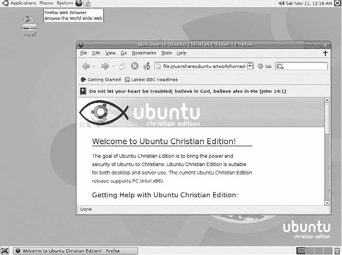
**图 2.5** Ubuntu CE 桌面，运行着 Firefox 浏览器。

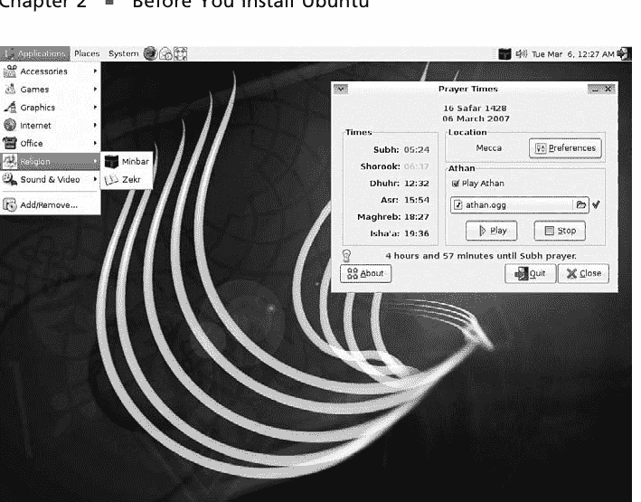
**图 2.6** UbuntuME 桌面，运行着 Minbar 祷告时间应用。

另一个代表的信仰是伊斯兰教，即全新的 UbuntuME（穆斯林版）。与 Ubuntu 类似，它采用 GNOME 桌面（但采用了具有绿色调的美观主题）。与 Ubuntu CE 一样，它为信徒提供了有用的工具，包括祷告时间应用、古兰经学习工具和阿拉伯语学习软件（见图 2.6）。它是非官方阵容中的最新成员。

在 Ubuntu CE 发布后不久，出现了一个截然不同的 Ubuntu 衍生版——Ubuntu SE，其中 S 代表 “Satanic”（撒旦）。这是一个基于 GNOME 的版本，但它其实并不是一个独立的发行版。它在应用程序内容方面没有提供任何不同的东西。它只是一组特定的 GNOME 主题，让这个桌面——原谅我用这个比喻——看起来非常火红（见图 2.7）。

完善这个信仰导向系列的是 Ubuntu Christmas Edition（圣诞版），这可能是唯一一个季节性的 Ubuntu 版本（或者说 Linux 发行版）。这个版本于 2006 年首次亮相，表面上看只是增加了一些额外的节日主题（见图 2.8），但在底层却包含大量通常不包含在 Ubuntu 正式版中的应用程序，因为它们是非自由（nonfree）软件。该版本现已不再提供，并已演变为 Ubuntu 的一个新迭代版本。但人们好奇它是否会在明年 12 月再次出现。

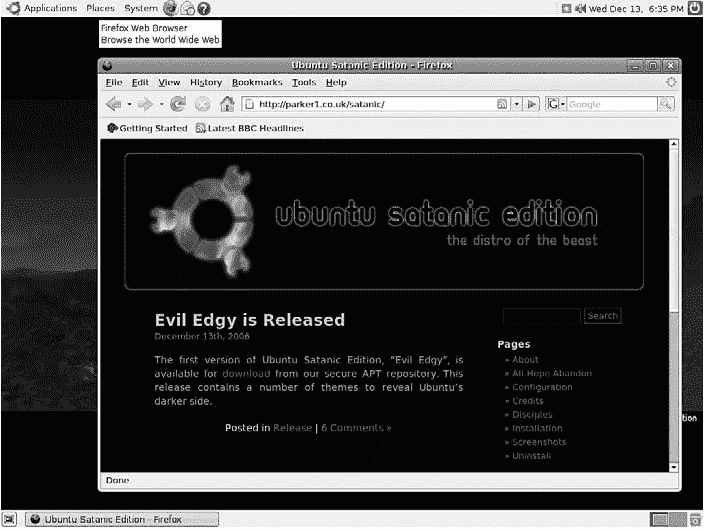
**图 2.7** Ubuntu SE 桌面，运行着 Firefox 浏览器。

在替代桌面方案类别中，有 Fluxbuntu。Fluxbuntu 非常轻量，因为它采用 Fluxbox 窗口管理器。窗口管理器是桌面环境用来处理基本界面功能的东西，但它们也可以独立运行。它们的外观可能很简陋（如图 2.9 所示），但由于只有极少的系统资源用于处理图形，无论你的机器多么老旧，最终你都会得到一台速度极快的机器。

如果安全是你的关注点，你可能会想研究一下 nUbuntu (Network Ubuntu)。这是一个非常轻量的 Ubuntu 衍生版，不包含办公应用或桌面环境等内容。与 Fluxbuntu 类似，nUbuntu 使用 Fluxbox 作为界面，其应用集包含非常专业的安全和取证工具（见图 2.10）。

最后，还有一个据称拥有一切的 Ubuntu 版本：Ubuntu Ultimate Edition (UUE)。基于其前身 Ubuntu Christmas Edition，UUE 加入了创作者能想到的每一个自由和非自由应用，以便用户拥有尽可能强大的工具集。由于一些许可问题，它并没有包含所有东西，但它做得相当不错（见图 2.11）。


**图 2.8** Ubuntu Christmas Edition 桌面。

到目前为止，这就是所有的非官方衍生版本。在本书上架时，可能会出现更多。而这正是 Ubuntu 的魅力所在：每个人都能找到适合自己的版本。

### 这个动物园是怎么回事？

在尝试使用 Ubuntu（任何版本）一段时间后，你可能会听到一些奇怪的词汇。比如 "Dapper" 或 "Warty" 甚至 "Edgy Eft"。就好像有人在描述某种奇怪的动物园。不要害怕——在 Ubuntu 的世界里并没有异域动物在游荡……那只是一些有趣的代号。

正如第一章“什么是 Ubuntu？”中所提到的，Ubuntu 每六个月发布一个新版本，具体在 4 月和 10 月。为了标记这一点，Ubuntu 的版本号不是递增顺序的。它们不是从 1.0 到 2.0 再到 3.0 这样演进。相反，版本号反映了实际发布的年份和月份。因此，最近的 Ubuntu 版本（2007 年 4 月发布）是 7.04 版本。当 2007 年 10 月下一个版本发布时，它将是 7.10 版本。

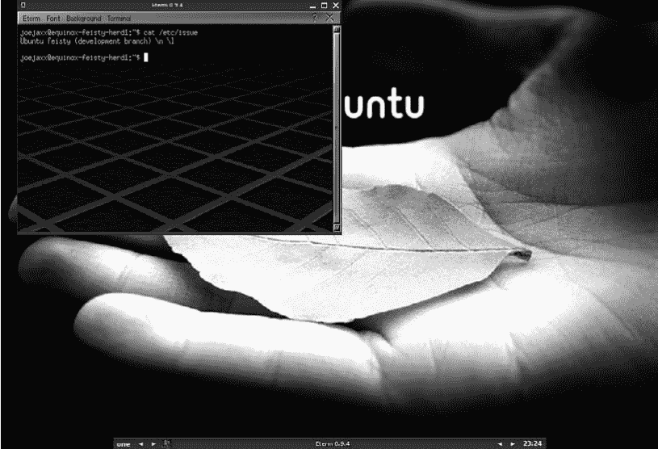
**图 2.9** Fluxbuntu 桌面，运行着 Eterm 应用。

但版本号可能有点枯燥，尤其是对于追求自由的 Linux 和 Ubuntu 开发者来说。因此，从第一个 Ubuntu 发布版本 4.10 开始，每个版本都被分配了一个代号。表 2.1 列出了代号及其对应的版本号。

你可能注意到了 2006 年 6 月发布的 Dapper Drake 的编号比较奇怪。Dapper 与其他 Ubuntu 版本不同，因为 Canonical 选择在该版本中实现一项新功能：长期支持 (LTS)。为了让 Ubuntu 对企业用户更有吸引力（企业用户可能会被 Ubuntu 通常 18 个月的支持计划所劝退），Canonical 决定将 Dapper 的发布推迟两个月，从而为其提供更严格的质量控制流程。

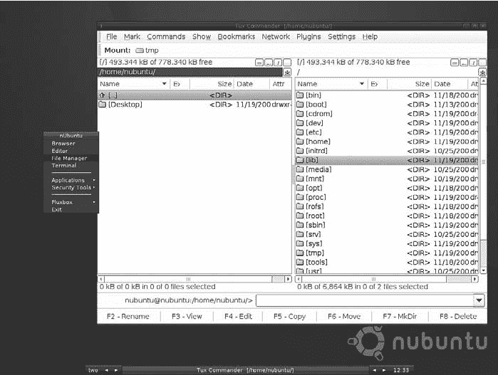
**图 2.10** nUbuntu 桌面，运行着 Tux Commander 文件管理器。

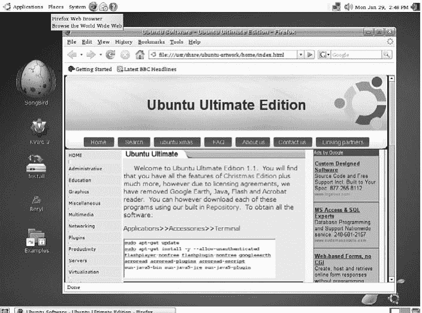
**图 2.11** Ubuntu Ultimate Edition 桌面，运行着 Firefox 浏览器。

### 表 2.1 Ubuntu 代号

| 发布日期 | 版本号 | 代号 |
|---|---|---|
| 2004 年 10 月 | 4.10 | Warty Warthog |
| 2005 年 4 月 | 5.04 | Hoary Hedgehog |
| 2005 年 10 月 | 5.10 | Breezy Badger |
| 2006 年 6 月 | 6.06 LTS | Dapper Drake |
| 2006 年 10 月 | 6.10 | Edgy Eft |
| 2007 年 4 月 | 7.04 | Feisty Fawn |
| 2007 年 10 月 | 7.10 | Gutsy Gibbon |

最终结果是迄今为止最稳定的 Ubuntu 版本：6.06 LTS。Dapper Drake 将由 Canonical 支持至 2009 年 6 月（桌面安装版）和 2011 年 6 月（服务器安装版）。

### 明确你希望 PC 实现的功能

面对这么多 Ubuntu 的选择，很容易在挑选时纠结。就本书而言，推荐的衍生版将是 Ubuntu 主发行版本身。除了简单之外，选择 Ubuntu 还有几个充分的理由：

- **GNOME 是一个很好的起点。** 由于 GNOME 是 Ubuntu 的默认桌面环境，这使得 Ubuntu 成为初学者的理想选择。虽然 GNOME 不如其他桌面环境那样强大，但它配置简单，并且有一些非常精美的视觉效果。
- **一切皆可用。** 选择 Ubuntu 并不会让你失去其他衍生版本的功能。你可以安装软件、改变外观和感觉，随心所欲。

对于通用桌面和小型企业用途，推荐从 Ubuntu 版本开始——至少在你就此熟悉之前。

这个建议唯一的例外是那些有兴趣在学术环境安装 Ubuntu 的用户。在这种情况下，你可能想先查看 Edubuntu。Edubuntu 同样使用 GNOME，所以如果你想尝试它，本书涵盖的大部分内容都适用于该版本。此外，其中额外的教育软件绝对值得探索。


### 获取 Ubuntu

我们已经介绍了 Ubuntu 各个版本的菜单；现在是时候“下单”了。

获取 Ubuntu 最简单的方法是使用本书附带的 CD。它包含了一个功能齐全的 Ubuntu 7.04 副本，与你从互联网下载的没有任何区别。

当然，有时 CD 会损坏或丢失。或者你可能想要下载未来版本的 Ubuntu。如果是这样，本章接下来的内容将对你学习如何获取 Ubuntu 非常有用。

另一种简单的获取方式是购买选定的预装了 Ubuntu 的 Dell 桌面机型。Dell 从 2007 年夏天开始销售这些预装 Ubuntu 的机器。

除这些选项外，想要获得 Ubuntu 并不像开车去电脑商店买一套盒装软件那么简单。极少有 Linux 发行版是以零售方式销售的，Ubuntu 也不在其中。它也不会像 Windows 或 OS X 那样预装在大多数新电脑上。不，Ubuntu 是免费的，但你需要投入一些时间来获取它。

在开始之前，让我们回顾一下如果你无法使用本书附带的 CD，需要准备什么来获取 Ubuntu 副本。*最起码*，你需要一个可用的 CD 驱动器和至少拨号上网的互联网连接。因为这足以让你上网并订购一份寄给你的 Ubuntu 副本（免费或以极低成本）。

现在，如果你有宽带互联网接入以及可用的 CD 或 DVD 刻录机，你可以下载软件并制作自己的 CD。这需要一点时间，但比等待光盘邮寄到家要快。无论你选择哪种方式，获取 Ubuntu 都相当简单。

### 下载 Ubuntu

下载软件已经比以前普遍得多了。宽带的出现，加上一些将软件压缩成更小包以缩短下载时间的技巧，使得这种做法更加普遍。如果你可以快速接入互联网，这就是最佳选择。

#### 窄带选项

> 需要注意的是，反之亦然：如果你没有宽带接入，*不* 建议你下载 Ubuntu 进行安装。虽然你可以这么做，但在标准的 56 K 拨号连接下，即使以最高速度下载，也需要 29 个多小时。如果你不想这样做，请参阅本章后面的“获取 CD”部分。

当你下载 Ubuntu 时，你实际上是在下载一个所谓的 ISO 镜像。光盘镜像（无论是 CD 还是 DVD）类似于一张照片，记录了最终创建的光盘内容中所有不同的 1 和 0。这种方法的优点是你只需要下载一个（非常大的）文件，而不是构成 Ubuntu 的数百个文件。缺点是你必须安装一个特殊的应用程序来将光盘镜像制作成 CD（我们将在后面的“刻录 CD/DVD”部分讨论）。

让我们开始获取过程。

#### 通过网络

通过网络获取 Ubuntu 很简单，而且（最显著的是）免费。除了你稍后刻录 CD 的成本和你花费的时间（不会很多）之外，你很快就能在 PC 上安装一个功能齐全的操作系统。

首先，打开你最喜欢的互联网浏览器。本书中使用的是 Firefox 浏览器，因为它是像 Linux 一样的自由软件，并且是一个非常强大的应用程序。

#### 你的起始环境

> 正如在引言中提到的，假设你在安装 Ubuntu 之前使用的是 Windows XP。

1. 访问 Ubuntu 官方网站 http://www.ubuntu.com（见图 2.12）。
2. 点击 Download 链接。将打开 Get Ubuntu 页面（见图 2.13）。
3. 点击 Ubuntu 7.04 Desktop Edition 单选按钮。
4. 点击相应的计算机类型单选按钮。通常，你应该选择 Standard Personal Computer 选项。
5. 选择相应的 Location（位置）选项。
6. 点击离你最近的站点链接。将出现一个下载选项列表。

#### 本地与全球

尽管互联网是一个全球网络，你可以从地球上的任何地方下载 Ubuntu 副本，但对于任何大文件下载，尽可能选择“本地”站点仍然更好。信号经过的网络节点（类似于互联网的铁路编组站）越少，你的下载速度就越快。

7. 点击 Start Download 链接。你的浏览器将打开 *Opening ubuntu-7.04-desktop-i386.iso* 对话框（见图 2.14）。
8. 点击 Save to Disk 单选按钮。
9. 点击 OK。下载过程将开始，文件将保存到 Windows PC 的默认位置。

#### 通过 Bittorrent

即使在宽带连接下，下载一个接近 700 MB 的文件也需要一些时间。在平常日子里，这大约需要 15 分钟左右。但如果你在所有人都在尝试获取该镜像文件时进行下载，时间可能会延长至数小时，因为你的浏览器需要耐心地等待轮到自己逐比特地拉取文件。

有一种下载文件的方法通常可以避免中央文件服务器有时会出现的交通堵塞，这种相对较新的方法被称为 *Bittorrent*。

你可能在新闻或技术媒体上听说过 Bittorrent，因为它经常（且错误地）被认为是软件盗版者下载和传输非法商品的工具。事实上，Bittorrent 有很多合法用途：下载像 Ubuntu 这样的 Linux 发行版绝对是其中之一。

它的工作原理是：Bittorrent 的下载由所有想要获取这些文件的人共享，而不是从中央服务器下载文件。这个组（称为 *swarm*，集群）中至少有一个用户拥有所有文件，那就是种子（seed）计算机。在 Bittorrent 下载中，集群中的所有计算机相互查询，了解每台机器拥有下载内容的哪些部分。如果我的计算机需要文件 42 的第 863 部分，而计算机 B 拥有它，我就从他那里下载。如果我的机器拥有文件 23 的第 567 部分而计算机 B 需要，它将从我这里下载该片段。如果集群中还没有人拥有该片段，计算机将查询种子计算机，获取所需的文件片段，并将其与集群中的其他成员共享。

在这种被称为点对点（peer-to-peer）或分布式下载的方法中，没有一台计算机需要承担作为特定文件或文件组唯一来源的负担。流量负载由集群的所有成员共同分担。最巧妙的是，随着集群中越来越多的计算机获取了 100% 的所需文件，这些机器反过来也变成了种子。这样一来，随着时间的推移，过程实际上会变得更快。

三大主流操作系统都有许多可用的 Bittorrent 客户端，你可能已经安装了一个。推荐的一个是 Azureus，这是一个强大的 Bittorrent 客户端，可用在 Linux、OS X 和 Windows 上。而且（作为一个巨大的加分项），它还是一个开源软件产品。

### 获取 Azureus

> 要获取 Azureus 副本，请使用你最喜欢的浏览器访问 http://azureus.sourceforge.net。

在你获得 Azureus 或任何其他 Bittorrent 客户端后，你需要找到并下载一个所谓的 *tracker file*（追踪文件）。追踪文件非常小，它会告诉你的 Bittorrent 应用程序在互联网的哪里可以找到拥有你所需文件的种子和集群。

***

**附录：站点内容分析（图 2.12 & 2.13）**

**图 2.12：Ubuntu 主页**
- Ubuntu
- 社区 (Community)
- 支持 (Support)
- 合作伙伴 (Partners)
- Wiki

- 桌面版 (Desktop)
  - 信息 (Information)
  - 下载 (Download)
- 服务器版 (Server)
  - 信息 (Information)
  - 下载 (Download)
- 社区 (Community)
  - 浏览/加入 (Browse/join)
  - 开发者 (Developers)
- 支持 (Support)
  - 商业支持 (Commercial)
  - 社区支持 (Community)

**Ubuntu 6.10**
Ubuntu 是一个完整的基于 Linux 的操作系统，免费提供，并拥有社区和专业支持。它由一个庞大的社区开发，我们也邀请你参与其中！

Ubuntu 社区构建在 Ubuntu 哲学所尊奉的理念之上：软件应该是免费的，软件工具应该是可用的人们使用其本地语言且不受任何残疾影响的，并且人们应该有自由根据自己认为合适的方式定制和修改他们的软件。

- 关于 Ubuntu (About Ubuntu)
- 下载 (Download)
- 邮寄 - 免费 CD (Ship - Free CDs)
- 捐赠 (Donations)
- Ubuntu 商店 (Ubuntu Shop)
- 安全通知 (Security notices)
- 招聘 (Employment)
- 你在使用 Ubuntu 吗？(Do you Ubuntu?)

*ubuntu 聚光灯 2007 年 7 月 21-24 日，俄勒冈州波特兰，CFP 现已开放*

**图 2.13：获取 Ubuntu 页面**
**Ubuntu 6.10，最新的 Ubuntu 版本**
由于 Ubuntu 非常受欢迎，我们将可下载的文件分布在全球几个位置。为了加快您的下载速度，请从下面的列表中选择一个靠近您的位置。有关空间要求和其他信息，请参阅发行说明 (Release Notes)。

- 非洲
- 亚洲
- 欧洲
- 北美
- 大洋洲
- 南美

**BitTorrent 用户**
BitTorrent 是一种通过将下载分布在许多不同的对等节点之间来简化大文件下载的工具。它内置了检查文件的支持，以确保下载完整且准确。
您可以从 6.10 版本页面的底部列表中获取每种 Ubuntu 安装类型的 torrent 文件。

**Ubuntu 6.06 LTS，长期支持版 Ubuntu**
以下下载站点可用；请选择离您最近的一个。如果可用，通常选择同一个国家的站点最好。有关空间要求和其他信息，请参阅发行说明 (Release Notes)。
Ubuntu 6.06 LTS 的代号为 Dapper Drake。有关更多信息，请参阅此 FAQ 条目。

- 美国（多个镜像）

*edubuntu xubuntu*
http://www.ubuntu.com/products/GetUbuntu/download/currentrelease

**图 2.14**
您的浏览器询问您想要如何处理镜像 (.iso) 文件。


图 2.15：Ubuntu 发布页面。

定位 Bittorrent tracker 文件非常简单，因为 Ubuntu 在其网站上保留了一份列表。你只需要确保获取正确的文件即可。

- 1. 浏览至 Ubuntu 发布页面 http://releases.ubuntu.com/7.04/（见图 2.15）。
- 2. 向下滚动到页面底部。会出现一个非常详细的文件列表（见图 2.16）。
- 3. 点击 `ubuntu-7.04-desktop-i386.iso.torrent` 链接。你的浏览器将打开“正在打开 ubuntu-7.04-desktop-i386.iso.torrent”对话框。

### 正确的选择

在此操作中点击正确的链接至关重要；如果仅点击 `.iso` 链接，将开始下载整个镜像文件。请确保你点击的是 `.iso.torrent` 文件链接。此外，如果你使用的是普通 PC，请确保文件名中出现 `i386`。如果你的 PC 恰好是 64 位的，请点击 `ubuntu-7.04-desktop-amd64.iso.torrent`。

图 2.16：大量可供下载的文件。

- 4. 点击“保存到磁盘”单选按钮。
- 5. 点击“确定”。下载过程将开始，tracker 文件将被保存到 Windows PC 的默认位置。

获取 tracker 文件后，打开你的 Bittorrent 客户端，使用该文件开始下载实际的镜像文件。使用 Azureus，这是一个非常简单的过程。

- 1. 打开 Azureus 应用程序（见图 2.17）。
- 2. 点击“打开 Torrent”图标。将出现“打开 Torrent”对话框（见图 2.18）。
- 3. 点击“添加文件”按钮。将打开“选择 Torrent 文件”对话框。

图 2.17：Azureus 应用程序。

- 4. 导航到保存 Ubuntu tracker (`.torrent`) 文件的文件夹。
- 5. 选择该 tracker 文件。
- 6. 点击“打开”。对话框将关闭，torrent 内容的信息将显示在“打开 Torrent”对话框中（见图 2.19）。
- 7. 点击“确定”。Bittorrent 下载过程将开始，镜像文件将被保存到 Windows PC 上指定的路径。

### 互惠互利

不要做个“吸血鬼”（leech）！那些只下载所需内容然后就关闭 Bittorrent 应用程序的人被如此称呼。Torrent 下载的最佳工作方式是在你获取文件后继续分享下载内容。你的客户端应该有一个分享率（share ratio）的标记——即上传的 torrent 数量与下载数量的比例。在比例至少大于 1.000 之前，你不应该停止 torrent 进程，这意味着你至少完整地分享了一次文件。好消息是，上传过程比下载慢得多，因此保持开启状态不会对你的其他上网活动产生太大影响。

图 2.18：“打开 Torrent”对话框。

图 2.19：可以检查 torrent 中包含的文件。

### 刻录 CD

无论你以何种方式将 Ubuntu 镜像文件获取到计算机上，最终你都需要创建一张用于安装 Ubuntu 的实际 CD。

虽然 Windows 和 OS X  each 都有将文件刻录到 CD 的能力，但正确地将镜像文件刻录到 CD 需要一个单独的应用程序。市面上有很多这类应用程序，大多数预装了 CD-R 刻录设备的较新 PC 在购买时可能已经预装了此类助手程序。请检查你的 Windows 应用程序菜单，看看它是否在那里。

即使你没有这样的应用程序，在互联网上也很容易找到。Ubuntu 为 Windows 用户推荐的应用程序是一个名为 Infra Recorder 的免费程序，可以在 http://infrarecorder.sourceforge.net/ 找到。如果你下载并安装了 Infra Recorder，请按照以下步骤将镜像文件刻录到 CD-R 光盘中。

- 1. 将一张空白的 CD-R 或 CD-RW 光盘插入 CD 刻录机驱动器。
- 2. 打开 Infra Recorder 应用程序（见图 2.20）。

图 2.20：Infra Recorder 应用程序。

图 2.21：将镜像文件刻录到 CD 的配置设置。

- 3. 点击“Actions | Burn Image”菜单命令。将出现“打开”对话框。
- 4. 导航到保存 Ubuntu  Ubuntu 镜像文件的文件夹。
- 5. 选择该镜像文件。
- 6. 点击“打开”。将打开“刻录 ubuntu-7.04-desktop-i386.iso”对话框（见图 2.21）。
- 7. 点击“确定”。“刻录镜像”对话框将打开，进程将开始（见图 2.22）。
- 8. 完成后，新的 Ubuntu CD 将从驱动器中弹出。点击“确定”并从驱动器中取出光盘。

### 获取 CD

如果你没有宽带连接，或者之前的所有指令看起来工作量太大，你可以获取一份 Ubuntu CD 副本，它将被直接邮寄到你的家中或公司。

有两种方式可以让 CD 邮寄到家。首先，最经济的方法是使用 Ubuntu 的 ShipIt 计划并订购一份免费的 Ubuntu 副本。这种方法虽然免费，但速度相当慢——接收邮寄的 Ubuntu CD 可能需要数周时间。

图 2.22：刻录镜像文件。

尽管如此，如此优惠的方案仍值得提及。你只需要将浏览器指向 http://shipit.ubuntu.com。在那里，点击“I want to request CDs of Ubuntu 7.04 (Feisty Fawn)”发布链接。然后，系统会要求你创建一个 Launchpad 帐户，通过该帐户你可以订购免费 CD。

Launchpad 是 Canonical 的开发社区门户，允许社区成员参与各种与 Ubuntu 相关的项目。注册仅仅是将你纳入该社区并使你能够参与 ShipIt 计划。

### 获取 Kubuntu 或 Edubuntu

如需获取免费的 Dapper 版本的 Kubuntu，请访问 https://shipit.kubuntu.org。如需 Edubuntu，请参阅 https://shipit.edubuntu.org。

请记住，ShipIt 计划声称邮寄时间最长需要 6-10 周，所以请耐心等待。

如果你想要快一点，或者想要最新、最优秀的 Ubuntu 版本，你可以支付一笔名义费用，用于支付制作 CD 和邮寄给你的费用。寻找附近出售新 Ubuntu CD 的最佳地点是 GetUbuntu 页面，位于 www.ubuntu.com/getubuntu/purchase。该页面显示了一个简洁的站点列表，你可以在这些站点为你的系统订购 CD 或 DVD。

## 安装准备

你已经刻录好 CD 并准备就绪。现在你可以将其插入驱动器并启动安装过程，对吗？当然，如果你觉得自己无往不利的话。但即使是最资深的 Linux 用户也知道，没有软件是完美的，总有可能出问题。

除非你是在一台没有任何个人数据的全新机器上安装 Ubuntu，否则你应该始终备份你的文件，以便无论结果如何，稍后都能找回它们。即使你在安装新机器，在安装之前仍有一些需要采取的步骤。

### 收集系统信息

Ubuntu 是一个非常健壮的操作系统，在大多数计算机上，它都能毫无问题地安装。但如果出现问题，很可能是因为 Ubuntu 没有识别出你 PC 上的某件硬件。

导致这种情况的原因有很多，其中最大的原因可能是世界上有太多不同种类的硬件，即使是勤奋的 Ubuntu 和 Linux 开发人员也无法全部跟进。在一个大多数硬件公司只关心与 Windows 协作的世界里，这些公司的开发人员通常不会花时间编写允许其设备在 Linux 上运行的软件驱动程序。幸运的是，随着 Linux 变得越来越流行（感谢像 Ubuntu 这样易于使用的发行版），相当多的公司意识到这一计划的错误，现在正致力于开发 Linux 驱动程序。

不幸的是，硬件覆盖仍然存在缺口，虽然大多数情况下这些缺口可以通过用户的一定努力来弥补，但如果你能提前知晓，会很有帮助。

### 硬件问题

硬件相关问题将在第 7 章“让一切正常运行”中讨论。

如果你像大多数人一样，可能只知道关于 PC 的浅层信息，例如：“19 英寸显示器，CD/DVD 驱动器，打印机，USB 端口……”等等。为了获得一个关于 Ubuntu 兼容性问题的正确列表，你需要挖掘得更深一些。对于某些人来说，这可能是安装过程中最令人生畏的部分，但实际上，它并不太糟糕。


### 第 2 章 ■ 安装 Ubuntu 之前

当你开始检查电脑时，你会首先注意到很多你需要知道的信息就在你面前。例如，你的显示器就放在桌子上，其品牌名称和型号显示在正面或背面。你的打印机以及任何其他外设可能也是如此。你需要记录下设备上显示的品牌名称和型号。

除了识别外部设备，你还需要确定电脑内部的实际配置。一个开始的方法是显示一个由现有操作系统识别的设备列表。Windows XP 和 Vista 使用一个名为“设备管理器”的内置小程序来列出已知设备。

在 Windows XP 中，按照以下步骤打开设备管理器。

- 1. 点击 Windows 任务栏上的“开始”按钮；然后选择“控制面板”。控制面板窗口将出现。
- 2. 点击“打印机和其他硬件”图标。打印机和其他硬件页面将打开。
- 3. 点击“系统”图标（位于控制面板窗口的左侧）。系统属性对话框将打开（见图 2.23）。

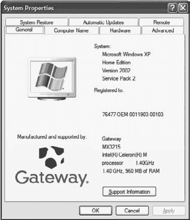
**图 2.23**
系统属性对话框是设备管理器的入口。

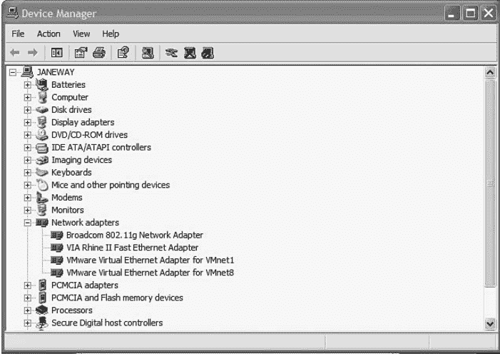
**图 2.24**
设备管理器将向你显示电脑使用的几乎每一个硬件设备（至少是当前操作系统所识别的设备）。

- 4. 点击“硬件”选项卡。硬件页面将被显示。
- 5. 点击“设备管理器”按钮。设备管理器将出现，列出电脑的内部运行组件，如图 2.24 所示。

现在你需要进行一些传统侦探式的基础工作。你的电脑可能（也可能没有）在设备管理器列出的每种设备类型中都使用了一个设备。例如，要确定电脑中安装了什么类型的 CD-ROM 驱动器，首先点击如图 2.25 所示的展开控件（方框中的小加号）来展开 DVD/CD-ROM 驱动器列表。

如图 2.25 所示，这台电脑有一个 CD-ROM 驱动器，其标签相当晦涩。要详细了解某个设备，请双击该设备。CD-ROM 驱动器的属性对话框将出现（见图 2.26）。

这是一个典型的为了符合 Windows 标准而制造的设备——以至于 Windows 并不关心它是谁制造的。在 Windows 看来，这只是一个标准的 CD-ROM 驱动器。不过，记录非通用信息仍然是个好主意，以防稍后在 Ubuntu 中出现小问题。

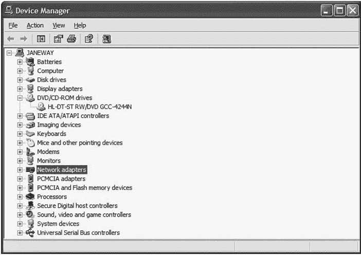
**图 2.25**
点击展开框打开设备列表。

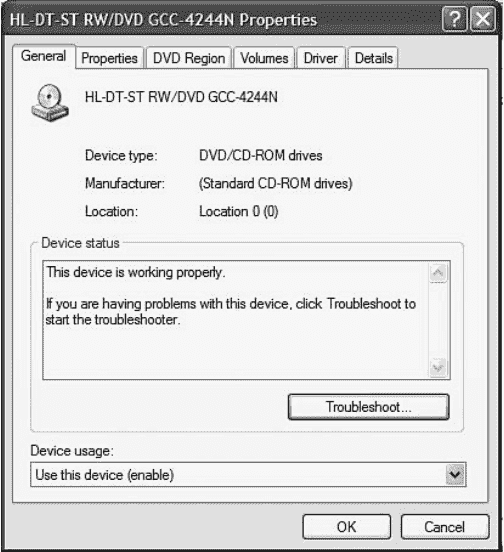
**图 2.26**
这里的信息不多，但每一点都有帮助。

你可能会发现其他书籍敦促读者准备一个日志，用于追踪和记录 PC 的所有硬件以及安装 Ubuntu 时可能出现的任何其他问题。这种方法有其价值，但没有必要真的拿出铅笔和纸。在设备管理器中，有一个“打印”图标，你可以使用它直接打印出 Windows 知道的所有关于 PC 硬件的信息。

你会发现这份打印文档充满了非常专业的技术信息——其中大部分你并不需要。但它节省了手动记录的时间。

为了成功安装 Ubuntu 并在以后出现问题时进行故障排除，你最需要的是让电脑能够正常运行的关键设备信息，如表 2.2 所示。

**表 2.2 Ubuntu 安装/故障排除所需的关键硬件信息**

| 硬件 | 所需信息 |
|---|---|
| CPU | 制造商、型号、频率 |
| 主板 | 制造商、型号 |
| 总线 | 制造商、型号 |
| 内存 (RAM) | 容量 |
| 显卡 | 制造商、型号、显存容量、芯片组 |
| 声卡 | 制造商、型号 |
| 显示器 | 制造商、型号、水平和垂直同步率 |
| 硬盘 | 制造商、型号、容量、类型 (SCSI 或 IDE) |
| 网卡 | 制造商、型号 |
| CD-ROM 驱动器 | 制造商、型号、容量 |
| 软驱 | 制造商、型号、容量 |
| 调制解调器 | 制造商、型号、传输速度 |
| 打印机 | 制造商、型号 |
| 鼠标 | 制造商、型号、类型 (PS/2, 串口 或 USB) |
| 键盘 | 制造商、型号、键数、语言 |
| SCSI 卡及设备 | 制造商、型号、控制的设备类型 |
| IDE 适配器 | 制造商、型号、控制的设备类型 |

你所需的大部分信息都包含在打印的设备管理器输出中，但并非全部。例如，你可以通过点击系统属性对话框中的“常规”选项卡来查找电脑安装的 RAM 容量信息。另一个选项是在“我的电脑”中右键单击显示的硬盘图标，然后选择“属性”来查看驱动器空间的大小。一点侦探工作将使你的 Ubuntu 安装变得更加轻松。

### 备份你的数据

在确认硬件配置之后，你需要采取下一步准备工作：备份 PC 上的数据。

备份重要数据以防系统崩溃始终是一个好主意。至少，你会希望你的数据能够免受电涌、病毒攻击、电脑失窃或任何其他可能影响你访问机器数据因素的影响。

安装 Ubuntu 当然不能被归类为灾难性事件。但取决于你打算如何更改硬盘分区，或者是否要格式化硬盘，这些操作可能会且将会完全抹除数据。

首先你应该决定哪些数据需要备份。这实际上取决于你在安装 Ubuntu 时想要做什么。特别是如果你计划进行双启动（在同一台 PC 上运行 Windows 和 Ubuntu），那么你需要确保已经保护好大部分 Windows 数据。

### 完全替换 Windows

即使你计划完全删除 Windows 并安装 Ubuntu 来替代，保存数据文件仍然是有意义的。大多数在 Windows 中创建的文件都可以在 Ubuntu 中打开，例如图形文件（GIF、JPEG、PNG）和 Adobe Acrobat (PDF) 文件。此外，得益于一个名为 OpenOffice.org 的优秀办公套件（完全兼容 Office），Microsoft Office 文件甚至也可以被打开。不过，如果你计划在 Ubuntu 机器上使用这些文件，你需要的是“保存”而不是“备份”。Ubuntu 将无法读取 Windows 的备份文件。在这种情况下，请使用外置硬盘或闪存盘（也称为 *优盘*），通过 Windows 资源管理器将数据文件直接保存到此类设备中。之后你就可以使用 Ubuntu 来检索它们。

### 为双启动做准备

如果你计划在机器上实现双启动，则需要一个备份操作系统，以确保在设置出现问题时仍能进入 Windows 侧。如今大多数电脑应用程序占用大量磁盘空间，主要是因为现在的超大硬盘让它们能够这么做。因此，备份你的数据和应用程序文件是一项巨大的工程。如果你有足够的存储容量（例如外置硬盘或容量很大的闪存盘），建议你备份整个硬盘。

对于那些没有足够大容量设备来容纳整个驱动器数据的用户，只需备份你的数据文件。数据文件是指你随着时间在电脑上创建的文档、电子表格、图纸和其他文件。如果你真的遇到了麻烦，你可以先使用原始光盘重新安装操作系统和应用程序，然后还原存档的个人数据文件来恢复系统。

如果你从未用过备份程序，你会发现它们很容易使用。目前有许多备份程序可用，包括 Norton System Utilities 中提供的一个优秀程序。备份实用程序的原理基本相同：定位并识别要存档的文件，指定新存档文件的位置，然后创建文件。还原则是该操作的逆过程。

Microsoft Windows 拥有自己的备份实用程序，可用于存档数据。接下来的步骤描述了如何使用 Windows 备份实用程序。

- 1. 点击 开始 | 所有程序 | 附件 | 系统工具 | 备份。备份或还原向导应用程序将打开（见图 2.27）。
- 2. 点击“下一步”。备份或还原页面将出现，如图 2.28 所示。


图 2.27
微软的备份实用程序。

图 2.28
备份还是还原？

- 3. 点击“备份文件和设置”单选按钮，然后点击“下一步”。随后将出现“备份内容”页面（见图 2.29）。
- 4. 在此处，您可以选择备份计算机上的所有文件，或者选择仅备份选定文件。选择“让我选择要备份的内容”单选按钮，然后点击“下一步”。随后出现“要备份的项目”页面（见图 2.30）。

图 2.29
您可以选择想要备份的文件。

图 2.30
您可以选择文件夹全部或部分内容。

### 全量备份

如果您有足够的存储空间，请直接点击“这台计算机上的所有信息”单选按钮，并继续执行“备份或还原向导”的其余步骤。

图 2.31
选择备份文件的存储位置。

- 5. 在对话框的左侧，勾选您想要备份的驱动器和文件夹。根据需要，使用目录列表中的展开图标来查看子文件夹。请注意，选择一个文件夹会自动选择该文件夹内的所有文件。或者，在对话框右侧的文件列表中，勾选或取消勾选您想要包含或排除的具体文件。
- 6. 点击“下一步”。随后将出现“备份类型、目标和名称”页面（见图 2.31）。
- 7. 选择您偏好的位置并为备份文件输入文件名。完成后，点击“下一步”继续。随后将出现最后一个页面。

### 保存位置

> 请确保将此信息保存到除硬盘以外的驱动器上。次级硬盘和外接硬盘都是不错的选择。

- 8. 点击“完成”。备份进程将开始。

请确保备份文件存储在远离硬盘的地方。正如您在下一节中将看到的，您的驱动器即将迎来巨大的变化。

### 本章小结

在本章中，您学习了为安装 Ubuntu 准备机器的基本步骤，包括查找和下载 Ubuntu、刻录 CD 或 DVD 以及为安装准备计算机。这些准备工作即将获得回报，因为在下一章中，关键时刻到了：Ubuntu 将很快在您的计算机上运行。

# 第三章：安装 Ubuntu

现在到了真相大白的时刻。您已经完成了课前准备，确定了安装 Ubuntu 的方式，现在可以开始了。

本章不会让您失望。它的唯一目标是通过 Ubiquity 图形安装程序引导您完成安装过程。在此过程中，您将：

- 探索如何在不安装的情况下体验 Ubuntu。
- 选择最适合您的方案：单独安装 Ubuntu 或将其与另一个操作系统共存。
- 分步骤地经历安装过程。
- 为您的 Ubuntu 机器创建一个或多个用户。

### 先试后买

这一节可能会让您感到困惑，心想为什么刚刚在第二章“安装 Ubuntu 之前”做了那么多准备工作。请耐心一点，我的这种“疯狂”是有方法的。

自 Ubuntu 6.06 LTS (Dapper Drake) 起，所有官方版本的 Ubuntu 都为用户提供了 LiveCD 版本。“LiveCD”是指那些可以*直接从 CD 启动并运行*的操作系统。无需安装。

这意味着，当您将 Ubuntu CD 插入光驱并重启计算机时，它将自动在您的计算机上运行，而不会在您的机器上放置任何新文件或触及现有数据。它直接启动并运行。

那么您可能会问，为什么我还要费劲安装 Ubuntu？我直接从 CD 运行不就行了。确实如此，很多人这样做——尤其是当他们使用别人的 PC 且不想使用预装的操作系统时。既然可以插入 Ubuntu LiveCD 拥有一个更熟悉的环境，为什么还要在朋友的电脑上使用 Windows 呢？

第一个问题是速度：从 CD 驱动器运行任何操作系统都意味着过程会慢得多。数据必须不断从驱动器中泵入，只有最快的光驱才能给您提供勉强合格的用户体验。

如果您的系统 RAM 较低，LiveCD 的性能将受到更大的打击。当操作系统及其应用程序运行时，它们将 RAM 内存作为执行操作的工作空间。可用内存越多，应用程序运行效率越高。但一旦运行大量应用程序，RAM 就会被填满。为了跟上需求，操作系统会使用磁盘驱动器上被称为*交换空间 (swap space)* 的区域来帮助满足内存需求。这就是为什么当您在计算机上运行大量程序时，会听到硬盘在艰苦运转。使用交换空间速度较慢，但能完成任务。

### 何时升级 RAM

> 如果您听到硬盘频繁工作——即使您只使用一两个应用程序，那么可能到了考虑为机器安装更多 RAM 的时候了。这不仅能加快操作速度，还能减少硬盘的磨损。

然而，当您运行 LiveCD 时，交换空间选项并不适用，因为来自 CD 的 Ubuntu 不会触及您的驱动器数据。如果您的系统安装的 RAM 不多，请做好 LiveCD 运行缓慢的心理准备。

尽管运行缓慢，但 LiveCD 的优点是它允许您随身携带操作系统（如前所述），而且——这对您现在很有利——它允许您在“购买”之前试用 Ubuntu。在这种情况下，“购买”意味着安装。

Ubuntu LiveCD 实例中的所有内容与您将 Ubuntu 安装到 PC 上所获得的内容完全一致。您只需将光盘插入 CD 驱动器并重启 PC 即可。

您将在黑屏上看到一个询问您想要执行什么操作的文本菜单。预选选项是“启动或安装 (Boot or Install)”，因此您无需进行其他操作。在稍微等待一段时间后（这是使用 LiveCD 的另一个缺点），Ubuntu 最终将出现在您的屏幕上，如图 3.1 所示。

如果您此时想要探索 Ubuntu 操作系统，可以跳到第四章“桌面基础”开始探索。

如果您准备好安装 Ubuntu，还有一个问题需要解决：您是否与 Windows 共用这台 PC。

图 3.2
为您的 Windows 提供的开源精华。

### 每个人都能找到适合的方案

Ubuntu CD 中包含的一个额外奖励是 Windows 用户绝对能从中受益的东西：一套可在 Windows 平台上运行的免费开源软件应用程序。您只需在 Windows 运行期间将 CD 插入驱动器，就会出现 DiscTree 窗口，列出可用应用程序（见图 3.2）。

这些都是非常成熟的应用程序，您可以免费安装和试用。如果您计划保留 Windows 分区运行，强烈建议您使用这些应用程序，哪怕只是为了与随后在 Ubuntu 中安装的应用程序保持连续性。

### 一个还是两个操作系统？

现在到了需要做出真正重要决定的时刻。像所有重要决定一样，您应该仔细权衡您的选择。您必须决定是在 PC 上单独运行 Ubuntu，还是保留 Windows 并能够在两者之间来回切换。本节将分析该决定两方面的优缺点，并为您提供在决定双启动系统时的操作技巧。


### 为多个操作系统腾出空间

在一台计算机上使用多个操作系统有若干优点和缺点。缺点包括在一部机器上安装两个或更多操作系统的麻烦，这会导致每个操作系统可用的硬盘空间更加有限。

但使用多个操作系统的益处是巨大的。例如，你将能够运行电脑上安装的每个操作系统所支持的所有程序。你还能利用电脑拥有的所有硬件资源。最后，由于不需要购买另一台电脑，你还可以节省资金。

建议你采用双启动（dual booting）方案——尤其是当你有一些无法舍弃且在 Ubuntu 中没有替代品的 Windows 应用程序时。这个选项让你在无需投入大量时间或资金的情况下，享受使用 Ubuntu 的好处。

如果你决定在电脑上安装 Ubuntu 与 Windows 共存，你需要在硬盘上为其腾出空间。但为 Ubuntu 腾出空间与为最新的电脑游戏腾出空间是完全不同的操作。你需要创建一个全新的*分区（partition）*供 Ubuntu 运行。

以下是关于磁盘分区以及为什么没有分区就无法向磁盘写入数据的速成课程。

### 为什么要分区？

想象一只在花园里飞舞的蜜蜂。如果你跟着这只蜜蜂回到它的家，你会发现一群看似混乱的嗡嗡作响的昆虫，每只看起来都像是在漫无目的地游荡，除了闲逛和发声外没什么可做的。

但众所周知，蜜蜂都有特定的目标，为了蜂群的集体利益而共同工作。一组蜜蜂的任务是在蜂王产卵后照顾所有可爱的小幼蜂。现在，回想一下你的科学课：幼蜂是在哪里被养大的？

如果你回答是蜂巢，那么你是对的。如果你在想这和分区有什么关系，请稍等。

蜂巢是由蜂蜡制成的六边形细胞组成的巧妙装置，蜂蜜和蜂幼虫被存储在其中以确保安全。思考一下：如果没有蜂巢，蜜蜂该如何生存？答案是它们无法生存。

记住蜂巢，你可以将这个类比应用于数据在磁盘驱动器上的存储方式。你看，如果没有某种预先就绪的结构来组织数据，数据就无法存储在驱动器上。

当数据被放置在驱动器上时，它被写入这个结构中，在 Linux 社区中这被称为*文件系统（filesystem）*。文件系统是存储数据的格式——如果你愿意，可以将其看作一个由单元组成的蜂巢，每块小数据都被放置在其中。

计算机毕竟是计算机，情况会稍微复杂一点。例如，单个文件的资料并不会存储在相邻的数据块中。数据可能会存储在第 456、457 和 458 块，然后是第 6,134 块，接着是第 7,111 块，依此类推。（这是一种过度简化，但你明白这个意思。）文件系统的职责就是跟踪每个文件所在的位置，这样当你发送指令处理某个文件时，文件系统就知道该文件存储在哪些分散的数据块中。

由于所有这些文件的跟踪和检索工作，计算机工程师想到了即使在大型硬盘上也要保持文件系统规模较小的想法。于是分区的概念出现了。基本上，分区是一个虚拟屏障，它告诉文件系统：

> “你以前可以写入整个磁盘的第 1-25000 块，但现在你只被允许写入第 1-17500 块。第二个文件系统将写入第 17501-25000 块，所以请离远点！”

文件系统的职责就是跟踪每个文件所在的位置，这样当你发送指令处理某个文件时，文件系统就知道该文件存储在哪些分散的数据块中。

于是，就有了分区。而且每个分区可以使用不同的文件系统。类比来说，蜜蜂创建的蜂巢与黄蜂创建的不同——结构相似但结果不同。

如果你的电脑安装了典型的 Windows，你的 Windows 文件系统包含在一个覆盖整个硬盘的大分区中。这就没给另一个分区和新文件系统留下空间。记住，即使你的驱动器上有数 GB 的空闲空间，这些空间（就像文件和目录一样）可能分散在驱动器各处，且仍然属于 Windows 分区。

在现有硬盘文件系统中添加分区最简单的方法是使用第三方应用程序。它将你现有的分区挤进一个更小的数据块集合中，从而在驱动器的其他地方留下真正连续的空闲且无结构（未格式化）的空间，你可以在那里安装一个 Ubuntu 所在的分区。

### 备份你的数据

> 在使用任何工具操纵或创建分区之前，请将你的数据备份或保存到另一个物理驱动器中。请务必这样做。

### Ubuntu 需要的分区

安装 Ubuntu 时，它使用一个名为 *Ubiquity* 的八步安装程序来完成任务。当 Ubiquity 检测到计算机上存在另一个操作系统时，它会询问你是想替换整个硬盘的内容，还是执行手动分区操作。

这是一个抉择点，将决定你的计算机上是只有一个 Ubuntu 操作系统，还是多个操作系统（Ubuntu 和 Windows）。具体如何执行此程序的机制将在本章后面的“分区设置”部分中概述。目前，有一些建议应该传达给新的 Ubuntu 用户。

在 Windows 系统中，文件系统面向一个基于硬盘驱动器盘符的关键根目录。对于大多数主驱动器，该盘符为“C”，因此 Windows 中的根目录表示为 `C:\`。其他驱动器也有根目录（`D:\`、`E:\` 等）。根目录始终与物理驱动器或分区绑定，所有子目录（Windows 中称为子文件夹）都直接继承自同一物理驱动器上的根目录。`C:\Documents and Settings\Brian\My Documents` 将始终位于主（`C:\`）驱动器或分区上。

Ubuntu 中的文件系统则灵活得多。例如，用户主目录的常见路径是 `/home/<username>`。“home”是根文件夹的子目录，在基于 Linux 的系统中，根文件夹表示为 “/”。因此，以作者为例，主目录是 `/home/bproffitt`。以下是 Ubuntu 机器的默认目录结构。

```
/
/bin
/boot
/cdrom
/dev
/etc
/home
/initrd
/lib
/media
/mnt
/opt
/proc
/rofs
/root
/sbin
/srv
/sys
/tmp
/usr
/var
```

撇开奇怪的名字不谈，它看起来像一组 Windows 文件夹，不是吗？一群以漂亮的树形模式排列的目录，全部位于同一个分区上。但虽然这个列表反映了典型的 Ubuntu 文件系统，并不意味着所有这些目录都位于同一个分区上。

这是因为 UNIX 文件系统一个独特的属性，称为挂载点（mount points）。如果你愿意，你可以决定将任何目录放在任何驱动器或分区上，Ubuntu 的文件管理将无缝地复制、检索、保存或删除无论物理位置在何处的文件。

以作者的系统为例，根 (/) 目录的挂载点位于 /dev/hda2，这表示主（“a”）硬盘 ('/dev/hd') 的第三个分区（“2”）。但 /home 目录（及其所有子目录）的挂载点位于 /dev/hda3，这是一个完全独立的分区。这样做的好处是，属于作者的个人数据将始终存储在独立的分区上，这意味着如果将来需要迁移到另一个 Linux 发行版或对未来版本的 Ubuntu 进行全新安装，这些个人数据将始终得以保留，并可以通过 Ubuntu 文件系统中的 /home 目录访问。

你可以将 Ubuntu 文件系统的不同目录挂载到任何分区或驱动器上，如果你的电脑配置允许，甚至可以是不同的驱动器。

当你使用 Ubiquity 的分区工具来设置驱动器时，显然你需要为现有的 Windows 操作系统分配一部分空间，为 Ubuntu 分配一部分空间。分配多少？简单的答案就是将你的驱动器平分为二，每个操作系统平分。但许多其他因素可能会影响你做出不同的选择。


例如，如果你的硬盘较小且 Windows 占用了大量空间，那么在安装 Ubuntu 时就需要比较克制。

##可用空间

> 处理一个平均规模的 Ubuntu 安装至少需要 3GB 的磁盘空间。除非你有某种网络存储设备，否则请预留至少 2GB 的额外存储空间。

在考虑为 Ubuntu 预留多少空间的同时，还要确保你的驱动器上有足够的空间分配给交换空间（swap space）。确定需要创建多少交换空间通常很困难，因为不同用户根据工作类型的不同，需求量也不同。如果你处理大量巨大的文件（如图形设计、桌面出版），你应该将交换空间设置得较高，例如系统 RAM 容量的两倍。对于大多数用户，经验法则是交换空间应等于 RAM 的 1.5 倍。无论你选择多少，请记住重要的一点：不要将交换空间设置在 2 GB 以上；Ubuntu 与大多数操作系统一样，无法处理更高的数值。

##运行 Ubiquity

对于旧版本的 Ubuntu——事实上，对于任何 Linux 发行版的旧版本——启动安装只需将 CD 插入驱动器并重启系统。安装程序会作为初始菜单中的一个选项出现，一旦选中，安装就会开始。

如今，有了 Ubuntu 的 LiveCD 选项，启动安装变得更加轻松。正如你在图 3.1 中可能注意到的，运行 Ubuntu LiveCD 时，桌面上有一个漂亮的小“安装（Install）”图标。双击该图标后，Ubiquity 安装程序将启动。

Ubiquity 是一个分为七个步骤的安装流程，从“语言设置”界面开始，详情将在下一节中介绍。

让我们引导你了解整个过程，这样你就知道会发生什么。

##语言设置

在全球范围内开发自由软件的绝佳优势之一就是拥有非常出色的语言支持。Ubuntu 无疑是其中的受益者。Ubiquity 的第 1 步（如图 3.3 所示）列出了 Ubuntu 用户可用的 57 种不同语言选项（外加一个默认英语的非本地化选项）。

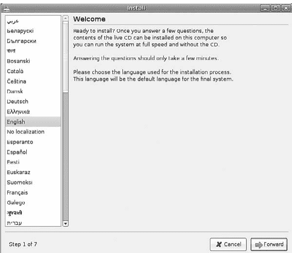
**图 3.3** 人类语言的多样性。

显然，除非你是语言学家，否则其中一些语言对每个人来说都不可理解。这里的基本原则很简单：如果你看不懂某种语言选项，就不要选择它。

请选择适合你的语言，然后点击“继续（Continue）”进入第 2 步。

##时区设置

Ubiquity 的第 2 步显示一张世界地图，你可以通过它确定正确的时间设置（见图 3.4）。

如果你想使用地图，首先将鼠标移动到你所在的地区。注意鼠标光标已变为带加号的放大镜。点击所需区域将（虽然速度较慢地）放大到该区域，如图 3.5 所示。

### 不要迷路

> 如果你不小心放大了错误的区域，请在地图上点击右键以返回全球视图。


**图 3.4** 使用 Ubuntu 寻找你的位置。

点击离你最近且处于同一时区的城市。该城市将出现在 Ubiquity 底部的“已选城市（Selected City）”下拉列表中。如果你点击了错误的城市，只需重试即可。

确认你选择了正确的城市且时区也正确。点击“前进（Forward）”进入第 3 步。

### 节省夏令时

> 2007 年，美国和加拿大将夏令时（DST）的执行时间延长至 2007 年 3 月 11 日至 11 月 4 日。最新版本的 Ubuntu 已更新以反映这些变化，以及印第安纳州最近在执行夏令时方面的变动。

##键盘设置

你可能认为键盘就是键盘，但在全球范围内，甚至在同一个国家内部，人们将文字输入到 PC 的方式都有许多变体。

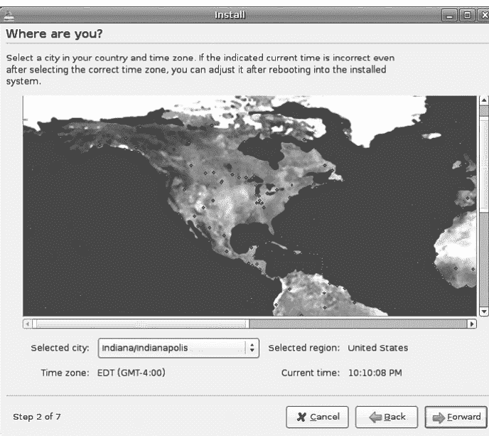
**图 3.5** 缩小地理选择范围。

Ubiquity 的第 3 步（如图 3.6 所示）显示了 Ubuntu 支持的所有不同键盘。

所选键盘是基于你在第 1 步中选择的语言而设定的默认键盘设置。如果你不确定自己使用的是哪种键盘，请保持默认选项。否则，选择合适的键盘，然后点击“前进（Forward）”进入第 4 步。

##分区设置

现在到了 Ubiquity 流程中最关键的部分：选择分区选项。

默认情况下，Ubiquity 选择了“使用整个磁盘安装 Ubuntu”的选项（见图 3.7）。在你保持该选项并点击“继续”之前，让我们回顾一下这意味着什么。

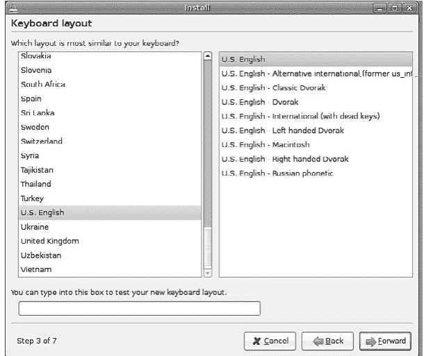
**图 3.6** 世界上不只有 QWERTY 键盘。

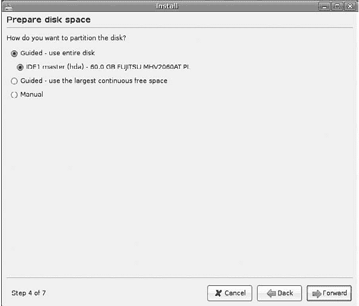
**图 3.7** 注意：前方有分区操作。

使用整个磁盘意味着当你完成 Ubiquity 流程后，安装过程将完全格式化你的硬盘，这意味着原先硬盘上的所有内容（Windows 和你的个人数据）都将被删除。永久消失。

如果你阅读了第 2 章并备份了系统所有文件，那么这只是一个小麻烦，因为你可以恢复被 Ubuntu 安装过程覆盖的内容。如果你没有备份 Windows 分区，且不想格式化整个驱动器，那么这将类似于一场重大灾难。

因此，这一点无论如何强调都不为过：在选择“引导式 - 使用整个磁盘（Guided - Use Entire Disk）”选项之前，请务必确认你想要用 Ubuntu 完全替换 Windows 和你的个人数据。

### 保存你的个人文件

> 许多新用户认为他们的个人文件会以某种方式被保留，而且 Windows 会自动转化为 Ubuntu。事实并非如此。请确保你已安全备份个人文件。

如果你确实想这样做，请保持“整个磁盘（Entire Disk）”选项被选中，点击“继续”，然后跳到第 6 步。

否则，点击“手动（Manual）”单选按钮，这样你就可以指定分区设置，从而保留 Windows 操作系统（及其数据）并将 Ubuntu 作为独立的操作系统运行。然后点击“继续”进入第 5 步。

在扫描系统磁盘后，Ubiquity 将显示系统的当前设置，如图 3.8 所示。

在图 3.8 所示的示例中，列出了两个分别使用 fat32 和 ntfs 文件系统的分区（hda2 和 hda1）。这实际上是这台特定 PC 上 Windows 操作系统的两个驱动器分区。你的机器情况可能大不相同。一个重要线索是，这些分区的“格式化（Format）”复选框是禁用的。这是一件好事，因为它可以防止你意外破坏包含数据的分区。

在这台机器上，已经有大量可用空间可以安装 Ubuntu（因为这台机器之前安装过其他 Linux 发行版）。你的机器可能并非如此，因为 99% 的 Windows 安装都会填满硬盘分区。

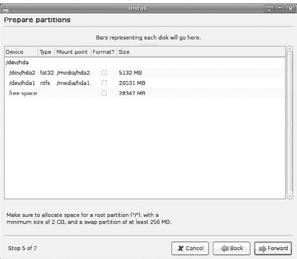
**图 3.8** 一个现有的分区方案。

为了创建可用空间，你需要调整现有分区的大小，将它们缩小，从而利用磁盘剩余的空间创建可用空间。在开始之前，请记住不要将 Windows 分区缩得太小，因为它们会变得无法容纳该分区上的现有数据。（不用担心，如果你尝试缩得太小，Ubiquity 会发出警告。）

要调整分区大小，请执行以下步骤：

- 1. 右键点击你想要调整大小的分区。会出现一个弹出菜单。
- 2. 点击“编辑（Edit）”。将打开“编辑分区（Edit Partition）”对话框（见图 3.9）。

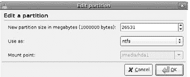
**图 3.9** 编辑分区大小。


- 3. 使用组合框的向上或向下箭头，或者直接输入，以 MB 为单位输入您希望分区的大小。
- 4. 点击 OK。编辑分区对话框将关闭，并出现“写入之前的更改”消息框（见图 3.10）。
- 5. 点击 Continue。分区将根据您的规格重新调整大小。

在创建了足够数量的空闲空间后，您需要创建一些分区来存放您的 Ubuntu 安装。

- 1. 右键单击空闲空间行。将出现一个上下文菜单。
- 2. 点击 New。将打开图 3.11 所示的创建分区对话框。
- 3. 要先设置交换空间，请点击“Use As”下拉列表并选择 Swap。
- 4. 使用组合框的向上或向下箭头，或者直接输入，以 MB 为单位输入您希望交换分区的大小。
- 5. 点击 OK。磁盘将被重新扫描，并出现新的交换分区。
- 6. 再次右键单击空闲空间。将出现一个上下文菜单。

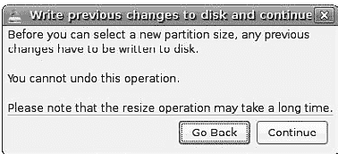
**图 3.10** 确认调整大小操作。

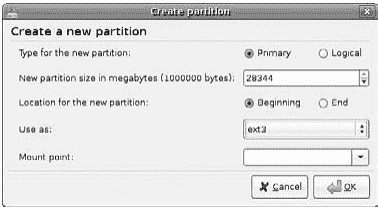
**图 3.11** 创建新分区。

- 7. 点击 New。将打开创建分区对话框。
- 8. 确认已设置“Primary Partition”选项。
- 9. 使用组合框的向上或向下箭头，或者直接输入，以 MB 为单位输入您希望根分区的大小。
- 10. 在“Use As”字段中选择您想要用于格式化驱动器的文件系统类型。（默认的 ext3 文件系统非常适合几乎所有用户。）
- 11. 在“Mount Point”字段中输入 `/`。这将创建至关重要的根挂载点。
- 12. 点击 OK。磁盘将被重新扫描，并出现新分区。
- 13. 如果您没有用根分区占用所有可用空闲空间，请重复步骤 6-12 以创建具有不同大小和挂载点的其他分区。完成后，您的分区可能与图 3.12 中显示的分区类似。
- 14. 点击 Forward 进入步骤 6。

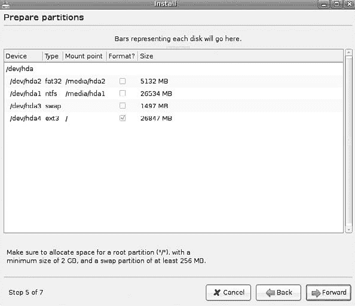

| 设备 | 类型 | 挂载点 | 格式化？ | 大小 |
|--------|------|-------------|---------|------|
| /dev/hda | | | | | |
| /dev/hda2 | fat32 | /media/hda2 | ☐ | 5132 MB |
| /dev/hda1 | ntfs | /media/hda1 | ☐ | 26534 MB |
| /dev/hda3 | swap | | ☐ | 1497 MB |
| /dev/hda4 | ext3 | / | ☑ | 26847 MB |

**图 3.12** 一种可能的分区方案。

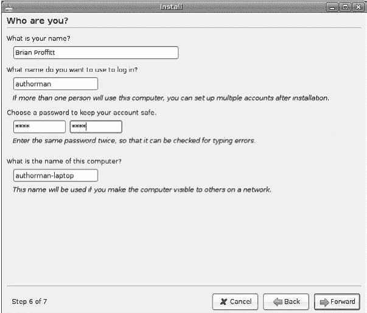
**图 3.13** 告知 Ubuntu 您的身份。

### 用户设置

现在困难的部分已经完成了，您将能迅速完成 Ubuntu 的安装。在步骤 6 中，您只需输入个人信息，包括姓名、首选用户 ID 和密码（见图 3.13）。

大部分是简单直接的信息，很容易填写。这里有几点注意事项供您参考：首先，绝不要将您的用户 ID 设置为 “root” 单词的任何变体。不小心以 root 用户身份登录将使您在 Ubuntu 机器上拥有极高的权限。虽然这听起来很不错，但绝对并非如此。Root（或超级用户）账户有能力一次损坏许多文件，而普通用户则没有被授予此类访问权限。

在 Ubuntu 的某些操作中需要超级用户权限，我们稍后将探讨这些内容。

第二件事，您肯定经常听到的，就是请将您的密码设置得难以猜测。使用字母和数字的组合，不要构成单词或专有名词，因为此类密码更容易被破解。一种常用的方案是使用您最喜欢的歌曲副歌中每个单词的首字母。这样您就能获得一个强度足够的密码。

填写完信息后，点击 Forward 以在步骤 7 中结束。

### 审查设置

在最后一步中，您有最后一次机会审查在 Ubiquity 安装过程中所做的设置。仔细检查这些设置，尤其是分区设置。

如果任何内容与您的需求不符，请点击 Back 按钮逐步返回 Ubiquity 的各个阶段并重新输入正确的信息。

当您对设置满意时，点击 Install。自动化安装程序将开始。根据您的电脑配置，大约 15 分钟到一小时后，系统会要求您从 CD 驱动器中取出 CD。系统重启后，Ubuntu 将安装在您的机器上。

### 本章小结

在本章中，您回顾了在 PC 上安装 Ubuntu 的步骤。我们特别关注了分区设置，因为这是安装过程中唯一可能导致重要数据丢失的部分。

现在 Ubuntu 已经安装完成，是时候在第 4 章“桌面基础”中对这个优秀的操作系统进行大巡礼了。

### 第 4 章：桌面基础


新用户注意到 Ubuntu 桌面的一点就是其低调的色调。一些用户表达得更直接一些，他们可能会心不在焉地嘀咕：“它是……棕色的……”

事实上，考虑到当今许多图形环境的华丽与光鲜，Ubuntu 的默认配色方案相当沉静。但这有一个充分的理由：各种深浅的棕色反映了人类的多样性，而这正是 Ubuntu 精神所拥抱的。仔细想想，所有人类的皮肤色素沉着其实都只是某种色调的棕色。

虽然棕色（字面上地）是每个人的颜色，但它可能不是您对桌面的偏好。不必担心：自定义桌面的方法如此之多，而且不仅仅是通过颜色，您几乎会不知道从哪里开始。

本章将指导您如何开始将 Ubuntu 桌面真正打造为您自己的空间。

在本章中，您将：

- 进一步了解 GNOME 桌面的发展。
- 确保您的显示器设置在最佳分辨率。
- 探索如何修改各种桌面元素的设置。
- 熟悉 GNOME 桌面的操作。

### 了解 GNOME 桌面

首先，它不是 “gnome”（发音类似那些在斯堪的纳维亚乡村奔跑的穿着蓝色外套、戴着红帽子的古怪小生物）。它是 “guh-nome”，重读 “g”，轻读 “uh”。

GNOME (GNU Network Object Model Environment) 是 Miguel de Icaza 的产品，他是一位墨西哥计算机工程专业的学生。他在看到 KDE 环境时非常喜欢——直到他发现其中（当时）包含的非自由代码。

作为自由软件理想的忠实追随者，De Icaza 决定 Linux 需要一个类似的桌面环境，且不具有当时 KDE 所被认为的许可限制。

GNOME 首次亮相于 1997 年 8 月，当时 de Icaza 在 `comp.os.linux.announce` 新闻组中首次宣布了他正在进行的项目。到同年 12 月，第一个可运行的测试版本向 Linux 社区发布。直到 1999 年 3 月，1.0 版本才向公众发行，但到那时消息已经传开，数以千计的自由软件爱好者加入了 GNOME 的行列。

GNOME 和 KDE 一样，是一个桌面环境。它不是像 Enlightenment 或 Metacity 那样的窗口管理器。窗口管理器控制图形界面中窗口、菜单和其他视觉组件的外观和感觉。桌面环境则包含窗口管理器，并为应用程序运行提供特定的平台。因此，如果一个应用程序是为某个桌面环境编写的，它可以利用该环境中与其他应用程序共用的广泛通用功能。

在 Linux 社区中，GNOME 受赞誉的原因不仅在于其自由软件的身份。它通常被认为比 KDE 更具有美感，因为 GNOME 提供的主题更具视觉吸引力。（最近版本的 KDE 对此持有不同看法，如果您尝试使用 Kubuntu 就会发现这一点。）

除了 GNOME 的外观，de Icaza 还拓展了企业界对自由软件认知的边界。在 GNOME 1.0 发布一年后，de Icaza 与几家大公司合作成立了 GNOME 基金会——这是一个致力于以快速且开放的方式推动 GNOME 开发的非营利组织。


GNOME 基金会及其强大的成员（如 Sun Microsystems、HP 和 IBM，更不用说 Canonical）希望将 GNOME 打造为 Linux 的 *核心* 界面，并使该界面非常易于用户适应。

人们使用 Linux 的主要障碍之一是对其“太难使用”的认知，而 GNOME 基金会希望改变这种认知。通过为软件开发人员提供一个稳定且具有沟通机制的环境来创建新的 GNOME 应用，GNOME 基金会充当了一个类似于孵化器的角色，旨在为 GNOME 界面带来更多用户友好的应用程序。

正是基于这些原因，Ubuntu 的默认桌面采用了 GNOME。让我们简单地参观一下，并在此过程中学习如何更改桌面的外观。

## 桌面设置与功能

当你观察 GNOME 桌面时，你会发现它多么简单且纯净（见图 4.1）。这是因为界面设计师决定以尽可能不干扰用户的方式，仅呈现你需要的工具。除非你需要，否则在这里找不到“回收站”或“我的文档”图标。

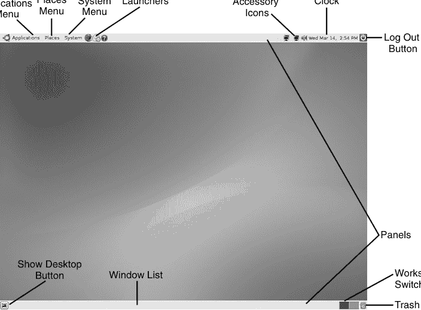
**图 4.1** Ubuntu GNOME 桌面。

### 第 4 章 ■ 桌面基础

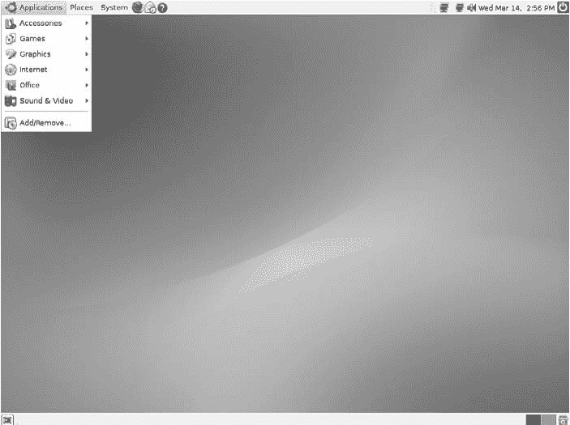
**图 4.2** 应用程序菜单。

如果你过去使用过 Windows 或 OS X，桌面中的某些元素在功能上会对你来说很熟悉。一些控制项和功能可能较为陌生，但一旦你了解了它们的工作原理，很快就会适应。

- **应用程序菜单 (Applications Menu)。** 该菜单在形式和功能上与 Windows 的“开始”菜单非常相似。在此菜单中，可以找到安装在 Ubuntu 机器上的许多应用程序，并按类别排列（见图 4.2）。
- **位置菜单 (Places Menu)。** 根据你的配置，此菜单允许你快速导航到本机或其他机器上的特定目录（见图 4.3）。
- **系统菜单 (System Menu)。** 系统菜单是桌面的重要组成部分，为用户提供各种配置设置的访问权限，以及退出、重启选项和通用帮助访问（见图 4.4）。
- **面板 (Panels)。** Ubuntu 中的面板是许多 Ubuntu 控制项（菜单、启动器、切换器等）所在的地方。面板可以自定义不同的位置、大小和外观，这将在本章稍后的“面板”部分中讨论。

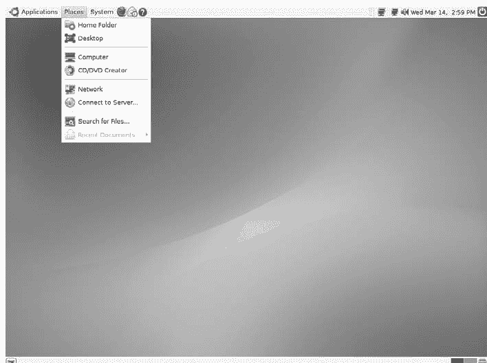
**图 4.3** 位置菜单。

- 主文件夹
- 桌面
- 计算机
- CD/DVD 创建器
- 网络
- 连接到服务器...
- 搜索文件...
- 最近文档

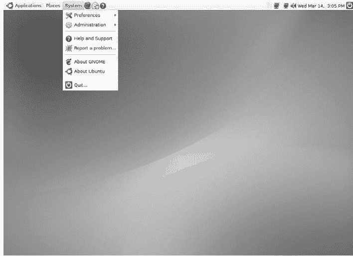
**图 4.4** 系统菜单。

- 首选项
- 管理
- 帮助与支持
- 报告问题...
- 关于 GNOME
- 关于 Ubuntu
- 退出...

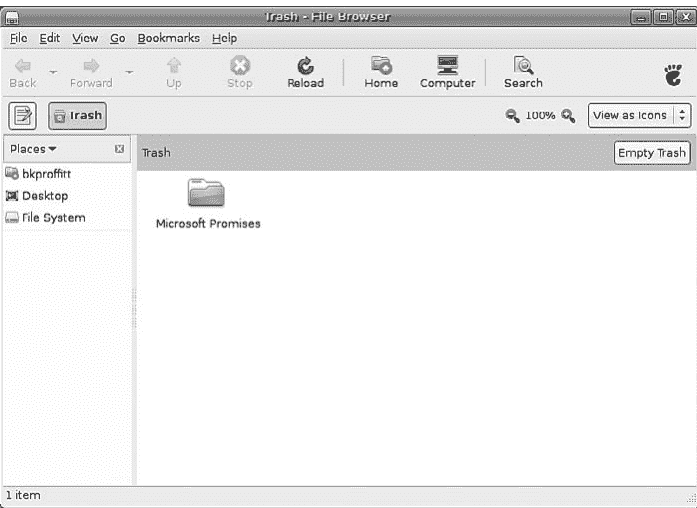
**图 4.5** 回收站文件夹。

- **回收站 (Trash)。** 回收站图标是 Ubuntu PC 上回收站文件夹的占位符。当你删除桌面上的文件时，它们并不会被永久删除，而是被发送到这个文件夹中。要查看回收站的内容，请点击该图标（见图 4.5）。如果你想永久清除回收站中的文件，请点击“清空回收站”按钮。
- **工作区切换器 (Workspace Switcher)。** 这一控制项在大多数具有像 GNOME 这样强大桌面环境的 Linux 发行版中是独有的。你不仅可以拥有一个桌面，实际上还可以拥有多个桌面，每个桌面都有自己的一套打开的应用程序、图标——甚至外观。欲了解更多信息，请参阅本章稍后的“工作区”部分。
- **窗口列表 (Window List)。** 与 Windows 任务栏或 OS X 停靠栏 (dock) 类似，窗口列表将显示 Ubuntu 中所有正在运行的应用程序和窗口（见图 4.6）。
- **显示桌面按钮 (Show Desktop Button)。** 此按钮的功能非常简单但很有用。点击后，桌面上所有打开的窗口将立即最小化。如果你打开了很多应用程序且需要快速访问桌面上的启动器，这会非常方便（参考图 4.1）。

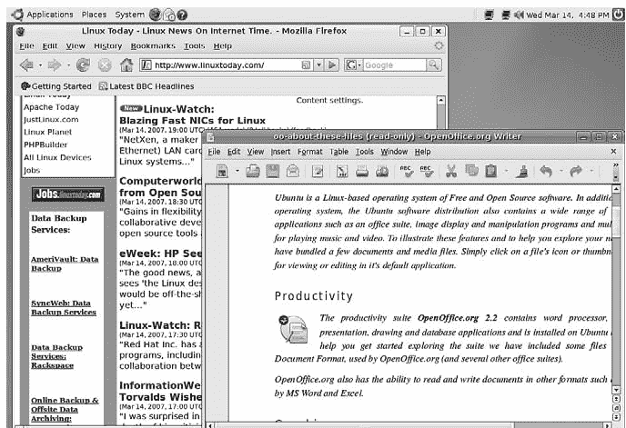
**图 4.6** 一个处于激活状态的窗口列表。

- **启动器 (Launchers)。** Ubuntu 中的图标仍然被称为图标，但如果它们被赋予了启动某样东西（如应用程序、文件或文件夹）的任务，那么它们就被称为 *启动器*。启动器可以出现在桌面或桌面面板中。
- **附件图标 (Accessory Icons)。** 某些图标不仅用于启动内容，它们还用于向用户传递信息，例如计算机是否连接到网络。
- **时钟 (Clock)。** 顾名思义：这是一个告知用户时间和日期的面板附件。它还能做更多事情，例如接入 Ubuntu 的个人信息管理应用程序 Evolution，以访问当前的预约和任务。
- **注销按钮 (Log Out Button)。** 点击此面板附件将启动注销或关机流程。

GNOME 桌面除了这里列出的功能外，还有更多、丰富得多的特性。但在你继续探索这个新界面时，这些是你首先需要了解的基础知识。现在，是时候学习如何自定义桌面，使其更具个性化了。

### 个性化定制

> 本章将探讨的设置仅会影响进行设置更改的用户。除非另有说明，否则其他用户不会受到这些更改的影响。

### 分辨率

Ubuntu 中的屏幕分辨率并不严格属于桌面功能，因为更改屏幕分辨率的大小实际上会影响 Ubuntu 中的所有内容，而不仅仅是桌面。尽管如此，在进行其他操作之前，让我们看看是否能提升你的视觉体验。

屏幕分辨率是技术简写，指任何时刻屏幕上显示的像素数量。它通常表示为 宽 × 高（以像素为单位）。例如，常见的 800 × 600 分辨率表示显示器屏幕横向显示 800 像素的图形信息，纵向显示 600 像素（全屏总计 480,000 像素）。这虽然有很多像素，但坦白说，就今天的强大显卡和显示器而言，800 × 600 已经低于平均水平了。

如今，1024 × 768 的分辨率更为常见，而在零售渠道的宽屏显示器上，1280 × 1024 是个不错的分辨率，1600 × 1200 也不罕见。

这些分辨率设置的最终效果是：分辨率越高，屏幕上能容纳的像素越多。像素越多，屏幕上的对象看起来就越小。因此，在较高的分辨率下，你可以在屏幕上容纳更多信息和窗口，且图像本身会更清晰，细节更丰富。

Ubuntu 首次安装时，通常能很好地探测你的显示器和显卡，并计算出最适合你硬件能力的分辨率。不过，市面上的硬件种类繁多，有时 Ubuntu 也会出现偏差。在进入具体的桌面设置之前，让我们先检查一下分辨率。

如图 4.7 所示，所示桌面的分辨率有点低——对象非常大，可用的屏幕“地产”不多。你的显示器可能可以支持更高的分辨率。

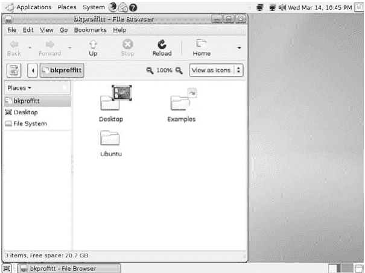
**图 4.7** 800 × 600 的桌面分辨率。

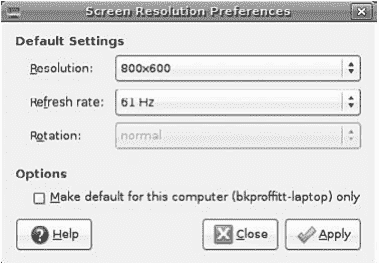
**图 4.8** 你表示想要一个分辨率。

更改此设置很简单，只需按照以下步骤操作：

1. 点击 系统 | 首选项 | 屏幕分辨率 (System | Preferences | Screen Resolution) 菜单命令。屏幕分辨率首选项对话框将打开（见图 4.8）。
2. 点击“分辨率”下拉列表，选择一个高于当前值的分辨率。
3. 点击“应用”。桌面分辨率将被更改。
4. 将出现一个消息框，询问你是否要保留此分辨率。确认你的选择。

### 菜单

Ubuntu 的一个绝佳功能是它能够编辑菜单内容，从而包含你想要的任何内容。Ubuntu 在菜单中包含最常用应用程序方面做得很好，但你可能希望将某些应用程序放入菜单以便更快捷地访问，更不用说你想删除某些命令了。

配置 Ubuntu 的菜单相对简单。而且在配置过程中，你可能会发现一些你之前不知道 Ubuntu 拥有的应用程序。

1. 右键点击 GNOME 面板中的任何菜单。将出现一个上下文菜单。
2. 点击“编辑菜单” (Edit menus)。主菜单对话框将打开（见图 4.9）。
3. 点击“菜单”列中的一个子菜单项。以*斜体*打印的项目前在任何菜单中都不可见。该子菜单的内容将显示在“项”列中。

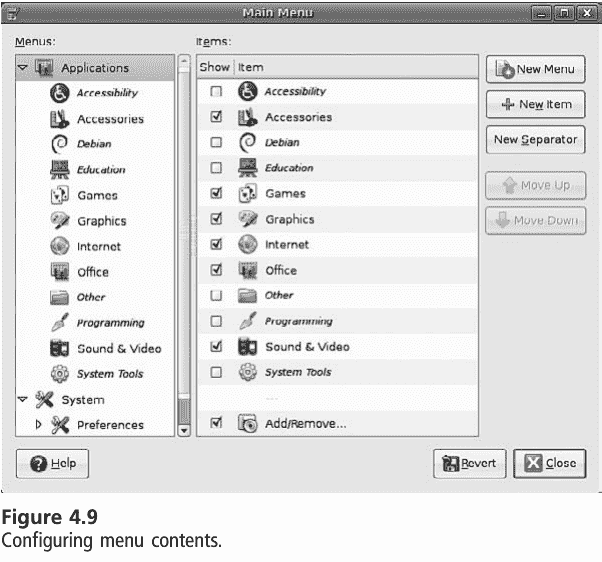


### 第 4 章 ■ 桌面基础

- 4. 要将项目添加到菜单中，请单击“项目”列中该项目旁边的复选框。该项目将被选中（见图 4.10）。
- 5. 要移动项目，请单击您想要移动的项目。“上移”和“下移”按钮将变为可用状态。
- 6. 点击“上移”。菜单项目将在其列表中向上移动一个位置。
- 7. 点击“关闭”。菜单将反映您的更改。

您不仅可以让项目可见并对其进行移动，还可以向菜单中添加项目。

- 1. 要添加新项目，请导航到您希望放置该项目的子菜单并点击“新项目”。“创建启动器”对话框将打开（见图 4.11）。
- 2. 在“名称”字段中输入您要添加的应用程序名称。
- 3. 在“命令”字段中输入用于启动程序的命令。

### 选择应用程序

您可以使用“浏览”按钮打开“选择应用程序”对话框，并导航到相应的命令。许多应用程序位于 `/usr/bin` 或 `/usr/sbin` 目录中。

- 4. 要添加图标，请单击“无图标”按钮。“浏览图标”对话框将打开（见图 4.12）。
- 5. 点击所需的图标，然后点击“确定”。所选图标将出现在“创建启动器”对话框中。
- 6. 点击“确定”。“创建启动器”对话框将关闭，新的菜单项目将出现在“主菜单”对话框的“项目”列中。
- 7. 点击“关闭”。菜单将反映您的更改。

若要向您的菜单选择中添加新的子菜单，请执行以下步骤：

- 1. 点击您希望放置新子菜单的顶级菜单。
- 2. 点击“新菜单”。“目录属性”对话框将打开（见图 4.13）。
- 3. 在“名称”字段中输入您要添加的应用程序名称。
- 4. 要添加图标，请单击“无图标”按钮。“浏览图标”对话框将打开。
- 5. 点击所需的图标，然后点击“确定”。所选图标将出现在“目录属性”对话框中。
- 6. 点击“关闭”。“目录属性”对话框将关闭，新的子菜单项目将出现在“主菜单”对话框的“菜单”列中。
- 7. 点击“关闭”。菜单将反映您的更改。

### 面板

在 Ubuntu 中，可以自定义的不仅仅是菜单。事实上，说到底，列出 Ubuntu 中那些无法以某种方式自定义的元素反而更容易。

面板也不例外。面板是 Ubuntu 桌面顶部和底部的灰色水平条，包含各种工具和菜单。至少，它们最初是这样的。但在经过简单的微调后，您很快会发现“灰色”、“水平”、“顶部”和“底部”都只是宽泛的概念。面板可以呈现为几乎任何样子，并位于不同的位置。这完全取决于您。

您可以快速做的一项更改是重新定位任何面板。

- 1. 在面板上单击并按住鼠标光标。光标将变为抓取手形。
- 2. 将光标拖动到屏幕的另一个边缘。面板将移动到该边缘。
- 3. 松开鼠标按钮。面板将固定在它的新位置（见图 4.14）。

与菜单一样，项目也可以添加到面板中或从面板中删除。三类项目可以添加到面板：工具（如附件或监控工具）、来自“应用程序”菜单的“应用程序启动器”，或自定义的“应用程序启动器”。我们可以用几个简单的步骤来完成所有这些操作，从 GNOME 工具开始。

- 1. 右键单击您要添加项目的面板。将出现一个上下文菜单。
- 2. 点击“添加到面板”。“添加到面板”对话框将打开（见图 4.15）。
- 3. 点击您想要添加的项目。该项目被选中。
- 4. 点击“添加”。该项目将出现在面板中（见图 4.16）。
- 5. 要移动该项目，请右键单击其图标。将出现一个上下文菜单。
- 6. 点击“移动”。鼠标光标将变为抓取手形。
- 7. 将鼠标光标在屏幕上向左或向右移动。面板项目将相应地移动。
- 8. 当项目位于正确位置时，点击该项目。项目将处于所需位置。
- 9. 点击“关闭”。“添加到面板”对话框将关闭。

添加应用程序同样简单。您可以从“应用程序”菜单中的任何应用中选择，或者运行您自己的应用。

- 1. 右键单击您要添加项目的面板。将出现一个上下文菜单。
- 2. 点击“添加到面板”。“添加到面板”对话框将打开。
- 3. 点击“应用程序启动器”。“应用程序”菜单的内容将出现在中央窗口中（见图 4.17）。
- 4. 点击展开箭头（三角形）以展开一组应用程序。
- 5. 点击您想要添加的应用程序。该应用程序被选中。
- 6. 点击“添加”。该应用程序项目将出现在面板中。
- 7. 要移动该项目，请右键单击其图标。将出现一个上下文菜单。
- 8. 点击“移动”。鼠标光标将变为抓取手形。
- 9. 将鼠标光标在屏幕上向左或向右移动。面板项目将相应地移动。
- 10. 当项目位于正确位置时，点击该项目。项目将处于所需位置。
- 11. 点击“关闭”。“添加到面板”对话框将关闭。

您不必局限于“应用程序”菜单中的应用；只需使用“自定义应用程序启动器”工具即可。

- 1. 右键单击您要添加项目的面板。将出现一个上下文菜单。
- 2. 点击“添加到面板”。“添加到面板”对话框将打开。
- 3. 点击“自定义应用程序启动器”。将出现“创建启动器”对话框。
- 4. 在“名称”字段中输入您要添加的应用程序名称。
- 5. 在“命令”字段中输入用于启动程序的命令。
- 6. 要添加图标，请单击“无图标”按钮。“浏览图标”对话框将打开。
- 7. 点击所需的图标，然后点击“确定”。所选图标将出现在“创建启动器”对话框中。
- 8. 点击“确定”。“创建启动器”对话框将关闭，新的菜单项目将出现在面板中。
- 9. 要移动该项目，请右键单击其图标。将出现一个上下文菜单。
- 10. 点击“移动”。鼠标光标将变为抓取手形。
- 11. 将鼠标光标在屏幕上向左或向右移动。面板项目将相应地移动。
- 12. 当项目位于正确位置时，点击该项目。项目将处于所需位置。
- 13. 点击“关闭”。“添加到面板”对话框将关闭。

从面板中删除项目是一个更快的过程。

- 1. 右键单击您要删除的项目。将出现一个上下文菜单。
- 2. 点击“从面板删除”。该项目将从面板中删除。

如果您在审美上无法欣赏面板的外观，有一个好消息：您可以非常快速地更改面板外观。

- 1. 右键单击您要添加项目的面板。将出现一个上下文菜单。
- 2. 点击“属性”。“面板属性”对话框将打开（见图 4.18）。
- 3. 点击“背景”选项卡。
- 4. 点击“纯色”单选按钮。颜色选项将变为可用状态，如图 4.19 所示。
- 5. 点击并向“透明”设置方向拖动“样式”滑块。面板将变得更加透明。
- 6. 点击“关闭”。“面板属性”对话框将关闭，面板将变得相当清晰（见图 4.20）。


#### 透明面板

将面板设置为透明只是你在“面板属性”对话框中可以进行的众多更改之一。尝试在“背景”选项卡中实验不同的颜色、阴影和背景图像。在“常规”选项卡中，你可以调整面板的大小，将其设置为“自动隐藏”，甚至可以减小其宽度。

### 鼠标和键盘

在安装过程中，你可以定义所使用的键盘类型。虽然 Ubuntu 不太可能将其识别错误，但可能会出现你更换键盘，或者添加一个倾向于使用自己独特输入设备的新用户的情况。而且，你之前并没有收到过任何设置鼠标选项的机会。

在你尝试使用 Ubuntu 桌面时，让我们花点时间看看这些设置可以在哪里配置。

首先，让我们看看鼠标是如何配置的。你可能认为鼠标没有什么好更改的，但结果可能会让你感到惊讶。

点击“系统 | 偏好设置 | 鼠标”菜单命令。随后将打开“鼠标偏好设置”对话框（见图 4.21）。

- 在“按钮”页面，你可以将鼠标设置为左手模式（这将切换按钮操作），并设置双击之间的时间间隔——这对反应较慢的用户非常有用。
- 在“指针”页面（如图 4.22 所示），你可以选择特定的鼠标主题，并激活一个控件，当你按下键盘上的 Ctrl 键时，它会在屏幕上突出显示鼠标。

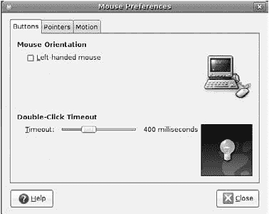
**图 4.21**
鼠标所需的一切，除了奶酪。

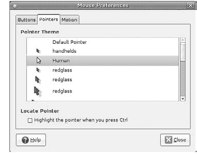
**图 4.22**
选择指针主题。

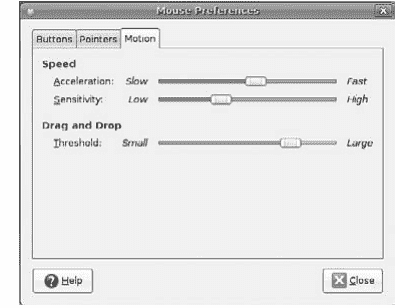
**图 4.23**
控制鼠标移动。

- 在“移动”页面，可以设置鼠标的加速和灵敏度，以及鼠标在拖放桌面对象时的范围（见图 4.23）。

你的 Ubuntu 键盘也可以获得很多关注，其中包含一些你可能从未听说过但使用后会觉得非常合理的特性。要访问键盘配置，请点击“系统 | 偏好设置 | 键盘”菜单命令。随后将打开“键盘偏好设置”对话框（见图 4.24）。

- 在“键盘”页面，可以设置重复按键的响应时间和光标闪烁速度。

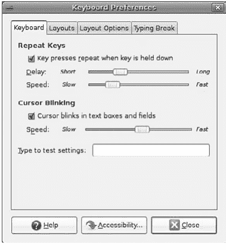
![](img/f0f59580bcd90fd67f1915fc0305480f_114_1.png

- 在“布局”页面，你可以像在安装 Ubuntu 时那样选择你的键盘类型，并添加额外的键盘配置（见图 4.25）。
- 在“布局选项”页面，可以通过点击展开箭头然后选择相应的单选按钮，为特定布局中的某些键应用各种选项（见图 4.26）。

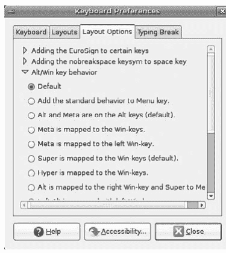
**图 4.26**
有许多键映射选项可用。

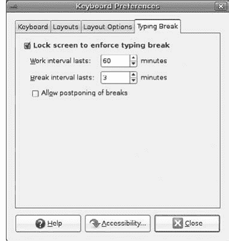
**图 4.27**
一项为了健康的特性。

- 在“打字休息”页面，你可以强制键盘自动锁定，让你在任何给定的时间间隔休息一次（见图 4.27）。这看起来像是在浪费时间，但定期休息有助于预防过度打字常带来的重复性压力损伤。

### 时间和日期

运行在面板上的“时钟”附件非常简单：它显示日期和时间。如果你愿意，可以手动设置它。但你们当中真正追求准时的人可能会感兴趣地发现，你可以将时钟同步为与世界各国政府维护的原子钟一致。

### 系统时间与日期

> 所有时间与日期设置将影响系统上的每一个用户。

1. 右键点击时钟。将出现一个上下文菜单。
2. 点击“调整日期和时间”。屏幕会立即变暗，并打开一个管理密码对话框（见图 4.28）。

### 秘密密码

> 管理密码是属于 Ubuntu 电脑管理用户的密码。默认情况下，这就是安装 Ubuntu 的第一个用户。有关用户账户管理的更多信息，请参阅第 7 章“让一切正常运行”中的“设置用户账户”部分。

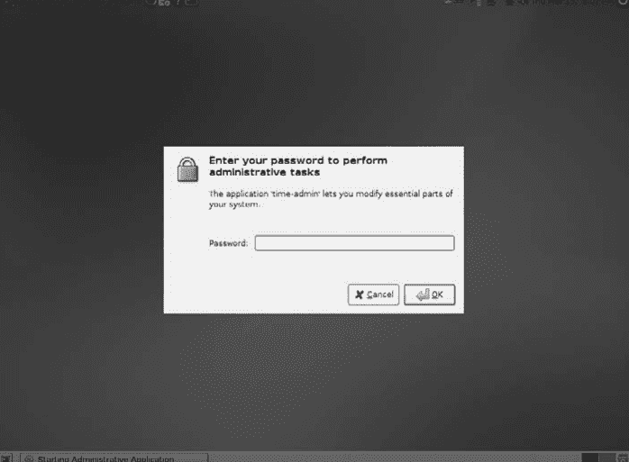
**图 4.28**
管理任务需要管理员密码。

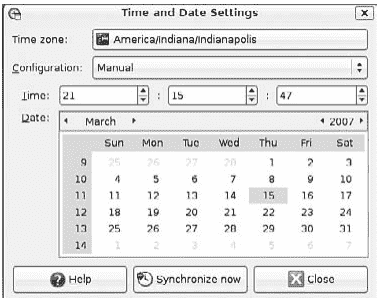
**图 4.29**
设置你的时钟。

3. 输入管理密码并点击“确定”。桌面将解锁，并打开“时间和日期设置”对话框（见图 4.29）。
4. 可以通过此对话框中的控件手动设置时钟。若要通过公共或私有原子钟时间服务器设置时钟，请点击“配置”下拉列表并选择“与互联网服务器保持同步”。

### 检查你的连接

> 如果你希望你的电脑自动同步，你需要能够连接到互联网。

如果你是第一次尝试同步时钟，你会收到一个警告消息框，提示 NTP 支持尚未安装。NTP 代表 Network Time Protocol（网络时间协议），简单来说，就是你的计算机用来与世界上各种时间服务器通信的语言。如果你看到此警告且当前已连接到互联网，请点击“安装 NTP 支持”按钮，随后将安装正确的软件。（如果你当前未连接，请点击“取消”，并在稍后上线时再次尝试同步。）

一旦安装了 NTP 支持并选择了“保持同步”配置，“时间和日期设置”对话框将更改为仅显示三个字段，如图 4.30 所示。

要完成此操作，请点击“选择服务器”按钮以打开“时间服务器”对话框（见图 4.31）。

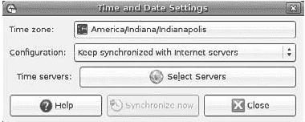
**图 4.30**
自动设置你的时钟。

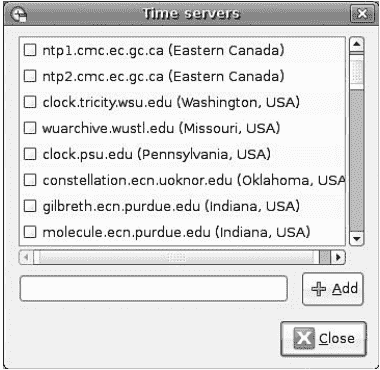
**图 4.31**
国际时间守护者。

你可以勾选任意数量的服务器，尽管不需要太多。你应该选择一个以上的服务器，以防某个服务器因某种原因离线。请确保点击离你较近的服务器，因为地理位置近信号更快，并务必选择 `pool.ntp.org` 设置，以免使单个时间服务器过载。

点击“关闭”关闭时间服务器对话框；然后点击“关闭”关闭时间和日期设置对话框。你的时钟将在系统启动时完成同步。

### 工作区

大多数 Windows 用户尚未见过的功能是 GNOME 桌面的工作区。工作区是虚拟桌面，每个工作区可以包含自己的窗口、图标和运行中的应用程序。默认情况下，Ubuntu 为你提供两个工作区开始工作，但如有需要，你可以添加更多。

对于需要将一组任务与另一组任务分开的用户来说，工作区是理想的选择。例如，某位作者可以将所有与写书相关的应用程序放在一个工作区，而将日常工作使用的应用程序放在另一个工作区。

要切换工作区，只需在右下角面板的“工作区切换器”中点击你想查看的工作区。你可以按照以下步骤控制工作区的数量。

1. 右键点击工作区切换器。将出现一个上下文菜单。
2. 点击“偏好设置”。将出现“工作区切换器偏好设置”对话框，如图 4.32 所示。
3. 要更改工作区数量，在“工作区数量”字段中输入你想要的数字。切换器中将添加一个新的工作区。
4. 要给每个工作区一个唯一的名称，缓慢地双击默认名称两次，然后输入新名称。名称将被更改。
5. 勾选“在切换器中显示工作区名称”复选框。切换器将显示新名称，如图 4.33 所示。
6. 点击“关闭”。工作区切换器偏好设置对话框将关闭。

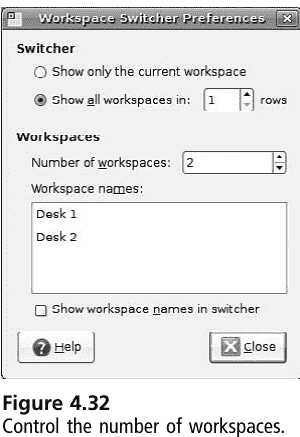

**图 4.33**
工作区可以拥有适当的名称。

要在工作区中打开窗口，您可以导航到某个工作区并在那里打开应用程序，或者只需一步即可将任何窗口移动到某个工作区。只需点击任何打开窗口左上角的窗口菜单图标，然后选择“移动到另一个工作区”菜单。接着点击该窗口的目标工作区。

### 界面美化

就像定制汽车一样，人们似乎热衷于用最华丽的主题和颜色来定制他们的 PC。而就性价比最高的视觉享受而言，很少有桌面环境能与 GNOME 桌面相媲美。因此，为了纯粹的享乐，让我们简单探讨一下如何开始装扮您的 Ubuntu “座驾”。

### 背景

背景是 Ubuntu 中最容易更改的内容，但遗憾的是，为了节省安装光盘的空间，系统仅包含两种背景，均为棕色抽象图。因此，先从其他来源（如互联网或个人图形文件）获取背景是一个不错的选择。

**图 4.34**
更改壁纸很简单。

**装饰者提示**
> 为您的 Ubuntu PC 寻找精美壁纸艺术的最佳去处之一是 GNOME-Look 网站的 Wallpapers 栏目：http://www.gnome-look.org。请务必访问与您桌面分辨率相匹配的栏目。

- 1. 在桌面上任意位置点击右键。将出现一个上下文菜单。
- 2. 点击“更改桌面背景”。将出现“桌面背景首选项”对话框（见图 4.34）。
- 3. 如果您看到了想要的壁纸，点击它。Ubuntu 背景将立即更新。
- 4. 要使用另一个文件作为壁纸，点击“添加壁纸”。将打开“添加壁纸”对话框。
- 5. 导航到并选择您想要用作壁纸的文件。
- 6. 点击“打开”。“添加壁纸”对话框将关闭，新壁纸将出现，并已在“桌面壁纸”窗口中被选中。
- 7. 点击“完成”。对话框将关闭，您的新壁纸将被显示（见图 4.35）。

### 主题

Ubuntu 使用主题来一次性更改整体颜色和窗口方案。它们玩起来非常有趣，即使您从互联网下载一个主题，您也可以对其任何部分进行自定义，使其真正独一无二。

要加载新主题，请按照以下步骤操作。

- 1. 点击“系统 | 首选项 | 主题”菜单命令。将打开“主题首选项”对话框（见图 4.36）。
- 2. 点击一个想要的主题。主题设置将立即反映在 Ubuntu 桌面上（见图 4.37）。
- 3. 要更改主题的一部分，点击“自定义”按钮。将打开“主题详情”对话框（见图 4.38）。
- 4. 探索详细控件并观察发生的变化。完成后，点击“关闭”。如果您进行了任何更改，该主题将显示为“自定义”主题。

**图 4.36**
Ubuntu 有多种主题可供选择。

**图 4.37**
主题会被立即应用。

- 5. 点击“保存主题”。将出现“另存为主题”对话框。
- 6. 输入主题的名称和描述，然后点击“保存”。新主题将被保存在主题列表中。
- 7. 点击“关闭”。主题现在已被设置。

**图 4.38**
您可以更改主题的任何部分。

### 主题大集市

> 与壁纸一样，在 GNOME-Look 网站上可以找到许多优秀的主题。

### 本章小结

在本章中，我们参观了 Ubuntu 界面本身——GNOME 桌面。您已经看到它与 Windows 和 OS X 桌面非常相似，尽管存在一些重要的区别。

GNOME 桌面有很多值得观看和尝试的功能，在您继续阅读下一章之前，我们邀请您花一点时间去做这件事：尝试。然后，我们将进入任何 PC 的重要事务——连接互联网。

### 第 5 章：联网

现在您已经完成了 Ubuntu PC 的一些基本配置步骤，是时候来看看如何让 Ubuntu 与其他计算机通信了，即通过 21 世纪无处不在的媒介——互联网。

在本章中，您将学习如何配置 Ubuntu 通过以下方式连接到互联网：

- 家庭或办公网络。
- 宽带电缆/DSL 调制解调器。
- 拨号连接。
- 通过 WiFi 进行无线连接。

### 如何接入互联网

在过去的几十年里，人们对互联网讨论了很多。虽然这个最大的公共计算机网络伴随着许多喧嚣和炒作，但值得注意的是，即使在发达国家，互联网也远未完成其建设。

互联网（到目前为止）的增长在很多方面与 19 世纪末电话在美国的增长相似。在商业运行的前五年，电话仅普及于约 10% 的美国家庭。五年后，普及率达到了 50%。又过五年，则达到了 90%。

互联网的增长模式与之相当接近。到 1994 年，即互联网脱离纯学术环境五年后，约 10% 的美国人家中有了互联网连接。如今，13 年过去了，美国互联网接入的普及率已超过 70%。尽管看起来不可思议，但美国在实现全面互联网普及的进程中仅走到了约四分之三的阶段。（其他国家的互联网普及率在百分比上较低，但这或许只是因为美国起步早；增长模式依然相同。）

无论您是互联网社区的新面孔，还是从 Mozilla 时代就开始冲浪的老手，您都会发现互联网正逐渐从一个娱乐场所变成一个工作场所。普通人开始利用互联网处理银行需求、购买节日礼物，以及通过基于 Web 的电话服务与亲友交流。

Linux 和互联网的历史是交织在一起的。Linux 的前身 UNIX 是构建互联网的操作系统。事实上，互联网的许多语法（如 “http://”、FTP 命令、用正斜杠作为目录分隔符）直接源自 UNIX 命令行，而这些命令在今天的 Ubuntu 中依然可见。

因此，Ubuntu 提供了丰富的互联网接入工具也就不足为奇了。您唯一需要做的就是让自己连接上去。

如今接入互联网相当简单。宽带接入由各种运营商提供，简单来说就是来自电缆公司的有线宽带或来自电话公司的数字用户线路（DSL）接入。在某些城市，一些社区可以免费或廉价地使用无线互联网接入。办公室和零售建筑几乎总是为租户铺设了网络接入线。此外还有窄带接入：即您的计算机调制解调器通过普通电话线拨号接入互联网。

Ubuntu 可以处理所有这些连接——且通常是无缝的。

### 配置连接

在大多数情况下，Ubuntu 安装后即可联网。这意味着如果您将某种电缆插入计算机，而电缆的另一端连接到互联网，Ubuntu 很有可能识别出情况并自动为您建立连接。

尽管如此，过程中仍有一些部分可能需要您的帮助。例如拨号连接。对于 Ubuntu 来说，拨号上网并不复杂，但搞清楚如何使用随机附带的调制解调器可能会是一个障碍，因为许多调制解调器制造商没有提供 Linux 驱动程序。无线连接有时也会比较棘手，同样是因为缺乏 WiFi 网卡的驱动程序。

不过，大多数此类情况已被发现，解决方案正逐步进入 Ubuntu。在接下来的章节中，无论您偏好哪种方法，我们都将逐步引导您完成连接互联网的过程。在第 7 章“故障排除”中，我们将回顾在某些功能未按计划工作时所需的排除故障技巧。

### 拨号连接

互联网的“语言”被称为 TCP/IP（传输控制协议/网际协议）。这种语言决定了数据如何从您的计算机发送到位于（例如）南非的 Web 服务器计算机。

尽管 TCP/IP 是一款基于 UNIX 的产品，但 Ubuntu 在通过拨号连接接入互联网时需要额外的协议帮助。毕竟，TCP/IP 并不擅长通过串行线路（例如调制解调器中的串行线路）传输 IP（网际协议）数据包。

为了让所有数据包通过调制解调器传输，需要使用另一种 UNIX 发明的协议——PPP。它及其前身 SLIP 都是为了将 UNIX 计算机连接到互联网而开发的，PPP 后来被微软采用用于 Windows。Ubuntu 处理 PPP 毫无压力。

虽然拨号（或窄带）连接在所有互联网连接中占比不足 20%（且这一数字每年都在下降），但它仍然足够普遍，以至于您应该知道如何使用它。许多宽带互联网账户（尤其是 DSL）会为您提供拨号接入权限，以便在主 DSL 连接维修或您在旅行需要从其他地点接入互联网时使用。


以下是启动拨号连接过程的方法。在开始之前，您应该准备好互联网服务提供商 (ISP) 的信息，具体包括用户名、密码以及要拨打的电话号码。

- 1. 点击 系统 | 管理 | 网络。系统将要求您提供管理密码。
- 2. 输入密码。随后将出现“网络设置”对话框（见图 5.1）。
- 3. 点击“调制解调器连接”，然后点击“属性”按钮。将打开“ppp0 接口设置”对话框，如图 5.2 所示。

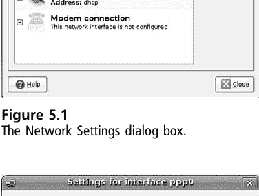
**图 5.1** 网络设置对话框。

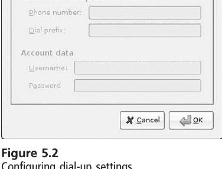
**图 5.2** 配置拨号设置。

- 4. 勾选“启用此连接”复选框。
- 5. 在“电话号码”字段中输入拨入号码。
- 6. 在相应的字段中输入您的 ISP 用户名和密码。您的信息应与图 5.3 所示类似。
- 7. 点击“调制解调器”选项卡。将出现“调制解调器”页面（见图 5.4）。


**图 5.3** 拨号设置示例。

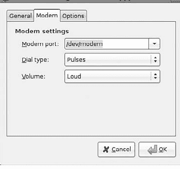
**图 5.4** 设置具体的调制解调器设备。

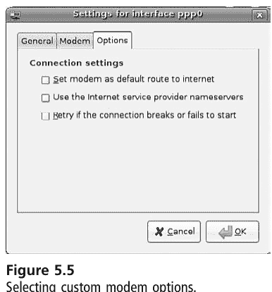

- 8. 在“调制解调器端口”字段中选择一个值。这为 Ubuntu 在需要时查找调制解调器设置了路径。`/dev/modem` 通常是一个不错的端口设置。
- 9. 如果您使用的是双音多频电话，请将“拨号类型”设置为“双音 (Tones)”。
- 10. 点击“选项”选项卡。将出现“选项”页面（见图 5.5）。
- 11. 勾选“使用互联网服务提供商名称服务器”复选框。
- 12. 勾选“如果连接中断或启动失败则重试”复选框。
- 13. 点击“确定”。“ppp0 接口设置”对话框将关闭。
- 14. 点击“关闭”。“网络设置”对话框将关闭。

现在您需要做的就是启动拨号连接。

- 1. 确保您的电话线已插入调制解调器（且调制解调器已连接到计算机）。
- 2. 点击上端面板中的网络管理器小程序。将出现一个上下文菜单（见图 5.6）。
- 3. 点击 拨号连接 | 通过调制解调器连接到 ppp0。调制解调器将自动拨号并连接到互联网。

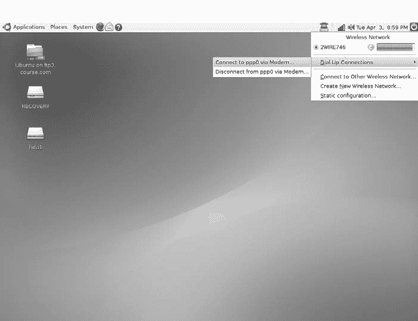
**图 5.6** 启动拨号。

断开拨号连接同样简单。

- 1. 确保您的电话线已插入调制解调器（且调制解调器已连接到计算机）。
- 2. 点击上端面板中的网络管理器小程序。将出现一个上下文菜单。
- 3. 点击 拨号连接 | 通过调制解调器断开 ppp0 的连接。调制解调器将从互联网断开。

### 关于内置调制解调器的内幕

假设您的调制解调器已被 Ubuntu 正确识别，且所有步骤都进展顺利。不幸的是，如果您的调制解调器位于计算机内部，那么情况可能没那么乐观。内置调制解调器（也称为 *winmodems*）因缺乏制造商对 Linux 的支持，而在 Ubuntu 和其他 Linux 发行版中以无法工作而闻名。然而，这并不是说使用内置调制解调器是不可能的。请参阅第 7 章的“调制解调器”部分，了解使内置调制解调器正常运行所需的步骤。

### DSL

DSL 是目前美国使用的两种主要宽带形式之一，另一种是电缆。当然，还有其他将宽带引入家庭的方法，例如宽带蜂窝网络、卫星、光纤或市政 WiFi。但在许多情况下，这些方法并不普遍，或者成本过高而无法证明其可行性。

DSL 使用进入您家庭或企业的相同铜质电话线；事实上，您可以在进行语音电话的同时，在同一条线路上保持互联网访问。这是因为 DSL 线以远高于人类听觉范围的频率发送数字“互联网”信号。一旦信号传回电话公司，语音信号和网络信号会被一个交换机分开，语音信号被路由到对话的另一端，而网络信号则被发送到互联网。

不过，这项技术巧思中有一个陷阱：由于涉及的频率非常高，DSL 线中的数字信号在电线中只能传输很短的距离就会衰减，大约 1.25 英里。因此，居住或工作在农村地区的人们无法享受 DSL——至少在他们的电话公司在他们所在地附近安装交换机之前是这样。

电话公司会为您提供两种类型的 DSL 调制解调器。一种是旧型号，它像传统调制解调器一样，您必须根据需要连接和断开互联网。较新型号的 DSL 调制解调器本质上表现为路由器：它们始终连接到互联网，并通过内置软件管理该连接。

使用后一种调制解调器（称为以太网 DSL 调制解调器）进行连接非常简单：计算机通过网络电缆或 WiFi 连接到 DSL 调制解调器/路由器，其余所有工作都由以太网 DSL 调制解调器/路由器处理。事实上，您可以直接跳转到下一节“局域网/电缆”来继续连接互联网。

旧类型的 DSL 调制解调器被称为 USB 调制解调器，因为它们通过 USB 端口连接到您的 PC。不幸的是，对于任何计算机（无论是 Ubuntu、Windows 还是其他系统）的任何宽带连接来说，这些都不是理想的选择。这是因为 PC 在设计时就配备了专门用于与其他计算机通信的硬件（网络接口卡或 NIC）。使用 USB 端口来完成这项工作，就像是要求您的鼻子而不是嘴巴开始说话一样。

这是本书中唯一一处强烈建议您不要使用某件硬件的地方。这是由于硬件本身的局限性，而非 Ubuntu 的问题。如果您的计算机没有 NIC，可以相对廉价地购买并安装一个。如果您的电信运营商没有给您以太网调制解调器，请要求提供一个。

如果您不愿或无法从 USB 调制解调器切换，有许多专门帮助您在 Ubuntu 上运行调制解调器的网站，其中最好的是 https://help.ubuntu.com/community/UsbAdslModem/。

### 局域网/电缆

如今，家庭或办公室中的大多数宽带连接将通过所谓的局域网 (LAN) 连接到 PC 的 NIC 端口。所使用的电缆（在 IT 行业中被称为 *Cat 5* 或 *Cat 6 线缆*）看起来像电话线，带有一个矩形接头，可插入网络路由器和 PC 上的匹配端口。您可能还听过另一个术语 *Ethernet*（以太网），它描述了您所接入的特定网络类型，即许多 PC 连接到一个中央路由器。

路由器是网络的中心，保持其运行良好且顺畅至关重要。确保它有足够的通风、稳定的电源和更新的软件。一个状态良好的路由器才是能正常工作的路由器。

路由器和 PC 通过本章前面描述的 TCP/IP 协议相互通信。而且因为不涉及电话，不需要应用额外的软件将任何内容翻译成 PPP 或电话线所需的其他协议。

使用 LAN 或以太网连接的好处在于，十之八九它就是开箱即用的。将 Cat 5 电缆插入 PC 就会告诉 Ubuntu 启动相关软件，让您连接到网络。

路由器有两个主要功能。首先，它充当交换机，以极快的速度发送和接收网络上 PC 的信号。其次，为了区分这些信号，路由器通常负责为连接到网络的每台 PC 或设备分配一个唯一的 IP 地址。

IP 地址是由四个数字（1.2.3.4）组成的唯一组合，在任何给定时间仅属于网络上的一个设备。用户如果愿意可以指定自己的 IP 地址，但通常路由器会通过一个名为 *DHCP* 的工具为他们完成此操作。


它会在设备物理连接到网络时，自动为其分配 IP 地址。

大多数家庭和小型办公室网络在中心位置配置有一个路由器/调制解调器组合设备，它不仅将网络设备连接在一起，还处理与外部世界的通信。大多数 ISP（互联网服务提供商）会通过 DHCP 为接入其网络的调制解调器分配一个唯一的 IP 地址。而连接到该路由器/调制解调器的任何计算机，反过来将由路由器的 DHCP 系统分配一组不同的 IP 地址。

这也是件好事，因为互联网上的 IP 地址数量是有物理限制的。如果世界上每台计算机都拥有自己的 IP，我们将很快耗尽所有地址。解决方案是，每个连接到互联网的路由器获得自己的 IP 地址，而使用该路由器的计算机和其他设备则获得相似的一组数字。

例如，你的调制解调器 IP 地址可能是 64.123.45.1，而你邻居的调制解调器可能是 64.123.45.2。但在你的网络中，你的计算机可能是 198.162.2.1，而在他的网络中，他的计算机可能拥有完全相同的 IP 地址。但这并不会产生冲突，因为就互联网而言，它只关心路由器的地址。

如今销售的许多家用路由器还具有防火墙功能。防火墙是对路由器/调制解调器经常具备的真实功能的隐喻表达：将恶意流量挡在网络之外。

理解这一点很重要，因为有时网络连接在第一次尝试时并不总是能成功，而这些基础的网络知识将帮助你在需要时对连接设置进行快速修复。

让我们先看看通常是如何运作的。这些步骤适用于任何以太网连接，并且假设你的网络已启用 DHCP。

- 1. 点击 系统 | 管理 | 网络。系统将要求你提供管理密码。
- 2. 输入密码。网络设置对话框将打开。
- 3. 点击 有线连接；然后点击 属性 按钮。如图 5.7 所示，“接口 eth0 设置”对话框将打开。
- 4. 确认 配置 字段的值被设置为 自动配置 (DHCP)。

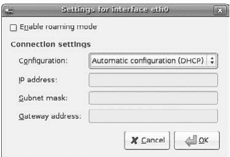
**图 5.7** 配置以太网连接。

### 设置 IP 地址

如果出于某种原因，你的网络被设置为单个设备使用特定的 IP 地址，请将配置设置为 静态 IP 地址。请咨询你的网络管理员以获取 IP 地址、子网掩码和网关地址字段所需的数值。

- 5. 点击 确定。接口 eth0 设置对话框将关闭。
- 6. 点击 关闭。网络设置对话框将关闭。

现在你只需要将以太网电缆插入 PC 的 NIC 端口。上方面板中的网络管理器图标将显示旋转动画并通知你连接成功，如图 5.8 所示。

现在你可以访问互联网或网络上的其他计算机和打印机了。

### WiFi

WiFi 是 Ubuntu 真正的成功案例之一。在不久前，Ubuntu 甚至任何 Linux 发行版上的无线网络连接在最好情况下也相当不稳定。那些时代已经过去了，大多数无线方案在 Ubuntu 上运行良好。

几乎所有的新笔记本电脑都内置了无线功能，这就是为什么大多数移动用户对本节感兴趣的原因。但即使是在家庭或办公室 PC 中，无线连接也是一个不错的选择，因为它节省了建立有线网络的时间、材料和麻烦。

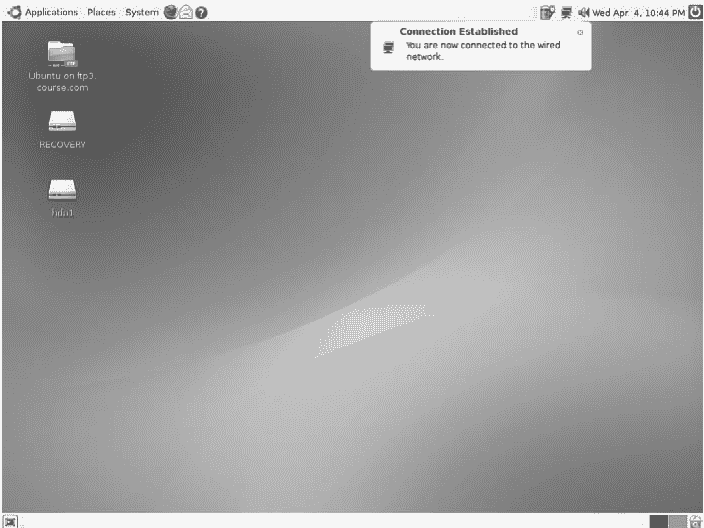
**图 5.8** 通过有线成功连接。

### 关于无线网卡的信息

如果你打算为计算机添加无线功能，请访问 http://help.ubuntu.com/community/WiFiDocs/WirelessCardsSupported 查看与 Ubuntu 配合最佳的无线网卡信息。

从某种程度上说，配置无线网络与配置有线网络访问完全一样。你仍然需要连接到路由器，并且仍然需要一个唯一的 IP 地址以便路由器识别你的机器。而且，与以太网连接一样，DHCP 是将 IP 地址自动分配给 PC 的最佳方式。

无线连接需要额外的配置层级。可以将你的无线网卡想象成一台收音机（它确实如此），需要调频到特定的电台（即你的路由器）。你必须告诉你的 WiFi 网卡具体寻找哪个电台。或者，如果你使用笔记本电脑移动，它需要能够搜寻范围内的所有无线路由器，并让你选择连接哪个路由器。

在完成“收音机/电台”的连接后，你必须告诉 WiFi 网卡如何实际与路由器对话。这是因为大多数路由器的信号是加密的，以防止未经授权的计算机跳入网络。这通常通过一种名为 WEP 的加密协议来实现。

### 设置 WEP

如果你的无线路由器没有启用 WEP，你应该启用它。请参阅路由器的文档了解如何设置。

无线连接需要处理三个层级的复杂性：网络寻址、无线网络信号获取和安全性。幸运的是，Ubuntu 的网络管理器在一个地方处理了所有这些操作。

- 1. 点击 系统 | 管理 | 网络。系统将要求你提供管理密码。
- 2. 输入密码。网络设置对话框将打开。
- 3. 点击 无线连接；然后点击 属性 按钮。如图 5.9 所示，“接口设置”对话框将打开。
- 4. 确认 已选择 启用漫游模式 复选框。
- 5. 点击 确定。接口设置对话框将关闭。
- 6. 点击 关闭。网络设置对话框将关闭。

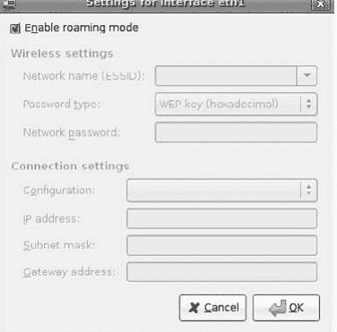
**图 5.9** 配置无线连接。

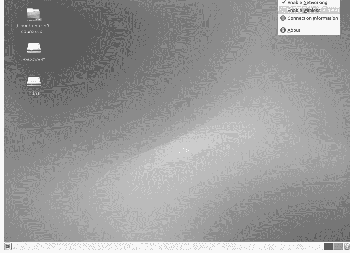
**图 5.10** 激活无线接口。

“漫游模式”是 Ubuntu 的一项新功能，它基本上允许你的 WiFi 网卡搜寻所有在范围内的无线路由器，并让你选择要连接的那一个。它让使用无线网络变得极其简单。

- 1. 右键点击网络管理器小应用程序。将出现一个上下文菜单（见图 5.10）。
- 2. 确认 启用无线 设置已被勾选。如果没有，请选择它。
- 3. 点击网络管理器小应用程序。将出现控制菜单（见图 5.11）。
- 4. 点击所需的无线网络。网络管理器将显示旋转动画。如果网络没有 WEP 安全保护，或者你之前连接过且安全设置已被记录，则将建立无线连接。
- 5. 如果启用了 WEP，请选择相应的 WEP 协议并输入网络的密码。

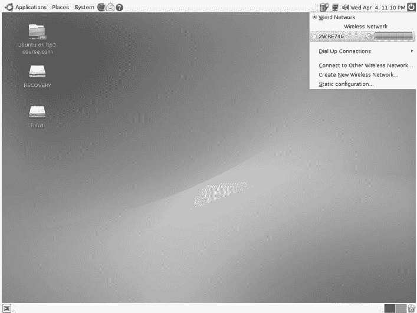
**图 5.11** 选择无线网络。

- 6. 点击 连接到网络。网络管理器将显示旋转动画，随后建立无线连接。

### 结论

在本章中，你发现了使用 Ubuntu 的网络管理器工具连接网络和互联网是多么简单。这个过程没有什么神秘之处，而这正是它应有的样子。

然而，偶尔情况并不会完全按计划进行。由于硬件制造商对 Linux 支持的缺乏，某些网络设备并不总是能正常工作。但目前有大量的修复方案，在第 7 章中你将学习如何使用它们。

不过在此之前，你需要学习如何在 Ubuntu PC 上查找、更新和安装软件。第 6 章“安装和更新软件”将向你展示所有需要了解的内容。

## 安装和更新软件


对 Ubuntu 说“开箱即用”其实是一种隐喻。毕竟，除非你恰好使用了 ShipIt 计划申请免费的 Ubuntu 副本，否则并没有一个真实的盒子让你拆封软件。尽管如此，这句话在软件行业被广泛使用，用来指代在第一次将软件或操作系统安装到计算机时，随之附带的功能和应用程序。

Ubuntu 以及通用 Linux 真正有趣的一点是，它在“开箱”时就自带了大量软件。如果你记得第 1 章“什么是 Linux？”，由于其极其模块化的特性，Ubuntu 本质上是一组独立的软件应用程序的集合，它们协调工作，使操作系统表现得像一个单一的、功能完备的工具。

撇开哲学不谈，Ubuntu 仍然为用户打包了大量应用程序，足以让用户在开箱后立即开始使用。但这并不意味着没有更多准备好供你使用的应用程序。

在本章中，你将学习：

- Ubuntu 如何处理软件安装。
- 关于软件仓库以及如何管理它们。
- 如何使用 更新管理器 和 Synaptic 软件包管理器。
- 如何使用命令行安装软件。


#### Ubuntu 如何安装软件

在

在 Windows 世界中，安装软件通常只有一种方式：点击一个安装应用程序，由它启动并为你运行从开始到结束的整个设置过程。

在 Ubuntu 中，就像大多数 Linux 发行版一样，有三种软件安装方法。诚然，单一的安装方式听起来确实更具吸引力且更少令人困惑，但这种“一刀切”的安装服务可能带有潜在的负面代价：Windows 的安装程序为了当前安装的应用程序，经常会覆盖操作系统中重要的底层基础。这对你安装的应用程序是有好处的，但对于系统中任何使用同一段 Windows 代码的既有应用程序来说，则可能是非常糟糕的。

在 Ubuntu 中，所有三种安装方法都尽力仅使用 Ubuntu 中已有的内容来安装应用程序。如果应用程序所需的某些内容尚未安装在 Ubuntu 中，这就被称为*依赖关系 (dependency)*。安装用户（也就是你）将被告知任何依赖关系，并被询问如何继续。

三种安装方法的描述如下：

- **自包含安装程序 (Self-Contained Installation Program)。** 这种方法与 Windows 使用的方法非常相似。运行一个特殊的安装应用程序，它会*自动地 (automagically)* 处理应用程序在 PC 上的设置。这种类型的安装在 Ubuntu 机器上并不常见，尽管一些较大的消费级应用程序（如 OpenOffice.org 或 Firefox）可以通过这种方式安装。与 Windows 有一个重要区别：安装应用程序不会更改任何现有的软件。依赖关系通常能得到很好的处理，但并非万无一失；有时现有文件仍会被覆盖。
- **从源码编译 (Compiled from Source)。** 还记得任何用户都可以获取任何自由软件应用程序的源代码吗？一旦你拥有了这些代码，你就可以执行所谓的“编译”，将这些代码（人类，至少是聪明的人，可以阅读的代码）转换为 PC 可以读取并运行的内容。软件编译并不困难，但有时很耗时，且依赖关系不会被自动处理。
- **包管理 (Package Management)。** 这种方法是 UNIX 系统的特有方式。安装和运行应用程序所需的所有文件和设置，要么包含在一个包中，要么在包中列出，以便包管理应用程序知道还需要哪些其他应用程序。Ubuntu 使用基于 Debian 的 .deb 包。（其他 Linux 发行版，如 Red Hat 或 SUSE，则使用基于 Red Hat 的 .rpm 包。）

正如你可能已经猜到的，包管理是 Ubuntu 中首选的软件安装方法。包安装实际上是由一个被称为*包管理器 (package manager)* 的应用程序执行的。它有助于跟踪 PC 上已安装的所有应用程序，并帮助跟踪前面提到的依赖关系。如果你安装了一个需要在 Ubuntu 系统上运行某些额外软件工具才能正常工作的包，包管理器将负责计算出你还需要哪些其他包。

在 Ubuntu 中，实际上有三个包管理器可以协助你的安装需求：

- **Synaptic 包管理器。** 这是一个强大的图形化包管理器，列出了 Ubuntu 可用的每个包，让你能从一个庞大的列表中挑选软件应用程序。应用程序按类型、在系统中的状态（已安装或未安装）或来源进行分类。系统更新也可以通过 Synaptic 进行管理。
- **更新管理器 (Update Manager)。** 另一个图形化工具，该应用程序只有一项工作：尽可能地保持系统处于最新状态。如果有任何已安装应用程序的新版本发布，更新管理器会感知到并标记出来，供你下载和安装。
- **安装与删除软件 (Install and Remove Applications)。** 此应用程序直接与 Synaptic 包管理器协作。它为 Synaptic 提供了一个易于使用的界面，类似于 Windows 的安装工具。
- **Apt-get。** Debian 原始的包管理器，这个命令行应用程序使得获取新包就像输入一行文本并按下回车键一样简单。

这四个应用程序中的每一个都被配置为从 Ubuntu 的包存储库中寻找所有包。在下一节中，我们将详细介绍存储库及其工作原理。

#### 理解软件存储库

Ubuntu 的绝妙特性之一就是它仅由一张 CD-ROM 光盘组成。并非每个操作系统都能如此自豪。事实上，许多 Linux 发行版是通过多张光盘交付给用户的。

以前，将 Linux 发行版交付到家庭或办公室的策略并不复杂：用户现在需要或未来可能需要的所有应用程序都将交付在一套完整的 CD-ROM（或后来的的一两张 DVD）中。其优点是，一旦你下载并刻录了所有这些 CD，你就可以直接运行该发行版，而无需以后再下载额外的软件。但如第 2 章“安装 Ubuntu 之前”所述，平均 CD 镜像下载量接近 700 MB。即使对于今天的宽带连接来说，这也是大量的数据。对于大多数用户来说，如果需要刻录三张、五张甚至七张 CD，是一项非常耗时的任务，除非他们愿意付费通过邮件接收这些 CD。

Ubuntu 稍微改变了这个模式。基于大多数互联网用户现在拥有宽带访问的认知，Canonical 决定仅在一张 CD 上发送绝对必要的 Ubuntu 应用程序，而将其余部分留在分布在世界各地的在线服务器上，供用户根据需要下载。这些应用程序的集合被称为*存储库 (repositories)*。

这看起来可能低效，因为你必须拥有某种形式的互联网访问才能使其工作。但请考虑这一点：大多数操作系统无论如何都要通过互联网更新，因此为了保持 Ubuntu 的更新，无论如何都需要在线访问。而且，仅下载并刻录一张 CD 比多张 CD 要快得多。交付“核心”发行版还让用户在选择系统所需的软件应用程序时拥有更大的灵活性。这也意味着他的硬盘不会被不需要的东西填满。

为了让你了解可用软件的数量，请考虑这些数字：Ubuntu 的标准安装大约有 1,100 个包。目前，总共可用超过 21,000 个应用程序包。

Ubuntu 就像它的前身 Debian GNU/Linux 一样，将其软件组织在存储库中——即前面提到的应用程序集合。Ubuntu 有四个主要的存储库，每个存储库持有特定类别的软件。现在让我们详细了解一下。

### 浏览存储库

四个官方 Ubuntu 存储库的名字听起来像科幻小说里的东西，但一旦你知道每个存储库包含什么，这些标签就变得有意义了。

- **Main。** 此存储库包含所有由 Ubuntu 官方支持的软件。Ubuntu 实际运行必须具备的所有内容都在这里，且所有软件都遵循自由软件许可。该存储库中的其他应用程序包括 AbiWord, Evolution, Firefox, Gaim, OpenOffice.org 和 Thunderbird。
- **Restricted。** Ubuntu 支持这个小存储库中的应用，但它们不带有完全自由的许可。有趣的是，Linux 内核就在这里（因为某些插入内核的驱动程序不是自由的）。其他应用程序包括专有硬件的驱动程序和 VMWare 的内核模块。
- **Universe。** 这些软件应用程序是自由的，但由其开发人员（社区）支持，而非由 Canonical 支持。包括 Apache, Eclipse, Firebird, PHP 和 Python 等应用程序，以及许多游戏和小工具。
- **Multiverse。** 同样由社区支持，该组中的应用程序不采用完全自由的许可。Flash player, Java 插件和 Mplayer 就在这个存储库中。

### 添加存储库

这些并非 Ubuntu 可以使用的唯一存储库。互联网上有许多由社区运行的 Ubuntu 存储库，每个存储库都持有 Canonical 不想托管的专业软件。而且由于许可问题，即使是 Canonical 也会托管另一个不包含在其四个主要存储库集中的存储库。

有许多可以在 Linux 上运行的软件应用程序，但由于它们的许可完全是专有的，一些 Linux 发行版根本不愿触碰它们。Debian GNU/Linux 对这类事情尤为严格（这就是为什么他们设立了 nonfree 存储库）。由于继承自 Debian，Ubuntu 的制作者觉得有义务遵守这一哲学，将完全商业化的包排除在 Ubuntu 之外。


### 第 6 章 ■ 安装与更新软件

但这里有一个重要的区别。虽然 Canonical 不在 Ubuntu 中发布商业软件，但这并不妨碍用户在下载并安装 Ubuntu 后访问商业软件仓库。虽然这是一个细微的区别，但它让用户在选择想要使用的软件时拥有了自主权。

Ubuntu 中所有的包管理器都依赖于存储在 PC 上的主仓库列表。通过这个被称为 `sources.list` 的文件，管理器可以知道应该检查哪些仓库以获取新软件，以及系统中已安装的软件是否有可用更新。如果你希望这些管理器浏览另一个仓库，则需要使用新信息修改 `sources.list`。好消息是，Ubuntu 提供了一个新工具，让你只需几个步骤即可完成此操作。

- 1. 点击“系统 | 管理 | 软件源”菜单命令。系统将要求你输入管理员密码。
- 2. 输入密码并点击“确定”。随后将出现“软件源”对话框，如图 6.1 所示。
- 3. 点击“第三方软件”选项卡。随后将出现“第三方软件”页面（见图 6.2）。


**图 6.1** 更新软件源。


**图 6.2** 添加新仓库。


**图 6.3** 要求输入仓库地址。

- 4. 点击“添加”按钮。将出现一个对话框，要求输入新源仓库的完整 APT 行，如图 6.3 所示。

### 解释仓库命令

在 `sources.list` 中，仓库是通过一行非常特定的文本来定义的，该行不仅定义了仓库在互联网上的位置，还定义了具体连接的是哪个仓库。例如：

`deb http://archive.ubuntu.com/ubuntu feisty main`

其中 `deb` 是你想查找的软件包类型（Debian），`http://archive.ubuntu.com/ubuntu` 是仓库所在服务器和目录的互联网地址，`feisty` 是你正在使用的 Ubuntu 版本，而 `main` 是具体仓库的名称。


**图 6.4** 一个新仓库。


**图 6.5** 必须通知包管理器有关新仓库的信息。

- 5. 在“APT 行”字段中输入 **deb http://archive.canonical.com/ubuntu feisty-commercial main**。
- 6. 点击“添加源”。对话框将关闭，新仓库将出现在仓库列表中（见图 6.4）。
- 7. 点击“关闭”。将出现一个警告对话框（见图 6.5）。
- 8. 点击“重新加载”。“正在下载软件包信息”消息框将打开，显示软件包列表刷新的进度。完成后，该消息框以及“软件源”对话框将自动关闭。

现在，下次运行 Ubuntu 的任何包管理器时，它都会意识到新仓库的存在，并允许你查看和安装其中的软件。这包括 Canonical 获得授权分发的任何商业软件。

### 使用更新管理器

在所有 Ubuntu 包管理器中，你可能会最频繁地使用“更新管理器”。这是因为它一直在后台运行，以查看你 PC 上安装的软件是否有可用更新。这种“设置后即可忘记”的特性非常方便，这意味着你无需担心软件是否处于较旧且有漏洞的版本。

#### 更新当前软件

默认情况下，更新管理器配置为在有软件更新可用时通知你——它在你的 PC 连接互联网时每天都会检查一次。当发现已安装软件的更新时，上方面板会出现一个橙色星爆图标，同时会出现一个初始弹出消息，如图 6.6 所示。


**图 6.6** 关于新更新的提示。


**图 6.7** 启动更新管理器。

该消息将在几秒钟后自动关闭，但通知图标将一直保留，直到更新管理器实际运行。

- 1. 点击通知图标启动更新管理器。更新管理器窗口将打开，启动进程将立即开始，如图 6.7 所示。
- 2. 进程完成后，你将看到 Ubuntu 建议你安装的更新列表（见图 6.8）。点击要更新的应用程序以查看更新内容的简短描述。
- 3. 点击“更新描述”下拉箭头。所选应用程序的更改列表将出现，如图 6.9 所示。
- 4. 如果你选择不更新某个应用程序，请取消勾选其复选框。
- 5. 选择完成后，点击“安装更新”。随后将出现“正在下载软件包文件”对话框（见图 6.10）。
- 6. 如果你想查看下载的更多详情，请点击“显示单个文件进度”箭头，这将显示一个类似于图 6.11 的列表。


**图 6.8** 更新列表。

- 7. 下载完成后，软件包将被安装，如图 6.12 所示。图 6.13 显示了点击“详情”下拉箭头以查看进程进度的结果。
- 8. 完成后，将出现“更改已应用”消息框（见图 6.14）。
- 9. 点击“关闭”来关闭消息框。更新管理器将反映 Ubuntu 已更新的状态（如图 6.15 所示）。
- 10. 点击“关闭”。更新管理器将关闭。

偶尔，你可能需要在更新后重启 Ubuntu 系统。这种情况并不常见，因为 Ubuntu 的模块化特性意味着通常一个应用程序的更改不会影响其他应用程序。但某些更新（例如新版本的 Linux 内核）需要系统重启才能使更改生效。在这种情况下，当你关闭更新管理器时，会出现一个如图 6.16 所示的消息框。

选择你想要的选项。建议你尽快重启，但如果你还有其他工作要处理，可以通过点击“稍后重启”来等待。（在一天结束时关闭系统也算作一次重启。）


**图 6.9** 你可以阅读关于更新原因的说明。


**图 6.10** 更新进程开始。


**图 6.11** 监控单个文件下载。

| 状态 | 大小 | 软件包 | URI |
|--------|------|---------|-----|
| 完成 | 4099 kB | libc6 | http://u |
| 完成 | 1183 kB | libc6-i686 | http://u |
| 完成 | 178 kB | libcupsys2 | http://u |
| 完成 | 103 kB | libcupsimage2 | http://u |
| 完成 | 926 kB | cupsys-common | http://u |
| 16% | 1620 kB | cupsys | http://u |


**图 6.12** 更新是自动的。


**图 6.13** 监控单个文件更新。


**图 6.14** 更新完成。

### 提示
> 有一点很重要，需要记住的是，一次只能运行一个更新或包管理会话。否则，包管理器之间会产生冲突。


**图 6.15** Ubuntu 已是最新状态。


**图 6.16** 某些更新需要重启。

### 配置更新

在讨论更新管理器的开头提到，该应用程序每天检查更新并在有更新可用时通知你。但如果你想做更多操作怎么办？你可以非常简单地配置更新管理器以满足你的需求。


### 第 6 章 安装与更新软件

**图 6.17** 配置自动更新。

1. 点击“系统 | 管理 | 软件源”菜单命令。系统将要求您输入管理员密码。
2. 输入密码并点击“确定”。随后将出现“软件源”对话框。
3. 点击“更新”选项卡。随后将出现“更新”页面（见图 6.17）。
4. 点击“检查更新”下拉列表，以更改更新管理器检查更新的频率。
5. 为了获得最大的安全保护，请点击“无需确认安装安全更新”单选按钮。
6. 如果您改变主意，请点击“还原”按钮。
7. 点击“关闭”。如果进行了任何更改，将出现一个警告对话框。
8. 点击“重新加载”。“正在下载软件包信息”消息框将打开，显示软件包列表刷新的进度。完成后，该消息框以及“软件源”对话框都将自动关闭。

### 使用 Synaptic 软件包管理器

尽管更新管理器非常实用，但它无法与功能齐全的 Synaptic 软件包管理器相媲美，后者是 Ubuntu 的杀手级工具。这款软件包管理器是 Ubuntu 特有的工具之一，很可能是 Ubuntu 如此受欢迎的主要原因。

它确实非常出色。

与仅更新现有软件包的更新管理器不同，Synaptic 只需点击几次即可更新、安装和卸载应用程序。

操作 Synaptic 非常简单。您可以点击“系统 | 管理 | Synaptic 软件包管理器”菜单命令来启动该应用程序，在输入管理员密码后，将弹出 Synaptic 窗口，如图 6.18 所示。

**图 6.18** Synaptic 软件包管理器。

- **类别 (Categories)。** 应用程序被分为各种类别，并列在此窗格中。类别由排序按钮决定，可以显示软件包类型、软件包状态（是否安装）或来源存储库。
- **排序按钮 (Sort Buttons)。** 这些按钮控制“类别”窗格中列出的值。
- **软件包列表 (Package List)。** 当选择某个类别时，该类别包含的所有软件包都将列在此窗格中。
- **软件包描述 (Package Description)。** 点击某个软件包将在此处显示该应用程序的简要描述。

#### 更新当前软件

在 Synaptic 中更新软件不像使用更新管理器那样是在后台操作，但它仍然非常简单直接。

1. 点击“状态”按钮。类别窗格中将出现一组状态类别。
2. 如果可用，请点击“已安装 (可升级)”。需要升级的软件包列表将出现在“软件包列表”窗格中（见图 6.19）。

**图 6.19** 更新列表。

**图 6.20** 确认升级选择。

3. 点击“重新加载”按钮以确认此列表为最新。当 Synaptic 检查已知存储库以获取当前信息时，“正在下载软件包信息”消息框会短暂出现。
4. 点击“标记所有升级”按钮。随后将出现确认对话框（见图 6.20）。

### 获得比请求更多的内容

在升级过程中，您可能会注意到 Synaptic 请求安装新软件。这种情况偶尔会发生，因为随着功能扩展，更新后的应用程序可能需要根据其依赖关系访问更多的软件工具。

5. 点击“标记”。这些软件包现在将被标记为升级。
6. 点击“应用”。随后将出现“摘要”对话框，要求您再次确认选择，如图 6.21 所示。
7. 点击“应用”。更新过程将开始。
8. 当出现“更改已应用”对话框时，点击“关闭”按钮。

### 安装新软件

虽然使用 Synaptic 进行更新非常好，但该应用程序真正的亮点在于软件包安装。基于存储库的软件包安装是一种强大的软件安装方式。它不仅简单，而且一旦由 Synaptic 安装，您可以确保该应用程序未来的任何更新都将被追踪。

**图 6.21** 再次确认升级选择。

### 寻找正确的软件包

对于任何软件包的安装或卸载，您可以使用 Synaptic 中的搜索功能来查找 Synaptic 能够识别的任何给定软件包。

1. 在 Synaptic 中浏览，直到找到您想要安装的软件包并选中它。软件包的描述将出现在“描述”窗格中。
2. 点击软件包的“选择”复选框。随后将出现上下文菜单（见图 6.22）。
3. 点击“标记为安装”菜单命令。如果需要任何额外的软件包，将出现警告对话框。否则，请直接跳到步骤 5。

### 共依赖 (Co-Dependencies)

当您安装新软件时，Synaptic 可能会请求安装其他软件。这些是您最初想要安装的应用程序的依赖项。如果您希望所需的软件包成功安装，则必须安装这些依赖项。

4. 点击“标记以安装任何额外软件包”。警告对话框将关闭，相应的软件包将被标记为安装。

**图 6.22** 标记应用程序。

5. 点击“应用”。随后将出现“摘要”对话框以确认您的更改。
6. 点击“应用”。安装过程将开始。
7. 当出现“更改已应用”对话框时，点击“关闭”按钮。

### 卸载软件

有时（并不经常）您会遇到需要从 Ubuntu 系统中删除应用程序的情况。我说“并不经常”，是因为 Ubuntu 仅安装您真正需要的内容，而其他任何内容大概都是您最初自行添加的软件。

尽管如此，以防万一出现需求，以下是如何使用 Synaptic 卸载任何应用程序的方法。

1. 在 Synaptic 中浏览，直到找到您想要卸载的软件包并选中它。软件包的描述将出现在“描述”窗格中。
2. 点击软件包的“选择”复选框。随后将出现上下文菜单。
3. 点击“标记为删除”菜单命令。该软件包将被标记为删除。
4. 点击“应用”。随后将出现“摘要”对话框以确认您的更改。
5. 点击“应用”。卸载过程将开始。
6. 当出现“更改已应用”对话框时，点击“关闭”按钮。

### 删除程度

如果一个应用程序使用了唯一的配置设置（例如个别用户偏好如何使用该程序），那么您应该将该软件包标记为“完全删除”。这将卸载应用程序及其所有配置文件。如果在“状态类别”窗格中出现“已安装 (残留配置)”，这表明在删除操作后遗留了一些配置文件，如果您认为以后可能需要再次安装该软件包，可以将其保存。

### 使用“安装与删除软件”管理软件

Synaptic 是一款用于安装和升级软件的绝佳应用程序，使用它绝对不会出错。但对于某些用户来说，尤其是那些来自 Windows 或 Mac 背景的用户，使用如此强大的工具可能有些大材小用了。

为了提供帮助，Ubuntu 包含了一个名为 *安装与删除软件* 的应用程序，它与 Windows 的安装程序非常相似。虽然名字不够响亮，但它在后台仍然使用 Synaptic 程序来执行工作，而界面要简单得多，而且在理想情况下更容易管理。

1. 选择“应用程序 | 添加/删除”菜单命令。“添加/删除软件”窗口将打开（见图 6.23）。
2. 将“显示”字段的下拉列表值更改为“所有可用应用程序”。应用程序列表将更改为包含所有未安装在您机器上的软件。
3. 点击“游戏”。游戏软件包将在“应用程序”窗格中显示（见图 6.24）。
4. 点击“Hearts”复选框。随后将出现“社区安装”消息框，要求您确认安装选择（见图 6.25）。


- 全部
- 辅助功能
- 附件
- 教育
- 游戏
- 图形
- 互联网
- 办公
- 其他
- 编程
- 声音与视频
- 系统工具

- **7zip** — zip 压缩/解压缩工具 ★★★★
- **AbiWord Word Processor** — AbiWord 文字处理器 ★★★★
- **About Myself** — 修改个人信息 ★★★
- **Abuse** — 一款由鼠标和键盘共同控制的横向卷轴游戏 ★★★★★

### 快速入门

要安装应用程序，请勾选应用程序旁边的复选框。
取消勾选复选框可卸载该应用程序。
要执行高级任务，请使用 Synaptic 软件包管理器。

**图 6.23**
安装和删除应用程序工具。

- 游戏
- Superior Lotsa Added Stuff Hack - 扩展魔法 ★★
- **Owled** — Gnome 平台的“钻石矿” ★★★
- **Hearts** — 玩受欢迎的红心纸牌游戏 ★★★
- **Hearties** — 收集能量道具并避开对手的痕迹 ★★★
- **Holotz Castle** ★★★

**Hearts**
适用于 GNOME 桌面的经典红心纸牌游戏 ♥

Hearts 是为 GNOME 桌面实现的经典纸牌游戏。它具有可配置的规则集和可编辑的计算机对手，以满足截然不同的游戏风格。

版本：0.1.3.2 (gnome hearts)
Hearts 与 Ubuntu 桌面融合良好

**图 6.24**
不能只有工作而没有娱乐。

**图 6.25**
确认您的安装选择。

5. 点击“安装”。消息框将关闭。
6. 点击“确定”。将出现一个“应用”对话框。
7. 点击“应用”。系统将要求您输入管理员密码。
8. 输入密码并点击“确定”。Synaptic 软件包管理器将打开并自动安装软件。
9. 点击“关闭”以关闭“更改已应用”对话框和“添加/删除”窗口。

使用这个简单的界面删除应用程序同样简单。

1. 选择“应用程序 | 添加/删除”菜单命令。将打开“添加/删除应用程序”窗口。
2. 将“显示”字段下拉列表的值更改为“已安装的应用程序”。应用程序列表将更新为包含您机器上安装的所有内容。
3. 点击“游戏”。游戏软件包将显示在应用程序窗格中。
4. 点击 Mahjongg 复选框。将出现“删除已安装应用程序”消息框，要求您确认删除选择（见图 6.26）。
5. 点击“删除”或“全部删除”。消息框将关闭。
6. 点击“确定”。将出现一个“应用”对话框。
7. 点击“应用”。系统将要求您输入管理员密码。
8. 输入密码并点击“确定”。Synaptic 软件包管理器将打开并自动删除该软件及其任何依赖应用程序。
9. 点击“关闭”以关闭“更改已应用”对话框和“添加/删除”窗口。

**图 6.26**
确认您的删除选择。

### 使用 Apt-get 管理软件

与 Ubuntu 中的其他两种软件包管理器不同，apt-get 是所谓的命令行应用程序。用户在任何 Linux 发行版中看到的大部分功能都是由这些命令行程序驱动的。事实上，Synaptic 和更新管理器在核心层面都使用 apt-get 来完成大部分工作。Synaptic 和更新管理器充当了 apt-get 更易于使用的图形界面。

“Apt”是 Advanced Packaging Tool（高级软件包工具）的缩写，在所有基于 Debian 的 Linux 发行版中都很常见。它是一个非常强大的管理器，而且因为它不需要消耗系统资源来创建美观的界面，所以运行速度也非常快。

命令行应用程序始终在终端（Terminal）窗口中运行，它是 Ubuntu 中最简单且最通用的工具之一。要启动终端，请点击“应用程序 | 附件 | 终端”菜单命令（见图 6.27）。

在终端中输入命令只需输入命令并按下 Enter 键。要查看当前目录下所有文件的列表，请输入 `ls` 然后按下 Enter。

有很多非常酷的命令行工具可以使用，但现在让我们专注于 apt-get，并在本书稍后部分研究其他工具。必须注意的一点是，apt-get 是一个需要管理员权限才能运行的应用程序（就像更新管理器和 Synaptic 一样）。要在命令行中实现这一点，请在 apt-get 命令之前输入 `sudo` 命令。第一次这样做时，系统会要求您输入管理员密码。但之后，只需使用 `sudo` 即可。

您应该做的第一件事，特别是如果您对软件源列表进行了任何更改，就是确保 apt-get 知晓这些更改。为此，请输入：

```
sudo apt-get update
```

屏幕上会出现一个长长的软件源列表。当屏幕显示 Done 且命令提示符再次出现时，操作即完成。一旦完成此操作，您就可以完全访问最新的软件源列表。您还可以使用 `apt-cache` 命令在软件源中搜索应用程序。例如，要查找名为 moon-lander 的游戏，请输入：

```
sudo apt-get search moon-lander
```

这将返回两个软件包的信息：

```
moon-lander - An SDL game based on the classic moon lander
moon-lander-data - Data files (sound, images) for moon lander
```

如果软件包在列表中，安装它就像运行以下命令一样简单：

```
sudo apt-get install moon-lander
```

这将为您带来如下结果：

```
Reading package lists... Done
Building dependency tree
Reading state information... Done
The following extra packages will be installed:
  moon-lander-data
The following NEW packages will be installed:
  moon-lander moon-lander-data
0 upgraded, 2 newly installed, 0 to remove and 0 not upgraded.
Need to get 0B/1354kB of archives.
After unpacking 2060kB of additional disk space will be used.
Do you want to continue [Y/n]?
```

输入 Y 或直接按下 Enter。安装过程将迅速完成。

删除软件包同样简单。输入：

```
sudo apt-get remove moon-lander
```

这将显示以下输出：

```
Reading package lists... Done
Building dependency tree
Reading state information... Done
The following packages were automatically installed and are no longer required:
  libsd1-mixer1.2 moon-lander-data libsd1-imagel.2 libsmpeg0
Use 'apt-get autoremove' to remove them.
The following packages will be REMOVED:
  moon-lander
0 upgraded, 0 newly installed, 1 to remove and 0 not upgraded.
Need to get 0B of archives.
After unpacking 127kB disk space will be freed.
Do you want to continue [Y/n]?
```

输入 Y 或直接按下 Enter。卸载过程将迅速完成。您可能在例子中注意到，apt-get 告知您在之前本章中使用 Synaptic 首次安装该应用程序时还添加了额外的软件包。

如果您想将它们一并删除，可以输入 n，然后输入：

```
sudo apt-get autoremove moon-lander
```

这将删除所有关联的应用程序。

如果您希望 apt-get 下载已安装应用程序的最新版本，请输入：

```
sudo apt-get upgrade
```

这将执行与更新管理器相同的功能。

### 结论

到目前为止，您已经知道了在 Ubuntu 中使用软件包管理来更新、安装或卸载软件的三种方法。您现在在 Ubuntu 中进行娱乐和工作的能力大大增强了。

这些功能还将帮助您在 Ubuntu 中解决问题。正如在之前的章节中提到的，有时 Ubuntu 中的某些功能运行得不如预期那样流畅。Ubuntu 社区有大量的修复方案，现在您知道了如何安装软件，就可以轻松地为您的 Ubuntu PC 应用任何所需的修复。您将在下一章“解决问题”中学习如何操作。

### 第 7 章：解决问题

Ubuntu 并非完美。

对于阅读 Ubuntu 书籍的一些人来说，看到这段话可能会感到惊讶，但必须实话实说。在未经测试的计算机上安装任何操作系统起初都有一定的风险，因为无法预见的硬件冲突可能会干扰任何操作系统的安装。（看看最近的 Vista 用户就知道了，他们在购买新电脑后发现了一些硬件和软件兼容性问题。）

如果您是在台式 PC 上安装的 Ubuntu，那么到目前为止您可能还没有遇到任何问题或担忧。这太棒了，因为最终，Ubuntu 目前几乎所有的麻烦点在未来都不会影响用户。当然，如果您购买的是预装了 Ubuntu 的戴尔（Dell）电脑，那么本章中强调的所有问题都不适用于您。

即使您在让某些功能正常运行方面没有遇到困难，本章对您仍然有用。大多数用户仍有一些未竟之事需要处理：

- 创建和管理额外的用户账户。
- 设置打印机。
- 使用 USB 存储设备。
- 使用数码相机。
- 排除一些硬件问题。


#### 设置用户账户

当你第一次安装 Ubuntu 时，系统会创建两个用户账户：root 和你自己的账户。Root 是 Ubuntu “超级”账户的名称。与所有 Linux 发行版一样，root 用户账户是最强大的——也是最危险的。这是因为 root 实际上可以在 Ubuntu 机器上执行任何可能的操作。如果你试图快速完成大量管理任务且不想反复输入管理密码，这将非常有帮助。但如果你犯了错误，不小心删除了系统上的所有文件，那后果将非常严重。

更不用说，如果你在以 root 身份登录的情况下离开机器，而有人刚好走过并摆弄你的电脑，或者无论你在哪里，有人从外部入侵你的电脑，会发生什么。

> **重要安全提示**
> 永远不要以 root 身份登录。

由于系统的原始安装用户将成为管理系统的人，你的账户将拥有一定的管理能力。但这并不总是绝对的，你的 PC 可能需要拥有多个用户账户，以便每个用户拥有自己的工作空间。

要设置一个新账户，请执行以下步骤。

- 1. 点击 系统 | 管理 | 用户和组 (System | Administration | User and Groups) 菜单命令。用户设置对话框将打开，如图 7.1 所示。
- 2. 点击 添加用户 (Add User) 按钮。新用户账户对话框将打开（见图 7.2）。


**图 7.2** 基础用户账户信息。

- 3. 根据用户信息，填写账户页前两个部分的信息。将配置文件 (Profile) 设置为 桌面用户 (Desktop User)。
    - **管理用户 (Administrative User)。** 该用户拥有在此 Ubuntu PC 上执行许多任务的权利和特权，前提是他知道自己的管理密码。
    - **桌面用户 (Desktop User)。** 普通用户。他可以看到并使用 PC 上的大多数应用程序，但不能更改系统设置。
    - **非特权用户 (Unprivileged User)。** 客户用户，对计算机应用程序和文件的访问权限非常有限，仅足以完成分配的任务。

- 4. 点击 生成随机密码 (Generate Random Password) 单选按钮。一个随机生成的强密码将出现在 密码设置为 (Password Set To) 字段中。

### 弱密码与强密码

> Ubuntu 生成的密码非常强，这意味着密码破解程序更难以破解。许多用户使用弱密码，例如容易记住的名称、数字或单词。问题在于，密码越像英语单词，破解程序就越容易猜到该密码。


**图 7.3** 基础用户权限信息。

- 5. 点击 用户权限 (User Privileges) 选项卡。用户权限页面将出现（见图 7.3）。
- 6. 确认权限设置，取消勾选你不希望该用户拥有的任何权限。
- 7. 点击 高级 (Advanced) 选项卡。高级页面将出现（见图 7.4）。
- 8. 将 主组 (Main Group) 的值设置为 Users。
- 9. 点击 确定 (OK)。新用户账户对话框将关闭，新用户将被添加到账户列表中。
- 10. 点击 关闭 (Close)。用户设置对话框将关闭。

在创建任何用户后，如果需要，你可以修改其账户。

- 1. 点击 系统 | 管理 | 用户和组 (System | Administration | User and Groups) 菜单命令。用户设置对话框将打开。
- 2. 点击某个用户以选择该账户。


**图 7.4** 高级用户信息。

- 3. 点击 属性 (Properties) 按钮。账户 '[user]' 属性对话框将打开（见图 7.5）。
- 4. 在三个页面中的任何一个页面中进行必要的更改。
- 5. 点击 确定 (OK)。账户 '[user]' 属性对话框将关闭。
- 6. 点击 关闭 (Close)。用户设置对话框将关闭。

如果某个用户不再使用这台计算机（例如员工离职），删除该用户的账户是一个好主意。

- 1. 点击 系统 | 管理 | 用户和组 (System | Administration | User and Groups) 菜单命令。用户设置对话框将打开。
- 2. 点击某个用户以选择该账户。
- 3. 点击 删除 (Delete) 按钮。一个警告对话框将出现（见图 7.6）。
- 4. 点击 删除 (Delete)。用户账户将从账户列表中被移除。


**图 7.5** 编辑用户信息。


**图 7.6** 确认你要删除用户账户。

### 真的消失了吗？

> 当账户被删除时，用户的数据仍然完好无损。但如果需要，只有管理员才能访问这些数据。

- 5. 点击 关闭 (Close)。用户设置对话框将关闭。

#### 使用打印机

早期的计算机通信能力较差。第一台可以被安全地称为计算机的数字计算设备是 Harvard Mark I，这是一个重达五吨、包含 750,000 个组件的设备，它从纸带读取编程代码，从打孔卡读取数据。数据也通过类似的介质输出。

多媒体在当时也几乎不存在。Mark I 产生的唯一声音是其组件内部的咔哒声，听起来有点像“一屋子女士在织毛衣”。很难称之为多媒体。

对于那些足够年长、还记得 1973 年发布的 Apple I 和 II 微型计算机的人来说，你们会想起它们在多媒体方面也表现平平。它们发出的声音基本只有微小的哔哔声和咔哒声。不过，打印技术当时正在进步，针式打印机正吐出一卷卷的连续打孔纸。

如今，能够连接到 PC 的通信设备数量之多令人惊叹。打印机、扬声器、电视调谐器、摄像头、警报系统……甚至汽车。

与此同时，你可以关注更紧迫的问题，例如将你自己的外围通信设备连接到 Ubuntu PC 上——也就是打印机。

#### 设置本地打印机

将打印机连接到 Ubuntu PC 有两种方式。第一种是本地连接，通过计算机的并行端口，或者如今更常见的 USB 端口接入打印机。

一旦你的打印机在物理上连接到系统并地开启电源，请按照以下步骤使打印机正常工作。

- 1. 点击 系统 | 管理 | 打印 (System | Administration | Printing) 菜单命令。打印机窗口将打开（见图 7.7）。


**图 7.7** 打印机窗口。


**图 7.8** 启动添加打印机向导。

- 2. 双击 新打印机 (New Printer) 图标。`gnome-cups-add` 消息框将出现，你的系统将开始搜索已连接的打印机。找到后，添加打印机向导将出现（见图 7.8）。
- 3. 确认 打印机类型 (Printer Type) 设置为 本地 (Local) 或 检测到的打印机 (Detected Printer)。
- 4. 确认 在 检测到的打印机 (Detected Printer) 字段中选择了正确的打印机。

### 一台还是多台？

有时，一台打印机会显示为多个条目，如图 7.8 中的示例所示。这是因为某些打印机（尤其是较新的打印机）具有独立的板载内存卡，Ubuntu 中的 CUPS 数据库将其读取为单独的设备。选择信息最全的条目并继续。如果这不起作用，你始终可以返回并连接到另一个选项。

### Ubuntu 钟爱 HP

HP 在为 Linux 用户提供打印机驱动程序方面做了很多出色工作。如果你使用的是 HP 打印机，且有 HPLIP 选项可用，请务必选择该选项。HPLIP 是 HP 为其设备开发的一个控制应用程序。

- 5. 点击 向前 (Forward) 按钮。打印机驱动程序页面将出现（见图 7.9）。


**图 7.9** 确认你的打印机驱动程序。


**图 7.10** 输入关于打印机的信息。

- 6. 确认为你的打印机选择了正确且推荐的驱动程序。
- 7. 点击 向前 (Forward) 按钮。打印机信息页面将出现（见图 7.10）。


图 7.11
一台就绪的打印机。

- 8. 为您的打印机起一个唯一的名称。您还可以详细填写其他信息，例如打印机的位置以及主要用途。
- 9. 点击“应用”（Apply）。新打印机将出现在“打印机”窗口中，如图 7.11 所示。

#### 设置网络打印机

连接到网络中某处远程打印机的步骤与连接本地打印机非常相似。您只需确定该打印机在网络中的位置即可。

大多数情况下，Ubuntu 会为您完成工作并检测网络打印机。如果是这种情况，请按照前一节中概述的步骤连接到检测到的网络打印机。如果由于某种原因未找到打印机，请执行以下步骤：

- 1. 点击“系统”|“管理”|“打印”菜单命令。将打开“打印机”窗口。
- 2. 双击“新打印机”图标。将出现 `gnome-cups-add` 消息框，您的系统将开始搜索已连接的打印机。找到后，将出现“添加打印机”向导。
- 3. 如果未找到您想要的网络打印机，请确认“打印机类型”设置已选为“网络打印机”。
- 4. 选择连接类型：
    - IPP 打印机或 CUPS (IPP) 打印机。这些打印机由启用 CUPS 的服务器跟踪。如果您的网络使用 CUPS 作为打印机管理工具，您的网络管理员将告知您正确的配置设置。
    - Windows 打印机 (SMB)。与文件夹一样，连接到 Windows 机器的打印机也可以共享。如果您的网络中有共享打印机，名为 *Samba* 的工具将允许您找到并连接到它们。
    - UNIX 打印机 (LPD)。可以找到并连接到网络中连接到 UNIX 服务器的打印机。
    - TCP/Socket, HP JetDirect, Raw connection。直接连接到以太网的打印机应使用此设置。
- 5. 输入您的打印机在网络上的正确位置。（例如，TCP/Socket 连接将要求提供“主机”和“端口”信息，如图 7.12 所示。在这种情况下，*主机* 将是您的打印机在网络上的 IP 地址。*端口* 通常是 9100，因此请保持该值不变。）
- 6. 点击“下一步”（Forward）按钮。将出现“打印机驱动程序”页面。
- 7. 确认为您的打印机选择了正确且推荐的驱动程序。
- 8. 点击“下一步”（Forward）按钮。将出现“打印机信息”页面。

**图 7.12**
为打印机配置地址。

**图 7.13** 另一台就绪的打印机。

- 9. 为您的打印机起一个唯一的名称。您还可以详细填写其他信息，例如打印机的位置以及主要用途。
- 10. 点击“应用”（Apply）。新打印机将出现在“打印机”窗口中，如图 7.13 所示。

#### 我的打印机在哪里？

如果出于某种原因，列表中没有您的确切打印机型号，请尝试选择一个型号类似的设备。许多打印机共享驱动程序，尤其是同一家公司生产的打印机。如果您的打印机不在列表中且没有相近的选项，那么可能是时候上网在各种 Ubuntu 论坛中搜索答案了。这种情况非常罕见，因为 CUPS 数据库在不断扩展。

#### 使用 USB 大容量存储设备

数字技术最新且最伟大的发明之一就是便携式大容量存储设备，其容量可从 256 MB 到 300 GB 不等。这些便携式设备有多种配置，从小巧的内存棒或 U 盘（可以放在口袋里或用挂绳携带）到可以存储海量数据的便携式外置硬盘。

这些设备的共同特点是它们都通过 USB 端口连接到计算机。Ubuntu 非常擅长识别 USB 存储设备；实际上，您只需要将存储硬件插入 PC 即可。桌面上会出现一个驱动器图标，并且 Nautilus 文件管理器将打开以显示设备的内容，如图 7.14 所示。

**图 7.14** 透明的 USB 驱动器支持。

移除驱动器只需要一个额外的步骤。您可以直接拔掉物理连接，这可能没问题。但为了防止 Ubuntu 对驱动器去向感到困惑，您可以使用 Ubuntu 取消其对该设备的感知。然后您就可以物理移除它了。

右键点击 USB 驱动器的图标。在出现的上下文菜单中，选择“弹出”（Eject）命令。图标将从桌面消失，设备可以被安全移除。

#### 设置数码相机

如今数码相机非常普遍，能够将照片移至计算机是必需的，因为所有的编辑和快照的长期存储都将在那里进行。

Ubuntu 通过两种方式之一处理数码相机。如果它不识别特定的相机型号，它会将连接的数码相机视为 USB 存储设备。在这种情况下，您只需使用文件管理器将照片从相机的驱动器传输到您的硬盘驱动器即可。

如果 Ubuntu 能够识别您的相机，那么您可以使用一些便捷的工具来加速数码相机的工作。

- 1. 将相机连接到计算机并开启相机电源。如果检测正确，将打开“相机导入”对话框（如图 7.15 所示）。
- 2. 点击“导入照片”。将打开一个新的“导入照片”对话框（见图 7.16）。
- 3. 等待片刻，应用程序将审查相机的内容。内容将显示在对话框中（见图 7.17）。
- 4. 为照片选择一个“目标”目录。
- 5. 点击“导入”。照片将被下载到您的 Ubuntu PC 上（见图 7.18）。

**图 7.15**
相机已被检测到。

**图 7.16**
初始的“导入照片”对话框。

**图 7.17** 最终的“导入照片”对话框。

**图 7.18** 下载照片。

图 7.19
您在 gThumb 中的照片集。

#### 照片分类

如果您愿意，可以在从相机导入照片时，为照片添加“胶卷”（Film）和“类别”（Categories）信息。“胶卷”只是目录名称的一个花哨标签。“类别”是您可以分配给照片的可自定义标签，以便稍后轻松找到它们。

下载完成后，将打开如图 7.19 所示的 gThumb 应用程序。gThumb 允许用户在照片集中进行排序、分类和搜索。

#### 特殊硬件问题

在设置完常规硬件需求后，您应该已经完全准备就绪。遗憾的是，并非每次安装都能顺利进行，一些已知的硬件“小麻烦”可能会悄悄潜入，让事情变得更……有趣。在本节中，您将了解 Ubuntu 与硬件之间最普遍出现的问题，并学习如何修复它们。

这绝不是一套全面的解决方案；市面上的硬件种类太多，无法在本书中尝试所有方案。但最常见的问题应该能得到解决。

### Wi-Fi 网卡

无线接口对于移动和桌面 PC 至关重要，因为它们提供了在更多不同地点连接网络和互联网的自由度与移动性。在大多数情况下，Ubuntu 对无线（或 Wi-Fi）网卡的支持相当不错。但有一种品牌的 Wi-Fi 网卡曾被 Linux 用户视为“克利普托耐特”（致命弱点）：Broadcom（博通）网卡。

Broadcom 是一家坚决拒绝为其 Wi-Fi 硬件创建 Linux 驱动程序的制造商。这非常不幸，因为很多笔记本电脑的内部无线接口实际上就是 Broadcom 设备。

最近，一个解决方案被创建，运行 Broadcom 设备的能力已被内置到主 Linux 内核中。但要运行 Broadcom 设备，内核需要访问一组非常特定的文件，即接口的固件。Windows 包含了此固件，一些 Linux 发行版也是如此（Mac 使用 Motorola 设备）。但 Ubuntu 忠于其 Debian 根源，并不包含它，因为该固件是商业性质的，Canonical 没有重新分发的权限。

在 Ubuntu 中运行 Broadcom Wi-Fi 网卡是可能的；您只需要获取正确的软件。

以下是获取所需固件的最快方法。

- 1. 点击“应用程序”|“附件”|“终端”菜单命令。将打开终端窗口。
- 2. 在终端中输入：
`lspci | grep Broadcom Corporation`

如果您的系统安装了 Broadcom 设备，结果将类似于以下输出：
```
00:0e.0 Network controller: Broadcom Corporation BCM4318 [AirForce One 54g]
802.11 Wireless LAN Controller (rev 02)
```
- 3. 现在输入：
`wget -c http://ubuntu.cafuego.net/pool/feisty-cafuego/bcm43xx/bcm43xx-firmware_1.3-1_2_all.deb`

这将把固件作为一个 DEB 包下载到您的主目录下。
- 4. 要安装固件包，请输入：
`sudo dpkg -i bcm43xx-firmware_1.3-1ubuntu2_all.deb`

您的无线网卡现在应该已经激活并可以正常工作了。


#### 调制解调器 (Modems)

与 Wi-Fi 网卡（仅在某些品牌上存在一个真正的麻烦点）不同，几乎每块安装在 PC 内部的调制解调器在 Linux 上运行都会遇到问题。这是因为这类设备在类别上被称为 *winmodems*，其驱动程序仅为 Windows 环境编写。

如果您在 Ubuntu PC 上需要使用调制解调器，有两种解决方法。一种是购置外部调制解调器。通常情况下，这些调制解调器在 Ubuntu 中能够正常工作，因为它们连接 PC 的方式（通过串口或 PCMCIA 端口）允许 Ubuntu 更自由地与之通信。

如果您不想花钱，可以尝试 Linmodem 项目 (http://linmodems.technion.ac.il/Linmodem-howto.html) 提供的解决方案，这是一个旨在让那些 winmodems 在 Linux PC 上运行的社区服务。

基本上，让 winmodem 在 Ubuntu 上运行分为两个大步骤。首先，您需要运行一个名为 *scanModem* 的应用程序，以确定您的系统具体拥有哪种内部调制解调器（除非该调制解调器是 ISA 类型设备，在这种情况下没有任何解决方案能提供帮助）。其次，您需要根据调制解调器的制造商应用特定的解决方案。

要下载并运行 scanModem，请执行以下步骤：

- 1. 在终端中输入
```
wget -c http://132.68.73.235/linmodems/packages/scanModem.gz
```
该软件包将被下载到您的主目录。

- 2. 要解压缩 .gz 压缩文件，输入：
```
gunzip scanModem.gz
```

- 3. 现在输入：
```
chmod +x scanModem
```

- 4. 要运行 scanModem，输入：
```
sudo ./scanModem
```
主目录中将创建几个新文件夹。

**图 7.20**
Gedit 应用程序。

- 5. 点击“应用程序 | 附件 | 文本编辑器”菜单命令。Gedit 应用程序将打开（见图 7.20）。
- 6. 点击“打开”按钮。打开对话框将出现。
- 7. 导航到主目录中的 Modems 文件夹。
- 8. 选择 1stRead.txt 和 ModemData.txt 并点击“打开”。这些文件将在 Gedit 中打开。
- 9. 阅读这些文件以确定您拥有哪种类型的调制解调器。

一旦发现了调制解调器类型，您应该访问 Ubuntu 社区关于 winmodems 的文档站点 https://help.ubuntu.com/community/DialupModemHowto。在那里，您可以找到针对大多数调制解调器品牌的制造商特定解决方案。

#### 显卡/显示器 (Video Cards/Monitors)

在 Linux 的“旧时代”（比如说，整整五年前），显示器配置就像碰运气。这是因为处理实际图形环境的 Linux 层尚未配置为在许多显示器和显卡上运行。请相信我，那时的状况通常很不理想——字面意义上的“不漂亮”。

在现今，Ubuntu 及其衍生发行版在安装后更有可能被正确配置。但偶尔，某些显示器或显卡可能会让 Ubuntu 产生误判，导致屏幕看起来被拉伸或挤压。此时，您需要重新运行 `xorg` 图形环境的配置脚本。

- 1. 在终端中输入：
```
sudo dpkg-reconfigure xserver-xorg
```
软件包配置应用程序将在终端中开始运行，如图 7.21 所示。

- 2. 使用方向键，高亮显示与您的显卡匹配的 X server 驱动程序。通常这已经为您自动检测并选好了。

- 3. 按 Tab 键直到“确定”被高亮，然后按 Enter 键。下一页将出现。

**图 7.21**
xorg 的纯文本重新配置界面。

- 4. 继续执行应用程序，输入适用的值。完成后，应用程序将结束，终端将报告创建了一个新的 xorg.conf 文件。

### 检测到的设置 (Detected Settings)

如果您不知道某些值的含义，不必担心。配置程序已经检测到了大部分硬件设置。需要特别注意的页面包括视频模式页面（在此您可以设置显示器可用的分辨率）和颜色深度页面（在此可以选择显示器的颜色数）。

#### 声卡 (Sound Cards)

声音是某些 Ubuntu 安装中会出现的另一个问题。但奇怪的是，Ubuntu（以及 Linux）基本上已经解决了声卡兼容性问题。然而，有一个奇怪的问题经常出现：声卡被正确检测到，但没有声音。这种情况在运行 VIA 驱动的声卡中经常发生，这实际上是一个 GNOME 问题，而不是 Ubuntu 特有的问题。幸运的是，这是一个很容易修复的问题。

如果您没有声音，且已知基于 VIA 的声卡已被检测到，请尝试以下操作：

- 1. 双击顶部面板中的“音量”图标。音量控制窗口将打开（见图 7.22）。
- 2. 点击“编辑 | 首选项”菜单命令。音量控制首选项对话框将打开。

**图 7.22**
Ubuntu 的音量控制。

- 3. 勾选“外部放大器”复选框以选中它。音量控制窗口中将出现一个新的“开关”选项卡。
- 4. 点击“关闭”。音量控制首选项对话框将关闭。
- 5. 点击“开关”选项卡。开关页面将打开。
- 6. 勾选“外部放大器”复选框。
- 7. 点击“文件 | 退出”菜单命令。音量控制窗口将关闭。

确实还存在其他声音问题，网络上有许多处理制造商特定问题的资源。不过，这个问题似乎出现得非常频繁，如果不提到这个简单的解决方案就太失职了。

### 本章小结 (Conclusion)

在本章中，您学习了如何在 Ubuntu PC 上完成硬件安装。您还学习了如何处理 Ubuntu/硬件兼容性中一些较为棘手的部分。

本章标志着第一部分“安装与配置 Ubuntu”的结束。在第二部分“使用 Ubuntu”中，我们将践行其名：探索 Ubuntu 操作系统，看看它拥有什么样的工具来让您的家庭或办公体验变得出色。

# 第二部分：使用 UBUNTU

## 第 8 章：全方位导览 (Taking the Grand Tour)

它已经安装好了，运行顺畅，现在您拥有了整个 Ubuntu 操作系统可以尽情尝试。在完成了所有这些配置和自定义之后，您可能会好奇：Ubuntu 实际上能 *做* 什么？

事实上，它能做很多事。例如，当您听到人们将 Linux 与 Windows 进行比较时，您会听到的一大抱怨就是认为 Linux 缺乏可用的应用程序。目前，Windows 拥有 100,000 多个可用应用程序。虽然 Linux 应用程序还没有这么多，但可用应用程序的数量比许多人意识到的要多。

因为 Ubuntu 应用程序通常没有商业广告，所以它们远没有其 Windows 对应软件那样出名。Word、PowerPoint 和 Excel——大多数人都听说过这些程序。但有多少人听说过 Writer、Impress 和 Calc？不多，尽管这种情况正在迅速改变。那些听说过它们的人知道，这些应用程序是一个非常强大的办公套件的一部分，完全可以与 Microsoft Office 相媲美 *且* 兼容。

GIMP (GNU Image Manipulation System) 是另一个绝佳示例，它的功能与 Windows 对应软件 Adobe PhotoShop 一样丰富。但是，由于 GIMP 像大多数 Linux 同类软件一样不在公众视野中，它被视为不存在——至少目前是这样。

在本章中，您将体验 Ubuntu 附带的一些核心工具，包括以下内容：

- Firefox，一个在任何平台上都广受欢迎的浏览器。
- Evolution，一个强大的类 Outlook 电子邮件应用程序。
- OpenOffice.org，世界上增长最快的办公套件。
- 其他您会发现有很多用途的 Ubuntu 应用程序。

### Firefox 简介 (Introducing Firefox)

在互联网的旧时光里（就在 15 年前），生活很简单。文本页面上超链接的简单概念才刚刚出现。有些链接指向其他页面，有些指向待下载的文件——或许是一两张图片。像 Lynx 这样的浏览器只需要处理文本——生活很美好。

1993 年，一切永远地改变了。伊利诺伊大学的国家超级计算应用中心 (NCSA) 创建了 Mosaic，这是一个能够显示文本和图片的浏览器。突然之间，用户可以看到带有插图的网页，这促进了信息的流动。一年后，Mosaic 的一名开发人员离开了 NCSA，推出了自己的浏览器——Netscape Navigator 1.1。

从那时起，浏览器的能力为了应对更复杂的内容而进一步增长。需要听声音文件？浏览器会处理。需要查看 Flash 动画？浏览器不仅能为您显示，如果您还没有安装所需的查看器，它还能自动去获取。

这些复杂的功能与早期的互联网时代相比，确实有了长足的进步。

早期 Netscape 浏览器的直接后裔之一就是 Firefox，这是一个跨平台的开源浏览器，无论在什么平台，它都席卷了桌面世界。即使在传统上由 Internet Explorer 主宰的 Windows 上，Firefox 也拥有 10% 以上的浏览器份额，这看起来可能不多，但考虑到它仅出现几年时间，这就意义非凡。

使 Firefox 如此特别的是它的速度、稳定性和安全性。与在代码层面与 Windows 操作系统紧密结合的 Internet Explorer 不同，

Firefox 是一个独立的应用程序。因此，即使有人能够想出如何恶意攻击 Firefox，他也无法对浏览器之外的任何内容造成损害。而当 Internet Explorer 被攻击时，整个 Windows 系统都可能变得脆弱。

Firefox 的另一个独特之处在于其可用的扩展。因为 Firefox 是开放的，开发者可以创建小型插件程序来处理各种任务，例如显示新闻推送、将用户的设置与他使用的任何 Firefox 浏览器同步、拦截广告……这个列表很长。

最后，Firefox 早在 Internet Explorer 最近才采用之前，就一直拥有标签页界面（见图 8.1）。标签页允许你在单个窗口中显示多个页面，这对资深上网用户来说是一个非常实用的功能。

在第 10 章“冲浪互联网”中，你将更详细地了解 Firefox 以及 Ubuntu 中可用的其他一些浏览器。现在，让我们快速了解一下 Ubuntu 的旗舰电子邮件客户端——Evolution。


图 8.1 Firefox 的标签页界面。

#### Evolution 介绍

1999 年，GNOME 创始人 Miguel de Icaza 提到了 Camel 邮件代码集，这便是 Evolution 电子邮件客户端的雏形。de Icaza 的公司最初将其命名为 *Helix Code*，随后开始研发这个后来成为 Ubuntu 或任何其他 Linux 操作系统上最受欢迎的邮件客户端之一的程序。

虽然 GNOME 界面已经拥有许多邮件客户端、日历和地址簿，但还缺乏某种程度的集成。例如，很少有邮件客户端能利用地址簿或 Microsoft Exchange 服务器的功能。在现有程序中，没有一个能提供像 Groupwise 或 Outlook 那样的全方位便利。Evolution 的设计正是为了改变这一点（见图 8.2）。

该应用程序在发展过程中经历了许多变迁：其创始公司更名为 Ximian，随后 Ximian 被大型 IT 公司 Novell 收购。但尽管如此，Evolution 始终与它的 GNOME 起源紧密相连，而由于 Ubuntu 主要是 Linux 的 GNOME 发行版，因此它在 Ubuntu 中占据如此突出的地位也就理所应当了。

第 11 章“邮件呼叫”将演示如何使用 Evolution。现在让我们将注意力转向 OpenOffice.org。


图 8.2 Evolution 应用程序。

#### OpenOffice.org 介绍

OpenOffice.org 是一个你绝对应该关注的产品。OpenOffice.org 是 *史上最伟大的办公软件套装* 吗？不是。任何事物都有改进空间，而且并非每个人都会喜欢使用 OpenOffice.org。但 OpenOffice.org 确实提供了一些其他办公软件不具备的功能：一个独特的、完全集成的界面，将不同组件无缝地融合在一起。

现在就启动它，亲自看看这个强大的办公软件套装是如何构建的吧。

### Writer

文字依然是我们日常生活中不可或缺的组成部分。报纸、网页和书籍——文字构成了这一切。甚至我们的视听媒体也源自文字剧本和新闻稿。

Writer 是最初的 Star Division 为旧版 StarOffice 套装开发的首个产品，因此它是最完整的。你可以从图 8.3 中看到它的强大特性，图中显示了一个典型的 Writer 窗口。你可以看到 Writer 提供了许多熟悉的工具。


图 8.3 Writer 的关键元素。

Writer 的用途与你的想象力一样无穷无尽。这些用途将在第 15 章“使用 Writer 记录文档”中探讨。你可以创建任何形式的文字文档，并使用 OpenOffice.org 任何其他部分的元素来满足你的需求。

### Calc

电子表格（Spreadsheets）这个名称源自过去那些坐在办公桌前的会计师所使用的旧式账簿页。在工作中，他们会在有时巨大的网格线纸上排列数字。有时这些纸页长达数码，如果仅仅在一个单元格中出现错误……好吧，只能说找到并修复这个错误将非常乏味。

这种纸页的概念被延续到了电子形式中。将数据保留在这种熟悉的表格格式中是有意义的。于是，第一个电子表格程序 VisiCalc 诞生了。虽然与 Calc 没有亲缘关系，但 VisiCalc 中引入的许多概念为 Calc 的设计提供了基础。

单元格是电子表格的核心，它们包含数据。数据值可以是数字、字母、单词——任何你想追踪的内容。单元格还可以包含公式。公式是数学等式，它获取一个单元格的值并将其与另一个单元格的值关联，从而得出一个唯一的答案。如果需要，公式可以等同于一整组单元格范围。

图 8.4 显示所有电子表格共有的基本元素都在 Calc 中：单元格、行和列。没有这些元素就无法拥有电子表格。电子表格程序在呈现和利用这些元素的方式上有所不同，但 Calc 使用了一个非常直观的界面，你将在第 16 章“使用 Calc 进行分析”中学习到这一点。

Calc 不仅仅是将数据显示在整洁的小列和小行中，它也不仅仅是执行数学函数（尽管它做得非常好）。你可以利用数据创建多种方案。如果本季度芦笋的价格飙升到新高，我的总收入会发生什么变化？如果芦笋保持在当前水平，我能赚多少利润？Calc 是规划抵押贷款、贷款、芦笋贸易以及其他业务考量的一个绝佳方式。


图 8.4 Calc 界面。

### Impress

在商业世界中，曾几何时，普通员工并不被要求立即与工作场所的其他人员分享他们的知识——其中一个原因是他们缺乏相应的工具。但在如今这个沟通开放的时代，人们有越来越多机会去做大多数人最讨厌的事情：公开演讲。

OpenOffice.org 有一个组件可以帮助缓解这种焦虑。Impress 是一个强大的演示工具，旨在向世界展示你的想法。图 8.5 显示了一个 Impress 演示文稿的示例。

Impress 可以让你从零开始创建演示文稿，或者根据现有大纲构建。你可以使用“演示文稿向导”在一个简单的过程中添加模板、背景，甚至额外的幻灯片，这将在第 17 章“使用 Impress 进行演示”中演示。


图 8.5 开始一个 Impress 演示文稿。

也许最棒的一点是，任何在 Impress 中创建的演示文稿不仅可以用在标准幻灯片放映中，还可以转换为在全球互联网（World Wide Web）上使用，让你有机会瞬间创建出华丽的网页。

### Base：追踪你的数据

数据库很可怕。没错，就这么直白地说。

许多人经常将数据库想象成潜伏在 PC 中、阴暗且阴森的野兽，只有在用奇怪且晦涩的查询引导时，它们才会吞噬并吐出数据和报告。

不一定。近年来，个人数据库变得更加友好且直观。Base 也不例外。

在所有 OpenOffice.org 组件中，Base 在创建数据库之前需要用户提供最多的输入。尽管数据库已经变得简化，但你仍然无法通过单一命令就快速搭建一个。你需要知道哪些表将保存哪些数据，数据输入表单是什么样子的，以及数据库需要生成什么样的报告。


图 8.6 Base 界面。

听起来又很可怕了，不是吗？其实不然，为了证明这一点，请看图 8.6，它显示了 Base 应用程序。

在第 18 章“使用 Base 进行组织”中，你将进一步了解这个所谓的“阴森野兽”并学习如何驯服它。

#### 其他好用的 Ubuntu 工具

请记住，不仅仅只有工作和生产力工具。Ubuntu 还有其他旨在让你与他人建立联系并激发创造力的应用程序。

### Gaim

Gaim 是 Ubuntu 的主要即时通讯客户端。它由一组前 America Online 开发者开发，最初旨在兼容该互联网服务供应商的名为 AIM 的消息系统，现在 Gaim 与大量其他消息系统兼容，包括 MSN, Yahoo!, Jabber, ICQ, IRC, SILC, SIP/SIMPLE, Novell GroupWise, Lotus Sametime, Bonjour, Zephyr, Gadu-Gadu 以及 QQ。


**图 8.7**
Gaim 应用程序。

所有服务同时在线。

如果你在其中任何一个服务上拥有即时通讯账户，且你的朋友和同事也使用这些服务，你可以使用单个 Gaim 客户端在需要时与他们中的任何人交谈。

图 8.7 展示了 Gaim 的好友列表（Buddy List），所有在线联系人都存储在这里。在第 12 章“即时通讯工具”中，你将更深入地了解 Gaim。

#### GIMP

如果你觉得 Ubuntu 这个名字很奇怪，那么 GIMP 应用程序可能会让你更困惑。GIMP（GNU Image Manipulation Program 的缩写）是一款免费软件，由于它拥有许多与 Adobe Photoshop 相同的功能，因此经常被拿来与之比较。

GIMP 具有一些特殊功能，这使得你在第一次启动应用程序时需要执行二次安装。当 GIMP 安装对话框出现时，点击“安装”（Install）。安装成功完成后，会出现一个消息框，告知你安装已完成。点击“继续”（Continue）以打开 GIMP 界面，如图 8.8 所示。

**图 8.8**
不寻常的 GIMP 界面。

GIMP 的界面有点奇怪，因为它没有立即可见的“画布”屏幕——只有一个工具栏，以及（如果你的选项设置了的话）一个“每日提示”消息框。但一旦你开始使用这个程序，你会发现它的功能令人惊叹。

### Ekiga 软电话

想象一下，能够免费给地球上的任何人打电话。这就是 Ekiga 软电话允许你做的事情，它使用的是一种被称为 *Voice over IP* (VoIP) 的网络系统。VoIP 客户端不是传输常规数据包，而是将音频信号分解为数字数据，将其封装在 IP 数据包中，然后通过互联网发送。这就是对 VoIP 非常简单的解释。我们将在第 12 章中详细讨论它，并介绍图 8.9 所示的界面。

**图 8.9**
Ekiga 软电话。

### Totem 视频播放器

对于 Linux 用户来说，视频播放一直是一个长期存在的痛点。这并不是说 Linux 在技术上无法显示视频，而是因为创建 AVI、WMA 或 DVD 等视频格式的软件制造商不愿让 Linux 用户在不支付高额费用的情况下使用其格式。

一些 Linux 播放器最终通过逆向工程解析了这些格式，使其能够被播放。其中最好的之一就是 Totem 视频播放器（见图 8.10），它被包含在 Ubuntu 中。

在第 13 章“多媒体工具”中，你将学习如何使用 Totem 视频播放器以及其他音视频应用程序。

### Rhythmbox

如今，任何计算机的一个非常重要的预期功能就是播放音乐。无论是 MP3 文件还是你收藏的 CD，你都会期望 Ubuntu 有能够处理这项重要任务的工具。

**图 8.10**
Totem 视频播放器。

**图 8.11**
Rhythmbox 界面。

事实上，负责这项任务的应用程序是 Rhythmbox，这是一个功能强大的音频播放器，可以处理标准音频文件、CD、播客和网络流媒体广播（见图 8.11）。Rhythmbox 将在第 13 章中得到更详细的探讨。

### 本章小结

本章并没有涉及太多细节，但它为你提供了本书其余部分的先行预览。在第二部分“使用 Ubuntu”的剩余内容中，我们将巡览最重要的 Ubuntu 应用程序。在第三部分“使用 OpenOffice.org”中，第 15-18 章将探索 Ubuntu 中免费提供的强大办公工具。

### 第 9 章：基础文件管理

在开始探索 Ubuntu 应用程序之前，了解你的个人数据文件存储在何处以及如何存储是非常重要的。

“个人数据文件”是指你在 Ubuntu 中可以访问的任何文件，例如 OpenOffice.org 文档、音乐文件或你下载的应用程序文件。之所以使用“个人”这个定义，是因为与 Windows 操作系统不同，Ubuntu 中有非常多的文件是你没有权限访问的。

事实上，如果你回忆起第 3 章“安装 Ubuntu”中“Ubuntu 所需的分区”章节中的目录结构，你能够直接访问的唯一 Ubuntu 目录就是 `/home` 目录——而且即便如此，也仅限于属于你用户账户的那一个。

尽管如此，你仍然会有需要执行文件管理工作的时候。在 Ubuntu 中，有两种很好的方法可以实现这一点。在本章中，你将学习：

- 如何使用 Nautilus 文件管理器来管理文件。
- 如何使用命令行执行相同的功能以及更多操作。

### 使用 Nautilus

Nautilus 是 Ubuntu 桌面环境 GNOME 中默认文件管理器的名称。当你第一次看到 Nautilus 时（见图 9.1），你会发现很多东西对于 Windows 用户来说相当熟悉。

查看 Nautilus 实际上有两种模式：浏览器模式（Browser mode，如图 9.1 所示）和空间模式（Spatial mode），后者具有较少的导航工具，而是将每个目录的内容显示在一个单独的窗口中（见图 9.2）。这看起来可能有些奇怪，但任何从 Mac 背景转到 Ubuntu 的用户都会在 Mac OS 的 Finder 应用程序中认出相同的功能。

我们将在本章后面的“配置 Nautilus”部分研究如何切换模式。目前，我们将保持在浏览器模式以演示基础文件管理任务。

**图 9.1**
Nautilus 界面（浏览器模式）。

### 移动和复制文件

使用图形文件浏览器移动和复制文件是一个简单的过程：你选中想要移动或复制的文件或目录，然后将其拖放到新位置。但有一些细节会有所帮助。

1. 点击“位置”（Places）| “主文件夹”（Home Folder）菜单命令。Nautilus 文件管理器将打开。
2. 双击“Documents”目录。内容将被显示。
3. 将一个文件点击并拖动到侧栏中的 `/home` 目录。
4. 松开鼠标按钮。文件将被移动到 `/home` 目录。
5. 在位置栏中点击你的 `/home` 目录。窗口将显示 `/home` 目录的内容。
6. 找到你移动到此目录的文件。
7. 按住 `Ctrl` 键，将文件点击并拖动到 Documents 目录图标上。文件夹图标将打开以接收该文件。
8. 松开鼠标按钮。文件将被复制到 Documents 目录。

### 删除文件

与其他操作系统一样，在 Ubuntu 中删除文件或目录实际上并没有真正删除它。相反，文件被移动到“回收站”（Trash）目录，直到你决定永久删除回收站的内容。

这消除了大多数关于意外删除不想丢失内容的担忧。

有两种方法将文件或目录发送到回收站：

- 点击文件并按下 `Delete` 键。
- 右键点击文件，并在上下文菜单中选择“移至回收站”（Move to Trash）命令。

如果你决定永久从回收站中删除文件，请遵循以下快捷步骤：

1. 点击底栏中的回收站图标。Nautilus 将打开并显示回收站目录的内容（见图 9.3）。
2. 查看目录内容。确保所有内容都可以安全删除。
3. 将任何你需要的文件移出回收站目录。
4. 准备好后，点击“清空回收站”（Empty Trash）。将出现一个警告对话框（见图 9.4）。
5. 点击“清空回收站”。文件将被永久删除。

### 查找文件

当你拥有大量文件和目录时，记住每样东西在哪里会变得越来越困难。而且你为什么需要记住？存储和记忆信息正是我们制造计算机的目的！


**图 9.3**
回收站目录。

**图 9.4**
确认最终删除。

Nautilus 提供了一个易于使用的工具来定位文件。

- 1. 点击搜索按钮。位置栏将变为搜索工具（见图 9.5）。
- 2. 输入搜索词并按下 Enter 键。结果将显示，如图 9.6 所示。
- 3. 您可以添加额外的搜索参数。点击加号图标。屏幕的搜索结果部分将添加一个新的过滤器（见图 9.7）。

**图 9.5**
搜索答案。

**图 9.6**
查找雨靴。

**图 9.7**
缩小搜索范围。

- 4. 点击条件列表以添加额外参数。
- 5. 点击重新加载。将显示新的结果。
- 6. 要退出搜索界面，请点击返回按钮。

## 配置 Nautilus

如前所述，Nautilus 有两种不同的模式：浏览器模式（Browser）和空间模式（Spatial）。到目前为止，我们一直在浏览器模式下工作，但如果您想在空间模式下使用 Nautilus，可以通过以下步骤实现。

- 1. 在 Nautilus 中，点击 “编辑 | 首选项” 菜单命令。将打开“文件管理首选项”对话框（见图 9.8）。
- 2. 点击 “行为” 选项卡。将打开“行为”页面（见图 9.9）。
- 3. 点击 “始终在浏览器窗口中打开” 复选框。该选项将被取消选择。

**图 9.8**
定义您的首选项。

### 文件管理首选项
- 视图
- 行为
- 显示
- 列表列
- 预览

#### 默认视图
- 使用以下方式查看新文件夹：图标视图
- 项目排列：按名称
- 文件夹排在文件之前
- 显示隐藏文件和备份文件

#### 图标视图默认值
- 默认缩放级别：100%
- 使用紧凑布局
- 图标旁显示名称

#### 列表视图默认值
- 默认缩放级别：50%

#### 树状视图默认值
- 仅显示文件夹

**图 9.9**
更改模式。

### 文件管理首选项
- 视图
- 行为
- 显示
- 列表列
- 预览

#### 行为
- 单击激活项目
- 双击激活项目
- 始终在浏览器窗口中打开

#### 可执行文本文件
- 点击时运行可执行文本文件
- 点击时查看可执行文本文件
- 每次询问

#### 回收站
- 在清空回收站或删除文件前询问
- 包含一个绕过回收站的删除命令

- 4. 点击关闭。文件管理首选项对话框将关闭。
- 5. 重启 Nautilus。它现在将处于空间模式。

在浏览器模式下，您可以对设置进行相当多的微调。尝试以下操作来实验 Nautilus 的呈现方式。

- 点击“侧边面板”下拉列表并选择其中一个选项。
- 测试缩放控制设置。
- 将视图控制值从“以图标显示”更改为“以列表显示”。

在尝试这些设置后，您可能会找到一个自己更喜欢的 Nautilus 配置。这将有助于提高您在 Ubuntu 上的工作效率和满意度。

#### 命令行文件管理

即使您计划大部分时间在 GNOME 或 Ubuntu 的其他 GUI 中度过，您会发现使用终端中的这些文件管理命令非常有用。

### 复制文件：`cp` 命令

`cp` 命令类似于 MS-DOS 的 `copy` 命令；它用于将文件或目录从一个地方复制到另一个地方。您可以将一个文件复制为一个新文件，将一个文件复制到另一个位置，或者一次将大量文件复制到新位置。默认情况下，复制文件时不会删除原文件。如果您想移动文件而不是创建副本，请改用 `mv` 命令。

要使用 `cp` 命令，输入 `cp`，随后是任何选项，然后输入要复制的目录或文件名，最后是目标位置。如果您想复制多个文件，可以使用通配符，或者用空格分隔列出多个文件。

表 9.1 列出了 `cp` 命令的一些可用选项。

假设您将一个名为 `program.zip` 的 `.zip` 文件下载到 `/home` 目录中，您想解压它，但不想在 `/home` 目录中操作。您可以将该文件 `cp` 到 `/tmp` 目录并在那里处理。为此，请输入以下内容：

```
cp program.zip /tmp
```

**表 9.1 cp 命令选项**

| 选项 | 名称 | 描述 |
|--------|------|-------------|
| -f | 强制 (Force) | 删除任何同名的现有文件。 |
| -i | 交互 (Interactive) | 如果目标目录中存在同名文件，则提示用户。 |
| -p | 保留 (Preserve) | 告诉 `cp` 命令尽可能保留原文件的权限、所有权和时间戳数据。 |
| -R, -r | 递归 (Recursive) | 复制起始目录下的目录。默认不复制子目录。 |

请注意，除非使用交互选项，否则即使文件已存在，您也不会收到错误消息。如果文件存在，系统会询问您是否要覆盖该文件，如下所示：

```
cp -i program.zip /tmp
cp: overwrite /tmp/program.zip'?
```

如果您回答 **y**，文件将被覆盖；如果回答 **n**，则不覆盖。

如果您有一组文件想要移动到另一个目录而不想单独输入每个文件名，可以使用通配符。如果您想将当前目录中的所有文件复制到另一个目录，请输入：

```
cp * /tmp
```

这将把目录中的所有文件复制到 `/tmp` 目录；但是，除非明确指示，否则它不会复制目录。要复制文件和目录，请使用递归选项。

```
cp -R * /tmp
```

如果您想将具有特定扩展名的所有文件复制到另一个目录，可以使用通配符选择性地复制文件组，如下所示：

```
cp *.jpg *.gif images
```

这将所有 JPEG 和 GIF 文件复制到 images 目录，而不会复制其他任何文件。您还可以使用问号字符 (?) 来匹配单个字符而非一组字符。

### 移动文件：`mv` 命令

`mv` 命令可用于将一个或多个文件移动到另一个目录，或重命名一个或多个文件。`mv` 命令类似于 MS-DOS 下的 `move` 命令，但 `mv` 命令比其 MS-DOS 等效命令功能强大得多。`mv` 命令**会**删除被移动的原文件，因此请务必谨慎使用。`mv` 命令在 Ubuntu 中也用于重命名文件，因此它也取代了 MS-DOS 下的 `REN` 命令。

要移动文件，输入 `mv`，随后是任何选项，然后是要移动的文件名或目录名，最后是要将文件移动到的目标位置。与 `cp` 命令一样，您可以使用通配符移动多个文件，而无需输入单个文件名。

表 9.2 列出了 `mv` 命令的一些可用选项。

要将文件 `index.html` 移动到另一个目录，且在覆盖时不备份或不提示，请使用 `mv` 命令，后接文件名及其目标位置：

```
mv index.html /home/bkproffitt/backup/
```

如果您不确定是否已存在同名文件，请使用 `mv` 的交互模式。如果文件已存在，输出将如下所示：

```
mv -i index.html /home/bkproffitt/backup/
mv: replace '/home/bkproffitt/backup/index.html'?
```

**表 9.2 mv 命令选项**

| 选项 | 名称 | 描述 |
|--------|------|-------------|
| -b | 备份 (Backup) | 为任何会被移动文件覆盖的文件创建备份文件。默认情况下，备份文件具有波浪号 (~) 扩展名。 |
| -f | 强制 (Force) | 在尝试移动文件时，直接删除任何同名文件而不提示用户。 |
| -i | 交互 (Interactive) | 如果移动当前文件将覆盖另一个文件，则提示用户。如果没有冲突文件，`mv` 将直接移动文件。 |
| -S | 后缀 (Suffix) | 为任何备份文件附加后缀。默认使用波浪号后缀，但您可以指定任何类型的后缀，如 `.bak` 或 `.tmp`。 |


您可以使用通配符将多个文件移动到另一个目录。请小心！`mv` 命令既可以移动目录，也可以移动普通文件。在使用通配符 (`*`) 之前，请务必确认您确实想要移动目录下的所有内容。

如果您想将当前目录下所有的 `.html` 文件移动到 `/home/httpd/` 目录，请使用以下命令：

```
mv *.html /home/httpd/
```

`*.html` 指定您想将所有以 `.html` 结尾的文件移动到另一个目录。如果您想将当前目录下的所有文件都移动到 `/home/httpd/` 目录，请键入：

```
mv * /home/httpd/
```

Ubuntu 没有独立的重命名命令，因此使用 `mv` 命令来重命名文件。例如，如果您想将 `index.html` 重命名为 `index.html.old`，可以这样使用 `mv` 命令：

```
mv index.html index.html.old
```

就 Ubuntu 而言，移动文件和重命名文件是同一回事。

#### 创建目录：mkdir 命令

`mkdir` 命令非常简单。它的运行方式与 MS-DOS 的 `MKDIR` 命令相同。Ubuntu 的命令确实具有一些额外功能——您可以在创建目录时设置其权限。

要创建新目录，只需键入 `mkdir` 以及任何选项，然后输入您想要创建的目录名称。

表 9.3 列出了 `mkdir` 命令的一些选项。

| 选项 | 名称 | 描述 |
|--------|------|-------------|
| -m | Mode | 创建具有指定权限的目录。 |
| -p | Parents | 根据需要创建父目录。 |
| -v | Verbose | 为每个创建的目录提供书面报告。 |

要在当前目录下创建一个名为 `html` 的新目录，请使用 `mkdir` 命令，后跟新目录的名称：

```
mkdir html
```

如果您想在 `/tmp` 目录下创建一个名为 `download` 的新目录：

```
mkdir /tmp/download
```

这将在 `/tmp` 目录下创建一个名为 `/download` 的目录。您不需要处于 `/tmp` 目录中即可为其创建子目录。如果 `/tmp` 目录中已经存在名为 `/download` 的文件或目录，您将收到以下错误消息：

```
mkdir /tmp/download
mkdir: cannot make directory 'download': File exists
```

#### 列出和查找文件：ls 命令

`ls` 命令用于列出目录的内容。该命令类似于 MS-DOS 的 `DIR` 命令。事实上，在 Ubuntu 中键入 `dir` 与键入 `ls -c` 效果相同。`ls` 命令是您在 Ubuntu 终端中使用最频繁的命令之一。您还可以使用 `ls` 命令获取目录中特定文件的信息。

要使用 `ls` 命令，只需键入该命令，随后跟上您想要调用任何选项以及您想要指定的任何文件名（包括通配符）。

表 9.4 列出了 `ls` 命令的一些可用选项。

您可能时不时地想知道 `/home` 目录中有哪些文件，因此了解如何检查是一个好主意。要列出 `/home` 目录中的文件，请键入以下命令：

```
ls ~
```

这就是您需要键入的所有内容。`~` 字符是一个快捷方式，指向您的 `/home` 目录。

如果您决定编辑配置文件，可能需要查找隐藏文件——即在标准列表中不会显示的文件。要列出一个目录中的所有文件，请输入以下内容：

```
ls -a
```

### 表 9.4 ls 命令选项

| 选项 | 名称 | 描述 |
|--------|------|-------------|
| -a | All | 使用 `-a` 选项可以列出目录中的所有文件，包括隐藏文件。 |
| -A | Almost all | 列出目录中的所有文件，但不包括 `.` 和 `..`。 |
| -i | Inode | 打印每个文件的 inode 编号。 |
| -l | Long | 除了文件名外，还列出文件类型、权限、所有者名称、文件大小以及文件最后一次修改的时间。也称为详细模式。 |
| -r | Reverse | 按反向顺序列出目录内容。 |
| -sK | Kilobytes | 以 KB 为单位列出文件大小。`s` 指定您确实想查看大小。 |
| -X | Extension | 按扩展名对文件进行排序；没有扩展名的文件将排在最前面。 |

在列出 `/home` 目录中的所有文件时，您会发现文件的数量比您想象的要多得多。

如果您想查看目录中的所有文件及其属性，请将 `-a` 和 `-l` 选项结合使用，如下所示：

```
ls -al
```

您将看到目录中所有文件的列表，以及它们的权限、修改日期、所属用户和文件大小。第一个字母表示它是文件、目录、链接还是其他类型。文件用横线 (`-`) 表示，目录用 `d` 表示，符号链接用 `l` 表示，硬链接则表示为普通文件。其他字符则表示它是特殊类型的文件。在该字母之后是权限，分为三组，每组三个字母。第一组是授予文件所有者的权限，接下来的三位是授予文件组的权限，最后是授予所有其他人的权限。然后您将看到文件的所有者，随后是文件所属的组。默认情况下，每个文件的大小以字节（bytes）显示。接下来在列表中您将看到文件最后一次被修改（或触碰）的时间，然后是文件本身的名称，如该摘录所示：

```
total 15244

drwxr-xr-x        43  bproffitt users        4096 2007-05-03 19:03 .
drwxr-xr-x         4  root     root        4096 2007-01-20 22:15 ..
-rw-r--r--         1  bproffitt users     656308 2007-02-21 18:09 13969-crystal-1.0.2.tar.bz2
-rw-r--r--         1  bproffitt users     526684 2007-02-21 10:11 42804-domin0-0.4.tar.bz2
-rw-r--r--         1  bproffitt users     603993 2007-02-21 18:20 51302-Dark Plastic 2.tar.gz
-rw-------         1  bproffitt users        1358 2007-04-19 21:43 .bash_history
-rw-r--r--         1  bproffitt users        1177 2007-01-20 22:15 .bashrc
drwxr-xr-x         7  bproffitt users        4096 2007-05-03 19:04 .beagle
drwxr-xr-x         2  bproffitt users        4096 2007-01-20 22:15 bin
-rw-r--r--         1  bproffitt users       132063 2007-01-20 23:40 bookmarks.html
drwxr-xr-x         6  bproffitt users        4096 2007-04-27 09:42 Books
-rw-r--r--         1  bproffitt users       62048 2007-02-26 07:12 BProffitt.pdf
```

#### “触碰”文件 (Touchy Files)

`touch` 这个表达并不是我创造的。在像 Ubuntu 这样的类 UNIX 操作系统中，当一个文件被用户以某种方式修改或查看时，就被称为被“触碰”（touched）。当您仅仅是列出该文件所在的目录内容或查看文件内容时，文件并没有被触碰。

#### 在文件系统中移动：cd 命令

`cd` 命令将您的工作目录更改为您指定的另一个目录。此命令用于在 Linux 中导航目录结构。仅键入 `cd` 会将您带回 `/home` 目录。`cd` 命令的工作方式与 DOS 下的 `CD` 命令类似。不过，`cd` 命令更灵活一些，它允许使用快捷方式在 `/home` 目录和之前的工作目录之间进行切换。

使用 `cd` 命令更改目录。不指定目录将返回到您的 `/home` 目录。

父目录用 `..`（两个点）表示。要在目录结构中上升一级，只需键入以下内容：

```
cd ..
```

### 清晰的键入

在 `cd` 和 `..` 之间必须有一个空格。如果您键入 `cd..` 而没有空格，您将收到一条错误消息，告诉您找不到 `cd..` 命令。

如果您想在目录结构中上升多个级别，可以通过键入以下内容来实现：

```bash
cd ../../
```

这将使您从当前目录上升两级。

要切换到特定目录，请发出 `cd` 命令，然后键入目标目录的名称。如果您正在 `/home` 目录中工作并决定切换到 `/tmp` 目录，请使用此命令：

```bash
cd /tmp
```

### 目录结构

重要的是要注意，在这种情况下 `/tmp` 和 `tmp` 是不同的。`/tmp` 告诉 shell 您想前往 `/`（根）目录下的 `tmp`，而不是当前工作目录下的 `tmp` 目录。

要快速回到 `/home` 目录，只需使用不带参数的 `cd` 命令，如下所示：

```bash
cd
```

如果您不指定目录，bash shell 会假设您想回到 `/home` 目录。您也可以使用波浪号 (`~`) 符号来指定您的 `/home` 目录，如下例所示：

```bash
cd ~
```

如果您想快速跳回到上一次所在的目录，而无需键入该目录的完整路径名，请键入此快捷方式：

```bash
cd -
```

在您熟练掌握 `cd` 命令和 Ubuntu 的目录结构之后，您可能会发现，使用命令行界面并不像您刚开始时认为的那样不友好。

### 我到底在哪？：pwd 命令

`pwd` 命令很简单；它只有一项功能。如果您在目录结构中迷失了方向，只需使用 `pwd` 即可让 shell 打印出当前的工作目录。

在命令 shell 中输入

```
pwd
```

输出结果为当前工作目录。`pwd` 命令不接受任何选项或参数。

### 结论

在本章中，您学习了如何在 Nautilus 文件管理器和命令行中管理文件和目录。正如您所见，这与您过去使用过的任何操作系统都非常相似，因此迁移到 Ubuntu 应该会轻松得多。

在第 10 章“冲浪网络”中，您将开始将目光移向 Ubuntu 桌面之外，并了解浏览互联网的最佳方式之一：Firefox。

### 第 10 章：冲浪网络

浏览器实际上已经存在很长时间了，但它们从未真正被称为“浏览器”。相反，它们被称为 *文本阅读器 (text readers)* 或 *只读应用程序 (read-only applications)*，因为这些程序的功能就是打开简单的文本文件并让人们阅读——就像读一本书一样。这些程序运行在被称为 *哑终端 (dumb terminals)* 的计算机上。

把计算机称为“哑”似乎很奇怪，但与今天的计算机相比，那些计算机确实不是很聪明。它们唯一能做的就是显示来自巨大的、被称为“大型机”的服务器上的信息，这些服务器的大小相当于一个普通的客厅。这些服务器本身也不是那么聪明，但它们足以处理大量信息并帮助商业人士和科学家从中理出头绪。

问题在于，所有这些哑终端只能与它们连接的服务器通信。那时已经有了互联网 (Internet)，但还没有万维网 (World Wide Web)；互联网流量主要局限于消息传递和文件传输，使用 Usenet、Archie 或 Gopher 等工具。

随后，在 1990 年，瑞士的一位科学家蒂姆·伯纳斯-李爵士 (Sir Tim Berners-Lee) 产生了一个天才的想法。如果你能在任何时间读取连接到互联网的任何计算机上的文件，会怎样？你可以将这些文件放在一个具有单一功能的特殊服务器上——向任何请求这些文件的人展示它们。因在 CERN 研究所的工作而获封爵士的蒂姆·伯纳斯-李知道，只有当所有这些文件都能被任何计算机读取时，这个想法才能实现。文件兼容性对于用户来说曾是一个（而且现在仍然可能是）巨大的障碍。

因此，伯纳斯-李爵士建议人们使用超文本标记语言 (HTML) 文件。因为 HTML 文件本质上是 ASCII 文本文件，因此任何计算机都可以读取，允许人们创建任何他们想要的内容，并且拥有超链接——这将彻底改变人们吸收材料的方式。

浏览器的出现是为了作为阅读所有这些新 HTML 文件的工具。与哑终端一样，伯纳斯-李爵士只希望人们能快速阅读文件中的信息，而不是更改其内容。因此，他及其同事想出了一种方法，开发一个除了读取和显示 HTML 之外什么都不做的程序。其他人也参与进来，使该应用程序能够读取更复杂的 HTML 代码。

人们开始将网页上的信息以及阅读这些页面的过程称为 *浏览 (browsing)* —— 这就是“浏览器 (browser)”这个名字的由来。后来，当普通公众开始使用 Web 时，动词 *browsing* 演变成了 *surfing*（冲浪）。不过，“浏览器”这个名字留了下来，因为它仍然能更准确地描述这类应用程序的功能。当然，你可以将任何此类程序称为浏览器。一个只显示图片的程序可以是图片浏览器。但如今，这个名字更多地与 Web 浏览器同义，例如当今最著名的开源浏览器：Firefox。

在本章中，您将学习：

- Firefox 的起源。
- 基础浏览工具。
- 使用标签页和实时书签。
- 添加扩展和主题。

### 使用 Firefox

如果您错过了那场著名的“浏览器战争”，或者已经将它与九十年代的其他记忆一起封印在脑海深处，这里有一个快速总结。

1994 年，一位名叫马克·安德森 (Marc Andreessen) 的年轻程序员离开了国家超级计算机应用中心 (NCSA)，那里是第一个 Web 图形浏览器 *NCSA Mosaic* 的学术诞生地。

安德森创立了 Netscape Communications 公司，该公司的首款浏览器 Netscape Navigator 1.1 在许多重要方面超越了 Mosaic —— 其中最重要的一点是增加了只有 Netscape 支持的 HTML 扩展，例如表格、颜色、文本大小，以及（上帝救救我们）闪烁文本。这些功能都没有包含在原始 HTML 规范中；Netscape 添加它们是因为它们看起来很酷。而且它们确实看起来不错（除了闪烁），最终导致早期的 Web 开发人员采用了这些扩展，他们反过来又鼓励访问其网站的人下载并安装 Netscape 以查看他们酷炫的新网站。这种病毒式营销产生了效果 —— 很快，Navigator 控制了 90% 以上的浏览器市场。

大约在这个时候，微软意识到这个“互联网”东西是个好主意，而他们显然错过了机会。为了吸引人们离开 Web 本身，该公司启动了 Microsoft Network。然而，MSN 1.0 失败了，这促使微软与 Netscape 正面交锋。

与此同时，由于担心这个快速增长的互联网领域完全缺乏标准，万维网联盟 (W3C) 成立了，旨在为 HTML（当时所有网站的基础）实施标准。W3C 在 1995 年制定 HTML 3.0 规范时采取的创新步骤太少，因为就在 1996 年初，Navigator 2.0 发布了，它仅支持少部分 HTML 3.0 规范，而支持相当多自己的规范。在这是一个典型的市场驱动事件，W3C 最终无奈之举，在不久后发布了 HTML 3.0，其中包含了许多 Netscape 的扩展。

这些新扩展之一是对新编程语言 JavaScript 的支持，它与相关的 Java 语言一起，为 Netscape 用户提供了一种独立于平台的方式，可以在任何网页上访问创新工具。

不久之后，微软发布了 Internet Explorer (IE) 2.0，它与 Navigator 1.1 非常相似，并包含了一些自己的扩展，如背景音乐和滚动文本。就版本发布而言，这本没什么大不了的 —— 除非考虑到 IE 2.0 是免费发布的。接着，为了给 Netscape 增加难度，微软宣布从那时起将只实现对“真正”标准化 HTML 的支持。在 1996 年上半年，网页设计师开始制作“针对 Netscape 优化”或“针对 MSIE 优化”的网站。

浏览器战争开始了。

IE 的批评者（而且很多）知道，微软能够与 Netscape 平起平坐的唯一方法就是让 IE 支持类似 JavaScript 的东西。1996 年 8 月，批评者们得到了他们想要的：Navigator 和 IE 3.0 在同一周内相继发布，其中 IE 3.0 包含了一项名为 *ActiveX* 的新技术。ActiveX 超越了 JavaScript 的简单脚本模型和 Navigator 的插件方法。现在，IE 用户可以自动获取读取任何特殊 Web 媒体所需的工具 —— 他们不需要像 Navigator 那样寻找并安装辅助应用程序。

再也没有人嘲笑 Netscape 了。

这两大浏览器的下一个目标版本是 4.0，每家公司都有自己的计划来改变桌面本身的形态。IE 将直接集成到 Windows 桌面中（这个决定在后来让他们付出了代价），而 Navigator 将变得更强大、更多功能，使其本质上成为用户所需每个应用程序运行的平台。在 1997 年的一次 Netscape 会议上，有人宣布“桌面将变成互联网”。但已经太晚了：Netscape 的市场份额像石头一样坠落。到同年年底，Navigator 在整体浏览器市场中的份额仅在 10% 到 20% 之间。

到世纪之交，IE 的市场份额稳定在 95% 或更高。

浏览器战争并没有一个明确的终点，尽管许多人认为它在 1997 年 12 月停止了，当时美国政府因微软决定将 IE 集成到即将推出的 Windows 98 中而对其提起不公平竞争指控。

但对于 Netscape 来说似乎是终结的事情，实际上可能变成了 IE 终结的开始。1998 年，安德森宣布发布 Netscape Communicator 5.0 应用程序套件，其中包含 Navigator 浏览器和 Messenger 电子邮件客户端，以及一个在开源 Mozilla 公共许可证下的日历功能。“Mozilla”曾是 Netscape 的蜥蜴吉祥物的名字，现在成为了创建用来管理现在已开源的 Netscape 代码的项目名称。

Netscape Communicator 套件最终被称为 *Mozilla Application Suite*，许多衍生产品从这个丰富的源代码库中创建出来，包括几个 Linux 浏览器，如 Galeon、Epiphany 和 K-Melon。负责维护 Mozilla 代码的组织 Mozilla 基金会继续开发整个套件，但一些应用程序开发人员觉得该套件本身（代号为 *SeaMonkey*）仅仅是

过于庞大，以至于无法保持快速和高效。甚至连 Mozilla 浏览器（或其商业衍生品 Navigator，当时仍由 Netscape 的新母公司 America Online 生产）在许多人看来都相当缓慢且臃肿。

2002 年，两名开发人员 Blake Ross 和 Dave Hyatt 开始研发一种新型浏览器，一个被命名为 *Phoenix* 的精简、高效且强悍的代码集。尽管这个名字最终没有沿用，但它后来被证明具有预见性。

两年时间以及两次更名之后（Phoenix 已被占用，随后选定的名称 *Firebird* 同样被占用），Firefox 1.0 正式在 Windows、Mac OS X 和 Linux 上发布。它非常快速且极简：早期版本仅有一个“后退”按钮和一个“位置栏”。其他的一切都被视为冗余。吸引人们蜂拥而至这款简洁小巧浏览器的因素有两个：标签页浏览（一个浏览器窗口可以打开多个网页）以及为 Firefox 添加扩展的能力。这些扩展与上个世纪的 HTML 扩展不同：它们实际上是小型小程序，运行方式与旧的 Netscape 插件非常相似。需要在网页上查看某种特定类型的媒体？下载并安装一个扩展即可。但与插件不同的是，扩展可以通过统一的方式轻松安装和管理，而 Netscape 插件在这些功能上有时并不一致。

缓慢但坚定地，Firefox 迅速崛起，成为 IE 主导地位的强力挑战者，这一点变得显而易见。IE 本身近乎持续的安全性缺陷也起到了推波助澜的作用：由于将 IE 集成到 Windows 中的那个致命决定——这个决定引发了与司法部的所有麻烦——黑客可以更容易地利用 IE 的漏洞入侵 Windows。而 Firefox 作为一个完全独立的应用程序，在 Windows 中没有这类问题（在 Ubuntu 中就更不必说了）。

看来，浏览器大战回归了。只不过这一次，战斗的焦点是功能，而不是不断变动的 HTML 标准化沙滩。

#### 浏览

浏览不仅仅是点击一组超链接文件。真正让这一切运转起来的是统一资源定位符（URL）。URL 是伪英语标签，使得通过一致、可预测且定义明确的方式在互联网上查找和检索资源成为可能。

每个 Web 服务器都有一个 IP 地址，但 URL 让普通用户能够轻松地在 Firefox 的位置栏中输入地址并打开页面。

当然，当你看到像 `http://www.llanfairpwllgwyngyllgogerychwyrndrobwllllantysiliogogogoch.co.uk/` 这样的 URL 时，使用 IP 地址可能反而是一种福音，但在大多数情况下，URL 更为方便。

### 这绝非虚构

> Llanfairpwllgwyngyllgogerychwyrndrobwllllantysiliogogogogoch 是北威尔士安格尔西岛上的一个村庄，目前持有吉尼斯世界纪录中最长的英语地名。该村庄的网站则持有最长有效 URL 的记录。

一旦启动应用程序，你就可以开始使用 Firefox 浏览。如果你尚未连接到互联网，启动 Firefox 将会提示你的计算机开始建立连接，尤其是当你使用拨号上网时。

- 1. 点击 应用程序 | 互联网 | Firefox Web 浏览器。Firefox 应用程序将启动（如图 10.1 所示）。


**图 10.1** Ubuntu 中的 Firefox 2.0。

### 启动 Firefox

> 你也可以通过点击顶部面板中的启动图标来启动 Firefox。

- 2. 双击位置栏，使字段中的 URL 被高亮显示。
- 3. 在位置栏中输入你想访问的网站 URL。

### URL 小助手

> 你不必在网站地址前输入 URL 标识符 `http://`。Firefox 会为你自动填充。

- 4. 按 Enter 键或点击“前往”按钮以跳转到新页面。
- 5. 将鼠标光标置于高亮或带有下划线的超链接上。链接将改变颜色，且该链接的完整 URL 将显示在窗口底部的状态栏中。
- 6. 点击超链接以跳转到新页面。

得益于位置栏的自动填充功能，你不必在每次访问网站时都输入完整地址。只需开始输入 URL，Firefox 就会显示一个类似 URL 的列表供你选择。

在浏览一段时间后，你可能需要返回到当前浏览器会话中之前访问过的某个网页。导航工具栏上的两个控件——“后退”和“前进”按钮，将允许你在已访问的页面之间进行导航。

但请注意，会话期间访问的每个网页都不会被全部跟踪。Firefox 使用的是顺序导航方法，仅跟踪特定路径上的页面。例如，假设你浏览了页面 A，然后是页面 B、C 和 D。在页面 D 上，你发现了一个返回页面 B 的超链接并点击访问。现在，从页面 B 再次出发，假设你访问了页面 E 和 F。如果你在本次会话中使用“后退”按钮，每次点击后退按钮出现的页面顺序将是 F $\rightarrow$ E $\rightarrow$ B $\rightarrow$ A。由于页面 C 和 D 处于另一条浏览“轨道”上，它们将不再是浏览器导航的一部分——即使你使用“前进”按钮再次循环浏览这些页面也是如此。

当然，除了逐个循环浏览网页外，你还可以利用“后退”和“前进”按钮实现更多操作。


**图 10.2** 在浏览会话中回溯。

- 1. 在浏览了几个网页后，点击“后退”按钮的下拉列表控件。最近访问的页面列表将出现（见图 10.2）。
- 2. 点击其中一个选项。该页面将在浏览器窗口中显示。
- 3. 点击“后退”按钮的下拉列表控件。最近访问的页面列表将出现。
- 4. 点击其中一个选项。该页面将在浏览器窗口中显示。

Ubuntu 的一个出色功能是，无论在任何应用程序中，只要点击任何超链接或网页快捷方式，它都能调用默认 Web 浏览器。这一功能在电子邮件客户端（如 Thunderbird 或 Evolution）中尤为实用，因为你经常会从朋友或同事那里收到 URL。

#### 标签页

标签页并非 Firefox 所独有；在 Firefox 出现之前，其他浏览器就已经拥有此功能。但 Firefox 在普及这一功能方面确实功不可没。


**图 10.3** 标签页运行示例。

标签页允许你访问多个页面，并在 Firefox 浏览器中为每个页面提供独立的窗口。图 10.3 展示了一个直观的示例。

如你所见，每个标签页承载一个网页。更重要的是，标签页实际上是独立浏览器会话的集合，全部集成在一个窗口中。因此，如果你在某个标签页中浏览了一系列页面，你可以像前一节所述那样使用“后退”和“前进”按钮。然而，如果你切换到另一个标签页，导航规则将变为该新标签页中访问的站点。

要打开新标签页，请选择 文件 | 新标签页 菜单命令。你也可以按下键盘上的 `Ctrl+T`。一旦打开一个新的空白标签页（见图 10.4），你可以在位置栏中输入 URL 或使用书签导航到新页面。

另一种打开标签页的方法是右键点击超链接。在出现的上下文菜单中，点击“在新标签页中打开链接”菜单命令。链接页面将在新标签页中打开。此操作的快捷方式是按住 `Ctrl` 键并点击超链接，页面将在新标签页中打开。


**图 10.4** 空白标签页。

标签页也可以随意移动并按你喜欢的顺序排列。只需点击并拖动标签页到新位置即可，当你移动鼠标指针时，标签栏中的一个小箭头将指示该位置（见图 10.5）。

### 更多标签页技巧

> 如果你想查看另一个标签页，只需用鼠标指针点击它。如果你想按顺序循环浏览标签页，请按下键盘上的 `Ctrl+Tab`。这将带你沿标签栏向右移动。按下 `Shift+Ctrl+Tab` 则会向左循环浏览标签页。

当你完成对某个标签页内容的查看后，可能想要将其关闭。这不仅是为了美观；打开过多标签页会给任何计算机带来压力，即使是你的 Ubuntu 机器也是如此。因此，当你准备关闭标签页时，只需点击该标签页上的红色“关闭”图标。该标签页及其内容将随之消失。

如果你不小心关闭了错误的标签页，不必担心。你可以通过右键点击标签栏将其找回。在出现的上下文菜单中，点击“撤销关闭标签页”菜单命令，最后关闭的标签页将重新出现。


#### 标签页箭头


**图 10.5** 标签页的新位置由箭头标出。

#### 撤销关闭的标签页

> 如果您关闭了浏览器中的最后一个标签页，“撤销关闭标签页”命令将无法生效，除非您设置了始终启用标签栏。

如果您确实想要快速清理并将所有标签页减少到一个，请点击您想要保留的标签页。然后右击该标签页并选择“关闭其他标签页”菜单命令。除您选中的标签页外，所有其他标签页都将被关闭。

#### 书签

人类是习惯的动物，在忙碌的生活中，我们经常发现自己依赖于熟悉的事物。Firefox 通过其“书签”功能来适应这一特性。书签就像是标记，当在菜单中选择或在书签工具栏中点击时，它们会直接将您带到想要的网页，而无需输入 URL 地址。

您可以利用 Firefox 的标签页功能为单个或多个页面创建书签。这样，在需要时，您只需点击一下即可打开一个或多个页面。


**图 10.6** 书签侧边栏。

要打开书签，请点击“书签”菜单并选择您想要的书签。如果书签工具栏中已有书签，您只需点击它即可。最后，如果 Firefox 中打开了侧边栏，您也可以从那里访问书签。

您可以通过选择“视图 | 侧边栏 | 书签”菜单命令来打开书签侧边栏（见图 10.6）。

### 打开侧边栏

> **按下 Ctrl+B 也可以打开书签侧边栏。**

当您发现想要保存的页面时，可以将其添加为书签并将其加入您的书签收藏中。

- 1. 在想要保存的页面中，选择“书签 | 将此页添加到书签”菜单命令。此时将打开“添加书签”对话框（见图 10.7）。

### 为标签页添加书签

> **按下 Ctrl+D 也可以为当前标签页的内容添加书签。** 如果您打开了多个标签页，请右击所需的标签页，并在上下文菜单中选择“将此标签页添加到书签”菜单命令。


**图 10.7** 添加书签对话框。


**图 10.8** 为所有标签页添加书签对话框。

- 2. 确认或编辑您想要使用的书签名称。
- 3. 如果您希望书签出现在主“书签”菜单之外的地方，请点击“创建于”下拉列表并选择一个新位置。
- 4. 点击“添加”。书签将被添加到指定位置，随后“添加书签”对话框将关闭。

您还可以同时为多个标签页添加书签。这非常有用，因为一次性打开一组页面可以节省大量时间。

- 1. 在任何页面中，选择“书签 | 为所有标签页添加书签”菜单命令。此时将打开“为所有标签页添加书签”对话框（见图 10.8）。

> **提示**：右击标签栏并在上下文菜单中选择“为所有标签页添加书签”菜单命令，即可打开“为所有标签页添加书签”对话框。

- 2. 输入您想要使用的书签文件夹名称。
- 3. 如果您希望书签文件夹出现在主“书签”菜单之外的地方，请点击“创建于”下拉列表并选择一个新位置。


**图 10.9** 列出书签文件夹。

- 4. 点击“添加”。书签文件夹将被添加到指定位置，随后“为所有标签页添加书签”对话框将关闭。

如果您将书签文件夹放入书签工具栏，点击该文件夹将打开一个菜单，显示该文件夹中的所有内容（见图 10.9）。您可以逐个点击页面单独打开，或者选择“在标签页中全部打开”以在单独的标签页中打开每个页面。

### 注意事项

> 一次性打开许多标签页可能会导致系统变慢，特别是当页面包含大量图形或动画广告时。如果您在系统中注意到这种情况，请考虑创建较小的书签文件夹，或者不要同时打开所有书签。

随着时间的推移，您会发现您的书签收藏量增长了不少。Firefox 提供了一个强大的工具，可以让您以最合理的方式组织书签。

- 1. 在任何页面中，选择“书签 | 组织书签”。此时将打开“书签管理器”窗口（见图 10.10）。


**图 10.10** 书签管理器。

- 2. 点击任何文件夹的展开图标。该文件夹的内容将被显示。
- 3. 在书签列表中点击并上下拖动任何项目。会出现一条占位线来标记书签的位置。
- 4. 松开鼠标按钮。书签将被移动到新位置。
- 5. 点击“新建文件夹”按钮。此时将打开“新建文件夹属性”对话框（见图 10.11）。
- 6. 在“名称”字段中输入书签文件夹的名称。
- 7. 点击“确定”。文件夹将被添加到“文件夹”和“书签”面板中。
- 8. 点击并拖动一个书签，将其放置在“文件夹”面板中某个文件夹的位置上方。


**图 10.11** 手动创建新书签文件夹。

- 9. 松开鼠标按钮。书签将被放入该文件夹中。
- 10. 点击要删除的书签或文件夹，然后点击“删除”按钮。该书签将被移除。

#### 搜索引擎

在 Web 上查找信息曾经非常简单；在 90 年代初期，仅有 500 个左右的网站，您几乎可以用手工方式为它们建立索引。如今，已有数十亿个网页，有时寻找有用的信息会令人望而生畏。Firefox 拥有一个搜索工具，它不仅使用了目前最强大的搜索工具，还允许您选择自己偏好的搜索引擎。

使用搜索栏很简单：只需输入您要查找的内容并按下 Enter 键。默认情况下，搜索栏连接到 Google 搜索引擎，并在新标签页中显示您的搜索结果。

### 建议搜索

> 最新版本的 Firefox 会建议与您输入内容类似的搜索词，以节省您的时间。如果您看到了要找的词条，请选择它并按下 Enter 键开始实际搜索。

要更改搜索引擎，请点击搜索栏的下拉列表，并选择您想替换使用的引擎，如图 10.12 所示。

请按照以下步骤添加或删除搜索引擎。

- 1. 点击搜索栏下拉列表并选择“管理搜索引擎”选项。此时将打开“管理搜索引擎列表”对话框（见图 10.13）。
- 2. 要删除搜索引擎，请点击该引擎以选中它。


**图 10.12** 初始可用的搜索引擎。


**图 10.13** 管理搜索引擎。

- 3. 点击“删除”。该搜索引擎将从已安装列表中移除。
- 4. 点击“获取更多搜索引擎”超链接。此时“管理搜索引擎列表”对话框将关闭，并出现一个新的 Firefox 窗口，显示 Firefox Add-Ons 网站上的“搜索引擎”页面（见图 10.14）。


**图 10.14** 添加搜索引擎。


**图 10.15**

您可以立即使用新的搜索引擎。

- 5. 点击一个搜索引擎。此时将打开“添加搜索引擎”对话框（见图 10.15）。
- 6. 点击“添加”。新的搜索引擎将被添加到搜索栏列表中。

#### 动态书签

Web 上一个相对较新的现象是简易信息聚合（RSS）馈送（RSS feeds）的出现，简称 *feeds*。RSS 馈送通常是一个网站内容的非常简短的概要。用户可以“订阅”一个网站的馈送，仅通过查看简短概要即可知道该网站的内容是否已更新。点击 RSS 馈送中的链接将直接把用户带到该馈送网站的具体内容。

许多网站使用 RSS 馈送来聚合来自其他网站的内容。例如，如果您有一个关于 Ubuntu 的网站，您可能想要显示来自各种 Linux 网站的头条新闻，如 Linux Today、Linux Weekly News 或 LXer。

对于我们这些没有网站来添加 RSS 馈送的人来说，Firefox 有一个非常实用的功能——动态书签（live bookmarks），它可以自动更新内容并自动显示源网站的内容。

识别可以创建动态书签的网站很简单。任何提供 RSS 馈送的网站，在位置栏的最右侧都会标有一个橙色的 RSS 图标。如果您找到了这样的网站并想订阅其馈送，请按照以下步骤操作。

- 1. 在提供馈送的网站中，点击位置栏中的 RSS 图标。该网站的馈送页面将出现，页面顶部会有订阅提示（见图 10.16）。


**图 10.16** 订阅 RSS 馈送。


**图 10.17**

像添加普通书签一样添加动态书签。

- 2. 点击“立即订阅”按钮。将打开“添加动态书签”对话框（见图 10.17）。
- 3. 输入您想使用的动态书签名称。
- 4. 如果您希望动态书签出现在“书签”工具栏以外的位置，请点击“创建于”下拉列表并选择新位置。
- 5. 点击“添加”。动态书签将被添加到指定位置，随后“添加动态书签”对话框将关闭。

动态书签就位后，它会定期自动更新，并像书签文件夹一样显示所订阅网站的内容。

#### 附加组件

Firefox 区别于其他浏览器的另一个独特功能是能够添加附加组件，例如用于增强浏览器体验的扩展，或用于美化浏览器的主题。获取这些附加组件非常简单，因为在大多数情况下，它们都集中在一个地方：Firefox 附加组件网站。但您不需要 URL 即可前往那里；Firefox 的“附加组件”工具将处理一切。

- 1. 点击“工具”|“附加组件”。将出现“附加组件”窗口（见图 10.18）。
- 2. 点击“获取扩展”链接。将出现一个新的 Firefox 窗口，显示 Firefox 附加组件网站（见图 10.19）。
- 3. 在网站中浏览以找到您想要安装的扩展。
- 4. 点击“立即安装”按钮。将出现“软件安装”对话框（见图 10.20）。

**图 10.18**
管理附加组件。

**图 10.19**
Firefox 附加组件网站。

### 确认兼容性

请注意“兼容”列的信息，以确保扩展能够与您当前使用的 Firefox 版本正常运行。

- 5. 准备就绪后，点击“立即安装”按钮。安装后的扩展将出现在“附加组件”窗口中（见图 10.21）。

### 扩展技巧

您可能需要重启 Firefox 才能完整安装扩展。如果系统提示，请点击“重启 Firefox”按钮。如果发生这种情况，您可能需要重新打开“附加组件”窗口。

“附加组件”工具不仅仅能添加扩展。它还可以处理每个扩展的偏好设置命令，以及在需要时卸载它们。点击“检查更新”按钮将立即开始搜索所有扩展软件的最新版本。

查找和管理浏览器主题的方式与之非常相似。

- 1. 点击“工具”|“附加组件”。将出现“附加组件”窗口。
- 2. 点击“主题”。将打开“主题”页面。
- 3. 点击“获取主题”链接。将出现一个新的 Firefox 窗口，显示 Firefox 附加组件主题网站。
- 4. 在网站中浏览以找到您想要安装的主题。
- 5. 点击“立即安装”按钮。将出现“软件安装”对话框。
- 6. 准备就绪后，点击“立即安装”按钮。安装后的扩展将出现在“附加组件”窗口中。

**图 10.21**
已安装的扩展。

### 主题安装

您可能需要重启 Firefox 才能完整安装主题。如果系统提示，请点击“重启 Firefox”按钮。如果发生这种情况，您可能需要重新打开“附加组件”窗口。

- 7. 在“主题”页面中点击新主题。关于该主题的信息将出现在“附加组件”窗口中（见图 10.22）。
- 8. 点击“使用主题”按钮。主题将被激活。
- 9. 必要时重启 Firefox。

**图 10.22**
已安装的主题。

### 本章小结

在本章中，您学习了操作 Firefox 浏览器的一个些进阶要点。由于拥有海量的扩展，可以说这个工具将成为 Ubuntu 工具集中最强大的应用程序。

在第 11 章“邮件呼叫”中，我们将探讨如何使用互联网另一个最常用的方面——电子邮件，以及 Ubuntu 的电子邮件客户端如何处理这项重要的工作。

### 第 11 章：邮件呼叫

在明尼苏达州奥斯汀的一栋新大楼里，坐落着“午餐肉博物馆”（Spam Museum），这是一个完全致力于一种在美国家庭文化中占据独特地位的加工肉类产品的圣地。在这里，至少，“Spam”是一件好事。

但在其他任何地方，除了烹饪讨论之外，*spam*（垃圾邮件）这个词显然没有那么大的吸引力。未经请求的电子邮件构成了全球电子邮件流量的绝大部分。幸运的是，我们从未看到其中的大多数，因为我们的互联网服务提供商和雇主的邮件服务器将大部分过滤掉了。然而，那些侥幸通过的部分仍然是不受欢迎的。您需要一个优秀的电子邮件客户端，既能帮您在垃圾邮件中艰难前行，又能组织好所有您想要接收的优质邮件。

Ubuntu 和大多数 Linux 发行版一样，配备了一个非常强大且功能完备的电子邮件客户端：Evolution。但还有另一个在 Ubuntu 用户中非常流行、您可能也想尝试的应用程序：Thunderbird。我们不推荐使用其中哪一个，而是交给读者根据个人偏好进行比较和选择。毕竟，它们都具有相似的功能，易于使用，且都是非商业应用。在本章中，针对这两个应用程序，您将学习如何执行以下操作：

- 创建电子邮件账户。
- 下载您的邮件。
- 组织您的电子邮件。
- 永久过滤掉垃圾邮件。

### 使用 Evolution

Evolution 是 GNOME 环境的个人信息管理器和工作组应用程序。它出现的时间并不长，是自 2004 年 9 月作为 GNOME 2.8 的一部分发布以来才有的。由于 Ubuntu 主要是使用 GNOME 的发行版，将其作为默认电子邮件应用程序包含在 Ubuntu 中是很合理的。

如果您使用过 Microsoft Outlook，那么 Evolution 的很多地方您会觉得很熟悉：电子邮件、日历、地址簿和任务列表功能都是其功能集的一部分。如果您在一家使用 Microsoft Exchange Server 的办公室工作，Evolution 是能够完全连接并利用 Exchange 的非微软客户端之一。您还可以将 Palm Pilot 和 Windows Mobile 设备与 Evolution 数据进行同步。

本章将主要关注 Evolution 的电子邮件功能。

### 设置账户

如今获取一个电子邮件账户是一件非常简单的事情。大多数雇主会为员工提供账户，大学会为学生和教职员工提供，而私人互联网服务提供商通常为每个互联网连接提供多个电子邮件账户：如果您愿意，可以为每个家庭成员提供一个。

大多数电子邮件（尤其是非企业内部账户）是通过邮局协议 (POP) 或互联网邮件访问协议 (IMAP) 在互联网上传输的。POP 或 IMAP 账户的工作原理大致如下：有人给您发送一封电子邮件。互联网的控制服务器将该消息路由到您的电子邮件服务器，该服务器可能位于世界任何地方。在那里，您的邮件将一直存放，直到您将其（以及其他任何邮件）下载到您的电子邮件客户端中。除非您在家里或办公位设有电子邮件服务器，否则电子邮件永远不会直接发送给您。这实际上是一件好事，因为这个两步过程给了您的邮件服务器和客户端（如 Evolution）一个清理垃圾邮件和无用邮件的机会。

外发邮件则略有不同。您输入消息，填写地址，然后点击“发送”。消息立即通过简单邮件传输协议 (SMTP) 服务器发送到目标服务器。它在那里停留的时间很短；SMTP 服务器只有一项工作，并且执行速度非常快。它检查您消息中的地址，确保对方确实有一个准备好接收邮件的邮件服务器。如果有，砰！您的消息就发出去了。如果没有，SMTP 服务器将立即将您的邮件退回给客户端，并告知您出错了。


#### 退回寄件人

> 请注意，您这一端的 SMTP 服务器仅检查邮件服务器是否有效。如果地址中的用户名不正确，或者该用户不再拥有账户，那么由接收端的 POP 服务器来发现此问题并向您发送退信消息。这是一个细微的区别，但如果您收到了退信消息，了解其发送来源将有助于您查明出错原因。

每当您设置一个新的电子邮件账户时，您的互联网服务提供商（ISP）会为您提供一些重要信息，您需要记住或将其存储在安全的地方。具体来说，您需要：

- 您的新电子邮件地址。
- 您用于 POP 服务器的用户名。
- 您用于 POP 服务器的密码。
- POP 服务器的互联网地址。
- SMTP 服务器的互联网地址。

当您第一次启动 Evolution 时，会立即获得设置电子邮件账户的机会。您可以根据需要设置任意数量的账户，但在首次启动 Evolution 并执行这些步骤之前，您应至少拥有其中一个账户的完整信息集。

1. 点击“应用程序 | 互联网 | Evolution 邮件”菜单命令。Evolution 设置助手对话框将打开（见图 11.1）。
2. 点击“下一步”。“身份”页面将打开，如图 11.2 所示。
3. 在字段中输入相应信息。在必填字段中输入信息至关重要。
4. 点击“下一步”。“接收电子邮件”页面将打开（见图 11.3）。

#### 打开 Evolution

> 通过“应用程序 | 办公 | Evolution”菜单命令也可以打开 Evolution，点击顶部面板中的 Evolution 启动图标同样可以。在 Web 浏览器中点击任何电子邮件链接也将启动 Evolution。


### 欢迎

欢迎使用 Evolution。接下来的几个界面将引导 Evolution 连接到您的电子邮件账户，并从其他应用程序导入文件。

请点击“下一步”按钮继续。

**图 11.1**
Evolution 设置助手。


### 身份

请在下方输入您的姓名和电子邮件地址。除非您希望在发送的邮件中包含这些信息，否则下方的“可选”字段无需填写。

- **必填信息**
  - 全名：Brian Proffitt
  - 电子邮件地址：
- **可选信息**
  - 将此设为我的默认账户
  - 回复至：
  - 组织：

**图 11.2**
声明您的身份。


**图 11.3**
指定服务器类型。

5. 从“服务器类型”下拉列表中选择 POP。对话框的底部区域将出现相应的配置字段，如图 11.4 所示。

### 非 POP 账户

> 如果您使用的是非 POP 类型的账户，请联系您的系统管理员以获取必要的信息。

6. 在“服务器”字段中输入您的 POP 服务器地址。

7. 在“用户名”字段中确认您的用户名。

8. 如果您的邮件服务器使用加密，请在“使用安全连接”字段中选择相应的值。

9. 大多数 POP 服务器使用密码进行身份验证。如果您不确定，请点击“检查支持类型”按钮。系统将查询 POP 服务器，并应插入正确的身份验证值。


**图 11.4**
指定 POP 设置。

10. 如果您希望 Evolution 在无需每次询问密码的情况下获取邮件，请勾选“记住密码”复选框（尽管这可能存在潜在的安全风险）。
11. 点击“下一步”。“接收选项”页面将打开（见图 11.5）。
12. 勾选相应的复选框以获得您想要的设置。

### 多个客户端，一个 POP 服务器

> 如果这台 Ubuntu 电脑将是您存储邮件的主要场所，请不要勾选“将邮件留在服务器上”选项。不选择此项意味着邮件一旦被下载，将不再占用服务器空间。如果这台电脑是辅助计算机（例如出差携带的笔记本电脑），请勾选此选项，这样当您回到家使用主电脑时，您不在期间收到的所有邮件都将被下载到同一个地方。

您可以将 Evolution 设置为在特定时间间隔自动下载电子邮件——间隔不得少于 10 分钟，以免使您的 POP 服务器过载。对于那些拥有始终在线互联网账户的用户来说，这是一个好主意。如果您使用的是拨号上网，请考虑关闭此选项。如果您能控制电子邮件下载的时间，就可以管理窄带连接的流量。


**图 11.5**
详细设置您的接收首选项。

13. 点击“下一步”。“发送电子邮件”页面将打开（见图 11.6）。

14. 在“服务器”字段中输入您的 SMTP 服务器地址。

15. 如果您的 SMTP 服务器使用加密，请在“使用安全连接”字段中选择相应的值。

16. 某些 SMTP 服务器使用密码进行身份验证。如果您不确定，请点击“检查支持类型”按钮。系统将查询 SMTP 服务器，并插入正确的身份验证值。

17. 在“用户名”字段中确认您的用户名。

18. 如果您希望 Evolution 在无需每次询问密码的情况下发送邮件，请勾选“记住密码”复选框。

19. 点击“下一步”。“账户管理”页面将打开（见图 11.7）。

20. 为账户命名并点击“下一步”。“时区”页面将出现（见图 11.8）。


**图 11.6**
指定 SMTP 设置。


**图 11.7**
为账户命名。


**图 11.8**
设置您的时区。

21. 使用地图或“选择”下拉列表设置您的时区。

22. 点击“下一步”。“完成”页面将出现（见图 11.9）。

23. 点击“应用”。Evolution 设置助手对话框将关闭，Evolution 将打开。

如果您将账户设置为自动检查邮件，一旦 Evolution 打开，将出现“输入 <您的账户名称> 的密码”对话框。输入密码并点击“确定”。对话框将关闭，您的邮件将被下载。

如果您想向 Evolution 添加另一个电子邮件账户，您需要使用 Evolution 账户助手，它与设置助手完全相同。要访问它，请在 Evolution 中执行以下步骤。

1. 点击“编辑 | 首选项”菜单命令。Evolution 首选项窗口将打开（见图 11.10）。

2. 确认已选择“邮件账户”选项，然后点击“添加”按钮。Evolution 账户助手对话框将打开，如图 11.11 所示。


**图 11.9**
完成且准备就绪。


**图 11.10**
Evolution 首选项。


**图 11.11**
Evolution 账户助手。

3. 按照您在 Evolution 设置助手中所使用的步骤完成任务。

#### 接收和发送邮件

一旦您在 Evolution 中设置好一个账户，只要连接到互联网，您就可以自由地发送和接收电子邮件。

如果您没有将 Evolution 设置为自动下载邮件（或者只想在下次计划下载之前查看是否有新邮件），请点击“发送/接收”按钮（或按下键盘上的 `F9` 键）。您的邮件将被下载。

如图 11.12 所示，Evolution 窗口与 Microsoft Outlook 非常相似。

阅读邮件很简单：只需在“邮件列表”中点击一条邮件，其内容就会在“预览窗口”中显示。双击邮件将在其独立的邮件窗口中打开该邮件（见图 11.13），并配备一套用于处理该邮件的工具。

在阅读完一封电子邮件后，您会注意到它在“邮件列表”中不再是粗体，且其信封图标变为打开状态。


- 文件夹
- 消息列表
- 切换器
- 预览窗口


**图 11.12**
Evolution 窗口。

你可以对电子邮件执行的操作不仅仅是阅读。事实上，大多数消息都需要回复。若仅回复消息发送者：

- 1. 选择要回复的消息。该消息将显示在预览窗口中。
- 2. 点击“回复”（Reply）。一个预填好地址的“Re:”消息窗口将打开。
- 3. 在消息正文中输入你的回复内容。
- 4. 点击“发送”（Send）。消息窗口将关闭，且消息将出现在发件箱（Outbox）中，直到被发送到 SMTP 服务器。

如果该消息是发送给你和其他人的，你可以向所有接收者和发送者发送回复。

- 1. 选择要回复所有接收者的消息。该消息将显示在预览窗口中。


**图 11.13**
消息窗口。

- 2. 点击“全部回复”（Reply to All）。一个预填好地址的“Re:”消息窗口将打开。
- 3. 在消息正文中输入你的回复内容。
- 4. 点击“发送”（Send）。消息窗口将关闭，且消息将出现在发件箱中，直到被发送到 SMTP 服务器。

如果你想将消息转发给其他人，操作同样简单。

- 1. 选择要转发的消息。该消息将显示在预览窗口中。
- 2. 点击“转发”（Forward）。一个预填好地址的“Fwd:”消息窗口将打开。
- 3. 在消息正文中输入额外的说明文字。
- 4. 点击“发送”（Send）。消息窗口将关闭，且消息将出现在发件箱中，直到被发送到 SMTP 服务器。


**图 11.14**
新消息窗口。

如果你想向一个或多个接收者发送新消息，请参考以下步骤。

- 1. 点击“新建”（New）。一个编写消息窗口将打开（见图 11.14）。
- 2. 在“收件人”（To）字段中输入电子邮件地址。

### 联系人连接

如果你在 Evolution 中使用“联系人”工具，可以创建名称和电子邮件地址的数据库。然后你可以点击“收件人”按钮，打开“从地址簿选择联系人”对话框，快速选择所需地址，而无需输入任何一个 @ 符号。

- 3. 如果你需要抄送接收者，请在消息窗口中选择“查看 | Cc 字段”（View | Cc Field）菜单命令并输入地址。
- 4. 输入主题。
- 5. 在正文中输入消息。
- 6. 点击“发送”（Send）。消息窗口将关闭，且消息将出现在发件箱中，直到被发送到 SMTP 服务器。

#### 整理邮件

在阅读完消息并发送回复后，接下来该做什么？你不会希望收件箱（Inbox）杂乱无章，而且除非是垃圾邮件，否则你也不想删除所有内容。

Evolution 在一次性处理大量电子邮件方面表现出色。让我们先采取一些步骤来整理收件箱。

如果你点击“显示”（Show）下拉列表，你将看到一个用于过滤消息列表的类别列表。根据需要点击这些类别，即可在收件箱中查看结果。

你还可以根据消息列表中各列的标准对消息进行排序。如果你想按日期排序，请点击“日期”（Date）列标题。标题按钮中会出现一个向下箭头，消息将按从最早到最新的顺序在屏幕上排列。再次点击日期标题将把排序顺序改为从最新到最早。你可以对任何列标题执行此操作。

文件夹是 Evolution 中组织信息的非常实用的工具。通过使用文件夹，你基本上可以将消息视为文件（你应该知道，它们本身就是文件），就像在第 9 章“基础文件管理”中所学的 Nautilus 文件管理器中组织文件一样。

创建文件夹非常快速。

- 1. 右键点击“收件箱”文件夹。将出现一个上下文菜单。
- 2. 选择“新建文件夹”（New Folder）菜单命令。“创建文件夹”对话框将打开（见图 11.15）。
- 3. 输入文件夹名称。


**图 11.15**
创建新文件夹。


**图 11.16**
查看新文件夹。

- 4. 点击“创建”（Create）。“创建文件夹”对话框将关闭，新文件夹将被添加到收件箱中。
- 5. 要查看新文件夹，请点击收件箱文件夹旁边的展开图标（见图 11.16）。

创建文件夹后，你可以在 Evolution 中设置规则，用于检查接收的消息并将特定消息自动移动到这些文件夹中。如果你正在进行某个项目，可以创建一条规则，将任何包含该项目引用信息的邮件移动到你创建的文件夹中。

Evolution 通过允许你选择一条代表性消息并以此为基础构建规则来简化此过程。

- 1. 右键点击该示例消息。将出现一个上下文菜单。
- 2. 选择“从消息创建规则”（Create Rule from Message）菜单命令；然后选择一个“过滤依据”（Filter On）选项（主题、发送者或接收者）。“添加过滤规则”对话框将出现（见图 11.17）。
- 3. 确认或编辑搜索名称规则。


- 4. 确认或编辑“主题”标准。如果某个标准不需要，请点击其“删除”按钮。
- 5. 确认已选择“移动到文件夹”（Move to Folder）选项。
- 6. 点击“选择文件夹”字段。“选择文件夹”对话框将打开。
- 7. 选择所需的文件夹并点击“确定”（OK）。“选择文件夹”对话框将关闭。
- 8. 点击“确定”（OK）。“添加过滤规则”对话框将关闭。

要对现有的收件箱消息运行过滤器，请选择“消息 | 应用过滤器”（Message | Apply Filters）菜单命令。

#### 保护你的收件箱

如果你一直关注的话，可能会注意到之前图示的收件箱中有很多垃圾邮件。遗憾的事实是，没有人能免疫垃圾邮件（Evolution 将其称为 junk mail）。有一些方法可以将其减至最少，最重要的方法就是对你的电子邮件地址保密。有时这不可行，尤其是工作账户。但如果你有个人电子邮件地址，请仅将其提供给家人和朋友，永远不要将其发布在网上。

当你（必然）开始收到垃圾邮件时，Evolution 最初会允许它直接进入你的收件箱，让你疑惑那些所谓的保护措施在哪里。别担心，它们就在那里。

Evolution 使用贝叶斯过滤器（Bayesian filter）来筛选垃圾邮件。贝叶斯过滤器通过查看消息，并基于其随时间学习到的标准来决定是否为垃圾邮件。但为了学习，它必须经过训练，这就需要用户的参与。

当你选择一条垃圾消息并将其标记为 *垃圾邮件（Junk）* 时，会发生两件事：首先，这条违规消息将从收件箱中移除并移动到垃圾文件夹中。其次，贝叶斯过滤器将“学习”到具有某些词汇和特征的消息在未来应被视为垃圾邮件。当更多此类消息进入时，垃圾过滤器应自动将这些垃圾邮件丢入垃圾过滤器中，使你的收件箱更加干净。

在使用 Evolution 的垃圾过滤器时有几点需要记住。首先，学习什么是真正的垃圾邮件需要一段时间，因此在最初的几次使用中，它可能看起来没有起到作用。随着学习过程的继续，最终漏网的垃圾邮件会越来越少。

另一个重点：垃圾过滤器并非万无一失，尤其是在学习过程的早期。不仅有些垃圾邮件不会被标记，真正的电子邮件也可能被误认为垃圾邮件。因此，定期扫描垃圾文件夹的内容以寻找真实消息非常重要。如果你发现了真实邮件，请在选中消息时务必点击“非垃圾邮件”（Not Junk）按钮。这将帮助 Evolution 的垃圾过滤器学习得更快。

#### 使用 Thunderbird

正如你在第 10 章“浏览网页”中所学，Mozilla Application Suite 是开源 Firefox 浏览器的来源。负责维护 Mozilla 代码的 Mozilla 基金会仍然在开发整个套件，但一些应用程序开发人员认为，该套件本身（代号为 *SeaMonkey*）体积太大，无法做到快速且高效。

正如一个开发团队从 SeaMonkey 中剥离出一个轻量且快速的 Web 浏览器一样，另一个团队提取了 SeaMonkey 的电子邮件和联系人管理代码，创建了 Thunderbird 应用程序。

与 Evolution 相比，Thunderbird 的功能相对较少。如果你正在寻找一个像 Outlook 那样的一体化个人信息管理应用程序，

Thunderbird 可能不是最佳选择。但如果你不需要所有那些复杂的工具，而只是想要一个快速的电子邮件客户端，Thunderbird 绝对能满足你的需求。

与 Evolution 不同，Thunderbird 没有包含在 Ubuntu 的默认安装中。因此，如果你想使用它，需要手动安装。按照第 6 章“安装和升级软件”中所演示的步骤启动 Synaptic 软件包管理器，并搜索 Thunderbird 软件包。找到后，将其标记为安装，并允许安装相关的依赖软件包。

## 设置账户

当你第一次启动 Thunderbird 时，系统会立即为你提供设置电子邮件账户的机会。请记住，你需要准备好所有账户信息才能完成设置。

- 1. 点击 “应用程序 | 互联网 | Thunderbird 邮件”菜单命令。账户向导对话框将打开（见图 11.18）。


图 11.18 账户向导。


图 11.19 声明你的身份。

### 身份

每个账户都有一个身份，即他人收到你的邮件时用于识别你的信息。

在发件邮件的“发件人”字段中输入你希望显示的名称（例如，“John Smith”）。
你的姓名：Brian Proffitt

输入你的电子邮件地址。这是他人向你发送电子邮件时使用的地址（例如，“user@example.net”）。
电子邮件地址：bkproffitt@internet.com

- 2. 确认已选择“电子邮件账户”单选按钮，然后点击“下一步”。身份页面将打开，如图 11.19 所示。
- 3. 在字段中输入相应信息，然后点击“下一步”。服务器信息页面将打开。
- 4. 选择 “POP”单选按钮，并在“接收服务器”字段中输入 POP 服务器的地址。
- 5. 在“发送服务器”字段中输入 SMTP 服务器的地址。

### IMAP 用户

如果你使用的是 IMAP 账户，请联系你的系统管理员获取所需信息。

- 6. 点击“下一步”。用户名页面将出现。
- 7. 在“接收用户名”和“发送用户名”字段中确认你的用户名。
- 8. 点击“前进”。账户名称页面将打开。
- 9. 为账户命名并点击“下一步”。恭喜页面将出现（见图 11.20）。


**图 11.20** 确认你的账户设置。

- 10. 确认你的设置，并确保“立即下载邮件”复选框已被选中。
- 11. 点击“完成”。账户向导对话框将关闭，Thunderbird 将打开。

Thunderbird 打开后，系统会立即要求你输入 POP 服务器的密码。输入密码并点击“确定”。对话框将关闭，你的邮件将被下载。

如果你想在 Thunderbird 中添加另一个电子邮件账户，需要再次使用账户向导。请按照以下步骤操作：

- 1. 点击 “编辑 | 账户设置”菜单命令。账户设置对话框将打开（见图 11.21）。
- 2. 点击“添加账户”。账户向导对话框将打开。
- 3. 按照之前使用账户向导的步骤完成任务。


**图 11.21** Thunderbird 账户设置。

#### 收发邮件

在 Thunderbird 中设置好账户后，只要连接到互联网，你就可以随意发送和接收电子邮件。

要下载邮件，点击“获取邮件”按钮（或在键盘上按 `Ctrl+Shift+T`）。你的新邮件将被下载。

如图 11.22 所示，Thunderbird 的界面非常精简。

要阅读邮件，在“邮件列表”中点击一条邮件，其内容将显示在下方的“邮件窗格”中。双击邮件将在其独立的邮件窗口中打开（见图 11.23），并配备一套可用于处理该邮件的工具。

阅读电子邮件后，你会注意到它在“邮件列表”中不再以粗体显示，且其信封图标将变为打开状态。

### 文件夹
### 邮件列表


- 菜单栏：文件 · 编辑 · 视图 · 前往 · 邮件 · 工具 · 帮助
- 工具栏：获取邮件 · 写信 · 地址本 · 回复 · 全部回复 · 转发 · 删除 · 垃圾邮件 · 打印 · 停止
- 本地文件夹：
    - 收件箱 (30)
    - 草稿
    - 已发送
    - 垃圾邮件 (2:53)
    - 回收站 (750)

| 主题 | 发件人 | 日期 |
|---|---|---|
| Google Alert - Linux | Google Alerts | 10:32 PM |
| Refat: Good OS to partner with... | IWORLD USER | 11:32 PM |
| Google Alert - Linux | Google Alerts | 10:28 PM |
| Re: [lpg-smz] Vacation or not... | K.G. Schneider | 10:28 PM |
| Re: [lpg-smz] Vacation... | K.G. Schneider | 08:56 PM |
| Tux gets ready to take a ride! | loni@finestplanet.com | 08:01 PM |
| BOf&T - urgent notification | Branch Banking and Trust | 06:49 PM |
| BB&T conference call | BB&T | 04:18 PM |
| BB&T | Don Miller | 04:18 PM |

**主题：** Google Alert - Linux  
**发件人：** Google Alerts  
**日期：** 10:32 PM

**Google 新闻提醒：** Linux

**微软授予三星 Linux 权利许可**
SYS-CON Media · 美国新泽西州蒙特维尔
微软表示，三星的交易“采用了与 Novell 和微软之间类似的许可模型，以及其为 Linux 提供的专利保护……”

*Novell：“当然 Linux 是安全的！（某种程度上！！）”*
InfoWorld · 美国加利福尼亚州旧金山
是的，你们在这个季度表现不错，微软为 Novell “销售”了大量 SUSE Linux 许可证，但 Novell 不太可能相信这对它的利益有好处……

### 邮件窗格

**图 11.22** Thunderbird 窗口。


**主题：** Google Alert - Linux  
**发件人：** Google Alerts <googlealerts-noreply@google.com>  
**日期：** 04/20/2007 10:32 PM  
**收件人：** bproffitt@jupitermedia.com

**Google 新闻提醒：** Linux

**微软授予三星 Linux 权利许可**
SYS-CON Media · 美国新泽西州蒙特维尔
微软表示，三星的交易“采用了与 Novell 和微软之间类似的许可模型，以及其为 Linux 提供的专利保护……”
查看关于此主题的所有报道

*Novell：“当然 Linux 是安全的！（某种程度上！！）”*
InfoWorld · 美国加利福尼亚州旧金山
是的，你们在这个季度表现不错，微软为 Novell “销售”了大量 SUSE Linux 许可证，但 Novell 不太可能相信这对它的利益有好处……
查看关于此主题的所有报道

**Ubuntu 7.04 Linux 发布**
IT PRO · 英国大伦敦地区伦敦
Canonical 的 Ubuntu Linux 发行版随着 7.04 版本的推出达到了另一个里程碑。

**图 11.23** Thunderbird 中的邮件窗口。

### 第 11 章 ■ 邮件呼叫

要处理邮件，你可以回复、全部回复或转发。若仅回复邮件的*发件人*：

- 1. 选择要回复的邮件。邮件将显示在*邮件窗格*中。
- 2. 点击“回复”。一个已预填地址的“撰写：回复：”邮件窗口将打开。
- 3. 在邮件正文中输入你的回复。
- 4. 点击“发送”。邮件窗口将关闭，邮件将出现在*未发送文件夹*中，直到被发送到 *SMTP 服务器*。

如果邮件是发送给你和其他人的，你可以向所有收件人和发件人发送回复。

- 1. 选择要全部回复的邮件。邮件将显示在*邮件窗格*中。
- 2. 点击*全部回复*。一个已预填地址的“撰写：回复：”邮件窗口将打开。
- 3. 在邮件正文中输入你的回复。
- 4. 点击“发送”。邮件窗口将关闭，邮件将出现在*未发送文件夹*中，直到被发送到 *SMTP 服务器*。

如果你想将邮件转发给其他人，同样简单。

- 1. 选择要转发的邮件。邮件将显示在*邮件窗格*中。
- 2. 点击*转发*。一个已预填地址的“撰写：转发：”邮件窗口将打开。
- 3. 在邮件正文中输入额外的信息。
- 4. 点击“发送”。邮件窗口将关闭，邮件将出现在*未发送文件夹*中，直到被发送到 *SMTP 服务器*。

如果你想向单个或多个收件人发送新邮件，请按照以下步骤操作：

- 1. 点击“写信”。一个撰写窗口将打开（见*图 11.24*）。
- 2. 在“收件人”字段中输入电子邮件地址。


图 11.24
一个新的撰写窗口。

- 3. 如果需要输入另一个收件人，请点击另一个地址栏并输入地址。
- 4. 为该附加地址选择地址类型（收件人 To、抄送 Cc、密送 Bcc 等）。
- 5. 输入主题。
- 6. 在正文中输入正文消息。
- 7. 点击发送。消息窗口将关闭，消息将出现在“未发送”文件夹中，直到它被发送到 SMTP 服务器。

#### 整理邮件

就像任何电子邮件客户端一样，你的收件箱很容易被大量你可能不想保留的东西填满。让我们快速了解一些组织管理方法。

如果你点击“查看”下拉列表，你将看到一个用于过滤消息列表的类别列表。根据你的需求点击这些类别，即可在收件箱中查看结果。

你还可以根据消息列表中各列的标准对消息进行排序。如果你想按日期排序，请点击“日期”列标题。标题按钮中会出现一个向下箭头，消息将按从最早到最近的顺序在屏幕上列出。再次点击“日期”标题将把排序顺序更改为从最近到最早。你可以对任何列标题执行此操作。

文件夹在 Thunderbird 中也是一个非常实用的工具，就像在 Evolution 中一样。

创建文件夹很简单。

- 1. 右击“收件箱”文件夹。将出现一个上下文菜单。
- 2. 选择“新建文件夹”菜单命令。将打开“新建文件夹”对话框（见图 11.25）。
- 3. 输入文件夹名称。
- 4. 点击确定。 “新建文件夹”对话框将关闭，新文件夹将被添加到收件箱。

一旦创建了文件夹，你也可以在 Thunderbird 中设置过滤器。你还可以选择一条代表性消息，并以此为基础构建过滤器。

- 1. 点击示例消息。
- 2. 选择“消息 | 从消息创建过滤器”菜单命令。将出现“过滤器规则”对话框（见图 11.26）。
- 3. 确认或编辑过滤器名称。
- 4. 确认或编辑选择标准。
- 5. 确认已选择“将消息移动到”选项。
- 6. 点击“本地文件夹”下拉列表并选择目标文件夹。

图 11.26
创建新的过滤器规则。

- 7. 点击确定。“过滤器规则”对话框将关闭，随后出现“消息过滤器”对话框（见图 11.27）。

你可以直接关闭此对话框。要对现有收件箱消息运行过滤器，请选择“工具 | 对文件夹运行过滤器”菜单命令。

#### 保护你的收件箱

与 Evolution 类似，Thunderbird 使用自适应贝叶斯过滤器来筛选垃圾邮件。但与 Evolution 不同的是，你对垃圾邮件控制拥有更多的权限。

如果你选择“工具 | 垃圾邮件控制”菜单命令，将打开“垃圾邮件控制”对话框（见图 11.28）。

你唯一需要关注的是当前选中的选项卡：设置。在该页面上，你可以更好地定义什么是垃圾邮件，并决定如何处理你自己标记的垃圾邮件。

图 11.27
消息过滤器。

图 11.28
垃圾邮件控制对话框。

请记住，没有绝对万无一失的过滤器，你需要定期检查“垃圾邮件”文件夹，以确保没有真实的邮件被误标为垃圾邮件。

### 本章小结

如今的电子邮件不仅仅是阅读和写作。随着这种媒介成为我们日常生活不可或缺的一部分，很高兴看到 Ubuntu 中有出色的工具可以让电子邮件的使用变得简单。

在第 12 章“消息工具”中，你将了解到 Ubuntu 中一种更新的通信形式：即时消息和网络电话。

## 第 12 章：消息工具

归根结底，互联网的发明最初是为了让学术和政府环境中的科学家能够以一种非常快速且可靠的方式相互传输海量数据。军方也看到了这种全球网络的用途，这就是为什么美国国防部资助了早期的 DARPAnet 基础设施，而它最终演变成了互联网。

他们需要传输的数据量巨大，且需要快速、安全地往返移动，而这是电话系统无法提供的。因此，具有讽刺意味的是，在经历了这一切之后，公司们正将互联网变成另一个全球语音网络，就像电话系统一样。

即时通信是一件非常美妙的事情，我们大多数人都将其视为理所当然。想象一下，你可以拿起一部手机，进行一次即时消息（IM）会话，或者（最近）使用 VoIP（Voice over IP）技术与数千英里外的人交流。对于 50 年前的人来说，这简直像魔法一样。我们的孩子在这样的进步中长大，我们也适应得相当好，以至于很难回过头来意识到这究竟有多酷。

在本章中，你将发现 Ubuntu 如何提供通过互联网进行 IM 和 VoIP 对话的工具，具体学习如何：

- 获取你自己的 IM 账户。
- 使用 Gaim 进行 IM 会话。
- 使用 Ekiga 软电话拨打世界上任何人的电话。

### 使用 Gaim (Pidgin)

我们今天所熟知的即时消息，实际上是多种技术的综合体。首先是 Internet Relay Chat (IRC)，这是一种流意识聊天会话，许多用户可以同时参与。稍后，随着 America Online 或 Prodigy 等私人网络提供商的普及，他们推出了自己的聊天会话版本，尽管这些会话一次仅在两名用户之间进行：这种由网络提供商称为 *即时消息 (instant messaging)* 的私密聊天会话。

如今，几乎所有这类即时文本通信，无论是在 IRC 中、在 IM 会话中，还是通过手机上的短信，都被冠以“即时消息”之名。

Gaim 是一个软件客户端，最初作为 America Online 即时消息 (AIM) 服务的免费替代方案。AIM 对任何人都是免费的，不再仅限于 AOL 成员。但最初，AIM 只有 Windows 或 Mac 客户端，Linux 用户也想参与其中。于是，GTK+ AOL 即时信使 (Gaim) 客户端诞生了。

AOL 对这种对其网络的侵入感到不满，并采取了一些措施封锁 Gaim 用户。他们也不喜欢这个名字，因为 AOL 是注册商标。开发者的回应是将缩写改为 Gaim 这个专有名词，这在一段时间内效果很好。最终，AOL 学会了接纳 Linux 用户，甚至使用 Gaim 的源代码开发他们自己的 AIM for Linux 客户端。但名字的问题仍然让 AOL 耿耿于怀。他们决定将 "AIM" 一词注册为商标，并要求 Gaim 更改名称。在经过长时间的关于和解的讨论后，Gaim 的开发者决定更改名称。

在 Feisty Fawn 版本中，Gaim 仍沿用其原名，但当该客户端下次发布时，它将被称为 Pidgin。对 AOL 的这次妥协实际上反映了 Gaim 新功能的现实。该客户端不再局限于 AIM 网络，现在用户也可以与这些其他网络聊天：

- AIM
- Gadu-Gadu
- Jabber
- Internet Relay Chat
- MSN
- Novell GroupWise
- Rendezvous
- SILC
- Yahoo! Messenger
- Zephyr

如你所见，这具有极大的灵活性，远超 AIM 网络，因此 Pidgin 这个名字是有意义的，它意味着一种在没有共同语言的多种语言用户之间使用的简单语言（洋泾浜语）。

在你能够在任何这些网络上进行 IM 或聊天会话之前，必须完成两个步骤。你需要在这其中一个网络上注册一个账户（如果你还没有的话），并且需要在 Gaim 中配置该账户。

真正棒的是，你可以在 Gaim 中设置多个账户并让它们同时运行。如果你愿意，你可以同时与不同的朋友和同事进行多场对话。

#### 获取 IM 账户

根据前一节列出的所有协议，你很可能已经在其中一个私有网络上拥有账户。如果是这样，请准备好你的登录信息，直接跳到下一节“登录”以开始你的 Gaim 会话。


图 12.1：AIM 主页。

对于那些尚未在这些网络中获取账户的用户，建议您注册一个 AIM 账户。由于 AIM 对任何注册的互联网用户都是免费的，且 Gaim 最初是为 AIM 对话设计的，因此在該网络中更加稳健，这样做是非常合理的。

首先，连接到互联网并打开 Firefox。然后按照以下步骤操作：

- 1. 在位置栏中输入 **www.aim.com** 并按下 Enter 键。AIM 主页将出现（见图 12.1）。
- 2. 点击页面顶部的“Get a Screen Name”（获取屏幕名称）链接。屏幕名称页面将出现（见图 12.2）。
- 3. 确认已选中“Create a Screen Name”（创建屏幕名称）单选按钮，然后点击“Continue”（继续）。屏幕名称信息界面将出现（见图 12.3）。
- 4. 在必填字段中填写相关信息。

图 12.2：开始创建流程。

图 12.3：AIM 账户信息。

#### 名称灵活性

在选择您想要的屏幕名称时，请尽量灵活。由于已有如此多用户注册了 AIM，有时很难获得您的首选屏幕名称。

- 5. 点击“Submit”（提交）。如果所有字段填写正确且该屏幕名称可用，您将看到一条包含您新屏幕名称的祝贺消息。

#### 登录

第一次登录 Gaim 时，在应用程序启动前，系统会提示您至少为一个账户添加信息。使用现有账户的信息或参考前一节中的步骤，注册过程快速且简单。

- 1. 选择“Applications | Internet | Gaim Instant Messenger”菜单命令。账户对话框将打开（见图 12.4）。
- 2. 点击“Add”（添加）。添加账户对话框将打开（见图 12.5）。
- 3. 填写“Screen Name”（屏幕名称）和“Password”（密码）字段。您可以选择性地填写“Local Alias”（本地别名）字段，用于显示您在对话时偏好的别名。
- 4. 点击“Save”（保存）。添加账户对话框将关闭，新账户将出现在账户对话框中（见图 12.6）。

图 12.5：Gaim 中的账户配置。

图 12.6：初始 Gaim 账户。

- 5. 点击“Close”（关闭）。账户对话框将关闭，Gaim 通知图标将出现在 Ubuntu 桌面顶部的面板中。
- 6. 点击 Gaim 图标。好友列表（Buddy List）窗口将打开，如图 12.7 所示。

图 12.7：还没有好友...

#### 使用 Gaim 进行即时通讯

当您第一次创建账户时，会产生一个暂时但令人不快想法：您没有好友。

“Buddy”（好友）是 Gaim 对您朋友或同事在线身份的称呼。Gaim 不允许您直接向任何人发送即时消息（IM）。您必须先指定想要通讯的人。一旦成为互加好友，Gaim 的好友列表将显示对方，并注明哪些好友在线且可联系。

添加好友是第一步。许多拥有 AIM 或其他 IM 账户的人会通过电子邮件发送其联系信息或将其发布在自己的网站上。

- 1. 选择“Buddies | Add Buddy”菜单命令。添加好友对话框将打开（见图 12.8）。
- 2. 输入您想要连接的人的屏幕名称。如果需要，您可以添加一个别名。
- 3. 点击“Add”（添加）。添加好友对话框将关闭，新好友将被添加到您的好友列表中，如图 12.9 所示。

图 12.8：添加好友。

图 12.9：列表中的一个好友。

图 12.9 中显示的好友 **Kent** 实际上是在线的，因为默认的 AIM 图标是亮黄色的，且 Kent 的图标上没有附带“离开通知”。如果 Kent 在线但无法进行即时通讯，则会出现类似于图 12.10 所示的离开消息。

如果好友未连接到 AIM（或另一个网络），图标将显示离线（Offline）状态，如图 12.11 所示。一旦完全退出登录，该好友将从好友列表中彻底消失。

图 12.10：有时好友会闹脾气。

图 12.11：有时，好友离开了。

图 12.12：开始即时通讯对话。

如果您想与新好友进行即时通讯，请遵循以下步骤。

- 1. 双击您想要通讯的好友。该好友的对话窗口将打开（见图 12.12）。
- 2. 在对话窗口底部的输入行中，输入发送给好友的消息并按下 Enter 键。
- 3. 根据好友的情况，回复可能会很快返回，也可能在几分钟后返回，并将显示在 IM 窗口中（见图 12.13）。
- 4. 如果在对话过程中，您想向好友发送文件，请点击“Conversation | Send File”菜单命令。打开文件对话框将打开。
- 5. 导航到您要发送的文件并点击“Open”（打开）。文件传输对话框将打开（见图 12.14）。
- 6. 文件的接收者将被要求选择是否接受此传输。如果对方接受，传输过程将自动完成，文件传输对话框将关闭（见图 12.15）。
- 7. 如果有人想向您发送文件，将打开一个通知对话框（见图 12.16）。

图 12.13：正在进行的 IM 对话。

图 12.14：发送文件。

#### AIM 安全性

请务必确保您知道对方是谁，以及对方应该发送什么文件。永远不要接受来自不认识的人或未预期之人的文件。

**对话日志 (图 12.15)：**
(01:51:24 PM) BKP: 嘿，你今天怎么样？
(01:51:38 PM) Kent: 挺好的，怎么了？
(01:52:14 PM) BKP: 只是想来看看书写得怎么样了。
(01:52:46 PM) Kent: 进展顺利。我的代理人真是个严厉的监工。
(01:52:58 PM) BKP: 真的吗？是的，我的也是。
(01:53:26 PM) BKP: 噢，在我忘记之前，你需要那份工作报告吗？
(01:53:57 PM) Kent: 天呐，是的，我确实需要那个。
(01:56:56 PM) 提议发送 taekwondo.doc 给 Kent
(01:58:34 PM) 文件 taekwondo.doc 传输完成

图 12.15：一次成功的传输。

**传入通知 (图 12.16)：**
gaim: Kent 想要向您发送 BProffitt.pdf (60.59 KB)

图 12.16：一个传入的文件。

- 8. 如果您在等待此文件，请点击“Accept”（接受）。保存文件对话框将打开。
- 9. 将文件保存在您想要的位置并点击“Save”（保存）。
- 10. 要结束对话，只需发送告别语并关闭对话窗口。

如果您想将自己设置为离开（不可用），请点击好友列表窗口底部的“Status”（状态）下拉列表并选择“Away”（离开）选项。

图 12.17：另一个传入的文件。

要创建自定义离开消息，请点击状态下拉列表中的“New”（新建）选项，并填写状态对话框中的字段，如图 12.17 所示。消息准备就绪后，点击“Save”（保存）或“Save & Use”（保存并使用）。

### 使用 Ekiga 软电话

Ekiga 软电话（原名 *GnomeMeeting*）是一款应用程序，如果您在 Ubuntu PC 上安装了网络摄像头，它可以实现 VoIP 通信以及视频会议。

使用 Ekiga，您可以与世界上任何使用会话发起协议 (SIP) 服务（如 Ekiga）的人进行语音通话或视频会议。通过支付订阅费，您还可以拨打任何常规电话。

为了真正发挥此应用程序的效益，您的 Ubuntu PC 至少需要一个功能正常的声卡（带扬声器）以及一个可工作的麦克风。这将为您提供语音通信能力，这将非常有用。

与安装和运行 Ekiga 相关的缩写和技术术语很多。该应用程序的开发人员通过提供一个 10 步配置助手简化了这一过程，我们将在下一节中详细探讨。


#### 配置 Ekiga

配置 Ekiga 时，您首先需要做的是获取一个 SIP 服务账户。如果您已经是经验丰富的软电话（"software phone"）用户，您可能已经拥有一个 SIP 账户，无论是 ekiga.net 还是其他 SIP 服务的账户。

如果您以前从未尝试过 SIP 服务，可以在运行配置向导的过程中注册 ekiga.net 的基础免费服务。

- 1. 选择“应用程序 | 互联网 | Ekiga Softphone”菜单命令。随后将打开“首次配置向导”对话框（见图 12.18）。
- 2. 点击“下一步”。将出现“个人信息”页面。
- 3. 确认您的名字并点击“下一步”。将出现“ekiga.net 账户”页面（见图 12.19）。
- 4a. 如果您已经注册了 ekiga.net，请输入您的用户名和密码，点击“下一步”，然后跳转到步骤 10。


图 12.18 Ekiga 配置向导。


图 12.19 需要 SIP 账户。

- 4b. 如果您已经使用其他 SIP 服务，请勾选“我不希望注册...”复选框，点击“下一步”，然后跳转到步骤 10。
- 4c. 如果您没有任何 SIP 账户，请点击“获取 ekiga.net 账户”按钮。Firefox 将打开 ekiga.net 用户登录页面（见图 12.20）。
- 5. 点击“订阅”链接。将出现 VoIP SerWeb 信息页面。
- 6. 填写页面上的所有信息并点击“注册”按钮。随后将出现确认页面，并且一条确认消息将发送到您在注册过程中指定的电子邮件账户。
- 7. 打开您首选的电子邮件客户端并查看 ekiga.net 发给您的消息。点击链接以完成注册。Firefox 中将出现一个确认页面。
- 8. 关闭 Firefox 以返回到“首次配置向导”对话框。
- 9. 在相应的字段中输入您的用户名和密码，然后点击“下一步”。将出现“连接类型”页面。


图 12.20 ekiga.net 登录页面。

- 10. 从下拉列表中选择您的连接类型并点击“下一步”。随后将出现“NAT 类型”页面，并立即开始检测您互联网连接的路由器设置（见图 12.21）。
- 11. 如果您的路由器不支持 SIP 或 H.323 协议，系统可能会要求您启用 STUN 支持。这通常是最佳选择，因此请点击“是”。

### Ekiga 与防火墙

如果您卡住了，http://wiki.ekiga.org/index.php/Ekiga_behind_a_NAT_router 是一个相对易于理解的页面，介绍了 NAT 检测后可能出现各种消息。如果出现错误消息，请参阅此页面。

- 12. 点击“下一步”。将出现“音频管理器”页面。
- 13. 确认您的音频管理器并点击“下一步”。将出现“音频设备”页面（见图 12.22）。
- 14. 确认您的音频输出和输入设备，然后点击“测试设置”。将出现“音频测试运行中”对话框（见图 12.23）。


**图 12.21** 检测互联网路由器的 NAT 类型。


**图 12.22** 检测音频设备。

- 15. 对着麦克风说话，四秒钟后您将听到自己的声音。点击“确定”以关闭“音频测试运行中”对话框。
- 16. 点击“下一步”。将出现“视频管理器”页面。
- 17. 确认视频管理器的 V4L 设置并点击“下一步”。将出现“视频设备”页面。
- 18. 确认您的视频输入设备并点击“测试设置”。将出现“视频测试运行中”对话框。
- 19. 在监视器中观察自己。点击“确定”以关闭“视频测试运行中”对话框。
- 20. 点击“下一步”。将出现“配置完成”页面。
- 21. 点击“应用”。“首次配置向导”对话框将关闭，Ekiga 窗口将打开（见图 12.24）。

#### 联系他人

使用 Ekiga 进行网络语音通话有两种方式。第一种是呼叫 ekiga.net 或其他 SIP 服务上的同类 SIP 服务用户。您只需要对方的 SIP 地址。

- 1. 在 URL 字段中输入通话接收者的地址。
- 2. 点击“拨号”按钮开始通话。
- 3. 通话接通后，通过电脑麦克风说话，并通过扬声器聆听。


图 12.24 Ekiga 主窗口。

- 4. 通话结束后，点击“挂断”按钮。通话将断开。

第二种通话类型是从您的 Ubuntu 电脑呼叫世界上任何地方的普通电话。这是一项商业服务，但其费用仍低于许多传统的电话服务。为了使用“电脑到电话”功能，您需要设置一个账户并为使用时间付费。

- 1. 点击“工具 | 电脑到电话账户”菜单命令。将打开“电脑到电话设置”对话框（见图 12.25）。
- 2. 点击“获取 Ekiga 电脑到电话账户”超链接。Firefox 将打开 Diamondcard.us 网站。
- 3. 点击您想要使用的付款选项。将出现“注册”页面。
- 4. 输入所有相关的付款信息并点击“提交”。将出现账户信息页面。
- 5. 填写“用户名”和“密码”字段，确认其余信息。
- 6. 点击“提交”。将出现“恭喜”页面，并且一封确认电子邮件将发送到您指定的电子邮件账户。


图 12.25 设置付费账户。

- 7. 打开您首选的电子邮件客户端，查看 Diamondcard.us 发给您的“信用卡订单”消息。点击链接开始付款验证过程。Firefox 中将打开验证过程屏幕。点击“提交”。

**注意：**
对于首次使用的人员，付款验证过程可能需要一段时间（大约几个工作日），您必须等到付款完全验证后才能使用 Diamondcard.us 电话服务。

- 8. 返回电子邮件客户端，查看“Diamond 全球通信服务注册确认”消息。在其中，您将找到 Diamondcard.us 服务的登录 URL。点击该链接打开 Diamondcard.us 登录页面。
- 9. 使用在购买过程中创建的用户名和密码登录 Diamondcard.us 账户页面。
- 10. 记录账户页面上的“账户 ID”和“PIN 码”数字。
- 11. 返回“电脑到电话设置”对话框。
- 12. 在“账户号码”字段中输入账户 ID 号码。
- 13. 在“密码”字段中输入 PIN 码。
- 14. 勾选“使用电脑到电话服务”复选框。
- 15. 点击“确定”。“电脑到电话设置”对话框将关闭。

要呼叫电话，请在 URL 字段的 `sip:` 提示符后输入 **0**，然后输入国家代码，接着是电话号码。例如，呼叫一个名叫 Jenny 的女孩可能是：

`sip:0015558675309`

输入号码后，点击“拨号”按钮开始通话。

### 结语

现在，您已经准备好使用 Ubuntu 电脑与大量新朋友进行即时通信了。此类通信对商业而言具有巨大的优势，非常值得您花时间学习。

但电脑不仅仅是为了工作，尤其是具有先进多媒体功能的 Ubuntu 电脑。在第 13 章“多媒体工具”中，您将学习如何欣赏您最喜爱的多媒体演示，无论是音乐还是电影。准备好用 Ubuntu 的方式尽情享受吧。


## 第 13 章：多媒体工具

计算机在设计之初并非为了处理音频和视频。这种能力更多的是一种后设想法，出现在计算机处理器变得非常快且视频显示器出现之后。此时，更多的用户开始注意到计算机和电视机之间的相似之处。

人们在想，如果计算机有屏幕，电视机也有屏幕，为什么它们不能都显示图像呢？且不论计算机和电视机在技术上的相似程度就像大象和杜鹃花一样低。新型显示器给程序员带来了挑战：如何将动画和视频引入这些新设备。

这一切都算作多媒体吗？从最严格的意义上来说，是的。设计用来创建一种媒体形式的机器被用来创建另一种形式。在同一台设备上使用多种媒介无疑符合多媒体的定义。当然，我们所认为的多媒体通常是指具有立体声扬声器轰鸣的全动态视频。

计算机上的视听功能是非常必要的，尽管你的老板可能并不总是认同。在 PC 上播放音乐和视频文件的能力起初看起来像是一种奢侈。然而，越来越多的商务人员被要求为雇主制作多媒体演示文稿和交互式网站。因此，将这些功能内置到现代操作系统中变得越来越有意义。

而且，在为老板编写季度报告时，能听几首曲子也没有坏处。

在本章中，你将回顾：

- 为什么某些多媒体内容无法开箱即用。
- 如何播放 CD。
- 播放 MP3 文件（包括播客）。
- 调频至互联网广播。
- 刻录 CD。
- 播放视频文件。

### 关键问题：格式与编解码器

运行 Linux 普遍面临的最大问题之一就是遇到不兼容的文件格式。许多遇到此问题的人经常指责软件开发人员无法编写出一个像样的程序。实际上，这并不是开发者的错。编写一个能够运行 MP3 或 Windows Media 文件的应用程序其实并不难。问题在于这些格式通常携带的许可协议。

如果你记得第 1 章“什么是 Ubuntu？”，其中讨论了 Ubuntu 自由开源软件许可的性质，并将其与专有许可的运作方式进行了比较。当软件公司使用专有许可时，他们希望在有人使用其软件时获得报酬。这本身没有不好，每个人都要吃饭。但自由软件世界和专有软件世界之间经常就此产生冲突，不幸的是，夹在中间的是用户。

冲突的中心在于两派开发人员希望获得报酬的方式（因为开源软件开发者也得吃饭）。专有供应商的营收模式是：“当人们使用我们的软件时，他们需要为此付费，因为是我们发明了它。”开源的营收模式则相反：当人们使用我们的软件时，我们让他们免费拥有，而通过提供软件支持来赚钱。

开源人士很愿意付费给专有开发者以使用其软件，但由于他们不对自己的开源软件收取许可费，实际上没有资金可以交给专有供应商。当然，支持服务会产生收入，但对于“付费获取支持和更新”的商业模式来说，利润空间非常紧凑，因此能发送给专有供应商的资金仍然很少。

专有供应商将其定义为自有财产的行为加剧了这个问题。不仅软件应用程序受版权保护，有时文件的实际格式也受个人或公司的保护。流行的 MP3 格式就是一个例子。汤姆逊消费电子公司（Thomson Consumer Electronics）曾多次在法律上主张，它拥有播放 MP3 文件格式代码的专利（这种代码被称为 *codec*，即编解码器 enCOder/DECoder 的缩写），并积极追究那些制作 MP3 播放器且未向汤姆逊支付费用的软件开发者的责任。

一些软件开发人员为了避开法律问题，直接转向了另一种格式。例如，Linux 开发者更倾向于开源的 Ogg Vorbis 音频格式。而一些开发者（如 Apple）则选择以某种方式与汤姆逊达成和解。

但市面上仍然存在大量的 MP3 文件，作为 PC 用户，我们希望能够听到它们。由于上述持续的法律追诉，Ubuntu 并不正式支持任何播放 MP3 的软件，但可以通过获取软件“补丁”在某些内置的音频软件中运行 MP3 文件。

此时，你们中有些人可能会担心这是否合法。虽然专利诉讼仍在进行，但目前并没有禁令要求 MP3 播放器的发明者停止其行为，用户安装代码到自己的系统中也不会受到惩罚。

遗憾的是，在 PC 上播放 DVD 所使用的编解码器并非如此。美国电影协会（MPAA）在国会推动通过了诉讼，使得在美国境内任何人都不能使用未经许可的软件播放 DVD 电影。请注意，这是指 *使用* 该软件，而不仅仅是 *制作*。因此，如果你居住在美国，即使有非常优秀的软件可以实现，你也不能合法地在 Linux 中使用软件观看 DVD。但由于这种 Linux DVD 播放软件是免费赠送的，其制作者无法负担 *使用* DVD 编解码器的许可费。此外，观看 DVD 的行为本身意味着你必须解密内容，而这在美国是违法的。

这看起来有点奇怪，因为所有 Ubuntu 用户想做的只是观看一张他们购买并付过费的 DVD 电影。但虽然 MPAA *执意* 要打击电影盗版（这是一个值得赞赏的目标），但像运行 Linux 系统的无辜用户却会被卷入这场冲突之中。

### Ubuntu 上的音频

能够把 CD 放入计算机并毫无压力地聆听是一件很惬意的事。但如今，将音乐传输到 PC 的方式不仅仅是 CD：有许多互联网网站允许你购买喜爱的曲目的 MP3 版本，还有流媒体互联网“广播电台”。播客（Podcasts）是目前最大的流行趋势：由新闻机构或博主制作的 MP3 文件，可以在计算机或便携式 MP3 播放器上播放。

让我们开始聆听吧。

### 播放 CD

幸运的是，音频 CD 采用的是高级音频编码格式（AAC），这是一种非常开放的标准，因此 Ubuntu（以及其他 Linux 发行版）在播放它们时没有法律问题。更棒的是，AAC 文件的质量比 MP3 更高，且 Ubuntu 包含了一些强大的应用程序，能切实提升你的音乐收集体验。

Ubuntu 中有两个可以播放 CD 的应用程序：Sound Juicer 和 Rhythmbox。Sound Juicer 是一款音乐播放器和提取器，当你第一次将 CD 插入计算机的 CD-ROM 驱动器时，它是默认打开的应用程序。

Rhythmbox 是一款全功能的媒体应用程序，类似于 Apple 的 iTunes 或 Real 的 RealPlayer。它也可以为你播放 CD，尽管不是默认设置。它旨在处理和组织存储在系统或互联网上的音乐文件。

许多 Ubuntu 用户的习惯是将这两个应用程序配合使用。Sound Juicer 用于从音频 CD 复制文件，并将其存储在占用硬盘空间较小的格式中。随后可以使用 Rhythmbox 将音乐组织成播放列表，以获得愉悦的听觉体验。

当然，如何使用这些应用程序取决于你。有些用户只想一次听一张 CD——也许他们的硬盘快被其他文件填满了。在这种情况下，Sound Juicer 的简单界面就非常完美。


### 第 13 章 多媒体工具

图 13.1：获取音频 CD 的曲目信息。

- 1. 将音频 CD 插入 CD-ROM 驱动器。桌面将出现“音频光盘”图标。
- 2. 双击“音频光盘”图标。Sound Juicer 窗口将打开，并查询 MusicBrainz 网站以获取该 CD 的播放列表和标题信息（见图 13.1）。

### 系统的“大脑”

MusicBrainz 是一个社区音乐网站，旨在创建一个全面的音乐信息数据库。志愿者在那里收集专辑、艺术家、曲目以及大量相关信息。

- 3. 点击“播放”。CD 将开始播放（见图 13.2）。
- 4. 要跳转到另一首曲目，请选择“光盘”菜单，然后选择相应的命令。您也可以双击所需的曲目名称，直接跳转到 CD 的该部分。
- 5. 点击“暂停”。播放将停止。

图 13.2：播放音频 CD 音乐。

如果直接播放 CD 是您唯一的需求，那么到此为止您就已经完成了。但如果您硬盘有空间且有额外的时间，为什么不采取措施防止 CD 磨损，并将文件保存到 PC 上呢？这样即使 CD 不在手边，您也能享受到音乐。

要实现这一点，只需点击“提取”按钮。提取过程将开始，Sound Juicer 窗口底部将显示状态报告（见图 13.3）。几分钟后，CD 的内容将被提取。

### 更改文件位置

Sound Juicer 将 CD 文件提取到您的主目录下的“艺术家/专辑”目录中。如果您想更改提取文件的存储位置，请选择“编辑 | 首选项”菜单命令并更改“音乐文件夹”设置。

提取完成后，抓轨文件现在存储在您的硬盘上，初始格式为 Ogg Vorbis。如果您没有更多需要播放或提取的 CD，可以关闭 Sound Juicer 应用程序并从 CD-ROM 驱动器中取出 CD。

如果您在 Ubuntu PC 上拥有音乐文件收藏，那么 Rhythmbox 就是您应该使用的应用程序。

图 13.3：提取音频 CD 音乐。

### 打开 Rhythmbox

第一次启动 Rhythmbox 时，您将看到一个向导，询问您是否想将计算机上的任何音乐文件导入到集中音乐库中。如果您的计算机上有音乐，请按照系列向导对话框中的说明，首次将文件导入到您的库中。

您可以先将刚才用 Sound Juicer 提取的音乐文件导入到 Rhythmbox 的音乐库中。

- 1. 选择“应用程序 | 声音和视频 | Rhythmbox 音乐播放器”菜单命令。Rhythmbox 窗口将打开（见图 13.4）。
- 2. 选择“音乐 | 导入文件夹”菜单命令。将出现“将文件夹导入库”对话框，如图 13.5 所示。
- 3. 浏览到提取音乐的艺术家文件夹，然后点击“打开”。音乐将被加载到 Rhythmbox 的库中。

要播放一首歌、一张专辑，甚至是某个特定艺术家的所有歌曲，您可以使用 Rhythmbox 默认的“浏览”模式来缩小想要播放的歌曲范围。随时点击“播放”，曲目列表中的第一首歌将被显示。

图 13.4：进入 Rhythmbox。

- 点击您感兴趣的艺术家。该艺术家的所有曲目都将显示在曲目列表中。
- 点击您想听的专辑。该专辑的所有曲目都将显示在曲目列表中。
- 双击任何单曲。歌曲将开始播放（见图 13.6）。

如果您更喜欢按特定顺序聆听某些歌曲，可以在 Rhythmbox 中创建播放列表。播放列表不仅有助于组织音乐，而且在刻录音频 CD 时也需要创建它们。

图 13.5：导入音乐文件。

**播放列表表**

| 曲目 | 标题 | 体裁 | 艺术家 | 专辑 | 时间 |
| :---: | :--- | :---: | :--- | :--- | :---: |
| 1 | Sculliwaig | 世界音乐 | Gaelic Storm | Bring Yer Wellies | 3:32 |
| 2 | Me and the Moon | 世界音乐 | Gaelic Storm | Bring Yer Wellies | 4:23 |
| 3 | Never Drink 'Em Dry (long...) | 世界音乐 | Gaelic Storm | Bring Yer Wellies | 3:03 |
| 4 | The Devil Down Below | 世界音乐 | Gaelic Storm | Bring Yer Wellies | 3:26 |
| 5 | Dé Luain, Dé Márta | 世界音乐 | Gaelic Storm | Bring Yer Wellies | 3:05 |
| 6 | Bare in the Basin | 世界音乐 | Gaelic Storm | Bring Yer Wellies | 3:24 |
| 7 | Kelly's Wellies | 世界音乐 | Gaelic Storm | Bring Yer Wellies | 3:52 |
| 8 | Slingshot | 世界音乐 | Gaelic Storm | Bring Yer Wellies | 3:25 |

图 13.6：在 Rhythmbox 中播放音乐。

图 13.7：开始创建播放列表。

- 1. 选择“音乐 | 播放列表 | 新建播放列表”菜单命令。Rhythmbox 将配置到播放列表窗口（见图 13.7）。
- 2. 为您的播放列表输入名称并按 Enter 键。该名称将出现在播放列表列表中。
- 3. 点击“库”。Rhythmbox 将切换到“浏览”模式，显示音乐库的内容。
- 4. 点击并将艺术家、专辑或单曲拖到新播放列表中，然后释放鼠标按钮。播放列表将填充所选歌曲。

### 播放 MP3

正如本章前面提到的，Ubuntu 的音频应用程序不具备播放或创建 MP3 文件的能力。例如，当从 CD 提取音乐时，Sound Juicer 默认将文件保存为 Ogg Vorbis 格式。如果您只想在 Ubuntu 上播放这些音乐，那就没问题。但并非很多便携式音乐播放器能处理 Ogg 文件，它们需要 MP3。此外，许多播客是以 MP3 文件存储的。

图 13.8：应用程序安装。

显然，确保您的应用程序能够处理 MP3 文件对您最有利。以下是具体操作方法。

- 1. 选择“应用程序 | 添加/删除”菜单命令。将打开“添加/删除应用程序”窗口（见图 13.8）。
- 2. 将“显示”字段下拉列表的值更改为“所有可用应用程序”。应用程序列表将更改为包含已安装在 Ubuntu PC 上的应用程序。
- 3. 在“搜索”字段中输入 `gstreamer`。结果将显示（见图 13.9）。
- 4. 点击“GStreamer Extra Plugins”选项。将出现“受限软件”消息框，重申运行此软件的潜在法律影响。
- 5. 如果您了解相关的法律问题，请点击“确定”。“受限软件”消息框将关闭。

图 13.9：缩小列表范围。

- 6. 点击“确定”。将出现一个“应用”消息框。
- 7. 点击“应用”。系统将要求您输入管理员密码。
- 8. 输入密码并点击“确定”。Synaptic 软件包管理器将打开并自动安装软件。
- 9. 点击“关闭”以关闭“更改已应用”对话框和“添加/删除”窗口。

上述步骤将使 Rhythmbox 能够播放 MP3 文件。现在您需要配置 Sound Juicer，使其在从 CD 提取音乐时创建 MP3 文件。

- 1. 选择“系统 | 管理 | Synaptic 软件包管理器”菜单命令。Synaptic 软件包管理器窗口将打开。
- 2. 点击“搜索”按钮。将打开“查找”对话框。
- 3. 输入 `gstreamer0.8` 并点击“搜索”。“查找”对话框将关闭，结果将在 Synaptic 中显示（见图 13.10）。

图 13.10：更多 GStreamer 插件。

- 4. 找到 `gstreamer0.8-lame` 软件包，点击其复选框将其“标记为安装”。将出现“标记其他必要更改”消息框。
- 5. 点击“标记”。消息框将关闭。
- 6. 点击“应用”按钮。将打开“摘要”对话框。
- 7. 确认您需要的文件（`gstreamer0.8-lame` 和 `liblame0`）已设置为安装，然后点击“应用”。“摘要”对话框将关闭，软件包将被安装。
- 8. 点击“关闭”以关闭“更改已应用”对话框。

现在您已经准备好将 CD 提取为 MP3 文件，这些文件可以在任何 MP3 播放器上播放。首先，您需要在 Sound Juicer 中指定此输出格式。

- 1. 在 Sound Juicer 中，选择“编辑 | 首选项”菜单命令。将打开“首选项”对话框，如图 13.11 所示。
- 2. 点击“格式”部分中的“编辑配置文件”按钮。将打开“编辑 GNOME 音频配置文件”对话框（见图 13.12）。


### 第 13 章 ■ 多媒体工具

图 13.11 Sound Juicer 首选项。

图 13.12 GNOME 音频配置文件。

- 3. 点击“新建 (New)”。将打开“新建配置文件 (New Profile)”对话框。
- 4. 输入 MP3 并点击“创建 (Create)”。“新建配置文件”对话框将关闭，MP3 配置文件将出现在 GNOME 音频配置文件列表中。

### Bug 警报
在出版之时，存在一个无法在 Sound Juicer 中编辑配置文件的 Bug。推测该问题已被修复，但您应当注意，它可能会阻碍设置 Sound Juicer 的最后几个步骤。

- 5. 点击 MP3 并点击“编辑 (Edit)”。将打开“编辑配置文件 (Editing Profile)”对话框。
- 6. 在 GStreamer Pipeline 字段中输入以下命令：
`audio/x-raw-int,rate=44100,channels=2 ! lame name=enc vbr=0 bitrate=192 ! id3v2mux`
- 7. 在文件扩展名 (File Extension) 字段中输入 **mp3**。
- 8. 勾选“激活 (Active)”复选框并点击“关闭 (Close)”。“编辑配置文件”对话框将关闭。
- 9. 关闭所有对话框并重启 Sound Juicer。MP3 选项现在应该出现在“输出格式 (Output Format)”字段中。

#### 播放播客 (Podcasts)

这里有一个秘密：播客并不是你在互联网上没见过的东西。它只是将一些技术以新颖且有趣的方式结合在了一起。

播客由两部分组成：首先是音频文件，通常为 MP3 格式。其次是播客的 Feed（馈送），这本质上与第 10 章“浏览 Web”中讨论的 Web Feed 没有区别。Feed 是一个特殊的 Web 页面，定期列出新文件，允许 Feed 客户端（例如 Firefox 的实时书签功能）前来检查新文件。

Rhythmbox 拥有自己的 Feed 阅读器，只不过它专门监测播客的 Feed。您只需要将 Rhythmbox 指向获取 Feed 的正确位置，剩下的交给它即可。

#### 寻找播客

寻找任何您感兴趣的主题的播客几乎轻而易举。访问 Google.com，搜索任何您感兴趣的主题，并在搜索词中加上“podcast”。这应该不会花您太长时间。

在找到要链接的播客 Feed 后，您需要将该 Feed 的 URL 添加到 Rhythmbox 中。以下是一种尽量减少输入操作的方法。

- 1. 在 Firefox 中，找到一个包含播客链接的页面。

### 识别播客地址
如果您不确定使用哪个 URL，播客 Feed 的 URL 几乎总是以 .xml 扩展名结尾。

图 13.13 下载播客。

- 2. 右键点击链接，并在出现的上下文菜单中选择“复制链接位置 (Copy Link Location)”。
- 3. 在 Rhythmbox 中，点击来源 (Source) 列表中的“播客 (Podcasts)”。
- 4. 点击“新建播客 Feed (New Podcast Feed)”按钮。将打开“新建播客 Feed”对话框。
- 5. 按 Ctrl+V 将从 Firefox 复制的 URL 粘贴到“播客 Feed 的 URL (URL of Podcast Feed)”字段中，然后点击“添加 (Add)”。播客将开始加载最新的文件（见图 13.13）。
- 6. 播客下载完成后，点击相应的播客并点击“播放 (Play)”。播客将开始播放。

当您想要获取最新的播客时，点击“更新所有 Feed (Update All Feeds)”按钮。

#### 收听网络广播

流媒体 (Streaming media) 是一个高级术语，指下载到您的 Ubuntu PC 但不存储在其中的在线多媒体内容。它是网络广播交付内容的主要方式。

这种方法具有两个显著优势。第一个优势是对终端用户而言的。由于流媒体被发送到客户端机器后立即由流媒体应用程序处理，终端用户可以即时播放，而无需等待整个文件下载完成。文件播放后，数据会被删除，从而节省宝贵的硬盘空间。

这种方法的第二个优势是对内容制作者而言的。因为流媒体无法被客户端保存，因此像音乐会这样的现场活动可以在无需担心不法用户盗录资料的情况下进行广播。流媒体还可以同时发送给许多用户，从而实现了按需事件和音乐的广播。

流式音频最热门的应用之一是在互联网上直播广播电台的内容。标准的和仅限网络的广播电台在互联网上都广泛存在，其中许多电台即使在 56K 拨号连接下也适合收听。这些广播的音质并非异常清晰，但并不比用小型收音机听当地电台差。而且，如果您在沃索 (Wausau) 收听肯尼亚的电台，您已经很不错了。

Rhythmbox（再次提及）是播放网络广播电台的工具。它不会为您寻找电台，但这可以在 Firefox 中完成。需要注意的是，网络广播可以传输的格式范围非常多样。在寻找时，请确保找到 Rhythmbox 可以使用的流，例如 Ogg Vorbis 和（如果您执行了前一节的步骤）MP3。Real Audio 和 Windows Media 流无法在 Rhythmbox 中播放。

### Bug 警报
虽然 Rhythmbox 设计用于处理 Ogg Vorbis 文件，但在 Ubuntu Feisty 版本发布时，流式传输 Ogg 文件存在问题，有时会导致 Rhythmbox 冻结或广播停止。建议您在下载修复补丁前使用 MP3 流。

- 1. 在 Firefox 中，找到一个包含网络广播链接的页面。
- 2. 右键点击链接，并在出现的上下文菜单中选择“复制链接位置 (Copy Link Location)”。
- 3. 在 Rhythmbox 中，点击来源 (Source) 列表中的“广播 (Radio)”。

图 13.14 一个新的广播电台。

- 4. 点击“新建网络广播电台 (New Internet Radio Station)”按钮。将打开“新建网络广播电台”对话框。
- 5. 按 Ctrl+V 将从 Firefox 复制的 URL 粘贴到“播客 Feed 的 URL (URL of Podcast Feed)”字段中，然后点击“添加 (Add)”。该电台将被添加到广播电台列表中（见图 13.14）。
- 6. 点击该电台并点击“播放 (Play)”。流式广播将开始。

### 格式化电台名称
当电台被添加时，其标题显示为实际的 URL，这有点累赘。要编辑该条目，请右键点击电台条目并从上下文菜单中选择“属性 (Properties)”。在打开的“属性”对话框中，将“标题 (Title)”和“流派 (Genre)”字段编辑为更易管理的内容。

#### 备份 CD

如果您想保护您的原版 CD 收藏，可以将副本刻录到另一张 CD 上并使用副本。Rhythmbox 可以处理此操作，但它只能刻录您已经创建的播放列表。如果您只是想刻录一张专辑的副本，先创建播放列表再启动刻录过程会有点绕路。

图 13.15 Serpentine 应用程序。

相反，您可以使用 Serpentine 来处理 CD 刻录任务。

- 1. 将一张空白 CD-R 或 CD-RW 插入您的 CD-ROM 驱动器。桌面将出现“空白 CD 光盘 (Blank CD Disc)”图标。
- 2. 选择“应用程序 (Applications) | 声音与视频 (Sound & Video) | Serpentine Audio CD Creator”菜单命令。Serpentine 窗口将打开（见图 13.15）。
- 3. 点击“添加 (Add)”按钮。将出现“打开 (Open)”对话框。
- 4. 导航到包含您想要刻录的音乐文件的文件夹，然后点击“打开 (Open)”。文件将被列出。
- 5. 点击文件进行选择，使用 Ctrl 键选择单个文件，或使用 Shift 键选择一个范围。
- 6. 再次点击“打开 (Open)”。文件将被加载到 Serpentine 的文件列表中（见图 13.16）。
- 7. 点击“写入光盘 (Write to Disc)”按钮。将出现确认消息框。
- 8. 点击“写入光盘 (Write to Disc)”。将出现“写入音频光盘 (Writing Audio Disc)”对话框，详细显示任务进度（见图 13.17）。

图 13.16 准备音乐列表。

图 13.17 写入音频光盘。

### 取消后果严重
请勿在光盘写入过程中点击“取消 (Cancel)”。如果写入被中断，您的光盘将无法使用。

- 9. 完成后，光盘将从驱动器中弹出。点击最终消息框中的“关闭 (Close)”以完成过程并关闭所有对话框。


### Ubuntu 上的视频

在互联网上，你能找到的娱乐内容不仅仅是音乐，在很多地方你同样能找到电影文件。

其中许多文件可能是其他较长事件的片段或预告片。但令人惊讶的是，有相当数量的视频文件是短篇或长篇电影——其中许多是由独立电影制作者创建和分发的，否则他们可能无法让公众看到自己的作品。

如果说 Rhythmbox 是音频文件的神经中心，那么 Totem 电影播放器就是视频文件的中心。它可以处理多种视频格式，而对于它无法处理的格式，它会主动寻找并安装正确的解码器以播放该文件。

- 1. 选择“应用程序 | 声音与视频 | 电影播放器”菜单命令。Totem 电影播放器窗口将打开（见图 13.18）。
- 2. 选择“电影 | 打开”菜单命令。“选择电影或播放列表”对话框将打开。
- 3. 浏览到你想要打开的文件并点击“添加”。对话框将关闭，文件将在电影播放器中打开并开始播放（见图 13.19）。


图 13.18：Totem 电影播放器。


图 13.19：准备好爆米花！


图 13.20：需要新的解码器。

有时，当你用 Totem 打开视频文件时，它可能是一种电影播放器无法识别的文件格式。此时，你会看到一个如图 13.20 所示的消息框，询问你是否想要尝试寻找正确的解码器来播放该文件。


图 13.21：解码器搜索成功。

- 1. 在“搜索合适的解码器？”对话框中，点击“是”。搜索将开始，如果找到了可行的解码器，将出现“添加/删除应用程序”窗口（见图 13.21）。
- 2. 勾选建议应用程序的复选框并点击“确定”。随后会出现“受限软件”消息框，重申运行此软件可能产生的法律影响。
- 3. 如果你理解相关的法律问题，点击“确定”。“受限软件”消息框将关闭。
- 4. 点击“确定”。将出现一个“应用”对话框。
- 5. 点击“应用”。系统将要求你输入管理员密码。
- 6. 输入你的密码并点击“确定”。Synaptic 软件包管理器将打开并自动安装软件。


图 13.22：Ubuntu 用户曾经走过的路。

- 7. 点击“关闭”以关闭“更改已应用”对话框和“添加/删除应用程序”窗口。
- 8. 电影将在 Totem 中打开并开始播放。

电影将在 Totem 窗口中播放，具备所有你预期的播放、回退和快进控件。你可以使用视图屏幕下方的滑块在电影中跳跃播放。

为了获得更好的观看体验，请按下 `F` 键。如果视频分辨率足够高，它将扩展至全屏，如图 13.22 所示。

需要记住的一点：许多视频不仅被奇怪的格式所保护，还启用了额外的保护措施，以防止文件被预期之外的任何应用程序查看。一个例子是从 iTunes Music Store 购买并下载的任何视频（或音频）文件。这些文件本质上是 MP4 文件，Ubuntu 本可以播放，但由于文件上增加了副本保护，导致它们只能在 iTunes 上播放。

### 本章小结

在本章中，你学习了如何使用音频和视频工具来播放大多数你喜爱的多媒体文件。

但对于那些无法播放的文件怎么办，比如前一节末尾的例子？而且如果在 Ubuntu 上能播放 DVD 就太好了。如果 Windows 上有一个你实在无法割舍的应用程序怎么办？你必须在机器上保留一个 Windows 分区，占用硬盘空间吗？

这些问题的答案可以在下一章“获取所有好东西”中找到，我们将探讨一个名为 *Automatix* 的有趣 Ubuntu 附加组件。如果说 Ubuntu 是美味的 Cracker Jack 零食，那么 *Automatix* 就是盒子里的惊喜。

### 第 14 章：获取所有好东西


如果你还没有注意到，Ubuntu 确实是一个非常出色的操作系统。Linux 用户热爱它，因为，嗯，它就是 Linux，而且他们喜欢几乎任何印有企鹅标志的东西（企鹅是 Linux 的官方吉祥物）。Windows 和 Mac 用户喜欢它，因为它很亲切，而且能以低得多的成本提供与他们习惯的功能集非常接近的特性。

但你可能注意到了“非常接近”这个词。因为，尽管本书可以而且将会极力推崇 Ubuntu，但该操作系统在某些功能上存在局限性，这是因为 Canonical 公司选择遵守了某些许可和版权协议。

这是某些在 Ubuntu 上运行的应用程序的共同主题，正如第 13 章“多媒体工具”中所讨论的那样。并不是 Ubuntu 不能运行这些软件，而是 Canonical 没有获得将其随其他软件一起分发的许可。好消息是，在大多数情况下，用户自己去获取这些“缺失”的软件是没有问题的。例如，流行媒体软件 RealPlayer 的开发商 Real 并没有被包含在 Ubuntu 中，因为即使是 Linux 版本它也是完全商业化的。但 Real 欢迎用户前来下载免费的应用程序。

同样的情况也适用于流行应用程序，如 Adobe Flash Player、Adobe Acrobat Reader 或 Google Earth。甚至有一个名为 CrossOver Office 的应用程序套件，可以让你直接在 Linux 桌面上运行一些 Windows 应用程序。它们都是在 Linux 上运行的优秀程序，但由于版权限制太强，Canonical 无法将其包含在内。

此外，还有极少数应用程序 Canonical 无法包含，因为它们的出现将构成使用未授权软件，这对 Canonical 不利，并且（在某些情况下）对用户也潜在不利。

如果你愿意，你可以毫不费力地找到所有这些应用程序（以及更多），使你的 Ubuntu PC 成为 Windows 或 Mac 的完整替代品。这只需要一些时间和一点耐心。但如果你是那种两者都没有的人，有一个第三方应用程序可以帮助你下载和安装这些程序。它叫作 Automatix。

在本章中，你将了解到如何：

- 安装并使用 Automatix2。
- 安装并运行 CrossOver Office 以运行 Windows 应用程序。
- 在你的 Ubuntu PC 上播放（如果你在法律上被允许）DVD 电影。

### 安装 Automatix2

除了 Ubuntu 自带的软件包管理器外，还有一个第三方软件包管理器，安装在 Ubuntu PC 上后，会让你的计算机功能强大得多。

Automatix2（Automatix 的当前版本）只有一个任务，且仅此一项：为基于 Debian GNU/Linux 的系统安装专门的应用程序。这包括 Ubuntu 发行版家族的所有成员。当你安装 Automatix2 时，你可以选择安装来自以下类别的 94 个应用程序中的任何一个：

- **CD/DVD 刻录和抓轨（CD/DVD Burning and Ripping）。** 用于在系统中复制和刻录光盘的工具。
- **聊天（Chat）。** 最新（beta）版本的 Gaim 和其他通信应用，包括 Skype 免费 VoIP 客户端。
- **解码器（Codecs）。** 多媒体解码器，可播放比 Feisty 自带的更多的音频和视频格式。
- **驱动程序（Drivers）。** 包含 Broadcom WiFi 网卡和 NVIDIA 显卡的驱动程序。
- **电子邮件（E-mail）。** Thunderbird 和 Google Mail 工具。
- **文件共享（File Sharing）。** 点对点客户端，包括 Azureus。
- **媒体播放器（Media Players）。** RealPlayer、Totem-xine 和 Audacity 是该类别中一些强大的多媒体工具。
- **杂项（Miscellaneous）。** 字体、菜单配置和文件读取实用程序。
- **办公（Office）。** 生产力工具，如 GnuCash、Adobe Acrobat 和 Google Earth。
- **编程（Programming）。** 这里可以找到 Java、C# 和其他开发环境。
- **实用程序（Utilities）。** 互联网工具，如 FTP 客户端和拨号工具。
- **虚拟化（Virtualization）。** 使用这些工具可以轻松实现操作系统模拟。
- **Windows 模拟器（Windows Emulators）。** CrossOver Office 是一款商业 Windows 模拟器，允许你在 Ubuntu 上运行 Windows 应用。
- **Web 浏览器（Web Browser）。** 额外的浏览器，如 Opera 和 Swiftfox。

安装 Automatix2 后，你将能够从 Automatix2 界面中挑选你想要的应用程序，从而在运行哪些软件上做出明智的选择。

在开始之前，有一些重要事项需要考虑。首先也是最重要的一点是，Automatix2 为你安装的许多应用程序是由 Automatix2 的开发人员或其他第三方供应商配置和维护的。如果你需要这些应用程序的支持，Canonical 和其余的 Ubuntu 支持网站将*无法*帮助你，即使该应用程序是随原始 Ubuntu 7.04 版本发布的。有时 Automatix2 会安装其自定义版本的应用程序，这与你从 Ubuntu 获得的版本不同，这将导致 Canonical 的人员无法为你提供帮助。

此外，当你安装 Automatix2 时，许多新软件源将被添加到你的 `sources.list` 中。这可能会导致现有软件包的依赖关系发生混乱。这种情况很少见，但确实会发生。


此外，可以安装的软件包之一是 AUD-DVD 编解码器，它能让 Ubuntu 电脑播放 DVD 电影。但是，这是一个重大的例外，正如第 13 章中所提到的，目前在美国使用这些编解码器是非法的。

#### 相关的法律问题

这种对未经授权的 DVD 播放器的限制是由于 1998 年的《数字千年版权法》（DMCA）而设立的。DMCA 禁止销售任何未经授权的加密技术。然而，为了观看 DVD 电影，你甚至需要解密其复制保护协议。事实上，美国电影协会（MPAA）为了游说该法案的相关条款以试图阻止全球媒体盗版，甚至在挪威法院对年轻的挪威程序员 Jon Johansen 提起刑事指控，因为他首先发现了如何解密商业 DVD。（令 MPAA 非常失望的是，控方败诉了。）然而，DMCA 依然存在。因此，大多数适用于 Linux 的 DVD 软件在美国是非法的，因为这些软件大多没有使用获得授权的编解码器和解密技术。

如果你觉得这很荒谬，你并不孤单。但这就是目前的法律状况。

现在，如果这些警告信息在任何方面让你感到担忧，你可能希望放弃本章中的许多安装步骤，直接获取你需要的单个应用程序，而不使用 Automatix2。（这将在“与 Windows 协同工作”和“环球旅行”章节中详细介绍。）如果整个 DVD 相关的事情听起来风险太高，请放心并直接跳到“展望未来”部分——在不久的将来，Ubuntu 用户将迎来一个合法且易于使用的解决方案。

首先，让我们开始 Automatix2 的安装过程。由于 Canonical 不支持也不分发此应用程序，你将无法使用第 13 章中提到的 Synaptic 软件包管理器或“安装和删除软件”应用程序来获取 Automatix2 软件包。不用担心，这是一个简单的过程。请确保你已连接到互联网，并按照以下步骤操作。

- 1. 在 Firefox 中，访问 www.getautomatix.com。此时将出现 Automatix 主页（见图 14.1）。
- 2. 点击 Installation（安装）链接。安装页面将出现。
- 3. 点击 Contents（内容）部分中的 Easy Direct Installation（简易直接安装）链接。页面将跳转到 Easy Direct Installation 部分。


**图 14.1** Automatix 主页。

- 4. 根据你的系统类型，点击 Ubuntu 7.04 标题下的链接。将打开 Opening Automatix2 对话框（见图 14.2）。
- 5. 点击 Save to Disk（保存到磁盘）单选按钮，然后点击 OK。Opening Automatix2 对话框将关闭，并出现 Downloads（下载）消息框，详细显示你的下载状态。
- 6. 关闭 Firefox。

该软件包将保存在你指定的 Firefox 下载文件保存位置（通常是你的桌面）。你不需要启动 Synaptic 软件包管理器来安装此包，可以直接从软件包本身开始安装过程。

- 1. 双击保存的 Automatix2 软件包。将打开 gdebi 软件包安装程序窗口，如图 14.3 所示。
- 2. 点击 Install Package（安装软件包）。系统会要求你输入管理密码。
- 3. 输入你的管理密码并点击 OK。安装过程将开始，包括下载和安装任何依赖软件包。


**图 14.2** 下载 Automatix2 软件包。


**图 14.3** 使用 gdebi 软件包安装程序进行安装。

- 4. 当出现 Installation Finished（安装完成）消息框时，点击 Close（关闭）。
- 5. 选择 File | Exit（文件 | 退出）菜单命令，gdebi 软件包安装程序将关闭。

#### 使用 Automatix2

要启动 Automatix2，请选择 Applications | System Tools | Automatix（应用程序 | 系统工具 | Automatix）菜单命令。

### 每次仅运行一次更新

在运行 Automatix2 之前，请确保 Synaptic 软件包管理器和更新管理器没有在运行。

第一次启动 Automatix2 时，会出现一个法律警告对话框（见图 14.4）。

如果你理解该消息并愿意遵守，请点击 Yes。Automatix2 将立即根据其自身的规范更新 Ubuntu 中用于更新和安装软件的软件源列表（见图 14.5）。当该操作完成后，将出现 Automatix2 启动画面。点击 OK 将其关闭。

这些消息和警告仅在你第一次运行 Automatix2 时出现；之后，启动 Automatix2 将直接进入 Automatix2 主窗口，如图 14.6 所示。


**图 14.4** 请务必注意警告。

```
Hit http://us.archive.ubuntu.com feisty/multiverse Packages
Hit http://us.archive.ubuntu.com feisty/multiverse Sources
Get:11 http://archive.ubuntu.com feisty-updates Release [32.4kB]
Hit http://us.archive.ubuntu.com feisty-updates/main Packages
Hit http://us.archive.ubuntu.com feisty-updates/restricted Packages
Hit http://us.archive.ubuntu.com feisty-updates/main Sources
Hit http://us.archive.ubuntu.com feisty-updates/restricted Sources
Get:12 http://archive.ubuntu.com feisty-security Release [32.4kB]
Hit http://us.archive.ubuntu.com feisty/restricted Packages
Hit http://us.archive.ubuntu.com feisty/main Packages
Hit http://us.archive.ubuntu.com feisty/multiverse Packages
Hit http://us.archive.ubuntu.com feisty/universe Packages
Get:13 http://archive.ubuntu.com feisty-backports/main Packages [14B]
Get:14 http://archive.ubuntu.com feisty-backports/restricted Packages [14B]
Get:15 http://archive.ubuntu.com feisty-backports/universe Packages [14B]
Get:16 http://archive.ubuntu.com feisty-backports/multiverse Packages [14B]
Get:17 http://archive.ubuntu.com feisty-updates/universe Packages [14B]
Get:18 http://archive.ubuntu.com feisty-updates/multiverse Packages [14B]
Get:19 http://archive.ubuntu.com feisty-security/main Packages [14B]
Get:20 http://archive.ubuntu.com feisty-security/restricted Packages [14B]
Get:21 http://archive.ubuntu.com feisty-security/universe Packages [14B]
Get:22 http://archive.ubuntu.com feisty-security/multiverse Packages [14B]
99% [Connecting to security.ubuntu.com] [Connecting to archive.canonical.com]
```
**图 14.5** 更新软件源。


- 刻录与抓轨 (Burning and Ripping)
- 聊天客户端 (Chat Clients)
- 编解码器与插件 (Codecs and Plugins)
- 商业软件 (Commercial Software)
- 驱动程序 (Drivers)
- 电子邮件客户端 (Email Clients)
- 视觉效果 (Eyecandy)
- 文件共享 (File Sharing)
- 媒体播放器与文件 (Media Players and Files)
- 杂项 (Miscellaneous)
- 办公软件 (Office)
- 编程工具 (Programming Tools)

- Brasero：Gnome 桌面的 CD 刻录工具
- GnomeBaker：最好的 GTK2 CD/DVD 刻录软件
- Ripper and Tuner：Streamripper（抓取网络广播流）和 Streamtuner（网络广播...）
- xDVDshrink：DVDshrink 的 Linux 对应版本

**图 14.6** Automatix2 窗口。

Automatix2 的界面非常简单。窗口左侧是应用程序类别。点击任何类别，右侧的应用程序列表中将显示该组的应用程序。


**图 14.7** 办公软件应用。

安装应用程序非常简单，本例将予以演示。

- 1. 点击 Office（办公）类别。其应用程序将被显示（见图 14.7）。
- 2. 点击 Acrobat Reader 复选框。该选项被选中。
- 3. 点击 Start（开始）。Automatix2 将自动下载并安装 Adobe Acrobat 软件包（见图 14.8）。
- 4. 要启动 Adobe Acrobat，请点击 Applications | Office | Adobe Reader（应用程序 | 办公 | Adobe Reader）菜单命令。

要卸载使用 Automatix2 安装的应用程序，步骤很简单。

- 1. 点击 Uninstall（卸载）选项卡。此时仅显示由 Automatix2 安装的应用程序。
- 2. 点击某个应用程序的复选框。该选项被选中。
- 3. 点击 Start（开始）。Automatix2 将自动卸载该应用程序包。


**图 14.8** 自动安装软件包。

卸载 Automatix2 最快的方法是打开终端并输入此命令：

```
sudo apt-get remove automatix2
```

#### 与 Windows 协同工作

任何迁移到新操作系统的人最担心的事情之一就是“我的应用程序能运行吗？”长期以来，Windows 用户总能带着某种自满地嘲笑 Linux，认为它是一个甚至不能运行最简单 Windows 应用程序的平台。那些日子早已过去，因为许多更优秀的应用程序已原生支持 Linux（例如 OpenOffice.org、Firefox 和 Evolution）。

但公平地说——有时确实有一个你必须拥有且没有 Linux 等效替代品的应用程序，或者 Linux 的替代品是你恰好不喜欢的。

这时模拟器就派上用场了。在软件术语中，模拟器是一个模仿另一种软件环境的应用程序，以便某些应用可以在其上运行。模拟器充当另一个操作系统的独立模拟器，如今它们的运行效果相当不错。然而，这也有一些缺点。没有

模拟器非常完美，而且大多数模拟器在处理其经过准备的应用程序时，比处理任何随机出现的应用程序效果更好。例如，一个名为 Cedega 的模拟器应用程序可以运行 Windows 游戏，并且在运行其专门支持的游戏中运行效果最好。

此外，模拟器运行其他操作系统的应用程序往往速度较慢，因为 PC 必须同时处理模拟器及其之上运行的应用程序的需求。

在 Ubuntu 中，最著名的 Windows 模拟器是 WINE，其含义是“WINE Is Not an Emulator”（WINE 不是一个模拟器）。尽管许多人将其视为模拟器，但它实际上是一个原生环境，Linux 中的 Windows 应用程序可以在其上运行。唯一的障碍（而且是一个很大的障碍）是 WINE 难以配置，即使对于高级用户也是如此。幸运的是，一家名为 CodeWeavers 的公司开发了一款使 WINE 配置变得轻而易举的应用程序：CrossOver Office。

安装 CrossOver 几乎就像在 Automatix2 中安装任何其他应用程序一样。

- 1. 点击“Commercial Software”（商业软件）类别。其应用程序将被显示。
- 2. 点击 Crossover Office Standard 6.0-1 复选框。该选项被选中。
- 3. 点击“Start”（开始）。将出现一个对话框，强调 CrossOver Office Standard 是一款 30 天的试用应用程序，如果您想在试用期后继续使用，则需要从 CodeWeavers 购买许可证。
- 4. 点击“Yes”（是）以继续。Automatix2 将自动下载并安装 CrossOver Office 软件包。
- 5. 选择“File | Exit”（文件 | 退出）菜单命令。Automatix2 将关闭。

由于 CrossOver Office 是一款商业应用程序，它不会像某些其他已安装的程序那样自动显示在“Applications”（应用程序）菜单中。要解决此问题，请打开一个终端窗口（Applications | Accessories | Terminal）并输入以下命令：

```
killall gnome-panel
```

这将刷新 Ubuntu 的主菜单，并在“Applications”菜单中插入一个新的 CrossOver 菜单。

#### 安装 Windows 软件

在 Ubuntu PC 上安装 Windows 软件可能比在原生 Windows PC 上安装更耗时。这通常是因为 CrossOver 的安装程序必须确保应用程序的所有设置都完美就绪，以便其能够良好运行。

### CrossOver 兼容性

> 在开始之前，请访问 CodeWeavers CrossOver 兼容性中心 (C4) 页面，获取有关您要安装的应用程序的具体信息：www.codeweavers.com/compatibility/。

检查兼容性后，您可以开始安装过程。您可以从 CD 安装，也可以使用下载的可执行 (.exe) 文件。

- 1. 选择“Applications | CrossOver | Install Windows Software”（应用程序 | CrossOver | 安装 Windows 软件）菜单命令。CrossOver 安装向导将打开（见图 14.9）。
- 2. 点击您要安装的应用程序；然后点击“Next”（下一步）。安装源页面将打开（见图 14.10）。
- 3. 点击您想要的“Product Location”（产品位置）选项。如果需要，请使用“Browse”（浏览）按钮查找文件。


**图 14.9** CrossOver 安装向导。


**图 14.10** 指定安装源。

- 4. 点击“Next”（下一步）。容器（bottle）页面将出现，如图 14.11 所示。

### 自备容器 (Bring Your Own Bottle)

> CrossOver Office 将应用程序的具体配置相互分开，因为某些应用程序在 Windows 98 模拟中运行更好，而其他应用程序在 Windows 2000 环境中运行良好。为了与核心的 WINE 引擎保持一致，CodeWeavers 的开发人员将这些独立环境命名为“bottles”（容器/瓶子）。建议您遵循 CrossOver 应用程序建议的容器推荐设置。

- 5. 指定适当的容器选项并点击“Next”（下一步）。容器将被创建，随后应用程序的原生安装程序将开始（见图 14.12）。

### 先试后买

> 如果您尚未选择购买 CrossOver 许可证，现在将出现 CrossOver 演示对话框。点击“Register Later”（稍后注册）以继续。

- 6. 就像在 Windows 中一样安装应用程序。整个过程将如同您处于 Windows 环境中一样进行。


图 14.11 指定安装容器。


图 14.12 现在像在 Windows 中一样安装应用程序。

- 7. 完成后，原生 Windows 安装对话框将关闭，CrossOver 安装向导的最终页面将出现。点击“Finish”（完成）。


**图 14.13** Ubuntu 上的 Internet Explorer。

#### 运行 Windows 应用程序

应用程序安装完成后，运行它的唯一操作就是双击桌面上的图标（如果存在）。如果没有，请选择“Applications | Windows Applications | Programs”（应用程序 | Windows 应用程序 | 程序）菜单命令，然后选择所需的应用程序。您的 Windows 应用程序将像往常一样启动并运行（见图 14.13）。

#### 播放 DVD

Automatix2 的另一个实用功能是它可以方便地安装播放 DVD 电影所需的软件。遗憾的是，正如本章前面部分以及在线警告中所解释的，此选项对美国居民不可用。

因此，如果您目前不住在美国，请随意按照以下步骤准备您的 Ubuntu 系统以播放 DVD。如果您居住在美国，请停止操作并跳转到下一节“展望未来”，了解一些令人鼓舞的消息。


**图 14.14** 在 Ubuntu 中“真正地”观看电影。

- 1. 点击“Codec and Plugins”（编解码器和插件）类别。其应用程序将被显示。
- 2. 点击“AUD-DVD Codecs”复选框。该选项被选中。
- 3. 只有在您了解法律后果的情况下，才点击“Start”（开始）。Automatix2 将自动下载并安装 AUD-DVD 软件包。（这需要一段时间。）
- 4. 选择“File | Exit”（文件 | 退出）菜单命令。Automatix2 将关闭。

现在您只需将 DVD 插入 PC 的 DVD 驱动器中。Totem 电影播放器将自动启动，您可以观看任何想要观看的电影（见图 14.14）。

### 展望未来

如果您是一名守法的美国居民，您可能会因为无法享受前一节演示的功能而感到有些沮丧。您不必沮丧太久！

2007 年初，Canonical 宣布与另一家商业 Linux 供应商 Linspire (www.linspire.com) 建立合作伙伴关系。Linspire 拥有自己的 Linux 发行版，巧妙地命名为 *Linspire*，而且与 Ubuntu 一样，它也基于 Debian GNU/Linux 发行版。这种共同的血统使得这两家公司很容易建立技术合作伙伴关系——Ubuntu 用户很快将享受到其成果。

Linspire 处理应用程序的方法与 Canonical 不同，Linspire 认为用户需要的任何应用程序，无论其是否为私有软件，都应该提供给他们。因此，Linspire 拥有的授权软件比其他 Linux 发行版（包括 Ubuntu）多得多——例如，一个在任何地方都合法且获得完全授权的 DVD 播放器。

作为这次合作的直接结果，Linspire 将基于 Ubuntu 构建，而 Ubuntu 将能够使用 Linspire 独特的软件管理和获取程序 Click n' Run (CNR)。当 CNR 在 2007 年 6 月为 Ubuntu 准备就绪时，Ubuntu 用户将能够下载并安装大量免费、开源或私有的软件。许多关于专利、版权和其他法律的担忧将变得不再重要。

在本书付印时，CNR 系统尚未就绪，但感谢 Linspire 的工作人员，一些早期的 alpha 阶段系统截图提示了其功能将如何呈现。

图 14.15 显示了 CNR.com 主页的一个早期 (alpha) 设计。所有可用的软件应用程序都被组织成类别。当您点击一个类别时，您将看到带有程序列表的子类别。

CNR.com 还将通过使产品页面“Wiki 化”和交互化来鼓励用户参与，以便用户可以通过提供内容、截图、用户评论以及关于每个软件程序的更多信息来参与其中。图 14.16 和 14.17 显示了“截图”和“发行说明”页面的初步设计。

不仅会有一个供 Ubuntu 用户下载商业应用程序的网站，还将有一个可安装的 Ubuntu 7.04 插件应用程序，充当 CNR 应用程序的软件包管理器。

根据 Linspire 的说法，CNR 插件是一个基于浏览器的软件应用程序插件，是对 CNR.com 网站上可用工具和服务的一种补充。CNR 插件在 Ubuntu 启动时自动启动，并始终在后台运行。


### 第 14 章 获取所有好货

**图 14.15** CNR.com 主页（alpha 设计）。

要打开 CNR 插件，您可以点击下方面板中的绿色奔跑小人图标。当 CNR 插件打开时，您将看到一个多标签窗口出现，它为您提供了一系列功能，如图 14.18 所示。

通过 CNR 插件，您可以安装、卸载和更新软件。您还可以查看安装历史记录，包括描述、状态（成功、失败、已取消、待处理、已处理）和完成时间。

**图 14.16** CNR.com 截图页面（alpha 设计）。

### 发行说明

Firefox 2 是 Mozilla 屡获殊荣的 Firefox 网页浏览器的下一代版本。

这些发行说明涵盖了 Firefox 2 的新特性、下载与安装指南、已知问题以及常见问题解答。在向 Bugzilla 报告任何 Bug 之前，请阅读这些说明和 Bug 提交指南。请通过此反馈表向我们提供您的反馈。

#### Firefox 2 新特性

- **视觉刷新：** Firefox 2 的主题和用户界面已进行更新，在不改变浏览体验熟悉感的前提下提高了可用性。
- **内置网络钓鱼保护：** 网络钓鱼保护在用户遇到疑似伪造网站时会发出警告，并提供返回主页的选项。网络钓鱼保护默认开启，通过将网站与本地或在线的已知钓鱼网站列表进行比对来工作。当启用网络钓鱼保护功能时，该列表会自动下载并定期更新。
- **增强的搜索能力：** 当用户使用 Google、Yahoo! 或 Answers.com 搜索引擎在集成搜索框中输入时，现在会出现搜索词建议。新的搜索引擎管理器使添加、删除和重新排序搜索引擎变得更加容易，且当 Firefox 遇到提供用户可能希望安装的新搜索引擎的网站时，会提醒用户。
- **改进的标签页浏览：** 默认情况下，Firefox 将在新标签页而非新窗口中打开链接，且每个标签页现在都有一个关闭按钮。打开标签页数量超过单窗口容量的高级用户，将在标签条的左右两侧看到箭头，以便在标签页之间前后滚动。历史记录菜单将保留最近关闭的标签页列表，且快捷键允许用户快速重新打开意外关闭的标签页。
- **恢复浏览会话：** 会话恢复功能可还原上次用户会话中的窗口、标签页、表单中输入的文本以及进行中的下载。在安装应用程序更新或扩展时，该功能会自动激活；在系统崩溃后，系统会询问用户是否希望恢复之前的会话。
- **预览和订阅 Web Feed：** 用户可以决定如何处理 Web Feed（例如本页面），可以通过 Web 服务或独立 RSS 阅读器订阅，或者将其添加为实时书签。My Yahoo!、Bloglines 和 Google Reader 已作为 Web 服务选项预装，但用户可以添加任何处理 RSS Feed 的 Web 服务。
- **内联拼写检查：** 新的内置拼写检查器允许用户快速检查输入到 Web 表单（例如本页面）中的文本拼写，而无需使用单独的应用程序。
- **实时标题：** 当网站提供微摘要（网页上最重要信息的定期更新摘要）时，用户可以创建带有“实时标题”的书签。它们足够紧凑，可以适应书签标签的可用空间，比静态页面标题提供更多有用的页面信息，并定期更新最新信息。有几个网站可以使用实时标题进行书签记录，甚至有更多插件可为其他热门网站生成实时标题。
- **改进的附加组件管理器：** 新的附加组件管理器改进了管理扩展和主题的用户界面，将两者结合在单个工具中。
- **JavaScript 1.7：** JavaScript 1.7 是一次语言更新，引入了若干新特性，如生成器（generators）、迭代器（iterators）、数组推导式（array comprehensions）、let 表达式和解构赋值。它还包含 JavaScript 1.6 的所有特性。
- **扩展搜索插件格式：** Firefox 搜索引擎格式现在支持以 Sherlock 和 OpenSearch 格式编写的搜索引擎插件，并允许搜索引擎提供搜索词建议。

**图 14.17** CNR.com 发行说明页面（alpha 设计）。

**图 14.18** CNR.com 插件（alpha 设计）。

### 结论

在本章中，您了解了 Automatix2，这是一款第三方软件，旨在使 Ubuntu 像任何 Windows 计算机一样功能齐全，甚至更加强大。在此过程中，您深入研究了 CrossOver Office，一个稳定的 Windows 模拟器。

虽然保留一些 Windows 应用程序很好，但不要忘记，Ubuntu 自身也拥有一些强大的原生工具。在第三部分“使用 OpenOffice.org”中，您将深入研究这个强大办公套件的主要组件，以完成您的 Ubuntu 之旅。

## 第三部分
## 使用 OpenOffice.org

## 第 15 章
#### 使用 Writer 制作文档

那是一个阴暗且暴风雨肆虐的夜晚……

在大多数文化中，将文字落在纸上的欲望非常强烈。纸张和墨水赋予了一种永恒感，而这似乎是我们的大脑所不具备的。科学家推测，我们确实记得经历过的一切，也许可以追溯到第一分钟。但在我们弄清楚如何*记住*所有这些细节之前，我们仍然需要将它们记录下来。

书面文字的用途不仅仅是存档记忆和事件。它仍然是世界上最普遍的沟通形式。每一种媒体都以文字为基础，甚至包括电视（尽管那里的一些文字表达有点不稳定）。互联网一直是世界上增长最快的媒介，即使在流媒体音频和视频出现之后，人们主要还是阅读他人的文字作品。

显然，这种写作行为在未来一段时间内仍将存在，因此拥有合适的工具来组织文字至关重要，这样您就可以专注于写什么，而不是如何写。

OpenOffice.org 的 Writer 组件是一个极佳的工具，可以将您的文字呈现在纸上或全球的计算机屏幕上。在本章中，我们将探索 Writer 界面的基础知识，以及在 Writer 文档中创建特殊元素所采取的步骤。

### Writer 界面

与您可能认为的不同，Writer 并不是 OpenOffice.org 套件中的一个独立应用程序。您可以将其视为 OpenOffice.org 为了从事文档构建工作而穿上的一套衣服。它仍然是 OpenOffice.org，并共享 OpenOffice.org 的许多功能，但穿上这套新衣服后，它就是 Writer。

Writer 兼具文字处理和桌面出版的功能，充满了用于构建文档的工具和功能。本节将详细介绍构成 Writer “装扮”的工具栏、菜单和快捷键中的工具。

### 探索工具栏

当 Writer 出现在屏幕上时，您可以仔细观察其界面，看看它与其他文字处理程序有多么相似（见图 15.1）。首先，标准工具栏出现在窗口顶部，格式化工具栏则增加了更多功能。由于工具栏在您使用 Writer 工作时是非常重要的资源，让我们更全面地检查它们。

**图 15.1** Writer 界面。


#### 标准工具栏

首先要研究的是“标准”工具栏，这是一个为 Writer 量身定制的工具集。通常情况下，标准工具栏显示在屏幕顶部，不过它的位置是可以重新调整的（见图 15.2）。

表 15.1 描述了其中每个按钮的基本功能。

#### 格式工具栏

顾名思义，Writer 版本的“格式”工具栏主要侧重于文本处理和段落样式设置（就像 Calc 的格式工具栏关注行和单元格操作一样）。

图 15.3 展示了 Writer 的格式工具栏。表 15.2 描述了这组工具的功能。

#### 自定义工具栏

标准工具栏和格式工具栏绝非 Writer 中仅有的两组工具。事实上，在随 Ubuntu 7.04 发布的 OpenOffice.org 2.2 版本中，Writer 总共提供了 23 个可用工具栏。大多数工具栏会在需要时弹出。例如，当你开始插入表格时，“表格”工具栏将作为一个浮动窗口出现。

若要随时显示某个工具栏，只需简单的操作即可：

- 1. 点击“视图 | 工具栏”菜单。此时将出现“工具栏”子菜单（见图 15.4）。
- 2. 点击“图片”。“图片”工具栏将以浮动工具栏的形式出现（见图 15.5）。
- 3. 为了将浮动工具栏停靠（或附加）在窗口边缘，使其不再遮挡文档窗口，请小心地点击并将工具栏的标题栏拖向你想要停靠的窗口位置。此时会出现一个灰色轮廓，标记工具栏的计划位置。请轻触操作。
- 4. 松开鼠标按钮。工具栏将被放置在文档窗口边框的目标空间中（见图 15.6）。
- 5. 若要取消停靠或将工具栏移动到另一个位置，请点击工具栏句柄（参考图 15.2），并将光标拖向你希望放置工具栏的窗口位置。此时会出现一个灰色轮廓，标记工具栏的计划位置。
- 6. 松开鼠标按钮。工具栏将被放置在目标空间中。

### 表 15.1 标准工具栏按钮

| 名称 | 功能 |
| :--- | :--- |
| 工具栏句柄 | 一个工具栏控件，允许用户将任何停靠的工具栏移动到 OpenOffice.org 内的任何位置，也可以取消停靠工具栏。 |
| 新建 | 单击可打开一个新的 Writer 窗口和文档。点击下拉控件可显示可创建的 OpenOffice.org 文档列表。 |
| 打开 | 打开“打开”对话框，用于打开现有文档。 |
| 保存 | 保存当前文档。 |
| 文档发送为电子邮件 | 启动默认的 Ubuntu 电子邮件程序（通常是 Evolution），并创建一封将当前文档作为附件的新邮件。 |
| 编辑文件 | 开启或关闭文档的只读状态。 |
| 直接导出为 PDF | 打开“导出”对话框，设置为将文档转换为 PDF 文件。 |
| 直接打印文件 | 将文档打印到默认的 Ubuntu 打印机。 |
| 页面预览 | 在“预览”和“编辑”模式之间切换。 |
| 拼写检查 | 打开“拼写检查”对话框并对文档进行拼写检查。 |
| 自动拼写检查 | 开启或关闭文档的“实时检查”状态。 |
| 剪切 | 从文档中剪切选定的文本。 |
| 复制 | 复制文档中选定的文本。 |
| 粘贴 | 将剪切或复制的文本粘贴到文档中。 |
| 格式刷 | 允许将某种格式应用于选定文本。 |
| 撤销 | 撤回对文档进行的最后一次编辑更改。 |
| 重做 | 恢复任何被撤销的更改。 |
| 超链接 | 打开“超链接”对话框，你可以在其中为选定文本插入 HTML 超链接。 |
| 表格 | 单击打开“插入表格”对话框。点击并保持可显示行-列表格创建器。 |
| 显示绘图功能 | 开启或关闭“绘图”工具栏。 |
| 查找和替换 | 打开“查找和替换”对话框，允许用户在文档中搜索并替换文本。 |
| 导航器 | 打开“导航器”工具，它在一个位置显示文档的各种元素，允许用户查看并跳转到文档的不同章节。 |
| 库 | 打开“库”面板，其中包含可插入文档的背景、项目符号、声音和其他元素。 |
| 数据源 | 打开“数据源”面板，允许用户从各种来源创建窗体信函。 |
| 非打印字符 | 切换文档中非打印字符的可见性。 |
| 工具栏扩展 | 如果 OpenOffice.org 窗口不够宽，允许用户查看工具栏的其余按钮。 |

你还可以使工具栏工具集中的任何按钮显示或隐藏，具体步骤如下：

- 1. 点击格式工具栏上的工具栏扩展按钮。此时将出现“扩展”菜单。
- 2. 选择“可见按钮”命令。将出现可用按钮的子菜单（见图 15.7）。
- 3. 已勾选的菜单命令代表可见按钮。点击任何未勾选的按钮，选定的图标将出现在格式工具栏中。
- 4. 再次点击格式工具栏上的工具栏扩展按钮。此时将出现“扩展”菜单。
- 5. 选择“可见按钮”命令。
- 6. 选择一个已勾选的图标选项。选定的图标将从格式工具栏中消失。

#### 这些菜单都意味着什么？

工具栏包含了大量的功能以辅助文档创建。然而，与 Writer 中菜单命令的深度相比，它们显得逊色许多。菜单涵盖了每一个工具栏命令，以及许多额外的命令。理论上，你可以将每个菜单命令都放在工具栏上，但这会给屏幕带来巨大的混乱，导致你只剩下两英寸高的空间来输入文档。

由于菜单命令的数量极其庞大，本节将不会详细介绍每一个可用命令，而是重点解释最常用的菜单命令。

#### 编辑文档

在 Writer 提供的所有菜单中，“编辑”菜单或许是最有用的。除了“文件”菜单中的“打开”和“保存”命令外，它包含了 Writer 中最常用的命令。

在这个菜单中，你会发现无处不在的“剪切”、“复制”和“粘贴”功能，以及“撤销”、“重做”和“重复”命令。你也可以在这里打开“查找和替换”对话框，以及追踪文档的更改。

本节的示例将重点介绍这些最基础的命令，首先是如何使用“编辑”菜单命令剪切和粘贴任何文档对象。

- 1. 在打开的 Writer 文档中，选择一段文本、一个图形或一个表单字段。

### 点击技巧

你可以通过在段落内任何位置连续点击四次来选择整个段落。双击选择一个单词。三击选择段落中的整个句子。

- 2. 从“编辑”菜单中，点击“剪切”。
- 3. 将光标移动到文档的另一个区域。
- 4. 再次从“编辑”菜单中，点击“粘贴”。剪切的文本将出现在新位置。


您只需几个简单的步骤，即可创建文档项（如文本或图形）的副本。

- 1. 要复制项目，请选择所需项目。
- 2. 从“编辑”菜单中，点击“复制”。
- 3. 将光标移动到文档的另一个区域。
- 4. 从“编辑”菜单中，点击“粘贴”。文本的副本将出现在新位置。

以下是“编辑”菜单中的“撤销”、“重做”和“重复”功能如何帮助您的工作。

- 1. 在文档中执行任何编辑操作后，点击“编辑 | 撤销”。对文档进行的最近一次更改将被取消。

#### 撤销操作

> “撤销”、“重做”和“重复”命令之后总是会跟随一个对将要执行的操作的单词描述。

- 2. 点击“编辑 | 重做”以将更改重新恢复到屏幕上。
- 3. 点击“编辑 | 重复”以重复最近一次的更改。

#### 查看您的文档

看待事物的方式会影响您处理它们的方式。例如，看着地上的一个小虫子，您可能会感到漠不关心。但如果通过电子显微镜观察同一个虫子，您可能会因厌恶而战栗。

您查看文档的方式对您的工作至关重要。当您的文档包含大量图形时，一次性看到整个页面有助于您平衡页面的视觉效果。相反，有视觉障碍的人可能希望在不增加字体大小的情况下让打印内容看起来非常大。请按照以下步骤更改您查看文档的方式。

- 1. 在打开的文档中，点击“视图 | 缩放”。此时会出现“缩放”对话框（见图 15.8）。
- 2. 选择与您所需的视图选择相匹配的选项。


**图 15.8**
决定您想将文档放大到什么程度。


**图 15.9**
在 600% 缩放时，事物变得非常大。

- 如果您需要精确的缩放百分比，请点击“变量”选项并输入数值（见图 15.9）。

### 快速缩放！

最小缩放百分比为 20%，最大缩放百分比为 600%。

- 要查看整个页面，请在“缩放”对话框中选择“整个页面”选项。
- 为了获得最适合当前屏幕尺寸的大小，请选择“最佳”选项。

我们已经讨论了 OpenOffice.org 通过移动工具栏和更改菜单来改变自身界面能力。您还可以进行其他更细微的界面更改，这些更改同样重要。要查看可以辅助您处理文档的各种界面附加组件，请执行以下步骤。

- 1. 在打开的文档中，打开“视图”菜单。
- 2. 点击“文本边界”命令。
- 3. 点击“标尺”命令。
- 4. 点击“域阴影”命令。
- 5. 点击“状态栏”命令。注意在执行所有这些命令后屏幕的变化。您可以尝试决定哪种组合最适合您的工作方式。

#### 插入酷炫内容

在电子文档创建的早期，只有文本。仅此而已。当*斜体文本*出现时，事情变得相当令人兴奋。下划线则引起了巨大的轰动。但随后情况逐渐平息。

这种情况持续了几年（在计算机时间里相当于永恒），直到有人想在文档中放入实时艺术作品。现在，如果您的文档中没有图形，人们会用奇怪的眼神看您。

Writer 的“插入”菜单包含快速轻松地将艺术作品插入文档的命令，具体步骤如下。

- 1. 在打开的 Writer 文档中，选择“插入 | 图片 | 从文件”。此时会出现“插入图片”对话框（见图 15.10）。
- 2. 在“插入图片”对话框中，浏览目录以选择所需的图像。
- 3. 勾选“预览”复选框，以便在文件列表中选择图形文件时查看它们。
- 4. 选择要插入的图像后，点击“打开”按钮。


**图 15.10**
在“插入图片”对话框中预览您想要插入的艺术作品。

在文档中，图形周围会出现一个由绿色方块组成的框（见图 15.11）。这些是图形控制点。以下步骤将向您展示如何在文档中调整图形的大小、移动和锚定。

- 1. 将光标置于左中心控制点上。光标将变为左右箭头。向左拖动控制点可水平拉伸图形。您可以在任何图形控制点上重复此操作。

#### 复制图形

> 在拖动任何图形控制点时按住 Ctrl 键可立即产生该图形的副本。

- 2. 将光标置于图形内并将其在屏幕上拖动。图形会随光标移动。
- 3. 要使文本环绕图形，请右键点击图形。随后会出现上下文菜单。
- 4. 选择“环绕 | 最佳页环绕”。文档文本现在将环绕在图形周围（见图 15.12）。


**图 15.11**
一个已插入的图形，准备进行放置。


**图 15.12**
文档中一个排版整齐的环绕图形。

### 酷炫环绕

为了获得酷炫的效果，请从上下文菜单中选择“环绕 | 在背景中”。文本将流在图形*之上*。

- 5. 要使图形靠近文档的特定部分，请从上下文菜单中选择适当的“锚定”命令。

### 绝对定位

若要进行绝对定位，请从图像的上下文菜单中选择“锚定 | 为”菜单命令。图形将精确地保留在文档中放置的位置。

变音符号、重音符号、Dingbats（装饰符号）。这些术语听起来像是属于阴森恐怖的墓地。信不信由你，这些都是 Writer 可以放入您文档中的特殊字符的描述。

由于标准的 101 键或 103 键美国 PC 键盘没有空间放置它们，OpenOffice.org 提供了一个易于使用的对话框来查找和插入特殊字符。

- 1. 将光标置于文档中您想要插入特殊字符的位置。
- 2. 在“插入”菜单中，点击“特殊字符”。“特殊字符”对话框将打开（见图 15.13）。


**图 15.13**
特殊字符对话框。

- 3. 在“子集”列表框中选择“Dingbats”字体。
- 4. 选择任何所需的字符。该字符将出现在对话框底部的“字符”字段中。
- 5. 点击“确定”。该字符将被放置在文档中。

#### 组合键

组合键是执行命令最快的方式。无论鼠标多么快速，每当你不得不抬起手指去抓鼠标时，都会降低你的打字速度。

加速键在模拟菜单命令方面表现出色，但组合键通常更短，因此速度更快。

表 15.3 列出了 Writer 默认菜单中的组合键。虽然这不是所有可用的组合键，但这些是最常用的。

**表 15.3 Writer 组合键**

| 组合键 | 等效菜单命令 |
|---|---|
| Ctrl+A | 编辑 \| 全选 |
| Ctrl+C | 编辑 \| 复制 |
| Ctrl+F | 编辑 \| 查找与替换 |
| Ctrl+N | 文件 \| 新建，来自模板 |
| Ctrl+O | 文件 \| 打开 |
| Ctrl+P | 文件 \| 打印 |
| Ctrl+Q | 文件 \| 退出 |
| Ctrl+S | 文件 \| 保存 |
| Ctrl+V | 编辑 \| 粘贴 |
| Ctrl+X | 编辑 \| 剪切 |
| Ctrl+Z | 编辑 \| 撤销 |
| Ctrl+Shift+J | 视图 \| 全屏 |
| F4 | 视图 \| 数据源 |
| F5 | 编辑 \| 导航器 |
| F7 | 工具 \| 拼写检查 |
| F9 | 工具 \| 更新 \| 域 |
| F11 | 格式 \| 样式和格式化 |
| Ctrl+F2 | 插入 \| 域 \| 其他 |
| Ctrl+F3 | 编辑 \| 自动文本 |
| Ctrl+F7 | 工具 \| 语言 \| 词典 |
| Ctrl+F8 | 视图 \| 域阴影 |
| Ctrl+F9 | 视图 \| 域名称 |
| Ctrl+F10 | 视图 \| 非打印字符 |
| Ctrl+F12 | 插入 \| 表格 |

#### 按键列表

> 要查看 Writer 中所有可用组合键的完整列表，请点击任何工具栏的扩展控件，从菜单中选择“自定义”，然后点击“自定义”对话框中的“键盘”选项卡。

#### 创建文档

飞行学校提供两种课程：地面课程和空中课程。在地面学校，学生学习飞机如何飞行以及所有仪器的作用。在飞机上，学生体验所有组件如何协同工作以实现飞行的奇迹。

Writer 的工具在本章的前几节中已得到了详细描述。地面学校阶段已经结束。现在是时候起飞，体验如何使用这些工具来完成文档的基本任务了。

#### 格式化文本

在当今世界，格式化文档至关重要。读者不再满足于看到一个只有简单字母的页面。即使是一部完全由文字组成的宏大小说，也会使用出版商认为最吸引人且同时最易读的字体进行格式化。

Writer 具有三个级别的格式化：字符、段落和页面。“格式”菜单是所有这些级别的起点。

当您格式化这些项目时，您可以应用新字体，更改字体大小和颜色，设置制表位、缩进长度以及设置页边距——而这仅仅是开始。

以下两个示例将引导您完成字符级和段落级格式化的基础操作。

- 1. 在打开的 Writer 文档中，选择一段文本。
- 2. 从“格式”菜单中，点击“字符”。此时会出现“字符”对话框（见图 15.14）。
- 3. 在“字体”列表中，选择所需的字体。
- 4. 在“字形”列表中，选择“粗斜体”。


图 15.14
使用“字符”对话框格式化文本。

- 5. 在“大小”列表中，选择 14 pt。
- 6. 点击“字体效果”选项卡。将打开“字体效果”选项卡。
- 7. 在“效果”区域中，选中“轮廓”复选框。
- 8. 从“字体颜色”列表中选择一种不同的颜色。
- 9. 点击“确定”以查看设置更改的结果（见图 15.15）。

你不仅可以改变字符的外观，还可以将它们创建为超链接。

- 1. 选中文字，再次点击“格式”|“字符”。
- 2. 在“字符”对话框中，选择“超链接”选项卡。
- 3. 在“URL”字段中，输入你想要链接的文件 Web 地址。（使用“浏览”按钮在 Ubuntu 系统中定位文件。）你选中的文本应显示在“文本”字段中。
- 4. 点击“背景”选项卡。
- 5. 选择一种颜色来高亮显示你的文本。
- 6. 点击“确定”检查你的工作。

图 15.15
通过“字符”对话框修改后的文本。

- 1. 将光标置于文档中的任何段落内，点击“格式”|“段落”。出现“段落”对话框（见图 15.16）。
- 2. 使用箭头，将“段前”字段中的数值更改为 1.00"。
- 3. 在“行间距”字段中，更改为“双倍行距”选项。
- 4. 点击“确定”以查看更改结果。

段落可以设置为两端对齐以填满页面宽度，步骤如下。

- 1. 将光标置于另一个段落中，点击“格式”|“段落”。
- 2. 点击“对齐”选项卡。
- 3. 点击“两端对齐”单选按钮。保持其他设置不变。
- 4. 点击“确定”以查看更改结果。

图 15.16
使用“段落”对话框格式化类似的文本块。

段落的属性也可以在这个对话框中更改。

- 1. 将光标置于另一个段落的开头，再次点击“格式”|“段落”。
- 2. 点击“制表位”选项卡。
- 3. 在“位置”字段中，将 0.00" 的设置更改为 2.50"。
- 4. 在“类型”部分，选择“右对齐”单选按钮。
- 5. 在“填充字符”部分，选择“. . . . . . .”单选按钮。
- 6. 点击“确定”。
- 7. 按下 Tab 键查看设置结果。

你甚至可以在段落开头创建一个大的首字下沉。

- 1. 将光标置于另一个段落中，再次点击“格式”|“段落”。
- 2. 选择“首字下沉”选项卡。
- 3. 选中“显示首字下沉”复选框。
- 4. 选中“整个单词”复选框。
- 5. 点击“确定”以查看更改结果（见图 15.17）。

**图 15.17** 首字下沉让你的文档看起来更具文学气息。

#### 页面格式化

格式化文档可能是一项棘手的工作。在你浏览各种工具的过程中可能已经注意到，Writer 有相当多可以微调的潜在设置。

首先，不要惊慌。除非是在非常专业的文档中，否则你很可能不需要使用其中许多设置。它们只是在你需要时提供方便。

不过，有些设置会比其他设置更频繁地被用到。也许不是每天，但肯定每隔一段时间就会用到，特别是在使用专业信纸的商务环境下。这些设置包括页边距、页眉和页脚以及多栏布局。本节将解释如何完成这些任务，从设置页边距开始。

- 1. 在 OpenOffice.org 中创建一个新的文本文档。
- 2. 从“格式”菜单中，点击“页面”。
- 3. 在“页面样式：默认”对话框（见图 15.18）中，点击“页面”选项卡。

图 15.18
“页面”选项卡包含页边距和页面大小的设置。

- 4. 在“格式”字段中，选择“Legal”选项。注意“预览”区域的变化。
- 5. 尝试通过将“左”、“右”、“上”和“下”设置更改为 1.50″ 来使边距均匀。
- 6. 点击“确定”完成。

### 查看边距

要在屏幕上查看文档的边距，点击“视图”|“文本边界”。

### 组织样式

在“页面样式”对话框的“组织者”选项卡中，你可以通过从预设类别中选择来更改页面的样式。

本任务展示如何为文档添加页眉和页脚。

- 1. 在 Legal 尺寸的文档中，点击“格式”|“页面”。
- 2. 在“页面样式：默认”对话框中，点击“页眉”选项卡（见图 15.19）。
- 3. 选中“页眉开启”复选框，以启用该选项卡上的其余选项。

图 15.19
在“页面样式”对话框的此选项卡中构建页眉。

- 4. 将“间距”值（即页眉与文档之间的距离）增加到 0.25"。
- 5. 选中“自动调整高度”复选框。
- 6. 取消勾选“左右页内容相同”复选框，这样可以在面对页上设置不同的页眉。
- 7. 点击“页脚”选项卡。
- 8. 重复“页眉”选项卡中的设置，但这次保持“左右页内容相同”复选框处于选中状态。
- 9. 点击“确定”关闭对话框。

文档由不同类型的页面组成。第一页就是其中一种，通常配置不同，如下步骤所示。

- 1. 在文档中，将光标置于第一页的页眉区域。
- 2. 选择“插入”|“字段”|“页码”菜单命令。
- 3. 点击格式化工具栏上的“右对齐”图标。（奇数页始终是右页。）
- 4. 创建足够的填充文本，使文档长度至少达到四页。
- 5. 查看第 3 页的页眉。它有一个右对齐的数字 3。
- 6. 将光标置于第 2 页的页眉区域。
- 7. 选择“插入”|“字段”|“页码”。
- 8. 查看第 4 页，可以看到偶数页的页眉现在包含左对齐的数字。
- 9. 将光标置于任何页脚区域。
- 10. 点击“插入”|“字段”|“日期”。
- 11. 点击格式化工具栏上的“居中”图标。
- 12. 文档中所有的页脚现在都包含当前日期（见图 15.20）。

**图 15.20**
创建页眉和页脚非常简单。

图 15.21
“分栏”选项卡揭示了一个强大的分栏创建界面。

这些步骤重点介绍了在 Writer 中创建分栏文本的方法。

- 1. 在 OpenOffice.org 中创建一个新的文本文档。
- 2. 从“格式”菜单中，点击“页面”。
- 3. 在“页面样式：默认”对话框中，点击“分栏”选项卡（见图 15.21）。
- 4. 如果你想要两栏或三栏等宽列，请点击“分栏”区域中相应的预设。

### 非中心对称分栏

“分栏”区域还提供了两个非中心对称的分栏选项。如果你希望页面呈现三分之一/三分之二的视觉效果，请使用它们。

- 5. 如果你需要超过三栏，请在“栏数”字段中选择所需数值。

### 限制分栏数量

除非你在创建类似索引的文档，否则建议保持在四栏或更少，因为过多的分栏会使文本难以阅读。

- 6. 如果你需要不等宽的分栏，请取消勾选“自动宽度”复选框。
- 7. 根据你的要求调整栏宽和栏间距。

### 查看屏幕外分栏

如果你有超过三栏，请使用左右箭头导航按钮来查看屏幕外的分栏设置。

- 8. 如果需要，在“线条”字段中选择一个分隔线宽度。
- 9. 点击“确定”。

#### 创建列表

如果你想记住某件事，就把它写下来。

我们每天都在这样做：创建待办事项列表、购物清单、需要寄卡的名单。列表是我们生活的重要组成部分，因为我们的大脑天生倾向于按顺序思考。

我们喜欢能够提前规划，而且由于我们是时刻感知周围世界的，因此我们也倾向于按顺序组织想法。所以我们使用列表来规划和沟通。

文档中的列表非常普遍。两种主要类型的列表包括编号列表和项目符号列表。以下步骤描述了如何在 Writer 中创建编号和项目符号列表。

- 1. 输入一个包含四到五个项目的列表，每个项目后按 Enter 键。
- 2. 选中整个列表。
- 3. 从“格式”菜单中，点击“项目符号和编号”。
- 4. 在“项目符号和编号”对话框中，点击“编号类型”选项卡（见图 15.22）。
- 5. 选择八个选项中的任何一个。
- 6. 点击“确定”。图 15.23 显示了一个编号列表示例。


**图 15.22**
在此选择编号样式。

**图 15.23**
顺序列表应始终保持正确的顺序。

但我可以与你们分享我将如何面对这个未来。伯恩斯大师、我所有的指导教师以及我所有无论年长年少的同学所教给我的教训：

- A) 荣誉。
- B) 信任。
- C) 坚持。
- D) 正直。

**图 15.24**
在此选项卡中选择项目符号样式。

#### 数字列表

点击格式化工具栏上的“数字列表开启/关闭”按钮，即可创建一个使用默认编号样式的列表。

现在我们将逐步演示如何创建项目符号列表。

- 1. 输入一个包含四个到五个项目的列表，每项之后按下 Enter 键。
- 2. 选中整个列表。
- 
- 3. 从“格式”菜单中，点击“项目符号和编号”。
- 4. 在“项目符号和编号”对话框中，点击“项目符号”选项卡（见图 15.24）。
- 5. 从八个选项中选择任意一个。

### 图形项目符号

如需更多选项，请点击“图片”选项卡，从几个基于图形的项目符号中进行选择。

- 6. 点击“确定”。图 15.25 显示了一个项目符号列表的示例。

**图 15.25** 项目符号列表按无特定顺序呈现项目。

#### 项目符号列表

点击格式化工具栏上的“项目符号开启/关闭”按钮，即可创建一个使用默认项目符号样式的列表。

#### 构建表格

要探索的最后一个基础文档元素是表格。表格比列表更完整，它提供了一种快速、紧凑的方式将信息传递给读者。

在 Writer 中创建表格是一个完全自动化的过程，尽管它并不是一个成熟的“自动驾驶”系统，如下面的步骤所示。

- 1. 在打开的 Writer 文档中，将光标置于你想要插入表格的位置。
- 2. 从“插入”菜单中，点击“表格”。
- 3. 在“插入表格”对话框的“名称”字段中，为新表格输入一个单词名称（见图 15.26）。

**图 15.26** 开始构建表格。

**图 15.27** 新设计的表格。

- 4. 在“大小”区域，输入所需的行数和列数。
- 5. 如果表格需要标题，请务必选中“标题”复选框。如果行和列需要边框，请选中“边框”复选框。

### 重复标题

如果表格可能跨越多页，请选中“重复标题”复选框。

- 6. 点击“确定”。图 15.27 显示了一个 5 列 3 行的表格。

### 结论

这次对 Writer 及其众多工具的介绍涵盖了很多内容，但 OpenOffice.org 不仅仅是一个文字处理器。

第 16 章将重点介绍 OpenOffice.org 的电子表格——著名的 Calc 应用程序。

***

## 第 16 章：使用 CALC 进行分析

如今，使用电子表格的不仅仅是会计师。随着普通消费者可以使用网上银行、在线交易和在线贷款申请，越来越多的人使用电子表格来跟踪他们快速变化的财务状况。

这种新需求，加上商业世界对更清晰、更快速报告的既有需求，要求电子表格程序必须非常强大。Calc 将你需要的电子表格能力带到了你的 Ubuntu 桌面。OpenOffice.org 的这个组件提供了许多在 Microsoft Excel 或 Lotus 1-2-3 中可见的相同功能，并保持与这些应用程序以及 OpenOffice.org 其他组件的互操作性。

本章将回顾电子表格以及特别是 Calc 的一些基础知识。此外，还将解释数值格式和数据格式化。

### 电子表格入门

你可能在某个时刻使用过电子表格。然而，许多电子表格用户通常并不创建或修改他们所使用的电子表格的基础运行机制。他们只是按照要求输入数字并打印指定的报告。

在计算机用户的生命中，总会有一个时刻，他们需要为自己创建电子表格。在那时，了解这些电子表格“小玩意”是如何工作的是一个好主意。

这一切基本上都归结为“单元格”。一种熟悉的单元格类型是你身体的基本构建块。有许多不同类型的细胞：肌肉细胞、皮肤细胞、肝细胞——列表不胜枚举。但无论你观察哪种细胞，它们基本上都具有相同的基本结构：细胞核、质膜、细胞壁、线粒体以及其他难以发音的组件。尽管它们具有相同的整体结构，但由于其专业化的组合方式，细胞可以承担截然不同的工作。

同样的理论也适用于电子表格单元格。它们都是矩形的，并且都可以包含数据。但电子表格中的每个单元格可以有不同的任务。一个单元格可能为空，填充为吸引人的紫色阴影。另一个单元格可能包含数字 42。还有一个可能包含一个公式，该公式引用另一个单元格中的数字 42 并显示完全不同的内容。

单元格本身都是一样的，但可以用许多不同的方式使用。

单元格通常被定位并称为行和列。根据通用惯例，电子表格的行用数字表示，列用字母表示。因为电子表格有时需要超过 26 列，所以字母 Z 之后的列采用两个字母的表示法（AA, AB, AC 等）。这种字母惯例一直延续到 IV 列，这使得 256 成为 Calc 电子表格可以拥有的最大列数。一个电子表格可以包含 65,536 行，这意味着你有潜力填充 16,777,216 个单元格。有了超过 1600 万个可填充的单元格，除非你在 NASA 工作，否则你可能不会在执行所需计算时耗尽空间。

你通过单元格在电子表格中的行和列位置来识别它。向下四行、向右八列的单元格被识别为单元格 H4。可以通过查看粗体列和行标题，或从公式栏的“名称框”字段中读取坐标（C4）来找到单元格引用，如图 16.1 所示。

多个单元格被称为“区域”。反色填充表示选中的单元格区域。一个区域的坐标包括该区域左上角的单元格和右下角的单元格。因此，图 16.2 中选中的区域被引用为 D2:G14。

现在你已经掌握了基础知识。随着本章的深入，你将开始看到电子表格的单元格是如何组合在一起形成一个数据集的。

**图 16.1** 读取单元格坐标。

**图 16.2** 读取区域坐标。

### 学习 Calc 界面

当你开始烹饪时，你会希望在开始之前将所有食材都摆在台面上。没有什么比在手上沾满面粉时不得不停下来寻找藏红花罐子更令人沮丧的了。更好的是，在开始之前将食材切好、量好，以实现真正的速度。

在构建电子表格时也适用同样的理念。在开始之前，你需要准备好所有工具。在本节中，我们将检查 Calc 工具，特别强调那些 Calc 特有的工具。

### 使用 Calc 工具和菜单

你可能已经注意到 Calc 和 Writer 的界面有许多相似之处（见图 16.3）。

当然，Calc 使用了无处不在的“标准”工具栏。与所有 OpenOffice.org 组件一样，其工具集基本保持一致。如果你需要回顾核心的“标准”和“格式化”工具栏功能，请参阅之前的章节。

**图 16.3** Calc 界面的主要工具集。


图 16.4
Calc 标准工具栏。

表 16.1 Calc 专用标准工具栏按钮
| 名称 | 功能 |
| :--- | :--- |
| 升序排序 | 允许用户将任何停靠工具栏移动到 OpenOffice.org 中的任何位置。 |
| 降序排序 | 单击即可打开一个新的 Writer 窗口。单击下拉控件可显示可创建的 OpenOffice.org 文档列表。 |
| 插入图表 | 打开“打开”对话框，在此可打开现有文档。 |

第 15 章，“使用 Writer 编写文档”。现在，让我们看看这些工具集各自有什么不同之处。

#### 标准工具栏

Calc 标准工具栏主要处理文件和数据的操作。

图 16.4 展示了 Calc 的标准工具栏。表 16.1 列出了标准工具栏中新增或更改按钮的功能。

#### 格式化工具栏

Calc 格式化工具栏主要侧重于数据值的操作及其呈现方式。

图 16.5 展示了 Calc 的格式化工具栏。与标准工具栏一样，此格式化工具栏中的许多功能与 Writer 中的功能重复。表 16.2 列出了格式化工具栏中新增或更改按钮的功能。

这些按钮的具体用法将在本章后面的“美化数据”部分中探讨。

图 16.5
Calc 格式化工具栏。

表 16.2 Calc 专用格式化工具栏按钮
| 名称 | 功能 |
| :--- | :--- |
| 合并并居中单元格 | 将选中单元格中的数据水平居中。 |
| 数字格式：货币 | 将货币格式应用于选中单元格中的数字数据。 |
| 数字格式：百分比 | 将百分比格式应用于选中单元格中的数字数据。 |
| 数字格式：标准 | 将标准格式应用于选中单元格中的数字数据。 |
| 数字格式：增加小数位数 | 在选中单元格中数据的有效值中增加一位小数。 |
| 数字格式：删除小数位数 | 从选中单元格中数据的有效值中删除一位小数。 |
| 减少缩进 | 减少特定单元格中数据的缩进量。 |
| 增加缩进 | 增加特定单元格中数据的缩进量。 |
| 边框 | 为选中单元格应用边框。 |

#### 公式栏

公式栏是仅在 Calc 中可见的工具栏。就包含的功能数量而言，它虽然很小，但可能是该组件中最重要的工具栏。在这里，您可以输入电子表格中使用的所有函数和公式。

公式栏有两种截然不同的模式：单元格编辑模式和数据输入模式。这种区分可能看起来过于细微，但您很快就会掌握。

在单元格编辑模式下，公式栏的工具处理所选单元格及其与其他单元格的关系。在数据输入模式下，公式栏的功能适用于 *单个* 单元格内的数据或公式。

图 16.6
处于单元格编辑模式下的 Calc 公式栏。

图 16.7
处于数据输入模式下的 Calc 公式栏。

图 16.6 显示了单元格编辑模式下的公式栏，图 16.7 显示了同一工具栏在数据输入模式下的状态。

表 16.3 列出了公式栏两种模式下所有按钮的功能。

表 16.3 公式栏按钮
| 名称 | 模式 | 功能 |
| :--- | :--- | :--- |
| 名称框 | 两者 | 显示所选单元格或单元格区域的坐标。在该字段中输入坐标并按 Enter 键可将光标导航至输入的单元格或单元格区域。 |
| 函数向导 | 两者 | 打开函数向导。 |
| 求和 | 编辑 | 激活 SUM 函数，该函数将选中单元格的值相加，并在相邻单元格中显示总计。 |
| 函数 | 编辑 | 激活数据输入模式，并开始在所选单元格及其输入行中输入公式。 |
| 取消 | 输入 | 移除输入值并恢复单元格为上一个值。 |
| 接受 | 输入 | 将输入行中的值复制到所选单元格。 |
| 输入行 | 两者 | 显示或允许将数据值和公式输入到所选单元格中。 |

#### 将样式与格式化和导航工具投入使用

“样式与格式化”工具栏在 OpenOffice.org 中是一个被低估的工具。在 Writer 中，由于格式化工具栏中存在“应用样式”字段，它似乎几乎不是必需的。

在 Calc 中，格式化工具栏不包含这样一个字段，因此“样式与格式化”工具栏变得更加重要。

虽然“样式与格式化”工具栏的外观在不同 OpenOffice.org 组件之间有所不同，但其功能保持一致。“样式与格式化”工具栏编录了每个 OpenOffice.org 组件中所有可用的样式，并允许您将这些样式应用于活动文件中。

图 16.8 显示了 Calc 版本的“样式与格式化”工具栏。

“样式与格式化”工具栏分为两个部分：左侧的样式部分和右侧的工具部分。样式部分的内容在不同的 OpenOffice.org 组件中有所不同。例如，在 Calc 中只有两个样式按钮，而 Writer 有五个按钮。这些样式按钮根据样式所适用的对象类型来控制样式列表的内容。这与“样式与格式化”工具栏窗口底部的“样式类别”列表不同。该列表通过进一步对可用样式进行分类来控制样式列表。表 16.4 详细介绍了 Calc “样式与格式化”工具栏中按钮的功能。

图 16.8
Calc 样式与格式化工具栏。

表 16.4 Calc 样式与格式化工具栏按钮
| 名称 | 功能 |
| :--- | :--- |
| 单元格样式 | 将样式列表显示更改为可用的单元格样式。 |
| 页面样式 | 将样式列表显示更改为可用的页面（或工作表）样式。 |
| 填充格式模式 | 将光标更改为填充模式。点击单元格或页面即可将所选样式应用于该对象。 |
| 通过示例创建新样式 | 记录当前单元格或页面的样式，并激活“创建样式”对话框为新样式命名。 |
| 更新样式 | 如果您更改了现有样式，则更新文档中该样式的所有实例。 |

理解“样式与格式化”工具栏如何工作的最佳方法是观察它的实际运行。

- 1. 在打开的 Calc 电子表格中，点击格式化工具栏上的“样式与格式化”工具栏按钮，打开“样式与格式化”工具栏窗口。
- 2. 在电子表格中选择任何包含数据的单元格。
- 3. 双击“样式与格式化”工具栏中的 Heading（标题）样式。Heading 样式将对该单元格进行格式化。
- 4. 点击“样式与格式化”工具栏中的“填充格式模式”按钮。
- 5. 在“样式与格式化”工具栏中选择 Default（默认）样式。
- 6. 此时光标显示为油漆桶，点击具有 Heading 样式的单元格。该单元格的样式将更改为 Default。

### 默认样式的差异

请注意图 16.9，Default 样式可能与您的电子表格已有的默认文本样式不一致。

图 16.9
Calc 的 Default 样式可能与您在电子表格中使用的默认样式不同。

- 7. 选择一个包含您偏好的默认文本样式的单元格。
- 8. 点击“样式与格式化”工具栏中的“从选定内容创建新样式”按钮。
- 9. 在“创建样式”对话框中，输入 Cell Text 作为样式名称。
- 10. 点击 OK。
- 11. 使用双击或填充格式模式，将新的 Cell Text 样式应用于步骤 6 中创建的 Default 样式单元格。

导航器窗口在 Calc 中也非常实用。与 Writer 一样，导航器列出了电子表格中的所有对象，并允许您通过几次鼠标点击导航至这些对象。

图 16.10 显示了一个典型的 Calc 导航器窗口。您可以立刻发现它不像 Writer 中的导航器那样复杂，但它的实用程度并不亚于后者。

表 16.5 列出了导航器中每个按钮的功能。


图 16.10
Calc 中的导航器比某些 OpenOffice.org 的对应组件更加精简。

**表 16.5** Calc 导航器

| 名称 | 功能 |
|------|-----------|
| 列 (Column) | 列出所选单元格的列字母。在此字段中输入的值（直接输入或通过数值调节按钮控制）会将光标移动到该列。 |
| 行 (Row) | 列出所选单元格的行号。在此字段中输入的值（直接输入或通过数值调节按钮控制）会将光标移动到该行。 |
| 数据范围 (Data Range) | 选择当前活动电子表格中的整个数据区域。 |
| 起始 (Begin) | 选择数据区域左上角的单元格。 |
| 结束 (End) | 选择数据区域右下角的单元格。 |
| 内容 (Contents) | 开启或关闭导航器中的对象列表。 |
| 切换 (Toggle) | 切换对象列表视图，仅显示当前选择的对象类型。 |
| 方案 (Scenarios) | 将对象列表更改为与当前活动电子表格相关的所有方案列表。 |
| 拖拽模式 (Drag Mode) | 选择在文档之间移动对象时，点击并拖拽操作的最终结果。 |
| 对象列表 (Object List) | 列出活动文档中包含的所有元素。 |
| 文档列表 (Document List) | 列出 Calc 中所有打开的文档，并区分活动文档和非活动文档。 |

#### 不止一张工作表

感知宇宙有三个维度：长度、高度和深度。有些人将时间定义为第四维度，而科学家们则推论存在被称为超弦的物体，它们可能在多达 11 个维度中振动，这足以让非科学家头疼。

目前，我们将仅把这个三维类比应用于 Calc。既然你已经掌握了二维电子表格的知识，现在是时候进入第三维度了：多张电子表格。

多张电子表格的起源可以追溯到我们在书前部分提到的纸质电子表格。当早期的电子表格变得非常庞大——拥有成百上千行和列时，一些会计人员想到了将部分计算分层放置在其他表格上的主意。通过这种方式，电子表格不会增长到巨大的尺寸，但仍然能保持会计师所需的细节。

当电子电子表格被创建时，这种方法被继承了下来。尽管得益于滚动功能，尺寸在计算机屏幕上不再是一个紧迫的问题，但大多数人仍然觉得如果不能在合理的区域内看到所有数据会很麻烦。而且，因为我们经常打印电子电子表格，它们仍然与旧的纸质介质相关联。

在使用多张电子表格时，记住这些表格如何相互连接（如果有关联的话）非常重要。有些人只是将不相关的数据集放在每张表上，而另一些人则使用具有许多交叉引用的相关数据。如果你在多张表之间使用交叉引用，请小心不要无意中擦除或更改另一张表中的单元格所需的数据。

使用多张工作表非常简单。要查看另一张表，只需点击屏幕底部附近的相应工作表标签。如果你想选择多张表（适用于打印），请点击一个标签，并按住 Shift 键的同时点击另一个标签。这两个标签以及它们之间的所有标签都将被选中。要选择不相邻的标签，请按住 Ctrl 键的同时点击。

新的 Calc 文档默认有三张工作表。有时你可能需要更多（或更少）的工作表。接下来的步骤将引导你完成此操作。

- 1. 在打开的 Calc 文档中，右击想要插入新工作表位置相邻的工作表标签。
- 2. 从上下文菜单中选择“插入工作表”。“插入工作表”对话框将打开。
- 3. 在“插入工作表”对话框的“位置”区域（见图 16.11）中，选择“当前工作表之后”单选按钮。
- 4. 选择“新工作表”单选按钮。

图 16.11
此对话框允许你创建新工作表或从其他文档中借用工作表。

- 5. 将“工作表数量”值保留为 1，并在“名称”字段中输入工作表的新名称。
- 6. 点击“确定”。新工作表会出现，如图 16.12 所示。
- 7. 右击另一个工作表标签。
- 8. 从上下文菜单中选择“删除工作表”。
- 9. 当系统询问你是否确定要删除所选工作表时，点击“是”。该工作表将从电子表格文档中移除。

除了能从零开始创建新工作表外，Calc 还可以从其他文档导入整个工作表。这比将数据区域从一个文档剪切并粘贴到另一个文档更高效、更快速。

- 1. 在打开的 Calc 文档中，右击想要插入新工作表位置相邻的工作表标签。
- 2. 从上下文菜单中选择“插入工作表”。
- 3. 在“插入工作表”对话框的“位置”区域，选择“当前工作表之后”单选按钮。
- 4. 点击“来自文件”单选按钮。
- 5. 点击“浏览”按钮在“插入”对话框中定位正确的文件。

### 第 16 章 ■ 使用 Calc 进行分析

图 16.12
新工作表，准备好输入数据。

图 16.13
从列表中选择要放入文档的工作表。

- 6. 在“插入”对话框中点击“打开”。“插入工作表”对话框现在会显示“来自文件”列表中第二个文件中的可用工作表列表（见图 16.13）。
- 7. 选择所需的工作表。
- 8. 点击“确定”。来自另一个文档的新工作表将出现在活动文档中。

#### 交叉引用检查

如果你新导入的工作表具有指向其他工作表（尤其是其原文档中）的任何交叉引用，这些交叉引用将失效。请彻底检查你的新工作表。

随着文档中出现这么多工作表，你可能需要执行一些常规的整理功能，以保持文档看起来整洁有序。

在 Calc 中，移动、复制和重命名工作表非常简单，你将在接下来的步骤中看到。

- 1. 在打开的 Calc 文档中，右击你想要移动的工作表标签。
- 2. 点击上下文菜单中的“移动/复制工作表”。
- 3. 在“移动/复制工作表”对话框（见图 16.14）中，确保活动文档出现在“目标文档”字段中。
- 4. 在“插入之前”列表中，选择你希望将所选工作表放在其之前的那个工作表。
- 5. 点击“确定”。工作表将移动到新位置。

要将工作表复制到电子表格中的另一个位置，重复步骤 1-4，然后继续以下步骤。

图 16.14
“移动/复制工作表”对话框。

- 1. 选中“复制”复选框。
- 2. 点击“确定”。该工作表的一个副本将移动到新位置。

#### 发送电子表格

要将工作表或工作表副本发送到另一个文档，请在“目标文档”列表中选择目标电子表格文档，然后完成移动或复制工作表的步骤。

- 3. 工作表副本将采用原工作表的名称，后跟副本编号。要重命名此副本，请右击复制的工作表标签。
- 4. 点击上下文菜单中的“重命名工作表”。
- 5. 在“重命名工作表”对话框中，在“名称”字段中输入新名称。
- 6. 点击“确定”。该工作表现在有了新名称。

#### 美观的数据

人体有一些我们每天必须忍受的怪癖。其中之一就是“游离之眼”。这不是指那种让人陷入麻烦的眼神游离，而是指我们的眼睛无法在任何一个地方长时间保持聚焦。

看来，我们的眼睛必须始终在移动，吸收周围的世界。这意味着我们需要创建能够吸引眼睛的文档，这样人们才会自然而然地想阅读页面上的文字。在大多数文化中，字体会吸引注意力，即使我们无法读懂那些文字，这也有助于实现这一目标。虽然这是一种习得性反应，但这种吸引力无法让眼睛停留太久。因此，有必要用除文字之外的其他东西来维持兴趣。有时通过使用出色的内容来实现，有时则通过引人注目的颜色（例如，黄色的消防车比红色的更能吸引注意力）。

眼睛——以及其背后的脑——最厌恶的一件事就是混乱。把一份杂乱无章的文档或电子表格放在某人面前，对方的挫败感会立即飙升。到那时，这个人极有可能会忽略这份文档。我们的视觉系统希望事物是简单且一致的。

除了显而易见地使用颜色和填充外，你还可以通过许多不同的方式在 Calc 电子表格中建立一致性。其中一种方法是使用一致的数据格式。在这种语境下，数据的格式是指它呈现的方式。


例如，时间可以用许多不同的方式来表示。就在我写这些文字的时候，现在是东部夏令时间 2007 年 3 月 25 日星期日下午 4:37。或者应该是 07/03/25 的 1637 小时？时间可以用成千上万种不同的格式来呈现。你可以随意选择任何你想要的格式，但保持一致性非常重要。如果你在包含时间数据的某个单元格中使用 12:34 p.m. 格式，那么在其他时间数据单元格中也应该使用相同的格式。

时间只是 Calc 中可以具有不同格式的值之一。日期、文本、数字和货币都可以通过不同的方式显示，你将在接下来的章节中学习这些内容。

#### 文本格式化

文本格式可能是最容易理解的。Calc 处理文本的方式与 Writer 非常相似。每个单元格可以容纳超过 64,000 个文本字符，因此你可以在单元格内创建完整的文档。但你为什么要这么做呢？

你可以使用在 Writer 中找到的相同工具来完成文本格式化，此外还有一些专门为单元格使用而设计的附加功能。

- 1. 在打开的 Calc 电子表格中，选择一个包含数据的单元格。
- 2. 点击格式化工具栏上的“加粗”按钮。
- 3. 在“字体大小”字段中输入 24。
- 4. 选择 格式 | 单元格。
- 5. 在“设置单元格格式”对话框中点击“对齐”选项卡（见图 16.15）。
- 6. 在“文本方向”区域，勾选“垂直堆叠”复选框。
- 7. 点击确定。图 16.16 显示了新格式化的文本。

你还可以让文本在单元格内自动换行。

- 1. 在电子表格的空单元格中，输入一段较长的文本。一个小红三角形表示存在溢出文本。
- 2. 选择 格式 | 单元格。
- 3. 在“设置单元格格式”对话框中点击“对齐”选项卡。
- 4. 勾选“自动换行”复选框。
- 5. 点击确定。较长的文本段落现在在单元格中完整显示。

### 第 16 章 ■ 使用 Calc 进行分析

**图 16.15**
“设置单元格格式”对话框允许你选择单元格内文本的对齐方式。

**图 16.16**
电子表格中的垂直文本。

#### 数值格式化

政治家们喜欢谈论“价值”（values）。他们说，我们需要回归传统价值。但是谁的传统？欧洲的？亚洲的？非洲的？没有统一的答案。

显示数据值（values）也没有统一的方式。不同的时间格式已经展示过了。数字也可以用不同的方式表示。一组数据集可能会将显著数值精确到百分位，而另一组则精确到千分位。

即使在英语文化圈中，数字的称呼也不同。在美国，公民将 1,000,000,000 称为 ten亿（billion）。在英国，billion 在官方定义中是 1,000,000,000,000,000。女王英语的拥护者将此视为美国对英语语言进行阴险破坏的又一例证。确实如此。

在电子表格中，读者可能不清楚什么是数据值，什么是文本。C3 单元格中的 1999 是表示年份，还是比 2,000 个项目少一个，或者是新公司的品牌名称？接下来的步骤展示了一种快速找出答案的方法。

- 1. 在打开的 Calc 电子表格中，点击 工具 | 选项。
- 2. 在“选项”对话框中，选择 OpenOffice.org Calc | 查看 菜单树选项（见图 16.17）。
- 3. 在对话框的“显示”部分，勾选“值高亮”复选框。
- 4. 点击确定。电子表格现在以一种新颜色显示所有数据值。

**图 16.17**
“选项”对话框的“查看”页面。

#### 数字格式化

伽利略·伽利莱曾说：“数学是上帝书写宇宙的字母表。”这意味着我们在呈现数字时最好非常小心。你永远不知道谁在检查你的工作。

还有一点：数字格式因国家而异，因此如果你为另一个国家的读者创建电子表格，请尝试适应他们的习惯以示礼貌。这些步骤演示了如何修改电子表格中数值的格式。

- 1. 在打开的 Calc 电子表格中，选择一个包含数字数据值的单元格。
- 2. 选择 格式 | 单元格。
- 3. 在“设置单元格格式”对话框中，点击“数字”选项卡（见图 16.18）。
- 4. 在“类别”列表中选择“货币”。
- 5. 在“格式”列表中选择 −$1234.00 选项。所选数字的预览将出现在预览窗口中，且“选项”区域的值会随之更改以对应所选格式。
- 6. 点击确定。

**图 16.18**
设置数值格式。

#### 日期和时间格式化

大多数 30 岁以上的人还记得他们学习看时间的方式。短针在 3 上，长针在 12 上，就意味着 3:00。

如今，你很难找到一个以模拟方式显示时间的时钟。

关于计时方法的共识在国际圈中仍然是一个热门话题。虽然大多数国家出于贸易目的采用了格里高利历（公历），但许多国家仍有自己的历法和日期。为了增加混淆，同一历法显示的日期可以用不同的方式呈现。在美国，4/19/07 在欧洲被译为 19.4.07。

Calc 能够从容应对这一切，并允许你选择首选的日期和时间显示方法——至少是那些基于格里高利历的方法。这些步骤显示了如何修改电子表格中日期和时间值的格式。

- 1. 在任何打开的 Calc 文档的空单元格中输入你的出生日期。使用任何基于数字的格式。
- 2. 选择该单元格。
- 3. 选择 格式 | 单元格。
- 4. 在“设置单元格格式”对话框中，点击“数字”选项卡。
- 5. 在“类别”列表中选择“日期”。
- 6. 在“格式列表”中选择 Friday, December 31, 1999 选项。在预览窗口中，你可以看到你出生的星期几。
- 7. 要将日期转换为基于小时的格式，在“类别”列表中选择“时间”。
- 8. 在“格式列表”中选择 876613:37:46.00 选项。
- 9. 点击确定。现在你可以看到从 1900 年 1 月 1 日午夜到你生日之间经过的小时数、分钟数和秒数。

#### 货币格式化

现在进入核心细节部分。电子表格的创始者——会计师们，最关注的是什么？

金钱。

接下来的步骤将展示 Calc 不仅能格式化货币值，而且能以一种非常国际化的方式来完成。

- 1. 在打开的 Calc 电子表格中，选择一个包含数字或货币数据值的单元格。
- 2. 选择 格式 | 单元格。
- 3. 在“设置单元格格式”对话框中，点击“数字”选项卡。
- 4. 在“类别”列表中选择“货币”。
- 5. “格式”列表有两个字段：一个国家列表和一个该国家可用格式的列表。在顶部的下拉列表中选择 € Italian (Italy)。
- 6. 选择 —€1234.— 选项。
- 7. 点击确定。该值现在以欧元显示。

尽管 Calc 提供了大量常见且冷门的格式，但有一天你可能需要创建自己的格式，如下面的步骤所示。

- 1. 在任何打开的 Calc 电子表格中，选择 格式 | 单元格。
- 2. 在“设置单元格格式”对话框中，点击“数字”选项卡。
- 3. 在“类别”列表中选择“百分比”。
- 4. 在“格式列表”中选择 —12.95% 选项。
- 5. 勾选“负数红色”复选框。此时“格式代码”字段中会出现信息。
- 6. 点击“编辑注释”按钮（该按钮有一个笔记图标，位于“格式代码”字段右侧）。
- 7. 将“用户定义”值更改为 Red Percent。
- 8. 点击“添加”按钮。你现在已将该格式添加到“百分比”和“用户定义”类别中。

#### 单元格格式化

到目前为止，本章之前的章节关注的是格式化单元格内包含的数据，而不是单元格本身。

单元格格式化不仅仅是为了让数据好看。请记住，人类的眼睛需要一些东西来保持聚焦。如果没有任何东西阻止视线上下漂移到相邻行，那么在屏幕上追踪一行长数据会非常困难。

通过审慎地添加填充和边框，你可以帮助视线在屏幕上追踪数据。

所有单元格都有边框。有时边框是不可见的，但它们一直都在，就像我们呼吸的空气一样。

单元格边框可以使用所有可用的 OpenOffice.org 颜色，且粗细可达 9 pt。我不建议在单个单元格边框上使用如此极端的宽度，因为这会遮挡单元格的内容。但你可能会发现各种不同粗细的用途。

单元格填充也被称为单元格背景。这些填充同样具有极其丰富的颜色选择。不过，应注意避免使用深色调，因为这同样会遮挡文本。但如果你确实使用了深色填充，可以将文本颜色更改以增加文本与背景之间的对比度。

在你创建自己的填充时，尽量将不同颜色的数量控制在最多三种色调内。超过这个数量可能会导致数据呈现混乱，让大脑感到沮丧。

- 1. 打开一个 Calc 文档。
- 2. 选择一列宽的单元格范围。
- 3. 选择 格式 | 单元格。
- 4. 在“设置单元格格式”对话框中，点击“边框”选项卡，如图 16.19 所示。
- 5. 在预览窗口中，点击灰色方框右侧和下方的区域。预览窗口中会出现实线。
- 6. 在“样式”列表中，选择 2.50 pt 选项。
- 7. 在“线条”组的“颜色”字段中，选择蓝色。
- 8. 在“阴影”组中，点击第二个“位置”预设按钮。
- 9. 在“阴影”组的“颜色”字段中，选择橙色 4。
- 10. 点击确定。在所选范围周围会出现一个带有橙色阴影的部分蓝色方框，如图 16.20 所示。


图 16.19
奔向边界。

| 品牌 | 型号 | 类型 | 基础价格 |
|------|-------|------|------------|
| 马自达 | MX5 Miata | 跑车 | $31,000.00 |
| 丰田 | RAV4 | SUV | $23,000.00 |
| 本田 | Civic | 轿车 | $17,000.00 |
| 本田 | Accord | 轿车 | $20,000.00 |
| 丰田 | Sienna | MPV | $26,000.00 |
| 英菲尼迪 | M35 | 轿车 | $42,000.00 |
| 丰田 | Hybrid | SUV | $35,000.00 |
| 本田 | Fit | 经济型 | $14,000.00 |
| 丰田 | Prius | 轿车 | $23,000.00 |
| 英菲尼迪 | G35 | 轿车 | $35,000.00 |

图 16.20
可以实现有趣的阴影效果。

图 16.21
一个没有样式感的单元格区域。

- 1. 在选中相同区域的情况下，重复步骤 3 和 4，但这次请点击“背景”选项卡。
- 2. 选择黄色。
- 3. 点击确定。图 16.21 展示了此任务的最终结果。

#### 格式化区域

若要快速应用边框和填充，请点击并按住格式化工具栏上的相应按钮。

### 总结

Calc 是创建和管理数据电子表格的有效工具。本章回顾了 Calc 的许多基本概念，随着您在继续使用 Ubuntu 过程中探索此应用程序，您会发现它是一个非常强大的工具。

第 17 章“使用 Impress 进行演示”将转而回顾一个 OpenOffice.org 组件，它将使您能够以新颖且吸引人的方式向世界展示您的想法：Impress。

### 第 17 章：使用 IMPRESS 进行演示

你知道的，它们现在不再被称为“会议”了。时尚的商务人士将它们称为*协作环节*或*团队讨论*。

而且这些讨论也不再在传统的会议室中举行。越来越多的公司正摒弃那些陈旧的长桌和旋转椅，转而选择更舒适的环境。

全球各地的公司已开始意识到，我们“如何”开会至少与我们“为何”开会一样重要。

我们开会是为了交流新想法，并改善我们与他人共处的环境。（当然，还有免费的甜甜圈。）撇开那些花哨的协作噱头不谈，当许多人偶尔安静下来倾听一个人的发言时，会议的效果会更好。

这意味着一个人必须起身在众人面前发言。通常，这个人是以非正式的、即兴的陈述来发言。但有时，这个人会进行一次完整的演示。而这正是 OpenOffice.org 的 Impress 应用程序大显身手的地方。

### 第二大恐惧

有些人擅长演示。他们站在所有人面前，用逻辑、魅力和气质令我们着迷。没有笔记，没有幻灯片——只有演讲者本人及其愿景。

而我们其他人可能需要一点帮助。在公开演说中，演讲者语言的力量是唯一能帮助人们记住演讲信息的手段。你是否注意到政治家总是会在演讲中加入某种口号？他们并不是在试图地陈词滥调——他们是在试图给观众留下可以记忆的东西，因为我们的记忆力与听觉并不总能完美协作。

在需要大量细节的私密商务场合，纯口头演示会让其他人很难在事后记住。因此，演讲者有两种选择：将演示简化为纯粹的精华以传达整体要点，或者依赖某种其他形式的沟通将信息的细节传达给观众。

由于许多人对公开演讲的恐惧仅次于对死亡的恐惧，大多数人并不愿为了传达观点而成为激情的演说家。这就剩下了第二个选项：使用另一种沟通方式。如果我们能用自己的眼睛亲眼看到事物，我们显然能记得更好。

于是，企业幻灯片演示诞生了。

起初是从标牌开始的，展示由专门负责出图的人员创建的图表。接下来使用了投影透明页（Overheads），使演示者能够即时支持其观点。随后出现了幻灯片，为演示增加了色彩和速度。最后，幻灯片直接在计算机上创建并从中投影。

这便将我们带到了 OpenOffice.org 中帮您完成这项工作的组件：Impress。

### 学习使用工具

Impress 的开发者为其加载了数十种有趣的工具，帮助您轻松构建出色的演示文稿。在查看 Impress 界面（见图 17.1）时，这一点显而易见。

在 Impress 中，处理演示文稿时可以选择六种视图。其中五种视图允许您以不同方式编辑演示文稿。第六种则允许您从头到尾查看演示文稿。图 17.1 突出了界面中心的视图控件。表 17.1 概述了不同视图及其用途。

图 17.1 绘图视图下的 Impress 界面。

#### 表 17.1 Impress 视图

| 视图 | 功能 |
|------|----------|
| 普通 | Impress 的默认（且主要）视图，在此视图中您可以对单张幻灯片进行编辑。 |
| 大纲 | 此视图允许创建和编辑演示文稿的大纲，幻灯片会直接反映大纲内容。 |
| 备注 | 许多演示者需要备注来引导他们的演示。使用此视图创建此类备注。 |
| 讲义 | 有时演示文稿会附带讲义，以便观众跟进并创建自己的笔记。此视图允许创建演示讲义。 |
| 幻灯片分类页 | 如果需要，使用幻灯片分类页视图来调整演示文稿中的幻灯片顺序。 |
| 幻灯片放映 | 此只读视图显示完整的演示文稿。 |

Impress 中的五个编辑视图 each 都有不同的工具集。接下来的部分将探讨这些工具。

### 普通视图

如果说有哪个视图可以被称为 Impress 的中心，那么非普通视图莫属。在此视图中（您可以回顾图 17.1），您完成所有单张幻灯片的编辑和创建工作。输入文本、应用幻灯片切换、添加图片——任何可以在幻灯片上执行的操作都在这里完成。

当然，这意味着您可以使用的工具数量庞大。工具太多，无法为每个工具花费大量篇幅。为了引导您进入正确方向，接下来的部分将重点介绍普通视图中的主要工具。

#### 标准工具栏

在 Impress 的所有视图中，几乎只有标准工具栏始终出现，且它保留了许多您在 Writer 和 Calc 中已经见过的相同工具。此工具栏上仅有两个新按钮，即“电子表格”和“显示网格”按钮，如图 17.2 所示并在表 17.2 中解释。

图 17.2 Impress 标准工具栏。

#### 表 17.2 Impress 特有的标准工具栏按钮

| 名称 | 功能 |
|------|----------|
| 电子表格 | 在幻灯片中插入一个功能完整的 Calc 电子表格。 |
| 显示网格 | 在幻灯片上显示放置网格，以辅助对象和文本的对齐。 |

#### 线条和填充工具栏

在大多数 OpenOffice.org 应用程序中，格式化工具栏通常出现在标准工具栏的正下方。但在 Impress 中，情况并非总是如此。事实上，您可能熟悉并称之为“格式化”的工具栏仅在您专门在 Impress 中编辑文本时才会出现。在所有其他时间，线条和填充工具栏将替代其出现。图 17.3 展示了编辑大多数 Impress 对象时出现的线条和填充工具栏。表 17.3 详细介绍了线条和填充工具栏中按钮的功能。

图 17.3 线条和填充工具栏。

#### 表 17.3 线条和填充工具栏按钮

| 名称 | 功能 |
|------|----------|
| 线条 | 打开“线条”对话框，以控制所选线条的属性。 |
| 箭头样式 | 为所选线条或连接符应用箭头端点。 |
| 线条样式 | 更改所选线条或连接符的样式。 |
| 线条宽度 | 更改所选线条或连接符的宽度。 |
| 线条颜色 | 更改所选线条或连接符的颜色。 |
| 区域 | 打开“区域”对话框，以控制所选区域的属性。 |
| 区域样式/填充 | 两个用于控制给定区域或背景的填充类型和颜色的列表。 |
| 阴影 | 为所选对象应用阴影效果。 |

#### 绘图工具栏

对于从头到尾阅读本书的读者来说，绘图工具栏是一个新工具栏。您仅在 Impress 和 Draw 组件中能找到它。此工具栏包含各种功能，用于自定义您使用 Impress 编辑或创建幻灯片的方式。

在绘图工具栏中，按钮专注于在幻灯片上创建文本和图形对象。许多图标具有选项子菜单，极大地增加了这个单一工具栏所拥有的可能工具数量。图 17.4 突出了绘图工具栏上的按钮，而表 17.4 简要解释了每个按钮的功能。

#### 演示工具栏

演示工具栏是 Impress 特有的控件。相应地，它具有独特的属性。不幸的是，在默认的 Impress 视图中，这个强大的工具栏被某种程度上地挤到了一边，正如您在图 17.1 中所见。为了更清楚地看到它，让我们将其取消停靠（见图 17.5）。与所有停靠的工具栏一样，您可以通过点击并拖动工具栏句柄来取消停靠。


### 第 17 章 ■ 使用 Impress 进行演示

### 表 17.4 绘图工具栏按钮

| 名称 | 功能 |
|:---|:---|
| 选择 | 激活选择光标。 |
| 线条 | 在浮动工具栏中访问创建直线和填充线的工具。 |
| 带箭头的线 | 使用浮动工具栏创建直线和箭头。 |
| 矩形 | 启用创建矩形图形对象。 |
| 椭圆 | 启用创建椭圆形图形对象。 |
| 文本 | 激活文本格式化工具栏。 |
| 曲线 | 启用创建曲线。 |
| 连接线 | 启用在其他图形对象之间创建连接线。 |
| 基本形状 | 启用创建基本几何形状。 |
| 符号形状 | 启用在幻灯片上创建符号。 |
| 块箭头 | 启用创建大型二维箭头形状。 |
| 流程图 | 启用创建标准流程图形状。 |
| 标注 | 启用创建标注形状。 |
| 星形 | 启用创建星形形状。 |
| 点 | 编辑所选对象的控制点。 |
| 粘合点 | 编辑所选连接线的粘合点。 |
| Fontwork 库 | 插入样式化的基于文字的艺术字。 |
| 从文件 | 从文件中将艺术作品插入幻灯片。 |
| 库 | 激活 OpenOffice.org 的图像和艺术作品库。 |
| 旋转 | 启用所选对象的旋转。 |
| 对齐 | 将所选对象与幻灯片对齐。 |
| 位置 | 指导对象在幻灯片上与其他对象的层叠位置。 |
| 挤压开启/关闭 | 激活所选对象的 3D 挤压效果。 |

图 17.5
演示工具栏。

### 表 17.5 演示工具栏按钮

| 名称 | 功能 |
|---|---|
| 幻灯片 | 在所选定幻灯片之后插入一张新幻灯片。 |
| 幻灯片设计 | 允许将当前幻灯片的设计更换为新的幻灯片设计。 |
| 幻灯片放映 | 启动 Impress 的幻灯片放映视图。 |

演示工具栏上的所有按钮都有文本标签，因此您可以轻松地确定哪个按钮具有什么功能。表 17.5 详细介绍了这个小型工具栏上按钮的用途。

#### 大纲视图

Impress 中的大纲视图有助于在幻灯片中输入简洁且组织良好的文本。由于幻灯片中的所有文本都属于一个大的大纲，因此这是在 Impress 中使用的一个关键视图。屏幕上的要点应当支持并组织您的演示，而不是逐字重复。

大纲视图中的工具和界面相当简单，因为常规视图处理了大部分的格式化和特殊效果。图 17.6 展示了大纲视图的外观。

如图 17.6 所示，标准工具栏保持不变，而线条与填充、绘图和演示工具栏完全不出现——任务窗格也没有出现。替代线条与填充工具栏的是文本格式化工具栏，而演示工具栏则被大纲工具栏所取代。

大纲视图的运作方式很简单：当在幻灯片窗格中选中某个幻灯片图标时，大纲中相应的顶级标题会被高亮显示。

该视图中的工具栏还提供了一套独特的工具供操作。

### 大纲工具栏

大纲视图中大纲工具栏上的图标数量被大幅削减。同样地，这没有问题，因为此视图只需要一个简单的文本编辑器。

图 17.6
Impress 大纲视图。

图 17.7
大纲工具栏。

图 17.7 重点展示了大纲工具栏，表 17.6 详细介绍了按钮的功能。

### 文本格式化工具栏

如前所述，在大纲视图中没有线条与填充工具栏。取而代之的是文本格式化工具栏。该工具栏的构成与 OpenOffice.org 其他应用程序中出现的常规格式化工具栏非常相似。但它拥有足够的全新工具，足以使其在 Impress 工具栏集合中拥有自己的名称和位置。如图 17.8 所示，文本格式化工具栏中有很多熟悉的内容。表 17.7 讨论了新的工具集。

### 表 17.6 大纲工具栏按钮

| 名称 | 功能 |
|------|----------|
| 第一级 | 隐藏大纲中除第一级以外的所有级别。 |
| 所有级别 | 显示大纲中的所有级别。 |
| 隐藏子项 | 隐藏所选大纲段落下的任何子项。 |
| 显示子项 | 显示所选大纲段落下的所有子项。 |
| 格式化开启/关闭 | 在大纲视图中显示幻灯片文本的格式。 |
| 黑白视图 | 无论格式如何，所有文本均以黑白显示。 |
| 幻灯片放映 | 启动幻灯片放映视图。 |

#### 讲义和讲演者笔记视图

讲演者笔记视图和讲义视图中的控件与常规视图中的控件几乎完全相同。

如图 17.9 和 17.10 所示，控件中的一个显著区别是演示工具栏中的按钮被禁用。

讲演者笔记视图将每张幻灯片单独呈现在一张纸上。幻灯片覆盖页面的上半部分，下半部分有一个笔记框。在这个笔记框中，您可以输入除大纲之外的任何额外要点或示例，以在实际演示期间提供帮助。

### 表 17.7 文本格式化工具栏按钮

| 名称 | 功能 |
| :--- | :--- |
| 字体 | 更改所选文本的字体。 |
| 字号 | 更改所选文本的字体大小。 |
| 粗体 | 将粗体样式应用于所选文本。 |
| 斜体 | 将斜体样式应用于所选文本。 |
| 下划线 | 为所选文本添加下划线。 |
| 阴影 | 为所选文本应用阴影效果。 |
| 左对齐 | 将所选段落与左页边距对齐。 |
| 居中 | 将所选段落在页面上居中。 |
| 右对齐 | 将所选段落与右页边距对齐。 |
| 两端对齐 | 将所选段落两端对齐，填满页边距之间的所有空间。 |
| 项目符号开启/关闭 | 将所选段落更改为项目符号列表。 |
| 提升级别 | 将所选段落提升到下一个较高的大纲级别。 |
| 降低级别 | 将所选段落降低到下一个较低的大纲级别。 |
| 上移 | 将所选段落在文本块中上移。 |
| 下移 | 将所选段落在文本块中下移。 |
| 字符 | 格式化所选字符。 |
| 段落 | 格式化所选段落。 |
| 项目符号和编号 | 格式化所选列表的项目符号和编号。 |
| 字体颜色 | 单击将显示的颜色应用于所选文本。点击并按住可显示更多可应用的颜色。 |

讲义视图是最简单的视图。它只需在页面上显示一定数量的幻灯片，您可以将其打印并分发给听众，以便他们跟进。在演示中提供大量细节时，讲义非常有用。

要更改讲义视图中每页显示的幻灯片数量，请点击任务窗格中显示的备选布局之一。

#### 幻灯片分类视图

图 17.11 所示的幻灯片分类视图以缩略图形式显示演示文稿中的所有幻灯片。顾名思义，此视图提供了一种简单的 উপায়来对演示文稿中的幻灯片顺序进行排序。

幻灯片视图和幻灯片分类工具栏是 Impress 此模式特有的。这些小型工具栏取代了线条与填充或文本格式化工具栏，功能非常强大。

图 17.9
Impress 讲演者笔记视图。
笔记框

图 17.10
Impress 讲义视图。

图 17.11
幻灯片分类视图。

#### 返回常规视图

在幻灯片分类视图中双击任何幻灯片，即可在常规视图中打开该幻灯片。

此视图不仅允许对幻灯片进行排序，还允许轻松编辑幻灯片之间的切换效果等内容。接下来的章节将详细讨论的全新幻灯片工具栏正是为了完成这些工作而创建的。

#### 幻灯片分类和幻灯片视图工具栏

切换效果是指从一张幻灯片移动到另一张幻灯片时产生的影响，例如一张幻灯片在上一张之上滑动。

#### 切换效果的起点

在编辑切换效果时，请记住您是在编辑*开始*于当前幻灯片的切换效果。


图 17.12：幻灯片分类工具栏。

图 17.13：幻灯片视图工具栏。

**表 17.8 幻灯片分类与视图工具栏按钮**

| 名称 | 功能 |
|------|----------|
| 选择 | 激活选择光标。 |
| 幻灯片放映 | 激活幻灯片放映视图。 |
| 演练计时 | 通过启动幻灯片放映视图并增加一个指示该页演讲时间的计时器，来确定幻灯片的时长。 |
| 显示幻灯片 | 在幻灯片放映视图中显示所选幻灯片。 |
| 隐藏幻灯片 | 在幻灯片放映视图中隐藏所选幻灯片。 |
| 每行幻灯片数 | 输入此视图中每行显示的幻灯片数量。 |

图 17.12 详细展示了幻灯片分类工具栏，而图 17.13 对幻灯片视图工具栏进行了同样的展示。表 17.8 解释了这两个工具栏中按钮的功能。

#### 创建演示文稿

在确定好要讲述的内容之后，在 Impress 中开始一个新的演示文稿时，存在两种截然不同的思路：

- 先勾勒演示文稿的内容大纲，随后再考虑设计。
- 先创建空白设计，随后再填充文本。

实际上，并没有绝对正确的做法。每种方法都有其相应的优缺点。这基本上取决于个人偏好：你是喜欢先组织文本，还是先组织幻灯片？

如果你是初次使用 Impress 或类似的应用程序，我建议你使用向导来开始。它简单且快速。而且，建立一个幻灯片设计基础并根据需要添加内容会容易得多。

1. 在任何 OpenOffice.org 应用程序中，选择 文件 | 向导 | 演示文稿。演示文稿向导对话框将打开（见图 17.14）。
2. 选择“从模板”单选按钮。将出现一个演示文稿模板列表。
3. 选择“战略建议 (Recommendation of a Strategy)”选项。模板将显示在预览窗口中（见图 17.15）。

图 17.14：启动演示文稿向导。

图 17.15：Impress 提供了一些精美的模板可以使用。

图 17.16：选择背景设计。

4. 点击“下一步”。将出现“幻灯片设计”页面，如图 17.16 所示。
5. 在“选择幻灯片设计”列表中，选择“淡雅装饰 (Subtle Accents)”选项。
6. 在“选择和输出介质”中选择“屏幕”单选按钮。样式的预览将出现在预览窗口中（见图 17.17）。
7. 点击“下一步”。将出现“切换”页面（见图 17.18）。

图 17.17：同一模板的不同样式。

图 17.18：此处配置切换效果。

8. 在“效果”下拉列表中选择一个选项。每当你选择一个效果时，切换动画将出现在预览窗口中。
9. 选择一个“速度”选项。切换动画将出现在预览窗口中。
10. 点击“下一步”。将出现“内容”页面，如图 17.19 所示。

图 17.19：此处可以输入基本内容信息。

图 17.20：选择你想要的幻灯片。

11. 在每个字段中输入相关信息，然后点击“下一步”。将出现“幻灯片选择”页面（见图 17.20）。
12. 使用展开控件查看每张幻灯片的内容。勾选或取消勾选你需要或不需要的幻灯片复选框。
13. 点击“创建”。演示文稿将被创建并以“常规”视图显示。

图 17.21：一个可供你修改的新演示文稿。

图 17.21 展示了根据向导设置创建的带有占位符幻灯片的新演示文稿外观。

现在你只需要点击幻灯片窗格中的每张幻灯片来查看它，并在“常规”或“大纲”视图中编辑幻灯片内容。当演示文稿完成并保存后，只需点击演示文稿工具栏中的“幻灯片放映”图标即可开始放映。

### 本章小结

在本章中，你回顾了 Impress 组件中包含的丰富工具。

在第 18 章中，我们将 살펴 OpenOffice.org 应用程序套件中最新的添加组件之一，这个组件你绝对可以在办公室甚至家中用到：那就是名副其实的数据库应用程序 Base。

### 第 18 章：使用 BASE 进行组织

虚构传闻：数据库是庞大、邪恶且可怕的东西。在你的职业生涯中，可能听过这样的传闻。在你的公司里，数据库管理员或许被视为令人敬畏的人物。但简单的事实是，任何人都可以创建数据库并理解其工作原理。

在本章中，当我们探索 OpenOffice.org 的数据库组件 Base 时，你将亲身体会到这一点。

### 数据库概念

数据库由四种不同类型的对象组成。所有这些对象协同工作构成了数据库。如果将其中任何一个单独拿出来，都没有太大的用处。

这些对象分别是：表 (tables)、窗体 (forms)、查询 (queries) 和报表 (reports)。在研究实际数据库的运行之前，回顾每个对象的功能会有所帮助。

你可能已经熟悉“表”了。它们本质上是简化版的电子表格。数据库表更简单，因为行和列的用途是固定的，而电子表格在行和列的使用上具有更大的灵活性。此外，电子表格允许单元格之间相互交互，而数据库表则不行。如果你需要进行数学比较，请将数据放入电子表格中。

在数据库表中，每一行是一个“数据库记录”。数据库记录是一组相关数据的集合。例如，在书籍数据库中，一条记录可能是：

> 艾凡赫, 沃尔特·司各特, 新美国图书馆, 1987年9月

这条记录有五个字段：书名、作者、出版社、出版月份和出版年份。该数据库表中的所有其他记录都使用相同的字段。如果一条记录需要更多信息，那么数据库表就需要增加额外的字段。在数据库程序员的术语中，这有时被称为“添加列”。

“窗体”是用户与表之间的接口结构。虽然你可以直接向表中输入数据（有些人更喜欢这样），但窗体能为用户提供视觉提示，帮助更快地输入数据，而不是在数据库表的行与行之间枯燥地按下 Tab 键。

最起码，一个好的数据库需要表和窗体。如果数据库只有表，那会非常枯燥；如果只有窗体，那它就只是一个包裹着虚无的外壳。

“查询”是用于从数据库中提取特定信息的小型编程脚本。如果你觉得自己不会编程，请不要恐慌。一旦你理解了它们的结构方式，你就能掌握查询。而且 Base 有一个向导来帮助你完成此操作。

一旦查询收集到信息，就需要将其显示出来。这就是通过“报表”完成的，它是数据库拼图的最后一块。报表同样类似于电子表格，因为它们通常以表格形式呈现数据。然而，报表不是交互式的。它们只是将查询请求的数据放入一个只读文件中，可以打印或在屏幕上显示。如果需要更改数据，必须在表（通过窗体）中进行。

数据库可以拥有所有这些对象的多个版本。在气候数据库中，你可以有一张记录某个地区已知最高温和最低温的表，以及另一张记录降雨量的表，每张表通过单独的窗体访问。选择是无限的。

为了在日常层面开始理解数据库，让我们通过创建一个数据库来演示所有这些组件是如何组合在一起的。


#### 构建你自己的数据库

数据库是在商业世界中极佳的工具。如果你经营一家小企业，创建一个数据库来跟踪库存或客户是一项至关重要的任务。如果你在家里使用 Ubuntu，数据库同样大有用处。如果你有某种收藏，你就知道记录它的重要性。你可能会不断地为收藏品购入新项目，与其他爱好者进行交易，以设法获得你最渴望的单品。

无论你将其用于家庭还是办公室，Base 都能让数据库的创建变得简单。

要创建一个可运行的数据库，你需要按以下顺序构建以下项目：

- 1. 数据库文件
- 2. 表格
- 3. 表单

你始终需要先构建数据库文件。理论上，你可以在创建表格之前创建表单，但这会非常繁琐，而且为什么要增加额外的工作量呢？

本章的其余部分致力于创建一个漫画书收藏数据库，这本质上是一个库存数据库。在跟随操作时，请仔细观察并思考你希望如何根据自己的需求构建数据库。

#### 选择数据库格式

OpenOffice.org 在办公软件套件中独树一帜，因为它与许多其他程序具有良好的兼容性。Base 也不例外，它能够创建和读取除原生 Base 格式之外的多种格式的数据库：

- Adabas D
- dBASE
- Evolution LDAP
- Evolution Local
- Groupwise
- JDBC
- Microsoft Access
- MySQL
- ODBC
- Oracle JDBC
- Spreadsheet（电子表格）
- Text（文本）

你选择哪种格式取决于几个因素。如果你从使用这些格式之一的其他数据库导入数据，那么你应该选择该格式。如果你打算将文件分享给那些——天呐——可能不使用 OpenOffice.org 或 Ubuntu 的人，你也可以将数据库副本保存为另一种格式。

以下步骤展示了数据库构建的开始——具体来说是 Base 中创建数据库的第一阶段，即创建主数据库文件。

- 1. 在任何 OpenOffice.org 组件中，依次点击“文件”、“新建”、“数据库”。数据库向导将打开，如图 18.1 所示。


| 图 18.1 | 创建数据库的第一步。 |
| :--- | :--- |


图 18.2 创建数据库的第二步。

- 2. 点击“创建新数据库”单选按钮；然后点击“下一步”。“保存并继续”页面将出现（见图 18.2）。

#### 数据库注册

注册数据库是所有用户都应该对其数据库文件执行的操作。注册将允许其他应用程序在需要时轻松访问你的数据。例如，如果你想创建一封格式信函，并且有一个已注册的联系信息数据库，你将能够更轻松地引用该数据库中的数据。

- 3. 确认“是的，请为我注册数据库”单选按钮已被选中。
- 4. 确认“打开数据库进行编辑”复选框已被选中。
- 5. 点击“完成”。“保存”对话框将打开。
- 6. 在“名称”字段中输入新数据库文件的名称。
- 7. 点击“保存”。“保存”对话框将关闭，Base 主窗口将打开（见图 18.3）。

在继续创建数据库之前，先检查一下 Base 的精简界面是个好主意。该窗口分为三个主要区域，如图 18.3 所示：数据库、任务和数据库对象窗格。

### 第 18 章 ■ 使用 Base 进行组织

- 数据库窗格
- 任务窗格
- 数据库对象工具栏
- 标准工具栏
- 数据库对象窗格


**图 18.3** 一个新数据库，准备好开始使用了。

在同一张图中，你可能已经注意到数据库对象窗格实际上被标记为“表单”。Base 接口的灵活特性意味着，当处理特定的数据库对象时，数据库对象窗格将随之改变以反映这些对象。随着不同对象被处理，数据库对象工具栏和任务窗格的内容也会随之改变。尝试点击不同的对象来查看这一效果。

在 Base 窗口中，只有标准工具栏保持不变，如图 18.4 所示。

在这些工具中，对于 OpenOffice.org 用户来说唯一的新工具是“表单”按钮。点击它将开始在 Writer 的设计视图中创建表单的过程，Base 借用该应用程序来允许用户手动构建表单。点击“表单”下拉菜单会显示各种工具，所有这些工具旨在创建或查看各种数据库组件。

数据库对象工具栏有四个版本，每个对象对应一个。每个版本中都有四个按钮：打开数据库对象、编辑、删除和重命名，如图 18.5 所示。这些按钮的功能非常直接，因此我们不会深入讨论。


如你所见，Base 的界面非常简单。这是好事，因为正如本章开头所提到的，传统上数据库工作被认为是复杂的。虽然操纵数据有时确实是一个复杂的过程，但 Base 的工具不会使其变得更加复杂。事实上，Base 中的自动化向导可以创建你需要的任何组件，这使其变得更加简单。

#### 创建表格

现在你已经创建了数据库文件并熟悉了界面，是时候在数据库文件中放入一些内容了。逻辑上的起点是创建用于存放数据的容器，即表格。使用表格向导，以下是创建数据库表格的方法。


**图 18.6** 选择你想要构建的表格类型。

- 1. 点击数据库窗格中的“表格”对象。Base 窗口将显示面向表格的功能和对象。
- 2. 点击任务窗格中的“使用向导创建表格”。表格向导对话框将打开（见图 18.6）。
- 3. 在“类别”部分，选择“个人”单选按钮。
- 4. 在下拉列表中，选择与你想要构建的表格类型最匹配的“示例表格”选项。如果没有完全匹配的也不要担心——你稍后可以修改表格。在本例中，选择“Library（图书馆）”。
- 5. 在“可用字段”框中，点击与你想要使用的字段最匹配的项。
- 6. 使用箭头键将字段从“可用字段”框移至“选定字段”框。

#### 添加新字段

如果你没有发现与所需字段相近的字段，请添加额外的占位字段以便重新命名。在本例中，选择 Title（标题）、Publisher（出版商）、Edition Number（版本号）、Copyright Year（版权年份）、Rating（评分）、Genre（体裁）和 Notes（备注）字段。

- 7. 点击“下一步”按钮。“设置字段类型和格式”页面将出现（见图 18.7）。


**图 18.7** 修改你选择的字段。


**图 18.8** 确认主键选择。

- 8. 在“选定字段”框中选择 EditionNumber。
- 9. 在“字段名称”字段中，将 EditionNumber 更改为 Volume。
- 10. 重复步骤 7 和 8，将 CopyrightYear 更改为 Issue。
- 11. 点击“下一步”按钮。“设置主键”页面将出现（见图 18.8）。
- 12. 确认“创建主键”和“自动添加主键”单选按钮已被选中，然后点击“下一步”。“创建表格”页面将出现（见图 18.9）。


**图 18.9** 对表格进行最后的修饰。

- 13. 在“您想将表格命名为什么？”字段中输入 *Comics*。
- 14. 点击“立即插入数据”单选按钮并点击“完成”。表格向导将关闭。

要查看刚刚创建的表格，请双击表格窗格中的 Comics 表格。表格窗口将出现，如图 18.10 所示。

除了你在前几步中更改的字段名称外，其他属性可能也需要更改。例如，CopyrightYear 字段默认具有“日期”格式，但在其新名称 Issue 下，我们需要将其更改为“数字”格式。

- 1. 点击表格窗格中的 Comics 表格对象。
- 2. 点击数据库对象工具栏中的“编辑”。Comics 表格的表格设计窗口将打开（见图 18.11）。
- 3. 在 Issue 字段旁边的“字段类型”列表中选择“整数”。
- 4. 点击“保存”。
- 5. 关闭表格设计窗口。

#### 待填写的表单

通过创建表格，你已经构建了数据库的核心。你现在就可以停止，并尽情地输入数据。但一段时间后，以这种单调的方式输入数据可能会变得很困难。


图 18.10
一张全新的数据库表。

图 18.11
编辑和设计表字段。

图 18.12
启动窗体向导。

接下来，让我们创建一个窗体来输入您的资料。

- 1. 点击数据库面板中的“窗体”对象。Base 窗口将显示面向窗体的功能和对象。
- 2. 点击任务面板中的“使用向导创建窗体”。随后将打开“窗体向导”对话框和 Writer 的“窗体设计”视图（见图 18.12）。
- 3. 确认选定的表或查询为“表：Comics”。
- 4. 在“可用字段”框中，点击您希望在窗体中显示的字段。
- 5. 使用箭头键将字段从“可用字段”框移动到“窗体中的字段”框。
- 6. 点击“下一步”。将出现“设置子窗体”页面（见图 18.13）。

#### 子窗体与您

当您需要就数据的某个特定方面添加大量详细信息（如一个对象的多种分类）信息时，可以使用子窗体。在本示例中，我们将省去子窗体，因为管理简单的库存并不需要它们。

图 18.13
决定是否使用子窗体。

图 18.14
选择窗体的总体结构。

- 7. 点击“下一步”。将出现“排列控件”页面（见图 18.14）。
- 8. 点击“分块 - 标签在上方”选项，然后点击“下一步”。将出现“设置数据输入”页面，如图 18.15 所示。
- 9. 如果您只想快速输入新数据，请选择“此窗体仅用于输入新数据”单选按钮。否则，保持设置不变并点击“下一步”。将出现“应用样式”页面（见图 18.16）。
- 10. 选择“Water”选项。由窗体向导设计的窗体将更改其配色方案。

图 18.15
决定如何输入数据。

图 18.16
为您的窗体增加一些样式。

- 11. 确认选中了“3D 外观”单选按钮并点击“下一步”。将出现“设置名称”页面，如图 18.17 所示。
- 12. 为窗体输入一个新名称。
- 13. 选择“使用窗体”单选按钮并点击“完成”。窗体将在 Writer 窗口中显示（见图 18.18）。
- 14. 关闭窗体。

- 1. 字段选择
- 2. 设置子窗体
- 3. 添加子窗体字段
- 4. 获取连接字段
- 5. 排列控件
- 6. 设置数据输入
- 7. 应用样式
- 8. 设置名称

图 18.17
完善窗体的细节。

图 18.18
一个相当不错的窗体起点。

向导在设置窗体方面做得很好，但它也有局限性。如果您使用“窗体设计”功能对窗体进行微调，就可以规避这些限制。

图 18.19
窗体设计是在 Writer 中完成的。

- 1. 点击窗体面板中的 `Comics_Form` 窗体对象。
- 2. 点击数据库对象工具栏中的“编辑”。Writer 中的“窗体设计”窗口将打开（见图 18.19）。
- 3. 点击 `Notes` 字段。将出现锚点和字段控制柄，如图 18.20 所示。
- 4. 右键点击 `Notes` 字段。将出现上下文菜单。
- 5. 选择“分组 | 取消分组”菜单命令。这将断开 `Notes` 字段与其标签之间的连接。

#### 取消分组的初衷

对字段及其标签取消分组是必要的，因为否则任何调整大小的操作都会同时调整标签和字段的大小，导致窗体看起来很奇怪。

- 6. 拖动 `Notes` 字段的下方中心控制柄以增大字段尺寸。
- 7. 右键点击该字段，从上下文菜单中选择“锚点 | 到页面”。
- 8. 将 `Notes` 字段拖动到窗体上的另一个位置。

图 18.20
额外的元素表明您处于“窗体设计”视图中。

- 9. 将 `Notes` 标签拖动到 `Notes` 字段的相邻位置。
- 10. 通过点击窗体主区域并在窗体第一个段落输入文本来为窗体添加标题。图 18.21 显示了窗体完成后的一个可能外观。
- 11. 点击“保存”以保存更改。
- 12. 点击“文件 | 关闭”以关闭窗体设计窗口。

#### 提出查询

您将数据输入窗体，而窗体又将其存入表中。一切运行良好。

然后，您想知道到目前为止输入了多少本《蜘蛛侠》漫画书。您在窗体中无法直接看到这一点，而且在输入了这么多漫画书之后，您发现扫描表中每一个《蜘蛛侠》期数是不切实际的。

图 18.21
一个更符合您需求的自定义窗体。

那么您该怎么做？建立一个查询！

查询是一组指令，告诉数据库提取某些信息并将其存储在查询表中，这有点像一个子表。您甚至可以编辑查询表中的记录，并且这些更改会反映在主数据库表中。

#### 提前操作

在本示例中，已经有几条漫画书记录被输入到数据库中了。

- 1. 点击数据库面板中的“查询”对象。Base 窗口将显示面向查询的功能和对象。
- 2. 点击任务面板中的“使用向导创建查询”。将打开“查询向导”对话框。
- 3. 在“可用字段”对话框中，选择您希望在查询中包含的字段。在本示例中，除 `Notes` 外，将所有字段都移动到“查询中的字段”框中。
- 4. 点击“下一步”。将出现“排序顺序”页面。
- 5. 在第一个“排序依据”字段中选择 `Comics.Publisher`。
- 6. 在第一个“然后依据”字段中选择 `Comics.Title`。
- 7. 点击“下一步”。将出现“搜索条件”页面。
- 8. 将第一个“字段”值选择为 `Comics.Title`。
- 9. 将第一个“条件”值选择为“等于”。
- 10. 在“值”字段中输入 `Spider`。
- 11. 点击“下一步”。将出现“详细信息或汇总”页面。
- 12. 对于大多数查询，保留默认设置并点击“下一步”。将出现“别名”页面。
- 13. 同样，对于大多数查询，保留默认别名设置并点击“下一步”。将出现“汇总”页面。
- 14. 检查查询选择并点击“完成”。查询向导将关闭，并出现“查询结果”窗口。

如果您在进行编辑后点击数据库工具栏上的“刷新”图标，主数据库将反映对查询数据所做的任何更改。

#### 制作报表

当您在 Ubuntu PC 上为自己寻求信息时，查询非常好用。但如果您想与他人共享信息或传输信息，报表才是正确选择。

报表与查询的区别仅在于输出类型。报表是只读的。一旦信息进入报表，您就无法在那里更改它。您必须在数据库表中更改数据并重新运行报表，才能在报表上体现更改。

- 1. 点击数据库面板中的“报表”对象。Base 窗口将显示面向报表的功能和对象。
- 2. 点击任务面板中的“使用向导创建报表”。将打开“报表向导”对话框和一个空白的 Writer 窗口。
- 3. 确认选定的“表或查询”为“表：Comics”。
- 4. 在“可用字段”框中，点击您希望在窗体中显示的字段。
- 5. 使用箭头键将字段从“可用字段”框移动到“报表中的字段”框。
- 6. 点击“下一步”。将出现“字段标签”页面。
- 7. 确认标签为您想要使用的标签，然后点击“下一步”。将出现“分组”页面。
- 8. 点击箭头键将所需的字段移动到“分组”框中。
- 9. 点击“下一步”。将出现“排序选项”页面。
- 10. 在第一个“排序依据”字段中选择 `Publisher`。
- 11. 在第一个“然后依据”字段中选择 `Title`。
- 12. 点击“下一步”。将出现“选择布局”页面。
- 13. 在“数据布局”字段中选择一个选项。样式将反映在报表向导背后的 Writer 窗口中。
- 14. 在“页眉页脚布局”字段中选择一个选项。样式将反映在报表向导背后的 Writer 窗口中。
- 15. 点击“下一步”。将出现“创建报表”页面。
- 16. 为您的报表输入名称，其余选项保持不变。
- 17. 点击“完成”。报表将在 Writer 窗口中生成。

### 结语

Base 的功能远不止于追踪收藏品，本章旨在让您体验这款强大应用程序的魅力。欢迎您自行尝试 Base 并创建自己的数据库，这将对您的工作、业务或家庭项目有所帮助。

至此，我们对 Ubuntu 的介绍就结束了。现在，您应该对这个流行的操作系统有了相当深入的了解，并且已经能够在您的计算生活中将 Ubuntu 变为不可或缺的一部分。感谢您参与这段旅程，祝您使用 Ubuntu 愉快！


### 索引

**A**
- AAC (高级音频编码), 288
- 附件图标 (桌面功能), 83
- ActiveX 技术, 212
- 添加到面板对话框, 90, 92, 94
- 添加壁纸对话框, 105
- 附加组件, Firefox 浏览器, 228–231
- 地址, Firefox 浏览器, 215
- 管理员用户, 155
- 高级音频编码 (AAC), 288
- 应用程序菜单, 80, 92
- apt-get 工具
    - 作为命令行应用程序, 149–151
    - 使用其管理软件, 149–152
    - 概述, 12, 127
- 音频设备, Ekiga 软电话, 279–280
- 自动更新, 139–140
- Automatrix2
    - 安装, 312–316
    - 法律警告框, 317
    - 播放 DVD, 325–326
    - 启动, 317
    - 卸载, 320
    - 使用其卸载应用程序, 319
- Azureus 应用程序, 40

**B**
- 背景属性设置, 104–105
- 备份 CD, 302–304
- 备份或还原向导, 52–55
- 备份, 63
    - 双启动准备, 52–55
    - PC 数据, 51–52
- 伯纳斯-李, 蒂姆爵士, 209–210
- 圣经学习应用程序 (基督教版), 27
- Bittorent, 通过其下载 Ubuntu, 38–42
- 书签功能 (Firefox 浏览器), 219–224
- Broadcom 制造商, 169
- 浏览器模式 (Nautilus 界面), 192
- 浏览。参见 Firefox 浏览器
- 刻录 CD, 43–44
- 总线, Ubuntu 安装的硬件覆盖范围, 50

**C**
- 线缆
    - Cat 5, 117
    - Cat 6, 117
    - 互联网连接, 117–119
- Calc 应用程序 (OpenOffice.org), 182
- 照相机, 数字相机设置, 165–168
- 相机导入对话框, 166
- Cat 5 线材, 117
- Cat 6 线材, 117
- cd 命令 (在文件系统中移动), 205–206
- CD-ROM 驱动器, Ubuntu 安装的硬件覆盖范围, 50
- CD
    - 备份, 302–304
    - 刻录, 43–44
    - 通过邮件获取, 44–46
    - 播放, 288–294
- CE (基督教版), 27, 30
- 圣诞版 (Christmas Edition), 28
- Click n' Run (CNR), 327–330
- 时钟功能, 83, 100–102
- CNR (Click n' Run), 327–330
- 代码名称, 版本号, 30–31, 33
- 编解码器 (编码器/解码器), 286–287
- 面板颜色, 94–95
- 命令行文件管理
    - cd 命令 (在文件系统中移动), 205–206
    - cp 命令, 199–200
    - ls 命令 (列出和查找文件), 203–205
    - mkdir 命令 (创建目录), 202–203
    - mv 命令 (移动文件), 201–202
    - pwd 命令, 206–207
- 命令行应用程序, apt-get 工具作为, 149–151
- 命令, 软件源, 131
- 商业发行版, 10
- 配置助手 (Ekiga 软电话), 277–281
- 连接, 互联网
    - 线缆, 117–118
    - 拨号, 111–115
    - 讨论, 109–110
    - DSL (数字用户线路), 116–117
    - LAN (局域网), 117–118
    - 无线, 119–123
- 复制文件, 193–194, 199–200
- cp 命令 (复制文件), 199–200
- CPU, Ubuntu 安装的硬件覆盖范围, 50
- 创建启动器对话框, 88, 93
- 创建分区对话框, 72–73
- CrossOver Office, 321–324
- 自定义应用程序启动器工具, 93

**D**
- Dapper Drake, 31
- DARPAnet 基础设施, 263
- 日期和时间设置, 时钟功能, 100–102
- DCMA (数字千年版权法), 314
- Debian 连接, 11–12
- Debian GNU/Linux 发行版, 10
- Debian 项目, 11–13, 24
- 删除文件, 194
- 桌面环境, 22–23
- 桌面功能
    - 附件图标, 83
    - 应用程序菜单, 80, 92
    - 背景属性, 104–105
    - 时钟功能, 83, 100–102
    - GNOME 桌面, 77–78
    - 键盘设置, 97–100
    - 启动器, 83
    - 注销按钮, 83
    - 菜单
        - 向其添加项目, 87–88
        - 配置内容, 86
        - 在其中移动项目, 87
        - 子菜单, 89
    - 鼠标属性设置, 96–97
    - 面板
        - 向其添加项目, 90–92
        - 颜色, 94–95
        - 在其中移动项目, 92–94
    - 概述, 80
    - 重新定位, 89–90
    - 从中移除项目, 94
    - 透明, 95
- 位置菜单, 80–81
- 屏幕分辨率, 84–86
- 显示桌面按钮, 82
- 系统菜单, 80–81
- 主题
    - 更改部分内容, 106
    - 加载新主题, 106
    - 命名, 107
    - 保存, 107
- 回收站图标, 82
- 壁纸设置, 105
- 窗口列表, 82
- 工作区切换器, 82
- 工作区
    - 将窗口移动到, 104
    - 命名, 103
    - 更改数量, 103
    - 在其中打开窗口, 104
    - 概述, 102
    - 在其之间切换, 103
- 桌面用户账户, 155
- DHCP 工具, 117–118
- 对话框
    - 添加到面板, 90, 92, 94
    - 添加壁纸, 105
    - 相机导入, 166
    - 创建启动器, 88, 93
    - 创建分区, 72–73
    - 目录属性, 89
    - 下载软件包文件, 134–135
    - 编辑分区, 71–72
    - 文件管理首选项, 197–199
    - 导入照片, 166–167
    - 管理搜索引擎列表, 224
    - 网络设置, 112, 121
    - 新配置文件, 298
    - 新用户账户, 154
    - 打开种子文件, 41–42
    - 面板属性, 94
    - 将主题保存为, 107
    - 屏幕分辨率首选项, 85
    - 界面设置, 121
    - 软件源, 130–132
    - 主题详情, 107
    - 时间和日期设置, 101
    - 时间服务器, 101–102
    - 用户设置, 154
    - 音量控制首选项, 173–174
    - 工作区切换器首选项, 103
- 拨号互联网连接, 111–115
- 数字相机设置, 165–168
- 数字千年版权法 (DCMA), 314
- 数字用户线路 (DSL), 116–117
- 创建目录 (mkdir 命令), 202–203
- 目录属性对话框, 89
- 磁盘空间要求, Ubuntu 安装, 65
- 发行版, 9
    - 商业, 10
    - Debian GNU/Linux, 10
    - Fedora, 10
    - Freespire, 10–11
    - Linspire, 10–11
    - Mandriva Linux, 10
    - MCC Interim Linux, 10
    - 非商业, 10–11
    - openSUSE, 10
    - Red Hat Enterprise, 10
    - SimplyMEPIS, 10–11
    - Slackware Linux, 10–11
    - SUSE Linux Enterprise Server, 10
    - Torbolinux, 10
    - 在哪里寻找, 10
    - Xandros, 10–11
- DistroWatch 网站, 10
- 下载软件包文件对话框, 134–135
- 下载 Ubuntu 发行版
    - tracker 文件, 39
    - 通过 Bittorent, 38–42
    - 通过 Web, 34–37
- 驱动确认, 打印机设置, 160–161
- DSL (数字用户线路), 116–117
- 双启动准备, 52–55
- 哑终端, 209
- DVD, 播放, 325–326

**E**
- 编辑分区对话框, 71–72
- Edubuntu 桌面, 25–26
- Ekiga 软电话, 187–188
    - 音频设备, 279–280
    - 配置助手, 277–281
    - 登录页面, 278–279
    - NAT 类型检测, 279–280
    - 概述, 276
    - PC 到电话功能, 282–284
    - 个人信息页面, 277
    - SIP 账户, 277–278
    - 订阅链接, 278
    - 视频输入设备, 281
    - 通过互联网进行语音通话, 281–284
- 电子邮件
    - 账户设置
        - 使用 Evolution, 234–250
        - 使用 Thunderbird, 251–254
    - 收件箱保护
        - Evolution 电子邮件客户端, 249–250
        - Thunderbird 应用程序, 259–261
    - 垃圾邮件
        - Evolution 电子邮件客户端, 250
        - Thunderbird 应用程序, 259–261
    - 整理
        - Evolution 电子邮件客户端, 243–246
        - Thunderbird 应用程序, 257–259
    - 密码设置, 237–239
    - 收发
        - Evolution 电子邮件客户端, 243–246
        - Thunderbird 应用程序, 254–257
    - SMTP 设置, 239–240
    - 时区, 241
- 模拟器, 320–321
- 编解码器 (编码器/解码器), 286–287
- 以太网 DSL 调制解调器, 116
- Evolution 电子邮件客户端, 180
    - 账户设置, 234–249
    - 收件箱保护, 249–250
    - 垃圾邮件, 250
    - 整理邮件, 243–246
    - 收发电子邮件, 243–246
    - SMTP 设置, 239–240
    - 时区, 241

**F**
- Fedora 发行版, 10
- 文件管理
    - 命令行
        - cd 命令 (在文件系统中移动), 205–206
        - cp 命令 (复制文件), 199–200
        - ls 命令 (列出和查找文件), 203–205
        - mkdir 命令 (创建目录), 202–203
        - mv 命令 (移动文件), 201–202
        - pwd 命令, 206–207
    - Nautilus 界面
        - 复制和移动文件, 193–194
        - 删除文件, 194
        - 查找文件, 194–197
        - 概述, 191
- 文件管理首选项对话框, 197–199
- 文件系统
    - 定义, 62
    - Microsoft Windows, 63
    - 挂载点, 64
    - Ubuntu, 63
- 查找文件, 203–205
- Firefox 浏览器, 26
    - 附加组件, 228–231
    - 地址, 215


- **Firefox 浏览器（续）**
    - 书签功能，219–224
    - 特性，178–179
    - 概览，210–213
    - RSS（简易信息聚合）馈送，226–228
    - 搜索引擎，224–226
    - 顺序导航方法，215
    - 启动，213–215
    - 标签页，216–219

- **软盘驱动器**，Ubuntu 安装的硬件覆盖范围，50
- **Fluxbox**，29
- **Fluxbuntu**，29
- **格式**，多媒体工具，286–287
- **自由软件**，7–10
- **Freespire 发行版**，10–11

#### G

- **Gaim 应用程序**，185–186
    - 即时通讯 (IM) 账户，265–267
    - 即时通讯对话，270–276
    - 概览，264
    - 登录，268–269

- **比尔·盖茨 (Gates, Bill)**，3
- **Gedit 文本编辑器**，22, 171
- **通用公共许可证 (GPL)**，8
- **GIMP (GNU 图像操纵系统)**，177, 186–187
- **GNOME 桌面**，23, 77–78
- **GNOME 基金会**，78–79
- **GNOME (GNU 网络对象模型环境)**，78
- **GNU 工具**，7–9
- **GNU/Linux**，9
- **GPL (通用公共许可证)**，8
- **显卡**，84

#### H

- **硬件覆盖范围**，Ubuntu 安装准备，46–50
- **Helix Code**，180
- **主机和端口信息**，打印机设置，163
- **HTML (超文本标记语言)**，210

#### I

- **IDE 适配器**，Ubuntu 安装的硬件覆盖范围，50
- **IE (Internet Explorer)**，211
- **即时通讯 (IM) 账户**，Gaim 应用程序，265–267, 270–276
- **IMAP (因特网邮件访问协议)**，234
- **导入照片对话框**，166–167

- **Impress 应用程序 (OpenOffice.org)**，183–185

- **收件箱保护**
    - Evolution 电子邮件客户端，249–250
    - Thunderbird 应用程序，259–261

- **Infra Recorder 应用程序**，43–44

- **安装和删除应用程序工具**，127, 146–148

- **安装**
    - Automatix2，312–316
    - **软件**
        - 从源码编译，126
        - 软件包管理，126–127
        - 独立安装程序，126
    - **Ubuntu**
        - 磁盘空间要求，65
        - 硬件覆盖范围，46–50
        - 键盘设置，67–68
        - 语言设置，65–66
        - LiveCD 版本，58–59
        - 内存要求，65
        - 分区设置，68–73
        - 密码信息，74–75
        - 检查安装设置，75
        - 时区设置，66–67
        - 用户设置，74–75
    - **Windows 软件**，322–324

- **互联网连接**
    - 有线，117–118
    - 拨号，111–115
    - 相关讨论，109–110
    - DSL (数字用户线路)，116–117
    - LAN (局域网)，117–118
    - 无线，119–123

- **Internet Explorer (IE)**，211
- **因特网邮件访问协议 (IMAP)**，234
- **因特网协议 (IP)**，111
- **网络广播**，300–302
- **IP (因特网协议)**，111
- **IPP 打印机**，163
- **IRC (因特网中继聊天)**，264
- **ISP (互联网服务提供商)**，112

#### J

- **史蒂夫·乔布斯 (Jobs, Steven)**，3

- **垃圾邮件**
    - Evolution 电子邮件客户端，250
    - Thunderbird 应用程序，259–261

#### K

- **KDE (K 桌面环境)**，22

- **内核**
    - 定义，5
    - GNU 工具的相互作用，8–9

- **键盘设置**
    - 光标闪烁设置，97
    - Ubuntu 安装的硬件覆盖范围，50
    - 按键映射选项，98-99
    - 布局，98
    - 重复按键的响应时间，97
    - 打字休息时间，99
    - Ubuntu 安装，67-68

- **Kubuntu 桌面**，24

#### L

- LAN (局域网)，117-118
- 语言设置，Ubuntu 安装，65-66
- 启动器，83
- 法律警告框，Automatix2，317
- 许可
    - GPL (通用公共许可证)，8
    - 专有，7
    - 软件，7-8
- Linmodem 项目，170
- Linspire 发行版，10-11
- Linspire 网站，326-327
- Linux
    - 定义，3
    - 历史，4
    - 与 Microsoft Windows 的区别，4-6
- 列出文件，203-205
- LiveCD 版本，58-59
- 局域网 (LAN)，117-118
- 本地打印机设置，159-162
- 注销按钮，83
- 登录页面 (Ekiga 软电话)，278-279
- ls 命令 (列出和查找文件)，203-205
- LTS (长期支持)，31

#### M

- 邮件。参见 电子邮件 (e-mail)
- 主存储库，129
- 管理搜索引擎列表对话框，224
- Mandriva Linux 发行版，10
- 麻省理工学院 (MIT)，7
- MCC Interim Linux 发行版，10
- ME (穆斯林版)，28
- 内存，Ubuntu 安装的硬件覆盖范围，50
- 内存要求，Ubuntu 安装，65
- 菜单
    - 向其中添加项目，87-88
    - 配置内容，86
    - 在其中移动项目，87
    - 子菜单，89
- 消息工具
    - DARPAnet 基础设施，263

- **Ekiga 软电话**
    - 音频设备，279-280
    - 配置助手，277-281
    - 登录页面，278-279
    - NAT 类型检测，279-280
    - 概览，276
    - 电脑到电话 (PC-to-Phone) 功能，282-284
    - 个人信息页面，277
    - SIP 账户，277-278
    - 订阅链接，278
    - 视频输入设备，281
    - 互联网语音电话，281-284

- **Gaim 应用程序**
    - 即时通讯 (IM) 账户，265-267
    - 即时通讯对话，270-276
    - 概览，264
    - 登录，268-269
    - IRC (因特网中继聊天)，264

- **Microsoft Windows**
    - 运行应用程序，325
    - 备份或还原向导，52-55
    - 文件系统，63
    - 与 Linux 的区别，4-6
    - 软件安装，322-324

- **Minix 操作系统**，4

- **MIT (麻省理工学院)**，7

- **mkdir 命令 (创建目录)**，202-203

- **调制解调器**
    - 拨号互联网连接，111-115
    - 以太网 DSL，116
    - Ubuntu 安装的硬件覆盖范围，50
    - scanModem，170
    - Winmodems，115, 170

- **模块化**，Linux 与 Microsoft Windows 的区别，5-6

- **显示器**
    - 配置，172-173
    - Ubuntu 安装的硬件覆盖范围，50
    - 屏幕分辨率，84

- **主板**，Ubuntu 安装的硬件覆盖范围，50

- **挂载点**，64

- **鼠标**，Ubuntu 安装的硬件覆盖范围，50

- **鼠标属性设置**，96-97

- **电影**，Totem 电影播放器，188, 305-308

- **移动文件**，193-194, 201-202

- **在文件系统中移动 (cd 命令)**，205-206

- **Mozilla 应用套件**，212-213

- **MP3**，播放，294-299

- **多媒体工具**
    - 编解码器，286-287
    - 格式，286-287
    - 概览，285
    - Rhythmbox 应用程序，188-189
    - 备份 CD，302-304
    - 导入音乐文件，293
    - 打开，291
    - 播放 MP3，294-299
    - 播放音乐，292-293
    - 播放播客 (podcasts)，299-300
    - 播放列表，292-294
    - 流媒体，300-302
    - Totem 电影播放器，188, 305-308

- **多操作系统**，61
- **multiverse 存储库**，129
- **伊恩·默多克 (Murdock, Ian)**，11
- **穆斯林版 (ME)**，28
- **mv 命令 (移动文件)**，201-202

#### N

- 名称，打印机设置，162
- 主题命名，107
- 工作区命名，103
- NAT 类型检测 (Ekiga 软电话)，279-280
- 美国国家超级计算应用中心 (NCSA)，178, 210
- **Nautilus 界面**
    - 浏览器模式，192
    - 配置，197-199
    - 复制和移动文件，193-194
    - 删除文件，194
    - 查找文件，194-197
    - 空间模式，192
- NCSA Mosaic，210
- NCSA (美国国家超级计算应用中心)，178, 210
- 网卡，Ubuntu 安装的硬件覆盖范围，50
- 网络接口卡 (NICs)，116-117
- 网络管理器 (Network Manager)，17
- 网络打印机设置，162-164
- 网络设置对话框，112, 121
- 网络时间协议 (NTP)，101
- 网络版 Ubuntu (nUbuntu)，29, 32
- 新配置文件对话框，298
- 新用户账户对话框，154
- NICs (网络接口卡)，116-117
- 非商业发行版，10-11
- NTP (网络时间协议)，101
- nUbuntu (网络版 Ubuntu)，29, 32

#### O

- Ogg Vorbis 格式，290
- 开源软件应用程序，60
- 打开 Torrents 对话框，41-42

- **OpenOffice.org**，51
    - Calc 应用程序，182
    - Impress 应用程序，183-185
    - Writer 应用程序，181-182
- **openSUSE 发行版**，10
- **操作系统**
    - Minix，4
    - 多系统，61

#### P

- **面板属性对话框**，94
- **面板**
    - 向其中添加项目，90-92
    - 颜色，94-95
    - 在其中移动项目，92-94
    - 概览，80
    - 重新定位，89-90
    - 从中删除项目，94
    - 透明度，95
- **分区设置**，Ubuntu 安装，68-73
- **分区**，61-65
    - 创建新分区，72-73
    - 调整大小，71-72
- **密码**
    - 电子邮件，237-239
    - Ubuntu 安装，74-75
    - 用户账户设置，155-156
- **电脑到电话 (PC-to-Phone) 功能** (Ekiga 软电话)，282-284
- **个人信息页面** (Ekiga 软电话)，277
- **电话号码**，拨号调制解调器连接，113
- **照片**，数码相机设置，166-168
- **图片**，数码相机设置，166-168
- **地点 (Places) 菜单**，80-81
- **播放**
    - CDs，288-294
    - DVDs，325-326
    - MP3s，294-299
- **播放列表**，Rhythmbox 应用程序，292-294
- **POP** (邮局协议)，234
- **端口和主机信息**，打印机设置，163
- **打印机设置**
    - 驱动程序确认，160-161
    - 主机和端口信息，163
    - 本地打印机，159-162
    - 网络打印机，162-164
    - 概览，158
    - 打印机名称，162
    - 打印机类型，160
- **打印机**
    - Ubuntu 安装的硬件覆盖范围，50
    - IPP 打印机，163


- **UNIX**, 163
- **Windows**, 163
- **权限**，用户账户设置, 157–158
- **Proffitt**，采访 Shuttleworth, 14–19
- **专有许可证**, 7
- **pwd 命令**, 206–207

#### R

- **广播**, 互联网, 300–302
- **只读应用程序**, 209
- **简易信息聚合 (RSS) 馈送**, 226–228
- **接收电子邮件**
  - Evolution 电子邮件客户端, 243–246
  - Thunderbird 应用程序, 254–257
- **Red Hat Enterprise 发行版**, 10
- **软件仓库**
  - 添加新仓库, 129–132
  - 命令, 131
  - main (主仓库), 129
  - multiverse (多元宇宙仓库), 129
  - 概览, 128
  - restricted (受限仓库), 129
  - universe (宇宙仓库), 129
- **调整分区大小**, 71–72
- **分辨率**, 84–86
- **受限仓库**, 129
- **Rhythmbox 应用程序**, 188–189
  - 备份 CD, 302–304
  - 导入音乐文件, 293
  - 打开, 291
  - 播放 MP3, 294–299
  - 在其中播放音乐, 292–293
  - 播放播客, 299–300
  - 播放列表, 292–294
  - 流媒体, 300–302
- **漫游模式**, 无线连接, 122
- **RSS (简易信息聚合) 馈送**, 226–228

#### S

- **另存为主题对话框**, 107
- **scanModem**, 170
- **屏幕分辨率**, 84–86
- **屏幕分辨率首选项对话框**, 85
- **SCSI 卡和设备**, Ubuntu 安装的硬件覆盖范围, 50
- **SeaMonkey**, 212
- **搜索引擎**, 224–226
- **安全性**, Linux 与 Microsoft Windows
  - 区别, 6–7
- **自包含安装程序**, 126
- **发送电子邮件**
  - Evolution 电子邮件客户端, 243–246
  - Thunderbird 应用程序, 254–257
- **顺序导航方法**, Firefox 浏览器, 215
- **会话发起协议 (SIP)**, 276
- **界面设置对话框**, 121
- **ShipIT 程序**, 45
- **显示桌面按钮**, 82
- **Shuttleworth, Mark**, 12–19
- **登录**, Gaim 应用程序, 268–269
- **简单邮件传输协议 (SMTP)**, 234
- **SimplyMEPIS 发行版**, 10–11
- **SIP 账户** (Ekiga 软电话), 277–278
- **SIP** (会话发起协议), 276
- 网站。请参阅 Web sites
- **Slackware Linux 发行版**, 10–11
- **SLS (Softlanding Linux System)**, 11
- **SMTP (简单邮件传输协议)**, 234
- **Softlanding Linux System (SLS)**, 11
- **软件**
  - 免费软件, 7–10
  - 安装和删除应用程序工具, 146–148
  - **安装**
    - 从源码编译, 126
    - 软件包管理, 126–127
    - 自包含安装程序, 126
  - 许可, 7–8
  - **使用 apt-get 工具管理**, 149–152
  - 开源软件应用程序, 60
  - **仓库**
    - 添加新仓库, 129–132
    - 命令, 131
    - main (主仓库), 129
    - multiverse (多元宇宙仓库), 129
    - 概览, 128
    - restricted (受限仓库), 129
    - universe (宇宙仓库), 129
  - Windows，安装, 322–324
- **软件源对话框**, 130–132
- **声卡**
  - Ubuntu 安装的硬件覆盖范围, 50
  - 音量控制, 173–174
- **空间模式** (Nautilus 界面), 192
- **Stallman, Richard M.**, 7–9
- **存储**
  - 磁盘空间要求, 65
  - USB 存储设备, 164–165
- **流媒体**, 300–302
- **子菜单**, 89
- **订阅链接** (Ekiga 软电话), 278
- **超级用户访问**, 74
- **SUSE Linux Enterprise Server 发行版**, 10
- **交换空间**, 58
- **Synaptic 软件包管理器**, 127
  - 分类, 142
  - 标记应用程序, 143–145
  - 概览, 141
  - 软件包描述, 142
  - 软件包列表, 142
  - 排序按钮, 142
  - 使用其卸载应用程序, 145–146
  - 在其中更新软件, 142–143

### Index

- **系统菜单**, 80–81

#### T

- **标签页，Firefox 浏览器**, 216–219
- **TCP/IP** (传输控制协议/网际协议), 111
- **技术支持**, 9
- **文本阅读器**, 209
- **Thawte Consulting**, 12
- **主题详情对话框**, 107
- **主题**
  - 更改部分内容, 106
  - 加载新主题, 106
  - 命名, 107
  - 保存, 107
- **闪存盘**, 51
- **Thunderbird**
  - 账户设置, 251–254
  - 组织电子邮件, 257–259
  - 概览, 250–251
  - 接收和发送电子邮件, 254–257
- **时间与日期设置，时钟功能**, 100–102
- **时间与日期设置对话框**, 101
- **时间服务器对话框**, 101–102
- **时区设置，Ubuntu 安装**, 66–67
- **时区，Evolution 电子邮件客户端**, 241
- **Torvalds, Linux**, 4, 7–8
- **Totem 视频播放器**, 188, 305–308
- **tracker 文件**, 39
- **传输控制协议/网际协议 (TCP/IP)**, 111
- **透明度设置**, 95
- **回收站图标**, 82
- **Turbolinux 发行版**, 10
- **打字休息，键盘设置**, 99

#### U

- **Ubiquity 应用程序**
  - 键盘设置, 67–68
  - 语言设置, 65–66
  - 概览, 63
  - 分区设置, 68–73
  - 时区设置, 66–67
  - 用户设置, 74–75
- **Ubuntu 社区文档**
  - **网站**, 171
- **Ubuntu 发行版**
  - 优势, 33
  - 与 Canonical 的关系, 12–13
  - 通讯连接, 13–14
  - 与 Debian 的关系, 11–12
  - 文件系统, 63
  - **安装**
    - 磁盘空间要求, 65
    - 键盘设置, 67–68
    - 语言设置, 65–66
    - LiveCD 版本, 58–59
    - 内存要求, 65
    - 分区设置, 68–73
    - 密码信息, 74–75
    - 检查安装设置, 75
    - 时区设置, 66–67
    - 用户设置, 74–75
  - **获取方式**
    - 通过邮件获取 CD, 44–46
    - 刻录 CD, 43–44
    - 通过 Bittorent 下载, 38–42
    - 通过 Web 下载, 34–37
    - tracker 文件, 39
- **Ubuntu Ultimate Edition (UUE)**, 29, 32
- **统一资源定位符 (URL)**, 213–214
- **universe 仓库**, 129
- **UNIX 打印机**, 163
- **非特权用户账户**, 155
- **更新管理器工具**, 127
- **更新**
  - **Synaptic 软件包管理器**
    - 分类, 142
    - 标记应用程序, 143–145
    - 概览, 141
    - 软件包描述, 142
    - 软件包列表, 142
    - 排序按钮, 142
    - 使用其卸载应用程序, 145–146
    - 在其中更新软件, 142–143
  - **更新管理器工具**
    - 自动更新, 139–140
    - **正在下载软件包文件对话框**, 134–135
    - 启动, 133–134
    - 更新状态, 135–138
- **URL (统一资源定位符)**, 213–214
- **USB 存储设备**, 164–165
- **用户账户设置**
  - 管理员用户, 155
  - 高级用户信息, 156–157
  - 桌面用户, 155
  - 密码, 155–156
  - 权限, 157–158
  - 非特权用户, 155
  - 用户与组控制, 154
- **用户设置对话框**, 154
- **用户设置，Ubuntu 安装**, 74–75
- **UUE (Ubuntu Ultimate Edition)**, 29, 32

#### V

- 版本号，代号, 30–31, 33
- **显卡**
  - 配置, 172–173
  - Ubuntu 安装的硬件覆盖范围, 50
- **视频输入设备**, Ekiga 软电话, 281–284
- **网络语音通话**, Ekiga 软电话, 281–284
- **VoIP (网络电话)**, 187
- **音量控制首选项对话框**, 173–174

#### W

- **W3C (万维网联盟)**, 211
- **壁纸设置**, 105
- **Web 网站**
  - DistroWatch, 10
  - Linspire, 326–327
  - Ubuntu 社区文档, 171
- **Wi-Fi 网卡**, 169
- **窗口列表**, 82
- **Windows (Microsoft)**
  - 运行应用程序, 325
  - 备份或还原向导, 52–55
  - 文件系统, 63
  - 与 Linux 的区别, 4–6
  - 软件安装, 322–324
- **Windows 打印机**, 163
- **winmodems (软调制解调器)**, 115, 170
- **无线网卡**, 120
- **无线互联网连接**, 119–123
- **工作区切换器**
  - 概览, 82
  - 工作区切换器首选项对话框, 103
- **工作区**
  - 将窗口移至工作区, 104
  - 命名, 103
  - 更改数量, 103
  - 在工作区中打开窗口, 104
  - 概览, 102
  - 在工作区之间切换, 103
- **万维网联盟 (W3C)**, 211
- **Writer 应用程序 (OpenOffice.org)**, 181–182

#### X

- **Xandros 发行版**, 10–11
- **xorg 图形环境**, 172–173
- **Xubuntu 桌面**, 24–25

### 学习编程的有趣方式

让我们面对现实吧。C++、Java 和 Perl 可能会让人感到有些畏惧。但现在不必如此。“绝对初学者”系列为学生们提供了一个有趣且无压力的编程世界入门指南。该系列中的每本书都使用简单的游戏编程作为教学辅助手段，来教授一种特定的编程语言。所有书籍的价格仅为 $29.99，并包含在附带的 CD-ROM 或网站上的源代码。

- **绝对初学者编程指南 (Programming for the Absolute Beginner)**
  - ISBN: 1-59863-374-0
  - 2007 年 5 月
  - 使用名为 Just BASIC 的免费 BASIC 实现版本教授编程基础。
- **绝对初学者 ASP 编程指南 (ASP Programming for the Absolute Beginner)**
  - ISBN: 1-931841-01-2
- **绝对初学者 C++ 编程指南 (C++ Programming for the Absolute Beginner)**
  - ISBN: 1-931841-43-8
- **绝对初学者 Java™ 编程指南，第二版 (Java™ Programming for the Absolute Beginner, Second Edition)**
  - ISBN: 1-59863-275-2
- **绝对初学者 JavaScript 编程指南 (JavaScript Programming for the Absolute Beginner)**
  - ISBN: 0-7615-3410-5
- **绝对初学者 Microsoft® Access VBA 编程指南，第三版 (Microsoft® Access VBA Programming for the Absolute Beginner, Third Edition)**
  - ISBN: 1-59863-393-7
  - 2007 年 5 月
- **绝对初学者 Microsoft® Excel VBA 编程指南，第三版 (Microsoft® Excel VBA Programming for the Absolute Beginner, Third Edition)**
  - ISBN: 1-59863-394-5
  - 2007 年 7 月
- **绝对初学者 Microsoft® Visual Basic 2005 Express Edition 编程指南 (Microsoft® Visual Basic 2005 Express Edition Programming for the Absolute Beginner)**
  - ISBN: 1-59200-814-3
- **绝对初学者 Microsoft® Visual C++ 2005 Express Edition 编程指南 (Microsoft® Visual C++ 2005 Express Edition Programming for the Absolute Beginner)**
  - ISBN: 1-59200-816-X
- **绝对初学者 Microsoft® Visual C# 2005 Express Edition 编程指南 (Microsoft® Visual C# 2005 Express Edition Programming for the Absolute Beginner)**
  - ISBN: 1-59200-818-6
- **绝对初学者 Microsoft® Windows Powershell 编程指南 (Microsoft® Windows Powershell Programming for the Absolute Beginner)**
  - ISBN: 1-59863-354-6
- **绝对初学者 Microsoft® WSH 和 VBScript 编程指南，第二版 (Microsoft® WSH and VBScript Programming for the Absolute Beginner, Second Edition)**
  - ISBN: 1-59200-731-7
- **绝对初学者 PHP 5/MySQL 编程指南 (PHP 5/MySQL Programming for the Absolute Beginner)**
  - ISBN: 1-59200-494-6
- **绝对初学者 Python 编程指南，第二版 (Python Programming for the Absolute Beginner, Second Edition)**
  - ISBN: 1-59863-112-8
- **绝对初学者 Perl 编程指南 (Perl Programming for the Absolute Beginner)**
  - ISBN: 1-59863-222-1


#### hack·er (名词，非正式)

- 1. 精通计算机使用或编程的人；计算机发烧友。
- 2. 充满热情——甚至是痴迷地——进行编程的人，或者比起单纯地研究编程理论，更享受编程实践的人。
- 3. 喜欢探索可编程系统的细节以及如何拓展其功能的人。
- 4. 为了挑战本身而破解计算机系统的人！

#### 将你的黑客技巧发挥到极致！

| 书名 | ISBN | 价格 | 作者 |
| :--- | :--- | :--- | :--- |
| 非官方道德黑客指南 第二版 | 1-59863-062-8 | $49.99 | Ankit Fadia |
| 手机黑客指南 | 1-59863-106-3 | $24.99 | Ankit Fadia |
| 网络安全：黑客视角 | 1-59200-045-2 | $49.99 | Ankit Fadia |

### 许可协议/有限保修通知

一旦打开本书中密封的光盘容器，即表示您同意以下条款和条件。如果在阅读完阅读以下许可协议和有限保修通知后，您无法同意所列的条款和条件，请将未使用的书籍及未拆封的光盘退回购买地以获得退款。

### 许可

随附软件的版权由软件光盘上标明的版权持有者拥有。您对从本光盘获取的任何软件的使用均受软件随附的任何许可协议条款的约束。其中一些协议包含了 GNU 通用公共许可证 (GPL) 或其他开源许可证的条款。在安装和使用软件之前，请阅读这些协议；安装并使用该软件即表示您已接受协议条款。

### 有限保修通知

Cengage Learning Course Technology PTR 保证，随附光盘自最终用户购买书/盘组合之日起六十 (60) 天内，在材料和工艺上无物理缺陷。在有限保修的六十天期限内，Cengage Learning Course Technology PTR 将在收到缺陷光盘后提供更换光盘。

### 有限责任

对于违反本有限保修的唯一补救措施应完全由更换缺陷光盘组成。在任何情况下，CENGAGE LEARNING COURSE TECHNOLOGY PTR 或作者均不对任何其他损害负责，包括数据丢失或损坏、硬件或操作系统的功能特性变更、与其他软件的有害交互，或可能产生的任何其他特殊、偶然或间接损害，即使 CENGAGE LEARNING COURSE TECHNOLOGY PTR 和/或作者此前已被告知存在此类损害的可能性。

### 免责声明

CENGAGE LEARNING COURSE TECHNOLOGY PTR 和作者明确否认任何及所有其他明示或暗示的保证，包括对适销性、适用于特定任务或目的或无错误的保证。某些州不允许排除暗示保证或限制偶然或间接损害，因此这些限制可能不适用于您。

### 其他

本协议受马萨诸塞州法律管辖，不考虑法律选择原则。《联合国国际货物销售合同公约》被明确否认。本协议构成了您与 Cengage Learning Course Technology PTR 之间关于软件使用的完整协议。
