# Linux 和 OS X 64 位汇编编程入门指南：针对 Linux 和 OS X

## 前言

Intel CPU 架构在 30 年间经历了演变：从没有内存保护的 16 位 CPU，经过具有复杂架构的 32 位处理器时期，再到如今支持所有旧操作模式并额外支持大幅扩展的 64 位操作模式的系列处理器。汇编语言教材往往侧重于历史，并通常以讨论 32 位模式结束。学生们被介绍带有段寄存器的 32 位 CPU，这些寄存器允许访问 1MB 的内部内存。这是对过去不必要的关注。

随着 x86-64 架构的出现，几乎与过去完全脱节。段寄存器基本过时，寄存器使用完全是通用的，唯一的例外是使用特定寄存器且没有操作数的重复循环（repeat-string）。这些变化使得汇编语言编程变得更加。

现在有 16 个通用整数寄存器，以及少数特殊指令。8087 古旧的寄存器栈被一个组织良好的模型取代，该模型通过 SSE 和 AVX 扩展提供了 16 个浮点寄存器以及相应的浮点指令。事实上，AVX 扩展允许三操作数语法，这甚至可以简化编码。

总的来说，x86-64 汇编语言编程比其前身更简单。几年内，64 位将成为主操作模式。今天，大多数个人电脑出配的是 64 位操作系统。事实上，Apple 操作系统的最新版本仅提供 64 位，尽管 Linux 和 Microsoft Windows 仍有 32 位和 64 位版本。32 位 CPU 和操作系统的时代几乎结束。这些趋势共同表明，是时候教授 64 位汇编编程了。

本书的重点是 64 位汇编编程的早期上手实践。书中没有 16 位或 32 位编程，对历史的讨论重点在于解释旧寄存器名称的起源以及指令集中少数非正交特征。

本书的第一版本直接讨论了 `yasm` 汇器和 `gdb` 调试器。现在作者提供了一个免费的集成开发环境 "`ebe`" ，它可以自动化使用 `yasm` 的过程。`ebe` 环境是一个使用 C++ 和 Qt 系统编写的 GUI 程序，除了汇编语言外还支持 C、C++ 和 FORTRAN，尽管其目的是支持汇编编程。之前有一个 Python 版本的 `ebe` ，但新版本提供了许多更多功能。`ebe` 的 Qt 版本可以在 `http://qtebe.sourceforge.net` 获取。

此版本的书籍讨论了针对 Linux 和 OS 两个操作系统的汇编编程。这两个操作系统经常使用相同的函数调用协议，因此在一本书里讨论它们非常方便。另有一本讨论 Windows 汇编编程的伴读书籍，它使用不同的函数调用接口。书中讨论了 Linux、OS X 和 Windows 函数调用协议的差异，因此对于感兴趣在多个操作系统上进行编程的人来说，拥有其中一本书应该就足够了。

由于成本考虑，本书采用黑白打印。从 `ebe` 截取的图片如果是彩色会更漂亮且可能更有用，但书籍的成本将大约是黑白版的价格。彩色的额外用途显然不值这部分额外成本。通常，`ebe` 中的高亮文本用彩色背景显示，而打印版本则用浅灰色背景显示这些文本。

第一版中的大多数示例代码执行是使用 `gdb` 演示的。这一功能在很大程度上已被 `ebe` 的截图所取代，尽管仍显示了一些 `gdb` 的用法。某些人可能更倾向于使用文本界面，特别是盲人程序员，可能会觉得 GUI 界面非常不便。

从第一章开始就有使用计算机的作业。此时并不是每一条语句都能被完全理解，但完成作业仍然可能的。

本书的主要目标读者是汇编语言初学者，学生应该学习第 1、2、3、5、6、7、8、9、10 和 11 章。关于内存映射的第 4 章对书中其他部分并不关键重要，如果需要可以跳过。

第 12 至 15 章的深度要深得多。第 15 章关于汇编中的数据结构，是学习 C/C++ 数据结构的极佳辅助。在接触过汇编语言后，该主题将变得清晰得多。

最后四章侧重于高性能编程，包括对 SSE 和 AVX 编程的讨论。

作者在 `http://rayseyfarth.com/asm` 提供了课堂教学使用的幻灯片以及示例代码和勘误表。

如果您在书中发现错误或有改进建议，请发送邮件至 `ray.seyfarth@gmail.com` 联系作者。您的建议将有助于改进书籍，我们不胜感激。

您也可以就关于 `ebe` 的问题或建议向我发送邮件。您的邮件将帮助我提供更好的在线支持，并有助于提高软件质量。

感谢购买本书，我希望您在里面发现有趣且有价值的内容。

## 致谢

任何书籍都不是孤立产生的。本书也不例外。我非常感谢许多来源提供的信息和对本书的帮助。

Paul Carter 博士的 PC 汇编书籍被作者用于学习32 位汇编语言，可从他的网站下载。这是一本 195 页的书涵盖了汇编语言的基础，是一个非常好的开始。

在编写本书时，我发现了内梅隆大学 Bryant 和 O'Hallaron 教授关于 `gcc` 如何利用 x86-64 架构产生高效代码的论文。他们的观察帮助我更好地理解 CPU，有助于编写汇编代码。对效率感兴趣的程序员应该研究他们的工作。

我在密西西比州大学的 CSC 203 - 汇编语言课程教授 64 位汇编语言发现了 2011 年 7 月原始 Create Space 书籍中的一些错误和缺陷。我特别感谢 Chris Greene、Evan Stuart、Brandon Wolfe 和 Zachary Dillon 发现书中的错误。

感谢 O'Brien 帮助定位书中的错误。感谢德国的 Christian Korn 和 Markus Bohm 协助调试本书。还要感谢加那利群岛的 Francisco Perdom 的帮助。瑞典的 Carsten Hansen 也协助了调试。David Langer 贡献了一些代码修复。

感谢 Quentin Gouchet 发现了持续多年的拼写错误。

感谢大森 Keiji 指出 Linux 进程的栈大小限制现在非常慷慨。在某个时期有一个硬性的内核限制，可以通过重新编译内核来更改。现在可以在 `/etc/security/limits.conf` 中更改。

感谢 Wendell Xe 为改进书籍提供建议，以及对 `ebe` 的建议。

最后，感谢我的妻子 Phyllis 和我的儿子 David 和 Adam 的鼓励与帮助。Phyllis 和 Adam 负责本书及 Create Space 书籍的封面设计。

`16.16 使用专用指令....................................... 190`

## 第 1 章 引言

本书介绍了针对 x86-64 架构 CPU（如 Intel Core 处理器以及 AMD Athlon 和 Opteron 处理器）的汇编语言编程。虽然汇编语言不再广泛用于通用编程，但它仍用于在科学计算和其他需要最高效率的应用程序中实现核心功能的最优化。它还用于执行某些高级语言无法处理的功能。

本书的目标是教授汇编语言编程的通用原理。目标读者是具有一定高级语言编程经验（最好是 C 或 C++）但此前没有接触过汇编语言的人士。

汇编语言本质上是不可移植的，由于 Linux 和 macOS 系统提供了优秀的编译器、汇编器和调试器，本文侧重于为 Linux 和 macOS 操作系统编写代码。BSD 操作系统的变体使用相同的函数调用协议，这使得本书对于 BSD 系统可能也是适的（对于 BSD 的 `exe` 文件可能需要微调）。无论什么种操作系统，x86-64 上的指令都是相同的，但 Windows 使用了不同的函数调用协议，这也是专门编写一本书的原因。Windows 系统编程的差异将随着内容的展开进行详细介绍。

本文的主要目标是学习如何编写可从 C 或 C++ 程序调用的函数。这一重点应该让读者对编译器如何实现高级语言有更深入的。这种理解在使用高级语言时将产生持久收益。

本书的次要目标是介绍读者 SSE 和 AVX 指令。未来的趋势是 SIMD（单指令多数据流）寄存器的大小将增大，而这通常需要汇编语言来利用 SIMD 能力。

### 1.1 为什么要学习汇编语言？

在最新潮流往往是使用字节码解释器实现的面向对象高级语言的时代，趋势显然是在极短时间内编写具有高可靠性的可移植程序。担心内存使用和 CPU 周期似乎是过时时代的遗留。那么，还有人想学习汇编语言编程吗？

汇编语言编程具有计算领域已知的一些最糟糕的“特性”。首先，汇编语言是不可移植代码的典型代表。无疑，每个 CPU 都有自己的汇编语言，其中许多 CPU 甚至不止一种。最常见的例子是 Intel CPU 家族以及非常相似的 AMD CPU 系列。这些芯片的最新版本可以在 16 位和 64 位模式下运行。在每种模式下，汇编语言都存在差异。此外，操作系统施加了额外的差异。此外，x86-64 Linux、macOS 系统与 Windows 系统使用的函数调用接口不同。在汇编语言中，移植性是非常困难甚至是不可能的。

汇编语言编程一直存在的问题是可靠性。在 Java 等现代语言中，程序员受到许多可能问题（如指针错误）的保护。在 Java 中，程序员可以完全忽略这些。与之相比，汇编语言中的每个变量访问本质上都是指针访问。此外，高级语言语法类似于数学语法，而汇编语言是一系列单个机器指令，与要解决的问题在语法上没有任何相似之处。

汇编语言通常被认为比高级语言慢。虽然经验可以提高速度，但即使对于专家来说，它的速度可能也慢一倍。这使得编写汇编代码的成本更高，并增加了维护成本。

#### 汇编语言有什么优点？


通常的观点是汇编语言比高级语言更高效。熟练的汇编程序员可以写出比编译器生成的代码更节省 CPU 时间和内存的代码。然而，现代 C 和 C++ 程序员执行了出色的优化，初级汇编程序员根本不是优秀编译器的对手。编译器编写者非常了解 CPU 架构。另一方面，具有相似技能的汇编程序员可以取得惊人的结果。一个很好的例子是 `Atlas`（自动调优线性代数软件）库，它可以达到可能性能的 95% 以上。`Atlas` 矩阵乘法效率可能至少是 C 语言编写相似代码的 4 倍。因此，虽然汇编语言确实可以提供性能优势，但对于大多数任务，它不太可能优于 C++。此外，获得这些收益需要对 CPU 有深入了解。在本书中，我们将指出一些编写高效汇编程序的通用策略。

汇编语言的一个优势是它可以完成一些高级语言中无法做到的事情。示例包括处理硬件中断和管理 CPU 的内存映射功能。这些功能对于操作系统是至关重要的，尽管对于应用程序编程并非必需。

所以我们看到，汇编语言比高级语言难用得多，并且只为训练良好的程序员在特殊情况下提供益处。对大多数人来说，有什么好处呢？

学习汇编语言的主要原因是学习 CPU 是如何工作的。在程序设计时，了解编译器如何实现高级语言的特性有助于为了效率而选择特性。更重要的是，理解从高级语言到机器语言的转换，是理解为什么 Bug 会以那种方式表现的基础。如果不学习汇编语言，编程语言主要上是一个遵循法则的数学概念。在这个数学外壳之下，计算机执行的是机器指令，这些指令有限制并可能产生意外行为。汇编语言技能可以帮助理解这种意外行为，并提高个人的调试技能。

## 1.2 什么是计算机？

计算机是处理位（bits）的机器。位是计算机存储的最小单位，可以有两个值：0 和 1。我们使用计算机处理信息，但所有信息都用位表示。位的集合可以表示字符、数字或任何其他信息。人类将这些位解释为信息，而计算机仅仅操纵位。

计算机的内存（不忽略缓存）主要由大量的“主内存”组成，在程序运行时存储程序和数据。CPU 内部还有一组较小的内存被称为“寄存器组”。寄存器主要作为存储来自主内存中间值的地方。

### 字节

现代计算机以 8 位块访问内存。每个 8 位单元被称为“字节”。计算机的主内存实际上是一个字节数组，每个字节都有内存地址。第一个字节地址为 0，最后一个地址取决于硬件和软件。

一个字节可以被解释为一个二进制数。二进制数 01010101 等于十进制 85（64+16+4+1）。如果这个数字被解释为机器指令，计算机会将 `rbp` 寄存器的值推入栈中。数字85 也可以被解释为大写字母 "U"。85 可能是计算机中较大数字的一部分。字母 "U" 可能是内存中字符串的一部分。这完全取决于解释。

### 程序执行

执行中的程序占用一段地址范围。以下 12 个字节构成了一个非常简单的程序，直接退出（状态为 5）：

| 地址 | 值 |
| :--- | :--- |
| 400080 | 184 |
| 400081 | 60 |
| 400082 | 0 |
| 400083 | 0 |
| 400084 | 0 |
| 400085 | 191 |
| 400086 | 5 |
| 400087 | 0 |
| 400088 | 0 |
| 400089 | 0 |
| 40008a | 15 |
| 40008b | 5 |

地址是以十六进制列出的，尽管它们也可以从等效的十进制数 4194432 开始。在这种情况下，十六进制更有信息量，因为十六进制表示中有大量的 0 值。这揭示了操作系统将程序映射到内存的方式。内存页开始

地址的最右侧的十六进制“数字”（也称为字节，nibble）等于 0，因此这 12 字节程序的开头非常接近内存页的起始。

## 1.3 机器语言

每种类型的计算机都有一组其可以执行的指令。这些指令存储在内存中，并在程序执行期间被取回、解释和执行。这种字节序列（例如上一个 12 字节程序）被称为“机器语言”程序。使用机器语言将是非常痛苦的。你必须知道程序中每条指令的正确字节，并且需要知道程序中所使用的所有数据的地址。一个更现实的程序会包含分支指令。跳转地址取决于计算机在执行时将你的程序加载到内存的什么。此外，当你在程序中添加、删除或更改指令时，跳转地址可能会发生变化。

最早的计算机是使用机器语言编程的，但人们很快就发现了使用单词来简化任务的方法。第一个改进是使用单词 `mov` 来指示选择特定的指令。此外，人们开始使用符号名称来表示程序中指令和数据的地址。使用符号名称避免了计算地址的需要，并使程序员免受源代码更改的影响。

## 1.4 汇编语言

在计算历史的早期（1950 年代），程序员开发了符号汇编语言。这迅速取代了机器语言的使用，消除了许多繁琐的工作。机器语言被认为是“第一代”编程语言，而汇编语言被认为是“第二代”。

在 20 世纪 50 年代末 FORTRAN 和 COBOL（“第三代”语言）发明后，许多程序继续用汇编语言编写。特别是直到 C 语言成为 UNIX 操作系统的主要语言之前，操作系统通常是几乎 100% 由汇编语言编写的。

之前的 12 字节程序的源代码列如下：

### 程序：exit

执行 exit 系统调用

无输入

输出：仅有退出状态

shell 中的 `$?`

```
segment .text
global start
start:
    mov eax,60 : 60 是 exit 系统调用号
    : 0X200001 用于 OS X
    mov edi,5 : 要返回的状态值
    syscall : 执行一个系统调用
end
```

你将观察到在该程序中使用 `;` 来标记注释的开始。某些注释是独立注释，其他一些是行尾注释。在每条汇编指令上放置行尾注释是非常常见的。

汇编行由标签和指令组成。标签是由字母、数字和下划线组成的字符串，第一个字符是字母或下划线。标签通常从第 1 列开始，但这不是强制的。标签为汇编器的当前点建立了一个符号名称。单独一行的标签后面必须有一个冒号，如果该行还有其他内容，冒号是可选的。在标签定义后始终使用冒号可能更好，以避免混乱。

指令可以是机器指令、宏或给汇编器的指令。指令通常位于比第 1 列更右的位置。许多人建立了在同一列开始指令的模式。我建议使用缩进来表示代码的高层结构，示例中的空间限制限制了缩进。

语句 "`segment .text`" 是给汇编器的指令，而不是机器指令。该语句表示随其后的数据或指令将要放置在 `.text` 段或区域中。这是程序指令所在的位置。

语句 "`global start`" 是另一个给汇编器的指令，称为汇编器指令（directive）或伪操作（pseudo-op）。该伪操作告诉汇编器，标签 `start` 在程序链接时需要对链接器器可见。`start` 函数是 Linux 或 OS X 最基本的“入口点”。当系统运行程序时，会将控制权转移到 `start` 函数。Linux 程序以 `_start` 开始，OS 程序以 `start` 开始，内部每个程序都有一个汇编文件 `ebe.inc`，它在 Linux 上将 `start` 转换为 `_start`，但在 OS X 上保持原样。一个典型的 C 程序有一个 `main` 函数，它可以通过 C 库中的 `start` 函数间接调用。这种使用 `_` 作为前缀的模式对于 `start` 以外的所有函数都是反过来的。OS X 的 `gcc` 在每个函数名之前加上下划线，但 Linux 下的 `gcc` 则保持原样。这种差异也由 `ebe.inc` 处理，它允许相同的源代码在 OS X 和 Linux 下进行编译。

以 `start` 开头的行是一个标签。由于到此为止尚未生成代码，该标签指向程序文本段的 0 位置。

剩余的行使用符号操作码，表示程序中的 3 条可执行指令。第一条指令将常量 60 移动到 `eax` 寄存器，而第二条指令将常量 5 移动到 `edi` 寄存器。最后一条指令生成一个系统调用。最后一行包含 `end` 伪操作，表示汇编代码的结束。在 OS X 下行为相同，尽管系统调用的编号不同。

## 1.5 汇编与链接

我们使用 `yasm` 汇编器从汇编源代码生成目标文件：

```
yasm -f elf64 -P ebe.inc -g dwarf2 -l exit.ist exit.asm
```

`yasm` 汇编器基于 `nasm` 汇编器。`Yasm` 产生的机器代码可以与 `gdb` 和 `ddd` 调试器工作，而 `nasm` 产生的代码无法满足调试测试的要求。`f elf64` 选项选择 64 位输出格式，与 Linux 和 `gcc` 兼容。`P ebe.inc` 选项告诉 `yasm` 在 `exit.asm` 前加上 `ebe.inc`，它处理了 Linux 和 OS X 之间的命名差异。`g dwarf2` 格式对于使用调试器至关重要。对于 OS X，等效选项是 `-g64.-l exit.ist` 选项请求一个列表文件，以十六进制形式显示生成的代码。

`yasm` 命令产生目标文件 `exit.o`，它包含了以准备与其他代码或库链接的形式生成的指令和数据。对于带有 `start` 函数的汇编程序，链接需要使用 `ld`：

```
ld -o exit
```

`-o exit` 选项为 `ld` 产生的可执行文件命名。如果没有它，`ld` 会产生一个名为 `a.out` 的文件。如果汇编程序定义的是 `main` 而不是 `start`，则链接需要使用 `gcc`：


```
gcc -o exit exit.o
```

在这种情况下，`gcc`将合并其自己版本的`start`，而`start`将调用`main`。

你可以使用以下命令执行程序：

```bash
./exit
```

## 1.6 使用 ebe 运行程序

使用`ebe`来汇编、链接和运行程序要简单得多。首先，通过输入`'ebe'`启动`ebe`。这将创建一个包含多个子窗口的窗口，如下 1.1 所示，其中一个源代码子窗口。各种子窗口可以通过拖动标题栏来重新排列。它们可以堆叠在上方以创建标签页子窗口，可以调整大小，可以隐藏，并且可以拖出窗口成为独立窗口。

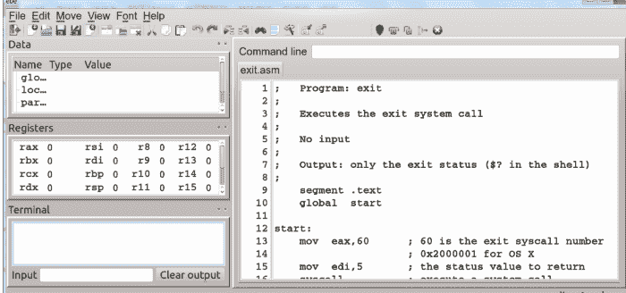

图 1.1 示例中的`ebe`

为了清晰，见图 1.2 不显示寄存器、数据和终端窗口的`ebe`。在源代码窗口中，你可以输入所示文本并使用文件菜单将文件保存为"`exit.asm`" 。要运行程序，只需点击“运行”按钮，它看起来像一个绿色的外星人（或灰色）。有一个箭头指向“运行”按钮。

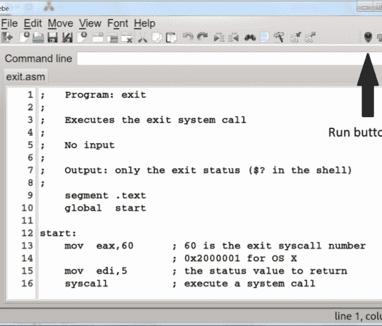

```assembly
; Program: exit
; Executes the exit system call
; No input
; Output: only the exit status ($? in the shell)
; segment .text
	global start
start:
	mov eax,60      ; 60 is the exit syscall number
	; 0x2000001 for OS X
mov edi,5      ; the status value to return
	syscall           ; execute a system call
```

图 1.2. `ebe`中的退出程序

关于使用`ebe`的更多细节将在后文中说明，录录包含一个关于`ebe`的章节。这对于第一章来说足够了。

## 练习

- 1. 输入本章中的汇编程序并进行汇编和链接。然后从命令行执行该程序并输入“`echo $?`”根据 UNIX 系统的惯例，程序的非零状态表示错误。将程序修改为产生 0 状态。
- 2. 修改汇编程序，将`start`定义为`main`。使用`ebe`对其进行汇编和链接。可执行文件的大小有什么区别？
- 3. 在 C 语言和许多其他语言中，0 表示假，1（或非零）表示真。在 shell 中，进程状态 0 表示成功，非零表示错误。shell 的`if`语句本质上使用 0 表示真。为什么第一个 shell 的作者决定使用 0 表示真？

# 第 2 章：数字

计算机中的所有信息都以位（bits）集合的形式存储。这些位可以被解释为各种数字。在本章中，我们将讨论二进制数、十六进制数、整数和浮点数。

## 2.1 二进制数

我们习惯用十进制位值系统表示数字。在这种表示法中，像 1234 的数字意味着 $10^3 + 2 * 10^2 + 3 * 10 + 4$。同样，二进制数位值系统中表示，使用 0 和 1 作为“数字”，并使用 2 的幂而不是 10 的幂。

让我们考虑二进制数 1010111。这是一个 8 位数，所以 2 的最高幂是 $2^7$。因此这个数字是：

```
1010111 = 2^7 + 2^5 + 2^3 + 2^2 + 2 + 1
          = 128 + 32 + 8 + 4 + 2 + 1
          = 175
```

8 位数的位从 0 到 7 编号，最低位是 0，7 是最高位。数字 175 的位定义如下。

| 位值 | 1 | 0 | 1 | 0 | 1 | 1 | 1 | 1 |
|---|---|---|---|---|---|---|---|---|

| 位位置 | 7 | 6 | 5 | 4 | 3 | 2 | 1 | 0 |

从二进制到十进制的转换是直接的。而从十进制转换为二进制则需要一点技巧。让我们看看数字 741。小于（或等于）741 的 2 的最高幂是 $2^9 = 512$。所以我们有：

```
741 = 512 + 229
      = 2^9 + 229
```

现在我们需要处理 229。小于 229 的 2 的最高幂是 $2^7 = 128$。所以现在有：

```
741 = 512 + 128 + 101
      = 2^9 + 2^7 + 101
```

过程继续处理 101。小于 101 的 2 的最高幂是 $2^6 = 64$。所以得到：

```
741 = 512 + 128 + 64 + 37
      = 2^9 + 2^7 + 37
```

接下来我们可以发现 37 大于 $2^5 = 32$：

```
741 = 512 + 128 + 64 + 32 + 5
      = 2^9 + 2^7 + 35
```

处理 5，我们看到：

```
741 = 512 + 128 + 64 + 32 + 4 + 1
      = 2^9 + 2^7 + 2^5 + 2^2 + 1
```

下面是作为 16 位整数表示的 741。

| 位值 | 1 | 0 | 1 | 1 | 1 | 0 | 0 | 1 | 0 | 1 |
| 位位置 | 9 | 8 | 7 | 6 | 5 | 4 | 3 | 2 | 1 | 0

可以通过在 0 和 1 的字符串末尾附加“b”由汇编器表示。因此我们可以将 741 表示为 `101110001b`。十进制数转换为二进制的另一种方法是重复除以 2。每一步的余产生位。再次转换 741：

| 除法 | 商 | 余数 | 二进制数 |
|---|---|---|---|

| 741/2 | 370 | 1 | |
| 370/2 | 185 | 0 | 01 |
| 185/2 | 92 | 1 | 101 |
| 92/2 | 46 | 0 | 101 |
| 46/2 | 23 | 0 | 0101 |
| 23/2 | 11 | 1 | 10101 |
| 11/2 | 5 | 1 | 101011 |
| 5/2 | 2 | 1 | 1010111 |
| 2/2 | 1 | 0 | 01010111 |
| 1/2 | 0 | 1 | 10100111 |

重复除法算法更容易，因为你不需要猜测小于等于数字的 2 的幂。编程也很容易。

## 2.2 十进制数

二进制数表示位字符串有效的方法，但如果字符串很长就会很冗长。在 64 位计算机中，通常使用 64 位整数。输入 64 位后跟一个“b”将很困难。十六进制数是 16 进制数。0-9 数字与十进制一样。10-15 数字用字母 'A' 到 'F' 表示。我们也可以用小写。`yasm`和`C`使用前缀`0x`使数字更直观。让我们考虑`0xa1`的值。这个数字意味着 10，所以我们有：

```
0xa1 = 10 * 16² + 1 * 16 + 10
     = 10 * 256 + 26
     = 2586
```

数字转换为十六进制遵循之前使用的模式，但我们需要找到 16 的最高幂并除以它得到正确的“数字”。让我们将 4007 转换为十六进制。使用的第一个 16 的幂是 $16³ = 4096$。4007/4096 = 9 余余 3143，所以我们有：

```
4007 = 9 * 16³ + 3143
```

3143/16² = 3143/256 = 12 余余 71，所以我们得到：

```
4007 = 9 * 16³ + 12 * 16² + 71
```

71/16 = 4 余 7，所以结果是：

```
4007 = 9 * 16³ + 12 * 16² + 4 * 16 + 7 = 0x947
```

和二进制一样，我们可以通过保留余数来构建数字。

| 除法 | 商 | 余数 | 十六进制 |
|---|---|---|---|

| 4007/16 | 2500 | 7 | 0x7 |
| 2500/16 | 156 | 4 | 0x47 |
| 156/16 | 9 | 12 | 0x94 |
| 12/16 | 0 | 12 | 0xc |

将十进制转换为十六进制的方法很痛苦，因为你不需要猜测小于等于数字的 2 的幂。十六进制表示位非常痛苦。

| 十进制 | 二进制 |
|---|---|

| 0 | 0000 |
| 1 | 0001 |
| 2 | 0010 |
| 3 | 0011 |
| 4 | 0100 |
| 5 | 0101 |
| 6 | 0110 |
| 7 | 0111 |
| 8 | 1000 |
| 9 | 1001 |
| A | 1010 |
| B | 1011 |
| C | 1100 |
| D | 1101 |
| E | 1110 |
| F | 1111 |

下面是 16 位整数表示  711。

||                              |  |  |      1 | 0 | 1 | 1 | 1 | 0 | 0 | 1 | 0 |


| 位位置 | 9 | 8 | 7 | 6 | 5 | 4 | 3 | 2 | 1 | 0 |

## 2.3 整数

在 x86 架构中，整数为 1 字节、2 字节、4 字节或 8 字节。此外，对于每个长度，数字可以是符号的或无符号的。

| 类型 | 位数 | 最小值 | 最大值 |
|------|---|---|---|

| 无符号 | 8 | 0 | 255 |
| 有符号 | 8 | -128 | 127 |
| 无符号 | 16 | 0 | 65535 |
| 有符号 | 16 | -32768 | 32767 |
| 无符号 | 32 | 0 | 4294967295 |
| 有符号 | 32 | -2147483648 | 2147483647 |
| 无符号 | 64 | 0 | 18446744073709551615 |
| 有符号 | 64 | -9223372036854775808 | 9223372036854775807 |

无符号整数正是早些讨论的二进制数。有符号整数以二进制格式“补码”存储。有符号整数的第一位是符号位。如果符号位为 0，则数字为正。存储负数的最明显的方法是用剩余位存储数字的绝对值。

| 符号位 | 值 |
| --- | --- |
| 31 | 0 |

让我们考虑 8 位有符号整数，以及如果我们使用现有的电路来相两个这样的整数，会得到什么结果。让我们将 -1 和 1 相加。如果我们用一个符号位存储 -1，然后是数值，我们会得到：

```
-1 = 10000001
1 = 00000001
-1+1 = 10000010
```

哎呀！我们得到的是 -2 而不是 0。

让我们尝试将 8 位数存储为一个符号位，并将数字的绝对值部分位取反：

```
-1 = 11111110
1 = 00000001
-1+1 = 11111111
```

现在这很有意思：结果实际上是 -0，而不是 0。这听起来有些希望。让我们再尝试另一组数字：

```
-1 = 11111111
4 = 00000100
-1+4 = 00000010 = 2
```

太遗憾了！差了一点。我们需要的是在数字的补码绝对值上加 1。这被称为“补码”运算。它使用与无符号数相同的电路工作，主要是一个解释问题。

让我们将 -1 转换为它的补码格式。

```
00000000 用于绝对值
11111110 用于补码
11111111 加 1 之后
-11111111
```

使用补码数时，最大的负 8 位整数是 10000000。要将其转换回原来的值，对该数取反并加 1。这得到 01111111 + 1 = 10000000 = 128，所以 10000000 = -128。我们在最小值和最大值的表中注意到，最小值的绝对值比最大值大 1。这是由于取反和加 1 导致的。取反产生一串 1，对其加 1 则产生一个 1 和后面跟着堆 0。结果是 n 位有符号整数的最大值是 $2^{n-1} - 1$，最小值是 $-2^{n-1}$。

现在让我们 -750 转换为有符号二进制数。

```
750 = 512 + 128 + 64 + 32 + 8 + 4 + 2 = 1011110110b
```

现在将其表示为 16 位二进制数（留有空格以便跟踪位），我们得到 0000 1011 1101 1010。接下来我们将位取反，得到 1111 0100 0001 0101。最后我们对 -750 加 1得到 1111 0101 0001 0010 = 0FD12。

接下来让我们将十六进制值 0FA13 从 16 位有符号整数转换为十进制。首先转换为二进制：1111 1010 0001 0011。取反位：0000 0101 1110 1100。加 1 补码：0000 0101 1110 1101。将其转换为十进制：1024 + 256 + 128 + 64 + 32 + 8 + 4 = 1516（注：此处原文计算逻辑略有出入，按原文意译）。所以 0FA13 = 1517。

让我们在二进制中加上 -750：

```
1111 1101 0001 0010
+1111 1010 0010 0111
```

忽略导1位。16 位是 1111 0010 0101。取反：0000 1101 1010 1010。加 1 得到补码：0000 0000 1011 1011。转换为十进制：2048 + 128 + 64 + 16 + 8 + 2 + 1 = 2267。所以 -750 + -2267。

# 二进制加法

执行二进制加法非常像十进制加法。让我们相加两个二进制数：

```
10001111
+01011010
```

# 二进制乘法

二进制乘法也像十进制乘法。每次用一个位乘以第一个数，并将这些乘积写在下方。显然，“乘积”是简单的。对于 0，直接跳过即可。对于 1，只需复制第一个数。复制次数后，相加所有乘积。这是一个例子：

```
10101
x10101
```

# 浮点数

x86-64 架构支持三种浮点数：32 位、64 位和 80 位。这些数以 IEEE 格式存储。以下是这些类型的特征：

| 类型 | 位数 | 指数 | 精度 |
| :--- | :--- | :--- | :--- |
| float | 32 | 8 | 127 | 23 位 |
| double | 64 | 11 | 1023 | 52 位 |
| long double | 80 | 15 | 16383 | 64 位 |

IEEE 格式以相同处理这些数字，但长度不同。在每个格式中，最高位是符号位。负数的符号位为 1，其余位与正数一样。每个数都有二进制指数和尾数。`float` 的指数字段是 8 位。为了允许存储大数或小数，实际指数是 8 位字段的值减去 127。127 是 32 位浮点数的“指数偏移”。0.0 被定义为所有位均为 0，指数字段等于 127 尾数为全 0。所有数字至少有一个 1 位，IEEE 754 使用隐式 1 位来节省空间。因此，如果尾数是 000000000000000000，它被解释为 1.000000000000000000。这允许尾数字段有效为 24 位。通过将指数字段设置为 0x00 和 0xFF 是一种巧妙的技巧。指数等于 0x00 的数定义为 0。指数为 0xFF 的数表示负无穷或正无穷。IEEE 754 的完整描述还需要更多细节，但对于我们的需求已经足够。

为了说明浮点数据，考虑以下汇编文件 "`fp.asm`"

```
segment .data
one   dd 0.0
d      dd 1.0
neg1  dd -1.0
a      dd -1.75
b      dd 122.5
d      dd 1.1
e      dd 10000000000.
```

这不是一个程序，而是数据段中 7 个浮点值的定义。`dd` 命令指定双字数据。其他选项包括 `db`（数据字节）、`dw`（数据字）和 `dq`（数据双字）。字是 2 字节，双字是 4 字节，双字是 8 字节。

现在考虑通过执行以下命令汇编文件并生成列表产生的文件 "`fp.lst`"

```
yasm - elf64 -g dwarf2 -1 fp.lst fp.asm
```

这里是列表的内容：

```
1 %line 1+1 fp.asm
2 [section .data]
3 00000004 00000000
4 0000000A 000008B3
5 00000008 000008BF
6 0000000C 00000E3F
7 00000010 0000F542
8 00000014 0000DCCC
9 00000018 0000F902
zero dd 0.0
one   dd 1.0
neg1  dd -1.0
a      dd -1.75
b      dd 122.5
d      dd 1.1
e      dd 10000000000.
```

相关的列表文件显示了每个数字生成的位。字节顺序是反向的。注意 4097 在内存中表示为 0x01000000。第一个字节是最低有效字节。我们更倾向于将其视为 0x00001001，但 CPU 优先存储最低有效字节。

```
line 1+1 int.asm
[section .data]
zero dd 0
one dd 1
engl dd -1
add dd 175
b dd 4097
d dd 65536
e dd 10000000
```

| 十进制 | 十六进制/二进制 |
| :--- | :--- |
| 3 | 00000000 00000000 |
| 4 | 00000004 01000000 |
| 5 | 00000008 FFFFFFFF |
| 6 | 0000000C AF000000 |
| 7 | 00000010 01100000 |
| 8 | 00000014 00000010 |
| 9 | 00000018 00E1F505 |

# 将十进制数转换为浮点数

让我们通过一个例子来学习如何进行转换。让我们将 -121.6875 转换为它的二进制表示。

首先注意到符号位为 1。现在我们处理 121.6875。


转换数字的整数部分相当容易：`121 = 1111001`。现在我们需要处理小数部分。

假设我们有一个二进制分数 `$x = 0.abcdefgh$`，其中字母表示 0 或 1。那么 `$2x=0.abcdefgh$`。这意味着将分数乘以 2 会暴露出一个位。

我们有 `$2 * 0.6875 = 1.375$`，所以二进制位点右侧的第一位是 1。所以我们的数字是 `1111001.1b`。

接下来乘以下一个分数：`$2 * 0.375 = 0.75$`，所以下一位是 0。我们现在有 `1111001.10b`。

再次乘以：`$2 * 0.5 = 1$`，所以最后一位是 1，留下最终的 `1111001.11b`。

我们的数字 `-121.6875 = -1111001.1011b`。我们需要将其转换为带有 2 的幂次的指数计数法。

```
121.6875 = -1111001.1011
= -1.1110011011 * 2^6
```

我们已经有了所有的部分。符号位是 1，小数部分（不包含隐含的 1）是 `11100110110000000000`，指数字段为 `$127+6 = 133 = 1000001$`。所以我们的数字是

```
1 1000001 11100110110000000000
```

按字节组组织，这是 `1100 0010 1111 0110 0000 0000` 或 `0xc2f36000`。当然，如果你在列表中看到它，它将是反的：`0060f3c2`。

# 将浮点数转换为十进制

一个示例将说明如何将浮点数转换为十进制数。让我们处理浮点值 `0x43263000`。

符号位为 0，数字为正数。指数字段为 `010000110`，即 134，二进制指数为 7。小数字段为 `010 011 0011 0000 0000 0000`，带有隐含 1 的的小数是 `1.01001100011`。

```
1.01001100011₂ * 2⁷ = 10100110.0011₂
= 166 + 2⁻³
= 166 + 0.125 + 0.0625
= 166.1875
```

# 浮点加法

为了相两个浮点数，我们必须首先将数字转换为二进制实数。然后我们需要对齐二进制点并相加数字。最后我们需要将其转换回浮点数。

让我们相加 41.275 和 0.315。在十六进制中，这些数字是 `0x425199a` 和 `0x3ea147ae`。现在让我们将 `0x425199a` 转换为带有二进制指数的二进制数。指数字段由前两个字节和下一个字节中的一个 0 位组成。这是 `10000100₂ = 32`，所以指数是 `$132-127=5$`。带有隐含 1 的小数部分是

```
1.0100101000110010
```

我们有

```
0x425199a = 1.0100101000110010₂ * 2⁵
= 1.0100101000110010₂
```

同样，`0x3ea147ae` 的指数字段为前两个字节和第三个字节的 1。所以指数字段是 `01111111₂ = 125`，产生指数 -2。带有隐含 1 的小数部分是

```
1.0100001010101110
```

我们有

```
0x3ea147ae = 1.0100001010101110₂ * 2⁻²
= 0.0101001010011110
```

现在我们可以对齐数字并相加

```
10101.010011001101
+ 0.0101001010011110
```

现在我们有太多位无法存储在 32 位浮点中。最右侧的位将被舍入（在这种情况下）到

```
10101.0100101010
```

所以指数是 5，且指数字段是 132。我们合并符号位、指数字段和小数字段（去掉隐含 1 位）并转换为十六进制

```
01000010 01001100 10101010
```

组织为字节

```
4 2 6 5 9
```

我们确定和为 `0x426529`，约为 41.5。

# 浮点数乘法

浮点乘法可以像十进制一样在二进制中进行。让我们跳过浮点到二进制的转换，只关注 7.5 和 4.375 的乘法。首先观察到 `7.5 = 111.1₂` 且 `4.375 = 100.011₂`。然后我们相乘并将二进制点放在正确的位置

```
111.1 * 100.011 = 100000.1101
```

所以我们得到乘积 32.825。

# 使用位桶（bit bucket）探索

程序的一个子窗口被称为“位桶”。位桶的作用是探索位操作。2.1 显示了在十进制到二进制转换开始时的位桶。

| 输入 | 转换 | n | n/2 | n % 2 | 结果 |
| :--- | :--- | :--- | :--- | :--- | :--- |
| 1 | | | | | |

位桶顶部可以选择 5 个标签，允许你探索单元运算符、二进制运算符、整数转换、整数运算和浮点转换。我选择了整数转换标签。使用“运算符”右侧的下拉列表，我选择了“十进制到二进制”。选择后，转换表如所示已清除。有一个输入数字的字段。在位桶字段中，你可以使用前缀“0x”输入十六进制，也可以使用前缀“0b”输入二进制。输入数字后，通过点击“转换为二进制”按钮逐步转换。此按钮将移动表格通过转换的每一步。

2.2 显示了输入数字 131 并逐步转换为二进制的结果。

| 输入 | 转换 | n | n/2 | n % 2 | 结果 |
| :--- | :--- | :--- | :--- | :--- | :--- |
| 1 131 | | 65 | 1 | 1 除以 2 |
| 2 | | 32 | 1 | 11 除以 2 |
| 3 | | 16 | 0 | 01 除以 2 |
| 4 | | 8 | 0 | 001 除以 2 |
| 5 | | 4 | 0 | 0001 除以 2 |
| 6 | | 2 | 0 | 00001 除以 2 |
| 7 | | 1 | 0 | 000001 除以 2 |
| 8 | | | | 1000001 除以 2 |

位桶将帮助你探索计算机表示和对数字进行操作的方式。有从十进制、二进制和十六进制到其他形式的转换。除了整数转换外，还有 32 位浮点数的转换。整数上的所有算术和位操作也供探索。

## 练习

1. 将以下整数转换为二进制。

aa. 37 b. 65 c. 350 d. 427

2. 将以下 16 位有符号整数转换为。

aa. 000001010101010b c. 0x0101

b. 111111111111101b d. 0xffcc

3. 将以下 16 位无符号整数转换为二进制。

a. 0x015a c. 0x0101

b. 0xffec d. 0xacdc

4. 将以下数字转换为 32 位浮点数。

a. 1.375 c. -571.3125

b. 0.04101562 d. 4091.125

5. 将以下 32 位浮点数转换为十进制。

a. 0x3F82000 c. 0x4F84000

b. 0xBF82000 d. 0x3C86000

6. 编写一个汇编“程序”（仅限数据），使用 `dw` 和 `dd` 定义练习 1-4 中所有数字的数据值。

# 第3章

## 计算机内存

在本章中，我们将讨论现代计算机如何执行内存映射以为每个进程提供一个受保护的地址空间，以及 Linux 系统如何管理进程的内存。本章的一个实际用处是讨论如何使用 `gdb` 调试器和 `ebe` 来检查内存。

## 3.1 内存映射

计算机内存可以被视为字节数组。每个内存字节都有一个地址。第一个字节位于地址 0，第二个字节位于地址 1，以此此类推，直到计算机内存的最后一个字节。

在现代 CPU 中，有硬件映射寄存器，用于为每个进程提供受保护的地址空间。这意味着多个人可以同时运行一个从地址 `0x4004c8` 开始的程序。这些进程感知到相同的“逻辑”地址，而它们在使用不同的“物理”地址访问内存。

x86-64 CPU 硬件映射寄存器可以映射两种不同大小的页——4096 字节和 2 兆。Linux、OS X 和 Windows 为内核使用所有的 2 MB 页面，并对大多数其他用户使用 4 KB 页面。某些操作系统允许用户使用 2 MB 页面。在一些最近的 CPU 中，还支持 1 GB 页面。

内存系统的操作是将进程逻辑地址的高位位翻译为物理地址。让我们只考虑 4 KB 页面。那么，地址是根据页号和页内的地址翻译的。假设引用了逻辑地址 `0x4000002220`。由于 `4096 = 2¹²`，页内偏移是右侧的 12 位（`0x220`）。页号是剩余的位（`0x40000002`）。硬件寄存器（或多个寄存器）将此页号翻译为物理地址，例如 `0x780000000`。然后将两个地址结合，得到物理地址 `0x780000020`。

令人惊讶的是，CPU 通常在不降低速度的情况下执行翻译，这在几个方面惠了用户。最显而易见的好处是内存保护。用户进程被限制为只能读写自己的页面。这意味着操作系统免受恶意或编写不当的用户程序的侵害。此外，每个用户进程也受到其他用户进程的保护。除了写入保护外，用户无法读取其他用户的数据。

操作系统使用一些指令来管理硬件映射寄存器。这些指令在书中没有讨论。我们的书是关于用户进程编程的。


那么，如果我们不讨论管理分页的指令，为什么要费力讨论分页呢？这主要是为了提高人们对计算机的理解。当你编写访问数组末尾之外数据的软件时，你会得到段错误（`segmentation fault`）。然而，只有当你的逻辑地址远超过数组末尾，导致 CPU 引用未映射到你进程的页表项时，你才会得到段错误。

## 3.2 Linux 中的进程内存模型

在 Linux 中，进程的内存分为 4 个逻辑区域：文本（`text`）、数据（`data`）、堆（`heap`）和栈（`stack`）。栈被映射到进程的最高地址，在 x86-64 Linux 上，这是 `0x7ffffffffffff` 或 13 TB。该地址是基于逻辑地址中允许的最大位数为 48 位而选定的。这是 47 位全 1 的位。之所以决定不使用第 47 位，是因为规范地址（canonical addresses）必须将第 47 位扩展到第 48-63 位。

在图 3.1 中，我们看到了各种内存段的布局。在最低地址处，我们有文本段（yasm 中的 `.text`）。该段显示从 0 开始，尽管 `start` 和 `main` 都在较高的地址。x86-64 进程中的最低地址似乎是 `0x400000`。文本段通常不需要增长，因此数据段放置在文本段的正上方。在这两个段之上是堆段和栈段。

数据段从 `.data` 段开始，它包含初始化数据。其上方是 `.bss` 段，全意为“由符号启动的块”（block started by symbol）。`.bss` 段包含在进程中静态分配但未存储在执行文件中的数据。相反，这些数据在进程加载到内存时才被分配。`.bss` 段的初始内容全为 0 位。

堆并不是数据结构课程中讨论的那种意义上的堆。相反，它是一个动态调整大小的内存区域，用于通过进程函数（如 C 中的 `malloc` 和 C++ 中的 `new` 运算符）来分配内存。在 x86-64 Linux 中，该区域可以增长到非常大的尺寸。限制是由物理内存和交换空间之和施加的。

进程的最后一个段是栈段。该段受 Linux 内核限制，通常为 16 兆。这不是一个巨大的空间，但只要程序员避免在栈上使用大数组，它就能很好地实现管理运行时栈，跟踪函数调用、参数、局部变量和返回地址。可以通过编辑 `/etc/security/limits.conf` 来更改用户的硬限制，用户可以使用 `ulimit -s 20000` 或任何所需的大小指定新的栈大小。

给定栈顶为 `0x7ffffffffff` 且栈大小限制为 16 兆，我们看到最低栈地址是 `0x7fffffff0000`。这是因为 16MB 是 `0x100000` 字节。`0x7ffffffffff - 0x100000 = 0x7fffffff0000`。

## 3.3 OS X 中的进程内存模型

OS X 进程的布局与 Linux 进程相似，有一个巨大的区别。在 OS X 中，进程地址空间的低 4 GB 被映射到所谓的“零页”（zero page）。涵盖了从 `0x0` 到 `0xffffffff` 的地址范围。这种映射的效果是，任何对零页位置的内存引用都会导致段错误。这一决策背后的目的是限制截断指针的影响，截断指针可能由于 64 位指针的低半部分进入寄存器而产生。让程序失败总比在访问内存错误部分后继续执行要好。

这意味着程序中的所有地址都太大，无法放入 32 位中。特别是，这影响了汇编编程，因为函数地址（即要跳转到内存的位置）无法放入 32 位中。这很重要，因为此类指令的地址字段是 32 位的。为了解决这个问题，OS X 中的编码是使用“rip 相对”（rip relative）寻址。这意味着存储在指令中的地址是相对于指令指针寄存器 `rip` 的当前值的。

通常情况下，程序所有的指令和静态数据可以放入少于 2GB 的内存中。这允许 Linux 实际上为代码和静态数据使用 32 位寻址，并允许 OS X 为相同目的使用 32 位相对寻址。

## 3.4 内存汇编示例

这里有一个汇编程序 "`memory.asm`"，定义了多个内存项：

```assembly
segment .data
ab dd 4
dd 4.4
dw times 10 dd 0
dw 1, 2
db 0xfb
fb "hello world", 0
```

```assembly
segment .bss
res 1
res 10
resb 100
```

```assembly
segment .text
global main ; tell linker about main
main:
push rbp ; set up a stack frame
mov rbp, rsp ; rbp points to stack frame
sub rsp, 16 ; leave some room for locals
xor eax, eax ; rax = 0 for return value
leave ; undo stack changes
ret
```

汇编程序后我们得到如下列表

file:

| line | source |
|---|---|
| 1 | %line 1+1 memory.asm |
| 2 | [section .data] |
| 3 | 00000000 04000000 a dd 4 |
| 4 | 00000004 dCC8C40b dd 4.4 |
| 5 | 00000000 00000000 c times 10 dd 0 |
| 6 | 00000030 01000200 d dw 1, 2 |
| 7 | 00000034 FB e db 0xfb |
| 8 | 00000035 6B656C6F20776F72f db "hello world", 0 |
| 9 | 00000035 6C6400 |
| 10 | [section .bss] |
| 11 | 00000000 g resd 1 |
| 12 | 00000004 h resd 10 |
| 13 | 0000002c i resb 100 |
| 14 | [section .text] |
| 15 | [global main] |
| 16 | main: |
| 17 | 00000000 55 push rbp |
| 18 | 00000001 4889E5 mov rbp, rsp |
| 19 | 00000004 488EC10 sub rsp, 16 |
| 20 | 00000008 31C0 xor eax, eax |
| 21 | 0000000A C9 leave |
| 22 | 0000000C C ret |

你可以从列表中看到所定义元素的相对地址。在数据段中，我们有一个名为 `a` 的双字（4 字节），位于位置 0 处。注意，`a` 的字节顺序与你可能预期的相反。

接下来是一个定义在相对地址 4 处的、名为 `b` 的浮点数双字。`b` 的字节顺序也是反转的。将其视作 `0x48ccccd`。符号位为 0，指数字段是“第一个”字节右侧的 7 位 `0x40` 加上下一个字节的左侧位 `0x8c`。因此指数字段为 `0x81 = 129`，对应的二进制指数为 2。小数字段（带有隐含的初始 1 位）是 `0x8cccc`。因此 `b = 1.00011001100110011001 * 2^4 = 4.4`。

下一个数据项是使用 `times` 伪指令定义的数组 `c`，它包含 10 个字单元。`c` 的相对位置是 8，`c` 由 40 个字节组成，`c` 之后的下一个项位于相对地址 48 或 `0x30`。

紧随 `c` 的是长度为 2、值为 1 和 2 的数组 `d`。数组 `d` 是字数组，每个值占 2 字节。同样，你可以看到 `d` 的每个字字节顺序都是反转的。

下一个数据项是初始值为 `0xfb` 的变量 `e`。在 `e` 之后的是初始化为字符串的数组 `f`。注意我给 `f` 添加了一个终止空字节。在 yasm 中，字符串显式地不以空字节结束。

在数据段之后，我包含了一个有 3 个变量的 bss 段。它们按照相对于 bss 段的地址列出。链接后，bss 数据项将加载到内存中，从由 `res` 指令定义的 `g` 开始，该指令意味着“预留”双字。`res 1` 意味着 1 个双字。下一个 bss 项是 `i`，它有 10 个预留字。最后一个 bss 项是 `j`，它有 100 个预留字节。所有地址都相对于 bss 段的开头。程序启动时它们的值都为 0。

## 3.5 使用 ebe 检查内存

在本节中，我们将要介绍如何使用 `ebe` 检查内存。我们将展示如何带断点启动内存程序，以便检查程序中定义的变量。

### 设置断点

断点是指令的标记，调试器用它在执行到该指令时停止程序运行。调试的一般模式是设置断点然后运行程序。程序将运行到断点处为止。`ebe` 使用源代码左侧的行号列来指示断点。左键点击行号会在该行设置（如果已设置则清除）断点。`ebe` 通过将该行涂为红色背景来指示断点的存在。下图显示了在第 17 行设置断点的 `ebe` 内存窗口。断点显示为灰色背景 img/a81fe5f31fcec74.png

### 运行程序并查看变量


在第 17 行设置断点后，如果我们现在点击“`Run`”按钮（箭头所示），程序将编译、链接并执行。它会在 `sub rsp, 24` 指令处停止。源代码窗口将通过赋予该行蓝色背景来指示下一行（灰色）。

`memory.asm`

| line | source |
|---|---|
| 1 | segment .data |
| 2 | a | dd 4 |
| 3 | b | dd 4.4 |
| 4 | c | times 10 dd 0 |
| 5 | d | dw 1, 2 |
| 6 | e | db 0xfb |
| 7 | f | db "hello world", 0 |
| 9 | segment .bss |
| 10 | g | resd 1 |
| 11 | h | resb 100 |
| 12 | i | |
| 14 | .section |
| 15 | main: | let the linker know about main |
| 16 | sub | rsp, 24 | leave some room for local variables |
| 17 | xor | eax, eax | rax = 0 for return value |
| 18 | add | rsp, 24 | stack manipulations |
| 20 | ret | |

你可以右键点击第 2 行的标签，`ebe` 会弹出一个菜单。选择“Define variable”选项会弹出的单，允许你定义变量显示数据：不需要修改表单的名称和地址字段。然而名称字段可以改为任何字符串，地址字段也可以修改。输入十六进制地址可能有用，但 `ebe` 不处理地址。`ebe` 没有像程序那样访问数据类型和大小，但它尝试猜测类型和大小。我点击了“Format”标签右侧的三角形，并将格式设置为“Decimal”。格式选项有 Decimal、Hexadecimal、Floating point 和 Array。我在“Size”字段也选择了定义的“4”。大小选项有 8, 4, 2 和 1。你还可以点击“array variable”复选框并选择变量的起始和结束索引，这类似于 C 数组，0 为第一个索引。点击“OK”后弹出框将消失，`ebe` 将数据窗口中显示变量 `a`。它会在每次执行后刷新值，以便在程序执行时监控它的值。

| Name | Type | Value |
|---|---|---|
| user-defined | | |
| a | int | 4 |
| b | float | 4.4 |
| c[0:9] | int | 000000000 |
| d[0:1] | short | 1 2 |
| e | unsigned char | 0xf |
| f[0:1] | char | "hello world" |
| g | | 0 |
| h[0:9] | int | 00000000000000 |
| i[0:9] | int | 000000000000000 |

你会注意到数据窗口还以十六进制显示栈的顶部。这非常有用，通常栈的十六进制是一个很好的选择。你可以通过右键点击非栈变量名来更改其格式、大小以及起始和结束索引。这将弹出一个表单，允许你编辑或删除变量。编辑将弹出与创建变量时相同的表单。

我继续在“`memory.asm`”中显示所有变量。我为 `c` 选择了最后的索引 9，它是一个 10 字数组。我为 `d` 选择了大小 2，为 `e` 选择了 1。对于 `f`，我选择了“String”格式，这有点特殊。C 字符串简单来说带有 0 字节的字符数组。字符串的大小并不重要，但我留留了 8。从下面的图中可以看到，bss 段中的变量全为 0。

| Name | Type | Value |
|---|---|---|
| user-defined | | |
| globals | unsigned long * | 0x000000002aaaff5ec5 0x000000000000000 |
| stack | | |
| locals | | |
| parameters | | |
| user-defined | int | 4 |

### 3.6 使用 gdb 检查内存

使用 `exe` 可能对于大多数调试已经足够了，但有时理解 `gdb` 命令也会很有用。特别是你可以使用 `ebe` 控制台从 `e e` 输入 `g` 命令。The console

该窗口显示了 `ebe` 使用的所有 `gdb` 命令，这可以帮助我们发现如何直接使用 `gdb`。

在本节中，我们将重点关注 `gdb` `print` 命令（缩写为 `p`）和 `examine` 命令（缩写为 `x`）。`print` 是一个简单的命令，可以打印某些数据值，并且足够通用以打印各种形式的 C 表达式。`examine` 则专门用于打印内存中的数据，对于打印各种类型的数组非常有用。

#### 使用 gdb 打印

`p` 命令的格式为 "`p` expression" 或 "`p`/FMT expression"，其中 FMT 是一个定义打印数据格式的单个字母。格式选择如下：

| 字母 | 格式 |
| --- | --- |
| d | 十进制 (decimal) |
| x | 十六进制 (hexadecimal) |
| t | 二进制 (binary) |
| u | 无符号 (unsigned) |
| f | 浮点数 (floating point) |
| i | 指令 (instruction) |
| c | 字符 (character) |
| s | 字符串 (string) |
| a | 地址 (address) |

让我们在 `gdb` 中查看一些命令。注意 `gdb` 提示符 "`(gdb)`"，发送给 `gdb` 的命令已用粗字体显示。

```
(gdb) p a
$32 = 4
(gdb) p/a &a
$33 = 0x601018 <a>
(gdb) p b
$34 = 1082969293
(gdb) p/f b
$35 = 4.4000001
(gdb) p/a &b
$36 = 0x60101c <b>
(gdb) p/x &
$37 = 0x60101c
(gdb) p/a &c
$39 = 0x601020 <c>
(gdb) p/a &d
$40 = 0x601048 <d>
(gdb) p/a &e
$41 = 0x60104c <e>
(gdb) p/a &&
$42 = 0x60104d <f>
(gdb) p/a &g
$43 = 0x601070 <g>
(gdb) p/a &h
$45 = 0x601074 <h>
(gdb) p/a &#
$46 = 0x60109c <i>
```

我们看到 `gdb` 处理得完美。它正确识别了类型和长度，因为它默认使用十进制格式和 4 字节整数。它需要 `f` 选项来正确打印 `b`。注意 `a` 位于地址 `0x601018`，这在内存页起始位置之后 24 字节处。尽管 `a` 是第一个数据项，但它并不是从内存页的开始位置的。`gdb` 将禁止访问 `a` 之前的内存，尽管对之前的 24 字节并没有硬件限制。我们看到数据段变量被放置在内存中，直到 `f`，`f` 开始于 `0x60104d` 并延伸到 `0x601058`。在 bss 段（从地址 `0x6010770` 的 `g` 开始）之前有一个间隙。bss 数据项重新放在内存中，没有间隙。

##### 检查内存

`p` 命令没有长度指定符。如果你想在内存中打印 `double`，可以通过对 `p` 进行一些脑力转弯来实现。示例命令可以轻松胜任这项工作。

`examine` 的格式为 `x/NFS address`，其中 `N` 是要打印的项数（默认为 1），`F` 是 `print` 命令中使用的单个字母格式，`S` 是每个内存位置的大小。遗憾的是，`gdb` 选择的一些大小字母与 `yasm` 中的大小选项发生了冲突。以下是大小选项：

| 字母 | 大小 | 字节 |
| --- | --- | --- |
| b | 字节 (byte) | 1 |
| h | 半字 (halfword) | 2 |
| w | 字 (word) | 4 |
| g | 巨字 (giant) | 8 |

这里有一些检查内存的示例：


```
(gdb) w/a &
0x601018 <a>: 0x4
(gdb) x/f w &
0x60101c <b>: 4.4000001
(gdb) x/fg &
0x60101c <b>: 5.350792317228316e-315
(gdb) x/10dw &
0x601020 <>: 0 0 0 0
0x601030 <+16>: 0 0 0 0
0x601040 <+32>: 0 0
(gdb) x/2xh &
0x601048 <d>: 0x0001002
(gdb) x/12cb &
0x60104d <f>: 104 'h' 101 'e' 108 'l' 108 'l' 111 'o'
32 ' ' 119 'w' 111 'o'
0x601055 <f+8>: 114 'r' 108 'l' 100 'd' 0 '000'
(gdb) x/s &f:
"hello world"
```

使用正确的格式和大小，结果符合预期。我首先用正确的大小打印 `b`，然后用巨字大小（8 字节）。`Gdb` 将 `b` 地址处的 8 字节解释为 `double`，得到了错误的指数和小数。计数字段的使用对于导出内存非常有用。

# 练习

- 1. 编写一个类似本章的数据程序，在数据段中定义 10 个 8 字节整数，在 bss 段中定义 5 个 2 字节整数，在数据段中定义一个以 0 结尾的字符串。使用 `gdb` 的检查命令以十六进制格式打印 8 字节整数，以无符号值打印 2 字节整数，以字符串格式打印字符串。
- 2. 假设栈空间限制为 16MB，最多可以定义多大的 8 字节数组？
- 3. 假设栈空间限制为 16MB，最多可以定义多大的 2 字节数组？
- 4. 找出存储一个值需要多少位。

# 第 4 章 内存映射

在本章中，我们将讨论 x86-64 中如何转换地址。

## 4.1 内存映射

x86-64 进程的内存映射分为几个段。最重要的包括代码段、数据段、bss 段和栈。代码段包含可执行的指令。数据段包含初始化的全局变量。bss 段包含未初始化的全局变量。栈用于局部变量和函数返回地址。

## 4.2 页表

x86-64 的内存管理通过页完成。每个页通常为 4KB。从虚拟地址到物理地址的转换由硬件通过页表处理。


| 0 | 0x5788000 |
| 1 | 0x5789000 |
| 2 | 0x578a000 |
| ... | ... |
| 511 | 0x5799000 |

在使用 4 个页表后，我们达到了原始引用的内存页地址。然后我们可以将原始的页偏移（位 11-0）进行或运算，例如 `0xf8`。这得到了最终的物理地址 `0x579fa8`。

## 4.6 大页

普通页面的大小为 4096 字节。CPU 设计者通过现有的三级翻译表增加了对大页的支持。通过使用 3 级表，页内偏移字段有 $9 + 2^{12} = 21$ 位。这使得大页变为 $2^{21} = 2097152$ 字节。

一些最新的 CPU 支持 2 级页表，这导致产生了 $2^{30}$（即 1 GB）的页面。这些巨型页对于需要大量 RAM 的应用程序（如数据库管理系统和虚拟机仿真器）将非常流行。

## 4.7 CPU 对快速查找的支持

如果每次都遍历所有这些表，这个过程将完全太慢。相反，每当执行页翻译时，CPU 会将此翻译存入名为“旁路缓冲区”（Translation Lookaside Buffer，简称 TLB）的缓存中。然后这个页面可能会被多次使用，而无需再次通过查找过程。

TLB 的工作方式类似于哈希表。它接收一个虚拟页地址，并在大约 1/2 个时钟周期内产生物理页地址或返回失败。在失败的情况下，内存搜索需要 10 到 100 个周期。典型的缺失率从 0% 到 1%。

显然，CPU 的 TLB 条目数量是有限制的。Intel Core 2 系列在一级（L1）TLB 中共有 16 条目，在二级（L2）TLB 中有 256 条。Core i7 拥有 64 个 L1 TLB 条目和 512 个 L2 TLB 条目。AMD Athlon II CPU 拥有 1024 个 TLB 条目。

考虑到 CPU 中的 TLB 条目数量相对较少，迁移到为程序分配 2 MB 似乎是一个好主意。Linux 通过其 `HUGETLB` 支持使用 2 MB 页面。这需要调整系统参数并使用 `SHM_HUGETLB` 选项分配共享内存区域。这提高使用大数组的进程性能。OS X 和 Windows 也支持 2 MB 页面。

## 练习

- 1. 假设你有机会为新 CPU 重新设计内存映射层次结构。我们已经看到 4 KB 页面似乎有点小。假设你将页面设置为 $2^{17} = 131072$ 字节。这样的页面可以容纳多少个 64 位指针？
- 2. 页表寻址需要多少位？
- 3. 你将如何拆分虚拟地址的位域？
- 4. 拥有更大的页面似乎是理想的。让我们设计一个页面大小为 $2^{20}$ 的内存映射系统，但使用部分页用于内存映射表。设计一个具有 3 级页映射表的系统，虚拟地址空间至少为 48 位。
- 5. 假设虚拟内存地址为 0x123456789012。将此地址分为 4 个不同的页表部分和页内偏移。
- 6. 假设虚拟内存地址为 0x123456789012。假设这恰以是 2MB 页面内的地址。该地址的页内偏移是多少？
- 7. 编写一个汇编程序计算家庭电费。每千瓦时的费用将存储在内存位置的整数分（penny）。使用的千瓦时也是存储在内存中的整数。账单金额为 $5.00 加上每千瓦费用乘以超过 1000 度的数量。你可以使用条件移动，如果超过 1000 度的数量为负，则将其设置为 0。将美元数移动到一个内存位置，将分数移动到另一个。

# 第 5 章

## 寄存器

计算机内存本质上是一个字节数组，软件用它存储指令和数据。虽然内存较快，但需要少量的快速数据来允许 CPU 更快地执行指令。典型的计算机运行频率为 3 GHz，许多指令在 1 个周期内执行。然而，为了执行指令，指令本身和任何所需数据必须从内存中提取。一种常见的内存形式延迟为 6 纳秒，这意味着请求内存与获取数据之间的时间滞。这 6 纳秒等于 18 个 CPU 周期。如果指令和数据都从内存中提取，执行常用指令可能大约需要 18 纳秒。18 纳秒的时间足够按每周期 1 条指令的速度执行 54 条指令。显然，有必要避免使用缓慢的主内存。

一种更快的内存是缓存内存，其速度可能是主内存的 10 倍。使用缓存内存有助于解决问题，但不足以达到“每个 CPU 周期执行 1 条指令”的目标。第二种更快的内存是 CPU 的寄存器。缓存可能有几 MB，而 CPU 只有几个寄存器。然而，寄存器的访问速度大约只需半个 CPU 周期或更短。使用寄存器对于实现高性能至关重要。缓存和寄存器的结合提供了现代 CPU 大约一半的性能。其余通过流水线（pipelining）和多个执行单元实现。流水线意味着将指令分为多个步骤，并同时执行几条指令，每条处于不同的步骤。流水线和这些特征不是通用汇编编程的一部分，而寄存器是核心特征。

x86-64 CPU 拥有 16 个通用寄存器和 16 个现代浮点寄存器。这些浮点寄存器根据 CPU 模型可能是 128 位或 256 位，并可以处理多个整数或浮点值。还有一个浮点寄存器栈，我们将在书中不会使用。CPU 有一个 64 位的指令指针寄存器（`rip`），它包含下一条要执行指令的地址。还有一个 64 位的标志寄存器（`rflags`）。还有我们可能不会使用的额外寄存器。

16 个通用寄存器是存储在 CPU 内部的 64 位。软件可以以 64 位、32 位、16 位和 8 位值的形式访问寄存器。由于 CPU 演变自 806，寄存器从 16 位演变为 32 位，最后演变为 64 位。

806 的寄存器比通用寄存器更特殊特殊：

- `ax` 累加器，用于数值运算
- `bx` 址寄存器，用于数组访问
- `cx` 计数寄存器，用于字符串操作
- `dx` 数据寄存器
- `si` 源索引
- `di` 目的索引
- `bp` 基址指针（用于函数栈帧）
- `sp` 栈指针

此外，前 4 个寄存器的两个部分可以通过 `al` 访问 `ax` 的低字节，通过 `ah` 访问 `ax` 的高字节，以及通过 `bl`、`bh`、`cl`、`ch`、`dl` 和 `dh` 访问 `bx`、`cx` 和 `dx` 的部分。

在设计 386 CPU 时，寄存器扩展到 32 位并重命名为 `eax`, `ebx`, `ecx`, `edx`, `esi`, `edi`, `ebp` 和 `esp`。软件仍然可以使用原始名称来访问这 8 个寄存器的低 16 位，但未允许直接访问寄存器的上半部分。

对于 x86-64 架构，寄存器扩展到 64 位，并添加了 8 个额外的通用寄存器。访问 64 位寄存器的名称为 `rax`, `rbx`, `rcx`, `rdx`, `rsi`, `rdi`, `rbp` 和 `rsp` 用于兼容集合，`r8`-`r15` 用于这 8 个新寄存器。正如你所预料的，你仍然可以使用 `ax` 访问寄存器的最低字，使用 `eax` 访问寄存器的下半部分。同样，其他 32 位和 16 位寄存器名称在 64 位下仍然有效。你也可以通过寄存器名称后附加 `b`、`w` 或 `d`，将 `r8`-`r15` 作为字节、字或双字寄存器访问。

`rflags` 寄存器是一个 64 位的，但目前只使用了低 32 位，因此通常称为 `eflags` 即可。此外，标志寄存器通常不直接引用。相反

指令在内部访问标志位寄存器的 1 位或多个位，以确定要执行执行的操作。

移动数据在汇编语言中似乎是一项基础任务。在从整数寄存器向或从中移动值的情况下，基本命令是 `mov`。它可以将常量、地址和内存内容移动到寄存器，将数据从一个寄存器移动到另一个，并将寄存器的内容移动到内存中。

### 5.1 在 ebe 中观察寄存器

`ebe` 管理的窗口之一是寄存器窗口。在程序执行的每一步之后，`ebe` 都会获取通用寄存器的当前值并显示在寄存器窗口中。同样，`ebe` 在浮点寄存器窗口中显示浮点寄存器。下面是寄存器窗口的示例。

#### 寄存器

| `rax` 0x40c00 | `rsi` 0x7ffffeb38 | `r8` 0x0400c9a | `r12` 0x0409d0 |
| `rbx` 0x0 | `rdi` 0x1 | `r9` 0x0 | `r13` 0xffffffeb30 |
| `ecx` 0xffffffff | `rbp` 0x0 | `r10` 0x1 | `r14` 0x0 |
| `edx` 0xffffffeb48 | `esp` 0xfffffffe8 | `r11` 0x246 | `r15` 0x0 |
| `rip` 0x400c00 | `eflags` PF ZF IF | | |

你可以通过通过右键点击寄存器名称来选择不同的寄存器格式。这将弹出一个选项列表。你可以为该寄存器或所有通用寄存器选择十进制或十六进制格式。你可以在下方看到通用寄存器、指令指针寄存器（`rip`）和标志寄存器（`efl`）。为了简单起见，奇偶位（`PF`）、零位（`ZF`）和中断允许位（`IF`）均被设置为置。

### 5.2 将常量移动到寄存器

第一种移动是将常量移动到寄存器中。常量通常被称为立即数值（immediate value），它作为指令的一部分由某些字节组成。对于大多数指令，立即操作数可以是 1、2 或 4 字节。`mov` 指令允许 8 字节的立即数值。

```
mov rax, 100
```

```
mov eax, 100
```

惊讶的是，这两条指令具有相同的效果——将值 100 移动到 `rax`。带有 4 字节寄存器引用的算术运算和移动操作会被扩展为 8 字节。下面在 `ebbe` 中显示的程序演示了 `mov` 指令将常量移动到寄存器 `rax` 的情况。

```asm
```


`test.asm`

```asm
segment .text

global  main              ; 让链接器知道 main

main:

    mov     rax, 0x123456789abcdef0

    mov     eax, 100

    mov     rax, 0

    ret
```

在第 5 行设置了断点，并且通过点击“Run”按钮运行了程序。此时，第一个 `mov` 尚未执行。你可以点击“Next”或“Step”（图中用箭头高亮显示）来推进程序。区别在于，如果发生了调用，“Step”将进入函数，而“Next”将执行高亮语句并推进到同一函数中的下一条语句。在这段代码中效果是相同的，以下是执行第一个 `mov` 后的源窗口和寄存器窗口：

```asm
test.asm

segment .text

global  main              ; 让链接器知道 main

main:

    mov     rax, 0x123456789abcdef0

    mov     eax, 100

    mov     rax, 0

    ret
```

| rax 0x123456789abcdef0 | rsi 0x7fffffeeb38 | r8 0 | r12 0x4009d0 |
| rbx 0x0 | rdi 0x1 | r9 0 | r13 0x7fffffeeb3f |
| rcx 0xffffffff | rbp 0x0 | r10 0x0 | r14 0 |
| rdx 0x7fffffeeb48 | rsp 0x7fffffeea58 | r11 0x26 | r15 0 |
| rip 0x400c0a | eags PF ZF IF | | |

你可以观察到 `mov 0x123456789abcdef0` 已被放入 `rax`，并且显然下一个 `mov` 尚未执行。重复显示寄存器窗口的价值不大，但这里是执行第 6 行 `mov` 后的寄存器窗口：

### 寄存器

| rax 100 | rsi 0x7ffffeb38 | r8 0x400caa | r12 0x4009d0 |
| rbx 0x0 | rdi 0x0 | r9 0x0 | r13 0x7ffffebf30 |
| rcx 0x7fffffff | rbp 0x0 | r10 0x1 | r14 0x0 |
| rdx 0x7ffffeb48 | rsp 0x7fffffeea5 | r11 0x246 | r15 0x0 |
| rip 0x000c0f | eflags PF ZF IF | | |

你可以观察到 `0x123456789abcdef0` 已被放入 `rax`，并且显然下一个 `mov` 尚未执行。重复显示寄存器窗口并没有太大意义，但这里是执行第 6 行 `mov` 后的寄存器窗口：

| rax 0x123456789abcdef0 | rsi 0x7ffffeb38 | r8 0x400caa | r1200x00000| r |
| rx0 r r0 r0x0 | r | | rx0 | r r3 0xffffffffffff3f |
| rcx 0xffffffff | rbp 0x0 | r10 0x0 | r14 0x0 |
| rdx 0x7fffffeeb48 | rsp 0x7fffffeea5 | r r11 0x246 | r15 0x0 |
| rip rip 0x400c0a | eags PF ZF IF | | |

为了简单起见，奇偶位（`PF`）、零位（`ZF`）和中断允许位（`IF`）均被设置为置。

## 5.2 将常量移动到寄存器

第一种移动是将常量移动到寄存器中。常量通常被称为立即数值（immediate value），它作为指令的一部分由某些字节组成。对于大多数指令，立即操作数可以是 1、2 或 4 字节。`mov` 指令允许 8 字节的立即数值。

```asm
mov rax, 100

mov eax, 100
```

惊讶的是，这两条指令具有相同的效果——将值 100 移动到 `rax`。带有 4 字节寄存器引用的算术运算和移动操作会被扩展为 8 字节。下面在 `ebbe` 中显示的程序演示了 `mov` 指令将常量移动到寄存器 `rax` 的情况。

```asm
test.asm

segment .text

global  main              ; 让链接器知道 main

main:

    mov     rax, 0x123456789abcdef0

    mov     eax, 100

    mov     rax, 0

    ret
```

在第 5 行设置了断点，并且通过点击“Run”按钮运行了程序。此时，第一个 `mov` 尚未执行。你可以点击“Next”或“Step”（图中用箭头高亮显示）来推进程序。区别在于，如果发生了调用，“Step”将进入函数，而“Next”将执行高亮语句并推进到同一函数中的下一条语句。在这段代码中效果是相同的，以下是执行第一个 `mov` 后的源窗口和寄存器窗口：

```asm
test.asm

segment .text

global  main              ; 让链接器知道 main

main:

    mov     rax, 0x123456789abcdef0

    mov     eax, 100

    mov     rax, 0

    ret
```

| rax 0x123456789abcdef0 | rsi 0x7fffffeeb38 | r8 0 | r12 0x4009d0 |
| rbx 0x0 | rdi 0x1 | r9 0 | r13 0x7fffffeeb3f |
| rcx 0xffffffff | rbp 0x0 | r10 0x0 | r14 0 |
| rdx 0x7fffffeeb48 | rsp 0x7fffffeea58 | r11 0x26 | r15 0 |
| rip 0x400c0a | eags PF ZF IF | | |

你可以观察到 `mov 0x123456789abcdef0` 已被放入 `rax`，并且显然下一个 `mov` 尚未执行。重复显示寄存器窗口的价值不大，但这里是执行第 6 行 `mov` 后的寄存器窗口：

### 寄存器

| rax 100 | rsi 0x7ffffeb38 | r8 0x400caa | r12 0x4009d0 |
| rbx 0x0 | rdi 0x0 | r9 0x0 | r13 0x7ffffebf30 |
| rcx 0x7fffffff | rbp 0x0 | r10 0x1 | r14 0x0 |
| rdx 0x7ffffeb48 | rsp 0x7fffffeea5 | r11 0x246 | r15 0x0 |
| rip 0x000c0f | eflags PF ZF IF | | |

为了简单起见，奇偶位（`PF`）、零位（`ZF`）和中断允许位（`IF`）均被设置为置。

# 启动程序：`/home/seyfarth/asm/add1`

```
Breakpoint 1, main () at add1:7

rax, a ; mov a 的地址

(gdb) n

mov rax, [a] ; 将 a (175) 放入 rax

(gdb) p/x $rax

mov rax, []

$1 = 0x610018

(gdb) n

add rax, [b] ; 将 b 加到 rax

(gdb) p $rax

$2 = 175

(gdb) n

xor rax, rax

(gdb) p $rax

$3 = 4272

(gdb) p a+b

$4 = 4272
```

`gdb` 的输出可能会让人稍微困惑，因为它总是打印将要执行的某一行。例如，在它打印完第 8 行之后，我打印了 `rax`，它包含了最后一次执行指令（第 7 行）所存的值。如果你记住高亮的行是下一个要执行的行，这一点会更加明显。

我们看到正确的和通过 `add` 指令存放在 `ra` 中。在代码中，我们还看到 `gdb` 知道代码中的标签并可以打印 `a` 和 `b`，甚至可以计算它们的和。遗憾的是，`yasm` 产生的代码没有告知 `gdb` 数据类型，因此 `gdb` 假设变量是双精度整数（double integers）。尽管如此，这种打印算术表达式的能力是非常方便的。

将数据从内存移动到寄存器的方法有很多，但对于简单的程序这足够了。其他方法涉及将地址存储在寄存器中，并使用寄存器持有字节或数组中的偏移量。

你也可以将小于 8 字节的整数值移动到寄存器。如果你指定 `al` 或 16 位寄存器 `ax`，则寄存器的剩余位将不受影响。然而，如果你指定 32 位寄存器 `eax`，则剩余位将设置为 0。这可能正是你所愿的，也也可能不是。

或者，在这些情况下，你可以使用移动并符号扩展（`movsx`）或移动并零扩展（`movzx`），在这种情况下你将使用 64 位寄存器作为目标，并在指令中添加长度限定符。有一个惊喜：一个单独的指令用于移动并符号扩展双字：`movsd`。这里是一些示例：

```
movsx rax, byte [data] ; 移动字节，符号扩展
```


`movzx rbx, word [sum]` ; 移动字，零扩展

`movsd rcx, dword [count]`; ; 移动双字，符号扩展

## 5.4 将值从寄存器移动到内存

将数据从寄存器移动到内存与从内存移动到寄存器非常相似——只需交换操作数，使内存地址位于左侧（目标）即可。

```
mov [sum], rax
```

下面是一个程序，它从内存中相两个数字并将和存储在名为 `sum` 的内存位置：

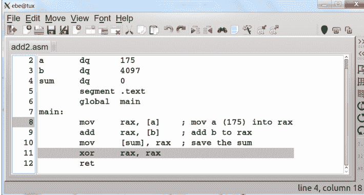

源窗口显示高亮的第 11 行，这意味着保存和的 `mov` 指令已经执行。你可以看到第 8 行上有一个断点，显然使用了“Run”按钮来启动程序并点击了 3 次“Next”（下一步）。下面是该程序的数据：

| 名称 (Name) | 类型 (Type) | 值 (Value) |
| --- | --- | --- |
| globals | unsi... | 0x00002aaaaff5ec 0x0000000000000000 0x00007ff... |
| stack | | |
| locals | | |
| parameters | | |
| user-defined | long | 175 |
| b | long | 4097 |
| sum | long | 4272 |

## 5.5 将数据从一个寄存器移动到另一个寄存器

将数据从一个寄存器移动到另一个寄存器正如你预期的，在 `mov` 指令上放置两个寄存器名称作为操作数。
`mov rbx, rax` ; 将 `rax` 中的值移动到 `rbx`

下面是一个将 `a` 的值移动到 `rax`，然后将其移动到 `rbx` 的程序，这样该值就可以用于计算 `a+b`。

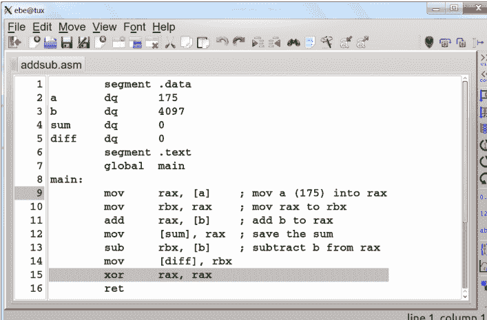

你可以看到第 8 行上有一个断点，第 15 行是下一个要执行的行。这个程序引入了 `sub` 指令，它从 `rbx` 中减去内存 `b`，并将差放在 `rbx` 中。

| 名称 (Name) | 类型 (Type) | 值 (Value) |
| --- | --- | --- |
| globals | unsi... | 0x00002aaaaff5ec 0x0000000000000000 0x00007ff... |
| stack | | |
| locals | | |
| parameters | | |
| user-defined | | |
| a | long | 175 |
| b | long | 4097 |
| diff | long | - |
| sum | long | 4272 |

注意加法和减法程序寄存器中显示的 `eflags` 值可能有点意思。你会发现 `SF` 代表“符号标志位”（sign flag），它表示修改标志的最后一条指令 `sub` 导致了一个负值。

| 寄存器 (Registers) | eflags |
| --- | --- |
| rax | 72 |
| rbx | ffffffff |
| rcx | ffffffff |
| rdx | 7ffeb48 |
| rsp | ffffea5 |
| rip | 40c2b |
| rsi | 7ffeb38 |
| rdi | 40cba |
| r9 | 1 |
| r10 | 1 |
| r11 | 246 |
| CF | SF |

## 练习

- 1. 编写一个程序，将正整数定义在 `.data` 段。使用十六进制表示这些整数和负值。使用 `gdb` 单步执行这些指令并检查寄存器。
- 2. 编写一个程序，定义 2 字节的正整数和负值。相加这些整数并将结果存在内存位置中。
- 3. 编写一个程序，定义 4 字节的整数 `a`、`b` 和 `c`。计算 `a+b`、`a-b` 和 `a+c`。

# 第 6 章：一点数学

到目前为止我们讨论的数学操作只有加法和减法。通过取反、加法、减法、乘法可以编写一些有趣的程序。我们现在专注于整数算术。

## 6.1 取反

`neg` 指令对其操作数取补码，操作数可以是通用寄存器或内存引用。你可以在内存引用前加上尺寸限定符，如下表：

| 限定符 | 字节数 |
|---|---|
| byte | 1 |
| word | 2 |
| dword | 4 |
| qword | 8 |

`neg` 指令在结果为负时设置符号标志（`SF`），在结果为零时设置零标志（`ZF`），因此之后可以进行条件操作。

下面的代码片段演示了 `neg` 的几种变体：

```
neg rax       ; 取反 rax 中的值

neg dword [x] ; 取反 x 处的双字

neg byte [x] ; 取反 x 处的字节
```

## 6.2 加法

整数加法使用 `add` 指令完成。该指令有两个两个操作数。正如 x86-64 指令的，目标操作数在前，源操作数在后。它将源和目标的内容相加并将结果存储在目标中。

源操作数可以是 32 位的立即值（常量）、内存引用或寄存器。目标可以是内存引用或寄存器。操作数中最多只能有一个内存引用。这种对最多一个内存操作数的限制是指令集的另一个典型模式。

`add` 指令根据操作结果设置或清除 `rflags` 寄存器的几个标志。这些标志可以用于 `add` 之后的条件语句。溢出标志（`OF`）在加法溢出时设置。符号标志（`SF`）设置为结果的符号位。零标志（`ZF`）在结果为零时设置。某些其他标志与执行二进制编码进制算术有关。

没有针对符号或无符号数的特殊加法指令，因为操作过程是相同的。减法也是如此，尽管乘法和除法有专门的符号和无符号指令。

# add3.asm

```
1   segment .data

2   a               151

3   b               310

4   sum             0

5   segment .text

6   global          main

7

8   main:

9   push            rbp             ; 建立栈帧

10  mov             rbp, rsp

11  sub             rsp, 16        ; 将 rsp 设置为 9

12  mov             rax, 9         ; 将 ra 加到 a

13  mov             [rax], bx      ; 将 b 放入 ra

14  mov             rax, [bx]      ; 将 ra 加 10

15  add             rax, a         ; 加 a 的内容

16  mov             [sum], rax    ; 将和保存到 sum

17  mov             rax, 0         ; 使用 xor eax, eax 会更好

18  leave                          ; 恢复之前的栈帧

19  ret
```

第 8 行，列 54

我们看到执行第 10 到第 12 行后程序的寄存器和数据。

### 寄存器

```
rax 9               rsi 0x7ffffffeb38 r8 0x400cca

bx 0x0             rdi 0x1          r9 0x0

rcx 0xffffffffffffff rbx 0x7ffffffea50 r10 0x1

rdx 0x7ffffffeb48   rsp 0x7ffffffea40 r11 0x246

rip 0x400c17       eflags PF AF IF
```


| 名称 | 类型 | 值 |
|---|---|---|
| globals | 无符号符号 | 0x000007ffffffeb30 0x0000000000000000 0x00000000... |
| stack | | |
| locals | | |
| parameters | | |
| user-defined | | |
| a | 长型 | 160 |
| b | 长型 | 310 |
| sum | 长型 | 0 |

我们看到第 12 行计算出的和已存储在内存位置 `a` 中。

下面我们看到执行第 13 到第 16 行后的寄存器和数据。首先将 `b` (`310`) 移动到 `ra`。然后给 `ra` 加 10 得到 320。在加 `a` (`160`) 后我们得到 480，存储在 `sum` 中。

### 寄存器

| rax 480 | rsi 0x7fffffff38 | r8 0x400cca |
| rbx 0 | rdi 0x1 | r9 0 |
| rcx 0xffffffffff | rbp 0x7ffffffe50 | r10 0x1 |
| rdx 0x7fffffff48 | rsp 0x7ffffffe40 | r11 0x246 |
| rip 0x400c33 | eflags IF |

#### 数据

| 名称 | 类型 | 值 |
|---|---|---|
| globals | 无符号... | 0x00007fffffff30 0x0000000000000000 0x00000000 |
| stack | | |
| locals | | |
| parameters | | |
| user-defined | | |
| a | 长型 | 160 |
| b | 长型 | 310 |
| sum | 长型 | 480 |

下面是一个演示该程序的 `gdb` 会话。

```
(gdb) b 11

Breakpoint 1 at 0x4004c8: file add3.asm,line 11

(gdb) run

Starting program: /home/seyfarth/asm/add3

Breakpoint 1, main ( at add3.asm:11

11 mov rax, 9 : 将 rax 设置为 9

(gdb) ni

12 add [a], rax ; 将 rax 加到 a

(gdb) p $rax

$1 = 9

(gdb) ni

13 mov rax, [b] ; 将 b 放入 ra

(gdb) p a

$2 = 160

(gdb) ni

14 add rax, 10 ; 给 rax 加 10

(gdb) p $rax

$3 = 310

(gdb) ni

15 mov rax, [a] ; 加 a 的内容

(gdb) p $rax

$4 = 320

(gdb) ni

16 mov [sum], rax ; 将 sum 保存到 sum

(gdb) p $rax

$5 = 480

(gdb) ni

17 mov rax, 0

(gdb) p sum

$6 = 480
```

## 6.3 减法

整数减法使用 `sub` 指令完成。该指令有两个操作数：一个目标操作和一个源操作。它从目标操作中减去源操作的内容，并将结果存储在目标操作中。

操作数的模式与 `add` 相同。源操作数可以是 32 位的立即数（常量）、内存引用或寄存器。目标操作可以是内存引用或寄存器。两个操作数中只能有一个是内存引用。

`sub` 指令像 `add` 一样设置溢出标志 (`OF`)、符号标志 (`SF`) 和零标志 (`ZF`)。对于有符号数与无符号数的减法，`sub` 没有特殊之处。有一个减1指令 (`dec`)，可以用于减少寄存器或内存中的值。

下面是一个包含一些 `sub` 指令的程序。你可以看到程序在第 8 行有一个断点，且 `gdb` 在建立栈帧后停止了。在程序结束时，使用 `xor rax, rax` 作为将 `ra`（返回值）设置为 0 的替代方法。使用 `xor eax` 可以得到相同的结果。两种方法都会执行一个周期，但使用的字节较少可能会更快。

### sub.asm

```
1   segment .data

2   a      dq      100

3   b      dq      200

4   diff   dq      0

5   segment .text

6   global  main

7   main:

8       push   rbp

9       mov      rbp, rsp

10  sub      rsp, 16

11  mov      rax, 10

12  sub      [a], rax ; 从 a 减 rax

13  sub      [b], rax ; 从 b 减 rax

14  mov      rax, [b] ; 将 b 放入 ra

15  sub      rax, [a] ; 将 ra 设置为 b-a

16  xor      rax, rax ; 将差值移动到 diff

17  leave

18  xor      ; 0

19  ret
```

接下来的两个图显示了执行第 11 到第 13 行后的寄存器和数据，从 `a` 和 `b` 位置减去 10。

### 寄存器

| rax 0x7ffffffeb38 | rsi 0 | r8 0x400cca |
| rbx 0x0 | rdi 0x1 | r9 0x0 |
| rcx 0xffffffffff | rbp 0x7ffffea50 | r10 0x1 |
| rdx 0x7ffffeb48 | rsp 0x7ffffea40 | r11 0x246 |
| rip 0x400c1f | eflags PF AF |

#### 数据

| 名称 | 类型 | 值 |
|---|---|---|
| globals | 无符号... | 0x00007fffffff30 0x0000000000000000 0x00000000 |
| stack | | |
| locals | | |
| parameters | | |
| user-defined | | |
| a | 长型 | 90 |
| b | 长型 | 190 |
| diff | 长型 | 0 |

现在看到执行第 14 到第 16 行的结果，将 `b-a` 存储在 `diff` 中。

### 寄存器

| rax 100 | rsi 0x7ffffffff | r8 0x400cca |
| rbx 0x0 | rdi 0x1 | r9 0x0 |
| rcx 0xffffffffff | rbp 0x7fffffea50 | r10 0x1 |
| rdx 0x7fffffff48 | rsp 0x7ffffea40 | r11 0x246 |
| rip 0x400c37 | eflags IF |

#### 数据

| 名称 | 类型 | 值 |
|---|---|---|
| globals | 无符号... | 0x00007ffffffff30 0x0000000000000000 0x00000000 |
| stack | | |
| locals | | |
| parameters | | |
| user-defined | | |
| a | 长型 | 90 |
| b | 长型 | 190 |
| diff | 长型 | 100 |

这里是一个演示相同程序的 `gdb` 会话：

```
(gdb) b 11

Breakpoint 1 at 0x4004c8: file sub.asm,line 11

(gdb) run

Starting program: /home/seyfarth/asm/sub

Breakpoint 1, main (at sub.asm:11)

11 mov rax, 10

(gdb) ni

12 sub [a], rax ; 从 a 减 10

(gdb) p $rax

$1 = 10

(gdb) ni

13 sub [b], rax ; 从 b 减 10

(gdb) p b

$2 = 90

(gdb) ni

14 mov rax, [b] ; 将 b 放入 ra

(gdb) p b

$3 = 190

(gdb) ni

15 sub rax, [a] ; 将 ra 设置为 b-a

(gdb) p $rax

$4 = 100

(gdb) ni

16 mov [diff], rax ; 将差值移动到 diff

(gdb) p $rax

$5 = 100

(gdb) ni

17 mov rax, 0
```

当乘积超过 64 位时，会设置进位标志（`CF`）和溢出标志（`OF`）（除非你显式请求较小的乘法结果）。零标志和符号标志是未定义的，测试结果为零、正数或负数需要额外的操作。

## 测试勾股数

以下程序程序使用 `imul`、`add` 和 `sub` 来测试 3 个整数 `a`、`b` 和 `c` 是否构成勾股数。如果是，则满足 $a^2 + b^2 = c^2$。

```py

pythagorean.asm
```


This program tests the numbers `a`, `b` and `c` to see if they can be the legs and hypotenuse of a right triangle: `a^2 + b^2 = c^2`

```asm
segment .data
dq             246             ; 三角的一直角
dq             328             ; 另一条直角
dq             410             ; 斜边?
segment .text
global main
main:
mov      rax, [a]      ; 将 a 移入 ra
imul     rax, rax      ; a 的平方
mov      rbx, [b]      ; 移入 rbx
imul     rbx, rbx      ; b 的平方
mov      rcx, [c]      ; 将 c 移入 rcx
imul     rcx, rcx      ; c 的平方
add      rax, rbx      ; rax 存储 a^2+b^2
sub      rax, rcx      ; ra 是否为 0?
xor      rax, rax
ret
```

你可以看到第 12 行有一个断点，下一行将执行 12。点击“Next”后将执行行 12，你可以看到 `a` 的值被放在 `rax` 中。

### 寄存器

| rax 246 | rsi 0xffffffffff | r8 0x400cba | r12 |
| rbx 0 | rdi 0x1 | r9 0x0 | r13 |
| rcx -1 | rbp 0x0 | r10 0x1 | r14 |
| rdx 0xffffffffff | rsp 0xfffffe48 | r11 0x246 | r15 |
| rip 0x400c08 | eflags IF | | |

`rax` 自身相乘得到 `rax` 中的 `$a^2$`。

### 寄存器

| rax 60516 | rsi 0xffffffffff | r8 0x400cba | r12 |
| rbx 0 | rdi 0x1 | r9 0x0 | r13 |
| rcx -1 | rbp 0x0 | r10 0x1 | r14 |
| rdx 0xffffffffff | rsp 0xfffffe48 | r11 0x246 | r15 |
| rip 0x400c0c | eflags IF | | |

第 14 行将 `b` 的值移入 `rbx`。

### 寄存器

| rax 60516 | rsi 0xffffffffff | r8 0x400cba | r12 |
| rbx 328 | rdi 0x1 | r9 0x0 | r13 |
| rcx -1 | rbp 0x0 | r10 0x1 | r14 |
| rdx 0xffffffffff | rsp 0xfffffe48 | r11 0x246 | r15 |
| rip 0x400c14 | eflags IF | | |

`rbx` 自身相乘得到 `rbx` 中的 `$b^2$`。

### 寄存器

| rax 60516 | rsi 0xffffffffff | r8 0x400cba | r12 |
| rbx 107584 | rdi 0x1 | r9 0x0 | r13 |
| rcx -1 | rbp 0x0 | r10 0x1 | r14 |
| rdx 0xffffffffff | rsp 0xfffffe48 | r11 0x246 | r15 |
| rip 0x400c18 | eflags IF | | |

第 16 行将 `c` 的值移入 `rcx`。

### 寄存器

| rax 60516 | rsi 0xffffffffff | r8 0x400cba | r12 |
| rbx 107584 | rdi 0x1 | r9 0x0 | r13 |
| rcx 410 | rbp 0x0 | r10 0x1 | r14 |
| rdx 0xffffffffff | rsp 0xfffffe48 | r11 0x246 | r15 |
| rip 0x400c20 | eflags IF | | |

`rcx` 自身相乘得到 `rcx` 中的 `$c^2$`。

### 寄存器

| | | | | | | |
|---|---|---|---|---|---|
| rax | 60516 | rsi | 0xffffffff | r8 | 0x40cba | 12 |
| rbx | 107584 | rdi | 0x1 | r9 | 0x0 | 13 |
| rcx | 168100 | rbp | 0x0 | r10 | 0x1 | 14 |
| rdx | 0xffffeb38 | rsp | 0xffffea48 | r11 | 0x246 | 15 |
| rip | 0x400c24 | eflags | IF | | |

第 18 行将 `rbx` 加到 `rax`，`rax` 存储 `$a^2 + b^2$`。

### 寄存器

| | | | | | | |
|---|---|---|---|---|---|---|
| rax | 168100 | rsi | 0xffffffff | r8 | 0x40cba | 12 |
| rbx | 107584 | rdi | 0x1 | r9 | 0x0 | 13 |
| rcx | 168100 | rbp | 0x0 | r10 | 0x1 | 14 |
| rdx | 0xffffeb38 | rsp | 0xffffea48 | r11 | 0x246 | 15 |
| rip | 0x400c27 | eflags | IF | | |

最后 19 行从 `rax` 中减去 `rcx`。之后存储 `$a^2 + b^2$`。如果三个数构成勾股数，则结果为 0。你可以看到 `rax` 为 0 且 `eflags` 中设置了零标志（ZF）。

### 寄存器

| | | | | | | |
|---|---|---|---|---|---|---|
| rax | 0 | rsi | 0xffffffff | r8 | 0x40cba | 12 |
| rbx | 107584 | rdi | 0x1 | r9 | 0x0 | 13 |
| rcx | 168100 | rbp | 0x0 | r10 | 0x1 | 14 |
| rdx | 0xffffeb38 | rsp | 0xffffea48 | r11 | 0x246 | 15 |
| rip | 0x400c2a | eflags | IF | | |

如果我们了几条指令，可以查看 ZF 是否设置并打印成功消息。

## 6.5 除法

除法与其他数学运算的不同在于它返回结果：商和余数。`idiv` 指令的行为类似于使用 `rdx` 作为被数的单操作数 `imul` 指令。`idiv` 指令使用的操作数可以是寄存器或内存引用。除法对无符号数的操作类似。被数是带有最高位的 `rdx` 和 `rax`。商存储在 `rax` 中，余数存储在 `rdx` 中。`idiv` 不设置任何标志，必须单独测试。下面是一个说明 `idiv` 的程序。你可以看到第 8 行放置了断点，并使用“Run”按钮启动了程序。

```asm
idiv.asm

segment .data
x           dq      325     ; 被数
y           dq      16      ; 除数
quot      dq      0       ; 商
rem       dq      0       ; 余数
segment .text
global main
main:
mov      rax, [x]     ; 将 x 移入 ra
mov      rdx, 0       ; rdx:rax 被除
idiv    qword [y]   ; x 除以 y
mov     [quot], rax ; 保存商
mov     [rem], rdx   ; 保存余数
xor     rax, rax
ret
```


接下来我们看到将 x 加到 ra 并清零后的寄存器。

### 寄存器

| | | | | | | |
|---|---|---|---|---|---|---|
| rax | 325 | rsi | 0x7ffeb38 | r8 | 0x40cba |
| rbx | 0 | rdi | 0x1 | r9 | 0x0 |
| rcx | -1 | rbx | 0x0 | r10 | 0x1 |
| rdx | 0 | rsp | 0x7fffffe8 | r11 | 0x246 |
| rip | 0x400c0f | eflags | PF ZF IF |

下一个显示显示了执行 `idiv` 指令后 `rax` 和 `rdx` 的变化。商和余数为 $325 = 20 * 16 + 5$。

### 寄存器

| | | | | | | |
|---|---|---|---|---|---|---|
| rax | 20 | rsi | 0x7ffeb38 | r8 | 0x40cba |
| rbx | 0 | rdi | 0x1 | r9 | 0x0 |
| rcx | -1 | rbx | 0x0 | r10 | 0x1 |
| rdx | 5 | rsp | 0x7fffffe8 | r11 | 0x246 |
| rip | 0x400c17 | eflags | PF |

最后的显示显示了执行 12 和 13 后变量。

## 数据

| Name | Type | Value |
|---|---|---|
| user-defined | long | 20 |
| quot | long | 5 |
| rem | long | 325 |
| x | long | 16 |
| y | long | |

# 练习

- 1. 编写一个汇编程序，计算平面上两个点之间的距离平方，每个点由两个整数坐标标识，并存储在内存中。
  记住勾哥拉斯定理！

- 2. 如果我们可以进行浮点数除法，这个练习将让你计算连接两个点的线段的斜率。现在，你只需要将 x 坐标差存储在一个内存位置，将 y 坐标差存储在另一个位置。输入点是存储在内存中的整数。如果线段是垂直的（斜率无限或未定义），则将寄存器 `ra` 设置为 1，否则设为 0。你应该使用条件移动指令来设置 `ra` 的值。

- 3. 编写一个汇编程序来计算 4 个成绩的平均值。使用内存位置存储这 4 个成绩。使这些成绩为 0 到 100 之间不同的数字。将 4 个成绩的平均值存储在内存中，并将除法的余数也存储在内存中。

## 第7 章

## 位运算

计算机是处理位的机器。到目前为止，我们讨论了如何使用位来表示数字。在本章中，我们将学习一些对位进行操作的计算机指令，这些指令对位没有隐含的含义（如有符号或无符号整数）。

单个位的取值为 0 和 1，通常被解释为 0 为假（false），1 为真（true）。单个位也可以有其他解释。一个位可以代表男性或女性，或者将实体分配到两个互斥集合中的任一个。一个位也可以代表康威尔生命游戏中的单个单元格。

有时数据以 0 到 15 范围内的数十亿数字的形式出现。这时，每个数字可以用 4 位存储。在 C++ 这样的语言中很容易获得 8 字节的情况下，将数字存储在 4 位中值得吗？如果你访问的机器内存足够，可能不值得。但将数字以一半的空间存储在磁盘上可能会很好。因此你可能需要对位域进行操作。

### 7.1 取反操作 (not)

取反操作是一种一元操作，意味着它只有一个操作数。取反的日常解释是逻辑语句的反。在汇编语言中，我们将取反应用于字字的所有位。C 语言有两种版本的取反：“！”和“~”。“！”用于真假值的取反，而“~”应用于字的所有位。通常通过将“！”称为“逻辑”取反，将“~”称为“位”取反来区分这两个取反。我们将使用“~”，因为汇编语言的取反会反转字的每一个位。以下是一些示例，说明了取反的含义（假设每个值的长度如所示）。

`~0 == 1`
`~-10101010b == 01011010b`
`~0xff00 == 0x00ff`

取反指令有一个操作数，既作为源也是目的。它可以应用于寄存器或内存中的字节（bytes）、字（words）、双字（double words）和四字。以下是一个说明其使用的代码片段。

```
mov   rax, 0      ; rax == 0xffffffffffff

not   rax          ; 为除法准备

mov   rdx, 15     ; 除以 15 (0xf)

mov   rbx, 15     ; 无符号除法

div   rbx          ; rax == 0x1111111111111111

not   rax          ; rax == 0xeeeeffffff
```

假设你需要管理一组 64 个项目。你可以将集合中的每个可能的成员与四字中的 1 位相关联。使用取反操作将给你得到该集合的补集。

### 7.3 与操作 (and)

与操作在编程中也应用于两种上下文。首先，通常会测试两个条件是否都为真——C 语言中为 `&&`。其次，你可以对两个变量中的每对位进行操作——C 语言中为 `&`。我们将坚持单一的 `&` 符号，因为汇编语言的指令与 C 语言的位与操作匹配。

以下是该操作的真表：

| | 0 | 1 |
|---|---|---|
| 0 | 0 | 0 |
| 1 | 0 | 1 |

应用于某些位，得到：

```
11001100b & 00001111b == 00001100b

11001100b & 11100000b == 11000000b

0xabcdef & 0xff == 0xab

0123456789 & 0xff00ff00 == 0x045008
```

你可能注意到示例说明了使用 `&` 作为位域选择器。每当右操作数具有 1 位时，操作就会从左操作数中选择该位。你也可以对左操作数说的话，但在这些示例中，右操作数使用了更明显的“掩码（masks）”来选择位。

以下是一个说明 `and` 指令使用的代码片段：

```
mov rax, 0x12345678

mov rbx, rax

and rbx, Oxf ; rbx 节变为 0x8

mov rdx, 0 ; 准备除法

mov rcx, 16 ; 除以 16

idiv rcx ; rax 有 0x1234567

and rax, Oxf ; rax 节变为 0x7
```

使用除法来将数字右移 4 位有点遗憾，我们还没有讨论过位移操作。使用 64 个项目的集合，你可以使用 `and` 来形成两个集合的交集。你还可以使用 `and not not` 来形成两个集合的差集，A–B=A ∩ B。

## 7.3 或操作 (or)

该操作是具有逻辑或和位或含义的最后一个位操作。首先，通常会测试两个条件中的任一个（或两个）为真——C 语言中为 `||`。其次，你可以对两个变量中的每对位进行操作——C 语言中为 `|`。我们将坚持单一的 `|` 符号，因为汇编语言的指令与位或操作匹配。

你需要意识到，日常语言中的“或”通常意味着其中一个或者另一个而不是两者。当有人问你是否想要一杯“脱咖啡咖啡”还是“普通咖啡”时，你可能只要其中一个。

日常语言中的“或”意味着其中一个或者另一个而不是两者。以下是该操作的真表：

| | 0 | 1 |
|---|---|---|
| 0 | 0 | 1 |
| 1 | 1 | 1 |

应用于某些位，得到：

```
11001100b | 00001111b == 11001111b

11001100b | 11100000b == 11101100b

0xabcdef | 0xff == 0xffff

0123456789 | 0xff00ff00 == 0xff23ff89
```

你可能注意到示例说明了使用 `|` 作为位域选择器。每当右操作数具有 1 位时，操作就会从左操作数中选择该位。你也可以对左操作数说同样的话，但在这些示例中，右操作数使用了更明显的“掩码”来选择位。

以下是一个说明 `or` 指令使用的代码片段：

```
mov rax, 0x12345678

or rax, 0xffff
```

## 7.4 异或操作 (xor)

x86-64 的异或指令名为 `xor`。`xor` 最常用的用法是将寄存器置为 0。以下是该操作的真表：

| | 0 | 1 |
|---|---|---|
| 0 | 0 | 1 |
| 1 | 1 | 0 |

应用于某些位，得到：

```
00010001b ^ 00000010b = 00010011b

01010101b ^ 11111111b = 10101010b

01101111b ^ 00001111b = 01110000b

0xaaaaaaaa ^ 0xffffffff = 0x5555555

0x12345678 ^ 0x12345678 = 0x0000000
```


通过检查真表可以看出异或也可以称为“不等于”。在我的术语中，异或是一个“翻转器（fllipper）”。将右操作数视为掩码，选择要翻转左操作数的哪些位。以下是一个使用 `xor` 的代码片段：

```
mov   rax, 0x1234567812345678

or   eax, eax            ; 设置为 0

mov   rax, 0x1234

xor   rax, rmf             ; 变为 0x123b
```

使用 64 个项目的集合，你可以使用 `xor` 来形成两个集合的对称差。两个集合的对称差是属于两个集合之一但不同两者的元素。如果你不喜欢异或，计算这种结果另一种方法是使用 ΔB = (A ∪ B) ∩ A ∩ B。

## 7.5 位移操作

在 `and` 指令的代码示例中，我使用除法法来实现将 `0x12345678` 转换为 `0x1234567` 的效果。这种效果可以通过更简单地将寄存器内容右移来获得。

4 位。移位是提取位域和通过位域构建值的极工具。

在 x86-64 架构中，有 4 种移位指令：左移 (`shl`)、算术左移 (`sal`)、逻辑右移 (`shr`) 和算术右移 (`sar`)。`shl` 和 `sal` 左移指令实际上实际上是同一种指令。`sar` 指令会将符号位传播到左侧新空出的位置，从而保留数字的符号，而 `shr` 则从左侧引入 0 位。

### 15

| 1 | 0 | 1 | 0 | 1 | 1 | 0 | 0 | 1 | 0 | 1 | 1 | 1 | 0 |
|---|---|---|---|---|---|---|---|---|---|---|---|---|---|
| 0 | 1 | 0 | 1 | 1 | 0 | 0 | 1 | 1 | 1 | 0 | 1 | | |
| 0 | 0 | 1 | 0 | 1 | 1 | 1 | 0 | 0 | 1 | 1 | 1 | 1 | | |
| 0 | 0 | 0 | 1 | 1 | | | | 0 | 0 | 1 | 1 | 1 | 0 |

移位指令有 2 个操作数。第一个操作数是要移位的寄存器或内存位置。移位的位数长度可以是 8、16、32 或 64 位。移位位数可以是一个立即数或 `cl1` 寄存器。移位位数没有其他选择。

C 语言包含左移运算符 (`<<`) 和右移运算符 (`>>`)。在 C 中，决定是逻辑右移还是算术右移取决于所移位的数据类型。移位符号整数时使用算术移位。

以下是一些移位的示例：

```
1010101b >> 2 == 00101010b

1001101b << 4 == 100110000b

0x1234567 >> 4 == 0x0123456

0x1234567 << 4 == 0xc1234560

0abcd >> 8 == 0x00ab
```

要从一个字中提取位域，首先移位该字直到位域的右侧位位于最低位（位置 0），然后将该字与位域 0 到 n-1 中的一系列 1 位字符串进行“与”操作，其中 n 是要提取位域的位数。例如，要提取位 4-7，向右移四位，然后与 `0xf` 取与。

要将某些位放置在特定位置，首先需要清除这些位，然后将新位域“或”到值中。第一步是根据从位 0 开始的字段宽构建具有正确数量 1 的掩码。然后移位掩码以与持有新值的掩码对齐。取反掩码形成反转掩码。将值与反转掩码相与以清除位。然后将新值左移相应的位数并与该值或。

现在考虑下面这个提取位域并替换位域的程序。

```
bits.asm

1      segment .text

2      global rbp

3  main:

4      push    rbp

5      mov     rsp, rbp

6      mov     rax, 0x12345678  ; 我想要位 8-15

7      shl     rax, 8           ; rax 现在持有 0x56

8      and     rax, 0xff        ; 我想要替换位 8-15

9      mov     rax, 0x12345678  ; rdx 持有替换字段

10 mov     rdx, 0xff         ; 我需要一个 8 位掩码

11 shl     rbx, 8             ; 移位对齐 @ 位 8

12 not     rbx                ; rbx 是反转掩码

13 mov     rax, 8             ; 现在位 8-15 全为 0

14 shl     rdx, 8             ; 移位新位以对齐

15 or      rax, rdx           ; rax 现在为 0x1234aa78

16 leave

17 return
```


程序在第 4 行设置了断点启动，我使用了“下一步”直到执行第 6 行，将 `0x12345678` 放入 `rax`。

### 寄存器

| rax 0x12345678 | rsi 0x7ffffff38 | r8 0x400cca |
| rbx 0x0 | rdi 0x1 | r9 0x0 |
| rcx 0xffffffff | rbp 0x7ffffea50 | r10 0x1 |
| rdx 0x7ffffeb48 | rsp 0x7ffffea50 | r11 0x246 |
| rip 0x400c0f | eflags PF IF |

第一个目标是提取位 8-15。通过移动 8 位，我们将目标位留在 `rax` 的 0-7 位中。

### 寄存器

| rax 0x1234567 | rsi 0x7ffffeb38 | r8 0x400cca |
| rbx 0x0 | rdi 0x1 | r9 0x0 |
| rcx 0xffffffff | rbp 0x7ffffea50 | r10 0x1 |
| rdx 0x7ffffeb48 | rsp 0x7ffffea50 | r11 0x246 |
| rip 0x400c0f | eflags PF IF |

接下来移除位 8-63。最简单的方法是与 `0xff`。

### 寄存器

| rax 0x56 | rsi 0x7ffffeb38 | r8 0x400cca |
| rbx 0x0 | rdi 0x1 | r9 0x0 |
| rcx 0xffffffff | rbp 0x7ffffea50 | r10 0x1 |
| rdx 0x7ffffeb48 | rsp 0x7ffffea50 | r11 0x246 |
| rip 0x400c15 | eflags PF IF |

下一个目标是用 `0x1234aa78` 替换 `0x12345678` 的位 8-15。我们通过将 `0x12345678` 移动到 `rax` 开始。

### 寄存器

| rax 0x12345678 | rsi 0x7ffffeb38 | r8 0x400cca |
| rbx 0x0 | rdi 0x1 | r9 0x0 |
| rcx 0xffffffff | rbp 0x7ffffea50 | r10 0x1 |
| rdx 0x7ffffeb48 | rsp 0x7ffffea50 | r11 0x246 |
| rip 0x400c1c | eflags PF IF |

第二个目标是将值获取到 `rdx`。

### 寄存器

| rax 0x12345678 | rsi 0x7ffffeb38 | r8 0x400cca |
| rbx 0x0 | rdi 0x1 | r9 0x0 |
| rcx 0xffffffff | rbp 0x7ffffea50 | r10 0x1 |
| rdx 0xaaa | rsp 0x7ffffea50 | r11 0x246 |
| rip 0x400c23 | eflags PF IF |

我们需要一个掩码来清除 8-15。我们通过将 `0xffff` 放入 `rbx` 开始构建掩码。

### 寄存器

| rax 0xffff | rsi 0x7ffffeb38 | r8 0x400cca |
| rbx 0xff | rdi 0x1 | r9 0x0 |
| rcx 0xffffffff | rbp 0x7ffffea50 | r10 0x1 |
| rdx 0xaaa | rsp 0x7ffffea50 | r11 0x246 |
| rip 0x400c2a | eflags PF IF |

然后我们将 `rbx` 左移 8 位以使掩码与 8-15 对齐。我们可以从 `0xff00` 开始。

### 寄存器

| rax 0x12345678 | rsi 0x7ffffffeb38 | r8 0x400cca |
| rbx 0xff00 | rdi 0x1 | r9 0x0 |
| rcx 0xffffffff | rbp 0x7ffffea50 | r10 0x1 |
| rdx 0xaa | rsp 0x7ffffea50 | r11 0x246 |
| rip 0x400c2e | eflags PF IF |

掩码的最后准备是使用 `not` 取反所有位。我们可以从 `0xffffffffff0ff` 开始，但这需要一些计数且没用。

### 寄存器

| rax 0x12345678 | rsi 0x7ffffffeb38 | r8 0x400cca |
| rbx 0xffffffffff0ff | rdi 0x1 | r9 0x0 |
| rcx 0xffffffff | rbp 0x7ffffea50 | r10 0x1 |
| rdx 0xaa | rsp 0x7ffffea50 | r11 0x246 |
| rip 0x400c31 | eflags PF IF |

用位选择器，我们选择 `ra` 中在 `rbx` 中有对应 1 位。

### 寄存器

| rax 0x12340078 | rsi 0x7ffffffeb38 | r8 0x400cca |
| rbx 0xffffffffff0ff | rdi 0x1 | r9 0x0 |
| rcx 0xffffffff | rbp 0x7ffffea50 | r10 0x1 |
| rdx 0xaa | rsp 0x7ffffea50 | r11 0x246 |
| rip 0x400c34 | eflags PF IF |

我们可以将 `0xaa` 移动 8 位以与 8-15 对齐。

| rax 0x12340078 | rsi 0x7ffffffeb38 | r8 0x400cca |
| rbx 0xffffffffff0ff | rdi 0x1 | r9 0x0 |
| rcx 0xffffffff | rbp 0x7ffffea50 | r10 0x1 |
| rdx 0xaa | rsp 0x7ffffea50 | r11 0x246 |
| rip 0x400c38 | eflags PF IF |

清除 `ra` 的 8-15 位后，我们现在通过对 `rax` 和 `rdx` 进行或操作来完成任务。

| rax | 0x12345a78 | rsi | 0x7ffffeb38 | r8 | 0x400 |
| rbx | 0x0 | rdi | 0x1 | r9 | 0x0 |
| rcx | 0xffffffffffff | rbp | 0x7ffffea50 | r10 | 0x1 |
| rdx | 0x7ffffeb48 | sp | 0x7ffffea50 | r11 | 0x246 |
| rip | 0x400c1f | eflags | pf IF OF |

有趣的是，C 语言有左移 `<<` 和右移 `>>` 操作，但没有提供旋转 `rotate` 操作。因此，涉及大量位域操作的程序可能在汇编语言中实现效果更好。另一方面，C 结构体可以包含位域，因此编译器可能可以使用带有显式字段的旋转指令。

## 7.6 位测试与设置

提取或插入一个位域需要几条指令。有时你需要提取或插入单个位。这可以通过像图中所示的掩码和移位来实现。然而，使用位测试指令 `bt` 以及位测试设置指令 `bts` 或位测试重置指令 `btr` 可能会简单快捷。

`bt` 指令有两个操作数。第一个操作数是内存或寄存器中的一个 16、32 或 64 位字，其中包含要测试的位。第二个操作数是从 0 到字长减 1 的数字，将进位标志位 `CF` 设置为被测试位的值。

`bts` 和 `btr` 指令的操作类似。这两条指令都以与 `bt` 相同的方式设置当前位。不同在于，`bts` 将位置 1，而 `btr` 将位重置 `或清除` 为 0。

使用这些指令的一种可能性是实现一个相当较大的集合，集合的成员是从 0 到 $n-1$ 的整数，其中 $n$ 是宇宙大小。成员测试被转换为确定内存中的字和位，并测试该字中的正确位。在 `bt` 指令后，可以使用 `setcc` 指令将进位标志存储到 8 位寄存器中。`eflags` 寄存器的每个状态标志都有对应的 `setcc` 指令。插入集合被转换为使用 `bts` 确定字和位数以设置正确的位。从集合删除元素被转换为使用 `btr` 清除内存中的正确位。

在下面的代码中，我们假设集合位于名为 `set` 的内存，要操作的位数为寄存器 `rax`。代码保留了 `rax` 并执行测试、插入和删除。

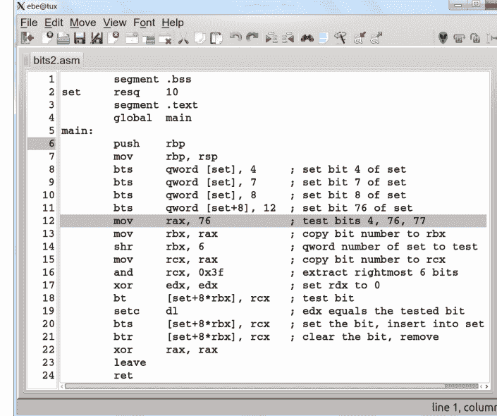

指令 8 到 11 设置了数组 `set` 中的第 4、7 和 8 位。为了设置第 76 位，我们在指令中使用 `[set+8]` 来引用数组的第二个双字 `quad-word`。你还会注意到第 18 行和第 21 行使用了 `set+8*rbx`。之前我们使用的是变量名加上常量，或者加上寄存器乘以 8。变量名加常量允许对 8 字节长度的数组进行索引。指令格式包括将索引寄存器乘以 2、4 或 8 并加到 `set` 指定地址的选项。使用 2 用于字 `word` 数组，4 用于双字 `double word` 数组，8 用于双字数组。寄存器 `rbx` 持有进入数组的双字索引。

直接操作内存中 `set` 的双字而不是将其移动到寄存器可能是最快的选择，因为在实际代码中，我们不需要在一个函数调用中完成测试、插入和删除。我们只会执行这些操作之一。

在这里我们跟踪该程序的执行过程。我们首先在第 12 行的断点处观察十六进制形式的 `set` 数组。设置 4、7、8 位得到 `0x0`，设置第 7 位得到 `0x90`，设置第 8 位得到 `0x190`。第 76 位是数组第二个双字的第 12 位，结果为 `0x1000`。

## Data

| Name | Type | Value |
| --- | --- | --- |
| stack | unsi... | 0x0000000000000000 0x0002aaaaff5ec5 ... |
| locals | | |
| parameters | | |
| user_defined | | |
| set=[0:1] | long | 0x0000000000000190 0x0000000000000100 |

接下来的 12 和 13 行将 76 移入 `rax` 和 `rbx`。

## Registers

```


rax 76                  rsi 0x7fffffffeb38 r8 0x400cfa

rbx 76                  rdi 0x1               r9 0x0

rcx 0xffffffffffffbp 0x7fffffeea50 r10 0x1

rdx 0x7fffffeb48 rsp 0x7fffffeea50 r11 0x246

rip 0x400c36            eflags ZF

```
移位位数 76（6 位）将得到 `set` 的字。因为 $2^6 = 64$，这在 `rbx` 中留下了 1。

## Registers

```
rax 76                  rsi 0x7ffffeb38 r8 0x40cfa

rbx 1                   rdi 0x1               r9 0x0

rcx 0xffffffffff 0x7ffffea50 r10 0x1

rdx 0x7ffffeb48 rsp 0x7ffffea50 r11 0x24
```

在 `rax` 中得到了该位的另一个副本。

## Registers

```
rax 76                  rsi 0x7ffffeb38 r8 0x40cfa

rbx 1                   rdi 0x1               r9 0x0

rcx 12                  rbp 0x7ffffea50 r10 0x1

rdx 1                   rsp 0x7ffffea50 r11 0x246
```

这 6 位将是该字。

第 76 位将是包含该位的内存字。

## Registers

```
rax 76                  rsi 0x7ffffeb38 r8 0x40cfa

rbx 1                   rdi 0x1               r9 0x0

rcx 12                  rbp 0x7ffffea50 r10 0x1

rdx 1                   rsp 0x7ffffea50 r11 0x246
```

接下来使用 `xor` 清零 `rdx`。

## Registers

```
rax 76                  rsi 0x7ffffeb38 r8 0x40cfa

rbx 1                   rdi 0x1               r9 0x0

rcx 12                  rbp 0x7ffffea50 r10 0x1

rdx 0                   rsp 0x7ffffea50 r11 0x246
```

第 18 行测试我们要从数组测试的位。你会注意到进位标志（CF）被设置了。

## Registers

```
rax 76                  rsi 0x7ffffeb38 r8 0x40cfa

rbx 1                   rdi 0x1               r9 0x0

rcx 12                  rbp 0x7ffffea50 r10 0x1

rdx 0                   rsp 0x7ffffea50 r11 0x246
```

第 19 行使用 `setcc` 指令设置 `dl` 为1，因为它在集合中。

## Registers

```
rax 76                  rsi 0x7ffffeb38 r8 0x40cfa

rbx 1                   rdi 0x1               r9 0x0

rcx 12                  rbp 0x7ffffea50 r10 0x1

rdx 1                   rsp 0x7ffffea50 r11 0x246
```

第 20 行设置集合中的位。

```
mov rex, [sample] : 将 qword 移入 rex

shl rex, 12 : 清除高位

shr rex, 35 : 对齐位域

mov [field], rex : 保存字段
```

现在，假设我们希望将 `sample` 的第 51-23 位填充为 `field` 中的位。简单的方法是将值进行旋转以对齐字段，向右移，然后将字段左移回第 23-51 位。以下是代码：

```
mov rex, [sample] : 将 qword 移入 rex

ror rex, 23 : 将第 23 位对齐到 0

shr rex, 29 : 清除 29 位

shl rex, 29 : 再次对齐位

or rex, [field] : 假设 field 是 29 位

rol rex, 23 : 重新对齐位域

mov [sample], rex : 将字段存储在内存中
```

## 练习 (Exercises)

- 1. 编写一个汇编程序，计算内存中一个字节中所有 1 位（1 bits）的数量。使用重复代码而不是循环。
- 2. 编写一个汇编程序，使用 `xor` 交换内存中的两个四字节字（quad-words）。使用以下算法：

```
a = a ^ b

b = a ^ b

b = a ^ b
```
- 3. 编写一个汇编程序，使用内存中的 3 个四字节字来表示 3 组：A、B 和 C。每个组都允许在四字节字对应的位中存储从 0-63 的集合值。执行以下步骤：

```
insert 0 into A

insert 1 into A

insert 7 into A

insert 13 into A

insert 1 into B

insert 3 into B

insert 12 into B

store A union B into C

store A intersect B into C

store A - B into C

remove 7 from C
```
- 4. 编写一个汇编程序，将存储在内存中的四字节字移动到寄存器中，然后计算该字 8 个字节的异或。使用 `or` 或 `rol` 指来操作寄存器的位，以保留原始值。
- 5. 编写一个汇编程序，解析内存中的一个双精度浮（double）。这是一个 64 位的浮点值。将符号位存储在一个内存位置。将减去偏置值（bias）后的指数存储在第二个内存位置。将带有前导隐式 1 位的小数部分字段存储在第三个内存位置。
- 6. 编写一个汇编程序，使用整数算术和位操作执行两个浮点数的乘积。从内存中的两个浮点数开始，并将乘积存储在内存中。

# 第 8 章 (Chapter 8)

## 分支与循环 (Branching and looping)

到为止，我们的代码未使用任何分支语句。使用条件移动指令（conditional move instructions）为代码增加了一些灵活性，同时保留了 CPU 的流水线内容。我们已经看到，重复指令来处理四字节字的每个字节或每个字节的每一位可能是很麻烦的。在下一节我们将处理数组。通过重复指令来处理包含 100 万个元素的数组是愚蠢的。这可能是可能的，但处理变动大小的数组将非常痛苦。我们需要循环。

在许多程序中，您需要测试一个条件并根据结果执行 2 个动作之一。如果这两个动作非常简单，那么条件移动是高效的。如果每个动作都是几条很长的指令，那么我们需要条件跳转语句（conditional jump statement）来跳转到一种替代方案，同时允许 CPU 通过不跳转来处理另一种替代方案。在完成第二种替代方案后，我们通常需要跳过第一种方案的代码。我们需要条件和无条件分支语句。

## 8.1 无条件跳转 (8.1 Unconditional jump)

无条件跳转指令（`jmp`）是 `goto` 语句的汇编版本。然而，使用 `jmp` 显然不可耻。它在汇编语言中是必要的，而在高级语言中 `goto` 是可以避免的。

`jmp` 指令的基本形式是：

```
jmp

label
```


# 无条件跳转

其中 `label` 是程序文本段中的一个标签。汇编器将生成一个相对于 `rip` 的相对跳转指令（rip relative jump instruction），这意味着控制流将转移到相对于当前指令指针（instruction pointer）当前值的位置。最简单的相对跳转使用一个 8 位符号立即数，并编码为 2 字节。这允许向前或向后跳转约 127 字节。下一种相对跳转使用 32 位符号立即数，总共需要 5 字节。幸运的是，汇编器会找出可以使用哪种类型并选择较短的形式。程序员只需指定标签。

跳转语句的效果是 CPU 将控制权转移到加载地址处的指令。除非与条件跳转配合使用，否则这通常并不令人兴奋。然而，跳转指令可以跳转到包含在寄存器或内存位置中的地址。条件移动可能可以使用无条件跳转到包含在寄存器中的地址。还有一种有趣的可能性——实现一个 `switch` 语句。假设你有一个变量 `i`，已知它包含 0 到 2 之间的值。那么你可以构造一个地址数组，并使用跳转指令根据 `i` 的值跳转到代码段。这里有一个示例：

```
segment .data

switch:

  dq main.case0

  dq main.case1

  dq main.case2

i:

  dq 2

segment .text

global main

main:

  mov rax, [i] ; 将 i 移到 switch (i)

case0:

  mov rbx, 0 ; 如果 i == 0，跳转到这里

  jmp .end

case1:

  mov rbx, 1 ; 如果 i == 1，跳转到这里

  jmp .end
```

无条件跳转指令（`jmp`）是 `goto` 语句的汇编版本。然而，使用 `jmp` 显然不可耻。它在汇编语言中是必要的，而在高级语言中 `goto` 是可以避免的。

`jmp` 指令的基本形式是：

```
jmp
label
```

其中 `label` 是程序文本段中的一个标签。汇编器将生成一个相对于 `rip` 的相对跳转指令，这意味着控制流将转移到相对于当前指令指针（instruction pointer）当前值的位置。最简单的相对跳转使用一个 8 位符号立即数，并编码为 2 字节。这允许向前或向后跳转约 127 字节。下一种相对跳转使用 32 位符号立即数，总共需要 5 字节。幸运的是，汇编器会找出可以使用哪种类型并选择较短的形式。程序员只需指定标签。

## 8.2 条件跳转 (8.2 Conditional jump)

条件跳转（conditional jump）允许根据标志位（flags）来执行跳转。如果这两个动作非常简单，那么条件移动是高效的。如果每个动作都是几条很长的指令，那么我们需要条件跳转语句来跳转到一种替代方案，同时允许 CPU 通过不跳转来处理第二种替代方案。在完成第二种替代方案后，我们通常需要跳过第一种方案的代码。我们需要条件和无条件分支语句。

条件跳转（conditional jump）是汇编语言中的 `if` 语句。常用的条件跳转包括 `jz`（跳转零）、`jnz`（跳转非零）、`je`（相等）、`jne`（跳转不相等）、`jg`（跳转大于）、`jge`（跳转大于等于）、`jl`（跳转小于）、`jle`（跳转小于等于）、`jc`（跳转进位）、`jnc`（跳转无进位）、`ja`（跳转以及）、`jae`（跳转以及等于）。

以下是常用的条件跳转指令：

| 指令 | 含义 |
| :--- | :--- |
| `jz` | 跳转为零 |
| `jnz` | 跳转非零 |
| `je` | 跳转相等 |
| `jne` | 跳转不相等 |
| `jg` | 跳转大于 |
| `jge` | 跳转大于等于 |
| `jl` | 跳转小于 |
| `jle` | 跳转小于等于 |
| `jc` | 跳转进位 |
| `jnc` | 跳转无进位 |
| `ja` | 跳转以及 |
| `jae` | 跳转以及等于 |

条件跳转通常与 `cmp`（比较）或 `test` 指令配合使用。`cmp` 会将两个操作数相减并设置标志位，而 `test` 对两个操作数进行位与运算并设置标志位。

例如：

```
cmp eax, ebx

jz label ; 如果 eax 等于 ebx，则跳转到 label
```

```
; jmp endif
} else {
; else:
; max = a;
mov [max], rax
}
endif;
```

# If/else-if/else 语句

就像在 C/C++ 中一样，你可以在 else 子句中使用 if 语句，在汇编代码条件语句的 else 子句中继续进行测试。以下是 C 语言中的简短 if/else-if/else 语句：

```
if (a < b) {
result = 1;
} else if (a > c) {
result = 2;
} else {
result = 3;
}
```

这段代码可能是 2 个条件语句的良好候选，但简单就是美。以下是该代码对应的汇编代码：

```
if (a < b) {
mov rex, [a]
mov rbx, [b]
cmp rex, rbx
jnl else_if
result = 1;
jmp endif
} else if (a > c) {
mov rcx, [c]
cmp rex, rcx
jng result = 2;
mov qword [result], 2
jmp endif
} else {
result = 3;
mov qword [result], 3
}
```


显而易见，可以使用任意测试序列来模拟 C 中的多个 else-if 子句。

# 8.3 使用条件跳转进行循环

到目前引入的跳转和条件跳转都是向前跳转的。通过向后跳转可以产生各种循环。在本节中，我们将讨论 `while` 循环、`do-while` 循环和计数循环。我们还会讨论如何用循环实现 C 中 `continue` 和 `break` 语句的效果。

## While 循环

最基本的循环类型可能是 `while` 循环。它在 C 中的通常工作方式如下：

```
while ( condition ) {
    statements;
}
```

C 循环支持 `break` 语句（跳出循环）和 `continue` 语句（立即回到循环顶部）。结构化编程倾向于避免 `break` 和 `continue`。然而，它们是某些问题的有效解决方案，如果使用当，通常比基于设置条件变量替代方案更清晰。在汇编中使用条件变量实现这些要容易得多，而且速度更快。

### 统计多字节字中 1 的个数

通用策略是每次将双字字的位移动 1 位，并在循环的每次迭代中将值 0 加到 1 位之和。这个循环需要执行 64 次。以下是该循环的 C 代码：

```
sum = 0;
i = 0;
while ( i < 64 ) {
    sum += data & 1;
    data = data >> 1;
    i++;
}
```

下面的程序实现了这个循环，细微变化是在循环执行期间值位于寄存器中。在循环期间将这些值存储在内存中毫无意义。C 代码以注释形式给出有助于有助于示例代码。

```
segment .data ; long data;
dq 0xfedcba9876543210 ; long sum;
sum 0
segment .text
global main
```

```
; int main() {
main:
    push rbp
    mov rbp, rsp
    sub rsp, 16
    int i;          in register rcx
    rax: 正在检查的位
    rbx: bt, setc 后的进位位
    rcx: 循环计数器 i, 0-63
    rdx: 1 位之和
    mov rax, [data]
    xor ebx, ebx
    i = 0;
    xor ecx, ecx
    sum = 0;
    xor edx, edx
    while (i < 64) {
        cmp rcx, 64
        jnl end_while
        sum += data & 1;
        bt rax, 0
        setc bl
        add edx, ebx
        shr data, 1
        shr rax, 1
        i++
        inc rcx
    }
    jmp while
end_while:
    mov [sum], rdx
    xor eax, eax
    leave
    ret
```

你会注意到编译器通过将测试移到结尾消除了一个跳转。循环的第一条指令是 `cmp`，比较 `i` (`rcx`) 与 64。条件跳转 `jnl` 匹配 C 条件的反向。循环的最后一条指令是跳转到循环的语句。这是 `while` 循环的典型翻译。汇编器 `gcc -S countbits` 产生的 AT&T 语法与 `yasm` 使用的语法不同。你可以使用 `gcc -masm=intel countbits` 创建一个 Intel 格式的汇编文件，这与书中代码非常接近。这是 `gcc` 生成的代码部分：

```
mov      rax, QWORD[rip]
mov      ecx, 64
xor      edx, edx
L2:     mov      rsi, rax
        sar      rax
        and      esi, 1
        add      rsi, rsi
        sub      ecx, 1
        jne      L2
```

编译器通过将测试移到循环结束消除了一个跳转。编译器没有进行比较。只有迭代次数很重要，因此在递减后进行条件跳转。总的来说，编译器生成的循环有 8 条指令，手写的汇编循环很难超越。你可以从编译器的代码中学到很多。如果你对效率感兴趣，可能比编译器做得更好。你可以复制生成的代码并这样做，但如果无法改进编译器的代码，还有一个选项 `-funroll-loops` 会显著加快代码。在这种情况下，编译器使用了更多的寄存器并在每次迭代中增加了 8 位。在展开版本中指令线使用得更有效，因此速度可能是编译器的 3 倍。循环循环展开等问题高度依赖于 CPU 架构。需要测试在特定的 CPU 上效果最好。

## Do-while 循环

我们在上一节中看到编译器将 `while` 循环转换为 `do-while` 循环。`while` 结构直接翻译为顶部的条件跳转和底部无条件跳转。`do-while` 循环如下：

```
do {
    statements:
} while ( condition );
```

`do-while` 至少执行一次循环体。让我们看一个由 0 字节终止的字符数组搜索程序。我们将在循环之前进行显式测试，如果第一个字符是 0 则不执行循环。以下是循环的 C 代码：

```
i = 0;
c = data[i];
if ( c != 0 ) {
    do {
        if ( c == x ) break;
        i++;
        c = data[i];
    } while ( c != 0);
}
n = c == 0 ? -1 : i;
```

这是该代码的汇编实现：

```
SECTION .data
db "hello world", 0
dq 0
needle:
db 'w'
SECTION .text
global main
push rbp
mov rbp, rsp
sub rsp, 16
Register usage
ax: c, data数组的字节
bl: x, 搜索的字节
rcx: i, 循环计数器, 0-63
mov bl, [needle]
i = 0;
xor ecx, ecx
c = data[i];
mov al, [data+rcx]
if ( c != 0 ) {
    cmp al, 0
    jz end_if
do_while:
    if ( c == x ) break;
    cmp al, bl
    je found
    i++;
    inc rcx
```

```
; c = data[i];
mov al, [data+rcx];
} while ( c !='0');
cmp al, 0
nz do_while;
end_if:
  n = c == 0 ? -1 : i;
  mov rcx, -1; 如果你到达这里 c == 0
found:
  mov [nn], rcx
  return 0;
  xor eax, eax
  leave
  ret
```

汇编代码（如果去掉 C 注释）看起来比 C 代码更简单。C 代码使用 `while` 循环会看起来更好。C 中的条件运算符在汇编中是没有必要的，因为找到正确字符时的条件跳转跳转了将 -1 移动到 `rcx`。尝试使用更多结构化的技术似乎是合理的，但使用汇编的唯一理由是提高效率或完成高层语言无法完成的事情。记住，我们试图在结构和效率之间取得平衡。

## 计数循环

C 中普通的计数循环是 `for` 循环，它可以用于实现任何类型的循环。假设我们想要进行数组加法。在 C 中我们可能会使用：

```
for ( i = 0; i < n; i++ ) {
c[i] = a[i] + b[i];
}
```

翻译成汇编语言，这个循环可能是：

```
mov rdx, [n]
xor ecx, ecx
for: cmp rcx, rdx
je end_for
mov rax, [a+rcx*8]
add rax, [b+rcx*8]
mov [c+rcx*8], rax
inc rcx
jmp for
end_for:
```


再次，可以在执行循环之前对 `rdx` 是否为 0 进行测试。这允许将比较和条件跳转语句放在循环末尾。然而，简单地翻译 C 语句而不考虑优化可能会更容易一些，直到你

提高你的汇编技能。也许你正在上一门汇编课程。如果是的话，性能会影响你的成绩吗？如果没有，就保持简单。

## 8.4 循环指令

有一种循环指令以及几种变体，它们通过递减 `rcx` 寄存器并进行跳转，直到寄存器达到 0 来操作。遗憾的是，显式地从 `rcx` 减去 1 并使用 `jnz` 执行条件跳转的速度要快约 4 倍。这种速度差异是特定于 CPU 的，且仅对于简单的循环有效。通常情况下，循环会包含其他耗时比循环指令更长的工作。此外，循环指令限制跳转到一个 8 位的立即数字段，这意味着它可以向后或向前跳转约 127 字节。总而言之，它似乎并不值得使用。

尽管有上述悲观情绪，也许你仍然想使用 `loop`。考虑以下代码，它会在数组中查找特定字符的最右侧出现：

```
mov      ecx, [n]

cmp      [data+rcx-1],al

je       found

loop     more

found: sub      ecx, 1

       mov      [loc],ecx
```

## 8.5 重复字符串（数组）指令

x86-64 重复指令 `rep` 按照计数寄存器 `rcx` 中指定的次数重复字符串指令。有几种变体允许根据循环执行期间发生的条件提前终止。这些重复指令允许将数组元素设置为指定值、将一个数组复制到另一个数组，以及在数组中查找特定值。

## 字符串指令

有几种字符串指令。其中带有 `b`、`w`、`d` 或 `q` 后缀的指令用于遍历数组，这些后缀表示数组元素的大小（1、2、4 或 8 字节）。

字符串指令使用 `rax`、`rsi` 和 `rdi` 寄存器用于特殊用途。寄存器 `rax` 或其子寄存器 `eax`、`ax` 和 `al` 用于特定值。寄存器 `rsi` 是源地址寄存器，`rdi` 是目标地址。所有的字符串指令都不操作数。

所有处理 1、2 或 4 字节数量的字符串操作都编码为 1 字节，而 8 字节的变体编码为 2 字节。结合 1 字节的重复指令，这实际上在 2 或 3 字节内编码了一些简单的循环。很难有比 `repeat` 指令更好的高效。

字符串操作在每次使用后都会更新源和目标寄存器。这种更新由方向标志 `DF` 管理。如果 `DF` 为 0，则每次使用后寄存器将增加数据项的大小。如果 `DF` 为 1，则每次使用后寄存器将减小。

### Move

`movsb` 指令从 `rdi` 指定地址移动字节。其他 `mov` 指令从 `[rsi]` 移动 2、4 或 8 字节元素到 `[rdi]`。移动的数据不存储在寄存器中，且不影响任何标志。在移动每个数据项后，`rdi` 和 `rsi` 寄存器将根据项的大小推进 1、2、4 或 8 字节。

下面是将一个数组向另一个数组移动 100,000 字节的代码：

```
lea rsi, [source]

lea rdi, [destination]

mov rcx, 100000

rep movsb
```

### Store

`stos` 指令将寄存器 `al` 中的字节移动到 `rdi` 指定的地址。其他变体将数据从 `ax`、`eax` 或 `rax` 移动内存。不影响任何标志。重复存储可以使用单个值填充数组。你也可以使用非重复的 `stosb` 循环，利用目标寄存器自动更新的特性。

这里是向数组中填充 100,000 个全等于 1 的双字（double words）的代码：

```
mov eax, 1

mov ecx, 100000

lea rdi, [destination]

rep stosd
```

### Load

`lodsb` 指令从 `rsi` 指定的地址移动字节到 `al` 寄存器。其他变体将更多字节的数据移动 `ax`、`eax` 或 `rax`。不影响任何标志。重复循环似乎作用不大。然而，你可以在其他循环中使用 `lod`，利用源寄存器自动更新的特性。

这里是一个从一个数组复制数据到另一个数组并删除等于 13 的字符的循环：

```
lea rsi, [source]

lea rdi, [destination]

mov rcx, 100000

more: lodsb

cmp al, 13

je skip

stosb

skip: sub ecx, 1

repe jnz more
```

### Scan

扫描指令在数组中查找与 `al` 字节匹配的字节。它使用 `rdi` 寄存器。这里是 `strlen` 函数的一个实现：

```
segment .text

global strlen

strlen:

ncld : prepare to increment rdi

mov rcx, -1

xor al, al ; scan for 0

repne scabs ; repeatedly scan for 0

mov rax, -2 ; start at -1

end: sub rax, rcx
```

该函数开始将 `rcx` 设置为 -1，由于代码使用 `repe` 来进行循环，这允许进行一个非常长的重复循环。它将在每次移动后递减 `rcx` 以达到 0。内存可能会耗尽，恰好 Linux ABI 将第一个参数放置在 `rdi` 中，因此 `strlen` 从正确的地址开始。返回值的标准方法将其放在 `rax` 中。

### Compare

`cmps` 指令比较两个数组的值。它通常与 `repe` 一起使用，将继续比较值，直到 `ecx` 中的计数达到 0 或发现不同的值。此时，比较完成。这几乎已经足够编写一个版本的 `strcmp` 函数了，但 `strcmp` 期望字符串以 0 结尾，且字符串的长度是未知。

```
segment .text

global memcmp

memcmp: mov rcx, rdx

repe cmps ; compare until end or difference

cmp rcx, 0 ; reached the end

jz equal :

mov eax, byte [rdi-1]

mov ecx, byte [rsi-1]

sub rax, rcx

ret

equal: xor eax, eax

ret
```

### Set/clear direction

`cld` 指令将方向标志置零（0），意味着使用字符串操作处理递增的地址。`set std` 指令将方向标志设置为 1。程序员应该在退出任何设置了方向标志的函数之前将其置零。

## Exercises

- 1. 写一个汇编程序来计算两个数组的点积，即 $p = \sum_{i=0}^{n-1} a_i * b_i$。你的数组在内存中应该是双字数组，且点积应存储在内存中。
- 2. 写一个汇编程序来计算斐波那契数。你的数组在内存中应该是双字数组，斐波那契数应存储在内存中。斐波那契数定义为 `fib(0) = 0`, `fib(1) = 1`。写一个汇编程序对双字进行排序。冒泡排序定义为

```
do

    swapped = false;

    for ( i = 0; i < n-1; i++) {

        if ( a[i] > a[i+1] ) {

            swap a[i] and a[i+1]

            swapped = true;

        }

    }

} while ( swapped );
```


- 判断内存中的字符串是否为回文。回文是反转后相同的字符串，如“refer”。
- 写一个汇编程序对内存中的字符串执行“查找并替换”操作。你的程序应该有一个输入数组和一个输出数组。将所有的“amazing”替换为“incredible”。
- 写一个汇编程序来判断内存中的整数 `$c` 是否具有两个较小的整数 `$a` 和 `$b`，使得 `$a^2 + $b^2 = $c^2`。勾股三元组是满足条件的三个整数 `$a`, `$b`, `$c`。如果是，将 `$a` 和 `$b` 放在内存中。

## 第9 章 函数

在本章中，我们将讨论如何编写可以从 C 或 C++ 调用的汇函数，以及如何从汇编调用 C 函数。由于 C 或 C++ 编译器通常在代码生成方面非常好，因此通常不需要编写完整的汇编程序。可能某些算法最好用汇编实现，因此我们可能用 C 或 C++ 编写 90% 的程序。

从汇编调用 C 函数也是用的。这使得你的汇编程序可以访问所有的 C 库。我们将使用 `scanf` 从标准输入输入，并使用 `printf` 输出。这将允许我们编写更有用的程序。

## 9.1 栈

到为止，我们很少使用运行时栈，但它是使用函数不可或的一部分。我们之前提到栈扩展到可能的地址：`0x7ffffffff`。这并不完全正确。通过“`cat /proc/$maps`”检查内存映射显示顶部栈地址对于 `bash` 进程为 `0x7ffff6b79000`，对于其他进程始终匹配模式 `0x7ffffxxxx`。也许这是“栈随机化”的结果，旨在避免修改栈值的恶意代码。

使用 `push` 指令将项推入栈。`push` 的效果是将栈指针 `rsp` 减 8，然后将推入的值放在该地址。在进程启动时，操作系统会将栈指针设置为 `0x7fffffff00`（或任何以 000 结尾的地址）。在第一次 `push` 之后，`rsp` 将减小到 `0x7fffffe8`，并将 8 字节的值放在 `0x7fffffe8` 到 `0x7fffffeff` 字节之间。

操作系统会将许多不同的值推入栈中。这些值包括环境（变量名的集合以及如搜索路径之类的定义项）以及程序的命令行参数。

可以使用 `pop` 指令从栈中移除值。`pop` 的操作模式与 `push` 相反。它将栈指针（`rsp`）指定位置的值移动到寄存器或内存位置，然后将 `rsp` 加 8。

你可以 `push` 一个字（word）和小于 8 字节的值，但这样做存在一定的风险。只要栈对于当前操作保持恰当的边界，它就能工作。因此，如果你先推入一个字，然后推入一个四字节字（quad-word），四字节字的推入操作可能会失败。只推入和弹出 8 字节长度的数据会更简单。

## 9.2 call 指令

调用函数的汇编指令是 `call`。典型的用法如下：

```
call	my_function
```

操作数 `my_function` 是程序文本段中的一个标签。`call` 指令的作用是将 `call` 之后指令的地址推入栈中，并将控制转移到与 `my_function` 关联的地址。推入栈的地址被称为“返回地址”。另一种实现调用的方法是：

```
push	next_instruction
jmp	my_function
next_instruction:
```

虽然这种方法可行，但 `call` 具有更多功能，我们通常会忽略这些。

当你的程序执行时，`Eb` 显示栈顶（通常为 6 个值）。下面是汇编程序进入 `main` 时栈顶的 3 个四字节字。在显示寄存器显示之前，是对 `main` 的 `call` 指令。

| Name | Type | Value |
|---|---|---|
| global | stack unsi... | 0x0002aaaff5ec5 0x0000000000000000 0x00007ffffffeb38... |
| locals | | |

栈上的第一个项目是返回地址 `0x2aaaaff5ec5`。在 Linux 程序中，普通的文本段地址通常超过 `0x400000`，如下图中寄存器显示中来自同一程序进入 `main` 时的 `rip` 所示。返回地址是共享对象库中的地址，可能位于 `libc.so` 中的函数 `__lib_start_main` 中。在 OS X 上，代码地址是更大的数字（32 设置了类似于 `0x10040c06` 的地址）。

| | rsi | r8 |
|---|---|---|
| rax 0x400c06 | 0x7fffffeb38 | 0x4000c9a |
| rbx 0x0 | rdi 0x1 | r9 0x0 |
| rcx 0xffffffffffff | rbp 0x0 | r10 0x1 |
| rdx 0x7fffffeb48 | rsp 0x7fffffea58 | r11 0x246 |
| rip 0x400c06 | eflags PF ZF IF | |

## 9.3 ret 指令

要从函数返回，使用 `ret` 指令。该指令从栈顶弹出地址并将控制转移到该地址。在上例中，`next_instruction` 是该返回地址的标签。

下面展示了一个简单的程序，说明了函数调用和返回的步骤。`main` 中的第一条指令是对 `doit` 函数的 `call`。

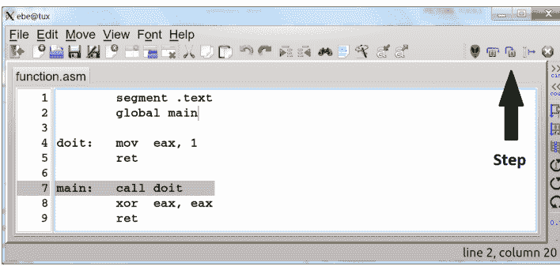

你可以看到第 7 行上有一个断点，尚未进行对 `doit` 的调用。我添加了一个箭头指向“Step”（单步）按钮，它紧邻“Next”（下一步）按钮的右侧。在下面的寄存器显示中，你可以看到 `rip` 是 `0x400c06`。

## 寄存器 (Registers)

| rax | 0x400c06 | rsi | 0x7fffffff38 | r8 | 0x400c9a |
| rbx | 0x0 | rdi | 0x1 | r9 | 0x0 |
| rcx | 0xffffffffff | rbp | 0x0 | r10 | 0x1 |
| rdx | 0xffffffeb48 | rsp | 0x7fffffea58 | r11 | 0x246 |
| rip | 0x400c06 | eflags | PF ZF IF |

之前我们使用 "Next" 按钮执行当前指令。但是，如果我们使用 "Next"，调试器将执行 `doi`，并在函数返回后返回控制权，且高亮行将是第 8 行。为了研究函数调用，我点击了 "Step"，它将进入 `doi` 函数。

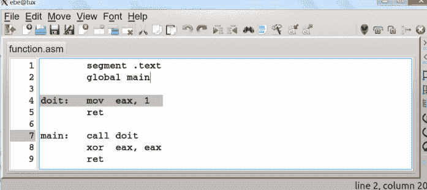

```
function.asm

  segment .text

  global main

doi:    mov eax, 1

       ret

main:  call doi

       xor eax, eax

       ret
```

我们现在看到要执行的条指令在第 4 行。此时查看寄存器和栈是有益的。

## 9.5 栈帧 (Stack frames)

`gdb` 调试器最有功能之一是能够使用 `bt` 或 `backtrace` 反向追溯已调函数的堆栈。为了实现这一点，每个函数必须在 `rbp` 中保留一个指针，指向栈上一个 2 个双字（quad-word）长度的对象，该对象通过返回地址标识 `rbp` 的上一个值。你可能在 `hello world` 程序中注意到 `push rbp; mov rbp, rsp` 这一序列。第一条指令将 `rbp` 推入返回地址正下方。第二条指令让 `rbp` 指向该地址。

假设所有函数都遵循这种以标准两条指令开头的规则，那么栈上将形成一个对象链表——每个函数调用对应一个对象。调试器可以遍历该列表以识别函数（基于返回地址的位置），并使用可执行文件中存储的其他信息来识别该返回地址对应的行号。

这 2 个双字长度的对象是“栈帧”的简单示例。在不调用其他函数的函数（叶子函数）中，函数的局部变量可能完全放入寄存器中。如果局部变量太多，或者函数调用了其他函数，则可能需要在栈上为这些局部变量留空间。要为局部变量分配空间，你只需从 `rsp` 中减去数值。例如，要在栈帧中为局部变量留 32 字节，请这样做：

```
push    rbp
mov     rbp, rsp
sub     rsp, 32
```

确保减去的是 16 字节的倍数，以避免可能的栈对齐问题。

要建立栈帧，使用函数开始处的两条指令：

```
push    rbp
mov     rbp, rsp
```

这两条指令的效果以及对 `rsp` 的可能减法可以在 `ret` 指令之前使用

```
leave
```


来撤销。对于叶子函数，不需要执行标准的 2 条指令序言，也不需要 `leave` 指令。虽然通常可以省略它们，但这会防止 `gdb` 能够反向追溯栈帧。

当栈帧中存在局部变量时，使用名称而不是在 `rsp` 上增加 8 或 16 来访问这些变量更为合理。这可以使用 `yasm` 的 `equ` 伪操作来实现。以下代码为两个局部变量设置了 0 和 8 的符号名称。

`x` `equ` `0`
`y` `equ` `8`

现在我们可以在函数调用之前轻松地在 `x` 和 `y` 中保存两个寄存器

```asm
mov [rsp+x], r8
mov [rsp+y], r9
```

在任何函数协议中，你必须指定哪些寄存器必须在函数中保留。对于 `System V ABI`（Linux 和 OSX），必须保留寄存器 `rbx`、`rbp` 和 `r12-15`，而 Windows 调用约定要求保留寄存器 `rbx`、`rbp`、`rsi`、`rdi` 和 `r12-15`。

下面的程序调用名为 `print_max` 函数来打印作为参数传递的两个 `long` 的最大值。它调用了 `printf`，因此使用 `extern` 伪操作告知 `yasm` 和 `ld` 它将从库加载。

```asm
segment .text

global main

extern printf

; void print_max ( long a, long b )

{

    a equ 0

    b equ 8

print_max:

    push rbp;          ; 普通栈帧

    mov rbp, rsp

    sub rsp, 32        ; 为 a, b 和 max 留空间

    max equ 16

    mov [rsp+a], rdi   ; 保存 a

    mov [rsp+b], rsi   ; 保存 b

    ; max = a;

    mov [rsp+max], rdi

    if (b > max) max = b;

    cmp rsi, rdi

    jng skip

    mov [rsp+max], rsi

skip:

    printf("%d,%d", a, b, max);

}

segment .data

    db fmt "max(%d,%d) = %d", 0xa0

segment .text

    fmt:

    lea rdi, [fmt]

    mov rsi, [rsp+a]

    mov rdx, [rsp+b]

    mov rcx, [rsp+max]

    xor eax, eax      ; 0 点参数

    call printf

}

    leave

    ret

main:

    push rbp;

    mov rbp, rsp;

    print_max(100, 200);

    mov rdi, 100      ; 第一个参数

    mov rsi, 200      ; 第二个参数

    call print_max;

    xor eax, eax      ; 返回 0

    leave

    ret
```

## 9.6 递归

计算机编程中的基本技术之一是递归。调用自身的函数被称为递归函数。递归函数必须有一个边界情况以防止无限递归。

非负整数 $n$ 的阶乘是所有小于等于 $n$ 的正整数的乘积。例如，$5! = 5 \times 4 \times 3 \times 2 \times 1 = 120$。边界情况是 $0! = 1$。我们可以递归地定义阶乘函数：

```c
int factorial(int n) {
    if (n <= 1) return 1;
    return n * factorial(n-1);
}
```

以下是对应的汇编代码：

```asm
segment .text

global main

extern printf

main:

    push rbp

    mov rbp, rsp

    mov rdi, 5          ; n = 5

    call factorial

    mov rdi, rax       ; 结果

    lea rsi, [fmt_res]

    mov rdx, 0

    call printf

    xor eax, eax

    leave

    ret

fact:

    push rbp

    mov rbp, rsp

    sub rsp, 16

    cmp rdi, 1

    jle base

    mov eax, 1

    leave

    ret

    mov [rsp+8], rdi

    dec rdi

    call fact

    mov rdi, [rsp+8]

    imul rax, rdi

    leave

    ret

base:

    mov eax, 1

    leave

    ret

segment .data

    fmt_res db "Fact(%d) = %d", 0
```

# 练习题

- 1. 编写一个汇编程序为电力公司生成账单。它应该使用 `scanf` 读取一系列客户记录，并为每个客户打印一行输出：客户详情和账单金额。客户数据由一个名称（最多 64 个字符，不包括末尾的 0）和一个每个客户的千度数组成。千度数是一个整数。如果千度数小于等于 1000，客户的费用为 $20.00；如果用量大于 1000，则为 $20.00 加上超过 1000 部分每千度 1 分。使用除以 100 后的商和余数以标准的美元和分的形式打印金额。编写并使用一个函数来计算账金额（以分为单位）。
- 2. 编写一个汇编程序生成一个随机整数数组（通过 C 库函数 `random`），使用冒泡排序函数对数组进行排序并打印数组。数组应该动态分配。要填充、排序和打印的元素数量应存储在内存位置中。编写一个函数遍历数组元素并用随机整数填充数组。编写一个函数打印数组内容。如果数组大小小于或等于 20，在打印前后分别调用你的打印函数。
- 3. 勾股拉斯三元组是三个整数 $a, b$ 和 $c$，满足 $a^2 + b^2 = c^2$。编写一个汇编程序打印所有 $c \le 500$ 的勾股拉斯三元组。使用一个函数测试一个数字是否为勾股拉斯三元组。
- 4. 编写一个汇编程序跟踪 10 组大小为 1000000 的集合。程序应该读取以下命令："add","union","print" 和 "quit"。程序应该有一个函数来读取命令字符串并确定它是哪种命令，然后根据读取的字符串返回 0, 1, 2 或 3。读取 "add" 后，你的程序应该读取一个 0 到 9 之间的集合编号和一个 0 到 999999 之间的元素编号，并将元素插入到相应的集合。你需要一个函数向集合中添加元素。读取 "union" 后，你的程序应该读取 2 个集合编号，并将第一个集合设置为这两个集合的并集。你需要一个并集函数。读取 "print" 后，你的程序应该打印集合的所有元素。你可以假设集合中只有少数元素。读取 “quit” 后，你的程序应该退出。
- 5. 一个数字序列被称为波形（bitonic），如果它由一个递增序列后下降序列组成，或者该序列可以旋转直到由一个递增序列加下降序列组成。编写一个汇编程序将整数序列读入数组中，并打印该序列是否为波形。数组中的最大元素数量应该是 100。你需要编写两个函数：一个将数字读入数组，另一个用于判断序列是否为波形。你的波形测试不应实际旋转数组。
- 6. 编写一个汇编程序，使用 `scanf` 读取两个 8 字节整数，并使用欧几里得算法计算它们的公约数，该算法基于递归定义：

$$gcd(a,b) = \begin{cases} a & \text{如果 } b=0 \\ gcd(b,a \bmod b) & \text{否则} \end{cases}$$
- 7. 编写一个汇编程序读取一个包含左括号和右括号的字符串，并确定该字符串是否包含平衡的括号集。你可以使用 `scanf` 的 "%79s" 将字符串读入长度为 80 的字符数组中。如果一组括号是空字符串，或者它由一个左括号后跟一组平衡的括号和一个右括号组成，则该括号集是平衡的。

## 10 数组

数组是特定类型的内存单元的连续集合。数组的起始地址可以通过索引访问。在 C 语言中，数组的索引从 0 开始。

事实上，不需要真正看到数组的起始地址。相反，我们可以对源代码中的数组名进行操作来显示其起始地址。我们可以使用不同的索引来定义数组。

### 10.1 数组计算

类型包括字节（bytes）、双字字（double words）和四字字（quad words）。假设每个元素占据 $m$ 字节，那么每个元素位于 $base + i \times m$。

通过以下程序说明字节数组的索引：

```assembly
segment .bss
```


`resb`    100      ; 字节

`resd`    100      ; 双字字

`resq`    100      ; 四字字

```assembly

segment .text

global main

main:

    mov rbp, rsp

    sub rsp, 16

    ...

    leave

    ret

```

当我们使用 `"p (unsigned char*)&a"` 时，它会打印 `a` 的地址。这是一个 `gdb` 会话：

```text

(gdb) p (unsigned char*)&a

$1 = 0x60100

(gdb) p (unsigned char*)&a[1]

$2 = 0x60101

(gdb) p (unsigned char*)&a[2]

$3 = 0x60102

```

从前三个结果可以看出 `a` 的元素每隔 1 字节。接下来我们看到数组 `b`（双字字，C 中的 `int`）的重复模式，其元素每隔 4 字节排列。最后我们看到 `c`（四字字，C 中的 `long`）的结果，这些元素每隔 8 字节排列。

幸运的是，没有真的需要查看数组的实际起始地址。我们可以对源代码中的变量名使用控制+右键（或者标记变量名并使用右键）来弹出变量定义，并将其设置为以十六进制打印大小为 1 的数字。定义定义 后，我们现在可以查看所选的位置。

| 定义变量 |
|---|
| 名称 | a |
| 地址 | &a |
| 类型 | unsigned char |
| 格式 | 十进制 |
| 数组变量 | |
| 起 | 0 |
| 终 | 3 |
| | 取消 |

| 名称 | 类型 | 值 |
|---|---|---|
| 用户定义 | unsigned char | 00 00 00 |

## 10.2 内存引用的通用模式

目前我们在示例代码中使用了数组引用，还没有讨论内存引用的选项。内存引用可以表示为：

- `[label]` 标签包含的值
- `[label+2*ind]` 标签加上索引寄存器乘以 2 得到的内存地址的值
- `[label+4*ind]` 标签加上索引寄存器乘以 4 得到的内存地址的值
- `[label+8*ind]` 标签加上索引寄存器乘以 8 得到的内存地址的值
- `[reg]` 寄存器中内存地址的值
- `[reg+k*ind]` 寄存器加上索引寄存器乘以 k 得到的内存地址的值
- `[label+reg+k*ind]` 标签加上寄存器加上索引寄存器乘以 k 得到的内存地址的值

`[number+reg+k*ind]` 通过将数字、寄存器和索引寄存器乘以 k 得到的内存地址处包含的值。

这使得数组访问具有了极大的灵活性。对于文本段和数据段中的数组，可以使用标签配合索引寄存器，并使用数组元素大小的倍数（只要数组元素的大小为 1、2、4 或 8 字节）。对于传递函数的数组，地址必须存放在寄存器中。因此，使用标签的形式是不可行的。相反，我们可以使用基寄存器配合索引寄存器。16 个通用寄存器中的任何一个都可以用作基寄存器或索引寄存器，但你不太可能会将栈指针寄存器作为索引寄存器。

让我们来看一个使用基寄存器和索引寄存器的示例。假设我们想在一个函数中将一个数组复制到另一个数组。那么，这两个数组地址可以是两个参数（`rdi` 和 `rsi`），而数组元素的个数可以是第三个参数 `rdx`。假设数组地址是双字型（double words）。

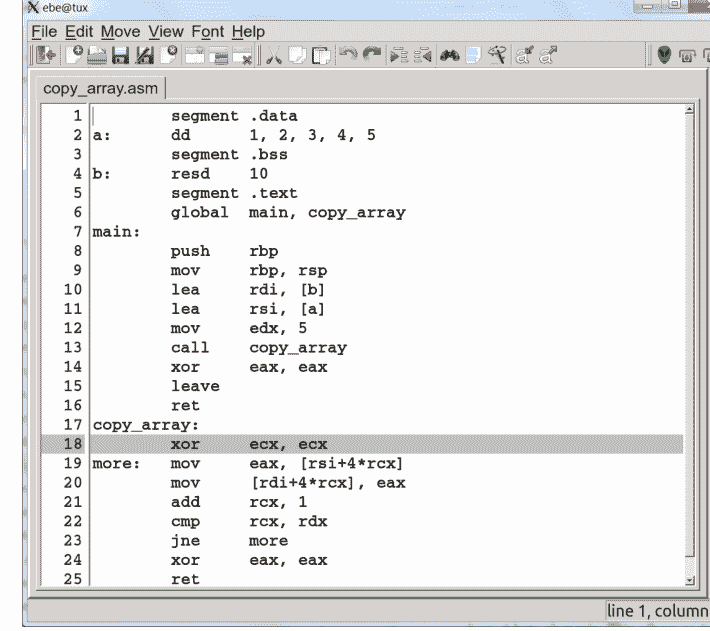

```asm

copy_array.asm

segment .data

ddd 1, 2, 3, 4, 5

segment .bss

resd 5

segment .text

global main, copy_array

main:

push rbp

mov rbp, rsi

lea rdi, [b]

lea rsi, [a]

mov edx, 5

call copy_array

xor eax, eax

leave

ret

copy_array:

xor eax, ecx

mov [rdi+4*rcx], eax

mov [rdi+4*rcx], eax

add rcx, 1

cmp rdx, rdx

jne more

xor eax, eax

ret

```

使用 `ebe` 可以很容易地监控函数中处理的数据。你可以看到在第 18 行设置了断点并运行了程序。此时，`copy_array` 函数已经尽调用，参数分别位于 `rdi`、`rsi` 和 `rdx` 寄存器中。

| rax | 0x400c00 | rsi | 0x602088 | r8 | 0x400cca | r12 |
|---|---|---|---|---|---|---|
| rbx | 0x0 | rdi | 0x602404 | r9 | 0x0 | r13 |
| rcx | 0xffffffffffff | rbp | 0xfffffffeea50 | r11 | 0x1 | r14 |
| rdx | 5 | rsp | 0x7fffffeea48 | r10 | 0x26 | r15 |
| rip | 0x400c22 | | eflags | PF IF | | |

点击 `rdi` 的值 `0x601040` 并右键点击，我们可以弹出一个表单来定义 `rdi` 中地址的变量。该表单需要名称、类型、格式数组变量以及 `a` 的最后完成。对源数组和目标数组都进行了此操作，允许在函数执行时观察到两个数组。以下是复制 3 个值后的数组视图。

| Name | |
|---|---|
| Address | 0x602404 |
| type | int |
| Format | Hexadecimal |
| array variable | |
| First | 0 |
| Last | 0 |
| OK | Cancel |

| Name | Type | Value |
|---|---|---|
| *a[0:4] | int | 1 2 3 4 5 |
| *b[0:4] | int | 1 2 3 |

在 `copy_array` 函数中，我们使用了提供的参数。我们使用 `rsi` 作为源数组的基寄存器，使用 `rdi` 作为目标数组的基寄存器。由于数组元素是 4 字节，我们使用 `rcx` 作为索引寄存器。这允许我们比较 `rcx` 和 `rdx` 以判断是否有更多元素需要复制。

注意，乘以 2、4 或 8 等同于左移 1、2 或 3 位，因此使用倍数实际上是零开销的。或者，我们可以在每次循环中为 `rcx` 加 4。

最后这种模式对于访问结构体数组非常有用。如果你有一个结构体数组，其中每个结构体包含一个字符数组和一个指针，那么引用部分可以是结构体内元素的偏移量，而基寄存器和索引寄存器可以定义数组中特定结构体的地址。

## 10.3 分配数组

在汇编中分配内存简单的方法可能是使用 C 库的 `malloc` 函数。`malloc` 的原型如下：

```c

void *malloc( long size );

```

如果成功，`malloc` 返回指向分配内存的指针；如果失败，则返回 0。`malloc` 返回的内存对齐到 16 字节，这对于任何类型对象的地址都是有（除了 AVX 指令需要 32 字节对齐的数组外）。可以通过调用 `free` 函数释放内存以便重复使用。

```asm

free (ptr);

```

使用数组有几个优点。最明显的优点是你可以知道大小。使用数组的另一个明显原因是你可以知道大小。可以通过调用 `free` 函数释放内存以便重复使用。

## 10.4 处理数组

在汇编中分配内存简单的方法可能是使用 C 库的 `malloc` 函数。`malloc` 的原型如下：

```c

void *malloc( long size );

```

如果成功，`malloc` 返回指向分配内存的指针；如果失败，则返回 0。`malloc` 返回的内存对齐到 16 字节，这对于任何类型对象的地址都是有（除了 AVX 指令需要 32 字节对齐的数组外）。

### 寻找最小值

`min` 函数是一个叶子函数（不调用任何其他函数），因此没有实际需要创建栈帧，也不需要将栈对齐到 16 字节边界。使用了了条件移动指令来避免中断指令流水线。

```assembly

; x = min ( array, size );

min:

    mov eax, [rdi]

    mov rcx, 1

    mov r8d, [rdi+rcx*4]

    cmp r8d, eax

    cmovl eax, r8d

    inc rcx

    cmp rcx, rsi

    jl  .more

ret

```

### 数组最小值的主程序

主程序如下所示。它使用栈来存储局部变量 `.array` 和 `size`。它使用命令行参数来指定数组大小，这将在下一节中讨论。代码中的注释概述了其行为。

```assembly

main:

    .array equ 0

    .size equ 8

    push rbp

    mov rbp, rsp

    mov rsp, 16
```


`mov ecx, 0`          ; 设置默认值

`mov [rsp+.size], rcx`

```assembly
; 检查 argv[1] 是否提供了大小

    cmp edi, 2

    jl  .nosize

    mov rdi, [rsp+8]

    call atoi

    mov [rsp+.size], rax
```

```assembly
.nosize:

    创建数组

    mov rdi, [rsp+.size]

    call create
```

```assembly
mov [rsp+.array], rax

; 用随机数填充数组

    mov rdi, rax

    mov rsi, [rsp+.size]

    call fill
```

```assembly
; 如果 size <= 20，则打印数组

    mov rsi, [rsp+.size]
```

```assembly
cmp rsi, 20

jg .tobig

mov rdi, [rsp+.array]

call print
```

`.tobig`:
; 打印最小值
segment .data
`.format`:
db "min:%1d",0xa,0
segment .text
`mov rdi, [rsp+.array]`
`mov rsi, [rsp+.size]`
`call min`
`lea rdi, [.format]`
`mov rsi, rax`
`call printf`
`leave`

# 10.5 命令行参数数组

命令行参数作为 `main` 函数的参数传递给 C 程序。命令行参数的数量是 `main` 的第一个参数，字符指针数组是 `main` 的第二个参数。第一个参数始终是正在运行的可执行文件的名称。其余参数是用户 Shell 对命令行剩余部分的扩展。这种扩展使得在命令行上使用如 `*.dat` 的模式非常方便。Shell 会将命令行中的该部分替换为所有匹配的文件名。

这里有一个打印命令行参数的简单 C 程序：

```c
#include <stdio.h>

int main ( int argc, char *argv[]) {
    int i;
    for ( i = 0; i < argc; i++) {
        printf("%s\n", argv[i]);
    }
    return 0;
}
```

当执行 `./args hello world` 时，它会打印：

```
./.args
hello
world
```

`argv` 数组的传递方式与所有 C 语言数组一样，通过将数组第一个元素的地址放在寄存器或栈中来实现。在 `argv` 的情况下，它的地址在寄存器 `rsi` 中。下面是该程序的汇编翻译，尽管汇编代码利用了 `argv` 数组末尾 NULL 指针的特性。

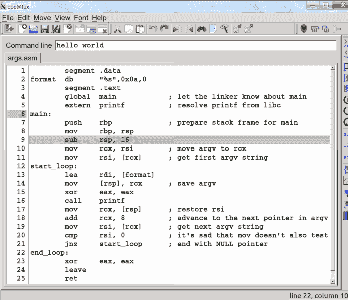

你会注意到“Command line”文本框中输入了“hello world”。当此程序执行时，它将在 ebe 终端窗口中打印程序名，随后分行打印“hello”和“world”。该终端也将被 ebe 用于从标准输入读取所有内容。

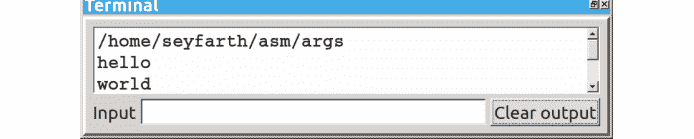

# 练习

- 1. 编写 2 个测试程序：一个使用冒泡排序对随机 4 字节整数数组进行排序，第二个程序使用 C 库中的 `qsort` 函数对随机 4 字节整数数组进行排序。你的程序应该使用 C 库函数 `atol` 将命令行提供的 ASCII 数字转换为长型。该数字是数组的大小（4 字节整数的个数）。然后你的程序可以使用 `malloc` 分配数组并使用 `random` 填充数组。你可以像这样调用 `qsort`：

```c
qsort ( array, n, 4, compare );
```

第二个参数是要排序的数组元素数量，第三个参数是每个元素的字节大小。第四个参数是比较函数的地址。你的比较函数将接受两个参数。每个参数都是指向 4 字节整数的指针。比较函数根据整数的顺序返回负值、0 或正值。你需要从第一个整数减去第二个整数。

- 2. 编写一个程序使用 `qsort` 对随机整数数组进行排序，并使用二分查找函数搜索数组。数组的大小应通过命令行参数给出。你的程序应该使用 `random()%1000` 作为数组的值。在构建并排序数组后，你的程序进入通过 `scanf` 读取数字，直到 `scanf` 失败。对于读取的每个数字，你的程序应该调用二分查找函数，并报告在特定索引找到或未找到。

- 3. 编写一个汇编程序，使用 `fgets` 逐行读取直到文件结束，计算字节序列的 Adler-32 校验和。`fgets` 的原型为：

```c
char *fgets( char *s, int size, FILE *fp);
```

参数 `s` 是一个字符数组，位于 bss 段。参数 `size` 是数组的字节数。参数 `fp` 是一个指针，你需要 `stdin`。在代码中放置以下行以告知链接器 `stdin`：

`extern stdin`
`gets` 在成功时返回参数 `s`，失败时返回 0。你需要读取到失败为止。Adler-32 校验的计算方式如下：

```c
long adler32(char *data, int len) {
    long a = 1, b = 0;
    int i;
    for (i = 0; i < len; i++) {
        a = (a + data[i]) % 65521;
        b = (b + a) % 65521;
    }
    return (a << 16) | b;
}
```

- 4. 编写一个汇编程序，计算字符串数组的哈希值。哈希值应该是所有字符串中字符的简单和。字符串数组以指针指针数组的形式传递。字符串的数量作为第二个参数传递。

或者 4 个双精度浮，你需要使用 `ymm0`, `ymm1`, ... `ymm15` 中的寄存器名称。每个 XMM 寄存器占用相应 YMM 寄存器的前 128 位。

在本章的大部分内容中，讨论的是 XMM 寄存器。在所有情况下，相同的指令（以字母“v”为缀）都可以与 YMM 寄存器配合使用，处理双倍的数据值。反复陈述可能比将其视为规则更容易让人困惑。

ToBe 让你方便地查看浮点寄存器的内容。寄存器窗口的下方以多种格式显示浮点寄存器。考虑这个简单的程序，它加载了 2 个浮点值并将它们相加：

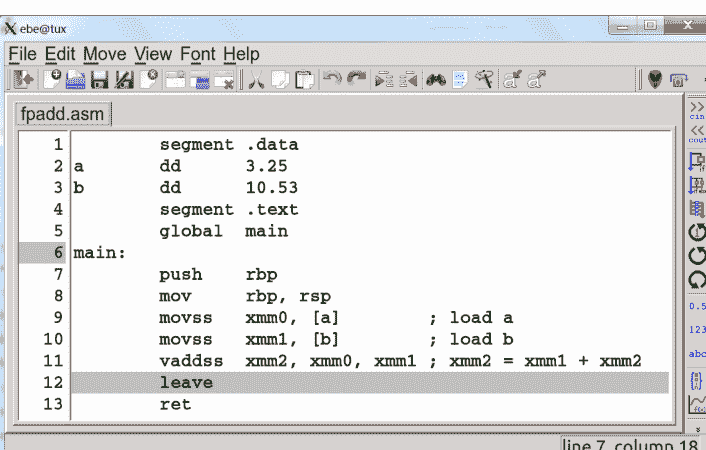

下面是执行第 11 行 `vaddss` 指令后的浮点寄存器。

## 浮点寄存器

| xmm0 | 3.25 | xmm8 | 0 |
| xmm1 | 10.53 | xmm9 | 0 |
| xmm2 | 13.78 | xmm10 | 0 |
| xmm3 | 0 | xmm11 | 0 |
| xmm4 | 2.34181e-38 | xmm12 | 0 |
| xmm5 | 0 | xmm13 | 0 |
| xmm6 | 0 | xmm14 | 0 |
| xmm7 | 0 | xmm15 | 0 |

## 11.2 移动浮点数据

x86-64 CPU 上的 SSE 寄存器为 128 位（AVX 寄存器为 256 位）。这些寄存器可以用于一次执行一次操作也可以一次执行多次操作。既有移动 1 个数据值的指令，也有移动多个数据项的指令，被称为“打包”（packed）数据。

### 移动标量

有两条指令可以将标量（1 个值）浮点值移动到/从 SSE 寄存器：`movss`移动 32 位浮点值（floats），`movsd`移动 64 位浮点值（doubles）。这两条指令将浮点值从/到 XMM 寄存器的低部或从一个 XMM 寄存器移动到另一个。没有隐式转换——执行 `movss` 后，目标位置中存在一个 32 位的值。这里有一个示例：

```
movss xmm0, [x] : xmm0 = value at x
movsd [y], xmm1 : move xmm1 to y
movov xmm2, xmm0 : xmm2 = xmm0
```


### 移动打包数据

有用于加载整数打包数据和浮点打包数据的指令。我们将集中在打包浮点数据上。你可以移动打包单点或打包双精度。有用于移动对齐或未对齐打包数据的指令。对齐指令是 `movaps`（使用 XMM 寄存器移动四个单点）和 `movapd`（使用 XMM 寄存器移动双精度）。未对齐版本是 `movups` 和 `movdup`。

对齐数据意味着它在内存中处于 16 字节边界。这可以通过在数据段为数组使用 `align 16` 来实现。bss 段中数组的 `alignb` 伪操作不能正常工作。通过 `malloc` 分配的数组将位于 16 字节边界上。如果你尝试对未对齐地址使用对齐移动，你的程序将会导致段错误（`segmentation fault`）。在 Core i 系列 CPU 上，当数据对齐时，未对齐移动的速度与对齐移动一样快。注意使用 AVX 寄存器的指令以“V”开头。这里有一个示例：

```
movups xmm0, [x] : move 4 floats to xmm0
vmovups ymm0, [x] : move 8 floats to ymm0
movupd ymm1, [x] : move 4 doubles to ymm1
movd [a], xmm15 : move 2 doubles to a
```

## 11.3 加法

相加浮点数据的指令分为标量和打包两种。标量加法指令 `addss` 用于加两个单点，`addsd` 用于加两个双精度。两者都作用于标量操作数和目标操作数。源操作可以是内存或 XMM 寄存器，而目标必须在 XMM 寄存器中。与整数加法不同，浮点加法指令不设置任何标志，测试必须使用比较指令完成。

打包加法指令 `addps` 将 4 个单点从源加到目标，`addpd` 使用 XMM 寄存器将 2 个双精度从源加到目标中的 2 个双精度。和标量加法一样，源可以是内存或 XMM 寄存器，而目标必须是 XMM 寄存器。使用 YMM 寄存器的打包加法 `vaddps` 和 `vaddpd` 可以增加 8 对单点或 4 对双精度。

```
movss xmm0, [a]    : load a
addss xmm0, [b]    : add b to a
movss [c], xmm0    : store sum in c
movapd xmm0, [a] : load 2 doubles from a
addpd xmm0, [b]    : a[0]+b[0], a[1]+b[1]
movapd [c], xmm0    : store 2 sums in c
vmovupd ymm0, [a]  : load 4 doubles from a
vaddpd ymm0, [b]   : add 4 doubles
vmovupd [c], ymm0    : store 4 sums in c
```

## 11.4 减法

相加浮点数据的指令分为标量和打包两种。标量加法指令 `addss` 用于加两个单点，`addsd` 用于加两个双精度。两者都作用于标量操作数和目标操作数。源可以是内存或 XMM 寄存器，而目标必须在 XMM 寄存器中。与整数加法不同，浮点加法指令不设置任何标志，测试必须使用比较指令完成。

打包加法指令 `addps` 将 4 个单点从源加到目标，`addpd` 使用 XMM 寄存器将 2 个双精度从源加到目标中的 2 个双精度。和标量加法一样，源可以是内存或 XMM 寄存器，而目标必须是 XMM 寄存器。使用 YMM 寄存器的打包加法 `vaddps` 和 `vaddpd` 可以增加 8 对单点或 4 对双精度的。

## 11.5 乘法与除法

相加浮点数据的指令分为标量和打包两种。标量加法指令 `addss` 用于加两个单点，`addsd` 用于加两个双精度。两者都作用于标量操作数和目标操作数。源可以是内存或 XMM 寄存器，而目标必须在 XMM 寄存器中。与整数加法不同，浮点加法指令不设置任何标志，测试必须使用比较指令完成。

打包加法指令 `addps` 将 4 个单点从源加到目标，`addpd` 使用 XMM 寄存器将 2 个双精度从源加到目标中的 2 个双精度。和标量加法一样，源可以是内存或 XMM 寄存器，而目标必须是 XMM 寄存器。使用 YMM 寄存器的打包加法 `vaddps` 和 `vaddpd` 可以增加 8 对单点或 4 对双精度的。

## 11.6 转换

将数字从一种长度转换为整数、从一种长度转换为另一种长度、从整数转换为浮点或从浮点转换为整数是相对常见的。

## 11.7 IEEE 754 浮点比较规范

浮点算术的 IEEE 754 规范包含了两种类型的“非数字”（NaN）。这两种类型是静静 NaN（quiet NaN）和信号 NaN（signaling NaN）。静静 NaN（QNaN）是可以安全地在代码中传播而不会引发异常的值。信号 NaN（SNaN）在生成时总是抛出异常。可能你

目睹了一个程序因信号导致除以0的错误而崩溃。

浮点数比较被认为是“有序的”（ordered）或“无序的”（unordered）。如果其中一个操作数是 QNaN 或 SNaN，有序比较将导致浮点异常。而无序比较仅在操作数是 SNaN 时才会抛出异常。`gcc` 编译器使用无序比较，因此我也将采用相同的方法。

无序浮点比较指令在比较双精度浮（double）时并不常见。第一个操作数必须是一个 XMM 寄存器，而第二个操作数可以是内存或 XMM 寄存器。它们设置零标志位、奇偶标志位和进位标志位，以指示结果的类型：无序（至少一个操作数为 NaN）、小于或大于。在比较之后，使用条件跳转似乎是自然的选择，但对于浮点条件跳转，我们需要不同的指令。使用类似 `jge`（大于或相等则跳转）的指令看起来很好，但其效果实际上来自 `jae`（高于或相等则跳转）。

| 指令 | 含义 | 别名 | 标志位 |
|---|---|---|---|
| `jb` | 跳转 < | `jnc` | `CF=1` |
| `jbe` | 跳转 <= | `jna` | `CF=1 or ZF=1` |
| `ja` | 跳转 > | `jne` | `ZF=0 and CF=0` |
| `jae` | 跳转 >= | `jnc jnb` | `CF=0` |

这里是一个示例：

```
movss xmm0, [a]
mulss xmm0, [b]
ucomiss xmm0, [c]
jbe      less_eq ; 如果 a*b <= c 则跳转
```

## 11.8 数学函数

8087 协处理器实现了一组有超越函数，如正弦、余弦和反正切。这些指令在现代 CPU 中仍然存在，但它们使用浮点寄存器栈，且不再被推荐。相反，这些函数有了更高效的库函数。

SSE 指令包含了浮点函数，用于计算最小值和最大值、执行舍入以及计算平方根倒数。

### 最小值和最大值

标量最小最大值指令 `minss` 和 `maxss` 用于计算浮点数（float）的最小和最大值，`maxsd` 则对双精度数（double）执行相同操作。第一个操作数（目标）必须是一个 XMM 寄存器，而第二个操作数（源）可以是 XMM 寄存器或内存位置。结果存放在目标寄存器中。

最小最大值指令有打包版本：`minps`、`maxps`、`minpd` 和 `maxpd`，它们作用于 4 个浮点数（ps 版本）或 2 个双精度数（pd 版本）。打包指令要求第一个操作数使用 XMM 寄存器，源操作数为 XMM 寄存器或内存。浮点数版本计算 4 个结果，而双精度版本计算 2 个结果。

```
movss xmm0, [x] ; 将 x 移动到 xmm0
maxss xmm0, [y] ; xmm0 包含(x,y)
movapd xmm0, [a] ; 将 a[0], a[1] 移动到 xmm0
minpd xmm0, [b] ; xmm0[0] = min(a[0],b[0])
minpd xmm0, [1] = min(a[1],b[1])
```


### 舍入

SSE 指令包含 4 条将浮点数舍入数字的指令：`roundss` 舍入 1 个浮点数，`roundps` 舍入 4 个浮点数，`roundsd` 舍入 1 个双精度数，`roundpd` 舍入 2 个双精度数。第一个操作数必须是 `XMM` 寄存器，第二个操作可以是 `XMM` 寄存器或内存。第三个操作数用于选择舍入模式。可能舍入模式的简化视图如下表所示：

| 模式 | 含义 |
|---|---|
| 0 | 舍入，偶数舍入 |
| 1 | 向上舍入 |
| 2 | 向 0 舍入（截断） |

### 平方根

SSE 指令包含 4 条平方根指令：`sqrtss` 计算 1 个浮点数平方根，`sqrtps` 计算 4 个浮点数平方根，`sqrtsd` 计算 1 个双精度数平方根，`sqrtpd` 计算 2 个双精度数平方根。第一个操作数（目标）必须是 `XMM` 寄存器，第二个操作可以是 `XMM` 寄存器或内存。带有内存引用的打包指令需要对齐到 16 字节边界。

## 11.9 示例代码

在这里，我们通过一些相当实用的函数来展示涵盖过的指令。

### 3D 距离

我们可以使用一个接受两个包含 x, y, z 坐标的浮点数数组的函数来计算 3D 距离。3D 距离公式为：

```
d = (x_1 - x_2)^2 + (y_1 - y_2)^2 + (z_1 - z_2)^2
```

以下是 3D 距离的汇编代码：

```
distance3d:
movss xmm0, [rdi] : 第一点的 x
subss xmm0, [rsi] : 第二点的 x
mulss xmm0, (x1-x2)^2
movss xmm1, [rdi+4] : 第一点的 y
subss xmm1, [rsi+4] : 第二点的 y
mulss xmm1, (y1-y2)^2
movss xmm2, [rdi+8] : 第一点的 z
subss xmm2, [rsi+8] : 第二点的 z
mulss xmm2, xmm2 : (z1-z2)^2
addss xmm0, xmm1 : 相加 x 和 y 部分
addss xmm0, xmm2 : 相加 z 部分
sqrtss xmm0, xmm0
ret
```

### 向量的点积

3D 向量的点积用于图形学，通过计算 $X_1X_2 + Y_1Y_2 + Z_1Z_2$ 来实现。这里是计算两个浮点数数组之间点积的函数：

```
dot_product:
movss xmm0, [rdi] : x1
mulss xmm0, [rsi] : x1*x2
movss xmm1, [rdi+4] : y1
mulss xmm1, [rsi+4] : y1*y2
addss xmm0, xmm1 : x1*x2 + y1*y2
movss xmm2, [rdi+8] : z1
mulss xmm2, [rsi+8] : z1*z2
addss xmm0, xmm2 : x1*x2 + y1*y2 + z1*z2
ret
```

### 多项式求值

多项式的评估至少有两种方法。第一种是简单的定义：$P(x) = p_0 + p_1x + p_2x^2 + \dots + p_nx$。另一种更高效的方法是使用霍纳法则（Horner's Rule）：$b_n = p_n, \dots + p_0$。

编写一个以双精度数数组作为第一个参数 (`rdi`)，$x$ 作为第二个参数 (`xmm0`)，次数作为第三个参数 (`rsi`) 的函数：

```
movsd xmm1, [rdi] : 
mulsd xmm1, xmm0 : p1*x
cmp esi, 0 : 检查次数
jz done
sub esi, 1 : 次数减1
movsd xmm2, [rdi+8] : 
addsd xmm0, xmm2 : 
done:
ret
```

## 练习题

- 1. 编写一个测试计算 $\sin x$ 的程序。$\sin x$ 的公式由泰勒级数给出：$\sin x = x - \frac{x^3}{3!} + \frac{x^5}{5!} - \frac{x^7}{7!} \dots$ 程序应该处理双精度数。第一个数字是 $x$，第二个数字是要计算的项数。你的程序应该调用该函数并打印结果。
- 2. 编写一个计算多边形面积的程序。你可以使用公式 $A = \frac{1}{2}\sum_{i=0}^{n-1}(x_i y_{i+1} - x_{i+1}y_i)$。你的函数应该有三个参数。第一个是包含 $x$ 值的双精度数组。第二个是包含 $y$ 值的双精度数组。第三个是值 $n$。你的数组大小为 $n+1$，且第 $n$ 个位置为 0。顶点数量将通过 `scanf` 读取。你的程序应该分配大小为 $n+1$ 的数组并通过 `scanf` 读取坐标。最后你的程序应该计算并打印面积。
- 3. 编写一个程序使用梯形法近似五次多项式的定积分。五次多项式由 6 个系数 $p_0, p_1, \dots, p_5$ 定义，$p(x) = p_0 + p_1x + p_2x^2 + p_3x^3 + p_4x^4 + p_5x^5$。梯形法则规定，从 $c$ 到 $d$ 的函数 $f(x)$ 的积分可以近似为 $(d-c)\frac{f(c)+f(d)}{2}$。为了获得良好的近似，将从 $a$ 到 $b$ 的区间分为若干个子区间，并在每个区间上使用梯形法。你的程序应该读取区间值 $a$ 和 $b$。然后读取子区间的数量 $n$。
- 4. 编写一个多项式求导和积分的程序。程序应该提示并读取多项式的次数、其导数和积分。然后为多项式分配正确大小的数组。然后程序应该提示并读取多项式的系数。最后的输入是定义域内的两个值，$a$ 和 $b$。程序应该计算 $a$ 和 $b$ 处多项式及其导数的值。最后它应该打印从 $a$ 到 $b$ 的积分。

# 第 12 章

## 系统调用

系统调用本质上是一种函数调用，它会将 CPU 切换到内核模式并在 Linux 上执行一个进程，这意味着它是内核的一部分。当你运行一个程序时，它在用户模式下运行，这被限制只能执行“安全”的指令。它可以在程序内部移动数据、进行算术运算、执行分支、调用函数等，但某些指令是程序无法直接执行的。例如，允许任何用户直接写入磁盘是不安全的，因此通过防止用户程序执行输入或输出指令来避免这一点。另一个禁止的操作是直接设置页映射寄存器。

当用户程序需要执行打开磁盘文件等操作时，它会发出系统调用。这将 CPU 的运行模式切换到内核模式，CPU 在那里执行输入输出指令。内核打开调用将验证用户程序是否有权限打开文件，然后打开它，并代表程序执行所需的任何输入输出指令。

Linux 系统调用接口针对 32 位和 64 位模式定义。在 64 位 Linux 下，32 位接口仍然可用，以支持 32 位应用程序，并且在某种程度上对 64 位程序也有效。

### 12.1 32 位 Linux 系统调用

每个系统调用定义在 `/usr/include/asm/unistd_32.h` 中。要执行系统调用，你必须将系统调用号放在寄存器 `eax` 中，并使用软件中断指令 `0x80` 来调用。系统调用带有参数，存放在寄存器 `ebx`、`ecx`、`edx`、`esi`、`edi` 和 `ebp` 中。返回值放在 `eax` 中。

这是一个向 stdout 写入内容的系统调用：

```assembly
hello:
  segment .data
```

```
db "Hello world!",0x0a
...
mov eax, 4      ; syscall 4 是 write
mov ebx, 1      ; 文件描述符
lea ecx,[hello] ; 要写入的数组
mov rdx, 13     ; 写入 13 字节
int 0x80
```

OS 也支持 32 位系统调用，并像 Linux 一样使用 `int` 在 `eax` 中放置系统调用号。然而，参数是通过栈传递的而不是寄存器。系统调用的数字与 Linux 不同。

### 12.2 64 位 Linux 系统调用

64 位 Linux 的系统调用与 32 位 Linux 的整数不同，定义在 `"/usr/include/asm/unistd_64.h"` 中。同样，系统调用使用寄存器传递参数，尽管寄存器有所不同。系统调用号放在 `rax` 中，参数放在 `rdi`、`rsi`、`rdx`、`r10` 和 `r9` 中。返回值放在 `rax` 中。寄存器与 C 函数调用中的相同，只是参数 4 用 `rcx` 替换了 `r10`。

x86-64 Linux 不使用软件中断指令，而是使用 `syscall` 来执行系统调用。以下是“Hello world”的 64 位版本：

```assembly
segment .data
hello:
  db "Hello world!",0x0a
  segment .text
  global _start
_start:
  mov eax, 1      ; syscall 1 是 write
```


```
  mov edi, 1      ; 文件描述符

  lea rsi,[hello] ; 要写入的数组

  mov rdx, 13     ; 写入 13 字节

  syscall

  mov eax, 60     ; syscall 60 是 exit

  xor edi, edi    ; exit(0)

  syscall
```

## 12.3 64 位 OS X 系统调用

OS X 使用与 Linux 相同的 64 位系统调用 ABI。OS X 处理系统调用号的方式存在差异。Linux 的系统调用是较小的数字，而 OS X 在系统调用基础上增加了 `0x20000000`。原因是 OS X 有 4 类不同的系统调用，每种类通过第 23-25 位进行标识。以下是不同的类别：

| 偏移量 | 类 |
| --- | --- |
| `0x1000000` | Mach |
| `0x2000000` | UNIX/BSD |
| `0x3000000` | Machine dependent |
| `0x4000000` | Diagnostic |

OS X 系统调用标识在 `/usr/include/sys/syscall.h` 中，但没有 `0x20000000` 的偏移量。

### 12.4 C 封装函数

Unix 的通用语言是 C，因此每个系统调用都可以通过 C 封装函数使用。例如，C 库中有一个 `write` 函数，它除了执行写入请求的 `syscall` 指令外没有做其他事情。使用这些函数而不是显式的 `syscall` 指令是使用系统调优方法。你不需要担心数字，也不处理不同的寄存器用法。

Linux 和 OS 的系统调用记录在在线手册的第 2 部分，因此你可以使用：

- `man 2 write`

来学习如何使用系统调用封装。为了简单起见，我倾向于将其称为写入系统调用。

之前的“Hello world”程序可以使用 `write` 和 `exit` 重写为：

```assembly

segment  .data

msg:      db      "Hello world!",0x0a

len:      equ     $-msg      ; 字符串长度

               segment  .text

               global _start

_start:

  mov eax, 1      ; syscall 1 是 write

  mov edi, 1      ; 文件描述符

  lea rsi,[msg] ; 要写入的数组

  mov rdx, 13     ; 写入 13 字节

  syscall

  mov eax, 60     ; syscall 60 是 exit

  xor edi, edi    ; exit(0)

  syscall

```

`lseek` 系统允许你设置文件中读取或写入的当前位置。它的原型定义如下：

```
long lseek(int fd, long offset, int whence);
```

`offset` 参数通常仅仅是文件中的字节位置，但 `offset` 的含义取决于 `whence` 的值。如果 `whence` 为 0，则 `offset` 是字节位置；如果 `whence` 为 1，`offset` 相对于当前位置；如果 `whence` 为 2，则 `offset` 相对于末尾。`lseek` 的返回值是文件下次读取或写入的位置。

使用 `offset` 为 0 且 `whence` 等于 2 的 `lseek`，将返回一个比文件最后一个字节大 1 的字节位置。这是确定文件大小的一种简单方法。知道大小后，你可以分配数组并读取整个文件（只要你有足够的内存）。

```
mov rdi, [fd]

xor esi, esi      ; set offset to 0

mov edx, 2              ; set whence to 2

call lseek              ; determine file size

mov rdi, [size],rax

call malloc            ; allocate array

mov [data], rax

mov rdi, [fd]

xor esi, esi          ; set offset to 0

xor edx, edx            ; whence to 0

call lseek              ; seek to start of file

mov rdi, [fd]

mov rsi, [data]

mov rdx, [size]

call read              ; read the entire file
```

在 64 位 Linux 和 OS X 中，`lseek` 使用 64 位整数作为 `offset` 参数，这使得能够跳转到大于 `2^32` 的位置可能。在 32 位 Linux 上执行相同操作则需要使用 `lseek64`。

# close 系统调用

当你完成对文件的读取或写入后，应该关闭它。`close` 系统调用的唯一参数是待关闭文件的文件描述符。如果你在不关闭文件的情况下退出程序，操作系统会自动关闭它。使用文件描述符读取或写入的数据在用户程序中是不经过缓冲的，因此不会有任何已写入但可能丢失的数据。。这对于使用 `FILE` 指针的情况则并非如此，如果没有 `close`，可能会导致数据丢失。关闭文件的最大优点是减少内核开销，并避免触及每个进程打开文件数量的限制。

```
mov edi, [fd]

call close
```

# 练习

- 1. 使用系统调用编写一个拷贝程序，并使用等效的库封装函数编写第二个拷贝程序。你的拷贝程序应该在命令行上接受两个文件名和一个整数。第一个名称是输入文件名，第二个是输出文件名。命令行上的数字是为输入输出数组分配的字节数。将大小设为 4096 字节的倍数会带来细微的性能提升。你可以尝试实验发现哪种大小在你的测试中运行更快。挑战在于，对于许多文件，输入和输出文件都适合缓冲区缓存，因此读取文件不需要实际的磁盘 I/O，且写入会被延迟。你能测量系统调用版本和库版本之间的时间差异吗？
- 2. 编写一个处理命令行指定的一系列文件的程序。对于每个文件，程序应该像 `wc` 程序一样打印字节数、单词数和行数。
- 3. 编写一个在命令行接受两个字符串的程序。第一个字符串是待查找的字符串，第二个是用于搜索该字符串的文件名。程序应该打印所有匹配的行。这是 `grep` 的一个简化版本。

# 第 13 章
结构 (Structs)

通过在 yasm 中定义结构来使用与 C 兼容的结构非常简单。结构是一个复合对象，可以包含不同类型的数据项。让我们考虑 C 结构 `Customer`：

```
struct Customer {

    int id;

    char name[64];

    char address[64];

    int balance;

};
```

假设我们知道结构每个项的偏移量，可以使用汇编代码访问客户数据。

```
mov rdi, 136          ; size of the Customer

call malloc

mov [c], rax           ; save the address

mov [rax], dword 7   ; set the id

lea rdi, [rax+4]      ; name field

lea rsi, [name]        ; name to copy to struc

call strcpy

mov eax, [c]

lea rdi, [rax+68]     ; address field

lea rsi, [address]     ; address to copy

call strcpy

mov eax, [c]

mov edx, [balance]

mov [rax+132], edx
```

## 13.1 偏移量的符号名称

这种方法确实有效，但在结构内部使用特定的数字作为偏移量并不是理想的。对结构的任何更改都将需要修改代码，并且在添加偏移量时可能会出错。最好让 yasm 帮助你定义结构。yasm 中用于开始结构的关键字是 `struct`。结构组件定义在 `struct` 和 `endstruct` 之间。这里是 `Customer` 的定义：

```
id      struct  Customer

name    resd    1

address resb    64

balance resb    64

        resd    1

        endstruct
```

使用这种定义的效果与使用 `equ` 定义符号偏移量相同。由于这些名称是全局可用的，因此你不允许在多个结构中使用 `id`。相反，你可以像这样为这些名称中的每一个加上一个点前缀：

```
.id     struct  Customer


`.name   resd    1`

`.address resb    64`

`.balance resb    64`

`        resd    1`

`        endstruct`

```
现在你使用 `Customer.id` 来引用 `id` 字段的偏移量。一个很好的折中方案是用结构名称的缩写名前缀。除了给偏移量提供符号名称外，yasm 还会定义 `Customer_size` 为结构中的字节数。这使得为结构分配内存变得简单。下面是一个从单独变量初始化结构的程序。
```

`segment  data`

`name    db      "calvin", 0`

`address db      "12 Mocking Lane",0`

`balance dd      12500`

`        struct  Customer`

`c_id     resd    64`

`c_name   resb    64`

`c_address resb    64`

`c_balance resb    1`

`        endstruct`

`        dq      0`

`segment  text`

`        global`

`        extern malloc, calloc`

`main:`

`    push rbp`

`    mov rbp, rsp`

`    sub rsp, 32`

`    mov rdi, Customer_size`

`    call calloc`

`    mov [c], rax`

`    mov rdi, [fd]`

`    xor esi, esi      ; set offset to 0`

`    mov edx, 2              ; set whence to 2`

`    call lseek              ; determine file size`

`    mov rdi, [size],rax`

`    call malloc            ; allocate array`

`    mov [data], rax`

`    mov rdi, [fd]`

`    xor esi, esi          ; set offset to 0`

`    xor edx, edx            ; whence to 0`

`    call lseek              ; seek to start of file`

`mov rdi, [fd]`

`mov rsi, [data]`

`mov rdx, [size]`

`call read              ; read the entire file`

`    mov eax, [c]`

`    lea rdi, [rax+4]      ; name field`

`    lea rsi, [name]        ; name to copy to struc`

`    call strcpy`

`    mov eax, [c]`

`    lea rdi, [rax+68]     ; address field`

`    lea rsi, [address]     ; address to copy`

`    call strcpy`

`    mov eax, [c]`

`    mov edx, [balance]`

`    mov [rax+132], edx`

`    mov eax, 0`

`    leave`

`    ret`

```

```assembly
align 4      ; 对齐到 144

endstruct

customers dq 0

segment .text

mov     edi, 100 ; 用于100个结构体

mul     edi, Customer_size

call    malloc

mov     [customers], rax
```

现在处理数组中的每个元素，我们可以从一个持有 `customers` 值的寄存器开始，并在处理每个客户后向寄存器中加上 `customer_size`。

```assembly
segment .data

format  db "%s %s %d",0x0a,0

segment .text

push    r15

push    r14
```

我们使用 `r14` 和 `r15` 是因为它们在调用过程中会被保留。

```assembly
mov     r15, 100      ; 循环计数器

mov     r14, [customers]

lea     edi, [format]

lea     esi, [r14+c_name]

lea     rdx, [r14+c_address]

mov     rcx, [r14+c_balance]

call    printf

add     r14, customer_size

sub     r15, 1

jz     more
```

`r14` 和 `r15` 必须为调用函数恢复。

```assembly
pop     r14

pop     r15

ret
```

# 练习

- 1. 设计一个结构体来表示一个集合。该结构体将持有最大集合大小以及指向数组的指针，该数组为集合中每个可能的元素存储1位。集合的成员将是从 0 到集合大小减 1 的整数。编写一个测试程序来读取操作集合的命令。命令将是“add”（添加）、“remove”（删除）和“test”（测试）。每个命令带有一个整数参数。你的程序将能够向集合中添加元素、从集合中删除元素并测试数字的成员。
- 2. 使用练习1中的集合设计，编写一个程序来处理多个集合。实现命令“add”、“union”（并集）、“print”（打印）和“intersect”（交集）。创建 10 个大小等为 10000 的集合，“add s k”将把 $k$ 添加到 $s$。“union s t”将用 $s \cup t$ 替换 $s$。“intersect s t”将用 $s \cap t$ 替换 $s$。“print s”将打印 s 的元素。
- 3. 设计一个结构体来表示大整数。为了简单起见，使用双字数组（quad arrays）作为大整数的数据。每个双字代表数字的 18 位。因此，1 个双字可以存储高达 999,999,999,999,999,999,999 的数字。2 个双字可以存储高达 999,999,999,999,999,999,999,999,999 的数字。仅实现正数。实现加法和乘法（基于加法）。允许在 C 或 C++ 中编写主程序和 50! 的阶乘函数，使用汇编代码执行所有的长整数运算。

# 第14 章

## 使用 C 流输入输出函数

从 C 可调用的函数包含了许多领域的各种函数，包括进程管理、文件处理、网络通信、字符串处理和图形编程。学习这些能力的大部分将使我们偏离汇编语言的学习。流输入输出设施提供了一个高级库的示例，该库在许多程序中也非常有用。

在系统调用的章节中，我们调用了 `open`、`read`、`write` 和 `close`，这些仅仅是系统调用的封装函数。在本章中，我们将关注一组类似的用于缓冲 I/O 的函数。缓冲 I/O 意味着应用程序为每个打开的文件维护一个数据缓冲区。

读取缓冲 I/O 系统可能更有效率。假设你请求缓冲 I/O 系统读取 1 字节。它将尝试从已读取数据的缓冲区读取 1 字节。如果必须，它将读取足够的字节来填充缓冲区——通常是 8192 字节。这意味着 8192 个 1 字节的读取通过 1 次实际的系统调用即可满足。从缓冲区读取一个字节非常快。事实上，读取一个大文件，使用 C 流函数 `getchar` 每次读取 1 字节的速度比使用 `read` 每次读取 1 字节要快 20 倍以上。

你应该意识到，当你调用 `read` 读取 1 字节时，操作系统会被磁盘驱动强制读取整个扇区，因此它必须至少读取 1 个扇区（可能是 512 字节）。操作系统很可能会读取 4096 字节并保存已读取的数据，以便后续读取可以使用这些数据。如果操作系统不使用缓冲区，每次读取 1 字节都需要每个字节与磁盘交互，这可能比使用缓冲区慢 10 到 20 倍。

这种讨论的最终结果是，如果你的程序需要读取或写入少量数据，使用流 I/O 设施比使用系统调用更快。通常可以使用系统调用并根据你的需求进行自己的缓冲以节省时间。你当然会通过付出更多努力来获得这种效率的提高。你必须权衡性能提升与工作量增加之间的性。

# 14.1 打开文件

使用流 I/O 函数打开文件的函数是 `fopen`。与其他流 I/O 函数一样，它以字母 "f" 开头，以与与其相似的系统调用封装函数区分开来。`fopen` 的原型是

```c
FILE *fopen(char *pathname, char *mode);
```


`fopen`的第一个参数是文件路径，第二个参数是模式。模式可以是下表中的任何值：

| 模式 | 含义 |
| :--- | :--- |
| r | 只读 |
| r+ | 读写 |
| w | 只写（覆盖现有文件或创建新） |
| w+ | 读写（覆盖现有文件或创建新） |
| a | 追加（在文件末尾写入） |
| a+ | 读写（在文件末尾） |
| b | 二进制 |

`fopen`返回一个指向`FILE`对象的指针。如果出错，则返回`NULL`。这里是某些使用`fopen`打开文件的汇编代码，使用了`customers`结构体：

```assembly
align 4      ; 对齐到 144

endstruct

customers dq 0

segment .text

mov     edi, 100 ; 用于100个结构体

mul     edi, Customer_size

call    malloc

mov     [customers], rax
```

现在处理数组中的每个元素，我们可以从一个持有`customers`值的寄存器开始，并在处理每个客户后向寄存器中加上`customer_size`。

```assembly
segment .data

format  db "%s %s %d",0x0a,0

segment .text

push    r15

push    r14
```

我们使用`r14`和`r15`是因为它们在调用过程中会被保留。

```assembly
mov     r15, 100      ; 循环计数器

mov     r14, [customers]

lea     edi, [format]

lea     esi, [r14+c_name]

lea     rdx, [r14+c_address]

mov     rcx, [r14+c_balance]

call    printf

add     r14, customer_size

sub     r15, 1

jz     more
```

`r14`和`r15`必须为调用函数恢复。

```assembly
pop     r14

pop     r15

ret
```

# 练习

- 1. 设计一个结构体来表示一个集合。该结构体将持有最大集合大小以及指向数组的指针，该数组为集合中每个可能的元素存储1位。集合的成员将是从 0 到集合大小减 1 的整数。编写一个测试程序来读取操作集合的命令。命令将是“add”（添加）、“remove”（删除）和“test”（测试）。每个命令带有一个整数参数。你的程序将能够向集合中添加元素、从集合中删除元素并测试数字的成员。
- 2. 使用练习1中的集合设计，编写一个程序来处理多个集合。实现命令“add”、“union”（并集）、“print”（打印）和“intersect”（交集）。创建 10 个大小等为 10000 的集合，“add s k”将把 $k$ 添加到 $s$。“union s t”将用 $s \cup t$ 替换 $s$。“intersect s t”将用 $s \cap t$ 替换 $s$。“print s”将打印 s 的元素。
- 3. 设计一个结构体来表示大整数。为了简单起见，使用双字数组（quad arrays）作为大整数的数据。每个双字代表数字的 18 位。因此，1 个双字可以存储高达 999,999,999,999,999,999,999 的数字。2 个双字可以存储高达 999,999,999,999,999,999,999,999,999 的数字。仅实现正数。实现加法和乘法（基于加法）。允许在 C 或 C++ 中编写主程序和 50! 的阶乘函数，使用汇编代码执行所有的长整数运算。

# 第14章

## 使用 C 流输入输出函数

从 C 可调用的函数包含了许多领域的各种函数，包括进程管理、文件处理、网络通信、字符串处理和图形编程。学习这些能力的大部分将使我们偏离汇编语言的学习。流输入输出设施提供了一个高级库的示例，该库在许多程序中也非常有用。

在系统调用的章节中，我们调用了 `open`、`read`、`write` 和 `close`，这些仅仅是系统调用的封装函数。在本章中，我们将关注一组类似的用于缓冲 I/O 的函数。缓冲 I/O 意味着应用程序为每个打开的文件维护一个数据缓冲区。

读取缓冲 I/O 系统可能更有效率。假设你请求缓冲 I/O 系统读取 1 字节。它将尝试从已读取数据的缓冲区读取 1 字节。如果必须，它将读取足够的字节来填充缓冲区——通常是 8192 字节。这意味着 8192 个 1 字节的读取通过 1 次实际的系统调用即可满足。从缓冲区读取一个字节非常快。事实上，读取一个大文件，使用 C 流函数 `getchar` 每次读取 1 字节的速度比使用 `read` 每次读取 1 字节要快 20 倍以上。

你应该意识到，当你调用 `read` 读取 1 字节时，操作系统会被磁盘驱动强制读取整个扇区，因此它必须至少读取 1 个扇区（可能是 512 字节）。操作系统很可能会读取 4096 字节并保存已读取的数据，以便后续读取可以使用这些数据。如果操作系统不使用缓冲区，每次读取 1 字节都需要每个字节与磁盘交互，这可能比使用缓冲区慢 10 到 20 倍。

这种讨论的最终结果是，如果你的程序需要读取或写入少量数据，使用流 I/O 设施比使用系统调用更快。通常可以使用系统调用并根据你的需求进行自己的缓冲以节省时间。你当然会通过付出更多努力来获得这种效率的提高。你必须权衡性能提升与工作量增加之间的性。

## 14.1 打开文件

使用流 I/O 函数打开文件的函数是 `fopen`。与其他流 I/O 函数一样，它以字母 "f" 开头，以与与其相似的系统调用封装函数区分开来。`fopen` 的原型是

```c
FILE *fopen(char *pathname, char *mode);
```

`fopen` 的第一个参数是文件路径，第二个参数是模式。模式可以是下表中的任何值：

| 模式 | 含义 |
| :--- | :--- |
| r | 只读 |
| r+ | 读写 |
| w | 只写（覆盖现有文件或创建新） |
| w+ | 读写（覆盖现有文件或创建新） |
| a | 追加（在文件末尾写入） |
| a+ | 读写（在文件末尾） |
| b | 二进制 |

`fopen` 返回一个指向 `FILE` 对象的指针。如果出错，则返回 `NULL`。这里是某些使用 `fopen` 打开文件的汇编代码，使用了 `customers` 结构体：

```assembly
align 4      ; 对齐到 144

endstruct

customers dq 0

segment .text

mov     edi, 100 ; 用于100个结构体

mul     edi, Customer_size

call    malloc

mov     [customers], rax
```

现在处理数组中的每个元素，我们可以从一个持有 `customers` 值的寄存器开始，并在处理每个客户后向寄存器中加上 `customer_size`。

```assembly
segment .data

format  db "%s %s %d",0x0a,0

segment .text

push    r15

push    r14
```

我们使用 `r14` 和 `r15` 是因为它们在调用过程中会被保留。

```assembly
mov     r15, 100      ; 循环计数器

mov     r14, [customers]

lea     edi, [format]

lea     esi, [r14+c_name]

lea     rdx, [r14+c_address]

mov     rcx, [r14+c_balance]

call    printf

add     r14, customer_size

sub     r15, 1

jz     more
```

`r14` 和 `r15` 必须为调用函数恢复。

```assembly
pop     r14

pop     r15

ret
```


# 练习

- 1. 设计一个结构体来表示一个集合。该结构体将持有最大集合大小以及指向数组的指针，该数组为集合中每个可能的元素存储1位。集合的成员将是从 0 到集合大小减 1 的整数。编写一个测试程序来读取操作集合的命令。命令将是`add`、`remove`和`test`。每个命令带有一个整数参数。你的程序将能够向集合中添加元素、从集合中删除元素并测试数字的成员。
- 2. 使用练习1中的集合设计，编写一个程序来处理多个集合。实现命令`add`、`union`、`print`和`intersect`。创建 10 个大小等为 10000 的集合，`add s k`将把 $k$ 添加到 $s$。`union s t`将用 $s \cup t$ 替换 $s$。`intersect s t`将用 $s \cap t$ 替换 $s$。`print s`将打印 s 的元素。
- 3. 设计一个结构体来表示大整数。为了简单起见，使用双字数组`quad arrays`作为大整数的数据。每个双字代表数字的 18 位。因此，1 个双字可以存储高达 999,999,999,999,999,999,999 的数字。2 个双字可以存储高达 999,999,999,999,999,999,999,999,999 的数字。仅实现正数。实现加法和乘法。允许在 C 或 C++ 中编写主程序和 50! 的阶乘函数，使用汇编代码执行所有的长整数运算。

| 模式 | 含义 |
| :--- | :--- |
| r | 只读 |
| r+ | 读写 |
| w | 只写（覆盖现有文件或创建新） |
| w+ | 读写（覆盖现有文件或创建新） |
| a | 追加（在文件末尾写入） |
| a+ | 读写（在文件末尾） |
| b | 二进制 |

`fopen`返回一个指向`FILE`对象的指针。如果出错，则返回`NULL`。这里是某些使用`fopen`打开文件的汇编代码，使用了`customers`结构体：

```assembly
align 4      ; 对齐到 144

endstruct

customers dq 0

segment .text

mov     edi, 100 ; 用于100个结构体

mul     edi, Customer_size

call    malloc

mov     [customers], rax
```

现在处理数组中的每个元素，我们可以从一个持有`customers`值的寄存器开始，并在处理每个客户后向寄存器中加上`customer_size`。

```assembly
segment .data

format  db "%s %s %d",0x0a,0

segment .text

push    r15

push    r14
```

我们使用`r14`和`r15`是因为它们在调用过程中会被保留。

```assembly
mov     r15, 100      ; 循环计数器
mov     r14, [customers]
lea     edi, [format]
lea     esi, [r14+c_name]
lea     rdx, [r14+c_address]
mov     rcx, [r14+c_balance]
call    printf
add     r14, customer_size
sub     r15, 1
jz     more
```

`r14`和`r15`必须为调用函数恢复。

```assembly
pop     r14
pop     r15
ret
```

# 第14章

## 使用 C 流输入输出函数

从 C 可调用的函数包含了许多领域的各种函数，包括进程管理、文件处理、网络通信、字符串处理和图形编程。学习这些能力的大部分将使我们偏离汇编语言的学习。流输入输出设施提供了一个高级库的示例，该库在许多程序中也非常有用。

在系统调用的章节中，我们调用了`open`、`read`、`write`和`close`，这些仅仅是系统调用的封装函数。在本章中，我们将关注一组类似的用于缓冲 I/O 的函数。缓冲 I/O 意味着应用程序为每个打开的文件维护一个数据缓冲区。

读取缓冲 I/O 系统可能更有效率。假设你请求缓冲 I/O 系统读取 1 字节。它将尝试从已读取数据的缓冲区读取 1 字节。如果必须，它将读取足够的字节来填充缓冲区——通常是 8192 字节。这意味着 8192个 1 字节的读取通过 1 次实际的系统调用即可满足。从缓冲区读取一个字节非常快。事实上，读取一个大文件，使用 C 流函数`getchar`每次读取 1 字节的速度比使用`read`每次读取 1 字节要快 20 倍以上。

你应该意识到，当你调用`read`读取 1 字节时，操作系统会被磁盘驱动强制读取整个扇区，因此它必须至少读取 1 个扇区。操作系统很可能会读取 4096 字节并保存已读取的数据，以便后续读取可以使用这些数据。如果操作系统不使用缓冲区，每次读取 1 字节都需要每个字节与磁盘交互，这可能比使用缓冲区慢 10 到 20 倍。

这种讨论的最终结果是，如果你的程序需要读取或写入少量数据，使用流 I/O 设施比使用系统调用更快。通常可以使用系统调用并根据你的需求进行自己的缓冲以节省时间。你当然会通过付出更多努力来获得这种效率的提高。你必须权衡性能提升与工作量增加之间的性。

## 14.1 打开文件

使用流 I/O 函数打开文件的函数是`fopen`。与其他流 I/O 函数一样，它以字母 "f" 开头，以与与其相似的系统调用封装函数区分开来。`fopen`的原型是

```c
FILE *fopen(char *pathname, char *mode);
```

`fopen`的第一个参数是文件路径，第二个参数是模式。模式可以是下表中的任何值：

| 模式 | 含义 |
| :--- | :--- |
| r | 只读 |
| r+ | 读写 |
| w | 只写（覆盖现有文件或创建新） |
| w+ | 读写（覆盖现有文件或创建新） |
| a | 追加（在文件末尾写入） |
| a+ | 读写（在文件末尾） |
| b | 二进制 |

`fopen`返回一个指向`FILE`对象的指针。如果出错，则返回`NULL`。这里是某些使用`fopen`打开文件的汇编代码，使用了`customers`结构体：

```assembly
align 4      ; 对齐到 144

endstruct

customers dq 0

segment .text

mov     edi, 100 ; 用于100个结构体
```


`mul` `edi`, `Customer_size`

`call` `malloc`

`mov` `[customers]`, `rax`

```
（注：后续内容由于与上方重复，已按要求省略。）
```

```
lea rdi, [sp]

mov rsi, [ofp]

call fputs

jmp more
```

## 14.5 read 和 fwrite

`fread` 和 `fwrite` 函数用于读取和写入数据数组。它们的原型如下：

```
int fread(void *p, int size, int nelts, FILE *fp);

int fwrite(void *p, int size, int nelts, FILE *fp);
```

这些函数的第一个参数是一个类型类型的数组。下一个参数是数组中每个元素的大小，而第三个参数是要读取或写入的数组元素数量。它们返回读取或写入的数组元素数量。在发生错误或文件结束时，返回值可能小于 `nelts` 或为 0。

以下是将 `customers` 数组中的所有 100 个元素写入磁盘文件的代码：

```
mov rdi, [customers] ; 分配的数组

mov esi, Customer_size

mov edx, 100

mov rcx, [fp]

call fwrite
```

## 14.5 fseek 和 ftell

流的定位通过 `fseek` 函数完成，而 `ftell` 用于确定当前位置。这些函数的原型如下：

```
int fseek ( FILE *fp, long offset, int whence );

long ftell ( FILE *fp );
```

`fseek` 的第二个参数 `offset` 是一个字节值，其含义取决于第三个参数。`whence` 的含义与 `fseek` 中的用法完全相同。如果 `whence` 为 0，则 `offset` 相对于当前位置；如果 `whence` 为 2，则 `offset` 相对于文件末尾。

`fseek` 的返回值 0 表示成功，-1 表示错误。如果发生错误，变量 `errno` 将被适当设置。`ftell` 的返回值为文件中的当前字节位置，除非发生错误。出错时它返回 -1。

以下是一个向文件写入 `Customer` 记录的函数：

```
void write_customer(FILE *fp, struct Customer *c,

      int record_number);
      segment .text

      global write_customer_customer:
```

```
.fp equ 0

.c equ 8

.rec equ 16

push rbp, rsp ; 参数

sub rsp, 32 ; 参数空间

mov [rsp+.fp], rdi ; 保存参数

mov [rsp+.c], rsi

mov [rsp+.rec], rdx

mul rdx, Customer_size

mov rdx, 0 ; ftell 的偏移量

mov rsi, Customer_size ; whence

call ftell ; 定位文件

mov rdi, [rsp+.c]

mov rdx, Customer_size

mov rsi, 1

mov rcx, [rsp+.fp]

call fwrite ; 写入记录

leave

ret
```

## 14.6 fclose

`fclose` 用于关闭流。这是非常重要的，因为流的缓冲区中可能包含需要写入的数据。当你调用 `fclose` 时，这些数据会被写入；如果你忘记调用，它们将会丢失。`FILE` 指针是 `fclose` 的唯一参数。

## 练习题

- 1. 编写一个汇编程序，使用本章的结构体定义创建一个新的 `Customer`。你的程序应提示并读取文件名、客户名称、地址、余额和等级字段。然后你的代码应该扫描文件中的数据，寻找空位置。空位置是指 `id` 字段为 0 的记录。通常情况下，记录的 `id` 值会比记录号大 1。如果没有空记录，则在记录末尾添加新记录。报告客户的 `id`。
- 2. 编写一个汇编程序来更新客户的余额。该程序应从命令行接收数据文件名、客户 ID 以及要加到该客户余额的金额。客户的 `id` 比记录号大 1。如果客户记录未未使用（`id = 0`），则报告错误。
- 3. 编写一个汇编程序读取文件中的客户数据，按余额排序并按余额增加的顺序打印数据。你应该打开文件，使用 `fseek` 到末尾并使用 `ftell` 确定文件中的记录数量。它应该分配一个足够容整个文件的数组，逐个读取记录，跳过未使用的记录（`id = 0`）。然后使用 `qsort` 进行排序。你可以调用 `qsort`：

```
qsort(struct Customer *c, int count, int size, compare);
```

`count` 参数是需要排序的结构体数量，`size` 是每个元素的大小。`compare` 参数是一个函数地址，该函数接受两个参数，都是指向 `customer` 结构体的指针。该函数比较两个结构体的余额字段，并根据余额顺序返回负值、0 或正值。

# 第 15 章

## 数据结构

数据结构在应用程序中被广泛使用。它们经常用于算法目的，实现栈、队列和堆等结构。它们还用于实现基于键的数据存储，被称为“字典”。在本章中，我们将讨论用汇编实现链表、哈希表、双链表和二叉树。

数据结构的一个共同特征是使用名为“节点”（node）的结构，它包含数据和指向其他节点的指针。这些节点的内存将使用 `malloc` 分配。

## 15.1 链表

链表是由节点链组成的结构。以下是链表的插图：

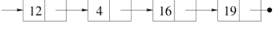

你可以看到列表中有一个节点。每个节点都有一个值和一个指向另一个节点的指针。链表的最后一个节点是一个空指针（值为 0），它被画为一个实心圆。列表本身表示为一个指针。我们可以通过将链表的第一个指针放在一个框中并对其命名来更完整地插图链表：

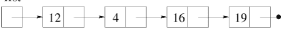

此列表中节点中的值没有明显的顺序。它是无序的，或者可能是按插入时间排序的。在列表开头插入新节点非常容易，因此列表可能是按插入时间的倒减顺序排列的。

列表通过存储在标记为 `list` 的内存位置的指针进行引用。维护和使用列表的代码中的节点没有特定的标签。访问这些节点的唯一方法是使用列表中的指针。

### 列表节点结构

我们的链表节点将有两个字段：一个值和一个指向下一个节点的指针。yasm 结构体定义如下：

```
struct node

n_value resq 1

n_next resq 1

align 8

endstruct
```

对于结构体中的两个双字（quad-words），不需要对齐指令，但它可能防止我们以后出现混淆。

### 创建空列表

设计容器结构的第一个决策是如何表示空容器。在我们的链表设计中，我们将采用最简单的选择，使用空指针作为空列表。尽管这很简单，但对于一个创建一个空列表的函数来说是有益的。

`newlist`:

```
xor eax, eax

ret
```

### 向列表中插入数字

将空列表实现为空指针的决定为插入带来了一个小问题。每次插入都将（等待，文本在此处结束了）。

最后，我们有一个主函数，它创建一个列表，使用 `scanf` 读取值，将这些值插入列表，并在每次插入后打印列表。

```
main:

.list equ 0

.k equ 8

segment .data

.scanf_fmt:

db "%d",0

segment .text

push rbp

mov rsp,16

sub rsp,rsp

call newlist

mov [rsp+.list],rax ; 创建一个列表

.more lea rdi, [.scanf_fmt]

lea rsi, [rsp+.k]

xor eax,eax ; 读取 k

call scanf

cmp rax,1 ; 如果读取失败

jne rdi, [rsp+.list]

mov rsi, [rsp+.k] ; 插入 k

call insert

mov [rsp+.list],rax
```


```assembly
mov         rdi,rax

call        print      ; 打印列表

jmp         .more

.done leave

ret
```

这里是使用该程序的示例会，输入数字 1 到 5（输入部分加粗显示）：

+   1
1
2
2 1
3
3 2 1
4
4 3 2 1
5
5 4 3 2 1

你可以看到最近打印的数字位于列表的第一个[的]位置。通过添加一个用于获取和移除（弹出）列表首个元素的函数，我们可以将其转换为栈。这是本章的练习题之一。

## 15.2 双向链表

双向链表每个节点有 2 个指针：一个指向下一个节点，另一个指向上一个节点。如果你将列表设为环形，并且在列表开头保留一个未使用的单元格，那么管理双向链表就会变得非常简单。这里有一个包含 4 个数据节点的示例列表：

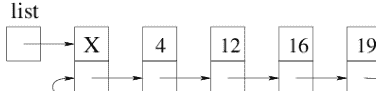

我们看到变量 `list` 指向列表的第一个节点，被称为“头节点”。头节点有一个值，但我们从不使用这个值。每个节点中的顶指针指向列表中的下一个节点，而底指针指向列表中的上一个节点。头节点的上一个指针是列表的最后一个节点。这使得列表能够实现栈（后进先出）、队列（先进先出）或双端队列（deque）。这种设计的主要优势是列表永远不会为空；它在逻辑上可以是空的，但头节点始终存在。此外，一旦创建了列表，指向头节点的指针永远不会改变。

### 双向链表节点结构

我们的列表将有 3 个字段：一个数据值、一个指向下一个节点的指针以及一个指向上一个节点的指针。yasm 结构定义如下：

```
struct          node

n_value  resq    1

n_next   resq    1

n_prev   resq    1

                align   8

endstruct
```

#### 创建新列表

创建新双向链表的代码分配了一个新节点，并将其后继和驱指针指向自身。调用函数接收到的一个在程序执行期间不会改变的指针。以下是创建代码：

```
;      list = newList();
newlist:
        push rbp
```

```
mov rbp, rsp
mov edi, node_size
call malloc
mov [rax+n_next], rax ; 头节点指向前方
mov leave
mov [rax+n_prev], rax ; 指向自身
ret
```

当它返回时，空列表看起来如下所示：

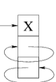

#### 在列表头部插入

要在列表头部插入一个新节点，你需要将头节点的后继指针放在新节点的后继槽中，并将头指针放在新节点的驱槽中。完成这些操作后，你可以让头节点指向新节点，让头的驱指针指向新节点。这些步骤如图所示。旧链接用虚线表示，新链接用带编号的实线表示。

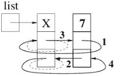

双向链表的特性之一是消除了特殊情况。插入第一个节点与插入任何其他节点的代码相同。插入代码为：

```
; insert ( list, k );
insert:
.list equ 0
.k equ 8
push rbp
mov rbp, rsp
sub rsp, 16
mov [rsp+.list], rdi ; 保存列表指针
mov [rsp+.k], rsi : 栈
mov edi, node_size
call malloc
mov r8, [rsp+.list] : 获取列表指针
mov r9, [r8+n_next] : 获取头的下一个
mov [rax+n_next], r9 ; p->next = h->next
mov [rax+n_prev], r8 : p->prev = h
mov [r8+n_next], rax : h->next = p
mov r9, [rsp+.k] ; 获取 k
mov [rax+n_value], r9 ; p->prev = p
leave
ret
```

#### 列表遍历

双向链表的遍历与单向链表的遍历有些相似。我们需要跳过头节点，并通过检查头节点来检测列表的结束。以下是打印代码：

```
; print ( list );
print:
  segment .data
  db "%d",0
  .newline:
  db 0xa,0
  segment .text
.list equ 0
rbx equ 8
push rbp
mov rbp, rsp
sub rsp, 16
mov [rsp], rbx : 保存 rbx
mov [rsp+.list], rdi : 保留头指针
mov rbx, [rdi+n_next] : 获取第一个节点
cmp rbx, [rsp+.list]
je : 列表为空
more:
  lea rdi, [.newline]
  mov rsi, [rbx+n_value] : 打印值
  call printf
  mov rbx, [rbx+n_next] : 获取下一个节点
  cmp rbx, [rsp+.list] : 如果是头节点
  je .more : 结束循环
done:
  lea rdi, [.newline]
  call printf
mov rbx, [rsp] : 恢复 rbx
leave
ret
```

## 哈希表

哈希表是实现字典的一种高效方法。基本思想是为字典中的每个项目的键计算一个哈希值。哈希值的目的是将键分散到数组中。一个完美的函数会将每个键映射到用于哈希数组的唯一位置，但这很难实现。相反，我们必须处理“冲突”的键。

处理冲突的最简单方法是在哈希数组的每个位置使用一个链表。考虑下面的插图：

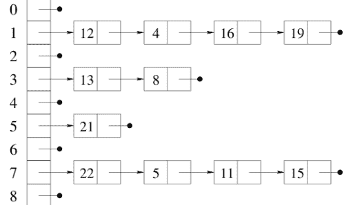

在该表中，键 12、4、16 和 9 的哈希值均为 1，并放置在哈希数组的位置 1 上。键 13 和 8 的哈希值均为 3，并放置在数组的位置 3 上。剩余的键被映射到 5 和 7。

哈希的关键问题之一是开发一个良好的哈希函数。哈希函数应该看起来几乎是随机的。它在每次为某个键调用时必须计算出相同的值，但哈希值本身并不重要；重要的是键在列表上的分布。我们希望有很多短列表。这意味着数组的大小至少要与预期的键数量一样。那么，通过良好的哈希函数，链通常是短的。

### 整数的良好哈希函数

通常建议哈希表的大小为质数。然而，如果用作键的数字没有规律，这并不重要。在这种情况下，你可以简单使用 `n mod t`，其中 `n` 是键，`t` 是数组大小。如果存在许多相同数字倍数的模式，那么使用质数作为 `t` 就很有意义。

以下是示例代码的哈希函数：

```
i = hash ( n );
mov rax, rdi
and ra, 0xff
ret
```

示例中的表大小为 256，因此使用 `and` 得到 `n mod 256`。

### 字符串的良好哈希函数

良好的字符串哈希函数是将字符串视为包含系数系数并对某些质数 `n` 求 `p(n)`。在代码中，我们在评估中使用质数 191。在计算出多项式值后，可以使用表大小进行模运算。

```c
int hash ( unsigned char *s ) {
    unsigned long h = 0;
    int i = 0;
    while ( s[i] ) {
        h = h*191 + s[i];
        i++;
    }
    return h % 100000;
}
```

### 哈希表节点结构和数组

在示例哈希表中，表大小为 256，因此在程序启动时我们需要 256 个空指针。由于这很小，它实现在数据段中。

```
Segment data
times 256 dq 0
struct node
n_value resq 1
n_next resq 1
align 8
endstruct
```

### 在哈希表中查找值的函数

哈希表的基本目的是存储与键关联的某些数据。在示例哈希表中，我们只是在存储键。查找函数在哈希表中搜索键。如果找到，函数返回指向该键节点的指针。如果没找到，它返回 0。

```
p = find ( n );
p = 0 如果未找到
```

```assembly
find:  equ 0
.n    push rbp
    mov rbp, rsp
    sub rsp, 16
    mov [rsp.+n], rdi     : save n
    call hash              : h = hash(n)
    mov rax, [table+rax*8];  p = table[h]
```


```assembly
mov rdi, [rsp.+n]      : restore n

cmp rax, 0             : if node pointer

je                      : is 0 quit

.more:

cmp rdi, [rax+n_value]; if p->value = n

je                      : return p

mov rax, [rax+next]     : p = p->next

cmp rax, 0             : if node pointer

jne                     : is 0 quit

.done:

leave

ret
```

# 插入代码

向哈希表插入键的代码首先通过调用 `find` 来避免重复插入该键。如果找到了该键，则将跳过插入代码。如果没有找到该键，函数将调用 `hash` 来确定链表的索引，以添加该键。它会为新节点分配内存并将其插入到列表的开头。

```assembly
; insert ( n );

insert:

.n equ 0

.h equ 8

    push rbp

    mov rbp, rsp

    sub rsp, 16

    mov [rsp.+n], rdi     : save n

    call find              : look for n

    cmp rax, 0             : if n id found

    jne                     : skip insertion

    mov rdi, [rsp.+n]      : restore n

    call hash              : compute h=hash(n)

    mov [rsp.+h], rax      : save h

    mov rdi, node_size      : allocate node

    call malloc

    mov r9, [rsp.+h]       : restore h

    mov r8, [table+r9*8]   : get first node from table

    mov [rax+next], r8     : set next pointer of node to f

    mov r8, [rsp.+n]       : set value of new

    mov [rax+n_value], r8  : node to n

    mov [table+rax*8], rax  : make node first on table[h]

.found:

    leave

    ret
```

### 打印哈希表

`print` 函数遍历从 0 到 255 的索引，打印索引号以及每个非空列表中的键。它使用寄存器 `r12` 和 `r13` 安全地存储循环计数器（用于遍历哈希表数组的位置）以及一个用于遍历每个链表上节点的指针。这比使用在 `printf` 周围需要保存和恢复的寄存器更方便。它不需要在函数的开始和结束处推入弹出这两个寄存器以为调用函数保留它们。注意，推入弹出 16 字节对于保持正确的栈对齐是必要的。

你会注意到代码在数据段和文本段之间来回，以便 `printf` 字符串被放置在代码中使用它们的位置附近。

```assembly
push rbp

mov r12, rsp      ; i: integer counter for table

push r13          ; p: pointer for list at table[i]

for ( i = 0; i < 256; i++) {

  xor r12, r12

more_table:

  p = table[i];

  mov r13, [table+r12*8]

  if (p == ()) {

    cmp r13, 0

    je .empty

    print the list header

    segment .data

.print1:

  db "list %3d: ",0

  segment .text

  lea rdi, [.print1]

  mov rsi, r12

  call printf

  do {

    more_list:

      print the node's value

      segment .data

      db "%ld ",0

      segment .text

      lea rdi, [.print2]

      mov rsi, [r13+n_value]

      call printf

      advance to the next node

      mov r13, [r13+n_next]

  } while ( the node != 0 )

  cmp r13, 0

jne .more_list
```

```assembly
;

print new line

segment .data

.print3: db 0x0a,0

segment .text

lea rdi, [.print3]

call printf
```

```assembly
.empty:

i++ r12

inc r12

cmp r12, 256

jl .more_table

} end of loop

pop r13

pop r12

leave

ret
```

# 测试哈希表

哈希表的 `main` 函数使用 `scanf` 读取数字，将它们插入哈希表，并并在每次插入后打印哈希表的内容：

```assembly
main:

.k equ 0

segment .data

.scanf_fmt:

db "%d",0

segment .text

npush rbp

mov rbp, rsp

sub rsp, 16

.more:

lea rdi, [.scanf_fmt]

lea rsi, [rsp+.k]

call scanf

cmp rax, 1 ; read k

jne .done ; if the read fails

mov rdi, [rsp+.k]

call insert ; insert(k)

call print ; print hash table

jmp .more

.done:

leave

ret
```

以下是插入 1, 2, 3, 4, 5, 256, 257, 258, 260, 513, 1025 和 1028 后哈希表的打印：

- 列表 0: 256
- 列表 1: 1025
- 列表 2: 258
- 列表 3: 513
- 列表 4: 1028
- 列表 5: 260

# 二叉树

二叉树是一个包含许多节点的结构。它有一个根节点，可以拥有左或右孩子。树中的每个节点也可以左右孩子（或两者）。

通常二叉树是通过对键应用排序来构建的。例如，二叉树将键分为小于节点键的（左树）和大于节点键的（右树）。有序的二叉树（通常称为搜索树）使得按递增或递顺序遍历节点成为可能。

# 二叉树节点和树结构

二叉树中的节点有一个整数值和两个指针。下面的结构将值命名为 `n_value`，左和右指针命名为 `n_left` 和 `n_right`。

```c
struct node

    n_value resq 1

    n_left resq 1

    n_right resq 1
```

可以使用根指针来表示树。然而，你可以为树添加删除或平衡等功能，这些可能会改变根。将根存储在结构中以使其不受变化影响是合理的。我们还在树中包含节点计数。

```c
struct tree

    t_count resq 1

    t_root resq 1
```

### 创建空树

`new_tree` 函数为树分配内存并将树的计数和根设置为 0。树根始终指向 `malloc` 返回的指针。

```assembly
new_tree:

    push rbp

    mov rbp, rsp

    mov rdi, tree_size

    call malloc

    xor edi, edi

    mov [rax+t_root], rdi

    mov [rax+t_count], rdi

    leave

    ret
```


### 在树中查找键

要在二叉树中查找键，从根指针开始，并将节点键与要查找的键比较。如果匹配，则完成。如果目标小于节点键，则将指针指向左孩子。如果目标大于节点键，则将指针指向右孩子。然后对新节点重复这些比较。如果遇到 `NULL` 指针，则键不在树中。下面是在二叉树中查找键的代码。它返回指向正确节点的指针，如果未找到则返回 `NULL`。

```assembly
; p = find ( t, n );
; p = 0 if not found
find:
    push rbp
    mov rbp, rsp
    mov rdi, [rdi+t_root]
    xor eax, eax
    mov rdi, 0
.more:
    cmp rsi, [rdi+n_value]
    je .goleft
    jg .right
    mov rax, rsi
    jmp .done
.goleft:
    mov rdi, [rdi+n_left]
    jmp .more
.right:
    mov rdi, [rdi+n_right]
    jmp .more
.done:
    leave
    ret
```

### 向树中插入键

插入键的第一步是使用 `find` 函数查看该键是否已经存在。如果存在，则不需要插入。如果不存在，则分配新节点，将其值设置为新键值，并将它的左、右指针设置为 `NULL`。现在是时候在树中找到放置它的位置了。

在树中插入第一个节点有一个特殊情况。如果树中的节点计数为 `0`，则增加计数并将树的根指针设置为新节点。

如果树非空，你从将当前指针设置为根节点开始。如果新键小于当前节点的键，则新节点属于左树。为了处理这种情况，你检查当前节点的左孩子指针。如果是空，则你找到了插入点，因此将左指针设置为新节点的指针。否则，更新你的当前指针为左指针并与其开始比较。如果键不小于当前节点的键，它一定大于。在这种情况下，你检查当前节点的右孩子指针，要么设置新指针，要么将你的当前指针移动右孩子并重复比较。

```assembly
insert ( t, n );
insert:
.n equ 0
.t equ 8
push rbp
mov rbp, rsp
sub rsp, 16
mov [rsp+], rdi
mov [rsp+n], rsi
call find ; loop for n
cmp rax, 0 ; if in the tree
jne .done ; don't insert it
call malloc ; p = new node
mov rsi, [rsp+n]
mov [rax+n_value], rsi ; p->value = n
xor edi, edi
mov [rax+n_left], rdi ; p->left = NULL
mov [rax+n_right], rdi ; p->right = NULL
mov rdx, [rdx+t_count] ; get tree size
cmp rdi, 0 ; count == 0 ?
jne .findparent
inc word [rdx+t_count] ; count = 1
mov [rdx+t_count], rax ; root = new node
jmp .done
.findparent:
cword [rdx+t_root] ; count++
mov rdx, [rdx+t_root] ; p = root
.repeatfind:
cmp rsi, [rdx+n_value] ; p->value < n ?
je .goleft
jg .right
mov rax, rsi
jmp .done
.goleft:
    mov rdi, [rdx+n_left]
    jmp .more
.right:
    mov rdi, [rdx+n_right]
    jmp .more
.done:
    leave
    ret
```

```assembly
jl .goleft ; t = p
mov r8, rdx
mov rdx, [r8+n_right] ; p = p->right
cmp rdx, 0 ; is p NULL ?
jne :repeat
mov [r8+n_left], ra ; if so, add node
mov .done ; and return
.goleft:
mov r8, rdx ; t = p
mov rdx, [r8+n_left] ; p = p->left
cmp rdx, 0 ; id p NULL ?
jne :repeat
mov [r8+n_left], rax ; if so, add node
mov .done ; and return
```

```assembly
.done: leave
ret
```

# 按顺序打印键

使用递归可以轻松地打印二叉树的键。基本思想是打印左子树的键、打印根节点的键，然后打印右子树的键。由于使用了特殊的树结构，需要一个不同的函数来从根指针开始递归地打印子树。主函数名为 `print`，递归函数名为 `rec_print`。

```assembly
rec_print:
t equ 0
push rbp
mov rbp, rsp
sub rsp, 16
cmp rdi, 0
je :done
mov [rsp+t], rdi
mov rdi, [rdi+n_left]
call rec_print
mov rdi, [rsp+t]
mov rsi, [rdi+n_value]
segment .data
.print db "%ld\n",0
segment .text
lea rdi, [.print]
call printf
mov rdi, [rsp+t]
mov rdi, [rdi+n_right]
call rec_print
.done leave
ret
```

```assembly
print():
push rbp
mov rbp, rsp
mov rdi, [rdi+t_root]
call rec_print
segment .data
```

```assembly
.print db 0x0a, 0
segment .text
lea rdi, [.print]
call printf
leave
ret
```


# 练习

- 1. 修改单链表代码以实现一个字符串栈。你可以使用 C 语言的 `strdup` 函数为你插入的字符串创建副本。编写一个主程序，创建一个栈并进入一个循环读取字符串。如果输入的字符串等于“pop”，则从栈顶弹出元素并打印该值。如果输入的字符串等于“print”，则打印栈的内容。否则，将字符串推入栈中。当 `scanf` 无法读取字符串时，你的代码应该退出。

- 2. 修改双链表代码以实现一个字符串队列。你的主程序应该不断读取字符串，直到没有可用字符串为止。如果输入的字符串等于“dequeue”，则从队列中取出最旧的字符串并打印它。如果输入的字符串等于“print”，则打印队列的内容。否则，将字符串添加到队列末尾。当 `scanf` 无法读取字符串时，你的代码应该退出。

- 3. 修改哈希表代码以实现一个存储字符串和整数的哈希表。字符串作为键，整数作为其关联的值。你的主程序应该使用 `fgets` 读取行，并再次使用 `sscanf` 读取文本以获取一个字符串和一个数字。如果没有读到数字（即 `sscanf` 返回 `1`），则在哈希表中查找该字符串，如果存在则打印其值，否则打印错误信息。如果读到了字符串和数字（`sscanf` 返回 `2`），则在哈希表中添加字符串或更新字符串的值。当 `fgets` 无法读取字符串时，你的代码应该退出。

- 4. 实现一个字符串二叉树，并使用 `fgets` 读取文本文件，然后按字母顺序打印文本行。

# 第 16 章

## 高性能汇编

在本章中，我们将讨论编写高效 x86 汇编语言的一些策略。金标准是用 C 或 C++ 编写并使用良好的优化编译器进行编译。作者使用 `gcc` 生成汇编语言文件。研究生成的代码可能会让你获得关于如何编写高效汇编的 l。

## 16.1 高效利用缓存

高性能计算的目标之一是让 CPU 的处理单元忙起来。像 Intel i7 这样的现代 CPU 运行速度约为 3 GHz，而主内存最大只有 1 GB/s。如果你的应用程序严格需要数据和指令而不使用缓存，那么速度大约为每周期 2 字节。CPU 拥有 4 个核心，需要达到 1 GB/s，因此每个核心每周期可以处理 4 条指令。对于相同的 CPU，情况也是如此。为了保持指令流，这些 CPU 需要每周期多于 2 字节。执行了一个简短测试来说明主内存与缓存对 i7 的影响。在下面的图中，你可以看到时间很大程度上取决于数组的大小。对于大小为 8 的数组，时间为 1.5 秒。随着缓存的使用，时间稳定增长。当大小为 8000 万时，缓存几乎失效，达到了 5.7 秒。

### 计算时间


高效利用缓存的一个典型例子是矩阵乘法的实现。直观的矩阵乘法复杂度为 $O(n^3)$，其中有 $n$ 行 $n$ 列数据，通常被编码为嵌套循环。然而，它可以被分成足够小到放入缓存块，从而获得性能提升。以下是乘以 2048x2048 矩阵的不同尺寸的 MFLOP 评分。通过汇编语言利用 SSE 或 AVX 有很大的改进空间。

### 矩阵乘法的 MFLOPs


## 16.2 公共表达式消除

公共表达式消除通常由优化编译器执行。如果你希望胜过编译器，就必须做同样的事情。有时定位公共表达式可能是困难的。这是一个研究编译器生成的代码以发现它的好机会。编译器处理任务不知且高效，人类往往会忽略这些。

## 16.3 强度还原

强度还原意味着使用更简单的数学技术来获得答案。可以使用 `pow` 计算 $x^3$，但计算 $x * x$ 更快。如果你需要计算 $x^4$，请分阶段进行：

```assembly
x2 = x * x;
x4 = x2 * x2;
```

如果你需要将整数乘以 2 的幂，可以通过位移更快地完成。如果你需要将多个浮点数除以 $x$，先计算 $1/x$ 再乘以。

## 16.4 高效使用寄存器

将常用值放在寄存器中。将值放在寄存器中几乎总是更好的。我曾写过一个 32 位模式下的双嵌套循环，当时我所有值都放在寄存器中，`gcc` 通过对少数值使用栈生成更快的代码。这些栈值可能留在 L1 缓存中，效果几乎与寄存器一样。测试是事实。

## 16.5 使用更少的分支

现代 CPU 进行分支预测，并在存在条件分支时根据两种可能的情况的一种来准备流水线。当预测错误时，流水线会阻塞，因此尽量减少分支会有帮助。学习你编译器生成的代码。它经常重新排序汇编代码以减少分支数量。你将从编译器中学到一些通用技术。

## 16.6 将循环转换为底部分支

如果你像所示编写 `while` 循环，会在循环顶部有一个条件跳转以跳过它，并在循环底部有一个无条件跳转返回顶部。始终可以将循环转换为在底部有条件跳转的形式。你可能需要在循环顶部使用一次性条件跳转，以处理跳过循环体的情况。

这里有一个 C 语言 `for` 循环转换为 `do-while` 循环的示例。首先是 `for` 循环：

```c
for ( i = 0; i < n; i++) {
    x[i] = a[i] + b[i];
}
```

现在是带有额外 `if` 的 `do-while` 循环：

```c
if ( n > 0 ) {
    i = 0;
    do {
        x[i] = a[i] + b[i];
        i++;
    } while ( i < n);
}
```

请不要在 C 或 C++ 中采用这种编码风格。编译器会很好地处理循环。事实上，循环的简单性可能允许编译器生成更好的代码。我之所以在 C 中演示，只是为了更简单地表达这一点。

```assembly
segment .text
global add_array
add_array:
xor eax, eax
.add_words:
add rax, [rdi]
add rdi, 8
dec rsi
jg .add_words
ret
```

这里是一个循环展开 4 次后的版本：

```assembly
segment .text
global add_array
add_array:
push r15
push r14
push r13
push r12
push rbp
push rbx
xor eax, eax
mov rbx, eax
mov rcx, rbx
mov rdx, rax
.add_words:
add rax, [rdi]
add rbx, [rdi+8]
add rcx, [rdi+16]
add rdx, [rdi+24]
add rdi, 32
sub rsi, 4
jg .add_words
add rcx, rdx
add rax, rbx
add rax, rcx
pop rbx
pop rbp
pop r12
pop r13
pop r14
pop r15
ret
```

可能有使用更少调用者保存寄存器（callee-save registers）的方法，但我为了简化代码做了这些选择。在展开的代码中，我在 `rax`、`rbx`、`rcx` 和 `rdx` 中累加部分和。这些部分和在循环结束后合并。执行一个包含 1000000 次加加 1000 个双字（quad-words）数组的测试程序，简单版本耗时 3.9 秒，展开版本耗时 2.44 秒。由于每个数据元素的操作太少，以至于两个程序在大数组情况下开始受到内存带宽的限制，因此我测试了一个可以轻松放入缓存的大小。

## 16.8 合并循环

如果你有两个循环在遍历相同的值序列，且循环之间没有依赖关系，那么合并循环似乎是显而易见的做法。考虑以下两个循环：

```c
for ( i = 0; i < 1000; i++) {
  a[i] = b[i] + c[i];
}
for ( j = 0; j < 1000; j++) {
  d[j] = b[j] - c[j];
}
```

这可以很容易合并为：

```c
for ( i = 0; i < 1000; i++) {
  a[i] = b[i] + c[i];
}
```

通常情况下，合并循环可以增加循环体的大小，从而减少开销百分比，并有助于保持流水线满载。在这种情况下，只需加载一次 `b` 和 `c` 的值而不是加载两次，可以获得额外的收益。

## 16.9 分拆循环

我们刚刚讨论了合并循环是一个好主意。现在我们将学习对某些循环来说相反的方法反而更好。如果一个循环正在处理两组独立的数据集，那么它就可以被拆分为两个循环。如果合并后的循环超过了缓存容量，这可以提高性能。在更好的缓存使用和流水线中更多的指令之间存在权衡。有时合并更好，而有时拆分更好。

## 16.10 交换循环

假设你希望在 C 语言的二维数组中放置 0。你有两个选择：

```c
for ( i = 0; i < n; i++) {
  for ( j = 0; j < n; j++) {
    x[i][j] = 0;
}
}
```

或者

```c
for ( j = 0; j < n; j++) {


```
for ( i = 0; i < n; i++) {
    x[i][j] = 0;
}
}
```

哪一个更好？在 C 语言中，第二个增量比第一个快。这意味着 `x[0][1]` 紧邻 `x[0][0]`。另一方面，`x[1][0]` 在 `x[0][0]` 之后有 `n` 个元素。当 CPU 将数据取入缓存时，它获取的不仅仅是几个字节，写入内存的行为也类似，因此第一个循环更有意义。如果你极其倒霉遇到了一个大到 RAM 无法容纳的数组，那么在第二个版本中可能会遇到虚拟内存抖动（thrashing）。这可能导致每次数组访问都变成一次磁盘访问。

## 16.11 将循环不变代码移到循环外

这可能是一个相当显而易见的优化。这是另一种情况，即研究编译器生成的代码可能会指出你忽略的某些循环不变代码。

## 16.12 消除递归

如果容易消除递归，那么它几乎总是提高效率。通常，消除“尾”递归是很的，即函数的最后一个动作是递归调用。这通常可以通过跳转到函数顶部来实现。另一方面，如果你尝试消除一个像快速排序（`quicksort`）这样会产生 2 次非平凡递归调用的函数的递归，你将被迫使用你自己的堆栈来“模拟”递归。这可能会让事情变慢。无论如何，这种效果都是微小的，因为在快速排序中花费在递归调用的时间很短。

## 16.13 消除栈帧

对于叶子函数（leaf functions），没有必要使用栈帧。事实上，如果你有非叶子函数，只调用了你的函数而没有调用其他函数，那么你可以从这两个函数中省略帧指针（frame pointers）。帧指针的唯一理由是为了调试。虽然要求将栈保持在 16 字节边界上，但这只有在具有局部变量（在栈上）的函数中才会成为问题。

## 16.14 内联函数

这可能是一个相当容易执行的优化。在某些情况下，编译器可以内联（`inline`）小函数，从而显著减少开销。

## 16.15 减少循环依赖

现代 CPU 允许超标执行（super-scalar execution）。如果指令流中的指令不依赖之前的结果，它们就可以一次执行多个。通过内联函数，代码变得更易读和易写。对于 1000000 个整数的测试，耗时 2.44 秒，展开后耗时 2.75 秒。

## 16.16 使用专用指令

对于位操作，我们已经看到使用专用指令（specialized instructions）可以利用 寄存器来处理 4。使用 AVX 寄存器可以获得更好的性能。这种技术将在后续章节中进行探讨。

## 练习题

- 1. 给出一个包含 `$x, y, z$` 的结构，计算 `$x, y, z$` 之间的距离。
- 2. 给出一个 2D 数组 `$M, y$`，计算 `$M$`。
- 3. 写一个使用块（blocked）的程序来计算 1 位。

# 在数组中计算 1 位

在本章中，我们将探索在数组中计算 1 位的多种方案。这是一个直接的 C 方案：

```c
long popcnt_array(long *a, int size) {
    int w, b;
    long n;
    n = 0;
    for (w = 0; w < size; w++) {
        word = a[w];
        n += word & 1;
        for (b = 1; b < 64; b++) {
            n += (word >> b);
        }
    }
    return n;
}
```

测试 1000 次调用 `popcnt_array`（包含 800000 字节）耗时 14.63 秒。开启优化级别 2 后耗时 5.29 秒，级别 3 耗时 5.37 秒。最后加上 `-funroll-all-loops` 耗时 4.74 秒。

该算法可以通过注意到经常被测试的字字高位可能是 0 来改进。我们可以将内部循环改为 `while` 循环：

```c
long popcnt_array(unsigned long *a, int size) {
  int w;
  unsigned long word;
  long n;
  n = 0;
  for (w = 0; w < size; w++) {
    word = a[w];
    while (word != 0) {
      n += word & 1;
      word >>= 1;
    }
  }
  return n;
}
```

使用最高优化选项，该版本耗时 3.34 秒。这是一个使用更好算法的实例。

## 17.2 使用汇编计算 1 位

将处理 64 位的循环展开为 64 次处理 1 位的操作并不困难。在下面的汇编代码中，每个字的四分之一位被放在 `rbx`、`rcx` 和 `rdx` 中。然后使用不同的寄存器累加这些四分之一位。这为计算机使用乱序执行提供了相当大的自由度。

```assembly
segment .text
global popcnt_array
popcnt_array:
  push rbx
  push rbp
  push r12
  push r13
  push r14
  push r15
  xor eax, eax
  xor ebx, ebx
  xor ecx, ecx
  xor edx, edx
  xor r12d, r12d
  xor r13d, r13d
  xor r14d, r14d
  xor r15d, r15d
count_words:
  mov r8, [rdi]
  mov r9, r8
  mov r10, r8
```

```assembly
mov     r11, r9
and     r8, 0xffff
and     r9, 16
shr     r10, 32
and     r10, 0xffff
shr     r11, 48
and     r11, 0xffff
mov     r12w, r8w
and     r12w, 1
add     rax, r12
mov     r13w, r9w
and     r13w, 1
add     rbx, r13
mov     r14w, r10w
and     r14w, 1
add     rcx, r14
mov     r15w, r11w
and     r15w, 1
mov     rdx, r15
%rep 15
shr     r8w, 1
mov     r12w, r8w
and     r12w, 1
add     rax, r12
shr     r9w, 1
mov     r13w, r9w
and     r13w, 1
add     rbx, r13
shr     r10w, 1
mov     r14w, r10w
and     r14w, 1
add     rcx, r14
shr     r11w, 1
mov     r15w, r11w
and     r15w, 1
add     rdx, r15
%endrep
add     rdi, 8
dec     rsi
jg      .count_words
add     rax, rbx
add     rax, rcx
add     rax, rdx
pop     r15
pop     r14
pop     r13
pop     r12
pop     rbp
pop     rbx
ret
```

这有一个遗憾的副作用：使用了一个重复 15 次的 `rep`（repeat）区域。这导致函数大小达到了 1123 字节。也许花费 2.52 秒来执行测试是值得的。目标文件比使用循环展开的 C 代码只大了 240 字节。

## 17.3 预计算每个字节中的位数

下一个算法的改进来自于意识到：我们可以预计算字节中所有可能的位模式的位数，并使用一个包含 256 字节的数组来存储每个可能字节的位数。然后，使用四字节字（quad-word）的 8 个字节作为位计数数组的索引，计算该四字节字中的位数并求和。

以下是用于计算数组中位的 C 函数，不包含计数数组的初始化：

```c
long popcnt_array ( long *a, int size ) {
    int b;
    long n;
    int word;
    n = 0;
    for (b = 0; b < size*8; b++) {
        word = ((unsigned char*)a)[b];
        n += count[word];
    }
    return n;
}
```


这段代码测试时花费了 0.24 秒，所以我们有了一个新的赢者。我尝试用汇编语言击败这个算法，但结果是平局。

## 17.4 使用 popcnt 指令

Core 系列处理器中包含了一条新指令 `popcnt`，它可以给出一个 64 位寄存器中 1 的个数。因此，在合适的计算机上，我们可以采用使用专用指令的技术：

```assembly
.text

global popcnt_array

popcnt_array:

    xor eax, eax

    xor r8d, r8d

    xor ecx, ecx

count_more:

    popcnt rdx, [rdi]+rcx*8]

    add rax, rdx

    popcnt r9, [rdi]+rcx*8]

    add r8, r9

    add rcx, 2

    cmp rcx, rsi

    jl .count_more

add rax, r8
ret
```

我们在 Core i7 上获得了一个新的赢者，耗时 0.04 秒，比竞争对手快了 6 倍。

## 练习

- 1. 编写一个将 ASCII 字符数组转换为 EBCDIC 的函数，以及另一个转换回 ASCII。
- 2. 对于 ASCII 字符数组编写一个寻找最长公共子串的函数。

## 第18章 章el 滤波器

Sobel 滤波器是一种用于图像处理的边缘检测滤波器。滤波器的操作是通过 3x3 矩阵对每个像素进行卷积，产生 x 方向的边缘测量和 y 方向的边缘测量。这里是矩阵：

$S_x = \begin{bmatrix} -1 & 0 & 1 \\ -2 & 0 & 2 \\ -1 & 0 & 1 \end{bmatrix} \quad S_y = \begin{bmatrix} -1 & -2 & 1 \\ 0 & 0 & 0 \\ 1 & 2 & 1 \end{bmatrix}$

对于单个像素 $I_{r,c}$，边缘测量 $G_x$ 通过以下公式计算：

$G_x = \sum_{i=-1}^{1} \sum_{j=-1}^{1} (S_{x,i,j} I_{r+i,c+j})$

其中我们方便地从 1 开始对 $S_x$ 的行和列。同样，我们通过以下公式计算 $G_y$：

$G_y = \sum_{i=-1}^{1} \sum_{j=-1}^{1} (S_{y,i,j} I_{r+i,c+j})$

接下来展示如何获取边缘测量的幅度 $G$：

$G = \sqrt{G_x^2 + G_y^2}$

### 18.1 C语言实现的 Sobel

以下是一个计算任意尺寸图像 Sobel 边缘幅度的 C 函数：

```c
#include <math.h>
#define I(a,b,c) a[(b)*cols+(c)]

void sobel ( unsigned char *data, float *out, long rows, long cols ) {
  int r, c;
  int gx, gy;

  for (r = 1; r < rows-1; r++) {
    for (c = 1; c < cols-1; c++) {
      gx = -I(data,r-1,c-1) + I(data,r-1,c+1) +
           -2*I(data,r,c) + 2*I(data,r,c+1) +
           -I(data,r+1,c-1) + I(data,r+1,c+1);
      gy = I(data,r-1,c-1) - 2*I(data,r,c) +
           I(data,r-1,c+1) + I(data,r+1,c-1) +
           I(data,r+1,c) + I(data,r+1,c+1);
      out[r*cols+c] = sqrt((float)gx)*(float)gy);
    }
  }
}
```

这段代码使用 `-O3` 优化和全循环展开进行编译。测试 1024×1024 图像显示其每秒处理 15 张。测试不同的图像时每秒处理 158 张。显然，代码的限制在于数学计算而非内存带宽。

### 18.2 使用 SSE 计算 Sobel

选择 Sobel 是作为处理多种类型数据的算法良好示例。第一幅图像是字节数据。使用 `movdq` 指令从图像的一行传输 16 个相邻像素。对这些像素进行处理以产生 16 个像素对 $G_x$ 和 $G_y$ 的贡献。然后从第一行向下传输 16 个像素。以相同的方式处理这些像素，增加 $G_x$ 和 $G_y$ 的贡献。最后，从第一行向下两行传输 16 个像素，并计算它们对 $G_x$ 和 $G_y$ 的贡献。然后将这些贡献平方、相加、转换为 32 位浮点，并为 14 个输出像素计算平方根并放在输出数组中。在相同的 i7 计算机上测试，这段代码每秒产生 63 张图像。测试不同的图像每秒产生 98 张，大约是 C 版本的 6.2 倍。以下是代码中使用的指令：

- `pxor`: 对 128 位 XMM 寄存器或内存执行异或运算，并将结果存储在目标寄存器中。
- `movdqa`: 将 128 位对齐数据从内存移动到寄存器、从寄存器到内存或在寄存器之间。
- `movdqu`: 将 128 位未对齐数据从内存移动到寄存器、从寄存器到内存或在寄存器之间。
- `psldq`: 将目标 XMM 寄存器向右移动第二个立即操作数指定的字节数。
- `punckwb`: 解包 2 个 XMM 寄存器的低 8 字节并将它们交错排列。与第二个寄存器持有的所有 0 字节配合使用，形成 8 个字。

```assembly
mov     r11, r9
and     r8, 0xffff
and     r9, 16
shr     r10, 32
and     r10, 0xffff
shr     r11, 48
and     r11, 0xffff
mov     r12w, r8w
and     r12w, 1
add     rax, r12
mov     r13w, r9w
and     r13w, 1
add     rbx, r13
mov     r14w, r10w
and     r14w, 1
add     rcx, r14
mov     r15w, r11w
and     r15w, 1
mov     rdx, r15

%rep 15
shr     r8w, 1
mov     r12w, r8w
and     r12w, 1
add     rax, r12
shr     r9w, 1
mov     r13w, r9w
and     r13w, 1
add     rbx, r13
shr     r10w, 1
mov     r14w, r10w
and     r14w, 1
add     rcx, r14
shr     r11w, 1
mov     r15w, r11w
and     r15w, 1
add     rdx, r15

%endrep
add     rdi, 8
dec     rsi
jg      .count_words
add     rax, rbx
add     rax, rcx
add     rax, rdx
pop     r15
pop     r14
pop     r13
pop     r12
pop     rbp
pop     rbx
ret
```

现在 `xmm0`, `xmm1` 和 `xmm2` 的低 14 个值已对齐，以便适用于矩阵的顶部。

```assembly
movda xmm3, xmm
movdq xmm4, xmm1
movdq xmm5, xmm2
puncklbw xmm3, xmm13 ; 低 8 个值
; 现在是行中的
```


```
puncklbw xmm4, xmm14 : registers xmm3,
puncklbw xmm5, xmm15 : xmm4, and xmm5
psub xmm11, xmm3 : ready for math.
xmm11 will hold 8 values of Gx
psub xmm9, xmm3 : xmm9 will hold 8 values of Gx
paddw xmm11, xmm5 : Gy subtracts adds right
psub xmm9, xmm4 : Gy subtracts
psub xmm9, xmm4 : 2 * middle pixel
psub xmm9, xmm5 : Final Gy subtract
punckhbw xmm0, xmm13 : Convert top 8
punckhbw xmm1, xmm14 : bytes to words
punckhbw xmm2, xmm15 : Do the same math
psub xmm12, xmm0 : storing these 6
paddw xmm12, xmm2 : values in xmm12
psub xmm10, xmm1 : and xmm10
psub xmm10, xmm1
paddw xmm10, xmm2 : data for 2nd row
movdq xmm0, [r9+rbx-1] : repeat math for
movdq xmm2, xmm0 : 1st row with
prldq xmm2 : nothing added to
movdq xmm3, xmm0
movdq xmm5, xmm2 : Gy
puncklbw xmm3, xmm13 : 2nd row
puncklbw xmm5, xmm15 ;
psub xmm11, xmm3
psub xmm11, xmm3
paddw xmm11, xmm5
paddw xmm11, xmm5
punckhbw xmm0, xmm13
punckhbw xmm2, xmm15
psub xmm12, xmm0
psub xmm12, xmm0
paddw xmm12, xmm2
paddw xmm12, xmm2
movdq xmm0, [r10+rbx-1] : data for 3rd row
movdq xmm1, xmm0
movdq xmm2, xmm0
prldq xmm1, 1
prldq xmm2, 2
movdq xmm3, xmm0
movdq xmm4, xmm1
movdq xmm5, xmm2
puncklbw xmm3, xmm13
puncklbw xmm4, xmm14
puncklbw xmm5, xmm15 ; 3rd row
psub xmm11, xmm3
paddw xmm9, xmm3
paddw xmm11, xmm5
paddw xmm9, xmm4
paddw xmm9, xmm4
paddw xmm9, xmm5
punckhbw xmm0, xmm13
punckhbw xmm1, xmm14
punckhbw xmm2, xmm15
psubw xmm2, xmm0
paddw xmm10, xmm0
paddw xmm12, xmm2
paddw xmm10, xmm1
paddw xmm10, xmm1
paddw xmm10, xmm2

mpullw xmm9, xmm9 ; square Gx and Gy
pmullw xmm10, xmm10
pmullw xmm11, xmm11
pmullw xmm12, xmm12
pmullw xmm9, xmm11 ; sum of squares
paddw xmm10, xmm12
dmovqa xmm1, xmm9 ; convert low 4
dmovqa xmm3, xmm10 ; words to dwords
puncklwd xmm1, xmm13 ; convert high 4

puncklwd xmm0, xmm13 ; words to dwords
puncklwd xmm10, xmm13 ; convert low 4

puncklwd xmm3, xmm13 ; words to dwords
cvtd2q xmm0, xmm9 ; convert high 4
cvtd2q xmm1, xmm9 ; words to dwords
cvtd2q xmm2, xmm10 ; to floating point
cvtd2q xmm3, xmm3 ; to floating point
sqrtps xmm0, xmm0 ; to floating point
sqrtps xmm1, xmm1
sqrtps xmm2, xmm2
sqrtps xmm3, xmm3
movups [si+rbx*4], xmm0
movups [si+rbx*4+16], xmm1
movups [si+rbx*4+32], xmm2
mmovps [si+rbx*4+48], xmm3

add rbx, 14 ; process 14 Sobel values
cmp rbx, rdx
jl .more_cols
add r8, rdx
add r9, rdx
add r10, rdx
add rsi, [rsp]
sub rax, 1 ; fewer row
cmp rax, 0
jg .more_rows
.more_cols:
add rsp, 48
mov rbx, r12, r13, r14
ret
```

## 练习

1. 将 Sobel 函数转换为一个对图像与 $3 \times 3$ 矩阵进行任意卷积的函数。

2. 编写一个汇编函数将图像转换为行程编码图像。

3. 编写一个函数，使用公式 $X_{n+1} = (aX_n + c) \pmod m$ 数组填充伪随机数。所有序列均使用 $m = 32$。

# 第19 章 计算相关性

优化的最后一个示例是计算给定 $n$ 个样本值时两个变量 $x$ 和 $y$ 之间的相关性。计算相关性的一种方法是使用

$$r_{xy} = \frac{\sum_{i=1}^{n}(x_i - \bar{x})(y_i - \bar{y})}{\sqrt{\sum_{i=1}^{n}(x_i - \bar{x})^2}}$$

但这个公式需要两次遍历：第一次计算平均值，第二次遍历完成公式。有一个不直观但更易于计算的公式：

$$r_{xy} = \frac{\sum_{i=1}^{n}x_iy_i - \sum x_i\sum y_i}{\sqrt{\sum_{i=1}^{n}x_i^2 - (\sum x_i)^2}}$$

该公式在扫描数据时需要计算五个和：$\sum x_i$、$\sum y_i$、$\sum x_i^2$、$\sum y_i^2$ 以及 $\sum x_iy_i$。计算完五个和后，实现该公式所需的时间很少。

## 19.1 实现

C 语言中的 `corr` 函数如下：

```c
double corr ( double x[], double y[], long n )
{
    double sum_x, sum_y, sum_xx, sum_yy, sum_xy;
    long i;
    for (i = 0; i < n; i++) {
        sum_x += x[i];
        sum_y += y[i];
        sum_xx += x[i]*x[i];
        sum_yy += y[i]*y[i];
        sum_xy += x[i]*y[i];
    }
    return (n*sum_xy-sum_x*sum_y)/sqrt((n*sum_xx-sum_x*sum_x)*(n*sum_yy-sum_y));
}
```

`gcc` 生成的汇编展开了循环，每次处理 4 次。编译器在数组大小不是 4 的倍数时也正确处理了额外值。对大小为 10000 的数组进行百万次相关性计算，C 版本花费了 13.4 秒。这大约是 5.9 GFLOPS，令人印象深刻。

## 19.2 使用 SSE 指令实现

使用 SSE 指令编写的 `corr` 函数可以在现代计算机上运行。这里是 SSE 版本：


# 相关系数计算汇编实现

## SSE 版本

```assembly
segment .text
global corr

rdi, rsi, rdx, rcx, r8, r9: 参数

rdi: x 数组
rsi: y 数组
rcx: 计数器
rdx: n

xmm0: sum_x 的部分
xmm1: sum_y 的部分
xmm2: sum_xx 的部分
xmm3: sum_yy 的部分
xmm4: sum_xy 的部分
xmm5: sum_x 值的平方部分
xmm6: sum_y 值的平方部分
xmm7: xy 值的部分

corr:
xor r8, r8
mov rcx, rdx
xorpd xmm0, xmm0
movapd xmm1, xmm0
movapd xmm2, xmm0
movapd xmm3, xmm0
movapd xmm4, xmm0
movapd xmm8, xmm0
movapd xmm5, xmm0
movapd xmm10, xmm0
movapd xmm11, xmm0
movapd xmm12, xmm0

more:
movapd xmm5, [rdi+r8] ; mov x
movapd xmm6, [rsi+r8] ; mov y
movapd xmm7, xmm5 ;
mulpd xmm7, xmm6 ; xy
addpd xmm0, xmm5 ; sum_x
addpd xmm1, xmm6 ; sum_y
mulpd xmm5, xmm6 ; xx
addpd xmm2, xmm5 ; sum_xx
addpd xmm3, xmm6 ; sum_yy
addpd xmm4, xmm7 ; sum_xy
movapd xmm13, [rdi+r8+16] ; mov x
movapd xmm14, [rsi+r8+16] ; mov y
movapd xmm15, xmm14 ; mov x
mulpd xmm15, xmm14 ; xy
addpd xmm8, xmm13 ; sum_x
addpd xmm9, xmm13 ; sum_y
mulpd xmm13, xmm13 ; xx
addpd xmm10, xmm14 ; sum_xx
addpd xmm11, xmm14 ; sum_yy
addpd xmm12, xmm15 ; sum_xy
add r8, 32
sub rcx, 4
jnz more
addpd xmm0, xmm8
addpd xmm1, xmm9
addpd xmm2, xmm10
addpd xmm3, xmm11
addpd xmm4, xmm12
haddpd xmm0, xmm0 ; sum_x
haddpd xmm1, xmm1 ; sum_y
haddpd xmm2, xmm2 ; sum_xx
haddpd xmm3, xmm3 ; sum_yy
haddpd xmm4, xmm4 ; sum_xy
movsd xmm6, xmm6 ; sum_x*sum_x
movsd xmm7, xmm7 ; sum_y*sum_y
cvtsi1sd xmm8, rdx ; n
mulsd xmm6, xmm6 ; sum_x*sum_x
mulsd xmm7, xmm7 ; sum_y*sum_y
mulsd xmm2, xmm8 ; n*sum_xx
mulsd xmm3, xmm8 ; n*sum_yy
subsd xmm2, xmm6 ; n*sum_xx-sum_x
subsd xmm3, xmm7 ; n*sum_yy-sum_y
mulsd xmm2, xmm2 ; denom*denom
ssqrtsd xmm2, xmm2 ; denom
mulsd xmm4, xmm8 ; n*sum_xy
mulsd xmm0, xmm1 ; sum_x*sum_y
subsd xmm4, xmm0 ; n*sum_xy-sum_y
divsd xmm4, xmm2 ; correlation
movsd xmm0, xmm4 ; need in xmm0
ret
```

## AVX 版本

`ymm4`: 4 部分 `sum_xy`

`ymm5`: 4 个 `x` 值 - 稍后平方

`ymm6`: 4 个 `y` 值 - 稍后平方

`ymm7`: 4 个 `y` 值

`corr`:

```
nxor r8, r8

mov rcx, rdx

vernoal

more:
vmovupd ymm5, [rdi+r8] : mov x
vmovupd ymm6, [rsi+r8] : mov y
vmul1d ymm7, ymm7, ymm6 : xy
vaddaddd ymm0, ymm0, ymm5 : sum_x
vaddaddd ymm1, ymm1, ymm6 : sum_y
vnmul1d ymm5, ymm5, ymm5 : xx
vmul1d ymm6, ymm6, ymm6 : yy
vaddaddd ymm2, ymm2, ymm5 : sum_x
vaddaddd ymm3, ymm3, ymm5 : sum_y
vaddaddd ymm4, ymm4, ymm7 : sum_x
vmovupd ymm13, [rdi+r8+32] : mov x
vmovupd ymm14, [rsi+r8+32] : mov y
vmul1d ymm15, ymm13, ymm14 : xy
vaddaddd ymm8, ymm8, ymm13 : sum_x
vaddaddd ymm9, ymm9, ymm13 : sum_y
vmul1d ymm13, ymm13, ymm14 : xx
vaddaddd ymm14, ymm14, ymm14 : yy
vaddaddd ymm10, ymm10, ymm13 : sum_x
vaddaddd ymm11, ymm11, ymm14 : sum_y
vaddaddd ymm12, ymm12, ymm15 : sum_x
add r8, r64
sub rcx, 8
jnz :more
vaddaddd ymm0, ymm0, ymm8
vaddaddd ymm1, ymm1, ymm9
vaddaddd ymm2, ymm2, ymm10
vaddaddd ymm3, ymm3, ymm11
vaddaddd ymm4, ymm4, ymm12
hvaddd ymm0, ymm0, ymm0 : sum_x
hvaddd ymm1, ymm1, ymm1 : sum_y
hvaddd ymm2, ymm2, ymm2 : sum_x
hvaddd ymm3, ymm3, ymm3 : sum_y
hvaddd ymm4, ymm4, ymm4 : sum_x
extextractf128 xmm5, ymm5, ymm0 : 1
vaddsd xmm0, ymm0, xmm5 : 1
extextractf128 xmm6, ymm1, 1
vnmulsd xmm6, ymm6, xmm0 : sum_x*sum_x
vnmulsd xmm7, ymm7, xmm1 : sum_y*sum_y
extextractf128 xmm8, ymm8, ymm2 : 1
vaddsd xmm2, ymm2, xmm8
nextextractf128 xmm9, ymm9, ymm3 : 1
vaddsd xmm3, ymm3, xmm5
cvtsi2sd xmm4, ymm2, xmm8 : n
vnmulsd xmm2, ymm2, xmm8 : nsum_xx
vnmulsd xmm3, ymm3, xmm8 : nsum_yy
vsubsdd xmm2, ymm2, xmm6 : sum_x*sum_x
vsubsdd xmm3, ymm3, ymm7 : sum_y*sum_y
vnmulsd xmm2, ymm2, xmm3 : denom*denom
vsqrtsd xmm2, ymm2, xmm2 : denom
nextextractf128 xmm6, ymm4, xmm4 : 1
```

`vaddsd xmm4, ymm4, xmm6 : n*sum_xy`

`mulsd xmm4, ymm4, xmm8 : sum_x*sum_y`

`mulsd xmm0, xmm0, xmm1 : n`

`subsd xmm4, ymm4, xmm0 : n*sum_xy - sum_y`

`divsd xmm0, xmm0, xmm2 : correlation`

`ret`


代码累加了每个寄存器必需的 8 位部分和。不幸的是，`vaddpd`指令没有在寄存器中累加所有 4 个值。相反，它累加了前 2 个值并将结果留在寄存器的上半部分。有必要使用`vextractf128`指令将这些和移动到寄存器的下半部分以准备相加。当对 1000000 对值进行测试时，AVX 版本花费了 3.9 秒，相当于 20.5 GFLOPS。该代码包含了许多并行执行的指令，这有助于 CPU 执行更多操作。

## 练习

- 编写一个 SSE 函数来计算双精度数组的平均值和标准差。
- 编写一个函数对两个双精度序列进行最小二乘拟合。

# 附录 A

## 安装 ebbe

安装 ebbe 基本上有两种选择：要么安装预编译的二进制包或从源码安装。安装二进制包需要不同的 Linux 发行版，这可能会令人沮丧。另一方面，从源码安装很容易保持更新。

### 安装二进制包

你可以在这里 找到二进制包：https://sourceforge.net/projects/ebbe/Linux。那里会有一些针对几个 Linux 版本的文件。我的电脑运行的是 Ubuntu。要安装，请下载文件并执行它。安装程序看起来不错，每一步都选择默认值即可。OS X 的二进制安装也在这里：https://sourceforge.net/projects/ebbe/os。OS X 的二进制安装是一个 gzip 压缩包。你应该使用：

```
tar xvf ebbe-2.3.4.tgz
```
解压文件。这将创建一个名为 "ebe" 的目录。要安装 ebbe，你需要运行脚本：

```
cd ebbe
bash install
```
这将把 ebbe 安装在 `/usr/local/bin`，但你也可以指定安装目录：

```
bash install
```

### 在 Linux 上从源码安装

在 Linux 上从源码安装并不困难。基本思想是安装编译 ebbe 所需的程序和库，下载源代码并编译。示例是针对 Qt 4，但 ebbe 也兼容 Qt 5。

#### 安装 Ubuntu 需要的包

需要的包（由 Ubuntu 14.04 定义）是 `astyle`、`g++`、`gfortran`、`git`、`qt4-dev-tools` 和 `yasm`。可以在 Ubuntu 下安装：

```
sudo apt-get install astyle g++ gfortran qt4-dev-tools yasm
```
也可以每个包使用单独的命令来安装。许多包依赖于其他包，它们也会与列表包一起下载并安装。在另一个 Linux 版本上，包名可能会不同，内容也可能不同。可能需要安装随 `g++` 安装的 `gdb`。你可以使用 GUI 工具安装这些包，Ubuntu 软件中心不会让任务变得更容易。直接输入 `apt-get` 命令简单得多。

#### 安装 Fedora 需要的包

对于 Fedora，安装包的工具是 `yum`，且需要的包名称不同。使用：

```bash
sudo yum install astyle
sudo yum install gcc-c++
sudo yum install gcc-gfortran
sudo yum install git
sudo yum install qt-devel
sudo yum install qtwebkit-devel
```
我们需要的工具名称在 `/usr/bin` 中都附加了 "qt4"，这样你可以在同一台电脑上拥有 Qt 4 和 Qt 5。最简单的替代方案是将这些工具安装目录放入 `PATH` 变量中。这可以在命令行完成，也可以在主目录下的 `.bash_profile` 文件中完成：

```bash
export PATH=/usr/lib64/qt4/bin:$PATH
```

#### 下载源代码

使用 `git` 程序从 sourceforge 拷贝源代码：

```bash
git clone git://git.code.sf.net/p/ebbe/code ebbe
```
这将创建一个名为 `ebbe` 的目录，包含所有源代码。Git 是一个源码管理系统，使得将来可以从 ebbe 目录使用 `git pull` 更新源代码。它只会下载更改部分。

#### 编译并安装 ebbe

`ebbe` 目录下有一个名为 "`rebuild`" 的 shell 脚本，它执行构建 ebbe 所需的所有命令。你可以通过以下方式调用它：

```bash
cd ebbe
bash rebuild
```
这将编译几十个 C++ 文件。构建 ebbe 后，你需要通过以下操作安装它：

```bash
sudo cp ebbe *.qm /usr/local/bin
```
`*.qm` 文件用于允许为 ebbe 的 GUI 选择不同的语言。你可以选择中文、法语和其他语言。如果你更改了语言，需要退出并重启 ebbe 才能生效。

## 在 OS X 上从源码安装

在 OS X 上构建 ebbe 需要获取 `g++`、`gdb`、`estyle`、`gfortran`、`git`、`yasm` 和 Qt。Xcode 包提供了 `g++` 和 `gdb`。MacPorts 包提供了其余。

### 从 Apple App Store 安装 Xcode

安装 Xcode 是安装 MacPorts 的第一步，详见：https://www.macports.org/install.php。他们建议使用 Apple 开发者网站或 Apple App Store。我建议使用屏幕顶部应用程序菜单下的 App Store 选择进入 App Store 并搜索 Xcode。它是 Apple 的免费下载软件。

接下来，你应该使用 `xcode-select -install` 安装 Xcode 命令行工具。

你很可能会收到一条消息，提示该软件包不存在。你可以忽略该消息。显然，Xcode 现在已经包含了命令行工具。你可以通过在命令行中输入 "`g++`" 和 "`gdb -v`" 来验证这一点。这些就是你需要的工具。

### 安装 MacPorts

如需查看 MacPorts 安装指南，你需要为你的操作系统下载相应的软件包文件。对于我那台运行 Mavericks 的电脑，软件包文件是 `MacPorts-2.3.0-10.9-Mavericks.pkg`。下载完成后，点击该软件包即可安装 MacPorts。

MacPorts 是一个命令行工具，可以让你访问数千个免费程序。要搜索 vim 的版本，请输入：

```
sudo port search gimp |
```
你应该能看到 `gimp` 被列出来，后面跟着第一项可选功能说明。你可以使用以下命令安装 `gimp`：

```
sudo port install gimp
```
这仅作为一个示例，运行 obe 并不需要 `gimp`。

## 安装 ebe 所需的工具

安装 MacPorts 后，你就可以使用 MacPorts 安装构建和运行 ebe 所需的工具

```
sudo port install astyle
sudo port install g95 # 替代 gfortran
sudo port install git
sudo port install qt4-mac
sudo port install yasm
```
如果你不想使用 FORTRAN，则没有必要安装 `g95`；但如果你想使用 FORTRAN，简单的方法是通过以下命令将 `g95` 链接为 `gfortran`：

```
sudo ln -s /opt/local/bin/g95 /opt/local/bin/gfortran
```
安装这些工具后，下载、构建和安装的步骤与 Linux 类似。

### 下载源码

`git` 命令是相同的：
`git clone git://git.code.sf.net/p/qtebe/code ebe`

## 构建并安装 ebe

构建和安装的步骤相同，唯一的区别是建议安装在 `/opt/local/bin` 中。

```
cd ebe
bash rebuild
sudo cp ebe *.qm /opt/local/bin
```


进入 `/path/to/xxx` 目录，找到 `xxx.json`。

帮助系统通过点击主菜单中的“Help”然后点击其中一个帮助选项来运行。每个帮助文件都显示在不同的窗口中，并像你电脑上的普通窗口一样正常关闭。

## 菜单

菜单系统包含了程序中几乎可以所有的操作。几乎所有的菜单选项都有键盘快捷键。使用菜单来了解可以进行的操作，并在过程中学习一些键盘小技巧。一些功能（如使用控制键方向键、Home 和 End 键）不在菜单中，因此请多尝试。

### 可移动工具栏

`ebe` 中有一组 4 个工具栏：文件工具栏、编辑工具栏、调试工具栏和模板工具栏。这些图标分别用于执行常用操作，每个工具栏的左侧或顶部都有一个“抓取点”，可以通过左键单击移动工具栏。你可以将工具栏拖出程序，使其成为一个独立的窗口。你也可以右键点击抓取点来选择哪些工具栏是可见的。下方显示的调试工具栏作为独立窗口出现。

`ebe` 使用文件 `ebe.ini` 记录 `ebe` 主窗口、工具栏及其子窗口的配置，因此你可以根据意愿重新定位工具栏，使 `ebe` 更加方便。在每个使用 `ebe` 的目录中都有一个独立的 `ebe.ini`，因此你可以为不同的语言或项目自定义外观。

### 可移动子窗口

除了可移动工具栏外，`ebe` 还有一组可移动或可停靠的子窗口：数据、寄存器、浮点寄存器、终端、项目、玩具箱、位桶、回溯和控制台窗口。`ebe` 在 `ebe.ini` 中跟踪这些子窗口的可见性和位置，以便于自定义。在下方我们看到几个窗口处于“停靠”位置的 `ebe`。

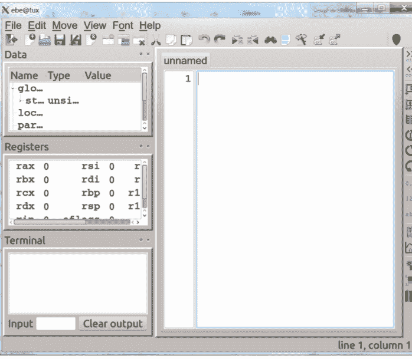

在每个停靠窗口之间都有一个“调整条”，可以通过左键单击来调整分配给停靠窗口的区域划分。在停靠窗口和源窗口之间也有一个调整条，可用于调整停靠窗口的宽度。

每个停靠窗口的顶部都有一个“标题栏”。每个标题栏右侧有两个微型图标，可使窗口变为独立或让窗口消失。你也可以右键点击标题栏来弹出菜单，允许你选择哪些停靠窗口和工具栏是可见的。可见性也可以通过 `View` 菜单进行控制。

你可以左键点击停靠标题栏并拖动它。你可以将其拖出 `ebe` 使其独立，或者拖到停靠区域不同的垂直位置。你会注意到停靠区域中有一个灰色区域，当你松开左键时窗口将落入此处。你可以将停靠窗口拖到 `ebe` 的右侧或底部，以使用两个停靠区域。最后，你可以将一个停靠窗口拖到另一个窗口上方，创建一个标签停靠窗口集。你可能希望能够方便地在数据、寄存器和浮点寄存器窗口之间切换。在下方我们看到一个底部有 3 个对应标签的停靠窗口。

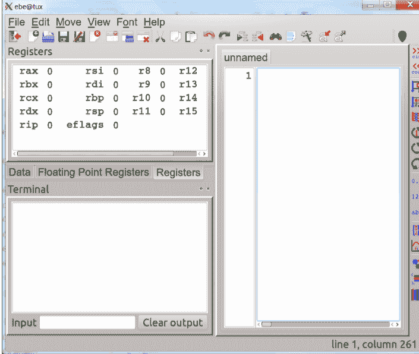


### 编辑

### 导航

## 切切、复制和粘贴

### 撤销/重做

### 查找和替换

### 删除文本

### 使用制表键

### 自动缩进

### 格式化

通过编辑 `.ebe.ini` 或使用“编辑”菜单下的“编辑设置”选项将程序替换为另一个程序。

### 缩进/取消缩进

在标记一组行后，你可以使用 `Control->` 每次缩进一个制表符距离，这类似于 C 语言的右移运算符 (`>>`)。你可以使用 `Control<` 将文本左移（取消缩进）。菜单中也有缩进/取消缩进的选项，以及编辑工具栏的图标。

### 注释/取消注释

`Control-K` 会对当前行进行注释，如果选定了某些文本范围。`Control-U` 会取消当前行或选定范围的注释。`Ebe` 将使用相应语言的注释语法。

### 单词/数字补全

`Ebe` 会跟踪单词和数字，以简化长单词的输入/重新输入。它从一组关键词开始，并在你编辑时添加单词和数字。当你输入某些文本时，`ebe` 会在你编辑的位置右侧弹出一个单词列表。只需选择所需的单词（或数字）并按“Enter”键接受建议的补全，或输入额外的字符以缩小选择范围。

### 编辑多个文件

在 `ebe` 中可以同时打开多个文件。你可以使用“文件”菜单多次打开，或者可能可以使用一个由多个文件组成的项目。各种文件将以 `ebe` 源码子窗口中标签页的形式访问。

如果你没有使用项目，`ebe` 将仅对打开的当前选中文件进行编译或汇编。这在你正在处理几个相似的项目，或者你想为你的程序访问准备一个文件时可能很有用。如果你正在使用项目，那么 `ebe` 将使用项目中的源文件构建程序。再次强调，可以将数据文件作为项目的一部分。

### 调试

调试工具栏如下所示。有 4 个图标或按钮用于控制调试。每当你点击“Run”（运行）按钮时，程序都会保存你的源代码，运行编译器和/或汇编器并在调试器中启动运行你的程序。你可能想在点击之前设置一个断点。点击源代码行左侧的你希望程序停止并检查项目的地方来运行（断点）。然后你可以点击 `Next`（下一步）/`Step`（单步）来逐行执行你的程序。使用 `Next` 留在同一个函数或子程序中。如果你想在函数或子程序内部调试，请使用 `Step`。你可以使用 `Continue`（继续）跳过一组语句，它将执行到到达下一个断点。`Stop`（停止）按钮将结束调试过程。


### 断点

断点是源代码中的一个点，当调试器运行你的程序时会导致程序停止。如果你在代码的第 10 行设置了断点，当你点击 `Run` 按钮时，调试器将执行到第 10 行之前行。在你使用 `Next`、`Step` 或 `Continue` 按钮采取其他操作之前，第 10 行将不会执行。

每一行源代码在源码左侧的数字列中都有行号。在源码窗口中，通过对断点行号使用红色背景来视觉识别断点。

你可以通过左键点击行号来设置或清除断点。第一次点击设置断点，第二次点击将其清除。右键点击将弹出一个菜单，允许管理断点，包括删除所有断点的选项。

### 运行程序

第一步在你希望程序停止的行上设置断点。左键点击行号，你会看到该行的行号变为亮红色背景。如果行错了再次点击即可。

在设置一个或多个断点后，你需要点击 `Run` 按钮。此按钮将保存你的源代码文件，为你的代码运行相应的编译器，然后在编译后的程序上启动 `pdb` 调试器。当程序到达带有断点的行时，它将停止并使用淡蓝绿色背景高亮该行。高亮的行将是下一行执行的内容。

### 终端窗口

终端窗口是支持终端输入输出的停靠窗口之一。它不包含真实的终端模拟器。相反，所有输入都是使用文本输入框完成的，显示的文本由程序打印加上回显的输入使其看起来正常。下面的图片显示了正在测试的程序的终端窗口。

| 终端 | |
|---|---|
| 输入多项式的次数: 3 | |
| 输入 p 的 4 个数字: | |
| 输入 1 2 3 4 | 清除输出 |

在之前的会话中已完成了一个输入操作，另一个正在进行。第一个输入 3 是在按 Enter 键输入到输入框中的，3 在终端窗口中回显了。下一次输入正在进行中。四个数字已输入到输入框中，但尚未按下 Enter 键来完成输入。

你可以在输入框中使用 `Control-D` 或 `Control-Z` 向程序发送文件结束（EOF）指示。然而，这只有在执行输入操作之前信号了 EOF 时才起作用。这是不正常的，但如果你在单步执行，它是可以的。那么在执行 `scanf` 调用（或其他形式的读取）之前输入 `Control-D`。

### 下一步与执行

`Next` 和 `Step` 按钮都会逐行执行你的代码。区别在于 `Next` 会留在当前函数或子程序中，而如果当前高亮行上调用了函数，`Step` 将进入该函数。你通常只想使用 `Step` 来编辑所需数据项的格式和大小。

### 继续

`Continue` 按钮将恢复执行，直到到达下一个断点。

### 数据窗口

数据窗口显示程序中的变量。对于高级语言，这包括全局变量、局部变量。下面是数据窗口的图片。

| 名称 | 类型 | 数值 |
|---|---|---|
| globals | unsni | 0x00007ffff30000000000000 |
| locals | | |
| parameters | | |
| user-defined | | |
| a | long | 160 |
| b | long | 310 |
| sum | long | 480 |

### 定义变量

你可以使用编辑器中的变量名称或变量地址来定义变量。用户定义的变量在每次从调试返回时都会显示。

要按名称定义变量，你可以先标记变量，然后右键点击弹出定义变量的对话框。在此对话框中，你可以编辑所需数据项的格式和大小。第一个和最后一个值用作定义变量数组索引。如果不是数组，保留数组复选框。如果是，勾选数组复选框并设置索引。记住第一个索引是 0。

你会注意到名称与地址对齐，这使用了 C 地址。你可以从 `char`、`signed char`、`short`、`unsigned char`、`int`、`unsigned int`、`unsigned long`、`float`、`double` 和 `bool` 中选择类型。根据类型可以选择格式。对于整数类型，可以选择进制、十六进制或二进制。对于浮点类型，可以选择普通的浮点显示或一组可以显示浮点字段的漂亮格式。这对于理解计算机如何存储浮点值非常有帮助。

要按地址定义变量，你可以标记寄存器窗口中数值字段的地址（左键点击有效），然后右键点击弹出对话框，使用所选地址定义变量。

你可以对数据窗口中的变量点击右键来编辑或删除变量。编辑选项将弹出相同的创建变量对话框，并允许选择相同的类型和格式。

对于数组（或 C 或 C++ 中的结构体），将是 `">"` 

### 寄存器窗口

寄存器窗口实时显示 16 个通用寄存器、指令指针和 CPU 标志位。以下是一个示例：

| | | | | | |
|---|---|---|---|---|---|
| rax | 480 | rsi | 07ffffeb38 | r8 | 0x400cca |
| rbx | 0x0 | rdi | 0x1 | r9 | 0x0 |
| rcx | 0xffffffff | rbp | 0xfffffea50 | r10 | 0x1 |
| rdx | 0xfffffeb48 | rsp | 0xfffffea40 | r11 | 0x246 |
| rip | 0x400c33 | eflags | IF | | |

寄存器 `r12-r15` 已被省略了，因为其余寄存器可以使用较大的字符来显示。你可以通过右键点击寄存器名称来更改（`rip` 以外的）寄存器的格式。这将弹出一个表单，允许你为该寄存器或所有寄存器选择十进制或十六进制。当前设置的标志位会被显示。在示例中，中断标志位已设置。当 IF 位被设置且存在软件无法控制的非掩屏蔽中断时，某些中断可以被忽略。

### 浮点寄存器窗口

浮点寄存器显示在一个独立的可以停靠窗口中。以下是一个示例：

| | | | |
|---|---|---|---||
| xmm0 | 3.25 | xmm8 | 0 |
| xmm1 | 10.53 | xmm9 | 0 |
| xmm2 | 13.78 | xmm10 | 0 |
| xmm3 | 0 | xmm11 | 0 |
| xmm4 | 2.34181e-38 | xmm12 | 0 |
| xmm5 | 0 | xmm13 | 0 |
| xmm6 | 0 | xmm14 | 0 |
| xmm7 | 0 | xmm15 | 0 |

浮点寄存器可用于存储浮点数、双精度浮点数、紧包浮点数、紧包双精度以及各种尺寸的紧包整数。使用 AVX 指令可以将每个寄存器中紧包浮点数或双精数的数量翻倍。因此，选择浮点寄存器的格式至关重要。右键点击寄存器或其内容将弹出菜单，用于选择单个寄存器或所有寄存器的格式化。然后你可以从寄存器的所有可能的解释中进行选择。

### 项目

`exe` 程序通常使用项目文件进行管理，以跟踪程序中的源代码文件。项目的名称是程序名加上 `".ebe"` 后缀。因此，若要构建一个名为 `"hello"` 的程序，你需要使用一个名为 `"hello.ebe"` 的项目文件。

对于由单个源代码文件组成的程序，没有必要使用项目文件。`exe` 开始执行时没有已知的项目名称（如果未在命令行中提供）。只要没有已知的项目名称，假设只有 1 个源文件。创建或打开项目将改变状态，使 `exe` 感知到存在项目文件。从该点开始，`exe` 将使用项目文件跟踪文件。

### 查看项目窗口

你可能需要勾选“视图”（View）菜单中的“项目”（Project）复选框来显示项目窗口。项目窗口是几个可选窗口之一，初始位于源代码窗口的左侧。你可以看到下方有一个空窗口。你可以通过左键点击项目窗口的标题栏并拖动，直到它移出 `exe` 的主窗口，使其成为一个“浮动”窗口。

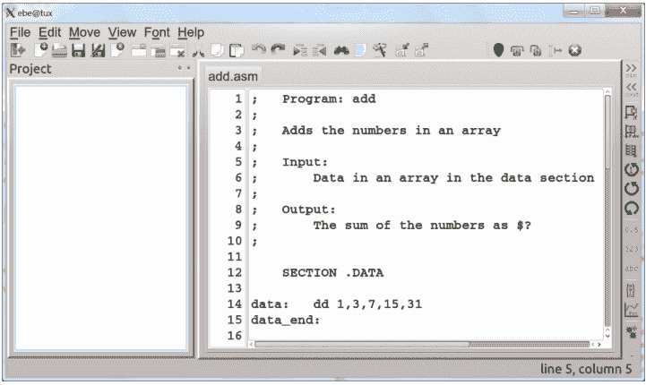

对项目窗口右键点击允许从项目中添加或删除文件。

### 创建新项目

你可以使用“文件”（File）菜单下的“新建项目”（New project）创建一个新项目。此选项允许你导航到一个新目录并指定新项目文件名。创建项目文件后，任何打开的源将被关闭，项目将为空。对项目的任何更改将自动写入，因此不需要保存项目文件。

### 打开项目

你可以使用“文件”（File）菜单下的“打开项目”（Open project）打开现有项目。此选项允许你导航到一个目录并打开带有 `exe` 扩展名的文件。打开项目文件后，任何打开的源将被关闭，第一个文件将在编辑器中打开。

### 向项目添加文件

在项目窗口中右键点击将弹出一个菜单，允许你从项目中移除文件、在 `exe` 编辑器中打开选择的文件或向项目添加文件。项目简单是一个文件名的集合，因此可以使用文本编辑器编辑项目文件。

### 关闭项目

如果你关闭活动项目，`exe` 将返回默认模式。这将关闭所有打开的文件。

### 玩具箱

`exe` 玩具箱（toy box）是一个可以停靠的子窗口，允许在 C/C++ 或 Fortran 中实验表达式。基本思想是将变量定义放在一个表中，表达式放在第二个表中。变量定义包括名称、类型和值。名称和值必须输入。第二个表的第一列是表达式。在输入表达式后，点击右侧的“执行”（do it）按钮，`exe` 在所选语言中编译并执行它。从程序的输出可以确定表达式的类型及其值添加到表中。然后你可以选择各种格式。对于整数类型，可以选择十进制或二进制。对于浮点类型，可以选择十进制、二进制、浮点或字段。在下方的玩具箱中，我包含了一些表达式，有助于理解浮点到整数的转换以及浮点格式。

### 玩具箱 C

| 变量名 | 值 |
|---|---|
| a | int | - 1 |
| b | int | - 2 |
| c | int | - 4 |
| d | float | - 5 |
| e | int | |

| 表达式 | 执行 | 类型 | 结果 |
|---|---|---|---|
| (a+b)/3 | do it | int | 2 |
| (a+b)/3 | do it | double | 2.33333333333333 |
| d/3 | do it | float | fp | 1.10101010101010101010 |
| d/3 | do it | float | fields | 0.0111111110101010101010 |
| d/3 | do it | float | hexadecimal | 3f d5 55 |

# 位桶

位桶（Bit bucket）是一个低级工具。它主要面向汇编学生。它允许你实验各种计算机操作。它允许你观察与、或、加或乘法等二进制操作是如何工作的。它展示了将小数转换为二进制或十六进制的步骤。它说明了如何将像 625 这样的浮点数转换为其内部表示形式。以下是一个演示乘法的示例。

| 输入 | 运算符 | 位 | 注释 |
|---|---|---|---|
| 19 | | 00000000000000010001 | a &ffff 复制到第 3 列 |
| 27 | | 00000000000000010001 | b ^ffff 复制到第 3 列 |
| 3 | | 00000000000000010001 | << 4 |
| 4 | | 00000000000000010000 | |
| 5 | | 000000000000000100111001 | 积 |

你可以看到位桶中有 5 个选项卡。我选择了整数运算。之后，我使用“操作”（Operation）右侧的下拉列表选择了“乘法”。最初有 2 个“输入”框来输入两个数字，以及第 3 行“运算符”列中的“*”。在第一次点击“*”后，它将两个数字转换为二进制第 3 列。我点击“*”并填充在第 3 行，并将“*”移动到第 4 行。经过几步后，结果出现在第 5 行。这 5 个选项卡包含了大量的插图。汇语言学生应该会发现位桶是学习计算机如何工作的极工具。

### 回溯窗口

回溯窗口显示了通过回溯遍历堆栈并检查每个被调用函数的栈帧而获得的信息。此对应的 `gdb` 命令是“backtrace”或简单的“bt”。在下面的图中，我们看到顶层栈帧中的函数是 `time`，程序停止在“testcopy.c”的第 18 行。接下来我们看到 `time` 是从第 26 行的 `test` 函数中调用的。同样显示了测试参数的值。最后我们看到 `test` 是从 `main` 的第 47 行调用的。


# Back Trace

### `time ()` at `/home/seyfarth/asm/testcopy.c:18`

```
# #1 0x00000000040dea in test (name=0x401197 "rep movsb",
copy=0x400f80 <copy_rebp>, a=0x2aaab8b6010, b=0x2aaac240010 "",
count=10 at /home/seyfarth/asm/testcopy.c:26
# #2 0x000000000400f10 in main (arc=1, arg=0x7ffffffffeb38)
at /home/seyfarth/asm/testcopy.c:47
```

### 控制台

`exe` 控制台提供了直接访问 `gdb` 的方法。它的文本窗口显示与 `gdb` 的所有通信。还有一个命令行输入框，你可以在其中发布 `gdb` 命令。按下“回车”后，它会执行该命令并在文本窗口中显示结果。我执行了“`p rip`”来打印指令指针寄存器。下一个执行的指令是 `0x400ed1`，它位于 `main` 中。

### 控制台

```
0x7fffffffeb38: 140737488350534
(gdb)
0x7ffffffff46: "home/seyfarth/asm/testcopy"
(gdb)
0x7ffffffff40: 0
(gdb)
$34 = (void (*)) 0x4000ed1 <main+50>
```

`gdb` command `p $rip`

# Ebe 设置

使用编辑（Edit）菜单下的“设置（Edit settings）会弹出一个包含许多 Ebe 可调功能的表单。这里是设置为灰色配色方案时的界面。

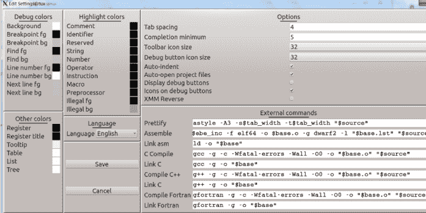

所有这些设置都以非常简单的格式存储在 `".ebe.ini"` 中，因此可以编辑设置对话框，这样更容易管理。

注意，有一个“语言（Language）”选项设置为“英语（English）”。Ebe 还可以阿拉伯语、中文、丹麦语、法语、德语、印地语、印尼语、日语、葡萄牙语、俄语和西班牙语，这些语言得到了良好的支持，但其中一些是直接使用 Google 翻译的结果。某些翻译可能非常滑稽！我希望这些都没有冒犯性。

# 附录 C

# 使用 gdb

`gdb` 调试器是自由软件基金会的的产品，其网站为 http://www.gnu.org。它支持包括 C、C++、FORTRAN 和汇编在内的多种语言。该调试器似乎最适合 C 和 C++，而调试来自 `yasm` 的代码并不理想。

`Gdb` 对 `yasm` 程序的源代码行跟踪得相当好。它的缺点（目前而言）是 `yasm` 没有为变量提供类型信息。它确实提供了变量的地址，这允许用户使用类型转换来充分检查变量，尽管这比汇编器提供完整的类型信息需要花费更多精力。

`gdb` 的一个救急功能是它的宏机制。可以创建透明执行类型转换的宏，使调试变得更简单。

更详细的文档可以在 http://sourceware.org/gdb/current/onlinedocs.gdb 找到。

## 准备 gdb

为了让 `gdb` 感知到源代码和变量，你的代码必须使用特殊选项编译，这些选项会在对象代码中添加调试符号信息。使用 `gcc` 或 `gpp` 时使用 `-g` 选项来启用调试支持。使用 `yasm` 时你使用 `-g`，但你必须指定一种调试格式，可以是 Linux 的 `dwarf2` 或 Microsoft Visual Studio 的 `cv8`。`dwarf2` 选项在 Linux 下提供了最完全的兼容性，而 `macho64` 是 OS X 的选择。

## 启动

启动 `gdb` 的典型方式是：
```
gdb program
```
其中 `program` 是程序链接时在 `-o` 选项中提供的名称。

## 退出

退出命令是 `quit`，可以简写为 `q`。如果你已经开始运行程序且程序仍在运行，`gdb` 会通知你程序仍在运行并询问你是否要杀死该进程。输入“y”来杀死进程并退出。

## 设置断点

你可以使用 `breakpoint` 命令设置断点，该命令可以简写为 `b`。你可以使用源代码中的标签或使用文件的行号来设置断点。

```
b main
b 17
```

## 运行

你使用 `run` 在 `gdb` 中开始执行程序，该命令可以简写为 `r`。如果你在运行程序途中，`gdb` 会在杀死进程并结束之前提示你确认。

如果你设置了断点，调试器将执行语句到断点处，并将控制权交回调试器。此时，你可以检查寄存器、检查内存、逐行执行代码，或执行任何 `gdb` 命令。如果你没有设置断点，程序将运行到完成或直到发生故障。这有时是学习段错误（segmentation faults）等问题的方便方法。

在调试期间，你有几种继续执行的选项。第一个选项是继续执行直到完成或到达另一个断点。这是通过 `continue` 命令完成的，该命令可以简写为 `c`。

另一种可能性是“单步”执行程序。这里有 4 种选项。首先，你可以执行一条源语句或一条机器指令。在 C/C++ 中，你可能不倾向于一次执行一条机器指令。你还可以在同一个函数内部调试，或者在调用其他函数时步入这些函数。在同一个函数中的单步执行通过 `next` 或 `nextinstruction` 完成。对于汇编代码，这两条指令的作用相同。它们可以简写为 `n` 和 `ni`。如果你使用 `next`，调试器将执行所有函数调用，而不会返回调试器，直到从函数中返回。

另一种选择是使用 `step` 或 `stepinstruction` 命令。这些命令执行一条源语句或一条机器指令，并允许在调用的函数内部调试。它们可以简写为 `s` 和 `si`。这两条命令在汇编代码中的效果相同。如果你自己写函数，你可能更倾向于使用 `step` 来调试你调用的函数。然而，你可能希望使用 `next` 来“跳过”像 `printf` 这样的函数调用。

## 打印栈帧追踪

程序在执行过程中崩溃是很常见的。以下是一个相当典型的情况。

```
seyfarth@ux:~/teaching/asm$
./testcopy
Segmentation fault
```

段错误（segmentation fault）通常是编码中的错误，你的程序试图访问它没有映射的内存。这可能是由于越过了数组边界引起的。这里是使用 `gdb` 运行的一个示例：

```
(gdb) run
Starting program: home/seyfarth/asm/testcopy
Received signal SIGSEGV, Segmentation fault.
copy_rep () at copy.asm:12
(gdb) bt
#0 copy_rep () at copy.asm:12
#1 0x0000000000405d in main (argc=value, argv=optimized) testcopy:27
```

再次获得段错误，但立即看到程序在 `copy.asm` 的第 12 行死亡。`bt` 命令（backtrace）回溯栈帧报告 `copy_rep` 是由 `test` 函数调用的。使用 `-g` 重新编译后得到了更多结果：

```
(gdb) run
Starting program: home/seyfarth/asm/testcopy
Received signal SIGSEGV, Segmentation fault.
copy_rep () at copy.asm:12
(gdb) bt
#0 copy_rep () at copy.asm:12
#1 0x0000000000405d in main (argc=value, argv=optimized) testcopy:45
```

此时，可以打印 `copy.asm` 中的变量值。我们还可以使用 `up` 命令移动栈帧到上一个函数。

```
(gdb) up
#1 0x0000000000406d8 in test (name=0x4b7d "rep movsb", copy=0x400930, a=0x7fffed210, count=100) b=0x7fff75310) testcopy:27
$1 = (unsigned char *) 0x7ffffed210 ""
```

现在正在调试 `test` 函数。`copy` 的第三个参数是 `1000000`。通常你可以从栈追踪中获得大量信息。

## 检查寄存器

你可以在 `gdb` 中使用 `info registers` 来打印寄存器。这可以简写为 `i r`：

```
(gdb) i r
rax             0x0 0
rbx             0x64 100 0x891690 894208
rcx             0x00000000
rdx             0x989680 100001407373415334
rsi             0x7ffff7ab000
rdi             0x7ffff7ca000 14073735396416
```


`rbp`             `0x7fffffe6a0` `0x7ffff6a0`

`rsp`             `0x7fffffe690` `0x7fffffe690`

`r8`               `0x64` `100`

`r9`               `0` `0`

`r10`            `0x7fffffe3f0` `14073748838418`

`r11`            `0x0206` `518`

`r12`            `0x7ffff7ed2010` `14073752920624`

`r13`             `0x4000930` `4196656`

`r14`             `0x64` `100`

`r15`             `0x03` `3`

`rip`             `0x400093f` `0x400093f` `<copy_rebp+15>`

`eflags` `0x10206`[ `PF` `IF` `RF` ]

`cs`              `0x02b` `43`

`ds`              `0x33` `51`

`es`              `0x0`

`fs`              `0x0`

`gs`              `0x0`

```
这打印了所有通用寄存器、标志寄存器、指令指针、另一个标志寄存器和 6 个段寄存器。这本书基本上忽略了段寄存器，因为它们在 64 位代码中不需要。
```

你可以使用 `info all`（或 `i a`）打印这些浮点寄存器。这会占用很多行，且未演示。

更常见的是你可能希望检查一个寄存器。你可以使用 `print $rcx` 来打印寄存器 `rcx`。你可以将 `print` 简写为 `p`。

```
(gdb) p $rcx

$1 = 0x898410
```

默认打印格式是十进制。使用 `p/x $rcx` 以十六进制打印：

```
(gdb) p/x $rcx

$2 = 0x898169
```

### 检查内存

Gdb 还有一个 `examine` 命令（简写为 `x`），可用于检查多个内存位置。你输入命令如 `x/100 &` 来打印 `x` 数组的 100 个位置。在数字后面你可以附加一个格式字母。使用 `x` 作为格式字母意味着十六进制，`c` 表示字符，`b` 表示二进制，`s` 表示字符串。`examine` 命令需要一个求值为内存的表达式。你需要取变量的地址作为命令，如 `x/100 &`。最后，你可以附加一个大小字母来改变 `examine` 解析内存的方式。遗憾的是，大小字母与你基于 yasm 的偏好不匹配。使用的字母是 `b`, `h`, `w` 和 `g` 分别代表

对于 "byte"、halfword"（2字节）、"word"（4字节）和 "giant"（8字节）。因此你可以使用 "x/10fg &data" 从双精度数组中导出数据。

## 附录 D
### 使用 scanf 和 printf

输入输出输出的方法是使用 C 库中的 `scanf` 和 `printf` 函数。这些函数可以处理几乎所有形式的文本输入和输出，并可以在点格式之间进行转换。

现代程序员可能熟悉 C++ I/O 而不熟悉 C。调用 C++ I/O 并不简单，而调用 C 函数却很简单。因此，可能需要对 C I/O 的两个基础核心工具：`scanf` 和 `printf` 进行简要介绍。这些对于学习汇编语言的 I/O 需求已经足够了。汇编语言的实际用途操作函数通常不需要 I/O。因此，本附录将坚持基础知识，以便在学习汇编编程的同时方便编写完整的程序。

### scanf

解释如何使用 `scanf` 最简单的方法是展示 C 调用，然后显示对应的汇编代码。`scanf` 调用时将格式字符串作为第一个参数。根据格式字符串的不同，可以有任意数量的额外参数。格式字符串中有一系列转换指定符。每个指定符都是一个百分比字符，后面跟着一个或多个定义要转换数据类型的字母。以下是基本的格式指定符：

| format | 数据类型 |
| --- | --- |
| `%d` | 4字节整数 (`int`) |
| `%hd` | 2字节整数 (`short`) |
| `%ld` | 8字节整数 (`long`) |
| `%f` | 4字节浮点数 (`float`) |
| `%lf` | 8字节浮点数 (`double`) |
| `%s` | 字符数组 (C 字符串) |

如果我们希望读取一个双精度浮点数后跟一个字符字符串，可以使用格式字符串 `"%lf %s"`。

`scanf` 的每个额外参数都是用于接收 `scanf` 读取并转换的数据位置的地址。这里有一个 C 调用：

```
double x;

char s[100];

n = scanf("%lf %s", &x, s);
```

`scanf` 返回转换的项数。在调用中，如果成功输入了一个数字和一个字符串，它将返回 2。字符串将放在数组 `s` 中，并在字符串末尾加上一个 0。

以下是在汇编中实现相同操作：

```
segment .data

dq      0.0

n      0

s      times   100 db 0

fmt     "%lf %s",0

segment .text

lea     rdi, [fmt]

lea     rsi, [x]

lea     rdx, [s]

xor     eax, eax ; 没有浮点参数

call    scanf

mov     [n], eax
```

可能存在一些陷阱。格式字符串末尾需要一个 0，且不能包含在双引号内。其次，没有浮点参数 -x 是一个地址参数并存储在 `rsi` 中，因此在调用之前必须将 `rax` 设置为 0。

### printf

`printf` 允许以多种格式打印。像 `scanf` 一样，它的第一个参数是格式字符串。格式字符串包含要打印的字符以及与 `scanf` 类似的转换指定符。用 `printf` 打印的数据可能存储在缓冲区中，直到打印换行符。在 C 中，换行符可以表示为字符串末尾的 `\n`。Yasm 不支持字符串中的 C 转义字符，有必要显式添加换行符 (`0x0a`) 和 0 字节。

这里是一个 C `printf` 调用

```
char name[64];

int value;

printf ("The value of %s is %dn", name, value);
```

以下是汇编中相同的 `printf` 调用

```
segment .data

value times 64 db 0

name df      0

fmt db      "The value of %s is %d",0x0a,0

segment .text

lea rdi, [fmt]

lea rsi, [name]

mov edx, [value]

xor eax, eax

call printf
```

`printf` 可以有浮点参数，所以要注意计算它们的数量并恰当地设置 `rax`。

## 附录 E
### 在 yasm 中使用宏

Yasm 同时提供了单行宏和多行宏。这二者都可以用于为常用指令提供具有意义名称的缩写。虽然在学习语言期间这些可能会掩盖汇编语言的机制，但在实际情况下它们具有重大的用途。

### 单行宏

单行宏使用 `%define` 预处理器命令。假设你厌倦了看到换行符的 `0x0a`。你可以为它定义一个宏：

```
%define newline 0x0a
```

从那以后，你只需使用 `newline`，就会插入 `0x0a` 来替换宏。

单行宏可以有参数。假设你想定义一个 while 循环宏。你可能希望将寄存器中的值与某个值比较，如果满足条件则跳转到循环顶部。这是一个可能的 while 宏：

```
%define while(cc,label) jmp+cc label
```

`%+` 允许标记的拼接。在此定义之后，我们可以使用如下代码：

```
cmp rax, 20

while(1,.more)
```

### 多行宏

使用多行宏可以跨多行。宏以 `%macro` 开始，以 `%end` 结束。宏的每一行都可以使用由 `%1`、`%2` 等指定的参数。

```
%macro while(cc,label)

    jmp %cc %label

%endmacro
```

在此定义之后，我们可以使用如下代码：

```
cmp rax, 20

while(1,.more)
```


## 附录 F
### 信息的来源

### yasm 手册

`http://www.tortall.net/projects/yasm/manual/index.html` 是 `yasm` 手册的位置。这非常详尽，是一个很好的参考。

### nasm 手册

访问 `http://www.nasm.us/doc/` 获取 `nasm` 手册。这是 `nasm` 所基于的软件，其文档与 `yasm` 手册相似。

### Stephen Morse 的 8086/8088 入门

Stephen P. Morse 是 8086 微处理器的架构师。他有一个关于 8086/8088 的入门指南：`http://www.stevemorse.org/8086/index.html`。

# 索引

- `%macro`, 200
- `multipop`, 200
- `multip`, 200
- `%rep`, 193
- `_start`, 112
- `80386`, 47
- `8086`, 47
- `add`, 52, 53, 55, 59
- 加法
- 二进制, 17
- `addpd`, 137
- `addps`, 137
- 地址, 4, 27
- 逻辑, 27, 28
- 物理的, 27, 41
- 虚拟, 40, 41
- `addsd`, 137
- `addss`, 137
- `ahr`, 88
- `align`, 136, 155
- `alignb`, 136
- 对齐数据, 136
- `and`, 75, 77, 88
- `arge`, 129
- `argv`, 129
- 数组, 120
- 地址计算, 121
- 索引, 120
- Atlas, 3
- AVX, 1, 111, 125, 134, 136, 184, 190, 208, 210
- 二进制, 11
- 转换为进制, 11
- 二进制加法, 17
- 二进制常数, 12
- 二进制乘法, 18
- 二进制数字, 4, 11
- 二进制树, 177
- 查找, 178
- 插入, 179
- `new_tree`, 178
- 节点结构体, 170
- 打印, 180
- 根结构体, 177
- 遍历, 180
- 位, 11, 74, 75
- `fli`, 77
- 编号, 11
- `setter`, 76
- 位桶, 24
- 位域, 78, 84, 88
- 提取, 78
- 插入, 78
- 位域选择器, 75
- 位域, 74
- 位操作, 74
- 位测试。*参见 bt*
- 位测试并重位。*参见 btr*
- 位测试并设置。*参见 btr*
- `break`, 96
- 断点, 32
- BSD, 1
- `bss` 段, 29, 32
- `bt`, 87
- `btr`, 84, 88
- `bts`, 84, 85, 87, 158
- 缓冲 I/O, 158
- 字节, 4
- C 流 I/O, 158
- C 包装函数, 148
- 缓存, 46, 183
- 矩阵乘法, 184
- 调用, 108
- 进位, 17
- `CF`, 67, 84, 87
- `cl`, 87
- `cld`, 103, 104
- 关闭, 151
- `cmov`, 128
- `ncmp`, 93, 96, 97, 100, 102
- `cmpsb`, 103
- 命令行参数, 108, 128, 129
- 注释, 6
- 公共子表达式消除, 185
- `continue`, 96
- 关联性, 205
- AVX, 208
- C, 205
- SSE, 206
- 计数位, 96, 192
- 汇编/and, 193
- 每次一个字节, 195
- C, 192
- `popcnt` 指令, 195
- 计数 lo, 100
- 计数循环。参见 for loop
- `CR3`, 40
- `cvtdq2ps`, 200
- `cvtp2ps`, 139
- `cvtps2pd`, 139
- `cvtds2si`, 139
- `cvtds2ss`, 139
- `cvtsi2sd`, 139
- `cvtsi2ss`, 139
- `cvss2sd`, 139
- `cvttsd2si`, 139
- `cvttss2si`, 139
- 数据段, 29...data
- `db`, 19
- `dd`, 19
- `dec`, 62, 88
- 转换为进制, 12
- 十六进制, 135
- `DF`, 102
- 方向标志, 102
- 距离在 D, 142
- `div`, 69
- `dl`, 87
- 点积, 142
- 双字, 19
- 双向链表, 169
- 队列, 169
- 插入, 170
- `newlist`, 169
- 节点结构体, 169
- 打印, 171
- 队列, 169
- 栈, 169
- 遍历, 171
- `down-while`, 96
- `do-while loop`, 98, 99
- `dq`, 19
- `dbe`, 6, 8, 48, 62
- 数组定义, 122
- 断点, 32, 55
- 数据窗口, 54
- 下一个, 110
- 寄存器窗口, 48
- 运行, 8, 33, 49
- 源窗口, 54
- 步, 49, 109, 110
- 终端窗口, 130
- `ebe.inc`, 6, 10
- 标志, 48, 84, 93
- 消除帧, 189
- 结束, 1
- 入口点, 6
- 环境, 108
- EOF, 160
- `equ`, 114, 116, 148
- 等于。参见 `equ`
- `errno`, 150
- 退出, 148
- 指数, 19, 20, 22, 23
- 字段, 19, 20, 22, 23
- `extern`, 114, 149
- `fclose`, 163
- `fget`, 160
- `getchar`, 158
- 全局, 6
- 哈希函数, 172
- 整数, 172
- 字符串, 173
- 哈希表, 171, 172
- 查找, 173
- way, 174
- 节点结构体, 173
- 打印, 175
- 遍历, 175
- 堆, 29
- 堆段, 29
- 十六进制, 4, 13, 20
- 转换为进制, 14
- 霍纳法则, 143
- 大页, 43
- `idiv`, 69
- 移位, 76
- IEEE 754, 19
- IEEE 754, 18
- `if`, 93
- IF, 48
- `if/else`, 94
- `if/else-if/else`, 95
- 立即数, 48
- `imul`, 65
- 1 个操作数, 65
- 2 个操作数, 66
- 3 个操作数, 66
- `inc`, 59, 100
- 索引, 85
- 无穷大, 19
- 内联函数, 190
- 指令, 5, 6
- `int 0x80`, 147
- `int 0x80`, 146
- 整数, 58
- 最大值, 15
- 最小值, 15
- 有符号, 15, 16
- 无符号的, 15
- 交换循环, 188
- 中断允许标志。参见 IF
- `ja`, 140
- `jae`, 93, 140
- `jb`, 93, 140
- `jbe`, 140
- `jc`, 93
- `je`, 93, 100, 102
- `jg`, 93, `jnge`, 93, 94, 97
- `jl`, 93
- `jle`, 93
- `jmp`, 91, 92, 100
- `rip` 相对, 91
- `jnae`, 93, `jnb`, 93, `jnc`, 93
- `ne`, 93
- `njng`, 93
- `ince`, 93
- `jnl`, 93, 94, 96
- `nle`, 93
- `jnz`, 93, 101, 102
- 跳跃。参见 `jmp`
- 条件的, 93
- `jz`, 93, 103
- 内核模式, 146
- 标签, 6
- 大页, 43
- `lld`, 114
- `lea`, 112
- 函数, 113, 128
- 最低位, 11
- 最低位字节, 20
- `leave`, 59, 113
- 链表, 165
- 插入, 166
- `newlist`, 166
- 节点结构体, 166
- 打印, 167
- 遍历, 167
- Linux, 2, 6, 7, 27, 41, 44, 51, 103, 111, 112, 146, 147, 148, 149, 234
- 本地标签, 126
- 本地标签, 92
- 本地变量, 115, 126
- `ldobs`, 102
- 逻辑地址, 27, 28
- 循环, 101
- 循环底部, 186
- 循环不变, 189
- `lseek`, 151
- 机器语言, 5
- `main`, 6, 108, 112
- `malloc`, 29, 125, 126, 178
- 映射寄存器, 28
- 掩码, 75, 76, 77
- 数学函数, 140
- `maxpd`, 141
- `maxps`, 141
- `maxsd`, 141
- `maxss`, 141
- `memcmp`, 103
- 内存, 27
- 页, 5, 27
- 保护, 28
- 内存延迟, 46
- 内存引用, 128
- 合并循环, 188
- Microsoft x64 调用约定, 111
- `minpd`, 141
- `minps`, 141
- `minds`, 141
- `minss`, 141
- 最高位, 11
- `mov`, 48, 49, 54
- 从内存移动, 51
- 到寄存器, 48
- 扩展。参见 `movsx`
- 从内存移动, 54
- `movaps`, 136
- `movd`, 200
- `movqa`, 200
- `movsb`, 136
- `movss`, 136
- `movsx`, 53
- `movxd`, 53
- `movupd`, 136
- `movzx`, 53, 103
- 乘法, 18
- `neg`, 58
- 负, 20
- 负无穷大, 19
- 节字节, 5, 14, 22
- `not`, 74, 75
- `NULL`, 11, 165
- `OF`, 59, 62, 67
- `open`, 149, 150
- `or`, 76, 89
- OS X, 1, 2, 6, 27, 41, 44, 51
- 封包数据, 136
- `paddw`, 200
- 页, 5
- 错误, 28
- 大, 43
- 内核, 27
- 大, 43
- 用户, 27
- 页表, 42
- 页目录指针, 42
- 页目录表, 42
- 页表, 42
- 回文, 106
- 奇偶性标志。*参见 PF*
- `perror`, 150
- `PF`, 48
- 物理地址, 27, 41, 43
- 流线化, 46
- `PML4`, 40, 41
- `pmwull`, 200
- 多项式求值, 143
- `pop`, 108
- `popcent`, 195
- 正无穷大, 19
- `printf`, 107, 112, 114, 127
- 伪操作, 6
- `psrdq`, 200
- `psubw`, 200
- `pnhckchhb`, 200
- `punckhwd`, 200
- `puncklbw`, 200
- `puncklwd`, 200
- `push`, 107
- `pxor`, 199
- 勾股定理, 67
- 勾股定理, 106
- QNaN, 140
- 双字, 19
- 商, 69
- 随机, 150, 158
- 递归, 115
- 寄存器, 3, 46, 47
- `ah`, 47
- `al`, 47, 53, 101, 102
- `ax`, 47, 53, 101
- `bh`, 47
- `bl`, 47
- `bp`, 47
- `bx`, 47
- `ch`, 47
- `cl`, 47, 78
- `cx`, 47
- `dh`, 47
- `di`, 47
- `dl`, 47
- `eax`, 7, 49, 50, 51, 53, 101
- `ebp`, 47, 113, 114
- `ex`, 47
- `ecx`, 47, 101, 102, 103
- `edi`, 47, 101, 102, 103
- `rdx`, 47, 101, 102, 103
- `rsi`, 47, 51, 108, 109, 110
- `esp`, 47, 107, 108, 113, 117
- `ST0`, 1, 134
- `xmm0`, 111
- `xmm0-ymm15`, 134
- `ymm0-ymm15`, 135
- 余数, 69
- `rep`, 101, 102
- `repne`, 103
- `resb`, 32
- `rsd`, 32
- `ret`, 109
- 返回地址, 108
- `rip`, 30, 51, 48, 51, 108, 109, 110
- `rip` 相对, 48
- `rol`, 82
- 左移。*参见 sar*
- 右移。*参见 ror*
- 舍入, 141
- 舍入模式, 141
- `pndps`, 141
- `oundd`, 141
- `sal`, 78
- `sar`, 78
- `scanf`, 107, 112
- `scabs`, 103
- 节。参见 scas*
- 扇, 158
- `.bss`, 29, 32
- `.data`, 29
- `.text`, 28
- 数据, 19
- `text`, 6
- 段错误, 28
- `set`, 75, 84, 85
- 补码, 76
- 差异, 76
- 交集, 76
- `setc`, 84
- `SF`, 55, 58, 59, 62, 71
- 移位, 77, 78
- 左, 78
- 右, 78
- 左移。*参见 sar*
- 右移。*参见 shr*
- 左移。*参见 shl*
- 右移。*参见 shr*
- `shl`, 72, 88, 89
- `shr`, 78, 88, 89
- 符号位, 15, 20, 21, 22, 78
- 符号标志。*参见 SF*
- 有符号, 15, 16
- 整数, 15, 16
- SIMD, 134
- sNa, 140
- Sobel, 198
- C, 198
- SSE, 199
- 特殊指令, 190
- 分割循环, 188
- `sqrtpd`, 141
- `sqrtps`, 141
- `sqrtd`, 141
- `sqrts`, 141
- `ssf`, 161
- SSE, 1, 134
- 栈, 29, 35, 107, 108, 110, 111, 113, 115, 245
- 随机化, 107
- 大小, 29
- 栈帧, 59, 113
- 栈段, 29
- 开始, 6
- 状态, 100
- `std`, 104
- `stdin`, 107
- `stosb`, 102
- `stosd`, 102
- `stremp`, 103
- 强度还原, 185
- `strlen`, 103
- 结构体, 154, 155, 153
- 数组, 155
- 加法, 55, 62
- `subpd`, 137
- `subps`, 137
- `subsd`, 137
- `subss`, 137
- `switch`
- 使用 `jmp`, 92
- 系统调用, 147, 148
- 32位 Linux, 146
- 64位 Linux, 147
- 64位 OS X, 147
- System V ABI, 111
- 段, 28
- TLB, 43
- 翻译旁路缓冲区, 43
- 补数补码, 15, 16
- `ucomisd`, 140
- `uucomiss`, 140
- `ulimit`, 29
- `ungetc`, 160
- 展开循环, 186
- 无符号, 15
- 无符号整数, 15
- `vaddpd`, 137
- `vaddps`, 137
- 虚拟地址, 41
- `vmmupd`, 136
- `vmoups`, 136
- `vsubpd`, 137
- `vsubps`, 137
- `while` 循环, 96, 97, 100, 111
- Windows, 1, 2, 44, 111, 112, 114
- 字, 19
- `write`, 148, 150
- `x86-64`, 47
- `xor`, 62, 77
- `yasm`, 6, 19, 114
