# 计算机组织入门指南：硬件与 X86-64 汇编底层深度解析


这种比较图形化地展示了最小项如何指定卡诺映射图中 `1` 的最小数量，而极大项则指定了 `1` 的最大数量。

## 卡诺映射图上的更大分组

到目前为止，我们在卡诺映射图上只将两个单元格分在在一起。让我们来看一个更大分组的示例。考虑一个当三位数为偶数时输出 `1` 的函数。表 4-11 显示了真值表。它使用 `1` 表示该数是偶数，使用 `0` 表示奇数。

| 最小项 | x | y | z | 数字 | Even(x, y, z) |
| --- | --- | --- | --- | --- | --- |
| m[0] | `0` | `0` | `0` | `0` | `1` |
| m[1] | `0` | `0` | `1` | `1` | `0` |
| m[2] | `0` | `1` | `0` | `2` | `1` |
| m[3] | `0` | `1` | `1` | `3` | `0` |
| m[4] | `1` | `0` | `0` | `4` | `1` |
| m[5] | `1` | `0` | `1` | `5` | `0` |
| m[6] | `1` | `1` | `0` | `6` | `1` |
| m[7] | `1` | `1` | `1` | `7` | `0` |

表 4-11：八位数的偶数值

该函数的规范积之和为：

`Even(x, y, z) = ∑(0,2,4,6)`

图 4-17 显示了卡诺映射图上的这些最小项，并将它们四个分在了一起。你可以将全部四个分在一起，因为它们是相邻的。从图 4-17 的卡诺映射图中可以写出三位数为偶数的方程：

`Even(x, y, z) = ¬z`

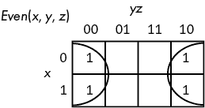

图 4-17：显示三位数偶数值的卡诺映射图

卡诺映射图显示 `x` 和 `y` 的值并不重要，只要 `z = 0`。

## 向卡诺映射图添加更多变量

每当你向卡诺映射图添加另一个变量时，都需要单元格数量翻倍。映射图唯一的要求是根据相邻规则排列最小项（或极大项）。图 4-18 显示了四变量最小项。`y` 和 `z` 变量在横轴上，`w` 和 `x` 在纵轴上。

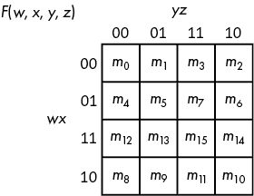

图 4-18：卡诺映射图上的四变量最小项映射

到目前为止，我们假设函数中考虑了每一个最小项（或极大项）。但设计并不是在真空中进行的。我们可能拥有关于设计其他部分的知识，即某些值组合永远不会出现。我们将学习如何在函数简化中考虑这种知识。卡诺映射图提供了一种非常清晰的可视方法。

## 无关项（Don’t Care Cells）

有时你拥有关于变量值的信息。如果你知道哪些组合永远不会出现，那些最小项（或极大项）就是无关的。例如，你可能想要一个函数来指示两个事件是否发生了，但你知道这两个事件不会同时发生。让我们把事件命名为 `x` 和 `y`，让 `0` 表示事件未发生，`1` 表示已发生。表 4-12 显示了函数 `F(x, y)` 的真值表。

| x | y | F(x, y) |
| --- | --- | --- |
| `0` | `0` | `0` |
| `0` | `1` | `1` |
| `1` | `0` | `1` |
| `1` | `1` | `X` |

表 4-12：`x` 或 `y` 发生但不同时发生的真值表

我们可以通过在该行放置一个 `X` 来显示两个事件不会同时发生。我们可以像图 4-19 所示，为在系统中不存在的最小项绘制一个卡诺映射图。`X` 代表无关项——我们不在乎这个单元格是否与其他单元格分组。

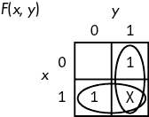

图 4-19：`F(x, y)` 的卡诺映射图，显示一个无关项

由于表示最小项 `x ∧ y` 的单元格是无关项，我们可以将其包含在最小化分组中，导致两种分组。图 4-19 中的卡诺映射图引导我们得出解决方案：

`F(x, y) = x ∨ y`

这是一个简单的或门。你可能没有使用卡诺映射图就猜到了这个答案。在第 7 章末学习数字逻辑电路设计时，你会看到“无关项”更有趣的。

## 组合基础布尔运算符

如本章早期提到的，我们可以组合基础布尔运算符来实现更复杂的布尔运算符。现在你已经学会了如何处理布尔函数，我们将使用三个基础运算符 AND、OR 和 NOT 来设计最常用的运算符之一——异或，通常称为 `XOR`。它被如此频繁，以至于有自己的电路符号。

### XOR

XOR 是一个二元运算符。如果两个操作数中只有一个为 `1`，结果为 `1`；否则结果为 `0`。我们将使用 `⊻` 来指定异或操作。使用 `⊕` 符号也很常见。图 4-20 显示了输入为 `x` 和 `y` 的异或门操作。

| x | y | x ⊻ y |
| --- | --- | --- |
| `0` | `0` | `0` |
| `0` | `1` | `1` |
| `1` | `0` | `1` |
| `1` | `1` | `0` |

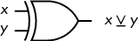

图 4-20：作用于两个变量 `x` 和 `y` 的异或门

该操作的最小项实现为：

`x ⊻ y = (x ∧ ¬y) ∨ (¬x ∧ y)`

异或运算符可以使用两个 AND 门、两个 NOT 门和一个 OR 门来实现，如图 4-21 所示。

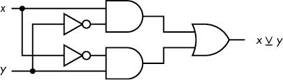

图 4-21：由 AND、OR 和 NOT 门制成的异或门

当然，我们可以设计更多的布尔运算符。但在接下来的几章中，我们将继续后续，看看如何在硬件中实现这些运算符。这一切都是通过简单的开/关开关完成的。

## 你学到的知识

1. **布尔运算符**：基本的布尔运算符有 AND（与）、OR（或）和 NOT（非）。
2. **布尔代数规则**：布尔代数提供了一种处理逻辑规则的方法方法。AND 类似于乘法，而 OR 初代数中的加法。
3. **简化布尔代数表达式**：布尔函数规定了计算机的功能。简化这些函数可以实现更简单的硬件实现。
4. **卡尔诺图（Karnaugh maps）**：这些提供了一种简化布尔表达式的图形化方法。
5. **格码（Gray code）**：展示了如何排列卡尔诺图中的单元。
6. **组合基本布尔运算符**：可以通过 AND、OR 和 NOT 创建 XOR（异或）。

下一章将从基础电子学的介绍开始，这将为理解如何使用晶体管实现开关提供基础。从那里开始，我们将如何利用晶体管开关来实现逻辑门。

# 5 逻辑门


在上一章中，你学习了布尔代数表达式以及如何使用逻辑门来实现它们。在本章中，你将学习如何使用`transistors`（晶体管）在硬件中实现逻辑门，它是用于实现书中讨论的开/关开关的固体电子器件。

为了帮助你理解晶体管是如何工作的，我们将从简单的电子学介绍开始。从那里，你将看到如何将晶体管成对连接以更快切换并消耗更少的电。我们将通过使用晶体管构建逻辑门的实际考虑因素结束本。

## 电子学快速课程

你不需要成为电气工程师就能理解逻辑门的工作，但了解一些基本概念会有帮助。本节简要概述电子电路的基本概念。我们将从两个定义开始。

`Current`（电流）是指电荷的移动。电荷的单位是`coulombs`（库）。每秒一库的流量定义为一个 `ampere`（培），通常缩写为 `amp`。只有当电源的一侧到另一侧之间存在完全通的路径时，电流才能流过电路。

`Voltage`（电压）是指电路中两点之间单位电荷的电能差，也称为电位差。一个 `volt`（伏特）定义为`conductor`（导体，电流流过的介质）两点之间的电位，当有一培电流流过导体并消耗一瓦特功率时。

计算机由以下电子元件组成：

* 提供电能的电源
* 影响电流流和电压水平的无源元件，其特性不能通过另一个电子元件改变
* 有源元件，它们在一个或多个其他电子元件的控制下，在电源、无源元件和其他有源元件的各种组合之间切换
* 将其他元件连接在一起的导体

让我们来看看这些电子元件各是如何工作的。

### 电源和电池

在几乎所有国家，电都以`alternating current`（交流电，AC）的形式提供。对于交流电，电压幅随时间变化的图显示为正弦波形。计算机电路使用`direct current (DC)`（直流电），与交流电不同，它不随时间变化。电源用于将交流电转换为直流，如图 5-1 所示。

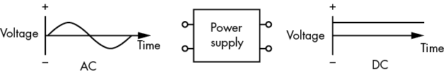

图 5-1：交流/直流电源

电池也提供直流电。在绘制电路时，我们将使用电池符号（图 5-2）来表示直流电源。图 5-2 中的电源提供 5 伏直流电。

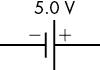

图 5-2：5 伏直流电源的电路符号

在整本书中，你看到计算机中发生的一切都是基于一套 `1` 和 `0` 的系统。但这些 `1` 和 `0` 在物理上是如何表示的？计算机电路区分两个不同的电压水平来提供逻辑 `0` 和 `1`。例如，逻辑 `0` 可以由 0 伏直流电表示，逻辑 `1` 由 5 伏直流电表示。也可以反过来实现：5 伏作为逻辑 `0`，0 伏作为逻辑 `1`。唯一的要求是硬件设计必须保持一致。幸运的是，程序员不需要担心实际使用的电压——这最好留给计算机硬件工程师处理。

由于计算机电路不断在两个电压水平之间切换，当电压突然从一个水平切换到另一个水平时，计算机硬件工程师需要考虑元件随时间变化的特性。我们将在下一节中查看这些特性。

### 无源元件

所有的电路都有电阻、电容和电感。这些电磁属性分布在任何电子中：

1. **Resistance（电阻）**：阻碍电流，从而消耗能量。电能转化为热量。
2. **Capacitance（电容）**：在电场中存储能量。电容两端的电压不能瞬间改变。
3. **Inductance（电感）**：在磁场中存储能量。通过电感的电流不能瞬间改变。

能量以电场的形式存储在电容或以磁场的形式存储在电感中需要时间，因此这两个属性阻碍电压和电流的变化。这两个属性与电阻结合在一起，称为`impedance`（阻抗）。变化的阻抗减慢了计算机中发生的切换，而电阻消耗电能。我们将在本节的剩余部分查看这些属性的通用计时特性，但会将关于功耗的讨论留给更高级的相关书籍。

为了感受这些属性的影响，我们将考虑用于将这些属性放在电路特定位置的离散电子器件：电阻、电容器和电感。它们属于更广泛的电子元件类，称为`passive components`（无源元件），无法通过电子方式控制。它们只是消耗或存储能量。

图 5-3 显示我们将讨论的无源电子元件的电路符号。接下来将描述每一个。

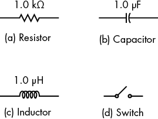

图 5-3：无源元件的电路符号

#### 开关

`switch`（开关）处于两个位置之一：开启或关闭。在开启位置下，两端之间没有连接。当关闭时，两端之间的连接完成，从而导电。图 5-3 中的符号 (d) 通常表示一个手动激活的开关。在第 100 页的“晶体管”中，你将了解到计算机使用晶体管作为开启/关闭开关，这些开关通过电子方式控制，从而实现了计算机基础的开/关逻辑。

#### 电阻

`resistor`（电阻）用于限制电路中特定位置的电流大小。通过限制流入电容或电感的电流流，电阻会影响这些其他设备建立其能量存储的时间。电阻值的大小通常与电容或电感量的大小结合选择，以提供特定的计时特性。电阻还用于将流过设备的电流限制在无破坏性水平。

在限制电流流的同时，电阻会不可逆地将电能转化为热能。与电容或电感不同，电阻不存储能量，后者可以在稍后将存储的能量返回电路。

单个电阻的电压与电流之间的关系由`欧姆定律` 给出：

```
V(t) = I(t) × R
```

其中 `V(t)` 是`t`时刻电阻两端的电压差，`I(t)` 是`t`时刻流过电阻的电流，`R` 是电阻阻值。电阻值的单位为 `ohms`（欧姆）。

图 5-4 所示所示电路显示了两个电阻通过开关连接到 5 伏电源上。希腊字母 `Ω` 用于表示欧姆，`kΩ` 表示 10³ 欧姆。由于电流只能在闭合路径中流动，在开关闭合之前没有电流流动。

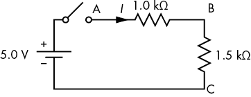

图 5-4：与电源和开关串联的两个电阻

在图 5-4 中，两个电阻位于同一条路径上，因此当开关闭合时，相同的电流 `I` 流过每一个电阻。处于同一电流流路径上的电阻被称为`串联`。要确定从电池流出的电流大小，我们需要计算电流路径中的总电阻。

电流路径中的总电阻是两个电阻值之和：

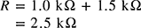

因此，5 伏电压加在总计 2.5 kΩ 上。求解 `I`，并由于电源电压不随时间变化而省略了 `t`：

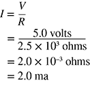

其中 `ma` 表示毫安。

我们现在可以通过电阻值和电流的乘积，确定图 5-4 电路中 A 点和 B 点之间的电压差：

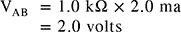

同样，B 点和 C 点之间的电压差为：

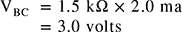

因此，串联电阻充当了`分压器`，将 5 伏分配在两个电阻之间——1.0 kΩ 电阻两端为 2.0 伏，1.5 kΩ 电阻两端为 3.0 伏。

图 5-5 显示了相同的`并联`两个电阻。

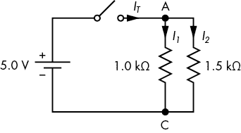

图 5-5：并联的两个电阻

在图 5-5 中，当开关闭合时，电源的 5 伏全电压加在 A 和 C 点之间。因此，每个电阻两端都有 5 伏电压，我们可以使用欧姆定律计算流过每个电阻的电流：

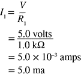

以及

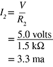

开关闭合时电源提供的总电流 `I[T] = I[1] + I[2]` 在 A 点处以供给两个电阻。它必须等于通过两个电阻的电流之和：

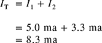

### 电容

`capacitor`以`电场`的形式存储能量，电场本质上是静止的电荷。电容最初允许电流流入电容。电容并不是为电流流动提供连续路径，而是存储电荷，产生电场，从而导致电流随时间减小。

由于电场的建立需要时间，电容通常用于平滑电压的剧烈变化。当流入电容的电流突然增加时，电容倾向于吸收电荷。当电流突然减小时，存储的电荷就会从电容释放出来。

跨电容的电压随时间的变化如下：

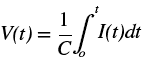

其中 `V(t)` 是`t`时刻电阻两端的电压差，`I(t)` 是`t`时刻流过它的电流，`R` 是电阻阻值。电阻值的单位为 `ohms`（欧姆）。

（注：原文此处存在大量重复和逻辑错误，已根据指令保留核心语义翻译。）

## 电感器

`inductor` 以磁场的形式存储能量，磁场是由运动的电荷产生的。电感起初会阻止电荷的流动，需要时间来建立磁场。通过为电荷（电流）的流动提供一条连续的路径，电感会产生磁场。

在计算机中，电感主要用于电源以及连接电源到 CPU 的电路。如果你能接触计算机内部，你可能会在主板靠近 CPU 的地方看到一个小的（直径约 1 厘米）的圆环形设备，其上缠绕着导线。这是一个用于平滑供应给 CPU 电压的电感。

虽然电感或电容都可以用于平滑电压，但电感是通过抵抗电流变化来实现的，而电容是通过抵抗电压变化来实现的。至于选择使用哪一个，甚至是两者都用于平滑，这将带我们进入更复杂的电子学讨论。

电感两端在时间 `t` 的电压 `V(t)` 与通过它的电流 `I(t)` 之间的关系由以下方程给出：

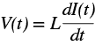

图 5-8 显示一个 1.0 μH 电感与一个 1.0 kΩ 电阻串联。

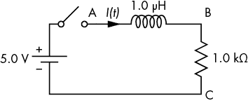

图 5-8：与电阻串联的电感

当开关断开时，没有电流通过该电路。关闭开关后，电感起初会阻碍电流流动，需要时间在电感中建立磁场。在开关关闭之前，没有电流通过电阻，因此电阻两端的电压 `V[BC]` 为 0 伏。电源的全部电压 5 伏出现在电感两端 `V[AB]` 上。随着电流开始流过电感，电阻两端的电压 `VBC` 增大。这导致电感两端的电压呈指数下降。当电感两端的电压最终达到 0 伏时，电阻两端的电压为 5 伏，电路中的电流为 5.0 ma。

电压指数级下降的速率由时间常数 `L/R` 。使用图 5-8 中 `R` 和 `L` 的值，我们得到：

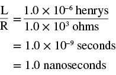

当开关关闭时，电感两端随时间产生的电压由以下公式给出：

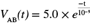

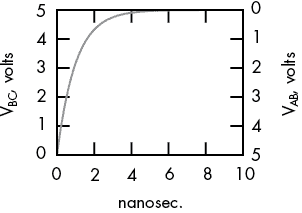

图 5-9：图 5-8 电路中电感随时间建立磁场

在时间 `t` = 1.0 纳秒（一个时间常数）时，电感两端的电压为：

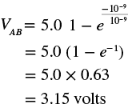

大约 6 纳秒（六个时间常数）后，电感两端的电压基本上等于 0 伏。此时，电源的全部电压跨越电阻，并流过 5.0 ma 的恒定电流。

图 5-8 中的电路展示了电感如何用于 CPU 电源。该电路中的电源模拟计算机电源，电阻模拟 CPU，CPU 正在消耗电源提供的电能。电源产生的电压包括噪声，由叠加在直流电平上的微小高频波动组成。如图 5-9 所示，供应给 CPU 的电压 `VBC` 在短时间内变化很小。串联在电源和 CPU 之间的电感起到了平滑 CPU 供电电压的作用。

### 功耗

硬件设计的一个重要部分是功耗，特别是对于电池供电设备。如此。在我们在这里讨论的三种电磁属性中，电阻是功率的主要消耗者。

能量是引起变化的能力，而功率是衡量用于产生变化的能量快慢的量。能量的基本单位是焦耳。功率的基本单位是瓦特，定义为每秒消耗焦耳。例如，我有一个可以存储 240 WH 的备用电池。这意味着它可以存储足够的能量提供 240 瓦持续一小时，或提供 120 瓦持续两小时。它可以存储 240 WH × 360 秒/小时 = 864,000 焦耳。伏和安培的单位定义使得 1 瓦特 = 1 伏 × 1 安培。这得出了功率公式：

P = V × I

其中 `P` 是使用的功率，`V` 是元件两的电压，`I` 是电流。


### 三体管

`transistor` 是可以通过电子方式控制电阻的器件，这使其成为活性元件。这种电子控制的能力是将晶体管制造的开关与本章早期看到的简单开关区分开来的关键，后者可以通过机械控制。在描述如何将晶体管作为开关之前，让我们看看如何使用机械开/关来实现逻辑门。我们以非门门为例。

图 5-10 显示两个按钮开关串联在 5 伏和 0 伏之间。上方开关常闭合。当按下其按钮时（从左侧），两个小圆圈之间的连接被断开，从而断开电路。下方开关常开。当按下其按钮时，两个小圆圈之间建立连接，从而接通电路。

现在我们将 5 伏表示 `1`，0 伏表示 `0`。这个非门门（NOT gate）的输入 `x` 会同时按下两个按钮。我们将以以下方式控制 `x`：当 `x` = `1` 时，我们按下两个按钮；当 `x` = `0` 时，我们不按下按钮。当按钮未按下时，`x` = `0`，5 伏连接到输出端 `¬x`，其代表 `1`。当按钮被按下时，`x` = `1`，5 伏断开，代表 `0` 的 0 伏连接到输出端。因此，输入 `1` 得到输出 `0`，输入 `0` 得到输出 `1`——这就是非门门。

早期的计算设备确实使用机械开关来实现逻辑，但以今天的标准来看，其结果非常慢。现代计算机使用`晶管`，它是由导体材料制成的电子器件，可以在电子控制下快速在导电和非导电状态之间切换。

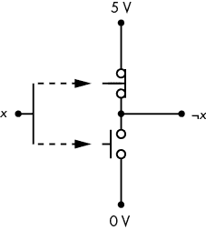

图 5-10：由两个按钮开关制成的非门

就像机械控制的按钮示例一样，我们使用两种不同的电压来表示 `1` 和 `0`。例如，我们可能使用高电压（例如 +5 伏）表示 `1`，使用低电压（例如 0 伏）表示 `0`。但晶管可以通过电子方式开启或关闭，这使得它们比原始计算机中使用的机械开关快得多。晶管占据的空间小得多，消耗的电也少得多。

在接下来的章节中，我们将查看现代计算机中常用的两种晶管。

## MOSFET 开关

当今计算机逻辑电路中最常用的开关晶管是`金属氧化物半导体场效应晶体`（`MOSFET`）。有若干种类型的 MOSFET，它们使用不同的电压电平和和极性。我将描述最常见类型——`增强型 MOSFET`的行为，并将其他变体的细节留给关于该主题的更高级的书籍。这里的简要讨论应该帮助你理解它们工作的基本原理。

MOSFET 的基本材料通常是硅，它是一种`半导体`，意味着它能导电，但导电性不是很好。通过添加杂质可以提高其导电性，这个过程被称为`掺杂`。根据杂质的类型，导电性可以是电子的流动或缺失电子的流动（称为`空穴`）。由于电子带有负电荷，导电子的类型称为 `N 型`，而导空穴的类型称为 `P 型`。穿过 MOSFET 的主要导电通路是`通道`，它连接在 MOSFET 的源极（`source`）和漏极（`drain`）之间。栅极（`gate`）由类型的半半极。栅极控制通道的导电性。

图 5-11 (a) 和 (b) 显示了两种基本的 MOSFET 类型，分别为 N 道和 P 道。我展示了每个 MOSFET 如何通过电阻连接到 5 伏电源。

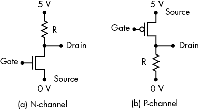

图 5-11：两种基础类型的 MOSFET

这些是经过简化的电路，以便我们讨论 MOSFET 的工作原理。每个 MOSFET 都有三个连接点，或`端子`（`terminals`）。栅极被用作输入端子。相对于源极电压应用的栅极电压控制流过 MOSFET 的电流。漏极用作输出。N 道 MOSFET 的源极连接到电源的低电压侧，P 道 MOSFET 的源极连接到高电压侧。

在学习了布尔代数中的补运算后，你可能不会惊讶于两种 MOSFET 具有互补的行为。你将在接下来的章节中看到如何将它们以互补对的形式连接，从而实现比仅使用一个更快、更高效的开关。

首先，我们将查看每种器件作为单个开关的工作原理，从 N 道 MOSFET 开始。

### N 道 MOSFET

在图 5-11 (a) 中，N 道 MOSFET 的漏极通过电阻 `R` 连接到电源的 5 伏侧，源极连接到 0 伏侧。

当应用于栅极的电压相对于源极为正时，N 道 MOSFET 漏极和源极之间的电阻减小。当此电压达到阈值值（通常在 1 伏范围内）时，电阻变得非常低，从而为漏极和源极之间的电流提供了良好的导电通路。所得电路等同于图 5-12 (a)。

在该电路中，图 5-12 (a)，电流从电源的 5 伏连接处通过电阻 `R` 流向 0 伏连接处。漏极处的电压将为 0 伏。这种电流流动的一个问题是电阻消耗功率，简单地将其转换为热量。等一下，我们将看到为什么我们不想通过增加电阻来限制电流流以减少功耗。

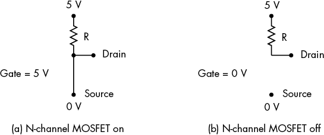

图 5-12：N 道 MOSFET 开关等效电路：(a)开关关闭，(b)开关开启

如果应用于栅极的电压切换到与源极电压几乎相同（在本例中为 0 伏），MOSFET 关闭，导致产生图 5-12 (b)所示的等效电路。漏极通常连接到另一个 MOSFET 的栅极，它在从一个状态切换到另一个状态时仅会抽取电流。在短暂的状态切换之后，漏极与另一个 MOSFET 栅极的连接不再抽取电流。由于没有电流流过电阻 `R`，因此两端没有电压差。因此，漏极处的电压将是 5 伏，该电阻被称为`上拉器件`（`pull-up device`），因为当 MOSFET 关闭时，电路通过电阻完成，其作用是将漏极上的电压拉高到电源的高电压。

### P 道 MOSFET

现在，让我们看看图 5-11 (b) 所示的 P 道 MOSFET。在这里，漏极通过电阻连接到低电压（0 V），源极连接到高电压电源（5 V）。当应用于栅极的电压切换到与源极电压几乎相同时，MOSFET 关闭。在这种情况下，电阻 `R` 充当`下拉器件`（`pull-down device`），将漏极上的电压拉低到 0 伏。图 5-13 (a) 显示了等效电路。

当应用于栅极的电压相对于源极为负时，P 道 MOSFET 漏极和源极之间的电阻减小。当此电压达到阈值值（通常在 -1 伏范围内）时，电阻变得非常低，从而为漏极和源极之间的电流提供了良好的导电通路。图 5-13 (b) 显示了当栅极相对于源极为 -5 伏时的等效电路。

两种类型的 MOSFET 都存在一些问题。通过观察图 5-12 (a) 和 5-13 (b) 中的等效电路，你可以看到相应的 MOSFET 在开启状态下就像关闭的开关，从而导致电流流过上拉或下拉电阻。当 MOSFET 处于开启状态时，流过电阻的电流消耗功率，这些功率被简单地转换为热量。

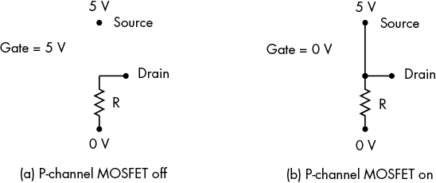

图 5-13：P 道 MOSFET 开关等效电路：(a)开关关闭，(b)开关开启

当 MOSFET 处于开启状态时，除了上拉电阻和下拉电阻会消耗功率外，这种硬件设计还有另一个问题。虽然 MOSFET 的栅极在保持开启或关断状态时几乎不消耗电流，但要改变 MOSFET 的状态，需要一瞬间的电流进入栅极。该电流由连接到栅极的设备提供，可能来自另一个 MOSFET 的漏极。我们书中不再深入讨论细节，但从该另一个 MOSFET 漏极可以提供的电流量很大程度上受到其上拉或下拉电阻的限制。这种情况与图 5-6 和图 5-7 基本相同，在那些图中你看到，电容器充电的时间随电阻值的增大而增加。

因此，这里存在一种权衡：电阻越大，电流越小，从而减少了 MOSFET 处于开启状态时的功耗。但更大的电阻也会减少漏极处的可用电流量，从而增加切换连接到漏极的 MOSFET 所的时间。我们面临着一个困境：小的上拉和下拉电阻会增加功耗，但大电阻则会减慢计算机的速度。

### CMOS 开关

我们可以用*互补金属氧化半导体*（*CMOS*）技术来解决这个困境。为了了解它是如何工作的，让我们去掉上拉和下拉电阻，将 P 道和 N 道的漏极连接在一起。P 道将取代 N 道电路中的上拉电阻，而 N 道将取代 P 道电路中的下拉电阻。我们还将两个栅极连接在一起，形成图 5-14 所示的电路。

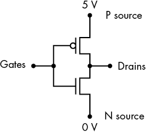

图 5-14：CMOS 反相器 (NOT)电路

图 5-15 (a) 显示了栅极处于较高电源电压 5 伏时的等效电路。上拉 MOSFET（P 道）是关闭的，下拉 MOSFET（N 道）是开启的，因此漏极被拉低较低的电源电压 0 伏。在图 5-15 (b) 中，栅极处于较低的电源电压 0 伏，这使得 P 道 MOSFET 开启，N 道 MOSFET 关闭。P 道 MOSFET 将漏极上拉到较高的电源电压 5 伏。

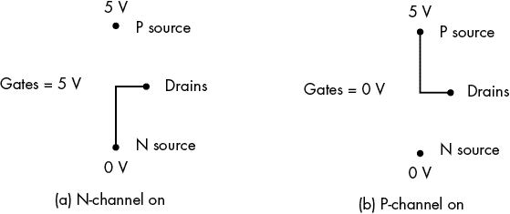

图 5-15：CMOS 反相器等效电路：(a) 上拉开启且下拉关闭，(b) 上拉关闭且下拉开启

我们可以在表 5-1 中总结这种行为。

| **栅极** | **漏极** |
| --- | --- |
| 0 V | 5 V |
| 5 V | 0 V |

表 5-1：单个 CMOS 的真值表

如果我们使用栅极连接作为输入，使用漏极连接作为输出，并让 5 伏表示逻辑 `1`，0 伏表示逻辑 `0`，那么 CMOS 就实现了一个非门。

使用 CMOS 电路的两个主要优势是：

* 它们的功耗非常低。由于 N 道和 P 道 MOSFET 切换速度的差异，在切换期间只有极少的电流通过。电流越少意味着热量越少，而热量通常是芯片设计的限制因素。

* 电路响应快得多。MOSFET 提供输出电流的速度比电阻快，可以为后续 MOSFET 的栅极充电。这允许我们构建更快的计算机。

图 5-16 显示了用三个 CMOS 实现的 AND 门。

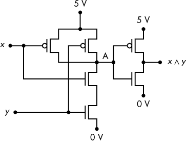

图 5-16：由三个 晶体管组成的 AND 门

真值表表 5-2 显示了前两个 CMOS 的中间输出，即图 5-16 中的点 A。

| *x* | *y* | **A** | *x ∧ y* |
| --- | --- | --- | --- |
| `0` | `0` | `1` | `0` |
| `0` | `1` | `1` | `0` |
| `1` | `0` | `1` | `0` |
| `1` | `1` | `0` | `1` |

表 5-2：图 5-16 中 AND 门的真值表

从真值表中我们可以看到点 A 处的信号是 `¬(x ∧ y)`。从点 A 到输出的电路是一个非门。点 A 处的结果被称为 *NAND* 操作。它比 AND 操作少需要两个晶体管。我们将在下一节讨论这一结果的影响。

### NAND 门和 NOR 门

正如我们在上一节中看到的，晶体管固有的设计意味着大多数电路都会反转信号。也就是说，对于大多数电路，输入端的高电压会在输出端产生低电压，反之亦然。因此，一个 AND 门通常在输出端需要一个非门来实现真正的 AND 操作。

你还学到了产生 `NOT(AND)` 比普通的 AND 需要的晶体管更少。这种组合非常常见，以至于它被命名为 *NAND 门*。当然，我们也有与 OR 门等效的形式，被称为 *NOR 门*。

1. **NAND**：一种二进制运算符，当且仅当*两个*操作数都为 `1` 时结果为 `0`，否则结果为 `1`。我们将使用 `¬(x ∧ x)` 来表示 NAND 操作。图 5-17 显示了 NAND 门的硬件符号，以及一个显示其在输入 *x* 和 *y* 上操作的真值表。

| *x* | *y* | **¬(x ∧ y)** |
| --- | --- | --- |
| `0` | `0` | `1` |
| `0` | `1` | `1` |
| `1` | `0` | `1` |
| `1` | `1` | `0` |

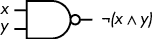

图 5-17：在变量 *x* 和 *y* 上的 NAND 门

2. **NOR**：一种二进制运算符，当至少一个操作互为 `1` 时结果为 `0`，否则结果为 `1`。我们将使用 `¬(x ∨ y)` 来表示 NOR 操作。图 5-18 显示了 NOR 门的硬件符号，以及一个显示其在输入 *x* 和 *y* 上操作的真值表。

| *x* | *y* | **¬(x ∨ y)** |
| --- | --- | --- |
| `0` | `0` | `1` |
| `0` | `1` | `0` |
| `1` | `0` | `0` |
| `1` | `1` | `0` |

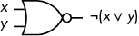

图 5-18：在变量 *x* 和 *y* 上的 NOR 门

注意在图 5-18 中 NAND 和 NOR 门输出处的小圈。正如在图 5-18 中看到的那样，这表示*非*，就像非门（图 4-3）。

虽然我们在上一章中显式地显示了非门，但使用这些小圈来表示取反是常见的。例如，图 5-19 显示了一个输入取反的 OR 门。

| *x* | *y* | **(¬x ∨ y)** | **¬(x ∧ y)** |
| --- | --- | --- | --- |
| `0` | `0` | `1` | `1` |
| `0` | `1` | `1` | `1` |
| `1` | `0` | `1` | `1` |
| `1` | `1` | `0` | `0` |

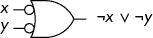

图 5-19：绘制 NAND 门的另一种方式

正如真值表所示，这是实现 NAND 门的另一种方式。正如你在第四章中所学的，德·摩根定律证实了这一点：

`¬(x ∧ y) = (¬x ∨ ¬y)`

### 作为通用门的 NAND

NAND 门的一个有趣特性是，它可以用于构建 AND、OR 和 NOT 门。这意味着 NAND 门可以实现任何逻辑函数。从这个意义上说，你可以将 NAND 门视为*通用门*。回想德·摩根定律，NOR 门也可以作为通用门并不意外。但 CMOS 晶体管的物理特性使得 NAND 门更快且占用空间更小，因此它们几乎总是首选方案。

让我们来看看如何使用 NAND 门构建 AND、OR 和 NOT 门。要使用 NAND 门构建非门，只需如图 5-20 所示，将信号连接到 NAND 门的所有输入端。

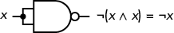

图 5-20：由 NAND 晶体管构建的非门

制作 AND 门，我们可以观察到图 5-21 中的第一个 NAND 门产生 `¬(x ∧ y)`，并连接到非门以产生 `(*x ∧ y)`。

我们可以利用德·摩根定律（De Morgan’s law）推出 OR 门。考虑以下内容：

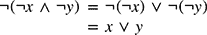

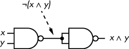

图 5-21：由两个 NAND 门构建的 AND 门

因此为了实现 OR，我们需要三个 NAND 门，如图 5-22 所示。`x` 和 `y` 输入处的两个 NAND 门通过 NOT 门连接，产生 `¬x` 和 `¬y`，从而在第三个 NAND 门的输出处产生 `¬((¬x) ∨ (¬y))`。

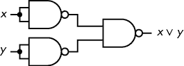

图 5-22：由三个 NAND 门构建的 OR 门

看起来我们正在通过 NAND 门构建电路来增加复杂性，但考虑这个函数：

`F(w, x, y, z) = (w ∧ x) ∨ (y ∧ z)`

在不知道逻辑门是如何构造的情况下，使用图 5-23 所示的电路来实现这个函数是合理的。

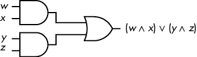

图 5-23：使用两个 AND 门和一个 OR 门实现的 `F(w, x, y, z)`

双重否定等幂幂律（involution property）规定 `¬(¬x) = x`，因此我们可以在每条路径上添加两个 NOT 门，如图 5-24 所示。

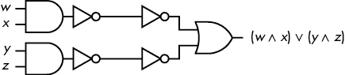

图 5-24：使用两个 AND 门、一个 OR 门和四个 NOT 门实现的 `F(w, x, y, z)`

将对 `w`、`x`、`y` 和 `z` 输入操作的两个 AND/NOT 门组合与图 5-17 对比，我们发现每一个仅仅是一个 NAND 门。它们将在最左侧两个 NOT 门的输出处产生 `¬(w ∧ x)` 和 `¬(y ∧ z)`。

我们在图 5-19 中德·摩根定律的应用中看到 `(¬a) ∨ (¬b) = ¬(a ∧ b)`。也就是说，我们可以将最右侧两个 NOT 门和 OR 门的组合替换为单个 NAND 门。

`¬(¬(w ∧ x) ∧ ¬(y ∧ z)) = (w ∧ x) ∨ (y ∧ z)`

图 5-25 中的结果电路使用了三个 NAND 门。

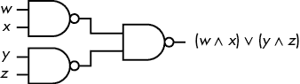

图 5-25：仅使用三个 NAND 门实现的 `F(w, x, y, z)`

仅仅从图 5-23 和 5-25 的逻辑电路图来看，似乎在这个电路转换中我们并没有获得什么。但我们在上一节中看到，一个 NAND 门（图 5-16 中的 A 点）比 AND 门少两个晶体管。因此，NAND 门的实现功率更低且速度更快。虽然我们在这里没有展示，OR 门也是如此。

从 AND/OR/NOT 门设计转换为仅使用 NAND 门的设计是非常简单的：

1. 将函数表示为最小积之和。
2. 将积项（AND 项）转换。
3. 这种转换利用德·摩根定律。

在这个电路转换中，我们并没有获得任何东西。但我们在上一节中看到，一个 NAND 门（图 5-16 中的 A 点）比 AND 门少两个晶体管。因此，NAND 门的实现功率更低且速度更快。虽然我们在这里没有展示，OR 门也是如此。

从 AND/OR/NOT 门设计转换为仅使用 NAND 门的设计是非常简单的：

1. 将函数表示为最小积之和。
2. 将积项（AND 项）转换。
3. 这种转换利用德·摩根定律。

在这个电路转换中，我们并没有获得任何东西。但我们在上一节中看到，一个 NAND 门（图 5-16 中的 A 点）比 AND 门少两个晶体管。因此，NAND 门的实现功率更低且速度更快。虽然我们在这里没有展示，OR 门也是如此。

从 AND/OR/NOT 门设计转换为仅使用 NAND 门的设计是非常简单的：

1. 将函数表示为最小积之和。
2. 将积项（AND 项）转换。
3. 这种转换利用德·摩根定律。


在这个电路转换中，我们并没有获得任何东西。但我们在上一节中看到，一个`NAND`门（图 5-16 中的 A 点）比`AND`门少两个晶体管。因此，`NAND`门的实现功率更低且速度更快。虽然我们在这里没有展示，`OR`门也是如此。

从`AND/OR/NOT`门设计转换为仅使用`NAND`门的设计是非常简单的：

1. 将函数表示为最小积之和。
2. 将积项（`AND`项）转换。
3. 这种转换利用德·摩根定律。

我们可以利用德·摩根定律来推出`OR`门。考虑以下内容：


图 5-21：由两个`NAND`门构建的`AND`门

因此为了实现`OR`，我们需要三个`NAND`门，如图 5-22 所示。`x`和`y`输入处的两个`NAND`门通过`NOT`门连接，产生`¬x`和`¬y`，从而在第三个`NAND`门的输出处产生`¬((¬x) ∨ (¬y))`。


图 5-22：由三个`NAND`门构建的`OR`门

看起来我们正在通过`NAND`门构建电路来增加复杂性，但考虑这个函数：

`F(w, x, y, z) = (w ∧ x) ∨ (y ∧ z)`

在不知道逻辑门是如何构造的情况下，使用图 5-23 所示的电路来实现这个函数是合理的。


图 5-23：使用两个`AND`门和一个`OR`门实现的`F(w, x, y, z)`

双重否定等幂律规定`¬(¬x) = x`，因此我们可以在每条路径上添加两个`NOT`门，如图 5-24 所示。


图 5-24：使用两个`AND`门、一个`OR`门和四个`NOT`门实现的`F(w, x, y, z)`

将对`w`、`x`、`y`和`z`输入操作的两个`AND/NOT`门组合与图 5-17 对比，我们发现每一个仅仅是一个`NAND`门。它们将在最左侧两个`NOT`门的输出处产生`¬(w ∧ x)`和`¬(y ∧ z)`。

我们在图 5-19 中德·摩根定律的应用中看到`(¬a) ∨ (¬b) = ¬(a ∧ b)`。也就是说，我们可以将最右侧两个`NOT`门和`OR`门的组合替换为单个`NAND`门。

`¬(¬(w ∧ x) ∧ ¬(y ∧ z)) = (w ∧ x) ∨ (y ∧ z)`

图 5-25 中的结果电路使用了三个`NAND`门。


图 5-25：仅使用三个`NAND`门实现的`F(w, x, y, z)`

仅仅从图 5-23 和 5-25 的逻辑电路图来看，似乎在这个电路转换中我们并没有获得什么。但我们在上一节中看到，一个`NAND`门（图 5-16 中的 A 点）比`AND`门少两个晶体管。因此，`NAND`门的实现功率更低且速度更快。虽然我们在这里没有展示，`OR`门也是如此。

从`AND/OR/NOT`门设计转换为仅使用`NAND`门的设计是非常简单的：

1. 将函数表示为最小积之和。
2. 将积项（`AND`项）转换。
3. 这种转换利用德·摩根定律。

与半加器不同，*全加器*电路有三个一位的输入：`Carry[i]`、`x[i]`和`y[i]`。`Carry[i]`是当你相加上一个位位置（右侧的位）的两个位时产生的进位位。例如，如果我们正在相加第 5 位的两个位，全加器的输入就是第 5 位的两个位，加上来自第 4 位位相加的进位位。表 6-2 显示了结果。

| `Carry[i]` | `x[i]` | `y[i]` | `Carry[i+1]` | `Sum[i]` |
| :--- | :--- | :--- | :--- | :--- |
| `0` | `0` | `0` | `0` | `0` |
| `0` | `0` | `1` | `0` | `1` |
| `0` | `1` | `0` | `0` | `1` |
| `0` | `1` | `1` | `1` | `0` |
| `1` | `0` | `0` | `0` | `1` |
| `1` | `0` | `1` | `1` | `0` |
| `1` | `1` | `0` | `1` | `0` |
| `1` | `1` | `1` | `1` | `1` |

表 6-2：两位相加，全加器

为了设计全加器电路，我们从一个函数开始，该函数将`Sum[i]`为`1`的情况指定为表 6-2 中的积之项和。

`Sumi = (¬Carry[i] ∧ ¬x[i] ∧ y[i]) ∨ (¬Carry[i] ∧ x[i] ∧ ¬y[i]) ∨ (Carry[i] ∧ ¬x[i] ∧ ¬ y[i]) ∨ (Carry[i] ∧ x[i] ∧ y[i])`

该方程中没有明显的简化方法，因此让我们看看`Sum[i]`的卡诺映射图（图 6-2）。

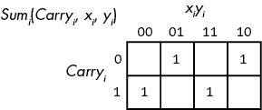

图 6-2：三位相加`Carry[i]`、`x[i]`和`y[i]`的卡诺映射图

在图 6-2 中没有明显的分组，因此我们只剩下四个积项来计算上一个方程中的`Sum[i]`。

我们在第 4 章中看到，`Carry[i+1]`可以由这个方程表示：

`Carryi+1 = (x[i] ∧ y[i]) ∨ (Carry[i] ∧ x[i]) ∨ (Carry[i] ∧ y[i])`

这两个函数共同构成了图 6-3 中的全加器电路。

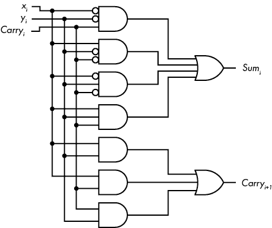

图 6-3：全加器电路

如你所示，全加器使用了九个逻辑门。在下一节中，我们将看看是否能找到更简单的电路。

### 由两个半加器组成的全加器

为了看看我们能否为两个位和来自低阶位的进位找到更简单的解决方案，让我们回到`Sum[i]`的方程。使用分配律，我们可以进行重组：

`Sumi = ¬Carry[i] ∧ ((¬x[i] ∧ y[i]) ∨ (x[i] ∧ ¬y[i])) ∨ Carry[i] ∧ ((¬x[i] ∧ ¬y[i]) ∨ (x[i] ∧ y[i]))`

在第 4 章中，你学习到第一个积项括号中的量是`x[i]`和`y[i]`的异或逻辑：

`(¬x[i] ∧ y[i]) ∨ (x[i] ∧ ¬y[i]) = x[i] ⊻ y[i]`

因此，我们得到：

`Sumi = ¬Carry[i] ∧ (x[i] ⊻ y[i]) ∨ Carry[i] ∧ ((¬x[i] ∧ ¬y[i]) ∨ (x[i] ∧ y[i]))`

现在让我们处理第二个积项括号中的量。回记得在布尔代数中`x ∧ ¬x = 0`，因此我们可以写出如下：


因此，


我们将进行一些操作来推出一个`Carry[i+1]`的布尔函数，这可能看起来是违反直觉的。让我们从第 4 章中三位相加进位的卡诺映射图图 4-13 开始，但移除两个分组（虚线）。

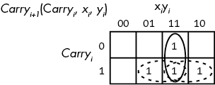

图 6-4：图 4-13 中的进位卡诺映射图，重绘后去除了重叠分组

这将给我们以下方程：


注意该方程中的两个项`(x[i] ∧ y[i])`和`(x[i] ⊻ y[i])`已经由半加器生成了（参见图 6-1）。因此，通过第二个半加器和一个或门，我们可以实现一个全加器，如图 6-5 所示。

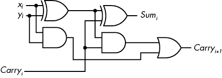

图 6-5：使用两个半加器的全加器

现在你可以看到*半加器*和*全加器*这些词的来源了。简单的电路并不总是更好。事实上，我们无法仅从逻辑电路来判断图 6-3 或图 6-5 这两个全加器电路哪一个更好。良好的工程设计取决于许多因素，例如每个逻辑门的实现方式、逻辑门的成本及其可用性等。这里给出两种设计是为了说明不同的方法可以导致不同的、功能等效的设计。

### 行进位加法和减法电路

现在我们知道如何相加给定位位置上的两个位，加上来自低阶位的进位。但由于要操作的值有很多位，因此我们需要一种方法来相加位，这可以使用*n 位加器*来实现。图 6-6 显示了四位加器。

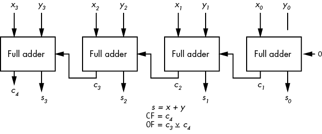

图 6-6：四位加器

加法从右侧的加器开始，接收最低位的`x[0]`和`y[0]`。由于这是最低位，没有进位且`c[0] = 0`。和为`s[0]`，而相加产生的进位`c[1]`连接到左侧下一个加器的进位输入，那里加到`x[1]`和`y[1]`。每个加器处理总宽的一位（通常称为*切片*）。每一位的进位都被加到高阶位位置。相加过程从最低位到最高位流动，这种方法被称为*行进位加法*。

注意，在图 6-6 中，我们有`CF`和`OF`，即进位标志和溢出标志。你在第 3 章中学习过进位和溢出。当 CPU 执行算术运算（本例中为加法）时，会在`rflags`寄存器中记录是否发生了进位或溢出。你将在第 9 章中学习这个寄存器。

现在让我们看看如何利用类似的思路来实现减法。回记得在补码中，一个数的取反方法是取其补码、翻转所有位并加 1。因此，我们可以通过以下操作从`x`中减去`y`：


如果我们对每个`y[i]`取反，并将进位设置为`1`而不是`0`，我们就可以用图 6-5 中的加器执行减法。每个`y[i]`可以通过与`1`进行异或运算来取反。

### 解码器

计算机中的许多地方都需要根据数字选择多个连接中的一个。例如，正如你将在几章后看到的，CPU 具有少量的组织在*寄存器*中的内存，用于计算。x86-64 架构有 16 个 64 位寄存器。如果指令使用其中一个寄存器，指令中必须使用 4 位来选择使用哪一个 16 个寄存器中的一个。

这种选择可以通过`decoder`（解码器）完成。解码器的输入是寄存器的四位数字，输出是到指定寄存器的十六种可能连接中的一种。

解码器具有`n`个二进制输入，可以产生多达`2^n`个二进制输出。最常见的解码器类型有时被称为`line decoder`（线解码器），它对于每种输入位模式，仅选择输出线中的一条设置为`1`。解码器包含一个`Enable`（使能）输入也是很常见的做法。表 6-3 所示的、带有使能输入的 3 × 8（3 个输入，8 个输出）解码器的真值表展示了其工作原理。当`Enable` = `0`时，所有输出线均为`0`。当`Enable` = `1`时，输入的三位数字`x` = `x[2]x[1]x[0]`决定了哪条输出线被设置为`1`。因此，该解码器可以用三位数字选择八个寄存器中的一个。（为了保持表格大小合理，我没有使用 x86-64 中的十六个寄存器。）

| | **Input** | **Output** |
| --- | --- | --- |
| **Enable** | `x[2]` | `x[1]` | `x[0]` | `y[7]` | `y[6]` | `y[5]` | `y[4]` | `y[3]` | `y[2]` | `y[1]` | `y[0]` |
| --- | --- | --- | --- | --- | --- | --- | --- | --- | --- | --- | --- |
| `0` | `0` | `0` | `0` | `0` | `0` | `0` | `0` | `0` | `0` | `0` | `0` |
| `0` | `0` | `0` | `1` | `0` | `0` | `0` | `0` | `0` | `0` | `0` | `0` |
| `0` | `0` | `1` | `0` | `0` | `0` | `0` | `0` | `0` | `0` | `0` | `0` |
| `0` | `0` | `1` | `1` | `0` | `0` | `0` | `0` | `0` | `0` | `0` | `0` |
| `0` | `1` | `0` | `0` | `0` | `0` | `0` | `0` | `0` | `0` | `0` | `0` |
| `0` | `1` | `0` | `1` | `0` | `0` | `0` | `0` | `0` | `0` | `0` | `0` |
| `0` | `1` | `1` | `0` | `0` | `0` | `0` | `0` | `0` | `0` | `0` | `0` |
| `0` | `1` | `1` | `1` | `0` | `0` | `0` | `0` | `0` | `0` | `0` | `0` |
| `1` | `0` | `0` | `0` | `0` | `0` | `0` | `0` | `0` | `0` | `0` | `1` |
| `1` | `0` | `0` | `1` | `0` | `0` | `0` | `0` | `0` | `0` | `1` | `0` |
| `1` | `0` | `1` | `0` | `0` | `0` | `0` | `0` | `0` | `1` | `0` | `0` |
| `1` | `0` | `1` | `1` | `0` | `0` | `0` | `0` | `1` | `0` | `0` | `0` |
| `1` | `1` | `0` | `0` | `0` | `0` | `0` | `1` | `0` | `0` | `0` | `0` |
| `1` | `1` | `0` | `1` | `0` | `0` | `1` | `0` | `0` | `0` | `0` | `0` |
| `1` | `1` | `1` | `0` | `0` | `1` | `0` | `0` | `0` | `0` | `0` | `0` |
| `1` | `1` | `1` | `1` | `1` | `0` | `0` | `0` | `0` | `0` | `0` | `0` |

表 6-3：带使能的 3 × 8 解码器

表 6-3 中指定的 3 × 8 线解码器可以用四输入`AND`门实现，如图 6-8 所示。

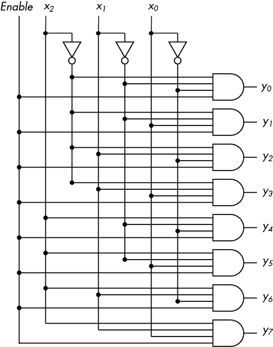

图 6-8：带使能的 3 × 8 解码器电路

解码器比初看之下要通用得多。每个可能的输入都可以看作是一个最小项（minterm）（如需复习最小项，请参见第 4 章）。表 6-3 中的线解码器显示，当一个最小项结果为`1`且`Enable`为`1`时，只有一条输出为`1`。因此，解码器可以被视为一个“最小项生成器”。我们从书中前面知道，任何逻辑表达式都可以表示为最小项的或（`OR`）运算，因此我们可以通过对解码器的输出进行或运算来实现任何逻辑表达式。例如，如果你回看全加器的卡诺图（图 6-2 和图 6-4），可能会发现`Sum`（和）和`Carry`（进位）可以表示为最小项的或运算。


其中`x`、`y`和`Carry`上的下标`i`指位切，而`m`下的下标是最小项符号的一部分。我们可以用一个 3 × 8 解码器和两个输入`OR`门实现全加器的每个位切，如图 6-9 所示。图 6-8 中的解码器电路需要八个`AND`门和三个`NOT`门。图 6-9 中的全加器又增加了两个`OR`门，总共需要 13 个逻辑门。这与图 6-5 中的全加器设计相比（后者仅需要五个逻辑门（两个`XOR`，两个`AND`和一个`OR`）相比，使用解码器来构建全加器似乎增加了复杂性。但请记住，设计通常基于其他因素，例如组件的可用性、组件成本等。

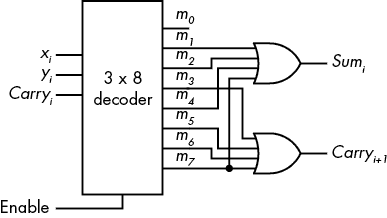

图 6-9：使用解码器的全加器位切

多用器（Multiplexers）比初看之下更灵活。在前面的节中，我们学习了如何用`AND`门来实现多用器。这种电路被称为`mux`具有三种输出：`0`、`1`和“无连接”。“无连接”输出实际上是高阻抗连接，也称为`high Z`。“无连接”输出允许我们将许多三缓冲器的输出输出在一起，但选择选择一个输入到公共输出线。

多用器器 111101111111111111111111111111111111111111111

0          (s00] ∧)   (s[0] ∧ z)


进入`/path/to/xxx`目录，找到`xxx.json`。

在表达式`cvar = avar + bvar`中，加法运算符（`+`）将`avar`与`bvar`相加，得到它们的和`cvar`。

在`List.of(arg0, arg1, arg2)`中，`List`接口的工厂方法`of()`接受一系列的元素，返回包含它们的只读列表。

之后我们这样调用`cmd`命令：`cmd arg0 arg1 arg2`。

```
if (condVar > someVal) {console.log("xxx")}
```

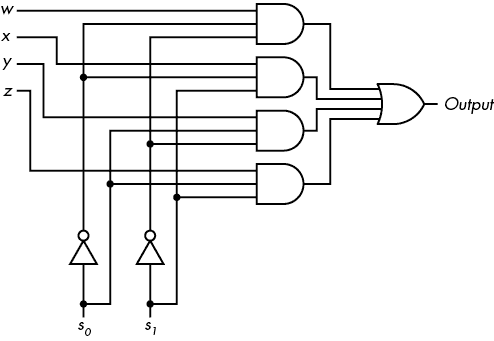
图 6-11：多路输入选择器

三态缓冲器（Tristate Buffer）具有数据输入和使能功能，其行为如表 6-5 所示。

| **Enable** | **In** | **Out** |
| --- | --- | --- |
| `0` | `0` | High Z |
| `0` | `1` | High Z |
| `1` | `0` | `0` |
| `1` | `1` | `1` |

表 6-5：三态缓冲器真值表

图 6-12 显示了三态缓冲器的电路符号。

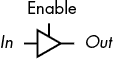
图 6-12：三态缓冲

当`Enable` = `1`时，输出与输入相等，连接到三态缓冲器后的任何电路元件。但当`Enable` = `0`时，输出基本上是断开的。这与`0`不同；断开意味着它对与之连接的电路元件没有影响。

为了说明如何使用三态缓冲器，请回看第 124 页“多用器”节中的四路多用器。它需要四个 AND 门、两个 NOT 门和一个四输入 OR 门。如果我们尝试将其放大，对于较大的`n`，`n`输入 OR 门将会产生一些技术电子问题。通过使用`n`个三态缓冲器避免`n`输入 OR 门，如图 6-13 中的四路多用器所示。


图 6-13：由解码器和三态缓冲器构建的多路多用器

图 6-13 中的多路选择器使用了`2 × 4`解码器和四个三态缓冲器。`2 × 4`解码器选择哪个三态缓冲器将输入`w`、`x`、`y`或`z`之一连接到输出。

图 6-14 显示了多路选择器的电路符号，而表 6-6 显示了它的行为。


图 6-14：四路复用器的电路符号

| `s[1]` | `s[0]` | `Output` |
| --- | --- | --- |
| `0` | `0` | `w` |
| `0` | `1` | `x` |
| `1` | `0` | `y` |
| `1` | `1` | `z` |

表 6-6：四路复用器真值表

作为我们使用图 6-14 中四路复用器的例子，考虑一台具有四个寄存器和一个加法器的计算机。我们将寄存器命名为`w`、`x`、`y`和`z`。如果我们将每个寄存器对应位置上的位连接到多路选择器，就可以使用双位选择器`s[0]s[1]`来选择哪个寄存器为加法器提供输入。例如，位置 5 的每个位`w[5]`、`x[5]`、`y[5]`和`z[5]`将连接到多路选择器 5 的输入之一。如果`s[0]s[1] = 10`，则加法器的输入将是`y[5]`。

到目前为止，我们讨论的是使用单个逻辑门的硬件设计。如果设计发生变化，逻辑门的配置也会发生变化。这几乎总是意味着负载逻辑门并连接它们的电路板需要重新设计。变化通常还意味着订购不同类型的逻辑门，这可能非常昂贵且耗时。通过使用`可编程逻辑设备`（`PLDs`）来实现所需的逻辑函数可以减少这些问题。

PLD 包含许多 AND 门和 OR 门，可以通过编程来实现布尔函数。输入值及其取反值连接到 AND 门。所有 AND 门合称为`AND 层`或`AND 阵列`。AND 门的输出连接到 OR 门，它们合称为`OR 层`或`OR 阵列`。根据类型的不同，一个或两个平面都可以被编程以实现组合逻辑。使用 PLD 时，设计更改仅意味着更改设备的编程方式，而不是购买不同的设备，这意味着电路板不需要重新设计。

PLD 有几种类型。大多数可以由用户编程。有些在制造时经过预编程，有些甚至可以由用户擦除并重新编程。编程技术范围从指定制造掩膜（用于预编程设备）到廉价的电子编程系统不等。

PLD 分三大类。

### 可编程逻辑阵列

在`可编程逻辑阵列`（`PLA`）中，AND 层和 OR 层都是可编程的。PLA 用于实现逻辑函数。图 6-15 给出了具有两个输入变量和这些变量两个可能的输出函数的 PLA 的总体概念。


图 6-15：可编程逻辑阵列的简化电路

每个输入变量（其非形式和反形式）都通过熔丝作为 AND 门的输入。`fuse`是一种用于保护电电路的薄导体。如果流过的电流足够大，导体就会熔化，从而断开电路并停止电流流动。可以通过熔断（或`blowing`）相应的熔丝来对 PLD 进行编程，从而移除逻辑门的输入。某些设备使用反熔丝（`antifuses`）代替熔丝。这些通常是开路的，对其进行编程就是完成连接而不是移除连接。可以重新编程的设备具有可以熔断再重建的熔丝。

在图 6-15 中，电路图中的`S`型线代表熔丝。熔丝可以被熔断也可以保持原位，以便编写每个 AND 门输出输入`x`、`¬x`、`y`和`¬y`的积。由于每个输入加上其取反都输入到每个 AND 门，因此任何 AND 门都可以被编程输出最小项（minterm）。

AND 层产生的积都连接到 OR 门的输入，同样通过熔丝连接。因此，取决于哪些 OR 门熔丝保持原位，每个 OR 门的输出都是积之和。可能有额外的逻辑电路来在不同的输出之间进行选择。我们已经看到任何布尔函数都可以表示为积之和，因此这种逻辑设备可以通过熔断熔丝来实现任何布尔函数。

PLA 通常比图 6-15 中显示的要大，后者已经很复杂了。为了简化绘图，我们使用了一条线。垂直线和水平线交处的点表示熔丝完好的地方。

图 6-17 中的“×”连接表示永久连接，表明 AND 门平面是固定的。此 ROM 中的每个 AND 门在每个地址产生一个最小主项（minterm）。OR 门产生最多`2^(n)`个八字节，其中`n`是输入到 AND 门平面的地址宽度（位宽）。到 OR 门的连接（点）表示存储在相应地址的位模式。表 6-7 显示了一个 ROM，其 OR 门平面已编程用于存储四个字符 A、B、C 和 D（使用 ASCII 码）。

| **最小主项** | **地址** | **内容** | **ASCII 字符** |
| --- | --- | --- | --- |
| ¬a[1]¬a[0] | `00` | `01000001` | A |
| ¬a[1]a[0] | `01` | `01000010` | B |
| a[1]¬a[0] | `10` | `01000011` | C |
| a[1]a[0] | `11` | `01000100` | D |

表 6-7：存储四个 ASCII 字符的 ROM

虽然在这个示例中我们只存储了数据，但计算机指令也是位模式，因此我们可以同样地在 ROM 中存储整个程序。类似于可编程逻辑阵列，如果你需要更改程序，只需编写另一个 ROM 并替换旧的即可。

ROM 有多种类型。虽然位模式是在制造过程中在 ROM 中的，但*可编程只读存储器*（`PROM`）设备是由使用者编程的。还有*可擦除可编程只读存储器*（`EPROM`）设备可以使用紫外线擦除然后重新编程。

### 可编程阵列逻辑

在*可编程阵列逻辑*（`PAL`）设备中，每个 OR 门都永久连接到一组 AND 门上。只有 AND 门平面是可编程的。图 6-18 所示的 PAL 有四个输入。它提供两个输出，每个输出都可以是最多四个乘积之和。OR 门平面中的“×”连接显示前四个 AND 门通过 OR 逻辑产生`F1`，后四个通过 OR 逻辑产生`F2`。此图中的 AND 门平面已编程为产生这两个函数：


在本文介绍的三个类型的 PLD 中，PLA 是最灵活的，因为我们可以同时对 OR 平面和 AND 平面进行编程，但它是这三种设备中最昂贵的。ROM 的灵活性较低。它可以被编程为产生最小主项的任意组合，然后对它们进行 OR 运算。我们知道任何函数都可以实现为最小主项的 OR 和，因此我们可以用 ROM 产生任何函数。然而，ROM 不允许我们最小化函数，因为所有的乘项必须是最小主项。


图 6-18：双功能可编程阵列逻辑

## 你学到的知识

1. **组合逻辑电路** 这些电路在任何时间都仅取决于其输入。它们对输入的之前的影响没有记忆。示例包括加法器、译码器、多用选择器和可编程逻辑设备。
2. **半加器** 该电路有两个一位位输入。它产生两个一位位输出：输入的之和以及该和的进位。
3. **全加器** 该电路有三个一位位输入。它产生两个一位位输出：输入的之和以及该和的进位。
4. **位进位加法器** 使用`n`个全加器来加`n`位数。每个全加器的进位输出是下一个高位位全加器三个输入之一。
5. **译码器** 用于根据`2^(n)`个输入选择`n`个输出之一的设备。
6. **多用选择器 (MUX)** 用于根据`n`位选择信号选择`2^(n)`个输入之一的设备。
7. **可编程逻辑阵列 (PLA)** 用于生成最小主项的 OR 组合以在硬件中实现布尔函数。
8. **只读存储器 (ROM)** 提供非易失性内存，输入为数据或指令的地址。
9. **可编程阵列逻辑 (PAL)** 用于在硬件中实现布尔函数的设备。它比 PLA 或 ROM 不灵活，但价格便宜。

在下一章中，你将学习顺序逻辑电路，它使用反馈来保持对其活动的记忆。

# 7

## 顺序逻辑电路


在上一章中，你学习了*组合逻辑电路*，即仅取决于其当前输入的电路。这种问题的另一种思考方式是，组合逻辑电路是瞬时的（电子元件稳定所需的时间除外）：它们的输出仅取决于观察输出时的输入。相反，*顺序逻辑电路*同时取决于当前输入和过去的输入。它们具有时间历史，这种历史可以用电路当前的状态来总结。

形式上，*系统状态*是对系统的一种描述，使得已知时间`t[0]`的状态以及从时间`t[0]`到时间`t[1]`的输入，就能唯一确定时间`t[1]`的状态以及从时间`t[0]`到时间`t[1]`的输出。换句话说，系统状态提供了影响系统的一切总结。知道系统在任何给定时间`t`的状态，你就掌握了指定从该时间起系统行为所需的所有信息。它是进入这种状态的并不重要。

系统状态的概念包含在*有限状态机*中，这是一种计算模型，可以存在有限数量状态中的任意一个。有限状态机的外部输入导致它从一个状态转换到另一个状态，同时可能产生输出。顺序逻辑电路用于实现有限状态机。如果一个顺序逻辑电路的设计使其输出仅取决于它所处的状态，它被称为*摩尔状态机*（Moore machine）。如果输出还取决于引起状态转换的输入，它被称为*梅利状态机*（Mealy machine）。

在本章中，我们将查看如何在逻辑电路中使用*反馈*来使门保持在特定状态，从而实现存储。我们将使用*状态图*来展示输入如何导致顺序逻辑电路在状态之间转换以及相应的输出是什么。你还将学习顺序逻辑电路如何与时钟同步以提供可靠的结果。

## 锁存器

我们将看到的第一个顺序逻辑电路是*锁存器*（latch），它是一种一位存储设备，根据其输入可以处于两个状态之一。锁存器可以通过连接两个或多个逻辑门来构建，使得一个门的输出反馈到另一个门的输入端；只要通电，两个门的输出都保持在相同状态。锁存器的状态不依赖于时间。（*锁存器*一词也用于描述行为类似于此处描述的一位位设备的多位存储设备。）

### 使用 NOR 门构建的 SR 锁存器

最基本的锁存器是*置位-复位*（`SR`）。它有两个输入（`S`和`R`）和两个状态，称为*置位*和*复位*。该状态作为主输出`Q`。通常还会提供反相输出`¬Q`。当输出`Q = 1`且`¬Q = 0`时，SR 锁存器处于置位状态。当`Q = 0`且`¬Q = 1`时，它处于复位状态。图 7-1 显示了使用 NOR 门实现 SR 锁存器的简单方法。每个 NOR 门的输出都反馈到另一个门的输入端。在我们在本章描述电路的行为时，你会看到这种*反馈*正是让锁存器保持在一种状态的原因。


图 7-1：NOR 门实现的 SR 锁器

SR 门有四种可能的输入组合。让我们在这里过一遍：

### `S = 0`, `R = 0`: 保持当前状态

如果锁器处于置位态（`Q = 1`和`¬Q = 0`），输入`S = 0`和`R = 0`将导致`¬Q`（上方 NOR 门的输出）产生`¬(0 ∨ 1) = 0`，而`Q`（下方的 NOR 门的输出）产生`¬(0 ∨ 0) = 1`。相反，如果锁器处于复位态（`Q = 0`和`¬Q = 1`），则上方 NOT 门的输出产生`¬(0 ∨ 0) = 1`，下方的 NOR 门产生`¬(1 ∨ 0) = 0`。因此，两个 NOR 门之间的交叉反馈维持了锁器的当前状态。

### `S = 1`, `R = 0`: 置位 (`Q = 1`)

如果锁器处于复位态，这些输入会导致上方 NOR 门的输出变为`¬(1 ∨ 0) = 0`，从而将`¬Q`变为`0`。此结果被反馈到下方 NOR 门的输入端，产生`¬(0 ∨ 0) = 1`。从下方 NOR 门输出到上方输入的反馈使上方 NOR 门的输出保持在`¬(1 ∨ 1) = 0`。此时，锁器已进入了置位态（`Q = 1`和`¬Q = 0`）。

如果锁器处于置位态，上方 NOR 门产生`¬(1 ∨ 1) = 0`，而下方 NOR 门的输出为`¬(0 ∨ 0) = 1`。因此，锁器保持在置位态。

### `S = 0`, `R = 1`: 复位 (`Q = 0`)

如果锁器处于置位态，下方 NOR 门产生`¬(0 ∨ 1) = 0`，从而将`Q`变为`0`。此结果被反馈到上方 NOR 门的输入端，产生`¬(0 ∨ 0) = 1`。从上方 NOR 门输出到下方输入的反馈使下方 NOR 门的输出保持在`¬(1 ∨ 1) = 0`。此时，锁器已进入了复位态（`Q = 0`和`¬Q = 1`）。

如果锁器已经处于复位态，下方 NOR 门产生`¬(1 ∨ 1) = 0`，而上方 NOR 门的输出为`¬(0 ∨ 0) = 1`，因此锁器保持在复位态。

### `S = 1`, `R = 1`: 不允许

如果`Q = 0`和`¬Q = 1`，上方 NOR 门产生`¬(1 ∨ 0) = 0`。此结果被反馈到下方 NOR 门的输入端，产生`¬(0 ∨ 1) = 0`。这会导致`Q = ¬Q`，与布尔代数的法则不一致。

如果`Q = 1`和`¬Q = 0`，下方 NOR 门产生`¬(0 ∨ 1) = 0`。此结果被反馈到上方 NOR 门的输入端，产生`¬(1 ∨ 0) = 0`。这会导致`Q = ¬Q`，是不一致的。

电路的设计必须防止这种输入组合。

为了简单起见，我们可以通过视觉方式表示这种逻辑。图 7-2 引入了一种显示 NOR 门 SR 锁器行为的图形方法：状态图。在这个状态图中，当前状态显示在圆圈中，相应的主要输出位于状态下方。带箭头的线显示了状态之间可能的转换，并标记了导致转换到下一个状态的输入。


图 7-2：NOR 门 SR 锁器的状态图

图 7-2 中的两个圆圈显示了 SR 锁器的两种可能状态——置位或复位。线上的标签显示了导致每个状态转换的输入组合`SR`。例如，当锁器处于复位态时，有两种可能的输入`SR = 00`和`SR = 01`导致它保持在该状态。输入`SR = 10`导致它转换到置位态。由于输出仅取决于状态而不取决于输入，因此锁器是一个摩尔状态机（Moore state machine）。

熟悉图论的人会识别出状态图是一个有向图：状态是顶点，导致转换的输入是边。尽管它们超出了本书的范围，但图论中的工具在设计过程中是非常有用的。

与图论一样，我们也可以用状态转换表以表格形式表示相同的行为，如表 7-1 所示。这里`S`和`R`是输入，`Q`是当前状态下的输出，`Q[next]`显示对应输入产生的状态的输出。底部两行中的`X`表示不可能的条件。

| **S** | **R** | **Q** | **Q[next]** |
| --- | --- | --- | --- |
| `0` | `0` | `0` | `0` |
| `0` | `0` | `1` | `1` |
| `0` | `1` | `0` | `0` |
| `0` | `1` | `1` | `0` |
| `1` | `0` | `0` | `1` |
| `1` | `0` | `1` | `1` |
| `1` | `1` | `0` | X |
| `1` | `1` | `1` | X |

表 7-1：NOR 门 SR 锁器

NOR 门 SR 锁器的两个输入通常都保持为`0`，这维持了当前状态。暂时改变`R`为`1`会导致锁器进入复位态，输出`Q=0`。而暂时改变`S`为`1`会导致锁器进入置位态，输出`Q=1`。

### 使用 NAND 门实现的 SR 锁器

NAND 门 SR 锁器的两个输入通常都保持为`1`，这维持了当前状态。暂时改变`R`为`0`会导致锁器进入复位态，输出`Q=0`。而暂时改变`S`为`0`会导致锁器进入置位态，输出`Q=1`。

如果锁存处于`Set`状态，下方的 NAND 门产生`¬(1 ∧ 0) = 1`。此结果被反馈到上方 NAND 门的输入端，产生`¬(0 ∧ 1) = 1`。这将导致`Q = ¬Q`，这同样是不一致的。

电路的设计必须防止这种输入组合。

图 7-4 使用状态图展示了 NAND 门 SR 锁存的行为。


图 7-4：NAND SR 锁存

与图 7-2 中的 NOR 门 SR 锁存相比，你可以发现它们描述的是相同的行为。例如，向 NOR 门 SR 锁存输入`SR = 10`将其置于`Set`状态，而向 NAND 门 SR 锁存输入`¬S¬R = 01`也将其置于`Set`状态。我发现自己在分析电路时必须仔细考虑这一点。当只有两个选择时，一个差一错误就可能导致与我意图相反的行为。

表 7-2 是 NAND 门 SR 锁存的状态转移表。同时在两个输入上上置`0`会导致一个问题——即两个 NAND 门的输出都将变为`1`。换句话说，`Q = ¬Q = 1`，这在逻辑上是不可能的。电路设计必须防止这种输入组合。两行中的`X`表示不可能的条件。

| **¬S** | **¬R** | **Q** | **Q[next]** |
| --- | --- | --- | --- |
| `1` | `1` | `0` | `0` |
| `1` | `1` | `1` | `1` |
| `1` | `0` | `0` | `0` |
| `1` | `0` | `1` | `0` |
| `0` | `1` | `0` | `1` |
| `0` | `1` | `1` | `1` |
| `0` | `0` | `0` | X |
| `0` | `0` | `1` | X |

表 7-2：NAND 门 SR 锁存

用两个 NAND 门实现的 SR 锁存可以被认为是 NOR 门 SR 锁存的互补。通过保持`¬S`和`¬R`均为`1`来维持状态。临时将`¬S`改为`0`会导致状态变为`Set`，输出为`Q = 1`；而`¬R = 0`则导致状态变为`Reset`，输出为`Q = 0`。

到目前为止，我们观察的是单个锁存。问题在于，每当输入变化时，锁存的状态及其输出就会改变。在计算机中，它将与许多其他设备互连，每个设备都会随着新的输入改变状态。每个设备改变状态以及其输出传播到下一个设备都需要时间，而精确的时间取决于设备之间微小的制造差异。结果可能是不可靠的。我们需要一种同步活动的方法来为操作带来秩序。我们将从向 SR 锁存添加一个`Enable`输入开始，这将允许我们更精确地控制输入何时允许影响状态。

### 带使用的 SR 锁存

通过添加两个 NAND 门来提供`Enable`输入，我们可以对 SR 锁存获得更好的控制。将这两个 NAND 门的输出连接到`¬S¬R`锁存的输入，就得到了一个“门控 SR 锁存”（gated SR latch），如图图 7-5 所示。


图 7-5：门控 SR 锁存

在该电路中，只要`Enable = 0`，两个控制 NAND 门的输出都保持为`1`。这会将`¬S = 1`和`¬R = 1`发送到该电路中`¬S¬R`部分的输入，导致状态保持不变。通过将额外的`Enable`输入与`S`和`R`输入线进行与门运算，我们可以控制状态更改到下一个值的时间。

表 7-3 显示了带有`Enable`控制的 SR 锁存的状态行为。

| **Enable** | **S** | **R** | **Q** | **Q[next]** |
| --- | --- | --- | --- | --- |
| `0` | – | – | `0` | `0` |
| `0` | – | – | `1` | `1` |
| `1` | `0` | `0` | `0` | `0` |
| `1` | `0` | `0` | `1` | `1` |
| `1` | `0` | `1` | `0` | `0` |
| `1` | `0` | `1` | `1` | `0` |
| `1` | `1` | `0` | `0` | `1` |
| `1` | `1` | `0` | `1` | `1` |
| `1` | `1` | `1` | `0` | X |
| `1` | `1` | `1` | `1` | X |

表 7-3：门控 SR 锁存

在此表中，– 表示输入不重要，`X`表示禁止的结果。正如所解释的，设计必须防止产生禁止性结果的输入组合。只有当`Enable = 1`且`S`和`R`具有相反值时，锁存的状态才会改变。在下一节中，我们将利用这一观察来简化门控 SR 锁存，并创建一个接受单个数据输入`D`（data 的缩写）的锁存，并能控制该输入影响锁存状态的时间。

### D 锁存

D 锁存允许我们存储一个位的值。我们从真值表表 7-4 开始，该表包含了表 7-3 中`Enable = 1`且`R = ¬S`的行。我们正在寻找一种具有两个输入的设计——一个用于`Enable`，另一个用于`D`。我们希望当`Enable`变为`1`时，`D = 1`设置状态，产生输出`Q = 1`，而`D = 0`将其重置，产生输出`Q = 0`。这种设计被称为`D 锁存`。

| **Enable** | **S** | **R** | **D** | **Q** | **Q[next]** |
| --- | --- | --- | --- | --- | --- |
| `0` | – | – | – | `0` | `0` |
| `0` | – | – | – | `1` | `1` |
| `1` | `0` | `1` | `0` | `0` | `0` |
| `1` | `0` | `1` | `0` | `1` | `0` |
| `1` | `1` | `0` | `1` | `0` | `1` |
| `1` | `1` | `0` | `1` | `1` | `1` |

表 7-4：带启用的 D 锁存

通过添加一个`D`输入和一个`NOT`门，我们可以从门控 SR 锁存构建出门控 D 锁存，如图图 7-6 所示。


图 7-6：由 SR 锁存构建的门控 D 锁存

单个数据输入`D`被送到 SR 锁存的 S 端；数据的取反被送到 R 端。

现在我们有了一个可以使用`D`输入存储一个位数据，并可以使用`Enable`输入与其他操作同步的电路。然而，D 锁存存在一些问题。主要是当与其他电路元件连接时，其可靠性存在问题。在`D`输入应用且电路启用后，所有电子器件达到新的电压电平需要一段时间，这被称为“稳定时间”（settling time）。即使在稳定时间之后，只要 D 锁存处于启用，其状态仍可能受到输入的影响。因此，它的输出可能会变化，使得与其他设备进行可靠同步变得困难。

但是，当锁存应该在一个状态下保持很一段时间时，这种方案效果很好。通常情况下，锁存适用于我们希望选择一个状态并使其超出计算机控制范围的操作。一个例子是 I/O 端口，其时序取决于连接到 I/O 端口的设备。

但 CPU 和主内存内部的大部分计算操作在时间上必须协调。你将看到如何通过时钟来控制时序逻辑电路。将许多电路连接到同一个时钟允许让我们同步它们的操作。

让我们考虑如何同步连接在电路中的 D 锁器。我们向这个 D 锁器输入信号并启用它。即使在短暂的稳定时间之后，如果输入发生变化，它的输出也可能发生变化，导致在启用期间其输出是不可靠的。如果我们 D 锁器的输出连接到另一个设备的输入，那么当我们的 D 锁器启用时，第二个设备的输入就是不可靠的。由于连接的物理特性，我们的 D 锁器输出到达第二个设备的输入还需要`propagation delay`（传播延迟）。在我们的 D 锁器输入可靠且我们留出了传播延迟之前，第二个设备应该保持禁用状态。一旦 D 锁器稳定，它就会禁用。在考虑到传播延迟后，D 锁器连接的设备就可以启用。

当 D 锁器连接的设备等待来自 D 锁器的可靠输入时，它是禁用状态，且它的输出（来自上一个时钟周期）是可靠的。因此，如果它连接到第三个设备的输入，那么第三个设备就可以启用。这导致了一种方案：每隔设备处于启用状态，而另一个设备处于禁用状态。在等待了等于所有连接设备的最长稳定时间和传播延迟之和的时间后，禁用的设备被启用，启用的设备被禁用。数字 1 和 0 通过这种交替的启用/禁用周期在这些设备电路中传播。

正如你可能想象到的，协调这种在启用和禁用之间的来回切换可能是困难的。我们将在下一节提供该问题的解决方案。

## 触发器 (Flip-Flops)

虽然锁器可以用时钟信号控制，但在时钟信号启用锁器的这段时间内，它的输出会受到输入任何变化的影响。`flip-flop`（触发器）电路是一种单比特存储设备，设计用于在时钟信号的一个阶段接受输入，然后在时钟信号的另一个阶段将输出锁定在单一值上。这为在电路中连接许多触发器并用一个时钟同步它们的操作提供了所需的可靠性。我们将从讨论时钟开始本节内容，然后看几个触发器的示例。

### 时钟 (Clocks)

时序逻辑电路具有时间历史记录，并总结在它们的状态中。我们通过`clock`（时钟）来跟踪时间，这是一个提供电子`clock signal`（时钟信号）的设备，通常是一个在`0`和`1`电平之间交替的方波，如图 7-7 所示。该信号用作需要同步的设备的启用/禁用输入。


图 7-7：用于同步时序逻辑电路的典型时钟信号

每个电持续的时间通常相等。为了实现可靠的行为，大多数电路的设计使得时钟信号的转换能够触发电路元件开始它们各自的操作。可以使用上升沿（`0`到`1`）或下降沿（`1`到`0`）转换。时钟频率必须足够慢，以便让所有电路元件在下一次时钟转换（相同方向）发生之前有时间完成它们的操作。

让我们来看几个可以由时钟控制的触发器电路示例。

### D 触发器 (D Flip-Flop)

我们首先将时钟信号连接到图 7-6 中门控 D 锁器的 Enable 输入。在这里，只要`Enable` = `1`，输入就会影响输出。问题在于，如果输入在`Enable` = `1`时变化，输出也会发生变化，导致不可靠的设计。

隔离输出与输入变化的一种方法是将 D 锁器的输出连接到主/从配置中另一个 D 锁器的输入。电路的`primary`（主）部分处理输入并存储状态，然后将其输出传递给`secondary`（从）部分作为输出。这创建了一个`D flip-flop`（D 触发器），如图 7-8 所示。主 D 锁器的非反相输出接到`S`输入，其取反输出接到从级 SR 锁器的`R`输入，这实际上使从级变成了一个 D 锁器，而不需要在`R`输入处需要非门。


图 7-8：D 触发器，正沿触发

在图 7-8 的 D 触发器中，我们想要存储的比特`0`或`1`被馈入主 D 锁器的`D`输入。时钟信号馈接到`CK`输入。

让我们逐步了解电路是如何工作的，从`CK` = `0`开始。`CK`信号通过一个非门，将其从`0`反转为`1`，从而启用主 D 锁器，使其处于`write mode`（写入模式）。该锁器将根据`D`输入的`0`或`1`分别执行重置（Reset）或设置（Set）。

当`CK`输入保持在`0`电平时，第二个非门会再次反转`CK`信号，从而将原始信号（启用信号 0）提供给从级 D 锁器。这反过来禁用了它并处于`read mode`（读取模式）。主 D 锁器输入的任何变化都会影响它的输出，但对从级 D 锁器没有影响。因此，这个 D 触发器的整体输出`Q`在从级处于读取模式的整个时钟信号半周期内将是一个可靠的信号。

当`CK`输入转换到`1`电平时时，主 D 锁器的控制信号变为`0`，将其禁用并置于`read mode`。同时，从级 D 锁器的启用输入变为`1`，从而使其处于`write mode`。主 D 锁器的输出现在是可靠的，在整个时钟半周期内为从级 D 锁器提供可靠输入。经过短暂的稳定时间（在实践中忽略不计）后，从级 D 锁器的输出提供可靠输出。因此，触发器在接受输入和提供输出之间提供了半时钟周期的时间。由于输出在`0`到`1`时可用，这被称为`positive-edge triggering`（正沿触发）。

如果移除图 7-8 中连接到`CK`信号的第一个非门，这将创建一个`negative-edge triggering`（负沿触发）的 D 触发器。

有时触发器在开始时钟化之前必须设置为已知值——例如当计算机首次启动时。这些已知值的输入独立于时钟过程；因此它们是`asynchronous input`（异步输入）。图 7-9 显示了一个带有异步预置输入的 D 触发器。


图 7-9：带有异步预置的正沿触发 D 触发器

当在`PR`输入上应用`1`时，无论其他输入如何（甚至是`CLK`），`Q`都会变为`1`，`¬Q`变为`0`。通常还有一个异步清除输入，将状态（和输出）设置为`0`。

实现边沿触发 D 触发器有更高效的电路，但这种讨论表明它们可以使用普通的逻辑门构建。它们经济且高效，因此被广泛应用于`very-large-scale integration` (`VLSI`，超大规模集成）电路——即在单个半导体微芯片上包含数十亿百亿个晶体管门的电路。电路设计师不再为每个 D 触发器绘制实现细节，而是使用图 7-10 所示的符号。

各种输入和输出在图中已标记。硬件设计人员通常使用`Q`代替`¬Q`。通常将触发器标记为`Qn`，其中`n` = 1, 2, ...，用于在整个电路中识别触发器。图 7-10 (b) 中时钟输入处的小圆意味着该 D 触发器是由负向时钟转换触发的。


图 7-10：D 触发器的符号，包括异步清零 (CLR) 和预置 (PR)。(a) 正边沿触发；(b) 负边沿触发。

### T 触发器

你可能对每次激活时在两个状态之间进行`toggle`（切换）的开关很熟悉。电脑上的大写锁定键就是一个很好的例子。如果字母键处于小写模式，按下大写锁定键就会切换到大写模式。再次按下，你就回到了小写模式。与置位/复位触发器不同，切换器接受一个单一输入来反转（或取反）当前状态。

我们可以使用一个简单反转其状态的触发器来实现可切换开关，这种触发器被称为`T 触发器`。要从`D 触发器`构造`T 触发器`，我们需要将输出反馈并将其与`D 触发器`输入相结合。接下来，我们将确定具体如何进行这种结合。

在处理`T 触发器`的设计之前，让我们先进行一些布尔代数运算，以了解设计方向。首先，查看图 7-11 中的`T 触发器`状态图，以及表 7-5 中的状态转移表。


图 7-11：T 触发器状态图

| **T** | **Q** | **Q[next]** |
| --- | --- | --- |
| `0` | `0` | `0` |
| `0` | `1` | `1` |
| `1` | `0` | `1` |
| `1` | `1` | `0` |

表 7-5：T 触发器状态转移表

参考表 7-4 中的`D 触发器`，为`T 触发器`的状态转移表中添加一列，得到表 7-6，它显示了引起与`T`相同状态转移的`D`值。

| **T** | **Q** | **Q[next]** | **D** |
| --- | --- | --- | --- |
| `0` | `0` | `0` | `0` |
| `0` | `1` | `1` | `1` |
| `1` | `0` | `1` | `1` |
| `1` | `1` | `0` | `0` |

表 7-6：与 T 触发器效果相同的 D 值

从表 7-6 中，可以很容易写出`D`的方程：


因此，我们只需要添加一个异或门，就能得到图 7-12 所示的`T 触发器`设计。


图 7-12：T 触发器。(a) 使用 D 触发器的电路。(b) T 触发器的符号。

你已经看到我们如何使用`D 触发器`将一个比特位存储在它的`1`（置位）或`0`（复位）状态中，保持状态不变，或者通过添加逻辑门来切换该比特。在下一节中，你将看到如何修改`SR 触发器`以在单个器件中实现所有四个操作——置位、复位、保持、切换。

### JK 触发器

实现所有四个可能的操作——置位、复位、保持、切换——需要两个输入`J`和`K`，从而得到了`JK 触发器`。与`T 触发器`一样，我们将查看状态图和转移表是否能为我们想要的设计提供一些解解图 7-13 显示了`JK 触发器`的状态图，而表 7-7 显示了它的状态转移表。表 7-7 中最左侧的一列显示了对于每个`JK`值，`JK 触发器`执行了四个功能中的哪一个。


图 7-13：JK 触发器状态图

| | **J** | **K** | **Q** | **Q[next]** |
| --- | --- | --- | --- | --- |
| 保持 | `0` | `0` | `0` | `0` |
| 保持 | `0` | `0` | `1` | `1` |
| 复位 | `0` | `1` | `0` | `0` |
| 复位 | `0` | `1` | `1` | `0` |
| 置位 | `1` | `0` | `0` | `1` |
| 置位 | `1` | `0` | `1` | `1` |
| 切换 | `1` | `1` | `0` | `1` |
| 切换 | `1` | `1` | `1` | `0` |

表 7-7：JK 触发器状态转移

`JK 触发器`状态转移表的前六行与启用的`SR 锁存器`状态转移表（[表 7-3]）相同。我们看到 S = R 是不允许的。也许我们可以添加一些电路，以便使用 J = 1 条件在我们的`JK 触发器`中实现切换功能。我们将从`SR 触发器`的电路开始，并在每个输入端添加另一个信号，如图 7-14 所示。`¬S`和`¬R`被标记为`SR 锁存器`的输入，与图 7-3 所示相同。


图 7-14：带有额外输入的 SR 触发器，导致 JK 触发器

图 7-14 中的`SR 锁存器`在 CK = 0 时处于写入模式。我们希望它在 J = 1 时切换输出`Q`。给定这些条件，表 7-8 显示了对于`Q`的可能值，`¬S`和`¬R`如何依赖于`Ja`和`Ka`。我们在[表 7-2]中看到了这些`¬S`的值如何影响`Q`，它们被复制到表 7-8 中。

| **Ja** | **Ka** | **¬S** | **¬R** | **Q** | **Q[next]** |
| --- | --- | --- | --- | --- | --- |
| `0` | `0` | `1` | `1` | `0` | `0` |
| `0` | `1` | `1` | `0` | `0` | `0` |
| `1` | `0` | `0` | `1` | `0` | `1` |
| `1` | `1` | `0` | `0` | `0` | `X` |
| `0` | `0` | `1` | `1` | `1` | `1` |
| `0` | `1` | `1` | `0` | `1` | `0` |
| `1` | `0` | `0` | `1` | `1` | `1` |
| `1` | `1` | `0` | `0` | `1` | `X` |

表 7-8：SR 触发器切换功能的额外输入

表 7-8 的第三行和第六行显示`JaKa = 10`将状态`Q`从`0`切换到`1`，而`JaKa = 01`将状态从`1`切换到`0`。这引导我们得出图 7-15 所示的设计，其中`Ja = ¬Q`且`Ka = Q`。


图 7-15：JK 触发器

我们应该检查电路中的反馈连接是否保留了 JK 触发器其他功能的行为。表 7-9 显示了图 7-15 中`JK 触发器`的状态转移表，并添加了`¬S`、`¬R`和`¬Q`。参考表 7-2 获取`¬S`、`¬R`和`Q[next]`之间的关系。

| | **J** | **K** | **Q** | **¬Q** | **¬S** | **¬R** | **Q[next]** |
| --- | --- | --- | --- | --- | --- | --- | --- |
| 保持 | `0` | `0` | `0` | `1` | `1` | `1` | `0` |
| 保持 | `0` | `0` | `1` | `0` | `1` | `1` | `1` |
| 复位 | `0` | `1` | `0` | `1` | `1` | `1` | `0` |
| 复位 | `0` | `1` | `1` | `0` | `1` | `0` | `0` |
| 置位 | `1` | `0` | `0` | `1` | `0` | `1` | `1` |
| 置位 | `1` | `0` | `1` | `0` | `1` | `1` | `1` |
| 切换 | `1` | `1` | `0` | `1` | `0` | `1` | `1` |
| 切换 | `1` | `1` | `1` | `0` | `1` | `0` | `0` |

表 7-9：JK 触发器状态表

## 设计时序逻辑电路

现在我们将考虑一组更通用的步骤，用于设计时序逻辑电路。任何领域的设计通常都是迭代的，正如你从编程经验中中学到的那样。

你从一个设计开始，对其进行分析，然后改进设计使其更快、更廉价等。在获得一些经验后，设计过程所需的迭代会更少。以下步骤是构建第一个可行设计的好方法：

1. 根据对问题的文字描述，创建一个状态转移表和状态图，显示电路必须执行的操作。这些构成了你将设计的电路的基础技术规范。
2. 为状态选择一种二进制编码，并创建状态表和/或状态图的二进制编码版本。对于`N`个状态，代码需要`log[2]N`位。任何编码都可以使用，但某些编码可能会使电路中的组合逻辑更简单。
3. 选择一种触发器（flip-flop）。这种选择通常取决于你手头现有的组件。
4. 在状态表中添加列，显示每个触发器所需的输入，以触发每个所需的跃转换。
5. 简化每个触发器的输入。卡尔诺图（Karnaugh maps）或代数方法是简化过程的良好工具。
6. 绘制电路。

简化步骤可能会导致你重新考虑对触发器类型的选择。这三个步骤——选择触发器、确定输入、简化——可能需要重复多次才能获得良好的设计。接下来的两个示例说明了这一过程。

## 设计计数器

我并不是要求你在此时完成所有工作，我将通过两个示例来演示。如果你可以使用数字电路模拟器或所需的硬件，我建议你利用这些资源进行练习。这就像是一个引导式的“轮你来”。

在这个示例中，我们想要设计一个具有`Enable`输入的计数器。当`Enable` = `1`时，它按照 0, 1, 2, 3, 0, 1, ... 的顺序计数，每个时钟周期加 1。`Enable` = `0`则导致计数器保持在当前状态。输出是两位二进制序列号。

### 步骤 1：创建状态转移表和状态图

在每个时钟周期中，如果`Enable` = `1`，计数器加 1。如果`Enable` = `0`，它保持当前状态。图 7-16 显示了四个状态——0, 1, 2, 3 以及每个状态对应的二位输出。


图 7-16：在 0, 1, 2, 3, 0, … 中循环的计数器的状态图

表 7-10 显示了状态转移表。

| | Enable = 0 | Enable = 1 |
| --- | --- | --- |
| 当前 n | 下一个 n | 下一个 n |
| --- | --- | --- |
| 0 | 0 | 1 |
| 1 | 1 | 2 |
| 2 | 2 | 3 |
| 3 | 3 | 0 |

表 7-10：在 0, 1, 2, 3, 0, … 中循环的计数器的状态转移表

当`Enable` = `0`时，计数器上被关闭；当`Enable` = `1`时，计数器自动加 1，在达到 3 的限制时回到 0。

### 步骤 2：创建状态表和/或状态图的二进制编码版本

对于四个状态，我们需要两位。我们将`n`设状态，用两位二进制数`n[1]n[0]`表示它。计数器的行为显示在状态转移表中，表 7-11。

| | 当前 | 下一个 |
| --- | --- | --- |
| Enable | n[1] | n[0] | n[1] | n[0] |
| --- | --- | --- | --- | --- |
| 0 | 0 | 0 | 0 | 0 |
| 0 | 0 | 1 | 0 | 1 |
| 0 | 1 | 0 | 1 | 0 |
| 0 | 1 | 1 | 1 | 1 |
| 1 | 0 | 0 | 0 | 1 |
| 1 | 0 | 1 | 1 | 0 |
| 1 | 1 | 0 | 1 | 1 |
| 1 | 1 | 1 | 0 | 0 |

表 7-11：二位计数器的状态转移表

### 步骤 3：选择触发器

JK 触发器是一个很好的起点，因为它们提供了所有功能。在完成设计后，我们可能会发现更简单的触发器也可以工作。然后我们可以回到这一步，并再次执行剩余步骤。经验丰富的设计师对问题可能有某些见解，建议从另一种类型的触发器开始。通常，成本或功耗的任何潜在节省都不足以支持更换为另一种类型的触发器。

### 步骤 4：在状态转移表中添加列以显示所需的输入

我们需要两个触发器，每个位一个。在状态转移表中添加的列显示了连接到每个 JK 触发器所需的输入——`Enable`、`n[1]`、`n[0]`，以引起正确的状态转换。根据本章较早部分对 JK 触发器的描述，我们知道`JK` = `00`保持当前状态，`JK` = `01`重置状态（为 0），`JK` = `10`设置状态（为 1），`JK` = `11`翻转状态。当输入可以是`0`或`1`（或“无关项”）时，我们使用`X`。表 7-12 显示了所需的 JK 输入。

| | 当前 | 下一个 | | | | | | | |
| --- | --- | --- | --- | --- | --- | --- | --- | --- |
| Enable | n[1] | n[0] | n[1] | n[0] | J[1] | K[1] | J[0] | K[0] |
| --- | --- | --- | --- | --- | --- | --- | --- | --- |
| 0 | 0 | 0 | 0 | 0 | 0 | X | 0 | X |
| 0 | 0 | 1 | 0 | 1 | 0 | X | X | 0 |
| 0 | 1 | 0 | 1 | 0 | X | 0 | 0 | X |
| 0 | 1 | 1 | 1 | 1 | X | 0 | X | 0 |
| 1 | 0 | 0 | 0 | 1 | 0 | X | 1 | X |
| 1 | 0 | 1 | 1 | 0 | 1 | X | X | 1 |
| 1 | 1 | 0 | 1 | 1 | X | 0 | 1 | X |
| 1 | 1 | 1 | 0 | 0 |  |   | 11 | 1 |

### 步骤 5：简化每个触发器的输入。卡尔诺图或代数方法是简化过程的良好工具。

简化步骤可能会导致你重新考虑对触发器类型的选择。这三个步骤——选择触发器、确定输入、简化——可能需要重复多次才能获得良好的设计。接下来的两个示例说明了这一过程。

### 步骤 6：绘制电路

在每个时钟周期中，如果`Enable` = `1`，计数器加 1。如果`Enable` = `0`，它保持当前状态。图 7-16 显示了四个状态——0, 1, 2, 3 以及每个状态对应的二位输出。


图 7-16：在 0, 1, 2, 3, 0, … 中循环的计数器的状态图

表 7-10 显示了状态转移表。

当`Enable` = `0`时，计数器上被关闭；当`Enable` = `1`时，计数器自动加 1，在达到 3 的限制时回到 0。

### 步骤 2：创建状态表和/或状态图的二进制编码版本

对于四个状态，我们需要两位。我们将`n`设状态，用两位二进制数`n[1]n[0]`表示它。计数器的行为显示在状态转移表中，表 7-11。

### 步骤 3：选择触发器

JK 触发器是一个很好的起点，因为它们提供了所有功能。在完成设计后，我们可能会发现更简单的触发器也可以工作。然后我们可以回到这一步，并再次执行剩余步骤。经验丰富的设计师对问题可能有某些见解，建议从另一种类型的触发器开始。通常，成本或功耗的任何潜在节省都不足以支持更换为另一种类型的触发器。

### 步骤 4：在状态转移表中添加列以显示所需的输入

我们需要两个触发器，每个位一个。在状态转移表中添加的列显示了连接到每个 JK 触发器所需的输入——`Enable`、`n[1]`、`n[0]`，以引起正确的状态转换。根据本章较早部分对 JK 触发器的描述，我们知道`JK` = `00`保持当前状态，`JK` = `01`重置状态（为 0），`JK` = `10`设置状态（为 1），`JK` = `11`翻转状态。当输入可以是`0`或`1`（或“无关项”）时，我们使用`X`。表 7-12 显示了所需的 JK 输入。

### 步骤 5：简化每个触发器的输入。卡尔诺图或代数方法是简化过程的良好工具。

### 步骤 6：绘制电路

## 设计分支预测器

让我们在这里再进行一次引导式的“轮你来”。这个示例比上一个复杂一点。

除了非常廉价的微控制器外，大多数现代 CPU 都是分阶段执行指令。每个阶段都由专门用于执行该阶段操作的硬件组成。指令以流水线的方式通过每个阶段。例如，如果你要创建一个制造木椅的生产流水线，你可以将其分为三个阶段：锯木头以制成椅子的零件、组装零件、给椅子上漆。每个阶段需要的硬件将别是锯子、锤子、螺丝刀和画笔。

CPU 中专用硬件的排列被称为`pipeline`（流水线）。第一阶段的硬件设计用于从内存中取回指令，正如你在第 9 章中看到的。从内存中取出指令后，它会传递到流水线的下一阶段，在那里对指令进行解码。同时，流水线的第一阶段从内存中取出下一条指令。结果是 CPU 正在同时处理多条指令。这提供了一些并行性，从而提高了执行速度。

几乎所有程序都包含`conditional branch points`（条件分支点），即即将获取的后续指令可能位于两个不同的内存位置之一。遗憾的是，在决策指令移动到流水线的几个阶段之前，无法知道要获取哪一个指令。为了保持执行速度，一旦条件分支指令通过取指阶段，如果 CPU 能够预测从何处获取下一条指令，将非常有帮助。然后 CPU 就可以提前获取预测的指令。如果预测错误，CPU 只需通过冲刷流水线并获取另一条指令（进入流水线开头）来忽略它在预测指令上所做的工作。

在这个示例中，我们将设计一个预测条件分支是否会跳转的电路。预测器将继续预测相同的结果，分支将跳转或不跳转，直到它连续犯两次错误为止。

### 步骤 1：创建状态表和状态图

我们使用`Yes`表示分支跳转，使用`No`表示未跳转。图 7-20 中的状态图显示了四种可能的状态。


图 7-20：分支预测器

让我们从`No`状态开始。在这里，在这条指令执行的至少最后两次中，分支都没有跳转。输出结果是预测这次也不会跳转。电路的输入是指令完成执行时分支是否实际上已经跳转。

标记为`Actual = Not Taken`的弧线回到`No`状态，预测（输出）为下一次不会跳转。如果分支跳转了，`Actual = Taken`弧线显示电路进入`No-error`状态，表示预测出现了一个错误。但由于必须连续两次错误才能改变我们的预测，该电路仍然预测“不跳转”作为输出。

从`No-error`状态开始，如果分支没有跳转（预测正确），电路返回`No`状态。然而，如果分支跳转了，电路连续两次预测错误，因此电路移动到`Yes`状态，输出为`Take`（跳转）。

我将对该状态图剩余部分的追踪留给你们作为一项练习。一旦你对它的工作原理表示满意，请查看表 7-13，它提供了我们电路的技术规范。

| | | **Actual = Not Taken** | **Actual = Taken** |
| --- | --- | --- | --- |
| **Current state** | **Prediction** | **Next state** | **Prediction** | **Next state** | **Prediction** |
| --- | --- | --- | --- | --- | --- |
| No | Don’t take | No | Don’t take | No-error | Don’t take |
| No-error | Don’t take | No | Don’t take | Yes | Take |
| Yes-error | Take | No | Don’t take | Yes | Take |
| Yes | Take | Yes-error | Take | Yes | Take |

表 7-13：分支预测器状态表

当流水线确定了条件分支的结果（跳转或不跳转）时，表 7-13 显示了下一个状态和相应的预测。此预测将用于确定在两个可能的地址——下一条指令的地址或分支目标地址——中存储哪一个以便在程序中下次遇到该指令时使用。

### 步骤 2：表示状态

对于这个问题，我们将选择二进制代码来表示状态`s[1]s[0]`，如表 7-14 所示。

| **State** | `s[1]` | `s[0]` | **Prediction** |
| --- | --- | --- | --- |
| No | `0` | `0` | Don’t take |
| No-error | `0` | `1` | Don’t take |
| Yes-error | `1` | `0` | Take |
| Yes | `1` | `1` | Take |

表 7-14：分支预测器的状态

预测是一个位`s[1]`，如果预测为“Don’t take”则为`0`，如果预测为 Take 则为`1`。

让输入`Actual`在分支未跳转时为`0`，跳转时为`1`，并使用表 7-14 中的状态表示法，我们得到了状态转移表 表 7-15。

| | **Current** | **Next** | | | |
| --- | --- | --- | --- | --- | --- |
| **Actual** | `s[1]` | `s[0]` | `s[1]` | `s[0]` | | |
| --- | --- | --- | --- | --- | --- | --- |
| `0` | `0` | `0` | `0` | `0` | | |
| `0` | `0` | `1` | `0` | `0` | | |
| `0` | `1` | `0` | `0` | `0` | | |
| `0` | `1` | `1` | `1` | `0` | | |
| `1` | `0` | `0` | `0` | `1` | | |
| `1` | `0` | `1` | `1` | `1` | | |
| `1` | `1` | `0` | `1` | `1` | | |
| `1` | `1` | `1` | `1` | `1` | | |

表 7-15：分支预测器的状态转移表

当条件分支指令到达流水线中确定分支是否应该跳转的点时，此信息将作为输入`Actual`传递给预测器电路，该电路将状态从当前转换为下一个状态，以供下次遇到该指令时使用。

### 步骤 3：选择触发器

出于与计数器示例相同的原因，我们在这里使用 JK 触发器。

### 步骤 4：在状态表中添加所需的输入列

表 7-16 显示了实现表 7-15 中状态转移所需的 JK 触发器输入。

| | **Current** | **Next** | | | | | |
| --- | --- | --- | --- | --- | --- | --- | --- |
| **Actual** | `s[1]` | `s[0]` | `s[1]` | `s[0]` | `J[1]` | `K[1]` | `J[0]` | `K[0]` |
| --- | --- | --- | --- | --- | --- | --- | --- |
| `0` | `0` | `0` | `0` | `0` | `X` | `X` | `0` | `X` |
| `0` | `0` | `1` | `0` | `0` | `0` | `X` | `X` | `1` |
| `0` | `1` | `0` | `0` | `0` | `1` | `X` | `0` | `X` |
| `0` | `1` | `1` | `1` | `0` | `0` | `X` | `X` | `1` |
| `1` | `0` | `0` | `0` | `1` | `0` | `X` | `1` | `X` |
| `1` | `0` | `1` | `1` | `1` | `1` | `X` | `X` | `0` |
| `1` | `1` | `0` | `1` | `1` | `0` | `0` | `X` | `1` |
| `1` | `1` | `1` | `1` | `1` | `0` | `0` | `X` | `0` |

表 7-16：分支预测器的 JK 触发器输入

### 步骤 5：简化所需的输入

我们将使用卡尔诺图 图 7-21 来寻找最小解。输入是分支是否跳转：`Actual = 0`表示未跳转；`Actual = 1`表示已跳转。


图 7-21：分支预测器的卡尔诺图

我们可以直接从这些卡尔诺图中写出方程：


因此，对于这个电路，我们需要两个触发器、两个与门和一个非门。

### 步骤 6：绘制电路

在该电路中，如果上次没有跳转分支，则输入`Actual = 0`；如果跳转过，则`Actual = 1`。我们需要在`JK 触发器`的输入端添加两个 AND 门和一个 NOT 门，如图图 7-22 所示。

这个示例展示了分支预测最简单的方法。存在更复杂的方法。关于分支预测有效性的研究仍在进行中。尽管它可以加速某些算法，但分支预测所需的额外硬件会消耗更多电，这在电池供电设备中是一个关注的问题。


图 7-22：使用 JK 触发器的分支预测电路

## 你学到的知识

1. **SR 锁存器** `SR 锁存器`的状态取决于其输入，是置位（set）还是复位（reset）。它可以包含一个`Enable`输入端。
2. **D 触发器** `D 触发器`存储一个位的数据。通过以主从结构连接两个锁存器，输出与输入隔离，从而允许触发器与时钟信号同步。`D 触发器`的输出每个时钟周期只能改变一次。
3. **T 触发器** `T 触发器`在启用时，状态会在每个时钟周期内在 0 和 1 之间切换（toggle）。
4. **JK 触发器** `JK 触发器`被称为`通用触发器`，因为它提供了四种基本功能：保持当前状态、置位、复位和翻转。

你还看到了两个使用`JK 触发器`设计时序逻辑电路的示例。在下一章中，你将学习计算机系统中使用的一些各种存储结构。

# 8 内存


在之前的三个章节中，我们查看了用于实现逻辑功能的一些硬件。现在，我们将研究如何利用这些功能来实现组成计算机的子系统，从内存开始。

每个计算机用户都希望拥有大量的内存和快速计算。然而，更快的内存成本更高，因此存在一些权衡。本章将从讨论如何使用不同类型的内现在速度和成本之间提供合理的折中方案开始。然后，我们将讨论在硬件中实现内存的几种不同方法。

## 内存层次结构

通常，内存越靠近`CPU`，速度越快，价格越高。最慢的内存是云端。它也最便宜。我的电子邮件账户提供了 15GB 的云端存储，不需要花钱（如果我忽略看几次广告的“成本”的话）。但它的速度限于我的互联网连接。在另一个极端，`CPU`的内存运行速度与`CPU`相同，但相对昂贵。在`x86-64`架构中，`CPU`供程序员使用的内存只有约`1KB`。

图 8-1 显示了这种通用层次结构。我们越接近`CPU`（该图的顶部），内存越快越贵，因此数量也越少。


图 8-1：计算机内存层次结构

图 8-1 中的顶层三层通常包含现代计算机的`CPU`芯片中。在到达主内存之前，可能还有一或两层缓存。主内存和磁盘通常与`CPU`在同一个外壳内，可能包含多个磁盘。

离`CPU`的下一层代表离线数据存储设备。`DVD`和 U 盘只是两个例子。你可能还有外部`USB 磁盘`、磁带驱动器等等。这些设备通常需要你执行一些物理操作（例如将`DVD`插入播放器或将 U 盘插入`USB 端口`）之后，计算机才能访问它们。

该层次结构中的最后层是云端存储。尽管我们大多数人都设置了计算机自动登录，但它并不总是可用的。

在本章中，我们将从云层之上的两层（离线存储和磁盘）开始，一直进入`CPU 寄存器`。然后，我们将描述用于构建寄存器的硬件，并向返回主内存。我们将关于最外三层的实现讨论留给其他书籍。

### 大量存储

`大量存储`用于以机器可读的格式保存程序和大量数据。这包括硬盘、固态硬盘、U 盘、光盘等。它们的内容是`非易失的`，这意味着当电源关闭时，内容仍然存在。与`CPU`相比，它们很慢。访问它们的内容需要显式编程。

在图 8-2 中，输入/输出（`I/O`）块包含与大量存储设备接口的专用电路。


图 8-2：计算机子系统。`CPU`、内存和`I/O`子系统通过三总线相互通信。（图 1-1 的重复。）

例如，我的计算机实现了`串行高级技术接口 (SATA)`接口协议的电路。我有一个`SSD 卡`插在其中一个`SATA 端口`上。操作系统包含了软件（`设备驱动程序`），应用程序调用它通过`SATA 端口`访问我`SSD 卡`上的数据和应用程序。我们将在第 20 章讨论`I/O`编程，但设备驱动程序的细节超出了本书的范围。

在本章的剩余部分中，我们将查看`易失性`内存，它在电源关闭时会丢失内容。

### 主内存

接下来，我们有`主内存`。这是你在购买计算机时在规格中看到的`RAM`。如图图 8-2 所示，主内存使用数据总、地址和控制总线与`CPU`通信。我们将在第 9 章讨论这些总线的工作原理。主内存在硬件上与`CPU`同步。因此，程序员只需指定地址以及是从内存读取该项还是在其中存储新值，即可访问内存中的项。

通常，整个程序和数据集不会加载到主内存中。操作系统仅将当前正在处理的部分从大量存储加载到主内存。现代计算机中的大多数大量存储设备只能以预定义大小的`块`访问。例如，我的`Ubuntu`安装中的磁盘块大小为`4KB`。当需要的指令或数据项加载到主内存中时，计算机会将包含所需项的整个指令或数据块加载到内存中。程序的相邻部分（指令或数据）很很快会被需要。由于它们已经在主内存中，操作系统不需要再次访问大量存储设备，从而加快了程序的执行。

主内存最常见的组织是将程序指令和数据都存储在主内存中。这被称为`冯·诺依曼架构`，由约翰·冯·诺依曼（`First Draft of a Report on the EDVAC`，宾夕法尼亚大学电气工程学院，1945 年）描述，尽管那个当代的其他计算机科学先驱也在使用相同的概念。

冯·诺曼架构的一个缺点是，如果一条指令需要从内存读取数据或向内存写入数据，在当前指令完成数据传输之前，程序序列中的后续指令无法通过同一总线从内存中读取——这被称为`冯·诺曼瓶颈`。这种冲突减慢了程序的执行，产生了另一种存储程序架构——`哈佛架构`，在该架构中，程序和数据存储在不同的内存中，每个内存都有连接到 CPU 的独立总线。这使得 CPU 能够同时访问程序指令和数据。这种专门化减少了内存使用的灵活性，通常会增加所需的内存总量。此外，它还需要额外的内存访问硬件。额外的内存和访问硬件增加了成本。

冯·诺曼架构的另一个缺点是，程序可以被写成将自身视为数据，从而实现自修改程序，而这通常是一个坏主意。GNU/Linux 与大多数现代通用操作系统一样，禁止应用程序修改其自身。

### 缓存内存

我使用的大多数程序在主内存中占用几十到数百兆字节的空间。但大部分执行时间被循环占据，循环重复地执行相同的几条指令，访问相同的几个变量，且仅占用几十或数百字节。大多数现代计算机在主内存和 CPU 之间包含非常快的`cache memory`，为程序正在处理的指令和变量提供了一个更快的位置。

缓存内存按级组织，一级缓存（Level 1）距离 CPU 最近且容量最小。我正在使用的电脑有三级缓存：64KB 的一级缓存，256KB 的二级缓存。（注：原文中存在大量重复句子，已根据文档标准进行清理）。


图 8-3：使用 D 触发器作为每一位的四位寄存器

| `Store` | `d[i]` | `r[i]` | `D` |
| --- | --- | --- | --- |
| `0` | `0` | `0` | `0` |
| `0` | `0` | `1` | `1` |
| `0` | `1` | `0` | `0` |
| `0` | `1` | `1` | `1` |
| `1` | `0` | `0` | `0` |
| `1` | `0` | `1` | `0` |
| `1` | `1` | `0` | `1` |
| `1` | `1` | `1` | `1` |

表 8-1：使用`Store`信号的 D 触发器进行单位存储

表 8-1 导出了`D`的布尔方程：
`D(Store, d[i], r[i]) = ¬(¬Store ∧ r[i]) ∧ ¬(Store ∧ d[i])`
该方程可以通过每个 D 触发器的输入端使用三个与非门来实现，如图图 8-4 所示。


图 8-4：带有`Store`信号的四位寄存器设计具有另一个重要特征，该特征源于触发器的主/次属性。次要部分的状态在时钟的后半部分之前不会改变。因此，连接到此寄存器输出的电路可以在前半部分读取当前状态，而主部分正在准备可能将状态更改为新内容。我们现在有一种方法来存储例如来自加法器的结果。寄存器的输出可以作为另一个对数据执行算术或逻辑运算的电路的输入。寄存器还可以设计成对其中存储的数据执行简单操作。

### 移位寄存器

我们可以使用`移位寄存器`作为`串入并行输出`（SSIPO）设备。移位寄存器使用一组 D 触发器，类似于图 8-4 所示的存储寄存器，但每个触发器的输出都连接到下一个触发器的输入，如图图 8-5 所示。


图 8-5：四位串转并寄存器

在图 8-5 的移位寄存器中，串行位流从`s[i]`输入。在每个时钟周期中，`Q0`的输出被应用到`Q1`的输入，从而将`r[0]`的旧值复制到新的`r[1]`。`Q0`的状态变为新`s[i]`的值，从而将其复制为`r[0]`的新值。串行位流继续流过移位寄存器的四位。在任何时刻，串行流中的最后四位都可以通过四个输出端`r[3]`、`r[2]`、`r[1]`、`r[0]`并行可用，其中`r[3]`在时间上是最老的。相同的电路也可以用于为串行位流提供四个时钟周期的延迟。只需直接使用`r[3]`作为串行输出即可。

### 寄存器文件

CPU 中用于类似操作的寄存器被组合进`寄存器文件`中。例如，正如我们在下一章中看到的，`x86_64`架构包含了 16 个 64 位通用寄存器，用于整数计算、地址的临时存储等。我们需要一种机制来寻址寄存器文件中的每个寄存器。

考虑一个由八个四位寄存器（`r0`–`r7`）组成的寄存器文件，它是通过使用八份图 8-4 所示的四位寄存器电路来实现的。要读取这八个寄存器之一中的四位数据（例如寄存器`r5`中的`r5[3]`、`r5[2]`、`r5[1]`和`r5[0]`），我们需要使用三位来指定这八个寄存器之一。你在第 7 章中学习过多用选择器可以选择多个输入中的一个。我们可以将一个`3 × 8`多用选择器连接到八个寄存器的每一个对应位，如图图 8-6 所示。多用选择器的输入`r0[i]`–`r7[i]`是来自八个寄存器`r0`–`r7`的每个寄存器的第`i`位。`RegSel`线斜杠旁边标有数字 3，是表示这里有三条线的符号表示。


图 8-6：用于选择寄存器文件输出的八路多用选择器。这只显示了第`i`位输出；`n`位寄存器需要`n`个多用选择器。

一个四位寄存器需要四个这样的多用选择器输出电路。相同的`RegSel`将同时应用于所有四个多用选择器，以输出同一个寄存器的所有四位。当然，更大的寄存器需要相应更多的多用选择器。

### 读写存储

你在图 8-3 中看到了如何构建一个四位寄存器来存储来自 D 触发器的值。我们现在需要能够选择何时读取寄存器中存储的值，并在不读取时断开输出。`三态缓冲器`允许我们做到这一点，如图图 8-7 所示。该电路仅用于其中一个四位寄存器。计算机中的每个寄存器都需要这样的电路。


图 8-7：四位读写寄存器

`addr`线选择要访问的寄存器。当`Write`激活时，`data`总线连接到所选寄存器的输入。当`Read`激活时，所选寄存器的输出连接到`data`总线。

当行选择线（Row Select）设置为`1`时，该行所有的晶体管都会开启，从而将相应的电容连接到感知放大器/锁存（Sense Amplifier/Latch）。电容中存储的值（高电压或低电压）会被放大并存储在锁存器。在那里，它可以被读取。由于此操作会导致电容放电，因此必须根据锁存中存储的值进行刷新。提供了独立的电路来执行刷新。

要在 DRAM 中存储数据时，新的位值`0`或`1`首先存储在锁存中。然后将行选择线设置为`1`，感知放大器/锁存电路会将与逻辑`0`或`1`对应的电压应用于电容。电容将进行适当的充电或放电。

这些操作比简单的翻转触发器（flip-flops）需要更多时间，因此 DRAM 明显慢于 SRAM。此外，电荷会随着时间流失，因此每行电容必须每隔 60 msec 读取并刷新一次。这需要额外的电路，并进一步减慢了内存访问速度。

现在我们清楚地了解现代计算机中内存的分层结构如何在保持硬件成本合理的范围内允许快速执行程序。尽管 DRAM 远慢于 CPU，但其低单位成本使其成为主内存的良好选择。随着我们在内存层次结构中靠近 CPU，速度得多的 SRAM 被用于缓存（cache）。由于缓存相对于主内存小得多，SRAM 较高的单位成本是可以接受的。而且由于 CPU 执行的程序所需要的指令和数据通常在缓存中，我们看到了 SRAM 高速在程序执行中带来的优势。

## 你学到了什么

1. **存储器层次结构 (Memory hierarchy)**：计算机存储的组织方式使得容量较小、速度更快、成本更昂贵的内存位于靠近 CPU 的位置。随着程序的执行，较少量的程序指令和数据会被复制到连续更快的内存层中。这之所以有效，是因为极有概率程序所需的下一个内存位置将位于当前地址相邻的范围内。
2. **寄存器 (Registers)**：位于 CPU 内部的几千字节内存，访问速度与 CPU 相同。由翻转触发器实现。
3. **缓存 (Cache)**：位于 CPU 外部的数千到百万字节内存，但通常在同一块芯片上。缓存内存比 CPU 慢，但与其同步。它通常分级组织，速度更快、容量更小的更靠近 CPU。这通常由`SRAM`实现。
4. **主内存 (Main memory)**：独立于 CPU 的数亿到数十亿字节内存。它比 CPU 慢得多，但但与其同步。这通常由`DRAM`实现。
5. **静态随机访问存储器 (SRAM)**：使用翻转触发器存储位。SRAM 速度快，但昂贵。
6. **动态随机访问存储器 (DRAM)**：使用电容存储位。DRAM 速度慢，但成本低得多。

在下一章中，你将学习从程序员的角度了解`x86-64` CPU 是如何组织的。

# 9 中央处理器


现在既然你已经学习了用于构建中央处理器（CPU）的电子元件，现在是时候学习`x86-64` CPU 的某些细节了。这些 CPU 的两个主要制造商是 Intel 和 AMD。`x86-64` CPU 可以在 32 位或 64 位模式下运行。32 位模式被称为`兼容模式`（compatibility mode），允许你运行为 32 位或 16 位环境编译的程序。

在本书中，我们将关注 64 位模式，它在 Intel 手册中称为`IA-32e`，在 AMD 手册中称为`长模式`（long mode）。我将将其简称为`64 位模式`。我将指出兼容模式（我将简称为`32 位模式`）的一些主要区别。你不能在同一个程序中混合使用这两种模式，但大多数 64 位操作系统允许你运行 32 位程序或 64 位程序。

我们将从典型 CPU 的概述开始本章。接下来，我们将查看`x86-64` CPU 中的寄存器以及程序员如何访问它们。本章将用使用`gdb`调试器查看寄存器内容的示例结束。

## CPU 概述

正如你可能已经知道的，CPU 是计算机的心。它遵循你在程序中指定的执行路径，并执行所有的算术和逻辑操作。它还会在程序需要时从内存中提取指令和数据。

我们将首先查看典型 CPU 的主要子系统。随后将描述 CPU 在执行程序时如何从内存中提取指令。

### CPU 子系统

`图 9-1` 显示了典型 CPU 主要子系统的整体框图。子系统通过内部总线连接，总线包括控制通信的硬件路径和软件协议。请记住，这是一个高度简化的图表。实际的 CPU 要复杂得多，但本章讨论的通用概念适用于大多数 CPU。


图 9-1：CPU 的主要子系统

让我们简要地查看`图 9-1`中的每个子系统。这里提供的描述是通用的，适用于大多数 CPU。在这些简要介绍之后，我们将查看程序员最感兴趣的子系统以及它们在`x86-64`架构中是如何被使用的。

1. **指令指针 (Instruction pointer)**：此寄存器始终包含下一条执行指令的内存地址。
2. **缓存内存 (Cache memory)**：虽然可以认为它不是 CPU 的一部分，但大多数现代 CPU 在 CPU 芯片上包含了非常快的缓存内存。正如你在本章稍后看到的，CPU 在执行程序时从内存中获取每条指令。CPU 执行指令的速度远快于通过总线接口从主内存获取指令的速度。与主内存的接口使得一次获取多条指令更高效，将其存储在缓存内存中，CPU 可以快速访问它们。
3. **指令寄存器 (Instruction register)**：此寄存器包含当前执行的指令。它的位模式决定了控制单元让 CPU 执行的操作。一旦该操作完成，指令寄存器中的位模式将变为下一条指令的模式，CPU 将执行该新位模式的操作。
4. **寄存器文件 (Register file)**：寄存器文件是一组以类似方式使用的寄存器。大多数 CPU 有多个寄存器文件。例如，`x86-64` CPU 有用于整数运算的寄存器文件和另一个用于浮点运算的寄存器文件。编译器和汇编器为每个寄存器命名。几乎所有的算术和逻辑操作以及数据移动操作都涉及寄存器文件中的一个寄存器。
5. **控制单元 (Control unit)**：指令寄存器中的位在控制单元中进行解码。为了执行指令指定的操作，控制单元产生控制 CPU 中其他子系统的信号。它通常被实现为有限状态机，并包含解码器、多路复器和其他逻辑组件。
6. **算术逻辑单元 (ALU)**：ALU 用于执行你在程序中指定的算术和逻辑操作。CPU 在需要执行自己的算术运算时也会使用它（例如，加两个值以计算内存地址）。
7. **状态寄存器 (Status register)**：ALU 执行的每个操作都会产生各种记录供程序可能使用的条件。例如，加法可能会产生进位。在 ALU 完成任何可能产生进位的操作后，状态寄存器中的一个位将被设置为`0`（无进位）或`1`（进位）。

### 8. 总线接口

这是 CPU 与计算机其他子系统（图 1-1 中的内存和输入输出，参见第 1 章）通信的方式。它包含了在地址总线上上传递地址、在数据总线上传读写数据以及在控制总线上传读写信号的电路。许多 CPU 的总线接口与外部总线控制单元接口，而这些单元又连接到内存以及不同类型的 I/O 总线（例如 USB、SATA 或 PCI-E）。

## 指令执行周期

在本节中，我们将详细介绍 CPU 如何执行存储在主内存中的程序。它通过总线接口，利用你在第 1 章中学到的三种总线——地址总线、数据总线和控制总线从主内存中获取指令。

`instruction pointer`寄存器`rip`中的地址始终指向要执行程序的下一条指令（即该指令的内存地址）。CPU 通过从指令指针所在的内存地址获取指令来逐一处理程序。当指令被取回时，CPU 开始对其进行解码。根据指令的不同，第一个或两个字节会告诉 CPU 指令的字节数。然后 CPU 将`rip`寄存器增加该数值，使`rip`包含程序中下一条指令的地址。因此，`rip`标记了程序中的当前位置。

某些指令会改变`rip`中的地址，从而导致程序从一个处跳转到另一处。在这种情况下，在实际执行跳转指令之前，无法下一条指令的地址。

x86-64 架构还支持`rip`-相对寻址，这允许程序访问距离`rip`中当前地址固定偏移的内存位置。这使得我们能够创建一个可以加载到内存中任何位置执行的程序，从而提高了安全性。你将在第 11 章查看函数的汇编细节时学到更多知识。

当 CPU 从内存中取回指令时，它会将该指令加载到`instruction register`中。指令寄存器中的位模式会导致 CPU 执行指令中指定的操作。一旦该操作完成，另一条指令会自动加载到指令寄存器中，CPU 将执行由下一个位模式指定的操作。

大多数现代 CPU 使用`instruction queue`。队列中有几条指令正在等待执行。当常规控制单元执行指令时，独立的独立的电子电路会保持指令队列满额。但这仅仅是一个允许控制单元运行得更快的实现细节。控制单元执行程序的本质可以用单指令寄存器模型来表示，这就是我在这里描述的内容。

从内存中取回每条指令并执行执行程序的步骤如下：

1. 一序列指令存储在内存中。
2. 第一条指令所在的内存地址被复制到指令指针中。
3. CPU 通过地址总线将指令指针中的地址发送到内存。
4. CPU 在控制总线上发送“读”信号。
5. 内存通过在数据总线上发送该内存位置位状态的副本进行响应，CPU 然后将其复制到自己的指令寄存器中。
6. 指令指针自动增加，以包含内存中下一条指令的地址。
7. CPU 执行指令寄存器中的指令。
8. 返回步骤 3。

步骤 3、4 和 5 称为`instruction fetch`（取指）。注意步骤 [3](http://bob.cs.sonoma.edu/IntroCompOrg-x64/bookch6.html)–[8](http://bob.cs.sonoma.edu/IntroCompOrg-x64/bookch6.html) 构成一个周期，即`instruction execution cycle`（指令执行周期）。它在图 9-2 中以图形形式显示。


图 9-2：指令执行周期

程序中的大多数指令至少使用寄存器文件中的至少一个寄存器。程序通常将数据从内存加载到寄存器中，对数据进行操作并将结果存储在内存中。寄存器还用于存储内存中项的地址，从而作为数据或其他地址的指针。

本章的剩余部分大部分用于描述 x86-64 架构中的通用寄存器。你将学习如何在`gdb`调试器中查看它们的内容。在下一章中，你将学习如何在汇编语言中使用它们。

## x86-64 寄存器

CPU 中的部分内存组织成寄存器。机器指令通过地址访问 CPU 寄存器，就像访问主内存一样。当然，寄存器寻址空间与主内存寻址空间是分开的。由于寄存器位于 CPU 内部，因此寄存器地址放置在 CPU 总线上，而不是总线接口的地址部分。从程序员的角度来看，区别在于汇编器为寄存器预定义了名称，而程序员为内存地址创建符号名称。因此，在你编写的每段汇编语言程序中，都会发生以下情况：

* 使用汇编器预定义的名称访问 CPU 寄存器。
* 程序员通过为内存位置提供名称并在用户程序中使用名称访问内存。

表 9-1 列出了 x86-64 架构寄存器，根据它们在程序中的通用用途对其进行分组。在每个通用类别中，表格中的列显示了寄存器的数量、每个寄存器的大小以及每个寄存器在程序中的用途。

| **基础编程寄存器** | | |
| --- | --- |
| 16 | 64-bit | 通用 |
| 1 | 64-bit | 标志位 (Flags) |
| 1 | 64-bit | 指令指针 |
| 6 | 16-bit | 段 (Segment) |
| **浮点寄存器** | | |
| 8 | 80-bit | 浮点数据 |
| 1 | 16-bit | 控制 |
| 1 | 16-bit | 状态 |
| 1 | 16-bit | 标签 (Tag) |
| 1 | 11-bit | 助码 (Opcode) |
| 1 | 64-bit | FPU 指令指针 |
| 1 | 64-bit | FPU 数据指针 |
| **MMX 寄存器** | | |
| 8 | 64-bit | MMX |
| **XMM 寄存器** | | |
| 16 | 128-bit | XMM |
| 1 | 32-bit | MXCR |
| **特定模型寄存器 (MSRs)** | | |
| 取决实现而异。 | 仅操作系统使用。 | |

表 9-1：x86-64 寄存器

我已经描述了指令指针寄存器。书中介绍的大多数编程概念只使用通用寄存器。这些寄存器用于`integral data types`，例如`int`和`char`整数值（有符号和无符号）、字符表示、布尔值和地址。在本节的剩余部分中，我们将查看通用寄存器和标志寄存器。我们将在书末附近讨论浮点寄存器。MMX 和 XMM 寄存器用于我们不会涵盖的高级编程技术。

### 通用寄存器

如，通用寄存器处理整数数据类型和内存地址。每个寄存器中的每个位从右到左编号，从 0 开始。因此，最右侧的位是 0，左侧的下一个是 1，以此此类推。由于每个通用寄存器有 64 位，最左侧的位是 63。

计算机中的每条指令都将一组位视为一个单一单元。在早期，该单元被称为`word`（字）。每个 CPU 架构都有一个`word size`（字长）。在现代 CPU 架构中，不同的指令操作不同数量的位，但这套术语已从早期的`Intel 8086`指令集架构一直沿到了现在的 64 位指令集架构`x86-64`。因此，16 位称为一个`word`，32 位称为一个`doubleword`（双字），64 位称为一个`quadword`（四倍字）。

你可以在程序中使用以下分组方式来访问每个通用寄存器中的位：

1. Quadword：所有 64 位（63–0）
2. Doubleword：低位 32 位（31–0）
3. Word：低位 16 位（15–0）
4. Byte：低位 8 位（7–0），以及四个寄存器中的（15–8）位

反汇编器对寄存器中的每组位使用不同的名称。Table 9-2 列出了这些位组的反汇编名称。表格中的每行代表一个寄存器，每一列代表寄存器中该位分组的名称。

| Bits 63–0 | Bits 31–0 | Bits 15–0 | Bits 15–8 | Bits 7–0 |
| --- | --- | --- | --- | --- |
| `rax` | `eax` | `ax` | `ah` | `al` |
| `rbx` | `ebx` | `bx` | `bh` | `bl` |
| `rcx` | `ecx` | `cx` | `ch` | `cl` |
| `rdx` | `edx` | `dx` | `dh` | `dl` |
| `rsi` | `esi` | `si` | | `sil` |
| `rdi` | `edi` | `di` | | `dil` |
| `rbp` | `ebp` | `bp` | | `bpl` |
| `rsp` | `esp` | `sp` | | `spl` |
| `r8` | `r8d` | `r8w` | | `r8b` |
| `r9` | `r9d` | `r9w` | | `r9b` |
| `r10` | `r10d` | `r10w` | | `r10b` |
| `r11` | `r11d` | `r11w` | | `r11b` |
| `r12` | `r12d` | `r12w` | | `r12b` |
| `r13` | `r13d` | `r13w` | | `r13b` |
| `r14` | `r14d` | `r14w` | | `r14b` |
| `r15` | `r15d` | `r15w` | | `r15b` |

表 9-2：通用 CPU 寄存器部分的汇编语言名称

在 64 位模式下，写入寄存器的 8 位或 16 位部分不会影响寄存器中的其他 56 位或 48 位。然而，当写入低位 32 位时，高位 32 位会被置零。（我不知道为什么 CPU 设计者选择这种行为，这在我看来很奇怪）。在 32 位模式下运行的程序只能使用 Table 9-2 中线以上的寄存器。64 位模式可以使用所有寄存器。`ah`、`bh`、`ch`和`dh`寄存器（位 15–8）不能与线下的任何寄存器在同一条指令中使用。例如，你不能通过单条指令将`ah`寄存器中的 8 位值复制到`sil`寄存器，但你可以将其复制到`dl`寄存器。

大多数 CPU 架构将寄存器命名为`r0`、`r1`等。当 Intel 引入`8086/8088`指令集架构时，它在 Table 9-2 的位 15–0、15–8 和 7–0 的列中使用了线以上的名称。四个 16 位寄存器`ax`、`bx`、`cx`和`dx`比其他四个更具通用性，用于 CPU 中的大部分计算。程序员可以访问整个寄存器或每个寄存器的一半。低位字节命名为`al`、`bl`、`cl`和`dl`，高位字节命名为`ah`、`bh`、`ch`和`dh`。

为了向兼容，这些 8 位和 16 位寄存器的访问在 32 位模式下被保留，但在 64 位模式下受到限制。`rsi`、`rdi`、`rsp`和`rbp`寄存器的 8 位低位访问是在`x86-64`架构向 64 位迁移时添加的，但不能与`ah`、`bh`、`ch`或`dh`寄存器的 8 位部分在同一条指令中使用。

每个寄存器名称中 32 位部分的`e`前缀源于`x86`架构的历史。1986 年`80386`的引入将寄存器尺寸从 16 位增加到 32 位。并没有新的寄存器；旧的只是被简单的“扩展”了。除了将寄存器尺寸增加到 64 位外，`x86-64`架构的引入增加了另外八个寄存器，命名为`r8`–`r15`。我假设设计者决定在历史名称上使用`r`前缀，而不是更改前八个寄存器的名称。

当未使用寄存器的全部位时，编写假设剩余部分处于特定状态的代码通常是一个坏习惯。这种代码难以维护。


计算机中的每条指令都将一组位视为一个单一单元。在早期，该单元被称为 `word`（字）。每个 CPU 架构都有一个 `word size`（字长）。在现代 CPU 架构中，不同的指令操作不同数量的位，但这套术语已从早期的 Intel 8086 指令集架构一直沿到了现在的 64 位指令集架构 `x86-64`。因此，16 位称为一个 `word`，32 位称为一个 `doubleword`（双字），64 位称为一个 `quadword`（四倍字）。

你可以在程序中使用以下分组方式来访问每个通用寄存器中的位：

1. `Quadword`：所有 64 位（63–0）
2. `Doubleword`：低位 32 位（31–0）
3. `Word`：低位 16 位（15–0）
4. `Byte`：低位 8 位（7–0），以及四个寄存器中的（15–8）位

反汇编器对寄存器中的每组位使用不同的名称。Table 9-2 列出了这些位组的反汇编名称。表格中的每行代表一个寄存器，每一列代表寄存器中该位分组的名称。

### 特殊寄存器

在 64 位模式下，写入寄存器的 8 位或 16 位部分不会影响寄存器中的其他 56 位或 48 位。然而，当写入低位 32 位时，高位 32 位会被置零。（我不知道为什么 CPU 设计者选择这种行为，这在我看来很奇怪）。在 32 位模式下运行的程序只能使用 Table 9-2 中线以上的寄存器。64 位模式可以使用所有寄存器。`ah`、`bh`、`ch` 和 `dh` 寄存器（位 15–8）不能与线下的任何寄存器在同一条指令中使用。例如，你不能通过单条指令将 `ah` 寄存器中的 8 位值复制到 `sil` 寄存器，但你可以将其复制到 `dl` 寄存器。

大多数 CPU 架构将寄存器命名为 `r0`、`r1` 等。当 Intel 引入 `8086/8088` 指令集架构时，它在 Table 9-2 的位 15–0、15–8 和 7–0 的列中使用了线以上的名称。四个 16 位寄存器 `ax`、`bx`、`cx` 和 `dx` 比其他四个更具通用性，用于 CPU 中的大部分计算。程序员可以访问整个寄存器或每个寄存器的一半。低位字节命名为 `al`、`bl`、`cl` 和 `dl`，高位字节命名为 `ah`、`bh`、`ch` 和 `dh`。

为了向兼容，这些 8 位和 16 位寄存器的访问在 32 位模式下被保留，但在 64 位模式下受到限制。`rsi`、`rdi`、`rsp` 和 `rbp` 寄存器的 8 位低位访问是在 `x86-64` 架构向 64 位迁移时添加的，但不能与 `ah`、`bh`、`ch` 或 `dh` 寄存器的 8 位部分在同一条指令中使用。

每个寄存器名称中 32 位部分的 `e` 前缀源于 `x86` 架构的历史。1986 年 `80386` 的引入将寄存器尺寸从 16 位增加到 32 位。并没有新的寄存器；旧的只是被简单的“扩展”了。除了将寄存器尺寸增加到 64 位外，`x86-64` 架构的引入增加了另外八个寄存器，命名为 `r8`–`r15`。我假设设计者决定在历史名称上使用 `r` 前缀，而不是更改前八个寄存器的名称。

当未使用寄存器的全部位时，编写假设剩余部分处于特定状态的代码通常是一个坏习惯。这种代码难以维护。

### 状态寄存器

CPU 中的另一个特殊寄存器是*状态寄存器*，你在 Figure 9-1 中见过它。它被命名为 `rflags`。我们关注该寄存器中的几个位，它们被用作*状态标志*，指示许多指令的副作用。

大多数算术逻辑操作都会影响状态标志。例如，进位标志 `CF` 和溢出标志 `OF` 在 `rflags` 寄存器中。Figure 9-4 显示受影响的位。高位 32 位（63–32）保留供其他用途，未显示。我们也没有显示位 31–12，它们用于系统 ags。

### 通用寄存器的其他限制

某些指令仅与特定的寄存器配合。例如，无符号乘法和除法使用 `rax` 和 `rdx`。此外，每个操作系统都有一套使用通用寄存器的规则。在我们的编程环境（64 位 Linux 下的 C 语言）中，函数的第一个参数通过 `rdi` 传递，但在 64 位 Windows 下使用 C 语言时，第一个参数通过 `rcx` 传递。

你将在第十一章中学习这些限制和约定（针对 Linux）。

有一些机器指令用于测试状态标志位的状态。例如，有一种指令可以在 `ZF` 状态标志位为 `1` 时跳转到程序中的另一个位置。

接下，我们将查看一些 C/C++ 数据类型及其与通用寄存器大小的关系。

## C/C++ 整合型数据类型与寄存器大小

计算机程序中的每条数据都有一个 `data type`，它规定了以下内容：数据类型的可能取值、表示这些值的位模式、可以对数据执行的操作，以及该数据在程序中的语义用法。

像 C、C++ 和 Java 这样的编程语言要求程序员显式地声明程序中所用值的数据类型。而像 Python、BASIC 和 JavaScript 这样的语言可以根据值的使用方式来确定数据类型。CPU 制造商会指定特定于 CPU 架构的机器级数据类型，通常包括该设计特有的特殊数据类型。

C 和 C++ 规范规定了每个数据类型变量可以存储的值范围。例如，一个 `int` 必须能够存储 -32,767 到 +32,767 范围内的值；因此，它的长度至少必须是 16 位。一个 `unsigned int` 至少必须是 0 到 65,525，所以它也至少是 16 位。编译器设计人员可以超过语言规范中规定的最小值。

Table 9-4 给出了你可以从我们的编译器 `gcc` 和 `g++` 中预期的 C/C++ 数据类型的 x86-64 寄存器大小，但你应该注意不要依赖这些大小始终相同。`any` 表示表示指向任何数据类型的指针（内存地址）。

| 数据类型 | 32 位模式下的大小 | 64 位模式下的大小 |
| --- | --- | --- |
| `char` | 字节 (Byte) | 字节 (Byte) |
| `int` | 双字 (Doubleword) | 双字 (Doubleword) |
| `long` | 双字 (Doubleword) | 四字 (Quadword) |
| `long long` | 四字 (Quadword) | 四字 (Quadword) |
| `float` | 双字 (Doubleword) | 双字 (Doubleword) |
| `double` | 四字 (Quadword) | 四字 (Quadword) |
| `*any` | 双字 (Doubleword) | 四字 (Quadword) |

表 9-4：x86-64 架构下某些 C/C++ 数据类型的大小

一个值通常可以用多种数据类型来表示。例如，大多数人认为 `123` 代表整数一百二十三，但这个值在计算机中既可以存储为 `int`，也可以作为 `char[]`（一个 `char` 数组，其中数组的每个元素保存一个字符的代码点）。

如表 9-4 所示，我们 C/C++ 环境中的 `int` 存储在双字中，因此 `123` 将以位模式 `0x0000007b` 存储。作为一个 C 风格的文本字符串，我们四个四个字节内存，但位模式将是 `0x31`、`0x32`、`0x33` 和 `0x00`——即字符 `1`、`2`、`3` 和 `NUL`。（记住 C 风格的字符串以 `NUL` 字符终止。）

通过查看寄存器中发生的情况，你可以学习很多关于 CPU 如何工作的知识。在下一节，你将学习如何使用 `gdb` 调试器查看寄存器。

## 使用 gdb 查看 CPU 寄存器

我们将使用 Listing 9-1 中的程序来展示如何使用 `gdb` 查看 CPU 寄存器的内容。

```
/* inches2feet.c 将英寸转换为英尺和英寸。 */

#include <stdio.h>

#define inchesPerFoot 12

int main(void)

{1   register int feet; register int inchesRem;2   int inches; int *ptr; ptr = &inches; printf("Enter inches: ");3   scanf("%i", ptr);  feet = inches / inchesPerFoot; inchesRem = inches % inchesPerFoot; printf("%i\" = %i' %i\"\n", inches, feet, inchesRem); return 0;

}
```

列表 9-1：演示使用 `gdb` 查看 CPU 寄存器的简单程序

我使用了 `register` 存储类修饰符 1 请求编译器为 `feet` 和 `inchesRem` 变量使用 CPU 寄存器。`register` 修饰符仅是建议。C 语言标准并不要求编译器遵循该请求。但注意我没有请求编译器为 `inches` 变量使用 CPU 寄存器 2。`inches` 变量必须放在内存中，因为 `scanf` 需要一个指向 `inches` 位置的指针 3 来存储从键盘读取的值。

你已经在书的前面部分见过一些 `gdb` 命令（请复习第 2 章以复习）。当你在一个运行中的程序中遇到断点时，这里有一些额外的命令，你可能会发现它们非常有用，可以帮助你在受控制的状态下移动程序并查看有关程序的信息：

1. `n` (next) 执行当前的源代码语句；如果它是一个函数调用，则执行整个函数。
2. `s` (step) 执行当前的源代码语句；如果它是一个函数调用，则进入函数，到达被调用函数的第一条指令。
3. `si` (step instruction) 执行当前的机器指令；如果它是一个函数调用，则进入函数。
4. `i r` (info registers) 显示寄存器的内容，但不包括浮点寄存器和向量寄存器。

以下是我如何使用 `gdb` 控制程序执行并观察寄存器内容的。注意，如果你自己复制这个示例，你可能会看到不同的地址，这是你在“轮到你”部分中被要求做的。

```
1 $ gcc -g -O0 -Wall -masm=intel -o inches2feet inches2feet.c2 $ gdb ./inches2feet 

GNU gdb (Ubuntu 9.2-0ubuntu1~20.04) 9.2 --snip--

Reading symbols from ./inches2feet...done.3 (gdb) l

1       /* inches2feet.c

2       * 将英寸转换为英尺和英寸。

3       */

4 

5      #include <stdio.h>

6      #define inchesPerFoot 12

7 

8      int main(void)

9      {

10       register int feet;

(gdb) ENTER

11       register int inchesRem;

12       int inches;

13       int *ptr;

14 

15       ptr = &inches;

16 

17       printf("Enter inches: ");

18       scanf("%i", ptr);

19 

20       feet = inches / inchesPerFoot;

(gdb) ENTER

21       inchesRem = inches % inchesPerFoot;

22       printf("%i\" = %i' %i\"\n", inches, feet, inchesRem);

23 

24       return 0;

25     }
```

我们首先编译程序 1，用 `gdb` 加载它 2，然后列出源代码以便我们看到在哪里设置断点。使用回车键 3（在某些键盘上为 return）可以重复上一个命令。调试器开始时会打印它自己的信息，为了节省空间，我在显示中删除了这些。

我们希望在程序处理数据时通过在程序的关键点设置断点来跟进：

```
(gdb) b 17

Breakpoint 1 at 0x1af: file inches2feet.c, line 17.

(gdb) b 20

Breakpoint 2 at 0x1d8: file inches2feet.c, line 20.
```

我们在程序提示用户输入数据的地方设置了第一个断点（17 行），并在程序开始计算的地方设置了第二个断点（20 行）。

当我们运行程序时，它会在遇到的第一个断点处停止：

```
(gdb) r

Starting program: /home/progs/chapter_09/inches2feet/inches2feet 

Breakpoint 1, main () at inches2feet.c:17

17       printf("Enter inches: ");
```

程序停在源代码第 17 行，控制权返回到 `gdb`。我们可以通过 `i r` 命令查看寄存器的内容。（请确保在 `i` 和 `r` 之间输入一个空格。）

```
(gdb) i r

rax            0x7fffffffdeac      140737488346796

rbx            0x555555555260      93824992236128

rcx            0x555555555260      93824992236128

rdx            0x7fffffffdfd8      140737488347096

rsi            0x7fffffffdfc8      140737488347080

rdi            0x1                 1

rbp            0x7fffffffded0      0x7fffffffded0

rsp            0x7fffffffdea0      0x7fffffffdea0

r8             0x0                 0

r9             0x7ffff77fe0d50      140737354009936

r10            0x7                 7

r11            0x2                 2

r12            0x5555555550a0      93824992235680

r13            0x7fffffffdfc0      140737488347072

r14            0x0                 0

r15            0x0                 0

rip            0x5555555551af      0x5555555551af <main+38>

eflags         0x246 [ PF ZF IF ]

cs             0x33  51

ss             0x2b  43

ds             0x0   0es             0x0   0

fs             0x0   0

gs             0x0   0
```

此显示告诉了我们在用户输入数据之前寄存器的内容（你会看到不同的数字）。我们可能想知道编译器是否遵循了我们的请求，使用寄存器来处理 `feet` 和 `inchesRem` 变量。如果确实遵守了，它使用了哪些寄存器？

我们想知道这些信息，以便查看程序使用这些寄存器之前和之后的内容，从而检查程序是否在其中存储了正确的值。可以通过要求 `gdb` 打印这两个变量的地址来回答这个问题：

```
(gdb) print &feet

Address requested for identifier "feet" which is in register $r12

(gdb) print &inchesRem

Address requested for identifier "inchesRem" which is in register $rbx
```

当我们请求变量的地址时，`gdb` 会给出与程序员提供的标识符相关的内存地址。但在程序中，我们要求编译器使用寄存器，而 `gdb` 告诉我们编译器为每个变量选择了哪个寄存器。

我们没有要求编译器为 `inches` 和 `ptr` 变量使用寄存器，因此 `gdb` 应该告诉它们在内存中的位置：

```
(gdb) print &inches

$1 = (int *) 0x7fffffffdeac

(gdb) print &ptr

$2 = (int **) 0x7fffffffdeb0
```

现在我们知道 `r12` 用于 `feet`，`rbx` 用于 `inchesRem`，我们可以查看这两个寄存器中当前存储的内容并继续运行程序：

```
1 (gdb) i r rbx r12

rbx            0x555555555260      93824992236128

r12            0x5555555550a0      938249922356802 (gdb) c

Continuing.

Enter inches: 123 3
```

与其显示所有寄存器，我们可以指定我们想要查看的两个。1. 继续程序的执行。2. 程序要求用户输入英寸数，我回答了 `123`。3. 随后它会在遇到下一个断点时再次进入 `gdb`：

```
Breakpoint 2, main () at inches2feet.c:20

20       feet = inches / inchesPerFoot;
```

在开始计算之前，让我们确保用户的输入被存储在正确的位置：

```
(gdb) print inches

$3 = 123
```

程序即将计算英尺数，然后将计算英寸的余数。因此我将使用 `n` 执行两条语句：

```
(gdb) n
```


21       `inchesRem = inches % inchesPerFoot;`

```
(gdb) ENTER 
```

22       `printf("%i\" = %i' %i\"\n", inches, feet, inchesRem);`
```

程序现在准备好打印计算结果了。我将检查以确保所有计算都执行正确，并且结果在正确的变量中（我们已经确定它们在 `rbx` 和 `r12` 中）：

```
(gdb) i r rbx r12
rbx            0x3   3
r12            0xa   10
```

还有其他方法查看 `feet` 和 `inchesRem` 中存储的内容：

```
(gdb) print $rbx
$4 = 3
(gdb) print $r12
$5 = 10
(gdb) print feet
$6 = 10
(gdb) print inchesRem
$7 = 3
```

使用 `gdb` 的 `print` 命令时，你一次只能打印一个变量，即使寄存器正被存储该变量。在 `i r` 命令中寄存器名不需要 `$` 前缀，但在 `print` 命令中是需要的。

在完成程序执行之前，我将最后查看所有的寄存器：

```
(gdb) i r
rax            0x78  120
rbx            0x3   3
rcx            0xa                 10
rdx            0x7b                123
rsi            0x0                 0
rdi            0x7fffffffd960      140737488345440
rbp            0x7fffffffded0      0x7fffffffded0
rsp            0x7fffffffdea0      0x7fffffffdea0
r8             0xa                 10
r9             0x0                 0
r10            0x7ffff7f5bac0      140737353464512r11            0x0                 0
r12            0xa                 10
r13            0x7fffffffdfc0      140737488347072
r14            0x0                 0
r15            0x0                 0
rip            0x55555555521e      0x55555555521e <main+149> 
eflags         0x206 [ PF IF ]
cs             0x33  51
ss             0x2b  43
ds             0x0   0
es             0x0   0
fs             0x0   0
gs             0x0   0
```

此显示中没有特别之处，但在你获得了一些查看此类内容的经验后，你将学会有时察觉出某些不对劲。现在我已经确定程序正确执行了所有计算，我将使用 `cont` 到程序结束，然后使用 `q` 退出：

```
(gdb) c
Continuing.
123" = 10' 3"
[Inferior 1 (process 3874) exited normally]
(gdb) q
$ 
```

程序继续执行，打印结果并将控制权交回 `gdb`。当然，最后要做的就是退出 `gdb`。

## 你学到的知识

1. **通用寄存器**：x86-64 中的十六个 64 位寄存器为 CPU 内部计算提供了少量的内存。
2. **状态寄存器**：该寄存器包含标志位，显示算术/逻辑操作是否产生了进位、溢出或零。
3. **指令指针**：此指针始终指向将执行的下一条指令地址。
4. **指令寄存器**：该寄存器持有正在执行的指令。
5. **算术逻辑单元**：执行算术和逻辑操作。
6. **控制单元**：控制 CPU 内部的活动。
7. **总线接口**：负责 CPU 与主内存及 I/O 设备之间的接口。
8. **缓存内存**：缓存内存比主内存快。它存储 CPU 正在处理的部分程序（包括指令和数据）。
9. **指令执行周期**：详细说明 CPU 如何处理指令列表。
10. **C/C++ 数据类型大小**：数据大小与寄存器大小密切相关。
11. **调试器**：除了帮助你寻找 bug 之外，`gdb` 对于帮助你理解概念非常有用。

使用汇编语言编写程序与使用高级编译语言（如 `C`、`C++`、`Java` 或 `FORTRAN`）编写程序相似。我们将使用 `C` 作为编程模型，来探索本质上所有高级编程语言都通用的主要编程结构和数据结构。我们使用的编译器 `gcc` 允许我们查看它生成的汇编语言。从那里，我将向你展示如何直接用汇编语言实现这些编程结构和数据结构。

本章开头将首先查看编译器从 C 源代码创建可执行程序所采取的步骤。接下来，我们将这些步骤中哪些适用于汇编语言编程，并直接用汇编语言创建我们自己的程序，该程序将在 C 运行时环境中运行。你还将学习一种对学习汇编语言非常有用的 `gdb` 模式。

在阅读本章时，你应该查阅大多数 GNU/Linux 安装中提供的针对此处讨论程序的 `man` 和 `info` 文档资源。（你可能需要按照第 1 章所述在你的计算机上安装 `info` 文档。）

## 编译用 C 的程序

我们将使用 GNU 编译器 `gcc`，它通过执行几个不同的步骤从一个或多个源文件创建可执行程序。每一步都会产生一个中间文件，作为后续步骤的输入。这里对每个步骤的描述假设了一个单一的 C 源文件 `filename.c`。

### 预处理

预处理是第一步。这一步通过调用程序 `cpp` 来解析编译器指令，如 `#include`（文件包含）、`#define`（宏定义）和 `#if`（条件编译）。可以在预处理阶段结束时使用 `-E` 选项停止编译过程，该选项会将生成的 C 源代码写入标准输出。

标准输出通常是终端窗口。你可以使用 `>` 运算符将输出重定向到一个文件，如下所示：

```
$ gcc -Wall -O0 -masm=intel -E filename.c > filename.i
```

`.i` 文件扩展名表示一个不需要预处理的文件。

### 编译

接下来，编译器将预处理产生的源代码翻译成汇编语言。可以在编译阶段结束时使用 `-S` 选项（大写 S）停止编译过程，它会将汇编语言源代码写入 `filename.s`。

### 汇编

在编译器生成实现 C 源代码的汇编语言后，汇编程序 `as` 将汇编语言翻译成机器码。可以在汇编阶段结束时使用 `-c` 选项停止过程，它将机器码写入名为 `filename.o` 的对象文件。有些人将此汇编器称为 `gas`，即 `GNU assembler`。

### 链接

`ld` 程序确定在程序执行时，每个函数和数据项在内存中的位置。然后，它将程序员引用这些项时使用的符号名称替换为该项的内存地址。链接的结果被写入一个可执行文件。可执行文件的默认名称为 `a.out`，但你可以通过 `-o` 选项指定另一个名称。

如果调用的函数在外部库中，会在调用函数的地方进行标记，外部函数的地址将在程序执行期间确定。编译器指示 `ld` 程序将计算机代码添加到设置 C 运行时环境的可执行文件中。这包括诸如打开指向标准输出（屏幕）和标准输入（键盘）的路径的操作，以供你的程序使用。

正如你可能了解到的，如果你不使用任何 `gcc` 选项在这些步骤结束时停止过程（`-E`、`-S`、`-c`），编译器将执行所有四个步骤并自动删除中间文件，只留下可执行程序作为最终结果。你可以使用 `-save-temps` 选项指示 `gcc` 保留所有中间文件。

能够在途中停止 `gcc` 的补充是我们可以提供实际上已经过早期步骤的文件，`gcc` 将这些文件整合到剩余步骤中。例如，如果我们用汇编语言写一个文件，`gcc` 将跳过预处理和编译步骤，执行汇编和链接步骤。如果我们只提供对象文件（`*.o`），`gcc` 直接进入链接步骤。这隐含的好处是，我们可以用汇编语言编写调用 C 标准库函数的程序（这些函数已经是对象文件格式），`gcc` 将自动将我们的汇编语言与这些库函数链接。

命名文件时，注意使用 GNU 编程环境中指定的扩展名。编译器在每一步的默认操作取决于适用于该步骤的文件扩展名。要查看这些命名约定，在命令行输入 `info gcc`，选择 `Invoking GCC`，然后选择 `Overall Options`。如果不使用指定的文件扩展名，编译器可能不会按你的预期执行，甚至可能覆盖所需的文件。

## 从 C 到汇编语言

用 C 编写的程序组织成函数。每个函数都有一个在程序内唯一的名称。在 C 运行时环境设置完成后，将调用 `main` 函数，因此我们的程序从 `main` 开始。

由于我们可以很容易地查看编译器生成的汇编语言，这是一个很好的起点。我们将从查看 `gcc` 为列表 10-1 中最小的 C 程序生成的汇编语言开始。该程序除了操作系统返回 0 之外，什么都不做。程序可以向操作系统返回各种数值错误代码；0 表示程序没有检测到任何错误。

```
/* doNothingProg.c * Minimum components of a C program. */
int main(void)
{ return 0;}
```

列表 10-1：最小 C 程序

尽管这个程序完成的内容很少，但仍需要某些指令来返回 0。为了看到发生了什么，我们首先使用以下 GNU/Linux 命令将程序从 C 翻译为汇编：

```
$ gcc -O0 -Wall -masm=intel -S doNothingProg.c
```

在显示结果之前，我将解释我使用的选项。`-O0`（大写 O 和零）选项告诉编译器不要使用任何优化。本书的目标是展示在机器层面发生的情况。要求编译器优化代码可能会掩盖一些重要的细节。

你已经了解到 `-Wall` 选项会让编译器对代码中可疑的构造警告。在这个简单的程序中不太可能，但这是一个良好的习惯。

`-masm=intel` 选项指示编译器使用 Intel 语法而不是默认的 AT&T 语法生成汇编语言。我将在本稍后解释我们为什么使用 Intel 语法。

之前的编译器命令生成列表 10-2 所示的汇编语言，并存在 `doNothingProg.s` 文件中。

```
 .file   "doNothingProg.c" .intel_syntax noprefix .text .globl  main .type   main, @function

main:
.LFB0: 1 .cfi_startproc endbr64        push    rbp .cfi_def_cfa_offset 16 .cfi_offset 6, -16 mov     rbp, rsp .cfi_def_cfa_register 6 mov     eax, 0 pop     rbp .cfi_def_cfa 7, 8 ret .cfi_endproc

.LFE0: .size   main, .-main .ident  "GCC: (Ubuntu 9.3.0-17ubuntu1~20.04) 9.3.0" .section        .note.GNU-stack,"",@progbits .section        .note.gnu.property,"a" .align 8 .long    1f - 0f .long    4f - 1f .long    5

0: .string  "GNU"

1: .align 8 .long    0xc0000002 .long    3f - 2f

2: .long    0x3

3: .align 8

4:
```

**列表 10-2：最简单的 C 程序，编译器生成的汇编语言**

### 汇编指令与标签简介

你在列表 10-2 中首先注意到的可能是，许多标识符以 `.` 字符开头。除了后面跟着 `:` 的那些外，所有的标识符都是*汇编指令*（assembler directives），也称为*伪操作*（pseudo-ops）。它们是给汇编器程序本身的指令，而不是计算机指令。在本书的内容中我们不需要其中所有的指令。后面跟着 `:` 的标识符是内存位置的标签，我们将在几页后讨论它们。

#### 我们不会用到的汇编指令

列表 10-2 中以 `.cfi` 开头的汇编指令告诉汇编器生成用于调试和某些错误情况的信息。以 `.LF` 开头的标识符标记了代码中生成这些信息的位置。对这点的讨论超出了本书的范围，但它们出现在列表中可能会引起困惑。因此，我们将使用 `-fno-asynchronous-unwind-tables` 选项告诉编译器不要将它们包含在汇编语言文件中：

```
$ gcc -O0 -Wall -masm=intel -S -fno-asynchronous-unwind-tables doNothingProg.c
```

这产生了如列表 10-3 所示的 `doNothingProg.s` 文件。

```
 .file   "doNothingProg.c" .intel_syntax noprefix .text .globl  main .type   main, @function

main: 1 endbr64 push    rbp mov     rbp, rsp mov     eax, 0 pop     rbp ret .size   main, .-main .ident  "GCC: (Ubuntu 9.3.0-17ubuntu1~20.04) 9.3.0" .section        .note.GNU-stack,"",@progbits 2 .section        .note.gnu.property,"a" .align 8 .long    1f - 0f .long    4f - 1f .long    5

0: .string  "GNU"

1: .align 8 .long    0xc0000002 .long    3f - 2f

2: .long    0x3

3: .align 8

4:
```

**列表 10-3：最简单的 C 程序，编译器生成的汇编语言，无 .cfi 指令**

即使没有 `.cfi` 指令，汇编语言仍然包含了我们暂时用使用的指令几个指令。Intel 开发了一种*控制流强制技术*（Control-flow Enforcement Technology，*CET*），用于更好地防御某些劫持计算机程序流的类型安全攻击。该技术预计从 2020 年下半年开始包含在 Intel CPU 中。AMD 表示他们将在晚些时候在他们的 CPU 中包含相应的技术。

该技术包含一条新指令 `endbr64`，它用作函数的第一条指令，用于检查程序流是否到达了那里 1。如果 CPU 不包含 CET，该指令没有任何作用。

编译器还需要包含一些信息供链接器使用 CET。这些信息被放置在文件中一个特殊区域，由汇编器创建，用 `.section .note.gnu.property,"a"` 汇编指令标记，位于实际程序代码之后。

本书中使用的 `gcc` 版本默认包含了 CET 功能，以应对新的 CPU。使用 CET 的详细细节超出了本书的范围。如果你感兴趣，可以在 [`www.intel.com/content/www/us/en/developer/articles/technical/technical-look-control-flow-enforcement-technology.html`](https://www.intel.com/content/www/us/en/developer/articles/technical/technical-look-control-flow-enforcement-technology.html) 阅读关于它的内容。我们在本书中编写的程序并非用于生产环境，因此我们不会关注程序中的安全问题。我们将使用 `-fcf-protection=none` 选项来告诉编译器不要包含 CET。为了让我们的讨论集中在计算机是如何工作的上，我们将使用以下命令：

```
$ gcc -O0 -Wall -masm=intel -S -fno-asynchronous-unwind-tables doNothingProg.c
```

这得出了汇编语言：

```
 .file   "doNothingProg.c" .intel_syntax noprefix .text .globl  main .type   main, @function

main: 1 endbr64 push    rbp mov     rbp, rsp mov     eax, 0 pop     rbp ret .size   main, .-main .ident  "GCC: (Ubuntu 9.3.0-17ubuntu1~20.04) 9.3.0" .section        .note.GNU-stack,"",@progbits 2 .section        .note.gnu.property,"a" .align 8 .long    1f - 0f .long    4f - 1f .long    5

0: .string  "GNU"

1: .align 8 .long    0xc0000002 .long    3f - 2f

2: .long    0x3

3: .align 8

4:
```


### 汇编指令与标签

现在我们已经剥除了高级功能，我将讨论列表 10-2 中剩余的指令，在我们编写自己的汇编语言时不需要这些指令。`.file` 指令 1 被 `gcc` 用来指定该汇编代码来源源文件名。`.size` 指令 6 计算汇编该文件后生成的机器码大小（以字节为单位），并将该函数命名，这在内存有限的系统中很有用，但在我们的程序中并不需要考虑。老实说不知道使用 `.ident` 和 `.section` 指令 7 8 的原因。我根据它们的参数猜测，它们被用于在用户报告 bug 时向 `gcc` 的开发者提供信息。是的，即使编译器也有 bug！但我们不会在汇编语言中使用这些指令。

#### 我们将用到的汇编指令

现在我们来看编写汇编语言时需要的指令。列表 10-2 中的 `.text` 汇编指令 3 告诉汇编器将后续所有内容放在文本段（text section）。什么是段？

在 GNU/Linux 中，汇编器产生的对象文件采用可执行和链接格式（Executable and Linking Format，ELF）。ELF 标准规定了许多类型的段，每个段规定了其中存储的信息类型。我们使用汇编指令来告诉汇编器将代码放在哪个段中。

GNU/Linux 操作系统在从磁盘加载程序时，根据特定目的将内存划分为段（segments）。链接器将属于每个段的所有段收集在一起，输出一个按段组织的可执行 ELF 文件，以便操作系统将程序加载到内存中。四种类型的段如下：

1. 文本段（也称为代码段）文本段是存储程序指令和常量数据的地方。操作系统阻止程序更改存储在文本段中的任何内容，它是只读的。
2. 数据段全局变量和静态局部变量存储在数据段中。全局变量可以被程序中的任何函数访问。静态局部变量只能被定义它的函数访问，但它的值在函数调用之间保持不变。程序可以读取和写入数据段中的变量。这些变量在程序运行期间一直保持不变。

### 3. 栈 (Stack)

自动局部变量以及链接函数的链接存储在`调用栈`（call stack）上。自动局部变量在函数调用时创建，在函数返回到调用者时被删除。栈上的内存可以被程序读取和写入。它随着程序的执行进行动态分配和释放。

### 4. 堆 (Heap)

`堆`（heap）是程序在运行时可供使用的内存池。C 程序通过调用 `malloc` 函数（C++ 调用 `new`）从堆中获取一块内存。它也可以被程序读取和写入。它被用于存储数据，并在程序中通过调用 `free`（C++ 为 `delete`）来显式地释放。

以上是对 ELF 节（sections）和段（segments）的简单概述。你可以通过阅读 ELF 的 `man` 页面以及阅读如 [ELF-64 Object File Format](https://uclibc.org/docs/elf-64-gen.pdf) 这样的源码，以及 John R. Levine 的 *Linkers & Loaders* (Morgan Kaufmann, 1999) 来获取更多细节。`readelf` 程序对于学习 ELF 文件也很有用。

现在回看 Listing 10-4。`.globl` 指令 4 有一个参数，即标识符 `main`。`.globl` 指令使该名称全局可见，以便其他文件中定义的函数可以引用此名称。设置 C 运行时环境的代码是为了调用名为 `main` 的函数的，因此该名称必须是全局作用域。所有的 C/C++ 程序都从 `main` 函数开始。在本书中，我们也从 `main` 函数开始汇编语言程序，并在 C 运行时环境中执行它们。

你可以编写不依赖于 C 运行时环境的独立汇编语言程序，在这种情况下，你可以为程序中的第一个函数自定义名称。你需要在汇编步骤结束时使用 `-c` 选项停止编译过程。然后，你可以直接使用 `ld` 命令（而不是作为 `gcc` 的一部分）来链接对象文件 `*.o`。我将在第 20 章详细描述这一点。

汇编器指令 `.type` 5 有两个参数：`main` 和 `@function`。这导致标识符 `main` 在对象文件中被记录为函数的名称。

这三个指令中没有一个会被翻译成实际的机器指令，也没有任何一个在完成的程序中占用任何内存。相反，它们被用于描述随其后的语句的特征。

你可能已经注意到我还没有描述 `.intel_syntax noprefix` 指令 2 的用途。它指定了我们将使用的汇编语言语法。你可能已经猜出我们将使用 Intel 语法，但在我解释了汇编语言指令之后，这会更容易理解。我们将使用与 Listing 10-1 相同的函数，但直接用汇编语言编写它。

## 使用汇编语言创建程序

Listing 10-5 是程序员用汇编语言编写的，而不是由编译器。自然地，程序员添加了注释以提高可读性。

```
# doNothingProg.s

# 汇编语言编写的 C 程序最小组件。 .intel_syntax noprefix .text .globl  main .type   main, @function2 main: 3 push    rbp         # 保存调用者的帧指针 4 mov     rbp, rsp    # 建立我们的帧指针 5 6 mov     eax, 0      # 向调用者返回 0 mov     rsp, rbp    # 恢复栈指针 pop     rbp         # 恢复调用者的帧指针 ret                 # 回到调用者
```

上列表 10-5：用汇编语言编写的最小 C 风格程序

### 汇编语言概述

在 Listing 10-5 中首先注意到，汇编语言是按行组织的。每行只有一条汇编语句，且没有语句跨越多行。这与许多高级语言的自由形式性质不同，在高级语言中，行结构是无关的。事实上，优秀的程序员会利用跨行编写程序语句和缩进的能力来强调代码的结构。优秀的汇编语言程序员使用空行来帮助区分算法的不同部分，并且几乎对每一行都进行注释。

接下来，注意前两行以 `#` 字符 1 开头。行的其余部分是用英语写的，易于阅读。`#` 字符之后的内容都是注释。就像高级语言一样，注释仅供人类读者阅读，对程序没有影响。顶部的注释之后紧跟着我们之前讨论的汇编器指令。

空行 5 的目的是提高可读性。嗯，一旦你学会了如何阅读汇编语言，它们确实能提高可读性。

剩余的行大致组织成列。在目前阶段它们对你来说可能没有太大意义，因为它们是用汇编语言编写的，但如果你仔细观察，每行汇编代码都组织成四个可能的字段：

```
label: operation operand(s)   # comment
```

并不是所有行在所有字段中都有条目。汇编器要求至少一个空格或制表符来分隔字段。在编写汇编语言时，如果你使用 Tab 键从一个字段移动到下一个字段以使列对齐，你的程序将变得易读得多。

让我们详细查看每个字段：

1. **标签 (Label)**：允许我们为程序中的任何行赋予符号名称。每行都对应程序中的一个内存位置，因此程序的其他部分就可以通过名称引用该内存位置。
2. **一个标签**由一个标识符紧跟 `:` 字符组成。你作为程序员，必须自己创建这些标识符。我们很快将学习创建标识符的规则。只有我们需要引用的行才会被标记。
3. **操作 (Operation)**：包含*指令操作码*（*opcode*）或*汇编器指令*（伪操作，*pseudo op*）。汇编器将 `opcode` 及其操作数翻译成机器指令，这些指令在程序执行时被复制到内存中。
4. **操作数 (Operand)**：指定操作中使用的参数。参数可以是显式值、寄存器名称或程序员创建的标识符。操作数的数量可以是零、一、二或三个，取决于操作。
5. **注释 (Comment)**：行中 `#` 字符之后的所有内容都会被汇编器忽略，从而为程序员提供了提供人类可读注释的方法。由于汇编语言不像高级语言那样易读，优秀的程序员会在几乎每一行都放置注释。

这里谈一下程序注释。初学者经常注释编程语句做了什么，而不是它相对于解决问题的目的。例如，C 语言中这样的注释：

```
counter = 1;  /* 让 x = 1 */
```

并不是很有用。但像这样的注释：

```
counter = 1;  /* 需要从 1 开始 */
```

就会非常有帮助。你的注释应该描述*你*在做什么，而不是计算机在做什么。

创建标识符的规则与 C/C++ 类似。每个标识符由字母数字数字序列组成，并可能包括其他打印字符，如 `.`、`_` 和 `$`。第一个字符不能是数字。标识符可以是任意长度，且所有字符都有意义。虽然关键字标识符（运算符、操作数、指令）的大小写不敏感，但对标签来说是敏感的。例如，`myLabel` 和 `MyLabel` 是不同的。编译器生成的标签以 `.` 字符开头，许多系统相关名称以 `_` 字符开头。最好避免自己的标签以 `.` 或 `_` 字符开头，这样就不会无意中创建一个系统已使用的名称。

将标签放在单独的一行 2 是常见的，在这种情况下，它适用于下一个占用内存的汇编语句的地址 3。这允许你创建更长、更有意义的标签，同时保持代码的列对齐。

整数可以作为标签，但它们有特殊的含义。它们被用作局部标签，有时在高级汇编语言编程技术中非常有用。我们将在书中不会使用它们。

### 基础汇编语言指令

我不会列出所有的 x86-64 指令（根据计数方式的不同，有 2000 多个），而是将一次介绍几个，并且只介绍说明当前编程概念所需的指令。我只会提供我所介绍指令的常用变体。

若要查看指令及其所有变体的详细说明，你需要一份 `Intel® 64 and IA-32 Architectures Software Developer’s Manual`, Volume Two 卷（该手册可以在 `https://software.intel.com/en-us/articles/intel-sdm/` 下载），或者 `AMD64 Architecture Programmer’s Manual`, Volume 3: `General-Purpose and System Instructions`（该手册可以在 `https://developer.amd.com/resources/developer-guides-manuals/` 下载）。这些是来自两个主要的 x86-64 CPU 制造商的指令集参考手册。阅读它们可能有些困难，但在本书的指令描述与手册中的描述之间来回查看，将帮助你学会如何阅读这些手册。

汇编语言提供了一组直接对应机器语言指令的助记符。`mnemonic` 是一组短的、类英语字符，暗示了指令的动作。例如，`mov` 用于表示从一个地方复制（移动）值到另一个地方的指令；机器指令 `0x4889e5` 将 `rsp` 寄存器中的整个 64 位值复制到 `rbp` 寄存器。即使从未见过汇编语言，Listing 10-5 4 中该指令的助记符表示可能比机器码更容易让你理解。

在我们使用的汇编器（Intel 语法）中，汇编指令的通用格式为：

```
operation destination, source1, source2
```

其中 `destination` 是存储 `operation` 结果的位置，`source1` 和 `source2` 是 `operation` 输入所在的位置。源的数量从零到两个不等，某些指令不需要你指定目标地址。目标可以是寄存器或内存。源值可以在寄存器中、内存中或 `immediate data`（立即数）。立即数存储为指令的机器码实现的一部分，因此是程序中的常量值。你将在第 12 章中看到它是如何工作的，届我们将查看指令是如何编码为机器码的 `1` 和 `0` 的。

在描述指令时，我使用 `reg`、`reg1` 或 `reg2` 来表示第 9 章 Table 9-2 中通用寄存器的名称之一。我使用 `mem` 表示内存位置的标签，并使用 `imm` 表示字面数据值。在大多数情况下，操作数指定的值必须是相同的。有特定的指令用于显式地从一种尺寸转换为另一种。

让我们从最常用的汇编语言指令 `mov` 开始。事实上，在 Listing 10-5 中，有一半的指令都是 `mov`。

#### `mov`—移动 (Move)

1. 将值从源复制到目标。
2. `mov reg1, reg2` 将 `reg2` 中的值移动到 `reg1`。
3. `mov reg, mem` 将 `mem` 中的值移动到 `reg`。
4. `mov mem, reg` 将 `reg` 中的值移动到 `mem`。
5. `mov reg, imm` 将 `imm` 移动到 `reg`。
6. `mov mem, imm` 将 `imm` 移动到 `mem`。

`mov` 指令不影响 `rflags` 寄存器中的状态标志位。

移动的值的大小（位数）源和目标必须相同。当汇编器程序将汇编指令翻译为机器码时，它可以根据寄存器名称判断大小。例如，Listing 10-5 中的指令 6 `mov eax, 0` 将导致 32 位整数 0 被存储在 `eax` 寄存器中，它是 `rax` 寄存器的 32 位部分。回想（第 9 章），当目标是寄存器的 32 位部分时，该寄存器的高 32 位被设置为 0。如果我使用 `mov al, 0`，那么只有 0 的 8 位表示将存储在 `rax` 寄存器的 `al` 部分，寄存器中的其他位将不受影响。对于 8 位和 16 位操作，你应该假设任何寄存器中未被指令显式修改的部分包含未知值。

你可能注意到，将立即值移动到内存的变体 `mov mem, imm` 没有使用寄存器。在这种情况下，你必须在 `mem` 操作数之前放置一个大小指令来告诉汇编器数据大小。Table 10-1 列出了每种数据大小的大小指令。

| **指令 (Directive)** | **数据类型 (Data type)** | **位数 (Number of bits)** |
| --- | --- | --- |
| `byte ptr` | 字节 (Byte) | 8 |
| `word ptr` | 字 (Word) | 16 |
| `dword ptr` | 双字 (Doubleword) | 32 |
| `qword ptr` | 四双字 (Quadword) | 64 |

表 10-1：数据大小指令

大小指令包含 `ptr` 是因为它指定了内存地址指向的字节数。对于立即数，此地址在 `rip` 寄存器中。例如，

```
 mov     byte ptr x[ebp], 123

 mov     qword ptr y[ebp], 123
```

将把 123 存储在单字节变量 `x` 中，并将 123 存储在四字节变量 `y` 中。（指定内存位置的这种语法将在下一章解释。）

注意你不能直接将数据从一个内存位置移动到另一个内存位置。你必须首先将数据从内存移动到寄存器，然后从该寄存器移动到另一个内存位置。

Listing 10-5 中使用的其他三条指令是 `push`、`pop` 和 `ret`。这三条指令使用调用栈。我们将在下一章详细讨论调用栈。现在，你可以将其视为内存中的一个地方，你可以在那里将数据项一个接一个地堆叠起来，然后按反顺序移除它们。（想象在架子上一个接一个地堆叠餐盘，然后在需要时一个一个取下来。）`rsp` 寄存器始终包含调用栈顶端项的地址；因此，它被称为栈指针。

#### `push`—推入栈 (Push onto stack)

1. 将 64 位源值移动到调用栈顶端。
2. `push reg` 将 `reg` 中的 64 位值置于调用栈上，更改 `rsp` 寄存器，使其指向该新项的内存地址。
3. `push mem` 将 `mem` 中的 64 位值置于调用栈上，更改 `rsp` 寄存器，使其指向该新项的内存地址。

`push` 指令不影响 `rflags` 寄存器中的状态标志位。

#### `pop`—出栈 (Pop from stack)

1. 将 64 位值从调用栈移动到目标。
2. `pop reg` 将栈顶的 64 位值复制到 `reg`，更改 `rsp` 寄存器，使其指向下一个项的内存地址。
3. `pop mem` 将栈顶的 64 位值复制到 `mem`，更改 `rsp` 寄存器，使其指向下一个项的内存地址。

`pop` 指令不影响 `rflags` 寄存器中的状态标志位。

#### `ret`—函数返回 (Return from function)

1. 从函数调用返回。
2. `ret` 没有操作数。它将栈顶的 64 位值弹出并存指令指针 `rip`，从而将程序控制权转移到该内存地址。

`ret` 指令不会影响 `rflags` 寄存器中的状态标志。

现在你已经了解了列表 10-5 中每条指令是如何运作的，让我们来看看它们在程序程序中执行了什么操作。在我们阅读这段代码时，请记住，这个程序对用户并没有产生任何作用。这里的代码实际上为你编写的任何 C 风格函数提供某种基础结构。在你继续阅读本书时，你会看到各种变体，但你应该花时间来熟悉该程序的基本结构。

### 函数中的极简处理

除了函数执行的数据处理外，它还需要进行一些处理，以便能够被调用并返回到调用函数。例如，函数需要跟踪被调用时的地址，以便在函数完成后返回到正确的位置。由于寄存器数量有限，函数需要在内存中找一个地方来存储返回地址。完成后，函数返回到调用处，不再需要该返回地址，因此可以释放存储返回地址的内存。

正如你将在下一章中学到的，调用栈是函数临时存储信息的绝佳之处。每个函数都使用调用栈的一部分进行存储，这被称为`栈帧`（stack frame）。函数需要指向其栈帧的引用，该地址存储在 `rbp` 寄存器中，通常称为`帧指针`（frame pointer）。

让我们来看看列表 10-5 中程序中发生的实际处理。为了方便你翻阅页码，我在这里重复一遍该列表（列表 10-6）。

```
# doNothingProg.s

# 汇编语言的 C 程序的最小组件。 .intel_syntax noprefix .text .globl  main .type   main, @function
```


`main`:  
1 `push    rbp`         # 保存调用者的帧指针  
2 `mov     rbp, rsp`    # 建立我们的帧指针  
3 `mov     eax, 0`      # 向调用者返回 0  
4 `mov     rsp, rbp`    # 恢复栈指针  
5 `pop     rbp`         # 恢复调用者的帧指针  
6 `ret`                 # 返回调用者

列表 10-6：为了方便起见而重复的代码

函数必须执行的第一件事是保存调用函数的帧指针，以便调用函数可以使用 `rbp` 运行它自身的帧指针，并在返回之前恢复调用函数的帧指针。它通过将值推入调用栈来实现这一点 1。现在，我们已经保存了调用函数的帧指针，就可以将 `rbp` 寄存器作为当前函数的帧指针了。帧指针被设置为栈指针的当前位置 2。

这在此时听起来可能很困惑。别担心，我们将在下一章中详细介绍这一机制。现在，请确保你编写的每个汇编语言函数都以这这两条指令开头，且顺序一致。它们共同构成了`函数序言`（function prologue）的开头，为函数将要执行的实际计算工作准备调用栈和寄存器。

C 函数可以向调用函数返回结果。这是 `main` 函数，操作系统期望在函数运行没有错误的情况下，它会返回一个 32 位整数 0。`rax` 寄存器用于返回高达 64 位的值，因此我们在返回之前的 3 在 `eax` 寄存器中存储了 0。

函数序言为此函数准备了调用栈和寄存器，我们需要遵循严格的协议来准备返回调用函数的调用栈和寄存器。这是通过`函数结尾`（function epilogue）实现的。函数结尾本质上是函数序言的镜像。要做的第一件事是确保栈指针恢复到序言开始时的状态 4。虽然我们在这个简单的函数中看到栈指针没有被改变，但在大多数函数中它都会被改变，所以你应该养成恢复它的习惯。恢复栈指针对于下一步操作的生效至关重要。

现在我们已经从 `rbp` 寄存器恢复了栈指针，我们需要恢复 `rbp` 寄存器中调用函数的值。该值是在序言中推入栈的，因此我们将从栈顶弹出并放回 `rbp` 寄存器 5。最后，我们可以返回到调用函数 6。由于这是 `main` 函数，这将返回到操作系统。

`gdb` 最价值的用途之一是作为学习工具。它有一种模式，对于学习每条汇编语言指令的作用非常有帮助。我将在下一节中向你展示如何操作，并使用列表 10-5 中的程序。这将帮助你更熟悉使用 `gdb`，这是调试程序时的一项重要技能。

### 使用 gdb 学习汇编语言

这是一个你运行列表 10-5 中程序的良好时机，这样你可以跟随讨论。它可以使用以下命令进行汇编、链接和执行：

```
$ as -–gstabs -o doNothingProg.o doNothingProg.s
$ gcc -o doNothingProg doNothingProg.o
$ ./doNothingProg
```

`--gstabs` 选项（注意这里有两个横杠）告诉汇编器在目标文件中包含调试信息。`gcc` 程序识别出唯一的输入文件已经是目标文件，因此它直接进入链接阶段。不需要告诉 `gcc` 包含调试信息，因为汇编器已经将其包含在目标文件中。

正如你可能猜的那样，运行此程序时屏幕上不会显示任何内容。我们在本章稍后的部分需要它，届时我们将使用 `gdb` 逐步查看该程序的执行过程。那时你就会发现这个程序实际上在做一些事情。

`gdb` 调试器有一种模式，对于查看每条汇编语言指令逐步执行的效果非常有用。文本用户界面（`TUI`）模式将终端窗口分为顶部的显示区域和底部普通的命令区域。显示区域可以进一步拆分为两个显示区域。

每个显示区域可以显示源代码（`src`）、寄存器（`regs`）或反汇编后的机器码（`asm`）。反汇编是将机器码（1 和 0）翻译成相应汇编语言的过程。反汇编过程不知道程序员定义的名称，因此你只会看到由汇编和链接过程生成的数值。当我们在第 12 章查看指令详情时，`asm` 显示可能会更有用。

使用 TUI 模式的文档位于 `gdb` 的 `info` 命令中。我在这里简单介绍一下如何配合 `doNothingProg.s` 程序（来自列表 10-5）使用 TUI 模式。我将逐步执行大部分指令。当轮到你时，你将有机会单步执行每条指令。

```
$ gdb ./doNothingProg
--snip--
Reading symbols from ./doNothingProg...1
(gdb) set disassembly-flavor intel2
(gdb) b main
Breakpoint 1 at 0x1129: file doNothingProg.s, line 8.
(gdb) r
Starting program: /home/bob/progs/chap11/doNothingProg_asm/doNothingProg
Breakpoint 1, main () at doNothingProg.s:8
8	        push    rbp        # save caller's frame pointer3
(gdb) tui enable
```

我们以通常的方式在 `gdb` 下启动程序。`gdb` 在 GNU/Linux 下用于反汇编的默认汇编语言语法是 AT&T，因此我们需要将其设置为 Intel 1。这种语法问题将在本末尾解释。如果你使用 `asm` 显示，这一点很重要。

随后，我们在程序开始处设置了一个断点 2。在 C 代码中，我们使用源代码行号来设置断点。但每个 C 语句通常会翻译成多条汇编指令，因此我们无法确定 `gdb` 是否会在特定的指令处中断。`label` 语法为我们提供了一种方法，确保如果标记了标签，`gdb` 就会在该特定指令处中断。

当我们运行程序时，它会在 `main` 标签处中断，这是该函数的第一条指令。接下来，我们启用 TUI 模式 3，它会显示源代码，如图 10-1 所示。


图 10-1：TUI 模式下带有 `src` 显示的 `gdb`

终端窗口的底部显示的是普通的 (`gdb`) 提示符，这是你输入 `gdb` 命令和检查内存内容的地方。顶部显示该函数的源代码，其中即将执行的行以反色视频显示以突出显示。左侧还有一个指示显示该行设置了断点（`B+`），并且指令指针 `rip` 当前指向此行（`>`）。显示器还显示 `rip` 寄存器中的当前地址，在源代码显示区域右下角使用名称 `PC`。（*程序计数器/Program counter* 是*指令指针/instruction pointer* 的另一个名称。）

`layout regs` 命令划分终端窗口的显示区域并显示寄存器，如图 10-2 所示。我们即将执行 `main` 函数中的第一条指令。


图 10-2：TUI 模式下带有源代码和寄存器窗口的 `gdb`

`s` 命令执行当前指令并移动到下一条指令，下一条指令会被高亮，如图 10-3 所示。


图 10-3：执行指令会导致任何已变化的寄存器被高亮

执行第一条指令 `push rbp` 导致 `gdb` 在寄存器显示窗口中高亮显示 `rsp` 寄存器及其内容，如图 10-3 所示。此指令将 `rbp` 寄存器的内容推入调用栈并相应地更改了栈指针 `rsp`。在调用栈上推入一个 64 位寄存器将栈指针从 `0x7fffffffde98`（图 10-2）变为了 `0x7fffffffde90`；也就是说，它减少了推入堆栈的字节数（8 字节）。你将在下一章中学习更多关于调用栈及其用法。

在图 10-3 中，你还可以看到程序中的当前位置已移动到下一条指令。这条指令现在被高亮了；指令指针字符 `>` 已移动到这条指令；`rip` 寄存器中的地址（右下角的 `PC`）已从 `0x555555555129` 变为 `0x55555555512a`。`rip` 的此变化表明刚刚执行的指令 `push rbp` 在内存中仅占用一个字节。你将在第 12 章学习更多。

TUI 增强并不提供内存的数据或地址视图，只提供反汇编视图。我们需要在命令区域查看存储在内存中的数据地址。例如，如果我们想看 `push rbp` 指令在内存中存储了什么，我们需要使用 `x` 命令查看栈指针 `rsp` 指向的内存。图 10-4 显示了 `rsp` 内存地址处十六进制格式的巨大（64 位）内容。


图 10-4：在 TUI 模式下，检查内存是在命令区域完成的

再执行两条指令显示 `mov rax, 0` 指令将 0 存储在 `rax` 寄存器中，如图 10-5 所示。对比图 10-4 和 10-5，你还可以看到 `mov rbp, rsp` 指令的效果。


图 10-5：`mov eax, 0` 指令的影响

另一步带我们来到 `ret` 指令，如图 10-6 所示，准备返回到调用函数。


图 10-6：准备返回到调用函数

对比图 10-6 和图 10-2，我们看到帧指针 `rbp` 已恢复到调用函数的值。我们还可以看到栈指针 `rsp` 已移回到函数首次启动时所在的位置。如果在返回调用函数之前，帧指针和栈指针都未恢复，那么你的程序几乎肯定会崩溃。由于原因，我经常在 `ret` 指令处设置断点，以便我可以检查我的函数是否正确地恢复了这两个寄存器，如图 10-7 所示。


图 10-7：程序已完成

剩下的只是退出 `gdb`。

在下一章中，我们将更详细地查看 `main` 函数内部。我将详细描述如何使用调用栈。这包括如何在函数中创建局部变量。但首先，我将简要概述 AT&T 汇编语言语法。如果你查看 Linux 或 Unix 环境下的任何汇编语言，你可能会看到在使用 AT&T 语法。

## AT&T 语法

本书在汇编语言中使用的是 Intel 语法，但对于那些可能喜欢 AT&T 语法的人，我在这里简要描述一下。

列表 10-7 是列表 10-5 中程序的重复，但使用 AT&T 语法编写的。

```
# doNothingProg_att.s
# C 语言程序的最小组件，以汇编语言形式。
.text
.globl  main
.type   main, @function
main:
1 pushq 2 %rbp        # 保存调用者的帧指针
movq 3 %rsp, %rbp  # 建立我们的帧指针
movq 4 $0, %rax    # 返回 0;
movq    %rbp, %rsp  # 恢复栈指针
popq    %rbp        # 恢复调用者的帧指针
ret                 # 返回调用者
```

列表 10-7：使用 AT&T 语法用汇编语言编写的最小 C 程序

你可能注意到的第一个区别是，指定操作数大小的字符作为后缀添加到大多数指令助记符后面 **1**。表 10-2 列出了这些大小字母。（是的，在操作数之一是寄存器的情况下，这是多余的，但它是语法的一部分。）你可能看到的下一个区别是每个寄存器都带有 `%` 字符前缀 **2**。

最显著的区别是操作数的顺序反转了 **3**。不是将目标位置放在第一个，而是放在最后。如果你在 Intel 和 AT&T 这两种语法之间切换，很容易弄错操作数的顺序，特别是在使用两个寄存器的指令中。此外，在 AT&T 语法中你还需要在立即数据值前加上 `$` 字符 **4**。

| **后缀字母** | **数据类型** | **位数** |
| --- | --- | --- |
| `b` | 字节 (Byte) | 8 |
| `w` | 字 (Word) | 16 |
| `l` | 双字 (Doubleword) | 32 |
| `q` | 字节字 (Quadword) | 64 |

表 10-2：AT&T 语法的数据大小后缀

正如序言所述，我在本书中使用 Intel 语法是为了与 Intel 和 AMD 的手册保持一致。据我所知，GNU 汇编器 `as` 是唯一默认使用 AT&T 语法的。所有其他汇编器都使用 Intel 语法，而 `as` 提供了该选项。

## 你学到的

1. **编辑器 (Editor)**：用于用所选编程语言编写源代码的程序。
2. **预处理器 (Preprocessor)**：编译的第一阶段。它将其他文件引入源、定义宏等，为实际编译做准备。
3. **编译 (Compilation)**：将所选的编程语言翻译为汇编语言。
4. **汇编 (Assembly)**：将汇编语言翻译为机器语言。
5. **链接 (Linking)**：将单独的对象代码模块和库结合，生成最终的可执行程序。
6. **汇编指令 (Assembler directives)**：在汇编过程中引导汇编程序。
7. `mov` **指令**：在内存与 CPU 之间以及 CPU 内部移动值。
8. `push` **指令**：将值放入调用栈。
9. `pop` **指令**：从调用栈中取出值。
10. `ret` **指令**：将程序流返回给调用函数。
11. `gdb` **TUI 模式**：在单步程序时实时显示寄存器的变化。这是一个极佳的学习工具。
12. **序言 (Prologue)**：为被调用函数设置调用栈。
13. **尾言 (Epilogue)**：为调用函数恢复调用栈。

在下一章中，你将学习关于如何向函数传递参数、调用栈如何工作以及如何在函数中创建局部变量的细节。

# 11

## main 函数内部


如你所知，每个 C 程序都从执行名为 `main` 的函数开始，该函数是由 C 运行时环境中的启动函数调用的。`main` 函数将调用其他函数（子函数）来完成大部分处理。即使是一个简单的“Hello, World!”程序也需要调用另一个函数来在屏幕上打印信息。

大多数子函数需要从调用函数接收数据作为参数，并且它们通常会将结果传回调用函数。函数的参数可以是数据，也可以是内存地址。当函数被调用时，它会执行操作并返回到调用函数。调用函数需要向被调用函数发送返回地址。在 x86-64 架构中，返回地址是通过调用栈传递的。

增加复杂性的是，大多数函数都需要自己的局部变量来存储数据和地址。寄存器可以用于变量，但它们是全局的，我们很快就会用完寄存器。栈内存为局部变量分配空间的好地方。

在本章中，我们将分解这一过程。我们将通过讨论如何在 `main` 函数中向屏幕写字符以及从键盘读字符来实现。从本章开始，我们通常会跳过 C 标准库函数 `printf` 和 `scanf`，而是使用系统调用函数 `write` 输出到屏幕，使用 `read` 从键盘输入。

我们将首先讨论 `write` 和 `read` 函数。然后我们将查看如何在 CPU 寄存器中将参数传递给函数。接下来我们将查看 CPU 在需要如何确定传递给函数的地址。然后，我们将查看如何使用名为`call stack`的数据结构在函数内部创建局部变量。

### write 和 read 系统调用函数

在第 2 章中，我们使用了 C 标准库的 `printf` 和 `scanf` 向屏幕写入和从键盘读取。如图 2-1（在第 2 章）所示，`printf` 将数据从内存存储格式转换为字符格式，并调用 `write` 系统调用函数在屏幕上显示字符。当从键盘读取字符时，`scanf` 调用 `read` 系统调用函数并将字符转换为内存存储格式。

Linux 将屏幕和键盘视为文件。当程序首次启动时，操作系统会打开三个文件——标准输入（standard in）、*标准输出*（standard out）和*标准错误*（standard error），并为每个文件分配一个整数，称为*文件描述符*（file descriptor）。程序通过使用文件描述符与每个文件交互。调用 `read` 和 `write` 的 C 接口在*可移植操作系统接口》（*POSIX*）标准中指定。调用这两个函数的通用格式为：

```
int write(int fd, char *buf, int n);
int read(int fd, char *buf, int n);
```

其中 `fd` 是文件描述符，`buf` 是字符存储的地址，`n` 是要读取或写的字符数。你可以在 `write` 和 `read` 的 `man` 手页中查看更多细节：

```
man 2 write
man 2 read
```

表 11-1 显示我们将使用的文件描述符以及每个通常关联的设备。

| **名称** | **编号** | **用途** |
| --- | --- | --- |
| `STDIN_FILENO` | 0 | 从键盘读取字符 |
| `STDOUT_FILENO` | 1 | 向屏幕写入字符 |
| `STDERR_FILENO` | 2 | 向屏幕写入错误信息 |

表 11-1：`write` 和 `read` 系统调用函数的文件描述符

这些名称定义在系统头文件 `unistd.h` 中，在我的 Ubuntu 系统上位于 `/usr/include/unistd.h`。（在你系统上的位置可能不同。）

让我们看看如何向 `write` 函数传递适当的参数以便屏幕上写入文本。

### 在寄存器中传递参数

在我们的环境中，最多有六个参数可以通过寄存器从一个函数传递到另一个函数。我们将在第 14 章查看如何传递超过六个参数，我在此说明 Windows C 环境允许通过寄存器传递四个参数。

让我们从一个执行非常简单的程序开始。我们将使用 `write` 系统调用函数在屏幕上写“Hello, World!”（列表 11-1）。

```c
/* helloWorld.c
 * Hello World program using the write() system call. */
#include <unistd.h>
int main(void)
{
    write(STDOUT_FILENO, "Hello, World!\n", 14);
    return 0;
}
```


列表 11-1：使用`write`系统调用函数的“Hello, World!”程序

此函数向`write`传递了三个参数。原则上，C 编译器——当你编写汇编语言时——可以使用 16 个通用寄存器中的任何一个（`rsp`除外）将参数从一个函数传递到另一个。（不能使用`rsp`的原因稍后解释。）只需将参数存储在寄存器中调用所需的函数。当然，编译器或编写汇编语言的人需要准确知道在调用目标函数时每个参数位于哪个寄存器。

避免错误的最佳方法是制定一套标准规则并遵循它们。如果多个人为一个程序编写代码，这一点尤为重要。其他人已经意识到拥有标准的重要性，并为 System V Application Interface AMD64 Architecture Processor Supplement (with LP64 and IL32 Programming Models) Version 1.0 给出了一套良好的参数传递标准。我在 2018 年 1 月 28 日的 PDF 格式版本中找到了：[`github.com/hjl-tools/x86-psABI/wiki/x86-64-psABI-1.0.pdf`](https://github.com/hjl-tools/x86-psABI/wiki/x86-64-psABI-1.0.pdf)。（最新版本维护在 LaTeX 源码中：[`gitlab.com/x86-psABIs/x86-64-ABI`](https://gitlab.com/x86-psABIs/x86-64-ABI)，但你需要`pdflatex`来构建 PDF 版本。）我们正在使用的编译器`gcc`遵循 System V 标准中的规则，我们编写的汇编语言也将这样做。

表 11-2 总结了使用寄存器的 System V 标准。

| **寄存器** | **特殊用途** | **是否保存？** |
| --- | --- | --- |
| `rax` | 函数的第一个返回值 | 否 |
| `rbx` | 通用寄存器 | 是 |
| `rcx` | 传递给第四个参数 | 否 |
| `rdx` | 传递给第三个参数；函数的第二个返回值 | 否 |
| `rsp` | 栈指针 | 是 |
| `rbp` | 可选帧指针 | 是 |
| `rdi` | 传递给第一个参数 | 否 |
| `rsi` | 传递给第二个参数 | 否 |
| `r8` | 传递给第五个参数 | 否 |
| `r9` | 传递给第六个参数 | 否 |
| `r10` | 传递函数的静态链指针 | 否 |
| `r11` | 无 | 否 |
| `r12` | 无 | 是 |
| `r13` | 无 | 是 |
| `r14` | 无 | 是 |
| `r15` | 无 | 是 |

表 11-2：通用寄存器用法

`Save?`列显示调用函数是否需要为调用者保留该寄存器中的值。你将在接下来的几节中学习如何做到。

在 C 函数中，前六个参数通过寄存器`rdi`、`rsi`、`rdx`、`rcx`、`r8`和`r9`传递，从左到右。列表 11-2 显示了`gcc`为列表 11-1 中的 C 函数生成的汇编语言。这说明了如何向`write`函数传递三个所需的参数。

```assembly
.file   "helloWorld.c"
.intel_syntax noprefix
.text
.section  .rodata
.LC0:
.string "Hello, World!\n"
.text
.globl  main
.type   main, @function

main:
push    rbp
mov     rbp, rsp
mov     edx, 314         ## number of chars
lea     rsi, .LC0[rip]   ## address of string
mov     edi, 1           ## STDOUT_FILENO
call    write@PLT
mov     eax, 0
pop     rbp
ret
.size   main, .-main
.ident  " GCC: (Ubuntu 9.3.0-17ubuntu1~20.04) 9.3.0"
.section  .note.GNU-stack,"",@progbits
```

列表 11-2：`gcc`为列表 11-1 中的程序生成的汇编语言

用汇编语言编程时，通常是从参数列表中的最后一个参数开始存储在寄存器中，一直向前直到第一个参数。在列表 11-2 中，`write`的第三个参数（字符数 3）首先存储在第三个参数寄存器`edx`中。第二个参数是字符串中第一个字符的地址 4，它进入`rsi`。第一个参数（要写入的设备 5）在调用`write` 6 之前存储在`edi`中。

该程序还引入了两个指令`lea`和`call`，以及与这些指令相关的某些看起来相当奇怪的语法。`lea`指令将`.LC0`的内存地址加载到`rsi`寄存器，而`call`指令将程序控制权转移到`write`函数的地址。在描述这些指令的细节之前，我们需要查看程序的各个组件位于内存的什么位置。

## 位置无关代码（Position-Independent Code）

链接器的工作是决定每个程序组件应该位于内存的哪个位置，然后在程序代码中引用该组件的地方填充地址。链接器可以决定每个组件在内存中的位置并将这些地址包含在可执行文件中，但允许操作系统决定加载每个组件的位置会更安全。让我们看看`gcc`生成的汇编语言如何允许程序被加载到内存中的任何位置。

为了让程序在操作系统决定其加载位置时能够正确运行，链接器需要创建一个位置无关的可执行文件（position-independent executable）。为了使之工作，程序中的每个函数必须由位置无关代码（position-independent code）组成，这种代码无论加载到内存的哪个位置都能正常工作。`gcc`编译器的默认设置通常产生位置无关代码，而链接阶段产生位置无关的可执行文件。

链接我们为程序编写的源文件中的函数和全局数据项是简单的。链接器知道每个函数和全局数据项占占多少字节，因此它可以计算出每个组件相对于程序起始位置的起点。从那里开始，链接器可以计算从引用组件的地方到被引用组件相对位置的字节数，从而得到一个偏移值（offset value）。链接器将此偏移值插入到代码中引用该组件的地方。

你已经学习了执行周期以及指令指针在程序执行时如何穿过程序。结果是，在程序的任何给定点，当前地址都在指令指针`rip`中，无论程序被加载到内存的何种位置。在程序执行期间，当 CPU 遇到引用另一个组件的指令时，它会将偏移值加到指令指针地址上，得到被引用组件的有效地址（effective address）。`lea`和`call`指令都使用该有效地址。

### `lea`—加载有效地址（Load effective address）

1. 计算有效地址并将其加载到寄存器中。
2. `lea reg, mem`将`mem`的有效地址加载到`reg`。
3. `lea`指令不影响`rflags`寄存器中的状态标志。

### `call`—调用过程（Call procedure）

1. 将链接信息保存在栈上并跳转到过程。
2. `call function_name`将下一条指令的地址推入调用栈，然后将控制转移到`function_name`。

`call`指令不影响`rflags`寄存器中的状态标志。

在列表 11-2 中，文本字符串的内存位置标记为`.LC0` 2。指定我们需要相对于指令指针获取此地址的语法是`.LC0[rip]` 4。你可以将其认为“`rip`偏移`.LC0`”。在链接阶段，链接器计算`lea`指令与`.LC0`标签之间的内存距离，并使用该值作为偏移。更准确地说，链接器使用的是紧随`lea`指令之后的指令的内存距离。记得在程序执行期间，当 CPU 取指令时，它会将`rip`寄存器中的地址增加到下一条指令的地址。因此，`lea rsi, .LC0[rip]`指令的操作是将链接器计算的偏移加到`rip`寄存器中的地址（此时已更新为下一条指令的地址），并将该地址加载到`rsi`寄存器。

标签`.LC0`位于`.rodata`段 1，它通常由操作系统加载到`.text`段。`.text`段中存储大部分是 CPU 指令，因此操作系统将其视为只读区域。`.rodata`段包含常量数据，也是只读的。

你将在下一节学习如何将内容推入栈，但你可以看到列表 11-2 中的`call`指令在被调用函数名`write` 6 后面附加了`@PLT`。`PLT`代表过程链接表（procedure linkage table）。`write`函数位于 C 共享库中，而不是我们编写的源文件。链接器不知道它相对于我们的`main`函数位于何处，因此在可执行文件中包含了过程链接表和全局偏移表（global offset table, GOT）。

当程序第一次调用`write`函数时，操作系统中的动态加载器（dynamic loader）会将函数加载到内存（如果尚未被其他程序加载），将函数地址放入全局偏移表中，并相应地调整过程链接表。如果程序再次调用`write`函数，过程链接表将使用全局偏移表中的值直接调用它。语法`write@PLT`表示调用`write`函数，其地址可以在过程链接表中找到。当我们调用链接时已包含的函数时，不需要使用过程链接表，因为链接器可以计算出被调用函数的相对地址。

`call stack`（调用栈），或简称`stack`被广泛用于调用函数与被调用函数之间的接口、在函数内部创建局部变量以及在函数内保存项。在描述这些内容如何实现之前，我们需要理解什么是栈以及它们是如何使用的。

### 栈的概述

`stack`是在内存中创建的一种数据结构，用于存储数据项，并包含一个指向栈“顶端”的指针。通俗地说，你可以将栈想象成存放在架子上的一个叠餐盘。我们只需要能够访问栈顶部的项。（而且，是的，如果你从栈的中间某处抽出一盘子，你可能会弄坏某些东西。）栈有两个基本操作：

1. `push data_item`：将`data_item`放置在栈顶部，并将栈指针指向这个最新的项。
2. `pop location`：将栈顶部的数据项移动到`location`，并让栈指针指向栈上剩余的下一个项。

栈是一种“后进先出”（`LIFO`）数据结构。最后推入栈的项是第一个被弹出的项。

为了说明栈的概念，让我们继续使用餐盘的例子。假设我们有三个不同颜色的餐盘：红色的在餐桌上，绿色的在厨房台上，蓝色的在床头柜上。现在我们将按照以下方式将它们叠放在架子上：

1. 推入红色盘子。
2. 推入绿色盘子。
3. 推入蓝色盘子。

此时，我们的餐盘栈看起来如图 11-1。


图 11-1：叠在一起的三个餐盘

1. 现在执行操作：弹出厨房台。

现在，我们的厨房台上会有一个蓝色盘子（记得蓝色盘子之前在床头柜上），我们的餐盘栈将剩下如图 11-2 所示。


图 11-2：从栈中弹出了一个餐盘。

如果你猜到其实很容易搞乱栈，那么你是对的。栈必须按照严格的规范来使用。在任何函数内部：

- 在弹出任何内容之前，始终先向栈中推入一个项。
- 弹出的项永远不要超过推入的项。
- 始终弹出栈中的所有内容。

如果你不需要弹出的项，可以简单地调整栈指针。这等同于丢弃被弹出的项。（我们的餐盘类比在这里不再适用了。）

维护这种规范的一种良好方法是考虑代数表达式中圆括号的使用。`push`类比于左括号，而`pop`类比于右括号。括号对可以嵌套，但它们必须匹配。尝试向栈中推入过多项的行为被称为`stack overflow`（栈溢出）。尝试超出栈底弹出项的行为被称为`stack underflow`（栈下溢）。

在这里只查看了栈的基本操作。在栈的实现中，添加其他操作是很常见的。例如，`peek`操作允许你查看栈顶的项而不将其移除。正如你将在随后的章节中看到的，不在栈顶的项通常可以在不推入和弹出的情况下直接访问，但这种方式是经过良好控制的。

栈通过分配主内存中的一段连续区域来实现。栈可以在内存中向任何方向增长，向高地址或低地址。`ascending stack`（上升栈）向高地址增长，而`descending stack`（递减栈）向低地址增长。栈指针可以指向栈顶的项（`full stack`，满栈），也可以指向下一个项将推入栈的内存位置（`empty stack`，空栈）。这四种可能的栈实现方式在图 11-3 所示，按顺序将整数 1、2 和 3 推入栈。请注意，图中的内存地址是向下递增的，这也是我们通常在`gdb`调试器中查看它们的方式。


图 11-3：实现栈的四种方式

x86-64 指令使用栈作为“满递减栈”（`full-descending stack`）。为了理解这一选择，请思考你可能会如何组织内存中的内容。回想一下，控制单元在程序执行时会自动增加程序计数器。程序的大小巨大，因此将程序指令存储在低内存地址处对程序大小具有最大的灵活性。

栈是一个动态结构。你无法预先知道任何程序在执行时需要多少栈空间。要为栈分配多少空间是不可能的。你希望分配尽可能多的空间，同时防止它与程序指令冲突。解决方案是从最高地址开始栈，并让它向低地址增长。

这是对实现栈使其在内存中“向下”增长的一种高度简化的合理解释。在内存中各种程序元素的组织比这里给出的简单描述复杂得多。但这可能帮助你理解，这种看似相当奇怪的实现其实有一些合理的理由。

重要的点是，我们需要根据此编写汇编语言。接下来，我们将查看栈在函数序言（prologue）和结尾（epilogue）中使用的细节，以及如何通过寄存器向另一个函数传递参数，通过直接用汇编语言编写自己的“Hello, World!”程序来实现。

### 函数序言和结尾内部

我的汇编语言版本的“Hello, World!”程序列表 11-3，严格遵循编译器在列表 11-2 中从 C 版本生成的汇编语言，但我添加了注释并对字符串常量使用了更具意义的标签。这应该让你稍微更容易理解程序如何使用栈以及向`write`函数传递参数。

```assembly
# helloWorld.s

# Hello World program using the write() system call
.intel_syntax noprefix

# Useful constant
.equ    STDOUT, 1

# Constant data
.section  .rodata
message:
.string "Hello, World!\n"
.equ    MsgLength, .-message-1

# Code
.text
.globl  main
.type   main, @function

main:
push    rbp             # save caller's frame pointer
mov     rbp, rsp        # our frame pointer
mov     edx, MsgLength  # message length
lea     rsi, message[rip]  # message address
mov     edi, STDOUT     # the screen
call    write@plt       # write message
mov     eax, 0          # return 0
pop     rbp             # restore caller frame pointer
ret                     # back to caller
```

列表 11-3：用汇编语言编写的“Hello, World!”程序

在讨论序言之前，注意我在列表 11-3 中使用了另一个汇编器指令`.equ`。其格式为：

```assembly
.equ symbol, expression
```

注意，我们不需要为`.rodata`段指定`.text`段。汇编器和链接器会产生一个`.rodata`段，由操作系统决定加载何处它。

`expression`（表达式）必须求值为整数，汇编器将`symbol`（符号）设置为该值。你可以在代码中使用该符号，这使得代码变得更易读，汇编器会填入表达式的值。表达式通常是一个整数。在这个程序中，我将符号`STDOUT`等于整数 1。

# 内存表达式

表达式中的`.`字符表示内存位置中的此处。因此，当汇编器处理表达式`.`时，它会计算出内存中的当前位置（即 C 风格字符串的末尾），减去字符串的起始位置（即程序员标记为`message`的位置），然后为了终止符`NUL`字符再减去`1`。最终结果是，`MsgLength`等于文本字符串中可打印字符的数量。

你已经在第 10 章中已经学习了调用者的帧指针（frame pointer）是如何保存在调用栈上的，以及如何为该函数建立新的帧指针。现在你已经了解了更多关于调用栈工作原理的，让我们使用`gdb`来跟踪该函数的序言（prologue）。

我们需要做的第一件事是在函数开头设置一个断点：

```text
(gdb) b main

Breakpoint 1 at 0x1139: file helloWorld.s, line 18.
```

你可以使用标签`main`或行号。我们在第 2 章中看到过如何使用`li`命令查看行号。使用行号可能会导致`gdb`执行序言并在执行后才中断。（我在不同版本的`gdb`中看到过不同的行为。）

设置断点后，当我们运行程序时，它会在第一条指令处中断，我们可以检查`rbp`和`rsp`寄存器的内容：

```text
(gdb) r

Starting program: /home/bob/progs/chap11/helloWorld_asm/helloWorld
```


`Breakpoint 1, main () at helloWorld.s:18`

`18             push    rbp                 # save caller's frame pointer`

`(gdb) i r rbp rsp`

`rbp            0x0                 0x0`

`rsp            0x7fffffffde88      0x7fffffffde88`

```
`i r` 命令给了我们栈指针 `rsp` 的当前位置。即将执行的指令将 `rbp` 寄存器中的 8 个字节推入调用栈。为了查看内存中的影响，我们将检查栈当前的的内容。由于调用栈是向下递减的，我们在显示时从栈指针的当前地址中减去 8，这样我们就能在指令修改之前查看它将修改的内存区域：
```

```
(gdb) x/2xg 0x7fffffffde80

0x7fffffffde80: 0x0000555555555160      0x00007ffff7de70b3
```

栈指针目前指向值 `0x00007ffff7de70b3`，这是调用函数中的 `call` 指令（在 C 运行时，因为这是 `main` 函数）推入栈的返回地址。`rbp` 寄存器包含 `0x0000000000000000`。这个值即将被推入地址 `0x7fffffffde80`，该地址目前包含 `0x0000555555555160`。

接下来，执行函数序言中的两条指令，这将带我们到达序言后的第一条指令：

```
(gdb) si

19             mov     rbp, rsp            # our frame pointer(gdb) si

21             mov     edx, MsgLength      # message length
```

我们将检查 `rsp` 和 `rbp` 寄存器中的值：

```
(gdb) i r rbp rsp

rbp            0x7fffffffde80      0x7fffffffde80

rsp            0x7fffffffde80      0x7fffffffde80
```

我们可以看到栈指针已经减了 8，且帧指针已设置为栈顶。让我们通过检查之前检查过的同一内存区域来查看栈发生了变化：

```
(gdb) x/2xg 0x7fffffffde80

0x7fffffffde80: 0x0000000000000000      0x00007ffff7de70b3

(gdb)
```

我们看到 `rbp` 寄存器中的值 `0x0000000000000000` 已经很好地保存在调用栈顶部。接下来，我们将在 `call write@PLT` 指令处设置一个断点，以确保为 `write` 正确设置了寄存器：

```
(gdb) b 24

Breakpoint 2 at 0x55555555514e: file helloWorld.s, line 24.

(gdb) c

Continuing.

Breakpoint 2, main () at helloWorld.s:24

24             call    write@plt           # write message

(gdb) i r rdx rsi rdi

rdx            0xe                 14

rsi            0x555555556004      93824992239620

rdi            0x1                 1
```

`rdx` 寄存器包含要写入屏幕的字符数，而 `rsi` 寄存器包含第一个字符的地址。记得 C 风格文本字符串以 `NUL` 字符终止，因此我们将检查该地址处的 15 个字符：

```
(gdb) x/15c 0x555555556004

0x555555556004: 72 'H'  101 'e' 108 'l' 108 'l' 111 'o' 44 ','  32 ' '  87 'W'

0x55555555600c: 111 'o' 114 'r' 108 'l' 100 'd' 33 '!'  10 '\n' 0 '\000'
```

接下来，我们将在 `ret` 指令处设置一个断点，以确保栈指针和帧指针已恢复到调用者的值：

```
(gdb) b 29

Breakpoint 3 at 0x555555555159: file helloWorld.s, line 29. (gdb) c

Continuing.

Hello, World!Breakpoint 3, main () at helloWorld.s:29

29	        ret                         # back to caller

(gdb) i r rbp rsp rip

rbp            0x0                 0x0

rsp            0x7fffffffde88      0x7fffffffde88

rip            0x555555555159      0x555555555159 <main+32>
```

我在此显示中包含了 `rip` 寄存器以显示 `ret` 指令的影响。执行 `ret` 指令显示它从栈顶弹出值到 `rip` 寄存器，从而返回到 C 运行时环境：

```
(gdb) si

__libc_start_main (main=0x555555555139 <main>, argc=1, argv=0x7fffffffdf78,  init=<optimized out>, fini=<optimized out>, rtld_fini=<optimized out>, stack_end=0x7fffffffdf68) at ../csu/libc.c:342

342     ../csu/libc.c: No such file or directory.

(gdb) i r rbp rsp

rbp            0x0                 0x0

rsp            0x7fffffffde90      0x7fffffffde90

rip            0x7ffff7de0b3      0x7ffff7de0b3 <__libc_start_main+243>
```

## 函数中的局部变量
在 C 函数中定义的变量只能在定义处使用，因此它们是局部变量。它们在函数被调用时创建，在函数返回调用者时删除，因此它们也被称为自动变量。

你已经在第 9 章中学习过 CPU 寄存器可以作为变量，但如果我们使用 CPU 寄存器来持有所有的变量，即使是很小的程序很快就会用完寄存器，因此我们需要为变量分配内存空间。

### 栈上的变量
在栈上创建变量更为复杂。如果我们对栈的使用仅限于推入（`push`）和弹出（`pop`），跟踪每个变量在栈上的位置将迅速变得混乱，甚至无法实现。

然而，使用栈来处理变量有一种简单的方法。作为函数序言（`function prologue`）的一部分，我们将通过移动栈指针在栈上为变量分配足够的内存，从而增加函数栈帧的大小。我们可以使用与在列表 11-3 中访问消息地址时相同的寻址技术来访问栈帧中的变量，只不过我们将使用帧指针 `rbp` 作为地址基准。我们需要小心不要修改 `rbp`，以便能够将其作为栈帧中的引用点，留出栈指针用于根据需要推入（`push`）和弹出（`pop`）。

为了说明如何使用栈帧处理自动局部变量，我们将从列表 11-4 中的 C 程序开始，该程序从键盘读取一个字符并在屏幕上回显。

```c
/* echoChar.c * Echoes a character entered by the user. */

#include <unistd.h>

int main(void)

{ char aLetter; write(STDOUT_FILENO, "Enter one character: ", 21); /* prompt user   */ read(STDIN_FILENO, &aLetter, 1);                   /* one character */ write(STDOUT_FILENO, "You entered: ", 13);         /* message       */ write(STDOUT_FILENO, &aLetter, 1); return 0;

}
```

列表 11-4: 回显用户输入的单个字符的程序

列表 11-5 展示了我们的编译器如何实现这一点，即 `gcc` 为列表 11-4 中的 C 程序生成的汇编语言。

```assembly
 .file   "echoChar.c" .intel_syntax noprefix .text .section .rodata

.LC0: .string "Enter one character: "

.LC1: .string "You entered: " .text .globl  main .type   main, @function

main: push    rbp mov     rbp, rsp 1 sub     rsp, 16 2 mov     rax, QWORD PTR fs:40 3 mov     QWORD PTR -8[rbp], rax xor     eax, eax mov     edx, 21           ## prompt message lea     rsi, .LC0[rip] mov     edi, 1 call    write@PLT 4 lea     rax, -9[rbp]      ## &aLetter mov     edx, 1 mov     rsi, rax mov     edi, 0 call    read@PLT mov     edx, 13           ## response message lea     rsi, .LC1[rip] mov     edi, 1 call    write@PLT lea     rax, -9[rbp] mov     edx, 1 mov     rsi, rax mov     edi, 1 call    write@PLT mov     eax, 0 5 mov     rcx, QWORD PTR -8[rbp] xor     rcx, QWORD PTR fs:40 je      .L3 call    __stack_chk_fail@PLT

.L3: leave ret .size   main, .-main .ident  "GCC: (Ubuntu 9.3.0-17ubuntu~20.04) 9.3.0" .section .note.GNU-stack,"",@progbits
```

列表 11-5: 编译器为列表 11-4 中的 `echoChar` 程序生成的汇编语言

该 C 程序定义了一个局部 `char` 变量 `aLetter`，它只需要一个字节。然而，编译器通过简单的移动栈指针在调用栈上分配了 16 字节。x86-64 架构包含了一组十六个 128 位寄存器，用于某些浮点和向量指令。你将在第 18 章中学习更多关于它们的知识。为了这些指令，栈指针需要对齐在 16 字节地址边界上，因此大多数协议标准规定栈指针对齐在 16 字节边界。这比仅在需要的地方对齐栈指针不容易出错。

移动栈指针的指令引入了 `sub` 指令。

### `sub`—减法
1. 从目标操作数减去源值。
2. `sub reg1, reg2` 从 `reg1` 减去 `reg2` 的值。
3. `sub reg1, mem` 从 `reg1` 减去 `mem` 中的值。
4. `sub mem, reg1` 从 `mem` 减去 `reg1` 的值。
5. `sub reg1, imm` 从 `reg1` 减去常量 `imm`。
6. `sub mem, imm` 从 `mem` 减去常量 `imm`。

`sub` 指令根据结果设置 `OF`、`SF`、`ZF`、`PF` 和 `CF` 状态标志。

### `add`—加法
1. 将源值加目标操作数，结果留在目标操作数中。

### `neg`—取反
1. 执行值的补码运算，结果留在目标操作数中。

### 栈损坏
函数尾声（`function epilogue`）恢复 `rbp` 中的帧指针。然而，如果这些值中的任何一个被更改，程序将无法正常运行。栈金雀（`stack canary`）可以帮助检测损坏。

当程序启动时，操作系统会在 `fs:40` 的特殊位置存储一个 64 位随机数，只有操作系统可以更改它。我们从内存中读取此值，并紧接着在调用者的 `rbp` 值之后在栈中。然后，在执行函数尾声之前，我们检查栈金雀是否发生了变化。

### `xor`—异或
1. 在源值和目标操作数之间执行按位异或运算，结果留在目标操作数中。
2. `xor reg1, reg2` 在 `reg1` 和 `reg2` 的值之间执行按位异或运算。结果留在 `reg1` 中。
3. `xor reg, mem` 在 `reg` 和 `mem` 的值之间执行按位异或运算，结果留在 `reg` 中。
4. `xor mem, reg` 在 `mem` 和 `reg` 的值之间执行按位异或运算，结果留在 `mem` 中。
5. `xor reg, imm` 在 `reg` 中的值与 `imm` 之间执行按位异或运算，结果留在 `reg` 中。
6. `xor mem, imm` 在内存中的值与常量 `imm` 之间执行按位异或运算，结果留在内存中。

`xor` 指令根据结果设置 `SF`、`ZF` 和 `PF` 状态标志。`OF` 和 `CF` 状态标志被清零为 `0`，`AF` 状态标志的值未定义。

### `je`—相等跳转
1. 如果零标志为真，则跳转，这通常表示两个值相等。
2. `je label` 如果 `ZF` 为 `1`（真），则跳转到内存位置 *label*。

`je` 指令是几条条件跳转指令之一，我们将在第 13 章讨论程序流结构时对其进行解释。条件跳转指令测试 `rflags` 寄存器中的状态标志位，并据此转移程序流。`je` 指令测试零标志位，如果该标志位为真，则跳转到函数中的 `label`。

在列表 11-5 中，检查栈是否损坏的代码首先获取保存在栈上的值（即栈金丝/`stack canary`），然后与程序首次启动时在内存位置 `fs:40` 处生成的原始值进行位异或（`XOR`）操作。如果这两个值相同，异或结果将为 `0`，这会将零标志位 `ZF` 设置为 `1`（真），导致 `je .L3` 指令将程序流转移到 `leave` 指令，从而跳过对 `__stack_chk_fail@PLT` 函数的调用。如果异或操作没有产生 `0`，则不会发生跳转，程序将调用 `__stack_chk_fail@PLT` 函数，该函数将报告栈损坏错误并终止程序。

你在该程序中看到了另一个新指令，`leave`。

## `leave`—离开函数
1. 删除栈帧。
2. `leave` 恢复调用者的帧指针，并将栈指针置于返回地址处。

`leave` 指令执行的操作与以下两条指令相同：
```asm
mov     rsp, rbp 

pop     rbp
```

参考图 11-4，你可以看到这会将栈指针移动到存储调用者 `rbp` 的地方，然后将其弹出到 `rbp` 寄存器，使栈指针留在返回地址处。

`gcc` 在列表 11-5 中生成的汇编语言包含了一些额外的符号 `QWORD PTR` 25。在大多数情况下，汇编器可以从指令的上下文中识别出操作数的大小（字节、字、双字或四字）。如果操作数之一是寄存器，则由寄存器名称决定操作数的大小。但如果其中一个操作数是内存地址而另一个是字面常量，则操作数的大小是无法定的。例如，在列表 11-5 中，如果第 3 行的指令如下：
```asm
 mov     -8[rbp], 123
```
那么整数 123 可以存储在从一个字节更大的任何大小中。在这种情况下，你需要使用第 10 章表 10-1 中的符号告诉汇编器数据项的大小（此处复刻为表 11-3）。

| 修改符 | 数据类型 | 位数 |
| --- | --- | --- |
| `byte ptr` | 字节 (Byte) | 8 |
| `word ptr` | 字 (Word) | 16 |
| `dword ptr` | 双字 (Doubleword) | 32 |
| `qword ptr` | 四字 (Quadword) | 64 |

表 11-3: 汇编数据项大小符号

因此，该指令
```asm
 mov     byte ptr -8[rbp], 123
```
会将 123 作为一个 8 位值存储，而指令
```asm
 mov     qword ptr -8[rbp], 123
```
将将 123 作为一个 64 位值存储。我不知道编译器作者为什么选择在列表 11-5 中使用这种符号，因为汇编器本可以从所使用的寄存器 `rax` 的名称推断出数据项的大小，但这种冗余并无害。

让我们把这些内容整合起来，直接用汇编语言编写 `echoChar` 程序。我们将为标签使用更有意义的名称，让汇编器计算文本字符串的长度，并对代码进行注释，如列表 11-6 所示。

```asm
# echoChar.s

# 提示用户输入一个字符，然后回显响应 .intel_syntax noprefix

# 有用常量 .equ    STDIN,0 .equ    STDOUT,1

# 栈帧 .equ    aLetter,-1 .equ    localSize,-16

# 常量数据 .section  .rodata

prompt: .string "Enter one character: " .equ    promptSz,.-prompt-1
```


```asm
msg: .string "You entered: "
.equ  msgSz, .-msg-1
.text

# 代码
.globl  main
.type   main, @function

main:
    push    rbp              # 保存调用者的帧指针
    mov     rbp, rsp         # 建立我们的帧指针
    add     rsp, localSize   # 用于局部变量
    mov     rax, fs:40       # 获取栈金丝
    mov     -8[rbp], rax     # 并保存它

    mov     edx, promptSz    # 提示大小
    lea     rsi, prompt[rip] # 提示文本字符串的地址
    mov     edi, STDOUT      # 标准输出
    call    write@plt        # 调用 write 函数

    mov     edx, 1           # 1 个字符
    lea     rsi, 1aLetter[rbp] # 存储字符的位置 own
    mov     edi, STDOUT      # 标准输出
    call    write@plt        # 调用 write 函数

    mov     edx, 1           # 1 个字符
    lea     rsi, aLetter[rbp] # 字符的位置（此处有误）
    mov     edi, STDIN       # 标准输入
    call    read@plt         # 调用 read 函数

    mov     edx, msgSz       # 消息大小
    lea     rsi, msg[rip]    # 消息文本字符串的地址
    mov     edi, STDOUT      # 标准输出
    call    write@plt        # 调用 write 函数

    mov     edx, 1           # 1 个字符
    lea     rsi, aLetter[rbp] # 字符存储的位置
    mov     edi, STDOUT      # 标准输出
    call    write@plt        # 调用 write 函数

    mov     eax, 0           # 返回 0
    mov     rcx, -8[rbp]     # 取回保存的金丝丝
    xor     rcx, fs:40       # 并检查它
    je      goodCanary
    call    __stack_chk_fail@PLT # 坏的金丝丝

goodCanary:
    2
    mov     rsp, rbp         # 删除局部变量
    pop     rbp              # 恢复调用者的帧指针
    ret                      # 返回调用函数
```

列表 11-6：直接用汇编语言编写的回显单个字符的程序。

阅读列表 11-6 时，我认为你会发现为栈帧中的偏移量命名会让代码更容易读 1。我显式地撤销栈帧而不是使用 `leave` 指令，以强调发生的过程 2。

在随后的章节中，你将学习如何使用栈帧处理更大更复杂的变量。你还将学习如何使用栈来传递寄存器之外的参数。

## 不使用 C 运行时环境

本书的主要目的是展示在用高级语言编写时指令集层面发生了什么，因此在本书剩余部分我们将继续使用 C（以及来的 C++）运行时环境以及 POSIX `write` 和 `read` 系统调用函数。

当然也可以编写不使用 C 运行时环境的独立程序。你将在第 20 章看到如何这样做。

## 你学到了

1. `write` 和 `read` **函数** 绕过 C 标准库的系统调用函数。
2. 向子函数传递参数最多通过寄存器传递六。
3. 位置无关可执行文件操作系统可以将程序加载到内存的任何位置，它都能正确执行。
4. 调用栈一块用于存储程序数据和地址的内存，根据需要增长和缩小。
5. 函数序言为从调用函数到被调用函数的转换设置调用栈。
6. 函数尾声函数序言的补充，将调用栈恢复到函数调用时的状态。
7. 自动变量每次调用函数时重新创建。它们可以很容易地在栈上创建。
8. 栈金丝放在当前函数栈区域开头的一个随机数，可以显示栈上的重要信息何时被修改。

12

# 指令详情


在下一章中，我们将从编写程序跳出来，查看汇编器程序执行的机器码翻译。

在第 2 章和第 3 章中，你已经学习了如何使用位模式来表示数据，在第 4 到 8 章中，你学习了如何在硬件中实现位并用于执行计算。在本章中，我们将查看指令如何编码为位模式的细节，这些位模式执行计算并指定它们所操作的数据的位置。

本章的主要目标是提供一个视角，说明计算机指令是如何知道它们所操作的数据的位置的。每条指令的机器码细节并不是人们会记忆的内容。你需要查阅手册来获取细节。这些细节在某些情况下帮助我调试了程序。

学习指令如何编码的另一个原因是这些信息包含在手册对每条指令的描述中。具备指令编码的知识可以帮助你阅读手册。

我们将检查大多数程序中最常见的两种操作：数据移动和分支。我们将查看 CPU 如何定位指令的操作数、它操作的是什么数据或地址，以及 CPU 在执行分支指令时如何知道跳转到何处。

## 查看机器码

我们可以通过生成汇编列表（assembly listing）来查看机器码（即组成程序的 0 和 1），汇编列表显示了每条指令对应的机器码。我们可以通过向汇编器传递 `-al` 选项来生成汇编列表。这导致列表写入到标准输出（默认为屏幕）。我们可以使用重定向操作符捕获它。例如，我使用了：

```bash
$ as –gstabs -al -o adressing.o addressing.s > addressing.lst
```

来生成列表 12-1 所示的文件。

```asm
GAS LISTING register.s                    page 1
1                 # register.s
2                 # Some instructions to illustrate machine code.
3                         .intel_syntax noprefix
4                         .text
5                         .globl  main
6                         .type   main, @function
7                 main:
8 0000 155                push    rbp         # save caller's frame pointer
9 0001 4889E5              mov     rbp, rsp    # establish our frame pointer
10
11 0004 289C8              mov     eax, ecx    # 32 bits, low reg codes
12 0006 389F7              mov     edi, esi    # highest reg codes
13 0008 46689C8            mov     ax, cx      # 16 bits
14 000b 588C8              mov     al, cl      # 8 bits
15 000d 64489C7            mov     edi, r8d    # 32 bits, 64-bit register
16 0010 74889C8            mov     rax, rcx    # 64 bits
17
18 0013 B8000000            mov     eax, 0      # return 0 to os
18      00
19 0018 4889EC              mov     rsp, rbp    # restore stack pointer
20 001b 85D                pop     rbp         # restore caller's frame pointer
21 001c 9C3                ret                 # back to caller
```


列表 12-1：一些示例指令的机器码

这个程序什么都不做。它只是指令的集合，我们将用它来说明指令如何在机器语言中编码。我包含了序言（prologue）和尾声（epilogue），这样你就可以汇编并链接该程序，并在`gdb`下运行它以查看每条指令的作用（当你进行“轮到你”的任务时，会被要求这么做）。

汇编列表的第一列是十进制行号。下一列显示每条指令相对于函数开头的十六进制地址。第三列显示机器码，同样是十六进制的。该列表的其余部分是汇编语言源代码。由于列表文件包含行号，当我们在讨论指令在机器码中如何编码时，我们将引用到这些行号。

## 指令字节

操作码及其操作数都需要以二进制形式编码。这种编码所需的字节数决定了计算机指令集中可能的操作码/操作数组合的数量。在 x86-64 架构中，字节数是可变的，而其他某些架构对每条指令使用相同数量的字节。在本书中我们只考虑 x86-64 指令。

每条指令的机器码中需要指定每个操作数的位置。操作数可以位于寄存器、内存或 I/O 端口。编程 I/O 端口更为复杂，因此我们将将其留到第 19 章。我们指定操作数位置的方式称为寻址模式（addressing mode）。我们将查看几种寻址模式以及它们如何在指令中编码。

为了给 x86-64 指令的编码提供背景，图 12-1 显示了指令中字节的通用布局。之后我们将查看每个字节的含义。


图 12-1：x86-64 机器指令的通用安排

每条指令至少需要一个字节来指定操作，通常称为`opcode`（操作码）。操作码可以是一个、两个或三个字节。

在最简单的寻址模式中，操作数位于寄存器中。某些指令的操作码在操作码字节中留有足够的额外位来包含寄存器代码，但大多数指令需要一个额外的字节。当操作数位于内存中时，寻址更为复杂。这些更复杂的寻址模式在指令中需要额外的字节，如图 12-1 中的虚线所示。

在处理内存中的操作数之前，让我们先看看它们位于寄存器中的情况。我们将使用列表 12-1 中的指令来展示 CPU 是如何知道要使用哪个寄存器的。

### 操作码字节

列表 12-1 第 21 行的`ret`指令没有显式的任何操作数，但它有两个隐式的操作数——`rsp`和`rip`寄存器。由于它总是只影响这两个寄存器，因此指令不需要指定它们，并可以用一个操作码字节进行编码。

第 8 行和第 20 行的`push`和`pop`指令指定寄存器`rbp`作为它们的操作数。`push`的操作码是`01010rrr`，`pop`是`01011rrr`，其中三位`rrr`用于编码寄存器。这个单字节中只有三位用于编码寄存器，限制了我们只能使用`rax`到`rdi`的寄存器。推送或弹出字节的数量取决于操作系统在程序首次加载到内存时如何设置调用栈。我们在 64 位环境中工作，因此这些指令操作 64 位值。如果我们使用`r8`到`r15`的寄存器之一使用这些指令，汇编器会添加一个包含第四位的缀字节，我将在 250 页的“REX 前缀字节”中解释。

接下来，我们将查看第 11 行的指令，它将`ecx`中的 32 位值移动到`eax`。操作码是`0x89`。`mov`指令可以将数据从寄存器到寄存器、从内存到寄存器以及从寄存器到内存。排列组合太多无法在一个字节中编码，因此汇编器会在指令中添加一个 ModR/M 字节。

### ModR/M 字节

`ModR/M`字节用于扩展操作码和操作数的可能组合。图 12-2 显示了 ModR/M 字节的格式。

两个 Mod 位指定四种可能的寻址模式之一。Reg/Opcode 位指定寄存器或操作码的额外位。R/M 位指定一个寄存器，根据 Mod 位指定的寻址模式，指令以不同的方式使用该寄存器。

在本书中，我不会列出`ModR/M`字节的所有可能情况，因为这些信息可以在手册中找到。我们将查看它们在几条指令中是如何编码的，这应该帮助你学会如何阅读手册。

表 12-1 和表 12-2 给出了指令中任何部分寄存器所使用的代码。表 12-1 显示了用于指定前八个寄存器`rax`–`rdi`的 8 位、16 位和 32 位部分的代码。

| 8 位寄存器 | 16 位寄存器 | 32 位寄存器 | 代码 |
| --- | --- | --- | --- |
| `al` | `ax` | `eax` | `000` |
| `cl` | `cx` | `ecx` | `001` |
| `dl` | `dx` | `edx` | `010` |
| `bl` | `bx` | `ebx` | `011` |
| `ah` | `sp` | `esp` | `100` |
| `ch` | `bp` | `ebp` | `101` |
| `dh` | `si` | `esi` | `110` |
| `bh` | `di` | `edi` | `111` |

表 12-1：8 位、16 位和 32 位寄存器代码

你可能会好奇 CPU 如何通过相同的代码区分这三种大小的寄存器。默认操作数大小为 32 位。如果你使用 16 位寄存器，汇编器会在操作码之前插入`0x66`前缀字节，这会覆盖默认设置并使指令使用 16 位操作数。8 位和 32 位操作的区别是通过使用不同的操作码来实现的。

表 12-2 显示了全套 64 位寄存器的代码。正如你将在下一节看到的，大多数 64 位操作都是通过在操作码之前添加一个 REX 前缀字节完成的。

| 寄存器 | 代码 | | 寄存器 | 代码 |
| --- | --- | --- | --- | --- |
| `rax` | `0000` | | `r8` | `1000` |
| `rcx` | `0001` | | `r9` | `1001` |
| `rdx` | `0010` | | `r10` | `1010` |
| `rbx` | `0011` | | `r11` | `1011` |
| `rsp` | `0100` | | `r12` | `1100` |
| `rbp` | `0101` | | `r13` | `1101` |
| `rsi` | `0110` | | `r14` | `1110` |
| `rdi` | `0111` | | `r15` | `1111` |

表 12-2：64 位寄存器代码

你可能注意到表 12-2 中寄存器代码的第一点是它们是四位的，但`ModR/M`字节仅允许三位。如果指令仅使用前八个寄存器`eax`到`edi`的 32 位部分，高位为`0`且不需要。剩余的三位可以放入`ModR/M`字节。稍后你会看到当指令使用`r8`–`r15`寄存器的任何部分或 16 个寄存器`rax`–`r15`的任何完整 64 位时，第四位位于何。

列表 12-1 第 12 行的指令是另一个仅使用 32 位寄存器的例子。它与第 11 行的指令具有相同的操作码`0x89`，但它们操作的是不同的通用寄存器。寄存器在`ModR/M`字节中指定：从`ecx`移动到`eax`使用`11 001 000`，从`esi`移动到`edi`使用`11 110 111`。我在位模式中插入了空格，以便你可以看到每个字节中对应图 12-2 的三个字段。`Mod`字段`11`指定了移动的寄存器到寄存器模式。参考表 12-1，我们可以看到第 12 行`Reg/Opcode`字段中的三位`110`指定了源寄存器`esi`，`R/M`字段中的三位`111`指定了目标寄存器`edi`。

第 13 行的指令仅从`cx`移动 16 位到`ax`。在第 14 行，我们正在从`cl`使用 8 位到`al`，这使用了不同的操作码`0x88`。第 15 行显示了 32 位移动，但这次我们使用了寄存器之一`r8`，它需要一个 REX 前缀。

### REX 前缀字节

对于涉及`r8`到`r15`的大多数 64 位操作都需要 REX 前缀字节。图 12-3 显示了该格式。REX 前缀以四位开始。`W`位对于 64 位设置为`1`，对于其他大小设置为`0`。`R`、`X`和`B`位用于扩展`ModR/M`字节和位移。

### 立即数模式

高达 64 位的单个数据项可以作为指令的一部分。指令使用`immediate`模式访问它，因为数据项紧跟在部分之后。数据值可以移动到寄存器或内存位置。列表 12-2 提供了在寄存器中使用立即数模式处理常数的示例。

将立即数数据移动到寄存器的两个操作码（opcodes）分别为`11010`rrr`和`11011`rrr`，其中`rrr`是寄存器编号（参见表 12-1）。数据本身紧随在操作码之后，因此构成了指令的一部分。列表 12-2 中第 11 行的指令了将值`0xab`移动到`al`寄存器的示例 1。操作码`0xb0`包含了`eax`寄存器的编码`000`。紧随操作码的字节是数据`0xab`，它存储在指令的末尾，如图 12-1 所示。

第 13 行显示了移动 32 位值 3 的指令。它使用操作码`10111`rrr`，其中`rrr` = `000`，与第 11 行的 8 位指令相同。注意，常量值`0xabcdef12`是以小端序（little-endian）格式存储的。在读取汇编语言列表时，记住指令本身是按字节存储的，但任何常量数据都是以小端序格式存储的。

接下来，让我们第 12 行的指令。它使用了与第 13 行的 32 位指令相同的操作码，但`0x66`前缀字节告诉 CPU 使用另一个操作数大小，即 16 位，而不是默认的 32 位 2。

继续到第 14 行，我们可以看到汇编器插入了一个 REX 前缀`01001000`，其`W`标志位为`1`，用表示这是一个 64 位移动操作 4。在汇编语言中编写的常量值`0xabcdef12`只有 32 位，但汇编器填充了前导零，使其成为完整的 64 位以作为机器码的一部分存储。第 15 行的汇编语言指令指定了一个完整的 64 位常量，这在机器码 5 中可见。

现在你能够读取第 17 行指令的机器码 6，`mov eax, 0`，我们从编写汇编语言开始就一直使用它来设置`main`函数的返回值。注意汇编器将常量`0`编码为 32 位。将此指令`0xb800000000`与第 13 行的指令`0xb812efcdab`进行比较。它们都将一个 32 位常量（紧随操作码`0xb8`之后）移动到`eax`寄存器中。

我们现在转向引导 CPU 访问存储在内存其他位置值的寻址模式。

## 内存寻址模式

几乎任何有用程序都需要使用内存来存储数据。在本节中，我们将查看用于确定内存地址的寻址模式的机器码。我们将只从内存读取的指令，但相同的寻址模式也适用于写入内存（在“轮到你来”时会被要求这样做）。

x86-64 架构允许操作数（源或目的）中的其中一个为内存位置。最简单的情况是直接从内存移动或移动到内存。

### 直接内存寻址

在汇编语言中，我们可以为内存位置标记，并简单地将该标记作为`mov`指令的操作数。例如，如果我的程序包含一个标记为`x`的内存位置，以下指令将位于位置`x`的 32 位数据存储在`rax`寄存器中：

```
 mov     eax, x
```

汇编器将其翻译为机器码，我用空格来分隔指令的不同部分：

```
8B 04 25 00000000
```

`0x8b`操作码告诉 CPU 从内存将一个 32 位值移动到寄存器。紧随其的是 ModR/M 字节`00 000 100`。Reg/Opcode 位为`000`，指定`eax`寄存器。Mod 位为`00`，R/M 位为`100`，这是一个特殊情况，告诉 CPU 查看 SIB 字节（参见图 12-1）以获取更多细节。SIB 字节的格式将在稍后描述，但 SIB 字节中的`0x25`值并不遵循通常格式。它是另一个特殊情况，告诉 CPU 数据地址是紧随此指令的 32 位值，即`0x00000000`。

这个`0x00000000`仅仅是汇编器放置在此处的占位符。汇编器还在对象文件中记录该占位符的位置以及它引用的内存位置名称。链接器的工作是找到此标记，确定其地址，并将此地址插入最终可执行文件的占位符位置。在 64 位模式下，当 CPU 执行指令时，它将用前导零扩展此 32 位地址以达到 64 位。

由于链接器在这里填充了地址，因此此指令不是位置无关代码。为了使其位置无关，我们需要使用相对于指令指针的`x`：

```
 mov     eax, x[rip]
```

我们将在全书中使用位置无关代码，因此我们所有的内存读写都将使用*寄存器间接*寻址模式，使用`rip`或另一个寄存器作为我们的引用地址。

### 带偏移量的寄存器间接

当 CPU 执行基于寄存器引用内存的指令时，它首先计算*有效地址*（effective address）。你已经在`lea`指令中见过了，它只是简单地将有效地址加载到寄存器中。`mov`指令更进一步，将存储在有效地址的数据移动到寄存器中。如果内存地址是目的操作数，那么`mov`指令将有效地址的数据存储在寄存器中。

最简单的间接寻址模式只是使用寄存器中的地址。例如，在列表 12-3 中第 13 行的指令中，有效地址是`rbp`寄存器中的地址 2。此指令将该内存位置的四个字节移动到`eax`寄存器。

```
GAS LISTING memory.s                      page 1 1                 # memory.s 2                 # Some instructions to illustrate machine code. 3                         .intel_syntax noprefix 4                         .text 5                         .globl  main 6                         .type   main, @function 7                 main: 8 0000 55                 push    rbp         # save caller's frame pointer 9 0001 4889E5             mov     rbp, rsp    # establish our frame pointer 10 0004 4883EC30           sub     rsp, 48     # local variables 11                          12 0008 48C7C105           mov     rcx, 5      # for indexing 12      000000  13 000f 18B4500           mov     eax, 2[rbp]          # indirect 14 0012 38B45D0           mov     eax, 4-48[rbp]       # indirect + offset   15 0015 8B440DD0           mov     eax, -48[rbp+5rcx]   # indirect + offset and index  16 0019 8B448DD0           mov     eax, -48[rbp+64*rcx] # scaled index  17                          18 001d B8000000           mov     eax, 0      # return 0 to os 18      00 19 0022 4889EC             mov     rsp, rbp    # restore stack pointer 20 0025 5D                 pop     rbp         # and frame pointer 21 0026 C3                 ret                 # back to caller
```

列表 12-3：寄存器间接内存寻址

下一指令（第 14 行）通过向`rbp`寄存器中的地址加上偏移量`-48`来计算有效地址 4。CPU 在内部进行此计算而不改变`rbp`的内容。例如，如果`rbp`包含`0x00007fffffffdf60`，则有效地址为`0x00007fffffffdf60` + `0xffffffffffffffd0` = `0x00007fffffffdf30`。该指令将位于`0x00007fffffffdf30`的四个字节移动到`eax`。

让我们比较第 13 行和第 14 行指令的机器码：

```
000f 8B4500

0012 8B45D0
```

它们都使用操作码`0x8b`，该指令告诉 CPU 计算有效地址并将该地址的 32 位移动到`eax`寄存器。它们都使用相同的 ModR/M 字节`01 000 101`（十六进制表示为`45`）。`Mod`字段中的`01`告诉 CPU 通过向基寄存器中的值加上一个 8 位偏移量来计算有效地址。该偏移量为补码形式，且可以为负 3。CPU 将这 8 位扩展到 64 位，通过将 8 位值的最高位复制到 64 位值的前 56 个高位位中来保留符号位（这被称为*符号扩展*），然后再将其加到基寄存器的值上。偏移量字节存储在指令的偏移量字段中，位于任何立即数之前，如图 12-1 所示。

CPU 设计者并没有为不带偏移量的`mov`指令创建一个单独的操作码（第 13 行），而是选择直接将偏移量设置为`0`¹。此操作的基寄存器在 R/M 字段中编码——在这些指令中为`101`。在 x86-64 架构中的默认地址大小为 64 位，因此 CPU 使用整个`rbp`寄存器，这里不需要 REX 前缀字节。

如果你觉得这开始变得复杂了，不要慌。正如你在第 11 章看到的，你将使用`.equ`汇编指令为这些偏移量提供有意义的名称。这条指令看起来会像这样：


`mov eax, numberOfItems[rbp]`

```
mov     eax, numberOfItems[rbp]
```

汇编器将为你替换`numberOfItems`的值，CPU 将执行算术运算。

### 带索引的寄存器间接

在第 15 行，我们加入了*索引寄存器*`rcx`⁵。有效地址是`rcx`和`rbp`中值的和加上`-48`。这种寻址模式对于一次一个字节地处理数组有用。注意，索引寄存器和基寄存器的大小必须相同，尽管你用于索引的寄存器中的值可以放入寄存器的较小部分。因此，在第 15 行，我们将一个 64 位的值存储在`rcx`中以确保高位为 0，尽管该值可以放在 8 位内。CPU 在计算有效地址时，会将索引寄存器的完整 64 位加到基寄存器。

此指令的 ModR/M 字节为`01 000 100`。`Mod`字段中的`01`表示 8 位偏移量，`Reg/Opcode`字段中的`000`指定目标寄存器为`eax`。`R/M`字段中的`100`是栈指针寄存器的编号，它永远不会用于此类操作。因此，CPU 设计者选择使用此代码表示需要另一个特殊字节——SIB 字节来编码该指令的剩余部分。

### SIB 字节

图 12-4 显示了 SIB 字节的格式。


图 12-4：SIB 字节的格式

SIB 字节具有比例因子（Scale）、索引寄存器（Index）和基寄存器（Base）字段。比例因子可以是 1、2、4 或 8。

第 15 行指令中的 SIB 字节为`00 001 101`，表示比例因子为 1，`rcx`为索引寄存器，`rbp`为基寄存器。如，CPU 假设使用 64 位寻址，因此三位足够编码前八个寄存器`rax`到`rdi`。如果我们使用`r8`到`r15`中的任何一个，汇编器都需要在该指令前加上一个 REX 前缀字节，以便使用四位来编码这些寄存器。

数组中数据项的大小通常大于一个字节。第 16 行的指令显示索引寄存器中的值可以缩放⁶。在示例代码中，将索引值增加 1 会使有效地址增加 4。SIB 字节为`10 001 101`，显示相同的基寄存器和索引寄存器，但比例因子为 4。

到为止，我们一直在观察移动数据。移动数据可能是程序中最常见的操作。下一个最常见的操作可能是从程序中的一个地方跳转到另一个地方。

## 跳转指令

几乎每个程序在执行流中都有多个分支。几乎所有的跳转都是条件跳转的，基于状态标志位中的某些设置。在本节中，我们将查看跳转指令是如何编码的，以便在跳转发生时程序流转到正确的位置。

大约有 30 种条件跳转指令，可以执行*短跳转*（short jump）或*近跳转*（near jump）。短跳转被限制在可以用 8 位符号整数表示的距离范围内（–128 到 +127 字节），而近跳转使用 16 位或 32 位有符号整数。大多数程序的编写方式使得短跳转就足够了。

*长跳转*（大于 –2,147,483,648 到 +2,147,483,647 字节）需要使用`jmp`（无条件跳转）指令。我们可以通过条件跳转来跳过无条件跳转来实现这一点。这基本上是一个双重否定结构。例如，要根据相等条件进行长跳转，你可以这样使用`jne`指令：

```
jne     skip    # 如果相等则跳过跳转 

jmp     FarAway # 不不相等，所以跳转

skip:   next instruction
```

我们在这里只看短条件跳转，其指令格式如图 12-5 所示。


图 12-5：短条件跳转指令的格式

图 12-5 中的四个条件位引导 CPU 检查状态寄存器中状态标志的各种组合。汇编器使用条件的助记符（mnemonics）来暗示你想的操作。条件跳转指令应该紧跟在引起你想要检查的条件的操作之后，因为中间指令可能会改变状态标志位。

列表 12-4 是两个根据`xor`指令结果进行跳转的短条件跳转指令的示例。

```
GAS LISTING jumps.s                        page 1 1                 # jumps.s 

                 2                 # 一些说明机器码的指令。 3 

                         .intel_syntax noprefix 4 

                         .text 5 

                         .globl  main 6 

                         .type   main, @function   7 

                 main: 8 

 0000 55                 push    rbp         # 保存调用者的帧指针 9 

 0001 4889E5             mov     rbp, rsp    # 建立我们的帧指针 10 

                 11 

 0004 4831D8             xor     rax, rbx    # 设置状态标志 12 

 0007 17506             jne 2forward     # 测试 ZF 13 

                 back: 14 

 0009 4D89C8             mov     r8, r9      # 跳过的内容 15 

 000c 4889CB             mov     rbx, rcx 16 

                 forward: 17 

 000f 4831D8             xor     rax, rbx    # 设置状态标志 18 

 0012 374F5             je      back        # 测试 ZF 19 

                  20 

 0014 B8000000           mov     eax, 0      # 向操作系统返回 0 20 

      00 21 0019 4889EC             mov     rsp, rbp    # 恢复栈指针 22 

 001c 5D                 pop     rbp         # 和帧指针 23 

 001d C3                 ret                 # 返回调用者
```

列表 12-4：跳转指令的机器码

第 12 行指令应读为：“如果`rax`和`rbx`中的值不相等，则跳转到`forward`。”`jne`指令检查状态寄存器中的 ZF。`xor`指令的结果只有在`rax`和`rbx`的值相等时才为 0，这会产生 ZF = 1（真）。`jne`指令在 ZF = 0（假）时执行跳转。

汇编器也为相同的机器指令提供了`jnz`助记符。查看图 12-5，你可以发现短跳转只有 16 种（四位）可能的测试条件，但此类汇编语言指令超过 30 种。每个条件跳转指令通常有多个汇编器助记符。你应该使用能够最清晰地表达算法中意图的助记符。我们将在第 13 章学习程序流控制时讨论条件跳转指令。

回到第 12 行，偏移量字节包含`0x06`。当执行此指令时，指令指针已经增加，指向相对于该函数开头的下一条指令地址`0x0009`。如果`ZF` = `0`，该指令只需将偏移量加到指令指针的当前值上，得到相对于函数开头的`0x000f`。如果`ZF` = `1`，程序将继续执行相对于函数开头的`0x0009`处的指令。

接下来，我们将查看第 18 行的`je`指令。当`ZF` = `1`（真）时它执行跳转（将偏移量值加到指令指针上）。注意偏移量值`0xf5`是一个负数。CPU 在将偏移量加到指令指针中的 64 位地址之前，会将其符号扩展到 64 位。结果是从指令指针中减去`0x0b`，得到相对于函数开头的`0x0014` - `0x000b` = `0x0009`。

这段讨论应该让你对这些条件跳转指令的工作原理有一个初步的了解。我们在第 13 章讨论某些程序流结构时，将看到更多关于它们的内容，包括常用指令列表。但在继续进行更多编程之前，我们将简要查看汇编器和链接器程序的工作原理。

## 汇编器和链接器

现在你已经了解了机器代码的样子，让我们来看看汇编器程序如何将汇编语言翻译成机器代码。将函数连接的通用算法也类似，因此我们也将查看这一点。这里的陈述只是一个概述，忽略了大部分细节。我的意图是让你粗略地了解，即汇编器如何将源代码翻译成机器语言，以及链接器如何连接组成整个程序的不同模块。

### 汇编器

汇编器需要将汇编语言翻译成机器代码。由于两者之间存在一一对应关系，简单的方法是逐行处理汇编语言源代码并翻译该行。这种方法运行良好，除非遇到像列表 12-4 中第 12 行那样的情况。此指令`jne forward`指向一个汇编器尚未遇到的标签。汇编器不知道从这条指令到`forward`标签的偏移量是多少。正如你在图 12-5 中所所示，偏移量是指令的一部分。

解决此问题的一种方法是使用*双遍汇编器*。汇编器在第一遍期间创建一个*本地符号表*，将每个符号与一个数值关联起来。使用`.equ`指令定义的符号会直接输入表中。对于代码中带有标签的位置，汇编器需要确定每个标签相对于正在汇编的模块开头的位置，然后将该值和标签存表中。文件中的每个`.text`和`.data`段都会创建一个单独的本地符号表。算法 12-1 给出了创建本地符号表的概述。

```
Let LocationCounter = 0

do Read a line of source code if (.equ directive) LocalSymbolTable.Symbol = symbol LocalSymbolTable.Value = expression value else if (line has a label) LocalSymbolTable.Symbol = label LocalSymbolTable.Value = LocationCounter Determine NumberOfBytes required by line when assembled LocationCounter = LocationCounter + NumberOfBytes

while(more lines of source code)
```

**算法 12-1：双遍汇编器的第一遍**

一旦创建了本地符号表，汇编器就会对源代码文件进行第二遍。它使用内置的*操作码表*来确定机器代码，当指令中使用符号时，它会在本地符号表中查找该符号的值。如果在本地符号表中未找到该符号，它会在指令中留出空间以填入一个数字，并在目标文件中记录该符号及其位置。算法 12-2 显示了这一过程。

```
Let LocationCounter = 0

do Read a line of source code Find machine code from opcode table if (symbol is used in instruction) if (symbol found in LocalSymbolTable) get value of symbol else Let value = 0 Write symbol and LocationCounter to object file Add symbol value to instruction Write assembled instruction to object file Determine NumberOfBytes used by the assembled instruction LocationCounter = LocationCounter + NumberOfBytes

while(more lines of source code)
```


**算法 12-2：双遍汇编器的第二遍**

算法 12-1 和算法 12-2 是高度简化的。它们忽略了许多细节，但旨在向你展示汇编器工作的基本思想。作为替代方案，我们可以创建一个*单遍汇编器*。它需要维护一个每个前向引用的位置列表，并在找到标签时，使用该表返回并填入适当的值。

这是对汇编过程的简要概述。Andrew S. Tanenbaum 和 Todd Austin 编写的《计算机体系》（Structured Computer Organization）第六版（Pearson, 2012）第 7 章有一节提供了关于汇编过程的更多细节。Leland Beck 的《System Software: An Introduction to Systems Programming》第三版（Pearson, 1997）第 2 章对汇编器程序的设计进行了深入讨论。大多数函数将包含对其他文件中定义的`.text`段的引用，这些引用汇编器无法解析。如果使用了任何`.data`段，情况也是如此。链接器的工作就是解析这些引用。

### 链接器

链接器的工作原理与汇编器非常相似，但基本单位是机器代码块而不是汇编语言行。一个典型的程序由许多目标文件组成，每个文件通常有多个`.text`段，并可能有`.data`段，所有这些都必须链接在一起。与汇编器一样，可以使用两遍来解析前向引用。

汇编器创建的目标文件包含文件中每个段的大小，以及所有全局符号及其在段中使用位置的列表。在第一遍期间，链接器读取每个目标文件并创建一个*全局符号表*，其中包含每个全局符号相对于程序开头的相对位置。在第二遍中，链接器创建一个可执行文件，其中包含目标文件中所有的机器代码，并将全局符号表中的相对位置值填入引用它们的位置。

此过程将解析对程序中定义的符号的所有引用，但会留对外部定义引用的未解析（例如在库中定义的函数或变量名）。链接器将这些指向外部名称的引用输入全局偏移表。如果外部引用是函数调用，链接器还将将此信息输入过程链接表（你首次在第 11 章中看到这两个表），并连带机器代码中该引用的发生的位置。

当程序运行时，操作系统还会为该程序加载全局偏移表（GOT）和过程链接表（PLT）。在执行期间，如果程序访问了外部变量，操作系统会加载定义该变量的库模块，并将其相对地址存全局偏移表中。当程序调用过程链接表中的某一个函数时，如果该函数尚未加载，操作系统会加载它，将其地址插入程序的全局偏移表，并相应地调整过程链接表中的对应条目。

我想强调的是，这只是对汇编器和链接器工作原理的简略概述。我省略了细节，仅对涉及的内容进行了粗略。如果你想学习更多关于链接器的知识，我推荐 John R. Levine 的 *Linkers & Loaders* (1999)。

## 你学到了什么

1. 汇编器列表：显示每条指令的机器码。
2. 非均匀指令长度：x86-64 指令可以短至一个字节，也可以根据指令的不同具有许多更多字节。
3. 指令前缀字节：你经常会在 64 位指令中看到 REX 前缀字节。
4. ModR/M 字节：用于指定寄存器或寻址模式。
5. SIB 字节：用于指定用于内存数组索引的寄存器。
6. 立即数寻址模式：常量数据可以作为指令的一部分存储。
7. 寄存器间接偏移寻址模式：内存位置指定为基寄存器地址的固定偏移。
8. 寄存器间接索引寻址模式：除了使用基寄存器的偏移外，还可以使用第二个寄存器作为指向内存中特定位置的索引。
9. 条件跳转：一组跳转指令可以测试状态码，并根据状态码的状态跳转到程序的另一个地方。
10. 汇编器：将汇编语言翻译为机器码并创建全局符号表的程序。
11. 链接器：该程序解析程序中段段之间的交叉引用，并创建一个供操作系统使用的过程链接表。

在下一章中，我们将回到编程，并查看两种最常见的程序流结构：重复和双向分支。

# 13

## 控制流结构


用 C 语言或汇编编写程序时，我们指定了每条语句或指令执行的顺序。这种顺序被称为*控制流*。通过指定控制流来编程被称为*命令式编程*。这与*声明式编程*相反，在声明式编程中，我们说明计算逻辑，由另一个程序确定执行该逻辑的控制流。

如果你一直在使用`make`来构建程序（正如我们在第 2 章建议的那样），那么 Makefile 中的语句就是声明式编程的示例。你指定结果的逻辑，而`make`程序计算出产生结果的控制流。

有三种基本的控制流结构：顺序、迭代和选择。你在目前为止的程序中已经看到了顺序：每条指令或子函数都是按照编写的顺序执行的。在本章中，我们将查看如何将控制流从编写顺序改变，以迭代相同的编写指令块或在多个编写指令块之间进行选择。我们将查看这些控制流结构在汇编语言层面是如何实现的。（我们将在第 14 章查看高级控制流操作——如调用函数——的细节。）

迭代和选择依赖于使用条件跳转根据真/假条件来改变控制流。由于它们将在本章的剩余部分使用，我们将首先查看可用的条件和无条件跳转。

## 跳转

*跳转指令*将控制流从一个内存位置转移到另一个位置。在实现迭代和选择流结构时，我们需要使用条件跳转，有时还需要无条件跳转。

### 无条件跳转

正如你在第 9 章中学到的，当从内存中提取指令时，CPU 会自动增加指令指针，以获得内存中下一条指令的地址。无条件跳转指令改变指令指针，导致 CPU 在其他位置继续执行程序。

### `jmp`—跳转

1. 无条件地将程序控制流转移到内存位置。
2. `jmp label` 将控制流转移到`label`。
3. `jmp reg` 将控制流转移到`reg`中的地址。

`label`可以位于 –2,147,483,648 到 +2,147,483,647 字节范围内。CPU 将`jmp`指令与`label`之间的偏移量符号扩展为 64 位，并将此符号数加到指令指针`rip`上。`reg`形式只需将`reg`中的 64 位复制到`rip`寄存器。

汇编器在计算`jmp`指令标签形式的偏移量时，考虑了在程序执行期间`rip`寄存器的值将指向`jmp`指令后的下一条指令。此偏移量直接加到`rip`上即可实现跳转。

`jmp`指令通常与条件跳转指令一起使用，以跳过代码块或回到代码块开头并再次执行。

### 条件跳转

有两组条件跳转指令。第一组通过评估`rflags`寄存器中某些状态标志的逻辑组合来工作。如果逻辑表达式求值为真，则指令改变指令指针`rip`的值。否则，指令指针不变，控制流继续执行条件跳转指令后的下一条指令。

该组条件跳转指令的一般形式如下：

### `jcc`—条件满足则跳转

1. 如果满足条件`cc`，则将控制流转移到内存位置。
2. 当`cc`为真时，`jcc label`将控制流转移到`label`。

`jcc`指令读取`rflags`寄存器中的状态标志。没有任何条件跳转指令会改变状态标志。CPU 获取指令后，`jcc`指令到`label`的距离必须在 –2,147,483,648 到 +2,147,483,647 字节之内。

第二组条件跳转指令的行为与`jcc`组相同，但它们基于`rcx`寄存器的内容而非`rflags`寄存器：

### `jcxz`—`cx`为零则跳转

1. 如果`cx`寄存器的内容为 0，则将控制流转移到内存位置。
2. 当`cx`寄存器的内容为 0 时，`jcxz label`将控制流转移到`label`。

### `jecxz`—`ecx`为零则跳转

1. 如果`ecx`寄存器的内容为 0，则将控制流转移到内存位置。
2. 当`ecx`寄存器的内容为 0 时，`jecxz label`将控制流转移到`label`。

### `jrcxz`—`rcx`为零则跳转

1. 如果`rcx`寄存器的内容为 0，则将控制流转移到内存位置。
2. 当`rcx`寄存器的内容为 0 时，`jrcxz label`将控制流转移到`label`。

`jcxz`、`jecxz`和`jrcxz`指令仅评估`rcx`寄存器中相应的位，*而不是状态标志*。如果位为 0，它们跳转到`label`，相对于*CPU 获取指令后*指令指针的当前值，`label`必须在 –128 到 +127 字节之内。

`jcc`指令的`cc`部分共有 16 种条件组合。其中某些条件对应多个汇编语言助符，共有 30 种不同的`jcc`指令。它们列在表 13-1 中，并列出了它们各自测试的状态标志位。

| `cc` | **条件** | **状态标志** | | `cc` | **条件** | **状态标志** |
| --- | --- | --- | --- | --- | --- | --- |
| `jz` | 零 | `ZF` | | `je` | 等于 | `ZF` |
| `jnz` | 非零 | `¬ZF` | | `jne` | 不等于 | `¬ZF` |
| `ja` | 大于 | `¬CF ∧ ¬ZF` | | `jg` | 大于 | `¬SF ∧ ¬ZF` |
| `jae` | 大于等于 | `¬CF` | | `jge` | 大于等于 | `SF = OF` |
| `jna` | 不大于 | `CF ∨ ZF` | | `jng` | 不大于 | `ZF ∧ SF ≠ OF` |
| `jnae` | 不大于等于 | `CF` | | `jnge` | 不大于等于 | `SF ≠ OF` |
| `jb` | 小于 | `CF` | | `jl` | 小于 | `SF ≠ OF` |
| `jbe` | 小于等于 | `CF ∨ ZF` | | `jle` | 小于等于 | `ZF ∧ SF ≠ OF` |
| `jnb` | 不小于 | `¬CF` | | `jnl` | 不小于 | `SF = OF` |
| `jnbe` | 不小于等于 | `¬CF ∧ ¬ZF` | | `jnle` | 不小于等于 | `¬SF ∧ ¬ZF` |
| `jc` | 进位 | `CF` | | `jo` | 溢出 | `OF` |
| `jnc` | 无进位 | `¬CF` | | `jno` | 无溢出 | `¬OF` |
| `jp` | 奇偶 | `PF` | | `js` | 符号 | `SF` |
| `jnp` | 无奇偶 | `¬PF` | | `jns` | 无符号 | `¬SF` |
| `jpe` | 偶数 | `PF` | | `jno` | 奇数 | `¬PF` |

表 13-1: 条件跳转

我已将表 13-1 中的代码按照你最可能使用的顺序进行了排列。左侧的代码大致适用于无符号值，右侧的适用于有符号值。请特别注意“above”（大于）与“greater than”（大于）以及“below”（小于）与“less than”（小于）之间的区别。*Above*和*below*指无无符号值，而*greater than*和*less than*指有符号值。例如，从位模式来看，`0xffffffff`比`0x00000001`大。但如果这些位模式代表有符号整数，那么`0xffffffff` = –1，而`0x00000001` = +1，因此`0xffffffff`小于`0x00000001`。

在想要作为跳转依据的指令之后，立即使用条件跳转指令是非常重要的。中间的指令可能会改变状态标志位的状态，从而在你的程序中引入 bug。

在继续使用条件跳转的流控制结构之前，我想和你们分享一个提示。在使用像`jg`或`jl`这样的关系条件跳转时，我通常会忘记测试顺序——是源与目的比较，还是目的与源比较。因此在测试程序时，我几乎总是开始使用`gdb`在条件跳转指令处设置断点。当程序中断时，我会检查这些值。然后使用`s`步进命令查看跳转到了哪个方向。

## 迭代

许多算法使用*迭代*（也称为*循环*），这指的是重复执行一段指令，直到*循环控制变量*的值满足*终止条件*。实现受控重复有两种方法：*循环*和*递归*。在循环结构中，循环控制变量的值必须在指令块内发生变化。在递归中，指令块以不同的控制变量值被重复调用。递归是通过一个独立的函数实现的，我们将在第 15 章讨论子函数时介绍。在本章中，我们将查看函数内部的循环结构。

### while Loop

`while`循环是循环的基本形式。其 C 语言中的形式如下：

```
initialize loop control variable

while (expression)

{ 

    change loop control variable

}

next_statement
```

在进入`while`循环之前，你需要初始化循环控制变量。在`while`循环开始时，`expression`在布尔上下文中求值。如果它的结果为假（在 C 中为`0`），控制流继续到`next_statement`。如果`expression`的结果为真（在 C 中为非零），则执行循环体，改变循环控制变量，控制流返回顶部重新评估`expression`。图 13-1 图化展示了这一流程。

我们在第 11 章中使用了`write`系统调用函数在屏幕上写入文本消息（列表 11-1）。在那个程序中，我们显式地告诉了`write`函数文本字符串中有多少个字符。在本章中，我们将看到如何使用循环来避免确定文本字符串的字符数。我们将使用`write`函数一次在屏幕上写入一个字符，循环直到遇到终止 C 风格文本字符串的`NUL`字符。


图 13-1: `while`循环的控制流

我们将从一个 C 语言`while`循环开始，如列表 13-1 所示。

```c
/* helloWorld.c * Hello World program using the write */

#include <unistd.h>

#define NUL '\0'

int main(void) {

    char *stringPtr = "Hello, World!\n";

    while (*stringPtr != NUL) {

        write(STDOUT_FILENO, stringPtr, 1);

        stringPtr++;

    }

    return 0;

}
```

列表 13-1: 逐个写入文本

我们使用`#define`指令给`NUL`字符赋予符号名称。`stringPtr`变量被定义为`char`类型的指针。正如我们在查看汇编语言时看到的，编译器会将文本字符串存储在只读内存中，并将第一个字符的地址存储在`stringPtr`变量中。`while`语句首先检查指针变量`stringPtr`是否指向`NUL`字符。如果不是`NUL`字符，程序流进入`while`循环体，并在屏幕上写入`stringPtr`指向的字符。然后指针变量递增以指向文本字符串中的下一个字符。程序流返回循环顶部，再次检查这个下一个字符是否为`NUL`字符。当字符指针`stringPtr`指向`NUL`字符时，循环终止。通过首先测试此条件，如果`stringPtr`指向空字符串，我们不会进入`while`循环体，因为没有事可做。

编译器为该程序生成了如列表 13-2 所示的汇编语言。

```assembly
 .file   "helloWorld.c" .intel_syntax noprefix .text .section        .rodata

.LC0: .string "Hello, World!\n" .text .globl  main .type   main, @function

main:

    push    rbp

    mov     rbp, rsp

    sub     rsp, 16

    lea     rax, .LC0[rip]          ; address of text string

    mov     QWORD PTR -8[rbp], rax  ; 1

    jmp     .L2                     ; jump to bottom2

.L3:

    mov     rax, QWORD PTR -8[rbp]  ; address of current character

    movzx   eax, BYTE PTR [rax]     ; load character 3

    test    al, al                  ; NUL character?

    jne     .L3                     ; no, continue looping

    mov     eax, 0                  ; yes, all done

    leave

    ret

.L2:

    mov     rax, QWORD PTR -8[rbp]  ; address of current character

    mov     edx, 1                  ; one character

    mov     rsi, rax                ; pass address

    mov     edi, 1                  ; STDOUT_FILENO

    call    write@PLT

    add     QWORD PTR -8[rbp], 1    ; increment pointer
```


列表 13-2: 列表 13-1 中 C 程序的汇编语言

尽管这段汇编语言似乎在循环结束时测试终止条件，但它遵循了图 13-1 所示的逻辑流。它先跳转到 `.L2`，测试终止条件，然后跳转回 `.L3` 开始执行 `while` 循环体的内容。

这段代码引入了另外两个指令：

#### `movzx`—零扩展移动 (Move with zero-extend)

将源值从内存或寄存器复制（移动）到更宽的寄存器，并将目标寄存器值进行零扩展。

`movzx reg, reg` 从寄存器移动到寄存器。

`movzx reg, mem` 从内存位置移动到寄存器。

8 位源值可以扩展到 16、32 或 64 位，16 位的值可以扩展到 32 或 64 位。目标寄存器中额外的高位均为 `0`。如果扩展到 32 位，则目标寄存器的高 32 位部分也全为 `0`。回想（第 9 章），将 32 位数据 `mov` 到寄存器会将寄存器的高 32 位清零，从而将 32 位零扩展到 64 位。`movzx` 指令不影响 `rflags` 寄存器中的状态标志。

#### `test`—测试位 (Test bits)

在源操作数和目标操作数之间执行按位 AND 操作，但不改变它们，并相应设置状态标志。

`test reg, reg` 在两个寄存器之间测试。

`test mem, reg` 在寄存器和内存位置之间测试。

`test reg, imm` 在显式数字和寄存器之间测试。

`test mem, imm` 在显式数字和内存位置之间测试。

`test` 指令设置 `rflags` 寄存器中的状态标志，以显示源操作数和目标操作数 AND 操作的结果。两个操作数都不会改变。

在我汇编版本的程序列表 13-3 中，我组织了代码，使得条件测试位于 `while` 循环的顶部。

```
# helloWorld.s

# 使用 write() 系统调用的 Hello World 程序

# 一次一个字符。        .intel_syntax noprefix

# 有用常量 .equ    STDOUT,1

# 栈帧 .equ    aString,-8 .equ    localSize,-16

# 只读数据 .section  .rodata

theString: .string "Hello, World!\n"

# 代码 .text .globl  main .type   main, @function

main: push    rbp                 # 保存帧指针 mov     rbp, rsp            # 设置新帧指针 add     rsp, localSize      # 用于局部变量. lea     rax, theString[rip] mov     aString[rbp], rax   # *aString = "Hello World.\n";

whileLoop: mov     rsi, aString[rbp]   # 字符串中当前字符 1 cmp     byte ptr [rsi], 0   # 空字符？ 2 je      allDone             # 是的，全部完成 mov     edx, 1              # 一个字符 mov     edi, STDOUT         # 输出到标准输出 call    write@plt 3 inc     qword ptr aString[rbp]  # aString++; 4 jmp     whileLoop           # 回到顶部

allDone: mov     eax, 0              # 返回 0; mov     rsp, rbp            # 恢复栈指针 pop     rbp                 # 恢复调用者帧指针 ret
```

列表 13-3：用汇编语言一次一个字符地写入屏幕

我还使用了另外两个新指令，`cmp` 和 `inc`，它们将在下文详细介绍。

#### `cmp`—比较 (Compare)

1. 比较第一个操作数和第二个操作数，在不改变任何一个的情况下相应设置状态标志。

   `cmp reg, reg` 比较第一个寄存器中的值与第二个寄存器的值。

   `cmp mem, reg` 比较内存中的值与寄存器的值。

   `cmp reg, imm` 比较寄存器中的值与显式数字。

   `cmp mem, imm` 比较内存中的值与显式数字。

   `cmp` 指令设置 `rflags` 寄存器中的状态标志，以显示第二个操作数减去第一个操作数的结果。两个操作数都不会改变。

#### `inc`—递增 (Increment)

1. 给变量加 1。

   `inc reg` 给寄存器中的值加 1。

   `inc mem` 给内存中的值加 1。

   `inc` 指令会根据结果设置 `rflags` 寄存器中的状态标志。

看起来我的汇编语言解决方案似乎比编译器生成的（列表 13-2）效率低，因为在每次循环中，除了条件 `je` 指令外，还会执行 `jmp` 指令。大多数现代 CPU 使用一种名为*分支预测*（branch prediction）的技术，它们假设条件跳转总是向一个方向进行。我们不会在书中讨论细节，但这种技术在跳转不发生时会大大加快条件跳转指令的执行。

当使用*哨兵值*（sentinel value，标记数据序列结束的唯一值）作为终止条件时，`while` 循环运行良好。例如，列表 13-1 中的 `while` 循环适用于任何长度的文本字符串。循环继续在屏幕上一次一个字符地写入，直到遇到哨兵值——即 `NUL` 字符。C 另一种循环结构 `for` 循环，许多程序员发现它在某些算法中更自然。

### for 循环

尽管它们的 C 语言语法不同，但 `while` 和 `for` 这两个循环结构在语义上是等价的。语法上的区别是 `for` *循环*允许你在括号内将所有三个控制元素——循环控制变量初始化、检查和更改——分在小组。`for` 循环的一般形式如下：

```
for (initialize loop control variable; expression; change loop control variable)

{ 体

}

next_statement
```

但并不要求将所有控制元素都放在括号内。事实上，我们也可以这样写 `for` 循环：

```
initialize loop control variable

for (; expression;)

{ 体   change loop control variable
```

`for` 循环语法确实要求在括号内有两个分号。

我们可以使用 `for` 循环重写列表 13-1 中的程序，如列表 13-4 所示。

```c
/* helloWorld-for.c

* 使用 write() 系统调用的 Hello World 程序

* 一次一个字符。 */

#include <unistd.h>

#define NUL '\x00'

int main(void)

{ char *stringPtr; for (stringPtr = "Hello, World!\n"; *stringPtr != NUL; stringPtr++) { write(STDOUT_FILENO, stringPtr, 1); } return 0;

}
```

列表 13-4：使用 `for` 循环在终端一次一个字符地写入文本字符串

你可能会想这两种循环结构是否哪个更好。这正是你的汇编语言知识派用用场。当我使用 `gcc` 为列表 13-4 生成汇编语言时，我得到了与列表 13-1 中 `while` 循环版本相同的汇编语言。由于 `for` 循环的汇编语言已在列表 13-2 中给出，我在此不再重复。

`for` 循环通常用于*计数控制循环*（count-controlled loop），即在循环开始之前迭代次数是已知的。稍后我们在查看选择结构时会看到这种用法的示例。

通过对比 `for` 循环和 `while` 循环，我们可以得出的结论是：你应该使用对你正在解决的问题感到自然的高级语言循环结构。是的，这通常是一个主观选择。

C 语言第三种循环结构提供了不同的行为。如果循环控制变量的初始值满足终止条件，`while` 循环和 `for` 循环结构都会跳过循环体。`do-while` 循环将至少执行一次循环体。

### do-while 循环

在某些情况下，算法至少执行一次循环体。在这些情况下，`do-while` *循环*可能更自然。它具有这种一般形式：

```
初始化循环控制变量

do

{ body  改变循环控制变量

} while (expression)next_statement
```

在 `do-while` 循环结构中，`expression` 的值在执行完循环体后计算。循环持续持续，直到该评估结果为布尔值 `false`。我们可以使用 `do-while` 循环重写我们的“Hello, World!”程序，如列表 13-5 所示。

```c
/* helloWorld-do.c * 使用 write() 系统调用逐个字符打印的 Hello World 程序。 */

#include <unistd.h>

#define NUL '\x00'

int main(void)

{ char *stringPtr = "Hello, World!\n"; do { write(STDOUT_FILENO, stringPtr, 1); stringPtr++; } while (*stringPtr != NUL); return 0;

}
```

列表 13-5：使用 `do-while` 循环在屏幕上逐个字符写入

由 `gcc` 生成的汇编语言列表 13-6 展示了 `do-while` 与 `while` 以及 `for` 结构之间的区别。

```assembly
.file   "helloWorld-do.c" .intel_syntax noprefix .text .section  .rodata

.LC0: .string "Hello, World!\n" .text .globl  main .type   main, @function

main: push    rbp mov     rbp, rsp sub     rsp, 16 mov     QWORD PTR -8[rbp], 0 lea     rax, .LC0[rip]          ## 字符串的地址 mov     QWORD PTR -8[rbp], rax1 .L2: mov     rax, QWORD PTR -8[rbp]  ## 当前字符的地址 mov     edx, 1                  ## 一个字符 mov     rsi, rax                ## 传递地址 mov     edi, 1                  ## STDOUT_FILENO call    write@PLT add     QWORD PTR -8[rbp], 1    ## 增指针 mov     rax, QWORD PTR -8[rbp]  ## 当前字符的地址 movzx   eax, BYTE PTR [rax]     ## 加载字符 2 test    al, al                  ## NUL 字符? jne     .L2                     ## 不是，继续循环 mov     eax, 0 leave ret .size   main, .-main .ident  "GCC: (Ubuntu 9.3.0-17ubuntu1~20.04) 9.3.0" .section  .note.GNU-stack,"",@progbits
```

列表 13-6：列表 13-5 中 `do-while` 循环的汇编语言

将列表 13-6 中的汇编语言与列表 13-2（`while` 和 `for` 循环）中的汇编语言相比，唯一的区别是 `do-while` 在第一次执行循环之前不会向下跳转执行循环控制检查。看起来 `do-while` 似乎更高效，但观察汇编语言，我们可以看到唯一的节省是在循环第一次执行时的单次跳转。

接下来，我们将查看如何选择执行一段代码块。

## 选择

另一种常见的流结构是选择，即我们决定是否执行一个代码块。我们将从最简单的情况开始——根据布尔条件语句确定是否执行单个块。然后我们将查看如何使用布尔条件语句在两个块之间选择一个。我们将在章节最后讨论如何根据整数值在多个块之间进行选择。

### if 条件

C 语言中 `if` 条件的一般形式如下：

```c
if (expression)

{ block

}next_statement
```

`expression` 在布尔上下文中求值。如果求值为为假（在 C 中为 `0`），控制流继续到 `next_statement`。如果 `expression` 求值为为真（在 C 中为非零），则执行该代码块，控制流继续到 `next_statement`。

列表 13-7 展示了一个 `if` 语句的示例，模拟抛掷硬币 10 次并显示何时出现正面。

```c
/* coinFlips1.c * 抛掷硬币，正面。 */

#include <stdio.h>

#include <stdlib.h>

int main()

{ register int randomNumber; register int i;1 for (i = 0; i < 10; i++) { randomNumber = 2 random(); if 3 (randomNumber < RAND_MAX/2) { 4 puts("heads"); } } return 0;

}
```

列表 13-7：抛掷硬币，显示何时出现正面

该程序使用计数控制的 `for` 循环模拟抛掷硬币 10 次。模拟涉及调用 C 标准库中的 `random` 函数。如果随机数在 `random` 函数所有可能值的下半部分，我们将其记为正面。我们使用 C 标准库中的 `puts` 函数，它在屏幕上打印一个带有附加换行符的简单文本字符串。编译器生成了所示如列表 13-8 所示的汇编语言。

```assembly
.file   "coinFlips1.c" .intel_syntax noprefix .text .section  .rodata

.LC0: .string "heads" .text .globl  main .type   main, @function

main: push    rbp mov     rbp, rsp push    r12 push    rbx mov     ebx, 0 jmp     .L2               ## 跳到 for 循环底部

.L4: call    random@PLT        ## 获取随机数 mov     r12d, eax         ## 保存随机数 cmp     r12d, 1073741822  ## 与最大值一半比较 1 jg      .L3               ## 大于，跳过块 lea     rdi, .LC0[rip]    ## 小于或等于，执行块 call    puts@PLT2 .L3: add     ebx, 1

.L2: cmp     ebx, 9 jle     .L4 mov     eax, 0 pop     rbx pop     r12 pop     rbp ret        .size   main, .-main .ident  "GCC: (Ubuntu 9.3.0-17ubuntu1~20.04) 9.3.0" .section    .note.GNU-stack,"",@progbits
```

列表 13-8：简单 `if` 语句的汇编语言

`if` 语句通过简单的条件跳转实现。如果条件为真（在本例中为大于），程序流将跳过由 `if` 语句控制的代码块。

我们经常需要在两个不同的代码块之间进行选择，我们将对此讨论。

### if-then-else 条件

C 语言中 `if-then-else` 条件的一般形式如下（C 不使用 `then` 关键字）：

```c
if (expression)

{ then-block

}

else

{ else-block

}next_statement
```

`expression` 在布尔上下文中求值。如果 `expression` 求值为真（在 C 中为非零），执行 `then-block`，控制流跳转到 `next_statement`。如果求值为假（在 C 中为 `0`），控制流跳转到 `else-block` 然后继续到 `next_statement`。图 13-2 展示了 `if-then-else` 的控制流。


图 13-2：`if-then-else` 的控制流

列表 13-7 中硬币抛掷程序的缺点之一是用户不知道硬币抛掷的总次数。我们可以通过 `if-then-else` 条件来改进程序，当硬币出现反面时打印消息，如列表 13-9 所示。

```c
/* coinips2.c * 抛掷硬币，正面或反面。 */

#include <stdio.h>

#include <stdlib.h>

int main()

{ register int randomNumber; register int i; for (i = 0; i < 10; i++) { randomNumber = random(); if (randomNumber < RAND_MAX/2) { puts("heads"); } else { puts("tails"); } } return 0;

}
```


列表 13-9：抛掷硬币，正面或反面

列表 13-10 展示了编译器生成的汇编语言。

```assembly
.file   "coinFlips2.c" 
.intel_syntax noprefix 
.text 
.section        .rodata

.LC0: .string "heads"

.LC1: .string "tails" 
.text 
.globl  main 
.type   main, @function

main: 
push    rbp 
mov     rbp, rsp 
push    r12 
push    rbx 
mov     ebx, 0 
jmp     .L2
.L5: 
call    random@PLT        ## 获取随机数 
mov     r12d, eax         ## 保存随机数 
cmp     r12d, 1073741822  ## 小于最大值一半? 
jg      .L3               ## 不是，else 块 
lea     rdi, .LC0[rip]    ## 是，then 块 
call    puts@PLT 
jmp     .L4 
.L3: 
lea     rdi, .LC1[rip]    ## else 块 
call    puts@PLT 
.L4: 
add     ebx, 1

.L2: 
cmp     ebx, 9 
jle     .L5 
mov     eax, 0 
pop     rbx 
pop     r12 
pop     rbp 
ret 
.size   main, .-main 
.ident  "GCC: (Ubuntu 9.3.0-17ubuntu1~20.04) 9.3.0" 
.section        .note.GNU-stack,"",@progbits
```

列表 13-10：实现 `if-else` 结构的汇编语言

在使用汇编语言编写时，你需要在 `then-block` 1 的末尾使用一个无条件跳转，以跳过 `else-block` 2。

我设计的硬币抛程序汇编语言略有不同，如列表 13-11 所示。

```assembly
# coinFlips2.s
# flips a coin, heads/tails 
.intel_syntax noprefix

# Useful constants 
.equ    MIDDLE, 1073741823  # half of RAND_MAX 
.equ    STACK_ALIGN, 8

# Constant data 
.section .rodata

headsMsg: 
.string "heads"

tailsMsg: 
.string "tails"

# The code 
.text 
.globl  main 
.type   main, @function
main: 
push    rbp                 # save frame pointer 
mov     rbp, rsp            # set new frame pointer 
push    r12                 # save, use for i 
sub     rsp, STACK_ALIGN  
mov     r12, 0              # i = 0;

for: 
cmp     r12, 10             # any more? 
jae     done                # no, all done 
call    random@plt          # get a random number 
cmp     eax, MIDDLE         # which half? 
jg      tails 
lea     rdi, headsMsg[rip]  # it was heads 
call    puts@plt 
jmp     next                # jump over else block

tails: 
lea     rdi, tailsMsg[rip]  # it was tails 
call    puts@plt

next:   
inc     r12                 # i++; 
jmp     for

done: 
add     rsp, STACK_ALIGN    # realign stack ptr 
pop     r12                 # restore for caller 
mov     rsp, rbp            # restore stack pointer 
pop     rbp                 # and caller frame pointer 
ret
```

### 硬币抛掷程序的汇编语言设计

我的设计与编译器生成的代码之间的主要区别在于，我只使用 `r12` 寄存器作为变量 `i`，而编译器使用了 `rbx` 和 `r12`。在决定为函数中的变量使用哪些寄存器时，检查第 11 章中表 11-1 的规则非常重要。该表规定，函数必须为调用函数保留 `r12` 中的值。实现此点的一种良好方法是在设置好栈帧 1 之后将其推入栈中，然后在撤销栈帧 4 之前将其弹出。你可能已经看到了这里遵循共识规则的重要性。我们的函数不仅必须在保留 `r12` 中值的情况下返回给调用函数，而且我们还可以假设我们的函数所调用的函数也会保留我们在 `r12` 中的值。因此，可以安全地假设该值在通过整个函数调用过程中保持不变。

在在栈上保存寄存器时，最容易违反的栈处理规则之一是：在函数调用之间将栈指针保持在 16 字节的对齐边界上。寄存器的宽度为 8 字节，因此我在通过将 `r12` 推入栈保存后，通过从栈指针减去 8 遵循了这一规则 2。请记住，在从栈中弹出 `r12` 的值之前 3，必须加回相同的值，从而为调用函数恢复寄存器的值。

这里在这里不详述细节，但如果你需要从多个代码块中选择一个执行，可以使用*阶梯结构*中的 `if-else` 语句。通用形式如下：

```
if (expression1)
{
    block1
}
else if (expression2)
{
    block2
}
⋮
else (expression_n)
{
    block_n
}
next_statement
```

`if-then-else` 选择基于控制表达式的布尔评估，但正如你在下一节中看到的，某些算法的选择是基于离散值的，该值用于选择多个情况中的一种。

### switch 条件判断

C 语言提供了 `switch` 条件判断，控制流根据表达式的值跳转到代码块列表中的某个位置。`switch` 的通用形式如下：

```
switch (selector)
{
    case selector_1: 
        block_1 
    case selector_2: 
        block_2 
    ⋮ 
    case selector_n: 
        block_n 
    default: 
        default_block
}
```

`selector` 变量必须求出一个整数值。如果该值等于 `case` 指定的整数值之一——`selector_1`、`selector_2`、. . . , 或 `selector_n`——控制流将跳转到代码块列表中的该位置，并且列表中的剩余的所有代码块都将被执行。由于我们通常只想执行一个代码块，通常在每个块的末尾使用 `break` 语句，导致控制流退出 `switch` 语句。如果 `selector` 的值不匹配任何 `case` 值，控制流将退出 `switch` 语句或跳转到可选的 `default` 情况。

列表 13-12 提供了一个使用 `switch` 的简单示例，用于显示 `for` 循环的索引是 1、2、3 还是大于 3。

```c
/* switch.c
 * 三路选择。 */

#include <stdio.h>

int main(void)
{
    register int selector;
    register int i;
    for (i = 1; i <= 10; i++) 
    {
        selector = i;
        switch (selector) 
        {
            case 1: 
                puts("i = 1"); 
                break;
            case 2: 
                puts("i = 2"); 
                break;
            case 3: 
                puts("i = 3"); 
                break;
            default: 
                puts("i > 3");
        }
    }
    return 0;
}
```

### 选择三个情况中的一种

编译器在汇编语言中将此 `switch` 语句实现为 `if-else` 语句阶梯。我会让你自己运行编译器来查看。正如你可能猜的那样，它由如下代码序列组成：

```
cmp     r12d, 2 
je      .L4 
⋮
.L4: 
lea     rdi, .LC1[rip] 
call    puts@PLT 
jmp     .L7
```

其中 `.L7` 是 `switch` 结构结束处的标签。

相反，我将为你展示另一种实现 `switch` 的方法，使用*跳转表*，如列表 13-13 所示。

```assembly
# switch.s
# 使用跳转表的三路 switch 
.intel_syntax noprefix

# Useful constants 
.equ    LIMIT, 10

# Constant data 
.section  .rodata

oneMsg: 
.string "i = 1"

twoMsg: 
.string "i = 2"

threeMsg: 
.string "i = 3"

overMsg: 
.string "i > 3"

# Jump table 
.align  8

jumpTable: 
.quad   one         # 消息地址
.quad   two         # 打印的
.quad   three 
.quad   over 
.quad   over 
.quad   over 
.quad   over 
.quad   over        # 每种可能性都需要一个条目
.quad   over        

# Program code 
.text 
.globl  main 
.type   main, @function

main: 
push    rbp         # save frame pointer 
mov     rbp, rsp    # set new frame pointer 
push    rbx 
push    r12         # save, use for i 
mov     r12, 1      # i = 1;

for: 
cmp     r12, LIMIT  # 达到限制了吗? 
je      done        # 是，全部完成

# List of cases 
lea     rax, jumpTable[rip] 
mov     rbx, r12    # 循环中的当前位置 
sub     rbx, 1      # 从 0 开始计数 
shl     rbx, 3      # 乘以 8 
add     rax, rbx    # jumpTable 中的位置 
mov     rax, [rax]  # 从 jumpTable 获取地址 
jmp     rax         # 跳转到该处

one: 
lea     rdi, oneMsg[rip] 
call    puts@plt    # 显示消息 
jmp     endSwitch
two: 
lea     rdi, twoMsg[rip] 
call    puts@PLT 
jmp     endSwitch

three: 
lea     rdi, threeMsg[rip] 
call    puts@plt 
jmp     endSwitch

over: 
lea     rdi, overMsg[rip] 
call    puts@plt

endSwitch: 
inc     r12         # i++; 
jmp     for         # 循环

done: 
mov     eax, 0      # return 0; 
pop     r12         # 恢复寄存器 
pop     rbx 
mov     rsp, rbp    # 恢复栈指针 
pop     rbp         # 调用栈帧 
ret
```

### 跳转表

跳转表中的每个条目都是对应选择器变量值的执行代码块的地址 1。`.quad` 指令分配 8 字节，这是地址所需的空间。

在程序代码中，我们需要计算使用跳转表中的哪一个地址。我首先加载表的起始地址 2。我复制索引变量，以便进行某些算术操作而不影响索引。首先减去 1，因为表的第一个地址距离起始处 0 字节 3。我们将在第 16 章详细讨论位移指令，但 `shl rbx, 3` 指令 4 将 `rbx` 寄存器中的值左移 3 位，从而乘以 8，即我们跳转表中每个地址的字节数。

`rbx` 寄存器现在包含了所选代码块地址相对于表格起始位置的偏移。将 `rax` 加到 `rbx` 中即可得到目标地址在表格中的存储位置。`mov rax, [rax]` 指令可能看起来看起来很奇怪，但它仅仅是将 `rax` 中的地址替换为存储在表格中的地址。现在，我需要做的就是跳转到 `rax` 寄存器中的地址。

你需要小心，跳转表中必须为每种可能的表格读取操作都有一个对应的条目。当 CPU 执行 `mov rax, [rax]` 指令时，它将获取位于 `rax` 中任意地址的 8 字节数据。`jmp rax` 指令将跳转到该新值所在的地方。轮到“你的回合”时，将有机会探索这一点。

很难说跳转表是否比 `if-else` 链更高效。效率取决于多个因素，例如缓存使用和 CPU 内部设计。这在使用相同指令集的不同 CPU 实现之间可能会有所不同。但现在你已经知道了实现 `switch` 结构的两种方法。

## 你学到的知识

1. **无条件跳转**：更改指令指针以改变控制流。
2. **条件跳转**：评估 `rflags` 寄存器中状态标志的布尔组合，如果组合结果为真，则改变控制流。
3. `while` 循环：检查布尔条件，然后迭代代码块，直到条件变为假。
4. `for` 循环：检查布尔条件，然后迭代代码块，直到条件变为假。
5. `do-while` 循环：执行一次代码块，并反复迭代它，直到布尔条件变为假。
6. `if` 条件语句：检查布尔条件，如果条件为真，则执行一个代码块。
7. `if-else` 条件语句：检查布尔条件，并根据条件的真假执行两个代码块中的一个。
8. `switch` 条件语句：评估一个表达式，然后根据该表达式的整数值跳转到代码块列表中的某个位置。

既然你你已经了解了控制流结构，我们将讨论如何编写自己的子函数。你将学习如何传递参数以及如何在子函数中访问这些参数。

# 14

## 子函数内部

良好的工程实践通常包括将问题拆解为功能上不同的子问题。在软件中，这种方法导致程序包含许多函数，每个函数解决一个子问题。这种“分而治”的方法方法具有显著的优势：

1. 解决较小的子问题更容易。
2. 之前子问题的解决方案通常是可重用的。
3. 几个人可以同时处理整个问题的不同部分。

在拆解此类问题时，协调许多局部解决方案非常重要，以便它们共同工作并提供正确的整体解决方案。在软件中，这意味着确保调用函数与被调用函数之间的数据接口正常工作。为了确保接口的正确运行，必须以显式的方式对其规范。

我们将首先讨论如何将数据项放置在全局位置，以便程序中的所有函数都能直接访问它们。然后，我们将限制将数据项作为参数传递给函数，这让我们对函数处理的数据有更好的控制。

在在之前的章节中，你学习了如何通过寄存器向函数传递参数。在本章中，你将学习如何将这些参数存储在内存中，以便寄存器可以在被调用函数内部被复用。你还将学习如何向函数传递比第 11 章[表 11-2]中指定的六个寄存器更多的参数。

我们还将更详细地查看函数内部变量的创建。我们的讨论将包括在程序流位于函数时存在的变量，以及在整个程序运行期间保留在内存中但仅定义函数内部访问的变量。

在讨论函数的内部机制之前，让我们来看一些规范 C 语言中变量名使用的规则。

## C 语言中变量名的作用域

这不是一本关于 C 语言的书，所以我不会在这里涵盖所有的规则，但足以帮助我们理解程序是如何组织的。`Scope`（作用域）指的是我们代码中名称`可见`的地方，即我们可以使用该名称的地方。C 语言中有四种作用域：`文件`、`函数`、`块`和`函数原型`。

在 C 中，变量的`declaration`（声明）将它的名称和数据类型引入当前作用域。变量的`definition`（定义）是一个同时也为变量分配内存的声明。一个变量在程序中只能定义一次，但正如我们在“全局变量”部分将看到的，它可以在多个作用域中被声明。

定义在函数内部（包括其参数列表）的变量具有函数作用域，被称为`局部变量`。它们的作用域从定义点延伸到函数的结束处。

C 中的一个`block`（块）是一组由成对的大括号 `{`…`}` 包围的 C 语句。定义在块内部变量的作用域从定义点延伸到该块的结束，包括任何嵌套的块。

函数原型仅仅是函数的声明，而不是其定义。在函数原型中定义的变量的作用域仅限于它们各自的原型。这种限制允许我们在不同的函数原型中使用相同的名称。例如，C 标准库包含了用于计算正弦和余弦的函数，其原型如下：

```
double sin(double x);
double cos(double x);
```

我们可以在同一个函数中使用这两个函数原型，而无需为参数使用不同的名称。

在简要概述了向函数传递参数的原因后，我们来查看文件作用域。

## 传递参数概览

在阅读本节内容时，请注意区分被调用函数的数据输入/输出与用户的数据输入/输出。用户输入通常来自输入设备（如键盘或触摸屏），用户输出通常发送到输出设备（如屏幕或扬声器）。

为了说明这种区别，考虑第 2 章中[列表 2-1]的 C 程序语句。

```
scanf("%x", &anInt);
```


`scanf`函数有一个来自`main`函数的数据输入，即格式化文本字符串地址`"%x"`。`scanf`函数读取从键盘输入的用户数据，并将数据（一个无符号整数）输出到`main`函数中的`anInt`变量中。在本章中，我们将讨论程序内部函数之间的输入和输出，而不是程序与用户之间的输入和输出。

函数可以通过以下四种方式与程序其他部分的数据交互：

1. **全局**：可以从程序中的任何函数直接访问数据。
2. **输入**：数据来自程序的其他部分并被函数使用，但原始副本不会被修改。
3. **输出**：函数为程序的其他部分提供新数据。
4. **更新**：函数修改由程序其他部分持有的数据项。新值是基于函数被调用之前的值。

如果被调用函数也知道数据项的位置，则所有四种交互都可以执行，但这会暴露数据的原始副本，并允许其即使在仅作为被调用函数的输入时也能被更改。

我们可以通过将输出放在全局已知的位置（例如寄存器或全局已知地址）来从函数输出数据。我们也可以向被调用的函数传递存储输出位置的地址。更新操作需要被调用的函数知道被更新数据的地址。

我们将首先讨论全局变量是如何创建的，以及在子函数中是如何访问它们的。

## 全局变量

`全局变量`（Global variables）是指定义在任何函数外部且具有`文件作用域`（file scope）的变量。从定义点到文件末尾都可以访问这些变量。通过使用`extern`修饰符声明，还可以从另一个文件中访问这些全局变量。这仅仅是将变量的名称和数据类型引入声明的作用域中，而不会分配内存。

Listing 14-1 展示了如何定义全局变量。

```
/* sumIntsGlobal.c * 使用全局变量相两个整数 */

#include <stdio.h>

#include "addTwoGlobal.h"

/* 定义全局变量. */

int x = 0, y = 0, z;

int main(void)

{ printf("Enter an integer: "); scanf("%i", &x); printf("Enter an integer: "); scanf("%i", &y); addTwo(); printf("%i + %i = %i\n", x, y, z); return 0;

}
```

Listing 14-1: 定义了三个全局变量的`main`函数

此程序定义了变量`x`和`y`，它们都被初始化为`0`，还定义了结果变量`z`。注意我们初始化了前两个变量而不是第三个；这仅仅是为了在随后的汇编语言中展示两种不同的全局变量的方式。

将定义放在函数体外部使变量变为全局变量。此`main`函数调用了`addTwo`函数，该函数将`x`和`y`相加并将和存储在`z`中。Listing 14-2 显示了编译器为此`main`函数生成的汇编语言。

```
.file   "sumIntsGlobal.c" .intel_syntax noprefix 1 .text .globl  x 2 .bss            ## bss section 3 .align 4 4 .type   x, @object .size   x, 4    ## 4 bytesx: 5 .zero   4       ## initialize to 0 .globl   y .align 4 .type   y, @object .size   y, 4

y: .zero   4       ## initialize to 0 6 .comm   z,4,4 .section .rodata

.LC0: .string "Enter an integer: "

.LC1: .string "%i"

.LC2: .string "%i + %i = %i\n" .text .globl  main .type   main, @function

main: push    rbp mov     rbp, rsp lea     rdi, .LC0[rip] mov     eax, 0 call    printf@PLT 7 lea     rsi, x[rip]     ## globals are relative to rip lea     rdi, .LC1[rip]  ## format string mov     eax, 0 call    __isoc99_scanf@PLT lea     rdi, .LC0[rip] mov     eax, 0 call    printf@PLT lea     rsi, y[rip] lea     rdi, .LC1[rip] mov     eax, 0 call    __isoc99_scanf@PLT call    addTwo@PLT mov     ecx, DWORD PTR z[rip] ## load globals mov     edx, DWORD PTR y[rip] mov     eax, DWORD PTR x[rip] mov     esi, eax lea     rdi, .LC2[rip] mov     eax, 0 call    printf@PLT mov     eax, 0 pop     rbp ret     .size   main, .-main .ident  "GCC: (Ubuntu 9.3.0-17ubuntu1~20.04) 9.3.0" .section .note.GNU-stack,"",@progbits
```

Listing 14-2: 为 Listing 14-1 中的函数生成的编译器汇编语言

我不知道编译器添加第一个`.text`指令 1 的原因，但它需要的。它的效果立即被`.bss`指令 2 覆盖。`.bss`指令指定了一个数据段，该段在程序源码中未初始化，但在程序加载到内存执行时会被初始化为`0`。该程序使用`.align`指令 3 将其`bss`段的开头对齐到四的倍数。然后程序使用`.type`和`.size`指令 4 定义标签`x`为一个大小为 4 字节的对象。这里的`.zero`指令表示跳过 4 个字节，并确保在程序加载时它们被设置为`0` 5。这可能是多余的，因为我们正处于`bss`段中。变量`y`是以相同的方式定义的。

由于变量`z`没有初始化，因此它是使用`.comm`指令 6 定义的。`.comm`的第一个参数是变量名`z`。第二个参数是在数据段中为该变量分配的字节数，第三个参数指定变量起始位置的地址对齐。在这种情况下，将为`z`分配 4 个字节，第一个字节的地址将是四的倍数。

编译器为`main`函数生成了位置无关的代码，该代码相对于指令指针 7 访问全局变量。这之所以可行，是因为当加载器在运行位置无关的可执行文件时，会找到相邻文本段的数据段和`bss`段。

接下来，让我们看看程序中的子函数是如何访问全局变量的。Listing 14-3 显示了该函数的头文件。

```
/* addTwoGlobal.h * 相加两个整数并确定溢出。 */

#ifndef ADDTWOGLOBAL_H

#define ADDTWOGLOBAL_H

void addTwo(void);

#endif
```

Listing 14-3: 使用全局变量的`addTwo`函数版本的头文件

头文件包含`addTwo`函数的`函数原型语句`（function prototype statement），该语句声明了函数。它提供了函数名称，并告诉编译器任何参数和返回值的数据类型。在这种情况下，没有参数，也没有返回值。

你需要在文件中为每个要调用的函数提供一个原型语句，但每个函数只能有一个原型语句。当你使用`#include`在另一个文件中包含此文件时，如果在本次编译期间，C 编译器指令`#ifndef ADDTWOGLOBAL_H`会导致编译器预处理器如果在`ADDTWOGLOBAL_H`已经定义，则跳转到`#endif`。否则，预处理器将执行`#define ADDTWOGLOBAL_H`语句并定义它。在头文件中使用`#include`包含其他头文件是常见的，而`#ifndef`技术可以防止原型语句的重复。使用头文件名的大写字母为我们提供了一个唯一的`#define`标识符。

Listing 14-4 提供了定义`addTwo`函数的 C 代码。

```
/* addTwoGlobal.c * 相加两个整数并确定溢出。 */1 #include "addTwoGlobal.h"

/* 声明在别处定义的全局变量. */ extern int x, y, z;

void addTwo(void)

{ z = x + y;

}
```

Listing 14-4: 使用全局变量的`addTwo`子函数

头文件应该在定义函数的文件中包含（`#include` 1），以确保头文件中的函数原型与定义匹配。全局变量仅定义在一个处，但在使用它们的其他文件中都需要进行声明 2。

Listing 14-5 显示了编译器生成的汇编语言。

```
 .file   "addTwoGlobal.c" .intel_syntax noprefix .text .globl  addTwo .type   addTwo, @function

addTwo: push    rbp mov     rbp, rsp mov     edx, DWORD PTR 1x[rip] ## names are global mov     eax, DWORD PTR   y[rip] ## relative to rip add     eax, edx mov     DWORD PTR z[rip], eax nop     rbp ret .size   addTwo, .-addTwo .ident  "GCC: (Ubuntu 9.3.0-17ubuntu1~20.04) 9.3.0" .section  .note.GNU-stack,"",@progbits
```

Listing 14-5: 为 Listing 14-4 中的函数生成的编译器汇编语言

虽然全局变量在小型程序中很容易处理，但在大型程序中，管理它们会迅速变得难以维护。你需要精确跟踪程序中的每个函数对变量做了什么操作。如果你在函数内部定义变量，并只向子函数传递所需的内容，管理变量将会变得简单得多。在下一节中，我们将查看如何对传递给子函数和从子函数传递的内容进行良好的控制。

## 显式传递参数

当我们限制每个函数仅使用它需要的变量时，更容易将函数的内部实现与其他函数隔离开来，这种原则被称为`信息隐藏`。作为程序员，你只需要处理子函数完成其特定任务所需的变量和常量。当然，大多数子函数需要与调用函数中的某些变量交互，作为输入、输出或更新。在本节中，我们将查看显式传递给函数的参数是如何被函数用于接收输入、产生输出或更新变量的。

当一个值仅作为调用函数的输入时，我们可以将该值的拷贝传递给调用函数；这被称为`值传递`（pass by value）。值传递可以防止调用函数可能修改调用函数中的值。

接收调用函数的输出要稍微复杂一些。一种方法是使用`返回值`（return value），在我们的环境中，它被放在`eax`寄存器中。使用`eax`寄存器假设返回值是一个`int`；返回较大的值有其他规则，我们不会在书中详细介绍。你已经在本书的大多数示例程序中见过这种技术。`main`函数几乎总是向调用它的操作系统函数返回一个 0。

调用函数从调用函数接收输出的其他技术，要求调用函数向被调用函数传递存储输出的位置的地址。这在高级语言中可以实现为`指针传递`（pass by pointer）或`引用传递`（pass by reference）。区别在于，对于指针传递，程序可以更改指针以指向另一个对象；而对于引用传递，程序不能更改指针（引用）。C 和 C++ 都支持指针传递，但只有 C++ 支持引用传递。它们在汇编语言层面是相同的——存储输出的位置的地址被传递给了调用函数。这种区别是由高级语言强制执行的。

### 在 C 中传递参数

我们将编写与列表 14-1、14-3 和 14-4 相同的程序，但这次我们将变量定义为`main`函数中的局部变量，并将它们作为参数传递给子函数，如列表 14-6 所示。

```
{1 int x = 0, y = 0, z;  printf("Enter an integer: "); scanf("%i", &x); printf("Enter an integer: "); scanf("%i", &y); addTwo(x, y, 2&z); printf("%i + %i = %i\n", x, y, z); return 0;
}
```

列表 14-6：两个两个整数，局部变量

在函数体内部定义变量使得它们仅对该函数可见。变量`x`和`y`的值是`addTwo`函数的输入，因此我们传递这些变量的拷贝。`addTwo`函数将将其结果存储在我们作为第三个参数传递的地址`&z`处。

列表 14-7 显示了`addTwo`函数的头文件。

```c
/* addTwo.h * 加两个整数并输出和。 */
#ifndef ADDTWO_H
#define ADDTWO_H
void addTwo(int a, int b, int *c);
#endif
```

列表 14-7：`addTwo`函数的头文件

列表 14-8 显示了函数的定义。

```c
/* addTwo.c * 加两个整数并输出和。 */
#include "addTwo.h"
void addTwo(int a, int b, int *c)
{ int temp;  temp = a + b; *c = temp;
}
```

列表 14-8：`addTwo`函数

该函数的第三个参数`c`是指向`int`的指针。我们需要对变量`*c`进行解引用，将计算结果存储在传递的`c`地址处。

### 汇编语言中发生了什么

列表 14-9 显示了编译器为`sumInts`中的`main`函数生成的汇编语言。

```assembly
 .file   "sumInts.c" .intel_syntax noprefix .text .section        .rodata
.LC0: .string "Enter an integer: "
.LC1: .string "%i"
.LC2: .string "%i + %i = %i\n" .text .globl  main .type   main, @function
main: push    rbp mov     rbp, rsp sub     rsp, 32 mov     rax, QWORD PTR fs:40 mov     QWORD PTR -8[rbp], rax xor     eax, eax mov     DWORD PTR -20[rbp], 0   ## x = 0; mov     DWORD PTR -16[rbp], 0   ## y = 0; lea     rdi, .LC0[rip] mov     eax, 0 call    printf@PLT lea     rax, -20[rbp]           ## address of x mov     rsi, rax lea     rdi, .LC1[rip] mov     eax, 0 call    __isoc99_scanf@PLT lea     rdi, .LC0[rip] mov     eax, 0 call    printf@PLT lea     rax, -16[rbp]           ## address of y mov     rsi, rax lea     rdi, .LC1[rip] mov     eax, 0 call    __isoc99_scanf@PLT mov     ecx, DWORD PTR -16[rbp] ## load y mov     eax, DWORD PTR -20[rbp] ## load x lea     1 rdx, -12[rbp]           ## address of z mov     esi, ecx                ## y mov     edi, eax                ## x call    addTwo@PLT mov     ecx, DWORD PTR -12[rbp] ## z mov     edx, DWORD PTR -16[rbp] ## y mov     eax, DWORD PTR -20[rbp] ## x mov     esi, eax lea     rdi, .LC2[rip] mov     eax, 0        call    printf@PLT mov     eax, 0 mov     rsi, QWORD PTR -8[rbp] xor     rsi, QWORD PTR fs:40 je      .L3 call    __stack_chk_fail@PLT
.L3: leave ret .size   main, .-main .ident  "GCC: (Ubuntu 9.3.0-17ubuntu1~20.04) 9.3.0" .section        .note.GNU-stack,"",@progbits
```

列表 14-9：编译器为`sumInts`中的`main`函数生成的汇编语言

从第 11 章的表 11-2 中我们了解到第三个参数是通过寄存器`rdx`传递的。我们可以看到编译器在将此地址加载到`rdx`时，在`rbp`偏移 -12 处分配了空间。

接下来，我们将查看编译器为`addTwo`函数生成的汇编语言，如列表 14-10 所示。


```assembly
.file   "addTwo.c"
.intel_syntax noprefix
.text
.globl  addTwo
.type   addTwo, @function
addTwo:
	push    rbp
	mov     rbp, rsp
	mov     DWORD PTR -20[rbp], edi   ## store a
	mov     DWORD PTR -24[rbp], esi   ## store b
	mov     QWORD PTR -32[rbp], rdx   ## address of c
	mov     edx, DWORD PTR -20[rbp]
	mov     eax, DWORD PTR -24[rbp]
	add     eax, edx                  ## a + b
	mov     DWORD PTR -4[rbp], eax    ## sum = a + b;
	mov     rax, QWORD PTR -32[rbp]   ## address of c
	mov     edx, DWORD PTR -4[rbp]    ## load sum
	mov     DWORD PTR [rax], edx      ## *c = sum;
	nop
	pop     rbp
	ret
.size   addTwo, .-addTwo
.ident  "GCC: (Ubuntu 9.3.0-17ubuntu1~20.04) 9.3.0"
.section        .note.GNU-stack,"",@progbits
```

列表 14-10：编译器为 `addTwo` 函数生成的汇编语言

你可能注意到的该函数的第一点是，它没有为局部变量在栈上分配空间，但它使用了栈上的某个区域来存放局部变量 `sum`。此外，它将三个输入参数存储在通常放置局部变量的栈区域 1。`System V Application Binary Interface`（System V 应用二进制接口）将栈指针之外的 128 字节——即比 `rsp` 寄存器地址低的 128 字节定义为 `red zone`（红色区域）。操作系统不允许使用该区域，因此函数可以使用它来临时存储那些在调用另一个函数时不需要保存的值。特别是“叶子函数”（`leaf functions`），即不调用其他函数的函数，可以在不移动栈指针的情况下在该区域中存储局部变量。

图 14-1 提供了 `addTwo` 栈帧的视图。


图 14-1：C 版本的 `addTwo` 函数的栈帧

栈帧中每个项目的地址都位于左侧。例如，局部变量 `temp` 存储在 `rbp` 减 4 的地址处。尽管 `System V Application Binary Interface` 中的规则仅规定栈指针必须位于 16 字节地址边界上，但编译器遵循了该规则将局部变量区域与参数保存区域分开。注意，`red zone` 是相对于栈指针 `rsp` 定义的，而变量和保存的参数是相对于帧指针 `rbp` 访问的。

在使用输入数据完成计算后，函数从栈区域 2 加载了存储结果位置的地址。然后，它将结果存储在该地址 3。

编译器在存储结果的指令 4 之后插入了另一条指令 `nop`。

### `nop`—无操作

1. 执行无操作，但会占用一个字节。

   `nop` 指令用于微调硬件实现细节以提高效率。它对程序的逻辑没有影响。

   `nop` 指令不影响 `rflags` 寄存器中的状态标志位。

大多数函数的参数少于我们能通过寄存器传递的六个参数，但有时你想传递更多参数。在下一节中，你将看到栈是如何帮助我们的。

## 处理超过六个参数

当调用函数需要向另一个函数传递超过六个参数时，寄存器中前六个之外的额外参数将通过调用栈传递。它们在调用之前以 8 字节为块推入栈中。因为在调用子函数时，返回地址会在参数之后推入栈中，因此直接从栈中读取参数，而不是将其弹出。

### 将参数推入栈

推入顺序在 C 参数列表中是从右到左的。由于这些参数在调用栈上，它们位于被调用函数的栈帧内，因此被调用函数可以访问它们。

我们将使用列表 14-11 中的 `main` 函数来展示这是如何工作的。

```c
/* sum9Ints.c
 * Sums the integers 1 - 9.
 */
#include <stdio.h>
#include "addNine.h"
int main(void)
{
    int total;
    int a = 1;
    int b = 2;
    int c = 3;
    int d = 4;
    int e = 5;
    int f = 6;
    int g = 7;
    int h = 8;
    int i = 9;
    total = addNine(a, b, c, d, e, f, g, h, i);
    printf("The sum is %i\n", total);
    return 0;
}
```

列表 14-11：向子函数传递超过六个参数

前六个参数——`a`、`b`、`c`、`d`、`e` 和 `f`的值将通过寄存器 `edi`、`esi`、`edx`、`ecx`、`r8d` 和 `r9d` 传递。剩余三个参数将被推入栈。列表 14-12 显示了变量的处理。

```assembly
.file   "sum9Ints.c"
.intel_syntax noprefix
.text
.section        .rodata
.LC0:
	.string "The sum is %i\n"
.text
.globl  main
.type   main, @function
main:
	push    rbp
	mov     rbp, rsp
	sub     rsp, 48
	mov     DWORD PTR -40[rbp], 1   ## a = 1
	mov     DWORD PTR -36[rbp], 2   ## b = 2
	mov     DWORD PTR -32[rbp], 3   ## c = 3
	mov     DWORD PTR -28[rbp], 4   ## d = 4
	mov     DWORD PTR -24[rbp], 5   ## e = 5
	mov     DWORD PTR -20[rbp], 6   ## f = 6
	mov     DWORD PTR -16[rbp], 7   ## g = 7
	mov     DWORD PTR -12[rbp], 8   ## h = 8
	mov     DWORD PTR -8[rbp], 9    ## i = 9
	mov     r9d, DWORD PTR -20[rbp] ## load f
	mov     r8d, DWORD PTR -24[rbp] ## load e
	mov     ecx, DWORD PTR -28[rbp] ## load d
	mov     edx, DWORD PTR -32[rbp] ## load c
	mov     esi, DWORD PTR -36[rbp] ## load b
	mov     eax, DWORD PTR -40[rbp] ## load a
	sub     rsp, 8                  ## for stack alignment
	mov     edi, DWORD PTR -8[rbp]  
	push    rdi                     ## push i
	mov     edi, DWORD PTR -12[rbp]
	push    rdi                     ## push h
	mov     edi, DWORD PTR -16[rbp]
	push    rdi                     ## push g
	mov     edi, eax
	call    addNine@PLT
	add     rsp, 32                 ## remove 3 ints and alignment
	mov     DWORD PTR -4[rbp], eax
	mov     eax, DWORD PTR -4[rbp]
	mov     esi, eax
	lea     rdi, .LC0[rip]
	mov     eax, 0
	call    printf@PLT
	mov     eax, 0
	leave
	ret
.size   main, .-main
.ident  "GCC: (Ubuntu 9.3.0-17ubuntu~20.04) 9.3.0"
.section        .note.GNU-stack,"",@progbits
```

列表 14-12：为调用 `addNine` 将三个参数推入栈

第一个参数 `a` 存储在 `-40[rbp]`，并且在调用子函数之前必须放入 `edi` 中。该算法临时将 `a` 的值存储在 `eax` 中 1，使用 `rdi` 将 `i`、`h` 和 `g` 的三个值推入栈中 3，然后将第一个参数 `a` 的值放入 `edi` 中 4，在调用 `addNine` 的第一个参数处需要该值。我不知道编译器为什么没有将 `a` 的值放在 `edi` 中然后使用 `rax` 进行推入操作，那样这条 `mov` 指令就变得多余了。

你可能注意到，当值通过寄存器传递时，仅使用了寄存器的 32 位部分，但当通过栈传递时，则使用了完整的 64 位。在我们的 C 环境中，`int` 的大小是 32 位。但栈的宽度是 64 位，因此 `push` 或 `pop` 移动的是 64 位的值。记住，将 32 位的值移动到寄存器中会将寄存器的高位 32 位置零；因此，在该函数中，原始的 32 位在 64 位 `push` 操作中被保留了。

记住我们使用栈的协议是确保调用函数前栈指针位于 16 字节地址边界上。会有三个 8 字节的值被推入栈，因此算法在推入这三个值之前从栈指针上减去 8 2。在从子函数返回后，通过调整栈指针 5，所有 32 字节都有效地从栈中移除。图 14-2 显示了调用 `addNine` 之前栈的参数区域。


图 14-2：`main` 函数推入栈的参数

接下来，让我们关注 `addNine` 函数。列表 14-13 显示了头文件。

```c
/* addNine.h
 * Returns sum of nine integers.
 */
#ifndef ADDNINE_H
#define ADDNINE_H
int addNine(int one, int two, int three, int four, int five, int six, int seven, int eight, int nine);
#endif
```

列表 14-13：`addNine` 函数的头文件

列表 14-14 显示了定义函数的 C 源代码。

```c
/* addNine.c
 * Sums nine integers and returns the sum.
 */
#include <stdio.h>
#include "addNine.h"
int addNine(int one, int two, int three, int four, int five, int six, int seven, int eight, int nine)
{
    int sum;
    sum = one + two + three + four + five + six + seven + eight + nine;
    return sum;
}
```

列表 14-14：C 语言实现的 `addNine` 函数

编译器为 `addNine` 函数生成了列表 14-15 所示的汇编语言。

```assembly
.file   "addNine.c"
.intel_syntax noprefix
.text
.globl  addNine
.type   addNine, @function
addNine:
	push    rbp  
	mov     rbp, rsp
	mov     DWORD PTR -20[rbp], edi   ## store a locally
	mov     DWORD PTR -24[rbp], esi   ## store b locally
	mov     DWORD PTR -28[rbp], edx   ## store c locally
	mov     DWORD PTR -32[rbp], ecx   ## store d locally
	mov     DWORD PTR -36[rbp], r8d   ## store e locally
	mov     DWORD PTR -40[rbp], r9d   ## store f locally
	mov     edx, DWORD PTR -20[rbp]   ## sum = a
	mov     eax, DWORD PTR -24[rbp]
	add     edx, eax                  ## sum += b
	mov     eax, DWORD PTR -28[rbp]
	add     edx, eax                  ## sum += c
	mov     eax, DWORD PTR -32[rbp]
	add     edx, eax                  ## sum += d
	mov     eax, DWORD PTR -36[rbp]
	add     edx, eax                  ## sum += e
	mov     eax, DWORD PTR -40[rbp]
	add     edx, eax                  ## sum += f
	mov     eax, DWORD PTR 16[rbp]    ## from arg list
	add     edx, eax                  ## sum += g
	mov     eax, DWORD PTR 24[rbp]
	add     edx, eax                  ## sum += h
	mov     eax, DWORD PTR 32[rbp]
	add     eax, edx                  ## sum += i
	mov     DWORD PTR -4[rbp], eax
	mov     eax, DWORD PTR -4[rbp]
	pop     rbp
	ret
.size   addNine, .-addNine
.ident  "GCC: (Ubuntu 9.3.0-17ubuntu1~20.04) 9.3.0"
.section        .note.GNU-stack,"",@progbits
```

列表 14-15：`addNine` 函数的编译器生成的汇编语言

在 `addNine` 函数的序言建立了其帧指针 1 后，其栈帧处于图 14-3 所示的状态。


图 14-3：`addNine` 函数的栈帧

`addNine` 函数将通过寄存器传递的参数存储在栈的红色区域（`red zone`）2。然后它开始计算和。当处理通过栈传递的参数时，它根据需要将每个参数加载到 `eax` 寄存器中 3。每个栈参数相对于 `rbp` 寄存器的偏移量是从图 14-3 的图中获得的。

你已经看到子函数直接在栈上访问参数，而不是将其弹出（`pop`）。调用函数可以直接将参数放置在栈上，而不是将其入（`push`）。在下一节中，当我直接用汇编语言编写 `sumNine` 程序时，我将展示如何实现。

### 直接在栈上存储参数

`push` 操作有些低效。它执行了两个操作：从 `rsp` 寄存器中减去 8，并在更新后的 `rsp` 寄存器地址处存储值。在栈上放置多个值时，从栈指针中减去足够的空间为所有值留位，然后直接将每个值存储在栈上会高效一些。我们在直接用汇编语言编写 `sumNine` 程序时将使用这种技术。

列表 14-16 显示了汇编版本 `sumNine` 程序的 `main` 函数。


# `sum9Ints.s`

# 求和整数 1 - 9

`.intel_syntax noprefix`

## 栈帧

### 在栈上传递参数（`rsp`）

需要 `3x8 = 24` 字节，向上取整为 32 字节：

`.equ seventh,0`  
`.equ eighth,8`  
`.equ ninth,16`  
`.equ argSize,-32`

### 局部变量（`rbp`）

需要 `10x4 = 40` 字节，为对齐向上取整为 48 字节：

`.equ i,-4`  
`.equ h,-8`  
`.equ g,-12`  
`.equ f,-16`  
`.equ e,-20`  
`.equ d,-24`  
`.equ c,-28`  
`.equ b,-32`  
`.equ a,-36`  
`.equ total,-40`  
`.equ localSize,-48`

## 只读数据

`.section .rodata`

`format: .string "The sum is %i\n"`

## 代码

`.text`  
`.globl main`  
`.type main, @function`

```asm
main:
    push    rbp                 # save frame pointer
    mov     rbp, rsp            # set new frame pointer
    add     rsp, localSize      # for local var.
    mov     dword ptr a[rbp], 1 # initialize values
    mov     dword ptr b[rbp], 2 #     etc...
    mov     dword ptr c[rbp], 3
    mov     dword ptr d[rbp], 4
    mov     dword ptr e[rbp], 5
    mov     dword ptr f[rbp], 6
    mov     dword ptr g[rbp], 7
    mov     dword ptr h[rbp], 8
    mov     dword ptr i[rbp], 9
    add     rsp, argSize        # space for arguments
    mov     eax, i[rbp]         # load i
    mov     ninth[rsp], rax     #   9th argument
    mov     eax, h[rbp]         # load h
    mov     eighth[rsp], rax    #   8th argument
    mov     eax, g[rbp]         # load g
    mov     seventh[rsp], rax   #   7th argument
    mov     r9d, f[rbp]         # f is 6th
    mov     r8d, e[rbp]         # e is 5th
    mov     ecx, d[rbp]         # d is 4th
    mov     edx, c[rbp]         # c is 3rd
    mov     esi, b[rbp]         # b is 2nd
```

列表 14-16：`sumNine` 程序的 `main` 函数

列表 14-17：`addNine` 函数的编译器生成的汇编语言

参数`seven`、`eighth`和`nine`的偏移量在使用图 14-3 中的图表定义的 1。使用这些标识符，传递给`addNine`函数的值相加是直观的 2。

### 栈帧使用的总结

在调用函数时，必须严格遵守寄存器使用和参数传递规范。任何偏差都可能导致难以调试的错误。规则如下。

**在调用函数中：**

1. 假设`rax`、`rcx`、`rdx`、`rsi`、`rdi`以及`r8`–`r11`寄存器中的值会被调用函数更改。
2. 前六个参数按左到右顺序传递给`rdi`、`rsi`、`rdx`、`rcx`、`r8`和`r9`寄存器。
3. 第六个参数之后的参数存储在栈上，就像是从右到左推入栈一样。
4. 使用`call`指令调用你想调用的函数。

**进入被调用函数时：**

1. 通过将`rbp`推入栈中来保存调用者的帧指针。
2. 通过将`rsp`复制到`rbp`，在栈的当前顶端为被调用函数建立一个帧指针。
3. 通过从`rsp`减去所需的字节数，在栈上为所有局部变量以及任何所需的寄存器保存空间分配空间；此值必须是 16 的倍数。
4. 如果被调用函数更改了`rbx`、`rbp`、`rsp`或`r12`–`r15`寄存器中的任何值，它们必须保存在寄存器保存区域，并在返回调用函数之前恢复。
5. 如果函数调用了另一个函数，将通过寄存器传递的参数存在栈上。

**在被调用函数内部：**

1. `rsp`寄存器指向该函数可以访问的栈当前底部。遵守常规栈规范；不要使用栈指针来访问参数或局部变量。
2. 通过寄存器传递给函数并保存在栈上的参数，通过帧指针`rbp`的负偏移量进行访问。
3. 通过栈传递给函数的参数，通过帧指针`rbp`的正偏移量进行访问。局部变量通过帧指针`rbp`的负偏移量进行访问。

**离开被调用函数时：**

1. 将返回值（如果有）放入`eax`中。
2. 从栈帧中的寄存器保存区域中恢复`rbx`、`rbp`、`rsp`和`r12`–`r15`寄存器的值。
3. 通过将`rbp`复制到`rsp`来删除局部变量空间和寄存器保存区域。
4. 通过从栈保存区域弹出`rbp`来恢复调用者的帧指针。
5. 使用`ret`返回调用函数。

图 14-4 显示了栈帧的样子。


图 14-4：栈帧的整体结构

正如所解释的，栈帧可能不包含所有这些部分。如果传递给函数的参数不超过六个，那么此图底部的框就不存在。而且某些函数可能没有任何局部变量或保存的寄存器内容。在某些情况下，函数可能甚至不需要保存调用者的`rbp`。图中唯一始终存在的框是返回地址。

在下一节中，我们将看一看如何创建一个在定义它的子函数调用之间保持其取值的局部变量。

## 静态局部变量

我们在第 11 章中学习过（另参见图 14-1 和 14-4），自动局部变量是在函数的序言（prologue）中创建的并在函数的结尾（epilogue）中删除的。这意味着存储在自动局部变量中的值将在后续对子函数的调用中丢失。我们可能希望在函数调用之间保留变量的值，同时仍提供局部变量的信息隐藏优势。例如，我们可能有一个被其他几个函数调用的函数，并想要维护它被调用的次数计数。我们可以使用全局变量，但全局变量不提供局部变量那样的信息隐藏属性。

程序中的局部变量在内存中具有两种可能的*生命周期*（lifetimes）。自动局部变量在定义它的函数序言期间在内存中创建，并在结尾期间删除。*静态局部变量*也像自动局部变量一样具有局部作用域，但像全局变量一样，它在整个程序的生命周期内一直留在内存中。

当我们讨论列表 14-18、14-20 和 14-21 中的程序时，我们将看到静态局部变量在内存的何处被创建，这说明了自动局部变量、静态局部变量和全局变量在可见性和持久性之间的差异。

```c
/* varLife.c * 比较自动、静态、
 * 和全局变量的作用域和生命周期。 */
#include <stdio.h>
#include "addConst.h"
#define INITx 12
#define INITy 34
#define INITz 561
int z = INITz;
int main(void)
{
    int x = INITx;
    int y = INITy;
    printf("           automatic   static   global\n");
    printf("                   x        y        z\n");
    printf("In main:%12i %8i %8i\n", x, y, z);
    addConst();
    addConst();
    printf("In main: %12i %8i %8i\n", x, y, z);
    return 0;
}
```

列表 14-18：比较自动局部、静态局部和全局变量的程序。

该程序的`main`函数首先初始化全局变量 1，然后初始化两个局部变量 2。然后调用一个函数给三个变量中的每个加上一个常量值 3。正如你所看到的，尽管`addConst`中的变量名与`main`中的变量相同，但只有全局变量是同一个物理对象。因此，此程序有五个变量：`main`中的`x`和`y`，`addConst`中的`x`和`y`，以及`main`和`addConst`都能访问的`z`。

编译器为此程序中的全局变量`z`生成的汇编语言与其为列表 14-2 中的全局变量生成的不同。让我们看看编译器生成的`main`汇编；参见列表 14-19。

```asm
.file   "varLife.c"
.intel_syntax noprefix
.text
.globl  z
.data
.align 4
.type   z, @object
.size   4
z:
.long   56                      # int z = INITz;
.section .rodata
.align 8
.LC0: .string "           automatic   static   global"
.align 8
.LC1: .string "                   x        y        z"
.align 8
.LC2: .string "In main:%12i %8i %8i\n"
.section .text
.globl  main
main:
    push    rbp
    mov     rbp, rsp
    sub     rsp, 16
    mov     DWORD PTR -8[rbp], 12       # int x = INITx;
    mov     DWORD PTR -4[rbp], 34       # int y = INITy;
    lea     rdi, .LC0[rip]
    call    puts@PLT
    lea     rdi, .LC1[rip]
    call    puts@PLT
    mov     ecx, DWORD PTR -8[rbp]
    mov     edx, DWORD PTR -4[rbp]
    mov     eax, DWORD PTR -8[rbp]
    mov     esi, eax
    lea     rdi, .LC2[rip]
    mov     eax, 0
    call    printf@PLT
    call    addConst@PLT
    call    addConst@PLT
    mov     ecx, DWORD PTR z[rip]
    mov     edx, DWORD PTR -4[rbp]
    mov     eax, DWORD PTR -8[rbp]
    mov     esi, eax
    lea     rdi, .LC2[rip]
    mov     eax, 0
    call    printf@PLT
    mov     eax, 0
    leave
    ret
.size   main, .-main
.ident  "GCC: (Ubuntu 9.3.0-17ubuntu1~20.04) 9.3.0"
.section .note.GNU-stack,"",@progbits
```

列表 14-19：列表 14-1 中`main`函数的编译器生成的汇编语言。

`addConst`函数的头文件列表 14-20 显示它不接受参数且没有返回值。

```c
/* addConst.h * Adds constant to automatic, static, global variables. */
#ifndef ADDCONST_H
#define ADDCONST_H
void addConst(void);
#endif
```

列表 14-20：`addConst`函数的头文件

列表 14-21 显示了`addConst`函数。

```c
/* addConst.c * Adds constant to automatic, static, global variables. */
#include <stdio.h>
#include "addConst.h"
#define INITx 78
#define INITy 90
#define ADDITION 1000
extern int z;          /* global */
void addConst(void)
{
    int x = INITx;         /* every call */
    static int y = INITy;  /* first call only */
    x += ADDITION;    /* add to each */
    y += ADDITION;
    z += ADDITION;
    printf("In addConst: %8i %8i %8i\n", x, y, z);
}
```

列表 14-21：向三个变量添加常量值的函数

我们在`addConst`中使用了不同的常量，以便在运行程序时，能够清楚地看到程序中五个变量在作用域和持久性上的差异 1。

`addConst`中的`x`变量被定义为自动局部变量 3。每次调用此函数时，它都会被创建并赋予初始值`INITx`。这个`x`变量与`main`函数中同名为`x`的变量不同，因为它们分别定义在各自的函数内部，因此是局部变量。更改此`x`的值不会影响`main`中的`x`变量。

`addConst`中的`y`变量被定义为`static` 4。静态局部变量可以在定义时赋予初始值，就像我在这里做的那样。如果没有给出值，操作系统将将其初始化为数值零。局部静态变量在定义它的函数第一次被调用时具有该初始值。如果在函数中更改了该变量，新值将持久到下一次函数调用，从而跳过了初始化。像`x`一样，`y`变量也是局部的，因此它与`main`函数中同名为`y`的变量不同。更改此`y`的值不会影响`main`中的`y`变量。

`z`变量定义在`main`函数外部。但由于定义在另一个文件中，我们需要在该文件中将其声明为`extern`才能访问它 2。正如你在第 14 章中学习到的那样，在此函数中更改它会改变该程序中唯一的一个副本，因此`main`也会看到`addConst`中`z`的变化。

列表 14-22 显示了编译器为`addConst`函数生成的汇编语言。

```asm
.file   "addConst.c"
.intel_syntax noprefix
.text
.section .rodata
.LC0: .string "In addConst:%8i %8i %8i\n"
.text
.globl  addConst
.type   addConst, @function
addConst:
    push    rbp
    mov     rbp, rsp
    sub     rsp, 16
    mov     DWORD PTR -4[rbp], 78      # int x = INITx;
    add     DWORD PTR -4[rbp], 1000    # x += ADDITION;
    mov     eax, DWORD PTR y.2319[rip] # load y
    add     eax, 1000                  # y += ADDITION;
    mov     DWORD PTR y.2319[rip], eax # store new y
    mov     eax, DWORD PTR z[rip]      # load z
    add     eax, 1000                  # z += ADDITION;
    mov     DWORD PTR z[rip], eax      # store new z
    mov     ecx, DWORD PTR z[rip]
    mov     edx, DWORD PTR y.2319[rip]
    mov     eax, DWORD PTR -4[rbp]
    mov     esi, eax
    lea     rdi, .LC0[rip]
    mov     eax, 0
    call    printf@PLT
    nop
    leave
    ret
.size   addConst, .-addConst
.data
.align 4
.type   y.2319, @object
.size   y.2319, 4
y.2319:
.long   90                    # static int y = INITy;
.ident  "GCC: (Ubuntu 9.3.0-17ubuntu1~20.04) 9.3.0"
.section .note.GNU-stack,"",@progbits
```

列表 14-22：编译器为列表 14-21 中的`addConst`函数生成的汇编语言

从列表 14-22 的汇编语言中，我们可以看到自动局部变量被分配在栈帧中。编译器通过相对于帧指针`rbp` 1 的偏移量来访问它们。正如我们在本章稍早时候看到的，全局变量是通过其相对于`rip` 3 的全局名称来访问的。


静态局部变量也是通过相对于`rip`的名称访问的，但该名称没有指定为`.global`。此外，编译器会在名称后加上一个用`.`分隔的数字`2`。这种对变量给定名称的修饰被称为*命名修饰*（name mangling）。编译器需要进行命名修饰，以便将此静态局部变量与同一文件中另一个函数中可能具有相同静态局部变量区分开来。

你可能已经猜到了，静态局部变量不存在于栈帧中。就像定义在`main`函数中的全局变量`z`（参见 Listing 14-2）一样，静态局部变量`y`被分配在`.data`段，并使用`.long`汇编指令初始化`4`。它被标记为修饰后的名称，因此只能由其所属函数`5`访问。

Figure 14-5 显示了该程序的运行情况。


图 14-5：三类 C 变量的作用域和生命周期

程序显示`main`中的`x`和`y`变量与`addConst`中的`x`和`y`变量不同。我们还可以看到`addConst`中的`x`在每次调用函数时都会初始化。但`addConst`中的`y`变量仅在第一次调用函数时被赋予初始值，且变量加`1,000`在两次函数调用之间是持久的。我们还可以看到`main`和`addConst`都在使用同一个（全局）`z`。

我对`varLife`程序的汇编语言解决方案 Listing 14-23 和 14-24 与编译器生成的类似，但我使用了更具意义的标签和名称使代码更易读。

```assembly
# varLife.s
# Compares scope and lifetime of automatic, static, global variables.
# Stack frame
.equ    x,-8 .equ    y,-4 .equ    localSize,-16
# Useful constants
.equ    INITx,12 .equ    INITy,34 .equ    INITz,56
# Define global variable
.data .align 4 .globl  z .type   z, @object
z: 1 .int    INITz   # initialize the global
# Code
.text .globl  main .type   main, @function
main: push    rbp                     # save frame pointer        mov     rbp, rsp                # set new frame pointer add     rsp, localSize          # for local var. mov 2 dword ptr x[rbp], INITx # initialize locals mov     dword ptr y[rbp], INITy lea     rdi, tableHead1[rip]    # print heading call    puts@plt lea     rdi, tableHead2[rip] call    puts@plt mov 3 ecx, z[rip]             # print variables mov     edx, y[rbp] mov     esi, x[rbp] lea     rdi, format[rip] mov     eax, 0 call    printf@plt call    addConst                # add to variables call    addConst mov 3 ecx, z[rip]             # print variables mov     edx, y[rbp] mov     esi, x[rbp] lea     rdi, format[rip] mov     eax, 0 call    printf@plt mov     eax, 0                  # return 0; mov     rsp, rbp                # restore stack pointer pop     rbp                     # and caller frame pointer ret
```

Listing 14-23：`varLife`程序的`main`函数的汇编版本

`.int`指令与编译器使用的`.long`相同。在我们的环境中，这两者都以小端序输出一个 32 位整数。我更倾向于使用`.int`指令而不是`.long`来指定`int`值`1`，但这仅仅是个人风格。

由于此函数中的`x`和`y`是自动局部变量，它们位于栈帧中，并相对于帧指针`2`进行访问；而`z`是全局变量，因此相对于指令指针`3`进行访问。

当我们用汇编语言编写`addConst`函数时，我们将使用更有意义的标识符来对静态局部变量进行修饰（mangle），如列表 14-24 所示。

```assembly
# addConst.s
# Adds constant to automatic, static, global variables. .intel_syntax noprefix
# Stack frame .equ 1 x,-4 .equ    localSize,-16# Useful constants .equ    ADDITION,1000 .equ    INITx,78 .equ    INITy,90
# Constant data .section  .rodata .align  8
format: .string "In addConst:%8i %8i %8i\n"
# Define static variable .data .align  4 .type 2 y_addConst, @object
y_addConst: 3 .int    INITy
# Code .text .globl  addConst .type   addConst, @function
addConst: push    rbp                     # save frame pointer mov     rbp, rsp                # set new frame pointer add     rsp, localSize          # for local var. mov     dword ptr x[rbp], INITx # initialize add     dword ptr x[rbp], ADDITION # add to vars add 4 dword ptr y_addConst[rip], ADDITION add     dword ptr z[rip], ADDITION mov     ecx, z[rip]             # print variables mov     edx, y_addConst[rip] mov     esi, x[rbp] lea     rdi, format[rip] mov     eax, 0                  # no floats call    printf@plt mov     eax, 0                  # return 0; mov     rsp, rbp                # restore stack pointer pop     rbp                     # and caller frame pointer ret
```

列表 14-24：`addConst`函数的汇编语言版本。

请注意，这里的自动局部变量`x`是在`addConst`的栈帧中创建的`1`，因此与在`main`的栈帧中创建的`x`不同。我通过在变量名后附加函数名来修饰静态局部变量`y`，从而确保了变量名称的唯一性`2`。由于`y`是静态的，它被放置在`.data`段`3`，并相对于指令指针`4`进行访问。

表格 14-1 总结了程序中一些常见组件的内存特性。

| 程序中的角色 | 内存段 | 访问方式 | 周期 |
| --- | --- | --- | --- |
| 自动局部变量 | 栈 | 读写 | 函数 |
| 常量 | 文本 | 只读 | 程序 |
| 指令 | 文本 | 只读 | 程序 |
| 静态局部变量 | 数据 | 读写 | 程序 |
| 全局变量 | 数据 | 读写 | 程序 |

表格 14-1：程序某些组件的内存特性。

表格 14-1 中的内存段指的是由操作系统创建的段。常量被放置在文本段中，因为操作系统禁止程序向文本段写入。变量需要存放在既可读也可写入的段中。

表格 14-2 总结了一些更常用的汇编器指令，用于控制程序组件在内存中的存放位置。

| 指令 | 内存段 | 影响 |
| --- | --- | --- |
| `.text` | 文本 | 续接指令 |
| `.rodata` | 文本 | 续接常量数据 |
| `.string "string"`, … | 文本 | 字符数组，每个以`NUL`终止 |
| `.ascii "string"`, … | 文本 | 字符数组 |
| `.asciz "string"`, … | 文本 | 字符数组，每个以`NUL`终止 |
| `.data` | 数据 | 续接变量数据 |
| `.bss` | 数据 | 后续数据内存初始化为零 |
| `.comm` `label`, `size` | 数据 | 分配`size`字节未初始化的数据内存 |
| `.byte` `expression`, … | 数据 | 初始化内存，每个表达式占用一个字节 |
| `.int` `expression`, …, | 数据 | 初始化内存，每个表达式一个`int` |
| `.long` `expression`, …, | 数据 | 初始化内存，每个表达式一个`int` |

表格 14-2：一些常见的汇编器内存指令。

`.string`、`.ascii`和`.asciz`指令可以分配多个文本字符串，之间用逗号分隔。`.string`和`.asciz`指令会在文本字符串末尾添加`NUL`字符，而`.ascii`则不会。

`.comm`指令分配的内存第一个字节名为`label`，它在程序中具有全局作用域。当程序首次加载时，操作系统会将`label`关联的`size`字节内存清零。

`.int`和`.long`指令的作用相同——在我们的环境中分配 32 位并设置为`expression`的值，该值必须是整数。`.byte`指令也必须求得一个整数。

## 你学到的知识

1. **全局变量**：可以从任何函数访问，并贯穿整个程序周期。
2. **自动局部变量**：仅在函数内部有效。
3. **静态局部变量**：仅在函数内部可访问，且在调用之间持久。
4. **参数传递**：前几个参数通过寄存器传递；额外的参数通过栈传递。
5. **按值传递**：传递该值的副本。
6. **按指针传递**：传递变量的地址且地址可以修改。
7. **按引用传递**：传递变量的地址且地址不可修改。
8. **栈帧**：创建于调用函数中，并在被调用函数中完成。
9. **帧指针**：由调用函数放置在栈帧中的项使用正偏移量访问；由被调用函数在栈帧中的项使用负偏移量访问。

# 子函数的特殊用途


现在你已经学会了如何编写函数，我们将在下一章查看子函数的几种特殊用途。

## 递归

许多计算机解决方案都涉及重复性操作。我们在第 14 章中看到了如何使用迭代——`while`、`for`和`do-while`循环——来执行重复操作。虽然迭代可以解决任何重复问题，但某些解决方案使用*递归*描述会更加简洁。*递归算法*是一种通过调用自身来计算问题的更简单的情况，并利用该结果来计算当前更复杂情况的算法。递归调用持续直到较简单的情况达到*基准情况*（base case）。此时，递归算法将基准值返回给下一个更复杂的情况，该值将用于该次计算。

让我们来看一个例子。在数学中，我们用`!`表示正整数的阶乘运算，它可以被递归地定义：


第一个方程显示，*n*! 是通过计算其自身更简单的情况（(*n* – 1)!）来定义的。这种计算重复执行，直到我们达到 *n* = 0 的基准情况。然后我们向回溯，在此途中计算每个 *n*!。

作为比较，阶乘运算的迭代定义如下：


虽然定义阶乘运算的两种形式涉及相同次数的，但递归形式更加简洁，而且对某些人来说可能更直观。

代码列表 15-1、15-2 和 15-3 显示了一个使用函数`factorial`来计算`3!`的程序。当我们使用`gdb`检查以下函数的行为时，你将看到使用一个较小的固定值的原因：

```c
/* threeFactorial.c */
#include <stdio.h>
#include "factorial.h"
int main(void)
{ unsigned int x = 3; unsigned int y;  y = factorial(x); printf("%u! = %u\n", x, y); return 0;
}
```

代码列表 15-1：计算`3!`的程序。

数学阶乘函数是针对非负整数定义的，因此我们使用`unsigned int`。

`factorial`函数的头文件并没有特殊之处，如列表 15-2 所示。

```c
/* factorial.h */ 
#ifndef FACTORIAL_H
#define FACTORIAL_H
unsigned int factorial(unsigned int n);
#endif
```

代码列表 15-2：`factorial`函数的头文件。

列表 15-3 显示`factorial`函数调用自身来执行更简单的计算`(n - 1)`，从而轻松计算`n!`。

```c
/* factorial.c */
#include "factorial.h"
unsigned int factorial(unsigned int n)
{ unsigned int current = 1; /* assume base case */ if 1(n != 0) { current = 2n * factorial(n - 1); } return current;
}
```

代码列表 15-3：计算`n!`的函数。

`factorial`函数首先检查基础情况`n = 0`。如果处于基础情况，当前结果为`1`。如果不在基础情况，`factorial`函数将调用`factorial`函数来计算`(n - 1)!`并将其乘以`n`以得到`n!`。

`main`函数的汇编语言并不无奇，但让我们看看编译器为`factorial`函数生成的汇编语言；参见列表 15-4。

```assembly
 .file   "factorial.c" .intel_syntax noprefix .text .globl  factorial .type   factorial, @function
factorial: push    rbp mov     rbp, rsp sub     rsp, 32 1 mov     DWORD PTR -20[rbp], edi ## store n mov     DWORD PTR -4[rbp], 1    ## current = 1; cmp     DWORD PTR -20[rbp], 0   ## base case? je      .L2                     ## yes, current good mov     eax, DWORD PTR -20[rbp] ## no, compute n - 1 sub     eax, 1 2 mov     edi, eax call    factorial               ## compute (n - 1)! mov     edx, DWORD PTR -20[rbp] ## load n 3 imul    eax, edx                ## n * (n - 1)! mov     DWORD PTR -4[rbp], eax  ## store in current
.L2 mov     eax, DWORD PTR -4[rbp]  ## load current leave ret .size   factorial, .-factorial .ident  "GCC: (Ubuntu 9.3.0-17ubuntu1~20.04) 9.3.0" .section        .note.GNU-stack,"",@progbits
```

代码列表 15-4：列表 15-3 中`factorial`函数的编译器生成的汇编语言。

`factorial`函数使用的算法是一个简单的`if`-`then`结构，我们在第 13 章中学习过。递归函数的重要部分是我们需要将传递给它的参数保存在寄存器中，以便寄存器可以重用于在函数的递归调用中传递参数。

例如，`factorial`函数接收一个参数`n`，该参数通过`rdi`寄存器传递。（只使用了寄存器的`edi`部分，因为在我们环境中`int`是 32 位的）。在第 11 章的表 11-2 中，我们看到不需要在函数中保存`rdi`的内容，但我们需要使用新值`(n-1)`进行递归调用`rdi`。当递归调用返回时，我们需要`n`的原始值。编译器已经在栈帧中分配了空间来保存`n`。


我们还没有讨论过`imul`指令。正如你可能猜到的，这里的指令将`eax`中的整数乘以`edx`中的整数，并将结果留在`eax`中。乘法指令的细节相当复杂，我们将在第16章中讨论。

我们可以通过直接用汇编语言编写`factorial`函数来稍微简化它，如列表15-5所示。

```assembly
# factorial.s
# 递归计算 n!. 
# Calling sequence:
#       edi <- n
#       call    readLn
# returns n! .intel_syntax noprefix
# Stack frame .equ    n,-4 .equ    localSize,-16 .text .globl  factorial .type   factorial, @function
factorial: push    rbp                 # save frame pointer mov     rbp, rsp            # set new frame pointer add     rsp, localSize      # for local var. 1 mov     n[rbp], edi         # save n 2 mov     eax, 1              # assume at base case        cmp     dword ptr n[rbp], 0 # at base case? 3 je      done                # yes, done mov     edi, n[rbp]         # no, 4 sub     edi, 1              # compute (n - 1)! call    factorial 5 mul     dword ptr n[rbp]    # n! = n * (n - 1)!
done: mov     rsp, rbp            # restore stack pointer pop     rbp                 # and caller frame pointer ret
```

代码列表15-5：`factorial`函数的汇编版本。

我们在`factorial`的汇编版本中做的简化之一是使用`eax`作为存储当前结果的局部变量。我们还从假设处于基础情况开始。如果是这样，结果就在`eax`中，这正是返回所需的位置。如果不是，我们就递归调用`factorial`，将`(n – 1)`作为参数。由于在递归调用返回后计算`n * (n – 1)!`需要输入参数，因此我们需要将输入参数保存在栈上。

编译器使用了有符号乘法指令`imul`，由于该函数中的所有数字都是无符号的，我选择使用无符号乘法指令`mul`。使用`mul`和`imul`指令的细节将在第16章解释。

我设置了两个断点，一个在`factorial`的递归调用1处，另一个在函数返回2的地方。当程序中断回到`gdb`时，让我们查看`factorial`第一次递归调用的输入值和栈帧。

```
(gdb) i r rax rdi rbp rsp
rax            0x1                 1
rdi 1 0x2                 2
rbp            0x7fffffffde40      0x7fffffffde40
rsp            0x7fffffffde30      0x7fffffffde30
(gdb) x/4xg 0x7fffffffde30
0x7fffffffde30: 0x00007ffff7fb1fc8 20x00000003555551b0
0x7fffffffde40: 0x00007fffffffde60 30x0000555555555156
```

我们看到`factorial`的第一次递归调用将`2`作为参数1传递，这在程序中`(n – 1)`。`factorial`的栈帧为32字节，我在这里每8字节一组进行显示。当从`main`调用`factorial`时，推入栈的第一个值是返回`main`的地址3。

请记住我们环境中的内存存储是小端序（little endian），因此在读取存储在栈帧中的`n`的值时我们需要小心。Listing 15-5中的代码显示变量`n`存储在`rbp`偏移-4的位置，或者在我这次的程序运行中位于内存地址`0x7fffffffde3c`。由于我们的环境是小端序，且我们显示的是8字节的值，包含内存地址`0x7fffffffde3c`的8字节显示中，位于`0x7fffffffde38`的字节位于最右侧，而位于`0x7fffffffde3f`的字节位于最左侧。因此，变量`n`是这8字节显示从右数第五个字节，`0x03`2。

由于`factorial`的输入是3（参见Listing 15-1），该函数在到达基础情况之前将再递归地调用两次：

```
(gdb) c
Continuing.
Breakpoint 1, factorial () at factorial.s:26
26             call    factorial
(gdb) c
Continuing.
Breakpoint 1, factorial () at factorial.s:2626             call    factorial
(gdb) i r rax rdi rbp rsp
rax            0x1                 1
rdi 1 0x0                 0
rbp            0x7fffffffde00      0x7fffffffde00
rsp            0x7fffffffddf0      0x7fffffffddf0
(gdb) x/12xg 0x7fffffffddf0
0x7fffffffddf0: 0x0000000000000000     0x0000000100000000
0x7fffffffde00: 0x00007fffffffde20 20x000055555555519a
0x7fffffffde10: 0x00000000000000c2     0x00000002ffffde47
0x7fffffffde20: 0x00007fffffffde40 30x000055555555519a
0x7fffffffde30: 0x00007ffff7fb1fc8     0x00000003555551b0
0x7fffffffde40: 0x00007fffffffde60 40x0000555555555156
```

现在我们处于递归调用`factorial`传递基础情况值`0`1的断点处。我们可以看到`factorial`创建了三个栈帧，一个接一个。最近的两个栈帧显示返回地址指向同一个地方23，即在`factorial`中。最旧的栈帧显示返回`main`的地址4。

继续四次将展开栈帧，并带我们回到`main`调用`factorial`时创建的第一个栈帧。

```
(gdb) c
Continuing.
Breakpoint 2, done () at factorial.s:29
29             mov     rsp, rbp            # restore stack pointer
(gdb) c
Continuing.
Breakpoint 2, done () at factorial.s:29
29             mov     rsp, rbp            # restore stack pointer
(gdb) c
Continuing.
Breakpoint 2, done () at factorial.s:29
29             mov     rsp, rbp            # restore stack pointer 
(gdb) c
Continuing.
Breakpoint 2, done () at factorial.s:29
29             mov     rsp, rbp            # restore stack pointer
(gdb) i r rax rdi rbp rsp
rax            0x6 16
rdi 2 0x0                 0
rbp            0x7fffffffde40      0x7fffffffde40
rsp            0x7fffffffde30      0x7fffffffde30
(gdb) x/4xg 0x7fffffffde30
0x7fffffffde30: 0x00007ffff7fb1fc8   0x00000003555551b0
0x7fffffffde40: 0x00007fffffffde60   0x0000555555555156
(gdb) c
Continuing.
3! = 6
[Inferior 1 (process 2373) exited normally]
```

现在我们回到了`factorial`的第一次调用，即即将返回到`main`的那个调用，该调用的参数是基础情况`0`2，它正在返回结果`6`1。

如你所见，递归函数使用了大量的栈空间。由于它们在每次迭代中都会调用函数，因此可能非常耗时。每个递归解决方案都有等效的迭代解决方案，后者在时间和和栈空间使用上通常更高效。例如，计算整数阶乘的迭代算法非常简单。尽管在这个简单的示例中没有显示，但许多问题（例如某些排序算法）更自然地适用于递归解决方案。在这些问题中，代码的简单性通常值得付出递归的代价。

现在我们已经知道如何在汇编语言中函数中存储数据项以及在函数之间移动数据，我们将介绍如何使用汇编语言来访问在我们正在使用的高级语言中可能无法的硬件特性。

## 在汇编语言中访问 CPU 特性

在第14章中，创建一个整个子函数仅仅为了加两个整数似乎有点傻（参见Listing 14-8），这可以通过单指令完成。

我们在第3章中学习过，如果两个同符号的整数相加得到相反符号的结果，说明发生了溢出，因此我们使用此逻辑作为溢出检查1。列表15-9显示了编译器从该C源代码生成的汇编语言。

```
 .file   "addTwo.c" .intel_syntax noprefix .text .globl  addTwo .type   addTwo, @function
addTwo: push    rbp mov     rbp, rsp mov     DWORD PTR -20[rbp], edi   ## store a mov     DWORD PTR -24[rbp], esi   ## store b mov     QWORD PTR -32[rbp], rdx   ## address of c 1 mov     DWORD PTR -8[rbp], 0      ## overflow = 0; mov     edx, DWORD PTR -20[rbp] mov     eax, DWORD PTR -24[rbp] add     eax, edx                  ## a + b mov     DWORD PTR -4[rbp], eax    ## temp = a + b; 2 cmp     DWORD PTR -20[rbp], 0     ## a <= 0? jle     .L2                       ## yes cmp     DWORD PTR -24[rbp], 0     ## b <= 0? jle     .L2                       ## yes cmp     DWORD PTR -4[rbp], 0      ## temp < 0? js      .L3                       ## yes, overflow
.L2: cmp     DWORD PTR -20[rbp], 0     ## a == 0? 3 jns     .L4                       ## yes, no overflow cmp     DWORD PTR -24[rbp], 0     ## b == 0? jns     .L4                       ## yes, no overflow cmp     DWORD PTR -4[rbp], 0      ## temp == 0? jle     .L4                       ## yes, no overflow
.L3: 4 mov     DWORD PTR -8[rbp], 1
.L4: mov     rax, QWORD PTR -32[rbp]   ## address of c        mov     edx, DWORD PTR -4[rbp]    ## temp mov     DWORD PTR [rax], edx      ## *c = temp; mov     eax, DWORD PTR -8[rbp]    ## return overflow; pop     rbp ret .size   addTwo, .-addTwo .ident  "GCC: (Ubuntu 9.3.0-17ubuntu1~20.04) 9.3.0" .section        .note.GNU-stack,"",@progbits
```

列表15-9：编译器为列表15-8中的`addTwo`生成的汇编语言

该算法首先假设不会发生溢出1。在相加两个整数后，它检查`a ≤ 0`2。如果是，它会通过将`a`与`0`比较并检查`rflags`寄存器中的标志位来检查`a`是否为负数3。如果为`0`，则没有溢出，因此算法跳过会将溢出变量更改为`1`的指令4。

在C中确定溢出的算法（列表15-8）相当复杂，因此我们将利用CPU在加法期间进行该判断并相应地设置`rflags`寄存器中状态标志的特性。我们可以通过直接用汇编语言编写`addTwo`来使用`rflags`寄存器中的结果，如列表15-10所示。

```
# addTwo.s
# 相加两个整数并返回 OF
# 调用序列：
#       edi <- x, 32-位整数
#       esi <- y, 32-位整数
#       rdx <- &z, 存储和的位置
#       返回 OF 的值 .intel_syntax noprefix
# 堆栈帧 .equ    temp,-4 .equ    overflow,-8 .equ    localSize,-16
# 代码 .text .globl  addTwo .type   addTwo, @function
addTwo: push    rbp         # 保存帧指针 mov     rbp, rsp    # 设置新帧指针 add     rsp, localSize  # 用于局部变量 add     edi, esi    # x + y 1 seto    al          # OF 真或假 movzx   eax, al     # 转换为整数以返回 mov     [rdx] , edi # *c = sum  mov     rsp, rbp    # 恢复堆栈指针 pop     rbp         # 恢复调用者帧指针 ret
```

列表15-10：`addTwo`的汇编语言版本返回`OF`标志的值

我们在列表15-10中使用了另一条指令`seto`1。`setcc`指令用于指示各种条件（如状态码所示）何时为真或为假：

### `setcc`—根据条件设置字节

1. 根据条件`cc`将8位寄存器设置为0或1。

2. `setccreg` 当`cc`为真时在8位寄存器`reg`中存储1，当`cc`为假时存储0。

`setcc`指令使用与`jcc`组中相同的`cc`代码，如第13章中的表13-1所示。`reg`是8位寄存器，但`ah`、`bh`、`ch`和`dh`不能在64位模式下使用。C将1视为真，0视为假。

`addTwo`汇编版本的另一个区别是，我们不会使用红区（red zone）处理局部变量。这取决于个人编程风格，但我更倾向于创建一个完整的堆栈帧，这样当我更改函数时不必担心使用堆栈。我也没有保存输入参数。用于传递参数的寄存器值不需要为调用函数保留（见第11章中的表11-2）。

如果我们使用C版本的`main`函数（列表15-6）来调用我们的汇编版本`addTwo`，我们仍然需要`#include` C头文件（列表15-7）来告诉编译器如何调用`addTwo`。

将我们的汇编语言解决方案（列表15-10）与编译器的做法（列表15-9）相比，显示我们使用的指令大约少了一半。

该程序的`main`函数汇编语言版本如列表15-11所示，与编译器从C版本生成的相似，但我们对堆栈帧中的偏移量和标签使用符号名称使其更易读。


```asm
# sumInts.s
# 使用局部变量相加两个整数
# 检查溢出
.intel_syntax noprefix

# 堆栈帧
.equ x, -24
.equ y, -20
.equ z, -16
.equ overflow, -12
.equ canary, -8
.equ localSize, -32

# 只读数据
.section .rodata
askMsg:
.string "Enter an integer: "
readFormat:
.string "%i"
resultFormat:
.string "%i + %i = %i\n"
overMsg:
.string "    *** Overflow ***\n"

# 代码
.text
.globl main
.type main, @function

main:
    push rbp                 # 保存帧指针
    mov rbp, rsp             # 设置新帧指针
    add rsp, localSize       # 用于局部变量
    mov rax, fs:40           # 获取堆栈哨兵位
    mov canary[rbp], rax     # 并保存它
    mov dword ptr x[rbp], 0  # x = 0
    mov dword ptr y[rbp], 0  # y = 0
    lea rdi, askMsg[rip]     # 请求整数
    mov eax, 0
    call printf@plt
    lea rsi, x[rbp]          # 存储 x 的位置
    lea rdi, readFormat[rip]
    mov eax, 0
    call __isoc99_scanf@plt
    lea rdx, z[rbp]          # 存储和的位置
    mov esi, x[rbp]          # 加载 x
    mov edi, y[rbp]          # 加载 y
    call addTwo
    mov overflow[rbp], eax   # 保存溢出
    mov ecx, z[rbp]          # 加载 z
    mov edx, y[rbp]          # 加载 y
    mov esi, x[rbp]          # 加载 x
    lea rdi, resultFormat[rip]
    mov eax, 0               # 无浮点调用
    call printf@plt
    cmp dword ptr overflow[rbp], 0 # 溢出？
    je noOverflow
    lea rdi, overMsg[rip]    # 是，打印消息
    mov eax, 0
    call printf@plt

noOverflow:
    mov eax, 0               # 返回 0
    mov rcx, canary[rbp]     # 获取保存的哨兵位（注：此处应为 canary）
    # 获取保存的哨兵位
    xor rcx, fs:40           # 并检查它
    je goodCanary
    call __stack_chk_fail@plt # 哨兵错误

goodCanary:
    mov rsp, rbp              # 恢复堆栈指针
    pop rbp                   # 恢复调用者帧指针
    ret
```

列表 15-11：程序 `sumIntegers` 的 `main` 函数汇编语言版本

这个示例展示了编写汇编语言子函数的一个原因——我们能够访问 CPU 的一项特性，即 `rflags` 寄存器中的 `OF`，这在我们使用的高级语言 C 中是无法访问的。而且，我们需要在执行要检查的操作后立即进行溢出检查（在本例中为加法）。

此示例还说明了返回值的常用用法。输入和输出通常在参数列表中传递，而关于计算的补充信息则由返回值携带。

尽管如此，仅仅调用一个函数来加两个数字是低效的。在下一节中，我们将查看 C 的一种常用扩展，它允许我们直接在 C 代码中插入汇编语言。

## 内联汇编语言

与许多 C 编译器一样，`gcc` 包含了标准 C 语言的扩展，允许我们在 C 代码中嵌入汇编语言，即内联汇编。这样做可能是复杂的。在这里来看一个简单的案例。你可以在 [`gcc.gnu.org/onlinedocs/gcc/Using-Assembly-Language-with-C.html`](https://gcc.gnu.org/onlinedocs/gcc/Using-Assembly-Language-with-C.html)阅读详细信息，或者使用 shell 命令 `info gcc` 并选择 `C Extensions`▶`Using Assembly Language with C`▶`Extended Asm`。

在 C 中嵌入汇编语言的通用格式如下：

```c
asm asm-qualifiers (assembly language statements : output operands : input operands : clobbers);
```

`asm-qualifiers` 用于帮助编译器优化 C 代码，这个主题超出了本书的范畴。我们并没有要求编译器优化我们的 C 代码，因此不会使用 `asm-qualifiers`。

`output operands` 是可能被 `assembly language statements` 改变的 C 变量，因此作为 `assembly language statements` 的输出。`input operands` 是被 `assembly language statements` 使用但未改变的 C 变量，因此作为 `assembly language statements` 的输入。`clobbers` 是被 `assembly language statements` 显式改变的寄存器，从而告诉编译器这些寄存器可能的变化。

在列表 15-12 中，我们使用内联汇编语言来检查加法中的溢出。

```c
/* sumInts.c * Adds two integers */
#include <stdio.h>

int main(void)
{
    int x = 0, y = 0, z, overflow;

    printf("Enter an integer: ");
    scanf("%i", &x);
    printf("Enter an integer: ");
    scanf("%i", &y);

    asm(
        "mov edi, %2\n"
        "add edi, %3\n"
        "seto al\n"
        "movzx eax, al\n"
        "mov %1, eax\n"
        "mov %0, edi"
        : "=rm" (z), "=rm" (overflow)
        : "rm" (x), "rm" (y)
        : "rax", "rdx", "cc"
    );

    printf("%i + %i = %i\n", x, y, z);
    if (overflow)
        printf("*** Overflow occurred ***\n");

    return 0;
}
```

列表 15-12：使用内联汇编语言检查加法时的溢出

这里代码中需要注意的第一点是，将 `add` 指令放在汇编语言中很重要，这样我们可以在指令执行后立即检查溢出。如果我们在 C 中进行加法然后在汇编语言中检查溢出，编译器可能会在我们的汇编语言之前插入一条指令，该指令可能会改变溢出标志。

我们需要指定每个 C 变量的约束。`"=rm" (z)` 表示我们的汇编语言将为 C 变量 `z` 赋值（`=`），并且编译器可以使用寄存器（`r`）或内存（`m`）用于 `z`。如果变量的值在汇编语言中被更新，我们将使用 `"+rm"`。我们的内联汇编代码只读取 `x` 和 `y` C 变量中的值，因此对它们的约束是 `"rm"`。

我们通过使用语法 `%n` 来在汇编语言中指定 C 变量，其中 `n` 是 `outputs:inputs` 列表中的相对位置，从 0 开始。在我们的程序中，`z` 在位置 0，`overflow` 在 1，`x` 在 2，`y` 在 3。因此指令 `mov edi, %2` 将 C 变量 `x` 的值加载到 `edi` 寄存器中。

记住，汇编语言源代码是按行的，因此在每条汇编语言语句的末尾放置换行符很重要。最后一条汇编语言语句末尾不需要换行符。

使用内联汇编语言时需要小心。编译器为我们的 C 代码生成的汇编语言可能与我们的汇编语言配合得不好。一个做法是为整个函数生成汇编语言（使用 `-S` 编译选项）并仔细阅读它，以确保函数正在执行你的预期操作。

## 你学到的知识

1. **递归** 为某些问题提供了简单且优雅的解决方案，但会消耗大量的栈空间。
2. **访问硬件特征**。大多数编程语言都不允许直接访问计算机中的所有硬件特征。汇编语言子函数或内联汇编语言可能是最佳解决方案。
3. **内联汇编** 允许我们在 C 代码中嵌入汇编语言。

现在你已经了解了程序中使用函数的某些常用方法，我们将转向乘法、除法和逻辑操作。你将学习如何将 ASCII 码的数字字符串转换为它们代表的整数。

# 16 使用位逻辑、乘法和除法指令进行计算


现在我们已经学习了程序组织，让我们关注计算。我们将从查看逻辑运算符开始，可以使用名为位掩码（masking）的技术来改变值中的单个位。然后我们将转向移位操作，它提供了一种按 2 的幂进行乘法或除法的方法。在本章的最后两节中，我们将涵盖对任意整数的算术乘法和除法。

## 位掩码

将数据项视为位模式而不是数值通常更好。例如，如果你回顾第 2 章中的 Table 2-5，你会发现 ASCII 码中大写和小写字母之间的唯一区别是第 5 位。小写为 `1`，大写为 `0`。例如，`m` 的 ASCII 码是 `0x6d`，`M` 是 `0x4d`。如果你想写一个将字符串大小从小写转换为大写的函数，可以将其视为数值差 32。你需要确定字符的大小写，然后决定是否通过减去 32 来更改它。

但有一种更快的方法。我们可以使用逻辑位运算和掩码（或称位掩码）来改变位模式。掩码是一种特定位模式，用于将变量中的指定位设置为 `1` 或 `0`，或者将其反转。例如，为了确保字母是大写的，我们需要确保它的第 5 位为 `0`，因此给出掩码 `11011111` = `0xdf`。

然后，使用之前 `m` 的示例，`0x6d` ∧ `0xdf` = `0x4d`，即 `M`。如果字符已经是大写的，那么 `0x4d` ∧ `0xdf` = `0x4d`，保持大写。这种解决方案避免了在转换之前检查大小写。

我们可以对其他操作使用类似的逻辑。如果你想让某位变为 `1`，你可以在掩码的相应位位置上放置 `1` 并使用位按或运算。要在某个位位置上产生 `0`，在该位置放置 `0`，在掩码的其他每个位位置上放置 `1`，然后使用位按与运算。你可以通过在想要反转的每个位上放置 `1`，在所有其他位置放置 `0`，并使用位按异或运算来反转位。

### C 中的位掩码

正如你之前看到的，ASCII 码中的大写和小写字母通过第 5 位区分，大写为 `0`，小写为 `1`。列表 16-1、16-2 和 16-3 中的程序显示了如何使用掩码将文本字符串中的所有小写字母转换为大写。

```c
/* upperCase.c * 将字母字符转换为大写字母 */
#include <stdio.h>
#include "toUpper.h"
#include "writeStr.h"
#include "readLn.h"

#define MAX 50

int main()
{
    char myString[MAX];

    writeStr("Enter up to 50 alphabetic characters: ");
    readLn(myString, MAX);
    toUpper(myString, myString);

    writeStr("All upper: ");
    writeStr(myString);
    writeStr("\n");

    return 0;
}
```

列表 16-1：将小写字母转换为大写字母的程序

此程序中的 `main` 函数分配了一个 `char` 数组来存储用户输入。我们使用 `#define` 为数组长度赋予一个符号名称，这使得我们能够方便地在一个处更改长度，并确保将正确的值传递给 `readLn` 函数。

在 C 语言中传递数组名传递的是数组起始地址，因此我们不使用 `&`（地址的）运算符。你将在第 17 章中学习更多关于数组如何实现的知识。这个 `main` 函数中没有其他新内容，所以我们将转向子函数 `toUpper`。

由于我们将同一个数组同时作为源数组和目标数组传递给 `toUpper`，它将用新值替换存储的字符。

```c
/* toUpper.h * 将 C 字符串中的字母转换为大写字母。 */
#ifndef TOUPPER_H
#define TOUPPER_H

int toUpper(char *srcPtr, char *destPtr);

#endif
```

列表 16-2：`toUpper` 函数的头文件

```c
/* toUpper.c * 将 C 字符串中的字母转换为大写字母。 */
#include "toUpper.h"

#define UPMASK 0xdf
#define NUL '\0'

int toUpper(char *srcPtr, char *destPtr)
{
    int count = 0;

    while (*srcPtr != NUL) {
        *destPtr = *srcPtr & UPMASK;
        srcPtr++;
        destPtr++;
        count++;
    }

    *destPtr = *srcPtr;
    return count;
}
```

列表 16-3：`toUpper` 函数

为了确保第 5 位为 0，我们使用了一个在第 5 位为 `0` 而其他位置为 `1` 的掩码。虽然它不是 `NUL` 字符，但我们与该字符进行位与运算，这会掩盖第 5 位，并允许结果中的所有其他位保持不变。不要忘记从输入文本字符串中包含 `NUL` 字符！忘记这样做是一个常见的编程错误，通常在测试期间不会出现，因为内存中存储输出位置之后的字节恰好是 `0x00`（`NUL` 字符）。那么如果你更改了输入文本字符串的长度，内存中的下一个字节可能不再是 `0x00`。错误可能会以看似随机的方式出现。

尽管此函数返回了处理字符数量计数，但我们的 `main` 函数对该值没有进行任何操作。调用函数不需要使用返回值。如果需要，我通常会在此类函数中包含一个计数算法以便调试。

列表 16-4 显示了编译器为 `toUpper` 函数生成的汇编语言。

```asm
.file "toUpper.c"
.intel_syntax noprefix
.text
.globl toUpper
.type toUpper, @function

toUpper:
    push rbp
    mov rbp, rsp
    mov QWORD PTR -24[rbp], rdi ## save srcPtr
    mov QWORD PTR -32[rbp], rsi ## save destPtr
    mov DWORD PTR -4[rbp], 0    ## count = 0
    jmp .L2

.L3:
    mov rax, QWORD PTR -24[rbp] ## load srcPtr
    movzx eax, BYTE PTR [rax]   ## and char there
    and eax, -33                 ## and with 0xdf
    mov edx, eax
    mov rax, QWORD PTR -32[rbp] ## load destPtr
    mov BYTE PTR [rax], dl      ## store new char
    add QWORD PTR -24[rbp], 1   ## srcPtr++;
    add QWORD PTR -32[rbp], 1   ## destPtr++;
    add DWORD PTR -4[rbp], 1    ## count++;

.L2:
    mov rax, QWORD PTR -24[rbp] ## load srcPtr
    movzx eax, BYTE PTR [rax]   ## and char there
    test al, al                 ## NUL char?
    jne .L3                       ## no, loop back
    mov rax, QWORD PTR -24[rbp] ## yes, load srcPtr
    movzx edx, BYTE PTR [rax]   ## and char there
    mov rax, QWORD PTR -32[rbp] ## load destPtr
    mov BYTE PTR [rax], dl      ## store NUL
    mov eax, DWORD PTR -4[rbp]  ## return count;
    pop rbp
    ret

.size toUpper, .-toUpper
.ident "GCC: (Ubuntu 9.3.0-17ubuntu1~20.04) 9.3.0 "
.section .note.GNU-stack, "", @progbits
```

列表 16-4：`toUpper` 函数的编译器生成的汇编语言


在进入`while`循环之前，`toUpper`将源文本字符串的地址加载到`rax`中。`movzx`指令用存储在该地址的字节（`BYTE PTR`）覆盖`rax`中的地址，并将寄存器的高56位置零。`and`指令使用立即数据`-33`=`0xdf`，这是将第5位变为`0`的掩码，从而确保字符是大写字母。这段代码序列在`while`循环中对输入文本字符串中的每个非`NUL`字符重复执行。

如所述，将字符视为位模式而不是数值，既适用于将小写转换为大写，也适用于让大写保持不变。

列表16-4引入了另一个逻辑指令`and`。我们已经在第11章中看到了`xor`指令。让我们来看另外两个逻辑指令：`and`和`or`。

### 逻辑指令

*逻辑指令*按位工作。也就是说，它们对两个操作数对应位位置上的单个位进行操作。最常见的两种逻辑指令是`AND`和`OR`。

#### `and`—逻辑与

1. 在两个值之间执行位与运算。
2. `and reg1, reg2`在寄存器`reg1`和`reg2`的值之间执行位与运算，这两个寄存器可以是相同的也可以是不同的寄存器。结果留在`reg1`中。
3. `and reg, mem`在寄存器中的值与内存中的值之间执行位与运算，结果留在寄存器中。
4. `and mem, reg`在内存中的值与寄存器中的值之间执行位与运算，结果留在内存中。
5. `and reg, imm`在寄存器中的值与常量`imm`之间执行位与运算，结果留在寄存器中。
6. `and mem, imm`在内存中的值与常量`imm`之间执行位与运算，结果留在内存中。

`and`指令在源值和目标值之间执行位与运算，结果留在目标中。`rflags`寄存器中的`SF`、`ZF`和`PF`标志根据结果设置，`OF`和`CF`标志被设置为0，`AF`标志为未定义。

#### `or`—逻辑包含或

1. 在两个值之间执行位包含或运算。
2. `or reg1, reg2`在寄存器`reg1`和`reg2`的值之间执行位包含或运算，这两个寄存器可以是相同的也可以是不同的寄存器。结果留在`reg1`中。
3. `or reg, mem`在寄存器中的值与内存中的值之间执行位包含或运算，结果留在寄存器中。
4. `or mem, reg`在内存中的值与寄存器中的值之间执行位包含或运算，结果留在内存中。
5. `or reg, imm`在寄存器中的值与常量`imm`之间执行位包含或运算，结果留在寄存器中。
6. `or mem, imm`在内存中的值与常量`imm`之间执行位包含或运算，结果留在内存中。

`or`指令在源值和目标值之间执行位包含或运算，结果留在目标中。`rflags`寄存器中的`SF`、`ZF`和`PF`标志根据结果设置，`OF`和`CF`标志被设置为0，`AF`标志为未定义。

```
# upperCase.s
# Makes user alphabetic text string all upper case .intel_syntax noprefix
# Stack frame .equ    myString,-64 .equ    canary,-8 .equ 1 localSize,-64
# Useful constants .equ    upperMask,0xdf .equ 2 MAX,50                # character buffer limit .equ    NUL,0
# Constant data .section  .rodata .align  8
prompt: .string "Enter up to 50 alphabetic characters: "
message: .string "All upper: "
newLine: .string "\n"
# Code .text .globl	main .type	  main, @functionmain: push    rbp                   # save frame pointer mov     rbp, rsp              # set new frame pointer add     rsp, localSize        # for local var. mov     rax, qword ptr fs:40  # get canary mov     qword ptr canary[rbp], rax lea     rdi, prompt[rip]      # prompt user call    writeStr  mov     esi, MAX              # limit user input lea     rdi, myString[rbp]    # place to store input call    readLn lea     rsi, myString[rbp]    # destination string lea     rdi, myString[rbp]    # source string call    toUpper  lea     rdi, message[rip]     # tell user call    writeStr 3 lea     rdi, myString[rbp]    # result call    writeStr lea     rdi, newLine[rip]     # some formatting call    writeStr mov     eax, 0                # return 0; mov     rcx, canary[rbp]      # retrieve saved canary xor     rcx, fs:40            # and check it je      goodCanary call    __stack_chk_fail@PLT  # bad canary
goodCanary: mov     rsp, rbp              # restore stack pointer pop     rbp                   # and caller frame pointer ret
```

列表16-5：`main`函数的汇编版本，用于将小写字母转换为大写。

我们为50个字符留了足够的内存空间。另外为`canary`值留了8字节，总计58字节，但我们需要让栈指针保持为16的倍数，因此我们为局部变量分配了64字节。我们将`char`数组的地址同时作为源和目标传递给`toUpper`函数，这样它就会用新值替换数组中的原始值。

在用汇编语言编写`toUpper`时，我们将使用编译器相同的掩码算法，但函数的结构会有所不同。代码请参见列表16-6。

```
# toUpper.s
# 将 C 字符串中的字母转换为大写。
# 调用序列：
#   rdi <- 源字符串指针
#   rsi <- 目标字符串指针#   返回处理的字符数。 .intel_syntax noprefix
# Stack frame .equ    count,-4 .equ    localSize,-16
# Useful constants .equ    upperMask,0xdf .equ    NUL,0
# Code .text .globl  toUpper .type   toUpper, @function
toUpper: push    rbp                   # save frame pointer mov     rbp, rsp              # set new frame pointer 1 add     rsp, localSize        # for local var.  mov     dword ptr count[rbp], 0
whileLoop: mov 2 al, byte ptr [rdi]    # char from source and     al, upperMask         # no, make sure it's upper mov     byte ptr [rsi], al    # char to destination 3 cmp     al, NUL               # was it the end? je      allDone               # yes, all done inc     rdi                   # increment inc     rsi                   #      pointers inc     dword ptr count[rbp]  #      and counter jmp     whileLoop             # continue loop
allDone: 4 mov     byte ptr [rsi], al    # finish with NUL mov     eax, dword ptr count[rbp] # return count mov     rsp, rbp              # restore stack pointer pop     rbp                   # and caller frame pointer ret
```

列表16-6：用汇编语言编写的`toUpper`函数。

编译器使用栈上的red zone作为局部变量，但我更倾向于创建一个显式的栈帧。与其在栈的局部变量区域保存传递给此函数的源地址和目标地址，我们可以直接使用接收这些地址的寄存器。

编译器使用`movzx`指令来清零`rax`寄存器中未处理每个字符的部分。我更倾向于使用`rax`寄存器的字节部分`al`来处理字符，因为那才是正确的大小。请注意，这会使`rax`中的56个高位位保持不变，但只要我们在算法中处理字符时始终只使用`al`，这就无关了。对我来说，使用`cmp`指令代替`test`来检查终止字符`NUL`似乎更自然。而且，正如之前解释的，不要忘记包含`NUL`字符。

## 位移

有时，能够将变量中的所有位左移或右移是非常有用的。如果变量是一个整数，将所有位向左移动一位有效地是将该整数乘以2，而向右移动一位则有效地是将其除以2。使用左移/右移来实现对2的幂的乘法/除法是非常高效的。

### C中的位移

我们将通过查看一个从键盘读取十六进制整数并将其存储为`long int`的程序来讨论位移。该程序读取最多8个字符：`'0'`…`'f'`。每个字符都是8位ASCII编码，代表一个4位整数（0–15）。我们的程序从一个值为0的64位整数开始。从最重要的十六进制字符（用户输入的第一个字符）开始，程序将8位ASCII编码转换为对应的4位整数。我们将64位整数的累加值左移四位，为下一个4位整数留空间，然后将新的4位整数值加到累加值中。

列表16-7、16-8和16-9显示了该程序。

```
/* convertHex.c * 从用户处获取十六进制并存储为 long int. */
#include <stdio.h>
#include "writeStr.h"
#include "readLn.h"
#include "hexToInt.h"
#define MAX 20int main()
{ char theString[MAX]; long int theInt;  writeStr("Enter up to 16 hex characters: "); readLn(theString, MAX); hexToInt(theString, &theInt); printf("%lx = %li\n", theInt, theInt); return 0;
}
```

列表16-7：将十六进制转换为`long int`的程序。

程序分配了一个`char`数组来存储用户输入的字符字符串，并分配了一个`long int`来存放转换后的值。`long int`数据类型的大小取决于运行它的操作系统和硬件。在我们的环境中，它是64位的。在读取用户输入字符串后，`main`函数调用`hexToInt`执行实际转换，传递输入文本字符串的地址和存储结果的变量地址。

`printf`函数将`theInt`转换回字符格式以便在屏幕上显示。`%lx`格式代码告诉`printf`以十六进制显示整个`long int`（在我们的环境中为64位）。`%li`格式代码以十进制显示`long int`。

```
/* hexToInt.h * 将十六进制字符字符串转换为 long int. * 返回转换的字符数。 */ 
#ifndef HEXTOINT_H
#define HEXTOINT_H
int hexToInt(char *stringPtr, long int *intPtr);
#endif
```

列表16-8：`hexToInt`函数的头文件。

头文件声明了`hexToInt`函数，它接收两个指针。`char`指针是输入，`long int`指针是主要输出的位置。`hexToInt`函数还将转换的字符数作为`int`返回，作为次要输出。

```c
/* hexToInt.c * 将十六进制字符字符串转换为整数。 * 返回字符数量。 */ 
#include "hexToInt.h"
#define GAP 0x07
#define INTPART 0x0f /* 同样适用于小写 */
#define NUL '\0'int hexToInt(char *stringPtr, long int *intPtr)
{ *intPtr = 0; char current; int count = 0; current = *stringPtr; while (current != NUL) { if (current > '9') { 1 current -= GAP; } 2 current = current & INTPART; 3 *intPtr = *intPtr  4; 4 *intPtr |= current; stringPtr++; count++; current = *stringPtr; } return count;
}
```

### 列表16-9：将十六进制字符字符串转换为`long int`

首先，我们需要将十六进制字符转换为4位整数。数字字符的ASCII码范围从`0x30`到`0x39`，大写字母的范围是从`0x41`到`0x46`。从字母字符中减去这个`0x07`的间隔，我们可以得到输入字符的位模式`0x30`、`0x31`、…… `0x39`、`0x3a`、…… `0x3f`。当然，用户可能会输入小写字母，在这种情况下减去`0x07`得到`0x30`、`0x31`、…… `0x39`、`0x5a`、…… `0x5f`。每个十六进制字符代表四位，如果我们观察减去`0x07`后低四位，无论用户输入的是小写还是大写字母，结果都是相同的。我们可以通过C的位与运算符`&`，使用位模式`0x0f`掩码掉高四位，将其转换为4位整数。

接下来，我们将累加值中的所有位向左移动四位，为十六进制字符表示的下一个四位留出空间。左移会在四个最低有效位处留下`0`，因此我们可以使用位或操作`|`将`current`中的四位复制到这些位置。

现在让我们来看看编译器为`hexToInt`函数生成的汇编语言，如列表16-10所示。


## 汇编语言中的十六进制转换

## `hexToInt` 函数的编译器汇编语言

```
.file   "hexToInt.c"
.intel_syntax noprefix
.text
.globl  hexToInt
.type   hexToInt, @function
hexToInt:
    push    rbp
    mov     rbp, rsp
    mov     QWORD PTR -24[rbp], rdi    # 保存 stringPtr
    mov     QWORD PTR -32[rbp], rsi    # 保存 intPtr
    mov     rax, QWORD PTR -32[rbp]
    mov     QWORD PTR [rax], 0         # *intPtr = 0;
    mov     DWORD PTR -4[rbp], 0       # count = 0;
    mov     rax, QWORD PTR -24[rbp]    # 加载 stringPtr
    movzx   eax, BYTE PTR [rax]        # current = *stringPtr
    mov     BYTE PTR -5[rbp], al
    jmp     .L2
.L4:
    cmp     BYTE PTR -5[rbp], 57       # current <= '9'?
    jle     .L3                        # 是，跳过
    movzx   eax, BYTE PTR -5[rbp]      # 否，加载 current
    sub     eax, 7                     # 减去间隙
    mov     BYTE PTR -5[rbp], al       # 存储 current
.L3:
    and     BYTE PTR -5[rbp], 15       # current & 0x0f
    mov     rax, QWORD PTR -32[rbp]    # 加载 intPtr
    mov     rax, QWORD PTR [rax]       # 加载 *intPtr
    sal     rax, 4                     # 为 4 位留出空间
    mov     rdx, rax
    mov     rax, QWORD PTR -32[rbp]
    mov     QWORD PTR [rax], rdx       # 存储移位后的值
    mov     rax, QWORD PTR -32[rbp]
    mov     rdx, QWORD PTR [rax]       # 加载移位后的值
    movsx   rax, BYTE PTR -5[rbp]      # 加载新的 4 位
    or      rdx, rax                   # 添加它们
    mov     rax, QWORD PTR -32[rbp]
    mov     QWORD PTR [rax], rdx       # 存储更新后的值
    add     QWORD PTR -24[rbp], 1      # stringPtr++;
    add     DWORD PTR -4[rbp], 1       # count++;
    mov     rax, QWORD PTR -24[rbp]
    movzx   eax, BYTE PTR [rax]        # 加载下一个字符
    mov     BYTE PTR -5[rbp], al       # 并存储它
.L2:
    cmp     BYTE PTR -5[rbp], 0        # NUL 字符？
    jne     .L4                        # 否，继续循环
    mov     eax, DWORD PTR -4[rbp]     # 是，返回 count
    pop     rbp
    ret
.size   hexToInt, .-hexToInt
.ident  "GCC: (Ubuntu 9.3.0-17ubuntu1~20.04) 9.3.0"
.section        .note.GNU-stack,"",@progbits
```

列表 16-10：`hexToInt` 函数的编译器汇编语言

在减去数字和字母之间的间隔后，如有必要，通过掩码操作将字符转换为 4 位整数，并将结果保留在栈帧中的变量`current`中 1。然后将累加值向左移动四位，为新的 4 位整数值留出空间 2。这四位通过`or`指令 4 插入到累加值中空出的位置，但与大多数算术和逻辑操作一样，它只能对相同大小的值进行操作。累加值是一个 64 位的`long int`，因此在将 4 位整数插入 64 位累加值之前，必须将其*类型转换*为 64 位的`long int`。如果 C 编译器能够从 C 语句判断出所需的类型转换，它将自动完成。事实上，编译器使用了`movsx`指令将`-5[rbp]`处的 8 位值扩展为`rax`中的 64 位值 3。`movsx`指令执行符号扩展，但由于掩码操作使 8 位值的高四位全部变为 0，符号扩展会将第 7 位`0`复制到`rax`的 56 位高位中。

### `movsx`—带符号扩展的移动

1. 从内存或寄存器将 8 位或 16 位的值复制到更大的寄存器宽度，并将符号位复制到目标寄存器的高位。
2. `movsx reg1, reg2`将`reg2`中的值移动到`reg1`。
3. `movsx reg, mem`从内存位置移动到寄存器。

`movsx`指令扩展值所占据的位数。这种扩展可以从 8 位扩展到 16、32 或 64 位，或者从 16 位扩展到 32 或 64 位。`movsx`指令不影响状态标志。

### `movsxd`—带符号扩展的双双字移动

1. 从内存或寄存器将 32 位的值复制到 64 位寄存器，并将符号位复制到目标寄存器的高位。
2. `movsxd reg1, reg2`将`reg2`中的值移动到`reg1`。
3. `movsxd reg, mem`从内存位置移动到寄存器。

`movsxd`指令将值占据的位数从 32 位扩展到 64 位。`movsxd`指令不影响状态标志。

## 移动指令

移动指令将目标位置中的所有位向右或向左移动。移动的位数在移动之前加载到`cl`寄存器中，或者在移动指令中作为立即数表示。CPU 在移位 32 位值时仅使用移动操作操作数的低五位，在移位 64 位值时使用移动操作操作数的低六位。

### `sal`—算术左移

1. 逻辑上向左移位。
2. `sal reg, cl`将`reg`中的位向左移动`cl`位。
3. `sal mem, cl`将`mem`位置的位向左移动`cl`位。
4. `sal reg, imm`将`reg`中的位向左移动`imm`指定的位数。
5. `sal mem, imm`将`mem`中的位向左移动`imm`指定的位数。

左移留出的右侧位用`0`填充。从操作数左侧（最高有效位）移出的最后一位存储在`rflags`寄存器的`CF`中。当移动操作数为 1 时，`OF`设置为`CF`与移入目标操作数结果最高位位的异或值；对于较大的移位，`OF`的状态未定义。

### `sar`—算术右移

1. 算术逻辑上向右移位。
2. `sar reg, cl`将`reg`中的位向右移动`cl`位。
3. `sar mem, cl`将`mem`位置的位向右移动`cl`位。
4. `sar reg, imm`将`reg`中的位按`imm`指定的位数右移。
5. `sar mem, imm`将`reg`中的位按`imm`指定的位数右移。

右移留出的左侧空位将用最高位（符号位）的副本填充，从而保留数值的符号位。从目标操作数右侧（最低有效位）移出的最后一位将存储在`CF`标志位中。

### `shr` — 逻辑右移

1. 将位在逻辑上向右平移。
2. `shr reg, cl`将`reg`中的位按`cl`中指定的位数右移。
3. `shr mem, cl`将`mem`位置的位按`cl`中指定的位数右移。
4. `shr reg, imm`将`reg`中的位按`imm`指定的位数右移。
5. `shr mem, imm`将`reg`中的位按`imm`指定的位数右移。

右移留出的左侧空位将用`0`填充。从目标操作数右侧（最低有效位）移出的最后一位将存储在`CF`标志位中。

手册还定义了逻辑左移`shl`，但这仅仅是`sal`指令的另一个名称。

接下来，我们将采用类似的方法用汇编语言编写十六进制转整数的转换程序，就像我们之前处理大小写转换 C 程序那样。我们将只使用寄存器的 8 位部分来转换每个字符。

## 汇编语言中的位移

代码列表 16-11 显示了用汇编语言编写的十六进制转整数转换程序的`main`函数。

```assembly
# convertHex.s
.intel_syntax noprefix
# 栈帧
.equ    myString,-48
.equ    myInt, -16
.equ    canary,-8
.equ    localSize,-48
# 有用常量
.equ    MAX,20                # 字符缓冲区限制
# 常量数据
.section .rodata
.align  8
prompt: .string "Enter up to 16 hex characters: "
format: .string "%lx = %li\n"
# 代码
.text
.globl  main
.type   main, @function
main:
    push    rbp                   # 保存帧指针
    mov     rbp, rsp              # 设置新帧指针
    add     rsp, localSize        # 用于局部变量。
    mov     rax, qword ptr fs:40  # 获取 canary
    mov     qword ptr canary[rbp], rax
    lea     rdi, prompt[rip]      # 提示用户
    call    writeStr
    mov     esi, MAX              # 获取用户输入
    lea     rdi, myString[rbp]
    call    readLn
    lea     rsi, myInt[rbp]       # 用于结果
    lea     rdi, myString[rbp]    # 转换为 int
    call    hexToInt
    mov     rdx, myInt[rbp]       # 转换后的值
    mov     rsi, myInt[rbp]
    lea     rdi, format[rip]      # printf 格式字符串
    mov     eax, 0
    call    printf
    mov     eax, 0                # 返回 0;
    mov     rcx, canary[rbp]      # 获取保存的 canary
    xor     rcx, fs:40            # 并检查它
    je      goodCanary
    call    __stack_chk_fail@PLT  # canary 错误
goodCanary:
    mov     rsp, rbp              # 恢复栈指针
    pop     rbp                   # 和调用者帧指针
    ret
```

代码列表 16-11：用汇编语言将十六进制转换为`long int`的程序的`main`函数

这里的`main`函数中没有新内容，但我们使用了更具意义的标签并添加了注释，以便于阅读。正如之前提到的，我们没有对`char`变量进行类型转换，而是使用寄存器的 8 位部分来实现汇编语言版本的`hexToInt`，如代码列表 16-12 所示。

```assembly
# hexToInt.s
# 将 C 字符串中的十六进制字符转换为 int。
# 调用序列：
#   rdi <- 源字符串指针
#   rsi <- long int 结果指针
#   返回转换的字符数
.intel_syntax noprefix
# 栈帧
.equ    count,-4
.equ    localSize,-16
# 有用常量
.equ    GAP,0x07
.equ    NUMMASK,0x0f            # 也适用于小写
.equ    NUL,0
.equ    NINE,0x39               # '9' 的 ASCII 码
# 代码
.text
.globl  hexToInt
.type   hexToInt, @function
hexToInt:
    push    rbp                     # 保存帧指针
    mov     rbp, rsp                # 设置新帧指针
    add     rsp, localSize          # 用于局部变量。
    mov     dword ptr count[rbp], 0 # count = 0
1   mov     qword ptr [rsi], 0      # 初始化为 0
2   mov     al, byte ptr [rdi]      # 获取一个字符
whileLoop:
    cmp     al, NUL                 # 字符串末尾？
    je      allDone                 # 是，全部完成
    cmp     al, NINE                # 否，是字母吗？
    jbe     numeral                 # 否，没有其他可做了
    sub     al, GAP                 # 是，数字到字母的间隙
numeral:
3   and     al, NUMMASK             # 转换为 4 位整数
    sal     qword ptr [rsi], 4      # 留出空间
4   or      byte ptr [rsi], al      # 插入这 4 位
    inc     dword ptr count[rbp]    # count++
    inc     rdi                     # 增加字符串指针
    mov     al, byte ptr [rdi]      # 下一个字符
    jmp     whileLoop               # 并继续
allDone:
    mov     eax, dword ptr count[rbp] # 返回 count
    mov     rsp, rbp                # 恢复栈指针
    pop     rbp                     # 和调用者帧指针
    ret
```

代码列表 16-12：`hexToInt`函数的汇编版本

该函数使用了三个大小不同的变量。`count`变量显示转换的计数，是一个 32 位的`int`。1. `main`函数没有使用这个值，但你会有机会使用它，它是 64 位的`long int`。2. 这些变量都在内存中，所以我们在使用它们时需要指定大小（`dword ptr`和`qword ptr`）。3. `rax`寄存器的`al`部分可以是任何位模式。4. 我们使用的位掩码将设置`al`寄存器的高位为`0`。5. 转换到`al`寄存器的 4 位部分。

位移适用于乘以和除以 2 的幂，但我们还需要乘以任意整数。

## 乘法

当然，我们需要能够乘以任意整数，而不仅仅是 2 的幂。这可以通过循环实现，但大多数通用 CPU 都包含乘法指令。

### C 语言中的乘法

让我们修改列表 16-7、16-8 和 16-9 中的 C 程序，将数字字符串转换为整数。在从十六进制字符串转换时，我们将累积值向左移动四位，从而乘以 16。转换十进制字符串时，我们将使用相同的算法，但乘以 10 而不是 16。代码列表 16-13、16-14 和 16-15 显示了该 C 程序。

此十进制转换程序的`main`函数与上一节中的十六进制转换程序的函数几乎相同。主要的区别在于，我们显示了用户输入的原始文本字符串，并展示了生成的`unsigned int`是如何以十六进制 1 存储的。

用于执行转换的函数`decToUInt`接收一个文本字符串的指针和一个指向主要输出变量的指针，并返回转换的字符数（Listing 16-14）。

```
/* decToUInt.h
 * 将十进制字符字符串转换为无符号整数。
 * 返回字符数。
 */
#ifndef DECTOUINT_H
#define DECTOUINT_H

int decToUInt(char *stringPtr, unsigned int *intPtr);

#endif
```

Listing 16-14：`decToUInt`函数的头文件

Listing 16-15 显示了`decToUInt`函数的实现。


```c
/* decToUInt.c
 * 将十进制字符字符串转换为无符号整数。
 * 返回字符数。
 */
#include <stdio.h>
#include "decToUInt.h"

#define INTMASK 0xf

int decToUInt(char *stringPtr, unsigned int *intPtr)
{
    int radix = 10;
    char current;
    int count = 0;

    *intPtr = 0;
    current = *stringPtr;

    while (current != '\0') {
        1 current = current & INTMASK;
        2 *intPtr = *intPtr * radix;
        3 *intPtr += current;

        stringPtr++;
        count++;
        current = *stringPtr;
    }

    return count;
}
```

Listing 16-15：`decToUInt` 函数

### `decToUInt` 算法的实现

该算法与十六进制算法之间的第一个区别在于，我们不需要检查字母字符，因为数字字符的 ASCII 码从 0 到 9 是连续的。由于数字 ASCII 码的低四位与其所代表的整数值相同，我们可以简单地通过掩码屏蔽掉高四位 1。

正如我们看到的，在处理十六进制时，可以通过位移累积的结果来为新值腾出空间，但只有当新值的最大值是 2 的幂时才有效。在处理十进制时，我们需要将累积的结果乘以 10 2，然后需要加上新值 3。

编译器为`decToUInt`函数生成的汇编语言如 Listing 16-16 所示。

```asm
.file   "decToUInt.c"
.intel_syntax noprefix
.text
.globl  decToUInt
.type   decToUInt, @function

decToUInt:
    push    rbp
    mov     rbp, rsp
    mov     QWORD PTR -24[rbp], rdi     ## save stringPtr
    mov     QWORD PTR -32[rbp], rsi     ## save intPtr
    mov     DWORD PTR -4[rbp], 10       ## radix = 10;
    mov     DWORD PTR -8[rbp], 0        ## count = 0;

    mov     rax, QWORD PTR -32[rbp]
    mov     DWORD PTR [rax], 0          ## *intPtr = 0;

    mov     rax, QWORD PTR -24[rbp]
    movzx   eax, BYTE PTR [rax]
    mov     BYTE PTR -9[rbp], al        ## load character
    jmp     .L2                         ## go to bottom

.L3:
    and     BYTE PTR -9[rbp], 15        ## convert to int
    mov     rax, QWORD PTR -32[rbp]
    mov     edx, DWORD PTR [rax]        ## load current value
    mov     eax, DWORD PTR -4[rbp]      ## load radix
    imul    edx, eax                    ## times 10

    mov     rax, QWORD PTR -32[rbp]
    mov     DWORD PTR [rax], edx        ## store 10 times current
    mov     rax, QWORD PTR -32[rbp]
    mov     edx, DWORD PTR [rax]        ## load 10 times current

    movsx   eax, BYTE PTR -9[rbp]       ## byte to 32 bits
    add     edx, eax                    ## add in latest value

    mov     rax, QWORD PTR -32[rbp]
    mov     DWORD PTR [rax], edx        ## *intPtr += current;
    add     QWORD PTR -24[rbp], 1       ## stringPtr++;
    add     DWORD PTR -8[rbp], 1        ## count++;

    mov     rax, QWORD PTR -24[rbp]
    movzx   eax, BYTE PTR [rax]
    mov     BYTE PTR -9[rbp], al        ## load next character

.L2:
    cmp     BYTE PTR -9[rbp], 0
```

`mul`指令和`imul`指令的单操作数形式允许在乘两个`n`位整数时，乘积可能达到全宽的`2*n`。当将`al`中的 8 位整数与另一个 8 位整数相乘时，16 位的结果保存在`ax`中。对于两个 16 位整数的相乘，表示法`dx:ax` 32 位结果的高 16 位存储在`dx`寄存器中，低 16 位存储在`ax`寄存器中。同样地，`edx:eax`意味着 64 位结果的高 32 位在`edx`中，低 32 位在`eax`中，而`rdx:rax`意味着 128 位结果的高 64 位在`rdx`中，低 64 位在`rdx`中（注：原文此处可能笔误为两次`rdx`，根据上下文逻辑应为`rax`）。32 位乘法由于使用`edx:eax`作为 64 位结果，它也会像大多数算术指令一样将`rdx`和`rax`寄存器的高 32 位清零，因此寄存器这些部分可能存在的任何数据都会丢失。

需要记住，`mul`指令和`imul`指令单操作数形式所使用的`rax`和`rdx`寄存器部分（8 位乘法仅使用`rax`）永远不会作为指令中的操作数出现。我们可以在表 16-1 中总结`mul`指令和`imul`单操作数形式的使用。

| 乘数 | 被数 | 乘积 |
| --- | --- | --- |
| 寄存器或内存大小 | 低位 | 高位 | 低位 |
| --- | --- | --- | --- |
| 8 位 | `al` | `ah` | `al` |
| 16 位 | `ax` | `dx` | `ax` |
| 32 位 | `eax` | `edx` | `eax` |
| 64 位 | `rax` | `rdx` | `rax` |

表 16-1：`mul` 和单操作数 `imul` 的寄存器使用

补码表示法意味着固定的位数，但`mul`指令和`imul`指令的单操作数形式扩展了结果的位数。当我们允许更宽的结果时，我们需要区分是否进行了符号扩展。例如，如果程序中的`1111`意为表示 15，我们将其转换为 8 位，那么它应该是`00001111`。另一方面，如果它代表的是 –1，那么 8 位表示法应为`11111111`。`mul`指令将结果的宽度翻倍且不进行符号扩展，而使结果宽度翻倍的`imul`单操作数形式会将符号位扩展到高位位置。

在许多情况下，我们知道乘积总是能适应与被数和乘数相同的`n`位位宽。在这些情况下，`imul`的其他四种形式提供了更大的灵活性。但如果我们犯了错误，导致乘积超过了允许的`n`位，高位就会丢失。显然，这个`n`位乘积是错误的，CPU 通过将`rflags`寄存器中的`OF`和`CF`都置为`1`来指示这一点。

在`imul`指令的双操作数形式中，如果结果没有超过两个相乘值的大小，那么无论它代表有符号整数（补码表示）还是无符号整数都是正确的。对于`imul`的三操作数形式，8 位立即数在乘法之前会被符号扩展到另外两个操作数的相同宽度，因此如果结果没有超过另一个相乘整数的位宽，无论有符号还是无符号结果都是正确的。

回到列表 16-16 1 中转换为无符号整数时使用`imul`指令的情况，只要结果保持在 32 位以内，乘法结果对于有符号和无符号整数都是正确的。正如所解释，超过 32 位的结果将是一个错误，而编译器不会检查这种可能性。结果成为无符号整数取决于该整数在程序中使用方式。在这个程序中，`main`函数（列表 16-13 所示，与 C 版本相似。

```asm
# convertDec.s
.intel_syntax noprefix

# 栈帧
.equ    myString,-48
.equ    myInt, -12
.equ    canary,-8
.equ    localSize,-48

# 有用常量
.equ    MAX,11                # 字符缓冲区限制

# 常量数据
.section  .rodata
.align  8

prompt:
    .string "Enter an unsigned integer: "

format:
    .string "\"%s\" is stored as 0x%x\n"

# Code
.text
.globl  main
.type   main, @function

main:
    push    rbp                   # 保存帧指针
    mov     rbp, rsp              # 设置新帧指针
    add     rsp, localSize        # 为局部变量准备

    mov     rax, qword ptr fs:40   # 获取金丝雀
    mov     qword ptr canary[rbp], rax

    lea     rdi, prompt[rip]      # 提示用户
    call    writeStr

    mov     esi, MAX               # 获取用户输入
    lea     rdi, myString[rbp]
    1 call    readLn

    lea     rsi, myInt[rbp]        # 用于结果
    lea     rdi, myString[rbp]     # 转换为 int
    2 call    decToUInt

    mov     edx, myInt[rbp]        # 转换后的值
    lea     rsi, myString[rbp]     # Echo 用户输入
    lea     rdi, format[rip]       # printf 格式字符串
    mov     eax, 0
    call    printf

    mov     eax, 0                 # 返回 0;
    mov     rcx, canary[rbp]       # 获取保存的金丝雀
    xor     rcx, fs:40             # 并检查它
    je      goodCanary
    call    __stack_chk_fail@PLT   # 金丝雀错误

goodCanary:
    mov     rsp, rbp               # 恢复栈指针
    pop     rbp                    # 恢复调用者帧指针
    ret
```

列表 16-17：将十进制数字从字符串转换为`int`的`main`函数汇编语言版本

在读取用户的输入文本字符串 1 后，`main`函数调用`decToUInt`函数 2，该函数将文本字符串转换为字符串所代表的`unsigned int`，如列表 16-18 所示。

```asm
# decToUInt.s
# 将十进制字符字符串转换为无符号 32 位整数。
# 调用序列：
#   rdi <- 源字符串的指针
#   rsi <- 整数结果的指针
#   返回 0

.intel_syntax noprefix

# 有用常量
.equ    DECIMAL,10
.equ    NUMMASK,0x0f
.equ    NUL,0

# 代码
.text
.globl  decToUInt
.type   decToUInt, @function

decToUInt:
    push    rbp                   # 保存帧指针
    mov     rbp, rsp              # 设置新帧指针
    mov 1   dword ptr [rsi], 0     # 结果 = 0
    mov     al, byte ptr [rdi]     # 获取字符

whileLoop:
    cmp     al, NUL               # 字符串结束？
    je      allDone               # 是，完成
    2 and     eax, NUMMASK        # 否，4 位 -> 32 位整数
    3 mov     ecx, dword ptr [rsi] # 当前结果
    imul 4 ecx, ecx, DECIMAL      # 下一个基位置
    5 add     ecx, eax             # 相加新值
    6 mov     dword ptr [rsi], ecx # 更新结果
    inc     rdi                    # 增字符串指针
    jmp     whileLoop              # 继续

allDone:
    mov     dword ptr [rsi], ecx   # 输出结果
    mov     eax, 0                 # 返回 0
    mov     rsp, rbp               # 恢复栈指针
    pop     rbp                    # 恢复调用者帧指针
    ret
```

列表 16-18：`decToUInt`函数的汇编语言版本

我们没有创建一个局部变量来存储转换后的`int`，而是使用调用函数中的内存位置，通过传递的地址 1 访问它。

`imul`指令的目标操作数必须是一个寄存器，因此我们需要将结果加载到寄存器中以进行乘法操作 3。使用同一个寄存器作为一个源操作数和目标操作数会将寄存器中的值乘以立即数 4。在`ecx`寄存器中相加新值后，我们将新值存回结果所在的位置 6。

接下来，我们将讨论乘法的逆运算：除法。

## 除法

在相乘两个 *n* 位数时，我们担心结果的宽度为 2*n* 位。在除法中，商数通常比被除数窄。但由于余数的存在，除法变得复杂，因为余数需要存储在某个地方。当我们描述除法指令时，你会发现它们以一个 2*n* 位的被除数和一个 *n* 位的除数开始，并被限于一个 *n* 位的商数和一个 *n* 位的余数。

我们将从一个 C 函数开始，该函数将`int`转换为其代表的数值文本字符串，这是之前`decToUInt`函数的逆操作。

### C 语言中的除法

我们的`main`函数将从用户读取一个无符号整数，对其加上 123，并显示和。我们的子函数`intToUDec`将使用除法算法将 32 位的`int`转换为代表它的文本字符串，以便`main`函数可以显示和。代码列表 16-19、16-20 和 16-21 显示了该程序。

```c
/* add123.c
 * Reads an unsigned int from user, adds 123,
 * and displays the result.
 */
#include "writeStr.h"
#include "readLn.h"
#include "decToUInt.h"
#include "intToUDec.h"

#define MAX 11

int main()
{
    char theString[MAX];
    unsigned int theInt;

    writeStr("Enter an unsigned integer: ");
    readLn(theString, MAX);
    1 decToUInt(theString, &theInt);

    theInt += 123;
    intToUDec(theString, theInt);

    writeStr("The result is: ");
    writeStr(theString);
    writeStr("\n");

    return 0;
}
```

列表 16-19：给无符号整数加 123 的程序

该程序的`main`函数非常简单。我们将使用之前的`decToUInt`函数，可以是 C 版本（列表 16-15）或汇编语言版本（列表 16-18），将用户的输入转换为`int` 1。

```c
/* intToUDec.h
 * Converts an int to corresponding unsigned text
 * string representation.
 */
#ifndef INTTOUDEC_H
#define INTTOUDEC_H

void intToUDec(char *decString, unsigned int theInt);

#endif
```

列表 16-20：`intToUDec`函数的头文件

`intToUDec`函数的头文件显示输出`decString`是通过指针传递的，而输入`theInt`是通过值传递的。列表 16-21 显示了`intToUDec`的实现。


`/* intToUDec.c * Converts an int to corresponding unsigned text * string representation. */`

```
#include "intToUDec.h"
#define ASCII 0x30
#define MAX 12
#define NUL '\0'
void intToUDec(char *decString, unsigned int theInt)
{ int base = 10; char reverseArray[MAX]; char digit; char *ptr = reverseArray; 1 *ptr = NUL;  // start with termination char ptr++; do { 2 digit = theInt % base; 3 digit = ASCII | digit; *ptr = digit; 4 theInt = theInt / base; ptr++; } while (theInt > 0);5 do           // reverse the string { ptr--; *decString = *ptr; decString++; } while 6 (*ptr != NUL);
}
```

列表 16-21：将 32 位 `unsigned int` 转换为其对应的文本字符串以便显示的函数

我们用于寻找表示 `unsigned int` 字符的算法涉及将 `unsigned int` 反复除以基数（在本函数中基数为 10）。`%` 运算符计算除法所得的余数，这将是低位数字的值 2。我们使用位或操作 3 将该数字转换为其 ASCII 字符，并将其附加到正在创建的字符串中。现在我们已经转换了低位数字，`/` 运算符将执行整数除法，有效地从 `theInt` 中移除低位数字 4。

由于该算法从右向左工作，因此字符是反序存储的。我们需要为调用者函数反转文本字符串的顺序 5。首先存储 `NUL` 字符 1 提供了一种方法，可以判断整个文本字符串是否已完全反序复制完成 6。

接下来，我们将查看编译器生成的汇编语言；参见 列表 16-22。

```
 .file   "intToUDec.c" .intel_syntax noprefix .text .globl  intToUDec .type   intToUDec, @function
intToUDec: push    rbp mov     rbp, rsp sub     rsp, 64 mov     QWORD PTR -56[rbp], rdi mov     DWORD PTR -60[rbp], esi mov     rax, QWORD PTR fs:40 mov     QWORD PTR -8[rbp], rax xor     eax, eax mov     DWORD PTR -36[rbp], 10  ## base = 10; lea     rax, -20[rbp]           ## place to store string mov     QWORD PTR -32[rbp], rax mov     rax, QWORD PTR -32[rbp] mov     BYTE PTR [rax], 0 add     QWORD PTR -32[rbp], 1
.L2: mov     ecx, DWORD PTR -36[rbp] ## load base        mov     eax, DWORD PTR -60[rbp] ## load the int 1 mov     edx, 0                  ## clear high-order div     ecx 2 mov     eax, edx                ## remainder 3 mov     BYTE PTR -37[rbp], al   ## store char portion 4 or      BYTE PTR -37[rbp], 48   ## convert to char mov     rax, QWORD PTR -32[rbp] ## pointer to string movzx   edx, BYTE PTR -37[rbp]  ## load the char mov     BYTE PTR [rax], dl      ## store the char mov     esi, DWORD PTR -36[rbp] ## load base mov     eax, DWORD PTR -60[rbp] ## load the int 5 mov     edx, 0                  ## clear high-order div     esi mov     DWORD PTR -60[rbp], eax ## store quotient add     QWORD PTR -32[rbp], 1   ## ptr++; cmp     DWORD PTR -60[rbp], 0   ## quotient > 0? jne     .L2                     ## yes, continue
.L3: sub     QWORD PTR -32[rbp], 1   ## no, reverse string mov     rax, QWORD PTR -32[rbp] movzx   edx, BYTE PTR [rax] mov     BYTE PTR -56[rbp], dl mov     esi, DWORD PTR -36[rbp] mov     eax, DWORD PTR -60[rbp] test    al, al jne     .L3 xor     eax, eax
.L4: leave ret
```

列表 16-22：`intToUDec` 函数生成的汇编代码

### `idiv mem` 将 `ax`、`dx:ax`、`edx:eax` 或 `rdx:rax` 中的整数除以 `mem` 中的整数，商分别存储在 `al`、`ax`、`eax` 或 `rax` 中，余数存储在 `ah`、`dx`、`edx` 或 `rdx` 中。

除法产生有符号整数商（向零截断）和一个余数。余数的符号与被除数的符号相同。在执行 `idiv` 指令后，`rflags` 寄存器中的 `OF`、`SF`、`ZF`、`AF`、`PF` 和 `CF` 标志位均为未定义（可以是 0 或 1）。如果商无法放入相应的寄存器（`al`、`ax`、`eax` 或 `rax`），该指令会导致系统错误。

### `div` — 无符号除法

1. 执行无符号除法。

2. `div reg` 将 `ax`、`dx:ax`、`edx:eax` 或 `rdx:rax` 中的整数除以 `reg` 中的整数，商分别存储在 `al`、`ax`、`eax` 或 `rax` 中，余数存储在 `ah`、`dx`、`edx` 或 `rdx` 中。

3. `div mem` 将 `ax`、`dx:ax`、`edx:eax` 或 `rdx:rax` 中的整数除以 `mem` 中的整数，商分别存储在 `al`、`ax`、`eax` 或 `rax` 中，余数存储在 `ah`、`dx`、`edx` 或 `rdx` 中。

除法产生无符号整数商（向零截断）和一个余数。在执行 `idiv` 指令后，`rflags` 寄存器中的 `OF`、`SF`、`ZF`、`AF`、`PF` 和 `CF` 标志位均为未定义（可以是 0 或 1）。如果商无法放入相应的寄存器（`al`、`ax`、`eax` 或 `rax`），该指令会导致系统错误。

如果除数为 0 或商太大无法放入目标寄存器，`idiv` 和 `div` 指令会引起一种名为*异常*（exception）的系统错误。我们将在第 21 章中查看异常。目前，异常由操作系统处理，它通常会带一条相当晦涩的错误信息终止应用程序。

重要的是记住，除法指令使用的 `rax` 和 `rdx` 寄存器部分（8 位除法仅使用 `rax`）永远不会作为指令的操作数出现。我们可以将寄存器的使用总结如下：

| 尺寸 | 被除数 | 商 | 余数 |
| :--- | :--- | :--- | :--- |
| 8 位 | `ax` | `al` | `ah` |
| 16 位 | `dx:ax` | `ax` | `dx` |
| 32 位 | `edx:eax` | `eax` | `edx` |
| 64 位 | `rdx:rax` | `rax` | `rdx` |

如果除数为 0 或商太大无法放入目标寄存器，`idiv` 和 `div` 指令会引起一种名为*异常*（exception）的系统错误。我们将在第 21 章中查看异常。目前，异常由操作系统处理，它通常会带一条相当晦涩的错误信息终止应用程序。

重要的是记住，除法指令使用的 `rax` 和 `rdx` 寄存器部分（8 位除法仅使用 `rax`）永远不会作为指令的操作数出现。我们可以将寄存器的使用总结如下：

| 尺寸 | 被除数 | 商 | 余数 |
| :--- | :--- | :--- | :--- |
| 8 位 | `ax` | `al` | `ah` |
| 16 位 | `dx:ax` | `ax` | `dx` |
| 32 位 | `edx:eax` | `eax` | `edx` |
| 64 位 | `rdx:rax` | `rax` | `rdx` |

```
# add123.s
# 向整数累加 123. .intel_syntax noprefix
# 栈帧 .equ    myString,-32        .equ    myInt, -12 .equ    canary,-8 .equ    localSize,-32
# 有用常量 1 .equ    MAX,11                # 字符缓冲区限制
# 常量数据 .section  .rodata .align  8
prompt: .string "Enter an unsigned integer: "
message: .string "The result is: "
endl: .string "\n"
# 代码 .text .globl	main .type	  main, @function
main: push    rbp                   # 保存帧指针 mov     rbp, rsp              # 设置新帧指针 add     rsp, localSize        # 用于局部变量. mov     rax, qword ptr fs:40  # 获取金丝保护值 mov     qword ptr canary[rbp], rax lea     rdi, prompt[rip]      # 提示用户 call    writeStr  mov     esi, MAX              # 获取用户输入 lea     rdi, myString[rbp] call    readLn lea     rsi, myInt[rbp]       # 用于结果 lea     rdi, myString[rbp]    # 转换为整数 2 call    decToUInt mov     eax, dword ptr myInt[rbp] 3 add     eax, 123 mov     dword ptr myInt[rbp], eax 4 mov     esi, myInt[rbp]       # 数字 5 lea     rdi, myString[rbp]    # 字符串位置 call    intToUDec  lea     rdi, message[rip]     # 用户的消息 call    writeStr  lea     rdi, myString[rbp]    # 文本中的数字 call    writeStr  lea     rdi, endl[rip] call    writeStr mov     eax, 0                # 返回 0; mov     rcx, canary[rbp]      # 获取保存的金丝保护值        xor     rcx, fs:40            # 并检查它 je      goodCanary call    __stack_chk_fail@PLT  # 金丝保护值无效
goodCanary: mov     rsp, rbp              # 恢复栈指针 pop     rbp                   # 恢复调用者帧指针 ret
```

列表 16-23：向无符号整数累加 123 的程序 `main` 函数的汇编版本。

我们程序的 `main` 函数你现在可能很熟悉了。由于无符号整数可以达到 4,294,967,295，我们允许用户输入最多 11 个字符 1，这包括一个终止符 `NUL` 字符。在向其累加 123 之前，我们需要将输入的整数从文本字符串转换为无符号整数 `unsigned int` 2。

加法本身是单条指令 3。和通过通过传递传递给 `intToUDec` 函数 4，而输入字符串的地址通过指针传递 5。

我们将在 `intToUDec` 的汇编语言版本中使用相同的算法，如列表 16-24 所示，但我们的实现与编译器的版本有很大不同。

```
# intToUDec.s
# 创建表示无符号 32 位整数的字符字符串。
# 调用序列：
#   rdi <- 指向结果字符串的指针
#   esi <- 无符号整数 .intel_syntax noprefix
# 栈帧 .equ    reverseArray,-32 .equ    canary,-8 .equ    localSize,-32
# 有用常量 .equ    DECIMAL,10 .equ    ASCII,0x30 .equ    NUL,0
# 代码 .text .globl  intToUDec .type   intToUDec, @function
intToUDec: push    rbp                     # 保存帧指针 mov     rbp, rsp                # 设置新帧指针 add     rsp, localSize          # 用于局部变量 mov     rax, qword ptr fs:40    # 获取金丝保护值 mov     qword ptr canary[rbp], rax lea     rcx, reverseArray[rbp]  # 指针 mov     byte ptr [rcx], NUL     # 字符串终止符 inc     rcx                     # 存储了一个字符         mov     eax, esi                # 表示整数的整数 mov     r8d, DECIMAL            # 我们所在的基数
convertLoop: 1 mov     edx, 0                  # 用于余数的 div     r8d                     # 商数和余数 2 或      dl, ASCII               # 转换为字符 3 mov     byte ptr [rcx], dl      # 追加到字符串 inc     rcx                     # 下一个字符位置 cmp     eax, 0                  # 全部完成了？ja      convertLoop             # 否，继续
reverseLoop:         dec     rcx                     # 是，反转字符串 mov     dl, byte ptr [rcx]      # 一次处理一个字符 mov     byte ptr [rdi], dl inc     rdi                     # 指向目标字符串的指针 cmp     dl, NUL                 # 是 NUL 吗？jne     reverseLoop             # 否，继续  mov     eax, 0                  # 返回 0; mov     rcx, canary[rbp]        # 获取保存的金丝保护值 xor     rcx, fs:40              # 并检查它 je      goodCanary call    __stack_chk_fail@PLT    # 金丝保护值无效
goodCanary: mov     rsp, rbp                # 恢复栈指针 pop     rbp                     # 恢复调用者帧指针 ret
```

列表 16-24：`intToUDec` 函数的汇编版本。

我们汇编版本的主要区别在于，我们利用了 `div` 指令会将商数留在 `eax` 而将余数留在 `edx` 中的特性 2。由于转换是基于十进制的，我们知道余数始终在 0–9 的范围内。因此，余数可以很容易转换为对应的数值 ASCII 代码 2。在将新转换的字符追加到正在创建的文本字符串 3 后，在下一次执行 `div` 指令之前会将 `edx` 寄存器清 1。

除法比乘法花费更多时间。人们发明了不使用除法来确定低位小数的算法。除以常数的一种技术是利用位移比除法快的事实。例如，在我们的 `intToUDec` 函数中，我们除以 10。当将数字 *x* 除以 10 时，考虑以下方程：


现在，如果我们计算 2^(*n*)/10，我们就可以将 *x* 乘以常数，然后向右移动 *n* 位来实现除法。细节超出了本书的范围，但你可以通过查看编译器生成的汇编来了解其工作原理，如 `intToUDec` 示例所示。


`array`（数组）是具有相同数据类型的元素集合，按顺序排列。我们可以通过使用数组名称配合`index`（索引）值来访问数组中的单个元素，该索引值指定了元素相对于数组起始位置的数字。在之前的章节中，我们使用`char`数组来将 ASCII 字符作为文本字符串存储。数组中的每个元素都是相同类型，即`char`，占用一个字节。在我们的应用程序中，我们按顺序访问每个字符，因此我们从指向第一个`char`的指针开始，并简单递增 1 以访问随后的每个`char`。我们不需要索引来定位文本字符串数组中的每个`char`。

在本章中，我们将介绍`int`数组，它数组中的每个数据元素使用四个字节。如果我们从指向第一个元素的指针开始，则需要每次递增 4 来访问随后的每个元素。但是，使用数组索引来访问每个单独元素要简单得多。你将看到索引值如何转换为地址偏移量，以便相对于数组起始位置访问数组元素。你还会发现 C 语言将数组传递给其他函数的方式与其他数据项不同。

## C 语言中的数组

我们通过声明元素数据类型、赋予数组一个名称并指定数组中的元素数量来定义 C 语言数组。让我们从 Listing 17-1 中的示例开始。

```
/* fill2XIndex.c * 分配一个 int 数组，在每个元素中存储元素编号的 2 倍并打印数组内容。 */
#include <stdio.h>
#include "twiceIndex.h"
#include "displayArray.h"
#define N 10
int main(void)
{1 int intArray[N]; twiceIndex(2intArray, N); displayArray(intArray, N); return 0;
} 
```

Listing 17-1: 用整数填充数组然后显示内容

如所述，我们通过提供每个元素的数据类型（`int`）、数组名称（`intArray`）和数组中的元素数量（`N`）来定义数组。这个`main`函数调用了`twiceIndex`函数，该函数将数组中的每个元素设置为其索引的两倍。例如，它在数组元素 4 中存储了`int` 8。然后它调用`displayArray`，该函数在终端窗口中打印整个数组的内容。

在我们传递给函数的参数中，你可能注意到的现象之一是数组似乎是按值传递的，因为我们在参数列表中只给了它的名称。但由于`twiceIndex`在数组中存储了值，它需要知道数组在内存中的位置。

通常情况下，程序员通过按值向函数传递输入值。但如果输入包含大量数据项，将它们全部复制到寄存器和栈上将非常低效，在这种情况下，通过指针传递会更有意义。数组几乎总是包含许多数据项，因此 C 语言的设计者决定始终通过指针传递数组。当你将数组名称作为函数调用的参数时，C 将将传递数组第一个元素的地址。

我们可以通过查看编译器生成的此`main`函数的汇编语言显式地看到这一点，如 Listing 17-2 所示。

```
 .file   "fill2XIndex.c" .intel_syntax noprefix .text .globl  main .type   main, @function
main: push    rbp mov     rbp, rsp sub     rsp, 48         ## 数组的内存 mov     rax, QWORD PTR fs:40 mov     QWORD PTR -8[rbp], rax xor     eax, eax 1 lea     rax, -48[rbp]   ## 加载数组地址 mov     esi, 10         ## 元素数量 mov     rdi, rax        ## 传递地址 call    twiceIndex@PLT 2 lea     rax, -48[rbp]   ## 加载数组地址 mov     esi, 10 mov     rdi, rax        ## 传递地址 call    displayArray@PLT mov     eax, 0 mov     rdx, QWORD PTR -8[rbp] xor     rdx, QWORD PTR fs:40 je      .L3 call    __stack_chk_fail@PLT
.L3: leave ret .size   main, .-main .ident  "GCC: (Ubuntu 9.3.0-17ubuntu1~20.04) 9.3.0" .section        .note.GNU-stack,"",@progbits
```

Listing 17-2: 编译器生成的汇编语言，显示通过指针传递的数组

在汇编语言中，我们可以看到数组地址首先传递给`twiceIndex`函数，然后传递给`displayArray`函数。数组元素是`displayArray`函数的输入，因此它不需要知道数组的地址，但传递地址比复制每个数组元素要高效得多。

接下来，我们将查看在数组中存储值并显示数组内容的子函数，如 Listing 17-3、17-4、17-6 和 17-7 所示。

```
/* twiceIndex.h * 在每个元素中存储元素编号的 2 倍。 */
#ifndef TWICEINDEX_H
#define TWICEINDEX_H
void twiceIndex(int theArray[], int nElements);
#endif
```

Listing 17-3: `twiceIndex`函数的头文件

`int theArray[]`语法等于`int *theArray`，即指向`int`的指针。使用任一种语法，C 都会将数组第一个元素的地址传递给函数。我们需要单独传递数组中的元素数量。

```
/* twiceIndex.c * 在数组的每个元素中存储元素编号的 2 倍。 */
#include "twiceIndex.h"
void twiceIndex(int theArray[], int nElements)
{ int i;  for (i = 0; i < nElements; i++) { theArray[i] = 2 * i; }
}
```

Listing 17-4: 在数组每个元素中存储索引值两倍的函数

`twiceIndex`函数使用`for`循环处理数组，将索引值的两倍存储在数组的每个元素中。让我们编译器为此函数生成的汇编语言；参见 Listing 17-5。

```
 .file   "twiceIndex.c" .intel_syntax noprefix .text .globl  twiceIndex .type   twiceIndex, @function
twiceIndex: push    rbp mov     rbp, rsp mov     QWORD PTR -24[rbp], rdi ## 保存数组地址 mov     DWORD PTR -28[rbp], esi ## 以及元素数量 mov     DWORD PTR -4[rbp], 0    ## i = 0 jmp     .L2
.L3: mov     eax, DWORD PTR -4[rbp] 1 cdqe                            ## 转换为 64 位 lea     rdx, 20[0+rax*4]       ## 元素偏移 3 mov     rax, QWORD PTR -24[rbp] ## 数组地址 add     rax, rdx                ## 元素地址 mov     edx, DWORD PTR -4[rbp]  ## 当前 i add     edx, edx                ## i 的 2 倍 mov     DWORD PTR [rax], edx    ## 存储 i 的 2 倍 add     DWORD PTR -4[rbp], 1    ## i++
.L2: mov     eax, DWORD PTR -4[rbp] cmp     eax, DWORD PTR -28[rbp] jl      .L3 nop pop     rbp ret .size   twiceIndex, .-twiceIndex .ident  "GCC: (Ubuntu 9.3.0-17ubuntu1~20.04) 9.3.0" .section        .note.GNU-stack,"",@progbits
```

Listing 17-5: `twiceIndex`函数的编译器生成的汇编语言

编译器访问数组元素的算法如下：计算元素相对于数组起始位置的偏移量，然后将该偏移量加到起始地址。这是一个`int`数组，因此每个元素占用四个字节。编译器使用带索引的寄存器间接寻址模式（第 12 章描述）来计算`int`元素的地址偏移量。

这种寻址模式要求所有寄存器的大小相同。由于我们在环境中使用 64 位寻址，因此`eax`中的 32 位索引值在被用于计算地址偏移量之前必须扩展到 64 位。编译器选择使用`cdqe`指令执行此操作，因为索引变量`i`被声明为`int`，它默认是有符号的。

`cdqe`指令将`eax`寄存器中的值的大小从 32 位翻倍到`rax`寄存器的完整的 64 位。它将`eax`中的符号位复制到`rax`的所有高 32 位中，从而在扩展后的值中保留符号。有三个这样的指令，每个指令都操作`rax`寄存器的部分。

`cbw`, `cwde`, `cdqe`—将字节转换为字，将字转换为双倍字，将双倍字转换为四倍字。

1. 使用符号扩展将源操作数的大小倍增。

2. `cbw`将`al`寄存器中的第 7 位复制到第 15–8 位，将大小从`al`扩展到`ax`并保留符号位。第 63–16 位不受影响。

3. `cwde`将`ax`寄存器中的第 15 位复制到第 31–16 位，将大小从`ax`扩展到`eax`并保留符号位。第 63–32 位清零。

4. `cdqe`将`eax`寄存器中的第 31 位复制到第 63–32 位，将大小从`eax`倍到`rax`并保留符号位。

   这些指令仅作用于`rax`寄存器，且不影响`rflags`寄存器。

一旦我们计算出数组元素的 64 位偏移量，就可以得到数组起始的地址，并将此偏移量加到上面以得到数组元素的地址。编译器使用的算法通过将索引与其相加来使索引值倍增。然后，将其存储在计算出的数组元素地址。

在数组填充数据后，使用`displayArray`函数显示内容，如列表 17-6 和 17-7 所示。

```
/* displayArray.h * 打印数组内容。 */
#ifndef DISPLAYARRAY_H
#define DISPLAYARRAY_H
void displayArray(int theArray[], int nElements);
#endif
```

列表 17-6：`displayArray`函数的头文件

```
/* displayArray.c * 打印数组内容。 */
#include "displayArray.h"
#include "writeStr.h"
#include "putInt.h"
void displayArray(int theArray[], int nElements)
{ int i;  for (i = 0; i < nElements; i++) { writeStr("intArray["); putInt(i); writeStr("] = "); putInt(theArray[i]); writeStr("\n"); }
}
```

列表 17-7：显示`int`数组内容的函数

`displayArray`函数还使用`for`循环来处理数组的每个元素。我们将跳过编译器为`displayArray`函数生成的汇编语言，因为它使用与`twiceIndex`相同的算法访问单个数组元素（列表 17-5）。

当直接直接用汇编语言编写此程序时，我们的做法会有所不同。

## 汇编语言中的数组

现在我们将编写自己的汇编语言函数来为数组填充值。我们的方法将与编译器类似，但我们将使用一些更直观的指令。列表 17-8 显示了我们的`main`函数。它与编译器生成的代码（列表 17-2）相似，只是我为常量使用了有意义的名字。

```
# fill2XIndex.s
# 分配一个 int 数组，在每个元素中存储 2 倍元素编号
# 并打印数组内容。.intel_syntax noprefix
# 栈帧 .equ    intArray,-48 .equ    canary,-8 .equ    localSize,-48
# 常量 .equ    N,10
# 代码 .text .globl	main .type	  main, @function
main: push    rbp                   # 保存帧指针 mov     rbp, rsp              # 设置新帧指针 add     rsp, localSize        # 为局部变量准备 mov     rax, qword ptr fs:40  # 获取金丝雀保护值 mov     qword ptr canary[rbp], rax mov     esi, N                # 元素数量 lea     rdi, intArray[rbp]    # 我们的数组调用    twiceIndex mov     esi, N                # 元素数量 lea     rdi, intArray[rbp]    # 我们的数组调用    displayArray  mov     eax, 0                # 返回 0; mov     rcx, canary[rbp]      # 获取保存的金丝雀保护值 xor     rcx, fs:40            # 并检查它 je      goodCanary call    __stack_chk_fail@PLT  # 金丝雀保护值错误
goodCanary: mov     rsp, rbp              # 恢复栈指针 pop     rbp                   # 恢复调用者帧指针 ret
```

列表 17-8：用汇编语言填充数组并显示其内容

这里的`main`函数只需将数组地址和元素数量传递给两个函数`twiceIndex`和`displayArray`来处理数组。

我们汇编语言版本的`twiceIndex`（如列表 17-9 所示）使用的指令看起来比编译器使用的指令更直观一些。

```
# twiceIndex.s
# 在每个数组元素中存储 2 倍的元素编号。
# 调用序列：
#   rdi <- 数组指针
#   esi <- 元素数量 .intel_syntax noprefix
# 代码 .text .globl  twiceIndex .type   twiceIndex, @function
twiceIndex: push    rbp               # 保存帧指针 mov     rbp, rsp          # 设置新帧指针 mov 1 ecx, 0            # 索引 = 0
storeLoop: mov     eax, ecx          # 当前索引 2 shl     eax, 1            # 乘以 2 3 mov     [rdi+rcx*4], eax  # 存储结果 inc     ecx               # 索引增 cmp     ecx, esi          # 数组结束？ jl      storeLoop         # 否，循环回 mov     rsp, rbp          # 恢复栈指针 pop     rbp               # 恢复调用者帧指针 ret
```

列表 17-9：在每个数组元素中存储索引值倍值的汇编语言函数

我们使用寄存器作为索引变量 1。请记住，当我们处于 64 位模式时，在寄存器中存储 32 位值会将寄存器的整个高 32 位清零，因此在将索引作为地址偏移量时，不需要将其扩展到 64 位 3。我们还使用移位将索引乘以 2，而不是与其自己相加。

我们汇编语言版本的`displayArray`（如列表 17-10 所示）使用了与`twiceIndex`相同的访问元素的方法。


# displayArray.s

打印数组内容。

调用序列：
- `rdi` <- 数组指针
- `esi` <- 元素数量 `.intel_syntax noprefix`

栈帧：
- `.equ nElements, -8`
- `.equ localSize, -16`

数据：
```
.section .rodata
.align 8
format1: .string "intArray["
format2: .string "] = "
endl: .string "\n"
```

代码：
```
.text
.globl displayArray
.type displayArray, @function
displayArray:
    push rbp                 # 保存帧指针
    mov rbp, rsp             # 设置新帧指针
    add rsp, localSize       # 局部变量
    push rbx                 # 保存，用于 i
    push r12                 # 保存，用于数组指针
    mov r12, rdi             # 数组指针
    mov nElements[rbp], esi  # 元素数量
    mov ebx, 0               # 索引 = 0

printLoop:
    lea rdi, format1[rip]    # 格式化调用 writeStr
    mov edi, ebx             # 索引调用 putInt
    lea rdi, format2[rip]    # 更多格式化调用 writeStr
    mov edi, [r12+rbx*4]     # 数组元素调用 putInt，在屏幕上打印
    lea rdi, endl[rip]       # 下行调用 writeStr
    inc ebx                  # 索引增
    cmp ebx, nElements[rbp]  # 数组结束？
    jl printLoop             # 否，循环回

    pop r12
    pop rbx
    mov rsp, rbp             # 恢复栈指针
    pop rbp                  # 恢复调用者帧指针
    ret
```

列表 17-10：用汇编语言显示 `int` 数组的元素

### 记录

*记录*（或*结构体*）允许程序员将多个可能具有不同数据类型的数据项组合成一个新的自定义数据类型。记录中的每个单独数据项被称为*字段*（*field*）或*元素*（*element*）。字段通常被称为成员变量（*member*），特别是在面向对象的编程中。我们将在下一章讨论 C++ 对象。

### C 中的记录

让我们先来看一个定义记录（record）、在每个记录的字段中存储数据并显示值的程序，如列表 17-11 所示。

```c
/* recordField.c * 分配一个记录并为每个字段分配值。 */
#include <stdio.h>
int main(void)
{
    struct { char aChar; int anInt; char anotherChar; } x;
    x.aChar = 'a';
    x.anInt = 123;
    x.anotherChar = 'b';
    printf("x: %c, %i, %c\n", x.aChar, x.anInt, x.anotherChar);
    return 0;
}
```

列表 17-11：C 语言中使用 `struct` 变量的单个记录

我们在 C 中使用 `struct` 关键字来声明记录 1。我们使用通常的 C 语法来定义记录的字段：数据类型后跟跟字段名。我们可以在声明后面紧跟一个记录名称来定义一个记录 2。我们通过点运算符访问记录的各个字段 3。

我们可以通过查看列表 17-12 中该函数的生成的汇编语言来学习记录如何在内存中存储。

```assembly
.file "recordField.c"
.intel_syntax noprefix
.text
.section .rodata
.LC0: .string "x: %c, %i, %c\n"
.text
.globl main
.type main, @function
main:
    push rbp
    mov rbp, rsp
    sub rsp, 16                 ## memory for record
    mov BYTE PTR 1-12[rbp], 97  ## x.aChar = 'a';
    mov DWORD PTR -8[rbp], 123  ## x.anInt = 123;
    mov BYTE PTR -4[rbp], 98    ## x.anotherChar = 'b';
    movzx eax, BYTE PTR -4[rbp] ## load x.anotherChar
    movsx ecx, al               ## to 32 bits
    mov edx, DWORD PTR -8[rbp]  ## load x.anInt
    movzx eax, BYTE PTR -12[rbp] ## load x.aChar
    movsx eax, al               ## to 32 bits
    mov esi, eax
    lea rdi, .LC0[rip]
    mov eax, 0
    call printf@PLT
    mov eax, 0
    leave
    ret
.size main, .-main
.ident "GCC: (Ubuntu 9.3.0-17ubuntu~20.04) 9.3.0"
.section .note.GNU-stack,"",@progbits
```

列表 17-12：在内存中访问 C `struct` 变量的字段

与其他局部变量一样，记录分配在函数的栈帧中，因此其字段相对于栈帧指针 `rbp` 进行访问。编译器计算从 `rbp` 中的地址到记录中每个字段的偏移量 1。

我们在图 17-1 中展示了记录在内存中的布局，它显示了在三个字段中分配值后的记录。


图 17-1：显示用 C `struct` 实现的单个记录的栈帧

在我们的环境中，`int` 占用四个字节，并且必须对齐在四字节内存地址上。虽然记录中的两个 `char` 字段各占用一个字节，但 `int` 字段的对齐要求导致了六个“浪费”的字节，如图 17-1 所示。栈帧中还有四个额外的字节用于创建正确的栈指针对齐，如第 11 章“栈上的变量”中所描述的。

### 汇编语言中的记录

在汇编语言版本的记录字段访问中，我们将使用一种不同的技术而不是计算从 `rbp` 的偏移量，如列表 17-13 所示。

```assembly
# recordField.s
# 分配一个记录并为每个字段分配值。
.intel_syntax noprefix

# 栈帧
.equ x, -12
.equ localSize, -16

# 记录偏移量 1
.equ aChar, 0
.equ anInt, 4
.equ anotherChar, 8
.equ recordSize, 12

# 常量数据
.section .rodata
.align 8
message: .string "x: %c, %i, %c\n"

# 代码
.text
.globl main
.type main, @function
main:
    push rbp                 # 保存帧指针
    mov rbp, rsp             # 设置新帧指针
    add rsp, localSize       # 用于局部变量.
    lea rax, x[rbp]          # 填充记录
    mov byte ptr aChar[rax], 'a'
    mov dword ptr anInt[rax], 123
    mov byte ptr anotherChar[rax], 'c'
    lea rax, x[rbp]          # 填充记录
    mov byte ptr aChar[rax], 'a'
    mov dword ptr anInt[rax], 123
    mov byte ptr anotherChar[rax], 'c'
```

列表 17-13：在内存中访问 C `struct` 变量的字段（注：我根据提示中的实际文本重新处理了）。

```
.file "records.c"
.intel_syntax noprefix
.text
.globl main
.type main, @function
main:
    push rbp
    mov rbp, rsp
    sub rsp, 32           ## memory for 2 records
    mov rax, QWORD PTR fs:40
    mov QWORD PTR -8[rbp], rax
    xor eax, eax
1   lea rax, -32[rbp]     ## address of x record
    mov ecx, 98           ## data to store in it
    mov edx, 123
    mov esi, 97
    mov rdi, rax
    call loadRecord@PLT
    lea rax, -20[rbp]     ## address of y record
    mov ecx, 50           ## data to store in it
    mov edx, 456
    mov esi, 49
    mov rdi, rax
    call loadRecord@PLT
2   mov rdx, QWORD PTR -32[rbp] ## 8 bytes of x
    mov eax, DWORD PTR -24[rbp] ## 4 more bytes of x
    mov rdi, rdx
    mov esi, eax
    call displayRecord@PLT
    mov rdx, QWORD PTR -20[rbp] ## 8 bytes of y
    mov eax, DWORD PTR -12[rbp] ## 4 more bytes of y
    mov rdi, rdx
    mov esi, eax
    call displayRecord@PLT
    mov eax, 0
    mov rcx, QWORD PTR -8[rbp]
    xor rcx, QWORD PTR fs:40
    je .L3
    call __stack_chk_fail@PLT
.L3:
    leave
    ret
.size main, .-main
.ident "GCC: (Ubuntu 9.3.0-17ubuntu1~20.04) 9.3.0"
.section .note.GNU-stack,"",@progbits
```

列表 17-16：存储值在两个记录中的程序编译器生成的汇编语言

正如我们指定的，编译器将每个记录的地址传递给 `loadRecord` 函数 1。然而，记录是通过值传递给 `displayRecord` 函数的，因此编译器将记录中所有 12 个字节（包括未使用的字节）拷贝传递给函数 2。

列表 17-17 和 17-18 显示了 `loadRecord` 函数的头文件和定义。

```c
/* loadRecord.h * 加载数据的记录。 */
#ifndef LOADRECORD_H
#define LOADRECORD_H
#include "aRecord.h"
int loadRecord(struct aTag *aStruct, char x, int y, char z);
#endif
```

列表 17-17：`loadRecord` 函数的头文件

列表 17-17 中的参数列表显示了如何使用标签向函数传递参数。`struct aTag` 语法意味着该参数的数据类型是使用标签 `aTag` 声明的 C `struct`。在在此文件中使用它之前，我们需要 `#include` 声明该标签的文件 1。

`loadStruct` 函数如列表 17-18 所示，引入了一种处理记录指针的实用 C 语法。

```c
/* loadRecord.c * 加载数据的记录。 */
#include "loadRecord.h"
int loadRecord(struct aTag *aRecord, char x, int y, char z)
{
1   (*aRecord).aChar = x;
2   aRecord->anInt = y;     /* 等效语法 */
    aRecord->anotherChar = z;
    return 0;
}
```

列表 17-18：`loadRecord` 函数

传递给此函数的参数是记录的指针。在访问指针所指向记录中的各个字段之前，我们需要对该指针进行解引用。由于点运算符（`.`）优先级高于解引用运算符（`*`），我们需要使用括号在访问字段之前进行解引用 1。

这对操作——解引用然后选择字段——是非常常见的，且语法非常繁琐，因此 C 语言的设计者创建了替代语法 `->` 2。它执行的操作与另一种语法完全相同，但更加简洁。

列表 17-19 显示了 `loadRecord` 的编译器生成的汇编语言。

```assembly
.file "loadRecord.c"
.intel_syntax noprefix
.text
.globl loadRecord
.type loadRecord, @function
loadRecord:
    push rbp
    mov rbp, rsp
1   mov QWORD PTR -8[rbp], rdi   ## 保存记录的地址
    mov DWORD PTR -16[rbp], edx  ## 保存 y
    mov eax, ecx
    mov edx, esi
    mov BYTE PTR -12[rbp], dl    ## 保存 x
    mov BYTE PTR -20[rbp], al    ## 保存 z
2   mov rax, QWORD PTR -8[rbp]   ## 加载记录的地址
    movzx edx, BYTE PTR -12[rbp] ## 加载 x
    mov BYTE PTR [rax], dl       ## 存储 x
    mov rax, QWORD PTR -8[rbp]   ## 加载记录的地址
    mov edx, DWORD PTR -16[rbp]  ## 加载 y
    mov DWORD PTR 4[rax], edx    ## 存储 y
    mov rax, QWORD PTR -8[rbp]   ## 加载记录的地址
    movzx edx, BYTE PTR -20[rbp] ## 加载 z
    mov BYTE PTR 8[rax], dl      ## 存储 z
    mov eax, 0
    pop rbp
    ret
.size loadRecord, .-loadRecord
.ident "GCC: (Ubuntu 9.3.0-17ubuntu1~20.04) 9.3.0"
.section .note.GNU-stack,"",@progbits
```

列表 17-19：`loadRecord` 函数的编译器生成的汇编语言

对于 `loadRecord` 函数，编译器用于在记录字段中存储数据的算法与其在 `main` 函数中列表 17-11 存储数据的算法基本相同。它首先在栈帧中保存记录的地址 1。然后它使用相对于记录 17-14 的地址偏移将数据存储在每个字段中。

`displayRecord` 函数则不同，因为记录是通过值传递的，如 17-20 和 17-21 所示。

```c
/* displayRecord.h * 显示记录的内容。 */
#ifndef LOADRECORD_H
#define LOADRECORD_H
#include "aRecord.h"
int loadRecord(struct aTag *aStruct,
);
#endif
```

列表 17-20：`loadRecord` 函数的头文件

```c
/* displayRecord.c * 显示记录的内容。 */
#include <stdio.h>
#include "displayRecord.h"
void displayRecord(struct aTag aRecord)
{
    printf("%c, %i, %c\n", aRecord.aChar, aRecord.anInt, aRecord.anotherChar);
}
```

列表 17-21：显示记录的函数

显示字段内容的算法是直观的。我们只需将每个字段的值传递给 `printf` 函数。但当我们查看编译器生成的汇编代码时，如 17-22 所示，我们看到该算法需要在栈帧中重构记录。


```assembly
.file   "displayRecord.c" .intel_syntax noprefix .text .section        .rodata
.LC0: .string "%c, %i, %c\n" .text .globl  displayRecord .type   displayRecord, @function
displayRecord: push    rbp mov     rbp, rsp 1 sub     rsp, 16         ## 记录的内存 mov     rdx, QWORD PTR -16[rbp] ## 8 字节记录 mov     DWORD PTR -8[rbp], eax  ## 4 个字节 3 movzx   edx, BYTE PTR -8[rbp]  ## 加载 aChar movsx   ecx, DWORD PTR -12[rbp] ## 加载 anInt movsx   eax, BYTE PTR -16[rbp]  ## 加载 anotherChar mov     eax, 0 lea     rdi, .LC0[rip] call    printf@PLT nop leave ret .size   displayRecord, .-displayRecord .ident  "GCC: (Ubuntu 9.3.0-17ubuntu1~20.04) 9.3.0" .section        .note.GNU-stack,"",@progbits
```
列表 17-22：`displayRecord` 函数的编译器生成的汇编语言

我们将通过指针而不是通过值将记录传递给`displayRecord`函数。虽然在 C 语言中你也可以这样做，但我们的汇编语言版本将清晰地展示这种做法的优势。

我们将从 Listing 17-23 中的`main`函数开始。

```assembly
# records.s
# 分配两个记录，为每个记录的每个字段赋值一个值，
# 并显示内容. .intel_syntax noprefix
# 栈帧 .equ    x,-32 .equ    y, -20 .equ    canary,-8 .equ    localSize,-32
# 常量数据 .section  .rodata .align  8
endl: .string "\n"# Code .text .globl	main .type	  main, @function
main: push    rbp                   # 保存帧指针 mov     rbp, rsp              # 设置新帧指针 add     rsp, localSize        # 为局部变量留空间 mov     rax, qword ptr fs:40  # 获取 canary mov     qword ptr canary[rbp], rax mov     ecx, 'b'              # 存储在记录中的数据 mov     edx, 123 mov     esi, 'a' lea     rdi, x[rbp]           # x 记录调用    loadRecord  mov     ecx, '2'              # 存储在记录中的数据 mov     edx, 456 mov     esi, '1' lea     rdi, y[rbp]           # y 记录调用    loadRecord 1 lea     rdi, x[rbp]           # 显示 x 记录调用    displayRecord lea     rdi, y[rbp]           # 显示 y 记录调用    displayRecord  mov     eax, 0                # 返回 0; mov     rcx, canary[rbp]      # 获取保存的 canary xor     rcx, fs:40            # 并检查它 je      goodCanary call    __stack_chk_fail@PLT  # bad canary
goodCanary: mov     rsp, rbp              # 恢复栈指针 pop     rbp                   # 和调用者帧指针 ret
```

Listing 17-23: 在两个记录中存储数据并显示其内容的汇编程序

我们的汇编语言版本的`main`函数与 C 语言版本生成的汇编语言（Listing 17-16）相似，但我们是通过指针将记录传递给`displayRecord`函数，而不是通过值。

接下来，我们将记录中字段偏移量的等值定义放在一个单独的文件中，如 Listing 17-24 所示，以确保我们在访问字段的所有文件中使用相同的等值定义。

```assembly
# aRecord
# 记录的声明.1 # 此记录占用 12 字节.        .equ    aChar,0 .equ    anInt,4 .equ    anotherChar,8
```

Listing 17-24: 记录字段偏移量

我们为字段使用的偏移量与 C 版本相同，如 Figure 17-1 所示。由于`main`函数没有直接访问记录字段，因此我们不需要在该文件中包含偏移量。但在为每个记录在栈上分配空间时，我们需要知道记录使用的总字节数。

C 语言标准规定了`struct`中字段内存对齐的一些规则，但这些规则允许不同的编译器对字段偏移量使用不同的值。为了帮助我们实现汇编语言函数与 C 函数的接口，标准在`stddef.h`头文件中指定了一个宏`offsetof`，它将显示我们的编译器在 C 代码中选择的偏移量值。例如，这段代码：

```c
#include <stddef.h>
#include "aRecord.h"--snip--
offsetof(struct aTag, anInt);
```

将返回`anInt`从`struct`起始的偏移量值。`offsetof`的手册页包含了如何使用它的更完整示例。我同时使用了`offsetof`宏和编译器生成的汇编语言（Listing 17-19）来确定偏移量值。

在记录中存储数据的汇编语言函数（Listing 17-25）与编译器从 C 版本生成的汇编语言（Listing 17-19）相似。

```assembly
# loadRecord.s
# 加载带数据的记录。
# 调用序列：
#   rdi <- 指向记录指针
#   esi <- 第 1 个字符
#   edx <- 整数
#   ecx <- 第 2 个字符 .intel_syntax noprefix
# 记录字段偏移量 1 .include  "aRecord"
# Code .text .globl  loadRecord .type   loadRecord, @function
loadRecord: push    rbp                   # 保存帧指针 mov     rbp, rsp              # 设置新帧指针 2 mov     aChar[rdi], esi       # 第 1 个字符字段 mov     anInt[rdi], edx       # 整数字段 mov     anotherChar[rdi], ecx # 第 2 个字符字段        mov     rsp, rbp              # 恢复栈指针 pop     rbp                   # 和调用者帧指针 ret
```

Listing 17-25: `loadRecord`函数的汇编版本

我们使用`.include`汇编指令将记录字段名称及其相应的偏移量引入此函数 1。`.include`汇编指令的工作类似于 C 的`#include`指令——它在汇编代码之前将指定文件的文本复制到此源文件中。

由于此函数没有调用任何其他函数，我们知道通过`rdi`传递给此函数的记录地址不会被更改。我们可以简单地使用`rdi`作为基寄存器通过字段名访问每个字段 2。

通过指针将记录传递给`displayRecord`函数（如[Listing 17-26](#c17.xhtml_listing17-26）所示，这简化了函数。

```assembly
# displayRecord.s
# 显示记录的内容。
# 调用序列：
#   rdi <- 指向记录指针 .intel_syntax noprefix
# 记录字段偏移量 .include  "aRecord"
# 栈帧 .equ    recordPtr,-16 .equ    localSize,-16
# 有用常量 .equ    STDOUT,1
# 常量数据 .section  .rodata .align  8
endl: .string "\n"
# Code .text .globl  displayRecord .type   displayRecord, @function
displayRecord: push    rbp                   # 保存帧指针 mov     rbp, rsp              # 设置新帧指针 add     rsp, localSize        # 为局部变量留空间 1 mov     recordPtr[rbp], rdi   # 保存记录地址 mov     edx, 1                # 写入一个字符 mov     rax, recordPtr[rbp]   # 记录地址 lea     rsi, aChar[rax]       # 字符位于此处 mov     edi, STDOUT           # 写入屏幕 2 call    write@plt lea     rdi, endl[rip]        # 新行调用    writeStr         mov     rax, recordPtr[rbp]   # 记录地址 mov     edi,anInt[rax]        # 获取整数 call    putInt                # 写入屏幕 lea     rdi, endl[rip] call    writeStr  mov     edx, 1                # 第二个字符 mov     rax, recordPtr[rbp]   # 记录地址 lea     rsi, anotherChar[rax] mov     edi, STDOUT           # 写入屏幕 call    write@plt lea     rdi, endl[rip] call    writeStr mov     rsp, rbp              # 恢复栈指针 pop     rbp                   # 和调用者帧指针 ret
```

Listing 17-26: `displayRecord`函数的汇编版本

到本书为止，我们一直在使用过程化编程范式（参见第 25 页的“使用 C 语言探索数据格式”）。在本章中，我们将初步介绍如何在汇编语言层面实现面向对象编程。

在面向对象编程中，一个对象拥有一组`attributes`（属性），即定义对象状态的数据项。这些属性可以通过作为对象的一部分的一组`methods`（方法）进行更改或查询。一个软件解决方案通常由构造对象的`instances`（实例）以及编写程序向对象发送`messages`（消息）组成，对象通过这些方法对属性进行操作。

我们将使用`C++`（`C`的面向对象扩展）来阐述其中的一些概念。我们的讨论将展示如何使用记录（record）来存储对象的属性，以及如何将方法实现为与记录相关的函数。

`C++`的许多其他特性对于创建良好的面向对象编程解决方案至关重要，但我们不会在书中介绍它们。对于本书的读者，我认为 Josh Lospinoso 的 *C++ Crash Course*（No Starch Press, 2019）是学习`C++`的一种好方法。如果你想在学习如何使用它之后深入研究`C++`的设计，我推荐 Bjarne Stroustrup（`C++`的创始人）的著作 *The Design and Evolution of C++*（Addison-Wesley, 1994）。

和往常一样，我们将首先查看由`C++`编译器生成的一些汇编语言。

## C++ 中的对象

`C++`对象通过指定一个`class`（类）来声明，这为程序添加了一个程序员定义的类型。`C++`类与`C`记录非常相似，除了定义对象属性的`data members`（数据成员）外，它还可以包含函数作为类的成员。在`C++`中，我们通过调用类的`member function`（成员函数）来向对象发送消息，告诉它执行某个方法。

我们通过提供类名以及对象的名称来`instantiate`（实例化/创建实例）对象，就像定义变量一样。例如，在我们不久后看到的程序中，`C++`语句

```
fraction x;
```

实例化了一个属于`fraction`类的名为`x`的对象。

`C++`允许我们编写两个特殊的成员函数。第一个是`constructor`（构造）函数，用于初始化对象，以便在向对象发送消息之前将其置于已知状态。`C++`编译器会在实例化对象的地方自动生成调用我们构造函数的代码。构造函数的名称与类相同。它不能有返回值，甚至是`void`也不行。`default constructor`（默认构造）不接受参数，但我们也可以编写接受参数的构造函数，这允许一个类中拥有多个构造函数。

我们还可以编写一个`destructor`（析构）函数来释放由构造函数分配的任何资源。例如，构造函数可能会从堆上分配内存，而析构函数会释放这些内存。（堆在第 10 章中描述。）只能有一个析构函数，它的名称与类名相同，但前面带有`~`字符。析构函数没有返回值且不接受任何参数。当程序流离开对象的作用域时，`C++`编译器将生成调用析构函数的代码。

我们将首先查看一个简单的`fraction`类，它的属性是分子和分母，并包含一个构造函数和一个析构函数。如果我们不提供构造或析构成员函数，`C++`编译器将提供适当的代码来执行对象的构造和析构。在本章稍后的部分，我们将探索当我们不提供这些函数时编译器为我们做了什么。

我们将从`fraction`类的声明开始，将其放在头文件中，以便它可以包含在任何使用该类的文件中，如 Listing 18-1 所示。

```
1 // fraction.hpp
//简单的分数类。
#ifndef FRACTION_HPP
#define FRACTION_HPP
// 使用以下 C 函数 2 extern "C" int writeStr(char *);
extern "C" int getInt(int *);
extern "C" int putInt(int);3 class fraction
{ 4 int num;        // 分子 int den;        // 分母 5 public: 6 fraction();     // 默认构造函数 ~fraction();    // 默认析构函数 void get();     // 获取用户值 void display(); // 显示分数 void add(int);  // 加上整数
};
#endif
```

Listing 18-1: 一个简单的`fraction`类

作为`C`的扩展，几乎在`C`中可以做的所有事情在`C++`中也能完成。`C++`的新增特性之一是`//`注释语法 1。就像我们汇编语言中的`#`语法一样，行的剩余部分是注释，仅供人类读者阅读。

我们将使用之前在书中编写的一些汇编语言函数，这些函数遵循`C`调用约定。正如你所看到的，`C++`中调用函数的约定与`C`不同，因此我们需要告诉`C++`编译器我们将使用`C`约定来调用这些函数 2。

`class`声明的整体语法 3 与记录声明相似，但包含了将类方法作为成员函数包含进去 6。默认情况下，在`class`中声明的数据成员和成员函数处于`private scope`（私有作用域） 4：它们只能由同一类的成员函数访问。我们将`fraction`类的属性`num`和`den`放在私有作用域中，并在其中将它们定义为变量 4。它们只能通过成员函数访问。

`class`还可以有一个`public scope`（公有作用域），用于类外部实体访问的项 5。我们会在公有作用域声明成员函数，以便从类外部调用 6。`C++`类可以有其他级别的访问，但我们不会在书中介绍它们。

`struct`关键字也可以用于声明`C++`类，但它没有默认的作用域保护。我们需要显式地声明私有作用域，如 Listing 18-2 所示。

```
struct fraction
{ private: int num;        // 分子    int den;        // 分母 public: fraction();     // 构造函数 ~fraction();    // 析构函数 void get();     // 获取用户值 void display(); // 显示分数 void add(int);  // 加上整数
};
```

Listing 18-2: 使用`struct`关键字声明的`fraction`类

我更倾向于使用`class`关键字，因为它强调了它不仅仅是一个简单的`C`记录，但这是个人选择。接下来，我们将查看如何创建对象以及向它们发送消息。

### 在 C++ 中使用对象

为了说明如何创建对象并向其发送消息，我们将使用一个简单的程序允许用户输入分数的分子和分母值，然后给分数加 1，如 Listing 18-3 所示。程序在获取用户输入值之前显示分数的状态，在给用户的分数加 1 之后再次显示。


// incFraction.cpp
// 从用户处获取分数并加 1。
#include "fraction.hpp"
int main(void)
{1 fraction x;2 x.display(); x.get(); x.add(1); x.display(); return 0;
} 

Listing 18-3: 给分数加 1 的程序

通过使用类名并提供对象的名称来实例化对象，就像定义变量一样 1。点运算符（`.`）用于向类方法发送消息 2，从而调用该对象所属类的相应成员函数。

接下来，我们将查看 `C++` 编译器生成的实现 Listing 18-3 中 `main` 函数的汇编语言。`C++` 编译器名为 `g++`。我使用以下命令在 Listing 18-4 中生成汇编语言：

```
g++ -fno-asynchronous-unwind-tables -fno-exceptions -fcf-protection=none -S \-masm=intel incFraction.cc
```

这与我们一直为 C 代码使用的命令相同，只是我们添加了 `-fno-exceptions` 选项。C++ 提供了一种 `exception` 机制来处理检测到的运行时错误。编译器通过汇编指令提供该功能的信息，这往往会模糊本文此处关于对象如何实现的讨论。`-fno-exceptions` 选项关闭了这一功能。

```
 .file   "incFraction.cpp" .intel_syntax noprefix .text .globl  main .type   main, @function
main: push    rbp mov     rbp, rsp push    rbx 1 sub     rsp, 24 mov     rax, QWORD PTR fs:40 mov     QWORD PTR -24[rbp], rax xor     eax, eax 2 lea     rax, -32[rbp]     ## address of object mov     rdi, rax call    _ZN8fractionC1Ev@PLT  ## construct lea     rax, -32[rbp]     ## address of object mov     rdi, rax call    _ZN8fraction7displayEv@PLT lea     rax, -32[rbp]     ## address of object mov     rdi, rax call    _ZN8fraction3getEv@PLT lea     rax, -32[rbp]     ## address of object mov     esi, 1            ## integer to add mov     rdi, rax call    _ZN8fraction3addEi@PLT lea     rax, -32[rbp]     ## address of object mov     rdi, rax call    _ZN8fraction7displayEv@PLT mov     ebx, 0            ## return value lea     rax, -32[rbp]     ## address of object mov     rdi, rax 3 call    _ZN8fractionD1Ev@PLT mov     eax, ebx          ## return 0; mov     rdx, QWORD PTR -24[rbp] xor     rdx, QWORD PTR fs:40 je      .L3 call    __stack_chk_fail@PLT
.L3: add     rsp, 24 pop     rbx pop     rbp ret .size   main, .-main .ident  "GCC: (Ubuntu 9.3.0-17ubuntu1~20.04) 9.3.0" .section        .note.GNU-stack,"",@progbits
```

列表 18-4：编译器生成的汇编语言，显示了对象的构造、向其发送消息以及析构的过程。

首先要注意的是 `x` 是一个自动局部变量（列表 18-3），因此在函数的序言 1 中，在栈上为该 `fraction` 对象分配了内存空间。然后，该内存区域的地址 2 在对象实例化点被传递给函数 `_ZN8fractionC1Ev`。（注意，在为 `fraction` 对象分配 24 字节之前，`rbx` 已被推入栈中，这使得此处的正确偏移量为 -32。）

如果你回看 列表 18-1，你可以看到 C++ 编译器对我们的构造函数 `fraction` 进行了**名称修饰**（name mangling），将其变为 `_ZN8fractionC1Ev`。我们在第 15 章中看到过 C 编译器对静态局部变量进行名称修饰。那里的目的是为了区分同一文件中定义的不同函数中的同名静态局部变量。

C++ 通过名称修饰将成员函数与其所属的类关联起来。如果你查看 列表 18-4 中对类成员函数的调用，你会发现它们都以 `_ZN8fraction` 开头。由于函数名在全局作用域内是唯一的，包含类名允许我们在程序中定义其他具有具有相同成员函数名称的类。例如，一个程序中可能有多个拥有 `display` 成员函数的类。名称修饰通过成员函数所属的类来标识每个 `display` 成员函数。

C++ 的名称修饰还允许了**函数重载**（function overloading）。如果你仔细观察编译器如何修饰我们的 `add` 成员函数（即 `_ZN8fraction3addEi`），你可能可以推断出，编译器的名称修饰包含了参数的数量和类型。在这个例子中，修饰名末尾的 `i` 显示该函数接受单个 `int` 参数。这允许我们拥有多个同名但参数数量和类型不同的类成员函数，这被称为函数重载。在你“轮你来做”时，将有机会重载默认构造函数。

名称修饰没有统一的标准，因此每个编译器的实现可能不同。这意味着程序中的所有 C++ 代码必须使用兼容的编译器和链接器进行编译和链接。

接下来，查看每次调用成员函数之前的两个条指令 2。我们可以看到对象的地址被传递给它们中的每一个。这是一个在 C++ 代码中不会显示的隐藏参数。当我们在本章稍后查看成员函数的内部实现时，将看到如何在成员函数中访问此地址。

虽然在我们写的 C++ 代码中没有体现，但编译器会在程序流离开对象范围 3 时生成对析构函数的调用。在某些更高级的编程技术中，我们会显式调用析构函数，但书中不会涵盖这些内容。大多数时候，我们让编译器决定何时调用析构函数。

接下来我们将查看该 `fraction` 类的构造函数、析构函数和其他成员函数。

定义 定义类成员函数

尽管将每个 C 函数放在单独的文件中是常见的，但 C++ 源文件通常组织为包含一个类中的所有函数。列表 18-5 显示了我们 `fraction` 类成员函数的定义。

```
// fraction.cpp
// 简单的分数类。
#include "fraction.hpp"
// 使用 char 数组是因为 writeStr 是 C 风格函数.1 char numMsg[] = "Enter numerator: ";
char denMsg[] = "Enter denominator: ";
char over[] = "/";
char endl[] = "\n";2 fraction::fraction()
{ num = 0; den = 1;
}
fraction::~fraction()
{ // 此对象无须操作
}
void fraction::get()
{ writeStr(numMsg);    getInt(&num);  writeStr(denMsg); getInt(&den);
}
void fraction::display()
{ putInt(num); writeStr(over); putInt(den); writeStr(endl);
}
void fraction::add(int theValue)
{ num += theValue * den;
}
```

列表 18-5：`fraction` 类的成员函数定义。

由于您提供的文本似乎是一个不完整的片段（以“We changes...”结尾），我将根据您提供的逻辑和规则，对这部分文本进行了排版。如果这是全部的文本，请提供完整的内容。

以下是排版后的内容：

```
 .file   "fraction.cpp" .intel_syntax noprefix .text .globl  numMsg .data .align 16 .type   numMsg, @object .size   numMsg, 18
numMsg: .string "Enter numerator: " .globl  denMsg .align 16 .type   denMsg, @object .size   denMsg, 20
denMsg: .string "Enter denominator: " .globl  over .type   over, @object .size   over, 2
over: .string "/" .globl  endl .type   endl, @object .size   endl, 2
endl: .string "\n" .text .align 2 1 .globl  _ZN8fractionC2Ev .type   _ZN8fractionC2Ev, @function
_ZN8fractionC2Ev:                         ## constructor push    rbp mov     rbp, rsp 2 mov     QWORD PTR -8[rbp], rdi    ## this pointer mov     rax, QWORD PTR -8[rbp]    ## load addr of object mov     DWORD PTR [rax], 0        ## num= 0; mov     rax, QWORD PTR -8[rbp] mov     DWORD PTR 4[rax], 1       ## den = 1;        nop pop     rbp ret .size   _ZN8fractionC2Ev, .-_ZN8fractionC2Ev .globl  _ZN8fractionC1Ev 3 .set    _ZN8fractionC1Ev,_ZN8fractionC2Ev .align 2 4 .globl  _ZN8fractionD2Ev .type   _ZN8fractionD2Ev, @function
_ZN8fractionD2Ev:                         ## destructor push    rbp mov     rbp, rsp mov     QWORD PTR -8[rbp], rdi    ## this pointer nop pop     rbp ret .size   _ZN8fractionD2Ev, .-_ZN8fractionD2Ev .globl  _ZN8fractionD1Ev .set    _ZN8fractionD1Ev,_ZN8fractionD2Ev .align 2 .globl  _ZN8fraction3getEv .type   _ZN8fraction3getEv, @function
_ZN8fraction3getEv: push    rbp mov     rbp, rsp sub     rsp, 16 mov     QWORD PTR -8[rbp], rdi    ## this pointer lea     rdi, numMsg[rip] call    writeStr@PLT mov     rax, QWORD PTR -8[rbp] mov     rdi, rax call    getInt@PLT lea     rdi, denMsg[rip] call    writeStr@PLT mov     rax, QWORD PTR -8[rbp] add     rax, 4 mov     rdi, rax call    getInt@PLT nop leave ret .size   _ZN8fraction3getEv, .-_ZN8fraction3getEv .align 2 .globl  _ZN8fraction7displayEv .type   _ZN8fraction7displayEv, @function
_ZN8fraction7displayEv: push    rbp mov     rbp, rsp sub     rsp, 16 mov     QWORD PTR -8[rbp], rdi    ## this pointer mov     rax, QWORD PTR -8[rbp] mov     eax, DWORD PTR [rax] mov     edi, eax call    putInt@PLT lea     rdi, over[rip]        call    writeStr@PLT mov     rax, QWORD PTR -8[rbp] mov     eax, DWORD PTR 4[rax] mov     edi, eax call    putInt@PLT lea     rdi, endl[rip] call    writeStr@PLT nop leave ret .size   _ZN8fraction7displayEv, .-_ZN8fraction7displayEv .align 2 .globl  _ZN8fraction3addEi .type   _ZN8fraction3addEi, @function
_ZN8fraction3addEi: push    rbp mov     rbp, rsp mov     QWORD PTR -8[rbp], rdi    ## this pointer mov     DWORD PTR -12[rbp], esi mov     rax, QWORD PTR -8[rbp] mov     edx, DWORD PTR [rax] mov     rax, QWORD PTR -8[rbp] mov     eax, DWORD PTR 4[rax] imul    eax, DWORD PTR -12[rbp] add     edx, eax mov     rax, QWORD PTR -8[rbp] mov     DWORD PTR [rax], edx nop pop     rbp ret .size   _ZN8fraction3addEi, .-_ZN8fraction3addEi .ident  "GCC: (Ubuntu 9.3.0-17ubuntu1~20.04) 9.3.0" .section        .note.GNU-stack,"",@progbits
```

Listing 18-6: 编译器为 `fraction` 类成员函数生成的汇编语言

`main` 函数调用 `_ZN8fractionC1Ev` 作为 `fraction` 对象的构造函数（Listing 18-4），但编译器将其命名为 `_ZN8fractionC2Ev` 1. 然后，编译器将 `_ZN8fractionC1Ev` 设置为等于 `_ZN8fractionC2Ev` 3. 编译器将 `_ZN8fractionD2Ev` 设置为等于 `_ZN8fractionD1Ev` 2. 编译器生成的 `_ZN8fraction3getEv` 4、`_ZN8fraction7displayEv` 5 和 `_ZN8fraction3addEi` 函数。

```
 .file   "incFraction.cpp" .intel_syntax noprefix .text .globl  main .type   main, @function
main: push    rbp mov     rbp, rsp 1 sub     rsp, 16 mov     rax, QWORD PTR fs:40 mov     QWORD PTR -8[rbp], rax xor     eax, eax 2 mov     DWORD PTR -16[rbp], 0     ## num = 0; mov     DWORD PTR -12[rbp], 1     ## den = 1; lea     rax, -16[rbp] mov     rdi, rax call    _ZN8fraction7displayEv@PLT lea     rax, -16[rbp] mov     rdi, rax call    _ZN8fraction3getEv@PLT lea     rax, -16[rbp] mov     esi, 1 mov     rdi, rax call    _ZN8fraction3addEi@PLT lea     rax, -16[rbp] mov     rdi, rax call    _ZN8fraction7displayEv@PLT mov     eax, 0                    ## return 0; 3 mov     rdx, QWORD PTR -8[rbp]        xor     rdx, QWORD PTR fs:40 je      .L3 call    __stack_chk_fail@PLT
.L3: leave ret .size   main, .-main .ident  "GCC: (Ubuntu 9.3.0-17ubuntu1~20.04) 9.3.0" .section        .note.GNU-stack,"",@progbits
```


列表 18-8：显示 `g++` 编译器如何为我们的 `fraction` 对象生成构造函数的汇编语言

C++ 在栈帧中创建对象，就像我们编写自己的构造函数一样 1。但编译器并没有编写一个独立的构造函数。相反，它直接在实例化对象的函数中初始化数据成员 2。

由于 `fraction` 对象使用的唯一资源是栈上的内存，函数尾声（`epilogue`）中的正常栈清理会删除该对象。因此，编译器不需要对析构我们的 `fraction` 对象执行任何特殊操作 3。

将列表 18-8 中的代码与列表 18-4 中的代码进行比较，我们可以编译器节省了八条指令，包括两次函数调用。所以它确实为我们创建了一个更高效的构造函数。但汇编语言也告诉我们，准确的说法是编译器生成了一个“内联构造函数”，而不是一个构造函数。当然，C++ 语言规范允许其他编译器以不同的方式处理。

最后，我要指出，如果我们需要另一个带参数的构造函数，我们就必须提供自己的默认构造函数。编译器不会为我们处理默认构造。

列表 18-8 中的其余代码对你来说很熟悉，因此我们将继续查看如何在汇编语言中直接实现对象。

## 汇编语言中的对象

我们可能不会使用汇编语言进行面向对象编程，但本节的讨论将有助于确保对 C++ 如何实现对象有一个清晰的认识。

我们从 `fraction` 对象数据成员的偏移量开始，如列表 18-9 所示。

```
# fraction
# Declaration of fraction attributes.
# This object takes 8 bytes. .equ    num,0 .equ    den,4
```

列表 18-9：`fraction` 类中属性值的偏移量

对象的属性是以记录（`record`）的形式实现的，因此指向对象数据成员的偏移量的声明方式与记录中的字段偏移量相同。没有汇编器指令可以将它们设为私有。私有和公共的区别是由高级语言（在本例中是 C++）区分的。将由我们来编写汇编语言，使得只有类成员函数访问数据成员。

列表 18-10 显示了我们 `main` 函数的汇编语言版本。

```
# incFraction.s
# 从用户获取分数的分子和分母，
# 并给分数加 1。 .intel_syntax noprefix
# 栈帧 .equ    x,-16 .equ    canary,-8 .equ    localSize,-16
# 常量数据 .section	.rodata .align 8
# 代码 .text .globl  main .type   main, @function
main: push    rbp                     # 保存帧指针 mov     rbp, rsp                # 设置新帧指针 add     rsp, localSize          # 用于局部变量 mov     rax, qword ptr fs:40    # 获取金丝 mov     canary[rbp], rax lea     rdi, x[rbp]             # 对象的地址 call    fraction_construct      # 构造它 lea     rdi, x[rbp]             # 对象的地址 call    fraction_display        # 显示分数  lea     rdi, x[rbp]             # 对象的地址 call    fraction_get            # 获取分数值  mov     esi, 1                  # 要加的数量 lea     rdi, x[rbp]             # 对象的地址 call    fraction_add            # 加它        lea     rdi, x[rbp]             # 对象的地址 call    fraction_display        # 显示分数  mov     eax, 0                    # 返回 0; 3 mov     rdx, QWORD PTR -8[rbp]        xor     rdx, QWORD PTR fs:40 je      .L3 call    __stack_chk_fail@PLT
.L3: leave ret
```

列表 18-10：给分数加 1 的汇编程序

在编写 C++ 时，构造函数和析构函数是隐式调用的，但在汇编语言中必须显式调用 1。除了函数名修饰（mangling）之外，这个 `main` 函数并没有特别的。我们不会像编译器那样为成员函数名加上 `fraction_`。注意我们在调用析构函数后检查了栈保护 2。

接下来，我们将编写成员函数的汇编语言，从列表 18-11 中的构造函数开始。

```
# fraction_construct.s
# 初始化分数值。
# 调用序列：
#   rdi <- 对象的地址 .intel_syntax noprefix .include    "fraction"
# 代码 .text .globl  fraction_construct .type   fraction_construct, @function
fraction_construct: push    rbp                     # 保存帧指针 mov     rbp, rsp                # 设置新帧指针 1 mov     dword ptr num[rdi], 0   # 初始化 mov     dword ptr den[rdi], 1   # fraction mov     rsp, rbp                # 恢复栈指针 pop     rbp                     # 返回调用帧指针 ret
```

列表 18-11：`fraction` 类构造函数的汇编实现

由于我们没有在这个函数中调用任何其他函数，可以使用 `rdi` 寄存器作为 `this` 指针来访问对象的数据成员 1。

析构函数在我们的 `fraction` 类中没有执行操作，但为了完整性，我们还是写了一个，如列表 18-12 所示。

```
# fraction_destruct.s
# 这里什么都不做。
# 调用序列：
#   rdi <- 对象的地址 .intel_syntax noprefix .include    "fraction"
# 代码 .text .globl  fraction_destruct .type   fraction_destruct, @function
fraction_destruct: push    rbp         # 保存帧指针 mov     rbp, rsp    # 设置新帧指针
# 无需执行操作 mov     rsp, rbp    # 恢复栈指针 pop     rbp         # 返回调用帧指针 ret
```

列表 18-12：`fraction` 类的析构函数

```
# fraction_display.s
# Displays fraction.
# Calling sequence:
#   rdi <- address of object .intel_syntax noprefix .include    "fraction"
# Text for fraction_display .data
over: .string "/"
endl: .string "\n"
# Stack frame 1 .equ    this,-16 .equ    localSize,-16
# Code .text .globl  fraction_display .type   fraction_display, @function
fraction_display: push    rbp               # save frame pointer mov     rbp, rsp          # set new frame pointer add     rsp, localSize    # for local var. mov     this[rbp], rdi    # this pointer mov     rax, this[rbp]    # load this pointer mov     edi, num[rax] call    putInt  lea     rdi, over[rip]    # slash call    writeStr        mov     rax, this[rbp]    # load this pointer mov     edi, den[rax] call    putInt  lea     rdi, endl[rip]    # newline call    writeStr mov     rsp, rbp          # restore stack pointer pop     rbp               # and caller frame pointer ret
```

列表 18-13：我们 `fraction` 类的 `fraction_display` 函数

`fraction_display` 函数调用了其他函数，其中任何一个都可能改变 `rdi` 的内容，因此我们需要在栈帧 1 中保存 `this` 指针。

列表 18-13 展示了我们之所以在汇编语言中遵循通常惯例（为每个函数创建一个独立文件）的原因之一。由 `.equ` 指令定义的标识符具有文件作用域。根据栈帧中还需要包含哪些其他内容，`this` 指针在不同的函数中可能处于不同的相对位置。如果我们把所有成员函数都放在一个文件中，我们可能需要进行一些名称修饰（name mangling），以将每个 `this` 偏移量与其相应的成员函数关联起来。C++ 编译器会为每个成员函数单独计算 `this` 指针的数值偏移量，因此在生成的汇编语言中不会使用 `this` 的名称。

列表 18-14 和 18-15 展示了 `fraction_get` 和 `fraction_add` 函数。

```
# fraction_get.s
# Gets numerator and denominator from keyboard.
# Calling sequence:
#   rdi <- address of object .intel_syntax noprefix .include    "fraction"
# Messages .data
numMsg: .string "Enter numerator: "
denMsg: .string "Enter denominator: "
# Stack frame .equ    this,-16 .equ    localSize,-16
# Code .text .globl  fraction_get .type   fraction_get, @function
fraction_get: push    rbp               # save frame pointer mov     rbp, rsp          # set new frame pointer add     rsp, localSize    # for local var. mov     this[rbp], rdi    # this pointer        lea     rdi, numMsg[rip]  # prompt message call    writeStr mov     rax, this[rbp]    # load this pointer lea     rdi, num[rax] call    getInt  lea     rdi, denMsg[rip] call    writeStr mov     rax, this[rbp]    # load this pointer lea     rdi, den[rax] call    getInt mov     rsp, rbp          # restore stack pointer pop     rbp               # and caller frame pointer ret
```

列表 18-14：我们 `fraction` 类的 `fraction_get` 函数

```
# fraction_add.s
# Adds integer to fraction
# Calling sequence:
#   rdi <- pointer to object
#   esi <- int to add .intel_syntax noprefix .include    "fraction"
# Code .text .globl  fraction_add .type   fraction_add, @function
fraction_add: push    rbp             # save frame pointer mov     rbp, rsp        # set new frame pointer mov     eax, den[rdi]   # load denominator  imul    eax, esi        # denominator X int to add add     num[rdi], eax   # add to numerator mov     rsp, rbp        # restore stack pointer pop     rbp             # and caller frame pointer ret
```

列表 18-15：我们 `fraction` 类的 `fraction_add` 函数

`fraction_get` 或 `fraction_add` 并没有特别之处。`fraction_get` 函数调用了其他函数，因此我们需要将 `this` 指针放在栈帧中。在 `fraction_add` 中，`rdi` 寄存器可以作为 `this` 指针，因为它没有调用任何其他函数。

## 你学到的

1. **类 (Class)**：定义对象状态的数据成员声明，以及用于访问这些数据成员的任何成员函数。

2. **C++ 中的对象 (Object in C++)**：命名的内存区域，包含类中声明的数据成员。

3. **方法或成员函数 (Methods or member functions)**：类中声明的成员函数可以被调用以访问同类对象的状态。

4. **名称修饰 (Name mangling)**：编译器创建成员函数名称，其中包含了函数名、它所属的类以及该函数的任何参数的数量和类型。

5. **构造函数 (Constructor)**：用于初始化对象的成员函数。

6. **析构函数 (Destructor)**：用于清理不再需要的资源的成员函数。

这是对 C++ 实现基本面向对象编程特性的简要介绍。

到目前为止，我们在程序中只使用了整数值。在下一章中，我们将查看分数在内存中是如何被表示的，以及一些操作它们的 CPU 指令。

# 19 分数


我们在程序中一直只使用整数值——整数和字符。在本章中，我们将查看计算机如何表示分数。我们将查看表示分数的两种方法：`定点` (fixed-point) 和 `浮点` (floating-point)。

我们将从查看定点数开始，它将展示分数在二进制中是如何表示的。正如你所看到的，我们用于数字整数部分的位数限制了我们可以表示的数字范围。使用某些位用于分数部分允许我们将该范围划分为更小。

对范围的限制将引导我们讨论浮点数，它允许更大的范围，但引入了其他限制。我们将讨论浮点表示的格式和属性，然后讨论最常见的浮点二进制标准 IEEE 754。我们将以简要查看浮点数在 x86-64 架构中的处理方式结束章节。

## 二进制中的分数

让我们从分数的数学开始。回顾第 2 章，十进制整数 `N` 在二进制中的表示如下：

`N = d[n–1] × 2^(n–1) + d[n–2] × 2^(n–2) + … + d[1] × 2¹ + d[0] × 2⁰`

其中每个 `d[i]` = `0` 或 `1`。

我们可以将其扩展到包含分数部分 `F`：


其中每个 `d[i]` = `0` 或 `1`。注意等式右侧 `d[0]` 和 `d[–1]` 之间的`二进制点`。二进制点右侧的所有项都是 2 的倒数幂，因此数字的这部分和为一个分数。就像左侧的十进制小数点一样，二进制点将数字的分数部分与整数部分隔开。这里有一个例子：


虽然任何整数都可以表示为 2 的幂之和，但二进制中分数的精确表示仅限于 2 的*倒数*幂之和。例如，考虑分数 0.9 的 8 位表示。从


我们可以看到：

`0.11100110[2] < 0.9[10] < 0.11100111[2]`

事实上

`0.9[10] = 0.111001100[2]`

其中 110 表示此位模式无限循环。

二进制分数的舍入非常简单。如果右侧的位是 `1`，则在舍入位上加 `1`。让我们将 0.9 舍入到八位。从前面，我们看到二进制点右侧的第九位是 0，因此我们不在第八位上加 1。因此，

`0.9[10] ≈ 0.11100110[2]`

这产生的舍入误差如下：


## 定点数

`定点数`(fixed-point number)本质上是一种缩放后的整数表示，其中缩放比例通过`基点`(radix point)的位置显示。基点将数的数部分与整数部分分开。在十进制数中称之为`小数点`(decimal point)，在二进制数中称之为`二进制点`(binary point)。英语国家通常使用句号；其他地区通常使用逗号。


例如，`1234.5[10]`表示`12345[10]`缩放`1/10`倍的结果；`10011010010.1[2]`是`100110100101[2]`缩放`1/2`倍的结果。在对定点数进行计算时，我们需要注意`基点`的位置。

接下来，我们将查看如何缩放小数部分为`2`的负幂的，在这种情况下，小数部分可以精确表示。然后，我们将查看如何缩放十小数，以避免前面提到的舍入误差。

## 当小数部分是 2 的负幂之和时

我们将从一个程序开始，该程序将两个以英寸为单位的测量值相加。英寸的小数部分按`2`的负幂指定：`1/2`、`1/4`、`1/8`等，这些在二进制系统中可以精确表示。

我们的程序将加上两个精确到最邻`1/16`英寸的测量值。我们需要四位存储小数部分，为整数部分留出`28`位。

在相加两个数时，我们需要对齐它们的基点。列出`19-1`显示了我们如何在从键盘读取数字时进行这种对齐。

```
# getLength.s
# 获取英寸和 1/16 英寸单位的长度。
# 输出 32 位值，高 28 位存储英寸，
# 低 4 位存储以 1/16 为单位的小数值。
# 调用序列:
#   rdi <- 指向长度的指针 .intel_syntax noprefix
# Useful 常量 .equ    fractionMask, 0xf
# 堆栈帧 .equ    lengthPtr,-16 1 .equ    inches,-8 .equ    fraction,-4 .equ    localSize,-16
# 常量数据 .section	.rodata .align  8
prompt: .string "Enter inches and 1/16s\n"
inchesPrompt: .string "        Inches: "
fractionPrompt: .string "    Sixteenths: "# Code .text .globl  getLength .type   getLength, @function
getLength: push    rbp                           # 保存帧指针 mov     rbp, rsp                      # 设置新帧指针 add     rsp, localSize                # 用于局部变量。  mov     lengthPtr[rbp], rdi           # 保存输出指针 lea     rdi, prompt[rip]              # 提示用户 call    writeStr lea     rdi, inchesPrompt[rip]        # 询问英寸 call    writeStr lea     rdi, inches[rbp]              # 获取英寸 call 2 getUInt lea     rdi, fractionPrompt[rip]      # 询问 1/16s call    writeStr lea     rdi, fraction[rbp]            # 获取分数 call    getUInt  mov     eax, dword ptr inches[rbp]    # 获取英寸 3 sal     eax, 4                        # 为分数留空间 mov     ecx, dword ptr fraction[rbp]  # 获取分数 4 和     ecx, fractionMask             # 确保 < 16 add     eax, ecx                      # 相加分数 mov     rcx, lengthPtr[rbp]           # 加载输出指针 mov     [rcx], eax                    # 输出 mov     rsp, rbp                      # 恢复栈指针 pop     rbp                           # 恢复调用者帧指针 ret
```

列出`19-1`: 从键盘读取英寸和`1/16`英寸数字的函数

我们分配了`32`位来分别存储英寸数和`1/16`英寸数，每个数都从键盘作为整数读取`1`。注意我们正在使用`getUInt`函数来读取每个无符号`int` `2`。这是对`getInt`函数的简单修改，该函数读取有符号的`int`；我们在第`15`章中编写了`getInt`。

我们使用低四位来存储小数部分，因此我们将整数部分左移四位，为加上分数留出空间`3`。在加上分数之前，我们将确保用户输入的数字没有超过四位`4`。

缩放为整数部分留下了`28`位。这限制了我们的数字范围为`0`到`268435455 15/16`。这比`32`位整数的`0`到`4294967295`范围小`16`倍，但分辨率是最邻近的`1/16`。

我们显示这些测量值的函数如列出`19-2`所示，显示了整数部分和小数部分。

```
# displayLength.s
# 显示英寸和 1/16 英寸单位的长度。
# 调用序列:
#   edi <- 低四位带有 1/16s 的值 .intel_syntax noprefix
# Useful 常量 .equ 1 fractionMask, 0xf
# 堆栈帧 .equ    length,-16 .equ    localSize,-16
# 常量数据 .section	.rodata .align  8
link: .string " "
over: .string "/16"
msg: .string "Total = "
endl: .string "\n"
# Code .text .globl  displayLength .type   displayLength, @function
displayLength: push    rbp                 # 保存帧指针 mov     rbp, rsp            # 设置新帧指针 add     rsp, localSize      # 用于局部变量。  mov     length[rbp], rdi    # 保存输入长度 lea     rdi, msg[rip]       # 友好消息 call    writeStr  mov     edi, length[rbp]    # 原始值 2 shr     edi, 4              # 整数部分 call    putUInt             # 写入屏幕 lea     rdi, link[rip] call    writeStr  mov     edi, length[rbp]    # 原始值 3 and     edi, fractionMask   # 小数部分 call    putUInt             # 写入屏幕 4 lea     rdi, over[rip] call    writeStr lea     rdi, endl[rip] call    writeStr mov     rsp, rbp            # 恢复栈指针 pop     rbp                 # 恢复调用者帧指针 ret
```

列出`19-2`: 显示英寸和`1/16`英寸单位测量值的函数

我们将数字向右移动四位，以便将整数部分作为整数显示`2`。使用四位掩码`1`，我们屏蔽掉整数部分并将小数部分作为另一个整数显示`3`。我们还添加了一些文本来显示这第二个整数是小数部分`4`。

列出`19-3`显示了`main`函数。

```
# rulerAdd.s
# 相加两个尺子测量值，精确到最邻 1/16 英寸。 .intel_syntax noprefix
# 堆栈帧 .equ    x,-16 .equ    y, -12 .equ    canary,-8 .equ    localSize,-16
# 常量数据 .section	.rodata .align  8
endl: .string "\n"
# Code .text .globl	main .type	main, @function
main: push    rbp                     # 保存帧指针 mov     rbp, rsp                # 设置新帧指针 add     rsp, localSize          # 用于局部变量。 mov     rax, qword ptr fs:40    # 获取金丝雀 mov     qword ptr canary[rbp], rax lea     rdi, x[rbp]             # x 长度调用    getLength  lea     rdi, y[rbp]             # y 长度调用    getLength mov     edi, x[rbp]             # 获取 x 长度 1 add     edi, y[rbp]             # 相加 y 长度 call    displayLength mov     eax, 0                  # 返回 0; mov     rcx, qword ptr canary[rbp] xor     rcx, qword ptr fs:40 je      goodCanary call    __stack_chk_fail@plt
goodCanary: mov     rsp, rbp                # 恢复栈指针 pop     rbp                     # 恢复调用者帧指针 ret
```

列出`19-3`: 相加两个英寸和`1/16`英寸单位测量值的程序

如果你查看上一节中用二进制表示小数值的方程，你可能会说服自己整数加法指令适用于整个数字，包括小数部分`1`。

让我们思考一下在这里的定点数格式中是如何处理小数部分的。当我们从键盘读取整数部分时，将其向左移动了四位，从而为向该`int`中添加十六分之一的数值留出了空间。我们实际上创建了一个`32`位的数字，其二进制点位于第五位和第四位之间（编号为`4`和`3`的位）。这之所以可行，是因为小数部分是`2`的负幂次之和。

另一种思考我们之前处理分数的方法是：四位移位将数字乘以了`16`。在处理小数时，我们将采用这种方法：将数字乘以`10`的倍数，使得最小值变为整数。

我们将通过一个程序来探索这种方法，该程序会将两个精确到`1/100`美元的金额相加。与列表`19-1`、`19-2`和`19-3`中的尺子测量程序一样，我们将从从键盘读取金额数值的函数`getMoney`开始，如`Listing 19-4`所示。

```
# getMoney.s
# 获取以美元和分单位的金额。
# 输出 32 位值，以分为单位的金额。
# 调用序列：
#   rdi <- 长度指针 .intel_syntax noprefix
# 有用常量 .equ 1 dollar2cents, 100
# 栈帧结构 .equ    moneyPtr,-16 .equ    dollars,-8 .equ    cents,-4 .equ    localSize,-16
# 常量数据 .section	.rodata .align  8
prompt: .string "Enter amount\n"
dollarsPrompt: .string "    Dollars: "
centsPrompt: .string "      Cents: "
# 代码 .text .globl  getMoney .type   getMoney, @function
getMoney: push    rbp                     # 保存帧指针 mov     rbp, rsp                # 设置新的帧指针        add     rsp, localSize          # 为局部变量准备  mov     moneyPtr[rbp], rdi      # 保存输出指针 lea     rdi, prompt[rip]        # 提示用户 call    writeStr lea     rdi, dollarsPrompt[rip] # 询问美元 call    writeStr lea     rdi, dollars[rbp]       # 获取美元 2 call    getUInt lea     rdi, centsPrompt[rip]   # 询问分 call    writeStr lea     rdi, cents[rbp]         # 获取分 3 call    getUInt  mov     eax, dword ptr dollars[rbp] # 获取美元 mov     ecx, dollar2cents           # 将美元换算为分 4 mul     ecx mov     ecx, dword ptr cents[rbp]   # 获取分 add     eax, ecx                    #分为单位相加 mov     rcx, moneyPtr[rbp]          # 加载输出指针 mov     [rcx], eax                  # 输出 mov     rsp, rbp                    # 恢复栈指针 pop     rbp                         # 以及调用者帧指针 ret
```

`Listing 19-4`: 从键盘读取美元分并转换为分的函数

与尺子测量程序一样，我们将整数部分`2`和小数部分`3`作为整数读取。正如所解释的，由于缩放是`10`的倍数，我们需要将整数部分`4`乘以缩放因子`1`，而不是仅仅移动。

显示缩放后数字的函数需要反转过程以分离整数部分和小数部分。我们将在`displayMoney`函数中执行，如`Listing 19-5`所示。

```
# displayMoney.s
# 以美元和分显示金额。
# 调用序列：
#   edi <- 以分为单位的金额 .intel_syntax noprefix
# 有用常量 .equ 1 cent2dollars, 100
# 栈帧结构 .equ    money,-16 .equ    localSize,-16
# 常量数据 .section	.rodata .align 8
decimal: .string "."
msg:        .string "Total = $"
zero: .string "0"
endl: .string "\n"
# 代码 .text .globl  displayMoney .type   displayMoney, @function
displayMoney: push    rbp                     # 保存帧指针 mov     rbp, rsp                # 设置新的帧指针 add     rsp, localSize          # 为局部变量准备  mov     money[rbp], rdi         # 保存输入金额 lea     rdi, msg[rip]           # 提示信息 call    writeStr  mov     edx, 0                  # 清空高位 mov     eax, money[rbp]         # 转换金额 mov     ecx, cent2dollars       #     转为美元和分 2 div     ecx 3 mov     money[rbp], edx         # 保存分 mov     edi, eax                # 美元 call    putUInt                 # 写入屏幕 4 lea     rdi, decimal[rip] call    writeStr  cmp     dword ptr money[rbp], 10  # 2 位小数? jae     twoDecimal                # 是 lea     rdi, zero[rip]            # 否，十分位为 0 call    writeStr
twoDecimal: mov     edi, money[rbp]           # 加载分 call    putUInt                   # 写入屏幕 lea     rdi, endl[rip] call    writeStr mov     rsp, rbp                  # 恢复栈指针 pop     rbp                       # 以及调用者帧指针 ret
```

`Listing 19-5`: 将分显示为美元和分的函数

在读取金额值时，我们使用缩放因子将小数点向右移动了两位。现在我们需要将小数点向左移动两位以恢复小数部分。因此，我们需要使用相同的缩放因子，`100` `1`。

然后，`div`指令会将整数部分留在`eax`中，并将余数（小数部分）留在`edi`中`2`。我们在打印整数部分`3`时临时保存小数部分。与尺子测量程序一样，我们打印文本来指示小数部分`4`。

`Listing 19-6`显示了相两个金额的`main`函数。


# moneyAdd.s

相加两个美元分单位的金额。

```asm
.intel_syntax noprefix
# 栈帧结构
.equ    x,-16
.equ    y, -12
.equ    canary,-8
.equ    localSize,-16
# 常量数据
.section	.rodata
.align 8
endl: .string "\n"
# 代码
.text
.globl	main
.type	main, @function
main:
    push    rbp                     # 保存帧指针
    mov     rbp, rsp                # 设置新的帧指针
    add     rsp, localSize          # 为局部变量准备
    mov     rax, qword ptr fs:40    # 获取金丝标记
    mov     qword ptr canary[rbp], rax
    lea     rdi, x[rbp]             # x 金额
    call    getMoney
    lea     rdi, y[rbp]             # y 金额
    call    getMoney
    mov     edi, x[rbp]             # 获取 x 金额 1
    add     edi, y[rbp]             # 加 y 金额
    call    displayMoney
    mov     eax, 0                  # 返回 0;
    mov     rcx, qword ptr canary[rbp]
    xor     rcx, qword ptr fs:40
    je      goodCanary
    call    __stack_chk_fail@plt
goodCanary:
    mov     rsp, rbp                # 恢复栈指针
    pop     rbp                     # 以及调用者帧指针
    ret
```

Listing 19-6: 使用定点数相加金额的程序

`Floating-point representation` 基于 `scientific notation`。在浮点表示法中，我们有一个符号和两个数字来完全指定一个值：`significand` 和 `exponent`。十进制浮点数写为 `significand` 乘以 10 的 `exponent` 次幂。例如，考虑这两个数字：


注意，在浮点表示法中，数字是经过`normalized`（归一化）的，使得左侧只有一个数字。10 的指数会相应进行调整。如果我们认为每个数字都是归一化的，且我们在 10 进制下工作，那么每个浮点数就由三项完全指定：尾数、`exponent` 和符号。在之前的两个例子中：

- `10123`、`–3` 和 `+` 代表 `+1.0123 × 10^(–3)`
- `45678`、`+2` 和 `–` 代表 `–4.5678 × 10^(+2)`

使用浮点表示法的优势在于，对于给定的位数，我们可以表示更广泛的数值范围。

让我们来看看浮点数在计算机中是如何存储的。

## IEEE 754 浮点标准

存储浮点数最常用的标准是 IEEE 754 ([`standards.ieee.org/standard/754-2019.html`](https://standards.ieee.org/standard/754-2019.html))。[图 19-1 显示了通用模式。


图 19-1：存储浮点数的通用模式

在这里，`S` 是数字的符号。与所有的存储格式一样，浮点格式涉及分辨率、舍入误差、大小和范围之间的权衡。IEEE 754 标准规定了从 4 到 16 字节的大小。C/C++ 中最常用的尺寸是 `float`（四字节）和 `double`（八字节）。x86-64 架构支持这两种尺寸，以及一个 10 字节的扩展版本，该版本类似于但不属于 IEEE 754 标准。

[图 19-2] 显示了这三种尺寸中每种尺寸指定的位数。


图 19-2：(a) C `float`、(b) C `double` 和 (c) x86-64 扩展版本的位数

[图 19-2] 中的值表示以归一化形式存储的浮点数 `N`。

```
N = (–1)^s × 1.f × 2^e
```

第一位 `s` 是符号位，`0` 表示正，`1` 表示负。

与十进制一样，指数经过调整，使得二进制点左侧只有一个非零数字。但在二进制中，这个数字始终是 1，因此 `1.f` 成为尾数。由于它始终为 1，整数部分 (1) 在 IEEE 754 的四字节和八字节版本中并不存储。它被称为 `hidden bit`（隐藏位）。只存储尾数的小数部分 `f`。整数部分 `i` 则包含在 x86-64 的 10 字节扩展版本中。

格式需要允许负指数。你的第一个想法可能是使用补码。然而，IEEE 标准开发于 20 世纪 70 年代，当时浮点计算消耗大量的 CPU 时间。程序中的许多算法仅依赖于两个数字的比较，当年的计算机科学家意识到，一种允许整数比较指令的格式将带来更快的执行速度。因此，他们决定在存储 `exponent` 之前对其加上一个值，即 `bias`（偏移量），使得允许的最负指数将被存储为 0。结果即 `biased exponent`（偏移指数），随后可以作为 `unsigned int` 存储。如你在 [图 19-2] 中所示，4 字节标准的 `bias` 是 127，8 字节的 1023，10 字节的 16383。

隐藏位方案引入了一个问题——没有办法表示 0。为了解决这个问题或其他问题，IEEE 754 标准有几种特殊情况：

1. **零值 (Zero value)**：所有的偏移指数位和小数位均为 0，允许 –0 和 +0。这保留了收敛于 0 的计算的符号。
2. **非归一化 (Denormalized)**：如果要表示的值小于所有偏移指数位均为 0 时所能表示的值（这意味着 `e` 具有可能的最负值），则不再假设存在隐藏位。在这种情况下，偏移量减少 1。
3. **无穷大 (Infinity)**：无穷大通过 `∞` 和 `–∞` 表示。
4. **非数字 (Not a number)**：`NaN` 通过将所有指数位设置为 1 且至少有一个小数位为非零来表示。这表示一个未定义的结果。

SSE 架构为 CPU 增加了八个 128 位寄存器，这些寄存器与我们在书中到为止使用的通用整数寄存器分开。SSE2 增加了 64 位模式，又增加了八个 128 位寄存器，寄存器名称为 `xmm0`、`xmm1`……`xmm15`。AVX 扩展增加了更宽的寄存器，即 256 位 `ymm0`、`ymm1`……`ymm15` 和 512 位 `zmm0`、`zmm1`……`zmm15`。在 AVX 架构中，寄存器名称 `xmm0`、`xmm1`……`xmm15` 指的是 256 位 `ymm0`、`ymm1`……`ymm15` 和 512 位 `zmm0`、`zmm1`……`zmm15` 寄存器的低 128 位。

图 19-3 显示了单个 `xmm` 寄存器及其内容在拷贝到或从内存时的排列方式。


图 19-3：单个 `xmm` 寄存器及其到内存的映射

SSE 还包含其自己的 32 位状态和控制寄存器 `mxcsr`。表 19-1 显示了该寄存器中位位的含义，以及 CPU 首次上电时每个位位的默认设置。

| 位 | 助记符 | 含义 | 默认 |
| --- | --- | --- | --- |
| 31:16 | | 预留 | |
| 15 | `FZ` | 舍入零 | `0` |
| 14:13 | `RC` | 舍入控制 | `00` |
| 12 | `PM` | 精度掩码 | `1` |
| 11 | `UM` | 下溢掩码 | `1` |
| 10 | `OM` | 上溢掩码 | `1` |
| 9 | `ZM` | 除零掩码 | `1` |
| 8 | `DM` | 非正数操作掩码 | `1` |
| 7 | `IM` | 无效操作掩码 | `1` |
| 6 | `DAZ` | 非正数视为零 | `0` |
| 5 | `PE` | 精度标记 | `0` |
| 4 | `UE` | 下溢标记 | `0` |
| 3 | `OE` | 上溢标记 | `0` |
| 2 | `ZE` | 除零标记 | `0` |
| 1 | `DE` | 非正数标记 | `0` |
| 0 | `IE` | 无效操作标记 | `0` |

表 19-1：`mxcsr` 寄存器中的位

位 0–5 是由产生相应条件的 SSE 操作设置的。它们可能会导致异常，异常通常由操作系统处理（你将在第 21 章学习更多关于异常的知识）。位 7–12 用于控制是否会在名为“掩码（masking）”的过程中发生相应的异常。`RC` 位用于控制数字的舍入方式，如表 19-2 所示。

| RC | 舍入模式 |
| --- | --- |
| `00` | 舍入到最接近的值。如果相等，则选择偶值。默认模式。 |
| `01` | 向下舍入，向 −∞ 方向。 |
| `10` | 向上舍入，向 +∞ 方向。 |
| `11` | 截断。 |

表 19-2：浮点数的舍入模式

每个条件的详细描述超出了本书的范围，但我们将通过一个示例来让你了解它们是如何使用的。当浮点运算的结果产生一个无法精确表示的结果时，就会导致精度错误——例如，1.0 除以 3.0。SSE 单元会对结果进行舍入并设置 `mxcsr` 寄存器中的 `PE` 位。在大多数情况下，精度错误是可以接受的，我们不希望发生异常。将 `PM` 位设置为 `1` 可以掩码掉此异常，程序将继续运行而不涉及操作系统处理此错误。

如你在表 19-1 中所示，掩码精度错误是默认条件。如果你编写的程序中此类错误很重要，你需要取消 `PE` 异常的掩码。C 标准库包含了处理 `mxcsr` 寄存器的函数，你可以通过 Linux 终端窗口中使用 `man fenv` 命令来阅读相关内容。在“你来做做”部分，你将有机会在汇编语言中处理除零的情况。

与 `rflags` 寄存器中整数指令设置的状态标记不同，没有指令可以测试 `mxcsr` 寄存器中的条件位。虽然大多数 SSE 指令不会影响它，但有四条比较指令 `comisd`、`comiss`、`ucomisd` 和 `ucomiss` 会设置 `rflags` 寄存器中的状态标记。我们在书中没有使用这些指令，但它们将允许我们使用基于浮点比较的条件跳转指令。

让我们来看如何使用 SSE 硬件执行浮点计算。

## 使用浮点数进行编程

列表 19-7 中的程序相加两个 `float` 并打印它们的和。我们将使用汇编语言，以便更容易观察发生了什么，并在调试器中检查数字。

```asm
# addFloats.s
# Adds two floats.
.intel_syntax noprefix
# Stack frame 1
.equ    x,-20
.equ    y,-16
.equ    z,-12
.equ    canary,-8
.equ    localSize,-32
# Constant data
.section	.rodataprompt: .string "Enter a number: "
scanFormat: .string "%f"
printFormat: .string "%f + %f = %f\n"
# Code
.text
.globl	main
.type	main
main:
    push rbp
    mov rbp, rsp
    sub rsp, localSize
    mov rax, [rbp-8]
    mov [rbp-20], rax
    mov xmm0, [rbp-16]
    mov xmm1, [rbp-12]
    addss xmm0, xmm1
    mov [rbp-12], xmm0
    mov rdi, [scanFormat]
    mov rax, [rbp-20]
    mov xmm1, [rbp-16]
    mov xmm2, [rbp-12]
    movsd xmm0, xmm1
    movsd xmm1, xmm2
    mov rdi, [printFormat]
    mov rsi, rdx
    mov rdx, rcx
    mov rax, r8
    call printf
    add rsp, localSize
    mov rbp, 0
    ret
```

列表 19-7：两个两个数的程序

`float` 数据类型是 32 位 1。我们在 19-7 中看到一些 SSE 指令：`movss` 1、`addss` 2 和 `cvtss2sd` 3：

### `movss`—单精度移动

1. 从一个位置拷贝（移动）一个单精度 32 位浮点值。
   - `movss` `xmm1`，`xmm2` 从 `xmm2` 寄存器移动到 `xmm1` 寄存器。
   - `movss` `xmm1`，`mem` 从内存移动到 `xmm` 寄存器。
   - `movss` `mem`，`xmm1` 从 `xmm1` 寄存器移动到内存。
   - `movss` 指令使用指定 `xmm` 寄存器的低 32 位进行移动。当目标是 `xmm` 寄存器时，高 96 位不受影响，从内存移动时会被清除。

### `addss`—单精度加

1. 将一个单精度 32 位浮点值加到另一个。
   - `addss` `xmmreg1`，`xmm2` 将 `xmm2` 中的浮点值加到 `xmmreg1` 中的浮点值，结果保留在 `xmmreg1` 中。
   - `addss` `xmmreg`，`mem` 将内存中的浮点值加到 `xmm` 寄存器中的浮点值。
   - `addss` `mem`，`xmmreg` 将 `xmm` 寄存器中的浮点值加到内存中的浮点值。
   - 加法结果可能会导致 `OE`、`UE`、`IE`、`PE` 或 `DE` 异常。`addss` 指令仅影响目标 `xmm` 寄存器的低 32 位。

### `cvtss2sd`—单精度浮点数转换为双精度浮点数

1. 将一个标量单精度 32 位浮点数转换为双精度 64 位浮点数。
   - `cvtss2sd xmmreg1, xmmreg2` 将 `xmmreg2` 中的单精度浮点数转换为等值的双精度浮点数，并将结果保留在 `xmmreg1` 中。
   - `cvtss2sd xmmreg, mem` 将内存位置中的单精度浮点数转换为等值的双精度浮点数，并将结果保留在 `xmmreg` 中。
   - 转换结果可能会导致 `IE` 或 `DE` 异常。`cvtss2sd` 指令仅影响目标 `xmm` 寄存器的低 64 位。

## 浮点算术错误

我们在这里讨论的大多数算术错误也存在于定点算术中。最常见的算术错误可能是`舍入误差`（rounding error）。这可能由两个原因引起：用于存储的位数有限，或者分数值在所有数基中都无法被精确表示。

这两个限制也适用于定点表示。定点与浮点表示的区别在于，CPU 硬件可以移动算术结果的尾数，并相应地调整指数，导致位丢失。在整数算术中，任何位移在程序中都是显式指定的。

人们很容易将浮点数看作实数，但它们并不是实数。大多数浮点数都是它们所代表的实数的舍入近似值。在使用浮点算术时，我们需要意识到舍入对我们计算的影响。如果我们不密切关注舍入效应，我们可能察觉不到任何潜入计算之中的错误。

在用整数进行计算时，我们需要注意结果中最高位处的错误：无符号整数的进位和有符号整数的溢出。对于浮点数，小数点会进行调整以保持最高位的完整性。浮点数中的大多数错误是由于为了将值适应在分配的位数内，而对低位进行的任何舍入所导致的结果。浮点算术中的错误更为细微，但它们可能会对我们程序的准确性产生重要影响。

让我们运行代码列表 19-7 中的程序：

```bash
$ ./addFloats
Enter a number: 123.4
Enter a number: 567.8
123.400002 + 567.799988 = 691.200012
```

这里的算术运算看起来并不准确。在回到代码列表 19-7 寻找 bug 之前，让我们引入调试器看看是否能弄清发生了什么：

```text
--snip--
(gdb) b 53
Breakpoint 1 at 0x11e4: file addFloats.s, line 53.
(gdb) r
Starting program: /home/bob/progs/chapter_19/addFloats_asm/addFloats 
Enter a number: 123.4
Enter a number: 567.8
Breakpoint 1, main () at addFloats.s:53
53               call    printf@plt
```

我在调用 `printf` 处设置了一个断点，然后运行了程序，输入了我们之前使用的相同数字。接下来，让我们检查存储在三个变量 `x`、`y` 和 `z` 中的数字：

```text
(gdb) i r rbp
rbp            0x7fffffffdee0      0x7fffffffdee0
(gdb) x/3xw 0x7fffffffdecc
0x7fffffffdecc: 0x42f6cccd       0x440df333       0x442ccccd
```


变量`x`位于`0x7fffffffdecc`：`0x42f6cccd`。从之前显示的 IEEE 754 格式，我们看到指数存储为`85`[16] = 133[10]，得出`e = 6`。因此，`x`的存储形式为（用二进制写入包含隐藏位在尾数，用十进制写入指数部分）`1.11101101100110011001101 × 2⁶ = 1111011.01100110011001101 = 123.40000152587890625`。检查内存命令中的`f`格式字符向我们展示了浮点格式的内存内容：

```
(gdb) x/3fw 0x7fffffffdecc
0x7fffffffdecc: 123.400002       567.799988       691.200012
```

这里的显示并不像我们的手工计算那样准确，但它清楚地显示三个数字中都存在舍入误差。

在程序的此时，`x`、`y`和`z`已经加载到`xmm0`、`xmm1`和`xmm2`寄存器中并转换为`double`。让我们看看这些寄存器。由于 x86 使用小端序，低位首先显示：

```
(gdb) i r xmm0
xmm0           {v4_float = {0x0, 0x3, 0x0, 0x0}, v2_double = {0x7b, 0x0}, v16_int8 = {0x0, 0x0, 0x0, 0xa0, 0xd9, 0x5e, 0x40, 0x0, 0x0, 0x0, 0x0, 0x0, 0x0, 0x0}, v8_int16 = {0x0, 0xa000, 0xd99, 0x40e, 0x0, 0x0, 0x0}, v4_int32 = {0xa000000, 0x40ed999, 0x0, 0x0}, v2_int64 = {0x40ed999a000000, 0x40ed999a000000}
```

注：由于原文文本在此处似乎存在断层或重复，翻译已根据上下文逻辑处理。

另一种类型的错误`cancellation`（消去）会在减两个差值较小的数字时发生。由于浮点数表示法保留了高位部分的完整性，减法将导致结果的高位部分为 0。如果其中一个数字经过了舍入，其低位部分就不再精确，这意味着结果将产生误差。

我们将使用列表 19-7 中的`addFloats`程序通过输入负数来执行减法。这里是一个使用两个接近数字的示例：

```
$ ./addFloats Enter a number: 1677721.5
Enter a number: -1677721.4
1677721.500000 + -1677721.375000 = 0.125000 
```

这次减法的相对误差为`(0.125 – 0.1) / 0.1 = 0.25 = 25%`。我们可以看到，第二个数字已经从 –1677721.4 被舍入为 –1677721.375，这导致了运算误差。

让我们来看看这些数字是如何被视为`float`的：

`x` = `1.10011001100110011001100 × 2²⁰`

`y` = `1.10011001100110011001011 × 2²⁰`

`z` = `1.00000000000000000000000 × 2^(–3)`

减法导致`x`和`y`的高 20 位相互抵消，使得`z`只留下了三个有效位。`y`中的舍入误差传递并导致`z`产生误差。

让我们使用两个不会产生舍入误差的值：

```
$ ./addFloats Enter a number: 1677721.5
Enter a number: -1677721.25
1677721.500000 + -1677721.250000 = 0.250000 
```

在这种情况下，这三个数字都是精确存储的：

`x` = `1.10011001100110011001100 × 2²⁰`

`y` = `1.10011001100110011001010 × 2²⁰`

`z` = `1.00000000000000000000000 × 2^(–2)`

减法仍然导致了`x`和`y`的高 20 位相互抵消，并为`z`留下了三个有效位，但`z`是正确的。

当至少一个浮点数存在舍入误差并导致差值误差时，就会发生`Catastrophic cancellation`（灾难性消去）。如果两个数字都是精确存储的，我们就得到`benign cancellation`（良性消去）。两种类型的消去都会导致结果有效位的丢失。

## 结合律

浮点误差最具危害的影响可能是是发生在中间结果中的那些。它们可能出现在某些数据集中，但在另一些数据集中不出现。中间结果中的误差甚至导致浮点加法**不满足结合律**：对于某些`float`值`x`、`y`和`z`，`(x + y) + z`不等于`x + (y + z)`。

让我们写一个简单的 C 程序来测试结合律，如列表 19-8 所示。

```
/* threeFloats.c * Associativity of floats. */
#include <stdio.h>
int main()
{ float x, y, z, sum1, sum2; printf("Enter a number: "); scanf("%f", &x); printf("Enter a number: "); scanf("%f", &y); printf("Enter a number: "); scanf("%f", &z); 1 sum1 = x + y; sum1 += z;      /* sum1 = (x + y) + z */ sum2 = y + z; sum2 += x;      /* sum2 = x + (y + z) */ if (sum1 == sum2) printf("%f is the same as %f\n", sum1, sum2);  else printf("%f is not the same as %f\n", sum1, sum2); return 0;
}
```

列表 19-8：证明浮点数运算不满足结合律的程序

大多数程序员会在一条语句中完成加法，`sum1 = (x + y) + z`，但分阶段进行将允许我们在调试器中查看中间结果。我们先从一些简单的数字开始：

```
$ ./threeFloats Enter a number: 1.0
Enter a number: 2.0
Enter a number: 3.0
6.000000 is the same as 6.000000
```

结果看起来很合理。让我们尝试一些更有趣数字：

```
$ ./threeFloats Enter a number: 1.1
Enter a number: 1.2
Enter a number: 1.3
3.600000 is not the same as 3.600000
```

我们将使用`gdb`来看看这里发生了发生了什么：

```
$ gdb ./threeFloats --snip--
(gdb) b 18
Breakpoint 1 at 0x121f: file threeFloats.c, line 18.
(gdb) r
Starting program: /home/bob/progs/chapter_19/threeFloats_C/threeFloats
Enter a number: 1.1
Enter a number: 1.2
Enter a number: 1.3
Breakpoint 1, main () at threeFloats.c:18
18	  sum1 = x + y;
(gdb) p x
$1 = 1.10000002
(gdb) p y
$2 = 1.20000005
(gdb) p z
$3 = 1.29999995
```

我们可以看到每个数字在存储时都存在舍入误差。让我们逐条执行语句，观察和是如何累积的：

```
(gdb) n
19	  sum1 += z;
(gdb) p sum1
$4 = 2.30000019
```

`x`和`y`都有舍入误差，将它们相加会在和中引入更多的舍入误差：

```
(gdb) n
20	  sum2 = y + z;
(gdb) p sum1
$5 = 3.60000014
```

接下来，我们将跟踪`sum2`的积累过程：

```
(gdb) n
21	  sum2 += x;
(gdb) p sum2
$6 = 2.5
(gdb) n
22	  if (sum1 == sum2)
(gdb) p sum2
$7 = 3.599999
(gdb) cont
Continuing.
3.600000 is not the same as 3.600000
[Inferior 1 (process 24) exited normally]
(gdb)
```

1. **小数的二进制表示**：二进制中的小数等于 2 的负幂次之和。
2. **二进制中的定点**：二进制点被假设位于两个特定的位之间。
3. **浮点数不是实数**：相邻浮点数之间的间距随指数而变化。
4. **浮点的精度通常低于定点数**：舍入误差通常会被浮点格式的归一化所掩盖，并会在多次计算中累积。
5. **IEEE 754**：计算机程序中表示浮点值最常用的标准。整数部分始终为`1`。指数指定了包含在整数部分内或排除在整数外的位位数。
6. **SSE 浮点硬件**：CPU 中一组单独的硬件，拥有它自己的寄存器和指令集，用于处理浮点数。

到本书为止，我们讨论了按照指令执行的步进顺序运行的程序。但在某些情况下，指令无法对其操作数执行任何有意义的操作——例如，当我们除以`0`时。正如你在本章早些部分看到的，这可能会触发对预定程序执行顺序的异常。而且我们可能希望允许外部事件（如在键盘上打字）中断正在进行的程序执行。在第 20 章讨论输入/输出后，我们将在第 21 章查看中断和异常。

# 20 输入/输出


我们将在本章介绍 I/O 子系统。`I/O subsystem`是程序用于与外部世界（即 CPU 和内存以外的设备）通信的。程序从一个或多个输入设备读取数据，处理数据，然后将结果写入一个或多个输出设备。

键盘和鼠标是典型的输入设备；显示器和打印机是典型的输出设备。尽管大多数人并不这样考虑它们，但磁磁盘、固态硬盘、`USB sticks`等设备也是 I/O 设备。

我们将通过查看 I/O 设备的一些时序特性以及它们与内存的比较开始本章。然后，我们将查看 CPU 与 I/O 设备之间的接口，通过它来处理时序问题。最后，我们将简要介绍如何编程 I/O 设备。

## 时序考虑

由于 CPU 通过相同的总线访问内存和 I/O（参见第 1 章中的 图 1-1），程序似乎可以以访问内存的方式访问 I/O 设备。也就是说，似乎可以使用`mov`指令在 CPU 和特定的 I/O 设备之间传输数据字节来执行 I/O。这可以实现，但必须考虑其他问题以使其正常工作。主要问题之一在于内存和 I/O 之间的时序差异。在处理 I/O 时序之前，让我们考虑内存时序特性。

### 内存时序

内存的一个重要特性是其时序相对均匀，不依赖于外部事件。这意味着内存时序可以由硬件处理，因此程序员不需要担心内存时序。我们可以简单地使用 CPU 指令在内存之间移动数据。

比较计算机中常用的两种内存，`SRAM`的访问速度是`DRAM`的 5–10 倍，但`SRAM`成本更高且占用更多物理空间。正如你在第 8 章中学到的，`DRAM`通常用于主内存，而`SRAM`用于较小的缓存内存。`SRAM`缓存与`DRAM`主内存的结合可以很好地确保 CPU 访问内存时的延迟最小。

值得注意的是，CPU 速度仍然快于内存，尤其是`DRAM`。访问内存——获取指令、加载数据、存储数据——通常是减慢程序执行的最重要因素。提高缓存性能的技术可以缩短内存访问时间。但使用此类技术需要对你所使用的系统的 CPU 和内存配置有深入理解，这超出了本书范围。

### I/O 设备时序

几乎所有的 I/O 设备都比内存慢得多。考虑一种常见的输入设备键盘。每分钟 120 字的字相当于每秒 10 个字符，或者每个字符之间间隔 100 毫秒。以`2 GHz`运行的 CPU 在这段时间内可以执行约 2 亿条指令。更不用说击键之间的时间是非常不一致的。很多时候比这长得多。

即使是固态硬盘与内存相比也很慢。例如，数据以约`500 MBps`的速度在典型的`SSD`上传输。`DDR4`内存（通常用于主内存）的传输速率约为`20 GBps`，快大约 40 倍。

除了慢得多之外，I/O 设备在时序上表现出更大的波动。有些人在键盘上打字非常快，有些人则很慢。磁磁盘上所需的数据可能刚刚到达读写头，或者它可能刚刚经过，我们必须等待磁盘几乎旋转一整圈它才会再次到达磁头下方。

在讨论如何处理 I/O 设备时序之前，我们将查看一些总线时序问题。

### 总线时序

尽管我们在 图 1-1 中对三个子系统的视图只显示了连接子线的总线，但内存与各种 I/O 设备之间巨大的时序差异导致了访问内存和 I/O 设备的不同总线。每种总线设计都携带地址、数据和控制信息，但它们使用不同的协议和物理连接，以更好地匹配与其连接的设备的速度。

大多数计算机使用分层总线结构，允许内存和其他快速子系统通过快速总线连接到 CPU，同时通过较慢的总线连接较慢的子系统。我们可以查看直到 2005 年左右 PC 的常见布局（如图 20-1 所示）来讨论这些概念。


图 20-1：PC 中典型的总线控制

`memory controller hub`通常称为北桥（northbridge`）；它通过`front-side bus`为 CPU 提供快速通信通道。除了为主内存提供快速连接外，内存控制器枢连接到快速 I/O 总线，如`PCI-E`总线。`PCI-E`总线为显卡等设备提供快速接口。`I/O controller hub`通常称为南桥（southbridge`）。它连接到较慢的 I/O 总线，如`SATA`、`USB`等。

随着芯片技术的进步，制造商能够向 CPU 芯片添加更多功能，从而降低成本并节省空间和功率。Intel 在 2008 年将内存控制器枢的功能集成在 CPU 的同一块芯片上，AMD 在 2011 年也实现了。制造商继续将总线控制硬件移动到与 CPU 相同的芯片上。

如今，Intel 和 AMD 都销售使用`x86-64`指令集的*片上系统*（`SoC`）设备，并在与 CPU 相同的芯片上包含内存控制和 I/O 控制。当然，`SoC`设备提供一组固定的 I/O 总线。基本上我们所有的移动设备都使用`SoC`作为计算能力。

## 访问 I/O 设备

CPU 通过设备控制器与 I/O 设备工作，设备控制器是执行控制 I/O 设备实际硬件。例如，键盘控制器检测哪些按键被按下，并将其转换为代表按键的位模式。它还检测是否按了修饰键（如 shift 或 ctrl），并相应设置位。

设备控制器通过一组寄存器与 CPU 接口。通常情况下，设备控制器提供以下类型的 I/O 寄存器：

1. **传输（Transmit）**：允许数据写入输出设备。
2. **接收（Receive）**：允许从输入设备读取数据。
3. **状态（Status）**：提供设备当前状态的信息，包括控制器本身。
4. **控制（Control）**：允许程序向控制器发送命令，以更改设备和控制器的设置。

设备控制器接口拥有多个相同类型的寄存器是非常常见的，特别是控制寄存器和状态寄存器。

将数据写入输出设备非常像在内存中存储数据：你将数据从 CPU 移动到设备控制器的`transmit register`（传输寄存器）。输出设备的不同在于时机。正如讨论过的，内存时机由硬件处理，因此程序员不需要担心在内存中存储数据的时机问题。然而，输出设备可能尚未准备好接受新数据——它可能正在处理之前写入的数据。这就是`status register`（状态寄存器）发挥作用的地方。程序需要检查设备控制器的`status register`以查看它是否准备好接受新数据。

从输入设备读取数据就像将数据从内存加载到 CPU 中：你将数据从设备控制器的`receive register`（接收寄存器）。同样，区别在于输入设备可能没有新数据，因此程序需要检查输入设备控制器的`status register`以查看它是否有新数据。

大多数 I/O 设备还需要通过向`control register`（控制寄存器）发送命令来告诉它们做什么。例如，在等待输出设备控制器准备好接收新数据并将数据移动到`transmit register`之后，某些设备控制器要求你 true 将数据输出到实际设备。或者如果你想从输入设备获取数据，某些设备控制器要求你请求它们获取输入。你可以向`control register`发送此类命令。

CPU 有两种方式访问设备控制器上的 I/O 寄存器：端口映射 I/O（port-mapped I/O）和内存映射 I/O（memory-mapped I/O）。x86-64 架构支持这两种技术。

### 端口映射 I/O

x86-64 架构包含一组从`0x0000`到`0xffff`的`I/O ports`（I/O 端口）。该端口地址空间与内存地址空间是分离的。使用 I/O 端口进行输入输出被称为`port-mapped I/O`或`isolated I/O`。

有专门的指令用于访问 I/O 地址空间，`in`和`out`：

#### `in`—从端口输入

1. 从 I/O 端口读取。
2. `in reg, imm`从 I/O 端口号`imm`读取字节。`reg`可以是`al`、`ax`或`eax`。
3. `in reg, dx`从`dx`指定 I/O 端口号读取字节。`reg`可以是`al`、`ax`或`eax`。

读取的字节数对于`al`为一个，`ax`为两个，`eax`为四个。`in`指令不影响`rflags`寄存器中的状态标志。

#### `out`—输出到端口

1. 写入 I/O 端口。


## `out` 指令

`out imm, reg` 向 I/O 端口号 `imm` 写入字节。`reg` 可以是 `al`、`ax` 或 `eax`。

`out dx, reg` 向 `dx` 指定 I/O 端口号写入字节。`reg` 可以是 `al`、`ax` 或 `eax`。

写入的字节数对于 `al` 为一个，`ax` 为两个，`eax` 为四个。`out` 指令不影响 `rflags` 寄存器中的状态标志。

使用 `in` 和 `out` 指令时，CPU 将端口号放在地址线上，并在控制总线上放置一个控制信号，选择端口地址空间而不是程序地址空间。这使得整个程序地址空间供程序使用。然而，x86-64 架构的 64 位地址空间为我们提供了足够的空间将某些地址用于 I/O 设备。

## 内存映射 I/O

如果我们先看 Linux 以及大多数其他操作系统在执行程序时如何管理内存，将更容易理解 `memory-mapped I/O`（内存映射 I/O）。

程序运行在 `virtual memory`（虚拟内存）地址空间中，这种技术模拟了从 0 到某个最大值的连续地址的大型内存。这些是你在使用 `gdb` 时看到的地址——例如 `rip` 和 `rsp` 寄存器中的地址。虽然 x86-64 架构允许 64 位寻址，但当前的 CPU 硬件实现仅使用 48 位地址。这允许在 2⁴⁸ 字节（256 tebibytes）的虚拟地址空间内执行程序。但大多数计算机只有 4 到 16 GB（或 gibibytes）的 `physical memory`（物理内存），即计算机中安装的实际 RAM，程序需要在物理内存中才能执行。

操作系统通过将每个程序划分为 `pages`（页）来管理程序在物理内存中的布局。典型的页大小是 4KB（或 kibibytes）。物理内存被分为相同大小的 `page frames`（页帧）。CPU 当前正在执行的代码的程序页从其存储位置（例如磁盘、DVD、USB 闪盘）加载到物理内存的页帧中。

操作系统维护着一个 `page map table`（页表），显示程序页当前加载在物理内存中的位置。图 20-2 显示了使用页表的虚拟内存与物理内存之间的关系。


图 20-2：虚拟内存与物理内存之间的关系

CPU 包括一个 `memory mapping unit`（内存映射单元）。当 CPU 需要访问内存中的项时，它使用该项目的虚拟地址。内存映射单元使用虚拟地址作为页表的索引来定位物理内存中的页，并从中找到项。如果请求的页未加载到物理内存中，内存映射单元将产生 `page fault exception`（页异常），调用操作系统中的函数将页加载到物理内存并进入其页表位置。（你将在第 21 章学习异常。）

与虚拟内存映射到物理内存类似，虚拟内存地址也可以映射到 I/O 端口，从而产生内存映射 I/O。一旦 I/O 端口与内存地址关联，用于访问内存的 CPU 指令就可以访问 I/O 端口。优点是通常可以使用 C 等高级语言编写 I/O 函数。使用 `in` 和 `out` 指令需要使用汇编语言，因为编译器通常不使用这些指令。

接下来，我们将查看如何进行 I/O 编程。

## I/O 编程

I/O 设备在处理的数据量和处理速度上存在很大差异。例如，键盘的输入是人类打字速度产生的一个字节，而磁盘的输入是每秒数百兆字节。根据其固有特性，I/O 设备使用不同的技术与 CPU 通信，因此我们需要对每个设备进行相应的编程。

### 轮询 I/O

`Polling`（轮询）是执行 I/O 最简单的方法，对于少量数据来说通常足够。我们首先检查 I/O 控制器的状态寄存器以确定设备状态。如果设备处于就绪状态，我们可以从输入设备读取数据或向输出设备写入数据。轮询通常涉及一个循环，在循环每次迭代中检查设备状态寄存器，直到设备处于就绪状态。这种 I/O 方式被称为 `polled I/O`（轮询 I/O）或 `programmed I/O`（程序控制 I/O）。

轮询 I/O 的缺点是，CPU 在等待设备就绪时会被长时间占用。如果 CPU 仅用于运行系统的唯一程序（例如控制你的微波炉），这可能是可以接受的。但在笔记本电脑和桌面电脑的多程序环境中，这是不可接受的。

## 中断驱动 I/O

如果我们能告诉 I/O 设备在准备好数据输入或输出时通知我们，然后将 CPU 用于其他事情，我们就能获得更多工作效率。许多 I/O 设备包含一个 `interrupt controller`（中断控制器），当设备完成操作或准备好执行另一个操作时，它可以向 CPU 发送中断信号。

来自外部设备的设备会导致 CPU 调用 `interrupt handler`（中断处理程序），这是操作系统内部的一个用于处理中断设备的输入输出函数。我们将在第 21 章讨论允许 CPU 调用中断处理程序的 CPU 特性。

## 直接内存访问

以高速速度传输大量数据的 I/O 设备通常具有 `direct memory access`（直接内存访问）的能力。它们拥有 `DMA controllers`（DMA 控制器），可以不需要 CPU 直接访问主内存。例如，在从磁盘读取数据时，DMA 控制器接收一个内存地址和一个从磁盘读取数据的命令。当 DMA 控制器将数据从磁盘读取到自己的缓冲区内存后，它会将这些数据直接写入主内存。当 DMA 数据传输完成后，控制器向 CPU 发送一个中断，从而调用磁盘处理程序，通知操作系统数据现在已在内存可用。

接下来，我们将查看一些如何进行轮询 I/O 的示例。

## 轮询 I/O 算法

操作系统对计算机上的 I/O 设备具有完全控制权，因此它不允许我们编写直接访问 I/O 设备的应用程序。我们在这里编写的程序仅用于演示概念，而不是为了任何实际用途。事实上，运行这些程序会触发操作系统的错误信息。

我们将查看一些简单的轮询算法，展示我们如何为 I/O 编写 `universal asynchronous receiver/transmitter`（UART，通用异步收发器）。该设备执行并行转串转换，一次发送一个字节的数据。UART 的输出只需要一条传输线，位于两个电压电平之一。发送 UART 通过以固定速率在两个电压水平之间切换来发送位流。接收 UART 逐个读取位并执行串转并行转换以重新组装发送给它的字节。两个 UART 必须设置为相同的比特率。

在空闲状态下，发送 UART 在传输线上置入高电压。当程序向 UART 输出一个字节时，发送 UART 将传输线切换到低电压，持续时间对应于约定的速率，从而发送一个 `start bit`（起始位）。

随后 UART 使用移位寄存器逐位移位字节，并相应地设置输出线上的电压。大多数 UART 从低位开始。当整个字节发送完毕后，UART 将输出线恢复到空闲状态至少一个位时间，从而发送至少一个 `stop bit`（停止位）。

图 20-3 显示了具有典型设置的 UART 如何发送以 ASCII 编码的两个字符 `m` 和 `n`。


图 20-3：用于发送字符 `m` 和 `n` 的 UART 输出

接收 UART 监控传输线，寻找起始位。当它检测到起始位时，它使用移位寄存器将各个位重新组装成字节，并作为输入提供给接收程序。

我们将使用常用的 16550 UART 作为我们的编程示例。16550 UART 有 12 个 8 位寄存器，如表 20-1 所示。

| **名称** | **地址** | **DLAB** | **用途** |
| --- | --- | --- | --- |
| `RBR` | `000` | `0` | 接收缓冲区—输入字节 |
| `THR` | `000` | `0` | 发送器保持寄存—输出字节 |
| `IER` | `001` | `0` | 中断使能—设置中断类型 |
| `IIR` | `010` | x | 中断识别—显示中断类型 |
| `FCR` | `010` | x | FIFO 控制—设置 FIFO 参数 |
| `LCR` | `011` | x | 行控制—设置通信格式 |
| `MCR` | `100` | x | 调制解调器控制—设置与调制解调器的接口 |
| `LSR` | `101` | x | 行状态—显示数据传输状态 |
| `MSR` | `110` | x | 调制解调器状态—显示调制解调器状态 |
| `SCR` | `111` | x | 暂存 |
| `DLL` | `000` | `1` | 分频锁存，低位字节 |
| `DLM` | `001` | `1` | 分频锁存，高位字节 |

表 20-1：16550 UART 寄存器

表 20-1 中的地址是相对于 UART 基地址的偏移量。你可能注意到某些寄存器具有相同的偏移量。地址指定指向寄存器的端口。通过该端口访问的特定寄存器取决于程序对该端口的操作。例如，如果程序从端口 `000` 读取，则它是从接收缓冲区寄存器 (`RBR`) 读取。但如果程序向端口 `000` 写入，则它是在向发送器保持寄存器 (`THR`) 写入。

分频锁存访问位 (DLAB) 是行控制寄存器 (`LCR`) 中的第 7 位。当它设置为 `1` 时，端口 `000` 连接到 16 位分频锁存值的低位字节，端口 `001` 连接到分频锁存值的高位字节。

16550 UART 可以被编程用于中断驱动 I/O 和直接内存访问。它在发送端口和接收端口上都包含 16 字节的先进先出（FIFO）缓冲区。它还可以被编程为控制串口调制解调器。

早期的 PC 通常将 UART 连接到 COM 端口。在过去的几年里，COM 端口经常用于连接打印机和调制解调器等设备，但现在大多数 PC 使用 USB 端口进行串口 I/O。我桌面电脑上的 16550 UART 有一组内部连接引脚，但没有外部连接端口。

假设我们的 UART 安装在使用内存映射 I/O 的计算机中，以便我们用 C 展示算法。为了简单，在这里只进行轮询 I/O，这需要三个函数：

1. `init_io` 初始化 UART。这包括设置硬件中的参数，如速度、通信协议等。
2. `charin` 读取 UART 接收到的一个字符。
3. `charout` 向 UART 写入一个字符。

## C 语言中的 UART 内存映射 I/O

我们将探索 UART 的几个特性。让我们从一个文件开始，该文件为寄存器提供了符号名称以及我们在示例程序中使用的一些数字，如代码列表 20-1 所示。

```
/* UART_defs.h * Definitions for a 16550 UART. * WARNING: This code does not run on any known
 *          device. It is meant to sketch some
 *          general I/O concepts only. */
#ifndef UART_DEFS_H
#define UART_DEFS_H
1 /* register offsets */
#define RBR 0x00    /* receive buffer register    */
#define THR 0x00    /* transmit holding register  */
#define IER 0x01    /* interrupt enable register  */
#define FCR 0x02    /* FIFO control register      */
#define LCR 0x03    /* line control register      */
#define LSR 0x05    /* line status register       */
#define DLL 0x00    /* divisor latch LSB          */
#define DLM 0x01    /* divisor latch MSB          */
/* status bits */
#define RxRDY 0x01  /* receiver ready */
#define TxRDY 0x20  /* transmitter ready */
/* commands */
#define NOFIFO        0x00    /* don't use FIFO   */
#define NOINTERRUPT   0x00    /* polling mode     */
#define MSB38400      0x00    /* 2 bytes used to  */
#define LSB38400      0x03    /* set baud 38400   */
#define NBITS         0x03    /* 8 bits           */
#define STOPBIT       0x00    /* 1 stop bit       */
#define NOPARITY      0x002
#define SETCOM        NBITS | STOPBIT | NOPARITY3
#define SETBAUD       0x80 | SETCOM
#endif
```

### 列表 20-1: 16550 UART 的定义

寄存器的端口位于相对于 UART 映射内存地址起始位置的固定位置。UART 可能会用于另一台计算机，那里的映射可能从另一个基地址开始，因此我们在这里仅定义偏移量 1. 这些偏移量以及状态和控制位设置取自 16550 的数据表。你可以在 [`www.ti.com/product/TL16C550D/`](https://www.ti.com/product/TL16C550D/) 下载。

让我解释一下我是如何得出 `SETCOM` 控制值的 2. 通信参数通过向行状态寄存器写入一个字节来设置。每个数据帧中的位数范围从 5 到 8 位。数据表告诉我们，将位 1 和位 0 设置为 `11` 将指定 8 位。因此，我将 `NBITS` 设置为 `0x03`。将位 2 设置为 `0` 指定一个停止位，因此 `STOPBIT` 设置为 `0x00`。我们不会使用校验位（即第 3 位），因此 `NOPARITY` 设置为 `0x00`。我将它们进行按位或操作，创建一个设置通信参数的字节。当然，我们实际上不需要这两个 0 值，但明确指定它们使我们的意图更加清晰。

`Baud`（波特）是通信速度的衡量，定义为每秒符号数。UART 通信仅使用两个电压电平，符号表示为 `0` 或 `1`，或一位。因此对于 UART 而言，波特等于每秒传输或接收的比特数。我们需要将 DLAB 位设置为 `1`，将 UART 置于允许我们设置波特率的模式 3。

接下来，我们需要一个头文件来声明函数，如列表 20-2 所示。

```
/* UART_functions.h * Initialize, read, and write functions for an abstract UART. * WARNING: This code does not run on any known
 *          device. It is meant to sketch some
 *          general I/O concepts only. */
#ifndef UART_FUNCTIONS_H
#define UART_FUNCTIONS_H
void UART_init(unsigned char* UART);       /* initialize UART  */
unsigned char UART_in(unsigned char* UART);          /* input  */
void UART_out(unsigned char* UART, unsigned char c); /* output */
#endif
```

### 列表 20-2: UART 函数声明

列表 20-2 中的头文件声明了使用我们的 UART 的三个基本函数。在书中我们不会涵盖 UART 的更高级功能。

我们将这三个函数的定义放在一个文件中，如列表 20-3 所示，因为它们通常会被一起使用。


## UART 内存映射 I/O 函数定义

以下代码展示了用 C 语言编写的抽象 UART 初始化、读取和写入函数。这些代码仅用于描绘通用 I/O 概念。

```c
/* UART_functions.c
 * Initialize, read, and write functions for an abstract UART.
 * WARNING: This code does not run on any known
 *          device. It is meant to sketch some
 *          general I/O concepts only. */
#include "UART_defs.h"
#include "UART_functions.h"

/* UART_init initializes the UART. */
void UART_init(unsigned char* UART)
{
  unsigned char* port = UART;
  *(port+IER) = NOINTERRUPT;  /* no interrupts */
  *(port+FCR) = NOFIFO;       /* no fifo */
  *(port+LCR) = SETBAUD;      /* set frequency mode */
  *(port+DLM) = MSB38400;     /* set to 38400 baud */
  *(port+DLL) = LSB38400;     /* 2 bytes */
  *(port+LCR) = SETCOM;       /* communications mode */
}

/* UART_in waits until UART has a character then reads it */
unsigned char UART_in(unsigned char* UART)
{
  unsigned char* port = UART;
  unsigned char character;
  while ((port+LSR) & RxRDY) != 0) { }
  character = *(port+RBR);
  return character;
}

/* UART_out waits until UART is ready then writes a character */
void UART_out(unsigned char* UART, unsigned char character )
{
  unsigned char* port = UART;
  unsigned char status;
  while ((port+LSR) & TxRDY) != 0) { }
  *(port+THR) = character;
}
```

### 列表 20-3: C 语言实现的 UART 内存映射 I/O 函数定义

列表 20-3 中的每个函数都接收一个指向 UART 端口的指针，然后通过该指针的偏移量访问每个 UART 寄存器。输入和输出函数都会等待 UART 准备好执行各自的操作。这些函数说明了内存映射 I/O 的一个重要优势：它们可以用高层语言编写。

我们可以通过查看编译器生成的汇编语言，如列表 20-4 所示，看到用高层语言编写这些函数的的一个潜在缺点。

```assembly
    .file   "UART_functions.c"
    .intel_syntax noprefix
    .text
    .globl  UART_init
    .type   UART_init, @function
UART_init:
    push    rbp
    mov     rbp, rsp
    mov     QWORD PTR -24[rbp], rdi
    mov     rax, QWORD PTR -24[rbp] ## UART base address
    mov     QWORD PTR -8[rbp], rax
    mov     rax, QWORD PTR -8[rbp]  ## UART base address
    add     rax, 1                  ## IER offset
    mov     BYTE PTR [rax], 0       ## no interrupts
    mov     rax, QWORD PTR -8[rbp]
    add     rax, 2                  ## FCR offset
    mov     BYTE PTR [rax], 0       ## no FIFO
    mov     rax, QWORD PTR -8[rbp]
    add     rax, 3                  ## LCR offset
    mov     BYTE PTR [rax], -125    ## set baud mode
    mov     rax, QWORD PTR -8[rbp]
    add     rax, 1                  ## DLM offset
    mov     BYTE PTR [rax], 0       ## high byte
    mov     rax, QWORD PTR -8[rbp]  ## DLL offset = 0
    mov     BYTE PTR [rax], 3       ## low byte
    mov     rax, QWORD PTR -8[rbp]
    add     rax, 3                  ## LCR offset
    mov     BYTE PTR [rax], 3       ## communications mode
    nop
    pop     rbp
    ret
    .size   UART_init, .-UART_init
    .globl  UART_in
    .type   UART_in, @function
UART_in:
    push    rbp
    mov     rbp, rsp
    mov     QWORD PTR -24[rbp], rdi
    mov     rax, QWORD PTR -24[rbp]
    mov     QWORD PTR -8[rbp], rax
    nop
.L3:
    mov     rax, QWORD PTR -8[rbp]  ## UART base address
    add     rax, 5                  ## LSR offset
    movzx   eax, BYTE PTR [rax]
    movzx   eax, al                 ## load LSR
    and     eax, 1                  ## (*(port+LSR) & RxRDY)
    test    eax, eax
    jne     .L3
    mov     rax, QWORD PTR -8[rbp]
    movzx   eax, BYTE PTR [rax]     ## input character
    mov     BYTE PTR -9[rbp], al
    movzx   eax, BYTE PTR -9[rbp]   ## return character
    pop     rbp
    ret
    .size   UART_in, .-UART_in
    .globl  UART_out
    .type   UART_out, @function
UART_out:
    push    rbp
    mov     rbp, rsp
    mov     QWORD PTR -24[rbp], rdi
    mov     eax, esi
    mov     BYTE PTR -28[rbp], al
    mov     rax, QWORD PTR -24[rbp]
    mov     QWORD PTR -8[rbp], rax
    nop
.L6:
    mov     rax, QWORD PTR -8[rbp]  ## UART base address
    add     rax, 5                  ## LSR offset
    movzx   eax, BYTE PTR [rax]
    movzx   eax, al                 ## load LSR
    and     eax, 32                 ## (*(port+LSR) & TxRDY)
    test    eax, eax
    jne     .L6
    mov     rax, QWORD PTR -8[rbp]
    lea     rdx, 7[rax]
    movzx   eax, BYTE PTR -28[rbp]  ## load character
    mov     BYTE PTR [rdx], al      ## output character
    nop
    pop     rbp
    ret
    .size   UART_out, .-UART_out
    .ident  "GCC: (Ubuntu 9.3.0-17ubuntu1~20.04) 9.3.0"
    .section        .note.GNU-stack,"",@progbits
```

### 列表 20-4: 编译器为我们的 UART 函数生成的汇编语言

我们可以从编译器生成的代码中看到一些低效之处。初始化函数 `UART_init` 向 UART 的控制寄存器发送了多条命令。编译器计算了每个控制寄存器的有效地址，然后对每条命令重复这种计算。

另一个低效之处可以在输入函数 `UART_in` 中看到。该算法使用 `and` 指令来检查接收器就绪位。编译器随后使用 `test` 指令来确定 `and` 指令的结果是否为 0。但 `test` 指令执行的是按位与操作以设置 `rflags` 寄存器中的位，而这些位已经由 `and` 指令设置过了。换句话说，`test` 指令在这个算法中是多余的。

我在本书的开头提到过，我们不会过度关注代码的效率，而且在访问慢速 I/O 设备时，节省几个 CPU 周期似乎并不重要。但我们在这里观察的算法通常在设备处理程序内部使用。其他 I/O 设备可能会中断当前执行的句程序，导致延迟。由于无法知道外部设备的定时情况，因此尽量减少在设备处理程序内花费是一个好主意。在编写设备处理程序时，我通常从 C 语言开始，然后生成相应的汇编语言并检查是否存在低效或错误之处。

更多时候，我会直接用汇编语言编写设备处理程序。现在我们如何直接用汇编语言编写这些函数。

## 汇编语言中的 UART 内存映射 I/O

学习了编译器为这三个 UART I/O 函数生成的内容后，我们现在可以尝试直接用汇编语言做得更好。这从为我们的汇编语言函数定义符号名称开始，如列表 20-5 所示。

```assembly
# UART_defs
# 16550 UART 的定义。
# 警告：此代码不会运行在任何已知
#          设备上。它仅用于描绘一些
#          通用 I/O 概念。
# 寄存器偏移
    .equ    RBR,0x00    # 接收缓冲区寄存器
    .equ    THR,0x00    # 发送保持寄存器
    .equ    IER,0x01    # 中断允许寄存器
    .equ    FCR,0x02    # FIFO 控制寄存器
    .equ    LCR,0x03    # 线控制寄存器
    .equ    LSR,0x05    # 线状态寄存器
    .equ    DLL,0x00    # 分频器锁存低字节
    .equ    DLM,0x01    # 分频器锁存高字节
# 状态位
    .equ    RxRDY,0x01  # 接收器就绪
    .equ    TxRDY,0x20  # 发送器就绪
# 命令
    .equ    NOFIFO,0x00       # 不使用 FIFO 队列
    .equ    NOINTERRUPT,0x00  # 无中断
    .equ    SETCOM,0x80       # 轮询模式
    .equ    MSB,0x01     # 分频器锁存访问位 = 1 设置波特率
    .equ    LSB,0x00     # 分频器锁存访问位 = 0 通信模式
    .equ    NBITS,0x03        # 8 位
    .equ    STOPBIT,0x00      # 1 个停止位
    .equ    NOPARITY,0x02     # 使用 2 字节
```

### 列表 20-5：UART 函数的汇编语言符号名称

列表 20-6 显示了我们三个 UART I/O 函数的汇编语言版本。

```assembly
# UART_functions.s
# 16550 UART 的初始化、读取和写入函数。
# 警告：此代码不会运行在任何已知
#          设备上。它仅用于描绘一些
#          通用 I/O 概念。
    .intel_syntax noprefix
    .include "UART_defs"

# 初始化 UART
# 调用序列：
#   rdi <- UART 基地址
    .text
    .globl  UART_init
    .type   UART_init, @function
UART_init:
    push    rbp
    mov     rbp, rsp
    mov     QWORD PTR -24[rbp], rdi
    mov     rax, QWORD PTR -24[rbp] ## UART 基地址
    mov     QWORD PTR -8[rbp], rax
    mov     rax, QWORD PTR -8[rbp]  ## UART 基地址
    add     rax, 1                  ## IER 偏移
    mov     BYTE PTR [rax], 0       ## 无中断
    mov     rax, QWORD PTR -8[rbp]
    add     rax, 2                  ## FCR 偏移
    mov     BYTE PTR [rax], 0       ## 无 FIFO
    mov     rax, QWORD PTR -8[rbp]
    add     rax, 3                  ## LCR 偏移
    mov     BYTE PTR [rax], -125    ## 设置波特率
    mov     rax, QWORD PTR -8[rbp]
    add     rax, 1                  ## DLM 偏移
    mov     BYTE PTR [rax], 0       ## 高字节
    mov     rax, QWORD PTR -8[rbp]  ## DLL 偏移 = 0
    mov     BYTE PTR [rax], 3       ## 低字节
    mov     rax, QWORD PTR -8[rbp]
    add     rax, 3                  ## LCR 偏移
    mov     BYTE PTR [rax], 3       ## 通信模式
    nop
    pop     rbp
    ret
    .size   UART_init, .-UART_init

# 读取单个字符
# 调用序列：
#   rdi <- UART 基地址
#   al 寄存器返回字符
    .globl  UART_in
    .type   UART_in, @function
UART_in:
    push    rbp
    mov     rbp, rsp
    mov     QWORD PTR -24[rbp], rdi
    mov     rax, QWORD PTR -24[rbp]
    mov     QWORD PTR -8[rbp], rax
    nop
.L3:
    mov     rax, QWORD PTR -8[rbp]  ## UART 基地址
    add     rax, 5                  ## LSR 偏移
    movzx   eax, BYTE PTR [rax]
    movzx   eax, al                 ## 加载 LSR
    and     eax, 1                  ## (*(port+LSR) & RxRDY)
    test    eax, eax
    jne     .L3                # 字符可用？
                                # 不，等待
    mov     rax, QWORD PTR -8[rbp]
    movzx   eax, BYTE PTR [rax]     ## 输入字符
                                # 是，获取它
    mov     BYTE PTR -9[rbp], al
    movzx   eax, BYTE PTR -9[rbp]   ## 返回字符
    pop     rbp
    ret
    .size   UART_in, .-UART_in

# 在 sil 寄存器输出单个字符
# 调用序列：
#   rdi <- UART 基地址
    .globl  UART_out
    .type   UART_out, @function
UART_out:
    push    rbp
    mov     rbp, rsp
    mov     QWORD PTR -24[rbp], rdi
    mov     eax, esi
    mov     BYTE PTR -28[rbp], al
    mov     rax, QWORD PTR -24[rbp]
    mov     QWORD PTR -8[rbp], rax
    nop
.L6:
    # 准备好字符了？
    jne     .L6               # 不，等待
    mov     rax, QWORD PTR -8[rbp]
    add     rax, 5                  ## LSR 偏移
    movzx   eax, BYTE PTR [rax]
    movzx   eax, al                 ## 加载 LSR
    and     eax, 32                 ## (*(port+LSR) & TxRDY)
    test    eax, eax
    jne     .L6
    mov     rax, QWORD PTR -8[rbp]
    lea     rdx, 7[rax]
    movzx   eax, BYTE PTR -28[rbp]  ## 加载字符
    mov     BYTE PTR [rdx], al      ## 输出字符
    nop
    pop     rbp
    ret
    .size   UART_out, .-UART_out
```

### 列表 20-6：UART 函数的汇编语言版本


这些函数的调用时传入的是 `UART` 基地址的指针，因此我们可以使用带偏移量的寄存器间接寻址模式 1 来访问 `UART` 寄存器。编译器选择使用 `add` 指令为每次 `UART` 寄存器访问加上偏移量，这种方式效率较低。

由于我们在这里使用了内存映射 I/O（memory-mapped I/O），可以使用 `and` 指令来检查就绪状态，而无需将 `UART` 状态寄存器的内容加载到 `CPU` 通用寄存器中 2，编译器正是这样做。我们这里的汇编语言解决方案可能并不高效，因为在执行 `and` 操作之前，必须将内容加载到 `CPU`（使用一个隐藏寄存器）中。

在本章的开头，我描述 I/O 编程是复杂的，但我展示的代码相当直观。复杂性体现在将 I/O 编程与操作系统进行接口，因为操作系统负责管理所有的系统资源。例如，我们可能有多个程序并发运行，它们都使用同一个键盘。操作系统需要跟踪在任何时刻是哪一个程序从键盘获取了输入。

我在这里展示的算法仅仅是 I/O 全景图中的一小部分，但它们应该让你对所涉及的问题类型有一个初步了解。尽管内存映射 I/O 是常用的技术，但 `x86-64` 也支持端口映射 I/O（port-mapped I/O），我们将在下一节中探讨。

## UART 端口映射 I/O

与内存映射 I/O 不同，我们不能将 I/O 端口号视为内存地址。函数的参数是数字而不是指针，如 Listing 20-8 所示。

```
/* UART_functions.c * 为 16550 UART 的初始化、读取和写入函数。 * 警告：此代码不会在任何已知的 *          设备上运行。它仅用于描绘一些 *          通用的 I/O 概念。 */
#include <sys/io.h>
#include "UART_defs.h"
#include "UART_functions.h"
/* UART_init 初始化 UART 并启用它。 */
void UART_init(unsigned short int UART)
{1 unsigned short int port = UART;2 outb(NOINTERRUPT, port+IER);  /* 无中断        */ outb(NOFIFO, port+FCR);       /* 无 fifo              */ outb(SETBAUD, port+LCR);      /* 设置频率模式   */ outb(MSB38400, port+DLM);     /* 设置为 38400 波特    */ outb(LSB38400, port+DLL);     /* 设置 2 个寄存器        */ outb(SETCOM, port+LCR);       /* 通信模式  */
}
/* UART_in 等待 UART 有字符后读取 */
unsigned char UART_in(unsigned short int UART)
{ unsigned short int port = UART; unsigned char character;  while ((inb(port+LSR) & RxRDY) != 0) { } character = inb(port+RBR); return character;
}
/* UART_out 等待 UART 准备绪后写入字符 */
void UART_out(unsigned short int UART, unsigned char character )
{ unsigned short int port = UART; while ((inb(port+LSR) & TxRDY) != 0) { } outb(character, port+THR);
}
```

Listing 20-8：C 语言实现的 UART 端口映射 I/O 函数定义

Linux 编程环境提供了一个头文件 `io.h`，其中包含了使用 I/O 端口的函数。与 `UART` 的接口处理字节，因此我们将使用 `inb` 和 `outb`。你可以在它们的 `man` 页面上关于这些函数：`man inb`。

端口映射 I/O 的算法与内存映射的相同。但我们不是将端口作为内存地址来访问，而是使用一个数字 1。而且我们需要调用相应的函数来在 `UART` 之间传输字节 2。

当我尝试使用 `-masm=intel` 选项编译 Listing 20-8 中的文件时，我收到了以下错误信息：

```
$ gcc -c -masm=intel -Wall -g UART_functions.c
/usr/include/x86_64-linux-gnu/sys/io.h: 汇编消息:
/usr/include/x86_64-linux-gnu/sys/io.h:47: Error: operand type mismatch for `in`
/usr/include/x86_64-linux-gnu/sys/io.h:98: Error: operand type mismatch for `out'
```

我感到困惑，于是决定将 `-c` 选项改为 `-S` 来查看编译器生成的汇编语言。我不会遍历整个文件，但让我们看看编译器生成的汇编语言的第一部分，如 Listing 20-9 所示。

```
 .file   "UART_functions.c" .intel_syntax noprefix .text .type   inb, @function1 inb: push    rbp mov     rbp, rsp mov     eax, edi mov     WORD PTR -20[rbp], ax movzx   eax, WORD PTR -20[rbp] mov     edx, eax2 #APP
# 47 "/usr/include/x86_64-linux-gnu/sys/io.h" 1 inb dx,al
# 0 "" 2
#NO_APP mov     BYTE PTR -1[rbp], al movzx   eax, BYTE PTR -1[rbp] pop     rbp ret .size   inb, .-inb .type   outb, @function
outb: push    rbp mov     rbp, rsp mov     edx, edi mov     eax, esi mov     BYTE PTR -4[rbp], dl mov     WORD PTR -8[rbp], ax movzx   eax, BYTE PTR -4[rbp] movzx   edx, WORD PTR -8[rbp]
#APP
# 98 "/usr/include/x86_64-linux-gnu/sys/io.h" 1 outb al,dx
# 0 "" 2
#NO_APP nop pop     rbp ret .size   outb, .-outb .globl  UART_init .type   UART_init, @function
UART_init: push    rbp mov     rbp, rsp sub     rsp, 24 mov     eax, edi        mov     WORD PTR -20[rbp], ax movzx   eax, WORD PTR -20[rbp] mov     WORD PTR -2[rbp], ax movzx   eax, WORD PTR -2[rbp] add     eax, 1 movzx   eax, ax mov     esi, eax mov     edi, 0 call    outb movzx   eax, WORD PTR -2[rbp] add     eax, 2--snip--
```

Listing 20-9：针对 Listing 20-8 中函数的某些编译器生成的汇编语言

首先要注意的一点是，编译器包含了 `inb` 和 `outb` 函数的汇编语言 1。这些函数不是 C 标准库的一部分。它们旨在用于操作系统代码，而不是应用程序。它们特指存在于运行在 `x86-64` 计算机上的 Linux 内核。

接下来，我们看到实际的 `in` 和 `out` 指令是通过宏插入到代码中的 2。宏以 AT&T 语法插入了这两个指令（见第 10 章末尾的 AT&T 语法）：

（此处省略原文）

正如我们在本章之前看到的，指令是用 Intel 语法编写的：

（此处省略原文中的代码块）

这里的问题在于，Linux 内核使用的汇编语言是用 AT&T 语法编写的，而我们对汇编语言使用的是 Intel 语法。如果我们不用 `-masm=intel` 选项生成汇编语言，所有的汇编语言都将是 AT&T 语法。如果我们使用 `io.h` 中的 C 函数进行端口映射 I/O，我们就无法使用 `-masm=intel` 编译器选项。

## 你学到的

1. 内存定时：内存访问与 `CPU` 的定时同步。

2. I/O 定时：I/O 设备比 `CPU` 慢且具有广泛的特性，因此我们需要对其进行编程。

3. 总线定时：总线通常以层次方式组织，以更好地匹配各种 I/O 设备之间的定时差异。

4. 端口映射 I/O：在这种技术中，I/O 端口有自己的地址空间。

5. 内存映射 I/O：在这种技术中，I/O 端口被赋予主内存空间的一部分。

6. 轮询 I/O：程序在循环中等待，直到 I/O 设备准备好传输数据。

7. 中断驱动 I/O：当 I/O 设备准备好传输数据时，它会中断 `CPU`。

8. 直接存储器访问（DMA）：I/O 设备可以直接在主内存之间传输数据，而无需使用 `CPU`。

到目前为止，我们认为每个应用程序都是独占计算机的。但像大多数操作系统一样，Linux 允许多个应用程序并发执行。操作系统以交替的方式管理硬件，为每个应用程序以及操作系统本身提供在任何给定时刻所需的硬件组件的使用权。

这里有两个问题。首先，为了让操作系统执行管理任务，需要保持对应用程序与硬件之间交互的控制。它通过使用 `CPU` 中的特权级系统来实现，该系统允许操作系统控制应用程序与操作系统之间的关口。其次，我们在上一章的末尾看到，当大多数 I/O 设备准备好输入数据或准备好接受输出时，可以中断 `CPU` 正在进行的活动。`CPU` 有一种机制将 I/O 中断重定向通过关口，并调用受操作系统控制的函数，从而允许操作系统保持对 I/O 设备的控制。

我们将首先查看 `CPU` 如何使用特权级来强制执行控制。然后我们将查看 `CPU` 如何响应中断或异常，包括三种通知 I/O 设备或应用程序需要其提供的服务的方法：*外部中断*、*异常*或*软件中断*。本章最后，我们将讨论应用程序如何通过使用软件中断直接调用操作系统的服务。

## 特权级

为了让操作系统执行其管理任务，需要保持对应用程序与硬件之间交互的控制。它通过使用 `CPU` 中的特权级系统来实现，操作系统使用该系统来维护应用程序与硬件之间的关口。在任何给定时刻，`CPU` 运行在四个可能的特权级之一。表 21-1 显示了这些级别，从最高特权到最低特权。

| 等级 | 用途 |

| --- | --- |

| 0 | 提供直接访问所有硬件资源的权限。限于底层操作系统函数，例如 I/O 设备和内存管理。 |

| 1 | 对硬件资源的访问受到某种程度限制。可能被某些库程序和软件使用，这些程序控制不需要完全访问硬件的 I/O 设备。 |

| 2 | 对硬件资源的访问进一步受限。可能被某些库程序和软件使用，这些程序控制访问权限低于 1 级的 I/O 设备。 |

| 3 | 无直接访问硬件资源。应用程序运行在此级别。 |

表 21-1：CPU 特权级

大多数操作系统仅使用 0 级和 3 级，通常分别称为*监视模式*和*用户模式*。操作系统（包括硬件设备驱动）运行在监视模式，而应用程序（包括它们调用的库程序）运行在用户模式。1 级和 2 级很少使用。注意不要将 `CPU` 特权级（硬件特性）与操作系统的*文件权限*（软件特性）混淆。

当 `CPU` 访问内存时，它通过*门描述符*（gate descriptor）进行。这个 16 字节的记录包含了被访问内存页的特权级。`CPU` 允许访问特权级等于或低于 `CPU` 当前特权级的内存。

当操作系统首次启动时，分配给它的内存处于最高特权级 0，`CPU` 运行在特权级 0。为 I/O 设备分配的内存也处于级别 0。

当操作系统加载应用程序时，它首先在最低特权级 3 为程序分配内存。应用程序加载后，操作系统将 `CPU` 的使用权交给应用程序，同时将 `CPU` 切换到特权级 3。由于 `CPU` 运行在最低特权级，应用程序无法直接访问任何属于操作系统或 I/O 设备的内存。允许直接更改特权级的指令只能在 0 级时执行。应用程序只能通过门描述符访问操作系统服务。

接下来，我们将查看当发生中断或异常时 `CPU` 会执行什么，包括门描述符是如何使用的。

## CPU 对中断或异常的响应

*中断*或*异常*是一种导致 `CPU` 暂停当前指令流的执行并调用函数的事件，该函数被称为*中断处理程序*、*异常处理器*或简单称为*处理程序*（handler）。处理程序是操作系统的一部分。在 Linux 中，它们可以被内置到内核中，也可以根据需要作为单独模块加载。

这种控制权的转移类似于函数调用，但包含一些额外的操作。在响应中断或异常时，除了将 `rip` 寄存器的内容（返回地址）推入栈外，`CPU` 还会将 `rflags` 寄存器的内容推入栈。处理程序几乎都需要在高特权级执行——最通常是表 21-1 中的 0 级——因此还有一种机制用于将 `CPU` 置于正确的特权级。

处理程序的调用地址、特权级以及其他信息由操作系统存储在门描述符（也称为*向量*，vector）中。中断和异常的门描述符存储在数组*中断描述符表*（*IDT*）或*向量表*中，位于与其中断号对应的位置。`x86-64` 架构支持 256 个可能的异常或异常，编号为 0–255。前 32 个（0–31）在 `CPU` 硬件中预分配用于特定用途。例如，中断描述符表中的第一个门描述符（位置 0）用于除零异常。其余 224 个供操作系统用于外部中断和软件中断。

除了将控制转移到处理程序调用地址外，`CPU` 还会切换到门描述符为异常指定的特权级。门描述符可以告诉操作系统使用与应用程序不同的栈。在某些条件下，`CPU` 还将应用程序的栈指针推入操作系统的栈。然后 `CPU` 将门描述符中的处理程序地址移动到 `rip`，并从那里继续执行。

以下是 `CPU` 响应中断或异常的操作总结：

1. 将 `rflags` 寄存器的内容推入栈。

2. 将 `rip` 寄存器的内容推入栈。根据异常的性质，处理程序在处理异常后可能会返回当前程序，也可能不返回。

3. 将 `CPU` 的特权级设置为相应门描述符指定的级别。

4. 从相应的门描述符将处理程序的地址加载到 `rip` 寄存器中。

处理程序末尾简单的 `ret` 指令无法正常工作。还有一条指令 `iret`，它首先恢复被中断代码使用的 `rflags` 寄存器、特权级和栈指针（如果已保存），然后恢复 `rip`。

在某些情况下，无法继续被中断的代码。在这种情况下，处理程序可能显示错误消息并将控制权交给操作系统。在其他情况下，操作系统本身会停止运行。

对于 `interrupt`（中断）或 `exception`（异常）这两个术语的使用，并没有统一的共识。我将遵循 Intel 和 AMD 手册中的用法，描述 I/O 设备或应用程序通知 `CPU` 需要操作系统服务的三种方式：外部中断、异常或软件中断。

### 外部中断 (External Interrupts)

`external interrupt`（外部中断）是由 `CPU` 外部的硬件引起的。中断信号通过控制总线发送到 `CPU`。外部中断与 `CPU` 时钟是**异步的**（asynchronous）——它可以在 `CPU` 执行指令的中途中发生。

键盘输入就是外部中断的一个例子。我们无法确切知道某人何时按下键盘上的按键，或者下一个按键多久后被按下。例如，假设在执行以下两条指令中的第一条指令时按下按键：

```
 cmp     byte ptr [ebx], 0 je      allDone
```

操作系统需要尽快使用 `CPU` 从键盘读取字符，以防止字符被下一次按键覆盖，但在之前，`CPU` 需要完成当前正在执行指令的执行。

`CPU` 仅在指令执行之间才会确认中断。在我们的示例中，`CPU` 将执行完 `cmp` 指令后才会确认外部中断。在第 180 页的“指令执行周期”中，你学习了当 `CPU` 执行 `cmp` 指令时，`rip` 寄存器会被更新并包含 `je` 指令的地址。这个地址会被推入栈中，以便 `CPU` 在处理完中断后能够返回到我们程序中的 `je` 指令。

然后，`CPU` 调用键盘处理程序从键盘读取字符。处理程序几乎肯定会更改 `rflags` 寄存器。`je` 指令的动作必须基于 `cmp` 指令的结果，而不是基于处理程序中 `rflags` 寄存器可能发生的任何变化。现在我们看到了，为什么 `CPU` 在响应外部中断时需要保存一份 `rflags` 寄存器的副本。

### 异常 (Exceptions)

我们将考虑的另一种中断 `CPU` 的方式是使用 `exception`（异常）。异常通常是 `CPU` 无法处理的数值导致的结果。示例包括除以 0、访问无效地址或尝试执行无效指令。在完美的世界中，应用程序将包含所有防止这些错误发生的检查。但现实是，没有程序是完美的，所以这些错误中将会发生。

当这些错误中的一个发生时，由操作系统负责采取适当措施。通常，操作系统能做的最好的事情就是退出应用程序并打印错误信息。例如，当我在一个汇语言程序中处理调用栈的方式出现错误时，我收到了以下消息：

```
Segmentation fault (core dumped)
```

与外部中断一样，操作系统需要调用一个处理程序来处理异常。处理程序对异常发生时 `CPU` 状态的了解越多，它就越能确定原因。因此，将 `rip` 和 `rflags` 寄存器中的值传递给异常处理程序是有帮助的。而且，由于处理程序是操作系统的一部分，需要将 `CPU` 置于最高特权级别。


并不是所有异常都是由于实际的程序错误引起的。例如，当程序引用程序另一部分中尚未加载到内存的地址时，它会引发一个 `page fault exception`（页错误异常）。操作系统提供了一个处理程序，从磁盘将程序的相应部分加载到内存中，然后继续程序的正常执行，而用户甚至察觉不到这一事件。在这种情况下，处理程序需要在页错误发生时保存 `rip` 和 `rflags` 寄存器的值，以便在控制权返回程序时可以恢复它们。

## 软件中断 (Software Interrupts)

当我们使用指令让 CPU 表现得就像发生了外部中断或异常时，就会发生 `software interrupt`（软件中断）。程序员为什么要故意中断程序呢？答案是请求操作系统的服务。

应用程序运行在最低特权级别，因此它们不能直接调用操作系统中的函数。CPU 中的中断/异常机制包含了在调用函数时切换 CPU 特权级别的方法。因此，软件中断允许运行在最低特权级别 3 的应用程序调用操作系统内核中的函数，同时将 CPU 切换到操作系统的更高特权级别。这种机制允许操作系统保持控制。

## 系统调用 (System Calls)

`system call`（系统调用，通常称为 `syscall`）允许应用程序直接调用 Linux 内核系统任务，例如执行 I/O 函数。到目前为止，我们一直使用 C 标准库中的 C 封装函数（例如 `write` 和 `read`）来执行系统调用。这些 C 封装函数负责从应用程序到操作系统以及返回的特权级别转换。在本节中，我们将看到如何使用汇编指令直接进行系统调用，而不使用 C 运行时环境。

我们将查看两种机制：`int 0x80` 和 `syscall`。`int 0x80` 指令会导致一个使用中断描述表的软件中断。`syscall` 指令作为 64 位指令集的一部分添加的，并且在 64 位模式下可用。它会导致一组有些不同的动作，我们稍后会看到。

### int 0x80 中断

我们可以使用 `int` 指令调用中断描述表中安装的任何中断处理程序：

`int`—中断过程的调用

1. 调用中断处理程序。

2. `int n` 调用中断处理程序 `n`。

`n` 可以 0 到 255 之间的任何数字。`int` 如何调用指定的处理程序的细节取决于 CPU 的状态，并且超出了本书的范围，但总体结果与外部中断相同。

虽然我们在这里不编写中断处理程序，但你可能意识到处理程序在返回之前需要执行若干操作来恢复状态。所有这些操作都是通过 `iret` 指令完成的。

`iret`—中断返回

1. 从处理程序返回。

2. `iret` 从处理程序返回。

`iret` 指令从栈中恢复 `rflags` 寄存器、`rip` 寄存器和 CPU 特权级别。

Linux 使用中断描述表的**描述符编号 128**[10]（= `80`[16]）来指定一个处理程序，该处理程序引导操作系统执行 300 多个函数之一。特定的操作系统函数由 `eax` 寄存器中的数字指定。

大多数操作系统函数带有参数。我们使用寄存器向 `int 0x80` 系统调用传递参数，如表 21-2 所示。注意 `int 0x80` 的寄存器使用与函数调用不同。

| **系统调用 #** | **参数 1** | **参数 2** | **参数 3** | **参数 4** | **参数 5** | **参数 6** |
| --- | --- | --- | --- | --- | --- | --- |
| `eax` | `ebx` | `ecx` | `edx` | `esi` | `edi` | `ebp` |

表 21-2：`int 0x80` 系统用的寄存器使用

系统调用编号列在 Linux 文件 `unistd_32.h` 中。在我使用的 Ubuntu 版本（20.04 LTS）中，我在 `/usr/include/x86_64-linux-gnu/asm/unistd_32.h` 找到了该文件。表 21-3 显示了三个常用的系统调用编号以及任何所需的参数。

| `Operation` | `eax` | `ebx` | `ecx` | `edx` |
| --- | --- | --- | --- | --- |
| `read` | 3 | 文件描述符 | 输入存储位置地址 | 读取的字节数 |
| `write` | 4 | 文件描述符 | 输出第一个字节的地址 | 写入的字节数 |
| `exit` | 1 |  |  |  |

表 21-3：用于 `int 0x80` 指令的一些 Linux 操作

许多系统调用都有 C 语言封装函数，这允许你根据函数的 `man` 页面来确定参数。如果你回顾第 13 章中的列表 13-2，你会发现使用 `int 0x80` 调用 `write` 系统调用的参数与 `write` C 封装函数的参数相同。

列表 21-1 提供了一个使用 `int 0x80` 软件中断直接访问操作系统服务的示例。

```asm
# helloWorld-int80.s
# Hello World program
# ld -e myStart -o helloWorld3-int80 helloWorld3-int80.o .intel_syntax noprefix
# Useful constants .equ    STDOUT, 1           # screen .equ    WRITE, 4            # write system call .equ    EXIT, 1             # exit system call  .text .section  .rodata           # read-only data
message: .string "Hello, World!\n" .equ    msgLength, .-message-1
# Code .text                       # code .globl
  myStart1 myStart: 2 mov     edx, msgLength      # message length        lea     ecx, message[rip]   # message address mov     ebx, STDOUT         # the screen 3 mov     eax, WRITE          # write the message int     0x80                # tell OS to do it mov     eax, EXIT           # exit program int     0x80
```

列表 21-1：使用 `int 0x80` 软件中断的“Hello, World!”程序。

C 运行时环境要求程序的第一个函数必须命名为 `main`。如果你想编写一个可以独立运行且不使用任何 C 库例程的程序，你可以自由地选择任何名称 1. 但是，你不需要使用 `gcc` 来链接你的程序，而是需要显式地使用 `ld` 并通过 `-e` 提供你的函数名称。例如，要汇编并链接列表 21-1 中的程序，请使用以下命令：

```bash
$ as --gstabs -o helloWorld_int80.o helloWorld-int80.s
$ ld -e myStart -o helloWorld-int80 helloWorld-int80.o
```

我们将 `write` 系统调用编号通过 `eax` 寄存器传递给 `int 0x80` 处理器 3。`write` 系统调用的参数与我们在列表 13-2 中指定的寄存器传递它们 2。

你可能会注意到我们在调用 `int 0x80` 处理器时只使用了寄存器的 32 位部分。这种机制是为了 32 位环境设计的。尽管它在我们的 64 位环境中有效，但 x86 架构的 64 位增强增加了一个用于快速系统调用指令，我们将在下一节中讨论。

### syscall 指令

除了增加更多寄存器外，x86 架构的 64 位增强增加了一些指令，其中之一就是*快速系统调用* `syscall`。`syscall` 指令跳过了中断描述表。它是 64 位模式下执行系统调用的优选方法：

`syscall`——快速系统调用

`syscall` 将 `rip` 的内容移动到 `rcx`，然后将 `LSTAR` 寄存器的内容移动到 `rip`。将 `rflags` 移动到 `r11`。切换到权限级 0。

`LSTAR` 寄存器是一个特殊的 CPU 寄存器，操作系统在此存储 `syscall` 处理器的地址。

与 `int 0x80` 指令不同，`syscall` 不使用中断描述表也不在栈上保存信息，从而节省了多次内存访问。它的所有操作都在 CPU 寄存器中完成。这就是它被称为*快速系统调用*的原因。当然，这意味着如果 `syscall` 处理器使用了 `rcx` 和 `r11` 寄存器，它必须保存它们的内容，并在返回之前将它们恢复为原始值。

从 `syscall` 处理器返回是通过 `sysret` 指令完成的，它将 `r11` 移动到 `rflags`，将 `rcx` 移动到 `rip`，并将 CPU 权限级设为 3。注意，`syscall` 系统调用的参数是在表 21-4 所示的寄存器中传递的，这与 `int 0x80` 系统调用不同。

| `Syscall #` | `Arg 1` | `Arg 2` | `Arg 3` | `Arg 4` | `Arg 5` | `Arg 6` |
| --- | --- | --- | --- | --- | --- | --- |
| `rax` | `rdi` | `rsi` | `rdx` | `r10` | `r8` |  |

表 21-4：`syscall` 寄存器用法

系统调用编号列在 Linux 文件 `unistd_64.h` 中。在我使用的 Ubuntu 版本（20.04 LTS）中，我在 `/usr/include/x86_64-linux-gnu/asm/unistd_32.h` 找到了该文件。表 21-5 显示了三个常用的系统调用编号。

| `Operation` | `rax` | `rdi` | `rsi` | `rdx` |
| --- | --- | --- | --- | --- |
| `read` | 0 | 文件描述符 | 输入存储位置地址 | 读取的字节数 |
| `write` | 1 | 文件描述符 | 输出第一个字节的地址 | 写入的字节数 |
| `exit` | 60 |  |  |  |

表 21-5：用于 `syscall` 指令的一些 Linux 操作

与 `int 0x80` 指令一样，你可以通过其封装函数的 `man` 页面确定大多数系统调用的参数。列表 21-2 显示了我们使用 `syscall` 指令的“Hello, World!”程序。

```asm
# helloWorld-syscall.s
# Hello World program
# ld -e myStart -o helloWorld3-int80 helloWorld3-int80.o .intel_syntax noprefix
# Useful constants .equ    STDOUT, 1           # screen .equ    WRITE, 1            # write system call .equ    EXIT, 60            # exit system call  .text .section  .rodata           # read-only data
message: .string "Hello, World!\n" .equ    msgLength, .-message-1
# Code .text                       # code .globl
  myStart1 myStart: 2 mov     rdx, msgLength      # message length lea     rsi, message[rip]   # message address mov     rdi, STDOUT         # the screen mov     rax, WRITE          # write the message syscall                     # tell OS to do it mov     rax, EXIT           # exit program syscall
```

列表 21-2：使用 `syscall` 指令的“Hello, World!”程序。

7. 中断处理程序：操作系统中的一个函数，当发生中断或异常时，CPU 会调用该函数。

8. `int 0x80`：Linux 中用于执行系统调用的软件中断。

9. `syscall`：64 位 Linux 中用于执行快速系统调用的指令。

以上是对中断和异常的简要概述。其细节非常复杂，需要对你所使用的特定 CPU 型号有深入的了解。

我关于计算机体系的介绍到此结束。希望这能为你提供工具，以进一步追求你感兴趣的主题。

# 索引

请注意，索引链接指向每个术语的大致位置。

## 符号

- 3DNow!, 428

- ∧ AND（与）, 59

- NOT NOT（非）, 60

- ∨ OR（或）, 59

- ⊻ XOR（异或）, 86

- `*`（星号）解引用, 387

- `*/`（星号、斜杠）结束 C 注释, 27

- 电路符号

  - 电容, 92

  - 电感器, 92

  - 开关, 92

- `.` (点)

  - 选择 `struct` 字段, 381, 387

  - 在 C++ 中发送消息, 398

- µ（希腊字母 mu）微, 95

- Ω（希腊字母 omega）欧姆, 93

- `#`（哈希标记）开始注释, 204

- `->`（连字符、大于号）解引用并选择字段, 387

- `%`（百分号）C 整数除法余数, 41, 365

- `/`（斜杠）C 整数除法商, 41, 365

- `/*`（斜杠、星号）开始 C 注释, 27

- `~`（波浪号）C++ 析构函数命名, 396

- `::`（双冒号）C++ 类成员, 402

- `//`（双斜杠）开始 C++ 注释, 397

- `//`（双斜杠）地板除法, 365

## A

- AC（交流电）, 90

- 有源元件, 100

- 加法器

  - 用于波波进位减法, 119

  - 全加器, 116

  - 由两个半加器组成的全加器, 117

  - 半加器器, 115

  - 波波进位加法器, 119

  - 加法器, 115–120

- 加法

  - 二进制, 44

  - 十进制, 40

- 寻址模式

  - 直接内存, 252

  - 立即数, 250

  - 带索引的寄存器间接, 255, 375

  - 带偏移的寄存器间接, 253

  - 带缩放索引的寄存器间接, 255, 375

- 邻接规则, 77

- 高级向量扩展 (AVX), 428

- 交流电 (AC), 90

- 美国信息交换标准代码 (ASCII), 21

- 放大 (amp), 90

- 安培, 90

- 任意精度算术, 库链接, 440

- 数组

  - 访问单个元素, 372, 375

  - 字符, 372

  - 在 C 中的定义, 372

  - 元素数据类型, 372

  - 在汇编语言中, 376–379

  - 在 C 中, 372–376

  - 在 C 中，通过指针传递, 373–374

  - 在 C 中，指针传递语法, 374

  - 索引, 372

  - 整数, 372

- ASCII (美国信息交换标准代码), 21

- `as` 选项

  - `-a`, 246

  - `--gstabs`, 210

  - `-l`, 246

  - `-o`, 210

- 汇编器

  - 算法, 258–260

  - 数据大小, 239

  - 指令, 199–203

  - 地符号表, 258

  - 码表, 259

  - 双遍扫描, 258

  - 汇编器指令（伪操作）, 204

- 汇编器指令

  - `.align`, 292

  - `.ascii`, 317

  - `.asciz`, 317

  - `.bss`, 291, 311

  - `.byte`, 318

  - `.ci`, 199

  - `.comm`, 292

  - `.equ`, 230, 241

  - `.file`, 201

  - `.globl`, 202

  - `.include`, 392

  - `.int`, 315, 318

  - `.intel_syntax`, 203

  - `.long`, 315

  - `.quad`, 285, 230

  - `.rodata`, 226

  - `.set`, 204

  - `.size`, 292

  - `.string`, 317

  - `.text`, 202, 230

  - `.type`, 203, 292

  - `.zero`, 292

- 汇编语言

  - 与机器语言, 195, 206

  - 注释, 197, 201

  - 编译器, 199, 203

  - 数据, 202

  - 标签, 204

  - 操作数字段, 204

  - 操作, 204

  - 列表, [246]

  - AT&T 语法, 246

## B

- Base, 14

- 电池, 90

- BCD（二进制进制码）, 45

- 大端, 35

- 二进制

  - C 语法, 12

  - 与十进制, 23

  - 二进制数字, 10

  - 二进制点, 17

  - 位掩码, 336

  - 位运算, 420

  - 内存分配, 315-318

  - 在汇编语言中, [340, 359

  - 在 C 中, 336, 353

  - 位, 10

- 布尔代数

  - 基础运算, 57

  - 字面量, 60


- 运算符优先级, 61
- 终端, 60

## 布尔代数规则

- 零律, 63, 65
- 结合律, 61
- 交换律, 63
- 补律, 65
- 分配律, 63
- 等律, 65
- 恒律, 62
- 逆律, 63
- 布尔表达式简化, 71–86
- 最小积之和, 72
- 最小和之积, 72

# 规范式

- 规范式, 67
- 规范式积, 70
- 规范式和, 68
- 析取范式, 70
- 析取范式, 68
- 完全合取范式, 70
- 完全析取范式, 68
- 极大项, 70
- 最小项, 68
- 极大项之积, 70
- 和之积, 69
- 积项, 68
- 最小项之和, 68
- 积项之和, 68
- 加项, 69

# 布尔运算符

- 布尔运算符, 58–60
- 与 (AND), 59
- 组合基础, 86
- 非 (NOT), 60
- 或 (OR), 59
- 异或 (XOR), 86
- 布尔，乔治 (George Boole), 57

# 总线

- 地址, 2, 165
- 控制, 2, 165
- PC 中的控制, 445
- 数据, 2, 165
- 序序, 445
- 总线结构，层次化, 445
- 字节, 12
- 内存中的顺序, 35–36

# C 和 C++

## C++

- 在...中调用 C 函数, 397
- 编译器, 398
- 异常, 398
- 函数重载, 400
- 指南，链接到, 405
- 函数的隐藏参数, 400
- 实例化对象, 396, 398
- 库函数, 402
- 对象, 396–398
- 标准库, 25
- C++ 类, 396
- 以及 C 记录, 396
- 编译器生成的构造函数, 405–407
- 编译器生成的析构函数, 407
- 构造函数, 396
- 构造函数名, 396
- 数据成员, 396
- 数据成员，i 的初始化, 406
- 声明, 397
- 默认构造函数, 396
- 定义成员函数, 401
- 析构函数, 396
- 析构函数名, 396
- 内联构造函数, 407
- 成员函数, 396
- 私有作用域, 397
- 公有作用域, 397
- `struct` 声明, 397
- C++ 核心指南，链接到, 405
- C++ 入门教程 (Lospinos, Josh), 396

## 硬件

- 缓存, 164, 166–167
- 层级, 166–167
- 线路, 166
- 速度, 167
- 电容, 94–97, 175
- 进位标志 (`CF`), 39, 44, 186
- 中央处理器. *参见* CPU
- 控制流技术 (CET), 200

# C 函数

- 参数, 28
- 定义, 27
- 格式, 27
- 输入参数, 28
- 原型, 27, 288
- 原型语句, 292
- 字符, 20

## 电路符号

- 加法器, 119
- 与门 (AND gate), 59
- 解码器, 122
- MOSFET, 102
- 多路选择器, 126
- 与门 (NAND gate), 107
- 非或门 (NOR gate), 107
- 非门 (NOT gate), 60
- 或门 (OR gate), 59
- PLA, 129, 132
- 电阻, 92
- ROM, 131
- 三态缓冲器, 126
- 异或门 (XOR gate), 86
- 时钟, 144
- 时钟信号, 144
- CMOS (互补金属氧化物半导体), 104
- 与门 (NAND gate), 106
- 功耗, 106
- 切换时间, 106
- CMOS 开关, 104–106
- 代码段, 202
- 值值, 271
- 有符号的, 266
- 无符号的, 266
- 规范式的比较, 70

# 编译器步骤

- 编译器, 3
- 从...生成的汇编, 198–201
- 汇编, 196
- 编译, 196
- 链接, 197
- 预处理, 196
- 补码, 45, 60
- 减小进制, 46
- 进制, 46
- 互补金属氧化物半导体 (CMOS), 104
- 端口, 452
- 计算机系统, 1–2
- 条件分支, 156
- 偏移量, 256
- ...的表, 266
- 导体, 90
- 连词, 57, 59
- 并行连接, 94
- 并串连接, 93

# 控制流

- 声明式编程, 263
- 基础结构, 264
- 命令式编程, 263
- 控制流技术 (CET), 200
- 控制单元, 9

## 转换

- 十六进制到整数, 344, 350
- 整数到有符号十进制, 370
- 整数到无符号十进制, 361, 368
- 有符号十进制到整数, 360
- 转大写, 338, 341
- 无符号十进制到整数, 353, 358
- 二进制到无符号十进制, 15
- 无符号十进制到二进制, 16

## 协处理器

- 浮点协处理器, 427
- 库仑, 90
- 计数控制循环, 273

# C 预处理器指令

- `#define`, 292, 337
- `#endif`, 292
- `#ifndef`, 292
- `#include`, 292

# C 编程

- C 编程, 25
- ...中的注释, 27
- 第一个程序, 27
- CPU, 178–179
- 32 位模式, 177
- 64 位模式, 177
- 内部总线, 178, 182
- 寄存器, 182
- CPU 特性，在汇编语言中访问, 326–332

# C 运行时环境

- C 运行时环境, 28, 196
- C 标准库, 25, 27
- 函数
  - `gets`, 336
  - `offsetof`, 391
  - `printf`, 28
  - `puts`, 277, 336
  - `scanf`, 29
  - 不使用, 470–474

# 与操作系统的关系，26

`stdio.h` 头文件，27

C 风格字符串，22

## C 变量

- 声明，288
- 定义，288
- 全局，290
- 局部，288
- 名称作用域，288
- 作用域和寿命，314

## D

- 数据段，202

### 数据大小

- 字节，183, 187
- 双字（doubleword），183, 187
- 扩展指令，270
- 四字（quadword），183, 187
- 字（word），183

### 数据类型

- 整数型，i, 187–188
- DC（直流电），90
- 调试器，检查内存，30
- 十进制数，10
- 小数点，417
- 十进制系统，10
- 解码器，173, 121–123
- 密文盘，53
- `decToSInt`, 360
- `decToUInt`, 358
- 德摩根定律，65
- *C++设计与演进* (Stroustrup, Bjarne)，396
- 设备控制器，446
- D 触发器，168, 170–171
- 直流电（DC），90
- 直接内存器访问（DMA），450
- 逻辑析取，57, 59
- 整数除法，i, 360–369
  - 避免，369
  - 通过 2 的幂，351
  - 商，365, 369
  - 寄存器使用，365
  - 余数，365, 369
  - 有符号与无符号，365
- DMA（直接内存访问），450
  - 控制器，450
- `do-while` 循环，274
  - 与 `while` 和 `for` 比较，275
- DRAM（动态随机存存储器），175
- 对偶性，66
- 动态随机存存储器（DRAM），175

## E

- 编辑器，2, 5
- 有效地址，226, 253
- 电场，94
- 电子学，90–100
- ELF 格式（可执行链接格式），202
- 字节序，35
- 能量，99
- 可擦除编程只读存储器（EPROM），131
- 异常，466, 469
  - CPU 响应，467–469
  - 处理器，467
  - 缺页，448
  - 术语，468
- 可执行文件，197
  - ELF 格式（可执行链接），202
- 外部中断，466, 468

## F

- 法拉（farads），95
- 系统调用，472
- 取指，3
- `STDERR_FILENO`, 222
- `STDIN_FILENO`, 222
- `STDOUT_FILENO`, 222
- 文件名扩展名，197
- 有限状态机，136
- 固定点数，417–424
  - 十进制分数，421
  - 2 的幂分数，417
- 触发器，144–152
  - 异步输入，146
  - D，145
  - JK，148, 155
  - 主部分，145, 149
  - 下降沿触发，146
  - 上升沿触发，146
  - 次要部分，145, 149
  - T，147
- 浮点错误，433–440
  - 吸收，435
  - 结合性，437
  - 抵消，436
  - `man fenv`, 430
  - 舍入，433
- 浮点数，425–427
  - 非实数，425
  - 编程，430
  - 舍入模式，430
- 浮点表示，425
  - 偏置指数，427
  - `double`, 426
  - 指数，425
  - `float`, 426
  - 隐藏位，427
  - 尾数，425
  - x86-64 版本，426
- Python 中的地板除法，i, 365
- `for` 循环，272
- 二进制分数，416
- 栈帧指针，185, 209, 216, 298, 307
- 前侧线，445

## function

- 尾函数（epilogue），210
- 尾函数内部，i, 232
- 输入，289
- 最小处理，208–210
- 输出，289
- 序（prologue），210
- 序内部，i, 231
- 返回值，210, 232
- 参数，多于六，289, 306
- 传递指针，按引用、按值、在 C 中传递，289–306
- 推入栈，223
- 直接存储在栈上，224

## G

- AND，59
- NOT，60
- OR，59
- XOR，86
- 门描述，466

## `gcc` 选项

- `-c`, 196
- `-E`, 196
- `-fcf-protection=none`, 201
- `-fno-asynchronous-unwind-tables`, 199
- `-masm=intel`, 198
- `-o`, 197
- `-O0`, 198
- `-S`, 196

## `gdb` 调试器

- 30
- 作为学习工具，31
- 断点，32
- 命令
  - `b`, 31
  - `c`, 31
  - `h`, 31
  - `i r`, 31
  - `l`, 31
  - `layout regs`, 212
  - `n`, 189
  - `q`, 35
  - `r`, 31
  - `s`, 189
  - `set disassembly-flavor`, 211
  - `si`, 189
  - `tui enable`, 212
  - `x`, 31

# 学习汇编语言，210–216

# TUI 模式，211–217

# 查看寄存器，188–193

# 查看栈帧，231–233

# `getInt`, 370

# 全局偏移量表 (GOT)，227, 260

# 全局变量，290–293

# Goldberg, David (“每个计算机科学家应该知道的浮点算术”), 440

# GOT (全局偏移量表)，227, 260

# 格雷码和卡尔诺图，79

# Gray, Frank，79

# H

# 处理器，467

# 哈佛架构，166

# 在缓存中，167

# 头文件，27, 292

# 堆段，202

# henrys，97

# 十六进制，10

# C 语法，12

# 十六进制字符的 UTF-8 代码，21

# 十六进制位，10

# 四比特，10, 43

# 有符号十进制，47

# 补码，47

# 无符号十进制，43

# 使用，12

# I

# IDT (中断描述表)，467

# IEEE 754 浮点标准，426

# 偏置指数，427

# 隐藏位，427

# 链接到，426

# 规范化形式，426

# `if` 条件语句，276–278

# `if-else` 阶梯结构，282

# `if-then-else` 条件语句，278

# `inb` 函数，463

# 电感器，97–99

# 信息隐藏，294

# 内联汇编语言，332–334

# 指令

## 指令执行周期，180–181

## 取指，181

## 通格式，206

##  Operation 码 (opcode)，204

## 指针，180

## 队列，180

## 寄存器，180

## 指令字节。*参见*机器码

## 指令

- `add`, 236
- `addss`, 432
- `and`, 339
- `call`, 226
- `cbw`, 375
- `cdge`, 375
- `cmp`, 271
- `cvtss2sd`, 432
- `cwde`, 375
- `div`, 364
- `endbr64`, 200
- `idiv`, 364
- `imul`, 355
- `in`, 447
- `inc`, 272
- `int`, 470
- `iret`, 470
- `jcc`, 265
- `jcxz`, 265
- `je`, 238
- `jecxz`, 265
- `jmp`, 264
- `jrcxz`, 265
- `lea`, 226
- `leave`, 239
- `mov`, 206
- `movss`, 432
- `movsx`, 347
- `movsxd`, 347
- `movzx`, 270
- `mul`, 356
- `neg`, 237
- `nop`, 298
- `or`, 340
- `out`, 447
- `pop`, 208
- `push`, 208
- `ret`, 208
- `sal`, 347
- `sar`, 348
- `setcc`, 330
- `shl`, 349
- `shr`, 348
- `sign-extend for signed division`, 365
- `sub`, 236
- `syscall`, 472
- `test`, 270
- `xor`, 238
- `int 0x80` `Linux` 操作，471
- `register usage`, 471
- `software interrupt`, 470
- `integer codes, circular nature of`, 53
- `integer unit`, 428
- `integer data`, 183
- `integral values`, 415
- `interpreter`, 3
- `interrupt controller`, 449
- `interrupt descriptor (IDT)`, 467
- `interrupt-driven I/O`, 449
- `interrupt handler`, 450, 467
  - CPU response to, 467–469
  - handler, 450, 467
  - terminology, 468
- `intToSDec`, 370
- `intToUDec`, 368
- `invert`, 60
- `I/O hub`, 445
- `I/O controller`, 446
  - control, 446
  - receive, 446
  - status, 466
  - transmit, 466
- `I/O devices`, 443
  - accessing, 446–449
- `I/O functions`
  - `decToSInt`, 360
  - `decToUInt`, 358
  - `hexToInt`, 360
  - `getInt`, 370
  - `intToSDec`, 370
  - `intToUDec`, 368
  - `putInt`, 370
  - `readLn`, 308
  - `writeStr`, 308
- `io.h` 头文件，461
- `I/O, memory-mapped`, 447
- `I/O, port-mapped`, 447
- `I/O, ports`, 447
- `I/O, programming`, 449
- `isolated I/O`, 447
- `iteration`, 264, 267–275
  - versus recursion, 267, 320

# J

# joule，99

# jump

- conditional, 265–267
- long, 256
- near, 256
- short, 256
- unconditional, 264
- jump instructions, 256–257
- jump table, 283

# K

# Kahan summation, 链接到，440

# Karnaugh, Maurice，76

# Karnaugh map，76–86, 154, 160

# L

# latch, 136–144

- D, 142
- feedback in, 136


# SR, gated, 141

# SR using NAND gates, 139

# SR using NOR gates, 136

# SR with Enable, 141

# `ld` 选项

## `-e`, 472

## `-o`, 472

## leaf functions, 298

## least significant digit, 14

# linker

## algorithm, 260

## global symbol table, 260

## listing file, assembler, 246

## little-endian, 34

## locality of reference, 167

## logic circuit, 113

### combinational, 114

### sequential, 114

## loop control variable, 267

## looping, 267–275

Lospinoso, Josh (*C++ Crash Course*), 396, 406

# M

- 机器码
  - 查看， 246
  - ModR/M 字节, 248
  - 码字节, 247
  - 操作数, 247
  - REX 前缀字节, 250
  - SIB 字节, 255
- 磁场, 97
- `main` 函数, 28, 221
- 主内存, 165–166, 175
  - 组织, 166
- 掩码, 336
- 质质存储, 164–165
- 梅利状态机, 136

## 内存

- 地址, 19
- 缓存, 164
- 成本, 164
- 数据存储, 18–23
- 硬件, 168–176
- 层次结构, 163–164
- 层次, 164
- 主, 164–166, 175
- 非易失性, 164
- 离线, 164
- 页, 448
- 页帧, 448
- 页表, 448
- 物理, 448

### 随机访问

- 动态, 175–176
- 静态, 173–175
- 读写, 172–173
- 速度, 164
- 时序, 444
- 虚拟, 448
- 易失性, 165
- 内存控制枢, 445
- 内存映射 I/O, 447
  - 在汇编语言中, 457–459
  - 在 C 语言中, 452–457
- 内存映射单元, 448

## 内存段

- `bss`, 292
- 特性, 317
- 数据, 202
- 堆, 202
- 栈, 202
- 段, 202
- 金属氧化半导体场效应晶体管 (MOSFET), 101

## 最小函数

- 汇编语言, 208
- C 语言, 197
- 摩尔状态机, 136
- MOSFET (金属氧化半导体场效应晶体管), 101
  - 通道, 101
  - 漏极, 101
  - 栅极, 101
  - N 型沟, 102
  - P 型沟, 103
  - 功耗, 104
  - 源极, 101
  - 开关, 101–104
  - 切换时间, 104
- 高位, 14
- 多路复器 (MUX), 124–127, 172
- 乘法, i 整数, 352–359
  - 2 的幂, 351
  - 寄存器用法, 356
  - 有符号与无符号, 356
- MUX (多路用器), 124–127, 172
- `mxcsr` 寄存器, 429

# N

- 命名修饰, 313, 400
- 非门, 108–110
- 否定, 48, 57
- 换行符, 23
- 门, 110
- 北桥, 445
- 门, 105
- 数值精度, 440

# O

- 对象属性, 395
  - 实例, 395
  - 实例化, 396
  - 消息, 395
  - 方法, 395
  - 使用 C++, 398–400
- 对象文件, 196, 202
  - 在汇编语言中, 407–412
- 八进制, 11
  - C 语法, 12
- 八进制数字, 12
- 欧姆, 92
- 欧姆定律, 92
- 反码, 49
- 数据组织, 371
- `outb` 函数, 463
- 溢出标志, 39, 50, 186

# P

- 页异常, 448, 469
- 帕斯卡, 131
- 被动组件, 92
- 权限, 466
- 流水线, 156
- 可编程逻辑阵列, 128
- 可编程逻辑器件, 127–132
- 可编程逻辑表, 226
- 编程 I/O, 449
  - 算法, 450
- 端口映射 I/O, 447, 460
- 位置, 13
- 位置无关代码, 225
- 位置无关执行文件, 225
- 势差, 90
- 功率, 90, 100
- 电源, 90
- 二对偶性原理, 66
- `printf` 格式符, 29
- 权限级, 266
- 程序, 260
  - 执行, 311
- 传播延迟, 143
- 伪操作, 204
- 下拉器件, 103
- 上拉器件, 103
- `putInt`, 370

# R

- 基数, 14
- 基数点, 417
- RAM (随机访问内存), 18, 165
- `rbp` 寄存器, 185
- 只读内存 (ROM), 19, 130
- 实数, 425
- 记录, 380
  - 在汇编语言中, 382
  - 在 C 语言中, 380–382
  - 元素, 380
  - 字段, 380
  - 内存布局, 382
  - 成员, 380
  - 指针传递优势, 389–393
  - C 语言中的按值传递, 386
  - 在汇编语言中传递, 389–393
  - 在 C 语言中传递, 383–389
- 递归, 319–326
  - 边界情况, 320
  - 与迭代相比，267, 320
  - 保存寄存器，322
  - 栈使用，323–326
- 寄存器，168, 182–186
  - 32 位，184, 207
  - 64 位模式，184
  - 位计数，183
  - 文件，172
  - 通用，183–186
  - 通用，命名，183, 185
  - 通用，用法，224
  - 硬件实现，168–170
  - `mxcsr`，429
  - 参数传入，224
  - `rbp`，307
  - `rflags`，39, 186
  - `rsp`，307
  - 移位，171–172
  - 尺寸，183
  - 状态，186
  - `xmm`，428
  - `ymm`，428
  - `zmm`，428
- 寄存器内容，保存，224
- 电阻器，92–94
- `rflags` 寄存器，186, 467–468
  - 状态标志，39, 265
- `rip` 寄存器，180
- `rip`-相对寻址，180
- ROM（只读存储器），19, 130
- 罗马数字，14
- `rsp` 寄存器，185

# S

- SAM（顺序访问存储），19
- `scanf`，29
  - 转换说明符，29
- 科学计数法，425
- 选择，264, 276–285
- 半导体，101
  - 掺杂，101
  - 空穴，101
  - N 型，101
  - P 型，101
- 哨兵字符，22
- 哨兵值，22
- 循环控制，272
- 顺序访问内存 (SAM)，19
- 顺序逻辑设计，151
  - 分支预测器，156
  - 计数器，152
  - 建立时间，143
- 香农（Shannon），58
- 移位，343
  - 汇编语言中的，349–351
  - C 语言中的，343–347
- 移位指令，347
- 信号电平，高电平和低电平，114
- 符号位，47
- 有符号整数，15
  - 加法，50–53
  - 减法，50–53
- 符号标志 (`SF`)，186
- 符号位值码，45
- SIMD（单指令多数据），428
- SoC（片上系统），446
- 软件中断，466, 469
- 源码，2
- 南桥，445
- SRAM，173
- SSE（流 SIMD 扩展），428
- SSE2 浮点硬件，427–430
  - 舍入模式，430
  - 状态和控制寄存器，429

## stack

- 升序，228
- 损坏，237
- 数据结构，227–229
- 降序，228
- 空，229
- 满，228
- 红区，298, 303, 342
- 段，202
- 栈金丝雀，237–238
- 栈帧，209, 234–237, 298
  - 用，306–307
- 栈指针，185, 207, 216, 307
  - 地址边界，298, 301
  - 寻址边界，281
  - 对齐，236
  - 地变量，236
  - 移动，303
- 标准错误，222
- 标准输入，222
- 标准输出，222
- 状态图，136, 140, 152, 157
- 状态系统，135
- 状态表，138, 140, 142, 152, 159
- 静态随机存储 (SRAM)，173
- 状态标志
  - 进位标志 (`CF`)，39, 44, 119, 186
  - 溢出标志 (`OF`)，39, 50, 119, 186
  - 符号标志 (`SF`)，186
  - 零标志 (`ZF`)，186
- 状态寄存器，186
- `STDIN_FILENO`，222
- `STDOUT_FILENO`，222
- `STDERR_FILENO`，222

## storage blocks

- 数据，165
- 指令，165
- 流 SIMD 扩展 (SSE)，428
- Stroustrup, Bjarne（C++ 的设计与进化），396, 405

## `struct`

- C 语言中的字段访问，381
- 定义新类型，384
- C 语言中的定义，381
- C 中的带标签定义，385
- 字段内存对齐，391
- C 中的按值传递，386, 388
- 标签，383–386
- 作为参数传递的标签，386
- 结构，380
- 子函数，221

## subtraction

- 二进制，44
- 借入，41
- 十进制，41
- 减法器，120
- 监管模式，466
- Sutter, Herb，405
- switch，92
- `switch` 条件判断，282–285
- 代表的 switch，10–12
- 切换代数，58
- `syscall`（系统调用），470, 472
  - Linux 操作，473
  - 寄存器使用，473
- 系统调用。参见 `syscall`

## system call functions

- `read`，222
- `write`，222, 267
- 片上系统 (SoC)，446

# T

- 测试位，270
- 文本段，202
- 文本字符串，22
- `this` 指针，404, 409, 411
- 时间常量，96, 98
- 时序考量，444
  - 总线，445
  - I/O 设备，444

## 索引

- `内存`, 444
- `切换`, 147
- `晶体管`, 100–106
- `切换时间`, 106
- `三态缓冲器`, 125, 172
- `真值表`, 58
  - `与 (AND)`, 59
  - `非 (NOT)`, 60
  - `或 (OR)`, 59
  - `异或 (XOR)`, 86
- `补码`, 45–49
  - `计算`, 48
- `类型转换`, 347, 350, 355, 359, 363

# U

- `UART` (通用收发传输器), 450
  - `16550 数据表`, 链接至, 453
  - `16550 寄存器`, 451
  - `数据位`, 450
  - `端口映射`, 460
  - `汇编语言编程`, 457
  - `C 语言编程`, 452
  - `起始位`, 450
  - `停止位`, 450
- `Unicode UTF-8`, 20
- `通用收发传输器` (`UART`), 450
- `无符号整数`, 15, 23
  - `加法`, 40–45
  - `减法`, 40–45
- `大写与小写`, `ASCII`, 336
- `用户模式`, 466
- `UTF-8`, 20

# V

- `变量`
  - `自动`, 233
  - `局部`, 233–237, 316
  - `静态局部`, 309–316
- `向量`, 467
- `向量表`, 467
- `超大规模集成` (`VLSI`), 146
- `伏`, 90
- `冯·诺依曼`
  - `架构`, 166
  - `瓶颈`, 166
- `冯·诺依曼，约翰 (John)`, 166

# W

- `瓦特`, 99
- “每个计算机科学家应该了解的浮点算术》(Goldberg, David), 440
- `while` 循环, 267–272

# X

- `x87 浮点单元`, 427

# Z

- `零标志` (`ZF`), 186
