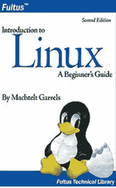
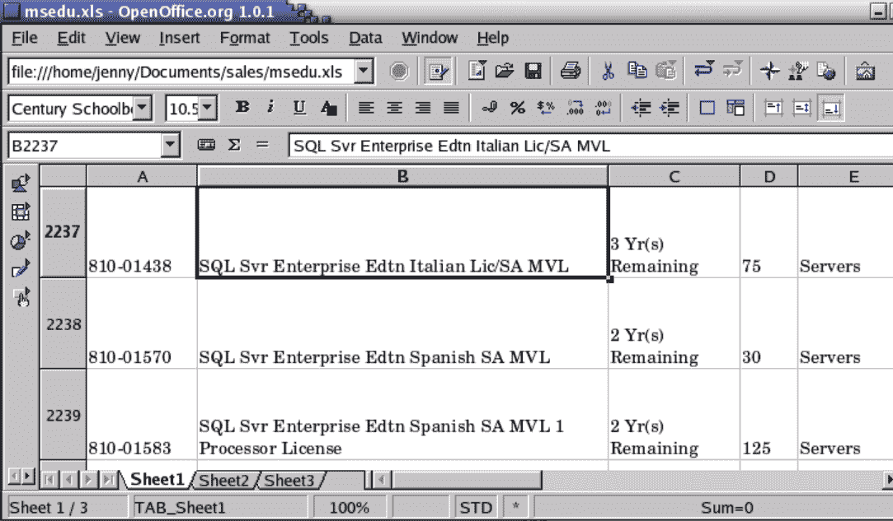
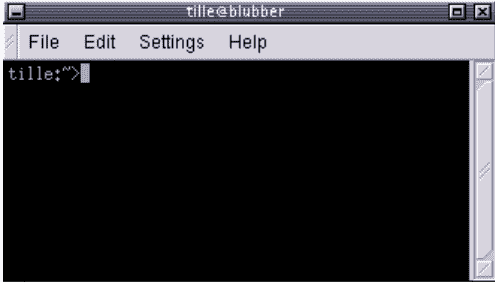
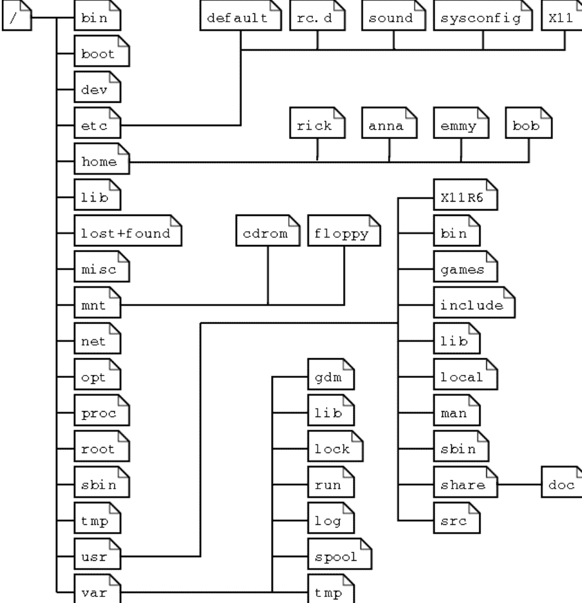
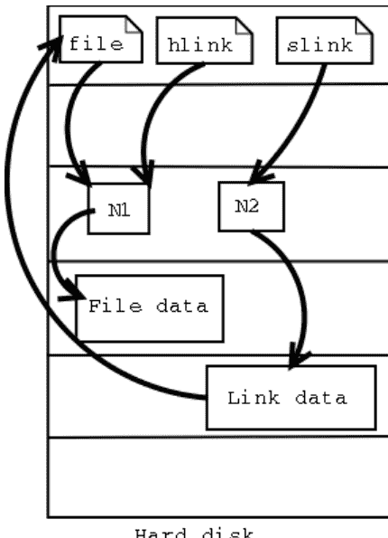
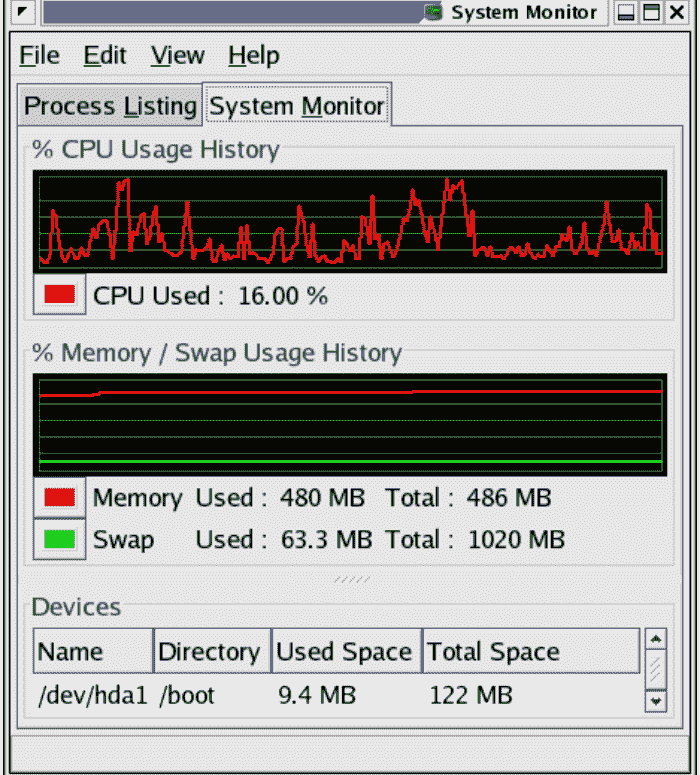
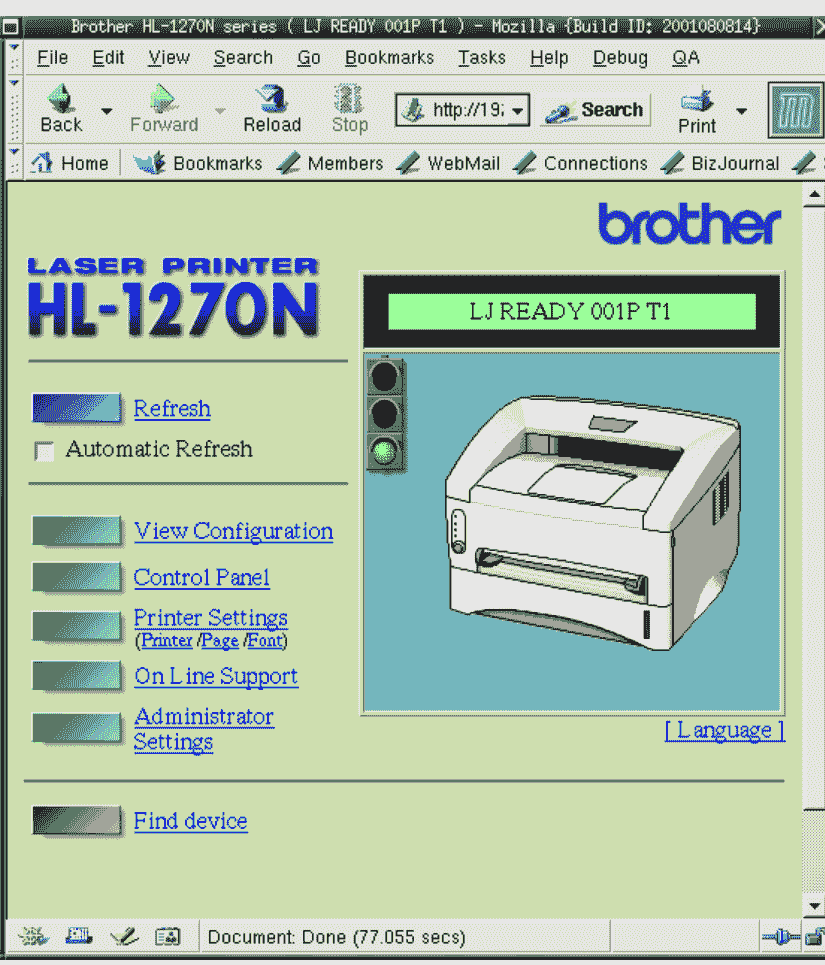
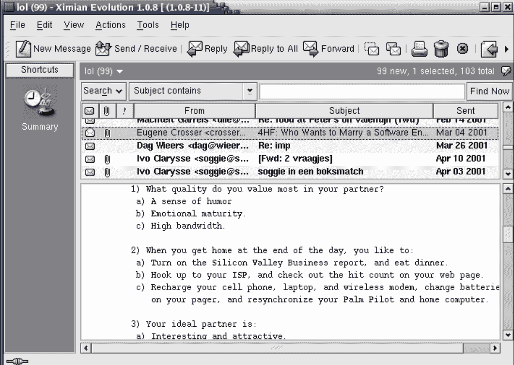
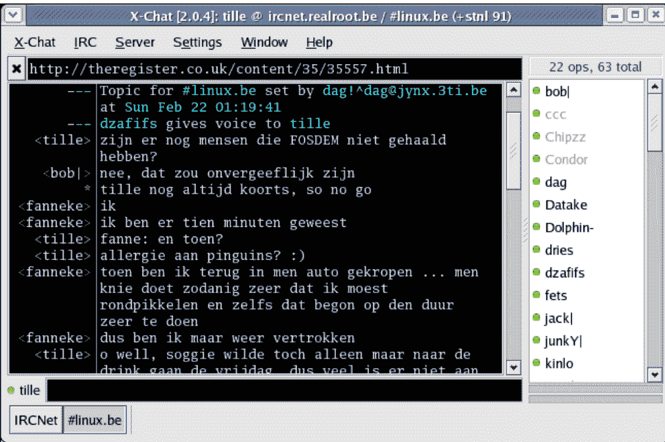

# Linux 入门指南：实用指南

## 目录

- 3.1. 文件系统概览
  - 3.1.1. 文件
  - 3.1.2. 分区
  - 3.1.3. 文件系统布局
- 3.2. 文件系统中的定位
- 4.2.3. GRUB 特性
- 第 9 章 基础备份技术
  - 9.1. 介绍
    - 9.1.1. 准备你的数据
- 10.4.7. Cygwin
- 索引

# 引言

## 1. 为什么要编写本指南？

许多人仍然认为学习 Linux 是困难的，或者只有专家才能理解 Linux 系统是如何工作的。尽管有很多免费的文档可用，但这些文档广泛散落在网络上，而且通常让人感到困惑，因为它们通常是面向经验丰富的 UNIX 或 Linux 用户的。今天，得益于开发的进步，Linux 在家庭和工作场所变得越来越流行。本指南的目标是让所有年龄段的人看到，Linux 可以是简单且有趣的，并能用于各种目的。

## 2. 谁应该读这本书？

本指南是作为 Linux 系统的概述而创建的，旨在为新用户提供探索之旅和入门指南，并在每章末尾配有练习题。对于更高级的训练者，它可以作为一个桌面参考资料，以及进行系统和网络管理所需的基础知识集合。这本书包含了许多真实世界的示例，这些示例源于作者作为 Linux 系统和网络管理员、培训师和顾问的经验。我们希望这些示例能帮助你更好地理解 Linux 系统，并鼓励你尝试自己进行各种操作。

任何想要通过 Linux（以及广义的 UNIX）获得“CLUE”（命令行用户体验）的人都会发现这本书很有用。

## 3. 新版本与获取可用性

本文档发布在 Linux 文档项目（Linux Documentation Project）集合的 Guides 部分，地址为 `http://www.tldp.org/guides.html`；你也可以在这里下载 PDF 和 PostScript 版本。

最新版本可以在 `http://tille.garrels.be/training/tldp/` 获取。

本指南的第二版由 Fultus Books 以纸质按需打印（POD）书的形式出版。Fultus 通过 Ingram & Baker Taylor 将本文分发到许多书店，包括 `Amazon.com`、`Amazon.co.uk`、`BarnesAndNoble.com` 以及 Google 的 Froogle 全球购物门户和 Google 图书搜索。

图 1 Linux 导言封面



该指南由以下人员翻译为印地语：

- Alok Kumar
- Dhananjay Sharma
- Kapil
- Puneet Goel
- Ravikant Yuyutsu

Andrea Montagner 将指南翻译成了意大利语。

# Linux 导言

在发送给 Fultus 之前最后阅读。在“新版本”章节中增加了 Fultus 参考，更新了约定和组织章节。修订了 4、5、6 章，更新了术语表，将 `fileutils` 替换为 `coreutils`，感谢印地语翻译者。

## 5. 反馈

信息缺失、链接缺失或字符缺失？请发送邮件给本文档的维护者：

```
<tille wants no spam at garrels dot be>
```

别忘了先检查最新版本！

## 6. 贡献

非常感谢所有分享经验的人。特别感谢比利时的 Linux 用户每天听取我的建议并总是慷慨提供意见。

特别感谢 Tabatha Marshall 进行了非常细致的修订、拼写检查和样式设计，感谢 Eugene Crosser 发现了我们忽略的错误。

并感谢所有通知我缺失主题并仔细查阅帮助发现定义不清晰和拼写错误的读者。这些人也是帮助我保持指南更新的人，Filipus Klier 在 2005 年和 2006 年进行了全面评审并帮助我将指南引入 Debian 文档集，以及 Alexey Eremenko 为第 11 章提供了基础。

2006 年，Suresh Rajeshkara 创建了本文档的 Debian 包。

最后，感谢目前正在将本文翻译成法语、瑞典语、德语、波斯语、印地语等其他语言的志愿者。这是一项不容小觑的工作，我佩服大家的勇气。

***

我们拒绝任何明示或暗示的保证，但不限于对商品适用性和适用于特定用途的暗示保证。在任何情况下，作者和贡献者均不对因使用本软件而引起的任何直接、间接、特殊、偶然或结果性的损害（包括但不限于替代商品或服务的采购）；数据丢失、利润损失或业务（中断），无论由于何种原因引起，无论基于何种责任理论（无论是合同、严格责任还是侵权行为（包括疏忽或其他形式）），均不承担责任，即使已被告知发生此类损害的可能性。

本书中使用的标志、商标是各自所有者的财产。

你需要一台计算机以及一种包含 Linux 发行版（如光盘或优盘）的介质。本指南的大部分内容适用于所有 Linux 发行版——特别是 UNIX。除了时间之外，没有其他要求。

《安装指南》（Installation HOWTO）包含了有关如何获取 Linux 软件以及将其安装到你的计算机上的有用信息。书中还讨论了硬件要求以及与其他操作系统的共存。

可以从 `linux-iso.com` 以及许多其他位置下载 CD 镜像，参见附录 A。

对于那些不敢在自己的机器上采取实际 Linux 安装步骤的人来说，一种有趣的替代方案是可以在 CD 上运行的 Linux 发行版，例如 Knoppix 发行版。

## 9. 本档中使用的约定

本文使用了以下排版和用法约定：

| 文字类型 | 含义 |
| :--- | :--- |
| "Quoted text" | 人的引用、引用的计算机输出。 |
| terminal view | 从终端捕获的字面计算机输入和输出，通常用浅灰色背景渲染。 |
| `command` | 可以在命令行中输入的命令名称。 |
| `VARIABLE` | 变量名称或指向变量内容的指针，例如 `$VARNAME`。 |
| `option` | 命令的选项，例如 `man ls` 中的 `-o`。 |
| `argument` | 命令的参数，如你在终端窗口中输入命令后随后的内容，如 `hilda@home$ ls -1`。 |
| `command options arguments` | 命令摘要或通用用法，单独成行显示。 |
| `filename` | 文件或目录的名称，例如 `/usr/bin`。 |
| `Key` | 键盘上按的键，如输入 `Q` 退出。 |
| `Button` | 可点击的图形化按钮，如 OK 按钮。 |
| `Menu->Choice` | 从图形化菜单中选择的选项，例如：“在浏览器中选择帮助->关于 Mozilla。” |
| *术语* | 重要的术语或概念：“Linux 内核是系统的核心。” |
| `\` | 终端或命令摘要中的反斜杠表示一个未完成的行。换句话说，如果你看到一个被分成多行的长命令，`\` 意味着“不要按回车”。 |
| See Chapter 1 | 指向指南内相关主题的链接。 |
| The author | 指向外部资源的点击链接。 |

使用了以下图像：

- 这是一个注意（note）
  - 它包含了额外的信息或备注。
- 这是一个小心（caution）
  - 意味着小心。
- 这是一个警告（warning）
  - 请非常小心。
- 这是一个提示（tip）
  - 技巧和窍门。

本指南是 Linux 文档项目（Linux Documentation Project）的一部分，旨在成为你可以从该项目获得的所有其他材料的基础。它为你提供了任何想要开始使用 Linux 系统的人所需的基础知识，同时有意识地避免重复造轮子。因此，你可以预计这本书是完整的，并包含了许多指向你的系统、互联网以及系统文档中额外信息来源的链接。

第一章是对 Linux 主题的介绍；接下来两章讨论了基础命令。第 4 章和第 5 章讨论了更高级但基础的话题。第 6 章是后续学习必需的，因为它讨论了编辑文件，这是你从 Linux 新手变为 Linux 用户所需要的能力。后续章节讨论了你在日常中使用必须处理的较为高级的话题。

所有章节都附有练习，将测试你对下一章的准备情况。

# Linux 简介

## 1.1. 什么是 Linux？

这种语言是专门为创建 UNIX 系统而开发的。使用这种技术，开发一个可以运行在许多不同类型硬件上的操作系统要变得容易得多。

软件供应商迅速地适应了这一点，因为他们几乎毫不费力就能获得十倍的软件。奇怪的情况随之出现：例如来自不同供应商的计算机在同一个网络中通信，或者用户在不同的系统上工作，而无需额外培训即可使用另一台计算机。UNIX 在帮助用户适应不同系统方面做了巨大的努力。

在接下来的几十年里，UNIX 继续持续发展。更多事情变得可能，更多的硬件和软件供应商也在其产品中增加了对 UNIX 的支持。

UNIX 最初仅出现在带有大型机和小型机的大型环境中（注意，PC 是“微型”计算机）。为了接触到 UNIX 系统，你必须在大学、政府或大型金融机构工作。

但更小的计算机正在开发中，到 80 年代末，许多人已经拥有了家用电脑。到那时，已经有了几个适用于 PC 架构的 UNIX 版本，但没有哪一个是真正免费的，更重要的是；它们运行速度都很慢，所以大多数人在家庭 PC 上运行的是 DOS 或 Windows 3.1。

## 1.2. Linux 和 Unix

到 90 年代初，家用 PC 强大到可以运行完整的 UNIX。在赫尔辛基大学学习计算机科学的年轻人林纳斯·托瓦兹（Linus Torvalds）认为，拥有一些免费的学术版 UNIX 并立即开始编码是一个好主意。

他开始提问，寻找能够帮助他将 UNIX 引入 PC 的答案和解决方案。这是他在 `os.comp.linux` 上的早期帖子之一，日期为 1991 年：

```
From: torvalds@klaava.Helsinki.FI (Linus Benedict Torvalds)
Groups: os.comp.linux
Subject: Gcc-1.40 and posix-question
Message-ID: a598130050.9886@klaava.Helsinki.FI
Date: 3 Jul 91 10:00:50 GMT
```

各位网友：

由于我正在计划一个项目（心中），我对标准定义感兴趣。有人能给我提供一个（最好是）机器可读格式的最新 posix 规则吗？有 FTP 站点就很好。

从一开始，Linux 的目标就是拥有一个完全符合原始 UNIX 的免费系统。这就是为什么他询问 POSIX 标准，当时 POSIX 仍然用于 UNIX。

在那个年代，即插即用尚未发明，但很多人对拥有自己的 UNIX 系统感兴趣，以至于这只是一个微小的障碍。各种新硬件的新驱动程序不断出现，且速度不断加快。一旦有新硬件出现，就会有人将其提交到 Linux 测试（这是它逐渐得出的名称），从而为更广泛的硬件发布免费代码。

在那时，这些人被称为“书呆子”或“怪胎”，但对他们来说并不重要，只要硬件列表越变得越长。对于这些人来说，Linux 现在不仅仅是运行在新款 PC 上的理想选择，但它也是老旧和特殊硬件的首选系统，如果 Linux 不存在，这些硬件将毫无用处。

在 Linux 发布帖子两年后，已有 12000 名 Linux 用户。该项目深受爱好者的喜爱，稳步增长，同时保持在 POSIX 标准范围内。在接下来的几年里，UNIX 的所有功能都被添加了，使其成为了今天这种成熟的操作系统 Linux。Linux 是一个完整的 UNIX 克隆版本，可以免费用于工作站以及中、高端服务器。今天，硬件和软件市场上的许多重要参与者都有自己的 Linux 开发者团队；在你的当地经销商那里，你可以买到预装了带有官方支持的 Linux 系统——尽管如此，仍许多硬件和软件不受支持。

### 1.2.1. Linux 系统的当前应用

Linux 已经进入桌面市场。Linux 开发者最初专注于网络和业务，而办公应用程序是最后一个被攻克的屏障。我们不愿承认微软主宰着这个市场，因此在过去的几年里启动了许多替代方案，以让 Linux 成为工作站可以接受的选择，提供易用的用户界面和兼容 MS 的应用程序，如文字处理器、电子表格、演示文稿等。

在服务器端，Linux 以稳定、可靠的平台而闻名，为亚马逊（知名的在线书店）、美国邮政、德国陆军等许多公司提供数据库和交易服务。特别是互联网和互联网服务提供商非常喜欢 Linux 作为防火墙、代理和 Web 服务器，你会发现每个欣赏舒适管理集群的 UNIX 管理员手边都能可及一台机器。集群机器用于制作《泰坦尼克号》、《史瑞克》等电影。在邮政局，它们是路由邮件的神经中枢；在搜索引擎中，集群用于执行互联网搜索。这些只是 Linux 每天在全球范围内执行的几项重大任务。

同样值得注意的是，现代 Linux 不仅运行在工作站、中高端服务器上，还运行在 PDA、手机等“小设备”上、大量的嵌入式应用以及实验性手表上。这使得 Linux 成为世界上唯一涵盖如此广泛硬件范围的操作系统。

## 1.3. 用户界面

### 1.3.1. Linux 困难吗？

Linux 学习是否困难取决于个人。由于它的结构，Linux 允许用户成长，它让新用户和经验丰富的用户都受益。在 Linux 早期，人们看到工具让用户感到困难。

但 Linux 社区让人们意识到，Linux 的重要程度远超那些尚未看到桌面的人。桌面开发者正付出巨大努力打造出你从未见过的最美桌面，或者让你的 Linux 机器看起来像 Windows 或 Apple 工作站。最新的开发还包括 3D 加速支持和 USB 设备支持、系统和软件包的一次点击更新等。Linux 以人们可以理解的形式呈现所有可用服务。以下包含了一些优秀示例的列表；这些网站有很多截图，可以让你窥见 Linux 桌面的样子：

- `http://www.gnome.org`
- `http://kde.org/screenshots/`
- `http://www.openoffice.org`
- `http://www.mozilla.org`

## 1.4. Linux 有未来吗？

### 1.4.1. 开源


开源软件的理念非常简单：当程序员可以阅读、分发和更改代码时，代码就变得重要。人们可以对其进行调整、修复、调试，其速度远超传统公司软件开发者的性能。与使用传统渠道开发的软件相比，这种软件更有灵活性且质量更好，因为有更多的人在不同的条件下对其进行了测试。

向商业界阐明这一点的开源倡议进展非常缓慢，商业供应商正开始意识到其中的价值。由于许多学术界和技术人员 20 年前就已经说服了这是正确的道路，商业需要的互联网应用让他们意识到可以从开源中获利。Linux 已经越过了它几乎仅仅是一个学术系统的阶段，仅对少数具有技术背景的人有用。

# Linux 简介

现在 Linux 不仅仅是一个操作系统：它有一整套基础设施，支持着创建操作系统的整个工作链、为之制作和测试程序、将一切交付给用户、提供维护、更新和定制等。今天，Linux 已经准备好迎接瞬息万变世界的挑战。

## 1.3.2. 十年经验为您提供服务

虽然 Linux 可能是最著名的开源倡议，但还有另一个项目对 Linux 操作系统的普及做出了巨大贡献。这个项目被称为 `SAMBA`，它的成就是是对服务器消息块（`SMB`）通用文件系统（`CIFS`）协议的逆向工程，该协议用于 PC 相关机器的文件传输和打印，并被 `MS Windows NT`、`OS2` 和 Linux 原生支持。现在几乎每个系统都有相应的软件包，并为混合环境提供了使用 `MS Windows` 协议的互连解决方案：兼容 Windows（最高支持但不限于 `WinXP`）的文件和打印服务器。

可能比 `SAMBA` 项目更成功的是 `Apache HTTP` 服务器。该服务器运行在 `UNIX`、`Windows NT` 和许多其他系统上。它最初被称为 "A PatChy server"（一个补丁服务器）”，基于现有代码和一系列“补丁文件”，其成熟代码的名称应当与美洲印第人 `Apache` 部族联系起来，他们以卓越的战争策略技巧和无穷的耐力闻名。事实证明 `Apache` 比许多其他服务器更快、更稳定且功能更全。`Apache` 运行在每天数百万访问者的网站上，虽然开发者没有提供官方支持，但 `Apache` 用户社区为你的所有问题提供了解答。现在，已有许多第三方提供商业支持。

在办公应用类别中，有多种 `Office` 套件克隆版本供选择，涵盖了从 `MS Windows` 工作站应用的部分实现到完整实现。这些倡议对 Linux 在桌面市场的接受度有很大帮助，因为用户不需要培训就能学会如何使用它们。成功来自于普通用户，而非他们的赞美，还来自于他们的特定需求，这些需求每天变得越来越复杂和苛刻。

开源社区主要由贡献了十余久的人士组成，他们确保了 Linux 在桌面市场以及通用 IT 应用中的重要地位。付费员工和志愿者同样在勤勤工作，使 Linux 能够保持其市场地位。用户越多，问题就越多。开源社区确保答案的出现，并以怀疑的目光监控答案的质量，从而提高了稳定性和可访问性。

列出所有可用的 Linux 软件超出了本指南的范围，因为有数千个软件包。本课程将为您介绍最常用的软件包，这些软件包几乎都是免费提供的。为了消除初学者的一些恐惧，这里有一张你最需要的程序的截图。你可以自己看到，并没有花费任何精力来让从 `Windows` 切换过来的用户感到不适：

图 1-1. OpenOffice MS 兼容电子表格



## 1.4 Linux 的特性

### 1.4.1. Linux 优点

Linux 的许多优势源于其起源，深根于 `UNIX`，当然，第一个优势除外：

- Linux 是免费的；
- 俗话所说，“免费的啤酒（`free beer`）”。如果你想一分钱都不花，甚至不需要支付 `CD` 的钱。你可以完全从互联网上免费下载整个 Linux。没有注册费，没有按用户收费，有更新，并且如果你想更改系统行为，还有免费提供的源代码。

最重要的是，Linux 在言论自由上也是免费的：

常用的许可证是 `GNU` 通用许可证 (`GPL`)。该许可证规定，任何想这样做的人都有权修改 Linux 并最终重新发布修改过的版本，条件是代码在修改后仍然可用。

- Linux 易于移植到任何硬件平台；
- 对于某些情况，例如运行在 Linux 上，相关信息可以免费获取。
- Linux 是为了持续运行而设计的：
- 就像 `UNIX` 一样，Linux 系统在运行时不需要频繁重启。
- Linux 安全且多功能：
- Linux 使用的安全模型基于 `UNIX` 理念，已知是健壮且经过验证的。但它能够轻松适应其他情况，你的防火墙。
- Linux 具有良好的扩展性：
- 从 `2 MB` 内存的掌上电脑到数百个节点的 `PB` 级集群：添加或删除相应的软件包，Linux 都能胜任。你不需要超级计算机，因为你可以使用提供的构建块来完成。无论是为嵌入式处理器，还是回收旧的 `486`，Linux 也能胜任。
- Linux 系统和大多数 Linux 应用的调试时间非常短：

> 因为 Linux 由数千人进行开发和测试，错误从发现到修复之间通常只有几个小时。

### 1.4.2. Linux 缺点

- 发行版太多了：

> “人多口杂”，正如罗马人以前就说过的：人越多，意见越多。初看之下，Linux 发行版的数量可能令人恐惧或荒谬，这取决于你的观点。但也意味着每个人都能找到自己需要的。你不需要成为专家就能找到合适的版本。

当被问及时，每个 Linux 用户都会说他们正在使用的版本是最好的。那么你应该选择哪一个呢？

- Linux 对初学者不够友好且令人困惑：
- 必须说，Linux 在核心上比 `MS Windows` 不友好，无疑比 `MacOS` 更困难，但……考虑到它的普及性，可以认为努力已经让 Linux 变得更容易使用，特别是对于新用户。更多信息正在发布中。

# Linux 简介

每日，例如本指南，旨在填补面向各个水平用户的文档空白。

- 难道一个开源产品值得信赖吗？
- 一个免费的东西怎么可能是可靠的？Linux 用户可以选择是否使用 Linux，这与不具备这种自由的专有软件相比，赋予了他们巨大的优势。专有软件没有这种自由。经过长时间的测试，大多数 Linux 用户得出了结论：Linux 不仅老旧，而且在许多情况下比传统解决方案更好、更快速。如果 Linux 不值得信赖，它早已消失了，更不会有现在如今数百万用户的普及程度。现在，用户可以影响自己的系统并与社区分享见解，因此系统每天都变得越来越好。这是一个永不完结的项目，事实如此，但在不断变化的环境中，Linux 也是一个不断追求完美的项目。

## 1.5. Linux 发行版（Flavors）

### 1.5.1. Linux 与 GNU

尽管有大量的 Linux 实现，但你会在不同的发行版中发现许多相似之处，就像每台 Linux 机器都是一个装有积木的盒子，你可以根据自己的喜好和需求将其组合。安装系统只是长期关系的开始。当你拥有一个运行的系统时，Linux 将模拟你的想象力和创造力，你越意识到系统能带给你什么，就越会尝试完善它的局限。

Linux 的外观取决于发行版、你的硬件和个人品味，但构建所有图形界面的基础保持不变。该系统基于 `GNU` 工具（`GNU` 代表 "`GNU` 不是 `Unix`"），这些工具提供了一套处理和使用系统的标准。所有的 `GNU` 工具都是开源的，因此它们可以安装在任何系统上。大多数发行版提供常用工具的预编译包，例如 `RedHat` 上的 `RPM` 包和 `Debian` `Debian` 包（也称为 `deb` 或 `dpkg`），所以你不需要成为一个在系统上手动安装包的程序员。然而，如果你自己亲手完成操作，你会更喜欢 Linux，因为大多数发行版都带有一套完整的开发工具，允许纯粹从源代码安装新软件。这种设置还让你在软件没有针对你的系统的预包格式时，也能对其进行安装。

`GNU` 软件列表：

- `Bash`: `GNU Shell`
- `GCC`: `GNU C` 语言编译器
- `GDB`: `GNU` 调试器
- `Coreutils`: 一组基础 `UNIX` 风格工具，如 `cat` 和 `chmod`
- `Findutils`: 用于搜索和查找文件
- `Fontutils`: 用于将字体从一种格式转换为另一种格式或制作新字体
- `Gimp`: `GNU` 管理程序
- `Gnome`: `GNU` 桌面环境
- `Emacs`: 一个非常强大的编辑器
- `Ghostscript` 和 `Ghostview`: `PostScript` 文件的解释器和图形前端
- `GNU Photo`: 与数字摄像机交互的软件
- `Octave`: 一种编程语言，主要用于数值计算和处理。
- `GNU SQL`: 关系数据库系统
- `Radius`: 远程认证和计费服务器
- ...

### 1.5.2. GNU/Linux

Linux 内核（你系统的骨架，见下文）是基础。该系统基于 `GNU` 工具（`GNU` 不是 `Unix`），这些工具提供了一套处理和使用系统的标准。所有的 `GNU` 工具都是开源的，因此它们可以安装在任何系统上。大多数发行版提供常用工具的预编译包，例如 `RedHat` 上的 `RPM` 包和 `Debian` `Debian` 包（也称为 `deb` 或 `dpkg`），所以你不需要成为一个在系统上手动安装包的程序员。`Novell Red Carpet` 是 `RPM` 的第三方实现，带有图形前端。其他第三方软件供应商可能有它们自己的安装程序，有时类似于 `InstallShield`，以及著名的 `MS Windows` 和其他平台的程序。随着你深入学习 Linux，你可能会接触其中一个或多个程序。

### 1.5.3. 我应该选择哪个发行版？

在安装之前，最重要的因素是你的硬件。某些发行版是经过良好测试的。对于初学者来说，以下是非常好的选择：

- `Ubuntu`
- `Debian`
- `SuSE`
- `Mandriva`

# Linux 简介

- 这台电脑连接了网络吗？它的主机名是什么？`IP` 地址是什么？是否有网关服务器或其他我的机器需要通信的其他重要网络设备？

> Linux 期望自己是处于网络状态的

不使用网络或配置不当可能会导致启动缓慢。

- 这台电脑是网关/路由器/防火墙吗？（如果你必须得思考这个问题，那么它可能不是）
- 分区：这次让安装程序来处理吧，我们稍后详细讨论分区。
- 如果你的 Linux 发行版没有提供默认分区，那可能意味着它不适合初学者。
- 系统将以文本模式还是图形模式启动？
- 为这台机器的管理员（`root`）想一个好密码。创建一个非 `root` 用户账户（对系统的非特权访问）。
- 我需要救援盘吗？（推荐）
- 我想要哪些语言？

完整的检查清单可以在 `http://www.tldp.org/HOWTO/Installation-HOWTO/index.html` 找到。

在接下来的章节中，我们将确认安装是否成功。

# 第 2 章 快速入门

为了充分利用本指南，我们将立即开始一个关于连接 Linux 系统并进行一些基础操作的实战章节。

我们将讨论：

- 连接到系统
- 断开系统连接
- 文本模式和图形模式
- 修改你的密码
- 在文件系统中导航
- 确定文件类型
- 查看文本文件
- 查找帮助

## 2.1. 登录、激活用户界面和注销

### 2.1.1. 简介

为了直接在 Linux 系统上工作，你需要提供用户名和密码。你始终需要对系统进行验证。正如我们在第 1 章的练习中提到的，大多数基于 `PC` 的 Linux 系统有两种基本的系统运行模式：要么是在文本控制台模式下快速且简洁（看起来像带鼠标的 `DOS`，具有多任务和多用户功能），要么是在图形模式下（外观更好但消耗更多系统资源）。

### 2.1.2. 图形模式

这是目前大多数台式电脑的默认模式。当你第一次被要求输入用户名时，将使用图形模式连接到系统，然后在新窗口中输入密码。

要登录，在登录窗口中移动鼠标光标，向系统提供用户名和密码，然后点击 `OK` 或按 `Enter` 键。

> 不要用那个 `root` 账户！

通常认为使用 `root` 用户（系统管理员账户）进行（图形化）连接是一个坏主意，因为使用图形界面意味着包含了许多额外的程序，而对于 `root` 来说还拥有许多额外的权限。为了将所有风险降到最低，请使用普通用户账户进行图形连接。但有足够的风险让我们记住这一作为使用 `root` 账户的通用建议：只有在需要额外权限时才以 `root` 身份登录。

输入用户名/密码组合后，图形环境的启动可能需要一段时间，这取决于你电脑的 `CPU` 速度、你使用的软件以及个人设置。

# Linux 简介

继续后续，你需要打开一个终端窗口或 `sterm`（`x` 是支持图形环境的底层软件的名称）。根据你使用的窗口管理器，可以在“应用程序->工具”、“系统工具”或“互联网”菜单中找到此程序。可能会有图标可以作为打开 `sterm` 窗口的快捷方式，在桌面背景上点击鼠标右键通常会弹出一个包含终端窗口应用程序的菜单。

在浏览菜单时，你会发现很多事情不需要通过键盘输入命令就可以完成。对于大多数用户来说，处理计算机的老旧“点点”方法就足够了。但本指南是面向未来的网络和系统管理员的，他们需要干涉系统的核心。你需要一个比鼠标更强大的工具来处理他们将面临的所有任务。这个工具就是 `shell`，当[在]图形模式下，我们通过打开终端窗口来激活它。

终端窗口是你系统的控制面板。后续几乎所有的操作都是使用这个简单但强大的文本工具完成的。当你打开终端窗口时，它应该始终显示提示符。目录由波号 (`~`) 表示：

# 图 2-1 终端窗口



提示符另一种常见形式是：

```
user@host dir ~
```

在上面的示例中，`user` 将是你的登录名，`host` 是你正在工作的机器名称，`dir` 是你在文件系统中当前位置的指示。


稍后我们将详细讨论提示符及其行为。现在，只需知道提示符显示了各种信息，但它们并不是你用于操作系统的命令的一部分。

要在图形模式下断开与系统的连接，你需要关闭所有终端窗口和其他应用程序。之后，点击注销图标或在菜单中找到“注销”（Log Out）。关闭所有内容并不是真的必要，系统可以为你完成，但会话管理可能会在你再次连接时将所有当前应用程序放回屏幕，这会花费更长时间，而且并不总是你想要的效果。然而，这种行为是可以配置的。

当你再次看到登录屏幕并要求输入用户名和密码时，说明注销成功了。

使用 Gnome 还是 KDE？

# 第 2 章 快速入门

## Linux 简介

我们提到了两次 Gnome 和 KDE 桌面。这些是管理桌面的最流行的方式，尽管还有许多许多其他选择。无论你选择什么桌面都可以——只要你知道如何打开终端。然而，我们将继续引用 Gnome 和 KDE 作为最常用的操作方式。

### 2.1.3 文本模式

当你知道处于文本模式时，整个屏幕是黑色的，显示着（通常是白色的）字符。文本模式屏幕通常会显示有关你正在工作的机器的信息、机器名称以及等待你登录的提示符：

```
RedHat Linux Release 8.0 (Psyche)
login: _
```

登录与图形登录不同在于，提供用户名后必须按下 `Enter` 键，因为屏幕上没有可以点击的按钮。然后你应该输入密码，接着再次按 `Enter`。在输入内容时你不会看到任何指示，且光标也不会移动。但这在 Linux 上是正常的，而且出于安全考虑。

之后，你将获得一个 shell，带有与图形模式下相同的提示符。

> **不要以 root 登录**
>
> 同样在文本模式下：只有在绝对需要管理员权限的情况下以 `root` 登录，例如添加用户、安装软件包以及执行网络和其他系统配置。完成后，立即离开特殊账户并恢复以非特权用户身份工作。或者，某些系统（如 Ubuntu）强制你使用 `sudo`，这样你就不需要直接访问管理员账户。注销是通过执行 `logout` 命令并按 `Enter` 完成的。当你再次看到登录屏幕时，已成功断开与系统的连接。

> **电源按钮**
>
> 虽然 Linux 并不设计为在不激活适当停止系统程序的情况下关闭，但在较新的系统上，按下电源按钮等同于启动这些程序。然而，对于旧系统，不通过停止程序关机可能会导致损坏！如果你想万无一失，请在从图形界面注销时始终使用“关机”，或者在登录屏幕（你需要提供用户名和密码的地方）上寻找关机按钮。

## 2.2 基础知识

### 2.2.1 命令

这些是启动工作所需的快速命令；我们稍后会进行更详细的讨论。

**表 2-1. 快速启动命令**

| 命令 | 含义 |
| --- | --- |
| `ls` | 显示当前工作目录下的文件列表，类似于 DOS 中的 `dir` 命令 |
| `cd directory` | 切换目录 |
| `password` | 更改当前用户的密码 |
| `file filename` | 显示名为 `filename` 的文件类型 |
| `cat textfile` | 在屏幕上输出 `textfile` 的内容 |
| `pwd` | 显示当前工作目录 |
| `exit` or `logout` | 退出会话 |
| `man command` | 读取命令的 man 页（帮助文档） |
| `info command` | 读取命令的 info 页面 |
| `apropos string` | 在 whatis 数据库中搜索字符串 |

### 2.2.2 通用说明

你在提示符后输入这些命令，可以在图形模式或文本模式的终端窗口中进行，然后按回车键。

命令可以通过自身来识别，例如 `ls`。当你指定一个选项时（通常以破折号 `-` 开头，如 `ls -a`），命令的行为会有不同。同一个选项字符对于另一个命令可能具有不同的含义。GNU 程序接受以双破折号 `--` 开头的长选项，例如 `ls --all`。某些命令没有选项。

命令的参数指定了你想要让命令生效的对象。一个例子是 `ls /etc`，其中 `/etc` 目录就是 `ls` 命令的参数。这表示你想查看该目录的内容，而不是默认的内容（即通过仅输入 `ls` 并按回车获取的当前目录内容）。某些命令需要参数，有时甚至需要多个参数。

你可以通过检查该命令的在线帮助（第 2.3 节）来确定命令是否接受选项和参数，以及哪些是有效的。

在 Linux 中，像在 UNIX 中，目录之间用斜杠 `/` 分隔，类似于网页地址（URL）中使用的。我们稍后将深入讨论目录结构。

涉及目录时，符号 `..` 和 `.` 有特殊含义。我们将尝试在练习中发现它们，并在下一章学习更多内容。

### 2.2.3 使用 Bash 特性

几个关键组合键允许你使用 GNU Shell（Bash）更容易、更快速地完成任务，Bash 是任何 Linux 系统的默认 Shell（第 3.2.3.2 节）。以下是最常用特性列表；强烈建议养成使用这些功能的习惯，以便从一开始就充分利用 Linux 体验。

| 键或组合键 | 功能 |
| --- | --- |
| `Ctrl+A` | 将光标移动到命令行的开头。 |
| `Ctrl+C` | 结束正在运行的程序并返回提示符，见第 4 章。 |
| `Ctrl+D` | 退出当前 shell 会话，等同于输入 `exit` 或 `logout`。 |
| `Ctrl+E` | 将光标移动到命令行的末尾。 |
| `Ctrl+H` | 生成退格键（backspace）字符。 |
| `Ctrl+L` | 清空当前终端。 |
| `Ctrl+R` | 搜索命令历史，见第 3.3.3.4 节。 |
| `Ctrl+Z` | 挂起程序，见第 4 章。 |
| 左箭头和右箭头 | 将光标向左或向右移动，以便在开头结尾以外的地方插入字符。 |
| 上箭头和下箭头 | 浏览历史。跳转到你想重复的行，必要时编辑细节，然后按回车保存。 |
| `Shift+PageUp` 和 `Shift+PageDown` | 浏览终端缓冲区（查看已“滚出”屏幕的内容）。 |
| `Tab` | 命令或文件补全：当有多种选择时，系统会发出音频或视觉铃声信号，或者如果可能选项过多，会询问你是否想查看所有选项。 |
| `Tab Tab` | 显示文件或命令的补全选项。 |

上述表格中的最后项可能需要额外的解释。例如，如果你想切换到目录 `directory_with_a_very_long_name`，你并不会输入那个非常长的名字。不，你只需要使用命令 `cd dir`，然后按 `Tab` 键，如果没有其他以字符 "d" 开头的项目，shell 就会自动为你补全名称。当然，你也可以直接输入 `cd` 然后按 `Tab`。如果有多个文件以相同的字符开头，shell 会向你提示这一点，此时你可以连续按两次 `Tab`（间隔很短），shell 就会展示你拥有的选择：

```
your_prompt> cd st
starthere stuff stuffit
```

在示例中，如果你在前两个字符后输入 "a" 并再次按 `Tab`，将没有其他可能了，shell 会完成目录名称，而无需你输入 "rther"：

```
your_prompt> cd starthere
```

当然，你仍然需要按回车键来接受此选择。

在同一个示例中，如果你输入 "ls" 然后按 `Tab`，shell 会显示所有以 "ls" 开头的选项。如果你想看到所有选项，两次 `Tab` 会列出所有以 "ls" 开头的命令：

```
your_prompt> ls
ls-
ls-al-
ls-F
ls-
```

## 2.3 获取帮助

### 2.3.1 警告

在 Linux 和 UNIX 中，目录都用斜杠 `/` 分隔。在 Linux 中，你可以使用 `man` 命令来获取帮助。

### 2.3.2 man 页

阅读文档应该成为你的本能。特别是在刚阶段，阅读系统文档、基础命令手册、HOWTO 等是非常重要的。由于文档量极其巨大，不可能包含所有相关文档。本书将尝试引导你找到所讨论的每个主题的最合适文档，以培养阅读主页的习惯。

阅读页面通常在图形窗口中进行，或者在文本模式下。输入该命令并按回车。

```
username@your:~$ man ls
```

```
NAME
       ls - list directory contents

SYNOPSIS
       ls [OPTION]... [FILE]...

DESCRIPTION
       List information about the FILEs (the current directory by default).
       Sort entries alphabetically if none of -cftuvSUX nor --sort is specified.

       Mandatory arguments to long options are mandatory for short options too.
       -a, --all
              do not ignore entries starting with .
       -A, --almost-all
              do not list implied . and ..
       ...
```

使用空格键翻到下一页。可以使用 `b` 键返回上一页。当你到达末尾时，`man` 将退出并返回提示符。如果你想在到达末尾之前离开页，或者查看器没有在末尾自动退出，请按 `q`。

#### 分页器

操作 man 页的可用组合取决于你发行版使用的分页器。大多数发行版使用 `less` 来查看 man 页并滚动。详情见第 3.3.4.2 节。

每个 man 页包含几个标准部分，正如我们从示例所示：

*   第一行包含你正在阅读的命令名称以及该 man 页所在的章节 ID。man 页按章节排序。命令可能有多个页面，例如用户部分的 man 页、管理员部分的 man 页以及程序员部分的 man 页。
*   给出命令名称和要描述，用于构建页面索引。你可以使用 `apropos` 命令在索引中查找任何指定的字符串。
*   命令的摘要提供了命令可以接受的所有选项和/或参数的技术通知。你可以将其视为执行命令的模型。参数就是你执行命令的对象。某些命令没有选项或参数。可选选项和参数放在 `[` 和 `]` 之间，表示它们可以省略。
*   命令的更详细描述。
*   列出了选项及其描述。选项通常可以组合。如果不是，本节将说明。
*   环境描述了影响此命令行为的变量（并非所有命令都有此项）。
*   有时会提供针对该命令的特定章节。
*   “SEE ALSO”（另见）部分会提供其他 man 页（帮助手册）的引用。括号内是查找该内容的 man 页编号。经验用户通常使用 `/` 命令后接字符串 `SEE` 并按回车来切换到“SEE ALSO”部分。
*   通常还有关于已知 bug（异常）的信息，以及在何处报告新 bug。
*   可能包含作者和版权信息。

某些命令有多个页面。例如，`passwd` 命令在第 1 节有一个 man 页，在第 5 节有另一个。默认情况下，显示编号最低的 man 页。如果你想查看默认之外的其他章节，可以在 `man` 命令后指定它：

```
man 5 passwd
```

如果你想连续查看关于某个命令的所有 man 页，请对 `man` 使用 `-a` 参数：

```
man -a passwd
```

这样，当你到达第一个 man 页的末尾并再次按下空格键时，将显示下一个章节的 man 页。

### 2.3.3 更多信息

#### 2.3.3.1 Info 页

除了 man 页之外，你还可以使用 `info` 命令阅读关于命令的 Info 页。这些通常包含更更新的信息，且更容易使用。某些命令的 man 页会引用 Info 页。

在终端窗口中输入 `info info` 开始使用：


File: `info.info`, Node: Top, Next: Getting Started, Up: (dir)
Info: An Introduction
****************
Info 是一个程序（你现在正在使用），用于阅读计算机程序的文档。GNU 项目分发 Info 格式的在线手册，因此你需要一个名为 `Info reader` 的程序来阅读这些手册。你正在使用的就是其中一个。

如果你是 Info 的新手并想学习如何使用它，请现在输入命令 `h`。它将带你进入一个预设的指令序列。要学习高级 Info 命令，请输入两次 `n`。这会带你进入“Info for Experts”（专家级），跳过“Getting Started”（入门）章节。

Menu:
* Getting Started: 如何使用 Info 阅读器入门。
* Advanced Info:: Info 内部的高命令。
* Creating an Info File: 如何创建你自己的 Info 文件。
--zz-Info: (info.info.gz)Top, 24 lines --Top

# 第 2 章 快速上手

## Linux 简介

使用方向键浏览页面，并将光标移动到带有星号（*）的行，该行包含你感兴趣的关键词，然后按下 `Enter`（回车）。使用 `P` 和 `N` 键跳转到上一个或下一个主题。空格键将带你翻页，无论这是开始一个新主题还是更多命令的 Info 页。使用 `Q` 退出。`info` 程序有更多信息。

### 2.3.3.2 whatis 和 apropos 命令

使用 `whatis` 命令可以获取命令说明的简短索引，如下例所示：

```
[your_prompt] whatis ls
ls (1) - 列出目录内容
```

这将显示关于命令的简短信息，且 man 页集合中的第一节包含一个相应的页面。

如果你不知道从哪里开始以及应该读哪个 man 页，`apropos` 会提供更多信息。如果你不知道如何启动浏览器，可以输入以下命令：

```
another_prompt> apropos browser
Galeon [galeon] (1) - gecko-GNOME 浏览器
lynx (1) - 用于万维网的通用分布式信息浏览器
cctfp (1) - 文件传输协议浏览器
opera (1) - 图形化 浏览器
pilot (1) - Pine Corner 风格的简单文件系统浏览器
pinfo (1) - 基于 curses 的 lynx 风格 info 浏览器
pinfo [man] (1) - 基于 curses 的 lynx 风格 info 浏览器
views (16) - Xt 的图形化字符浏览器
```

按下 `Enter` 后，你会看到机器上有很多与浏览器相关的内容：不仅有浏览器，还有文件和 FTP 浏览器，以及文档浏览器。如果你安装了开发包，可能还会有有关编写浏览器相关程序的配套 man 页。通常，一个在某一章节（标记为“(1)”）中具有 man 页的命令，适合作为应用程序来启动 `galeon`、`lynx` 或 `opera` 命令，因为这些命令显然与浏览万维网有关。

### 2.3.3.3 --help 选项

大多数 GNU 命令都显示 `--help`，它会提供关于如何使用该命令的简短说明以及可用选项列表。以下是该选项配合 `cat` 命令的输出：

```
userprompt@host: cat --help
Usage: cat [OPTION] [FILE]...
将 FILE(s) 或标准输入连接到标准输出。

-A, --show-all               等于 -vET
-b, --number-nonblank        显示非空输出行编号
-e, --show-ends              等于 -vE
-E, --show-ends              在每行末尾显示 $
-n, --number                 显示所有输出行编号
-s, --squeeze-blank          从不连续出现超过一个空行
-t                           等于 -vT
-T, --show-tabs              将 TAB 字符显示为 ^I
-u                           (忽略)
-v, --show-nonprinting       使用 ^ 和 M 表示法，除 LFD 和 TAB 外
--help                       显示此帮助并退出
--version                    输出版本信息并退出
```

如果没有 FILE，或 FILE 为 `-`，则读取标准输入。

向 `<bug-textutils@gnu.org>` 报告 bug。

### 2.3.3.4 图形化帮助

如果你偏好图形用户界面，不要放弃。Konqueror 作为 KDE 的默认文件管理器，提供了便捷且彩色的 man 页和 Info 页访问。你可能想在位置地址栏尝试 `info:info`，你将获得一个关于 info 命令的可浏览 Info 页。同样，`man:ls` 将向你展示 ls 命令的 man 页。你可以获得命令补全：你将在滚动菜单中看到所有以 "ls" 开头的命令。在位置工具栏中输入 `info:/dir` 将显示按实用分类排列的所有 Info 页。优秀的帮助内容，包括 Konqueror 手册。可以通过菜单或在终端窗口中输入命令 `konqueror` 启动。**图 2-2. Konqueror** (img/bf2147172a0542183709_png)

Gnome 帮助浏览器非常友好。你可以从 Gnome 菜单选择“应用程序->帮助”开始，或者点击你的主目录，或者从命令行开始。GUI 对于系统文档的一个巨大优势是所有信息都是完全互连的，你可以点击“SEE ALSO”部分以及任何出现链接的地方，从而在不中断的情况下获取知识。

### 2.3.3.5 特殊情况

某些命令没有独立的文档，因为它们是另一个命令的一部分。`cd`、`exit`、`logout` 和 `pwd` 就是这样的例外。它们是你 shell 的一部分，被称为 shell 内命令。有关这些信息，请参阅你 shell 的 man 或 info 页。更多详情请参见第 3.2.3 节。

如果你更改了系统配置，可能 man 页仍然存在，但由于环境发生变化而不可见。在这种情况下，你需要检查 `MANPATH` 变量。第 7.2.1.2 节解释了解决方法。

某些包仅在 `/usr/share/doc` 目录下有一组指令或引用。参见第 3.3.4 节显示。

最糟糕的情况下，你不小心删除了系统中的文档（希望不是无意的，故意这样做是一个非常糟糕的主意）。在这种情况下，首先尝试使用搜索工具确保没有剩余内容，继续阅读第 3.3.3 节。如果是，你可能需要重新安装包含该文档命令的包，参见第 7.5 节。

## 2.4 总结

Linux 传统在文本模式或图形模式下运行。由于现在 CPU 性能和内存不再是成本，每个 Linux 用户负担得起在图形模式下工作并且乐意这样做。这并不意味着你不需要了解文本模式：在整个课程中，我们将在环境中工作，使用终端窗口。

Linux 鼓励用户获取知识并变得独立。为了实现这一目标，你不可避免需要阅读大量文档；正如你注意到的，对于书中列出的几乎每个命令、工具和问题，我们都会引用额外的文档。读得越多，就会变得越容易，翻阅手册的速度也越快。尽早养成阅读的习惯。当你不知道问题的答案时，查阅文档应该成为本能。

我们已经学习了命令：

表 2-3. 第 2 章的新命令：基础

| 命令 | 含义 |
| --- | --- |
| `apropos` | 搜索关于命令或主题的信息。 |
| `cat` | 显示一个或多个文件的内容。 |
| `cd` | 切换到目录。 |
| `exit` | 退出会话。 |
| `file` | 获取文件内容的信息。 |
| `info` | 读取关于命令的 Info 页面。 |
| `logout` | 退出会话。 |
| `ls` | 列出目录内容。 |
| `man` | 读取命令的手页。 |
| `passwd` | 修改你的密码。 |
| `pwd` | 显示当前工作目录。 |

## 2.5 练习

你所学的大部分内容都是通过错误以及观察事情是如何出错的获得的。这些练习是为了让你阅读一些错误信息。你执行这些练习的顺序非常重要。

不要忘记在命令行中使用 Bash 的特性：尽量尝试用尽可能少的字符来完成练习！

### 2.5.1 连接与断开连接

- *确定你是在文本模式还是图形模式下工作。*

我正在文本/图形模式下工作。（请划掉不适用的）
- 使用你在安装期间为自己创建的用户名和密码登录。
- 登出。
- 使用一个不存在的用户名再次登录。

-> 发生了什么？

### 2.5.2 密码

再次使用你的用户名和密码登录。

- *将你的密码改为 `P6p3.aa` 并按下 `Enter` 键。*

-> 发生了什么？
- 再次尝试，这次输入一个极其简单的密码，比如 `123` 或 `aaa`。

-> 发生了什么？
- 再次尝试，这次不要输入密码，直接按 `Enter` 键。

-> 发生了什么？
- 尝试输入命令 `passwd` 而不是 `passwd`（原文如此，可能意指拼写错误尝试）。

-> 发生了什么？

## 新密码

除非你再次将密码改回原来的设置，否则在这个练习后，它将是“P6p3.aa!”。在此练习后修改你的密码！

请注意，某些系统可能不允许回收密码，即在一定时间内或一定次数的密码更改后恢复原始密码，或者两者兼有。

### 2.5.3 目录

这些是一些帮助你找到感觉的练习。

- 输入命令 `cd blah`
- -> 发生了什么？
- 输入命令 `cd ..`

注意 `cd` 和 `..` 之间的空格。使用 `pwd` 命令。
- -> 发生了什么？
- 使用 `ls` 命令列出目录内容。

- 你看到了什么？

- 你认为这些是什么？

- -> 使用 `pwd` 命令检查。
- 输入 `cd` 命令。

- 发生了什么？
- 重复第 2 步两次。

- -> 发生了什么？
- 显示此目录的内容。
- 尝试命令 `cd root`

- -> 发生了什么？

- -> 你对哪些目录有访问权限？
- 重复第 4 步。

你知道其他可以到达你现在所在的位置吗？

### 2.5.4 文件

- 切换目录到 `/` 然后到 `etc`。输入 `ls`；如果输出超过了屏幕，请拉长窗口，或者尝试使用 `Shift+PageUp` 和 `Shift+PageDown`。

`inittab` 文件包含了列表中第一个问题的答案。尝试对它使用 `file` 命令。

-> `inittab` 的文件类型是 ....n• 使用命令 `cat inittab` 并读取该文件。

-> 你的电脑的默认模式是什么？
- 使用 `cd` 命令返回你的主目录。
- 输入命令 `file .`

-> 这有助于找到 "." 的含义吗？
- 你可以使用 `cat` 命令查看 "." 吗？
- 使用 `--help` 选项显示 `cat` 程序的帮助。使用行号选项统计 `/etc/passwd` 文件中列出了多少用户。

### 2.5.5 获取帮助

- 读取 `man intro`
- 读取 `man ls`
- 读取 `info pwd`
- 输入命令 `apropos pwd`。
- 对 `cd` 使用 `man` 或 `info`。

-> 你如何获取更多关于 `cd` 的信息？
- 阅读 `ls --help` 并尝试一下。

# 第 3 章 关于文件和文件系统

在第 2 章进行初步探索后，我们准备好详细讨论 Linux 系统上的文件和目录。许多用户在使用 Linux 时遇到困难，是因为他们对什么数据存储在什么位置缺乏概述。我们将尝试阐明文件系统的组织结构。

我们还将列出最重要的文件和目录，并使用不同的方法查看这些文件的内容，学习如何创建、移动和删除文件及目录。

完成本章的练习后，你将能够：

- 描述 Linux 文件系统的布局
- 显示和设置路径
- 描述最重要的文件，包括内核和 shell
- 寻找丢失和隐藏的文件
- 创建、移动和删除文件及目录
- 显示文件内容
- 理解并使用不同的链接类型
- 了解文件属性并更改文件权限

## 3.1 Linux 文件系统的概览

### 3.1.1 文件

#### 3.1.1.1 通用

对 UNIX 系统的简单描述也适用于 Linux，如下：

> “在 UNIX 系统中，万物皆文件；如果某东西不是文件，它就是一个进程。”

这个陈述是正确的，因为某些特殊文件不仅仅是文件（命名的文件）。

#### 3.1.1.2 文件的种类

大多数文件都是普通文件，称为常规文件。

虽然假设你在 Linux 上遇到的一切都是文件是相当安全的，但仍存在一些例外：

- **目录**：是其他文件的列表。
- **特殊文件**：用于输入和输出的机制。大多数特殊文件位于 `/dev`，我们稍后会讨论。
- **链接**：使文件或目录在系统的多个部分可见的方法。我们将详细讨论链接。
- **(域)**：一种特殊文件，类似于 TCP/IP 套接字，通过文件访问权限进行保护。
- **命名管道**：一种类似于套接字的文件，且是进程间通信的一种方式，无需使用网络语义。

`ls` 的 `-l` 选项显示文件类型，使用每个输入行的第一个字符：

```
jaime:~/Documents ls -l
total 80
-rw-rw-r-- 1 jaime jaime 31744 Feb 21 17:56 intro Linux.doc
-rw-rw-r-- 1 jaime jaime 41472 Feb 21 17:56 Linux.doc
drwxr-xr-x 2 jaime jaime 4096 Feb 25 11:50 course
```


此表提供了决定文件类型的字符概述：`"*?@@`

| 符号 | 含义 |
|---|---|
| n | 常规文件 |
| d | 目录 |
| l | 链接 |
| c | 特殊文件 |
| s | 套接字 |
| p | 命名管道 |
| b | 块设备 |

为了不需要对文件类型执行长列表显示，`ls` 默认不执行它，但 `-F` 会在文件名后附加其中一个字符来指示文件类型。为了让初学者更加方便，通常会将 `-F` 和 `--color` 选项结合使用，见章节 3.3.1.1：我们将在整个文档中使用 `-F` 以获得更好的可读性。

作为用户，你只需要处理普通文件、可执行文件、目录和链接。特殊文件类型用于让系统按照你的要求运行，由系统管理员和程序员处理。

现在，在查看重要文件和目录之前，我们需要更多关于分区的信息。

### 3.1.2. 关于分区

#### 3.1.2.1. 为什么要分区？

大多数人对什么是分区只有模糊的了解，因为每个操作系统都具有创建或删除分区的能力。看起来即使在采用标准安装程序，Linux 在同一块磁盘上似乎使用了多个一个分区，因此需要进行一些解释。

设置不同分区的目标之一是在发生灾难时实现更高的数据安全。通过对硬盘分区进行划分，可以对其进行分组和隔离。当发生意外时，只有受影响分区中的数据会受到损坏，而其他分区上的数据很可能会幸存。

这一原理可以追溯到 Linux 还没有日志文件系统的年代，当时停电故障可能会导致灾难。使用分区确保了安全性和健壮性，因此系统某部分的故障并不自动意味着整台电脑都处于危险之中。这是目前分区最重要的原因。一个简单的例子：用户创建了一个启动磁盘的脚本、程序或网络应用程序。如果磁盘只分分区，当磁盘满时，整个系统将停止运行。如果用户将数据存储在单独的分区，那么只有该（数据）分区会受到影响，而系统和其他分区将继续运行。

请注意，拥有日志文件系统仅在断电和存储设备突然断开时提供数据安全。它不能保护你的数据不受坏块和文件系统逻辑错误的影响。在这些情况下，你应该使用 RAID（独立磁盘冗余阵列）解决方案。

#### 3.1.2.2. 分区布局和类型

Linux 系统上主要有两种类分区：

- 数据分区：普通的 Linux 系统数据，包括包含启动和运行系统所需数据的根分区（root partition）；
- 交换分区（swap partition）：计算机物理内存的扩展，硬盘上的额外内存。

大多数系统包含一个根分区、一个或多个数据分区和一个或多个交换分区。混合环境中的系统可能包含用于其他系统数据的分区，例如用于 MS Windows 数据的 FAT 或 VFAT 系统分区。

大多数用户在安装时使用 `fdisk` 设置分区类型。正如你可能在第一章练习中注意到的，这通常是自动完成的。但在某些情况下，你可能并不幸运。在这种情况下，你需要手动选择分区类型，甚至进行实际分区。标准的 Linux 分区交换分区为 82，数据分区为 83，它们可以是日志型的（ext3）或普通的（在某些系统上 ext2）。如果你忘记了这些值，`fdisk` 实用具有内置帮助。

除此之外，Linux 支持多种其他文件系统类型，例如较新的 Reiser 文件系统、JFS、NFS、FATxx 以及其他（专有）操作系统上的许多其他文件系统。

标准的根分区（以单个斜杠 `/` 表示）大小约为 100-500 MB，包含系统配置文件、大多数基本命令和服务器程序、系统库、临时空间以及管理员用户的家目录。标准安装根分区大约需要 250 MB。

交换空间（以 `swap` 表示）仅供系统本身访问，在正常操作中是隐藏的。交换是确保普通的 UNIX 系统在无论发生什么都能继续工作的系统。在 Linux 上，由于有了这些额外内存，你几乎不会看到“内存不足，请先选择某些应用程序重试”这种烦人的信息。交换或虚拟内存程序也被 UNIX 世界之外的操作系统所采用。

使用硬盘内存自然比使用计算机真实的内存芯片要慢得多，但拥有这一点是一个很大的慰藉。我们将在第四章讨论进程时学习更多关于交换的知识。

Linux 通常认为硬盘上的交换空间应该是物理内存的两倍。在安装系统时，你必须知道你打算如何这样做。一个具有 512 MB RAM 的系统示例：

- 第 1 种：一个 1 GB 的分区
- 第 2 种：两个 512 MB 的分区
- 第 3 种：使用两块硬盘：每个磁盘一个 512 MB 的分区。

当预期 I/O 很少时，最后选项将产生最佳结果。

阅读软件文档获取特定指南。某些应用程序（如数据库）可能需要更多空间。其他应用程序（如某些手持系统）由于缺少硬盘可能没有任何交换。交换空间也取决于你的内核版本。

在许多发行版中，内核也位于单独的分区，它是你系统最重要的文件。如果是这种情况，你会发现任何 `/boot` 分区都持有你的内核及数据文件。

硬盘的其余部分通常被分为数据分区，但在执行标准工作站安装时，所有非关键数据可能都位于一个分区。当非关键数据分离在不同的分区上时，通常遵循一套模式：

- 用于用户的分区 (`/usr`)
- 包含用户个人数据的分区 (`/home`)
- 用于存储临时数据（如打印队列和邮件队列）的分区 (`/var`)
- 用于第三方和额外软件的分区 (`/opt`)

一旦创建了分区，你只能增加更多的。更改现有分区的大小或属性是可能的，但不建议这样做。

硬盘划分为分区由系统管理员决定。在较大的系统上，他甚至可以使用适当的软件将一个分区跨越几块硬盘。大多数发行版都允许针对工作站（普通用户）和通用服务器用途优化的标准设置，但也接受自定义分区。在安装过程中，你可以使用你的特定工具（通常是简单的图形界面）或 `disk` 等基于文本的分区工具来定义你的分区布局并设置它们的属性。

工作站或客户端安装通常由同一个人完成。所选的安装软件反映了这一点，重点在于单个用户包，如新的桌面主题、开发工具、客户端工具。

### 3.1.3. 更多文件系统布局

#### 3.1.3.1. 可视化

为了方便，Linux 文件系统通常被认为是一个树形结构。在标准的 Linux 系统上，你会发现布局通常遵循如下所示的方案。

图 3-1 Linux 文件系统布局



这是来自 RedHat 管理员的布局。根据系统管理员、操作系统以及 UNIX 机器的任务，结构可能会有所不同，并可能随意省略或添加目录。名称并不是强制要求的；它们仅仅是一种约定。

文件系统的树从正斜杠（/）指示根目录开始。该目录包含所有的底层目录和文件，也称为根目录或文件系统的“root”。根目录下的目录通常以斜杠开头，以指示其位置，并防止与其他可能同名的目录产生混淆。在开始新系统时，查看根目录看看可能会遇到什么内容也是个好主意：

```
cd /

bin/dev/home/lib/opt/root/var/boot/etc/initrd/mnt/proc/sbin/usr
```

## 表 3-2. 根目录

| 目录 | 内容 |
| :--- | :--- |
| /bin | 系统、管理员和用户通用的常用程序。 |
| /boot | 启动文件和内核 vmlinuz。在某些发行版中，grub 是引导程序，用于尝试不同的启动。 |
| /dev | 包含所有硬件的引用，以具有特殊属性的文件形式表示。 |
| /etc | 最重要的系统配置文件都在 etc 中，此目录包含与 Windows 类似的数据。 |
| /home | 用户的家目录。 |
| /initrd | 某些发行版的启动信息。 |
| /lib | 库文件，包括系统和用户需要的各种程序的包含文件。 |
| /root | 每个分区都有自己的上级目录。故障期间保存的文件在这里。 |
| /misc | 用于杂用途。 |
| /mnt | 外部文件系统的标准挂载点，例如 CD-ROM 或数字磁盘。 |
| /net | 远程文件系统的标准挂载点。 |
| /opt | 通常包含第三方软件。 |
| /proc | 包含系统资源信息的虚拟文件系统。关于 proc 中文件含义的更多信息可以通过在终端中输入命令 `man proc` 获取，它详细描述了虚拟文件系统。 |
| /root | 管理员用户的目录。根目录和家目录之间的区别。 |
| /sbin | 系统和系统管理员使用的程序。系统的临时空间，重启时清理。 |
| /usr | 所有与用户相关的程序的文档。 |
| /var | 用户创建的所有可变文件的存储空间，例如日志文件、主打印池区域、用于临时存储从互联网下载的文件。 |

你如何找到某个目录在哪个分区上呢？使用 `df` 命令并以点 (`.`) 作为选项可以显示当前目录所属的分区，并告知该分区上已使用的空间：

```
lib:/> df -h

Filesystem      Size Used Avail Mounted on

/dev/hda7       980M  163M  767M 18% /
```

作为一个一般规则，根目录下的每个目录都是根分区，除非在 `df`（或 `df -h`）的完整列表中具有其他选项的单独条目。更多信息请阅读 `man hier`。

#### 3.1.3.2. 现实中的文件系统

对于大多数用户和大多数系统管理任务来说，接受文件和目录按树形结构排列就足够了。然而，计算机并不理解树形结构。每个分区都有自己的 inode（索引节点）。通过想象所有这些文件在一起，我们可以对系统的树形结构有一个直观的概念，但并非如此简单。在系统中，文件由 inode 表示，这是一种包含构成文件的实际数据信息的序列号：该文件属于谁，以及它在硬盘上的位置。每个分区都有自己的一组 inode；在具有多个分区的系统中，可以存在具有相同 inode 编号的文件。

每个 inode 描述硬盘上的一个数据结构，存储了文件的属性，包括文件数据的物理位置。当硬硬盘被初始化以接受数据存储时（通常在初始系统安装或向现有系统添加额外数据时），每个分区都会创建一个固定数量的 inode。这个数字是该分区上同时存在的所有类型文件（包括目录、特殊文件、链接等）的最大数量。我们通常按照每 2 到 8 千字节的存储计算 1 个 inode。

在创建新文件时，它会获得一个空闲 inode。在该 inode 中包含以下信息：

- 文件的所有者和组。
- 文件类型（普通、目录、……）。
- 文件的权限第 3.4.1 节。
- 创建、最后读取和修改的日期与时间。
- inode 中信息更改的时间。
- 指向此文件的链接数（见本章后文）。
- 文件大小。
- 定义文件实际位置的地址。

inode 中不包含的信息是文件名和目录。这些存储在目录文件中。通过比较文件名和 inode 号，系统可以构建出用户理解的树形结构。用户可以使用 `-i` 选项显示 inode 号。

## 3.2 文件系统中的方向

当你想要执行一个命令时，不需要提供完整路径。例如，我们知道 `ls` 命令在 `/bin` 中。PATH 变量列出了可以找到执行文件的目录，从而避免了用户输入完整路径。可以使用 `echo` 命令显示该变量的内容：

```
> echo $PATH

/bin/dev/home/lib/opt/root/var/boot/etc/initrd/mnt/proc/sbin/usr
```

反斜杠表示在下一行的延续，而没有用回车分隔两行。在下一个示例中，用户想要调用 `wc`（字数）来检查文件的行数，但什么都没有发生，他不得不使用 Ctrl+C 组合键中断：

```
> wc -l test

(Ctrl-C)
```

使用 `su`（切换用户）功能允许你在另一个用户的环境中运行 shell，前提是你知道该用户的密码。在第一个例子中，用户知道有一个名为 `sendsms` 的程序可以发送短信，但同一系统的另一个用户可以使用，而她不能。区别在于 PATH 的配置：

```
$ sendsms

bash: command not found

$ echo $PATH

/bin/dev/home/lib/opt/root/var/boot/etc/initrd/mnt/proc/sbin/usr

$ su - tony

Password:

tony>which sendsms

sendsms is /local/bin/sendms
```

```
tony>echo $PATH

/home/tony/bin.linux:home/tony/bin:usr/local/bin:usr/local/sbin:usr/X11R6/bin:usr/bin:usr/sbin:sbin
```

使用 `which` 命令告诉我们，这个用户在他的家目录下有一个 bin 目录，其中包含一个也叫 `wc` 的程序。由于家目录中的程序在搜索时首先被

当调用 `wc` 路径时，执行了这个“自制”程序，但它可能无法理解，因此我们必须停止它。要解决这个问题有几种方法（在 UNIX/Linux 中总有解决办法）：答案可以是重命名 `wc` 程序，或者用户可以提供完整路径来提取他想要的内容，可以通过使用 `命令` 的 -a 参数找到。

如果用户更频繁地使用其他目录中的程序，可以将他自己的目录路径放在最后：

```bash
jumper::> export PATH=/usr/local/bin:/usr/local/sbin:/usr/X11R6/bin:/usr/bin:/usr/sbin:/sbin:/home/j/bin
```

# 修改不是永久的！

注意，在 shell 中使用 `export` 命令时的更改是临时的，仅对当前会话有效（直到你注销）。在当前会话仍在运行时开启新会话，不会在新会话中产生新路径。我们将在 7.2 节中看到如何通过向 shell 配置文件中添加这些行来对环境路径进行此类更改。

### 3.2.2. 绝对路径和相对路径

路径是指在树结构中遵循以到达给定文件的方法，可以描述为从树的根节点（/ 根目录）开始。在这种情况下，路径以斜杠开头，称为绝对路径，因为不会出错：系统上只有一个文件符合条件。

在另一种情况下，路径不以斜杠开头，并且在 `~/bin/wc`（在用户家目录下）和 `/usr` 下的 `bin/wc`（上一个例子）之间可能会混淆。不以斜杠开路径总是相对路径。

在相对路径中，我们还使用 `.` 和 `..` 表示当前目录和父目录。几个实用的例子：

- 当编译代码时，安装文档通常指示你运行命令 `./configure`，它会运行当前目录下的 configure 程序（随新代码一起附带），而不是运行系统其他地方的另一个 configure 程序。
- 在 HTML 中，相对路径经常用于将一组页面方便地移动到另一个地方：
  ``
- 注意另外一点区别：
  `theo::> ls /mp3`
  ls: /mp3: No such file or directory
  `theo::> ls mp3/`
  orient/ pop/ sixties/

### 3.2.3. 最重要的文件和目录

#### 3.2.3.1. 内核

内核是系统的核心。它管理底层硬件与外设之间的通信。内核还确保进程和守护进程（服务器进程）在正确的时间启动和停止。内核还有许多其他重要任务，因此在该主题有一个专门的内核开发邮件列表，在那里共享了大量信息。这将引导我们详细讨论内核。目前只需知道内核是系统上最重要的文件即可。

第 3 章 关于文件和文件系统

#### 3.2.3.2. Shell

##### 3.2.3.2.1. 什么是 shell？

当我在寻找关于 shell 概念的合适解释时，它带给我麻烦比我预想的要多。各种定义随处可见，从“shell 是汽车的方向盘”这种简单的类比，到 Bash 手书中模糊的定义，即“bash 是一个兼容 sh 的命令语言解释器”，或者一个更晦涩的表达，“shell 管理系统与其用户之间的交互”。shell 远不止于此。

shell 可以被比作与计算机交谈的方式，即一种语言。大多数用户都认识这种语言，即桌面的点点击式语言。但在那种语言中，计算机主导对话，而用户处于从呈现的任务中挑选的被动角色。对于程序员来说，要在 GUI 格式中包含命令的所有选项和可能的用法是非常的。因此，GUI 的能力总是低于底层的命令或指令。

另一方面，shell 是与系统通信的高级方式，它允许双向通信和主动性。通信双方是平等的，因此可以测试新想法。shell 允许用户灵活的方式处理系统。另一个优势是 shell 允许任务自动化。

##### 3.2.3.2.2. Shell 类型

就像人们认识不同的语言和方言，计算机认识不同的 shell 类型：

- **sh** 或 Bourne Shell：Unix 上使用的原始版本。
- **bash** 或 Bourne Again Shell：许多 Linux 发行版的默认 shell。
- **csh** 或 C Shell：受 C 语言启发。
- **tcsh** 或 Terminal C Shell：csh 的改进版。
- **ksh** 或 Korn Shell：用于许多 Unix 系统。

使用一个优雅的命令，从 `/var/music/albums/arno/2001` 切换到你主目录下的图像：

```bash
rom:/var/music/albums/arno/2001> cd ~/images
```

在本章的后后部分，我们将讨论管理文件和目录的命令，以保持你的主目录整洁。

### 3.2.4. 最重要的配置文件

正如我们之前提到的，大多数配置文件都存储在 /etc 目录中。可以使用 `cat` 命令查看内容，它会将文本文件发送到标准输出（通常是你的显示器）。语法非常直观：

```bash
cat file1 file2 ... fileN
```


# Linux 简介

## 3.2. 系统配置概览

### 3.2.1. 常见配置文件

在本节中，我们尝试提供最常见配置文件的概述。这显然不是一个完整的列表。添加额外的软件包也可能在 `/etc` 中添加配置文件。在阅读配置文件时，你会发现它们注释得非常详尽，且自明其义。某些文件还带有包含额外文档的页面，例如 `man` 组。

**表 3-3. 最常见的配置文件**

| 文件 | 信息/服务 |
| :--- | :--- |
| `aliases` | 与 Sendmail 和 Postfix 邮件服务器配合邮件别名。在 UNIX 世界中，在每个系统上运行邮件服务器是长期通用法，几乎每个 Linux 发行版仍然带有 Sendmail 软件包。在这里，本地用户名与电子邮件地址中出现的真实名称匹配，或者与其他本地地址匹配。 |
| `apache` | Apache Web 服务器的配置文件。Bourne Shell 的系统级配置文件。为所有用户定义函数和别名。其他 shell 可能有它们自己的系统级配置文件，如 `csh`。 |
| `crontab` 和 `cron.*` | 定期执行的任务配置 - 备份、系统数据库更新、系统清理、日志轮转等。 |
| `default` | 某些命令的默认选项，例如 `useradd`。 |
| `files` | 已知的文件系统：`ext3`、`vfat`、`iso9660` 等。 |
| `fstab` | 列出分区及其挂载点。 |
| `ftp*` | FTP 服务器配置：谁可以连接，系统的哪些部分是可以访问的等。 |
| `group` | 用户组配置文件。使用 shadow 工具集 `groupadd`、`groupmod`、`groupdel` 来编辑此文件。仅在你确切知道自己在做什么时才进行手动编辑。 |
| `hosts` | 可以通过网络连接的机器列表，但不需要域名解析。这与系统的网络配置无关，网络配置是在 `/etc/sysconfig` 完成的。 |
| `inittab` | 启动信息：模式、控制台数量等。 |
| `issue` | 关于发行版的信息（发布版本和/或内核信息）。 |
| `ld.so.conf` | 库文件的位置。 |
| `lilo.conf`、`silo.conf`、`aboot.conf` 等 | Linux Loader（启动器）的启动信息，这是一种正在被 GRUB 替换的启动系统。 |
| `logrotate.*` | 日志轮转，一个防止收集大量日志文件的系统。 |
| `mail` | 包含邮件服务器行为说明的目录。 |
| `modules.conf` | 启用特殊功能（驱动程序）的模块配置。 |
| `motd` | 当日消息：显示给连接系统的每个用户（文本模式），管理员可能用于宣布系统/维护等。 |
| `mtab` | 当前挂载的文件。建议不要编辑此文件。 |
| `nswitch.conf` | 当进程要求解析主机名时，配置解析器的顺序。 |
| `pam.d` | 身份验证模块配置。 |
| `passwd` | 列出本地用户。使用 `useradd` 和 `userdel` 来编辑此文件。仅在你确切知道自己在做什么时才编辑。 |
| `printcap` | 过时但仍使用的打印机配置文件。除非你确定自己在做什么，否则不要手动编辑。 |
| `profile` | Shell 环境的系统级配置：变量、新文件的默认属性、资源限制等。 |
| `rc*` | 定义每个运行级别活动服务的目录。 |
| `resolv.conf` | 连接 DNS 服务器（仅限域名名称服务器）的顺序。 |
| `sendmail.conf` | Sendmail 服务器的主配置文件。 |
| `services` | 此机器接受的连接（开放端口）。 |
| `sndconfig` 或 `sound` | 声卡和声音事件的配置。 |
| `ssh` | 包含系统配置文件的目录：鼠标、键盘、网络、桌面、系统时钟、电源管理等（RedHat 特有）。 |
| `X11` | 图形服务器的设置。RedHat X 使用 XFree，这反映在主配置文件 `XFree86Config` 的名称中。它还包含系统中可用窗口管理器的通用说明，例如 `gdm`、`fwwm`、`twm`。 |
| `xinetd.*` 或 `inetd.conf` | 不是系统的（扩展）互联网服务守护进程的互联网服务的配置文件（不运行独立守护进程的服务器）。 |

在整个指南中，我们将学习更多关于这些文件并对它们进行详细研究。

### 3.2.2. 最常见的设备

设备（通常是 PC 除 CPU 以外的所有外设设备）以 `/dev` 目录中条目的形式呈现给系统。这种 UNIX 风格处理设备的方法优势之一是，用户或系统都不需要担心设备的规格。

对 Linux 或通用 UNIX 新手的用户往往会被他们必须学习的新名称和新概念所困扰。这就是为什么文中包含了一份常见设备列表。

**表 3-4. 常见设备**

| 名称 | 设备 |
| :--- | :--- |
| `cdrom` | CD 驱动器 |
| `console` | 控制台 |
| `dsp` | 数字信号 |
| `fd` | 软盘 |
| `hd` | 硬盘 |
| `irq` | 中断请求 |
| `isdn` | ISDN |
| `js` | 摇杆 |
| `lp` | 打印机 |
| `mixer` | 混合器 |
| `modem` | 调制解调器 |
| `null` | 空设备 |
| `par` | 并口 |
| `radio` | 无线电 |
| `ram` | RAM |
| `sd` | SCSI |
| `sound` | 音频 |
| `tty` | 终端 |
| `usb` | USB |
| `video` | 视频 |

### 3.2.3. 最常见的变量目录

在 `/var` 中，我们通常会找到服务器数据，将其存储在此是为了关键数据分离。一个典型的例子是 `/var/www`，它包含了 Web 服务器提供的实际 HTML 页面、脚本和图像。FTP 服务器的树（远程客户端可以下载）也最好放在 `/var` 的某个子目录下。由于这些数据是公开访问的且通常允许匿名用户更改，因此将其放在这里、远离敏感数据的分区或目录是安全的。

在大多数工作站安装中，`/var/spool` 至少包含一个 `cron` 目录，包含计划任务。在这些环境中通常包含 `lpd`，它持有打印队列和进一步的打印机配置文件，以及打印日志。

UNIX 系统上主要的安全系统之一（自然地实现在每台 Linux 机器上）是日志记录机制，它记录所有用户操作、进程等。所谓 `syslog` 进程的配置决定了将保留哪些信息以及保留多久。所有日志的默认位置是 `/var/log`，包含各种配置、服务器日志、系统消息。

在服务器系统中，我们通常会找到 `/var/spool/mail`，包含本地用户的邮件，每个用户一个文件，即该用户的“收件箱”。一个相关的目录是 `mqueue`，未发送邮件消息的队列器。在用户很多的邮件服务器上，系统的这些部分可能会非常繁忙。

`/var/lib/rpm` 目录是基于 RPM（RedHat 软件包管理器）发行版的特有的；RPM 软件包信息存储在这里。其他软件包管理器通常将其数据存储在 `/var` 的某处。

## 3.3. 操作文件

### 3.3.1. 查看文件属性

#### 3.3.1.1. 关于 `ls` 的更多信息

除了文件名，`ls` 还可以提供许多其他信息，正如我们已经讨论过的文件类型。它还可以显示文件的权限、文件大小、inode 节点、创建日期和时间、所有者以及文件的链接数。通过 `ls` 的 `-a` 选项，可以显示通常隐藏的文件。这些文件是以点（`.`）开头的。几个典型的例子包括你家目录下的配置文件。当你运行系统一段时间后，你会发现创建了数十个文件和目录，它们没有被自动列在目录索引中。此外，每个目录都包含一个名为点（`.`）的文件和一个包含两个点（`..`）的文件，它们与 inode 节点结合使用，用于确定目录在文件系统树中的位置。

你应该阅读关于 `ls` 的 Info 页面，因为它是一个非常常用的命令，有很多实用的选项。选项可以组合，就像大多数 UNIX 命令及其选项一样。一种常见的组合是 `ls -al`；它显示文件的详细格式列表及其属性，以及符号链接指向的目标。`ls -ltr` 显示最后修改的文件，因此最近更改的文件出现在列表底部。这里是几个示例：

```
user:/mp3> ls
Albums/ Radio/ Singles/ gene/ index.html
```

```
user:/mp3> ls -a
./ .thumbs Radio gene/
../ Albums/ Singles/ index.html
```

```
user:/mp3> ls -l Radio/
total 8
drwx-xr-x 2 kriskie kissie 4096 Oct 30 1999 Carolina/
drwx-xr-x 2 kriskie kissie 4096 Sep 24 1999 Slashdot/
```

```
user:/mp3> ls -ld Radio/
drwx-xr-x 4 kriskie kissie 4096 Oct 30 1999 Radio/
-rw-r--r-- 30 kriskie kissie 4096 Oct 20 17:32 Singles/
drwx-xr-x 2 kriskie kissie 4096 Dec 4 23:22 gene/
drwx-xr-x 13 kriskie kissie 4096 Dec 21 11:40 Albums/
```

在 Linux 版本中，`ls` 默认被别名为彩色输出。此功能允许你在不使用任何选项的情况下查看文件类型。为了实现这一点，每种文件类型都有自己的颜色。标准方案位于 `/etc/DIR_COLORS`。

**表 3-5. 色盲默认颜色方案**

| 颜色 | 文件类型 |
| --- | --- |
| 蓝色 | 目录 |
| 红色 | 压缩包 |
| 白色 | 文本文件 |
| 粉色 | 图像 |
| 青色 | 链接 |
| 黄色 | 设备 |
| 绿色 | 可执行文件 |
| 闪烁红 | 断链接 |

更多信息请见 `man` 页面。之前使用每个非标准文件名的后缀来显示相同的信息。为了单色使用（如打印目录列表）和一般的可读性，该方案仍然在使用中：

**表 3-6. `ls` 的默认后缀**

| 字符 | 文件类型 |
| --- | --- |
| 无 | 普通文件 |
| `/` | 目录 |
| `+` | 可执行文件 |
| `@` | 链接 |
| `=` | 套接字 |
| `l` | 命名管道 |

可以通过 `coreutils ls` 读取 `ls` 命令完整功能和特性描述。

#### 3.3.1.2. 更多工具

为了进一步了解我们正在处理的数据类型，我们使用 `file` 命令。通过应用某些检查文件系统中文件属性、魔数和语言测试的测试，`file` 尝试对文件格式进行合理的推测。一些示例：

```
mike-> file Documents/
Documents/: directory
```

```
mike-> file high-tech-stats.pdf
high-tech-stats.pdf: PDF document, version 1.2
```

```
mike-> file Nari-288.rm
ari-288.rm: RealMedia file
```

```
mike-> file bijlage10.swd
bijlage10.swd: Microsoft Office File
```

```
mike-> file logo.xcf
logo.xcf: GIMP XCF data, version 0, 150 x 38, RGB Color
```

```
mike-> file cv.txt
cv.txt: ISO-8859 text
```

```
mike-> file image.png
image.png: PNG image data, 616 x 862, 8-bit grayscale, non-interlaced
```

```
mike-> file figure
figure: ASCII text
```

```
mike-> file me+tux.jpg
me+tux.jpg: JPEG image data, JFIF standard 1.0, resolution 28 Jan 1999, 144 x 144
```

```
mike-> file 42.zip.gz
42.zip.gz: compressed data, deflated, original filename, last modified: Nov 1 23:45 2001, os: Unix
```

```
mike-> file vi.gif
vi.gif: GIF image data, version 89, 88 x 31
```

```
mike-> file slidel
slidel: HTML document
```

```
mike-> file template.xls
template.xls: Microsoft Office Document
```

```
mike-> file abook.ps
abook.ps: PostScript document conforming at level 2
```

```
mike-> file /dev/log
dev/log: socket
```

```
mike-> file /dev/hda
dev/hda: block special
```

`file` 命令有几个选项，其中用于查看文件的 `-z` 选项。记住，`file` 的结果不是绝对的，它只是一个推测。换句话说，`file` 可以被欺骗。为什么要费心文件类型？稍后我们将讨论一些查看纯文本的命令行工具。这些工具在错误类型的文件上将无法工作。在坏的情况下，它们会崩溃你的终端或发出巨大的噪音。如果这种情况发生在你身上，只需关闭终端并启动新终端。但要避免这样做，因为这通常会打扰其他用户。

### 3.3.2. 创建和删除文件及目录

这不是一件难事。几乎每个系统自然地让文件从一个复制到另一个地方，特别是在图形环境下工作时，创建新文件轻而易举，而且通常在没有用户许可的情况下完成。

#### 3.3.2.1. 创建目录

目录通过 `mkdir` 命令创建。如果父目录不存在，可以使用 `-p` 选项递归创建：

```
richard:/archive> ls
1999/ 2000/ 2001/
richard:/archive> mkdir 2001/reports/Restaurants-Michelin/
mkdir: cannot create directory '2001/reports/Restaurants-Michelin/': No such file or directory
richard:/archive> mkdir -p 2001/reports/Restaurants-Michelin/
richard:/archive> ls 2001/reports/
Restaurants-Michelin/
```

如果新文件需要比默认文件权限不同的权限，仍然可以使用 `mkdir` 命令在一步中设置新的访问权限，更多信息请参阅 Info 页面。我们将在下一节关于安全的章节中讨论访问模式。

目录名称必须遵守与普通文件名相同的规则。最严格的限制之一是，你不能在一个目录中拥有两个同名的文件（但请记住，Linux 与 UNIX 不同，它是一个区分大小写的操作系统）。文件名的长度几乎没有限制，但通常比 80 个字符短，因此可以显示在终端的一行内。你可以在名称中使用任何想要的字符，尽管建议排除对 shell 有特殊含义的字符。如有疑问，请检查附录 C。

#### 3.3.2.2. 移动文件

现在我们已经妥善组织了家目录，是时候使用 `mv` 命令清理未指定的文件了：

```
richard:/archive> mv ../[1-4].doc reports/Restaurants-Michelin/
```

该命令也适用于重命名文件：

```
richard:/-> ls To_Do
-rw-rw-r-- 1 richard 2534 Jan 15 12:39 To_Do
richard:/> mv To_Do done
richard:/> ls -l -1
-rw-rw-r-- 1 richard 2534 Jan 15 12:39 done
```

显而易见，文件名发生了变化。所有属性保持不变。关于 `mv` 命令语法和功能的详细信息可以在 `man` 或 Info 页面中找到。在遇到问题时，使用这些文档应该是你的第一反应。你问题的答案就在文档中。经验用户都会阅读 `man` 页面，因此初学者应该阅读所有的页面。一段时间后，你将熟悉常用命令的常用选项，但你仍然需要文档作为信息的主要来源。注意，HOWTOs、FAQs 和其他页面包含的信息正在缓慢合并到 Info 页面，而 Info 页面现在是最新的在线（即在系统中可获取的）文档来源。

#### 3.3.2.3. 复制文件

复制文件和目录通过 `cp` 命令完成。一个实用的选项是递归复制（复制所有底层文件和子目录），使用 `cp` 的 `-R` 选项。通用语法是：

```
cp [-R] 源文件 目标
```

以用户 `newguy` 为例，他想要获得用户 `oldguy` 拥有的 Gnome 桌面设置。解决问题的一种方法是将 `oldguy` 的设置复制到 `newguy` 的家目录：

```
vict:-> cp -R ../oldguy/.gnome/.
```

在复制文件时会产生一些错误，但所有错误都与 `newguy` 不需要私有文件有关。我们将在后面讨论如何更改这些权限，以它们真的成了问题。

#### 3.3.2.4. 删除文件

使用 `rm` 命令删除单个文件，使用 `rmdir` 删除空目录。使用 `ls -a` 检查目录是否为空。`rm` 命令还有用于删除带有所有子目录的非空目录的选项，这些相当危险的选项请阅读 Info 页面。

目录 `.`（点）和 `..`（点点）无法被删除是正常的，因为它们在空目录在确定文件系统层级结构也是必要的。在 Linux 上，像 UNIX 一样，没有垃圾桶——至少对于 shell 来说，除非你有备份，或者你真的想删除一个文件并且有一个优秀的系统管理员，否则通常没有办法恢复。为了防止初学者出错，可以使用 `-i` 选项激活 `rm`、`cp` 和 `mv` 命令的交互行为。在这种情况下，shell 不会立即接受你的请求。你需要额外点击 Enter 键才会造成破坏：

```
mary:-> rm -ri archive/
rm: descend into directory archive? y
```


rm: descend into directory `archive/reports`? y

rm: remove directory `archive/reports`? y

rm: descend into directory `archive/backup`? y

rm: remove `archive/backup/sysdup212.tar`? y

rm: remove directory `archive/backup`? y

rm: remove directory `archive`? y

我们将在第 7 章讨论如何将此选项设置为默认值，该章节将讨论自定义你的 shell 环境。

## 3.3.3. 查找文件

### 3.3.3.1. 使用 shell 特性

在示例文件中我们已经知道 shell 如何同时处理多个文件。在那个示例中，shell 会自动识别用户对 `[` 和 `]` 之间要求的含义。它还可以替换任意数量的字符以及用问号替换一个字符。

各种替换可以同时使用；shell 非常像 Bash，例如，处理 `dirname/*/*[2-3]` 这样的表达式没有问题。

在其他 shell 中，星号 `*` 通常用于最小化输入，例如人们输入 `dir*` 而不是 `cd directory`。但在 Bash 中，这是必要的，因为 shell 有这种补全功能。在一个包含许多文件的目录下，你可以通过输入 A 并按 Tab 键来检查是否有以 A 开头的文件，只有一个以 A 开头的文件，它将作为 `ls` 的参数显示。

### 3.3.3.2. Which

查找文件的一种简单方法是使用 `which` 在搜索路径列出的目录中查找文件。当然，由于搜索路径只包含可执行程序的目录，它对普通文件不起作用。`which` 命令在排查“找不到命令”问题时非常有用。在下面的示例中，Tina 可以使用 `acread` 程序，如果她的同事在同一个系统的任何地方都看到了它，但不在她的路径中：问题与之前的部分类似：

```
tina-> acread

/usr/bin/which: acread in (/bin:/usr/bin:/x1)
```

可以通过提供命令的全路径或重新导出 `PATH` 变量的内容来解决问题：

```
tina-> export PATH=$PATH:/opt/acread/bin

tina-> echo $PATH

/bin:/usr/bin:/x1:/read/bin
```

使用 `which` 命令还可以检查命令是否是另一个命令的别名：

```
geritt-> which -a ls

ls is aliased to 'ls -F --color=auto'

ls is /bin/ls
```

如果这在你的系统上不起作用，请使用 `alias` 命令：

```
tille@www:~/mail ls

alias ls='ls --color'
```

### 3.3.3.3. Find 和 locate

当搜索搜索路径列出的目录以外的路径时，这些是真正的工具。来自 UNIX 的 `find` 工具非常强大，这可能导致语法有些困难。然而，GNU `find` 处理了语法问题。此命令不仅允许你搜索文件名，它还可以接受文件大小、最后修改日期和其他文件属性作为搜索标准。最常用法是查找名称：

```
find <path> -name <searchstring>
```

这可以被解释为“在所有目录中查找特定大小的文件”，如下例所示，用户 peter 想要在当前目录或其一个子目录中查找大于 5 MB 的文件：

```
peter-> find . -size +5000k

psychotic_chaos.mp3
```

如果你查看过 man 手页（帮助文档），你会发现 `find` 也可以对找到的文件执行操作。一个常见的例子是删除文件。最好先测试 `exec` 选项以确保选中了正确的文件，并且该命令可以用于删除所选文件。下面，我们搜索以 `.tmp` 结尾的文件：

```
peter:-> find . -name "*.tmp" -exec rm {}
```

```
peter:->
```

- 优化！
此命令会每找到一个文件就执行一次 `rm`。在最坏的情况下，这可能会执行数千或数百万次。这对你的系统是一个很大的负担。

一种可行的方法是使用管道 (`|`) 和 `xargs` 工具，将 `rm` 作为参数。这样，`rm` 命令只在命令执行完成后被调用，而不是为每个文件都调用一次。关于如何将 I/O 重定向用于日常任务，请参阅第 5 章。

后来（1999 年到 man 手页，find 的 20 年），开发了 `locate`。这个程序更容易使用，但它的输出基于文件索引数据库，该数据库每天更新一次。另一方面，在 `locate` 数据库中搜索比 `find` 消耗资源更少，结果几乎是瞬时的。

如今大多数 Linux 发行版都带有增强的 `locate`，现代版本的 `locate` 防止用户获取他们没有权限读取的文件。root 家目录下的文件都是示例，这些文件通常对公众不可访问。想要查找 C shell 的用户可以使用 `locate .cshrc` 命令显示所有对该文件有自定义配置的用户。如果 shell 使用 root 且运行 C shell，则只会显示 `/home/jenny/.cshrc` 文件，而不是 root 家目录下的那一个。在大多数系统中，`locate` 是指向 `slocate` 的符号链接：

```
billy:-> ls -l /usr/bin/locate

lrwxrxr-x 1 root locate 27 Oct 18 14:18 /usr/bin/locate -> slocate
```

Tina 可以使用 `locate` 找到她需要的应用程序：

```
tina:-> locate acreadad

/usr/share/icons/hicolor/16x16/apps/acreread.png

/usr/share/icons/hicolor/32x32/apps/acreread.png

/usr/share/icons/hicolor/16x16/apps/acreread.png

/usr/share/icons/hicolor/32x32/apps/acreread.png

/usr/local/bin/acread

/usr/local/Acrobat4/Reader/intellux/bin/acread

/usr/local/Acrobat4/bin/acread
```

不包含 `bin` 名字的目录不能包含可执行文件。剩下三种可能性。`/usr/local/bin` 中的文件是 Tina 想要的：它是一个指向 shell 的链接，显示实际程序：

```
tina:-> file /usr/local/bin/acread

/usr/local/bin/acread: symbolic link to ..//Acrobat4/bin/acread

/usr/local/Acrobat4/bin/acread

tina:-> file /usr/local/Acrobat4/bin/acread

/usr/local/Acrobat4/bin/acread: Bourne shell script text executable

tina:-> file /usr/local/Acrobat4/Reader/intellux/bin/acread

/usr/local/Acrobat4/Reader/intellux/bin/acread: ELF 32-bit LSB executable, size 80386, version 1, dynamically linked (uses shared libs), not stripped
```

为了保持路径尽可能短，以便系统在用户想要执行命令时不需要搜索那么久，我们将 `/usr/local/bin` 添加到路径而不是其他目录（其他目录只包含一个特定程序的二进制文件），而 `/usr/local/bin` 还包含了其他实用的程序。

再次，在 Info 页面可以找到 `find` 和 `locate` 的完整描述。

### 3.3.3.4. grep 命令

#### 3.3.3.4.1 通用行过滤

grep 是一个简单但强大的程序，用于过滤输入行并将特定模式返回到输出。`grep` 程序有数以千计的应用。在下面的示例中，jerry 使用 `grep` 来查看他是如何用 `find` 操作的：

```
jerry-> grep -a find .bash_history

find . -name userinfo

man find

find / -name common.cfg
```

- 搜索历史
在这种情况下同样有用的是 bash 中的功能，通过同时按下 Ctrl+R 激活，在我们想要再次检查我们如何使用 `find` 的示例中：

```
thomas ~ ^R

(reverse-i-search) find': find '/home/thomas' -name *.xml
```

在搜索提示符处输入你的搜索字符串。输入的字符越多，搜索就越严格。这会读取当前会话的历史（当你退出会话时，它会被写入家目录下的 `.bash_history`）。你的搜索字符串最近出现的地方是。如果你想查看包含相同字符串的之前的命令，再次按 Ctrl+R。

更多信息请参阅 bash 的 Info 页面。


# Linux 简介

## 搜索历史

```
(reverse-i-search) find': find '/home/thomas' -name *.xml
```

在搜索提示符处输入你的搜索字符串。输入的字符越多，搜索就越严格。这会读取当前会话的历史（当你退出会话时，它会被写入家目录下的 `.bash_history`）。你的搜索字符串最近出现的地方是。如果你想查看包含相同字符串的之前的命令，再次按 `Ctrl+R`。

更多信息请参阅 bash 的 Info 页面。

UNIX 没有在线字典，这有点没礼貌。如今大多数 Linux 发行版都增强了 `locate`，现代版本的 `locate` 防止用户获取他们没有权限读取的文件。root 家目录下的文件都是示例，这些文件通常对公众不可访问。想要查找 C shell 的用户可以使用 `locate .cshrc` 命令显示所有对该文件有自定义配置的用户。如果 shell 使用 root 且运行 C shell，则只会显示 `/home/jenny/.cshrc` 文件，而不是 root 家目录下的那一个。在大多数系统中，`locate` 是指向 `locate:` 的符号链接：

```
billy:-> ls -l /usr/bin/locate
lrwxrxr-x 1 root locate 27 Oct 18 14:18 /usr/bin/locate -> locate
```

Tina 可以使用 `locate` 找到她需要的应用程序：

```
tina:-> locate acreadad
/usr/share/icons/hicolor/16x16/apps/acreread.png
/usr/share/icons/hicolor/32x32/apps/acreread.png
/usr/share/icons/hicolor/16x16/apps/acreread.png
/usr/share/icons/hicolor/32x32/apps/acreread.png
/usr/local/bin/acread
/usr/local/Acrobat4/Reader/intellux/bin/acread
/usr/local/Acrobat4/bin/acread
```

不包含 `bin` 名字的目录不能包含可执行文件。剩下三种可能性。`/usr/local/bin` 中的文件是 Tina 想要的：它是一个指向 shell 的链接，显示实际程序：

```
tina:-> file /usr/local/bin/acread
/usr/local/bin/acread: symbolic link to ..//Acrobat4/bin/acread
/usr/local/Acrobat4/bin/acread
tina:-> file /usr/local/Acrobat4/bin/acread
/usr/local/Acrobat4/bin/acread: Bourne shell script text executable
tina:-> file /usr/local/Acrobat4/Reader/intellux/bin/acread
/usr/local/Acrobat4/Reader/intellux/bin/acread: ELF 32-bit LSB executable, size 80386, version 1, dynamically linked (uses shared libs), not stripped
```

为了保持路径尽可能短，以便系统在用户想要执行命令时不需要搜索那么久，我们将 `/usr/local/bin` 添加到路径而不是其他目录（其他目录只包含一个特定程序的二进制文件），而 `/usr/local/bin` 还包含了其他实用的程序。

再次，在 Info 页面可以找到 `find` 和 `locate` 的完整描述。

`grep` 是一个简单但强大的程序，用于过滤输入行并将特定模式返回到输出。`grep` 程序有数以千千的应用。在下面的示例中，jerry 使用 `grep` 来查看他是如何用 `find` 操作的：

```
jerry-> grep -a find .bash_history
find . -name userinfo
man find
find / -name common.cfg
```

在这种情况下同样有用的是 bash 中的功能，通过同时按下 `Ctrl+R` 激活，在我们想要再次检查我们如何使用 `find` 的示例中：

```
thomas ~ ^R
(reverse-i-search) find': find '/home/thomas' -name *.xml
```

在搜索提示符处输入你的搜索字符串。输入的字符越多，搜索就越严格。这会读取当前会话的历史（当你退出会话时，它会被写入家目录下的 `.bash_history`）。你的搜索字符串最近出现的地方是。如果你想查看包含相同字符串的之前的命令，再次按 `Ctrl+R`。

更多信息请参阅 bash 的 Info 页面。

UNIX 没有在线字典，这有点没礼貌。如今大多数 Linux 发行版都增强了 `locate`，现代版本的 `locate` 防止用户获取他们没有权限读取的文件。root 家目录下的文件都是示例，这些文件通常对公众不可访问。想要查找 C shell 的用户可以使用 `locate .cshrc` 命令显示所有对该文件有自定义配置的用户。如果 shell 使用 root 且运行 C shell，则只会显示 `/home/jenny/.cshrc` 文件，而不是 root 家目录下的那一个。在大多数系统中，`locate` 是指向 `locate:` 的符号链接：

```
billy:-> ls -l /usr/bin/locate
lrwxrxr-x 1 root locate 27 Oct 18 14:18 /usr/bin/locate -> locate
```

Tina 可以使用 `locate` 找到她需要的应用程序：

```
tina:-> locate acreadad
/usr/share/icons/hicolor/16x16/apps/acreread.png
/usr/share/icons/hicolor/32x32/apps/acreread.png
/usr/share/icons/hicolor/16x16/apps/acreread.png
/usr/share/icons/hicolor/32x32/apps/acreread.png
/usr/local/bin/acread
/usr/local/Acrobat4/Reader/intellux/bin/acread
/usr/local/Acrobat4/bin/acread
```

## 链接

有一个显而易见的缺点：硬链接不能跨分区，因为索引节点（inodes）在给定的分区内是唯一的。

- **软链接或符号链接（简写为：symlink）**：一个指向另一个文件的小文件。符号链接包含目标文件的路径，而不是在硬盘上的物理位置。由于该系统不使用索引节点，软链接可以跨越分区。

这两种链接的行为相似，但并不相同，如下图中的方案所示：

**图 3-2. 硬链接与软链接机制**



注意，删除符号链接的目标文件将导致链接失效。

原则上讲，每个普通文件都是硬链接。硬链接不能跨越分区，因为它们引用索引节点，而索引节点号在给定的分区内是唯一的。

人们可能会认为还有第三种链接，即用户空间链接，它类似于 MS Windows 中的快捷方式。这些是包含元数据的文件，只能由图形化文件管理器解释。对于内核和 shell 来说，它们只是普通文件。它们可能以 `.desktop` 或 `.lnk` 后缀结尾：可以在 `~/.gnome-desktop` 中找到示例：

```
[dupont@bout.gnome-desktop] cat La Maison\ Dupont
[Desktop Entry]
Encoding=Legacy-Mixed
Name=La Maison Dupont
Type=X-nautilus-home
X-Nautilus-Icon=temp-home
URL-file=file:///home/dupont
```

此示例来自 KDE 桌面：

```
[lena@Desktop]$ cat camera
[Desktop Entry]
Dev=/dev/sda
FSType=auto
Iconmemory
MountPoint=/mnt/camera
Type=FSDevice
X-KDE-Dynamic-Device=true
```

使用你的图形化环境功能创建这种链接是非常容易的。如果你需要帮助，系统文档应该是你的首选。

### 3.3.5.2. 创建符号链接

符号链接对初学者来说特别有趣：它们非常直观易见，你不需要担心分区问题。

创建链接的命令是 `ln`。为了创建符号链接，你需要使用 `-s` 选项：

```
ln -s targetfile link
```

在下面的示例中，*freddy* 在其家目录的子目录中创建了一个指向系统其他部分目录的链接：

```
freddy:~/music$ ln -s /opt/mp3/Queen
freddy:~/music$ ls -l
lrwxwxrw 1 freddy freddy 17 Jan 22 11:07 -> /opt/mp3/Queen
```

符号链接是非常小的文件，而硬链接的大小与原始文件相同。

符号链接的应用非常广泛。它们经常被用于节省磁盘空间，通过创建文件的副本来满足新程序的安装要求（该程序期望文件位于另一个位置），它们还用于需要在新环境中运行的脚本，并且通常可以节省大量工作。管理员可能会将用户的家目录移动到新位置（例如 `disk2`），但如果他想像以前一样工作，他将以最小的精力从 `/home` 创建指向新位置 `/disk2/home` 的符号链接。

## 3.4. 文件安全

### 3.4.1. 权限：Linux 的第一道防线

Linux 安全基于所使用的 Unix 系统，并且与 UNIX 安全模型一样严格（有时甚至如此），每个文件都由一个用户和一个组所有。还有第三类用户，即那些不是文件所有者且也不属于所有文件用户组的用户。对于每一类用户，可以授予或拒绝读、写和执行权限。

我们已经使用 `long` 选项通过 `-l` 命令来列出文件，尽管出于其他原因。该命令还显示了这三类用户的权限；它们由紧随第一个字符的九个字符指示，第一个字符是文件属性行开头的文件类型。如下例所示，这系列九个访问权限中的前三个字符针对拥有该文件的实际用户。接下来的三个针对文件的组所有者，最后三个针对其他用户。权限的顺序相同：用户、组和其他用户的读、写、执行权限。示例：

```
marise:-> ls -l To_Do
--rw-r-- 1 marise users       Jan 15 12:39 To_Do
marise:-> ls -ld root root       45948 Aug 15:01 /bin/ls*
```

第一个文件是普通文件（第一个横杠）。名为 marise 或属于该组的用户可以读取和写入（更改/移动/删除）文件，但他们不能执行它（第二个和第三个横杠）。所有其他人只允许读取此文件，但不能写入或执行它（第四和第五个横杠）。

第二个示例是一个可执行文件，区别在于：每个人都可以运行此程序，但你需要 root 权限才能更改它。

Info 页面详细解释了命令如何处理访问权限，请参见相关章节。

### 3.4.2. 登录另一个组

| 命令 | 说明 |
| :--- | :--- |
| `chmod 600 file` | 私有文件，只有输入此命令的用户可以修改。 |
| `chmod 644 file` | 公共可读文件，可以由发布的用户修改。 |
| `chmod 660 file` | 属于你所在组的用户可以修改此文件，其他人没有任何访问权限。 |
| `chmod 700 file` | 保护文件免受其他用户的访问，而发布的用户仍具有完全访问权限。 |
| `chmod 755 directory` | 适用于其他人可读和可执行，但只有用户可以修改的目录。 |
| `chmod 775 file` | 组的标准文件共享模式。 |
| `chmod 777 file` | 所有人都可以对此文件进行任何操作。 |

如果你向 `chmod` 输入一个少于三位的数字作为参数，省略的字符将从左侧补零。实际上，在 Linux 系统中的第四位数字代表前三位，并设置特殊访问模式。关于此以及更多信息可以在 Info 页面中找到。

当你在命令行使用 `id` 时，你会得到一个你可能所属的组列表，前面是你的用户名和 ID，后面是你当前连接的组名和组 ID。然而，在 Linux 系统上，你只能访问你登录时身份对应的内容。默认情况下，活动或 `primary` 组是你从 `/etc/passwd` 文件设置的组。该文件的第四字段持有持有者的主组 ID，该 ID 在 `/etc/group` 文件中查找。示例下：

```
asim> id
uid=501(asim) gid=501(asim) groups=100(users),501(asim),3400(web)
asim> grep asim /etc/passwd
asim:501:501:El Baraka:home/asim:/bin/bash
asim> grep 501 /etc/group
asim:501:
```

来自 `/etc/passwd` 行的第四字段包含值 "501"，它在上面的示例中代表组 `asim`。从 `/etc/group` 我们可以得到匹配的名称 `asim`。在连接到系统时，这就是 `asim` 将所属的组。

> **用户私有组方案**
>
> 为了提供更大的灵活性，Linux 系统遵循所谓的*用户私有组*方案，该方案将每个用户主要分配到他自己的组。组是指仅包含该特定用户的组，名称为 "private group"。通常此组的名称与用户登录名相同，这可能会引起混淆。

除了自己的私有组，用户 `asim` 还可以属于 `users` 和 `web` 组。因为这些是他的次要组，他需要使用 `newgrp` 登录到这些组中的任何一个，并先使用 `passwd` 设置组密码。在示例中，`asim` 需要创建属于 `web` 组的文件。

```
asim:/var/www/html> newgrp web
asim:/var/www/html> id
uid=501(asim) gid=3400(web) groups=100(users),501(asim),3400(web)
```

当 asim 创建新文件时，它们将由 `web` 组所有，而不是由他的用户组 `asim` 所有：

```
asim:/var/www/html> touch test
asim:/var/www/html> ls -l test
-rw-rw-r-- 1 asim web 0 Jun 10 15:38
```

登录新组可以防止你使用 `chown`（见第 3.4.2.4 节）或调用你的系统管理员为你更改所有权。

查看 `newgrp` 的手册获取更多信息。

### 3.4.2.3. 文件掩码

当新文件保存到某处时，它首先经过标准安全程序。Linux 上不存在没有的文件。标准文件权限由创建新文件的掩码决定。可以使用 `umask` 命令显示此掩码的值：

```
bert:> umask
0022
```

不是像 `chmod` 那样将符号值相加，计算新文件的权限时，它们从所有可能的访问权限中减去。然而在这个示例中，我们显示了 4 个值，但只有 3 种权限：用户、组和其他。第一部分是特殊属性设置，我们将在第 3.4.2.4 节和第 4.1.6 节中讨论。当你输入 `umask` 命令时，这第一个零在你的系统上不显示，而你只看到代表默认文件创建掩码的3 个数字可能很好。

每个 UNIX 类系统都有一个创建新文件的系统函数，每当用户使用创建新文件的程序时，例如，从互联网下载文件、保存新文本文档等。此函数会同时创建新文件和目录。创建目录时，将授予所有人完全的读取、写入和执行权限。创建新文件时，此函数将授予所有用户类读取和写入权限，但不授予执行权限。在应用掩码之前，目录的权限为 777 或 `rwxrwxwx`，文件为 666。

在函数创建新文件或目录后，`umask` 会从这些默认权限中减去。默认情况下，目录的权限为 775，如果掩码值为 002，则为 664。

```
bert:> mkdir newdir
bert:> ls -ld newdir
drwxr-xr-x 2 bert 4096 Feb 28 14:35 newdir/
```

```
bert:> touch newfile
bert:> ls -l newfile
-rw-rw-r-- 1 bert 0 Feb 28 13:52 newfile
```

登录新组防止你使用 `chown`（见第 3.4.2.4 节）或调用你的系统管理员为你更改所有权。

#### 文件与目录

目录默认获得权限：它总是具有执行权限。如果没有该权限，它将无法访问。通过 `chmod 644 directory` 来测试这一点！因此，如果设置为 002，你在该组中创建的文件和目录对该组的其他成员也是可访问的。

root 用户通常有更严格的创建权限：

```
root# umask
022
```


这些默认设置位于 shell 配置文件，例如 `/etc/bashrc` 或 `/etc/profile`。你可以在自己的 shell 配置文件中更改它们，见自定义你的 shell。

### 3.4.2.4. 更改用户和组所有权

当文件被错误的用户或组所有时，可以使用 `chown`（更改所有者）和 `chgrp`（更改组）命令修复此错误。更改所有权是在文件需要位于某个组的环境中的常见任务。这两个命令都非常灵活，你可以通过 `--help` 选项了解。`chown` 命令可以应用于文件的用户和组所有权，而 `chgrp` 仅更改组所有权。当然，系统会检查使用这些命令的用户对文件（s）是否有足够的权限。为了更改文件的用户所有权，使用此语法：

```
chown user file
```

如果你在名称后使用冒号（见 Info 页面），组所有权也将更改为用户的主组。在 Linux 系统上，每个用户都有自己的组，所以这可以用于文件：

```
jacky> id
uid=1004(jacky) gid=1004(jacky) groups=1004(jacky),2034(project)

jacky> ls -l my_report
-rw-r--r-- 1 jacky project 29387 Jan 15 09:34 my_report

jacky> chown jacky: my_report
jacky> chmod o+r my_report

jacky> ls -l my_report
-rw-r--r-- 1 jacky project 29387 Jan 15 09:34 my_report
```

如果你想喜欢这个文件，而不必给所有人写入权限，他可以使用 `chgrp` 命令：

```
jacky> ls -l report
-rw-rw---- 1 jacky 45635 Jan 15 09:35 report
```

通过这种方式，project 组中的用户将能够处理此文件。不在该组的用户与之无关。`chown` 和 `chgrp` 都可以使用 `-R` 选项递归地更改所有权。在这种情况下，目录的所有底层文件和子目录将属于给定的用户或组。

## 限制

在大多数系统中，非权限用户限制使用 `chown` 和 `chgrp` 命令。如果你不是系统的管理员，出于安全原因，你无法更改用户或组所有权。如果这些命令不受限制，恶意用户可以将文件的所有权分配给其他用户或组，更改这些用户的环境甚至对别人的文件造成破坏。

### 3.4.2.5. 特殊模式

为了让系统管理员始终更好地解决权限问题，可以给整个目录或单独的程序授予特殊访问权限。有特殊模式：

- **粘滞位（Sticky bit）模式**：任务执行后，命令保留在系统内存中。最初这是一种用于节省内存的功能：大任务只加载到内存中。但这种内存是很便宜的，并且有更好的技术来管理它，它不用于优化单个文件的能力。应用于整个目录时，粘位具有不同的含义。事实上，用户只有当他是文件的所有或文件具有适当权限时，才能更改此目录中的文件。此功能用于如 `/var/tmp` 等目录，这些目录对所有人开放，但不适合用户更改或删除其他数据。粘位由文件权限字段末尾的 `t` 表示。
- **SUID（设置用户 ID）**：由用户或组权限字段中的字符表示。当在执行文件上设置此模式时，它将以文件的用户和组权限运行，而不是以发布命令的用户运行，从而访问系统资源。我们将在第 4 章中进一步讨论。
- **SGID（设置组 ID）**：应用于目录：在这种特殊情况下，目录中的每个文件将具有与目录本身相同的组所有者（而正常行为是新文件由创建它们的用户所有）。共享目录时，我们不需要担心组所有权：

```
mark: ls -ld /var/tmp
drwxr-xrwt 19 root 8192 Jan 16 10:37 /var/tmp/
```

粘位使用 `chmod o+t` 命令设置。`t` 的历史起源源于 UNIX 设置用户访问功能，

```
midi: ls -ld /opt/docs
drwxr-x-- 4 root users 4096 Jul 25 2001 docs/
-rwxr-r-- 1 misi users 345672 Aug 30 2001-Council.doc
```

这是 UNIX 共享文件的标准。

> 现有文件保持不变！

移动到 SGID 目录但在异处创建的文件将保留其原始的用户和组所有者。这可能会引起混淆。

## 3.5. 总结

在 UNIX（以及 Linux）中，所有实体都以某种方式作为具有相应文件属性的文件呈现给系统。使用（预定义的）路径允许用户和系统管理员查找、读取和操作文件。

我们已经迈出了成为专家的第一步：我们讨论了文件系统的真实结构和虚拟结构，了解了 Linux 文件安全模型，以及每个系统默认采取的若干其他安全措施。

Shell（外壳）是与系统交互最重要的工具。在本章中，我们学习了几个 shell 命令，列于下表。

表 3-10. 第3章新命令：文件与文件系统

| 命令 | 含义 |
| --- | --- |
| `bash` | GNU shell 程序。 |
| `cat file(s)` | 将文件内容发送到标准输出。 |
| `cd directory` | 进入目录。`cd` 是 bash 的内置命令。 |
| `chgrp newgroup file(s)` | 将文件的组所有权更改为 newgroup |
| `chmod mode file(s)` | 更改文件的访问权限 |
| `chown newowner:-[newgroup] file(s)` | 更改文件所有者和组所有权。 |
| `cp sourcefile targetfile` | 将 sourcefile 复制到 targetfile。 |
| `df file` | Report包含文件的分区的已用磁盘空间。 |
| `echo string` | 显示一行文本 |
| `export` | bash 的一部分，向系统宣布变量和值。 |
| `file filename` | 确定文件名的文件类型。 |
| `find path expression` | 在文件层次结构中查找文件 |
| `grep PATTERN file` | 输出文件中包含搜索模式的行。 |
| `head file` | 将文件的开头部分发送到标准输出 |
| `id` | 打印真实和有效用户名及组。 |
| `info command` | 读取关于命令的文档。 |
| `less file` | 使用强大的查看器查看。 |
| `ln targetfile link` | 创建指向 targetfile 的链接 |
| `locate searchstring` | 打印所有匹配搜索模式的可访问文件 |
| `ls file(s)` | 打印目录内容。 |
| `man command` | 格式化并显示命令的在线（系统）手册页。 |
| `mv oldfile newdir` | 重命名或移动 oldfile。 |
| `newgrp groupname` | 登录到一个新组。 |
| `pwd` | 打印当前工作目录。 |
| `quota` | 显示磁盘使用情况和限制。 |
| `rm file` | 删除文件和目录。 |
| `rmdir file` | 删除目录。 |
| `tail file` | 打印文件的最后部分。 |
| `umask [value]` | 显示或更改文件创建模式。 |
| `wc file` | 统计文件的行、字和字符。 |
| `which command` | 显示命令的完整路径。 |

我们还强调了你应该**阅读手册页（READ THE MAN PAGES）**。这些文档是你的急救箱，包含了许多问题的答案。上面的列表包含了你每天都会使用的基础命令，但它们的功能远超我们在这里讨论的任务。阅读文档将赋予你所需的控制力。

最后，关于文件权限的简要概述：

## 表 3-11. 文件权限

| 身份 | r(读) | w(写) | x(执行) |
|---|---|---|---|
| u(ser) | 4 | 2 | 1 |
| g(roup) | 4 | 2 | 1 |
| o(ther) | 4 | 2 | 1 |

## 3.6. 练习

只需使用你的普通用户 ID 登录。

### 3.6.1. 分区

- 你的家目录在哪个分区上？
- 你的系统有多少分区？
- 你的 Linux 安装总大小是多少？

### 3.6.2. 路径

- 显示你的搜索路径。
- 通过输入例如 `export PATH=blah` 并尝试查看目录内容来导出无意义路径。
- 你的家目录路径是什么？另一个用户可以使用相对路径从自己的家目录到达你的家目录吗？
- 进入 `/var/tmp` 目录。
- 现在仅用一个命令进入 `/usr/share`。切换到 doc。你的当前目录是什么？

### 3.6.3. 系统概览

- 切换到 `/proc` 目录。
- 系统运行在什么 CPU 上？
- 它目前使用了多少 RAM？
- 它有多少交换空间（swap space）？
- 加载了哪些驱动程序？
- 系统已运行多久了？
- 系统知道哪些文件系统？
- 切换到 `/etc/rc.d` | `/etc/init.d` | `/etc/runlevels` 并选择适合你运行状态的目录。
- 在此级别下应该运行哪些服务？
- 哪些服务在图形模式下运行但在文本模式下运行？
- 切换到 `/etc`
- 当监控用户登录时，系统保留日志文件多长时间？
- 你运行的是哪个版本？
- 是否有任何问题或今日消息（messages of the day）？
- 你的系统中定义了多少用户？不要自己数，让电脑帮你数！
- 有多少个组？
- 时区保存在哪里？
- 系统安装了 HOWTOs 吗？
- 切换到 `/usr/share/doc`。
- 列出三个随 coreutils 带的程序。
- 安装了哪个版本的 Linux？

# Linux 简介

系统无响应。

然而，当一个进程在后台运行时，用户并不会被阻止在启动该程序的终端中进行其他操作。

Shell 提供了一种名为“作业控制”（job control）的功能，允许方便地处理多个进程。这种机制在前台和后台之间切换进程。使用该系统，程序还可以立即在后台启动。

在后台运行进程对于那些不需要用户输入（通过 shell）的程序是很有用的。将作业放在后台通常在预计作业的执行将花费很长时间时完成。为了在输入命令后释放发行终端，会在命令末尾添加一个符号 `&`。在图形模式的示例中，我们从现有终端打开一个额外的终端窗口：

```
billy:-> xterm &
[1] 26558
billy:-> jobs
[]+ Running xterm &
```

## 表 4-1. 控制进程

| 命令（部分） | 含义 |
| :--- | :--- |
| `regular_command` | 在前台运行此命令。 |
| `command &` | 在后台运行此命令（释放终端） |
| `jobs` | 显示在后台运行的命令。 |
| `Ctrl+Z` | 挂起正在在前台运行的进程（停止但不退出）。 |
| `Ctrl+C` | 中断（终止并退出）正在在前台运行的进程。 |
| `%n` | 每个在后台运行的进程都会被分配一个数字。通过使用 `%` 表达式可以使用发行 shell 引用作业，例如 `fg %2`。 |
| `bg` | 在后台重新激活挂起的进程。 |
| `fg` | 将作业置于前台。 |
| `kill` | 结束进程（另见 bash Info 页面中的内置命令） |

完整的作业控制功能在 bash Info 页面中有详细说明，因此这里只列出了常用的作业控制命令：

在练习中可以找到更多实用的示例。

大多数 UNIX 系统可能支持 `screen`，这在你想让另一个 shell 执行命令时非常有用。在调用 `screen` 时，会创建一个带有随指定的 shell 和/或命令的新会话，你可以将其置在一旁。在这个新的会话中，你可以做任何你想做。所有的程序和操作都将独立于发行 shell 运行。你可以分离此会话，当你注销原始 shell 时，你启动的程序将继续运行，并且你可以随时随地恢复你的 screen。

这个程序源于虚拟终端尚未发明的时代，那时所有工作都需要使用一个终端完成。对于痴迷者来说，在 Linux 中这仍然很有意义，尽管你已经拥有十年的虚拟终端。

# Linux 简介

### 4.1.2.2. 自动进程

自动或批处理进程不连接到终端。相反，这些是可以队列到溢写打印器区域的任务，它们在其中按照 FIFO（先进先出）的原则等待执行。此类任务可以使用两个标准之一进行执行：

- 在指定的日期和时间：使用 `at` 命令完成，我们将在本书的第二部分讨论它。
- 当系统负载足够接受额外作业时：使用 `batch` 命令完成。默认情况下，任务被放入队列中，等待直到系统负载低于 0.8。在大型环境中，系统管理员可能在有大量数据需要处理或需要大量系统资源时使用批处理。批处理也用于优化系统性能。

### 4.1.3. 守护进程 (Daemons)

守护进程是持续运行的服务器进程。大部分在系统启动时初始化并在后台等待，直到需要服务。一个典型的例子是网络守护进程 `xinetd`，它几乎在系统启动后启动并等待客户端连接。

### 4.1.3. 进程属性

一个进程有一系列特征，可以通过 `ps` 查看：

- 进程 ID (PID)：用于引用该进程的唯一标识符。
- 父进程 ID (PPID)：启动该进程的进程 ID。
- Nice 数：对其他进程的“友好程度”（与优先级混淆，它是基于该进程的 CPU 使用计算的）。
- 终端 (TTY)：进程连接的终端。
- 用户名、真实和有效用户 (RUID 和 UID)：进程的所有者。真实用户是发行用户，有效用户是拥有某些文件权限的用户。
- 真实组和有效组 (RGID 和 EGID)：启动该进程的用户所属组。有效组通常与真实组相同，除非应用了 SGID 模式。

| PID | PPID | STIME | TIME | CMD |
| :--- | :--- | :--- | :--- | :--- |
| 26601 | 25609 | 15:04 | 00:00 | `/usr/lib/mozilla` |
| 26613 | 25639 | 15:04 | 00:00 | `/usr/lib/bin` |

```
ls -l /usr/bin/mozilla
-rwxrx-x 1 root 4996 Feb 20 15:04 mozilla
```

当用户启动此进程时，初始进程启动的所有进程将由用户所有而非系统管理员所有。当需要访问某些文件时由权限决定。

### 4.1.4. 显示进程信息

`ps` 命令是可视化进程的工具之一。该命令有多个可以组合显示的不同属性。

在没有指定选项的情况下，`ps` 只提供关于当前 shell 及其进程的信息：

```
PID TTY             CMD
4245 pts/7      00:01:00 bash
5314 pts/7      00:00:00 ps
```

由于这提供了足够的信息——通常系统上有数百个进程在运行——我们通常会从所有进程列表中选择特定的进程，在管道中使用 `grep` 命令，见第 5.1.2.1 节，如下所示，这将选择并显示所有特定用户进程：

```
ps -ef | grep username
```

此示例显示了所有名为 `bash` 的进程，这是 Linux 系统上最常见的登录：

```
ps aux | grep bash
brenda  31970 0.0 0.3 6080 1556 tty  S  Feb23  0:00 -bash
root     32043 0.0 0.3 6112 1600 tty/4 S  Feb23  0:00 -bash
theo     32581 0.0 0.3 6384 1661 tty/1 S  Feb23  0:00
theo     32616 0.0 0.3 6396 1896 tty/2 S  Feb23  0:00
theo     32629 0.0 0.3 6380 1856 pts/3 S  Feb23  0:00
theo     22214 0.0 0.3 6412 1954 pts/5 S  16:18  0:00
theo     4245 0.0 0.3 6392 1887 pts/7 S  17:22  0:00
theo     5427 0.0 0.3 3720 548 pts/7 S  19:22  0:00 grep bash
```

在这些情况下，`grep` 过滤出包含字符串 `bash` 的行通常在有很多此类进程的系统上经常被显示出来。如果你不想使用它，请使用 `pgrep` 命令。

Bash shell 是一个特殊情况：此进程列表显示了哪些是登录 shell（在这些 shell 中必须提供用户名和密码，例如登录远程登录时），相对于非登录 shell（例如通过点击终端窗口图标启动）。登录 shell 前带有一个连字符 (`-`)。

我们将在本章中解释 `|` 运算符，见第 5 章。更多信息可以通过通常的方法找到：`ps --help` 或 `man ps`。GNU `ps` 支持不同的输出样式；上面的示例不包含错误。

注意，`ps` 只给出活动进程的状态。`top` 程序通过每五秒更新一次 `ps` 给的结果（一组结果）来提供更丰富的预览，定期生成产生负载负载进程的新列表，同时整合了关于使用空间和 CPU 状态、`proc` 文件系统的信息：

```
12:40pm 9 days, 6:00, 4 users, load average: 0.21, 0.11, 0.03
89 processes: 86 sleeping, 3 running, 0 zombie, 0 stopped
CPU states: 2.5% user, 1.7% system, 0.0% nice, 95.6% idle
```


# Linux 简介

```
Mem: 255120K free, 39412K used, 15708K shrd, 22620K buff
Swap: 1050176K, 74628K used, 973748K free, 82756K cached
```

| PID | USER | PRI | SIZE | RSS | STAT | %CPU | %MEM | TIME | COMMAND |
| :--- | :--- | :--- | :--- | :--- | :--- | :--- | :--- | :--- | :--- |
| 5005 | root | 14 | 0 | 91572 | 15M | 1580 R | 1.9 | 6.0 | 7:53 | |
| 19599 | root | 14 | 0 | 1024 | 796 | R | 1.1 | 0.4 | 0:01 | |
| 19100 | root | 9 | 0 | 5228 | 4948 | 3888 R | 1.5 | 0.9 | 0:24 | gnome-terminal |
| 19328 | root | 9 | 0 | 37884 | 36M | 1724 S | 0.5 | 1.4 | morzilla |
| 1 | root | 8 | 0 | 516 | 472 | 44 S | 0.0 | 0.1 | 0:02 | kevent |
| 2 | root | 9 | 0 | 0 | 0 | S | 0.0 | 0.0 | 0:00 | kapm-idled |
| 3 | root | 9 | 0 | 0 | 0 | S | 0.0 | 0.0 | 0:00 | kaftirqd_CPU |
| 4 | root | 19 | 0 | 0 | 0 | S | 0.0 | 0.0 | 0:00 | |
| 5 | root | 9 | 0 | 0 | 0 | S | 0.0 | 0.0 | 0:03 | kwordd |
| 6 | root | 9 | 0 | 0 | 0 | S | 0.0 | 0.0 | 0:00 | kclaimd |
| 7 | root | 9 | 0 | 0 | 0 | S | 0.0 | 0.0 | 0:00 | bdflush |
| 8 | root | 9 | 0 | 0 | 0 | S | 0.0 | 0.0 | 0:05 | updated |
| 9 | root | -1-20 | 0 | 0 | S | SW- | 0.0 | 0.0 | 0:00 | mdrecovery |
| 13 | root | 9 | 0 | 0 | 0 | S | 0.0 | 0.0 | 0:01 | kjournald |
| 19 | root | 9 | 0 | 0 | 0 | S | 0.0 | 0.0 | 0:00 | khubd |
| 219 | root | 9 | 0 | 0 | 0 | S | 0.0 | 0.0 | 0:00 | kjournald |
| 220 | root | 9 | 0 | 0 | 0 | S | 0.0 | 0.0 | 0:00 | kjournald |

`top` 命令的第一行显示了 `uptime` 命令显示的信息：

```
jeff:> uptime
3:30pm, up 12 days, 23:29, 6 users, load average: 0.01, 0.02, 0.00
```

这些程序的数据存储在 `/var/run/uptime`（关于连接用户的信息）以及虚拟文件系统 `/proc` 中，例如 `/proc/loadavg`（平均信息）。有许多图形化应用程序可以查看这些数据，例如系统监视器（System Monitor）和 Lavaps。在 FreshMeat 和 SourceForge 上，你可以找到许多应用程序，可以将集中信息以及来自多个服务器的其他服务器数据和日志整合在一个（Web）服务器上，允许从任何地方监控 IT 基础设施。

进程之间的关系可以使用 `ptree` 命令进行视觉化：

```
sophie:> ptree
init--apmd
|--2*[artsid]
|--atd
|--crond
|--desktop_guide
|--eth0
|--gdm-----X
|--gnome-session--Gnome
|--ssh-agent
|--true
|--geyes_applet
|--gkb_applet
|gnome-name-serv
|gnome-smproxy
|gnome-terminal--+bash--vim
|--bash
|--bash--pstree
|--bash--ssh
|--bash--mozilla-bin--mozilla-bin--bin--3*[mozilla-bin]
|--gnome-pty-helper
|--gpm
|--weather
|--kapm-idled
```

```
|-3*[kdeinit]
|-keventd
|-khubd
|-5*[kjournal]
|-klogd
|-lockd---rpcid
|-lpd
|-mdrecoveryd
|-6*[mingetty]
|-8*[nfs]
|-nsfd
|-nscd--5ddd]
|-ntpd
|-3*[oafd]
|-panel
|-portmap
|-rhndsd
|-rpc.mount
|-rpc.quotad
|-rpc.statd
|-sawfish
|-screenshooter_a
|-sendmail
|-sshd--sshd---bash---su
|-syslog
|-tasklist
applet
|-vm-
```

`-u` 和 `-a` 选项提供了额外信息。有关更多选项及其作用，请参考手册（man pages）。

在接下来的章节中，我们将看到一个进程如何创建另一个进程。

## 第 4 章 进程

### 4.1.5 进程的生与灭

#### 4.1.5.1 进程创建

新进程的创建是因为现有进程创建了自身的副本。子进程与父进程具有相同的环境，只有进程 ID（PID）不同。这一过程被称为 fork（派生）。

在 fork 之后，子进程的地址空间被新进程覆盖。这是通过 `exec` 调用实现的。因此，fork-exec 机制在执行新程序时保持环境不变，包括输入输出设备配置、环境变量和优先级。这种机制用于创建所有进程，也适用于 Linux 操作系统。即使是 PID 为 1 的第一个进程 `init`，在引导过程中也被 fork 了。fork 之后进程 ID 会发生：在某些情况下，init 变成了进程的父进程，而该进程并非由 init 启动的。许多程序会守护化（daemonize），以便在父进程停止或停止后继续运行。窗口管理器是一个典型的例子；使用这种机制可以在不中断应用程序的情况下更改管理器。偶尔会出现问题，在特殊情况下，进程可能会完成而父进程并不等待。这种未完成的进程被称为僵尸（zombie）。

#### 4.1.5.2 结束进程

当进程正常运行（未被杀死或被意外中断）时，程序将其退出状态返回给父进程。这个退出状态是程序执行结果的数字。这种返回信息的系统源于 UNIX 中使用的 C 语言。返回码可以被父进程或脚本解释。返回码的值取决于特定程序。这些信息通常可以在程序的 man 页中找到，例如 `grep` 命令在未找到匹配项时返回 1，此时可以打印一条消息。另一个例子是 `true` 命令，它除了返回成功的退出状态 0 外什么都不做。

#### 4.1.5.3 信号

进程的结束是因为它们接收到了信号。有多个信号可以发送给进程。使用 `kill` 命令向进程发送信号。`kill` 命令显示信号列表。大多数信号供系统内部使用，或供程序员编写代码时。作为用户，你需要以下信号：

### 表 4-2 常用信号

| 信号名称 | 信号数字 | 含义 |
| :--- | :--- | :--- |
| SIGTERM | | 优雅终止进程。 |
| SIGINT | 2 | 中断进程。进程可以忽略此信号。 |
| SIGKILL | 9 | 中断进程。进程可以忽略此信号。 |
| SIGHUP | 1 | 用于守护进程：重新加载配置文件。 |

你可以在 `man 7 signal` 中阅读更多关于向进程发送信号时采取默认的操作。

### 4.1.6 SUID 和 SGID

正如上一章所承诺的，我们将详细讨论 SUID 和 SGID 特殊模式。这些模式赋予普通用户执行任务的能力，由于 UNIX 系统使用了严格的文件权限方案，他们通常无法执行这些任务。在理想情况下，特殊模式应尽可能少地使用，因为它们包含安全风险。Linux 开发人员通常尝试尽可能避免它们。例如，Linux 版本的 `ps` 使用存储在 `/proc` 文件系统中的信息，所有人都可以访问，从而避免了敏感数据和资源向公众暴露。在此之前以及在旧的 UNIX 系统上，`ps` 程序需要访问 `/dev/mem` 和 `/dev/kmem` 文件，这些文件在权限和所有权上存在缺陷：

```
rita:-> ls -1 /dev/*kmem
crw-r-- 1 root kmem 1, Aug 30 22:30 /dev/kmem
crw-r-- 1 root kmem 1, Aug 30 22:30 /dev/mem
```

在旧版本的 `ps` 中，无法以普通用户的身份启动该程序，除非对其应用了特殊模式。

虽然通常尝试避免任何特殊模式，但有时有必要使用 SUID。一个例子是更改密码的机制。用户希望自己这样做，而不是由系统管理员设置密码。现在用户和密码列在 `/etc/passwd` 文件中，该文件有访问权限和所有权：

```
bea:-> ls -1 /etc/passwd
rw-r--r-- 1 root root 1267 Jan 16 14:43 /etc/passwd
```

尽管如此，用户仍然能够修改该文件中的自己的信息。这是通过赋予密码特殊权限来实现的：

```
mia:-> which password
passwd is /usr/bin/passwd
```

```
mia:> ls -l /usr/bin/passwd
-r-s--x--x 1 root root 13476 Aug 7 07:03 using the access permissions of root, enabling a common
```

当 `passwd` 命令被调用时，其运行频率远没有 SUID 那么频繁；SGID 经常涉及额外组的创建。在某些情况下，为了构建一个优雅的解决方案，我们必须经历这些麻烦（不用担心这些 - 必要的组通常在安装时创建）。`write` 和 `wall` 程序就是此类，它们被用于向其他用户的终端（tty）发送消息。`write` 命令向单个用户写入消息，而 `wall` 则向所有已连接的用户写入消息。

向另一个用户的终端或图形显示器发送文本并不总是合情合理的。为了解决这个问题，系统创建了一个组，该组拥有所有终端。当 `write` 和 `wall` 命令被授予 SGID 权限时，这些命令将使用相应的访问权限运行，例如示例中的 `tty`。由于该组拥有目标终端的访问权限，即使是没有权限在该终端使用的用户也可以发送消息。

在示例中，joe 首先使用 `who` 程序查找自己连接在哪个终端上。然后，他使用 `write` 命令向她发送了一条消息。图中还展示了 `write` 程序以及接收用户所占终端的权限：明显看出，另一个用户对该设备没有写入权限，但组所有者是可以写入的。

```
joe:> which write
write is /usr/bin/write
```

```
joe:> ls -l /usr/bin/write
twxr-sr-x 1 root tty 8744 Dec 5 00:55 /usr/bin/write*
```

```
joe:> who
jenny tty1 Jan 23 11:41
jenny pts/1 Jan 23 12:21 (:0)
jenny pts/2 Jan 23 12:22 (:0)
jenny pts/3 Jan 23 12:22 (:0)
joe pts/0 Jan 20 10:13 (lo.callhost.org)
```

```
joe:> ls -l /dev/tty
crwrw---- 1 jenny tty 4, 1 Jan 23 11:41 /dev/tty
```

```
joe:> write jenny tty
hey Jenny, shall we have lunch?
^
```

用户 jenny 在屏幕上看到了这些内容：

```
Message from joe@lo.callhost.org on pty/1 at 12:36 ...
hey Jenny, shall we have lunch?
EOF
```

接收消息后，可以使用 `Ctrl+L` 键组合清除终端。若要完全不接收（来自系统管理员）的消息，可以使用 `mesg` 命令。使用 `who -w`。所有接受其他用户消息的功能在每个命令的 Info Pages（帮助页面）中都有详细解释。

> 组名可能有所不同
>
> 组方案取决于特定的发行版。其他发行版可能使用其他名称或其他解决方案。

## 4.2 启动过程、Init 和关机

### 4.2.1 简介

Linux 最强大的方面之一是其启动和停止操作系统的机制，它使用特定的配置加载指定的程序，允许你更改这些配置以控制启动过程，并以优雅且有序的方式关机。

除了控制启动或关机过程之外，Linux 的开放性使得更容易确定与系统启动或关机相关的大多数问题的确切源头。对这一过程的基本了解对每个使用 Linux 系统的人都非常有益。

许多 Linux 系统使用 `lilo`（Linux 加载器）来启动操作系统。我们将只讨论 GRUB，它更易用且更灵活。如果你需要关于 `lilo` 的信息，请参考 man pages 和 HOWTOs。这两个系统都支持双启动安装，我们参考关于此主题的 HOWTO 来获取实用示例和背景信息。

### 4.2.2 启动过程

当 x86 系统启动时，处理器会查看系统内存末尾的 BIOS（基本输入输出系统）并运行它。BIOS 程序被写入只读存储器中，并且始终可用。BIOS 为外围设备提供了最低级别的接口，并控制启动过程的第一步。

BIOS 会测试系统，查找并检查外围设备，然后寻找启动系统的驱动器。通常，它会检查软盘（在许多较新的系统中是 CD-ROM 驱动器）是否存在可启动介质，然后查找硬盘。启动驱动器的顺序通常由系统上的特定设置控制。由于 Linux 安装在硬盘上，BIOS 会查找从硬盘第一个扇区开始的主引导扇区记录（MBR），将其内容加载到内存，然后将控制权交给它。

此 MBR 包含了如何使用预选操作系统来加载 GRUB（或 LILO）启动加载器的指令。然后，MBR 加载启动加载器，由加载器接管该过程（如果启动加载器安装在 MBR 中话）。在红帽 Linux 的默认配置中，GRUB 使用 MBR 中的设置在菜单中显示启动选项。一旦 GRUB 从命令行或配置文件接收到启动操作系统的正确指令，它就会找到必要的启动文件，并将控制权移交给操作它的机器。

### 4.2.3 GRUB 特性

GRUB 包含许多功能，其中最重要的包括：

- GRUB 提供真实的基于组的模式，以便在启动任何系统时获取系统信息。
- GRUB 支持逻辑块寻址（LBA）模式，以访问 IDE 和 SCSI 硬盘。
- GRUB 的配置从磁盘读取，允许每次启动时使用。

关于 GRUB 的完整描述可以通过执行 `info grub` 命令或访问 GRUB 网站找到。Linux 文档项目有一个关于 GRUB 的 Mini-HOWTO。

### 4.2.4 Init

内核在加载后会找到 `sbin` 并执行它。

当 init 启动时，它成为所有自动启动进程的父进程或祖父进程。init 执行的第一件事是读取其初始化文件 `/etc/inittab`。这指示 init 读取环境配置脚本，设置路径、交换等。基本上，这一步处理了系统在初始化时所需的所有工作：设置时钟、初始化分区等。

然后 init 继续读取 `/etc/inittab` 文件，该文件描述了每个运行级别应如何设置，并设置默认运行级别。运行级别是一种进程配置。所有类 Unix 系统都可以在不同的进程配置运行，例如单用户模式，称为运行级别 1 或运行级别 s。在这种模式下，系统管理员可以连接系统。它用于执行维护任务，而不会损坏系统或用户数据。自然地，在这种配置下我们不提供用户服务，因此所有服务都被禁用了。另一个运行级别是重启运行级别，或运行级别 6，它按适当程序关闭所有运行的服务并重启系统。

使用以下命令查看当前的运行级别：

```
willy@ubuntu:~$ echo -s
run-level 2 2006-10-17 23:22
```


更多关于运行级别的信息请见下一节，第 4.2.5 节。

在确定系统的默认运行级别后，`init` 通过查找对应运行级别的 `rc` 目录启动系统运行所需的所有后台进程。`init` 带有 `stop` 参数运行每个杀死脚本（文件名以 K 开头）。然后，它运行运行级别目录中的所有启动脚本（文件名以 S 开头），以确保所有服务和应用程序正确启动。事实上，你可以在系统完成启动后以 root 身份登录手动执行这些脚本，并使用类似 `telctl/initd/httpd stop` 或 `service httpd stop` 的命令。

# Linux 简介

## 特殊情况

关于系统启动，请注意 `/etc/rc2.d` 和 `/etc/rc3.d` 中的脚本通常会被执行。在这种情况下，没有服务会被停止（至少不会被永久停止），只有会被启动的服务。在 `/etc/rc<x>.d` 中，并没有直接用于激活和停止服务的脚本。相反，`/etc/rc<x>.d` 中的所有文件都是指向 `/etc/init.d` 中实际脚本的符号链接。符号链接无非是一个指向另一个文件的文件，在这种情况下使用它们是因为它们可以创建和删除，而不影响实际脚本。各种脚本按照特定顺序编号，以便它们按顺序启动。你可以通过更改指向实际控制服务的脚本的符号链接名称，来改变服务的启动或杀死顺序。如果启动了虚拟服务（如下例所示），你可以多次使用相同的名称；示例列出了 `/etc/rc5.d` 的内容，其中 `crowd` 和 `uds` 是从以“90”开链接名称启动的。在这种情况下，脚本按字母顺序启动。

```
$ ls /etc/rc5.d
K5khtpd K45named S08ipchains S25nets S85gpm
K16xard K46xrad S08iptables S26apmd S90crowd
K21ifpd K51ifpd S09isdnd S28autofs S90xfs
K20start K65ident S10network S30nscd S95anacron
K20rusers K74nptpd S12syslog S55shsd S95atd
K20wall K74pyvers S13portmap S56rawdrawrees S97rhnord
K20whord K74kyprpd S14finlock S56xinet S99local
K25sqrd K68skberd S60jlpd S80endemain
K34yppass S50skuzdu S20random
```

在进入根级别后，`/inittab` 脚本会派生 `getty` 进程以获取虚拟控制台（文本模式下的登录提示）。`getty` 打开线路、设置模式、打印登录提示、获取用户名，并为该用户启动登录过程。这允许用户进行身份验证并使用系统。默认情况下，大多数系统提供 6 个虚拟控制台，但从 `inittab` 文件中可以看出，这是可以配置的。

`/init` 还告诉系统它应该如何处理用户按下 `Ctrl+Alt+Delete`，因为系统应该正常关闭并重启，而不是异常断电；例如，当用户按下按键时，`init` 执行命令 `/sbin/shutdown -t r now`。此外，`init` 还规定了如果用户连接了 UPS（不间断电源），发生故障时会发生。

在大多数基于 RPM 的系统中，登录界面运行在级别 5，`/etc/inittab` 运行脚本 `/etc/X11/prefdm`。`prefdm` 脚本根据 `/etc/sysconfig/desktop` 的内容运行首选显示管理器。如果你在运行 GNOME 或运行 KDE 时运行 KDE，通常会这样做（这些者可以混合使用），标准安装还带了 `xdm`。

但在 Debian 等系统中还有其他可能性。例如，每个显示管理器都有一个条目，使用 `/etc/X11/default-display-manager` 的内容来决定启动哪一个。关于图形界面的更多信息可以阅读第 7.3 节更高部分。

`/etc/default` 和 `/etc/sysconfig` 目录包含了各种功能和服务的条目，这些都在启动时加载。包含系统默认值的目录内容取决于你的 Linux 发行版。

# 第 4 章 进程

## 4.2.5. Init 运行级别

在不同运行级别下操作不同系统的想法本质上围绕着不同系统可以使用不同方式这一点。某些服务在系统处于特定状态或模式（例如准备好支持多个用户或网络可用）之前是无法使用的。

有时，你可能希望在较低的模式下操作系统。例如，在运行级别 1 中处理磁盘损坏问题，此时没有其他用户可能进入系统；或者让服务器处于运行级别 3 且不运行 X 会话。在这种情况下，运行依赖更高系统才能工作的服务是没有意义的，因为它们无论如何无法工作。通过将每个服务分配到其特定的运行级别，你确保了早期启动，并且可以快速更改机器模式，而不必担心启动或停止哪些服务。

可用的运行级别通常在 `/etc/inittab` 中描述，部分显示如下：

```
# inittab      此文件描述了 INIT 进程应如何在
#               在特定的运行级别下设置系统。
# 默认运行级别。运行级别为：
# 0 - halt (停止) (不要设置此级别)
# 1 - Single user (单用户)
# 2 - (not used) (未使用)
# 3 - Multiuser (多用户)
# 4 - (not used) (未使用)
# 5 - Graphical mode (图形模式)
# 6 - reboot (重启) (不要设置此级别)
```

我们将从理论层面对系统性能进行一些解释，尽管不会涉及硬件优化和其他高级程序。相反，我们将学习普通用户面临的日常性问题，以及用户可以采取的行动，以优化地利用可用资源。正如我们在下一节中中学到的，这主要是一个“先思考后行动”的问题。

图 4-2。你难道不能得更快吗？


## 4.3.2. 需要多长时间？

Bash 提供了一个内置的 `time` 命令，用于显示执行命令所需的时间。该计时非常准确，并且可以用于任何命令。在下面的示例中，制作这本书大约需要一半小时：

```
tilly~/xml/src> time make
Output written on abook.pdf (222 pages, 1619861 bytes).
Transcript written on abook.log.

real    1m41.056s
user   1m31.190s
sys     0m.880s
```

`/usr/bin` 下的 GNU `time` 命令（与内置版本相比）显示了更多可以进行不同格式化的信息。它还会显示命令的退出状态和总运行时间。使用独立的 `time` 命令运行相同的命令得到如下输出：

```
tilly:~/xml/src> /usr/bin/time make
Output written on abook.pdf (222 pages, 159527 bytes).
Transcript written on abook.log.
Command exited with non-zero status 2
88.87user 1.7system 1:36:2elapsed 94%CPU
(0avgetext+0avgdated 0maxresident)k
inputs=0outputs(2192major+30002minor)pagefaults0swaps
```

再次参考 Info 页面以获取所有信息。

### 4.3.3. 性能

对于用户来说，性能意味着命令的快速执行。而对于系统管理员来说，它意味着多得多：系统必须为整个系统（包括用户、程序和守护进程）优化系统性能。系统性能可能取决于数千个微小的因素，而 `time` 命令并没有考虑到这些因素：

- 程序编写得不好或没有恰善使用计算机
- 磁盘、控制器、显示器等各种接口的访问
- 远程系统的可用性（网络性能）
- 系统上的用户数量、实际同时工作的用户数量
- 当地的时间

### 4.3.4. 负载

简而言之：负载取决于你的系统什么才是正常的。我那台旧的 P133 运行着防火墙、SSH 服务器、文件服务器、守护进程服务器、代理服务器和其他服务，即使有 7 个用户连接也不会抱怨；平均负载仍然为 0。我见的一些（多 CPU）系统对负载为 6 感到相当满意。只有一种方法可以查出来——如果你知道什么是正常的，就定期检查负载。如果你不知道，你只能通过命令行的响应时间来测量系统负载，这是一个非常粗略的测量，因为这个速度受到数百个因素的影响。

请记住，不同的系统在相同的平均负载下表现不同。例如，带有支持硬件加速的显卡的系统在渲染 3D 游戏时不会卡顿，而同一系统如果使用廉价的 VGA 卡，渲染将变得非常缓慢。我旧的 P133 在启动 X 服务器时会变得不舒服，但在现代系统上，你几乎察不到系统负载的差异。

## 4.3.5. 作为用户我可以做些什么吗？

庞大的环境会减慢速度。如果你设置了大量的环境变量（而不是变量）、未优化的长搜索路径（设置路径变量时的错误）以及更多通常“现场”创建的设置，系统将需要更多时间来搜索和读取数据。

在 X 中，窗口管理器和桌面环境可能是真正的 CPU 吞噬大户。华丽的桌面是有代价的，当你可以免费下载它时，大多数桌面都会提供无尽的插件。谦虚是一种美德，你不需要每年买新电脑。

### 4.3.5.1. 优先级

任务的优先级或重要性由其 `nice` 值定义。`nice` 值高的程序对其他程序、其他用户和系统都很友好；它不是重要任务。`nice` 值越低，任务越重要，它在不共享资源的情况下占用的资源越多。

通过增加 `nice` 值来创建任务仅对消耗大量 CPU 时间的进程（编译器、数学应用等）有用。始终使用大量 I/O 时间的进程会自动获得系统的奖励并赋予更高的优先级（较低的 `nice` 值），例如，键盘输入在系统上总是获得最高优先级。

使用 `nice` 命令定义程序的优先级。

大多数系统还提供 BSD `renice` 命令，允许你更改正在运行命令的 `niceness` 值。再次阅读针对你特定系统的主页以获取信息。

- 交互式程序

对交互式程序或在前台运行的任务进行 `nice` 或 `renice` 不是一个好主意。使用这些命令通常是系统的任务。

### 4.3.5.2. CPU 资源

在 Linux 上，有多少程序正在等待 CPU。系统提供的工具很简陋，但 `top` 可以显示一些指示。`ps`、`vmstat` 和 `top` 显示有多少程序正在等待 CPU；`netstat` 显示接口统计信息，但几乎没有可用的测量工具，而 `uptime` 命令提供了简要概述。

## 4.3.5.3. 内存资源

当你发现大量内存和交换空间被使用时，可以尝试：

- 杀死使用内存的程序
- 在某些情况下增加内存
- 调整系统性能，这超出了本文范围。

### 4.3.5.4. I/O 资源

I/O 限制是管理员压力的主要原因，系统提供的工具很简陋。`ps`、`vmstat` 和 `top` 显示有多少程序正在等待 I/O；`netstat` 显示接口统计信息，但几乎没有可用的测量工具，而 `iostat` 命令提供了简要概述。各种图形界面可以将这些命令的输出转换为人类可理解的形式。

每个设备都有自己的问题，网络接口可用带宽和磁盘可用带宽是 I/O 性能瓶颈的两个主要原因。

网络 I/O 问题：

- 网络负载：网络传输的数据量大于网络容量，导致所有用户的网络任务执行缓慢。可以通过清理网络（包括禁用不需要的协议和服务）或重新配置网络（例如子网、用交换机代替集器、升级接口和设备）来解决。
- 网络完整性问题：发生在数据传输错误时。解决此类问题只能通过隔离并替换故障元素来。

### 4.3.5.5. 用户

根据资源使用的行为习惯，用户可以分为以下几类：

- 运行（大量）小型任务的用户：例如，你，一个初级 Linux 用户。
- 运行较少大任务的用户：运行模拟、计算、渲染器或其他消耗大量内存程序的用户，通常这些用户还伴有大型数据文件。
- 运行任务较少但消耗大量 CPU 时间的用户（开发者及此类人员）。

你可以看到，每类用户的系统需求可能有所不同，而且要满足所有人的可能很难。如果你在一个多用户系统上，了解其他用户和系统的习惯是有用的（而且很有趣的），以便为了你的特定目的充分利用系统效能。

### 4.3.5.6. 图形化工具

对于图形环境，有很多监控工具可用。下面是 Gnome 系统监视器的截图，它具有显示和搜索进程信息以及监控系统资源的功能：

图 4-3 Gnome 系统监视器



还有一些你可以安装在任务栏的方便图标，例如磁盘、内存和负载监视器。`xload` 是另一个用于监控系统负载的 X 应用。找到你最喜欢的吧！

### 4.3.5.7. 中断你的进程

作为非特权用户，你只能影响自己的进程。我们已经看到过如何显示和过滤属于特定用户的进程，以及可能会发生哪些限制。当你发现某个进程正在消耗过多的系统资源时，你可以做三件事：

1. 在不中断进程的情况下减少其占用的资源；
2. 完全停止该进程。

如果你希望该进程继续运行，但又想给系统上的其他进程一个机会，你可以对进程进行 renice 操作（调整优先级）。除了使用 `nice` 或 `renice` 命令外，`top` 是停止麻烦进程并降低优先级的一个示例。

在“NI”列中识别进程，它很可能具有负优先级。输入 `r` 并回车输入调整 nice 值的进程 ID（PID）。然后输入 nice 值，例如“20”。这意味着从现在起，该进程最多将占用 1/5 的 CPU 周期。

你希望在模拟器、虚拟机、编译器等上保持运行的进程示例。

如果你因为进程挂起或在 I/O 消耗、文件创建或其他系统资源方面完全损坏而想要停止进程，请使用 `kill` 命令。如果有机会，先尝试软杀死进程，发送 `SIGTERM` 信号。这是一个终止指令，根据程序代码中描述的程序终止该程序：

```
joe: ps -ef | grep mozilla
joe 25822 1 0 Mar ? 00:34:04 /usr/lib/mozilla-1.4.1/mozilla

joe: kill -15 25822
joe 停止了他的 Mozilla 浏览器，因为它挂起了。
```

有些进程稍微难一点处理掉。如果你遇到了它们，可能想发送 `SIGINT` 来中断它们。如果不起作用，请使用最强信号 `SIGKILL`。在下面的示例中，停止一个冻结的 Mozilla：

```
joe: ps -ef | grep mozilla
joe 25915 1 0 Mar ? 00:15:06 /usr/lib/mozilla-1.4.1/mozilla

joe: kill -9 25915
joe: ps -ef | grep 25915
joe 2634 32273 0 18:09 pts/4 00:00:00 grep 25915
```

在这种情况下，你可能想在使用 PID 后通过 `grep` 过滤器检查进程是否真的已经死亡。如果只运行了 `grep` 进程，你可以确定成功停止了该进程。

在难杀的进程中，包含了你的 shell。这是好事：如果它们很容易杀死，你每次无意中在命令行上按下 `Ctrl-C` 都会丢失你的 shell，因为这等同于发送了 `SIGINT`。

没有管道的 UNIX 是不可想象的。使用管道 (`|`) 将一个命令的输出作为另一个命令的输入将在下一章第 5 章中解释。

在图形界面中，`kill` 程序非常易用。只需输入命令名称，然后按回车键选择你想要停止的应用程序窗口。这相当危险，因为默认发送的是 `SIGKILL`，所以只在应用程序挂起时使用它。

## 4.4. 进程调度

### 4.4.1. 利用好空闲时间！

Linux 系统可能会自动登录并痛苦，但通常只在工作时间内遭受。无论是在办公室环境、服务器房还是家里，大多数 Linux 系统在早上、晚上、深夜和周末都是空闲的。利用这些空闲时间可能比购买你绝对同时需要的所有机器要便宜。

有三种类型的延迟：

- 等待一会儿恢复任务，使用 `at`。
- 在指定时间运行命令，使用 `cron`。
- 定期在每月、每周、每天运行命令，使用 `cron`。

### 4.4.2. at 命令

`at` 命令在给定时间使用你的 shell 执行命令。

### 4.4.3. cron 和 crontab

在使用 Nixie cron 的系统上，每小时、每天、每周和每月执行的任务被保存在 `/etc` 下不同的目录中，以便于概览；这与标准的 UNIX cron 函数不同，后者将所有任务都输入到一个大文件中。

Nixie crontab 文件示例：

```
[root@blob /etc]# more crontab
SHELL=/bin/bash
PATH=/sbin:/bin:/usr/sbin:/usr/bin
```


MAILTO=root

HOME=

# run-parts

## 每小时执行一次的命令

01 * * * run-parts /etc/cron.hourly

## 每天执行一次命令

02 4 * * run-parts /etc/cron.daily

## 每周执行一次命令

22 4 * * run-parts /etc/cron.weekly

## 每月执行一次命令

42 1 * * run-parts /etc/cron.monthly

## 替代方案

你也可以使用 `crontab -l` 命令来显示 crontabs。
系统设置了一些变量，之后是调度任务，每个任务占一行，并按时间和日期字段排序。第一个字段包含分钟（0 到 59），第二个字段定义执行小时（0-23），第三个字段是月份中的几天（1-31），月份（1-12），最后一个是星期中的第几天（0-7，0 和 7 都是星期日）。这些字段中的星号代表该字段的接受范围。允许列表；例如，在最后一个字段中从周一到周五（1-5）执行任务，或者在周一、周三、周五1、3、5 点后执行任务。

接着是应该运行最后一列列出的进程的用户。该示例来自一个 Nixie cron 配置，其中 root 定期运行 `run-parts`，并将适当的目录作为选项。在这些目录中，在计划时间执行的实际任务以 shell 脚本的形式存储，就像运行这个小脚本来使用 `locate` 更新数据库一样：

```
billy@ashost cron.daily]$ cat slocate.cron

!/bin/sh

renice +19 -p $$ -f "/tmp,msfs,ncpfs,cron,devpts" -e \

/usr/bin/updatedb -f "/tmp,/var/tmp,/tmpafs,/net"
```

用户应该使用 `crontab -e` 命令以安全的方式编辑自己的 crontabs。这可以防止用户意外打开多个自己的 crontab 文件。默认编辑器是 `vi`（详见第 6 章，但如果你对 GUI 编辑器更熟悉，也可以使用任何编辑器，如 `gvim` 或 `edit`）。

当你退出时，它会提示你已安装了一个新的 crontab。

这个 crontab 提醒 billy 每周四晚上去他的运动俱乐部：

```
billy:> crontab -l

# 不要编辑此文件 - 请编辑主文件并重新安装。

# (/tmp/crontab.20264 安装于 2003年6月20日 星期日 22:35:14)
```

# 第 4 章 进程

## Linux 简介

```
# (Cron version --$Id: chap4.xml,v 1.28 2007/09/19 12:22:26 little til Exp )

38 16 * * 3 mail -s "sports evening" billy
```

添加新的调度任务后，脚本会提示你 cron 已安装。你不需要重启 cron 守护进程即可使其生效。在示例中，billy 添加了一行指向备份脚本的新内容：

```
billy:>- crontab -e

45 15 * * 3 mail -s "sports evening" billy

4 4 * * 4,7 /home/billy/bin/backup.sh

<--写入并退出-->

crontab: installing new crontab
```

`backup.sh` 脚本会在每周四和周日执行。请参第 7.2.5 节关于 shell 脚本的介绍。请记住，命令的结果（输出）会通过邮件发送给 crontab 文件的所有者。如果没有配置邮件服务，你可能会在本地邮箱 `/var/spool/mail/<your_username>` 中找到命令的输出，这是一个纯文本文件。

### 谁在运行我的命令？

你不需要指定应该运行命令的用户。默认情况下，它们将以用户自身的权限执行。

## 4.5. 总结

Linux 是一个多用户、多任务操作系统，具有类似于 UNIX 的进程处理方式。命令的执行速度取决于成千上万的小细节。其中，我们学习了许多用于可视化和处理进程的新命令。列表如下：

表 4-3. 第 4 章新命令：进程

| 命令 | 含义 |
|---|---|
| `at` | 将任务排入队列以便稍后执行。 |
| `atq` | 列出用户待处理的任务。 |
| `atm` | 根据任务号删除任务。 |
| `batch` | 在系统负载水平允许时执行命令。 |
| `crontab` | 维护单个用户的 crontab 文件。 |
| `halt` | 停止系统。 |
| `init run level` | 进程控制初始化。 |
| `jobs` | 列出正在执行的任务。 |
| `kill` | 终止进程。 |
| `mesg` | 控制对终端的写权限。 |
| `netstat` | 显示网络连接、路由表、接口统计数据和成员关系。 |
| `nice` | 以修改后的优先级运行程序。 |
| `pgrep` | 按名称查找进程。 |
| `ps` | 显示进程状态。 |
| `pstree` | 显示进程树。 |
| `renice` | 修改进程优先级。 |
| `shutdown` | 关闭系统。 |
| `sleep` | 延迟指定时间。 |
| `top` | 显示实时进程信息。 |
| `uptime` | 显示系统运行时间。 |
| `vmstat` | 报告虚拟内存统计数据。 |
| `wall` | 向所有人发送消息。 |
| `who` | 显示谁登录了系统。 |
| `write` | 向终端发送消息。 |

## 4.6. 练习题

这些练习题将帮助你理解以下内容

### 4.6.1. 通用

- 谁在运行我的命令？
- 默认情况下，命令以什么用户的权限执行？

### 4.6.2. 启动

- 什么是标准输入和标准输出？
- 将输出重定向到文件的操作。
- 运行 `ps` 命令可以看到什么？
- 如何将一个命令的输出重定向到另一个？
- 为什么需要这样做？

### 4.6.3. 调度

- 使用 `sleep` 创建一个任务。
- 在 `crontab` 条目中出现错误（例如使用 `copy` 而不是 `cp`）会发生什么？

# 5. I/O 重定向

本章更详细地描述了 UNIX 强大的输入重定向机制。主题包括：

- 标准输入、输出和错误
- 重定向运算符
- 如何将一个命令的输出作为另一个命令的输入
- 如何将命令输出放入文件
- 如何向文件追加多个命令的输出
- 输入重定向
- 处理标准错误消息
- 合并输入、输出和错误流
- 输出过滤器

## 5.1. 简单重定向

### 5.1.1. 什么是标准输入和标准输出？

大多数 Linux 命令读取输入（例如文件或另一个属性），并产生输出。默认情况下，输入来自键盘，输出显示在屏幕上。键盘是你的标准输入（stdin）设备，屏幕或特定的终端窗口是标准输出（stdout）设备。

然而，由于 Linux 是灵活的系统，这些默认设置并不一定适用。例如，在大型环境中受监控的服务器上，标准输出可能是打印机。

### 5.1.2. 重定向运算符

有时你可能想将命令的输出存到文件中，或者你想对一个命令的输出运行另一个命令。这被称为重定向输出。重定向通过“>”（大于符号）或“|”（管道）运算符来实现，后者将一个命令的标准输出作为标准输入发送给另一个命令。

正如我们之前看到的，`cat` 合并文件并将它们全部输出到标准输出。通过将此输出重定向到文件，该文件将被创建——如果它已存在，则会被覆盖，所以请小心。

```
nancy:> cat test1

some words

nancy:> cat test2

some other words

nancy:> cat test1 test2 > test3

nancy:> cat test3

some words
```


# Linux 简介

一些其他文字

- 不要覆盖！在重定向输出时，请务必不要覆盖现有的（重要）文件。许多 shell（包括 Bash）都有一个内置功能可以保护你免受这种风险：*noclobber*。更多信息请参阅 Info 页面。对于 Bash，你可能需要向你的 `.bashrc` 配置文件中添加 `set - noclobber` 命令以防止意外覆盖文件。

将 `->>` 重定向到现有文件等同于清空该文件：

```
nancy->> ls -l list

-rw-rw-r-- 1 nancy 117 Apr 2 18:09 list

nancy->> list

nancy->> ls -l list

-rw-rw-r-- 1 nancy 0 Apr 4 12:01 list
```

这个过程被称为*截断* (truncating)。

重定向到一个不存在的文件将创建一个指定名称的新空文件：

```
nancy->> ls -l newlist

ls: newlist: No such file or directory

nancy->> newlist
```

```
nancy->> ls -l newlist

-rw-rw-r-- 1 nancy nancy 0 Apr 4 12:05 newlist
```

第 7 章提供了更多关于此类重定向用法的示例。

一些使用命令管道的示例：

在某些文本中查找一个单词，显示所有匹配 "pattern1" 的行，并排除匹配 "pattern2" 的行：

```
grep pattern1 file grep -v pattern2
```

每次一页显示目录列表的输出：

```
ls -la |less
```

在目录中查找文件：

```
ls -l|grep part_of_file_name
```

### 5.1.2. 输入重定向

在另一种情况下，你可能想将一个文件写入一个通常不接受文件作为选项的命令输入。这种输入重定向是使用 "<”（小于号）运算符完成的。

下面是一个使用输入重定向向某发送文件的示例。

```
andy->> mail mike@somewhere.org < to_do
```

第 5 章。I/O 重定向

# Linux 简介

如果用户在系统上存在，你不需要输入完整地址。如果你想在互联网上联系某人，请将完全限定地址作为 mail 的参数。

这读起来比初者的 `cat file | mail someone` 稍微困难一点，但无疑是使用可用工具的一种优雅得多的方法。

### 5.1.2.3. 组合重定向

示例结合了输入和输出重定向。首先检查文件 text.txt 是否有拼写错误，并将输出重定向到错误日志文件：

```
spell <text.txt>error.log
```

以下命令列出了在使用 less 时你可以发出的所有用于检查另一个文件的命令：

```
less --help | grep -i examine

* e [file] 检查一个新文件。

* :n 从命令行检查下一个（第 N 个）文件。

* :p 从命令行检查上一个（第 N 之前的）文件。

* :x 从命令行检查第一个（或第 N 个）文件。
```

-i 选项用于不区分大小写的搜索——请记住 UNIX 系统是对大小写非常敏感的。

如果你想保存此命令的输出以备后用，请将输出重定向到文件：

```
less --help | grep -i examine > examine-files-in-less
```

```
cat examine-files-in-less

* e [file] 检查一个新文件。

* :n 从命令行检查下一个（第 N 个）文件。

* :p 从命令行检查上一个（第 N 之前的）文件。

* :x 从命令行检查第一个（或第 N 个）文件。
```

一个命令的输出可以几乎按你希望的次数管道到另一个命令中，只要这些命令通常会从标准输入读取输入并将输出写入标准输出即可。有时它们并不这样做，这时可能有特殊的选项指示这些命令按照标准定义行为；因此，如果你遇到错误，请阅读你所用命令的文档（man 和 Info 页面）。

再次，确保不要使用你仍然需要的现有文件名。将输出重定向到现有文件将替换这些文件的内容。

### 5.1.2.4. >> 运算符

与其覆盖文件，你还可以使用两个连续的大于号向现有文件追加内容：

示例：

```
cat wishlist

more money

less work
```

```
date >> wishlist
```

第 5 章。I/O 重定向

# Linux 简介

```
mike->> cat wishlist

more money

less work

Thu Feb 28 20:23:07 CET 2002
```

日期通常会将最后一行显示在屏幕上；现在它被追加到了 wishlist 文件中。

## 5.2. 高级重定向功能

### 5.2.1. 文件描述符的使用

三种类型的 I/O，每种都有自己的标识符，称为文件描述符：

- 标准输入：0
- 标准输出：1
- 标准错误：2

在下面的描述中，如果省略了文件描述符数字，重定向运算符的第一个字符是 <，则重定向指向标准输入（描述符 0）。如果重定向运算符的第一个字符是 >，则重定向指向标准输出（描述符 1）。

一些实际示例会让这一点清晰：

```
ls > dirlist 2>&
```

会将标准输出和错误重定向到 dirlist，而命令

```
ls 2>&1 dirlist
```

将重将标准输出到 dirlist。

事情变得复杂，不要将此处的 && 与 4.2 节中的 && 混淆。在这里，&& 不是文件名，而是数据流所指向的位置。此外，> 符号应该与文件描述符数字分开。如果分开了，就会将输出指向一个文件。

```
nancy@var/tmp]$ ls 2 >tmp

nancy@var/tmp]$ ls -l tmp

-rw-rw-r-- 1 nancy 0 Sept 7 12:58 tmp

nancy@var/tmp]$ ls 2 tmp

ls: No such file or directory
```

第一个命令执行时生成了错误并重定向到文件（空的）。第二个命令期望 2 是一个不存在的文件，因此显示了错误。

所有这些功能在 Bash 页面中都有解释。

# 第 5 章。I/O 重定向

### 5.2.2. 示例

### 5.2.2.1. 分析错误

如果你的进程产生了大量错误，彻底检查它们的方法是：

```
command 2>&| less
```

这在创建新软件时常用，例如：

```
command 2>&| less --output
```

### 5.2.2.2. 分离标准输出和错误

程序员经常使用这样的命令以便在一个窗口显示输出，在另一个窗口显示错误。首先找出正在使用的终端：

```
command 2>/dev/pts/7
```

### 5.2.2.3. 同时写入输出和文件

你可以使用 tee 将输入复制到标准输出和多个文件中。使用 -a 选项可以让 tee 将结果追加到文件中。如果你既想看又想保存，这个命令很有用。> 和 >> 运算符不允许执行这两个操作。

此工具通常通过管道 (|) 调用，如下例所示：

```
nancy@test date | tee file2

Thu Jun 10 11:10:34 2004

nancy@test cat file1

Thu Jun 10 11:10:34 2004

nancy@test cat-file2

Thu Jun 10 11:10:34 2004

nancy@test uptime | tee -a file2

11:10:51 up 21 days, 21:21, 57 users, load average: 0.04, 0.16

nancy@test cat-file2

Thu Jun 10 11:10:34 2004
```

## 5.3. 过滤器

当一个程序对输入进行操作并将结果写入标准输出时，它被称为过滤器。过滤器最常用的用法之一是重构输出。我们将在讨论几个最重要的过滤器。

### 5.3.1. 更多 grep

正如我们在 3.3.3.4 节看到的，grep 逐行扫描输出并搜索匹配模式。所有包含模式的行将打印到标准输出。这种行为可以使用 -v 选项反转。

一些示例：假设我们想知道某个目录下的哪些文件在 2 月修改过：

```
jenny->> ls -la | grep Feb
```

grep 命令像大多数命令一样对大小写敏感。-i 选项消除了大小写区别。有一些 GNU 表达式可用，例如 --color 有助于高亮长行中的搜索词，以及 --after-context 会打印匹配行之后的行数。你可以使用 -r 选项使用递归 grep 搜索目录的所有子目录。通常情况下，选项可以组合。

正则表达式可以从所有输入行中过滤出你想要的精确字符匹配。开始学习正则表达式的最佳方法是阅读 grep 文档。grep Info 页面中有一个非常好的章节。由于这会引导我们深入讨论正则表达式的细节，如果你想更多了解它们，强烈建议从这里开始。

玩玩 grep，花时间研究这个基础但强大的过滤命令是值得的。本章末的练习将帮助你入门，见第 5.5 节。

### 5.3.2. 过滤输出

sort 命令默认按字母顺序对行排序：

```
thomas->> cat people-I-like | sort

Auntie Emmy

Boyfriend

Dad

Grandma

Mum

My boss
```

但 sort 还能做很多事情。例如查看文件大小。通过此命令，目录内容按从小文件到大文件进行排序：

```
ls -la | sort -nk
```

> 旧的 sort 语法

你可能通过 ls -la | sort +4n 获得相同的结果，但这是一个符合当前标准的旧形式。

sort 命令也与 uniq 程序（或 sort -u）结合使用，对输出进行排序并过滤掉重复项：

```
thomas->> cat itemlist

1

4

5

34
```


# Linux 简介

```
567

432

567

34

555

thomas:-> sort itemlist | uniq

1

2

34

4

432

5

555

567
```


## 5.4. 总结

在本章中，我们学习了如何将命令相互链接，以及如何将一个命令的输入作为另一个命令的输出。

输入/输出重定向是 UNIX 和 Linux 机器上的常见任务。这种强大的机制允许灵活地使用 UNIX 的构建模块。

最常用的重定向是 `>` 和 `|`。请参阅附录 C 获取重定向命令和其他 shell 结构的概述。

表 5-1 第 5 章中的新命令：I/O 重定向

| 命令 | 含义 |
|---|---|
| date | 显示日期和日期信息。 |
| set | 配置 shell 选项。 |
| sort | 对文本行排序。 |
| uniq | 去除排序文件中重复行。 |

## 5.5. 练习

这些练习提供了更多关于组合命令的示例。主要目标是尽可能少地使用回车键。

所有练习均使用普通用户 ID，以便产生一些错误。在操作的同时，别忘记阅读那些 man 页（帮助文档）！

- 对目录列表命令的输出使用 `cut` 命令以显示文件权限。然后将此输出传递给 `sort` 和 `uniq` 以过滤掉重复行。然后使用 `wc` 统计此目录中不同权限类型。
- 将 `date` 的输出写入文件。将 `ls` 的输出追加到该文件。将此文件发送到你的本地邮箱（无需指定 `<@domain>`，只需用户名即可）。使用 Bash 时，成功后将看到新的邮件通知。
- 列出 `/dev` 中当前被你的 UID 使用的设备。通过管道交给 `less` 以正确查看它们。
- 以非特权用户执行以下命令。确定每个命令的标准输入、输出和错误。

```
cat nonexistentfile
file /sbin/ifconfig
grep root /etc/passwd /etc/nofiles > grepreps
/etc/init.d/sshd start > /var/tmp/output 2>&1
/etc/init.d/crond start > /var/tmp/output 2>&1
```

- 现在再次执行命令以检查你的结果，现在将标准输出重定向到文件 `/var/tmp/output`，将标准错误重定向到文件 `/var/tmp/error`。
- 你现在运行了多少进程？
- 你的主目录下有多少个隐藏文件？
- 找出哪个文件包含以下条目：

```
root@linux:~/bin/bash
```

- 查看执行此命令会发生什么：`date >> time`
- 你会使用什么命令来检查 `/etc/init.d/` 中的哪个脚本启动了进程？

# 第 6 章 文本编辑器

在本章中，我们将讨论掌握编辑器的重要性。我们将主要关注 vi 编辑器。完成本章后，你将能够：

- 在文本模式下打开和关闭文件
- 编辑文件
- 搜索文本
- 撤销错误
- 合并文件
- 恢复丢失的文件
- 使用宏

## 6.1. 为什么我应该使用编辑器？

能够使用至少一种文本编辑器是非常重要的。了解如何使用你系统上的编辑器是通往独立的第一步。在下一章我们需要掌握一个编辑器来影响我们的环境。作为一名高级用户，你可能想要编写脚本、开发新程序。掌握编辑器将极大提高你的生产力能力。

## 6.2. 我应该使用哪种编辑器？

我们的关注点是文本编辑器，它们也可以用于没有图形界面的系统和终端窗口。掌握文本编辑器的额外优势是在网络上使用它。像往常一样，有多种处理问题的方法：

### 6.2.1. GNU Emacs

Emacs 是一种可扩展、可定制、自文档的实时编辑器，在许多 UNIX 和其他系统中广为人知。文本编辑内容在屏幕上可见，并在你输入每个字符或字符对后自动更新。这最大限度地减少了你在编辑时必须在脑海中保持的信息量。Emacs 之被称为高级，是因为它提供了超出简单插入和删除的功能：

- 控制进程
- 程序的自动缩进
- 一时查看两个或多个文件
- 格式化文本
- 以字符、单词、句子、段落和页为单位进行处理
- 几种不同编程语言的表达式

自文档意味着你任何时候都可以输入特殊字符 `Ctrl+H` 来查找该命令的作用，或查找所有与该主题相关的命令。可定制意味着你可以以细小的方式更改 Emacs 的定义。例如，如果你使用的某种编程语言以 `"*"` 开头并 `""` 结尾，你可以告诉 Emacs 处理这些字符串。另一种类型的定制是命令系统的重排；例如，如果你偏好基础光标移动（上、下、左、右），你可以重新绑定你需要的按键。

可扩展意味着你可以超越简单的定制，并使用 Lisp 语言编写完全新的命令和程序，这些程序由 Emacs 的解释器运行。Emacs 是一个可扩展的系统，这意味着它被分成许多相互调用的函数，其中任何一个函数都可以在编辑过程中重新定义。Emacs 的几乎任何部分都可以在不创建所有单独副本的情况下进行替换。Emacs 的大部分命令已经用 Lisp 编写了；少数例外本可以用 Lisp 编写，但为了效率使用了 C 语言。

虽然只有程序员可以编写扩展，但之后任何人都可以使用。

当你运行窗口系统（作为 Emacs）时，Emacs 提供了自己的菜单和对鼠标的便捷绑定。但 Emacs 可以在文本终端上提供许多窗口系统的优势。例如，你可以同时查看或编辑多个文件，移动文本并在运行 shell 命令的同时编辑文件。

### 6.2.2. Vim

Vim 的意思是“Improved”（改进版）。它曾是“Vi Imitation”，但由于改进巨大，更改名称是合理的。Vim 是一种编辑器，包含了 UNIX 程序 vi 的所有命令以及许多新命令。

vi 中的命令仅通过键盘输入，其优势在于你可以让手指留在键盘上，眼睛盯着屏幕，而不是反复移动手臂到鼠标。对于需要的人，可以激活鼠标支持和带有滚动条的 GUI 版本。

我们在书中将引用 Vim 来编辑文件，虽然你可以自由使用选择的编辑器。然而，我们建议用手指掌握基础，因为它是所有 UNIX 系统上的标准文本编辑器，而 emacs 是可选软件包。

除了 `vim` 命令外，vim 软件包还包括 `gvim`（vim 的 Gnome 版本）。初学者可能会觉得它更容易用，因为当你忘记或不知道如何使用标准 vim 命令执行特定的编辑任务时，菜单提供了帮助。

## 6.3. 使用 Vim 编辑器

### 6.3.1. 两种模式

vi 编辑器是一个强大的工具，并有非常详尽的内置手册，你可以在启动程序时使用帮助命令激活它（而不是使用 man 或 info，它们的信息量没有那么多）。我们在这里只讨论基础知识。

让 vi 感到困惑的是它在两种模式下运行：命令模式和插入模式。编辑器总是从命令模式开始。命令让你在文本中移动、搜索、替换、标记块并执行其他编辑任务，其中一些会将编辑器切换到插入模式。

这是命令模式下的编辑器，或者是在你插入模式下想要在文本中的字符。

这意味着每个键都有一个（但很可能是两个）含义：它既可以代表命令模式下的编辑器命令，也可以代表你在插入模式下想要在文本中的字符。

> **发音**
> 读音为 "vee-eye"。

### 6.3.2. 基础命令

#### 6.3.2.1. 在文本中移动

通常可以使用方向键在文本中移动。如果不行，请尝试：

- `h` 将光标向左移动
- `l` 向右移动
- `k` 向上移动
- `j` 向下移动

`SHIFT-G` 将跳转到文档末尾的提示符。

#### 6.3.2.2. 基本操作

这些是一些常用命令：

- `dd` 将删除从当前光标位置开始的 n 行。
- `dw` 将删除光标右侧的 n 个单词。
- `x` 将删除光标所在的字符。
- `n` 移动到文件的第 n 行。
- `w` 将保存（写入）文件。
- `q` 退出编辑器。
- `q!` 当你想退出一个包含未保存更改的文件时强制退出。
- `wq` 保存并退出。
- `new` 将文本保存为新文件。
- `qw` 覆盖只读权限（如果你有覆盖权限的话，例如当你使用 root 账户时）。
- `/` 在文件中搜索字符串，并将光标置于当前位置下方第一个匹配项。
- `/` 将再次执行相同的搜索，将光标移动到下一个匹配项。
- `i, /s/anotherword/g` 将整个文件中的 word 替换为 anotherword。
- `yy` 复制块文本。
- `np` 将其粘贴 n 次。
- `recover` 在意外中断后恢复文件。

#### 6.3.2.3. 将编辑器切换到插入模式的命令

- `a` 插入：它在切换到插入模式之前将光标向右移动一个位置。
- `i` 插入
- `o` 插入在当前光标下方插入一个空行并将光标移动到该行。

按下 `Esc` 键切换回命令模式。如果你不确定自己处于什么模式（因为你使用的是不显示“INSERT”消息的旧版 vi），输入 `Esc` 即可返回命令模式。系统可能会通过蜂鸣声或视觉铃声（屏幕闪烁）提供轻微警报。这是正常行为。

### 6.3.3. 简单方法

与其阅读相当无聊的手册，不如你可以使用 `vimtutor` 来学习 Vim 命令。这是一个教授最基本功能的教程。虽然你可以在一小时内学会 vim 的所有内容，但该教程的设计是为了让你能够将 vim 作为一个通用编辑器使用。

在 UNIX 和 Windows 中，如果已正确安装了 vim，你可以从 shell 或命令行启动此程序。这将创建一个文件的副本，因此你可以编辑它而无损坏原始文件的风险。该教程有几个版本。要检查你的版本是否可用，可以使用 `--help`（如果系统已安装）。

## 6.4. 办公中的 Linux

在过去的十年里，办公领域通常由微软主导。Word、Excel 和 Powerpoint 是你早晚必须处理的行业标准。这种垄断对 Linux 用户来说是一个巨大的劣势，因此一组德国开发者启动了 StarOffice 项目，该项目过去和现在旨在创建一个办公克隆。他们的公司 StarOffice 在 20 世纪 90 年代初被 Microsystems 收购。Sun 继续开发，但限制了源代码的访问。OpenOffice 现在适用于多种平台，包括 Windows、Linux、MacOS 和 Solaris。其他几个知名项目也成功了。使用 Office 的另一种常见替代方案是 KOffice，它是曾在 KDE 用户中非常流行的办公套件。与原始版本一样，这个克隆包含了 Word 和 Excel 的兼容性以及更多。较小的项目处理套件中的特定程序，例如用于 Word 兼容的 Abiword 用于查看和创建 Excel 表格的 Gnumeric。

### 6.4.1. 套件和程序

当前的发行版通常带有所有必要的工具。由于这些工具在帮助菜单中有可搜索的索引，我们不再详细讨论它们。请参阅系统文档或项目网站，例如：

- http://www.openoffice.org
- http://www.koffice.org
- 用于项目的 Fresh 和 SourceForge。

### 6.4.2. 注意事项

#### 6.4.2.1. 办公文档的通用

尽量将办公文档限制在它们的用途范围内。例如：如果你给他们发邮件，正文写着类似于“你好，我想告诉你，请看附件”，结果附件证明是一个兼容性文档，如“你好，工作进展如何，你有时间吃午饭吗？”，这会让大多数 Linux 用户抓狂。此外，在此文件中附加你的签名也是个坏主意。如果你想给消息或文件签名，请使用 PGP、GNU Privacy Guard 或 SSL（安全套字层）证书。这些用户之所以被禁用，是因为他们担心这些格式通常会生成大得多的文件，而且这暗示他们正在使用 Windows，加上启动某些额外程序的额外工作。

#### 6.4.2.2. 系统和用户配置文件

在下一章，我们将开始配置环境，这可能包括编辑各种决定程序行为的文件。

> **注意**
> 不要用任何办公组件编辑这些文件！

默认的文件格式规范会程序生成几行代码，定义文件格式和使用的字体。这些行无法被依赖它们的程序正确解析，导致读取文件的程序出错或崩溃。在某些情况下，你可以将文件保存为纯文本，但养成这种习惯后你会遇到麻烦。

#### 6.4.2.3. 但想要图形文本编辑器！

如果你坚持，可以尝试 `gedit`、`kedit`、`kwrite` 或 `xedit`；这些程序只处理文本文件，这正是我们需要的。然而，如果你在做任何严肃的工作，请坚持使用 vim 或 emacs 等真正的文本编辑器。一个可以接受的替代方案是 `gvim`，vim 的 Gnome 版本。你仍然需要使用 vi 命令，如果住了，可以在菜单中查看。

## 6.5. 总结

在本章中，我们学习了如何使用编辑器。虽然使用哪种编辑器取决于个人喜好，但至少学会使用一种编辑器是必要的。vi 编辑器在每个 UNIX 系统上可用。大多数 Linux 发行版都包含办公套件和图形文本编辑器。

## 6.6. 练习

本章只有一个练习：在终端会话中输入 `vimtutor` 启动 Vim 教程并开始吧。练习是唯一的途径！

# 第 7 章 家庭目录管理

## 7.1.2.1. 清空文件

有时候文件的内容对你来说没有意义，但你需要该文件名作为一个标记（例如，你只需要文件的时间戳，提醒该文件存在或在未来某个时间应该存在那里）。在 Bourne 和 Bash Shell 中，通过重定向空命令的输出来实现这一操作：

```bash
andy:-> cat wishlist placeholder
andy:-> ls -la placeholder
-rw-rw-r-- 1 andy andy      200 Jun 12 13:34
andy:-> > placeholder
andy:-> ls -la placeholder
-rw-rw-r-- 1 andy andy      0 Jun 12 13:35 placeholder
```

将一个现有文件缩小为同名但大小为 0 字节的文件被称为**截断 (truncating)**。

创建一个新的空文件，可以使用 `touch` 命令达到相同的效果。对于现有文件，`touch` 只更新时间戳。更多细节请参见 `touch` 页面。

要“制作”一个空文件，可以使用 `tail` 命令。假设 `andy` 的愿清单变长了，因为他总是向末尾添加内容但从不删除他实际得到的东西。现在他想保留最后五项：

```bash
andy:-> tail -5 wishlist > newest
andy:-> cat newest > wishlist
andy:-> rm newList
```

## 7.1.2.2. 关于日志文件的更多

某些 Linux 程序坚持将各种输出写入日志文件。通常有选项可以记录错误，或者记录极少的信息，例如设置程序的调试级别。但即便如此，你可能仍然无法捕获日志文件。以下是摆脱它们或至少限制其大小的一些方法：

- 尝试在日志文件未运行时删除它，或者在你确定不再需要它时删除。某些程序重启后可能没有日志文件，因此不再记录日志。
- 如果你删除了日志文件而程序重新创建了它，请在搜索中查找该特定程序的文档以避免生成日志文件。
- 尝试通过只记录与你相关的信息，或将日志文件替换为指向 `/dev/null` 的符号链接来创建更小的日志文件；如果你足够好，程序不会报错。不要对系统启动时运行或从 cron 运行的程序（见第 4 章）的日志文件这样做。这些程序可能会将符号链接替换为一个再次开始增长的小文件。

### 7.1.2.3. 邮件

定期清理你的邮箱，使用 `procmail`（见 Info 页面）或你喜爱的邮件阅读应用程序的过滤器创建子文件夹和自动重定向。如果你有垃圾箱文件夹，请定期清理它。

要重定向邮件，请使用主目录下的 `.forward` 文件。Linux 邮件服务在每次需要投递邮件时都会查找此文件。文件内容定义了邮件系统应该如何处理你的邮件。它可能包含一行全限定的电子邮件地址。在这种情况下，系统将将你的所有邮件发送到该地址。例如，在租用网站空间时，你可能希望将发给网站管理员的邮件转发到你自己的账户，以节省磁盘空间。网站管理员的 `.forward` 可能看起来像这样：

```bash
webmaster@www ~> cat .forward mike@pandora.be
```

使用邮件转发也有助于防止你不得不检查多个不同的邮箱。你可以让每个入口点都指向一个中央且易于访问的账户。

你可以请求你的系统管理员在本地邮件别名文件中为你定义转发，例如当账户被关闭但电子邮件在一段时间内保持激活时。

### 7.1.2.4. 使用链接节省空间

当用户需要访问同一个文件或程序时，当原始文件名太长或难以记忆时，请使用符号链接而不是为每个用户或目的创建单独的副本。

多个符号链接可以有不同的名称，例如链接在一个用户的目录中可能名为 `monfichier`，在另一个用户中名为 `mylink`。同一个目录下也可能出现同一个文件的多个链接（不同名称）。这通常在 `/lib` 目录中进行：执行以下命令

```bash
ls -1 /lib
```

你会发现该目录下有许多指向相同文件的链接。创建这些链接是为了让搜索某个名称的程序不会卡住，而是指向它们所需的库的正确/当前名称。

### 7.1.2.5. 限制文件大小

Shell 包含一个限制文件大小的内置命令 `ulimit`，它也可以用于显示系统资源的限制：

```text
ulimit -a
file size           unlimited
core file size      0
data segment       unlimited
max user processes   unlimited
open files          1024
locked memory       unlimited
max process size    unlimited
ulim-time          unlimited
priority           -20
virtual memory      unlimited
shell size          unlimited
stack size          8192
```


# Linux 简介

表 7-1. 常见环境变量

| 变量名 | 存储信息 |
| :--- | :--- |
| `DISPLAY` | XWindow 系统用于识别显示服务器 |
| `DOMAIN` | 域名 |
| `EDITOR` | 存储你喜欢的行编辑器 |
| `HISTSIZE` | shell 历史文件的大小（以行数计） |
| `HOME` | 你的主目录路径 |
| `HOSTNAME` | 本地主机名 |
| `INPUTRC` | 键盘等输入设备的定义文件位置 |
| `LANG` | 优选语言设置 |
| `LD_LIBRARY_PATH` | 搜索库的路径 |
| `LOGNAME` | 登录名 |
| `MAIL` | 你的收件箱位置 |
| `MANPATH` | 搜索帮助页（man pages）的路径 |
| `OS` | 描述操作系统的字符串 |
| `OSTYPE` | 关于版本等更多信息 |
| `PAGER` | 用于 man 等程序，当输出内容超过一个终端时需要知道做什么 |
| `PATH` | 命令的搜索路径 |
| `PS1` | 主提示符 |
| `PS2` | 次要提示符 |
| `PWD` | 当前工作目录 |
| `SHELL` | 当前 shell |
| `TERM` | 终端类型 |
| `UID` | 用户 ID |
| `USER (NAME)` | 用户名 |
| `VISUAL` | 你喜欢的全屏编辑器 |
| `XENVIRONMENT` | 你对 X 行为的个人设置位置 |
| `XFILESEARCHPATH` | 搜索图形化库的路径 |

许多变量不仅是预定义的，而且通过配置文件进行预设。我们将在下一节讨论这些内容。

## 7.2.2. Shell 配置文件

当输入 `ls -al` 命令获取主目录下所有文件的列表（包括以点开头的文件）时，你会看到一个或多个以 `.` 开头并以 `.rc` 结尾的文件。对于 bash 来说，这就是 `.bashrc`，它是系统级配置文件 `/etc/bashrc` 的对应文件。

当登录交互式登录 shell 时，`login` 将执行身份验证、设置环境并启动你的 shell。在 `bash` 的情况下，如果存在 `/etc/profile` 文件，下一步是读取该通用 `profile`。然后 `bash` 会按顺序查找 `~/.bash_profile`、`~/.bash_login` 和 `~/.profile`，并读取且执行第一个可读文件中的命令。如果都不存在，则应用 `/etc/bashrc`。

当登录 shell 退出时，如果存在 `~/.bash_logout`，bash 会运行并执行该文件中的命令。

这一过程在 `login` 和 `bash` 的 man 页中有详细解释。

### 7.2.3. 一组典型的配置文件

#### 7.2.3.1. /etc/profile 示例

让我们来看这些配置文件。首先读取 `/etc/profile`，其中设置了 `PATH`、`USER` 和 `HOSTNAME` 等重要变量：

```
deby:-> cat /etc/profile

# /etc/profile

# 系统级环境和启动程序，用于登录设置

# 函数和别名放在 /etc/bashrc 中

# 路径处理

if [ id -u = 0 ] && echo $PATH | /bin/grep -q "/sbin" ; then

PATH=/sbin:$PATH

fi

if [ id -u = 0 ] && echo $PATH | /bin/grep -q "/usr/sbin" ; then

PATH=/usr/sbin:$PATH

fi

if [ id -u = 0 ] && echo $PATH | /bin/grep -q "/usr/local/sbin"

then

PATH=/usr/local/sbin:$PATH

fi

if echo $PATH | /bin/grep -q "/usr/X11R6/bin" ; then

PATH=$PATH:/usr/X11R6/bin

fi
```

这些行检查要设置的路径：如果以 root 打开（用户 ID 为 0），会检查 `/sbin`、`/usr/sbin` 和 `/usr/local/sbin` 是否在路径中。如果没有，则添加它们。还会检查所有人 `/usr/X11R6/bin` 是否在路径中。

```
# 默认无核心文件

ulimit -S -c 0 > /dev/null 2>&1

# 如果用户不更改该项，所有垃圾都进入 /dev/null

USER=`id -un'

LOGNAME=$USER

MAIL='/var/spool/mail/$USER'

HOSTNAME='/bin/hostname'

HISTSIZE=1000
```

在这里，这些变量被分配了相应的值。

```
if [ -z "$INPUTRC" ] && ! -f "$HOME/.inputrc" ]; then

ININPUTRC=/etc/inputrc

fi
```

如果变量 `INPUTRC` 未设置，且用户主目录下没有 `.inputrc`，则将加载默认输入文件。

```
export PATH USER LOGNAME MAIL HOSTNAME HISTSIZE INPUTRC
```

所有变量均已导出，以便其他请求有关你环境信息的程序可以使用它们。

#### 7.2.3.2. profile.d 目录

```
for i in /etc/profile.d/*.sh; do

  if [ -r $i ]; then

    $i

  fi

done

unset i
```

`/etc/profile.d` 目录下的所有可读脚本都会被读取并执行。这些操作诸如启用彩色 `ls`、将 `vi` 别名为 `vim`、设置区域设置等。取消了临时变量 `i` 的设置，以防止它以后干扰 shell 的行为。

#### 7.2.3.3. .bash_profile 示例

然后 bash 在用户主目录下查找 `.bash_profile`：

```
deby-> cat .bash_profile

################################################# #

# .bash_profile 文件

#

# 当你登录时从 bash shell 执行。

#

################################################# #

source ~/.bashrc

source ~/.bash_login
```

这个简单的文件指示你的 shell 先读取 `~/.bashrc`，然后读取 `~/.bash_login`。
在 shell 环境中工作时，你会经常遇到 `source` 内置命令：它有助于将更改应用于当前环境。

#### 7.2.3.4. .bash_login 示例

`.bash_login` 文件通过设置 `umask` 值来定义默认保护，见第 3.4.2.2 节。
`.bashrc` 文件用于定义一组用户特定的别名和环境变量。它首先读取 `/etc/bashrc`，该文件描述了默认提示符（`PS1`）和默认 `umask` 值。之后，你可以添加自己的。

#### 7.2.3.5. /bashrc 示例

你的 `.bashrc` 可能像这样：

```
deby-> cat .bashrc
```

#### 7.2.3.6. .bash_logout

登录退出时，`~/.bash_logout` 中的命令会被执行，这可以实例化终端：

```
deby~> cat .bash_logout
```

# Linux 简介

使用较浅字体显示的粉色提示符，在命令执行完成时提醒你。
- `export PS1=...`

导出到后续执行命令的变量也将感知到环境。
提示符配置行最好放在你的 shell 配置文件 `~/.bashrc` 中。

如果你愿意，提示符可以执行 shell 脚本并在不同的条件下表现出不同的行为。你甚至可以让提示符在你每次发布命令时都运行，尽管这很快就会变得无味。更多信息可以在 Bash-Prompt HOWTO 中找到。

## 7.2.5. Shell 脚本

### 7.2.5.1. 什么是脚本？

正如我们在 shell 配置示例中所看到的，shell 脚本是一个包含 shell 命令的文本文件。当使用此类文件作为调用 Bash 时的第一个非参数选项时，由于既不提供 `-c` 选项也不提供 `-s` 选项，Bash 会从文件中读取并执行命令，然后退出。这种运行模式创建了一个非交互式 shell。当 Bash 运行脚本时，它会将 shell 参数 0 设置为文件名（而不是脚本名称），并将位置参数（脚本名称之后的所有内容）设置为剩余参数（如果有的话）。如果没有提供额外的参数，则位置参数将未设置。

可以使用 `chmod` 命令通过开启执行位来使 shell 脚本具有执行性。当 Bash 在 `PATH` 中搜索命令时发现此类文件，它会派生子 shell 来执行它。换句话说，执行 `./filename ARGUMENTS` 等同于执行 `bash filename ARGUMENTS`，其中 "filename" 是可执行的 shell 脚本。该子 shell 会重新初始化自己，因此效果就像调用了一个新的 shell 来解释脚本，唯一的例外是父 shell（Info 页面中的 bash）记录的命令位置会被子 shell 保留。

大多数 UNIX 版本将此部分作为操作系统命令执行机制的一部分。如果一行以两个字符 `#!` 开头，则该行的其余部分指定了程序的解释器。因此，你可以指定 `bash`、`awk`、`perl` 或其他解释器，并用该语言编写脚本的其余部分。

解释器的参数由脚本文件行中解释器名称后的单个选项、脚本文件名以及剩余的参数组成。Bash 将在那些不自己处理此操作的操作系统上执行此操作。

Bash 脚本通常如下所示开头：

```bash
#!/bin/bash
```

（假设 Bash 已安装在 `/bin` 中），因为这确保了即使在另一个 shell 下执行，也将使用 Bash 来解释脚本。

### 7.2.5.2. 一些简单示例

一个只包含一个命令的简单脚本，向执行它的用户问好：

```bash
[erry@nowhere ~] cat hello.sh

#!/bin/bash

echo "Hello $USER"
```

该脚本实际上只包含一个命令，该命令使用环境变量 `($USER)` 的值向发布命令的用户打印自定义字符串。

另一个单行命令，用于显示已连接的用户：

```bash
#!/bin/bash

who | cut -d " " -f 1 | sort -u
```

这里是一个包含更多行的脚本，用于为目录中的所有文件创建备份副本。该脚本列出当前目录下所有文件的列表并将其放入变量 `LIST` 中。然后，它为每个文件设置副本名称，然后复制文件。对于每个文件，都会打印一条消息：

```bash
title:~/bin/makebackupfiles.sh

#!/bin/bash

# 创建目录中所有文件的副本

LIST=

for i in $LIST; do

  ORIG=$i

  DEST=$i.old

  cp $ORIG $DEST

  echo "Copied $i"

done
```

仅仅输入像 `mv *.old` 这样的行是不起作用的，当你在一组文件上尝试这样做时。当脚本无法工作时，添加 `echo` 命令通常是有用的：在每个双倍步骤中插入一个，你就能及时发现错误。

`/etc/rc.d/init.d` 目录包含大量的示例。让我们来看这个控制虚拟 ICanSeeYou 服务的脚本：

```bash
#!/bin/bash

# description: ICanSeeYou 允许你查看网络用户

# process name: ICanSeeYou

# pidfile: /var/run/ICanSeeYou.pid

# config: /etc/ICanSeeYou.cfg

# 引入函数库

/etc/rc.d/init.d/functions

# 查看我们是如何（带什么参数）被调用的。

case "$1" in

  start)

    echo -n "Starting ICanSeeYou"

    daemon ICanSeeYou

    echo

    touch /var/lock/subsys/ICanSeeYou

    ;;

  stop)

    echo -n "Shutting down ICanSeeYou"

    killproc ICanSeeYou

    echo

    rm -f /var/lock/subsys/ICanSeeYou

    rm -f /var/run/ICanSeeYou/ICanSeeYou.pid

    ;;

  status)

    status ICanSeeYou

    ;;

  restart)

    $ stop

    $ start

    ;;

)

  echo "Usage: $0 {start|stop|restart|status}"

  exit 1

esac
```

# Linux 简介

### 7.3.2. X Window System

X Window System 是一种运行在带有显示器的计算机上的网络透明窗口系统。它支持分级子窗口，并可以在单色和彩色显示器上支持文本和图形。使用 X 服务器的客户端程序数量很大。核心发行版提供的一些程序包括：

- `xterm`: 终端模拟器
- `twm`: 极简主义窗口管理器
- `xdm`: 显示管理器
- `xconsole`: 控制台重定向
- `bitmap`: 位图编辑器
- `xauth`, `xhost` 和 `iceauth`: 访问控制程序
- `xet`, `xmod` 以及其他: 用户偏好设置
- `xclock`: 钟
- `xfonts` 以及其他: 字体显示，列出字体、窗口和显示器信息的工具
- `xfs`: 字体服务器

详细信息请参阅这些命令的主页。有关可用函数的更多解释可以在随你的 X 发行版附带的 Xlib - C 语言 X 接口手册、窗口系统协议规范以及各种 X 工具包手册和文档中找到。

### 7.3.2.1. 显示名称

从用户的角度来看，每个 X 服务器都有一个格式如下的名称：

```
hostname:displayname.screennumber
```


此信息被应用程序用于确定它如何连接到 X 服务器以及默认显示哪个屏幕（在具有多个显示器的屏幕上）。

# Linux 简介

- **hostname**（主机名）：主机名指定物理连接到显示器的客户端机器的名称。如果没有给出主机名，将使用最有效的方法与同一台机器上的服务器进行通信。
- **displayname**（显示名称）：“display”（显示）一词用于指一组共享公共键盘和指针（鼠标、数位板等）的显示器。大多数工作站倾向于只有一个键盘，因此也只有一个显示器。较大的多用户系统通常具有多个显示器，以便让多个人同时进行图形绘制。为了避免混淆，当该显示器的 X 服务器启动时，机器上的每个显示器会被分配一个显示数字（从 0 开始）。显示名称中必须始终提供显示数字。
- **screen**（屏幕）：某些显示器在两个或多个器之间共享同一个键盘和指针。由于每个显示器都有自己的窗口集，当显示器的 X 服务器启动时，每个屏幕会被分配一个屏幕数字（从 0 开始）。如果未指定屏幕，将使用屏幕 0。

在 POSIX 系统上，默认显示器存储在你的 `DISPLAY` 环境变量中。该变量由 `xterm` 终端模拟器自动设置。但是，当你登录到网络上的另一台机器时，可能需要手动设置 `DISPLAY` 以指向你的显示器，参见第 10.4.3.2 节。

更多信息可以在 X 页面中找到。

## 7.3.2.2. 窗口和桌面管理器

窗口的布局由称为窗口管理器的特殊程序控制。虽然许多窗口管理器会遵守给定的几何规格，但另一些则可能会忽略它们（例如，需要用户用指针在屏幕上显式地绘制窗口区域）。

由于窗口管理器是普通的（尽管很复杂）程序，因此构建各种不同的用户界面。X 联盟分发版带有一个名为 `twwm` 的窗口管理器，但在系统资源允许的情况下，大多数用户倾向于使用花哨的东西。`Sawfish` 和 `Enlightenment` 是流行的例子，它们允许每个用户根据心情和风格拥有桌面。

桌面管理器利用一个或多个窗口管理器以方便的方式安排你的图形桌面，带有页边距、下拉菜单、信息消息、时钟、程序管理器、文件管理器等。最流行的桌面管理器包括 Gnome 和 KDE，它们都运行在几乎任何 Linux 和许多其他 UNIX 系统上。

> Gnome 中的 KDE 应用 / KDE 中的 Gnome 应用
> 你不需要为了运行 KDE 而启动 KDE 桌面。如果你安装了 KDE 库（`kdelibs` 包），你就可以从 Gnome 菜单中运行这些应用程序，或从 Gnome 终端启动它们。

在 KDE 环境中运行应用程序稍微有点复杂，因为 KDE 中没有单一的基础库集。然而，当你运行或安装此类应用程序时，依赖关系以及你可能需要安装的额外包将变得清晰。

## 7.3.3. X 服务器配置

以前随 Linux 一起分发的 `XFree86` 使用 `XF86Config` 配置文件进行初始设置。该文件配置你的显卡，并在多个位置进行搜索，尽管它通常位于 `/etc/X11`。

如果你在系统上看到 `/etc/X11/XF86Config` 文件，可以在 Info 或关于 `XF86Config` 的页面中找到完整描述。

由于 Free86 的许可问题，较新的系统通常带有 `XOrg` 分发的 X 服务器和工具。这里的主配置文件是 `xorg.conf`，它通常也位于 `/etc/X11`。该文件由许多可以以任何顺序出现的节组成。这些节包含关于你的显示器、视频适配器、屏幕配置、键盘等等的信息。作为用户，你不需要太担心该文件中的内容，因为一切在系统安装时都已归一化了。

然而，如果你需要更改图形服务器设置，可以运行配置工具或编辑设置使用 XFree 服务器基础设施的配置文件。查看相关页面获取信息；你的分发版可能有它们自己的工具。由于配置错误可能导致布局模式下不可读的乱码，你可能在尝试更改它之前对配置文件进行备份，必须稳妥起见。

## 7.4. 特定区域的设置

### 7.4.1. 键盘设置

键盘布局使用 `loadkeys` 命令为文本控制台设置键盘布局。使用你的本地配置工具或手动在 `XF86Config` 中编辑 `Keyboard` 来配置图形模式的布局。`XkbLayout`是你想要设置的：

| XkbLayout | "us" |
| :--- | :--- |

这是默认设置。通过将引号中的值替换为 `keymaps` 目录子目录中列出的任何名称，将其更改你的布局。如果你找不到键映射，可以使用命令

```
locate keymaps
```

显示它们在系统中的位置。

可以组合布局设置，例如：

| Xkblayout | "us,ru" |
| :--- | :--- |

在编辑 `/etc/X11/XF86Config` 之前进行备份！你需要使用 root 账户执行此操作。

注销并重新连接以重新加载 X。

Gnome 键盘小组件允许在布局之间实时切换；此程序不需要特殊权限。KDE 有类似的用于切换键盘布局的工具。

### 7.4.2. 字体

使用 `setfont` 工具在文本模式下加载字体。大多数系统使用标准的 `inputrc` 文件，该文件允许字符组合，例如法语的 "é"（元字符）。系统管理员应将此行

```
export INPUTTRC="/etc/inputrc"
```

添加到 `.bashrc` 文件中。

### 7.4.3. 日期和时区

时区信息通常在安装时设置。之后，可以使用 NTP（网络时间协议）客户端保持更新。大多数 Linux 系统默认运行 `ntpd`：

```
debyans-> ps -ef | grep ntpd
tp     24678 1 2002 ?       00:00:30 ntpd
```

你可以手动运行 `ntpdate` 设置时间，前提是你可以访问服务器。当你调整系统 `ntpdate` 时，`ntpd` 进程不应运行。使用时间服务器作为命令参数：

```
root:~# ntpdate 10.2.5.200
26 Oct 14:35:42 ntpdate[20364]: adjust time server 10.2.5.200 offset-0.008048 sec
```

查看你的系统手册和随 NTP 软件包提供的文档。大多数桌面管理器提供了设置系统的工具，只要你有系统管理员权限。

配置正确的时区，通常在安装机器时完成。许多系统有特定分发版的工具进行配置，请参见系统文档。

### 7.4.4. 语言

如果你想用荷兰语或法语阅读系统信息，你可能需要设置 `LANG` 和 `LANGUAGE` 环境变量，为所需的语言启用区域化支持，并最终使用该语言相关的字体。

在大多数登录系统中，现在的默认倾向于 `en_US.UTF-8`。你可以在登录前配置这些语言设置。

请注意，在大多数系统中，所有程序都带有此支持。因此，你可以在仅支持 1 字节字符的系统上使用 `cat` 打开 UTF-8 编码的文件。`recode` 工具可能在转换不同字符的文件时非常有用。阅读手册页以概述功能和使用方法。另一种解决方案可能是临时使用另一种编码定义工作，设置 `LANG` 环境变量：

```
debyans-> acread /var/tmp/51434.pdf
Warning: charset "UTF-8" not supported, using "ISO8859-1"
Aborted
```

```
debyans-> set | grep LANG
LANG=en_US.UTF-8
```

```
debyans-> export LANG=en_US
```

# Linux 简介

请参考 Mozilla 站点指南了解如何获取你语言版本的 Firefox。OpenOffice.org 网站提供了关于你的 OpenOffice 软件本地化的信息。

## 7.4.5 国家特定信息

HOWTO 列表包含了针对孟加拉语、白俄罗斯语、中文、世界语、芬兰语、法语区、希伯来语、希腊语、拉脱亚语、波兰语、葡萄牙语、塞尔维亚语、斯洛尼亚语、西班牙语和土耳语的本地化指令。

## 7.5 安装新软件

### 7.5.1. 通用

大多数人看到安装 Linux 后可以使用电脑感到惊讶；大多数发行版都能为显卡、网卡、显示器和其他设备提供充分的支持，因此通常不需要安装额外的驱动程序。办公套件、浏览器、电子邮件和其他网络客户端等常用工具也包含在主发行版。尽管如此，初始安装可能就能满足你的需求。

如果你找不到需要的内容，可能它没有安装在你的系统中。也可能是你已经拥有所需的软件，但它没有按预期工作。请记住，Linux 发展非常快，软件每天都在改进。不要浪费时间在处理可能已经解决的问题上。

你可以随时更新系统或向其添加包。大多数软件都以包的形式提供。额外的软件可以在你的安装光盘或网上找到。你的 Linux 发行版的网站是查找额外软件以及关于如何在你的类型 Linux 上安装它的指令的好处，参见附录 A。始终阅读新软件附带的文档以及包可能包含的安装指南。所有软件都带有一个 README 文件，强烈建议你阅读它。

### 7.5.2. 包格式

#### 7.5.2.1. 什么是 RPM？

RPM，即 RedHat 包管理器，是一个强大的包管理器，你可以用它安装、更新和删除包。它允许你搜索包并跟踪每个包附带的文件。系统内置了功能，你可以验证从互联网下载的包的真实性。高级用户可以使用 RPM 构建自己的包。

一个 RPM 包由文件归档和用于安装和删除该归档文件的元数据组成。元数据包括辅助脚本、文件属性以及关于包的描述性信息。包有两种类型：二进制包（用于封装要安装的软件）和源码包（包含生成二进制包所需的源码和配方）。

第 7 章. Home sweet /home

# Linux 简介

许多其他发行版也支持 RPM 包，流行的包括 RedHat Enterprise Linux、Mandriva（原 Mandrake）、Fedora Core 和 SuSE Linux。除了针对你发行版的建议外，你还需要阅读 rpm。

#### 7.5.2.1.2. RPM 示例

大多数包只需使用升级选项 `-U` 安装，无论该包是否已经安装。RPM 包包含程序的完整版本，它会覆盖现有版本或作为新包进行安装。典型用法是：

```
rpm -Uvh /path/to/rpm-package (s)
```

`-v` 选项会生成更详细的输出，`-h` 选项让 rpm 打印进度条：

```
[@jupiter tmp]# rpm -Uvh totem-0.99.5-1.fr.i386.rpm [100%]
Preparing...
########################################### [100%]
1:totem
########################################### [100%]
[@jupiter tmp]#
```

然而，内核包是用安装选项 `-i` 安装的，它不会覆盖包的现有版本。这样，如果旧内核无法工作，你将能够使用旧内核启动系统。

你也可以用 rpm 检查包是否已安装在你的系统中：

```
[david@jupiter ~] rpm -qa | grep vim
vim-minimal-6.1-29
vim-X11-6.1-29
vim-enhanced-6.1-29
```

或者你可以找出哪个包包含特定的文件或可执行文件：

```
[david@jupiter ~] rpm -qf /etc/profile
setup-2.5.25-1
[david@jupiter ~] which cat
cat is /bin/cat
[david@jupiter ~] rpm -qf /bin/cat
coreutils-4.5.3-19
```

注意，你需要管理员权限才能使用 rpm 查询 RPM 数据库。只有在安装、修改或删除包时你才需要 root 权限。

下面是最后一个示例，演示了如何使用 rpm 卸载包：

```
[root]# rpm -e totem
```

# Linux 简介

0 个升级，1 个已安装，0 个移除，3 个未升级。需要获取 33.6kB 的归档文件。
解压后将额外使用 104kB 的磁盘空间。

```
Get: http://ayo.freshrpms.net redhat/9/i386/os xnow 1.42-10 [33.6KB]
Fetched 33.6KB in 0s (0kB/s)
Executing RPM (-Uvh)
Preparing...
1:xsnow
```

`su` 命令的 `-c` 选项指示 root shell 仅执行此命令并返回用户环境。请不要忘记退出 root 账户。

如果与其他软件包有任何依赖关系，`apt-get` 将下载并安装这些支持包。

更多信息可以在 APT HOWTO 中找到。

## 7.5.3.3. 使用 RPM 软件包的系统

Update Agent 原仅支持 RedHat RPM 软件包，现在已移植到更广泛的软件，包括非 RedHat 仓库。这为 RedHat 或 Fedora 核心提供了一套更新 RPM 软件包的完整系统。在命令行中，使用 `up2date` 更新您的系统。在桌面上，通过一个一个小图标激活，告知您的系统是否有可用更新。

Yellowdog's Updater Modified (yum) 是另一个最近变得流行的工具。它是一个交互式自动化软件包更新工具，用于在系统上安装、更新或删除 RPM 软件包。它是 Fedora 系统的首选工具。

在 SuSE Linux 上，更新 RPM 软件包时，一切运行正常，除了 YaST（Yet Another Tool），它支持各种系统管理任务。从 SuSE Linux 7.1 开始，您还可以使用 Web 界面和 YOU（Yast Online Update）进行升级。

Mandra 和 Mandriva 提供了所谓的 RPMI 工具，这是一组封装程序，使用户可以更容易地安装新软件。这些工具与 `RPMrake` 和 `MandraUpdate` 结合，为软件包的平滑安装和卸载提供所有支持。Mandrake 提供了更广泛的服务，并在您的特定 Mandrake 系统有可用更新时自动通知管理员。

此外，KDE 和 Gnome 桌面套件也有它们自己的（图形化）包管理器。

## 7.5.4. 升级您的内核

如果您升级了发行版，大多数 Linux 安装都能运行良好。升级程序将在需要时安装新内核，并对您的系统进行所有必要的更改。只有当您需要 Linux 发行版包含的默认内核不支持的内核功能时，才需要手动编译或安装新内核。

无论是编译优化后的内核还是使用预编译的内核包，请将其以与旧内核共存的方式安装，直到您确定一切运行正常。

然后创建一个双引导系统，通过使用 `grub.conf` 更新启动加载程序配置，允许您选择启动哪个内核。这是一个简单的示例：

第 7 章. Home sweet /home

# Linux 简介

```
# grub.conf 由 anaconda 生成
#
# 注意：在更改配置后，您不需要重新运行 grub。
# 注意：您有一个 /boot 分区。这意味着
#     内核和 initrd 路径相对于 /boot/，例如
#     root (hd0,0)
#     kernel /vmlinuz-version root=/dev/hde8
#     initrd/initrd-version.img
#boot=/dev/hde
default=0
timeout=5
splash=(hd0,0)/grub/splash.xpm
title Red Hat Linux (2.4.9-31)
    root (hd0,0)
    kernel /vmlinuz-2.4.9-31 root=/dev/hde8
    initrd/initrd-2.4.9-31.img
title old-kernel
    root (hd0,0)
    kernel /vmlinuz-2.4.9-21 root=/dev/hde8
    initrd/initrd-2.4.9-21.img
```

在新内核证明工作正常后，您可以从 GRUB 配置文件中删除旧内核的行，最好等几天以确保万无一。

## 7.5.5. 从安装 CD 安装额外软件包

### 7.5.5.1. 挂载 CD

这基本上与手动安装软件包相同，不同之处您必须将 CD 的文件系统附加到机器文件系统中以便访问。在大多数系统中，这将在向驱动器插入 CD 时自动完成，因为自动挂载守护进程在引导启动时已启动。如果您的 CD 没有自动挂载，请在终端窗口中使用 `mount` 命令。根据您的实际系统配置，类似下面这一行的命令即可：

```
mount /dev/cdrom /mnt/cdrom
```

在某些系统中，只有 root 可以挂载可移动介质；这取决于配置。

为了自动化，CD 驱动器通常在 `/etc/fstab` 中有一个条目，它列出了构成文件系统树的文件系统及其挂载点。如下：

```
[david@jupiter ~] grep cdrom /etc/fstab
/dev/cdrom /mnt/cdrom iso9660 noaoct,owner,ro 0 0
```

这表示系统将识别 `mount /mnt/cdrom`。`noaoct` 选项意味着在该系统中，CD 在引导时不会挂载。

如果您的文件管理器没有执行此操作，您可以尝试在桌面上右键点击 CD 来挂载。


这表示系统将识别 `mount /mnt/cdrom`。`noaoct` 选项意味着在该系统中，CD 在引导时不会挂载。

如果您的文件管理器没有执行此操作，您可以尝试在桌面上右键点击 CD 来挂载。

```
[david@jupiter ~] grep cdrom /etc/fstab
/dev/cdrom /mnt/cdrom iso9660 noaoct,owner,ro 0 0
```

这表示系统将识别 `mount /mnt/cdrom`。`noaoct` 选项意味着在该系统中，CD 在引导时不会挂载。

如果您的文件管理器没有执行此操作，您可以尝试在桌面上右键点击 CD 来挂载。

（注：由于 OCR 文本存在大量重复和碎片化，此处已根据可见标题和标准 Linux 文档结构进行了清理。）

## 7.7.2. 图形环境

- 尝试在不同区域（终端、背景、任务栏）使用所有的鼠标按钮。
- 探索菜单。
- 自定义你的终端窗口。
- 使用鼠标按钮将文本从一个终端复制到另一个终端。
- 如何配置你的窗口管理器；尝试不同的工作空间（虚拟屏幕）。
- 在任务栏上添加一个小程序，例如负载监控器。
- 应用不同的主题。
- 启用所谓的“松散聚焦”（sloppy focus）——即只需将鼠标移动过窗口，窗口就会被激活，这样你就无需点击窗口即可使用它。
- 切换到不同的窗口管理器。
- 注销并选择不同的会话类型，如果你之前使用的是 Gnome，现在可以选择 KDE。重复之前的步骤。

## 第 8 章 打印机与打印

在本章中，我们将学习更多关于打印机和打印文件的知识。阅读此部分后，我们能够：

- 格式化文档
- 在发送到打印机之前预览文档
- 选择与你的 Linux 系统兼容的良好打印机
- 打印文件并检查打印机状态
- 排除打印问题
- 查找安装打印机所需的文档

### 8.1. 打印文件

#### 8.1.1. 命令行打印

##### 8.1.1.1. 将文件发送到打印机

在应用程序内部打印非常简单，从菜单中选择“打印”选项即可。

在命令行可以使用 `lp` 或 `lpr` 命令。

```
lp file(s)
lpr file(s)
```

这些命令可以从管道读取，因此你可以使用以下命令打印命令的输出：

```
command | lp
```

有许多选项可以调整页面布局、副本数量、如果你有多台打印机则指定要打印的打印机、纸张大小、单面或双面打印（如果你的打印机支持此功能）、边距等。阅读 man 手册获取完整概述。

##### 8.1.1.2. 打印任务状态

一旦文件被打印队列接收，就会为打印任务分配一个识别号：

```
davy-> lp /etc/profile
request id is blob-253 (1 file(s))
```

要查看（打印）队列，使用 `lpq` 或 `lpstat` 命令。不带参数输入时，它显示默认打印队列的内容。

```
davy-> lpq
blob is ready and printing
Rank Owner File(s) Total Size
active davy 253 profile 1024 bytes

davy-> lpstat
Tue 25 Jul 2006 10:20:01 AM CEST
blob-253 davy 1024
```

##### 8.1.1.3. 打印机状态

在连接多台打印机的系统上，默认打印机是哪个？

```
lpstat -d
```

```
davy-> lpstat -d
system default destination: blob
```

What is the status of my printer(s)?

```
lpstat -p
```

```
davy-> lpstat -p
printer blob now printing blob-253, enabled since Jan 01 18:01
```

##### 8.1.1.4. 从打印队列删除任务

如果你不喜欢状态命令显示的内容，可以使用 `lprm` 或 `cancel` 来删除任务。

```
davy-> lprm 253
```

在图形环境中，可能会看到一个弹出窗口，告诉你任务已取消。

在较大的环境中，可以使用 `lpc` 来控制多台打印机。查看每个命令的 Info 或 man 页面。

有许多 GUI 打印工具作为 `lp` 的前端，大多数图形应用程序都有使用 `lp` 的打印功能。内置的帮助函数和程序特定文档提供了：

> 为什么与打印相关的任务有两个命令

在 Unix 类系统上打印有悠久的历史。曾经有两种相当不同的方法：BSD 风格打印和 SystemV 风格打印。为了兼容性，Linux CUPS 支持这两种命令。此外，`lp` 的行为并不完全同于 `lpr`，`lpc` 的选项与 `lpstat` 有所不同，而 `lprm` 几乎但并不完全是 `cancel`。使用哪一个并不重要，选择你熟悉的命令，或者你以前在 Unix 类系统经验中了解的命令。

### 8.1.2. 格式化

#### 8.1.2.1. 工具和语言

如果我们想从打印机得到合理的输出，应该先对文件进行格式化。除了丰富的格式化软件外，Linux 还提供了基础的 UNIX 工具和语言。

现代 Linux 系统支持对多种类型进行直接打印，无需任何格式化：文本、PDF、PostScript 以及 PNG、JPEG、BMP 和 GIF 等图像格式。

对于不需要格式化的文件，Linux 提供了许多格式化工具，例如 `pdf2ps`、`fax2ps` 和 `a2ps` 命令，它们可以将其他格式转换为 PostScript。这些命令创建的文件可以在没有安装所有转换程序的系统中使用。

除了这些命令行工具外，许多文字处理程序。有多个完整的办公套件可用，许多是免费的。它们在提交打印任务时自动完成格式化。仅列举：OpenOffice.org、KOffice、AbiWord、WordPerfect 等。

以下是打印语境中的常用语言：

- `groff`: GNU 版本。
- `TeX`: 广泛使用。
- `XML`: 世界范围联盟。
- `PostScript`: 出版语言。
- `LaTeX`: 标记语言。

（注：原文后续存在大量重复的 OCR 错误文本，此处已按要求仅翻译核心内容。）

---

```
elly-> lpq
Printer: lp1blob
Queue: 2 printable jobs
Server: pid 29998
Unspoller: pid 29999 active
Status: waiting for subscriber to exit at 09:43:20.699
Rank Owner/ID Class Job Files Size Time
1 elly@blob+997 A 997 (STDIN) 129 09:42:54
2 elly@blob+22 A 32 /etc/profile 917 09:43:20
```

许多打印机设备带有 Web 界面，这些界面允许你通过在浏览器中输入打印机的 IP 地址来显示状态信息。

**图 8-1.** Web 界面上的打印机状态



CUPS Web 界面对比打印机 Web 界面

请注意，这不是 CUPS Web 界面，仅适用于支持此功能的打印机。请检查你的打印机的文档。

如果你的任务 ID 在列表中但不在打印机上，请联系你的系统管理员。如果你的任务 ID 列在输出中，请检查打印机是否正在打印。如果是，请等待，你的任务将准时完成。

如果打印机没有打印，请检查是否有纸，并检查电源和网络的物理连接。如果没有问题，打印机可能需要重启。请向系统管理员寻求建议。

对于网络打印机，尝试从另一台主机打印。如果从自己的主机可以访问该打印机（见第 10 章的 `ping` 工具），你可以尝试使用 FTP 客户端在其上打印格式化文件，例如 PostScript 打印机的 `file.ps`。如果有效，说明你的打印系统配置错误。如果无效，可能是打印机无法识别你提供的格式。

GNU/Linux 打印机网站包含更多技巧和技巧。

### 8.4. 总结

Linux 打印带有一套基于标准 UNIX LPD 工具的打印工具，无论是 SystemV 还是 BSD 实现。以下是打印相关命令列表。

**表 8-1. 第 8 章新命令：打印**

| 命令 | 含义 |
| :--- | :--- |
| `lpr` or `lp` | 打印文件 |
| `lpq` or `lpstat` | 查询打印队列 |
| `lprm` or `cancel` | 移除打印任务 |
| `acroread` | PDF 查看器 |
| `groff` | 格式化工具 |
| `gv` | PostScript 查看器 |
| `printconf` | 配置打印机 |
| `xvi` | DVI 查看器 |
| `xpdf` | PDF 查看器 |
| `a2ps` | 将文件转换为 PostScript |

### 8.5. 练习

配置和测试打印机需要拥有一台打印机并拥有 root 账户权限。因此，你可以尝试：

- 使用系统中的 GUI 安装打印机。
- 使用 GUI 打印测试页。
- 使用 `lp` 命令打印测试页。
- 在应用程序内部（例如 Mozilla 或 OpenOffice）通过选择菜单中的“文件（File）->打印（Print）”进行打印。
- 将打印机从网络或本地机器/打印服务器上断开。当你尝试打印某些内容时会发生什么？

以下练习可以在没有打印机或 root 权限的情况下完成。

- 尝试从不同的源文件（例如 HTML、PDF、man 页）创建 PostScript 文件。使用 `gv` 查看测试结果。
- 检查打印守护进程是否正在运行。
- 尽管如此仍然打印。发生了什么？
- 使用 Mozilla 创建 PostScript 文件。使用 `gv` 进行测试。
- 转换为 PDF 格式。使用 `xpdf` 测试。
- 你如何从命令行打印 GIF 文件？
- 使用 `a2ps` 将 `/etc/profile` 文件打印到输出文件中。再次使用 `gv` 测试。如果不指定输出文件，会发生什么？

## 第 9 章 基础备份技术

意外早晚会发生。在本章中，我们将讨论如何使用其他主机、软磁盘、CD-ROM 和磁带将数据存放在安全的地方。我们还将讨论最常用的压缩和归档命令。

完成本章后，你将学会如何：

- 查询并解压文件归档
- 处理软磁盘并为你的系统制作启动盘
- 刻录 CD-ROM
- 增量备份
- 创建 Java 归档
- 查找使用其他备份设备和程序的文档
- 加密你的数据

### 9.1. 简介

尽管 Linux 是现有最安全的操作系统之一，即使它的设计目标是持续运行，数据也可能丢失。数据丢失通常是用户错误导致，但偶尔系统故障（如断电或磁盘故障）也是原因，因此保留敏感和/重要数据的额外备份是一个好主意。

### 9.1.1. 使用 tar 进行归档

在大多数情况下，我们会将所有需要备份的数据收集到一个归档文件中，稍后进行压缩。归档过程涉及合并所有列出的文件并移除不必要的空格。在 Linux 中，这通常通过 `tar` 命令完成。`tar` 最初设计用于在磁带上归档数据，但它也可以创建归档文件，称为 tar 包。

`tar` 有许多选项，下面引用了最重要的：

- `-v`: 详细模式 (verbose)
- `-t`: 测试，显示 tar 包的内容
- `-x`: 提取归档
- `-c`: 创建归档
- `-f`: 使用文件作为 tar 包的源/目的，默认为第一个磁带设备（通常为 `/dev/st0`）
- `-j`: 通过 bzip2 过滤，见第 9.1.2 节

在 `tar` 中使用短选项是很常见的，如下例所示。使用 GNU tar 以保持兼容性。在一个系统上用 `tar` 创建的归档可能与另一个系统上的 `tar` 不兼容。这可能会导致很多麻烦，例如如果归档需要在一个已不存在的系统中恢复。在所有系统上使用 GNU tar 以防止你的系统崩溃。Linux 始终使用 GNU `tar`。在其他机器上工作时，使用 `tar --help` 查找你使用的是哪个版本。如果你不知道名称，请联系系统管理员。在下面的示例中，创建并解压了一个归档。

```
elly-> ls images/
images/file.jpg

elly-> tar cvf images-in-a-dir.tar images/
images/file.jpg

elly-> cd images
elly-> tar cvf images-without-a-dir.tar *.jpg
file.jpg

elly-> ls *.jpg
file.jpg

elly-> tar xvf images-in-a-dir.tar
images/
file.jpg

elly-> tar tvf images-without-a-dir.tar
-rw-r--r-- g 42888 1999-06-30 20:52 file.jpg
-rw-r--r-- g 7578 2000-01-26 12:58 file.jpg

elly-> tar xvf images-without-a-dir.tar
file.jpg
```

此示例还阐明了 tar 目录和一组 tar 文件之间的区别。建议在解压 tar 包时只进行压缩（该 tar 包可能在另一个系统上，你可能不知道那里已经存在文件，以及哪些是来自归档的）。当磁带驱动器连接到机器并由系统管理员配置时，以 `.tar` 结尾的文件将被磁带设备名称替换，例如：

```
tar cvf /dev/tape
```

目录及其包含的所有文件被压缩成一个立即写入磁带的文件。由于我们使用了详细模式选项，会显示内容列表。

`tar` 工具支持使用 `-N` 选项创建增量备份。使用此选项，你可以指定一个日期，`tar` 将把所有指定文件的修改时间与该日期进行比较。如果文件的修改时间比日期新，它们将包含在备份中。下面的示例使用上一个归档的时间戳作为日期值。创建初始归档并显示初始备份文件的时间戳。创建一个新文件，并对其进行备份，其中仅包含此新文件：

```
jimmy: tar cvfp /var/tmp/images.tar java/*.java
java/error.java
java/hello.java
java/income2.java
java/income.java
java/inputdevice.java
java/input-java
java/master.java
java/method1.java
java/mood.java
java/moodwaitress.java
java/test3.java
java/TestOne.java
java/TestTwo.java
java/Vehicle.java

jimmy: ls -l /var/tmp/images.tar
-rw-r--r-- jimmy 10240 Jan 21 11:58 /var/tmp/images.tar

jimmy: touch java/newprog.java

jimmy: tar -N /var/tmp/images.tar \
-cvp /var/tmp/incremental-images.tar java/*.java 2> /dev/null
java/newprog.java

jimmy: cd /var/tmp/

jimmy: tar xvf incremental-images.tar
java/newprog.java
```

标准错误重定向到 `/dev/null`。如果不重定向，tar 会为未更改的文件打印消息，告诉它不会更新。

这种工作方式的缺点是它查看时间戳。假设你将一个归档下载到备份目录，该归档包含了年前创建的文件。当将这些文件的时间戳与初始归档的时间戳进行比较时，新文件在 tar 看来是旧的，将不会包含在使用 `-N` 选项的增量备份中。

更好的选择是使用 `-g` 选项，它会创建一个要备份的文件列表。在进行增量备份时，会根据此列表检查文件。这种工作方式如下：

```
jimmy: tar cvpf work-20030121.tar -g snapshot-20030121 work/
work/
work/file1
work/file2
work/file3

jimmy: file snapshot-20030121
snapshot-20030121: ASCII text
```

第二天，jimmy 对 file3 进行了进一步处理，并创建了 file4。在一天结束时，他制作了一个新的备份：

```
jimmy: tar cvpf work-20030122.tar -g snapshot-20030121 work/
work/
work/file3
work/file4
```


这些是非常简单的示例，但你也可以在 `cron` 任务（第 4.4 节）中使用此类命令，例如为每周备份指定快照文件，为每日备份指定另一个。在这种情况下，进行备份时应该替换快照文件。

更多信息可以参考 `tar` 文档。

# 进阶内容

如你显而易见到的，当我们谈论简单的目录（一组共同在一起的文件）时，`tar` 就足够。然而，当你想要归档整个分区、磁盘或更大的项目时，有更易管理的工具。我们在这里仅解释 `tar` 是一个非常流行的分发归档的工具。你经常需要安装以所谓的“压缩 tar 包”形式提供的软件！请参阅第 9.3 节获取更简单的执行定期备份的方法。

## 9.1.1.3. 使用 gzip 或 bzip2 进行压缩和解包

数据（包括 tar 包）可以使用 `zip` 工具进行压缩。`gzip` 命令会为文件添加 `.gz` 后缀并删除原始文件。

```
jimmy:-> ls -la | grep tar
-rw-r--r-- 1 jimmy 61440 Jun 6 14:08 images-without-dir.tar
jimmy:-> gzip images-without-dir.tar.gz
jimmy:-> ls -la images-without-dir.tar.gz
-rw-r--r-- 1 jimmy 50562 Jun 6 14:08 images-without-dir.tar.gz
```

使用 `-d` 选项解压压缩的 zip 文件。
`bzip2` 的原理类似，但使用了改进的压缩算法，从而创建更小的文件。更多信息请参见 `bzip2` 页面。

Linux 软件包通常以 gzipped 压缩 tar 包的形式分发。解压此类文件后，合理的做法是找到 `README` 并阅读它。它通常包含安装软件包的指南。

`tar` 命令可以识别 gzip 文件。使用命令：

```
tar zxvf file.tar.gz
```

用于解压并解包 `.tar.gz` 或 `.tgz` 文件。使用：

```
tar jxvf file.tar.bz2
```

用于解包用 `bzip2` 压缩的 tar 归档。

# 第 9 章 基础备份技术

## 9.1.1.4. Java 归档

GNU 项目为提供了创建 Java 归档的 `jar`。这是一个将多个文件合并到单个 JAR 归档文件的 Java 工具。虽然 `jar` 是一个基于 ZIP 和 ZLIB 压缩格式的通用归档和压缩工具，但它的主要设计目的是方便将 Java 代码、应用和/或库封装在一个文件中。当 Java 应用程序组件组合在一个归档中时，下载会快得多。

与 `tar` 不同，`jar` 默认进行压缩，独立于其他工具——因为它基本上是 Java 版的 `zip`。此外，`jar` 允许归档中的单个条目由作者签名，以便验证来源。

其语法与 `tar` 命令几乎相同，具体差异请参阅 `info jar`。

### tar, jar 和符号链接

标准文档中未提到的一个值得注意的特性是 `jar` 会跟踪符号链接。这些链接指向的数据将被包含在归档中。`tar` 的默认行为仅备份符号链接，但可以使用 `-h` 参数向 `tar` 更改此行为。

## 9.1.1.5. 传输你的数据

在另一台主机上保存数据副本是制作备份的一种简单准确的方法。关于 `scp`、`ftp` 等更多信息，请参见第 10 章。

在下一节中我们将讨论本地备份设备。

## 9.2. 将数据移动到备份设备

### 9.2.1. 在软磁盘上制作副本

#### 9.2.1.1. 格式化软盘

在大多数 Linux 系统中，用户可以使用软磁盘设备。设备名称可能根据软驱器的大小和数量而异，如果不确定请联系你的系统管理员。在某些系统中，可能会有一个指向正确设备的 `/dev/floppy`，实际路径为 `/dev/fd0H144`（针对 1.44MB 软盘）。

`dformat` 是底层的软磁盘格式化工具。它有一个软磁盘名称的选项。当软盘受写保护时，`dformat` 将显示错误。

```
emma-> dformat /dev/fd0H140
Double-sided, 80 tracks, 18 sec/track. Total capacity 1440 kb.
Formatting ... done
Verifying ... done
emma->
```

`mformat` 命令（来自 `mtools` 软件包）用于创建与 DOS 兼容的软磁盘，可以使用 `mcopy`、`mdir` 等命令访问。

可以使用图形化工具。

图 9-1. 软盘格式化


软盘格式化后，可以进行挂载。

#### 9.2.1.2. 使用 dd 进行转储

`dd` 命令可将数据放入磁盘，取决于输入。一个示例如下：

```
gaby-> dd if=images-without-dir.tar of=/dev/fd0H140
-rw-r--r-- 1 jimmy 61440 Jun 6 14:08 images-without-dir.tar
98% done
```

注意转储已完成。关于 `dd` 的信息，请阅读 `man` 页面。

### 9.2.2. 使用刻录机制作副本

在系统中，允许用户使用刻录机。使用 `df` 检查是否有足够的空间，将创建一个新的 CD。使用带有适当选项的 `cdrecord`：

```
cdrecord -dev 0.0,0 -speed=8 cd.iso
cdrecord 1.10 (1986-pc-linux-gnu) (1995-2001) Joerg Schilling
scsidev: '0,0,0'
scibus: 0 lunt: 0
Linux sd driver version: 3.1.20
Using libcsg version 'shirly-0.5'
Device type Removable CD-ROM
Version : 0
Response Format: 1
Vendor_info : 'CD-Writer+ 8100 '
Identification : '1.0'
Revision : Device to be: Generic mmd CD-RW.
Using generic SCSI-3/mmc CD-R driver (mmc_cdr).
Driver flags : SWABDDIO
Starting to write CD/DVD at speed 4 in write mode for single session.
Last chance to quit, starting real in 0 seconds.
Operation status.
```

任务完成后，你将收到确认消息：

- Track 01: Total bytes read/written: 341540864/341540864 (166768 sectors).

取决于你的刻录机，现在你有时间吃个健康的水果或喝杯咖啡。`-J` 和 `-r` 选项用于使 CD-ROM 可挂载。有一些图形化工具可以让操作更方便。流行的之一是 `xcdroast`，它可以从 X-CD-Roast 网站免费获取，并安装在大多数系统的 GNU 目录中。KDE 和 Gnome 桌面管理器都拥有制作 CD 的功能。

### 9.2.3. Jaz 驱动器、USB 设备及其他可移动设备的备份与恢复

这些设备通常被挂载到文件系统中。挂载完成后，它们可以像普通目录一样被访问，因此你可以使用标准命令来操作文件。

在下面的示例中，图像从 USB 相机拷贝到硬盘：

```
robin-> mount /mnt/camera
robin-> mount | grep camera
/dev/sda on /mnt/camera type vfat (rw,nosuid,nodev)
```

如果相机是连接到你系统的唯一 USB 设备，那么这是安全的。但请记住，USB 设备在连接到系统时会在 `/dev` 中被分配条目。如果你向系统连接一个 USB 优盘，它将位于 `/dev/sda` 条目上，如果你之后连接相机，它将位于 `/dev/sdb` —— 前提是你没有 SCSI 磁盘（SCSI 磁盘也位于 `/dev/sd*` 上）。在较新的系统中（从内核 2.6 开始），一种名为 HAL（硬件抽象层）的热插拔系统确保了用户无需处理这种负担。如果你想检查设备所在位置，可以在插入后输入 `dmesg`。

现在你拷贝文件：

```
robin-> cp -R /mnt/camera* images/
robin-> umount /mnt/camera
```

同样，Jaz 驱动器可能在 `/etc/modules.conf` 和 `/etc/fstab` 中挂载以使其正常工作。更多信息请参考特定的硬件 HOWTO。在内核为 2.6 或更高版本的系统上，你可能还想检查 `modprobe` 和 `modprobe.conf` 的帮助页。

### 9.2.4. 使用磁带设备备份

这是使用 `tar` 完成的（见上文）。`mt` 工具用于控制磁带设备，如 `/dev/st0`。关于磁带备份程序已经有整本书著作，更多信息请参阅附录 B 中的阅读列表。请注意，由于架构原因，数据库可能需要其他的备份程序。

适当的备份命令通常放在 `cron` 条目中，以便定期执行。在较大的环境中，可能会实现免费的 Amanda 备份套件或商业解决方案来备份多台机器。然而，处理磁带属于本文涵盖范围之外的系统管理任务。

### 9.2.5. 来自你发行版的工具

大多数 Linux 发行版提供了自己的工具来让你的生活更轻松。简要概述：

- **SuSE**：`YaST` 现在包含了扩展的备份和恢复模块。
- **RedHat**：`File Roller` 提供（压缩）归档的可视化管理。他们似乎倾向于使用 `X-CD-Roast` 将备份制作到外部设备。
- **Mandrake**：`X-CD-Roast`。
- 大多数发行版都带有 BSD `dump` 和 `restore` 工具，用于制作 ext2 和 ext3 文件系统备份。该工具可以写入各种设备，并按位将文件（或文件系统）字面转储到特定设备上。像 `dd` 一样，这允许备份如 `/dev` 中的特殊类型文件。

## 9.3. 使用 rsync

### 9.3.1. 简介

`rsync` 程序是一个快速且灵活的远程备份工具。它在 UNIX 和类 UNIX 系统中很常见，易于在脚本中配置和使用。虽然 `rsync copy` 中的 `r` 代表“remote”（远程），但你并不完全需要这么认为。你的“远程”设备也可以是 USB 存储设备或硬盘上的另一个分区，你不需要准备两台独立的机器。

### 9.3.2. 示例：使用 rsync 到 USB 存储设备

正如第 3.1.2.3 节所述，我们必须首先挂载设备。这可能需要以 root 身份完成：

```
root@theserver# mkdir /mnt/usbstorage
root@theserver# mount -t vfat /dev/sda /mnt/usbstorage
```

#### 用户友好

越来越多的发行版为非特权用户提供了访问可移动设备的权限，并自动挂载 USB 设备、CD-ROM 和其他可移动设备。

注意，本指南要求系统安装 USB 支持。如果不起作用，请查看 USB 指南寻求帮助。通过 `dmesg` 检查 `/dev/sda` 是否确实要挂载的设备。

然后你就可以开始实际备份，例如 `/home/karl` 目录：

```
karl@theserver:~ rsync -avz /home/karl/ /mnt/usbstorage
```

像往常一样，请参考帮助页获取更多信息。

## 9.4. 加密

### 9.4.1. 通用备注

#### 9.4.1.1. 为什么要加密数据？

加密等同于秘密性。在备份背景下，加密非常有用，例如如果你需要将备份数据放在你无法控制访问的地方，例如提供商的服务器。

此外，加密也可以发送电子邮件：通常情况下，邮件是不加密的，经常通过网络或互联网以明文发送。如果你的消息包含敏感信息，最好对其加密。

#### 9.4.1.2. GNU Privacy Guard (GPG)

在你使用的系统中，你将使用 GPG，即 GNU Privacy Guard，这是一组与商用 PGP（Pretty Good Privacy）工具兼容的程序。

在本指南中，我们将讨论加密工具的简单用法，并向你展示生成密钥以及加密数据所需的内容，然后你可以将其存储在公共场所。更高级的用法可以在 `man` 页面中找到。

### 9.4.2. 生成密钥

在开始加密数据之前，你需要创建一个密钥对。密钥由私钥和公钥组成。你可以将公钥发送给通信对方，他们可以使用它为你加密数据，而你用私钥对其进行解密。你始终保留私钥，绝不与任何人共享，否则他们将能够加密只属于你的数据。为了确保不发生意外，私钥受密码保护。使用以下命令创建密钥：

```
willy@ubuntu~$ gpg --gen-key
gpg (GnuPG) 1.4.2, Copyright (C) 2005 Free Software Foundation, Inc.
This program comes ABSOLUTELY NO WARRANTY. This is free software, and you are welcome to redistribute it under conditions. Please see details.
gpg: directory /home/willy/.gnupg created
gpg: new configuration file /home/willy/.gnupg/conf created
gpg: WARNING: options in '/home/willy/.gnupg/conf are 
```

*(注：原文此处似乎存在截断或乱码，已按逻辑保留格式)*

### 9.4.5. 解密文件

使用 `-d` 选项，你可以解密已经为你加密的文件。数据将在你的屏幕上滚动，除非磁盘上保留了一份加密的副本。因此，对于纯文本以外的文件，你可能希望保存解密后的数据，以便使用适当的程序查看。这是通过使用 `gpg` 命令的 `-o` 选项实现的：

```
willy@ubuntu:~$ gpg -d -o /var/tmp/home-willy-decrypt.tar /var/tmp/home-willy-20060808.tar
```

你需要一个密码短语来解锁用户的密钥：
user: Willy De Wandel <wdw@mgv.vl>
4096 ELG-E key, ID A3449CF7, 创建于 2006-08-08 (主密钥 ID BF5C3DBB)

```
gpg: encrypted with 4096-bit ELG key, ID A3449CF7, created 2006-08-08
-Willy De Wandel (Wille) <wdw@mgv.vl>
```


- 没有密码 = 无数据

如果你忘记了密码，数据将会丢失。即使是系统管理员也无法解密这些数据。这就是为什么重要的密钥有时会保存在银行的密封保险箱中。

## 9.5. 总结

以下是备份后的命令列表：

表 9-1. 第 9 章中的新命令：备份

| 命令 | 含义 |
|---|---|
| `bzip2` | 一种块排序文件压缩器。 |
| `cdrecord` | 从主盘录制音频或数据紧凑光盘（CD）。 |
| `dd` | 转换并复制文件。 |
| `fdformat` | 对软磁盘进行低级格式化。 |
| `gpg` | 加密解密数据。 |
| `gzip` | 压缩并 gzip 处理文件。 |
| `mcopy` | 将 MSDOS 文件拷贝到/或从 UNIX。 |
| `mdir` | 显示 MSDOS 目录。 |
| `mformat` | 在低级格式化的软磁盘上添加 MSDOS 文件。 |
| `mkbootdisk` | 为运行的系统创建自启动软磁盘。 |
| `mount` | 挂载文件系统（通过连接到挂载点将其与当前文件集成）。 |
| `rsync` | 同步目录。 |
| `tar` | 磁带工具，也用于在磁盘上创建存档而不是磁带。 |
| `umount` | 卸载文件系统。 |

## 9.6. 练习

- 使用 `tar` 命令在 `/var/tmp` 中为你的家目录创建一个备份副本。然后使用 `gzip` 或 `bzip2` 进一步压缩该文件。使其成为干净的 tar 文件，即在解压时不会产生混乱的文件。
- 格式化一个软磁盘并将你家目录中的一些文件放在其中。与另一位训练生交换软磁盘，并在你的家目录中恢复他的软磁盘。
- 以 DOS 格式化软磁盘。使用 `mtools` 在上面放置和删除文件。
- 当你想要将一个未格式化的软磁盘挂载到文件系统时，会发生什么？
- 如果你有任何任何 USB 存储设备，尝试在上面放一个文件。
- 使用 `rsync` 将你的家目录拷贝到另一个本地或远程文件系统。
- 离开网络服务器时文件时，最好对其进行加密。为你的家目录创建一个 tar 存档并对其加密。

# 第 10 章. 网络

涉及到网络时，Linux 是你的首选操作系统，不仅是因为网络与操作系统本身紧密集成，并且提供了各种免费工具和应用程序，还因为其在重负载下的健壮性，这种健壮性只有在开源项目中经过多年的调试和测试才能实现。

关于 Linux 和网络的书籍已经琳琅满目，但我们将在章中尝试一个概述。完成后，你将了解更多关于

- 支持的网络协议
- 网络配置文件
- 用于配置和探测网络的命令
- 实现不同网络应用的守护进程和客户端程序
- 文件共享和打印
- 命令和应用程序的远程执行
- 基础网络接口
- 安全地执行远程应用程序
- 防火墙和入侵检测

## 10.1. 网络概览

### 10.1.1. OSI 模型

简单来说，协议就是一组通信规则。

为了在网络上传输数据（例如，从你的计算机发送到位于世界另一端的某台计算机的电子邮件），需要许多不同的硬件和软件协同工作。

所有这些硬件设备和不同的程序都使用不同的语言。想象一下你的电子邮件程序：它能够通过特定协议与计算机操作系统通信，但它不能与计算机硬件通信。我们需要操作系统中有一个特殊的程序来执行此功能。反之，计算机需要能够与电话线或互联网连接方法通信。在后台，网络连接硬件需要良好的通信能力，以便将电子邮件从一台设备传递到另一台设备，一直到达目标计算机。

所有这些不同类型的通信协议被分为 7 层，被称为开放互连参考模型（Open Interconnection Reference Model），简称为 OSI 模型。为了方便理解，该模型被简化为 4 层协议描述，如下表所示：

表 10-1. 简化的 OSI 模型

| 层级名称 | 层级协议 |
|---|---|
| 应用层 | HTTP, DNS, SMTP, POP, ... |
| 传输层 | TCP, UDP |
| 网络层 | IP, IPv6 |

## 10.1.2.7. 杂项协议

Linux 还支持业余无线、广域网联网（X25、帧中继、ATM）、红外线和其他无线连接，但由于这些协议通常需要特殊硬件，我们不会在本文中讨论它们。

## 10.2. 网络配置与信息

### 10.2.1. 网络接口配置

所有大型且不那么友好的 Linux 发行版都带有各种图形化工具，允许在局域网中轻松设置计算机、连接到服务提供商或进行无线访问。这些工具可以从命令行或菜单启动：

- Ubuntu 的配置是选择 系统->管理->网络。
- RedHat Linux 带有 `redhat-config-network`，它同时具有图形界面和文本模式界面。
- Suse 的 YAST 或 YAST2 是一个全功能的配置工具。
- Mandrake 带有一个网络和互联网配置向导，最好从 Mandrake 控制中心启动。
- 在 Gnome 系统上：`gnome-network-preferences`。
- 在 KDE 系统上：`networkconf`。

您的系统文档提供了大量关于工具可用性和使用的丰富建议和信息。

我们需要提供的信息有：

- 用于连接到本地网络（例如使用您的家庭计算机），或者通过主机名、域名和 IP 地址。如果您想建立自己的网络，最好先进行更多阅读。在工作中，这些信息可能在您启动计算机时自动提供给计算机。如果不确定，最好不要指定任何信息，而不是胡编一个。
- 用于连接互联网：您的 ISP 用户名和密码，使用调制解调器时的电话号码。您的 ISP 会自动为您分配 IP 地址以及让互联网应用程序工作的所有其他其他项。

### 10.2.2. 网络配置文件

图形辅助程序使用一些基本命令编辑一组特定的网络配置文件。配置文件的准确名称及其在文件系统中的位置很大程度上取决于您的 Linux 发行版和版本。然而，所有 UNIX 系统中一些网络配置文件是通用的：

#### 10.2.2.1. /etc/hosts

`/etc/hosts` 文件始终包含本地 IP 地址 `127.0.0.1`，它用于进程间通信。删除此行！它有时包含额外主机的地址，可以在不使用外部命名服务（如 DNS，即域名服务器）的情况下访问这些主机。

一个小型家庭网络的 hosts 示例：

```


# 不要删除以下行，否则某些需要网络功能的程序将失败。

```
127.0.0.1       localhost.localdomain localhost
192.168.52.10    tux.mylian.com      tux
192.168.52.11    winxp.mylian.com    winxp
```

详阅 `man hosts`。

## 10.2.2. /etc/resolv.conf

`/etc/resolv.conf` 文件配置对 DNS 服务器的访问，见第 10.3.7 节。此文件包含您的域名和要联系的名称服务器：

```
search mylan.com
nameserver 193.134.20.4
```

详阅 `resolv.conf` 手页。

## 10.2.3. /etc/nsswitch.conf

`/etc/nsswitch.conf` 定义了联系不同名称服务的顺序。对于互联网，让 `dns` 显示在 "hosts" 行中是非常重要的：

```
[bob@tux ~]$ grep hosts /etc/nsswitch.conf
hosts: files dns
```

`files` 指令您的计算机首先在 `/etc/hosts` 中查找主机名和 IP 地址，如果给定的主机不在本地 hosts 文件中，则联系 DNS 服务器。其他可能联系的名称服务还有 LDAP、NIS 和 NIS+。

详阅 `man nsswitch.conf`。

## 10.2.4. 网络配置命令

### 10.2.4.1. ip 命令

特定发行版的脚本和图形工具是 `ip`（或旧系统上的 `ifconfig` 和 `route`）的前端，用于显示和配置内核的网络配置。

`ip` 命令用于为接口分配 IP 地址、设置通往互联网和其他网络的路由、管理 `TCP/IP` 配置等。

以下命令显示 IP 地址和路由信息：

```
benny@home:~$ ip addr show
1: lo<LOOPBACK, mtu 65536>
    inet 127.0.0.1/8 scope host lo 
       valid_lft 2147483647 preferred_lft 2147483647
2: eth0<BROADCAST,MULTICAST,UP> mtu 1500 qdisc no-disc state UP qlen 1000
    inet 192.168.52.10/24 scope global eth0 192.168.52.1 
       valid_lft 2147483647 preferred_lft 2147483647
    inet6 fe80::205:6ff:fe3a:8cb/64 scope link 
       valid_lft 2147483647 preferred_lft 2147483647
```

```
benny@home:~$ ip route
default via 192.168.52.1 dev eth0 metric 100 
192.168.52.0/24 dev eth0 proto kernel scope link 192.168.52.1
local dev lo scope host
```

```
benny@home:~$ ip route show
default via 192.168.52.1 dev eth0 metric 100 
192.168.52.0/24 dev eth0 proto kernel scope link 192.168.52.1
local dev lo scope host
```

第一个以太网设备（在标准网卡的情况下为 `eth0`）指向你的本地局域网（LAN）IP 地址。普通的客户端机器只有一个网络网卡。连接各个网络的路由，为其所服务的每个网络都拥有一个网络设备。

如果你使用调制解调器连接互联网，你的网络设备可能会命名为 `ppp0`。

虚拟专用网络接口（VPN）有许多名称，且多个接口可以同时处于激活状态，在不使用选项的情况下，`ifconfig` 或 `ip` 命令的输出可能会变得非常多。即使是相同类型的多个接口也可以处于激活状态。在这种情况下，它们按顺序编号：第一个获得数字 0，第二个获得后缀 1，第三个获得 2，依此类推。这种情况出现在许多应用服务器、具有故障备用配置的机器，以及路由器、网关等许多设备上。

## 10.2.5. 使用 netstat 检查主机配置

除了显示网络配置的 `ip` 命令外，还有一个常用的 `netstat` 命令，它有很多选项，并且在任何 UNIX 系统上都非常有用。

可以使用 `netstat` 命令的 `-nr` 选项显示路由信息：

```
bob> netstat -nr
Kernel IP table
Destination Gateway Genmask MSS Window Irtt Iface
192.168.42.0 0.0.0.0 255.255.255.0 U 40 0 eth0
127.0.0.0 0.0.0.0 255.0.0.0 U 40 0 lo
0.0.0.0 192.168.42.1 0.0.0.0 UG 40 0 eth0
```

这是一个 IP 网络中典型的客户端路由表。它只有一个网络设备 `eth0`。该接口是本地回环接口。

### 现代方法

从你的系统中获取此信息新颖方法是使用 `ip` 命令：

```
# ip route show
```

当这台机器尝试连接到与自身不同网络的主机时（由以 `0.0.0.0` 开头的行指示），它将连接请求发送到 IP 地址为 `192.168.42.1` 的机器（路由器），并使用其主接口 `eth0` 执行此操作。

位于同一网络的主机（以 `192.168.42.0` 开头的行）也将通过主接口进行连接，除非不需要路由器，数据将直接通过网络发送。

机器拥有的路由表可能比这一个复杂得多，有许多不同的“目标-网关”对来连接到不同的网络。如果你有机会连接到应用服务器（例如为了工作），检查路由信息是最令人兴奋的。

## 10.2.6. 其他主机

大量的工具专注于 Linux 机器的网络管理和远程管理。你的 Linux 软件服务器将提供许多此类工具。我们将在本文中讨论这些内容，请参考特定程序的文档。

### 10.2.6.1. host 命令

要显示主机或域名的信息，请使用 `host` 命令：

```
[email@pc10 emmy]$ host www.uenet.be
unet.be. has address 193.74.208.177
[email@pc10 emmy]$ host -t any uenet.be
unet.be. soa dns.enet.be. hostmaster.Belgium.EU.net
200201300 28800 7200 604800 86400
uenet.be. mail is handled by 50 pophost.uenet.be.
unet.be. name server ns.eu.net
unet.be. name server dns.uenet.be.
```

可以使用 `dig` 命令显示类似的信息，它提供了关于存储在名称服务器中的记录的额外信息。

### 10.2.6.2. ping 命令

要检查主机是否存活，请使用 `ping`。如果你的系统配置为发送多个数据包，可以使用 `Ctrl+C` 命令中断 `ping`。

```
[email@pc10 emmy]$ ping a.host.be
PING a.host.be(1.2.8.3) 80 bytes from 80.20.84.26: 56 bytes of data.
64 bytes from a.host(1.2.8.3): icmp_seq=0 ttl=244 time=99.977msec
--- a.host.be ping statistics
1 packets received, 0% packet loss
round-trip min/max/dev = 99.977/99.977/99.977/0.000 ms
```

### 10.2.6.3. traceroute 命令

要检查数据包是否到达网络主机，请使用 `traceroute` 命令：

```
[email@pc10 emmy]$ /usr/bin/traceroute www.uenet.be
traceroute to www.uenet.be(193.74.208.177), 30 hops, max 38 packets
1  10.0.0.1  297ms  257ms  174ms
2  217.136.111  220ms  1058ms  009ms
3  194.788.255.177  1.455ms  1.308ms  0.756ms
4  195.238.226  1.123ms  1.164ms  0.527ms
5  194.258.118  1.334ms  1.839ms  0.028ms
6  194.119.224  1.602ms  1.546ms  0.995ms
7  195.207.939  6.541ms  1.189ms
8  195.207.191  2.714ms  2.193ms  1.432ms
9  193.74.208.177  2.758ms *2.563ms
On some systems, traceroute has reached.
```

### 10.2.6.4. whois 命令

可以使用 `whois` 命令查询特定的域名信息，如下所示的服务器：

```
[email@pc10 emmy]$ whois cnn.com
whois.nic.net
Whois Server Version 1.3
--server message--
Domain Name: CNN.COM
Registrar: NETWORK SOLUTIONS, INC.
Whois Server: whois.networksolutions.com
Referral URL: http://www.networksolutions.com
Name Server: TWDS-01.NS.AOL.COM
Name Server: TWDS-02.NS.AOL.COM
Name Server: TWDS-03.NS.AOL.COM
Name Server: TWDS-04.NS.AOL.COM
Updated Date: 12-mar-2002
>>> Last update of whois database: Fri 5 Apr 2002 05:04:55 EST <<<The Registry database contains ONLY .COM, .NET, .ORG, .EDU domains and Registrants.
```

```
whois.networksolutions.com
--server message--
Registrant:
Turner Broadcasting (CNN-DOM)
1 CNN Center
Atlanta, GA 30303
Domain Name: CNN.COM
Administrative Contact:
--contactinfo--
Technical Contact:
--contactinfo--
Billing Contact:
--contactinfo--
Record last updated on 12-Mar-2002.
Record expires on 23-Sep-2009.
Record created on 22-Sep-1993.
Database last updated on 4-Apr-2002 20:10:05 EST.
```

列出的域名服务器有：

```
TWDS-01.NS.AOL.COM    149.174.213.151
TWDS-02.NS.AOL.COM    152.163.239.216
TWDS-03.NS.AOL.COM    205.188.146.88
TWDS-04.NS.AOL.COM    64.12.147.120
```

对于 `.com`, `.net`, `.org` 和 `.edu` 以外的域名，你可能需要指定 `whois` 服务器，例如针对 `.be` 的这个：

```
whois domain.be@whois.dns.be
```

## 10.3. 互联网/内网应用

Linux 系统是提供网络服务的优秀平台。在本节中，我们将尝试对常用的网络服务器和应用程序进行概述。

### 10.3.1. 服务器类型

#### 10.3.1.1. 独立服务器

向用户提供服务有两种方法：守护进程或服务可以以独立模式运行，也可以依赖另一个服务来激活。

被频繁和/持续使用的网络服务通常以独立模式运行：它们是始终运行的独立守护进程。它们可能在系统启动时启动，并等待设置的特定端口上的请求。当请求到来时，将对其进行处理，并继续监听直到下一个请求。Web 服务器是一个典型的例子：你希望它 24 小时都可用，如果它忙，它应该创建更多实例。你家里电脑上独立网络服务的一个例子可能是 `named`，一个缓存服务器。服务有自己运行的进程，你可以随时使用 `ps` 进行检查：

```
bob:-> ps auxw | grep named
named 928 0 1 Mar14 14876 508 S S 0:07 -u named
```

然而，某些服务你可以在 PC 上使用，即使没有服务器在运行。例如可以可能是 FTP 服务、安全复制服务或 finger 服务。这些服务由互联网守护进程 (`inetd`) 在其位置监听。

#### 10.3.1.2. (x)inetd

在你的家里 PC 上，情况要稍微平静一些。你可能有一个小型网络，并且可能需要定期通过 FTP 或 Samba（用于与 Windows 机器连接）从一台 PC 传输文件到另一台。在这种情况下，启动所有需要的服务并一直运行将浪费资源。在较小的设置中，你会在一个父进程中找到必要的守护进程，它监听它负责的所有服务。

这个超级服务——互联网服务在系统初始化时启动。有两种常见的实现：`inetd` 和 `xinetd`（扩展互联网服务守护进程）。Linux 系统通常运行其中之一：

```
bob:-> ps -ef | grep inet
root 926 1 0 Mar14 7 00:00:00 xinetd-ipv6 -stayalive -reuse -pidfile=/var/run/xinetd.pid
```

互联网守护进程负责的服务列在它的配置文件中，`inetd` 为 `/etc/inetd.conf`，而 `xinetd` 为 `/etc/xinetd.d/` 目录。常见的管理服务包括文件共享和打印服务、`SSH`、`FTP`、`telnet`、Samba 配置守护进程以及 talk 和时间服务。

一旦接收到连接，中央服务器就会启动一个所需的服务器实例。因此，在示例中，当用户 bob 启动到本地主机的 FTP 会话时，只要会话激活，FTP 守护进程就会运行：

```
bob:~$ ps auxw | grep ftp
bob 793 0.1 0.2 3960 176/6 S 16:44 0:00 nctfp localhost
ftp 794 0.7 0.5 5588 2608 0 SN 16:44 0:00 ftppd
localhost.localdomain: anonymous/bob@his.server.com: IDLE.
```

当然，当你打开到远程主机的连接时，情况也是一样：由守护进程回答，或者由远程 `xinetd` 启动你需要的服务并在你退出时停止它。

## 10.3.2. 邮件

### 10.3.2.1. 服务器

`Sendmail` 是 UNIX 平台标准的邮件服务器程序或邮件传输代理（MTA）。它健壮且可扩展，在通过适当硬件进行正确配置时，可以毫不费力地处理数千个用户。关于如何配置 Sendmail 的更多信息包含在 `sendmail` 和 `sendmail-packages` 包中，你可能想要阅读 `/usr/share/doc/sendmail` 下的 `README` 和 `README.cf` 文件。也可以使用 `man sendmail` 和邮件别名。

`Qmail` 是另一个邮件服务器，因为它声称比 Sendmail 更安全而流行。Sendmail 是一个单体程序，而 Qmail 由较小的交互程序部分组成，可以提供更好的安全保护。`Postfix` 是另一个日益受欢迎的邮件服务器。

这些服务器处理邮件列表、过滤、病毒扫描等许多功能。Linux 提供可用的免费和商业扫描器。邮件软件示例包括 `Mailman`、`Listerv`、`Majordomo` 和 `EZmlm`。可以访问你喜欢的病毒扫描器的网页获取有关 Linux 客户端和服务器支持的信息。`Amavis` 和 `Spassassin` 是病毒扫描和垃圾邮件扫描器的免费实现。

### 10.3.2.2. 远程邮件服务器

远程访问邮件最流行的协议是 `POP3` 和 `IMAP4`。`IMAP` 和 `POP` 都允许离线操作和远程访问新邮件，并且它们依赖 `SMTP` 服务器来发送邮件。

虽然 `POP` 是一个简单的协议，易于实现并被几乎任何邮件客户端支持，但 `IMAP` 是更好的选择，原因如下：

- 它可以操作持久性消息状态标记。
- 它可以存储也可以获取邮件消息。
- 它可以访问和管理多个信箱。
- 它支持并发更新和共享信箱。
- 它也适合访问 Usenet 消息和其他文档。
- `IMAP` 可以在在线和离线状态工作。
- 它针对在线性能进行了优化，特别是在低速链路上。

### 10.3.2.3. 邮件用户代理程序

有许多文本和图形电子邮件客户端，我们只列出常见的几种。选择一个你喜欢的即可。


UNIX `mail` 命令已经存在了多年，甚至在网络出现之前就有。它是一个向其他用户发送消息和小型文件的简单接口，用户随后可以保存消息、重定向消息、回复消息等。

虽然它不再常用作客户端，但 `mail` 程序仍然很有用，例如将命令的输出发送给某人：

```
mail <future.employer@whereIwant2work.com> cv.txt
```

elm 阅读器是邮件的一个非常需要的改进，它是 pine（即 Pine Is Not ELM）。mut 邮件阅读器更现代，并提供了线程等功能。

对于那些倾向于使用图形界面处理邮件（并且有网球肘或鼠标手臂）的人来说，有数百种选择。新用户最流行的是 Mozilla Mail/Thunderbird（它具有简单的垃圾邮件配置）和 Evolution。MS Outlook 在 KDE 用户中很流行。

图 10-1. Evolution 邮件和新闻阅读器



| 发件人 | 主题 | 发送时间 |
| --- | --- | --- |
| Marcel Garrets <came... | Re: How are you Peter S on ( (woo) | 2001年2月14日 |
| Eugene Cross <crosser... | 4FH: Who Wants a Mary to Software... | 2001年3月04日 |
| Dag Weagers <... | Re: | 2001年3月26日 |
| Ivy Clyvers <soggle@... | [Fwd: 2 questionies] | 2001年4月10日 |
| Ivy Clyvers <soggle@... | soggie in en bokmatch | 2001年3月03日 |

- 1) 你最看重伴侣的什么品质？
  - a) A) 幽默感
  - b) 情感成熟。
  - c) 高带宽。

- 2) 当你结束一天回家时，你喜欢：
  - a) 开启硅谷商业报告并吃晚餐。
  - b) 连接你的 ISP，检查你网页的点击计数。
  - c) 为你的手机、笔记本电脑和无线调制器充电，更换传呼机电池，并重新同步你的 Palm Pilot 和家用电脑。

- 3) 你理想的伴侣是：
  - a) 有趣且有魅力。

还有数十种网页邮箱应用程序：Squirrelmail、Yahoo! 和 Gmail。

某些环境需要使用代理，而在另一些环境中你可能可以选择使用或不使用。代理服务器存储网页。当用户请求已经请求过的网页时，代理服务器将直接提供页面，这样她不需要从互联网获取（后者会花费更长时间）。在某些环境中，使用代理服务器是强制性的。

代理服务器可以配置为始终提供最新版本。关于代理服务器的信息可以在 `/usr/share/doc/proxymail` 中找到。

代理服务器还可以用于过滤入站邮件。代理服务器可以配置为处理特定的请求。

# Linux 简介

登录中...

游客登录成功，已应用访问限制。

已登录 blob。

`cftp` > `help`

命令可以缩写。`help showall` 显示隐藏和不支持的命令。

`help <command>` 会给出 `<command>` 的简要描述。

```
ascii      cat      help    lpage   open    quote   site
bbgget      cd       jobs    lpwd    page    rename type
bbgput      chmod   lcd     rename rhelp umask
bgstart    close    lrm     rm      version
binary      debug   ls      lrmdir  put     rmdir
bookmark    dir      lmdir   ls      set
bookmarks   get      lookup  mkdir   quit show
cftp / >
```

在 man 手页（man pages）中可以找到包含大量示例的优秀帮助。此外，还有许多 GUI 应用程序可用。

> > FTP 是不安全的！
>
> 除非你清楚自己在做什么，否则不要对非匿名登录使用文件传输协议（FTP）。你的用户名和密码可能会被恶意的网络用户获取！请改用安全的 FTP；`sftp` 程序包含在 Secure Shell 套件中，第 10.4.4.4 节。

### 10.3.5. 聊天与会议

每个发行版都提供了各种客户端和系统，取代了旧式的 IRC 文本界面。以下是最常用程序的简短不完全列表：

- **gaim**: 适用于 Linux、Windows 和 Mac 的多协议即时消息客户端，兼容 MSN Messenger、ICQ、IRC 等；更多信息请查看 Info 页或 Gaim 网站。
- **xchat**: X 窗口系统的 IRC 客户端。

图 10-2. X-Chat



首页是 SourceForge。

- **aMSN**: MSN 的克隆。
- **Konversation**, **kopete**, **KIVrc** 以及 KDE 套件中的许多其他 K 工具。
- **gnomemeting**: UNIX 的视频会议程序（现在是 Ekiga）。
- **jabber**: 开源即时消息平台，兼容 ICQ、AIM、Yahoo、MSN、IRC、SMTP 等等。
- **psi**: jabber 客户端，请参见 PSI Jabber Client 首页。
- **skype**: 通过互联网或向 Skype 用户拨打电话的程序，访问 http://www.skype.com 获取更多信息。Skype 是免费的，但并非如此。
- **Gizmo**: 为你的电脑提供的免费（但并非）电话，http://www.gizmoproject.com。

### 10.3.6. 新闻服务

运行 Usenet 服务器需要大量的知识和精细调整，请参阅 INN 首页获取更多信息。

comp.hierarchy 中有几个有趣的新闻组，可以通过各种文本和图形客户端访问。许多客户端也支持新闻组浏览，请检查你的程序，或查看本地的开源软件镜像以获取如 `tin`、`slrn` 和 `mutt` 等文本客户端，或者下载 Mozilla 或其他图形客户端之一。

Deja.com 是一个由 Google 驱动的、所有新闻组的可搜索存档。这是一个获取帮助的非常有力的工具：极有可能有人已经遇到过你的问题，找到了解决方案并将其发布在其中一个新闻组中。

### 10.3.7. 域名系统

所有这些应用程序都使用 DNS 服务将 IP 地址映射到主机名，反之亦然。DNS 服务器并不知道所有的 IP 地址，但它可以与其他服务器进行查询以找到未知地址。大多数 UNIX 系统都可以运行 `named`，它是由互联网软件联盟分发的 BIND（伯克利互联网域名命名）包的一部分。它可以作为一个独立的缓存名称服务器运行，这通常在 Linux 系统上进行，以加速网络访问。

你的主配置文件是 `/etc/resolv.conf`，它决定了联系域名服务器的顺序：

```
search somewhere.org
nameserver 192.168.42.1
nameserver 193.74.208.133
```

更多信息可以在 `named` 的 Info 页中、`/usr/share/doc/bind/<version>` 文件中以及 Bind 项目首页上找到。DNS HOWTO 涵盖了如何将 BIND 作为 DNS 服务器使用。

### 10.3.8. DHCP

DHCP 是动态主机配置协议，它在较大的环境中正逐渐取代旧的 bootp。它用于控制虚拟网络参数，如主机的 IP 地址和名称服务器。DHCP 与 bootp 向后兼容。要配置服务器，你需要阅读 HOWTO。

DHCP 客户端机器通常使用 GUI 配置以启用 `dhcpd`（DHCP 守护进程）。如果你需要将机器配置为 DHCP 客户端，请检查你的系统文档。

### 10.3.9. 身份验证服务

#### 10.3.9.1. 传统方式

传统上，用户在本地进行身份验证，使用每个系统上 `/etc/passwd` 和 `/etc/shadow` 中存储的信息。即使使用网络服务进行身份验证，本地文件也始终存在，用于配置管理用途的系统账户，例如 root 账户、守护进程账户以及用于其他程序和目的的账户。

这些文件是黑客检查的首选对象，请确保权限和所有权被严格设置为：

```
bob:~$ ls -l /etc/passwd /etc/shadow
-rw-r--r--
-rw-------
```

#### 10.3.9.2. PAM

Linux 可以使用 PAM，即可插拔身份验证模块，一种灵活的方法。PAM 的优势是：

- 一种适用于各种应用程序的通用认证方案。
- 应用程序开发人员不需要专门开发支持 PAM。
- 具有极大的灵活性和控制力。

`/etc/pam.d` 包含配置文件。文件中的每行都有四个元素：

- **auth**: 提供实际认证（例如请求密码）并设置凭据，如组组成。
- **account**: 检查是否允许用户访问（账户是否过期、用户是否允许在此时间登录等）。
- **password**: 用于设置密码。
- **session**: 在用户通过认证后使用，执行额外的任务（例如挂载用户主目录或邮箱）。

模块堆叠的顺序（可以使用多个模块）是非常重要的。

- **flags**: 告诉在失败或成功时执行。值可以是 `required`、`sufficient` 或 `optional`。
- **Module Path**: 要使用的特定模块路径，通常在 `/lib/security/`。
- **Arguments**: 模块的信息。

影子密码会被 PAM 自动检测。

更多信息可以在 `pam` man 页或 Linux-PAM 项目中找到。

### 10.3.10. LDAP

轻量级目录访问协议是一种通过网络访问全局或本地目录服务的客户端-服务器系统。在 Linux 上使用了 OpenLDAP 实现。它包含了 `slapd`（独立服务器）、`slurpd`（独立 LDAP 复制服务器）、实现 LDAP 协议的库以及实用程序、工具和示例客户端的服务。

由于 LDAP 是一种开放且可配置的协议，它可以用于存储几乎任何与特定组织结构相关的信息。常见的示例包括邮件地址查询、结合 PAM 使用的集中身份认证、电话簿和配置数据库。

请查看您的系统信息以及 `ldapmodify` 和 `ldapsearch` 等命令的帮助页（man pages）以获取详情。更多信息可以在 LDAP Linux HOWTO 中找到，该文档讨论了 LDAP 服务器的安装、配置、运行和维护。本介绍文档的作者还撰写了《LDAP Operations HOWTO》，描述了每个人在处理 LDAP 管理、操作以及服务集成时应该了解的基础知识。

## 10.4. 程序的远程执行

### 10.4.1. 引言

有几种方法可以在远程机器上执行命令或运行程序，并将输出（无论是文本还是图形）发送到您的工作站。连接可以是安全的，也可以是不安全的。虽然建议使用安全连接而不是在网络上以明文形式传输您的密码，但我们将讨论一些（不安全）机制的某些实际应用，因为它们在现代网络环境中仍然有用，例如用于故障排除或运行特殊的程序。

### 10.4.2. Rsh, login 和 telnet

用于远程登录和远程执行命令的 `login` 和 `rsh` 命令继承自 UNIX。虽然由于它们显然不安全而在今天很少使用，但为了与 UNIX 程序后兼容，它们仍然包含在几乎每个 Linux 发行版中。

另一方面，Telnet 仍然被系统和网络管理员经常使用。Telnet 是远程访问文件和进行远程管理的最强大的工具之一，允许连接到互联网的任何地方。结合 X Server 使用，远程图形化应用程序可以在本地显示。在本地机器上工作与使用远程机器没有区别。

由于连接是加密的，允许 telnet 连接涉及很高的安全风险。对于程序的正常远程执行，建议使用 Secure Shell（即 `ssh`）。我们将在本节中讨论这种安全方法。

然而，telnet 在很多情况下仍在使用中。以下是测试邮件服务器和 Web 服务器响应的某些示例：

检查邮件服务器是否提供服务：

```
[jimmy@blob ~] telnet mailserver 25
Trying 192.168.42.1...
Connected to mailserver.
Escape character is '^]'.
220 ml.some.net Hello blob.some.net [10.0.0.1], pleased to meet you
250-ENHANCEDSTATUSCODES
250-8BITMIME
250-SIZE
250-DSN
250-ONEX
250-ETRN
250-XUSR
250 HELP
mail from: jimmy@some.net
250 2.1.0 jimmy@some.net... Sender ok
rcpt to: davy@some.net
250 2.1.5 davy@some.net... Recipient ok
data
354 Enter mail, end with "." on a line by itself
test
.
250 2.0.0 g2MA1R619237 Message accepted for delivery
quit
221 2.0.0 ml.some.net closing connection
Connection closed by foreign host
```

检查 Web 服务器是否响应请求：

```
[jimmy@blob ~] telnet www.some.net 80
Trying 64.39.151.23..
Connected to www.some.net.
Escape character is '^]'
HEAD / HTTP/1.1

HTTP/1.1 200 OK
Date: Fri, 22 Mar 2002 10:05:54 GMT
Server: Apache/1.3.22 (UNIX) (Red-Linux)
mod_ssl/2.8.5 OpenSSL/0.9.6
DAV/1.0.2 PHP/0.6 mod_perl/1.1_24_01
Last-Modified: Fri, 04 Jan 2002 08:21:00 GMT
ETag: "70061-68-3c356ec"
Accept-Ranges: bytes
Content-Length: 104
Connection: close
Content-Type: text/html
```

Connection closed by foreign host.

```
[jimmy@blob ~]
```

这是完全安全的，因为你不需要为获取想要的数据提供用户名和/或密码，所以没有人可以在电缆上嗅探这些重要信息。

### 10.4.3. X Window 系统

#### 10.4.3.1. X 特性

正如我们在第 7 章中所过的（参见第 7.3.3 节），X Window 系统带有一个 X Server，它为需要显示器的客户端提供服务。

意识到 X Server 和 X 客户端应用程序之间的区别很重要。X Server 直接控制显示，并负责通过键盘、鼠标和显示器处理输入输出。而 X 客户端并不直接访问输入输出设备。它与处理输入输出的 X Server 通信。是由 X 客户端在执行实际工作，例如计算值、运行应用程序等（到目前为止）。X Server 仅打开窗口来为指定的客户端处理输入和输出。

在正常运行（图形模式）中，每个 Linux 工作站本身都是它自己的 X Server，即使它只运行客户端。你正在运行的所有应用程序（例如 Gimp、一个终端窗口、你的浏览器、你的应用程序等）都是你的 X Server 的客户端。在这种情况下，服务器和客户端在同一台机器上运行。X 的客户端-服务器性质使其成为远程执行程序的理想环境。由于进程是在远程机器上积极执行的，本地主机需要的 CPU 功率非常小。这些纯粹作为 X 服务器的机器被称为终端，曾经非常流行。更多信息可以在 Remote HOWTO 中找到。

#### 10.4.3.2. Telnet 和 X

如果你想用 telnet 显示运行在远程机器上的图形化应用程序，你首先需要使用 `xhost` 命令让远程机器访问你的显示器（访问你的 X Server！），这需要在本地机器的终端中输入类似下所示的命令：

```
davy-> xhost +remote.com
```

之后，连接到远程主机并通过设置环境变量让其显示在你的本地机器上：

```
davy@remote ~ export DISPLAY=:0
```

完成此步骤后，在该终端窗口中启动的任何应用程序将显示在你的本地桌面，使用远程资源进行计算，使用你的本地资源（X Server）进行显示。此过程假设你已经在想要显示的机器上设置了某些 X Server（如 XFree86, Cygwin）。请注意，从远程机器显示终端窗口也被视为显示一张图像。

### 10.4.4. SSH 套件

#### 10.4.4.1. 引言

大多数 Unix 和 Linux 系统现在都运行 Secure Shell，以规避 telnet 带来的安全风险。大多数 Linux 系统运行 OpenSSH 的版本，它是 SSH 协议的源码实现，提供了在不可信的网络上在不可信主机之间建立安全连接。标准的设置连接会自动转发，但也可以通过安全通道转发任意的 TCP/IP 端口。`ssh` 客户端连接并登录到指定的主机。用户必须按照 `ssh_config` 文件指定的向远程机器提供其身份，该文件通常可以在 `/etc/ssh/` 中找到。配置文件非常直观易懂，默认启用了大多数功能。如果你需要帮助，可以在 ssh 页面中找到。

当用户的身份被服务器接受后，它要么执行指定的命令，要么登录到机器并在远程机器上为用户提供普通的 shell。与远程命令或 shell 的所有通信都将被加密。当命令结束时，会将会终止。

#### 10.4.4.2. X11 和 TCP 转发


如果目标机器上的 `XForwarding` 项设置为 `yes` 且用户正在使用 X 应用程序，则 `DISPLAY` 环境变量将被设置，X11 连接将自动转发到远程端，使得从 shell 启动的任何 X11 程序都通过加密通道进行，并且到 X Server 的连接将从本地机器发起。用户不应手动设置 `DISPLAY`。X11 连接的转发可以在命令行或在 `sshd_config` 中配置。

由 `ssh` 设置的 `DISPLAY` 值指向服务器机器，但显示号大于 0。这是正常的，是因为 `ssh` 在服务器机器上创建了一个代理 X Server（运行 X 客户端应用程序），以便通过加密通道转发连接。

这一切都是自动完成的，因此当你输入图形化程序的名称时，它将显示在你的本地机器上，而不是远程主机上。我们在示例中使用 `xclock`，因为它是一个通常已安装且非常适合测试的小程序：

图 10-3. SSH X11 转发

# Linux 简介

```
文件 编辑 设置帮助
tillet:/etc/ssh/sshd_config
tillet@server1.us.soti.org$ password:
最后登录: Mon Jan 25 02:20:06 2002 来自 80-200-82-43.powered-by-skynet.be
[server1@us.soti.org ~] 欢迎来到德州 Toronto (US05)
tillet@server1~]$ echo $DISPLAY
localhost:10.0
tillet@server1~]$ xclock & 
[1] 4561
```

SSH 还会自动在服务器机器上设置 Xauthority。为了这个目的，它将生成一个随机授权 cookie，将其存储在服务器的 Xauthority 中，并验证任何转发的连接是否带有此 cookie，并在连接打开时将其替换为真实的密钥。真实的认证 cookie 不会发送到服务器机器（且在明文中从不发送任何 cookie）。

在安全通道上转发任意 TCP/IP 连接可以在命令行或配置文件中指定。

- X 服务器

此过程假设你在客户端上运行着一个 X 服务器，你希望在该处显示来自远程主机的应用程序。客户端的架构和操作系统可能与远程主机不同，只要它能运行 X 服务器，例如 Cygwin（它为 MS Windows 客户端实现了 X.org 等）或 Exceed，就可以与任何 Linux 或 UNIX 机器建立远程连接。

## 10.4.2. 服务器身份验证

ssh 客户端/服务器系统会自动维护并检查一个包含所有以前访问过的主机的标识符的数据库。主机密钥存储在用户主目录下的 `$HOME/.ssh/known_hosts` 中。此外，系统还会自动检查 `/etc/ssh/ssh_known_hosts` 文件以获取已知主机。任何新主机都会自动添加到用户的文件中。如果主机标识发生任何变化，ssh 会对此发出告警并禁用密码认证，以防止特洛伊马获取用户的密码。该机制的另一个目的是防止中间人攻击，否则这种攻击可能被用于绕过加密。在需要高安全性的环境中，甚至可以配置 `sshd` 以防止登录到主机密钥已更改或未知的机器。

### 10.4.4.4. 安全远程复制

SSH 软件包提供了 `scp` 作为 `rcp` 命令的安全替代方案，`rcp` 命令在 `rsh` 存在时非常流行。`scp` 使用 `ssh` 进行数据传输，使用相同的认证方式并提供与 `ssh` 相同的安全性。与 `rcp` 不同，如果认证需要，`scp` 会询问密码或密码短语：

```
lenny /var/tmp> scp Schedule.sdc.gz blob:/var/tmp/
lenny@blob's password:
Schedule.sdc.gz 100% |************************************| 100 KB 00:00
```

lenny /var/tmp>

任何文件都可能包含主机和用户规范，以指示该文件应复制到/从该主机主机。允许在远程主机之间进行复制。更多信息请参阅 Info 页面。

如果你倾向于使用类似 FTP 的界面，请使用 `sftp`：

## 安全复制或 FTP GUI

对命令行还不感到熟悉吗？尝试使用 Konqueror 的安全远程复制功能，或者安装 Patty。

### 10.4.4.5. 认证密钥

`ssh-keygen` 命令用于生成、管理和转换 ssh 的认证密钥。它可以创建用于 SSH 协议 1 的 RSA 密钥，以及用于 SSH 协议 2 的 DSA 密钥。

通常，每次使用 RSA 或 DSA 认证运行 SSH 都会运行一次并在 `$HOME/.ssh/identity_da` 或 `id_rsa` 中创建认证密钥。此外，系统管理员可能可以使用此为系统生成主机密钥。

通常此程序会生成密钥并要求指定一个文件来存储私钥。公钥存储在同名但以 `.pub` 结尾的文件中。该程序还会询问密码短语。密码短语可以为空表示没有密码短语（主机密钥必须有空密码短语），也可以是任意长度的字符串。

没有办法找回丢失的密码短语。如果丢失或忘记密码短语，必须生成新密钥并复制到相应的公钥。

我们将在练习中学习 SSH 密钥。所有信息可以在 man 或 Info 页面找到。

## 10.4.5. VNC

VNC 或虚拟网络计算（Virtual Network Computing）实际上是一种远程显示系统，它允许不仅在运行它的本地机器上查看桌面环境，还能在互联网上的任何地方以及通过各种机器和架构（包括 MS Windows 和几个 UNIX 发行版）查看。例如，你可以在 Windows NT 机器上运行 MS，并将输出显示在你的 Linux 桌面上。VNC 提供了服务器和客户端，因此反之也可行，并用于在 Windows 上显示 Linux 程序。VNC 可能是在 PC 上实现 X 连接最简单的方法。以下功能使得 VNC 不同于普通的 X 服务器或商业实现：

- 远端无状态：你可以离开座位并从另一台机器运行，从你离开的地方继续。当你运行 X 服务器且其崩溃或重启时，你正在运行的应用程序将被终止。使用 VNC，它们会保持运行。

- 它很小且不需要安装，可以从软盘运行。

- 使用 Java 客户端平台独立，运行在所有支持 X 的设备上。

- 可共享：一个桌面可以在多个查看器上显示。

- 免费。

更多可以在 VNC 客户端页面（`man vncviewer`）或 VNC 网站找到。

## 10.4.6. rdesktop 协议

为了方便管理 Windows 主机，大多数 Linux 发行版都支持远程桌面协议（RDP），该协议在 `rdesktop` 客户端中实现。该协议用于许多微软产品，包括 Windows Terminal Server、Windows 2000 Server、Windows XP 和 Windows 2003 Server。

用全屏模式、多种类型的键盘布局和单应用程序模式给你的朋友（或管理层）惊喜，就像真实的一样。`man rdesktop` 手册提供了更多信息。项目首页位于 http://www.rdesktop.org/

## 10.4.7. Cygwin

Cygwin 在 MS Windows 系统上提供了大量的 UNIX 功能。除了提供命令行工具和图形化应用程序外，它还可以使用 X 在 MS Windows 机器上显示桌面。在 Cygwin bash 中，输入命令

```
/usr/X11R6/bin/Xwin.exe -query_linux_machine_name_or_IP
```

连接默认是加密的。你需要更改 X 显示管理器 (XDM) 配置，可能还需要更改 X 字体服务器 (XFS) 配置以启用这种连接，此时你将在机器上获得一个登录界面。根据你的桌面管理器（Gnome、KDE、其他），你可能还需要在那里更改某些配置。

如果你不需要显示整个桌面，可以在 Cygwin 中使用 SSH，就像第 10.4.4 节解释的那样，无需费力去编辑配置文件。

# Linux 简介

## 10.5. 安全

## 10.5.1. 引言

只要计算机连接到网络，所有的滥用都会变得可能，无论它是基于 UNIX 还是其他系统。诚然，关于这个主题有大量的论文，详细讨论将太深入。然而，入侵是由于无知或疏忽用户的导致。

也许你正在问自己这些是否适用于你，在家里或办公室使用你的电脑时。你应该问的问题类似于：

- 你想要控制自己的系统吗？

- 你想不情愿参与犯罪活动吗？

- 你想要设备被他人使用吗？

- 你想要冒险网络连接吗？

- 你想要每次被破解后重装系统吗？

- 你想要个人或其他数据丢失吗？

假设你不想，我们将快速列出你可以采取的步骤来保护机器。扩展信息可以在 Linux Security HOWTO 中找到

## 10.5.2. 服务

目标是尽可能运行少的服务。如果要把外界开放的端口数量保持最少，那么最好保持关闭。如果无法为本地网络关闭服务，至少对外部禁用它们。

一个经验法是，如果你不认识某个特定服务，你可能就不需要它。记住，某些服务并不是真的要在互联网上使用的。不要依赖于应该运行的服务，使用 `netstat` 命令可以列出正在运行的服务：

```
$silly@mars ~ netstat -l | grep tcp
tcp      0      32769         *:*      LISTEN
tcp      0      3277          *:*      LISTEN
tcp      0      *:printer         *:*      LISTEN
tcp      0      *:kerberos_master  *:*      LISTEN
tcp      0      *:sunprpc        *:*      LISTEN
tcp      0      *:600             *:*      LISTEN
tcp      0      *:785             *:*      LISTEN
tcp      0      *:localhost.localdomain:smtp *:*      LISTEN
tcp      0      *:ftp               *:*      LISTEN
tcp      0      *:ssh               *:*      LISTEN
tcp      0      *:x11-ssh-offset   *:*      LISTEN
```

要避免的事情：

- 在登录机器上执行 `exec` 以安全。

- 在登录机器上使用 X11。

- 如果没有物理连接打印机，则没有 IP。

- 网络中没有 MS Windows 主机，因此不需要 Samba。

- 除非需要 FTP 服务器，否则不要允许 FTP。

- 不要在互联网上允许 NFS 和 NIS，在独立安装时应禁用所有相关服务。

- 如果不是实际位于邮件服务器上，则不要运行 MTA（邮件传输代理）。

- ...

停止使用 `chkconfig` 命令、启动脚本或通过编辑 `(x)inetd` 文件来运行服务。

## 10.5.3. 定期更新

在瞬息万变的环境中快速适应的能力是 Linux 蓬勃发展的原因。但这也产生了一种可能性：即使在你安装全新的版本时，安全更新可能已经发布。因此，安装后（这对于你所想象的任何操作系统都适用）你应该做的第一件事就是尽快获取更新。之后，更新你经常使用的所有软件包。

某些更新可能需要新的配置文件，旧文件可能会被替换。请检查文档，并确保在更新后一切运行正常。

大多数 Linux 发行版都提供了用于安全更新公告的邮件列表，以及将更新到系统的工具。通用的 Linux 安全问题会在 Linuxsecurity.com 等网站进行报告。

更新是一个持续的过程，因此它应该成为几乎每天的习惯。

## 10.5.4. 防火墙与访问策略

### 10.5.4.1. 什么是防火墙？

在上一节中我们已经了 Linux 中的防火墙功能。虽然防火墙管理是网络管理员的任务之一，但你应该了解关于防火墙的知识。

防火墙是一个模糊的术语，可以指任何在我们与外部世界（通常是互联网）之间起到保护屏障作用的。防火墙可以是提供此功能的专用系统或特定应用程序，可以是组件的组合，包括硬件和软件的各种组合。防火墙由“规则”构建，用于定义允许进入和或退出系统或网络的内容。

禁用不必要的服务后，我们现在想要限制受接受的服务，仅允许最少所需的连接。一个例子是在家里办公：只应该允许办公室和你家里之间的特定连接，来自互联网上其他机器的连接都应该被封锁。

### 10.5.4.2. 数据包过滤

第一道防线是数据包过滤器，它可以查看 IP 数据包内部并根据内容做出决定。最常见的是 Netfilter 包，它提供了 `iptables` 命令，一种用于 Linux 的下一代数据包过滤器。

较新内核中最值得注意的增强之一是状态检测功能，它不仅能检测数据包内部包含什么，还能检测数据包是否属于或关联于新的现有连接。

Shoreline Firewall（简称为 Shorewall）是 Linux 标准防火墙功能的终端。

更多信息可以在 Netfilter/iptables 项目页面找到。

### 10.5.4.3. TCP Wrappers

TCP wrappers 提供的结果与数据包过滤器非常相似，但工作方式不同。wrapper 实际上接受了连接尝试，然后检查配置文件并决定是接受还是拒绝连接请求。它在应用程序层而非网络层控制连接。

TCP wrappers 通常与 `xinetd` 配合使用，以提供基于主机名和 IP 地址的访问控制。此外，这些工具还包含易于配置的日志记录和利用管理功能。

TCP wrappers 的优势是连接客户端并感知到使用了 wrappers，而且它们与其所保护的应用程序独立运行。

基于主机的访问在 `hosts.allow` 和 `hosts.deny` 文件中控制。更多信息可以在 `/usr/share/doc/tcp_wrappers[--version/]` 或 `/usr/share/doc/tcp` 中的 TCP wrapper 文档文件以及基于主机访问控制的 man 页面中找到，其中包含示例。

### 10.5.4.4. 代理

代理执行各种职责，并非所有职责与安全都有很大关系。代理作为中间介的事实使其能够执行访问控制、限制通过防火墙的直接连接，并控制代理后的网络如何访问互联网。

通常与数据包过滤器结合使用，有时也独立使用，代理提供了额外的控制层。更多信息可以在 Squid 网站上的 Firewall HOWTO 中找到。

### 10.5.4.5. 个应用程序的访问

某些服务器可能有自己的访问控制功能。常见的例子包括 Samba、X Window、Bind、Apache 和 CUPS。对于你想要检查的服务，要检查哪些配置文件生效。

### 10.5.4.6. 日志文件

如果说有什么的话，UNIX 将所有活动记录到各种文件中的方法证实了“它正在做某些事情”。当然，应该定期手动或自动地检查日志文件。防火墙和其他访问控制手段往往会产生大量的日志文件，因此技巧是尝试只记录异常活动。

## 10.5.5. 入侵检测

入侵检测系统（IDS）旨在捕捉可能绕过防火墙的内容。它们可以被设计为捕捉正在进行的活动入侵尝试，或者在事后检测成功的入侵。在后一种情况下，要防止损坏已经太晚了，但至少我们对问题有了早期的意识。IDS 有两种类型：保护网络的和保护单个主机的。

对于基于主机的 IDS，这是通过监控文件系统的变化的工具实现的。系统文件发生了某些变化但不应该变化，这是情况异常的明显迹。网络入侵检测由一个查看所有通过防火墙流量的系统（而不是端口扫描器）处理。Snort 是此类程序的开源示例。Whitecats.com 提供了入侵数据库。

## 10.5.6. 更多建议

你应该记住的一些事情：

- 不要允许 root 登录。Unix 开发者几十年前就提出了 `su` 来增加安全性。直接访问总是危险的且容易受到人为影响，通过允许 root 登录或通过 `su` 命令。在使用 `su` 时，更好的方法是使用 `sudo` 来执行你需要额外权限的命令，并保持你自己的环境。

- 认真对待密码。定期更改密码。

- 尽量始终使用 SSH 或 SSL。避免 telnet、FTP、电子邮件客户端和其他在网络上传输未加密密码的客户端程序。安全不仅关乎你的计算机，还关乎你的密码。

- 通过配额或限制限制资源。root 的邮件应该递送到或至少由人工人员阅读。

- SANS 学院提供了更多技巧，按发行版排序，并带有邮件列表服务。

- 检查新软件的来源，从可靠的地方/网站获取。在安装之前验证新软件包。

- 当使用非永久互联网连接时，在不再需要时立即关闭。

- 将私有服务运行在异常端口，而不是黑客预期的端口。

- 了解你的系统。久久之后，你几乎可以感觉到发生了什么。

## 10.5.7. 我被黑了吗？

你如何判断？这是一份可疑事件的清单：

- 神秘的端口、奇怪的进程。

- 系统工具（常用命令）行为异常。

- 登录问题。

- 未解释的带宽占用。

- 损坏或丢失的日志文件，syslog 守护行为异常。

- 接口处于异常模式。

- 意外修改的配置文件。

- shell 历史文件中出现奇怪条目。

- 未识别的临时文件。

## 10.5.8. 从入侵中恢复

简而言之，保持冷静。按照以下顺序采取后续操作：

- 将机器与网络断开。

- 尽可能寻找有关你的安全是如何被破坏的信息。

- 备份重要的非系统数据。如果可能，在系统被破坏之前将这些数据与现有的备份进行对比，以确保数据完整性。

- 重新安装系统。

- 使用新密码。

- 从系统和数据备份恢复。

- 应用所有可用更新。

- 重新检查系统：禁用不必要的服务，检查防火墙规则和其他访问策略。

- 重新连接。

## 10.6. 总结

Linux 与网络密不可分。Linux 内核支持所有常见以及大多数罕见的网络协议。每个发行版都提供了标准的 UNIX 网络工具。除了这些，大多数发行版还提供了易于进行网络安装和管理的工具。

Linux 作为运行各种互联网服务的稳定平台而闻名，互联网软件的数量是无穷的。与 UNIX 一样，Linux 可以使用几种程序执行方案之一从远程进行使用和管理。


# Linux 简介

## 第10章. 网络

我们简要提到了安全性主题。Linux 是一个理想的防火墙，轻量且廉价，也可以用于其他几种网络功能，如路由器和代理服务器。

增加网络安全主要通过频繁更新和常识来实现。

以下是网络相关命令的概述：

**表 10-2. 第10章中的新命令**

| 命令 | 含义 |
| --- | --- |
| `ftp` | 将文件传输到另一个主机（不安全）。 |
| `host` | 获取网络主机的信息。 |
| `ifconfig` | 显示 IP 地址信息。 |
| `ip` | 显示 IP 地址信息。 |
| `netstat` | 显示路由信息和网络统计数据。 |
| `ping` | 向其他主机发送响应请求。 |
| `rdesktop` | 在你的 Linux 系统上显示 MS Windows 桌面。 |
| `route` | 显示路由信息。 |
| `scp` | 在主机之间安全地复制文件。 |
| `sftp` | 在主机之间安全传输 FTP 文件。 |
| `ssh` | 与另一个主机建立加密连接。 |
| `ssh-keygen` | 为 Secure Shell 生成身份密钥。 |
| `telnet` | 与其他主机建立不安全的连接。 |
| `tracepath`/`traceroute` | 打印数据包通往另一个主机所遵循的路径。 |
| `whois` | 获取有关域名的信息。 |
| `xclock` | X Window 时钟应用程序，便于测试远程显示。 |
| `xhost` | X 访问控制工具。 |

### 10.7. 练习

#### 10.7.1. 通用网络

- 显示工作站的网络信息：IP 地址、路由、名称服务器。
- 假设 DNS 是可用的。你会做什么以便在不一直输入 IP 地址的情况下访问邻居的机器？
- 如何为像 `links` 这样的文本模式浏览器永久地存储信息？
- 哪些服务器处理 `redhat.com` 域名？
- 向你的本地账户发送一封电子邮件。尝试两种不同的方法发送和读取它。你如何检查它是否到达了？
- 你的机器接受匿名 FTP 连接吗？你如何使用 `ncftp` 程序使用你的用户名和密码进行身份验证？
- 你的机器运行 Web 服务器吗？如果没有，让它运行起来。检查日志文件！

#### 10.7.2. 远程连接

- 从你的本地工作站，在邻居的屏幕上显示图形化应用程序，例如 `xclock`。必须设置相应的账户。使用安全连接！
- 设置 SSH 密钥，以便你无需输入密码即可连接到邻居的机器。
- 使用 `scp` 将你的主目录备份拷贝到邻居“备份服务器”的 `/var/tmp` 中。在开始数据传输之前进行归档和压缩！使用 `ssh` 连接到远程主机，解压备份，并使用 `sftp` 将一个文件放回原始机器。

#### 10.3. 安全

- 列出你机器上开放的（监听）端口列表。
- 假设你想运行一个 Web 服务器。你会禁用哪些服务？你将如何操作？
- 安装可用的更新。
- 你如何看到谁连接到了你的系统？
- 创建一个重复性任务，提醒你每个月更改密码，最好也更改 root 密码。

## 第11章. 音频与视频

本章涉及以下任务（简要阐述，因为音频和视频领域非常广泛）：

- 声卡配置
- 播放 CD，复制 CD
- 播放音乐文件
- 音量控制
- 视频和电视
- 录制声音

### 11.1. 音频基础

#### 11.1.1. 安装

很有可能，你的系统已经安装了音频驱动程序，且配置在安装时已完成。同样，如果你以后更换音频硬件，大多数系统都提供了允许易于设置和配置设备的工具。目前大多数即插即用声卡都应该被自动识别。如果你在配置期间能听到播放的声音，点击确定，一切都将为你设置好。

如果你的声卡没有被自动检测，你可能会看到一个声卡列表和/或声卡属性供你选择。之后，你必须提供正确的 I/O、IRQ 和 DMA 设置。关于这些设置的信息可以在你的声卡文档中找到。如果你运行在带有 MS Windows 的双启动系统上，这些信息可以在 Windows 中找到。

#### 11.1.2. 驱动程序与架构

通常有两种音频架构：较旧的开放系统 (OSS)，它适用于 Linux；以及较新的高级 Linux 声音架构 (ALSA)，它具有更多功能。

今天，所有主流芯片组都得到了支持。只有少数高端显卡不受支持。

### 11.2. 音频与视频

#### 11.2.1. CD 播放与复制

`cdp` 软件包随许多发行版提供，提供了 `cdp` 和 `cdplay`（一个基于文本的 CD 播放器）。桌面管理器通常包含图形化工具，例如 `gnome-cd` player。

务必理解音频 CD 和数据 CD 之间的区别。你不需要将音频 CD 挂载到文件系统中即可听。这是因为 CD 上的不是文件系统数据；它们被直接访问并发送到音频通道。如果你的 CD 是包含 `.mp3` 文件的数据 CD，你首先需要将其挂载到文件系统，然后使用我们讨论的程序之一来播放音乐。

来自同名包的 `cdparanoia` 工具直接从 CD 读取音频数据（作为数据），而不进行模拟转换，并以不同的格式写入文件或管道，其中 `.wav` 可能是最流行的格式。

#### 11.2.2. 播放音乐文件

流行的 `.mp3` 格式在 Linux 机器上被广泛支持。大多数发行版都包含多个可以播放这些文件的程序。许多其他应用程序，如下方截图所示 `XMMS`，是最广泛的程序之一，部分原因在于与 Windows 工具具有相似的外观和感受。

对于播放音乐非常流行的程序还有 `AmarOK`（一个日益受欢迎的 KDE 应用程序）以及 `MPlayer`（它还可以播放电影）。

某些发行版不允许你在不修改配置的情况下播放 MP3，这是由于 MP3 工具的许可证限制所致。你可能需要安装额外的软件才能播放音乐。

在文本模式下，你可以使用 `mplayer`：

```
[tille@octarine~$] mplayer /opt/mp3/oriental/*.mp3
mplayer 1.0opre>RPM-3.4.2 (C) 2000-2005 MPlayer Team
CPU: Advanced Micro Devices Dunlop Spinite (Family: 6, Stepping: 1)
Detected cache-line size 64 bytes
CPUflags: MMX: 1 MMX2: 1 SSE32: 0 SSE2: 0
Playing /opt/mp3/oriental/Diana-Kroon-Super-Star_Ensani-Ma-Bansak.mp3
Cache fill: 1.17% (98304 bytes) Audio file detected.
Clip info:
title: Ensani-Ma-Bansak.mp3
Artist: Diana-Kroon
Album: Super-Star
Year:
Comment:
Genre: Unknown

Opening audio decoder: [mp3lib] MPEG layer-2, layer-3

mp32: Can't rewind stream by 45 bits

AUDIO: 44100 Hz, 2ch, s16le, 160.0 kbit/11.34% (rate: 20000->176400)

Selected audio codec: [mp3] afm:mp3lib [mp3lib] MPEG layer-2, layer-3

Checking audio filter for 44100Hz/2ch/s16le -> 44100Hz/2ch/s16le...

AF_rate: 44100Hz/2ch/s16le

AO: 44100Hz 2ch s16le (2 bps)

Building audio filter chain for 44100Hz/2ch/s16le -> 44100Hz/2ch/s16le...

Video: no video

Starting playback...

A: 227.8 (03:23.:1) 1.8% 12%
```

#### 11.2.2. 其他格式

讨论所有可能的音频格式及其播放方式将过于冗远。在对其他常见格式的（不完整）概述中：

- **Ogg Vorbis**：免费音频格式：请参阅 GNU 音频目录获取工具 - 它们可能也包含在你的发行版中。该格式的开发是因为 MP3 拥有专利。
- **Real audio**：使用来自 RealNetworks 的 `realplay`。
- **Sox oring Exchange**：实际上是一个声音转换器，随 `e` 程序提供。它可播放 `.wav`、`.ogg` 以及各种其他格式，包括原始二进制格式。
- **Playmidi**：一个 MIDI 播放器，请参阅 GNU 目录。
- **AsPlayer**：来自高级 Linux 声音架构（Advanced Linux Sound architecture）项目，请访问 AsPlayer 网站。在 MPlayerHO 网站上会有更多信息：
- `mplayer`：几乎可以播放任何格式的内容，包括 mp3 文件。
- `hplay`：支持 RealAudio 和 RealVideo、mp3、mp4 音频、Flash 等，请参阅 HelixDNA（并非其所有组件都完全免费）。
- `rhythmbox`：基于 GStreamer 框架，可以播放 GStreamer 支持的所有内容，GStreamer 声称能够播放任何内容，请参阅 Rhythmbox 和 GStream 网站。

请检查你的系统文档和帮助页（man pages）以获取详细信息以及如何使用的详细解释。

#### 11.2.3. 音量控制

`aumix` 和 `alsamixer` 是两种调整音频控制的常用文本工具。使用方向键切换设置。`alsamixer` 在从 Gnome 菜单启动或从命令行通过 `gnome-alsamixer` 启动时具有图形化界面。`kmix` 工具在 KDE 中具有相同的功能。

无论你选择如何听音乐或其他声音，请记住可能有其他人并不兴趣听你或你电脑的声音。请保持礼貌，特别是在办公环境中。使用高质量的耳机，而不是那种小耳朵的。这对你的耳朵更好，也能给同事带来更少的干扰。

#### 11.2.4. 录制

有各种工具可以让你录制声音和音乐。录制声音时，可以在命令行使用 `arecord`：

```
alexey@russia:~ record /var/tmp/myvoice.wav
Recording WAVE '/var/tmp/myvoice.wav': Unsigned 8 bit, Rate 8000 Hz, Mono
Aborted by signal Interrupts...
```

"Interrupt" 意味着应用程序捕获了 Ctrl+C。使用 `play` 命令播放示例文件。

这是你可以在测试需要语音输入的应用程序（如语音电话 VoIP）之前可以执行的一个良好测试。请记住麦克风输入应该激活。如果你听不到自己的声音，请检查声音设置。经常的情况是麦克风被静音或音量很低。

在 KDE 或你特定发行版的音频图形界面中进行。

**常用音频应用程序**

| 应用程序 | 说明 |
| --- | --- |
| `gnome-alsamixer` | Gnome ALSA 前端。 |
| `gnome-cd` | 用于播放音频 CD 的 Gnome 前端。 |
| `gnome-sound-recorder` | 用于录制声音样本的 Gnome 前端。 |
| `kaudiocreator` | 用于创建音频 CD 的 KDE 前端。 |
| `kmix` | 用于设置的 KDE 前端。 |
| `krec` | 用于录制声音样本的 KDE 前端。 |
| `mplayer` | 多媒体播放器。 |
| `play` | 用于播放声音样本的命令行工具。 |

#### 11.6 练习

1. 从 Gnome 或 KDE 打开声音配置面板。确保音频箱或耳机已连接到系统，并找到一个舒适的输出电平。确保当你的系统兼容 ALSA 时，你使用的是相应的面板。
2. 如果你有麦克风，尝试录制一段你自己的声音。确保输入音量不要太高，否则与他人通信时会产生高音调，或将背景噪声传输给对方。在命令行中，你甚至可以尝试使用 `arecord` 进行声音录制和播放。
3. 在你的系统中找到声音文件并尝试播放它们。
4. 插入一张音频 CD 并尝试播放它。
5. 找一个聊天伙伴并配置 VoIP 程序。（你可能需要先安装一个。）
6. 你能收听网络电台吗？
7. 如果你有 DVD 播放器和 DVD 盘片上的电影，尝试播放它。

## 附录 A 接下来该去哪里？

本文档提供了有用书籍和网站的概述。

### A.1 有用的书籍

#### A.1.1 通用 Linux

- "Linux in a Nutshell", 作者 Ellen Siege, Jessica P. Hackman, Stephen Spainhour, Stephen Figgins, O'Reilly UK, ISBN 05596000251
- "Running Linux", 作者 Matt Welsh, Matthias Kalle Dalheimer, Leer Kaufman, O'Reilly UK, ISBN 156592469X
- "Linux Unleashed", 作者 Tim Parker, Bill Ball, David Pitts, Sams, ISBN 0672316889
- "When You Can't Find Your System Administrator", 作者 Linda Mui, O'Reilly UK, ISBN 156592168
- 当你实际上购买一个发行版时，它将包含一个非常不错的用户

#### A.1.2 编辑器

#### A.1.3 Shell

- "Unix Shell Programming", 作者 Stephen G. Kochan and Patrick H. Wood, Sams Publishing, ISBN 067248448X
- "Learning the Bash Shell", 作者 Cameron Newark and Bill Rosenblatt, O'Reilly UK, ISBN 1565923472
- "The Complete Linux Shell Training Course", 作者 Ellie Queigle and Scott Hawkins, Prentice Hall PTR, ISBN 013040667
- "Linux and Unix Shell Programming", 作者 David Tansley, Addison Publishing Company, ISBN 021607472
- "Unix C Shell Field Guide", 作者 Gail and Paul Anderson, Prentice Hall, ISBN 013937468X

#### A.1.4 X Window

- "Gnome's Guide", 作者 Gnome Community, iUniverse Com. Inc., ISBN 0595132251
- "KDE Bible", 作者 Dave Nash, Hungary Minds Inc., ISBN 058111111
- "The Concise Guide to XFree86 for Linux", 作者 Aron HSiao, Que, ISBN 0789721821
- "The New FreeX86", 作者 Bill Ball, Prima Publishing, ISBN 0761531521
- "Beginning GTK+ and Gnome", 作者 Peter Wright, Wrox Press, ISBN 1861003811
- "KDE 2.0 Development", 作者 David Sweet and Matthias Etrich, Sams Publishing, ISBN 0672318911
- "GTK+/Gnome Application Development", 作者 Havoc Pennington, New Riders Publishing, ISBN 0735700788

#### A.1.5 网络

- "TCP/IP Illustrated, Volume I: The Protocols", 作者 W. Richard Stevens, Addison-Wesley Professional Computing Series, ISBN 0-201-63346-9
- "DNS and BIND", 作者 Paul Albit, Cricket Liu, Mike Loukides and Deborah Russell, O'Reilly & Associates, ISBN 0596001584
- "The Concise Guide to DNS and BIND", 作者 Nicolai Langfeldt, Que, ISBN 07897227399
- "Implementing LDAP", 作者 Mark Wilcox, Wrox Press, ISBN 1861002211
- "Understanding and deploying LDAP directory services", 作者 Tim Howes and Co., Sam, ISBN 067232168
- "Sendmail", 作者 Brian Cotal and Eric Allman, O'Reilly UK, ISBN 1565922220


- "Removing the Spam: Email Processing and Publishing Company", 作者 Geoff Mulligan, Addison Wesley Publishing Company, ISBN 0201379570
- "Managing IMAP", 作者 Dianna & Kevin Mullet, O'Reilly UK

## A.2 有用的网站

### A.2.1 通用

- Linux.org
- Linux.com
- Google
- Slash.com
- Linux Groups
- HOWTO
- Linux-com
- Google

### A.2.2 架构

- Alpha
- MIPS

### A.2.3 发行版

- Fedora
- Ubuntu
- Mandriva
- Slackware
- SuSE

### A.2.4 软件

- Freshroot
- OpenSSH
- KDE
- Gnome
- Samba
- OpenOffice
- GIMP
- SourceForge

# 附录 B DOS 与命令

在附录中，我们将 DOS 命令与 Linux 对应命令进行了匹配。作为对新用户的额外手段，下表列出了 MS-DOS 命令及其对应的命令。

| DOS 命令 | Linux 命令 |
|---|---|
| `cd` | `cd` |
| `chdir` | `pwd` |
| `cls` | `clear` |
| `copy` | `cp` |
| `date` | `date` |
| `del` | `rm` |
| `dir` | `ls` |
| `echo` | `echo` |
| `edit` | `vim` 或其他编辑器 |
| `exit` | `exit` |
| `fc` | `diff` |
| `find` | `grep` |
| `format` | `mke2fs` |
| `mem` | `free` |
| `mkdir` | `mkdir` |
| `more` | `more` 或 `less` |
| `move` | `mv` |
| `ren` | `mv` |
| `time` | `date` |

# 附录 C Shell 特性

本文提供了通用 Shell 特性（在所有版本中相同）和差异 Shell 特性（特定于 shell）。

## C.1 通用特性

以下特性在每个 shell 中都是标准的。注意，`stop`、`suspend`、`jobs`、`bg` 和 `fg` 命令仅适用于支持作业控制系统。

### 表 C-1 通用 Shell 特性

| 命令 | 含义 |
|---|---|
| `>` | 重定向输出 |
| `>>` | 追加到文件 |
| `<` | 重定向输入 |
| `<<` | Here document（重定向输入） |
| `\|` | 管道输出 |
| `&` | 在后台运行进程 |
| `;` | 同行分隔命令 |
| `*` | 匹配文件名中的任意字符 |
| `?` | 匹配文件名中的单个字符 |
| `[]` | 匹配括号内的任意字符 |
| `()` | 在子 shell 中执行 |
| `` ` `` | 替换括号内命令的输出 |
| `" "` | 部分引用（允许变量和命令扩展） |
| `\` | 完全引用（不进行扩展） |
| `$var` | 使用变量的值 |
| `$$` | 进程 ID |
| `$0` | 命令名称 |
| `$n` | 第 n 个参数（n 从 0 到 9） |
| `$*` | 所有参数作为一个单词 |
| `#` | 开始注释 |
| `bg` | 后台执行 |
| `break` | 跳出循环语句 |
| `cd` | 切换目录 |
| `continue` | 继续程序循环 |
| `echo` | 显示输出 |
| `eval` | 求值参数 |
| `exec` | 执行新的 shell |
| `fg` | 前台执行 |
| `jobs` | 显示活跃的作业 |
| `kill` | 终止正在运行的任务 |
| `newgrp` | 切换到新组 |
| `shift` | 移动位置参数 |
| `stop` | 挂起后台作业 |
| `suspend` | 挂起前台作业 |
| `time` | 为命令计时 |
| `umask` | 设置或列出文件权限 |
| `unset` | 擦除变量或函数定义 |
| `wait` | 等待后台作业完成 |

## C.2 特性差异

表格显示了标准 shell (`sh`)、Bourne Again SHell (`bash`)、Korn shell (`ksh`) 和 C shell (`csh`) 之间的主要差异。

### Shell 兼容性

由于 Bourne Again SHell 是 `sh` 的超集，因此所有 `sh` 命令在 `bash` 中都可以工作，但反之则不然。如表所示，`bash` 拥有许多自己的特性，其中许多特性是从其他 shell 整合而来的。由于 Turbo Csh 是 `csh` 的超集，因此所有 `csh` 命令在 `tcsh` 中都可以工作，但反之则不然。

### 表 C-2 不同的 Shell 特性

| sh | bash | ksh | csh | 含义/动作 |
| :--- | :--- | :--- | :--- | :--- |
| `$` | `$` | `$` | `%` | 默认用户提示符 |
| | `>|` | | `>!` | 强制重定向 |
| `> file 2>&1` | `&> file` or `file 2>&1` | `> file 2>&1` | `>& file` | 将标准输出和标准错误重定向到文件 |
| | `{}` | | `{}` | 展开列表中的元素 |
| `` `command` `` | `` `command` `` or `$(command)` | `$(command)` | `` `command` `` | 替换括号命令的输出 |
| `$HOME` | `$HOME` | `$HOME` | `$home` | 家目录 |
| | | | `~` | 家目录符号 |
| | `~+`, `~-`, `dirs` | `~+`, `~-` | `=`, `=N` | 访问目录栈 |
| `var=value` | `VAR=value` | `var=value` | | 变量赋值 |
| `export var` | `export VAR=value` | `export var=val` | `setenv var` | 设置环境变量 |
| | `${nnnn}` | `${nn}` | | 可以引用超过 9 个参数 |
| `"$@"` | `"$@"` | `"$@"` | | 所有参数均作为独立的单词 |
| `$#` | `$#` | | `$argv` | 参数数量 |
| `$?` | `$?` | | `$status` | 最近执行的命令的退出状态 |
| `$!` | `$!` | `$!` | | 最近一次放入后台的进程的 PID |
| `$-` | `$-` | `$-` | | 当前选项 |
| `. file` | `source file` or `. file` | `. file` | `source file` | 读取文件中的命令 |
| `alias x='y'` | | | `alias x=y` | 为命令 `y` 创建别名 `x` |
| `case` | `case` | `case` | `switch` | 选择备选方案 |
| `done` | `done` | `done` | `end` | 结束循环语句 |
| `esac` | `esac` | `esac` | `endsw` | 结束 case 或 switch |
| `exit n` | `exit n` | `exit n` | `exit (expr)` | 状态退出 |
| `for/do` | `for/do` | | `foreach` | 循环遍历变量 |
| | `set -f`, `set -o nullglob\|dotglob\|nocaseglob` | `noglob` | | 忽略文件名生成中的替换字符 |
| `hash` | `hash` | `alias -t` | `hashstat` | 显示哈希命令（跟踪的别名） |
| `hash cmds` | `hash cmds` | `alias -t cmds` | `rehash` | 记住命令位置 |
| `hash -r` | `hash -r` | | `unhash` | 忘记命令位置 |
| | `history` | `history` | `history` | 列出之前的命令 |
| `ArrowUp+Enter` or `!!` | `r` | `!!` | | 重复上一个命令 |
| `!str` | `r str` | `!str` | | 重复最后一个以 "str" 开头的命令 |
| `!cmd:s/x/y/` | `r x=y cmd` | `!cmd:s/x/y/` | | 在最近一次以 "cmd" 开头的命令中将 "x" 替换为 "y"，然后执行 |
| `if [ $i -eq 5 ]` | `if [ $i -eq 5 ]` | `if ((i==5))` | `if ($i==5)` | 示例条件测试 |
| `fi` | `fi` | | `endif` | 结束 if 语句 |
| `ulimit` | `ulimit` | `ulimit` | `limit` | 设置资源限制 |
| `pwd` | `pwd` | `pwd` | `dirs` | 打印工作目录 |
| `read` | `read` | `read` | `$<` | 从终端读取 |
| `trap 2` | `trap 2` | `trap 2` | `onintr` | 忽略中断 |
| `unalias` | `unalias` | `unalias` | `unalias` | 移除别名 |
| `until` | | | | 开始 until 循环 |
| `while/do` | `while/do` | `while/do` | `while` | 开始 while 循环 |

Bourne Again Shell 还有许多未列出的特性。此表只是为了让你直观了解该 shell 如何整合其他 shell 的所有用想法；`bash` 列中没有空白。关于仅在 Bash 中找到的特性的更多信息，可以从 Bash info 页面的“Bash Features”部分中获取。

更多信息：

你至少应该读一份手册，即你使用的 shell 手册。首选是 `info bash`，这是 GNU shell，对初学者来说最简单。把它打印出来带回家，每当有 5 分钟空就学习。

如果你在吸收 shell 命令方面有困难，请查看 `Appendix B`。

# 术语表

本节包含本文中讨论命令的字母顺序概述。

## A

- **`a2ps`**: 为 PostScript 打印机打印格式化文件，见第 8.1.2 节。
- **`acread`**: PDF 查看器，见第 8.1.2 节。
- **`adduser`**: 创建新用户或更新默认用户信息。
- **`alias`**: 为命令创建 shell 别名。
- **`alsacon`**: 使用 ALSA 驱动配置声卡，见第 11.1.2 节。
- **`alsamixer`**: 调整 ALSA 音设备，见第 11.2.2 节。
- **`anacron`**: 定期执行命令，不假设机器连续运行。
- **`apropos`**: 在数据库中搜索字符串，见第 2.3.3 节。
- **`apt`**: APT 包处理，见第 7.5.2 节。
- **`arecord`**: 记录音频样本，见第 11.2.3 节。
- **`aspell`**: 拼写检查器。
- **`at`**, **`atrm`**: 队列或删除执行作业，见第 4.1.2 节和 4.4.3 节。
- **`aumix`**: 调整音频混合器，见第 11.2.3 节。
- **`awk`**: 模式扫描和处理语言。

## B

- **`bash`**: Bourne Again Shell，见第 3.2 节。
- **`batch`**: 队列或删除作业，见第 4.1 节。
- **`bg`**: 将作业在后台运行，见第 4.1.2 节。
- **`bitmap`**: 位图编辑器，用于 X 窗口。
- **`zip`**: 文件压缩，见第 9.1 节。

## C

- **`cardctl`**: 管理 PCIA 卡，见第 10.2 节。
- **`cat`**: 合并文件并打印到标准输出，见第 3.2 节。
- **`cd`**: 切换目录，见第 3.4 节。
- **`cdplay`**: 交互式模式播放音频，见第 11.2 节。
- **`cdrecord`**: 记录 CD-R，见第 9.2 节。
- **`chattr`**: 修改文件属性，见第 3.4 节。
- **`chgrp`**: 更改组所有权，见第 3.4 节。
- **`chmod`**: 修改文件权限，见第 3.1 节。
- **`chown`**: 更改所有者和组，见第 3.4 节。
- **`compress`**: 压缩文件，见第 3.2 节。
- **`crontab`**: 维护 crontab 文件，见第 4.4 节。
- **`cut`**: 从每行删除部分，见第 3.3 节。

## D

- **`date`**: 打印或设置系统日期。
- **`dd`**: 转换并复制文件（磁盘），见第 9.2 节。
- **`df`**: 报告文件系统磁盘使用，见第 3.1 节。
- **`dhcpcd`**: DHCP 客户端，见第 10.3 节。
- **`diff`**: 查找两个文件的差异。
- **`dig`**: 向域名服务器发送查询包，见第 10.2 节。
- **`dmesg`**: 打印内核环形缓冲区。
- **`du`**: 估计文件空间使用。
- **`dump`**: 备份文件系统，见第 9.2 节。

## E

- **`echo`**: 显示一行文本，见第 3.2 节。
- **`ediff`**: 英语差异器。
- **`egrep`**: 扩展 grep。
- **`eject`**: 卸载并弹出移除介质，见第 7.5 节。
- **`emacs`**: 启动 Emacs 编辑器，见第 6.1 节。
- **`exec`**: 调用子进程，见第 4.1 节。
- **`exit`**: 退出当前 shell，见第 2.2 节。
- **`export`**: 将函数添加到 shell 环境，见第 3.2 节。

## F

- **`fax2ps`**: 将 TIFF 传真转换为 PostScript，见第 8.1 节。
- **`fdformat`**: 格式化软磁盘，见第 9.2 节。
- **`fdisk`**: Linux 分区表操器，见第 3.1 节。
- **`fetchmail`**: 从 POP、IMAP、ETRN 或支持 ODMR 的服务器获取邮件，见第 10.3 节。
- **`fg`**: 将作业置入前台，见第 4.1.2 节。
- **`file`**: 确定文件类型，见第 3.3 节。
- **`find`**: 查找文件，见第 3.3 节。
- **`firefox`**: Web 浏览器，见第 10.3 节。
- **`fork`**: 创建新进程，见第 4.1 节。
- **`formail`**: 邮件（重）格式化，见第 10.3 节。
- **`fortune`**: 打印一条随机的、可能有趣的格言。

## G

- **`galeon`**: 图形化网络浏览器。
- **`gdm`**: Gnome 显示管理器，见第 4.2.4 节。
- **`gedit`**: GUI 编辑器，见第 6.3.3.3 节。
- **`getty`**: 控制控制台设备。
- **`gimp`**: 图像处理程序。
- **`gpg`**: 加密、检查和解密文件，见第 9.4.1.2 节。
- **`grep`**: 打印匹配模式的行，见第 3.3.3.4 节和第 5.3.1 节。
- **`groff`**: 使用 grep 模拟命令，见第 8.1.2 节。
- **`grub`**: grub 壳，见第 4.2.3 节和第 7.5.4 节。
- **`gv`**: PostScript 和 PDF 查看器，见第 8.1.2.2 节。
- **`gvim`**: vim 编辑器的图形版本，见第 6.3.3.3 节。
- **`gzip`**: 压缩或解压缩文件，见第 9.1.1.3 节。

## H

- **`halt`**: 停止系统，见第 4.2.6 节。
- **`head`**: 输出文件的开头部分，见第 3.3.3.4 节。
- **`help`**: 显示 shell 内置命令的帮助信息。
- **`host`**: DNS 查找工具，见第 10.2.6.1 节。
- **`httpd`**: Apache 超文本传输协议服务器，见第 10.2.3.1 节。

## I

- **`id`**: 打印真实和有效的 UID 和 GID，见第 3.4.1 节。
- **`ifconfig`**: 配置网络接口或显示配置，见第 10.1.2.3 节。
- **`info`**: 读取 Info 文档，见第 2.3.3.1 节。
- **`init`**: 进程控制初始化，见第 4.1.5.1 节、第 4.2.4 节和第 4.2.5 节。
- **`insserv`**: 管理脚本，见第 4.2.5.1 节。
- **`iostat`**: 显示 I/O 统计，见第 4.3.5.4 节。
- **`ip`**: 显示/更改网络接口状态，见第 10.1.2.3 节。
- **`ipchains`**: IP 防火墙管理，见第 10.4.4.2 节。
- **`iptables`**: IP 数据包过滤管理，见第 10.4.4.2 节。

## J

- **`jar`**: Java 归档工具，见第 9.1.1.4 节。
- **`jobs`**: 列出后台任务。

## K

- **`kdm`**: KDE 桌面管理器，见第 4.2.4 节。
- **`kedit`**: KDE 图形编辑器，见第 6.3.3.3 节。
- **`kill`** / **`killall`**: 终止进程，见第 4.1.2.1 节。
- **`konqueror`**: 文件管理器（帮助）浏览器，见第 3.3.2.1 节。
- **`ksh`**: 打开一个 Korn shell，见第 3.2.2.2 节。
- **`kwrite`**: KDE 图形编辑器，见第 6.3.3.3 节。

## L

- **`less`**: 带功能的 more，见第 3.3.4.2 节。
- **`lilo`**: Linux 启动加载器，见第 4.2 节。
- **`links`**: 文本模式 WWW 浏览器，见第 10.2.3.2 节。
- **`ln`**


# 命令参考

## L

- `loadkeys`
  加载键盘翻译表，参见第 7.4.1 节。

- `locate`
  查找文件，参见第 3.3.3.3 节和第 4.4.4 节。

- `logout`
  关闭当前 shell，参见第 2.1.3 节。

- `lp`
  向 LP 打印服务发送请求，参见第 8.1 节。

- `lpc`
  行打印机控制程序，参见第 8.1 节。

- `lpq`
  打印排队队列检查程序，参见第 8.1 节。

- `lpr`
  离线打印，参见第 8.1 节。

- `lprm`
  删除打印请求，参见第 8.1 节。

- `ls`
  列出目录内容，参见第 2.2 节、第 3.1.1.2 节和第 3.3.1.2 节。

- `lynx`
  文本模式 WWW 浏览器，参见第 10.2.3.2 节。

## M

- `mail`
  发送和接收邮件，参见第 10.3.2.3 节。

- `man`
  读取 man 页，参见第 2.3.2 节。

- `mc`
  Midnight Commander，文件管理器，参见第 3.3.2.1 节。

- `mcopy`
  将 MSDOS 文件复制到/从 Unix。

- `mdir`
  显示 MSDOS 目录。

- `memusage`
  显示内存使用情况，参见第 4.3.5.3 节。

- `memusagestat`
  显示内存使用统计，参见第 4.3.5.3 节。

- `mesg`
  控制对你终端的写入权限，参见第 4.1.6 节。

- `mformat`
  在低级格式化的软盘上添加 MSDOS 文件系统，参见第 9.2.1.1 节。

- `mkbootdisk`
  为运行中的系统创建一个独立的启动引导软盘。

- `mkdir`
  创建目录，参见第 3.3.2 节。

- `mkisos`
  创建混合 ISO9660 文件系统，参见第 9.2.2 节。

- `mplayer`
  Linux 电影播放器/编码器，参见第 11.2.2 节和第 11.3 节。

- `more`
  每次显示一屏过滤器，参见第 3.3.4.2 节。

- `mount`
  挂载文件系统或显示挂载系统信息，参见第 7.5.1 节。

- `mozilla`
  网络浏览器，参见第 10.2.3 节。

- `mt`
  控制磁带驱动。

- `mtr`
  网络诊断工具。

- `mv`
  重命名文件，参见第 3.3.2 节。

## N

- `named`
  互联网域名服务器，参见第 10.3.7 节。

- `nautilus`
  文件管理器，参见第 3.3.2.1 节。

- `ncftp`
  ftp 服务浏览器（不安全！），参见第 10.3.4.2 节。

- `netstat`
  打印网络连接、路由表、接口统计和伪装成员，参见第 10.1.2.5 节和第 10.4.2 节。

- `newgrp`
  登录另一个组，参见第 3.4.2 节。

- `nfsstat`
  打印网络文件系统的统计。

- `nice`
  以修改后的优先级运行程序，参见第 4.3.5.1 节。

- `nmap`
  网络探索和安全扫描。

- `ntpd`
  网络时间协议守护进程，参见第 7.4.3 节。

- `ntpdate`
  通过 NTP 服务器设置日期，参见第 7.4.3 节。

- `nsysv`
  运行级别的简单接口，参见第 4.2.5.1 节。

## O

- `ogle`
  支持 DVD 菜单的 DVD 播放器，参见第 11.3 节。

## P

- `passwd`
  更改密码，参见第 2.2 节和第 4.1.6 节。

- `pccard`
  管理 PCMCIA 卡，参见第 10.2.3.3 节。

- `pdf2ps`
  Ghostscript PDF 转 PostScript 器，参见第 8.1.2 节。

- `perl`
  实用提取报告语言。

- `pg`
  分页文本输出，参见第 3.3.4.2 节。

- `pgrep`
  根据名称和其他属性查找进程，参见第 4.1.4 节。

- `ping`
  向主机发送回显，参见第 10.2.6.2 节。

- `play`
  播放声音样本，参见第 11.2.3 节。

- `pr`
  为打印转换文件。

- `printenv`
  打印所有或部分环境变量，参见第 7.2.1 节。

- `procmail`
  自动邮件处理器，参见第 10.3.2.2 节。

- `ps`
  报告进程状态，参见第 4.1.4 节和第 4.3.5.4 节。

- `ptree`
  显示进程树，参见第 4.1.4 节。

- `pwd`
  打印工作目录，参见第 2.2.2 节。

- `quota`
  显示磁盘使用和限制，参见第 3.2.3.3 节。

## R

- `rcp`
  远程复制（不安全！）。

- `rdesktop`
  远程桌面协议客户端，参见第 10.4.6 节。

- `reboot`
  重启系统，参见第 4.2.6 节。

- `recode`
  将文件转换为另一种字符集，参见第 7.4.4 节。

- `renice`
  修改运行进程的优先级，参见第 4.3.5.1 节。

- `restore`
  使用 dump 恢复备份，参见第 9.2.5 节。

- `rlogin`
  远程登录 (telnet，不安全！），参见第 10.4.2 节和第 10.5.2 节。

- `rm`
  删除文件，参见第 3.3.2 节。

- `rmdir`
  删除目录，参见第 3.3.2.2 节。

- `roff`
  roff 排版系统调查，参见第 8.1.2 节。

- `rpm`
  RPM 包管理器，参见第 7.5.2.1 节。

- `rsh`
  远程 shell（不安全！），参见第 10.4.2 节。

- `rsync`
  同步两个目录，参见第 9.3 节。

## S

- `scp`
  安全远程复制，参见第 10.4.4.1 节。

- `screen`
  带 VT100 仿真的屏幕管理器，参见第 4.1.2.1 节。

- `set`
  显示、设置或更改变量。

- `setterm`
  设置终端属性。

- `sftp`
  安全（加密）ftp，参见第 10.4.4.1 节。

- `sh`
  打开一个标准 shell，参见第 3.2.3.2 节。

- `shutdown`
  关机系统，参见第 4.2.6 节。

- `sleep`
  等待给定时间，参见第 4.4.1 节。

- `slocate`
  增强安全版本的 GNU Locate，参见第 3.3.3.3 节。

- `slrn`
  使用 Unet 客户端的文本，参见第 10.2.6 节。

- `snort`
  网络入侵检测工具。

- `sort`
  文本文件的行，参见第 5.3.2 节。

- `spell`
  拼写检查器，参见第 5.1.2.3 节。

- `ssh`
  安全 shell，参见第 10.4.4.1 节。

- `ssh-keygen`
  身份密钥生成和转换，参见第 10.4.5 节。

- `stty`
  更改并打印终端设置。

- `su`
  切换用户，参见第 3.2.1 节、第 7.5.3 节。

## T

- `tac`
  连接并反向打印文件。

- `tail`
  输出文件的最后部分，参见第 3.3.4.3 节。

- `talk`
  与用户交谈。

- `tar`
  归档工具，参见第 9.1 节。

- `tcsh`
  打开一个 Turbo C shell，参见第 3.2.3.2 节。

- `telinit`
  进程控制初始化，参见第 4.2.5 节。

- `telnet`
  TELNET 协议的用户接口（不安全！），参见第 10.4.2 节。

- `tex`
  文本格式化和排版，参见第 8.1.2 节。

- `time`
  为命令计时或提供资源使用情况，参见第 4.3.2 节。

- `tin`
  新闻阅读程序，参见第 10.2.6 节。

- `top`
  显示 CPU 进程，参见第 4.1.4 节、第 4.3.5.3 节和第 4.3.5.4 节。

- `touch`
  更改文件戳，参见第 7.1.2 节。

- `traceroute`
  打印数据包到达网络主机的路由，参见第 10.2.6.3 节。

- `tripwire`
  Unix 系统的文件完整性检查器，参见第 10.4.5 节。

- `troff`
  文档格式化，参见第 8.1.2 节。

- `tvime`
  一种高质量电视应用程序。

- `twm`
  X 系统的标签窗口管理器。

## U

- `ulimit`
  控制资源，参见第 7.1.2.5 节。

- `umask`
  设置用户创建掩码，参见第 3.4.2.2 节。

- `umount`
  卸载文件系统。

- `uncompress`
  解压缩压缩文件。

- `uniq`
  删除排序文件中的重复项，参见第 5.3.2 节。

- `up2date`
  更新 RPM 包，参见第 7.5.3.3 节。

- `update`
  向磁盘刷新脏缓冲内核守护进程。

- `update-rc.d`
  配置初始化脚本，参见第 4.2.5.1 节。

- `uptime`
  显示系统运行时间和平均负载，请参见第 4.1.4 节和第 4.3.5.2 节。

## V

- `vi(m)`
  启动 vi 改进编辑器，请参见第 6.1.2.2 节。

- `vimtutor`
  Vim 教程。

- `vmstat`
  报告虚拟内存统计，请参见第 4.3.5.4 节。

## W

- `w`
  发送用户信息及其操作。

- `wall`
  向所有终端发送消息，请参见第 4.1.6 节。

- `wc`
  打印文件的字节数、单词和行数，请参见第 3.2.1 节。

- `which`
  显示（shell）命令的完整路径，请参见第 3.2.1 节和第 3.3.3.2 节。

- `who`
  发送登录信息，请参见第 4.1.6 节。

- `who am i`
  打印有效用户 ID。

- `whois`
  查询 who 或 昵号数据库，请参见第 10.2.6.4 节。

- `write`
  向另一个用户发送消息，请参见第 4.1.6 节。

## X

- `xargs`
  从标准输入构建并执行命令行，请参见第 3.3.3.3 节。

- `xauth`
  X 授权文件工具。

- `xawtv`
  用于看电视的 X11 程序。

- `xcdrost`
  drecord 的图形前端，请参见第 9.2.2 节。

- `xclock`
  用于 X 的模拟/数字时钟。

- `xconsole`
  使用 X 监控系统控制台消息。

- `xdm`
  支持 XDMCP 包含主机选择器的 X 显示管理器，请参见第 4.2.4 节和第 7.3.2 节。

- `xdvi`
  DVI 查看器，请参见第 8.1.2.2 节。

- `xedit`
  X Window 图形编辑器，请参见第 6.3.3.3 节。

- `xfs`
  X 字体服务器，请参见第 7.3.2 节。

- `xhost`
  X 的服务器访问控制程序，请参见第 10.4.3.2 节。

- `xine`
  免费视频播放器，请参见第 11.3 节。

- `xinetd`
  扩展 Internet 服务守护进程，请参见第 10.3.1.2 节。

- `xload`
  用于 X 的系统平均负载显示，请参见第 4.3.5.6 节。

- `xlsfonts`
  X 的服务器字体列表。

- `xmms`
  用于 X 的音频播放器，请参见第 11.2.2.1 节。

- `xpdf`
  PDF 查看器，请参见第 8.1.2.2 节。

- `xterm`
  X 的终端模拟器。

## Y

- `yast`
  Novell SuSE Linux 上的系统管理工具。

- `yum`
  更新 RPM 包，请参见第 7.5.3.3 节。

## Z

- `zapping`
  Gnome 环境下的电视查看器。

- `zcat`
  压缩或解压缩文件。

- `zgrep`
  搜索可能压缩的文件搜索正则表达式。

- `zmore`
  用于查看压缩文本的过滤器。
