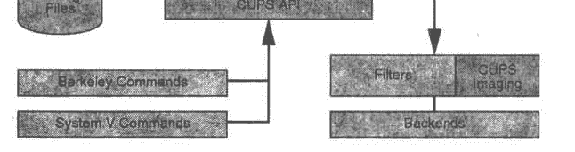
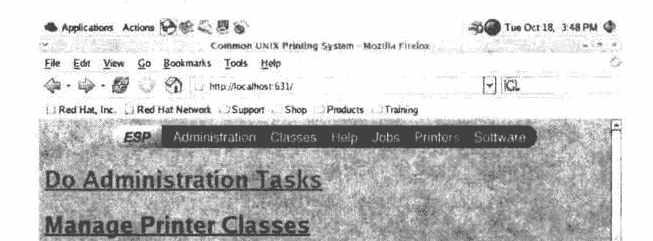
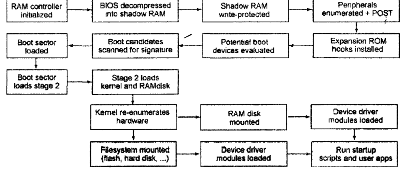
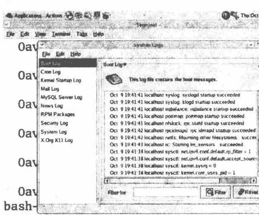
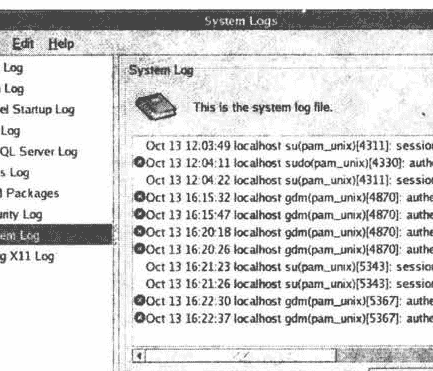
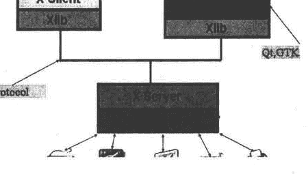
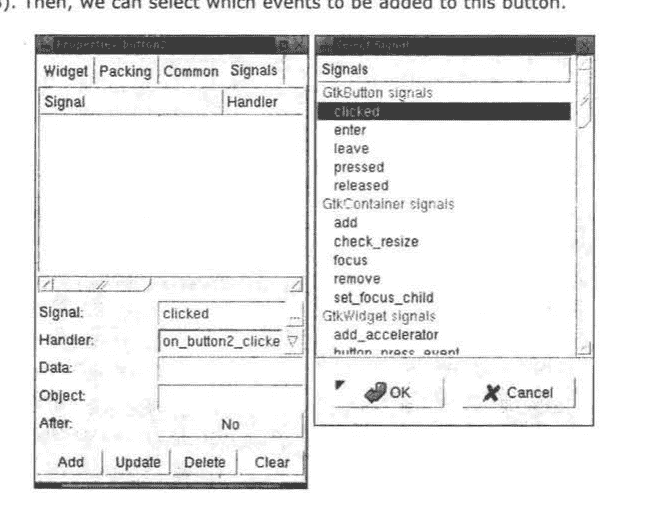

# Linux 入门指南：安装与编程

编辑：**N. B. Venkateswarlu**, 博士

GVP 工程学院

Madhurawada, Visakhapatnam – 530041

## 目录

- 13.6 分配 Root 权限 ................................................................ 216
- 14.3 磁盘驱动器、分区和文件系统 ................................................ 224
- 15.3 结 ................................................................................................ 252
- 25.5 总结 ................................................................ 559

## 索引

## 图列表

- 图 1.1 一个典型的操作系统 ..................................................... 1
- 图 1.2 Unix 内核 ................................................................................ 2
- 图 1.3 微内核架构 ............................................... 2
- 图 1.4 Windows NT 内核 ................................................................ 2
- 图 1.5 分级文件系统 ............................................................................ 8
- 图 7.1 RedhatLinux 启动菜单 ............................................................ 144
- 图 7.2 磁盘设置界面 ................................................................ 145
- 图 7.3 引导加载器设置界面 ................................................................ 146
- 图 7.4 网络设置界面 ...................................................... 146
- 图 11.1 CUPS 架构 ............................................................ 181
- 图 11.2 基于 Web 的 CUPS 管理工具 ................................................ 185
- 图 14.1 基于 Inode 的文件系统的视图 ................................................ 226
- 图 14.2 Inode 结构 ............................................................ 227
- 图 14.3 数据块的索引分配 ................................................ 228
- 图 14.4 虚拟文件系统 ................................................................ 230
- 图 14.5 I-Node 结构 ............................................................ 231
- 图 15.1 基于 x86 的 Linux 典型启动过程 ................................................ 237
- 图 16.1 安全日志 ................................................................ 258
- 图 16.2 系统监控 ................................................................ 259
- 图 16.3 系统资源 ....................................................... 259
- 图 18.1 C 编译阶段 ................................................................ 288
- 图 18.2 汇编文件 .o 和 main ................................................ 305
- 图 18.3 链接文件 .o 和 main ................................................ 306
- 图 18.4 可执行文件 (a, b, main) ................................................ 307
- 图 18.5 ELF 段布局 ................................................................ 324
- 图 18.6 ELF 栈布局 ................................................................ 325
- 图 18.7 ELF 结构 ................................................................ 326
- 图 26.1 X Windows 架构 ................................................................ 560
- 图 26.2 界面设计器 ................................................................ 578

# Linux 操作系统简介

## 1.1 操作系统简介

在计算机科学的历史中，最值得赞誉的发展莫过于操作系统的出现，它让外行人士无需参加计算机科学课程也能使用计算机的服务！操作系统是硬件和用户之间的软件层（如图 1.1 所示），为用户提供了一个紧凑且方便的界面。

| 工具程序 | 应用程序 |
|---|---|
| 操作系统 | |
| 硬件 | |

**图 1.1** 一个典型的操作系统。

操作系统负责以下功能：

- 使用设备驱动程序进行设备管理
- 使用进程和线程进行进程管理
- 进程间通信
- 内存管理
- 文件系统

此外，所有的操作系统都带有一组标准工具。这些工具允许执行常见任务，例如：

- 能够启动和停止进程
- 能够组织可用程序集
- 将文件组织成目录等集合
- 查看文件和文件集
- 编辑文件
- 重命名、拷贝、删除文件
- 进程间的通信

### 1.1.1 内核

操作系统的**内核**负责所有其他操作的部分。当计算机启动时，它会通过一些初始化活动，例如检查内存。它加载内核并将控制权交给内核。内核启动所有与用户及其他环境（如局域网）通信所需的进程。内核始终被加载到内存中，内核函数持续运行，处理进程、内存和设备。内核的传统结构是*分层系统*，如 Unix，其中所有层都是内核的一部分，且每层只能与少数其他层进行通信。应用程序和工具程序位于内核之上。

Unix 内核所示（图 1.2）

图 1.2 Unix 内核。

目前大多数主流操作系统转而使用规模极小的微内核。许多传统的内核操作被转变为用户级服务。通信承载服务通常通过显式的消息传递机制来实现。Mach 是主要的微内核操作系统之一，其概念被许多其他系统所采用（见图 1.3）。

图 1.3 微内核架构。

某些系统，如 Windows NT（图 1.4），使用了混合方法 [Gary Nuttall]。

图 1.4 Windows NT 内核。

### 1.1.2 特色应用程序

操作系统被描述为“没有顶部的应用程序” [Venkateswarlu]。其他应用程序通过多种入口点与它交互。为了使用操作系统，你需要获得一些已经使用这些入口点的应用程序。

所有操作系统都捆带了一组执行这些任务的“工具程序”。例如：

- Windows 95 拥有一个 shell，允许从“开始”按钮启动程序。它提供了一套标准应用程序
- MSDOS 以 `COMMAND.COM` 启动以提供命令行提示符和以及 `set` 工具程序
- Unix 拥有一系列命令行 shell 和各种命令行工具程序
- X-Windows 使用登录 shell (`xdms`)。其他程序提供文件管理器、会话管理器等，可为底层的 Unix/POSIX 系统提供各种界面

### 1.1.3 命令行解释器

用户通过命令行解释器这一中介与操作系统交互。该工具程序以以下方式响应用户输入：

- 启动或停止选项
- 允许用户在应用程序之间切换控制权
- 允许应用程序与其他应用程序或用户之间的控制

命令行解释器可以是基于字符的，也可以是像 Windows 3.1 程序管理器那样的 GUI。解释器可以是简单的，也可以具有完整编程语言的能力。它可能是命令式的（如 Unix shell），使用消息传递（如 AppleScript），或使用视觉编程隐喻，如拖放式嵌入（如微软的 OLE）。区分命令行解释器和底层的操作系统至关重要。命令行解释器可能只使用操作系统提供的功能子集；它可能以笨拙或复杂的方式提供这些功能；它可能需要复杂的技能，或者专为初学者设计。

### 1.1.4 DOS 与 Unix 的区别

- Unix 是多用户多任务操作系统，而 DOS 是单用户单任务系统。
- Unix 中的所有命令应用小写字母，而 DOS 命令不区分大小写。
- 与 Unix 不同，DOS 更容易感染病毒。
- 处理器在 Unix 中处于保护模式，而 DOS 使用非保护模式。
- DOS 在启动期间仅使用 640KB 的 RAM，而 Unix 使用所有可用 RAM。
- Unix 需要管理员，而 DOS 则不需要。
- Unix 采用分时操作系统。而 DOS 通过“终止并驻留 (TSR)”程序支持分时操作。
- Unix 支持字符用户界面和图形界面 (X Windows)，而 DOS 仅支持字符界面。

### 1.1.5 Linux 与开源运动

林纳·托瓦尔斯 [Matt Weiss] 是赫尔辛基大学的一名学生，他在 1991 年 8 月创建了第一个版本的“Linux”。作为开源软件，Linux 迅速发展并汇聚了数百人的贡献。自 1994 年发布 0.1 版本以来，机构就可以下载商业 Linux 发行版。

许多人对 Linux 提问：“如果它是根据自由基金的 GPL 发布的，它不应该是免费的吗？”答案是否定的。Linux 可以对产品收费，只要提供源代码即可。根据自由基金，自由软件中的“免费”指的是自由，而不是价格。

对于像 Linux 这样的开源项目，新的更改通过开放开发模式产生，这意味着所有发布版本对公众开放，无论其质量如何。Oracle Linux 项目办公室总 Jim Enrath 表示，“Linux 的版本方案旨在让用户决定他们使用的是稳定版本还是开发版本。即使是偶数版本（如 2.0、2 和 4）也被认为是稳定版本，而奇数版本发布则用于开发。”

如今的开源运动已不再仅仅关于 Linux，有成千上万的软件产品正在以自由/开源软件（FOSS）模式进行开发——Apache、MySQL、Postgres、Firefox、Boss 都是这个不断壮大的家族中的其他受欢迎成员，它们已经在现实世界中证明了自己。此外，它的影响力不再仅仅局限于计算机科学和信息技术（CSE/IT）领域；开源解决方案已适用于整个科学和工程社区的许多仿真、计算、设计和可视化需求。

正因为上述原因，计算领域的大多数全球主要者（如 IBM、Intel、Oracle、HP）都启动了自己内部的 FOSS 计划。

### 1.1.6 为什么 Linux 如此受欢迎？

以下是几个原因——尽管显然，每个 Linux 用户都会有自己的理由来补充。

#### 它是免费的

Linux 是免费的。真正真正的免费。人们可以访问任何一个 Linux 发行版的网站，找到“下载”链接，并在无需支付任何费用的情况下下载整个操作系统的完整副本以及额外软件。当然，也可以获得盒装版本。以低廉的价格提供 CD，许多是送货上门，但提供电话或在线支持。相比之下，流行操作系统的“家庭”版本可能花费数千卢比。

有了它，你就不需要担心每次升级操作系统时都要重新付费——升级显然是免费的。对于商业操作系统，每个不确定的人都将必须为升级付费。

#### 它是开源的

这意味着两点：第一，CD（或下载站点）包含了 Linux 源代码的完整副本。第二，用户在法律上可以对其进行修改以改进它。

虽然这对于程序员来说可能意义不大，但有成千上万具有编程能力的人可以快速改进代码或解决问题。当发现问题时，该问题会被发送给负责相关模块的协调团队，他们将更新软件并发布补丁。归结底，Linux 中的 Bug 修复速度比任何其他操作系统都要快得多。

#### 它是模块化的

商业操作系统通常作为一个完整的单元安装。例如，你无法在没有图形用户界面的情况下安装，或者在没有打印支持的情况下安装——要么全有，要么全无。

相反，Linux 是一个模块化的操作系统。人们可以仅安装或运行所需的 Linux 部分。在许多情况下，选择是几种预定义设置之一……这被充分利用。例如，在设置服务器时，人们可能在正确设置后禁用图形界面，从而释放内存和处理器以处理当前更重要的任务。

它还允许用户升级操作系统的部分而不影响其他部分。例如，人们可以在不更改内核的情况下获取 Gnome 或 KDE 的最新版本。

#### 它有更多选择

由于其模块化，有更多的组件可以选择。一个例子是用户界面。许多用户选择 KDE，它对于 Windows 用户来说非常容易学习。其他人选择 Gnome，它更强大，但与 Windows 不那么相似。对于性能较弱的电脑，还有几种简单的替代方案，它们对可用硬件的要求较低。

#### 它是可移植的

Linux 运行在几乎每一台符合计算机标准的设备上。它可以运行在巨大的多处理器服务器上，也可以运行在 PDA 上。除了各种型号的 Pentium 之外，Linux 还有 Atari、Amiga、Macintosh、PowerMac、PowerPC、NeXT、Alpha、Motorola、MIPS、HP、PowerPC、Sun Sparc、Silicon Graphics、VAX/MicroVax、VME、Pion、SunUltraSpar 等等版本（被称为“移植”）。

#### 它有很多额外赠品

除了 Linux CD，通常还会附带很多操作系统通常不包含的软件。仅使用 Linux 自带的应用程序，人们就可以建立完整的 Web、FTP、数据库和电子邮件服务器等。操作系统的内核中内置了防火墙，还有更多的办公套件、图形程序、音乐播放器等许多。Linux 的不同发行版提供“额外程序”。例如，Slackware 非常简单（尽管它仍然提供了所有需要的程序），而 SuSE Linux 则带有七张 CD 和一张 DVD-ROM！

#### 它是稳定的

所有应用程序都可能崩溃，但在许多系统中，唯一的补救办法是切换并重启（对于新的“软切换”电脑，这是不起作用的——你必须拔掉电源线）。

相比之下，Linux 稳如磐石。每个应用程序都独立于所有其他程序运行——如果一个崩溃，其他的不会受影响。Linux 服务器可以连续运行几个月而不关机或重启。GUI 独立于操作系统的内核。

#### 它具有网络功能


# Linux 操作系统简介

## Linux 的显著特征

以下是 Linux 相比单用户操作系统和其他 UNIX 版本提供的某些优势。

- **全多任务和 32 位支持** Linux 与所有 UNIX 版本一样，是一个真正的多任务系统，允许多个用户同时运行多个程序。运行 Linux 的 50 MHz 486 系统的性能与 Sun Microsystems 和 DEC 等运行私有 UNIX 的工作站相当。Linux 也是一种 32 位操作系统，利用 Intel 80386 和 486 的特殊保护模式功能。

- **GNU 软件支持** Linux 利用 GNU 项目编写的各种软件，包括 GNU C 和 C++ 编译器、`gawk`、`groff` 等。Linux 的许多系统工具都是 GNU 软件。

- **X Window 系统** X Window 系统是 UNIX 机器的事实标准图形系统。Linux 可免费版本的 X Window 系统（被称为 `Xfree86`）。X Window 系统是一个非常强大的界面，支持许多应用程序。例如，人们可以在屏幕上同时打开多个登录会话。X Windows 程序的其他示例包括强大的电信程序 `Seyon`、`GhostScript` PostScript 语言处理器以及 Windows 版本的 `Tetris`。

- **TCP/IP 网络支持** TCP/IP（传输控制协议/网际协议）是将数百万计算机连接到名为互联网的网络协议集。通过以太网连接，人们可以从 Linux 系统访问互联网或局域网。或者，使用 SLIP（串行链路 IP 协议），可以通过拨号器访问互联网。

- **虚拟内存和共享库** Linux 可以使用硬盘的一部分作为虚拟内存，扩展可用内存的总量。Linux 实现了共享库，允许使用标准子程序的程序在运行时从库中找到这些子程序的代码。这节省了空间，因为每个应用程序不需要存储这些常见例程的副本。

以下是一些流行的 Linux 发行版。

- Mandrake
- Red Hat
- SuSE
- Caldera
- Corel
- Debian
- Slackware
- TurboLinux

## Linux 文件系统简介

文件存储在硬盘和软盘等设备上。操作系统（O/S）在设备上定义文件系统。许多操作系统使用层次级文件系统（见图 1.5）。

> 图 1.5 层次级文件系统。

目录是一个保存其他文件列表的文件。该列表是文件系统中该目录节点的子节点。目录不能包含任何其他类型的数据。

在 MSDOS 上，文件系统存在于每个软盘或硬盘分区上。设备名称的形式构成了文件名的一部分 [S. Prata]。

在 Unix 上，只有一个文件系统。设备被挂载到这个文件系统中（使用 `mount` 命令进行此操作）。

### 文件和目录命名

文件系统的每个节点都有自己的名称。不同操作系统之间的命名规则有所不同。在 MSDOS 中，名称由 8+3 个字符组成。Windows 95 在 MSDOS 文件系统之上使用了一些技巧，提供了长达 255 个字符的“长文件名”。在“标准 Unix”（POSIX）中，名称可以包含多达 256 个字符。

完整文件名是通过从根目录到文件的目录名称拼接而成的，并在名称之间留有一些特殊的分隔符。这被称为绝对路径命名。在 MSDOS 中，完整路径名还包括驱动器名称。

示例：MSDOS

```
C:\USR\USRS\OS
C:\USR\USRS\OS\MYFILE
```

示例：Unix

```
/usr/usrs/os
/usr/usrs/os/myfile
```

相对命名意味着从某些特殊目录对文件进行命名：

- 当前目录（Unix 和 MSDOS）
- 父级目录（Unix 和 MSDOS）
- 主目录（某些 Unix Shell）
- `~user` 用户的用户主目录（某些 Shell）

示例：Unix

```
~fred/../bill/dir1/../../file1
```

如果名称本身没有带任何特殊前缀（如 `/`、`.`、`..`、`~`），则指向当前工作目录下的文件。

### Linux 目录树

与所有优秀的操作系统一样，Linux 允许将信息无限存储（或至少持续到下一次磁盘崩溃 [Chris Drake]）在称为文件的抽象数据容器中。这些文件的组织、放置和使用属于“文件层次结构”的广义范畴。作为系统管理员，我们需要非常熟悉文件层次结构。为了维护系统、安装软件和管理用户账户，我们必须对它有更好的了解。

一眼看去，典型 Linux 主机文件层次结构的根目录包含类似以下的内容：

```
bin      etc      lost+found root  usr
boot     home     mnt        sbin
dev      lib      proc       tmp
```

为什么它是这样排列的？

从历史上看，某些文件和工具的位置并不总是标准的（或固定的）。这导致在不同 Linux“发行版”之间进行开发和升级时出现问题。Linux 目录结构（或文件层次结构）基于现有的 UNIX 变体，但随着它的演进，产生了一些不一致之处。这些通常是一些小问题，例如某些配置文件的位置（或放置），但导致了从主机到主机的迁移困难。

为了解决这个问题开发了一个标准。这是一个不断演进的过程，最终导致 Linux 文件层次结构形成了一个相当静态的模型。在这里，我们将检查 Linux 层次结构是如何构建、每个组件如何与整个操作系统相关联以及为什么某些文件被放置在某些位置。

## 根目录 (root)

Linux 文件层次结构的顶层被称为根（或 `/`）[Kernighan]。根目录通常包含几个其他目录，如表 1.1 所示。

表 1.1 主要 Linux 目录。

| 目录 | 包含 |
| --- | --- |
| `bin/` | 启动时所需的二进制文件 |
| `boot/` | 操作系统加载程序和内核镜像的启动配置文件 |
| `dev/` | 设备文件 |
| `etc/` | 系统配置文件和脚本 |
| `home/` | 用户主目录 |
| `lib/` | 操作系统主共享库和内核模块 |
| `lost+found/` | 用于存储“恢复”文件的存储目录 |
| `mnt/` | 连接到设备的临时挂载点 |
| `proc/` | 伪目录结构，包含有关内核、当前运行的进程和资源分配的信息 |
| `root/` | root 用户的主目录（非标准）。替代位置是 `/` 目录本身 |
| `sbin/` | 系统管理二进制文件和工具 |
| `tmp/` | 临时文件的位置 |
| `usr/` | 难以定义 - 它包含了几乎所有其他内容，包括本地二进制文件、库、应用程序和软件包 |
| `var/` | 可变数据，通常特定于机器。包括邮件和新闻的打印目录 |

通常，根目录不应包含任何额外文件 - 在根下创建其他目录被认为是不规范的，也不在那里放置任何其他文件。

### 为什么是 root？

“root”这个名称基于 UNIX 文件系统结构与树之间的类比关系。文件层次结构是一棵倒立的树。文件系统的每个部分最终都可以追溯到一个中心点，即根目录。“根”结构的概念已被 Windows NT 等其他操作系统（部分）采纳。然而，与其他操作系统不同，UNIX 没有“驱动器”的概念。虽然这将被详细解释，但意识到以下几点至关重要：文件系统可能分布在多个分区上；硬盘、CD-ROM、网络文件系统、软盘和其他设备对于文件层次结构是透明的。

在接下来的章节中，我们将检查 Linux 层次中一些重要的目录结构。

### /home 所有用户的主目录

`/home` 目录包含大多数登录用户的主目录（root 用户除外，某些系统的 web 用户）。虽然大多数小型系统会直接在 `/home` 下包含目录（例如 `/home/bob`），但在较大的系统中，根据用户类别（或组）划分主目录结构是常见的，例如：

- `/home/admin` # 管理员
- `/home/finance` # 财务用户
- `/home/humanres` # 人力资源用户
- `/home/mgr` # 管理人员
- `/home/staff` # 其他人员

允许用户在 `/home` 之外的位置拥有主目录必须极其谨慎。系统管理员备份系统时 - 如果主目录没有在一个公共分支中，很容易漏掉。

`/root` 是 root 用户的主目录。也就是说，当他以 root 用户登录时，将进入自己的目录。如果由于某种原因 `/root` 目录不存在，那么 root 用户将登录 `/` 目录 - 这实际上是 root 用户的传统位置。

建议系统管理员永远不要使用 root 账户进行日常用户交互；root 账户应仅用于系统管理目的。

### /usr 和 /var 目录分支

当你开始检查这两个主要分支之间复杂的链接迷宫时，通常会变得更加困惑：

```
/usr
X11R6 games libexec src
bin i486-linux-libc5 local tmp
dict include man
doc info sbin
etc lib

/var
catman local log preserve spool
lib lock nis run tmp
```

看到 `/usr` 和 `/var` 都包含相似的目录时，通常会感到困惑。简单来说，`/var` 用于可变（VARIABLE）数据；`/usr` 用于用户（User）数据、程序和库。遗憾的是，历史混淆了事情 - 本应放置在 `/usr` 分支的文件被位于 `/var` 分支中，反之亦然。因此，为了“纠正”这些，放置了一些链接。

#### /usr/local

在操作系统包本身之后，在系统上安装的所有软件都应该放在 `/usr/local` 目录下。二进制文件应该位于 `/usr/local/bin`（通常 `/usr/local/bin` 应该包含在 `$PATH` 设置中）。通过将所有安装的软件放在此分支中，可以使得系统的备份和升级变得简单得多——系统管理员可以轻松地备份和恢复整个 `/usr/local` 系统，这比从多个分支（如 `/usr/src`、`/usr/bin` 等）备份和恢复软件包要容易得多。

下面是 `/usr/local` 目录的示例：

| bin | speak | lib | rynth | c |
|---|---|---|---|---|
| man | sbin | volume-1.11 | info | |
| mpeg | | www | etc | java |
| netscape | src | | | |

如你所见，这里既有一些标准目录（C/C++、Java 和 src），也有一些包含已安装程序的目录。

Linux 是 C/C++、Java 和 Perl 程序开发非常流行的平台。正如我们在后面的章节中将讨论的，Linux 还允许系统管理员修改和重新编译内核。正因如此，编译器、库和源代码目录被视为文件层级结构中的“核心”元素。

`/usr/include` 包含了大部分标准的 C/C++ 头文件；该目录在 `Makefiles` 中会被称为主目录。

`/usr/lib` 包含了大多数静态库，以及用于其他（非 C/C++）语言（如 Perl 和 TCL）的托管子目录库。它还承载了 `ldconfig` 的配置信息。

`/usr/src` 包含了系统上安装的大多数软件包的源代码。这传统上是 Linux 源代码目录（`/usr/src/linux`）的所在地，例如：

```
linux  linux-2.6.31  redhat
```

#### /var/spool

该目录可能会给系统管理员带来一些麻烦，因为它被用于存储（可能）与打印、邮件和新闻相关的大量临时文件。`/var/spool` 可能会包含如下内容：

```
at ip lpd mqueue samba uucppublic
cron mail rwho uucp
```

在这种情况下，使用一个打印池目录（用于向打印机 `ip` 的打印请求）和一个包含每个用户入站邮件文件的 `/var/spool` 目录。

注意 `/var/spool` 中发现的文件和目录所占的空间。如果某个设备（如打印机）无法工作，或者向系统发送了大量电子邮件，那么硬盘空间很快就会被存储在此位置的文件耗尽。

#### /var/log

Linux 维护一个特定的区域来放置日志（或包含事件记录的文件）。该目录是 `/var/log`。

此目录通常包含：

- `cron` `lastlog` `mailog.2` `samba-log.` `secure.2` `uucp`
- `ccron1` `log.nmb` `messages` `samba.1` `sendmail.st` `wtmp`
- `cron2` `log.smb` `messages.1` `samba.2` `spooler` `xferlog`
- `dmesg` `mailog` `messages.2` `secure` `spooler` `xferlog.1`
- `httpd` `mailog.1` `samba` `secure.1` `spooler.2` `xferlog.2`

#### /usr/X11R6

X Window 系统使用带有非常灵活的图形用户界面的 UNIX。追踪 X Window 文件层级结构可能非常枯燥，尤其是当你试图找到特定的配置文件或尝试删除一个过期的锁文件时。

X Window 的大部分内容位于 `/usr` 结构中，并在 `/var` 结构中对其进行了引用。

通常，大多数操作都在 `/usr/X11R6` 中（这通常是取决于 X11——即 Window 管理器版本而指向另一个目录的别名或链接）。它将包含：

```
bin doc include lib man
```

主要的 X Window 二进制执行文件位于 `/usr/X11R6/bin`。可以通过 `/usr/bin/X11` 的别名访问此处。

X Window 的配置文件位于 `/usr/X11R6/lib`。为了增加复杂性，X Window 配置工具 `xf86config` 位于 `/usr/X11R6/bin`，而它产生的配置文件却位于 `/etc/X11` (`XF86Config`)！

正因如此，通常很难获得 X Window 如何运行的“全局视图”——我最好的建议是在开始修改（或使用它进行开发）之前先阅读相关资料。

### bin 目录

初次使用 Unix 的用户的常见错误是错误地假设所有 "bin" 目录都包含临时文件或被标记为删除。这种误解源于：

- 人们将 "bin" 一词与垃圾桶联系在一起
- 某些基于 GUI 的操作系统使用“垃圾桶”图标来存储已删除/临时文件。

然而，`bin` 是 `binary` 的缩写——二进制文件或可执行文件。有四个主要的目录（没有哪个是应该用于存储垃圾文件的）：

- `/bin`
- `/sbin`
- `/usr/bin`
- `/usr/local/bin`

所有的 `bin` 目录都有相似但不同的用途；二进制文件的划分服务于几个目的，包括便于备份、管理和逻辑分离。注意，虽然 Linux 系统上的大多数二进制文件都在这四个目录之一，但并不是所有的都是。

#### /bin

该目录必须存在，操作系统才能启动。它包含了启动期间基本的实用程序；典型的列表如下：

```
linux  linux-2.6.31  redhat
```

#### /sbin

该目录包含了通常只供 root 使用的重要程序。典型的列表如下：

```
linux  linux-2.6.31  redhat
```

#### /usr/bin

该目录包含了大部分用户二进制文件——换句话说，就是用户运行的程序。它包括编辑器和电子邮件客户端等标准应用程序，以及编译器和各种应用程序。

#### /usr/local/bin

到目前，我们检查了（通常）作为实际系统包一部分的目录。系统管理员在此之后安装的程序应该放在 `/usr/local/bin`。其主要原因是为了在系统升级期间更容易备份，或者在最坏的情况下，在崩溃后恢复系统。

### /etc 目录

`/etc` 是 root 用户花费大量时间的地方之一。它是所有重要的 `passwd` 文件的所在地，还包含了几乎所有的系统配置文件（包括网络、X Window 和文件系统的）。

`/etc` 分支还包含 `skel`、`X11` 和 `rc` 目录。

`/etc/X11` 包含 X Window 的配置文件。

`/etc/rc.d` 包含目录——每个目录命名为 `rcn.d`（n 是运行级别）——每个目录可能包含在特定运行级别执行的多个文件。示例列表如下：

| init.d | rc.local | rc0.d | rc2.d | rc4.d | rc6.d |
| rc | rc.sysinit | rc1.d | rc3.d | rc5.d | |

### /proc 目录

`/proc` 目录层级包含了与执行中的内核相关的文件。该结构中的文件包含了系统资源使用状态的信息（使用了多少内存、空间和 CPU）、每个进程的信息以及其他有用信息。

### /dev 目录

我们将在下一章讨论 `/dev`，但目前，你应该知道该目录是称为设备文件的特殊文件的主要位置。

## man pages

所有的 Unix 命令信息都按照如下特殊方式组织：

- 用户级命令都在第一部分（Section One）。


# Linux 导论：安装与编程

- 第一部分是内核系统调用。
- 第二部分是应用程序编程接口，API（即 Unix 直接支持的 C 函数）。
- 第三部分是这些内容的库扩展。
- 第四部分定义了 Unix 已知的设备。
- 第五部分定义了常见的文件格式。
- Local 和 New 章节用于我们添加到本地系统中的内容。

如果我们在运行 `man` 命令时先跟一个名称，它将检查具有该名称的命令。

示例：

```
man sleep
```

```
man 2 sleep
```

如果可用，这会显示 `sleep` 库函数的详细信息。

```
man 3 sleep
```

如果存在，这会显示 `sleep` 系统调用的详细信息。`apropos` 命令可以显示所有帮助页中包含搜索模式的命令名称。

示例：

```
apropos TERM
```

这会显示帮助页中包含搜索模式 TERM 的 Unix 命令、系统调用或库函数的名称。

## 1.4 第一个命令 ‘cat’

为了从 Unix/Linux 机器登录，你必须先获取用户名和密码。请联系你的系统管理员。获取这些信息后，开启机器，你可能会发现引导加载器选项，从中你可以选择 Linux 或 Unix。等待片刻，查看屏幕上出现的系统消息。在加载所有必要的驱动程序后，你可能会发现字符模式或图形模式下的登录提示。输入你的用户名和密码。

你可能对创建文件或查看文件感兴趣。Unix 系统中创建和查看文件的简单命令是 `cat`。请按照以下练习创建并查看文件。

要创建文件：

```
cat > ABC
这是一个测试文件。
希望你创建第一个文件时心情愉快。
^d
```

这也被用于查看文件内容。如果文件包含更多行，它将简单地滚动该文件的内容。

示例：

```
cat ABC
```

此命令也用于创建文件的副本。

示例：

```
cat ABC > XYZ
```

或者

```
cat < ABC > XYZ
```

`XYZ` 成为文件 `ABC` 的副本。

此 `cat` 命令可以用于查看多个文件的内容。

示例：

```
cat ABC XYZ
```

此 `cat` 命令可以用于合并两个或多个文件的内容并创建另一个文件。

示例：

```
cat ABC XYZ > MNO
```

现在 `MNO` 文件包含 `XYZ` 和 `ABC` 文件的内容。

在合并两个或多个文件并创建一个组合文件时，我们也可以添加交互输入。

示例：

```
cat ABC - XYZ > PPP
```

你输入任何想要的内容，最后按 `Control D`。

```
^d
```

现在 `PPP` 文件按顺序包含 `ABC` 的内容、交互式输入和 `XYZ` 文件的内容。通过更改 `-` 的位置，我们可以在任意两个文件之间添加交互输入。

## 1.5 命令历史

为了方便，Shell（bash）具有命令历史，即最近执行的命令存储在历史缓冲区中，用户可以随时浏览而无需重新输入相同的内容。例如，可以通过执行以下命令获取之前的命令列表。

```
history
```

`!n`（n 是一个整数）将重新执行第 n 条命令。

```
!!
```

这执行最近的一条命令。

```
!cp
```

这执行以 `cp` 开头的最近一条命令。

在某些 Shell 中，可以使用向上、向下箭头从命令历史缓冲区中找回命令。

## 1.6 总结

本章探讨了操作系统概念。考察了 Linux 如此受欢迎的原因，以及它的文件系统结构和架构。还包含了一些数值示例，以演示 Linux/Unix 文件系统的能力。

# 2 基础 Unix 命令

## 2.1 vi 编辑器

vi 是自 1970 年代以来流行的 Unix 编辑器，是一种基于早期的编辑器 elvis [Richard L Peterson] 的屏幕编辑器。该编辑器有模式：在**输入模式**下，用户输入的任何内容都将写入文档。**命令模式**允许用户输入命令。在输入模式下，通过按下 `ESC` 键可以返回，因此也称为 ESC 模式。如果在命令模式下按下 `ESC` 键，会听到蜂鸣声。在后一种被称为**冒号模式**的模式下，你可以运行命令并进行一些文档编辑。因此某些用户不认为它是一个独立的模式，而是一种混合！

简而言之，以下是立即在 UNIX 下操作的有用命令总结：

1. `vi filename` -- 打开 vi 编辑器处理给定的文件名。
2. 最初，将从命令模式进入屏幕。
3. 要输入文本，按 `i`。屏幕右下角将显示输入模式。
4. 按 `Esc` 键，命令模式重新出现。你可以按：
   - `:w` 保存内容并继续编辑。
   - `:wq` 保存内容并退出 vi 编辑器。
   - `:q!` 不保存并退出编辑器。
5. vi 编辑器中存在的三个模式是：i) 命令模式 ii) 输入模式 iii) 冒号模式
6. 在命令模式下，可以输入：

### 光标移动与编辑基础
- `h`：向左移动
- `j`：向下移动
- `k`：向上移动
- `l`：向右移动
- `w`：跳过一个单词
- `b`：向后一个单词
- `e`：跳到单词末尾
- `ge`：跳到单词开头
- `0`：跳转到行开头
- `$`：跳转到行末尾
- `^`：跳转到行首非空白字符
- `gg`：跳到文件开头
- `G`：跳到文件末尾
- `Ctrl-f`：向下翻页
- `Ctrl-b`：向上翻页
- `Ctrl-d`：向下半页
- `Ctrl-u`：向上半页

### 进入插入模式
- `i`：在光标前插入
- `a`：在光标后追加插入
- `o`：在光标下方打开新行并插入
- `O`：在光标上方打开新行并插入
- `I`：在行首非空白字符前插入
- `A`：在行末尾插入

### 删除、复制与粘贴
- `x`：删除当前字符
- `dw`：删除当前单词
- `dd`：删除当前行
- `D`：删除至行尾
- `yy`：复制当前行
- `yw`：复制当前单词
- `p`：粘贴在光标下方/后
- `P`：粘贴在光标上方/前
- `u`：撤销操作
- `Ctrl-r`：重做
- `.`：重复上一次编辑

### 替换与修改
- `r`：替换单个字符
- `R`：进入替换模式
- `s`：替换字符（删除并进入插入模式）
- `cw`：修改当前单词
- `cc`：修改当前行
- `C`：修改至行尾

### 搜索与替换
- `/pattern`：正向搜索
- `?pattern`：反向搜索
- `n`：查找下一个匹配项
- `N`：查找上一个匹配项
- `*`：搜索光标下的单词（向下）
- `#`：搜索光标下的单词（向上）

### 可视模式
- `v`：进入字符可视模式
- `V`：进入行可视模式
- `Ctrl-v`：进入块可视模式

### 冒号模式命令
- `:w`：保存
- `:wq` / `:x`：保存并退出
- `:q!`：强制退出不保存
- `:set nu`：显示行号
- `:set nonu`：隐藏行号
- `:s/old/new/g`：当前行全局替换
- `:%s/old/new/g`：全文全局替换

### 其他
- `Ctrl-g`：显示文件信息
- `zz`：刷新屏幕（当前行置中）
- `J`：合并下一行到当前行


## Vi 编辑器快捷键

- **40. EE** 按 `EE` 快速移动光标。
- **41. FF** 按 `FF` 查找后一个字符。
- **42. GG** 按 `GG` 跳到文件末尾。
- **43. HH** 按 `HH` 跳到文件开头。
- **44. h** 按 `h` 向左移动。
- **45. j** 按 `j` 向下移动。
- **46. k** 按 `k` 向上移动。
- **47. l** 按 `l` 向右移动。
- **48. n** 按 `n` 查找下一个匹配项。
- **49. N** 按 `N` 查找上一个匹配项。
- **50. q** 按 `q` 退出搜索。
- **51. r** 按 `r` 替换单个字符。
- **52. s** 按 `s` 替换字符。
- **53. t** 按 `t` 查找下一个目标字符。
- **54. w** 按 `w` 跳过一个单词。
- **55. b** 按 `b` 向后一个单词。
- **56. e** 按 `e` 跳到单词末尾。
- **57. g** 按 `g` 跳到单词开头。
- **58. Ctrl-h** 按 `Ctrl-h` 向左制格。
- **59. Ctrl-j** 按 `Ctrl-j` 向下制格。
- **60. Ctrl-k** 按 `Ctrl-k` 向上制格。
- **61. Ctrl-l** 按 `Ctrl-l` 向右制格。
- **62. Ctrl-u** 按 `Ctrl-u` 撤销删除。
- **63. Ctrl-r** 按 `Ctrl-r` 撤做。
- **64. Ctrl-a** 按 `Ctrl-a` 跳到行首。
- **65. Ctrl-e** 按 `Ctrl-e` 跳到行尾。
- **66. Ctrl-w** 按 `Ctrl-w` 删除一个单词。
- **67. Ctrl-y** 按 `Ctrl-y` 粘贴删除的内容。
- **68. .** 按 `.` 重复上一次编辑。
- **69. ,** 按 `,` 重复上一次删除。
- **70. u** 按 `u` 撤销上一次编辑。
- **71. U** 按 `U` 撤销所有编辑。
- **72. :** 按 `:` 进入冒号模式。
- **73. /** 按 `/` 进入正向搜索。
- **74. s** 按 `s` 进入替换模式。
- **75. v** 按 `v` 进入可视模式。
- **76. z** 按 `z` 刷新屏幕。

## Vi 编辑器模式

- **7.** 在 vi 编辑器中存在的三个模式是：
  1. 命令模式
  2. 输入模式
  3. 冒号模式

- **8.** 在输入模式下，按下 `ESC` 键将返回，因此也称为 ESC 模式。
- **9.** 在命令模式下按下 `ESC` 键，会听到蜂鸣声。
- **10.** 在后一种模式（即**冒号模式**）下，你可以运行命令并进行一些文档编辑。因此某些用户不认为它是一个独立的模式，而是一种混合模式。

## 搜索和替换命令

- **1.** `/raja` 在正向搜索字符串 "raja"。按 `n` 重复查找下一个。
- **2.** `?raja` 在反向搜索字符串 "raja"。按 `n` 重复查找下一个。
- **3.** `:raja/rama` 替换第一个出现的 "raja" 为 "rama"。
- **4.** `:s/raja/rama` 替换当前行中所有的 "raja" 为 "rama"。
- **5.** `%s/raja/rama/g` 替换文件中所有的 "raja"。

## 块删除命令

- **1.** `:1d` 删除第 1 行。
- **2.** `:1,5d` 删除第 1 到 5 行。
- **3.** `$` 表示文件末尾（即当前行）。
- **4.** `:10,$d` 删除从第 10 行到末尾的所有。
- **5.** `.,1d` 删除从当前行到第 1 行。
- **6.** `:.,$d` 删除当前行到末尾的所有。
- **7.** `:-3,.d` 删除当前行及其上方 2 行（共 3 行）。
- **8.** `:.,+3d` 删除当前光标行及其后续 3 行（共 4 行）。
- **9.** `:-1,+3d` 删除光标上方一行及其后续 3 行。
- **10.** `:18` 跳到第 18 行。

## 块复制命令

- **1.** `:1,5 co 10` 复制第 1 到 5 行到第 10 行。
- **2.** `:1,$ co $` 复制从第 1 行到末尾到文件末尾。
- **3.** `:.,+5 co 8` 复制当前光标行及其后续 5 行到第 8 行。
- **4.** `:-3,. co 10` 复制光标行及其上方 3 行到第 10 行。

## 块移动命令

- **1.** `:1,5 mo 9` 移动第 1 到 5 行到第 9 行。
- **2.** `:1,$ mo $` 移动从第 1 行到末尾到文件末尾。
- **3.** `:.,+5 mo 10` 移动当前光标行及其后续 5 行到第 10 行之后。
- **4.** `:-3,. mo 10` 移动光标行及其上方 3 行到第 10 行。

## 文件的导入与导出

- **1.** `:1,5 w filename` 将第 1 到 5 行写入文件。
- **2.** `:1,5 w! filename` 强制覆盖文件中的第 1 到 5 行。
- **3.** `:r filename` 在当前行之后添加文件内容。

## 书签命令

书签（标记）是不可见的，但对于快速在行与行之间跳转非常有用。标记应该使用小写字母。要在指定的行上设置标记，按下 `m` 后紧跟一个小写字母（例如 `a`），则该行的标记被设置为 `a`。要跳转到标记的行，按下 `'` 后面紧跟字母，例如：跳转到第 500 行，按下 `mb`（`b` 是标记）。从文档的任何位置跳转到第 500 行，按下 `'b`。然后光标将移动到第 500 行。

## 2.2 重定向运算符

对于任何使用 C、C++ 或 Java 开发的程序，默认情况下都提供已知的输入流、输出流和错误流。在编程语言中，使用一些符号名称来引用它们（即它们是系统定义的变量）。

例如：

- 在 C 中：`stdin`、`stdout`、`stderr`。
- 在 C++ 中：`cin`、`cout` 和 `cerr`。
- 在 Java 中：`System.in`、`System.out` 和 `System.err`。

默认情况下，输入来自键盘，输出和错误发送到显示器。通过重定向运算符的帮助，我们可以将它们发送到文件或设备。

Unix 支持以下重定向运算符：

- `>` 标准输出运算符
- `<` 标准输入运算符
- `<<` Here文档
- `>>` 追加运算符

### 2.2.1 标准输入、重定向运算符

Unix 支持输入、输出重定向。我们可以使用 `>` 运算符将任何命令的输出发送到文件。

示例：

```
command > aaa
```

命令的输出被发送到文件 `aaa`。如果文件 `aaa` 不存在，则创建它；否则清除其内容并写入命令的输出。

```
cat aa > aaa
```

在这里，`aaa` 文件包含文件 `aa` 的内容。

我们可以让命令通过 `<` 运算符（标准输入运算符）从文件中获取必要的输入。

```
cat < aa
```

这在屏幕上显示文件 `aa` 的输出。

```
cat aa aa3 > aa12
```

这创建了文件 `aa12`，其中包含文件 `aa` 和 `aa3` 的内容。

```
cat < aa > as
```

这让 `cat` 命令从文件 `aa` 获取输入并将其输出写入文件 `as`。也就是说，它的工作方式就像一个良好的命令行界面。因此，所有后续命令都以相同的方式工作。

```
cat < aa > as
cat > as < aa
< aa cat > as
< aa > as cat
> as cat < aa
> as < aa cat
```

这种讨论对任何命令都有意义。例如，考虑以下程序，它接收三个整数并写入它们的值。

```c
#include <stdio.h>
void main()
{
    int x, y, z;
    scanf("%d%d%d", &x, &y, &z);
    printf("%d\n%d\n%d\n", x, y, z);
}
```

文件名为 `a.c`，通过使用以下任一命令，创建机器语言文件 `a`。

```bash
gcc -o a a.c
cc -o a a.c
```

当我们通过在 `$` 提示符处输入 `a` 来启动此程序时，它接收三个值并在屏幕上显示这些值。

```
a > res
```

该程序交互式接收三个值并将它们写入文件 `res`。你可以通过输入 `cat res` 来检查。

```
a < res
cat < aa > as
cat > as < aa
< aa cat > as
< aa > as cat
> as cat < aa
> as < aa cat
```

此命令从文件 `res` 获取必要的输入，并在屏幕上显示结果。

```
a < res > as
a > as < res
< res a > as
< res > as a
> as a < res
> as < res a
```

所有这些命令都从文件 `res` 取三个值并将相同的内容写入文件 `as`。

### 2.2.2 `>>` 和 `<<` 运算符

同样，`>>` 运算符可以用于将命令的标准输出追加到文件。示例：

```
command >> aaa
```

这使得给定命令的输出被追加到文件 `aaa` 中。如果 `aaa` 不存在，它将被创建并写入标准输出。

这里是文档运算符（`<<`）。

它用于 Shell 程序。这表示数据在这里是一个单独的文件。

## 示例：

```
grep Rao << end
I like PP Reddy
I know Mr. PN Rao since 1987
I wanted to see Raj today
Mr. Rao, please see me today
end
```

在 `$` 提示符处执行上述 `grep` 命令序列时，我们将获得 grep 命令输出包含 `Rao` 的行。在这里，通过使用 `<<` 运算符，我们说明数据直接可用。命令将一直读取输入直到输入 `end` 为止。

```
cat << END
This will display
Whatever we type
Interactively on the screen again
END
```

上述操作显示了我们在输入字符串 "END" 之前输入的所有内容。

## 2.3 一些命令

### 2.3.1 `nl` 命令
### 2.3.2 `command` 命令
### 2.3.3 `nl` 命令
### 2.3.4 `tail` 命令
### 2.3.5 `head` 命令
### 2.3.6 `mkdir` 命令
### 2.3.7 `rmdir` 命令
### 2.3.8 `pwd` 命令
### 2.3.9 `cd` 命令
### 2.3.10 `ls` 命令

#### `ls` 命令详解

此命令显示当前目录下的文件和目录名。

```
a1
a2
a3
a4
```

以下命令以长格式显示当前目录的文件和目录名。即：文件权限、所有者名、组、链接、时间戳、大小。

```
ls -l
```

```
total 4
-rw-r--r-- 1 root root 0 Feb 13 23:55 a1
-rw-r--r-- 1 root root 0 Feb 13 23:55 a2
-rw-r--r-- 1 root root 0 Feb 13 23:56 a3
-rw-r--r-- 1 root root 0 Feb 13 23:55 a4
-rw-r--r-- 1 root root 290 Feb 13 23:59 a5
```

在 Unix 中，以 `.` 开头的文件被称为隐藏文件。如果我们想查看它们的详情，必须使用 `-a` 选项（单独使用或与其他选项结合）。例如，以下命令还会显示以 `.` 开头的其他文件。

```
ls -al
```

```
total 12
drwxr-xr-x 2 root root 4096 Feb 14 00:01 .
drwxr-x--- 29 root root 4096 Feb 14 00:01 ..
-rw-r--r-- 1 root root 0 Feb 13 23:55 a1
-rw-r--r-- 1 root root 0 Feb 13 23:55 a2
-rw-r--r-- 1 root root 0 Feb 13 23:56 a3
-rw-r--r-- 1 root root 0 Feb 13 23:55 a4
-rw-r--r-- 1 root root 882 Feb 14 00:01 a5
-rw-r--r-- 1 root root 0 Feb 14 00:01 .aa1
```

# 关于文件类型的说明

UNIX 支持少量的不同的文件类型。下表 2.1 总结了这些不同的文件类型。随着课程的进行，我们将解释这些不同的文件类型以及它们的用途。文件类型由单个字符表示。

## 表 2.1 UNIX 文件类型

| 文件类型 | 含义 |
|---|---|
| `-` | 普通文件 |
| `d` | 目录 |
| `l` | 符号链接 |
| `b` | 块设备文件 |
| `c` | 字符设备文件 |
| `p` | fifo 或命名管道 |

出于目前的目的，可以将这些文件类型归为三类：

- **“普通”文件**：UNIX 下的文件仅仅是信息字节的集合。这些字节可能组成文本文件或二进制文件。当我们运行 `ls -l` 命令时，我们会看到某些行以 `-` 开头，这表示它们是普通文件。
- **目录或目录文件**：记住，对于 UNIX 来说，目录只是另一个文件，恰好包含它们的文件名和它们的 I-node（节点）。I-node 是一种操作系统数据结构，用于存储有关文件的信息（后文将解释）。当我们运行 `ls -l` 命令时，我们会看到某些行以 `d` 开头，表示它们是目录文件。
- **特殊或设备文件**：将在本文稍后进行详细说明，这些特殊文件提供了对连接到计算机的设备的访问。我们将解释为什么存在它们以及它们的用途。

运行以下命令。

```
ls -l /dev/ttyS*
```

我们看到每一行都以 `c` 开头，表示它们是字符特殊文件；这对我们来说是可以接受的，因为我们指的终端是字符设备。

```
ls -l /dev/hda*
```

我们看到每一行都以 `b` 开头，表示它们是块特殊文件；这对我们来说是可以接受的，因为我们指的磁盘分区是块设备。

以下命令按时间顺序显示文件的详细信息。

```
ls -alt
```

```
total 12
drwxr-xr-x 2 root root 4096 Feb 14 00:03 .
drwxr-xr-x 29 root root 4096 Feb 14 00:03 ..
-rw-r--r-- 1 root root 1451 Feb 14 00:03 a5
-rw-r--r-- 1 root root 0 Feb 14 00:01 .aa1
-rw-r--r-- 1 root root 0 Feb 13 23:56 a3
drwxr-xr-x 1 root root 0 Feb 13 23:55 a2
drwxr-xr-x 4 root root 0 Feb 13 23:55 a1
-rw-r--r-- 1 root root 0 Feb 13 23:55 a4
```

```
ls -l filename
```

如果文件存在，它将显示文件的详细信息。

```
ls -l directoryname
```

它会显示给定目录中的文件和目录详细信息。所有的选项 `-a`、`-t` 等都可以使用。此外，Unix 命令具有极好的命令行界面。因此，所有以下命令都是等价的。

```
ls -a -l -t
ls -alt
ls -a -t -l
ls -atl
ls -l -a -t
ls -lat
ls -l -t -a
ls -lta
ls -t -l -a
ls -tla
ls -t -a -l
ls -tal
```

- `-R` 选项配合 `ls` 命令递归地显示文件和子目录的详细信息。

示例：

`ls -aR /`（当然，你可以去喝杯咖啡，在提示符再次出现之前回来也可以！）

此命令显示 Unix 系统中的所有文件。

### 2.3.11 `find` 命令

系统管理员的一项常见任务是在 UNIX 文件层次结构中搜索符合某些标准的文件。系统管理员可能想要执行此操作的原因和内容的一些常见示例包括：

- 搜索非常大文件
- 查找特定文件在磁盘上的位置
- 删除特定用户的所有文件
- 显示过去两天内修改过的所有文件的名称。

鉴于 UNIX 文件层次结构的规模以及其中包含的文件数量，这不是一项可以手动完成的任务。这正是 `find` 命令大显身手的地方。

#### `find` 命令格式

`find` 命令的格式为：

```
find [path-list] [expression]
```

`path-list` 是 `find` 命令将在其中搜索文件的目录列表。该命令将递归地进入这些目录下的所有子目录。表达式组件部分将在下一节中解释。

路径和表达式都是可选的。如果你在不带任何参数的情况下运行 `find` 命令，它将使用当前目录作为默认路径，并使用默认表达式打印文件名。因此，当我们运行 `find` 命令时，我们可能会得到当前目录的所有项。

#### `find` 表达式

`find` 表达式可以包含以下组件：

- **选项**：这些修改了 `find` 命令的操作方式。
- **测试**：这些决定了当前文件是否是你正在寻找的文件。
- **动作**：指定一旦文件通过测试后做什么。


# 基础 Unix 命令

## find 选项

选项通常放在表达式的开头。表 2.2 总结了一些 find 选项。

### 表 2.2 find 选项

| 选项 | 影响 |
|---|---|
| `-depth` | 限制于在当前目录下的文件 |
| `-maxdepth number` | number 是整数，指定最大深度 |
| `-mindepth number` | number 是整数，指定开始的深度 |
| `-mount` | 不跨越其他分区 |
| `-xdev` | 不跨越其他分区 |

## find 测试

测试用于根据以下条件查找文件：

- 文件最后访问的时间
- 文件状态最后更改的时间
- 文件最后修改的时间
- 文件的大小
- 文件的类型
- 文件的所有者或组
- 文件的名称
- 文件的 inode 号
- 文件链接的数量和类型
- 文件的权限

### 表 2.3 find 测试

许多测试接受数值。例如，文件自修改以来的天数。对于这些情况，可以使用以下格式指定数值（其中 n 是一个数字）：

- `+n`：大于 n
- `-n`：小于 n
- `n`：等于 n

| 测试项 | 效果 |
|---|---|
| `-amin n` | 文件在 n 分钟前被最后访问过 |
| `-anewer file` | 当前文件的访问时间比 file 更晚 |
| `-atime n` | 文件在 n 天前被最后访问过 |
| `-cmin n` | 文件的状态在 n 分钟前被更改过 |
| `-cnewer file` | 当前文件的状态更改时间比 file 更晚 |
| `-ctime n` | 文件的状态在 n 天前最后更改过 |
| `-mmin n` | 文件数据在 n 分钟前被最后修改 |
| `-mtime n` | 文件数据在 n 天前被最后修改 |
| `-name pattern` | 文件名匹配模式 |
| `-iname pattern` | `-name` 的不区分大小写版本 |
| `-regex pattern` | 允许使用正则表达式 (RE) 匹配文件名 |
| `-nouser` / `-nogroup` | 文件的 UID 或 GID 不匹配某个用户或组 |
| `-perm mode` | 文件的权限匹配模式（符号或数字模式） |
| `-size n[bck]` | 文件使用 n 单位的空间，b 是块，c 是字节，k 是千字节 |
| `-type c` | 文件类型为 c，c 可以是块设备文件、字符设备文件、目录、管道文件、普通文件、符号链接、套接字 |
| `-uid n` / `-gid n` | 文件的 UID 或 GID 匹配 n |
| `-user uname` | 文件所有者为用户名 uname |

## 示例

下面显示了一些使用测试的示例。注意，在所有这些示例中都没有使用命令。因此 find 使用默认命令，即打印文件名。

- `-user david`：查找当前目录下所有所有者为 david 的文件。
- `-name "*.html"`：查找整个文件系统中以 `.html` 结尾的文件。注意 `*` 必须加引号，以免 shell 解释它。我们希望 shell 将 `*.html` 传递给 find 命令并使其匹配文件名。
- `/home -size +2500k -mtime -7`：查找 `/home` 目录下大于 2500 KB 在过去七天内修改的文件。

最后一个示例显示可以组合多个测试。它也是数值的一个示例。`+2500` 会匹配任何大于 2500 的值。`-7` 会匹配任何小于 7 的值。

## find 动作

一旦找到了文件，必须对它们执行某些操作。find 命令提供了许多动作，大多数动作允许：

- 在文件上执行命令
- 以各种格式显示文件的名称和其他信息

有关显示文件信息的各种 find 动作，建议你查看 find 的主页。

### 执行命令

find 有两个可以在找到的文件上执行命令的动作。它们是 `-exec` 和 `-ok`。使用它们的格式如下：

```
-exec command;
-ok command;
```

`command` 是任何 UNIX 命令。

`-exec` 和 `-ok` 之间的主要区别是 `-ok` 在执行命令之前会询问用户。`-exec` 则直接执行。

### 示例

使用 `-exec` 和 `-ok` 动作的一些示例包括：

- `-exec grep hello {} \;`：在本地目录下所有文件中搜索单词 hello。
- `-name "*.bak" -ok rm {} \;`：找到所有以 `.bak` 结尾的文件，并询问是否删除这些文件。

### `{}` 和 `;`

`find` 命令的 `-exec` 和 `-ok` 动作特殊地使用了 `{}` 和 `;` 字符。由于 `{}` 和 `;` 对 shell 有特殊含义，在使用 `find` 命令时必须对其加引号。

`{}` 用于指代刚刚测试的文件。因此在最后一个示例中 `rm {}` 将删除 `find` 匹配的每个文件。

`;` 用于由 `-exec` 或 `-ok` 执行的命令结束。

## find 命令示例

此命令用于在 Unix 目录树中定位文件。

```
find directoryname -filenamebetobound
```

示例：

```
find / -name core
```

此命令显示 `/` 目录下所有名为 core 的文件出现情况。

```
find . -ctime 2 -name "filename"
```

此命令显示在过去两天内创建且位于当前目录下的文件名。

```
find . -mtime 2 -name "filename"
```

此命令显示在过去两天内修改过且位于当前目录下的文件名。

```
find . -size +10 -name "filename"
```

此命令显示大小大于 10 块（每块 512 字节）且位于当前目录下的文件名。

```
find . -type d -name "dirname"
```

此命令显示当前目录下所有目录的名字。

## cp 命令

`cp` 命令用于复制文件（多个）。

语法：

```
cp source destination
```

| 命令 | 说明 |
|---|---|
| `cp a1.c /tmp` | 在 `/tmp` 目录下创建 `a1.c` 文件，其内容与当前工作目录下的 `a1.c` 相同 |
| `cp /bin/ls /tmp/AA` | 在 `/tmp` 目录下创建一个新文件 `AA`，内容为 `/bin/ls` |
| `cp /tmp/a1.c .` | 在当前工作目录下创建 `a1.c` 文件，内容为 `/tmp/a1.c` |
| `cp a1.c a2.c` | 在当前工作目录下创建 `a2.c`，内容为 `a1.c` |
| `cp *.c /tmp` | 将当前目录下所有扩展名为 `.c` 的文件复制到 `/tmp` 目录 |
| `cp /tmp/*.c .` | 将 `/tmp` 目录下所有扩展名为 `.c` 的文件复制到当前工作目录 |
| `cp /bin/* /tmp` | 将 `/bin` 目录的所有文件复制到 `/tmp` |
| `cp -r sourcedirectory destinationdirectory` | 将源目录的所有文件、子目录和文件复制到目标目录 |
| `cp *.c /bin` | 如果你是普通用户，此命令将失败，因为我们没有 `/bin` 目录的权限。但它对超级用户（root）有效。 |

## mv 命令

`mv` 命令用于将文件从一个目录移动到另一个目录，或重命名文件。

选项包括：

- `-i`：覆盖前的交互式确认
- `-f`：强制移动
- `-R`：递归移动目录

语法：

```
mv source destination
```

| 命令 | 说明 |
|---|---|
| `mv a1.c /tmp` | 在 `/tmp` 目录下创建 `a1.c` 文件，同时删除当前工作目录下的文件 `a1.c` |
| `mv a1.c a2.c` | 在当前工作目录下创建 `a2.c`，内容为 `a1.c`，同时 `a1.c` 消失 |
| `mv *.c /tmp` | 将当前目录下所有扩展名为 `.c` 的文件移动到 `/tmp` 目录 |
| `mv /tmp/*.c .` | 将 `/tmp` 目录下所有扩展名为 `.c` 的文件移动到工作目录 |
| `mv /bin/* /tmp` | 将 `/bin` 目录的所有文件移动到 `/tmp` |

## wc 命令

```
wc filename
wc < filename
```

这些命令显示给定文件中的行数、单词数和字符数。

```
wc -l filename
```

显示给定文件的行数。

```
wc -w filename
```

显示给定文件的单词数。

```
wc -c filename
```

显示给定文件的字符数。

## 链接文件

Unix 支持文件和目录的硬链接和符号链接。

示例：

```
ln a1 a6
```

在这里，`a6` 成为 `a1` 的硬链接。在 `a6` 上进行的任何操作都会反映在 `a1` 上。事实上，`a6` 不会占用额外的磁盘空间。如果我们删除 `a1`，文件内容仍然可以访问。

硬链接不能创建为目录。此外，它们不能跨分区创建。

`ls -l a1 a6` 给出了以下结果：

```
-rw-r--r-- 2 root root 20 Feb 14 00:13 a1
-rw-r--r-- 2 root root 20 Feb 14 00:13 a6
```

## grep 命令

该命令用于从文件中选择包含指定字符串的行。

```
grep "rao" xyz
```

这显示文件 `xyz` 中包含字符串 `rao` 的行。

```
grep "[rR]ao" xyz
```

这显示文件 `xyz` 中包含字符串 `Rao` 或 `rao` 的行。

```
grep "[rR]a[uo]" xyz
```

这显示文件 `xyz` 中包含字符串 `Rao`、`Rau`、`rao` 或 `rau` 的行。

```
grep "^rao" xyz
```

这显示文件 `xyz` 中以字符串 `rao` 开头的行。

```
grep "rao$" xyz
```

这显示文件 `xyz` 中以字符串 `rao` 结尾的行。

```
grep "^rao$" xyz
```

这显示文件 `xyz` 中仅包含字符串 `rao` 的行。行中没有其他字符。

```
grep "^$" xyz
```

这显示文件 `xyz` 中的空行。

```
grep "^[rR]ao" xyz
```

这显示文件 `xyz` 中以 `Rao` 或 `rao` 开头的行。

```
grep "[rR]ao$" xyz
```

这显示文件 `xyz` 中以 `Rao` 或 `rao` 结尾的行。

- 如果配合 grep 命令使用 `-n` 参数，会同时显示行号。

```
grep -n "rao" xyz
```

这显示文件 `xyz` 中包含字符串 `rao` 的行及其对应的行号。

- 如果配合 grep 命令使用 `-v` 参数，会显示不包含给定搜索模式的行。

```
grep -v "rao" xyz
```

这显示文件 `xyz` 中不包含字符串 `rao` 的行。

## fgrep (固定 grep) 和 egrep (扩展 grep) 命令

`fgrep` 用于搜索一组字符串。每个字符串之间必须用换行符分隔。

```
$ fgrep 'rao
>ram
>raju' filename
```

该命令显示包含 `rao`、`ram` 或 `raju` 的行。

`fgrep` 不接受正则表达式。

`egrep` 略有不同。它也接受一组字符串。在指定字符串时，可以使用管道符 (`|`) 作为分隔符。

```
egrep 'rao|ram|raju' filename
```

此外，它还接受正则表达式。

## cut 命令

该命令用于垂直分割文件。

```
cut -f1,3 filename
```

这显示给定文件每行的第 1 个和第 3 个单词。单词之间应存在 TAB 键。

```
cut -d":" -f1,3 /etc/passwd
```

这显示机器上每个合法用户的用户名和 UID。在这里，通过 `-d` 参数指定冒号 `:` 是单词之间的字段分隔符。

Cut 命令不能更改字段的自然顺序。也就是说，以下命令产生的结果与上述命令相同。

```
cut -d":" -f3,1 /etc/passwd
```

```
cut -d":" -f1-3 filename
```

这显示给定文件每行从第 1 个到第 3 个单词。

```
cut -d":" -f3- filename
```

这显示给定文件每行从第 3 个到最后一个的单词。

```
cut -c3-5 filename
```

这显示给定文件每行从第 3 个字符到第 5 个字符。

```
cut -d":" -f1 /etc/passwd > a1
```

文件 `a1` 包含机器上合法用户的用户名。

```
cut -d":" -f3 /etc/passwd > a3
```

文件 `a3` 包含机器上每个合法用户的 UID。

## paste 命令

该命令用于垂直合并文件。

```
paste a3 a1 > a31
cat a31
```

这显示：

| ID | User |
| :--- | :--- |
| 0 | root |
| 1 | bin |
| 2 | daemon |
| 3 | adm |
| 4 | lp |
| 5 | sync |
| 6 | shutdown |
| 7 | halt |
| 8 | mail |
| 9 | news |
| 10 | uucp |
| 11 | operator |
| 12 | games |
| 13 | gopher |
| 14 | ftp |
| 99 | nobody |
| 38 | ntp |
| 32 | rpc |
| 69 | vcsa |
| 28 | nscd |
| 74 | sshd |
| 37 | rpm |
| 47 | mailnull |
| 51 | mmmsp |
| 25 | named |
| 42 | gdm |
| 80 | desktop |
| 101 | rao |
| 39 | canna |
| 78 | fax |
| 57 | nut |

```
paste -d"|" a3 a1 > a13
```

该命令在垂直合并文件内容时放置指定的字段分隔符。

```
0|root
1|bin
2|daemon
3|adm
4|lp
5|sync
6|shutdown
7|halt
8|mail
9|news
10|uucp
11|operator
12|games
|13|gopher
14|ftp
99|nobody
43|xfs
25|named
42|gdm
39|canna
49|wnn
78|fax
57|nut
```

## join 命令

该命令用于合并文件。与 paste 不同，它的工作类似于 DBMS 操作。文件内容如下：

`aa1` 包含：

| ID | User |
| :--- | :--- |
| 111 | NBV Rao |
| 121 | PP Raj |
| 116 | Teja |
| 19 | ani |

`aa2` 包含：

| ID | User |
| :--- | :--- |
| 111 | Prof |
| 121 | lecturer |
| 116 | Prof |

```
join -t "|" -j 1 aa1 aa2
```

该命令产生：

| Result | Result |
| :--- | :--- |
| 111|NBV Rao|Prof |
| 121|PP Raj|lecturer |
| 116|Teja|Prof |

```
join -t "|" -j 1 -o 0.1 aa1 aa2
```

该命令输出如下：显示第一个文件的第一个字段和第二个文件的第二个字段。

```
join -t "|" -a1 -o 1.2 aa1 aa2
```

该命令给出以下结果。

| Result | Result |
| :--- | :--- |
| 111|Prof|Asst Prof |
| 121|Prof|lecturer |
| 116|Prof|Prof |

## tr 命令

该命令用于转译，即将一个字符替换为另一个。它接受标准输入并给出标准输出。

```
tr '*' '-' < xyz
```

该命令将文件中所有的 `*` 替换为 `-`。

```
tr '*' '?' < xyz
```

该命令将文件中所有的 `*` 替换为 `?`。两种情况下输出显示在屏幕上。通过标准重定向存储在文件中。示例：

```
tr '*' '-' < xyz > pqr
```

```
tr '[a-z]' '[A-Z]' < xyz
```

该命令将文件中所有的小写字符转换为大写。

```
tr -d '*' < xyz
```

该命令删除文件中所有的 `*`。

```
tr -s '*' < xyz
```

该命令将文件中多个连续的 `*` 替换为单个 `*`。

## df 命令

该命令显示每个挂载分区的详细信息、可用百分比等。

| Filesystem | 1K-blocks | Available | Use% | Mounted on |
| :--- | :--- | :--- | :--- | :--- |
| /dev/hdb1 | 6048288 | 5163420 | 577632 | 90% | / |
| none | 62520 | 0 | 62520 | 0% | /dev/shm |

## du 命令

该命令显示磁盘使用情况（通常以 1K 块倍数表示）。不带任何参数的 `du` 命令显示当前工作目录下所有文件子目录的使用情况。

```
du directoryname
```

该命令显示给定目录下所有文件和子目录的使用情况。请注意，`du` 命令不会显示文件的实际字节大小，而是分配给文件的 1K 块数。尝试以下命令并找出差异。

```
du filename
ls -l filename
```

## who 命令


该命令显示用户的详细信息，如用户名、工作的终端以及工作时间。

```
root :0 Feb 9 00:22
root pts/0 Feb 9 00:25 (0.0)
root pts/1 Feb 9 20:25 (0.0)
```

## 3.1.11 `w` 命令

该命令除了显示用户现在正在做什么，还显示关于用户的详细信息。`w` 以以下方式展示用户以及他们在做什么：

```
USER TTY FROM LOGIN@ IDLE JCPU CPU WHAT
root :0 - 12:22am ?0.00s 1.66s /usr/bin/gnome-
root pts/0 :0:0 12:25am 0.00s 0.81s 0.03s w
```

显示该用户正在做什么。

```
w -i
```

按空闲时间排序显示详细信息。

## 3.1.12 `rm` 命令

该命令用于删除文件。

示例：

```
rm xyz
```

该命令删除文件 `xyz`（如果未受写保护）。只有文件的合法所有者才能删除文件（超级用户除外）。

```
rm f1 f2 f3 .... fn
```

删除所有文件 `f1`, `f2`, ... `fn`。

```
rm a*.c
```

删除所有扩展名为 `c` 且主文件名以 `a` 开头的文件。

```
rm a?.c
```

删除所有扩展名为 `c` 且主文件名长度为两个字符且首字符为 `a` 的文件。

```
rm a[0-9]*.c
```

删除所有扩展名为 `c` 且主文件名以 `a` 开头且第二个字符为数字的文件。

```
rm [a-zA-Z0-9]*.c
```

删除所有扩展名为 `c` 且主文件名非字母数字的文件。

## 3.1.15 `chmod` 命令

通过 `chmod` 命令，我们可以更改文件或目录的权限。

对于 Unix 系统中存在的任何文件或目录，都存在三种类型的所有者：

- 所有者（Owner，真实用户）
- 组员（Group Member）
- 其他（Others）

为了管理方便，用户被分组成组以便分配资源。例如，管理员可以为大二级 B.Tech 学生分配 1 块 CPU 使用时间、20 小时的终端时间、3 页纸质版副本和 10MB 空间。但大四级学生的磁盘空间可能有所不同。此外，用户组使得用户能够共享文件。

同样地，对于任何文件或目录，可以执行三种操作：

- 读取（Read）
- 写入（Write）
- 执行（Execute）

如果我们对一个文件具有读取权限，就可以查看文件的内容，或者使用像 `cat` 这样的命令来代表我们读取文件。同样，如果我们对一个文件具有写入权限，就可以修改文件内容（请注意，即使拥有写入权限，只有文件的合法所有者或超级用户才能删除该文件）。同样，如果我们对一个文件具有执行权限，那么它就可以被加载到内存中并作为一个可执行文件。如果文件不可执行，即使具有执行权限对文件也不会产生影响。在接下来的章节中你会知道，如果我们想运行一个 shell 脚本（简单的文本文件），必须赋予它执行权限。

如果我们对一个目录具有读取权限，就可以在其中创建文件或目录（尝试在 `/bin` 中创建一个文件）。如果我们具有执行权限，就可以进入该目录。

示例：创建一个文件 `xyz` 并运行命令。

```
ls -l xyz
```

结果可能如下：

```
--rw-r--r--
```

上述命令输出中的第一个字符串被称为模式字符串（mode string）或权限字符串，它表示用户、组和其他用户对该文件可拥有的权限。字符串中的第一个字符 `-` 表示 `xyz` 是一个普通文件。还有一些字符如 `d`, `b`, `c`, `p`, `l` 分别表示目录、特殊文件（字符设备）、块特殊设备（块设备）、管道文件或链接文件，这些将在稍后进行解释。

接下来的三个字符 `rw-` 表示用户可以读取、写入但不能执行。同样，对于组和其他用户的 `r--` 表示组员和其他用户只能读取 `xyz`。

## 文件过滤

`chmod` 命令支持两种更改文件/目录权限的方法。

- 八进制法（Octal Approach）
- 符号法（Symbolic Approach）

### 使用八进制法更改权限

在八进制法中，我们指定一个三位的八进制数字来更改权限，例如：

```
chmod 700 xyz
ls -l xyz
```

上述命令的输出如下：

```
-rw------- xyz
```

在这种方法中，我们必须指定所需的权限，而不考虑之前的权限是什么。因此，这种技术被称为绝对法（absolute approach）。

在这里，我们假设（不解释为什么使用或不使用其他数字）：

- 读取 - 4
- 写入 - 2
- 执行 - 1

如果我们需要所有三种权限，则使用 `7`（4+2+1 之和），反之亦然。例如在上面的示例中，我们使用 `700` 是因为希望用户拥有所有权限，而组和其他用户均没有权限。

```
chmod 000 xyz
ls -l xyz
```

```
----------- xyz
```

现在如果我们尝试运行以下命令，将无法成功，因为我们没有读取权限。

```
cat xyz
vi xyz
chmod 400 xyz
ls -l xyz
```

```
-r------- xyz
```

# Linux 简介：安装与编程

现在如果我们尝试运行以下命令，我们将获得成功，因为我们拥有读取权限。然而，我们无法使用 `vi` 命令修改文件内容，因为我们没有写入权限。

```
cat xyz
vi xyz
chmod 200 xyz
ls -l xyz
```

```
---------- xyz
```

现在如果我们尝试运行以下命令，将无法成功，因为我们没有读取权限。

```
cat xyz
vi xyz
```

然而，以下命令可能会成功。

```
cat >> yz
Asas
Asas
Asa
Aas
^d
```

### 使用符号法更改权限

同样，我们可以使用符号法来更改权限。

在这里，我们使用以下符号：

- 所有（All） - `a`
- 用户（User） - `u`
- 组（Group） - `g`
- 其他（Others） - `o`
- 读取（Read） - `r`
- 写入（Write） - `w`
- 执行（Execute） - `x`
- 等号 `=` 用于分配权限
- `+` 用于添加权限
- `-` 用于移除权限

## 文件过滤

例如，运行以下命令。

```
chmod u=rwx xyz
ls -l xyz
```

我们将看到

```
-rwx------ xyz
```

```
chmod u-x,go+r xyz
ls -l xyz
```

我们将看到

```
-rw-r---- xyz
```

## 关于粘滞位（Sticky bit）、`setgid`、`setuid` 位的说明

### 文件上的粘滞位

在过去，设置在文件上的粘滞位意味着当文件被执行时，程序代码将“粘”在内存中。通常情况下，一旦程序执行完毕，代码就会从内存中取出，该区域被用于其他用途 [Robert Love]。

粘滞位被用于经常执行的程序。如果程序的代码已经在内存中，程序启动速度会快得多，因为代码不需要从磁盘加载。然而，如今随着共享库的出现，大多数现代 Unix 系统忽略设置的粘滞位。

### 目录上的粘滞位

在目录上的粘滞位（Sticky bit）通常用于 `/tmp` 目录。只有文件的所有者、目录的所有者或超级用户才能删除该目录下的文件。

# Linux 简介：安装与编程

（此处由于原文存在较多重复和逻辑混乱，已根据语意进行翻译对齐）

粘滞位使得目录更安全 [Robert Love]。在 Unix 系统中，当设置了粘滞位，只有文件所有者可以删除文件。

（注：原文后续内容大量重复了关于 `/etc/passwd` 和 `/etc/shadow` 的权限描述）。

## 3.1 `diff` 命令

该命令通常用于比较两个文件的内容。

示例

```
diff p1 p2

1c
< ass
---
> add
3d2
< ass
```

如果 `p1` 和 `p2` 的内容完全相同，则不显示任何内容。否则，它将以特殊格式显示差异，如下：

## 3.1.21 `sed` 命令

Sed 是一种流编辑器，用于对输入流（文件或来自管道输入）进行基本的文本转换。虽然它在某些方面与允许编辑脚本的编辑器（如 `ed`）相似，但 `sed` 通过对输入进行单次扫描来工作，因此效率更高。但是，`sed` 在管道中过滤文本的能力使它区别于其他类型的编辑器。

我们在之前的章节中已经见过 `vi`。`sed` 在处理文件时使用的命令与 `vi` 基本相同。

以下是 `sed` 使用的选项：

- `-n` 仅显示 `sed` 实际操作的行。`sed` 的默认行为是显示它从文件中读取的行，以及应用命令后的行。然而，如果我们指定 `-n` 选项，它将只显示执行操作后的行。
- `-f` 通常命令包含在单引号中。然而，如果我们想让 `sed` 命令存储在文件中（如 shell 或 `awk` 脚本）并让 `sed` 使用它，我们就使用此选项。

在接下来的页面中，我们将使用内容如下的文件 `ABC` 进行实验。

```
I am not happy with your Progress.
I think you have to improve a lot.
Why are you not serious?
Make sure you take things with whole heart.
```

```
sed -n ABC
```

此命令不显示任何内容。

```
sed " ABC
```

此命令产生以下输出，我们可以从中找到文件的内容。实际上，`sed` 的默认行为是显示它所读取的行。因此，我们看到了文件的原始内容。然而，当我们使用 `-n` 选项（上一个命令）时，没有任何显示，因为 `-n` 选项只显示应用命令后的行内容；而在这种情况下内容为空。

```
I am not happy with your Progress.
I think you have to improve a lot.
Why are you not serious?
Make sure you take things with whole heart.
```

```
sed -n '1,2p' ABC
```

此命令如所示显示文件的前两行。

```
I am not happy with your Progress.
I think you have to improve a lot.
```

```
sed '1,2p' ABC
```

此命令前两行显示两次，接下来的行显示一次。这是因为 `sed` 的默认行为是显示被读取的行。此外，我们又要求打印前两行。因此，前两行被打印了两次。

```
I am not happy with your Progress.
I am not happy with your Progress.
I think you have to improve a lot.
I think you have to improve a lot.
Why are you not serious?
Make sure you take things with whole heart.
```

```
sed '1,2d' ABC
```

此命令如所示显示文件的第三和第四行。

```
Why are you not serious?
Make sure you take things with whole heart.
```

```
sed -n '1,2d' ABC
```

此命令不显示任何内容。为什么？

现在，运行以下命令并查看文件 `pp` 的内容。

```
sed '1,2d' ABC>pp
cat pp
```

```
Why you are not serious?
Make sure you take things with whole heart.
```

```
sed '1,/Why/p' ABC
```

此命令显示从第1行到包含模式 `Why` 的（第一个）行。

```
- I am not happy with your Progress.
I am not happy with your Progress.
I think you have to improve a lot.
I think you have to improve a lot.
Why you are not serious?
Why you are not serious?
Make sure you take things with whole heart.
```

```
sed -n '1,/Why/p' ABC
```

```
- I am not happy with your Progress.
I think you have to improve a lot.
Why are you not serious?
```

```
sed '1,/Why/w pp1' ABC
```

上述命令将选定的行写入文件 `pp1` 中。

```
- I am not happy with your Progress.
I think you have to improve a lot.
Why are you not serious?
Make sure you take things with whole heart.
```

```
cat pp1
```

```
- I am not happy with your Progress.
I think you have to improve a lot.
Why are you not serious?
```

## 文件过滤器

运行以下命令并检查差异。

```
sed -n '1,/Why/w pp2' ABC
cat pp2
```

```
I am not happy with your Progress.
I think you have to improve a lot.
Why are you not serious?
```

```
sed '/not/s/not/NOT/g' ABC
```

上述命令将字符串 `not` 的所有出现替换为 `NOT`。记住，原始文件没有改变。

```
> I am NOT happy with your Progress.
I think you have to improve a lot.
Why are you NOT serious?
Make sure you take things with whole heart.
```

```
sed '1r pp1' ABC
```

上述命令从文件 `pp1` 读取内容。这意味着它显示文件 `ABC` 的第一行，然后是文件 `pp1` 的，最后是剩余的内容。

```
> I am NOT happy with your Progress.
I am not happy with your Progress.
I think you have to improve a lot.
I think you have to improve a lot.
Why are you not serious?
Make sure you take things with whole heart.
```

在这里，第一个命令生成的任何输出都将成为第二个命令的标准输入。我们可以通过组合许多命令来开发复杂的 UNIX 命令序列，同时保持其输出关系的偏移。每当管道符号左侧没有生成内容时，我们可能会得到断开管道（broken pipe）错误。

例如：

```
ls -l|grep "^d"
```

此命令仅显示当前工作目录中目录的详情。也就是说 `ls -l` 的输出变成了 `grep` 命令的输入，该命令只显示以 `d` 开头的行（它们仅仅是文件的详情）。

```
ls -l|grep "^d"|wc -l
```

此命令显示给定文件中目录的数量。

```
grep "bash$" /etc/passwd|wc -l
```

此命令显示默认 shell 为 `bash` 的机器用户数。

```
cut -t":" -f 3 /etc/passwd|sort -n|tail -1
```

此命令显示系统中使用的最大的 UID 号。在这里，`cut` 命令首先从 `/etc/passwd` 文件中提取系统中所有用户的 UID，然后这些内容作为 `sort` 命令的输入；`sort` 将这些数字按数值顺序排序，并将其作为输入发送给 `tail` 命令，后者显示最大的数字（最后一个）。

## 3.2.1 `tee` 命令

`tee` 命令用于在管道序列中保存中间结果。它接受一组文件名作为参数，并将标准输入发送到所有这些文件，同时将其内容作为标准输出输出。因此，在管道序列中使用此命令不会破坏管道。

例如，如果你想在通过上述管道序列查看当前工作目录目录详情的同时，保存这些详情，我们可以如下所示使用 `tee`。在这里，文件 `xyz` 将保存目录的详情。

```
ls -l|grep "^d"|tee xyz|wc -l
```

下面的管道序列将目录的数量写入文件 `pqr`，同时在屏幕上显示相同的内容。

```
ls -l|grep "^d"|tee xyz|wc -l|tee pqr
```

## 3.3 组合命令的其他方法

Unix 支持一些其他组合命令的方法，例如：

```
Command1&&Command2
```

在这里，如果第一个命令执行成功，则执行第二个命令。例如：

```
ls x1&&cat x1
```

在这里，`ls x1` 命令检查 `x1` 是否可用。如果成功（即 `x1` 存在），则执行第二个命令。也就是说，我们将看到文件的输出。

```
Command1||Command2
```

在这里，如果第一个命令失败，则执行第二个命令。例如：

```
ls x1||echo x1
```

在这里，`ls x1` 命令检查 `x1` 是否可用。如果失败（即 `x1` 不存在），则执行第二个命令。也就是说，我们将看到文件未找到。

我们还可以用括号包含一组要在另一个命令后执行的命令。例如：

```
(ls; cat /etc/passwd)
```

我们可以将一组文件的输出发送到文件中：

```
(...) >outputfile
```

## 3.4 `awk` 命令

`awk` 命令对于不需要精确度的小规模应用非常有用。`awk` 命令的语法为：

```
awk 'BEGIN{} END{}' filename
```


# Linux 简介：安装与编程

`awk` 使用以下内容：

- `NF` = 字段数
- `NR` = 记录数
- `OFS` = 输出字段分隔符
- `$0` = 当前记录的整体
- `$1`, `$2`, `$3`... = 当前记录的第一个、第二个、等字段

`awk` 命令将给定文件视为数据库；文件的每一行被视为记录。任何想要执行的操作都写在 `BEGIN` 部分。左大括号应该紧随 `BEGIN` 和 `END` 单词，并与 `BEGIN` 在同一行。然而，我们可以说它可以替代 C 风格的结构。运行时，首先执行 `BEGIN` 块中的指令，然后对每条记录执行中间块中的指令，最后执行 `END` 块中的指令。通常，如果文件包含其他字符作为字段分隔符，可以假设空格或 TAB 是单词之间的字段分隔符。然而，如果文件包含其他字符作为字段分隔符，可以通过 `-F` 选项告知。

```
awk '{ print $0 }' filename
awk '{ printf "%s", $0 }' filename
```

这些命令显示文件的内容：

```
awk -F: '{ print $3, $1 }' /etc/passwd
awk -F: '{ printf "%3d %s", $3, $1 }' /etc/passwd
```

这些命令显示机器合法用户的 UID 和用户名：

```
awk '{ printf "%3d %s", NR, $0 }' filename
```

此命令显示内容以及行号。在这里，`NR` 值指的是记录行号。类似于 `grep`，查找字符串 "leece"（如果没有指定，则默认执行 `{print}` 命令）：

```
awk '/leece/' file
```

选择文件的第 14 到 30 行：

```
awk 'NR==14, NR==30' file
```

## 文件过滤器

仅选择文件的一行：

```
awk 'NR==12' file
awk 'NR==$1' file
```

重新排列字段 1 和 2 并在它们之间插入冒号：

```
awk '{print $2 ":" $1}' file
```

`BEGIN` 行和 `END` 行之间的所有行（可以用任何字符串替换 BEGIN 和 END，但它们必须位于斜杠之间）：

```
awk '/BEGIN/,/END/' file
```

打印文件的行数（当然 `wc -l` 可以做到）：

```
awk '{print NR}' file
```

我们可以在 `awk` 中使用需要的变量，其初始值将被视为 0。以下内容打印行数、单词数、字符数：

```
awk '{ w += NF; c += length($0) } END { print NR, w, c }' filename
```

将字符串 XYZ 的所有出现替换为新字符串 ABC：需要 `awk`。

```
awk '{gsub(/XYZ/,"ABC"); print}' file
```

打印每行的第三字段，冒号是字段分隔符：

```
awk -F: '{print $3}' file
```

打印每行的最后一个字段，无论有多少个字段：

```
awk '{print $NF}' file
```

打印带有行号的文件：

```
awk '{print NR, $0}' somefile
```

这并不是最优的，因为行号位数变长会导致行内容发生偏移。因此，使用 `printf`：

```
awk '{printf "%3d %s", NR, $0}' somefile
```

打印文件中每行的长度：

```
awk '{print length($0)}' somefile
```

或者

```
awk '{print length($0)}' somefile
```

打印大于 80 字符的行：

```
awk 'length($0) > 80 {printf "%3d %s", NR, $0}' somefile
```

打印文件中最长行：

```
awk '{
    line = $0
    while (length(line) > 80) {
        print substr(line, 1, 80)
        line = substr(line, 81, length(line))
    }
    if (length(line) > 0) print line
}' somefile
```

文件有多少个空行？

```
awk '/^$/ {x++} END {print x}'
```

# Linux 简介：安装与编程

有时你希望找到一个具有某些标识标记的字段，例如前面带有 `X=`。假设你的文件（`playfile1`）如下：

```
50 30 X=10 Y=100 Z=-2
X=12 89 100 32 Y=900
1 2 3 4 5 6 X=1000
```

注意，我们从每行中提取 `X=` 对应的数字：

```
awk '{
    for (i = 1; i <= NF; i++)
        if ($i ~ /X.*/)
            print substr($i, 3)
}' playfile1
```

注意，我们使用了正则表达式来查找初始部分 `/X.*/`。实际上，这可以从一个包含缩写及其翻译文件中提取缩写。这可以用于翻译任何内容，第一个字段是你要查找的字段，第二个字段是你想要输出的翻译结果。

```
nawk '$1 == abbrev {print $2}' abbrev=$1 translate.file
```

合并文件中以连字符结尾的行。也就是说，如果任何行以 `-` 结尾，则将其与下一行合并。这一次只合并两行。连字符会被删除。

```
awk '/-$/ {
    oldline = $0
    getline
    print substr(oldline, 1, length(oldline) - 1) $0
    next
}
{print}' somefile
```

舍入函数：`round(n) { return int(n + 0.5) }`

如果你有一个部分之间有空行的地址文件，可以使用以下命令搜索章节中的字符串，并输出整个章节。将以下内容放入名为 `section.awk` 的文件中：

```
BEGIN { FS = "\n"; RS = ""; OFS = "\n" }
$0 ~ searchstring { print }
```

假设你的名字在一个名为 `rolodex` 的文件中。当你需要找到包含字符串的章节时，使用以下 `nawk` 命令。在这个例子中，这是一个人的名字：

```
nawk -f section.awk searchstring=Wolf rolodex
```

## 文件过滤

我们假设 `EMPLOYEE` 文件中的每行包含员工 ID、姓名、职位、部门、工资、抚养人数和年龄。

| ID | Name | Designation | Department | Salary | Dependents | Age |
|---|---|---|---|---|---|---|
| 111 | NB Venkateswarlu | Professor | CSE | 27000 | 2 | 42 |
| 121 | GV Saradwarlu | Professor | CHEM | 32000 | 2 | 46 |
| 122 | PN Rao | Assistant Professor | Civil | 26000 | 3 | 54 |

```
awk -F"|" '{ printf "%s %d", $2, $1 }' EMPLOYEE
```

该命令以表格形式显示员工的姓名和 ID。

```
awk -F"|" '$2 ~ /Rao/ { printf "%s %d", $2, $1 }' EMPLOYEE
```

该命令显示姓名中包含字符串 "Rao" 的员工姓名和 ID。

```
awk -F"|" '$2 ~ /[Rau]/ { printf "%s %d", $2, $1 }' EMPLOYEE
```

该命令显示姓名中包含字符 "R"、"a"、"u" 的员工姓名和 ID。

```
awk -F"|" '$2 ~ /^Rao/ { printf "%s %d", $2, $1 }' EMPLOYEE
```

该命令显示姓名以字符串 "Rao" 开头的员工姓名和 ID。

```
awk -F"|" '$2 ~ /Rao|Rau/ { printf "%s %d", $2, $1 }' EMPLOYEE
```

该命令显示姓名包含字符串 "Rao" 或 "Rau" 的员工姓名和 ID。

```
awk -F"|" '$2 ~ /Rao$/ { printf "%s %d", $2, $1 }' EMPLOYEE
```

该命令显示姓名以字符串 "Rao" 结尾的员工姓名和 ID。

```
awk -F"|" '$2 ~ /Rau|Rao$/ { printf "%s %d", $2, $1 }' EMPLOYEE
```

该命令显示姓名以字符串 "Rau" 或 "Rao" 结尾的员工姓名和 ID。

```
awk -F"|" '$2 ~ /^Rau|^Rao/ { printf "%s %d", $2, $1 }' EMPLOYEE
```

该命令显示姓名以字符串 "Rau" 或 "Rao" 开头的员工姓名和 ID。

```
awk -F"|" '$2 ~ /^[rR]a[ou]/ { printf "%s %d", $2, $1 }' EMPLOYEE
```

该命令显示姓名中包含 "Rao", "rao", "Rau" 或 "rau" 的员工姓名和 ID。

```
awk -F"|" '$5 > 10000 { printf "%s %d", $2, $1 }' EMPLOYEE
```

该命令显示工资大于 10000 的员工姓名。

```
awk -F"|" '{ s += $5; p += $6 } END { printf "%d %d", s/NR, p/NR }' EMPLOYEE
```

该命令显示员工的平均工资和平均抚养人数。

```
awk -F"|" '$5 < 5000 { s += $5; p += $6 } END { printf "%d %d", s/NR, p/NR }' EMPLOYEE
```

该命令显示工资小于 5000 的员工的平均工资和平均抚养人数。

```
awk -F"|" '$7 > 50 { s += $5; p += $6 } END { printf "%d %d", s/NR, p/NR }' EMPLOYEE
```

该命令显示年龄大于 50 的员工的平均工资和平均抚养人数。

```
awk -F"|" '{
    if ($5 > 5000) n1++
    else n2++
} END { printf "%d %d", n1, n2 }' EMPLOYEE
```

该命令显示工资大于 5000 的员工人数。

```
awk -F"|" '{
    if ($5 > 5000) {
        n1++
        s1 += $5
    } else {
        n2++
        s2 += $5
    }
} END { printf "%d %d", s1/n1, s2/n2 }' EMPLOYEE
```

该命令显示工资大于 5000 和小于等于 5000 的员工的平均工资。

```
awk -F"|" '{
    if ($5 > 5000) {
        s[1]++
        s[2] += $5
    } else {
        s[3]++
        s[4] += $5
    }
} END { printf "%d %d", s[2]/s[1], s[4]/s[3] }' EMPLOYEE
```

该命令显示工资大于 5000 和小于等于 5000 的员工的平均工资。

```
awk -F"|" '{ s[$3]++ } END { for (des in s) printf "%s %s\n", des, s[des] }' EMPLOYEE
```

上述命令显示每种职位的人数。

```
awk '{
    l = length($0)
    i = 0
    while (i < l) {
        printf " "
        i++
    }
    printf "%s\n", $0
}' filename
```

该程序在屏幕上打印每一行（带缩进）。

## 3.5 备份命令

大家都知道“数据比备份更重要”。实际上，通过付出努力，程序员可以生成备份系统。然而，如果数据丢失，它是无法开发或创建的。因此，在所有应用程序中，数据存储的安全是重要的。系统管理员的主要职责之一。通常为了防止病毒、断电、磁盘故障会进行备份。在 UNIX 中，`tar`、`cpio` 命令被广泛使用。

### 3.5.1 tar 命令

该命令用于合并一组文件并准备归档文件。

```
tar -cvf a.tar 文件名...
```

该命令通过合并指定的文件或目录下的文件创建归档文件 `a.tar`。

```
tar -cvzf a.tarz 文件名...
```

该命令创建一个压缩 tar 归档。

```
tar -cvzf a.tgz 文件名...
```

该命令创建一个 gzipped 格式 tar 归档。

```
tar -xvf a.tar
```

该命令从归档文件中提取所有文件。

```
tar -xvzf a.tarz
```

该命令从压缩归档中提取所有文件。

```
tar -xvzf a.tgz
```

该命令从 gzipped 格式的归档中提取所有文件。

```
tar -xvf a.tar 文件或目录名
```

该命令从归档文件中提取指定的文件或目录。

```
tar -xvzf a.tarz 文件或目录名
```

该命令从归档文件中提取指定的文件或目录。

```
tar -xvzf a.tgz 文件或目录名
```

该命令从归档中提取指定的文件或目录。

### 3.5.2 cpio 命令

此命令也用于备份。通常该命令需要文件名列表作为输入，结果是出现在标准输出上的归档文件。

```
ls | cpio -o > archivefilename
```

上述命令创建一个包含当前目录下所有文件的归档文件。

```
cpio -i < archivefilename
```

该命令从归档文件中恢复所有文件。

```
cpio -i abc < archivefilename
```

该命令从指定的归档文件中恢复文件 `abc`。

```
cpio -i "*.c" < archivefilename
```

该命令从归档文件中恢复所有以 `.c` 结尾的文件。我们也可以在磁带或其他设备上创建归档文件。

```
find -ctime 2 -print | cpio -ov > /dev/rmt0
```

该命令在磁带 `rmt0` 上创建备份文件，并存储最近 2 天创建的所有文件。

### 3.5.3 Zip 和 Unzip 命令

在 Windows 世界，`pkzip` 和 `punkzip`（或 WinZip）被广泛用于归档。它们在 Unix 世界的对应物是 `zip` 和 `unzip`。在 Windows 中创建的归档文件可以使用这些命令在 Unix 系统上解压，反之亦然。

#### 创建归档

```
zip zipfilename 要压缩的文件
```

# 示例

```
zip a.zip /home/rao/progs
```

该命令通过合并 `/home/rao/progs` 目录的所有文件创建一个归档文件 `a.zip`。

#### 提取文件

```
unzip a.zip
```

此命令将 `a.zip` 文件中的所有文件提取到当前工作目录。

```
unzip a.zip filename
```

此命令将 `a.zip` 文件中的 "filename" 文件提取到当前工作目录。

### 3.5.4 文件压缩

在 Linux 中，我们根据需要对文件进行压缩。常用的命令有 `compress`、`gzip`、`bzip2`。

```
compress filename     # 创建 filename.Z
uncompress filename.Z # 还原 filename

gzip filename         # 创建 filename.gz
gzip -d filename.gz   # 还原 filename

bzip2 filename        # 创建 filename.bz2
bzip2 -d filename.bz2 # 还原 filename
```

### 3.5.5 mount 和 umount 命令

Unix 操作系统支持 `mount` 和 `umount` 命令，用于根据需要挂载硬盘（HD）、软盘驱动（FD）和光驱（CD）。为了执行这些操作，用户应具有超级用户（super-user）权限。当我们挂载一个设备时，该设备上的可用目录树将成为 Unix 目录树的不可缺的一部分，因此对任何 Unix 文件或目录的操作也可以在这些挂载的文件和目录上执行。必须将设备挂载在一个空目录下。此外，Unix 内核仅允许某些类型的文件系统挂载到目录下。请检查您的内核能力配置文件（在 Redhat Linux 中路径为 `/etc/filesystems`）。

例如，假设 `/dev/sda1` 分区安装了 Windows 9，且我们希望它在 `/mnt` 目录（通常 `/mnt` 是空目录）下可用，则请以超级用户身份执行以下命令。

```
mount -t msdos /dev/sda1 /mnt
```

使用 `mount` 命令检查分区是否已挂载。

卸载分区：

```
umount /mnt
```

挂载完成后请检查挂载信息！

一旦设备被挂载，就可以对其中的文件执行 `cp`、`mv`、`rm` 等 Unix 命令。

请留意类似 "/dev/hda5 mounted as /" 的消息。

## 3.6 总结

本章讨论了多种用于处理文件的命令，如 `awk`、`grep`、`cut`、`paste`、`diff`、`sed` 等。此外还详细解释了 Unix 权限。并通过清晰的示例解释了软件补丁（patching）。此外，还结合压缩工具详细介绍了 `tar`、`cpio` 等备份命令。

## 4 Linux 中的进程


## 4.1 引言

Linux（以及大多数 Unix 变体）的启动过程分为两个阶段：引导加载阶段（bootloader stage）和内核阶段。在接下来的页面中，我们将泛述 Unix 并专门介绍 Linux 的启动过程。

引导加载阶段的主要组件包括硬件阶段、固件、一级引导加载程序和二级引导加载程序。启动过程始于硬件通电。经过某些初始化（上电自检，POST），控制权交给固件。固件（在某些架构上称为 "BIOS"）检测操作系统内存控制器、架构、存储设备、桥接和其他硬件上的各种设备。固件根据设置交给一个最小的引导加载程序，即主引导记录（MBR），它可能位于磁盘驱动器、可移动介质或通过网络。引导加载程序也可能存在可启动分区的引导块中。在 BIOS 启动中，规定了检查此引导加载程序所需的序列。在安装了多个操作系统的系统中（如 LILO、GRUB、Windows Loader），将显示一个菜单，用户可以从中选择要加载的操作系统。通常情况下，系统分区上只安装了一个操作系统，该程序位于 MBR 或引导块中。否则，它们被认为拥有引导加载程序。例如，如果我们只在磁盘上安装了 Unix，引导块中会看到一个长度为 446 字节的自举程序。而如果安装了 Linux，LILO 或 GRUB 等引导加载程序则存在于启动分区的引导区域。将控制权移交给操作系统的实际工作由二级引导加载程序（通常称为 "boot loader"）完成。该引导加载程序允许用户选择要加载的内核，将其加载到内存，初始化内核，设置必要的环境，并最终“运行”内核 [G. Nutt]。

启动的下一个阶段是内核阶段，此时内核接管控制。它设置必要的数据结构，呈现系统设备，加载必要的设备驱动程序并初始化设备。

内核将开始初始化自身以及为编译了支持的硬件设备。过程通常包括以下步骤：

- 检测 CPU 及其速度，并校准延迟循环
- 初始化显示硬件
- 探测 PCI 总线并构建连接的外围设备及其分配的资源表
- 初始化虚拟内存管理系统，包括交换器（swapper）
- 初始化所有编译入的外围设备；这些包括 IDE 硬盘、串口端口、实时时钟、非易失性 RAM 和 AGP 总线的驱动程序。驱动程序可以编译入，但使用独立的模块（即在启动过程此阶段不需要的模块）变得越来越常见。注意，如果需要支持挂载根文件系统，则必须编译驱动程序。例如，如果根文件系统是 NFS 共享，则必须编译入 NFS、TCP/IP 和低层网络硬件的驱动程序。
- 内核随后可以运行第一个真正的进程（称为 `/sbin/init`）。取决于您的供应商和系统，`init` 实用位于根文件系统的 `/etc` 或 `/sbin`（严格来说，`kswapd` 及其关联项不是进程，它们是内核线程），尽管可以通过启动时向内核提供参数来覆盖此选择。该进程以权限 0（即 root 身份）运行，并将成为所有其他进程的父进程。注意，内核和内核线程具有进程 ID（PID），尽管它们启动得更早。

## Linux 中的进程

- 第 3 字段似乎是 `/sbin/init` 识别的某些特定关键字，如给出的：respawn、once、etc 等：

- boot — 进程仅在启动时启动，如果它崩溃则不会重启。它不会在等待其运行完成之前继续执行下一条命令，并且可以同时运行多个进程。此操作很少使用。

- bootwait — 进程仅在启动时启动，并会等待它运行完成后再继续。在它结束或崩溃后，它不会重启该进程。请注意列表中的第 2 行使用了 `bootwait` 配合一个挂载并检查文件系统的工具。

- off — 如果进程正在运行，则会发送警告信号，20 秒后，将通过 `kill -9` 命令杀死该进程。第 16 行显示，当运行级别更改为 2（多用户模式）时，终端 1 会被杀死。登录的用户现在会被注销，并必须重新登录——这增加了一层安全性，防止 root 用户更改运行级别后离开终端，从而让任何恰好坐在那里的人都能访问。

- once — 当指定的运行级别到达时，进程启动。它在继续之前不会等待其终止，且在崩溃后不会重启。像 `boot` 一样，`once` 并不常用。

- demand — 此操作的意义类似于 `respawn`，但主要用于 a、b、c 级别（用户）。更多信息请参见下方的 `respawn`。

- powerfail — 该操作仅在发生断电时发生。信号 19 是断电最常见的指示。通常，`powerfail` 调用的操作是同步（sync）操作。

- powerwait — 当发生断电时，会运行此进程，init 等待处理完成后再处理其他命令。同样，同步操作通常是该操作的唯一原因。

- respawn — 如果该进程在启动后崩溃，它会重启。它在继续执行其他命令之前不会等待其完成。注意第 8-15 行，`respawn` 是与终端关联的操作。一旦它们被杀死，你希望它们能够重启并允许再次登录。

- syncint — 并非所有系统都可用，此操作告诉它重置默认的同步间隔，即修改后的磁盘缓冲区写入物理磁盘的时间间隔（以秒为单位）。默认时间为 300 秒，但可以设置为 15 和 900。

- sysinit — 在尝试访问控制台之前，必须运行此条目。此操作通常用于在确定运行级别之前进行设备。第 1 行显示，TCB —— 用于用户登录和身份验证——在创建控制台之前就已经初始化，允许任何用户登录。

- wait — 此操作在指定的运行级别启动，并等待其完成后再继续。它与执行运行级别更改的脚本相关。你希望它们在发生任何事情之前完全完成操作。注意第 4–7 行在每次运行级别更改时都使用了此操作。

- 第 4 级是要与任何参数一起调用的程序/脚本。

`/etc/inittab` 中的某些项在后续段中给出并解释了它们的用途。

```
si::sysinit:/etc/rc.d/rc.sysinit
```

此行调用了 `/etc/rc.d/rc.sysinit`。

还要注意，任何 "wait" 行都会等待系统启动后才开始。此 `rc.sysinit` 加载主机名、启动系统日志、加载键盘键映射、交换分区、初始化 USB 端口、检查文件系统并运行读写文件。

在 `/init` 完成 `/etc/rc.d/rc.sysinit`（由 "sysinit" 行指定）后，它将切换到默认运行级别（由 `/etc/inittab` 中的 "initdefault" 行定义）。

更改运行级别应保留任何同时位于旧、新运行级别中的运行中进程。

以 S 前缀的脚本会在进入该运行级别时启动，例如 `/etc/rc.5/S99dm`；以 K 前缀的会在进入该运行级别时被杀死，例如 `/etc/rc.6/K200apache`。

- 显示的 X11 行通常由 S99xdm、S99kd 和 S99gm 之一启动。
- 始终在运行级别 2, 3, 4 或 5 中运行。
- 在控制台 (tty1) 上显示登录。

```
1:2345:respawn:/sbin/getty 9600 tty1
```

- 始终在运行级别 2, 3, 4 或 5 中运行。
- 在控制台 (tty2) 上显示登录。

```
l33:wait:/etc/init.d/rc 3
```

- 在切换到运行级别 3 时运行一次。
- 使用存储在 `/etc/rc3.d/` 中的脚本。

```
ca:12345:ctrlalert:/sbin/shutdown -t1 -a -r now
```

- 当按下 control-alt-delete 时运行。

通常在 `/etc/inittab` 中定义的项上，`getty` 会提示用户输入用户名。然后，`login` 会通过打印提示符要求用户输入密码。如果用户输入的密码（屏幕上不显示）错误，系统将用一条通用消息作为响应。实际上，`login` 命令接受用户输入的密码，并使用与 `password` 命令将密码放入 `/etc/passwd` 文件时相同的机制对其加密。如果加密后的值匹配，`login` 命令在密码被正确输入后无法解密它。

登录过程进入下一个阶段。在用户输入正确的登录密码后，进程的下一个阶段开始。此阶段为用户建立环境。例如，启动用户的登录 shell，`init` 命令根据 `/etc/passwd` 文件中的指定启动用户的 shell。配置用户的初始环境并启动 shell。当 shell 启动时，用户按需要执行命令。当用户注销时，shell 退出，进程循环运行。

## 如何知道正在运行什么以及我们如何更改它？

`who -r` 参数显示机器当前运行的运行级别以及最近的运行级别。例如：

```
who -r
level 2 May 4 10:07
```

上面的命令显示当前运行级别为 2，且从 5 月 4 日 10:07 起如此。在某些系统中，右侧的三个数字显示当前运行级别、上一次运行和下次运行。在其他系统中，这三个数字代表进程状态。

更改运行级别需要 root 权限。

## Linux 中的进程

用户编写的程序在我们启动它们时就会进程。当用户在 `$` 提示符处输入命令时，该命令首先由 shell 接收，然后 shell 解析命令并识别输入从哪里获取以及输出发送到哪里。接着，它会调用一个名为 `fork()` 的系统调用，该调用返回一个新进程的 PID，该新进程与 shell 相似。现在 shell 将运行用户输入的命令的任务分配给这个新进程，而自己进入睡眠状态，由新进程继续执行分配的任务。当它完成任务或遇到错误时，它会向父进程（shell）报告，然后退出。因此，在 Unix 系统中，进程不断被创建并完成分配的任务。

例如，编译并运行以下程序 "aa.c"：

```c
#include <stdio.h>
int main()
{
    /* 该程序是一个什么都不做的无限循环程序。 */

    while(1);
}
```

### 编译

```bash
gcc -o aa aa.c
```

### 运行

```
Aa or ./aa
```

由于上述程序是无限循环程序，我们将看不到 `$` 提示符。通过按下 ALT + F2 或其他功能键 F3、F4、F5 或 F6，我们可以获得另一个终端。登录它并运行 `ps -al` 命令。我们发现了以下这一行：

```
OR 0 1371 1175 96 85 0 - 335 - tty1 00:00:57 aa
```

该行显示进程 "aa" 正在终端 tty1 上运行已持续 57 秒。通过 `kill` 命令，我们可以杀死任何进程。当然，只有进程的合法所有者才能杀死自己，超级用户除外。

例如，你可以从另一个终端运行以下命令来杀死进程 "aa"。执行命令后，按下 ALT + F1 回到 tty1，你将发现显示了“Killed”的消息。

```bash
kill -9 1371
```

在上述命令中，数字 9 被称为信号值。通常，当我们按下如 `ctrl+c` 或 `ctrl+d` 等按键序列时，某些特殊信号会被发送到当前进程。它们被称为 SW 中断。不要将其与当前编程语言（如 Java）中的事件（进程中断，来自外设并运行其服务例程）混淆，这种信号的到达也会使进程运行某些被称为信号处理程序的程序的程序。例如，当我们按下 `ctrl + c` 时，进程会终止。在 Unix

> 我们假设你正在以字符模式工作

术语中，此处的 `ctrl + c` 也称为 SIGINT。同样，Unix 系统中有许多可用信号，每个信号都有其默认行为。如果用户需要，当信号到达进程时，我们可以运行某些其他程序，这被称为信号处理（signal handling）。我们可以让进程忽略某些信号。然而，并不是所有信号都可以被进程忽略。其中一种信号之一就是信号值 9 或 SIGQUIT，它是不可中断的。也就是说，它将不惜任何代价传递给进程，并且将执行默认操作。无限循环程序 "aa" 将会被终止。

我们可以通过杀死 bash（shell）进程来注销。例如：

```bash
kill -9 1229
```

### 4.2.1 后台进程与前台进程

Unix 支持后台进程。要在后台运行任何命令，我们只需要在运行命令时末尾添加 `&` 即可。它会在响应中显示终端名称和后台进程的 PID。

```bash
ls &
aaa &
```

我们通过输入 `ps -Al` 命令来检查进程 "aa" 是否正在运行。如果一个进程的父 shell 可以接受用户的另一个命令，则认为该进程处于后台。也就是说，其父 shell 处于运行（Running）状态。而如果其父 shell 处于睡眠（sleeping）状态，则认为该进程在前台。也就是说它无法从用户那里接收更多命令。

如果我们正好有一个哑终端（通常用于 Unix 变体）且你只有一个终端，那么无法享受多任务处理的益处，因为它通常一次只能接收一个命令。因此，通过使用后台概念，我们可以启动程序并将其放入后台，这样它就可以接收用户的另一个命令。

然而，如果我们无法让一个需要交互式输入的程序在后台运行；可能会收到“stopped tty output”的错误消息。

在命令提示符尝试以下命令。

```bash
vi filename&
```

对于后台进程，键盘（标准输入）在逻辑上是连接的，因此需要交互式输入的程序可以放在后台。如果我们希望它们在后台运行，则必须创建一个包含该程序所需数据的数据文件，然后在启动该程序时指定它应该从数据文件中获取必要数据。例如，如下所示：

```bash
program <datfile &
```

## Linux 中的进程

此外，后台进程的输出也会出现在调用它的同一个终端上。该输出可能会与该终端上当前的前台进程混杂，并导致屏幕混乱。为了处理这种情况，可以启动后台进程，使其输出发送到文件而不是终端，如下所示：

```bash
program >output &
```

例如，考虑以下程序，其可执行文件名为 "bb"。

```c
#include<stdio.h>
int main()
{
    while(1) {
        printf("running...");
    }
}
```

### 4.2.2 at 命令

Unix 支持一种名为 `at` 的功能，通过该功能，我们可以指令 Unix 在指定的日期和时间启动程序。它需要一个包含要执行命令的文件。

例如，文件 "xxx" 包含以下语句：

```
aapp
lpr pp
rm pp
```

要在 11 月 30 日下午 4 点运行上述命令，可以使用以下命令：

```bash
at -f xxx 4pm Nov 30
```

要查看提交的任务，可以执行命令 `atq`。通过 `atrm` 命令，我们可以从队列中删除提交的任务。

### 4.2.3 time 命令

有时，我们可能需要知道程序运行了多久。这可以通过 `time` 命令得知。

该命令显示三个时间：名称、用户时间、系统时间和经过时间。

- 用户时间是程序消耗的实际 CPU 时间。
- 系统时间是操作系统代表用户管理系统（如分配内存、资源、CPU 等）时消耗的 CPU 时间。
- 经过时间是从程序开始到我们再次看到提示符之间的时间。

用户时间是最重要的。当我们比较两个程序时，可以只使用它们的用户。

## Linux 中使用的标识号说明 GID

## 进程 UID 和 GID

为了内核知道进程允许做什么，它必须存储关于所有者的信息（UID 和 GID）。Unix 操作系统存储两种类型的 UID 和两种类型的 GID。

### 进程的真实的 UID 和 GID

进程的真实的 UID 和 GID 与运行该进程的用户 UID 和 GID 相同。因此，你执行的任何进程都具有你的 UID 和 GID。

真实的 UID 和 GID 用于计数目的。

### 有效的 UID 和 GID

有效的 UID 和 GID 用于确定进程可以执行哪些操作。在大多数情况下，有效的 UID 和 GID 与真实的 UID 和 GID 相同。

然而，通过特殊权限可以更改有效的 UID 和 GID。如何以及为什么要这样做将在本章稍后部分讨论。

## 4.3 终端处理

自开发以来，Unix 系统就配备了终端，这些终端可以通过 RS232 等串行线路连接到机器。这些终端通过串行驱动程序与 Unix 通信时，可能会使用不同的控制序列。该串行驱动程序会在从终端输入的内容传递给正在运行的程序之前，对其执行一些底层转换（处理用于流控的 `^{^}`、`^{{}` 字符，并翻译 `DEL` 和 `ERASE` 字符）。由于众多终端之间没有标准，大部分良好的仿真工作是在主机操作系统上完成的。

"termcap" 和 "terminfo" 都包含了允许程序了解终端对哪些转义序列（Escape sequences）期望的功能，尽管并不是每个 Unix 系统都使用这些功能。例如，`/etc/termcap` 包含了用户用于登录系统的各种终端的规范。这些信息被终端仿真程序用以调整单个按键传输的内容。

`term` 和/或 `TERM` 环境变量通常用于告诉系统在 `terminfo` 或 `termcap` 中查找哪一个。你的用户 shell 的帮助页（man page）描述了如何设置这些变量。

你应该能够执行

```
echo $TERM
```

来查看当前设置。要查找串口/伪终端的参数，可以使用 `stty -a` 命令，例如：


```bash
stty -a
speed 38400 baud;
rows = 25; columns = 80; ypixels = 0; xpixels = 0;
eucw = 1:0:0:0; scrow = 1:0:0:0
intr = ^c; quit = ^|; erase = ^?; kill = ^u;
eof = ^d; eol = <undef>; eol2 = <undef>; switch = <undef>
start = ^q; susp = ^; dspur = ^w; dsusup = ^y
prnt = ^r; flush = ^0; werase = ^w; Inext = ^y
parenb -parodd csc -cstop -hucupl -clocal -loblk
crtscts -crtxssoff -xtert
ignbrk bkint ignapr -parmark -inpck -istrip -lnirl -igncr icrnl -luclc
ixon -ixany -ixoff imaxaxel
isigan iscan -xcase echo echo echoe -echonl -nofish
tostop echopt -echport echoke -defecho -flushu -pendin iechten
opost -olcuc oncr -ocrnil -onocr -oniret -ofill -fedtab3
```

我们也可以使用以下命令之一来获取终端信息。

```bash
stty
stty -everything
```

在上述命令的输出最后一行中，某些单词前有 `-`，表示相应的终端字符已设置；而未设置的单词则没有。

# Linux 中的进程

如果我们想更改终端行为，可以使用 `stty` 命令。例如，设置显示的行数和列数的方法是使用 `stty` 命令：

```bash
stty rows 24 cols 80
```

我们也可以更改给定终端的 "termcap" 条目来实现相同的效果。

```bash
stty -echo
```

现在，在 `$` 提示符处输入的任何内容将不会显示在屏幕上。如果我们输入以下命令，终端特性将恢复到之前的样式。

```bash
stty echo
```

例如，尝试以下操作。

```bash
stty -echo; cat >destfile; stty echo
```

现在你可以输入任何内容，并像通常一样在最后按 `^D`。`destfile` 包含了你输入的内容。

尝试以下操作并观察发生了什么。

```bash
stty -echo; cat >destfile
```

另外，如果在 `$` 提示符处执行 `reset` 命令（或 `stty sane`），终端行为将恢复到之前的样式。运行以下命令序列以了解 `cbreak` 模式的效果。

```bash
tty cbreak
cat
<输入你想要的任何内容>
^D
```

我们可能会发现，当我们重新输入按键时，将出现一个新行。例如，当我们在 `$` 提示符处执行以下命令时，文件结束符（eof）变为 `^a`。

```bash
stty eof ^a
```

查看使用 `cat` 命令创建文件时。通过按下 `ctrl + a` 我们停止向 `cat` 命令提供输入。

```bash
cat >filename
Asdsdas
Asdkdjsa
Asdkjds
Asds
^a
```

# Linux 简介：安装与编程

同样，我们可以让 `ctrl + b` 变为 `ctrl + c`，运行以下命令。

```bash
stty intr ^\b
```

### 4.3.1 从终端读取非常长的行

有时，你想要一行非常长的输入行来写入文件。它可能来自你的个人电脑、连接到终端的设备，或者只是你必须在键盘上输入的一组特殊的字符集。通常，UNIX 终端驱动程序会保留你输入的所有字符，直到看到行终止符或中断字符。大多数缓冲区有容纳 256 个字符的空间。

如果你在键盘上输入字符，有一个简单的解决方法：每输入 200 个字符按一次 `Ctrl-d`，或使用它来刷新输入缓冲区。在此之前无法使用退格键，但 shell 会读取所有内容。

或者，为了让 UNIX 在不进行缓冲的情况下传递它读取的每个字符，请使用 `stty` 将你的终端设置为 `cbreak`（或非规范模式）：

```bash
stty cbreak
```

# Linux 简介：安装与编程

- 需要多维数组
- 需要数据结构，如链表或树
- 需要访问或操作图形或图形用户界面（GUI）
- 需要直接访问系统硬件
- 需要端口或套字 I/O
- 需要使用库或与遗留代码交互
- 专有应用程序（shell 脚本一定是开源的）

如果符合上述任何情况，请考虑更高级的脚本语言，如 Perl、Tcl、Python、C++ 或 Java。即便如此，将应用程序作为 shell 脚本原型可能是一个非常有用的开发步骤。

Shell 程序也称为 shell 脚本。在最简单的情况下，脚本无非是存储在文件中的一系列命令列表。如果我们想要多次重复执行一组命令，可以将这些命令写入文件并执行，从而节省每次需要时都重新输入该特定命令序列的精力。

## 5.1.1 调用脚本

编写好脚本后，你可以通过 `sh scriptname` 调用它，或者备选使用 `bash scriptname`。（不建议使用 `sh < scriptname`，因为这实际上禁用了脚本内部从标准输入（stdin）的读取。）

更方便的方法是使用 `chmod` 使脚本本身具有可执行性。

> 或者

`chmod 555 scriptname`（赋予所有人读/执行权限）

或者

`chmod +rx scriptname`（赋予所有人读/执行权限）

`chmod u+rx scriptname`（仅赋予脚本所有者读/执行权限）

将脚本设为可执行后，你现在可以通过 `./scriptname` 对其进行测试。

最后一步，在完成测试和调试后，你可能想将其移动到 `/usr/local/bin`（当然是以 root 身份），以便该脚本对你以及所有其他用户作为系统级可执行文件可用。只需在命令行中输入 `scriptname` 即可调用该脚本。

在 shell 编程中，脚本开头以 # 开头的行告诉你的系统该文件是一组提供给命令解释器的命令。`#!` 实际上是一个双字节的“魔数”，一种用于指定文件类型或名称的特殊标记。紧跟在 # 之后的是路径名。这是解释脚本中命令的程序的路径，无论它是 shell、编程语言还是工具。该命令解释器会从顶部（脚本的第 1 行）开始执行脚本中的命令，忽略注释。

```bash
#!/bin/sh
#!/bin/bash
#!/usr/bin/perl
#!/usr/bin/tcl
#!/usr/bin/sed -f
#!/usr/bin/awk -f
```

如果脚本仅由一组通用系统命令组成，可以使用以下方法编辑 #!：

变量是每个编程和脚本语言的核心。它们出现在算术运算和数量操作、字符串解析中，并且在处理抽象符号（代表其他事物的令牌/tokens）时是不可或缺的。变量仅仅是计算机内存中的一个位置或一组位置，用于存储数据项。

与其他编程语言不同，Bash 变量不按“类型”划分。本质上，Bash 变量是字符字符串，但根据上下文，Bash 允许对值进行整数运算和比较。决定因素是变量的值是否只包含数字。

Shell 编程主要支持以下类型的变量：

- Shell 变量（Shell Variables）
- 环境变量（Environment Variables）
- 位置变量（Positional Variables）

### 5.1.2 Shell 变量

`X=Hello`（= 前后没有空格）

在 bash 提示符下的上述语句定义了一个 shell 变量 X 并为其分配了一个值。在任何地方，`X` 表示变量 X 的值。

shell 变量通常用于减轻输入负担。例如，在下面的示例中，定义 shell 变量 DIR 后，任何需要使用 `/usr/lib` 的地方都可以使用它。

```bash
DIR=/usr/lib
ls $DIR             # 显示 /usr/lib 目录列表
cd $DIR             # 移动到 /usr/lib 目录
DIR $DIR*.so        # 显示 /usr/lib 下所有符合 libm*.so 模式的文件
```

### 5.1.3 环境变量

影响 shell 行为和用户界面的变量。注意：在更通用的范围内，每个进程都是一组持有该进程可能引用的信息的变量。在这方面，shell 的行为与其他任何其他进程一样。每当 shell 启动时，它都会创建一个与其环境变量对应的 shell 变量。更新或添加新变量会导致 shell 更新其环境，所有 shell 进程（它执行的命令）都会继承这个环境。注意：分配给环境的空间有限。创建过多的环境变量或占用过多空间的变量会导致问题。

如果我们在美元符号提示符下执行 "env" 命令，可能会发现当前 shell 中定义的所有环境变量的详情。输出可能如下：

```bash
PATH=/bin:/sbin:/usr/local/bin
PATH=/usr/man:/usr/man/man1:/usr/man/man2
IFS=
TERM=VT100
HOST=hoststar
USER=guest
HOME=/usr/guest
MAIL=/var/spool/mail/guest
MAILCHECK=300
```

环境变量被 shell 和其他应用程序使用。例如，MAILCHECK 的值（即 300）表示邮件程序必须每 300 秒检查一次新邮件并通知用户。业务用户可以将此变量值设置为较低的值，以便邮件程序在指定时间内通知用户新邮件。

同样，PATH 环境变量被 shell 用于定位用户输入的命令的可执行文件。系统将在 PATH 目录中检查可执行文件并加载执行。否则，我们可能会得到错误“bad command or file not found”（命令无效或未文件）。

假设有一个名为 "a.c" 的 C 语言文件：

```c
#include <stdio.h>

main()
{
    printf("Hello\n");
}
```

编译：

```bash
gcc -o aa a.c
```

文件 a.c 是 C 源文件，“aa" 变成可执行文件。通常情况下（如果 PATH 设置得当），只需在 $ 提示符下输入 "aa" 即可运行该程序。如果不可用，可能会得到错误“bad command or file not found”，因为系统无法识别 "aa"。通过输入 ./aa 我们可以运行此程序（这非常

# Shell 编程

如果脚本设置了环境变量，它们需要被“导出”（exported），即导出到脚本中。

shell 变量和环境变量之间的主要区别是，后者可以继承给子 shell。在 shell 中定义或在 shell 中修改的环境变量在它的子 shell 中是可见的。也就是说，父 shell 看不见其子 shell 中定义的环境变量。请注意，当你看到 $ 提示符时，你处于 bash shell 中。

```bash
X=Hello
Y=How
echo $PATH // 显示环境变量的值
echo $X // 显示 shell 变量的值
echo $Y // 显示 shell 变量的值
export Y // 将 Y 变为环境变量
```

```bash
bash
// 创建了一个子 shell，在另一个终端运行 ps -Al 查看
echo $PATH // 显示环境变量的值，与上相同
echo $X // 不显示，因为 X 没有被继承
echo $Y // 显示 Y 是环境变量
Z=Raj
export Z
echo $Z // 显示 变量的值
```

```bash
csh
echo $PATH // 显示环境变量的值，与上相同
echo $X // 不显示，因为 X 没有被继承
echo $Y // 显示 Y 是环境变量
Z=Raj
export Z
echo $Z // 显示 变量的值
exit 或 ^c // 退出 C shell
```

```bash
^d
echo $PATH // 显示环境变量的值，与上相同
echo $X // 显示 shell 变量
echo $Y // 显示 Y 是环境变量
Z=Raj
export Z
echo $Z // 不显示，因为 Z 不可见
```

```bash
PATH=$PATH
```

# 注意

脚本只能将变量导出到子进程，即仅导出到该特定脚本启动的命令或进程。从命令行调用的脚本无法将变量导出回命令行环境。子进程无法将变量导出回启动它们的进程。

### 5.1.4 位置参数

这些参数是从命令行传递给脚本的参数 - $0, $1, $2, $3...。在这里，$0 是脚本本身的名字，$1$ 是第一个参数，$2$ 是第二个，$3$ 是第三个，依此类推。在 $9 之后，参数必须括在括号中，例如 ${10}、${11}、${12}。

此外，在 shell 脚本中还可以以下参数：

```bash
$# 命令行参数的数量
$* 命令行参数列表
$@ 命令行参数列表
$$ 当前 shell 的 PID
$? 最近一次执行命令的退出状态。如果命令执行成功，该状态通常为 0。
$! 最近一个后台作业的 PID
```

## 5.2 编程结构

与所有编程语言一样，Shell 支持多种编程结构，如循环、if 条件、数组等。在接下来的章节中，我们将对这些内容进行解释。

### 5.2.1 if-then-else-if 条件

像高级语言（high-level languages）一样，Shell 支持 if 条件。其语法如下：

- if [ expr ]; then statements; fi
- if [ expr ]; then statements; else statements; fi
- if [ expr ]; then statements; elif [ expr ]; then statements; elif [ expr ]; then statements; else statements; fi

# Shell 编程

表达式可以使用上述描述的变量、数字、文件名或关系运算符。在第三种写法中可以使用任意数量的 elif 子句，这种写法通常被称为嵌套 if 语句。然而，它必须以 else 块结束。

```bash
if [ $1 -gt $2 ]
then
    echo $1
else
    echo $2
fi
```

上述程序从命令行接收两个数字并显示它们中的最大值。类似于 -gt，我们还可以使用 -ge, -lt, -le, -ne, 和 -eq 来比较两个参数的数值。

## 文件测试操作

有时，我们可能需要找出文件是否具有读取权限或写入权限等，或者我们可能需要检查名称是文件还是目录等。以下内容可用于 if 条件表达式：

- r 如果文件/目录具有读取权限，则为真
- w 如果文件/目录具有写入权限，则为真
- x 如果文件/目录具有执行权限，则为真
- f 如果给定参数是文件，则为真
- d 如果给定参数是目录，则为真
- c 如果参数是字符特殊文件，则为真
- b 如果给定参数是块文件，则为真

```bash
if [ -f $1 ]
then
    echo Regular file
elif [ -d $1 ]
then
    echo Directory
elif [ -c $1 ]
then
    echo character file
elif [ -b $1 ]
then
    echo Block file
fi
```

# Linux 简介：安装与编程

对于上述 shell 脚本，如果我们给出 /etc/passwd 作为参数，我们将得到消息 "Regular file"。如果我们给出 /etc 作为参数，我们将得到消息 "Directory"。如果我们给出 /dev/tty 作为参数，我们将得到消息 "character special file"。

字符串比较

```bash
if [ "$a" = "$b" ]
```

- = 等于（. 的同义词）
- == 以 "z" 开头（模式匹配）
- == "*z*"（如果 $a$ 等于 z 或包含 z，则为真）
- != 不等于（如果两个字符串不同，则为真）
- -z 是“空”，即长度为零（如果 $1 为空，则为真）
- -n 不是“空”（如果 $1 不为空，则为真）

- 编写一个 shell 程序，接收两个文件名，如果它们的内容相同，则删除第二个文件。答案：

```bash
diff $1 $2
then
rm $2
fi
```

# Shell 编程

- 编写一个 shell 脚本，根据当前时间显示早安、晚上、下午。

```bash
x=`date|awk '{ print $4 }'`
if [ $x -lt 3 ]
then
    echo "Good Night"
elif [ $x -lt 12 ]
then
    echo "Good Morning"
elif [ $x -lt 16 ]
then
    echo "Good Evening"
elif [ $x -lt 22 ]
then
    echo "Afternoon"
fi
```

### 5.2.2 case 结构

文件 abc 中的行具有世界权限，且其名称已输入 /etc/profile 文件中。会发生什么？

```bash
case $LOGNAME in
guest) echo "It is common directory. don't disturb files"; ;;
root) echo "Don't be biased"; ;;
*) echo "Don't waste your time on internet"; ;;
esac
```

答案：如果用户名是 guest，登录时将显示第一条消息；而 root 用户登录时，显示第二条消息，否则显示第三条消息。

- 解释运行此 shell 脚本时发生了什么。


```bash
#!/bin/sh
usage="usage:
    --help display help
    --opt display options"
case $# in
    1)
        case "$1" in
            --help) echo "$usage"; exit 0;
            --opt) echo "1 for kill"; exit 0;
            *) echo "$usage"; exit 0;;
        esac
esac
```

答案：如果假设上述 shell 程序名为 `XX`，如果你在命令行参数中输入 `XX` 或使用选项 `--help`，它将显示以下消息：

```
--help display help
--opt display options
```

否则，它将显示以下消息：

```
1 for kill
```

### 5.2.3 while 循环

与任何其他高级语言一样，shell 也支持循环，可以反复执行某些指令，可能按给定的次数。以下 `while` 循环用于无限执行语句。

```bash
while :
do
--
--
done
```
或
```bash
while true
do
--
--
done
```

以下 `while` 结构用于在表达式为真时执行语句。

```bash
while [ expr ]
do
--
--
done
```

在这里，`expr` 可以是对命令行参数、环境变量、shell 变量或数字和字符串的关系或比较操作。只要 `do` 和 `done` 之间的语句就会被执行。

```bash
while command
do
--
--
done
```

上述 `while` 循环样式在给定命令执行成功时执行语句。

```bash
while test command
do
--
--
done
```

这种版本的 `while` 循环与上述 `while` 循环类似。

- 编写一个 shell 程序，当命令行给出指定的用户名登录系统时，立即通知。

```bash
while :
do
  if [ $1 -eq 0 ]
  then
    echo $1 is logged in
  else
    sleep 60
  fi
done
```

- 编写一个 shell 程序，接收两个文件名作为命令行参数，并将后续命令行参数作为名称创建第一个文件的副本。

```bash
while [ "$2" ]
do
  cp $1 $2
  shift
done
```

答案：

```bash
X=1
shift
while [ $1 -ne 0 ]
do
  cp X $1
  shift
done
```

- 编写一个 shell 程序，接收源文件名和目录名为命令行参数，如果在任何给定目录中找到文件，则打印消息 yes。

```bash
X=$1
shift
while [ "$1" ]
do
  if [ -f $X ]
  then
    echo Yes
  else
    shift
  fi
done
echo No
```

- 下面程序接收 C 语言程序的主文件名，如果编译成功则执行它，否则调出 `vi` 编辑器编辑 C 语言程序。此过程重复直到程序修正到没有编译错误。

```bash
while true
gcc -o $1 $1.c
case "$*" in
0)echo executing
  $1
  exit;
*)vi $1.c;;
esac
done
```

- 编写一个 shell 脚本，锁定你的终端直到你输入密码。

```bash
trap "1 2 3"
echo terminal locked
read key
pw=xxxxxx
while [ "$pw" = "xxxxxx" ]
do
  echo Enter password
  stty -echo
  read pw
  stty sane
done
```

```bash
X=$1
shift
until [ $# -ne 0 ]
do
  if [ -f $1/$X ]
  then
    echo Yes
    exit
  else
    shift
  fi
done
echo No
```

# Shell 编程

- 下面程序接收 C 语言程序的主文件名，如果编译成功则执行它，否则会自动打开 `vi` 编辑器编辑 C 语言程序。此过程重复，直到程序修正到没有编译错误。

```bash
until gcc -o $1 $1.c
vi $1.c
done
echo executing
$1
```

### 5.2.5 for 循环

```bash
for var in list
do
----
----
done
```

- 输出是什么

```bash
for x in .
do
ls $x
done
```

Ans: 列出当前工作目录 (P.W.D.) 下所有的文件名。

- 输出是什么

```bash
for x in *
do
ls $x
done
```

Ans: 列出当前工作目录 (P.W.D.) 下所有的文件名。

- 输出是什么

```bash
for x in ..
do
ls $x
done
```

Ans : 列出当前工作目录 (P.W.D.) 上级目录的所有文件名。

- 下面程序的输出是什么

```bash
IFS=#
for x in ...
do
ls $x
done
```

Ans: 列出当前工作目录 (P.W.D.) 及其父目录下的文件名。

- 编写一个 Shell 程序，接收源文件名和其他重复文件名作为命令行参数，并根据后续命令行参数提供的名称创建第一个文件的重复副本。

```bash
X=$1
shift
for Y in $*
do
  cp $X $Y
  shift
done
```

- 编写一个 Shell 程序，接收源文件名和目录名称作为命令行参数，如果在任何给定的目录中找到了该文件，则打印消息 yes，否则打印 no。

```bash
X=$1
shift
for Y in $*
do
  if [ -f $Y/$X ]
  then
    echo Yes
    exit
  fi
done
echo No
```

# Shell 编程

- 下面脚本的作用是什么？

```bash
a="$1"
shift
readonly a
for I in $*
do
  cp $a $I
  shift
done
```

Ans: - 将第一个命令行参数设置为只读。然后将用 `$2 $3...` 等名称创建相同内容的副本。

- 下面 Shell 脚本的输出是什么。

```bash
set `who am i`
for i in *
do
  mv i $1
done
```

Ans: - 它将用户名作为扩展名添加到当前工作目录 (P.W.D.) 的所有文件中。

- 下面 Shell 脚本的作用是什么。

```bash
for x in `ls`
do
  chmod u=rwx $x
done
```

Ans: - 将当前工作目录 (P.W.D.) 下文件的权限更改为用户的 `rwx`。

- 下面 Shell 脚本的作用是什么。

```bash
for x in *.ps
do
  compress $x
  mv $x.ps.Z /backup
done
```

Ans: - 它压缩当前工作目录下所有的 postscript 文件并将其移动到 `/backup` 目录。

# Linux 简介：安装与编程

- 下面 Shell 脚本的作用是什么。

```bash
for i in $*
do
  cc -C $i.c
done
```

Ans - 为传递给上述 Shell 脚本的命令行中主文件名的 C 程序文件创建对象文件。

- 下面 Shell 脚本的作用是什么。

```bash
for i in *.dvi
do
  dvips $i.dvi | lpr
done
```

Ans - 它将当前工作目录 (P.W.D.) 下所有的 dvi 文件转换为 postscript 并重定向到打印机。

- 解释如果运行以下 Shell 脚本会发生什么。

```bash
I=1
for i in *
do
  J=$I
  for j in *
  do
    if [ $I -ne $J ]
    then
      if diff $i $j
      then
        rm $j
      else
        J=`expr $J + 1`
      fi
    fi
  done
  I=`expr $I + 1`
done
echo $I
```

Ans - 接收一组命令行文件名并删除存在的重复文件。

# Shell 编程 109

- 编写一个 Shell 程序，使当前工作目录 (P.W.D.) 下的文件都以当前 shell（运行 Shell 脚本的 shell）的 PID 作为其扩展名。

```bash
for x in `ls`
do
  if [ ! -d $x ]
  then
    mv $x $x.$$$
  fi
done
```

- 两个文件分别包含一个待搜索单词列表和一个文件名列表。编写一个 Shell 脚本，以表格形式显示搜索词及其在所有文件中的出现次数。

```bash
echo "Filename Occurrences"
for x in `cat file1`
do
  for y in `cat $file2`
  do
    I=0
    for z in `cat $y`
    do
      if [ "$x" == "$y" ]
      then
        I=`expr $I + 1`
      fi
    done
    echo $x $y $I
  done
done
```

- 两个文件分别包含一个待搜索单词列表和一个文件名列表。编写一个 Shell 脚本，显示所有文件中的搜索词，并为每个单词和每个文件显示一个 yes 或 no 的表格。

```bash
echo "Filename Occurrences"
for x in `cat file1`
do
  for y in `cat file2`
  do
  done
  echo $x $y
done
```

- 编写一个 Shell 脚本，接收命令行用户名，并在他/她登录系统时立即通知你。

```bash
uname=$1
while :
do
  who | grep "$uname" >/dev/null
  if [ $? -eq 0 ]
  then
    echo $uname is logged in
    exit
  else
    sleep 60
  fi
done
```

- 编写一个 Shell 脚本，列出包含指定数量字符的目录文件名。

```bash
read size
foreach x
do
  y=`wc -c <$x`
  if [ $y -gt $size ]
    echo $x
  fi
done
```

- 编写一个 Shell 脚本，显示使用指定函数的 C 程序名。

```bash
read functname
for prog in *.c
do
  if grep $functname;
  then
    echo $prog
  fi
done
```

# Shell 编程

- 编写一个 Shell 脚本，每行显示一个目录名称。

Ans:

```bash
IFS=
set `echo $PATH`
for i in $*
do
  echo i
done

IFS=
for i in $PATH
do
  echo i
done
```

- 有一个包含搜索词列表的文件。编写一个程序，接收文件名作为参数，如果文件至少有一行包含搜索词，则打印 success，否则显示 failure。

```bash
cat $1 |
while read xx
do
  FLAG=1
  for y in `cat file1`
  do
    if grep $y $xx
    then
      FLAG=0
      break
    fi
  done
  if [ $FLAG -eq 1 ]
  then
    echo "SUCCESS"
    exit
  fi
  echo "FAILURE"
done
```

- 编写一个 Shell 脚本，列出当前工作目录 (P.W.D.) 下空文件并更改时间戳。

```bash
for x in *
do
  if [ -s $x ]
  then
    touch $x
  fi
done
```

- 编写一个 Shell 脚本，计算阶乘

```bash
#!/bin/sh
factorial()
{
  if [ "$1" -gt "1" ]; then
    i=`expr $1 - 1`
    echo `expr $1 * $(factorial $i)`
  else
    echo 1
  fi
}

while :
do
  echo "Enter a number:"
  read x
  factorial $x
done
```

- 编写一个 Shell 脚本统计单词

```bash
#!/bin/sh
INFILE=$1
WORDS=/tmp/words.txt
COUNT=/tmp/count.txt

if [ -z "$INFILE" ]; then
    echo "Syntax: `basename $0` file.txt"
    echo "A utility to count words in a file"
    exit 1
fi

if [ ! -r $INFILE ]; then
    echo "Error: Can't read input file"
    exit 1
fi

# First, get each word onto its own line...

# Save this off to a temporary file ($WORDS)

# The "tr '\t'" replaces tabs with spaces;

# The "tr -s ' '" removes duplicate spaces.

# The "tr '\n'" replaces spaces with newlines.

# Note: The "tr '[:punct:]' | tr '\t' | tr -s ' ' | tr '\n'" | while read f

cat $INFILE | tr '[:punct:]' | tr '\t' | tr -s ' ' | tr '\n' | while read f
do
    echo $f >> $WORDS
done

>$WORDS
>$COUNT

# Now read in each line (word) from the temporary file $WORDS
while read f
do
    # We have already encountered this word?
    grep -- "$f" $COUNT > /dev/null 2>&1
    if [ $? -ne 0 ]; then
        # No, we haven't found this word before... count its frequency
        NUMBER=`grep -cw -- "$f" $WORDS`
        # Store the frequency in the $COUNT file
        echo "$NUMBER $f" >> $COUNT
    fi
done < $WORDS

# Now we have $COUNT which has a tally of every word found, and how
# often was encountered. Sort it numerically for legibility.
# We can use head to limit the number of results - using 20 as an example.
echo "20 most frequently encountered words:"
sort -rn $COUNT | head -20

# Now remove the temporary files.
# rm -f $WORDS $COUNT
```

### 5.2.6 Arrays

A useful facility in the C-shell is the ability to make arrays of strings and other variables. The round parentheses `()` do this. For example, look at the following commands:

```
set array = ( a b c d)
echo array[1]
a
echo array[2]
b
echo array[$#array]
a
```

```
set noarray = ( "a b c d" )
echo noarray[1]
ab c d
echo noarray[$#noarray]
ab c d
```

# Bash 数组

原始的 Bourne shell 没有数组。然而，Bash 2.x 版本拥有数组。数组可以由空格分隔的单词字符串赋值，也可以单独设置数组的每个元素。

```
colours=(red white green)
colours[3]="yellow"
Element of the array must be referred to using curly braces.
echo ${colours[1]}
white
```

注意数组的第一个元素索引为 0。所有元素通过 `${colours[*]}` 。

```bash
echo ${colours[*]}
red white green yellow
echo ${#colours[*]}
4
```

所示，数组中的元素数量由 `${#colours[*]}` 给出。

# 5.3 结论

在本章中，详细介绍了 shell 编程。它强调了 shell 编程的性及其局限性。解释了 `if`、`while`、`until` 和 `for` 循环等 shell 结构。简要处理了如何在 shell 中使用数组。此外，详细介绍了用户配置。

# 6 Debian Linux 安装指南

## 6.1 安装 Debian Linux


# Debian Linux 安装指南

## 6.1 安装 Debian Linux

这些材料来自 `www.aboutdebian.com/install3.html`，采用 GNU 公共许可。Debian 允许从几种不同的安装“版本”中选择（紧凑版、原生版等）。我们在此过程中将使用原生版，因为它提供了最广泛的驱动支持。

下面的程序执行非常基础的操作系统安装。这保持了简单，带来了更安全的配置，并允许你学习。另一个优点是它不会用不必要的进程占用内存。多年来对 Debian 的主要批评是它的安装程序。他们正在努力改进，但在与商业发行版的安装程序相比之前还有很长的路要走。

**始终尝试安装 Debian 的稳定版本。** 第二点是配置窗口至关重要的细节：

- 显示器详情（水平同步、垂直刷新、允许的分辨率）。
- 显卡详情（支持的显存、视频芯片、其他功能）。
- 键盘类型（PS/2、USB、区域？）。
- 鼠标类型（PS/2、滚动？）。
- 还要决定我们希望在系统中运行的分辨率和色深。

我们需要知道这些来选择合适的 XFree86 视频“服务器”。大多数支持的显卡的 XFree86 服务器列表可以在此处找到：

```
www.free86.org/4.1.0/Status.html
```

虽然可以在现有系统的第二个分区上设置 Debian 并设置双启动配置，但如果这是我们第一次安装 Linux，我们不建议这样做。为了设置双启动，我们需要覆盖硬盘的 MBR（主引导记录），如果我们错过了这一点，就会失去对整个系统的访问权限。

此程序中的选项更适用于服务器系统（互联网服务器或文件服务器）。在开始之前，我们想要检查的一点是系统的 BIOS 设置。某些系统在 BIOS 中有一个 `PnP OS` 选项。在我们开始之前，确保将其设置为 `No`。

现在你已经有了所需的一切，可以去你将安装 Debian 的系统并开始安装程序了。

1. 将 CD #1 插入 CD-ROM 驱动器并从其启动系统。出现欢迎屏幕，底部有 `boot:` 提示。此时，输入：

   `vanilla`

   并按回车键。显示发布说明屏幕，并高亮 `Continue`，因此按回车键将出现安装菜单。

## 安装菜单结构

安装菜单分为两部分 - 上部有 `Next:` 和 `Alternate;` 以及可能的 `Alternate1:` 选择 - 下部是我们将通过 `Next:` 进展的步骤。

2. 如果你的硬盘有分区，请删除它们。

3. 向下方向键到 `Alternate1: Partition a Hard disk` 并按回车运行 `cfdisk` 分区工具。如果我们将 Debian 安装在第一个硬盘上，高亮 `/dev/hda`（对于 IDE 驱动器）或 `/dev/sda`（对于 SCSI 驱动器）。如果我们只有一个硬盘，它已经被高亮。按回车键将显示一个带有限制的屏幕。如果我们有较旧的系统（具有较旧的 BIOS），你应该选择 `Continue`。

4. 按回车键进入 `Continue` 将启动 `cfdisk` 并显示现有分区。（向上和向下键高亮 cfdisk 显示上部分的分区。向左和向右键高亮下部分的可用菜单选择。）使用方向键高亮它们并选择 `Delete`。在删除所有分区后，务必选择 `Write` 选择以更新分区表，否则任何更改都不会生效。

5. 将更新写入分区表后，你将回到 `cfdisk` 的主界面。高亮 `Quit` 选择并按回车键返回安装菜单。

6. 当你使用 `cfdisk` 分区时，你会在安装步骤中“跳过”，你必须在某一点回退。回到安装菜单，向下方向键到 `Configure the Keyboard` 并按回车键。这将你带回到安装程序中的正确位置，以便进入程序的下一步。

7. 在 `Next: Configure the Keyboard` 高亮时，按回车键，`U.S. English (WERTY)` 将高亮。如果这是你想要的选择，按回车键并将返回高亮 `Next:` 步骤的安装菜单。

8. `Next` 这一步划分硬盘。带有 `Next: Partition a Hard Disk`。

9. 安装它们。如果系统提示输入任何“命令行参数”，只需留空并按回车。

从以下类别中安装列出的模块。不要尝试为尚未安装和准备就绪的硬件安装任何硬件驱动程序。

- **net**：选择 ppp 支持（不仅对调制解调器有用），如果你将系统连接到网络，如果列出了你的网卡（NIC）驱动程序，请选择它。很多时候，确定需要哪种驱动程序很容易，因为驱动名称与网卡名称一致。但情况并非总是如此。驱动程序通常基于网卡使用的芯片组，而不是网卡的制造商或型号。下表（表 6.1）列出了一些常见的网卡及其所需的驱动程序。

  > 注意：许多驱动程序会提示你输入命令行选项。如果你有一个良好的集线器或交换机以及一张不错的网卡，你不必输入任何命令行选项即可让网卡工作。它们会自动协商 100 mb 全双工连接。

### 表 6.1 Linux 下常见的网卡及其驱动程序

| NIC | 驱动程序 |
|---|---|
| 3C509-B (ISA) | 3c509 |
| 3C905 (PCI) | 3c59x |
| SMC 1211 | rtl8139 |
| SIS 900 | |
| Allied Telesyn AT2550 | |
| SMC 8432BT | |
| SMC EtherPower 10/100 | |
| Netgear FX31 | |
| Linksys EtherPCI | |
| Kingston KNT40T | |
| Kingston KNE100TX | |
| D-Link DFE500TX | |
| D-Link DFE3407 | |
| D-Link DE330CT | |

许多其他网卡使用 `pcnet32` 或 `lancer`。如果你的网卡不是上述列出的型号之一，你可以在“Ethernet HOWTO”列表中找到它及其对应的驱动程序名称。

注意，我们在使用某些 3Com 网卡（特别是 9432）时遇到过问题，并收到“中断工作过多”的错误，导致网卡无法正常工作。最稳妥的方法是使用 3C509-B (ISA) 或 3C905 (PCI) 网卡。它们被广泛支持。

**ipv4** - 以下模块用于连接到互联网以实现防火墙或代理功能的列表（但如果作为网络服务器则不需要）。出于我们的目的，请选择以下项：

- `ip_masq_autofw` - 内核支持防火墙功能
- `ip_masq_ftp` - （同上）
- `ip_masq_mfw` - （同上）
- `ip_masq_portfw` - （同上）
- `ip_masq_audio` - （同上）

9. **fs** - 如果该系统不会直接连接到互联网（例如内部文件、打印或应用程序服务器），则你需要以下模块。出于我们的目的，请选择以下所有项：

- `binfmt_aout` - 用于向后兼容
- `binfmt_misc` - （同上）
- `nfs` - 用于 UNIX/Linux 网络文件存储
- `nfsd` - （同上）

> 提示：如果你没有看到列出的 ipv4 和 fs 选择，可能是因为你没有在过程开始时输入 `vanilla`。你需要从第 1 步重新开始安装。

10. 因为你选择了 net 模块，安装菜单中的下一步是配置网络。

- 为你的系统输入主机名。如果这是一个 Internet 服务器，请使用描述其功能的名称（例如 `www` 或 `mail`）。如果它位于公司的内部域中，请使用一个能唯一标识它的名称。如果该域名是使用动态 DNS 的家庭 Web/邮件服务器，你可能想要一个真正独特的名称（即没有被使用相同 DNS 服务的其他用户使用的名称）。如果都不符合这些，你可以直接接受默认的 `debian`。

## 安装后配置

系统重启后，你需要在显示 Debian 已安装并开始配置过程的屏幕上按回车键。

13. 当出现询问你的硬件时钟是否设置为格林尼治标准时间（GMT）时，按 Tab 键切换到 `No` 选项。

14. 对于时区，选择你所在的地理区域（如果你在美国，选择 `US` 而不是 `America`）并按回车键。然后选择正确的时间并按回车键。

15. 接下来系列对话框将与密码和账户相关。注意，在输入密码时光标不会移动，也不会显示任何内容。

    - 首先，系统会询问你是否要使用 MD5 密码。使用默认的 `No` 选择。
    - 接下来，系统会询问你是否要使用 shadow 密码。使用默认的 `Yes` 选择。
    - 在关于 root 的信息提示后，你需要按回车键。然后会提示你输入并再次输入 root（超级用户）的密码。**记住它**。
    - 最后，系统会要求你创建一个非 root 用户账户，输入你的用户名、全名和密码。为你自己创建一个。

16. 当你想要移除 PCMCIA 时，接受默认的 `Yes` 回答。

17. 当询问“你是否想使用 PPP 安装系统？”时，使用默认的 `No` 回答。

18. 此时开始进行 apt（软件包安装）配置。在继续之前，将 CD #1 重新放回驱动器。apt 将扫描 CD 并创建软件包清单，然后将它们存储在数据库中供以后使用。

19. 扫描完 CD #1 后，它会询问你是否有另一张 CD 需要扫描。插入 CD #2，按 Tab 切换到 `Yes` 并按回车键。重复此过程直到扫描完七张 CD。

20. 一旦扫描完 CD #7，将其移除并将 CD #1 重新放回驱动器。这一次，对于询问是否有另一张 CD 需要扫描的提示，接受默认的 `No` 并按回车键。

21. 当提示添加另一个源时，接受默认的 `No` 回答并按回车键。

22. 对于使用来自 `debian.org` 的安全更新的提示，回答 `No`。（我们稍后会处理这个问题。）

23. 下一个出现的窗口是系统配置窗口，它会询问你是否想运行 `tasksel` 任务选择。按回车键接受默认的 `Yes`。

24. 安装程序出现，并列了一系列你可以使用空格键选择的任务软件包列表。此时仅选择以下内容：

    - X window system
    - C and C++

    按 Tab 键到 `Finish` 并按回车键。

25. 此时对于 `dselect` 接受默认的 `No`。

26. 此时将显示要安装的软件包列表，并提示“你是否要继续？”，`Yes` 是默认选项，只需按回车键即可。

27. 系统会提示插入 CD#1，但它应该已经在驱动器中了，所以直接按回车键即可。

---

# Bash 数组

原始的 Bourne shell 没有数组。然而，Bash 2.x 版本拥有数组。数组可以由空格分隔的单词字符串赋值，也可以单独设置数组的每个元素。

```
colours=(red white green)
colours[3]="yellow"
```

数组的元素必须通过花括号引用。

```
echo ${colours[1]}
white
```

注意数组的第一个元素索引为 0。所有元素通过 `${colours[*]}` 访问。

```
echo ${colours[*]}
red white green yellow
```

数组中的元素数量由 `${#colours[*]}` 给出。

```
echo ${#colours[*]}
4
```

---

# 5.3 结论

在本章中，详细介绍了 shell 编程。它强调了 shell 编程的特性及其局限性。解释了 `if`、`while`、`until` 和 `for` 循环等 shell 结构。简要处理了如何在 shell 中使用数组。此外，详细介绍了用户配置。


- 28. 在关于“kernel link failures”的信息提示处，直接按回车键。
- 29. 对于配置 less，接受默认的 No 回答。
- 30. 对于添加 mime handler，接受默认的 No 回答。
- 31. 接下来，你必须为使用此信息的应用程序选择鼠标。如果你在美国，向下移动方向键到 `en_US ISO-8859-1` 选择并按空格键选中它。然后按 Tab 到 OK 并按回车键。
- 32. 对于默认位置选择，按回车键接受默认的 Leave alone（保持不变）。
- 33. 对于关于使用 tcpwrappers 的 stat 的信息提示，按回车键。
- 34. 当提示“仅允许 SSH 协议 2”时，按 Tab 到 No 并按回车键。
- 35. 对于特权分离（privileged separation）的信息提示，按回车键。
- 36. 按回车键接受安装 ssh-keysgen sudo root 的默认 Yes 回答。
- 37. 对于运行 sshd 服务器的提示回答 No。
- 38. 按回车键接受 CVS 存储库的默认路径，并在出现“创建存储库目录”的提示时再次按回车键。
- 39. CVS 是一种跟踪源文件变化的版本控制系统，如果你打算用它进行开发编程，这将非常有用。对于本次安装，在 CVS 信息提示处按回车键，并对启动 CVS 服务的提示接受默认的 No。
- 40. 对于使用 debconf 管理 X server 封装的提示，接受默认的 Yes。
- 41. 对于使用 debconf 管理 XFree864 配置的提示，接受默认的 Yes。
- 42. 从列表中选择你的显卡芯片制造商并按回车键。如果你不确定是什么，请使用 vga 选择。
- 43. 对于管理内核 framebuffer 接口的提示，接受默认的 Yes。
- 44. 设置回车键接受指定的 X 规则。
- 45. 在键盘类型的信息提示处按回车键。
- 46. 根据你在上一个信息提示中读的内容选择合适的键盘类型并按回车键。默认的 pc104 值适用于美国最常见的 Windows 类型键盘。
- 47. 输入你所在区域合适的键盘布局并按回车键。
- 28. 在关于鼠标和轨迹（mice and tracks）的信息提示处按回车键。
- 29. 在鼠标选择屏幕上，如果你有 PS/2 鼠标，使用 `/dev/tty0`。对于旧系列鼠标，如果连接到 COM1 则使用 `/dev/tty0`，如果连接到 COM2 则使用 `/dev/tty1`。然后按 Tab 到 OK 并按回车键。
- 30. 在鼠标选择屏幕上，如果你有 PS/2 鼠标，使用 `/dev/tty0`。对于旧系列鼠标，如果连接到 COM1 则使用 `/dev/tty0`，如果连接到 COM2 则使用 `/dev/tty1`。然后按 Tab 到 OK 并按回车键。
- 31. 在鼠标选择屏幕上，如果你有 PS/2 鼠标，使用 `/dev/tty0`。对于旧系列鼠标，如果连接到 COM1 则使用 `/dev/tty0`，如果连接到 COM2 则使用 `/dev/tty1`。然后按 Tab 到 OK 并按回车键。
- 32. 在鼠标选择屏幕上，如果你有 PS/2 鼠标，使用 `/dev/tty0`。对于旧系列鼠标，如果连接到 COM1 则使用 `/dev/tty0`，如果连接到 COM2 则使用 `/dev/tty1`。然后按 Tab 到 OK 并按回车键。
- 33. 在鼠标选择屏幕上，如果你有 PS/2 鼠标，使用 `/dev/tty0`。对于旧系列鼠标，如果连接到 COM1 则使用 `/dev/tty0`，如果连接到 COM2 则使用 `/dev/tty1`。然后按 Tab 到 OK 并按回车键。
- 34. 在鼠标选择屏幕上，如果你有 PS/2 鼠标，使用 `/dev/tty0`。对于旧系列鼠标，如果连接到 COM1 则使用 `/dev/tty0`，如果连接到 COM2 则使用 `/dev/tty1`。然后按 Tab 到 OK 并按回车键。
- 35. 在鼠标选择屏幕上，如果你有 PS/2 鼠标，使用 `/dev/tty0`。对于旧系列鼠标，如果连接到 COM1 则使用 `/dev/tty0`，如果连接到 COM2 则使用 `/dev/tty1`。然后按 Tab 到 OK 并按回车键。

# Linux 简介：安装与编程

当你的系统重启时，会显示很多消息。如果系统运行很快，你将无法读完所有信息。你可以使用 `Shift-PgUp` 和 `Shift-PgDn` 组合键来滚动查看之前显示的文本，以寻找任何错误信息，此时不必担心错误信息。我们仍然需要安装和更新软件包。

系统重启后，你将看到登录提示符。由于 Linux 是多用户操作系统，你必须通过登录向操作系统识别自己的身份。使用你在登录期间输入的用户名和密码进行登录。

登录后，会显示提示符 `debian:~#`。`#` 表示你是在安装期间登录的。（根用户会看到 `$ ~#`，表示你被放置在 root 的主目录下。每当你第一次登录时，都会看到这个提示符，因为每个用户默认都有自己的主目录，而这些目录在系统创建用户账户时会自动创建。）

所有非根用户在主目录下都有子目录。这些非根用户主目录的名称与用户名匹配（例如 `/home/fred`）。root 则略有不同；root 的主目录位于文件系统的根部。它不是 `/home/root`，而是 `/root`。需要的是，`/root` 是 root 用户的主目录。不要将其与文件系统的“根”（用单斜杠 `/` 表示）混淆。

由于你正处于 root 用户的主目录下，通过输入 `ls` 并按回车键查看安装例程序创建的文件。你什么也看不见，因为那里什么都没有。某种意义上如此。那里没有用户文件。但是，有一些系统文件。尝试输入 `ls -la` 并按回车键。你会看到两个以点开头的文件，即 `.bashrc` 和 `.profile` 文件。它们的作用很相似，类似于 DOS 系统上的 `config.sys` 文件。`.bashrc` 文件在你使用 bash shell 时设置环境默认值。`.profile` 执行相同的功能，无论你使用哪种 shell。你可以通过输入以下命令查看 `.profile` 文件的内容：

```bash
cat .profile
```

（`cat` 命令等同于 DOS 的 `TYPE` 命令，它只是在（屏幕）上“打印”文件的内容。）如你所见，它主要设置 `PATH` 变量，你可以看到你的 `PATH` 设置了什么值。注意你的路径。UNIX/Linux 的每个用户都有自己的路径。

现在让我们来看 `.bashrc` 文件。输入：

```bash
cat .bashrc
```

这里内容很少，但大部分都被注释掉了。在大多数 UNIX/Linux 配置文件中，任何以井字符（`#`）开头的行都是注释（或被注释掉的命令，如 `.bashrc` 文件中大量的 `alias` 所示）。

```bash
#!/bin/sh
```

这被称为“bang”或“shebang”行。它指定了脚本应该运行的 shell 路径。（你可以在不同于当前正在使用的 shell 下运行 shell 脚本。）

# Debian Linux 安装指南

`alias` 命令允许你用一个命令替换另一个命令，或者“创建”你自己的命令。注意 `.bashrc` 文件中的这一行：

```bash
alias rm='rm -i'
```

这只是将标准的 `rm` 替换为它本身，但使用了 `-i` 命令行开关。`-i` 命令行开关是交互模式，这意味着当使用 `rm` 命令删除文件时，它会提示你进行确认（一种安全措施）。

你还可以通过为现有命令设置不同的别名来“创建”你的命令。例如，你可以在 `.bashrc` 文件中输入以下行：

```bash
alias zapfilz='rm -i'
```

来创建一个 `zapfilz` 命令。

Linux 默认将其“虚拟终端”会话（你在 shell 提示符下工作时使用的界面）设置为“tty”（电字机）规范。然而，某些文本编辑器与 tty 终端的兼容并不良好。它们与“VT100”类型的终端配合得更好。（“终端”一词指的是通常与大型机配合旧“绿屏”键盘/屏幕设备）。由于你在 Linux 中需要处理大量的文本文件，将你的虚拟终端会话设置为使用 VT100 终端将是有益的。

让我们使用著名的 `vi` 编辑器来编辑 `.bashrc` 文件，将我们的默认类型更改为 VT100。我们将使用 `export` 命令来实现。

- 1. 在 shell 提示符下输入 `vi .bashrc` 在编辑器中打开该文件并显示其内容。

注意 `.bashrc` 文件中已经有一个 `export` 语句。该语句设置了你的 shell 提示符显示主机名和当前工作目录。

- 2. 一直按向下箭头键，直到到达文件中的空行（命令在文件中的位置并不重要）。

- 3. 按 'a' 键（表示追加）。

注意：如果你搞砸了并想在不保存的情况下退出，只需按给定的顺序按下键：

```bash
Esc : q ! Enter
```

- 4. 输入以下行（不要以井字符开头该行）：

```bash
export TERM='vt100'
```

- 5. 现在按给定顺序按下以下键以保存更改并退出 `vi`：

```bash
Esc : w q Enter
```

注意我们刚刚更改了一个启动文件。在下次登录之前，它不会产生任何影响。然而，只需在 shell 提示符处输入相同的命令，它就会立即生效。一旦你在 shell 提示符处输入了它，可以通过在提示符处输入此命令来确保其生效：

## Linux 简介：安装与编程

```bash
echo $TERM
```

你也可以尝试在下次登录时尝试输入此命令，以确保你输入 `.bashrc` 文件的语句是正确的。`$TERM` 是存储当前终端的环境变量。所有环境变量都是大写的。如果你想回显变量的内容，要在它们前面使用 `$` 符号。如果你在上面的命令中没有使用 `$`，那么 `TERM` 将仅仅被回显到屏幕上。

`vi` 编辑器以其难以精通而闻名。首先，它是一个行编辑器，而不是全屏编辑器。其次，它有“编辑”模式和“命令”模式。（我们在上面按 'a' 键时进入了编辑模式，在按下 `Esc` 键时返回了命令模式）。`vi` 中有很多条目。但公平地提一下，`vi` 的按键组合的设计方式使得一旦你真的精通了 `vi`，你就很少需要让手指离开键盘上的“主键位（home positions）”。你想要至少变得熟悉 `vi` 的原因是，因为每一个 Linux 和 UNIX 系统都拥有它，无论它是多么奇特或独特。这是任何其他编辑器都无法比的。

记住，对 `.profile` 进行的更改仅在你进行更改时登录的是同一个用户时才会生效。每个用户在其主目录下都有自己的 `.profile` 文件（但 root 超级用户可以编辑每个人的 `.profile` 文件，如果你想设置标准的话）。

`.bashrc` 文件也是如此，不同之处在于除了当前登录有效外，还仅在你选择 bash shell 时有效。同样，任何设置为默认使用 bash shell 的用户（这是 Linux 的默认 shell）在他们的主目录下都有一个 `.bashrc` 文件。

如果你输入：

```bash
echo $SHELL
```

你将看到你在使用 Linux 默认的 bash shell。

还有你可以尝试的操作。使用 `exit` 命令退出系统。重新以 root 登录，但这次使用错误的密码。你只会收到一条提示错误的错误消息以及另一个登录提示符。在第二个登录提示符处使用正确的密码。在 shell 提示符上方，你会看到消息：

1 failure since last login

系统所说的“失败”是指登录账户的登录失败（适用于所有用户，而不只是 root）。了解这一点很有用，因为可以让你知道是否有人在尝试破解这个特定的用户名。

接下来是什么？如果你的系统连接到了网络，你应该尝试查看是否可以 ping 网络上的另一台工作站。你可以使用上述安装步骤 11 中的中的程序（使用 `winipcfg` 或 `ifconfig`）来查找网络上任何 Windows 系统的 IP 地址。例如，如果网络上另一个系统的地址是 192.168.10.12，你将输入

```bash
ping 192.168.10.12
```

查看是否收到来自该地址的“64 bytes from”响应。如果不手动停止，Linux ping 将一直持续运行，请按 `Ctrl-C` 结束它。

如果你没有收到 ping 响应，或者收到指示“Network is unreachable”（网络不可达）的错误，你可以输入 `ifconfig`（不是 Windows 下的 ipconfig）并检查 `eth0` 接口（即网卡）的设置。`lo` 接口仅用于测试的环回接口。

如果没有列出 `eth0` 接口，你需要检查内核驱动模块是否在启动时加载。使用 `lsmod`。你应该能看到 `3c59x` 或你在安装期间指定的任何驱动程序名称。

如果模块已加载（但 `eth0` 未显示在 `ifconfig` 列表中），意味着内核“看到”了网卡。它只是没有在启动时自动启动。通过以下命令输入接口配置内容来检查它是否被设置为自动启动：

```bash
cat /etc/network/interfaces
```

并寻找以下行：

```bash
auto eth0
```

如果没有这样的一行，或者该行没有“eth0”，或者行开头有井号（#）（表示已注释），那么问题就在这里。使用我们将安装的软件包来安装你选择的文本编辑器。你可以等该编辑器安装完成后打开此文件并纠正问题，也可以尝试使用 `vi` 编辑器进行编辑。

如果模块未加载，使用以下命令加载它：

```bash
modprobe 3c59x
```

将“3c59x”替换为你在安装期间选择的网卡模块名称。此之后，你可能还需要手动启动接口。使用 `ifconfig` 命令查看 `eth0` 现在是否列在列表中。如果没有，使用以下命令启动它：

```bash
ifconfig eth0 up 192.168.10.50 netmask 255.255.255.255
```

替换为适用于你网络的 IP 和子网掩码。如果你无法加载模块，可能是你在安装期间指定了错误的驱动模块，或者你的网卡损坏，或者如果这是一个二手非 PCI 网卡，可能在某个时刻更改了默认 IRQ 等设置。

虽然上述步骤让你获得了一个可以运行的系统，但目前它基本上只是精简版。

# Linux 简介：安装与编程

与任何其他 Linux 发行版一样，Debian 软件包也以源码发行和二进制发行的形式提供。二进制 Debian 软件包称为 deb，并以 .deb 扩展名结尾。包名通常遵循以下格式：

PACKAGE 版本-发布 架构.deb - 例如：enlightenment 0.16.6-3 i386.deb

库软件包始终以 lib 开头 - libdpap2_2.1.30-3_i386.deb

开发版二进制文件或库文件在包名后总是带有 -dev - 例如：libdpap2-2.1.30-3_i386.deb

所有的 Debian 软件包都可以从 ftp.debian.org 或其任何镜像站下载。

## 6.2 安装额外的软件包

使用 `dpkg` 和 `apt-get` 等软件包管理工具，对于与 Debian 软件包相关的各个方面都是一个非常通用的集合。它们可以用于构建、提取、检查、删除、调试和列出软件包！一些常用选项包括：

- `dpkg -l` - 列出系统中已安装的软件包及其状态和版本信息。
- `dpkg -I` - 显示与包相关的信息
- `dpkg -i` - 安装作为参数指定的软件包包
- `dpkg -s` - 显示有关已安装软件包的信息
- `dpkg -S` - 显示某个文件所属的软件包
- `dpkg -r` - 从系统中移除软件包
- `dpkg -P` - 清除所有与包相关的文件
- `dpkg -x` - 将软件包提取到其内容中

其他实用工具：

- `dpkg-reconfigure` - 重新配置已安装的软件包。这可以用于重新生成软件包的配置。例如：在硬件升级后重新配置 X Windows。
- `apt-cache search` - 允许你在当前的 APT 缓存中搜索软件包
- `apt-cache show` - 显示当前 APT 缓存中被查询软件包的信息

`apt-get` 命令也可以用于在 Debian Linux 下安装和配置软件包。

```bash
apt-get install <软件包名>
```

# Debian Linux 安装指南

### 6.2.1 dmesg 命令

启动过程中出现的信息非常重要且有用。当我们随时想要查看启动信息时，可以使用 `dmesg` 命令。例如，在我的机器上会有如下输出：

```
Linux version 2.6.9-1667 (bhcomp@tweety.build.redhat.com) (gcc version 20041017 (Red Hat 3.4.2-f63i) #1 Tue Nov 2 14:21:25 EST 2004
BIOS-provided RAM map:
BIOS-e820: 0000000000000000 - 000000000009fc00 (usable)
BIOS-e820: 000000000009fc00 - 00000000000a0000 (reserved)
BIOS-e820: 00000000000a0000 - 00000000000b0000 (注：此处对应原文格式)
BIOS-e820: 0000000000000000 - 0000000000001b00 (reserved)
BIOS-e820: 0000000000010000 - 00000000000f7f00 (usable)
BIOS-e820: 00000000000f7f00 - 00000000000f7300 (ACPI NVS)
BIOS-e820: 00000000000f7300 - 00000000000f8000 (ACPI data)
BIOS-e820: 0000000000ec0000 - 0000000000f0100 (reserved)
BIOS-e820: 0000000000fe0000 - 00000000010000 (reserved)
```


# BIOS-e820 内存映射

```
BIOS-e820: 000000000ffb0000 - 00000000010000 (reserved)
```

OMB HIGHMEM. 247MB LOWMEM.

zapping low mappings.

Node 0 totalpages:63472

DMA zone: 4096 pages, FIFO:14

Normal zone: 59376 pages, LIFO:31

Highmem: 0 pages, FIFO:1

DMI present.

# ACPI 表

```
ACPI: RSDP (v000) @0x000f6d0
ACPI: RSDT (v000) 0x4230e231 0x000000 @0x7f300
ACPI: FADT (v001) 0x4230e231 0x000000 @0x7f00
ACPI: MADT (v001) 0x4230e231 0x000000 @0x7f6d0
ACPI: DSDT (v001) 0x4230e231 0x010000 @0x7f00
```

ACPI: PM-Timer IO Port: `0x408`

Built 1 zonists

Kernel command line: `ro root=/ quiet`

mapped 4G trampoline to `fff4000`.

# CPU 初始化

Initializing CPU

CPU 0 irqstacks, hard=`023d4000` soft=`023d4000`

PID hash table entries: 1024 (order: 10, 16384 bytes)

Detected `2794.983 MHz` processor.

Using tsc for high-res

Console: colour VGA+80x25

Dentry cache hash table entries: 32768 (order: 5, 131072 bytes)

Inode-cache hash table entries: 16384 (order: 4, 65536 bytes)

Memory: `247368k/253888k` available (`2068k` kernel code, `5836k` reserved, `647k` data, `144k` init, `0` highmem)

Calibrating delay loop... `5521.40 BogoMIPS` (lpj=`2760704`)

Security Scaffold v1.0.0 initialized

SELinux: Initializing.

SELinux: Starting in permissive mode

There is already a security framework initialized, register_security failed.

selinux_register_security: Registering security module capability

Capability LSM initialized as secondary

Mount-cache hash table entries: 512 (order: 0, 4096 bytes)

CPU: After generic identify, caps: `bfebbfff 00000000 00000000 00000000`

CPU: After vendor identify, caps: `bfebfbbf 00000000 00000000 00000000`

monitor/wait feature present.

using wait in idle threads.

CPU: Trace cache: `12K` oops, L1 cache: `16K`

CPU: L2 cache: `1024`

CPU: After all inits, caps: `bfebf3ff 00000000 00000000 00000000`

Intel machine architecture supported.

Intel machine architecture reporting enabled on CPU.

CPU0: Intel P4/Xeon identified MCE MSRs (`12`) available

CPU1: Intel(R) Pentium(R) `2.80GHz` stepping `0`

Enabling fast FPU save and restore... done.

unmasked SIMD FPU support... done.

Checking 'hit' instruction... OK.

ACPI: IRQ Level Trigger.checking image is itfs...

Freeing intrd memory: `387k` freed

# 总线与驱动初始化

NET: Registered family `16`

PCI: BIOS revision `2.1` entry at `0xfb4c`, last bus=`0`

PCI: Using type v2.051

ACPI: Subsystem revision `2004`

ACPI: Using PIC for interrupt

ACPI: Root Bridge [`PCI0`] (`00:00`)

PCI: Probing hardware (bus `00`)

PCI: Ignoring BAR-3 of IDE controller `0000:0f.1`

PCI: Transparent bridge - `0000:0e.0`

ACPI: PCI Interrupt Table [`SB_PCI0_PRT`]

ACPI: PCI Interrupt Table [`SB_PCI0.HUB_PRT`]

ACPI: PCI Interrupt Link [`LNKA`] (IRQs `3 4 5 9 10 14`)

ACPI: PCI Interrupt Link [`LNKB`] (IRQs `3 4 5 9 10 14`)

ACPI: PCI Interrupt Link [`LNKC`] (IRQs `3 4 5 9 10 14`)

ACPI: PCI Interrupt Link [`LNKD`] (IRQs `3 4 5 9 10 14`)

ACPI: PCI Interrupt Link [`LNKE`] (IRQs `3 4 5 9 10 14`)

ACPI: PCI Interrupt Link [`LNKF`] (IRQs `3 4 5 9 10 14`)

ACPI: PCI Interrupt Link [`LNKI`] (IRQs `3 4 5 9 10 14`)

apm: BIOS version `1.2` Flags `0x07` (Driver version `1.16ac`)

pm: overridden by ACPI.

audit: initializing network socket (disabled)

audit(`11d295b8033.823:0`): initialized

Total TLB memory allocated, `0`

VFS: Disk quotas `dquot_6.5`

Dquot-cache hash table entries: 1024 (order 0, 4096 bytes)

Linux:Initializing Cryptographic API

ksign: Installing public key data

Loading keyring

- Added public key `6ECDA687281A73E5`
- User ID: Red Hat, Inc. (Kernel Module GPG key)

pci_hotplug: PCI Hot Plug PCI Core version: `0.5`

vesafb: probe of vesafb failed with error `-6`

# Linux 简介：安装与编程

ACPI: 风扇 [`FAN`] (已开启)

ACPI: 处理器 [`CPU0`] (支持 C1, 2 个节流状态)

ACPI: 温度区域 [`THRM`] (`56 C`)

isapnp: 正在扫描 PnP 卡...

isapnp: 未找到即插用设备

实时时钟驱动程序 v1.12

Linux appgart interface v0.100 (c) Dave Jones

appgart: 检测到 Intel 845G 芯片组。

appgart: 用于 agpg内存的最大主内存: `196M`

appgart: 检测到 `8060K` 被盗占内存。

appgart: AGP 窗口为 `128M` @ `0xd8000000`

serie: `18042` AUX 端口位于 `0x60,0x64` irq `12`

serie: `18042` KBD 端口位于 `0x60,0x64` irq `1`

Serial: 8250/16550 驱动版本: `1.9` `$8` 端口，已启用 IRQ 共享

tty0 I/O `0x3fb` (irq = `4`) 为 16550A

RAMDISK 驱动程序初始化: `16` 个大小为 `16384K`、块大小为 `1024` 的磁盘

divert: 未为非以太设备分配 `divert_blk`

统一多平台 E-IDE 驱动程序版本: `7.00alpha2`

ide: 为 PI 模式使用 `33MHz` 系统总线；用 `idebus=xx` 覆盖

ICH4: PCI 插槽 `0000:00:1f.1` 处的 IDE 控制器

ACPI: PCI_interrupt `0000:00:11f.1[A]` -> GSI `9` (电平, 低) -> IRQ `9`

ICH4: 芯片组版本 `2`

ICH4: 非 100% 原生模式：稍后将探测 irqs

ide0: `0x0f00-0xf0f7` 处的 BM-DMA，BIOS 设置 hda:DMA, hdb:DMA

ide1: `0x0f08-0xf0f8` 处的 BM-DMA，BIOS 设置 hdc:pio, hdb:pio

正在探测 IDE 接口 ide0...

hda: SAMSUNG SP0411N, ATK DISK 驱动器

hdb: SAMSUNG CDRW/DVD SM-352F, ATAPI CD/DVD-ROM 驱动器

使用 cfq 调度器

ide0 `0x11f0-0x1f7,0x33f6` 位于 irq `14`

正在探测 IDE 接口 ide1...

正在探测 IDE 接口 ide1...

正在探测 IDE 接口 ide2...

ide2: 探测前等待就绪失败！

正在探测 IDE 接口 ide3...

ide3: 探测前等待就绪失败！

ide4: 探测前等待就绪失败！

ide5: 探测前等待就绪失败！

# Debian Linux 安装指南

hda: 最大请求大小: `1024KIB`

hda: `78242976` 扇区 (`40060 MB`) 带有 `2048KIB` 缓存, ChS=`16383/255/63`, UDMA(`100`)

hda: 支持缓存刷新

hda: hda1 hda2 < hda5 hda6 hda7 hda8 >

hdb: ATAPI `52X` DVD-ROM 读写驱动器, `2048kB` 缓存, UDMA(`33`)

统一 CD-ROM 驱动程序版本: `3.20`

ide-floppy 驱动 `0.99.newide`

usbcore: 注册新驱动 `hiddev`

usbcore: 注册新驱动 `usbdid`

drivers/usb/input/hid-core: v2.0:USB HID 核心驱动

mice: 所有鼠标的 PS/2 鼠标命令

input: `isa00060/serio0` 上的 AT 翻译 2 键绑定

input: `isa00060/serio1` 上的 PS/2 通用鼠标

md: md 驱动程序 `0.90.0` MAX_MD_DEVS=`26`, MD_SB_DISKS=`27`

NET: 已注册协议族 `2`

IP: 路由缓存哈希大小为 `512` 桶，`16`字节

TCP: 已配置哈希表（已 `16384` 绑定 `4681`）

初始化 IPsec 网络套接字

NET: 已注册协议族 `1`

NET: 已注册协议族 `17`

ACPI: (支持 S0 S1 S4 S5)

ACPI: 唤醒设备

LPB PCI HUBO UAR1 USB0 USB1 USB2 USB3 MODM

释放未使用的内核内存: `144k`

kjournal 启动。提交间隔 `5` 秒

EXT3-fs: 挂载了有序数据模式的文件系统。

SELinux: 运行时禁用。

SELinux: 正在注销 netfilter 钩子

为 `2.6.9-1.667` 插入软盘驱动

软驱器(s): fd0 为 `1.44M`

FDC 0 是 `1991` 年后的 82077

sis900.c: v1.08.07 `11/02/2003`

ACPI: PCI 中断 `0000:01:06.00[A]` -> GSI `11` (电平, 低) -> IRQ `11`

divert: 为 eth0 分配 `divert_blk`

eth0: 地址 `1` 处的 SIS 900 MII

eth0: `0x000` 处的 SIS 900 以太网, `00:1f.5`

ACPI: PCI 中断 `0000:000:1f.5[B]` -> GSI `5` (电平, 低) -> IRQ `5`

PCI: 设置设备 `0000:00:1f.5` 的延迟定时器为 `64`

intel8x0 测量值为 `4926`

intel8x0 时钟为 `48000`

ACPI: PCI 中断 `0000:01:d.7[D]` -> GSI `3` (电平, 低) -> IRQ `3`

ehci_hcd `0000:01:d.7`: EHCI 控制器

PCI: 设置设备 `0000:01:d.7` 的延迟定时器为 `64`

ehci_hcd `0000:01:d.7`: irq `3`, pci 内存 `121200`

ehci_hcd `0000:01:d.7`: 已注册 USB, 分配总线 `1`

PCI: 设备 `0000:01:d.7` 不支持 `128` 缓存大小

ehci_hcd `0000:01:d.7`: USB 2, EHCI 1.0, 驱动 `2004-10`

hub `0-1.0`: USB 集线器

hub `0-1.1`: `4` 端口

USB 通用接口 v2.2

ACPI: PCI 中断 `0000:00:01d[A]` -> GSI `10` (电平, 低) -> IRQ `10`

uhci_hcd `0000:00:01d.0`: UHCI 控制器

PCI: 设置设备 `0000:00:01d.0` 的延迟定时器为 `64`

uhci_hcd `0000:00:01d.0`: irq `10`, I/O 基础 `0000d800`

uhci_hcd `0000:00:01d.0`: 已注册 USB, 分配总线 `2`

hub `2-0.1`: USB 集线器

hub `2-0.1`: `2` 端口

ACPI: PCI 中断 `0000:00:01d[B]` -> GSI `11` (电平, 低) -> IRQ `11`

uhci_hcd `0000:00:01d.1`: UHCI 控制器

PCI: 设置设备 `0000:00:01d.1` 的延迟定时器为 `64`

uhci_hcd `0000:00:01d.1`: irq `11`, I/O 基础 `0000d000`

uhci_hcd `0000:00:01d.1`: 已注册 USB, 分配总线 `3`

hub `3-0.1`: USB 集线器

hub `3-0.1`: `2` 端口

ACPI: PCI 中断 `0000:00:01d.2[C]` -> GSI `9` (电平, 低) -> IRQ `9`

uhci_hcd `0000:00:01d.2`: UHCI 控制器

PCI: 设置设备 `0000:00:01d.2` 的延迟定时器为 `64`

uhci_hcd `0000:00:01d.2`: irq `9`, I/O 基础 `0000a400`

uhci_hcd `0000:00:01d.2`: 已注册 USB, 分配总线 `4`

hub `4-0.1`: USB 集线器

hub `4-0.1`: `2` 端口

md: 自动检测 RAID 阵列。

md: 自动运行 ...

md: 自动运行完成。

NET: 已注册协议族 `10`

在设备 `02369a00(lo)` 上禁用隐私扩展

IPv6 over IPv4 隧道驱动

divert: 未为非以太设备分配 `divert_blk`

ACPI: 电源按钮 (FF) [`PWRF`]

ACPI: 睡眠按钮 (CM) [`SLPB`]

hda1 上的 EXT3 FS，内部日志

device-mapper: `4.1.0-ioctl` (`2003-12-10`) 初始化: dm@uk.sistina

cdrom: 失败。

EXT2-fs 交换 (设备 hdc7): ext2_fill_super: 挂载 ext3 文件系统为 ext2

在 `/dev/hda8` 上添加 `522072k` 交换分区。优先级:-1 区域:1

port0: `0x37` (`0x778`) 处的 PC 样式 [`PCSPP,TRISTATE,EPP`]

port0: irq `7`

ip_tables: (C) 2000-202 版本 `1983` 桶，每个连接跟踪 `356` 字节

eth0: 媒体链路 `100mbps` 全双工

# lspci 命令示例

`lspci` 命令显示系统中所有的 PCI 总线及其连接的所有设备。这些信息在调试时非常有用。例如，以下输出是我的机器的。

```
00:00.0 桥接: Intel Corp. 8245AG/Brookdale-GE (集成) (显示)
00:00.2 显卡: Intel Corp. 8245AG/Brookdale-GE (集成) (显示)
00:00:1f.0 控制器: Intel Corp. 82801/DBL-DBM (ICH4) (USB1)
00:00:1f.1 控制器: Intel Corp. 82801/DBL-DBM (ICH4) (USB22)
00:00:1f.2 控制器: Intel Corp. 82801/DBL-DBM (ICH4) (USB3)
00:00:1f.5 控制器: Intel Corp. 82801/DBL-DBM (ICH4) (USB4)
00:01:06.0 控制器: Silicon Systems [SIS] Sis900 PCI Fast以太网
```


# Debian Linux 安装指南

## 6.2.3 ismod 显示了内核中所有可用模块的状态

| 模块 | 计数 | 详情 |
| :--- | :--- | :--- |
| snd_pcm | 97993 | 2 snd_intel8x0,snd_pcm_oss |
| snd_timer | 29765 | 1 snd_pcm |
| snd_page_alloc | 9673 | 2 snd_intel8x0,snd_pcm |
| gameport | 4801 | 1 snd_intel8x0 |
| snd_mpu401_uart | 8769 | 1 snd_intel8x0 |
| snd_rawmidi | 26725 | 1 snd_mpu401_uart |
| snd_seq_device | 8137 | 1 snd_rawmidi |
| snd | | |
| snd_intel8x0,snd_ac97_codec,snd_pcm_oss,snd_mixer_oss,snd_pcm,snd_timer,snd_mpu401_uart,snd_rawmidi,snd_seq_device | | |
| soundcore | 9889 | 2 snd |
| sis900 | 18629 | 0 |
| floppy | 58609 | 0 |
| ext3 | 116809 | 1 |
| jbd | 74969 | 1 ext3 |

`rmmod`命令可用于从内存中移除驱动程序。

`modprobe`命令可用于从内存中加载或移出驱动程序。它有许多选项。例如，`modprobe -l`将显示当前内核空间中所有可用的模块及其位置详情。

## 6.2.4 mii-tool

该命令可用于查看和设置网络接口的属性。例如，该命令在机器上给出了以下输出：

```
eth0: negotiated 100baseTx-FD, link ok
```

`cdrecord`命令可用于在你的机器上使用 CD。

## discover 命令

Discover 是一组库和工具，用于使用特定操作系统的模块收集并报告系统硬件信息，并使用独立于系统的接口查询此类硬件的 XML 数据源。我们可以在 `http://alioth.debian.org/projects/pkg-discover` 找到它。

## 6.3 配置 X

Debian 还有一个通过运行 `dpkg-reconfigure` 来配置 XFree86 的安装后系统。`xserver-xfree86`命令将允许你重新配置 X。

`XF86Config`文件是 XFree86 使用的主配置文件。该配置需要许多由我们填充的章节。重要章节包括：

- **Files**（文件）：配置字体等文件路径
- **Module**（模块）：用于启用 X 运行扩展
- **InputDevice**（输入设备）：用于处理键盘、鼠标
- **Monitor**（显示器）：用于显示器硬件配置
- **Device**（设备）：配置显卡
- **Screen**（屏幕）：定义使用的分辨率和颜色
- **ServerLayout**（服务器布局）：汇总所有配置

### 配置输入设备

#### Keyboard 章节支持：

- Model（型号，厂商，扩展）
- Layout（布局，语言，区域）
- Geometry（几何结构，按键数量）
- 其他支持特殊键的选项

例如，这是指定我们键盘的示例。

```
Section "InputDevice"
Identifier "Keyboard0"
Driver "Keyboard"
Option "XkbModel" "pc104"
Option "Xkblayout" "us,cz,de"
Option "XkbOptions" "grp:alt_shift_toggle"
Option "XkbGeometry" "pc(pc104)"
EndSection
```

#### Mouse 章节支持：

- Device（设备）：串口、总线、PS/2、USB
- Protocol（协议）：Logitech, (IM)PS/2, Intelligent 等
- ZAxisMapping（Z轴映射）：鼠标轮
- Emulate3Buttons（模拟三键）

例如，以下是我的配置文件内容。

```
Section "InputDevice"
Identifier "Mouse0"
Driver "mouse"
Option "Protocol" "IMPS/2"
Option "Device" "/dev/psaux"
Option "ZaxisMapping" "4 5"
Option "Emulate3Buttons"
EndSection
```

### 配置显示器

#### 主选项：

- HorizSync（水平同步）
- VertRefresh（垂直刷新）
- 其他选项

以下是我的 X 配置文件的内容。实际上，如果你的 X 窗口没有运行，请从你的显示器文档中获取水平和垂直频率并在此处输入。

```
Section "Monitor"
Identifier "Samtron"
VendorName "Monitor Vendor"
ModelName "Monitor Model"
HorizSync 30.0 - 55.0
VertRefresh 50.0 - 120.0
EndSection
```

### X 驱动程序

XFree86 自带了大多数中低端显卡的驱动程序；其中 `vesa`驱动可以在所有显卡上运行基础 X 显示。XFree86 自带的最常见驱动程序有：

- ATI `ati`
- Cirrus Logic `cirrus`
- Intel `i810`
- Matrox `mga`
- Nvidia `nv`
- SIS `sis`
- s3 `s3`

### 配置显卡

- Driver（驱动）：要使用的驱动程序
- BusID：PCI / AGP 总线 ID
- VideoRam（显存，可选）
- 硬件特定选项

设备章节中必须输入以下类型信息。

```
Section "Device"
Identifier "Card0"
Driver "radeon"
VendorName "ATI Technologies Inc"
BusID "PCI:1:0"
EndSection
```

**Screen** 用于写入关于显示器和显卡的信息以定义使用的颜色和分辨率：

- Device：使用的显示设备
- Monitor：使用的显示器
- DefaultColorDepth（默认颜色深度）
- Display 子章节：配置分辨率
- Depth：配置的颜色深度
- Modes：使用的分辨率

示例 Screen。

```
Section "Screen"
Identifier "Screen0"
Device "Card0"
Monitor "Samtron"
DefaultColorDepth 24
SubSection "Display"
Depth 24
Modes "1024x768"
EndSection
EndSection
```

当正常安装期间无法配置时，可以使用以下步骤配置 X Windows：

- 让 XFree86 自动生成框架配置文件
- 命令：`XFree86 -configure`
- 这将生成 `/root/XF86Config.new` 文件
- 将其移动到 `/etc/X11/XF86Config-4` 并自定义以下章节：
  - InputDevice：鼠标
  - Screen：颜色深度和分辨率
  （键盘、显示器和设备的默认设置应该正常工作）
- 运行 `XFree86` 测试 X 是否正确启动

## 6.4 总结

本章详细介绍了 Debian Linux 的安装步骤。此外，还解释了如何手动配置 X 窗口。

# Redhat Fedora Core 4 安装指南

5. 我们将看到以下屏幕（图 7.1）。我们可以选择“boot”提示并按回车键。

6. 按回车键确认“ok”，再次按回车键进入“Test”测试您的 CD 或 DVD 介质，或者按右方向键选择“Continue”框并按回车键跳过此测试。（我们建议测试您的介质以确定您的 CD 或 DVD 是否刻录正确）。如果介质通过测试，您将获得检查额外 CD 或 DVD 的机会。完成测试显示“ok”后，按右方向键到“Continue”框并按回车继续。

7. 在 Anaconda 之后，Fedora Core 安装程序会在“Welcome...”页面加载“Next”。

8. 在“Language Selection”（语言选择）页面点击“Next”使用默认英语，或选择您的语言。

9. 在“Keyboard Configuration”（键盘配置）页面点击“Next”使用默认的美国英语，或选择您的语言。

10. 在“Installation Type”（安装类型）页面选择“custom”（自定义）。点击“Next”。

11. 在“Disk Partition Setup”（磁盘分区设置）页面选择“automatically partition”（自动分区）（见图 7.2）。点击“Next”。如果您选择使用 `fdisk` 手动编辑分区，请双击分区，选择“swap”分区，并将您的 swap 分区大小配置为计算机物理内存大小的两倍左右。双击剩余分区将其配置为 Linux ext3 文件系统。您至少必须将此剩余空间（可能是 `/dev/hda2` 或 `/dev/sda2`）指定为根目录 "/" 挂载点。请参考“Devices and File systems”（设备与文件系统）章节。

> 图 7.2 磁盘设置屏幕。

12. 如果您要双系统且已经在另一个分区上安装了 Windows，请在“Automatic Partitioning”（自动分区）页面选择“keep all partitions and use free space”（保留所有分区并使用空空间）。否则，选择“Remove all partitions on this system”（删除此系统上的所有分区）以将所有硬盘用于 Fedora，或选择“Remove all Linux partitions on this system”（删除此系统上的所有 Linux 分区）在任何现有 Linux 分区上全新安装。点击“Next”。

## 引导加载程序配置

您也可以选择（如果有多个）默认启动哪一个。在预装分区旁选择 Fedora 以选择默认操作系统。安装后，除非您之前已选择过，否则无法更改它。

您可以添加、编辑和删除。

> 图 7.3 引导加载程序设置。

13. 在“Disk Setup”（磁盘设置）页面点击“Next”。

14. 如果您是 Windows 和 Fedora 双系统，请在“Boot Loader Configuration”（引导加载程序配置）页面勾选“other”框。在“label”框中输入“Windows”并取消勾选“default boot target”框。

15. 点击“Fedora”旁边的“default”框将其设置为默认操作系统。点击“Next”。

16. 在“Network Configuration”（网络配置）页面保留“eth0”和主机名自动通过 DHCP。点击“Next”。

> 图 7.4 网络设置。

17. 在“Firewall Configuration”（防火墙配置）页面保留选中“Enable firewall”，并勾选“ssh”、“http”、“ftp”和“smtp”复选框。保持“Enable SELinux”激活状态。点击“Next”。

18. 在“Time Zone Selection”（时区选择）页面点击地图上您的所在地。点击“Next”。

19. 在“Set Root Password”（设置根密码）页面设置您偏好的根密码。点击“Next”。

20. 您将看到消息“Reading package information...”（读取软件包信息...）。

21. 滚动到“Package Group Selection”（软件包组选择）页面，点击“miscellaneous”（杂）下的“everything”框。点击“Next”。

关于我建议进行“everything”（全选）安装这一点，存在一些批评。从角度来看，有几个很好的理由这样做。“everything”中包含了许多精彩的包，包括 Web 服务器以及处理现代语言支持所需的所有包。安装所有内容为初学者提供了一个包含数百个程序供探索的巨大游场。如果您安装了所有内容，可以确保依赖关系已得到满足，并且在您需要编译如显卡专有驱动时，内核可以直接工作。带宽和磁盘空间是充足的。

22. 您将看到消息“Checking dependencies...”（检查依赖关系...）。

23. 在“Install to”（安装到）上点击“Next”。

24. 点击“continue”进入“Installing Packages”（安装软件包）页面。您将看到“Formatting file system...”（格式化文件系统...）、“Starting process...”（启动进程...）、“Preparing to install...”（准备安装...）消息，最终会被提示插入您正在使用的媒体 CD 或 DVD。（在我的系统上安装所有内容花了一个小时）。

25. 安装完成后，移除最后一个 CD 或 DVD 并点击“reboot”进入首次启动屏幕。

26. Fedora 重启后，在“Welcome”（欢迎）页面点击“Next”。

27. 在“Network Time Protocol”（网络时间协议）选项卡上，点击相应的单选按钮以在局域网或宽带连接上始终“always”，点击“Enable Network Time Protocol”复选框，点击“Server”框中的箭头，选择 `clock.redhat.com`，点击“Add”并点击“Next”。您将看到消息“Contacting NTP Server. Please wait...”（正在联系 NTP 服务器，请等待...）。

28. 在“Display”（显示）页面选择您偏好的分辨率和色彩深度。如果对话框中没有您的显示器分辨率，或者 Fedora 未识别您的显示器或显卡，您将有机会在以后对它们进行配置。点击“Next”。

29. 在“System User”（系统用户）页面选择用户名（小写，非 root）、全名以及该用户的密码。点击“Next”。

30. 在“Sound Card”（声卡）页面点击“play test”测试您的音响系统。您应该顺序听到三个和弦。如果没有，稍后尝试配置声卡。在“Did you hear the sound?”框中点击“No”或“Yes”。点击“Next”。

31. 在“Additional CDs”（额外 CD）页面点击“Next”。

32. 在“Final Setup”（最终设置）页面点击“Next”。

33. 使用之前选择的 root 密码登录“root”。

35. 如果首次启动时出现 Gnome 错误消息，点击“log anyway”。我们稍后会修复它。

36. 当 Fedora 启动到图形界面后，点击顶部面板，按住鼠标按钮，将顶部面板拖到屏幕底部，释放鼠标按钮。

37. 点击“Applications”（应用程序）> “System Tools”（系统工具）。右键点击“Terminal”（终端）并选择“添加此启动器到面板”。

38. 右键点击面板上的终端图标并选择“移动”。将图标移动到左侧其他图标旁并固定。

39. 点击终端图标。这将打开终端。

40. 输入：

```
edit /boot/grub.conf
```

41. 按回车键 `edit` 将打开。修订 `grub.conf` 中的“hiddenmenu”和“kernel”行，使文件如下：

```
# grub.conf generated by anaconda
#
# 注意：在修改此文件后不需要重新运行 grub
# 注意：你有一个 /boot 分区。这意味着
# 所有内核和 initrd 路径相对于 /boot/，例如
# root(hd0,1)
# kernel/version root=/dev/VolGroup0/LogVol0
# initrd/version.img
#boot=/dev/hda

default=0
timeout=5
splashimage=(hd0,1)/grub/splash.xpm.gz
#hiddenmenu
title Fedora Core 4 (2.6.11-1369_FC4)
   root(hd0,0)
   kernel/vmlinux-2.6.11-1369_FC4 root=/dev/VolGroup0/LogVol0
vga=788 selinux=0
initrd/initrd-2.6.11-1369_FC4.img

title Windows
   rootnoverify(hd0,0)
   chainloader +1
```


通过注释符号禁用“hiddenmenu”并从内核行中移除“rhgb quiet”，将导致启动时立即显示操作系统选择菜单，并显示图形启动屏幕以便您看到文本启动序列。您也可以通过内核行包含 `selinux=0` 来禁用 SELinux。如果您希望启用 SELinux，请省略“selinux=0”。如果您选择使用 SELinux（安全增强型），您应该在网上搜索有关它及其对 Linux 安装的影响。点击 gedit 中的保存图标并关闭它。关闭终端。

# Redhat Fedora Core 4 安装指南

42. 点击“桌面”>“系统设置”>“服务器设置”> 取消选择不需要立即使用的服务。点击每个服务时，你将看到关于它们的描述。如果你不确定，请保留它们。（我取消勾了“anacron”、“apmd”、“atd”、“canna”、“cpspeed”、“cups”、“config-daemon”、“hpoj”、“mdnResponder”、“mdmonitor”、“inflock”、“nifd”、“pcmcia”、“pcggsd”、“rcpidmap”和“sendmail”）。点击“保存”图标。你还应该在菜单上选择“边缘运行级别”，选择“运行级别 3”，取消勾选与你刚才对级别 5 所操作相同的系统服务，并点击“保存”图标进行保存。关闭服务配置界面。（运行级别 3 仅用于文本模式，不包含 X 窗口，我们稍后配置 Nvidia 驱动时将使用此级别）。

43. 如果首次启动时出现 Gnome 错误信息且你需要点击“仍然登录”，请打开终端并执行：

```
edit /etc/hosts
```

按下回车键打开编辑器。将光标置于“localhost”之后并按 Tab 键。然后输入 root 终端屏幕上“root@”之后出现的字符，但不包括空格和波浪号 (~)。完成后，你的 hosts 文件看起来应该像这样：

- 切勿删除此行，否则某些需要网络功能的程序将失败。
127.0.0.1 localhost x1-6-00-04-5a-ec-83

点击编辑器中的“保存”图标并关闭。这将消除某些系统在启动时出现的 Gnome 错误信息。

44. 在 root 模板中：

```
edit /modprobe.conf
```

按下回车键打开编辑器。在文件末尾添加以下行：
`alias ipv6-off off`

如有需要，添加一个回车符（这些文件的底部应该有一个空行）。点击编辑器中的“保存”图标并关闭。这将通过减少 DNS 查找时间，将浏览和文件传输加速到秒级。

45. 点击“桌面”>“系统设置”>“登录屏幕”，在“定时登录”部分下的“在指定的秒数后自动登录用户”框中。尝试在“定时登录用户名:”框中选择你在安装期间选择的用户名（小写，不要用“root”），并在“登录前的秒数：”框中输入“5”。点击“关闭”。

46. 点击“桌面”>“注销”>“重启电脑”并点击“确定”。

47. 启动后你应该以默认用户身份登录。点击顶部面板，按住鼠标按钮，将顶部面板拖动到屏幕底部，然后释放鼠标。

48. 点击右下角的红色更新图标。点击“下一步”。点击“下一步”。点击“下一步”。点击“应用”。再次点击右下角的更新图标。点击“启动更新...”。输入你的 root 密码并点击确定。点击“软件包异常”选项卡，点击 `kernel*` 并点击“移除”框。再次点击“确定”。点击“是”来安装密钥。点击“下一步”。再次点击“下一步”。在“选择所有软件包”勾选框下载头文件后点击“下一步”。你将看到进度对话框“测试集 / 解决 RPM 依赖”。在每次出现时点击“是”，收到“...没有 GPG 签名...”的消息。完成后将下载更新（取决于你的连接情况，第一次更新时可能需要很长时间，你可能会认为安装已挂起）。如果你没有耐心按照下面的描述进行配置并以 root 身份花费几分钟，点击“下一步”进行安装，然后再次点击“下一步”完成。点击“完成”“关闭”。如果出现订阅警告框，点击“激活”，启动更新，并按照上述说明检查更新。如果你遇到类似“file/usr/share/doc/HTML/en/common/xml.dc conflicts between installed packages of kdelibs-kde-e18n-Policy-3.4.2-0.fc4”的错误，请运行 `yum remove kde-e18n-Policy`，然后执行 `yum update`，最后执行 `yum install kde-e18n-Policy`。

## 7.2 配置 X Windows

运行以下命令并按照上一章中的说明修改该部分。

```
gedit /etc/x11/xorg.conf
```

按下回车键并进行编辑。滚动到“显示器”界面。找到“HorizSync”行并输入你的显示器支持的水平频率范围。该行看起来应该是“HorizSync 30.0 - 70.0”。输入你的显示器支持的垂直频率范围以对应“VertRefresh”。该行看起来应该像“VertRefresh 50.0 - 160.0”。滚动到“屏幕”部分并为每个“模式”实例输入你的显示器支持的像素分辨率，从最高的开始。该行看起来应该像 `Modes "1024x768" "800x600" "640x480"`。你可以从显示器的用户手册中获取这些值。

# 安装 Apache：Web 服务器

## 8.1 简介

网页、Web 托管、网页开发、Web 服务器等词汇在如今已成为日常用语。互联网提供的信息规模在人类历史上是前所未有的，这已是老生常谈。提供这些信息最流行的方式是 HTML，这已经是老生常谈。而 Apache 服务了超过 60% 的网页，使其比所有其他服务器总和还要流行，这更是旧闻。

大多数 Linux 发行版都使用预编译的 Apache 版本，并可能包含源代码。通常最简单的方法是从 CD-ROM 中安装 Apache。如果你想要最新版本的 Apache 或者坚持使用原始源码，那么你将需要下载。Apache 的所有内容都可以在 http://www.apache.org/ 找到，包括源代码、文档、辅助程序，以及（对于极客来说）可以一次性读完的 Apache API 详细信息，当然，还有 Linux 的二进制文件。

从 www.apache.org 下载 `httpd-2_0_54.tar.bz2` 文件。使用 `bunzip2` 命令解压文件。

```
bunzip2 httpd-2_0_54.tar.bz2
```

```
tar -xvf httpd-2_0_54.tar
```


# 安装 Apache：Web 服务器

## 8.1 Apache 目录结构

现在决定 apache 的目录结构。表 8.1 展示了 apache 可能的目录结构。

### 表 8.1 Apache SW 分发版的可能目录结构

| 基础配置.layout 选项 | 含义 |
| --- | --- |
| `prefix` | 这是大多数 apache 相关内容的基础顶层。此选项几乎完全由你个人决定。 |
| `execprefix` | 二进制文件的前缀。通常为 `/usr$execprefix/bin` |
| `bindir` | Apache 放置二进制文件的地方。通常为 `$execprefix/bin` |
| `sbindir` | Apache 放置二进制文件的地方。通常为 `/sbin` |
| `libexecdir` | Apache 寻找可以描述为 apache 特有的辅助文件的地方。这些包括动态模块，我们稍后会讨论。通常为 `/usr/lib/apache` |
| `mandir` | Apache 安装 man 手（手册）的地方。通常为 `/usr/man` |
| `sysconfdir` | Apache 默认查找运行时配置文件的地方。通常为 `/etc/httpd/conf` |
| `datadir` | 用于标记包含提供服务数据的目录树顶层。通常与 `$prefix` 相同 |

### 表 8.1 续

| 基础配置.layout 选项 | 含义 |
| --- | --- |
| `iconsdir` | 当将 ftp 目录作为网页提供时，apache 寻找代表各种 mime 类型图标的地方。通常为 `$datadir/icons` |
| `htdocs` | 这是“文档根”，你的主 "index.html" 所在地。通常为 `$datadir/htdocs` |
| `cgidir` | cgi 可执行文件的默认位置。通常为 `$datadir/cgi-bin` |
| `included_dir` | 编译 apache 插件所需的包含文件位置。通常为 `$prefix/include/apache` |
| `localestatdir` | Apache 存储状态文件的地方。通常为 `$localestatdir/run` |
| `runtimedir` | Apache 存储运行时文件的地方。通常为 `$localestatdir/apache` |
| `logfiledir` | 日志文件的默认位置。如果你在配置中包含了 `proxycachedir`，则 apache 存储缓存文件的地方。通常为 `$localestatdir/cache/apache` |

现在你已经决定了文件布局，你需要考虑你希望你的 Web 服务器具备哪些功能。我们认为理所当然的某些 Web 服务器功能可能并不是默认行为。通常，apache 团队认为最有用的模块（表 8.2）是源码分发配置的一部分，但通过动态方式实现。静态方法会遭受“微软综合症”，并可能以牺牲内存效率和执行文件大小为代价变成瑞士军刀功能。使用动态模块允许使用更小的子模块（DSO - 动态共享对象）。

这两种方法都有优缺点，通常适用于静态与动态的常规准则。静态方法最简单，且让服务器运行更快。缺点是你的 Web 服务器无法用更少的资源处理多个实例（apache fork）。其他缺点是即时加载/链接模块存在可衡量的的延迟，而且 DSO 的执行速度并不像静态模块那样快。由于基准测试这些权衡高度取决于流量，且模式随时间推移而变化，在设计时这是一个非常艰难的决策。

### 表 8.2 Apache Web 服务器可加载模块简列表

| 模块名称 | 描述 |
| --- | --- |
| `actions` | 根据媒体类型或请求方法执行 CGI 脚本 |
| `autoindex` | 自动目录列表 |
| `cgi` | 调用 CGI 脚本 |
| `env` | 更改传递给 CGI 和 SSI 页面的环境 |
| `imap` | 对服务器端图像映射的改进支持 |
| `include` | 支持服务器端包含 (SSI) |
| `log_config` | 可配置的日志支持。 |

### 表 8.2 续

| 名称 | 描述 |
| --- | --- |
| `mime_magic` | 基于文件内容（类型）的媒体类型支持。 |
| `mime` | 基于常见但易读 MIME 类型的媒体类型支持。 |
| `negotiation` | 支持内容协商。 |
| `proxy` | 提供对 HTTP 1.0 缓存代理的支持。 |
| `rewrite` | 运行时 URI 到文件名的重写。 |
| `setenv` | 允许根据请求属性设置环境变量。这对于处理繁忙的浏览器很有用，或者仅仅为了好玩向 MSIE 用户拒绝酷功能。 |
| `localestatdir` | Apache 存储状态的地方。 |
| `status` | 提供服务器状态。 |
| `userdir` | 支持虚拟主机。 |
| `vhost_alias` | 一旦你决定了文件布局，你需要考虑你希望你的 Web 服务器具备哪些功能。我们认为理所当然的某些 Web 服务器功能可能并不是默认行为。通常，apache 团队认为最有用的模块（表 8.2）是源码分发配置的一部分，但通过动态方式实现。静态方法会遭受“微软综合症”，并可能以牺牲内存效率和执行文件大小为代价变成瑞士军刀功能。使用动态模块允许使用更小的子模块（DSO - 动态共享对象）。 |

> **注**：此处原文存在重复性错误。

## 8.2 基础配置

为了配置 apache 服务器，配置文件分为三个部分：全局、主（默认）和虚拟主机部分。

### 8.2.1 全局部分

此部分控制所有 apache 实例的行为下面的表（表 8.3）包含了一些修改的通用指南。

#### 表 8.3 全局项描述

| 指令 | 提示 |
| --- | --- |
| `ServerRoot` | 如果将系统配置为 `/etc/httpd`，则此为 `"/httpd"` |
| `LockFile` | apache 使用此文件判断是否运行。如果路径不以 `/` 开头，则假设相对于 `ServerRoot` 定义。（RedHat `/var/lock/httpd.lock`） |
| `pidfile` | apache 在此文件中处理服务器的 ID。（RedHat `/var/run/httpd.pid`） |
| `ScoreBoardFile` | 此文件存储内部服务器信息，但在大多数 Linux 配置中不需要。为了安全起见，为其创建一个位置。（RedHat `/var/run/httpd.scoreboard`） |
| `Timeout` | 流量超时秒数。默认为 300，即 5 分钟。可以设置得更低，但低于 30 会产生问题。 |
| `KeepAlive` | 允许持久连接。除非你有充分理由不想要，否则将其设置为 "on"。 |
| `MaxKeepAliveRequests` | 确定持久通道关闭前允许的最大请求数。100 是一个合理的数字 |
| `KeepAliveTimeout` | 空闲时 KeepAlive 通道保持开启的时间。15 是一个很好的数字 |
| `MinSpareServers` | 设置等待请求的空闲服务器预期。如果空闲子进程少于五个，apache 将开始生成直到达到此数量。太少会浪费资源。太少会导致服务器激峰时性能下降。家庭或 SOHO 2 是很好的数字，企业或小型大学使用 3 - 5。 |
| `MaxSpareServers` | 设置空闲服务器的最大预期。如果空闲服务器超过预期，apache 将开始杀死进程并回收其资源。10 是默认值，而对于爱好者或 SOHO 用户，可以使用值 5 来节省资源。 |
| `StartServers` | 启动时创建的子进程数量。默认值为 5。繁忙的网站应该调高此值，但不要设置得太高，否则你将花费第一个一半分钟的时间在创建子进程上，而不是处理请求。Apache 稍后会动态调整进程数量，因此将此值设置得高几乎没有用。 |
| `MaxClients` | 这设置了可以创建的进程数量上限。在不修改源代码的情况下，可以将其设置为 256。 |
| `MaxRequestsPerChild` | 这设置了进程在退出之前处理的最大请求数。它主要用于库存在明显内存泄漏的 IRIX 和 SunOS 系统。设置为 0 允许每个进程处理无限次请求，我建议将其设置为 1000，对于负载较重的网站，建议设置为 10000。 |
| `Listen` | 确定 apache 将绑定的端口号。这可以用来限制 apache 仅监听特定地址。例如，你可以使用 `Listen 127.0.0.1:80` 使 apache 仅响应来自本地的请求。通常值是 80，告诉 apache 监听所有接口的 HTTP 端口。可以使用多个 `Listen` 指令。 |
| `BindAddress` | 确定 apache 响应的 IP 地址。这用于具有多个 IP 地址的机器（通过多路复用或使用多个接口）。正常值是 `*`，这会导致 apache 监听所有地址。 |
| `ExtendedStatus` | 这仅仅在你加载了 `mod_status` 时才有用，它告诉 apache 按请求跟踪扩展信息。它不能在虚拟主机基级上使用。如果你决定将 `mod_status` 编译为内置模块（推荐），请将此值设置为 "on"。 |
| `ClearModuleList` | Apache 有一个应该处于激活的模块列表。此指令声明了该列表。假设你将使用 `AddModule` 指令关闭不需要的模块。 |
| `AddModule` | 模块有点复杂。当你编译 apache 时，它会获取一个已包含的模块列表，但并非所有模块都是“关闭”的。此指令用于激活内置模块，即使你没有使用 `ClearModuleList` 指令。 |
| `LoadModule` | 此指令用于加载动态加载的模块（与内置模块不同）。执行顺序可能非常重要，请注意示例配置以及你加载的任何替代模块的文档。 |
| `<IfDefine></IfDefine>` | 这用于根据特定值是否定义来条件执行指令，通常通过命令行开关（`-D foo`）实现。将其用于启动脚本以检查模块是否存在，如果存在则进行加载/配置（例如，RedHat 的启动脚本就是这样做的）。 |

### 8.2.2 主（默认服务器）部分

配置的第 2 部分处理默认服务器。默认服务器（主服务器）将处理任何未被配置中的 `<VirtualHost>` 语句捕获的请求。你在这一部分（见表 8.4）中设置的指令说明，通常也会被虚拟主机继承，因此你可以通过这种方式获得某些默认行为，而无需重复大量工作。`<VirtualHost>` 语句内部的设置将仅为特定的虚拟主机覆盖这些选项。

#### 表 8.4 主部分中的指令及其解释

| 指令 | 注释 |
| --- | --- |
| `Port` | 此处存在是出于历史原因，并为 CGI 和 SSI 设置 `SERVER_PORT` 环境变量。将其设置为任何 HTTP 端口（80）。注意：这**不适用于**虚拟主机。 |
| `User` | 设置 apache 处理请求时使用的用户。出于安全考虑，apache 在处理之前会更改其 UID，因此你的所有文档必须对该用户可见。由于此原因，创建一个名为 `www` 或 `apache` 的用户供 Web 服务器使用是很有用的。以 `nobody` 用户或 UID `-1` 运行。 |
| `Group` | 设置 apache 处理请求时使用的组。 |
| `ServerAdmin` | 设置接收通知的电子邮件地址。 |
| `ServerName` | 设置服务器的完全限定域名。 |
| `DocumentRoot` | 设置根目录所在的目录。 |
| `UserDir` | 在使用 `mod_userdir` 时，这允许请求映射到用户目录。 |
| `DirectoryIndex` | 当用户请求目录时，`mod_dir` 指定文件。 |
| `HostName` | 通常设置为 "off" 以节省 DNS 查找的延迟，你可以将其设置为 "on" 或 "off"。 |
| `ErrorLog` | 设置用于错误日志的文件名。从 1.3 版本开始，你也可以错误重定向到 syslog 设施。 |
| `LogLevel` | 设置 apache 发送到错误日志的信息级别。默认为 "error"。可能的选项有 "emerg", "alert", "crit", "error", "notice" 和 "debug"。 |
| `LogFormat` | 使用 `mod_log_config`（推荐）时，此指令允许你自定义日志文件。选项很多且多样。最常用的是针对主机的 `LogFormat %s %h %u %t \%r` 以及针对虚拟主机的 `LogFormat %v %u %t \%r`。 |
| `Alias` | 允许请求的透明重定向。通常用于图标、图像和 CGI 重定向。**Aliases** 的处理在 `<Location>` 语句之后、`<Directory>` 语句之前。 |
| `ScriptAlias` | 结果类似但还会标记包含 CGI 脚本的目录，以便 apache 以此处理。 |
| `AddHandler` | 此指令将扩展名映射到处理器。一个示例是使用 `AddHandler .cgi .cgi` 使任何文件被视为 CGI 文件。这会覆盖之前的映射。 |
| `AddType` | 使用 `mod_mime`（推荐）时，此指令将文件扩展名映射到 MIME 类型。一个特别有前瞻性的扩展是将 ".xhtml" 映射到 "text/html"。一个示例是使用 `AddType text/html .xhtml` 使任何扩展名为 .xhtml 的文件被客户端视为 html。 |
| `ErrorDocument` | 允许设置自定义页面或脚本来处理 HTTP 异常和错误。这让你能够脱离内置的错误消息，并以更友好、有效的方式处理断链和访问拒绝。例如：`ErrorDocument 404 /error404.cgi` 会在服务器未找到文件时调用自定义的错误脚本。 |

### 8.2.3 虚拟服务器

虚拟服务器是单次调用 apache 为多个域名提供服务的方法。可以基于名称、端口和基于地址进行命名。基于端口的通常用于从同一台服务器上提供 HTTP 和 HTTPS 服务。基于地址的托管主要用于解决无法代理 HTTP 1.0 客户端的后兼容性，因为这些客户端不会在请求中传输所需的 Host 字段。虚拟托管的常用方法是基于名称的，即多个域名共享同一个 IP 地址（CNAME 别名），这适用于希望在同一台服务器上提供如 `my_business.com` 和 `www.my_personal_page.net` 等服务的 SHO。注意的是，由于 SSL 协议版本的限制，命名虚拟主机无法与 SSL 服务器配合。

apache 配置文件的第三部分处理虚拟服务器。虚拟服务器定义在 `<VirtualHost>` 块（stanza）中。块几乎就像 HTML 标签……它们以角括号中的 `<keyword>` 开始，并以 `</keyword>` 结束。其他常见的块级示例还包括 `<Location>`、`<Directory>` 和 `<IfDefine>`。块内部的指令仅在块定义的范围内有效。例如，如果你添加了

```
<Directory /home/fouser/public_html/*>
Order Deny,
Deny from Joe
Allow from All
</Directory>
```

那么用户 joe 将无法访问位于 `/home/fouser/public_html/` 的文件，但他对服务器其他区域的访问不受影响。

让我们来看一个设置基于名称的虚拟主机的示例。假设 `www.example.com` 和 `www.foo.org` 指向同一个 IP 地址。在你的 `httpd.conf` 中可以添加以下内容：

```
NameVirtualHost *

<VirtualHost>
ServerAdmin webmaster@example.com
DocumentRoot /www/docs/example.com
ServerName example.com
ErrorLog logs/example.com_error
</VirtualHost>
```

```
<VirtualHost>
ServerAdmin webmaster@foo.org
DocumentRoot /www/docs/foo.org
ServerName foo.org
ErrorLog logs/foo.org_error
</VirtualHost>
```


这些就是你需要的全部。当然，你可能想为每个虚拟主机启用或禁用某些功能，例如禁用 `cgi` 或为了日志记录启用怀疑性 `DNS` 查询。只需将适当的指令放在虚拟主机块中即可。

## 安装 Apache：Web 服务器

但如果你想托管成百个虚拟主机呢？你的 `httpd.conf` 会迅速变得极其巨大、加载缓慢并消耗大量资源。答案来自于通过 `mod_vhost_alias` 进行的动态配置批量虚拟托管。如果你启用了此模块（无论是动态模块还是内置），你可以使用如下内容：

```apache
# 关闭规范别名以确保 CGI/SSI 正常工作
UseCanonicalName Off

# 为所有虚拟主机设置日志格式
LogFormat "%V %h %l %u %t \"%r\" %>s %b" vcommon
CustomLog logs/access_log vcommon

# 在文件请求中动态包含服务器名称
VirtualDocumentRoot /www/hosts/%0/htdocs
VirtualScriptAlias /www/hosts/%0/cgi-bin
```

通过这种设置，对 `http://www.virtualhost.com/foo/bar.html` 的请求将映射到对文件 `/www/hosts/www.virtualhost.com/htdocs/foo/bar.html` 的请求。你仍然可以使用 `<Directory>` 和其他块来按目录控制内容。

你可以通过虚拟主机做的一件事是根据访问方式让你自己的 Web 服务器产生不同的行为。例如，在我家里的 Web 服务器上，我为 `DNS` 设置了多个指向 Web 服务器的别名，如“docs”、“weather”、“mirror”、“daily”、“rfc” 和“howto”。我通过域名访问我的 Web 服务器，例如通过“http://rfc”或“http://weather”来访问正确的页面集。

## 8.2.4 日志选项

Apache 提供了一套完备的日志选项，包括将虚拟主机的日志存放在单独文件的选项。通过 `mod_log_config` 使用可配置日志，你可以实现几乎任何你需要的日志记录，包括记录 `cookie`、条件日志记录或通过 `syslog` 将日志传递到日志主机。维护一个单独的日志主机对于大型网站几乎是有益的。

## 8.2.5 授权选项

另一个引起关注的问题是 Apache 授权方法。在 Apache 中有几十种方法可以对访问进行授权和验证。

## 8.2.6 动态内容

动态内容是一个相当简单的处理类型。它包括协商内容（用于那些希望网页是免费且为法语的人士）、`CGI`、`PHP`、`Perl` 生成的页面以及 `SSI`（服务器端包含）。

## 8.2.7 协商内容

从 `HTTP 1.1` 开始，合规浏览器已经能够向服务器发送信息，在请求 Web 文档的同时指定额外信息和偏好。例如，浏览器可以告知 Web 服务器它将接受 `GIF`，但如果有，则更倾向于 `PNG` 或 `JPEG`。Apache 可以解析这些并对此做出反应。Apache 理解的常见请求头有 `Accept`、`Accept-Language`、`Accept-Charset` 和 `Accept-Encoding`。

Apache 的协商规则可能相当复杂，如果你真的想精调你的网站，阅读文档是一个好主意，但基础协商实际上非常简单。首先，确保你的服务器启用了 `mod_negotiation`（由于它是默认编译的，除非你更改过，否则没问题）。其次，为 `type-map` 添加处理程序，通常通过包含配置指令：

```apache
AddHandler type-map .var
```

第三是设置 `type-map` 文件本身。然后，不再是超链接到图像文件或网页，而是超链接到 `.var` 文件，并让 Apache 决定应该提供什么。这里提供一个提供首选语言页面的示例文件可能会帮助。如果你创建一个名为 `foo.var` 的文件，并为其创建超链接，并填充如下内容：

```text
URI: foo.english.html
Content-type: text/html
Content-language: en

URI: foo.french.html
Content-type: text/html
Content-language: fr

URI: foo.german.html
Content-type: text/html
Content-language: de
```

现在当用户点击链接时，Apache 会查找浏览器说它偏好的语言（`Accept-Language` 请求头），并返回正确的文件。你也可以对图像这样做。如果你有一个像 `` 的链接，且 `foo.var` 文件包含：

```text
URI: foo.jpeg
Content-type: image/jpeg; qs=0.8

URI: foo.gif
Content-type: image/gif; qs=0.5

URI: foo.png
Content-type: image/png
```

现在，Apache 会查找浏览器说它偏好的类型（`Accept` 请求头），并返回正确的文件。无论你如何选择配置 `CGI` 访问，你可能想在每一步都考虑安全性。

## 8.2.8 透明内容协商

现在，Apache 提供了“透明内容协商”。如果你启用 `Multiviews` 选项，处理 `.var` 文件，并提供匹配。

## 8.2.9 CGI

`CGI` 指的是通用网关接口，是在服务器端执行外部程序或脚本的最常用方法。即使是 `PHP` 等工具也利用 `CGI` 概念来实现功能。`CGI` 可能会成为你最大的安全噩梦，除非你谨慎使用并注意服务器配置。可能在 Apache 中启用 `CGI` 的最佳说明是随 Apache 文档的 `CGI HOWTO`（表 8.5）。要小心。对于那些不点击鼠标的用户，请注意 `Options` 指令的默认设置为 "All"，这允许在发现的地方执行 `CGI`。请注意你的服务器配置。

> http://hoohoo.ncsa.uiuc.edu/cgi/

| 模块 | 配置指令 |
| :--- | :--- |
| `mod_alias` | `AddHandler` |
| `mod_cgi` | `Options` |
| `mod_mime` | `ScriptAlias` |

如果你希望在 Web 服务器上允许执行 `CGI`，你应该在服务器中包含 `mod_cgi`、`mod_mime`。你可能还想在配置文件中添加几行：

```apache
AddModule mod_mime.c
AddModule mod_cgi.c
AddModule mod_alias.c

ScriptAlias /cgi-bin/ /home/httpd/cgi-bin/
AddHandler cgi-script .cgi
```

`ScriptAlias` 将对 `http://www.example.com/cgi-bin/foo` 的请求映射到脚本 `/home/httpd/cgi-bin/foo`，并告诉 Apache `cgi-bin` 目录中的所有文件都应被视为 `CGI` 脚本。`AddHandler` 指令告诉 Apache 以 `.cgi` 结尾的文件应被视为 `CGI` 程序；这意味着，如果文件存在且可执行，Apache 应该运行它。这适用于文档树的任何地方，而不仅仅是 `cgi-bin` 目录。当你希望在 `ScriptAlias` 范围之外允许执行 `CGI` 时，才需要这一行。使用 `<VirtualHost>` 或 `<Directory>` 块来限制其范围。无论你如何选择配置 `CGI` 访问，你可能想在每一步都考虑安全性。

```apache
Options -ExecCGI

<Directory /foo/bar/>
    Options +ExecCGI
</Directory>

<Directory /home/httpd/*/www/cgi-bin/>
    Options +ExecCGI
</Directory>
```

这禁用了全局 `CGI` 执行，但允许了 `/foo/bar` 目录以及任何匹配 `/home/httpd/*/www/cgi-bin` 命名的目录。这对于允许从用户主目录执行 `CGI` 可能很有用。`ScriptAlias`、`Options` 和 `AddHandler` 指令之间的交互可能非常复杂（例如，如果 `Options` 和 `Handler` 句柄同时存在，`ScriptAlias` 会覆盖 `Options`，因此这需要你进行一些实验，直到你熟悉这些工作方式为止）。

由于这纯粹是一个 Apache 工具，我们不会介绍如何编写 `CGI` 脚本，但如果大家足够感兴趣，`KPLUG` 未来将编写一个 `CGI HOWTO`。

## 8.2.10 为 PHP 配置 Apache

只需将以下行添加到你的 `httpd.conf` 文件中。

```apache
# 如果 PHP 是一个 DSO，则保留此行，否则省略
LoadModule php4_module /path/to/php3/module/libphp4.so
```

```apache
# 这些行在 DSO 和静态模式下都需要
AddModule mod_php4.c
AddType application/x-httpd-php4 .php4 .php
```

## 8.2.11 为 mod_perl 配置 Apache

```apache
# 用于 Apache::Registry Mode
Alias /perl/ "/home/httpd/perl/"

# 用于 Apache::PerlRun
Alias /cgi-perl/ "/home/httpd/cgi-bin/"
```

```apache
# 将 /perl/* 作为用 perl 写的 apache 模块
<Location /perl>
    PerlRequire /path/to/apache/modules/perl/startup.pl
    PerlModule Apache::Registry
    SetHandler perl-script
    PerlHandler Apache::Registry
    Options ExecCGI
    PerlSendHeader On
</Location>
```

```apache
# 将 /cgi-perl/* 作为嵌入 perl 处理
<Location /cgi-perl>
    SetHandler perl-script
    PerlHandler Apache::PerlRun
    Options ExecCGI
    PerlSendHeader On
</Location>
```

```apache
# 用于 mod_perl 状态信息
<Location /perl-status>
    SetHandler perl-script
    PerlHandler Apache::Status
    Order deny,allow
    Deny from all
    Allow from localhost
</Location>
```

```apache
# 如果 mod_perl 是一个 DSO，则包含此行
LoadModule perl_module /path/to/apache/modules/libperl.so
AddModule mod_perl.c
```

## 8.2.12 服务器端包含 (SSI)

类似于嵌入脚本的 `HTML` 页面，`SSI` 只是另一组可以被认为是 `HTML` 标签的标记。`SSI` 允许在网页正中间直接包含内容，例如文件修改时间、环境变量的值、当前日期和时间，甚至是程序和脚本的输出。它与标准 `CGI` 的不同在于，“包含”的信息是直接解析到 `html` 文件中的，而不是由程序或脚本生成的。Apache 文档提供了一个非常好的教程。`SSI` 最常用的用途是在网页上包含标准的页脚或页眉。

## 8.2.13 为 SSI 配置 Apache

实际上不需要做什么。只需配置并编译 `mod_include`（无论是 `DSO` 还是静态编译），并在配置文件中添加几行：

```apache
# 使用此在文件中进行 SSI。这也可以放在段落中。
Options +Includes
# 或者你可以开启 SSI 但禁用通过 SSI 执行脚本
Options +IncludesNOEXEC
```

```apache
# 如果 mod_include 是一个 DSO，则使用此行
LoadModule include_module /path/to/apache/modules/mod_include.so
```

```apache
AddModule mod_include.c
AddType text/html .shtml
AddHandler server-parsed .shtml
# 可选，你可以通过 SSI 解析器运行*所有* html 文件。
# 这对不使用 SSI 的 html 文件没有伤害，但会让速度变慢
# AddHandler server-parsed .html
```

## 8.3 总结

本章涉及了流行的 Web 服务器 Apache 的安装和配置。它解释了如何从源码构建它。此外，它处理了如何让 Web 服务器为 `Perl`、`CGI`、`PHP` 脚本工作。

# Samba 安装与配置

## 9.1 文件共享与 Samba 简介

拥有具有不同操作系统的内部网网络并不罕见。因此，用户需要处理在与其当前工作不同的机器上生成的文件。文件共享被用来解决这一需求。文件共享的主要目标是：

- 与网络上的其他人共享你机器上的文件
- 访问他人共享的文件
- 允许组织创建和维护中央数据存储
- 在存储的数据上运行具有复杂访问控制的文件服务器，以便纳入访问权限和限制
- 共享文件服务器与运行不同操作系统的网络（例如 `Windows` 或 `Unix`）共享数据。Linux 包含了完成这两件事的软件

Linux 上的共享通过两种方法提供：

1. Linux 与 Unix 的文件共享通过一组名为 `NFS`（网络文件系统）的协议实现。`NFS` 基本是一种 `UDP` 协议，允许 Linux 和 Unix 系统访问存储在其他机器上的文件。现在，`NFS` 支持基于 `TCP` 的服务。
2. Linux 与 Windows 的文件共享使用 `Samba` 包实现。`Samba` 是实现 `SMB` 和 `NetBIOS` 协议的自由软件。它让 Linux 用户创建共享，以便从 `Windows` 机器通过网络访问文件。

## 9.2 从源码编译 Samba

安装 Samba - 从源码：

- 从 Samba 镜像下载源码（详情请见 `www.samba.org`）
- 解压缩源码并阅读 `README` 文件和其他所需文档
- 使用 `configure` 工具配置 Samba - 例如，将前缀更改为 `/usr/local/samba`

下载 `Samba` 后，需要执行以下命令：

```bash
gunzip samba-3.x.tar.gz
tar -xvf samba-3.x.tar
./configure
make
make install
```


# Samba 安装与配置

## 9.3 安装 Samba

如果需要，应该更改 `PATH` 环境变量以包含二进制文件路径。
`samba` 必须手动启动，例如 `smbd -D`。

一些实用的 Samba 二进制文件有：

- `smbd` - SMB / CIFS 守护进程 [samba]
- `nmbd` - NetBIOS 服务器守护进程 [samba]
- `smbpasswd` - Samba 密码工具 [samba-common]
- `net` - 管理 Samba 的多用途工具 [samba-common]
- `smbclient` - 基于 Linux 的 Samba 客户端 [smbclient]
- `testparm` - 测试 Samba 配置文件是否正确 [samba-common]
- `nmblookup` - 将 NetBIOS 名称解析为 IP 地址 [samba-common]

假设 Linux 发行版提供了这些二进制文件，可以通过执行命令 `apt-get install samba smbclient samba-doc` 来完成。
我们也可以通过以下方式启动 samba：`/etc/init.d/samba start`

## 9.3.1 配置 Samba 服务器

主配置是 `smb.conf`。二进制文件期望在 `/etc/samba/smb.conf` 找到此文件。Samba 在 `/var/lib/samba/` 中维护配置，并在 `/var/cache/samba/` 中维护其他缓存配置。默认 Samba 日志 `log.smbd` 和 `log.nmb` 位于 `/var/log/samba/`。Samba 还必须维护一个名为 `smbpasswd` 的文件，存储有关 SMB 用户账户及其密码的信息。

有一个基于浏览器的工具 SWAT（Samba Web 管理工具），人们可以在网络上使用它连接并监控 Samba。从本地浏览器，可以通过输入启动它：`http://localhost:901`。

Debian 提供的 `smb.conf` 文件有六部分：

- `[global]` - 包含许多与网络相关的子部分，例如域/工作组名称、WINS、某些打印设置、验证、日志和计费等。
- `[homes]` - 用于共享用户主目录
- `[netlog]` - 默认被注释，用于将服务器配置为域控制器
- `[printers]` - 用于本地连接打印机的打印共享
- `[print$]` - 用于设置 Windows 打印机驱动程序的共享
- `[cdrom]` - 默认注释，用于可选共享服务器的 CD-ROM 驱动器

每个部分都有一组遵循以下格式的语句：

```
选项 = 值
```

这些语句通常是每个部分所特有的（即：必须将正确的设置放在正确的部分）。

### 全局配置最小选项

| 选项 | 类型 | 说明 |
| :--- | :--- | :--- |
| `workgroup` | M,s | Samba 服务器将加入的工作组或域 |
| `netbios name` | O,s | 服务器在网络上的显示名称 |
| `server string` | O,s | Samba 服务器的描述 |
| `security` | O,m | Samba 服务器将承担的角色——可以是 `user`（当启用域控制器时使用）、`share`（仅启用按共享层级的访问控制和身份验证）、`domain`（从域控制器或服务器获取身份验证信息） |
| `encrypt passwords` | M,b | 客户端发送的密码是否应该加密 |
| `passdb backend` | M,s | 使用什么类型的数据库来获取用户账户 |
| `printing` | O,m | 使用的打印系统 |
| `log level` | O,s | 日志信息的详细程度 |
| `preferred master` | M,b | 服务器是否将成为工作组的主浏览器？ |
| `local master` | M,b | `nmbd` 是否尝试成为工作组的本地主？ |
| `domain master` | M,b | 是否为主域控制器？ |
| `domain logons` | M,b | 是否启用域登录？ |
| `logon home` | M,s | 登录主共享的网络路径 |

### Samba 全局配置示例

```
[global]
workgroup = NRCFOSS
netbios name = laptop
server string = Samba Test Server
security = user
encrypt passwords = yes
passdb backend = smbpasswd;/etc/samba/samba
printing = cups
log level = 1
preferred master = yes
local master = yes
domain master = yes
domain logons = yes
logon home = \\laptop\homes
logon drive = x:
```

## 9.3.2 配置 Samba 共享

Samba 共享部分可用于编写导出 Linux 文件/目录并使其在其他机器上可用。基本的 Samba 共享选项有：

- `comment` - 共享内容的描述
- `path` - 被共享目录的绝对路径
- `read only` - 共享是只读还是读写
- `guest ok` - 是否允许未身份验证的用户查看共享
- `browseable` - 在“浏览”Samba 服务器时是否显示该共享
- `valid users` - 允许查看此共享的用户列表
- `force user` - 代替执行目录操作的用户
- `read list` - 对共享数据具有只读访问权限的用户；这通常与 `force user` 选项配合使用。如果给出了此选项，将使用基于文件系统的访问控制
- `write list` - 对共享数据具有完全写权限的用户

### Samba 共享示例

```
[mydata]
comment = MyData Share
path = /mydata
read only = no
guest ok = no
browseable = yes

[homes]
comment = %U 的主目录
path = /home/%U
read only = no
guest ok = no
browseable = no
force user = %U
```

### 另一个 Samba 共享示例

```
[test]
comment = Force User 的测试共享
path = /usr/local/test
read only = no
guest ok = yes
browseable = yes
force user = admin
read list = useroneertwo admin
write list = useroneerthree admin
valid users = useroneertwo userthree admin
```

## 9.3.4 管理 Samba 用户

Samba 只能根据存储在自身数据库中的密码对用户进行验证；它无法根据 Linux `passwd` 文件验证用户。然而，在 Linux 系统用户和 Samba 用户之间建立映射是必要的——对于每个 Samba 用户，都应该存在一个同名的有效系统用户；否则 Samba 将无法查找该用户。在最简单的情况下，Samba 可以将其账户存储在 `smbpasswd` 文件中。可以使用 `smbpasswd` 工具操作 `smbpasswd` 文件。

- 添加用户：`smbpasswd -a <username>`
- 更改用户密码：`smbpasswd <username>`
- 删除用户：`smbpasswd -x <username>`
- 输入 `smbpasswd` 查看帮助

## 9.3.3 Samba 客户端

要测试 Samba 身份验证和配置，运行 `smbclient`：

```
smbclient \\<machine>\\<share-name> -U<username>
```

### 从 Windows 测试 Samba

- 以本地用户登录
- 打开“网络邻居”并浏览整个网络
- 找到 Linux 机器上设置的感兴趣的“工作组”并点击它
- 在工作区域，选择机器并测试访问性
- 将提示密码，如果验证通过，将显示在 Samba 中定义的共享
- 在服务器上尝试一些操作，以验证访问控制是否正确

## 9.4 NFS 简介

NFS 是一种主要用于 Linux/Unix 世界的文件共享协议。对于用户或应用程序来说，NFS 是完全透明的——用户或应用程序访问磁盘或 NFS 文件的方式没有变化。NFS 通常在 UDP 上实现；它依赖 RPC 来执行大部分功能。

安装完成后，将出现以下消息：

```
nfs-server
```

`/etc/exports` 文件中有内容。如果该文件中没有行，NFS 服务器将不会启动。

`/etc/exports` 文件遵循格式：

```
/directory-to-share client(permissions,sync-type)
```

注意 `client` 与权限/同步值之间没有空格。可以使用以下方式指定 `client`：

- 可解析的主机名（即 `/etc/hosts` 文件中有 client 的记录，或使用 DNS 设置局域网服务器）
- client 的 IP 地址
- 网络或子网（带有子网掩码），指定网络上的所有 client
- 带有通配符 `*` 的内部域名，指定域内的所有计算机

在各种权限中，最常用的三个是：

- `ro` - 只读（如果没有指定则是默认值）
- `rw` - 读写
- `no_access` - 禁止访问

继承意味着如果授予了某个目录的权限，这些权限将“向下”传递到其所有子目录。如果需要授予目录权限，但不授予部分或所有子目录，则需要在 `/etc/exports` 文件中为每个子目录添加记录并指定 `no_access`。

同步类型可以是 `sync` 或 `async`。通常建议使用 `sync`，因为它经常刷新写入到磁盘。如果没有选择选项，当 NFS 服务器启动时将会有消息提示默认使用 `sync` 操作。如果 NFS 服务器启动时出现消息 `<hostname> no address`，通常意味着 `/etc/exports` 文件中指定的主机无法解析。

例如：

```
/export/docs 172.16.0.0/255.255.0.0(ro,sync)
```

这将为 172.16.0.0 网络上的所有用户提供对共享目录的只读访问。

## 9.5 NFS 配置与测试

如果网络上存在第二台 Linux 或 Unix 系统，可以使用它来测试 NFS。为此，需要在 Debian 服务器上执行以下操作：

- 按照如下内容编辑 `/etc/exports` 文件：
- 确保在 Debian 操作系统安装期间创建了一个用户账户。该用户的家目录即为要指定的共享目录。
- 为客户端输入另一个 Linux 或 Unix 系统的主机名。
- 指定 `rw`（读写）权限和 `sync`（同步）操作。
- 保存后退出编辑器。
- 如果必要，编辑 Debian 服务器上的 `/etc/hosts` 文件，使其包含第二台 Linux 或 Unix 系统的主机名和 IP 地址。
- 如果必要，按顺序输入以下命令启动 NFS 服务进程：

```
/etc/init.d/nfs-common start
/etc/init.d/nfs-kernel-server start
```

(`nfs-common` 脚本之所以这样命名，是因为它在 Linux 和 Unix 客户端及服务器上都会运行。)

- 进入第二台 Linux 或 Unix 系统，并尝试挂载 Debian 服务器上的共享目录。此操作步骤取决于第二个系统上的 Linux 发行版或 Unix 类型。如果第二个 Linux 或 Unix 发行版也是 Debian 系统，请执行以下操作：
- 确保 Debian 服务器（我们假设其名为 "sarge"）在第二个系统的 `/etc/hosts` 文件中
- 输入以下命令以启用客户端 NFS，创建本地“挂载点”，并将远程服务器的共享挂载到本地挂载点：

```
/etc/init.d/nfs-common start
mkdir /mnt/private
mount share:/home/bates /mnt/private
```

当然，必须将 `bates` 替换为操作系统安装期间在服务器上创建的用户账户名。
注意上述 `mount` 命令的语法：

```
server-name:/path-to-share-on-server /path-to-local-mount-point
```

结果，可以通过进入本地系统上的挂载点来访问服务器上的远程共享目录，例如：

```
cd /mnt/private
```

要卸载共享，可以使用如下所示的本地挂载点：

```
umount /mnt/private
```


NFS 还有许多其他功能：查看可用共享、显示已挂载的共享、客户端启动时自动挂载等。用户可以尝试使用并探索各种功能。

需要注意的是，NFS 服务器会保持端口开启。如果某个系统将连接到互联网，则应禁用 NFS 功能以关闭这些端口。

与 NFS 不同，Samba 完全在用户空间实现，完全不依赖于内核。

## 9.5 总结

本章解释了通过 Samba 和 NFS 进行文件共享。它解释了如何从源码编译并配置 Samba。此外，它还探讨了 Linux 下如何进行 NFS 共享。

# 安装 SMTP 邮件服务器

## 10.1 引言

如今，每个人都习惯于使用电子邮件与他人通信。与旧的邮政系统相比，这种方式更可靠、廉价且递送快速。此外，我们可以轻松判断邮件是否送达。

有一种说法认为，电子邮件是计算机网络和互联网发展带给人们的首批成果。它使用了客户端/服务器概念和 TCP/IP 协议。在接下来的章节中，我们首先尝试解释一些术语，然后探索电子邮件实际上是如何发生的。

### 邮箱箱 (Mail-boxes)

邮箱箱是一个文件，或者可能是文件目录，用于存储入站消息。

### 用户代理 (User Agents)

邮件代理（或 MUA）是用户直接运行的应用程序。用户代理用于编写和发送输出消息，以及显示、存档和打印已到达用户邮箱箱的消息。用户代理的示例有 elm、`mailx`、`mh`、`zmail`、Netscape。

### 传输代理 (Transfer Agents)

邮件传输代理 (MTA) 用于在机器之间传输消息。用户代理将消息交给传输代理，传输代理可能会传递给另一个传输代理，或者可能是许多其他传输代理。用户可以直接将消息交给传输代理，但这要求用户具备某些专业知识，且仅建议专家使用。

传输代理负责将消息正确路由到目的地。它们的功能对普通用户是隐藏的，但它们是使消息从源地到达目的地中最复杂的部分。最常见的传输代理是 `sendmail(1m)`。

### 投递代理 (Delivery Agents)

投递代理用于将消息放入用户的邮箱箱。当消息到达目的地时，最后的传输代理会将消息交给适当的投递代理，后者会将消息添加到用户的邮箱箱。从 2.5 版本开始，Solaris 的标准投递代理是 `mail.local(1m)`。

### 邮件列表与别名 (Mailing Lists and Aliases)

邮件列表与其他任何电子邮件地址一样，不同在于典型的电子邮件代表单个接收者，而邮件列表通常代表多个接收者。

邮件列表或别名上的每个接收者地址可以是普通用户，也可以是邮件列表或别名。这些接收者可以位于不同的主机，也可以位于同一主机；这并不重要。

## SMTP 历史

SMTP 代表简单邮件传输协议（Simple Mail Transfer Protocol），是电子邮件接收和递送的事实标准。SMTP 使用 TCP/IP 协议通过中间代理利用存储转发原理在两个 MTA 之间交换电子邮件。今天 Linux 有可用的 SMTP 服务器，如 Sendmail、postfix、Exim。SMTP 服务器不仅接受、中继和递送邮件，还执行身份验证等其他功能。

### 10.1.1 邮件是如何投递的？

- 邮件客户端连接到 SMTP 服务器，表示有邮件要发送
- SMTP 服务器验证客户端，以确保其允许中继
- SMTP 接收消息并向客户端返回代码
- SMTP 服务器检查消息的接收者，如果是在本地，则进行本地投递；如果不是本地，则由 SMTP 服务器启动远程投递
- SMTP 服务器连接到远程邮件服务器并递递
- 远程邮件服务器验证投递并在授权后接收邮件
- 远程邮件服务器将邮件投递到接收者的邮箱
- 接收者打开邮箱（使用 IMAP 或 POP3 等协议）并读取邮件

### 10.1.2 DNS 在邮件投递中的作用

DNS 在邮件投递中起着至关重要的作用。邮件交换器（MX）记录由域名服务器（DNS）维护，告诉 MTA 向何处发送邮件。MX 记录可以为特定主机指定，或者通配符 MX 记录可以指定特定域的默认值。MX 记录告诉 MTA 消息应该下一个发送到哪里，即使用哪些中间主机最终将消息投递到目标主机。这些 MX 记录取决于域名。

MX 记录仅由 DNS 维护（即不是通过主机或 NIS）。如果某个主机没有 MX 记录，sendmail 将尝试直接发送。一旦确定了尝试发送消息的主机（根据 MX 记录指定的中间主机或直接连接到目标主机），就会调用 `hostname()` 获取目标主机的 IP 地址以建立连接。`hostname()` 程序查询 DNS、`/etc/hosts` 文件或其他服务（例如 NIS、LDAP、...）来执行名称到 IP 的查找。

为了能够将邮件投递到远程邮件服务器 MX 记录，SMTP 服务器必须尽快启动连接

- 如果连接失败，SMTP 服务器将不断重试，直到收到“永久性”错误。SMTP 服务器还可以查询 DNS 获取有关接收者的可用邮件服务器的信息，然后通过它们启动邮件投递。

## 10.1.3 POP3 服务器

邮局协议（POP3）运行在能够持续发送和接收电子邮件的服务器上。当用户连接到此服务器时，用户的本地 MUA（邮件用户代理）将把用户的邮件读取到其本地机器上（这些邮件将自动从 POP3 服务器中删除）。

## 10.1.4 IMAP4 服务器

互联网访问协议版本 4（IMAP4）允许用户通过其 MUA 读取和发送电子邮件。与 POP3 不同，邮件消息不会被删除或下载到用户的本地机器。此外，我们可以从任何地方登录并查看邮件。

## 10.2 作为 MTA 的 Postfix

Postfix 是一个为了替代 Sendmail 而编写的 SMTP 服务器，被设计成一个安全、易用且功能强大的 SMTP 服务器。它基于 IBM 公共许可证 1.0 版本发布。在大多数 Linux 发行版中，它都以源码和二进制包的形式提供。它是一个非常灵活且先进的 SMTP 服务器——既可以运行简单的单域邮件服务器，也可以用于繁忙且高流量的邮件服务器。

### 10.2.1 安装 Postfix

如果已经下载了二进制文件，请使用 Debian 存储库：

```bash
apt-get install postfix
```

如果已经下载了源码，请执行以下命令安装 postfix。但是，在编译之前，应确保已安装 Postfix 所需的 libdb-dev（Berkeley DB 开发包）。

```bash
解压源码
进入源码所在目录
配置软件并生成 Makefiles
make -f Makefile.in MAKELEVEL= Makefiles
make
make install
```

### Postfix 目录结构

Postfix 使用以下目录来存储配置、数据和二进制文件：

- `/etc/postfix` - 用于存储配置文件
- `/usr/sbin` - 用于服务器/系统二进制文件
- `/usr/bin` - 用于用户级二进制文件（如 `mailq`）
- `/var/spool/postfix` - 用于存储邮件队列

和往常一样，Postfix 默认将邮件投递到 `/var/spool/mail/<username>` 文件。

## 10.2.2 Postfix 配置文件

- `/etc/postfix/main.cf` - 这是主要的 Postfix 配置文件。它控制着 Postfix MTA 的设置和细节。
- `/etc/postfix/master.cf` - 主进程配置文件；控制不同 Postfix 组件的启动和运行。
- `/etc/postfix/aliases` - 用于所有邮件投递的电子邮件和系统别名。
- `/etc/postfix/access` - Postfix 访问表；配置 Postfix 选择性地接受或拒绝邮件。
- `/etc/postfix/relocated` - 处理已移动用户的退信邮件。

### 基础 Postfix 配置

为 `main.cf` 文件配置以下选项：

- `myorigin` - 值 = 域名；将用于所有外发邮件。
- `mydestination` - 值 = 域名；为哪些域名接收邮件。这些域名被认为“托管”在 Postfix 上，Postfix 将接受所有发往这些域的邮件。
- `mynetworks` - 值 = 网络子网；客户端从哪些网络进行中继 - 在配置的这些网络邮件将无无条件接受——无论其收件地址为何。
- `relayhost` - 值 = 主机；此配置不是强制性的——配置 Postfix 通过配置的主机中继外发邮件。

为 `main.cf` 文件配置以下选项：

- `smtpd_banner` - 值 = 字符串；指定为 SMTP 连接显示何种横幅（banner）。
- `myhostname` - 值 = 主机名；指定运行 postfix 的机器被识别的名称。
- `home_mailbox` - 值 = Mailbox / Maildir；指定用户邮箱的格式和位置。
- `local_recipient_maps` - 如何查找有效的本地收件人并向其投递邮件；空值将禁用收件人查找。

### Maildir 邮箱格式

Maildir 格式取代了 mbox 格式。与 mbox 格式不同（mbox 将所有邮件存储在一个文件中，并用分隔符区分消息），Maildir 格式将所有消息存储在目录中，每条消息存储在一个单独的文件，文件名是时间戳——该消息投递的时间。Maildir 邮箱速度快，在操作期间不需要锁定，可以同时操作，对 NFS 安全且非常易于使用。使用如 ReiserFS 等最新文件系统（其可以在单个目录中高效地存储数千个文件），使 Maildir 变得更加有用。

## 测试邮件投递

- socket / telnet 方法
- 使用 `mail` 命令
- 日志收集在 `/var/log/mail.*` 中
- 日志路径可以通过更改 `/etc/syslog.conf` 中的 syslog 配置来进一步自定义

## 10.2.3 安装并运行 Courier-IMAP/POP3

要安装 POP3 和 IMAP 服务器，请运行以下：

```bash
apt-get install courier-pop-imap
```

不需要详细的配置，配置存储在 `/etc/courier-directory` 中。

启动 IMAP & POP3 服务：

```bash
/etc/init.d/courier-authdaemon start
/etc/init.d/courier-imap start
/etc/init.d/courier-pop start
```

我们可以使用邮件客户端或通过 telnet 连接到端口 143 (IMAP) 或 110 (POP3) 进行测试。

## 10.3 总结

本章解释了如何在 Linux 下安装和配置 SMTP MTA —— postfix。此外，它还解释了如何在 Debian Linux 下安装 POP3 和 IMAP4 服务。

# 安装通用 Unix 打印系统

## 1.1 引言

UNIX 内部的打印在历史上一直使用两种系统之一——伯克利打印守护进程（“LPD”）[RFC1179] 和 AT&T 线打印机系统。这些系统设计于 70 年代用于打印文本；厂商为不同类型的打印机增加了不同程度的支持。这些系统的替代品已经出现（LPRng、Palladin、PLP），但没有替代品能改变这些系统的基本功能。

在过去的几年里，人们尝试开发一种标准接口，包括由电气电子工程师学会（IEEE）开发的 POSIX 打印草案 [IEEE-1387.4]，以及由互联网任务组（IETF）通过打印工作组（PWG）开发的互联网打印协议（IPP）。CUPS 使用的是后者，而前者已被 IEEE 搁置。

互联网打印协议定义了对超文本协议 1.1 支持 [RFC2311]。IPP/1.0 于 1999 年 10 月被 IETF 接受为实验性意见公告（RFC）文档。自那时，打印工作组开发了更新的 IPP/1.1 规范，这些已被 IETF 接受并等待发布为标准。与 POSIX 打印不同，IPP 提供了广泛的行业支持，并有望成为所有操作系统的网络协议。

## Linux 打印系统

- 所有的 Linux 打印系统都使用名为 GhostScript 的优秀 PostScript 系统（www.ghostscript.org）。
- Ghostscript 是一种在 Linux 上最常用的 PostScript 解释器。
- 实现了一个优秀的 PostScript 引擎，可以接受 JPEG、TIFF、PS 等输入格式，并输出 X Windows 输出、栅格格式和 PDF 数据。
- 还处理非 POSIX 打印机的 EPS 输出转换；也可以作为基础的无缓冲打印系统使用。
- 大多数打印系统使用多种工具（PostScript 解释器、过滤器、栅化）的组合来处理和打印文档。
- 打印系统将 PostScript 转换为栅格格式，然后转换为打印机特定的语言以向打印机发送命令。

CUPS 使用 IPP/1.1 为 UNIX 提供一个完整的、现代的打印系统，它可以扩展以支持新的打印机、设备和协议，同时与 UNIX 应用程序兼容。CUPS 是根据 GNU 通用许可证和 GNU 库通用许可证条款提供的免费软件。

## CUPS 特性

- IPP/1.1 支持
- 支持横幅页、身份验证、打印计费和配额
- 支持并行、串口、USB、IPP 和基于 JetDirect 的打印机，以及通过其他打印系统（如 CUPS、lpd 和 Windows）共享的打印机
- 支持 TLS（加密）
- 兼容 LPRng 和 LPD 的命令集
- 用于打印机管理、配置的优秀的 Web 界面
- 基于 PPD 的驱动，数据库（来自 linuxprinting.org）对 CUPS 有良好的支持

## CUPS 架构（见图 11.1）

- 调度程序是一个处理 HTTP 请求的服务器应用程序 - HTTP 服务器处理打印请求以及打印机/CUPS 管理请求
- 过滤器（Filters）将输入转换为中间格式，最终转换为打印机特定格式（如 `texttops`）
- 后端（Backends）允许 CUPS 与实际打印机通信 - 通过硬件端口或网络



图 11.1 CUPS 架构。

## 11.2 编译并安装 CUPS

本章介绍了如何编译和安装通用 UNIX 打印系统。如果你正在从 CUPS 网站安装二进制分发版，请阅读“安装二进制分发版”章节。

### 从源码安装

本节描述了如何从源代码在你的系统中编译并安装 CUPS。

### 依赖

你需要符合 ANSI 标准的 C 和 C++ 编译器来在你的系统上编译 CUPS。正如其名称所示，CUPS 设计用于 UNIX 操作系统上运行，但 CUPS 接口库以及 CUPS 支持的大多数过滤器和后端也应该可以在 Microsoft Windows 下编译和运行。

> 对于图像文件过滤器和 PostScript RIP，你需要 JPEG、PNG、TIFF 和 ZLIB 库。CUPS 在没有这些库的情况下也可以编译，但功能会显著减少。Easy Software 在以下地址维护了这些库的当前版本的镜像：
>
> - http://ftp.easysw.com/pub/libraries

文档使用 HTMLDOC 软件格式化。如果你需要进行更改，可以从此处获取 HTMLDOC 源码：
http://www.easysw.com/htmldoc

最后，你还需要一个理解 `include` 指令的 make 程序 - FreeBSD、NetBSD 和 OpenBSD 开发者应该使用 `gmake` 程序。

### 编译 CUPS

CUPS 使用 GNU autoconf 为你的系统配置 makefiles 和源代码。输入以下命令为你的系统配置 CUPS：

```bash
./configure
```

默认安装会将 CUPS 软件放在系统的 `/etc`、`/usr` 和 `/var` 目录，这将覆盖你系统中任何现有的打印命令。使用 `--prefix` 选项将 CUPS 软件安装在另一个位置：

```bash
./configure --prefix=/some/directory
```

如果 PNG、JPEG、TIFF 和 ZLIB 库没有安装在系统默认位置（`/usr/include` 和 `/usr/lib`），你需要在运行 `configure` 之前设置 `CFLAGS`、`CXXFLAGS` 和 `LDFLAGS` 环境变量：

```bash
setenv CFLAGS="-I/some/directory"
setenv CXXFLAGS="-I/some/directory"
setenv LDFLAGS="-L/some/directory"
setenv DSOFLAGS="-L/some/directory"
./configure ...
```

或：

```bash
CFLAGS="-I/some/directory"; export CFLAGS
CXXFLAGS="-I/some/directory"; export CXXFLAGS
LDFLAGS="-L/some/directory"; export LDFLAGS
DSOFLAGS="-L/some/directory"; export DSOFLAGS
./configure ...
```

为了启用加密支持，你还需要添加 `--enable-ssl` 选项：

```bash
./configure --enable-ssl
```

SSL 和 TLS 支持需要 OpenSSL 库，地址为：

```
http://www.openssl.org
```

如果 OpenSSL 头文件和库没有安装在标准目录下，请使用 `--with-openssl-includes` 和 `--with-openssl-libs` 选项：

```bash
./configure --enable-ssl \
--with-openssl-includes=/foo/bar/include \
--with-openssl-libs=/foo/bar/lib
```

一旦完成配置，只需输入：

```bash
make
```


# 安装通用 Unix 打印系统 (CUPS)

## 从源代码构建

使用 `install` 目标安装软件：

```bash
make install
```

一旦安装了软件，你可以通过输入命令启动 CUPS 服务：

```bash
/usr/sbin/cupsd
```

## 从二进制文件安装

CUPS 提供多种二进制分发格式。Easy Software Products 提供了 TAR 格式的二进制文件（带有安装和卸载脚本，“便携”版），以及用于 Red Hat 和 Debian 系统的 RPM 和 DPKG 格式。便携版适用于所有平台，而 RPM 和 DPKG 仅适用于 Linux。

## 安装便携分发版

要从便携分发版安装 CUPS 软件，你需要以 root 身份登录；执行 `su` 即可。一旦成为 root 用户，运行安装脚本：

```bash
./cups.install
```

在回答几个或不回答任何问题后，CUPS 软件将被安装，调度程序将自动启动。

## 安装 RPM 版本

要从 RPM 分发版安装 CUPS 软件，你需要以 root 身份登录；执行 `su` 即可。一旦成为 root 用户，运行：

```bash
rpm -e lpr
rm -i cups-1.1-linux-M.m.n-intel.rpm
```

稍等片刻，CUPS 软件将被安装，调度程序将自动启动。

## 安装 Debian 版本

要从 Debian 分发版安装 CUPS 软件，你需要以 root 身份登录；执行 `su` 即可。一旦成为 root 用户，运行 dpkg：

```bash
dpkg -i cups-1.1-linux-M.m.n-intel.deb
```

稍等片刻，CUPS 软件将被安装，调度程序将自动启动。

## 管理打印机

本章介绍了如何添加第一台打印机以及如何管理你的打印机。

### 基础知识

每个打印机队列都有关联的名称；打印机名称必须以空、/ 和 @ 之外的任何可打印字符开头。它可以包含最多 127 个字母、数字和下划线 (`_`)。大小写不敏感，例如，“PRINTER”、“Printer” 和 “printer” 被视为同一个名称。

打印机队列还关联设备。设备可以是并行端口、网络接口等。CUPS 内部的设备使用统一资源标识符（URIs），它是网络浏览器中使用的统一资源定位符（URLs）的更通用的形式。例如，Linux 中的第一个并行端口通常使用设备 URI `parallel:/dev/lp1`。

你可以通过运行 `lpinfo(8)` 查看完整的设备列表：

```bash
lpinfo -v
```

```
network socket
network http
network ipp
network lp
direct serial:/dev/ttyS1baud=115200
direct serial:/dev/ttyS2baud=115200
direct usb:/dev/usb/lp0
network smb
```

`-v` 选项显示设备列表。每行的第一个单词是设备类型（`direct`、`file`、`network` 或 `serial`），后面是该设备的设备 URI 或方法名。文件设备的 URI 格式为 `file:/directory/filename`，而网络设备使用更熟悉的 `//server/device_path_format` 格式。

最后，打印机队列通常关联有一个 PostScript 描述（PPD）文件。PPD 文件描述了每台打印机的功能、支持的纸张等，用于 PostScript 和非 PostScript 打印机。CUPS 包含了 HP LaserJet、HP DeskJet、EPSON 9-针、EPSON 24-针和 EPSON Styl 打印机。

### 添加第一台打印机

CUPS 提供了添加打印机的方法：名为 `lpadmin(8)` 的命令行程序和 Web 界面。`lpadmin` 命令允许你从命令行执行更多管理任务，位于 `/usr/sbin/lpadmin`。Web 界面位于：

```
http://localhost:631/admin
```

它会引导你完成打印机配置。如果你不喜欢命令行界面，可以尝试 Web 界面。

### 从命令行添加你的第一台打印机

运行 `lpadmin` 命令并带有参数 `-p printer -E device -m ppp` 向 CUPS 添加打印机：

```bash
/usr/sbin/lpadmin -p printer -E device -m ppp
```

对于连接并行端口的 HP DeskJet 打印机，其命令如下：

```bash
/usr/sbin/lpadmin -p DeskJet -E -v parallel:/dev/lp1 -m deskjet.ppd
```

同样，使用 IP 地址为 11.22.33.44 的 JetDirect 网络接口的 HP LaserJet 打印机可以使用以下命令添加：

```bash
/usr/sbin/lpadmin -p LaserJet -E -v socket:/11.22.33.44 -m laserjet.ppd
```

如你所见，`deskjet.ppd` 和 `laserjet.ppd` 是与 CUPS 连接的 HP Deskjet 和 HP LaserJet 驱动程序的 PPD 文件。你可以在附录 C“打印机驱动程序”找到 PPD 文件的完整列表及其支持的打印机。

对于连接到串口的针式打印机，其可能如下：

```bash
/usr/sbin/lpadmin -p DotMatrix -E -m epson9.ppd -v serial:/dev/ttyS0baud=9600+8+parity=none+flow=soft
```

在这里你指定端口（例如 S0, S1, d0, d1）、波特率（例如 9600, 19200, 38400, 115200 等）、数据位、校验位和流控制。如果你不需要流控制，请删除“flow+soft”部分。

## 通过网页管理 CUPS

通过其基于网页的管理页面可以非常方便地管理 CUPS。要配置 CUPS，只需在网络浏览器中输入：`http://localhost:631/` 即可打开 CUPS 管理界面（见图 11.2）。



**图 11.2** 基于网页的 CUPS 管理工具。

## 使用通过 CUPS 配置的打印机

要使用通过 CUPS 配置的打印机，我们可以使用 `lpr` 命令：

```bash
lpr -P <destination> <filename>
```

`<filename>` 可以是任何文本、PostScript 或图形文件。

目标（destination）是你想要打印到的打印机名称。如果你想打印到默认打印机，则没有必要指定目标；系统会自动选择默认打印机。

## CUPS 配置文件

- CUPS 通过 `/etc/cups/cupsd.conf` 配置文件进行配置
- 文件格式与 Apache 配置格式非常相似
- 该文件管理以下内容：
  - 服务器标识
  - 服务器选项
  - 网络和浏览选项
  - 安全和访问控制选项
- CUPS 在默认服务器选项下可以正常运行
- 打印机配置存储在 `/etc/cups/printers.conf` 中

### printers.conf 示例

```xml
<Printer myprinter>
Info Laser Printer
Location anokha
DeviceURI parallel:/dev/lp0
State Idle
Accepting Yes
JobSheets none none
PageLimit 0
KLimit 0
</Printer>
```

## CUPS 驱动程序

- CUPS 驱动存储在 `/usr/share/cups/model/` 目录下
- 该目录包含 PPD（PostScript 打印机定义）文件，这些文件定义了打印机的特定功能和细节
- 从互联网下载的新 PPD 文件可以复制到此处，并在重启 CUPS 后即可在内部使用
- 如果 PPD 是基于 foomatic 的 PPD，则它需要存储在 `/usr/lib/cups/filter/` 目录下的 `cusomatic` 过滤器

## 共享打印机

- 使用 CUPS 共享打印机非常简单
- 只要在配置文件中正确启用网络浏览支持，其他机器上的打印机将被自动检测到
- 这简化了网络中的打印机映射 - 你只需要在一台机器上配置打印机，只要所有其他机器支持并启用了 CUPS 浏览协议，配置好的打印机就会自动显示在网络节点中
- 在配置打印机的服务器上，你可能希望引入一个单独的，仅允许特定机器打印到连接的打印机

## 结论

本章探讨了通用 Unix 打印系统 (CUPS)，重点介绍了其安装和管理。文中解释了基于网页和基于命令行的管理方法。

# 安装 Squid 代理和防火墙

## 引言

防火墙是位于外部网络（即互联网）和内部网络之间的系统或路由器。这个内部网络可以是商业机构的大局域网 (LAN)，也可以是我们网络化的家庭 PC。因此，防火墙有两个网络连接，一个用于外部网络，一个用于内部网络。防火墙的作用是保护我们侧（即我们的局域网）免受另一侧的影响。这是通过执行安全策略实现的，所有互联网路由服务将在我们的局域网内继续。两个连接之间基于决策的流量桥接被称为“路由”或“IP 转发”。这意味着你的防火墙从本质上说是一个路由器。

有几个工具可以监控进出你的 Linux 的数据包：最常用的是 `tcpdump`，但更好用的是 `ethereal`。这些程序被称为“数据包嗅探器”。

显然，有三种防火墙正在被使用：包过滤防火墙、应用网关（屏幕主机防火墙）和代理防火墙（应用层电路门网关）。包过滤防火墙实现在操作系统内部，它对到系统的路由做出决策。应用网关防火墙在网络架构和系统配置层面实现。代理防火墙作为一个独立的程序实现，代表客户端与远程服务器建立连接。

## 设置防火墙

入站接口必须在 `INPUT` 或 `FORWARD` 链中使用，出站接口必须在 `FORWARD` 或 `OUTPUT` 链中使用。

有关更多信息，请参阅 http://www.netfilter.org 网站上的 Netfilter 2.4 数据过滤 HOWTO。

当向 `iptables` 命令传递 `-L` 参数时，它会列出表中的规则。要查看当前规则，请以 root 用户身份输入：

```bash
iptables -L
```

输出将列出为默认表配置的所有规则。这些规则显示了尚未配置的 IPTables。默认策略是允许所有操作（如策略 `ACCEPT` 所示，且没有定义额外的规则）。

理想情况下，每个表的默认策略应该是拒绝流量。也就是说，除非数据包专门匹配列表中的某条规则，否则它将被拒绝访问网络或从网络访问。

规则的顺序非常重要！如果列表首先接受所有流量，则列表中的其他规则将不会应用，因为数据包已经被接受。

## IPTables 命令选项

Linux 内核的 netfilter 中有三个内置表，每个表都有内置的链。`iptables` 命令用于配置这些链。

### 1. filter - 用于路由网络数据包的表

这是默认表，如果未指定 `-t` 参数，`iptables` 会假定使用它。

- `INPUT` - 目标为服务器的网络包。
- `OUTPUT` - 源自服务器的网络包。
- `FORWARD` - 经过服务器路由的网络包。

### 2. nat - 用于 NAT 的表

NAT 是将内部 IP 翻译为外部 IP 地址的方法。

- `PREROUTING` - 数据包到达服务器时可以进行修改的。
- `OUTPUT` - 源自服务器的网络包。
- `POSTROUTING` - 数据包在发送之前可以进行修改的。

### 3. mangle - 用于修改网络数据包的表

- `INPUT` - 目标为服务器的网络包。
- `OUTPUT` - 源自服务器的网络包。
- `FORWARD` - 经过服务器路由的网络包。
- `PREROUTING` - 数据包到达服务器时可以进行修改的。
- `POSTROUTING` - 数据包在发送之前可以进行修改的。

命令告诉 IPTables 执行特定的操作，每个 `iptables` 命令只允许一个操作。除帮助命令外，所有命令均用大写字母编写。

### iptables 命令

- `A` - 将指定的规则附加到链的末尾。
- `C` - 在添加到到用户定义的链之前检查规则。
- `D` - 从链中删除规则。
- `E` - 重命名用户定义的规则。
- `F` - 清空链，即删除链中的所有规则。
- `h` - 列出 iptables 命令的帮助信息。
- `I` - 向链中插入规则。
- `L` - 列出链中的规则。
- `N` - 创建一个新链。
- `P` - 为链定义默认策略。
- `R` - 替换链中的规则。
- `X` - 删除未指定的链。
- `Z` - 将该表中所有链的字节和数据包计数器置零。

在构建规则时，参数指定在命令之后。参数指定了数据包的某些方面，例如数据包的协议、源或目的地。

- `-protocol` - 为规则设置 IP 协议。协议可以是 `tcp`、`udp`、`icmp` 或 `all`。`all` 选项是默认值。`!` 表示“非”。
- `-p tcp` - 表示协议为 tcp。
- `-p ! udp` - 表示协议不是 udp。

当 `-p tcp` 用作参数时，可以使用额外的选项允许进一步定义规则。这些匹配选项有：

- `--sport` - 设置数据包的源端口。该选项后必须跟一个服务名、端口号或端口范围。
- `--destinationport` - 设置数据包的目的端口。指定方式与 `--sport` 选项相同。
- `--tcpflags` - 指定此选项时，可能会分析数据包上的标志位以查看是否匹配规则。可用的标志有 `SYN`、`ACK`、`FIN`、`RST`、`URG`、`PSH`、`ALL` 或 `NONE`。

这些匹配选项适用于 UDP 协议（`-p udp`）：

- `--sport` - 设置数据包的源端口。该选项后必须跟一个服务名、端口号或端口范围。
- `--dport` - 设置数据包的目的端口。指定方式与 `--sport` 选项相同。

当使用 `-p icmp` 时，只能指定一个选项：

- `--icmype` - 设置用于与规则匹配的 ICMP 类型名称或数字。可以通过在命令行输入 `iptables -p icmp -h` 找到可用类型。

使用此规则的示例是：

```bash
iptables -A -p icmp --icmype echorequest DROP
```

此命令将向默认表添加一条规则，丢弃回显请求（ping）。

- `-s` - 设置特定数据包的源。参数后跟一个 IP 地址、带子网掩码的网络地址或主机名，如下例所示：
    - `-s 192.168.1.1`
    - `-s 192.168.1.0/24`
- `-d` - 设置特定数据包的目的。参数后跟一个 IP 地址、带子网掩码的网络地址或主机名。
- `-j` - 指定数据包的目标。目标有 `ACCEPT`、`DROP`、`REJECT`、`QUEUE` 或 `RETURN`。
- `-i` - 指定输入接口。
- `-o` - 指定输出接口。
- `-m` - 指定匹配模块。
- `--state` - 指定要匹配的状态。
- `--comment` - 为规则添加注释。

## 安装 Squid 代理和防火墙

第二个示例匹配相同的流量，但将流量转发到 SNAT 目标。目标处指定了 `-s` 选项，因此数据包被修改，使其看起来像是来自 x.x.x.x IP 地址。

```bash
iptables -A OUTPUT -p icmp --icmp-type echo-request -j ACCEPT
iptables -A INPUT -p icmp --icmp-type echo-reply -j ACCEPT
```


- 配置 `iptables` 以允许防火墙发送 ICMP 回显请求（ping），并反之接受预期的 ICMP 回显响应。
- 设置规则允许网络内部使用 telnet，但不允许外部使用：

```
iptables -A OUTPUT -p tcp --dport telnet -d 198.168.0.0 -j ACCEPT
iptables -A OUTPUT -p tcp --dport telnet ! 198.168.0.0 -j REJECT
```

每条规则都指定了数据包必须满足的一组条件，以及如果满足这些条件应该执行的操作（“目标”）。例如，你可能想丢弃所有来自 IP 地址 `127.0.0.1` 的 ICMP 包。在这种情况下，我们的条件是协议必须是 ICMP 且源地址必须是 `127.0.0.1`。我们的目标是 `DROP`。`127.0.0.1` 是 `loopback` 接口，如果没有实际连接，就会有这个接口。你可以使用 `ping` 程序生成此类数据包（它只是发送一个 ICMP 类型 8（回显请求），所有协作主机都应该配合返回一个 ICMP 类型 0（回显响应）包）。这使得它对测试有用。

```
# ping -c 1 127.0.0.1
PING 127.0.0.1 (127.0.0.1): 56 data bytes
64 bytes from 127.0.0.1: icmp_seq=0 ttl=64 time=0.2 ms
--- 127.0.0.1 ping statistics ---
1 packets transmitted, 1 packets received, 0% packet loss
round-trip min/avg/max = 0.2/0.2/0.2 ms
# iptables -A INPUT -s 127.0.0.1 -p icmp -j DROP
# ping -c 1 127.0.0.1
PING 127.0.0.1 (127.0.0.1): 56 data bytes
--- 127.0.0.1 ping statistics ---
1 packets transmitted, 0 packets received, 100% packet loss
```

从这里你可以看到第一个 ping 成功了；`-c 1` 告诉只发送一个数据包。然后我们向 'INPUT' 链添加（`-A`）了一条规则，该规则指定对于来自 `127.0.0.1` (`-s 127.0.0.1`) 且协议为 ICMP (`-p icmp`) 的数据包，我们应该跳转到 DROP (`-j DROP`)。

我们使用第二个 ping 测试规则。在程序放弃等待永远不会来的响应之前，会有一段停顿。我们可以通过两种方式之一删除该规则。首先，由于我们知道它是输入链中唯一的规则，我们可以使用数字删除，如下：

```
# iptables -D INPUT 1
```

删除 INPUT 链中的第 1 条规则。

第二种方法是镜像 `-A` 命令，但将 `-A` 替换为 `-D`。当你有一条复杂的规则链且不想通过数数来确定你想删除的是第 37 条规则时，这种方法非常有用。在这种情况下，我们将使用：

```
# iptables -D INPUT -s 127.0.0.1 -p icmp -j DROP
```

`-D` 的语法必须与 `-A`（或 `-I` 或 `-R`）命令具有完全相同的选项。如果同一链中存在多个相同的规则，将删除第一个。

## 12.3 代理服务器

代理服务器是本地网络和互联网之间的中间服务器。这有助于通过缓存经常访问的互联网数据来提供更好的安全性并减少网络流量。

缓存代理是“坐于”网络浏览器（如 Netscape 或 Internet Explorer）和远程网站之间的服务器。代理在下载文件时会存储本地副本，如果请求了已经下载的文件，则提供本地副本，而不是重复下载。这节省了金钱（有时）和带宽（总是）。Squid 是目前领先的缓存代理：在性能、可靠性和可扩展性方面处于领先。Squid 是一个开源项目；其主页是 `http://www.squid-cache.org/`。Squid 缓存“邻居”以共享缓存文件。这种可扩展性使其配置看起来比实际上要复杂。Squid 被大型 ISP 使用，提供了多种方式的访问限制。将安全性完全开放是不明智的：这可能导致你的服务器和互联网连接被未经授权的使用。

Squid 支持：

- HTTP、FTP 和其他 URL 的代理和缓存
- SSL 代理
- 缓存分级结构
- ICP、HTTPARP、Cache Digests
- 透明性缓存
- Squid v2.3 及以上版本
- 广泛的访问控制
- HTTP 服务器加速
- DNS 查询的 SNMP 缓存

## 12.4 设置代理服务器

在 Linux 系统上，可以使用 `apt-get` 程序自动从互联网下载并安装 squid，如下：

```
apt-get install squid
```

如果你倾向于从源码安装 Squid，可以在任何 Unix 系统上执行。首先，你需要从 `http://www.squid-cache.org/` 获取最新的源代码，并阅读随附的 `INSTALL` 文件。

```
tar -xzf squid-*.tar.gz
cd squid-*
```
（上面的 `*` 表示版本号）

现在输入以下命令进行配置、编译和安装：

```
./configure
make
make install
```

这将默认安装到 `/usr/local/squid`。输入 `./configure --help` 查看所有可用选项。

### 配置 Squid

Squid 的所有配置都使用一个名为 `squid.conf` 的单一配置文件。实际的文件是 `/etc/squid/squid.conf`。默认情况下，Squid 带有一个正确且可用的配置文件，包含许多选项，并允许从本地服务器安全访问。

为了让 Squid 作为整个网络的代理服务器，在我们在使用之前必须进行配置。配置 Squid 可能有一点复杂，因为全球最大的 ISP 都在使用它并协作。默认情况下，Debian 创建一个 'proxy' 用户和 'proxy' 组，并将 `/var/spool/squid` 目录的所有者设置为它们。出于安全考虑，使用无权限用户运行 squid 进程是合理的。这样任何通过缓冲区溢出或类似攻击 squid 进程的人都不会获得 root 权限。

#### 基础配置

在基础 squid 文件中添加以下选项：`http_port` 是 Squid 绑定并监听传入请求的端口号，它的默认端口是 3128，但根据需要更改（8080 也是常用端口）。

```
http_port 192.168.0.1:8080
acl privanet src 192.168.0.0/255.255.0.0
allow privanet
cache_user proxy
cache_group proxy
```

上面的 `acl allow` 语句反映你的内部网络。例如，允许 `192.168.x.x` 网络访问 squid，因为互联网上没有这些网络，它们必须是私有的。`cache_dir` 标签指定缓存在文件系统中的位置。“100” 指定缓存的最大允许大小（MB），并根据你的需求调整。256 指定第一、二级缓存目录的数量。

```
cache_dir dirs /var/spool/squid 100 256
```

当 Squid 请求任何 FTP 请求时，这是登录时使用的密码。`dns_servers` 指定哪个 DNS 用于名称解析。Squid 通常会使用 `/etc/resolv.conf` 文件中的值，但可以通过以下覆盖：

```
dns_servers 127.0.0.1
```

如果你需要日志，请取消 `cache_access_log` 和 `cache_log` 的注释。`cache_log`：在此输入 'none'；你无法使用数据或浪费空间。`cache_httpd_log`：将其更改为 'on'，这样常用的日志工具就可以处理 squid 日志以及 http 日志。

### 12.4.2 访问控制

ACL 将帮助你避免一些问题，例如 SSL CONNECT 隧道和其他奇怪的访问问题。访问控制是基于协议的：当 Squid Accept HTTP 请求时，会检查控制列表。同样，当接受 ICP 请求时，在发送响应之前会检查 ICP 列表。

假设你有一个访问缓存的 IP 地址列表。如果你想让他们能够通过 HTTP 和 ICP 访问你的缓存，你需要输入两次 IP 地址列表：你会有这样的行：

```
http_access deny 10.0.0.1/255.255.0.0
http_access allow 10.0.0.0/255.255.0.0
icp_access allow 10.0.0.0/255.255.0.0
```

像上面的规则集对于小型组织非常棒：它们很直观。但对于大型组织，如果可以创建用户类，情况会更方便。我们可以在更复杂的关系中允许或拒绝用户类。让我们看这样一个示例，在这里我们复制了用户类的示例：

```
# 类别
acl mynetwork src 10.0.0.0/255.255.0.0
acl servernet src 10.0.0.1/255.255.255.0

# 允许类的哪些 HTTP 访问
http_access deny servernet
http_access allow mynetwork

# 允许类的哪些 ICP 访问
icp_access deny servernet
icp_access allow mynetwork
```

ACL 运算符按照它们在文件中出现的顺序进行检查（即从上到下）。匹配 Squid 的第一个 acl 运算符行将让 Squid 退出 acl 列表。如果第一个拒绝了请求，Squid 将不会检查所有的 acl 运算符。

在之前的示例中，我们使用 `src acl`：这检查请求源是否在指定的 IP 范围内。`src acl` 类型接受许多格式的 IP 地址列表，尽管我们在早期的示例中使用了子网/掩码。这里也可以使用 CIDR（无类域路由）表示法。

让我们另一个示例。除了 localhost 之外，允许所有 privatenet 成员访问 http。

```
acl privatenet src 192.168.0.0/255.255.0.0
http_access allow localhost
http_access allow privatenet
http_access deny all
```

此规则定义了一个名为 BADPC 的 ACL，其源 IP 地址为 `192.168.1.25`。它拒绝了对该 ACL 的访问。

```
acl BADPC 192.168.1.25
http_access deny BADPC
```

#### 当前日期/时间

Squid 允许用户根据时间访问特定网站。企业通常希望在工作时间内过滤掉无关的网站。Squid 的 `time` 类型允许你根据当前的日期和时间进行过滤。通过结合域名 ACL 和时间 ACL，你可以在工作时间内访问特定网站（例如供应商或其他关联机构的网站），但在工作时间后访问其他网站。

布局非常紧凑：

```
acl name time [day-list] [start_hour:minute-end_hour:minute]
```

Day-list 是一个单字符列表，表示 ACL 适用的星期。使用星期的第一个字母会产生歧义（例如，周二和周四都以相同的字母开头）。当第一个字母歧义时，使用第二个字母：`T` 代表周二（Tuesday），`H` 代表周四（Thursday）。以下是日期及其单字母缩写列表：

- `S` - 周日 (Sunday)
- `M` - 周一 (Monday)
- `T` - 周二 (Tuesday)
- `W` - 周三 (Wednesday)
- `H` - 周四 (Thursday)
- `F` - 周五 (Friday)
- `A` - 周六 (Saturday)

Start_hour 和 end_hour 是 24 小时制（`17:00` 而不是 `5:00`）。End_hour 必须大于 start_hour；这意味着（遗憾的是）你无法进行以下操作：

```
# 因为 start_time 必须小于 end_time，这将不起作用：
acl darkness 17:00-06:00
```

上述 darkness 示例的替代方案如下：

```
acl night 17:00-24:00
acl early_morning time 00:00-06:00
```

从 time acl 的原始定义可以看出，你可以指定星期（不带时间）、时间（不带日期）或同时时间和日期（注意！），例如创建一个指定周末的规则，而无需指定该日期从午夜开始到次日午夜结束。以下 acl 将匹配每个周六或周日。

```
acl weekends time SA
```

### 安装 Squid 代理和防火墙

以下示例对于实际应用来说太基础了。遗憾的是，创建一个良好的示例需要 `http_access` 行的一些高级功能；这些内容在本章的下一节中介绍，并在其中包含了相应的示例。

#### 仅在周末允许 Web 访问

```
acl myNet src 10.0.0.0/16
acl weekdays MTWHF
# 仅在周末允许 web 访问！
http_access deny weekdays
http_access allow myNet
```

以下是一个混合规则，它使用两个 ACL 来拒绝访问。该规则在 CLEANTIME ACL期间拒绝 PC，该 ACL 在周一至周五下午 3 点到 6 点生效。

```
acl PC src 192.168.1.25
acl CLEANTIME MTWHF 15:00-18:00
http_access deny PC CLEANTIME
```

例如，考虑这 acl 元素：

```
acl daytime time 09:00-16:00
acl subnet1 src 172.20.1.0/255.255.255.0
acl subnet2 src 172.20.2.0/255.255.255.0
acl all src 0/0
http_access allow subnet1
http_access deny subnet2 daytime
http_access allow subnet2
http_access deny all
```

子网 1 上的机器一直使用代理（推测是使用互联网）；子网 2 仅在休息时间使用。记住，acl 元素按顺序检查，直到匹配到项为止。

#### 目标端口

Web 服务器几乎都在端口 80 上监听传入请求。某些服务器（特别是特定网站的搜索引擎）监听其他端口，如 8080。其他服务（如 IRC）也使用高位端口。由于 HTTP 设计方式，人们可以通过你的缓存服务器连接到 IRC 服务器等（尽管该协议与 HTTP 协议非常不同）。这些问题可以被用于通过你的缓存服务器建立隧道连接。HTTP 规范中允许这种 CONNECT 方法的主要部分允许客户端使用 SSL 连接到 Web 服务器。

由于你通常不想代理标准支持协议以外的任何内容，你可以限制你愿意连接的端口。默认 Squid 配置将标准 HTTP 请求限制在 `squid.conf` 中 `Safe_ports` acl 定义的端口范围内。SSL CONNECT 请求限制更多，仅允许连接到 443 和 563 端口。

端口范围通过 `port acl` 类型进行限制。如果你查看默认的 `squid.conf`，你会看到如下几行：

```
acl Safe_ports port 80 21 443 563 70 210 1025-65535
```

格式非常直观：第一个 acl 匹配目标端口 443 或 563，80 21 443 563 70 210 1025-65535。（注：由于 OCR 文本存在大量重复，此处已根据逻辑流进行清理）。

#### 与外部（上游）代理通信

使用上游代理可能是有益的。这可以显著加快互联网访问；例如，当你的 ISP 也有用户使用的缓存时。ISP 的缓存可以随着时间的推移建立许多网站的大缓存，从而更快地访问这些网站。

对于内部通信，Squid 支持一种名为“IPC”的协议。IPC 允许缓存之间使用 UDP 包进行通信，如果有，会在单个数据包内发送缓存文件的副本。

要有效使用上游代理，你应该首先确定它的地址是什么（例如 `proxyserver.yourisp.com`），它使用什么缓存和端口（如果有）。使用支持 IPC 的上游代理非常简单，使用如下行：

```
cache_peer peer.yourisp.com 3128 3130
peer_direct off
```

#### 拒绝坏文件

有很多文件不允许用户获取，包括随 Melissa 病毒传播的臭名 WINBUGFIX.EXE 文件。一个简单的 ACL 行可以阻止此文件的下载，如下所示：

```
acl nastyfile dstdom_regex i WIN.*]BUG[*].EXE
http_access deny nastyfile
```

为了阻止某些域名，需要创建、填充并保护黑名单，你需要在配置文件中放置相应的 "BAD_DOMAINS" 访问控制策略。

```
acl BAD_DOMAINS dstdom_regex i "/etc/squid/bad_domains"
http_access deny BAD_DOMAINS
```

## 19.2.3 首次启动 squid

squid 第一次运行时，必须在 `/var/spool` 中构建缓存目录树。为了确保此点的发生，请手动运行一次 squid：`-z`（用于创建目录），然后运行 squid（运行守护进程）。

通过在进程表中查找两个名为 `squid` 和 `(squid)` 的进程来检查 squid 是否正在运行。

## 在系统启动时启动 squid

使用 `ntsys` 确保 squid 在系统启动时启动。

## 12.5 总结


本章介绍了防火墙的通性知识，并重点介绍了一种流行的代理防火墙 SQUID。它描述了各种类型的防火墙，特别是数据包过滤。文中清晰地解释了如何使用 `Ipchains` 和 `iptables` 创建防火墙。

## 13 用户与账户管理

### 13.1 什么是 UNIX 账户？

UNIX 账户是逻辑特征的集合，用于指定用户是谁、用户被允许做什么以及允许在何处操作。这些特征包括：

- 登录名（或用户名）
- 密码
- 数字用户标识符或 UID
- 默认数字组标识符或 GID

许多账户属于多个组，但所有账户都有一个默认组。

- 主目录
- 登录 shell（外壳）
- 可能的邮件别名
- 邮件文件
- 启动文件集

### 13.1.1 登录名

每个用户的账户都分配有一个唯一的登录名（或用户名）。对于人员来说，用户名可以唯一标识该账户。操作系统使用用户标识数字（UID）来唯一标识一个账户。UID 和用户名之间的转换通过读取 `/etc/passwd` 文件完成（`/etc/passwd` 在下文介绍）。

### 13.1.2 登录名格式

在小型系统中，由于用户数量较少，登录名的格式通常不是问题，不太可能出现重复。然而，在拥有数百或数千多台计算机的大型站点，分配登录名可能成为一个主要问题。随着用户数量增加，你可能会遇到许多名字像 David Jones、Darren Jones 这样的人。

以下是一组指南。虽然没有绝对且快速的规则，但其中一些规则可以让你作为系统管理员或你的用户过得更轻松。

- **唯一性**：这意味着用户名不仅在本地机器上应该是唯一的，在同一站点的不同机器之间也是唯一的。登录名在每台机器上应该标识同一个人且仅此一个人。在用户群体庞大的站点实现这一点很难，特别是当不同的机器由不同的管理员运行时。

  遵循此指南的原因是，在某些情况下，具有相同用户名的用户可以在不同机器上访问具有相同用户的账户。

- **上限 8 个字符**：UNIX 将忽略或不允许长度超过此的登录名。

### 13.1.3 密码

账户密码是允许某人进入的钥匙。密码应该是只有账户所有者知道的秘密字符集合。密码选择不当是任何多用户系统最大的漏洞。作为管理员，我们应该遵循一套严格的密码指南（一旦有人破解了账户密码，你的系统就完蛋了）。此外，我们应该在用户中推广这些指南的使用。

#### 密码指南

密码指南的示例可能包括：

- 使用大小写字母、数字和标点符号的组合。
- **易于记忆**：如果用户忘记了密码，他们可以使用系统并猜到。此外，用户**不应该**把密码写下来。
- **输入快速**：破解系统最简单、最好的方法仅仅是观察别人输入密码。如果密码输入得很快，这样做就很难。
- **密码长度至少为 6 个字符**：密码越短越容易破解。某些系统不允许短于指定长度的密码。
- **密码不应超过 8 到 10 个字符**：大多数系统会接受密码，但简单地忽略额外的字符。实际限制取决于系统。
- **不要使用任何语言的单词**：作为单词的密码是可以被破解的。
- **不要仅使用单词和数字的组合**：像 "hello!" 这样的密码和 "hello" 一样容易破解。
- **使用由标点分隔的单词组合或常用短语的缩写**：它们应该容易记忆但难以破解，例如 `.bashrc`。
- **定期更改密码**：不要频繁到让你忘记了当前设置的是哪个密码。
- **绝不重复使用密码**。

### 13.1.4 UID

UNIX 系统上的每个账户都有一个唯一的用户或登录名，用户用它来标识该账户。操作系统并不使用该名称来标识账户。相反，在创建每个账户时，必须为其分配一个唯一的用户标识数字（UID）。操作系统使用 UID 来标识账户。

#### UID 指南

为新用户选择 UID 时，有很多需要考虑的因素，包括：

- 选择 **100 到 32767 之间的 UID**：0 到 99 之间的数字被某些系统留给系统账户。不同的系统会有不同的 UID 最大值。32000 和 64000 左右是常见的上限。
- **用户的 UID 在机器间应保持相同**：某些网络系统（例如 NFS）要求用户在所有机器上具有相同的 UID。否则它们将无法正常工作。
- **可能不想重复使用用户**：这不是硬性规则。每个文件都属于一个特定的 UID。当一个用户离开而新用户被分配旧用户的 UID 时，就会出现问题。当你从备份中恢复旧用户创建的文件时会发生什么？文件认为它属于某个特定的 UID。尽管用户名已经更改，新用户现在将拥有这些文件。

### 13.1.5 主目录

每个用户都必须分配一个主目录。当用户登录时，该目录成为当前目录。通常现代系统使用 `/home` 目录或存储在 `/home`。旧版本使用 `/usr/users`。主目录的名称与账户用户名匹配。

例如，rama 的主目录是 `/home/rama`。

在某些情况下，可能会决定通过将不同类别的用户放在不同的子目录下进一步划分用户。

例如，所有账户可以放在 `/home/staff`，而学生被放在 `/home/students`。这些独立的目录可能位于不同的分区上。

### 13.1.6 登录 shell

每个账户都有一个登录 shell。登录 shell 仅仅是用户每次登录时执行的程序。通常，它是标准 shell 之一，如 Bourne、csh、bash 等。然而，它可以是任何可执行程序。

禁用账户的一种常用方法是将登录 shell 改为程序 `/bin/false`。当有人登录账户时，`/bin/false` 被执行，登录提示符会不断重复。

### 13.1.7 点文件

点文件也被称为 rc 文件，即“运行命令”（run command）。

#### 表 13.1 若干 shell 或命令的点文件

| 文件名 | 命令 | 解释 |
| --- | --- | --- |
| `~/.cshrc` | `/bin/csh` | 每次启动 C shell 时都会执行。 |
| `~/.login` | `/bin/csh` | 以 C shell 作为登录 shell 登录时，在 `.cshrc` 后执行。 |
| `/etc/profile` | `/bin/sh` | 在使用 Bourne shell 或其派生版本的用户的登录时执行。 |
| `~/.profile` | `/bin/sh` | 位于用户主目录。当 Bourne shell 是用户的登录 shell 时，每当用户登录都会执行。 |
| `~/.logout` | `/bin/csh` | 在系统注销用户之前执行（当 csh 是登录 shell 时）。 |
| `~/.bash_logout` | `/bin/bash` | 在注销用户之前执行（当 bash 是登录 shell 时）。 |
| `~/.bash_history` | `/bin/bash` | 记录使用当前 shell 执行的命令列表。 |
| `~/.forward` | 进邮件 | 用于将邮件转发到另一个地址或命令。 |
| `~/.exrc` | vi | 用于设置 vi 中使用的选项。 |

#### Shell 点文件

这些 shell 点文件，特别是 shell 首次执行时执行的那些，负责：

- 设置命令别名，某些 shell（例如 bash）允许为各种命令创建别名。对于 MS-DOS 用户来说，常用的命令别名是 `dir`，通常设置为与 `ls` 相同。
- 设置 shell 变量 `PATH` 和 `TERM` 的值。

### 13.1.8 骨架目录

通常所有用户都会获得相同的启动文件。与其总是从头创建相同的文件，不如将副本保留在一个名为骨架目录（skeleton directory）的目录中。这意味着当你创建一个新账户时，只需从骨架目录将启动文件复制到用户主目录。

标准的骨架目录是 `/etc/skel`。需要记住，骨架目录中的文件是点文件，如果你直接使用 `/etc/skel` 将将不会显示。如前面提到的，我们必须使用 `ls` 的 `-a` 选项来查看文件。

### 13.1.9 邮件文件

当有人向用户发送邮件时，邮件信息必须存储在某个可以读取的地方。在 UNIX 下，每个用户都被分配了一个邮件文件。所有用户邮件文件都放在同一个目录下。当新邮件消息到达时，它会被追加到用户邮件文件的末尾。

#### 用户和账户管理

此目录的位置可能会随所使用的操作系统而变化。常见位置有：

- `/usr/spool/mail/`
- `/var/spool/mail/`

这是某些 Linux 变体中的标准 Mux 位置。

- `/usr/mail`
- `/var/mail`

在某些站点，用户在多个不同的计算机上拥有账户是常见的。如果某个特定用户的所有邮件都去同一个位置，就会更简单。这意味着用户将选择一台机器作为他们的邮件服务器，并希望所有电子邮件都转发到他们在该机器上的账户。

邮件转发有两种方式：

- 用户可以在其主目录中创建一个 `.forward` 文件（见表 13.1），或
- 管理员创建一个别名。

#### 邮件别名

如果你发送了一条无法递送的电子邮件（例如，你使用了错误的地址），通常邮件消息将转发到你机器的邮件管理员（postmaster）。通常没有名为 postmaster 的账户（尽管最近的 Linux 发行版有）。postmaster 是一个邮件别名。

当投递程序获取到 postmaster 的邮件时，它将无法找到匹配用户名。相反，它将查找一个特定文件，通常是 `/etc/aliases` 或 `/etc/mail`（Linux 使用 `/etc/aliases`）。该文件通常有一条目：

```
postmaster: root
```

这告诉投递程序，任何地址为 postmaster 的内容实际上应该递送给 root 用户。

#### 站点别名

某些公司会为所有员工制定电子邮件别名策略。这意味着当你添加新用户时，也必须更新别名文件。

### 13.2 账户配置文件

上述账户的大多数特征都存储在两个或三个配置文件中。所有这些文件都是文本文件，每个账户在文件中有一行条目，每行使用冒号被划分为多个字段。

表 13.2 列出了所检查的配置文件及其用途。并不是所有系统都有 `/etc/shadow` 文件。在某些平台上，shadow 文件将会存在，但其文件名会有所不同。

#### 表 13.2 账户配置文件

| 文件 | 目的 |
| --- | --- |
| `/etc/passwd` | 密码文件，持有账户的大多数特征，包括用户名、UID、GID、GCOS 信息、登录 shell、主目录，在某些情况下包含密码 |
| `/etc/shadow` | shadow 密码文件，一种更安全的密码存储机制，在更现代的系统中常见 |
| `/etc/group` | 组文件，持有有关系统组的特征，包括组名、GID 和组成员 |

### 13.2.1 /etc/passwd

`/etc/passwd` 是主账户配置文件。表 13.3 总结了 `/etc/passwd` 文件中的每个字段。在某些系统中，加密后的密码不会在 passwd 文件中，而是在 shadow 文件中。

#### 表 13.3 /etc/passwd

| 字段名 | 目的 |
| --- | --- |
| login name | 用户的登录名 |
| encrypted password | 密码的加密版本 |
| UID | 数字标识符 |
| GID | 默认组 ID |
| GCOS information | 全名和地址 |
| home directory | 用户放置的目录 |
| login shell | 用户登录时运行的程序 |

#### 所有人都可以读取 /etc/passwd

系统上的每个用户都必须能够读取 `/etc/passwd`。这是因为许多程序和命令必须访问这些信息。例如，当你执行命令时，它必须将 UID 转换为用户名。

#### 用户和账户管理

这是一个问题。由于所有人都可以读取 `/etc/passwd` 文件，他们也可以读取加密后的密码。破解 UNIX 系统的方法是获取一个词典。研究表明，使用精心选择的词典，10%-20% 的密码可以被破解。更大的问题是计算机速度的提高。一台现代计算机每秒能够执行 424,400 次加密。这意味着六位密码可以在两天内被破解，七位密码可以在四个月内被破解。

解决此问题的方法不再是将加密密码存储在 `/etc/passwd` 文件中。相反，它应该保留在另一个只有 root 用户可以读取的文件中。记住密码程序设置为 root。

存储密码的另一个文件通常称为 shadow 密码文件。根据你使用的 UNIX 版本，它可以存储在不同的位置。一个常见的位置，以及 Linux shadow 密码套件使用的位置是 `/etc/shadow`。

### 13.2.2 /etc/shadow 文件

通常 shadow 文件每个用户有一行，包含加密密码和一些额外信息，包括：

- 用户名
- 密码更改日期
- 必须更改密码的最小天数
- 向用户发送年龄警告的天数
- 账户被删除前闲置的天数
- 密码过期的绝对日期

这些额外信息用于实现密码年龄策略。

### 13.2.3 组

正如之前理解的，组是用户的集合。具有相似需求或特征的用户通常被放在组。组是可以授予特殊权限的用户账户集合。组通常用于限制特定用户集合访问某些文件和程序。

`/etc/group` 文件维护了系统当前的组列表以及属于每个组的用户。`/etc/group` 文件的字段包括：

- 组名
- 组的唯一名称
- 加密密码（这现在很少使用）
- 数字组 ID 或 GID
- 用逗号分隔的组成员用户名列表

用户实际上可以是多个组的成员。用户所属的任何额外组都通过 `/etc/group` 文件中的条目指定。默认组不需要在 `/etc/group` 文件中有条目。但是，如果用户属于任何其他组……

### 13.2.4 特殊账户

所有的 UNIX 系统都带有一些特殊账户。这些账户已经存在，并用于特定的目的。通常，这些账户的 UID 都小于 100，用于执行各种行政管理任务。表 13.4 列出了机器上可能存在的一些特殊账户。

#### 表 13.4 特殊账户

| 用户名 | UID | 目的 |
| --- | --- | --- |
| root | 0 | 超用户账户。由系统管理员用于执行许多任务。可以执行任何操作。不受任何限制 |
| daemon | 1 | 许多系统守护进程（在后台运行并等待事件发生的程序）的所有者 |
| bin | 2 | 许多标准可执行程序的所有者 |

#### root

root 账户（也称为超级用户）可能是 UNIX 系统上最重要的账户。该账户不受加在标准账户上的普通限制。它用于系统管理员执行普通账户无法执行的管理任务。

##### 受限操作

你使用 root 账户执行的一些操作包括：

- 创建和修改用户账户
- 关闭系统
- 配置硬件设备（如网络接口和打印机）
- 修改文件所有权
- 设置和更改配额和优先级
- 设置机器名称

##### 注意安全

以 root 身份登录时我们应该小心。以 root 身份登录时，我们必须知道输入的每一个命令将执行什么。记住，root 账户不受其他账户的普通限制。如果我们以 root 身份执行命令，它将被执行，无论它是否会删除你系统上的所有文件。

添加用户是一项相当机械的任务，通常通过 shell 脚本自动化，或在许多现代系统中通过 GUI 程序完成。然而，系统管理员意识到创建新账户所涉及的步骤仍然非常重要。如果你了解它的工作原理，就可以修复任何发生的问题。

### 13.3 创建用户

总结来说，创建用户的步骤包括：

- 为 `/etc/passwd` 文件为新用户添加条目
- 设置初始密码
- 向 `/etc/group` 文件中添加条目
- 创建用户的家目录
- 创建用户的邮件文件或设置邮件别名
- 创建用户所需的任何启动文件
- 测试添加是否成功
- 可能向用户发送一条介绍性消息

#### 其他考虑因素

在添加新账户时，需要的用户管理任务包括：

- 让用户了解站点关于计算机使用的策略
- 让用户签署“可接受使用”表单
- 让用户知道在哪里以及如何找到有关其系统的信息
- 可能向用户演示如何操作该系统

#### 添加 /etc/passwd 条目

对于每个新用户，都必须在 `/etc/passwd` 文件中添加一个条目。实现此点的有多种方法，包括：

- 使用编辑器：这是一种常用的方法。但它可能是不安全的，通常认为不是个好主意。
- `vipw` 命令：某些系统（通常基于 BSD）执行此命令。`vipw` 调用编辑器，以便系统管理员可以安全地编辑 passwd 文件。该命令会执行一些额外的步骤，以确保编辑的一致性。某些 Linux 发行版提供了 `vipw`。
- 专用的添加程序 [Richard L Peterson]。许多系统（包括 Linux 在内）提供一个程序（名称会从 system 变为那个），它接受许多命令行参数并执行创建新账户涉及的许多步骤。Linux 命令是 `adder`。`adder` 是一个可执行程序，显著降低了添加新用户的复杂性。下方练习题的解决方案如下：`userid - "David Jones" added` 将自动创建家目录和邮件文件，从骨架目录复制文件以及许多其他任务。
- 借助基于 GUI 的用户管理功能。在我的机器上，路径为：应用程序 -> 系统设置 -> 用户和组。

#### 永远不要让密码字段为空

如果你不打算为用户设置密码，请在 `/etc/passwd` 或 `/etc/shadow` 文件的密码字段中输入 `*`。在大多数系统中，`*` 字符被认为无效密码，并防止任何人使用该账户。

如果要为账户设置密码，必须使用 `passwd` 命令。用户应被强制立即更改系统管理员设置的任何密码。

#### /etc/group 条目

虽然不是严格必要的，但应该修改 `/etc/group` 文件，将用户的登录名包含在其默认组中。此外，如果用户是任何其他组的成员，他们必须在 `/etc/group` 文件中有一个条目。

使用编辑器编辑 `/etc/group` 文件应该是安全的。

#### 家目录

不仅必须创建家目录，还必须正确设置权限，以便用户能够访问目录。

家目录的权限应设置为：

- 用户应该是家目录的所有者
- 目录的组所有者应该是用户所属的默认组
- 至少，目录的所有者应该拥有 `rwx` 权限
- 组和其他权限应设置得尽可能严格

#### 启动文件


一旦创建了家目录，就可以复制或创建启动文件。再次提醒，你应该记住这将是以 `root` 用户身份执行的，因此 `root` 将拥有这些文件。必须记住更改所有权。

### 设置邮件

这台机器上的新用户：

- 想要在这台机器上读取邮件，或
- 想要在另一台机器上读取邮件。

用户的选择决定了你如何配置该用户的邮件。

### 邮件文件

如果用户要在这台机器上读取邮件，你必须为他们创建一个邮件文件。邮件文件必须放在标准目录下（在 Linux 下通常是 `/var/spool/mail`）。和家目录一样，正确设置邮件文件的所有权和权限非常重要。要求是：

- 用户必须能够读取和写入该文件。毕竟，用户必须能够读取和删除邮件消息。
- 邮件文件的组所有者应该是组所有者，且该组能够读取和写入该文件。投递邮件的程序所有者必须写入该文件。

### 邮件别名和转发

如果用户要在这台机器上读取邮件，那么你必须为他们创建一个邮件文件。邮件文件必须放在标准目录下（在 Linux 下通常是 `/var/spool/mail`）。和家目录一样，正确设置邮件文件的所有权和权限非常重要。要求是：

- 用户必须能够读取和写入该文件。毕竟，用户必须能够读取和删除邮件消息。
- 邮件文件的组所有者应该是组所有者，且该组能够读取和写入该文件。投递邮件的程序所有者必须写入该文件。

## 用户和账户管理

### 额外步骤

仅仅通过上述步骤创建账户通常不是全部。大多数站点可能会在账户过程中包含额外步骤，例如：

- 发送初始欢迎消息，此类邮件可以起到许多目的，包括告知用户他们的权利和义务。

### 13.4 测试账户

一旦创建了账户，在某些情况下，你想要测试该账户以确保其正常工作。你可以使用至少两种方法：

- 登录该用户
- 使用 `su` 命令

#### su 命令

`su` 命令用于从一个用户切换到另一个用户。在某种程度上，它就像登录该用户一样。标准格式为 `su username`。

##### 密码

如果你以普通用户身份运行 `su`，你必须输入你尝试变成的用户密码。如果你没有指定用户名，你将变成 `root` 用户（如果你知道密码的话）。在接下来的 `id` 命令中用于证明我已变成 `root` 用户。你会发现 shell 显示的提示符也发生了变化。特别注意 `#` 字符，它通常表示具有 `root` 权限的 shell。

##### id

```
uid=0(root),1(bin),2(daemon),3(sys),4(adm),6(disk),10(wheel)
```

当你对 `su` 命令使用 `-` 参数时，它会模拟完整登录。这意味着将执行任何启动文件，并且当前目录将变成用户账户的家目录。这等同于登录该用户。

#### su -

`su -` 命令用于从一个用户切换到另一个用户。默认情况下，`su` 会将你的 UID 和 GID 更改为用户的（如果你知道密码），但不会更改其他。使用 `su` 的 `-` 切换可以模拟完整登录，包括执行新用户的启动脚本并切换到他们的家目录。

#### 以 root 身份 su

如果你以 `root` 用户身份使用 `su` 命令，你不需要输入用户的密码。`su` 会立即切换到新用户。这特别是配合 `-` 切换对于测试新账户非常有用。

### 13.5 删除账户

删除账户涉及撤销创建账户时执行的步骤。这是一个破坏性过程，每当执行破坏性操作时，必须始终小心。可能执行的步骤包括：

- 禁用账户
- 备份并删除关联文件
- 设置邮件转发

你可能希望删除账户的情况包括：

- 作为对违反规则用户的惩罚，或者在这种情况下，你可能希望禁用账户而不是完全删除它。
- 员工已离职。

#### 禁用账户

禁用账户可以确保无人登录，但不会删除账户的内容。这是删除账户的最低要求。实现这一目标的方法有两种方法：

- 更改登录 shell，或将登录 shell 设置为 `/bin/false` 将阻止登录。然而，用户仍可能通过像 Eudora 这样的 POP 邮件程序通过该账户接收邮件。
- 修改密码。

密码系统认为 `*` 表示非法密码。禁用账户的一种方法是在密码字段中插入一个 `*`。如果你想重新启用该账户（使用相同的密码），只需删除 `*` 即可。

另一种方法是直接从 `/etc/passwd` 和 `/etc/shadow` 文件中删除该条目。

#### 删除用户文件

所有属于账户的文件都应该从它们在文件层次结构中的位置删除（邮件文件除外）。不过，搜索它们是一个好主意。这是 `find` 命令的另一个用途。

#### 旧用户的邮件

在某些系统中，如果你删除了用户的邮件文件，用户的邮件仍可能在系统上堆积。如果你通过从密码字段中删除来完全删除账户，任何针对该账户的邮件将被退回。

在大多数情况下，离职的用户希望将其邮件转发到新账户。一种解决方案是为用户创建一个邮件别名以指向他们的地址。

#### userdel 和 usermod

`userdel` 是用于撤销 `useradd` 的命令，正如其名称所示，它从系统中删除或移除用户账户。`usermod` 系统管理员修改现有用户账户的详情。

### 13.6 分配 root 权限

许多主要任务（如创建用户和执行备份）都需要 `root` 账户提供的访问权限。这意味着在不赋予访问系统所有内容权限的情况下，无法将这些任务分配给初级员工。在大多数情况下，你不想这样做。

#### root 账户的问题

`root` 账户还有另一个问题。如果你有多个受信任的系统管理员，`root` 账户通常变成一个组账户。这个问题在于，由于每个人都知道 `root` 密码，因此没有办法可以知道是谁以 `root` 身份在操作。没有问责机制。虽然这在你的个人系统中可能是一个问题，但在商业系统中，能够跟踪每个人的操作是至关重要的。

#### sudo

解决这些问题的方案是 `sudo` 命令。

`sudo` 允许你赋予某些用户以 `root` 身份运行程序的权限，而无需赋予他们所有权限。你可能决定办公室秘书可以运行 `adduser` 脚本，或者允许操作员执行备份脚本。

`sudo` 还记录人们在使用它时执行的每条命令。这意味着你不需要使用 `root` 账户，而是为你所有的系统管理员提供 `sudo` 访问。当他们使用 `sudo` 执行任务时，操作会被记录下来。

##### 示例

要使用 `sudo` 以 `root` 身份执行命令，请登录你的“普通”用户账户，然后输入 `sudo` 后跟你想要执行的命令。以下示例显示了可以使用和不能使用 `sudo` 执行特定命令时会发生什么。

```
sudo 我们信任你已经收到了本地系统管理员的通常讲座。这通常归结为以下两点：

- #1) 尊重他人的隐私。
- #2) 在输入之前思考。

密码：
```

```
sudo cat
对不起，用户 david 不被允许以 root 身份执行 "/bin/cat"。
```

如果 `sudo` 文件配置为允许你在当前机器上执行此命令，系统将提示你输入普通密码。你每五分钟才会被要求一次密码。

##### /etc/sudoers

`sudo` 配置通常位于 `/etc/sudoers`，在某些情况下位于 `/usr/local/etc/sudoers`。

`sudoers` 是一个带有以下格式行的文本文件：

```
username hostname=command
```

一个 `sudoers` 文件的示例可能像这样：

```
root ALL=ALL
david ALL=ALL
bob cq-pan=/usr/local/bin/backup
jo ALL=/usr/local/bin/adduser
```

在例子中，`root` 账户和用户 `david` 被允许在所有机器上执行所有命令。用户 `bob` 可以执行 `/usr/local/bin/backup` 命令，但仅限在 `cq-pan` 机器上。用户 `jo` 可以在所有机器上执行 `adduser` 命令。`sudoers` 手册页提供了更详细的示例和说明。

通过允许指定机器名称，你可以在所有机器上使用相同的 `sudoers` 文件。这使得管理多台机器变得更容易。你只需要将相同的文件复制到所有机器上（有一个工具叫做 `so`）。

#### sudo 优点

`sudo` 提供了以下优势：

- 这是虚拟 tty，范围从 0 到 63。
- 这些是设备。
- 权限可以被撤销。

### 13.7 总结

本章探讨了用户和账户管理。它强调了创建用户并为他们分配特定任务。

## 14 Unix 设备和文件系统简论

### 14.1 引言

在第一章中，我们检查了 Linux 文件系统的整体结构。这是一个相当抽象的视图，并没有解释数据是如何物理传输的或文件系统是如何存在的。

### 14.2 设备 - 内核的网关

设备是对操作系统与之交互（或“通信”）的任何类型物理或逻辑系统组件的通用名称。

物理设备包括硬盘、串口设备（如调制调制解调器、鼠标等）、CDROM、声卡和磁带备份驱动程序。

逻辑设备包括虚拟终端（用户登录时都会分配一个终端 - 这是屏幕输出的节点）、内核本身和网络端口。

#### 14.2.1 设备文件

设备文件是特殊的“文件”，允许程序通过操作系统内核与设备交互。“文件”（并不是系统中的真实文件，因为它们不包含数据）作为内核或内核相关设备驱动程序的网关或入口。

正如第一章所示，`/dev` 是存放设备文件的地方。列出 `/dev` 将输出数百个文件的名称。以下节选自 `MAKEDEV`（创建设备文件的 Linux 程序）页面关于 `/dev` 中存在的设备文件类型：

| 设备类型 | 描述 |
| :--- | :--- |
| 标准设备 | mem - 访问物理内存；kmem - 访问内核虚拟内存；空设备；port - 访问 I/O 端口 |
| 虚拟终端 | 这些与控制台相关的设备。这是虚拟 tty，从 0 到 63。 |
| 串口设备 | 串口和相应的 dialout 设备。对于 devicetty，还有一个 cu 设备用于拨号。 |
| 伪终端 | (非物理终端) 主伪终端是 pty[p-s][0-9a-f]，从终端是 tty(p-s)[0-9a-f]。 |
| 并行端口 | 标准并行端口。设备为 Lp0、Lp1 和 Lp2。这些对应于地址 0x3bc、0x378 和 0x278 的端口。因此，在某些机器上，打印机端口实际上可能是 Lp1。 |
| 总线鼠标 | 各种总线鼠标设备。这些包括：logimus (罗技总线鼠标)、psmouse (PS2 类型鼠标)、msmouse (微软 Inport 总线鼠标) 以及 attouse (ATI XL 总线鼠标) 和 jmouse (J-mouse 鼠标)。 |
| 摇杆设备 | 设备为 jso0 和 js1。 |
| 磁盘设备 | 软盘设备。`fd_` 是自动检测格式的设备，额外的设备是固定格式（其大小在名称中指定）。其他设备命名为 `fd..`。单字母识别软盘类型（d = 5.25" DD，h = 5.25" HD，D = 3.5" HD，E = 3.5" ED）。标准格式为 `fd_360_fd`、`h1200_fd`、`fd_270_fd` 和 `E280`。软盘通过 `f3` 是第一个控制器上的磁盘，而 `fd4` 到 `f7` 是第二个控制器上的磁盘。硬盘：设备 `hd` 提供了对整个磁盘的访问，分区为 `hdx0-[20]`。主分区编号范围从 `hdx5` 到 `hdx20`。（主分区可以转换为扩展分区，扩展分区可以包含 4 个逻辑分区）。驱动器 `hda` 和 `hdb` 是第一个上的两个。如果使用新的 IDE 驱动程序（而不是旧驱动程序），`hdc` 和 `hdd` 是第二个上的两个。这些设备还可以使用新的 IDE 驱动程序访问 IDE CDROM。SCSI 磁盘：分区与 IDE 磁盘类似，但有 11 个逻辑分区的限制（`sd_5` 到 `sd_15`）。这是为了允许 8 块 SCSI 磁盘。回环磁盘设备：这些允许将普通文件作为块设备。这意味着文件系统镜像可以挂载并正常使用。有 8 个设备，从 `loop0` 到 `loop7`。 |
| 磁带设备 | SCSI 磁带。这些是卷磁带设备和非卷磁带设备。QIC-80 磁带。设备为 `omt8`、`tape-d` 和 `tape-reset`。软磁带设备 (QIC-117)。根据软驱器类型有 4 种访问方法。对于访问方式 0、1、2 和 3，设备分别为 `rft-`（卷）和 `nrft-`（非卷）。 |
| CDROM 设备 | SCSI CD 播放器。Sony CDU-31A CD 播放器。Mitsumi CD 播放器。Sony CDU-535 CD 播放器。LMS/Philips CD 播放器。Sound Blaster CD支持 16 个 CDROM，每个通过 `sbcd[0-9a-f]` 访问。 |
| 音频 | 这些是声卡驱动程序使用的音频设备。包括混合器 (mixer)、序列器 (sequencer)、数字信号处理器 (dsp) 和音频 (audio)。用于 PC 声卡驱动程序的设备。这些是 `pcmixer`、`pxsp` 和 `paudio`。 |
| 杂项 | 通用 SCSI 设备。创建的设备为 `sg0` 到 `sg7`。这些允许向任何 SCSI 设备发送任意命令。这允许查询设备信息，或控制不是磁盘、磁带或 CDROM 的 SCSI 设备（例如扫描仪、可写 CDROM）。 |

虽然 `/dev` 目录包含许多类型设备的文件，但只有那些在内核中存在设备程序的设备才能使用或可用。例如，如果你的系统中可能有一个 `/dev/sdbc`，并不意味着你的内核支持 Sound Blaster CD。要启用支持，必须重新编译内核并包含 Sound Blaster 驱动程序。

#### 14.2.2 设备驱动程序

设备驱动程序是用于与设备交互的代码程序。它们本质上充当了底层硬件与内核/用户界面之间的“桥梁”。

设备驱动程序可以物理编译到内核中（大多数都是），也可以根据需要动态加载到内存中。

通常有两种类型的设备和驱动程序，即字符设备和块设备（在之前的章节中我们简要讨论过它们）。

如果你对设备文件执行 `ls -al` 命令并查看输出，某些内容：

```
ls -al /dev/ttyS0
crw-w--- 1 users 4, Mar 31 09:28 /dev/ttyS0
crw-w--- 1 users 4, Mar 31 09:28 /dev/ttyS1
```

在这种情况下，我们正在查看控制台的设备文件。设备文件的列表项与“普通”文件（例如）相比有两个主要区别：

```
ls -al iolev.html
-rw-r-r--
```

虽然 `/dev` 目录包含许多类型设备的文件，但只有那些在内核中存在设备程序的设备才能使用或可用。例如，如果你的系统中可能有一个 `/dev/sdbc`，并不意味着你的内核支持 Sound Blaster CD。要启用支持，内核必须重新编译内核并包含 Sound Blaster 驱动程序。

### 创建设备文件

创建设备文件有两种方法——简单的方法或困难的方法！

简单的方法涉及使用 Linux 命令 `MAKEDEV`。这实际上是 `/dev` 目录下的一个脚本。`MAKEDEV` 接受多个参数（你可以在手册页中查看它们）。通常，`MAKEDEV` 的用法如下：

```
/dev/MAKEDEV device
```

其中 `device` 是设备文件的名称。例如，如果你删除了控制台设备文件（`/dev/console`），可以通过执行以下命令重建它：

```
/dev/MAKEDEV console
```

> **注意！** 必须以 `root` 用户身份操作

我们也可以使用 `mknod` 命令来实现此目的。通过 `mknod` 命令，你必须知道主设备号、次设备号以及设备类型（字符设备或块设备）。要使用 `mknod` 创建设备文件，你需要执行以下命令：

例如，为 COM1（即 `/dev/ttyS0`，通常是鼠标连接的地方）创建设备文件，你需要执行命令：

```
mknod /dev/ttyS0 c 4 240
ls -al > /mnt/device_file_listing
```


# Linux 系统设备文件与文件系统

## 设备文件基础

Linux 系统上的每个应用程序都会直接或间接地使用设备文件。当用户首次登录时，系统会分配一个特定的设备文件用于终端交互。可以通过执行 `tty` 命令确定该文件：

```
tty
/dev/ttyp1
ls -al /dev/ttyp1
crw------- 1 jamiesob ty 193 Apr 2 21:14 /dev/ttyp1
```

注意，作为用户，我实际上拥有这个设备文件！这样我就可以向设备文件写入内容并从中读取。当我登出时，它将归还：

```
- 1 root 4, 193 Apr 2 20:33 /dev/ttyp1
```

尝试以下操作：

```
read X < /dev/ttyp1 ; echo "I wrote $X" echo "I wrote there" > /dev/ttyp1
```

你应该会看到如下的内容：

```
read X < /dev/ttyp1 ; echo "I wrote $X" hello
i wrote hello
echo "hello there" > /dev/ttyp1
hello there
```

## 硬盘设备文件与文件系统

一个非常重要的设备文件是分配给硬盘的。在我的情况下，`/dev/hda` 是我的主硬盘，它的设备文件如下：

```
brw-rw---- 1 root disk 3, 0 Apr 28 1995 /dev/hda
```

注意，作为普通用户，我无法直接读写硬盘设备文件 - 你认为这是为什么？

硬盘的读写操作是由名为“文件系统”的中间层处理的。我们将在稍后的章节中探讨文件系统的作用，目前你只需知道文件系统决定了如何使用磁盘、如何找到数据以及在何处存储关于磁盘内容的信息。

绕过文件系统直接写入设备文件是非常危险的 - 设备驱动程序没有“文件”的概念，甚至没有存储在文件中数据的概念；设备驱动程序只感兴趣向磁盘的物理扇区读写数据块（称为“块”，blocks）。例如，通过直接向设备文件写入数据文件，你实际上是在指示设备驱动程序从磁头所在的位置向磁盘写入块数据块！这（取决于磁盘设置在哪个扇区和磁道上）可能会擦除整个文件结构、引导扇区和所有数据。尝试这种方法不是个好主意：**永远不要**使用类似下面的命令：

```
cat sample_file /dev/hda1
```

作为普通用户，你做不到这一点 - 但你可以变成 root 用户！

从设备文件读取内容也是一个问题。虽然不会在物理上损坏磁盘上的数据，但通过允许用户读取块，可能会获取到通常受限制的系统信息。例如，如果有人足够聪明获取了影子密码（shadow）所在磁盘的副本（该文件通常受文件权限保护，用户无法查看），他们可能会重建该文件并通过破解程序运行。

## 磁盘驱动器、分区与文件系统

### 设备文件与分区

我们可以使用多种 IDE、SCSI 和 RAID 类型的硬盘。通常，对于桌面系统，IDE 驱动器已经足够，而由于性能原因，SCSI 驱动器用于服务器。每当需要高级数据安全性和响应时间时，RAID 驱动器是必须的。

分区是硬盘的非物理区域（我刻意避免使用“逻辑”一词因为这是分区的一种）。IDE 硬盘可能有四个分区，如果该硬盘是主盘（master，现代系统有主/从磁盘控制器）主盘（第一块硬盘），则其中一个必须是引导分区［这是 BIOS 在启动时尝试加载引导扇区的分区］。

每个分区都可以被标记为扩展分区，扩展分区可以进一步划分为四个逻辑分区。默认情况下，Linux 为四个主分区提供设备文件，并为主/扩展分区提供 4 个逻辑分区。例如，我的主硬盘的设备文件列表显示如下：

```
brw-rw---- 1 root disk 3, 0 Apr 28 1995 /dev/hda → IDE 驱动器
brw-rw---- 1 root disk 3, 1 Apr 28 1995 /dev/hda1 → 第一分区
brw-rw---- 1 root disk 3, 2 Apr 28 1995 /dev/hda2 → （类似于 Windows 中的 C 盘）
brw-rw---- 1 root disk 3, 3 Apr 28 1995 /dev/hda3 → （类似于 Windows 中的 D 盘）
brw-rw---- 1 root disk 3, 4 Apr 28 1995 /dev/hda4 → （类似于 Windows 中的 E 盘）
brw-rw---- 1 root disk 3, 5 Apr 28 1995 /dev/hda5 → （类似于 Windows 中的 F 盘）
brw-rw---- 1 root disk 3, 6 Apr 28 1995 /dev/hda6 → （类似于 Windows 中的 G 盘）
brw-rw---- 1 root disk 3, 7 Apr 28 1995 /dev/hda7 → （类似于 Windows 中的 H 盘）
brw-rw---- 1 root disk 3, 8 Apr 28 1995 /dev/hda8 → （类似于 Windows 中的 I 盘）
brw-rw---- 1 root disk 3, 9 Apr 28 1995 /dev/hda9 → （类似于 Windows 中的 J 盘）
```

此外，还有以下表示法：

- `/dev/hdb` → 第二块硬盘
- `/dev/hdc` → 第三块硬盘
- `/dev/hdd` → 第四块硬盘
- `/dev/sd` → SCSI 设备

分区通常通过 `fdisk` 工具创建。

### 为什么需要分区？

1. 为了在同一磁盘上安装多个操作系统
2. 为了数据安全
3. 为了防止病毒
4. 在使用文件系统时，为了在磁盘上组织数据
5. 为了文件系统损坏
6. 为了提高系统性能
7. 为了磁盘空间

### 推荐的分区类型？

1. 交换分区（swapping）
2. 根分区（root）
3. 用户分区（/home）
4. 其他分区：
   - 引导分区（/boot）
   - 临时分区（/tmp）
   - 本地分区（/local）

## Inode 与文件系统结构

- **Inode**（索引节点）是一个 64 字节长度的数据结构或记录，包含文件/目录的元数据。
- 0 是根目录 "/" 的 inode 索引。也就是说，磁盘上 inode 块中前 64 字节的记录属于根目录。
- 文件/目录的 inode 编号是指磁盘 inode 结构中 inode 记录的编号。
- 文件/目录的 inode 也称为文件的二进制名称或对文件的文件描述符句柄。
- 目录的内容是文件和子目录的名字及其对应的编号。

### Inode 结构字段

| 字段 |
| :--- |
| UID（用户 ID） |
| GID（组 ID） |
| 权限 |
| 时间（如最后访问时间、创建时间、修改时间） |
| 链接数 |
| 10 个直接地址 |
| 第一级间接地址 |
| 第二级间接地址 |
| 第三级间接地址 |

包含文件信息的文件的前 10 个数据块直接存储在 inode 中。这使得在知道所需数据字节所在的块号后，可以直接从 inode 本身访问文件信息。如果文件大于 10 个数据块，则文件的后续数据块将存储在索引块中，该索引块编号如下所示存储在第一级间接块或单间接块中。如果文件占据了更多的数据块，还会使用双级间接块和三级间接块（见图 14.3，为了简洁起见仅显示了两个层）。

```
Block SIZE = B
Block addresses = b bytes
Blocking factor = N / b
```

因此，在这种使用三级间接的数据块分配策略中，可能的单文件大小 = 10 + N + N² + N³ 块 = (10 + N + N² + N³) * B 字节。

### 文件定位过程

我们如何知道文件 `/home/rao/a/c` 的信息存储在哪些数据块中。

1. 首先，读取根目录 (/) 的 inode 记录（0 号 inode）以及读取该目录信息的数据块号。
2. 读取数据块，然后识别 home 的 inode 编号。
3. 读取 "home" 目录的 inode 记录，然后识别其内容所在的数据块号。
4. 读取这些数据块，然后知道目录 "rao" 的 inode 编号。
5. 读取 "rao" 目录的 inode 记录，然后识别存储其内容的数据块号。
6. 读取这些数据块，然后知道目录 "a.c" 的 inode 编号。
7. 读取 "a.c" 的 inode 记录，然后识别存储其内容的数据块号，通过从磁盘访问这些块可以使用其内容。

假设文件的 inode 已经位于内存中（即已经定位），那么为了访问文件的任何字节，最多需要 4 次磁盘访问。而要知道哪个数据块包含所需的字节，我们最多可能需要 3 次磁盘访问。

文件的 inode 编号与其硬链接文件的编号是相同的，但软链接的编号则不同。

每当创建一个硬链接文件时，文件的 inode 链接计数将加 1；当删除硬链接文件或原始文件时，链接计数值会减 1。

当链接计数变为 0 时，文件消耗的所有数据块将被标记为空闲，甚至 inode 也会被标记为空闲。

符号链接广泛用于调整应用程序，它们也可以用于链接不同分区中的文件。

每当从 C 或 C++ 等程序打开一个文件时，该文件的打开状态、权限、指向虚拟节点（包含 inode 或其他文件系统信息）的偏移量等都维护在张名为“打开文件表”（Open file table）的行中。该行索引被称为该文件的文件描述符（file descriptor）。只要该进程正在运行且在该进程未关闭文件，该编号就有意义并与该文件相关。

进程。此编号也称为该文件的二进制名称，可以称为与该文件的动态关联。而文件的编号是与文件关联的静态数字。

## 习题与解答

### 问题 1

一个使用 1K 块大小和 2 字节块地址的 UNIX 文件系统。计算可能的最大单文件大小。

解答：
- A = 1 KB
- B = 2 字节
- N = 1024 / 2 = 512

因此，最大单文件大小 = 10 + 512 + 512² + 512³ 块
~ = 512³ 块
~ = 128 GB

### 问题 2

磁盘格式化为 2 KB 块大小和 4 字节地址，求出可能的最大单文件大小？

解答：
- N = 2 KB / 4 = 512
- 最大单文件大小 = 256 GB

### 问题 3

计算用于单个文件在索引块上可以花费的最大磁盘空间。

解答：
花费在索引块上的最大数据块数
= 1 + (1 + N) + (1 + N²) （注：此处原文逻辑似乎不完整，按原文翻译）

## 文件系统挂载

通常，只有根用户（root user）可以使用 `mount` 命令 —— 这主要是因为设备文件的所有者是 root。例如，将第二个硬盘上的第一个分区挂载到 `/usr` 目录下，并假设它包含 ext2 文件系统，你需要输入以下命令：

```
mount -t ext2 /dev/hdb1 /usr
```

常见的挂载设备是软驱器。软磁盘通常包含 msdos 文件系统（但并非总是如此），并使用以下命令挂载：

```
mount -t msdos /dev/fd0 /mnt
```

注意软磁盘是挂载在 `/mnt` 目录下的。这是因为 `/mnt` 目录是临时挂载设备的常用位置。

要查看当前已挂载的设备，只需输入 `mount` 命令。

在你的系统上输入该命令会显示：

| 设备 | 挂载点 | 类型 | 选项 |
| :--- | :--- | :--- | :--- |
| /dev/hda3 | / | ext2 | (rw) |
| /dev/hda1 | /dos | msdos | (rw) |
| none | /proc | proc | (rw) |
| /dev/cdrom | /cdrom | iso9660 | |
| /dev/fd0 | /mnt | | (ro) |

每一行告诉我们哪个设备被挂载了、挂载在哪里、每个分区是什么文件类型以及它是如何挂载的（ro = 读/写）。注意那个奇怪的行 —— proc 文件系统。这是 Linux 系统使用的特殊“虚拟”文件系统，用于存储有关内核、进程和当前资源使用的信息。它实际上是系统内存的一部分 —— 话说，内核设置了一块内存来存储系统信息 —— 该区域被挂载到文件系统上，以便用户程序可以轻松获取这些信息。

要释放设备并将其从文件系统中断开，使用 `umount` 命令。它的格式如下：

```
umount device_file or mount_point
```

例如，要释放软驱，你需要执行命令：

```
umount /dev/fd0
```

同样，你必须是 root 用户或具有相应权限的用户。我们无法卸载正在被用户使用的设备/挂载点（用户的当前工作目录位于挂载点内部，可能会收到“device busy”错误信息）或正在被进程使用的设备。你也不能挂载那些已经挂载了其他设备的/挂载点。

### 使用 /etc/fstab 文件进行挂载

按照 UNIX 的习惯，有一个文件控制启动时挂载设备的行为。在 Linux 中，这就是 `/etc/fstab`。但存在一个问题 —— 如果 fstab 文件位于 `/etc` 目录（该目录始终位于根分区 `/` 上），内核如何在不先挂载根分区的情况下获取该文件呢？（为了挂载根分区，你需要读取 `/etc/fstab` 文件中的信息！）答案在于对内核的理解（在后面的章节） —— 但简而言之，系统作弊了！内核被“告知”（如何告知的与我们无关）在哪个分区找到根文件系统；内核以只读模式挂载它（假设是 Linux 原生的 ext2 文件系统），然后读取 fstab 文件并根据文件中的指令重新挂载根分区（以及其他）。

fstab 文件中的一个示例行使用以下格式：

```
device_file mount_point file_system_type mount_options [n] [n]
```

前三个字段自言而易；第一个字段，挂载选项（mount options）定义了将挂载的设备（包括访问模式 ro/rw、执行权限和其他信息） —— 信息可以在主帮助页中找到（该字段通常包含 "defaults"）。第五和第六字段要么不包含，要么为 "1" ——这两个字段分别被系统工具 `dump` 和 `fsck` 使用 —— 详情请参手册页（man pages）。

例如，以下是我的 `/etc/fstab` 文件：

```
/dev/h3/ext2 defaults 1 1
/dev/h1/dos msdos defaults 1 1
/dev/h2 swap swap
none /proc defaults 1 1
```

## 文件系统检查

这是一个悲哀的真理：任何事情都可能出错，尤其是当你没有备份时！无论如何，文件“崩溃”或问题对于系统管理员来说是不可避免的现实。

非物理性质的崩溃（即文件系统损坏）是非致命事件 —— 在系统管理员进行最后的“后事仪式”并从其丰富的备份中恢复之前，还有一些可以做的事情 :)

在系统启动时，你会收到一个无害但令人恐惧的小消息，告知文件系统损坏的事实，类似于：

```
Can't /dev/hda1
```

如果你足够好，系统将忽略文件系统问题并尝试以只读（READ ONLY）模式挂载损坏的分区。

在此时，大多数人会陷入疯狂咒骂、大声尖叫发泄和自我性的头部撞击转移（头撞墙）。

重要的是要确定问题是逻辑上的，而不是物理上的。如果磁盘头已经损坏，你无能为力（从治疗的角度来说，把那个罪祸首的磁盘带到停车场用棍子打它可能会产生理想的结果）。逻辑崩溃是文件系统变得混乱引起的。例如这些情况：

- 许多空块（Many free blocks）
- 已使用但未链接的块（Blocks used but not linked）
- 错误的链接计数（Incorrect link counts）
- 指向空的目录项（Directory entries pointing to nothing）
- 文件内的目录项（Directory entries within files）
- 空闲的目录项（Directory entries that are free）
- 未链接的目录项（Directory entries are not linked）
- 损坏的目录项（Directory entries are corrupted）

### 使用 fsck

`fsck` 通过以下命令运行：

```
fsck file_system
```

其中 `file_system` 是设备或目录。如果遇到问题，它会提示你 SALVAGE（拯救）、FIX（修复）、CONTINUE（继续）或 ADJUST（调整），通常允许是安全的。涉及 REMOVE（删除）或 CLEAR（清除）的应谨慎对待。在 Redhat 或 Debian 等最新版本中，当系统发现问题时：

- 执行命令 `fsck -fp /dev/hda1`（或其他根分区）。
- 使用 `init 6` 命令重启系统。
- 执行命令 `badblocks -sv /dev/hda1`（或其他根分区）。


判断硬盘是否开始故障的一种方法是让系统运行 30 分钟。如果你在使用的一小时内没有问题，但随后问题不断出现，说明硬盘正在损坏。这是因为故障的硬盘对热量更敏感，硬盘越热，出现问题的可能性越大。尽快更换这些热敏感驱动器。

## 是什么导致了问题？

文件系统问题由以下原因引起：

- 人在没有执行关机程序的情况下关闭机器电源 —— 这是因为 Linux 使用非常小的读写磁盘缓存 —— 这些数据只有定期缓存（或写入磁盘）。`fsck` 通常会在下次启动时修复这些问题。
- 程序崩溃 —— 问题通常发生在程序运行多个文件突然崩溃而没有关闭它们时。`fsck` 可以轻松修复这些问题。
- 内核和系统崩溃 —— 内核可能会变得不稳定（特别是当你使用新的实验性内核时）并系统崩溃。取决于情况，文件系统通常是可以恢复的。

## 14.4 结论

本章解释了 UNIX 设备，重点介绍了系统如何与它们交互。此外，它探索了磁盘驱动器、设备驱动、磁盘分区和 Linux 文件系统结构。解释了元数据结构 I-node 并包含了一些数值示例以展示 Linux 系统的强大。此外，解释了如何在 Linux 中进行文件系统检查。

# 15 Linux 系统启动与关机

## 15.1 引言

作为一种多任务、多用户的操作系统，Linux 比像 MS-DOS 这样的操作系统要复杂得多。在 Linux 操作系统正确运行之前，必须遵循一系列步骤并执行相应的程序。其中任何一个环节的失败都可能意味着系统无法启动，或者启动后无法正常工作。对于系统管理员来说，了解系统启动期间发生了什么非常重要，以便在出现任何问题时进行修复。

对于系统管理员来说，理解关闭 Linux 机器的正确机制同样重要。Linux 机器（几乎）永远不应该直接关机。需要执行许多步骤以确保操作系统及其许多支持功能保持在一致的状态。

## 15.2 x86 启动过程简述

x86 板与基于 PPC、ARM 等嵌入式系统之间最根本且显而易见的区别在于，x86 板出厂时带有一层或多层厂商提供的“黑盒”固件，这些固件帮助你完成上电初始化以及从辅助存储器加载操作系统的任务。该固件将系统从冷启动带到一个已知的、精良的软件环境以运行你的操作系统。图 15.1 是典型的 PC 启动过程图，其细节比你在 PC 为中心的文献中通常看到的要得多：



图 15.1 基于 x86 的 Linux 典型启动过程。

出于成本考虑，现代主板 BIOS 代码始终存储在闪存中。芯片中唯一可以直接执行的代码是一个微小的引导存根（boot stub）。因此，上电后的第一个任务是充分初始化主芯片组，使 DRAM 控制器工作，这样主 BIOS 代码就可以从闪存中解压并加载到 RAM 中的镜像区域，称为“影子 RAM”（shadow RAM）。该区域受写保护，且控制权将移交给驻留在 RAM 中的代码。影子 RAM 被主芯片组永久占用；操作系统随后无法将其回收。由于遗留性原因，设置了特殊的硬件映射，使得影子 RAM 出现在 CPU 的根级内存映射中，位置正是 MS-DOS 等其他操作系统预期找到的地方。

请记住，PC 是一个开放架构。这种开放性延伸到了 BIOS 内部的固件模块。一旦上电初始化（POI）代码完成，下一步是枚举外设，并可选地安装外设中扩展 ROM 提供的钩子（hooks）。（其中某些扩展 ROM——例如带有板载视频硬件的系统中的视频 BIOS——将位于主 BIOS 镜像中，但在概念上它们是独立的实体）。BIOS 必须进行冗余初始化的原因如下：

1. 主 BIOS 需要基本的控制台服务来发布消息，并允许用户覆盖默认启动行为以及配置系统特定参数。
2. 历史问题限制了用户提供的引导程序的大小，略小于 512 字节。由于这个空间不足以实现访问不同设备和存储设备可能需要的所有设备驱动程序，因此 BIOS 必须为引导程序可能的所有已安装、可识别的硬件安装标准的软件接口。

一旦所有 BIOS 支持的外设都完成初始化，主 BIOS 将根据（用户配置的列表）遍历启动设备，寻找一个魔数签名字（magic signature word）。IBM 兼容 PC 的存储设备历史上一直使用 512 字节的扇区大小，因此 BIOS 仅从选定的启动设备加载前 512 字节。操作系统的安装程序负责存储足够的代码来引导 IPL 过程。

虽然可以编写一个能够放入此类空间的极简 Linux 引导程序，但 PC 实际的 Linux 引导程序包含两个阶段：一个驻留在内存中的小型存根，以及一个位于其他地方的较大段。

## Linux 简介：安装与编程

程序通常并不知道内核在哪里，也不知道该对内核做什么。

### 自举/引导程序 (The bootstrap program)

在某个阶段，ROM 将执行存储在设备启动块（通常是硬盘驱动器）中的代码。存储在启动块中的代码被称为引导程序。通常，启动块的大小不足以容纳操作系统的内核，因此这一中间阶段是必要的。

引导程序负责定位并加载（启动）UNIX 操作系统内核，该内核通常存储在文件系统的根目录下，并具有某个由系统定义的文件名。较新版本的 Linux（包括 Redhat）将内核放在一个名为 `/boot` 的目录中。

Linux 世界中最常见的引导程序直到是名为 `LILO` 的程序。与此同时，其他如 `Grub` 的程序也变得可用。

引导加载程序（boot loader）会识别硬盘的分区表，识别活动分区，然后启动该分区引导区中的代码。这是一种简化的描述。在实际上，引导加载程序必须以某种方式识别内核所处的扇区。

（Linux 下）引导加载程序的其他功能还包括：

- 使用软盘启动以修改启动过程，
- 向内核传递参数以修改其运行操作。

### 在 PC 上启动

PC 上的 BIOS 通常在两个位置之一加载引导程序（通常是二者选一）。

- 第一台 (A:) 软驱驱动器，或
- 第一块 (C:) 硬盘。
- CDROM

通过调整你的 BIOS 设置，你可以更改此顺序，甚至防止 BIOS 检查其中某一个。

BIOS 加载所选硬盘第一个扇区的程序并将其加载到内存中。随后由引导程序接管。

### 在软盘上

在可启动的软盘上，引导程序只需知道将软盘上包含内核的第一个块加载到内存中的特定位置。

正常的启动软盘不包含文件系统。它只包含复制到磁盘前几个扇区的内核。磁盘上的第一个扇区包含内核的第一部分，它知道如何加载 RAM 中剩余的内核。

### 制作启动磁盘

创建一个能够启动 Linux 计算机的软盘的最简单方法是：

1. 向已运行 Linux 的计算机中插入软盘
2. 以 root 身份登录
3. 切换到 `/boot` 目录
4. 将当前内核复制到软盘：`cp if=mlinux of=/dev/fd0`。内核名称 `vmlinux` 可能会随系统而变化。对于我的机器，它是 `vmlinux-2.6.1`。
5. 告诉启动磁盘寻找根磁盘：`root /dev/fd0 /dev/hda1`

其中 `/dev/fd0` 是你正在使用的软盘驱动器设备，`/dev/hda1` 是你的根磁盘设备文件。你需要确保将 `/dev/fd0` 和 `/dev/hda1` 替换为你系统的相应值。

## 15.2.4 启动内核

好了，引导程序或 ROM 程序已找到你的系统内核。在启动过程中发生了什么？内核将通过以下过程：

- 初始化其数据结构，例如队列、进程控制块和其他所需的数据结构。
- 检查连接到系统的硬件，重要的是，你要意识到内核只会查找它本身所包含的硬件。如果你的系统有 SCSI 驱动器接口，你的内核在在使用之前必须包含 SCSI 接口。
- 验证根文件系统的完整性并挂载它，创建进程 0（交换进程 swapper）和进程 1（init）。

交换进程实际上是内核的一部分，并不是一个“真正的”进程。init 进程是 UNIX 系统上执行的所有进程中的终极进程。

一旦内核完成了自初始化，它将执行剩余的启动程序。

### 内核启动消息

当 UNIX 内核启动时，它会在主控制台上显示有关其正在执行的操作的消息。在 Linux 下，这些消息也会发送到 syslog，并默认追加到 `/var/log/messages` 文件中。以下是我机器上的启动消息副本，并对正在发生的情况进行了一些注释。

#### 启动内核日志

```
Feb 2 15:30:40 beldin kernel: klog 1.3-3, log source = /proc/kmsg started.
Loaded 4189 symbols from /boot/System.map.
Symbols match kernel version 2.0.31.
Loaded 2 symbols from 3 modules.
```

#### 配置控制台

```
Console: 16 point font, 400 scans
Console: colour VGA+80x25, 1 virtual console (max 63)
```

#### 启动 PCI 软件

```
pcbios_init : BIOS033 Service Directory structure at 0x000f932
pcbios_init : BIOS032 Service Directory entry at 0xf0000
pcbios_init : PCI BIOS revision 2.00 entry at 0xf0100
Probing PCI hardware.
Calibrating delay loop .. - 24.01 BogoMIPS
```

#### 检查内存

```
Memory: 30844k/32768k available (736k kernel code, 384k reserved, 804k data)
```

#### 启动网络

```
Swansea University Computer Society NET33.035 for Linux 2.0
Swansea University Computer Society NET33.035 for Linux 2.0
Swansea University Computer Society NET33.035 for Linux 2.0
Swansea University Computer Society NET33.035 for Linux 2.0
```

在 Linux 下，`telinit` 命令用于更改当前的运行级别（run level）。`telinit` 实际上是它的一个软链接。`telinit` 接受以下单个字符参数：

- `0` `1` `2` `3` `4` `5` `6`：将运行级别切换到此级别。
- `Q` `q`：告诉 init `/etc/inittab`（其配置文件）发生了变化，它应该重新检查该文件。
- `S` `s`：告诉 init 切换到单用户模式。

## /etc/inittab

`/etc/inittab` 是 `init` 的配置文件。它是一个由冒号分隔的字段文件，可以使用 `#` 字符表示注释。每行对应一个条目，并分为四个字段：

- **标识符 (identifier)**：用于唯一标识该条目的的一个或两个字符。
- **运行级别 (run level)**：指示执行该进程的运行级别。
- **动作 (action)**：告诉 init 执行该进程。
- **进程 (process)**：要执行的程序或 脚本的完整路径。

## 发生了什么

当 `init` 首次启动时，它会确定当前的运行级别（通过将 `/etc/inittab` 中的条目与 `action init(default)` 匹配），然后执行所有与运行级别匹配的条目的命令。

以下是一个取自 Redhat 机器的 `/etc/inittab` 示例，并添加了一些注释。

### 指定默认运行级别

> id:3:initdefault:

### 系统初始化

si::sysinit:/etc/rc.d/rc.sysinit

当首次进入不同的运行级别时，运行相关的启动脚本进行后续操作：

```
10:0:wait:/etc/rc.d/rc 0
11:1:wait:/etc/rc.d/rc 1
12:2:wait:/etc/rc.d/rc 2
13:3:wait:/etc/rc.d/rc 3
14:4:wait:/etc/rc.d/rc 4
15:5:wait:/etc/rc.d/rc 5
```

### 在每个运行级别都要运行的项

ud::once:/sbin/update

当用户进行“三指礼”时，调用关机命令重启系统：

```
ca::ctrlalld:/sbin/shutdown -t3 -r now
```

如果你有不间断电源（UPS），将会收到掉电信号；如果发生这种情况，请安全关机：

```
pf::powerfail:/sbin/shutdown -f -h +2 "Power Failure; System Shutting Down"
```

```
# 如果关机启动前电源恢复，则取消。
pr:12345:powerokewait:/sbin/shutdown -c "Power Restored; Shutdown Cancelled"
```

为虚拟控制台启动登录进程：

```
1:2345:respawn:/sbin/mingetty tty1
2:2345:respawn:/sbin/mingetty tty2
3:2345:respawn:/sbin/mingetty tty3
4:2345:respawn:/sbin/mingetty tty4
5:2345:respawn:/sbin/mingetty tty5
6:2345:respawn:/sbin/mingetty tty6
```

如果机器进入运行级别 5，启动 X：

```
x:5:respawn:/usr/bin/X11/xdm -nodaemon
```

## 标识符

标识符是第一个字段，是一个唯一的双字符标识符。对于对应于终端的 initt 条目，标识符将是设备文件的后缀。

对于系统上的每个级别，`init` 进程必须启动一个 `getty` 进程。每个终端通常有一个名称如 `/dev/tty?` 的设备，`??` 将被后缀替换。这个后缀必须是 `/etc/inittab` 文件中的标识符。

## 运行级别

运行级别描述了执行指定动作的级别。`/etc/inittab` 中的运行级别字段可以包含多个条目，例如 `123`，这意味着动作将在这些运行级别中的每一个上执行。

## 动作

动作字段描述了如何执行进程。必须使用若干预定义的动作。表 15.2 列出并解释了它们。

### 表 15.2 Inittab 动作

| 动作 (Action) | 用途 (Purpose) |
|---|---|
| Respawn | 如果进程结束则重启进程 |
| wait | init 启动进程一次，并等待其完成后再进入下一个条目 |
| once | 在进入运行级别时启动一次进程 |
| boot | 在系统启动期间执行进程（将忽略运行级别字段） |
| bootwait | boot 和 wait 的组合 |
| off | 什么都不做 |
| initdefault | 指定默认运行级别 |
| sysinit | 在启动期间以及任何 boot 或 bootwait 条目之前执行进程 |
| powerwait | 当 init 接收到 SIGPWR 信号时执行，该信号表示进程有问题，init 将等待进程完成 |
| ondemand | 每当调用需求运行级别 (a b c) 时执行。当这些运行级别存在时，运行级别不会发生变化 |
| powerfail | 与 powerwait 相同但不等待（请参考动作 powerokhttp 的 man page） |
| ctrlldelt | 当 init 接收 SIGINT 信号时执行（通常是有人按下 Ctrl+C 时） |

## Linux 简介：安装与编程

在 UNIX 世界中，启动文件有两种样式：BSD 和 System V。Redhat Linux 使用 System V 样式，本节将重点介绍这种格式。表 15.3 总结了与 Redhat 启动脚本相关的文件和目录。表 15.3 中的所有文件和目录都存储在 `/etc/rc.d` 中。

### 表 15.3 Linux 启动脚本

| 文件名 | 用途 |
| --- | --- |
| rc0.d, rc1.d, rc2.d | 包含指向执行脚本链接的目录 |
| rc3.d, rc4.d, rc5.d | 进入特定的运行级别（runlevel）时执行 |
| rc6.d | |
| rc | 一个接收运行级别的 Shell 脚本。它会执行相应目录下的脚本。 |
| init.d | 包含实际执行的脚本。这些脚本作为参数来启动或停止。 |
| rc.sysinit | 在启动时运行一次，执行特殊的系统初始化步骤 |
| rc.local | 最后一个运行级别，用于对本地设置进行普通 SysV 设置未完成的任何任务 |
| rc.serial | 并不总是存在，用于对任何串口进行特殊配置 |

## Linux 进程

当首次进入运行级别时，它将执行 `/etc/rc.d/rc`（如上面的示例 /inittab 所示）。该脚本随后将：

- 确定当前和上一个运行级别
- 杀死任何必须停止的服务
- 启动新运行级别的所有服务。

`/etc/rc.d/rc` 脚本知道如何杀死和启动特定运行级别的服务，因为每个运行级别目录中都有文件名。以下是我的系统中 `/etc/rc.d/rc3.d` 目录下的文件名。

### rc3.d

| K10npserver | K55rooted | S40atd | S60lpd | S85postgresql |
| K20users | S1kernel | S40crcond | S60ifs | S85sound |
| K20whrow | S10network | S40portmap | S75keytable | S91imdb |
| K25inind | S15nfsd | S40nmpd | S80sendmail | S99local |


| K25news | S20random | S45pcmcia | S85gpmm |
| :--- | :--- | :--- | :--- |
| K30ypbind | S30syslog | S50inet | S85htpd |

你会发现，这里以及所有其他 `rc.Xd` 目录中的所有文件名都使用相同的格式。

`numberService`

其中 `number` 是某个整数，`Service` 是服务的名称。

所有以 `S` 开头的文件都用于启动服务。以 `K` 开头的文件用于杀死服务。从 `rc3.d` 目录中，你可以看到启动互联网服务 (`S50inet`)、PCMCIA 卡 (`S4pcmcia`)、Web 服务器 (`S85htpd`) 和数据库 (`S85postgresql`) 的脚本。

## Linux 系统启动与关机

文件名中的数字用于指示这些服务启动和杀死的顺序。你会注意到，启动互联网服务的脚本在启动 Web 服务器的脚本之前；显然，Web 服务器依赖于互联网服务。

```
/etc/rc.d/init.d
```

如果我们观察得仔细一点，可以发现 `/etc/rc.d` 目录中的文件并不是真正的文件。

### `ls -l rc.d/S50inet`

```
lrwxrwxr-x 1 root 14 Dec 19 23:57 rc3.d/S50inet -> ../init.d/dinet
```

`rc.d` 目录中的文件实际上是 `/etc/rc.d/init.d` 目录中脚本的软链接。所有的工作由这些脚本完成。

## 启动与停止

`/etc/rc.d/init.d` 目录中的脚本不仅在系统过程中有用，在对系统维护时也有用。你可以在处理服务时使用这些脚本启动和停止服务。

例如，假设你正在更改 Web 服务器的配置。一旦你完成了（Redhat 机器上的 `/etc/httpd/conf`）配置文件的编辑，将需要重启 Web 服务器才能使其识别更改。你可以按照以下示例来实现：

```
/etc/rc.d/init.d/httpd stop
```

停止 http：

```
/etc/rc.d/init.d/httpd start
```

启动 httpd：

此示例还展示了如何使用脚本启动或停止服务。如果你检查 `/etc/rc.d/` 的代码（记住这是运行 `/etc/rc.d/rc.X` 中所有脚本的脚本），你会看到两行。一行带有 `$i start`，另一行带有 `$i stop`。这些是执行脚本的实际行。

## 锁文件

所有在系统启动期间启动服务的脚本都会创建锁文件。如果这些锁文件存在，则表示特定服务正在运行。它们的主要用途是防止启动文件启动已经在运行的服务。

当你停止某个服务时，必须发生的操作之一是删除锁文件。

## 损坏的文件系统

在接下来的两个章节中，我们将详细检查文件系统并为你提供解决方案。

## 关机

默认关机时间为两分钟。关机程序如下：

- 关机前五分钟，或者如果关机时间小于五分钟则立即执行。
- 创建 `/etc/nolog` 文件。这防止了任何用户（root 除外）登录。
- 还会向所有用户广播消息，通知他们即将关机。
- 在关机时刻。所有用户都收到通知。被告知不再产生任何新进程。关机时间被写入 `/var/log/wtmp` 文件。所有其他进程被杀死。执行同步（`sync`）。所有文件系统被卸载。再次执行同步并系统重启。

`top` 命令按 CPU 占用率从高到低显示系统中的进程，并定期更新该显示内容。它还提供了一个接口，您可以通过它操作 nice 值（优先级值）并向进程发送信号。

## nice 值

nice 值指定了进程对系统其他用户有多么“友好”。它为系统提供了关于该进程重要性的某些指示。nice 值越低，优先级越高。在 Linux 下，nice 值的范围是从 `-20` 到 `19`。

默认情况下，新进程会继承其父进程的 nice 值。进程所有者可以增加 nice 值，但不能降低它（即赋予更高的优先级）。root 账户在设置 nice 值方面拥有完全的权限。

## nice

`nice` 命令用于在进程启动时设置其 nice 值。

## renice

`renice` 命令用于在进程启动后更改其 nice 值。

## 15.3

本章探讨了 Linux 启动过程。它概述了 Linux 的启动流程，然后详细解释了涉及的每项任务。书中以浅明的方式解释了所有的配置文件以及如何修改它们。

## 16 系统日志

### 16.1 引言

有时，你可能想要重构问题发生前后的的情况。可能需要这样做的情况包括：

- 你认为有人入侵了你的系统；
- 某个用户在在线时执行了非法操作；
- 机器在某个奇怪的时间神秘崩溃了。
- 我们想知道过去 24 小时内谁进行了失败的登录尝试。
- 我们想持续监控用户的磁盘使用情况，并在超过限制时警告他们。

这时，以下内容将变得有用：

- 日志：对特定事件、错误、紧急情况的记录。
- 审计：记录谁在何时做了什么。

本章解释了 Linux 下执行日志记录和审计的方法。特别地，它将检查：

- `syslog` 系统，
- 进程审计，以及
- 登录审计。

### 管理日志和审计文件

日志和审计往往倾向于产生大量信息，尤其是在繁忙的系统上。系统管理员必须做的决定之一就是如何处理这些文件。选项包括：

- 根本不创建它们。这种“鸵鸟政策”的方法。这不是一个好主意。
- 保留几天然后删除它们。如果几天内没有发现问题，则假设没有理由保留日志文件。因此，删除现有文件并从头开始。
- 保留一段时间并将其存档。存档这些文件可能包括压缩并存储，或将其复制到带中。

## 集中化

如果你正在管理多计算机，建议将日志和审计文件集中化，使它们都出现在同一机器上。这使得维护和观察文件变得更容易。

### 16.2 日志记录

记录错误消息或程序或脚本执行的操作是相当标准的功能。在早期的 UNIX 版本中，每个程序都有自己的配置文件，用于控制记录什么以及记录何处。这导致了多个配置和日志文件，使得系统管理员难以控制，而且每个程序都必须知道如何记录。

## syslog

`syslog` 系统的目的是提供一个可以被所有程序使用的中央日志设施。这非常有用，因为系统管理员可以通过修改单个配置文件来控制记录什么以及记录在哪里，而且因为它提供了一个程序可以记录信息的标准机制。

### syslog 的组件

`syslog` 系统可以分为若干几个组件：

- 默认日志文件：
  在许多系统中，消息默认记录到 `/var/log/messages` 文件中。
- 应用程序接口：
  程序用于记录信息的 API。
- 守护进程：
  根据配置文件将日志信息引导到正确位置的程序。
- 配置文件：
  控制记录哪些信息以及记录在哪里。

## syslog 消息格式

`syslog` 对所有记录的信息使用标准消息格式。该格式包括：

- 设施：
  设施用于描述生成消息的部分。
  表 16.1 列出了一些常见的设施。
- 级别：
  级别指示消息的严重程度。从低到高的顺序为 `debug`、`info`、`notice`、`warning`、`err`、`crit`、`alert`、`emerg` 以及包含消息的字符串。

表 16.1 常见的 syslog 设施

| 设施 (Facility) | 源 (Source) |
| :--- | :--- |
| kern | 内核 |
| mail | 邮件系统 |
| lpr | 打印系统 |
| daemon | 各系统守护进程 |
| auth | 登录认证系统 |

## syslog 的 API

为了让 `syslog` 有用，应用程序必须能够将消息传递给 `syslog` 守护进程，以便它可以根据配置文件记录消息。

## 系统日志

应用程序至少可以使用两种方法向 `syslog` 发送消息。这些是：

- logger：
  `logger` 是一个 UNIX 命令。它设计用于希望使用 `syslog` 设施的 shell 程序。
- syslog API：
  API（应用程序接口）由一组函数（`open`、`syslog`、`close`）组成，用于 C 和 C++ 等编译语言中的程序。API 定义在 `syslog.h` 文件中。你可以在系统包含目录 `/usr/include` 中找到该文件。

## syslog

`syslog` 是 `syslog` 守护进程。它在系统启动时由其中一个启动脚本启动。`syslog` 在启动或接收到 `HUP` 信号时读取其配置文件。标准配置文件是 `/etc/syslog.conf`。`syslog` 接收日志消息并按照指定的执行操作。标准操作包括：

- 将消息附加到特定文件，
- 将消息转发到另一台机器上的 `syslog`，或在登录的所有或部分用户的控制台上显示消息。

## /etc/syslog.conf

默认情况下，`syslog` 使用 `/etc/syslog.conf` 文件作为其配置文件。可以使用 `syslog` 的命令行参数使用另一个配置文件。

`syslog` 配置是一个文本文件。每行分为两个字段，由一个或多个空格或制表符分隔：

- 选择器：
  用于匹配日志消息。
- 操作：
  指定如果消息被选择器匹配，对消息做什么。

## 选择器

选择器的格式为 `facility.level`，其中 `facility` 和 `level` 对应上述 `syslog` 消息格式部分引入的术语。

字段可以包括：

- 用 `;` 字符分隔的多个选择器
- 同一级别下用 `,` 分隔的多个设施
- 字符 `*` 用于匹配所有设施或级别

级别可以带有或不带有 `=`。如果使用了 `=`，则将匹配精确处于该级别的消息。如果不使用 `=`，则将匹配所有指定级别及以上的消息。

## syslog.conf 操作

`syslog` 配置中的操作可以采取四种格式之一：

- 以 `/` 开头的路径名
  消息被附加到文件末尾。
- 以 `@` 开头的主机名
  消息被转发到该机器上的 `syslog`。
- 用逗号分隔的用户列表
  如果这些用户已登录，消息将出现在他们的屏幕上。
- 星号 `*`
  消息将显示在所有登录用户的屏幕上。

## 示例

以下是从 Linux `syslog.conf` 手册页摘录的 `syslog` 配置文件示例：

```
# 将所有内核消息记录到控制台。
# 记录太多其他会弄乱屏幕。
#kern.* /dev/console

# 记录级别为 info 或更高的任何内容（邮件除外）。
# 不要记录私有的身份验证消息！
*.info;*mail.none;authpriv.none /var/log/messages
# authpriv 有限制的访问。
authpriv.* /var/log/secure

# 将所有邮件消息记录在一个地方。
mail.* /var/log/mailog
# 所有人都能接收到紧急消息，并在另一台
# 机器上记录它们。
*.emerg *

# 将邮件和级别为 err 及以上的错误保存到特殊
# 文件。
uucp,news.crit /var/log/spooler
```

# 系统日志

## lastb

此命令显示登录失败尝试的详细信息。

## ac

`last` 命令对 `wtmp` 文件中的信息提供了相当基础的摘要。作为系统管理员，你可能需要这些信息的更详细的摘要。例如，你可能想知道每个用户登录的总时长、每天的时时长以及各种其他信息。

提供这些信息的命令是 `ac` 命令。

## 安装 ac

你可能没有安装 `ac` 命令。`ac` 命令是 `pscat` 软件包的一部分。如果你没有安装 `ac`，则必须使用 `rpm` 或 `glint` 来安装该软件包。

## 16.3.2 进程会计

进程会计也称为 CPU 计费，它记录了已通过的 CPU 时间、平均内存使用情况、I/O 摘要、运行进程的用户名称、命令名称以及每个进程完成的时间。

## 开启进程会计

在使用 `accton` 命令开启之前，进程会计不会发生。

```
accton /var/log/acct
```

其中 `/var/log/acct` 是存储进程会计信息的文件。在操作之前，该文件必须已经存在。你可以使用任何想要的文件名，但许多会计工具都依赖于使用此文件。

## lastcomm

`lastcomm` 用于显示为所有人、特定用户、从特定终端执行的命令列表，或者关于特定命令的信息。请参阅 `lastcomm` 手页获取更多信息。

```
lastcomm -f /var/log/acct
```

上述命令显示了结果。

| Lastcomm | root | tty2 | 0.55 secs Jan 25 16:21 |
| :--- | :--- | :--- | :--- |
| ls | root | tty2 | 0.03 secs Jan 25 16:21 |
| ls | root | tty2 | 0.02 secs Jan 25 16:21 |
| accton | root | tty2 | 0.01 secs Jan 25 16:21 |

## sa 命令

`sa` 命令用于为进程会计存储的信息提供更详细的摘要，并将信息汇总到其他文件中。

请参阅 `sa` 命令的手页以获取更多信息。

## 16.4 可用的 Linux 图形化工具

在最近几年中，许多 Linux 变体都支持查看日志的 GUI 功能。例如，在我的桌面上通过“系统工具”选项，我选择了“系统”选项。弹出一个窗口。



如果我们想搜索特定内容，也可以在这里进行。例如，我们想要检查内核安全日志和系统日志的条目（见图 16.1）。



图 16.1 安全日志。

此外，从系统工具我们可以选择“系统监视器”来查看系统内存使用的详细信息和资源消耗（见图 16.2 和 16.3）。

| Process Name | User | Memory | Server Memory | Nice | ID |
| :--- | :--- | :--- | :--- | :--- | :--- |
| xinet | root | 3.6 MB | 0 bytes | | 2411 |
| wch-applet | root | 2.7 MB | 0 bytes | | 6101 |
| udev | root | 2.5 MB | 0 bytes | | 1114 |
| syslogd | root | 3.2 MB | 0 bytes | | 2127 |
| sshd | root | 5.0 MB | 0 bytes | | 2400 |
| ssh-agent | root | 5.3 MB | 0 bytes | | 5988 |
| ssh-agent | root | 4.3 MB | 0 bytes | | 5537 |
| ssh-agent | root | 3.7 MB | 0 bytes | | 5220 |
| ssh-agent | root | 4.7 MB | 0 bytes | | 5031 |
| ssh-agent | root | 3.6 MB | 0 bytes | | 3332 |
| smand | root | 2.7 MB | 0 bytes | | 2317 |
| small connections | root | 7.8 MB | 0 bytes | | 2430 |
| rpc-nmapd | root | 3.2 MB | 0 bytes | | 2205 |

图 16.3 系统资源。

## 16.5 所以怎样？

本节简述了进程会计以及相关的命令和文件。这些系统为系统管理员提供了什么？主要的点是，它们允许你跟踪系统上发生了什么，以及是谁在操作。这出于许多原因可能很有用：

- 跟踪哪个用户正在滥用系统
- 确定用户的正常行为是什么。如果你知道大多数用户使用如 `mail` 和编译器之类的命令（通过进程会计），然后他们突然开始使用其他命令，这可能预示着入侵的发生
- 向管理层证明需要更大系统的合理性。通常情况下，管理层不会仅仅因为你想买一台更大的电脑就买给你买的。在大多数情况下，你必须整理出一个案例来证明额外的开支是必要的。进程会计可以提供一些必要的信息。

## 16.6 总结

本章解释了如何借助 `syslog` 功能监控系统中的进程。此外，解释了进程会计以及如何使用它来管理用户。

## 17 网络：简介介绍

### 17.1 引言

网络、连接到网络以及管理这些网络可能是目前计算领域最重要的，或至少是最受炒作的领域。本章和接下来的章节介绍了与基于 TCP/IP 网络相关的通用概念，以及将 Linux 计算机连接并使用这些网络所需的知识。

本章研究了你如何连接 Linux 机器并配置它为其他机器提供基本的网络连接和服务。本章介绍了通过以下步骤从最低层次级连接到 TCP/IP 网络的过程和知识：

- 网络硬件
  简要查看允许网络连接的硬件外设以及 Linux 支持的网络硬件。
- Linux 内核中的网络支持
  许多网络需要操作系统系统内核的支持。本节检查了 Linux 内核为网络服务提供了哪些支持。
- 配置网络连接
  一旦安装了硬件并重启内核，就必须配置网络连接。Linux 使用特定的命令来执行这些任务。

### 17.1.1 TCP/IP 模型的概述

计算机网络中通常使用三种地址，将在后文中详细介绍。

- 网卡或以太网地址，长度为 48 位，物理地址。
- IP 地址，为 32 位，逻辑地址。
- 端口地址，为 16 位，逻辑地址。

#### 一个简单的实际类比

我们假设某些数字是人，公寓楼里的房间号是城市，代码是地址，它是逻辑性的。通过 IP 地址，数据包可以被递递到城市；通过房间号，它会被递递到公寓门卫；通过人名，数据包（报文）可以被递递到真实的人那里。以相同的方式，数据包（报文）从路由器递递到目标机器（应用程序）。

### 17.1.2 网络硬件


# 连接机器到网络

连接机器到网络的第一步是确定你将使用什么类型的网络硬件。本单元和章节的目的不是向你详细介绍硬件。在使用某种特定类型的网络硬件（或任何硬件）之前，内核必须支持该设备。Linux 内核提供了列表所示的网络硬件支持。有关 Linux 硬件的更多详细信息，请参阅从附近的镜像获取的硬件 HOWTO。

- arcynet
- ATM http://lwrc.epfl.ch/linux-atm/
- AV5，业余无线电
- EQL

EQL 允许将多个点对连接（SLIP, PPP）视为单一的逻辑 TCP/IP 连接。

- FDDI
- 帧继
- ISDN
- PLIP
- PPP
- SLIP
- 无线调制解调器、STRIP、Starmode Radio http://mosquinet.stanford.edu/{mosquinet.html}|strip.html}
- 令牌环
- X.25
- WaveLan，无线卡，以及
- 以太网

在大多数“正常”情况下，使用的网络硬件是：

- **调制解调器** Modem 是串行设备，因此你的 Linux 内核应支持你计算机中的相应串口。调制解调器上使用的网络协议将是 SLIP 或 PPP，这些也必须由内核支持。
- **以太网** 可能是最常见的网络硬件形式。有许多不同的以太网卡。你需要确保内核支持你将使用的特定以太网卡。硬件兼容 HOW-TO 包含了这些信息。

## 网络：简介

用于网络硬件的设备文件是由 Linux 内核包含的设备驱动程序根据需要创建的。这些设备不允许其他程序使用。这意味着我无法执行以下命令：

```bash
cat /etc/passwd /dev/eth0
```

通过网络可以感知的唯一信息必须经过内核。记住，UNIX 设备文件的主要目的是提供一种独立于实际使用硬件的抽象。在使用网络设备文件并接收网络信息之前，必须对网络设备文件进行配置。配置网络设备的过程比你目前掌握的背景信息。以下提供了这些背景，本章后续章节将更详细地检查该过程和命令。

Linux 变体版本的安装过程通常会为你完成某些网络配置。要查找系统上当前活跃的网络设备，请查看文件 `/proc/net/dev` 的内容：

```bash
cat /proc/net/dev
```

| 接口 | 接收 | 传输 |
| :--- | :--- | :--- |
| | packets errs drop frame | packets errs drop fifo cols |
| lo: | 91 0 0 0 0 0 | 91 0 0 0 0 0 |
| eth0: | 0 0 0 0 0 0 | 60 0 0 0 0 0 |

在这台机器上有两个网络设备。`lo:` 是回环设备，`eth0:` 是以太网设备。如果计算机有多个以太网接口（网络设备通常被称为接口），你通常会看到 `eth1`、`eth2` 等条目。

IP 别名（稍后会详细讨论）允许单个以太网卡拥有多个 Internet 地址的能力（这也是为什么会讨论这一点的原因）。下面的示例显示了使用 IP 别名的机器的 `/proc/net/dev` 文件内容。以太网卡拥有多个 IP 地址是不正常的，通常每个以太网卡/接口将有一个 IP 地址。

```bash
cat /proc/net/dev
```

| 接口 | 接收 | 传输 |
| :--- | :--- | :--- |
| | packets errs drop frame | packets errs drop fifo cols |
| lo: | 285968 0 0 0 0 0 | 285968 0 0 0 0 0 |
| eth0: | 6118181 59 59 0 89 | 7772193 0 0 0 1133617 57 |
| eth0:0: | 48849 0 0 0 0 0 | 212 0 0 0 0 0 |
| eth0:1: | 10894 0 0 0 0 0 | 210 0 0 0 0 0 |
| eth0:2: | 481325 0 0 0 0 0 | 259 0 0 0 0 0 |
| eth0:3: | 29178 0 0 0 0 0 | 215 0 0 0 0 0 |

我们可以看到，别名以太网设备的设备文件使用 `ethX:Y` 的格式，其中 X 是以太网卡的编号，Y 是别名设备的编号。由于别名设备使用同一块以太网卡，它们必须使用同一个网络，毕竟你无法将单块以太网卡连接到两个网络。

## 17.1.4 内核对网络的支持

确保内核包含对你的网络硬件的支持是第一步。为了提供某些网络服务，有必要将它们编译进内核。以下是 Linux 内核可以支持的一些服务列表：

- **IP 计数（IP accounting）**：IP 计数必须编译进内核，并使用 `ipfw` 命令进行配置。IP 计数允许你跟踪通过网络连接传输的字节和数据包数量。这在你需要跟踪用户网络使用情况的情况下有用。例如，如果你是一个互联网服务提供商。
- **IP 别名（IP aliasing）**：本质上，IP 别名允许你伪装成多台计算机。在正常配置中，每个网络设备被分配一个 IP 地址。但有时你可能希望为一个带有网络接口的计算机分配多个 IP 地址。最常见的例子是 Web，网站 `http://cq-pan.cqu.edu.au/`、`http://webclass.cqu.edu.au/` 和 `http://webfuse.cqu.edu.au/` 都由一台计算机托管。这台计算机有一块以太网卡，并使用 IP 别名为以太网卡创建别名。以太网卡的真实 IP 是 `138.77.37.59`，它的三个地址为 `138.77.37.36`、`138.77.37.59` 和 `138.77.37.108`。通常情况下，接口只会获取地址为 `138.77.37.35` 的网络包，但通过网络别名，它将获取所有三个地址的数据。你可以使用 `arp` 命令查看实际操作。查看 cq-pan、webclass 和 webfuse 计算机的硬件地址。你发现了什么？

```bash
/bin/arp
```

| Address | Htype | HWAddress | Flags | Mask |
| --- | --- | --- | --- | --- |
| centaurus.cqu | | | | |
| webclass.cqu | | | | |
| webfuse.cqu | | | | |

- **IP 防火墙（IP firewall）**：此选项允许根据规则过滤流量。
- **IP 代理服务器（IP proxy server）**：代理服务器可以作为客户端请求的中间人。
- **移动 IP（Mobile IP）**：由于 IP 地址由网络地址和主机地址组成，通常用于机器连接。移动 IP 允许机器移动到其他网络但保持相同的 IP。使用 IP 封装发送数据包。
- **IP 组播（IP multicast）**：IP 组播用于向计算机和分离的网络同时发送包。它用于各种音视频传输。

## 17.2 以太网基础

以下提供了关于以太网（一种 LAN 协议）的简单背景信息。

### 17.2.1 以太网地址

每个网卡内置了一个 48 位地址（称为以太网地址或介质访问 MAC 地址或 HW 地址）。地址的前 24 位用于向以太网地址制造商分配唯一数字，低 24 位分配给制造商制造的单个以太网卡。

某些以太网地址（你会注意到以太网地址使用六组十六进制数编写）列如下：

```
00:00:0C:03:79:2F
00:40:F6:60:AD:A4
```

### 以太网是一种广播介质

在以太网上发送的每个包（通常称为以太网帧）都包含源和目的 MAC 地址。包被放置在以太网中，网络上的每台机器（实际上是以太网卡）都会查看数据包。如果卡识别出目标 MAC 是自己的，它就会“获取”数据包并将其传递给网络层。

可以配置你的以太网卡，使其获取网络上发送的所有包。这就是为什么可以“监听”以太网网络上他人的流量。

单个以太网网络的覆盖范围不超过几百米。然而，距离取决于所使用的电缆类型。

### 17.2.2 将硬件地址转换为互联网地址

网络访问层是 TCP/IP 协议栈的最低层，负责将以太网地址转换为硬件地址。这使得 TCP/IP 能够在许多不同的网络硬件上运行。

## 地址解析协议

从以太网地址到互联网地址的映射是由地址解析协议（ARP）完成的。ARP 维护着一张包含 IP 地址与以太网地址之间转换关系的表。

当机器想要向本地以太网网络上的某台计算机发送数据时，系统会询问 ARP 软件是否知道该机器的 IP 地址（记住，软件处理的是 IP 地址）。如果 ARP 表包含该 IP 地址，则会返回该地址。

如果 IP 地址未知，则会将一个数据包广播到本地网络上的每个主机；数据包包含了所需的 IP 地址。网络上的每个主机都会识别该 IP 地址为自己的，并回一个包含其以太网地址的响应。该响应会被放入原始机器的 ARP 表中（这样下次就知道了）。

ARP 表仅包含不在本地网络上的机器以太网地址。向非本地网络上的机器传输信息需要路由软件的干预，路由软件将在本章稍后介绍。

## arp

在 UNIX 机器上，你可以使用 `arp` 命令查看、修改和删除 ARP 表的内容。`arp -a` 将显示整个表。

也就是说，我们可以查看 arp 缓存、从 arp 缓存中删除主机条目等。在网络系统中，当数据包到达路由器机器（通常是 UNIX 机器）时，就需要进行地址映射。这是通过 ARP 协议实现的。映射存储在 arp 缓存中，当下一个具有相同 IP 地址的数据包到达时，通过对此 arp 缓存执行查找操作来计算其以太网地址或物理地址。通过 `arp` 命令，我们可以修改、删除缓存中的条目。

`arp` 命令的其他选项见表 17.1：

| 选项 | 说明 |
| :--- | :--- |
| `arp -a` | 显示所有条目 |
| `arp -a hostname` | 显示指定主机的条目 |
| `arp -d hostname` | 删除指定主机的条目 |
| `arp -s hostname HW_addr` | 为给定硬件地址的主机手动创建 ARP 条目（硬件地址应以十六进制给出并用冒号分隔） |

下一个示例显示了如何向缓存中添加新条目，即 `ping` 命令。Ping 通常用于测试网络连接并查看特定机器是否存活。在这种情况下，我们正在 ping `src.doc.ic.ac.uk`。

```bash
ping src.doc.ic.ac.uk
```

```
PING src.doc.ic.ac.uk (138.77.37.102): 56 data bytes
64 bytes from 138.77.37.102: icmp_seq=0 ttl=64 time=19.0ms
--- pug.qu.edu.au ping 统计 ---
1 packets transmitted, 1 packets received, 0% packet loss
round-trip min/avg/max = 19.0/19.0/19.0ms
```

现在运行 `-a` 命令考虑 arp 缓存。我们不会发现任何新条目。现在，你可以尝试 ping 我们局域网中的某台机器并查看 arp 内容。我们将发现这台本地机器的条目。

## 17.2 SLIP, PPP

SLIP 和 PPP 用于通过串行线路（以及调制解调器）连接机器，它们不是广播介质。它们是两台计算机之间简单的“点对点”连接。这意味着当信息被放在 SLIP/PPP 连接上，只有该连接两端的两个计算机可以看到这些信息。当计算机通过调制解调器或串行连接到网络时，通常使用 SLIP/PPP。

## 17.3 TCP/IP 基础

在继续之前，有必要介绍一些与 TCP/IP 网络相关的基本概念。理解这些概念对于将 Linux 机器连接到网络的后续至关重要。以下介绍的概念：

- **主机名（Hostnames）**：互联网上的每台机器（也称为主机）都有一个名称。本节介绍了主机名和相关概念。
- **IP 地址**：网络上的每个网络接口都有一个唯一的 IP 地址。本节讨论了 IP 地址、IP 地址的组成部分、子网、网络类以及其他相关问题。
- **域名解析**：人类使用主机名，而 IP 协议使用 IP 地址。必须有一种方法进行域名解析，将主机名转换为 IP 地址。本节将介绍如何实现这一点。
- **路由（Routing）**：当数据包从你的计算机传输到美国的一个网站时，通常有许多数据包可以采取的不同路径。关于选择哪条路径的决策由路由算法执行。本节简要讨论了路由输出。

### 17.3.1 主机名

TCP/IP 网络上的大多数计算机都被赋予了一个名称，通常被称为主机名（计算机可以被称为主机）。主机名通常是用于在给定站点内唯一标识计算机的简单名称。完全限定的互联网主机名，也称为完全限定域名（FQDN），使用以下格式：

`hostname.site.domain.country`

- **主机名（Hostname）**：计算机被所识别的名称。该名称在机器所在的站点上必须是唯一的。
- **站点（Site）**：赋予机器所在站点（公司、大学、政府部门等）的短名称。
- **域名（Domain）**：每个站点都属于一个特定的域名。域名用于将目的相似的站点组合在一起。表 17.2 提供了一些域名的示例。严格来说，一个域名包含了国家。域名指定了机器所在的实际国家。表 17.3 提供了某些域名的列表。你可以访问 `http://www.example.com/~iscodes`。

#### 表 17.2 域名

| 域名 | 目的 |
| :--- | :--- |
| edu | 教育机构 |
| com | 商业公司 |
| gov | 政府部门 |

#### 表 17.3 国家代码

| 国家代码 | 国家 |
| :--- | :--- |
| au | 澳大利亚 |
| uk | 英国 |
| in | 印度 |
| ca | 加拿大 |
| fr | 法国 |
| us | 美国 |

## 互联网是网络的网络

IP 地址的结构可以让你对互联网的工作原理有一个初步的了解。它是一个网络的网络。我们从一组通过相同网络硬件连接的机器开始，即局域网（LAN）。这台局域网上的所有机器都具有相同的网络地址，且每台机器还有一个唯一的主机地址。

互联网通过连接许多局域网形成。通常，在局域网中，一台机器被称为路由器。所有这些路由器通过某种涉及城域网（MAN）和广域网（WAN）的层次结构连接在一起。这些广域网相互连接形成了互联网。在连接 LAN、MAN 和 WAN 时，我们使用多种中间单元，如中继器、桥、路由器和网关。

## 网络分类

在 TCP/IP 协议栈开发期间，IP 地址被分为若干类。主要的三个地址类是 A、B 和 C。表 17.4 总结了这三类的区别。IP 地址的类别可以通过地址第一个字节的值来推断。

#### 表 17.4 网络分类

| 类别 | 第一个字节值 | 子网掩码 | 主机数量 |
| :--- | :--- | :--- | :--- |
| A | 1 到 126 | 255.0.0.0 | 1600万 |
| B | 128 到 191 | 255.255.0.0 | 64000 |
| C | 192 到 223 | 255.255.255.0 | 254 |
| 多组播 | 224 - 239 | 240.0.0.0 | |

如果你计划建立一个连接到互联网的网络，你的网络地址必须由中央控制机构分配给你。你不能任意选择一组地址集，很可能这些地址已经被其他站点占用了。

如果你的网络不连接到互联网，你可以从专门为此目的预留的地址范围内选择。这些地址在表 17.5 中。

#### 表 17.5 为私有网络预留

| 网络类别 | 地址 |
| :--- | :--- |
| A | 10.0.0.0 到 10.255.255.255 |
| B | 172.16.0.0 到 172.31.255.255 |
| C | 192.168.0.0 到 192.168.255.255 |

地址 `127.0.0.X` 是特殊的 IP 地址。它们指向本地主机，并允许软件以访问远程机器完全相同访问本地机器。这些地址用于测试。

## 在局域网中分配 IP 地址：示例

某些 IP 地址被预留用于特定用途，你不应将这些地址分配给机器。表 17.6 列出了其中一些地址。

#### 表 17.6 预留的 IP 地址

| 地址 | 用途 |
| :--- | :--- |
| xx.xx.xx.0 | 网络地址 |
| xx.xx.xx.1 | 网关地址 |
| xx.xx.xx.255 | 广播地址 |
| 127.0.0.1 | 回环地址 |

网关和路由器能够将数据从一个网络分发到另一个网络，因为它们实际上通过多个网络接口连接。如前文所述，网络地址是识别网络的 IP 地址。广播地址是用于向网络上的所有计算机发送信息的 IP 地址，通常用于路由。在实际操作中，子网划分也用于将一个较大的网络划分为一组小网。

## 17.3.3 域名解析

将主机名并找到 IP 地址的过程称为域名解析。这是非常有必要的，因为计算机基于数字工作，而人类则使用符号性事物工作。

### 域名解析方法

有两种方法可以执行域名解析：

- `/etc/hosts` 文件，以及
- 域名系统服务（DNS）。

执行域名解析的一种方法是维护一个包含主机名列表及其等效 IP 地址的文件。当我们想知道某台机器的 IP 地址时，查询该文件。在 UNIX/Linux 下，该文件是 `/etc/hosts`。`/etc/hosts` 是一个文本文件，每行对应一个主机。每行的格式为：

`IP_address hostname`

或者

`IP_address alias`

可以使用哈希符号 `#` 来表示注释。别名用于指示指代同一台主机的短名称。

### /etc/hosts 的问题

随着互联网上拥有超过百万台机器，显而易见这不是一个明智的，因为文件大小会增加且查找操作会花费更多时间。更新该文件并不容易。

### 域名系统 (DNS)

互联网域名系统（DNS）被开发为一种分布式数据库以解决这个问题。它的主要目标是将主机名分配到多个命名机构之间进行分发，而不是集中在一点。

### DNS 结构

从 DNS 内部维护的名称结构角度和命名机构的委托角度来看，DNS 都是以分层结构排列的。层次结构的顶端是根域 `.`，由互联网数字分配机构（IANA）管理。根域的管理赋予了 IANA 分配根域之下域的权限。

将域分配给组织实体的过程称为委托，涉及到该实体的管理员。

尽管 DNS 支持许多层级的委托，但每个域都需要一个自己的域名服务器来管理其子域。

### 域名服务器


DNS 被实现为一组域名服务器的集合。在 DNS 的任何层级，一个主服务器包含关于该子域的信息。

对于每个域，有一个主服务器包含该域的信息。此外可以配置多个域名服务器，当主服务器不可用时作为备用，提高 DNS 的整体性能，由于存在多个域名服务器，它们将按顺序进行查询。

机器如何知道其域名服务器在哪里？答案在 `resolv.conf` 中。

```
/etc/resolv.conf
```

在执行域名解析时，机器首先检查 `/etc/hosts`，然后是 `resolv.conf`。

`resolv.conf` 是一个文本文件，包含三种类型的条目：

- 注释：`#` 后面的内容都是注释。
- 域：定义默认域。此默认域将附加到任何不包含点的主机名。
- 服务器：定义域名服务器的 IP 地址。可以定义多个服务器，并按顺序查询（如果一个失效）。

## 示例

我的机器 `resolv.conf` 文件所示。

```
domain cqu.edu.au
nameserver 138.77.5.6
nameserver 138.77.1
```

## 17.3.4 路由

到为止我们查看了指定互联网主机位置的名称和地址。现在转向路由。路由决定每个数据报（包）如何通过多条路径找到目的地。

### 简单路由

对于大多数 UNIX/Linux 计算机，它们必须做的路由决定是简单的。如果数据报针对本地网络，则将其置于本地网络并递送到目标主机。如果目标主机在远程网络，则数据报将转发到本地网关。本地网关将其传递。

### 路由表

路由涉及为数据报找到正确的网络。一旦找到了正确的网络，数据报就可以递送到主机。

互联网上的大多数主机（和网关）都维护着路由表。路由表中的条目包含向特定网络发送数据报的信息。

### 构建路由表

路由表可以通过两种方式构建：

- 由系统管理员构建，有时被称为静态路由，
- 由不同的可用路由协议动态创建。

通过路由协议动态创建是复杂的，超出了本主题的范围。

### 连接

#### ifconfig

网络接口使用 `ifconfig` 命令配置，开启设备的标准格式为：

```
ifconfig device_name IP_address netmask mask up
```

#### 示例

- `eth0 138.77.37.26 netmask 255.255.255.0 up` 配置第一个以太网，IP 地址 138.77.37.26 和子网掩码 255.255.255.0。
- `lo 127.0.0.1` 适当配置回环地址。

### Linux 简介：安装与编程

- **up and down**

    这些参数用于启用和禁用设备（开启和关闭）。`ifconfig eth0 down` 将禁用 eth0 接口，并且需要像上面的第一个示例那样使用 `ifconfig` 命令来将其开启。

- **arp**

    将启用/关闭指定接口的地址解析协议。

- **-point addr**

    用于指定点对链路远端计算机的 IP 地址 (addr)。

### 配置域名解析器

一旦配置了设备/接口，你就可以开始使用网络了。然而，你只能使用 IP 地址。在此阶段，你计算机上的网络系统还不知道如何解析主机名（将主机名转换为 IP 地址）。

这就是域名解析器及其相关配置文件出现场的地方。特别是我们要查看的三个文件：

- `/etc/resolv.conf`

    指定了你机器主域名服务器的位置。

- `/etc/hosts.conf`

    允许你指定域名解析器的运行方式。例如，它是先询问域名服务器，还是查看本地文件。

- `/etc/hosts`

    一个本地文件，指定了常见或本地计算机之间的 IP/主机名关联关系。

#### /etc/resolv.conf

`/etc/resolv.conf` 是域名解析器代码的主配置文件。它非常简单。这是一个每行一个关键字的文本文件。通常使用三个关键字，它们是：

- **domain**

    该关键字指定了本地域名。

- **search**

    该关键字指定了一个用于搜索主机名搜索的备用域名列表列表。

- **nameserver**

    该关键字可以使用多次，它指定了在解析名称时要查询的域名服务器的 IP 地址。

一个 `/etc/resolv.conf` 示例可能如下所示：

```
domain maths.wu.edu.au
search maths.wu.edu.au wu.edu.au
nameserver 192.168.10.1
nameserver 192.168.12.1
```

### 网络：简介介绍

此示例指定了附加到未限定名称（即未提供域名的主机名）末后的默认域名为 maths.wu.edu.au，如果在该域中未找到该主机，也尝试直接查找 wu.edu.au 域名。提供了两个名称服务器，域名解析器代码可以调用其中任何一个来解析名称。

```
/etc/hosts.conf
```

`/etc/hosts.conf` 文件是用于配置某些控制域名解析器代码行为的项目的地方。

该文件的格式在 `resolv+` man 页面中有详细描述。在几乎所有情况下，以下示例对你都有效：

- `order hosts,bind`
- `multi on`

此配置告诉域名解析器在尝试查询名称服务器之前检查 `/etc/hosts` 文件，并返回 `/etc/hosts` 文件中找到的主机的所有有效地址，而不仅仅是第一个。

```
/etc/hosts
```

我们已经在之前的章节中讨论过这个文件了。在一个管理良好的系统中，该文件中通常出现的主机只有回环接口的条目和本地主机名，如下所示：

```
# /etc/hosts
localhost loopback
192.168.0.1.this.name
```

### 配置路由

路由是一个庞大且复杂的话题。在本文的篇范围内无法提供详细的介绍。如果你需要更多信息，应该查看 NET-3 HOW-TO、网络管理员指南和其他文档。

好了，所以每个主机都有一个特殊的路由规则列表，称为路由表。该表包含行，这些通常至少包含三个字段：第一个是目标地址，第二个是数据报要路由到的接口名称，第三个（可选的）是另一台机器的 IP 地址，该机器将在网络传输的下一步中承载该数据报。

在 Linux 中，你可以通过以下命令查看此表：

```
# /proc/net/route
或使用以下两个命令之一：
# /sbin/route -n
# /bin/netstat -r
```

### Linux 简介：安装与编程

路由过程相当简单：接收一个入站数据报，检查目标地址（发给谁）并将其与表中的每个条目进行比较。选择最匹配的条目，并将数据报转发到指定的接口。如果网关字段已填充，则数据报将通过指定的接口转发到该主机，否则假设目标地址在接口支持的网络上：

使用 `route` 命令来操作此特殊命令。该命令接受行参数并将其转换为内核系统调用，请求内核在路由表中添加、删除或修改条目。该命令是 `route`。

举个简单的例子，假设我们有一个以太网网络。被告知这是一个类网络，地址为 192.168.1.0。你获得了一个 IP 地址 192.168.1.10 供使用，并告知 192.168.1.1 是连接到互联网的路由器。

第一步是按照描述配置接口。我们将使用类似下面的命令：

```
# ifconfig eth0 192.168.1.10 netmask 255.255.255.0
```

我们现在需要在路由表中添加一个条目。我们将使用类似下面的命令：

```
# route add -net 192.168.1.0 netmask 255.255.255.0 gw 192.168.1.1
```

我们现在需要从路由表中删除一个条目。我们将使用类似下面的命令：

```
# route delete -net 192.168.1.0 netmask 255.255.255.0 gw 192.168.1.1
```

我们现在需要修改路由表中的一个条目。我们将使用类似下面的命令：

```
# route change -net 192.168.1.0 netmask 255.255.255.0 gw 192.168.1.1
```

`route` 命令也用于显示路由表。我们将使用类似下面的命令：

```
# route -n
```

### 网络：简介介绍

在配置良好的机器上，这些步骤是由启动文件自动执行的。

### 启动文件

在上一节中，我们查看了简单 Linux 机器上配置网络的各个步骤。在普通 Linux 机器上，这些步骤在系统启动文件中自动执行。本节简要总结 Redhat 机器使用的启动文件。

使用的文件包括：

- `/etc/sysconfig/network`

    定义主机名、域名、网关和网关设备的文件。

- `/etc/sysconfig/network-scripts`

    用于执行常用任务的脚本集合，包括启用和禁用网络接口。

- `/etc/rc.init.d/network`

    一个在启动时实际建立网络的 shell 脚本。到 rc 目录下的多个脚本。

## 17.3.5 网络“管理”工具

### nslookup

`nslookup` 命令用于查询名称服务器，并作为调试工具提供。它通常用于确定名称服务器是否工作正常以及从远程服务器查询信息。给 `nslookup` 一个主机名将导致向当前域名服务器查询该机器的 IP 地址。`nslookup` 还有一个 `is` 命令，可以查看当前域名服务器的所有记录。

#### 例如

Nslookup

is rambo

```
Server : circus.cqu.edu.au
Address : 138.77.5.6

Name : jasper.cqu.edu.au
Address : 138.77.1.1
```

### netstat

`netstat` 命令用于显示到 UNIX 机器的网络连接状态。它的功能之一是使用 `-r` 关显示内核路由表的内容。

#### 例如

以下示例来自 CQU 坎普顿校区的两台机器。第一台来自 telnet jasper。

```
netstat -rn
```

内核路由表

| 目的 | 网关 | 掩码 | 标志 | 跃 | Ref | 使用 | 接口 |
|---|---|---|---|---|---|---|---|
| 138.77.0.1 | 0.0.0.0 | 255.255.255. | 0 | U | 0 | 0 | 10913 eth0 |
| 127.0.0.0 | 0.0.0.0 | 255.0.0.0 | U | 0 | 0 | 9206 | lo |
| 0.0.0.0 | 138.77.37.1 | 0.0.0.0 | UG | 0 | 0 | 2546951 | eth0 |

```
netstat -rn
```

路由表

| 目的 | 网关 | 标志 | 计数 | 使用 | 接口 |
|---|---|---|---|---|---|
| 127.0.0.1 | 127.0.0.1 | UH | 56 | 7804440 | Ino |
| default | 138.77.1.11 | UG | 23 | 1595585 | Ino |
| 138.77.32 | 138.77.1.11 | UG | 0 | 19621 | Ino |
| 138.77.16 | 138.77.1.11 | UG | 0 | 555 | Ino |
| 138.77.8 | 138.77.1.11 | UG | 0 | 385345 | Ino |
| 138.77.80 | 138.77.1.11 | UG | 0 | 0 | Ino |
| 138.77.72 | 138.77.1.11 | UG | 0 | 0 | Ino |
| 138.77.64 | 138.77.1.11 | UG | 0 | 0 | Ino |
| 138.77.41 | 138.77.1.11 | UG | 0 | 0 | Ino |

### traceroute

由于某种或其他原因，一台机器上的用户无法连接到另一台机器，或者两台机器之间的信息传输缓慢或充满错误。你该怎么办？`traceroute` 命令提供了一种发现信息从一台机器到另一台机器所经过路径的方法，并用于识别问题可能发生的地方。在互联网上，该路径可能不同。

## 网络简介介绍

本章首先概述了网络服务的工作原理，然后描述了操作系统如何启动网络服务。章节最后详细查看了某些特定的网络服务，包括文件共享、消息（电子邮件）和万维网。FTP、telnet、电子邮件等网络服务的提供依赖于以下组件：

- 网络端口，端口是一种逻辑结构（这意味着端口仅存在于软件中），信息流入和流出机器。单台机器可以拥有数千个端口，同时通过网络发送和接收信息。
- 网络服务器是监听在预定义端口并等待其他主机的连接的程序。这些服务器等待请求，执行某些操作并向请求该操作的程序发送响应。通常，网络服务器作为守护进程运行。
- 网络客户端，用户使用客户端程序访问网络服务。网络客户端示例包括 Netscape。
- 网络协议规定了网络客户端和服务器之间通信的方式。它们定义了双方都能理解的“语言”。

### 17.4.1 端口

所有网络协议（包括 http）都使用 TCP 或 UDP 来传递信息。每个 TCP 或 UDP 报头都包含 16 位数字，用于标识源端口（发送信息的端口）和目的端口（信息必须递送的端口）。同样，IP 头部也包含描述发送和接收当前数据包的计算机 IP 地址的数字。

由于端口号是 16 位数字，大约有 64,000 个（2¹⁶ 大约为 64,000）不同的端口。其中某些端口用于预定义的用途。0-256 端口被网络服务器用于众名的互联网服务（例如 telnet, FTP, SMTP）。256-1024 范围内的端口用于最初特定的 UNIX 特定网络服务。网络客户端程序和其他程序应该使用 1024 以上的端口。

### Linux 导论：安装与编程

表 17.7 列出了某些常用服务的端口号。

#### 表 17.7 保留端口

| 端口号 | 用途 |
|---|---|
| 20 | ftp-data |
| 21 | ftp |
| 23 | telnet |
| 25 | SMTP (mail) |
| 80 | http (WWW) |
| 119 | nnt (network news) |

这意味着，当你查看一个 TCP/UDP 数据包并看到它的地址是端口 25 时，可以确定它是发送到 SMTP 服务器的电子邮件。发往端口 80 的数据包可能是 Web 服务器的请求。

### 保留端口

计算机如何知道哪些端口是留给特殊服务的？在 UNIX 计算机上，这是由 `/etc/services` 文件指定的。`services` 文件中的每一行格式为 `service-name-port/protocol aliases`。其中 service-name 是服务的正式名称，port 是它监听的端口，protocol 是它使用的传输协议，aliases 是别名列表。

以下是 `/etc/services` 文件的提取。大多数 `/etc/services` 文件相同或非常相似。

```
echo 7/tcp
echo 7/udp
```

以下示例来自 CQU 坎普顿校区的两台机器。第一台来自 telnet jasper。

```
netstat -rn
```

内核路由表

| 目的 | 网关 | 掩码 | 标志 | 跃 | 使用 | 接口 |
|---|---|---|---|---|---|---|
| 138.77.0.1 | 0.0.0.0 | 255.255.255. | 0 | U | 0 | 0 | 10913 eth0 |
| 127.0.0.0 | 0.0.0.0 | 255.0.0.0 | U | 0 | 0 | 9206 | lo |
| 0.0.0.0 | 138.77.37.1 | 0.0.0.0 | UG | 0 | 0 | 2546951 | eth0 |

```
netstat -rn
```

路由表

| 目的 | 网关 | 标志 | 计数 | 使用 | 接口 |
|---|---|---|---|---|---|
| 127.0.0.1 | 127.0.0.1 | UH | 56 | 7804440 | Ino |
| default | 138.77.1.11 | UG | 23 | 1595585 | Ino |
| 138.77.32 | 138.77.1.11 | UG | 0 | 19621 | Ino |
| 138.77.16 | 138.77.1.11 | UG | 0 | 555 | Ino |
| 138.77.8 | 138.77.1.11 | UG | 0 | 385345 | Ino |
| 138.77.80 | 138.77.1.11 | UG | 0 | 0 | Ino |
| 138.77.72 | 138.77.1.11 | UG | 0 | 0 | Ino |
| 138.77.64 | 138.77.1.11 | UG | 0 | 0 | Ino |
| 138.77.41 | 138.77.1.11 | UG | 0 | 0 | Ino |

### traceroute

由于某种或其他原因，一台机器上的用户无法连接到另一台机器，或者两台机器之间的信息传输缓慢或充满错误。你该怎么办？`traceroute` 命令提供了一种发现信息从一台机器到另一台机器所经过路径的方法，并用于识别问题可能发生的地方。在互联网上，该路径可能不同。

## 网络简介介绍

本章首先概述了网络服务的工作原理，然后描述了操作系统如何启动网络服务。章节最后详细查看了某些特定的网络服务，包括文件共享、消息（电子邮件）和万维网。FTP、telnet、电子邮件等网络服务的提供依赖于以下组件


| 127.0.0.0 | 0.0.0.0 | 255.0.0.0 | U | 0 | 0 | 9206 | lo |
| 0.0.0.0 | 138.77.37.1 | 0.0.0.0 | UG | 0 | 0 | 2546951 | eth0 |

```
netstat -rn
```

### 路由表

| 目的 | 网关 | 标志 | 计数 | 使用 | 接口 |
|---|---|---|---|---|---|
| 127.0.0.1 | 127.0.0.1 | UH | 56 | 7804440 | Ino |
| default | 138.77.1.11 | UG | 23 | 1595585 | Ino |
| 138.77.32 | 138.77.1.11 | UG | 0 | 19621 | Ino |
| 138.77.16 | 138.77.1.11 | UG | 0 | 555 | Ino |
| 138.77.8 | 138.77.1.11 | UG | 0 | 385345 | Ino |
| 138.77.80 | 138.77.1.11 | UG | 0 | 0 | Ino |
| 138.77.72 | 138.77.1.11 | UG | 0 | 0 | Ino |
| 138.77.64 | 138.77.1.11 | UG | 0 | 0 | Ino |
| 138.77.41 | 138.77.1.11 | UG | 0 | 0 | Ino |

```
traceroute
```

由于某种或其他原因，一台机器上的用户无法连接到另一台机器，或者两台机器之间的信息传输缓慢或充满错误。你该怎么办？`traceroute` 命令提供了一种发现信息从一台机器到另一台机器所经过路径的方法，并用于识别问题可能发生的地方。在互联网上，该路径可能不同。

# 网络简介

本章首先概述了网络服务的工作原理，然后描述了操作系统如何启动网络服务。章节最后详细查看了某些特定的网络服务，包括文件共享、消息（电子邮件）和万维网。`FTP`、`telnet`、电子邮件等网络服务的提供依赖于以下组件。

## 网络服务器

`/etc/services` 文件指定了特定协议将监听的端口。例如，`SMTP`（简单邮件传输协议）——用于在 `TCP/IP` 网络上不同机器之间传输邮件的协议——使用端口 `25`。这意味着有一个网络服务器在端口 `25` 上监听 `SMTP` 连接。

这引出了一些问题：

- 我们如何知道哪个程序作为哪种协议的网络服务器？
- 该程序是如何启动的？

## 网络服务器是如何启动的

网络服务器有两种启动方法：

- **作为普通程序执行（通常在启动文件中）**
  以这种方式启动的服务器将出现在所有当前运行进程的 `ps` 列表中。这些服务器始终运行，等待指定端口上的连接。这意味着服务器正在使用系统资源（内存等），因为它们一直存在；但同时也意味着当请求到达其服务请求时，响应速度非常快。

- **通过 `inetd` 守护进程**
  `inetd` 守护进程监听多个端口，当信息到达时，它会为该端口启动相应的网络服务器。哪个服务器对应哪个端口，是在配置文件 `/etc/inetd.conf` 中指定的。

通过 `inetd` 启动网络服务器通常用于该服务器连接不多的情况。如果一个网络服务器可能会接收大量连接（繁忙的邮件服务器或 `WWW` 服务器），则该服务的守护进程应该在系统启动文件中启动，并始终监听该端口。

其原因是开销。使用 `/etc/inetd.conf` 文件指定了 `inetd` 守护进程应该执行的网络服务器。`/etc/inetd.conf` 文件每个网络服务器由一行组成，格式如下（表 17.9 解释了每个字段的作用）。

### 表 17.9 `/etc/inetd.conf` 的字段

| 字段 | 目的 |
|---|---|
| service-name | 服务名称，与 `/etc/services` 中列出的相同 |
| socket-type | 使用的数据交付服务类型（我们不计算此项）。值通常对于 `TCP` 为 `stream`，`UDP` 为 `dgram`，直接 `IP` 为 `raw` |
| protocol | 使用的传输层协议，名称与 `/etc/protocols` 中的名称匹配 |
| flags | `inetd` 对此服务的行为方式（不再进一步解释） |
| user | 运行服务器的用户名，通常是 `root`，但也有例外，通常出于安全考虑 |
| server_program | 作为服务器运行的程序的完整路径 |
| args | 传递给服务器程序的命令行参数 |

## 网络：简要介绍

### 工作原理

每当机器在端口（`inetd` 守护进程正在监听的端口）上接收请求时，`inetd` 守护进程会根据 `/etc/inetd.conf` 文件决定执行哪个程序。

## 网络客户端

网络客户端简单来说是程序（无论是文本界面还是 `GUI` 程序），它知道如何连接到网络服务器、向服务器传递请求并接收回复。

默认情况下，你使用 `telnet jasper` 命令，`telnet` 客户端程序将尝试连接到主机 `jasper` 的端口 `23`（`23` 是 `/etc/services` 中列出的 `telnet` 端口）。

可以使用 `telnet` 客户端程序连接到其他端口。例如，命令 `telnet jasper 25` 将连接到机器 `jasper` 的端口 `25`。

## 网络协议

每个网络服务通常使用它自己的网络协议，该协议规定了它提供的服务、如何请求这些服务以及如何提供这些服务。例如，`ftp` 协议定义了用于在机器之间移动文件的命令。当你使用 `ftp` 客户端命令时，你使用的命令是 `ftp` 协议的一部分。

## 请求意见 (RFCs)

为了使协议有用，客户端和服务器必须同意使用相同的协议。如果它们使用的协议不同，就无法进行通信。互联网上使用的标准（包括协议）通常在“请求意见”（`RFC`）文档中指定。（并非所有 `RFC` 都是标准）。提出新互联网标准的人将编写并提交 `RFC`。`RFC` 将分发给互联网社区，社区将进行评论并可能建议更改。如果社区对 `RFC` 提出的标准满意，它将被采纳为标准。

### 表 17.10 协议的 RFC

| 协议 | RFC |
|---|---|
| FTP | 959 |
| Telnet | 854 |
| SMTP | 821 |
| DNS | 1035 |
| TCP | 793 |
| UDP | 768 |

表 17.10 列出了某些描述特定协议的 `RFC` 编号。`RFC` 通常非常专业且难以理解，除非你熟悉该领域（`ftp` 的 `RFC` 大约 80 页长）。

## 文本协议

这些协议如 `smtp`、`ftp`、`ntp`、`http` 是基于文本的。它们利用简单的文本命令来执行职责。表 17.11 包含了 `smtp` 理解的命令列表。`smtp`（简单邮件传输协议）用于跨 `TCP/IP` 网络传输邮件消息。

### 表 17.11 SMTP 命令

| 命令 | 目的 |
|---|---|
| `HELO hostname` | 启动并提供你的主机名 |
| `MAIL FROM: <sender-address>` | 邮件来自此地址 |
| `RCPT TO: <recipient-address>` | 请发送到此地址 |
| `VRFY` | 验证此地址 |
| `DATA` | 开始发送正文 |
| `RSET` | 重置状态 |
| `NOOP` | 无任何操作 |
| `DEBUG` | 调试级别 |
| `HELP` | 提供一些帮助 |
| `QUIT` | 关闭连接 |

### 工作原理

当机器在端口（`inetd` 守护进程正在监听的端口）上接收请求时，`inetd` 守护进程会根据 `/etc/inetd.conf` 文件决定执行哪个程序。（注：`OCR` 文本似乎在后半部分出现了重复或混乱。）

## 内域网的服务

以下是内域网可能提供的常见服务列表（通过它们提供）。这些服务我们将在本章中详细讨论：

- **文件共享**：应用程序和数据文件的共享能力。在网络服务器上安装一个应用程序副本比在每台 `PC` 上安装要简单得多。
- **打印共享**：许多不同机器共享一台打印机。如果打印机昂贵且高质量，这样做在经济上是划算的。
- **电子邮件**：消息传递。电子邮件正迅速成为大多数企业的必备工具。

### finger 命令

该命令用于获取用户的信息，例如他何时登录机器、他何时查看邮件，以及其主目录下的 `.plan`（或其他文件）内容。

示例：

```
Finger root gave the following result.

Login: root               Name: root
Directory: /root       Shell: /bin/bash
On since Tue Feb 12 09:55 (IST) on :0 (messages off)
On since Tue Feb 12 09:59 (IST) on pts/0 from .
New mail received Tue Feb 12 10:01 2002 (IST)
Unread since Sun Feb 10 00:03 2002 (IST)

Plan:
I have class at 9.00AM
10.00AM
4.30 to 9.00PM
```

如果任何用户想向 `finger` 其账户的人传达信息，可以在他的 `.plan` 文件中写入。最好的内容是我们的日程。这样，其他人可以看到并据此启动 `talk`、`chat` 或电话等交互会话。

执行此命令时不带任何参数，将显示所有当前登录用户的详细信息（类似于 `who` 命令），例如：

| Login Name | Tty | Idle Time | Office Phone |
|---|---|---|---|
| rao | root | pts/2 | Feb 12 10:37 | (localhost) |
| root | root | *:0 | Feb 12 09:59 | |
| root | root | pts/0 | Feb 12 10:33 | (:0.0) |
| root | root | pts/1 | Feb 12 10:36 | |

## 远程登录服务

### login

借助此命令，如果我们拥有该机器上合法的用户名和密码，就可以登录到远程机器。当我们这样做时，当前机器将成为该远程机器的终端。此之后，我们创建的任何文件都将存储在那个远程机器上。当我们运行命令时，将使用远程机器的处理器和内存（`RAM`）来运行该命令。

示例：

```
login Ipaddressormachinename -l username
```

它会提示密码，在输入有效密码后，我们将看到远程机器的提示符。为了确保正常运行，本地机器上的 `TERM` 环境变量应该进行适当设置，使其与该机器匹配。通常，`login` 用于基于 `GUI` 的登录服务，不同于 `telnet` 服务。

### telnet 命令

```
telnet Ipaddressormachinename
```

屏幕上会出现以下输出：

```
Trying 127.0.0.1...
Connected to localhost.localdomain (127.0.0.1).
Escape character is '^]'
Red Hat Linux release 9 (Shrike)
Kernel 2.4.20-8 on an i686
login:
Login incorrect

login:
```

当我们输入用户名和密码时，我们将登录到该远程机器并看到它的提示符。在这里，本地机器也变成了远程机器的哑终端（`dumb terminal`）。

与 `login` 服务不同，它仅支持基于字符的远程登录服务。

### ftp 命令

此命令用于将文件从一台机器传输到另一台机器。

```
ftp Ipaddressormachinename
```

在我们输入该远程机器的合法用户名和密码后，该命令会给出一个 `ftp>` 的提示符。一旦登录，我们就可以使用 `get filename` 命令下载文件。我们可以在远程机器目录上使用 `ls`、`cd` 等命令，而本地机器上可以使用 `mls`、`mcd` 命令。我们可以通过简单在 `ftp>` 提示符下输入 `ascii` 或 `binary` 命令，将传输格式设置为 `ASCII` 或二进制。

我们可以使用 `put filename` 将本地目录的文件放置上去。在某些 `ftp` 服务器上，我们可以使用 `mget` 下载文件并使用 `mput` 命令上传文件。

如果我们不带任何参数执行 `ftp` 命令，将看到 `ftp>` 提示符。通过输入 `open Ipaddressormachinename`，连接到远程机器进行文件传输。在 `ftp>` 提示符下输入 `!` 符号可以退出 `ftp` 程序。

互联网上有许多免费的 `ftp` 服务器可供下载。在登录这些服务器时，我们可以使用匿名用户名和我们的电子邮件地址作为密码进行登录。因此，这些服务器通常被称为匿名服务器。从这些服务器我们只能进行下载。如果我们有某些软件并希望免费提供给他人，我们必须联系这些服务器的管理员，他们可以临时允许向他们的服务器上传文件。

## 总结

本章探讨了 `TCP/IP` 网络的基础。以易懂的方式解释了以太网地址、`IP` 地址、端口地址和网络地址，以及它们在数据包从一个主机传输到另一个主机传输时是如何被使用的。

# 在 Linux 下编译 C 和 C++ 程序

## C 编译器简介

编译最简单的情况是您将所有的源代码都设置在单个文件中。假设有一个名为 `x.c` 的文件我们需要编译。我们将使用类似下面的命令来执行：

```
cc x.c (大多数 Unix 变体)
gcc x.c (在 GNU C 编译器中)
acc x.c (在 Solaris 中)
```

每个编译器可能以不同的方式显示其信息（错误、警告等），但在所有情况下，如果编译成功完成，你将得到一个名为 `a.out` 的文件。注意，某些旧系统（例如 `SunOS`）自带的编译器不理解 `ANSI-C`，而是理解较旧的 `K&R` 风格。在这种情况下，你将需要使用 `gcc`（希望它已安装），或者学习 `ANSI-C` 和 `K&R` 之间的差异（如果真的不需要，则不建议这样做），或者移动到不同的系统。`a.out` 文件具有某些格式，我们将在接下来的章节中解释。

编译通常大致分为 5 个阶段（如图 18.1 所示）：预处理、解析、翻译、汇编和链接。

| C 或 C++ 源代码 (.c 或 .cpp 文件) | GNU C 或 C++ 编译器 | 汇编代码 (.s 文件) | GNU 汇编器 (gas) | 可重定位目标文件 (.o 文件) | GNU 链接器 | 链接的可执行文件（或共享库） |
| :--- | :--- | :--- | :--- | :--- | :--- | :--- |

图 18.1 C 编译的阶段。

### 理解编译步骤

既然我们已经了解到编译不仅仅是一个简单的过程，让我们看看编译器为了编译 C 程序所采取的完整步骤列表。

1. **驱动程序** - 我们调用的作为 `cc` 或 `gcc` 的程序。这实际上是“引擎”，它驱动由编译器组成的一套工具。我们调用它，它开始一个接一个地调用其他工具，将每个工具的输出作为下一个工具的输入。
2. **C 预处理器** - 通常称为 `cpp`。它获取一个 C 源文件，并处理所有的预处理器定义（`#include` 文件、定义宏、带有 `#ifdef` 的条件源代码包含等）。
3. **C 编译器** - 通常称为 `cc1`。这是真正的编译器，它将输入文件翻译成汇编语言。
4. **优化器** - 有时作为独立模块存在，它对代码进行优化。
5. **汇编器** - 有时称为 `as`。它将编译器生成的汇编代码转换成机器码。
6. **链接器** - 这个工具将目标文件（以及库）链接在一起，形成一个可执行文件。

## 在 Linux 下编译 C 和 C++ 程序

定义常量使得将来如果我们想要更改固定常量时，只需要修改此行宏即可 [ Michael K Johnson ]。这让程序员的生活变得简单。

```c
#define NUM 3
#define NORM(a,b) sqrt(a*a + b*b)
int main()
{
  int i;
  float val;

  for(i=0;i<NUM;i++)
    printf("Hello %d \n", i);

  val=NORM(2,3);

  return 0;
}
```

仅对 C 语言程序进行预处理：

```bash
gcc -E filename.c
```

以下是预处理后的输出。为了简单起见，我们没有包含任何如 `stdio.h` 的头文件。下文中**粗体和下划线的文本**是预处理后的结果。

```c
int main()
{
  int i;
  float val;

  for(i=0;i<3;i++)
    printf("Hello %d \n", i);

  val=sqrt(2*2 + 3*3);

  return 0;
}
```

`gcc -E` 只运行预处理阶段。它会将所有的包含文件放入你的 `.c` 文件中，并将所有宏翻译为内联 C 代码，并将所有符号常量的出现替换为它们的值或定义。你可以添加 `-o file` 将预处理的输出重定向到文件中。即使用以下命令：

```bash
gcc -E filename.c -o outputfile
```

### `#undef`

`#undef` 实现了 `#define` 的相反功能。它从已定义的常量列表中删除作为参数传递给 `#undef` 的名称：


```c
#define MAX_WIDTH 100
char str1[MAX_WIDTH];
#undef MAX_WIDTH
#define MAX_WIDTH 200
char str2[MAX_WIDTH];
```

# `#ifdef`, `#ifndef`, `#if`, `#endif`, `#else` 和 `#elif`

这些指令允许在某些条件不满足时丢弃程序的部分代码。

## `#ifdef`

`#ifdef` 允许在作为参数指定的定义的常量已定义时（无论其值为何），才编译程序的某部分。其操作如下：

```c
#ifdef name
// 代码在此
#endif
```

例如：

```c
#include<stdio.h>
int main()
{
    int i=0;
    #ifdef DEBUG
    for(i=0;i<NUM;i++)
    #endif
    printf("Hello %d\n", i);
    return 0;
}
```

### 在 Linux 下编译 C 和 C++ 程序

如果我们用 `gcc -D DEBUG filename.c` 编译上面的程序并运行，我们会发现 for 循环执行了。我们可以通过 `-E` 选项从预处理阶段的输出中检查这一点。

如果我们用 `gcc filename.c` 编译上面的程序并运行，我们会发现没有循环执行。也就是说如果定义了 `DEBUG`，则 for 循环会被包含在程序中并编译，否则不包含。

同样地，执行以下程序：

```c
#include<stdio.h>
int main()
{
    int i=0;

    #if DEBUG==1
    for(i=0;i<NUM;i++)
    #endif

    printf("Hello %d\n", i);

    return 0;
}
```

如果我们用 `gcc -D DEBUG=1 filename.c` 编译上面的程序并运行，我们会发现 for 循环执行了。我们可以通过 `-E` 选项从预处理阶段的输出中检查这一点。

如果我们用 `gcc filename.c` 编译上面的程序并运行，我们会发现没有循环执行。

## `#ifndef`

`#ifndef` 与 `#ifdef` 相反。`#ifndef` 指令和 `#endif` 指令之间的代码仅在指定的常量名之前未定义时才会被编译。

```c
#ifndef MAX_WIDTH
#define MAX_WIDTH 100
#endif
char str[MAX_WIDTH];
```

例如：

```c
#include<stdio.h>

#ifndef N
#define N 100
#endif
int main()
{
    int i=0;

    for(i=0;i<N;i++)
        printf("Hello %d \n", i);

    return 0;
}
```

使用以下两个命令编译上面的程序，并通过运行生成的可执行程序来检查程序的行为。

```bash
gcc filename.c
gcc -D N=5 filename.c
```

在第一种情况下，常量 `N` 尚未定义，它将被定义为值 100。其中 for 循环运行 100 次。而在第二种情况下，我们在通过 gcc 命令时提供了常量 `N` 的值 5。因此，它将被视为 5，从而 for 循环运行五次。

此外，`#if`、`#else` 和 `#elif` (`elif = else if`) 指令的作用（参见上面的示例）使得只有在满足指定条件时才编译后续代码。条件只能用于求值常量表达式。例如：

```c
#if MAX_WIDTH>200
#undef MAX_WIDTH
#define MAX_WIDTH 200

#elif MAX_WIDTH==50
#undef MAX_WIDTH
#define MAX_WIDTH 50

#else
#undef MAX_WIDTH
#define MAX_WIDTH 100
#endif
char str[MAX_WIDTH];
```

### 在 Linux 下编译 C 和 C++ 程序

`gcc -E` 只运行预处理阶段。它会将所有的包含文件放入你的 `.c` 文件中，并将所有宏翻译为内联 C 代码，并将所有符号常量的出现替换为它们的值或定义。你可以添加 `-o file` 将预处理的输出重定向到文件中。即使用以下命令：

```bash
gcc -E filename.c -o outputfile
```

## `#undef`

`#undef` 实现了 `#define` 的相反功能。它从已定义的常量列表中删除作为参数传递给 `#undef` 的名称：

```c
#define MAX_WIDTH 100
char str1[MAX_WIDTH];
#undef MAX_WIDTH
#define MAX_WIDTH 200
char str2[MAX_WIDTH];
```

# `#line`

此 `#line` 预处理指令会导致随后的源代码行从指定的常量值开始重新编号。该指令通常用于帮助语法错误和编译器警告所产生的信息更有意义。行号不会出现在源文件中。

```c
#line 100
```

从下一行源代码开始从 100 开始编号。

# `#error`

此指令在发现返回作为参数的指定的错误时会中止编译过程：

```c
#ifndef __cplusplus
#error A C++ compiler is required
#endif
```

此示例在定义的常量 `__cplusplus` 未定义时会中止编译。

# `#warning`

此指令在发现返回作为参数的指定的错误时不会中止编译过程：

```c
#ifndef __cplusplus
#warning A C++ compiler is required
#endif
```

如果定义的常量 `__cplusplus` 未定义，此示例给出警告消息并继续编译过程。

# `#include`

此指令在本文教程的其他部分已被频繁使用。当预处理器找到 `#include` 指令时，它将其替换为指定文件的全部内容。有两种方法可以指定文件：

```c
#include "file"
#include <file>
```

这两个表达式之间的区别是编译器查找文件的目录。在第一种情况下，如果文件是在引号内指定的，编译器将在包含该文件的目录中查找。如果不是，编译器将在配置为查找标准头文件的默认目录中查找。

如果名称包含在尖括号 `<>` 中，编译器将从配置为查找标准头文件的目录直接查找。

# 宏操作符 `#` 和 `##`

考虑以下宏定义，

```c
#define HELLO(x) printf("Hello, " x "\n");
```

当 `HELLO(John)` 出现在程序文件中时，它会被展开为：

```c
printf("Hello, " "John" "\n");
```

字符串 `"John"` 替换了替换文本中的 `#x`。用空白字符分隔的字符串在预处理期间会进行拼接，因此上述语句等同于：

```c
printf("Hello, John\n");
```

注意，在带有参数的宏中必须使用 `#` 运算符，因为 `#` 运算符的操作数指的是宏的一个参数。

`##` 运算符将两个标记拼接。考虑以下宏定义：

```c
#define CAT(p,q) p ## q
```

当 `CAT` 出现在程序中时，它的参数会被拼接并用于替换宏。例如，`CAT(O,K)` 在程序中被替换为 `OK`。`##` 运算符必须有两个操作数。

程序示例：

```c
#include <stdio.h>
#include <stdlib.h>
#define HELLO(x) printf("Hello, " x "\n");
#define SHOWFUNC(x) Use ## Func ## x
int main(void)
{
    // 新的拼接标识符，UseFunc
    char * SHOWFUNC(One);
    char * SHOWFUNC(Two);
    SHOWFUNC(One) = "New name, UseFunc";
    SHOWFUNC(Two) = "New name, UseFuncTwo";
    HELLO("Birch")

    printf("SHOWFUNC(One) -> %s \n", SHOWFUNC(One));
    printf("SHOWFUNC(One) -> %s \n", SHOWFUNC(Two));
    system("pause");
    return 0;
}
```

# 预定义宏

表 18.1 所示为标准预定义宏。每个预定义宏的标识符都以下划线开头和结尾。这些标识符和定义的标识符不能在 `#define` 或 `#undef` 指令中使用。

还有许多特定于编译器的预定义宏扩展，请检查你的编译器文档。标准宏无论你的编译器安装在何种机器或操作系统上，其含义都是相同的。

```c
#include <stdio.h>
int main() {
    printf("%d %s %s %s\n", __LINE__, __DATE__, __TIME__, __FILE__);
}
```

**表 18.1 预定义宏**

| 符号常量 | 说明 |
|---|---|
| `__DATE__` | 文件编译的日期（格式为 "mmm dd yyyy" 的字符串，例如 "Jan 19 1999"） |
| `__LINE__` | 当前源代码行的行号（一个整数常量）。 |
| `__FILE__` | 源文件的假定名称（一个字符串）。 |
| `__TIME__` | 源文件编译的时间（一个格式为 hh:mm:ss 的字符串字面量）。 |
| `__STDC__` | 整数常量 1。这用于表示实现符合 ANSI C 标准。 |

# `#pragma`

该指令用于为编译器指定各种选项。这些选项针对你所使用的平台和编译器。请查阅编译器的手册或参考资料，以获取更多关于可以使用 `pragma` 定义的可能参数的信息。


如果我们使用 `gcc` 编译器使用 `-save-temps` 选项，它会保存编译语言文件时创建的临时文件。

**例如：**

```bash
gcc -save-temps a.c
```

上述命令创建了文件 `"a.i"`、`"a.s"`、`"a.o"` 和 `"a.out"`（按顺序）。即 `"a.i"` 是预处理后创建的文本文件。`"a.s"` 是汇编器通过 `"a.i"` 文件创建的。`"a.o"` 是从 `"a.s"` 创建的对象文件，最后 `"a.out"` 是链接后创建的。

- `-M` 选项显示 `make` 命令所需文件之间的依赖关系。例如，如果我们有一个文件 `"a.h"`，另一个文件 `"b.h"` 以及 `"a.h"` 被包含在 `"a.c"` 中，如果我们执行以下命令：

```bash
gcc -M a.c
```

我们将得到如下输出。

```
a: a.c /usr/include/stdio.h <其他系统定义的头文件> a.h b.h
```

# 在 Linux 下编译 C 和 C++ 程序

在接下来的章节中我们定义 make 文件时需要这些知识。

同样，`gcc` 的 `-H` 选项会产生文件在预处理阶段如何包含的输出。首先包含了哪个文件，然后包含了哪个文件，以此类推。尝试以下命令。

```bash
gcc -H a.c
```

同时也尝试这两个选项并观察输出。

```bash
gcc -M -H a.c
```

## 18.2.3 汇编器

考虑以下程序。

```c
#include<stdio.h>
int main()
{
    int i=3;
    printf("Hello, %d", i);

    return 0;
}
```

由 `gcc` 生成的汇编代码：

```assembly
.file b.c
.section.rodata
.string "Hello, %d\n"
.text

.globl main
.type main,function
main:
    push   %ebp
    mov    %esp,%ebp
    sub    $4,%esp
    movl   $3,-4(%ebp)
    push   $0,4(%esp)
    movl   -4(%ebp),%eax
    push   %eax
    call   printf
    add    $8,%esp
    mov    %eax,%eax
    mov    %ebp,%esp
    ret
```

# Linux 简介：安装与编程

我们已经完成了这部分。如果你阅读编译器的手册页（manual page），很快就会注意到它支持近乎无限的用于优化的命令行选项。正确地使用这些选项需要彻底理解编译理论和源码优化理论，否则你可能会损害你的结果。一门良好的编译理论课程（最好是基于 Acho、Sethi 和 Umanman 编写的《龙书》）可以帮助这一点。

此外，根据需求还可以使用如 `-fflop-optimize`、`-finline-functions` 和 `-f-noinline-functions` 等其他选项。

## 18.2.7 获取额外的编译器警告

通常，编译器只对不符合 C 标准的错误代码生成错误信息，并对通常在运行时可能导致错误的情况生成警告。然而，我们可以指示编译器提供更多的警告，这对于提高源代码的质量非常有帮助，并且能够暴露那些真正让我们困扰的 bug。在 `gcc` 中，这是通过 `-W` 标志实现的。例如，为了让编译器使用它所熟悉的所有类型的警告，我们将使用如下命令行：

```
cc -filename -o filename
```

这会让我们感到烦恼——我们会收到各种看起来可能无关的警告。然而，消除警告比让我们浪费更多时间去节省一点时间要好，而且如果一贯如此；我们将习惯于在不过多思考的情况下生成代码。我们还应该注意到，某些代码在某个架构上使用某个编译器可以正常工作，但如果我们使用不同的编译器或不同的系统来编译代码，它就会崩溃。在第一个系统上开发时，我们永远看不到这些 bug，但当将代码移动到不同的平台时，它们会突然出现。此外，在很多情况下，我们最终想要将代码移动到新系统，即使我们最初没有这个打算。

注意，`-Wall` 会给你太多的警告，然后你可以尝试一些不那么详细的警告级别。阅读编译器的手册来了解各种 `-W` 选项，并使用那些听起来可能奇怪得没意义的选项，但如果你（或当你成为）一个经验丰富的程序员，你将会学会哪些选项对你有用处。

## 18.2.8 链接库

当我们使用标准 `libc` 函数以外的库函数时，必须包含相应的头文件，同时在编译期间必须使用 `-l` 选项告知编译器它必须与指定的库链接。例如，如果我们在程序 `aa.c` 中使用了任何数学函数，如 `sqrt()`、`pow()`、`log10()` 等，那么我们需要用 `-lm` 进行编译：

```
gcc -o aa.c -lm
```

在上面的命令中，`-lm` 告知 `gcc` 它必须搜索库文件 `"libm.so.*"`。同样，如果我们使用任何 Windows 库，我们可能需要在使用 `gcc` 的命令行中使用 `-lx11` 或 `-lt`，这使其在标准目录下搜索库文件 `"libx11.so.*"` 和 `"libxt.so.*"`。

如果我们想指示 `gcc` 去其他目录搜索所需的库文件，我们必须配合它使用 `-L` 选项。在“库（Libraries）”章节中，我们详细描述了这一点。

## 在 Linux 下编译 C 和 C++ 程序

将函数开发为单独的文件并使用它们来创建最终的可执行文件也是很常见的。无论我们使用的是标准库函数，还是由我们编译器工具链开发的函数（如图 18.1 所示的那些），都必须能够根据内核理解并预期的规范构建可执行文件。

工具链中确保你的程序符合内核预期的部分是链接器（linker）。实际上，链接器执行了几个对构建工作可执行文件过程至关重要的功能，因此值得深入研究编译器工具链中这个不为人知的部分。

## 链接器做了什么

每当你运行可执行文件时，内核必须为该进程创建一个新的虚拟地址空间以便运行，然后将可执行文件加载到该新创建的空间中。

正如之前讨论的，每个进程都有自己的虚拟地址空间，该空间被划分为若干大区域（如图 18.5 所示，如文本、数据、栈和堆）。内核期望进程这些大区域的起始位置将始终位于相同的虚拟地址。

为了实现这种可能，每个程序在编译时都必须按照内核预期的规范进行设置，这就是链接器的工作之一。链接器和内核对虚拟地址空间如何布局有共同的理解，内核知道如何将你正在编译程序的所有部分放入虚拟地址空间的适当区域中。它还调整了程序所使用的所有不同地址，让它们指向它们该在的地方。（我们稍后会详细讨论这一点）

虚拟地址空间的一个部分包含组成程序的实际机器码指令——标记为“其他数据（Other Data）”的部分，它包含代码（或文本）段。让我们看看链接器如何构建可执行文件的这部分。

## 对象文件

正如之前讨论的，编译器（`gcc`）和汇编器（`as`）完成各自的工作后，它们会将一组可重定位的对象模块交给链接器，链接器随后必须从这些模块创建可执行文件。

你可能好奇在这个特定语境下“可重定位（relocatable）”的意思是什么。在这种情况下，它并不意味着“已定位”，而是必须是“可重定位的”。链接器通过将每个对象模块中的代码一个接一个地放在地址空间中来构建代码段。

当汇编器构建每个模块时，它从 0 开始。

## 反汇编对象文件

为了理解链接器必须做什么，让我们仔细观察一个对象文件。

这三个文件 `a.c`、`b.c` 和 `main.c` 的列表如下：

### a.c

```c
int a()
{
    b();
}
```

### b.c

```c
int b()
{
    a();
}
```

### main.c

```c
main()
{
    a();
    b();
}
```

```bash
gcc -c a.c
gcc -c b.c
gcc -c main.c
```

一旦它们被编译成对象模块 `a.o`、`b.o` 和 `main.o`，我们可以对每个文件运行 `objdump -d` 命令来查看它们的汇编代码（见图 18.2）。

### a.o: file format elf32-i86

00000000 <a>:

```assembly
0: push %ebp
1: mov %esp,%ebp
3: sub $0x4,%esp
6: movl $0x0,0xffff(%ebp),%eax
12: lea 0xffff(%ebp),%eax
10: incl (%eax)
15: decl (%eax)
17: jump 12 <a+0x12>
```

### b.o: file format elf32-i86

00000000 <b>:

```assembly
0: push %ebp
1: mov %esp,%ebp
3: sub $0x8,%esp
6: call 7 <b+0x7>
b: mov %esp,%ebp
d: pop %ebp
e: ret
```

### main.o: file format elf32-i86

00000000 <main>:

```assembly
0: push %ebp
1: mov %esp,%ebp
3: sub $0x8,%esp
6: call 7 <main+0xc>
b: call c <main+0xc>
10: mov %ebp,%ebp
12: pop %ebp
13: ret
```

> 图 18.2 a.o、b.o 和 main.o 的反汇编

## 相对跳转

## 306 Linux 简介：安装与编程

在 `a.o` 的汇编代码中，注意地址 17 处的指令读取为 `jmp 12 <a+0x12>`（对应 `a.c` 中的 `goto`）。这表示程序应该跳转到地址 12 处的指令（即 `lea 0xffffffff(%eb),ax`）。

然而，目标地址 12 被指定为相对于 `a(o)` 函数起始位置的偏移量。这对于指令来说，`<a+0x12>` 的含义是：在 `a(o)` 函数起始位置之后的 12 字节处。这意味着无论 `a()` 函数被放置在虚拟地址空间的哪个位置，跳转指令始终知道该去何处。这被称为**相对跳转**（relative jump），几乎每个编译器都会生成使用这种跳转的代码。

使用相对跳转是**位置无关代码**（position-independent code, PIC）的特征之一。除了可重定位外，以 PIC 模式编译的模块可以转换为共享库，共享库还可以被多个进程同时使用，从而减少整个系统的内存占用。我们将在下个月的专栏中详细讨论共享库。

由于编译器生成了相对跳转，链接器只需要将跳转指令重定位到它在虚拟地址空间中的新位置。实际指令不需要修改。然而，当调用函数时，链接器需要修改指令。

## 调用其他模块中的函数

让我们看看 `b.o` 的反汇编代码，特别是地址 6 处的指令：`call 7 b+0x7`。这意味着我们应该调用一个函数。然而，这个调用似乎是到地址 7 处的函数，而该地址恰好在指令的中间。那里发生了什么？

事实证明 7 并不是一个实际地址，而是一个表中的偏移量或索引。`b.c` 被编译后，会创建一个从 `b.c` 调用的函数表。该表包含“重定位记录”（relocation records），通过在 `b.o` 上运行 `objdump -x` 可以列出该表。

`b.o` 和 `main.o` 的重定位记录如图 18.3 所示（注意由于空间限制，它们经过了略微偏移）。你可以看到 'a' 的偏移量值为 7，这对应于 `b.c` 中对函数 `a()` 的调用。

```
b.o:
RELOCATION RECORDS FOR [.text]:
OFFSET VALUE
00000007 a

main.o:
RELOCATION RECORDS FOR [.text]:
OFFSET VALUE
00000007 a
0000000c b
```

图 18.3 b.o 和 main.o 的重定位记录

当链接器处理 `b.o` 时，它会查看重定位记录并检查 `a()` 函数是否存在于任何其他对象模块（或系统库）中。如果没有找到重定位记录，则会产生“未定义的引用”（unsatisfied reference）错误。

然而，由于函数 `a` 确实存在（在 `a.o` 中），指令会被重写——或补丁——以便使用 `a.o` 中 `a()` 函数的虚拟地址。

我们可以检查 `main.o` 中的两条指令，以及 `a()` 如何生成两个重定位记录（针对函数 `a()` 和 `b()`）。

## 在 Linux 下编译 C 和 C++ 程序

### 最终

让我们看看链接器完成任务后这三个模块的样貌。图 18.4 包含了最终可执行文件的转储（通过在可执行文件上运行 `objdump -d` ）。

```
0804430 <a>:
0804430: push %ebp
0804431: mov %esp,%ebp
0804433: sub $0x4,%esp
0804436: movl $0x0,0xffffff(%ebp)
0804438: lea 0xffffff(%ebp),eax
0804440: incl (%eax)
0804442: lea 0xffffff(%ebp),eax
0804445: dec (%eax)
0804447: jmp 0804442 <a+0x12>
...
```

```
0804450 <b>:
0804450: push %ebp
0804451: mov %esp,%ebp
0804453: sub $0x8,%esp
0804456: call 0804430 <a>
080445b: mov %ebp,%esp
080445d: pop %ebp
...
```

```
0804460 <main>:
0804460: push %ebp
0804461: mov %esp,%ebp
0804463: sub $0x8,%esp
0804466: call 0804430 <a>
080446b: call 0804450 <b>
0804470: mov %ebp,%esp
0804472: pop %ebp
```

图 18.4 a()、b() 和 main() 在最终可执行文件中的形式。

同样注意 `a()` 函数中 `0x0804447` 处的跳转指令与 `a.o` 中的相同。尽管 "12" 被替换为 `a()` 的虚拟地址。`b()` 也得到了正确的地址。

### 18.2.9 编译时间监控

由于编译器生成了相对跳转，链接器只需要将跳转指令重定位到它在虚拟地址空间中的新位置。实际指令不需要修改。然而，当调用函数时，链接器需要修改指令。

### 18.2.10 架构特定

某些编译器特性是针对特定架构的。明智的做法是在命令行中指定架构类型。例如：

```
gcc -march=pentium4 a.c
gcc -march=athlon a.c
gcc -march=i386 a.c
```

### 18.2.11 在命令行中指定目录

使用 `-I` 可以帮助 `gcc` 指定一组目录名称。以 `-I` 命名的会在系统目录之前被搜索。

在 Linux 下编译 C 和 C++ 程序

示例：

```
gcc -o aa.c -I /home/venkat/lib
```

要了解 `gcc` 搜索了哪些目录，运行以下命令：

```
gcc -print-search-dirs
```

输出如下：

```
install: /usr/lib/gcc/i386-redhat-linux/3.2.2/

programs:=/usr/lib/gcc/i386-redhat-linux/3.2.2/:/usr/lib/gcc/i386-redhat-linux/:/usr/lib/gcc/i386-redhat-linux/3.2.2/:/usr/lib/gcc/i386-redhat-linux/bin/i386-redhat-linux/3.2.2/:/usr/lib/gcc/i386-redhat-linux/3.2.2/:../i386-redhat-linux/bin

libraries:=/usr/lib/gcc/i386-redhat-linux/3.2.2/:/usr/lib/gcc/i386-redhat-linux/3.2.2./..//i386-redhat-linux/i386-redhat-linux/3.2.2/:/usr/lib/gcc/i386-redhat-linux/3.2.2./..//i386-redhat-linux/lib/:/usr/lib/gcc/i386-redhat-linux/3.2.2./..//i386-redhat-linux/3.2.2/:
```

### 18.2.12 size 命令

`size` 程序打印每个 text、data 和 bss 段的字节大小，以及十进制和十六进制的总大小。

| size out | text | data | bss | dec | hex | filename |
|---|---|---|---|---|---|---|
| 1458 | | 8 | 1742 | 6ce | out |

可执行文件包含代码、数据和 BSS。

## 在 Linux 下编译 C 和 C++ 程序

上述程序可执行文件的大小结果。

| text | data | bss | dec | hex filename |
| :--- | :--- | :--- | :--- | :--- |
| 702 | 252 | 8224 | 9178 | 23da a.out |

```c
#include <stdio.h>
main()
{
    static int a[2048];
}
```

上述程序可执行文件的大小结果。

| text | data | bss | dec | hex filename |
| :--- | :--- | :--- | :--- | :--- |
| 702 | 252 | 8224 | 9178 | 23da a.out |

这两个程序的运行结果表明，初始化的静态变量和全局变量都占据了 BSS 段。

上述程序可执行文件的大小结果。（如果数组初始化为值，将观察到相同的结果）

| text | data | bss | dec | hex filename |


| 706 | 252 | 4 | 962 | 3c2 a.out |

上述程序的结果表明，自动数组不会占据数据段或 BSS 段。

### 堆

堆是动态内存（通过 `malloc()` 等函数获取）的来源。随着在堆上分配内存，进程的地址空间会随之增长。堆通常紧接数据段的 BSS 区域之后。

### 栈

栈段是分配局部变量的地方。局部变量是指所有在函数体左大括号（或其他左大括号）内部定义的变量，且未定义为 `static`。此外，栈还用于存储函数参数，以及编译器生成的“不可见”账目信息、函数返回值以及表示从函数返回到调用者的返回地址。存储在栈上的变量在包含它们的函数返回时会“消失”；栈空间会被后续的函数调用重用。

# Linux 简介：安装与编程

当程序运行时，初始化的数据区、BSS 和堆区域通常被放置在一个连续的区域内：数据段。栈段和代码段与数据段分开。

### 18.2.12 strip 命令

该命令会丢弃对象文件中的符号。它修改对象文件本身，而不是写入带有不同名称的修改副本。它也可以用于归档文件。对于简单程序，这可以显著缩小可执行文件的大小。当然，在执行 `strip` 命令后，生成的可执行文件可以毫无困难地运行。

```bash
strip a.out
```

如果我们想用 `-o` 选项将结果写入另一个文件。

```bash
strip a.out -o a      # 文件 "a" 是剥离后的可执行文件
strip -s a.out -o a   # 从可执行文件中移除所有符号
strip -g a.out -o a   # 从可执行文件中移除调试信息
```

使用 `-l` 命令检查执行 `strip` 命令前后的可执行文件大小，以查看文件大小的变化。

`strip` 会从对象（可执行）文件中移除程序的变量和函数等符号。（当程序运行时，这些符号不会被加载到内存中。）这可以为大型程序节省大量的磁盘空间，但如果发生核心转储，则将无法进行调试。（在现代系统中，这并不值得费此周折；不要使用 `strip`。）即使删除了符号，文件仍然比加载到内存中的要大，因为对象文件格式保留了关于程序的额外数据，例如它可能使用的共享库（如果有）。

### 18.2.13 as 命令

也可以创建汇编代码（从 C 源码），然后生成对象代码，最后生成可执行代码。

```bash
gcc -S file.c           # 创建 file.s
as file.out -o file.o   # 创建对象文件 file.o
gcc file.o              # 创建可执行文件 a.out
```

通过在命令行提示符输入 `a.out` 即可执行该程序。

如果需要，可以在生成的汇编程序中添加一些汇编程序（下一章将详细讨论这一点）。

### 18.2.14 ld 命令

该命令会打印命令行给出的每个程序所需的共享库。此外，如果我们在命令行中指定了共享库名称，它会显示它使用了哪些共享库。

## 在 Linux 下编译 C 和 C++ 程序

例如 `ldd /usr/lib/lynx` 输出如下内容：

```
libncurses.so.5 => /usr/lib/libncurses.so.5 (0x40033000)
libssl.so.4 => /usr/lib/libssl.4 (0x40072000)
libcrypto.so.4 => /usr/lib/libcrypto.so.4 (0x400a7000)
libc.so.6 => /usr/lib/libc.so.6 (0x40200000)
libz.so.1 => /usr/lib/libz.so.1 (0x40198000)
libresolv.so.2 => /usr/lib/libresolv.so.2 (0x401a6000)
libssapi_krb5.so.2 => /usr/kerberos/lib/libssapi_krb5.so.2 (0x401b9000)
libkrb5.so.3 => /usr/kerberos/lib/libkrb5.so.3 (0x401cc000)
libcrypto.so.3 => /usr/kerberos/lib/libcrypto.so.3 (0x4022a000)
libcom_err.so.3 => /usr/kerberos/lib/libcom_err.so.3 (0x4023a000)
libdl.so.2 => /usr/lib/libdl.so.2 (0x4023c000)
```

`ldd /usr/lib/libncurses.so.5` 输出如下内容：

```
libc.so.6 => /lib/ts/libc.so.6 (0x40200000)
/lib/id-linux.so.2 => /lib/id-linux.so.2 (0x40000000)
```

### 18.2.15 创建动态可执行文件和静态可执行文件

默认情况下，`gcc` 创建动态可执行文件。通常，生成文件的大小比静态链接的要小。

# Linux 简介：安装与编程

```c
nullc:c (in function ff)
nullc:c:5:2: 在返回前未释放新的存储空间 p
检测到内存泄漏。本地分配的存储空间在最后一个引用丢失之前未释放。（使用 -mustfreeish 抑制警告）
nullc:4:27: 创建了新的存储空间 p
nullc:4:6: 变量 p 已声明但未使用
变量已声明但从未使用。在声明前使用 /*@unused@*/ 可以抑制该警告。（使用 -varuse 抑制警告）
nullc: (in function main)
nullc:9:6: 函数可能会修改观察者 p: p
使用 observer 声明的存储可能被修改。observer 存储不可被修改。（使用 -modobserver 抑制警告）
nullc:8:9: 存储 p 变为 observer
nullc:9:6: Observer 存储作为唯一参数传递：free (p)
observer 存储传递到了非 observer 引用。（使用 -observervents 抑制警告）
nullc:8:9: 存储 p 变为 observer
nullc:10:16: 变量 p 在释放后被使用
内存在释放后被使用（通过作为唯一参数传递或赋值给任何全局变量）。使用 -userleased 抑制警告）
nullc:9:6: 存储 p 已释放
nullc:11:2: 声明返回 int 的函数中没有返回的路径
在声明返回值的函数中，有一条路径没有 return 语句。这意味着执行可能会向下穿透，而不向调用者提供有意义的结果。（使用 -noret 抑制警告）
```

## 18.2.18 cc1 命令的使用

我们可以直接执行 `cc1` 命令。然而，它需要一个 "a.i" 文件，即预处理后的文件。它提供如下的统计数据。

```bash
/usr/lib/gcc-lib/i386-redhat-linux/cc1 a.i
```

### 输出

main

| 执行时间（秒） | usr | sys | wall |
| :--- | :--- | :--- | :--- |
| 预处理 | 0.01 (6 %) | 0.00 (0 %) | 0.01 (6 %) |
| 解析 | 0.01 (6 %) | 0.00 (0 %) | 0.01 (6 %) |
| 流程分析 | 0.01 (6 %) | 0.00 (0 %) | 0.01 (6 %) |
| 模式切换 | 0.01 (6 %) | 0.00 (0 %) | 0.01 (6 %) |
| 全局分配 | 0.01 (6 %) | 0.00 (0 %) | 0.01 (6 %) |
| 寄存器栈 | 0.01 (6 %) | 0.00 (0 %) | 0.01 (6 %) |
| 其他 | 0.01 (6 %) | 0.00 (0 %) | 0.01 (6 %) |
| **总计** | **0.16** | **0.01** | **0.17** |

## 在 Linux 下编译 C 和 C++ 程序

## 18.3 可变数量参数的函数

大多数年轻的 C 程序员都好奇，C 标准库开发者是如何编写出诸如 `printf()`、`scanf()` 这样接受可变数量参数的函数的。此外，当编写函数时，参数的数量未知或不是常量时，实现这样一个函数通常也是很有需要的。

```c
int f(int, ... ) {

}
```

为了实现这一点，必须包含 `<stdarg.h>` 头文件中定义的函数。这引入了一个新类型 `va_list`，以及三个操作该类型对象的函数，分别称为 `va_start`、`va_arg` 和 `va_end`。

在操作可变参数列表之前，必须调用 `va_start`，其原型为：

```c
void va_start(va_list ap, int parmn);
```

`va_start` 宏初始化 `ap` 以供函数 `va_arg` 和 `va_end` 后使用。`va_start` 的第二个参数 `parmn` 是函数定义中可变参数列表中最后一个参数的标识符（紧邻 `, ...` 之前的那个）。标识符 `parmn` 不能使用 `register` 存储类或作为函数声明，只能作为数组类型。

可以通过重复调用 `va_arg()` 来访问所提供的参数。这很奇特，因为返回的值是由宏的参数决定的。注意，这无法作为真正的函数来实现，只能作为宏。它的定义为：

```c
type va_arg(va_list ap, type type);
```

每次调用此宏都会从参数列表中提取下一个参数并作为指定类型的值（如果下一个参数不是指定的类型，则行为是未定义的）。在此需注意避免由算术转换引起的问题。对 `va_arg` 的第二个参数使用 `char` 或 `short` 总是错误的：这些类型会提升为带符号 `int` 或无符号 `int`，且 `float` 会转换为 `double`。注意，`char`、`short` 和无符号位域是否提升为 `unsigned int` 取决于实现，这增加了使用 `va_arg` 的复杂度。这可能是出现意想不到微妙之处的领域；只有时间会给出答案。

如果在没有后续参数的情况下调用 `va_arg`，行为也是未定义的。

当处理完所有参数后，应该调用 `va_end` 函数。这可以防止提供的 `va_list` 被进一步使用。如果没有调用 `va_end`，行为是未定义的。

以下示例展示了 `va_start`、`va_arg` 和 `va_end` 的用法：

```c
#include <stdlib.h>
#include <stdarg.h>
#include <stdio.h>

int AVG(int count, ...) {
    va_list ap;
    int i;
    va_start(ap, count);
    for (i = 0; i < count; i++) {
        i += va_arg(ap, int);
    }
    va_end(ap);
    return i;
}

int main() {
    printf("Average: %d\n", AVG(3, 10, 20, 30));
    exit(0);
}
```

# Linux 简介：安装与编程

在我们的这个小型示例中，很难注意到速度的提升，但当有几十个文件、每个文件包含几百行源代码时，节省的时间是非常显著的；更不用说更大的项目了。

## 18.5 main() 如何在 Linux 上执行的

在之前的章节中，我们解释了如何编译 C 语言程序以及其他工具的使用。在接下来的段落中，我们尝试回答一个问题：Linux 如何执行 `main()` 的？在 Linux 上，我们的 C 语言 `main()` 函数是由 GCC、libc 和 Linux 二进制加载器的协同工作执行的。建议也阅读“Linux 下的汇编语言”章节。我们将使用下面的简单 C 程序（"simple.c"）来演示它的工作原理。

```c
int main() {
  return(0);
}
```

```bash
gcc -o simple simple.c
```

为了查看可执行文件中包含的内容，让我们使用 "objdump"。关于该命令的更多将在后续章节讨论。

```bash
objdump -f simple
```

```
simple: file format elf32-i386
architecture: i386, flags 0x00000112:
EXEC_P, HAS_SYMS, D_PAGED
start address 0x0804482d0
```

从输出中我们可以理解该文件是 "ELF32" 格式，起始地址是 "0x080482d0"。

ELF 是 Executable and Linking Format（可执行与链接格式）的缩写。它是 Unix 系统使用的多种对象和可执行文件之一。对于我们的讨论，ELF 的有趣之处在于它的头部格式。每个 ELF 可执行文件都有如下 ELF头部。ELF 的细节在单独的章节中给出。

```c
typedef struct {
  unsigned char e_ident[EI_NIDENT]; /* 幻数和其他信息 */
  Elf32_Half e_type;      /* 对象文件类型 */
  Elf32_Half e_machine;    /* 架构 */
  Elf32_Word e_version;     /* 对象文件版本 */
  Elf32_Addr e_entry;      /* 入口虚拟地址 */
  Elf32_Off e_phoff;       /* 程序头表文件偏移 */
  Elf32_Off e_shoff;       /* 节头表文件偏移 */
  Elf32_Word e_flags;       /* 处理器特定标志位 */
  Elf32_Half e_ehsize;      /* ELF 头部大小（字节） */
  Elf32_Half e_phentsize;   /* 程序头条目大小 */
  Elf32_Half e_phnum;       /* 程序头表条目数量 */
  Elf32_Half e_shentsize;   /* 节头表条目大小 */
  Elf32_Half e_shnum;       /* 节头表条目数量 */
  Elf32_Half e_shstrndx;    /* 节头字符串表索引 */
  Elf32_Half e_edr;
};
```

在上面的结构中，“e_entry”字段是可执行文件的起始地址。

**起始地址 "0x080482d0" 是什么**

对于这个问题，让我们反汇编机器语言 "simple"。有几种工具可以反汇编可执行文件。我们也将使用 objdump 来此目的。

```bash
objdump --disassemble simple
```

输出有点长，但我们不会显示 objdump 的所有输出。我们的意图是查看地址 0x080482d0 处的内容。以下是输出：

```
080482d0 <_start>:
080482d0: 31 ed      xor %ebp,%ebp
080482d2: 5e        pop %esi
080482d3: 89 e1      mov %esp,%ecx
080482d5: 83 e4 f0    and 0xffffff,%esp
080482d8: 50        push %eax
080482d9: 54        push %esp
080482da: 52        push %edx
080482db: 68 20 84 08 04 push $0x08048420
080482e0: 68 74 02 04 push $0x08048274
080482e5: 51        push %ecx
080482e6: 56        push %esi
080482e7: 68 d0 83 04 08 push $0x080483d0
080482ec: e8 cb ff ff  call 080482bc <init+0x48>
080482f1: f4        hlt
080482f2: 89 f6      mov %esi,%esi
```

知道汇编语言的人可以理解可执行文件起始地址包含某种启动例程 "_start"。它清空寄存器，将某些值推入栈并调用一个函数。根据这条指令，栈帧应该看起来像这样：

# 栈顶

```
--------------------
0x080482d0
--------------------
esi
--------------------
ecx
--------------------
0x08048274
--------------------
0x08048420
--------------------
edx
--------------------
esp
--------------------
eax
```

如果你仔细查看 objdump 的反汇编输出，你可以发现推入栈的地址是函数的地址。总结一下：

- 0x080482d0: 这是我们 main() 函数的地址。
- 0x08048274: _init 函数。
- 0x08048420: _fini 和 _init 是初始化/终止函数。

让我们从反汇编中查找 0x080482bc：

```
080482bc: ff 25 48 95 04 jump *0x08049548
```

这里 `*0x08049548` 是一个指针操作，跳转到存储在 0x08049548 处的地址。

# 在 Linux 下编译 C 和 C++ 程序

## 栈布局

初始的栈布局非常重要，因为它提供了访问程序命令行环境的接口。以下是程序启动时栈上内容的图（图 18.6）：

| 列 | 描述 |
| :--- | :--- |
| argc | [dword] 参数计数器（整数） |
| argv[0] | [dword] 程序程序名（指针） |
| argv[1] | |


| argv[argc-1] | [dword] 程序参数（指针） |
| --- | --- |
| NULL | [dword] 参数结束标志（整数） |
| env[0] | |
| env[1] | [dword] 环境变量（指针） |
| ... | |
| env[n] | [dword] 环境变量结束（整数） |
| NULL | |

图 18.6 ELF 二进制文件的栈布局。

当 `_start` 汇编指令获取执行控制权时，栈帧包含：

| 栈 | 顶部 |
| --- | --- |
| | argc |
| argv | 指针 |
| env | 指针 |

## 总结

1. GCC 使用 `crtbegin.0/crtend.0/gcrt1.0` 构建你的程序。其他默认库默认都是动态链接的。可执行文件的起始地址设置为 `_start` 的地址。
2. 内核加载可执行文件并设置 text/data/bss/stack，特别是内核为参数和环境变量分配页并将所有必要信息推入栈中。
3. 控制权传递给 `_start`，获取内核设置的栈的所有信息，为 `_libc_start_main` 设置参数栈并调用它。
4. `_libc_start_main` 初始化必要的内容，特别是 C 库（如 malloc）和环境，并调用我们的 main。
5. 我们的 main 被以 `main(argc, argv)` 的形式调用。实际上，有趣的一点是 main 的签名。`__libc_start_main` 认为 main 的签名是 `main(int, char **)`。

# 326 Linux 简介：安装与编程

相同的步骤可以通过图 18.7 结合函数名进行解释。

| 函数 | 内核文件 | 注释 |
| --- | --- | --- |
| shell | ... | 在用户端输入程序名并按回车 |
| `execve()` | ... | shell 调用 libc 函数 |
| `sys_execve()` | ... | libc 调用内核... |
| `sys_execve()` | `arch/i386/kernel/process.c` | 到达内核侧 |
| `do_execve()` | `fs/exec.c` | 打开文件并进行一些准备 |
| `search_handler()` | `fs/exec.c` | 找出可执行文件的类型 |
| `load_elf_binary()` | `fs/binfmt_elf.c` | 加载 ELF（需要的库）并创建用户段 |
| `start_thread()` | `include/asm-i386/processor.h` | 最终将控制权传递给程序代码 |

图 18.7 ELF 二进制文件的启动过程³

# 18.6 编译单源 "C++" 程序

既然我们已经看到了如何编译 C++ 程序，过渡到 C++ 相当简单。我们做的仅仅是使用 C++ 编译器来代替我们迄为止使用的 C 编译器。因此，如果我们的程序在一个命名为 `executable_filename.cc` 的文件中（'cc' 表示 C++ 代码，有些程序员使用前缀 'C' 表示 C++），我们将使用如下命令：

```
g++ filename -cc executable_filename
```

或者在某些系统上你会使用 "C++" 而不是 "g++"（例如，用于 Solaris 的 C 编译器），或者 "ACC" 等。你会注意到，C++ 编译器在命令行选项方面的统一性较差，部分是因为直到最近该语言一直在演进且没有约定的标准。但至少使用 g++ 时，你会使用 "-g" 用于代码中的调试信息，并使用 "-O" 进行优化。

# 18.7 结合 C 和 C++ 程序

在开发实际软件系统时，我们可能会遇到混合语言编程的需求。也就是说，在构建软件系统时，我们可能需要使用一些 C 程序和其他 C++ 程序。这可以通过许多方式实现。在汇编语言章节中，我们将讨论如何在 C 程序中混合汇编。

在 C 和 C++ 混合编程的情况下，我们可以使用 gcc 编译器编译 C 程序，并使用 g++ 编译器创建对象文件；我们可以编译 C++ 程序并创建对象文件。所有对象文件都可以用于创建最终的可执行文件。

> 图 2.3 和 4 的源自 linuxassembly.com

## 在 Linux 下编译 C 和 C++ 程序

例如，考虑文件 `a.c` 中的以下 C 函数。我们可以通过指定 "a.c" 文件为外部文件并包含 C 代码，在 C++ 程序 (`g1.C`) 中使用它，如程序 "g1.C" 所示。

File a.c:

```c
int LCM(int x, int y)
{
    while(a<=(x*y))
    {
        if((a%x==0) && (a%y==0)) return a;
        a++;
    }
}
```

File g1.C:

```cpp
#include <iostream.h>
extern "C" {
#include "a.c"
}
int main()
{
    int x,y;
    cout<<"Enter Integers";
    cin>>x>>y;
    cout<<"LCM="<<LCM(x,y);
}
```

通过以下命令编译并运行这个 C++ 程序：

```
g++ -o g1 g1.C
```

注意：请注意，我们可以直接使用带有函数的 C 文件，C 和 C++ 的函数之间没有区别。因此，我们可以修改 g1.C 具有如下代码：

```cpp
#include <iostream.h>

int LCM(int,int);
int main()
{
    int x,y;
    cout<<"Enter Integers";
    cin>>x>>y;
    cout<<"LCM="<<LCM(x,y);
}
```

要编译并运行 g1，执行以下命令：

```
g++ -o g1 g1.C
```

在下面的示例中，解释了 C 函数（在上述 `a.c` 文件中定义的）如何作为 C++ 类成员函数使用。头文件 "a.h" 用于 C++ 程序 "RAT.C"。该头文件包含预处理器指令，指示 C++ 编译器 LCM 是外部函数。编译 "RAT.C" 生成对象文件。注意："RAT.C" 定义了一个类来表示有理。

File a.h:

```cpp
#ifndef __cplusplus
extern "C"
int LCM(int, int);
#endif
```

File RAT.C:

```cpp
#include <iostream.h>
#include "a.h"

class RAT
{
    int p,q;

public:
    void INP()
    {
        cin>>p>>q;
    }
    void OUT()
    {
        cout << p<<endl;
    }
    RAT operator+(RAT X)
    {
        RAT T;
        int lcm=LCM(q,X.q);
        T.p=p*lcm/q;
        T.q=lcm;
        return T;
    }
    void TRIM()
    {
        int a=p>q?q:p;
        /* Finding GCF */
        while(a)
        {
            if ((p%a==0)&&q%a==0)) break;
            a--;
        }
        /* Divide numerator and denominator with GCF*/
        p=p/a; q=q/a;
    }
}

int main()
{
    RAT A,B,C;
    A.INP();
    B.INP();
    C=A+B;
    C.OUT();
}
```

要编译并测试：

```
gcc -c a.c
g++ -c RAT.C
g++ -o a RAT.o a.o
./a
1 2
3
```

同样，如果我们想在 C 程序中使用 C++ 函数，首先必须提到 C++ 函数具有 C 语言的外部链接。示例 C++ 文件：

```cpp
extern "C" int abs(int x)
{
    return (x<0?-x:x);
}
```

头文件 "y.h":

```cpp
#ifdef __cplusplus
extern "C"
#endif
int abs(int x);
```

File "z.c":

```c
#include <stdio.h>
#include "y.h"
int main()
{
    int p=-19;
    printf("%d\n", abs(p));
}
```

要创建可执行文件，按照如下方式：

```
gcc -c z.c
g++ -c y.C
g++ -o aa z.o y.o
./aa
```

你可以将重载集合中的最多一个函数声明为 `extern "C"`，因为只有 C 函数可以有指定的名称。如果你需要从 C 访问重载函数，可以编写不同名称的 C++ 包装函数，如下所示。

具有 C++ 重载函数的文件 (yy.C):

```cpp
int abs(int x)
{
    return (x<0?-x:x);
}
float abs(float x)
{
    return (x<0?-x:x);
}
double abs(double x)
{
    return (x<0?-x:x);
}

extern "C" int abs_int(int x){ return abs(x); }
extern "C" float abs_float(float x){ return abs(x); }
extern "C" double abs_double(double x){ return abs(x); };
```

头文件 "yy.h" 包含：

```cpp
#ifdef __cplusplus
extern "C"
#endif
int abs_int(int x);
double abs_float(float x);
float abs_double(double x);
```

C 程序调用 C++ 程序中的函数包含：

```c
#include <stdio.h>
#include "yy.h"
int main()
{
    int p=-19;
    float x=1.2212;
    double y=-1.222222;
    printf("%d %f %lf\n", abs_int(p), abs_float(x), abs_double(y));
}
```

创建可执行文件，按照如下方式：

```
gcc -c z.c
g++ -c yy.C
g++ -o aaa zz.o yy.o
./aaa
```

我们可能还需要包装函数来调用模板函数，因为模板函数不能声明为 `extern "C"`：上面的 "yy.C" C++ 程序可以修改如下以实现这一点。

```cpp
template<class A>
A abs(A x)
{
    return (x<0?-x:x);
}
```

按照惯例，分别编译此 C++ 程序和 C 程序，并使用 g++ 进行链接。

接下来的示例将解释了如何将 C++ 类类型的对象/地址传递给 C 函数。

以下头文件 "RAT.h" 必须在 C 和 C++ 程序中定义。在 C++ 程序中，如果包含了此头文件，类 RAT 将被定义，同时 f() 将声明为外部函数。同样，如果该头文件在 C 程序中，则不会定义类 RAT。此外，它还包含了函数 f() 和 XYZ() 的声明。

我们在 C++ 中编写了 `extern "C"` 函数来访问类 RAT 对象，并在 C 代码中调用它们。这之所以成为可能，是因为与 C++ 不同，C 不区分指针是类 RAT 类型还是结构体 RAT 类型。这使得将类 RAT 类型的对象发送到 C 函数成为可能。然而，这并不是一种良好的编程习惯。

```cpp
#ifndef RAT_H
#define RAT_H

#ifdef __cplusplus
class RAT
{
    int p,q;
public:
    void INIT(){ cin>>p>>q;}
    void OUT(){ cout<<p<<"/"<<q<<endl;}
}
#else
typedef struct RAT RAT;
#endif

#ifdef __cplusplus
extern "C" {
#endif

#if defined(__STDC__) || defined(__cplusplus)
extern void f(RAT *); extern void XYZ(RAT *);
#else
extern void f(); /** K&R style */
extern void XYZ();
#endif

#ifdef __cplusplus
}
#endif

#endif /*RAT_H*/
```

C++ 程序文件 (pp.C)

```cpp
#include <iostream.h>
#include "RAT.h"

void XYZ(RAT *P)
{
    P->INP();
    P->OUT();
}

int main()
{
    RAT A;
    f(&A);
}
```

C 程序文件 (pq.c)

```c
#include "RAT.h"
void f(RAT *A)
{
    XYZ(A);
}
```

要编译并运行程序，请执行以下命令。

```bash
g++ -c pp.C
gcc -c pq.c
g++ -o pp pp.o pq.o
./pp
```

# 在 Linux 下编译 C 和 C++ 程序

## 18.8 更好的 C 编码实践

对于 C 编码存在许多规则、实践和建议。良好的编码实践有助于提高开发代码的可读性和可理解性。

例如，有些人建议创建如下形式抽象数据类型：

```c
typedef struct T *T;
```

然后抽象类型的值可以声明为：

T 使得 t 看起来像一个独立的对象。然而，这掩盖了 t 是对象引用而非对象本身的事实。这也防止了按引用而非按值传递。

因此，在接下来的段落中，我们将探索编码实践。

### 注释

注释可以极大地增加程序的可读性，但如果过度使用或放置不当，可能会让良好的代码变得完全无法理解。与其注释过剩，宁愿注释少一点要好得多——至少你还能找到代码！此外，如果你的代码需要注释才能理解，你应该寻找重写代码以使其更清晰的方法。而且，没有错误的注释就不会过时。（不准确或误导性的注释对的伤害大于良好注释的帮助！确保你的注释是正确的）

放置注释的好地方：

- 模块开头的宽泛概述
- 数据结构定义
- 全局变量定义
- 函数的开头
- 函数内部复杂的步骤

如果你做了一些奇怪的事情，用注释解释原因可以防止后人纳闷你到底在想什么，以及去哪里可以找到它。如果你做了一些聪明的事情，就炫耀一下。这不仅会膨胀你的虚荣心，还会提示他人去哪里寻找 bug。最后，避免花哨的布局或装饰。

```cpp
/* 单行注释看起来这样 */

/*
 * 重要的单行注释看起来像多行注释。
 */

/*
 * 多行注释看起来像这样。将起始和结束
 * 注释序列单独占一行。使用具有正确英语语法、
 * 大写字母和标点符号的完整句子。
 */

/* 但你不需要对单行注释进行标点或大写处理 */
```

# Linux 简介：安装与编程

所有注释的起始符号 `/` 应该与其应用的代码处于相同的缩进级别，例如：

```cpp
if (fubar()) {
  ...
}
```

如果你将注释放在与代码的同一行，最好使用几个 Tab 键对代码进行缩进。不要让此类注释跨多行。例如：

```c
printf("hi\n"); /* 重温 hello */
```

事实上，尝试完全避免此类注释——如果它还不足以构成一个完整的句子，那么还有必要说出来吗？

注释的大小应该与其所指代码的大小成正比。因此，能够适应单个 24 行屏幕内的代码属性，除非它们显而易见，否则不应进行注释。相比之下，显而易见的全局属性和不变性可能需要显式说明。尽管这并不一定要拆分成注释。`assert()` 宏是一种“可执行注释”。

### 换行

行宽度应限制在 80 个字符，以便适应标准显示器。如何换行以及缩进后续行由你决定。

### 空格

空格的使用应尽可能符合英语习惯。这意味着在二元运算符（特别是条件语句）以及逗号之后应该使用空格来分隔参数。不建议在函数名和参数之间留空格。无论你选择何种方式，请保持一致。

### 大括号位置

左大括号应与其所属的条件或声明语句位于同一行。右大括号应单独占一行。这种风格被采用是为了尽可能减少代码长度，同时保持可读性。作者意识到并非所有人认同这一观点，但我们选择了自己舒服的方式。

# 在 Linux 下编译 C 和 C++ 程序

关于大括号位置的另一个问题是条件语句是否使用大括号。

### 源文件组织

源文件使用以下组织：

- 包含系统头文件
- 包含本地头文件
- 类型和常量定义
- 全局变量
- 函数

合理的变体可能是最后三个部分的重复。在每个部分内部，向上排序函数——避免冗余（因此容易出错）的前置声明带来的处处大于跳转到文件底部寻找主函数的微小麻烦。

在头文件中，使用以下组织：

- 类型和常量定义
- 外部对象声明
- 外部函数声明

再次，上述序列的多次重复可能是合理的。每个对象和函数声明都必须以 `extern` 关键字开头。此外，避免嵌套包含。

### 声明与类型

避免在单个 C 源文件之外导出名称；即，将可能需要的全局变量声明为 `static` 和 `extern`。


# Linux 导论：安装与编程

## 声明与定义

在头文件中声明全局函数或变量时，使用显式的 `extern`。对于函数，提供完整的 ANSI 原型。例如：

```c
extern int errno;
extern void free(void *);
```

相反，仅在必要时使用注释记录参数名：

```c
extern void veccopy(double *dst*, double *src/, size_t);
```

### 为什么要用 `extern`？

多次声明一个对象是可以的，但并不是在所有源文件中都其中一个定义。`extern` 表示这只是一个声明。（定义是实际上为对象分配并初始化存储空间的东西。）

头文件永远不应该包含对象定义，只包含类型定义和对象声明。这就是为什么我们要求在真正的定义之外，到处都要出现 `extern`。

### 函数原型中的 `const`

在函数原型中，尽量不要使用 `const`。虽然 ANSI 标准在标准库中做出了一些不可避免的要求，但我们不需要进一步扩大这个问题。我们在这里试图避免的是一种被称为 `const poisoning`（const 毒化）的现象，即某些原型中出现的 `const` 会迫使你遍历整个代码并到处添加它。

### 隐式类型

不要依赖 C 语言的隐式类型；即，不要写：

```c
extern foo;
```

要写：

```c
extern int foo;
```

同样，不要声明具有隐式返回类型的函数。如果它返回有意义的整数值，将其声明为 `int`。如果它没有返回意义的值，将其声明为 `void`。（顺便说一下，C 标准要求将 `main()` 返回 `int`。）

### 结构体、联合与枚举的 `typedef`

为所有 `struct` 和 `union` 类型提供 `typedef`，并将它们放在类型声明之前。创建 `typedef` 可以消除额外的 `struct` 和 `union` 关键字带来的杂乱，使你的结构像语言中的一等类型。将 `typedef` 放在类型声明之前允许它们在声明循环类型时被使用。在前面列出所有新的保留字也是非常好的。

```c
typedef struct Foo Foo;
typedef struct Bar Bar;

struct Foo {
  Bar *bar;
};

struct Bar {
  Foo *foo;
};
```

这提供了一种在头文件中导出不透明对象的特别良好的方案。

**header.h**
```c
typedef struct Foo;
```

**source.c**
```c
#include "header.h"

struct Foo { .. };
```

那么 `header.h` 的客户端可以声明一个 `Foo *f;`，但无法获取 `Foo` 的内容。此外，用户无法声明一个普通的（非指针的）`Foo`，并被迫通过你提供的任何分配例程。强烈鼓励这种模块化技术。

如果一个 `enum` 打算由用户声明（而不仅仅是用作整数值的别名），也为它提供一个 `typedef`。注意 `typedef` 放在 `enum` 声明之后。

不要在类型定义中混合任何声明；即，不要写：

```c
struct Foo {
  int x;
} object;
```

同样不要写：

```c
typedef struct {
  int x;
} Foo;
```

单独占一行声明结构体的每个字段。考虑字段的顺序。为了让相关字段分组在一起，请选择一个统一的方案来组织它们，例如按字母顺序或按使用频率。当所有考虑因素都相同时，将较大的字段放在前面，因为 C 的对齐规则可能允许编译器通过不向结构体布局中引入“空洞”来节省空间。

## 预处理器的使用

### 常量

对于常量，考虑使用：

```c
enum { Red = 0xF00, Blue = 0x0F0, Green = 0x00F };
static float pi = 3.14159265358;
```

而不是 `#define`，后者在调试器中通常不可见。

### 宏

宏应该避免副作用。如果可能，准确地提及每个参数。给所有参数加上括号。当宏是一个表达式时，给整个宏体加上括号。如果宏是函数的内联，宏的名字应该与函数相同，除非全大写。当使用反斜杠跨行编写宏时，将反斜杠对齐到屏幕右边缘，以防止它们弄乱代码。

```c
#define OBNOIOUS(X) \
  (save = X), \
  something(X), \
  (X) = save
```

尝试让宏符合表达式的形式。C 的逗号和条件运算符对于这一点非常有用。如果不能将宏写为表达式，请将宏体封装在 `{ ... }` 中，展开后的宏加上分号就变成了一个语句。

### 条件编译

如果你需要使用 `#ifdef`，考虑将代码限制在单个模块中。例如，如果你需要为 Unix 和 MS_DOS 提供不同的代码，而不是到处都用 `#ifdef`，请让 `unix.c` 和 `dos.c` 具有相同的接口。如果你无法避免它们，请确保记录代码的结尾：

```c
#ifdef FUBAR
some code
#else
other code
#endif /* FUBAR */
```

预处理器的某些许可用法：

- 注释代码：使用 `#if 0`。
- 使用 GNU 扩展：用 `#ifdef __GNUC__` 包围。
- 测试数值：对标准头文件 `<float.h>` 和 `<limits.h>` 中的常量进行条件处理。

如果你使用 `#if` 来测试你已知如何处理的条件，但懒得提供替代代码，请用 `#error` 保护它，如下：

```c
#include <limits.h>

#if INT_MAX > UCHAR_MAX
  enum { Foo = UCHAR_MAX + 1, Bar, Baz, Barf };
#else
  #error "need wider than char"
#endif
```

## 命名规范

名称在应用领域应该有意义，而不是在实现领域。这使得对于熟悉你试图解决的问题但不熟悉你特定解决方法的读者来说，你的代码更加清晰。注意，良好的结构在内部是分层的，因此你的实现领域也是低层的应用领域。

名称的选择应该在阅读程序时是通顺的。因此，所有名称都应该是与语言语法关键字一起使用时具有意义的词性。变量应该是名词；布尔型变量应该根据其“真”值的意义来命名。过程（为了副作用而调用的函数）应该根据它们的功能来命名。函数应该反映它们返回的内容，而对象的布尔值函数应该根据其真值所暗示的对象的属性来命名。函数用于表达式中，通常在 `if` 等结构中，因此它们需要是合适的。例如，

```c
if (checksize(s))
```

是不清晰的，因为我们无法推断 `checksize` 返回的是真还是假；

```c
if (validsize(s))
```

是不清晰的，因为我们无法推断 `validsize` 返回的是真还是假；

缩写或首字母词可以缩短内容，但对于短全称来说可能并没有提供显著的节省。当一个名称必须由多个单词组成时（通常并非如此），请用划线分隔单词，或使用驼峰命名法。这对于英语读者来说看起来会更好看（划线相当于“不是空格的空格”）。大写字母用于区分语法命名空间。

C 有多种单独独立维护的名称，通过大写字母区分名称可以增加 C 命名空间和作用域保护你免受冲突的概率，同时允许你在不同的空间中使用同一个单词。C 为以下内容提供了单独的命名空间：

### 预处理符号

由于宏可能是危险的，请遵循传统将它们全大写，否则遵循函数或变量名称的命名规范。

```c
#define NUSERTASKS 8
#define ISNORMAL(S) ((S)->state == Normal)
```

任何全大写的名称都可以认为用于 `#ifdef` 是合理的，尽管可能不适用于 `#if`。

### 标签

限于函数作用域，给它一个短名称，并使用小写。赋予有意义的名称，使得对应的 `goto` 语句可以被读出来，并根据你去那里的原因命名，而不是你到达那里后做什么。例如，

```c
goto bounds_error;
```

比

```c
goto restore_pointer;
```

更有帮助。

### 结构体、联合或枚举标签

将这些作为独立的命名空间会在结构体、联合和枚举类型与普通标量类型之间创建一种人为的区别。即：你无法通过将结构体类型简化为标量类型来替换

```c
struct Foo { long bar };
```

替换为

```c
typedef long Foo;
```

因为你仍然在处处使用 "struct" 关键字，即使在没有检查内容时也是如此。无用的 "struct" 关键字也会干扰代码。因此，我们提倡为所有结构体标签创建一个 `typedef` 镜像：

```c
typedef struct Foo Foo;
```

将标签名称大写，以匹配 `typedef` 名称。

### 结构体或联合成员

每个结构体或联合都有其成员的独立命名空间，因此没有必要添加区分性前缀。在表达式中使用时，它们将位于变量名之后，因此将它们小写以使代码看起来美观。如果成员的类型是 ADT（抽象数据类型），则类型名称通常是变量名称的好选择（但要小写）。我们不给成员加前缀，例如：

```c
struct time { unsigned long tv_sec; long tv_usec; };
```

因为它们已经处于一个唯一的命名空间中了。

### 普通标识符

所有其他普通标识符（在普通声明符中声明的，或作为枚举常量）。

### Typedef 名称

大写，且不带 `_t` 后缀或其他表示“我是一个类型”的内容——我们可以从它在声明中的位置看出这一点！（此外，所有以 `_t` 结尾的名称都由 POSIX 保留了。）。大写对于区分类型名和变量名是必要的——通常两者都想使用同一个应用层单词。

### 枚举常量

大写。如果绝对必要，请考虑使用前缀。

```c
enum Fruit { Apples, Oranges, Kumquats };
```

### 函数名

小写。如果它们是静态的（大多数情况下应该是），让名称简洁明了。如果它们是外部可见的，尝试给它们一个该模块或库唯一的前缀。

### 函数参数

由于它们将在函数体内作为变量使用，请遵循变量的命名规范。

### 变量

小写。

最后，开发一些标准的惯用法来使名称自动化。例如：

```c
int i, j, k; /* 通用索引 */
char *s, *t; /* 字符串指针 */
char *buf; /* 字符数组 */
double x, y, z; /* 通用浮点 */
size_t n, m, size; /* sizeof 的结果或 malloc 的参数 */
Foo foo, *pfoo, *ppfoo; /* 有时确实帮助 */
```

## 缩进与布局

尽量保持在神话般的 79 列限制内。如果不能，请找一个优雅的地方断行（下文提供了一些建议）。避免那些会导致缩进无法在制表符处对齐的方案。如果发生最糟糕的情况，就咬牙忍受长行。

使用真实的制表符字符进行缩进。制表符始终为 8 个空格。此策略具有以下优势：

- 它不需要花哨的编辑器；不是每个人都用 emacs。
- 容易编写计算前导制表符的杂程序文本处理工具。
- 它鼓励你将深度嵌套的代码拆分为函数。

如果你使用短名称并编写简单的代码，即使使用相同的缩进，你的水平空间也非常好用。

使用 KBR 中所示的“真正风格”（One True Style, 1TBS）。Henry Spencer 的《C 程序员十诫》中的以下引言说它比我能做的更好：

> “你应该通过使用 One True Style 让你的程序目的和结构对你的同伴清晰，即使你不喜欢它，因为你在解决问题上的创造力胜过创造理解这种大括号风格背后原理的美丽新障碍。直接从源头（Dennis 的）口中说出来的是，大括号只是为了让编译器开心的行噪声，因此不值得被特殊设置。（GNU 风格对于我们这些在 24 行显示器上工作的人来说是一个特别糟糕的犯者。（它节省了垂直空间，这对于我们工作的人很重要，同时也避免了在大显示器上过度的眼睛运动。）”

纯粹主义者指出 1TBS 是不一致的，因为它对语句有一种风格，对函数有另一种风格。那是因为函数本身就是特殊的（你不能嵌套它们）。另外知道，在许多编辑器中，你通过向后搜索正则表达式到达当前函数的开头，这也是好的。

避免不必要的大括号，但如果 `if` 的一个分支使用了大括号，那么另一个分支也应该使用，即使它只有一行。如果内部块使用了大括号，外部块也应该使用。

一些示例：

```c
if (foo == 7) {
    bar();
} else if (foo == 9) {
    barf();
    blech();
} else {
    boondoggle();
    frobicate();
}
```

```c
do {
    for (i = 0; i < n; ++i) {
        a[i] = 0;
        plugh();
        xyzzy();
    }
} while (!blurf());
```

在 `switch` 语句中，确保每个 `case` 都以 `break`、`continue`、`return` 或 `/* fall through */` 注释结束。特别不要忘记在 `switch` 语句的最后一个 `case` 上放一个 `break`。如果你这样做了，我保证有人会忘记。

不过，某些 C 语言规范写得有些过头。一位作者甚至建议 C 程序员对 `*` 和 `/` 的绑定比 `+` 和 `-` 更紧密，并对其余部分加括号。这是编写 Lisp 代码的好方法，但它让 C 看起来很丑。一个 C 程序员应该能够识别这些惯用法，并能够解析如下代码：

```c
while (*s++);
```

如果一个表达式在行内变得过长，请在二元运算符附近换行。下一行开头的运算符可以强调它是从上一行继续下去的。不要对换行后的行添加额外的缩进。这种策略在拆分复杂表达式时会产生非常理想的结果：

```c
if (x == 2 || x == 3 || x == 5 || x == 7)
    printf("x is prime\n");
```

这个示例说明了为什么在 `case` 语句中延续行宽时不应添加额外的缩进，否则可能会与正体混淆。避免使用会让读者对运算符优先级产生误解的断行点，例如：

```c
if (x = 2 && x > 10 || x < 12 || x == 19)
```

如果你将一个表达式拆分为两行以上，尝试对每行使用相同类型的断行点。最后，如果你正在处理非常长的表达式，你的代码可能需要重写了。避免草率。决定好你的风格并严格遵守。我经常看到这样的代码：

```c
struct foo {
    int baz;
    int bar;
    char *x, *y;
}
```

所有随机的空格都让我怀疑程序员到底有没有留心！`indent` 工具可以自动检查大多数此类约定。这里给出的样式对应于缩进选项，除非显式给出，否则你可以在主目录下的命名为 `.indent` 的文件中指定这些选项。

## 表达式与语句

在 C 语言中，赋值是表达式而不是语句。这允许在表达式中进行多次赋值：

```c
a = b = c = 1;
if (!(bp = malloc(sizeof(Buffer)))) {
    perror("malloc");
    abort();
}
```

这种能力有时会导致晦涩的代码，但在其他时候它可能会掩盖重要的调用和变量更新。请运用良好的判断。C 语言缺乏真正的布尔类型，因此它的逻辑操作（==, >=, <=）和测试（if, while, do 和 for 语句）具有某些语义。每个布尔测试都是与零（0）的隐式比较。然而，零并不是一个简单的概念。它代表了：

- 整数类型的整数零
- 浮点数零（正或负）
- 空格字符
- 空指针

为了让你的意图清晰，请对所有标量、浮点数和字符显式地显示与零的比较。这让我们得到了如下测试：

```c
if (i == 0 && x != 0 || c == '\0')
```

指针是一个例外，在指针中，0 是空指针唯一的语言级别表示法。（`NULL` 符号不是核心语言的一部分——你必须包含特殊的头文件才能获取其定义。）简而言之，假装 C 语言有一个真正的布尔类型，由逻辑运算符返回并被测试结构期望，并假装空指针是它的同义词。编写无限循环时使用：

```c
for (;;)
while (1)
```

前者在 C 程序员中是惯用写法，而且视觉上更具区分。可以自由使用某些部分为空的循环。`for` 的目的是将所有循环代码集中在一个地方。如果你在想“对于这些每件事，我们必须做某些事情”，请使用循环。如果一个语句太长无法放入一行，请将其转换为 `while`。如果循环控制是集中的，那可能不是 `for` 的用途。

永远从 `main()` 函数返回，要显式使用 `exit()`。当对在 `main()` 中局部声明的对象使用 `exit()` 功能时，它们之间不再有重要的区别。不要担心细节，只需利用这一事实来保持编程的一致性。这破坏了递归调用 `main()` 的可能，而这通常是愚蠢的。

## 函数

函数应该短小精悍。如果一个函数无法显示在一个屏幕内，那么它可能太长了。不要害怕将函数拆分为更小的函数。如果它们对于模块是静态的（`static`），优化编译器在需要时可以将它们内联（`inline`）。辅助函数可以被其他函数复用。

然而，有时很难进行拆分。由于函数没有作用域，变量必须通过函数参数或全局变量进行通信。不要为了实现一个本就不该拆分的分解而创建巨大的接口。

## 扩展阅读

有一个关于 C 语言编程的精彩网页，其中包含了许多优质资源，如 Rob Pike 的《C 语言编程笔记》、Henry Spencer 的《程序员十诫》以及《ANSI C 语言原理》。这些都是必读内容。

## 18.9 总结


本章解释了在 Linux/Unix 环境下编译 C 程序。书中逐步解释了编译阶段及其目标。此外，还解释了多文件编程。最后，还解释了如何在 Linux/Unix 下编译“c++”程序。同样，也逐步解释了如何混合 C、C++ 程序。此外，`main()` 实际上是如何启动的以及 Linux 操作系统如何协调它的，是本章的一个特别处理内容。

# 19 GNU 调试器

## 19.1 引言

GNU 调试器主要关注调试。它包含某些语言。

| 宏 | 描述 |
| :--- | :--- |
| `LINE` | 表示行号的十常量。 |
| `FILE` | 表示文件名的字符串。 |
| `DATE` | 格式为“mm:dd:yyyy”的字符串。 |
| `TIME` | 格式为“hh:mm:ss”的字符串。 |

### 19.1.1 Bug 与调试

Bug 是错误。调试意味着检测并消除 Bug。如果指定的程序错误，将导致失败。Bug 发生在设计阶段。调试有三种：

## 19.2 使用 gdb 调试

GDB 是 GNU 调试器的简称，是一个受 GNU 通用许可证（GPL）保护的免费软件。GDB 允许用户查看程序执行时的状态。GDB 可以完成以下工作：

- 启动你的程序，指定可能影响其行为的任何。
- 让你的程序在特定条件下停止。
- 查看程序停止时发生了什么。
- 修改你的程序，以便实验修正一个 Bug 并了解其他 Bug

如果加载了 Fortran 编译器，GDB 也可以用于调试 Fortran 程序通过通过 命令 `gdb` 调用。启动后，它从终端读取命令，直到我们按下退出。我们可以不带选项运行 `gdb` 命令。通常我们如下运行：

```bash
gdb program
```

这里 `program` 是要调试的可执行文件。使用 `-g` 选项编译。此选项将调试信息附加到原始可执行文件。如果我们想知道更多关于 gdb 的细节，可以像下面所示带有 `-help` 选项运行。

```
gdb -help
```

该命令将显示输出。用法：

```
gdb [options] [executable-file [core-file or process-id]]
gdb [options] --args executable-file [inferior-arguments ...]
```

选项：

- `--args` 可执行文件后的参数将传递给从进程
- `--[no]async` 启用（禁用）异步版本的 CLI
- `--b BAUDRATE` 设置远程调试使用的串口端口波特率。
- `--batch` 在处理选项后退出。
- `--cd=DIR` 将当前目录改为 DIR。
- `--command=FILE` 从 FILE 执行 GDB 命令。
- `--core=COREFILE` 分析转储文件 COREFILE。
- `--pid=PID` 连接到运行的进程 PID。
- `--dbx` DBX 兼容模式。
- `--directory=DIR` 在 DIR 中搜索源文件。
- `--epoch` 输出 epoch emacs-GDB 接口的信息。
- `--exec=EXECFILE` 使用 EXECFILE 作为可执行文件。
- `--fullname` 输出 emacs-GDB 接口使用的输出信息。
- `--help` 打印此消息。
- `--interpreter=INTERP` 选择特定的解释器 / 用户界面。
- `--mapped` 如果系统支持，则使用映射的符号文件。
- `--nw` 不使用窗口界面。
- `--nx` 不读取 `.gdbinit` 文件。
- `--quiet` 启动时不打印版本号。
- `--readnow` 在首次访问时完全读取符号文件。
- `--se=FILE` 使用 FILE 作为符号文件和可执行文件。
- `--symbols=SYMFILE` 从 SYMFILE 读取符号。
- `--tty=TTY` 使用 TTY 作为被调试程序的输入/输出控制台。
- `--version` 打印版本信息后退出。
- `--w` 使用窗口界面。
- `--write` 将输出写入可执行文件和核心转储文件（core files）。
- `--xdb` 进入 XDB 兼容模式。

## 示例 1

让我们考虑一个简单的程序 (`ex1.c`) 并看看我们如何使用 gdb 进行调试。

```c
#include <stdio.h>
int main()
{
  printf("Hello How are you?\n");
  return 23;
}
```

首先使用 `-g` 选项编译该程序。即执行以下命令。

```bash
gcc -g ex1.c
```

为了调试该可执行文件，执行以下命令，它会在显示 gdb 提示符（即 `(gdb)` ）之前显示许多详细信息：

```bash
gdb a.out
GNU gdb Red Hat Linux (5.3post-0.20021129.18)
Copyright 2003 Free Software Foundation, Inc.
GDB 是免费软件，受 GNU 通用公共许可证保护，我们欢迎在某些条件下更改和/或分发其副本。
输入 "show copying" 查看条件。
GDB 不提供任何质保证。输入 "show warranty" 查看详情。
此 GDB 已配置为 "i386-redhat-linux-gnu"... 
(gdb) r
Starting program: /root/nav/a.out
Hello How are You?
Program exited with code 023.
(gdb) q
```

如果我们想启动 gdb 且不想看到所有这些消息，可以使用 `-q` 选项启动 gdb，例如：

```bash
gdb -q a.out
```

```bash
(gdb) r
Starting program: /root/a.out
Hello How are You?
Program exited with code 023.
(gdb) q
```

## 19.2.1 可在 gdb 提示符使用的命令

### Break（断点）

Break 命令用于在文件的任意行或任何函数处设置断点。

**语法概要：**

`Break [file : ] function`

这里的 `file` 是文件的文件名，`function` 是需要设置断点的函数名。如果我们想在某行上设置断点，执行将在该指令执行之前停止。如果我们为函数设置断点，执行将在函数的第一条语句处停止。

### Run（运行）

Run 命令用于运行正在调试的程序。如果我们在程序正在调试时输入此命令，系统会询问我们是否想从开始运行。

**语法概要：**

`Run [arglist]`

`Arglist` 是命令行参数列表。它是可选的。`run` 的简写形式为 `r`。

### Back trace（回溯）

Back trace 命令用于显示程序堆栈。这显示了程序的运行时状态。

**语法概要：**

`bt`

此命令允许我们了解当前激活的函数及其信息。`bt` 是 back trace 的简写。

### Print（打印）

Print 命令用于显示程序运行某一时刻变量和表达式的值。

**语法概要：**

`Print [expression ]`

表达式可以是一个单独变量，也可以是通用表达式。如果我们提供变量名并加上 `&` 符号作为表达式（expr），则会显示该值的地址。`print` 的简写形式为 `p`。

### Continue（继续）

Continue 命令从断点处继续执行程序，直到遇到下一个断点或程序结束。

**语法概要：**

`Continue`

Continue 有助于程序从从一个断点到另一个断点的流程，允许程序员检测 bug 所在的位置。`continue` 的简写形式为 `c`。

### Next（单步执行）

Next 命令用于执行被调试程序的下一行。它会跳过行中的函数调用。

**语法概要：**

`next`

此命令会跳过行中的任何函数调用，将带有函数调用的行视为单条指令。`next` 的简写形式为 `n`。

### Step（单步进入）

Step 命令与 next 相同，但它会进入行中出现的任何函数内部。

**语法概要：**

`step`

此命令有助于跟踪甚至是行中出现的函数，从而使得调试文件的过程比使用 next 清得多。

### Edit（编辑）

Edit 有助于找到执行停止的程序行。

**语法概要：**

`Edit [file : ] function`

### List（列出）

List 命令在当前停止的位置附近列出程序的文本。`function` 是函数名，`file` 是文件名。

### Help（帮助）

Help 命令显示关于命令名称的信息。

**语法概要：**

`Help [name]`

命令名称是可选的。如果没有未提供，则将显示关于 gdb 命令的信息。

### Quit（退出）

这用于退出 gdb。

**语法概要：**

`quit`

`quit` 的简写形式为 `q`。

## 示例 2

考虑另一个接收命令行参数的示例 (`ex2.c`)。

```c
#include<stdio.h>
int main(int N, char *a[])
{
  int i;
  for(i=0; i<N; i++) {
    printf("%s\n", a[i]);
  }
  return 0;
}
```

使用 `-g` 选项编译上述程序，然后启动 gdb。即：

```bash
gcc -g ex2.c
gdb -q a.out
```

```bash
(gdb) r
Starting program: /root/a.out
Hello How are You?
Program exited with code 023.
```

如果我们愿意，可以将所有想要传递给 gdb 的命令写在一个文件中，并要求 gdb 使用这些命令来调试我们的程序。例如，让文件 "abc" 包含以下 gdb 命令。

现在，如下方式启动 gdb：

```bash
gdb -x abc a.out
```

## 示例 3

使用以下示例解释了一些 gdb 命令。在接下来的 gdb 会话输出中，你可以看到在调试程序时如何使用 gdb 命令。

| 行号 | 文本 |
| :--- | :--- |
| 1 | `#include <stdio.h>` |
| 2 | `int isprime(int x)` |
| 3 | `{` |
| 4 | `int i;` |
| 5 | `for(i=2; i<=x; i++)` |
| 6 | `if (x % i == 0)` |
| 7 | `return 0;` |
| 8 | `return 1;` |
| 9 | `}` |
| 10 | `int main()` |
| 11 | `{` |
| 12 | `  int i, x;` |
| 13 | `  for(i=0; i<=3; i++)` |
| 14 | `    printf("Enter a number: ");` |
| 15 | `    scanf("%d",&x);` |
| 16 | `    if (!isprime(x))` |
| 17 | `      printf("not a prime number\n");` |
| 18 | `    else` |
| 19 | `      printf("a prime number\n");` |
| 20 | `  }` |
| 21 | `  return 0;` |
| 22 | `}` |

现在在命令提示符处为此程序 `gdb.c` 执行这些命令。

```bash
gcc -g gdb.c
gdb -q a.out
```

```bash
(gdb) r
Starting program: /root/a.out
Enter a number: 23
It is a prime number.
Enter a number: 44
Not a prime number.
Enter a number: 31
A prime number.
Program exited with code 0
```

这里程序一直执行到结束，因为没有断点。我们保留断点。

```bash
(gdb) break 18
Breakpoint 1 at 0x080483fe in main at gdb.c:18
在这里在 18 处创建了一个编号为 1 的断点。
现在运行程序。
```

```bash
(gdb) r
Starting program: /root/a.out
Enter a number: 23
It is a prime number.
Enter a number: 44
Not a prime number
Breakpoint/main () at gdb.c:18
printf("not a prime")
```

这里观察到程序停止在第18行。我们可以打印变量的值：

```bash
(gdb) print x
$1 = 44
(gdb) print &x
$2 = (int *) 0xffffeb4
这里显示了 x 的地址。
(gdb) print i
$3 = 2
(gdb) print &i
$4 = (int *) 0xfffffc0
```

`Info locals` 需要特殊说明。

上述提供了程序局部变量的信息。

```bash
(gdb) info registers
eax 0x0
cx 0x0
edx 0x0
ebx 0x42130a14 1708544020
esp 0xffffffec 0xffffec0
ebp 0xbffff8 0xbffff8
esi 0x40015360 1073828704
edx 0x804845c 134513756
eip 0x80483fe 0x80483fe
efl 0x243 582
ss 0x2b 43
es 0x2b 43
fs 0x0
gs 0x33 51
```

上述提供了寄存器值的信息。

```bash
(gdb) info args
no arguments
这是关于命令行参数的。
(gdb) info functions
All defined Functions
File gdbx .c
int isprime (int)
Non-debugging symbols
0x08048254 - init
0x0804827c - scanf
```

上述提供了函数的信息。

```bash
(gdb) info breakpoints
Num Type Disp Enb Address What
1 breakpoint lay 0x080483fe in main at gdb.c;8
breakpoint已命中 1 次。
```

上述提供了当前激活的断点的信息。

本地执行文件

```
/root/a-out, filetype ELF32-i386
entry point: 0x80482ac.
...
(gdb) info proc
process 2077
cmdline = a.out
cmd = /root
exe = /a.out.
(gdb) list
13 for (i = 1; i<=3; i++)
14 {
15 printf("Enter a number");
16 scanf("%d", &x)
17 if (isprime(x))
18 printf("not a prime number");
19 else
21 }
22 }
```

此阶段的回溯轨迹如下：

```bash
(gdb) bt
# 0 main () @ libc.c:18
# 1 0x004215574 in __libc_start_main () from /lib/tls./libc.so.6
```

```bash
(gdb) break 5
break point 2 at 0x8048362: File gdbex.c:line 5
(gdb) c
continuing
not a prime number
enter a number 7
'breakpoint 2, i<=x/2; isprime(x=7) gdbex.c:5
5 for (i=2; i<=x/2; i++)
(gdb) info locals
i = 110854420
contains garbage as it is not initialized
(gdb) step
6 if (x % i == 0)
(gdb) info locals
i = 2
is initialized.
(gdb) s
continuing
Is a prime number
program exited with code 0
This ends the program
```

```bash
(gdb) delete 1
```

```bash
(gdb) delete
Delete all breakpoints? 1 y or n 2 y
The first deletes 1 and second deletes all breakpoints.
```

```bash
(gdb) break 16
break 3 at 0x80483d5: file gdbex.c, line 10.
```

```bash
(gdb) step 2
isprime (x = 23) at gdbex.c:5
5 for (i = ; i<=x/2; i++) this step made 2 steps forward (one into the function isprime)
```

```bash
(gdb) c
continuing
it is prime
break point 3, main () at gdbex.c:16
16 scanf("%d", &x);
(gdb) step
enter number 56
```

```bash
17 if (f, isprime (x ))
(gdb) next
18 printf "not a prime";
```


here it is observed that next stepper over function is in line

```
(gdb) c
number 33
not a prime
program exited with code 0.
```

```
(gdb) break isprime
break point 1 at 0x008086; File gdbex.c, line 5
(gdb) r
starting program: /root/a.out
enter number 54
breakpoint 1, isprime (x=54) at gdbex.c:5
5 for (i =2; i<=x/2; i++)
```

here break point is given for a function

```
(gdb) break main
break point 2 at 0x8048369: File gdbex.c, line 13
(gdb) r
starting program: /root/a.out
breakpoint 2 main () at gdbex.c:13
13 For (i = 1; i<=3; i++)
```

# GNU 调试器

```
(gdb) break 5
breakpoint 5, at 0x8048362: File gdbex.c Line 5
(gdb) delete
delete all breakpoints/y or n
(gdb) break 5
breakpoint 1, at 0x8048362: File gdbex.c, line 5
(gdb) r
starting program: /root/a.out
enter number 34
breakpoint, isprime (x=34) at gdbex.c:5
for (i=2; i<=x/2; i++)
(gdb) bt
# 0 isprime (x=34) at gdbex.c: 5
# 1 0x0004887 in main () at gdbex.c:17
# 2 0x004215574 in __libc_start_main () from /lib/tls/libc.so.
```

# 示例 4

下面的程序也被用于解释如何使用 gdb 调试程序。下面列出了示例 `gdb-example.c`。这是一个简单但有错误的程序，可以在 gdb 下运行。

```c
#include <stdio.h>

void print_scrambled(char *message) {
  int i = 3;
  do {
    printf("%c", (*message)+i);
  } while (*++message);
  printf("\n");
}

int main() {
  char * bad_message = NULL;
  char * good_message = "Hello, world.";
  print_scrambled(good_message);
  print_scrambled(bad_message);
}
```

# Linux 简介：安装与编程

通过 gdb 输出，`list`、`info locals` 和 `info args` 命令可以获取当前选栈帧的信息。除了使用 `up` 命令选择之前的帧外，你也可以使用 `down` 命令选择后续的帧，或者使用 `frame` 命令（带有数字参数）选择要切换到哪个栈帧。

## 获取更多信息

gdb 还可以允许你在程序运行时逐行执行，这样你就可以仔细跟踪它的步骤。下面的 gdb 会话演示了如何进行这些操作。

```
gdb -q gdb-example
This GDB was configured as "i386-redhat-linux-gnu"...Using host libthread_db library "/lib/tls/libthread_db.so.1".
Breakpoint 1 at 0x0804839c: file gdbex.c, line 16.
(gdb) run
Starting program: /root/a.out
Breakpoint 1, main () at gdb.c:16
16 char * bad_message = NULL;
(gdb) print bad_message
$1 = 0x0
(gdb) print good_message
$2 = "Hello, world."
(gdb) next
17 char * good_message = "Hello, world.";
(gdb) print bad_message
$3 = 0x0
(gdb) next
19 print_scrambled(good_message);
(gdb) next
20 print_scrambled(bad_message);
(gdb) step
print_scrambled(message=0x0) at gdbex.c:5
4 void print_scrambled(char *message)
5 {
6     int i = 3;
7     do {
8         printf("%c", (*message)+i);
9     while (*++message);
10    printf("\n");
11  }
12 }
(gdb) info locals
i = 3
(gdb) info args
message = 0x0
(gdb) up
#1 0x000483c3 in main () at gdb.c:20
20     print_scrambled(bad_message);
(gdb) next
8         printf("%c", (*message)+i);
(gdb) next
9         while (*++message);
(gdb) next
10    printf("\n");
(gdb) next
11  }
(gdb) next
12 }
(gdb) info locals
i = 3
(gdb) info args
message = 0x0
(gdb) up
#1 0x000483c3 in main () at gdb.c:20
20     print_scrambled(bad_message);
```

## GNU 调试器 (GDB)

## 关于设置断点的更多

## 示例 6

最后，如上述，gdb 有多种设置断点的方法。下面的示例演示了如何在特定的行号以及程序使用的库函数中设置断点。

```
gdb -q gdb-example
This GDB was configured as "1386-redhat-linux-gnu"...Using host libthread-db library /lib/tls/libthreaddb.so.1.
(gdb) break gdb-example.c:19
Breakpoint 1 at 0x80483d2: file gdb-example.c, line 19.
(gdb) break printf
Function "printf" not defined.
Make breakpoint pending on future shared library load? (y or [n]) y
Breakpoint 2 (printf) pending.
(gdb) run
Starting program: /data/home/newren/floss-development/developing-with-gnome/examples/debugging/gdb/gdb-example
Breakpoint 1, main () at gdb-example.c:19
19 print_scrambled(good_message);
(gdb) where
#0 main () at gdb-example.c:19
(gdb) cont
Continuing.
Breakpoint 3, 0x004692a6 in printf () from /lib/tls/libc.so.6
(gdb) where
#0 0x004692a6 in printf () from /lib/tls/libc.so.6
#1 0x08048394 in print_scrambled(message=0x80484c99 "Hello, world.") at gdb-example.c:8
#2 0x080483dd in main () at gdb-example.c:19
(gdb) cont
Continuing.
Breakpoint 3, 0x004692a6 in printf () from /lib/tls/libc.so.6
(gdb) where
#0 0x004692a6 in printf () from /lib/tls/libc.so.6
#1 0x08048394 in print_scrambled(message=0x804844ca "ello, world.") at gdb-example.c:8
#2 0x080483dd in main () at gdb-example.c:19
(gdb) delete 3
(gdb) cont
Continuing.
Program received signal SIGSEGV, Segmentation fault.
0x08048383 in print_scrambled (message=0x0) at gdb-example.c:8
8 printf("%c", (*message)+1);
(gdb) quit
The program is running. Exit anyway? (y or n) y
```

`continue` 命令（"continue" 的简写形式）指示 gdb 继续运行，直到遇到另一个断点或程序结束。`where` 命令与回溯（traceback）功能相同（它仅仅是一个别名）。`delete` 命令根据指定的断点编号移除断点（可以使用 `info breakpoints` 命令来配合 `delete` 使用）。

## 段错误 (Segment Violations)

什么是段错误？

段错误是指你的程序尝试使用未为程序保留的内存位置。在 C 中通过使用 `malloc` 为程序保留内存位置，在 C++ 中通过使用 `new`。

导致段错误的常见错误包括：

- 对 `NULL` 指针进行解引用
- 对未初始化的指针进行解引用
- 对已释放（在 C++ 中为已 `delete`）或超出作用域（函数中声明的数组的作用域）的指针进行解引用
- 在数组末尾写入
- 使用所有栈空间的递归函数。在某些系统上，这将会导致“栈溢出”报告，而在另一些系统上，它仅仅表现为另一种类型的段错误。

调试所有这些问题的策略是相同的：将核心文件（core file）加载到 GDB 中，进行回溯，进入你的代码作用域，并列出导致段错误的代码行。

## 示例 7

例如，在 Linux 系统上运行，这是一个使用 `example.c` 文件的会话示例。

```c
#include<stdio.h>

void foo() {
  char *x = 0;
  *x = 3;
}

int main() {
  foo();
  return 0;
}
```

```
gcc -g -o example.c
./example
```

上述程序如果执行会产生段错误，因为它试图在地址 0 处存储 3。有时也会出现 core dumped 消息，并在当前工作目录下看到一个以进程 PID 为后缀的 `core` 文件。如果你的配置文件（如 `/etc/profile`）中提到的 `core size` 为零，则不会创建核心文件。因此，如果你想为分析程序崩溃创建核心文件，可以在 shell 提示符处运行以下命令，然后运行你的程序，例如 example。

```
ulimit -S -c 100000
./example
```

现在配合核心文件调试你的程序（另见 bug-buddy⁴），请运行以下命令。

```
gdb -q example corefile
```

这只是加载了被调用的 example 示例以及核心文件，核心文件包含了 GDB 重构无效操作导致段错误时执行状态所需的所有信息。一旦加载了 gdb，我们得到：Program terminated with signal 11, Segmentation fault. 关于加载符号的一些信息：

```
#0 0x080483c in foo() at t.cpp:4
4 *x = 3;
```

所以，执行停止在 `foo()` 函数的第 4 行，正好是将 3 赋值给 `x` 指向的位置。只需打印指针的值通常就能解决问题。在这种情况下：

```
(gdb) print x
$1 = 0x0
```

打印 x 显示它指向内存地址 0x0（打印地址传统的十六进制表示）。地址 0x0 是无效的——事实上，它是 `NULL`。如果引用一个存储 0x0 位置的指针，就会像我们做的那样定义段错误。如果遇到更复杂的情况，例如系统调用或库函数（可能是因为传递了未初始化的指针），我们需要找出是哪个函数调用了它以及发生了什么。这是另一个调试会话：bug-buddy 在 Fedora 版本中可用。

## 示例 8

```c
#include <stdio.h>
#include <string.h>

void foo() {
    char *x = 0;
    strcpy(x, "Hello");
}

int main() {
    foo();
    return 0;
}
```

```
gcc -g -o example1 example1.c
./example
0x4019f3 in strcpy () from /lib.so
```

这次段错误是因为 `strcpy` 内部的某些操作。这意味着库函数出了问题吗？不！这意味着可能向函数传递了坏值。为了调试这一点，我们需要看到向 `strcpy` 传递了什么。

```
(gdb) bt
#0 0x4019f3 in strcpy () from /lib/tls/libc.6
#1 0x080483c in foo () at t.cpp:6
#2 0x3e3 in main () at t.cpp:11
```

回溯显示了崩溃时进行的函数调用。每个函数都在调用它的函数上方。所以在这种情况下，`foo` 是由 `main` 调用的。数字（#0, #1, #2）指示了从最近到最远的调用顺序。要在栈帧内移动（这与栈的打印方式相反），我们可以使用 `up` 和 `down` 命令。现在我们知道自己在栈帧中，它包含了 `strcat` 的所有局部变量，因为它是栈顶函数。我们想要“向上”（向更大的数字移动）；这与栈的打印方式相反。

```
(gdb) up
#1 0x080483c in foo () at t.cpp:6
6      strcpy(x, "Hello");
```

这有一点帮助——我们知道有一个变量 `x` 和一个常量字符串。我们应该在此处查找函数，以确保参数顺序是正确的。既然是正确的，问题出在 `x` 上。

```
(gdb) print x
$1 = 0x0
```

又又是 `NULL` 指针。`strcpy` 函数必须引用了我们给它的 `NULL` 指针，尽管它是一个库函数，但并没有做任何魔法。

## 示例 9

下面的示例由于上述原因也产生段错误。

```c
#include <stdio.h>

int main (int argc, char **argv) {
    int i;
    printf("Hello, world!\n");
    /* 打印命令行参数的首字符 */
    for (i=0; i<argc; i++) {
        printf("%c", argv[i][0]);
    }
    printf("\n");
    return 0;
}
```

```
./a.out ram rama
Hello, world!
Segmentation fault (core dumped)
ls -l core.*
-rw------- 1 root 118624 Apr 29 12:04 core.4969
gdb -q a.out core.4969
Using host libthread_db library `/lib/tls/libthread_db.so.1`.
Core was generated by `./a.out rama`.
Program terminated with signal 11, Segmentation fault.
Reading symbols from `/lib/tls/libc.so.6...done.
Loaded symbols for /lib/tls/libc.so.6
Reading symbols from `/lib/id-linux.so.2...done.
Loaded symbols for /lib/id-linux.so.2
#0 0x08048b6 in main (argc=3, argv=0xffff4f94) at a.c:11
11
(gdb) print printf("%c", argv[i]);
$1 = 3
(gdb) print argv[i]
$2 = 0x0
(gdb) q
```


由于我们没有在命令行提供参数，当 `i` 值为 3 时，观察到 `argv[i]` 为 0。因此我们得到了段错误。另一个错误是没有检查 `malloc` 的返回值以确保系统内存已充足。此外，另一个错误是假设调用 `malloc` 的函数不会返回 NULL，即使它返回了 `malloc` 的结果。

# GNU 调试器

我们在 `create_memory` 中使用内存之前检查 `malloc` 是否成功，这是一项很好的做法，但我们没有检查 `create_memory` 是否返回了有效指针。这是一个错误，除非你显式地在低内存情况下测试代码，否则在你在真实系统上运行代码之前它是不会发现的。

# 解引用未初始化的指针

判断一个指针是否已初始化比判断指针是否为 NULL 要稍微困难一点。避免使用未初始化指针的最佳方法是在声明（或初始化）指针时将其设置为 NULL。如果你对一个已经分配了内存的指针进行操作，你会立即判断出来。

如果你在声明指针时没有将它们设置为 NULL，那么处理起来会很棘手（记住，在任何 C 或 C++ 中，非静态变量都不会被初始化为 NULL）。你可能需要判断 `0x0425e800` 是否为有效内存。在 GDB 中，你可以通过打印存储在其他可能正确分配内存的指针中的地址来感受这一点。当然，无法保证这条规则在所有系统上都适用。

在某些情况下，调试器可以根据指针中存储的值告诉你某个地址是无效的。例如，在下面的示例中，GDB 指出 `char* x`（我将其指向内存地址 "0"）是不可访问的。

```
(gdb) print x
$ 0xe1 <out of bounds>
(gdb) print *x
Cannot access memory address at 0xe1
```

通常，处理此类情况的最佳方法是避免依赖内存是否紧密或明显无效。从一开始就将变量设置为 NULL。

# 解引用已释放的内存

这是另一个难以发现的错误，因为你正在操作的内存地址看起来有效的。处理此类情况的最佳方法是预防性的：在释放指针后将其设置为 NULL。如果你以后尝试使用它，你将遇到另一个“解引用 NULL”错误，这应该容易跟踪得多。

这种错误的另一种形式是处理超出作用域的内存。如果你这样声明一个局部数组：

```c
char *return_buffer()
{
    char x[10];
    strncppy(x, "string", sizeof(x));
    return x;
}
```

那么数组 `x` 将不再有效，因为当你在 GDB 中打印它时，该内存地址看起来仍然是有效的。事实上，你的代码有时甚至可以运行（或者只是表现得很奇怪，打印出栈上曾经是数组 `x` 内存位置的任何内容）。通常情况下，你会知道这种错误是：尽管你知道它已经初始化，但在打印该变量时会得到垃圾数据。注意函数返回的指针。如果该指针引起了问题，请检查函数并查看指针是否指向函数中的局部变量。请注意，返回指向使用 `new` 或 `malloc` 在函数中分配内存的指针是完全可以的，但不要返回静态数组的指针（例如 `char x[10]`）。

# 越界写入

通常，如果你写出了数组边界，那么最初导致段错误（segment fault）的那行应该是一个数组访问语句。（在少数情况下并非如此——特别是，写越界数组会导致栈溢出——基本上是覆盖了存储函数完成后返回地址的指针。）

当然，有时写出数组末尾并不会真的引起错误。相反，你可能注意到某些变量值在定期且意料的情况下发生变化。这是一个很难破解的错误；一种方法是设置调试器监控一个变量并运行程序直到该变量的值发生变化。调试器会在该指令处断点，你可以查看以确定行为是否符合预期。

```
(gdb) watch [variable name]
(gdb) continue
...
Hardware watchpoint 1: [variable name]
...
Hardware watchpoint 1: [variable name]
Old value = [value1]
New value = [value2]
```

当你处理大量动态分配的内存且不清楚应该监控什么时，这种方法会变得复杂。为了简化问题，请使用简单的测试，保持使用相同的输入，如果你使用了随机数，请关闭随机种子！

# 栈溢出

栈溢出与其他指针相关问题不是同一类型。在这种情况下，你不需要在程序中有一个简单的显式指针；你只需要一个没有基准条件的递归函数。尽管如此，这是一个关于段错误的教程，在某些系统上，栈溢出会被报告为段错误。（这是合理的，因为栈内存耗尽会违反内存保护。）

要在 GDB 中诊断栈溢出，你只需要执行回溯（backtrace）：

# 以 GDB 方式解释普通递归和尾递归

在本节中，我们想展示普通递归（也称为直接递归或自递归）与尾递归之间的概念区别。为了这个目的，我们使用了两个版本的函数来计算整数的阶乘。查看程序 `fact1.c` 和 `fact2.c`。

# GNU 调试器 (GNU Debugger)

```bash
#1 0x08048418 in main () at fact1.c:15
(gdb) n
Factorial Value=24
main () at fact1.c:16
16 return 0;
(gdb) bt
#0 main () at fact1.c:16
(gdb) n
17 }
(gdb) n
0x004fbe33 in __libc_start_main()
from /lib/tls/libc.so.6
(gdb) n
Single stepping until exit from function __libc_start_main,
which has no line number information.
```

程序正常退出。

(gdb) q

# 示例 11

`cat fact2.c`

```c
#include <stdio.h>
int fact(int n, int a)
{
    if(n==0) return a;
    else
    return (fact(n-1,a*n));
}

int main ()
{
    int N;
    printf("Enter a Integer\n");
    scanf("%d", &N);

    printf("Factorial Value=%d\n", fact(N,1));
    return 0;
}
```

```bash
gcc -g fact2.c
gdb -q a.out
Using host libthread_db library "/lib/tls/libthread_db.so.1".
(gdb) break 6
Breakpoint 1 at 0x80483b0: file fact2.c, line 6.
(gdb) r
Starting program: /root/gdb/a.out
Enter Integer
4
Breakpoint 1, fact (n=4, a=1) at fact2.c:6
6 return (fact(n-1,a*n));
(gdb) n
Breakpoint 1, fact (n=3, a=4) at fact2.c:6
6 return (fact(n-1,a*n));
(gdb) n
Breakpoint 1, fact (n=2, a=12) at fact2.c:6
6 return (fact(n-1,a*n));
(gdb) n
Breakpoint 1, fact (n=1, a=24) at fact2.c:6
6 return (fact(n-1,a*n));
```

```bash
(gdb) bt
#0 fact (n=1, a=24) at fact2.c:6
#1 0x00483c5 in fact (n=2, a=12) at fact2.c:6
#2 0x00483c5 in fact (n=3, a=4) at fact2.c:6
#3 0x00483c5 in fact (n=4, a=1) at fact2.c:6
#4 0x0048481d in main () at fact2.c:15
(gdb) n
7
```

```bash
(gdb) bt
#0 fact (n=1, a=24) at fact2.c:7
#1 0x00483c5 in fact (n=2, a=12) at fact2.c:6
#2 0x00483c5 in fact (n=3, a=4) at fact2.c:6
#3 0x00483c5 in fact (n=4, a=1) at fact2.c:6
#4 0x0048481d in main () at fact2.c:15
(gdb) n
7
```

# GNU 调试器

```bash
#0 fact (n=2, a=12) at fact2.c:7
#1 0x080483c5 in fact (n=3, a=4) at fact2.c:6
#2 0x080483c5 in fact (n=4, a=1) at fact2.c:6
#3 0x0804841d in main () at fact2.c:15
(gdb) n
7
  }
(gdb) bt
#0 fact (n=3, a=4) at fact2.c:7
#1 0x080483c5 in fact (n=4, a=1) at fact2.c:6
#2 0x0804841d in main () at fact2.c:15
(gdb) n
7
  }
(gdb) bt
#0 fact (n=4, a=1) at fact2.c:7
#1 0x0804841d in main () at fact2.c:15
(gdb) n
Factorial Value=24
main () at fact2.c:16
16    return 0;
(gdb) bt
#0 main () at fact2.c:16
(gdb) n
17
  }
(gdb) n
0x004fbe33 in __libc_start_main()
from /lib/tls/libc.so.6
(gdb) n
Single stepping until exit from function __libc_start_main,
which has no line number information.

程序正常退出。
(gdb) q

gcc -g fact2.c
gdb -q a.out
Using host libthread_db library "/lib/tls/libthread_db.so.1".
(gdb) break 6
Breakpoint 1 at 0x80483b0: file fact2.c, line 6.
(gdb) r
Starting program: /root/gdb/a.out
Enter Integer
4
Breakpoint 1, fact (n=4, a=1) at fact2.c:6
6 return (fact(n-1,a*n));
(gdb) n
Breakpoint 1, fact (n=3, a=4) at fact2.c:6
6 return (fact(n-1,a*n));
(gdb) n
Breakpoint 1, fact (n=2, a=12) at fact2.c:6
6 return (fact(n-1,a*n));
(gdb) n
Breakpoint 1, fact (n=1, a=24) at fact2.c:6
6 return (fact(n-1,a*n));
```

```bash
(gdb) bt
#0 fact (n=1, a=24) at fact2.c:6
#1 0x00483c5 in fact (n=2, a=12) at fact2.c:6
#2 0x00483c5 in fact (n=3, a=4) at fact2.c:6
#3 0x00483c5 in fact (n=4, a=1) at fact2.c:6
#4 0x0048481d in main () at fact2.c:15
(gdb) n
7
```

```bash
(gdb) bt
#0 fact (n=1, a=24) at fact2.c:6
... (省略重复调试输出) ...
#4 0x0048481d in main () at fact2.c:15
(gdb) n
7
```

... (此处省略重复的调试过程，保持逻辑一致) ...

# 附加到已经在运行的进程

我们想要调试一个无法从命令行启动的程序。这可能是因为程序是由某些系统守护进程启动的（例如 Web 的 CGI 程序）。或者程序运行初始化代码需要很长时间，我们可以通过附加调试器继续运行它来捕获这段更长的启动时间。还有其他原因，但希望你理解了这一点。为了实现，我们将如下方式启动调试器：

```bash
gdb debug_me=9561
```

我们假设 "debug_me" 是执行的程序名称，而 9561 是我们要调试的进程标识 ID (PID)。

发生的情况是，gdb 首先尝试寻找名为 "9561" 的 "core" 文件（我们将在下一节查看什么是 core 文件），当它找不到文件时，它会假设提供的数字是进程 ID 并尝试附加到它。如果进程执行的程序与提供给 gdb 的路径完全相同（不是文件的副本，而是进程运行的完全相同的文件），它将附加到程序并暂停其执行，我们就可以像从调试器内部启动程序一样继续调试它。在获取 gdb 提示符时立即执行 "where" 将显示进程的堆跟踪，我们可以从那里继续。一旦退出调试器，它将从进程中脱离，进程将从它离开的地方继续执行。

为了演示这一点，我们使用以下程序，它每隔 5 秒打印一个从 0 开始的自然数：

# 示例 12

```c a7.c
#include<stdio.h>

int N=0;

void f() {
  printf("%d\n",N++);
}
```

```c
void ff() {
  f();
  sleep(5);
}
```

```c
int main() {
  while(1) {
    ff();
    return 0;
  }
}
```

```bash
gcc -g a7.c
./a.out & [1] 567
0
```

```bash
gdb -q a.out 567
2
Using host libthread_db library "/lib/tls/libthread_db.so.1".
(gdb) break 6
Breakpoint 1 at 0x80483b0: file fact2.c, line 6.
... (此处省略重复的调试输出) ...
```

# File b.c

```c
void ff()
{
printf("How are you?\n");
}
```

# File a.h

```c
void f();
void ff();
```

# File main.c

```c
#include<stdio.h>
#include "a.h"

int main()
{
f();
ff();
return 0;
}
```

对于上述示例，编写了以下 "makefile" 文件，它指示了文件之间的依赖关系。

```
myapp: main.o a.o main.o b.o
gcc -o myapp main.o a.o b.o
main: main.c a.h
gcc -c main.c
a.o: a.c
gcc -c a.c
b.o: b.c
gcc -c b.c
```

## 20.2.2 依赖

在上述示例中，`main.o` 受 `main.c` 和 `a.h` 变化的影响，如果这两个文件中的任何一个发生变化，都需要通过重新编译 `main.c` 来重新创建它。

同样，最终目标文件（可执行文件）"myapp" 依赖于 `main.o`、`a.o` 和 `b`；这些文件又具有上述的依赖关系。

在 make 中，我们通过编写目标名称、冒号、空格或制表符，然后是用空格或制表符分隔的文件列表来使用这些规则。我们示例的依赖列表为：

```
myapp: main a.o b.o
main.o: main.c a.h
a.o: a.c
b.o: b.c
```

我们可以很容易地看到，如果 `b` 发生了变化，我们需要重新编译 `b.o` 并且需要重建 `myapp`。

## 20.2.3 规则

makefile 的第二部分指定了描述如何创建目标的规则。在我们的示例中，当 make 命令确定 `a.o` 需要重新构建后，应该使用什么命令。

包含 makefile 的一种非常奇怪且不幸的语法：空格和制表符之间的区别。所有规则必须位于以制表符开头的行上；使用空格是不行的。

在命令行提示符处输入简单的 `make` 来运行命令。我们将在屏幕上看到以下消息。

```
gcc -c main.c
gcc -c a.c
gcc -c b.c
gcc -o myapp main.o a.o
```

现在，你只需要在命令行提示符处输入以下内容即可运行程序 "myapp"。

```
./myapp
```

如果 makefile 名称与默认文件名（如 makefile 或 Makefile）不同，我们使用 `-f` 配合文件名调用 make 命令。

如果我们在不包含源代码的目录中调用上述示例，将得到此 make 错误消息。

```
make: *** No rule to make target 'main.c', needed by 'main.o'. Stop. Stop.
```

此外，上面的 Makefile 可以像所示所示修改，因为 make 命令可以使用它自己的目标生成规则。

```
myapp: main.o a.o b.o
gcc -o myapp main.o a.o b.o
main.o: main.c a.h
a.o: a.c
b.o: b.c
```

在命令行提示符处输入 `make` 命令来运行上述（修改后的）makefile。我们在屏幕上看到以下消息。

```
cc -o a.o a.c
cc -o b.o b.c
cc -o main.c
gcc -o myapp main.o a.o b.o
```


此外，我们可以修改 `makefile` 仅保留以下行（测试），因为 `make` 命令具有内置机制来知道 `a.o` 和 `b.o` 是如何生成的，即它假设 `a.o` 可以从 `a.c` 生成，`b.o` 可以从 `b.c` 生成。因此，它使用其默认的对象文件创建命令 `cc -o`。

```make
myapp: main.o a.o b.o
gcc -o myapp main.o a.o b.o
main: main.c a.h
```

例如，如果修改了 `a.c` 文件，那么当我们运行 `make` 命令时，我们会发现以下消息，表示 `a.o` 被重新创建了，`myapp` 也被重新创建了。

```bash
gcc -c a.c
gcc -o myapp main.o a.o b.o
```

为了在不实际更改 `a.c` 文件的情况下模拟上述操作，我们可以运行 `touch a.c` 命令接着执行 `make`。由于 `a.c` 文件的时间戳发生了，程序 `myapp` 被重新创建了。

此外，我们也可以要求 `make` 只创建所需的目标。例如，以下命令是可以接受的。

```bash
make myapp # 创建 myapp 程序
make a.o   # 创建对象文件 a.o
make main.o # 创建对象文件 main.o
```

## 20.2.4 与 make 命令配合选项

- **-C Dir**：在读取 makefiles 或执行任何操作之前切换到目录。如果指定了多个 `-C` 选项，每个选项都相对于上一个选项解释。`-C /etc` 等同于 `-C/etc`。

例如让我们考虑上述示例，其文件在 `x` 目录和 `y` 目录中。假设 `x` 的对象文件被删除了，当我们给出命令时：

```bash
make -C Y -f makefile
make -C dpk -f mkfile
```

将获取 `DPK` 目录中的文件，因此我们得到输出：

```text
make: Entering directory '/home/ravi/dpk'
make: 'myapp' is up date
make: Leaving directory '/home/ravi/dpk'
```

- **-d**：在正常处理之外打印调试信息。调试信息显示了哪些文件正在被考虑，哪些时间正在比较，哪些隐含规则被考虑并应用。

```bash
make -d -f makefile
```

- **-e**：环境变量中的变量高于 makefile 中的变量。

```bash
make -e -f makefile
make: 'myapp' is up date
```

- **-f**：使用文件作为 makefile。使用 `-f` 选项我们必须首先创建 makefiles。

- **-i**：忽略执行中的所有错误。

```bash
make -i -f makefile
make: 'myapp' is up date
```

- **-I dir**：指定搜索包含文件的目录。如果使用了多个 `-I` 选项，将按指定的顺序搜索目录。

- **-j**：指定同时运行的任务数。

- **-k**：发生错误后尽可能继续。

- **-n**：此选项打印将执行（但未执行）的命令。

- **-p**：从文件中读取数据库（规则和变量值）；然后按常执行。

- **-r**：消除内置规则。同时也清除默认后缀规则列表。

- **-q**：“查询模式”，不运行任何命令，也不打印任何内容；仅在指定目标存在（已更新）时返回零状态。否则返回非零。

- **-s**：静默操作，执行时不打印命令。

```bash
make -s -f Makefile
```

- **-S**：取消 `-k` 选项的影响。这在递归 make 中没有必要，除非通过顶层 make 通过 `MAKEFLAGS` 或你在环境中设置了 `-k`。

```bash
make -s -f makefile
make: myap is upto date.
```

- **-t**：触摸文件（标记它们为已更新，而不实际运行它们的命令），这用于欺骗未来的 `make` 调用。

- **-v**：打印 `make` 程序的版本以及版权信息、作者列表以及相关通知。

```bash
make -v
GNU make version 3.791 by Richard Stallman and Roland McGrath
Built for 1686-pc-linux - gnu
Copyright © 1988. 89, 90, 91, 92, 93, 94, 95, 96, 97, 98, 99, 2000
Free software foundation, Inc.
这是自由软件，源代码遵循复制条件。
不提供任何保证：甚至不包括商品性或特定用途的适用性。
```

- **-w**：在执行其他处理之前以及通常之后打印包含工作目录的消息。这对于跟踪复杂的递归 `make` 命令中的错误可能很有帮助。

```bash
make -w -f makefile
make: Entering directory '/home/ravi/dpk'
makefile: No such file or directory
make: *** No rule to make target 'mkfile'. Stop. Stop.
Make. Leaving directory '/home/ravi/dpk'
```

# Linux 简介：安装与编程

假设目标文件刚刚被修改。当配合 `-n` 标志使用时，它会向你展示如果不使用 `-n` 修改该文件会发生什么。这与在运行 `make` 之前对给定文件运行 `touch` 命令几乎完全相同。区别在于修改时间只在 `make` 的想象中改变。

```bash
make -f makefile
make: Nothing to be done for makefile.
```

我们到为止所解释的内容仅说明了 `make` 真正功能的一小部分。Make 拥有一丰富的功能和结构，通过这些功能，我们可以快速编写高效、可重用的 Makefile 脚本。

一个典型的 makefile 可能包含以下类型的行：

- **变量定义** - 这些行定义了值。例如：

```make
CFLAGS = -O6 -g -Wall
SRCS = main.c file1.c file2.c 
CC = gcc
```

- **依赖规则** - 这些行定义了在什么情况下给定文件（或类型的文件）需要重新编译，以及如何编译它。例如：

```make
main.o: main.c
	gcc -Wall -c main.c
```

注意命令列表中的每行必须以一个 TAB 字符开头。“make”对 Makefile 的语法非常挑剔。

- **注释** - 任何以 `#` 符号开头的行，或任何仅包含空白字符的行。

例如，我们的 makefile 可以修改为结构化形式：

```make
CFLAGS = -g -O6 -Wall # 这些选项的使用之前讨论过
SRCS = main.c a b c
CC = gcc
```

```make
myapp: a.o b.o m.o
	gcc -o myapp m.o a.o b.o
main.o: main.c a.h
```

```make
clean:
	/bin/rm -f main.o a.o b.o
```

## Make

可以像往一样调用上述程序来创建 `myapp`。我们执行 `make clean` 来删除 Makefile 执行过程中创建的所有对象文件。

当调用 `make` 时，它首先从上到下评估所有的变量赋值，当它遇到一个目标匹配给定目标的规则“A”（如果没有提供目标，则使用第一条规则）时，它会尝试评估该规则。首先，它尝试递归处理规则中出现的依赖项。如果给定的依赖没有匹配的规则，则假设该依赖是最新的。在检查完所有依赖后，如果其中任何一个需要重新构建，将执行该规则，一次执行一条命令。

当我们尝试用不同的编译器或不同的平台上编译某些源码时，我们会以更灵活的方式编写 Makefile。让我们来看同一个 Makefile，但这次引入了变量：

```make
# 使用 "gcc" 编译源文件。
CC = gcc
```

```make
# 链接器也是 "gcc"。对于其他编译器，可能是别的。
LD = gcc
```

```make
# 这里的编译器标志。
CFLAGS = -g -O6 -Wall
```

```make
LDFLAGS = 
```

```make
# 使用此命令删除文件。
RM = /bin/rm -f
```

```make
# 生成的对象文件列表。
OBJS = main.o file1.o file2.o
```

```make
# 程序可执行文件名。
PROG = myapp
```

```make
# 顶层规则，用于编译一切。
all: $(PROG)
```

```make
# 链接程序的规则
$(PROG): $(OBJS)
	$(LD) $(LDFLAGS) $(OBJS) -o $(PROG)
```

```make
# 为 "main.o" 的规则
main.o: main.c a.h
	$(CC) $(CFLAGS) -c main.c
```

# Linux 简介：安装与编程

# 为文件 "a.o" 的规则。

```make
a.o: a.c
	$(CC) $(CFLAGS) -c a.c
```

# 为文件 "b.o" 的规则。

```make
b.o: b.c
	$(CC) $(CFLAGS) -c b.c
```

# 清理可编译文件的规则。

```make
clean:
	$(RM) $(PROG) $(OBJS)
```

为了对所有可以相同方式编译的源码使用同一个规则，我们可以遵循以下方法。

### 链接规则

```make
$(PROG): $(OBJS)
	$(LD) $(LDEPS) $(OBJS) -o $(PROG)
```

# 现在是一个用于编译任何 "C" 源文件的元规则。

```make
%.c:
	$(CC) $(CFLAGS) -c $<
```

制作 Makefile 的核心工作是识别依赖关系。建议对此问题感兴趣的程序员阅读编译器的 `-M` 选项（在上一章编译的章节中讨论过），并仔细阅读 `automake` 的手册页。

## 20.3 Automake 与 autoconf

除了使用上述方法外，还有一种方法可以减少对 Makefile 以及你编写的代码规则约束的关注。这通过套件 `autoconf`/`automake` 可以实现。它确实是一个非常强大的工具，能为你完成脏活。从处理你项目中所有依赖项和其他内容的 Makefile 开始，它有一种机制可以在编译和构建步骤之前检测你的系统特定参数。从编写 `Makefile.am` 开始，定义你具体想要构建。

## 21 版本控制系统

### 21.1 简介

软件开发是一个更新文件并恢复到以前版本的迭代过程。版本控制系统（RCS）是为此设计的工具。

### 21.2 在 RCS 下创建文件

- 在存放代码（或）你想保护的其他文件的目录下创建一个名为 `RCS` 的子目录。
- 虽然不是必须，但在要放入 RCS 的文件中某处添加 `$Id$` 字符是一个好主意。在 C 程序的注释中添加，例如 `/* $Id$ */`，在 Shell 脚本中使用 `# $Id$`。
- 将文件放入版本控制中。通过输入以下命令完成：

```bash
ci filename
```

并使用以下命令获取文件：

```bash
co filename
```

### 基础操作

使用 RCS 的两个基本命令是 `ci` 和 `co`。这两个命令 `ci` (check in) 和 `co` (checkout) 是 RCS 软件维护的。

## 版本控制系统

在 RCS 控制下的文件第一个版本被赋予数字 `1.1`。该文件线性后继的后续版本被标记为 `1.2`、`1.3` 等。

RCS 提供了从版本 `1.3` 开始的第一个“分支”，编号为 `1.3.1.1`。它将此处的第二个分支编号为 `1.3.2.1` 等。第一个分支上的第一个版本是 `1.3.1.1`，第二个是 `1.3.1.2` 等。

工具 `rcsmerge` 用于帮助合并来自不同开发分支的版本，而工具 `rcsdiff` 用于查找两个文件之间的差异，并创建一个包含两个文件修改内容的新版本。

RCS 存储文件不同版本之间的差异。

# rcs 命令

## 名称

`rcs` - 更改 RCS 文件属性

## 语法

```bash
rcs [选项] 文件 ...
```

## 描述

`rcs` 创建新的 RCS 文件（或）更改现有文件的属性。一个 RCS 文件包含多个版本的文本、一个访问控制列表、描述性文本以及一些控制属性。匹配 RCS 后缀的路径名表示 RCS 文件，所有其他路径均表示工作文件。

## 选项

- **-i**：创建并初始化一个新的 RCS 文件，但不提交任何版本。如果 RCS 文件没有路径前缀，则尝试将其放在子目录 `./RCS` 中，然后放入当前目录。如果 RCS 文件已存在，则打印错误信息。

例如，通过以下命令创建了 `a.c` 文件并将其提交到 RCS 系统。

```bash
touch a.c
rcs -i a.c
RCS file: a.c,v
```

输入描述，以单个 `.`（或）文件结束（EOF）终止。

注意：这不是日志消息！

```text
>> This is a rcs file of a.c.
>> .
```

通过对创建的文件运行 `vi` 命令来检查其内容。

```bash
vi a.c,v
Head: 1.1
Branch:
Access:
Symbols:
Locks: strict
Comment: @ * @
Desc:
@ this is a rcs file of a.c.
@
```

- **-a [logins]**：将出现在逗号分隔列表 `logins` 中的登录名添加到 RCS 文件的访问控制列表中。例如，若要给 `priya` 访问权限，我们可以运行以下命令。

```bash
rcs -a priya a.c
RCS file: a.c,v
done
```

现在通过运行 `vi` 处理文件 `a.c,v` 来检查其内容，我们可以看到访问列表中出现了用户名。

```bash
vi a.c,v
Head: 1.1
Branch:
Access:
priya
Symbols:
Locks: strict
Comment: @ * @
Desc:
@ this is a rcs file of a.c.
@
```

- **-A oldfile**：将旧文件的访问控制列表添加到 RCS 文件的访问控制列表中。例如，创建另一个文件 `b.c`，并运行以下命令到访问列表。

```bash
rcs -i b.c
RCS file: b.c,v
Enter description, terminated with a single '.'. (or) end of file.
```

注意：这不是日志消息！

```text
>> temporary file
>> .
done
```

现在我们可以为此文件 `b.c` 为用户 `dolly` 分配权限。

```bash
rcs -a dolly b.c
RCS file: b.c,v
done
```

现在，当我们运行以下命令时，拥有 `b.c` 权限的用户名将被添加到 `a.c` 文件中。

```bash
rcs -A b.c a.c
RCS file: a.c,v
done
```

现在，查看文件 `a.c,v` 的内容：

```bash
vi a.c,v
Head: 1.1
Branch:
Access:
priya
dolly
Symbols:
Locks: strict
Comment: @ * @
Desc:
@ this is a rcs file of a.c.
@
```

- **-e [logins]**：从 RCS 文件的访问列表中删除出现在逗号分隔列表 `logins` 中的登录名。如果省略 `logins`，则清空访问列表。

现在要从文件的访问列表中移除 `dolly`，我们可以使用下面的 `-e` 选项。

```bash
rcs -e dolly a.c
RCS file: a.c,v
done
```

```bash
vi a.c,v
Head: 1.1
Branch:
Access:
priya
Symbols:
Locks: strict
Comment: @ * @
Desc:
@ this is a rcs file of a.c.
@
```

- **-b [rev]**：将默认分支设置为 `rev`。如果省略 `rev`，则默认分支将重置为主干上的最高分支。`Rev` 以点开头，然后将默认分支附加在其前面。如果 `rev` 是一个分支数字后跟点，则使用该分支上的最新版本。

以下命令将 `1.1` 设置为 `a.c` 文件的版本。

```bash
rcs -b 1.1 a.c
RCS file: a.c,v
done
```

通过运行 `vi` 命令检查创建的文件版本。

```bash
vi a.c,v
```

```text
a.c,v
Head: 1.1
Branch: 1.1
Access:
priya
Symbols:
Locks: strict
Comment: @ * @
Desc:
@ this is a rcs file of a.c.
@
```

- **-c [string]**：设置注释头部为 `string`。配合 `-i` 无 `-c` 从工作文件的后缀中猜测注释头部。

```bash
rcs -c "DIE" a.c
RCS file: a.c,v
Done
```

现在，通过运行相同的 `vi` 命令检查 `a.c,v` 文件的输出。

```bash
vi a.c,v
=> the string "DIE" overwrites over the comment string.
Comment: @ DIE @
```

- **-l [rev]**：查找版本号 `rev` 的版本。如果给出分支，则锁定该分支上的最新版本。如果省略 `rev`，则锁定默认分支上的最新版本以防止冲突修改。

以下命令使用指定的版本锁定文件。

```bash
rcs -l 1.1 a.c
RCS file: RCS/a.c,v
1.1 locked
done
```

```bash
vi a.c,v
=> The 'lock' file is modified as:
Locks: 1.1; strict
```

- **-m rev:msg**：替换 `rev` 的日志消息。

```bash
rcs -m 1.1:"FORV" a.c
RCS file: a.c,v
Done
```

```bash
vi a.c,v
```


# 版本控制系统手册

## RCS 命令示例

此外，我们也可以使用 `ci` 命令创建 RCS 文件。例如，`ci a.c`。

```bash
ci a.c
RCS/a.c,v
Enter description, terminated with a single : (or)
end of file.
```

```bash
rcs -t"GNU" a1.c
```

```
RCS 文件: a1.c, V
Done
```

```bash
vi a1.c,v
```

```
Head 1.1;
|
|
desc
@ GNU
@
```

### `rcs` 选项

| 选项 | 说明 |
| :--- | :--- |
| `-T` | 除非删除某个版本，否则保留 RCS 文件上的修改时间。此选项可以抑制由于工作文件副本的 `make (1)` 依赖项引起的大量重新编译。 |
| `-V` | 打印 RCS 的版本号。 |
| `-Vn` | 仿真 RCS 版本 n。 |
| `-X suffixes` | 使用后缀名来标识 RCS 文件。 |
| `-Z zone` | 使用作为默认时区。此选项没有作用；它的存在是为了与其他 RCS 命令兼容。 |
| `-K subset` | 将默认关键字替换设置为 subset。键替换的效果在 `co (1)` 中描述。在 `co`、`rcs diff` 和 `rcs merge` 中给出一个显式的 `-k` 选项将重写此默认值。 |
| `-u [rev]` | 解锁版本为 rev 的版本。如果给出一个分支，则解锁该分支上的最新版本。如果省略了 rev，则移除调用者持有的锁。通常只有该版本的锁定者才能解锁它。 |
| `-L` | 将锁定设置为严格。严格锁定意味着 RCS 文件的所有者在提交（check in）时也不免于锁定。* 此选项应用于共享文件。* |
| `-U` | 将锁定设置为非严格。非严格锁定意味着文件的所有者在提交（check in）时不需要锁定某个版本。* 此选项不应用于共享文件。* |
| `-M` | 当有人破坏他人的锁时，不发送邮件。此选项用于通过其他方式警告用户的程序。 |

```bash
rcs -V a1.c
```

```
RCS version 5.7
```

## Linux 简介：安装与编程

```bash
touch gel.c
ci gel.c
```

```
RCS/gel.c,v gel.c
输入以单点 '.'（或）文件末尾结束描述。
注意：这不是日志消息！
>> this
>>
initial revision 1.1
done
initial revision 1.1
done
```

```bash
co -l1.1 gel.c
```

```
RCS file: RCS/gel.c,v
1.1 (locked)
done
```

```bash
rcs -u1.1 gel.c
```

```
RCS file: gel.c, V
1.1 unlocked
done
```

## 21.1.2 ci 提交命令

`ci` 是 RCS 使用的基础命令之一。当文件被提交（check in）时，RCS 会删除源文件并创建（或修改）一个名为 `source.v` 的文件，其中 `source` 是原始文件名，`v` 是表示 RCS 文件的扩展名。

要执行简单的提交，请使用以下命令：

```bash
ci filename
```

这会为文件创建一个新的 RCS 版本。如果它目前未被 RCS 管理，则会将文件置于 RCS 管理下，赋予其版本号 1.1，并提示输入文件的描述。如果文件已经由 RCS 管理，此命令将分配序列中下一个更高的版本号（1.1 之后是 1.2），并提示输入自上次提交以来我们所做更改的描述。

以下示例显示了在提交一个名为 `mytest` 的文件的 1.4 版本时会发生什么。

```bash
ci mytest
```

```
Mytest, v my test
New revision 1.4; previous revision : 1.3
```

输入日志消息：

（以 `^D`（或）单引号 `''` 结束）

提示符 `>>` 表示 RCS 正在等待一行文本。

### 版本控制系统

如果文件自检出（checked out）以来未被修改，RCS 会警告。我们可以通过在警告消息处输入 `y` 来强制其检查该文件：

```bash
ci mytest
```

```
Mytest, v ---- my test
New revision : 1.8; previous revision : 1.7
File mytest is unchanged with respect to revision 1.7
Checking anyway? [ny] (n) : :
```

单独使用时，`ci` 命令会删除该文件的工作文件。

如果你想保留该文件的只读版本，输入命令：

```bash
ci -u filename
```

在这种情况下，将保留一个用于引用的 `filename` 副本。

`ci` 命令可能引用提交一个文件，并打印消息：

```
ci error : no lock set by the
（ci 错误：未由某处设置锁）
```

这只会在两种情况下发生：

1. 如果你在严格访问模式下检出文件时没有锁定文件。
2. 如果你在开放访问模式下检出文件后，有人锁定了该文件。

如果你想执行一次提交，紧接着执行检出。你可能想安装一个反映程序当前状态的版本（作为备份），然后立即继续编辑。除了使用两次操作外，RCS 允许通过命令执行：

```bash
ci -l filename
```

这更新 RCS 文件并提供工作文件的新副本并锁定，允许立即继续编辑。

### 名称

`ci` - 提交 RCS 版本

### 语法概要

```bash
ci [options] file...
```

### 描述

`ci` 将版本存储到 RCS 文件中。匹配 RCS 后缀的路径名都被视为 RCS 文件。所有其他路径均被认为是包含新版本的工作文件。`ci` 将工作文件的内容存入相应的 RCS 文件中。要使 `ci` 正常工作，调用者的登录必须在访问列表中，除非访问列表为空（或）调用者是超级用户（或）所有者。

如果文件自检出（checked out）以来未被修改，RCS 会警告。我们可以通过在警告消息处输入 `y` 来强制其检查该文件：

```bash
ci mytest
```

```
Mytest, v ---- my test
New revision : 1.8; previous revision : 1.7
File mytest is unchanged with respect to revision 1.7
Checking anyway? [ny] (n) : :
```

单独使用时，`ci` 命令会删除该文件的工作文件。

如果你想保留该文件的只读版本，输入命令：

```bash
ci -u filename
```

在这种情况下，将保留一个用于引用的 `filename` 副本。

`ci` 命令可能引用提交一个文件，并打印消息：

```
ci error : no lock set by the
（ci 错误：未由某处设置锁）
```

这只会在两种情况下发生：

1. 如果你在严格访问模式下检出文件时没有锁定文件。
2. 如果你在开放访问模式下检出文件后，有人锁定了该文件。

如果你想执行一次提交，紧接着执行检出。你可能想安装一个反映程序当前状态的版本（作为备份），然后立即继续编辑。除了使用两次操作外，RCS 允许通过命令执行：

```bash
ci -l filename
```

这更新 RCS 文件并提供工作文件的新副本并锁定，允许立即继续编辑。

如果文件自检出（checked out）以来未被修改，RCS 会警告。我们可以通过在警告消息处输入 `y` 来强制其检查该文件：

```bash
ci mytest
```

```
Mytest, v ---- my test
New revision : 1.8; previous revision : 1.7
File mytest is unchanged with respect to revision 1.7
Checking anyway? [ny] (n) : :
```

（注：此处后续为重复文本，已按要求完成翻译核心逻辑并保持了所有 Markdown 格式）

### `ci` 选项

- `-t -string`：将来自字符串的描述性文本写入 RCS 中。

```bash
co -l nw.c
ci -t"raja" nw.c
vi nw.c,v
```

text 已改为 raja。

- `-wlogin`：使用提交版本中的登录（login）或作者字段。
- `-v`：打印 RCS 的版本号。
- `-x suffixes`：指定 RCS 文件的后缀。非空后缀会匹配任何以该后缀结尾的路径名。
- `-z zone`：在关键字替换中指定日期输出格式，并指定 `-date` 选项中日期的默认时区。
- `-q [rev]`：静默模式，不打印诊断输出。
- `-M [rev]`：将任何新工作文件的修改时间设置为检索版本的日期。
- `-d [date]`：使用指定的日期作为提交（checkin）日期和时间。
- `-I [rev]`：交互式模式，即使标准输入不是终端，也会对用户进行提示和提问。
- `-f [rev]`：强制提交；即使新版本与前一个版本相同，也会提交。

```bash
touch ss.c
ci ss.c
```

```
RCS / ss.c, v ss.c
.
.
.
>> pittichi
>>.
initial revision : 1.1
done
```

# 版本控制系统 (Revision Control System)

```bash
co -l ss.c
vi ss.c
ci ss.c
```

```
RCS / ss.cn, -> ss.C
```

new revision ; 1.2; previous revision : 1.2; previous revision : 1.1

done

```bash
co -l ss.c
ci -f1.4 ss.c
```

```
RCS / ss.cn, -> ss.C,V
```

new revision 1.4; previous revision : 1.2;

done

- `-k [rev]`：搜索工作文件中的关键字值，以确定其版本号、创建日期、状态和作者，并将这些值分配给提交的版本，而不是在本地计算。
- `-j [rev]`：仅提交而不进行初始化；如果 RCS 文件不存在则报告错误。
- `-l [rev]`：作用与 `-r` 相似，但它会对提交的版本执行额外的 `-l` 操作。
- `-u [rev]`：作用与 `-l` 相似，但提交的版本不会锁定。`-l`、裸 `-r` 和 `-u` 选项是互斥的，并且会静默地相互覆盖，例如，`ci -u -r` 等同于 `ci`，因为 `ci -r` 会覆盖 `-u`。
- `-rrev`：提交版本 rev。
- `-r`：与其他 RCS 命令配合使用，裸使用的 `-r` 选项指定默认分支上的最新版本；在 `ci` 中，裸使用的 `-r` 选项会重新建立释放锁并移除工作文件的默认行为。

## 21.1.3 检出命令 (CO-CHECK OUT COMMAND)

检出命令可用于恢复或还原任何日期或版本的文件。

### 命令语法

```bash
co [options] file ...
```

从 RCS 文件中检索一个版本并存储在对应的工作文件中。RCS 文件的版本可以被检出或解锁。锁定一个版本可以防止交叉更新。为了读取或处理（例如编译）而检出的版本不需要锁定。为了编辑并在稍后提交的检出通常会被锁定。如果要检出的版本当前被另一个用户锁定，则带锁检出将失败，可以通过 `lock(1)` 破解。带锁检出要求调用者位于 RCS 的锁列表中，除非他是文件所有者或同一用户，或者访问列表为空。不带锁检出不受访问限制，且不受锁的存在的影响。

版本号或分支号可以附加到选项 `-f, -i, -l, -m, -q, -r` 或 `-u` 的任意一个。`-s (state)` 和 `-w (author)` 从单个分支或选定的分支检索（该分支由 `-f, ..., -u` 之一指定或为默认分支）。应用于 RCS 文件的命令会创建一个长度为零的工作文件。

### 选项 (OPTIONS)

- `-r[rev]`：检索小于或等于 rev 的最新版本。如果 rev 指的是分支而非版本，则检索该分支上的最新版本。如果省略 rev，则检索默认分支选项上的最新版本。如果 rev 为 `$`，则 `co` 根据工作文件中的关键字值确定版本号。否则，版本号由一个或多个由点分隔的数字或符号字段组成。如果 rev 以点开头，则会在前面加上默认分支（通常是主干 trunk）。如果 rev 是一个分支号后跟点，则使用该分支上的最新版本。
- `-u[rev]`：与 `-r` 相同，但如果检索出的版本被调用者锁定，则对其进行解锁。如果省略 rev，`-u` 会检索调用者锁定的版本（如果有的话）；否则，检索默认分支上的最新版本。
- `-f[rev]`：强制覆盖工作文件；与 `-q` 配合使用。
- `-kkv`：使用默认格式生成关键字字符串，例如对于 Revision 关键字生成 `$Revision: 5.13 $`。只有在文件锁定时（例如通过 `ci -l` 和 `co -l`），锁定者的名字才会被插入到 Header、Id 和 Locker 关键字字符串的值中。这是默认设置。
- `-kkvl`：与 `-kkv` 相同，但如果检索出的版本被调用者锁定，则对其进行解锁。
- `-kkk`：仅生成关键字值。例如，对于 Revision 关键字，生成字符串 `5.13` 而不是 `$Revision: 5.13 $`。
- `-ko`：生成旧关键字字符串。以二进制模式执行输入和输出。这对于需要剥离 `$Revision: $` 分隔符的编程语言非常有用。
- `-kb`：生成旧关键字的二进制镜像。`-kb` 作用是以二进制模式执行输入和输出。这对于用于二进制文件的 RCS 文件。
- `-kv`：为关键字生成关键字值。例如，对于 Revision 关键字，生成 `5.13` 而不是 `$Revision: 5.13 $`。这对于已提交的地方非常有用。
- `-p[rev]`：将检索出的版本打印到标准输出而不是存储在工作文件中。当 `co` 是管道的一部分时，此选项非常有用。
- `-q[rev]`：静默模式；不打印诊断。
- `-I [rev]`：交互式模式；即使标准输入不是终端，也会对用户进行提示和提问。
- `-M [rev]`：将任何新工作文件的修改时间设置为检索版本的日期。
- `-sstate`：从选定分支检索状态为 state 的最新版本。

# Linux 简介 (Introduction to Linux): 安装与编程

- `-T`：即使 RCS 文件因为添加或删除锁而变化，也保留 RCS 文件的修改时间。此选项可以抑制由于其他工作文件副本的 `make` 依赖引起的大量重新编译。
- `-w[login]`：从选定分支检索由登录名文件提交的最新版本。
- `-j`：对于每一对，`co` 相对于 rev2 连接 rev1 和 rev3。这意味着将 rev2 转换为 rev1 的所有更改都应用于 rev3 的副本中。如果 rev1 和 rev3 是以 rev2 为共同祖先的两个分支的端点，这特别有用。如果在同一分支上的 rev1-rev2-rev3，连接的新版本类似于 rev3，但消除了从 rev1 到 rev2 的所有更改。如果从 rev2 到 rev1 的更改与从 rev2 到 rev3 的更改重叠，对于初始对可以省略 rev2。
- `-V`：打印 RCS 的版本号。
- `-Vn`：模拟 RCS 版本 n，其中 n 可以是 3、4 或 5。这对于与运行旧版本 RCS 的他人交换 RCS 文件非常有用。
- `-xsuffixes`：使用后缀来描述 RCS 文件。

## 21.2 结论 (Conclusions)

解释了软件管理以及如何在 Linux 下使用 RCS 管理软件项目中的代码。包含了一些说明性示例，让学生进行练习。

# 22 Lex 和 Yacc

## 22.1 简介

编译器开发的第一阶段是词法分析。也就是说，将输入或源代码分解为标记（tokens），标记也称为词法单元（lexemes）；该阶段称为词法分析。每种语言都有自己的词法规则。只有在提取标记后，才会进行语法分析，以根据该语言的语法规则测试表达式的有效性。之后，将进行到机器语言的实际转换（C语言是通过汇编语言实现的）。

Lex 库广泛用于词法分析。然而，近年来，在自由软件基金会的许可下，Flex（快速词法分析器）随 GNU 编译器软件包一起发布，可以有效地用于词法分析。在编译器构造术语中，这些用于词法分析的软件被称为扫描器（scanners）。

除了扫描器开发，Lex/Flex 还用于需要文本处理的其他系统管理应用。

## 22.2 Lex 规范文件

本质上，在使用 lex 或 flex 时，我们必须首先创建一个规范文件（用于指定分词规则，即表示语言标记的正则表达式，以及 C 代码，称为规则），并将其提交给 `lex` 命令，该命令会生成一个名为 `lex.yy.c` 的 C 语言文件（其中定义了表22.2中的 `yylex()` 和其他函数）。使用 `gcc` (`-lfl` 选项) 编译时会得到一个可执行文件。

flex 输入或规范文件由三部分组成：定义（definitions）、规则（rules）和用户代码（user code）。

```text
%{
definitions
%}
%%
rules
%%
user code
```

### 22.2.1 定义部分

定义部分包含简单名称定义以简化扫描器规范，以及起始条件（start conditions）的声明（将在后面的章节解释）。

名称定义的格式为：

```text
name definition
```

`name` 是以字母或下划线 (`_`) 开头的单词，后面跟着零或多个字母、数字、`_` 或 `-`（破折号）。定义从名称后的第一个非空白字符开始，一直到行尾。随后可以使用 `{name}` 引用该定义，它将展开为 `(definition)`。例如，

```text
DIGIT [0-9]
ID [a-z][a-0-9]*
```

定义 `DIGIT` 为匹配单个数字的正则表达式，并将 `ID` 定义为匹配字母后跟零或多个字母-数字的正则表达式。随后的引用

```text
{DIGIT}+".{DIGIT}*
```

等同于

```text
((0-9]+)+.".(0-9]+)*
```

并匹配一个或多个数字，后面紧跟一个 `.`，然后是零或多个数字。

### 22.2.2 规则部分

flex 输入的规则部分包含一系列格式如下的规则：

```text
pattern action
```

其中 `pattern` 必须缩进，`action` 必须在同一行开始。

关于 patterns 和 actions 的进一步描述请见下文。

### 22.2.3 用户代码部分


用户代码部分将逐字地复制到 `lex.yy.c` 中。它用于扫描器调用或被扫描器调用的辅助程序。此部分是可选的；如果缺失，输入文件中的 `%%` 可能被跳过。

在定义和规则部分中，任何缩进的文本或在 `%{` 和 `%}` 之间的文本都将原样复制到输出中（删除 `%{` 和 `%}`）。`%%` 和 `%{` 必须本身不缩进地出现。

在规则部分中，在第一个规则之前的任何缩进的 `%{` 可用于声明扫描器程序的局部变量，并在其后（声明之后）输入每次进入扫描器程序时都要执行的代码。规则部分中其他缩进或 `%{` 文本仍会复制到输出中，但其含义并未定义，并且可能会“导致编译错误”（此功能是为了符合 POSIX 标准；请看下文其他此类特性）。

在定义部分（但不在规则部分中），未缩进的注释（即以 `/*` 开头的行）也将原样复制到输出中，直到下一个 `*/`。

### 22.2.4 Patterns

输入中的 patterns 使用扩展正则表达式编写。这些规则是：

- `x`：匹配字符 `x`
- `.`：除换行符外的任何字符（字节）
- `[xyz]`：“字符类”；在这种情况下，模式匹配 `x`、`y` 或 `z` 之一
- `[abj-OZ]`：带有范围的“字符类”；匹配 `a`、`b`、从 `j` 到 `o` 的任何字母，或 `Z`
- `[^A-Z]`：“反向字符类”，即类之外的任何字符。在这种情况下，匹配除大写字母外的任何字符
- `[^A-Z\n]`：除大写字母或换行符外的任何字符
- `r*`：零或多个 r，其中 r 是任何正则表达式
- `r+`：一个或多个 r
- `r?`：零或一个 r（即“一个可选的 r”）
- `r{2,5}`：两个到五个 r
- `r{2}`：恰好两个 r
- `r{2,}`：两个或多个 r
- `{name}`：定义的展开

# Lex 和 Yacc

如果你的扫描器是不区分大小写的（使用 `-i` 标志），那么 `[:upper:]` 和 `[:lower:]` 等同于 `[:alpha:]`。

关于模式的一些说明：

- 反向字符类（例如 `[^A-Z]`）不会匹配换行符，除非 `\n`（或等效的转义序列）显式包含在反向字符类中（例如 `[^A-Z\n]`）。这与许多其他正则表达式工具处理反向字符类的方式不同，遗憾的是这种不一致性在历史上已经根深蒂固。匹配意味着像 `[^^\n]` 这样的模式可以进入输入，除非输入中还有另一个引号。
- 一个规则最多可以有一个尾随字符实例（使用 `/` 运算符或 `$` 运算符）。起始条件 `^` 和 `<<` 模式只能出现在模式的开头，与 `/` 和 `$` 一样，它们不能分组在括号内。未出现在规则开头的 `^` 或未出现在规则结尾的 `$` 将失去其特殊属性并被视为普通字符。以下内容是非合法的：

```
foo/bar
<sc1>foo<sc2>
```

注意，第一个可以写成 `foo/bar\n`。以下内容会导致 `$` 或 `^` 被视为普通字符：

```
foo(bar$)
foo^bar
```

如果想要匹配 "foo" 或者一个 bar 后面跟着一个 Z 的行，可以使用以下方法（特殊的 `|` 动作将在下文中解释）：

```
foo
|
bar$  /* 在此处编写 action 动作 */
```

类似的技巧在匹配 foo 或一个位于行开头的 bar 时同样有效。

## 22.2 如何匹配输入

当生成的扫描器运行时，它会分析输入以寻找匹配其任何模式的字符串。如果它发现多于一个匹配项，它将采用匹配文本最多的那个（对于尾随字符规则，这包括尾随路径的长度，尽管它会被返回输入）。如果发现两个或多个相同长度的匹配项，则选择 flex 文件中列出的第一个规则。

一旦通过满足正则表达式或规则确定了匹配项，该匹配对应的文本（称为 token）可以在全局字符指针 `yytext` 中可用（见表 22.1 其他 lex 变量），其长度存储在全局整数 `yyleng` 中。然后执行与匹配模式对应的动作（后续将对动作进行更详细描述），然后扫描剩余输入以寻找另一个匹配项。

# Linux 简介：安装与编程

如果没有找到匹配项，则执行默认规则：匹配输入中的下一个字符并将其复制到标准输出。因此，最简单的法的 flex 输入是：（见示例 1）。

```lex
%
%%
. 生成一个扫描器，它仅负责将其输入（一次一个字符）复制到其输出中。
```

注意 `yytext` 可以以两种不同的方式定义：要么作为字符指针，要么作为字符数组。你可以通过在 flex 输入的第一部分（定义部分）中包含 `%pointer` 或 `%array` 指令之一来控制 flex 使用哪种定义。默认是 `%pointer`，除非使用 `-l compatibility` 选项，在这种情况下 `yytext` 将是一个数组。使用 `%pointer` 的优点是扫描速度快得多，并且在匹配非常长的字符串时不会发生缓冲区溢出（你会耗尽内存）。缺点是你在下一节中修改 `yytext` 的方式受到限制，且调用 `unput()` 会破坏 `yytext` 的当前内容，这在不同版本之间迁移时可能是一个巨大的障碍。

使用 `%array` 的优点是你可以随心所欲地修改 `yytext`，且调用 `unput()` 不破坏 `yytext`。此外，lex 程序有时会使用形式如下的声明外部接受 `yytext`：

```c
extern yytext[];
```

这种定义在与 `%pointer` 使用时是错误的，但对于 `%array` 是正确的。`%array` 将 `yytext` 定义为包含 `YYLMAX` 个字符的数组，默认是一个大值。你可以通过在 flex 输入的第一部分使用简单的 `%define YYLMAX to` 一个不同的值来更改大小。如上所述，这意味着你的 `%pointer` yytext 扫描器可以容纳大型 token。虽然你的 `%pointer` 会动态增长以容纳大型 token（例如匹配整个注释块），但请记住，扫描器每次必须从头重新调整 `yytext` 大，匹配此类 token 可能会很慢。如果调用 `unput()` 导致匹配的文本过多，`yytext` 目前不会动态增长，相反会发生运行时错误。

# 动作

规则中的每个模式都有一个对应的动作，该动作可以是任何 C 语句。模式在第一个未转义的空白字符处结束；行的剩余部分是其动作。如果动作为空，则匹配到的输入 token 将被简单地丢弃。

### 表 22.1 Lex 变量

| 变量 | 描述 |
| :--- | :--- |
| `yyin` | 类型为 `FILE*`。它指向 lex 正在解析的目录。 |
| `yyout` | 类型为 `FILE*`。它指向 lex 输出的位置。默认情况下，`yyin` 和 `yyout` 都指向标准输入和输出。 |
| `yytext` | 匹配模式的文本存储在这个变量中 (`char*`)。 |
| `yyleng` | 提供匹配模式的长度。 |
| `yylineno` | 提供当前行号信息。（lexer 可能支持，也可能不支持。） |

### 表 22.2 Lex 函数

| 函数 | 描述 |
| :--- | :--- |
| `yylex()` | 开始分析。 |
| `yywrap()` | 在文件结束时调用此函数。返回 1 表示解析结束，返回 0 允许继续。 |
| `yput()` | 将一个字符放回输入流中。 |

## 426 Linux 简介：安装与编程

在命令行提示符尝试以下命令。

```
lex ex2.lex      (创建 lex.yy.c)
gcc -o ex2 lex.yy.c -lfl
./ex2 < filename
```

## 示例 4

这是一个 lex 规范程序，它用于给给定文件添加行号并将其显示在标准输出上。不过，它解释了外部变量 `yyin` 的用法。与之前的程序 ex0 和 ex2 不同，结果程序接受文件名作为命令行参数进行分词处理。

```
%{
/*
int lineno=1;
*}
line      .*\n
%%
{line}    printf("%5d  %s",lineno++,yytext);
};
%%
main(int argc, char*argv[]) {
  extern FILE *yyin;
  yyin=fopen(argv[1],"r");
  ylex();
  return 0;
}
```

假设该文件名为为 "ex3.lex"，在命令行提示符中我们需要执行以下命令来使用 lex。

```
lex ex3.lex      (创建 lex.yy.c)
gcc -o ex3 lex.yy.c -lfl
```

## 如何使用程序。

```
./ex3 filename
./ex3 < filename
```

这两个命令都会在屏幕上显示文件 "filename"的内容以及行号。

此外，请在命令行提示符尝试并注意区别。

```
/ex3
dd
ds
dads
^d

/ex3 <<END
ddsdsa asdd
asdkads asdk
asdkd asd
asd
asd sdd
END
```

## 示例 5

该规范程序尝试模拟 `od` 命令。

```
%{
}

character .
new line \n
%%
{character} { printf("%o",yytext[0]); }
{new line} { printf("%o", "\n"); }
%%
main(int argc, char*argv[])
{
extern FILE *yyin;
yyin=fopen(argv[1],"r");
yylex();
printf("\n");
return 0;
}
```

让规范文件为 “ex5.lex”。运行以下命令。

```
lex ex5.lex
gcc -o ex5 lex.yy.c -lfl
./ex5 filename
```

将结果与以下命令进行比较。

```
od -t oc filename
```

## 示例 6

该程序尝试从 C 程序中仅提取注释并显示在标准输出上。

```
%{
%%
comment /\\*.*\**/
%%
{comment} ECHO;
%%
main(int argc, char*argv[]) {
extern FILE *yyin;
yyin=fopen(argv[1],"r");
yylex();
printf("\n");
return 0;
}
```

让上面的规范文件为 “ex6.lex”。运行以下命令。

```
lex ex6.lex
gcc -o ex6 lex.yy.c -lfl
./ex6 filename.c
```

## Lex 和 Yacc

### 示例 7

Lex 规范程序尝试将非空的空白字符序列替换为单个空格字符。在这里，模式 'ws' 被指定为一系列空格或制表字符，动作被指定为返回或打印单个空格。任何其他字符串将按原样返回。

```
%%
%
ws [ \t]

%%
{ws}+ {printf("%s ", ""); }
{printf("%s", yytext);}

%%
main(int argc, char *argv[])
{
  extern FILE yyin;
  yyin=fopen(argv[1],"r");
  yylex();
  printf("\n");
  return 0;
}
```

上面的规范文件为 "ex7.lex"。运行以下命令。

```
lex ex7.lex
gcc -o ex7 lex.yy.c -lfl
./ex7 filename
```

### 示例 8

该规范程序将所有的 "rama" 替换为 "RAMA"，将 "sita" 替换为 "SITA"。这个示例用于解释我们直接可以在规范文件中使用字符串作为直接模式。

```
%%
%

%%
"rama" {printf("RAMA");}

"sita" {printf("SITA"); }
%%
main(int argc, char*argv[])
{
  extern FILE yyin;
  yyin=fopen(argv[1],"r");
  yylex();
  printf("\n");
  return 0;
}
```

让上面的规范文件为 "ex8.lex"。运行以下命令。

```
lex ex8.lex
gcc -o ex8 lex.yy.c -lfl
./ex8 filename
```

## 示例 2

该 lex 规范程序用于统计给定文件中所有 "rama" 和 "sita" 的出现次数。

```
%{
int count=0;
}
%%
"rama" {count++;}

"sita" {count++; }
%%
main(int argc, char*argv[])
{
extern FILE *yyin;
yyin=fopen(argv[1],"r");
yylex();
printf("No of Occurrences=%d\n",count);
return 0;
}
```

让上面的规范文件为 "ex9.lex"。运行以下命令。

```
lex ex9.lex
gcc -o ex9 lex.yy.c -lfl
./ex9 filename
```

## Lex and Yacc

### 示例 10

该 lex 规范程序用于生成一个 C 程序，移除给定文件中所有的 "sita" 和 "rama"。

```
%%
%
"rama"
"sita" ECHO;
%%
```

让上面的规范文件为 "ex9a.lex"。运行以下命令。

```
lex ex9a.lex
gcc -o ex9a lex.yy.c -lfl
./ex9a filename
```

### 示例 11

该 lex 规范程序用于计数并打印给定文件的页数、行数和字符数。

```
%{
int lines=0,words=0,characters=0,pages=0;
}
%%
\n {pages++; lines++;}
[ \t] {characters++;}
. {characters++; words++;}
%%
int main() {
    yylex();
    printf("%d %d %d",lines,words,pages);
}
```

让上面的规范文件为 "ex10.lex"。运行以下命令：

```
lex ex10.lex
gcc -o ex10 lex.yy.c -lfl
./ex10 filename
```

### 示例 12

该 lex 规范程序也可以用于查找给定文件的行数和字符数。这里，`yytext` 表示字符串的长度。

让上面的规范文件为 "ex11.lex"。运行以下命令：

```
lex ex11.lex
gcc -o ex11 lex.yy.c -lfl
./ex11 filename
```

### 示例 13

该 lex 规范程序将所有的 "username" 替换为换行符。

```
%%
username {printf("%s", "\n");
%%
main(int argc, char*argv[])
{
 extern FILE *yyin;
yyin=fopen(argv[1],"r");
yylex();
printf("\n");
return 0;
}
```

让上面的规范文件为 "ex12.lex"。运行以下命令。

```
lex ex12.lex
gcc -o ex12 lex.yy.c -lfl
./ex12 filename
```

### 示例 14

该 lex 规范程序提取给定文件中所有的 html 标签。

```
%%
"[^>]*" {printf("%s\n", yytext);
%%
main(int argc, char*argv[])
{
 extern FILE *yyin;
yyin=fopen(argv[1],"r");
yylex();
printf("\n");
return 0;
}
```

让上面的规范文件为 "ex13.lex"。运行以下命令。

```
lex ex13.lex
gcc -o ex13 lex.yy.c -lfl
./ex13 filename.html
```

### 示例 15

该 lex 规范程序生成一个模拟 `cat` 命令来创建文件。在输入输入 "start" 单词，最后输入 "end" 单词。

```
%{
%}
%%
"start" ECHO;
"end" exit(-1);
%%
main(int argc, char*argv[])
{
 extern FILE *yyin;
yyout=fopen(argv[1],"w");
yylex();
printf("\n");
return 0;
}
```

让上面的规范文件为 "ex14.lex"。运行以下命令。

```
lex ex14.lex
gcc -o ex14 lex.yy.c -lfl
./ex14 filename
```

### 示例 16

该 lex 规范程序消除多个空格和制表符并替换为单个空格，同时删除空行。在这里，`yytext` 在我们的动作中被处理。

```
%{
#include <stdlib.h>
#include <stdio.h>
int emptyline=0;
}
SPACES [ \t]+
%%
{SPACES} + {printf(" "); }
\n.
    char c=yytext[0];
    if(isspace(c)) {
        emptyline=1;
        putchar(c);
    }
    if(c='\n') {
        if(emptyline)putchar(c);
        emptyline=0;
    }
%%
main(int argc, char*argv[]) {
    extern FILE *yyin;
    yyin=fopen(argv[1],"r");
    printf("\n");
    return 0;
}
```

### 示例 1


该 lex 规范程序显示给定 C 文件中的 C 注释。在这里，每当在输入中遇到 `/*` 模式时，我们编写代码来处理输入中的下一个字符，直到遇到 `*/` 模式。每当遇到 `*/` 模式时，C 代码将执行。在这里，我们使用了 lex 特定的函数（见表 8.2），`yinput()` 用于从 lex 输入缓冲区读取字符并打印它们直到遇到 `*/` 模式。

```
%{
%}
%%
"/*"    {char c;
int done=0;
ECHO;
do
{
    while((c=yinput())!='*') putchar(c);
    putchar(c);
    while((c=yinput())=='*') putchar(c);
    putchar(c);
    if(c=='/') done=1;
}
while(!done);
}

\n

%%

main(int argc, char*argv[]) {

    extern FILE *yyin;

    yyin=fopen(argv[1],"r");

    yylex();

    printf("\n");

    return 0;

}
```

### 示例 18
lex 规范文件通过将 `:` 替换为制表符来显示文件内容。

```
%{

}

%%

\":" {printf("\t");}

\n. ECHO ;

%%

main(int argc, char*argv[]) {

    extern FILE *yyin;

    yyin=fopen(argv[1],"r");

    yylex();

}

```

```c
printf("\n");
return 0;
}
```

让上述规范文件命名为 `ex17.lex`。运行以下命令。
`lex ex17.lex`
`gcc -o ex17 lex.yy.c -lfl`
`./ex17 /etc/passwd`

`REJECT` 指导扫描器继续执行匹配输入（或输入的前缀）的“第二次优”规则。该规则的选择如上文“如何匹配输入”中所描述的那样，并且 `yylex` 和 `yyleng` 会被恰当设置。它可能是与原始所选规则匹配相同文本但在 flex 输入中出现较晚的规则，也可能是匹配文本较少的规则。

### 示例 19
例如，为了统计 `she` 和 `he` 的所有实例（包括包含在 `she` 中的 `he`），请使用以下动作：

在统计 `she` 的出现次数后，lex 命令拒绝该输入字符串并计算 `he` 的出现次数。由于 `he` 不包含 `she`，因此对 `he` 不需要 `REJECT` 动作。

# Linux 简介：安装与编程

### 示例 20
以下 lex 规范文件用于生成一个 C 程序，该程序统计文件中除单词 `inc` 以外的单词数。

```c
%{
int nw=0;
%}
%%
inc [^\t\n]+ { nw--; REJECT; }
%%
main(int argc, char*argv[])
{
  extern FILE *yyin;
  yyin=fopen(argv[1],"r");
  yylex();
  printf("No of words other than the word inc=%d\n",nw);
  return 0;
}
```

### 示例 21
以下 lex 规范程序生成一个 C 程序，该程序接收字符串 `abcd` 并打印以下输出。通过输入 `^d` 终止程序。

```
abcd
abc
ab
a
```

```c
%{
%}
%%
a|ab|abc|abcd { printf("%s\n",yytext); REJECT; }
.|\n
%%
main(int argc, char*argv[])
{
  extern FILE *yyin;
  yyin=fopen(argv[1],"r");
  yylex();
  return 0;
}
```

# Lex 和 Yacc

### 示例 22
以下 lex 规范文件生成一个 C 程序，从给定文件中提取 `http`、`ftp` 或 `telnet` 标签。

```c
%{
%}
%%
\n(ftp|http|telnet):\V/[^<>]*"
.\n
%%
main(int argc, char *argv[]) {
  extern FILE *yyin;
  yyin=fopen(argv[1],"r");
  yylex();
  return 0;
}
```

上述程序旨在提取大写字母的 URL，如 `HTTP`、`FTP` 或 `TELNET`，我们告诉 flex 使用 `-I` 选项来构建一个不区分大小写的扫描器。

### 示例 23
以下 lex 程序生成一个 C 程序，该程序接收 Unix `date` 的输出作为标准输入，并给出以下消息之一：

```
Good Morning
Good Afternoon
Good Evening
```

```c
%{
%}
%%
Morning   { printf("Good Morning "); }
Afternoon { printf("Good Afternoon "); }
Evening   { printf("Good Evening "); }
[ ]00|01|02|03|04|05|06|07|08|09|10|11|:
[ ]12|13|14|15|16|17|:
[ ]18|19|20|21|22|23|:
%%
main(int argc, char *argv[]) {
  extern FILE *yyin;
  yyin = stdin;
  yylex();
  return 0;
}
```

如果我们假设生成的 C 程序的可执行文件名为 `greet`，那么我们可以运行以下命令来查看输出。

`date | greet`

`BEGIN` 后面跟着启动状态名称会将扫描器置于相应的启动状态。

### 示例 24
`yymore()` 告诉扫描器，下一次匹配规则时，对应的 token 应该附加到 `yytext` 的当前值上，而不是替换它。首先，`yymore()` 取决于 `yyleng` 的值是否正确反映了当前 token 的大小，如果你使用 `yymore()`，则不能修改 `yyleng` 的值。其次，扫描器动作中存在 `yymore()` 会导致扫描器的匹配速度产生轻微的性能损失。

### 示例 25
`yyless(n)` 将当前 token 的前 n 个字符返回到输入流，当扫描器寻找下一个匹配时，它们将重新扫描。`yytext` 和 `yyleng` 会被恰当调整（例如，`yyleng` 现在将等于 `n`）。参数 0 将导致当前输入字符串发生变化。除非你更改了扫描器后续处理输入的方式（例如使用 `BEGIN`），否则这将导致无限循环。注意 `yyless` 是一个宏，只能在 flex 文件中使用，不能从其他源文件使用。

### 示例 26
该 lex 规范文件用于为一种类 Pascal 的简单语言生成扫描器程序，该语言集成了整数、浮点数以及 `if`、`procedure` 等关键字。

```lex
%{
#include <math.h>
#include <stdlib.h>
%}
DIGIT [0-9]
ID [a-z][a-z0-9]*
%%
{DIGIT}+     { printf("An integer: %s\n", yytext); }
{DIGIT}+"."{DIGIT}* { printf("A float: %g\n", yytext, atof(yytext)); }
if|then|end|procedure { printf("A keyword: %s\n", yytext); }
{ID}         { printf("An identifier: %s\n", yytext); }
"+"          { printf("An operator: %s\n", yytext); }
"/*"([^*]|"*"+[^*/])*"*"+"/"  /* 处理注释 */
[ \t]+       /* 处理空白字符 */
.            { printf("Unrecognized character: %s\n", yytext); }
%%
main(int argc, char *argv[]) {
  extern FILE *yyin;
  if (argc > 1)
    yyin = fopen(argv[1],"r");
  else
    yyin = stdin;
  yylex();
  return 0;
}
```

### 示例 27
lex 输入将所有数字转换为十六进制并忽略其他字符。

```lex
%{
#include<stdlib.h>
%}
%%
[0-9]+ {
    int n = atoi(yytext);
    printf("%x\n", n);
}
%%
main(int argc, char *argv[])
{
    extern FILE *yyin;
    yyin=fopen(argv[1],"r");
    yylex();
    return 0;
}
```

# Linux 简介：安装与编程

### 示例 28
lex 规范生成一个 C 程序，统计给定输入中长度为 1 的单词数量。

```lex
%{
int leng[100];
%}
%%
[a-z]+ { leng[strlen(yytext)]++; }
%%
main(int argc, char*argv[]) {
    extern FILE *yyin;
    int i;
    for(i=0;i<100;i++) leng[i]=0;
    yyin=fopen(argv[1],"r");
    yylex();
    printf("Word Frequency\n");
    for(i=0;i<100;i++)
    printf("%d %d\n", i, leng[i]);
    return 0;
}
```

### 示例 29
```lex
%{
int leng[100];
%}
%%
[a-z]+ { leng[strlen(yytext)]++; }
%%
int yywrap() {
    int i;
    printf("Word Frequency\n");
    for(i=0;i<100;i++)
    printf("%d %d\n", i, leng[i]);
    return 1;
}
```

# Lex 和 Yacc

```c
main(int argc, char*argv[])
{
    extern FILE *yyin;
    int i;
    for(i=0;i<100;i++) leng[i]=0;
    yyin=fopen(argv[1],"r");
    yylex();
    return 0;
}
```

### 示例 30
lex 规范文件用于生成一个 C 程序，统计给定输入中一个字母相邻另一个字母的次数（这种频率表在自然语言处理和算法中称为图）。

```c
%{
#include<stdlib.h>
int F[26][26];
%}
%%
[A-Za-z][A-Za-z] {
    F[toupper(yytext[0])-65][toupper(yytext[1])-65]++; REJECT;
}
%%
main(int argc, char*argv[])
{
    extern FILE *yyin;
    int i,j;
    for(i=0;i<26;i++)
        for(j=0;j<26;j++) F[i][j]=0;
    yyin=fopen(argv[1],"r");
    yylex();
    for(i=0;i<26;i++){
        for(j=0;j<26;j++) printf("%d", F[i][j]);
    }
    return 0;
}
```

# 444 Linux 简介：安装与编程

如果我们为由上述 lex 规范文件生成的 `lex.yy.c` 创建的程序提供以下输入：

```
ABCDEFGHIJKLMNOPQRSTUVWXYZabcdefghijklmnopqrstuvwxyzxyz
```

结果为：

```
02000000000000000000000000
00200000000000000000000000
00020000000000000000000000
00002000000000000000000000
00000200000000000000000000
00000020000000000000000000
00000002000000000000000000
00000000200000000000000000
00000000020000000000000000
00000000002000000000000000
00000000000200000000000000
00000000000002000000000000
00000000000000200000000000
00000000000000020000000000
00000000000000002000000000
00000000000000000000000000
00000000000000000000000000
000000000000000000000000002
000000000000000000000000020
000000000000000000000000020
000000000000000000000000020
000000000000000000000000002
100000000000000000000000000000
```

### 示例 31
在由 lex 规范文件生成的 C 程序中，当 `yylex()` 完成第一个文件时，它调用 `yywrap()`，后者打开下一个文件，然后 `yylex()` 继续执行。当 `yywrap()` 耗尽命令行参数时，它返回 1，`yylex()` 返回值 0（但我们不使用返回值）。

# Lex 和 Yacc

# 445

与之前的示例一样，此程序也从命令行给出的文件名文件中提取 URL。

```c
%{
#include <stdio.h>
#include <errno.h>
int file_num;
int file_num_max;
char **files;
extern int errno;
%}
%%
(ftp|http):\V\V[^<]* printf("%s\n",yytext);
.\n
%%
int main(int argc, char *argv[]) {
    file_num=1;
    file_num_max = argc;
    files = argv;
    if (argc > 1) {
        if ((yyin = fopen(argv[file_num],"r")) == 0) {
            perror(argv[file_num]);
            exit(1);
        }
    }
    while (yylex());
    return 0;
}
int yywrap() {
    fclose(yyin);
    if (++file_num < file_num_max) {
        if ((yyin = fopen(files[file_num],"r")) == 0) {
            perror(files[file_num]);
            exit(1);
        }
    } else {
        return 1;
    }
}
```

# 起始状态 (Start Conditions)

此外，flex 提供了一种根据条件激活规则的机制。任何以 `<sc>` 为前缀的规则模式只有在扫描器处于名为 `sc` 的起始状态时才会激活。例如，

```c
<STRING>[^"]* {
```

只有当扫描器处于 `STRING` 起始状态并找到匹配项时，该规则才会生效。此外，如果我们想在不同状态下删除给定正则表达式的 C 字符，我们可能需要以如下方式进入所有状态名称：

```c
<STRING, ERROR, WARNING>"\*";
```

其中 `STRING`、`ERROR` 和 `WARNING` 是不同的状态。

### 示例 32
此示例用于从文件中删除 C 注释。它使用了 lex 中提供的状态功能。最初，假设 lex 处于 `INITIAL` 状态，当发现 `/*` 模式时，它将切换到 `COMMENT` 状态。当它处于 `COMMENT` 状态时，`*/` 模式会将 lex 重新放回 `INITIAL` 状态。当它处于 `COMMENT` 状态时，无论遇到什么，如果在 `COMMENT` 状态则会被忽略，如果在 `INITIAL` 状态则会被直接显示。

```c
%{
%}
%s COMMENT
%%
<INITIAL>"/*"    { BEGIN COMMENT; }
<INITIAL>.|\n    { ECHO; }
<COMMENT>"*/"    { BEGIN INITIAL; }
<COMMENT>.|\n    { /* 忽略注释内容 */ }
%%
main() {
    yylex();
}
```

### 示例 33
以下 lex 规范文件用于生成一个 C 程序，该程序用于从数据文件生成 html 文件。

输入格式为文本表格。每个表格项使用字母（表示行）和整数（表示列）进行编号。

# Lex 和 Yacc

为了使任务更容易，我们可以假设几点情况。首先，列数不会超过 26 列。其次，条目将以直观的方式排序，即 `A1`，接着是 `B1`……然后是 `A2`，接着是 `B2` 等。第三，每行只有一个条目，且所有条目都存在于文件中。最后，我们假设没有电子表格公式。

示例输入可能是

```
A0 = "Name"
B0 = "SSN"
```


# Lex 和 Yacc

## 示例 33

以下 lex 规范文件用于生成一个 C 程序，该程序用于从数据文件生成 HTML 文件。

输入格式为文本表格。每个表格项使用字母（表示行）和整数（表示列）进行编号。

为了使任务更容易，我们可以假设几点情况。首先，列数不会超过 26 列。其次，条目将以直观的方式排序，即 `A1`，接着是 `B1`……然后是 `A2`，接着是 `B2` 等。第三，每行只有一个条目，且所有条目都存在于文件中。最后，我们假设没有电子表格公式。

示例输入可能是：

```
C0 = "HW1"
D0 = "HW2"
A1 = "Scott Smith"
B1 = "123-44-5678"
C1 = 82
D1 = 44.2
A2 = "Sam Smeed"
B2 = "999-88-7777"
C2 = 92
D2 = 84
```

对于输出，我们想要生成相应的 HTML 表格。在 HTML 中，表格被 `<table> ... </table>` 包围。表格的每一行被 `<tr> ... </tr>` 包围，每行中的每个条目被 `<td> ... </td>` 包围。对于上述输入，我们希望输出：

```html
<table>
<tr>
<td> Name </td>
<td> SSN </td>
<td> HW1 </td>
<td> HW2 </td>
</tr>
<tr>
<td> Scott Smith </td>
<td> 123-44-5678 </td>
<td> 82 </td>
<td> 44.2 </td>
</tr>
<tr>
<td> Sam Smeed </td>
<td> 999-88-7777 </td>
<td> 92 </td>
<td> 84 </td>
</tr>
</table>
```

当使用查看器查看时，它看起来如下所示：

| Name | SSN | HW1 | HW2 |
| :--- | :--- | :--- | :--- |
| Scott Smith | 123-44-5678 | 82 | 44.2 |
| Sam Smeed | 999-88-7777 | 92 | 84 |

用于转换的 lex 规范：

```lex
%%
^A0 {printf("<table>\n<tr>");}
^A0 {printf("<td>%s </td>\n", yytext);}
^B0 {printf("<td>%s </td>\n", yytext);}
^C0 {printf("<td>%s </td>\n", yytext);}
^D0 {printf("<td>%s </td>\n", yytext);}
^A1 {printf("<td>%s </td>\n", yytext);}
^B1 {printf("<td>%s </td>\n", yytext);}
^C1 {printf("<td>%s </td>\n", yytext);}
^D1 {printf("<td>%s </td>\n", yytext);}
^A2 {printf("<td>%s </td>\n", yytext);}
^B2 {printf("<td>%s </td>\n", yytext);}
^C2 {printf("<td>%s </td>\n", yytext);}
^D2 {printf("<td>%s </td>\n", yytext);}
\n {printf("</tr>\n<tr>\n");}
\n {printf("</table>\n");}
%%
main() {
    yylex();
}
```

## 示例：URL 提取器

与之前的示例一样，此程序也从命令行给出的文件名文件中提取 URL。

```c
%{
#include <stdio.h>
#include <errno.h>

int file_num;
int file_num_max;
char **files;
extern int errno;
%}

%%
(ftp|http):\/\/[^<]*  printf("%s\n", yytext);
.\n                   ;
%%

int main(int argc, char *argv[]) {
    file_num = 1;
    file_num_max = argc;
    files = argv;

    if (argc > 1) {
        if ((yyin = fopen(argv[file_num], "r")) == NULL) {
            perror(argv[file_num]);
            exit(1);
        }
    }

    while (yylex());

    return 0;
}

int yywrap() {
    fclose(yyin);
    if (++file_num < file_num_max) {
        if ((yyin = fopen(files[file_num], "r")) == NULL) {
            perror(files[file_num]);
            exit(1);
        }
    } else {
        return 1;
    }
}
```

## 起始状态

此外，flex 提供了一种根据条件激活规则的机制。任何以 `<sc>` 为前缀的规则模式只有在扫描器处于名为 `sc` 的起始状态时才会激活。例如，

```c
<STRING>[^"]* {
```

只有当扫描器处于 `STRING` 起始状态并找到匹配项时，该规则才会生效。此外，如果我们想在不同状态下删除给定正则表达式的 C 字符，我们可能需要以如下方式列出所有状态名称：

```c
<STRING, ERROR, WARNING>"*";
```

其中 `STRING`、`ERROR` 和 `WARNING` 是不同的状态。

## 示例 32：删除 C 注释

此示例用于从文件中删除 C 注释。它使用了 lex 中提供的状态功能。最初，假设 lex 处于 `INITIAL` 状态，当发现 `/*` 模式时，它将切换到 `COMMENT` 状态。当它处于 `COMMENT` 状态时，`*/` 模式会将 lex 重新放回 `INITIAL` 状态。当它处于 `COMMENT` 状态时，无论遇到什么，如果在 `COMMENT` 状态则会被忽略，如果在 `INITIAL` 状态则会被直接显示。

```c
%{
%}
%s COMMENT
%%
<INITIAL>"/*"    { BEGIN COMMENT; }
<INITIAL>"*/"    { ECHO; }
<INITIAL>.       { ECHO; }
<INITIAL>\n      { BEGIN INITIAL; }
<COMMENT>"*"     ;
<COMMENT>\n      ;
%%
main() {
    yylex();
}
```

## 22.3.1 Yacc 规范规则

与 lex 类似，yacc 也有它自己的规范语言。Yacc 规范的结构与 Lex 规范相似。按照惯例，Yacc 文件以 `.y` 为后缀。通过命令 `yacc -dv file.y` 调用 Yacc 编译器。

```c
%{
/* C 声明和头文件包含 */
%}

/* Yacc token 和类型声明 */
%%
/* Yacc 规范
   以如下文法规则的形式呈现：
*/
symbol : symbols tokens
    { $$ = my_c_code($1); }
%%
/* C 程序（剩余部分） */
```


Yacc 规范规则是你用来“粘合” lex 方便为你提供的各种 token 的地方。
每个规则通过以下内容定义符号：

- 其他符号
- 这里的词法分析器的 token（或终结符号）。

每个规则可以有一个关联的操作（action），该操作在规则的所有组成符号被解析后执行。操作本质上是用大括号包围的 C 语言语句。

## 终结符号与非终结符号

**终结符号 (Terminal symbol)**：代表一类语法上等价的 token。终结符号有三种：

- **命名 token (Named token)**：通过 `%token 标识符` 定义。按照惯例，这些全部大写。
- **字符 token (Character token)**：以与 C 相同的格式写的字符常量。例如，`+` 是一个字符 token。
- **字面量字符串 token (Literal string token)**：像 C 字符串常量一样编写。例如，`"<>"` 是字面量字符串 token。

词法分析器返回命名 token。

**非终结符号 (Non-terminal symbol)**：非终结符号和终结符号组的符号。按照惯例，这些全部小写。

例如，在英语中，句子的一种有效形式是具有主语、谓语和宾语的。

`Sentence : Subject Verb Object`

## Lex 和 Yacc

同样，在美国风格中，日期表示为：

`Date: Month / Day / Year`

在这里，Date 可以称为非终结符号，而 Month、`/`、Day 和 Year 可以称为终结符号（即它们不可进一步拆分）。在 Yacc 规范中，相同的规则可以指定为：

```yacc
Date: MONTH '/' DAY '/' YEAR { /*actions */ }
```

MONTH、DAY 和 YEAR 的实际值由对给定文法进行分字的词法分析器返回。同样，上下文无关文法的产生式例如：

```yacc
p->AbC
```

具有等效的 Yacc 规则：

```yacc
p : A B C {/* actions */ }
```

编写规则的通用风格是所有终结符号大写，所有非终结符号小写（意外吧！）。这与自动机理论或编译器构造书籍中的符号完全相反。

此外，我们可以在 yacc 规范中使用以 `%` 符号的 Yacc 特定声明，例如：

1. `%union`：定义解析器的栈类型。它是各种数据/结构/对象的联合。
2. `%token`：这些是由 `ylex()` 函数返回给 yacc 的终结符号。token 还可以关联一个类型，以便进行良好的类型检查和语法指导翻译。token 的类型可以指定为 `%token <stack member> tokenName`。
3. `%type`：可以用此指定文法规则中非终结符号的类型。
4. `%noassoc`：指定终结符号没有结合性。
5. `%left`：指定终结符号的左结合性。
6. `%right`：指定终结符号的右结合性。
7. `%start`：指定产生式规则的左部（L.H.S）非终结符号，它应作为文法规则的起点。
8. `%prec`：将特定规则关联的优先级更改为后续 token 名称或字面量的优先级。

让我们讨论如何编写一个解析器来识别美国风格的日期。

**文件 date.y**

```yacc
%token NUMBER SLASH NL

%%

date

NUMBER SLASH NUMBER SLASH NL {printf("OK"); }

;

%%

void yyerror(char *s)

{

    printf("Error\n");

}

```

**文件 date.lex**

```lex
%%

#include "y.tab.h"

%%

%%

[0-9]+    return NUMBER;

"/"      return SLASH;

'\n'      return NL;

```

运行以下命令。

```bash
yacc -dv date.y
```

该命令生成文件 `y.tab.c`、`y.tab.h` 和 `y.output`。

**文件 y.tab.h 包含：**

```c
#ifndef YYERRCODE

#define YYERRCODE 256

#endif
```

```c
#define NUMBER 257

#define SLASH 258

#define NL 259
```

文件 `y.tab.c` 包含解析器的 C 代码，该解析器识别输入文件中给定的文法规则（这里是日期格式）。

此外，运行以下命令生成最终解析器。

```bash
lex lex.lex

gcc -o DATE y.tab.c lex.yy.c -lfl
```

运行程序 `DATE` 并交互式输入一个格式非 `12/31/1998` 的字符串，观察错误信息。否则，它将显示消息 OK。在上面的 Yacc 规范文件中，我们使用 `%token` 声明了符号 token NUMBER、NL 和 SLASH。当我们在此规范文件上运行 Yacc 命令时，它会生成文件 `y.tab.h`。

（注：由于提供的 OCR 文本存在大量重复的页面标记，已根据逻辑对唯一内容进行了去重和清理。）

要创建一个接受平衡括号字符串的解析器，请运行以下命令：

```bash
lex bp.lex

yacc -dv bp.y

gcc -o bp.tab.c lex.yy.c -ly -lfl
```

通过提供以下输入测试生成的解析器 (`bp`)：

```
(())) or (((()())))
```

## 示例 41

以下 Yacc 和 Lex 规范文件用于生成一个识别包含 `+` 和 `-` 的算术表达式的解析器。

### Yacc 规范文件 (ath.y)

```yacc
%

%token NAME NUMBER EQUAL PLUS MINUS

%%

Stmt : NAME EQUAL exp

| exp

;

exp : NUMBER PLUS NUMBER

| NUMBER MINUS NUMBER

| NUMBER MINUS exp

| NUMBER PLUS exp

;

%%

void yyerror(char * s)

{

    printf("%s\n", s);

}

```

```c
int yywrap() { return 1; }

int main(void) { return yparse(); }
```

### Lex 规范文件 (ath.lex)

```lex
%{

#include "y.tab.h"

%}

%%

[a-zA-Z_][a-zA-Z_0-9]* return NAME;

[0-9]+ return NUMBER;

"+" return PLUS;

"-" return MINUS;

"=" return EQUAL;

%%

```

要创建一个接受带有 `+`, `-` 运算符的算术表达式的解析器，请运行以下命令：

```bash
lex ath.lex

yacc -dv ath.y

gcc -o ath y.tab.c lex.yy.c -ly -lfl
```

运行命令 `ath` 并输入以下表达式：

```
1+2+3-2 or 1-2-3-5+4
```

## 示例 Yacc 42

这些 Yacc 和 Lex 规范文件可以用于生成一个微语言（仅用于模拟！）来控制恒温器。它接受 "on"、"off" 等命令。

### Yacc 规范文件 (thermo.y)

```yacc
%{

#include <stdio.h>

#include <string.h>

void yyerror(const char *str) {

    fprintf(stderr, "error: %s\n", str);

}

%}
```

```c
int yywrap() {

    return 1;

}

main() {

    yyparse();

}
```

```yacc
%token NUMBER TOHEAT STATE TOKTARGET TOKTEMperature

%%

commands :

    | commands command

    ;

command:

    heat_switch

    | target_set

    ;

heat_switch:

    TOKHEAT STATE

{

    printf("tHeat turned on or off\n");

}

target_set:

    TOKTARGET TOKTEMperature NUMBER

{

    printf("tTemperature set\n");

}

%%
```

### Lex 规范文件 (thermo.lex)

```lex
%{

#include <stdio.h>

#include "y.tab.h"

%}

%%

[0-9]+ return NUMBER;

off return TOKHEAT;

on return STATE;

target return TOKTARGET;

temperature return TOKTEMperature;

\n[ \t]+

;

/* ignore end of line */

/* ignore whitespace */

%%
```

要创建一个接受上述语言的解析器，请运行以下命令：

```bash
lex thermo.lex

yacc -dv thermo.y

gcc -o thermo.tab.c lex.yy.c -ly -lfl
```

## 示例 43

以下 Yacc 和 Lex 规范文件用于识别特定格式的地址。

### Yacc 规范文件 (add.y)

```yacc
%%

#include <stdio.h>

void yyerror(const char *str) {

  fprintf(stderr, "error: %s\n", str);

}

int yywrap() {

  return 1;

}

%

token CAPSTRING CAPLETTER NUMBER STATE ZIPPLUSFOUR COMMA HASH DOT NEWLINE DOORNO

%%
```

```yacc
sentence: firstline secondline thirdline { printf("Have a valid address.\n"); }

;

firstline: firstname surname NEWLINE

| firstname middlename surname NEWLINE

;

secondline: DOORNO street NEWLINE

| DOORNO street HASH NUMBER NEWLINE

;

thirdline: city STATE COMMA zip NEWLINE

;

firstname: CAPSTRING ;

middlename: CAPLETTER DOT ;

surname: CAPSTRING ;

street: CAPSTRING

| CAPSTRING street

;

city: CAPSTRING

| CAPSTRING city

;

zip: ZIPPLUSFOUR

;

%%

int main(void ) {

  yyparse();

  return 0;

}
```

### Lex 规范文件 (add.lex)

```lex
%{

#include "y.tab.h"

%}

%%

[t]+                /* ignore whitespace */

[A-Z][a-z]+ { return CAPSTRING; }

[A-Z][A-Z] { return STATE; }

[A-Z] { return CAPLETTER; }

[0-9]+ { return NUMBER; }

[0-9]+-[0-9]+-[0-9]+ { return DOORNO; }

PIN-[0-9]+-[0-9]+-[0-9] { return ZIPPLUSFOUR; }

\n { return COMMA; }

\# { return HASH; }

\. { return DOT; }

\n { return NEWLINE; }

%%
```

要创建一个接受地址的解析器，请运行以下命令：

```bash
lex add.lex

yacc -dv add.y

gcc -o add y.tab.c lex.yy -ly -lfl
```

开发的解析器接受的示例输入：

Ravi Teja
12-33-33 First Street
Visakhapatnam AP, PIN-121212

## 示例 46

以下 Yacc 和 Lex 规范文件用于生成一个识别给定输入文件中单词数量的程序。

### Yacc 规范文件 (words.y)

```yacc
%{

#include<stdlib.h>

#include<string.h>

int ylex();

#include "words.h"

int nwords=0;

#define MAXWORDS 100

char * words[MAXWORDS];

%}
```

```yacc
%token WORD

%%
```

```yacc
text       : ;

| text WORD; {

    if($2<0) printf("New Word\n");

    else printf("Matched\n");

}

%%
```

```c
int find_word(char *x)

{

int i;

for(i=0;i<nwords;i++) if(strcmp(x,words[i])==0) return i;

words[nwords++]=strdup(x);

return -1;

}
```

```c
int main()

{

    yyparse();

printf("No of Words=%d\n", nwords);

}
```

```c
void yyerror(char *a)

{

}

int yywrap()

{

return 1;

}
```

### Lex 规范文件 (words.lex)

```lex
%%

#include "y.tab.h"

int find_word(char *y);
```


extern int yylval;

}

%%

[a-zA-Z]+ {yylval=find_word(yytext); return WORD;}

.\n;

%%

要创建一个统计给定文件中单词数量的解析器，请运行以下命令：

```bash
lex words.lex
yacc -dv words.y
gcc -o y.tab.c lex.yy.c -ly -lfl
```

追踪 Yacc 生成的解析器的执行可以通过在 Yacc 规范文件中包含以下行，并在编译时使用 `-DYYDEBUG` 选项。

```c
extern int yydebug;
yydebug=1;
```

# 22.4 总结

本章讨论了使用 Lex 和 Yacc 库开发词法分析程序（编译器）、文件处理工具和解析器。提供了许多实际且易懂的示例来解释 lex 和 yacc 库的每个概念。

# 23 Python 快速教程

## 23.1 简介

Python 是一种解释型语言，在程序开发过程中可以节省大量时间，因为不像 C、C++ 等其他编程语言，它不需要编译和链接。解释器可以交互式使用，这使得实验语言特性、编写丢弃性程序或在自底向上程序开发过程中测试函数变得简单。它还是一个方便的桌面计算器。

它内置了高级数据类型，如灵活数组和字典，使得 Python 适用于许多领域。它内置了丰富的标准库，使得 Python 能够：

- 易于学习
- 快速开发
- 可读性更好
- 强大的解释器
- 丰富的支持

在交互式模式下，最后打印的表达式赋值给变量 `_`。这意味着当你使用 Python 作为桌面计算器进行计算，例如：

```python
>>> length=10
>>> height=20
>>> height * length
200
>>> print (_)
200
```

退出 Python 可以使用 `Ctrl-D` 或以下方式：

```python
>>> import sys
>>> sys.exit()
```

你可以通过在 shell 提示符执行 `echo $?` 命令来检查退出状态，你会看到 10。我们也可以在 Python 程序中（如 `ex.py`）使用以下方式运行：

```bash
python ex.py
python < ex.py
```

此外，Python 还可以用于：

```bash
python -c "command"
```

例如在 shell 提示符执行以下命令显示 10。

```bash
python -c "print(10)"
```

## 23.2 数据类型

Python 支持多种类型的变量，如整数、浮点数、复数、字符串、列表、字典和类。以下示例演示了 Python 提示符中数值类型变量的使用。

```python
>>> x=int(12.12)
>>> x
12
>>> x=float(12)
>>> x
12.0
>>> x,y=1,30
>>> x,y
(1, 30)
>>> x,y=int(1.2),float(2)
>>> x,y
(1, 2.0)
>>> x=1.221212121122221
>>> x
1.221212121122222
>>> y=float(x)
>>> y
1.221212121122222
>>> x,y=z=0
>>> x,y,z
(0, 0, 0)
```

Python 也可以允许使用复数。

```python
>>> x=complex(1,2)
>>> y=complex(2,3)
>>> x+y
(3+5j)
>>> z=x*y
>>> x.imag
2.0
>>> z.imag
7.0
>>> z.real
-4.0
>>> z
(-4+7j)
```

输入 "help", "credits" 或 "license" 获取更多信息。

```python
>>> 2+3
5
>>> 3*3+4/2
8
>>> x=2
>>> y=3
>>> z=x+y
>>> print z
5
```

## 2.1 字符串

例如：

```python
>>> print("Hello")
>>> print("How are you\nmy dear")
Hello
How are you my dear
```

字符串可以使用 `+` 运算符进行拼接（连接在一起），使用 `*` 进行重复：

```python
>>> word = 'Hello'
>>> print('<' + word*5 + '>')
HelloHelloHelloHelloHello
```

内置函数 `len()` 返回字符串的长度：

```python
>>> s = 'Hello'
>>> len(s)
5
```

在 C 语言中，字符串可以通过下标访问；第一个字符的下标（索引）为 0。实际上，并没有独立的字符串类型。额外的子字符串可以通过切片符号指定：两个用冒号隔开的索引。

```python
>>> word='Hello'
>>> word[4]
o
>>> word[0:2]
He
>>> word[2:4]
ll
```

索引有用的默认值；省略第一个索引默认为零，省略第二个索引默认为被切片字符串的大小。

```python
>>> word[:2]
He
>>> word[2:]
llo
```

与 C 语言不同，Python 字符串是不可变的，也就是说尝试更改任何索引位置的值会导致错误。这里有一个切片操作非常有用的不变性：`s[:i] + s[i:]` 等于 `s`。

```python
>>> word='Hello'
>>> word[:2] + word[2:]
Hello
```

退化的切片索引会被优雅地处理：过大的索引会被替换为字符串长度，小于下限的上界返回空字符串。

```python
>>> word[:100]
Hello
>>> word[10:]
''
```

索引可以是负数，以便从右侧开始计数。例如：

```python
>>> word[-1]
o
>>> word[-2]
lo
>>> word[-2:]
llo
>>> word[:-2]
Hel
```

但请注意 `-0` 实际上等于 `0`，所以它不会从右侧计数！

```python
>>> word[-0]
H
```

## 2.2 列表

Python 支持另一种名为列表（lists）的多功能单元。对于变量，我们可以将一组赋值为逗号分隔的列表，并括在 `[ ]` 之间。在这个结构上，我们可以应用切片和索引。列表的元素不需要是相同类型。我们可以合并列表并创建另一个列表。我们也可以对它应用 `len()`、`append()` 函数。此外，与字符串不同，我们可以为列表的元素赋值。

例如，在 Python 提示符下执行以下操作：

```python
>>> x=[1,2]
>>> y=[3,4]
>>> x
[1, 2]
>>> len(x)
2
>>> x[0]
1
>>> y[1]
4
>>> z=[x,y]
>>> z
[[1, 2], [3, 4]]
>>> z=x[1:],y[1:]
>>> z
[[2], [4]]
>>> z[1]
4
>>> z[1]=10
>>> z[1]
10
```

## 2.3 程序

在以下程序 (`ex1.py`) 中，读取三角形的高度和宽度并打印面积。

```python
H=float(raw_input("Enter Height of Right Angled Triangle\n"))
B=float(raw_input("Enter Breadth of Right Angled Triangle\n"))
area=B*H/2
print("Area=", area)
```

上述程序可以通过输入以下命令执行：

```bash
python ex1.py
```

上述程序也可以通过用 `input()` 函数代替 `raw_input()` 来执行。

## 2.4 if 条件

Python 支持 `if` 条件的方式与 C 语言相同。它支持嵌套 `if`，且 `else` 部分像 C 语言一样可选的。

例如，考虑以下程序 (`ex2.py`)，它读取学生的成绩并打印其班级。该程序必须在命令行提示符通过输入 `python ex2.py` 执行。

```python
x = int(raw_input("Enter a student mark\n"))
if x>=60:
    print("First Class")
elif x>=50:
    print("Second Class")
elif x>=35:
    print("Third Class")
else:
    print("Failed")
```

## 2.5 for 循环

Python 中的循环在某些方面与 C 语言不同。然而，它与 shell 的循环有很多相似之处。它接受一个列表作为参数并逐个遍历相同元素。

例如，以下程序 (`ex3.py`) 逐个打印列表中的最后几项。

```python
a = ['cat', 'rat', 'mat']
for x in a:
    print(x)
```

而以下程序 (`ex4.py`) 只打印最后两个元素。

```python
a = ['cat', 'rat', 'mat']
for x in a[1:]:
    print(x)
```

以下程序 (`ex4a.py`) 打印列表的所有元素以及列表。

```python
a = ['cat', 'rat', 'mat']
for x in range(len(a)):
    print(x, a[x])
```

为了遍历序列，`range()` 是很有用的。

```python
>>> range(5)
[0, 1, 2, 3, 4]
```

`range()` 函数默认返回一个从 0 开始的整数列表，直到指定的停止位置（不包含该位置）。

```python
>>> range(2, 5)
[2, 3, 4]
```

`range()` 函数还可以接受三个参数：起始（start）、停止（stop）和步长（step）。

```python
>>> range(1, 10, 2)
[1, 3, 5, 7, 9]
```

`range()` 函数还可以接受负步长来倒数。

```python
>>> range(10, 0, -2)
[10, 8, 6, 4, 2]
```

`range()` 函数经常用于 `for` 循环以重复某动作。

```python
for i in range(3):
    print(i)
0
1
2
```

`range()` 函数可以用于遍历列表的索引。

```python
items = ['a', 'b', 'c']
for i in range(len(items)):
    print(i, items[i])
0 a
1 b
2 c
```

`range()` 函数可以生成一系列数字。

```python
numbers = [i*2 for i in range(5)]
print(numbers)
[0, 2, 4, 6, 8]
```

`range()` 函数也可以用来创建一个列表。

```python
numbers = list(range(5))
print(numbers)
[0, 1, 2, 3, 4]
```

`range()` 函数可以用于生成平方数。

```python
squares = [i**2 for i in range(5)]
print(squares)
[0, 1, 4, 9, 16]
```

`range()` 函数可以用于生成立方数。

```python
cubes = [i**3 for i in range(5)]
print(cubes)
[0, 1, 8, 27, 64]
```

`range()` 函数可以用于生成斐波那契数列。

```python
fib = [0, 1]
for i in range(2, 12):
    fib.append(fib[-1] + fib[-2])
print(fib)
[0, 1, 1, 2, 3, 5, 8, 13, 21, 34, 55, 89]
```

`range()` 函数可以用于生成质数。

```python
primes = []
for n in range(2, 30):
    for i in range(2, int(n**0.5) + 1):
        if n % i == 0:
            break
    else:
        primes.append(n)
print(primes)
[2, 3, 5, 7, 11, 13, 17, 19, 23, 29]
```

`range()` 函数可以用于生成偶数。

```python
evens = [i for i in range(0, 30, 2)]
print(evens)
[0, 2, 4, 6, 8, 10, 12, 14, 16, 18, 20, 22, 24, 26, 28]
```

`range()` 函数可以用于生成奇数。

```python
odds = [i for i in range(1, 30, 2)]
print(odds)
[1, 3, 5, 7, 9, 11, 13, 15, 17, 19, 21, 23, 25, 27, 29]
```

`range()` 函数可以用于生成 2 的幂。

```python
powers_of_2 = [2**i for i in range(6)]
print(powers_of_2)
[1, 2, 4, 8, 16, 32]
```

`range()` 函数可以用于生成 3 的幂。

```python
powers_of_3 = [3**i for i in range(5)]
print(powers_of_3)
[1, 3, 9, 27, 81]
```

`range()` 函数可以用于生成阶乘。

```python
factorials = []
for n in range(6):
    fact = 1
    for i in range(1, n + 1):
        fact *= i
    factorials.append(fact)
print(factorials)
[1, 1, 2, 6, 24, 120]
```

`range()` 函数可以用于生成三角形数。

```python
triangular = [i*(i+1)//2 for i in range(6)]
print(triangular)
[0, 1, 3, 6, 10, 15]
```

## 2.6 函数

例如，考虑以下程序 (`ex11.py`)，它定义了函数 `prime()` 并使用了该函数。

```python
def prime(n):
    i=1
    c=0
    while i<=n:
        if n%i==0:
            c=c+1
        i=i+1
    if c==2:
        return 1
    else:
        return 0

N=input("Enter a Integer\n")
if prime(N)==1:
    print("Prime Number")
else:
    print("Not a Prime Number")
```

以下程序 (`ex12.py`) 定义了一个函数，该函数接收一个列表并返回其中元素的平均值。

```python
def avg(a):
    i=1
    n=len(a)
    s=0
    while i<n:
        s=s+a[i]
        i=i+1
    avg=float(s/n)
    return avg

s=[12,22,33,33]
print("Average=", avg(s))
```

以下程序 (`ex13.py`) 也定义了一个返回多个值的函数。在这里，我们将想要从函数返回的任何内容附加到一个列表中，并返回该列表。

```python
def stat(a):
    i=1
    n=len(a)
    s=0
    max=0
    min=100
    while i<n:
        s=s+a[i]
        if a[i]>max:
            max=a[i]
        if a[i]<min:
            min=a[i]
        i+=1
    avg=float(s/n)
    result=[]
    result.append(avg)
    result.append(max)
    result.append(min)
    return result

s=[12,22,33,33]
print(stat(s))
```


## 默认参数

C++、Java 和其他语言一样，Python 支持默认参数。也就是说，我们可以为参数分配默认值，当调用函数时如果不传递实际参数，则将使用它们的默认值。

考虑以下计算简单利息的示例 (`ex14.py`)。你可以观察程序中的倒数第二个函数调用。即在 Python 中，函数可以使用“关键字 = 值”形式的关键字参数进行调用。这在 C++ 中可能吗？

# Linux 简介：安装与编程

此外，参数列表可以包含任何位置参数，随后是任何关键字参数，其中关键字必须从形式参数名中选择。形式参数是否有默认值并不重要。任何参数都不能被接收多次值。

```python
def interest(amount=100, rate=0.17, time=1.0):
    x = amount * rate * time
    return x

print interest()
print interest(1000)
print interest(1000, 0.18)
print interest(1000, 0.18, 2)
print interest(time=2, amount=1000, rate=0.18)
print interest(1000, time=2, rate=0.18)
```

Python 支持的列表既可以作为栈也可以作为队列。`pop()` 函数移除列表的最后一个元素，而 `pop(0)` 移除列表的第一个元素。因此，通过 `append()` 和 `pop()` 函数我们可以实现栈，而通过 `append()` 和 `pop(0)` 的帮助我们可以实现队列。

为了解释，考虑以下示例 `ex15.py`。它展示了如何调用 `reverse()` 和 `sort()` 函数。此外，通过调用 `del` 命令，我们可以从列表中删除一个或多个项。

```python
a = [10, 32, 21, 22, 33, 34, 44, 66]
print a
a.reverse()
print a
a.pop()
print a
a.append(20)
print a
a.sort()
print a
a.pop(0)
print a
del a[0]
print a
del a[2:3]
print a
```

## Python 简览

### 23.2.7 集合

Python 还包含了一种用于集合的数据类型。集合是一个没有重复元素的无序集合。基本用途包括成员测试和消除重复条目。集合对象还支持数学运算，如并集、交集、差集和对称差集。

### 23.2.8 字典

Python 内置的另一个有用数据类型是字典，可以称为“关联内存”或“关联数组”。与通过数字范围索引的序列不同，字典是通过键进行索引的，键可以是任何不可变类型；字符串和数字可以作为键。如果元组只包含字符串、数字或元组，则可以作为键；如果它们直接或间接地包含任何可变对象，则不能用作键。由于列表可以使用其 `append()` 和 `extend()` 方法，以及切片和赋值进行就地修改。

最好的想法是将字典看作一个无序的键值对集合，其要求是键（在同一个字典内）是唯一的。一对大括号创建一个字典。

# Python 简览

让我们考虑另一个程序 `ex19.py`，它导入了 `fibo.py` 并调用了函数 `fib()`。我们将得到斐波那契数字 1,1,2,3,5,8。

```python
import fibo
fibo.fib(10)
```

此外，我们还可以使用 `from` 语句从模块中加载函数，并在程序中调用它。例如，`ex19a.py` 也得出了相同的结果。

```python
from fibo import fib
fib(10)
```

通常，每当我们导入一个模块时，Python 解释器会在当前目录搜索。这种行为可以通过设置环境变量 `PYTHONPATH` 来更改。
内置的 `dir()` 会返回一个排序后的字符串列表，即模块中定义的函数名称。在上面的程序中执行 `dir(fibo)` 进行测试。
与 Java 类似，Python 也支持包。包是使用“点符号模块名”来结构化 Python 模块命名空间的一种。例如，模块名 `A.B` 指定名为 `A` 的包中的子名 `B`。就像使用模块可以避免不同模块的作者担心彼此的全局变量一样，使用点符号模块名可以避免 NumPy 或 Python 库（Python Imaging Library）等多个包的作者担心彼此的模块。
Python 还支持打开文件以及对文件进行读写的函数。例如，下面的程序 `ex20.py` 打印它的内容。`open()` 函数返回一个文件对象。通过它，我们可以使用如 `read()`、`readline()`、`readlines()` 等函数。

```python
f = open('ex20.py', 'r')
f.readlines()
```

猜一下，如果你在上面的程序中将 `'r'` 替换为 `'w'` 会发生什么。你可能会丢失 `ex20.py` 文件的内容！！！
我们还可以对打开的文件使用如 `read()`、`write()`、`seek()`、`tell()`、`close()` 等函数。
此外，还有一个特殊的模块 `pickle`，通过它我们可以在对象级别上进行读写，类似于 Java 中的 `ObjectInputReader` 和 `ObjectOutputStream`。例如，下面的程序解释了如何使用它。

```python
import pickle
x = 30
y = 1.222
f = open('ex21.dat', 'a+')
pickle.dump(x, f)
pickle.dump(y, f)
p = pickle.load(f)
print p
```

# Linux 简介：安装与编程

# 类

与面向对象的语言一样，Python 也支持类。事实上，在 Python 中所有的数据成员都被视为类。

类定义的最简单形式如下：

```python
class ClassName:
    <statement-1>
    <statement-N>
```

我们可以使用 `def` 语句定义数据成员和成员函数。属性引用使用 Python 中用于所有属性引用的标准语法：`obj.name`。有效的属性名是类对象创建时存在于类命名空间中的所有名称。

实例化操作（`calling`）一个类对象会创建一个空对象。许多类都喜欢在已知的初始状态下创建对象。因此，类可以定义一个名为 `__init__()` 的特殊方法，如下例所示。此外，我们还可以创建类的对象并将其赋值给变量，如下所示。

```python
class Complex:
    def __init__(self, realpart, imagpart):
        self.r = realpart
        self.i = imagpart
    def retrieval(self):
        return self.r
    def retimag(self):
        return self.i
```

```python
x = Complex(3.0, -4.5)
print x.r, x.i
print x.retrieval(), x.retimag()
```

Python 还支持继承和有限的多重继承。

Python 还支持操作系统函数（系统调用），例如 `getcwd()`、`getpid()`、`getppid()`、`dir(os)` 等。命令 `dir(os)` 显示所有与操作系统相关的函数名、符号常量。运行以下程序。

```python
import os
import sys
print os.getcwd()
print os.getppid()
print dir(os)
help(os)
```

# Python 简览

Python 对网络相关服务、压缩、文本实用程序、视频管理工具、数据库工具、系统管理工具提供了广泛的支持。它可以与 XML、PHP 等配合。

# 23.3 总结

本章讨论了 Python 脚本语言。它通过简单易懂的示例解释了 Python 提供的编程特性。然而，由于本书旨在为新的 Linux 爱好者提供初步推动或动能，我们只展示了 Python 语言的少数特性。

# 有用网站

- www.python.org
- www.python.org/doc
- www.python.org/tut/tut.html
- www.byteofpython.info
- www.diveintopython.org
- www.pythonology.com/success

# 24 Perl 简介

## 24.1 简介

Perl 是一种设计用于保留 shell 语言即时性，同时捕捉 C 语言灵活性的语言。Perl 是 shell 的良好替代方案，它具有许多 C 的功能，因此非常适合简单和更复杂的编程任务。如果你打算成为 UNIX 系统的系统管理员，阅读 Perl 书并从本质学习 Perl 不会比这更糟了。

Perl 是 Practical Parsing and Report language（实用解析与报告语言）的缩写。在本章中，我们不会从零开始教你 Perl —— 学习它的方法是使用它！我们将专注于演示一些原则。

UNIX 用户使用 Perl 的原因之一，特别是与万维网上的 CGI 脚本有关。我们将集中向你展示一些原则。


# Python 简览

让我们考虑另一个程序 `ex19.py`，它导入了 `fibo.py` 并调用了函数 `fib()`。我们将得到斐波那契数字 1,1,2,3,5,8。

```python
import fibo

fibo.fib(10)
```

此外，我们还可以使用 `from` 语句从模块中加载函数，并在程序中调用它。例如，`ex19a.py` 也得出了相同的结果。

```python
from fibo import fib

fib(10)
```

通常，每当我们导入一个模块时，Python 解释器会在当前目录搜索。这种行为可以通过设置环境变量 `PYTHONPATH` 来更改。
内置的 `dir()` 会返回一个排序后的字符串列表，即模块中定义的函数名称。在上面的程序中执行 `dir(fibo)` 进行测试。
与 Java 类似，Python 也支持包（packages）。包是使用“点符号模块名”来结构化 Python 模块命名空间的一种。例如，模块名 `A.B` 指定名为 `A` 的包中的子名 `B`。就像使用模块可以避免不同模块的作者担心彼此的全局变量一样，使用点符号模块名可以避免 NumPy 或 Python 库（Python Imaging Library）等多个包的作者担心彼此的模块。
Python 还支持打开文件以及对文件进行读写的函数。例如，下面的程序 `ex20.py` 打印它的内容。`open()` 函数返回一个文件对象。通过它，我们可以使用如 `read()`、`readline()`、`readlines()` 等函数。

```python
f = open('ex20.py', 'r')
f.readlines()
```

猜一下，如果你在上面的程序中将 `'r'` 替换为 `'w'` 会发生什么。你可能会丢失 `ex20.py` 文件的内容！！！
我们还可以对打开的文件使用如 `read()`、`write()`、`seek()`、`tell()`、`close()` 等函数。
此外，还有一个特殊的模块 `pickle`，通过它我们可以在对象级别上进行读写，类似于 Java 中的 `ObjectInputReader` 和 `ObjectOutputStream`。例如，下面的程序解释了如何使用它。

```python
import pickle

x = 30
y = 1.222
f = open('ex21.dat', 'a+')
pickle.dump(x, f)
pickle.dump(y, f)
p = pickle.load(f)
print(p)
```

# 类 (Classes)

与面向对象的语言一样，Python 也支持类。事实上，在 Python 中所有的数据成员都被视为类。

类定义的最简单形式如下：

```python
class ClassName:
    <statement-1>
    <statement-N>
```

我们可以使用 `def` 语句定义数据成员和成员函数。属性引用使用 Python 中用于所有属性引用的标准语法：`obj.name`。有效的属性名是类对象创建时存在于类命名空间中的所有名称。

实例化操作（`calling`）一个类对象会创建一个空对象。许多类都喜欢在已知的初始状态下创建对象。因此，类可以定义一个名为 `__init__()` 的特殊方法，如下例所示。此外，我们还可以创建类的对象并将其赋值给变量，如下所示。

```python
class Complex:
    def __init__(self, realpart, imagpart):
        self.r = realpart
        self.i = imagpart

    def retrieval(self):
        return self.r

    def retimag(self):
        return self.i

x = Complex(3.0, -4.5)
print(x.r, x.i)
print(x.retrieval(), x.retimag())
```

Python 还支持继承和有限的多重继承。

Python 还支持操作系统函数（系统调用），例如 `getcwd()`、`getpid()`、`getppid()`、`dir(os)` 等。命令 `dir(os)` 显示所有与操作系统相关的函数名、符号常量。运行以下程序。

```python
import os
import sys

print(os.getcwd())
print(os.getppid())
print(dir(os))
help(os)
```

# Python 简览（续）

Python 对网络相关服务、压缩、文本实用程序、视频管理工具、数据库工具、系统管理工具提供了广泛的支持。它可以与 XML、PHP 等配合。

# 23.3 总结

本章讨论了 Python 脚本语言。它通过简单易懂的示例解释了 Python 提供的编程特性。然而，由于本书旨在为新的 Linux 爱好者提供初步推动或动能，我们只展示了 Python 语言的少数特性。

# 有用网站

- www.python.org
- www.python.org/doc
- www.python.org/tut/tut.html
- www.byteofpython.info
- www.diveintopython.org
- www.pythonology.com/success

# 24 Perl 简介 

## 24.1 简介 

Perl 是一种语言设计用于保留 shell 语言即时性，同时捕捉 C 语言灵活性的语言。Perl 是 shell 的良好替代方案，它具有许多 C 的功能，因此非常适合简单和更复杂的编程任务。如果你打算成为 UNIX 系统的系统管理员，阅读 Perl 书并从本质学习 Perl 不会比这更糟了。

Perl 是 Practical Parsing and Report language 的缩写。在本章中，我们不会从零开始教你 Perl —— 学习它的最好的方法是使用它！我们将专注于演示一些原则。

UNIX 用户使用 Perl 的原因之一，特别是与万维网上的 CGI 脚本有关。

## 24.1.2 Perl 变量 

Perl 支持命名为标量、数组和关联数组的变量。

### 标量变量 

在 Perl 中，变量不需要在使用之前进行声明。每当你使用一个新的符号时，Perl 都会将该符号添加到符号表中并将变量初始化为空字符串。重要的是，在 Perl 中，零和空字符串之间没有实际区别 —— 除非你，用户，选择使用它们的方式。Perl 不区分整数和任何其他类型的数据 —— 除非它想要解释它们。例如，将两个变量作为字符串比较与将其作为整数比较不同，即使字符串包含整数的文本表示。Perl 假设任何前带 `$` 的字符串都是标量变量。

### 默认标量变量 

特殊变量 `$_` 在 Perl 中有许多用途。它被用作缓冲区包含最后操作的结果、从文件中读取的最后一行等。它是如此通用，以至于许多作用于标量的函数在未指定其他参数的情况下默认对 `$_` 执行操作。例如：

```perl
print;
# is the same as
print $_;
```

### 数组（向量）变量

在 Perl 中，数组通过 `@` 符号标识，并且像标量变量一样，其空间是动态分配和初始化的。

```perl
@array[0] = "The little piggy went to market";
@array[2] = "The little piggy stayed at home";
print "array[0] @array @array[2]";
```

数组的索引始终被视为数字而不是字符串，因此，如果你使用非数值字符串来引用数组元素，你将始终获得第 0 个元素，因为非数值字符串的整数值为零。

每个程序都会定义的一个重要数组是 `ARGV`。这是参数向量数组，包含了命令行参数，类似于 shell 的位置变量 `$0, $1, $2` 等。

给定一个数组，我们可以使用 `$#` 运算符找到最后一个元素。例如：
`$last_element = @ARGV[$#];`

请注意，数组中的每个元素都是一个标量变量。`$#` 不能直接解释为数组中的元素个数（这在 C-shell 中也是如此）。

### 特殊数组命令

`shift` 命令作用于数组并移除数组的第一个元素。之后，所有元素都会向下移动一个位置。按顺序读取数组元素的方法是反复调用 `shift`。

```perl
$new_element = shift(@array);
```

请注意，如果省略数组参数，`shift` 默认作用于 `@ARGV`。另一个有用函数是 `split`，它接收一个字符串并将其转换为字符串数组。`split` 的工作原理是选择一个字符（通常是空格）作为数组元素的分隔符，因此包含空格分隔元素的字符串将转换为单词数组。其语法如下：

```perl
@array = split;                          # 按空格处理
@array = split(pattern, string);         # 按模式分割
($v1, $v2...) = split(pattern, string);  # 使用标量命名元素
```

在第一种情况下，假设按空白字符对变量进行分割。在第二种情况下，我们决定按什么种字符进行分割，例如：

```perl
@new_array = split(":", "name:passwd:uid:home:");
```

结果是一个名为 `@new_array` 的数组，其中 `new_array[0]` 是第一个元素，依此类推。

在最后一个示例中，左侧显示我们希望在一组命名的标量变量中捕获数组元素。如果左侧的数量少于右侧字符串的数量，它们会被丢弃。如果左侧的数量较多，剩余部分将为空。

### 关联数组

Perl 的少数特性之一是能够使用一个字符串作为另一个字符串的索引，这种类型的数组被称为关联数组。例如，我们可以通过构建一个关联数组来制作简短的动物百科全书，其中数组的键（或索引）是动物的名称，数组的内容是关于它们的信息。

```perl
$animals{"Penguin"} = "Lives in Antarctica.";
$animals{"dog"} = "smells";
$animals{"fish"} = "Often in square. Very cold.";
$animals{$index} = "boxes.";
```

整个关联数组写为 `%array`，而 Perl 为每个程序提供了一个特殊的关联数组，称为 `%ENV`。它包含了运行程序的父级 shell 中定义的环境变量。要将当前路径获取普通数组中，可以写：

```perl
@path_array = split(":", $ENV{PATH});
print "Username: $ENV{USER}\n";
print "The link path is $ENV{Id}\n";
```

## 24.1.3 循环与条件

这里是 Perl 中一些常用的决策结构和循环。

```perl
if (expression) {
    block;
} else {
    block;
}
```

```perl
unless (expression) {
    block;
} else {
    block;
}
```

```perl
while (expression) {
    block;
}
```

```perl
do {
    block;
    statement;
} while (expression);
```

```perl
for (initializer; expression; statement) {
    block;
}
```

```perl
foreach variable (array) {
    block;
}
```

### for 循环

`for` 循环与 C 或 C++ 中的完全相同，用于遍历数值索引，如下所示：

```perl
for ($i = 0; $i < 10; $i++) {
    print $i, "\n";
}
```

### foreach 循环

`foreach` 循环类似于在 C shell 中的对应物。它用于从普通数组中读取元素。例如：

```perl
foreach $i (@array) {
    print $i, "\n";
}
```

在所有情况下，都省略了 `else` 子句。注意区分比较运算符 `==` 和字符串的比较运算符 `eq`。它们不能互换使用，否则你会得到错误的比较结果，你的程序可能无法工作，而且这种错误很难找出来。奇怪的是，Perl 没有 `switch` 语句，但 Perl 书描述了如何使用提供的功能来创建一个 switch。

## 示例 3

以下程序根据当前时间（通过运行 Unix 的 `date` 命令计算）打印早上好、晚上好、下午好或晚好。

```perl
#!/usr/bin/perl -w

$date = `date`;
@par = split(": ", $date[3]);
@hr = $par[0];

if ($hr < 11) {
    print("Good Morning\n");
} elsif ($hr < 16) {
    print("Good After Noon\n");
} elsif ($hr < 20) {
    print("Good Evening\n");
} else {
    print("Good Night\n");
}
```

## 示例 4

此程序从命令行接收一个名称，并带有输入的名称打印消息 "Hello "。如果没有提供命令行参数，它将显示 "Hello World"。

```perl
#!/usr/bin/perl -w

if ($ARGV >= 0) { $who = join('', @ARGV); }
else { $who = 'World'; }

print "Hello, $who!\n";
```

## 示例 5

此程序接收学生的考试成绩并打印其班级。

```perl
#!/usr/bin/perl -w

# ... (处理分数的代码)

if ($INP >= 60) {
    print("First Class\n");
} elsif ($INP >= 50) {
    print("Second Class\n");
} elsif ($INP >= 35) {
    print("Third Class\n");
} else {
    print("Failed\n");
}
```

## 示例 6

此程序接收一个日期然后打印其是否有效。

```perl
#!/usr/bin/perl -w

print("Enter date: ");
$day = <STDIN>;
@parts = split(":", $day);
# ... 验证日期部分的逻辑
```

## 示例 7

此示例用于解释如何使用变量。

```perl
#!/usr/bin/perl -w

print("Enter year: ");
$year = <STDIN>;
# ... 用于计算的年份逻辑
```

## 示例 8

此程序打印从 1 到 10 的数字。在这里使用 `last` 语句退出循环。

```perl
#!/usr/bin/perl -w

$number = 0;
while(1) {
    $number++;
    print $number, "\n";
    if ($number >= 10) {
        last;
    }
}
```

## 示例 9

此程序用单词形式打印从 1 到 10 的数字。

```perl
#!/usr/bin/perl -w

@digit = ("zero", "one", "two", "Three", "Four", "Five", "Six", "seven", "Eight", "Nine");
$number = 0;
while(1) {
    print $digit[$number], "\n";
    $number++;
    if ($number >= 10) {
        last;
    }
}
```

## 示例 10

此程序用单词形式打印从 1 到 10 的数字。在这里使用了 `foreach` 循环。

```perl
#!/usr/bin/perl -w

foreach $digit ("zero", "one", "two", "Three", "Four", "Five", "Six", "seven", "Eight", "Nine") {
    print $digit, "\n";
}
```

## 示例 11

此程序接收行并打印，直到我们输入 ^D。

```perl
#!/usr/bin/perl -w

while(<STDIN>) {
    print(<STDIN>);
}
```

## 示例 12

这是另一个解释 Perl 中 `for` 循环用法的示例。

```perl
#!/usr/bin/perl -w

@arr = (1..5);
for ($i = 0; $i < $#arr; $i++) {
    print $arr[$i], "\n";
}
```


```perl
for(i=$#arr;$i>=0;$i--)
{
    print $arr[$i],"\n";
}
```

## 示例 13

此程序逐单词地打印 `date` 命令的输出。首先执行 `date` 命令，并将其输出的每个单词存储为数组中的元素。

```perl
#!/usr/bin/perl -w

@arr=split(" ", "date");

for(i=0;$i<$#arr;$i++)
{
    print $arr[$i],"\n";
}

for(i=$#arr;$i>=0;$i--)
{
    print $arr[$i],"\n";
}
```

## Perl 简介

## 示例 14

此程序也接收字符串并打印，直到我们输入 ^D。

```perl
#!/usr/bin/perl -w

print STDOUT "Enter a string: ";

$input = <STDIN>;

while ($input != "") {
    print $input, "\n";
    chop $input;
}
```

## 示例 15

此示例用于演示如何在 Perl 脚本中使用命令行参数。此外，还强调了它们与 `for` 循环、`foreach` 循环的使用。

```perl
#!/usr/bin/perl -w

print "$ARGV[0] the subscript of the \n";
print "last command argument.\n";

# 遍历数字下标 0 到 $ARGV:
for ($i=0; $i <= $ARGV; $i++) {
    print "Argument $i is ${ARGV[$i]}.\n";
}

print "A variation on the preceding loop\n";

foreach $item (@ARGV) {
    print "The word is: $item.\n";
}
```

一个使用默认标量变量 `$_` 的类似变体：

```perl
foreach (@ARGV) {
    print "Say: $_\n";
}
```

## 示例 16

此程序也从键盘输入并打印相同的内容，直到我们输入 ^D。

```perl
#!/usr/bin/perl -w

while($INP=<STDIN>)
{
    print($INP);
}
```

## 示例 17

此程序读取学生及其分数，并打印它们的平均分。

```perl
#!/usr/bin/perl -w

print("No of Students\t");
$N=<STDIN>;
$sum=0;
$I=0;

while($I < $N)
{
    print("Enter a student Marks\t");
    $INP=<STDIN>;
    $sum = $sum + $INP;
    $I++;
}

$avg=$sum/$N;
print("Average=\t", $avg, "\n");
```

## 示例 18

此示例用于解释关联数组（哈希数组）的用法。

```perl
#!/usr/bin/perl -w

%states={'AP','Hyderabad','UP','Lucknow','MP','Bhopal','HP','XYZ','TN','Chennai'};

print keys %states;
print "\n";
print values %states;
print "\n";

foreach (keys %states) {
    print "The key $_ contains $states{$_}\n";
}

printf "\n\n";

foreach (sort keys %states) {
    print "The key $_ contains $states{$_}\n";
}

print "\n\n";

foreach (reverse keys %states) {
    print "The key $_ contains $states{$_}\n";
}
```

## 示例 19

此程序使用冒泡排序排序数组元素。

```perl
#!/usr/bin/perl -w

@a=(2,2,3,1,2,1,2,3,1);

for ($i=0;$i<$#a;$i++) {
    for ($j=$i+1;$j<#a;$j++) {
        if ($a[$i] > $a[$j]) {
            ($a[$i],$a[$j]) = ($a[$j],$a[$i]);
        }
    }
}

for($i=0;$i<$#a;$i++) {
    print $a[$i], "\n";
}
```

## 示例 20

这是一个示例，打印指定目录的文件列表权限位。对于命令行给出的每个文件，权限位使用 `stat()` 调用计算。使用 `mode` 或权限。

```perl
#!/usr/bin/perl -w

print "You typed $ARGV arguments\n";

if ($ARGV < 1) {
    print "That's not enough to do anything!\n";
}

# 存储在数组中并打印所有文件。
while ($next_arg = shift(@ARGV)) {
    if (!f $next_arg || -d $next_arg) {
        print "No such file: $next_arg\n";
    }
    ($dev,$mode,$uid,$gid,$size) = stat($next_arg);
    sprintf("%o", $mode);
    print "mode: $mode\n";
}

foreach $i (reverse array) {
    print $i;
}
```

## 示例 21

此程序接收命令行整数并打印它们的平均值。

```perl
#!/usr/bin/perl -w

$s=0;

for($i=0;$i<=$ARGV;$i++) {
    $s=$s + $ARGV[$i];
}

print "Average=$s/$ARGV\n";
```

## 示例 22

此程序接收命令行名称并打印它们是普通文件还是特殊文件。

```perl
#!/usr/bin/perl -w

foreach(@ARGV) {
    if (-f) {
        print("Regular\n");
    } else {
        print("Special\n");
    }
}
```

## 示例 23

此程序接收命令行名称并打印它们的大小。

```perl
#!/usr/bin/perl -w

foreach(@ARGV) {
    next unless -f;
    SZ = -s $_;
    print("\t$SZ \n");
}
```

## 示例 24

Perl 有另一种名为 `push` 的功能，我们可以向数组中插入元素。我们也可以使用 `pop` 从数组中移除元素。此示例解释了 `push` 和 `pop` 如何使用。

```perl
#!/usr/bin/perl -w

@arr=();

push(@arr, "Hello");
push(@arr, "How");
push(@arr, "are");
push(@arr, "you");

for ($x=0;$x<#arr;$x++) {
    print "$arr[$x]";
}

print "\n";

while ($#arr >= 0 ) {
    $X=pop(@arr);
    print "$X";
}
```

## 示例 25

此示例解释如何使用和连接数组。

```perl
#!/usr/bin/perl -w

@arr = ("JUNK", "Tue", "Wed");
@arr2 = ("JUNK", "Tue", "Wed");
@arr3 = (@arr, @arr2);

print @arr;
print "\n";

$N=@arr;
print "SIZE=$N \n";

print @arr2;
print "\n";

$N=@arr2;
print "SIZE=$N \n";

print @arr3;
print "\n";

$N=$arr3;
print "SIZE=$N \n";

@arr1=@arr[2, 3];
print @arr1;
print "\n";

$aa=$arr[1];
print $aa;
print "\n";

($a1, a2)=@arr[0,2];
print $a1;
print $a2;

@abb=("Ram","June","Ravi","May");
abb{"Sita"}="Dec";
print $abb{"Ram"};
```

## 简介 - Perl 文件处理

Perl 文件处理非常有趣，与 C 和 C++ 不同，Perl 逐行读取文件。角括号用于此。假设我们有一个文件句柄 `<file>`，例如 `<STDIN>`，我们可以始终使用 `while` 循环逐行读取文件。

```perl
while ($line = <file>)
    print $line;
```

注意 `$line` 包含了每行末尾的换行符。如果你想删除它，应该添加一个 `chop` 命令：

```perl
while ($line = <file>) {
    chop $line;
    print "line = ($line)\n";
}
```

## 24.1.5 Perl 中的文件

在 Perl 中打开文件是简单的。文件必须使用 -- 等一下 -- `open` 和 `close` 命令来打开和关闭。你应该在完成操作后小心关闭文件——特别是当你写入文件时。文件是有缓冲的，在接收到 `close` 命令之前，文件的大部分部分通常不会被实际写入。

每个程序始终打开三个文件，即 `STDIN`、`STDOUT` 和 `STDERR`。

形式上，要打开文件，我们必须获取文件描述符或句柄。这是通过 `open` 完成的：

```perl
open(file_desc,"Filename");
```

角括号 `<>` 用于从文件读取。例如：

```perl
$line = <file_desc>;
```

从 `file_desc` 关联的文件读取一行。

## 示例 26

在此示例中，打开并逐行读取文件，并打印每行的第二个单词；因此可以模拟 Unix 的 `cut` 命令。

```perl
#!/usr/bin/perl

# 截取第二个单词
open(file1,"@ARGV[0]") || die "Can't open @ARGV[0]\n";

while (<file1>)
{
    @cut_array = split;
    print "@cut_array[1]\n";
}
```

## 示例 27

此程序用于解释如何使用 perl 来模拟 Unix 的 `paste` 命令。在这里，首先打开命令行中给出的前两个文件，并从两个文件中各读取一行，直到两个文件都不再有更多行为止。同时打印这两行内容。

```perl
#!/usr/bin/perl

open(file1,"@ARGV[0]") || die "Can't open @ARGV[0]\n";
open(file2,"@ARGV[1]") || die "Can't open @ARGV[1]\n";

while ($line1 = <file1>) || ($line2 = <file2>)
{
    chop $line1;
    chop $line2;
    print "$line1\t$line2\n"; # 中间使用制表符
}
```

我们更正式地看到了如何同时从两个不同的文件中读取内容。注意，通过将读取命令放入 `while` 循环的测试表达式，我们利用了这样一个事实：除非到达文件末，否则 `<` 会返回非零（真）值。

要向文件写入和追加内容，我们在 `open` 命令内部使用 shell 重定向符号。

```perl
open(fd, ">filename");
```

我们还可以从 UNIX 命令打开一个任意管道，并将该命令的输出作为我们的输入：

```perl
open(fd,"/bin/ps aux |");
```

## Perl 简介

## 示例 28

### 一个简单的 perl 程序

现在让我们写一个最简单的 perl 程序，来说明 perl 如何节省时间。我们将用三种不同的方式编写它，以展示快捷方式的含义。我们实现了 `cat` 命令，它将文件复制到标准输出。用 perl 编写此最简单的方法如下：

```perl
#!/local/bin/perl

while (<>)
{
    print;
}
```

在这里，我们利用了 perl 许多许多默认假设。程序非常简单，但对初学者来说很难理解。首先，我们使用了默认的文件句柄 `<>`，这意味着从默认文件中读取一行输入。只要没有到达文件末尾，该对象就会返回真，因此这个循环将继续读取行，直到到达文件末尾。默认文件是标准输入，除非此脚本是通过命令行参数调用的，在这种情况下，参数被视为文件名，perl 会尝试打开该参数文件名进行读取。`print` 语句没有告诉它要打印内容的参数，但 perl 将其视为：打印默认变量 `$_`。

因此，我们可以如下更显式地编写它：

```perl
#!/usr/bin/perl

open(HANDLE,"$ARGV[1]");

while (<HANDLE>)
{
    print $_;
}
```

## 示例 29

在这里，我们只是显式地填充了这些假设。命令 `<HANDLE>` 现在从命名的文件句柄读取单行到默认变量 `$_` 中。为了让这个程序更通用，我们可以完全消除默认值。

```perl
#!/usr/bin/perl

open(HANDLE,"$ARGV[1]");

while ($line=<HANDLE>)
{
    print $line;
}
```

## 示例 30

此程序读取学生数据并打印他们是及格还是不及格。假设数据文件所示。

```perl
#!/usr/bin/perl -w

$ofile='stud';

# 如果文件打开成功，此评估为"true"，且 Perl
# 不像 C 语言那样评估 "or" "|" 的剩余部分
open (NAME,$stfile) || die "<NAME>,$stfile ";

while (<NAMES>) {
    ($stuid,$name,$math,$phy,$chem,$engl,$tel) = split('\|',$_);
    if($math >=35 && $phy >=35 && $chem >=35 && $engl >=35 && $tel>=35) {
        print $stuid, $name, "Passed\n";
    } else {
        print $stuid, $name, "Failed\n";
    }
}

close NAMES;
```

数据文件 "stud" 包含如下数据。

| 111 | P.N.Rao | 70 | 77 | 36 | 46 | 89 |
|---|---|---|---|---|---|---|
| 121 | P.K.Rao | 80 | 47 | 86 | 44 | 39 |
| 122 | K.Reddy | 00 | 37 | 56 | 94 | 79 |

## 示例 31

此程序打开文件 "aaa" 并将其内容复制到文件 "sss"。

```perl
#!/usr/bin/perl -w

$INP="aaa";
$OUT="sss";

open(INPUT,"<$INP");
open(OUTPUT,">$OUT");

@arr=<INPUT>;

foreach(@arr){
    print OUTPUT;
}

close OUTPUT;
close(INPUT);
```

## 示例 32

此程序与上述相同，不同在于它在屏幕上写入。

```perl
#!/usr/bin/perl -w

$INP="aaa";

open(INP);
@arr=<INP>;
close(INP);

foreach(@arr){
    print ();
}
```

## 示例 33

此程序打开文件并读取内容，然后转换为小写。这里 `lc` 函数用于此目的。

```perl
#!/usr/bin/perl -w

if ($ARGV != 1) {
    die "Usage: $0 <file1> <file2>";
}

($file1,$file2) = @ARGV;

open(file1,"$file1") || die "Can't open $file1\n";
open(file2,"$file2") || die "Can't open $file2\n";

while ($line1 = <file1>) || ($line2 = <file2>)
{
    chop $line1;
    chop $line2;
    print "$line1\t$line2\n"; # 中间使用制表符
}

close(file1);
close(file2);
```

## 示例 34

此程序打开文件并读取行，然后打印它们。

```perl
#!/usr/bin/perl

$buffer;

while (<>)
{
    print;
}
```

## 示例 35

这里使用了 `lc` 函数。参数是以数组形式传递的。

```perl
#!/usr/bin/perl

sub Hello
{
    print "Hello";
}
```


# Perl 示例集锦

## 示例 36：参数传递

此示例展示了 Perl 的参数传递。

```perl
#!/usr/bin/perl

$a = "silver";
$b = "gold";
$i = 1;

# main
PrintArgs($a, $b);
$i++;

sub PrintArgs {
    print "Cube \t", $i, "\t";
}
```

## 示例 37：阶乘计算

此程序从键盘读取一个数字并打印其阶乘值。

```perl
#!/usr/bin/perl -w

print "Enter a number: ";
$N = <STDIN>;
$ff = fact($N);
print "Factorial Value of=\t", $ff, "\n";

sub fact {
    $i = 1;
    $f = 1;
    $M = $_[0];
    while ($i <= $M) {
        $f = $f * $i;
        $i++;
    }
    return $f;
}
```

## 示例 38：函数编写

此示例解释了如何在 Perl 中编写函数。

```perl
#!/usr/bin/perl -w

sub cube { return $_[0] ** 3; }

print "5 cube is ", &cube(5);

$i = 1;
while ($i <= 10) {
    print "$i cube is ", &cube($i), "\n";
    $i++;
}
```

## 示例 39：函数调用

这是另一个解释 Perl 函数调用的示例。

```perl
#!/usr/bin/perl -w

$num = 10;      # sets $num to 10
&print_results;      # prints variable $num
$num *= 3;
&print_results;
$num /= 3;
&print_results;

sub print_results {
    print "\$num is \$num\n";
}
```

## 示例 40：递归函数（汉诺塔）

此示例用于解释 Perl 中的递归函数。此程序模拟著名的汉诺塔。

```perl
#!/usr/bin/perl -w

use warnings;
use strict;

my $numdisks = 0;

print "Number of disks? ";
chomp($numdisks = <STDIN>);
print "The moves are:\n\n";
movedisks($numdisks, 'A', 'B', 'C');

sub movedisks {
    my ($num, $from, $to, $aux) = @_;
    if ($num == 1) {
        print "Move disk $num from $from to $to\n";
    } else {
        movedisks($num - 1, $from, $aux, $to);
        print "Move disk $num from $from to $to\n";
        movedisks($num - 1, $aux, $to, $from);
    }
}
```

# Perl 简介

`mode` 变量中返回的值是一个位模式，请参见“保护位”章节。处理这些模式最有效的方法是使用八进制来解释它们的含义。

要判断一个文件对于某组用户是否可读或可写，我们使用一种在处理位模式时常用的编程惯用法：首先，我们定义一个掩码（mask），将 `mode` 字符串中除我们特别感兴趣的位以外的所有位置零。这是通过定义一个掩码值来实现，其中我们需要的位设置为 1，所有其他位都设置为 0。然后，我们就知道 `mode` 字符串中的所有位是否都被设置了。与 C 语言一样，Perl 中的位与运算符是 `&`。

例如，要测试文件对于与文件处于同一组的其他用户是否可写，我们可以编写如下代码：

```perl
$mask = 020; # 前导 0 表示八进制数
($device, $inode, $mode) = stat("file");
if ($mode & $mask) {
    print "File is writable by the group\n";
}
```

在这里，第二个八进制数中的 2 表示“写”，而它是从右数第二个八进制数，意味着它指的是“组”。`if` 测试的结果仅在该特定位为真时才为真。我们将在下面看到这种惯用的实际用法。

## 示例 41：UNIX `passwd` 程序实现

这是一个用 Perl 实现 UNIX `passwd` 程序的简单示例。

```perl
#!/usr/bin/perl
#
# 一个 passwd 程序的 Perl 版本。
#
# 注意 - 真正的 passwd 程序需要比这一个
# 安全得多。这只是为了演示
# crypt() 函数的使用。
#
######################################################################

print "Changing passwd for $ENV{'USER'} on $ENV{'HOST'}\n";
system "stty --echo";
print "Old password: \n";
$oldpwd = <STDIN>;
chop $oldpwd;

($name, $coded_pwd, $uid, $gid, $x, $y, $z, $gcos, $home, $shell) = getpwam($ENV{"USER"});

if (crypt($oldpwd, $coded_pwd) ne $coded_pwd) {
    print "\nPassword incorrect\n";
    exit(1);
}

$oldpwd = ""; # 销证据

print "\nRepeat new passwd: ";
$newpwd = <STDIN>;
chop $newpwd;

print "\nRepeat new passwd: ";
$rnewpwd = <STDIN>;
chop $rnewpwd;

if ($newpwd ne $rnewpwd) {
    print "\n Incorrectly typed. Password unchanged.\n";
    exit(1);
}

$salt = rand();
$new_coded_pwd = crypt($newpwd, $salt);

print "\n$name:$new_coded_pwd:$uid:$gid:$gcos:$home:$shell\n";
```

## 示例 42：系统调用 `opendir()`、`closedir()` 等

此示例用于解释 Unix 系统调用，例如 `opendir()`、`closedir()` 等，这些调用在 Perl 中可以使用。

```perl
#!/usr/bin/perl -w

use Env;
use strict;
my (@files);

opendir(DIR, $main::TMP);
@files = readdir(DIR);
closedir(DIR);

print "$main::TMP\n";
foreach (@files) {
    print("\t$_\n") if /\.c/i;
}
```

## 示例 43：使用 `fork()` 的示例

以下示例使用 `fork()` 函数启动一个守护进程，该进程在后台运行并监控系统，处理每分钟 CPU 使用率最高的进程。从 BSD `ps` 命令打开一个管道。

```perl
#!/usr/bin/perl
#
# 一个 fork() 演示。此程序将在后台运行
# 列出每分钟使用最大 CPU 间隔的进程列表。
# 在空闲的 BSD 系统上，这通常会由
# 交换器（长短期调度器）处理。
#

$true = 1;
$logfile = "perl.cpu.logfile";

print "Max CPU logfile, forking daemon...\n";
if (fork()) {
    exit(0);
}

while ($true) {
    open(logfile, ">>$logfile") || die "Can't open $logfile\n";
    open(ps, "/bin/ps aux |") || die "Couldn't open a pipe from ps !!\n";

    $skip_first_line = <ps>;
    $max_process = <ps>;
    close(ps);
    print logfile $max_process;
    close(logfile);
    sleep 60;

    ($a, $b, $c, $d, $e, $f, $g, $size) = stat($logfile);
    if ($size > 500) {
        print STDERR "Log file getting big, better quit!\n";
        exit(0);
    }
}
```

## 示例 44：读取数据库

读取数据库的示例是一个同时演示了上述几个功能的示例程序。以下程序列出了所有在当前主机上拥有主目录的用户。如果主目录区域有对应用户组的子目录，则可以在命令行中指定。`home` 参数会导致程序打印出用户的主目录。

```perl
#!/usr/bin/perl
################################################################################
# allusers - 列出在指定主机上可以登录此台机器的所有用户。
# 语法: allusers group home
# 此命令仅返回在当前主机上注册的用户。
# 它不会找到不在 passwd 文件中或不在命名组中的用户。
# 它假设属于不同组的用户保存在 /home/hostname 的子目录中。
################################################################################

&arguments();

$server = `hostname`;
chomp $server;
die "\n" if (!-d "/home/$server");

$disks = `/bin/ls -d /home/$server/*`;

foreach $home (split(/\s+/, $disks)) {
    open(LS, "cd $home && /bin/ls -d * 2>/dev/null |") || die "Can't open $home\n";
    while ($user = <LS>) {
        chomp $user;
        print "$user\n";
    }
    close(LS);
}
```


# Perl 示例程序：读取数据库并列出用户主目录

以下程序列出了所有在当前主机上拥有主目录的用户。如果主目录区域有对应用户组的子目录，则可以在命令行中指定。`home` 参数会导致程序打印出用户的主目录。

## 核心逻辑代码

```perl
$disks = `/bin/ls -d /home/$server`;

foreach home (split(/\s+/, $disks)) {
    open(LS, "cd") || die "Can't open $home\n";
    # ... 逻辑处理 ...
    close(LS);
}
```

## 完整程序示例：`allusers`

```perl
#!/usr/bin/perl

################################################################################
# allusers - 列出在指定主机上可以登录此台机器的所有用户。
# 语法: allusers group home
# 此命令仅返回在当前主机上注册的用户。
# 它不会找到不在 passwd 文件中或不在命名组中的用户。
# 它假设属于不同组的用户保存在 /home/hostname 的子目录中。
################################################################################

&arguments();

die "\n" if (-d "/home/$server");

$disks = `/bin/ls -d /home/$server`;

foreach home (split(/\s+/, $disks)) {
    open(LS, "cd") || die "Can't open $home\n";
    # ... 逻辑处理 ...
    close(LS);
}
```

## Perl 简介

Perl 是一种功能强大的脚本语言，广泛用于系统管理、文本处理和网络编程。上述示例演示了文件操作、目录遍历、命令行参数处理及错误处理等核心功能。


# 示例 48

此示例解释了如何连接到 MySQL 表、准备语句、执行语句以及显示结果。

```perl
#!/usr/bin/perl -w -T

use DBI;

{
    my $dbh;
    my $sth;
    my $cmd;
    my $restype;
    my $ret_val;
    my @rawResults;

    $dbh = DBI->connect('dbi:mysql:STUD', 'rao', 'ritchvenkat');

    if (!defined($dbh)) {
        print "cannot connect\n";
        exit 1;
    } else {
        print "Success\n";
    }

    $sth = $dbh->prepare('SELECT NAME FROM STUDENT WHERE NAME = ?');

    if (!defined($sth)) {
        print "Preparation failed\n";
        $dbh->disconnect();
        exit 0;
    } else {
        print "Statement Preparation Success";
    }

    my $NN;
    $sth->bind_param(1, $NN);
    print "Enter search Name";
    $NN = <STDIN>;
    chomp($NN);

    $ret_val = $sth->execute;
    if (!defined($ret_val)) {
        print "Execution failed\n";
        $dbh->disconnect();
        exit 0;
    }

    print "\nQuery Results are\n";
    my $data;

    while ($data = $sth->fetch_arrayref()) {
        print "@$data\n";
    }

    $dbh->disconnect();
    exit 0;
}
```

# 示例 49

此示例解释了如何连接到 MySQL 数据库并显示表的详细信息。

```perl
#!/usr/bin/perl -w -T

use DBI;

{
    my $dbh;
    my $sth;
    my $cmd;
    my $restype;
    my $ret_val;
    my @rawResults;

    $dbh = DBI->connect('dbi:mysql:STUD', 'rao', 'ritchvenkat');

    if (!defined($dbh)) {
        print "cannot connect\n";
        exit 1;
    } else {
        print "Success\n";
    }

    @tables = $dbh->tables();

    print "\n Tables Available Are\n";

    foreach (@tables) {
        print "$_\n";
    }

    $sth = $dbh->table_info();
    $sth->dump_results();

    $dbh->disconnect();
    exit 0;
}
```

## 24.1.8 模式匹配与提取

Perl 拥有用于识别模式的正则表达式运算符。运算符 `/regular expression/` 返回真或假，取决于正则表达式是否匹配 `$_` 的内容。例如：

```perl
if (/\/perl/) {
    print "String contains perl as a substring\n";
}
```

```perl
if (/(Sat|Sun)day/) {
    print "Weekend day...";
}
```

其效果类似于 `grep` 命令。若要在其他变量上使用此运算符，你可以写：`$variable =~ /regexp/`。

正则表达式可以包含括号中的子表达式，例如：

```perl
if (/(Sat|Sun)day (..*)/) {
    $first = $1;
    $second = $2;
    $third = $3;
}
```

在这种情况下，Perl 会将匹配此类子表达式的对象放在变量 `$1`、`$2` 等中。

## 文本的搜索与替换

在 Perl 中，用于替换字符串所有出现次数的 `sed` 类似函数可以使用以下代码轻松实现：

```perl
while (<input>) {
    s/search/$replace/g;
    print output;
}
```

这会替换默认变量中的字符串。若要在普通变量中替换，我们使用运算符 `=~`，语法如下：

```perl
$variable =~ s/search/replace/
```

## 示例 50

这是一个该运算符的使用示例。以下是一个在多个文件中搜索并替换字符串的程序。这对于对一组文件进行更改确实非常有用！该程序名为 `file-replace`。

```perl
#!/usr/bin/perl
################################################
################
# 遍历文件以查找字符串并更改为新字符串
# 所有文件。
################################################
################
# 定义一个临时文件并检查其是否存在
#
$outputfile = "tmp";
unlink $outputfile;

# 检查命令行中的文件列表
#
if (@ARGV < 1) {
    die "Syntax: file-replace {}\n";
}

print "输入你想要查找的字符串（不要使用引号）:\n";
$findstring = <STDIN>;
chomp $findstring;

print "输入你想要替换的字符串（不要使用引号）:\n";
$replacestring = <STDIN>;
chomp $replacestring;

print "\nFind: $findstring\n";
print "Replace: $replacestring\n";
$y = <STDIN>;
chomp $y;

if ($y ne "y") {
    die "Aborted -- nothing done.\n";
} else {
    print "Use CTRL-C to interrupt...";
}

# 现在移动 @ARGV 以获取参数
while ($file = shift) {
    if ($file eq "file-replace") {
        print "Find will not operate on itself!";
        next;
    }
}

# 保存文件的现有模式以备后用
# ($outputfile,$mode) = stat($file);

open (INPUT, $file) || warn "Couldn't open file\n";
open (OUTPUT, ">$outputfile") || warn "Can't open tmp";

$notify = 1;

while (<INPUT>) {
    if (/$findstring/ && $notify) {
        print "Fixing...\n";
        $notify = 0;
    }
    s/$findstring/$replacestring/g;
    print OUTPUT;
}

close (INPUT);
close (OUTPUT);

# 检查文件是否存在并重命名
if (-e $outputfile) {
    rename($outputfile, $file);
} else {
    print "Warning: file not found!\n";
}
```

## 示例 51

若要在普通变量中替换字符串，可以使用：

```perl
$variable =~ s/search/replace/
```

运算符 `/search/` 返回真或假，取决于正则表达式是否匹配 `$_` 的内容。若要搜索任意字符串，我们可以写：`$variable =~ /search/`。在 Perl 中，使用正则表达式来搜索文本。注意，像所有正则表达式方言一样，Perl 有其自己的约定。

```perl
#!/usr/bin/perl
# 测试正则表达式
#
# NB - 注意 $ 符号等

open(FILE, "regex_test");
$regex = $ARGV[0];

print "正在查找 $ARGV[0]...\n";

while (<FILE>) {
    if (/$regex/) {
        print;
    }
}
```

```perl
# 测试如下：
#
# regex '.*' - 打印每一行（匹配所有）
# regex '.' - 匹配不包含空格的行（. 不匹配 \s/空白）
# regex '[a-z]' - 匹配包含小写字母的行
# regex '[^a-z]' - 匹配任何不是小写字母的行
# regex '[A-Za-z]' - 匹配包含任何类型字母的行
# regex '[0-9]' - 匹配包含数字的行
# regex '#\.*' - 包含井号后任意内容的行
# regex '^#.*' - 以井号开头的行（第一个字符）
# regex ';\n' - 匹配以分号结尾的行
#
```

尝试使用名为 `regex_test` 的测试数据运行此程序：

```
# 以井号开头的行
全大写字母
全小写字母
字母和数字 123456
以分号结尾的行;
带有注释的行 # COMMENT...
```

## 示例 52

这是一个你可以使用的示例程序，它可以将格式如下的邮件自动转换为 HTML 文件：

```
From : Newswire
To : Mail2html
Subject : Nothing happened
在 2 月 13 日 09:30 什么都没有发生。在可怕谋杀现场没有发现指纹，没有挣斗迹象……等等
```

转换为网页。该程序通过从邮件中提取正文和主题，并在周围编写 HTML 命令来创建一个网页。邮件主题字段成为标题。其他头部将被跳过，因为脚本搜索包含“冒号-空格”或 `: ` 的行。为此使用了正则表达式。

```perl
#!/usr/bin/perl
#
# 从邮件制作 HTML
#

&BeginWebPage();
&ReadMail();
&EndWebPage();
```

############################################################
######

```perl
sub BeginWebPage {
    print "HTML\n";
    print "BODY\n";
}
```

############################################################
######

```perl
sub EndWebPage {
    print "/BODY\n";
    print "/HTML\n";
}
```

############################################################
######

```perl
sub ReadNewMail {
    while (<>) {
        if (/Subject:/) { # 搜索主题行
            # 提取主题文本...
            chop;
            ($left, $right) = split(":", $_);
            print "<h1> $right </h1>\n";
            next;
        }
        elsif (/.*:.*/) { # 搜索 - anything: anything
            next; # 跳过其他头部
        }
        print;
    }
}
```

## 示例 53

# 自动生成 WWW 页面

以下程序扫描密码数据库并为找到每个用户构建标准的 HTML 页面。它在每个情况下都会填充用户的姓名。注意在扩展输入中使用 `<<` 运算符，这在 shell 上下文中已经使用过。请参见 csh 中的“管道与重定向”部分。这允许我们格式化整段文本，在战略性位置插入变量，并避免分多行打印。

```perl
#!/usr/bin/perl
#
# 为 /etc/passwd 中的每个用户构建默认主页
#
############################################################
############################################
# 层级 0 (主程序)
############################################################
############################################

$true = 1;
$false = 0;

# 首先构建用户及其全名的关联数组

setpw();

while ($true) {
    ($name, $password, $uid, $gid, $quota, $comment, $fullname) = getpwnam();
    $FullName{$name} = $fullname;
    print "$name - $FullName{$name}\n";
    last if ($name eq "");
}

print "\n";

# 现在为每个页面创建一个唯一的文件名并打开文件

foreach $user (sort keys(%FullName)) {
    next if ($user eq "");

    print "Making page for $user\n";

    $outputfile = "$user.html";

    open (OUT, ">$outputfile") || die "Can't open $outputfile\n";

    &MakePage;

    close(OUT);
}

```

################################################################################
################################

# # 层级 1

################################################################################
####################################

```perl
sub MakePage {
    print OUT <<ENDMARKER;
<HTML>
<BODY>
<HEAD><TITLE>$FullName{$user}'s Home Page</TITLE></HEAD>
<h1>$FullName{$user}'s Home Page</h1>
你好，欢迎来到我的主页。如果你还没知道的话，我的名字是：$FullName{$user}...
我在 <a href=http://www.heaven.com>venkat</a> 学习。
ENDMARKER
}
```


# 示例 54

此示例旨在解释如何使用 Perl 对文件进行类似 grep 风格的操作。

```perl
#!/usr/bin/perl -w

$original="gopher";$replacement="World Wide Web";

$changes=0;

undef $file;

foreach $file (@ARGV) {

    if ( open(INPUT,"<$file") ) {

        print STDERR "Can't open input file $bakfile\n";

        next;

    }

    # 将输入文件读取为一条长记录。
    $data=<INPUT>;

    close INPUT;

    if ($data ~ s/$original\$replacement/gi) {

        $bakfile = "$file.bak";

        # 如果无法备份原始文件或输出文件，则中止。
        if ( rename($file,$bakfile)) {

            die "Can't rename $file!";

        }

        if ( open(OUTPUT,"$file") ) {

            die "Can't open output file $file\n";

        }

        print OUTPUT $data;

        close OUTPUT;

        print STDERR "$file changed\n";

        $changes++;

    }

    else { print STDERR "$file not changed\n"; }

}

print STDERR "$changes file changed.\n";

exit(0);
```

# 其他支持的函数

Perl 有许多直接来自 C 库的函数，例如用于网络套接字通信的 `sockets`。

# 示例 55

此程序旨在解释如何将 Perl 用于网络应用，例如创建 `sockets`、`connect()`、接受连接请求等。

```perl
#!/usr/bin/perl -w

use Socket;

use strict;

my($remoteserver)='localhost';

my($secsIn70years)=220899900;

my($buffer)="\n";

my($socketStructure);

my($serverTime);

my($proto)=getprotobname('tcp')|6;

my($port)=getservbyname('time','tcp')|37;

my($packFormat)='S n ax8';

connect($socketStructure,$remoteserver,$port);

my($serverTime)=unpack($packFormat,recv($socketStructure,$buffer,1024,0));

close($socketStructure);
```

# 深入了解 Ruby

## 25.1.2 字符串

Ruby 提供了优秀的字符串管理方法。与 Java 类似，它允许 `+` 添加两个字符串、一个字符串和一个数字等。如果我们将一个字符串与一个整数（例如 `n`）相乘，结果将是一个包含 `n` 次该字符串的字符串。在以下示例中强调了字符串的各种操作。读者必须记住，Ruby 中的所有变量都被视为对象。因此，调用函数时需要使用分隔符。

### 示例 1

```
puts "Enter a string"

name= gets

puts "You have entered", name

name=name.swapcase

puts "After swapping upper cases to lower case and vice versa", name

name=name.downcase

puts "After Converting into lower case", name

name=name.downcase

puts "After Converting into Upper case", name

name=name.capitalize

puts "After Converting into Upper case", name

name=name.next

puts "Next string in the alphabetical sequence", name

name=name.reverse

puts "After reversing", name
```

## 25.1.3 if 条件语句

Ruby 中 `if` 条件语句的语法如下。

```
if condition
    statements
end

if condition
    statements
else
    statements
end

if condition
    statements
elsif condition
    statements
elsif condition
    statements
else
    statements
end
```

任何 `if` 条件语句都应该以 `end` 语句结束。

### 示例 2

以下示例获取两个字符串并根据它们的长度打印它们。

```
puts "Enter two strings"

str1 =gets

str2 =gets

l=str1.length

k=str2.length

if (l > k)
    print str1, str2
else
    puts str2, str1
end
```

### 示例 3

以下程序读取学生的成绩并打印他们的班级。`chomp` 用于删除最后一个字符，即换行符。使用 `to_i`、`to_f` 等函数或方法（见表 25.1）将字符串分别转换为整数和浮点数。

```
puts "Enter Marks"

mark = gets.chomp.to_i

if (mark >=60 )
    puts "First Class"
elsif (mark >=50)
    puts "Second Class"
elsif (mark >=35 )
    puts "Third Class"
else
    puts "Failed"
end
```

## 表 25.1 转换数据类型的函数

| 方法 | 源类型 | 目标类型 |
|---|---|---|
| `String#to_i` | string | integer |
| `String#to_f` | string | float |
| `Float#to_i` | float | integer |
| `Float#to_s` | float | string |
| `Integer#to_f` | integer | float |
| `Integer#to_s` | integer | string |

像 C 语言一样，Ruby 也支持隐式赋值语句。也就是说，如 `var = var + identifier` 这样的语句可以写成 `var += identifier`。这对于其他运算符 `*`、`/`、`%` 和 `**` 同样有效。然而，请注意，一元增减运算符不适用于此处。

你可以通过在行尾放置反斜杠 `\` 使代码“折换行”。

### 示例 4

这是另一个解释如何读取和处理数值数据的示例。在这里，读取了本金、利率和时间，并打印了利息。

```
puts "Enter Principal Amount"

p=gets.chomp.to_f

puts "Enter Rate"

r=gets.chomp.to_f

puts "Enter Time"

t=gets.chomp.to_f

s_interest=p*r*t/100

print "Simple Interest=", s_interest, "\n"

c_interest=p*(1 + r/100)**-p

print "Compound Interest=", c_interest, "\n"
```

## 25.1.4 case 结构

Ruby 也支持像 C 和 Java 一样的 `case` 结构。然而，它提供了表示多种情况的自由度。与 C 使用整数或字符常量作为 case 不同，这里我们可以使用字符串、正则表达式（类似于 shell）和范围表达式。

### 示例 5

以下示例获取学生的成绩并打印他的班级。我们可以看到范围表达式是如何在 `case` 中使用的。

```
puts "Enter Marks"

mark = gets.chomp.to_i

case mark
when 1..34
    puts "Failed"
when 35..49
    puts "Third Class"
when 50..59
    puts "Second Class"
when 60..100
    puts "First Class"
end
```

## 25.1.5 数组

数组用于表示项目的集合。与其他语言不同，Ruby 支持包含不同类型元素的数组。例如：

```
Arr=[12,34,33,12]

Arr1=["ram", "rao", "abhi"]
```

除了 `+`、`-` 等操作外，我们还可以使用 `reverse`、`sort`、`length`、`to_s` 等函数。

Ruby 还支持被称为关联数组或哈希的特殊数组。哈希是数组的泛化。哈希不像 `array[3]` 那样允许整数索引，而是允许任何对象作为“索引”。因此，你可以写 `hash["name"]`。

### 示例 6

例如，以下程序显示所有的州和首府。以及所有的州名。

```
States["AP"]="Hyderabad"

States["UP"]="Lucknow"

States["MP"]="Bhopal"

States.each do |key|
    puts key
    States.each do |value|
        puts value
```

## 25.1.6 while 循环

Ruby 支持 `while` 循环，其行为与 C 相同。有四种退出循环的方法：首先，`break` 像 C 一样完全退出循环；其次，`next` 跳过当前迭代并从循环开始；第三，`redo` 重启当前迭代；第四种方式是 `return`，如果传递了参数，它将从方法返回。

### 示例 7

以下示例用于解释 `while` 循环的使用。在这里从键盘读取字符串，然后判断其是否为回文。有两种方法：a) 比较首尾字符，b) 计算字符串的反转并与原始字符串比较。

```
puts "Enter String"

str1=gets.chomp

l=str1.length

i=0

j=l-1

while i<j
    if str1[i] != str1[j]
        break
    end
    i=i+1
    j=j-1
end

if ( i>=j )
    puts "Palindrome"
else
    puts "Not Palindrome"
end
```

### 示例 8

该程序读取一组成绩并计算它们的平均分。

```
puts "Enter Number of Students"

N=gets.chomp.to_i

i=0

s=0

while i < N
    puts "Enter marks"
    s=s+gets.chomp.to_i
    i=i+1
end

average=s/N

print average
```

### 示例 9

该程序读取一个数字并计算它的阶乘并打印。

```
puts "Enter a number"

N=gets.chomp.to_i

i=1

s=1

while i <= N
    s=s*i
    i=i+1
end
```

### 示例 10

该示例获取一个整数并判断它是否为质数。

```
puts "Enter a number"

N=gets.chomp.to_i

i=1

c=0

while i <= N
    if N%i == 0
        c+=1
    end
    i=i+1
end

if( c==2 )
    print "Prime\n"
else
    print "Not a Prime\n"
end
```

### 示例 11

这是一个解释如何使用 `rand` 函数开发计算机辅助程序来测试小孩乘法的简单程序。在这里，我们生成两个小于10的随机数，然后让用户（小孩）输入它们的积。他将获得十次机会，如果在范围内猜中，将受到表扬，否则会被告知“下次运气”。前两个 `while` 循环生成随机数。

```
while ( x=rand(10)) ==0
end

while (y=rand(10)) == 0
end

print "Enter the Product of\n", x, "\t\t", y, "\n"

i=0

while i<10
    ans =gets.chomp.to_i
    if(ans == x*y )
        print "You won\n"
        break
    else
        print "Try Again\n"
    end
    i=i+1
end

if ( i==10)
    print "Next Time better luck"
end
```

### 示例 12

这是另一个解释随机数使用的示例。一组州名及其首府被存储在数组中，然后随机显示某个州名，要求用户输入答案。根据其响应，答案将得到验证。

```
states = ["AP", "HP", "UP", "TN", "MP", "WB"]

capitols = ["Hyderabad", "Itanagar", "Lucknow", "Chennai", "Bhopal", "Calcutta"]

points=0

j=0

while j<10
    i=rand(6)
    puts "Enter Capitol of", states[i]
    x=gets.chomp
    if x.downcase == capitols[i].downcase
        points +=1
    end
    j=j+1
end

puts "Your Score is=", points, "\n"
```

## 25.1.7 for 循环

Ruby 的 `for` 比 C 语言的 `for` 循环稍微有趣一点。例如，下面的循环为集合中的每个元素运行一次（希望你还记得 shell 中的 `for` 循环）。

```
for var in collection
    ...
end
```

### 示例 15

集合可以是一个范围（这是大多数人谈论 `for` 循环时指的意思）。以下程序打印从 2 到 5 的数字。

```
for x in (2..5)
    print x, "\n"
end
```

### 示例 16

集合可以是一个数组。例如，下面的程序在一行中打印 Hello 和 "How are you" 消息。

```ruby
```


## 25.1.7 for 循环

Ruby 的 `for` 比 C 语言的 `for` 循环稍微有趣一点。例如，下面的循环为集合中的每个元素运行一次（希望你还记得 shell 中的 `for` 循环）。

```
for var in collection
...
end
```

### 示例 15

集合可以是一个范围（这是大多数人谈论 `for` 循环时指的意思）。以下程序打印从 2 到 5 的数字。

```ruby
for x in (2..5)
  print x, "\n"
end
```

### 示例 16

集合可以是一个数组。例如，下面的程序在一行中打印 Hello 和 "How are you" 消息。

```ruby
for x in ["Hello", "How are you"]
  # 单引号也同样的方式工作
  print x, "\n"
end
```

### 示例 17

以下程序在 `for` 循环中使用了数组作为集合。注意，ruby 可以支持不同类型元素的数组。

```ruby
for x in ["Hello", 14, 13.44]
  print x, "\n"
end
```

像 perl 一样，shell 命令的输出可以在 ruby 中使用。例如，命令的输出被使用，并且它的每个单词都被打印出来。

```ruby
for i in `date`
  print i, "\n"
end
```

## 25.1.8 迭代器

迭代器通常可以替代传统的循环，一旦你习惯了它们，它们通常会更容易处理。例如，在下面的程序中，字符串长度是通过每个迭代器计算的。

### 示例 18

```ruby
str = gets
i = 0
str.chop_each_byte { i = i + 1 }
j = 0
k = i - 1
while j < k
  if (str[j] != str[k])
    print " Not Palindrome\n"
    break
  end
  j = j + 1
  k = k - 1
end
print "Palindrome"
```

### 示例 19

以下程序使用迭代器来查找字符串的长度。

```ruby
str = gets
i = 0
str.chop_each_byte { i = i + 1 }
print "Length of the string", i, "\n"
```

### 示例 20

以下示例用于解释迭代器。在每个迭代器的帮助下，元素被打印出来。数组使用 `sort` 函数排序，然后将被打印出来。

```ruby
arr = [1, 81, 21, 22, 22, 12, 13, 31]
print "Before Sorting the elements :\t"
arr.each { |i| print i, "\t" }
print "\n"
arr.sort
print "AfterSorting the elements :\t"
arr.each { |i| print i, "\t" }
print "\n"
```

迭代器不是 ruby 的原始概念。它们在面向对象的语言中被广泛使用。它们也被用于 Lisp，尽管在它们那里不被称为迭代器。然而，迭代器概念对许多人来说是一个陌生的概念，因此应该更详细地解释。

动词 `iterate` 的意思是多次做相同的事情，你知道的，所以迭代器就是一种多次做相同事情的东西。

Ruby 的 String 类型有非常有用的迭代器：

```ruby
"rama".each_byte { |c| printf "%c", c; print "\n" }
```

`each_byte` 是字符串中每个字符的迭代器。每个字符都被替换在局部变量中。

String 的另一个迭代器是 `each_line`。

## 25.1.8 函数/过程

Ruby 也支持像 C 和其他语言那样函数。例如，下面的示例打印给定的数字是否为素数。

### 示例 21

```ruby
$c = 0
def DIV(n, i)
  if n % i == 0
    $c = $c + 1
  end
end
n = gets.chop.to_i
2.upto(n - 1) { |i| DIV(n, i) }
if ($c == 0)
  print "Prime\n"
else
  print "Not Prime\n"
end
```

### 示例 22

以下程序定义了一个计算阶值的函数并使用了它。

```ruby
def fact(n)
  if n == 0
    1
  else
    n * fact(n - 1)
  end
end
print fact(ARGV[0].to_i), "\n"
```

## 25.1.9 模块

Ruby 拥有一套优秀的加载模块，例如数学相关的、窗口相关的等。模块可以通过 `include` 语句进行加载。

ruby 中的模块与类相似，区别在于：

- 模块可以没有实例。
- 模块可以没有子类。
- 模块由 `module ... end` 定义。

模块有两个典型的用途。其中一个是在中心位置收集相关方法和常量。ruby 标准库中的 `Math` 模块就扮演了这样的角色。

### 示例 23

例如，在下面的示例中，加载了 math 模块并使用了常量 `PI`。注意在执行操作时的作用域解析运算符。

```ruby
include Math
print "Enter Radius\n"
r = gets.chop.to_f
area = Math::PI * r * r
print "Area=", area, "\n"
```

记住模块不能被实例化或被子类化；但如果在类定义中包含一个模块，它的方法实际上将被“混入”（mixed in）到类中。Ruby 的方法实际上是追加到类中的。


`each_byte` 是字符串中每个字符的迭代器。每个字符都被替换在局部变量中。

String 的另一个迭代器是 `each_line`。

## 26 X Window System Architecture and GUI Programming

### 26.1 Introduction

如今，任何希望具有竞争力的操作系统都应该有一个优秀的 GUI 子系统。GUIs 应该是更容易使用的。Microsoft 在家用市场变得如此流行是因为其用户友好的 GUI。X windows 是 Unix 中常用的 GUI。

X 由 Athena 项目开发，并于 1984 年发布。1988 年一个名为“X Consortium”的实体接管了 X，并负责其开发和分发。X 规范是免费提供的，这是一个明智举措，使得它几乎无处不在。这就是 XFree86 的由来。XFree86 是我们在 Linux 上的实现。XFree86 也适用于其他操作系统，如 BSD 系、OS/2 以及可能的其他。此外，尽管其名，XFree86 也适用于其他 CPU 架构。

X windows 的主要优势：

- 计算与图形的分离
- X 下的不同系统
- 只有机制，没有策略
- 网络透明性
- 未来扩展留空间
- 负载共享
- 资源共享

### X Window System Architecture: overview

X 采用客户端-服务器架构设计。应用程序本身是客户端；它们与服务器通信并发出请求，同时也接收服务器的信息（见图 26.1）。

### Architecture



Figure 26.1 X Widows Architecture.

### X Window 系统架构与 GUI 编程

X 服务器对显示保持独占控制，并处理来自客户端的请求。此时，这种模型的优势已经显而易见。应用程序（客户端）只需要知道如何与服务器通信，而无需担心与实际图形显示设备通信的细节。在最基础的层，客户端告诉服务器诸如“从这里到那里画一条线”或“使用此字体在屏幕某处渲染此字符串”等指令。

这与使用图形库编写应用程序没有区别。然而，X 模型更进了一步。它并不限制客户端必须与服务器在同一台计算机上。客户端和服务器之间通信的协议可以在任何网络上运行；通过使用 TCP/IP 协议提供了可靠的异步进程通信机制。正如我们看到的，X 模型（X 协议）非常强大；这种做法的经典示例是：在 Cray 计算机上运行处理器密集型应用程序、在小型 BSD 服务器的电子邮件应用程序上运行数据库监控器、在 SGI 服务器上运行可视化程序，然后全部在我们的 Linux 工作站上显示所有内容。

关于 X 协议的一些事实：

- 引入于 1980 年左右
- 网络传输 GUI
- 分布式（客户端与服务器）
- 异步/同步
- 外观与感受（Look and Feel）
- 高度可移植性（操作系统/语言/硬件）
- 更好的性能

我们已经看到 X 服务器是处理实际图形显示的实体。此外，由于运行在物理、实际计算机上的是 X 服务器，因此客户端的责任是与用户进行所有的实际交互。这包括读取鼠标和键盘。所有这些信息都会中继到客户端，客户端必须对这些信息做出反应。

关于 Xlib 的一些事实：

- 使用 X 的汇编语言（ASM）
- C 库函数的凸集
- 函数用于创建 X 协议
- 基础的文本和图形处理能力
- 非常繁琐
- 规模庞大

本质上，我们拥有一个负责虚拟输出、数据输入、应用程序以及它们相互通信方法的服务器。在想象客户端与服务器之间的假设性交互时，客户端可以请求服务器在屏幕上分配一个矩形区域。客户端并不关心在屏幕上的显示位置。客户端只需告诉服务器“给我一个 X 像素大小的区域”，然后调用函数执行诸如“从这里到那里画一条线”、“告诉用户正在我们的区域内移动鼠标”等操作。

### 窗口管理器

然而，我们提到过 X 服务器处理客户端屏幕区域（称为“窗口”）的操作。对于任何用过 GUI 的人来说，显而易见的是你需要对“客户端窗口”拥有控制权。通常你可以移动和排列它们；更改大小、最大化或最小化窗口。那么，X 服务器是如何处理这些任务的？答案是：它不处理。

X 的基本原则之一是“机制，而非策略”（mechanism, but not policy）。因此，虽然 X 服务器提供了一种窗口操作的方法（机制），但它并没有规定操作具体如何行为（策略）。

所有关于机制/策略的奇现象基本上归结为一点：管理屏幕空间是另一个程序的责任。这个程序决定将窗口放在何处，为用户控制窗口外观、位置和大小提供机制，并通常提供“装饰”（如窗口标题、框架和按钮），但这赋予了我们对窗口本身的控制权。这个管理窗口的程序被称为（猜猜！）“窗口管理器”（window manager）。

X 中的窗口管理器并不是 X 系统的一部分，尽管它享有特权——因此没有单一的窗口管理器；相反，有许多管理器，它们支持用户与窗口交互的不同方式，以及不同的窗口布局、装饰以及键盘和颜色聚焦的样式。

该架构提供了窗口管理器在窗口上执行所有操作的方法；但它本身并不提供一个窗口管理器。

当然，存在各种窗口管理器，因为窗口管理器是一个外部组件；根据你的喜好、你希望它们看起来像什么、如何行为、你希望它们在哪里等，编写一个是相对的。有些窗口管理器简单且丑陋（如 them）；有些则华丽且无所不包（如 enlightenment）；而介于之间还有：fwm, aimwm, windowmaker, afterstep, sawwm 等数以其数。每种口味的读者都有对应的窗口管理器。

### 客户端应用程序

让我们关注一下客户端程序。想象我们从零开始编写一个客户端程序，仅使用 X 提供的设施。我们会很快发现 Xlib 非常简陋，而像为用户在屏幕上放置按钮、文本或精美的控件（滚动条、单选框）等操作是极其复杂的。

幸运的是，别人已经替我们经历过这个过程。别人提供了工具包。

### 564 Linux 简介：安装与编程

KDE 面板相当于 MS Windows 任务栏。它提供了一个用于启动应用程序的中心点，并允许在其内部显示称为“部件”（applets）的小型应用程序。这提供了诸如大多数用户无法离不开的小型实时时钟等功能。

GNOME 是另一个流行的桌面环境。最明显的区别是 GNOME 不管理特定的窗口管理器（而 KDE 有 kwm）。最初 GNOME 偏于启用（Enlightenment）窗口管理器，目前他们首选的窗口管理器是 Sawfish，且 GNOME 控制面板有一个窗口管理器选择器。

除此之外，GNOME 使用 Gtk 工具包，并通过 `gnome-libs` 库集提供了一系列高级函数和特性。GNOME 拥有自己的编程准则，以确保合规应用程序之间的一的一性；它提供了一个面板（称为“just panel”）、一个文件管理器（`gmc`，它可能会被 Nautilus 取代）以及一个控制面板（gnome control center）。

快速搜索互联网可以发现几个桌面环境：我们之前提到的几个设施包括 GNUStep、ROX、GTK+Xfce、UDE 等。GNOME 和 KDE 在社区和工业界都获得了最多的支持，为用户和应用程序提供了大量的服务。

之后，我回到了我的电子表格，现在我完成了，我想打印我的文档。Gnumeric 是一个 GNOME 应用程序，因此它可以使用 GNOME 环境提供的设施。当我打印时，Gnumeric 会调用 `gnome-print` 库，该库实际上与打印机通信并产生我需要的硬质副本。

### 示例 1

下面的示例讨论了如何借助 Xlib 的帮助创建一个简单的窗口。

```c
/*
 * simple-window.c - 演示简单窗口的创建。
 */
```

```c
#include <X11/Xlib.h>
#include <stdio.h>
#include <stdlib.h>
#include <unistd.h>
/* getenv(), etc. */
/* sleep(), etc. */

int main(int argc, char * argv[])
{
    Display* display;    /* 指向 X Display 结构的指针。 */
    int screen_num;      /* 放置窗口的屏幕编号。 */
    Window window;       /* 指向新创建窗口的指针。 */
    unsigned int display_width, display_height;
    /* X 显示器的高度和宽度。 */
    unsigned int width, height;
    /* 新窗口的宽度和宽度。 */
    unsigned int win_x, win_y;
    /* 窗口左上角的位置。 */
    unsigned int win_border_width;
    /* 窗口边界的宽度。 */
    char *display_name = getenv("DISPLAY");
    /* X 显示地址。 */

    display = XOpenDisplay(display_name);
    if (display == NULL) {
        fprintf(stderr, "%s: cannot connect to X server %s\n", argv[0], display_name);
        exit(1);
    }

    /* 获取我们显示器的默认屏幕的几何结构。 */
    screen_num = DefaultScreen(display);
    display_width = DisplayWidth(display, screen_num);
    display_height = DisplayHeight(display, screen_num);

    /* 让新窗口占据屏幕大小的 1/9。 */
    width = (display_width / 3);
    height = (display_height / 3);

    /* 窗口应该放置在屏幕的左上角。 */
    win_x = 0;
    win_y = 0;

    /* 窗口的边界应为 2 像素宽。 */
    win_border_width = 2;

    /* 创建一个简单的窗口，作为屏幕根窗口的直接子窗口。使用屏幕的白色作为窗口的背景
     * 将新窗口的左上角
     * 放在给定的 'x,y' 坐标处。 */
    win = XCreateSimpleWindow(display, RootWindow(display, screen_num),
        win_x, win_y, width, height, win_border_width,
        BlackPixel(display, screen_num),
        WhitePixel(display, screen_num));

    /* 让窗口实际上出现在屏幕上。 */
    XMapWindow(display, win);

    /* 将所有待处理请求刷新到 X 服务器，并等待
     * 被 X 服务器处理 */
    XSync(display, False);

    /* 产生简短的延迟。 */
    sleep(4);

    /* 关闭与 X 服务器的连接。 */
    XCloseDisplay(display);
    exit(1);
}
```

编译（假设程序名为 sample-window.c）

```bash
gcc simple-window.c -o simple-window -L/usr/X11R6/lib -IX11
```

运行
`./sample-window`

## 26.2 GTK 编程

GTK 工具包是一个用于创建图形用户界面的库，被称为 GIMP 工具包，因为它最初是为 GNU 图像处理程序（GIMP）编写的，但现在 GTK 已被用于大量的软件项目，包括 GNU 网络对象环境（GNOME）。GTK 构建在 GDK（GIMP 绘制包）之上，GDK 基本上是访问底层窗口函数的低级函数封装，以及 `gdk-pixbuf`，一个用于客户端图像处理的库。

GTK 本质上是一个面向对象的程序员接口（API），尽管它是完全用 C 语言编写并使用类和回调函数（函数指针）的概念实现的。

此外，GTK 与 GLib 使用，后者包含了一些标准调用的替代品以增加可移植性；处理链表等的附加函数。

此外，GTK 使用 Pango 库进行国际化文本输出。

所有 GTK 程序必须包含 `gtk/gtk.h`，它声明了将在 GTK 应用程序中使用的变量、函数、结构等。

在使用 GTK 程序时，我们使用 `gint`、`gchar`，这些变量分别是 `int` 和 `gchar` 的别名，作为 GLib 系统的一部分。这样做是为了避免计算时对简单数据类型大小的糟糕依赖。一个很好的例子是 `int32`，它在任何给定平台上都被定义为 32 位整数，无论是 64 位平台还是 32 位平台。

### X Window 系统架构 GUI 编程 569

在开始介绍 GTK 之前，我们将从最简单的程序开始。这个程序将创建一个 200x200 像素的窗口，并且除了使用 shell 强制杀死它外，它没有其他退出方式。

### 示例 2

此程序 (first.c) 创建了一个小部件（widget）并调用 `show()` 函数来显示该小部件。

```c
#include <gtk/gtk.h>

int main( int argc, char *argv[])
{
    GtkWidget *window;

    gtk_init(&argc, &argv);

    window = gtk_window_new (GTK_WINDOW_TOPLEVEL);

    gtk_widget_show (window);

    gtk_main();

    return 0;
}
```

我们可以使用 gcc gtk 命令来编译上面的程序：

```bash
gcc first.c -o first `pkg-config --cflags --libs gtk+-2.0`
```

`pkg-config --cflags --libs gtk+-2.0` 将输出一个编译器需要查找的包含目录列表，以及编译器需要链接的库列表及其这些库的目录。

如果我们想知道 gcc 使用了哪些目录和库，可以带有 `-v` 运行 gcc 命令，如下：

```bash
gcc -v -o first.c `pkg-config --cflags --libs gtk+-2.0`
```

### 示例 3

一个更具实用性的程序，包含一个按钮，当我们按下它时，它会显示“Hello World”。

```c
#include <gtk/gtk.h>

/* 这是一个回调函数。 */
void hello( GtkWidget *widget, gpointer data )
{
    g_print("Hello World\n");
}

int delete_event( GtkWidget *widget, GdkEvent *event, gpointer data )
{
    /* 如果你在 "delete_event" 信号处理器中返回 FALSE，
     * GTK 将发射 "destroy" 信号。返回 TRUE
     * 你不希望窗口被销毁。
     * 这对于弹出“你确定要退出吗？”之类的
     * 类型的对话框非常有用。 */
    g_print("delete event occurred\n");
    return TRUE;
}

/* 另一个在我们按下关闭时会被调用的回调函数 */
void destroy( GtkWidget *widget, gpointer data )
{
    gtk_main_quit();
}

int main( int argc, char *argv[])
{
    GtkWidget *window;
    GtkWidget *button;

    gtk_init (&argc, &argv);

    /* 创建新窗口 */
    window = gtk_window_new (GTK_WINDOW_TOPLEVEL);

    /*
     * 当窗口接收到 "delete_event" 信号时（由窗口管理器
     * 提供的，通常通过“关闭”选项或标题栏），我们要求它
     * 调用上面定义的 delete_event () 函数。传递给回调
     * 函数的数据 是 NULL， 且在回调函数中被忽略了。 */
    g_signal_connect (G_OBJECT (window), "delete_event",
      G_CALLBACK (delete_event), NULL);

    /*
     * 在这里我们将 "destroy" 事件连接到信号处理器。
     * 当我们在窗口上调用 gtk_widget_destroy() 时，
     * 如果我们在 "delete_event" 回调中返回 FALSE，就会发生该事件。 */
    g_signal_connect (G_OBJECT (window), "destroy",
      G_CALLBACK (destroy), NULL);

    /* 设置窗口的边框宽度。 */
    gtk_container_set_border_width (GTK_CONTAINER (window), 10);

    /* 创建一个带有“Hello World”标签的新按钮。 */
    button = gtk_button_new_with_label ("Hello World");

    /*
     * 当按钮接收到 "clicked" 信号时，它将调用
     * hello() 并传递 NULL 作为参数。hello()
     * 函数在上面定义。 */
```


# Linux 简介：安装与编程

```c
g_signal_connect (G_OBJECT (button), "clicked",
    G_CALLBACK (hello), NULL);

/*
 * 这会导致在 "clicked" 时通过调用
 * gtk_widget_destroy(window) 来销毁窗口。同样地，
 * destroy 信号可能来自这里，也可能来自窗口管理器。
 */
g_signal_connect_swapped (G_OBJECT (button), "clicked",
    G_CALLBACK (gtk_widget_destroy),
    G_OBJECT (window));

/* 将按钮放入窗口（一个 gtk 容器）中。 */
gtk_container_add (GTK_CONTAINER (window), button);

/* 最后一步是显示这个新创建的小部件。 */
gtk_widget_show(button);

/* 显示窗口 */
gtk_widget_show(window);

/* 如前所述，GTK 应用程序必须有一个 gtk_main() */
gtk_main();

return 0;
}
```

GTK 还支持许多方法，如框、表格，用于放置视觉元素如标签、按钮、文本框、滑块等。

# 示例 4

以下程序在窗口中添加了三个文本字段和一个按钮。当用户在第一个文本字段输入整数并按回车时，值被存储在全局变量 `x`、`y` 中。当用户按下关闭按钮或在第三个文本区域按回车时，`x` 和 `y` 的乘积将显示在第三个文本字段中。

```c
#include <stdio.h>
#include <stdlib.h>
#include <gtk/gtk.h>

GtkWidget *entry2;
int x, y, prod;

void enter_callback( GtkWidget *widget,
    GtkWidget *entry )
{
    const gchar *entry_text;
    entry_text = gtk_entry_get_text (GTK_ENTRY (entry));
    x = atoi(entry_text);
}

void enter_callback1( GtkWidget *widget,
    GtkWidget *entry )
{
    const gchar *entry_text;
    entry_text = gtk_entry_get_text (GTK_ENTRY (entry));
    y = atoi(entry_text);
}

void enter_callback2( GtkWidget *widget,
    GtkWidget *entry )
{
    const gchar *entry_text;
    entry_text = gtk_entry_get_text (GTK_ENTRY (entry));
    prod = x * y;
    // 显示 prod 的逻辑将放在这里
}

int main( int argc,
    char *argv[])
{
    GtkWidget *window;
    GtkWidget *button;
    GtkWidget *entry1;
    GtkWidget *entry2;
    GtkWidget *entry3;

    gtk_init(&argc, &argv);

    window = gtk_window_new (GTK_WINDOW_TOPLEVEL);
    gtk_container_set_border_width (GTK_CONTAINER (window), 10);

    entry1 = gtk_entry_new();
    entry2 = gtk_entry_new();
    entry3 = gtk_entry_new();

    gtk_container_add (GTK_CONTAINER (window), entry1);
    gtk_container_add (GTK_CONTAINER (window), entry2);
    gtk_container_add (GTK_CONTAINER (window), entry3);

    button = gtk_button_new_with_label("Calculate Product");
    gtk_container_add (GTK_CONTAINER (window), button);

    g_signal_connect(G_OBJECT(entry1), "changed", G_CALLBACK(enter_callback), NULL);
    g_signal_connect(G_OBJECT(entry2), "changed", G_CALLBACK(enter_callback1), NULL);

    gtk_widget_show(window);
    gtk_widget_show(entry1);
    gtk_widget_show(entry2);
    gtk_widget_show(entry3);

    gtk_main();

    return 0;
}
```

# X Window 系统架构与 GUI 编程

```c
/* Main */
int main(int argc,
    char *argv[])
{
    GtkWidget *window;

    /* 初始化工具包，移除与 gtk 相关的命令行内容 */
    gtk_init(&argc, &argv);

    /* 创建顶层窗口，设置标题和策略 */
    window = gtk_window_new(GTK_WINDOW_TOPLEVEL);
    gtk_window_set_title(GTK_WINDOW(window), "颜色选择测试");
    gtk_window_set_policy(GTK_WINDOW(window), TRUE, TRUE, TRUE);

    /* 挂到 "delete" 和 "destroy" 事件以便退出 */
    g_signal_connect(GTK_OBJECT(window), "delete_event",
        GTK_SIGNAL_FUNC(destroy_window), (gpointer) window);

    /* 创建绘制区域，设置大小并捕获按钮事件 */
    drawingarea = gtk_drawing_area_new();

    color.red = 0;
    color.blue = 65535;
    color.green = 0;
    gtk_widget_modify_bg(drawingarea, GTK_STATE_NORMAL, &color);

    gtk_widget_set_size_request(GTK_WIDGET(drawingarea), 200, 200);
    gtk_widget_set_events(drawingarea, GDK_BUTTON_PRESS_MASK);

    g_signal_connect(GTK_OBJECT(drawingarea), "event",
        GTK_SIGNAL_FUNC(area_event), (gpointer) drawingarea);

    /* 将绘制区域添加到窗口，然后同时显示它们 */
    gtk_container_add(GTK_CONTAINER(window), drawingarea);
    gtk_widget_show(drawingarea);
    gtk_widget_show(window);
```

```c
/* 进入 gtk 主循环（此永远不会返回） */
gtk_main();
```

```c
/* 满足挑剔的编译器的 */
return 0;
}
```

## 26.3 Qt 编程

Qt 是一个多平台的 C++ GUI 应用程序框架。它为开发者提供了构建顶尖图形界面应用程序所需的所有功能。Qt 是完全面向对象的，易于扩展，并允许真正的组件编程。

自 1996 年初商业化引入以来，Qt 已经成为全球数千个成功应用程序的基础。Qt 也是流行的 KDE Linux 桌面环境的基础，它是所有主要 Linux 发行版的标准组件。

关于 Qt 编程的教程，请参阅：

http://doc.trolitech.com/3.3/tutorial.html

## 26.4 Glade：用于 GTK、GNOME 的视觉化设计工具

Glade 使开发者能够快速、高效地视觉化设计应用程序，然后专注于实际程序的实现，而不是被用户界面问题所困扰。

1. 启动 `glade`。通常，我们可以在启动工具栏的程序选项中找到。我们将看到以下三个窗口（见图 26.2）

   

   图 26.2 一个 Glade 窗口示例。

2. 选择新项目（New Project）。我们可以指定 GTK 或 GNOME。现在你可能会发现调色板（Palette）窗口变为激活。

3. 现在点击调色板窗口中的“Window”图标。我们将看到一个名为 `window1` 的弹出窗口。同时，我们将看到属性窗口（properties window）变为激活。现在，我们可以从属性窗口更改窗口的属性。

4. 如果我们想使用多个视觉元素（如按钮、标签等）并希望在屏幕上对它们进行某种组织，可以通过调色板窗口中的垂直框（vertical boxes）和水平框（horizontal boxes）来实现。只需点击调色板窗口上的任何项目，然后点击新窗口（用户的窗口或画布）。

5. 通过属性窗口，我们可以更改按钮的外观和感觉。我们可以将事件连接到某些函数。例如，点击窗口中的按钮，然后进入属性窗口并选择 Signals（信号）选项（见图 26.3）。然后，我们可以选择要添加到这里的事件。

   

   图 26.3 处理信号。

6. 一旦我们对主部件的布局满意，就可以选择 Build（构建）选项来生成代码。

   如果我们现在查看我们的项目目录（记住我们将其保存在 `/home/[username]/Projects/hello`），我们将看到 Glade 创建的所有文件。实际源代码位于 "src" 子目录中。某些文件如 `README`、`ChangeLog` 以及你可能在开发应用程序时自己修改的文件。对于这些文件，我们可以让它们保持现状。

7. 在你喜欢的终端中从此目录执行 `./autogen.sh` 来生成 Makefile。将有一系列消息滚过，它会检查你的特定环境并创建适当的 Makefile。

8. 现在进入 src 目录并根据需求编辑 `callbacks.c`。也就是说，我们可以在 Glade 生成的回调函数骨架中编写代码。

   例如，如果我们想在点击 `button2` 时显示某些消息，我们可以在 `on_button2_clicked()` 函数中添加一行 `g_printf("Hello\n")`。

   ```c
   void on_button2_clicked(GtkButton *button, gpointer user_data)
   {
       g_printf("Hello\n");
   }
   ```

9. 我们可以通过执行 `make` 来构建我们的应用程序。

10. 最终二进制位于 src 目录下。

## 26.5 结论

本章探讨了使用 Linux 进行 GUI 编程。它解释了如何使用 Glade 来设计应用程序，而不是被用户界面问题所困扰。

## 参考文献

1. The Open Source Revolution, First Edition, 1999.
2. The Linux Book: Tips and Techniques for Everyday Use, First Edition, 2001.
3. The Linux System Administrators' Guide, 2003.
4. Using GCC, Introduction to GCC.
5. Introduction to GCC.
6. Autoconf, Automake and Libtool.
7. Open Source Development with CVS, Third Edition.
8. Advanced Bash Scripting Guide, 2005.
9. GTK+/GNOME Development.
10. Python Tutorial.
11. Bftester: Brute Force Binary Tester.
12. Data Display Debugger.
13. The GNU Debugger.
14. Electric Fence.
15. Mastering Linux debugging techniques.
16. Managing Projects with GNU.
17. Linux Kernel Development.
18. UNIX System Crash.
19. Compiling and Linking Under the Head.
20. GUI for Valgrind.
21. The Assembly Language Debugger.
22. Advanced Unix Programming.

# 索引

- `/bin`. 14
- `/dev`. 15
- `/etc`. 15
- `/etc/fstab`, 234
- `/etc/group`. 210, 211
- `/etc/inet.conf`. 282
- `/etc/init.ab`. 77, 78, 80, 82, 243, 244, 245, 246, 247
- `/etc/passwd`. 210
- `/etc/profile`. 208
- `/etc/rc-d/init.d` 249
- `/etc/services`. 280
- `/etc/shadow`. 220
- `/etc/skel`. 208
- `/etc/sudoers`. 217
- `/etc/syslog.conf`. 255
- `/proc`. 15
- `/root`. 11
- `/sbin`. 14
- `/sbin/init`. 77, 79, 80
- `/usr`. 11
- `/usr/bin`. 15
- `/usr/include`. 12
- `/usr/lib`. 12
- `/usr/local`. 12
- `/usr/local/bin`, 15
- `/usr/local/sbin`, 15
- `/usr/sbin`. 11
- `/usr/src`. 12
- `/var`. 11
- `/var/log`. 12
- `/var/log/messages`, 234
- `/var/log/wtmp`. 256
- `/var/spool.`, 202
- `/var/spool/mail`. 213
- `<` 21, 22, 23, 24, 46, 56, 67, 68, 92, 114, 135, 157, 160, 163, 165, 168, 223, 242, 263, 296, 300, 310, 318, 321, 327, 328, 329, 331, 334, 345, 348, 349, 358, 356, 361, 362, 363, 394, 419, 421, 423, 424, 425, 426, 427, 433, 445, 447, 448, 449, 450, 451, 477, 488, 496, 497, 499, 500, 503, 504, 505, 506, 509, 510, 511, 512, 513, 514, 516, 532, 534, 537, 538, 539, 540, 549
- `>` 21, 223, 114, 397, 398, 406, 408, 410, 414, 475, 476, 477, 478, 480, 481, 510, 514, 521

## A

- `ac`. 257
- `accton`, 257
- `dudasser`, 214, 217, 218
- `Apache`. 153, 157, 158, 161, 162, 163, 164, 165, 166
- `propos`. 16
- `ap-get`. 123, 130, 166, 168, 171, 177, 179, 197
- `Arrays`. 154
- `Assembly`, 289


# 索引

## 符号

- `at`, 3, 4, 5, 6, 7, 9, 10, 12, 15, 17, 19, 22, 23, 31, 54, 60, 64, 65, 66, 68, 72, 77, 79, 81, 83, 84, 85, 86, 87, 88, 89, 90, 91, 92, 93, 94, 99, 100, 111, 113, 115, 116, 117, 118, 119, 120, 121, 122, 123, 124, 125, 126, 127, 128, 129, 132, 133, 134, 135, 137, 139, 140, 143, 144, 145, 149, 153, 154, 157, 158, 159, 161, 162, 163, 165, 166, 167, 171, 174, 175, 178, 180, 181, 182, 184, 185, 186, 188, 189, 190, 192, 193, 197, 199, 200, 202, 204, 205, 206, 209, 214, 215, 220, 222, 223, 228, 234, 235, 236, 237, 238, 239, 240, 241, 242, 243, 245, 246, 247, 248, 250, 251, 252, 253, 255, 256, 261, 262, 263, 264, 265, 266, 267, 268, 269, 272, 273, 274, 275, 277, 279, 280, 281, 282, 283, 284, 285, 286, 287, 288, 289, 299, 300, 301, 302, 303, 305, 306, 307, 309, 312, 321, 322, 323, 324, 326, 331, 333, 335, 339, 341, 344, 347, 348, 349, 351, 355, 356, 358, 359, 360, 361, 362, 363, 364, 365, 366, 367, 369, 370, 371, 372, 373

- `Authorization`, 161

- `awk`, 56, 63, 64, 65, 66, 67, 68, 69, 70, 75, 92, 99

- `~/.bash_history`, 208

- `~/.bash_logout`, 208

- `~/.cshrc`, 208

- `~/.execrc`, 208

- `~/.forward`, 208

- `~/.login`, 208

- `~/.logout`, 208

- `~/.profile`, 208

## A

- `Linux 简介：安装与编程`, 584

## B

- `DNS`, 121, 142, 149, 159, 160, 161, 162, 172, 176, 197, 198, 272, 283

- `backup`, 72, 73, 75, 107, 217, 218, 219, 272, 534, 540

- `点文件`, 207

- `dpkg`, 130, 139, 183

- `Bookmark`, 21

- `booting`, 76, 131, 138, 144, 146, 148, 235, 239, 241, 252

- `bootloader`, 76, 78, 81, 238

- `bootstrap`, 240

- `bunzip`, 74

- `b2`, 74

- `du`, 14, 47

- `Dynamic内容`, 161

## C

- `C 预处理器`, 290

- `cc1`, 289, 308, 316

- `cdrecord`, 139

- `CGI`, 154, 158, 159, 161, 163, 165, 166, 381, 492

- `chgrp`, 14, 55

- `chmod`, 154, 50, 51, 52, 53, 92, 294, 493

- `chown`, 14, 396, 401, 403, 404, 406, 408, 409, 411, 412

- `Client`, 143, 561, 562

- `cmp`, 60, 220, 396, 403, 405, 407, 408, 409, 412

- `comm`, 61

- `compiler warnings`, 296

- `Configuring`, 139, 140, 150

- `cpio`, 14, 72, 75, 180, 181, 182, 183, 184, 186, 187

- `fastboot`, 250

- `fastalt`, 250

- `dfsck`, 224, 225, 236

- `file 类型`, 28

- `Files`, 26, 140, 166, 178, 186, 203, 246, 253, 300, 303, 396, 509

## F

- `actions`, 32

- `tests`, 31

- `finger`, 285

- `Firewalls`, 118

- `for loop`, 105, 116, 293, 294, 250, 394, 480, 481, 496, 500, 502, 503

- `free`, 251

- `fsck`, 124, 235, 236, 247, 249, 250

- `ftp`, 6, 14, 44, 45, 120, 130, 147, 154, 181, 198, 202, 279, 280, 281, 283, 286, 287, 439, 445, 582

- `Functions Ruby`, 230, 306, 317, 341, 350, 360, 483, 485, 546, 554, 561

## D

- `Daemons`, 246

- `Debian`, 71, 117, 118, 125, 130, 139, 143, 166, 168, 171, 173, 177, 179, 198, 236

- `Dependencies`, 386

- `Devices`, 219

- `df`, 14, 47

- `Dictionaries`, 487

- `diff`, 36, 61, 75, 98, 108, 405

- `discover`, 55, 139, 251

- `dmesg command`, 131

## G

- `Gateway`, 163, 271, 278

- `gcc`, 22, 83, 85, 94, 102, 131, 242, 288, 289, 291, 292, 293, 294, 300, 301, 302, 303, 304, 308, 309, 312, 313, 314, 316, 319, 320, 326, 330, 331, 332, 334, 354, 357, 358, 363, 364, 365, 366, 368, 369, 370, 371, 372, 373, 375, 378, 379, 386, 387, 388, 389, 390, 392, 393, 415, 423, 424, 426, 427, 459, 460, 462, 464, 467, 470, 471, 472, 476, 569

- `GDB`, 351, 352, 353, 354, 364, 365, 366, 368, 369, 373, 374

- `getty`, 578, 579

- `grep`, 24, 39, 41, 42, 62, 64, 75, 101, 110, 114, 151, 531, 534, 539

- `GRUB`, 564, 566, 567, 568, 569, 570, 571, 572, 573, 574, 575, 576, 577, 579

## H

- `halt`, 250

- `hardware addresses`, 264, 266

- `head`, 14, 25, 26, 92, 115, 153, 224, 225, 235, 239, 400, 401, 403, 404

- `history.in`, 11, 18

- `Home directories`, 207

- `hostname`, 246

## I

- `id`, 38, 55, 77, 156, 207, 210, 244, 246, 352, 381, 396

- `if condition`, 96, 344, 480, 545

- `ifconfig`, 129, 274, 276

- `indent`, 114, 273, 276

- `inetd`, 282

- `init`, 14, 57, 77, 79, 80, 81, 92, 112, 135, 156, 166, 168, 172, 173, 179, 236, 241, 243, 244, 245, 246, 247, 248, 249, 250, 251, 255, 256, 257, 321, 322, 323, 330, 390, 457, 569, 570, 573, 577

- `init.d`, 248

- `Internet`, 4, 110, 117, 120, 121, 122, 125, 130, 166, 174, 175, 177, 180, 186, 188, 197, 198, 199, 201, 203, 204, 248, 249, 263, 264, 265, 266, 267, 268, 269, 270, 272, 273, 276, 278, 279, 281

- `Interpreter`, 3, 132

- `ipchails`, 189

- `iptables`, 188, 189, 190, 191, 192, 193, 194, 195, 196

- `Iterators`, 553, 554

## J

- `join`, 17, 19, 43, 45, 61, 68, 72, 478, 498

## K

- `kernel`, 1, 2, 55, 119, 131, 133, 236, 239, 241, 264, 278, 286, 325

- `kill`, 4, 79, 83, 84, 88, 99, 100, 156, 248, 250

## L

- `last`, 256

- `last command`, 31

- `last specification`, 415, 422, 423, 448, 449, 450, 451, 452, 455, 456, 457, 459, 460, 462, 464, 466, 470, 471, 472

- `Libraries`, 302, 363

- `Linking`, 14, 240, 288, 302, 581

- `lists`, 92, 105, 106, 110, 118, 188, 190, 209, 212, 215, 244, 254, 270, 278, 383, 476, 477, 486, 487, 522, 567

- `Major device number`, 222

- `MBR`, 76, 122

- `minor device number`, 222

- `mkdir`, 24, 26, 163

- `mkfs`, 24, 231

- `modprobe`, 14, 129, 149

- `Modules`, 119, 157, 163, 488, 555

- `Mount`, 232

- `MMtools`, 38

## P

- `Perl variables`, 493

- `pg`, 25

- `PHP`, 161, 163, 164, 166, 491

- `ping`, 14, 121, 128, 129, 195, 196

- `partition`, 4, 8, 47, 74, 76, 117, 118, 119, 144, 145, 148, 220, 224, 225, 226, 231, 232, 233, 234, 235, 236, 238, 239, 240, 241, 241, 242, 243, 244, 247, 248, 249, 250, 251, 255, 256

- `Passwords`, 206

- `paste`, 43, 44, 45, 75, 492, 510

- `piping`, 42, 62, 86

- `positional variables`, 494, 543

- `PPP`, 17, 123, 193, 226, 267

- `process`

  - `foreground process`, 84, 85

- `Process`, 1, 87, 243, 248, 257, 260, 289, 381

- `Profiling`, 558

- `Proxy`, 197, 202

- `ps`, 25

- `pseudo variables`, 464

- `pwd`, 14, 26

## Q

- `Qt`, 563, 578, 580

## N

- `Name resolution`, 267, 271

- `netconfig`, 14

- `netstat`, 14, 275, 277, 278, 280

- `network clients`, 283

- `network servers`, 279

- `NFS`, 4, 76, 166, 171, 172, 173

## R

- `RAMDISK`, 134

- `rc`, 24

- `rc.local`, 248

- `rc.serial`, 248

- `rc.sysinit`, 248

- `reboot`, 14, 77, 125, 144, 150, 166, 172, 235, 236, 243, 244, 245, 251, 256

- `Red Hat`, 4, 7, 131, 133, 183, 286, 300, 354

- `redirection operators`, 21, 39

- `rlog`, 286

- `rmir`, 14, 26

- `rmmod`, 14, 139

- `Routing`, 132, 199, 267, 273, 275, 278

- `Ruby`, 542, 543, 544, 546, 547, 548, 551, 552, 554, 555, 556, 557, 558, 559

- `Run levels`, 243

- `Weith`

## S

- `标量变量`, 493, 494, 495

- `sed`, 56, 57, 58, 59, 60, 75, 92, 532

- `集合`, 1, 76, 77, 95, 125, 126, 127, 155, 157, 158, 161, 199, 233, 244, 247, 324, 335, 400, 404, 487, 517

- `setuid`, 54

- `shell`, 3, 18, 23, 32, 33, 37, 50, 56, 62, 71, 88, 82, 83, 84, 86, 88, 90, 91, 92, 93, 94, 95, 96, 98, 99, 100, 101, 102, 103, 104, 106, 107, 108, 109, 110, 111, 112, 115, 116, 125, 127, 128, 166, 176, 205, 207, 208, 210, 212, 215, 216, 217, 244, 248, 257, 259, 270, 292, 326, 351, 361, 369, 385, 396, 475, 480, 488, 492, 493, 494, 495, 497, 510, 520, 533, 535, 538, 541, 542, 543, 552, 569

- `Shell 隐藏文件`, 208

- `粉碎`, 14, 43, 47, 78, 80, 81, 231, 236, 243, 245, 250, 251

- `SIGINT`, 243

- `骨目录`, 208

- `SLIP`, 7, 262, 267

- `软件补丁`, 75

- `splint`, 314, 315

- `squid`, 197, 198, 199, 200, 201, 202, 203

- `SSL`, 154, 158, 159, 161, 163, 166

- `粘滞位`, 53

- `字符串`

  - `Ruby`, 297, 472, 476, 477, 544

- `strip`, 262, 302, 312, 438

- `stry`, 14, 88, 90, 103, 519

- `suid`, 215

- `sudo`, 217

- `syslog`, 254

- `syslogd`, 255

## T

- `tail`, 14, 25, 62, 82, 374, 375

- `tar`, 14, 72, 75, 153, 166, 168, 197

- `TCP/IP`, 7, 76, 166, 175, 176, 189, 241, 261, 262, 266, 267, 270, 282, 283, 287, 361

- `tee`, 62, 82

- `telnet`, 244, 246

- `终端标题`, 88


## 索引

- **时间**, `3`, `4`, `5`, `6`, `10`, `13`, `15`, `18`, `27`, `31`, `48`, `49`, `50`, `68`, `72`, `75`, `76`, `77`, `79`, `81`, `84`, `86`, `90`, `91`, `92`, `93`, `94`, `99`, `102`, `105`, `112`, `117`, `119`, `123`, `127`, `128`, `131`, `138`, `141`, `149`, `150`, `152`, `154`, `159`, `165`, `176`, `178`, `196`, `199`, `200`, `201`, `203`, `204`, `207`, `208`, `209`, `211`, `215`, `216`, `217`, `218`, `221`, `222`, `224`, `225`, `226`, `227`, `234`, `235`, `239`, `240`, `242`, `243`, `246`, `248`, `250`, `251`, `252`, `253`, `256`, `266`, `267`, `272`, `279`, `290`, `298`, `301`, `302`, `303`, `308`, `309`, `317`, `318`, `319`, `320`, `322`, `324`, `325`, `333`, `351`, `360`, `370`, `373`, `381`, `385`, `388`, `392`, `393`, `396`, `405`, `410`, `413`, `414`, `416`, `422`, `440`, `473`, `486`, `487`, `488`, `492`, `497`, `501`, `510`, `521`, `541`, `546`, `550`, `563`

- **top**, `251`

- **tr**, `4`, `67`, `114`, `447`, `448`, `450`, `28`, `219`

## U

- **UID**, **ulimit**, `49`, `369`

- **umask**, `54`, `55`

- **uname**, `251`

- **UNIX 账户**, `205`

- **unlink**, `49`, `532`

- **uzip**, `73`, `74`

- **userdel**, `216`

- **users**, `4`, `5`, `7`, `11`, `13`, `14`, `18`, `19`, `26`, `43`, `47`, `48`, `50`, `55`, `62`, `64`, `81`, `83`, `88`, `91`, `92`, `94`, `107`, `126`, `127`, `155`, `160`, `166`, `170`, `171`, `172`, `177`, `178`, `199`, `202`, `203`, `205`, `206`, `207`, `208`, `209`, `211`, `215`, `216`, `217`, `218`, `221`, `222`, `224`, `250`, `251`, `252`, `253`, `255`, `257`, `260`, `264`, `278`, `280`, `285`, `295`, `396`, `405`, `433`, `476`, `492`, `519`, `522`, `533`, `562`, `564`

## V

- **vanilla**, `117`, `121`

- **变量**, `93`, `311`, `341`, `344`, `492`, `542`

- **vi 编辑器**, `95`, `86`, `102`, `105`, `128`, `129`, `151`

## W

- **w**, `19`, `21`, `35`, `48`, `52`, `58`, `59`, `60`, `65`, `82`, `88`, `97`, `127`, `135`, `221`, `242`, `290`, `353`, `391`, `392`, `412`, `414`, `434`, `489`, `492`, `493`, `497`, `498`, `499`, `501`, `502`, `503`, `504`, `505`, `506`, `507`, `508`, `512`, `513`, `514`, `516`, `517`, `520`, `524`, `525`, `526`, `527`, `528`, `530`, `539`, `540`

- **Web 服务器**, `166`, `248`, `249`, `280`, `281`

- **while 循环**, `100`, `101`, `141`, `148`

- **who**, `5`, `47`, `48`, `61`, `79`, `81`, `87`, `101`, `103`, `107`, `110`, `122`, `152`, `160`, `161`, `163`, `166`, `170`, `171`, `175`, `178`, `193`, `203`, `206`, `216`, `217`, `243`, `253`, `257`, `260`, `270`, `276`, `283`, `284`, `285`, `287`, `290`, `320`, `322`, `341`, `395`, `396`, `399`, `414`, `498`, `522`, `561`

## X

- **X Windows**, `3`, `7`, `10`, `13`, `15`, `130`, `142`, `180`

- **xhost +**, `143`

## Y

- **Yacc**, `451`, `452`, `453`, `455`, `456`, `457`, `458`, `459`, `460`, `462`, `464`, `465`, `466`, `467`, `471`, `472`

- **yacc 规范文件**, `453`

## Z

- **zip**, `73`, `74`, `463`
