# Network+ 网络入门指南

## 致谢

# 前言

欢迎阅读《Network+ 网络技术入门》。Wiley 旨在编写一系列教科书，为讲师提供引人注目且创新的教学解决方案，为学生提供卓越的学习体验。这些教材由以教学质量闻誉全球的出版商编写，最大限度地提高了技能转化的效率。书中挑战学生利用其新的技术技能作为劳动力市场中高效的成员，发挥自己的潜力。

## Wiley 项目

《Network+ 网络技术入门》包含了一个完整的计划，供教师和机构准备并交付网络基础课程，并为学生参加 CompTIA Network+ 认证考试做好准备。我们意识到，由于网络技术的快速演变以及 CompTIA Network+ 课程的调整，除了课堂教学工具外，教师在准备教学课程方面还需要持续的需求。我们的计划以系统化的方式为所有这些需求提供解决方案，确保教师技术支持和课程培训获得成功且有回报的课程体验，包括软件发布、用于学生技能的软件本身、技能发展的验证；一套用于课堂和实验室教学的绝佳工具。所有这些对于网络课程的顺利传授至关重要，且都由 Wiley 技术计划提供。我们认为下面的模型是确保我们完全支持您实现教学一门优秀课程的目标的标准。在评估您的教学材料选择时，您可能希望将该模型与可用产品进行比较。

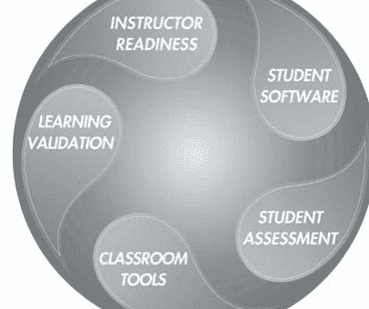

www.wiley.com/college/ 或拨打免费热线：1+(888) 764-7001（仅限美国和加拿大） | iii

# 教学特征

《Network+ 网络技术入门》旨在涵盖 Network+ 考试的所有学习目标，这些被称为“考试目标”。许多教学特征是专为我们的技术类书籍开发的。在整本书书中呈现程序性信息和技术概念给学生和教师都带来了挑战。下文的“插图书之旅”提供了《Network+ 网络技术入门》中可用功能的指南。以下是每课的关键特征列表，旨在帮助学生应对认证考试和职场：

- 每节课都以目标矩阵（`Objective Matrix`）开始。比起标准的目标列表，目标矩阵将每课中学到的技能与 Network+ 考试相关起来。

- 插图（`Illustrations`）：在学生进行练习时提供视觉反馈。图片强化了核心概念，提供了步骤提示，并让学生检查自己的进度。

- 关键术语（`Key Terms`）：重要的词汇列在课程开头。当这些术语在后后出现时，会**加粗**显示并给出定义。

- 趣味读者（`Engaging Readers`）：告诉学生该主题的相关性（**Bottom Line**）、提供提示（**Take Note**）或完成任务的其他方法（**Another Way**）。读者还提供了课程背景信息。

- 认证就绪（`Certification Ready`）：在涵盖特定目标的全文中强化。它们为学生提供了检查对特定考试目标理解的方法，并在涵盖该目标的章节进行回顾。

- 知识评估（`Knowledge Assessments`）：提供越来越具挑战性的活动，包括练习和案例场景。

- 实验手册（`Lab Manual`）：与本书集成。实验手册包含书中每节课程对应的动手操作说明，帮助学生学习。实验使用真实场景模拟学生将在职场中看到的任务。

## 基础网络安全


| 基础网络威胁 | 解释常见威胁、漏洞和缓解<br>- 病毒<br>- 蠕虫<br>- ARP 污染<br>- 接入点攻击<br>- DoS 攻击<br>- 恶意软件<br>- 间谍软件<br>- FTP 攻击 | 5.4 |

| 安全威胁 | 解释适当的监控工具和方法<br>- IDS<br>- IPS<br>- 蜜罐 | 5.4 |

| 认证 | 认证方法<br>- 生物识别<br>- NAC<br>- 网络访问控制<br>- 包认证<br>- SLICP | 5.2 |

## 业务场景 (Business Scenario)


Alex 是一家大型呼叫中心的经理。他遇到了许多与安全威胁如攻击和入侵有关的问题。他希望改进公司的安全策略。决定与顾问合作。

## 网络安全考虑 (Network Security Considerations)

Alex 需要为他的公司开发网络安全策略。他的策略应该解决以下问题：

- 你如何检测安全威胁？

- 你如何防止安全威胁？

- 你如何从入侵中恢复？

Alex 如何监控网络安全威胁以及他应该如何处理它们？

## 安全分析 (Security Analysis)

Alex 识别了计算机网络中常见的各种威胁。解释威胁、武器和攻击之间的区别。Alex 需要根据优先级对威胁进行排序，以帮助决定实施哪些安全措施。

Alex 需要回答以下问题：哪些安全威胁对公司最关键？哪些威胁最有可能发生在公司中？

## 基础网络考虑 (Basic Network Considerations)

Alex 识别了计算机网络中常见的各种威胁。解释威胁、武器和攻击之间的区别。此外，根据优先级对威胁进行排序，以帮助决定实施哪些安全措施。

Alex 需要回答以下问题：哪些安全威胁对公司最关键？哪些威胁最有可能发生在公司中？


Alex 识别了计算机网络中常见的各种威胁。解释威胁、武器和攻击之间的区别。此外，根据优先级对威胁进行排序，以帮助决定实施哪些安全措施。

## 关键术语 (Key Terms)

# B 课

- 双重身份认证

- 用户授权

- 解释常见威胁、漏洞和缓解

- 病毒

- 蠕虫

- ARP 污染

- 接入点攻击

- DoS 攻击

- 恶意软件

- 间谍软件

- FTP 攻击

解释适当的监控工具和方法

- IDS

- IPS

- 蜜罐

解释认证方法

- 生物识别

- NAC

- 网络访问控制

- 包认证

- SLICP

## 图解书导览 vii

也已被使用。这导致了对该技术的采用。事实上，例如，以太网已用于连接局域网中的计算机，但它能够达到 CAT 相同的 100 米范围。

### 图 3-1

100Base-T 以太网

100Base-T 以太网是目前最快的标准。它在两对双绞线上运行，而之前的标准使用四对、光纤或同轴电。100Base-T 以太网也被引入用于四对双绞线上运行。千兆以太网旨在在四对双绞线上运行，但尚未开发。

## 其他局域网

在性能方面，最好的指标是：带宽、冲突、延迟、可靠性和可扩展性。在成本方面，网络和局域网中最受考虑的因素是：

## 结论

### 图 3-2

以太网线

## 宽带

宽带是一种同时使用多个通道跨网络传输数据的技术。在网络中，宽带用于将计算机连接到互联网，也用于将电视连接到电缆网络。

在以太网的情况下，使用单个通道一次发送一个比特的数据，而宽带允许同时发送多个信号。这增加了网络的总吞吐量。然而，计算降低了网络计算机的性能，因为它们必须等待数据帧。在计算机忙的情况下，帧会被丢弃且不处理。

## 冲突

当两台计算机同时发送数据时，就会发生冲突。产生的信号会重叠并损坏。计算机随后等待随机的时间并重传数据。


### 什么是冲突？

冲突检测

以太网使用两种方法冲突检测：`CSMA/CD` 和 `CSMA/CA`。`CSMA/CD` 用于半双工网络，而 `CSMA/CA` 用于无线网络以避免冲突。

`CSMA/CD` 通过在传输数据时监听介质来实现冲突检测。如果检测到冲突，计算机将停止传输并在等待随机时间后重试。

### 什么是冲突？

冲突检测

`CSMA/CA` 通过在传输数据之前监听介质来避免冲突。如果介质忙，计算机将等待。如果介质空闲，计算机将发送信号让其他站知道它正在传输，然后开始发送。


## 注意读者 ID

### 图 3-5

电缆规格

以太网在某些情况下使用不同类型的电缆，例如双绞线。这里使用的是双绞线。它用于将计算机连接到网络。双绞线的安装成本更低，因为电线在束中扭绞在一起以减少电磁干扰。电线扭了两股有助于抵消电磁干扰。

## 屏幕图像

### 图 3-6

电缆宽度


## 时域反射计仪 (TDR)

`TDR` 用于寻找电缆中的断点。它向电缆中发送一个脉冲，并测量反射脉冲返回所需的时间。如果有断点，脉冲将从断处反射。`TDR` 即可计算断点距离 `TDR` 的距离。

### 图 3-7

时域反射


### 图 3-12

时域反射

## 认证就

### 什么是认证就？

认证标准

| Cat 3 | 10 Mbps | 100 米 | 双绞线 |

| Cat 5 | 100 Mbps | 100 米 | 双绞线 |

| Cat 5e | 1 Gbps | 100 米 | 双绞线 |

| Cat 6 | 1 Gbps | 100 米 | 双绞线 |

### 图 3-8

电缆规格

| RS-102 | 10 Mbps | 500 米 | 同轴电 |

| RS-105 | 10 Mbps | 200 米 | 同轴电 |

| Cat 5 | 100 Mbps | 100 米 | 双绞线 |

| Fiber | 10 Gbps | 100 km | 光纤 |


## 光时域反射仪 (OTDR)

`OTDR` 用于寻找光纤缆中的断点。它向光纤中发送一个脉冲，并测量反射脉冲返回所需的时间。如果有断点，脉冲将从断处反射。`OTDR` 即可计算断点距离 `OTDR` 的距离。

本课程涵盖的信息对于网络的有效开发至关重要。理解不同层级如何工作，将帮助你在必须处理硬件、软件、安全及其他组件的网络环境中取得成功。它还将使你能够在现实环境中有效地识别这些位置，并了解对你所期望的要求。

# 技能精通

- 能够：

- 识别不同类型的铜质电缆

- 理解非屏蔽双对（`UTP`）电缆布线

- 解释 `UTP` 和 `STP`（屏蔽双对）之间的区别

- 描述常用跳线线的特征

- 识别同轴电缆的类型

- 描述光纤缆的类型

- 识别用于跨光纤传输数据的两种介质

- 解释光纤缆的优势

- 讨论四种最常见网络介质的相似之处和局限性

# 总结技能矩阵

## 知识评估

# 填空题

- 通过在提供的空格处填写正确的单词来完成以下句子：

1. 最常见的布线类型是 ________，用于电信领域。

2. 在局域网（`LAN`）中，两种最常用的布线类型是 ________ 和 ________。

3. 网络中使用的两种跳线类型是 ________。

4. ________ 是住宅安装中使用的铜质电缆类型。

5. 用于传输的介质是 ________。

6. ________ 是发送数据流比 ________ 更快的两种方法。

# 练习

1. 哪种光纤使用 LED 作为光源？

a) 单模光纤

b) 多模光纤

c) 以上所有

d) 无

2. `1000Base-T` 标准与哪些标准向后兼容：

a) `10Base-T`

b) `100Base-T`

c) `100Base-T2`

d) `1000Base-TX`

## 案例场景

## 场景 3-1：使用 UTP 电缆连接两个交换机

你有三种不同类型的 `UTP` 电缆。根据下面的图，你将使用哪种电缆以及将其连接在哪里？

## 场景 3-2：使用不同类型的电缆连接小型网络

你将使用多少种类型的电缆？应该在哪里连接它们？

# 实验练习

# TCP/IP 如何通过 TCP/IP 模型工作

本实验的目的是学习 `TCP/IP` 模型的工作原理以及其中使用的一些协议。

这个实验非常重要，因为它引导学生对不同组件进行彻底探索。通过实验，学生将理解各种协议之间的差异和相似之处。

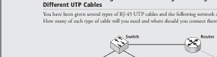

## 材料

- 具有网络访问功能的计算机

- 教书

- `Wireshark`

# 执行操作

# 遵循 TCP/IP 模型的各层协议

1. 阅读本课程的第一部分“TCP/IP 模型如何工作”。

2. 完成图 3-1。

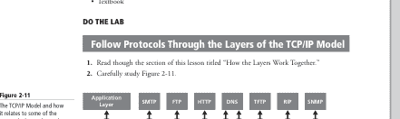

图 3-1：`TCP/IP` 模型显示了网络的不同层以及数据在每一层是如何处理的。

在纸上画出 `TCP/IP` 模型的层，并描述在每一层封装数据的协议。

- 应用层：`HTTP`

- 传输层：`TCP`

- 网络层：`IP`

- 数据链路层：`Ethernet`

www.wiley.com/college/ 或拨打免费热电话：1+(888) 764-7001（仅限美国和加拿大）

42 | 第 3 

# 本书使用的约定和特性

本书使用了特定的字体、符号和标题约定来突出重要信息，或引起你对特殊步骤的注意。有关每课功能的更多信息，请参考“图解图书之旅”部分。

www.wiley.com/college/ 或拨打免费热电话：1+(888) 764-7001（仅限美国和加拿大）

# 教师支持

- 教学中最宝贵的资源可能是你的同事。教职工网络（`Faculty Network`）将教师与技术联系，促进最佳实践的交流，并帮助提高教学效率和效果。教职工网络活动包括技术培训和辅导、虚拟研讨会、点对点交流、个人咨询和资源共享。详情请访问 WhereFacultyConnect.com。

- 在改进课堂体验方面，没有比比你的同事更好的想法和灵感来源了。

# DREAMSPARK PREMIUM——符合条件的采用者可免费获得 3 年会员资格！

`DreamSpark Premium` 旨在让大学以最廉价的方式将领先的微软开发工具、产品和技术应用于实验室、教室和学生电脑上。`DreamSpark Premium` 是一项面向科学、技术、工程和数学（`STEM`）课程的年度会员计划。

通过 Wiley 和微软的出版合作，`DreamSpark Premium` 中的软件免费提供给采用部门。

# 学生支持计划

# 教材配套网站 (www.wiley.com/college/)

学生教材配套网站包含了与本课程配合的所有资源、练习文件和网络链接。

# Wiley 桌面版 (Wiley Desktop Editions)

`Wiley 桌面版` 是印刷版教材的创新电子版本。学生购买桌面版仅需支付美国印刷版价格的 6 折，即可获得永久性和便携性的价值：`Wiley 桌面版` 为学生提供了其他电子文本解决方案无法提供的许多额外福利。

`Wiley 桌面版` 并非订阅制；学生将 `Wiley 桌面版` 下载到自己的电脑桌面。学生可以根据需要长期保留想要的内容。`Wiley 桌面版` 下载到电脑桌面后，学生无需联网即可立即访问所有内容。学生还可以访问 `Wiley 桌面版` 中完全集成的资源。从高亮电子文本到记录和共享笔记，学生可以在阅读或上课期间轻松对 `Wiley 桌面版` 进行个性化定制。

# 微软软件

作为本教材的采用者，贵校部门有权获得为期三年的 `DreamSpark Premium` 计划会员。通过 `DreamSpark Premium`，学生可以获得各种微软软件的完整版。详情请参阅您的 Wiley 手册。

www.wiley.com/college/ 或拨打免费热电话：1+(888) 764-7001（仅限美国和加拿大）

## 致谢

感谢 Jeff Riley 和 Box Twelve 的辛勤审查，以及他们为提供高质量教学材料所提供的宝贵反馈。

## 焦点小组和调查参与者

最后，我们感谢数百参与我们焦点小组和调查的教师，确保了我们的 Wiley 信息技术课程和教材设计符合客户的需求。

- Juan Aguilar, Mt. Community College

- Konrad Anders, Zane State College

- Michael Albers, University of Memphis

- Diana Anderson, Community & Technical College

- Phyllis Anderson, Delaware Community College

- Judith Anders, Feather River College

- Damon Anton, American River College

- Bridget Archer, Oak Community College

- Linda Arnold, Harrison Area Community-Lebanon Campus

- Neha Aarya, Fullerton College

- Mohammad Yahya, Katharine Gibbs School-New York

- Virginia Baker, University of Alaska

- Karl Barnnick, Penn Community College

- Rita Barkley, Northeast Alabama College

- Ela Ba, Central Community College-Hastings

- Ronald W. Barry, Ventura County Community District

- Elizabeth Bassted, Central Carolina Technical College

- Karen Baston, Waubonsee Community College

- Karen Bean, Blinn College

- Scott Beckstrand, Community College of Nevada

- Paulette Belle, Santa Rosa Junior College

- Lie Binder, Southeast Technical Institute

- Nancy Berry, Olympic College

- Lucy Beth, Milwaukee Area Technical College


# 致谢

- Meral Bialouski, Hofstra University
- Caroline Binder, Strayer University & Katharine Gibbs School
- Terrel Blair, El Centro College
- Beverly Booth, Reading Area Community College
- Henry Bajaj, Farming State University
- Matthew Bowen, Lewis Community College
- Wiley Bates, Portland Community College
- Karen Brandt, College of Albany
- September Brown, San of Mateo College
- Janet Jared, Southern Adventist University
- Kristen Callahan, Mercer Community College
- James Judery, Southern Community College
- Dianne Campbell, Athens Technical College
- Gena Casas, Florida Community College at Jacksonville
- Jason Catroon, Latin Technologies Community College
- James Gallbraith, Southern Indiana James Chvas, Indiana University-Purdue Fort Wright
- Nancy Caputo, Milwaukee Technical College
- Rebecca Chavez, Zayavel Polytechnic
- Sanjiv Chopra, Thomas Nelson Community College
- Greg Legmens, Luther Technical College
- Dayna Coker, Southern Oklahoma State University
- Tamra Collins, Otero Junior College
- Janet Conney, Gavlan Community College
- Carol Corfilth, Western Northern Community College
- Gary Cotton, American River College
- Ed Cox, Chattahoocheee Technical College
- Rallie Cox, Madison Technical College
- David Crawford, Northwestern Michigan College
- J.K. Crowley, Victor Valley College

> www.wiley.com/college/ 拨打免费热电话：1-(888) 764-7001 (仅限美国和加拿大)

- Roslyn Culver, Washten Community College
- Sharon Cuter, Huntington University
- Sandra Davis, New River Community College
- Anila Das, Cedar Valley College
- Brad Davis, Rosa Junior College
- Susan Davis, Green River Community
- Mark Awley, Lincoln Community College
- Jenifer Day, Sinclair Community College
- Carol Deane, Eastern Idaho Technical College
- John Lewis, West State College
- Jan DeHaven, Central Community College
- Drew Dekson, University of Alaska- Anchorage
- Joy Dietver, Central Lake College
- Salli DiBartolo, Broadway Community
- Melissa Migneau, Riverland Community
- Al Dillard, Lansdale School of Business
- Mary Harvey, Cosumbers College
- Sarah Davis, South Tennessee Community College
- Shilah Duranty, Tyrant County-South College
- Karl Davis, University of Tennessee at Martin
- Dieneer Ebert, Louis Community College
- Donna Ellis, State University of New-Brooklyn
- Larry Ellis, Montgomery County College
- Glanda Estes, New Mexico State University at Alogrado
- Angela Evangelista, Monroe County College
- Angie Evans, Ivy Tech College of Indiana
- Linda Farrington, Indian Hills Community College
- Dana Fladhammer, Phoenix Community College
- Richard Flores, Citrus College
- Comvie Fox, Technical College at Institute of West Virginia University
- Wanda Freeman, Okenefokee Technical College
- Brenda Freeman, August Technical College
- Susan Fry, Boise State University
- Roger Wilk, Wright State University- Lake Campus
- Sue Furnalls, Foley Community
- Sandy Gabel, Verizon Community
- Laura Gavran, Fairfield Technical College
- Candace Garrard, Red Rocks Community
- Sherrie Geiger, Northwest State College
- Chris Gerg, Chattanocha Technical College
- Jimena, Cuyamaca College
- Pamela Miller, Reedley Community
- Bettie Goodman, Polk Community
- Mike Kebiler, Katharine Gibbs School-New York
- Virginia Green, West State
- Walter Griffin, Alilene College
- John Hahn, Lincoln Community
- Kathy Hall, Nelson Community
- Judy Jedry, Ohio State
- Maureen Harper, Indian Hills College
- Steve Harris, Katharine Gibbs School-New York
- Linda Harper, Community
- Dianne------ (-)
- Robyn Hart, Fresno City College
- Darrian Haisten, Boise State University
- Winona Hatcher, Tacoma Technical College
- Kurt Lynch, Aiken Technical College
- Donna Love, Gaston Community
- Thomas
- Hernandez, South Arkansas College
- Sarah Marshall, Lake Region State
- Susan Axler, Ivy Tech College
- Teresa, Pennsylvania College
- Diane Karlbraeten, Indiana College
- Charles Kemnitz, Ventura College of
- Bill Kindra, Katharine Gibbs School-Philadelphia
- Bea Knaepen, Fresno City College
- Kofsted, Westmington Community
- Maria Kolatis, Ocean County
- Barry Kol, Little Rock
- Karen Kural, University of Arkansas
- Belva Lamb, Rogue Community
- Betty Lambert, Des Moines Area College
- Anita Lande, Cabr College
- Junnae Laird, Pratt Community College
- Karen Linkisch, UC Clement
- David Lanzilla, Central Florida Community College
- Nora Lardo, Cerritos Community
- Jenifer Larrabee, Chippewa Valley Technical College
- Debra Lardo, Idaho State University
- Barb Lave, Parkland Community College
- Audrey Harvey, Tidewater Community College
- Dezra Layton, Eastern Oklahoma College
- Larry LeBlanc, Owen Graduate School-University of
- Philip Lee, Nashville State College
- Michael Lefaird, Brevard Community
- Vasil Lamaynt, Southern Community for the How
- Anne C. Lewis, Edgecombe Community
- Stephen Lincoln, Houston Community
- Peggy Linton, Athens Technical College
- Hugh Milton, Mourie Technical College
- Donna Hahn, Lakeland Community
- Jackie Lou, Lake Tahoe Community
- Donna Love, Gaston Community
- Kurt Lynch, Austin Technical Community
- Sheilah Lynn, Florida Community-Jacksonville
- Ray P. Lyon, Tomball-Community
- Suzanne Marks, Bellevue Community
- Carol Martin, Louisiana State University-Alexandria
- Cheryl Martucci, Diablo Valley College
- Roberta Marvel, Eastern Wyoming College
- Tom Mason, Brookdale Community
- Mindy Moon, Santa Barbara City College
- Dixisse Massaro, Irvine Valley College
- May Ashland, Ashland and Technical College
- Emma May-Reynolds, Dyersburg State Community
- Timothy May, Metropolitan State College of Denver
- Reggie McCarthy, Central Lakes College
- Matt McCaskill, Brevard Community
- Kevin Farlane, Front Community College
- Donna McGill, Yuba Community College
- Teri McKeever, Ozark Technical College
- Patricia McMahon, South Suburban College
- Sally Mullion, Katharine Gibbs School-Philadelphia
- Charles McNerney, Green Community College
- Lisa Myers, Palm Beach Community
- Imran Mahmood, ITT Technical Institute-King of Jesus Campus
- Virginia Melton, Southwest Tennessee Community College
- Jeanne Mercer, Texas State College
- Denise Orrell, Jefferson Community & Technical College
- Catherine Meinkin, River Park Community
- Diane D. Mickey, Northern Virginia Community
- Darrell Miller, Grays Harbor College College
- Sue Mitchell, Calhoun Community

> www.wiley-cantu/college/ 拨打免费热电话：1+(888) 764-7001 (仅限美国和加拿大)

## 致谢

- Celia Ing, Sacramento City College
- Joan Ive, Lanier Technical College
- Barbara Jaffery, Beewoods Minnesota College of Technology
- Eduardo Jaramil, Peninsula College
- Susan Jennings, Stephen. Austin State University
- Leslie Lerner, Eastern Idaho Technical College
- Linda Johns, Georgia Community College
- Brent Johnson, Okeefokee Technical College
- Mary Johnson, San Antonio College
- Shirley Johnson, Trinidad State Junior-Valley Campus
- Teresa Jolly, Durant County
- Dr. Deborah Jones, South Georgia Technical College
- Margie Jones, Central Virginia Community College
- Randall Marshall, Lake Region State College
- Diane Karlbraeten, Ivy Tech College
- Teresa Axler, Pennsylvania College
- Charles Kemnitz, Ventura College of
- Bill Kindra, Katharine Gibbs Schools-Philadelphia
- Bea Knaepen, Fresno City College
- Kofsted, Westmington Community College
- Maria Kolatis, Ocean County Morse
- Barry Kol, Little Rock
- Karen Kural, University of Arkansas
- Belva Lamb, Rogue Community College
- Betty Lambert, Des Moines Area College
- Anita Lande, Cabr College
- Junnae Laird, Pratt Community College
- Karen Linkisch, UC Clement
- David Lanzilla, Central Florida Community College
- Nora Lardo, Cerritos Community College
- Jenifer Larrabee, Chippewa Valley Technical College
- Debra Lardo, Idaho State University
- Barb Lave, Parkland Community College


- Audrey Harvey, Tidewater Community College
- Dezra Layton, Eastern Oklahoma College
- Larry LeBlanc, Owen Graduate School-University of
- Philip Lee, Nashville State College
- Michael Lefaird, Brevard Community
- Vasil Lamaynt, Southern Community for the How
- Anne C. Lewis, Edgecombe Community
- Stephen Lincoln, Houston Community
- Peggy Linton, Athens Technical College
- Hugh Milton, Mourie Technical College
- Donna Hahn, Lakeland Community
- Jackie Lou, Lake Tahoe Community
- Donna Love, Gaston Community
- Kurt Lynch, Austin Technical Community
- Sheilah Lynn, Florida Community-Jacksonville
- Ray P. Lyon, Tomball-Community
- Suzanne Marks, Bellevue Community
- Carol Martin, Louisiana State University-Alexandria
- Cheryl Martucci, Diablo Valley College
- Roberta Marvel, Eastern Wyoming College
- Tom Mason, Brookdale Community
- Mindy Moon, Santa Barbara City College
- Dixisse Massaro, Irvine Valley College
- May Ashland, Ashland and Technical College
- Emma May-Reynolds, Dyersburg State Community
- Timothy May, Metropolitan State College of Denver
- Reggie McCarthy, Central Lakes College
- Matt McCaskill, Brevard Community
- Kevin Farlane, Front Community College
- Donna McGill, Yuba Community College
- Teri McKeever, Ozark Technical College
- Patricia McMahon, South Suburban College
- Sally Mullion, Katharine Gibbs School-Philadelphia
- Charles McNerney, Green Community College
- Lisa Myers, Palm Beach Community
- Imran Mahmood, ITT Technical Institute-King of Jesus Campus
- Virginia Melton, Southwest Tennessee Community College
- Jeanne Mercer, Texas State College
- Denise Orrell, Jefferson Community & Technical College
- Catherine Meinkin, River Park Community
- Diane D. Mickey, Northern Virginia Community
- Darrell Miller, Grays Harbor College College
- Sue Mitchell, Calhoun Community

## 致谢

- Jacque Moldhauer, Front Range Community College
- Linda Montoma, Los Angeles City College
- Sam Myryan, Allen County Community College
- Cindy Murphy, Southern Community College
- Ryan Murphy, Sinclair Community College
- Sharon E., Johnston County Community College
- Christine Noble, Kent State University Ashtula
- Hai Nazarian, Seattle Center Community College
- Nancy Lee, North-Central College
- Jennie Norega, Joaquin Delta College
- Linda Putter, Community Tommza, Middle West Institute of Technology
- Ed Otroz, Phillips State
- Dona Ora, Besite State University
- Jane Osogood, California
- Jane Owens, Kishiwwe College
- Taylor, Oklahoma State
- John Pratt, College of Dupe
- Tim Paul, Montana State University-Great Falls
- Joseph Perez, Texas College
- Mike Person, Perchemeketa Community College
- Dr. K. R. Pettit, West Virginia Wesleyan College
- Terry Perez, Orange County Community College
- Ashley Pettie, Raritan Valley Community College
- Jane Pinmier, Thiel South
- Michelle Poerner, Northern Michigan College
- Betty Pusta, University of Toledo
- Develand, West Central Technical College
- Mark Pranger, Rogers State University
- Carol Rainey, Southeast Missouri State University
- Linda Raskind, Hibbing Community College
- Leslie Ralif, Griffin Technical College
- Mar-Sateke, Rio Honda Community College
- Roy Reisen, Southeastern Community College
- Silvio Reyes, Technical Careers Interest
- Patricia Rishay, Anoka Technical College
- Jean Robins, Southern Technical Institute
- Carol Roberts, Eastern Maine Community College and University of
- Teresa Roberts, Wilson Technical Community College
- Victor Westman, Southern Tennessee Community College
- Betty Regby, Ohio State Technical Institute
- Lynne Rusdey, Missouri Southern University
- Steven Sacks, Los Angeles Valley College
- Joan Zales, Olympic College
- Lloyd Poundman, Michigan Community College-Desert Vista Campus
- Beverly Santillo, Georgia Perimeter College
- Thomas Varas, San Diego City College
- Sharolyn Sayers, Milauke Area Technical College
- Jude Sheeran, Western Community College
- Adolph Miller, Junior College
- Marlyn Schmed, Asheville-Bunville Technical College
- Janet Sebesey, Cuyahoga Community Michigan College
- Phyllis T. Shaffer, Bradley Community College
- Ralph Shafer, Trucker Meadows Community College
- Anne Marie Shaley, County College of Morris
- Sheila Shurn, Drury Community College
- Merlyn Shepherd, Danville Area Community College
- Susan Sinde, Aims Community College
- Beth Sindhi, Hawkeye Community College
- Andrew Smith, Marian College
- Brenda Smith, Southwest Tennessee Community College
- Lynn, State University of New York-Delhi
- Rob Smith, Katharine Gibbs-Philadelphia
- Tonya Smith, Arkansas State University-Home
- De Spencer, Tilly-Community College
- Jeri Prinner, Idaho State University
- Eric Stanik, San Rosa Junior College
- Karen Staron, Los Medanos College
- Meg Sjoner, Santa Rosa Junior College
- Beverly Stovers, Ivy Tech Community College of Indiana
- Marcia Stania, Yuba College
- Kim Sims, Tri-County Technical
- Sylvia Winters, Tacoma Community College
- Beverly Swann, Delaware Technical & Community College
- Ann Taff, Tulsa College, University of Wisconsin-Marathon Campus
- Rommy Thiel, Cal State
- Shannon Thompson, Portland Community College
- Ingrid Thompson-Seller, Georgia Perimeter College
- Barbara Tiersoft, University of Cincinnati-Raymond Walters
- Janine Tiffany, Reading Area College
- Dennis Tiffany, University of Nevada Las Vegas
- Susan Treheld, Normandy Community College
- Noel Trout, Santiago Canyon College
- Cherylgeon, Asnunction Community College

`www.iley.com/college/` 或拨打免费电话：`1-(888) 764-7001`（仅限美国和加拿大）

## 致谢

- Steve Turner, Ventura College
- Sylvia Unwin, Bellevue Community College
- Lilly Vigil, Colorado Mountain College
- Sabrina Vincent, College of the Mainland
- Mary Vitrano, Palm Beach Community College
- Brad Young, Northeast Community College
- Cozell, Southeastern Community College
- Carolyn Walker, Tri-County Technical College
- Sherry Walker, Tulsa Community College
- Qi Wang, Tacoma Community College
- Betty Witelista, Valencia Community College
- Marge Warner, Lanier Technical College-Foresyth Campus
- Marjorie Webster, Bergen Community College
- Linda Wenn, Central Community College
- Carolyn Whited, Roane State
- Winona Whited, Richland College
- Jerry Wilkerson, Scott Community College
- Joel Willenbrug, Fullerton College
- Barbara Williams, WITC Superior College
- Charlotte Williams, Jones County
- Bonnie Wily, Tech Community College
- Diane Wilson, Sargent Reynolds Community College
- James Wolfe, Metropolitan Community College
- Mary Wooten, Lanier Technical College
- Mark Yanko, Hocking College
- Alexis Yusov, Pace University
- Naeem Zaman, San Delta College
- Kathleen Zimmerman, Moines Area Community College

`www.iley.com/college/` 或拨打免费电话：`1+(888) 764-7001`（仅限美国和加拿大）

### 第1节 网络简介

- 考试目标矩阵 (1)
- 关键术语 (1)
- 基础定义 (2)
- 网络简史 (2)
- 不同类型的网络 (4)
- 基础网络拓扑结构 (6)
- 熟悉网络中心 (20)
- 总线型拓扑 (6)
- 星型拓扑 (7)
- 环形拓扑 (7)
- 网格型拓扑 (8)
- 点对点拓扑 (10)
- 点对多拓扑 (10)
- 混合拓扑 (11)
- 物理拓扑与逻辑拓扑 (12)
- 熟悉星型和总线型拓扑 (24)
- Windows 中的基础网络配置 (13)
- 技能总结 (15)
- 知识评估 (15)
- 案例场景 (17)

### 第1节 实验

- 实验 1 运行中的客户端/服务器局域网览 (18)
- 实验 2 在 Windows 中配置网络相关组件 (7)
- 实验 3 星型和总线型拓扑图 (24)

### 第2节 OSI 和 TCP/IP 模型

- 考试目标矩阵 (25)
- 关键术语 (25)
- OSI 模型简介 (26)
- OSI 模型长什么样 (26)
- 封装 (27)
- 物理层 (27)
- 数据链路层 (28)
- 网络层 (29)
- 传输层 (30)
- 会话层 (31)
- 表示层 (32)
- 应用层 (32)
- 数据如何在 OSI 模型中传输 (33)
- TCP/IP 模型 (36)
- 应用层 (37)
- 传输层 (37)
- 互联网层 (37)
- 网络接口层 (38)
- TCP/IP 模型的层级工作原理 (38)
- 技能总结 (39)
- 知识评估 (40)

### 第2节 实验

- 实验 1 通过 TCP/IP 模型的 TCP/IP 协议 (42)
- 遵循 TCP/IP 模型的协议 (42)

### 实验2 使用 TCP/IP 命令 (43)

### 第3节 媒介

- 考试目标矩阵 (46)
- 关键术语 (47)
- 铜缆布线及其属性 (48)
- 如何定义线 (48)
- 非屏蔽双对线 (49)
- 屏蔽双对线 (56)
- 同轴电 (57)
- 光纤线路宽带 (59)
- 串口 (60)
- 空顶层与非空顶层 (61)
- 与铜缆相关的问题和局限性 (61)
- 光纤布线 (64)
- 多模光纤 (64)
- 单模光纤 (65)
- 光纤连接器 (65)

### 安装布线分布 (67)

- 垂直和水平交叉连接 (67)
- 配线架 (68)


- 验证安装是否正确 (70)
- 验证终止是否妥 (70)
- 无线媒介 (71)
- IEEE 802.11 (71)

### 综合应用 (74)
- 技能总结 (75)
- 知识评估 (75)
- 案例场景 (77)

### 第3节 实验 (78)
- 实验 1 跳线缆 (78)
- 熟悉跳线缆 (78)
- 实验 2 直通线和交叉线 (79)
- 熟悉直通线 (80)

### 第4节 网络地址 (81)
- 考试目标矩阵 (81)
- 关键术语 (82)
- 物理地址 (82)
- MAC 地址 (83)
- 逻辑地址 (84)
- IPv4 协议 (85)
- IPv6 协议 (97)
- 物理和逻辑地址如何工作 (99)
- 冲突域 (106)
- 其他网络技术 (107)
- 子网掩码 (107)
- 网络地址转换 (NAT) (107)
- 分配 IP 地址 (110)
- 划分方案 (113)
- 技能总结 (113)
- 知识评估 (114)
- 案例场景 (115)

### 第4节 实验 (117)
- 实验 1 二进制转十六进制 (117)
- 转换十六进制 (117)
- 实验 2 二进制与十进制转换 (118)
- 转换十进制与二进制 (118)
- 实验 3 CIDR 格式下的子网码 (119)
- 确定子网码 (119)
- 实验 4 CIDR 格式下的 IP范围和子网码 (120)
- 从 CIDR 确定 IP范围和子网码 (120)

### 第5节 网络协议 (121)
- 考试目标矩阵 (121)
- 关键术语 (122)
- 协议族 (123)
- TCP/IP 协议族 (123)
- 协议如何工作 (145)
- 路由协议 (150)
- 路由协议的目的和属性 (150)
- 矢量路由协议 (153)
- 链路状态路由协议 (155)
- 混合路由协议 (156)
- 技能总结 (157)
- 知识评估 (157)

### 第5节 实验 (160)
- 实验 1 获取并安装 Wireshark (160)
- 安装 Wireshark (160)
- 实验 2 使用 Wireshark 捕获 (160)
- 使用 Wireshark (161)
- 实验 3 使用 Wireshark 分析捕获的数据 (162)
- 读取并解释 Wireshark 提供的数据 (163)

### 第6节 网络设备 (165)
- 考试目标矩阵 (165)
- 关键术语 (167)
- 网络接口卡 (167)
- 通信手段和通信媒介 (169)
- 地址 (170)
- 调制解调器 (170)
- 媒介转换器 (171)
- 光纤转以太网 (172)
- 光纤转同轴 (173)
- 单模光纤转多模光纤 (173)
- 中继器和集线器 (174)

## 桥器与交换机 (175)
- 桥器 (175)
- 交换机 (176)
- 接口配置 (177)
- 虚拟局域网 (VLAN) (179)
- 链路 (180)
- 端口镜像 (181)
- 端口认证 (181)
- 生成树协议 (STP) (181)
- 以太网供电 (PoE) (181)

## 信道业务单元/数据业务单元 (CSU/DSU) (182)
- 路由器 (183)
- 防火墙 (184)
- 硬件防火墙 (184)

## 服务器 (186)
- 动态主机配置协议 (DHCP) 服务器 (186)
- 域名系统 (DNS) (188)
- 代理服务器 (190)

## 其它专用网络 (191)
- 入侵网络 (191)
- 入侵检测系统 (IDS) 与入侵防御系统 (192)
- 加密设备 (193)
- 负载均衡 (193)
- 带宽整形 (194)
- 无线设备 (194)
- 无线网卡 (NICs) (194)
- 无线接入点 (196)

## 虚拟网络 (197)
- 虚拟交换机 (197)
- 虚拟桌面 (198)
- 虚拟服务器 (198)
- 虚拟程控交换 (PBX) (198)
- 本地与远程 (199)
- 软件服务 (SaaS) (199)

## 技能总结 (199)
- 知识评估 (200)

## 第 6 课：实验 (202)
### 实验 1：使用交叉线连接两台计算机 (202)
- 连接计算机 (202)
- 配置两台计算机 (202)
- 启用共享 (203)
- 在网络位置中验证共享 (204)

### 实验 2：使用交换机或集线器连接多台计算机 (205)
### 实验 3：在单一网络中连接交换机或集线器 (205)
- 使用交换机或集线器连接多个网络 (205)

### 实验 4：使用 VMPlayer 创建虚拟工作站 (206)
- 获取所需文件 (206)
- 安装 VMPlayer (207)
- 创建你的虚拟机 (209)
- 安装 VM-Tools Linux (215)

## 第 7 课：局域网技术 (219)
- 考试目标矩阵 (219)

### 关键术语 (220)
- 局域网技术 (221)
- 以太网帧 (221)
- 以太网方法 (222)
- 基带技术 (225)

## 其它局域网概念 (228)
- 广播 (228)
- 链路聚合 (230)
- 网络速度 (230)
- 距离 (231)

## 无线局域网技术 (233)
- 安装小区 (233)
- 接入点放置 (234)
- 安装接入点 (236)
- 验证安装 (242)

## SOHO 技术 (242)
- 要求列表 (242)
- 线缆长度 (243)
- 设备类型与要求 (243)
- 环境限制 (243)
- 硬件限制 (243)
- 兼容性要求 (244)

## 技能总结 (245)
- 知识评估 (245)

## 第 7 课：实验 (247)
### 实验 1：访问无线接入点 (247)
- 第一部分：确定网关 (247)
- 第二部分：配置 WAP 配置界面 (249)

### 实验 2：熟悉 WAP 配置界面 (250)
- 熟悉 WAP 中提供的常用选项 (251)

`www.iley.com/college/` 或拨打免费热电话：`1+(888) 764-7001` (仅限美国和加拿大)

## 第 8 课：广域网技术 (252)
- 考试目标矩阵 (252)
- 关键术语 (253)

## 电路交换的类型 (254)
- 电路交换 (254)
- 分组交换 (255)
- 报文交换 (256)
- 虚电路交换 (256)

## 传输介质 (257)
- 铜缆 (257)
- 光纤 (257)
- 微波 (258)
- 卫星通信 (259)
- 射频 (RF) (261)

## 各种广域网技术 (263)
- 拨号上网 (263)
- 集成服务数字网络 (ISDN) (265)
- 数字用户线路 (DSL) 技术 (267)
- 宽带和电缆调制解调器 (268)
- X.25 (269)
- 帧中继 (270)
- T 线 (271)
- 异步传输模式 (ATM) (272)
- 同步光纤 (SONET) 与同步数字分层结构 (SDH) (273)
- 多协议标签交换 (MPLS) (274)

## 远程访问 (274)
- 远程访问服务 (RAS) (274)
- 虚拟专用网络 (VPN) (275)

## 技能总结 (276)
- 知识评估 (277)

## 第 8 课：练习 (279)
### 实验 1：研究本地广域网提供商 (279)
- 查找所在地区提供广域网服务的本地 ISP (279)

### 实验 2：使用 Windows 7 设置 VPN (280)

## 第 9 课：基础网络安全 (285)
- 考试目标矩阵 (285)
- 关键术语 (286)

## 基础安全 (287)
- 社会工程 (288)
- 恶意软件 (290)
- 攻击威胁 (295)
- 安全考虑因素 (301)
- 设备安全 (301)
- 密码 (307)
- 攻击发生后 (317)
- 缓解措施 (318)
- 应急响应 (318)

## 有用或坏工具 (319)
- 入侵检测系统 (IDS) (319)
- 入侵防御系统 (IPS) (320)
- 封包嗅探器 (320)
- 端口扫描器 (321)
- 日志记录 (321)

## 技能总结 (322)
- 知识评估 (322)

## 第 9 课：实验 (325)
### 实验 1：恶意软件检测与防护 (325)
- 下载恶意软件 (326)

### 实验 2：入侵检测 (327)
- 安装入侵检测 (328)

## 第 10 课：网络接入 (331)
- 考试目标矩阵 (331)
- 关键术语 (332)

## 防火墙 (333)
- 网络防火墙 (333)
- 主机防火墙 (337)
- 防火墙功能 (337)
- 过滤 (341)

## 隧道与加密 (344)
- 虚拟专用网络 (VPN) (349)
- 远程访问 (350)

## 无线认证与加密 (355)
- Wi-Fi保护 (WPA) (355)
- 有线加密 (WEP) (355)
- 远程认证服务 (RADIUS) (355)
- 临时密钥完整性 (TKIP) (355)

## 第 10 课：实验 (364)
### 实验 1：使用 Windows 构建 ACL (364)
### 实验 2：更新与补丁 (370)

## 第 11 课：网络管理 (373)
- 考试目标矩阵 (373)
- 关键术语 (374)
- 命令行网络工具 (377)
- 什么是网络管理以及为什么需要它？(374)
- 网络管理考虑因素 (375)
- 故障排除操作 (377)
- 高级故障排除 (377)
- 文档 (379)
- 常见连接问题 (379)
- 物理问题 (382)
- 逻辑问题 (383)
- 升级的问题 (385)
- 无线问题 (386)
- 网络文档类型 (386)
- 使用网络文档 (386)
- 维护网络文档更新 (387)

## 网络监控 (387)
- 封包嗅探器 (388)
- 连接软件 (391)
- 负载测试 (393)
- 吞吐量 (393)
- 日志 (393)

## 技能总结 (322)
- 知识评估 (322)

## 第 12 课：网络优化 (395)
- 网络优化的原因 (395)
- 实现网络优化的方法 (400)

## 第 12 课：实验 (471)
### 实验 1：执行 Ping (471)
- 运行 Ipconfig (471)
- 进行 Ping 测试 (473)

### 实验 2：使用 Tracer (474)
- 使用 Tracer (474)

## 附录
- 附录 A：Network+ 认证 (487)
- 附录 B：Network+ 协议 (488)
- 术语表 (490)
- 索引 (505)

## 网络介绍

### 考试目标矩阵

| 涵盖的技术技能 | 考试目标 | 考试目标编号 |
| --- | --- | --- |
| 基础定义 | **描述不同的网络拓扑结构。**<br>- 对等<br>- 客户端/服务器 | 3.5 |
| 基础网络拓扑 | **描述不同的网络拓扑结构。**<br>- 点对点<br>- 点对多点<br>- 环形<br>- 星型<br>- 网状<br>- 总线型<br>- 混合 | 3.5 |
| Windows 中的基础网络配置 | | |

### 关键术语

总线型网络拓扑、网络拓扑、客户端/服务器网络、部分网状网络拓扑、企业网络、点对等网络、混合型网络拓扑、物理拓扑、互联网、点对多点网络拓扑、互联网服务提供商 (ISP)、点对点网络拓扑、局域网 (LAN)、环形网络拓扑、逻辑拓扑、星型网络拓扑、媒体访问单元 (MAU)、用户账户控制 (UAC)、网状网络拓扑、广域网 (WAN)、城域网 (MAN)、万维网 (WWW)

## 第一课

你工作于 Key's Computer Consulting, Ltd. 咨询公司。Harbor, Inc. 出版公司聘请了你所在的公司，并交给你一项任务：为 Harbor Publishing, Inc. 构建最佳类型的网络。你该怎么做？从哪里开始？你是如何确定这些问题以及更多问题的答案的？本课将帮助你开始寻找其中的一些答案。

## 基础定义

### 核心内容

第一课的这部分解释了什么是网络，简要回顾了计算机网络的历史，并定义了一些基础网络术语。

本课的目的是向你介绍与计算机网络相关的一些基本概念。为了这一点，首先需要讨论的是什么是计算机网络。从最简单来说，计算机网络是一组相互连接并可以来回传输信息的计算机。

## 网络演变简史

最早的网络被幽默地称为“运动鞋网”（sneaker nets）。之所以使用这个术语，是因为想要将数据从一台计算机移动到另一台计算机的人必须将要移动的数据从某些存储器复制到软盘上，然后必须“穿上运动鞋”将其带到目标计算机处。你可以想象，这并不是将数据从一台计算机移动到另一台计算机最高效的方法。这种方法也带来了一些问题，最尤其是如何确保所有人拥有的某组数据的最新副本，而不是旧副本。显然，必须寻求不同的解决方案。

人们想到的第一个解决方案是将所有信息放在名为“大型主机”的大型中央设备上，并将不同的终端（哑终端，dumb terminals）连接到这台大型主机上。哑终端本质上是连接到大型主机的屏幕和键盘。用户通过其中一个哑终端访问大型主机上的数据。

与此同时，学术界和军方正合作开发某种方法，将这些跨越国家和世界的各种大型主机连接起来。这项工作由一个名为 ARPA 的组织发起，它的全称是“高级研究计划署”。该组织现在被称为 DARPA 或“高级防御研究计划署”。这项工作产生了我们今天所知的成果。也就是说，互联网是由……发明的。

在很长一段时间内，ARPA 创建的网络和连接到哑终端的大型主机是当时的主流。然而，业务正在计算机行业的其他部分发生——其中最大的是个人电脑的发展。到 20 世纪 80 年代，个人电脑 (PC) 终于开始在工作方式上取得显著改进。企业意识到，将 PC 连接到网络中就像将哑终端连接到大型主机一样非常有用。Novell 和其他几家公司领导了这项工作。到 20 世纪 80 年代后期，在某些业务部门发现拥有 PC 网络已不稀奇。然而，PC 并不是连接到大型主机的，而是连接到服务器上。

## 网络介绍

可能是第一个扩展到单个房间或建筑之外的通用高速网络，是 1989 年 7 月和 8 月由田纳西州一所名为 Williams Jennings Bryan 的小型私立艺术学院建造的。该学院还使用 Novell 286 软件和 ARCNet 网卡将 4 栋宿舍、一栋行政/学术楼、一栋体育馆以及校园其他地方的两栋建筑连接成一个综合网络。该学院允许感兴趣的学生租赁拥有网络能力的计算机。然后学生们就可以使用这些计算机从自己的房间连接到网络。

这个网络名为 BryanNet，被配置为环形网络。令牌环形网络将在本课稍后讨论。该网络的速度为 2.5 Mbps（每秒百万比特）。这在 1989 年被认为是非常快的。该网络使用同轴电缆连接建筑，建筑内部使用双绞线。

学生对这个网络进行的首个主要用途是艺术鉴赏测试，他们必须记忆艺术作品以及创作这些作品的艺术家。艺术老师将她希望他们记忆的图像放在网络上，以便学生在测试前从宿舍学习。老师在网络上选择了一些图像供学生识别。

BryanNet 和其他早期网络使用服务器作为存储区域，共享文档和其他共享文件存储在那里。任何人都可以从服务器访问共享文档或文件，并在完成后将他们所做的任何更改保存回服务器。今天，这仍然是网络的常用用途，尽管已经增加了其他功能。

在此之后，网络领域开始快速进展。接下来的事情是大学和军方想要使用互联网。个人也想在家里获得访问。当人们开始连接互联网时，他们希望有一种更有吸引力的方式查看互联网上的信息。这就是万维网发明的时候。

万维网 (WWW) 是互联网的一项服务，允许人们使用特殊的客户端软件浏览器以具有视觉吸引力的方式查看不同互联网网站的内容。万维网的早期开发发生在 20 世纪 90 年代初。到 90 年代中期，万维网已确立为互联网上一个可行的入口。

理解的一个重要点是万维网和互联网之间的区别。许多人往往认为万维网和互联网是同义的不同事物。它们并不是。互联网是由电缆、路由器、交换机和其他设备组成的硬件和软件基础设施。所有这些将在后续的课程中详细讨论。另一方面，万维网是运行在互联网基础设施之上的服务或软件。万维网利用互联网基础设施来支持网站并在浏览器之间移动数据。万维网只是使用互联网基础设施支持它的许多网络服务之一。另外两个公认的站点是电子邮件和新闻组。

随着网络连接速度的提高，人们想要下载的数据复杂度也随之增加。人们曾经满足于文本信息，现在他们开始想要彩色信息。接着，他们希望在网站上添加图表。仅仅有图形是不够的，人们开始想要图像和声音，最后是动态图像和声音。这些不同且更复杂的数据类型迫使网络不断增加规模并变得更快，以满足新的需求。这些变化从业务领域渗透到个人家庭，直到变成了我们今天拥有的：无处不在地访问你可以获取任何类型的信息。

本书将帮助你理解网络是如何工作的。这本书还将帮助你理解各种网络技术如何作为一个整体协同工作。坐稳了，这将是一段有趣的旅程。

## 不同类型的网络

数据网络主要分为两大类，有时会用第三类来描述一种介于第一类和第二类规模之间的网络。这两个大类别是广域网和局域网。根据其名称中每个单词的首字母，这些网络分别被称为 WAN 和 LAN。

## WAN 和 MAN 网络

WAN（广域网）是一种可以跨越地理区域的大型网络。互联网、连接多个城市、州、国家和国家的网络也属于广域网的范畴。许多公司在分散区域的办公室或建筑中使用 WAN，以使其公司所有的设施和员工保持相互连接。这种性质的 WAN 意味着企业网络。

虽然 WAN 可以跨越广大的地理区域，但 LAN（局域网）顾名思义，局限于局部区域。LAN 通常局限于一栋建筑，或者最多位于某栋建筑内。然而，LAN 和 MAN（城域网）使用的技术彼此略有不同。这些相似之处和差异将在后文中进行详细讨论。

MAN 术语正在逐渐被淘汰，表现出 MAN 特性的网络通常简单被称为 WAN 或企业网络。

比 LAN 大但又略小不足以视为 WAN 的网络被称为城域网（MAN）。MAN 是通常跨度不超过 50 公里的网络。MAN 用于连接城市，其规模从大学校园到城市数据网络不等，城市数据网络可以由公司私有，也可以由市政当局所有。某些城市将 MAN 作为公用事业，以便当地企业和个人共享由市中心提供的各种网络服务，以及连接到 MAN 的客户。MAN 和 WAN 通常使用相同的技术，而 WAN 技术在进入更大型的 WAN 之前通常会先进入 MAN。升级 MAN 比升级 WAN 更便宜、更简单，因此 MAN 的升级频率更高。

你能解释点对点网络和客户端/服务器网络的特征吗？

## 不同类型的 LAN

LAN 有两种类型。这些是点对点网络和客户端/服务器网络。

### 点对点网络


# 网络基础

## 点对点网络

在点对点网络中，网络中的每台计算机都独立于所有其他计算机运行，但可以与网络中的所有其他计算机共享打印机等数据和资源。每台计算机都与其他独立运行，有必要在每台计算机上单独设置安全和资源共享。如果你在一个由五个用户共享的点对点网络中有五台计算机，那么你必须在每台计算机上都设置这五个用户。这导致每当你需要更改用户的配置或设置时，管理所有用户变得非常困难，因为你必须操作五次。从这个例子中可以看出，点对点网络中的计算机和/或用户越多，管理就越困难。

点对点网络非常容易建立，在大多数计算机和用户参与时效果最好。大多数操作系统（如 Windows XP、Windows Vista、Windows 7、MAC OS X 和 Linux）实际上允许你通过集线器或交换机连接几台计算机来简单地建立点对点网络。这样做完成后，大多数操作系统会自动找到其他连接的计算机。这意味着所有终端用户都必须在每台连接的计算机上创建用户，并决定他们想在网络上共享哪些文件夹和/或打印机。

如前所述，点对点网络在计算机数量较小时运行效果最好。微软操作系统不允许在点对点环境中有超过 10 台计算机连接到同一网络。

点对点网络实际上非常常见。事实上它们可能比你想象的要常见。如果一个人在家里将两台或更多计算机连接到交换机或访问点以共享互联网访问，那么这个人就在运行点对点网络。家庭网络是点对点网络最常见的形式。

## 客户端/服务器网络

客户端/服务器网络比点对点网络复杂一点，价格也贵一点。在客户端/服务器网络中，一台被称为服务器或控制器的主计算机处理网络管理。在这种网络中，所有用户和他们共享的资源都放置在一个或多台服务器上。每当用户想要访问网络或网络上的某些资源时，该用户的注册必须经过服务器的验证或许可。一旦在网络上通过身份验证，工作站将根据域控制器接收访问令牌，该令牌概述了根据登录用户允许访问的资源。此后，当登录用户想要访问网络上的各种资源时，工作站将根据访问令牌与网络允许的资源进行比较。每当用户请求他们应得的资源时，可能会被拒绝该资源的访问。上述讨论的所有信息均适用于基于 Windows 的网络。基于其他操作系统的网络执行方式不同，并以特定于那些操作系统的资源拒绝访问。

由于客户端/服务器网络有一个控制网络所有资源的中央服务器，管理客户端/服务器网络比管理点对点网络容易得多。实际操作中，这意味着如果你网络中有 10 个用户，你不需要在不同的计算机上设置 10 个用户，而可以在中央服务器上只设置一次。之后，如果你需要更改用户的设置，你只需要去中央服务器进行更改。更改只需要在一个地方进行并完成，而点对点网络则需要在 10 个不同的地方进行。

## 网络拓扑

### 总线型拓扑

如图 1-1 所示，在总线型拓扑中，网络中的所有计算机都通过一根被称为“骨干”的主电缆连接在一起。这种拓扑的优点是易于构建，且所需的电缆极少。然而，总线型拓扑也存在缺点。这种类型拓扑最大的缺点是，如果电缆在任何一点断裂，网络上的计算机将失去相互通信的能力。另一个缺点是，当电缆断裂时，定位问题变得非常困难。最后一个缺点是，主电缆一次只能发送一个信号。如果有超过一台计算机尝试同时发送信号，信号之间就会发生冲突，导致双方的数据都丢失。目前有相应的机制来处理最后这种缺点，我们将在后的课程中进行讨论。

### 星型拓扑

下一种拓扑是星型网络拓扑。星型拓扑是目前最常用的网络拓扑。你可能会遇到的大多数网络都是这种拓扑的某种变体。图 1-2 展示了一个基本的星型拓扑网络。

**图 1-2 星型网络拓扑**

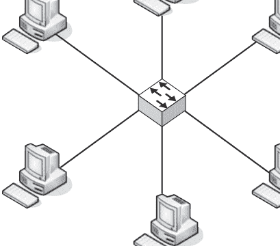

观察图 1-2 可以清楚地看出为什么这种拓扑被称为星型拓扑。在这种拓扑中，几台工作站通过一个集线器或交换机等中心设备连接在一起。图 1-2 中用于该中心设备的符号是交换机的标准符号。这种拓扑的主要优点是，如果连接到其中一台计算机的电缆损坏，只有那台计算机会受到影响。如果网络上只有一台计算机受影响，那么确定哪台计算机出了问题就变成了一件很容易的事。这种拓扑的主要缺点是，如果连接所有计算机的中心设备故障，整个网络将无法工作。然而，这个缺点被一个事实所抵消：如果整个网络宕机，问题最可能出现在中心连接设备上。这一事实限制了你查找问题所在位置范围。这种网络拓扑的另一个微小缺点是它比总线型拓扑需要更多的电缆，因此价格稍高。

### 环形拓扑

环形网络拓扑和总线拓扑一样，是最早设计的网络拓扑之一。图 1-3 展示了这种拓扑。

**图 1-3 环形网络拓扑**


从图 1-3 可以清楚看出，“环形拓扑”一词源于网络配置中用于连接各种计算机的大圆环。环形拓扑与总线拓扑相似，因为它们都有一根被称为“骨干”的主电缆，用于连接所有计算机。在环形拓扑中，该骨干电缆被形成一个环，以连接所有计算机。其优点是数据只能向一个方向传输，因此数据不会与另一台计算机的数据发生冲突。这种控制机制被称为“令牌”（Token）。环形网络中使用的令牌不与之前讨论的访问令牌混淆。这是两种完全不同且相互无关的令牌。

在环形网络中，单个令牌在计算机之间传递。如果一台计算机不想发送数据，它就会将令牌传递给下一台计算机。如果一台计算机想要传输数据，它就会获取令牌的控制权并创建一个用于向目的地发送数据的数据包。一旦目的地接收到数据，它就会创建一个确认包发送给原始发送数据的计算机，然后释放令牌让其在网络中循环，传递给下一台想要发送数据的计算机。

环形拓扑因为与总线型拓扑相似，也具有总线型拓扑的一个缺点。由于其相似性，如果骨干在任何地方断开，都会导致整个网络瘫痪。这种缺点，结合了数据传输的特点，被星型拓扑所取代。

### 网型拓扑

网型拓扑主要用于 WAN 环境。图 1-4 展示了网型拓扑的样式。

**图 1-4 网型拓扑**

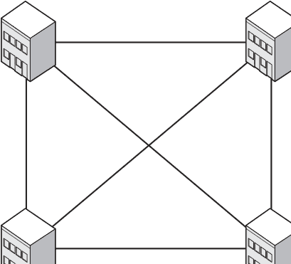

在全网型中，每台计算机都连接到所有其他计算机。这种方法提供了极大的冗余性，但也非常昂贵。

确定全网型需要多少个连接的方法是使用公式。如果 $n$ 是设备数量，且每个设备都连接到 $n-1$ 台其他设备，那么总连接数就是 $n(n-1)$。然而，由于每个连接由两台设备共享，我们除以 2。因此，全网型的总连接数公式为 $n(n-1)/2$。随着计算机数量的增加，所需的连接数量迅速增长。四台设备的全网型需要 6 个连接，五台设备的全网型则需要 10 个连接。

**图 1-5 部分网型拓扑**


正因为全网型涉及费用问题，才开发了它的替代方案。这种替代方案被称为部分网型。

部分网型拓扑在冗余性方面与全网型具有相同的优点；然而，它还有一个额外的优点，即不需要大量的连接。为了使部分网型真正具有冗余，网络上的每台设备至少需要连接到两台设备。每台设备拥有多个连接是可能的，但每台设备至少需要两个连接才能被视为网型拓扑。

### 点对点拓扑

点对点拓扑和网型拓扑一样，主要是 WAN 类型。图 1-6 很好地说明了这一点。

**图 1-6 点对点网络拓扑**


关于远程访问的内容将在第 8 节中讨论。

图 1-6 清楚地显示，在点对点拓扑中，一台且仅一台计算机直接连接到另一台计算机或设备。这种配置通常用于外部计算机需要远程连接到网络内部的计算机的情况。在这种情况下，可以使用某种远程访问技术建立点对点连接，将外部计算机与网络内部计算机连接起来。

### 点对多拓扑

点对多网络拓扑是点对点拓扑的变体，但与点对点拓扑不同，它常用于 LAN 和 WAN。除了这一事实外，点对点与点对多拓扑的主要区别在于，在点对多拓扑中，一个设备不是只连接到一个设备，而是连接到多个其他设备。图 1-7 展示了这一点。

**图 1-7 点对多拓扑**


点对多点网络拓扑很少用于连接多台计算机。点对多点拓扑更有可能被用于将一台计算机或路由器连接到多个交换机、路由器、计算机或其他网络设备。图 1-7 显示了一个交换机和一个路由器连接到多个交换机或路由器，而不是一台计算机连接到多台计算机。

图 1-7 中带有两个指向内和两个指向外的箭头的圆圈是路由设备的标准符号。该设备用于在广域网（WAN）中传输数据，并确保使用效率最高的路由。

路由器和交换机将在第 6 节中进行详细讨论。

### 混合拓扑

混合网络拓扑顾名思义，是多种网络拓扑的混合或组合。你将遇到的大多数网络都是某种混合网络拓扑。最常见的可能是星型-总线混合拓扑。图 1-8 显示了一个包含多种网络拓扑并组合成混合网络拓扑的假设网络。

**图 1-8 混合网络拓扑**

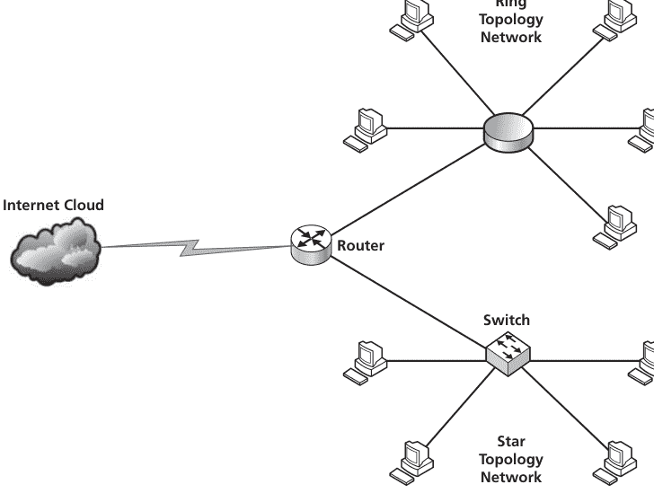

图 1-8 中两种最显著的网络拓扑是图表顶部的环形拓扑和底部的星型拓扑。然而，顶部环形、中间路由器和底部交换机之间的连接是总线拓扑的示例。路由器与互联网云之间的连接是路由器与互联网服务提供商（ISP）之间的点对点拓扑连接示例，ISP 为整个网络提供互联网访问。云符号是一个常用的网络符号，用于说明你不知道其形状的网络。

混合网络还有另一种形成方式，即通过将物理拓扑与逻辑拓扑相结合来实现。这两种类型的拓扑是本节下一部分的主题。


## 物理拓扑与逻辑拓扑

**认证就绪**

你能解释物理拓扑和逻辑拓扑之间的区别吗？

3.5

图 1-10 之于图 1-9 有一处不同：中心内部不是总线拓扑，而是环形拓扑。这种设备有时被称为令牌集线器或环形集线器。这种设备的正式名称之一是 MAU，即媒体访问单元。这类设备仅用于环形网络。图 1-10 展示了一个星型-环形。网络的物理形状是星型，无论逻辑拓扑是否是环形。在这个网络中，数据流向正如之前环形部分描述的那样，从一个流向另一个；当你从外部观察这个网络时，它看起来像星型。这个网络具有环形逻辑拓扑但星型物理结构。简而言之，它是星型-环形。

## Windows 中的基础网络配置

在第 1 节的这一部分，我们将介绍如何配置 Windows Vista 机器以供网络使用。

能够学会配置 Windows Vista 或 Windows 7 是一项非常重要的技能，在本书的实验过程中会反复用到。配置 Vista 时需要记住的一点是，由于微软试图在 Vista 中包含高水平的安全性，在配置过程中许多步骤只需要你点击“是”或“确定”或提供管理员权限。为了消除这些对话框，你将关闭 Windows Vista 内部的用户账户控制（UAC）。这在 Windows 7 中问题较小，没有理由在 Windows 7 中禁用 UAC。

用户账户控制是 Windows Vista 和 Windows 7 的一项功能，需要确认和管理员密码，以便在 Windows Vista 或 Windows 7 计算机上执行某些操作；即使尝试操作的人已经拥有管理员权限。许多人在 Windows Vista 中关闭了此功能，因为他们觉得它很烦人。正如前面提到的，微软在 Windows 7 中很大程度上放宽了这一点，因此在该操作系统中这不是什么大问题。

有些人质疑 Windows Vista 和 7 中的 UAC 功能是否具有任何用处。微软向我们保证，该功能对于实现你网络的高水平安全性是必要的。在某种程度上，这是正确的，因为它让恶意人员更难渗透你的 Windows Vista 操作系统。任何接触计算机工作的人应该记住，只要一种保护计算机的技术出现，那里就会有人出现并绕过它。

如果你不确定自己在做什么，并希望在要操作时收到警告，你可能希望在 Windows Vista 中保持 UAC 开启状态。如果你确定自己在做什么，并且不想在每次执行需要管理员权限的操作时都看到弹出窗口，你可能希望关闭 UAC。选择权在于你，Vista 可以适应这两种情况。

要关闭 UAC，请进入 Vista 内部的控制面板。在控制面板中，双击“安全”图标进入图 1-11 中的安全对话框。

如图 1-11 所示，安全对话框底部的菜单选项标记为“其他设置”。打开此菜单时，有两个设置可以更改。其中一个设置是关闭用户账户控制的选项。


## 填空题

9. 网络的 **物理拓扑** 指数据在网络中流动时所经路径的形状。

10. 微软的 **用户账户控制（UAC）** 用于当任何人员想要在 Windows Vista 中进行某些需要管理权限的重要更改时显示警告并进行确认。

## 多选题

圈出对应正确答案的字母。

1. 世界维网（World Wide Web）和其他服务所赖的基础被称为什么？

   a. WAN（广域网）
   
   b. 企业网络
   
   c. 互联网（Internet）
   
   d. 电子邮件（E-mail）

2. 使用互联网作为其主要支撑结构的服务是以下哪一个？

   a. 世界维网
   
   b. 电子邮件
   
   c. 新闻组
   
   d. 以上所有

3. 领导互联网开发的组织是以下哪一个？

   a. ARPA
   
   b. DARPA
   
   c. Novell
   
   d. Bubble’s Computer Consulting, Ltd.

4. _______ 使用与广域网（WAN）类似的技术，但覆盖的地理区域较小。

   a. LANs（局域网）
   
   b. MANs（城域网）
   
   c. 对等点网络
   
   d. 互联网

5. 以下哪些网络拓扑结构最适用于 10 个或更少的系统和用户？

   a. 客户端/服务器网络
   
   b. 局域网（LANs）
   
   c. 企业网络
   
   d. 对等点网络

6. 以下哪些网络拓扑结构使用了称为主干的主缆？（选择两个）。

   a. 总线拓扑
   
   b. 星型拓扑
   
   c. 网型拓扑
   
   d. 环形拓扑

7. 环形拓扑网络使用 _______ 控制网络上的数据流。

   a. MAU
   
   b. 令牌环集线器
   
   c. 令牌（Token）
   
   d. 数据冲突

8. 这里列出的最贵的网络拓扑结构是什么？

   a. 人力网络（Sneaker net）
   
   b. 星型拓扑
   
   c. 总线拓扑
   
   d. 部分网状

9. 数据通过网络时的路径形状被称为什么？

   a. 局域网
   
   b. 逻辑拓扑
   
   c. 火星思维
   
   d. 物理拓扑

10. 在 Windows Vista 中，去哪里可以找到“网络和共享中心”对话框？

    a. 控制面板
    
    b. 安全图标
    
    c. 其他安全设置
    
    d. 回收站

## 案例场景

### 场景 1-1：建立家庭网络

约翰想要建立一个家庭网络。他有三台电脑，希望通过这些电脑访问互联网，但他家里只有一条互联网连接。幸运的是，约翰的家是一栋较新的房子，每个房间都有网络插座，并且家里所有的网络插座都汇聚在一个中心位置的多端口插座上。该位置也是约翰的互联网接入家中的地方。为了实现他的目标，约翰应该做什么？

## 实验练习

### 实验 1：运行中的客户端/服务器局域网（LAN）参观

本实验目的是让学生熟悉运行中的局域网（LAN）外观。

这个实验对学生来说很重要，因为教师可以在后续课程中利用参观期间看到的物品作为参考，帮助学生理解将要讨论的不同主题。如果学生能够视觉化地理解老师所说的内容，将有助于他们的理解和记忆。本实验将学生和教师在随后的课堂讨论中提供一个共享的中心参考点。

#### 材料

- 笔记本
- 铅笔

#### 执行实验

为了完成此实验，教师需要安排对当地企业或授课学校的 IT 部门进行参观。这次参观需要包括外部通信进入业务场所的点。参观还需包含网络最初划分成较小部分的地方。该部分通常被称为主配线架。如果网络服务器保留在不同的位置，也需要查看该区域。如果场地足够大，可以包含一个或多个中间配线架，只需查看一个即可。

参观需要由对所参观网络熟悉的人带领。此人需要识别学生所观察的各个位置中的所有设备，并解释它们在网络整体方案中的功能。导游还应重点展示主配线架是如何连接到中间配线架的，以及这两者是如何连接到组织中的各个系统和房间的。导游应准备好回答学生在参观过程中提出的任何问题。

学生在参观期间应做笔记。参观结束后，学生应该根据他们的笔记和参观提供的信息，创建一个网络要点及其如何协同工作的基本图表。笔记和图表都应提交给教师，作为学生完成实验的证明。教师应将笔记和图表返回给学生，以便它们在随后的课程中作为参考点。

### 实验 2：在 Windows 7 中配置网络相关组件

本实验的目的是让学生熟悉 Windows 7 中用于基本网络配置的工具。这是本节最后一部分提到的实验。

这对学生来说很重要，因为这让他们熟悉了 Windows 7 中用于配置网络的机制。这将有助于学生更好地理解 Windows 7 在网络连接方面的工作原理，并为他们在未来的实验中配置 Windows 7 做好准备。

#### 材料

- 一台运行 Windows 7 的计算机
- 连接到功能正常的网络
- 互联网连接

#### 查找并打开网络和共享中心

1. 点击屏幕左下角的“开始”。
2. 点击“网络”。
3. 点击“网络和共享中心”。
4. 点击“控制面板”。
5. 点击“网络”图标。
6. 点击“网络和共享中心”。
7. 点击“网络和共享中心”。
8. 点击“网络和共享中心”。
9. 点击“更改适配器设置”。

**图 1-16 Windows 7 网络连接对话框**

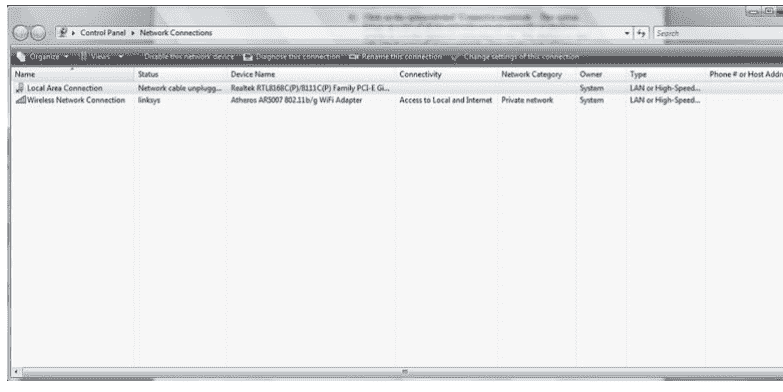

10. 网络连接对话框对我们来说特别重要，因为它是我们进入特定网络连接手动配置菜单的方法之一。在此对话框中选择一个网络连接并双击它。（注意：此对话框中可能只有一个连接。）一旦你双击所选的网络连接，你将得到一个与图 1-17 所示相似的对话框。

**图 1-17 Windows 7 局域网连接状态对话框**

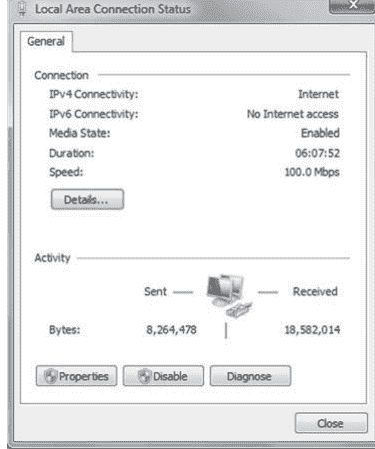


## 实验步骤

11. 此对话框显示了你的连接状态，并且上面有几个不同的按钮。顶部的按钮“详细信息”（Detail）可以为你提供关于网卡（NIC）和连接的详尽信息。底部的按钮是“属性”（Properties）、“禁用”（Disable）和“诊断”（Diagnose）。“禁用”按钮将禁用网卡。你可以再次点击该按钮来重新启用它，只不过标签会变为“启用”（Enable）。“诊断”按钮将对网卡进行诊断以检查是否存在任何问题。然而，“属性”按钮正是我们现在感兴趣的。点击此按钮将弹出图 1-18 所示的对话框。

### 图 1-18：Windows 7 局域网连接属性对话框


12. 此对话框显示了安装在局域网上的所有客户端（Clients）、服务（Services）和协议（Protocols）。已连接计算机的图标代表“客户端”，位于手形状方的计算机图标代表“服务”，而仅有打印机的图标代表“协议”。协议基本上是不同的规则集，允许一台计算机与另一台计算机或其他设备进行通信。协议将在第 5 节中更详细地介绍。请在纸上写下运行在你本地计算机上的客户端、服务和协议。

13. 找到标记为“Internet 协议版本 4 (TCP/IPv4)”的协议。点击它使其变为高亮。点击标记为“属性”的对话框按钮。这将弹出一个看起来像图 1-19 所示的对话框。

14. 此对话框是你配置计算机网络地址信息的地方。你的本地计算机可能设置为：自动获得 IP 地址。目前我们将其保持原样；但在随后的实验中，可能需要对此区域进行更改。

15. 在“Internet 协议版本 4 (TCP/IPv4)”属性对话框上点击“取消”。

### 图 1-19：Windows Vista 协议版本 4 (TCP/IPv4) 属性对话框


16. 在“局域网连接属性”框上点击“取消”。

17. 关闭“网络连接”对话框。

18. 关闭“网络和共享中心”对话框。

19. 你已经完成了本次实验。这个实验让你熟悉了网络和共享中心以及在该位置可以检查和配置的一些内容。在未来的实验中，此小程序将用于帮助你配置本地计算机，以完成书中的其他实验。

## 实验 3：星型和总线拓扑的基础绘图

在你的网络生涯中，你经常需要解释网络拓图，即使不需要自己创建。本实验将从你进行一些简单的网络诊断开始。

### 熟悉星型和总线拓扑

1. 绘制一个总线拓扑，在主干道上连接 4 台计算机。将计算机标记为 A、B、C 和 D。（书籍在第 1 节中有一个总线拓扑的示例）。

2. 想象用户 A 需要以对点方式打开文件 D。你认为数据将如何从 A 到 D，然后从 D 回到 A？将此路径以虚线的形式添加到你的网络图中。

3. 在纸张的另一侧，使用不超过半页的空间，绘制一个星型拓扑，将 4 台计算机连接到一个中央连接设备上。将工作站标记为 E、F、G 和 H。（注意：这些工作站都是服务器）。

4. 想象用户 C 想要打开位于 H 计算机磁盘上的文件，用虚线画出你认为数据在这两台计算机之间走的路径。

5. 在你的星型拓扑网络中添加一台打印机和一个服务器。确保打印机连接到服务器而不是直接连接到网络。随着服务器的加入，你已经将网络从对点网络更改为客户端/服务器网络。打印机已成为所有工作站都可以共享的资源。

6. 假设新服务器配置为向星型拓扑网络提供所有服务，包括打印和文件服务。如果计算机 G 向打印机发送文档，你认为文档数据将通过什么路径？在你的网络中用虚线画出这条路径。

7. 大多数现代网络不是简单的总线或环形拓扑，而是这些安排的组合。一种常见的网络设计通过总线结合 2 个或多个星型网络，创建一个星型-总线拓扑。在同一张纸上，绘制第二个由工作站 I、J 和 K 组成的星型拓扑，连接到中央连接设备。

8. 在同一张纸上，绘制第二个由工作站 I、J 和 K 组成的星型拓扑，连接到中央连接设备。

9. 在同一张纸上，绘制第二个由工作站 I、J 和 K 组成的星型拓扑，连接到中央连接设备。

10. 在你处理过的网络中，你认为哪一个是最简单的？

## OSI 和 TCP/IP 模型

| 涵盖的技术 | 考试目标 | 考试编号 |
|---|---|---|
| OSI 简介 | | |
| TCP/IP | | |
| 层如何协同工作 | | |
| 关键术语 | | |

| 关键术语列表 |
|---|
| 应用层 |
| 数据链路层 |
| 无连接的 |
| 面向连接的 |
| 物理层 |
| 网络层 |
| 会话层 |

## 场景案例

John 工作于 XYZ 设计咨询公司。他的客户之一 ABC Software Wingdings 创建了一个应用程序。他们希望 John Determine 如何编写他们的软件以便在网络上运行。

## OSI 模型简介


第 2 节的这部分介绍了 OSI 模型并解释了它是什么。本部分还检查了 OSI 模型的层并解释了每一层执行的功能。本部分还引入了封装的概念。

OSI 代表开放系统互连。该模型的创建是为了描述数据在跨网络传输时必须经过的步骤。OSI 模型的设计目的并不是为了定义数据如何在网络中移动，而是为了描述数据如何在网络中移动。因此，OSI 模型并不是网络协议必须遵循的标准。事实上，OSI 模型直到 1984 年才被创建，那时最常用的网络协议 TCP/IP 已经问世多年。它是作为一个框架和参考，用来解释不同的技术如何工作和交互。

## OSI 模型的外观

图 2-1 显示了 OSI 模型的各个层以及它们之间的组织关系。每一层都有其负责的特定功能，所有层都协作在网络中传输。从上到下的正确顺序是应用层、表示层、会话层、传输层、网络层、数据链路层和物理层。

## OSI 模型的基础层

| 层名称 | 层编号 |
|---|---|
| 应用层 | 7 |
| 表示层 | 6 |
| 会话层 | 5 |
| 传输层 | 4 |
| 网络层 | 3 |
| 数据链路层 | 2 |
| 物理层 | 1 |

## 认证就绪

人们使用许多记忆助词来记住分层的正确顺序。为了记住从上到下的顺序，以下记忆助词可能有所帮助：All People See To Need Data Processing（所有人都能看到并需要数据处理）。该记忆助词中每个单词的首字母就是 OSI 模型从上到下每一层的首字母。

如果你倾向于按照从底部到顶部的正确顺序记住 OSI 层，可以使用另一个不同的记忆助词：Please Do Not Throw Sausage Pizza Away（请不要把香肠披萨扔掉）。

## 封装

第 2 节的后续章节将讨论 OSI 模型的每一层以及每一层的功能。在讨论 OSI 模型各层的功能之前，需要引入封装（`encapsulation`）的概念。

在网络中，封装是从 OSI 模型的上层获取数据并将其带入下一层的过程。此过程的反向过程称为解封装（`de-encapsulation`）。必要提到这个过程，因为数据从 OSI 模型的层移动到下一层时，使用了不同的术语来描述它。

### 认证就绪

当数据处于 OSI 模型的三个层——应用层、表示层、会话层时，它被称为数据（`data`）。当数据进入传输层，然后进入网络层时，它被称为段（`segment`）。当段向下传递到数据链路层时，数据包转换为帧（`frame`）。当帧到达 OSI 模型的底部并进入物理层时，它被转换为比特（`bits`），然后通过网络传递到目标计算机。反向过程称为解封装。它变成帧，然后数据包变成段，最后在通过各自的层级时，段变回数据。

数据包（`packets`）涉及 OSI 模型的哪一层？

封装将在本节结束时详细讨论。图 2-2 显示了在封装过程中每个点的数据是什么。

### 图 2-2：OSI 层以及在封装的每个级别上数据的名称

| OSI 层 | 数据名称 |
| :--- | :--- |
| 应用层 (Application) | 数据 (Data) |
| 表示层 (Presentation) | 数据 (Data) |
| 会话层 (Session) | 数据 (Data) |
| 传输层 (Transport) | 段 (Segment) |
| 网络层 (Network) | 包 (Packet) |
| 数据链路层 (Data Link) | 帧 (Frame) |
| 物理层 (Physical) | 比特 (Bits) |

## 物理层

让我们开始讨论 OSI 模型不同层的功能。第一层是第 1 层，物理层。顾名思义，物理层处理将数据从一台计算机移动到另一台计算机的所有方面。具体来说，在该层定义的标准是定义其他数据传输手段的标准，例如无线标准和光纤标准。该层上的封装单元称为比特（`bits`），因为该层负责将来自上层的数据转换为可以在各种传输介质上传输的 1 和 0。集线器（`Hubs`）是 OSI 模型这一层中设备类型示例。

OSI 模型这一层定义的区域之一是用于跨网络传输数据的物理手段。铜线、光纤电缆、无线频率，任何可以用于传输数据的东西都定义在 OSI 模型的物理层上。然而，定义物理规格并不是物理层的唯一用途。

OSI 模型的物理层还用于定义如何将数据编码到介质中进行传输。物理层定义了数据如何转换为用于传输数据的介质。

如果使用铜线，物理层定义了数据如何转换为跨越介质发送的电脉冲。如果使用光纤电缆，物理层定义了所传输的数据如何转换为光脉冲。最后，如果使用某些无线介质（如无线电波或微波）传输数据，物理层负责定义如何调制无线电波、微波等以携带正在传输的数据。

## 数据链路层

数据链路层是 OSI 模型的第二层，也是下一个要讨论的层。这一层的封装被称为帧（`frame`）。交换机（`Switches`）是 OSI 模型这一层的设备类型之一。

虽然物理层关注介质规格和编码，但数据链路层关注从一台计算机移动到另一台计算机。这种说的另一种方式是数据链路负责在节点与节点或计算机与计算机之间移动帧。这被称为点对点通信。数据链路无法跨越路由器移动帧；它只能从一个相邻的计算机或设备移动到另一个。这意味着如果一台计算机与另一台计算机共享网络，计算机将使用数据链路层的帧来移动数据。要移动到不同的网段需要其他手段，将在以后讨论。

要在网络中移动，计算机需要知道它尝试通信的计算机的地址。因此，数据链路层还包含一种地址机制，用于寻找尝试通信的网段上的计算机或其他设备。这被称为 MAC 地址或物理地址。这个物理地址之所以被称为物理，是因为它是硬编码在网络中的。与网段通信的每个设备都有唯一的物理地址。物理地址的示例：如：`00-22-68-BF-F8-8A`。

数据链路层定义的几个广为人知的协议是以太网协议（`Ethernet Protocol`）和点对点协议（`PPP`）。简单来说，协议是一组预定义的且广泛接受的规则，用于精确描述特定任务在网络环境中应如何工作。

理解数据链路层的另一点是，它非常独特，因为为了准确描述其功能，必须将其分为两个子层。这两个子层被称为逻辑链路控制（`LLC`）子层和介质访问控制（`MAC`）子层。IEEE 802 定义了数据链路层中的这两个子层。IEEE 802.2 是较大的 IEEE 802 协议集中定义的协议之一，它最早由电气工程师学会（IEEE）提出。

### 图 2-3：数据链路层如何分为逻辑链路控制和介质访问

## LLC 子层

逻辑链路控制（`LLC`）子层负责在网络层协议和媒体访问控制（`MAC`）子层之间提供接口。它处理流量控制、差错控制和帧同步等功能。

## MAC 子层

介质访问控制（`MAC`）子层用于确定在给定时间的介质访问。在 LAN 环境中，MAC 层主要通过所谓的载波监听冲突检测（`CSMA/CD`，有线世界）和载波监听冲突规避（`CSMA/CA`，无线世界）。

介质访问控制层的另一个功能是确定一个帧结束而下一个开始；这被称为帧同步。帧同步是特定帧类型或协议用于界定帧开始和结束的方法。

有四种形式的帧同步：

- **基于时间的帧同步**：在流中的每个帧之间放置特定的时间。经过设定的时间，计算机就知道下一帧已经开始。这种帧同步类型的缺点是，由于外部影响，额外的时间可能会侵入任何帧，从而破坏同步：信号衰减、介质变化或纯粹的数据。
- **字符计数**：跟踪帧中有多少字符，如帧中的设置定义。一旦计算机到达帧的末尾，它就知道帧已经结束，下一个帧开始。这种方法的缺点是，随着时间的推移，错误可能会侵入帧，导致字符丢失或增加到帧中，从而偏离计数和同步。
- **字节填充**：使用一组预定义的字节来开始帧，使用另一组不同的预定义字节来结束帧。当计算机使用的指示帧结束的预定义字节紧接着另一个指示帧开始的预定义字节时，计算机就知道一个帧已经结束，另一个已经开始。
- **位填充（`Bit stuffing`）**：使用 1 和 0 的位组（即预定义的比特位序列）来指示帧的开始和结束。字节填充（`byte stuffing`）和位填充方法的工作原理完全相同，只是通过用少量比特位替换一系列字节。

## 网络层


数据链路层负责将数据从一台计算机移动到另一台计算机，而网络层（第 3 层）负责以数据包的形式将数据从网络的一端移动到另一端。这有时被称为端到端通信。网络层使用逻辑地址而不是物理地址。网络层逻辑地址根据所使用的网络协议进行分配。在最常用的协议 TCP/IP 协议中，逻辑地址被称为 IP 地址。一个 IPv4 地址看起来像这样：`192.168.0.100`。路由器（`Router`）是 OSI 模型此层所用设备的一种示例。

IP 地址将在第 4 节中详细讨论。


网络上的每台计算机都需要逻辑地址。任何直接连接或通过路由器和其他连接设备连接的计算机都需要使用逻辑地址。当数据在网络中的不同计算机之间移动时，这些地址被用作占位符。逻辑地址确保数据从一台计算机移动到另一台计算机时，逻辑地址保持不变。

物理地址和逻辑地址的详细描述将在第 4 节的“物理地址与逻辑地址如何协同工作”标题下进行。

逻辑地址用于网络层最重要的功能之一——路由。路由是各种网络设备及其相关软件将数据包从源地移动到目的地的活动，无论它们相隔有多远。


以逻辑地址作为占位符，网络层设备和相关软件将使用逻辑地址来确定特定数据包到达目的地的最佳路径。路径上的每个设备都使用逻辑地址来保持数据包在轨道上，并确定数据包到达目的地需要采取的下一步。

## 传输层

网络层之上的下一层是传输层（第 4 层）。传输层负责从 OSI 模型的高层获取数据，并将其拆分为较小的段，以便发送给低层设备进行数据传输。相反，当数据进入计算机时，传输层获取这些段并将其重组为高层协议和应用程序可以使用的数据。此外，传输层还负责对段进行排序，以便它们在到达目的计算机时按正确顺序重组。

除了将数据拆分为段和将段重组为数据外，传输层还负责传输的可靠性。在传输层的某些情况下，它的工作是确保数据安全到达目的地。为了做到这一点，一旦传输层协议获取了数据段或段组，将等待目的计算机返回数据到达确认，然后再发送另一个数据段或段组。这种类型的常用协议是 TCP/IP 中的 `TCP` 协议。如果发送计算机没有收到预期的响应，它将重发传输的段。由于传输层的这一功能，此层的许多协议都是面向连接的协议。但需要注意的是，并不是所有的传输层协议都会验证目的计算机是否真的收到了发送的数据段。事实上，一种非常常见的传输层协议 `UDP` 实际上并不检查，因此它是一个无连接协议。面向连接的协议和无连接协议将在本节稍后的部分进行详细讨论。

## OSI 和 TCP/IP 模型 | 31

## 端口地址

除了之前讨论的传输层功能外，该层还确保数据在到达目的地时已发送到正确的目的应用程序、服务或协议，反之亦然。为了实现这一点，传输层使用特殊的端口地址。端口地址是计算机内部唯一的地址，与特定的协议、服务或应用程序相关。其中一些地址是预定义的且无法更改，而另一些由计算机根据需要即时分配。

端口地址特别适用于 `TCP` 和 `UDP` 协议，并分为三类：

-   **周知端口（Well-known ports）**：范围从 0 到 1023，由互联网地址与数字分配机构（`ICANN`）注册，用于主要的网络协议。无论你使用什么计算机或操作系统，这些端口都有效。

-   **注册端口（Registered ports）**：地址范围为 1024 到 49151，向 `ICANN` 注册用于特定用途，通常用于特定公司、供应商、应用程序或操作系统的专有使用。

-   **动态端口（Dynamic ports）**：地址范围为 49152 到 65535，供任何应用程序与任何其他应用程序通信。动态端口也称为私有端口。

## 无连接和面向连接协议

在讨论网络层和传输层协议时，必须涉及无连接和面向连接协议的概念。这是一个重要的概念。此层的许多协议分为两类：

-   **无连接（Connectionless）**：这种类型的例子是 `UDP`，它不检查数据是否到达。
-   **面向连接（Connection-oriented）**：这种类型的例子是 `TCP`，它会等待响应。

## 会话层

会话层（第 5 层）负责建立、管理和终止连接。除了这些，会话层还提供检查点、终止和恢复。此层的许多协议包括：

## 表示层

表示层关注数据如何呈现。为了向网络妥善地呈现数据，表示层主要关注三个任务：翻译、压缩和加密。

-   **翻译（Translation）**：将一种类型计算机的数据转换为另一种类型计算机可以理解的数据。
-   **压缩（Compression）**：将数据变小，以便沿网络发送更多数据。
-   **加密（Encryption）**：一种允许数据进行编码的过程，使得网络上的窃听者即使读取了传输的数据，在不知道解码方法的情况下无法理解。

## 应用层

应用层（第 7 层）是 OSI 模型的顶层。该层的名称有时会引起困惑。人们倾向于将“应用程序”一词与 Office、Outlook、Firefox 等软件程序联系起来。虽然这是一种有效的关联，但在讨论 OSI 模型的应用层时，该术语并不是这个意思。相反，最好将应用层理解为 OSI 模型中包含应用程序或操作系统与网络通信所需的所有服务或协议的层。

说明上述观点的非常好的例子是像 Firefox 这样的网页浏览器。Firefox 是用户浏览网页的应用程序；但仅仅拥有在你的计算机上运行 Firefox 并不意味着你可以自动查看网页。为了查看网页，Firefox 必须拥有应用层协议 `HTTP`（超文本传输协议）来查看网页。类似的例子是如 Outlook 等电子邮件。Outlook 无法自动拾取并读取或发送电子邮件。相反，它拥有应用层协议 `POP3`（邮局协议第 3 版）来读取电子邮件，以及应用层协议 `SMTP`（简单邮件传输协议）来发送电子邮件。OSI 模型的应用层是计算机应用程序用于在网络上发送和接收不同类型数据的各种协议和服务的所在之处。

## 数据如何在 OSI 模型中传输

现在既然我们已经讨论了 OSI 模型的每一层，我们需要讨论一下这些层在实践中是如何使用的。图 2-4 阐述了这一点。

### 图 2-4：从操作系统（OS）向 OSI 层向下移动的数据

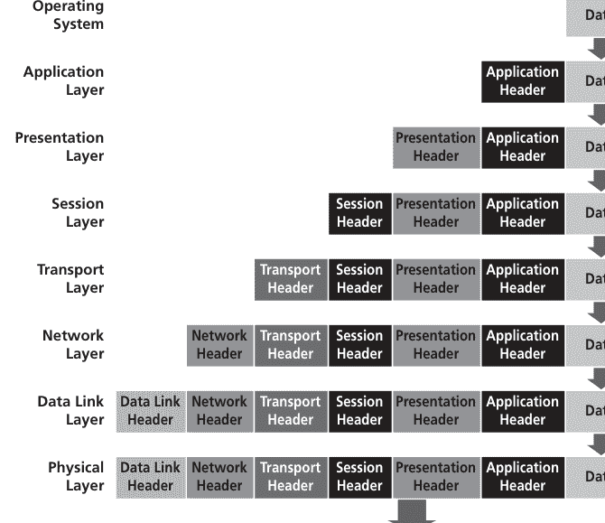

图 2-4 展示了 OSI 模型的每一层如何为源自操作系统的数据添加其自身的头部。每一层都在上一层的头部的前面添加自己的头部。此头部包含了每层所需的信息，然而，数据链路层还添加了一个尾部。这个尾部包含了数据链路层添加的、用于纠错的额外信息。注意：OSI 模型中唯一不添加头部或尾部的层是物理层。这是因为 OSI 模型的物理层只关注将数据编码到用于将数据向下传输网络的介质中。这通过图 2-4 底部的电线以及指向它的大箭头说明了这一点。

### 图 2-5：数据在向 OSI 层向下移动时在 OSI 系统中呈现的样子


图中向 OSI 层移动的数据部分相同。这是因为每一层在添加自己的头部时，将原始数据以及任何之前层添加的头部都视为该层数据的一部分。换句话说，对于每一层而言，随着每一层添加自己的头部信息，图中的数据部分就随之增长。

### 图 2-6：数据在通过 OSI 层移动时，由一台计算机发送并由另一台计算机接收


图 2-6 显示了数据如何被发送并被另一台计算机接收。在连接结束时，操作系统（`OS`）将数据发送到 OSI 模型的应用层，以开始将数据传输到目标计算机的过程。应用层为数据添加一个头部，指示该数据使用什么协议或服务。带有此新头部信息的数据被向下传递到表示层。

表示层添加一个头部，描述数据如何呈现给网络，以及数据何时被压缩、加密、翻译等。然后，表示层将带有其添加头部的数据以及应用层头部向下传递到会话层。

会话层添加一个头部，描述会话数据如何被建立、管理、终止，并在将其向下传递到传输层之前。

传输层将数据拆分成段（`segments`），并将其发送以传递给下一台计算机进行重组。传输层放入了自己的头部，描述数据是如何被分段和排序的。传输层还添加了源和目的端口号，以指示特定数据属于哪种服务、协议或应用程序。你应该注意，传输层在添加自己的头部信息之前，会将前三层的头部信息复制到段中。一旦此头部添加到所有之前头部的前面，它就会被向下传递到网络层。

网络层创建一个头部，添加源地址和目的地址以及其他一些信息，以发送来自传输层的每个段。此时，这些段被称为数据包（`packet`）。网络层的源和目的逻辑地址确保了每个数据包都能找到其预期的目的地。之后，网络层将数据包向下传递到数据链路层。

数据链路层接收来自网络层的数据包，并在包中添加物理地址以及网络层下一设备的物理物理地址。此时，数据包被称为帧（`frame`）。数据链路层将所有这些信息放入头部中，数据链路层还在数据上添加了错误检查算法，并将其放在帧末尾的数据链路迹（`trailer`）中。一旦完成，数据链路层将包含头部和数据的包向下传递给 OSI 模型的物理层。

物理层将数据编码为所需的任何格式，以便放置在用于与目标计算机通信的介质上。当目标计算机在物理层接收到信号时，这里描述的整个过程就开始，直到数据最终传递给操作系统，由此确保数据被交给它原本指向的软件应用程序。

描述这种现象的另一种方法是跟随虚拟数据片段沿着我们 OSI 模型的层向下移动，并描述每一层发生了什么。应用层包含

## TCP/IP 模型

第 2 课的这部分描述了一种基于 TCP/IP 协议的替代网络模型——TCP/IP 模型。本部分描述了每一层及其功能。最后，本部分描述了 TCP/IP 模型与 OSI 模型的关系。

> **注意**：TCP/IP 模型是一个重要的模型，因为现在网络使用 TCP/IP 协议套来传输数据。因此，理解围绕 TCP/IP 协议套构建的 TCP/IP 模型是重要的。

OSI 模型并不是唯一的模型。还有一种名为 TCP/IP 模型的网络模型。虽然 OSI 模型基于理想化的网络，并不对应任何真实的协议套，但 TCP/IP 模型是围绕 TCP/IP 协议套构建的。TCP/IP 协议套之所以被称为协议套，是因为它由大量共同工作以完成计算机间通信任务的协议组成。任何给定会话需要完成的任务都由协议套中的不同协议执行。如图 2-7 所示，TCP/IP 模型包含四层，而 OSI 模型有七层。虽然 TCP/IP 模型顶两层的名称与 OSI 模型中的同名层名称相同，但这两个层的功能并不完全对应另一个模型中的同名层。我们将在后面讨论这一点。

### 图 2-7：TCP/IP 模型层级结构

| 应用层 |
| :--- |
| 传输层 |
| 网络层 |
| 网络接口层 |

## 应用层

应用层是 TCP/IP 模型的最顶层。尽管它的名称与 OSI 模型的顶层相同，但其功能却不同。OSI 模型的应用层仅负责处理操作系统和软件与网络通信所需的协议和业务。而 TCP/IP 模型的应用层不仅涵盖了这些内容，还包含了更多功能。事实上，TCP/IP 的应用层包含了 OSI 模型中应用层、表示层和会话层的所有功能。如图 2-8 所示，该图并排比较了 OSI 模型和 TCP/IP 模型。

### 图 2-8：TCP/IP 模型与 OSI 模型对比

| OSI 模型 | TCP/IP 模型 |
| :--- | :--- |
| 应用层 | 应用层 |
| 表示层 | |
| 会话层 | |
| 传输层 | 传输层 |
| 网络层 | 网际层 |
| 数据链路层 | 网络接口层 |
| 物理层 | |

### 认证准备就绪

TCP/IP 模型包含哪些层？

如你在图 2-8 中所示，TCP/IP 模型的应用层占据的位置与 OSI 模型的应用层、表示层以及大部分会话层相同的位置。

## 传输层

如果我们观察图 2-8 中的 TCP/IP 和 OSI 模型，你会发现这两个模型中的传输层占据了相同的位置，不同在于 TCP/IP 模型的传输层还占据了 OSI 模型会话层的一小部分。这是因为两个模型中的传输层在功能上的运行方式是相同的。区别在于，TCP/IP 以及其他类似的协议还承担了更多功能。特别是 `TCP` 协议，及其所有相关功能，用于同步源计算机和目的计算机，以便在相应计算机之间建立会话。在 OSI 同步中，源、目的计算机以及建立会话是会话层的工作内容。但在 TCP/IP 模型中，尽管处理的是传输层协议，但 `TCP` 及相关协议确实执行了这些工作。

## 网际层

如图 2-8 所示，网际层在 TCP/IP 模型中占据的区域与 OSI 模型中的网络层相当或甚至更多。也就是说，它执行的工作非常相似。你还会注意到，网际层略微延伸到了 OSI 模型的数据链路层。因为网际层还执行了 OSI 模型数据链路层中链路控制子层的许多功能。

TCP/IP 模型网际层的主要协议是网际协议（`IP`）。`IP` 本身不能完成网际的所有功能，它还需要几个相关协议的支持。地址解析协议（`ARP`）就是主要的协议之一，它在物理地址领域承担了大部分 LLC（链路接入）子层的工作。

### 认证准备就绪

TCP/IP 模型的层是如何与 OSI 模型的层对应的？哪些层是相同的？哪些层是不同的？


虽然 TCP/IP 模型和 OSI 模型中某些层的名称相同，但它们的功能并不完全相同。两个模型中同名的层在功能上存在差异。

## 网络接口层

TCP/IP 模型的最后一层是网络接口层。这一层承担了 OSI 模型数据链路层和物理层中 MAC 部分大部分的工作。TCP/IP 协议并没有规定 TCP/IP 模型中任何层发生了什么。相反，TCP/IP 协议依赖于各种组织创建的标准，这些标准涉及不同的介质以及如何在介质上进行位编码以便在该层工作。诸如以太网、`802.11` 无线标准以及各种 WAN 介质构成了 TCP/IP 模型这一层中许多许多协议。

## TCP/IP 模型的别名

虽然之前给出的层名称是最常用的，但 TCP/IP 层也有别名。例如，应用层有时被称为主机层。网际层有时被称为 Internet 层。网络接口层被称为接入层（Access layer）。


虽然 TCP/IP 模型和 OSI 模型中某些层的名称相同，但它们的功能并不完全相同。两个模型中同名的层在功能上存在差异。

## 层之间如何协同工作

如图 2-9 所示，TCP/IP 模型的各层协同工作以跨网络发送数据。当需要发送数据时，数据会逐层向下传递。应用层为传输准备数据。传输层将数据拆分为段，并给每个段分配一个序列号，以便这些段能够按照正确的顺序组合。网际层在段中添加逻辑地址。网络接口层将数据封装成帧，以便通过介质发送。

一旦数据到达目的地，过程就会反过来。一旦目的计算机接收到帧，它会检查物理地址并将其解码到 IP 层。`IP` 验证位置并将其传递给 `TCP`。`TCP` 根据序列号按正确重组段，然后根据目的端口号将它们发送给正确的协议或程序。在这种情况下，目的端口号将是分配给传入 `HTTP` 数据报的任何端口号。协议解码 HTML 代码并将其传递给网络浏览器，这样目的计算机的用户就可以查看网页了。

### 图 2-10：TCP/IP 模型与 OSI 模型协议对照表

| OSI 模型 | TCP/IP 模型 |
| :--- | :--- |
| 应用层 | 应用层 (别名: 主机层) |
| 表示层 | |
| 会话层 | |
| 传输层 | 传输层 |
| 网络层 | 网际层 (别名: Internet 层) |
| 数据链路层 | 网络接口层 (别名: 接入层) |
| 物理层 | |

| 应用层协议 | 传输层协议 | 网际层协议 | 网络接口层协议/标准 |
| :--- | :--- | :--- | :--- |
| `SMTP` | `TCP` | `ARP` | 以太网 |
| `FTP` | `UDP` | `RARP` | `802.11` 无线 |
| `DNS` | | `IGMP` | 帧中继 |
| `TFTP` | | `ICMP` | ATM |
| `RIP` | | | |
| `SNMP` | | | |

书中第 5 章将讨论更多的协议。我们将在该章节中详细介绍协议的作用。

## 技能总结

在本章中你学习了：

- 什么是 OSI 模型。
- OSI 物理层是做什么的。
- OSI 数据链路层是做什么的。
- 数据链路层的两个子层是什么及其作用。
- OSI 模型网络层的功能是什么。
- OSI 模型传输层的作用是什么。
- OSI 模型中会话层的作用是什么。
- OSI 模型表示层的作用是什么。
- OSI 模型中应用层的作用是什么。
- 数据如何在 OSI 模型中向上和向下移动。
- OSI 模型中的报头是如何起作用的。
- 什么是 TCP/IP 模型。
- TCP/IP 模型与 OSI 模型相比异同。
- TCP/IP 模型分层的另一种命名方案。
- TCP/IP 模型各个层级中的某些协议是什么。
- 数据如何在 TCP/IP 模型中向上和向下移动，以及这与协议之间的关系。

## 知识评估

### 填空题

通过在提供的空格处填入正确的单词或词组来完成以下句子。

1. 物理层的主要功能是 \_________________________________\_.
2. 数据链路层的两个子层是 \_________________________________ 和 \_________________________________ 。
3. 网络层的主要工作是 \_________________________________________________.
4. 传输层的两个主要工作任务是 \_________________________________ 和 \_________________________________ 。
5. OSI 模型表示层的三个主要功能是 \_______________________ 和 \_________________________________________________________________. .
6. 将数据从 OSI 模型的一层移动到下一层的过程被称为 \________________________________________________。
7. TCP/IP 模型的应用层对应于 OSI 模型的 \_______________________ 层(级)。
8. 记忆上到下记忆 OSI 模型层级的良好口诀是 A_\_\_, P_\_\_, S_\_\_, T_\_\_, N_\_\_, D_\_\_, P_\_\_。
9. TCP/IP 模型传输层最重要的协议是 \_________________ 和 \________________________________________________________________. .
10. TCP/IP 模型网络层最重要的协议是 \________________________()

### 单选题

圈出对应正确答案的字母。

1. OSI 模型的哪一层包含了应用程序软件或操作系统与网络通信时所需的所有服务或协议？


# OSI 模型复习题

1. OSI 模型的哪层负责数据的格式化、压缩和加密？

   a. 表示层

   b. 会话层

   c. 数据链路层

   d. 应用层

2. OSI 模型的哪层负责分段数据并为 OSI 模型的其他部分进行排序？

   a. 传输层

   b. 物理层

   c. 网络层

   d. 表示层

3. OSI 模型的哪层负责可靠地将数据从一台计算机传输到另一台计算机？

   a. 表示层

   b. 会话层

   c. 传输层

   d. 应用层

4. __________ 是计算机内部与特定协议、服务或应用程序相关的唯一地址。

   a. 逻辑地址

   b. 端口地址

   c. 物理地址

   d. 套接字 (Socket)

5. __________ 用于网络上的端端通信。

   a. 逻辑地址

   b. 端口地址

   c. 物理地址

   d. 套接字

6. __________ 用于网络上的节点间通信。

   a. 逻辑地址

   b. 端口地址

   c. 物理地址

   d. 套接字

7. OSI 模型表示层的封装单位是

   a. 数据包 (Packet)

   b. 段 (Segment)

   c. 帧 (Frame)

   d. 数据 (Data)

8. OSI 模型传输层的封装单位是 ___________.

   a. 数据包 (Packet)

   b. 段 (Segment)

   c. 帧 (Frame)

   d. 数据 (Data)

9. OSI 模型网络层的封装单位是 ___________.

   a. 数据包 (Packet)

   b. 段 (Segment)

   c. 帧 (Frame)

   d. 数据 (Data)

10. OSI 模型数据链路层的封装单位是 ___________.

    a. 数据包 (Packet)

    b. 段 (Segment)

    c. 帧 (Frame)

    d. 数据 (Data)

# 实验练习

## 实验 1：TCP/IP 协议如何通过 TCP/IP 模型工作

本实验的目的是让学生熟悉 TCP/IP 模型及其使用的某些协议。

该实验对学生来说非常重要，因为它引导学生进行一个思维实验，思考数据如何从计算机向下穿过 TCP/IP 模型，并向上穿过目标计算机。通过进行这一思维实验，学生将更好地理解不同协议如何协作完成一项特定任务。

### 实验材料

- 笔记本
- 铅笔
- 教科书

### 执行实验

#### 遵循协议通过 TCP/IP 模型的层级

1. 阅读本课标题为“层级如何协同工作”的章节。

2. 仔细研究图 2-11。

| 应用层 | SMTP | FTP | HTTP | DNS | TFTP | RIP | SNMP |
| :--- | :--- | :--- | :--- | :--- | :--- | :--- | :--- |
| 传输层 | | | TCP | | | | UDP |
| 网络层 | ARP | RARP | IP | | | ICMP | |
| 网络接口层 | Ethernet | 802.11 无线局域网 | Frame Relay | ATM | | | |

图 2-11 TCP/IP 模型及其与组成 TCP/IP 协议族的某些协议的关系

3. 在纸上列出 TCP/IP 模型的层级，以及你在每一层中讨论的将数据从一个位置移动到另一个位置的协议。你的答案格式如下：

- 应用层：HTTP
- 传输层：TCP
- 网络层：IP
- 网络接口层：Ethernet

4. 列出你认为发送电子邮件的 TCP/IP 模型对应的协议。（提示：从应用层开始）。

5. 列出你认为用于跨网络发送文件的 TCP/IP 模型对应的协议。

## 实验 2：使用 IPCONFIG 命令

本实验使用 Windows 7。本实验的目的是帮助学生学习如何确定 IP 和物理地址。

### 实验材料

- 笔记本
- 铅笔
- 运行 Windows 7 的计算机

### 执行实验

#### IPCONFIG 命令

1. 点击 Windows 7 桌面左下角的开始按钮。在菜单底部的“搜索程序和文件”框中输入 `CMD` 并按回车。

2. 命令行界面 (CLI) 将出现（如图 13）。CLI 是一个可以通过文本形式向计算机输入命令的窗口。这种接口是以前与 DOS 交互的方式。如果选择不使用 Linux 可用的图形界面，也可以这样与 Linux 交互。

3. 打开命令行界面 (CLI) 后，输入命令 `ipconfig`。输入 `ipconfig` 命令后，CLI 将变为类似于图 14。注意，输入 `ipconfig` 时显示的信息与此处不同。

4. 在纸上写下你 CLI 中显示的网络适配器名称：

   * 写下 IPv6 地址：
   * 写下 IPv4 地址：
   * 写下子网掩码：
   * 写下默认网关：

5. 按照所示完全输入命令 `ipconfig /?`。确保在命令的最后一个字母与问号之间有一个空格。当你这样做时，CLI 会报告 `ipconfig` 命令的正确语法，并列出可以使用此命令的选项列表。

> **注意**：图 2-14 中的截图列出了两个网络适配器。这是因为该计算机同时配备了无线和有线网卡。你的屏幕可能不会显示两个适配器。

### OSI 和 TCP/IP 模型

图 2-14：输入 `ipconfig` 后的命令行界面窗口

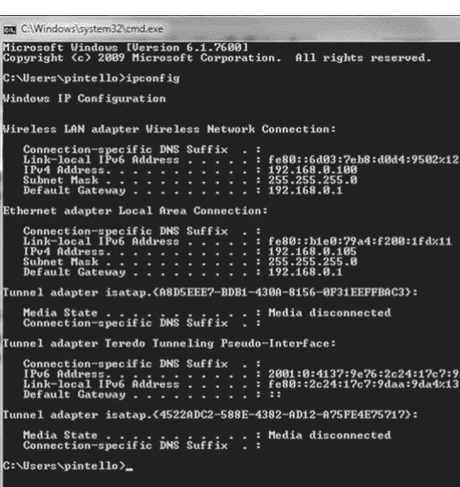

7. 像这里 CLI 所示的那样，输入 `ipconfig /all`。与只输入 `ipconfig` 相比，显示哪些额外信息？

   * 列出你现在为网络适配器卡获取的至少 6 种额外信息。
   * 你的网络适配器的物理地址是什么？在此列出它。
   * 为什么知道自己的物理地址很重要？在此处写下你的答案。

8. 点击 CLI 右上角红色背景框中的 "X" 关闭 CLI。

# 媒体

## 考试目标矩阵

| 涵盖的技术技能 | 考试目标 | 考试目标编号 |
|---|---|---|
| 铜缆及其属性 | 对标准媒体类型及其相关属性进行分类。<br> * 铜缆 (Copper)<br> * UTP<br> * STP<br> * CAT3<br> * CAT5<br> * CAT5e<br> * CAT6<br> * CAT6a<br> * 同轴电缆 (Coaxial)<br> * 交叉线 (Crossover)<br> * T1 交叉线<br> * 直通线 (Straight-through)<br> * 腔内 (Plenum) 与非腔内 (non-plenum)<br> * 距离限制和速度限制<br> * 电力线宽带 (Broadband over powerline) | 根据网络媒体对标准连接器类型进行分类。<br> * 铜缆 (Copper)<br> * RJ-45<br> * RJ-11<br> * BNC<br> * F接头 (F-connector)<br> * DB-9 (RS-232) | 3.1<br>3.2 |
| | 给定一个场景，排除常见的物理连接问题。<br> * 线缆问题：<br> * 电磁干扰 (EMI/Interference) | |
| 光纤电缆 | 对标准媒体类型及其相关属性进行分类。<br> * 光纤 (Fiber)<br> * 多模 (Multimode)<br> * 单模 (Singlemode) | 3.6 |
| | 根据网络媒体对标准连接器类型进行分类。<br> * 光纤 (Fiber)<br> * ST<br> * SC<br> * LC<br> * MTRJ | |
| 安装布线分布 | 根据网络媒体对标准连接器类型进行分类。<br> * 铜缆 (Copper)<br> * 配线架 (Patch panel)<br> * 110 模块 (T568A, T568B) | |
| | 识别布线分布的组件。<br> * IDF（中间配线架）<br> * MDF（主配线架）<br> * Demarc（线路终端）<br> * Demarc 扩展（Demarc extension）<br> * 智能插座（Smart jack） | |
| 无线媒体 | 给定一个场景，安装并配置无线网络。<br> * 无线标准 | |
| | 比较并对比无线标准。<br> * 802.11 a/b/g/n 标准<br> * 距离<br> * 速度<br> * 延迟<br> * 频率<br> * 信道<br> * MIMO<br> * 信道绑定 (Channel bonding) | |

## 关键术语

| 100 对电缆 | 同轴电缆 | 半双工 |
|---|---|---|
| 110 模块 | 交叉连接 (cross-connect) | 硬件环回 |
| 25 对电缆 | 交叉电缆 | 中间配线架 (IDF) |
| 66 模块 | 串扰 (crosstalk) | 锁扣 (latched) |
| 衰减 (attenuation) | Demarc | 延迟 (latency) |
| 带宽 | Demarc 扩展 | 发光二极管 (LEDs) |
| 基带电缆 | 电磁干扰 (EMI) | 本连接器 (LC) |
| BNC 连接器 | F 接头 (F-connector) | 主配线架 (MDF) |
| 宽带电缆 | 馈线 (feeder cable) | 机械传输注册插座 (MT-RJ 或 MTRJ) |
| 电力线宽带 (BPL) | 全双工 | |
| 多模光纤 (MMF) | 射频干扰 (RFI) | 方连接器 (SC) |
| 多输入多输出 (MIMO) | 232 标准 (RS-232) | 直通电缆 |
| 网络接口设备 (NID) | 注册插座 (RJ) | 直头 (ST) 连接器 |
| 噪声 | 翻转电缆 (rollover cable) | 用户连接器 (SC) |
| 跳线 | 串口 | T1 交叉电缆 |
| 配线架 | 屏蔽绞对 (STP) | 细型以太网 (Thinnet) |
| 腔内 | 单工 (simplex) | 通用总线 (USB) |
| 腔内额缆 | 单模光纤 (SMF) | 非屏蔽绞对 (UTP) |
| 公用交换网 (PSTN) | 小型连接器 (SFC) | 智能插座 |

# 第 3 章：铜缆及其属性


> 第 3 章涉及了过去使用以及现在用于网络通信的不同类型的铜电缆。我们涵盖的主题是非屏蔽绞对电缆及其连接器，以及由非屏蔽绞对线制成的不同类型电缆。还考虑了屏蔽绞对和同轴电缆及其相关类型和连接器。

今天网络中使用了许多类型的媒体。这些类型从使用无线频率和微波信号的无线通信，到通过光纤电缆和电线进行传输。本章这部分涉及了目前数据网络中使用以及某些过去使用的铜电缆。

## 如何表示电缆

网络中使用了许多类型的媒体。非屏蔽绞对 (UTP) 线缆通过将两根绝缘铜线相互绞合来抵消电磁干扰 (EMI) 和串扰 (crosstalk)。

非屏蔽绞对在现代网络中流行的原因有几个：

- 它比其他类型更便宜。
- 它易于操作。
- 它允许实现过去无法实现的传输速率。

## RJ 连接器

非屏蔽绞对 (UTP) 布线对其连接器有独特的规格。为了将连接器适配到 UTP，有必要使用注册插座 (RJ) 连接器。这种连接器对大多数人来说很熟悉，因为这种连接器的一个版本被用于电话以连接墙上插座。

有三种类型的 RJ 连接器：

- **RJ-11**：这种连接器用于连接电话和听筒。该连接器与 UTP 电缆配合用于第 1 类并使用两对线（四根线）。RJ-11 连接器不用于局域网 (LAN)，而是用于普通电话服务 (POTS) 的数字用户线路 (DSL)。
- **RJ-22**：这种连接器用于旧式电话。在这些电话中，运行于听筒和底座之间的线。这些连接器不用于网络通信，在本书中并不需要担心。
- **RJ-45**：这种连接器用于以太网，使用四对线（八根线）。图 3 显示了几个 RJ-45 连接器。这些连接器使用压线钳连接。由于连接器的形状不同，这种工具与 BNC 连接器工具是不通用的；然而，为每种连接器购买单独的工具更为有效。


# OSI 和 TCP/IP 模型

## 图 2-14
输入 `ipconfig` 后的命令行界面窗口


- 7. 像这里 CLI 所示的那样，输入 `ipconfig /all`。与只输入 `ipconfig` 相比，显示哪些额外信息？
- 列出你现在为网络适配器卡获取的至少 6 种额外信息。
- 你的网络适配器的物理地址是什么？在此列出它。
- 为什么知道自己的物理地址很重要？在此处写下你的答案。
- 8. 点击 CLI 右上角红色背景框中的 "X" 关闭 CLI。

# 媒体

## 考试目标矩阵

| 涵盖的技术技能 | 考试目标 | 考试目标编号 |
|---|---|---|
| 铜缆及其属性 | 对标准媒体类型及其相关属性进行分类。 <br> * 铜 <br> * UTP <br> * STP <br> * CAT3 <br> * CAT5 <br> * CAT5e <br> * CAT6 <br> * CAT6a <br> * 同轴电缆 <br> * 交叉线 <br> * T1 交叉 <br> * 直通线 <br> * 腔内 与非腔内 <br> * 距离限制和速度限制 <br> * 电力线宽带 | 根据网络媒体对标准连接器类型进行分类。 <br> * 铜 <br> * RJ-45 <br> * RJ-11 <br> * BNC <br> * F 接头 <br> * DB-9 (RS-232) <br> 给定一个场景，排除常见的物理连接问题。 <br> * 线缆问题： <br> * 电磁干扰 (EMI/Interference) | 3.1 3.2 |
| 光纤电缆 | 对标准媒体类型及其相关属性进行分类。 <br> * 光纤 <br> * 多模 <br> * 单模 | 3.6 |

## 根据网络媒体对标准连接器类型进行分类。

- 光纤
- ST
- SC
- LC
- MTRJ

## 安装布线分布

## 根据网络媒体对标准连接器类型进行分类。

- 铜
- 配线架
- 110 模块 (T568A, T568B)

## 识别布线分布的组件。

- IDF（中间配线架）
- MDF（主配线架）
- Demarc（线路终端）
- Demarc 扩展
- 智能插座

## 无线媒体

## 给定一个场景，安装并配置无线网络。

- 无线标准

## 比较并对比无线标准。

- 802.11 a/b/g/n 标准
- 距离
- 速度
- 延迟
- 频率
- 信道
- MIMO
- 信道绑定

## 将所有内容联系在一起

| 100 对电缆 | 同轴电缆 | 半双工 |
|---|---|---|
| 110 模块 | 交叉连接 | 硬件环回 |
| 25 对电缆 | 交叉电缆 | 中间配线架 (IDF) |
| 66 模块 | 串扰 | 锁扣 |
| 衰减 | Demarc | 延迟 |
| 带宽 | Demarc 扩展 | 发光二极管 (LEDs) |
| 基带电缆 | 电磁干扰 (EMI) | 本连接器 (LC) |
| BNC 连接器 | F 接头 | 主配线架 (MDF) |
| 宽带电缆 | 馈线 | 机械传输注册插座 (MT-RJ 或 MTRJ) |
| 电力线宽带 (BPL) | 全双工 | |

## 第 3 节

| 多模光纤 (MMF) | 射频干扰 (RFI) | 方形连接器 (SC) |
|---|---|---|
| 多输入多输出 (MIMO) | 232 标准 (RS-232) | 直通电缆 |
| 网络接口设备 (NID) | 注册插座 (RJ) | 直头 (ST) 连接器 |
| 噪声 | 翻转电缆 | 用户连接器 (SC) |
| 跳线 | 串口 | T1 交叉电缆 |
| 配线架 | 屏蔽绞对 (STP) | 细型以太网 (Thinnet) |
| 腔内 | 单工 | 通用总线 (USB) |
| 腔内额缆 | 单模光纤 (SMF) | 非屏蔽绞对 (UTP) |
| 公用交换网 (PSTN) | 小型连接器 (SFF) | 智能插座 |

Bill 在一家名为 Computer Consultants, LLC 的公司工作。Bill 的公司受 Heralding Public Relations, Inc. 委托，为他们的主办公室构建数据网络。Bill 的工作是确定新网络所需的通信媒体。本课中的信息将涵盖 Bill 完成其分配任务所需的知识。

## 铜缆及其属性


> 第 3 节涉及了过去使用以及现在用于网络通信的不同类型的铜电缆。我们涵盖的主题是非屏蔽绞对电缆及其连接器，以及由非屏蔽绞对线制成的不同类型电缆。还考虑了屏蔽绞对和同轴电缆及其相关类型和连接器。

今天网络中使用了许多类型的媒体。这些类型从使用无线频率和微波信号的无线通信，到通过光纤电缆和电线进行传输。第 3 节的这部分涉及了目前数据网络中使用以及某些使用的铜电缆。

## 如何表示电缆

（注：提供的 OCR 文本在此处变得重复/乱码；根据可用的连贯文本进行处理）。

### 图 3-1
RJ-45 接口


## 认证就绪

什么是类别布线？类别布线在哪里使用？类别布线有哪些变体？

## 3.1 类别布线

在给定的线长度内，线线绞的次数和绕线的方向取决于双绞线试图减少的干扰程度和类型。为了直观表现这一点，双绞线使用“类别”（categories）进行分级。这些类别以缩写 CAT 后跟数字的形式命名。目前局域网（LAN）中最常用的“类别”双绞线等级是 CAT 5、CAT 5e 和 CAT 6。接下来将讨论这三种类别电缆以及其他几种电缆。

类别布线还具有标准的接头，用于将其连接到墙壁插座上。图 3-2 显示了一个标准的类别布线接头。

### 图 3-2
标准类别布线接头


所有定义的双绞线类别包括 CAT 1、CAT 2、CAT 3、CAT 4、CAT 5、CAT 5e、CAT 6、CAT 6a、CAT 7 和 CAT 7a。以下是对其中七种定义类的讨论：

- **CAT 1**：由两对绞（四根线）组成。它是最老的且唯一的语音级，意味着它没有针对数据通信的分级。人们将其称为普通电话业务（POTS）。在 1983 年之前，这是整个北美电话系统（PSTN）中使用的标准电缆，支持限制在 1MHz 频率范围内的信号。
- **CAT 2**：由四对绞（八根线）组成。CAT 2 处理速度高达 4 Mbps，频率限制为 10 MHz，已过时。
- **CAT 3**：由四对绞（八根线）组成，每英尺三次，CAT 3 可以处理高达 16 MHz 的传输。它在 20 世纪 80 年代中期非常流行，用于 10 Mbps 的以太网。然而，它现在仅限于电信设备，对于数据网络已过时。
- **CAT 4**：由四对绞（八根线）组成，额定为 20 MHz。CAT 4 线从未非常流行，且已过时。
- **CAT 5**：由四对绞（八根线）组成，额定为 100 MHz。CAT 5 非常流行，直到 CAT 5e 线的出现，现在更受青睐，因为它的价格与 CAT 5 相同，但性能更好。CAT 5 可以在 100 米内传输 100 Mbps 的数据。
- **CAT 5e**：由四对绞（八根线）组成，额定为 100 MHz。CAT 5e 是增强型，因为它能够处理干扰，这种能力来自于它可以同时在四对线上进行传输，而不是像 CAT 5 和之前的电缆只使用两对。这种功能对于千兆以太网是必要的，千兆以太网更常用于在同一条电缆上运行 IP 语音（VoIP）和数据。在这种情况下，CAT 5e 运行在两线上，数据运行在另外两对线上。在如今的环境中，以下的类别是可以避免的。
- **CAT 6**：由四对绞（八根线）组成，额定为 250 MHz。CAT 6 于 2002 年 6 月成为标准。它正在取代旧的类别标准，是千兆以太网的首选。这些电缆还被用作垂直电缆来连接不同楼层。在新建筑中安装网络时，CAT 6 布线是最佳选择，因为它为未来随着能力的提升而升级网络预留了空间。图 3-3 显示了一种基本的 CAT 6 电缆，其四对线缆绞在一起以减少串扰。

### 图 3-3
非屏蔽双绞线 CAT 6 电缆


如果你的目标是通过 UTP 实现比 100 Mbps 更快的数据，请确保你的组件已准备好提供此数据速率，并在处理所有组件时保持小心。如果在安装过程中硬拉 CAT 5e，将拉伸外护套内部的绞线次数，导致电缆外面的 CAT 5e 标签失效。此外，务必连接并测试所有四对线。如今的布线通常使用两对线（四根线）；UTP 千兆以太网的标准要求所有四对线（八根线）都完好。为了升级到千兆以太网，记住这一点很重要。

**注意**
另请注意，CAT 5e 系统从端到端都使用额定组件，包括从工作站到墙面板的跳线、从墙面板到配线架的跳线，以及从配线架到交换机的跳线。如果缺少任何组件，或者长度不符合 CAT 5e 规范，你拥有的就不是 CAT 5e 安装。你还应该努力证明整个安装符合 CAT 5e 标准。由于完成此操作需要特殊设备，证明你的布线安装是真正的 CAT 5e 可能会很昂贵。

## TIA/EIA-568 标准

TIA/EIA-568 标准定义了组件和布线方法。它定义了双绞线的引脚输出。有两个标准：568A 和 568B。它们在电气上是兼容的，但颜色代码不同。

如果你在一端使用 568A 另一端使用 568B，你就创建一个交叉线。如果你在两端都使用相同的标准，你就创建一个直连线。

| 引脚 | 568A 颜色 | 568B 颜色 |
| :--- | :--- | :--- |
| 1 | 白绿 | 白橙 |
| 2 | 绿 | 橙 |
| 3 | 白橙 | 白绿 |
| 4 | 蓝 | 蓝 |
| 5 | 白蓝 | 白蓝 |
| 6 | 橙 | 绿 |
| 7 | 白棕 | 白棕 |
| 8 | 棕 | 棕 |

## 常见类型

以太网布线是一个需要理解的重要课题，特别是当你计划处理任何类型的 LAN 时。不同的布线类型有：

- 直线 (568A)
- 交叉线 (568B)
- 回环线 (rollover)
- 回路 (loopback)

在本节中，我们将讨论这些类型中的每种。本节以一些示例结束。

### 直连线

直连线用于连接主机与交换机或集线器。一个易于记忆的方法是：直连线用于连接功能不同的设备，而交叉线用于连接功能相同的设备。

直连线使用四根线连接以太网设备。虽然制作电缆使用了所有四对线，但只有两或四根线用于传输数据。传输数据的四根线是 1、2、3 和 6。线 3 和 6 被蓝线分开以消除电缆内部的干扰。图 3-4 显示了创建直连线的线布局。图 3-4 显示橙白线连接引脚 1，橙色线连接引脚 2，白绿线连接引脚 3，绿线连接引脚 6。这就是为什么它被 AT&T 选择。

注意每个引脚都连接到另一侧相同的引脚。如果引脚没有以这种方式相互连接，电缆将无法工作。这种电缆配置仅用于 10/100 以太网电缆。这种配置不适用于千兆以太网、令牌环、ISDN 或任何非 10/100 以太网设备。

### 图 3-4
直通以太网电缆引脚


## 交叉线

直通电缆中使用的相同四根线也用于交叉线，只是线的排列方式不同。交叉线可连接以下设备：

- 交换机到交换机
- 集线器到集线器
- 主机到主机
- 集线器到交换机
- 路由器直接到主机

图 3-5 展示了交叉线中八根线的每一根是如何排列的。

### 图 3-5
交叉以太网电缆引脚


观察图 3-5 可以发现而不是将引脚 1 连接到 1、2 连接到 2 等，电缆两侧的连接是 1 连接到 3，2 连接到 6 等。交叉线用于连接两个交换机，但也可以用于跳过交换机测试两个工作站之间的通信。记忆直通线和交叉线使用的简单方法是记住：直通线连接不同设备，而交叉线用于连接功能相似设备。

## 认证就绪

交叉线和直通线之间有什么区别？它们的用途有何不同？

交叉线仅用于以太网 UDP。需要记住，它用于直接连接两个网卡（NIC），或连接工作站与服务器网卡。

在笔记本电脑的工具包里准备一根交叉线是一个好主意。当你需要确保服务器的网卡运行正常时，这非常有用。在这种情况下，你只需用交叉线将笔记本电脑直接连接到服务器网卡即可进行测试。如果两个网卡都配置得当，很容易登录服务器。

## T1 交叉线

T1 交叉线是一种用于 T1 应用的特殊交叉线。T1 布线是通常用于广域网（WAN）的普通布线类型。然而，在这种情况下，T1 交叉线用于本地交换机房，连接多个用于设置 T1 连接的设备。换句话说，如果你有两个带有 T1 连接的设备，但需要将信号从其中一个设备传递到另一个设备，你可以使用 T1 交叉线。这类似于你使用标准交叉线连接两个具有 RJ-45 端口且功能相似的 LAN 设备。两台电脑或两台交换机就是具有相似功能的设备示例。

另一个可能使用 T1 交叉线的场景是需要连接两个 PBX（程控电话交换机）。PBX 是一种特殊的交换系统，用于控制传统办公电话系统中的多个电话。一条电话线进入公司，该线在场所内被拆分成多条线路，以便给定位置的多个个人都可以拥有电话。用于将此入线拆分为场所内多条线路的设备被称为 PBX 交换机。需要注意的是，在与互联网相同布线设施的电话系统中，这种电话正迅速被淘汰。

## 认证就绪

以太网交叉线和 T1 交叉线之间有什么区别？

如图 3-6 所示，T1 交叉线的引脚定义与直通线相同，但引脚 1-2 与引脚 4-5 连接。需要注意的是，本课之前章节描述的以太网电缆不能替代 T1 交叉线，反之亦然。图 3-6 描述了 T1 交叉线引脚的样子。

### 图 3-6
T1 交叉线引脚

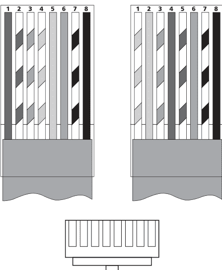

## 回环线

回环线不用于连接以太网。然而，它们用于将主机连接到路由器的控制端口（console port）。广域网工程师使用路由器的控制端口对路由器进行编程或配置。交换机具有用途类似的端口。

要配置路由器或交换机，使用回环线将 PC 的串口（COM）端口连接到被编程设备上的控制端口。然后使用 HyperTerminal 或类似的程序登录路由器或交换机并进行配置。回环线中的八根线都用于连接串口设备，尽管并非所有八根线都用于发送信息（正如以太网网络中一样）。回环线有时也称为空调制解调器线（null modem cables）。图 3-7 显示了回环线使用的八根线。

### 图 3-7
回环型以太网跳线引脚

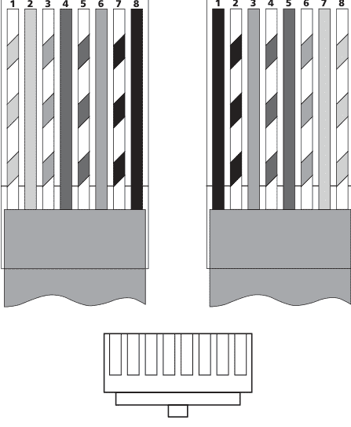

## 硬件环回

虽然硬件环回并不是布线标准，但它仍然是一个重要的讨论话题。硬件环回是一种重定向数据流的方法。有时有必要在实际上不存在网络连接的情况下，让计算机认为它与网络有活动连接。这样做的一个原因是测试计算机或环回。

### 图 3-8
硬件环回连接


## 屏蔽双绞线

屏蔽双绞线（STP）布线是一种不同类型的双绞线。在 UTP 布线中，线缆本身可以防止各种形式电磁干扰（EMI）。STP 的工作方式相同，但对电缆增加了额外的屏蔽。正如你在图 3-9 中看到的，STP 看起来像 UTP 电缆，只是在电缆周围增加了额外的屏蔽。

屏蔽双绞电缆实际上并不频繁使用。然而，当令牌环网络更常见时，今天不太可能还会看到 STP。

### 图 3-9
屏蔽双绞电缆显示屏蔽层

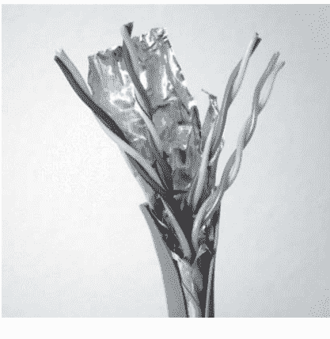

## 同轴电缆

细以太网（Thin Ethernet），也称为 10Base-2，是一种细同轴电缆。它与粗同轴电缆基本相同，只是直径仅约为四分之一英寸。细以太网线是 Radio Grade 58，或简称 RG-58。图 3-10 显示了细以太网线的示例。

使用同轴电缆的优势是其编织屏蔽可以抵抗电子干扰，例如电磁干扰（EMI）、射频干扰（RFI），以及其他类型的电子信号（这些可能会进入网络电缆并导致通信问题）。

### 图 3-10
剥线后的细以太网电缆图

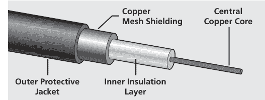

10Base-2 表示细以太网电缆能够传输高达 200 米的 10 Mbps 数据传输率。实际上，细以太网缆的额定仅为传输高达 185 米的数据，但一些研究该标准的人决定将其保留为 10Base-2 而不是 10Base-185。标准命名中的“Base”部分表示电缆一次只能传输一个信号。如果该标准能够同时传输多个信号，它将是宽带电缆，并且会用“broad”代替“base”。

## BNC 连接器

在使用细以太网时，图 3-11 显示必须使用 BNC 连接器将站点连接到网络。BNC 连接器可以使用类似于钳子的专用压接钳进行连接。这种压接钳有一个特殊的模具，可以使其压接连接器。只需简单地挤压压接钳，即可将 BNC 连接器压接到电缆上。也有螺丝式 BNC 连接器；然而，螺丝型 BNC 连接器比压接型的更容易从电缆上掉落。

### 图 3-11
公头和母头 BNC 连接器

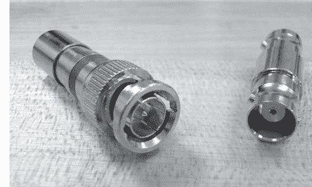

## F 型接头

F 型接头是另一种同轴电缆连接器。F 型接头最常用于宽带和视频应用。如果你家里有有线电视和/或互联网，连接电视到输入端时使用的同轴电缆就使用了 F 型接头。F 型接头还有一种变体，可以简单地推入需要 F 型接头的设备螺纹上。一些老式录像机（VCRs）配备了这种类型的 F 型接头。图 3-12 显示了你可以在家里连接有线电视时可能使用的典型 F 型接头。

### 认证就绪
F 型接头通常用于什么应用？

### 图 3-12
用于同轴电缆的公头 F 型接头


## RG-59

这种类型的同轴电缆用于低功率视频和音频传输。通常，这是 DVD 播放器等设备附带的线缆，以便它们连接到电视。这种电缆还可以用于超过 100 米的数据传输，而这超过了非屏蔽双绞线（UTP）的能力。UTP 限制在 100 米的数据传输。然而，RG-59 并不经常用于此类用途。这种电缆也用于旧式的电视安装，但近年来这些已被 RG-6 同轴电缆所取代。

## RG-6

RG-6 和 RG-59 中的 RG 部分代表 Radio Guide（无线指南），这是一种过时且淘汰的军事术语。然而，尽管 RG 电缆并不经常用于军事应用，RG-6 在民用领域仍然被广泛使用。RG-6 电缆最大的民用应用是有线电视行业。RG-6 用于将电缆信号传输到房屋内的电视，以及进入房屋的外部落地点。RG 同轴电缆还用于各种电缆公司的快速宽带互联网连接。图 3-13 显示了一根剥线后的 RG-6 同轴电缆照片。

### 图 3-13
剥线后的 RG-6 同轴电缆


## 电力线宽带

电力线宽带（BPL）是一种正在新兴的新技术。虽然这项技术在已经提供高速互联网的地区可能帮助有限，但农村地区和第三世界地区可以从这项技术中获益匪浅。BPL 的理念是使用标准电源和电源电缆不仅传输电，还传输数据。这项技术使用与房屋中电力相同的电缆，因此不需要或仅需要不同的布线。如果某个地区可以使用 BPL，那么利用 BPL 的数据设备只需插入交流墙上插座即可使网络工作。IEEE 1901 标准描述了 BPL。应该指出，BPL 实际上并没有在美国普及，它主要是在在没有互联网接入基础设施的更多第三世界环境中可能看到的技术。

### 认证就绪
什么是电力线宽带（BPL）？

## 串口

### 认证就绪
什么是串口？到为止讨论的所有功能都是串口还是并行？

## 推荐标准 232 (RS-232)

推荐标准 232 (RS-232) 是用于外部的电缆。这种电缆的一个例子是调制解调器。今天，串口端口已被 USB 取代。RS-232 在许多电脑上已被 USB 或 FireWire 取代。

## 通用总线 (USB)

通用总线是主板上的默认。虽然大多数电脑包含 4 到 8 个甚至更多端口，USB 理论上可以支持 127 个设备。USB 比串口或并行灵活得多。USB 可用于连接打印机、扫描仪以及许多输入设备。集线器可以提供多个 USB 连接。虽然 USB 规范允许连接 127 个设备，但实际上并不可行，原因是连接到所有 USB 设备共享资源。外部设备使用 USB 连接电脑。USB 自 1996 年推出以来已经经历了多个版本：

- **USB 1.0** 于 1996 年推出；但它并没有被广泛采用，因为它有很多限制其实用性的问题。我们没有广泛推广它。USB 1.1 于 1998 年推出，这个版本非常成功并被广泛采用。USB 1.1 如此受欢迎，以至于解决了 1996 年存在的大部分问题，使 USB 成为可用的外部媒体接口。USB 1.0 和 1.1 的带宽较低，为 1.5 Mbps（低速）；带宽为 12 Mbps（全速）。全速设备最大电缆长度为 5 米（16 英尺），低速设备最大为 3 米。
- **版本 2.0**：USB 2.0 于 2000 年发布。它的最大数据率为 480 Mbps，最大电缆长度为 5 米。USB 2.0 也称为高速 USB。自首次发布以来，USB 2.0 标准有了许多增加，现在拥有许多不同的连接器和端口，可将其连接到许多不同类型的设备。


- **版本 3.0**：USB 3.0 是一项新的 USB 标准，于 2008 年 11 月 17 日首次向制造商发布。然而，目前还没有任何硬件被制造，尽管预计在 2010 年将会产生一些。采用速度缓慢的部分原因是，英特尔表示在 2011 年之前他们不会支持这一新标准。此外，Windows 7 的初始版本也没有包含这一新标准，尽管微软表示他们正在处理 Windows 7。不过，如果安装了 USB 厂商提供的 USB 3.0 设备驱动程序，USB 3.0 设备在 Windows 7 中可以正常工作。

当 USB 3.0 设备最终可用时，它们将比旧的 USB 技术有重大改进。USB 支持超高速数据传输，速率高达 4 Gbps（每秒吉比特）。在现实中，这意味着 USB 3.0 设备可能以 3.2 Gbps 的速度传输数据。据估计 USB 3.0 设备在长度达到 3 米内都能维持这种速度。

## 腔内电缆 与非腔内电缆

腔内电缆与非腔内电缆之间的区别在于其结构和使用方式。许多建筑的设计是让空气在某一层天花板与下一层地板之间的空间内循环；这个空间被称为腔内（plenum）。腔内是布设连接这些建筑内计算机的所有电缆的理想场所。腔内内的电缆绝缘材料必须由燃烧时不会释放气体的材料制成。不符合此要求的电缆被称为非腔内级。任何符合此要求的电缆被称为腔内级。此外，要被视为腔内级，电缆中的绝缘材料不能燃烧得太快，因为它起到了类似线的作用。由于这些严格要求，腔内级的价格比非腔内级贵。

## 与铜缆相关的问题和局限性

使用铜缆进行网络数据传输时存在许多固有局限性。最常见的局限性在于数据的传输距离、传输速度以及电磁干扰（EMI）。我们将按照倒序来看这些局限性。

## 电磁干扰

当电子被推过相邻的两根导线时，会产生磁场。这种结果产生的磁场会导致噪声。在特定环境中任何干扰信息传输的因素都是噪声。视觉化这一点的一种简单方法是想象坐在一个嘈杂的房间里与旁边的人说话。房间里的各种声音，无论是来自机器还是人声，都会限制你与旁边的人进行对话的能力。

电子媒体也存在这种拥挤房间的类比；然而，在电子媒体中，噪声不是由声音组成的，而是由干扰性电磁场组成的。

那里的电磁场越多，或者磁场越强，铜介质就必须克服越多的才能让信号通过。这种干扰被称为电磁干扰（EMI），可能会导致几个问题。

### 认证就绪
什么是 EMI？哪些情况会导致 EMI？可以通过某些方法来减少或防止 EMI 吗？

这种干扰导致的一个问题是，铜介质在信号衰减到不再可靠之前，只能运行有限的距离。这被称为衰减（attenuation），是信号由于传输距离而导致的质量下降。如果附近有 EMI 源，如电动机、扬声器、放大器、灯镇流器等，那么电缆可以携带的距离将远低于标准允许范围。

EMI 可能导致的另一个问题是串扰（crosstalk）。串扰是 EMI 的一种形式，当线靠得很近时，在一根导线上传输的信号会泄漏到另一根导线上。它在同一根导线上传输，导致两个信号都衰减。这种类型干扰的一个熟悉例子是当你调到一个无线电台时，同时听到两个不同电台的部分。

EMI 的第三个问题与电磁性无关，而是电磁干扰。如前所述，当电子通过电缆时，它们会产生少量电磁辐射。由于流过铜线的数据是以 1 和 0 的形式存在的，会发生一种电磁场脉冲。使用正确的工具，人们可以在不切断或移除绝缘层的情况下读取信息。这是人们制造用于执法和间谍活动电缆的一种方法。过去，像五角大楼这样的高安全性设施实际上将线路封装在铅屏蔽中以防止被窃听。

解决电流通过电缆引起问题的最佳方法是完全不使用铜线。光纤不受上述 EMI 问题的影响，可以替代铜线。然而，由于光纤价格昂贵，它们可能不是所有情况的方案，因此已经开发了 EMI 问题的解决方案。最早的解决方案是将电缆的数据部分包裹在屏蔽中，帮助电缆免受外部干扰。这是同轴屏蔽双绞对的方向。实际上，外层屏蔽有助于将干扰从内部导线引开。第二种更廉价的替代方案是将电缆中的导线紧紧缠绕在一起，使导线内部部分受到来自外部干扰的部分保护。这就是非屏蔽双绞线布线的作用。内部导线所提供的保护程度是各种类别（Category）分级的基础。需要注意的是，这些替代方案都不能完全保护数据线免受 EMI，但它们提供了额外的保护。提供的保护量取决于选择以及人们为了实现目标而愿意支付的成本。

## 速度

速度是数据在网络上传输的速率。网络速度用每秒比特（bps）衡量。网络速度受许多因素的影响，包括使用的电缆类型、涉及的硬件以及信号传输的距离。以下是影响网络速度的因素列表：

- **带宽**：网络链路传输的最大数据量。
- **延迟**：数据从源到目的地所需的时间。
- **抖动**：数据传输时间的变化。
- **丢包**：传输过程中丢失的数据包百分比。

## 距离

距离是数据信号可以发送或已接收距离的量。用于描述此属性的另一个术语是范围（range）。不同的无线标准具有不同的传输距离或范围。这些距离将在讨论相应标准时注明。

## 光纤布线

本节第 3 节讨论了光纤布线。讨论了两种不同类型的光纤及其优缺点。此外，还提到了几种不同类型的光纤连接器以及每种连接器的优缺点。

> **结论**
光纤缆使用光脉冲而不是电来传输信号。正如此，它对电磁干扰（EMI）和射频干扰（RFI）具有免疫力。这意味着电机、荧光灯、强无线信号以及其他干扰铜电缆传输的干扰类型都不会干扰通过光纤缆的信号。这意味着它对用于远程拦截和读取通过铜电缆传输信号的技术具有免疫力，使得光纤缆更加安全。

**认证要求：** 光纤的两种主要类型是什么？它们之间有何区别？

光纤允许光脉冲通过玻璃芯或塑料芯传输。玻璃可以传输更远的距离，但塑料的成本较低。所用芯的类型决定了传输方式。光纤缆周围包裹着一层折射率不同的玻璃或塑料包层，该包层将光反射回纤芯。在外面是一层柔韧的缓冲层，可以包裹在凯夫拉（Kevlar）等装甲层中。这一切都是 PVC 材质。

电缆本身使用单模光纤（SMF）或多模光纤（MMF）；两者之间的区别在于每个可以携带的光线数量（信号数量）。多模光纤主要用于短距离，而单模光纤用于跨越远距离。

尽管光纤缆听起来像是许多问题的解决方案，但它像任何其他类型的电缆一样有优缺点。光纤缆的优点是：

- 对 EMI 和 RFI 免疫
- 单跳传输距离可达 40 公里（约 25 英里）

光纤缆的缺点是：

- 安装困难
- 比双绞线贵
- 故障排除设备比双绞线测试设备贵
- 更难排除故障

## 多模光纤

多模光纤（MMF）是一种用于通信信号的光纤；但光在通过纤芯传输并反射回来时，会在许多路径上分散。使用特殊的材料包层衬于纤芯并将光聚焦回纤芯。MMF 在中等距离（约 3000 英尺）内可以提供高速的带宽，但在信号开始衰减之前。这就是为什么 MMF 最常用于较小的区域。如果特定位置的建筑之间不是太远，则使用 MMF 在一个较大的建筑内的不同位置之间进行长距离运行。

MMF 提供玻璃版本或塑料版本，这使得安装变得更加容易并增加了安装的灵活性。MMF 通常使用发光二极管（LED）作为发送到电缆数据的光源。

## 单模光纤

**单模光纤（SMF）** 是一种极高速、远距离的光纤，它由单根（有时是两根）传输信号的光玻璃纤维组成。激光器是 SMF 使用的主要光源。光源传输到末端并产生脉冲以创建通信。这种光纤被用于跨越极远距离，因为它的传输距离比多模光纤远 50 倍，且速度更快。

光纤缆的传输介质由非常小的管组成，允许特定波段的光通过。由于精密，SMF 的安装可能非常困难，通常需要非常专业的设备和培训。在安装任何类型的光纤时，安装人员应小心不要弯曲得太紧。在包含光纤的交换机房中工作时，技术人员应小心处理光纤缆。

## 光纤连接器

光纤缆有许多不同类型的连接器可用。最流行的两种是**直插式（ST）连接器**和**用户连接器（SC）**，后者有时称为方形连接器。

### 用户连接器 (SC)

用户连接器（SC）是一种光纤连接器。如图 3-14 所示，SC 是**锁扣的**。这意味着 SC 使用一种机制将连接器牢固地固定，以防止其掉落。

### 图 3-14
用户连接器 (SC)


SC 适用于单模和多模光纤，寿命为 1,000 次插拔。插拔是指将连接器插入其正确的插座或插头的方式。SC 在磨损并需要更换之前可以进行大约 1,000 次连接和断开。现在 SC 的使用越来越多，但在局域网（LAN）连接中仍不如 ST 连接器常见。

### 直插式（ST）连接器

ST 光纤连接器（由 AT&T 开发）是最广泛使用的光纤连接器之一；它使用类似于细同轴网（Thinnet）的 BNC 样式附件机制，这使得连接和断开相当顺畅。事实上，正是这一特征使得该连接器如此受欢迎。图 3-15 显示了 ST 连接器的示例。注意其 BNC 样式附件机制。

### 图 3-15
直插式 (ST) 连接器


## 小贴士

另一种类型的连接器是**小型化（SFF）**。这种类型的连接器用于空间极其有限的高密度应用。SFF 比 ST 和 SC 连接器小，允许在较小的区域内装入更多的连接。

## 配线架

配线架通常是一个用于电缆连接的机架或壁挂式结构。跳线通常插入正面，而背面固定较长且更永久的电缆的打线连接。配线架的目的是为管理员提供一种灵活的方法，以便需要时快速更改信号跳线。图 3-17 展示了一个小型配线架。图 3-18 显示了图 3-17 配线架的背面。

### 认证准备
什么是配线架？它有什么用？

### 图 3-17
小型配线架的前视图


### 图 3-18
小型配线架的背面


## 66 模块

在过去，最常见的配线架类型之一被称为 66 模块。图 3-19 显示了一个 66 模块。尽管这些现在被认为是旧式设备，但它们仍被列为考试中的一个对象。这些设备被视为旧设备是因为它们与网络线缆终端设备相比体积很大，而且容量较小（25对）。这些设备被视为旧设备的最后一个原因是，它们不适用于任何速度超过 10 Mbps 的网络通信。今天看到此类设备的地方可能是在某些旧的电话系统中。

### 图 3-19
一个 66 模块


## 主配线架 (MDF)/中间配线架 (IDF)

主配线架 (MDF) 是一个布线点，通常用作网络和电话线的参考点。它作为预布线过程的一部分安装在建筑内，通常是在建筑最初建造时安装，并将内部线路连接到它。之后，剩下的工作就是将外部（电话和 WAN/互联网公司）线路连接到另一侧以接通电路。另一个被称为*中间配线架* (IDF) 的线架位于设备间或电信室内。它通过某种骨干电缆连接到 MDF，用于为建筑内所有通信线路的分配提供更大的灵活性。当建筑过大，无法在建筑内的一个位置终止所有电缆时，情况尤为如此。在这种情况下，一个 MDF 或多个 IDF 位于建筑内，以实现对建筑的全覆盖，同时不超过对不同类型电缆的限制。MDF 和 IDF 包含坚固的金属机架，用于容纳来自建筑各处的大部分电缆。

## 25 对线

一根**25 对线**由 25 对单独的线组成，所有线都在一个公共绝缘护套内。这种类型的电缆通常不用于数据布线，但通常用于远程电话。这种类型的布线在电话系统中作为骨干和交叉连接电缆时特别有用，因为它显著减少了电缆的杂乱。25 对线通常被称为*馈线缆*，因为它向许多连接的线对传输信号。在图 3-17 中，一根 25 对线连接到 66 模块，以为 IDF 提供连接。

## 100 对线

**100 对线**可用于大型电话公司安装。它们将 100 对线组合成一根大型的绝缘电缆。这些大型电缆还用于空中安装，有时也用于在建筑中运行的埋地式和管式安装。为了保持线对的唯一性，使用了传统网络颜色以外的颜色。

## 110 模块

一种名为 110 模块的新型布线点取代了现代布线安装，也用于计算机网络。在一侧打线；另一侧有 RJ-11 接口（用于电话连接）或 RJ-45 接口（用于网络连接）。图 3-20 显示了一个小型 110 模块。110 模块的尺寸从 25 对到 500 多对线不等，某些模块在与六类电缆配合使用时能够支持 1 Gbps 的速率。

### 图 3-20
一个 110 模块


## 界点/界点扩展

CSU/DSU 在第 6 节中进行了详细解释。

**Demarc**（demarcation point 的简称）是服务提供者的最后一个责任点。它通常位于你建筑连接的 MDF（如果你的建筑很大），但通常是一个 RJ-45 接口，你的服务单元/数据服务单元 (CSU/DSU) 通过它连接到路由器并接入广域网 (WAN)。

### 认证准备
Demarc 代表什么？为什么知道网络的界点在哪里很重要？

在排除故障时，网络管理员通常会测试界点两侧的连通性，以确定问题是内部还是外部的。电缆或光纤的长度从界点开始，但仍到达目的地。在这种情况下，这就是界点扩展。

## 智能插座

智能插座也称为网络接口设备 (NID) 或网络接口单元，通常用于公共交换电话网 (PSTN)，位于服务提供商和内部网络之间。它还可能提供保护和协议转换。

## 验证正确的安装

在站点完成布线安装后，验证所有安装的电缆是否正确非常重要。这很重要因为有很多问题可能发生。在进行布线安装时，不仅检查所有电缆是重要的，记录安装情况也是重要的。

## 验证正确的线缆接线

在拉设电缆（无论是铜缆还是其他）时可能会出现很多问题。通过少量的培训和一些耐心，几乎任何人都可以拉设网络电缆而不损坏它——至少在大多数情况下是这样。将铜电缆正确接到打线模块上要困难得多，需要练习才能做好。因此，最好检查安装情况和在操作过程中，请核实所有电线都已按照正确的顺序正确终止。如果电线顺序混乱或打线位置不正确，整个网络可能无法工作。当发生这种情况时，有时需要重新开始打线过程。最好一次性到位要好得多。

光纤终止需要专门且昂贵的设备和培训。除非安装人员花费数小时时间进行切割、剥离、抛光和终止光纤电缆，并彻底寻找任何标记或损坏，否则安装很可能在第一次无法正确完成。新连接应始终使用适当的工具进行终止。

# 无线媒体

## 核心结论

第 3 节的这部分解释了 802.11 无线标准以及对该标准的最常用的修订。

### 认证就绪
今天最常用的无线标准是哪些？
今天可能使用的每种无线标准的特征是什么？

## IEEE 802.11

无线局域网最著名的是 IEEE 802.11 标准。IEEE 在 1997 年评定了 802.11 初始或基准标准；然而，多年来发布了后续标准和改进。在 802.11 标准中，种类最多：802.11a、802.11b、802.11g。每种标准都有最大的速度、距离和信道。每种标准还有它们所限制的无线频率。这四个标准将与每种标准的特征一起被研究。在讨论特定标准以及这些特征如何应用于它们之前，我们先将讨论每种标准的特征。

### 认证就绪
无线标准将如何影响无线网络的安装和配置？

## 距离

距离是数据信号可以发送或已接收距离的量。用于描述此属性的另一个术语是范围（range）。不同的无线标准具有不同的传输距离或范围。这些距离将在讨论相应标准时注明。

## 速度

速度是衡量特定标准吞吐量的指标。吞吐量的最佳定义是：在时间内跨介质可以发送多少数据。这一属性也被称为特定技术的数据传输率。不同的无线标准具有不同的吞吐量。应该注意的是，接收设备距离数据信号源越远，设备在给定时间内能接收的数据就越少。每个讨论的每种标准将注明其最大数据传输率。你应该始终记住，接收设备距离数据信号的源或起点越远，实际数据传输率（或速度）就越小。

## 延迟

延迟是信号从网络上的一个设备传递到另一个设备上所需的时间。延迟不包括通过介质从一个设备移动到另一个设备的时间。延迟还包括连接端和接收端所需的处理时间。如果信号必须通过多个设备才能到达目的地，延迟还包括每个中间设备处理信号所需的时间。

可视化延迟的一种好方法是想象电视上看到的新闻，当一个记者在偏远地区，而另一位记者在新闻室时。在这种情况下，新闻室的记者问了一个问题，偏远地区的记者需要几分钟才能听到问题，而偏远记者回答问题的时间就是信号的延迟。计算机网络也存在相同的情况。唯一的区别是总延迟通常短到无法察觉，不像两个记者之间发生的延迟。

## 频率

在网络中，频率是指特定标准用于无线通信的电磁频谱范围。对于我们将讨论的示例标准，使用 2.4 GHz（吉赫兹）无线频率范围或 5 GHz 频率范围。

## 信道

在讨论网络标准时，信道是指无线标准分配频率的特定子范围，以便在同一地点建立多个局域网。根据所使用的标准，你可以为不同的重叠网络拥有不同数量的信道。根据所使用的标准，对同一地点可以有多少种不同的无线网络施加最大限制。

使用信道时需要记住的一个局限性是，同一地点不能有重叠信道，否则它们将相互干扰。这意味着当分配给特定无线标准的频率范围被划分为单位时……

## 802.11n 信道绑定与 MIMO

在讨论 802.11n 时，信道的问题有点复杂。如果你只是简单询问 802.11n 可能有多少个信道，答案是在 2.4 GHz 范围内有 3 个不重叠的信道。如果每个信道的宽度为 20 MHz，则 5 GHz 范围内还有额外的 24 个不重叠信道；如果每个信道的宽度为 40 MHz，则有 12 个。

正如你可能通过功率耦合的方式猜到的，802.11n 标准中的信道存在一个问题。这个问题在于引入了信道绑定（channel bonding）以增加网络的整体吞吐量。这意味着如果一个通道单独可以传输 54 Mbps 的数据，当它与一个容量相似的相邻信道绑定时，绑定信道现在就可以传输 108 Mbps 的数据。两个信道可以进行绑定。然而，绑定的信道越多，你可以使用的信道就越少。通过信道绑定，802.11n 标准也是唯一能够使用 MIMO 的标准。

在与之前的 802.11 标准的兼容性方面，802.11n 向后兼容 802.11a、802.11b 和 802.11g 修订。802.11n 能够通用向后兼容是因为它使用了与之前的 802.11 修订相同的频率范围；特意选择这一点是为了与所有这些标准兼容。任何可以连接到 802.11n 网络的设备也可以连接到 802.11a、802.11b、802.11g。

## 安装和配置无线介质

在配置无线介质时会出现几个问题。与此相关的四个重要问题是接入点（AP）放置、天线类型、干扰和服务集标识符（SSID）配置。SSID 是一个 32 字符的标识符，附加在跨无线网络传输的数据包头中，用于识别所使用的网络。SSID 也可以充当某种密码，确保通过无线网络发送的信号确实属于那里。这四个配置问题都将在第 7 课中详细介绍。

## 总结联系

在本节的最后一部分，我们探讨了为什么个人了解网络通信中可用的不同类型介质很重要。

上一节讨论了不同设备和网络如何使用协议以及 TCP/IP 模型和 OSI 模型的各种层进行通信，并解释了每一层的功能。然而，为了让网络工作，必须存在不同设备之间通信的手段。如果没有这些，你拥有的只是一台孤立计算机。连接网络中不同计算机的手段被称为介质。在本节中，我们将检查用于实现此目的常见介质类型。

TCP/IP 模型中的网络层以及 OSI 模型数据链路中的物理层和 MAC 层解释了电子通信中的 1 和 0 是如何编码到介质上的。然而，如果介质没有以正确的方式与其他部分连接，所有 1 和 0 的编码都将徒劳一场。

了解什么类型的介质连接到特定设备以及按什么顺序连接对于确保通信发生至关重要。如果你将介质网络连接到设备，或者在错误的位置连接介质，那么就没有网络。因此，对于支持数据网络的人来说，了解不同类型介质的外观以及如何连接到不同的设备和端口是非常重要的。本节的目的是确保支持网络的人了解这些信息。

## 介质

本节涵盖的信息对于网络的有效故障排除也很重要。统计数据显示，网络环境中大多数问题必须在网络的物理层解决。这意味着在网络环境中遇到的大多数问题都与损坏的介质、错误的介质或连接方式错误或位置错误的介质有关。如果网络支持人员知道本节中的信息，他或她就能更有效地在现实环境中识别这些问题，并知道如何处理它们。

## 技能总结

在本节中你学习了：
- 布线如何表示。
- 铜缆布线类型之间的区别。
- 什么是非屏蔽双绞线（UTP）布线。
- UTP 布线中使用的不同连接器类型。
- 什么是类别（Category）布线。
- 三种常用的跳线类型。
- 铜缆布线的一些问题和局限性。
- 什么是光纤布线。
- 光纤数据传输数据的两种模式。
- 光纤布线中常用的连接器的几种不同类型。
- 什么是配线架以及与之相关的一些技术。
- 局域网（LAN）中最常用的无线介质类型。
- 四种最常见的无线介质的一些局限性和能力。

## 知识评估

### 填空题

在提供的空格处填写正确的单词或词组以完成以下句子。

- 1. 局域网中使用的三种主要铜缆类型是 ________，________ 和 ________。
- 2. 两种主要的 RJ 连接器类型是 ________，用于 ________，以及用于 ________。
- 3. 在现代局域网中，两种 ________ 是 ________ 和 ________。
- 4. 三种类型的 ________ 是 ________。
- 5. ________ 用于 ________。
- 6. 在现代局域网中，两种 ________ 是 ________。
- 7. 两种类型的 ________ 是 ________ 和 ________。
- 8. 在光纤电缆中，使用 ________ 传输数据。
- 9. 三种常用的无线技术是 ________。
- 10. 配置无线时需要考虑的四件事是 ________ 和 ________。

## 多选题

圈出对应答案的字母。

- 1. 下列哪项不是合法的 RJ？
  a. RJ11
  b. RJ52
  c. RJ45
  d. RJ2
- 2. 最适合千兆以太网的非屏蔽双绞线类别是以下哪一个？
  a. CAT 5
  b. CAT 3
  c. CAT 6
  d. CAT 5
- 3. 下列哪种跳线用于连接相似设备？
  a. 交叉线（Crossover）
  b. 直线（Straight-through）
  c. 回环线（Rollover）
  d. 水平连接（Horizontal connect）
- 4. 下列哪种跳线用于连接不同设备？
  a. 交叉线（Crossover）
  b. 直线（Straight-through）
  c. 回环线（Rollover）
  d. 水平连接（Horizontal connect）
- 5. ________ 的理论速度为 480 Mbps。
  a. RS-232
  b. Version 1.1
  c. Version 2.0
  d. Version 3.0
- 6. 当信号在电缆中随时间传输减弱时，被称为
  a. 串扰（Crosstalk）
  b. 延迟（Latency）
  c. 双工（Duplexing）
  d. 衰减（Attenuation）
- 7. 当一根线上的信号干扰相邻线缆上的信号时，被称为
  a. 串扰（Crosstalk）
  b. 吞吐量（Throughput）
  c. 双工（Duplexing）
  d. 频率（Frequency）
- 8. 在光纤电缆中，激光作为光源。
  a. SC
  b. 多模光纤（MMF）
  c. 单模光纤（SMF）
  d. LC
- 9. 在光纤电缆中，二极管通常作为光源。
  a. SC
  b. 多模光纤（MMF）
  c. 单模光纤（SMF）
  d. LC
- 10. IEEE 802.11n 无线标准向后兼容哪些标准？（选择所有适用）
  a. IEEE 802.11a
  b. IEEE 802.11b
  c. IEEE 802.11g
  d. IEEE 802.11m

## 案例场景

### 场景 3-1：使用 UTP 电缆连接两个交换机

你手有几种类型的 RJ-45 UTP 电缆。根据下面的图表，你应该使用哪种？

### 场景 3-2：使用几种不同的 UTP 电缆连接一个小型网络

你手有几种类型的 RJ-45 UTP 电缆以及以下网络配置。你需要每种类型的电缆数量是多少？在哪里连接它们？

# 实验练习

## 实验 1：跳线

### 材料
- 运行 Microsoft Office 的计算机
- 互联网连接
- 教科书

### 实验内容

#### 了解你的跳线
1. 阅读教材中关于直通线（straight-through）、交叉线（crossover）和回环线（rollover）的章节。你可能需要在互联网上搜索这些信息。
2. 创建一个 Microsoft Word 文档，并在其中回答以下问题：
   a. 直通线和交叉线之间有什么区别？
   b. 每种电缆的用途是什么？
   c. 交叉线使用的 TIA/EIA 标准是什么？
   d. TIA 和 EIA 缩写代表什么？
   e. 制作跳线需要哪三种工具？
   f. 制作交叉跳线使用哪种类型的插头？
   g. 你应该从末端剥多少外皮？
   h. CAT 5 和 CAT 5e 之间有什么区别？
3. 将你的答案提交给老师。

## 实验 2：制作直通线和交叉线

本实验的目的是带你完成制作直通线和交叉线的过程。我们进行这个实验是为了让你熟悉制作跳线的过程。当你进入职场后，在职业生涯的某个时刻会被要求制作一根或若干根此类电缆。并不是学生是否需要制作一根或若干根此类线的问题，而是学生何时需要制作一根或若干根此类线的问题。

### 材料
- RJ-45 压线钳
- RJ-45 接头
- 两段长度至少 4 英尺的 CAT 5 或更高规格的 UTP 非屏蔽电缆
- 剥线器或电信剪刀
- 剪线器或电信剪刀
- 本节中直通线和交叉线的引脚定义图

### 实验内容

#### 制作一根直通线
1. 使用剥线器或电信剪刀从 CAT 5 电缆的末端剥去约 1 1/2 英寸外皮层。
2. 解开 CAT 5 电缆中的线芯，使它们按颜色分开。确保实色线与其对应的白色线对齐。见图 3-21.

### 图 3-21
直通以太网线引脚定义


3. 根据图中所示的直通线的外观顺序排列小线。
4. 在不打乱小线顺序的情况下，将小线聚集在一起，直到它们并排在一起；同时确保所有电线都是直的且没有弯曲。
5. 用一只手紧握住电缆不让小线顺序错乱的情况下，使用剪线器或电信剪刀沿直线切掉小线的末端，直到外皮外只剩下约 1 英寸的小线。
6. 取一个 RJ-45 接头，确保胶带朝下，如图所示。
7. 小心地将 RJ-45 接头滑入 CAT 5 电缆的末端。确保每根小线都进入 RJ-45 接头中各自的凹槽内，并保持正确的顺序。
8. 将 CAT 5 电缆推入 RJ-45 接头，直到你可以直接看到小线的铜芯末端紧贴 RJ-45 接头的末端。如果你正对着可以看到小线末端的 RJ-45 接头看，它们看起来会像接头末端的小圆片。同时还要确保 CAT 5 电缆的外皮完全推入 RJ-45 接头中。
9. 使用 RJ 压线钳压紧 RJ-45 接头。如果这样做，尽管用力，否则连接将无法牢固，电缆将无法工作。
10. 在电缆的另一端重复步骤 1–9。
11. 你现在已经制作了一根直通线。使用电缆测试仪验证你已成功完成电缆制作。

#### 制作交叉线
1. 使用剥线器或电信剪刀从 CAT 5 电缆的末端剥去约 1/2 英寸外皮层。
2. 解开 CAT 5 电缆中的线芯，使它们按颜色分开。确保实色线与其对应的白色线对齐。见图 3-22.

### 图 3-22
交叉以太网线引脚定义


3. 根据图中所示的交叉线左侧外观排列小线。
4. 在不打乱小线顺序的情况下，将小线聚集在一起，直到它们并排在一起；同时确保所有小线都是直的且没有弯曲。
5. 用一只手紧握住电缆不让较小的线顺序错乱的情况下，使用剪线器或电信剪刀沿直线切掉小线的末端，直到外皮外只剩下 1 英寸的小线。
6. 取一个 RJ-45 接头，确保胶带朝下，如图所示。
7. 小心地将 RJ-45 接头滑入 CAT 5 电缆的末端。确保每根小线都进入 RJ-45 接头中各自的凹槽内，并保持正确的顺序。
8. 将 CAT 5 电缆推入 RJ-45 接头，直到你可以直接看到小线的铜芯末端紧贴 RJ-45 接头的末端。如果你正对着可以看到小线末端的 RJ-45 接头看，它们看起来会像接头末端的小圆片。同时还要确保 CAT 5 电缆的外皮完全推入 RJ-45 接头中。
9. 使用 RJ 压线钳压紧 RJ-45 接头。如果这样做，尽管用力，否则连接将无法牢固，电缆将无法工作。
10. 在电缆的另一端重复步骤 1–9。
11. 你现在已经制作了一根交叉线。使用电缆测试仪验证你已成功完成电缆制作。

# 网络地址
## 课程 4

## 考试目标矩阵

| 涵盖技术 | 考试目标 | 考试目标编号 |
| :--- | :--- | :--- |
| 物理地址 | 解释应用程序、设备如何与 OSI 模型的关系。MAC 地址格式 | 1.2 |
| 逻辑地址 | 解释 IP 地址的属性。 | 1.3 |
| 物理和逻辑地址共同工作 | 解释 IP 地址的属性。广播域与冲突域 | 1.3 |
| 其他地址技术 | 解释 IP 地址的属性。公有与私有 | 2.1, 2.3 |
| 给定场景，安装并配置路由器和交换机。 | | |

## 关键术语

| | |
| :--- | :--- |
| 60 位唯一标识符 (EUI-60) | MAC 地址 |
| 64 位唯一标识符 (EUI-64) | 多播 |
| 私有接口协议地址 (APIPA) | 网络地址转换 (NAT) |
| 二进制 | 物理地址 |
| 广播 | 端口地址转换 (PAT) |
| 类分类 IP 地址 | 私有 IP 地址 |
| 无分类 IP 地址路由 (CIDR) | 私有网络 |
| 动态主机配置协议 (DHCP) | 协议栈 |
| 动态 IP 地址 | 公有网络 |
| 唯一标识符 (EUI) | 源网络转换 (SNAT) |
| 十六进制 | 静态 IP 地址 |
| 跳数 | 子网划分 |
| 互联网协议 (IP) | 超网划分 |
| IP 版本 4 (IPv4) | TCP/IP 协议栈 |
| IP 版本 6 (IPv6) | 单播 |

John 是 Drive Master Services. 的 WAN 工程师。他收购了另一家公司 Divend Unlimited.。John 必须想办法让这两个网络协同工作。为了实现这一点，他需要一种结合两个公司的统一地址方案。

## 物理地址

第 4 节讨论了什么是物理地址以及它们在计算机网络中如何工作。本节还简要讨论了十六进制数字：

物理地址是网络设备在创建时赋予的二进制地址。在许多情况下，这个地址是绑定设备且无法更改的。

便于人类阅读和区分。为了让它更简单，在每个十六进制数之间放置一个折号 (-) 或冒号 (:)。

使用十六进制数，物理地址看起来像这样——`6F-FC-D9-A3-B0`。在二进制中，物理地址看起来像这样——`0110111101111100110110011010001110110000`。这两个数字是相同的，只是一个是十六进制的，另一个是二进制的。如你看到的，十六进制要容易得多。

48位中的前半部分是由物理地址的厂商部分组成的。每个网络设备制造商都被分配一个代表其公司的24位数字。公司可以被分配24位地址，分配到其所属的任何网络连接设备上，并将这24位视为物理地址的第一部分。公司和这些前24位被称为组织唯一标识符（OUI）。

最后的24位是物理地址的主机部分。制造商制造的每个设备都需要一个唯一的物理地址主机部分，以免其与所处的网络产生冲突。对于制造商拥有的每个物理地址厂商部分，我们可以为其制造的网络设备的厂商部分分配唯一的物理地址主机部分。

当一个制造商拥有1600万个主机后，他们将需要使用物理地址的主机部分。这种情况只发生一次，网络有时会有两个设备具有相同的物理地址，特别是当它们的所有设备都来自同一个制造商时。在极少数情况下，网络支持人员将使用一个不与网络上其他设备相同物理地址的网络设备来替换其中重复的物理地址。其独特之处在于，重复设备将与网络上的其他设备具有相同的物理地址。

### 认证就绪
MAC地址的两个部分是什么？它与物理地址有何不同，或者它们是同一东西？
什么是MAC地址，计算机如何使用它？

> **注意**：你可能注意到，我在上一段中非常经常使用“计算机”或“网络设备”这个短语。这是因为以描述的方式运行的不仅仅是计算机。路由器、交换机、桥接器、网关和其他设备使用相同的技术将帧从一个设备传递到下一个设备并在网络中传输。“计算机和网络设备”这个短语旨在涵盖这一事实。

## EUI-48 和 EUI-64

传统的MAC地址有一种变体，称为扩展唯一标识符（EUI）。这些变体之一是48位扩展唯一标识符（EUI-48）。这为每个制造商提供了更多的地址。然而，OUI是最广泛使用的。另一种变体称为64位扩展唯一标识符（EUI-64），其主机扩展长度为40位，允许每个OUI拥有更多地址。EUI-64 特别重要，因为IPv6可以使用它来创建唯一的接口标识符。这将在本课程稍后部分在讨论IPv6时详细介绍。

## MAC寻址

如前所述，MAC地址和网络设备的物理地址是同一个东西。这在本质上是正确的，MAC地址一词通常用于指代物理地址，而“地址”一词更多用于指代实际设备。
计算机或网络设备使用从一个计算机或网络设备传输到相邻计算机或网络设备的MAC帧。这意味着网络在网络中的每台计算机都需要它需要通过交换机、集线器、耦合器或其他设备连接的所有其他计算机和网络设备的MAC地址。如果计算机需要向另一台计算机或网络连接发送数据，它将使用该计算机或设备的MAC地址来指示帧数据的发送去向。事实上，网络中的所有数据都是从一台计算机或网络设备移动到另一台计算机或网络设备。事实上，每当计算机或网络设备将帧传递给线路上的下一个计算机或网络设备时，就称为一次“跳”（hop）。这个概念将在课程稍后部分详细讨论。

## 伪造MAC地址

如之前提到的，MAC地址或物理地址在现代网络网卡中通常是硬编码的。由于此原因，大多数设备无法更改物理地址。这并不意味着其他计算机或设备不能被欺骗，认为设备的MAC地址与其实际的物理地址不同。黑客的一种常见做法是欺骗网络上的其他计算机，让它们认为特定计算机的MAC地址是某个物理地址，而实际上它是另一个物理地址。这种做法被称为MAC地址欺骗（MAC address spoofing）或MAC欺骗。

黑客经常从事MAC欺骗实践这一事实导致了为什么要这么做的问题。黑客试图伪造网络MAC地址，是因为他们希望欺骗网络让他们在没有权限的情况下获得访问。网络（尤其是公共网络）使用网络上计算机的物理地址作为安全措施。

在这种最基本的形式中，允许访问特定网络的设备（例如无线接入点）拥有网络上所有设备MAC地址的记录。如果计算机或其他设备在没有有效MAC地址的情况下尝试访问网络，接入点将拒绝其访问网络。

为了绕过这种安全限制，黑客将尝试欺骗接入点，认为他们计算机的MAC地址是许可的之一。黑客使用软件而不是硬件来实现这一点。由于计算机的物理地址是物理编码在网络设备中的，他们使用软件来更改它。用于模仿MAC地址的软件会在设置网络之前拦截本地计算机的MAC地址，并替换为接入点接受的地址。通过这种方式，网络接入点看不到尝试欺骗接入点的计算机的真实地址，而是看到欺骗软件让它看到的地址。

## 逻辑地址

本课程第 4 部分描述了逻辑地址如何工作。本部分还讨论了什么是子网划分以及如何使用分类IP地址进行。本部分还比较了IPv4和IPv6。在子网划分中，解释了二进制到十进制的转换。

> **总结**

物理地址涉及计算机的物理地址并是硬编码的，而逻辑地址不同。逻辑地址必须分配给计算机，并取决于所使用的协议；不同的协议使用不同的标准来实现此。

就像地址一样，网络上的每台计算机都需要唯一的逻辑地址。这在逻辑地址上实际上比物理地址是一个更关键的问题，因为对于物理地址，只有通过交换机或路由器直接连接的计算机或设备具有唯一的地址。对于逻辑地址，网络中的每个计算机或设备都需要唯一的地址。这不仅适用于连接到本地交换机的设备，还适用于连接到网络中所有其他交换机或路由器的计算机和设备。如果你网络中的每个计算机或网络设备相互通信并接入互联网，这将产生大量的唯一IP地址。逻辑地址的功能与物理地址的功能也不同。物理地址用于将数据帧从一个计算机或网络设备移动到下一个计算机或网络。逻辑地址用于确保数据包能够决定通往目的地计算机的最佳路径，而不仅仅是移动到相邻计算机或网络设备。需要注意的是，在网络中响应式地移动数据需要这两种地址。具体实现方法将在本节稍后部分讨论。

网络中常用的协议是 TCP/IP 协议。协议族是一组设计用于执行跨网络数据通信所需所有功能的协议集合。在 TCP/IP 协议族中，负责寻找通往目标计算机最佳路径的是互联网协议 (IP)，它有两个主要版本。最旧且使用最广泛的版本是 IP 第 4 版 (IPv4)。最新且采用率最少的 IP 是 IP 第 6 版 (IPv6)。本节将讨论这两个版本。

## 互联网协议 (IPv4)

作为目前使用的 IP 中最老的版本，IPv4 也是限制最多的。IPv4 中的逻辑地址长度为 32 位，这 32 位被分为 4 组，每组 8 位（字节）。IPv4 地址通常以 8 位十进制格式表示。这意味着 IP 地址 `110000001011000110010111` 以 8 位十进制表示为 `192.130.227.26`。

由于 IPv4 地址限制为 32 位，可以分配唯一 IP 地址的计算机和网络设备最大数量为 4,294,967,296。虽然 40 亿看起来是一个巨大的数字，但当你仔细考虑时，会发现它并不是很大。

从角度来看，每台接入互联网的计算机、每部手机、每个路由器或网络接入点都必须有一个 IP 地址。当有可用的 IP 地址时，我们该怎么办？为了解决这个问题，基本上开发了几种技术来充当 IP 地址池。其中一种方法——**子网划分**将在接下来进行讨论。扩展 IP 地址池的其他方法将在本节稍后讨论。

### 认证准备
- 什么是子网划分？
- 如何使用子网划分？

## 子网划分

从基本形式来说，子网划分是给给定的 IP 地址范围并将其拆分为更小的部分，以便给定的 IP 地址范围可以用于多个网络。为了做到这一点，IP 地址被分成两部分：一部分是地址的**网络部分**，另一部分是地址的**主机部分**。

使用之前提到的 IP 地址来说明子网划分。之前的 IP 地址是 `192.130.227.27`。将此 IP 地址拆分为网络和主机的最简单方法是选择其中一部分作为分割点。在这种情况下，我们可以决定 `192.130.227` 为 IP 的网络部分，将 `27` 为地址的主机部分。或者，我们可以决定 `192.130` 为 IP 的网络部分，将 `227.27` 为 IP 的主机部分。在这种情况下，前三个字节用于确定属于哪个网络，最后一个字节用于确定网络中单点指定哪台主机来接收数据。在第二个例子中，前两个字节用于识别网络计算机，后两个字节用于确定目标是网络上的哪台计算机。

决定你想使用整个 IP 地址的哪部分的决定因素，即你想将整个 IP 地址的哪部分作为主机 ID，取决于你的网络中需要多少个主机。每个字节最多可以有 255 个可能的数字。如果你想使用 178 台计算机作为主机，那么在网络的主机部分同时使用第三字节和第四字节是没有意义的。这意味着将浪费许多可以供其他计算机使用的 IP 地址。由于一个字节中最多可以有 254 个主机，而你的网络只需要为 178 个主机留出空间，你确实需要使用 IP 地址的最后一个字节作为网络的主机部分。考虑到如果你同时使用第三和第四个字节，你被允许拥有超过 65,000 个主机，对于 178 台计算机来说，那些 IP 地址太多了。

## 子网掩码

与子网划分相关的逻辑问题是：“计算机如何知道网络的哪部分是给主机的，哪部分是网络 ID？”这就是所谓的**子网掩码**发挥用场。子网掩码是一系列 1 和 0，计算机用它来确定 IP 地址的哪部分是网络 ID，哪部分是主机。子网掩码是全 1 后跟 0。放置在 IP 地址第四字节部分中的 1 用于主机。计算机通过比较实际 IP 地址来确定它们分别是哪个。

为了说明，我们使用之前的例子。使用的 IP 地址是 `192.130.227.27`。我们还规定 `192.130.227` 是该地址的网络部分，而 `27` 是该地址的主机部分。最后，如果你回看本节，我们说这个 IP 的二进制值为 `11000000100000001100001110000011`。这些都很好，但你如何通过给计算机子网掩码 `255.255.255.240` 来告诉计算机呢？

下一个问题是：“这如何告诉计算机任何信息？”该问题的答案来自于比较计算机的二进制地址与子网掩码的二进制等价值。二进制 `255.255.255.240` 是 `11111111111111111111111111110000`。计算机使用逻辑 **AND** 表来比较子网掩码的完整 IP 地址。逻辑 **AND** 真值表类似于：

### 表 4-1
逻辑 AND 真值表

| 输入 1 | 输入 2 | 输出 |
| :--- | :--- | :--- |
| 0 | 0 | 0 |
| 0 | 1 | 0 |
| 1 | 0 | 0 |
| 1 | 1 | 1 |

### 表 4-2
将 `192.130.227.27` 与子网掩码 `255.255.255.240` 进行 AND 运算的结果

遵循 AND 过程后，计算机将 IP 地址与子网掩码比较。结果是网络 ID 和主机 ID。所示：

| 网络 ID | 主机 ID |
| :--- | :--- |
| 192.130.227 | 27 |
| 192.130.224 | 0 |
| 192.130.224 | 1 |
| ... | ... |
| 192.130.224 | 27 |

## 分类 IP 地址

| IP 类 | 定义位 | 定义子网掩码的位数 | 实际子网掩码十进制格式和二进制格式 | 每个类可用的网络 ID | 每个类可用的主机 ID | 起始 IP 地址 | 结束 IP 地址 |
| :--- | :--- | :--- | :--- | :--- | :--- | :--- | :--- |
| A 类 | 0 | 8 | 255.0.0.0 / `11111111.00000000.00000000.00000000` | 128 | 16,777,216 | 0.0.0.0 | 127.255.255.255 |
| B 类 | 10 | 16 | 255.255.0.0 / `11111111.11111111.00000000.00000000` | 16,384 | 65,536 | 128.0.0.0 | 191.255.255.255 |
| C 类 | 110 | 24 | 255.255.255.0 / `11111111.11111111.11111111.00000000` | 2,097,152 | 256 | 192.0.0.0 | 223.255.255.255 |
| D 类 | 1110 | 未定义 | 未定义 | 未定义 | | 224.0.0.0 | 239.255.255.255 |
| E 类 | 1111 | 未定义 | 未定义 | 未定义 | | 240.0.0.0 | 255.255.255.255 |

### 表 4-3
IP 地址及其定义特征

A 类地址适用于 128 个网络，每个网络有 16,777,216 个主机。B 类地址适用于 16,384 个网络，每个网络有 65,536 个主机。C 类地址适用于 2,097,152 个网络，但每个网络仅有 256 个主机。表格中的两列显示了每个类的起始 IP 地址以及结束 IP 地址。

**为特殊用途保留的 IP 地址范围。** 正如简述提到的，IPv4 中有几个范围被留作特殊用途。例如，D 类和 E 类就是用于特殊用途的。D 类（`224.0.0.0` 到 `239.255.255.255`）被保留用于所谓的“IP 组播（multicasting）”。在组播中，网络上的一个设备会向特定 IP 范围内或特定类型设备的所有设备发送消息。虽然这种用法并不常见，但 D 类 IP 地址范围仍被保留用于此目的。

E 类地址范围 `240.0.0.0` 到 `255.255.255.255` 被保留用于“实验性”用途。目前该类 IP 尚未被使用，但人们开始使用 E 类地址，因为它们是在不连接到互联网的网络中通用的另一范围 IP 地址。

除了已保留使用的 D 类和 E 类 IP 范围外，三种 IP 地址的每类也还保留了一些较小的范围。表 4-4 显示了哪些范围被保留了以及它们的用途。

### 表 4-4
为各种用途保留的 IP 范围

| 地址起始范围 | 地址结束范围 | 范围用途 |
|---|---|---|
| 0.0.0.0 | 0.255.255.255 | 保留 |
| 10.0.0.0 | 10.255.255.255 | A 类私有地址块 |
| 127.0.0.0 | 127.255.255.255 | 回环地址块 |
| 128.0.0.0 | 128.0.255.255 | 保留 |
| 169.254.0.0 | 169.254.255.255 | 保留用于自动 IP 分配 (APIPA) |
| 172.16.0.0 | 172.31.255.255 | B 类私有地址块 |
| 191.255.0.0 | 191.255.255.255 | 保留 |
| 192.0.0.0 | 192.0.0.255 | 保留 |
| 192.168.0.0 | 192.168.255.255 | C 类私有地址块 |
| 223.255.255.0 | 223.255.255.255 | 保留 |

被保留的两个特别关注的 IP 地址范围是 `169.254.0.0` 到 `169.254.255.255` 以及 `127.0.0.0` 到 `127.255.255.255`。`169.254` 受到关注是因为这是 Windows 在自动为计算机分配 IP 地址时所使用的范围。换句话说，这是用于自动 IP 分配的 IP 地址范围。

最后，回环（loopback）范围也很有趣。当你想要测试系统时会使用回环地址。例如，当给网卡分配一个回环地址时，如果操作系统向回环地址发送信号，它会被处理为信号返回了系统而没有去任何地方。如果计算机能够成功完成此操作，说明 OSI 模型数据链路层的所有工作均正常。如果未能完成此任务，说明软件某处存在问题。

简单点说，如果我可以 ping 通回环地址但无法 ping 通系统外的 IP 地址，很可能是我的网卡有问题。另一方面，如果无法 ping 通回环地址，可能是我的操作系统有问题。回环地址可以用于模拟一个不存在的设备。回环地址也可以用于定义接口，测试路由器的整体配置。当路由器向回环发送信号时，系统会报告信号没有去任何地方。

## 无类划分

正如本章第一段提到的，分类划分已被无类划分取代。在无类划分中，不再考虑 IP 地址的类别。相反，IP 地址的主机部分和网络部分只能通过子网掩码来确定。因此，如果子网掩码是 `255.255.0.0`，那么 `192.0.0.0` 就是网络部分；如果子网掩码是 `255.255.255.0`，那么 `192.168.0.0` 就是网络 ID。从之前的示例可以想象，为了让无类划分生效，必须知道子网掩码。没有子网掩码，计算机无法判断 IP 地址的哪些部分是网络，哪些部分是主机。因此，每当为计算机分配网络地址时，必要分配子网掩码。否则计算机无法与网络通信。

### 无类网间路由 (CIDR)

无类网间路由是一种标准表示法，用于指示给定 IP 地址的哪部分用于网络 ID，哪部分用于主机 ID。CIDR 表示法如下：`192.0.0.0/n`。特定的计算机地址放在第一个。这个示例使用了 `192.0.0.0`，但实际上这里可以放任何 IP 地址。IP 地址的二进制形式中的 `/n` 部分用于网络端口。另一种方法是，CIDR 表示法的 `/n` 部分告诉我们子网掩码是什么。为了说明这一点，看以下示例：`192.0.0.0/8` 的子网掩码为 `255.0.0.0`。如果 CIDR 是 `192.0.0.0/16`，子网掩码为 `255.255.0.0`；如果 CIDR 是 `192.0.0.0/24`，子网掩码为 `255.255.255.0`。然而，CIDR 表示法的 `/n` 部分并不局限于 8、16 或 24。但现实中，2 到 30 之间的数字都可以标识子网掩码。但要正确解释 8、16 或 24 之外的 CIDR 表示法，你需要学习如何将二进制数转换为十进制范围。本章后续章节将解释这些概念。

## 二进制转换

为了学习讨论的一些子网划分基础，学生需要学习的第一件事是将二进制转换为十进制，以及将十进制转换为二进制。由于 IPv4 地址中的每个字节仅包含 8 位，我们将关注长达 8位的二进制数。

执行此操作的第一步是学习什么是数字系统。在现代世界中，我们使用所谓的十进制系统。这意味着现代数字中的每个数字都比其右侧的数字大 10 倍。表 4-5 用此说明这一点：

### 表 4-5
到 8 位的十进制系统

| 10⁷ | 10⁶ | 10⁵ | 10⁴ | 10³ | 10² | 10¹ | 10⁰ |
|---|---|---|---|---|---|---|---|
| 10,000,000 | 1,000,000 | 100,000 | 10,000 | 1,000 | 100 | 10 | 1 |

### 表 4-6
将数字 14,609,182 放入十进制系统表中

| 10⁷ | 10⁶ | 10⁵ | 10⁴ | 10³ | 10² | 10¹ | 10⁰ |
|---|---|---|---|---|---|---|---|
| 1 | 4 | 6 | 0 | 9 | 1 | 8 | 2 |

使用表 4-5 我们可以很方便地使用基础十进制。数字 14,609,182 可以像表 4-6 所示放入表 4-5 中。

### 表 4-7
扩展到 8 位（比特）的二进制系统

| 2⁷ | 2⁶ | 2⁵ | 2⁴ | 2³ | 2² | 2¹ | 2⁰ |
|---|---|---|---|---|---|---|---|
| 128 | 64 | 32 | 16 | 8 | 4 | 2 | 1 |

要将二进制数转换为 8 位，您将二进制值放置在 2 到其上方十进制值下方的行中。为了说明这一解释，我们将查看二进制数 `11100011`，它实际上是我们在本课程所有示例中使用的 IP 地址的第三个字节。表 4-8 描述了如表 4-7 所示的二进制值。

### 表 4-8
扩展到 8 位的二进制系统中的二进制值 `11100011`

| 2⁷ | 2⁶ | 2⁵ | 2⁴ | 2³ | 2² | 2¹ | 2⁰ |
|---|---|---|---|---|---|---|---|
| 1 | 1 | 1 | 0 | 0 | 0 | 1 | 1 |

一旦我们在表格中填入正确的二进制值，我们只需要将所有下方带有 1 的十进制值相加。这给出了一个简单的示例 `128 + 64 + 32 + 2 + 1`。这等于 `227`，它是我们在示例中使用的 IP 地址的第三个字节的值。

将十进制转换为二进制是非常容易的。由于我们对二进制值使用 8 位，因此在示例中我们不会使用任何大于 255 的数字。255 的二进制等效值是 `11111111`，我们可以转换的 8 位二进制数也是如此。

为了说明将十进制转换为二进制数，我们将使用 `130`。我们使用 `130` 是因为它是一直以来使用的 IP 地址的第二个字节的值。

要将 `130` 转换为二进制，您从一个像表 4-7 这样的表格开始。我们将在表 4-9 中复制它以简化问题。

### 表 4-9
扩展到 8 位的二进制系统

| 2⁷ | 2⁶ | 2⁵ | 2⁴ | 2³ | 2² | 2¹ | 2⁰ |
|---|---|---|---|---|---|---|---|
| 128 | 64 | 32 | 16 | 8 | 4 | 2 | 1 |

现在，查看 `130`，我们看到表格第二行中哪个数字是可以在从 `130` 中减去而不超过 `130` 的最大数字。`128` 是我们可以从 `130` 中减去的最大数字。因此，我们在此表的 `128` 上方的第三行放置一个 `1`。这就是表 4-10。

### 表 4-10
扩展到 8 位的二进制系统，在 128 位置有一个 1

| 2⁷ | 2⁶ | 2⁵ | 2⁴ | 2³ | 2² | 2¹ | 2⁰ |
|---|---|---|---|---|---|---|---|
| 128 | 64 | 32 | 16 | 8 | 4 | 2 | 1 |
| 1 | | | | | | | |

在那之后，减去 `130 - 128` 得到 `2`。表 4-10 中可以成功从 `2` 中减去的最小数字是 `2`，因此我们如表 4-11 所示，在 `2` 上方的第三行放置一个 `1`。

### 表 4-11
扩展到 8 位的二进制系统，在 128 和 2 位置有一个 1

| 2⁷ | 2⁶ | 2⁵ | 2⁴ | 2³ | 2² | 2¹ | 2⁰ |
|---|---|---|---|---|---|---|---|
| 128 | 64 | 32 | 16 | 8 | 4 | 2 | 1 |
| 1 | 0 | 0 | 0 | 0 | 0 | 1 | 0 |

由于 `2 - 2 = 0` 且该位置没有剩余，我们已经完成了。剩下的工作是在所有不包含 1 的位置上填 0，您就得到了 `130` 的二进制数，如表 4-12 所示。

### 表 4-12
扩展到 8 位的二进制系统，在 128 和 2 位置有 1，在所有其他位置都有 0

| 2⁷ | 2⁶ | 2⁵ | 2⁴ | 2³ | 2² | 2¹ | 2⁰ |
|---|---|---|---|---|---|---|---|
| 128 | 64 | 32 | 16 | 8 | 4 | 2 | 1 |
| 1 | 0 | 0 | 0 | 0 | 0 | 1 | 0 |

现在查看 `130` 的二进制数是 `10000010`。

### 表 4-13
除以 8 后的剩余位数

| 除以 8 的剩余位数 | 二进制等效值 | 十进制值 |
|---|---|---|
| 0 | `00000000` | 0 |
| 1 | `10000000` | 128 |
| 2 | `11000000` | 192 |
| 3 | `11100000` | 224 |
| 4 | `11110000` | 240 |
| 5 | `11111000` | 248 |
| 6 | `11111100` | 252 |
| 7 | `11111110` | 254 |
| 8 | `11111111` | 255 |

CIDR 是网络行业中表示子网络的首选方法。对于 CompTIA Network+ 考试，理解如何使用 CIDR 符号也很重要。

## 子网掩码的确定

虽然 CIDR 法可以确定子网掩码，它也用于确定子网络范围。一个具有特定 IP 地址的子网络被划分为更小的网络以更有效地利用可用 IP 地址。

例如，如果三个网络想要建立，每个网络包含 25 台计算机，这家理论公司可以采取两种方法。一种，他们从负责制作互联网上重复 IP 地址的 ICANN 直接租用三个类地址范围。这种方法可行，但非常昂贵。或者，这家理论公司可以只从 ICANN 租用一个类范围，并将其划分为包含至少 25 个 IP 地址的小网络。第二种方案的成本只有第一种方案的三分之一。

对于理论公司如何解决其需要访问互联网的三个网络的 IP 地址，有一些替代方案。某些替代方案将在本节晚些时候讨论。但在解释子网划分时，我们将坚持目前的场景。

对于真实世界的场景，让我们假设公司从 ICANN 购买的类 C IP 地址是 `207.253.187.0/24`（CIDR 格式）。这意味着公司可用的实际 IP 地址为 `207.253.187.0`。考虑到之前提到的网络和广播地址，公司实际可用的 IP 地址范围为 `207.253.187.1` 到 `207.253.187.254`。单个网络中总共有 254 个可用的 IP 地址。然而，公司需要三个网络，每个网络至少要包含 25 个 IP 地址。该公司的解决方案是将网络范围 `207.253.187.0` 划分为更小的网络。

为了理解如何做到这一点，我们要做的第一件事是查看表 4-14。理解表 4-14 的含义将帮助你理解之前示例中对 C 类网络的子网划分过程。关于较大的 A 类和 B 类网络的子网划分将在后的课程中进行更详细的讨论。

### 表 4-14
C 类子网划分数值

| 二进制格式的子网掩码 | 十进制格式的子网掩码 | 子网网络增量值 | 可用网络数 | 可用网络数 | 每个网络可用主机数 | 每个网络可用主机数 |
|---|---|---|---|---|---|---|
| `00000000` | 0 | 0 | 0 | 0 | 0 | 0 |
| `10000000` | 128 | 128 | 2 | 0 | 0 | 0 |
| `11000000` | 192 | 64 | 4 | 2 | 64 | 62 |
| `11100000` | 224 | 32 | 8 | 6 | 32 | 30 |
| `11110000` | 240 | 16 | 16 | 14 | 16 | 14 |
| `11111000` | 248 | 8 | 32 | 30 | 8 | 6 |
| `11111100` | 252 | 4 | 64 | 62 | 4 | 2 |
| `11111110` | 254 | 2 | 128 | 126 | 2 | 0 |
| `11111111` | 255 | 1 | 256 | 254 | 1 | 0 |

表 4-14 包含了成功划分 C 类网络子网所需的所有信息。表的前三列对于 A 类、B 类和 C 类网络是通用的。后四列适用于 C 类网络。

第 1 列和第 2 列包含了 C 类网络中字节应包含的二进制和十进制字节。即使在 A 类和 B 类网络中，包含最后一个非 0值的字节也会与这些数字匹配。

复习之前讨论的内容，如果给出一个具有以下 CIDR 表示法的 C 类网络 `207.253.187.0/26`，那么它的子网掩码将是 `255.255.255.192`。最后一个字节是 `192`，是因为该值 `26` 大于 `24`。这意味着第四字节将使用其二进制值中的前两个位。这使我们得到子网掩码第四字节的二进制值 `11000000`。当我们查看表 4-14 时，二进制值 `11000000` 对应的十进制值为 `192`。这意味着 `207.253.187.0/26` 的十进制子网掩码是 `255.255.255.192`。

现在我们确定了子网掩码，需要确定在给定子网掩码下可用的网络范围。为此，我们需要查看第三列。在这一列中，与子网掩码值 `192` 对应的增量是 `64`。这意味着 IP 地址的第四字节每 `64` 个数字变化一次。其原理与表 4-15 所示类似。

### 表 4-15
`207.253.187.0/26` 最后字节以 64 为增量变化的值

| 网络编号 | 网络 ID |
|---|---|
| 网络 1 | `207.253.187.0` |
| 网络 2 | `207.253.187.64` |
| 网络 3 | `207.253.187.128` |
| 网络 4 | `207.253.187.192` |

如表 4-15 所示，通过使用表 4-14 中的信息，可以根据此 CIDR 表示法的 `/26` 部分确定的子网值，确定网络 `207.253.187.0/26` 下创建子网络使用的值。

现在关于子网划分提供更多信息。就像普通网络的第一个和最后一个值不能使用一样，子网络组中的第一个和最后一个值也不能使用。这意味着 `207.253.187.0/26` 为我们提供的 4 个潜在子网络中，只有两个是可用的。可用网络数量与网络数量的关系在表 4-14 的第一行和第四行所示。正如之前讨论的，任何范围内的第一个 IP 地址都是不可用的。可用的网络是 `207.253.187.64`，第二个可用的是 `207.253.187.128`。这意味着每个网络从这些 IP 地址开始。表 4-16 展示了使用 CIDR 法 `207.253.187.0/26` 创建的所有绝对网络范围。

### 表 4-16
使用 CIDR `207.253.187.0/26` 的绝对网络范围

| 网络编号 | 网络 ID | 网络范围 |
|---|---|---|
| 网络 1 | `207.253.187.0` | `207.253.187.0`–`207.253.187.63` |
| 网络 2 | `207.253.187.64` | `207.253.187.64`–`207.253.187.127` |
| 网络 3 | `207.253.187.128` | `207.253.187.128`–`207.253.187.191` |
| 网络 4 | `207.253.187.192` | `207.253.187.192`–`207.253.187.255` |

### 表 4-17
使用 CIDR `207.253.187.0/26` 创建的所有可用网络范围

你需要记住子网络组中的第一个和最后一个值不能使用。此外，你需要记住任何范围内的第一个和最后一个 IP 地址都不能使用。因此，表 4-17 显示了可用范围。

| 网络编号 | 网络 ID | 网络范围 | 可用网络范围 |
|---|---|---|---|
| 网络 1 | `207.253.187.0` | `207.253.187.0`–`207.253.187.63` | 不可用 |
| 网络 2 | `207.253.187.64` | `207.253.187.64`–`207.253.187.127` | `207.253.187.65`–`207.253.187.126` |
| 网络 3 | `207.253.187.128` | `207.253.187.128`–`207.253.187.191` | `207.253.187.129`–`207.253.187.190` |
| 网络 4 | `207.253.187.192` | `207.253.187.192`–`207.253.187.255` | 不可用 |

表 4-14 还有两列。这两列对于我们虚拟公司需要解决的问题非常重要。这两列与每个子网可用的主机和可用主机有关。

在我们开始的场景中，一家虚拟公司需要三个至少包含 25 个主机的网络。该公司还购买了 C 类范围 `207.253.187.0/24`。使用表 4-14 中的信息，可以很容易确定如何划分 `207.253.187.0/24` 网络以满足公司的需求。表 4-18 提供了一个很好的参考。

### 表 4-18
C 类子网划分数值

| 二进制格式的子网掩码 | 十进制格式的子网掩码 | 子网网络增量值 | 可用网络数 | 可用网络数 | 每个网络可用主机数 | 每个网络可用主机数 |
|--- | --- | --- | --- | --- | --- | --- |
| `00000000` | 0 | 0 | 0 | 0 | 0 | 0 |
| `10000000` | 128 | 128 | 2 | 0 | 0 | 0 |
| `11000000` | 192 | 64 | 4 | 2 | 64 | 62 |
| `11100000` | 224 | 32 | 8 | 6 | 32 | 30 |
| `11110000` | 240 | 16 | 16 | 14 | 16 | 14 |
| `11111000` | 248 | 8 | 32 | 30 | 8 | 6 |
| `11111100` | 252 | 4 | 64 | 62 | 4 | 2 |
| `11111110` | 254 | 2 | 128 | 126 | 2 | 0 |
| `11111111` | 255 | 1 | 256 | 254 | 1 | 0 |

查看表 4-18 的最后一行，我们看到了每个可能的子网掩码允许的可用主机列表。在此表中，`192` 子网和 `224` 子网具有适当的主机数量。子网 `192` 有 `62` 个可用主机，而子网 `224` 有 `30` 个可用主机。然而，我们的虚拟公司还需要至少三个网络。表 4-18 的第 5 列告诉我们 `224` 子网只有两个网络，因此无法满足公司的需求。`192` 子网有两个可用网络，但需要三个。因此，`224` 子网（`/27`）是满足至少 3 个网络且每个网络至少 25 个主机的最佳选择。

## IPv6

IPv6 地址长度为 128 位，比 IPv4 的 32 位大得多。IPv6 使用十六进制表示法，每 16 位一组，共 8 组，用冒号分隔。例如：`2001:0db8:85a3:0000:0000:8a2e:0370:7334`。

在 IPv6 地址中使用十六进制数的另一个原因是，二进制和十六进制数之间的转换非常简单。表 4-20 显示了十六进制字符的二进制等效值。

### 表 4-20
二进制转十六进制转换表

| 二进制值 | 十六进制值 | 二进制值 | 十六进制值 |
|---|---|---|---|
| `0000` | 0 | `1000` | 8 |
| `0001` | 1 | `1001` | 9 |
| `0010` | 2 | `1010` | A |
| `0011` | 3 | `1011` | B |
| `0100` | 4 | `1100` | C |
| `0101` | 5 | `1101` | D |
| `0110` | 6 | `1110` | E |
| `0111` | 7 | `1111` | F |

要将一个二进制数转换为十六进制数，需要将每 4 个二进制位替换为等效十六进制值。要将十六进制转换为二进制，需要将每个十六进制值替换为其二进制等效值。

为了说明转换过程，请转换以下示例。在每四个二进制位后放置一个空格，以便于阅读二进制数并观察它们是如何转换的。

二进制值 `1100 1101 0011 0110` 转换为十六进制值 `CD36`。同样，十六进制 `40F9` 转换为二进制数 `0100 0000 1111 1001`。正如你在这些示例中看到的，二进制和十六进制计数之间的转换是非常简单的。

与 IPv4 相比，IPv6 还有其他优势和区别，此处描述了其中之一：

与 IPv6 相关的一个问题是，IPv6 地址中的所有 16 位组并不需要全写。如果一个 IPv6 地址的 16 位组等于 `0000`，则可以跳过该 16 位部分。这是通过两个冒号 (`::`) 来表示每个跳转部分的。我将使用一个示例来说明这一点。

该示例是假设的 IPv6 地址 `1D3C:FA97:125A:ADB8:0000:0000:1009:3D4D`。这个 IPv6 地址可以写为 `1D3C:FA97:125A:ADB8::1009:3D4D`。此外，如果存在多个连续全为 `0000` 的 16 位组，可以使用 IPv6 地址 `1D3C:0000:0000:0000:0000:1009:3D4D:6618` 来说明。当多个组 `0000:0000:0000:0000` 可以写为 `1D3C::1009:3D4D:6618` 时，也可以使用双冒号。

## EUI-64

IPv6 的另一个功能是主机自动分配其唯一的 64 位接口标识符。EUI-64 能够在没有 DHCP（将在第 6 节讨论）的情况下提供或手动分配它。IPv6 地址通过使用 IEEE 标准组织的 EUI-64 格式来实现这一点。该格式定义在 IEEE 的 EUI-64 注册机构指南和 RFC 2373 中。

### 认证准备就绪
什么是 EUI-64？它与 IPv6 有什么关系？

EUI-64 的工作分为两个步骤。在第一步中，MAC 地址被分为组织唯一标识符 (OUI) 和 MAC 地址的主机部分。在 MAC 地址的这两个部分之间插入十六进制的 `FFFE`。使用 `FFFE` 值是因为它是 RFC 2373 中指定的值，并且为了确保制造商不在其用户界面 (UI) 中使用它。

如果执行了第一步，那么就完成了工作，即一个传统的 48 位地址已转换为名为 EUI-64 地址的 64 位 MAC 地址。虽然使用了一些 64 位 MAC 地址，但大多数是 48 位类型的。

在第二步中，如上所述，MAC 地址的第 7 位被反转，使其与其原始状态相反。这个特定的位被称为**全局/本地标志位**（universal/local flag）。该位通常设置为 0。要反转它，必须将其更改为 1。此时，EUI-64 变为**修改的 EUI-64 地址**，现在可以被 IPv6 用作连接网络设备的唯一标识符。如果 IPv6 从开始没有 EUI-64 地址可用，它只需要执行第 2 步或生成一个修改的 EUI-64 地址。一旦完成，IPv6 就可以按照前述的方法使用生成的地址作为唯一标识符。

## 物理地址和逻辑地址的工作原理

本节目的是将之前的所有信息整合成一种连贯的方式，以便你可以想象所讨论的信息实际应用于一个简单的模型中。使用了一系列图来显示每种类型的地址，以及不同地址如何用于沿网络移动数据。在进入下一张图之前，每张图后都给出了简要解释。这些图中的每一个都展示了每种寻址类型以及不同地址如何用于在网络中移动数据。为了简化网络，在 LAN 和 WAN 端口，假设这些网络使用以太网。这变得常见。

被视为网络段。其原因是基于网络设备之间如何通信，将在本节稍后的部分进行详细讨论。由于两个直接连接的路由器接口之间的连接被视为一个段，因此这些微段中的每一个都需要有它自己的网络地址。

虽然每个段都必须有一个唯一的网络地址，但每个段内的每个接口也必须有一个唯一的逻辑地址。与网段对应的每个设备的网络地址必须与整个段的网络地址相匹配，并且是每个网段的唯一标识符。

在图中，每个网络段都被赋予了一个逻辑地址，该地址的最后一位是 0，这是整个段的逻辑地址。图中逻辑地址中不是 0 的部分被称为网络地址。

段中的每个接口都使用逻辑地址中相同的网络部分；然而，地址的最后一部分 0 被替换为不同的数字。按照传统，网段的路由器接收其主机的主机号。在本文讨论的范围内，除了路由器的主机地址外，段中的所有接口都接收相同主机号。这个范围是 IP 网络地址工作方式的结果，将在本节稍后进行解释。段中的每个设备在其逻辑地址中必须有一个唯一的主机号。如果一个段中两个或多个设备具有相同的主机号，可能会发生逻辑地址冲突。请注意，段内的每个设备也必须具有其逻辑地址中相同的网络部分。

现在你已经理解了互联网系统中物理地址和逻辑地址是如何工作的，我们将查看这两种地址是如何协同工作并在互连网络中传输数据的。为了说明这一点，使用了一系列源自之前系列图表的图。

图 4-6 显示了一个逻辑地址为 `192.130.227.2`、物理地址为 `D` 的源计算机，它需要向一个逻辑地址为 `192.130.231.4`、物理地址为 `Z` 的目的计算机发送数据。

### 图 4-6
互联网一端的源计算机和其预期的目的地在另一端

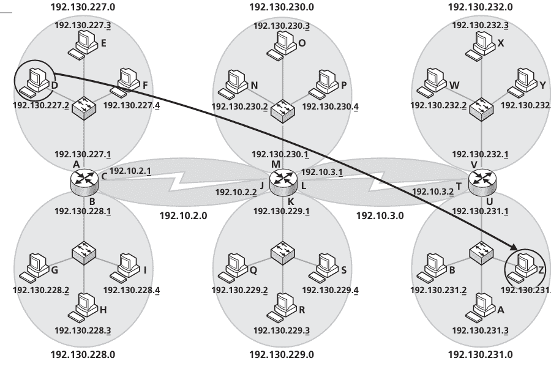

此时需要注意的是，帧只能通过计算机在给定的段内进行移动。同样重要的一点是，计算机只包含其所在段内物理地址的记录。计算机无法知道位于不同段的计算机的物理地址是什么。在这种情况下，源计算机需要与网络中不同段的计算机进行通信。

如果我们只处理物理地址，这会带来某种困难。然而，我们也有逻辑地址来帮助我们。换句话说，物理地址用于在段内移动数据帧，逻辑地址用于确定帧跨越多个网段的最佳路由。为了让数据帧跨越网络，有必要在路由的每一步（称为“跳”，见图 4-7）中重置源物理地址和目的物理地址，同时保持相同的逻辑地址，以保持帧在正确的路径上。

源计算机不知道它所处网段中连接的物理地址。计算机也知道，如果它不知道目的计算机的物理地址，则应将数据帧发送到路由器。为了做到这一点，计算机设置了目的物理地址。通过这种方式，计算机设置了逻辑地址中相同的网络部分，但将目的物理地址更改为路由器。这允许路由器将数据帧移动到正确的段，同时保持逻辑地址不变以到达目的。

### 图 4-7
路由的段

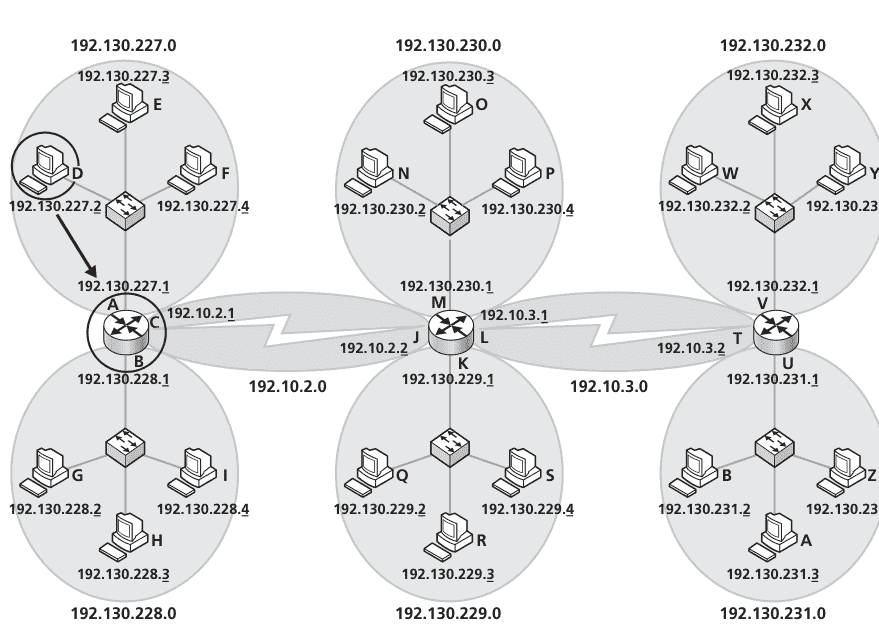

### 图 4-8
逻辑地址保持相同，物理地址变为 A


当路由器从计算机接收数据帧时，它分析数据帧的逻辑地址以查看是否应该传递到连接到它的网段。在这种情况下，路由器能够确定目的地不在连接到它的网段中，因此它将数据帧传递到下一跳路由器。为了做到这一点，路由器保持逻辑地址不变，但将源物理地址更改为自己的地址 `A`，并将目的物理地址更改为下一跳的地址。

### 图 4-9
逻辑地址保持相同


总结来说，数据包通过网络时，逻辑地址不会更改。然而，在通往目的计算机的路由每一步，物理源地址都会更改。通过这种方式，物理地址用于跨网络移动数据帧，逻辑地址用于保持数据包的正确路径以便到达适当的目的。

## 广播域与冲突域

两个与地址以及不同类型地址如何工作的概念是广播域和冲突域。这两种域既相似又不同。

当网络或段上的所有设备以某种方式连接，使得它们都能接收来自一台计算机的相同广播信号时，我们称之为广播域。为了成为单个广播域的一部分，接收到的信号不能通过交换机、路由器或类似设备。这是一个广播域，因为域内的所有设备都能进行广播。

冲突域相似但不同。当同一网段或网络上的两个或多个设备能够导致它们的信号与另一个信号产生干扰时，我们称之为冲突域。当两个信号以这种方式相互干扰时，被称为冲突。

以下可能有助于说明广播域和冲突域区别的现实示例。我有一个名为集线器的网络设备，并向它连接了许多计算机，正如所示，你创建了广播域和冲突域。

### 认证准备
什么是广播域？什么是冲突域？它们之间的区别是什么？

连接到集线器的设备信号可能会与连接到集线器的一个或其他设备的信号发生干扰。这种现象基于集线器的工作原理。同时，所有连接到集线器的设备都处于一个广播域。结果是，当集线器上的某一个设备发送广播时，集线器上的所有其他设备都会接收到该广播。

现在让我们考虑类似的情况，但使用交换机代替集线器。交换机的特殊设计使得连接到交换机的任何一个设备都只能与另一台设备直接通信。因此，不会形成冲突域。无法形成冲突域的原因是，相互通信的两个设备知道彼此通信的存在，并且它们的信号不会相互干扰。如果有另外两个信号相互碰撞，则无法形成冲突域。然而，如果连接到交换机的设备使用广播地址发送信号，连接到交换机的设备将接收到该广播信号。通过这种方式，交换机形成了一个广播域。

总结一下，当使用称为集线器的网络连接设备来连接设备时，会同时形成冲突域和广播域。然而，如果使用称为交换机的网络设备代替集线器，由于交换机的工作原理，不会形成冲突域，但会形成广播域。

## 其他地址技术

第 4 节的大部分讨论了不同的地址技术，如超网划分、NAT、DHCP；以及网络上的计算机相互发送数据包的不同方法。


如之前提到的除了子网划分外，还有其他技术可以扩展 IPv4 地址的限制。本节将讨论其中一些技术。

## 超网划分

要讨论的第一项技术是超网划分。简单来说，超网划分是将多个 IP 范围（通常是 C 类）合并为一个网络的过程。例如在我们操作场景中，如果 John 有两个 IP 范围，即 `204.214.56.0` 和 `204.214.57.0`，他可以将它们合并（或超网划分）成一个聚合的 IP 地址范围。John 需要做的是使用 CIDR 表示法 `204.214.56.0/23`。CIDR 表示法中的 `/23` 分段表示 IP 地址的前 23 位是网络 ID，而最后 9 位用于主机 ID。这将产生一个支持 512 个主机的网络，减去第一个和最后一个主机 ID（这两个 ID 被用于网络 ID 和广播）。

## 网络地址转换 (NAT)

网络地址转换，或 NAT，是另一种扩展 IPv4 有限 IP 地址数量的技术。这是一项许多人都在使用但甚至没有意识到自己正在使用的技术。如果你有多台可以上网的计算机，但家里只有一处互联网连接，那么你正在使用 NAT 技术。

NAT 转换是指使用 NAT 技术的过程，它通过获取来自 ISP（服务提供商）或其他位置的 IP 地址，并使用该 IP 地址允许所有连接到它的联网设备访问互联网。通过这种方式，只需要使用一个 IP 地址即可上网，而多个设备可以使用该 IP 地址来实现上网。

这的一个例子是普通用户家中的网络。一个 IP 地址从你的 ISP 提供的“调制解调器”进入你的家。那个“调制解调器”旨在直接连接到一台计算机，而该计算机应该上网。然而，人们家里的情况并非如此。人们不是将“调制解调器”连接到单台计算机，而是将其连接到路由器/交换机或其他类型的接入设备。从该点开始，他们连接了家里所有的计算机和其他网络联网设备。为了让所有设备通过仅一个 IP 地址访问互联网，路由器/交换机必须跟踪每个尝试连接互联网并请求连接的设备。这被称为 NAT 转换。图 4-11 展示了 NAT 在小型家庭环境中是如何工作的。

### 图 4-11
家庭环境中基本 NAT 设置的示意图


图 4-11 是家庭网络的一种假设设置。ISP 通过“调制解调器”进入家庭，并分配 IP 地址 `203.27.97.86` 以允许通过该调制解调器访问互联网。然而，这个家里有多台想要上网的计算机。为了实现这一点，他们没有将调制解调器连接到单台计算机，而是将其连接到路由器/交换机。调制解调器连接的路由器/交换机能够将从连接的交换机的单一 IP 地址转换为家中所有计算机的 IP 地址。这被称为网络地址转换 (NAT)。当其中一台计算机连接到时，路由器/交换机会将请求计算机的 IP 地址切换为调制解调器给它的 IP 地址，然后将请求发送到互联网。当响应从互联网返回时，路由器/交换机记得是哪个端口请求了该内容，并将响应发送到本地计算机。

### 图 4-12
在具有 SNAT 和 PAT 的家庭环境中基础 NAT 设置的示意图


图 4-12 展示了我们讨论的所有主题。来自 ISP 的调制解调器上的 IP 地址是允许访问互联网的公有 IP 地址示例。家庭电脑上的 IP 地址是私有 IP 地址或 APIPA 地址，因为它们不允许访问互联网。这些 IP 地址之所以私有，是因为它们属于 Microsoft 用于其自动 IP 地址服务的范围。计算机接收到这些 IP 地址，是因为设置家庭网络的人让 Microsoft 按照配置分配了 IP 地址。

图 4-12 的最后一部分是 NAT 划分图。所有具有 NAT 功能的路由器/交换机获取其连接的每个私有 IP 并为它们分配端口地址。这在 PAT 标题下方所示。`.25381`、`.25382` 和 `.25383` 被添加到路由器/交换机分配给每个 IP 地址的末尾。此过程被称为端口地址转换或 PAT。

每当家庭网络中的某个设备想要连接互联网时，路由器/交换机会将 IP 地址 `203.97.26` 转换为该计算机的真实 IP 地址。然而，路由器/交换机保留了 PAT 分配的端口地址。这被称为源网络地址转换或 SNAT。更改源 IP 地址允许想要接入互联网的计算机实现连接，而保留端口地址则允许路由器/交换机确保来自互联网的任何响应都能到达家庭网络上的正确地址。

PAT 和 SNAT 以这种方式协同工作被称为网络地址转换，或 NAT。要使 NAT 工作，路由器/交换机或其他网络设备需要能够执行 PAT 和 SNAT，因为这两者都是 NAT 的组成部分。

## 分配 IP 地址

由于 IP 地址是逻辑地址，它们必须由网络管理员分配。网络管理员有几种方法可以完成这项。

## 静态地址

分配 IP 地址的最旧方法是静态 IP 地址分配。在静态 IP 地址分配中，所有的 IP 地址都必须由网络管理员分配。这意味着网络管理员必须逐一访问每台计算机并手动为其分配 IP 地址。这导致了大量的额外工作，并要求网络管理员方面进行良好的记录工作，以确保特定的 IP 地址不会被重复使用。

### 认证备考
静态 IP 地址分配和动态 IP 地址分配有什么区别？

虽然静态 IP 地址分配需要大量的额外工作，但在某些情况下它仍然是首选的。静态 IP 地址可能被优先的主要情况是网络安全。在任何不需要手动分配 IP 地址的系统中，网络上使用的 IP 地址都是广播的。这使得黑客能够监听网络，并随着时间的推移构建出网络布局的可靠方法。这让黑客更容易进入并为了其目的破坏网络。

静态 IP 地址分配主要与动态 IP 地址分配配合使用。在这种情况下，大部分网络使用动态 IP 地址分配，但你希望保持隐藏的特定路由或计算机将被分配静态 IP 地址。

## 动态地址

由于在网络中完全使用静态 IP 地址时，网络管理员需要大量的管理工作，计算机科学家开始寻找自动化分配 IP 地址过程的方法。经过一些实验后，他们确定了名为*动态主机配置协议 (DHCP)*的协议，它用于*动态 IP 地址分配*。

### 动态主机配置协议 (DHCP)

DHCP 是一种为了允许动态分配 IP 地址而不需要网络管理员持续输入而开发的协议。这种新协议极大地减少了网络管理员的工作量，是现代网络中分配 IP 地址的首选方法。一旦在 DHCP 服务器上设置了 DHCP，IP 地址就会在客户端接入网络或其旧 IP 地址过期时自动分配给客户端计算机。

### 认证备考
什么是 DHCP？它在网络中是如何使用的？

图 4-13 解释了 DHCP 如何在现代网络中使用。关于此图需要注意的一个重要点是，客户端和 DHCP 服务器都连接到同一个交换机上。当计算机、服务器以及其他网络设备共享同一个交换机时，这组设备被称为一个段（segment）。在图 4-13 中，客户端和 DHCP 服务器位于同一个网段内。这非常重要，因为要让 DHCP 工作，在想要使用 DHCP 服务器获取 IP 地址的客户端所在的网段内，必须有一个 DHCP 服务器。

### 图 4-13
带有 DHCP 服务器和客户端的网络段

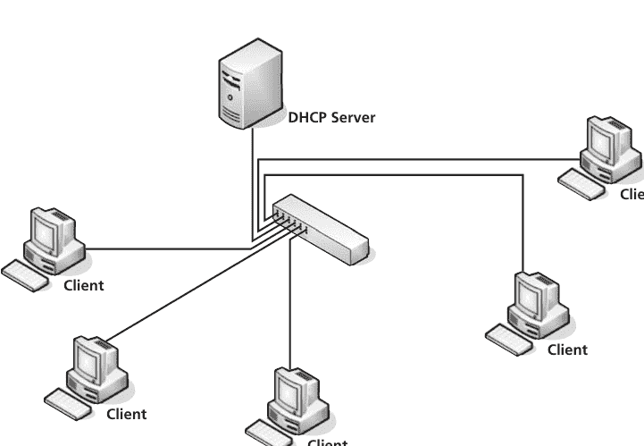

为了说明目的，我们假设 DHCP 服务器已正确设置和配置。一旦完成，每当有人接入网络，就会执行以下 DHCP 步骤：

- **DHCPDISCOVER**：此步骤源于客户端。首先，客户端向 IP 地址 `255.255.255.255` 广播信号。此 IP 地址表示数据包发送给网段内的每个计算机。客户端广播的数据包是向可能存在的任何 DHCP 服务器请求 IP 地址。此步骤被称为 DHCPDISCOVER。
- **DHCPOFFER**：此步骤源于服务器。DHCP 服务器接收发现请求并向客户端提供一个 IP 地址。此步骤被称为 DHCPOFFER。
- **DHCPREQUEST**：此步骤源于客户端。客户端请求 DHCP 服务器提供的 IP 地址。此步骤被称为 DHCPREQUEST。
- **DHCPACK**：此步骤源于服务器。DHCP 服务器确认租约并向客户端提供 IP 地址。此步骤被称为 DHCPACK。

### 图 4-13 (续)
带有 DHCP 服务器和客户端的网络段


当 DHCP 客户端从 DHCP 服务器接收 IP 地址时，该 IP 地址并不是永久分配给该客户端的。相反，IP 地址是在初始化过程中通过租约进行确定的。租约时间可以来自客户端，也可以来自服务器，但必须建立一个租约时间。当客户端上的租约时间过期时，必须通过初始化过程来获取新的 IP 地址。

在向客户端授予租约后，客户端会将时间保存在内存中——续约时间，默认情况下，这是租约剩余一半时间的时候。客户端保存在内存中的第二个时间是租约的总时间。当达到续约时间时，客户端尝试通过向服务器发送 RENEWING 请求来续约租约。如果服务器确认了 RENEWING 请求，则没有问题，客户端将会在新租约下继续使用该 IP 地址和配置。如果服务器没有响应，客户端将等待剩余时间的一半并重试，直到达到总租约时间的 87.5%。此时，客户端将尝试发布 REBINDING 请求。如果服务器确认了 REBINDING 请求，则租约得到更新，客户端将会在新租约下继续使用分配的 IP。如果客户端没有收到确认，则它将在租约剩余时间过半后再次发布 REBINDING 请求。如果客户端仍未收到确认，它将继续这样做，直到租约仅剩 60 秒；在此点，它会检查网络进程是否正在运行，直到最终收到来自服务器的确认。在此期间，客户端还会尝试通过整个初始化过程来接收新的 DHCP 租约。如果客户端收到对其旧租约的 REBINDING 或 RENEWAL 确认，或者收到一个新租约，它将激活其网络进程。如果客户端收到新租约，它将永久放弃旧租约并转用新租约。DHCP 使用 UDP 端口 67 作为服务器，UDP 端口 68 作为客户端。

## 域名系统 (DNS)

域名系统 (DNS) 是用于此目的的下一个应用协议。这是一个非常重要的协议，它使我们能够像现在这样使用万维网（World Wide Web）。DNS 是将我们容易记住的所有 URL 转换为互联网可以理解的 IP 地址的协议。

与 DNS 有许多 RFC。然而，RFC 830 是第一个建议可以提议此类域名命名系统的 RFC。RFC 920 实际上是第一个列出域名系统要求的 RFC，并引入了前五个主要名称，即 `.com`、`.mil`、`.edu`、`.gov` 和 `.org`。该 RFC 还建议使用标准的英语双字母代码用于国家，如代表英国的 `.uk` 等等。现在已编写了更多 RFC 来详细阐述和增强 DNS。

DNS 需要几个组件。其中一些组件是名称服务器、缓存服务器和解析器：

- **名称服务器**：是 Web 上所有名称的数据库。该数据库分布在世界各地，每个域服务器在这一分布式数据库中都有其负责的部分。
- **权威服务器**：附加到域服务器上，负责回答收到的来自所属域空间的任何请求。权威名称服务器可以是主服务器（在这种情况下它就是域服务器），也可以是缓存服务器（它仅持有主服务器数据库的副本并用它来回答关于该空间的请求）。
- **缓存服务器**：维护它们接收的相同 URL 请求的数据库，如果对以前解析过的 URL 发起新请求，则提供适当的信息。当一个 URL 在一段时间后不再被请求时，该数据库会清除，这段时间被称为互联网的生存时间或 TTL（生存时间）。
- **解析器**：向域名系统发送请求的客户端可以是实际客户端，也可以是大型网络部分的服务器。它们有自己的小型缓存，如果它们是独立的，则将拥有更大的缓存。

既然我们已经描述了 DNS 的部分，就可以讨论 DNS 是如何工作的了。在互联网上，有一整系列域服务器。最基础且最重要的服务器是根服务器。在它的数据库中，该服务器存储了互联网上每个主要域服务器的 IP 地址。负责 `.org`、`.com`、`.edu`、`.net`、`.gov` 等主要的域服务器。每个域服务器反过来包含其所在范围内每个主要服务器的 IP 地址。例如，`.gov` 域可能包含白宫服务器、财政部服务器、司法部服务器、五角大楼服务器等的 IP 地址。


以下场景说明了 DNS 服务器如何利用之前列出的不同服务器将 URL 解析为其 IP 地址。在这种场景中，你正尝试访问网站 `www.widgets.com/support/widget_specs.htm`。当你打开网络浏览器并输入此 URL 时，浏览器会检查本地缓存查看是否可以找到 IP 地址。如果没有，它向你的 ISP DNS 服务器发送查询。ISP DNS 服务器查询根域服务器。根域服务器回复 `.com` 服务器的 IP 地址。ISP 的 DNS 服务器随后向 `.widgets` 域服务器查询 IP 地址。`.widgets` 域服务器回复 `support.widgets.com` 服务器的 IP 地址。ISP 的 DNS 服务器将 `www.support.widgets.com` 服务器的 IP 地址传递给你的计算机。

### 图 5-8
DNS 解析过程

1. 客户端向 ISP 请求 URL `www.widgets.com/support/widget_specs.htm` 的 IP 地址。
2. ISP 服务器查询根服务器。
3. 根服务器回复 `.com` 服务器的 IP 地址。
4. ISP 服务器查询 `.com` 域服务器。
5. `.com` 域服务器回复 `.widgets` 域服务器的 IP 地址。
6. ISP 服务器查询 `.widgets` 域服务器。
7. `.widgets` 域服务器回复 `support.widgets.com` 服务器的 IP 地址。
8. ISP DNS 服务器将 `www.widgets.com` 服务器的 IP 地址传递给客户端。
9. 客户端上的网络浏览器查询 `www.widgets.com` 服务器获取 `widget_specs.htm` 文档。
10. `www.widgets.com` 服务器回复请求的文档。

DNS 使用 UDP 和 TCP 端口 53。

## 超文本传输协议 (HTTP)

超文本传输协议 (HTTP) 是下一个应用协议。正如其名，HTTP 用于在互联网上传输超文本标记语言 (HTML) 文档，即网页。然而，这并不是 HTTP 的所有用途。HTTP 还可以用于检索图形、图像和其他类型的媒体。最初定义 HTTP 的 RFC 是 RFC 1945，发布于 1996 年。该 RFC 定义了 HTTP/1.0。然而，HTTP 自 1990 年以来就一直在使用，当时使用的格式是 HTTP/0.9。1999 年，发布了 RFC 2616，它定义了 HTTP/1.1。这是目前正在使用的 HTTP。

HTTP 的工作方式如下：当浏览器或其他客户端从已知的 URL 获取特定文件或网页时，它会与该特定服务器建立 TCP 连接，并向 80 端口发送 HTTP 请求。HTTP 请求会标识它想要的文档或文件，并发送请求来“获取”（GET）该特定的文档或文件。服务器将返回一个响应，其中包含一个状态行和所请求的内容、错误消息或其他信息。一旦响应完成，会话将关闭，或者向服务器请求额外信息。

HTTP 响应的状态行非常重要，因为它包含了若干项重要信息。最重要的两部分信息是内容长度（Content-Length）和内容类型（Content-Type）。内容长度告诉客户端预期会有多少字节的数据。内容类型告诉客户端数据将是什么格式，一旦接收到数据后，它将处理表示层的工作，但由于互联网使用 TCP/IP，定义安全的数据类型需要由 HTTP 来完成，因为 OSI 模型的上层在 TCP/IP 模型和协议套件的应用程序层中合并了。HTTP 使用 TCP 端口 80。

## 安全套接层 (SSL)

安全套接层 (SSL) 是一种用于保护互联网通信的协议。SSL 最初由 Netscape 引入，用于保护 Netscape 浏览器中的互联网交易。SSL 的第一个版本并不有效，但 1996 年引入的第三版本解决了前两个版本的问题。随着时间的推移，它已成为保护所有互联网通信的标准，无论使用哪种浏览器。

终端用户有几种方法可以判断是否使用了 SSL 或一种名为 TLS 的安全协议（后文将讨论）。一种方法是 URL 以 `https` 开头而不是 `http`。另一种识别方法取决于所使用的网络浏览器。某些浏览器（如 Firefox）如果该网站是安全的，会更改地址栏的颜色。其他浏览器会在 URL 旁或右上角放置锁头符号。某些浏览器会使用上述两种或两种以上方法来指示安全网站。

SSL 的工作原理是插入在 TCP 协议和任何用于将数据从一个位置发送到另一个位置的高级协议（如 HTTP）之间。

SSL 设计用于执行三项基本任务。这些任务如下：

- 服务器身份验证
- 客户端身份验证
- 加密 TCP 会话

SSL 的验证功能允许客户端确认其正准备发送交易的服务器的身份。这在验证您正要登录进行银行业务的网页服务器是否为其声称的银行服务器，或验证您正要发送信用卡交易的电子商务服务器是否为其声称的电子商务服务器时非常重要。可以使用许多其他示例来说明服务器身份验证的目的。

服务器通过所谓的“证书”（certificate）进行身份验证。证书是一种安全技术，用于在网络连接上正确地识别和验证特定计算机的身份。在我们的 SSL 验证我们示例中的银行或信用卡服务器的情况下，客户端和服务器都将拥有由信任的第三方证书机构（CA）提供的特定证书。当客户端验证服务器具有正确的密钥时，它能够证明该服务器确实如其所称的那样。

某些网站同时使用两种身份验证。

客户端身份验证与服务器身份验证类似，但工作方向相反。服务器不是验证服务器的身份，而是验证客户端的身份。这种类型的身份验证对于向特定客户端发送机密信息（如银行记录或类似的机密信息）的服务器非常重要。客户端验证使用证书的方式与服务器身份验证类似，只是方向相反。

SSL 的最后一个功能是加密 TCP 会话。这意味着跨连接的所有数据在这一端和另一端都经过加密。数据在网络中移动的方式任何窃听者都无法理解，因为那个人不知道使用了什么密钥来加密数据。在通过互联网发送之前加密数据进行另一个优势是，它可以让人们非常有信心，数据在传输过程中不会被篡改或更改。关于加密的主题将在本书的后续章节中讨论。客户端和服务器验证之间的紧密连接加密了通过网络连接传输的数据。由于 SSL 附加到某些其他应用程序协议，它通常使用其所附属协议的 TCP 端口。例如，HTTP 或 HTTPS 使用 SSL 来保护 HTTP 协议，并使用端口 443，此端口是分配给 HTTPS 的端口。HTTPS 也称为基于 SSL 的 HTTP。SSL 实际上并没有被分配特定的端口地址。

## 传输层安全协议 (TLS)

传输层安全协议 (TLS) 最初于 1999 年通过 RFC 2246 提出，作为 SSL 的升级或增强。从那时起，TLS 经历了两次重大修订：2006 年基于 RFC 4346 的 TLS v1.1 和 2008 年基于 RFC 5246 的 TLS v1.2。SSL 和 TLS 之间的主要区别并不大，但存在一个区别，即这两个协议不可互换。主要区别在于使用加密算法等领域，在 TLS 的情况下，增强了身份验证加密以及对其的额外增强，以便为增强功能添加一些额外的扩展。

## 超文本传输安全协议 (HTTPS)

超文本传输安全协议 (HTTPS) 是 SSL/TLS 的变体。这用于保护 HTTP 协议并使用端口 443，此端口是分配给 HTTPS 的端口。HTTPS 也称为基于 SSL/TLS 的 HTTP。

## 文件传输协议 (FTP)

文件传输协议 (FTP) 用于在网络上传输文件。它是最老的协议之一，目前仍被广泛使用。FTP 使用两个端口：TCP 端口 20 用于数据传输，TCP 端口 21 用于控制连接（命令）。

## IP 语音 (VoIP)

IP 语音 (VoIP) 是一个通用术语，描述了一组在分组交换网络上传输语音的技术。在过去的十年中，VoIP 有多种实现方式。公司选择 VoIP 的两个主要原因是 VoIP 有助于降低成本和灵活性。VoIP 通过在相同网络上路由通信来降低成本。这消除了对并行网络（一个用于电话，另一个用于数据）的需求。

## 会话建立协议 (SIP)

VoIP 会话的一种常用方法是会话建立协议 (SIP)。这种信令协议用于在网上建立多媒体通信会话。SIP 可用于语音和视频。SIP 在两个节点、参与方或位置之间发送通信。当一个节点、参与方或位置希望与多个其他节点、参与方或位置通信时，会使用位置选择。使用 SIP 的应用程序包括在线游戏、视频会议、视频分发和即时消息。SIP 是一种可以使用 TCP 或 UDP 作为传输层协议的应用程序。SIP 通常使用 TCP 端口 5060 或结合 TLS 使用 UDP 端口 5061。

## 实时传输协议 (RTP)

VoIP 的另一种协议是实时传输协议 (RTP)。该协议携带语音或视频等流媒体。RTP 通常与 SIP 等其他信令协议结合使用，以执行其语音或视频流功能。RTP 用于语音流，它是与 SIP 以及其他协议一起用于 VoIP 的基础技术之一。RTP 没有预先分配特定的端口或端口范围。然而，RTP 通常使用 UDP 端口号 16384 到 32767。

## 终端网络 (TELNET)

TELNET 代表终端网络（Terminal Network），用于提供对远程或本地主机的双向交互式命令行访问。TELNET 首次于 1969 年在 RFC 15 中首次引入。1983 年，TELNET 在 RFC 854 中得到了扩展。几乎每种计算机平台都能找到 TELNET 客户端软件。由于 TELNET 发展时间很长，其安全性是它最大的缺陷。TELNET 默认不对连接传输的任何数据进行加密。此外，TELNET 的实现不具备对账户进行身份验证的能力。这意味着 TELNET 无法确保数据连接不被截获。在提到的两个安全问题中，截获正在通过 TELNET 连接发送的数据非常容易。当数据跨越 TELNET 连接发送并被截获时，读取起来将更加困难。TELNET 使用 TCP 端口 23。

## 安全外壳 (SSH)

由于 TELNET 的局限性，SSH（Secure Shell）与 TELNET 类似；与 TELNET 不同，SSH 内置了安全功能。其中一个功能是 SSH 使用公钥加密来对另一个网络设备进行身份验证。这允许 SSH 将必要的密码发送到目标计算机，而不是明文传输。SSH 还能使用 SSH 扩展 SFTP（SSH 文件传输协议）或 SCP（安全复制）在网络上对数据进行加密传输。SFTP 是一种用于在远程连接上加密数据的实际协议，而 SCP 则像一个完成任务的命令。两者都基于 SSH。SSH 使用 TCP 端口 22。

## 远程桌面协议 (RDP)

远程桌面协议（RDP）是由微软创建的一种应用层协议，用于为跨网络的应用程序向另一台计算机提供图形界面。RDP 能够为大多数现代操作系统提供图形界面，包括 Windows、macOS、Android、Linux 和 UNIX。RDP 使用 TCP 端口 3389。

## 电子邮件相关协议

虽然万维网可能是互联网上最广为人知的服务，但它并不是互联网上运行的唯一服务，实际上电子邮件可能是最大的服务之一。有几种与电子邮件相关的协议。这些协议是简单邮件传输协议（SMTP）、邮局协议 3（POP3）和互联网消息访问协议 4（IMAP4）。这些协议将在接下来进行讨论。

### 简单邮件传输协议 (SMTP)

SMTP 首次在 1982 年由 RFC 821 定义，后来在 2008 年由 RFC 5321 定义。正如其名称所示，SMTP 用于通过 IP 网络将电子邮件从一个服务器传输到另一个服务器。SMTP 用于由邮件客户端发送发出的邮件以及用于接收服务器。SMTP 用于将邮件从一个服务器中继到另一个服务器或接收者。在邮件客户端的情况下，SMTP 只用于将邮件从客户端移动到服务器，以便从服务器发送。

SMTP 使用两个协议（已讨论过）来完成数据从一处移动到另一处的任务。SMTP 使用的第一个协议是 DNS。SMTP 使用 DNS 来确定需要发送邮件的特定邮件服务器的位置。SMTP 在向目标地发送邮件时使用 TCP 建立并控制会话。SMTP 使用端口 25 完成此操作。

### 认证就绪
SMTP 代表什么？SMTP 的主要功能是什么？SMTP 属于哪些端口？

### 邮局协议 (POP3)

邮局协议或 POP 是从邮件服务器检索电子邮件的标准协议。POP 首次于 1984 年在 RFC 918 中引入。POP1 被 POP2 取代，POP2 是 1985 年在 RFC 937 中引入的。1988 年，POP3 在 RFC 1081 中引入，后来在 1996 年通过 RFC 1939 更新为当前规范。从那时起增加了几个扩展，最近的是 2007 年的 RFC 5034，它添加了身份验证机制。

POP3 用于连接到邮件服务器并在不关闭连接的情况下检索邮件。当 POP3 检索邮件时，它可以在服务器上留一个副本，也可以在下载到客户端后从服务器上删除邮件。POP3 支持使用 SSL 或 TLS 对邮件进行加密。POP3 使用端口 110 从邮件服务器检索邮件。

### 互联网消息访问协议 (IMAP4)

IMAP 的开发比 POP 更早：IMAP 由 Mark Crispin 于 1986 年引入，并在 1988 年在 RFC 1064 中作为标准互联网服务器提出。IMAP 作为互联网邮件访问协议版本 2 (IMAP2) 在 RFC 1730 中引入。1996 年，IMAP 在 RFC 2030 中更新。从那时起增加了几个扩展，最近的是 2003 年的 RFC 3501。IMAP 的当前形式被称为 IMAP4，它使用 TCP 端口 143。

## 简单网络管理协议 (SNMP)

简单网络管理协议 (SNMP) 是最后一个讨论的应用协议。它主要使用端口 161。正如名称所示，SNMP 用于管理网络。SNMP 的 RFC 首次出现在 1988 年。与其他讨论的协议不同，SNMP 主要使用 UDP。一些人认为基于社区的 SNMP 版本是 SNMPv2c。2002 年，发布了 RFC 3411–3418，描述了 SNMPv3 以及我们使用的 SNMP 基础。所有版本的 SNMP 使用 UDP 端口 161。

为了让 SNMP 管理的网络工作，需要三个组件。这些是管理设备、代理和网络管理系统。管理设备由任何网络管理设备组成。SNMP 客户端软件可以管理路由器、交换机、IP 摄像头和打印机、主机以及许多其他运行在网络上的管理设备或节点。

代理是运行在管理设备上的软件模块，它将设备的管理信息转换为 SNMP 可用的格式。网络管理系统是一个设备，通常是服务器，用于监控和控制在网络上的管理设备。在网络上可以有多个服务器承担这一职责。

网络管理系统非常有用，可以使网络管理员的工作变得简单。然而，当 SNMP 在网络上的所有设备上运行时，存在一些严重的担忧。某些担忧是，如果黑客在网络上获得了嗅探器，他将能够绘制整个网络。另一个担忧是 SNMP 在服务器和客户端之间交换大量信息，使用嗅探器的黑客可能会损害敏感信息。网络上的 SNMP 经常出现在安全组织的网络威胁列表中。由于这些，网络管理员对比 SNMP 可能遵循的最佳建议是仅在需要在网络上运行它，否则保持关闭。

## 网络时间协议 (NTP)

网络时间协议 (NTP) 是下一个。它使用端口 123。它首次于 1985 年引入。它用于跨网络同步时间。当网络上的计算机需要同步时，可以使用 NTP。我们使用的 NTP 当前形式是 NTPv4。

## 协议如何协同工作

在第 5 课的这部分，我们将使用一种名为 Wireshark 的工具来分析网络流量，查看不同的协议如何协同工作以完成我们的任务。

演示协议族或不同协议如何协同工作的最佳方法是使用 Wireshark 工具。Wireshark 是由 Gerald Combs 创建的免费开源协议分析器，它最初名为 Ethereal，但在 2006 年更名为 Wireshark。你可以轻松地在互联网上通过 Google 搜索找到它。几乎每个正在使用的计算机平台都有适用于它的 Wireshark 版本。

协议分析器在数据包通过网络时对其进行捕获，然后帮助管理员查看它们的细节和内容。Wireshark 的独特之处之一是，它可以理解其所捕获的每个协议的封装情况。这使得 Wireshark 不仅能显示封装和细节，还能告诉它们的含义。图 5-9 是 Wireshark 界面的截图。

### 图 5-9
带有捕获协议的 Wireshark


在第 5 课的这一节中，使用 Wireshark 来解释协议是如何协同工作的。本课末尾还有一个实验，学生可以在那里熟悉 Wireshark。

如图 5-9 所示，有四个主要部分和用于操作 Wireshark 应用程序的快捷图标。下方的窗口显示了各种数据包以及哪些已被捕获。捕获窗口下方是细节窗口，当高亮协议时，它会提供该协议的细节。细节窗口下方较小的窗口包含待分析的数据包的负载。如果有任何明文内容，可以在此窗口中读取。

### 图 5-10
无线网络捕获的协议

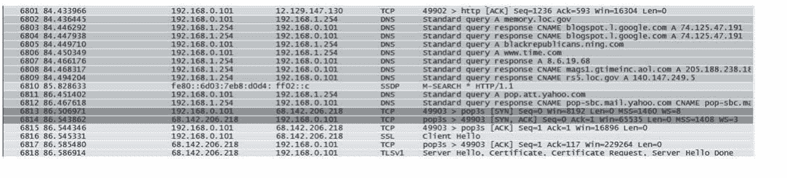

### 图 5-11
无线网络传输的数据包详情屏幕

此窗口包含了几项重要信息。左侧包含捕获数据包的帧号以及获取该数据的捕获开始时间。接下来的两列列出了源和目的计算机的 IP 地址。然后是每个特定数据包中使用的最高层协议。最后，最右侧是关于捕获数据包的一些信息。如果这些就是我们需要的所有信息，它们对我们的工作将非常有帮助。然而，Wireshark 能够捕获更详细的信息。图 5-11 显示了捕获数据包中某个数据包的细节。


# 填空题

请在提供的空格处填入正确的单词或词组以完成以下句子。

- 1. 所有网络接口卡都带有一个名为 ____________________ 的内置地址。
- 2. ____________________ 是在计算机接入网络后必须以某种方式分配给计算机的地址。
- 3. TCP/IP 中使用的主要的互联网层协议是 ____________________ 和 ____________________。
- 4. ____________________ 是计算机用于确定 IP 地址的哪部分用于网络 IP，哪部分用于主机 ID 的过程。
- 5. 计算机仅与网络上的另一台计算机通信的过程被称为 ____________________。
- 6. 当一台计算机将数据发送到网络上的多台计算机但并非所有计算机时，这被称为 ____________________。
- 7. 当网络上的一个设备需要同时与网络上的每个设备通信时，这被称为 ____________________。
- 8. NAT 代表 ____________________。
- 9. SNAT 代表 ____________________。
- 10. PAT 代表 ____________________。

## 单选题

请圈出对应答案的字母。

- 1. 将二进制子网掩码与二进制 IP 地址进行比较的过程称为什么？
  - a. 与位运算 (ANDing)
  - b. 类 IP 地址划分
  - c. 逻辑地址
  - d. 超网划分 (Supernetting)

- 2. 物理地址的前半部分称为？
  - a. 端口地址
  - b. MAC 地址
  - c. 组织唯一标识符 (Organizational Unique Identifier)
  - d. 子网

- 3. APIPA 使用哪个地址范围？
  - a. `10.0.0.0` 到 `10.255.255.255`
  - b. `169.254.0.1` 到 `169.254.255.254`
  - c. `172.16.0.0` 到 `172.31.255.255`
  - d. `192.168.0.0` 到 `192.168.255.255`

- 4. 在大型网络中最常用于自动分配 IP 地址的协议是哪一个？
  - a. 动态 IP 地址
  - b. DHCP
  - c. NAT
  - d. APIPA

- 5. ____________________ 是用于以人类可读格式唯一标识 MAC 地址的计数系统名称。
  - a. 二进制
  - b. 八进制
  - c. 十进制
  - d. 十六进制

- 6. 不用于互联网的 IP 地址称为什么？
  - a. 私有 IP 地址
  - b. 公网 IP 地址
  - c. 静态 IP 地址
  - d. 动态 IP 地址

- 7. 一组旨在协同工作的协议被称为
  - a. 协议族 (Protocol suite)
  - b. 自动私有协议地址分配 (Automatic Private Internet Protocol Addressing)
  - c. 超网划分 (Supernetting)
  - d. IP 协议

- 8. ____________________ 使用点十进制格式以人类可读的格式表示其地址。
  - a. IPv6
  - b. TCP
  - c. IPSec
  - d. IPv4

- 9. ____________________ 是可以直接访问互联网的网络。
  - a. 私有网络
  - b. CIDR
  - c. 公有网络
  - d. 多播网络

- 10. 无类 IP 地址划分的特征是以下哪项？
  - a. 缺乏礼貌
  - b. 非常不酷
  - c. 使用子网掩码来确定网络 ID
  - d. 通过 NAT 来确定其主机 ID

# 案例分析

## 场景 4-1：为 2 个网络和 8 个主机对 `201.144.32.0/24` 进行子网划分

你是 Widgets International 的 WAN 工程师。贵公司购买了 `201.144.32.0/24` 的 IP 网络范围。贵公司需要使用该范围划分两个网络，每个网络有 8 个主机。你如何对此 IP 网络进行子网划分？你应该使用什么子网掩码？你将使用哪个网络地址？你会如何用 CIDR 表示法写？为了完成公司的指令，你可以使用哪些可用网络和范围？

在尝试回答这些场景之前，先完成实验练习可能会更容易。

## 场景 4-2：为 `192.53.245.0/24` 为 3 个网络和 30 个主机进行子网划分

你是 Dive Master Services, Inc. 的 WAN 工程师。贵公司刚刚收购了 Divers Unlimited, Ltd.。在两家公司之间，你需要三个每个至少包含 24 台但最多 30 台计算机的网络。当贵公司收购 Divers Unlimited, Ltd. 时，也获得了 `193.53.245.0/24` 的 IP 地址范围。作为 WAN 工程师，你如何划分此网络范围以创建合并公司所需的网络？你将如何用 CIDR 表示？你应该使用什么子网掩码？你应该使用哪些网络地址？你需要的三个子网的 IP 范围是什么？你需要的三个子网络的可用 IP 范围是什么？

# 实验练习

## 实验 1：二进制转十六进制和十六进制转二进制

本实验的目的是让学生熟悉将二进制值转换为十六进制值以及十六进制值转换为二进制值。这对于学生来说很重要，因为网络、编程和故障排除中的许多值是用十六进制表示的。有些是物理地址，如 IPv6 地址。学生需要识别十六进制的样子并能够进行翻译。

### 准备
- 笔记本
- 笔

### 执行实验

#### 二进制与十六进制之间的转换

- 1. 使用表 4-20 将以下二进制值转换为十六进制。将十六进制值写在右侧。

| 二进制 | 十六进制 |
| :--- | :--- |
| `1001 1101 1111 0010` | |
| `0010 0111 1000 0010` | |
| `0001 1010 0000 1101` | |
| `1111 0111 1001 0100` | |
| `0000 0111 1110 0110` | |
| `1001 0111 1000 0100` | |
| `0011 1100 0110 1111` | |

- 2. 使用表 4-20 将以下十六进制值转换为二进制。将二进制值写在右侧。

## 实验 2：二进制转十进制和十进制转二进制

本实验的目的是让学生熟悉将二进制值转换为十进制值以及十进制值转换为二进制值。这对于学生来说很重要，因为网络、编程中的许多值是用二进制系统表示的。从十进制转二进制以及二进制转十进制是学习如何手动划分网络的重要步骤。

### 准备
- 笔记本
- 笔

### 执行实验

- 1. 使用表 4-7 将以下二进制值转换为十进制。将十进制值写在右侧。

| 二进制 | 十进制 |
| :--- | :--- |
| `1001 1100` | |
| `1111 1111` | |
| `1101 1100` | |
| `0011 1000` | |
| `0001 1000` | |
| `1000 0001` | |
| `1100 0110` | |
| `0000 0110` | |

- 2. 使用表 4-7 将以下十进制值转换为二进制。将二进制值写在右侧。

| 十进制 | 二进制 |
| :--- | :--- |
| 197 | |
| 23 | |
| 243 | |
| 255 | |
| 128 | |
| 160 | |
| 242 | |
| 192 | |

## 实验 3：确定 CIDR 格式 IP 网络的子网掩码

本实验的目的是让学生在给定 CIDR 格式 IP 网络地址时熟悉如何确定其子网掩码。该实验对学生来说很重要，因为它将帮助他们开始正确解释 CIDR 符号，并帮助他们在看到 CIDR 符号时能够确定 IP 网络的子网范围。

### 准备
- 笔记本
- 笔

### 执行实验

#### 确定子网掩码

使用课程中的表 4-13，学生需要确定以下 CIDR 格式 IP 网络地址的子网掩码。将子网掩码写在右侧。

| IP 地址 | 子网掩码 |
| :--- | :--- |
| `205.23.189.0/24` | |
| `157.234.0.0/16` | |
| `12.0.0.0/8` | |
| `209.34.81.0/27` | |
| `167.55.0.0/18` | |
| `15.0.0.0/12` | |
| `197.245.1.0/30` | |
| `201.23.143.0/26` | |

## 实验 4：确定 CIDR 格式 C 类 IP 网络的子网掩码和 IP 范围

本实验的目的是让学生在给定 CIDR 格式 IP 地址时熟悉如何确定其 IP 网络的子网掩码和 IP 范围。该实验对学生来说很重要，因为它将帮助他们开始正确解释 CIDR 符号，并帮助他们在看到 CIDR 符号时能够确定 IP 网络的子网范围。它还将让学生熟悉根据 CIDR 格式 IP 网络地址确定子网 IP 地址范围的过程。一旦学生能够成功解释 C 类子网的 IP 范围，他们就开始理解非 C 类子网 IP 地址范围的基础知识。在后续课程讨论非 C 类子网范围解释时，本实验将为学生提供基础性的理解。

### 准备
- 笔记本
- 笔

### 执行实验

#### 从 CIDR 格式确定 IP 范围和子网掩码

使用课程中的表 4-14，确定并列出以下 CIDR 格式 IP 地址的子网掩码、所有 IP 地址范围、可用 IP 地址范围以及可用 IP 地址。

使用表 4-14 中的信息，为以下每个 CIDR 格式值创建一个类似于表 4-19 的表格：

| CIDR | 子网掩码 | IP 范围 | 可用范围 | 可用 IP 地址 |
| :--- | :--- | :--- | :--- | :--- |
| `193.56.132.0/26` | | | | |
| `206.112.213.0/28` | | | | |
| `199.123.45.0/27` | | | | |

# 网络协议

## 考试目标矩阵

| 涵盖的技术技能 | 考试目标 | 考试目标编号 |
| :--- | :--- | :--- |
| 协议族 | 解释 IP 地址的用途和属性。<br>* IPv4 对比 IPv6（格式）<br>* 识别常见的 TCP 和 UDP 默认端口。<br>- SMTP - 25<br>- HTTP - 80<br>- HTTPS - 443<br>- FTP - 20, 21<br>- TELNET - 23<br>- IMAP - 143<br>- RDP - 3389<br>- SSH - 22<br>- DNS - 53<br>- DHCP - 67, 68<br>解释常见网络协议的功能。<br>- TCP<br>- FTP<br>- UDP<br>- TCP/IP 协议族<br>- DHCP<br>- TFTP<br>- DNS<br>- HTTPS<br>- HTTP<br>- ARP<br>- SIP (VoIP)<br>- RTP (VoIP)<br>- SSH<br>- POP3<br>- NTP<br>- IMAP4<br>- Telnet<br>- SMTP<br>- SNMPv2/3<br>- ICMP<br>- IGMP<br>- TLS | 1.5 |
| | 给出一个场景，使用适当的软件工具排除连接性问题。<br>* Ping<br>* Traceroute | 4.3 |
| 协议如何工作 | 路由协议 | 解释路由和交换的用途和属性。<br>* EIGRP<br>* OSPF<br>* RIP<br>* 链路状态 vs 距离矢量 vs. 混合<br>* 静态 vs 动态路由指标<br>* 跳数<br>* MTU、带宽<br>* 成本<br>* 延迟<br>* 下一跳<br>* IGP vs EGP<br>* 路由表<br>* 收敛（稳态）<br>给出一个场景，安装并配置路由器和交换机。<br>* 路由表 | 2.1 |

## 关键术语

| | |
| :--- | :--- |
| 校验和 (checksum) | 收敛 (convergence) |
| 拒绝服务攻击 (DoS attack) | 路由协议 (routed protocol) |
| 距离矢量路由协议 | 路由协议 (routing protocol) |
| 动态路由 | 路由表 (routing table) |
| 混合路由协议 | 静态路由 |
| 链路状态路由协议 | 稳态 (steady state) |
| 指标 (metrics) | TCP 端口 |
| 下一跳 (next hop) | TCP/IP 协议族 |
| ping | 端口地址 (port address) |
| tracert | 协议栈 (protocol stack) |
| TELNET | UDP 端口 |
| 请求意见 (RFC) | |

John 是 Dive Master Services Inc. 的 WAN 工程师。他购买了另一家名为 Diving Unlimited, Ltd 的公司。John 必须弄清如何让这两个网络协同工作。为了实现这一点，他需要制定一个统一的网络地址方案，将这两个公司的网络结合起来。他将如何做？

## 协议族

第 5 节本部分将讨论什么是协议族，特别强调 TCP/IP 协议族，因为它是最常用协议的一部分。此外，还将讨论作为 TCP/IP 协议族组成的不同协议，以及它们在 TCP/IP 协议族整体方案中的位置。

### 认证就绪
什么是协议？
什么是协议族？
协议族和协议栈之间有什么区别？

在计算中，协议是一组约定的指令，允许计算机通过网络连接进行相互通信。网络中使用了许多协议。由于协议非常多，为了允许计算机之间进行通信，需要完成不同的任务。协议族是一组网络协议，旨在设计用于协同工作，以处理网络通信所需的各个层。

还需要定义一个与协议族概念相关的词汇。协议栈是指协议族中当前正用于执行计算机内部特定通信功能的所有协议。协议栈包含了协议族中所包含的协议模型的所有层。协议栈还允许在当前通信需要额外功能时，将额外的协议移入或移出堆栈。

## TCP/IP 协议族

在现代计算机网络中广泛使用的协议族是 TCP/IP 协议族。该协议族围绕传输控制协议（TCP）和互联网协议（IP）构建。正如你从这第二个主要协议的名称中所知的，该协议最初用于互联网通信。然而，随着时间的推移，每个主要的网络都采用了 TCP/IP 协议族作为其首选网络协议。Apple 和 Novell 曾经都有自己的协议族，但现在已放弃了自己的协议族，转而采用 TCP/IP 协议族。

虽然 TCP 和 IP 是 TCP/IP 协议族最重要的协议，但它们并不是 TCP/IP 协议族中的唯一协议。多年来，开发了许多协议与 TCP/IP 协议族配合工作。这些不同的协议设计用于执行特定任务。本节将讨论少数设计用于与 TCP/IP 配合的常见或广泛使用的协议。

## 网络访问层协议

为了理解 TCP/IP 协议族，我们首先需要回到第 2 节，在其中我们学习了 TCP/IP 模型。那里有四层。每一层代表了执行网络通信所需的特定功能。这些层从下到上分别是：网络访问层、网络层、传输层和应用层。图 5-1 显示了 TCP/IP 模型的层。

### 图 5-1
TCP/IP 模型


## 地址解析协议 (ARP)

### 认证就绪
ARP 代表什么？ARP 协议的功能是什么？

地址解析协议 (ARP) 如第 4 节所述，在网络寻址中，当数据包跨路由器在网络上传输时，MAC 地址在每个跳处都会发生变化，以便数据帧能够移动到旅程中的下一跳。第四节中没有讨论 MAC 地址是如何更改的。ARP 负责这项特定任务。ARP 的工作部分是确定下一跳的 MAC 地址，然后调整帧使其能够移动到下一跳。

为了实现这一点，ARP 使用了一些方法同时在 OSI 模型的第 2 层（数据链路层）和第 3 层（网络层）上工作。ARP 在第 3 层工作，是因为它需要知道数据包的 IP 地址。同时，它需要能够读取和更改第 2 层源和目的字段中的 MAC 地址，以便将数据包移动到下一跳。ARP 实际上位于 LLC（逻辑链路控制）中，作为 OSI 模型中软件和硬件部分之间的翻译器。

## 互联网控制消息协议 (ICMP)

### 认证就绪
ICMP 代表什么？ICMP 是什么？Ping 是什么？Traceroute 是什么？

互联网控制消息协议 (ICMP) 用于网络设备之间发送控制消息和报告错误。ICMPv6 是为 IPv6 设计的版本。Ping 和 Traceroute 是基于 ICMP 的常用诊断工具。

## 传输层协议

OSI 模型和 TCP/IP 模型传输层主要的 TCP/IP 协议是传输控制协议 (TCP) 和用户数据报协议 (UDP)。TCP 是面向连接的协议，而 UDP 是无连接协议。

## 端口

数据链路层协议具有 MAC 或物理地址，用于指示设备的位置，并用于将数据帧从一个网络移动到直接连接的另一个网络。网络层协议具有逻辑地址，用于确定设备到达特定地点的路由。传输层协议具有端口地址。端口地址也称为端口，用于确定每条数据用于哪个应用程序、服务或进程。端口地址确保正确的服务或进程能够获取预期的数据。传输层的两个主要协议 TCP 和 UDP 都使用端口。

端口地址（或端口）的范围从 0 到 65535。这些端口地址分为三组：

- **周知端口**：范围在 0–1023 之间的端口号。周知端口由分配数字机构 (IANA) 分配。根据 IANA，此范围内的端口只能由系统或分配给特权用户的根进程和程序使用。大多数情况下，端口地址已由 IANA 为特定协议、进程和服务进行了正式设置。由 IANA 设置的端口只能由 IANA 为每个端口定义的协议、进程或服务使用。
- **注册端口**：此组的端口范围为 1024–49151。如果公司、组织使用了其中一个端口，则应向 IANA 注册。当程序使用注册端口时，该端口在所有系统上将保持一致的使用。
- **动态端口**：这些端口范围在 49152–65535 之间。这些端口可以被任何程序或用户在任何时间使用，并根据需要由系统动态分配。

### 准备认证
什么是端口？它们在网络中起什么作用？端口位于 OSI 模型的哪一层？

### 注意
需要学习这些端口地址以通过 CompTIA 的 Network+ 考试。

### 表 5-1
常用的周知端口地址

| 端口地址 | 使用的协议 | 描述 |
|---|---|---|
| 20 | TCP | 文件传输协议 (FTP)—数据 |
| 21 | TCP | FTP—控制（用于命令） |
| 22 | TCP/UDP | 安全外壳 (SSH)—用于安全登录、文件传输（安全复制 (SCP) 和安全文件传输协议 (SFTP)）以及端口转发 |
| 23 | TCP | Telnet 协议—未加密文本 |
| 25 | TCP | 简单邮件传输协议 (SMTP)—用于在邮件服务器之间路由邮件 |
| 53 | TCP/UDP | 域名系统 (DNS) |
| 67 | UDP | 引导启动协议 (BOOTP) 服务器和动态主机配置协议 (DHCP) 服务器 |
| 68 | UDP | BOOTP 客户端和 DHCP 客户端 |
| 69 | UDP | 简单文件传输协议 (TFTP) |
| 80 | TCP | 超文本传输协议 (HTTP) |
| 110 | TCP | 邮局协议 (POP3)—主机使用 TCP/IP 从远程服务器检索邮件 |
| 123 | UDP | 网络时间协议 (NTP)—用于网络同步 |
| 143 | TCP | 互联网消息访问协议 (IMAP)—用于检索、组织和同步电子邮件 |
| 161 | UDP | 简单网络管理协议 (SNMP) |
| 162 | UDP | SNMP Trap |
| 443 | TCP | HTTPS (基于 SSL/TLS 的超文本传输协议) |
| 3389 | TCP | RDP (远程桌面协议)—微软开发的专有协议，用于跨网络远程访问桌面。 |

### 注意
这里列出的端口仅适用于 TCP/IP 协议套件。不同的端口号有时被称为 TCP 端口，并可能在 Network+ 考试中被提及。表 5-1 的第一列包含常用端口号。第二列包含传输层协议。包含 TCP 的端口通常被称为 TCP 端口，包含 UDP 的端口通常被称为 UDP 端口。你应该注意某些端口同时包含 TCP 和 UDP。事实上，大多数端口两者都使用。表 5-1 的最后一列提供了每个端口用途的简要描述。此表中的所有信息可以在 http://www.iana.org/port-numbers 找到。关于此表还有几点额外的说明。

## 传输控制协议 (TCP)

传输控制协议 (TCP) 是传输层最常用的协议，也是 TCP/IP 协议套件的核心协议之一。虽然 IP 主要关注将消息从一个设备传输到另一个设备，但 TCP 关注端点。TCP 的主要功能是提供应用程序、服务和数据之间的通信。另一种说法是，虽然 IP 关注快速将数据从一个应用程序传输到另一个应用程序，但 TCP 关注将数据从网络应用程序（如邮件服务器）传输到另一个网络应用程序（如电子邮件客户端）。使用 TCP 的常用应用层和服务包括 Web、FTP、点对点文件共享和媒体流。为了让 TCP 完成其功能，它必须处理管理任务。某些任务包括控制网络拥塞、控制数据移动速率以及确认。TCP 负责的另一个任务是确保数据段在到达目的地时按正确顺序重组。TCP 对数据的准确交付进行了优化，但并不总是及时交付。原因之一是 TCP 必须等待数据到达后才能进行重组。由于这种特性，TCP 不应用于实时应用（如 VoIP 或视频流）。对于这些目的，UDP 是更好的选择。

了解 TCP 报头的样式很重要。图 5-4 显示了 TCP 段的头部。

### 图 5-4
传输控制协议 (TCP) 头部

| 0 | 1 | 2 | 3 | 4 | 5 | 6 | 7 | 8 | 9 | 10 | 11 | 12 | 13 | 14 | 15 | 16 | 17 | 18 | 19 | 20 | 21 | 22 | 23 | 24 | 25 | 26 | 27 | 28 | 29 | 30 | 31 |
|---|---|---|---|---|---|---|---|---|---|---|---|---|---|---|---|---|---|---|---|---|---|---|---|---|---|---|---|---|---|---|---|
| 源端口 (16位) | | | | | | | | | | | | | | | | | 目的端口 (16位) | | | | | | | | | | | | | | | |
| 序列号 (32位) | | | | | | | | | | | | | | | | | | | | | | | | | | | | | | | | |
| 确认号 (32位) | | | | | | | | | | | | | | | | | | | | | | | | | | | | | | | | |
| 数据偏移 (4位) | 保留 (6位) | | | | | | 标志位 (6位) | | | | | | 窗口大小 (16位) | | | | | | | | | | | | | | | | | | |
| 校验和 (16位) | | | | | | | | | | | | | | | | | 紧急指针 (16位) | | | | | | | | | | | | | | | |
| 选项和填充 (可变) | | | | | | | | | | | | | | | | | | | | | | | | | | | | | | | | |

### 认证准备
TCP 协议是做什么的？TCP 协议与 UDP 有什么区别？TCP 是面向连接的还是无连接的协议？

TCP 头部的前 16 位是源端口，接下来的 16 位是目的端口。这些端口标识发送和接收的应用程序进程。

接下来的 32 位是序列号。此字段用于对发送的字节进行编号，以便接收端可以重新组装数据流。如果设置了 SYN 标志，则此字段包含初始序列号 (ISN)。

接下来的 32 位是确认号。当 ACK 标志设置为 1 时，此字段将显示接收计算机期望的下一个序列号。这是 TCP 确保所有段安全到达目的地的机制之一。如果发送到会话端的第一个 ACK 段是会话的开始，则只有该段包含下一个序列号，但不包含数据。这用于在两个运行中的 TCP 计算机之间建立会话。

接下来的 4 位称为数据偏移位。这些位用于指定 TCP 头部在 32 位字中的长度。形成 TCP 头部最少需要的 32 位字数量为 5 个（即 20 字节），最大数量为 15 个 32 位字（即 60 字节）。

接下来的 6 位保留供未来备用，目前全部为 0。然而，接下来的 6 位更有趣，因为它们是标志位，也称为控制位，每个占用 1 位。当标志位设置为 1 时，表示该标志位已设置。以下是 6 个标志位（标准 TCP 头部为 6 位标志，加上 ECN/CWR 扩展为 8 位，此处列出常见 6 位及扩展）：

- **URG**：紧急指针字段有效。
- **ACK**：确认字段有效。从客户端发送初始 SYN 数据包后，所有的段都应该设置此标志位。
- **PSH**：推送功能。接收方应尽快将数据交给应用层。
- **RST**：重置连接。
- **SYN**：同步序列号，用于发起连接。
- **FIN**：发送端完成发送，用于释放连接。
- **CWR**：拥塞窗口减少 (Congestion Window Reduced)，配合 ECN 使用。
- **ECE**：ECN 回显 (ECN-Echo)，指示网络拥塞或对端支持 ECN。

TCP 头部中的下一个字段是 16 位的窗口大小。该字段用于定义 TCP 在需要等待确认之前可以发送的字节数。这是 TCP 流控制的一部分，被称为滑动窗口。在理想情况下，TCP 可以发送窗口字段定义的数量的数据，然后等待确认后再发送下一段数据。如果 TCP 在发送后没有收到预期的确认，它将保留数据。如果 TCP 连接末端的缓冲区满了，接收端 TCP 将发送窗口大小为 0。这告诉连接的另一端停止发送数据。一旦缓冲区清空，TCP 将继续进行数据传输。TCP 的窗口大小可以小到 2 字节，也可以大到 65,535 字节。较大的尺寸用于高速网络。作为 TCP 标准扩展的 RFC 1323 实际上引入了一个名为窗口缩放的新选项，用于 65,535 字节最大值的倍数。

TCP 头部中窗口字段之后是 16 位的校验和字段。该字段用于存储整个 TCP 段的校验和值。与 IP 不同，TCP 的校验和包含了 TCP 段的头部和数据部分。

头部中的下一个字段是紧急指针。该字段长度为 16 位，仅在设置 URG 标志时才重要。当设置 URG 标志时，此字段包含最后一段紧急数据的序列号偏移量。

最后，我们有选项和填充字段。该字段长度可以从 0 到 320 位不等，只要能被 32 整除即可。如果选项不能被 32 整除，剩余空间将作为填充，以便该字段能被 32 整除。该字段中可以放置若干选项，其中许多未被使用。可以放置于此处的选项之一是之前提到的由 RFC 1323 引入的窗口缩放选项。该 RFC 还定义了可以放置在此字段中的其他选项。之后，TCP 段包含数据。

如果你想了解更多关于 TCP 标准的信息，可以查找 RFC 793、RFC 1072、RFC 1146、RFC 1644、RFC 2018 和 RFC 2883。RFC 793 是当前 TCP 实现的描述；其他 RFC 是 RFC 793 的扩展。

## 用户数据报协议 (UDP)

用户数据报协议 (UDP) 是 TCP 的无连接对应体。它不保证交付，并且像 IP 等其他协议一样使用端口号作为访问服务。由于 UDP 功能有限，其头部相应地更小且不复杂。图 5-5 显示了 UDP 头部的样子。

### 图 5-5
用户数据报协议 (UDP) 头部

| 0 | 1 | 2 | 3 | 4 | 5 | 6 | 7 | 8 | 9 | 10 | 11 | 12 | 13 | 14 | 15 | 16 | 17 | 18 | 19 | 20 | 21 | 22 | 23 | 24 | 25 | 26 | 27 | 28 | 29 | 30 | 31 |
|---|---|---|---|---|---|---|---|---|---|---|---|---|---|---|---|---|---|---|---|---|---|---|---|---|---|---|---|---|---|---|---|
| 源端口 (16位) | | | | | | | | | | | | | | | | | 目的端口 (16位) | | | | | | | | | | | | | | | |
| 长度 (16位) | | | | | | | | | | | | | | | | | 校验和 (16位) | | | | | | | | | | | | | | | |
| 数据 | | | | | | | | | | | | | | | | | | | | | | | | | | | | | | | | |

## 启动协议 (BOOTP)

为了讨论 DHCP，首先有必要提到启动协议 (BOOTP)。提到 BOOTP 是因为它被广泛使用，而不是因为它是 DHCP 所取代的。BOOTP 首次在 RFC 951 中引入，后来在 RFC 1532 和 RFC 1542 中扩展。

BOOTP 的引入是为了实现网络 IP 地址自动分配。BOOTP 的名称来自计算机启动时发生的引导过程。这个过程被称为引导（bootstrapping）。在客户端上，当计算机启动但尚未初始化时，BOOTP 客户端请求 BOOTP 服务器，服务器为计算机分配相应的 IP 地址。之后，计算机能够从简单文件传输协议 (TFTP) 服务器接收操作系统，或从自身加载。在服务器上，BOOTP 维护网络上所有物理地址的表并映射到 IP 地址。该数据库用于向客户端分配 IP 地址。图 5-6 阐述了上述的 BOOTP 初始化过程。

### 图 5-6
BOOTP 初始化过程

1. BOOTP 客户端开始引导过程。
2. BOOTP 客户端发布 BOOTP 请求消息。
3. BOOTP 服务器处理 BOOTP 请求。
4. TFTP 服务器为 BOOTP 客户端发布文件传输。
5. 如果 BOOTP 客户端是虚拟终端，它将发送 TFTP 请求。

虽然现在不经常使用 BOOTP，但在客户端设备不包含任何操作系统或自身存储的网络中仍然可以发现它的身影。此类客户端使用 BOOTP，UDP 端口 67 作为服务器，UDP 端口 68 作为客户端。

### 认证就绪
什么是 DHCP？在什么情况下你会使用 DHCP？

## 动态主机配置协议 (DHCP)

这让我们看到了 DHCP：DHCP 首次在 1993 年的 RFC 1541 中引入，旨在取代较旧且应用较广泛的 BOOTP。在大多数应用程序中，DHCP 已经非常有效地取代了 BOOTP，正如其预期的那样。

虽然 DHCP 是构建在 BOOTP 之上的，但它的工作方式略有不同。不同之处在于 DHCP 不需要一个物理地址与 IP 地址的匹配表。相反，DHCP 持有一个用于分配给客户端的 IP 地址范围（地址池），并根据请求进行分配。另一个区别是 DHCP 可以为客户端存储完整的配置数据。这意味着除了客户端的 IP 外，DHCP 还存储了关于子网掩码、网关和 DNS 地址的信息。

与 BOOTP 一样，DHCP 客户端首次启动时功能是有限的。当 DHCP 客户端启动时，它会在网络段上发送一个 DHCPDISCOVER 消息。DHCP 服务器响应 DHCPOFFER 消息，其中包含一个选项字段。客户端收到来自多个 DHCP 服务器的 DHCPOFFER 消息后，会向其选定的 DHCP 服务器发送一个 DHCPREQUEST 消息。如果网络上没有其他 DHCP 服务器，当 DHCPREQUEST 不是针对该服务器时，服务器将拒绝。一旦接受了提议的 DHCPREQUEST 消息的 DHCP 服务器，它会将一个 IP 绑定到客户端的物理地址，这样该 IP 地址将不会被分配给其他客户端。DHCP 服务器向客户端发送 DHCPACK 消息，告知其已获得提议的 IP 地址和配置。图 5-7 展示了刚刚讨论的 DHCP 初始化过程。

### 图 5-7
DHCP 初始化过程

1. DHCP 客户端开始启动过程。
2. DHCP 客户端发布 DHCPDISCOVER 请求。
3. DHCP 服务器处理 DHCPDISCOVER 请求并发布 DHCPOFFER 消息。
4. DHCP 客户端接收 DHCPOFFER 消息，并向其接受的 DHCP 服务器发布 DHCPREQUEST 请求。
5. DHCP 服务器随后向客户端发送 DHCPACK 消息以初始化租约。


当 DHCP 客户端从 DHCP 服务器接收 IP 地址时，该 IP 地址并不是永久分配给该客户端的。相反，IP 地址是在初始化过程中通过租约进行确定的。租约时间可以来自客户端，也可以来自服务器，但必须建立一个租约时间。当客户端上的租约时间过期时，必须通过初始化过程来获取新的 IP 地址。

在向客户端授予租约后，客户端会将时间保存在内存中——续约时间 (T1)，默认情况下，这是租约剩余一半时间的时候 (50%)。客户端保存在内存中的第二个时间是重绑时间 (T2)，通常为租约时间的 87.5%。当达到续约时间 (T1) 时，客户端尝试通过向服务器发送 DHCPREQUEST (Renewing) 来续约租约。如果服务器确认了请求 (DHCPACK)，则没有问题，客户端将会在新租约下继续使用该 IP 地址和配置。如果服务器没有响应，客户端将等待直到达到重绑时间 (T2)。此时，客户端将尝试广播 DHCPREQUEST (Rebinding) 给任意 DHCP 服务器。如果服务器确认了请求，则租约得到更新。如果客户端没有收到确认，它将继续尝试，直到租约过期。租约过期前 60 秒，客户端会检查网络进程。在此期间，客户端还会尝试通过整个初始化过程 (DHCPDISCOVER) 来接收新的 DHCP 租约。如果客户端收到对其旧租约的续约或重绑确认，或者收到一个新租约，它将激活其网络进程。如果客户端收到新租约，它将永久放弃旧租约并转用新租约。DHCP 使用 UDP 端口 67 作为服务器，UDP 端口 68 作为客户端。

# 网络协议

## 域名系统 (DNS)

域名系统 (DNS) 是用于此目的的下一个应用协议。这是一个非常重要的协议，它使我们能够像现在这样使用万维网（World Wide Web）。DNS 是将我们容易记住的所有 URL 转换为互联网可以理解的 IP 地址的协议。

DNS 使用 UDP 和 TCP 端口 53。

## 超文本传输协议 (HTTP)

超文本传输协议 (HTTP) 是下一个应用协议。正如其名，HTTP 用于在互联网上传输超文本标记语言 (HTML) 文档，即网页。然而，这并不是 HTTP 的所有用途。HTTP 还可以用于检索图形、图像和其他类型的媒体。最初定义 HTTP 的 RFC 是 RFC 1945，发布于 1996 年。该 RFC 定义了 HTTP/1.0。然而，HTTP 自 1990 年以来就一直在使用，当时使用的格式是 HTTP/0.9。1999 年，发布了 RFC 2616，它定义了 HTTP/1.1。这是目前正在使用的 HTTP。

HTTP 使用 TCP 端口 80。

## 安全套接层 (SSL) 与传输层安全 (TLS)

安全套接层 (SSL) 是一种用于保护互联网通信的协议。SSL 最初由 Netscape 引入，用于保护 Netscape 浏览器中的互联网交易。SSL 的早期版本有缺陷，但 SSL 3.0 (1996) 解决了大部分问题。随着时间的推移，它已成为保护所有互联网通信的标准，无论使用哪种浏览器。

传输层安全协议 (TLS) 最初于 1999 年通过 RFC 2246 提出，作为 SSL 的升级或增强。从那时起，TLS 经历了多次修订：TLS 1.1 (RFC 4346), TLS 1.2 (RFC 5246), TLS 1.3 (RFC 8446)。SSL 和 TLS 之间的主要区别在于加密算法套件、握手流程细节及扩展机制，两者不可互换。

终端用户有几种方法可以判断是否使用了 SSL/TLS。一种方法是 URL 以 `https` 开头而不是 `http`。另一种识别方法取决于所使用的网络浏览器。某些浏览器（如 Firefox）如果该网站是安全的，会更改地址栏的颜色。其他浏览器会在 URL 旁或右上角放置锁头符号。

SSL/TLS 的工作原理是插入在 TCP 协议和任何用于将数据从一个位置发送到另一个位置的高级协议（如 HTTP）之间。SSL/TLS 设计用于执行三项基本任务：服务器身份验证、客户端身份验证、加密 TCP 会话。

由于 SSL/TLS 附加到某些其他应用程序协议，它通常使用其所附属协议的 TCP 端口。例如，HTTPS 使用 SSL/TLS 来保护 HTTP 协议，并使用端口 443。SSL/TLS 实际上并没有被分配特定的端口地址。

## 超文本传输安全协议 (HTTPS)

超文本传输安全协议 (HTTPS) 是 HTTP over SSL/TLS。这用于保护 HTTP 协议并使用端口 443。HTTPS 也称为基于 SSL/TLS 的 HTTP。

## 文件传输协议 (FTP)

文件传输协议 (FTP) 用于在网络上传输文件。它是最老的协议之一，目前仍被广泛使用。FTP 使用两个端口：TCP 端口 20 用于数据传输，TCP 端口 21 用于控制连接（命令）。

## 简单文件传输协议 (TFTP)

简单文件传输协议 (TFTP) 是一种轻量级的文件传输协议，使用 UDP 端口 69。它不提供认证和目录列表功能，常用于网络设备的固件升级或无盘工作站启动。

## IP 语音 (VoIP)

IP 语音 (VoIP) 是一个通用术语，描述了一组在分组交换网络上传输语音的技术。公司选择 VoIP 的两个主要原因是降低成本和灵活性。VoIP 通过在相同网络上路由通信来降低成本，消除了对并行网络（一个用于电话，另一个用于数据）的需求。

## 会话发起协议 (SIP)

VoIP 会话的一种常用方法是会话发起协议 (SIP)。这种信令协议用于在网上建立、修改和终止多媒体通信会话。SIP 可用于语音和视频。SIP 是一种可以使用 TCP 或 UDP 作为传输层协议的应用层协议。SIP 通常使用 TCP/UDP 端口 5060，或结合 TLS 使用 TCP/UDP 端口 5061 (SIPS)。

## 实时传输协议 (RTP)

VoIP 的另一种核心协议是实时传输协议 (RTP)。该协议携带语音或视频等流媒体数据。RTP 通常与 SIP 等信令协议结合使用。RTP 没有预先分配特定的端口，但通常使用 UDP 端口范围 16384–32767。

## 终端网络 (TELNET)

TELNET 代表终端网络，用于提供对远程或本地主机的双向交互式命令行访问。TELNET 首次于 1969 年在 RFC 15 中引入，后在 RFC 854 中标准化。TELNET 最大的缺陷是安全性：默认不对传输数据加密，且缺乏强身份验证机制。TELNET 使用 TCP 端口 23。

## 安全外壳 (SSH)

由于 TELNET 的局限性，SSH（Secure Shell）提供了加密的远程登录和文件传输功能。SSH 使用公钥加密进行身份验证，支持密码认证和密钥认证。SSH 扩展包括 SFTP (SSH File Transfer Protocol) 和 SCP (Secure Copy)。SSH 使用 TCP 端口 22。

## 远程桌面协议 (RDP)

远程桌面协议（RDP）是由微软创建的专有协议，用于跨网络提供图形界面远程访问。支持 Windows、macOS、Linux、Android 等客户端。RDP 使用 TCP 端口 3389。

## 电子邮件相关协议

### 简单邮件传输协议 (SMTP)

SMTP 用于在邮件服务器之间传输和路由电子邮件。SMTP 使用 DNS 定位目标邮件服务器，使用 TCP 端口 25 建立会话发送邮件。邮件客户端提交邮件亦使用 SMTP (通常配合认证，端口 587 或 465)。

### 邮局协议版本 3 (POP3)

POP3 用于从邮件服务器检索邮件到本地客户端。支持下载后删除或保留服务器副本。支持 SSL/TLS 加密 (POP3S, 端口 995)。标准端口 110。

### 互联网消息访问协议版本 4 (IMAP4)

IMAP4 允许客户端在服务器上管理邮件（文件夹、标记、搜索），支持多设备同步。支持 SSL/TLS 加密 (IMAPS, 端口 993)。标准端口 143。

## 网络时间协议 (NTP)

网络时间协议 (NTP) 用于跨网络同步时钟。使用 UDP 端口 123。当前版本 NTPv4 (RFC 5905)。

## 简单网络管理协议 (SNMP)

简单网络管理协议 (SNMP) 用于网络设备的监控和管理。主要使用 UDP 端口 161 (Agent), UDP 162 (Trap/Inform)。版本包括 SNMPv1, SNMPv2c (社区字符串), SNMPv3 (安全增强: 认证、加密)。核心组件：管理站 (NMS)、代理、被管理设备 (MIB)。

网络管理系统非常有用，但 SNMP 流量若被嗅探可能泄露网络拓扑和敏感信息。最佳实践：仅在必要时启用，使用 SNMPv3，限制访问控制列表 (ACL)。

## 互联网组管理协议 (IGMP)

互联网组管理协议 (IGMP) 用于 IPv4 网络中管理组播组成员资格。主机使用 IGMP 报告加入/离开组播组；路由器查询成员状态。IGMPv2 增加离开组报文；IGMPv3 支持源特定组播 (SSM)。IPv6 使用 MLD (Multicast Listener Discovery) 替代 IGMP。

## 协议如何协同工作

在第 5 课的这部分，我们将使用一种名为 Wireshark 的工具来分析网络流量，查看不同的协议如何协同工作以完成我们的任务。

演示协议族或不同协议如何协同工作的最佳方法是使用 Wireshark 工具。Wireshark 是由 Gerald Combs 创建的免费开源协议分析器，它最初名为 Ethereal，但在 2006 年更名为 Wireshark。你可以轻松地在互联网上通过搜索找到它。几乎每个正在使用的计算机平台都有适用于它的 Wireshark 版本。

协议分析器在数据包通过网络时对其进行捕获，然后帮助管理员查看它们的细节和内容。Wireshark 的独特之处之一是，它可以理解其所捕获的每个协议的封装情况。这使得 Wireshark 不仅能显示封装和细节，还能告诉它们的含义。图 5-9 是 Wireshark 界面的截图。

### 图 5-9
带有捕获协议的 Wireshark


如图 5-9 所示，有四个主要部分和用于操作 Wireshark 应用程序的快捷图标。下方的窗口显示了各种数据包以及哪些已被捕获。捕获窗口下方是细节窗口，当高亮协议时，它会提供该协议的细节。细节窗口下方较小的窗口包含待分析的数据包的负载。如果有任何明文内容，可以在此窗口中读取。

### 图 5-10
无线网络捕获的协议


### 图 5-11
无线网络传输的数据包详情屏幕

此窗口包含了几项重要信息。左侧包含捕获数据包的帧号以及获取该数据的捕获开始时间。接下来的两列列出了源和目的计算机的 IP 地址。然后是每个特定数据包中使用的最高层协议。最后，最右侧是关于捕获数据包的一些信息。然而，Wireshark 能够捕获更详细的信息。图 5-11 显示了捕获数据包中某个数据包的细节。


## 网络协议

此屏幕是通过双击所需的详细信息数据包后的。当双击一个数据包时，会弹出一个新窗口显示详细信息，如图 5-11 顶部所示，该处是一个协议列表，列出的协议包括帧（Frame）、网协议（Internet Protocol）、传输控制协议（Transmission Control Protocol）和传输协议（Transfer Protocol）。这些都是双击显示的数据包中封装的所有协议。如图 5-12 所示，细节列表中的协议可以展开以显示头部信息。这些头部信息对于故障排除或理解网络非常有价值。

**图 5-12**
Wireshark 头部展开的数据包详情屏幕


```
0000 00 00 00 00 00 00 00 00 ff 79 14 00 00 00
0010 05 d1 04 8e 47 02 39 64 07 46 00 00 00 00 00
0020 46 00 00 0d 00 00 00 00 40 00 00 00 00 00
0030 3c  0  0  0  0  00 00 00 00 00 00 00 00 00 00
00
0 40  0  0  0  0  00 00 00 00 00 00 00 00 00 00 000000000000000000
```

图 5-13 显示了捕获数据包的完全展开的 IPv4 头部。只需将图 5-13 中的信息与图 5-12 所示的 IPv4 头部图进行对比，你会发现每个字段都有对应，且进入每个字段的信息都完整存在。对于 Wireshark 捕获的 TCP/IP 协议族中的任何协议头部都可以进行类似的对比。

```
Ethernet II, Src: 0c:cc:bf:f8:ea; Dest: 0c:cc:bf:f8:ea;
```


# 网络协议

## Frame 6734
线上 1289 字节，捕获 1289 字节
- **Ethernet II**, 源: `00:64:bf:f8:8ea`, 目的: `00:23:59:84:42:47`
- **IP**, 源: `192.168.1.130`, 目的: `192.128.1.107`
- **传输控制协议 (TCP)**, 源端口: `49902`, 目的端口: `HTTP (80)`, Seq: 1, Ack: 1, Len: 1285
- **用户数据传输协议 (UDP)**

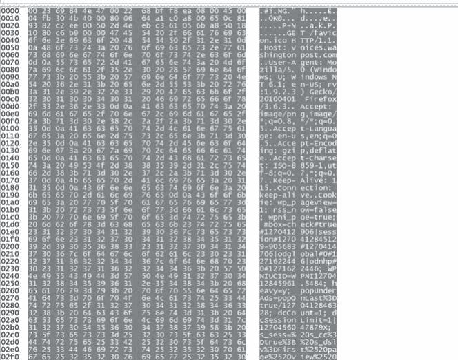

图 5-14 展开 Wireshark 窗口的数据流

IP 协议头列出了源和目的 IP 地址、已使用的标志和选项以及头部校验和。IP 协议用于查找从本地计算机到包含《华盛顿邮报》文章的 Web 服务器的最佳路径。

TCP 是列出的下一个协议。它告诉我们数据包的源和目的端口号、序列号以及确认号。此外，还列出了设置的标志、窗口大小和头部校验和。TCP 建立了连接，允许包含故事的《华盛顿邮报》Web 服务器将其发送到本地运行的 Wireshark。

最后使用的协议是 HTTP。该协议发送对 HTML 代码的请求，允许您在浏览器窗口中查看网页。展开此部分可看到许多有用信息，例如 HTTP 版本——版本 1.1、使用 Firefox 发送了网页请求、操作系统为 Windows NT 6.1 (Windows 7)，以及特定网页来自 `voice.washingtonpost.com`。

正如你从这个示例看到的，在给定的协议族中，没有单一协议被用于完成所有需要的工作。它需要多个协议共同工作来完成各自分配的任务。帧的物理限制由 Frame 协议定义。Ethernet II 用于基于 MAC 地址在网络中移动数据报。IP 用于将数据报从其源点导航到其终点。TCP 用于建立来回传输数据所需的会话，而 HTTP 则用于发送特定网页的实际请求。

当你使用 Wireshark 进行探索时，你会发现你在网络中执行的所有任务实际上都需要协议共同工作来完成。然而，在像家庭和教室中使用的局域网（LAN）中，即使是不同的协议也被用于完成不同的任务；就像 Frame、Ethernet II 和 IP 一样。在这三个协议之外，至少 TCP/IP 是核心协议；当涉及到你在网络上可能看到的其他协议以及它们的用途时，这些是开放的协议。

## 路由协议

本节讨论了路由协议的原理以及涉及路由协议的各种概念。我们还检查了一些特定的路由协议。

### 核心结论
迄今为止讨论的所有协议被称为**被路由协议**（routed protocols），即可以通过路由器和其他设备在网络上路由的协议。我们接下来讨论的协议被称为**路由协议**（routing protocols）。这意味着它们被路由器用于编译路由表，然后这些路由表用于在网络中移动之前提到的被路由协议。

### 认证就绪
被路由协议和路由协议之间有什么区别？

## 路由协议的属性

路由协议的目的是编制路由表，用于在数据发往特定目的地时确定最佳发送路径。路由协议的属性多种多样，并在很大程度上取决于讨论的是哪种路由协议。本节第一部分处理与路由协议相关的不同概念。之后，我们查看一些常用的特定路由协议。

### 认证就绪
内部网关协议和外部网关协议之间有什么区别？

## 内部网关协议与外部网关协议

内部网关协议（IGP）是在自治系统（AS）内部发现最佳路径的协议，而外部网关协议（EGP）是用于发现不同自治系统之间最佳路径的协议。另一种观点是，IGP 仅用于特定网络内部，而 EGP 用于在相互连接的自治或分离网络之间寻找最佳路径。

### 注意
确实存在一种名为外部网关协议（EGP）的协议；然而，它是一个已被 BGP 协议取代的过时协议。过时的 EGP 不是讨论的对象；外部网关协议的概念才是讨论的对象。

当使用自治系统（AS）时，它指的是通过某些网络链路连接的独立网络。最好的思考方式是将其考虑为一个内部连接的路由器网络，而无需接入互联网进行交互。如果一个 AS 足够大，将其拆分为更小的 AS 实际上是常见做法。

## 静态与动态路由

静态路由和动态路由是路由器中构建路由表的两种不同方式。当 IP 数据包被用于查找通往预期目的地的最佳路径时，这些路由表在不同的路由器中构建并存储。

构建路由表最基本的方法是手动输入。这被称为**静态路由**。**动态路由**是路由器使用协议学习路由并更新其表。

### 认证就绪
静态路由和动态路由之间有什么区别？会首选静态路由？

## MTU（最大传输单元）

最大传输单元（MTU）是网络上发送数据包允许的最大尺寸测量。如果数据包超过 MTU，数据包必须被拆分成不超过 MTU 的较小片段。将数据包拆成较小单元在尝试传输数据包时，路由器需要额外的处理能力。当 MTU 被用作确定最佳特定路径的指标时，路由器正在选择特定路径上允许的最大 MTU 大小。通常，路由器会倾向于选择允许传输完整数据包的路径，而不是要求将数据包拆分成更小单元的路径。其原因是，如果数据包必须被拆分成更小的单元，连接的两端都需要更多的处理能力。发送端需要更多的处理能力，因为数据包需要被拆分成更小的单元以适应 MTU 较小的路由。接收端则需要更多的处理能力来将分段的数据包重新组合。

## 带宽

当路由器使用带宽作为指标时，路由器会考虑每条可能路由的网络速度。一旦路由器考虑了这些网络，它将根据可用路由中哪条路由可以将数据包传送到目的地来选择路由。如果使用带宽作为指标，在“跳数”标题下展示的场景将不会发生。该场景不会发生的原因是，路由器会识别出高速通信路由比拨号路由更快，无论跳数如何，并会选择高速通信路由。

## 成本

成本是一种用于确定通往目的地最佳路由的任意指标。成本之所以是任意的，是由网络管理员设置的。管理员为他/她偏好或其他选择的每条路由分配“成本”。管理员通过设置他/她不青睐的路由较高成本、较青睐的路由较低成本来实现这一点。路由器将查看不同路由的相对成本，并发现使用成本作为指标的整体优势：管理员可以决定他/她偏好的哪条路由，同时保留较不理想的路由。在优选路由发生故障导致中断时，这是一种优势，因为次优路由仍然可用以填补空白。

## 延迟

延迟是衡量数据包从一个位置传输到另一个网络位置所需的时间。当延迟被用作选择最佳路径的指标时，路由器测量的是往返特定位置一次所需的时间。一旦路由器知道了通往特定位置每条路由的往返时间，它将选择往返时间最快的路由，并将数据包沿该路由发送。

延迟与带宽的区别在于，以带宽作为指标时只关注两个位置之间链路的速度有多快。然而，延迟还考虑了可靠性和负载等可能减慢往返速度的其他因素。

### 认证就绪
当用路由协议指标时，带宽和延迟之间的区别是什么？

### 注意
许多人误认为只有路由器才使用路由表。这是不正确的。大多数设备都连接到包含某种路由表的网络，包括 PC 和具有网络功能的打印机。

## 理解路由表和路径选择

路由表是小型数据库，用于确定通往网络上特定位置应采用哪条路由。路由表可以包含三类路由：
- **关关路由（Gateway routes）**：通往另一个路由器或其他类似类型设备的路由。
- **主机路由（Host routes）**：通往特定主机设备（如特定计算机）的路由。
- **默认路由（Default routes）**：当路由器不知道目的地路由在哪里时所采用的路由。这有时被称为“最后关关”（gateway of last resort）。

路由数据库中有多个不同的信息字段。最常见的三个是目标网络的网络 ID、数据包到达目标网络的成本以及下一跳（next hop）。成本指的是网络成本，或所使用的指标值。这些指标可以是到达特定目的地所需的跳数、到达该地所用路由的带宽的可靠性，或其他此类值。成本也可以由网络管理员分配的值。在这种情况下，网络管理员为较不偏好的路径分配较高成本，为更偏好或优选的路径分配较低成本。下一跳是通往目的地路径上下一个站点的 IP 或其他协议地址。

除之前讨论的信息外，某些设备（特别是路由器）其路由表中包含额外信息，如服务质量（QoS）、过滤准则和接口。服务质量字段包含特定链路是可用还是不可用的信息。过滤准则列出了任何控制列表的访问，该列表可能引用应用于路由表的路由器的特定接口。这是一个必要的字段，因为大多数路由器都有多个接口。

### 认证就绪
什么是路由表？初学者如何使用路由表？如果路由表不更新会发生什么？

### 认证就绪
什么是收敛（convergence）？有哪些一些常用的指标？

### 认证就绪
网络处于稳定运行状态意味着什么？

## 距离矢量路由协议

路由协议分为两种类型或这两种类型的混合体。这两类协议是距离矢量路由协议和链路状态路由协议。这两类协议基于协议如何确定其路由表。

最简单的路由协议类型是距离矢量路由。在距离矢量路由协议中，每个路由器都会定期向与其直接连接的所有相邻路由器发送其路由表的更新。通过这种方式，整个路由器网络都会得到更新。此更新传递所需的时间被称为**收敛**。当网络处于收敛状态时，它正处于稳定运行状态。这意味着网络中的所有路由器都已更新，并且它们都维持着现状。这种稳定状态是你尽可能希望网络所处的状态。

基于距离矢量的路由协议的主要优势是它们实现简单。距离矢量路由协议的缺点是它们容易产生环路问题。

### 路由信息协议 (RIP)
路由信息协议（RIP）是最古老的距离矢量路由协议之一。RIP 使用跳数作为其指标。RIP 的最大跳数为 15；16 表示不可达。RIP 每 30 秒广播一次路由表更新。RIPv1 是有类别的，RIPv2 支持无类别域间路由（CIDR）。

### 内部网关路由协议 (IGRP)
内部网关路由协议（IGRP）是 Cisco 专有的距离矢量路由协议。IGRP 使用带宽、延迟、可靠性、负载和 MTU 作为复合指标。IGRP 最大跳数为 255。

### 增强内部网关路由协议 (EIGRP)
增强内部网关路由协议（EIGRP）是一种基于 Cisco IGRP 协议的 Cisco 专有协议。EIGRP 具有先进的基于距离矢量的能力。它还使用了链路状态路由协议的技术，因此被认为是一种混合协议；尽管也有人对 EIGRP 是否为真正的混合存在争议。

EIGRP 具有多种距离矢量路由协议功能。其中一种功能是使用距离矢量指标来确定通往特定目的的最佳路由。EIGRP 使用的指标与 IGRP 使用的相同。这些指标是带宽、延迟、可靠性、负载和 MTU（最大传输单元）。EIGRP 的另一个距离矢量协议特性是，它不会定期向邻居发送整个路由表。相反，它监听邻居的更新，仅在发生变化时发送更新。

为了确定最佳路由，EIGRP 使用三个表：
- **邻居表**：包含直接连接邻居的信息。
- **拓扑表**：包含所有已知路由的信息。
- **路由表**：包含通往每个目的的最佳路由。

### 边界网关协议 (BGP)
边界网关协议（BGP）是一种用于在自治系统（AS）之间路由的协议。与大多数基于距离矢量的路由协议不同，BGP 使用的指标有些不同，因为它们基于路径、网络策略以及各个 ISP 设置的规则。

BGP 最初于 1989 年在 RFC 1105 中引入。BGP 经过了多次修订，直到 RFC 1654（建议的 BGP-4）。BGP-4 在 1994 年成为边界网关路由的首选 BGP 版本。BGP 在 2006 年通过 RFC 4271 进行更新，它是目前 ISP 专门使用的 BGP-4 版本的基础。

## 链路状态路由协议

链路状态路由协议是构建路由表的另一种主要类型路由协议。在链路状态路由中，每个路由器不是简单地向邻居更新自己的路由表，而是构建一个连接网络中所有路由器的内部地图，并更新整个网络中的所有其他路由器。一旦地图形成，路由器就会在内存中计算最快路径，并更新链路状态路由协议所使用的路由表。除了主路由外，链路状态协议还会计算通往相同节点的备用路由。如果主路由故障，链路状态路由协议可以立即切换到备用路由，而无需经过计算新表的过程。在距离矢量协议中，网络上所有路由器相互更新当前路由表的时间被称为“收敛”。一旦网络处于运行状态，就被认为在稳态下运行，这与距离矢量协议类似。同样，目标是让网络尽可能处于快速运行状态。

链路状态路由协议的主要优势是它们在内存中存储了网络地图，并能够根据该地图计算通往任何节点的最高效路由。链路状态协议仅在网络发生变化时进行更新，而不是像距离矢量协议那样每几秒更新一次。主要缺点是，由于需要更新到其他路由器的所有数据，链路状态地图比路由表大。这意味着更多的处理能力被分配给了编译地图、更新地图和确定路由表。几种常见的链路状态路由协议包括开放最短路径优先（OSPF）和中间系统到中间系统（IS-IS）。

## 开放最短路径优先 (OSPF)

开放最短路径优先（OSPF）是一种设计用于网络的链路状态路由协议。OSPF 同时支持 IPv4 和 IPv6。OSPF 还被归类为内部网关协议，因为它只能在自治系统（AS）内部运行。OSPF 使用成本作为其指标，成本基于带宽计算（参考带宽 / 接口带宽）。

为了克服链路状态路由协议的高流量密度，OSPF 在 OSPF 网络的一个网段中指定了一个指定路由器（DR）和一个备份指定路由器（BDR）。DR 和 BDR 限制了路由器之间发送的消息更新。不是由每个路由器在每次网络状态变化时都更新网段内的所有路由器，更新只发送给 DR 和 BDR。当 DR 从其网段内的路由器接收到完整且更新的网络地图时，它会将该地图广播给其监管的网段内的每个路由器。通过这种更新方法，减少了整个网络该网段的流量。如果 DR 发生故障，BDR 将成为 DR 并指定一个新的 BDR。这种冗余机制防止了网络使用的中断。

## 中间系统到中间系统 (IS-IS)

中间系统到中间系统（IS-IS）是一种内部网关协议，用于通过链路状态在 AS 内运行路由表。在讨论时，IS-IS 读作 "i-sys"。

IS-IS 的功能与 OSPF 类似，并且是同时开发的。两种协议之间的主要区别是 OSPF 专门为 IP 设计的，而 IS-IS 则不是。两种协议在定义其创建路由表的网络区域方面也存在一些差异。OSPF 使用路由器来定义 AS 区域，而 IS-IS 也使用路由器来定义这些区域。

尽管 IS-IS 在企业环境中并不常用，但它被许多 ISP 采用。IS-IS 不被认为是互联网标准，但它定义在开放系统互连（OSI）参考设计文档中。

## 混合路由协议

距离矢量和链路状态路由协议都有其优缺点。为了开发出既包含两者优点又尽可能减少其缺点的路由协议，开发了混合路由协议。混合协议使用基于距离矢量指标的方法确定最佳路由，同时使用链路状态方法更新网络中的其他路由器。这最大限度地减少了链路状态协议发生变化时需要泛洪的能力，并具有通过保持路由表最新来限制每个路由器的处理量并限制发送数据包数量的优势。最常用的混合路由协议之一是 Cisco 的增强内部网关路由协议（EIGRP）。

## 知识评估

### 填空题
在提供的空白处填写正确的单词或词组来完成以下句子。

1. 一种用于在计算机与计算机之间可靠地传输文件的应用层协议是 `FTP`。
2. `Telnet` 使用端口 23。
3. `SMTP` 使用端口 25。
4. `DNS` 使用端口 53。
5. `HTTP` 使用端口 80。
6. `HTTPS` 使用端口 443。
7. `DHCP` 服务器使用端口 67 和 68。
8. `SNMP` 使用端口 161 和 162。
9. `SSH` 使用端口 22。
10. `RDP` 使用端口 3389。

### 多选题
请在正确答案对应的字母上圈圈。

1. 下列哪项最准确地描述了 ICMP 协议的作用？
   a. 向其他计算机发送 IP 协议控制消息。
   b. 向特定的计算机组发送消息。
   c. 修改数据包的物理地址以便将其发送到下一个目的地。
   d. 管理网络。

2. FTP 使用哪两个端口？（选择两个。）
   a. 80
   b. 20
   c. 21
   d. 143

3. DNS 使用哪个端口？
   a. 123
   b. 23
   c. 69
   d. 53

4. HTTP 使用哪个端口？
   a. 23
   b. 80
   c. 25
   d. 22

5. Telnet 使用哪个端口？
   a. 25
   b. 23
   c. 53
   d. 69

6. SMTP 使用哪个端口？
   a. 21
   b. 22
   c. 25
   d. 161

7. 哪种协议配合 HTTP 使用以使其安全？
   a. SSL/TLS
   b. SSH
   c. POP3
   d. SIP

8. 哪两个协议是 VoIP 的组件？（选择两个。）
   a. SIP
   b. TCP
   c. IMAP3
   d. RTP

9. 使用哪种协议帮助匹配 IP 地址与 URL？
   a. TFTP
   b. CIDR
   c. DNS
   d. SNMP

10. 目前最常用的链路状态路由协议是哪一个？
    a. IGP
    b. EGP
    c. IS-IS
    d. OSPF

## 实验

### 实验 1：获取并安装 Wireshark
本实验的目的是帮助学生获取 Wireshark 软件，并教他们如何安装它。

#### 材料
- 可以访问互联网的计算机
- 纸
- 笔或铅笔

#### 实验步骤：安装 Wireshark
1. 访问 URL `www.wireshark.org`。
2. 点击 **Download Wireshark** 按钮。
3. 下一步骤的目的是找到可用的最新 Wireshark 版本并下载它，为安装做准备：
   a. 在网页顶部附近找到标题为 *Stable Release*（稳定版）的框，其后面跟有一系列括号内的数字。
   b. 查看列出的可用版本。
   c. 选择最适合你正在使用的计算机和操作系统的版本。
   d. 下载到硬盘上的某个位置。
4. 下一步骤的目的是安装你之前在步骤中下载的 Wireshark 版本：
   a. 转到你选择保存下载文件的位置。
   b. 双击安装文件，让 Wireshark 自动安装。
   c. 当 Wireshark 安装程序要求你安装 WinPcap 4.1 或更高版本时，点击 **Yes**。
   d. 点击复选框让 Wireshark 在安装后运行。
   e. 不要关闭 Wireshark，因为它将在下一个实验中使用。

> 注意：如果无法找到此 URL，请在 Google 上搜索 "Wireshark Download"。你可以在互联网某处找到 Wireshark 的下载安装文件。

### 实验 2：使用 Wireshark 捕获网络流量
本实验的目的是引导学生完成使用 Wireshark 捕获网络流量的过程。

#### 材料
- 安装了 Wireshark 的计算机

#### 实验步骤：使用 Wireshark
1. 确保 Wireshark 在你的计算机上运行。如果没有运行，请从桌面或 Windows 开始菜单启动它。
2. Wireshark 的启动界面应该像图 5-15 所示。

图 5-15 Wireshark启动界面


3. 点击屏幕 Capture（捕获）部分下的 Interface List（接口列表）图标。结果应该与图 5-16 类似。

图 5-16 选中接口列表的 Wireshark


4. 点击当前使用的接口旁 Start 按钮。
5. 当你执行此操作时，会出现一个类似于图 5-17 所示的屏幕。

图 5-17 开始捕获后的 Wireshark 界面


6. 最小化 Wireshark 并打开网页。
7. 关闭 Wireshark 并打开命令行。
8. Ping 几个 IP 地址。
9. 回到 Wireshark 并选择 Stop。
10. 关闭 Wireshark，因为这将用于下一个实验。

### 实验 3：使用 Wireshark 分析捕获的数据
本实验的目的是教学生如何使用 Wireshark 分析捕获的数据。本实验将帮助学生理解在网络传输数据时发生了什么，并理解不同的协议是如何工作的。

#### 材料
- 运行 Wireshark 的计算机
- 纸
- 笔或铅笔

#### 实验步骤：通过 Wireshark 解析数据
1. 查看源（Source）列。
2. 你在目标（Destination）列中看到了什么信息？
3. 查看标记为 *Protocol*（协议）的列。
4. 点击 Wireshark 顶部的 `+` 号查看更多选项。
5. 观察数据（Data）列。
6. 哪些数据包是 HTTP 协议的？
7. 在 HTTP 响应中，看到了哪些信息？
8. 一个 TCP 握手包含哪些步骤？
9. 哪些数据包是 DNS 协议的？
10. 哪些数据包是 HTTPS 协议的？
11. 观察 Wireshark 窗口的中间部分。
12. 哪些数据包是 ICMP 协议的？
13. 哪些数据包是 ARP 协议的？
14. 哪些数据包是 TLS 协议的？
15. 哪些数据包是 SSH 协议的？
16. 哪些数据包是 POP3 协议的？
17. 哪些数据包是 FTP 协议的？
18. 哪些数据包是 Telnet 协议的？
19. 哪些数据包是 SMTP 协议的？
20. 哪些数据包是 IMAP 协议的？
21. 哪些数据包是 RTP 协议的？
22. 哪些数据包是 SIP 协议的？
23. 哪些数据包是 TCP 协议的？
24. 哪些数据包是 TFTP 协议的？
25. 哪些数据包是 SNMP 协议的？
26. 哪些数据包是 OSPF 协议的？
27. 哪些数据包是 IS-IS 协议的？
28. 哪些数据包是 EGP 协议的？
29. 哪些数据包是 IGP 协议的？
30. 哪些数据包是 CIDR 协议的？
31. 哪些数据包是 SSL 协议的？
32. 哪些数据包是 TLS 协议的？
33. 哪些数据包是 TCP 协议的？
34. 哪些数据包是 UDP 协议的？
35. 哪些数据包是 IP 协议的？
36. 哪些数据包是 IPv4 协议的？
37. 哪些数据包是 IPv6 协议的？
38. 哪些数据包是 ICMP 协议的？
39. 哪些数据包是 ICMPv6 协议的？
40. 哪些数据包是 802.11 协议的？
41. 使用哪种协议来帮助将 IP 地址与 URL 匹配？
42. 哪些数据包是 DNS 协议的？
43. 哪些数据包是 HTTP 协议的？
44. 哪些数据包是 HTTPS 协议的？
45. 哪些数据包是 SMTP 协议的？
46. 哪些数据包是 POP3 协议的？
47. 哪些数据包是 FTP 协议的？
48. 哪些数据包是 Telnet 协议的？
49. 哪些数据包是 IMAP 协议的？
50. 哪些数据包是 RTP 协议的？
51. 哪些数据包是 SIP 协议的？
52. 哪些数据包是 TCP 协议的？
53. 哪些数据包是 TFTP 协议的？
54. 哪些数据包是 SNMP 协议的？
55. 哪些数据包是 OSPF 协议的？
56. 哪些数据包是 IS-IS 协议的？
57. 哪些数据包是 EGP 协议的？
58. 哪些数据包是 IGP 协议的？
59. 哪些数据包是 CIDR 协议的？
60. 哪些数据包是 SSL 协议的？

## 虚拟网络

### 识别虚拟网络组件
- 虚拟交换机
- 虚拟桌面
- 虚拟服务器
- 虚拟程控交换机 (PBX)
- 现场 vs 远程
- 网络即服务 (NaaS)

### 1.9 关键术语
| 访问控制列表 (ACL) | 网关代理服务器 | 端口镜像 |
|---|---|---|
| 活性集线器 | 硬件防火墙 | 基于端口的身份验证 |
| 非对称负载 | 集线器 | 以太网供电 (PoE) |
| 带宽整形器 | 隐式集线器 | 优先级激活 |
| 带宽整形 | 智能集线器 | 中继器 |
| 基于行为的检测 | 入侵检测系统 (IDS) | 预留 |
| 阻塞/允许 | 入侵防护系统 (IPS) | 反向代理 |
| 桥接 | 租用 | 负载均衡器 |
| 缓冲 | 介质 | 范围 |
| 缓存 | 媒体转换器 | 特征检测 |
| 冲突域 | 调制解调器 | 生成树协议 (STP) |
| 信道终端单元/数据单元 (CSU/DSU) | 网络接口卡 (NIC) | 状态协议分析 |
| DHCP 选项 | 网络接口控制器 (NIC) | 交换机 |
| 动态 DNS | 卸载 | 流量整形 |
| 加密设备 | 数据包整形 | 链路聚合 |
| 防火墙 | 被动集线器 | 虚拟局域网 (VLAN) |
| 完全限定域名 (FQDN) | 端口认证 | 无线接入点 (WAP) |

## 网络接口卡

Roberta 是 Solar Systems Inc. 的一名 WAN 工程师，该公司拥有一个包含 400 多台计算机的网络。管理层指示她找到一种方法，将网络分成不超过 50 台计算机的小单元，且这些单元只能与其他小单元通信。她如何完成这项任务呢？

在本节中，我们将讨论网络接口卡及其在网络中的应用。我们还讨论了网络接口卡的一些功能。

### 结论
网络接口卡 (NIC) 是计算机网络中最基础的组件之一。没有 NIC，计算机就无法访问网络或与网络上的其他计算机共享数据。NIC 可以是扩展卡，也可以内置在计算机的主板上。在大多数较新的计算机中，通常是后者的选择。由于 NIC 往往直接内置在计算机的主板上，一些人认为“网络接口卡”已不再是该设备的最佳术语。这些人通常称其为网络接口控制器。无论如何，缩写 NIC 的用法仍然很好。图 6-1 显示了一块基础的 NIC 卡。

### 图 6-1 PCI 网络接口卡


大多数设备上还有几个发光二极管 (LED) 指示灯。这些指示有助于诊断不同的问题。虽然不同的 NIC 可能有不同的指示，但在所有 NIC 上看到的两个 LED 指示灯是链路灯（link light）和活动灯（activity light）。链路灯用于判断 NIC 是否正在连接到网络。如果 NIC 正确连接到网络，链路灯将亮起。活动灯是所有 NIC 上的另一个指示灯。该指示灯用于判断是否有任何活动到达 NIC。这两个指示灯都能为您提供有关网络的重要信息。例如，如果链路灯亮但活动灯不闪烁，说明 NIC 可以看到网络的其他部分，但没有检测到其上的任何活动。这可能表明 NIC 所连接的端口无法看到网络的其他部分。以这些知识为起点，你能够更好地判断网络可能遇到了什么问题。

图 6-2 显示了一块带有指示灯的基础 NIC 卡。标记为 link 的链路灯，标记为 ACT 的是活动灯。此块特定 NIC 上的最后一个指示灯标记为 100 TX。这盏灯亮起表示网络以 100 Mbps 的全速率运行并处于全双工模式。

### 图 6-2 带有指示灯的 PCI 网络接口卡


## 通信手段与用于通信的介质

在进一步讨论 NIC 之前，有两个关于网络通信的术语你需要理解。这两个术语是“通信手段”与“用于该通信的介质”。就讨论而言，通信手段指的是任何用于跨网络通信的电脉冲、光脉冲或无线电/微波调制的信号形式。而用于通信的介质则是这些跨网络通信的任何载体。

铜线传输电脉冲，光纤传输光脉冲，无线电传输无线电调制，微波传输微波调制。NIC 接收来自协议总线的数据，并将其编码为所需的通信手段，以便通过正在用于网络通信的介质发送数据。实现此功能有许多不同的标准和技术。有些我们很熟悉，例如有线 NIC 和无线 NIC，而另一些如光纤 NIC，普通用户并不常见。然而，所有的 NIC 都有一个共同点：它们将来自计算机的数据转换为特定技术使用的适当通信手段，以便将数据发送到预期的介质中。

为了完成工作，NIC 必须在数据链路层和物理层上工作。

### 认证就绪
什么是 NIC？它在网络环境中执行什么功能？

其设计旨在与您的网络使用的相同技术匹配。总结来说，要使 NIC 在特定的网络网段可用，它必须设计为使用相同的：
- 介质
- 通信手段和数据速率
- 通信技术标准

## 寻址

为了让 NIC 将数据转换为电脉冲并将其传输到或从正确的目的地接收，它需要知道数据来自何处或特定数据准备去往哪里。NIC 使用物理地址来实现这一点。每个 NIC 在出厂时，其 ROM 中都编程了一个物理地址或序列号。这被用于在特定网络网段内将帧从一个网络移动到另一个网络。

分配给 NIC 的物理地址为 48 位。因此，该地址被分为两个 24 位的部分。前 24 位标识制造商（OUI），后 24 位由制造商分配，每个制造商在必须开始重复使用地址之前，只有 1600 万个唯一地址供其使用。通常情况下，这不会对网络性能产生任何影响，除非同一网络网段上的两个 NIC 具有相同的物理地址。如果在同一网络网段内有两个物理地址相同的 NIC，可能会导致整个网络处于不稳定状态。这种不稳定性可能表现为网络问题和数据包丢失。当这类问题在网络上出现时，检查网络上的 MAC 地址是一个好主意。如果发现重复的 MAC 地址，只需更换一个带有重复 MAC 地址的 NIC，或者如果 NIC 是集成在计算机中的，则将其移动到网络中不同的网段。


## 调制解调器

在本节中，我们将讨论调制解调器。调制解调器的某些特征也将作为其过时的特性进行讨论。

Modem 是调制器/解调器。Modem 是一种网络设备，用于对模拟信号进行调制以编码数字信息，或解调编码后的信号以便解码为计算机可以读取的内容。任何能够将数字信息编码到模拟通信链路中的设备，无论吞吐量如何，都可以被称为调制解调器。今天许多被称为调制解调器的设备在介质上使用数字编码来传输数字信息。从该词最准确的意义来说，这类设备并不是真正的调制解调器。

在过去，最常见且使用的调制解调器是那种用于对电话线路的模拟信号进行调制，将数字信息编码到其中，然后解调返回信号的设备。这类调制解调器最初实现的数据速率非常慢，但速度逐渐提高。到 20 世纪 90 年代后期，计算机使用的调制解调器能够达到每秒 56.6 千比特（kbps）的速度。通过使用数据压缩，这些设备提高了速度，并能够跨标准电话线编码并传输数据。接近 56.6 kbps 的速率处于设备理论限制的上限。由于这种局限性，人们开始追求其他技术。

### 核心结论

## 网络设备

像 20 世纪 90 年代家用计算机使用的调制解调器有两种——外部和内部。外部调制解调器通过计算机的 COM 端口以及后来的计算机的 USB 端口连接到计算机。内部调制解调器通过扩展槽放置在计算机中。一种内部调制解调器——软调制解调器或 Win modem——使用操作系统、驱动程序和该调制解调器的硬件来完成其任务。这导致了计算机硬件和计算机性能的消耗。这意味着软调制解调器只能与其设计的系统配合使用。软调制解调器通常为各种操作系统设计，这就是为什么这些设备通常被称为 Win modems。这些设备与 Linux 等替代操作系统不兼容。

另一种类型的内部调制解调器——硬件调制解调器——不依赖操作系统和主板内置的硬件来执行任务，而是依靠自身的硬件和内置在调制解调器中的软件来完成任务。硬件调制解调器更好，因为它不受限于一种操作系统。然而，硬件调制解调器更贵。

20 世纪 90 年代之后，开始开发更新的技术，允许访问速度超过拨号调制解调器提供的速度。这些技术的出现以及大多数家庭可以负担的价格范围，导致了拨号调制解调器使用的下降。今天，大多数人通过宽带连接、各种 DSL 类型技术或其他无线技术从家里访问互联网。

这些技术将在第 8 节中讨论。第 8 节中关于拨号连接的内容相对较少。

## 介质转换器

本节讨论了两种主要的介质转换器。一种是线对线介质转换器，另一种类型则不转换信号。最后，我们检查交换机在介质转换中扮演的角色。

介质转换器是将一种类型的介质转换为另一种介质的设备。此类设备用于将同轴电缆转换为双绞线，或将光纤转换为铜缆。这类设备对于在同一网络中允许两种不同的技术至关重要。图 6-3 显示了一个 9 针串口连接转换为 RJ-45 接口。这种类型的介质转换本质上是线对线的转换。

### 图 6-3 9 针串口连接转换为 RJ-45 连接


### 认证就绪
什么是介质转换器？在什么情况下你会使用它？

## 中继器和集线器

本节讨论了中继器和可用的三种集线器。这些集线器分为被动式、主动和智能集线器。本节还讨论了冲突域的概念。

### 结论
中继器和集线器是密切相关的设备。事实上，你可以说集线器是多端口中继器。中继器是一种接收信号并进行再生广播的设备，用于扩展特定电缆链路的范围。中继器始终是主动的，需要电源。中继器的主要特点是有一个输入电缆和一个输出电缆。

使用经验法则——5-4-3 规则来确定如何以及何处将这些设备连接到网络。该规则仅适用于中继器和集线器连接的网络。5-4-3 规则的工作原理如下：通过中继器和集线器连接的网络只能有 5 个网段。这 5 个网段之间由 4 个设备连接。最后，这 5 个网段中有 3 个包含终端设备。5-4-3 规则可以总结为：5 个网段，4 个连接设备，以及 3 个连接了计算机的网段。

与中继器类似的设备是集线器。需要记住的一点是，集线器的工作就像大型网络中的总线。当计算机连接到集线器的一个端口时，如果它需要连接到集线器另一个端口的计算机，它必须广播到连接到该集线器的所有设备。这就是集线器作为总线的工作方式。

除了像总线一样工作外，集线器还有三种类型：被动、主动和智能。被动集线器实际上只不过是一个分线器。如果你见过旧的电视连接，即一根电缆连接到一个分线器并引出两根或更多电缆，你就见过什么是被动集线器。这类设备今天已不再常用。

主动集线器的工作方式与之前描述的中继器类似。它需要连接电源，因为它会将连接到它的一个计算机的信号重复到连接到它的其他计算机。这允许以超过单条电缆链路最大距离的连接各种计算机。但是，你需要小心不要超过 5-4-3 规则。

主动集线器也起着总线的作用。当集线器重复信号时，它会将信号重复到连接到该集线器的所有其他计算机或其他设备。这适用于多个集线器连接在一起的情况。如果任何设备向连接到各个集线器的任何其他设备发送信号，信号将重复到网络上每个集线器连接的每个设备。实际上，在使用集线器时，通过一个或多个集线器连接到网络的所有设备都属于同一个冲突域。图 6-6 显示了主动集线器的示例。

### 图 6-6 主动集线器


冲突域是指一台计算机向另一台计算机发送信号且所有其他计算机都能看到信号的网络。无论你的网络网段上有多少计算机，当一台计算机发送信号时，所有其他计算机都能看到它。这是一个安全风险，但也是一种功能。因为一个网段上同时只有一台计算机可以发送信号，网段上的计算机越多，通信流量就越大。流量越大，两者发生碰撞的可能性就越高。这被称为冲突，意味着流量必须重发且网段上的所有计算机都等待。信号可能相互冲突的网络网段被称为冲突域。如果一个域内的计算机太多，网络可能会达到一个点，即冲突多到没有计算机能够相互通信。因此，基于集线器的网络的代价是限制在单个冲突域内连接的计算机数量。下一节中的设备可以用于缩小这些冲突的范围。

本节的最后一种设备是智能集线器。智能集线器的工作方式与主动集线器类似，但具有特定的功能和能力。智能集线器的主要功能之一是诊断能力。具有诊断能力的智能集线器不仅能够判断网络上是否存在问题，在许多情况下，它们还可以确定流量的位置和性质。具有数据管理能力的智能集线器能够调整其吞吐量，以匹配使用相同连接的较慢或其他设备。某些智能集线器具有控制特定数据包使用哪条数据线的能力。这有助于简化流量。交换机具有类似的能力。

### 认证就绪
什么是集线器？它们在网络环境中起什么作用？

## 桥和交换机

### 结论
本节讨论了桥接器和交换机。描述了桥接器的功能，并提到了可用的各种类型的交换机。此外，还描述了交换机的几个常用功能，如 VLAN、中继、端口镜像和端口认证。最后简要讨论了生成树协议和以太网供电。

中继器和集线器是 OSI 模型中的第 1 层设备。桥接器和交换机是第 2 层设备。在某些高级交换机的情况下，它们可以是更高层的设备。

## 桥

桥接器的设计用于将网络分成更小的网段。这些设备通过比普通集线器更智能来实现这一点。由于桥接器工作在 OSI 模型的第 2 层，它们能够读取并理解 MAC 地址。根据 MAC 地址或物理地址，桥接器决定转发还是过滤帧。

桥接器维护一张表，将 MAC 地址映射到特定端口。当一个帧到达时，桥接器会检查 MAC 地址。如果地址在表中，则将帧转发到相应的端口。如果不在，桥会将帧泛洪到除接收端口以外的所有端口。

桥也可以用于划分冲突域。通过过滤流量，桥接器确保一个网段上的冲突不会影响其他网段。这提高了网络的整体性能，特别是在网络增长时。

### 认证就绪
什么是桥？它是如何工作的？

## 交换机

交换机比桥接器更先进。虽然它们也工作在第 2 层并使用 MAC 地址，但速度更快且处理能力更强。交换机可以同时处理通信，而桥接器一次只能处理一个帧。

交换机是现代局域网（LAN）骨干。它们提供的功能包括：
- **VLAN（虚拟局域网）**：允许将单个物理交换机划分为逻辑网络。
- **中继（Trunking）**：允许多个 VLAN 通过单条物理链路传输。
- **端口镜像**：用于将一个端口的流量复制到另一个端口进行分析或监控。
- **端口认证**：确保只有授权设备才能连接网络。

### 认证就绪
什么是交换机？交换机在网络环境中起什么作用？

## 基础交换机

网络世界上简单且常见的交换机类型是基础交换机。这种交换机本质上是一个多端口桥。它用于连接多个网络设备（通常是计算机）以形成局域网。基础交换机可以像桥一样作为多端口桥；它能够将网络分成多个冲突域。巨大的区别在于，在交换机中每个端口都是自己的冲突域。任何通过交换机连接的两个设备都形成自己的冲突域。在 48 端口交换机中，如果连接到端口 23 的计算机向连接到端口 24 的计算机发送帧，就会产生冲突域。交换机上的所有其他通信不受端口 23 和 24 之间连接的影响，端口 41 和 23 也不受影响。对于 48 端口交换机，可以同时建立 24 个唯一的冲突域。这些冲突域也可以根据网络通过交换机通信所需的建立和断开端口链路的需求而移动和变化。图 6-8 显示了一个 24 端口交换机。

### 图 6-8 24 端口交换机


## 网络设备

交换机的另一个重要功能是实现介质从一种到另一种类型的转换。这意味着交换机可以用于接入光纤数据并分出到双绞线端口。这实际上是交换机的一个非常常见的用途，因为它们通常被放置在中间配线架（IDF）中，将信号分发到该网络区域的不同网络设备，并通过多模光纤或类似的介质连接到主配线架（MDF）或大型网络的其他部分。图 6-9 显示了在 IDF 中使用交换机对 UTP（非屏蔽双绞线）进行转换。

### 图 6-9 在 IDF 中用于将光纤转换为铜质 UTP 的交换机


### 认证就绪
交换机有哪些不同类型？它们的功能和在网络环境中的角色有何不同？

在家庭环境中，交换机转换单一介质的能力以不同的方式体现。快速的互联网连接通过某种类型的铜线接入家庭。然而，大多数人并没有在家里到处布设铜线连接，也不希望这样做，因为除非房屋最初建造时就在墙内预留了铜线，否则通常不整洁。为了解决这个问题，许多人使用某种无线网络连接到他们的互联网服务所在地。互联网通过某些调制解调器或 ISP 服务进入家庭。然后通过双绞线连接到某种类型的无线接入点，这些接入点有铜线接入，甚至可能有几个其他双绞线端口。它还允许计算机通过某种无线技术连接到自身。这个无线接入点是一个交换机，它能够将通过铜线进入的信号转换为无线信号，然后发送到家中的各种计算机，反之亦然。

## 接口配置

许多交换机没有默认设置。相反，你必须手动对它们进行配置才能在网络中使用。配置交换机基本上是使用交换机的操作系统对交换机进行编程，使其按照你希望的方式运行。

许多最近的交换机（特别是针对普通消费者的交换机）实际上带有图形界面，以便对其进行编程。在这种情况下，只需指向并点击图标并在对话框出现时输入所需的规格。然而，若要对交换机的运行方式进行非常精细的控制，则必须使用命令行接口 (CLI) 命令对交换机进行编程。思科 CCNA 认证的大部分内容围绕学习使用思科路由器和交换机构建网络。

大部分配置工作围绕着配置 VLAN 和中继。这两个主题将在本文稍后详细讨论。理解 VLAN 最基本的方法是简单地将其确定为交换机上的一个或多个端口需要连接到特定网络，并相应对端口进行分组。中继简单地确定哪些 VLAN 需要相互通信，然后配置它们进行通信。

## 诊断

对于交换机来说，配置期间的诊断是指通过测试来验证交换机是否配置正确。然而，诊断也可以指当交换机停止按配置的方式运行时，确定其出了什么问题。在这两种情况下，交换机内部都内置了许多工具来测试其配置问题和硬件问题。从广义上说，诊断是指如何使用交换机提供的这些工具在某些功能运行不符合预期时确定问题。这是思科 CCNA 认证材料中广泛涵盖的另一个主题。

## 多层交换机

多层交换机在 OSI 模型的多层上工作。这种交换机最大的优势是能够将数据从一种类型的网络移动到另一种类型的网络。例如，多层交换机可以用于将数据从令牌环网络移动到以太网网络。多层交换机还可以在不同的 VLAN 之间路由数据。这将在本节后面讨论 VLAN 时进行详细讨论。

## 内容交换

负载均衡是多层交换机执行的另一项活动。专门用于此目的的交换机是内容交换机或服务交换机。这些交换机从两个或多个服务器接收负载，并自动在网络中进行共享。这种共享通常通过 TCP 端口号完成。内容交换机负载均衡的最常见服务是 HTTP、HTTPS 和 VPN；然而，任何具有 TCP 端口号的协议或服务都可以从交换机能够提供的负载共享中受益。

除了负载均衡外，内容交换机还可以执行其他服务。这种服务是以网络速度执行 NAT（网络地址转换）的能力。内容交换机执行的另一个任务是 SSL 加密/解密以及数字证书的集中化管理。虽然内容交换机还可以处理其他功能，但此处列出的这些是最常见的。

## 管理交换机与非管理交换机

交换机分为两类。这两个主要大类是管理交换机和非管理交换机。

非管理交换机是大多数家庭用户拥有的交换机类型。非管理交换机带有预配置设置，并仅在该预配置设置的范围内运行。在设置配置简单性重要的家庭交换机时，非管理交换机是首选的交换机类型。

如果你需要执行复杂的过滤，或者需要将不同的端口隔离到 VLAN 中，那么管理交换机是首选的技术。管理交换机赋予你按照你期望的方式运行的能力，并且不依赖默认配置。本文讨论了这种类型的交换机接口配置。大多数大型企业使用管理交换机，而大多数家庭用户和只有一个办公室或场点的小公司则倾向于使用非管理交换机。根据你需要做什么，管理交换机或非管理交换机都可以是你的选择。

## 虚拟局域网 (VLAN)

虚拟局域网 (VLAN) 的最基本形式是指使用 OSI 模型的第 2 层将较大的网络划分成较小的网段。除了可以将网络分成较小网段外，VLAN 还可以使网络更安全。图 6-10 显示了形成 VLAN 的基本方法。

### 图 6-10 VLAN 形成
| | | |
|---|---|---|
| | VLAN 1 | |
| | VLAN 3 | |
| | VLAN 2 | |

定义 VLAN 的最基本方法是在物理上将交换机上的端口或端口组分配到特定的网络。图 6-11 展示了如何使用不同的交换机将 VLAN 扩展到多个交换机。

### 图 6-11 跨越多个交换机的单个 VLAN 可以通过连接相同 VLAN 的交换机来配置
| | | |
|---|---|---|
| | VLAN 1 | |
| | VLAN 3 | |
| | VLAN 2 | |

> 即使这些端口组位于不同的交换机上，它们也属于 VLAN 3。

### 图 6-12 跨越两个交换机的 VoIP VLAN 和数据 VLAN


将网络划分为多个 VLAN 的另一个可能是为了给某个 VLAN 分配特定数量的带宽，给另一个 VLAN 分配不同的带宽。说明这一点的方法是继续使用一个 VLAN 用于 VoIP，另一个 VLAN 用于数据的示例。除了简单地将通信类型分开之外，你还可以使用不同的 VLAN 为两种类型的通信分配不同数量的带宽。

在这一方面的真实世界示例中，在一个最初建立的网络中，VoIP 和数据都用于共享该机构可用的互联网。然而，当 9/11 事件发生时，网络的数据侧占用了大量的带宽，以至于试图寻找发生情况的人丢失了语音通信。结果是，该机构将其网络划分为一个用于 VoIP 的 VLAN 和其他用于数据的 VLAN。他们将带宽专门分配给 VoIP VLAN，以确保 VoIP 通信系统始终有足够的带宽。剩余的带宽由各种数据 VLAN 共享。这防止了当网络其他部分使用过多带宽时，导致机构失去接收 VoIP 通信能力的情况再次发生。

## 中继

### 认证就绪
什么是 VLAN？如何配置 VLAN？

与交换相关，中继是 VLAN 复用。因为多个 VLAN 的流量通过单根电缆或其他网络链路传输。为了实现这一点，需要“中继”协议。其中一种协议是 IEEE 802.1Q。这是一种开放协议，其工作原理是在以太网帧头部添加一个特殊标记，以标识该帧属于特定的 VLAN。

Cisco 也有一个用于中继的专有协议。该协议被称为交换机链路协议（ISL）。Cisco 交换机链路协议的工作方式与 IEEE 802.1Q 不同。它不是在帧头上添加标记，而是将以太网帧封装在一个特殊的封装器中。IEEE 802.1Q 是传输中继的常用方法。

### 认证就绪
VLAN 用于何种类型的网络场景？

### 认证就绪
什么是 VTP？配置 VTP 时应该遵循哪些基本指南？

Cisco 拥有另一种用于跨多个交换机管理 VLAN 的专有协议。该协议被称为 VTP 或 VLAN 中继协议。它被 Catalyst 交换机用于在组相关交换机中分配所有可用的 VLAN。这组相关交换机被称为 VLAN 域。VTP 只能由共享相同 VLAN 域的 Catalyst 交换机使用。在给 VLAN 域中广播 VLAN 的目的是减少在多个交换机上手动配置共享 VLAN 的需求，以及这些多个 VLAN 之间中继的配置。

## 网络设备

Cisco 在 Cisco Catalyst 交换机上配置 VTP 时列出了一些基本指南。这些基本指南如下：
- 所有配置了 VTP 的交换机都具有相同的 VTP 域名称
- 所有共享 VTP 域的交换机都具有相同的 VTP 版本
- 如果 VTP 域中的交换机使用密码，则它们必须具有相同的密码
- 所有 VTP 服务器交换机都使用相同的修订号

所有信息都可以在 Cisco 网上找到。上述列出的信息（带有更多细节）可以在 URL `http://www.cisco.com/en/us/tech/tk3869/tk8689/technologies_configuration_example91bg8a00809000607.html` 找到。

## 端口镜像

端口镜像是将一个或多个端口的帧副本发送到同一台交换机的另一个端口。这种端口镜像可以在端口甚至一个 VLAN 上进行。端口镜像允许你监控交换机上发生的情况。入侵检测系统（IDS）是稍后将查看的监控类型的一个示例。设置监控端口允许你监控通过该交换机的所有数据或帧，并将它们的副本发送到特定端口。该监控端口连接的设备接收这些帧或数据包，允许网络管理员或计算机分析通过交换机的内容。这种监控可以出于安全目的，或者仅仅是为了在问题变得范围广泛之前识别它们。

### 认证就绪
什么是端口镜像？它是如何工作的？

## 端口认证

端口认证是一种安全功能，它允许交换机根据连接设备的 MAC 地址或其他凭据来控制端口访问。这在现实中可以用于限制具有特定 MAC 地址的设备访问特定服务器。如果服务器连接到设置了身份验证的端口，那么该端口将只允许访问预先批准的 MAC 地址，使你能够限制对位于服务器上的任何敏感数据的访问。

### 认证就绪
什么是端口认证？它是如何工作的？

## 生成树协议 (STP)

生成树协议 (STP) 是在同一网络中使用多个交换机时使用的协议。STP 是一种二层协议，用于防止基于交换的 LAN 中的环路。生成树协议的名称源于数学中的一个“生成树”。生成树算法检测点组并将它们连接在一起，同时不允许形成任何环路。图 6-13 说明了这一概念。

在图 6-13 中，端口或点的网格连接在一起。网格中的每条线都连接到网格中的所有其他节点，但没有一个连接形成了环路。这就是生成树协议对基于交换的网络所做的：STP 使网络中的所有交换机都连接到所有其他交换机及其端口到网络，而不会在连接补丁中形成任何环路。如果基于交换的网络形成环路，则该环路将从网络中切断。

### 图 6-13 生成树协议概念图


### 认证就绪
什么是生成树？它是如何工作的？

### 认证就绪
PoE 是什么？PoE 的用途是什么？

## 以太网供电

以太网供电 (PoE) 允许通过以太网电缆为设备供电，如 IP 电话、无线接入点和摄像头，无需单独的电源线。

## 路由器

**路由器**是用于在大型网络中传输数据包的网络设备。为了实现这一点，它们必须非常智能，并读取数据包以知道它们的去向和来源。这些信息允许路由器在数据包通往预定目的地的途中将其发送到下一个停止站。路由器使用上一节中讨论过的不同协议来完成此任务。路由器主要工作在 OSI 模型的第 3 层和第 4 层。图 6-14 显示了机架中堆叠的 5 个未配置的路由器。

### 图 6-14 五个路由器的栈
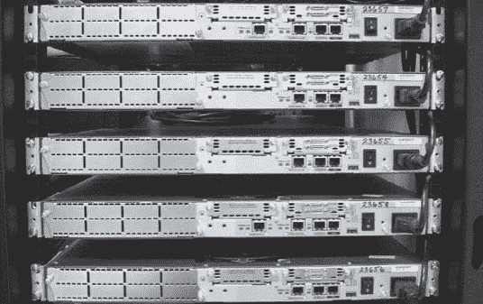

## 接口配置

交换机一样，路由器也需要配置它们的接口。一些新路由器包含许多类似交换机的 GUI 界面，但此类接口在路由器中较少见。配置或编程路由器的主要方法是使用 CLI（命令行界面）。与交换机配置相比，路由器相关的 CLI 命令更多。这是因为路由器配置是一项比交换机配置更复杂的任务。由于路由器配置中的变量更多，Cisco CCNA 认证花费了大量时间处理配置路由器时可用的选项。

## 端口速度

在配置路由器时，需要考虑的变量之一是端口速度。端口速度指的是路由器上特定端口发送和接收数据的速度。在手动配置路由器时，根据正在配置的端口类型记住正确的端口速度是非常重要的。

路由器上有两种基本类型的端口。这两种基本端口是串行端口和以太网端口。对于串行端口，在您正在配置的串行端口上设置正确的时钟速度非常重要，否则串行端口将无法工作，您将无法连接到尝试连接的网络。与串行端口时钟相关的另一个问题是您位于通信信道的哪端。通信信道的一端需要时钟速率。如果将时钟速率放在通信信道的错误一端或两端，通信信道将无法工作。

以太网端口也需要正确的端口速度。在配置路由器时，将快速以太网端口指定为此类。标准以太网和千兆以太网端口也必须正确指定。如果将以太网端口指定为错误的以太网类型，配置将无法按预期工作。

## 路由表

路由表是路由器用于确定发送数据包的最佳路径的工具，以帮助其到达目的地。路由表的作用正如其名所示。在路由情况下，表中包含路由器名称、每个接口配置为连接的网络的 IP 地址以及每个接口的接口标识符。为了将数据包发送到正确的目的地，路由器会查看哪个接口连接到通往数据包目的地的下一跳，并将数据包导向正确的接口。

虽然可以在路由器中手动设置路由表，但 WAN 管理员通常选择让路由器构建自己的路由表。这使得 WAN 管理员的工作变得简单得多，并且减少了在路由器路由表中引入错误的概率。路由器使用多种协议来完成此任务。这些协议在第 5 节中讨论过。

## 防火墙

防火墙是用于防止未经授权的数据包进入您的网络设备或网络软件。

要理解防火墙的作用，你应该考虑公寓楼和其他有很多房间的建筑内置的防火墙。防火墙的作用是阻止或减缓从一个公寓或房间发生的火灾蔓延到另一个房间。简而言之，防火墙是用于阻止或减缓火灾的物理屏障。在计算机中，网络防火墙执行同样的工作。然而，它的设计目的不是阻止或减缓火灾，而是阻止或减缓黑客攻击。

## 防火墙规则

为了让防火墙工作，需要在它们中设置规则，以便它们知道哪些数据包需要拦截，哪些数据包允许通过。防火墙的规则可以在路由器或其他作为防火墙的设备特殊列表中。此列表被称为访问控制列表（ACL）。

## 访问控制列表 (ACL)

ACL 可以被设置为阻止来自特定 IP 地址或到特定端口的所有 IP 范围的流量。如果路由器中有多个 ACL，当路由器打开一个数据包查看其目标地时，它会对数据包进行测试，查看路由器上运行的任何 ACL 是否会导致数据包被拒绝。如果数据包具有不允许的 IP 地址或包含不允许的端口，它将丢弃该数据包并不允许其进入网络。这被称为进入受保护网络或设备的“拦截方法”。在某些防火墙中，如果 ACL 中不允许特定的端口或 IP 地址，则会自动拒绝其通过防火墙。这种控制对受保护网络或设备访问的方法被称为“隐式拒绝”。

## 硬件防火墙

除了作为防火墙外，这些还是被称为硬件防火墙的特殊目的设备。这些特殊目的设备实际上是内置了大量 ACL 的路由器，旨在识别可以解释为对网络攻击的不同活动并反击它们。许多此类特殊目的防火墙还运行着入侵检测软件。本节的稍后部分将讨论入侵检测系统（IDS）。

硬件防火墙被放置在网络中的不同位置以帮助保护它。防火墙常见用法的示例在接下来的几图中显示。

### 图 6-17 DHCP 初始化过程
1. DHCP 客户端启动其引导过程。
2. DHCP 客户端发出 `DHCPDISCOVER` 请求。
3. DHCP 服务器处理 `DHCPDISCOVER` 请求并发出 `DHCPOFFER` 消息。
4. DHCP 客户端接收 `DHCPOFFER` 消息，并向其接受的 DHCP 服务器发送 `DHCPREQUEST` 消息。
5. DHCP 服务器向客户端发送 `DHCPACK` 消息以初始化许可。

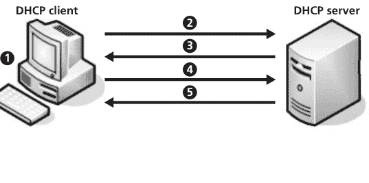

返回一个 `DHCPOFFER`。当客户端用 `DHCPREQUEST` 响应提议时，DHCP 服务器也负责发送 `DHCPACK`。DHCP 服务器首先被配置一组在特定 VLAN 上有效的 IP 地址范围。DHCP 服务器会发布并跟踪其所连接的 VLAN 上所有的 IP 地址，并确保不会颁发重复的 IP 地址。

只要 DHCP 服务器连接的端口是该 DHCP 服务器所负责的每个 VLAN 的一部分，一个 DHCP 服务器就可以用于不同的 VLAN。DHCP 服务器必须配置为识别其连接的不同 VLAN，并为每个 VLAN 提供不同的 IP 地址范围。这种情况在图 6-18 中所示。

### 图 6-18 一个 DHCP 服务器可以同时为多个 VLAN
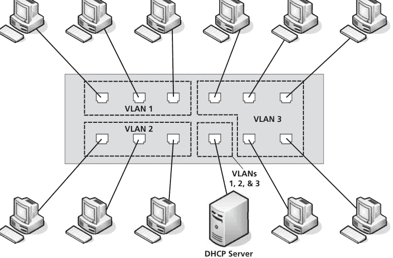

DHCP 服务器能够服务于 VLAN 1、2 和 3，因为交换机上连接到 DHCP 服务器的端口在交换机的配置中被分配给所有三个 VLAN。

### 许可
如前所述，一旦客户端加入网络，它首要需求之一就是从 DHCP 服务器获取 IP 地址。上述过程已经完成；DHCP 服务器已获得了一个可以使用来访问网络的 IP 地址。然而，客户端拥有的 IP 地址仅在客户端重启或注销之前有效，或者在 IP 地址的时间限制过期之前有效。这个时间限制被称为许可。许可的目的是防止服务器的 IP 地址无法被再次使用。这是一个引起关注的原因，因为 DHCP 服务器可用的 IP 地址数量是有限的。

### 范围
使用 DHCP 时，必须在 DHCP 服务器中设置该协议。设置 DHCP 协议的过程是设置其可分配给 DHCP 服务器的 IP 地址范围。范围必须始终预定义，且一旦服务器处理了其范围内的所有 IP 地址，就可以将之前分配给客户端的额外 IP 地址重新分配回服务器。客户端可以通过注销或等待许可过期来释放 IP 地址。

### 预留
虽然没有必要网络上的每个设备都无限期地为计算机分配 IP 地址，但在某些特殊情况下，固定的 IP 地址不仅是理想的，而且是必须的。其中一种情况可能是服务器或打印机出于运行目的可能会使用相同的 IP 地址。当这种情况发生时，可以配置 DHCP 服务器为该特定客户端永久保留一个 IP 地址。这样做就是创建了一个预留。预留是指配置 DHCP 服务器仅在其范围内为特定客户端分配一个特定的 IP 地址。当以这种方式保留了 IP 地址后，该 IP 地址将无法被任何其他客户端使用，服务器也不会向请求该地址的特定客户端以外的任何客户端分配该地址。

### 选项
DHCP 消息数据包可以携带大量的配置参数和控制信息。找到这些配置参数和控制信息的特定字段是 DHCP 数据包的“选项”部分，这些被称为 DHCP 选项。关于这些选项的完整描述可以在 1997 年 3 月的 RFC 2132 中找到。自原始发布以来，多年来增加了额外的选项，可以在随后的 RFC 中找到。其中一些后续 RFC 包括 RFC 2610、3046、4039、4578、4833 和 5192 等。

## 域名系统 (DNS) 服务器

域名系统 (DNS) 服务器使域名系统运行。要成为一个 DNS 服务器，服务器必须满足几项标准。首先，服务器必须在 DNS 中注册。其次，它必须运行特殊用途 DNS 软件。第三，服务器必须有一个注册的 IP 地址。最后，服务器必须包含一个用于互联网主机和其他计算机的其他网络名称和地址的数据库。如果服务器满足所有这些要求，就被认为是 DNS 服务器。图 6-19 显示了 DNS 如何工作。DNS 具有清晰的层次结构。在根服务器处，包含了所有顶级域名服务器及其 IP 地址的完整数据库。全球有 13 个这样的根服务器。10 个根服务器位于美国，其余分布如下：一个在日本，一个在英国伦敦，一个在瑞典斯德哥尔摩。

根服务器下方是主 DNS 域名服务器，它们控制不同的顶级域。最后，在这些下方是所有其他 DNS 服务器。如微软、思科、谷歌等域名。更低级的 DNS 服务器可能位于本地网络上，并为这些网络提供访问大型 DNS 的权限，如图 6-19 所示的 ISP DNS 服务器。

### 图 6-19 DNS 域名解析过程


1. 客户端查询根服务器 IP 地址。
2. 根服务器返回 IP 地址。
3. 客户端查询 com 服务器 IP 地址。
4. com 服务器返回 IP 地址。
5. 客户端查询 widget 服务器 IP 地址。
6. widget 服务器返回 IP 地址。
7. 客户端查询支持服务器 IP 地址。
8. 支持服务器返回 IP 地址。
9. 客户端查询帮助服务器 IP 地址。
10. 帮助服务器返回请求的 IP 地址。

### 认证就绪
DNS 使用了哪些记录类型？

### DNS 记录
描述 DNS 时，我们提到 DNS 必须包含网络名称和地址才能工作。我们还提到 DNS 服务器包含其他计算机的网络名称和地址。数据库由取决于网络服务器类型的记录类型组成。虽然 DNS 服务器中有许多记录类型，但对于 CompTIA Network+ 考试，五个是重要的。这五个记录类型是 A、AAAA、MX、CNAME 和 PTR。

- **A 记录**：用于存储 32 位 IPv4 地址。它通常用于将 IP 地址映射到主机名，也可以存储子网掩码。可见 RFC 1035。
- **AAAA 记录**：类似于 A 记录，但它存储 128 位 IPv6 地址而不是 32 位 IPv4 地址。可见 RFC 3596。
- **MX 记录**：将域名映射到负责从一台计算机传输电子消息的软件代理列表。这些软件代理被称为消息传输代理，通过 MTA 标识。位于与 A 类型相同的 RFC 中。
- **CNAME 记录**：用于为另一个别名记录另一个别名。当使用 CNAME 记录类型尝试访问适当的位置时，NSLOOKUP 使用它。也位于 A 和 MX 相同的 RFC 中。
- **PTR 记录**：类似于 CNAME 记录类型，区别在于它只记录别名并报告，它不使用别名访问网络位置。反向查找使用此记录类型。可见 RFC 1035。

### 动态 DNS
动态 DNS 有时被称为 DDNS，是一种添加到标准 DNS 标准中的标准。动态 DNS 允许主机使用变化的 IP 地址来使用永久的完全限定域名（FQDN）。FQDN 基本上是定义网络网域内的永久 URL 或计算机名称。动态 DNS 允许具有变化 IP 地址的主机使用永久 FQDN 的方式是每当 IP 地址更改时，自动向 DNS 服务器发送更新消息。描述动态 DNS 的 RFC 是 RFC 2136。

## 代理服务器

代理服务器在客户端和其他服务器之间充当中间人。图 6-20 是通用代理服务器的使用方式示意图。

### 图 6-20 代理服务器的角色


代理服务器可以承担许多角色，并可用于许多不同的工作。代理服务器可以：
- 保持代理服务器后的计算机匿名化
- 通过缓存加速资源访问
- 针对不同的网络服务和/或内容设置访问策略
- 创建网络使用的审计日志
- 绕过安全或服务
- 对入站或出站内容进行恶意软件或其他安全风险扫描
- 规避或突破你想要避免的任何区域限制

代理服务器使用的两种主要方式是网关代理服务器和反向代理服务器。网关代理服务器以未经修改的形式传递请求和响应。反向代理服务器用于保护私有网络免受互联网主机的影响。通过这种方式，它在私有网络和互联网之间的前端运行。反向代理服务器还可以用于负载均衡、验证、解密或缓存。代理服务器可以承担的其他角色：
- **缓存代理**：用于缓存客户端请求的结果，以便将信息直接传递给请求相同信息的其他客户端。这使得缓存代理服务器本地存储常用请求的内容，以尽可能减少数据流并节省大型企业网络中的带宽消耗。
- **Web 代理服务器**：作为 Web 内容的缓存代理服务器。
- **内容过滤 Web 代理服务器**：允许管理员控制允许网络的 Web 内容类型。此类 Web 代理服务器通常用于执行企业环境以及学校和其他地方关于可接受互联网使用的规则。
- **匿名代理服务器**：通过在用户和更广泛的互联网之间充当中间人，帮助用户在互联网上保持匿名。当用户使用匿名代理时，针对互联网资源的请求通过匿名代理，然后进入更大的互联网。通过这种方式，请求会被追溯到匿名代理而不是发送请求信息的实际用户。
- **恶意代理服务器**：用于拦截数据并将其传递到目的地，而终端不知道这些数据可以被用于非法目的。某些间谍软件和钓鱼网站就是设计此类。
- **拦截代理服务器**：用于拦截数据并将其传递到目的地，并防止用户规避公司网络中的可接受使用策略。拦截代理服务器通过拦截常见请求并将这些请求重定向到缓存代理服务器，帮助减轻网络负担或限制数据流。拦截代理服务器与恶意代理服务器的区别完全在于意图。

## 其他专用网络设备


在本节中，我们介绍了一些额外的网络设备，如多功能网络设备、入侵检测/入侵防护设备、负载均衡器和带宽整形器。我们还讨论了这些设备在功能运作中扮演的角色。

除了多层交换机、内容交换机、CSU/DSU 和各种类型的服务器外，还有一些具有特殊用途的其他网络设备。我们将讨论其中一些。

## 多功能网络设备

顾名思义，多功能网络设备是一种用于同时执行多个功能的设备。带有 CSU/DSU 端口的无线路由器或交换机可以被视为此类设备。然而，在企业世界中，最广泛的多功能设备是 Cisco Catalyst 设备。图 6-21 显示了 Cisco Catalyst 8500 设备。

在图 6-21 中，Cisco Catalyst 8500 包含九块扩展卡，这是该 Catalyst 设备支持的全数。第一块扩展卡是主管/路由器卡。第二块也充当路由器，并具有制作扩展卡的能力。第三块卡是光纤交换机。最后，剩余的扩展卡都是带有 48 个端口的快速以太网交换机。

Cisco Catalyst 设备是真正的多功能网络设备，因为只要在扩展槽中正确安装并配置了正确的卡，它们就能完美执行任何网络功能。虽然 Cisco Catalyst 8500 是一个带有许多大槽的大设备，但所有现代 Cisco Catalyst 设备都可以以某种形式充当多功能设备。

所有 Cisco Catalyst 设备都能充当多功能网络设备的原因是，它们的设计都具有接受不同尺寸和类型扩展卡的能力。

### 图 6-21 配备全套扩展卡的 Cisco Catalyst 8500
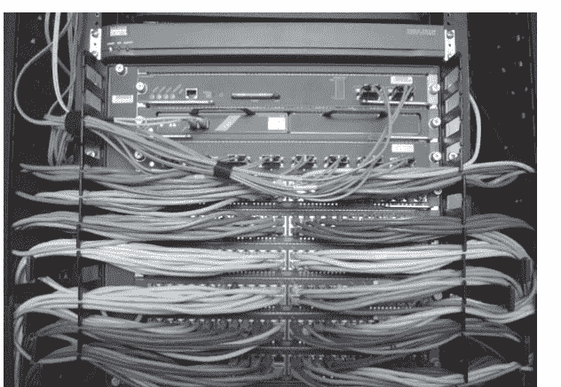

即使是图 6-14 中的路由器也是 Cisco Catalyst 设备。虽然图 6-14 中的设备比 Catalyst 8500 小，但它们仍然具有添加不同尺寸和各种功能扩展卡的能力。

## 入侵检测系统 (IDS) 和入侵防护系统 (IPS)

入侵检测系统 (IDS) 和入侵防护系统 (IPS) 是相关的技术。入侵检测系统 (IDS) 通常位于网络内部并监控网络活动。当发现异常活动时，IDS 会通知管理员，以便其采取措施停止活动。由于 IDS 仅监控活动，因此它是被动的。相反，入侵防护系统 (IPS) 是主动的。IPS 的工作方式与 IDS 相似，事实上使用了 IDS 的许多技术，当 IPS 检测到可疑活动时，不仅仅是提醒管理员，它实际上会采取措施阻止产生可疑活动的用户。IPS 还可以根据其认为的可疑活动拦截 IP 地址、应用程序和协议。IPS 放置在网络边界，而 IDS 通常位于网络内部。

虽然 IDS 和 IPS 对入侵的响应不同，但它们检测入侵的方法是相同的。IDS 和 IPS 使用三种技术来检测入侵：
- **基于行为的检测**：IDS/IPS 创建已知活动和行为的基准，然后使用基准查找网络上任何偏离其认为的正常活动的活动或行为。当检测到此类偏离基准的情况时，IDS/IPS 采取针对威胁的程序行动。基于行为的检测的主要缺点是它倾向于产生大量的误报。
- **基于签名的检测**：IDS/IPS 拥有可用的已知攻击数据库并使用基于签名的检测将传入活动与其签名数据库进行比较。当传入活动与签名匹配时，IDS/IPS 按照程序做出响应。基于签名的检测倾向于产生大量的漏报，即漏掉或未能检测到大量攻击。
- **状态协议分析**：IDS/IPS 分析通过系统的每个数据包，并检查其是否存在任何不属于它的设置或标记。此类分析还可以查看数据包的数据部分，并识别可能存在的任何恶意代码。全协议分析的主要缺点是，如果攻击或入侵不是基于操纵协议，则系统将无法进行检测。

最好的 IDS/IPS 将使用一种或多种此类检测方法来检测入侵。

### 认证就绪
IDS 和 IPS 是什么？它们用于什么？它们是如何实现功能的？

## 加密设备

加密设备是用于加密信息的硬件或软件组件。信息或数据的加密意味着数据以某种方式进行编码，使得只有拥有正确密钥的人或设备才能读取。某些加密设备用于本地加密数据，而另一些加密设备则在数据流经网络时进行加密。在网络传输过程中解密的设备被称为网络设备。

根据美国国家安全局（NSA）的分类，加密设备分为 4 种。1 类加密产品由 NSA 确保用于美国政府机密和敏感信息。2 类加密产品或设备由 NSA 确保用于通信和自动化系统。3 类加密产品或设备是 NSA 用于非机密文档和信息的。最后，4 类产品已在 NIST（美国标准与技术研究院）注册；但未经过 NSA 确保，无法保护机密文档和信息。通常，低级别的加密设备（如 40 位加密）被分类为 4 类加密设备。

## 负载均衡器

负载均衡器是一种用于平衡网络流量的网络设备。负载均衡的目的是将网络流量分散到多个设备、服务器或连接上，以便让更多流量通过平衡后的网络，并防止网络某部分过载。用于负载均衡的方法包括非对称加载、优先级激活、卸载、缓冲和缓存。

- **非对称加载**：涉及根据设备或接收数据的速度和容量，改变发送到网络不同设备或部分的流量。
- **优先级激活**：是根据优先级将数据包发送到网络中的特定设备或服务器。
- **卸载**：是将包含某些数据包发送到一个服务器，而将其他数据包发送到另一个服务器。需要更多处理的数据包（如 SSL 数据包）被发送到专用服务器。
- **缓冲**：当有一个较慢的计算机设备时，它被放置在一个特殊的内存集中作为缓冲区。随后数据以较慢的速度从缓冲区中释放，以免用过多数据淹没目标设备。
- **缓存**：使用预留的内存位置来存储频繁请求的信息，这样网络设备就不需要每次被请求时都去检索这些频繁的信息。

## 带宽整形器

在讨论带宽整形器之前，我们首先需要理解什么是带宽整形。简而言之，带宽整形是管理和控制网络使用，以优化对可用带宽的使用。控制网络带宽的使用是实现这一目标的方法之一。带宽整形也被称为流量整形或数据包整形。在数据包整形的情况下，它是限制数据包类型、源作为带宽整形手段的具体做法。

近期新闻中出现的带宽整形的一个较著名的例子是几家互联网服务提供商（ISP）防止人们使用 BitTorrent 及其他相关技术的持续努力。ISP 希望防止这些技术被使用，因为只有少数用户正在使用大部分可用网络容量来下载电影和音乐等大量数据。除了这些内容很大程度上是非合法的之外，由于极少数用户参与了 BitTorrent 及相关技术，导致大多数 ISP 用户的可用带宽变得极少。

现在我们知道什么是带宽整形了，我们需要讨论带宽整形器。带宽整形器可以是硬件设备的形式，也可以是软件，用于上述方式整形网络带宽。如果带宽整形器是硬件设备，它通常以代理服务器或网络应用程序的形式存在。

## 无线设备

### 结论
本节讨论了无线设备以及它们如何在网络环境中与有线设备结合使用。

要讨论的最后一类网络设备是无线网络设备。无线网络设备只是之前讨论的网络设备的对应物，只不过它们使用无线波作为通信媒介，而不是电线或电缆。

## 无线网卡 (NIC)

无线网卡的使用方式与传统网卡相同，功能也相同。无线网卡内置在大多数便携设备中，如笔记本电脑、网络计算机、平板电脑等。除了内置，无线网卡也可以是插件。

将无线网卡添加到台式电脑的一种方法是作为扩展卡。图 6-22 显示了一个台式机的无线网卡。

### 图 6-22 台式机无线网卡
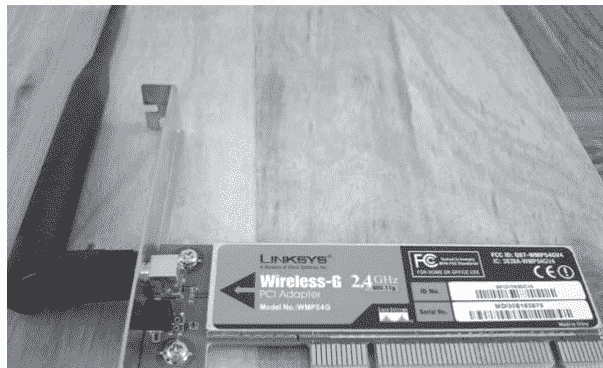

当你看图 6-22 时，你会注意到上面写着无线-G。这意味着它是符合 802.11g 标准无线网卡。如今无线网络中常用的三种标准是 IEEE 802.11b、IEEE 802.11g 和 IEEE 802.11n。这些标准中最慢且最旧的是 802.11b 标准，其吞吐量范围约为 100 英尺。IEEE 802.11g 较后出现，并与 802.11b 兼容。该标准在 100 英尺内的范围为 54 Mbps。图 6-22 遵循 802.11n 标准。这是最新的标准，理论最大吞吐量为 600 Mbps，但到目前只生产了理论吞吐量为 150 Mbps 的设备。802.11n 在最大吞吐量下的范围约为 200 英尺。符合 802.11n 的设备与早期的 802.11b 和 802.11g 标准兼容。

虽然无线网卡可以采用扩展卡的形式；越来越多的无线网卡正采用 USB 设备的形式。图 6-23 显示了一个 USB 设备形式的无线 g-n 设备。

### 图 6-23 USB 无线网卡


图 6-23 显示了一个 Netgear USB 802.11g & n 网卡，这意味着它可以连接到 802.11g 或 802.11n 网络。该设备很可能能够连接到 802.11b 网络。

无线 USB NIC 设备可以在任何带有 USB 端口的计算设备上使用。通常 USB 设备会带有一个底座，USB 设备可以插入底座，然后连接到 USB 端口。图 6-24 显示了图 6-23 中的设备放置在该底座的情况。这些底座通常用于桌面式计算机使用 USB 设备时。

### 图 6-24 以 USB 设备形式位于底座中的 802.11gn 无线 NIC
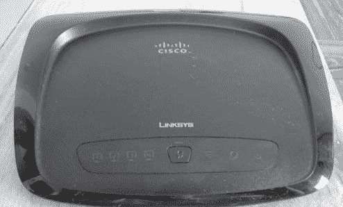

## 无线接入点

我们讨论的无线网络设备的第二大类是无线接入点。无线接入点（WAP）是一种在小型无线网络中结合交换机和路由器功能的无线设备。图 6-25 是新款 Cisco/Linksys 家用 WAP 的图像。

### 图 6-25 Cisco 无线接入点 (WAP)


通常情况下，无线接入点连接到较大的网络，并允许通过无线媒介访问它们。通过这种方式，WAP 充当交换机，允许无线设备访问特定网络。

在家庭网络中，WAP 通常直接连接到调制解调器，以便从家庭到外部的互联网连接。图 6-26 显示了为了此目的在家庭 WAP 上看到的有线连接。

### 图 6-26 带有有线连接的 Cisco WAP


图 6-26 所示的有线网络连接是为了允许 WAP 将各种无线设备连接到网络。在图 6-26 中，带有 Internet 标签的端口是连接家庭互联网连接“调制解调器”的地方。然后 WAP 充当路由器，并将家庭网络中各种无线设备的网络 IP 地址 NAT 转换为 ISP 的 IP 地址。这允许家庭网络中的其他无线设备连接到家庭互联网连接。在家庭环境中，任天堂等家用游戏机也被包含在允许通过 WAP 访问的设备中。

除了无线设备访问互联网和家庭网络外，如图 6-26 所示的 WAP 还可以用于将少量有线设备连接到网络。四个以太网端口用于此目的。当对网络进行 NAT 时，连接到此的任何设备也会包含在内。

## 虚拟网络

### 结论
最后，我们将讨论虚拟网络、它是什么，以及一些能够利用虚拟网络的技术。

虚拟网络是一项新的网络技术领域，它将硬件和软件资源合并成单一实体以供管理目的。虚拟网络总体分为两类：外部和内部。在外部虚拟网络中，资源和硬件被合并到用于虚拟服务器的单一软件环境中。另一方面，内部虚拟网络是指单个设备经过配置，为该设备上的每个软件都提供网络功能。这通常是为了将多个服务器的功能整合到单一硬件和软件平台上。

VMware 的母公司在 `http://www.vmware.com/pdf/virtual_networking_concepts.pdf` 制作了一份良好的在线文档，描述了许多与虚拟网络相关的概念。

你可能想要创建虚拟网络的原因是为了省钱。购买一两台强大的服务器并在其中构建网络，比购买几十台独立的较小服务器及支持硬件要便宜得多。一旦强大的服务器运行，网络管理员只需要在大型服务器的内存中创建运行网络所需的各种服务器、交换机和其他组件即可。只要大型服务器运行，虚拟网络的功能就像正常网络一样，类似于目前在现实中发现的网络，只是缺少额外的硬件和支持成本。

## 虚拟交换机

虚拟交换机与物理交换机相似，因为它们具有相同的功能。这两类交换机的功能都是查找 MAC 目的和源、根据其 MAC 地址进行转发，甚至在虚拟网络内部创建 VLAN。虚拟交换机与物理交换机的一个区别是，不需要生成树协议（STP）来防止环路，因为虚拟网络中虚拟化任何交换机的过程都不允许环路的发生。

### 认证就绪
什么是虚拟网络？如何使用虚拟网络？

物理交换机和虚拟交换机之间最大的区别可能是，虚拟交换机不存在于物理世界。相反，虚拟交换机是虚拟网络内部的软件构造，而虚拟网络本身也是一个软件构造。虚拟交换机的目的是允许工作站和服务器等虚拟设备通过软件环境相互通信。

## 虚拟桌面

在讨论虚拟网络时，虚拟桌面仅仅是设置在虚拟环境中的虚拟操作系统，允许用户运行软件程序。将虚拟桌面设为工作站可能更好，因为“虚拟桌面”一词过去曾指的是具有虚拟操作系统图形用户界面（GUI）的多个桌面环境。在本课程的一个实验中，将在本地计算机上设置一个虚拟工作站。

在本地计算机上可以创建多个虚拟工作站并将其连接到网络。这允许用户在不需要多台机器的情况下拥有多个环境。

## 虚拟服务器

虚拟服务器是运行在虚拟化平台上的服务器实例。它们共享物理硬件资源，但彼此隔离，拥有独立的操作系统和应用程序环境。这允许在单一物理主机上运行多个服务器工作负载，提高硬件利用率并降低成本。

## 虚拟程控交换机 (PBX)

虚拟 PBX 是基于软件的电话交换系统，运行在虚拟化环境中。它提供传统 PBX 的所有功能，如呼叫路由、语音信箱、会议呼叫等，但无需专用硬件设备。虚拟 PBX 可以轻松扩展和配置，适合分布式办公环境。

## 现场 vs 远程

虚拟网络可以部署在现场（本地数据中心）或远程（云服务提供商）。现场部署提供完全控制和低延迟，但需要硬件投资和维护。远程部署（如 NaaS）提供弹性伸缩和按需付费，但依赖互联网连接质量。

## 网络即服务 (NaaS)

NaaS 是一种云服务模式，通过互联网按需提供网络功能（如虚拟路由器、防火墙、负载均衡器等）。用户无需购买和维护物理网络设备，即可获得企业级网络能力。这降低了资本支出并简化了网络管理。

## 技能总结

在本节中，你学习了：
- 关于网络接口卡 (NIC) 及其功能。
- 关于调制解调器及其类型。
- 关于介质转换器及其用途。
- 关于中继器、集线器及其类型。
- 关于桥接器和交换机及其功能。
- 关于基础交换机、多层交换机、内容交换机。
- 关于管理交换机与非管理交换机。
- 关于 VLAN、中继、端口镜像、端口认证、生成树协议 (STP) 和以太网供电。
- 关于路由器的基本信息以及它们在网络中是如何使用的。
- 关于防火墙及其基本功能。
- 关于现代网络中常用的不同类型的服务器（DHCP、DNS、代理）。
- 关于多功能网络设备、IDS/IPS、负载均衡器、带宽整形器、加密设备。
- 关于无线网络设备（无线 NIC、WAP）以及它们如何与有线网络设备配合使用。
- 关于虚拟网络、虚拟交换机、虚拟桌面、虚拟服务器、虚拟 PBX、NaaS。

## 知识评估

### 填空题
在提供的空白处填写正确的单词或词组来完成以下句子。

1. NIC 可以代表 `Network Interface Card` 或 `Network Interface Controller`。
2. 调制解调器用于 `将数字信号调制为模拟信号以便在电话线上传输，并在接收端解调还原为数字信号`。
3. 一种 `介质转换器` 的设备用于将一种类型的电缆或有线技术转换为另一种。
4. 描述集线器的一种方法是将其描述为多端口 `中继器`。
5. 桥接器 `读取 MAC 地址` 来决定哪些帧允许通过，哪些帧不允许通过。
6. `VLAN` 用于根据设备连接到交换机的端口将一个较大的局域网划分为较小的局域网。
7. 一组交换机用于确保交换机之间不形成环路的算法是 `生成树协议 (STP)`。
8. 通过局域网连接传输电源的技术被称为 `以太网供电 (PoE)`。
9. `访问控制列表 (ACL)` 用于根据数据包头部控制网络访问。
10. 当网络中设置两个防火墙时，它们之间的区域被称为 DMZ（非军事区），用于将公共访问的设备（如邮件服务器）与私有网络设备（如域控制器和文件服务器）隔离开来。

### 单选题
圈出对应正确答案的字母。

1. 什么术语最能描述内置在计算机主板上并允许其访问网络的设备？
   a. 网络接口卡
   b. **网络接口控制器**
   c. 桥接器
   d. 带宽整形器

2. 什么设备用于将模拟信号转换为数字信号，并将数字信号转换为模拟信号？
   a. 媒体转换器
   b. 中继器
   c. **调制解调器**
   d. CSU/DSU

3. 交换机内部所有通信都重复到某个特定端口的技术称为什么？
   a. 端口认证
   b. 中继
   c. 带宽整形
   d. **端口镜像**

4. 交换机通过相同数据链路从多个 VLAN 发送数据的能力称为什么？
   a. **中继**
   b. 负载均衡
   c. 端口镜像
   d. PoE

5. 用于将数字信号从一种格式转换为另一种格式（例如从帧中继转换为以太网或以太网转换为帧中继）的设备称为什么？
   a. 媒体转换器
   b. **CSU/DSU**
   c. 调制解调器
   d. IDS/IPS

6. CSU/DSU 代表什么？
   a. 载波感知单元/数据感知单元
   b. **信道服务单元/数据服务单元**
   c. 载波服务单元/数据服务单元
   d. 信道感知单元/数据服务单元

7. 什么类型的服务器用于将 URL 转换为 IP 地址？
   a. **DNS 服务器**
   b. DHCP 服务器
   c. 代理服务器
   d. 域控制器服务器

8. 什么网络设备用于检测网络入侵？
   a. 防火墙
   b. 交换机
   c. **IDS (入侵检测系统)**
   d. IPS (入侵预防系统)

9. 代理服务器可以执行哪些功能？（多选）
   a. 使代理服务器后的计算机匿名
   b. 为不同的网络服务和/内容设置访问策略
   c. 绕过安全或服务
   d. 扫描入出站内容以检测恶意软件或安全风险

10. 什么网络设备用于在多个设备之间均匀地分配网络负载？
    a. 带宽整形器
    b. 代理服务器
    c. DNS
    d. **负载均衡器**

## 实验课程

### 实验 1：使用交叉网线连接两台计算机
本实验旨在向学生展示如何使用交叉网线将两台计算机连接在一起。为了实现这一点，学生将学习如何使用 Windows XP 共享文件并使用网络接口卡（NIC）和交叉网线连接计算机。完成此实验后，学生将对如何将计算机连接成点对点网络有基本的了解。

#### 材料
- 两台运行 Windows XP 的计算机
- 交叉网线
- 纸
- 笔

#### 连接计算机
1. 关闭两台计算机。
2. 将交叉网线的一端连接到计算机 1。
3. 将交叉网线的另一端连接到计算机 2。

#### 配置计算机
1. 开启两台计算机。
2. 在两台计算机上登录 Windows。
3. 等待两台计算机完全加载。
4. 使用鼠标点击“开始”。
5. 使用鼠标点击“我的计算机”。
6. 使用鼠标右键点击“属性”。
7. 使用鼠标点击“计算机名称”选项卡。
8. 观察计算机 1 显示的工作组名称。
9. 使用鼠标点击“更改...”。
10. 在计算机 2 上输入工作组名称。
11. 使用鼠标点击“确定”。
12. 弹出对话框显示：“欢迎加入工作组。”
13. 使用鼠标点击“确定”。
14. 弹出另一个对话框：“您必须重启计算机才能生效更改。”
15. 系统属性重新打开，并显示“计算机名称”选项卡。
16. 弹出对话框：“您必须重启计算机才能使设置生效。现在重启计算机？”
17. 计算机 2 重启，两台计算机处于同一工作组。
18. 在进行下一步之前，按照步骤 7-11 验证两台计算机显示相同的工作组。
19. 在两台计算机上点击“确定”关闭属性对话框。

#### 启用共享
1. 使用鼠标点击“开始”。
2. 使用鼠标点击“我的计算机”。
3. 使用鼠标右键点击 Windows (C) 或本地磁盘 (C) 硬盘，即您可能想要交换文件的任何硬盘。
4. 使用鼠标点击“共享和安全...”。
5. 使用鼠标点击链接：“如果您理解风险但仍想共享驱动器，请点击此处。”
6. 使用鼠标点击链接：“如果您理解安全风险但想在不运行向导的情况下共享文件，请点击此处。”
7. 通过鼠标点击圆圈选择“仅共享”。点击后，圆圈内会出现一个绿色圆点表示已选中。
8. 使用鼠标点击“确定”。
9. 使用鼠标勾选“在网络上共享此文件夹”。该框被选中后，共享名称框中将出现默认名称。如果您不想使用默认名称，可以对其重命名。
10. 使用鼠标勾选“允许网络用户更改我的文件”。点击后，框内会出现一个绿色复选标记表示已选中。这样做将允许您获得对该驱动器及其文件的完全访问权限。
11. 使用鼠标点击“确定”。
12. 将短暂出现“设置权限...”对话框。一旦出现，“我的计算机”窗口将重新出现，并显示该硬盘现在已共享。
13. 使用鼠标双击 Windows (C) 或本地磁盘 (C) 硬盘。如果您在共享之前更改了驱动器，请双击您想要访问的文件和文件夹所在的任何硬盘。
14. 使用左鼠标键双击“文档和设置”。
15. 使用右鼠标键，点击您想要访问的文件和文件夹所在的文件夹或用户名。
16. 使用左鼠标键，点击“共享和安全...”链接。
17. 使用左鼠标键点击此私有文件夹的复选框以取消框中的勾选。如果框中没有勾选，请直接跳到第 18 步。
18. 使用左鼠标键点击“在网络上共享此文件夹”旁边的复选框，在框中打勾。用户的文件夹名称将出现在“共享名称”文本框中，作为默认共享名称。如果您需要，可以将其重命名为不同的共享名称。
19. 使用左鼠标键点击“允许网络用户更改我的文件”旁边的复选框，在框中打勾。
20. 使用左鼠标键点击“确定”。
21. 将短暂出现一个“设置权限...”对话框。
22. 文件夹上会出现一个手图标，表示该文件夹现在已共享。
23. 使用左鼠标键点击“关闭”按钮以关闭 C:\Documents and Settings 窗口。
24. 重复第 18–23 步，以共享其他计算机上的文件夹。

> 注意：计算机可能需要最多 15 分钟才会开始显示。这是 Windows XP 计算机浏览器功能的一个已知问题。如果其中一台计算机没有显示，直接重启所有计算机会更快。

#### 在网络位置中验证共享
1. 使用左鼠标键点击“开始”。
2. 使用左鼠标键点击“控制面板”。
3. 使用左鼠标键点击“网络连接”或“网络和 Internet 连接”，点击“网络连接”。
4. 使用左鼠标键点击屏幕左侧的“我的网络位置”，其他位置。
5. 使用左鼠标键点击网络任务下方的“查看工作组”。
6. 使用左鼠标键双击其中一台计算机，以查看其上的共享文件夹/文件。
7. 您将看到计算机。最好让所有计算机处于同一个工作组，这样它们就会在其他计算机上显示。
8. 如果您没有看到您的计算机，您的计算机上可能运行着某种“防火墙”。您可能需要配置防火墙以允许计算机之间的文件共享，或者临时将其关闭。
9. 现在您可以在两台计算机之间交换数据了。

### 实验 2：使用交换机或集线器连接多台计算机
本实验的目的是使用交换机或集线器连接多台计算机。由于学生在企业世界更有可能看到交换机，因此本实验优先使用交换机。完成实验后，学生将熟悉通过交换机或集线器连接多台计算机的相关知识。

#### 准备
- 多台带有网卡（NIC）并运行 Windows XP 的计算机
- 直通线
- 一台交换机或集线器
- 纸
- 笔或铅笔

#### 执行实验：使用交换机或集线器构建网络
1. 确保所有计算机都已关机。
2. 使用直通线将每台计算机的网卡连接到交换机或集线器的端口，从而将每台计算机连接到交换机或集线器。
3. 按照实验 1 中“在网络位置中验证共享”标题下的步骤操作，验证所有连接到交换机或集线器的计算机都能相互看到并共享数据。如果网络上看不到某台计算机，请对每台不可见的计算机执行实验 1 中的必要步骤，使其能够被看到。

### 实验 3：在单一网络中连接多个交换机或集线器
本实验的目的是教授学生如何在单一网络中链接多个交换机或集线器。完成实验后，学生将熟悉在单一网络中链接多个交换机或集线器背后的概念。

#### 准备
- 源自实验 2 的两个或多个网络
- 用于连接各种交换机或集线器的直通线
- 纸
- 铅笔

#### 执行实验：使用交换机或集线器连接多个网络
1. 使用直通线连接两个或多台交换机，同时保持其计算机连接状态。
2. 使用实验 1 中的适当步骤检查连接到不同交换机的计算机是否都属于同一个工作组。如果不是，请更改计算机中的组名称，使它们都使用相同的工作组名称。请按照实验 1 第一部分中的适当步骤执行此操作。
3. 按照实验 1 中“在网络位置中验证共享”标题下的步骤操作，验证所有连接到交换机或集线器的计算机都能相互看到并共享数据。如果网络上看不到某台计算机，请对每台不可见的计算机执行实验 1 中的必要步骤，使其能够被看到。

### 实验 4：使用 VMware Player 创建虚拟工作站
在本实验中，学生将下载（或由教授提前下载）VMware Player 的安装文件以及 Linux 发行版（有时称为 distro）的 ISO 文件。为了本实验，我选择了使用 Linux Mint。在实验的第一部分，学生将安装 VMware Player 并查看其功能。在实验的第二部分，学生将使用 VMware Player 创建并安装虚拟机。在创建并安装虚拟机后，他们将使用该操作系统。

本实验将向学生介绍虚拟计算概念、虚拟化相关软件、如何安装操作系统以及如何在图形界面使用。

#### 准备
- VMware Player 安装文件
- 教授选择的 ISO 文件
- 运行 Windows 的计算机
- 纸
- 铅笔

VMware Player 是 VMware Workstation 的教育和个人使用版本，没有使用限制。VMware Player 与 Workstation 的唯一区别在于 Workstation 具有 VMware Player 不具备的功能。

#### 执行实验：获取所需文件
1. 上述两个文件都可以从互联网免费下载。
2. 下载 VMware Player 文件请访问 `filehippo.com` 并搜索 VMware Player。
   a. 找到上述文件或其更高版本后，将其下载到本地计算机。
   b. 或者您的教授可以提前下载文件并存储在网络位置。
   c. 记录该文件在本地计算机上的存储位置。
3. 要下载上述 Linux ISO，您需要访问 `linuxmint.com` 网站。下载的是 32 位或 64 位版本。
   a. 找到上述 ISO 文件后，将其下载到本地计算机。
   b. 或者您的教授可以下载该文件并存储在网络位置。
   c. 记录该文件在本地计算机上的存储位置。

#### 安装 VMware Player
1. 导航到之前下载的 VMware Player 安装文件。
2. 双击 VMware Player 安装文件。图 6-27 显示了安装对话框的样子。
3. 按“下一步”按钮并采用默认选项，直到看到与图 6-28 类似的对话框。看到此对话框后，点击“继续”。
4. 一旦 VMware Player 安装程序完成后，将显示图 6-29 所示的对话框。看到此对话框时，关闭所有打开的程序，并点击“安装向导完成”对话框中的“重启”按钮。

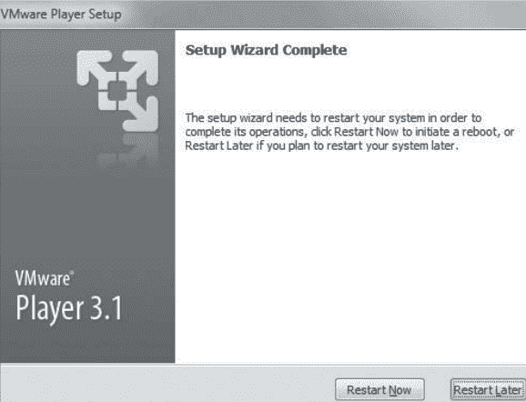

5. 系统重启后，在桌面上找到 VMware Player 图标并双击它。这将加载 VMware Player 程序。加载后，VMware Player 的外观与图 6-30 相似。

图 6-30 在 Windows 环境下运行的 VMware Player
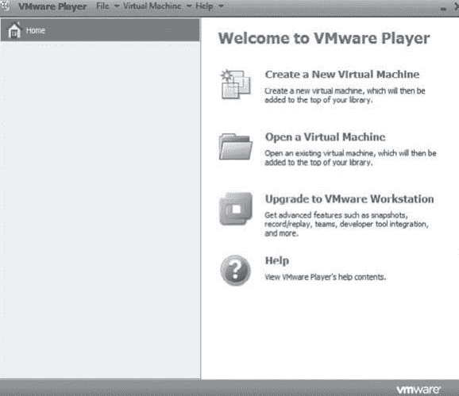

VMware Player 现在已在 Windows 中安装并运行。
6. 观察 VMware Player 并查看 VMware Player 中可用的某些帮助选项。
7. 关闭 VMware Player。

#### 创建您的虚拟机
1. 一旦您安装并重启了电脑，您需要双击 VMware Player 图标并调出图 6-30 所示的对话框。
2. 在 VMware Player 的左侧面板中，您会看到图标。双击标记为“创建新虚拟机”的图标。
3. 完成第 2 步后，将弹出与图 6-31 相似的对话框。

图 6-31 VMware Player 新建虚拟机向导
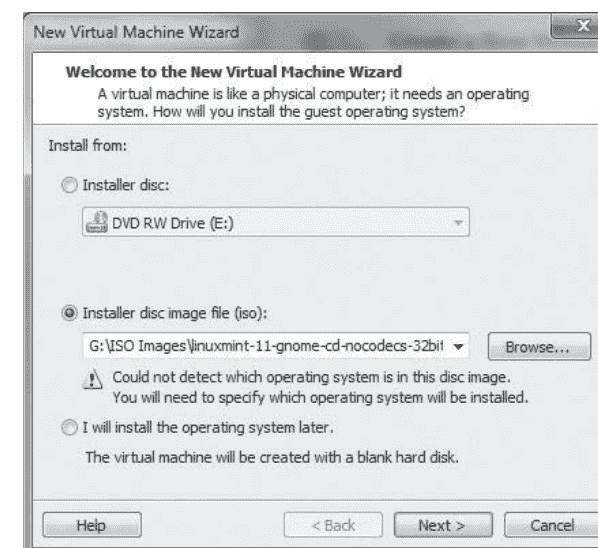

4. 点击标记为“安装程序镜像文件 (iso):”的单选按钮。
5. 点击位于上述单选按钮右侧的“浏览”按钮，并浏览到存储 ISO 镜像的位置。这将引导新虚拟机指向安装客户操作系统所需的位置。一旦点击了想要使用的 ISO，点击“下一步”按钮。点击“下一步”按钮后，您将得到一个类似于图 6-32 的对话框。

图 6-32 VMware Player 新建虚拟机向导“选择客户操作系统”对话框


6. 确保对话框中“客户操作系统”部分选择了标记为“Linux”的单选按钮。
7. 确保对话框中“版本”部分选择了“Ubuntu”或对应发行版。
8. 点击“下一步”按钮进入下一个对话框。
9. 保持默认设置并继续点击“下一步”按钮，直到到达类似图 6-33 所示的对话框。

图 6-33 VMware Player 新建虚拟机向导“命名虚拟机”对话框


10. 在对话框的“虚拟机名称”部分，取一个名称让您知道这台虚拟机是什么。如图 6-33 所示，我将我的虚拟机命名为“MintOS”，您可以使用任何能让您想起该虚拟机的名称。
11. 在对话框“位置”部分采用默认设置。
12. 点击“下一步”并继续采用默认设置，直到到达类似于图 6-34 的对话框。

图 6-34 VMware Player 新建虚拟机向导“准备好创建虚拟机”对话框
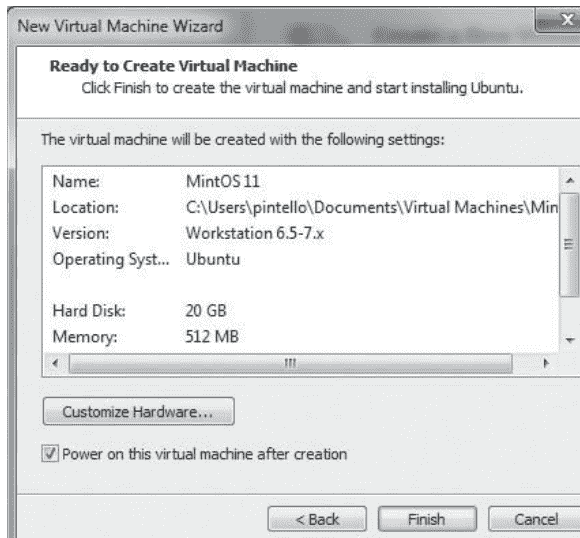

13. 点击此对话框中的“完成”按钮。如果弹出关于可移动设备的对话框，只需点击该对话框的“确定”按钮。完成此操作后，将弹出一个与图 6-35 相似的对话框。

图 6-35 VMware Player 新建虚拟机向导“VMware Tools”对话框
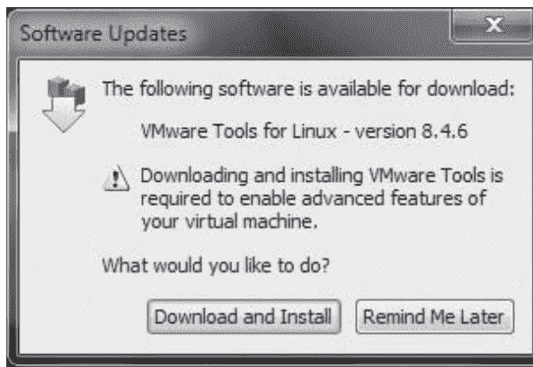

14. 在此对话框中点击“稍后提醒我”按钮是非常重要的，因为您无法像 Windows 操作系统那样在 Linux 客户操作系统中安装 VMware Tools。本实验的下一部分将引导您完成在 Linux 客户操作系统中安装 VMware Tools 的过程。一旦点击“稍后提醒我”按钮，将出现一个类似于图 6-36 的屏幕。

图 6-36 带有消息框的 VMware Player MintOS 虚拟机


15. 屏幕底部有一个消息框。点击“安装完成”按钮让该消息框消失。当您这样做时，将出现类似图 6-37 的屏幕，此时底部的消息框已消失。

图 6-37 没有消息框的 VMware Player MintOS 虚拟机


16. 一旦出现类似图 6-37 的屏幕，在 MintOS 桌面上找到显示“Install Linux Mint”的图标。此图标将允许您将 MintOS 作为一个虚拟机进行安装，它将像计算机一样运行。
17. 双击“Install Linux Mint”图标。执行此操作时，将出现类似于图 6-38 的屏幕。

图 6-38 VMware Player MintOS 虚拟机“分配空间”对话框
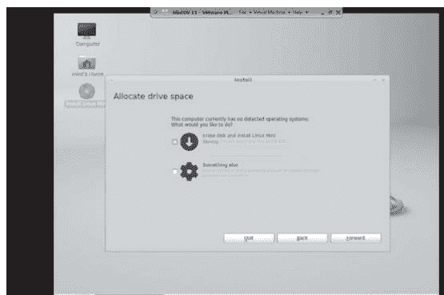

18. 确保标记为“Erase disk and install Mint”（清除磁盘并安装 Mint）的单选按钮被选中。如图 6-38 所示，点击“继续”按钮。
19. 保持默认设置继续点击“继续”按钮，直到出现类似图 6-39 的屏幕。

图 6-39 VMware Player MintOS 虚拟机“选择安装类型”
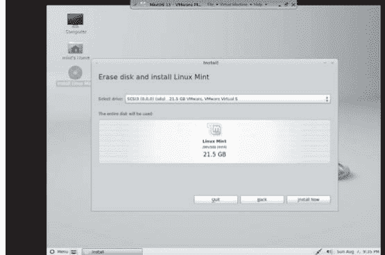

20. 在图 6-39 所示的屏幕上，点击“Install Now”（立即安装）按钮。一旦点击该按钮，将出现一个类似于图 6-40 的屏幕。

图 6-40 VMware Player MintOS 虚拟机“选择您的位置”
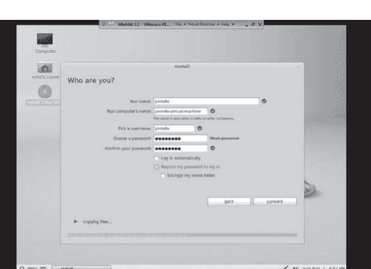

21. 在图 6-40 所示的对话框中，在标记为“Your Name”（您的姓名）的字段中输入名称。
22. 在“Pick a Username”（选择用户名）字段中输入您想要使用的用户名。
23. 最后在“Choose a password”（选择密码）字段中输入密码，并在“Confirm your password”（确认密码）字段中再次输入。如图 6-41 所示。

图 6-41 VMware Player MintOS 虚拟机“选择您的密码”
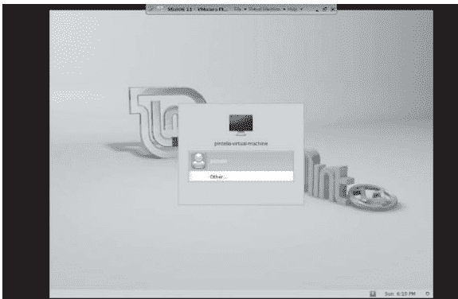

24. 当“Who are you”（您是谁）对话框填写完毕后，点击“继续”按钮。
25. 继续点击“继续”按钮并接受默认设置，直到到达像图 6-42 所示的对话框。

图 6-42 VMware Player MintOS 虚拟机“安装完成”
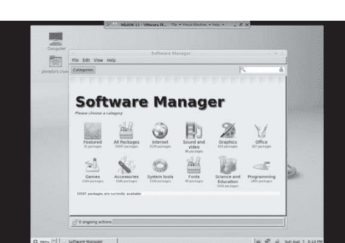

26. 一旦出现图 6-42 所示的对话框，点击“Restart Now”（立即重启）按钮。这将强制 VMware Player 内部的操作系统重启并使您所做更改生效。
27. 一旦 MintOS 重启，您将得到类似于图 6-43 所示的屏幕。
28. 点击您的用户名并输入密码。这将调出 MintOS 桌面。它看起来就像图 6-44 所示的桌面，只是没有“Install Linux Mint”图标。

图 6-43 MintOS 虚拟机登录界面


29. 恭喜，您已成功在 VMware Player 中安装了 Linux Mint。您在这里遵循的 Linux 安装过程与直接在计算机上安装该操作系统的过程完全相同。
30. 保持 MintOS 开启并激活，以进行实验的下一部分。

#### 在 Linux 中安装 VMware Tools
在 VMware Player 中使用虚拟机并不绝对需要 VMware Tools。但是，VMware Tools 可以让 VMware Player 内部的客户操作系统与主机操作系统之间的交互更加流畅。

安装 Windows 客户操作系统时，可以在安装客户操作系统时进行安装。但在运行 Linux 或 Unix 客户操作系统时，需要单独安装 VMware Tools。本实验第 4 部分将引导您使用 MintOS 自带的图形化软件工具在 Linux 客户操作系统中安装 VMware Tools。

1. 确保客户操作系统正在运行，并且您处于上一个部分结束时的 MintOS 桌面。
2. 点击 MintOS 桌面左下角的“Menu”（菜单）按钮，将弹出一个类似于图 6-44 所示的开始菜单。

图 6-44 MintOS 开始菜单


3. 在 MintOS 开始菜单左侧的“系统”标题下有一个标记为“软件管理器”的程序。点击“软件管理器”菜单选项。当你执行此操作时，将会弹出一个与图 6-45 类似的程序对话框。

图 6-45 MintOS 软件管理器程序对话框
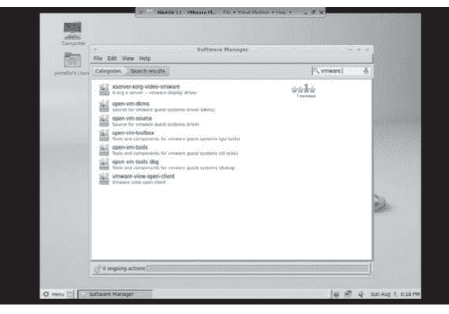

4. 从图 6-45 的截图可以看出，有超过 33,000 个软件包可以下载。所有程序都是免费的。有时你可能会查看不同类别中提供的不同程序，看看有什么可用内容。对于我们的目的，我们将使用软件包管理器右上角的搜索工具来查找 VMware Tools。要这样做，请在图 6-46 所示的搜索工具中输入“vmware”。

图 6-46 在搜索工具中输入“vmware”的 MintOS 软件管理器程序对话框


5. 一旦你搜索了“vmware”，你会发现出现了 7 个软件包。我们感兴趣的软件包是标记为“open-vm-tools”的那个。双击名为“open-vm-tools”的软件包。当你执行此操作时，将会弹出图 6-47 所示的屏幕。

图 6-47 为 open-vm-tools 的 MintOS 软件管理器安装界面


6. 当图 6-47 所示的屏幕出现时，点击标记为“Install”（安装）的按钮。一旦此软件包安装完成，VMware Tools 需要的所有组件都已安装。点击右上角的 X 关闭软件管理工具。

7. 一旦安装了 VMware Tools，观察一下 MintOS 并感受一下它。你可能还想回到软件管理工具，看看是否有其他你想要安装的程序。

8. 列出一些你喜欢 MintOS 的点。

9. 列出一些你不喜欢 MintOS 的点。

10. 你认为 MintOS 与 Windows 相比如何？

11. 一旦你完成对 MintOS 的浏览，回到开始“菜单”按钮并退出 MintOS。退出按钮将是左侧开始菜单最底部的菜单选项。当你点击退出选项时，将弹出图 6-48 所示的关机对话框。

图 6-48 MintOS 关机


12. 要完成关闭 MintOS，点击“Shutdown”选项。一旦这样做，你将被带到 VMware Player 主界面。这看起来像图 6-49。

图 6-49 VMware Player 启动界面左侧面板显示 MintOS


13. 如果你想回到 MintOS 虚拟机，只需打开 VMware Player 并双击左侧面板中的 MintOS 选项。这将开始加载 MintOS 虚拟机的过程，以便你再次开始使用它。

## LAN 技术

### 考试目标矩阵
| 涵盖的技术技能 | 考试目标 | 考试目标编号 |
|---|---|---|
| LAN 技术 | 比较和对比不同的 LAN 技术。<br>- 类型：以太网、10BaseT、100BaseT、1000BaseT、100BaseTX、1000BaseX、10GBaseSR、10GBaseLR、10GBaseER、10GBaseSW、10GBaseLW、10GBaseT<br>- 特性：CSMA/CD、CSMA/CA | 3.7 |
| 其他 LAN 概念 | 比较和对比不同的 LAN 技术。<br>- 属性：广播、冲突、绑定、速度、距离 | 3.7 |
| 无线 LAN 技术 | 给定一个场景，安装并配置无线网络。<br>- WAP 放置、天线类型、干扰、频率、通道、SSID (启用/禁用) | 2.2 |
| SOHO 网络技术 | 给定场景，实施适当的无线安全措施。<br>- 加密协议：WEP、WPA、WPA2、WPA Enterprise<br>- MAC 地址过滤、设备放置、信号强度 | 5.1 |

## LAN 技术

George 是一个局域网工程师。他被老板任务设置一个网络。他可以使用什么技术来完成任务？

## 以太网帧

以太网是目前最老且最常用的 LAN 技术之一。一个由 Xerox 公司领导的小组在 1973 年到 1975 年间开发了以太网。可用的四种以太网帧类型是：
1. **Ethernet II (DIX)**：最广泛使用的以太网帧，代表 DEC、Intel 和 Xerox。
2. **IEEE 802.3 (原始以太网)**：IEEE 标准化的版本。
3. **IEEE 802.3 (LLC)**：添加了逻辑链路控制 (LLC) 子层。
4. **IEEE 802.3 (SNAP)**：子网接入协议，允许在网络上运行更多协议。

### 以太网通信方法

以太网通常有两种方式在网络上传输数据：
- **载波监听多路访问/冲突检测 (CSMA/CD)**：以太网访问有线局域网的主要方法。
- **载波监听多路访问/冲突避免 (CSMA/CA)**：以太网用于访问无线局域网的方法。

两种方法都使用基于竞争的访问方法。在基于竞争的系统中，网络节点竞争发送其数据包。

## 载波监听多路访问/冲突检测 (CSMA/CD)

CSMA/CD 是以太网访问有线局域网的主要方法。以太网创建时最初设计用于总线网络。CSMA/CD 的工作方式如下：
1. 计算机监听网络，确保没有其他节点正在发送数据包。
2. 如果网络空闲，节点发送数据包。
3. 如果两台计算机同时发送，发生冲突，产生功率峰值，数据被破坏。
4. 所有计算机检测到冲突，激活随机退避计时器。
5. 计时器结束后，计算机重新监听网络并尝试重新发送。

### 图 7-1 使用 CSMA/CD 发送数据包的总线型网络


### 图 7-2 发生冲突时使用 CSMA/CD 发送数据包的总线型网络


### 图 7-3 冲突发生后立即使用 CSMA/CD 的总线型网络
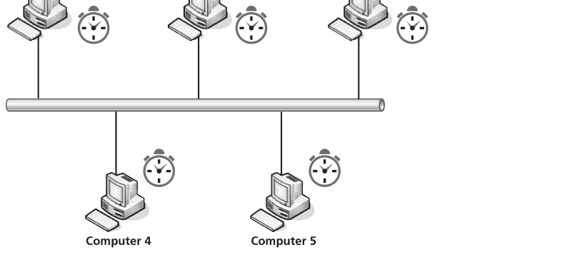

### 认证就绪
CSMA/CD 的全称是什么？当 CSMA/CD 检测到冲突时它是如何工作的？

## 载波监听多路访问/冲突避免 (CSMA/CA)

CSMA/CA 最常用于无线网络。CSMA/CA 和 CSMA/CD 操作非常相似；CSMA/CA 增加了一个步骤：在监听网络后不是立即发送数据包，而是先向网段上的其他计算机发送一个警告消息 (RTS/CTS)。当其他计算机听到警告时，在实际数据包发送之前，它们不会发送自己的数据包。

### 图 7-4 使用 CSMA/CA 访问介质的总线型网络


## 10BASE-5
10BASE-5 是使用的第一个以太网版本。它使用同轴电缆传输数据，被称为粗以太网。原始以太网标准于 1982 年提出，802.3 标准于 1983 年用于这种以太网。它具有 10 Mbps 的吞吐量和 500 米的范围。

## 10BASE-2
10BASE-2 在几年后开发，并定义为 IEEE 802.3a 标准。主要区别是它使用了更细的电缆（细同轴电缆），范围仅为 185 米。10BASE-2 被称为细以太网。

## 基带与宽带
- **基带**：以太网是基带，一次只能携带一个信号。
- **宽带**：可以同时携带多个信号。不同的字母表示介质类型。例如，T 表示介质是非屏蔽双绞线 (UTP)。TX 表示介质是全双工。

## 10Base-T
第一个双绞线版本是 10Base-T 标准。1990 年，IEEE 802.3 正式制定了 10Base-T 标准，它使用 CAT 3 UTP 并在 100 米的范围内提供 10 Mbps 的吞吐量。被称为双绞以太网。

## 100Base-T
1995 年 IEEE 802.3 推出 100 Mbps 标准，被称为快速以太网。100Base-T4 和 100Base-TX 是当时为快速以太引入的标准。1998 年，IEEE 802.3y 引入了 100Base-T2。所有这些统称为 100Base-T。

## 100Base-TX
在三个标准中，100Base-TX 实施最广泛，因为它允许使用一对线发送和另一对线接收数据，同时在两个方向实现 100 Mbps 的传输。基带技术，在 UTP 铜线上 100 米距离内具有 100 Mbps 吞吐量。至少使用 Cat 5 UTP。

## 100Base-FX
旨在用于光纤电缆的快速以太网版本。可用于半双工或全双工模式。半双工需要一根光纤但会发生冲突；全双工需要两根光纤。可用于多模光纤（400米半双工，2公里全双工）和单模光纤（10公里全双工）。

## 1000Base-X
1998 年，1000Base-X 在 IEEE 802.3z 标准下发布。这是第一个千兆以太网标准。主要变体是 1000Base-SX（多模，200-550米）和 1000Base-LX（单模/多模，550米-5公里）。吞吐量 1000 Mbps (1 Gbps)。

## 1000BASE-T
千兆以太网的铜缆版本，于 1999 年标准化 (IEEE 802.3ab)。使用 Cat 5/5e/6，100 米范围。建议至少 Cat 5e。

## 10 GIGABIT ETHERNET
十吉比特以太网首次在 2002 年的 IEEE 802.3ae 标准下提出。仅支持全双工通信，不支持半双工。需要专用网卡和布线。
- **10GBase-SR**：多模光纤，300米（短距离）。
- **10GBase-LR**：单模光纤，10公里（长距离）。
- **10GBase-ER**：单模光纤，40公里（扩展距离）。
- **10GBase-SW/SR**：连接 SONET（短波/长波/扩展波）。

## 40/100 GIGABIT ETHERNET
40G 和 100G 以太网定义在 2010 年 IEEE 802.3ba 标准下。全双工，用于多模/单模光纤和铜缆。100G 旨在工作距离达 40 公里。不支持 CSMA/CD。

## 其他概念

### 广播
广播是计算机通过将数据帧发送到直接连接到局域网的所有计算机来在网络上传输数据的方式。以太网是一种广播网络技术。

### 冲突
冲突是不可避免的，因为一台计算机发送的每一个数据帧都会到达网络上的所有其他计算机。CSMA/CD 和 CSMA/CA 的开发是为了限制冲突数量并让网络在发生冲突时知道如何恢复。交换机的开发目的是通过对网络上释放的每个数据帧进行预筛选来完全消除冲突。

### 认证就绪
什么是冲突？冲突何时发生？

### 冲突域
冲突域是指通过共享介质物理连接在一起的所有计算机，这些计算机可能会发生数据帧冲突。通过集线器连接的所有计算机形成一个单一的冲突域。使用交换机代替集线器，就不会形成冲突域。

### 图 7-5 两种不同类型的冲突域


### 绑定
绑定是使用两个或多个网络接口卡（NIC）、通道或连接来推送数据，而不是仅仅使用一个。类似于 RAID 0（条带化）。术语包括：以太网绑定、链路聚合、NIC 组、多链路 (MLT)、端口绑定。用于增加吞吐量或提供冗余（网络容错 NFT）。

### 认证就绪
网络意义上的绑定是什么？为什么叫绑定？

### 网络速度
网络速度指在给定时间内可以通过网络传输的数据量。单位：kbps、Mbps、Gbps、Tbps。实际速度 vs 潜在速度。影响因素：用户数量、距离交换机/路由器远近、ISP 距离。

### 认证就绪
工作网络中的速度是什么？如何衡量速度？

### 距离
距离是指数据从一个点到另一个点需要旅行多远。介质距离：信号在需要重建前可传输的距离（如 CAT5 100米）。主观距离：实际布线路径长度 > 直线距离。规划 IDF/MDF 放置时需考虑（通常用最大距离一半作为安全半径）。

### 图 7-6 电缆能够传输数据的距离会影响 IDF 和 MDF 的放置
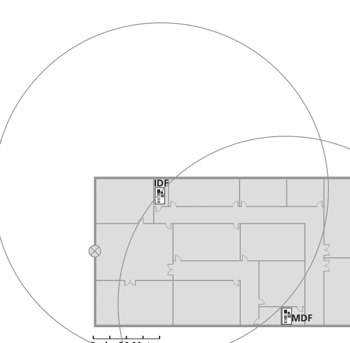

### 认证就绪
网络中的距离是什么？为什么它很重要？

## 无线局域网技术

本节讨论无线局域网技术，具体来说我们检查了无线网卡（NIC）和接入点。讨论了配置以及配置时可用的选项。还讨论了服务集标识符（SSIDs）、信道和信标。花了一些时间讨论接入点的正确放置以及在做决定时需要考虑的事项。

### 结论
现在让我们看看一些用于建立无线局域网的技术。具体来说，让我们看看与安装和配置无线局域网相关的问题。出于本节的目的，我们将使用 Linksys WRT54GS2-G 路由器和 Windows 7 操作系统。

## 安装客户端
客户端涉及在你的计算机中安装无线网卡。对于大多数现代笔记本电脑和较小的电脑，无线网卡已经是内置的。对于不包含内置无线网卡的便携式电脑，有两个选择：PCMCIA 插槽安装或基于 USB 端口的无线网卡（最常用）。台式电脑可用 USB 或 PCI/PCIe 扩展卡。

## 接入点放置
WAP 的放置是设置无线网络时的重要问题。计算机距离接入点越远，数据传输越慢。使用单个接入点时，应相对于计算机位置尽可能居中放置。

### 图 7-7 放置不当的接入点
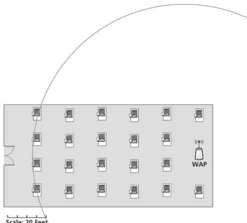

### 图 7-8 放置得当的 WAP


当使用多个接入点时，放置位置变得更加重要。WAP 可以编程的通道数量有限，同一信道上运行不同网络的两个 WAP 它们的覆盖范围不能重叠。802.11n 有较多不重叠通道；802.11g 只有三个不重叠信道 (1, 6, 11)，需合理规划避免重叠。

### 图 7-9 大型网络中放置得当的 WAP，以确保没有 WAP 信道重叠
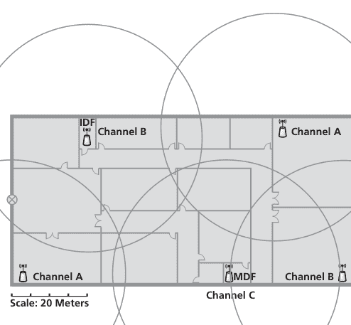

### 认证就绪
安装无线接入点时，必须考虑哪些配置问题？在进行 WAP 配置时，你必须决定哪些配置选项？

## 安装接入点
一旦放置了 WAP，就需要进行安装。最佳方法是确保它们通过交换机和有线网络连接到其网络的主服务器。运行 WAP 设置软件进行配置。家庭环境单 WAP 可使用其默认安全设置。

## MAC 地址过滤
启用 MAC 地址过滤可以让无线网络尽可能安全。只有预先编程的 MAC 地址才允许访问特定的 WAP。缺点：必须手动输入所有设备 MAC 地址，新设备需手动添加。

要在 WAP 初始安装后进入其 MAC 地址过滤屏幕：
1. 使用网络浏览器直接访问你的 WAP，输入默认网关 IP 地址。
2. 在 Windows 中获取默认网关：`cmd` -> `ipconfig`。

### 图 7-10 Windows 命令行


### 图 7-11 Windows 命令行 ipconfig 输出
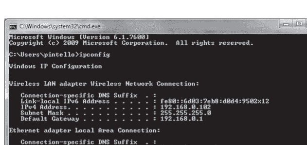

### 图 7-12 Windows 7 网络连接


如果已创建配置和密码，请输入。否则用户名留空，密码输入 `admin`。进入配置屏幕（图 7-13）。

### 图 7-13 Linksys WAP 配置屏幕
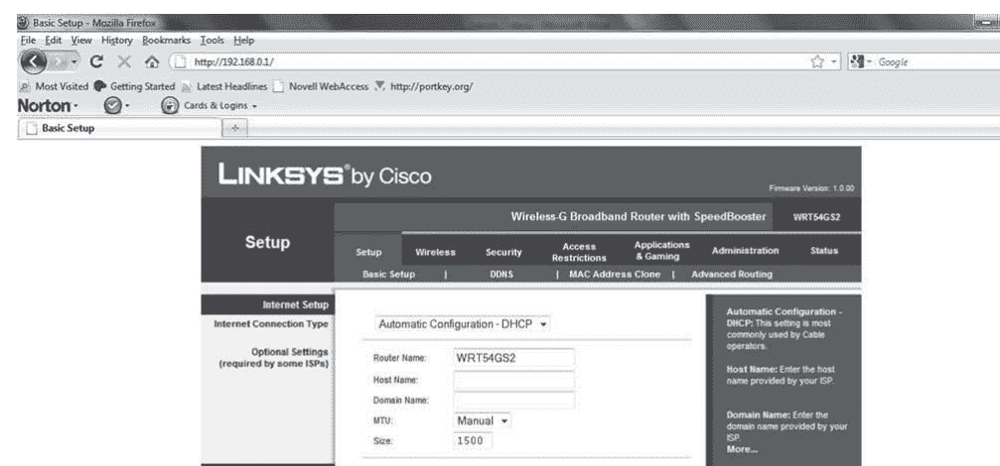

导航到 Wireless -> Wireless MAC Filter，启用并编辑 MAC 过滤列表。

### 认证就绪
什么是 MAC 过滤？它在无线网络中起什么作用？

## 加密
加密是指像 WAP 这样的设备对正在发送的数据运行某种算法，使其在没有读取密钥的情况下无法被读取。WAP 的加密设置位于 Wireless -> Wireless Security。

可用加密方案：WPA2 Enterprise、WPA2 Personal、RADIUS、WEP。WPA2 最强，WEP 最弱。

## WEP
WEP (Wired Equivalent Privacy) 1999 年随 IEEE 802.11 批准。包含加密和认证，但未能实现有线等效安全承诺。已被废弃。

## WPA
WPA (Wi-Fi Protected Access) 由 Wi-Fi 联盟创建，作为中间标准保护无线网络，直到 IEEE 802.11i 批准。实现了 802.11i 许多安全功能。

## WPA2
WPA2 2004 年推出，是 IEEE 802.11i 安全标准的有效实现。比 WEP 提供更强加密和认证。2006 年起，带 Wi-Fi 标志设备必须支持 WPA2。

### 认证就绪
WPA 和 WPA2 之间有什么区别？

### 认证就绪
无线网络中使用哪些加密协议？这些加密方法之间有何区别？

## 通道与频率
IEEE 802.11g 使用 2.4 GHz 射频范围。分为 22 个点，间隔 5 MHz。最多 14 个通道，但只有 3 个不重叠通道可有效使用 (1, 6, 11)。

## 服务集标识符 (SSID)
两种类型：
- **BSSID (Basic Service Set Identifier)**：标识独立无线网络（Ad-hoc 或基础架构模式）。
- **ESSID (Extended Service Set Identifier)**：当两个或多个独立无线网络连接在一起时使用。

SSID 在首次配置时设置。手动更改 SSID 通常需要重置整个网络。

## 天线类型
- **全向天线**：向所有方向广播，覆盖整个区域，但信号不如定向强。
- **定向天线**：向一个方向发送信号，集中特定区域，可达更远距离。

## 干扰
微波炉、钢墙、蓝牙设备、无绳电话等电磁信号会产生干扰，淹没或反射信号。

## 信号强度
距离接入点越远，信号越弱。干扰降低信号强度。强干扰环境下无论多近信号可能丢失。

## 信标帧
无线信标帧是 WAP 定期广播的帧，宣布无线网络存在。包含 MAC 头部、时间戳、广播间隔、设备能力摘要。Linksys 默认间隔 100ms。某些 WAP 允许更改间隔，但不允许更改内容。

## 验证安装
1. 验证已更改默认 SSID 和密码，并知道正确密码。
2. 验证所有设备知道 SSID。
3. 若用 MAC 过滤，验证所有设备 MAC 已正确输入。
4. 测试网络确保数据流正常。

## SOHO 网络技术
SOHO (Small Office/Home Office) 是用于家庭办公室或小型业务办公室的特殊类型小型局域网。设备较少，通常与家庭/办公室其他设备良好集成。

### 需求列表
- 有线 vs 无线：有线更安全，无线更灵活。
- 点对点 vs 客户端-服务器：点对点易设置，客户端-服务器更安全但需额外设置。设备超 10 个无法用点对点。
- 放置位置：家庭办公室是否仅限办公室或全屋访问（需咨询公司/法律顾问）。

### 电缆长度
企业电缆长度限制适用于 SOHO 有线网络。电力线网络除外。

### 设备类型与需求
SOHO 设备与企业设备类型相同，但有针对 SOHO 的较小版本（端口少、功能少、更便宜、配置向导好、默认配置适合 SOHO）。缺点：安全功能不如企业级完整。

### 环境限制
设备数量限制。设备通常是多功能设备。连接互联网技术选项限制 SOHO 网络。

## 技能总结
在本节中，你学习了：
- 最常用的以太网 LAN 技术。
- CSMA/CD 和 CSMA/CA 及其工作原理和区别。
- 各种基于铜缆的以太网技术。
- 广播在网络中传输数据。
- 冲突及其处理。
- 冲突域及其划分。
- 链路聚合及其应用。
- 网络速度。
- 距离如何影响网络和设计。
- 无线 NIC 及其安装。
- 接入点 (AP) 及其配置。
- 接入点正确放置。
- SSID 类型。
- 设置无线 LAN 适用的配置选项。

## 知识评估

### 填空题
1. `以太网` 是今天最古老且最广泛使用的 LAN 技术之一。
2. 四种类型的以太网帧是 `Ethernet II (DIX)、IEEE 802.3、IEEE 802.3 (LLC)、IEEE 802.3 (SNAP)`。
3. 以太网 `802.3 (LLC) 和 802.3 (SNAP)` 是具有不同名称的相同以太网帧类型。
4. 在以太网 DIX 中，DIX 代表 `DEC、Intel 和 Xerox`。
5. CSMA/CD 代表 `载波监听多路访问/冲突检测`。
6. CSMA/CA 代表 `载波监听多路访问/冲突避免`。
7. `CSMA/CA` 如今主要用于无线网络。
8. 第一种广泛使用的以太网布线技术是 `10BASE-5 (粗同轴电缆)`。
9. 当以太网网络上的两个设备尝试在同一根线上同时发送数据帧时，就会发生 `冲突`。
10. 以太网网络上所有可能发生数据帧冲突的计算机统称为网络的 `冲突域`。

### 多选题
1. 在 10Base-T 中，T 代表什么？ **b. 双绞线**
2. 在 100Base-TX 中，100 表示什么？ **c. 电缆吞吐量为 100 Mbps**
3. 在基于以太网的网络上，计算机通过 _____________________ 与其他计算机通信 **a. 广播**
4. IEEE 802.11g 共有 ____________________ 个通道。 **d. 14** (注：有效不重叠为3个，但标准定义最多14个)
5. 可能在无线接入点的配置屏幕中找到以下选项：（多选） **a. 加密, b. 信标间隔, d. MAC 过滤**
6. 组合网络上的多个通道以增加吞吐量的概念被称为 _____________________ **a. 链路聚合**
7. 向其他无线网络设备标识无线网络的名称或数字被称为 _________________ **c. SSID**
8. 在决定放置无线接入点（WAP）的位置时，需要考虑什么？（多选） **a. WAP 的范围或距离, d. WAP 通道以确保不重叠**
9. 在设置无线接入点（WAP）时，以下哪些项是良好的安全实践？（多选） **a. 修改默认 SSID, b. 修改默认密码, c. 设置信号加密, d. 开启并配置 MAC 过滤**
10. 在讨论此 LAN 概念时，经常与“速度”同义的词是 ____________________。（多选） **c. 吞吐量, d. 带宽**

## 实验

### 实验 1：访问无线接入点
本实验目的是向学生演示如何访问无线接入点（WAP）。

#### 准备
- 一台运行 Windows Vista 或 Windows 7 的计算机
- 一个网页浏览器
- 一个设置为出厂设置的无线接入点
- 纸
- 笔

#### 第一部分：确定网关
1. 点击开始按钮，输入 `cmd` 并按回车。
2. 在命令行界面中输入 `ipconfig` 并按回车。
3. 写下网关地址。
4. 关闭命令行界面。

#### 第二部分：打开 WAP 配置屏幕
1. 打开网页浏览器。
2. 在 URL 行中输入你记录的网关 IP 地址。
3. 按回车。出现登录对话框。
4. 出厂设置的 Linksys WAP：用户名留空，密码输入 `admin`。点击确定。
5. 保持此屏幕开启用于下一个实验。

### 实验 2：熟悉 WAP 配置屏幕
本实验的目的是让学生熟悉在配置 WAP 时可用的一些选项。

#### 准备
- 同上

#### 熟悉 WAP 中的常用选项
1. 查看打开的 WAP 配置屏幕。记录：路由器名称、本地 IP 地址、是否启用 DHCP。
2. 列出所有主菜单选项及子菜单选项。
3. 选择三个设置，写下设置及其描述。

## WAN 技术

### 考试目标矩阵
| 涵盖的技术技能 | 考试目标 | 考试目标编号 |
|---|---|---|
| 电路交换类型 | 分类 WAN 技术类型和属性。<br>- 属性：电路交换、分组交换 | 3.4 |
| 传输介质 | 分类 WAN 技术类型和属性。<br>- 类型：DWDM、卫星、蜂窝、WiMAX、LTE、HSPA+、光纤、PON<br>- 属性：速度、传输介质、距离 | 3.4 |
| 各 WAN 技术 | 分类 WAN 技术类型和属性。<br>- 类型：T1/E1、T3/E3、DS3、OCx、SONET、SDH、ISDN、电缆、DSL、拨号、帧中继、ATM<br>- 属性：速度、传输介质、距离 | 3.4 |
| 远程访问 | 描述不同的网络拓扑结构。<br>- MPLS<br>说明网络访问安全方法。<br>- 隧道和加密：VPN | 3.5, 5.2 |

### 关键术语
ADSL、ATM、宽带、电路交换、CPE、分界点、DWDM、拨号、DSL、E-1、E-3、分数 T-1、帧中继、静止轨道 (GSO/GEO)、HDSL、ISDN、ISDN-BRI、ISDN-PRI、最后一里、租用线路、本地环路、LEO、MEO、消息交换、莫尔尼亚轨道、MPLS、网络终止、OC-x、分组交换、PON、POTS、PBX、私有网络、公网、PSTN、远程访问、RAS、远程访问 VPN、卫星通信、服务器端压缩、站点到站点 VPN、SDSL、SDH、SONET、T-1、T-3、T 线、终端端点、时分复用、V.44、VDSL、虚拟电路交换、VPN、WiMAX、X.25。

Will Smith 是一位 WAN 工程师。他工作的公司刚刚收购了一家破产的大型公司，这使得全国几个不同地点汇聚到了一个公司中。他被公司要求为所有新收购的地点制定一个全面的 WAN 通信计划。他需要建立主通信线路以及备用通信线路。此外，Will 还需要以一种具有成本效益且高效的方式完成这项任务。Smith 应该从哪里开始？Will 有哪些选项可以执行他的指令？

## 电路交换的类型

在本节中，我们将讨论用于在网络中发送数据的各种技术。我们讨论了电路交换、分组交换、消息交换和虚拟电路交换。

根据最基本的定义，电路交换是一种在给定的传输期间建立专用通信信道的通信类型。实现这一点的有几种不同的方案。其中一种方案是电路交换。另一种是虚拟电路交换。最后，执行这种类型通信的最后一种是分组交换。这三种方法的功能各不相同，但它们都用于为传输建立通信信道。

## 电路交换
实际电路交换是建立通信通道的最古老手段。基础电路网络最古老且最为人知的例子可能是电话业务（PSTN）。最早例子可追溯到 19 世纪末。拨通电话时，不同的物理网络段被连接起来，为每次通话创建一个唯一的电话电路。图 8-1 展示了电路交换的原理。

### 图 8-1 电路交换中，在数据传输之前，会先从通信链路的一端到另一端建立连接。


> 注意：电路交换不仅限于语音。任何需要持续开启的专用线路的情况都是电路交换的理想选择。

## 分组交换
分组交换是一种网络技术，它为小数据包从一个网段移动到另一个网段开启连接。数据被分解成小块（分组）。不需要专用通信通道。优势：如果电路断开，数据包可以找到其他路径，单点故障难以导致网络崩溃（军事开发初衷）。每个数据包分配自己的路由，到达时可能无序，需重新排序。

### 图 8-2 分组交换的工作原理
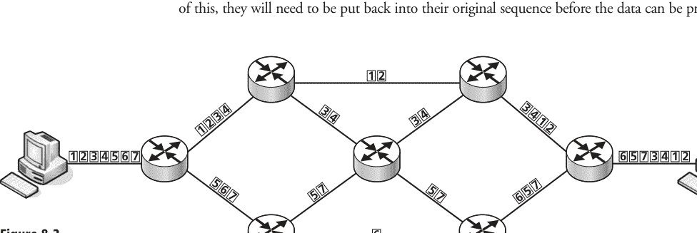

缺点：产生延迟。原因：数据包在队列中等待处理；所有数据包必须到达并重新排序。

## 报文交换
报文交换是分组交换的先驱。Leonard Kleinrock 1961 年首次开发。整个消息被拆分成数据包，然后一次发送一条消息。现代报文交换多为存储转发。最大技术是电子邮件。优点：高流量时存储，流量减慢后发送。

## 虚拟电路交换
虚拟电路交换试图在保持电路交换效率的同时，利用分组交换的灵活性。在两点间建立通信链路，数据拆分成离散数据包，数据包通过预先建立的通信路径发送。比纯分组交换快，因为数据包有序且遵循相同路径，无需在每个路由器排队。

### 图 8-3 虚拟电路交换的工作原理


VPN 是通过互联网大量使用虚拟电路交换的技术示例。

## 传输介质
WAN 网络与 LAN 一样，使用不同类型介质传输数据。某些介质相似但实现不同。铜线、光纤、射频 (RF) 信号在两者都用。微波、卫星通信通常不在 LAN 中发现。

## 铜电缆
最老的传输介质。WAN 环境中几乎被其他介质取代。仅用于“最后一公里”接入（DSL、宽带电缆、电话线）。光纤是 WAN 干线首选。

## 光纤
WAN 环境中主导传输介质。空心玻璃管带反射涂层，光脉冲反射传输。
- **单模光纤**：细，携带单一光脉冲，基带，传输距离远。
- **多模光纤**：粗，携带多个光脉冲，宽带，用于短距离。

## PON
无源光网络。点对多点光纤网络。中心办公室通过分光器向下传输，上行用时分复用。

## DWDM
密集波分复用。在光缆上分配光波的复用技术。ATM、SONET、SDH 使用 DWDM 通过光纤发送数据。

## 微波
WAN 环境中可见的无线通信形式。使用 300 MHz - 300 GHz 电磁频谱。特指点对点无线技术：两个面对面的定向微波收发器。缺点：需要视距 (LOS)。收发器需放置在高处以克服地球曲率。只要保持视距，距离不限。

## WiMAX
IEEE 802.16 标准。用于手机，大都市主要作为 DSL/电缆替代。也用于 VoIP、IPTV。当前版本 802.16m：移动 40 Mbps，固定 1 Gbps。固定范围 30 英里，移动 3-5 英里。LTE 并行开发作为替代。

## 卫星通信
微波通信的变体。地面站和卫星用微波通信。卫星中继通信到视线外地面站或另一颗卫星。限制：视距（卫星间无此限制）、延迟（信号往返时间）。轨道越高，覆盖广但功率需求大、延迟大。

### 轨道类型
- **GEO (静止轨道/地球同步轨道)**：赤道上方 35,786 公里。3 颗覆盖大部分地球。高纬度地区 (加拿大、俄罗斯) 无法通信。
- **Molniya (莫尔尼亚轨道)**：高椭圆轨道，覆盖北部地区。高度 200-1000 公里（近地点）到 35,000+ 公里（远地点）。3 颗卫星实现北部 24 小时覆盖。
- **LEO (低地球轨道)**：160-2,000 公里。手持卫星通信。Iridium (66 颗星座)、Globalstar。位于范艾伦辐射带之下。
- **MEO (中地球轨道)**：2,000-35,786 公里。GPS 网络主要用途 (20,230 公里)。

### 图 8-4 莫尔尼亚轨道


### 图 8-5 卫星通信网络使用的主要轨道


### 表 8-1 图 8-5 图例
| 图形描述 | 图例 | 高度 |
|---|---|---|
| 地球 | 中心球体 | 0 |
| LEO | 浅灰色区域 | 160–2,000 |
| MEO | 深灰色区域 | 2,000–34,780 |
| ISS | 虚线 | 350 |
| GPS | 点划线 | 20,230 |
| GEO | 黑色点线 | 35,786 |

### 认证就绪
什么是卫星通信？卫星通信相对于地面通信有什么优势？

## 无线频率 (RF)
用于 WAN 通信的无线频率实际上是微波通信的一个子集。蜂窝网络技术演进见表 8-2。

### 图 8-6 小区网络与通道
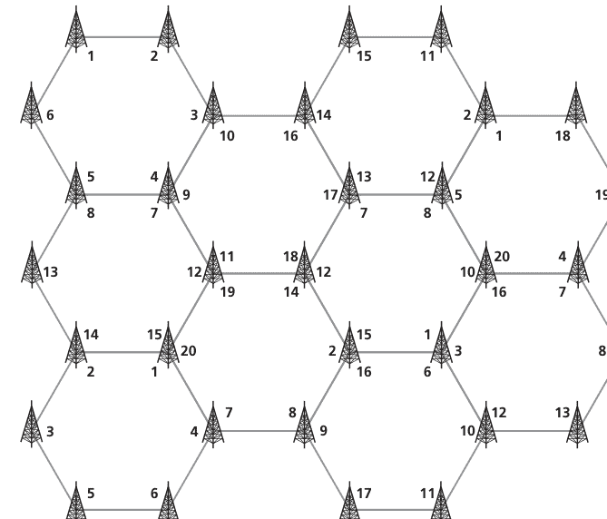

### 表 8-2 蜂窝技术及其相互关系
| 技术名称 | 技术家族 | 家族内的技术标准 |
|---|---|---|
| 0G | 无 | MTS, IMTS, AMTS... |
| 1G | AMPS | AMPS, N-AMPS, TACS, ETACS |
| | 其他 | NMT, Hicom, Mobitex, DataTAC |
| 2G | GSM/3GPP | GSM, GPRS, EDGE |
| | 3GPP2 | cdmaOne (IS-95) |
| | AMPS | D-AMPS (IS-54/136) |
| | 其他 | CDPD, iDEN, PDC, PHS |
| 2.5G/2.75G | GSM/3GPP | HSCSD, GPRS, EDGE/EGPRS |
| | 3GPP2 | CDMA2000 1X, 1X Advanced |
| 3G (IMT-2000) | 3GPP | UMTS (WCDMA-FDD/TDD), TD-SCDMA |
| | 3GPP2 | CDMA2000 1xEV-DO Rev 0 |
| 3.5G/3.75G/3.9G | 3GPP | HSPA, HSPA+, LTE (E-UTRA) |
| | 3GPP2 | CDMA2000 1xEV-DO Rev A/B, DO Advanced |
| | IEEE | Mobile WiMAX (802.16e), 802.20 |
| 4G (IMT-Advanced) | 3GPP | LTE Advanced (E-UTRA) |
| | IEEE | WiMAX Advanced (802.16m) |
| 5G | | 研发概念 |

### 认证就绪
什么是 LTE？LTE 和 LTE Advanced 有什么区别？你可能会看到什么技术被用于 LTE Advanced？

### LTE
LTE (Long Term Evolution) 是 3GPP 成果，旨在取代 3G。美国常营销为 4G，但未完全符合 IMT-Advanced 真 4G 标准。

### LTE Advanced
LTE Advanced 是 LTE 更新版本，获 ITU 批准，完全实现 4G 标准所有部分，是“真” 4G。

### 认证就绪
什么是 HSPA？HSPA 与 HSPA+ 有何区别？

### HSPA
HSPA (High Speed Packet Access) 结合 HSDPA (下行) 和 HSUPA (上行)，提供更快收发速度。全球部署最广泛的移动宽带之一。

### HSPA+
HSPA+ (Evolved HSPA) 是 HSPA 新版本，提供更快下行/上行速度。许多公司部署演进 HSPA。

## 各种 WAN 技术
讨论用于 WAN 间传输数据的技术：拨号、ISDN、DSL、宽带/电缆、帧中继、ATM。

### 结论
多年来开发了各种 WAN 技术。某些已过时，某些仍在使用。本文还将讨论目前可用的一些新技术。

## 拨号上网
最老的网络通信技术之一。通过调制解调器连接 POTS (Plain Old Telephone Service)。
优点：无需基础设施（仅需电话线和调制解调器）、成本低(免费或 $5-10/月)、全球可用。
缺点：速度限制 ~56 kbps。
现代技术尝试解决：V.44 标准可压缩文本 6 倍 (56k -> 300k)，但对 ZIP/JPEG/MP3/MPEG 无效。

## 公用电话交换网 (PSTN)
全球电话网络。使用电路交换。铜缆、光纤、微波、蜂窝均属 PSTN 一部分。POTS 特指 PSTN 中商业语音服务部分。

PSTN 组成：
1. 客户家庭/办公室 -> **分界点** (责任分界)。
2. 分界点 -> **远程交换中心** (社区绿色/银色盒子)。
3. 远程交换中心 -> **用户局/中心局** (所有交换箱终止处)。本地环路大小和距离影响性能。离用户局越近，拨号/DSL 越快。
4. 用户局 -> **区域局** -> **国家局** -> **国际局** -> 全球互连。

### 图 8-7 最后一公里和本地环路
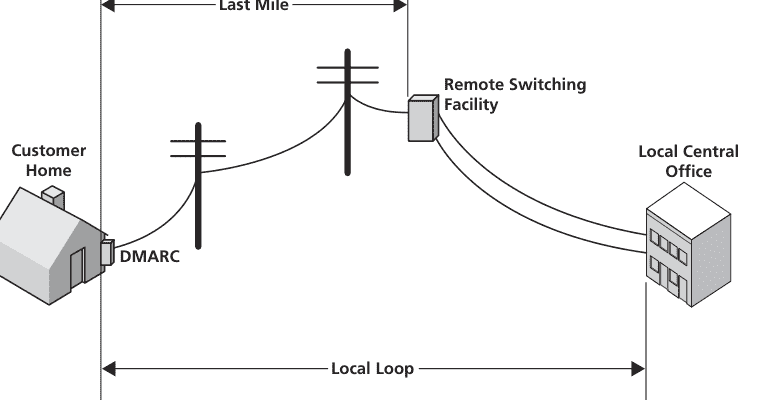

> 注意：通信可绕过国家局和国际局。

## 集成业务数字网络 (ISDN)
一组标准，旨在通过 PSTN 以数字格式传输语音、视频、数据。使用电路交换建立连接。每个交换连接允许访问分组交换网络。优于拨号：速度快、同一线路集成语音和数据。
- B 通道：64 kbps (数据/语音)。
- D 通道：16 kbps (信令/控制)。
- 基本速率接口 (BRI)：2B+D = 128 kbps 数据 + 16 kbps 信令 = 144 kbps 总计。
- 主速率接口 (PRI)：23B+D (北美 T1) 或 30B+D (欧洲 E1)。

### 图 8-8 ISDN 网络设备的基本配置


设备：终端设备 (TE) -> NT2 (PBX, 第2/3层) -> NT1 (网络终端, 第1层, 美国为用户侧设备 CPE) -> ISDN 交换机 -> PSTN。

### 认证就绪
ISDN 是什么？ISDN 是用来做什么的？ISDN 有哪些变体？

## 数字用户线路 (DSL)
DSL 系列技术，使用现有电话铜线提供高速数据。
- **ADSL (Asymmetric DSL)**：不对称，下行 > 上行。下行 1.5-24 Mbps，上行 16kbps-3.5 Mbps。ADSL2/2+ 增强版。
- **SDSL (Symmetric DSL)**：对称，上下行速率相同。广义指一组技术；狭义指特定技术 (1.544/2.048 Mbps，等同 T1/E1)，单线对，无语音通道。针对小企业。
- **HDSL (High-bit-rate DSL)**：高比特率，使用双绞线携带语音和数据。通常用 T1 线路连接本地运营商，每 1.2 英里需中继器。
- **VDSL (Very-high-bit-rate DSL)**：极高比特率，下行高达 52 Mbps，上行 16 Mbps。VDSL2 (2006) 改进版。AT&T、Verizon、Qwest 部分地区提供。

### 认证就绪
不同类型 DSL 之间的一些区别是什么？什么是调制解调器？电缆公司与宽带之间什么关系？

## 宽带和电缆方法
宽带：同一介质发送多个信号的技术。电缆电视是终极示例（同轴电缆复用多频道）。
电缆调制解调器：遵循 IEEE 802.1D (网桥标准)，转换同轴网络信号为以太网帧。调制/解调主要是数字信号转换，非传统模数转换。

> 注意：X.25 类似 ISDN，较旧但可能出现在考试中。

## X.25
70 年代开发的 WAN 交换通信技术。已被更新替代。原为模拟技术，带错误检查。设备：PSE (分组交换节点) -> DCE (数据电路终端设备) -> DTE (数据终端设备: 计算机、主机、通信交换机)。PAD (分组组装/拆解) 连接哑终端。

### 图 8-9 X.25 配置
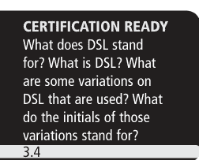

## 帧中继
连接只需间歇性通信点的 WAN 服务。连接不需要连续性的不同 LAN。像永久虚拟电路 (PVC)。服务商为每帧确定最佳路由。双赢：用户得专用带宽但无专线成本；提供商共享容量。
- 能提供全 T1 (1.544 Mbps) 或分级 T1 (Fractional T1: 24x 64kbps 信道)。
- 与 ISDN 配合良好 (同为 64kbps 信道)。

### 图 8-10 帧中继原理


帧中继取代 X.25。用于易错线路 (内置纠错) 或无错线路 (端点纠错)。开销低，比 X.25 快。

## T 线 (T-Carriers)
T 线 (T-carriers) 是指在电信中使用复用方法的一组技术。贝尔实验室开发，主用于北美、日本、韩国。欧洲用 E 线 (E-carriers)。
由多个 64 kbps 子信道复用组成。

### 表 8-3 T 线级别和规格
| T 线级别 | 常用名称 | 吞吐量 | 64kbps 通道数 |
|---|---|---|---|
| 级别 0 | 分级 T 线 / DS0 | 64 kbps x N (N<24) | N |
| 级别 1 | **T1 / DS1** | **1.544 Mbps** | **24** |
| 中间级 | T1C / DS1C | 3.152 Mbps | 48 |
| 级别 2 | DS2 | 6.312 Mbps | 96 |
| 级别 3 | **T3 / DS3** | **44.736 Mbps** | **672** |
| 级别 4 | DS4 | 274.176 Mbps | 4,032 |
| 级别 5 | T5 / DS5 | 400.352 Mbps | 5,760 |

分级 T 线：租用一组信道，吞吐量 = 64kbps x 信道数。

### 表 8-4 E 线级别和规格
| E 线级别 | 常用名称 | 吞吐量 | 64kbps 通道数 |
|---|---|---|---|
| 级别 0 | | 64 kbps | 1 |
| 级别 1 | **E1** | **2.048 Mbps** | **32** |
| 级别 2 | E2 | 8.448 Mbps | 128 |
| 级别 3 | **E3** | **34.368 Mbps** | **512** |
| 级别 4 | E4 | 139.264 Mbps | 2,048 |
| 级别 5 | E5 | 565.148 Mbps | 8,192 |

### 认证就绪
什么是 T1？T1 技术有哪些变体？欧洲的 T1 线路等效物是什么？T 线的另一种常见称呼是什么？

## 异步传输模式 (ATM)
ATM 使用异步时分复用 (ATDM) 将通信分解为固定大小的单元。
- **ATM 单元**：固定 53 字节 (5 字节头部 + 48 字节载荷)。
- 头部字段：GFC (通用流控)、VPI (虚拟路径标识)、VCI (虚拟通道标识)、PT (载荷类型)、CLP (单元丢失优先级)、HEC (头部纠错)。
- ATDM：仅分配当前通信所需的时隙，比固定时分复用 (TDM) 更高效。

## 同步光网络 (SONET) 和同步数字分层 (SDH)
SONET (北美) 和 SDH (国际) 是复用协议，用光纤/LED 传输数字比特流。本质相同。
- **OC-x (Optical Carrier)**：SONET 光级。OC-1 = 51.84 Mbps。高级为 OC-1 倍数。

## 多协议标签交换 (MPLS)
IETF 批准 (RFC 3031, 3468 等)。"多协议" 意味着可与 ATM、以太网、IP 等交互。
目的：加速大型网络数据移动。给数据包加标签，列出到达目的地所需跳数。路由器只检查标签决定下一跳，跳过路由查找，减少开销。支持 MPLS 的路由器称边缘路由器 (LER/LSR)。可与 T1、ATM、帧中继、DSL 配合。

## 远程访问
允许终端用户像直接连接一样访问网络。广泛用于外勤工程师、销售代表。主要技术：RAS 和 VPN。

## 远程访问服务 (RAS)
指便利远程访问的技术组。通常基于软件。Windows 内置 RAS。第三方如 Citrix 提供替代。需服务器端和客户端组件。

## 虚拟专用网络 (VPN)
公司常用技术，允许用户远程访问公司服务器。使用公共网络 (互联网) 建立连接。
- **私有网络**：特定实体所有 (企业网络)。
- **公共网络**：公众访问 (互联网)。

### VPN 类型
1. **远程访问 VPN**：通过公共网络连接远程用户到公司网络。
2. **站点到站点 VPN**：通过专用线路 (租用线路如 T1/ISDN) 连接公司拥有的站点。

两类工作方式大体相同，主要区别连接介质来源 (公共 vs 私有)。需客户端和服务器。VPN 服务器在公司站点，客户端在公共网络任意位置。客户端或服务器均可发起连接。使用虚拟电路交换创建连接。

### 图 8-12 VPN 用于远程访问
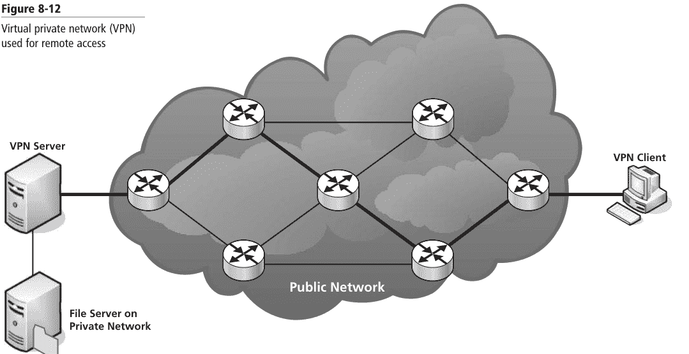

### 认证就绪
VPN 是什么用的？VPN 如何工作？VPN 有什么用途？

## 技能总结
在本节中你学习了：
- 电路交换的不同类型。
- 电路交换与虚拟电路交换的区别。
- 分组交换工作原理及实际影响。
- 消息交换。
- WAN 传输介质。
- 微波/卫星/无线频率/蜂窝用于 WAN。
- 拨号工作原理。
- DSL 工作原理。
- 宽带和电缆调制解调器用法。
- DSL 不同类型。
- X.25。
- 帧中继。
- T 载波/E 载波工作原理。
- ATM 工作原理。
- SONET/SDH 网络工作原理。
- MPLS 网络技术。
- RAS 及其使用。
- VPN 及两种主要类型。
- VPN 工作原理。

## 知识评估

### 填空题
1. 用于电路交换的最古老技术被称为 `电话网络 (PSTN)` 或 `电路交换电话网`。
2. `虚拟电路交换` 是电路交换的一种变体，它仅在特定会话期间建立电路。
3. 互联网使用的交换类型是 `分组交换`。
4. 电子邮件是 `报文交换` 的良好示例。
5. `拨号上网` 是仍用于创建广域网连接的最古老技术之一。
6. 使用两个数据通道和一个控制信道的 ISDN 类型是 `ISDN-BRI (基本速率接口)`。
7. `ADSL (非对称数字用户线路)` 是具有不同上传和下载速度的 DSL 名称。
8. `ATM (异步传输模式)` 是一种使用称为单元的小型帧的高速广域网连接。
9. 操作系统用于允许远程计算机连接到它们的服务被称为 `远程访问服务 (RAS)`。
10. 使用如互联网等公共网络提供私有网络访问的常见远程访问类型被称为 `VPN (虚拟专用网络)`。

### 单选题
1. 拨号上网能达到的最大速度是 **b. 少于 56 kbps**。
2. ISDN 电路中的每个 B 通道是 **a. 64 kbps**。
3. 允许远北进行卫星通信的卫星轨道被称为 **d. 莫尔尼亚轨道**。
4. 北美常用的 T 线路：（多选） **a. T1, d. T3**。
5. OC-x 线路是什么网络速度的倍数？ **c. 51.84 Mbps** (OC-1 速率)。
6. SONET 可以与哪些协议配合？（多选） **a. 以太网, b. TCP/IP, d. ATM** (SONET 承载多种上层协议)。
7. 卫星通常使用 **d. 微波** 传输数据。
8. POTS 代表什么？ **a. 普通电话服务 (Plain Old Telephone Service)**。
9. VPN 最常用 **b. 公共网络** 访问 **c. 私有网络** (选择两个)。
10. 哪些操作系统内置了某种形式的 RAS？（多选） **a. Windows 7, b. Windows Server, c. 大多数 Linux 发行版**。

## 实验

### 实验 1：研究本地广域网提供商
本实验目的是让学生研究本地 ISP，以确定他们地区提供哪些广域网技术。

#### 材料
- 可以访问互联网的计算机
- 纸
- 笔/铅笔

#### 查找您地区哪些本地 ISP 提供广域网服务
1. 访问互联网并搜索您所在地区的本地 ISP。某些可能是 AT&T、Verizon、Cox Cable、Brightlink (现 Spectrum) 等。
2. 记录每个 ISP 提供的服务类型 (DSL、电缆、光纤、卫星、固定无线等)。
3. 记录每种服务的宣传速度 (下行/上行)。
4. 记录月费成本、安装费、合同期限、数据上限。
5. 比较不同 ISP 的服务，制作对比表格。
6. 向班级汇报发现。

### 实验 2：在 Windows 7 中创建 VPN 连接
本实验目的是教学生如何在 Windows 7 中创建 VPN 连接。

#### 材料
- 一台运行 Windows 7 的计算机
- 纸
- 笔或铅笔

#### 创建 VPN 连接
1. 点击“开始”，输入 `VPN`，按回车打开“设置虚拟专用网络 (VPN) 连接”向导。或通过控制面板 -> 网络和共享中心 -> 设置新连接或网络 -> 连接到工作区 -> 使用我的 Internet 连接 (VPN)。
2. 输入 Internet 地址 (VPN 服务器 IP 或域名)。目标名称随意。勾选“不要现在连接，仅设置以便稍后连接”。点击“下一步”。
3. 输入用户名、密码、域 (可选)。点击“创建”。
4. 连接创建完成。点击“关闭”。
5. 要使用连接：点击任务栏网络图标，选择刚创建的 VPN 连接，点击“连接”，输入凭据，点击“确定”。

## 基础网络安全

### 考试目标矩阵
| 涵盖的技术技能 | 考试目标 | 考试目标编号 |
|---|---|---|
| 网络安全考虑 | | |
| 基本网络安全威胁 | 解释常见的威胁、漏洞和缓解技术。<br>- 社会工程、钓鱼、密码窃取、间谍软件、病毒、蠕虫、木马、僵尸网络、DoS/DDoS、中间人攻击、缓冲区溢出、数据包嗅探、FTP 弹回、Smurf 攻击、无线威胁 (War driving/War chalking、WEP/WPA 破解、非法 AP、Evil Twin) | 5.4 |
| 应对基础安全威胁 | 给定场景，使用适当的网络监控资源分析流量。<br>- SNMP v1/v2/v3<br>解释验证方法。<br>- PKI、Kerberos、RADIUS/TACACS+、802.1X/NAC、CHAP、MS-CHAP、EAP | 5.3, 5.6 |

## 社会工程
对网络最危险的威胁甚至不包括计算机——**社会工程**。目标：欺骗/操纵某人泄露重要信息。手段：说服、设计场景、利用人性弱点。Kevin Mitnick：欺骗人泄露密码比暴力破解容易得多。防御：员工安全意识培训，举报可疑行为。

## 钓鱼攻击
利用手段欺骗人们泄露密码、账号等敏感信息。伪装成合法账户要求。常用邮件/即时消息。
场景：尼日利亚诈骗邮件；伪装银行邮件含钓鱼网站链接。
识别：检查 URL 域名；银行不要求网页输入敏感数据。
对策：验证图片、安全问题、双因素认证。

## 窃取密码
原因：获取密码比暴力破解容易。弱点：用户用显而易见短语 (名字、生日、宠物) 做密码。社工收集信息猜测密码。

## 间谍软件
旨在监视用户并获取隐私信息的恶意软件。植入方式：邮件附件、捆绑“合法”软件安装 (如 Cursor、Webshots/Gator)。用途：营销、身份盗窃、控制计算机。极端案例：犯罪集团利用间谍软件栽赃非法图片。

## 病毒
修改现有程序代码的恶意软件，试图造成伤害、自我复制、逃避检测。
**宏病毒**：附着在文档上，利用宏语言 (如 MS Office VBA) 修改文档。通过共享文档传播。对抗：杀毒软件、禁用宏。

## 蠕虫
独立程序，不需附着宿主即可传播。通过网络传播，利用 OS/应用漏洞感染。感染后复制自己发送到其他计算机。邮件/IM 是传播途径。内部含代码将副本带到其他计算机。

## 木马
伪装成合法软件的恶意程序。不自我复制。依靠欺骗用户执行。执行后：窃取信息、安装其他恶意软件、远程访问 (RAT)。传播：邮件附件、虚假下载、受损软件。

## 僵尸网络
被恶意软件 (木马) 控制的计算机网络。攻击者向僵尸发送指令执行任务：DoS 攻击、破解密码、发送垃圾邮件、挖矿。合法案例：SETI@home (自愿分布式计算)。

### 表 9-1 不同类型恶意软件的总结
| 恶意软件类型 | 特征 |
|---|---|
| 间谍软件 | 溜入计算机获取私有信息/使用情况。通过浏览器、诱导安装、邮件等进入。 |
| 病毒 | 附着合法程序/数据文件的恶意代码，修改文件执行恶意操作或接管活动。含自我复制指令。 |
| 蠕虫 | 完整独立程序，通过合法手段溜入。设计执行特定指令不利影响计算机/用户。多间谍软件实为蠕虫。用于隐蔽控制计算机。邮件/IM 传播。内部含代码复制到其他计算机。 |
| 木马 | 行为似蠕虫。但完全隐藏在计算机中的完整功能程序。利用现有合法程序，用同名伪程序替换。导致 OS 执行木马而非合法程序。执行真实恶意意图。黑客获取非法访问常用方法。 |

## 来自攻击者的威胁

### 社会工程
重申：可能是单一最大威胁。防御：全员理解并识别，培训举报。措施：非个人信息密码、不记密码。

### 拒绝服务 (DoS) 和分布式拒绝服务 (DDoS)
试图拒绝计算机服务。财务损失最大攻击类型。例：2000年2月攻击 Amazon/eBay/Yahoo 等，数百万损失。使用早期僵尸网络 (Seven 木马变体)。
**DDoS**：大量受感染计算机从多点同时攻击。可多对一或一对多。
**僵尸网络形成**：攻击者用蠕虫/木马感染家庭计算机 -> 控制受感染计算机 -> 向目标发海量请求过载禁用。

### 图 9-1 形成僵尸网络
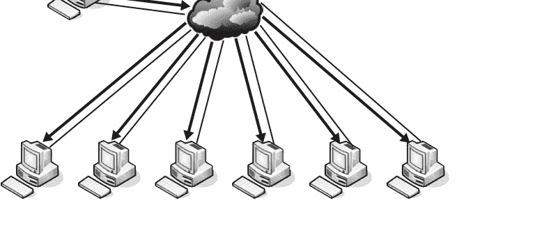

### 图 9-2 使用僵尸网络的 DDoS 攻击
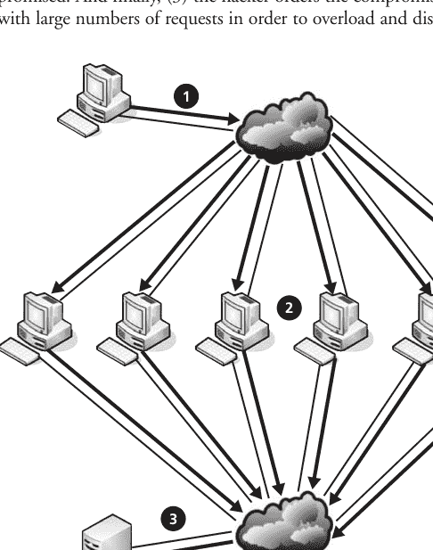

DoS 实施方式：溢出缓冲区、耗尽通信能力、过载处理能力。目标：剥夺目标功能。严重攻击可导致设备物理损坏 (硬盘崩溃) 或需重装系统。目标设备：路由器、交换机、Web/DNS 服务器、支付网关、域名服务器。

### 认证就绪
什么是 DoS？DoS 的目的是什么？DoS 的常见变体是什么？

## Smurf 攻击
DoS 变体。目标被大量 ICMP 响应淹没，导致入站线路过载崩溃。原理：渗透计算机广播 ICMP 请求，伪装成目标已发送请求。以 Smurf 木马命名。现不常见，易防御，现代网络阻止广播 ICMP。
**Fraggle 攻击**：类似，用 UDP 回复代替 ICMP。

## 缓冲区溢出
缓冲区：程序预留内存段。溢出：存入过多数据导致溢出占用相邻内存，干扰其他进程。攻击：故意强制溢出。
结果：导致 DoS (设备不可用)；强制数据流出受保护内存被捕获；修改程序行为利于攻击者。

## 中间人攻击
攻击者置于两通信方之间监听并篡改/转发消息。别名：MITM、桶桥攻击、会话劫持、TCP 劫持。用于拦截 HTTP/HTTPS、邮件、加密密钥。
示例：Alice-Bob 通信，Mallory 在 Bob 机器放木马中继数据包。Mallory 可原样转发、丢弃、篡改数据。

### 图 9-3 Mallory 对 Bob 实施中间人攻击


## 数据包嗅探
捕获网络数据包并打开查看内容。用途：绘制网络地图 (伪造地址)、识别协议漏洞、解密数据包获取用户信息。Wireshark 即数据包嗅探器。

## FTP 弹回
针对 FTP 协议利用 PORT 命令访问开放端口。nmap 广泛用于此攻击。现代 FTP 服务器默认拒绝 PORT 命令，效果降低。

## 无线威胁

### 无线驱动
开车寻找开放无线网络 (无安全机制)。发现则使用访问互联网。未发现则用其他攻击破解。

### 走绘画
War driving 变体。发现网络后在户外表面放置符号指示 AP 可用性和类型。

### 图 9-4 常用的走绘画符号


### WEP 破解
破解使用 WEP 加密的无线网络。WEP 最容易破解。Backtrack Linux 发行版含多种破解工具。

### WPA 破解
目标加密协议为 WPA。WPA 同时有加密和认证。相同工具可测试/破解 WPA。Backtrack 是良好来源。
参考：`http://www.hsc.fr/resources/articles/hakin9_wifi/hakin9_wifi_en.pdf`。

### 非法接入点
未授权连接到网络的接入点。非恶意：员工好意自买 AP 接入未告知 IT。恶意：作为入侵第一步，获取未授权访问或发起 MITM 攻击。

### 图 9-5 非法接入点


> 注意：因位于安全网络外但提供访问，故为非法 AP。

### 认证就绪
什么是非法接入点？非法接入点的设置方法有哪些？

无恶意创建的非法 AP 一旦到位，也可能被他人利用。黑客喜欢寻找并破解非法 AP 备用。
IT 判断方法：
1. 检查是否在公司托管 AP 列表中。不在则为非法。
2. 确定是否直接连接公司安全有线网络 (绕过隔离网关)。若是，则为安全威胁。

### 恶性孪生
非法 AP 特殊情况。目的非做后门，而是欺骗用户连接以获取其信息 (密码、账号、PIN)。
例：公共区域放置伪装合法 AP。复杂版：溜入合法无线区域，接管合法 AP 处理的用户。

### 图 9-6 恶性孪生


## 应对基础安全威胁
讨论保护网络免受基础安全威胁的方法：设备安全、密码/加密/证书、安全/不安全协议、网络控制。

## 设备安全

### 物理安全
最重要但常被忽视。服务器机房上锁、机柜上锁、控制物理访问。

### 限制本地和远程访问
- **本地访问**：LAN 进入。较易安全，管理员控制设备，存在基本信任。但防不住内部伪装。
- **远程访问**：WAN 进入 (互联网)。难限制，管理员无法控制互联网。不能假设远程用户身份真实。需额外步骤。

### 认证就绪
什么是本地访问？什么是远程访问？

### 安全访问方法 vs 不安全访问方法
安全方法有内置限制机制；不安全方法易绕过，安全感是幻觉。
三类安全因素：
1. **你所知**：用户名/密码、安全短语、问题、PIN、图片识别。大多数方法属此类。
2. **你拥有的**：智能卡、USB Key、门禁卡、ATM 卡。拥有物品证明权限。ATM 需卡+密码 (双因素)。
3. **你所是**：生物识别。指纹、视网膜、虹膜、掌纹、人脸、声纹、DNA。

## 安全协议
协议需提供三要素才安全：**机密性** (防窃听)、**完整性** (防篡改/验证来源)、**身份验证** (验证身份)。无单一协议解决所有安全问题，因新技术层出不穷、黑客终将破解、不同通信需不同安全方法。

### 安全外壳 (SSH)
1995 年作 TELNET 替代。SSH-1 -> 2006 SSH-2。
TELNET 明文传输，无加密保护密码。Wireshark 即可读取。
SSH 优势：加密协议验证用户。可结合 TCP、SFTP、SCP 保护会话。端口 22。常用于 Linux 系统。可跨网络发布命令、传输文件。功能多于 TELNET。

### 超文本传输安全协议 (HTTPS)
HTTP over SSL/TLS。非单一协议，而是 HTTP + SSL/TLS 保护连接。加密网页传输，防窃听和 MITM。端口 443 (HTTP 80)。

### 安全文件传输协议 (SFTP)
基于 SSH 的文件传输协议。安全传输文件。

### 安全拷贝协议 (SCP)
基于 SSH 的协议。安全传输文件。SFTP 更全面，常用 SFTP 实现 SCP 功能。

## 不安全协议
功能类似安全协议但无安全性。原因：安全协议需更多开销 (内存、CPU、带宽)。非敏感数据传输 (如公开网页) 无需安全协议浪费资源。

### TELNET
终端仿真，远程输入命令。明文传输用户名密码。直连设备 (串口/Console) 无安全问题。公网管理**严禁**使用，应用 SSH。

### HTTP
传输网页。无内置安全，低成本、高效。敏感信息需 HTTPS。

### FTP
传输文件。不安全协议。RFC 2577 列出漏洞：反射攻击、欺骗攻击、暴力破解、数据包捕获、用户名无保护、端口劫持。所有通信明文。TELNET、SMTP、POP、IMAP 同问题。

### RSH (Remote Shell)
远程发布命令行。类似 TELNET/SSH 但无安全功能。易受攻击。现代计算机少见。UNIX/Linux 直连设备可能用。

### FCP (Fibre Channel Protocol)
光纤通道协议。传输 SCSI 命令/数据。极高速连接工作站、超算、存储、显示器。作当前网络替代方案。部署有限。无内置安全。

### SNMPv1/v2
简单网络管理协议早期版本。无 SNMPv3 的安全功能。已被 SNMPv3 取代。

## 密码
验证身份。规则：
1. 足够复杂，不易猜测。
2. 定期更新更改，防破解旧密码。
3. 不同系统用不同密码，防一破全破。

## 加密
运行数学算法使未授权用户无法读取。
- **私钥加密 (对称加密)**：同一密钥加密解密。发送方加密 -> 传输密钥 -> 接收方用密钥副本解密。挑战：密钥安全分发。
- **公钥加密 (非对称加密)**：私钥生成公钥 -> 公钥加密 -> 发送公钥+密文 -> 接收方用私钥解密 (或预先分发公钥)。公钥可一次性、时效性、或撤销机制。

### 图 9-6 私钥加密
| 步骤 | 描述 |
|---|---|
| 1 | 发送计算机使用存储的密钥加密消息。 |
| 2 | 以加密形式跨网络发送到目标计算机。 |
| 3 | 目标计算机使用密钥副本解密。 |

### 图 9-7 公钥加密
| 步骤 | 描述 |
|---|---|
| 1 | 发送计算机使用私钥生成公钥。 |
| 2 | 使用新公钥加密消息。 |
| 3 | 公钥提前发送到目标计算机。 |
| 4 | 同加密消息一起发送公钥。 |
| 5 | 目标计算机使用私钥解密消息。 |

### 认证就绪
PKI 代表什么？PKI 如何使用？PKI 如何工作？

公钥用法：单次加密密钥 (用后失效)；有效期内一组消息；设定时间段有效 (到期失效)。

## 证书
证明公钥有效的证明。公共证书/数字证书。添加到公钥的数字文档，验证来源及有效性。包含持有者身份、公钥、颁发者信息。颁发机构 = CA (Certificate Authority)。使用证书的基础设施 = PKI (Public Key Infrastructure)。

## 时间密钥完整性协议 (TKIP)
配合 IEEE 802.11 设计的加密标准。封装 WEP 等现有标准。增强措施：逐包唯一密钥、包含秘密密钥增强有效性 (Temporal 含义)、序列计数器防重放攻击、64-bit CRC 替代 WEP 32-bit CRC。注意：TKIP 基于已被破解的加密，非绝对免疫。敏感数据勿放网络。

## 身份验证
验证用户/计算机确实是其声称身份。协议共同点：验证身份。
最常用：用户名+密码。缺点：密码可被盗。替代方案：多因素、物品特征、证书。

### 认证就绪
什么是身份验证？为什么它很重要？

## 多因素认证
三类因素：所知 (密码、PIN、安全问题/图片)、所拥有 (智能卡、银行卡、USB Key)、所是 (指纹、虹膜、DNA、声纹、手型、人脸)。
多因素认证：要求展示多个特征才允许访问。例：《超人总动员》Edna 模式 (卡+密码+手印+视网膜+声纹)。金融网站常用用户名+密码+安全问题/图片。

### 认证就绪
什么是身份验证？为什么它很重要？身份验证因素有哪些？它是如何实现的？

## 公钥基础设施 (PKI)
CA (证书颁发机构)、RA (注册机构)、VA (验证机构)。
流程：用户用私钥生成公钥向 RA 申请 -> RA 确认身份发送 CA -> CA 颁发证书 -> CA 发信息给 VA -> 用户用证书访问电商 -> 电商通过 VA 验证 -> VA 确认有效允许购买。

### 图 9-8 PKI 工作原理


## Kerberos
Windows 域环境常用认证协议。组件：AS (认证服务)、TGS (票据授予服务)、NS (网络服务)。域控制器运行 AS/TGS。
流程：客户端请求 AS -> AS 发加密 TGT -> 客户端用密码解密 TGT -> 客户端发解密 TGT 给 TGS 请求 ST -> TGS 验证发 ST -> 客户端用 ST 访问网络服务 -> NS 验证 ST 中 ACL 授予服务。
ST 有效期 ~8 小时，含 ACL 限制访问权限。

### 图 9-9 Kerberos 在 Windows 环境中的工作原理


## 挑战握手认证协议 (CHAP)
使用 PPP 验证已建立连接客户端身份。PPP 在两点间建立持久连接。
三次握手：双方知相同密钥 -> 客户端请求访问 -> 服务器发挑战 -> 客户端用密钥哈希挑战回应 -> 服务器验证哈希匹配允许访问。密钥不在链路传输。

### 图 9-10 CHAP 工作原理


## Microsoft CHAP (MS-CHAP)
为 Windows 设计。差异：认证器无需存明文密钥；含重试和密码更改机制；认证失败返回失败原因码。RFC 2433 (v1), RFC 2759 (v2)。

## 扩展认证协议 (EAP)
主要用于无线/PPP 认证。~40 种方法 (RFC 定义)。RFC 2284 (1997) 定义为 PPP 认证。RFC 3748 (2004) 扩展至 PPP 以外底层协议 (支持无线)。RFC 5247 (2008) 含密钥管理。WAP/WPA 使用 EAP 认证方法。

### 认证就绪
什么是 EAP？由于所有这些变化，EAP 能够支持之前提到的各种认证方法。EAP 已经成为一种无线通信的认证协议。

## 802.1X
保护 802.11 WLAN 标准。允许中央认证验证用户。认证过程用 EAP 传递消息。
术语：
- **Supplicant (请求者)**：想访问 WLAN 的无线设备。
- **Authenticator (认证者/验证者)**：控制访问的接入点 (AP)。
- **Authentication Server (认证服务器)**：验证凭据的服务器 (常为 RADIUS)。
- **Unauthorized State (未授权状态)**：仅允许 EAP 消息通过。
- **Authorized State (授权状态)**：完全访问网络。

流程：请求者请求 -> 认证者置未授权模式请求身份/凭据 -> 请求者回复 -> 认证者转发给认证服务器 -> 认证服务器验证发送允许/拒绝 -> 认证者切换状态允许/阻塞。

### 图 9-11 802.1X 工作原理
(文本描述见原文)

### 认证就绪
什么是 802.1X？802.1X 用于什么？

## AAA (认证、授权、计费)
Authentication (认证)、Authorization (授权)、Accounting (计费/审计)。
AAA 协议：RADIUS、Diameter、TACACS、TACACS+。

## 远程认证拨入用户服务 (RADIUS)
集中认证、授权、计费。不限调制解调器。灵活配合调制解调器、AP、DSL、服务器、VPN 等。1991 年引入，最新 RFC 2010。
功能：认证允许访问；授权限制仅许可服务；计费记录访问/尝试。

## 终端访问控制器访问控制系统增强版 (TACACS+)
Cisco 专有协议 (RADIUS 开放)。用于路由器、NAS 等网络设备管理访问 (RADIUS 更多用于客户端访问)。提供 AAA 机制。1996 RFC 引入，1997 最终 RFC。
TACACS (开放、UNIX) 后续协议 (RADIUS) 使其过时。Cisco 推 TACACS+ 回应：更安全、更高效、专有。
差异：RADIUS 用 UDP，TACACS+ 用 TCP (管理员认为更可靠)。TACACS+ 分离 AAA 功能 (RADIUS 合并认证/授权)。

## 缓解技术
限制安全威胁影响的措施。

### 培训与意识
最有价值缓解技术：网络用户。培训识别/应对威胁 (社会工程等) -> 影响减小。教导密码重要性及制作复杂易记密码 -> 网络本质更安全。学习识别社会工程 -> 报告应对。效果：用户更警觉，攻击者更难制造问题。

### 补丁管理
确保所有设备/软件安装最新补丁。修复发布后发现的漏洞。降低脆弱性。

### 应急响应
攻击后评估：如何访问？边界阻止还是内部移动？如何更早阻止？意图是什么？保护目标数据/防后续尝试。
成功攻击：确定入口关闭漏洞；确定黑客所为/窃取 -> 减轻影响 (敏感数据外泄、服务被破坏)；反制行动防未来利用。
挫折：常无法确定黑客所为/拿走何物。仅能按能力确定入口防未来。更糟：攻击久后才发现，无法判断所为/手法。

## 网络工具：善用与恶用
管理员保护网络、黑客攻破网络的工具常重叠。双重用途。

### 入侵检测软件 (IDS)
检测入侵者软件。常称防火墙。例：ZoneAlarm、Windows Firewall、Internet Security。非传统防火墙 (网络设备阻止入侵)。IDS 运行在 OS 上，仅在攻击者进入后检测。
技术：特征库 (威胁形态数据库) 比对网络活动；基准活动 vs 当前活动。响应：警告管理员调查。

### 入侵防御软件 (IPS)
IDS 扩展。内置组件。IDS 仅检测报告，IPS 能针对入侵采取行动：关闭端口、阻止协议、阻止可疑 IP。

### 键盘记录器
软件/硬件记录击键。硬件置于键盘-电脑接口间。
用途：排查程序问题；黑客获取密码绕过破解；捕获截图。
黑客用法：植入受害者电脑，开机激活，记录全天击键，获取日志筛选用户名密码，绕过安全问题。
正面：父母监控孩子。工具双刃剑，坏人更可能用。

### 密码捕获/破解软件
捕获加密形式密码。例：`PasswordDumping` 程序。植入虚拟机复制所有用户名密码。黑客获取数据用破解器解密。
破解方法：
1. **字典攻击**：大量单词及哈希数据库比对。快破解字典内密码。
2. **暴力破解**：替换字符组合加密比对直到匹配。字符越多越复杂越久。建议 8+ 字符含大小写数字特殊符号。

## 技能总结
在本节中，你学习了：
- 网络安全考虑事项。
- 社会工程学及其为最有效绕过安全方法。
- 网络钓鱼及避免方法。
- 密码窃取方式。
- 创建安全易记密码方法。
- 身份盗窃及避免。
- 恶意软件类型。
- 病毒/蠕虫/木马区别。
- 黑客攻击类型 (DoS、MITM 等)。
- 非法 AP 及定位方法。
- 应对攻击方法。
- 物理安全重要性。
- 反击黑客最成功方法：培训终端用户。
- 安全/不安全协议区别及示例。
- 证书及网络中使用。
- 身份验证概念。
- RADIUS 及网络中使用。
- TACACS+ 及与 RADIUS 区别。
- EAP。

## 评估

### 填空题
1. 偷取密码最常用的方法是 `社会工程` 或 `钓鱼攻击`。
2. `间谍软件` 被用于窃取个人信息。
3. 用于窃取账户信息的恶意软件形式是 `木马` 或 `键盘记录器`。
4. `病毒` 试图造成危害。
5. `蠕虫` 或 `Rootkit` 是一种不被察觉的恶意软件形式 (原文语境倾向蠕虫/木马隐蔽性)。
6. `数据包嗅探器` 或 `Wireshark` 用于检测网络 (语境为监控/分析)。
7. 黑客发起了一次 `DoS` 或 `DDoS` 攻击。
8. `非法接入点` 或 `恶性孪生` 是无线访问点 (指恶意 AP)。
9. 能够检测网络入侵的软件程序被称为 `IDS (入侵检测系统)`。
10. `CHAP` 是使用三次握手的认证协议。

### 多选题
1. 在互联网上传输 HTML 页面的安全协议是 **c. HTTPS**。
2. 用于管理网络设备的 **b. SNMPv3**。
3. AAA 代表？ **a. 身份验证、授权、审计**。
4. 哪些被认为是不安全的协议？（多选） **a. HTTP, b. Telnet, c. RSH**。
5. ________________ 是一种双方都需要相同密钥的加密形式。 **d. 私钥加密**。
6. 能够检测黑客入侵网络并能采取措施停止攻击的软件程序被称为？ **b. 入侵防御软件 (IPS)**。
7. Windows 域控制器在局域环境中控制域访问的最常用的认证协议是？ **d. Kerberos**。
8. ________________ 是一种使用三次握手允许访问网络的私有认证协议。 **b. CHAP** (注：CHAP 非私有，MS-CHAP 为微软私有，但标准 CHAP 使用三次握手，题目可能指 CHAP)。
9. ________________ 是通常用于无线局域网的加密形式。 **c. TKIP** (注：现代多用 CCMP/AES，但 TKIP 为 WPA 标准加密协议)。
10. 哪些是 RADIUS 和 TACACS+ 的共同功能？（多选） **a. 身份验证, c. 授权, d. 审计** (Access Control 非标准 AAA 术语)。

## 实验练习

### 实验 1：安装恶意软件检测与保护软件
本实验的目的是教授学生什么是恶意软件检测和保护软件，以及它们如何为他们获益。将通过让学生安装一个常用的免费恶意软件检测程序并让他们使用它来实现。

#### 材料
- 一台运行 Windows XP、Windows Vista 或 Windows 7 的电脑
- 互联网访问
- 网页浏览器
- 纸
- 笔或铅笔

#### 实验步骤：下载软件 Malwarebytes
1. 在网页浏览器的 URL 栏中输入 `www.filehippo.com`。
2. 浏览该网站。它是什么类型的网站？(软件下载站)
3. 写下一些你觉得感兴趣的程序。
4. 进入 File Hippo 网站上的搜索栏并输入 `malwarebytes`。
5. 出现了什么？(Malwarebytes Anti-Malware 条目)
6. 显示的是哪个版本的 Malwarebytes？
7. 描述中说 Malwarebytes 是什么软件？(反恶意软件/反间谍软件)
8. 点击 Download（下载）链接。
9. 这带你进入了哪里？(下载详情页)
10. 你在新网页的右侧注意到了什么？(下载链接/版本历史)
11. 点击右上角的 Download Latest Version（下载最新版本）链接。
12. 当对话框提示保存或运行文件 `mbam-setup-x.x.x.xxxx.exe` 时，将安装文件保存到电脑上的特定位置，或直接从此对话框运行它。

#### 安装 Malwarebytes 反恶意软件软件
1. 如果选择运行，跳过下一步。
2. 如果选择保存，导航到保存位置双击 `mbam-setup-x.x.x.xxxx.exe`。
3. 安装询问问题，采用默认选项。
4. 安装完成后，若未自动启动，手动启动。

#### 使用 Malwarebytes
1. Malwarebytes 中提供了哪些不同的标签？(仪表盘、扫描、设置、保护、隔离区、报告等)
2. 不同类型的扫描之间有什么区别？免费版可执行哪些？(威胁扫描/快速扫描、自定义扫描、超级扫描/全盘扫描 - 免费版通常支持威胁扫描和自定义扫描)
3. 点击 Protection（保护）标签。购买版获得哪些额外功能？(实时保护、恶意网站防护、自动更新、计划扫描等)。写下最有价值的购买功能。
4. 点击其他每个标签。打开其他标签时会显示哪些功能？
5. 写下找到名为 File Assassin 工具的标签编号。File Assassin 是干什么用的？(删除被锁定/顽固文件)。这是什么意思？
6. 回到 Scanner（扫描）标签。点击 Perform Quick Scan（执行快速扫描）。电脑上发现恶意软件了吗？列出示例。让 Malwarebytes 移除所有发现的恶意软件。
7. 若有时间且老师允许，运行全盘扫描。快速扫描和全盘扫描区别？全盘扫描是否发现快速扫描遗漏的恶意软件？
8. 你认为这是一个值得了解的实用程序吗？为什么？

### 实验 2：安装入侵检测与保护软件
本实验的目的是教授学生什么是入侵检测和保护软件，以及它们如何为他们获益。将通过让学生安装一个常用的免费入侵检测程序并让他们使用它来实现。

#### 材料
- 同上

#### 实验步骤：下载软件 ZoneAlarm
1. 在网页浏览器的 URL 栏中输入 `www.filehippo.com`。
2. 进入搜索栏并输入 `ZoneAlarm`。
3. 显示的是哪个版本的 ZoneAlarm？下载大小有多大？
4. 点击名称 ZoneAlarm。出现了哪些额外信息？
5. 出现了哪些标签？写下每个标签下找到的信息类型。
6. 在 Description（描述）标签的描述信息下发现了什么？
7. 点击右上角的 Download Latest Version（下载最新版本）链接。
8. 当对话框提示保存或运行文件 `zaSetup_xx_xxx_xx_en.exe` 时，保存或直接运行。

#### 安装 ZoneAlarm 入侵检测软件
1. 如果选择运行，跳过下一步。
2. 如果自动运行，安装完成前关闭所有程序。
3. 如果选择保存，先关闭所有运行程序，导航到保存位置双击安装。
4. 安装询问问题，采用默认选项。
5. 安装完成后，若未自动启动，手动启动。

#### 使用 ZoneAlarm (原文误写为 Malwarebytes，此处修正)
1. ZoneAlarm 中提供了哪些不同的标签？(防火墙、反病毒、隐私、移动设备、更多等)
2. 不同类型的扫描/防护模式区别？免费版功能？
3. 点击高级设置/防火墙规则等。查看可用功能。
4. 点击其他标签。显示哪些功能？
5. 查找特定工具 (如程序控制)。
6. 运行扫描/查看防火墙日志/警报。
7. 对比快速/完整扫描 (如适用)。
8. 评价实用性。

## 网络访问安全

### 考试目标矩阵
| 涵盖的技术技能 | 考试目标 | 考试目标编号 |
|---|---|---|
| 解释访问安全方法。 | 隧道技术与加密: SSL VPN, VPN, L2TP, PPTP, IPSec, ISAKMP, TLS, TLS 1.2, 站点到站点和客户端到站点, 远程访问: RAS, RDP, PPPoE, PPP, ICA, SSH | 5.2 |
| 在给定场景下，实施相应的无线安全措施。 | 加密协议: WEP, WPA, WPA2, WPA Enterprise, MAC 地址过滤, 设备放置, 信号强度 | 5.1 |
| 解释常见的威胁、漏洞和缓解技术。 | 缓解技术: 培训与意识提升, 补丁管理, 策略与程序 | 5.4 |

### 关键术语
ACL、目录服务、基于主机的入侵检测系统 (HIDS)、访问策略、双防火墙配置、基于主机的入侵防御系统 (HIPS)、算法、e-Directory、应用层防火墙、封装安全载荷 (ESP)、认证头 (AH)、最佳实践、密码器、内容过滤、定义、非军事化区 (DMZ)、轻量级目录访问协议 (LDAP)、链路控制协议 (LCP)、MAC 地址过滤、网络防火墙、网络控制协议 (NCP)、网络入侵检测系统 (NIDS)、网络入侵防御系统 (NIPS)、网络层防火墙、网络安全策略、网络到主机通信、网络到网络通信、数据包过滤器、密码、明文、点对点协议 (PPP)、点对点隧道协议 (PPTP)、代理服务器、远程访问服务 (RAS)、远程拨号认证用户服务 (RADIUS)、远程桌面连接、远程桌面协议 (RDP)、远程桌面服务、扫描服务、安全套接层 (SSL)、安全密钥 VPN (SSL VPN)、签名、单一防火墙配置、状态检测防火墙、签名识别、无状态数据包检查、终端服务、终端客户端、传输模式、隧道模式、临时密钥完整性协议 (TKIP)、虚拟拨号、虚拟网络计算 (VNC)、私有网络 (VPN)、VPN 连接器、Wi-Fi 保护访问 (WPA)、有线等效隐私 (WEP)、X11、基于区域的防火墙。

Ray 是一个网络管理员。管理层让他为公司制定关于网络访问和安全的策略。Ray 在创建这些策略时需要考虑哪些方面？

## 防火墙

### 认证就绪
什么是防火墙？基于主机的防火墙和网络防火墙有什么区别？

防火墙用于公寓楼或大型建筑。物理防火墙防止火势蔓延。网络防火墙防止安全威胁进入或扩散。大致分两类：**网络防火墙** (硬件+软件，常内置路由器，真正防火墙，阻止威胁进入) 和 **基于主机的防火墙** (软件包，运行在主机上，评估到达主机的数据包，非真正防火墙，因威胁已到达主机)。

## 网络防火墙
位于网络上。通常硬件形式辅以软件。常内置路由器或位于路由器上。

### 单防火墙配置
最简单配置。单一防火墙放在外部网络 (互联网) 和内部网络之间。允许将服务器从主内部网络隔离。

### 图 10-1 单防火墙配置


### 双防火墙配置 (DMZ 配置)
非常常见。提供额外安全层。攻击者须攻破两个防火墙才能入内网。
- 外部防火墙：外部网络与 DMZ 之间。
- 内部防火墙：DMZ 与内部网络之间。
- **DMZ (非军事区)**：放置公共访问服务器 (Web、邮件、DNS)。即使 DMZ 服务器被攻破，内部网络仍受保护。提供纵深防御。

### 图 10-2 双防火墙配置


## 代理服务器
位于网络中。硬件+软件。充当客户端和服务器中间人。缓存请求减少后端负载、隐藏客户端 IP 保护隐私、流量监控、过滤恶意内容、负载均衡。管理员精细控制流量进出。

### 认证就绪
什么是代理服务器？代理服务器的作用用途？

## 网络入侵检测/防御系统 (NIDS/NIPS)
NIDS: 网络入侵检测系统。NIPS: 网络入侵防御系统。类似第 9 节 IDS/IPS 但部署在网络层面。软件设计用于寻找入侵活动、报告、阻止 (NIPS)。

### 图 10-3 可能的 NIDS 部署


### 图 10-4 可能的 NIDS 部署 (入站/出站)


处理入站和出站通信可获取攻击者准确画像，便于反击。

## 基于主机的防火墙
运行在计算机平台上的软件包。评估到达主机数据包判断恶性。可像网络防火墙一样过滤。主要区别：网络防火墙阻止威胁进入网络；主机防火墙阻止威胁到达主机后 (非真正防火墙)。
常称 HIDS (主机入侵检测系统) 或 SIDS (系统入侵检测软件)。常称计算机防火墙。HIDS 含防止入侵/采取行动能力 (HIPS)。大多数 HIDS 也是 HIPS。

## 防火墙的共同特性

### 应用层 vs 网络层
- **应用层防火墙**：工作在 TCP/IP 栈应用层。针对 TELNET、DNS、FTP、HTTP 等应用层协议/服务。能根据策略控制应用层协议输入/访问，阻止内部服务调用。针对预配置协议。
- **网络层防火墙**：工作在网络层。过滤数据包。标准：源/目的 IP、高层协议等。速度快 (仅读包头)。两类：**状态防火墙** 和 **无状态防火墙**。

### 有状态 vs 无状态
- **状态防火墙**：根据数据包状态过滤 (状态包检测/状态检查)。跟踪所有网络连接 (TCP/UDP)、IP、端口、序列号、包类型 (ACK/SYN)。检查包属于声称会话且包含预期状态。开销大、慢、需更多处理/内存、易受攻击。
- **无状态防火墙**：不跟踪连接状态。仅按规则 (IP、端口、协议) 过滤单个包。快、开销小、但无法识别上下文相关攻击 (如 TCP 序列预测)。

### 内容过滤
测试入站流量**数据内容** (非头部) 的过滤器。杀毒软件测试数据内容找病毒 = 内容过滤器。仅对比模式非内容过滤器。良好杀毒软件兼顾两者。

### 特征识别
防火墙/IDS/杀毒软件用“特征码/定义”识别威胁。威胁有独特模式 (病毒文件模式、攻击类型模式)。收集入识别库/特征库数据库，比对当前活动。匹配则识别威胁，通知管理员、编程应对。
缺陷：仅识别已知威胁。防御：保持数据库更新 (自动更新)。不可仅依赖特征识别。良好软件用多种方法。

### 区域
基于区域防火墙按接口组创建区域 (非单接口)。三规则：
1. 同区域接口可互通。
2. 不同区域接口不可通信，除非显式规则允许。
3. 无区域接口不可与有区域接口通信。

### 图 10-5 基于区域防火墙


优势：一次性对接口组应用规则，简化策略创建。可阻止组通信无需显式规则 (放入特殊区域)。

### 认证就绪
什么是过滤？什么样的过滤是... 哪些类型的过滤是如何工作的？

## 过滤
保护网络免受恶意攻击方法。数据包特征 (IP、端口) 允许/阻止流量 = 数据包过滤/流量过滤。

### 认证就绪
过滤的另一种术语是什么？

## 访问控制列表 (ACL)
路由器用于根据各种标准允许/拒绝流量的规则列表。Cisco 称依赖 IP 过滤的 ACL 为标准 ACL。高级 IP 过滤 = 扩展 ACL。

### 认证就绪
什么是 ACL？ACL 的全称是什么？ACL 是什么？

## IP 过滤
类似 MAC 过滤，但用 IP 地址。MAC 过滤用于无线，IP 过滤用于有线。功能相同。优势：允许阻止/允许 IP 范围。路由器指定地址范围。扩展 ACL = IP 过滤 + 高级包过滤。

## 端口过滤
通过 TCP/UDP 端口过滤协议。阻止端口 80 = 过滤 HTTP。阻止端口 25 = 阻止邮件。反向：仅允许特定端口 (如仅开 80)。可组合规则允许某些阻塞特定。通过 ACL 实现。

### 认证就绪
什么是端口过滤？它是如何工作的？

## 端口安全
交换机功能。防攻击者插入“傻交换机”绕过防火墙共享端口访问资源。管理员限制端口仅允许特定 MAC 地址。攻击者插入傻交换机也无法访问，因端口不识别其 MAC。

## 蜜罐
网络安全工具。非直接关联路由器/防火墙。
双重作用：
1. **分散注意力**：设为黑客目标。黑客攻击蜜罐以为攻击真网络。失败则作早期预警。管理员调查攻击，赢得防御时间。
2. **研究工具**：设诱饵信息。黑客上钩攻击。观察记录操作。网络安全公司专设蜜罐监控黑客手法，保护真实网络。
多个蜜罐 = 蜜罐网。目标模拟完整高交互网络。

## 隧道技术与加密
保护公共网络 (互联网) 通信的两种方法。先讨论 PPP (隧道协议高度依赖 PPP)。

### 相关概念
- **站点到站点 vs 客户端到站点**：两远程网络点对点连接 = 站点到站点。单台计算机连远程网络 = 客户端到站点。
- **SSL (Secure Socket Layer)**：Netscape 开发，保护浏览器互联网通信。成互联网安全事实标准，后被 TLS 取代。加密客户端-服务器连接。结合 SFTP/HTTPS 保护它们。
- **TLS (Transport Layer Security)**：基于 SSL，继任者。两层：TLS Record Protocol (连接安全/机制)、TLS Handshake Protocol (安全关联/加密)。
- **ISAKMP (Internet Security Association and Key Management)**：RFC 2408 (1998)。建立安全关联 (SA) 和加密密钥。协商加密算法、认证方法、密钥 -> 生成密钥加密解密 -> 管理 SA (更新/删除密钥)。

### 点对点协议 (PPP)
RFC 1134 (1989) 提出。RFC 1548 (1992) 完整标准。当前 RFC 5072 (2007, IPv6)、RFC 5172 (2008, IP 压缩)。
三组件：
1. 封装方法：支持多网络层协议，封装传输于 OSI 数据链路层。
2. **LCP (Link Control Protocol)**：启用、配置、测试数据链路连接。
3. **NCP (Network Control Protocols)** 系列：启用、配置不同 OSI 网络协议。

原理：发送 NCP 包建立/配置/测试连接 -> 连接建立 -> 发送 NCP 包选择/配置网络层协议 -> 通过 PPP 链路发送协议 -> 显式关闭前保持开启。

### 认证就绪
什么是 PPP？PPP 用于什么？

## 隧道
通过公共网络建立连接，对两端设备像点对点连接。需三协议：
1. **载体协议**：承载网络用协议。常为 PPP。
2. **封装协议**：在载体连接周围创建隧道。常用：GRE、PPTP、L2TP、L2TP/IPsec。
3. **载客协议**：数据原网络用协议。最常见：IP。

### 图 10-6 网络隧道的工作原理


流程：PPP 建立会话 -> 计算机发数据 -> 路由器封装 (PPTP等) 发送 -> 路由器解封装还原协议 -> 发送给目标计算机。

### 认证就绪
什么是隧道？隧道是如何工作的？隧道在哪里使用？哪些协议使用了隧道？

## 点对点隧道协议 (PPTP)
微软等开发。封装 PPP 帧在 IP 包中。用于 VPN。提供加密 (MPPE)。客户端广泛支持 (Windows 内置)。安全性较弱 (已知漏洞)。

## 第二层转发 (L2F)
Cisco 开发。RFC 2341 (1998)。专为 PPP 在互联网建立隧道用于 VPN。L2F 自身无加密/机密性，依赖封装协议提供。Cisco 早期 RFC 用 "Virtual Dial-up" 指 VPN。

## 第二层隧道协议 (L2TP)
结合 PPTP 和 L2F 优点。IETF 标准 (RFC 2661, 3931)。封装 PPP 帧。自身无加密，**通常与 IPSec 结合 (L2TP/IPsec)** 提供机密性/完整性/认证。广泛用于 VPN。

## 互联网协议安全 (IPSec)
为 IP 提供安全选项的协议套件 (非单一协议)。工作在网络层 (非应用层)。提供 AH (认证头、完整性、防重放) 和 ESP (封装安全载荷、加密、有限完整性)。广泛用于保护 VPN。优势：应用程序无需专门设计 (异于 TLS/SSL)。
引入：RFC 2401 (1998, 基于 RFC 1825)。相关 RFC 2402-2409。后更新 RFC 4301-4312 取代旧版。
模式：
- **传输模式**：仅加密载荷。
- **隧道模式**：封装整个 IP 包加新 IP 头。

### 认证就绪
什么是 IPSec？IPSec 的两种模式是什么？

## 通用路由封装 (GRE)
通用方法，将任意网络层协议封装在任意其他网络层协议中。常用 IP。RFC 1701/2784/2890。无加密。

## SSL VPN
基于 SSL/TLS 的 VPN。优势：远程员工仅需支持 SSL 的浏览器 + 互联网连接，**无需专用 VPN 客户端软件**。SSL/TLS 加密客户端-VPN 服务器流量。隧道/链路加密而非逐包加密 (可同时加密但需额外协议)。

## VPN 集中器
Cisco 专用设备，汇聚多个 VPN 连接。优势：大量 VPN 连接、高可用性、高性能 (专用硬件)、可扩展 (添加模块扩容)。

### 认证就绪
什么是 VPN 集中器？VPN 集中器的目的是什么？
什么是远程访问？哪些用于远程访问的协议？

## 远程访问
允许终端用户无直接连接访问网络/信息。第 8 节所述。讨论用于此目的的协议/技术及安全问题。

## 远程访问服务 (RAS)
实现网络远程访问的所有技术/硬件/软件。安全问题：验证用户身份、限制用户仅访问授权资源、防窃听通信。

### 认证就绪
什么是 RAS？它与远程访问有什么关系？

验证身份 -> 认证 (第 9 节方法)。无完美认证 -> 多层安全、假设已渗透。
限制资源访问 -> ACL (本节讨论)。
目录服务：用户列表、资源列表、用户-资源权限列表。用户名比对许可列表决定允许/拒绝。Windows 2000+ = Active Directory。通用基础 = LDAP (轻量级目录访问协议)。
防窃听：加密通信、建立隧道、两者结合 (最全面但开销最大)。取决于重要性愿花多少开销。

## PPPoE (以太网上的 PPP)
PPP 在以太网上使用的方法。均用于远程访问。PPPoE 会话：发现阶段 + 会话阶段。

### 图 10-8 PPPoE 发现阶段
1. 主机发送 PADI (发现启动) -> 确定服务器地址。
2. 服务器发送 PADO (发现提议) -> 标识服务器、列出服务。
3. 主机发送 PADR (发现请求) -> 选择服务器、指定服务。
4. 服务器发送 PADS (发现确认) -> 会话建立、提供会话 ID。
5. 会话阶段：LCP 建立二层会话，NCP 封装网络层协议。
6. 终止：主机/服务器发送 PADT (发现终止) 结束会话。

### 认证就绪
什么是 PPPoE？PPPoE 与 PPP 有什么区别？

## 远程桌面协议 (RDP)
微软专有协议，从一台计算机向另一台创建图形界面。最新版本 7 (Win 2008 R2/Win 7)。服务端 = 远程桌面服务，客户端 = 远程桌面连接。早期称终端服务。
功能：32位色、128位 RC4 加密、音频/文件系统/打印机/端口/剪贴板重定向、TS Gateway 控制 IIS 会话、网络级认证 (NLA)、TLS 支持、多显示器。
非微软实现：rdesktop (Linux CLI)、tclient、KRDC (基于 rdesktop GUI)。

### 认证就绪
什么是 RDP？RDP 用于什么？

## 虚拟网络计算 (VNC)
1999 年英国 Olivetti 实验室开发。GPL 开源，非专有。
允许远程访问桌面 (类 RDP)。差异：开源标准；支持任何 GUI (Win、OS/X、X11/Linux) -> 跨平台连接 (RDP 仅 Win-Win)。局限：基于像素 -> 效率低 (发送像素图而非图形指令，OS 需额外翻译)。
组件：VNC Server/Viewer、RFB 协议 (帧缓冲、像素矩形)、事件消息协议。
使用：目标机装 Server，控制机装 Viewer/Client -> 连接控制。

## 独立计算架构 (ICA)
Citrix 专有协议。定义客户端-服务器数据传递规则，不限平台。支持 Win、OSX、UNIX、Linux。程序：Citrix WinFrame、XenApp、Desktop。目的：应用运行在服务器，客户端远程访问应用。

## SSH
Secure Shell。第 5 节讨论过。TELNET 安全版本，允许通过网络连接计算机/网络设备。

## 802.1X (有线/无线端口访问控制)
IEEE 标准，保护 802.11 WLAN (也用于有线)。中央认证验证。用 EAP 传递认证消息。
组件：Supplicant (客户端)、Authenticator (AP/交换机端口)、Authentication Server (RADIUS)。
流程：Supplicant 请求 -> Authenticator 置 Unauthorized 状态 (仅 EAP) 请求身份/凭据 -> Supplicant 回复 -> Authenticator 转发 Authentication Server -> AS 验证发送允许/拒绝 -> Authenticator 切换 Authorized 状态允许完全访问 / 阻塞。

### 图 10-9 802.1X 工作原理


RADIUS 常作认证服务器。双重角色：认证者允许接入，授权者控制去向/停留。为 802.1X 有线/无线网络极具吸引力。

### 认证就绪
什么是 802.1X？802.1X 用于什么？

## 临时密钥完整性协议 (TKIP)
算法套件，在 WEP 基础上增加安全。封装 WEP 功能。
增强：
1. 逐包唯一密钥加密 (非全消息同一密钥)。
2. 包含秘密密钥增强有效性 (需知密钥+发送时间 -> Temporal)。
3. 序列计数器跟踪顺序，拒绝乱序包 (防重放攻击)。
4. 64-bit CRC 替代 WEP 32-bit CRC (更强完整性)。
注意：LAN 本质不安全。IEEE/Wi-Fi 联盟持续寻找更强保护。

## 最佳实践
韦氏词典：根据观察多组织处理任务，评估最合适方法。成功管理员紧急情况前制定最佳实践/策略，而非临时应对。提前准备 -> 响应时间/有效性显著提高。

## 策略与程序
同一硬币两面。
- **策略**：选定的行动路线/方法，指导当前和未来决策。网络/组织日常运行规则和预期。
- **程序**：固定顺序遵循的一系列步骤。特定事件/情况发生时必须遵守的标准规则。
策略用于日常运行；程序用于特定事件 (紧急情况到日常维护)。缺一不可。

## 创建网络安全策略
详细文档，概述网络安全各种策略。不仅防坏人，还规定合法用户允许做什么。涵盖：网络访问规则、密码策略、邮件使用规则、网页浏览规则、通用网络使用规则。含网络架构信息。

### 基于最小权限原则
用户仅获完成工作所需最小权限。顾问限制在特定任务权限。实现：限制网络访问范围、限制专用计算机权限。
总结：所有员工赋予完成工作所需访问权限。推论：工作变动时重置权限至最低，而非叠加新权限。

## 问题报告
处理报告问题的政策/程序至关重要。无良好执行 -> 维护困难。
政策：明确报告问题类型、报告对象、解决责任范围。避免报告给无能力者 -> 解决时间长、多次报告、责任困惑。
程序：清晰易懂报告系统 (表单、专用邮箱等)。设专门部门确保正确人员获取信息。

## 用户培训
确保终端用户理解并实施策略/程序最重要之事。
新员工培训流程。新政策/修订时持续培训流程。
案例：作者任系统管理员时，公司新密码策略遭终端用户反对。作者开课程解释必要性，要求行政/主管一周内参加。结果：行政/主管转为帮助执行策略，减少挫败，顺利推行。作者因培训成效成全职培训负责人。
启示：用户接受策略 -> 执行者巨大回报。及时培训 -> 类似甚至更大益处。

## 补丁与更新
行业生活方式。软件发布 -> 发现漏洞/缺陷 -> 补丁/更新。所有公司皆如此。
**需制定政策**：如何/何时实施补丁。补丁不一定按预期工作 (Win XP SP2、Win NT SP6 反面教材)。历史证明需政策/程序。
政策内容：
1. 部署前测试补丁/更新 (防 OS 崩溃/数据损坏/重装)。
2. 分阶段部署：先部署部分系统，观察运行，再全面推广。非一次性全量部署。

## 网络管理

### 考试目标矩阵
| 涵盖的技术技能 | 考试目标 | 考试目标编号 |
|---|---|---|
| 什么是网络管理以及为什么我们需要它？文档 | 描述配置管理文档的用途。<br>- 布线方案、网络拓扑、文档、电缆管理、资产管理、基准、管理 | 4.5 |
| 网络监控 | 给定场景，使用适当的网络监控资源分析流量。<br>- SNMP v1/v2/v3、Syslog、系统日志、历史日志、通用日志、流量分析、网络嗅探器、分类不同类型的网络安全设备和方法、NESSUS、NMAP | 5.6 |
| 网络优化 | 给定场景，安装并配置路由器和交换机。<br>- QoS<br>解释网络性能优化的不同方法和原理。<br>- 方法：QoS、流量整形、负载均衡、高可用、缓存引擎、容错性、CARP<br>- 原因：延迟敏感性、高带宽应用 (VoIP、视频、统一通信)、运行时间 | 2.1, 4.6 |

### 关键术语
Accounting、History log、Redundancy、Baseline、Jitter、Regulations、Bit error、Latency、Reliability、Bit rate、Latency sensitivity、Schematics、Caching engine、Load testing、Speed test、Caching server、Logical network diagram、Storage delay、CARP、Media、System logs、Connectivity management、Throughput、Connectivity monitoring、Transmission、Software、Downtime、Packet application、Delays、Video application、Fault tolerance、High availability、High bandwidth application、Propagation、Wiring schematic、QoS。

## 网络管理
即使拥有可靠设备并备份，无人积极维护网络最终将失效。网络可靠性最重要部分：确保网络良好维护。
- 定期维护所有设备，勿等坏了再查。按计划执行维护。
- 布线整洁有序、标记、遵循特定布线路径。配线架/交换机组织妥当。新增电缆前逻辑思考。处理规划影响故障识别解决速度。
- 路由器时刻监控。连接断开需立即恢复。次优路由降低效率/生产力。
- 服务器定期维护。MS OS 需定期重启 (如月度)。定期打补丁修复漏洞。文件完整性检查 (丢失簇/交叉链接/损坏文件 = 硬盘早期故障迹象)。提前发现更换硬盘恢复数据。
- 虚拟化：大型强服务器装 VMware 等，跑多个虚拟服务器实例。整合服务器。成本可能低于多小服务器。缺点：单点故障 (虚拟化宿主机挂 -> 全网宕机)、技术难度高。

## 配置
网络布局和设备设置影响管理方式。
- 拓扑：环形 (单点断开全环断、需专用程序) vs 星型 (局部影响、易排查但设备多)。
- 设备配置：单巨型交换机 (易管 VLAN、单点故障) vs 多交换机 (故障隔离、管理复杂)。
- 服务器 OS 选择：MS (易设置/更新、成本高、问题多) vs Linux (低成本、少停机、安全好、需高技能团队/高薪)。
- 服务器数量/规模：多小服务器 (启动快/廉、管理由多、结构复杂) vs 少大服务器 (启动贵、管理员少、维护少、扩容贵)。

## 会计
非财务会计。跟踪网络操作、执行方式、性能。跟踪：资源使用、谁访问什么、谁尝试访问不支持资源、组件性能。
影响管理：跟踪项目多 -> 投入更多时间/资源 -> 可能雇佣专门会计部门。
资源开销：会计多 -> 需更多物理资源。收益递减点需根据网络情况/目的/功能/公司明确。

## 性能
两部分：
1. **确定性能**：监控网络，与会计重叠。
2. **提高性能**：新设备、更好流程、更高效软件。

### 基线
监控第一步：开发基线。基线 = 网络特定时间性能快照，作未来比较参考。
创建基线考量：
- 目标/原因 (安全基线 vs 性能基线 -> 关注指标不同)。
- 包含设备 (安全基线不关心内存分配；性能基线关心 CPU 时间)。
- 长期目标 (证明买服务器 -> 关注服务器负载；买交换机 -> 关注交换机处理延迟; 通用健康度 -> 广泛记录)。
- 时间点 (高峰期基线更具揭示性/信息量；安全基线空闲期可能掩盖异常)。
软件包辅助创建基线 (选测量值、按目标适配)。Win 7 性能监视器 (本地)；Server 版额外网络监控工具。

### 图 11-3 Windows 7 性能监控软件


### 认证就绪
什么是布线图？布线图有什么用途？

## 布线图
非电子电路图。网络中：显示所有电线相对于设施物理布局的关系。物理图，重点是电线而非设备。
排查布线问题关键：显示走线、连接哪配线架/交换机。无图 -> 测试每根线两端。枯燥耗时。有图易修复物理断裂。

## 电缆管理
确保所有电缆组织整齐、记录。标记插座/配线架/交换机/电缆。记录布线。保持机房/线槽/末端整洁。
益处：易找特定电缆/连接。标签/记录再好，乱糟糟也难看清。

### 认证就绪
什么是配置？为什么需要它们？

## 资产管理
库存系统。标记每台计算机/设备录入库存。易查找特定设备。
益处：东西被偷快发现 (潜在小偷知难偷)；支持人员易查找更换故障设备。

## 配置记录
记录网络上设备配置情况。最简单：设置时创建 (记忆新鲜、无遗漏风险)。遗憾：多未在设置时创建 -> 需回溯重建。

## 策略与程序
网络管理相关 (非通用)。
策略：如何记录网络、定期维护程序及验证方法、备份、故障应对、自然灾害业务连续性/恢复、升级容量。
程序：实施策略的步骤/行动。确保满足/遵循策略。缺一不可。

### 认证就绪
什么是策略和程序？它们是如何被需要的？

## 创建网络管理策略
考量：
1. **网络范围/大小**：小网络策略考虑小企业 (员工身兼多职)；大网络需明确角色划分。
2. **网络任务/用途**：访问大型中央数据库 -> 强调数据库管理/支持/维护；通用网络 -> 规定各应用/通用需求。
3. **安全重要性**：权衡安全性 vs 易用性。每层安全 = 潜在复杂性层。军事技术测试 -> 越安全越好；小学做橡果 -> 高安全只挫败用户。决策由公司/网络预期任务决定。

实验：检查公共领域网络策略/程序，确定共同点/差异，列出类型。

## 法规
外部机构/组织施加的规则/指南 (策略是公司自施)。不遵守 -> 可能不准经营 (吊销执照)。不遵守策略 -> 效率低/故障/花钱修。
最严格领域：医疗行业 (HIPAA 等)。所有行业有法规 (劳动法等)。新工作/转行 -> 查明适用法规，确保公司/网络合规。制定策略/程序时考虑法规。

## 网络监控
观察网络确定当前状态。收集有用统计数据挖掘状态。监控用户活动 (非技术运行) 也有理由。本节研究网络本身。

### 认证就绪
什么是网络监控？为什么需要它？

创建基线技术也可实时监控。区别：监控关注“现在发生什么”，识别异常活动并跟踪发展。异常不一定是问题，可能是预兆。
监控助确定升级时机。升级方式：增容、更新设备、改架构、增强。
规则：
- 网络负载勿超总容量 80%。接近 100% -> 高峰期无法满足 -> 组件失效 (DoS 原理即施压崩溃)。避免自我 DoS。
- 勿等触及极限才升级。审批/订货/安装需时。常超 70-80% (低峰期达此) 启动流程。审批慢 -> 60-70% 寻求批准。崩溃时说“几个月前批准不可能”无用。

## 数据包嗅探器
监控工具之一。主要功能：捕获数据、解构 -> 知协议、内容。
用途：
1. 发现错误包源 (某工作站/服务器产生异常多包 -> 表明有问题)。
2. 统计包类型/端口。异常大量 ICMP -> 可能 DoS。大量 FTP 特定源 -> 下载/上传文件。大量 HTTP 特定工作站 -> 查看内容知员工浏览何网站。
常用：Wireshark (第 5 节用过)。
注意事项：
- 捕获公共网络数据包 = 犯罪 (星巴克用 Wireshark 抓无线包 = 犯罪)。共享介质互联网接入同理。有线家庭接入常属此类。
- **企业网络 = 私有财产**，员工无合理隐私预期。监控企业网络合法。
- 连接性质：网卡连集线器或无线 -> 网段全流量发所有机器 -> Wireshark 捕获他人隐私数据 = 犯罪。参考 US Code Title 18 Part 1 Chapter 119。

### 图 11-4 Wireshark 捕获数据包


## SNMP
第 5 节视角看 SNMP；此处网络管理视角。
运行时持续提供设备状态更新。可查询设备获取详细信息。网络管理/支持视角非常有用。
安全风险：管理员能获取信息，黑客也能。常见做法：无特定需求关闭 SNMP，需求过再关闭。
版本：SNMP (RFC 1065-1067, 1988)、SNMPv2 (RFC 1441-1452, 1993)、SNMPv3 (RFC 3411-3418, 2002)。
SNMPv2 增安全功能/管理增强。SNMPv3 主要增安全 (加密能力)。仍可被利用 -> 按需运行非常驻。

## 连接软件
远程/本地连接网络/计算机软件。VPN 客户端 (Internet 远程连接)、VNC (LAN 连接服务器/主机)。

## 连接监控软件
连接软件变体。设计监控网络连接。跟踪：哪些计算机连网、用哪端口、什么协议、连哪计算机。看任意时刻发生情况。为活跃连接创建图形化表示。
开源工具：**The Dude**、**nmap (Zenmap)** (filehippo.com / github.com)。
图 11-5 nmap Zenmap 显示本地计算机 (192.168.0.103) 连接设备：无线网卡 (192.168.0.101 同机)、路由器网关 (192.168.0.1)。企业服务器/路由器/交换机 -> 巨大拓扑图。The Dude 类似操作，地图略异，能标记设备类型。对监控连接非常有用。

### 图 11-5 连接到网络的本地计算机的 nmap Zenmap


### 认证就绪
什么是连接软件？它在网络监控中起什么作用？

## 漏洞测试
寻找网络可能因意外/环境/故意行为被破坏的方法。网络管理重要部分：保护免受外部威胁。最好方法：人员工作前识别威胁。识别出 -> 采取措施修复/纠正。
事后也用：追踪演示入侵如何发生 -> 修复漏洞防再次利用。
渗透测试 : 目标确定恶意攻击威胁。漏洞测试考虑更广 (策略、用户习惯、环境、地理状况)。
nmap、Nessus 可用于漏洞测试。识别特定包来源。判断流量去向。nmap 配合 Metasploit 发起特定攻击监控响应 -> 对漏洞测试至关重要。

### 认证就绪
哪些网络管理和连接监控软件工具可以用于网络漏洞测试？

## 负载测试
故意对网络/设备提出高于正常需求，观察表现。目的：查看推多大开始产生错误 -> 知真实容量而非假设。

## 吞吐量测试
测试网络吞吐量 (单位时间通过介质数据量)。目的：确定网络任意时刻容量。
熟悉示例：互联网速度测试 (speedtest.net 等)。速度测试测公网，结果受距离/连接类型等变量影响。网络吞吐量测试测私网，结果应一致。不一致 -> 网络问题指示。

### 认证就绪
什么是吞吐量测试？它们对监控有什么帮助？

## 日志
程序创建的日志文件，记录做了什么、评估什么、内部事件。正常运行产生几十日志。服务器更多。

### 系统日志
OS/组件保留。记录系统/设备更改、系统事件、驱动更改等。通常 OS 预定，终端用户少输。

### 历史日志
特定设备/网络活动持续记录。参考用，回溯检查过去活动。设计记录一段时间 (如一周) 满后滚动覆盖 (从顶部重写)。包含当前设定周期内记录。

### 事件日志
包含 OS/应用/软件组件事件的数据文件。软件需特定操作 = 事件 (连接数据库、请求资源)。可自定义记录管理员需知事件。

### 事件查看器
所有 Windows 版本组件，查看本地所有事件日志。

### 图 11-6 Windows 7 事件查看器


三主日志：应用程序、安全、系统。Win 7 添加安装、转发事件。Win 7 激活早期版本未提供的其他日志。
- 应用程序日志：应用发起事件。
- 安全日志：系统/用户标记为安全审计的事件。
- 系统日志：OS 发起事件。

实验中详细讨论 Windows 事件查看器。

## 网络优化
探讨为什么网络优化与如何优化同样重要。查看影响优化的问题/技术。研究可用优化技术。

### 结论
网络优化 = 网络性能与成本平衡。如何平衡、具体平衡何样，取决于网络主要用途和最具价值方面。

### 认证就绪
什么是网络优化？为什么在网络中需要它？

## 网络优化的原因
公司优化原因多样。网络用途和公司看重价值 -> 指导花费/技术/优化原因。
例 1：电影公司传大文件 (GB 级) -> 价值高速高效传输 -> 优化吞吐量最大化。
例 2：机密需求公司 -> 牺牲速度换安全 -> 优化安全传输，开销用于加密/认证 -> 减慢吞吐量。
虽原因不同，但总有必须考虑的问题。

## 延迟敏感性
**延迟**：数据包从指定位置移动到另一位置所需时间。通常指往返时间 (RTT)。不可避免，可最小化。
原因：
1. **传播**：数据包传输到目的地简单时间。介质属性决定最大传播速率 (光纤 > 铜线 > 声波)。
2. **介质**：传输介质限制。
3. **传输**：介质限制 + 发送包大小。大包耗时长。
4. **处理**：包每经过交换机/路由器/设备。分析包决定处理、解析路径、改包头/MAC。包越长延迟越大。
5. **存储延迟**：包传递前须存储 (缓冲区等待、应用要求组装前存储、邮件服务器积累发送)。存储介质类型影响 (硬盘 < 内存/闪存)。

**延迟敏感性**：网络/设备处理延迟能力。低延迟敏感设备遇低延迟即不同步故障；高容忍设备耐高延迟保持同步。通常网络越快 -> 对延迟组件耐受度越高 (或说：技术越快 -> 对延迟敏感性越高)。

### 认证就绪
什么是敏感性？为什么它对网络优化有贡献？

优化考量：勿将高延迟敏感技术结合 (低敏感拖累高敏感 -> 故障点)。技术类型应匹配：高延迟只能容忍高延迟。按敏感性区域优化。

## 高带宽应用
需大量带宽运行的应用。示例：流媒体、视频会议、VoIP。

### 认证就绪
什么是高带宽应用？有哪些例子？在网络优化中起什么作用？

优化时考虑网络上高带宽应用及使用方式。偶尔视频会议非主要因素；日常主要部分 -> 优化主要考量。
适应方法：留出专用容量 (如 VoIP VPN 仅 VoIP 设备访问)；规则和流量整形器 (稍后详述)。

## VoIP
一组协议/标准，允许通过 IP 在分组交换网络上语音通信和多媒体会议。高带宽应用。
用途：Internet 电话服务、ISP 电话服务 (非传统电话公司)。初为语音，后含视频会议多媒体。
企业用 VoIP 替代传统电话：传统需维护两个网络 (电话交换机专用布线 + 数据网络)；VoIP 同一基础设施跑电话和数据 (IP 协议)。
挑战：数据和语音两通信网络共用基础设施 -> 高要求 -> 不防范则一拖垮一 -> 优化问题。

### 例：DDoS 攻击期间 VoIP 问题
机构同基础设施跑 VoIP 和数据未分离。DDoS 导致大量带宽流向 Internet -> VoIP 过载 -> 语音电话困难/不可能。解决：分配总带宽一部分给 VoIP，一部分给数据。数据限制特定带宽，不可用 VoIP 份额。VoIP 同理。 -> 网络优化良好示例：优化现有网络允许双同时进行，确保最小可用带宽，防相互消耗。

## 视频应用
传统数据技术通过 IP 传输视频。三类：
1. **监控**：摄像头记录区域 -> 传中央服务器。标准 LAN 连接。每摄像头独立 LAN 回传。低帧率、无声音 -> 三类中常规使用消耗带宽最少。
2. **通信**：视频会议、研讨会、远程协作、视频教室。含视频+声音 -> 高带宽。需求介于监控和娱乐间。
3. **教育娱乐**：流媒体电影/视频、交互多媒体演示、多媒体游戏。图形/视频/高音质 -> 高带宽。经常使用时需求最高。

设计网络时考虑这些类型。数量、运行频率纳入考量。

## 统一通信
同一网络/接口使用多种通信技术。最佳例：智能手机 (视频/文本/语音同一平台/蜂窝网络)。
网络领域：利用互联网提供的各种通信技术成必要。
挑战：海量带宽需求。家庭少设备不显现；企业数百/数千设备 -> 1000 Mbps LAN 速耗尽。网络管理目的之一：利用可用带宽优化通信平台需求。

## 运行时间
衡量网络/设备无中断/关机持续时间。目标 100% 非现实。需关闭维护/升级/更新。目标：尽可能短停机时间。
**停机时间**：网络未运行时间。
最大化运行时间/最小化停机 = 优化重要部分。
方法：
1. 维护窗口操作不需关闭整个网络。
2. 维护窗口所需内容提前规划，最高效完成。
3. **冗余设计**：备用组件在线运行，主件故障备用接管。允许操作主系统并转移负载到冗余系统 -> **完全不关闭网络** 更新/升级部分。
4. **模块化/隔离**：网络设计使某部分故障不影响其他部分 -> 停机限制在子集非全网。

### 认证就绪
什么是运行时间？它如何对网络优化需求贡献？

## 实现网络优化的方法
- **QoS (服务质量)**：网络机制预留资源、控制分配。管理员对应用/用户/数据流优先级排序。保证数据流特定性能水平。最小化：比特率 (保证最小流动)、延迟、抖动 (包到达时间差)、丢包概率、比特错误 (捕获丢失比特修正)。
- **流量整形/包整形**：根据包类型控制/优先处理流量。保证性能、改进延迟、增加特定包带宽。不增实际带宽，通过减少其他流量相对增加。优先级排序让特定包更快进入、小包延迟小于大包改善延迟。
- **负载均衡**：减少高流量影响。流量分摊到多服务器/路由器/交换机。设备同方式连接、访问同资源。
- **CARP (Common Address Redundancy Protocol)**：多设备用同一 IP。一组 = 冗余组。一主多备。主共享 IP 响应。用于负载均衡某些情况。
- **高可用性**：目标/概念。保持网络运行、停机最少。通过设备/设计构建大量冗余实现。设备高容错 -> 故障有备用接管。网络多备用组件/服务器。每主要位置/分段至少两条可行路径 -> 主链路故障自动切备用 -> 保持可用。
- **缓存引擎/缓存服务器**：网络缓存系统组件。主机请求内容 -> 先访问缓存服务器查副本 -> 有则本地取回 (开销小) -> 无则引擎去非本地源取回。引擎决定存什么/不存 (跟踪缓存命中/预测预取)。常缓存引擎+服务器同一设备 (思科产品多)。
- **容错能力**：网络部分失败仍能某功能水平继续工作。冗余水平决定功能水平。冗余目标 = 实现容错。"有钱可造抵御一切网络 (甚至核爆)" 但成本太高军方也不愿花。

### 认证就绪
什么是 QoS？它如何帮助优化网络？
什么是缓存引擎？它们在网络优化中起什么作用？
容错能力如何贡献于网络优化？

## 技能总结
在本节中，你学习了：
- 什么是网络管理、为什么需要。
- 管理网络考虑因素。
- 文档、基线、逻辑/物理图区别。
- 策略/法规区别。
- 配置及其必要性。
- 保持文档更新重要性。
- 创建网络管理策略/程序涉及内容。
- 网络监控及重要性。
- 监控工具 (嗅探器、SNMP、连接监控、Nessus/nmap、负载/吞吐量测试)。
- 日志/事件查看器重要性。
- 网络优化、原因、受益应用、方法。

## 知识评估

### 填空题
1. `物理网络图` 和 `逻辑网络图` 是两种类型的网络拓扑图。
2. `配置` 是对设备或主机如何设置的描述。
3. `策略` 实施于公司或组织，且不会使其失去经营业务的能力 (法规才会)。
4. 当网络管理员跟踪网络不同部分的运行情况时，这被称为 `会计` 或 `网络监控` (原文 Accounting 语境为跟踪运行情况)。
5. 网络在特定时间时刻运行情况的快照，稍后用作比较基准被称为 `基线`。
6. 故意将网络系统置于压力之下以观察其反应的行为被称为 `负载测试`。
7. 用于记录网络正常运行期间发生的不同操作或事件的文件被称为 `日志`。
8. `网络优化` 在网络性能和网络成本之间取得平衡。
9. `冗余` 是在网络中构建备份组件和系统，以便当组件或系统故障时备份组件或系统可以接管。
10. 在系统中构建冗余的目标是 `实现容错能力`。
11. 允许池中多个设备使用相同 IP 地址的协议被称为 `CARP`。
12. 确保网络中所有布线都经过良好组织和记录的过程被称为 `电缆管理`。

### 多选题
1. 显示工作站和其他网络组件物理位置的图被称为 **d. 物理网络图**。
2. 显示网络如何运行但不一定显示其物理外观的图被称为 **b. 逻辑网络图**。
3. 计算机中找到的三种主要日志是什么？（多选） **b. 系统日志, c. 历史日志, d. 事件日志** (注：原文语境为事件查看器三主日志：应用、安全、系统；但选项中无应用/安全，选项 b/c/d 为系统/历史/事件。可能题目指通用日志分类，或选项有误。按原文事件查看器主日志应为应用、安全、系统。此处按选项选 b/c/d)。
4. 在事件查看器中，哪种日志用于记录由系统或网络管理员标记为审计审核的事件？ **b. 安全日志** (选项中无安全日志，原文安全日志记录审计事件。选项 a 应用程序、b 安全日志、c 系统日志、d 安装日志。假设选项 b 为安全日志)。
5. 在事件查看器中，哪种日志用于记录由软件应用程序启动的事件？ **a. 应用程序**。
6. 在事件查看器中，哪种日志用于记录由操作系统执行的操作？ **c. 系统日志**。
7. 哪些应用程序被认为是高带宽应用程序（选择两项）： **a. VoIP, d. 视频应用程序**。
8. 下列哪项是常见的网络视频应用类别？（多选） **a. 通信, c. 教育娱乐, d. 监控**。
9. 允许网络保留资源并控制这些资源如何分配的网络机制是什么？ **a. QoS**。
10. 允许网络将非本地站点的常用信息保存在设备上，并在本地找到的网络优化系统被称为什么？ **c. 缓存引擎**。
11. 用于最小化高网络流量对网络影响的管理技术是什么？ **d. 负载均衡**。
12. 适用于监控网络上发生情况的程序是（多选）： **a. NESSUS, b. NMAP, d. The Dude**。

## 实验

### 实验 1：使用 Windows 7 性能监控软件
本实验目的是让学生熟悉性能监控软件。

#### 材料
- 一台运行 Windows 7 的计算机
- 纸
- 笔或铅笔

#### 实验步骤：打开 Windows 7 性能监视器
1. 点击 Windows 7 **控制面板** (开始菜单下右侧)。
2. 控制面板切换到大图标视图 (默认类别视图)。第 1 节解释切换方法。
3. 双击“性能信息和工具”图标。出现图 11-8 对话框，显示 Windows 体验指数 (1.0-7.9)。
   写下你正在使用的计算机的 Windows 体验分。

### 图 11-8 性能信息和工具


4. 图 11-8 屏幕左侧附加选项列表。点击“高级工具”选项 (最后一项)。打开“性能问题”对话框 (图 11-9)。

### 图 11-9 性能问题对话框


列出你在该框中看到的所有选项。

5. 点击“打开性能监视器”选项。打开性能监视器实用程序界面 (图 11-10)。

### 图 11-10 Windows 7 性能工具界面


性能监视器屏幕左侧面板显示的选项。

6. 点击左面板中标记为“性能监视器”的选项。看到类似图 11-11 的对话框。

### 图 11-11 Windows 7 性能监视器实际界面


7. 点击此项后，主右侧面板出现的工具是性能监视器工具。写下在此屏幕中默认出现的计数器或计数器的名称 (屏幕底部图表图例处)。

8. 在性能监视器顶部，看到一组类似图 11-12 所示图标 (工具栏)。点击加号符号。

### 图 11-12 性能监视器工具栏


9. 点击加号弹出添加或删除计数器对话框 (图 11-13)。

### 图 11-13 添加或删除计数器


> 注意：不确定计数器作用时，勾选左下角“显示描述”复选框，点击计数器显示简要描述。

10. 每个条目为计数器类别。点击名称右侧箭头看可能计数器列表。向下滚动更多。许多计数器可查。

11. 勾选“描述”复选框。

12. 在不同类别下选择三个计数器，写下“描述”中看到的内容。包含计数器名称。
    计数器 1：
    计数器 2：
    计数器 3：

13. 向图中添加计数器：点击想要添加的计数器，点击计数器对话框左下角“添加”按钮。看到类似图 11-14 屏幕。

### 图 11-14 向性能监视器添加计数器


14. 点击计数器对话框右下角“确定”按钮。性能监视器工具上的图表发生了什么变化？你认为这是为什么？

15. Windows 7 专业版性能监视器不允许创建基线。Server 2008 版本可。Win 7 版本只能选择计数器子集并自定义。

### 实验 2：使用事件查看器
本实验目的让学生熟悉事件查看器，学习是什么、能找到哪些信息。

#### 材料
- 一台运行 Windows 7 的计算机
- 纸
- 笔或铅笔

#### 实验步骤：打开 Windows 7 事件查看器
1. 进入大图标视图控制面板。
2. 双击“高级工具”图标。出现类似图 11-15 对话框。

### 图 11-15 高级工具对话框


写下在该对话框中找到五个应用程序。

3. 双击标记为“事件查看器”的应用程序 (列表第 4/5 个)。打开后看到类似图 11-16 应用程序。

### 图 11-16 事件查看器启动界面


中间面板显示了什么？
写下中间四个面板的名称。
你认为哪一个最重要？为什么？

4. 写下“事件摘要”面板中的五个类别。
5. 最近七天内每种事件有多少个？写下来。
6. 展开其中一种事件类型，看到记录的各个事件。
7. 双击其中一个事件。出现了什么？
8. 这些信息有用吗？为什么有用或没用？
9. 点击事件查看器窗口左上角箭头返回上一个位置。
10. 双击左面板中“Windows 日志”文件夹。这些是第 11 节讨论的事件查看器日志。写下列出的日志名称。
11. 双击“系统日志”。看到类似图 11-17 所示屏幕。

### 图 11-17 事件查看器中的系统日志界面


12. 系统日志可显示三种消息。图 11-18 显示信息性消息样子。

### 图 11-18 事件查看器中的信息消息


13. 注意圆圈内“i”符号，标识信息性日志条目。提供 OS 运行信息，无需采取行动。下方面板含更多详情。

### 图 11-19 事件查看器中的严重错误
| 错误 | 1/2/2011 1:01:40 PM | atkmdg | 6809 DAL |
| 错误 | 1/2/2011 1:01:40 PM | atkmdg | 5238 CPUL |

14. 注意消息左侧符号。内部感叹号 = 严重错误标准符号。描述 OS 实际问题，需处理。功能无法工作时，查严重错误定性质、供解决线索。

### 图 11-20 事件查看器中的警告消息
| 警告 | 1/2/2011 1:23:56 AM | WLAN-AutoConfig | 4001 None |

15. 三角形内感叹号 = 警告消息符号。报告 OS 经历异常，不直接影响正常运行。发现未来潜在问题非常有用。

应用程序/安装日志用相同符号。安全日志用两不同符号：审计成功 (钥匙)、审计失败 (锁)。

### 图 11-21 事件查看器中的审计成功和失败消息
| 审计成功 | 11/04/2009 1:36:37 PM | Microsoft Windows ... | 4648 登录 |
| 审计失败 | 11/04/2009 1:36:36 PM | Microsoft Windows ... | 4625 登录 |

## 网络故障排除

### 考试目标矩阵
| 涵盖的技术技能 | 考试目标 | 考试目标编号 |
|---|---|---|
| 故障排除过程 | 给定一个场景，实施以下网络故障排除方法：<br>1. 识别问题：信息收集、识别症状、询问用户、确定是否有任何变化<br>2. 建立可能原因的理论<br>3. 质疑显而易见的问题<br>4. 测试理论以确定原因：一旦确认理论，确定解决问题的下一步。如果理论未被确认，重新建立新理论或上报。<br>5. 制定行动计划以解决问题并识别潜在影响<br>6. 实施解决方案或必要时上报<br>7. 验证完整系统功能，并在适用时实施预防措施<br>8. 记录发现、操作和结果 | 1.8 |
| 网络工具及其用途 | 给定一个场景，使用适当的工具来排除连接性问题：<br>- 硬件：电缆测试仪、电缆认证仪、压线器、拨号机、信号寻踪器、打孔工具、协议分析器、TDR、OTDR、多用表、环境监测器、回路插头<br>- 软件：协议分析器、吞吐量测试器、连接软件、Ping、Traceroute/tracert、Dig、Ipconfig/ifconfig、Nslookup、Arp、Netstat、Route | 4.2, 4.3 |
| 故障排除操作 | 给定一个场景，排除常见的路由器和交换机问题：<br>- 劣质电缆/不恰当电缆类型、不匹配的 MTU/MTU 黑洞、电源故障、故障模块、交换环、端口配置、VLAN 分配、路由错误<br>给定一个场景，排除无线问题：<br>- 干扰、信号强度、配置、不兼容性、错误通道、延迟、加密类型、反弹、SSID 不匹配、交换机位置不当<br>给定一个场景，排除常见的物理连接问题：<br>- 电缆问题：接头故障、布线故障、断路/短路、分裂电缆、信号丢失、TX/RX 反接、电缆放置、EMI/干扰、距离、串扰 | 2.5, 2.4, 3.6 |

### 关键术语
John 在 Wigardium Widgets LLC 担任网络管理员。他负责处理开始丢包和意外时间冻结的问题。John 不知道是什么导致了这些问题。John 需要采取哪些步骤来排除他的网络故障？

## 一刀切不适用
面对问题时，你可以开始排除那些你确定不是问题因素的内容。这将使问题的范围进一步缩小。最终你将找到问题真正所在的地方并解决它。学习事物运作的原因和方式，会使得在它们无法运行时，你更容易弄清楚它们为什么不工作。
益处：本质方法不随版本变化。新技术出现，方法不变，仅更好/快/高效。
同一位置同一系统丢失，解决方案很可能保持不变。离开该位置可能需不同方案。标准方案无效时，用信息协议查找问题，制定新方案。

## 故障排除流程的阶段
适用于所有故障排除，不只是网络。非记忆步骤解决所有问题，而是定位问题并努力解决的过程。步骤通用，引导找到可能解决方案而非给答案。

### 信息收集——识别系统和问题
第一步：收集与工作无关的信息。揭示原始问题，与报告人讨论。两组成部分重要：缩小问题可能范围，定位到实际出问题的系统。
检查出问题系统。让报告人按发现问题时操作演示。有时仅用户操作错误 -> 纠正操作。其他情况检查系统并让用户演示是重要步骤。
与用户交互：去帮助完成工作。他们是客户，相应对待。技术人员常视用户愚蠢。底线：无用户 -> 无工作。相应对待。

### 识别受影响的网络区域
问题出在一区域，通常不局限于该区域。范围比报告区域大。技术人员工作：验证问题是否仅限报告区域，或识别其他受影响区域。多人报告同一问题影响多区域 -> 简化此步。展示不同问题如何连接并采取行动。

### 认证就绪
你如何识别网络受影响区域？

### 确定是否发生了任何变化
首要问题：“发生变化吗？”亲自实施更改易回答；可能复杂。技术人员无本地更改 != 无变化。用户不知情装软件/硬件；其他部门技术人员做更改。收到报告 -> 确定是否有变化。
更改可能是问题原因。长期稳定网络/计算机突然停止不常见。通常某事导致可靠性突然变化。常因某人所为。找出更改 -> 直接导致原因。

### 确定可能的原因
收到报告、收集信息、调查更改后，下一步确定最可能原因。分析信息发现可能原因。

### 确定是否需要升级
制定行动计划前，确定是否需升级。
升级原因：
1. 问题在你无访问权限区域 -> 传递给有权限者，提供细节。
2. 无技能/不知如何修 -> 承认需性格。升级并学习 / 询问能力者下次如何修。
3. 尝试多种方案无法解决 -> 非愚蠢/不胜任。观察太久固化认知。新眼光见显而易见方案。
管理层关注：需求时愿寻求帮助 -> 机会来临更可能提拔 / 裁员时留住知寻求帮助者。
**注意**：务必尝试修复后再寻求帮助。总寻求 -> 显得不知做何事。从不寻求 -> 可能承担超能力工作 -> 需自费额外培训。
无法升级/请他人看 -> 暂时处理无关事，过后再回。常发现之前未注意之事。全新视角可能是自己的。勿让问题达挫败/愤怒程度。感觉到该点 -> 立即休息整顿。

### 创建行动计划和解决方案
发现最可能原因 -> 创建行动计划 (解决问题步骤)。按问题性质简单或复杂。足够充分 -> 让他人查看帮助实施。
立即实施 vs 维护窗口：特定设备 (即使关键) 完全无法工作 -> 更换/切换不影响其他部分 -> 少需维护窗口。恢复设备时可能中断 -> 需维护窗口。涉及许多设备受影响/关闭 -> 需维护窗口。

### 识别潜在影响
实施前**绝不**不识别潜在影响。微小变化可能巨大影响。识别受影响设备/用户 -> 通知让他们知会何。
助决定是否需维护窗口 (影响深远/足够用户 -> 打电话/安排窗口)。
识别可能出现问题 -> 制定应急计划稍后修复。助问题发生时识别 (已考虑过可能性)。
制定**回滚计划**：出现问题能恢复原始状态。回退部分运行配置 > 发现方案无用。方案让问题恶化 -> 不强推，回滚原始状态，重新开始看为什么方案未解决。
方案无效原因：识别错问题 / 方案错 / 识别对问题但暴露更糟新问题 (需双行动) / 遗漏负面影响。

### 认证就绪
什么是行动计划？如何制定行动计划？

### 记录故障排除过程
记录技术人员为解决问题采取的所有主要步骤 (含成功/失败操作)。记录失败操作 -> 学习下次不尝试。
良好文档含尝试不同方法原因 -> 窥见思维过程。资深技术人员后来查看帮助精炼技能。看想法助判断升级时是否正确轨道。

### 记录解决方案
找到解决方案 -> 记录，同问题再现时可行方案已备。记录为什么有效 -> 解决其他/无关问题提供见解。

### 汇总故障排除过程步骤
场景示例：
用户报告网络连接丢失。技术支持分派你解决。
1. 与报告人交谈：她查看批准网站时突然失去连接。询问安装软件？无。检查网络设置：DHCP 正常。
2. 回办公桌：其他用户报告相同问题。查看电脑：同一网段。找 WAN 工程师：交换机无变化。困惑。
3. 回座位：更多电脑丢失连接。配置正确、用 DHCP。怀疑 DHCP 服务器。
4. 受影响用户处用 `ipconfig`：所有电脑 IP `169.254.x.x`。回忆：DHCP/静态不可用时 Windows 自动分配 APIPA 地址。结论：DHCP 服务器宕机。
5. 按工作地点升级网络管理 (小公司同人负责两项)。
6. 检查 DHCP 服务器：已启动但 OS 损坏。重装 OS 需数小时。楼层越来越多人断网。无行动计划。
7. 思考：给网段内每人静态 IP -> 无问题回网工作。约 30 台电脑。决定现场手动分配静态 IP。争取修复 DHCP 时间。
8. 小问题导致大问题。实施行动计划让大家回网继续工作。

### 认证就绪
你如何在特定场景下汇总故障排除过程？

## 网络工具

### 命令行工具 (CLI)
网络管理员工具箱中最少为人知且最常用工具。存在于每个计算机系统。排除问题提供有用信息。如 `ipconfig`。
最常用因：要求通过命令行访问。假设：自动执行任务、输出难懂 -> 均错误。
使用：输入单词/缩写。参数扩展/完善输出。命令加 `?` 询问工具参数/原理。输出组织为易懂列表。

### 表 12-1 CLI 工具及其平台
| CLI 工具 | 平台 |
|---|---|
| `ipconfig` | DOS/Windows |
| `ifconfig` | Linux/UNIX |
| `ping` | DOS/Windows & Linux/UNIX |
| `traceroute` | Linux/UNIX |
| `tracert` | DOS/Windows |
| `mtr` (My Traceroute) | Linux/UNIX |
| `pathping` | DOS/Windows |
| `arping` | Linux/UNIX |
| `arp` | DOS/Windows & Linux/UNIX |
| `nslookup` | DOS/Windows & Linux/UNIX |
| `hostname` | DOS/Windows & Linux/UNIX |
| `dig` (Domain Information Groper) | Linux/UNIX |
| `route` | DOS/Windows & Linux/UNIX |
| `nbtstat` | DOS/Windows |
| `netstat` | DOS/Windows & Linux/UNIX |

### IPCONFIG
所有当前 Microsoft Windows 版本包含的命令行工具。主要用途：显示运行计算机每个适配器的 IP 地址、子网掩码、默认网关。

### 图 12-1 Ipconfig 命令输出示例
```
Windows IP Configuration

Ethernet adapter Ethernet0:
   Connection-specific DNS Suffix  . : example.com
   IPv4 Address. . . . . . . . . . . : 192.168.1.100
   Subnet Mask . . . . . . . . . . . : 255.255.255.0
   Default Gateway . . . . . . . . . : 192.168.1.1
```

### IFCONFIG
Linux/UNIX 对应工具。显示网络接口配置 (IP、掩码、广播地址、MAC、MTU、统计信息)。

### PING
测试连通性。发送 ICMP Echo Request，等待 Echo Reply。参数：`-t` 持续、`-n` 次数、`-l` 大小、`-f` 禁止分片 (测试 MTU)。

### TRACEROUTE / TRACERT
追踪数据包到达目标路径 (经过路由器跳数)。Linux `traceroute` (UDP 默认)，Windows `tracert` (ICMP)。显示每跳 IP、主机名、RTT。`*` 表示超时/防火墙阻止。

### MTR (My Traceroute)
结合 ping + traceroute。实时持续显示每跳丢包率、延迟。Linux/UNIX。

### PATHPING
Windows 结合 ping + tracert。发送包到每跳计算统计 (丢包率、延迟)。比单独 tracert 更详细。

### ARPING / ARP
`arping` (Linux) 用 ARP 请求测试连通性 (二层)。`arp` (Win/Linux) 显示/修改 ARP 缓存 (IP-MAC 映射)。`arp -a` 显示缓存，`arp -d` 删除条目。

### NSLOOKUP / DIG
DNS 查询工具。`nslookup` 交互/非交互模式查询记录 (A、MX、NS 等)。`dig` (Linux) 更强大、详细输出 (查询时间、权威服务器、标志)。

### HOSTNAME
显示/设置计算机主机名。

### ROUTE
显示/操作路由表。`route print` (Win) / `route -n` (Linux) 显示。`route add/delete/change` 修改静态路由。

### NBTSTAT
NetBIOS over TCP/IP 统计。`nbtstat -n` 本地名字表，`-c` 缓存，`-A <IP>` 远程名字表，`-R` 刷新缓存。

### NETSTAT
网络连接/路由表/接口统计。`netstat -an` 所有连接数字地址，`-rn` 路由表，`-s` 协议统计，`-b` 显示关联进程 (Win 需管理员)。

## 硬件工具
- **电缆测试仪**：测试电缆通断、短路、接线图 (T568A/B)。
- **电缆认证仪**：认证电缆符合标准 (Cat5e/6/6A 等)、测试带宽/衰减/串扰/延迟/传播延迟。
- **压线器**：压接 RJ45/RJ11 水晶头。
- **拨号机/手持测试仪**：电话线测试、监听线路、极性测试。
- **信号寻踪器/音频发生器**：音频信号追踪电缆路径、识别特定线缆。
- **打孔工具/打线刀**：将线打入 110/66 型配线架/配线块。
- **协议分析器**：硬件形态 (如便携式分析仪) 或软件 (Wireshark)。深度包检查。
- **TDR (时域反射仪)**：铜缆测试。发脉冲测反射 -> 定位断点/短路/阻抗不匹配、测长度。
- **OTDR (光时域反射仪)**：光纤测试。发光脉冲测反射 -> 定位断点/接头损耗/分接点、测长度/衰减。
- **多用表**：测电压/电流/电阻/通断。排查电源/信号电平。
- **环境监测器**：温度/湿度/气流/水浸/电源监控。机房环境监控。
- **回路插头/环回插头**：端口自测 (TX 接 RX)。测试网卡/交换机端口/串口/并口功能。

## 常见故障排除场景

### 路由器和交换机问题
- **劣质/不当电缆类型**：如跑千兆用 Cat5 非 Cat5e/6 -> 错误/掉包。解决：更换合规电缆。
- **MTU 不匹配/黑洞**：路径上设备 MTU 小于包大小且禁分片 (DF=1) -> 包丢弃不回 ICMP 需分片 -> 黑洞。解决：调整 MTU、允许分片、启用 PMTUD。
- **电源故障**：设备无电/不稳。查电源模块、UPS、冗余电源、线路。
- **故障模块**：线卡/模块故障。查日志/指示灯、重置/更换模块。
- **交换环/环路**：STP 失效/未启用 -> 广播风暴、MAC 表震荡。启用 STP/RSTP/MSTP、配置 BPDU Guard/Root Guard。
- **端口配置**：速率/双工不匹配 (一端自协商一端强制 100Full -> 冲突/性能差)。统一自协商或同强制。VLAN 分配错误 (Access/Trunk 混淆、Native VLAN 不匹配)。端口安全违规 (Sticky MAC/违限动作)。
- **VLAN 分配**：端口划错 VLAN、Trunk 允许列表缺失、VTP 域/密码/版本不一致导致不同步。
- **路由错误**：静态路由缺失/错误、动态路由协议邻居不起来 (认证/网络类型/区域 ID 不匹配)、路由汇总/重分发错误、环路。

### 无线问题
- **干扰**：微波炉/蓝牙/无绳电话 (2.4GHz)、邻近同信道 AP (CCI)、非 WiFi 干扰源。解决：换信道 (1/6/11)、5GHz 频段、调整功率、清理环境。
- **信号强度弱**：距离远、障碍物 (墙/金属)、AP 功率低、天线增益低。解决：调整 AP 位置/天线、增大功率、加 AP、用定向天线。
- **配置错误**：SSID 隐藏/广播关闭、安全模式不匹配 (WPA2-AES vs WPA-TKIP)、密码错、MAC 过滤阻挡、DHCP 关闭/地址池满。
- **不兼容性**：客户端网卡不支持 AP 标准 (如 802.11ax AP 连 802.11n 网卡)、驱动程序旧/错、固件旧。
- **错误信道**：重叠信道干扰 (2.4G 仅 1/6/11 不重叠)、DFS 信道雷达触发离信道。规划信道复用、启用自动信道选择。
- **延迟/抖动**：争用大 (CSMA/CA 退避)、重传多、QoS 未配置/语音视频无优先级。开启 WMM/QoS、减少争用 (加 AP/调功率/分频段)。
- **加密类型**：WEP 弱/破解、TKIP 限速 (802.11n/ac 要求 CCMP/AES)、混合模式降性能。强制 AES/CCMP、禁用 WEP/TKIP。
- **反弹/漫游问题**：客户端在 AP 间频繁漫游/掉线。漫游阈值设置、802.11r/k/v 快速漫游、调整功率/重叠覆盖。
- **SSID 不匹配**：客户端配置 SSID 与 AP 实际不符 (大小写/隐藏字符/全角空格)。核对 SSID 字符串。
- **交换机位置不当/AP 放置不当**：AP 放角落/金属柜内/天花板上方遮挡、间距过大/过小。重新规划 AP 位置 (中心、视距、合理重叠)。

### 物理连接问题
- **接头故障**：水晶头压接不良/松动/针脚错序/氧化。重压/更换水晶头。
- **布线故障**：不符标准 (分线对拆分/跨对)、超长 (>100m)、急弯/扭结/挤压、非屏蔽环境用非屏蔽线。重布/更换合规布线。
- **断路/短路**：线材物理断裂、短路。TDR/OTDR 定位 -> 修复/更换段。
- **分裂电缆/拆对**：一对双绞线被拆分接不同端口/设备 -> 严重串扰/信号质量差。恢复配对、重布。
- **信号丢失/衰减 (dB loss)**：长度超标、接头损耗大、布线质量差。缩短/优化路由、用更高规格线、加中继/交换机。
- **TX/RX 反接**：光纤/双工链路 TX 接 RX、RX 接 TX。纠正交叉连接 (LC/SC/ST 接口对调)。
- **电缆放置**：并行强电/干扰源、未穿管/槽、户外非铠装。重新规划路由、加屏蔽/铠装、分离强弱电。
- **EMI/干扰**：电机/变压器/荧光灯/射频源。屏蔽线/管、接地、距离隔离。
- **距离**：超介质最大传输距离 (Cat5e/6 100m、多模光纤 550m/2km、单模 10km+)。加中继/交换机、升级介质 (铜转光)。
- **串扰**：NEXT/PSNEXT/ACRF/ELFEXT 超标。分线对未拧紧、压接处解拧过长、高频信号耦合。规范施工 (解拧长度<13mm)、用高类别线 (Cat6/6A)。

## 网络故障排除技能总结
在本节中，你学习了：
- 为什么没有一套方案解决所有问题，以及故障排除的通用方法论。
- 故障排除流程的 8 个阶段：识别问题(收集信息、识别症状、询问用户、确定变化) -> 建立理论 -> 质疑显而易见 -> 测试理论(确认则定下一步、未确认则新理论或升级) -> 制定行动计划(识别潜在影响) -> 实施/升级 -> 验证完整功能/预防措施 -> 记录发现/操作/结果。
- 记录故障排除过程 (含失败操作/原因) 和记录解决方案的重要性。
- 常用 CLI 工具 (`ipconfig`/`ifconfig`、`ping`、`traceroute`/`tracert`、`mtr`、`pathping`、`arp`/`arping`、`nslookup`/`dig`、`hostname`、`route`、`nbtstat`、`netstat`) 及其平台。
- 硬件工具 (电缆测试/认证仪、压线器、拨号机、寻踪器、打孔工具、TDR/OTDR、多用表、环境监测器、回路插头、协议分析器)。
- 常见路由器/交换机故障 (电缆/MTU/电源/模块/环路/端口配置/VLAN/路由错误)。
- 常见无线故障 (干扰/信号/配置/兼容/信道/延迟/加密/漫游/SSID/放置)。
- 常见物理连接故障 (接头/布线/断路/分裂/衰减/TX-RX反接/放置/EMI/距离/串扰)。


# 网络故障排除工具

## IPCONFIG

```
C:\WINDOWS\system32>cmd.exe

C:\>ipconfig

Windows IP adapter Ethernet vbt0:

  Connection-specific DNS Suffix . . .

  IP Address.........................: 192.168.2.1

  Subnet Mask...................: 255.255.255.0

  Default Gateway .........:

Windows IP adapter VMware vbt1:

  Connection-specific DNS Suffix . . .

  IP Address.........................: 192.168.2.1

  Subnet Mask...................: 255.255.255.0

  Default Gateway .........:

Ethernet adapter Local Area Connection:

  Connection-specific DNS Suffix . . .

  IP Address.........................: 10.130.3.248

  Subnet Mask...................: 255.255.255.0

  Default Gateway .........: 10.130.3.254
```

在图 12-1 中，你可以看到这台电脑上配置了一个本地适配器和 VMware 适配器。本地适配器的 IP 地址为 `10.130.3.248`，子网掩码为 `255.255.255.0`，默认网关为 `10.130.3.254`。虽然图 12-1 的截图来自 Windows XP，但如果相同的命令出现在 Windows Vista 或 Windows 7 中，你也会获得有关 IPv6 IP 地址的信息。

`ipconfig` 还带有一些额外功能。如果你使用命令 `ipconfig /all`，你将获得有关计算机上适配器的更详细信息，包括设备的 MAC 地址。图 12-2 显示了使用 `ipconfig /all` 时的结果。

### 图 12-2 ipconfig /all 命令


除了 `/all` 之外，你还可以在 `ipconfig` 中使用其他参数。可能最常用的三个是：

- `/help`: 帮助正确使用 `ipconfig` 命令。
- `/release`: 适用于所有基于 Windows 的 CLI 工具。此参数允许你提前结束 DHCP IP 租期。
- `/renew`: 用于手动更新 DHCP IP 租期。

`ipconfig` 命令还有其他参数：`/flushdns`, `/registerdns`, `/displaydns`, `/showclassid` 和 `/setclass`。有关这些参数的更多信息，或更多关于 `ipconfig` 的信息，你可以使用 `ipconfig /?`

## IFCONFIG

`ifconfig` 代表 Interface Configuration（接口配置），是 Linux/UNIX 中 `ipconfig` 的等效工具。在不使用任何参数时，`ifconfig` 可以提供与 `ipconfig` 相同的信息。然而，`ifconfig` 的参数比 `ipconfig` 多得多。图 12-3 显示了 Linux/Unix 终端中 `ifconfig` 命令的输出。你可以看到 `ifconfig` 看起来稍有不同，但基本信息仍然清晰可见。

### 图 12-3 ifconfig 命令 (Linux/Unix)

```
$ ifconfig -s

eth0 link Encap:Ethernet MAC:00:00:00:00:00:00 addr:192.168.1.10 mask:255.255.255.0 addr:fe80::1 up broadcast multicast global qlen:1000 Metric:255

RX packets:0 errors:0 dropped:0 overrun:0

TX packets:0 errors:0 dropped:0 overrun:0
```

要学习 Windows 中的命令行命令和工具，请使用 `/?` 参数。要学习 Linux/Unix 中的命令行命令和工具，请使用 `man` 命令。`man` 代表 manual（手册）。要使用手册，你只需要输入你想要了解的命令即可。例如，要学习 `ifconfig`，你在提示符处输入 `man ifconfig`。图 12-4 显示了在提示符输入 `man ifconfig` 后显示的第一页。

### 图 12-4 IFCONFIG(8)

```
MAN - ifconfig command (Linux/Unix)

NAME
    ifconfig command (Linux/Unix)

SYNOPSIS
    ifconfig [-a] [interface]

DESCRIPTION
    ifconfig 用于配置网络接口。它在启动时使用。

Family
    如果指定的参数，显示接口。指定的族可能包括 (inet), (inet6), (TCP/IP)。

OPTIONS
    -a 显示所有接口
    -s 显示简短列表
    -v 详细信息

Interface
    接口名称。通常是 eth0。如果支持别名，可以使用它们。

up 激活接口。
```

要学习 Windows 中的命令行命令和工具，请使用 `/?` 参数。要学习 Linux/Unix 中的命令行命令和工具，请使用 `man` 命令。`man` 代表 manual（手册）。要使用手册，你只需要输入你想要了解的命令即可。例如，要学习 `ifconfig`，你在提示符处输入 `man ifconfig`。图 12-4 显示了在提示符输入 `man ifconfig` 后显示的第一页。

## 网络故障排除

如果你没有 Linux 版本，可以从 `http://linuxman.com/` 获取所有 Linux 手册。当你访问该 URL 时，在 "Search for:" 框中输入你想查找的命令并按 `<Enter>` 键或点击 "Get Man Page" 按钮。

除了提供网络接口的信息，`ifconfig` 命令还可以用于操作特定的接口。这使得 `ifconfig` 命令比 `ipconfig` 命令具有更大的范围和能力。通常情况下，Linux/Unix 命令和工具都比 DOS 等工具更强大。

`ifconfig` 和 `ipconfig` 都用于确定计算机可用网卡的配置。这些工具还可以重置 DHCP 配置。

## PING

**Ping** 是一个设计用于确定特定 IP 地址在网络上可用的程序。通过 ping 不同的 IP 地址，你可以测试连接可能发生故障。我们将在后面的部分讨论如何进行这种测试。Ping 在 Linux/UNIX 和 DOS/Windows 环境中的用法相同。图 12-5 显示了 DOS/Windows 环境下的 ping 输出。图 12-5 的截图还显示了与 ping 使用的参数。图 12-6 显示了 Linux/UNIX 环境下的 ping 命令。

### 图 12-5 Ping 命令 (DOS/Windows)


## 认证准备

什么是 ping？它是如何工作的？它有什么用？

DOS/Windows ping 和 Linux/UNIX ping 的主要区别在于，DOS/Windows ping 只会显示四个响应，而 Linux/UNIX ping 会一直显示响应，直到你中断。Linux/UNIX ping 有许多可用参数，就像 DOS/Windows 版本一样。要了解更多 Linux/UNIX ping 参数，你需要查阅 "man page ping"。


## 第 12 节

### 图 12-6 Ping 命令 (Linux/Unix)

```
PING 10.138.227.256 (10.138.227.256) 64 bytes of data

64 bytes from 10.138.227.256: icmp_seq=1 ttl=64 time=0.42 ms

64 bytes from 10.138.227.256: icmp_seq=2 ttl=64 time=0.88 ms

64 bytes from 10.138.227.256: icmp_seq=3 ttl=64 time=0.76 ms

64 bytes from 10.138.227.256: icmp_seq=4 ttl=64 time=0.88 ms

64 bytes from 10.138.227.256: icmp_seq=5 ttl=64 time=0.79 ms

64 bytes from 10.138.227.256: icmp_seq=6 ttl=64 time=0.76 ms

64 bytes from 10.138.227.256: icmp_seq=7 ttl=64 time=0.69 ms

64 bytes from 10.138.227.256: icmp_seq=8 ttl=64 time=0.82 ms

64 bytes from 10.138.227.256: icmp_seq=9 ttl=64 time=0.82 ms

64 bytes from 10.138.227.256: icmp_seq=10 ttl=64 time=0.77 ms

64 bytes from 10.138.227.256: icmp_seq=11 ttl=64 time=0.77 ms

64 bytes from 10.138.227.256: icmp_seq=12 ttl=64 time=0.71 ms

64 bytes from 10.138.227.256: icmp_seq=13 ttl=64 time=0.76 ms

64 bytes from 10.138.227.256: icmp_seq=14 ttl=64 time=0.79 ms

64 bytes from 10.138.227.256: icmp_seq=15 ttl=64 time=0.82 ms

--- 10.138.227.256 ping statistics ---

15 packets transmitted, 15 received, 0% packet loss, time 1792ms

rtt min/avg/mdev = 0.420/0.759/0.087 ms
```

图 12-6 中的截图解释了 ping 的工作原理。ping 使用 ICMP 协议并向 IP 地址发送“回显请求”（echo request），如果该地址接收到“回显应答”（echo reply），它将通过“回显应答”数据包进行报告。ping 命令测量往返所需的时间，并在输出中报告该时间。此外，如果任何消息发生延迟，它也会报告。如果 ping 在合理时间内没有收到“回显应答”消息，它会报告该 IP 地址不可达。

ping 是一个非常有用的工具，可以判断你所在的网络设备是否工作正常，以及网络上的其他设备是否运行正常。在稍后的内容中，我们将讨论如何使用 ping 对网络设备进行测试。

## TRACEROUTE

`traceroute` 是一种 Linux/Unix 命令行界面工具，它可以报告数据包在通往目的地途中经过的每一个跳数；你想要查找路由的目的地通过目的 IP 地址进行识别。图 12-7 显示了 traceroute 工具的输出。

### 图 12-7 Traceroute (Linux/Unix)

```
traceroute to 10.138.227.250

traceroute to 10.138.227.250 (10.138.227.250), 30 hops, 60 max, 68 bytes

1  192.168.2.1 (192.168.2.1)  0.494 ms  0.615 ms  0.085 ms

2  10.0.0.1 (10.0.0.1)  2.238 ms  2.099 ms  2.006 ms

3  10.138.227.250 (10.138.227.250)  *  *  * * * *
```

## 认证就绪

traceroute 的作用是什么？在 Windows 命令行环境中对应的工具是什么？

### 4.3

在图 12-7 中，`traceroute` 识别了 `10.138.227.250`。为了到达指定的目的地，经过了两个跳数。换句话说，数据包在到达 `10.138.227.250` 之前必须经过两个站。为了到达 `10.138.227.250`，它经过了两个跳数。

正如 ping 一样，`traceroute` 使用 ICMP 协议。`traceroute` 通过设置数据包的生存时间（TTL）来获取结果。如果 `traceroute` 在合理时间内没有收到“回显应答”消息，它会报告该 IP 地址不可达。

ping 是一个非常有用的工具，可以判断你所在的网络设备是否工作正常，以及网络上的其他设备是否运行正常。在稍后的内容中，我们将讨论如何使用 ping 对网络设备进行测试。

## TRACERT

### 图 12-11 路径追踪 yahoo.com -q 10

```
C:\Windows\system32\cmd.exe

C:\Users\pintelle> tracert yahoo.com -q 10

正在路由到 yahoo.com [67.195.168.76]， 最大经过 30 跳跃，每秒 1 个数据包：
```


| 跳数 | ms | ms | ms | ms | ms | ms | ms | ms | ms | ms | ms | 地址 |
| :--- | :--- | :--- | :--- | :--- | :--- | :--- | :--- | :--- | :--- | :--- | :--- | :--- |
| 1 | 1/0 | 0/0 | 0/0 | 0/0 | 0/0 | 0/0 | 0/0 | 0/0 | 0/0 | 0/0 | 0/0 | 192.168.0.1 |
| 2 | 1/0 | 1/0 | 1/0 | 0/0 | 0/0 | 0/0 | 0/0 | 0/0 | 0/0 | 0/0 | 0/0 | 192.168.1.254 |
| 3 | 2/0 | 2/0 | 2/0 | 0/0 | 0/0 | 0/0 | 0/0 | 0/0 | 0/0 | 0/0 | 0/0 | ad5-85-95.1.mwc.cellbroad.net [98.85.91] |
| 4 | 5/0 | 5/0 | 5/0 | 0/0 | 0/0 | 0/0 | 0/0 | 0/0 | 0/0 | 0/0 | 0/0 | 122.136.76 |
| 5 | 6/0 | 6/0 | 6/0 | 0/0 | 0/0 | 0/0 | 0/0 | 0/0 | 0/0 | 0/0 | 0/0 | 122.136.106 |
| 6 | 7/0 | 7/0 | 7/0 | 0/0 | 0/0 | 0/0 | 0/0 | 0/0 | 0/0 | 0/0 | 0/0 | 149.138.136 |
| 7 | 8/0 | 8/0 | 8/0 | 0/0 | 0/0 | 0/0 | 0/0 | 0/0 | 0/0 | 0/0 | 0/0 | 147.238.131 |
| 8 | 9/0 | 9/0 | 9/0 | 0/0 | 0/0 | 0/0 | 0/0 | 0/0 | 0/0 | 0/0 | 0/0 | 147.228.232 |
| 9 | 10/0 | 10/0 | 10/0 | 0/0 | 0/0 | 0/0 | 0/0 | 0/0 | 0/0 | 0/0 | 0/0 | 176.13.2.19 |
| 10 | 11/0 | 11/0 | 11/0 | 0/0 | 0/0 | 0/0 | 0/0 | 0/0 | 0/0 | 0/0 | 0/0 | 128.81.20.38 |
| 11 | 12/0 | 12/0 | 12/0 | 0/0 | 0/0 | 0/0 | 0/0 | 0/0 | 0/0 | 0/0 | 0/0 | 75.159.212.32 |
| 12 | 13/0 | 13/0 | 13/0 | 0/0 | 0/0 | 0/0 | 0/0 | 0/0 | 0/0 | 0/0 | 0/0 | 74.175.192.6 |
| 13 | 14/0 | 14/0 | 14/0 | 0/0 | 0/0 | 0/0 | 0/0 | 0/0 | 0/0 | 0/0 | 0/0 | 122.122.1.246 |
| 14 | 15/0 | 15/0 | 15/0 | 0/0 | 0/0 | 0/0 | 0/0 | 0/0 | 0/0 | 0/0 | 0/0 | se-72-2.br2@atlanta2.Level2.net (4) |
| 15 | 16/0 | 16/0 | 16/0 | 0/0 | 0/0 | 0/0 | 0/0 | 0/0 | 0/0 | 0/0 | 0/0 | se-72-52.br2.miani1.Level13.net (4) |
| 16 | 17/0 | 17/0 | 17/0 | 0/0 | 0/0 | 0/0 | 0/0 | 0/0 | 0/0 | 0/0 | 0/0 | se-73-62@atlanta2.Level3.net (4) |
| 17 | 18/0 | 18/0 | 18/0 | 0/0 | 0/0 | 0/0 | 0/0 | 0/0 | 0/0 | 0/0 | 0/0 | se-2-2.br2@atlanta2.Level12.net (4) |
| 18 | 19/0 | 19/0 | 19/0 | 0/0 | 0/0 | 0/0 | 0/0 | 0/0 | 0/0 | 0/0 | 0/0 | ad5-81.cu.cellbroad.net (98) |
| 19 | 20/0 | 20/0 | 20/0 | 0/0 | 0/0 | 0/0 | 0/0 | 0/0 | 0/0 | 0/0 | 0/0 | se-38-0.washington.com.Level13.net (4) |
| 20 | 21/0 | 21/0 | 21/0 | 0/0 | 0/0 | 0/0 | 0/0 | 0/0 | 0/0 | 0/0 | 0/0 | VAHOO-inc.washington.com.Level13.net (4) |
| 21 | 22/0 | 22/0 | 22/0 | 0/0 | 0/0 | 0/0 | 0/0 | 0/0 | 0/0 | 0/0 | 0/0 | se-7-0-8.mr2.yahoo.com (216.11) |
| 22 | 23/0 | 23/0 | 23/0 | 0/0 | 0/0 | 0/0 | 0/0 | 0/0 | 0/0 | 0/0 | 0/0 | we-3-2-0.cr4.yahoo.com (72.38) |
| 23 | 24/0 | 24/0 | 24/0 | 0/0 | 0/0 | 0/0 | 0/0 | 0/0 | 0/0 | 0/0 | 0/0 | se-8-0.cr.yahoo.com (76.13) |

追踪完成。
`C:\Users\pintelle>`

# 认证阅读

- 什么是 `arping`？
- Windows 命令行是否有相应的工具？

`arping` 用于使用标准 ping 目标计算机，以查看网络设备即使在拦截 ICMP 请求的防火墙之后是否需要响应。

## ARP

`ARP` 工具用于显示计算机的 `ARP` 表。`ARP` 表是由每个网络设备维护的表，包含了它所连接的其他网络的 IP 地址和 MAC 地址。除了显示表格外，`ARP` 还可以通过添加或删除 MAC 地址来管理表格。黑客利用此功能有多种目的。

### 图 12-12：arp (Linux/UNIX)

```
$pintelle@virtual-machine ~ arp
```

| 地址 | 类型 | 标志 | 掩码 |
| :--- | :--- | :--- | :--- |
| 192.168.2.2 | ether | 动态 | 00:00:5e:69:00:01 |
| 192.168.2.254 | ether | 不完整 | :97:50 |

图 12-12 显示了 Linux/UNIX 环境下使用 `ARP` 命令的结果。可以通过向其添加或删除 MAC 地址来查看本地计算机的 `ARP` 表。

## NSLOOKUP

`NSlookup` 是一种用于查找 DNS 服务器的 CLI 工具。如果你有一个域名，可以找到该域名对应的服务器。`NSlookup` 还可以通过它显示网络上 DNS 服务器的 IP 地址。图 12-13 显示了 DOS/Windows 环境下查询 `yahoo.com` 域名的 `nslookup` 输出。

### 图 12-13：nslookup (DOS/Windows)

```
C:\WINDOWS\system32> nslookup yahoo.com

Server: ns11.daytonate.edu

Address: 10.0.0.2

非权威回答:

Name: yahoo.com

Addresses: 67.199.168.10, 69.147.125.65, 72.38.2.2, 93.127.149.56, 207.104.131.38
```

Linux/UNIX 环境下 `nslookup` 的输出基本上是相同的。唯一的区别是 Linux/UNIX 版本使用表格分隔目标域名的 IP 地址，而不是逗号分隔的列表。`NSlookup` 是一个查找特定域名 IP 地址的良好工具。

### 认证阅读

- `nslookup` 有什么作用？
- 它有什么用途？

## HOSTNAME

`Hostname` 是一种用于显示或更改本地机器主名的 CLI 工具。DOS/Windows 环境下的输出几乎完全相同。

### 图 12-14：hostname 命令 (Linux/UNIX)

```
$pintelle@virtual-machine ~ hostname

$pintelle@virtual-machine ~

$pintelle@virtual-machine ~ $
```

## 网络故障排除

如果系统没有主机名，可以使用此工具快速查找到。它也是一种更改主机名的简单方法；但不建议这样做，因为可能会导致不可预见的问题。

## DOMAIN INFORMATION GROPER (DIG)

`Domain Information Groper (dig)` 用于查询 DNS 服务器的信息。在这方面，它与 `nslookup` 相似。然而，与 `nslookup` 不同，`dig` 可以提供更详细的信息。`dig` 在 Linux/UNIX 环境中也可用。图 12-15 显示了输入两个服务器 IP 地址时的 `dig` 查询截图。

### 图 12-15：dig 工具 (Linux/UNIX)

```
pipenv install--virtual-machine ~ dig 10.91.91.41

>>> dig 9.7.1-p2 << 10.91.41

>>> options: cmd

>>> get opcode: QUERY, NXDOMAIN, ID: 3668

>>> flags: rd flags QUERY: 1, ANSWER: 0, AUTHORITY: 0, ADDITIONAL: 0

>>> QUESTION:

10.91.41.

IN A

201018700 1898 8098 60400 86400

SOA root.servers.nstld.version-gr.com

>>> query time: 2 msec

>>> ANSWER: 192.168.23.253(192.168.23.2)

>>> When: Jan 1 10:26
```


# 网络故障排除

## NETSTAT

什么是 `netstat`？
`netstat` 提供什么信息？
Linux 下有对应的工具吗？

`netstat` 是一个命令行工具，用于显示连接信息、路由表、接口统计、伪装连接和多播组员。通过使用不同的参数，你可以使用 `netstat` 工具获取关于该计算机的一些信息。它是运行在 Linux/Unix 和 DOS/Windows 环境中的 CLI（命令行）工具之一，这使其变得更加实用。要查看 `netstat` 的多样性，可以参考图 12-1 至图 12-8。图 12-1 至图 12-7 显示了 Linux/Unix 环境下的 `netstat` 以及本地计算机上所有活跃的协议和套接字。图 12-8 是 DOS/Windows 环境下的 `netstat` 截图。

### 图 12-1

Netstat (Linux/Unix)
本地计算机上所有活跃的协议和套接字


### 图 12-8

Netstat (DOS/Windows)
显示本地计算机上开放的 TCP 端口


认证就绪
什么是 `netstat`？
如何使用？
`netstat` 提供什么信息？

图 12-8 的 `netstat` 截图来自 DOS/Windows 环境，显示了本地计算机上所有开放的 TCP 端口。正如从两张图中看到的，`netstat` 是识别本地计算机上开放端口和活跃套接字的好工具。

## 连接软件

连接软件是一个广泛的软件类别，指的是用于将计算机或其他类型的电子设备连接到另一台计算机或网络的程序。大多数连接软件通常是为其所连接的设备设计的，并且依赖于硬件。连接软件通常还带有一个测试组件，用于验证设备是否已连接到计算机或网络，并在设备无法按预期连接时帮助确定问题。

## 硬件工具

硬件工具是指物理存在的工具，相对于软件程序。在本节中，我们将检查几种类型的硬件工具以及如何使用它们来排除和修复网络。

## 电缆测试器

电缆测试器顾其名，是一种测试电缆的工具。电缆测试器有各种形状和设计，但它们都有一个共同点：旨在测试各种电缆的整体连通性以及内部的任何子组件。例如，图 12-9 所示的电缆测试器用于测试双绞线电缆。

### 图 12-9
双绞线电缆测试器


这种电缆测试器能够测试双绞线中的所有对。它设计得紧凑且便携。这种电缆测试器专门为测试双绞线网络中的跳线而设计。相比之下，图 12-10 所示的电缆测试器更加多样，可以测试各种电缆。

### 图 12-10
设计用于测试多种电缆线的电缆测试器


这种电缆测试器比图 12-9 所示的工具多样得多，设计用于测试几乎可能用于个人计算机的任何铜电缆。这种测试器还可以通过电池或外部转换器供电。还有设计用于测试光纤的电缆测试器。

所有测试器都设计用于运行某些特定的测试。大多数旨在测试连续性。它们测试是为了确保电缆的一端到另一端有连续连接，这构成了电缆。大多数电缆测试器还设计用于测试一端的线芯，另一端的匹配取决于测试的是哪种电缆以及该电缆的规格。

如果电缆不符合其设计的匹配规格，且电缆末端没有到达应该去的地方，就会发生糟糕的事情。最好的情况下，如果电缆一个或多个末端不匹配，电缆将无法传输数据。最坏的情况下，电缆或连接到电缆上的设备可能会因为末端不匹配而被损坏。在最后一种情况下，如果一根线旨在将功率传输到设备上用于传输数据的引脚，设备的数据端口可能会被烧毁。

电缆测试器可以用于验证网络上使用的电缆是否良好。如果测试结果为不良，你可以在使用之前用经过验证的电缆进行替换。

## 协议分析器

我们已经看过了一种协议分析器——Wireshark，它是软件。现在我们将查看基于硬件的协议分析器。这种协议分析器的工作原理与软件一样，用于捕获并分析跨网络的数据包。区别在于，基于硬件的协议分析器不需要连接到网络即可运行。基于硬件的协议分析器是一个完全独立的系统，内置了它所需的所有软件。

## 认证仪

认证仪用于验证网络电缆是否符合功能要求。记住，协议分析器测试网络规格。某些类型的认证仪可以验证电缆的物理属性、电缆长度、连接位置以及许多其他物理属性。图 12-11 所示的认证仪能够认证铜缆和光纤。

### 图 12-11
电缆认证仪


## 时域反射仪 (TDR)

时域反射仪 (TDR) 的主要用途是测试已就位的电缆。TDR 不仅用于铜电缆和其他连接。当你将 TDR 连接到金属电缆时，它会向线缆发送电脉冲。响应告诉 TDR 线路中是否存在故障，如果有，则故障位于电缆的多远处。TDR 还可以用于金属电路板，并可以指示电路板上可能出现故障的位置。某些认证仪（图 12-11 所示）内置了 TDR 功能。图 12-12 显示了一台 TDR。

### 图 12-12
时域反射仪 (TDR)


## 光时域反射仪 (OTDR)

光时域反射仪 (OTDR) 基本上是用于光纤的 TDR。它的工作原理与 TDR 相同，只是它是设计用于光纤而非铜电缆的。图 12-11 所示的电缆认证仪也具有 OTDR 功能。

## 万用表 (MULTIMETER)

万用表是一种用于进行多种测量的设备，这就是为什么它被称为万用表。大多数万用表能够测量电压、电流、电阻和通性。许多万用表还可以测试其他类型的测量以及温度。图 12-13 显示了一个具有测量温度能力的基本万用表。

### 图 12-13
万用表


使用万用表可以进行的一项工作是对网络设备的电源进行故障排除。这非常重要，因为很多时候主板或其他组件出现故障可以追溯到电源问题。如果你更换了损坏的组件，但没有更换导致组件损坏的电源，那么你将会遇到另一个组件损坏。每当主板等主要组件出现故障时，用万用表对电源进行测试，你可以通过确定电源是组件故障的原因，从而防止更换组件的损坏。

## 吞吐量测试仪 (THROUGHPUT TESTERS)

吞吐量测试仪通常是设备或软件程序，用于测试数据实际通过网络连接的速度。吞吐量测试仪可以是硬件设备也可以是软件程序，但两者的功能相同，都是测试网络连接的吞吐量。

硬件吞吐量测试仪用于在首次进行网络布线的现场进行测试。吞吐量测试通常是电缆测试设备的功能之一，用于证明安装符合其预定特定场所的要求。

软件吞吐量测试仪在网络部署后使用更多。使用软件吞吐量测试仪的原因是验证在一段时间后，网络连接是否仍以应有的速度运行。使用吞吐量测试仪的另一个原因是在对网络进行编辑或更改后，验证网络是否在预期水平运行。

网上有许多软件吞吐量测试仪。其中一个吞吐量测试仪位于 `www.speedtest.net`。该网站可以用来测试你的家庭网络连接速度，甚至可以测试工作网络连接的速度，只要测试未被公司拦截即可。

软件吞吐量测试仪使用不同的方法来测试连接的吞吐量。找到使用哪种方法测试连接的最佳方法，是阅读你正在使用的吞吐量测试仪网站上的任何文档。两种常用方法是使用 `ping` 测试连接，以及测试下载/上传已知长度文件所需的时间。这两种方法都可以告诉网络连接的吞吐量，但也有其他可用方法。

## 信号发生探针 (TONER PROBE)

信号发生探针是一种用于寻找特定电缆长线缆末端的工具。通常情况下，将一个信号发生器连接到长线缆的一端，然后技术人员进入各种电缆终止的交换机房，用信号发生探针的探棒在不同的终端上移动，直到她能够接收到由信号发生器产生的信号。这让技术人员知道，她接收到的信号位于她正在寻找的那根电缆在交换机或配线架上的终止点。图 12-14 是信号发生器及其附带探棒的图片。

### 图 12-14
信号发生探针和信号发生器


该设备用于通过找到来自楼层或公司或其他地方的各种电缆在交换机房的终止位置来排除网络故障。这特别重要，因为很多时候楼层上的插座与它应该位于交换机或配线架上的位置不匹配。当这种情况发生时，就有必要确定电缆终止配线架或交换机上的真实点。

认证就绪
什么是信号发生探针？
它有什么用？

## 测试电话机 (BUTT SET)

测试电话机，也称为线路电话，是用于电话通信的设备，允许技术人员将测试电话机连接到任何电话连接，并像普通电话一样使用该连接，或测试连接以确保其工作正常。这些设备通常像带有鳄鱼夹的电话听筒。这些鳄鱼夹用于连接到现有的电话线上。

## 打线工具 (PUNCH DOWN TOOL)

打线工具（或称压接工具）旨在在 110 终端块或 66 终端块上终止电线。这些连接通常位于配线架背部，通往墙壁插座的电缆连接在这里。该工具通常也用于将电线终止到 RJ-45 插座。图 12-15 显示了打线工具的样子。

### 图 12-15
打线工具


## 剥线器 (CABLE STRIPPER)

剥线器有各种形状和大小。然而，它们的功能相同；用于为了各种目的剥除电缆的绝缘层。剥线器的形状和大小很大程度上取决于其设计用于剥离的电缆类型。

## 温度与湿度

温度非常重要。空气越潮湿，空气越容易散热。因此，当一个带有电子设备的房间变得潮湿时，房间内的设备更难将热量散发到空气中，导致设备运行温度更高。这直接导致了当组件过热时的网络设备问题。如果房间内的显示器开始关闭，则需要采取措施降低受影响房间的湿度。此外，如果一个以前不潮湿的房间开始变得潮湿，你需要发现原因并采取措施纠正问题。

# 故障排除措施

### 核心结论

在第 12 课的最后部分，我们将讨论在进行故障排除时应该采取的不同措施——包括基础和高级措施。

虽然故障排除中没有一劳永逸的解决方案，但在故障排除过程中，你可以采取某些行动来缩小你试图解决的问题范围。在本节的剩余部分中，我们将检查你可以采取哪些行动来帮助缩小问题范围。

# 基础故障排除措施

当你处于故障排除的情况时，可以采取两个级别的行动。第一级包括基础操作。这些操作易于执行，不需要任何特殊设备。


## 检查物理问题

基础检查应针对物理问题，这包括电缆未连接或未插好、电源开关关闭、电缆切断或断裂、插座被拔出、输出磁盘位于驱动器以及其他问题。讽刺的是，物理问题占了你可能遇到的所有问题中的很大比例。鉴于这一比例，始终进行物理问题检查是一个好主意。

## 回路测试

在回路测试中，将一个特殊设计的连接器连接到物理端口上，允许信号传回发送信号的设备。通过此可以测试端口以确保其在物理上是功能正常的。回路测试可以在任何类型的端口上进行，它是故障排除中重要一步，因为允许你验证端口本身的功能。如果端口无法工作，你已经找到了关于问题所在的一个大线索。

虽然基础测试不需要特殊工具，但回路测试算是一个例外。某些设备需要特殊的环回连接器来执行此操作。许多设备（包括几乎所有现代网卡 NIC）实际上可以在不需要特殊环回连接器的情况下对它们运行回路测试。

图 12-16 显示了 RJ-45 回路连接器的接线法。注意发送引脚连接接收引脚（引脚 1 到引脚 3），接收引脚连接发送引脚（引脚 2 到引脚 6）。

### 图 12-16
RJ-45 回路测试连接器


## PING 测试

**Ping 测试**是你可以使用之前讨论过的 `ping` 命令进行的一系列测试。在测试中，你 ping 的第一个 IP 是 `127.0.0.1`——回路 IP。你 ping 回路 IP 是为了验证设备在物理上功能正常、TCP/IP 协议在计算机上安装并运行，以及计算机能够找到网卡。如果回路 ping 不工作，可能是网卡物理上出现问题，或者 TCP/IP 协议可能无法工作。

接下来，你应该 ping 你正在测试的计算机的 IP，这允许你验证驱动程序工作正常，并且网卡知道自己的 IP 应该是什么。如果此测试无效，表明网卡驱动程序可能存在问题。

接下来，你应该 ping 计算机连接的网关，这让你验证计算机是否可以与正在测试的计算机同一网段的其他设备通信。此测试还验证了正在测试的计算机可以在网卡之外发送和接收数据包。如果此测试无效，可能表明本地网段某处存在问题，这可能表明交换机或路由器网关宕机。

接下来，你应该 ping 网关之外的设备。你运行此测试是为了验证网关另一侧设备是否可以成功访问。如果失败，可能表明包含网关的路由器出现问题，或者可能是网络中某处的配置不正确。

最后，你需要 ping DNS 服务器的 IP，以验证 DNS 服务器已开机并运行。如果此测试失败，可能表明你计算机上的 DNS IP 不正确，或者 DNS 服务器已宕机。要验证问题是 DNS 服务器还是其他问题，你可以 ping 一个已知网站的 IP 地址。如果你可以 ping 已知网站的 IP 地址但无法 ping DNS 服务器，那么问题出在 DNS 服务器。

## TRACEROUTE 测试

路由测试是 ping 测试的变体。如果你无法 ping 网关之外的设备，可以通过对确定位于本地网络之外的 IP 地址执行 `traceroute` 来确定实际问题所在，这将给你一个 IP 地址列表。这还会告诉你哪些地址停止了工作。通过这一点，你可以识别出问题所在。如果 `traceroute` 到达一个特定的路由器后不再继续，则问题在另一侧。

# 高级故障排除措施

## 电缆测试

如果你的初步迹象表明电缆有问题，但没有提供足够具体的信息，你可以运行电缆测试。由于电缆问题需要进行测试。电缆测试需要你使用之前讨论的电缆测试仪。这主要测试跳线和其他类型的电缆。如果你想测试更长的电缆，则需要不同的测试方法。

使用电缆测试可以发现多种问题。你可以验证引脚情况。有时在购买或制作电缆时，电缆中的某些线可能连接到了错误的引脚。如果是这种情况，使用该电缆的网络设备将无法与网络通信。如果 ping 显示回路测试和网卡测试工作正常，但网络仍然无法工作，那么问题很可能出在电缆上。

### 坏电缆

你在测试电缆时可能遇到的最基础的问题之一就是坏电缆。简单来说，坏电缆无法以预期的方式传输信号。这可能是由几种损坏造成的。

坏电缆的一个常见原因是啮齿动物或其他动物啃咬。当这种情况发生时，电缆失去绝缘层，被咬断的电缆无法再传输信号。一旦动物咬住了它，唯一的解决方案就是更换电缆。

另一种导致电缆变坏的情况是由于暴露在外的自然磨损。通过电缆的电压浪涌也可能导致电缆变坏。再次，解决此问题的方法是更换电缆。

在最初布设电缆时，最好考虑到电缆将生存的环境类型，并购买那些专为特定环境设计的电缆。虽然这在短期内成本更高，但从长远来看，你最终会节省一些钱。布设正确类型的电缆总是比更换已经就位的电缆要便宜得多。

### 不当的电缆类型

不当的电缆类型可能是简单的错误，例如使用了同轴电缆而非 UTP 电缆，或者在需要多模光纤的地方使用了单模光纤。然而，通过良好的规划，可以避免这种情况。

在使用不当电缆时，更困难的情况是使用了错误的类型或规格的电缆——例如电视使用的同轴电缆。很多时候，用于从一个运营商传输信号的电缆在另一个不同的运营商处可能无法工作。在这种情况下，更换运营商时就有必要重新布设不同类型的电缆。

另一种情况是最初布设的特定类型电缆为了满足公司的网络需求，但现在由于技术的变化已无法满足这些需求。这种情况的一个例子是：在 90 年代初为了 10 Mbps 的网络布设了 CAT 3 电缆，但现在想将网络升级到 1 Gbps。在这种情况下，无法使用现有电缆来满足公司的需求。此时，有必要重建网络以满足公司的新要求。这就是为什么即使购买的电缆超过了当前网络的需求，购买最先进的电缆仍被认为是良好的购买方法之一。早晚公司都会想要升级到最新的技术，而这正是会发生的情况，你的公司会非常感谢你当初选择了高端电缆。

## 协议分析 (PROTOCOL ANALYZING)

协议分析是在网络上运行协议分析仪的行为。你这样做是为了验证网络是否正在传输如千兆以太网之类的特定协议，或者在运行之前是否需要先对其进行桥接。

在网络上运行协议分析仪还可以让你了解网络运行状况。如果网络看起来太慢，协议分析仪可以揭示特定的计算机是否正在以恒定速率发送数据包并通过拥塞网络来降低速度。数据包的吞吐量可能是因为网卡（NIC）损坏，或者可能是由于某种故障导致其产生这种行为。无论何种，通过在网络上运行分析仪，你都能看到这种可疑活动。

## 时域反射计 (TDR)

如果你的网络出现布线问题，你可能可以取出 TDR。该设备用于测试电缆长度并寻找网络电缆是否存在断点。TDR 能够看到断点并告诉你断点的大致位置。当你有选择正式修复断点、布设替换电缆，或者在构建网络时已布设但在需要使用时才启用的备用电缆线路时，这取决于你所处的情况。在最初设置网络时，使用光纤 TDR（OTDR）是一个非常好的做法。

在最初设置网络时，预留额外的备用电缆是一个非常好的做法。在网络的每个位置都布设几根备用电缆的理念是，以便在其中一根损坏时有备份。如果墙壁和插座已经就位，布设单根电缆是非常困难的。在网络的每个通用位置布设几根额外的电缆作为就地备份要容易得多，以备需要额外电缆来弥补故障电缆或网络位置需要意外扩展的情况。

## 交换机和路由器配置测试 (SWITCH AND ROUTER CONFIGURATION TESTING)

有时网络上的问题不是我们已经提到的那些物理问题。有时问题出在网络路由器和/或交换机的配置上。

在交换机的情况下，交换机上的特定端口可能被配置为 VLAN 3，而连接到该端口的计算机需要处于 VLAN 4。在这种情况下，你可以移动电缆或重新配置 VLAN。此外，有时网络工程师发现，由于网络发生了变化，有必要重新配置交换机和 VLAN。每当发生此类的大规模重新配置时，很有可能漏掉某些设置，导致原本可以访问网络的计算机再次变得无法访问。在某些情况下，你需要回去重新评估或测试新配置，以确定为什么遗漏了某台计算机或一组计算机并纠正网络。

所有这些都归因于路由器。偶尔，网络上的某个路由器可能会故障，导致该网络部分的访问被中断。当这种情况发生时，就有必要重新配置一个或多个路由器以绕过故障的路由器。网络路由器可能需要重新配置的另一个原因是网络添加了新部分，或者两个之前互不连接的网络正在连接在一起。对于交换机，当发生重新配置时，操作人员总有可能在 IP 地址、子网掩码、网络 ID 或其他错误上犯错。当这种情况发生时，网络的一部分将变得不可用。为了确定问题，网络工程师必须拥有路由器配置，以查看错误出现在何处。

## MTU 不匹配 (MISMATCHED MTU)

MTU 代表最大传输单元（Maximum Transmission Unit），以及网络可以处理的最大数据包大小。不同的协议会有它们接受的不同 MTU 大小。MTU 不匹配意味着两种情况之一：可能意味着计算机使用的 MTU 大于支持它的 MTU。或者，它可能意味着网络连接的一侧期望某种大小的 MTU，但接收到了不同大小的 MTU。

## 断电 (POWER FAILURE)

断电是一个显而易见且异常常见的问题。断电可能是自然灾害、电力公司的问题甚至电浪涌引起的。然而，由于路由器使用内存，如果断电，内存就不会刷新导致数据丢失。由于这种局限性，许多公司拥有备用电源。这通常采取两个阶段的解决方案：连接到路由器或交换机的 UPS（不间断电源），它可以在有限时间内保持运行。在 UPS 维持路由器或交换机的同时，独立发电机启动并为建筑提供电力，直到主电恢复。

## 物理问题

物理问题意味着网络在物理层面出现了故障。这可能与电缆布线长度、电缆之间的间距、电磁干扰或许多其他问题有关。

## DB 损耗 (DB LOSS)

DB 损耗 代表分贝损耗（decibel loss），指的是连接上的信号变弱甚至消失。许多因素都会导致 DB 损耗。任何导致跨越连接发送的信号变弱或消失的情况，都发生了 DB 损耗。因此，物理问题如连接不良、电线损坏、串扰、衰减、冲突等都会导致 DB 损耗。下面将讨论所有这些情况。

## 劣质接头

一种物理问题是接头损坏。当接头质量不良时，你可能会遇到间歇性问题或完全没有信号。当接头损坏时，有必要将其更换为良好的。

## 错误的布线

错误的布线与上述讨论的电缆布线类似，会导致间歇性问题或完全没有信号。当布线损坏时，完全更换通常是最佳解决方案。

## 分叉电缆 (SPLIT CABLES)

当电缆中的一根或多根线与电缆中的其他线分离并无法再次传输信号时，就会发生分叉电缆。发生这种情况时，需要更换电缆。

另一种类型的分叉电缆发生在两个不同的接头位于同一根电缆上，但使用了电缆中不同的线。很多时候，旧的网络配置会从单根电缆上分出多个接头，在升级你的系统时，分叉电缆可能导致信号无法到达它需要的地方。当这种情况发生时，已经分叉以携带两种不同信号的电缆必须更换为执行相同任务的独立电缆。

## TXRX 反接 (TXRX REVERSE)

TXRX 代表传输和接收信号。当 TXRX 反接时，意味着发送线连接到了电缆另一端的接收线，而接收线连接到了相反端的发送线。如果你正在尝试创建一种在第 3 课中讨论的交叉线，这是正常且符合预期的。然而，如果你只是尝试将两个设备连接到网络，这可能会导致问题。如果电缆是带有交叉传输和接收信号线的短跳线，则需要更换。如果带有交叉传输和接收信号线的电缆是长电缆的一部分，则需要拆下当前的接头，并将新的接头安装在交叉信号线上，连接到正确的引脚位置。

## 电缆布局

## 串扰 (CROSSTALK)

除了电缆的物理问题外，你在网络中遇到的另一种物理问题是串扰。这是指一根线中的信号干扰了另一根线中的信号。当这种情况发生时，两根线中的信号都会受到影响并变弱。结果是信号无法在线路中传输得那么远，或者发送到线路的数据包可能会损坏并可能丢失内容。

| 需要的认证 |
| :--- |
| 什么是串扰？你会如何诊断它？ |
| **2.6** |

思考串扰的一种良好方法是考虑 AM 广播电台——当你离开一个广播电台的范围并进入另一个使用相同信道的广播电台的范围时，你可以听到广播电台的内容，但听不清楚。这就是串扰的一种形式。在计算机中，当两根线距离太近或没有屏蔽时，就会发生串扰。然而，结果是一样的。只是对于这两个收音机，你将无法清除通过两根线传输的信息。我们讨论了两种类型的串扰——近端串扰和远端串扰。

## 近端串扰 (NEAR CROSSTALK)

近端串扰通常被称为交流串扰 (AXT)。这种串扰发生在两根或更多数据电缆靠得太近的时候。发生这种情况时，一根电缆中的信号会渗透到另一根电缆中，导致两个信号损坏。当荧光灯靠近连接到电路或荧光灯变流器的电缆时，也会发生交流串扰。这类物品会产生大量的电磁干扰 (EMI) 或噪声。过量的 EMI 会导致电缆上的信号被刷到接收设备无法理解数据包的程度。

处理这种串扰的最佳方法是小心布线电缆。避免将它们与传输设施电源的线路并排。你还应该避免将电缆跨越荧光灯，特别是它们的变流器。最后，要避免将电缆放在任何其他 EMI 源附近，例如风扇电机或类似物品。

## 远端串扰 (FAR END CROSSTALK)

远端串扰 (NEXT) 发生在一根电缆的信号在另一根电缆上被听到时。这种串扰不仅会损坏另一个信号。这种串扰最可能的原因是制作质量不良的跳线。当 RJ-45 接头将两根线强行挤在同一个接触点时，就会发生近端串扰。这通常在电缆测试仪上表现为在同一对看到两个信号。

## 衰减 (ATTENUATION)

之前讨论过的衰减是指数据信号随着时间和距离而变弱。所有网络介质都有衰减。然而，设定时间/距离内的衰减量取决于所使用的介质。光纤电缆的速率最低，Wi-Fi 和其他类型的无线介质速率最高。

在铜电缆中，这通常表现为逐渐增加的损失，随着你超过可以可靠依赖的数据范围，数据包会增加。在 Wi-Fi 环境中，衰减表现为越来越低的吞吐量和通用数据包。在设备位于网络介质范围末端的网络中，衰减会变成一个问题。衰减的表现为信号丢失、信号微弱、丢包、数据速率降低、对电磁干扰的敏感性增加以及其他类似症状。关于衰减和 EMI 要记住一点：EMI 越大，衰减越严重。如果 EMI 足够强，它甚至可以减少介质的信号。

处理衰减的方法是小心布线电缆的位置。避免将它们与传输设施电源的线路并排。你还应该避免将电缆跨越荧光灯，特别是它们的变流器。最后，要避免将电缆放在任何其他 EMI 源附近，例如风扇电机或类似物品。

| 需要的认证 |
| :--- |
| 什么会导致衰减？出现衰减时可以采取什么措施？ |
| 2.6 |

## 距离 (DISTANCE)

距离和网络性能是相关的。当信号传输距离过远时，衰减会变得明显并影响性能。当电缆超过建议长度时，你需要更换允许更长的标准，或者放置一个可以增强信号的设备。

## 冲突 (COLLISIONS)

冲突是以太网的组成部分。当两个不同的设备在共享介质上尝试传输时，冲突是不可避免的。正如讨论过的，以太网需要考虑到这一点并进行补偿。当出现过多冲突、大量丢包、吞吐量低或网络明显变慢时，就会出现问题。冲突的原因有很多：

- 可能因为同一分段上有许多设备而产生许多冲突。解决方法是使用交换机或桥接器将大分段分成小分段。
- 网络出现许多冲突可能是因为一个终端用户在分段上使用了过多带宽，导致分段上的其他设备很难让数据包跨网络移动。终端用户可能由于不同的活动占用过多带宽，例如下载大型视频或 MP3、观看流媒体或在网络上玩多人游戏。为了确定是哪个终端以及他们在做什么，可能需要使用协议分析仪查看数据包来自哪里以及数据包是什么。一旦确定了罪魁祸首，你可以采取措施限制该用户的带宽使用并减少需要大量带宽的活动。
- 网络出现大量冲突的另一个可能是故障设备。你可能有一个设备不断在网络广播。这被称为广播风暴。要定位产生网络风暴的原因，协议分析仪可以找到。一旦定位了设备，你可以采取任何必要的步骤来修复设备上的任何问题。
- 并不是所有的广播风暴都是故障设备引起的。病毒和其他恶意软件也会导致广播风暴并产生相同的结果。在占用过多带宽之前，你需要验证终端用户是否真的在使用带宽。它可能是某些恶意软件被引入了他的计算机导致了问题，而终端用户却不知情。

## 短路 (SHORTS)

当传输电信号或电源的电线发生物理接触，且接触处的绝缘层磨损时，就会发生短路。结果是信号在该点泄露且无法进一步传输。这种问题通常表现为连接丢失。当发生短路时，唯一的选择是加固电线或布设新的电线。

电线断裂时也可能发生短路。如果电线被切断，它就无法再传输电信号。这个问题有两个解决方案：你可以通过接线重新连接电缆的两个部分，或者布设一根新的。

TDR 是定位网络上这两类短路的良好设备。如果你使用的是光纤电缆，可以使用 OTDR。

## 开路阻抗不匹配（回波 - ECHO）

阻抗是指数据的电气电阻。阻抗不匹配是指加在电缆上的电阻与电缆本身的电阻不匹配。当这种情况发生时，电缆上的信号可能会被反射回来，导致冲突或其他信号问题。如果反射不严重，可能会影响网络的衰减，但仍允许信号通过。然而，如果信号反射非常严重，只需反射一次就会导致任何信号消失。

减少网络阻抗不匹配的一种方法是在网络电缆的两端放置终端器。终端器是放置在网络电缆末端的电阻。该电阻的作用是吸收多余的电磁信号，防止阻抗不匹配和反射。

## 干扰 (INTERFERENCE)

我们已经讨论了网络设备之间可能引起的各种类型的干扰，但干扰并不一定来自其他网络设备。任何带有电动机的设备都可能对网络产生干扰。即使是靠近网络设备或计算机的风扇也会导致电磁干扰（EMI）。

由网络外部因素引起的干扰被称为环境干扰。环境干扰可能由风扇、高压电源线、大型变压器或发电机等物体引起。靠近强大的无线广播天线会导致非屏蔽双绞线网络产生串扰。许多从同一电路取电的电气设备也会导致环境干扰。这就是为什么房屋和办公室拥有多个电路来满足所有电气需求的原因。网络之外任何产生电磁场的物体都可能引起环境干扰。

避免环境干扰的最佳方法是确保不要将布线或网络设备放置在强电磁场源附近。如果你发现网络设备附近有产生强电磁场的设备，你应该根据实际操作，移动该设备或移动产生电磁场的设备。

你在工作中可能遇到的最大的环境干扰案例实际上是手机和类似设备。观察这一现象的一种方法是将你的手机放在带有扬声器的计算机旁，然后让别人给你打电话。当你接电话时，你会听到计算机扬声器传出“噼啪”或“砰”的声音。这种噼啪或砰的声音是由手机接收电话时产生的功率尖峰引起的电磁干扰。工作场所的小型个人风扇也被已知会产生程度的电磁干扰。

# 网络故障排除

认证就绪 (CERTIFICATION READY)

网络上可能会遇到哪些逻辑问题？当出现特定问题时可以采取哪些行动？ 2.5

## 逻辑问题 (LOGICAL ISSUES)

逻辑连接问题是我们将查看的另一类连接问题。逻辑连接问题通常与网络上某处的配置错误或不正确有关。配置可能位于本地计算机、交换机、路由器、服务器或其他网络设备上。我们在这里检查的主要逻辑问题是 IP 地址、连接性 VLAN、子网掩码、错误的网关、DNS 地址、端口速度或端口双工不匹配。

## 错误的 IP 地址 (INCORRECT IP ADDRESS)

根据 IP 地址错误的程度，IP 地址会有几种不同的结果。如果 IP 地址是网络上的重复 IP 地址，你将收到类似于网络上存在 IP 冲突的错误。这个问题在发生时，会以 IP 冲突错误消息的形式出现。当你收到 IP 错误时，意味着网络上有另一台计算机与你的 IP 地址相同，你可以寻找显示相同地址的另一台计算机。一旦找到，你需要更改其中一台受影响计算机的 IP 地址。这种错误产生的方式之一是计算机设置为 DHCP。这种情况可以通过将两台计算机都改为 DHCP 来解决；或者修改 DHCP 服务器为静态 IP 留出异常。通过设置静态 IP，DHCP 将不再尝试将该 IP 分给另一台计算机。在重复 IP 地址的情况下，受影响的计算机可能会一直受到影响，直到持续拒绝 IP 冲突错误消息。

如果 IP 地址错误到物理分段与其他计算机不在同一逻辑网络中，计算机将无法访问网络。你需要将 IP 地址更改为与物理分段内所有计算机处于同一逻辑网络中的。或者，你可以将计算机设置为 DHCP。如果计算机已使用 DHCP，你需要检查受影响分段的 DHCP 服务器配置，确保它仅尝试在正确的范围内发布 IP 地址。

## 错误的 VLAN (INCORRECT VLAN)

如果计算机连接到错误的 VLAN，可能会发生几种情况。如果网络通过 VLAN 隔离，那么连接到错误 VLAN 的计算机将无法访问它所需的资源。根据 VLAN 的配置，错误 VLAN 中的计算机还可能失去访问权限。如果连接到错误的 VLAN，计算机也可能获得不应访问的资源和信息。

## 错误的子网掩码 (INCORRECT SUBNET MASK)

如果子网掩码错误，计算机可能无法正确识别本地网络范围，导致无法与同一子网内的设备通信，或错误地将本地流量发送给网关。这会导致连接问题。解决方法是将子网掩码更正为与网络配置一致的值。

## 错误的网关 (INCORRECT GATEWAY)

如果默认网关配置错误，计算机将无法访问本地网段之外的网络资源（如互联网）。解决方法是将网关地址更正为正确的路由器接口 IP。

## 错误的 DNS 地址 (INCORRECT DNS ADDRESS)

如果 DNS 服务器地址配置错误，计算机将无法解析域名，导致无法通过域名访问网络资源，但可能仍可通过 IP 地址访问。解决方法是更正 DNS 服务器地址。

## 端口速度

端口速度是既具有物理属性又具有逻辑属性的。端口速度是物理的，因为它是端口发送数据的速率。端口速度是逻辑的，因为它通常是在路由器或交换机内部配置的。如果你将 100 Mbps 的设备连接到千兆端口，端口速度可能是错误的。100 Mbps 设备无法从速度快得多的端口中读取数据。当发生这种情况时，你需要将连接移动到较慢的端口，或者更改交换机或路由器的配置以较慢的速率发送数据。幸运的是，你可能不会遇到这种情况，因为大多数现代交换机都被设计为感知连接到它们的网卡（NIC）的速度并正确调整其速度。

端口速度可能出现问题的一个地方是在配置路由器上的串口接口时。在这种情况下，你需要确保串口接口能够处理该速度。如果你没有正确配置串口接口，串口连接的两个端可能无法相互通信。

## 端口双工匹配

端口双工匹配是你最可能遇到的问题之一；你所接触的大多数设备都能检测正在使用的双工模式并进行自我调整。端口双工匹配是指交换机或路由器上的端口被设置为半双工或全双工；网卡、交换机或路由器会自动调整，或者你必须手动去调整其中一个。通常调整网卡比较容易，因为网卡的对话框中有一个设置允许调整速度和双工模式。通常在“高级”（Advanced）选项卡下，它可能被标记为“速度和双工”（Speed and Duplex）。图 12-17 显示了网卡属性对话框的高级选项卡，并高亮了“速度与双工”。

### 图 12-17
网卡属性对话框中的速度与双工选项


图 12-17 还显示了此特定网卡可能的速度和双工设置。注意，网卡的默认设置为“自动协商”（Auto Negotiate）。这是因为大多数网卡都被设计为自动确定端口速度和双工设置；除非针对特定网络有充分的更改理由，否则应该让网卡和其他网络设备自动确定端口速度和双工。

## 需要上报的问题

正如本课之前提到的，有些问题是你无法自己解决的。你要么缺乏先决知识，要么没有权限，或者两者兼有。当你遇到这类问题时，需要将它们上报或重定向给具有解决问题所需的必要知识和/或权限的人员。在第 12 课中，我们讨论了一些通常属于需要上报类别的问题，例如交换机环路、路由环路、代理服务器和广播风暴。

## 交换机环路

交换机环路是指两个或多个交换机不断相互发送帧而不发送到其他地方。当发生交换机环路时，终端用户无法访问网络上的任何内容，他们的请求一直超时。当这种情况发生时，意味着交换机故障或交换机配置已损坏。正如你在第 6 课中所记得的，生成树协议（STP）旨在防止交换机环路的发生。然而，有时交换机发生故障，或其他原因阻止了生成树协议的工作。

当你怀疑存在交换机环路时，你应该将其上报给负责交换机和路由器配置及支持的部门，通常是广域网（WAN）工程。在较小的公司，可能没有专门处理交换机和路由器的部门。但是，即使没有部门，员工中也会有人能解决与交换机和路由器相关的问题。这就是这类问题应该上报的人。当你怀疑出现此类问题时，除非你有适当的培训和权限，否则不应尝试修复它。

## 路由环路

路由环路是另一个应该上报的问题。交换机环路是由交换机相互发送帧引起的，而路由环路是由路由器相互发送数据包引起的。路由环路可能由路由器接口故障、更新或邻居路由器引起。然而，网络另一侧没有收到接口故障报告的路由器会广播该路由器处于开启状态。网络中的路由器反复广播该接口已关闭又开启，导致了环路，每个路由器都会根据关于故障接口的错误信息更新其路由表。

> 这些类型的问题在第 5 课中讨论过。如果你想获得更多信息，可以阅读关于路由协议的章节。

## 路由问题

路由问题是指路由表错误。如果路由表错误，数据包可能会发送到错误的目的地，导致路由环路，即数据包在路由器之间回传。路由问题可能由配置错误、故障路由协议或硬件问题引起。当你怀疑存在路由问题时，你应该将其上报给具有解决问题所需的必要知识和权限的人。

## 代理 ARP

代理服务器本质上是一个 ARP 重定向器。它接收来自一个网络的 ARP 查询，并使用自己的 MAC 地址而不是发起查询设备的 MAC 地址将其转发到另一个网络。这用于两个设备位于不同的子网上，但需要像在同一子网上一样通信的情况。代理服务器本质上是 MAC 地址的网关。

## 广播风暴

广播风暴是指数据包不断从一个网络广播到另一个网络。连接到网络的任何设备都可能导致广播风暴。有时是由故障硬件引起的，有时可能是由恶意软件引起的。

广播风暴问题可以由网络支持团队解决，有时需要上报。一旦你知道导致广播风暴的原因，就可以确定是否可以解决该广播风暴。如果是工作站的网卡导致了广播风暴，网络支持团队应该更换网卡并解决问题。如果是服务器导致了广播风暴，或其他类型的网络设备、服务器或工作站导致了广播风暴，则应由广域网工程师解决问题。

## 病毒攻击案例研究

许多人进入公司网络重新感染计算机。WAN 工程师不得不重新配置防火墙，以阻止来自该公司的任何携带病毒的数据包。在 WAN 工程师断开所有外部链路后，管理员必须断开电子邮件服务器以及所有其他服务器与网络的连接，以停止病毒的传播。一旦他们使用一个程序从所有服务器中删除恶意软件，并使服务器对感染产生免疫力，网络管理员（即 IT 支持专家们）就开始前往公司内的每台非服务器计算机，使用网络管理员之前使用的相同程序对它们进行防止进一步感染的免疫。尽管有八或九个人同时工作，清理整个公司也花费了八天。在网络管理员完成服务器的处理后，他们能够将它们重启，随后 WAN 工程师又打通了外部链路。完成后，网络管理员利用一天的剩余时间帮助 IT 分析师清理并对公司的非服务器设备进行免疫。

按照本节早些提到的故障排除步骤，IT 员工解决了一切问题并确定了发生了什么。在那次会议之后，WAN 工程师和网络管理员都采取了措施，固化他们的设备以防止类似的攻击。IT 分析师还被赋予任务访问公司的每一位用户，向他们解释发生了什么，以及在下次发生此类事件时他们可以做什么来帮助 IT 员工。

几个月后，互联网上发布了另一种名为 LOVE YOU 的病毒。LOVE YOU 病毒的行为与 Melissa 病毒非常相似，在感染的网络中表现相同。由于 IT 分析师对公司员工进行的培训以及 WAN 工程师和网络管理员采取的预防措施，LOVE YOU 没有感染公司里的任何计算机。他们记得 IT 分析师教给他们的知识，识别出收到的邮件并在未打开的情况下将其删除，并将其报告给 IT 员工。

通过分析故障排除过程中发生的情况，并采取预防性措施防止未来发生此类事件，避免了第二次灾难。不幸的是，其他受到 Melissa 病毒袭击的公司之一没有跟进本节中概述的故障排除步骤。这些公司最终再次遭遇了类似的情况，而且规模甚至比 Melissa 病毒还要大。

# 无线问题

就像铜或其他电缆存在其他连接问题一样，无线连接也存在问题。某些问题与你在有线网络中遇到的问题相似，而另一些无线网络特有的。在第 12 课的这一部分中，还存在与无线相关的问题，它们与有线网络相同，但表现形式不同——干扰、错误的信道、错误的频率、SSID 不匹配、标准不匹配（802.11 a/b/g/n）、距离、反射以及天线放置不当。

认证就绪
网络上会出现哪些问题？可以采取哪些步骤来缓解可能出现的特定无线问题？
2.4

## 干扰

在有线网络中，干扰是由强电磁场引起的，这些场干扰了用于跨铜线传输信号的脉冲。在无线网络中，你不再使用铜线中的电脉冲，电磁场干扰了用于将数据从一个无线设备到另一个无线设备的射频（RF）波。由于 RF 波的频率低于跨网络传输数据的其他类型信号，因此无线网络实际上比有线网络更容易受到干扰。在有线网络中，引起干扰的物体必须靠近其干扰信号的铜线。然而，在无线网络中，发出电磁干扰（EMI）的物体不需要距离传输数据的 RF 设备非常近。

虽然无线网络中的干扰比有线网络更常见且更容易实现，但结果是相同的。数据信号强度减弱、衰减得更快、数据包丢失频率更高，且损失会随介质远离源头。这些问题与网络受到干扰时非常相似；只是在涉及无线网络时，这些问题更加明显。

在处理有线网络和无线网络干扰方面，一个主要区别在于你如何避免它。在有线网络中，如果你发现一个干扰信号的物体，可以将电线移离干扰，问题就解决了。这对于无线信号不起作用。你无法像移动 CAT 6 线缆那样物理地移动 RF 波。在无线网络中，你必须将引起干扰的物体物理移出无线网络的范围。如果引起干扰的物体无法移动，你就必须使用与该无线网络不同的通信介质。

避免干扰和无线网络问题的最好方法是提前检查。在决定建立无线网络之前，验证该区域的 EMI 是否多到影响无线网络。如果是，你就需要找到某种方法屏蔽它，或者使用无线以外的介质作为你的通信网络。如果你购买了大量无线网络设备，结果发现窗外的高压线导致干扰太大，实际上无法使用这些无线网络设备，你的老板将不会高兴。

## 溢漏（BLEED）

溢漏是一种特定的干扰，与无线网络中一个信道的信号被无线网络的另一个信道拾获有关。描述溢漏最好的方法是想象 AM 广播。有时当你听一个 AM 广播电台时，一个电台会溢漏到另一个 AM 电台中。结果是你可以听到两个电台的部分，但无法清楚地听到任何一个电台。在无线网络中，你可能会遇到这个问题。如果你在网络中有几个不同的接入点（WAP），那么每个 WAP 都需要不同的信道。

为了避免这种情况，你需要确保 WAP 使用的频率间隔足够远。取决于你使用的无线标准，你将会有不同的信道。在设置 WAP 时，你需要验证每个 WAP 的频率范围不会与另一个重叠。如果两个相同信道的 WAP 范围重叠，就会发生溢漏。

与溢漏相关的另一个问题是，无线信号可以在网络所在的建筑外被听到或拾获。在这种情况下，溢漏与其说是干扰，不如说是一个安全问题。因为无线信号使用射频，带着笔记本电脑和无线网卡坐在使用无线网络的公司的停车场里，可能会拾获该网络的无线信号。在笔记本电脑上安装正确的黑客工具，对于有恶意的人来说进入网络并访问资源并不困难。

应对这种类型溢漏的方法有几种。一种是在带有无线网络的建筑墙上使用特殊的“漆料”涂层。这种漆料型涂层可以将无线信号反射回建筑内部，使其无法在建筑外被拾获。应对这种类型溢漏的另一种方法是使用加密和其他安全工具使你的无线网络更安全。然而，你需要记住，如果一个人能想出如何加密无线信号，另一个人就能想出如何绕过这些保护。

## 环境因素

环境因素是另一种干扰形式。如前一节提到的，环境因素是网络环境中产生干扰的物体。这些可以是之前提到的高压电源线，也可能是其他因素。任何电磁场源都可能导致环境干扰。一些例子包括：无线网络附近的发电机、用于强力风扇的电机、高压电源线、来自电视站等强力天线的广播信号、X 射线机或其他许多物品。

在某些情况下，你可能会发现电磁干扰源，但它的强度不足以干扰无线网络；有时你也无法移动它们。如果无法移动电磁干扰源，你就必须使用无线通信以外的介质。

在构建无线网络之前，最好先检查环境干扰。如果你不这样做，就面临着构建一个范围或可靠性低于预期的网络的风险。在高干扰区域使用无线网络的结果是数据包丢失增加、更短的覆盖范围以及更多的数据损坏。

## 通道错误

早些时候我们已经发现，当接入点（AP）的范围重叠时，它们需要不同的通道，以便一个通道不会与另一个重叠。当一个接入点的通道与重叠范围的通道相同时，可能是因为其中一个接入点的通道设置错误。在这种情况下，连接到接入点的网络设备的通道设置不正确。当使用不同通道时，连接到特定点的设备需要与接入点相同的通道。当网络设备被设置为错误的通道时，它将无法访问它本打算访问的网络。相反，它将访问不同的网络或根本无法访问任何网络。要解决这个问题，你需要将网络设备上的通道设置为与提供其访问尝试访问的网络的接入点相同的通道。

## 加密错误

加密错误可能意味着几种不同的情况。就此而言，加密错误是指在尝试解密通过无线网络发送的消息时，使用了错误的加密方法。在配置无线接口时，如果你选择了加密，系统会提示你选择要使用哪种算法。WPA 和 WEP 是可选的某些加密算法示例。如果你在设置无线网卡（NIC）时选择了一种加密算法，但在无线网络网关（无线接入点，WAP）上选择了另一种，那么你的网卡就设置了错误的加密。要解决这个问题，你需要返回无线配置，将加密算法更改为 WAP 使用的算法。

此外，加密错误也可能是加密密钥错误。当你遇到此错误时，意味着你没有使用正确的密码或短语来解密消息。你需要查出正确的密码或短语是什么，并使用它来解密网络上的数据。

## 频率错误

每个无线标准都有一定范围的可用频率来切入通道。虽然每个通道都有标准的频率范围，但可以手动选择供特定通道使用的频率范围。如果你选择为每个通道使用自定义频率，就面临着未将无线网络上使用的所有通道设置为相同频率的风险。当这种情况发生时，你将有一个设备被设置了错误的频率。避免这种情况最简单的方法是使用默认通道，并验证你已将网卡设置为正确的通道。然而，你可能会遇到需要使用自定义通道的情况。在这种情况下，最好确保所有无线设备使用相同的范围。如果设备无法连接到网络，你可能忘记为你正在使用的通道将某个设备设置到正确的频率范围。

## ESSID 不匹配

网络上的无线设备使用 ESSID（扩展服务集标识符）向同一 WAP 上的其他设备识别自身。如果网络上的无线设备在配置中没有设置正确的 ESSID（ESSID 不匹配），它将无法与 WAP 通信。要解决这个问题，请确保设备中的 ESSID 设置为与 WAP 相同的 ESSID。如果你不知道正确的 ESSID 是什么，你需要寻找网络管理员或任何拥有信息的人来获取正确的 ESSID。

## 标准不匹配 (802.11 A/B/G/N)

无线网络有四种无线设备标准。这些标准是 802.11a、802.11b、802.11g 和 802.11n 标准。当网络上的所有设备不使用相同的标准进行通信时，就会发生标准不匹配。某些标准不匹配比其他的更严重。例如，如果我的 WAP 设置为 g 以获取信号，那么我设置为 b 的设备将面临大问题，因为该设备网卡可以读取无线信号。然而，如果我的接入点设置为 a，但我的网卡设置为 g，那么我就遇到问题了，因为 g 无法读取 a 信号。

以下是关于哪些设备可以读取其他设备的简要说明：

- N 设备：可以读取所有其他设备。
- G 设备：可以读取 G 设备和 B 设备。
- A 设备：只能读取自身，并可以被 N 设备读取。
- B 设备：只能读取 B 设备，并可以被 G 或 N 设备读取。

## 距离

根据所使用的标准，无线网络的范围可以从蓝牙的 30 英尺到 300 英尺不等。在设置无线网络时，你需要记住这些限制。距离范围中心越远，无线网络的传输速率就越低。靠近范围边缘的设备将接收到不稳定的信号。你还应该记住，环境中的干扰越多，网络就越慢。

为了克服这个问题，在设置无线网络时，你必须确保 WAP 尽可能靠近设备。或者，你可能需要移动 WAP 以减少信号传输的距离。

## 反射

无线信号可以从物体表面反射，如墙壁、金属柜、玻璃等。反射会导致多径效应，即信号通过不同路径到达接收端，导致信号失真或抵消。这会降低信号质量和吞吐量。解决方法包括调整天线方向、移动 WAP 位置或使用定向天线。

## 天线放置不当

天线的放置位置和方向直接影响无线信号的覆盖范围和强度。天线应放置在开阔区域，避免被金属物体、厚墙遮挡。全向天线应垂直放置以获得最佳水平覆盖；定向天线应指向目标覆盖区域。不当的天线放置会导致信号盲区、覆盖不均或干扰增加。

# 知识评估

- 介绍适用于网络故障排除的 Windows 和 Linux 命令行工具。
- 介绍适用于网络故障排除的某些硬件工具。
- 介绍在故障排除过程中可以采取的一些基本操作。
- 网络中可能遇到的常见物理连接问题。
- 网络中可能遇到的常见逻辑连接问题。
- 介绍某些通常需要上报的问题。
- 网络中可能遇到的常见无线问题。

## 填空题

请通过在提供的空格处填入正确的单词或词组来完成以下句子。

1. \_\_\_\_\_\_\_\_\_\_\_\_\_\_\_\_\_\_\_\_\_\_ 步骤是故障排除中的一个阶段，你需要与报告问题的人员交流，以获取更多问题信息，以便解决问题。
2. \_\_\_\_\_\_\_\_\_\_\_\_\_\_\_\_\_\_\_\_\_\_\_\_\_ 步骤是故障排除中的一个阶段，你需要确定所报告的问题影响了网络的哪个区域或哪些区域。
3. \_\_\_\_\_\_\_\_\_\_\_\_\_\_\_\_\_\_\_\_\_\_\_\_\_\_\_\_\_\_ 步骤是故障排除中的一个阶段，你需要询问网络上进行过任何升级或更改。
4. \_\_\_\_\_\_\_\_\_\_\_\_\_\_\_\_\_\_\_\_\_\_\_\_\_\_\_\_\_\_\_\_ 步骤是故障排除中的一个阶段，你需要查看你收集的所有证据，并决定报告问题最可能的原因是什么。
5. \_\_\_\_\_\_\_\_\_\_\_\_\_\_\_\_\_\_\_\_\_\_\_\_\_\_\_\_\_\_\_\_\_\_\_\_\_\_ 步骤是故障排除中的一个阶段，你需要判断问题是你可以解决的，还是需要交给经过更好培训和/或拥有更高权限的人来解决。
6. \_\_\_\_\_\_\_\_\_\_\_\_\_\_\_\_\_\_\_\_\_\_\_\_\_\_\_\_\_\_ 步骤是故障排除中的一个阶段，你为问题制定一个可能的解决方案以及执行该解决方案的方法。
7. 一旦你完成了第 6 题中提到的步骤，你需要 \_\_\_\_\_\_\_\_\_\_\_\_\_\_\_\_\_\_\_\_\_\_\_\_\_\_\_\_\_\_\_，这样如果某些部分不起作用，你将能够找出原因。
8. \_\_\_\_\_\_\_\_\_\_\_\_\_\_\_\_\_\_\_\_\_\_\_\_\_\_\_\_\_\_ 步骤是故障排除中的一个阶段，你执行你的计划并测试结果。
9. \_\_\_\_\_\_\_\_\_\_\_\_\_\_\_\_\_\_\_\_\_\_\_\_ 步骤是故障排除中的一个阶段，你识别由于你的解决方案而网络中可能发生的任何变化。
10. \_\_\_\_\_\_\_\_\_\_\_\_\_\_\_\_\_\_\_\_\_\_\_\_\_\_\_\_\_\_\_\_\_\_\_\_\_ 步骤是故障排除中的一个阶段，你写下你所做的操作以及导致你选择该解决方案的推理。

## 多选题

圈出正确答案对应的字母。

1. 下列哪种 Windows CLI 工具可用于确定本地计算机网卡（NICs）的 IP 地址、子网掩码、网关和其他地址信息？
a. ifconfig
b. ipconfig
c. nslookup
d. ping

2. 下列哪种 Linux CLI 工具用于获取有关 DNS 服务器的信息？
a. DIG
b. ifstat
c. MTR
d. snips

3. 在 Linux 和 Windows 中都使用的、用于查找计算机上端口和协议使用情况信息的 CLI 工具称为什么？
a. route
b. ifconfig
c. hostname
d. netstat

4. 一个在 Windows 和 Linux 中均可使用的、用于判断特定 IP 地址是否可达的 CLI 工具称为什么？
a. traceroute
b. ip
c. ping
d. route

5. 用于确定电压、电流、连续性和其他测量值的网络工具称为什么？
a. 协议分析器 (Protocol analyzer)
b. 测线仪 (Tone probe)
c. 万用表 (Multimeter)
d. 测试电话机 (Butt set)

6. 当两条并行电线上的信号相互干扰时，被称为什么？
a. 短路 (Short)
b. 冲突 (Collisions)
c. 开路阻抗不匹配 (Open impedance mismatch)
d. 串扰 (Crosstalk)

7. 当信号随着时间和距离而减弱时，被称为什么？
a. 衰减 (Attenuation)
b. 干扰 (Interference)
c. 近端串扰 (Nearing crosstalk)
d. 短路 (Short)

8. 如果工作站可以接入本地网络但无法定位互联网上的任何 URL，最可能的问题是什么？
a. 端口速度
b. DNS 错误
c. 子网掩码错误
d. 端口双工不匹配 (Port duplex mismatch)

9. 如果两个交换机不断互相发送相同的数据帧但不发送给任何其他交换机，最可能的问题是什么？
a. 交换机环路 (Switch loop)
b. 路由环 (Routing loop)
c. 代理 ARP (Proxy ARP)
d. 广播风暴 (Broadcast storm)

10. 当设备不断向网络上的所有其他设备发送数据包时，发生了什么？
a. 错误的子网掩码
b. 错误的网关
c. 路由环
d. 广播风暴

11. 当信号在网络连接上减弱或丢失时，有时被称为？
a. 丢失 (Loss)
b. 路由环 (Routing loop)
c. 环 (Loop)
d. 广播风暴 (Broadcast storm)

12. \_\_\_\_\_\_\_\_\_\_\_\_\_\_\_\_\_\_\_\_\_\_\_\_\_\_\_\_\_ 是用于测试到远程主机连接性的 Windows CLI 工具。
a. ping
b. ipconfig
c. tracert
d. netstat

# 实验：使用 Tracert

3. 对 URL yahoo.com 执行 tracert。你应该使用的命令是 `tracert yahoo.com` 并按下 <Enter> 键。你将看到一个与图 12-18 所示类似的屏幕。

### 图 12-18

Tracert yahoo.com 命令执行结果


> 注意：尽管你的结果看起来与图 12-18 相似，但它们并不相同；因此你不能使用图 12-18 来回答问题。

4. 写下用于路由跟踪的 yahoo.com 的 IP 地址（注意：Yahoo 拥有许多 IP，此处的答案会有所不同）。

5. 你能访问 yahoo.com 吗？

6. 如果你无法访问 yahoo.com，你认为是什么导致了这种情况？

7. 是否可能是防火墙阻止了你？

如果你认为是防火墙阻止了你，根据路由跟踪停止的位置，你认为防火墙的 IP 地址是什么？

如果你认为不是防火墙阻止了你，路由跟踪列表中最后出现的 IP 地址告诉了你什么信息？

8. 如果你能够一路跟踪到 yahoo.com，总共经过了多少跳（hops）？

9. 列出在你前往 yahoo.com 途中经过的几个服务器的名称和 IP 地址。

10. 作为一种故障排除工具，你认为通过使用 tracert 命令可以学到哪些类型的信息？

# 附录 A
Network+ 认证

| 考试目标 | 考试目标编号 | 课程编号 |
| :--- | :--- | :--- |
| **网络概念** | | |
| **比较 OSI 模型和 TCP/IP 模型。**<br>* OSI 模型：<br>* 第 1 层 - 物理层<br>* 第 2 层 - 数据链路层<br>* 第 3 层 - 网络层<br>* 第 4 层 - 传输层<br>* 第 5 层 - 会话层<br>* 第 6 层 - 表示层<br>* 第 7 层 - 应用层<br>* TCP/IP 模型：<br>* 网络接口层<br>* 互联网层<br>* 传输层<br>* 应用层<br>* (也描述为：链路层、互联网层、应用层) | 1.1 | 2 |
| **分类应用、设备和协议与 OSI 模型层之间的关系。**<br>* MAC 地址<br>* IP 地址<br>* EUI-64<br>* 帧<br>* 数据包<br>* 交换机<br>* 路由器<br>* 多层交换机<br>* 集线器<br>* 加密设备<br>* 线缆<br>* 网卡 (NIC)<br>* 桥接器 | 1.2 | 2, 4, 6 |
| **解释 IP 的用途和属性。**<br>* 地址分类<br>* A、B、C 和 D 类<br>* 公有 vs. 私有<br>* 无类域间路由 (CIDR)<br>* IPv4 vs. IPv6（格式）<br>* MAC 地址格式<br>* 子网划分<br>* 多播 vs. 单播 vs. 广播<br>* APIPA | 1.3 | 4, 5 |
| **解释路由和交换的用途和属性。**<br>* EIGRP<br>* OSPF<br>* RIP<br>* 链路状态 vs. 距离矢量 vs. 混合<br>* 静态 vs. 动态<br>* 路由度量值<br>* 跳数<br>* MTU 带宽<br>* 成本<br>* 延迟<br>* 下一跳<br>* 生成树协议 (STP)<br>* VLAN (802.1q)<br>* 端口镜像<br>* 广播域 vs. 冲突域<br>* IGP vs. EGP<br>* 路由表<br>* 收敛（稳态状态） | 1.4 | 4, 5, 6, 10, 11 |
| **识别常见的 TCP 和 UDP 默认端口。**<br>* SMTP - 25<br>* HTTP - 80<br>* HTTPS - 443<br>* FTP - 20, 21<br>* TELNET - 23<br>* IMAP - 143<br>* RDP - 3389<br>* SSH - 22<br>* DNS - 53<br>* DHCP - 67, 68 | 1.5 | 5 |
| **解释常见网络协议的功能。**<br>* TCP<br>* FTP<br>* UDP<br>* TCP/IP 协议族<br>* DHCP<br>* TFTP<br>* DNS<br>* HTTPS<br>* HTTP<br>* ARP<br>* SIP (VoIP)<br>* RTP (VoIP)<br>* SSH<br>* POP3<br>* NTP<br>* IMAP4<br>* Telnet<br>* SMTP<br>* SNMP2/3<br>* ICMP<br>* IGMP | 1.6 | 5 |
| **总结 DNS 概念及其组件。**<br>* DNS 服务器<br>* DNS 记录 (A, MX, AAAA, CNAME, PTR)<br>* 动态 DNS | 1.7 | 6 |
| **给定场景，实施以下网络故障排除方法。**<br>* 识别问题：<br>* 信息收集<br>* 识别症状<br>* 询问用户<br>* 确定是否有任何变化<br>* 建立可能原因的理论<br>* 质疑显而易见的问题<br>* 测试理论以确定原因：<br>* 一旦确认理论，确定后续步骤。<br>* 如果理论未确认，重新建立新理论或上报。<br>* 制定行动计划解决问题并识别潜在影响。<br>* 验证系统功能并实施预防措施。<br>* 记录发现和结果。 | 1.8 | 12 |
| **识别虚拟网络组件。**<br>* 虚拟交换机<br>* 虚拟桌面<br>* 虚拟服务器<br>* PBX<br>* 现场、异地<br>* 网络即服务 (NaaS) | 1.9 | 4, 5, 6, 10, 11 |
| **网络安装与配置** | | |
| **在给定场景下，安装并配置路由器和交换机。**<br>* 路由表<br>* NAT<br>* PAT<br>* VLAN（中继）<br>* 管理式 vs. 非管理式<br>* 接口配置<br>* 全双工<br>* 半双工<br>* 端口速率<br>* IP 地址<br>* PoE<br>* 流量过滤<br>* 诊断<br>* 光纤配置<br>* QoS | 2.1 | 4, 5, 6, 10, 11 |
| **在给定场景下，安装并配置无线网络。**<br>* WAP 部署<br>* 天线类型<br>* 频率<br>* 通道 | 2.2 | 3, 6 |
| **解释 DHCP 的用途和属性。**<br>* 静态 vs. 动态<br>* 预留<br>* 范围 | 2.3 | 4 |
| **在给定场景下，排除常见的无线问题。**<br>* 干扰<br>* 信号强度<br>* 配置<br>* 不匹配<br>* 延迟<br>* 加密类型 | 2.4 | 12 |
| **在给定场景下，排除常见的路由器和交换机问题。**<br>* 环路<br>* 错误的线缆<br>* 配置<br>* VLAN 分配<br>* 黑洞<br>* 故障<br>* 模块不匹配<br>* 错误的子网掩码<br>* 错误的网关<br>* 重复 IP<br>* 错误的 DNS | 2.5 | 12 |
| **给定一组需求，实施 SOHO 网络。**<br>* 需求<br>* 线缆长度<br>* 设备类型<br>* 环境限制 | 2.6 | 7 |
| **网络介质与拓扑** | | |
| **分类标准介质类型及其属性。**<br>* 光纤：<br>* 多模<br>* 单模<br>* 铜缆：<br>* UTP（非屏蔽双绞）<br>* STP（屏蔽双绞）<br>* CAT3<br>* CAT5<br>* CAT5e<br>* CAT6<br>* CAT6a<br>* 同轴线<br>* 交叉线<br>* T1 交叉线<br>* 直连线<br>* 阻燃额定<br>* 介质转换器：<br>* 单模光纤转以太网<br>* 多模光纤转以太网<br>* 光纤转同轴<br>* 单模转多模<br>* 距离和速度限制<br>* 宽带 | 3.1 | 3, 6 |
| **根据网络介质分类标准连接器类型。**<br>* 光纤：<br>* ST<br>* SC<br>* LC<br>* MTRJ<br>* 铜：<br>* RJ45<br>* RJ11<br>* BNC<br>* F 接头<br>* DB-9 (RS232)<br>* 配线架<br>* 110 模块 (T568A, T568B) | 3.2 | 3 |
| **比较对比不同的无线标准。**<br>* 802.11 a/b/g/n 标准<br>* 距离<br>* 速度<br>* 延迟<br>* 频率<br>* 通道<br>* MIMO<br>* 通道聚合 | 3.3 | 3, 6 |
| **分类 WAN 技术类型和属性。**<br>类型：<br>* T1/E1<br>* T3/E3<br>* DS3<br>* OCX<br>* SONET<br>* SDH<br>* DWDM<br>* 卫星<br>* ISDN<br>* 电缆<br>* DSL<br>* 移动<br>* WiMAX<br>* LTE<br>* HSPA+<br>* 光纤<br>* 拨号<br>* PON<br>* 帧中继<br>* ATM<br>属性：<br>* 电路交换<br>* 包交换<br>* 速度<br>* 传输介质<br>* 距离 | 3.4 | 8 |
| **描述不同的网络拓扑。**<br>* MPLS<br>* 点对点<br>* 点对多点<br>* 环形<br>* 星型<br>* 网格型<br>* 总线型<br>* 点对点型<br>* 客户端/服务器型<br>* 混合型 | 3.5 | 1, 8 |
| **在给定场景下，对常见的物理连接故障进行排除。**<br>* 电缆问题：<br>* 接头损坏<br>* 布线错误<br>* 断路、短路<br>* 分叉电缆<br>* DB 损耗<br>* TXRX 反接<br>* 电缆布局<br>* 电磁干扰 (EMI)/干扰<br>* 距离<br>* 串扰 | 3.6 | 3, 12 |
| **比较并对比不同的 LAN 技术。**<br>类型：<br>* 以太网 (Ethernet)<br>* 10BaseT<br>* 100BaseT<br>* 1000BaseT<br>* 100BaseTX<br>* 1000BaseX<br>* 10GBaseSR<br>* 10GBaseLR<br>* 10GBaseER<br>* 10GBaseSW<br>* 10GBaseLW<br>* 10GBaseEW<br>* 10GBaseT<br>特性：<br>* CSMA/CD<br>* CSMA/CA<br>* 广播<br>* 冲突<br>* 链路聚合<br>* 速度<br>* 距离 | 3.7 | 7 |
| **识别布线分配系统的组件。**<br>* IDF (中间配线架)<br>* MDF (主配线架)<br>* Demarc (分界点)<br>* 分界点扩展<br>* 智能接口 (Smart jack)<br>* CSU/DSU | 3.8 | 3, 6 |

# 网络管理

| 考试目标 | 考试目标编号 | 课程编号 |
| :--- | :--- | :--- |
| **解释各种网络设备的用途和功能。**<br>* 负载均衡器<br>* 代理服务器<br>* 内容过滤器<br>* VPN 连接器 | 4.1 | 6, 10 |
| **在给定场景下，使用适当的硬件工具排除故障。**<br>* 线缆测试仪<br>* 线缆认证仪<br>* 压线钳<br>* 测试电话机<br>* 测线探针<br>* 打线工具<br>* 协议分析仪<br>* 回路插头<br>* TDR (时域反射计)<br>* OTDR (光纤时域反射仪)<br>* 万用表<br>* 环境监控器 | 4.2 | 12 |
| **在给定场景下，使用适当的软件工具排除故障。**<br>* 协议分析仪<br>* 吞吐量测试器<br>* 连接软件<br>* Ping<br>* Traceroute<br>* Dig<br>* Ipconfig/ifconfig<br>* Nslookup<br>* Arp<br>* Nbtstat<br>* Netstat<br>* Route | 4.3 | 5, 12 |
| **在给定场景下，使用适当的网络监控资源分析流量。**<br>* SNMP<br>* SNMPv2<br>* SNMPv3<br>* Syslog<br>* 系统日志<br>* 历史日志<br>* 通用日志<br>* 流量分析<br>* 网络嗅探器 | 4.4 | 9, 11 |
| **描述配置管理文档的用途。**<br>* 布线方案<br>* 网络拓扑图<br>* 文档记录<br>* 线缆管理<br>* 基线<br>* 变更管理 | 4.5 | 11 |
| **解释网络性能优化的不同方法和原理。**<br>方法：<br>* QoS (服务质量)<br>* 流量整形<br>* 负载均衡<br>* 高可用性<br>* 缓存引擎<br>* 容错性<br>原因：<br>* 延迟敏感性<br>* 高带宽应用（VoIP、视频应用、统一通信）<br>* 运行时间 | 4.6 | 11 |

# 网络安全

| 考试目标 | 考试目标编号 | 课程编号 |
| :--- | :--- | :--- |
| **在给定场景下，实施适当的无线安全措施。**<br>* 加密协议：<br>* WEP<br>* WPA<br>* WPA2<br>* WPA 企业版<br>* MAC 地址过滤<br>* 设备放置<br>* 信号强度 | 5.1 | 7, 10 |
| **解释网络访问安全的方法。**<br>* ACL (访问控制列表)：<br>* MAC 过滤<br>* IP 过滤<br>* 端口过滤<br>* 隧道技术与加密：<br>* SSL VPN<br>* VPN<br>* L2TP<br>* PPTP<br>* IPSec<br>* ISAKMP<br>* TLS<br>* TLS1.2<br>* 站点到站点和客户端到站点<br>* 远程访问：<br>* RAS<br>* RDP (远程桌面协议)<br>* PPPoE<br>* PPP<br>* ICA<br>* SSH | 5.2 | 8, 10 |
| **解释用户身份验证的方法。**<br>* PKI<br>* Kerberos<br>* AAA (RADIUS, TACACS+)<br>* 网络访问控制 (802.1x, 姿态评估)<br>* CHAP<br>* MS-CHAP<br>* EAP<br>* 双重认证<br>* 多因素认证<br>* 单点登录 | 5.3 | 9 |
| **解释常见的威胁、漏洞和缓解技术。**<br>* 无线：<br>* 钓鱼攻击 (War driving)<br>* 破解 (War chilling)<br>* WEP 破解<br>* WPA 破解<br>* 恶意孪生攻击 (Evil twin)<br>* 越权接入点<br>* 攻击：<br>* DoS (拒绝服务)<br>* DDoS (分布式拒绝服务)<br>* 中间人攻击<br>* 社会工程学<br>* 病毒<br>* 蠕虫<br>* 缓冲区溢出<br>* 数据包嗅探<br>* FTP 反弹<br>* Smurf 攻击<br>* 缓解：<br>* 培训与意识提升<br>* 补丁管理<br>* 应急响应 | 5.4 | 9, 10 |
| **在给定场景下，安装并配置基础防火墙。**<br>* 类型：<br>* 软件防火墙<br>* 硬件防火墙<br>* 状态检测<br>* 防火墙规则：<br>* 行为基于<br>* 签名基于<br>* 允许/拒绝 | 5.5 | 6 |
| **分类不同的网络安全设备和方法。**<br>* IDS (入侵检测系统)<br>* IPS (入侵防御系统) | 5.6 | 10 |

# 附录 B
Network+ 协议

| 缩写 | 全称 |
|---|---|
| APIPA | 自动专用 IP 地址 |
| ARP | 地址解析协议 |
| BGP | 边界网关协议 |
| BOOTP | 引导协议 |
| CHAP | 质询握手认证协议 |
| DHCP | 动态主机配置协议 |
| DNS | 域名系统 |
| EAP | 可扩展认证协议 |
| IGP | 内部网关协议 |
| ICMP | Internet 控制报文协议 |
| IGMP | Internet 组管理协议 |
| IGRP | 内部网关路由协议 |
| IP | Internet 协议 |
| IPSec | IP 安全协议 |
| IPv4 | Internet 协议版本 4 |
| IPv6 | Internet 协议版本 6 |
| Kerberos | Kerberos 认证协议 |
| L2TP | 第二层隧道协议 |
| LDAP | 轻量级目录访问协议 |
| MS-CHAP | Microsoft 质询握手认证协议 |

| 缩写 | 全称 |
|---|---|
| NTP | 网络时间协议 |
| OSPF | 开放最短路径优先 |
| PPP | 点对点协议 |
| PPPoE | 以太网上的点对点协议 |
| PPTP | 点对点隧道协议 |
| PoE | 以太网供电 |
| POP3 | 邮局协议版本 3 |
| RADIUS | 远程认证拨号用户服务 |
| RDP | 远程桌面协议 |
| RIP | 路由信息协议 |
| RTP | 实时传输协议 |
| SCP | 安全复制协议 |
| SDH | 同步数字层次 |
| SFTP | SSH 文件传输协议 |
| SIP | 会话发起协议 |
| SMTP | 简单邮件传输协议 |
| SNAP | 子网接入协议 |
| SNMP | 简单网络管理协议 |
| SONET | 同步光网络 |
| SSH | 安全外壳协议 |
| SSL | 安全套接字层 |
| STP | 生成树协议 |
| TACACS+ | 终端访问控制器访问控制系统 Plus |
| TCP | 传输控制协议 |
| Telnet | 终端网络协议 |
| TFTP | 简单文件传输协议 |
| TKIP | 临时密钥完整性协议 |
| TLS | 传输层安全协议 |
| UDP | 用户数据报协议 |
| VoIP | IP 语音协议 |

# 术语表

**100-pair cable**：一种包含 100 对绞线的绝缘护套电缆。

**110 block**：用于电话和网络系统的布线分配点。

**25-pair cable**：一种由 25 对线对组成的常见电话电缆。

**60-bit Extended Unique Identifier (EUI-60)**：MAC 地址的一种标准，其扩展部分比 24 位长 36 位，为每个制造商的唯一标识符（OUI）提供了更多地址。EUI-60 已被 IEEE EUI-64 取代。

**64-bit Extended Unique Identifier (EUI-64)**：48 位 MAC 地址的一种标准，其扩展部分长 40 位，从而为每个主机提供了更多地址。EUI-64 特别重要，因为 IPv6 使用这种格式为网络接口创建唯一的标识符。

**Access Control List (ACL)**：编程到路由器或其他设备中的规则或策略列表，用于控制对访问的访问。在服务器中，ACL 用于控制哪些用户或设备可以访问哪些资源。在路由器和防火墙中，ACL 用于定义允许通过网络的内容。

**ACK (Acknowledgment)**：在任何时隙中使用的数字信号，而不是发送到所有通道，无论这些通道是在内部还是外部。

**Asynchronous Transfer Mode (ATM)**：一种用于电信时分复用的交换技术，将通信分解为较小的帧段或单元格。

**Attacker (Hacker)**：威胁要从不希望他们获取或执行某些操作的用户那里获取东西或对其操作。

**Authentication (身份验证)**：权威随时间和距离的增加而逐渐削弱。身份验证：确保数据来自有效源或其声称的来源的能力。

**Authentication Header (AH)**：IPsec 套件中的一种安全协议。AH 提供完整性和源点验证，但不能防止加密。

**Authorization (授权)**：验证实体是否有权限执行某些操作或访问某些资源。

**Automatic Private IP Addressing (APIPA)**：Windows 的一种功能，在尝试连接到 IP 地址范围时作为备用方案。

**Bandwidth (带宽)**：数据传输能力的衡量标准，以每秒比特数的倍数衡量。另一种观察方法是特定电缆或介质可以承载的理论最大值。

**Bandwidth Shaping (带宽整形)**：一种硬件或软件管理技术，允许管理员通过管理带宽和控制网络流量来优化网络的使用。

**Baseband (基带)**：一种一次只能携带一个信号的电缆类型。

**Baseline (基线)**：一份实用的文档，提供了网络在特定时间运行情况的代表性样本。

**Best Practices (最佳实践)**：根据对任务的观察和经验，对执行任务最合适方法的评估。

**Binary (二进制)**：一种仅使用 2（0 和 1）的数字系统。

**Bit Error (比特错误)**：当数据包或帧中的一个或多个比特（但不是整个数据包）发生错误时的故障。

**Bit Rate (比特率)**：通信介质可以携带数据且不会失败的最大速度。

**Bit (比特)**：信息的最小单位，一个 0 或 1 的单个二进制位。

**Bitstream (位流)**：用于描述数据到达 OSI 模型物理层时的封装过程。

**BNC**：一种连接器类型，与细以太网电缆配合使用，将站点连接到网络。

**Bonding (链路聚合)**：一种通过使用两个或多个网络接口卡 (NIC)、通道而不是仅使用一个来增加网络吞吐量的方法。

**Botnet (僵尸网络)**：可以由单个攻击者控制的组中的组，为它们提供了公共链接。

**Bounce (反射)**：光信号从光学表面和电缆上反射的影响。

**Bridge (网桥)**：一种旨在将网络划分成较小段的方法。网桥类似于交换机，但端口较少。由于网桥工作在 OSI 模型的数据链路层，它们简单地在段之间转发帧。

**Broadband (宽带)**：一种可以同时携带许多信号的通信类型。

**Broadcast (广播)**：一种能够同时携带多个信号的电缆，通过一台计算机将数据发送到网络上的所有计算机。

**Broadcast Domain (广播域)**：一种通信网络方法，将数据广播到局域网中的各个组。以太网用于此类网络。

**Buffering (缓冲)**：一种允许网络设备快速处理来自接收设备的请求并存储在内存区域的技术；称为缓冲区，设计用于在从一个地方移动到另一个地方时保存数据。

**Bus Network (总线网络)**：一种拓扑结构，网络上的所有计算机都通过一根称为总线的电缆连接在一起。

**Butt Set (测试电话机)**：电话通信中的一组设备，允许技术人员连接任何电话并像电话一样使用该连接，或测试连接以确保其工作正常。

**Cable (电缆)**：用于验证网络连接的电子设备。

**Cable Certifier (线缆认证仪)**：在请求信息的网络设备上留出的内存位置，用于存储请求的信息。

**Caching (缓存)**：一种网络优化系统，确定哪些内容想要发送到服务器。它在访问原始位置之前还会检查缓存中是否有副本，如果没有副本则去原始位置。

**Cache (缓存)**：一种存储来自其他源（如互联网）内容的本地副本并将其保留指定时间的网络设备。

**Carrier Sense Multiple Access/Collision Avoidance (CSMA/CA)**：一种用于访问无线网络的基于竞争的方法。

**Carrier Sense Multiple Access/Collision Detection (CSMA/CD)**：以太网用于访问有线网络主要的基于竞争的方法。

**Cell (单元)**：在异步传输模式 (ATM) 和其他用于访问网络的 WAN 技术中使用的微小、未格式化的单元。

**Certificate (证书)**：一种允许公众使用密钥验证公众身份及其有效性的文档。证书由受信任的机构发给终端用户。

**Challenge Handshake Authentication Protocol (CHAP)**：点对点协议 (PPP) 在连接成功建立后用于验证客户端身份的认证方法。

**Channel (信道)**：2.4 GHz 范围内保留的特定频率子集。

**Channel Bonding (通道绑定)**：一种使用两个或多个通道而不是单个通道以更高速率传输的数据传输技术。

**Channel Service Unit/Data Service Unit (CSU/DSU)**：用于将数字信号从一种格式转换为另一种格式的设备。

**Cipher (密文)**：一种加密数据包或密文中消息文本或明文的加密函数或算法。

**Communication Protocols (通信协议)**：为给定翻译传输提供通信通道的技术。

**Classless Inter-Domain Routing (CIDR)**：一种作为简写的方法，指示给定地址的哪部分用于网络 ID，哪部分用于主机 ID。

**Classless IP Addressing (无类 IP 寻址)**：一种根据子网确定 IP 地址是否是主机以及属于哪个网络的方法。

**Client/Server (客户端/服务器)**：各种类型网络模型。

**Coaxial Cable (同轴电缆)**：一种包含铜制中心导体的电缆。

**Collision (冲突)**：两个数据帧碰撞的事件。

**Collision Domain (冲突域)**：网络中各种设备连接的区域。

**Command Line Interface (CLI)**：允许用户输入命令的字符界面。

**Compartmentalization (模块化)**：将网络组织成划分的过程。

**Compression (压缩)**：一种压缩冗余信息的方法，以便系统减少存储。

**Connectionless Protocol (无连接协议)**：一种不需要验证的网络协议。

**Connection-Oriented Protocol (面向连接协议)**：一种需要验证的类型协议。

**Connection Access (连接接入)**：一种访问网络的方法。

**Crossover Cable (交叉线)**：一种连接相同类型设备的电缆，一端使用 TIA/EIA 568A（直连线），另一端使用 TIA/EIA 568B（交叉线）。

**Crosstalk (串扰)**：一根线上的信号在另一根线上被接收到的事件。

**CSMA/CD**：参见 Carrier Sense Multiple Access/Collision Detection (CSMA/CD)。

**CSU/DSU**：参见 Channel Service Unit/Data Service Unit (CSU/DSU)。

**Customer Premises Equipment (CPE)**：在租赁 WAN 连接时负责提供的电信设备。例如用于 T1 的 CSU/DSU 和连接到 ISDN 的调制解调器。

**Demarc (分界点)**：服务提供商的责任结束和客户责任开始的分界点。也指对短距离的需求。

**Demilitarized Zone (DMZ)**：在两个网络之间创建的区域，作为内部网络和外部网络之间的缓冲区。

**Denial of Service (DoS)**：黑客的一种攻击方式，通过向计算机网络发送连续请求，导致目标 IP 地址无法使用，并导致网络容量过载和崩溃。

**Dense Wavelength Division Multiplexing (DWDM)**：一种复用器，使用波段将数据放置在电缆上，而不是时间段。

**DHCP (动态主机配置协议)**：DHCP 消息包中的 DHCP 选项字段带有配置参数和控制。

**Dial-up (拨号上网)**：最老的 WAN 通信技术方法之一，使用称为调制解调器的设备将现代计算机连接到普通公共电话业务 (POTS)。

**Digital Signal (DS)**：用于 T 连接的替代系统。DS 后面通常跟着一个数字标识符，该标识符定义 T 连接或与之相同。

**Digital Subscriber Line (DSL)**：一种运行在公共交换电话网 (PSTN) 上的数据通信技术，其数据传输频率比语音通信高。

**Directory Service (目录服务)**：一种本地管理的数据库，存储有关用户、资源的信息以及对这些资源的访问控制。

**Distance (距离)**：数据从一个网络传输到另一个网络需要经过的距离。

**Distance Vector Routing (距离矢量路由)**：最简单的路由类型，仅通知其邻居自己的网络。

**Documentation (文档)**：纸质或数字记录，记录了使用了什么设备、网络是如何配置的、位于何处以及用于管理和维护网络的程序。

**Domain Information Groper (dig)**：一种命令行工具，用于查询 DNS 服务器以收集有关域名的信息。

**DoS (拒绝服务)**：参见 Denial of Service (拒绝服务)。

**DS**：参见 Digital Signal (数字信号)。

**DSL**：参见 Digital Subscriber Line (数字用户线路)。

**DWDM**：参见 Dense Wavelength Division Multiplexing (密集波分复用)。

**Encapsulating Security Payload (ESP)**：一种 IPsec 协议的一部分的安全协议，ESP 提供身份验证和加密。

**Encapsulation (封装)**：将来自 OSI 模型前一层的数据保护并带入下一层。

**Encryption (加密)**：一种提供数据包内所有标头或实体都使用优选基于算法的方法进行编码的方法，使得即使窃听者或黑客可以读取原始数据，仍然不知道如何解码。

**Enterprise Network (企业网络)**：一种用于连接分散区域的办公室或建筑的网络，以使公司的所有设施和员工保持相互连接。

**Environmental Interference (环境干扰)**：由外部网络引起的影响。

**ESSID Mismatch (ESSID 不匹配)**：在无线连接中设置了错误的扩展服务集标识符 (ESSID) 时会发生的问题。

**Ethernet (以太网)**：如今最广泛使用的局域网技术之一，定义了大量的布线和帧标准。

**Ethernet Bonding (以太网链路聚合)**：一种结合两个或多个以太网链路带宽的方法，以更高的速率将数据推送到连接。

**Ethernet II (以太网 II)**：一种可以直接使用 Internet 协议 (IP) 的以太网帧，也称为 DIX 以太网。

**Ethernet 802.2 (以太网 802.2)**：以太网的一个版本，其帧与 OSI 模型的数据链路层协同工作。

**Ethernet 802.3 (以太网 802.3)**：由 Novell 开发的以太网版本，不需要第 2 层数据链路标识符，因此，它只能与 Novell 的数据包工作。另请参见以太网。

**Ethernet SNAP (以太网 SNAP)**：以太网 802.2 逻辑链路控制标准的一个版本，允许网络上运行数量更多的协议。SNAP 代表子网络访问协议。

**Dynamic Host Configuration Protocol (DHCP)**：开发用于在不需要网络管理员配置的情况下分配 IP 地址。

**Dynamic Routing (动态路由)**：一种为每个用户分配 IP 地址的方法。另请参见静态地址。

**Dynamic Routing (动态路由)**：一种在动态创建和保持路由表时发生的路由类型。

**E1**：一条可以传输 2048kbps 和 64kbps 通道的线路，相当于美国的 T1 线路。

**E3**：一条可以传输 34.368mbps 和 52 个 64kbps 通道的线路。

**E-directory**：为 Linux 和其他操作系统创建的目录服务环境。

**Education Software (教育软件)**：可扩展应用程序，倾向于教育并吸引使用它们的人们。

**Electromagnetic Interference (EMI)**：可能导致信号产生噪声，一个数字标识符是启用...的。

**Ethernet 802.2**：参见 Ethernet_802.2。

**Ethernet 802.3**：参见 Ethernet_802.3。

**Event Logs (事件日志)**：系统用于错误记录、警告和由系统组件或操作生成的信息消息的数据，事件日志是 Windows 所有版本中的活动或组件日志，包含本地计算机上所有的事件日志。

**EUI (扩展唯一标识符)**：48 位 MAC 地址的变体，其中地址的主机部分大于 40 位。

**Extensible Authentication Protocol (EAP)**：一种认证协议。

**Fault Tolerance (容错性)**：网络操作中的一个目标或概念，允许以最少的停机时间持续运行。

**File Transfer Protocol (FTP)**：一种用于传输文件的协议。

**Filtering (过滤)**：访问控制列表 (ACLs) 用于允许、拒绝或识别可以通过的流量。

**Fractional T1 (分段 T1)**：被划分为 24 个通道的连接。

**Full Duplex (全双工)**：设备可以同时发送和接收的连接。

**Gateway Proxy (网关代理)**：一种以未经修改格式进行请求和回复的服务器。

**Geostationary Orbit (GEO)**：地球上方的固定位置轨道。该轨道也称为同步轨道。

**Graphical User Interface (GUI)**：一种允许用户使用图形、图标和窗口而不是简单文本与计算机交互的机制。

**Gbps (每秒千兆位)**：数据传输速度。

**Half Duplex (半双工)**：设备可以发送或接收但不能同时进行的通信类型。

**Hard Firewall (硬件防火墙)**：一种使用访问控制列表 (ACLs) 的特殊设备，用于允许、拒绝或识别可以通过的流量。

**Hard Loopback (硬件环回)**：不是字符串，而是重定向数据的方法，欺骗计算机看到自己的输出。

**Header (标头)**：在某层向数据包添加的一系列字段，以提供来自下层的数据。这些字段包含了目标系统相应层应该执行的信息。

**HDSL (高速率数字用户线路)**：一种用于双绞电缆并同时携带语音和数据的 DSL 类型。

**Hexadecimal (十六进制)**：一种 16 进制，用 0-9 和字母 A-F 替换四位二进制。结果是一个人类更容易阅读的数字和字母字符串。

**High Bandwidth (高带宽)**：一种需要大量带宽才能快速运行的网络应用程序。

**Hub (集线器)**：一种类似于中继器的设备，工作方式类似于较大网络的总线。

**Hybrid Routing Protocol (混合路由协议)**：一种结合了链路状态和距离矢量特性的路由协议。

**Hybrid Network Topology (混合网络拓扑)**：多种网络拓扑的混合或组合。

**Hypertext Transfer Protocol (HTTP)**：一种用于在互联网上传输超文本标记语言（HTML）文档（也称为页面）的应用层协议。

**Hypertext Transfer Protocol Secure (HTTPS)**：一种通过 SSL/TLS 协议保护互联网或其他网络连接的技术，以确保通过该连接传输的超文本数据是安全的。

**Identity (身份)**：证明自己是某个特定人的行为，以便与所展示身份的人在某种方式上一致。

**IDF (中间配线架)**：位于设备房的接线点，通过骨干电缆连接到主配线架 (MDF)。

**IDS (入侵检测系统)**：一种被动系统，监控网络活动并通知管理员，以便采取措施停止监控网络上的可疑活动。

**ifconfig**：用于 Linux/Unix 配置网络接口的命令行工具。

**Impedance (阻抗)**：数据电缆的电气电阻。

**Infrastructure Wireless Network (基础设施无线网络)**：一种使用接入点 (WAP) 并连接到更大网络的无线网络类型。

**Integrated Services Digital Network (ISDN)**：一组在公共交换电话网 (PSTN) 上以数字格式传输语音、数据和其他服务的标准。

**ISDN-BRI (ISDN 基本速率接口)**：ISDN 的早期版本，通过路由两个 64 kbps 的通道（称为 B 通道）和一个 16 kbps 的较小通道（用于控制信息的 D 通道）来实现上行和下行数据传输。

**ISDN-PRI (ISDN 基本速率接口)**：ISDN 的一个版本，类似于 BRI，不同之处在于它不是两个 B 通道，而是有 23 个（北美）或 30 个（欧洲）。此外，ISDN-PRI 的 D 通道吞吐量为 64 kbps 而非 16 kbps。

**Intelligent Hub (智能集线器)**：具有附加功能，例如诊断和管理能力的集线器。

**Interference (干扰)**：当强电磁场干扰跨电缆传输的信号时发生的问题。

**Internet (互联网)**：互联网硬件和软件基础设施，包括集线器、路由器、交换机和其他用于构建全球公共通信系统的技术，这些系统由各种范围连接的公共、私有、学术、商业和政府网络组成。

**Internet Key Exchange (IKE)**：IPsec 套件中的一种协议，用于处理协议协商并生成和验证密钥。

**Internet Layer (网络层)**：在 TCP/IP 模型中运行在传输层之上的一个或多个层。它将数据包传递到同一网络上的每个主机。网络层还执行了 OSI 数据链路控制 (LLC) 层的许多功能。

**Internet Protocol (IP)**：TCP/IP 套件中主要的端到端协议，提供网络上某些资源之间的连接，包括寻址、子网划分和路由。

**Intrusion Prevention System (IPS)**：一种旨在提供安全选项的协议。

**Internet Service Provider (ISP)**：提供互联网访问的公司。

**Internetwork (互联网络)**：TCP/IP 模型中的网络层，在主机和网络之间路由数据包。

**Intrusion Prevention System (IPS)**：一种主动系统，监控网络活动并采取措施在不中断网络基础设施的情况下停止未经授权的活动。

**ipconfig**：当前版本的 Microsoft Windows 中用于显示 IP 配置的命令行工具。

**IPS**：参见 Intrusion Prevention System (入侵防御系统)。

**IPSec**：Internet Protocol Security (IP 安全协议)。

**IPv4**：IP 的两个标准版本之一。逻辑地址为 32 位，通常以 8 位十进制格式表示。

**IPv6**：IP 的最新版本，采用率最广的 IP 版本。

**ISDN**：参见 Integrated Services Digital Network (综合业务数字网)。

**Jitter (抖动)**：两个数据包通过网络到达相同目的地的时间差。

**Kerberos**：一种用于在不安全网络（许多客户端）上验证用户的协议。

**kbps (千比特每秒)**：每秒比特的传输速度。

**L2TP**：参见 Layer 2 Tunneling Protocol (第二层隧道协议)。

**Last Mile (最后一公里)**：从客户处所到第一个远程交换设施的连接。这种连接在城市地区短于一英里，在农村地区远大于一英里。

**Latched (锁扣)**：一种电缆，其连接器牢固连接在端口上以防止掉落。

**Latency (延迟)**：数据包从一个源移动到指定目的地的时间。

**Latency Sensitivity (延迟敏感性)**：衡量网络或设备处理延迟能力的标准。

**Layer 2 Forwarding (L2F)**：由思科系统开发的一种网络协议，通过虚拟网络对 PPP 数据进行封装，以便在互联网上安全传输。

**Layer 2 Tunneling Protocol (L2TP)**：一种设计为点对点协议 (PPP) 扩展的协议，允许 PPP 在位于不同设备以及通过分组交换网络连接的端点之间提供第 2 层（数据链路）连接。

**Leased Line (租用线路)**：两点之间建立专用通信通道，订阅者始终拥有恒定的带宽。

**Light Emitting Diode (LED)**：一种允许电流以单方向流动并通过二极管产生光的电子设备。

**Lightweight Directory Access Protocol (LDAP)**：一种提供各种目录服务（如微软的 Active Directory）的应用。

**Link Aggregation (链路聚合)**：一种连接多个网络节点以增加链路速度的方法。

**Link Control Protocol (LCP)**：PPP 的一种协议，能够在系统之间建立并配置数据链路层连接。

**Local Routing (本地路由)**：路由器用于管理其路由表的网络协议。每个路由器都构建网络上所有路由器的地图。

**Load Balancer (负载均衡器)**：一种平衡网络流量的设备，防止分段过载。

**Local Access (本地访问)**：进入网络的能力。

**Local Area Network (LAN)**：网络的两大类别之一。

**Local Access Filtering (本地访问过滤)**：一种允许编程的 MAC 地址访问无线接入点 (WAP) 的技术。

**Logical Link Control (LLC)**：OSI 数据链路层子层。

**Local Connection Interface (LCI)**：一种物理连接。

**Logical Address (逻辑地址)**：数据移动时使用的网络地址。

**Logical Network Diagram (逻辑网络图)**：显示一切是如何运作的。

**Logical Topology (逻辑拓扑)**：网络设备的布局以及它们如何帮助工作。

**Media (介质)**：物理跨越网络，如电线、无线信号或光纤。

**Media Access Control (MAC)**：OSI 模型子层，为介质提供访问控制。

**Media Network Topology (介质网络拓扑)**：WAN 环境中的一种配置，其中每台计算机或建筑都连接到网络中的其他每台计算机或建筑。

**Message Switching (报文交换)**：一种通信协议，消息按单跳路由到其目的地。

**Metric (度量)**：一种用于确定可用路径的技术。

**Metropolitan Area Network (MAN)**：一种通常跨越城市或大型园区的网络类型，介于 LAN 和 WAN 之间。

**Microsoft Challenge Handshake Authentication Protocol (MS-CHAP)**：标准的 CHAP，设计用于与微软操作系统紧密结合，特别是各种 Windows 操作系统的内置认证协议和功能。

**Multimeter (万用表)**：一种用于测量电压、电流、连续性和其他测量值的设备。

**Multicast (多播)**：一种计算机同时向多台计算机发送数据包，或向许多计算机发送包的方法。

**Multilink Trunking (MLT)**：一种绑定方法，允许数据包发送到某些交换机上的多个端口，以实现交换机与路由器之间的容错或吞吐量。

**Network Interface Device (NID)**：一种将 4 线线路转换为进入另一个网络的 2 线服务的设备。

**Multimeter (万用表)**：设计用于检测各种类型信号（如电压、幅度和频率）的调制解调器设备。

**Multimode (MM)**：一种使用多路径传输信号的光纤电缆，最常用于短距离应用。

**Network Topology (网络拓扑)**：网络的物理或逻辑布局。

**Multiprotocol Label Switching (MPLS)**：一种旨在通过将帧标记为它们在相同分组中的相应目标帧，来加速更广泛网络中的数据传输的新标准。

**Network Diagram (网络图)**：一份描述网络物理层或其逻辑拓扑的重要文档。

**Network Video Application (网络视频应用)**：一种为通信策略和网络提供数据内容以通过 IP 传输视频的程序或服务。

**Network Fault Tolerance (NFT)**：一种提供冗余的网络协议。

**Network-to-Host Communication (网络到主机通信)**：当网络与主机或另一个网络上的路由器通信时发生的一种通信类型。

**My Traceroute (MTR)**：一种 Linux/Unix 工具，结合了 traceroute 和 ping 的能力和功能。

**Network-to-Network Communication (网络到网络通信)**：当一个网络通过不同的路由器与另一个网络通信时发生的一种通信类型。

**Network Intrusion Detection System (NIDS)**：用于寻找威胁证据并报告它们的软件，不同之处在于它作用于整个网络而不是单个主机。

**Network Intrusion Prevention System (NIPS)**：用于寻找威胁证据或停止威胁的软件。

**nbtstat**：一种基于 NetBIOS 获取机器及其连接设备信息的命令行工具。

**netstat**：一种显示网络连接、路由表、接口统计、伪装连接和多播成员的命令行工具。

**Novell Ethernet (Novell 以太网)**：Ethernet_802.3 帧的 Novell 名称，它仅能配合 Novell IPX 数据包运行。

**nslookup**：用于查找 DNS 服务器的命令行工具。

**OC (Optical Carrier)**：一种光载波级别，其中 X 是基础级 OC-1 的实际倍数。

**Offloading (卸载)**：负载均衡方法，将某些包发送到服务器，而另一些则发送到另一台服务器。

**Optical Time Domain Reflectometer (OTDR)**：一种用于检测光纤电缆的仪器。

**OSI Model (OSI 模型)**：一个旨在解释网络技术如何协同工作的框架。

**OTDR**：参见 Optical Time Domain Reflectometer (光时域反射仪)。

**Packet (数据包)**：当数据包到达 OSI 模型网络层时发生的数据单元。

**Packet Analyzer (数据包分析器)**：用于捕获网络数据包并帮助分析和解释它们的应用程序。这些应用程序也用作数据包嗅探器。

**Packet Loss (丢包)**：数据包在跨网络移动时被丢弃的概率。

**Packet Sniffer (数据包嗅探器)**：针对特定流量的网络层过滤器。

**Packet Shaping (数据包整形)**：限制数据包类型、源或内容的特定实践。

**Packet Sniffer (数据包嗅探器)**：设计用于捕获网络数据包并帮助分析它们的程序。

**Parallel Communication (并行通信)**：一种开启的拓扑。

**Performance Analysis (性能分析)**：衡量网络运行良好程度。

**Phishing (钓鱼攻击)**：利用各种方法欺骗人们披露账户、密码、信用卡或其他敏感信息的攻击类型。

**Physical Address (物理地址)**：网络中每个设备都创建的二进制地址。

**Physical Layer (物理层)**：OSI 模型中的底层，处理从一台计算机移动到另一台计算机的数据。

**Physical Network Diagram (物理网络图)**：显示网络中所有位置的图表。

**Physical Security (物理安全)**：防止未经授权访问的重要实践。

**Physical Topology (物理拓扑)**：包括设备位置和布线的网络设计。

**Ping**：一种判断网络上 IP 地址是否到达的方法。

**Ping Test (Ping 测试)**：使用 ping 测试特定连接的全范围功能的测试方法。

**PKI (公钥基础设施)**：公钥基础设施。

**Plain Old Telephone Service (POTS)**：美国一直使用的标准陆地线路。

**Plaintext (明文)**：未加密的通信包、消息或密码。

**Plenum Space (顶层空间)**：一层楼天花板与下一层地板之间的空间。

**Plenum Rated Cable (阻燃级电缆)**：损坏时不会释放气体的电缆。

**PoE (以太网供电)**：以太网供电。

**Point-to-Point Topology (点对点拓扑)**：在 LAN 和 WAN 中常用的网络拓扑类型。在这种拓扑中，一个设备连接到多个其他设备。

**Point-to-Point Protocol (PPP)**：一种帮助数据包无需丢失路由到达目的地的数据链路协议。

**PPPoE (基于以太网的点对点协议)**：一种在以太网中使用 PPP 的协议。

**PPTP (点对点隧道协议)**：微软开发的用于虚拟专用网络 (VPN) 的隧道协议。

**Policy Management (策略管理)**：网络建立连接的网络组件。

**Port (端口)**：计算机中连接到特定协议、服务或应用程序的地址。

**Port Address Translation (PAT)**：网络地址转换 (NAT) 技术，用于跟踪哪个设备请求了哪些信息。

**Port Authentication (端口认证)**：设备通过 MAC 地址限制特定端口访问的安全方法。

**Port Binding (端口绑定)**：一种允许绑定两个或多个交换机上的端口汇聚，允许交换机与路由器之间实现容错或冗余。也称为多链路聚合 (MLT)。

**Port Mirroring (端口镜像)**：交换机镜像技术将从一个或多个端口的帧复制发送到同一台交换机上的另一个端口。

**Port Scanner (端口扫描器)**：设计用于搜索主机或网络服务器上当前未使用的开放端口的程序。

**Port Security (端口安全)**：交换机的配置，旨在防止攻击者通过与合法用户共享端口来获取网络访问权限。

**Protocol Stack (协议栈)**：所有当前用于执行网络通信特定功能的计算机协议，这些协议被设计为协同工作，以满足跨网络通信的所有调用。

**Registered Jack (RJ)**：一种标准化的连接器，用于将电信或数据设备连接到服务提供商，而无需熔接。

**Regulation (规则)**：公司外部和/或组织实施的规则和准则。

**Reliability (可靠性)**：指所有功能在给定时间内是否正常工作的术语。

**Remote Access (远程访问)**：通过广域网 (WAN) 访问计算机的能力。

**PoE**：参见 Power over Ethernet (以太网供电)。

**RADIUS (远程认证拨号用户服务)**：一种由网络管理的集中式 AAA（认证、授权、审计）的服务。

**Public IP (公网 IP)**：可以在互联网上使用的地址。公网 IP 地址必须在网络信息中心管理机构注册。

**Private IP (私网 IP)**：无法在互联网上使用的地址。

**RAS (远程访问服务)**：一组允许远程访问的服务。

**PPP**：参见 Point-to-Point Protocol (点对点协议)。

**PPTP**：参见 Point-to-Point Tunneling Protocol (点对点隧道协议)。

**PPPoE**：参见 PPP over Ethernet (以太网上的点对点协议)。

**PKI (公钥基础设施)**：处理各种应用程序数字证书所需的一组人员、软件和硬件。

**Remote Access VPN (远程访问 VPN)**：最常见的 VPN 类型，用于通过公共网络将远程用户连接到公司网络。

**Presentation Layer (表示层)**：OSI 模型中的某层，由公司所有者定义数据的格式化方式。

**Public Network (公共网络)**：可以直接访问互联网的网络。

**Remote Desktop Connection (远程桌面连接)**：微软远程桌面协议 (RDP) 的程序。

**Priority Activation (优先级激活)**：是指根据优先级将数据发送到特定设备或网络段的行为，确保更重要的信息发送到其目的地。

**PSTN (公共交换电话网)**：广域电话网络。

**Remote Desktop Server (远程桌面服务器)**：微软远程桌面协议 (RDP) 的服务器端程序。

**Private Branch Exchange (PBX)**：为公司所有以外的私有业务或办公室服务的电话交换机或交换机。

**Remote Shell (远程 Shell)**：用于在远程计算机上远程使用命令行的外壳程序。

**Quality of Service (QoS)**：管理网络资源以及资源分配的方法。

**Private Network (私有网络)**：并非旨在直接连接到互联网，而是通过网络地址转换 (NAT) 访问互联网。

**Radio Frequency Interference (RFI)**：可能会中断铜电缆传输的信号。

**Request for Comments (RFC)**：描述所有网络标准和协议的文档。

**Regulatory Policy (监管策略)**：网络管理系统的程序，规定了应如何维护网络、应该遵循什么或发生了什么其他问题，以及如何实施策略。

**RADIUS**：参见 Remote Authentication Dial-In User Service (远程认证拨号用户服务)。

**Propagation (传播)**：数据包传输到目的地所需的时间。

**RAID (独立磁盘冗余阵列)**：一种保护数据免受文件系统损坏的绑定技术。

**Redundancy (冗余)**：一种容错技术，其中多个组件在线运行，因此如果一个组件故障，冗余组件可以无缝地接管负载。

**Redundant Array of Independent Nodes (RAIN)**：一种保护数据免受文件系统损坏的绑定技术。

**Ring Topology (环形拓扑)**：使用环形骨干连接所有计算机的拓扑结构。每个节点与另外两个节点连接。

**Rogue Access Point (非法接入点)**：攻击者添加到网络中以方便访问的未经授权的接入点。

**Rollover Cable (卷线)**：用于连接主机计算机到路由器控制端口的电缆。

**Single Firewall Configuration (单防火墙配置)**：使用一个防火墙保护网络的简单安全配置。

**Single Mode Fiber (单模光纤)**：一种高速、远距离介质，通过单根或双根光纤电缆连接站点。

**Site-to-Site VPN (站点到站点 VPN)**：一种虚拟私有网络类型，该网络通过互联网连接不同的网络和办公室，而无需使用专用租用线路。

**SFP (小型封装可插拔)**：连接器允许在标准 SFP 相同空间内放置多个光纤的 SFP 连接器。

**Route (路由命令)**：用于添加、删除路由来查看和/或操纵目标设备上路由表的命令。

**Routing Protocol (路由协议)**：路由器和其他网络设备通过路由器使用的一种协议类型。

**Router (路由器)**：一种跨网络移动数据包的设备。

**Routing Protocol (路由协议)**：路由器通过路由表选择网络中路径的协议类型。

**Routing Table (路由表)**：路由器和其他网络设备参考以确定通往特定位置的路由的列表。

**SSL VPN (安全套接层 VPN)**：虚拟专用网络 (VPN) 的特定实现，允许在隧道内建立 VPN 会话。

**Secure Sockets Layer (SSL)**：一种与其他协议结合为互联网通信提供安全的网络协议。

**Server-Side Compression (服务端压缩)**：PPP 通过压缩数据流来压缩带宽的特性。

**Spanning Tree Protocol (STP)**：当交换机用于同一网络时使用的协议。

**Speed (速度)**：在给定时间内通过网络移动的数据量。

**SFTP**：参见 Secure File Transfer Protocol (安全文件传输协议)。

**Session Layer (会话层)**：OSI 模型中管理网络间对话的层。

**Session Identifier (SSD)**：负责管理不同网络间对话的网络路由器。

**Shared Twisted Pair (共享双绞线)**：路由器和网络交换机使用的双绞电缆。

**Short (短路)**：当携带电信号的电线在绝缘层磨损处物理接触时发生的问题。

**Signature (签名)**：在路由器或网络攻击中发现的、唯一识别它们的签名特征模式。

**Signature Detection (特征检测)**：入侵检测系统 (IDS) 和入侵防御系统 (IPS) 将网络活动与已知威胁数据库进行对比的方法。当 IDS/IPS 根据其编程处理恶意活动的方式响应。

**Simple Network Management Protocol v3 (SNMPv3)**：20 世纪 80 年代早期用于管理和监控复杂网络系统的协议集。

**Simplex (单工)**：一种通信类型，设备可以广播或接收但不能兼得。

**SLAAC (无状态地址自动配置)**：IPv6 中的一种地址配置方法。

**Smurf Attack (Smurf 攻击)**：一种利用 ICMP 广播进行放大攻击的 DDoS 攻击方式。

**SNMP (简单网络管理协议)**：用于网络管理和监控的协议。

**SNMPv1/2**：简单网络管理协议版本 1 和 2。

**SONET (同步光网络)**：一种用于传输多个比特流的标准化复用技术，也称为通过光纤传输。

**Source Address Translation (SNAT)**：参见 Network Address Translation (网络地址转换)。一种 NAT 类型。

**Spanning Tree Protocol (STP)**：生成树协议。

**Split Cable (分叉电缆)**：参见分叉电缆。

**Spyware (间谍软件)**：一种安装在计算机上的恶意软件，用于监控另一台计算机的系统并使用用户信息，除非信息被提取，否则用户通常不知道这些信息会被使用。

**Square Connector (SC)**：方形连接器的另一种名称。

**SSH**：参见 Secure Shell (安全外壳协议)。

**SFTP**：参见 Secure File Transfer Protocol (安全文件传输协议)。

**SID (服务标识符)**：当星型拓扑网络上的所有设备未检测到同一事件时发生的事件。

**Star Topology (星型拓扑)**：最常见的网络拓扑结构，由一个中心集线器、交换机或路由器组成，所有节点都连接在此。

**Stateful (有状态)**：防火墙的一种过滤类型，知道每个连接的状态并能够正确过滤数据包。

**Stateful Inspection (状态检测)**：一种网络检测设备包级检测。

**Stateful Packet Inspection (状态数据包检测)**：一种数据包检测类型，除非否则将每个数据包视为一个独立的实体。

**Static IP (静态 IP)**：网络管理员手动分配到网络中的所有 IP 地址。每个用户每次都使用相同的 IP 地址。

**Static Routing (静态路由)**：手动更新路由，或在网络需要新路由或发生更改时进行的路由。

**Storage Delay (存储延迟)**：数据包在转发之前必须存储的状态。

**Straight-Through Cable (直通线)**：用于连接到交换机或集线器、路由器或交换机的电缆。

**Straight-Tip Connector (ST Connector)**：一种使用陶瓷套管机制维持无距离光纤流的光纤连接器。

**Subnetting (子网划分)**：管理员将网络或设备划分到可以正常工作的区域的技术，以提高安全性。

**Subnetting (子网划分)**：将 IP 地址划分并分解为更小部分的过程，以便路由器高效管理流量。

**Subscriber Connector (SC)**：一种使用机制安全连接持有器的光纤连接器，也称为方形接头 (SC)。

**Supernetting (超网划分)**：将 IP 范围合并为一个更大的网络的过程，减小了路由表的大小。

**Switch Loop (交换机环路)**：两个或多个交换机反复传输相同的帧，直到它们崩溃或到达网络中其他地方的状态。

**Symmetric DSL (SDSL)**：一种 DSL，其下行和上行流量速率相等。

**Synchronous Digital Hierarchy (SDH)**：一种复用技术，通过光纤电缆、LED 或 SDH 将数字信号转换为不同的信道。

**Synchronous Optical Network (SONET)**：一种用于传输多个比特流的标准化复用技术，也称为通过光纤传输。

**System Intrusion Detection System (SIDS)**：基于主机的入侵检测系统 (HIDS)。

**System Intrusion Prevention System (SIPS)**：基于主机的入侵防御系统 (HIPS)。

**System Logs (系统日志)**：由操作系统或组件维护的数据，记录有关系统更改、设备更改、系统事件、驱动程序和其他类型的信息。

**T1**：一种可以携带 1,544kbps 和 24 个 64kbps 通道的电信技术。T1 等同于 E1。

**T3**：一种可以携带总计 44,736kbps 和 672 个 64kbps 通道的电信技术，等同于 E3。

**T-Carrier (T 线路)**：使用数字复用创建多个 64kbps 通道的拓扑结构组，用于管理连接或连接类似设备。

**TCP Port (TCP 端口)**：在使用 TCP 传输协议时分配给用户应用程序或进程的代码数字。

**TCP/IP**：一种基于 TCP/IP 协议的网络框架，作为 OSI 模型的替代方案。

**TCP/IP Suite (TCP/IP 协议族)**：一组常用的数据传输协议，包含了跨网络通信所需的所有功能。

**TDR**：参见 Time Domain Reflectometer (时域反射仪)。一种用于向铜缆发送电脉冲以测试故障的技术。

**Terminal Emulator (终端仿真程序)**：一种终端仿真程序，提供双向交互式通信通道以访问远程或本地网络段。

**Temperature (温度)**：监控电子设备的温度，以避免热量升高导致电子元件失效。

**Temporal Key Integrity Protocol (TKIP)**：一套旨在增强有线等效隐私 (WEP) 安全性的算法组合。

**Terabits (太比特)**：每秒比特的数据传输速度。

**Terminal Access Controller Access-Control System Plus (TACACS+)**：一种用于路由器、网络访问服务及类似设备的专有协议。

**Terminal Services (终端服务)**：Windows 中的一个组件现在称为远程桌面服务。

**Terminal Equipment (终端设备)**：连接到网络的电话、计算机或其他设备。

**Terminal Clients (终端客户端)**：Windows 早期版本中远程桌面连接 (RDC) 的客户端。

**Test Environment (测试环境)**：用来模拟真实环境的性能实验室场景。

**Thinnet (细以太网)**：一种双绞电缆，也称为 10Base2，基础类似于大于四分之一英寸的同轴电缆。

**Throughput (吞吐量)**：连接过程中任何时刻实际携带的数据量。

**Throughput Tester (吞吐量测试仪)**：一种设计用于测试通过特定速度网络的数据量的程序或设备。

**Time Division Multiplexing (时分复用)**：一种使用时隙将通信分解为单一流的扩展技术。

**Time Domain Reflectometer (TDR)**：一种用于测试铜缆的电子仪器。

**TKIP**：参见 Temporal Key Integrity Protocol (临时密钥完整性协议)。

**Traceroute (追踪路由)**：用于跟踪网络路径的命令。

**Telnet**：一种用于连接到远程计算机的协议。

**Traffic Shaping (流量整形)**：一种对流量进行优先级排序的网络优化技术。

**Transmission (传输)**：跨网络发送数据的行为。

**Transport Layer (传输层)**：OSI 模型中关注传输的层。

**Transport Mode (传输模式)**：IPsec 的一种模式，仅对负载进行加密。

**Trojan (木马)**：一种在你的计算机上自动执行程序的恶意软件。

**Virtual LAN (VLAN)**：物理交换机内部通过软件创建的逻辑网络。

**UDP**：参见 User Datagram Protocol (用户数据报协议)。

**Unicast (单播)**：一对一台计算机发送数据的通信。

**Broadcast (广播)**：向所有计算机发送消息的通信。

**Universal Serial Bus (USB)**：连接大多数外围设备的标准。

**Unshielded Twisted Pair (UTP)**：一种没有屏蔽的双绞电缆。

**Uptime (运行时间)**：网络或设备在没有发生故障或关闭的情况下运行的时间测量。

**UI (用户界面)**：用户界面。

**User Account Control (UAC)**：Windows 的一项功能，即使尝试操作的人拥有管理员权限，也需要用户确认才能采取操作。

**V4**：一种尝试通过双工解决速度限制的标准。

**VDSL (极高速数字用户线路)**：一种提供高速数据传输的 DSL 版本。

**Video Application (视频应用)**：一种利用传统通信技术和网络传输视频的应用程序。

**Video Communications (视频通信)**：使用视频传输通信的网络应用。

**Video Surveillance (视频监控)**：使用相机记录特定区域发生的情况并将图像传输到中央服务器的网络。

**Virtual Switching (虚拟交换)**：一种结合了电路交换效率和分组交换灵活性的技术。

**Virtual Desktop (虚拟桌面)**：安装在环境中允许用户远程运行程序的操作系统。

**Virtual Dial (虚拟拨号)**：最初由 Cisco 用于创建虚拟网络的协议。

**Virtual LAN (VLAN)**：通过交换机内部软件创建的逻辑局域网组，工作在 OSI 模型的第二层（数据链路层）。

**Virtual Network Computing (VNC)**：一种允许远程访问桌面计算机的开放标准软件，类似于微软远程桌面协议 (RDP)。

**Virtual PBX (虚拟专用交换机)**：在网络上虚拟化的 PBX（私人分支交换）交换机。

**Virtual Private Network (VPN)**：一种利用互联网从 LAN 外部建立安全连接的技术。VPN 用于公司允许其员工访问公司服务器。

**Virtual Server (虚拟服务器)**：设计为在虚拟环境中运行操作系统或应用程序以支持某些功能的服务器。

**Virtual Switch (虚拟交换机)**：虚拟环境中的一种软件构件，在虚拟网络上执行与物理网络上相同的功能。

**Virtualization (虚拟化)**：将操作系统和/或网络转换为独立于所用硬件平台的软件构架的过程。

**Virus (病毒)**：一种恶意软件，通过修改现有程序的代码来破坏、自我复制并逃避检测。

**VLAN**：参见 Virtual LAN (虚拟局域网)。

**VNC**：参见 Virtual Network Computing (虚拟网络计算)。

**Voice over IP (VoIP)**：一组允许在分组交换网络上进行通信和多媒体传输的协议和标准。

**Voltage Event Recorder (电压事件记录器)**：监控电气电路并寻找其中问题的设备。

**VPN**：参见 Virtual Private Network (虚拟专用网络)。

**VPN Concentrator (VPN 集中器)**：一台由思科创建的设备，旨在将多个虚拟专用网络 (VPN) 连接汇聚到单一设备中。

**WAN (广域网)**：数据网络的两大类别之一。广域网非常大，可以跨越巨大的地理区域。

**WAP (无线接入点)**：一种在较小网络中结合了交换机和路由器功能的设备。通常，WAP 连接到较大的网络，并通过无线介质访问所有内容。

**WebVPN**：虚拟专用网络的一种特定实现，允许从浏览器内部建立安全的 VPN 会话。

**WEP (有线等效加密)**：一种用于 IEEE 802.11 的过时安全算法，使无线通信像有线一样安全和私密。

**Wiring Schemas (布线图)**：一种显示网络电线相对于其安装设施物理布局的图表。此图显示的是网络电缆的位置，而不是设备的位置。

**Wireless Access Point (WAP)**：参见无线接入点。

**World Wide Web (WWW)**：运行在互联网基础设施之上的服务，允许人们使用客户端软件以更具视觉吸引力查看互联网网站的内容。

**WiMAX (全球微波互操作接入)**：一种使用微波作为首选通信介质的无线通信标准。

**Worm (蠕虫)**：一种放置在计算机上后激活的恶意程序。

**WPA (Wi-Fi Protected Access)**：参见无线安全网络。

**X Window System (X Window 系统)**：各种 Linux 发行版（如 GNOME）使用的组件部分。其他底层组件包括 X-Windows 和 X-Server。

**X.25**：20 世纪 70 年代开发的技术，作为在广域环境中使用分组通信的手段。

**Zone-based Firewall (基于区域的防火墙)**：一种基于接口组而非单个接口的路由器防火墙，与其他防火墙不同。

# 索引

10Base-2, 225
10Base-5, 225
10Base-T, 226
10 Gigabit Ethernet, 227–228
10GBase-ER, 227
10GBase-EW, 227
10GBase-LR, 227
10GBase-LW, 227
10GBase-SR, 227
10GBase-SW, 227
10GBase-T, 226
40/100 Gigabit Ethernet, 228
16-bit Window Field, 133
25-pair cable, 69
32-bit IP Address, 126
66 Block, 268
100Base-FX, 226
100Base-T, 226
100Base-X, 228
100-pair cable, 69
110 Block, 69
802.1X, 315–316
Authenticator (验证器), 315
Supplicant (请求者), 315
Unauthorized State (未授权状态), 315
1000Base-T, 227
1000Base-X, 226–228
Multicast (组播), 113
Addressing, Network, 81–170, *see also* Logical Addressing; Physical Addressing
Advanced Encryption Standard (AES), 347
Advanced Research Projects Agency (ARPA), 2
Algorithm, 347
ANDing (与运算), 86–87
Anonymous Proxy Server, 191
Antenna Types, 240–241
Directional Antenna, 241
Omnidirectional Antenna, 240–241
Application Layer, 32–33, 37
Application Layer Firewall, 338
Application Layer Protocols, 134–144
Domain Name System (DNS), 137
Dynamic Host Configuration Protocol (DHCP), 135–136
Hypertext Transfer Protocol (HTTP), 138–139
Real-time Transport Protocol (RTP), 141
Secure Sockets Layer (SSL), 139–140
Session Initiation Protocol (SIP), 141
Telnet, 142
Voice over IP (VoIP), 141
ARP Probe, 434–436
Asset Management, 384
Asymmetric Digital Subscriber Line (ADSL), 267–268
Asymmetric Load, 193
Asynchronous Transfer Mode (ATM), 272–273
Attacks, Security Threats, 295–299
Denial of Service (DoS), 295–296
Distributed Denial of Service (DDoS), 295–298
Fragmentation Attack, 297
FTP Bounce, 298–299
Man-in-the-Middle (MITM), 297–298
Packet Sniffing, 298
Smurf Attack, 296
Social Engineering, 295
Attenuation, 62, 454–455
Distance, 455

A
Access Control List (ACL), 184, 313, 342
Access Point, 234–236
Access Policy, 358–359
Access Security, 331–372, *see also* Billing, 378
Active Hub, 176
Adaptive Wireless Network, 240
Address Resolution Protocol (ARP), 39, 126, 128
Addressing Schemes, 113
Authentication, 303, 309–317
802.1X, 315–316
Authentication Header (AH), 348
Authentication, Authorization, and Accounting (AAA), 316–317
Challenge Handshake Authentication Protocol (CHAP), 313–314
Extensible Authentication Protocol (EAP), 314–315
Kerberos, 313
MS-CHAP, 314
Multi-factor Authentication, 310–311
Network Access Control (NAC), 317
Public Key Infrastructure (PKI), 310–312
Remote Authentication Dial-In User Service (RADIUS), 316
Replay Attack, 314
Terminal Access Controller Access-Control System Plus (TACACS+), 316–317
Two-factor Authentication, 310–311
Authenticator, 315
Authoritative Name Server, 137
Automatic Private IP Addressing (APIPA), 109
Autonomous System (AS), 154

B
Bandwidth Shaper, 194
Bandwidth, 62
Baseband Cable, 58
Baseband Technologies, 225–228
10Base-2, 225
10Base-5, 225
10 Gigabit Ethernet, 227–228
100Base-FX, 226
100Base-T, 226
1000Base-T, 227
1000Base-X, 226–228
Broadband Media Types, 225
Baseline, 380–383
Basic Security, 285–330, *see also* Access Security
Post-Attack, 317–319
Security Incident Response, 318–319
Mitigation Techniques, 318
Patch Management, 318
Training and Awareness, 318
Certificates, 309
Ciphertext, 307
Considerations, 287
Encryption, 307–309
Malware Antivirus, 326
Network Tools, 319–322
Brute Force Attack, 322
Cracking Software, 321–322
Dictionary Attack, 321
Intrusion Detection System (IDS), 319–320
Intrusion Prevention System (IPS), 320
Keylogger, 321
Packet Sniffer, 320
Password Cracking Software, 321
Port Scanner, 320
Dictionary List, 321
Word, 307
Bridge ID (BID), 240
Bridge Switch, 176–177
Beacon Frame, 242
Best Practices, 357–360
Access Policy, 358–359
Password Policy, 358
Patching, 360
Policies, 357–359
Procedures, 357–359
Reporting Issues, 359
Security Policy, 357–358
Updates, 360
User Training, 359–360
Binary Conversion, 90–92
Binary Number, 83
Bit, 250
Bit Stuffing, 300
Bit, 27
Bleed, 463–464
Blowfish Algorithm, 347
BNC Connector, 58
Bonding, 230
Channel Bonding, 230
Ethernet Bonding, 230
Bootstrap Protocol (BOOTP), 135
Border Gateway Protocol (BGP), 154–155
Botnet, 293
Bounce, 467
Bridging, 175–176
Brute Force, 306
Brute Force Attack, 306
Buffer Overflow, 297
Buffering, 193
Byte Stuffing, 292
C
Cable, 63, *see also* Fiber
Baseband Cable, 58
Broadband over Power Lines (BPL), 59
Cable Tester, 440
Cable Testing, 449–450
Bad Cable, 450
Coaxial Cable, 57
Common Cables, 52–56
Crossover Cable, 53
Non-Plenum Cable, 61
Placement, 453
Registered Jack (RJ) Connectors, 49
RG-6, 59
RG-59, 59
Rollover Cable, 54–55
Serial, 60–61
Shielded Twisted Pair (STP), 56–57
Straight-Through Cable, 52
Cable Stripper, 445
T1 Crossover Cable, 54
Thinnet, 58
Universal Serial Bus (USB) Cable, 60–61

Circuit Switching, 254–257
Message Switching, 256
Packet Switching, 255–256
Types, 254–257
Virtual Circuit Switching, 256–257
Cladding, 64

Classful IP Addressing, 87–89
Classless Inter-Domain Routing (CIDR), 90
Calculations Using Subnet Masks, 92–93
Calculations Determining Subnet Ranges, 93–97
Classless IP Addressing, 89–90
Cleartext, 306

Client/Server Network, 5–18
Site-to-Site Technologies, 344
Coaxial Cable, 57–59
Collision Domain, 106–107, 175
Collisions, 228–229, 455
Collision Domain, 229
Command Line Interface (CLI), 177–420
ARP, 434–440
Connectivity Software, 440
Domain Information Groper (DIG), 437
Hostname, 436–437
Ipconfig, 428–431
My Traceroute (MTR), 433–434
Nbtstat, 438
Netstat, 439
Nslookup, 436
Path Selection, 434
Ping, 431–432
Route, 437–438
Traceroute, 432–433
Tracert, 435

Common Address Redundancy Protocol (CARP), 401
Common Connectivity Issues, 452–467
Issues to Avoid, 460–462
Broadcast Storm, 461–462
Proxy ARP, 461
Routing Loop, 460
Switch Loop, 460
Logical Issues, 452–457, *see individual entries*
Physical Issues, 452–456, *see individual entries*

Compartmentalization, 400
Compression, 32
Confidentiality, 303
Configuration, 377–378, 385
Connect PC Serial (COM) Port, 54
Connectionless Protocol, 301
Connection-Oriented Protocol, 31
Connectivity Software, 391–392
Content Filter, 330–340
Content Filtering Web Proxy, 191
Content Switching, 178
Contention-Based Access Methods, 222
Convergence, 153
Copper Cable, 48–63, 257
Issues, 61–63
Distance Limitations, 63
Electromagnetic Interference (EMI), 61–62
Speed, 62–63

Cracking Software, 321–322
Crimper (压线钳), 446
Cross-Connect, 67
Horizontal, 67
Vertical, 67
Crossover Cable, 53, 80
Crosstalk, 49, 62, 453
Near-End Crosstalk (NEXT), 454
Far-End Crosstalk, 454
Customer Premises Equipment (CPE), 266

D
Data, 27
Data Circuit-terminating Equipment (DCE), 269
Data Encryption Standard (DES), 347
Data Link Layer, 28–30, 35
Data Offset, 133
Data Terminal Equipment (DTE), 269
Decapsulation, 27
Default Gateway, 237
Default Route, 152
Defense Advanced Research Projects Agency (DARPA), 2
Definitions, 2–6
Demarc (分界点), 69–70, 264
Demilitarized Zone (DMZ), 334
Server Deployment, 333
Denial of Service (DoS), 129, 295–296
Dense Wavelength Division Multiplexing (DWDM), 258
Destination Port Number, 132
Device Security, 302–307
Fibre Channel Protocol (FCP), 307
File Transfer Protocol (FTP), 306
Hypertext Transfer Protocol (HTTP), 306
HTTPS, 304
Local Access Restriction, 302–303
Physical Security, 302
Remote Access Restriction, 302–303
Remote Shell (RSH), 306–307
Secure Methods, 303–307
Secure Copy Protocol (SCP), 305
Secure File Transfer Protocol (SFTP), 305
Secure Protocols, 302–304
Secure Shell (SSH), 304
Simple Network Management Protocol v3 (SNMPv3), 304
Proxy, 305
Managed Device, 304
Network Management System, 305
Telnet, 305–306
Insecure Access, 303–307
Insecure Protocols, 305
Devices, 165–218
Diagnostics, 178
Dial-up, 263
Plain Old Telephone Service (POTS), 263
Server-Side Compression, 264
Dictionary Attack, 321
Digital Certificate, 309
Digital Subscriber Line (DSL), 265, 267–268
Asymmetric DSL, 267–268
High-bit-rate DSL (HDSL), 268
Symmetric DSL, 268
Very-high-bit-rate DSL (VDSL), 268
Directional Antenna, 261
Distance, 232–252, 455, 466
Distance Vector Routing, 153–155
Autonomous System (AS), 154
Border Gateway Protocol (BGP), 154
Convergence, 153
Intermediate System to Intermediate System (IS-IS), 155–156
Interior Gateway Protocol (IGP), 154
Internet Service Providers (ISPs), 154
Link State Protocols, 155–156
Open Shortest Path First (OSPF), 155–156
Routing Information Protocol (RIP), 154
Steady State, 153
Distributed Denial of Service (DDoS), 295–296
Documentation, 379–386
Baseline, 380–383
Cable Management, 383–384
Change Management, 384
Configuration, 384–386
Network Map, 380
Policies, 384–386
Procedures, 379–386
Types, 379–386
Usage, 386–387
Wiring Schemas, 383
Documentation Report, 424–425
Domain Name System (DNS), 135–138, 188–190
DNS Records, 189
Dynamic DNS, 189
Downtime, 399
Dual Firewall Configuration, 334
Dude and Nmap, 391
Dumpster Diving, 290
Duplex Communication, 31
Duplex, 63
Half Duplex, 63
Dynamic DNS, 189
Dynamic Host Configuration Protocol (DHCP) Server, 186–188
Lease, 188
Iterative Process, 135
Dynamic IP Addressing, 111–112
Dynamic Ports, 130
Dynamic Routing, 150–151

E
Directory, 351
Entertainment Applications, 398
Electromagnetic Interference (EMI), 61–62, 64, 456
E-Line, 271
Email Protocols, 142–144
Encapsulation Protocols, 346
Encapsulating Security Payload (ESP), 348
Encapsulation, 27
Encryption, 32, 193, 307–309, 344–357
Configuration, 228–239
Generic Routing Encapsulation (GRE), 347
Layer 2 Forwarding (L2F), 347–348
Layer 2 Tunneling Protocol (L2TP), 347
Point-to-Point Tunneling Protocol (PPTP), 347
Private Key Encryption, 307
Public Key Encryption, 308–309
End-to-End Communication, 30
Enhanced Interior Gateway Routing Protocol (EIGRP), 156–157
Environmental Factors, 465
Environmental Interference, 456
Environmental Monitor, 446–447
Upgrades, 421–422
Ethernet Bonding, 230
Ethernet Cable, 48
Ethernet Frame, 221–225, *see also* Baseband Ethernet
Communication Technologies, 222–225
Ethernet II, 221
Ethernet 802.2, 221
Ethernet 802.3, 221
Novell Ethernet, 221
Ethernet LAN Technologies, 169
Ethernet SNAP, 222
ETI@Home, 293
Event Logs, 394
Event Viewer, 399–405
Evolved High-Speed Packet Access (HSPA+), 263
Extended Service Set Identifier (ESSID), 240
Extended Unique Identifier (EUI), 83
EUI-60, 83
Extensible Authentication Protocol (EAP), 314–315
Exterior Gateway Protocol (EGP), 150
External Modem, 171

F
Fault Tolerance, 402–403
F-Connector, 58–59
Feeder Cable, 69
Fiber Cabling, 64–66, 257–258
Distance, 64
Dense Wavelength Division Multiplexing (DWDM), 258
Fiber Connectors, 65–66
Multimode Fiber (MMF), 64, 258
Passive Optical Network (PON), 258
Single Mode Fiber (SMF), 65, 257
Time Division Multiplexing, 258
Fiber Connectors, 65–66
ST Connector, 65–66
SC Connector, 65
Fiber to Coax, 173
Fiber to Ethernet, 172–173
Fibre Channel Protocol (FCP), 307
File Transfer Protocol (FTP), 140–141
Filtering, 341–443
Firewall, 182–186, 333–343, 364–369, *see also*
Access Control List (ACL), 342
Application Layer, 338–339
Common Functions, 337–341
Content Filter, 339–340
Filtering, 341–443
Hardware Firewall, 184–186
Honeypot, 443
Host-based Firewall, 337
IP Filtering, 442
MAC Filtering, 442
Network Layer, 338–339
Port Filtering, 442–443
Port Security, 443
Scanning Service, 339
Signature Recognition, 340
Software Firewall, 186
Stateful Firewall, 338–339
Stateless Firewall, 338–339
Zone-based Firewall, 440
Flags, 126
Fragment Offset, 126
Fragmentation Attack, 297
Frame, 27
Frame Relay, 270–271
Fragmented Frame, 270
Frame Synchronization, 29
Framing, 29
Bit Stuffing, 330
Byte Stuffing, 29
Character Count, 29
Time-based Framing, 29
Frequency, Wireless LAN, 240
FTP Bounce, 298–299
Full Duplex, 63
Fully Qualified Domain Name (FQDN), 190

G
Gateway Proxy, 190
Gateway Routing, 152
Generic Routing Encapsulation (GRE), 347–349
Geostationary Orbit (GEO), 259
Geosynchronous Orbit (GSO), 259
Gigabit Interface Converter (GBIC), 452
Gbps, 230
Graphical User Interface (GUI), 353
Horizontal Cross-Connect, 67
Host-based Firewall, 337
Host-based IDS (HIDS), 337
Host-based IPS (HIPS), 337
Host Routing, 152
Hostile Proxy Server, 191
Hostname, 436–437
Host-to-Host Communication, 348
Hub, 174–175

I
ICMP, 126–130, 296
Permanent Host Groups, 130
Client Host Groups, 130
Internet Key Exchange (IKE), 348
Internet Protocol Suite, 124–130
Internet Message Access Protocol (IMAP), 143
Internet Protocol (IP) Address, 37, 39, 85, *see also* TCP/IP Model
Internet Protocol Version 4 (IPv4), 85, 124
Internet Protocol Version 6 (IPv6), 85, 97–99, 126–127
IP Address
Classless Addressing, 89–90, 112
Dynamic IP Address, 111–112
Special Purpose Ranges, 88–89
Ideal Setup, *see* 89
Static IP Address, 110
IP Security (IPSec), 348
Authentication Header (AH), 348
Encapsulating Security Payload (ESP), 348
Internet Key Exchange (IKE), 348
Transport Mode, 348
Tunnel Mode, 348
Internet Security Association and Key Management Protocol (ISAKMP), 344–345
Internet Service Providers (ISPs), 11, 154
Internetwork, 99–101
Inter-Switch Link (ISL), 180
Intrusion Detection System (IDS), 192–193, 319–320
Behavior-based Detection, 192
Signature-based Detection, 192
Stateful Protocol Analysis, 193
Incorrect VLAN, 457–458
Port Configuration Issues, 458–459
Port Duplex Mismatch, 459–460
Port Speed, 459
Incorrect DNS Address, 458
Incorrect Gateway, 458
Incorrect Subnet Mask, 458
Logical Link Control (LLC) Sublayer, 28–29
Logical Network Diagram, 380, 382
Logical Topology, 12–13
Logical Bus Topology, 12
Logical Ring Topology, 12
Logs, 393–395
Event Logs, 394–395
Event Viewer, 394–395
History Logs, 394
System Logs, 393–394
Long Term Evolution (LTE), 263
Loopback Plug, 56
Loopback Test, 447–448
Low Earth Orbit (LEO), 259
Reliability, 375–376
Man-in-the-Middle (MITM), 297–298
Maximum Transmission Unit (MTU), 151–152
Bandwidth, 152
Cost, 152
Delay, 152
Mechanical Transfer Registered Jack (MT-RJ), 66
Media, 46–80, 169, 396
Media Access Control (MAC) Sublayer, 28–30
Media Attachment Unit (MAU), 192
Media Converter, 171–173
Fiber to Coax, 173
Fiber to Ethernet, 172–173
Single Mode to Multimode, 173
Medium Earth Orbit (MEO), 259–260
Mbps, 230
Mesh Topology, 8–10
Message Switching, 256
Metrics, Routing, 151–152
Metropolitan Area Network (MAN), 4
Microsoft CHAP (MS-CHAP), 314
Microwave, 258–259
WiMAX, 258–259
Mismatched MTU, 459
GBIC, 452
MTU Mismatch, 451–452
Power Failure, 452
Small Form-factor Pluggable (SFP), 452
Modem (调制解调器), 170
External, 171
Internal, 171
Molniya Orbit, 259–260
Monitoring, 387–395
Connectivity Software, 391–392
Dude and Nmap, 391
Load Testing, 393
Logs, 393–395
Packet Sniffer, 388–391
Stress Testing, 393
Throughput Testing, 393
Vulnerability Testing, 392
Performance Monitor, 406–414
Multicast, 113
MAC Address Filtering, 236–238
MAC Addressing, 83–84
Main Distribution Frame (MDF), 68–69, 177, 455
Master, 2
Malware, 290–294
Trojan, 293–294
Botnet, 293
Virus, 291–292
Macro Language, 292
Macro Virus, 291
Macro, 292
Worm, 292–293
Malware Detection and Protection, 325
Anti-malware Software, 326
Managed Switch, 178
Network Management, 373–414, *see also* Monitoring
Billing, 378–388
Configuration, 377–388
Virtualization, 373
Considerations, 375–379
Documentation, 379–386, *see individual entries*
Performance, 378–379
Regulations, 386

M
Multi-factor Authentication, 310–311
Multifunction Network Device, 191–192
Multilayer Switch, 178
Multilink Trunking (MLT), 230
Multimeter, 64
Multimode Fiber (MMF), 258
Multiple Input Multiple Output (MIMO), 72–73
802.11a, 73
802.11b, 73
802.11g, 73
802.11n, 73–74
Multiprotocol Label Switching (MPLS), 274
My Traceroute (MTR), 433–434
Network Service (NS), 312
Network Time Protocol (NTP), 144
Network-to-Host Communication, 348
Network-to-Network Communication, 348
Node-to-Node Communication, 28
Noise, 61
Non-Plenum Cable, 61
Novell Ethernet, 221
Nslookup, 436
Null Modem Cable, *see* Rollover Cable

N
Name Server, 137
Nbtstat, 238
Near-End Crosstalk (NEXT), 454
Netstat, 239
Network Access Control (NAC), 317
Posture Assessment, 317
Network Access Layer Protocols, 123–124
Network Address Translation (NAT), 107–110
Network as a Service (NaaS), 199
Network-based Firewall, 333–337
Demilitarized Zone (DMZ), 334
Dual Firewall Configuration, 334
Network Intrusion Detection System (NIDS), 336–337
Network Intrusion Prevention System (NIPS), 336
Proxy Server, 336
Single Firewall Configuration, 334
Network Control Protocol (NCP), 345
Network Fault Tolerance (NFT), 230
Network Interface Card (NIC), 164–170
Communication Media, 169–170
Network Interface Device (NID), 70
Network Interface Layer, 338
Network Intrusion Detection System (NIDS), 336–337
Network Intrusion Prevention System (NIPS), 336
Network Layer, 30, 35
Firewall, 338
Network Map, 380, 382
Logical Network Diagram, 380, 382
Physical Network Diagram, 380–381
Network-to-Network Interface (NNI), 272

O
Offloading, 193
Omnidirectional Antenna, 240–241
Open Impedance Mismatch (Echo), 456
Open Shortest Path First (OSPF), 155–156
Operating System (OS), 34
Optical Carrier (OC) Levels, 273
Optical Time Domain Reflectometer (OTDR), 442
Optimization, 395–403
Compartmentalization, 400
Downtime, 399
Entertainment Applications, 398
High Bandwidth Applications, 397–399
Latency Sensitivity, 396–397
Implementation Methods, 400–403
High Availability, 401–402
Load Balancing, 401
Quality of Service (QoS), 400
Traffic Shaping, 401
Unified Communications, 399
Uptime, 399–400
Video Applications, 398
Video Communications, 398
Video Surveillance, 398
Options Field, 134
Organizationally Unique Identifier (OUI), 83, 97
OSI Model, 25–45
Layers, 26
Data Link Layer, 28–30
Transport Layer, 33–36
Encapsulation, 27
Physical Layer, 27–28

P
Packet, 27
Packet Capture, 306
Packet Filter, 338
Packet Sniffing, 194
Packet Sniffer, 298, 320, 388–391
SNMP, 390
Packet Switching, 255–256
Packet Switching Exchange (PSE) Node, 269
Padding Field, 134
Partial Mesh Topology, 9–10
Passenger Protocol, 346
Passive Hub, 174
Passive Optical Network (PON), 258
Password, 307
Password Capture Software, 321
Policy, 358
Pretexting, 289
Hop Count, 67
Patch Management, 318
Patch Panel, 68–70
Patch, 360, 370–371
Path Selection, 434
Peer-to-Peer Network, 4–5, 378–379
Performance, 378
Personal Computers (PCs), 2
Phishing, 288–289
Physical Address, 28, 82–84, 99–107
Binary Number, 83
Extended Unique Identifier (EUI), 83
Decimal Format, 82
Physical Issues, 452–456
Attenuation, 454–455
Bad Connectors, 453
Bad Wiring, 453
Cable Layout, 453
Collisions, 455
Crosstalk, 453–454
DB Loss, 453
EMI/Interference, 456
Near-End Crosstalk, 454
Open Impedance Mismatch (Echo), 456
Shorts, 453
Split Cables, 453
TXRX Reverse, 453
Physical Layer, 27–28, 35
Physical Network Diagram, 380–381
Physical Topology, 12–13
Ping, 431–432
ARP Ping, 434–436
Pathping, 434
Ping Test, 448, 471–474
Plain Old Telephone Service (POTS), 263
PoE, 347
Plenum Cable, 61
Plenum Rated Cable, 57
Point-to-Multipoint Topology, 10
Point-to-Point Protocol (PPP), 28, 344–345
PPPoE, 351–352
PPPoE Active Discovery Initiation (PADI) Packet, 352
PPPoE Active Discovery Offer (PADO) Packet, 352
PPPoE Active Discovery Session-confirmation (PADS) Packet, 352
PPPoE Active Discovery Termination (PADT) Packet, 352
RDP, 353
Point-to-Point Topology, 10
Point-to-Point Tunneling Protocol (PPTP), 347, 384–386
Policy Creation, 385–386
Port Address Translation (PAT), 109
Port, 31
Dynamic Ports, 31
Registered Ports, 31
Well-known Ports, 31
Port Authentication, 181
Port Binding, 230
Port Configuration Issues, 458–459
Port Duplex Mismatch, 459–460
Port Filtering, 342–343
Port Mirroring, 181
Port Scanner, 320
Port Security, 343
Port Speed, 183, 459
Ports, 130
Dynamic/Private Ports, 130
Registered Ports, 130
Well-known Ports, 130
Post Office Protocol (POP), 143
Version 3 (POP3), 33
Posture Assessment, 317
Power Failure, 453

Q
Quality of Service (QoS), 400

R
Radio Frequency (RF), 261–263
Radio Frequency Interference (RFI), 64
Real-time Transport Protocol (RTP), 141
Recommended Standard 232 (RS-232), 60
Redundancy, 400
Redundant Array of Independent Nodes (RAIN), 230
Registered Jack (RJ) Connectors, 49
RJ-11, 49
RJ-22, 49
RJ-45, 49
Registered Ports, 31, 130
Registration Authority (RA), 311
Regulations, 386
Reliability, 375–376
Remote Access Technologies, 274–276, 350–354
Directory Service, 351
Graphical User Interface (GUI), 353
Independent Computing Architecture (ICA), 354
Lightweight Directory Access Protocol (LDAP), 351
PPPoE, 351–352
Remote Access Service (RAS), 274–275, 350
Remote Desktop Protocol (RDP), 353
Secure Shell (SSH), 353
Virtual Network Computing (VNC), 353–354
Virtual Private Network (VPN), 275–276
Remote Access VPN, 275
Remote Desktop Connection, 353
Remote Desktop Protocol (RDP), 142, 353
Remote Desktop Services, 353
Remote Shell (RSH), 306–307
Repeater, 174–175
Replay Attack, 314
Reporting Issues, 359
Request for Comments (RFC), 125
Resolver, 137
Reverse Proxy Server, 190
Ring Topology, 7–8
Rogue Access Point, 300–301
Rollover Cable, 54–55
Route Command, 437–438
Routing Issues, 461
Router Configuration File, 451–452
Router, 182–184
Interface Configuration, 183–184
Port Speed, 183
Routing, 30
Routing Information Protocol (RIP), 154
Routing Loop, 460
Routing Protocols, 150–157
Dynamic Routing, 150–151
Exterior Gateway Protocol (EGP), 150
Interior Gateway Protocol (IGP), 150
Attributes, 150–153
Purpose, 150–153
Routing Metrics, 151–152
Static Routing, 150–151
Routing Table, 184
Path Selection, 152–153
Default Route, 152
Gateway Route, 152
Host Route, 152

S
Simple Mail Transfer Protocol (SMTP), 33
Simple Network Management Protocol (SNMP), 144
Version 3 (SNMPv3), 304
Version 1 and 2 (SNMPv1/2), 307
Simplex, 62
Single Firewall Configuration, 334
Single Mode Fiber (SMF), 64–65, 257
Single Mode to Multimode, 173
Single Sign-On (SSO), 311
Site-to-Site Technologies, 344
Site-to-Site VPN, 275
Small Form Factor (SFF), 66
Small Form-factor Pluggable (SFP), 294
Small Office/Home Office (SOHO), 242–244
Cable Length, 243
Compatibility, 243
Device Types, 243
Environmental Constraints, 243
Requirements, 242–243
Smart Jack, 70
Smart Marking, 296–297
Sniffing, 445
Social Engineering, 288–295
Software Framework, 186
Software Throughput Tester, 443
Software Zone, 328
Source NAT (SNAT), 108–109
Satellite Communication, 259–261
Scanning Service, 339
Secure Access Methods, 303–307
Secure Copy Protocol (SCP), 305
Secure File Transfer Protocol (SFTP), 305
Secure Protocols, 303–304
Authentication, 303
Confidentiality, 303
Secure Shell (SSH), 142, 304
Secure Sockets Layer (SSL), 32, 130, 144, 349–350
Secure Network, 285–330, *see also* Wireless
Security Policy, 357–368
Security Threats, 287–301, *see individual entries*
Authentication, 301–317, *see individual entries*
Identity Theft, 289–290
Malware, 290–294, *see individual entries*
Social Engineering, 288–290
Threats from Attackers, 295–299, *see individual entries*
Password Theft, 289
Threat, 27

Segment, 26
Sequence Number, 132
Serial, 60–61
Server-Side Compression, 264
Service Set Identifier (SSID), 233, 236, 240
Ad-hoc Wireless Network, 240
Infrastructure Wireless Network, 240
Service Ticket (ST), 312
Session Initiation Protocol (SIP), 141
Session Layer, 31–32
Duplex/Full Duplex Communication, 31
Shielded Twisted Pair (STP), 56–57
Short, 456
Signal Strength, Wireless LAN, 241
Signature Recognition, 340
Simple Mail Transfer Protocol (SMTP), 142
Source Port Number, 132
Spanning Tree Protocol (STP), 181
Speed, Network, 62, 230, 231
Bandwidth, 62
Gbps, 230
kbps, 230
Latency, 63
Mbps, 230
Tbps, 230
Testing, 293
Throughput, 63
Spoofing Attack, 306
Spyware, 291
Standard Mismatch (802.11 A/B/G/N), 466
Star Topology, 7–24
Stateful Firewall, 338
Stateless Address Autoconfiguration (SLAAC), 127
Stateful Firewall, 338–339
Stateless Packet Inspection, 339
Static IP Address, 110–111
Static Routing, 150–151
Steady State, 153
Storage Device, 396
Straight-Tip (ST) Connector, 65–66
Straight-Through Cable, 52, 79
Stress Testing, 393
Subnet Mask, 119
Subnetting, 85–97
ANDing, 86–87
Classful IP Addressing, 87–89
Special Purpose IP Addresses, 88–89
Supernetting, 295
Supernetting, 107
Supplicant, 315
Switch Configuration Testing, 451–452
Switch Loop, 460
Switch, 175–182
Basic Switch, 176–177
Content Switch, 178
Diagnostics, 178
Interface Configuration, 177–178
Managed Switch, 178
Multilayer Switch, 178
Port Mirroring, 181
Trunk, 180–181
Unmanaged Switch, 178
VLAN, 179–180
Symmetric DSL, 268
Synchronous Digital Hierarchy (SDH), 273
Synchronous Optical Network (SONET), 227, 273
System Intrusion Detection Software (SIDS), 337
System Intrusion Prevention Software (SIPS), 337
System Logs, 393
Temporal Key Integrity Protocol (TKIP), 309
Time-based Framing, 29
Time Division Multiplexing, 258
Time Domain Reflectometer (TDR), 442, 450
TIA/EIA 568 Standard, 52
T1 Crossover, 54
Token Ring LAN Technology, 169
Tone Probe, 444
Topology, Network, 6–13
Bus Topology, 6–7
Hybrid Topology, 11
Internet Service Provider (ISP), 11
Mesh Topology, 8–10
Partial Mesh Topology, 9–10
Physical vs Logical Topology, 12–13
Point-to-Multipoint Topology, 11
Point-to-Point Topology, 10
Ring Topology, 7–8
Star Topology, 7–24
Traceroute, 129, 433–434
Testing, 449
Tracert, 433, 473–476
Traffic Shaping, 194, 401
Translation, 32
Transmission Control Protocol (TCP), *see* TCP/IP Model
Transport Layer, 30–31, 37
Transport Layer Protocols, 130–134
Ports, 130
Transmission Control Protocol (TCP), 130
User Datagram Protocol (UDP), 130
Transport Layer Security (TLS), 140, 344
Trojan, 293–294
Trunk, 180–181
Tunneling, 346–347
Carrier Protocol, 346
Encapsulation Protocol, 346
Payload Protocol, 346
Twisted Pair, 49
Twisted Pair Tester, 440
Two-factor Authentication, 310–311
Network Types, 4–6, *see* LAN Technologies; MANs; WANs

V
V.44 Standard, 264
Vertical Cross-Connect, 67
Very-high-bit-rate DSL (VDSL), 268
Video Application, 398
Video Communications, 398
Video Surveillance, 398
Virtual Circuit Switching, 256–257
Virtual Dial, 348
Virtual LAN (VLAN), 179–180
Virtual Network, 197–199
On-premise vs Off-premise, 199
Virtual Desktop, 198
Virtual PBX, 198
Virtual Server, 197–198
Virtual Private Network (VPN), 275–276
Concentrator, 340–350
WebVPN, 349
Leased Line, 275
Private Network, 275
Public Network, 275
Remote Access VPN, 275
Site-to-Site VPN, 275
Virtualization, 377
Virus, 291–292
Macro Virus, 291

VoIP, 341, 397
Voltage Event Recorder, 446
Vulnerability Testing, 392

W
War Driving, 299
War Chalking, 299
War Dialing, 299
Web Proxy, 190
WebVPN, 349
Well-known Ports, 310
WEP Cracking, 299–300
WAN, 252–258
Asynchronous Transfer Mode (ATM), 272
Circuit Switching, 256–257
Dial-up, 263–264
Frame Relay, 270–271
Local WAN, 279–284
Optical Carrier (OC), 272–273
Telephony, 255–267
Transmission Media, 245–263
X.25 Technology, 269–270
Wi-Fi Protected Access (WPA), 239, 355
Windows Networking, 13, 15, 24
Windows Vista Security, 124
Wiring Management, 376
Wired Equivalent Privacy (WEP), 239, 355
Wireless Devices, 194–197
Wireless Access Point (WAP), 196–197
Wireless NICs, 194–196
Wireless Security, 238
Wireless Threats, 299–301
Rogue Access Point, 300–301
War Driving, 299
War Chalking, 299
WEP Cracking, 299–300
WPA Cracking, 300
Wireshark, 145–150, 161–163, 389–390
Wiring Installation, 67–71
110 Block, 69
66 Block, 68
25-pair Cable, 69
100-pair Cable, 69
Demarc Extension, 69–70
Horizontal Cross-Connect, 67
Intermediate Distribution Frame (IDF), 67–69
Main Distribution Frame (MDF), 67–69
Patch Panel, 68–70
Smart Jack, 70
Vertical Cross-Connect, 67
Wiring Installation Verification, 70
Wiring Schematic, 383
Wiring Termination Verification, 70–71
Word List, 321
World Wide Web (WWW), 3
WiMAX, 258
Worm, 292–293

X
X.25 Technology, 269–270

Z
ZoneAlarm, 328
Zone-based Firewall, 340
