# Nginx 入门指南

## 前言

Nginx 是一个开源的 HTTP 和反向代理服务器，同时也是邮件代理服务器、负载均衡器和 HTTP 缓存。nginx 项目始于对高并发性、高性能和低内存使用量的强烈关注。它运行在 Linux、BSD 变体、Mac OS X、Solaris、AIX、HP-UX 以及其他 *nix 系统上。它还有一个针对 Microsoft Windows 的概念验证移植版本。根据 Netcraft 的数据，2014 年 3 月，nginx 服务或代理了 17.65% 最繁忙的网站。

这本电子书将向您介绍 nginx 的神奇之处。您将学习如何在各种软件平台上安装和配置 nginx，以及如何将其与 Apache 集成。

此外，您还将深入了解更高级的概念，如负载均衡、SSL 配置和 Websockets 代理。

## 作者简介

加布里埃尔的专业领域和兴趣包括 Linux 系统管理、Shell 脚本编程、数据库管理（SQL Server、MySQL、Oracle 11g）、面向对象和过程化编程（Python 和 PHP）、桌面应用程序（C#、Visual Basic、带有 VBA 的 Excel）以及 Web 开发（jQuery、HTML5、CSS3、PHP）。

他还曾作为一级 TSR（技术支持代表），在现场支持一家大型跨国公司 WMS 的启动和持续运营，该系统运行 Red Hat Enterprise Linux，并使用 Oracle 11g 作为 RDBMS。

## 第 1 章

### Nginx 在 Linux 上的安装

#### 1.1 简介

Nginx（读音为“engine x”）简而言之，是一个小型、强大且可扩展的 Web/代理服务器。根据 Netcraft 最近进行的一项调查，Nginx 为超过 15% 的网站提供支持，相当于 111,680,078 个站点（2013 年 9 月 Web 服务器调查），其中包括 Netflix 和 WordPress.com 等巨头。

Nginx 在简化的 BSD 许可证下可用，这是一种开源许可，可以从在线仓库或从源代码进行安装。在本文中，我们将介绍使用这两种方法在 Debian、Ubuntu 和 CentOS 上安装 Nginx。需要注意的是，仓库中的版本通常有些过时。如果我们想要最新的功能和修复，建议从源代码构建或直接使用来自 nginx.org 的包。

#### 1.2 使用在线仓库在 Debian Wheezy 7.2 中安装 Nginx

使用 aptitude，即 Debian GNU/Linux 包管理器的高级接口，我们可以检查与 Nginx 相关的包列表（见图 1.1）。不过，建议先运行命令 `aptitude update`，以便查看可用的更新包列表。

```
root@debian:~# aptitude search nginx
p    nginx-common                   - small, powerful, scalable web/proxy server - common files
p    nginx-doc                      - small, powerful, scalable web/proxy server - documentation
p    nginx-extras                   - nginx web/proxy server (extended version)
p    nginx-extras-dbg               - nginx web/proxy server (extended version) - debugging symbols
p    nginx-full                     - nginx web/proxy server (standard version)
p    nginx-full-dbg                 - nginx web/proxy server (standard version) - debugging symbols
p    nginx-light                    - nginx web/proxy server (basic version)
p    nginx-light-dbg                - nginx web/proxy server (basic version) - debugging symbols
p    nginx-naxsi                    - nginx web/proxy server (version with naxsi)
p    nginx-naxsi-dbg                - nginx web/proxy server (version with naxsi) - debugging symbols
p    nginx-naxsi-ui                 - nginx web/proxy server - naxsi configuration front-end
root@debian:~#
```


（顺便说一句，第一列中的字母“p”表示当前系统中不存在该包的痕迹）。

如果我们无法决定要安装哪个包，`aptitude search` 后跟包名（例如 `aptitude search nginx-`）就是我们的帮手，它会帮助我们确定哪个最适合我们。根据上述每个包的描述，我们将安装 `nginx-full`（见图 1.2）。需要注意的是


对每个软件包的描述都列出了通过使用软件仓库进行安装时默认可用的附加模块，但我们稍后在本教程的其他部分会详细讲解这一点。

```
root@debian:~# aptitude install nginx-full
The following NEW packages will be installed:
  nginx-common{a} nginx-full
0 packages upgraded, 2 newly installed, 0 to remove and 0 not upgraded.
Need to get 0 B/510 kB of archives. After unpacking 1,107 kB will be used.
Do you want to continue? [Y/n/?] Y
Selecting previously unselected package nginx-common.
(Reading database ... 66416 files and directories currently installed.)
Unpacking nginx-common (from .../nginx-common_1.2.1-2.2+wheezy1_all.deb) ...
Selecting previously unselected package nginx-full.
Unpacking nginx-full (from .../nginx-full_1.2.1-2.2+wheezy1_i386.deb) ...
Processing triggers for man-db ...
Setting up nginx-common (1.2.1-2.2+wheezy1) ...
Setting up nginx-full (1.2.1-2.2+wheezy1) ...
root@debian:~# 
```

图 1.2：在 Debian Wheezy 7.2 中使用软件仓库安装 nginx-full

此时，Nginx 已经安装完成，但尚未运行。我们将使用 `service nginx start` 启动服务，之后就可以在 Web 浏览器中看到其启动页面（见图 1.3）。


图 1.3：Nginx 启动页面

然后，以下命令将显示我们刚刚安装的 Nginx 版本（见图 1.4）：

```
root@debian:~# nginx -v
nginx version: nginx/1.2.1
root@debian:~#
```


图 1.4：从软件仓库安装的 Nginx v1.2.1

然而，截至今日，Nginx 的最新版本是 1.5.6，而版本 1.2.1 发布于 2012 年 6 月 5 日（[NGINX 下载页面](http://nginx.org/)）。这说明，如果我们想使用最新的、更新到当下的版本，就需要从源代码安装该程序。

### 1.3 在 Debian Wheezy 7.2 中从源代码安装 Nginx

请注意，以下说明代表在 Linux 中从头构建软件包的默认方式，因此请知悉，使用 `./configure`、`make` 和 `make install` 的常规安装流程会在以后使软件包卸载变得更加困难（如果您不想再使用它的话），因为系统没有方法来追踪在过程中添加/修改的所有文件。

简而言之，使用上述方法编译软件包应该有一个有效的理由（实际上是一个非常好的理由）。尽管如此，还是有一些有效的原因让您想要这样做。最常见的原因是在系统中安装某个软件包的较新版本；另一个原因是为了支持特定功能而进行编译。

如果您构建并安装 `.deb` 或 `.rpm` 文件，那么相应的软件包管理器（分别是 `aptitude` / `apt-get` 或 `yum`）将意识到该软件包的存在，并确保您不会覆盖之前安装的软件包的文件。另一方面，`make install` 命令会覆盖任何挡路的东西。我们将稍后讨论在确实有正当理由从源代码编译和安装软件包时我们拥有的其他选项。

现在，既然我们已经决定绝不接受低于最新版本的 Nginx，我们需要按照以下步骤从 http://nginx.org/download/ 下载压缩的 tarball 并在进行实际的构建之前将其解压。

- 下载 tarball：`wget http://nginx.org/download/nginx-1.5.6.tar.gz`
- 解压它：`tar xvfz nginx-1.5.6.tar.gz`
- 进入在上一步中自动创建的目录：`cd nginx-1.5.6`

然后：

- `./configure`（如果您想列出所有配置选项，请添加 `--help` 选项）。`./configure` 的输出显示了 Nginx 将安装的目录（`/usr/local/nginx`，见图 1.5）

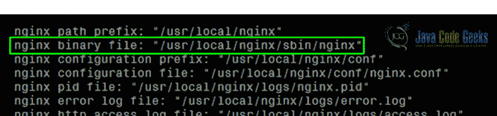

图 1.5：Nginx 安装路径

- `make`
- `make install`

即使安装完成，Nginx 所在的目录也尚未被添加到 `PATH` 环境变量中（见图 1.6）


图 1.6：PATH 变量（安装前）

现在让我们将 `/usr/local/nginx/sbin` 目录添加到 `PATH` 变量中，并检查我们刚刚从源代码安装的 Nginx 版本（见图 1.7）。


图 1.7：PATH 变量（安装后）及从源代码安装的 Nginx v1.5.6

**注意：** 在配置过程中，系统可能会抱怨缺少库（见图 1.8）。在这种情况下，我们可以选择安装提供这些库的软件包（在我们的例子中，是 `libpcre3-dev` 和 `zlib1g-dev`），或者在配置期间忽略它们。

```
checking for PCRE library ... not found
checking for PCRE library in /usr/local/ ... not found
checking for PCRE library in /usr/include/pcre/ ... not found
checking for PCRE library in /usr/pkg/ ... not found
checking for PCRE library in /opt/local/ ... not found
.
./configure: error: the HTTP rewrite module requires the PCRE library.
You can either disable the module by using --without-http_rewrite_module
option, or install the PCRE library into the system, or build the PCRE library
statically from the source with nginx by using --with-pcre=<path> option.
root@debian:~/nginx-1.5.6#
```


### 1.4 在 Ubuntu 12.04 LTS 上安装 Nginx

虽然 Ubuntu 的最新版本是 13.10（*Saucy Salamander* 代号，发布于 2013 年 10 月 17 日），但我们选择在 Ubuntu 12.04 LTS（*Precise Pangolin* 代号）上进行安装，因为 Canonical 为其提供了直到 2017 年 4 月的延长支持。

我们将使用 `sudo aptitude update` 更新源，然后从发行版的在线软件仓库安装 `nginx-full`。在 Ubuntu 中必须添加 `sudo` 关键字，因为 root 账户默认是禁用的（见图 1.9）。除此之外，安装过程与我们刚刚在 Debian 上执行的过程不会有显著差异。从源代码安装也是如此。

```
gacanepa@ubuntuOS:~$ sudo aptitude install nginx-full
The following NEW packages will be installed:
  nginx-common{a} nginx-full
0 packages upgraded, 2 newly installed, 0 to remove and 72 not upgraded.
Need to get 400 kB of archives. After unpacking 1,101 kB will be used.
Do you want to continue? [Y/n/?]
```


然而，我们可以看到在这种情况下可用的版本甚至更加过时（见图 1.10）。

```
gacanepa@ubuntuOS:~$ nginx -v
nginx version: nginx/1.1.19
gacanepa@ubuntuOS:~$
```


和以前一样，在进行从源代码安装之前，我们将移除（卸载）所有与 nginx 相关的软件包（见图 1.11）。

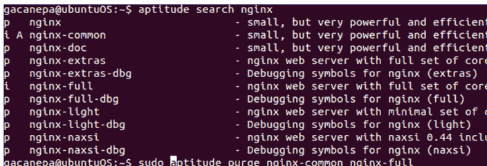

图 1.11：截图

和以前一样，从源代码安装 Nginx 后，我们拥有了该软件包的最新且更新到当下的版本（见图 1.12）：

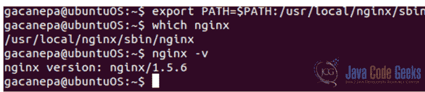

图 1.12：截图

然而，当涉及到启动 Nginx 时——正如我们在 Debian 中尝试启动时会发生的那样——我们很可能会得到一个 **nginx: unrecognized service**（Nginx：未识别的服务）错误消息（见图 1.13）。


图 1.13：截图

这是因为我们从源代码安装了该程序，因此启动脚本尚未就位。在这种情况下，我们可以通过使用完整路径从命令行运行主可执行文件（`/usr/local/nginx/sbin/nginx`）来启动 *nginx* 守护进程，或者编写一个脚本来处理这项工作——当然，最后一种选项代表了最佳选择，因为我们希望能够使用所有常规参数（`start, stop, restart, reload` 等）。此外，我们也可以直接使用随本教程提供的启动脚本之一（我们还可以对其进行修改以更好地满足我们的需求）。

一旦我们将脚本添加到 `/etc/init.d` 目录中（并将其命名为 `nginx`），我们需要将 `DAEMON` 变量更改为指向 `/usr/local/nginx/sbin/nginx`，并将安装目录（`/usr/local/nginx/sbin`）包含在 `PATH` 变量中（见图 1.14 和 1.15）：

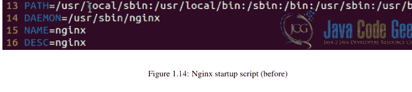

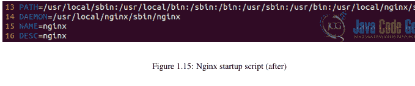

然后我们可以按如下方式运行该脚本（见图 1.16）：

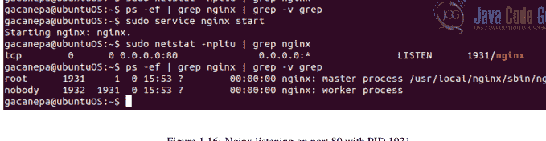

此外，我们需要确保 `nginx.conf` 文件“知道”在哪里找到 Nginx 的 PID。取消 `nginx.conf` 中以下行的注释（见图 1.18，很可能位于 `/usr/local/nginx/conf`），并将路径更改为启动脚本指示的路径（见图 1.17）：


start-stop-daemon --start --quiet --pidfile /var/run/$NAME.pid \
--exec $DAEMON -- $DAEMON_OPTS || true
echo "$NAME."
;;


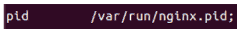


### 1.5 使用 checkinstall 包跟踪安装脚本创建或修改的所有文件

checkinstall 包（见图 1.19）会跟踪安装过程中创建或修改的所有文件。它还会创建并安装一个与你的包管理器兼容的包（.deb 或 .rpm）（见图 16 和 17），如果你不再需要该包，以后可以用它来完全移除。有关其使用细节，请查阅附带的手册页。

```
gacanepa@ubuntuOS:~/nginx-1.5.6$ sudo aptitude install checkinstall
[sudo] password for gacanepa:
The following NEW packages will be installed:
build-essential[?] checkinstall dpkg-dev[?] fakeroot[?] g++[?] g++-4.6[?] libalgorithm-diff-perl[?] libalgorithm-diff-xs-perl[?] libalgorithm-merge-perl[?] libdpkg-perl[?] libstdc++6-4.6-dev[?]
0 packages upgraded, 11 newly installed, 0 to remove and 72 not upgraded.
Need to get 9,326 kB of archives. After unpacking 27.7 MB will be used.
Do you want to continue? [Y/n/?] Y
```


```
gacanepa@ubuntuOS:~/nginx-1.5.6$ sudo checkinstall -D make install
checkinstall 1.6.2, Copyright 2009 Felipe Eduardo Sanchez Diaz Duran
this software is released under the GNU GPL.

The package documentation directory ./doc-pak does not exist.
Should I create a default set of package docs? [y]: y
Preparing package documentation...OK
```

图 1.20：使用 checkinstall 和 make install 创建 .deb 文件（I）

```
Done. The new package has been installed and saved to
/home/gacanepa/nginx-1.5.6/nginx_1.5.6-1_i386.deb
You can remove it from your system anytime using:
dpkg -r nginx
```

图 1.21：使用 checkinstall 和 make install 创建 .deb 文件（II）

当我们运行 `aptitude search nginx` 时，刚刚安装的包将会出现，并带有我们添加的描述注释（见图 1.22）：

```
gacanepa@ubuntuOS:~/nginx-1.5.6$ aptitude search nginx
i   nginx                                   - Nginx v1.5.6
p   nginx-common                            - small, but very powerful and efficient web server (co
p   nginx-doc                               - small, but very powerful and efficient web server (co
```

图 1.22：截图

### 1.6 在 CentOS 6.4 中安装 Nginx

#### 1.6.1 从软件仓库安装

- 从 `http://nginx.org/packages/centos/6` 下载并安装 nginx yum 配置文件。请确保选择了正确的架构；`"noarch"` 是一个安全的选择：
  - 下载：`wget http://nginx.org/packages/centos/6/noarch/RPMS/nginx-release-centos-6-0.el6.ngx.noarch.rpm`
  - 安装：`rpm -ivh nginx-release-centos-6-0.el6.ngx.noarch.rpm`
  - 安装 nginx：`yum install nginx`
  - 启动 nginx：`service nginx start`

#### 1.6.2 从源代码安装

遵循与 Debian 和 Ubuntu 相同的步骤。

#### 1.6.3 启用模块

根据其 wiki（NGINX Wiki 页面），Nginx 模块必须在编译时选择，因为目前不支持运行时选择模块。有关编译时选项的完整摘要（包括可选模块），可以通过运行 `./configure --help` 在提供的 configure 脚本中找到。不幸的是，如果我们已经安装了 Nginx 并希望添加某个模块，我们将不得不卸载它，然后重新编译以支持所需的模块。

标准 HTTP 模块列表请参考表 1（NGINX 模块）：

表 1.1：标准 HTTP 模块

| 名称 | 描述 | 版本 | 启用 configure 参数 |
| :--- | :--- | :--- | :--- |
| Map | 使用任意键/值对设置配置变量。 | 0.3.16 | --without-http_map_module |
| Memcached | Memcached 支持。 | | --without-http_memcached_module |
| Proxy | 代理到上游服务器。 | | --without-http_proxy_module |
| Referer | 根据 Referer 头部过滤请求。 | | --without-http_referer_module |
| Rewrite | 使用正则表达式重写请求。 | | --without-http_rewrite_module |
| SCGI | SCGI 协议支持。 | 0.8.42 | --without-http_scgi_module |
| Split Clients | 根据某些条件拆分客户端 | 0.8.37 | --without-http_split_clients_module |
| SSI | 服务器端包含。 | | --without-http_ssi_module |
| Upstream | 用于负载均衡。 | | --without-http_upstream_ip_hash_module<br>(仅 ip_hash 指令) |
| User ID | 发出标识 cookie。 | | --without-http_userid_module |
| uWSGI | uWSGI 协议支持。 | 0.8.40 | --without-http_uwsgi_module |
| X-Accel | 类似 X-Sendfile 的模块。 | | |

可选 HTTP 模块列表请参考表 2：

表 1.2：可选 HTTP 模块

| 名称 | 描述 | 版本 | 启用 configure 参数 |
| :--- | :--- | :--- | :--- |
| Addition | 向页面追加文本。 | | --with-http_addition_module |
| Auth Request | 基于子请求结果实现客户端授权。 | 1.5.4 | --with-http_auth_request_module |
| Degradation | 允许在低内存条件下为某些位置返回 204 或 444 代码。 | 0.8.25 | --with-http_degradation_module |
| Embedded Perl | 在 Nginx 配置文件中 Perl。 | 0.3.21 | --with-http_perl_module |
| FLV | Flash Streaming Video | 0.4.7 | --with-http_flv_module |
| GeoIP | 创建包含来自 MaxMind GeoIP 二进制文件信息的变量。 | 0.8.6, 0.7.63 | --with-http_geoip_module |
| Google PerfTools | Google Performance Tools 支持。 | 0.6.29 | --with-google_perftools_module |
| Gzip Precompression | 提供静态文件的预压缩版本。 | 0.6.23 | --with-http_gzip_static_module |
| Gunzip | 即时解压 gzip 压缩的响应。 | 1.3.6 | --with-http_gunzip_module |
| Image Filter | 使用 Libgd 转换图像 | 0.7.54 | --with-http_image_filter_module |
| MP4 | 启用具有寻址能力的 mp4 流媒体。 | 1.1.3, 1.0.7 | --with-http_mp4_module |
| Random Index | 随机化目录索引。 | 0.7.15 | --with-http_random_index_module |
| Real IP | 用于将 nginx 作为后端 | 0.3.8 | --with-http_realip_module |
| Secure Link | 使用密钥保护页面 | 0.7.18 | --with-http_secure_link_module |
| SSL | HTTPS/SSL 支持。 | | --with-http_ssl_module |
| Stub Status | 查看服务器统计信息。 | 0.1.18 | --with-http_stub_status_module |
| Substitution | 替换页面中的文本 | | --with-http_sub_module |
| WebDAV | WebDAV 直通支持。 | 0.3.38 | --with-http_dav_module |
| XSLT | 使用 XSLT 后处理页面。 | 0.7.8 | --with-http_xslt_module |

邮件模块列表请参考表 3：

表 1.3：邮件模块

| 名称 | 描述 | configure 参数 |
| :--- | :--- | :--- |
| Mail Core | 邮件模块核心参数。 | --with-mail |
| POP3 | POP3 设置。 | --without-mail_pop3_module |
| IMAP | IMAP 设置。 | --without-mail_imap_module |
| SMTP | SMTP 设置。 | --without-mail_smtp_module |
| Auth HTTP | 使用 Nginx 验证邮件服务。 | |
| Proxy | Nginx 可以代理 IMAP、POP3 和 SMTP 协议。 | |
| SSL | 此模块确保 POP3/IMAP/SMTP 的 SSL/TLS 支持。 | --with-mail_ssl_module |

作为一个例子，我们将重新编译 Nginx 以包含 Addition 模块（见图 1.23）：


图 1.23：使用 Addition 模块重新编译 Nginx

### 1.7 将 Nginx 添加为系统服务

- Debian / Ubuntu：`update-rc.d -f nginx defaults`（在 Ubuntu 上使用 sudo）

注意：如果 /etc/rcrunlevel.d/[SK]?name 中已存在任何文件，则 update-rc.d 不会执行任何操作。该程序之所以这样编写，是因为它永远不会更改可能由系统管理员自定义的现有配置。该程序只有在链接不存在时才安装链接，即看起来该服务从未被安装过。

- CentOS：`chkconfig nginx on`

## 第 2 章

### Nginx 配置指南

#### 2.1 配置文件语法

根据 Merriam-Webster 在线词典，单词 syntax 代表“单词组合成短语、从句或句子的方式”。当然，这个定义取自词典，是针对英语（或实际上任何其他语言）学习者的。那么，来自不同背景、语言和国家的 IT 人士呢？上下文的变化并没有显著改变该术语的含义。特别是，配置文件的语法必须是正确的，正如解析它的程序所看到的那样，以便它能高效地工作。

我们将学习如何理解以及如何编写（和/或修改）Ubuntu 12.04 LTS 下 Nginx 的配置文件。这将通过指定一组定义 web 服务器行为的值来实现。

#### 2.2 配置指令

默认情况下，Nginx 的行为由其主配置文件定义，该文件位于（正如之前所见，除非我们修改了此设置）`/usr/local/nginx/conf/nginx.conf`。该文件由一组指令组成，这些指令组织在一个非常易于理解其逻辑结构中（见图 2.1）。


#### 2.3 结构与包含

以“#”开头的行是注释，换句话说，就是程序在执行期间不会解释的文本字符串。你可以注释掉整行，也可以在行后添加简短的注释来阐明其预期功能。

下一行显示了一个指令，本例中为 worker_processes，它代表一个配置项，我们将根据语法向其附加一个或多个值。实际上，worker_processes 指令只接受一个参数，该参数需要是一个数值。指令的另一个例子是 user（在前一行中被注释掉了）。user 指令允许我们添加最多 2 个文本字符串——第一个是必需的，指示 Nginx 将以其身份运行的用户账户；第二个是可选的（用户组）。我们需要从一开始就记住，每个指令都有自己特定的含义，并定义了应用程序的某个特定特性。

构成 Nginx 的每个模块都有特定的一组指令。当新模块被激活时，其特定的一组指令变得可用，指令块也可能被启用。

指令块正是如此：一个文本块，它允许我们指定配置的逻辑结构，并允许我们使用继承。这意味着在某个块中找到的配置也会传递到其子块中。然而，在子块内部，你仍然可以更改其父块中定义的指令的值。

在图 2.2 和 2.3 中，我们看到对网站根目录（/）的所有访问都保存在 /home/gacanepa/nginx-1.5.6/html/access_log 中，除了对应指令块中名为 restricted 目录的访问（注意指令 access_log off）。

**图 2.1：Nginx 主配置文件 (nginx.conf)**

```nginx
user nobody;
worker_processes 1;

#error_log logs/error.log;
#error_log logs/error.log notice;
#error_log logs/error.log info;

pid /var/run/nginx.pid;

events {
    worker_connections 1024;
}

http {
    include mime.types;
    default_type application/octet-stream;
}
```

**图 2.2：嵌套指令块**

```nginx
server {
    listen    80;
    server_name localhost;
    root /home/gacanepa/nginx-1.5.6/html;
    access_log /home/gacanepa/nginx-1.5.6/html/access_log;
    location / {
        index index.html index.htm;
    }
    location /restricted {
        index index.html index.htm;
        access_log off;
    }
}
```

**图 2.3：访问日志**

```bash
gacanepa@ubuntuOS:~/nginx-1.5.6/html$ ls -l
total 20
-rw-r--r-- 1 gacanepa gacanepa  537 Oct  1 10:44 50x.html
-rw-r--r-- 1 root     root     157 Oct 31 15:41 access_log
-rw-rw-r-- 1 gacanepa gacanepa   9 Oct 30 12:23 add.html
-rw-rw-r-- 1 gacanepa gacanepa 612 Oct  1 10:44 index.html
-rw-r--r-- 1 root     root     306 Oct 31 15:50 main_access_log
gacanepa@ubuntuOS:~/nginx-1.5.6/html$ cat access_log
127.0.0.1 - [31/Oct/2013:15:41:59 -0300] "GET /50x.html HTTP/1.1" 404 168 "-" "Mozilla/5.0 (X11; Ubuntu; Linux 1686; rv:23.0) Gecko/20100101 Firefox/23.0"
gacanepa@ubuntuOS:~/nginx-1.5.6/html$ cat main_access_log
127.0.0.1 - [31/Oct/2013:15:49:31 -0300] "GET / HTTP/1.1" 304 0 "-" "Mozilla/5.0 (X11; Ubuntu; Linux 1686; rv:23.0) Gecko/20100101 Firefox/23.0"
127.0.0.1 - [31/Oct/2013:15:50:13 -0300] "GET /index.html HTTP/1.1" 200 612 "-" "Mozilla/5.0 (X11; Ubuntu; Linux 1686; rv:23.0) Gecko/20100101 Firefox/23.0"
gacanepa@ubuntuOS:~/nginx-1.5.6/html$
```

让我们关注第 17 行。那里有一个特殊指令：include。该指令用于在此确切位置插入指定文件的内容。文件名可以通过绝对路径或相对于当前目录的相对路径（本例中即为如此）来指定。我们可以看到，在 nginx.conf 所在的同一目录中有一个名为 mime.types 的文件（参见图 2.4）。

**图 2.4：截图**

```bash
gacanepa@ubuntuOS:/usr/local/nginx/conf$ ls -l
total 36
-rw-r--r-- 1 root root 1034 Oct 30 11:35 fastcgi.conf
-rw-r--r-- 1 root root  964 Oct 30 11:35 fastcgi_params
-rw-r--r-- 1 root root 2837 Oct 30 11:35 koi-utf
-rw-r--r-- 1 root root 2223 Oct 30 11:35 koi-win
-rw-r--r-- 1 root root 3815 Oct 30 11:35 mime.types
-rw-r--r-- 1 root root 2700 Oct 31 13:43 nginx.conf
-rw-r--r-- 1 root root  596 Oct 30 11:35 scgi_params
-rw-r--r-- 1 root root  623 Oct 30 11:35 uwsgi_params
-rw-r--r-- 1 root root 3610 Oct 30 11:35 win-utf
gacanepa@ubuntuOS:/usr/local/nginx/conf$
```

最终结果与实际将 `mime.types` 的内容插入到 `nginx.conf` 文件中所达到的结果相同。当然，如果我们这样做，主配置文件很快就会变得难以阅读。通过这种方式，include 指令帮助我们确保 `nginx.conf` 文件保持易于阅读和理解。此外，它还递归工作，即被包含的文件可以引用另一个文件，依此类推；它还支持*文件名通配符*，这意味着它识别并扩展标准的通配符字符（* 和 ?）以及方括号中的字符列表。例如，这样我们可以添加多个配置文件，如 `20131030.conf`、`20131031.conf` 和 `20131101.conf`。如果我们只想包含以 201310 开头的文件，我们必须将以下行添加到 `nginx.conf` 文件中（参见图 2.5）：

**图 2.5：使用通配符包含文件**

```bash
root@debian:~# nginx -v
nginx version: nginx/1.2.1
root@debian:~#
```

然而，如果我们添加了一个特定的文件（并非通过*文件名通配符*）且该文件不存在，Nginx 将无法正确启动（参见图 2.6）。否则，我们将看到一个“测试成功”的消息（参见图 2.7）：

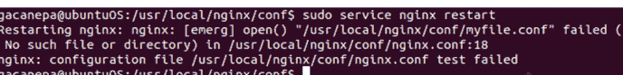

**图 2.6：由于缺少包含文件导致 Nginx 重启失败**

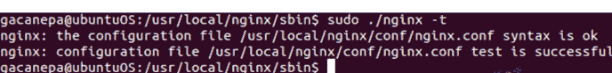

**图 2.7：配置文件的语法测试已成功完成**

#### 2.4 基础模块

基础模块允许我们定义 Nginx 的基本参数和配置。它们在编译时自动内置于 Nginx 中。它们的指令和块始终可用。基础模块有三种类型：

-   核心模块包含必需的指令和功能。其大多数指令必须放置在配置文件的根（即顶部），并且只使用一次。表 2.1 展示了核心模块中的一些指令及其简要说明和上下文（如果未指定上下文，则实际上下文为全局，且指令必须放置在配置文件的根）。

**表 2.1：一些核心模块指令**

| 指令/上下文 | 语法和描述 |
| :--- | :--- |
| `daemon` | 接受的值：on / off 语法：`daemon on;` 启用或禁用守护进程模式（分别表示在后台或前台启动程序）。对于排查问题很有用。 |
| `env` | 语法：`env MY_VARIABLE=my_value;` 允许我们定义或设置环境变量。 |
| `error_log` | 上下文：`main`、`http`、`server` 和 `location`<br>语法：`error_log /path/to/file level`（其中 level 可以是以下值之一：debug, info, notice, warn, error, 和 crit，具体取决于我们希望保存在日志文件中的错误类型）。要禁用错误记录，请将日志输出重定向到 /dev/null：`error_log /dev/null crit;` |
| `master_process` | 接受的值：on / off 默认值：on 如果启用（on），Nginx 将同时启动主进程和工作进程。如果禁用，Nginx 将以单一进程运行。这仅用于调试目的，并会导致客户端无法连接到服务器。 |
| `pid` | 语法：`file path` 默认值：在编译时定义。存储 Nginx PID 的文件路径。 |
| `user` | 语法：`user username groupname; user username;` 允许你定义用于启动工作进程的用户账户以及可选的用户组。出于安全原因，此处必须使用权限受限的用户/组。 |
| `worker_processes` | 语法：`numeric` 或 `auto`（默认值），例如：`worker_processes 4;` 定义工作进程的数量。如果某个进程因某种原因被阻塞，未来的请求可以由其他工作进程处理。如果使用值 `auto`，Nginx 将选择合适的值（默认情况下，它是检测到的 CPU 核心数量）。 |
| `worker_priority` | 语法：`Numeric` `worker_priority 0;` 定义操作系统视角下工作进程的优先级，范围从 -20（最高）到 19（最低）。 |

-   events 模块允许我们配置 Nginx 网络功能的操作。这些指令必须放置在配置文件的根内的 events 块中（参见图 2.8）。表 2.2 展示了该模块中可用的两个指令。

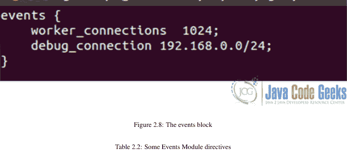

**表 2.2：一些 events 模块指令**

| 指令/上下文 | 语法和描述 |
| :--- | :--- |
| `worker_connections` | 语法：`Numeric` 定义工作进程可同时处理的连接数量。 |
| `debug_connection` | 语法：`IP address` 或 `CIDR block`。`debug_connection 192.168.0.0/24` 为匹配此 IP 地址或 CIDR 块的客户端写入详细日志。信息保存在 `error_log` 指令定义的文件中（必须使用 `debug` 级别启用，并且 Nginx 必须使用 `--debug` 开关编译才能启用此指令）。 |


#### 2.5 HTTP 服务器

**配置**模块通过 include 指令启用文件包含功能，如前所述。该指令可以放置在配置文件的任何位置，并且只接受一个参数：相对于当前工作目录的文件路径（除非指定了从 / 目录开始直到目标文件的完整路径）。

Web 服务器本身使用 HTTP Core 模块中的指令进行配置。该模块是 HTTP 配置的核心组件，它允许我们——除了其他功能外——提供多个网站，这些网站被称为虚拟主机。它由三个主要块组成（见图 2.9）：

- **http**：必须放置在配置文件的根位置。用于定义与 Nginx Web 服务器功能相关的指令和块。
- **server**：必须插入在 http 块内部，用于声明一个特定的网站。
- **location**：允许我们定义一组应用于网站某些部分的设置。此块可以在 server 块内使用，也可以嵌套在另一个 location 块内部。

```nginx
gacanepa@ubuntuOS:/usr/local/nginx/conf$
http {
    include    mime.types;
    default_type application/octet-stream;
    #access_log logs/access.log main;
    sendfile     on;
    keepalive_timeout  65;
    server {
        listen       80;
        server_name  localhost;
        root  /home/gacanepa/nginx-1.5.6/html;
        access_log  /home/gacanepa/nginx-1.5.6/html/access_log;
        location / {
            index index.html index.htm;
        }
        location /restricted {
            index index.html index.htm;
            access_log off;
        }
        error_page   404 /404.html;
    }
}
```


#### 2.6 邮件服务器代理

为了充当邮件服务器（默认未启用），必须使用 `./configure` 中的 `--with-mail`（该选项启用支持 POP3、IMAP4 和 SMTP 的邮件服务器代理模块）选项来编译 Nginx。如果出于某种原因这是 Nginx 在我们系统中的唯一用途，可以使用 `--without-http` 开关来禁用 HTTP Core 模块。

在图 2.10 中，我们可以看到 mail 块的一部分，它用于设置邮件服务器的配置。可以在 IANA（互联网号码分配机构）网站上找到 imap、pop3 和 smtp 协议的功能及详细描述。

```nginx
gacanepa@ubuntuOS:/usr/local/nginx/conf

mail {
    server_name     mail.gabrielapecanepa.com.ar;
    auth_http       localhost:9000/auth.php;
    imap_capabilities IMAP4rev1 UIDPLUS IDLE QUOTA+;

    pop3_auth       plain apop cram-md5;
    pop3_capabilities LAST TOP USER PIPELINING UIDL;

    smtp_auth       login plain cram-md5;
    smtp_capabilities "SIZE 16485760" ENHANCEDSTATUSCODES 8BITMIME DNS;

    server {
        listen 25;
        protocol smtp;
    }
    server {
        listen 110;
        protocol pop3;
        proxy_pass_error_message on;
    }
    server {
        listen 143;
```

图 2.10：mail 块

#### 2.7 虚拟主机

如前所述，虚拟主机是由 Nginx 在单台服务器上提供的特定网站。设置虚拟主机的第一步是在主配置文件中创建一个或多个 server 块。这些 server 块通过主机名或通过 IP 地址和端口号的组合来标识（见图 2.11）。

```nginx
server {
    listen      80;
    server_name ngixtest.com;
    root    /home/gacaneepa/nginx-1.5.6/html;
    access_log  /home/gacaneepa/nginx-1.5.6/html/access_log;
    location / {
        index index.html index.htm;
    }
    location /restricted {
        index   index.html index.htm;
        access_log off;
    }
}
```

图 2.11：创建用于提供虚拟主机的 server 块

接下来，我们需要设置虚拟主的主配置文件。Nginx 的默认安装提供了一个示例文件（位于 /etc/nginx/sites-available/default），我们将复制该文件并以我们的网站命名：

```bash
sudo cp  /etc/nginx/sites-available/default /etc/nginx/sites-available/nginxtest.com
```

然后需要做的就是编辑该示例文件（nginxtest.com），其中基本上包含与 nginx.conf 文件中找到的相同信息（见图 2.12）。


图 2.12：虚拟主机配置文件

现在必须通过在 sites-enabled 目录中为此文件创建一个符号链接来启用该虚拟主机：

```bash
sudo ln -s /etc/nginx/sites-available/nginxtest.com /etc/nginx/sites-enabled/nginxtest.com
```

为避免冲突，我们还可以删除 sites-enabled 目录中名为 default 的文件：

```bash
sudo rm /etc/nginx/sites-enabled/default
```

现在让我们重启 Nginx 并看看会发生什么！（图 2.13）

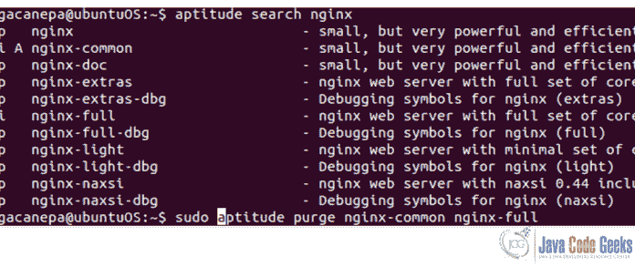


图 2.13：我们的第一个虚拟主机正在运行

若要添加更多虚拟主机，我们只需逐步重复上述过程，并注意设置具有相应域名且新的文档根目录，然后像我们在 nginxtest.com 网站中所做的那样创建并激活新的虚拟主机文件。

## 第 3 章

## Nginx 和 Apache

### 3.1 引言

Nginx 和 Apache 当然可以协同工作，它们并不一定相互替代成为我们首选的 Web 服务器。此解决方案具有许多优势，并解决了大多数系统管理员熟悉的问题，例如减速和复杂的配置。你只需查看一下 Apache 的配置文件，很可能你会同意我的观点！

### 3.2 Nginx 作为反向代理

反向代理是放置在客户端和服务器之间的网络设备或服务。传入的请求由代理处理，该代理代表客户端与服务器上托管的目标服务器或服务进行交互¹。在这种情况下，Nginx 将在客户端（例如你的计算机）和后端 Web 服务器 Apache 之间充当反向代理（见图 3.1）。


图 3.1：Nginx 充当反向代理

在上述图中，Nginx 充当反向代理（或者说前端服务器），并接收来自外部世界的所请。在此阶段，这些请求可以被过滤或“传递”给后端中充当 HTTP 客户端的 Apache。这两个服务甚至可以托管在同一台物理服务器上，但需注意为每个服务使用不同的监听端口。整个操作由 Nginx 的 proxy 模块处理。

将 Nginx 设置为前端服务器，并给予 Apache 简单的后端角色的主要目的是提高服务速度，因为考虑到来自客户端的大量请求都是针对静态文件（html 页面、层叠样式表、普通图像等），而 Nginx 提供静态文件的速度快得多。客户端和服务器端的整体性能都显著提高。

### 3.3 Nginx 代理模块

幸运的是，proxy 模块在 Nginx 安装过程中默认是启用的。该模块的主要指令见表 3.1。

表 3.1：proxy 模块的主要指令

| 指令/上下文 | 描述 |
| :--- | :--- |
| proxy_buffers<br>上下文: http, server, location | 通过指定其位置将请求发送到后端服务器。语法：TCP 套接字：proxy_pass http://hostname:port; UNIX 域套接字：proxy_pass http://unix:/path/to/file.sock;（对于安全流量可以使用 https 代替 http）示例：proxy_pass http://localhost:8080; proxy_pass http://127.0.0.1:8080; proxy_pass http://unix:/tmp/nginx.sock; |
| proxy_method | 允许覆盖要转发到后端服务器的请求的 HTTP 方法。语法：proxy_method method; 示例：proxy_method POST; |
| proxy_hide_header<br>上下文: http, server, location | 默认情况下，当 Nginx 准备将从后端服务器接收到的响应转回给客户端时，它会忽略某些 http 头部⁴。使用此指令，你可以指定要从客户端隐藏的额外头行。此指令可以多次插入，每次指定一个头名称。语法：proxy_hide_header header_name; 示例：proxy_hide_header Cache-Control; |
| proxy_pass_header<br>上下文: http, server, location | 强制将某些被忽略的头部传递给客户端。语法：proxy_pass_header header_name; 示例：proxy_pass_header Date; |
| proxy_pass_request_body<br>proxy_pass_request_headers<br>上下文: http, server, location | 分别定义是否将请求体和额外的请求头传递到后端服务器。语法：on 或 off; |
| proxy_redirect<br>上下文: http, server, proxy_cache location | 允许你重写由后端服务器触发的重定向中出现在 Location HTTP 头部的 URL。语法：off, default, 或你选择的 URL off: 重定向按原样转发。default: 使用 proxy_pass 指令的值作为主机名，并附加当前文档路径。请注意，proxy_redirect 指令必须插入在 proxy_pass 指令之后，因为配置是按顺序解析的。URL: 用另一个部分替换 URL 的一部分。此外，你可以在重写的 URL 中使用变量。示例：proxy_redirect off; proxy_redirect default; proxy_redirect http://localhost:8080/ http://mysite.com/; |

最佳场景是尽可能限制转发到后端服务器的请求数量。为此，proxy 模块附带了一组指令，帮助我们构建缓存系统，并控制缓冲选项以及 Nginx 处理临时文件的方式（关于这些指令的更多信息见表 3.2）。


## 表 3.2：一些缓存/缓冲指令

| 指令/上下文 | 描述 |
|---|---|
| proxy_pass<br>上下文：location, if | 设置用于从后端服务器读取响应数据的缓冲区数量和大小。如果缓冲区不够大，数据将被保存到磁盘，然后再提供给用户。<br>语法：`proxy_buffers amount size;`<br>默认值：8 个缓冲区，每个 4k 或 8k，取决于平台<br>示例：`proxy_buffers 8 4k;` |
| proxy_method | 设置用于读取后端服务器响应开头的缓冲区大小，其中通常包含简单的头部数据。<br>语法：数值（大小）<br>示例：`proxy_buffer_size 4k;` |
| proxy_cache_key<br>上下文：http, server, location | 该指令定义缓存键，换句话说，它用于区分不同的缓存条目。<br>语法：`proxy_cache_key key;`<br>示例：`proxy_cache_key "$scheme$host$request_uri $cookie_user";`<br>注意：以“$”（美元符号）开头的字符串是变量。代理模块提供 4 个内置变量；其他变量可以由用户根据需要创建。 |
| proxy_cache<br>上下文：http, server, location | 定义用于缓存的共享内存区域。同一个区域可以在多个地方使用。`off` 参数会禁用从上一级配置继承的缓存。<br>语法：`proxy_cache zone off;`<br>默认值：`proxy_cache off;` |
| proxy_cache_path<br>上下文：http | 设置缓存的路径和其他参数。缓存数据存储在文件中。缓存中的键和文件名都是对代理 URL 应用 MD5 函数后的结果。`levels` 参数定义缓存的层次级别。<br>语法：`proxy_cache_path path [levels=levels] keys_zone=name:size [inactive=time] [max_size=size] [loader_files=number] [loader_sleep=time] [loader_threshold=time];` [可选参数用方括号标示]<br>示例：`proxy_cache_path /tmp/nginx_cache levels=1:2 zone=zone1:10m inactive=10m max_size=200M;` |
| proxy_cache_min_uses<br>上下文：http, server, location | 定义请求在被缓存之前需要的最小命中次数。默认情况下，请求的响应在一次命中后（下次具有相同缓存键的请求将收到缓存的响应）会被缓存。<br>语法：数值<br>示例：`proxy_cache_min_uses 1;` |

还有许多指令允许你定义 Nginx 在遇到超时或其他与后端服务器通信限制时的行为（见表 3.3）。

## 表 3.3：一些关于与后端服务器（Apache）通信的指令

| 指令/上下文 | 描述 |
|---|---|
| proxy_connect_timeout<br>上下文：http, server, location | 定义后端服务器连接超时。这与读/写超时不同。如果 Nginx 已经连接到后端服务器，`proxy_connect_timeout` 将不适用。需要注意的是，这个超时通常不能超过 75 秒。<br>语法：时间值（秒）<br>示例：`proxy_connect_timeout 15;` |
| proxy_read_timeout<br>上下文：http, server, location | 定义从代理服务器读取响应的超时。超时仅在两次连续的读取操作之间设置，而不是针对整个响应的传输。如果代理服务器在此时间内没有传输任何数据，连接将被关闭。<br>语法：时间值（秒）<br>默认值：60<br>示例：`proxy_read_timeout 60;` |
| proxy_send_timeout<br>上下文：http, server, location | 此超时用于向前端服务器发送数据。超时不适用于整个响应延迟，而是在两次写操作之间应用。<br>语法：时间值（秒）<br>默认值：60<br>示例：`proxy_send_timeout 60;` |
| proxy_ignore_client_abort<br>上下文：http, server, location | 决定当客户端在等待响应前关闭连接时，是否应关闭与代理服务器的连接。如果设置为 `on`，Nginx 将继续处理代理请求，即使客户端中断其请求。在另一种情况（`off`）下，当客户端中断其请求时，Nginx 也会中断其向后端服务器的请求。<br>默认值：`off` |

### 3.4 关于变量的说明

代理模块附带以下变量，可作为上述指令的参数使用：

- `$proxy_host`：后端服务器的主机名。
- `$proxy_port`：后端服务器的端口。
- `$proxy_add_x_forwarded_for`：包含用逗号分隔的客户端请求头 "X-Forwarded-For" 和 $remote_addr。如果没有 X-Forwarded-For 请求头，则 $proxy_add_x_forwarded_for 等于 $remote_addr。
- `$proxy_internal_body_length`：请求体的长度（通过 `proxy_set_body` 指令设置或为 0）。

### 3.5 配置 Apache

默认情况下，Web 服务器配置为监听 TCP 端口 80。因此，我们需要做的第一件事是修改 Apache 的设置，以避免与 Nginx（它将作为前端服务器运行）发生冲突。

在 Ubuntu 12.04 中，Apache 的主配置文件位于 `/etc/apache2` 目录下，名为 `ports.conf`（见图 3.2）。

```bash
gacanepa@ubuntuOS:/etc/apache2$
ls -l
total 72
-rw-r--r-- 1 root root 8346 Feb  7 2012 apache2.conf
drwxr-xr-x 2 root root 4096 Nov  2 21:24 conf.d
-rw-r--r-- 1 root root 1322 Feb  7 2012 envvars
-rw-r--r-- 1 root root    0 Nov  2 21:24 httpd.conf
-rw-r--r-- 1 root root 31063 Feb  7 2012 magic
drwxr-xr-x 2 root root 4096 Nov  2 21:24 mods-available
drwxr-xr-x 2 root root 4096 Nov  2 21:24 mods-enabled
-rw-r--r-- 1 root root  754 Nov  2 21:33 ports.conf
drwxr-xr-x 2 root root 4096 Nov  2 21:24 sites-available
drwxr-xr-x 2 root root 4096 Nov  2 21:24 sites-enabled
gacanepa@ubuntuOS:/etc/apache2$
```

图 3.2：Apache 配置文件

在我们的 Apache 配置中，有 3 个主要元素需要替换（见图 3.3 和 3.4）：

1. 必须将 Listen 指令更改为 80 以外的端口，例如 8080。
2. 以下配置指令存在于主配置文件中：
   `NameVirtualHost A.B.C.D:8080`
   其中 A.B.C.D 是主要网络接口的 IP 地址，服务器通信（前端和后端服务器之间）通过该接口进行。在这种情况下，我们使用环回接口及其 IP 地址，因为 Apache 和 Nginx 都安装在同一物理服务器上。如果你没有将 Apache 托管在同一服务器上，你需要指定可以通信的接口的 IP 地址，该接口可以与托管 Nginx 的服务器通信。
3. 刚刚选择的端口必须报告在所有我们的虚拟主机配置部分中（在 `/etc/apache2/sites-available/default` 中）。

```nginx
NameVirtualHost 127.0.0.1:8080
Listen 8080
```

图 3.3：截图

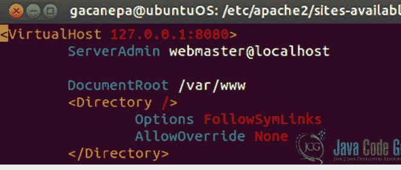

重启 Apache 后，我们可以打开 Web 浏览器并确认它正在监听端口 8080（见图 3.5）：

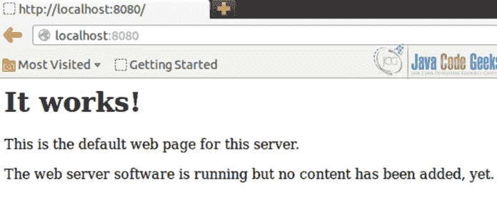

作为一项额外的安全措施，我们可以告诉 Apache 只处理来自前端服务器的请求。这可以通过 2 种方式完成：1) 系统范围 或 2) 建立按虚拟主机限制。

1. 如前所述，Apache 的 Listen 指令允许你指定端口，但也可以指定 IP 地址。然而，默认情况下没有选择 IP 地址，这导致来自所有接口的通信。你只需将 `Listen *:8080` 指令替换为 `Listen 127.0.0.1:8080`，Apache 将只监听本地 IP 地址。
2. 使用 `allow` 和 `deny` Apache 指令，我们可以定义哪些 IP 地址能够访问每个虚拟主机。一旦更改完成，必须重启 Apache（或重新加载其配置）才能反映我们刚刚做的更改。

### 3.6 配置 Nginx

我们在启用代理选项过程中使用的第一个指令是 `proxy_pass`。由于它不能在 http 或 server 级别使用，我们将把它包括在每个想要转发的位置。作为一个初步示例，我们将把所有针对受限文件夹的请求转发到 Apache Web 目录（/var/www）。见图 3.6 和 3.7、3.8 和 3.9：

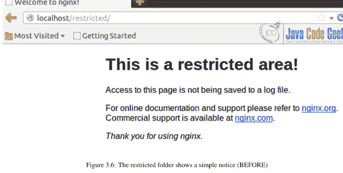

```nginx
server {
    listen 80;
    server_name nginxtest.com;
    root /home/gacanepa/nginx-1.5.6/html;
    access_log /home/gacanepa/nginx-1.5.6/html/access_log;
    location / {
        index index.html index.htm;
    }
    location /restricted {
        index index.html index.htm;
        access_log off;
    }
}
```

图 3.7：Nginx 主配置文件（之前）


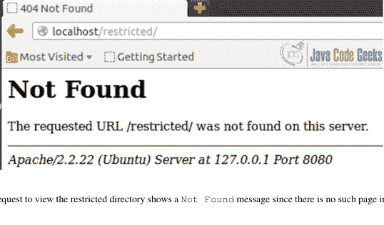

```nginx
server {
    listen 80;
    server_name nginxtest.com;
    root /home/gacanepa/nginx-1.5.6/html;
    access_log /home/gacanepa/nginx-1.5.6/html/access_log;
    location / {
        index index.html index.htm;
    }
    location /restricted {
        proxy_pass http://127.0.0.1:8080;
    }
}
```

图 3.9: Nginx 主配置文件（修改后）

## 3.7 内容分离

为了更好地利用这种 Nginx-Apache 设置，我们可以分离每个服务器在接收到请求时应提供的具体内容。

Apache 将提供动态文件，即那些在发送给客户端之前需要某种处理的文件，例如 php 文件、Python 脚本等。Nginx 将提供静态文件——所有其他不需要额外处理的内容（html 页面、层叠样式表、图像、媒体等）。

为此，请在 nginx.conf 文件中添加以下代码块（参见图 3.10）：

```
# proxy the PHP scripts to Apache listening on 127.0.0.1:8080
location ~ \.php$ {
proxy_pass http://127.0.0.1:8080;
}

# Serve directly: *.html, *.css, *.ico, *.png, *.jpeg,
# *.jpg, *.gif, *.swf, *.txt, *.pdf
location ~* \.(html|css|ico|png|jpeg|jpg|gif|swf|txt|pdf)$ {
root /home/gacanepa/nginx-1.5.6/html;
access_log /home/gacanepa/nginx-1.5.6/html/access_log;
}
```


当我们重启 Nginx 时，我们可能会遇到以下问题（参见图 3.11）：

```
gacanepa@ubuntuOS:/usr/local/nginx/conf$ sudo service nginx restart
[sudo] password for gacanepa:
Restarting nginx: nginx: [emerg] using regex "\.php$" requires PCRE library in /
usr/local/nginx/conf/nginx.conf:45
nginx: configuration file /usr/local/nginx/conf/nginx.conf test failed
```


我们将安装 `libpcre3-dev` 包中可用的 PCRE 库（参见[教程 1：在 Linux 上安装 Nginx](http://www.javacodegeeks.com/2014/07/tutorial-1-nginx-installation-on-linux.html)）。有关此包的详细信息，请参见图 3.12。安装完成后，我们需要重新编译 Nginx。

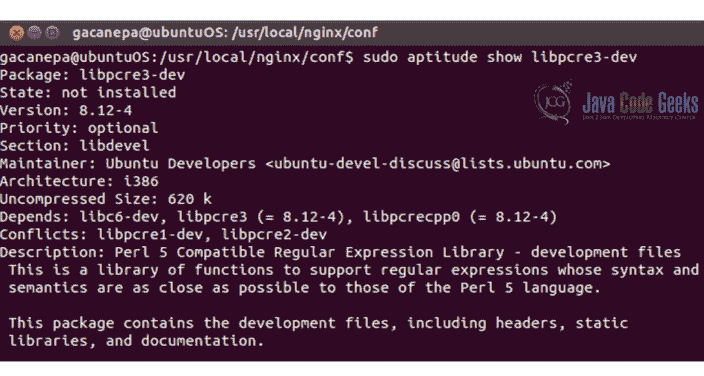

让我们在 `/var/www` 中创建一个示例 php 文件（参见图 3.13）：


现在，我们将 Web 浏览器指向 `http://localhost/test.php`。请注意，localhost 本身指向前端服务器，因此当它收到对 php 文件的请求时，它将把请求转发给 Apache（参见图 3.14）。

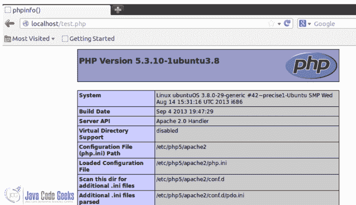

图 3.14: 对 php 文件的请求被转发到后端服务器

# 3.8 下载配置文件

在这里您可以下载本教程中使用的配置文件：[Config_files.zip](https://java-code-gEEKS.com)

## 第 4 章

### 使用 Nginx 进行负载均衡

#### 4.1 引言 - 负载均衡的需求

负载均衡是一种网络方法，用于将工作负载分布在多个计算资源上，例如服务器、服务器集群（一组协同工作的服务器，它们可以被视为单个系统）、网络链路、CPU 或其他硬件组件（[http://en.wikipedia.org/wiki/Load\_balancing\_(computing)](http://en.wikipedia.org/wiki/Load\_balancing\_(computing)) target=[维基百科条目]）。这项技术旨在通过减少（或更准确地说是平衡）单个服务器或节点的负担，从而提高后端应用的容量（支持大量并发用户）和可靠性。由于同样的原因，负载均衡还提供了冗余和灾难恢复能力。使用 Nginx，我们将设置一个第 7 层负载均衡器（它将根据应用层协议（如 HTTP 和 FTP）中找到的数据来分配请求）。

#### 4.2 必要的模块

为了设置负载均衡器，我们需要两个模块：proxy 模块和 upstream 模块。这两者默认都内置于 Nginx 中。

与之前一样，我们将使用位于 `/usr/local/nginx/conf` 目录中的 nginx.conf 文件。

##### 4.2.1 upstream 模块

在 `http { }` 内部插入一个 `upstream` 指令块（参见图 4.1）。您可以随意命名这个块（如下例中的 `app_rack`）。

```
http { include mime.types; default_type application/octet-stream; #access_log logs/access.log main; sendfile on; keepalive_timeout 65; upstream app_rack { server 10.0.2.13:8080; server 10.0.2.14:8080; server 127.0.0.1:8080; }
```

**图 4.1: 一个 upstream 块**

server 指令分配服务器的名称和参数。“名称”可以是域名、IP 地址、端口或 unix socket。如果域名解析为多个地址，则所有这些都会被使用。还有几个额外的参数可用，但我们稍后会探讨它们。

- **10.0.2.13** 是一台 Debian Wheezy 7.2 服务器的 IP 地址，其中 Apache 正在监听 8080 端口。
- **10.0.2.14** 是一台 CentOS 6.4 服务器的 IP 地址，其中 Apache 正在监听 8080 端口。
- 最后，**127.0.0.1** 是环回接口的 IP 地址，在该物理服务器上，Nginx 运行在 80 端口，而 Apache 监听 8080 端口。

这样我们就有了三台服务器——它们都运行一个简单的 PHP 脚本，可以由 Apache 的实例提供（参见图 4.2）。

正如我们前面提到的，出现在 **upstream** 块中的 server 指令接受多个参数，这些参数会影响 Nginx 的后端选择：

- **weight=n:** 如果将此参数放在服务器名称之后，该服务器将被选择“n 倍”的频率。
- **max_fails=n:** 这定义了应该在指定的时间框架内（使用下面的 fail_timeout 参数）发生多少次超时的连接，Nginx 才会认为该服务器不可操作。
- **fail_timeout=n:** 如果 Nginx 在 fail_timeout 秒内无法与后端服务器通信 max_fails 次，该服务器将被视为不可操作。
- **down:** 此服务器不再使用。仅当启用 ip_hash 指令时适用。
- **backup:** 如果后端服务器被标记为 backup，Nginx 不会使用该服务器，直到所有其他服务器（未标记为 backup 的服务器）宕机或不可操作。


图 4.2: Nginx 连接到多个后端服务器

**注意：** 使用 upstream 模块还有几个其他参数。有关更全面的列表，请参见 upstream 模块的在线文档。

话虽如此，如果我们希望确保来自同一访问者的所有请求始终由同一个后端服务器处理，我们需要在声明 upstream 块时启用 `ip_hash` 选项。

现在是时候“玩转”上面讨论的参数了。让我们看看修改后的 nginx.conf 文件（参见图 4.3 和图 4.4）。

```
upstream app_rack {
    ip_hash;
    server 10.0.2.13:8080 max_fails=3 fail_timeout=30s;
    server 10.0.2.14:8080 weight=3;
    # backup can only be used if ip_hash is not present
    server 127.0.0.1:8080 down;
}
```

图 4.3: nginx.conf 文件中的 upstream 块

```
# proxy the PHP scripts to Apache
# listening on each server listed
# in the upstream block above.
location ~ \.php$ {
    proxy_pass  http://app_rack;
}
```

图 4.4: 将请求重定向到 upstream 块中列出的服务器

根据上述设置，我们可以预期 CentOS 6.4 服务器（IP 10.0.2.14）将比其他两个后端服务器接收多两倍的流量。ip_hash 选项的存在将确保来自特定访问者——实际上是特定 IP——的每个请求都由同一个后端服务器提供服务。

哎呀！发生了一个错误（参见图 4.5）。

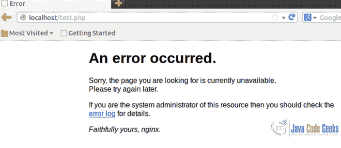

图 4.5: Nginx 在尝试将请求转发到后端服务器时返回错误页面

既然指示我们要查看错误日志，那就让我们来看看（参见图 4.6）。

```
gacanepa@ubuntuOS:~/nginx-1.5.6/html$ ls -l
total 24
-rw-r--r-- 1 gacanepa gacanepa  537 Oct  1 10:44 50x.html
-rw-r--r-- 1 gacanepa gacanepa 3786 Nov  7 13:55 access_log
-rw-rw-r-- 1 gacanepa gacanepa    9 Oct 30 12:23 add.html
-rw-r--r-- 1 root     root       720 Nov  7 13:55 error_log
-rw-r--r-- 1 gacanepa gacanepa  659 Nov  2 19:20 index.html
drwxrwxr-x 2 gacanepa gacanepa 4096 Oct 31 16:08 restricted
gacanepa@ubuntuOS:~/nginx-1.5.6/html$ tail -f error_log
2013/11/07 13:55:03 [error] 2235#0: *1 connect() failed (113: No route to host) while connecting to upstream, client: 127.0.0.1, server: ngxtest.com, request: "GET /test.php HTTP/1.1", upstream: "http://10.0.2.13:8080/test.php", host: "localhost"
2013/11/07 13:55:03 [error] 2235#0: *1 connect() failed (111: Connection refused) while connecting to upstream, client: 127.0.0.1, server: ngxtest.com, request: "GET /test.php HTTP/1.1", upstream: "http://10.0.2.14:8080/test.php", host: "localhost"
2013/11/07 13:55:03 [error] 2235#0: *1 no live upstreams while connecting to upstream, client: 127.0.0.1, server: ngxtest.com, request: "GET /test.php HTTP/1.1", upstream: "http:// /app_rack/test.php", host: "localhost"
```

图 4.6: 截图

似乎所有的 upstream 服务器都宕机了！

后端服务器 #2 可以 ping 通。那还有什么问题呢？在 CentOS 6.4 服务器上运行

```
netstat -npilu | grep :8080
```

我们发现 Apache 没有在运行。我们可以使用 service httpd start 启动它。

让我们看看现在会发生什么（参见图 4.7）。


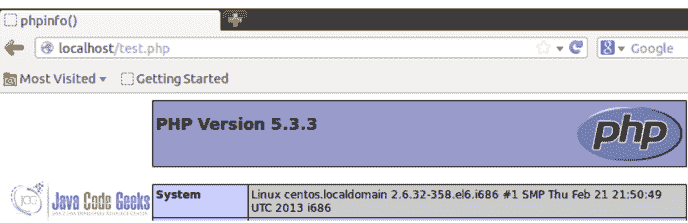

图 4.7：截图

`test.php` 文件由 CentOS 6.4 服务器提供。

我们将再次编辑 `nginx.conf` 文件（见图 4.8 和 4.9）。

```nginx
upstream app_rack {
    #ip_hash;
    server 10.0.2.13:8080 max_fails=3 fail_timeout=30s;
    server 10.0.2.14:8080 weight=3;
    # backup can only be used if ip_hash is not present
    server 127.0.0.1:8080 down;
}
```

图 4.8：请求将由 Debian 服务器或 CentOS 服务器处理

```nginx
upstream app_rack {
    #ip_hash;
    server 10.0.2.13:8080 down; # max_fails=3 fail_timeout=30s;
    server 10.0.2.14:8080 weight=2 down;
    # backup can only be used if ip_hash is not present
    server 127.0.0.1:8080 backup;
}
```

图 4.9：由于 Debian 和 CentOS 服务器被标记为 down，所有请求将被转发到本地的 Ubuntu 12.04 服务器

使用图 4.9 中显示的 upstream 块，php 文件将由 Ubuntu 服务器提供（见图 4.10）

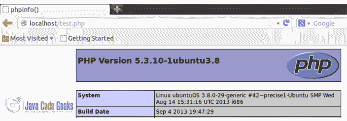

图 4.10：php 文件由被标记为 backup 的 Ubuntu 服务器提供

现在，假设我们有一个应用（运行在这 3 台服务器上）正在产生高流量。我们如何知道前端服务器将每个请求接收到了哪台服务器？这正是内嵌变量 `$upstream_addr`——它内置于 upstream 模块中——以及 `log_format` 指令发挥作用的地方。

- 在主配置文件的 http 级别定义一个自定义的 `log_format`（如下例中的 `MyLogFormat`）（见图 4.11）

```nginx
http {
    include        mime.types;
    default_type   application/octet-stream;
    #access_log    logs/access.log  main;
    sendfile       on;
    keepalive_timeout  65;

    log_format MyLogFormat '$upstream_addr [$time_local] - $http_referer';

    upstream app_rack {
```

图 4.11：创建自定义日志格式

- 将之前创建的日志格式用于其中一个日志（见图 4.12）

```nginx
server {
    listen        80;
    server_name   nginxtest.com;
    root          /home/gacanepe/nginx-1.5.6/html;
    access_log    /home/gacanepe/nginx-1.5.6/html/access_log MyLogFormat;
    error_log     /home/gacanepe/nginx-1.5.6/html/error_log;
    location / {
        index    index.html index.htm;
    }
}
```

图 4.12：将自定义日志格式添加到访问日志

现在让我们再次修改 upstream 块（见图 4.13），以便将流量转发到 3 台服务器。

```nginx
upstream app_rack {
    #ip_hash;
    server 10.0.2.13:8080; # max_fails=3 fail_timeout=30s;
    server 10.0.2.14:8080 weight=2;
    # backup can only be used if ip_hash is not present
    server 127.0.0.1:8080;
}
```

图 4.13：修改 upstream 块以将请求转发到三个后端服务器

现在重启 Nginx，最后，让我们看看刷新几次浏览器窗口后访问日志显示了什么（见图 4.14）：

```bash
gacanepe@ubuntuOS:~/nginx-1.5.6/html$
tail -f access_log
10.0.2.14:8080 [08/Nov/2013:11:16:50 -0300] - -
127.0.0.1:8080 [08/Nov/2013:11:16:50 -0300] - http://localhost/test.php
10.0.2.13:8080 [08/Nov/2013:11:16:50 -0300] - http://localhost/test.php
10.0.2.14:8080 [08/Nov/2013:11:17:02 -0300] - -
10.0.2.14:8080 [08/Nov/2013:11:17:02 -0300] - http://localhost/test.php
10.0.2.13:8080 [08/Nov/2013:11:17:02 -0300] - http://localhost/test.php
127.0.0.1:8080 [08/Nov/2013:11:17:07 -0300] - -
10.0.2.14:8080 [08/Nov/2013:11:17:07 -0300] - http://localhost/test.php
10.0.2.13:8080 [08/Nov/2013:11:17:07 -0300] - http://localhost/test.php
```

图 4.14：访问日志

### 4.3 下载配置文件

您可以下载本教程的配置文件：LoadBalance_conf.zip

## 第 5 章

Nginx SSL 配置指南

### 5.1 简介

SSL（安全套接字层）协议由 Netscape 创建，以确保 Web 服务器和浏览器之间的安全事务（使用通常以 https:// 标识的安全页面）。该协议使用第三方，即证书颁发机构（CA），来识别交易的一端或两端（Linux 文档项目）。

### 5.2 为 Nginx 添加 SSL 支持

由于 Linux 文档项目网站提供了关于此程序如何进行全面解释，我们将把本教程限制在展示如何在 Ubuntu 12.04 LTS 上配置 Nginx 的 SSL。我们需要编译带有 SSL 支持的 Nginx（见图 5.1）。

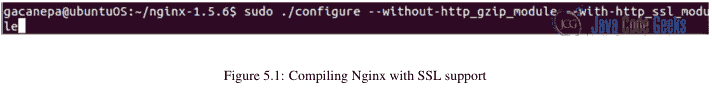

然而，ssl 模块要求事先在系统上安装 OpenSSL 库（见图 5.2）。我们将安装 `libssl-dev` 包，其中包含该库（见图 5.3）。

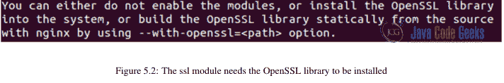

```bash
gacanepa@ubuntuOS:~$ sudo aptitude install libssl-dev
[sudo] password for gacanepa:
The following NEW packages will be installed:
  libssl-dev libssl-doc[zlib-dev]
0 packages upgraded, 3 newly installed, 0 to remove and 150 not upgraded.
Need to get 2,620 kB of archives. After unpacking 6,773 kB will be used.
Do you want to continue? [Y/n/?] Y
WARNING: untrusted versions of the following packages will be installed!

Untrusted packages could compromise your system's security.
You should only proceed with the installation if you are certain that
this is what you want to do.

  libssl-dev libssl-doc zlib-dev

Do you want to ignore this warning and proceed anyway?
To continue, enter "Yes"; to abort, enter "No": Yes
```

图 5.3：安装提供 OpenSSL 库的 `libssl-dev` 包

### 5.3 创建、签署和使用证书

- 我们将创建一个目录来存储我们的公钥和 ssl 证书（见图 5.4）。

```bash
gacanepa@ubuntuOS:~$ sudo mkdir /usr/local/nginx/ssl
[sudo] password for gacanepa:
gacanepa@ubuntuOS:~$  
```

图 5.4：创建一个目录来存储公钥和 ssl 证书

- 现在让我们生成服务器私钥（见图 5.5）

```bash
gacanepa@ubuntuOS:/usr/local/nginx/ssl$ sudo openssl genrsa -out server.key 1024
Generating RSA private key, 1024 bit long modulus
.....................................+++++++++
............................+++++++++
e is 65537 (0x10001)
gacanepa@ubuntuOS:/usr/local/nginx/ssl$ ls -l
total 4
-rw-r--r-- 1 root root 887 Nov  8 15:50 server.key
gacanepa@ubuntuOS:/usr/local/nginx/ssl$
```

图 5.5：截图

- 创建一个证书签名请求（见图 5.6）

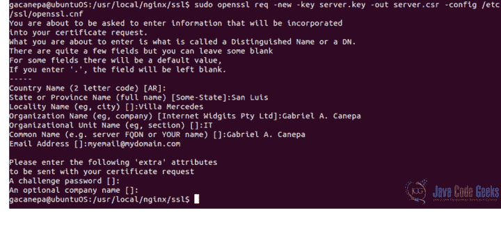

图 5.6：截图

- 签署您的证书（见图 5.7）。请注意，此证书仅有效一天（您可以通过更改 `-days` 选项的参数来修改此设置）。

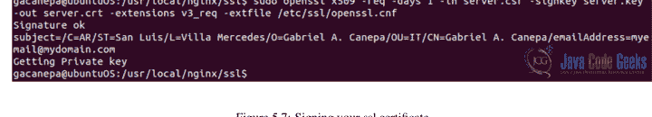

图 5.7：签署您的 ssl 证书

- 设置证书。编辑 `nginx.conf` 文件（见图 5.8）。请注意，尽管有 ssl 指令（ssl on | off）可用，但推荐使用 listen 指令的 ssl 参数代替此指令。

```nginx
server {
 listen 443 ssl;
 server_name nginxTest.com;
 root /home/gacanepa/nginx-1.5.6/html;
 access_log /home/gacanepa/nginx-1.5.6/html/access_log MyLogFormat;
 error_log /home/gacanepa/nginx-1.5.6/html/error_log;
 ssl_certificate /usr/local/nginx/ssl/server.crt;
 ssl_certificate_key /usr/local/nginx/ssl/server.key;
 location / {
 index index.html index.htm;
 }
}
```

图 5.8：截图

需要记住的是，由于 HTTPS 协议的局限性，虚拟服务器应监听不同的 IP 地址（见图 5.9）。如果需要进行以下修改，请参考 `nginx.conf` 文件：

```nginx
server {
 listen 192.168.1.1:443;
 server_name one.example.com;
 ssl_certificate /usr/local/nginx/conf/one.example.com.cert;
 ... 
}

server {
 listen 192.168.1.2:443;
 server_name two.example.com;
 ssl_certificate /usr/local/nginx/conf/two.example.com.cert;
 ... 
}
```

图 5.9：截图

否则，第一个服务器的证书将为第二个站点颁发。

为了让多个 HTTPS 服务器共享单个 IP 地址，可以使用带有通配符名称的证书，例如 `*.example.org`。通配符证书保护指定域名的所有子域名，但仅针对一级。此证书匹配 `www.example.org`，但不匹配 `example.org` 和 `www.sub.example.org`。这两种方法也可以结合使用。证书可以在 SubjectAltName 字段中包含确切的名称和通配符名称，例如 `example.org` 和 `*.example.org`。

如果我们希望允许证书使用主题备用名称（SANs），我们需要在 `openssl.cnf` 文件（位于 `/etc/ssl/openssl`）中启用以下选项：

1. 包含 X509 版本 3（RFC 2459）扩展，以允许 SSL 证书指定多个证书应匹配的名称。我们需要 [ req ] 部分读取如下（见图 5.10）。这告诉 openssl 在生成证书请求时包含 v3_req 部分：


```
[ req ]
req_extensions = v3_req # The extensions to add to a certificate request
```

图 5.10：截图

1.  按照以下内容编辑 `[ v3_req ]` 部分（参见图 5.11）：

```
[ v3_req ]
# Extensions to add to a certificate request
basicConstraints = CA:FALSE
keyUsage = nonRepudiation, digitalSignature, keyEncipherment
subjectAltName = @alt_names

[ alt_names ]
DNS.1 = nginxtest.com
DNS.2 = www.nginxtest.com
```

图 5.11：截图

请注意，我们在 openssl.cnf 文件中放入的任何内容，从这一点开始生成的所有证书请求都会包含这些内容：如果以后你想生成具有不同 SAN 的 CSR，你需要手动编辑此文件并更改 DNS.x 条目。

将包含多个名称的证书文件及其私钥文件放置在配置的 http 级别是更好的做法，这样所有服务器都可以继承它们的单个内存副本（参见图 5.12）。

```nginx
ssl_certificate /usr/local/nginx/ssl/server.crt;
ssl_certificate_key /usr/local/nginx/ssl/server.key;

server {
	listen		443 ssl;
	server_name	nginxtest.com;
	root		/home/gacanepa/nginx-1.5.6/html;
	access_log	/home/gacanepa/nginx-1.5.6/html/access_log MyLogFormat;
	error_log	/home/gacanepa/nginx-1.5.6/html/error_log;
	location / {
		index	index.html index.htm;
	}
}
server {
	listen		443 ssl;
	server_name	www.nginxtest.com;
	root		/home/gacanepa/nginx-1.5.6/html;
	access_log	/home/gacanepa/nginx-1.5.6/html/access_log MyLogFormat;
	error_log	/home/gacanepa/nginx-1.5.6/html/error_log;
	location / {
		index	index.html index.htm;
	}
}
```


1.  现在，我们可以浏览到 https://nginxtest.com 或 https://www.nginxtest.com，我们将看到自签名安全证书的警告（参见图 5.13）：

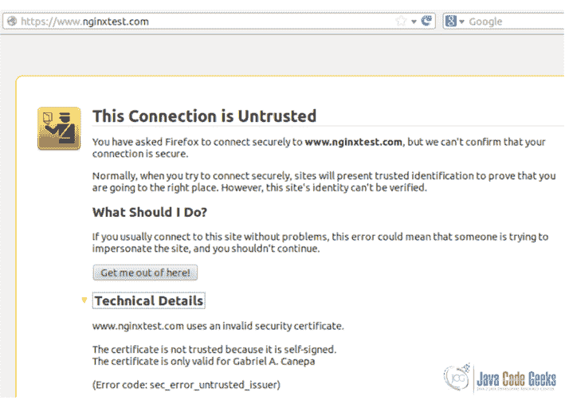

图 5.13：自签名证书可以使用，但会显示此警告屏幕

1.  点击“添加例外”（参见图 5.14），然后点击“确认安全例外”：


图 5.14：确认安全例外

如果你收到 **Wrong Site message（错误站点消息）**（参见图 5.15），这意味着你的证书属于另一个站点，或者没有指定必要的 SAN。


图 5.15：截图

另一方面，当 SAN 正确定义后，可以使用浏览器内置的证书查看器查看它们（参见图 5.16）。


图 5.16：Subject Alternative Names（主题替代名称）

或者使用（参见图 5.17）

```
openssl req -text -noout -in server.csr from the command line
```

```bash
gacanepa@ubuntuOS:/usr/local/nginx/ssl$ sudo openssl req -text -noout -in server.csr
Certificate Request:
Data:
    Version: 0 (0x0)
    Subject: C=AR, ST=San Luis, L=Villa Mercedes, O=Gabriel A. Canepa, OU=IT, CN=Gabriel A. Canepa/emailAddress=myemail@mydomain.
    Subject Public Key Info:
        Public Key Algorithm: rsaEncryption
            Public-Key: (1024 bit)
            Modulus:
                00:d7:59:a6:3d:18:1f:17:64:c2:72:aa:81:5c:67:
                dc:06:cd:55:56:d0:30:06:1c:fd:8e:b4:db:c9:e4:
                16:44:fa:ac:fa:b2:94:0f:9d:f9:11:f6:97:6e:ea:
                25:84:ec:58:fd:39:15:79:be:4f:38:3d:b5:83:34:
                7f:88:ac:f8:de:66:d0:ee:e6:70:15:ae:e7:10:8e:bd:
                5b:7c:d7:66:8b:db:60:27:4d:c3:af:06:53:ba:a1:
                96:2f:c6:ce:85:dc:3f:4a:cd:f0:34:ae:fa:00:7c:
                78:23:26:e0:95:e2:c2:ab:d6:46:91:39:83:7c:32:
                3a:1b:7a:65:62:36:53:bb:e9
            Exponent: 65537 (0x10001)
    Attributes:
        Requested Extensions:
            X509v3 Basic Constraints:
                CA:FALSE
            X509v3 Key Usage:
                Digital Signature, Non Repudiation, Key Encipherment
            X509v3 Subject Alternative Name:
                DNS:nginxtest.com, DNS:www.nginxtest.com
    Signature Algorithm: sha1WithRSAEncryption
```


如前所述，证书仅在其最初创建时指定的时间框架内有效（在我们这种情况下为 1 天，参见图 5.18、5.19 和 5.20）

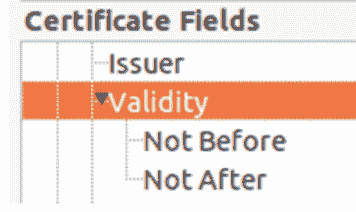


图 5.19：截图


图 5.20：截图

该时间段过后，证书将过期（参见图 5.21）。


图 5.21：SSL 证书已过期

除非你拥有来自受信任第三方的证书，否则你的用户将获得与上述图 5.13 中相同的警告。除了看起来不专业之外，由于大型组织中不太可能所有用户都能分辨出由 IT 部门生成的合法密钥和由恶意第三方生成的密钥之间的区别，这也是一项实际风险。在这种情况下，你需要从受信任的第三方购买证书，例如 GeoTrust（被 Google 使用）、DigiCert、Comodo、Thawte 或 VeriSign（例如被 Facebook 使用）。对于其他情况，特别是当你想为自己使用 https（即保护你的管理面板）时，自签名证书就足够了。

### 5.4 下载文件

在这里你可以下载本教程中使用的配置文件：ConfigFile.zip

你还可以下载一个有用的 pdf 文件：Openssl.pdf

## 第 6 章

### Nginx Websockets 代理指南

#### 6.1 介绍

根据 IETF（互联网工程任务组）发布的 RFC（请求评论）#6455，WebSocket 是一种通过单个 TCP 连接提供全双工通信通道的协议，它旨在在 Web 浏览器和服务器中实现，但任何客户端或服务器应用程序都可以使用它。

与 TCP 一样，WebSocket 在低延迟连接中实现了全双工通信，但它与 TCP 的不同之处在于，它启用的是消息流而不是字节流。

换句话说，客户端和服务器之间存在持久连接，并且其中任何一方都可以在任何时间开始发送数据。因此，每当你需要客户端和服务器之间接近实时的连接时，无论是否在 Web 环境中，你都会想到使用 WebSockets。

请注意，Nginx 从 1.3.13 版本开始（2013 年 2 月发布）支持 Websockets，并且可以在核心产品中访问。旧版本不支持此协议。

在本教程中，我们还将配置 Upstart（Ubuntu 开发者编写的 init.d 的现代替代品），以确保我们的 websocket 应用程序（用 Node.js 编写）在崩溃时自动重启，并在服务器启动时启动。

#### 6.2 安装 Node.js

首先，让我们在主目录内创建一个目录，用于下载 Node.js 的源代码（参见图 6.1）。请注意，为了清晰起见，该目录位于与我们在教程 #1 中解释的下载 Nginx 源代码的目录相同的级别。然后我们将使用相同的目录来解包 tarball 的内容，并使用常规程序安装 Node.js：

（我们在这里遵循通常的构建过程，因为 checkinstall 方法在构建 deb 包时产生了错误。）

```
sudo ./configure, sudo make, sudo make install
```

在撰写本文时，Node.js 的最新版本是 v0.10.21，可以从 http://nodejs.org/download/ 下载（32 位或 64 位版本），使用以下命令（参见图 6.2，出于隐私原因，正在使用的代理服务器及其 IP 地址已模糊处理）：

```
wget http://nodejs.org/dist/v0.10.21/node-v0.10.21.tar.gz
```

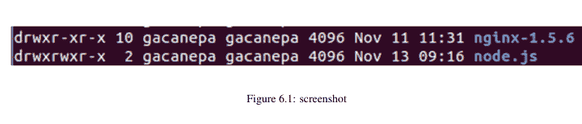

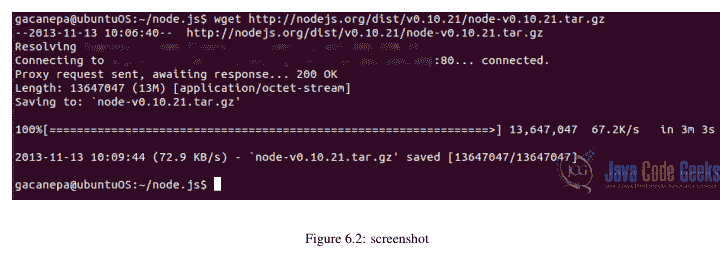

#### 6.3 安装额外的库

接下来，我们将安装 `socket.io`，这是一个用于实时 Web 应用的 JavaScript 库。它有两个部分：

-   一个在浏览器中运行的客户端库
-   一个用于 node.js 的服务器端库（Socket.io, Wikipedia），使用 npm（node.js 的官方包管理器，sudo npm install socket.io，参见图 6.3）以及 express，一个用于 node.js 的 Web 应用程序框架。

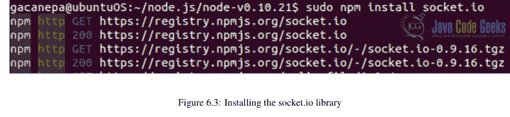

为了下载 express 框架，我们需要在一个为应用程序创建的目录中的 json 文件（package.json）中定义几个设置 - 在本例中为 ~/chatroom（参见图 6.4）。然后我们继续下载并安装它：

```
npm install -d
```


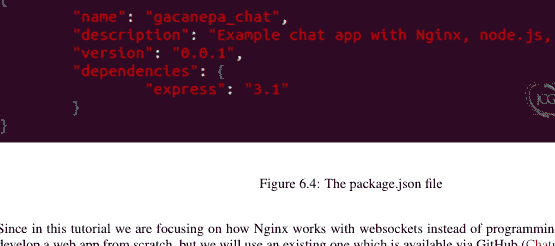

图 6.4：package.json 文件

由于本教程重点在于讲解 Nginx 如何与 websockets 协同工作，而非使用 node.js 进行编程，因此我们不会从零开始开发一个 Web 应用，而是会使用一个已有的、可通过 GitHub 获取的应用（聊天室示例）。我们需要使用以下命令下载 index.html 和 app.js 文件（见图 6.5）：

```bash
wget https://github.com/mmkohin/pitsmike_example_1/archive/master.zip
```

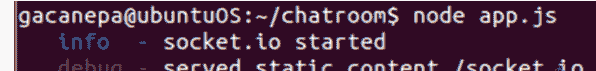

图 6.5：从 GitHub 下载聊天室 Web 应用

然后，我们将解压之前提到的文件，并使用 `node app.js` 启动应用（见图 6.6）。如果 Apache 正在端口 8080 上运行，我们可能需要停止它。


图 6.6：启动 Web 应用程序

结果（见图 6.7 和 6.8）尚未使用 Nginx，我们也尚未提及为何需要使用带 websockets 的 Nginx，但毕竟已经完成了一半。到目前为止，我们拥有一个类似聊天室的 Web 应用程序，它可以实时显示发送和接收的消息，以及服务器响应。

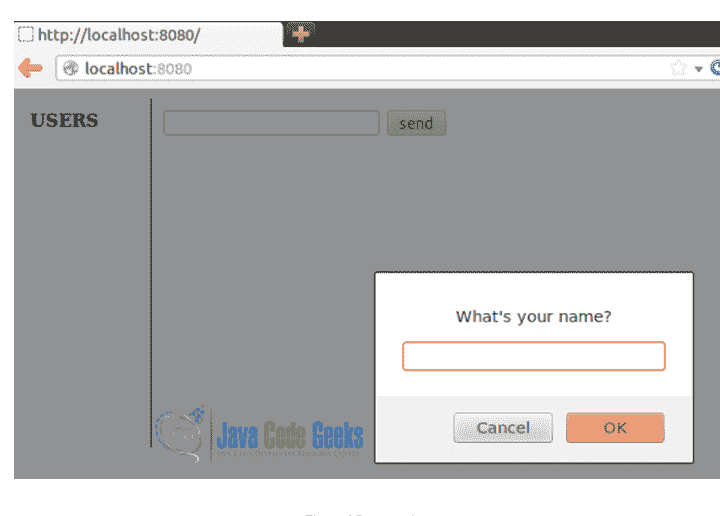


### 6.4 那么……Nginx 与此有何关系？

如果我们需要在正式（生产）环境中使用此应用程序，我们可能希望它监听 80 端口（大多数企业级防火墙允许通过该端口进行通信）。但 Nginx 已经在监听该端口。我们现在该怎么办？一如既往，我们强大的 Nginx Web 服务器给出了答案。我们只需将传入的 80 端口请求（外部连接）转发到另一个端口（在本例中为内部连接的 8080 端口）。这样，我们就使用 Nginx 作为反向代理，外部世界无法直接与聊天室应用通信，而是通过充当前端服务器的 Nginx 进行通信。此场景还将允许我们使用 SSL 证书来加密流量。

我们将继续编辑 nginx.conf 文件（见图 6.9），并添加几个来自代理模块的指令。

```nginx
server {
    listen            80;
    server_name       NGINXTEST.com;
    root      /home/gacanepa/chatroom;
    access_log /home/gacanepa/nginx-1.5.6/html/access_log MyLogFormat;
    error_log /home/gacanepa/nginx-1.5.6/html/error_log;
    location / {
        proxy_pass http://localhost:8080;
        proxy_http_version 1.1;
        proxy_set_header Upgrade $http_upgrade;
        proxy_set_header Connection "upgrade";
        proxy_set_header Host $host;
        index index.html index.htm;
    }
}
```

图 6.9：主配置文件 nginx.conf

我们将详细讨论每个指令：

- **proxy_pass** http://localhost:8080：通过指定位置（在本例中为同一主机，端口 8080）实现对后端服务器的反向代理。
- **proxy_http_version** 1.1：设置用于与代理后端通信的 HTTP 版本。默认值为 HTTP 1.0，但如果我们需要启用 keepalive 连接，最好将此指令设置为 1.1。
- **proxy_set_header**：此指令允许您重新定义要传输到后端服务器的头部值。如我们所见，它可以声明多次。
- **proxy_set_header** Host $host：转发到后端服务器的请求中的 Host HTTP 头部默认值在配置文件中指定为代理主机名。此设置让 Nginx 使用客户端请求中的原始 Host。有关 http 头部的完整列表，请参阅教程 #2。

由于我们希望服务器启动时应用程序能够自动启动，因此我们需要使用 init 脚本或 upstart 守护进程来管理 Node 进程。在本教程中，我们选择第二种选项。首先，我们将安装 forever，这是一个非常有用的工具，用于运行和监控 Node.js 进程（见图 6.10）。


我们还需要在 /etc/init 目录中有一个 init 脚本（`app.js.conf` - 可在附件 zip 文件中找到，改编自 ExRatione），用于启动（见图 6.11）/ 停止 / 重启我们的进程（`app.js`），并在需要时显示其状态。该脚本是一个通用的 upstart 文件，其中定义了脚本运行所必需的特定环境变量（见图 6.12）。

```bash
gacanepa@gubuntuOS:~/chatroom$ sudo service app.js start
app.js start/running, process 3388
gacanepa@gubuntuOS:~/chatroom$ tail -f app.js.log
info: socket.io started
debug: client authorized
info: handshake authorized 19M8Bhz6eqLklUSkbwK
debug: served static content /socket.io.js
debug: client authorized
info: handshake authorized ezjJPChCJByQllFtZkbwL
debug: setting request GET /socket.io/1/websocket/ezjJPChCJByQllFtZkbwL
debug: set heartbeat interval for client ezjJPChCJByQllFtZkbwL
debug: client authorized for
debug: websocket writing 1::
debug: websocket writing 5::{"name":"updatechat","args":["SERVER", "you have connected"]}
debug: broadcasting packet
debug: websocket writing 5::{"name":"updateusers","args":[{"Gabriel": "Gabriel"}]}
debug: websocket writing 5::{"name":"updatechat","args":["Gabriel", "this is a test message"]}
debug: emitting heartbeat for client ezjJPChCJByQllFtZkbwL
```

图 6.11：我们的 Web 应用程序已启动

```bash
# The following environment variables must be set so as to define
# where Node.js and Forever binaries and the Node.js source code
# can be found.

# The full path to the directory containing the node and forever binaries.
env NODE_BIN_DIR="/usr/local/bin"
# Set the NODE_PATH to the Node.js main node_modules directory.
env NODE_PATH="/home/gacanepa/chatroom/node_modules"
# The directory containing the application Javascript file.
env APPLICATION_DIRECTORY="/home/gacanepa/chatroom"
# The application start Javascript filename.
env APPLICATION_START="app.js"
# Log file path.
env LOG="/home/gacanepa/chatroom/app.js.log"
```

图 6.12：由 upstart 脚本定义的环境变量

在此期间，我们在聊天室中写入的内容（见图 6.13）会被保存到我们应用程序的日志中，我们可以在 Web 界面和命令行上实时查看它，使用的命令是：

```bash
tail -f app.js.log
```

请注意，我们使用 Nginx 作为前端服务器来访问我们的 Web 应用程序（这与图 6a 和 6b 中显示的情况相反，在那种情况下，Web 应用程序由 node.js 独占运行在端口 8080 上）。


图 6.13：截图

#### 6.5 下载源文件

您可以下载本教程的源文件：WebsocketsExample.zip

