# Openlinux 入门指南 [包含 Openlinux Lite]

开始使用强大的 Linux 操作系统的所需一切。

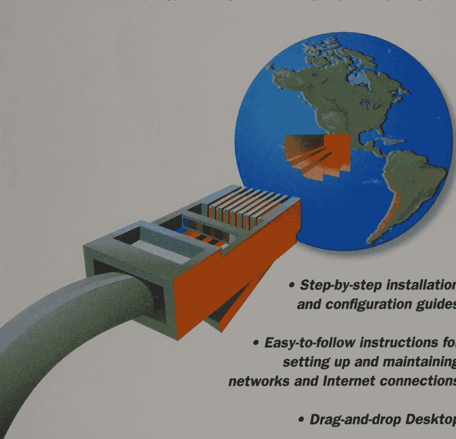

- 逐步安装和配置指南
- 易于遵循的设置和维护网络及互联网连接说明
- 拖放式桌面

CD-ROM 包含一个完整授权的 OpenLinux 版本

- 图形显示技术 . . . . . . . . . . . . . . . . . . . . . . 16
- 为其他系统准备共享磁盘 . . . . . . . . . . . . . . . . . . . . . . . . . . . . . . . . . . . . . . . . 33
- 安装 Caldera OpenLinux . . . . . . . . . . . . . . . . . . . . . . . . . . . . . . . . . . . . . . . . . . . . . . . . . . . 35

### 目录窗口 ... 61

ppa . . . . . . . . . . . . . . . . . . . . . . . . . . 177

其他参数 . . . . . . . . . . . . . . . . . . . . . . . 178

配置配置. . . . . . . . . . . . . . . . . . . . . . . . 180

配置显示器. . . . . . . . . . . . . . . . . . . . . . . . . 184

调整分辨率. . . . . . . . . . . . . . . . . . . . . . . . . 188

Q1. 如何防止阶梯效应? . . . . . . . . . . . . . . . . . . . . 28

Q3. 什么是魔法过滤器(magic filter)? . . . . . . . . . . . . . . . . . . . . . . . . . . . . . . . . 29

“文件太大(file too large)”错误. . . . . . . . . . . . . . . . . . . . . . . . . . 29

你还可以升级到其他 OpenLinux 产品，这些产品包含某些功能，如带有 HTML 编辑功能的 Netscape Navigator Gold 浏览器、完整的 NetWare 连接性、个人用户办公软件以及来自 Netscape 的 FastTrack 服务器。

Caldera OpenLinux 产品在商业软件中很独特，因为它们是根据 GNU 通用公共许可证（GPL）分发的软件、伯克利许可、其他可以自由分发的软件（详情见附录）以及由 Caldera, Inc. 添加的受版权保护的商业组件的结合。

自由分发的软件包括操作系统内核-Linux 以及随 Linux 附的程序，其中许多来自自由软件基金会的 Gnu 项目。其中许多组件的源代码可以自由分发，并包含在 OpenLinux Base CD-ROM 中。根据许可条款，你可以自由更改和重新发布这些程序。我们建议你查看从第233页开始的许可协议，以检查哪些协议可能适用于你想要重新发布的任何代码；某些免费的软件包在没有获得版权所有者书面许可的情况下无法重新发布。

Caldera 包含了一个桌面界面以及在 Linux 操作系统上运行的其他商业软件。这些商业组件不能自由分发，但在你购买本书时，已从 Caldera, Inc. 按系统授权许可。你必须为每台运行任何这些商业组件的计算机都拥有一个许可。

除了你从阅读本书中学学到的内容外，互联网上还有许多关于 Linux 和 UNIX 的信息源（参见第 22 页的“学习更多信息”），Caldera 提供了若干电子资源来帮助你学习和安装 Caldera OpenLinux。你可以接收的电子信息包括：

- 技术支持数据库
- 更新的硬件兼容信息
- 常见问题列表 (FAQs)
- 产品功能摘要
- 新闻组和 Linux 用户组 (Linux User Groups) 的链接
- 更新或额外的软件组件

以下电子邮件地址将返回即时自动回复。info@caldera.com 地址也会由 Caldera 员工审核，并尽快发送个性化回复（通常在 24 小时内）。

- **info@caldera.com.** 用于关于 Caldera 产品的通用（非技术性）问题和意见。该地址会生成包含有关如何联系 Caldera 以及 Caldera 产品信息的自动回复。Caldera 员工会回答这些问题，通常在 24 小时内。
- **faq@caldera.com.** 自动回复一份常见问题（答案）的列表。发送到此地址的邮件不会由 Caldera 员工审核。
- **majordomo@caldera.com.** 自动回复有关与 Caldera 产品相关的邮件列表信息，例如 caldera-users 邮件列表。
- **orders@caldera.com.** 生成包含通过传真、电话或电子邮件订购信息的自动回复。虽然由于网络安全考虑不建议这样做，但可以将信用卡订单发送到此地址。向此地址的自动回复中包含一个用于订单加密的 PGP 密钥。信用卡订单应包含所有卡信息（卡号、持卡人姓名、有效期）；姓名、收货地址和电话号码；以及你订购的产品以及授权信用卡扣款的金额。

除了这些电子邮件地址外，以下信息源也是推荐的：

- **World Wide**

Caldera 的 Web 网站 http://www.caldera.com 提供了关于 Linux 的各种类型信息和链接。

- **FTP**

Caldera 的 FTP 网站 ftp.caldera.com 包含了关于 Linux 的。

本章节将帮助你在 30 分钟内让你的新系统运行。在使用快速安装之前，你应该熟悉常见的 UNIX 和 Linux 术语，并对计算机硬件有一定的了解。如果你对本章提到的某些概念陌生，请参考下一页的详细说明。

收集以下信息将允许你快速完成安装。

| 需要的内容 | 示例 | 你的系统值 |
| :--- | :--- | :--- |
| CD-ROM 驱动器，品牌和型号 | Sony | |
| CD-ROM IRQ 和端口 | 15 | |
| 以太网卡，品牌和型号* | 3com | |
| 鼠标品牌（及型号） | Microsoft | |
| 使用的端口（ps/2 或串口） | ps/2 | |
| 显卡，品牌 | Mattrox | |
| 显卡，型号或数量 | Millennium | |
| 显卡内存大小 (MB) | 2 | |
| 显示器，品牌和型号 | NEC | |
| 显示器最大扫描频率 | 72 MHz | |
| 调制解调器，品牌和型号 | Hayes | |
| 调制解调器串口 | COM 2 | |
| 计算机主机机 | | |
| 网络域名 | caldera.com | |
| 分配给计算机的 IP 地址 | 192.168.12.44 | |
| 组织的网络地址 | 192.168.12.0 | |
| 组织或局域网子网掩码 | 255.255.255.0 | |
| 网络广播地址 | 192.168.12.255 | |
| 网关或路由器地址（如果有） | 192.168.12.254 | |
| 需要的内容 | 示例 | 你的系统值 |
| :--- | :--- | :--- |
| DNS 名称服务器地址（如果有） | 192.168.12.1 | |
| 额外的网关或服务器地址（如果存在多个） | [同上，但你可能没有第二个网关] | |

## 准备你的硬盘

要使用快速安装，你应该有一个至少 250 MB 空闲的硬盘分区用于默认安装，以及另一个至少 16 MB 空闲的分区作为交换空间 (swap)。如果你没有设置这些分区，在安装过程中，你可以选择使用 Linux `fdisk` 命令来修改你的硬盘分区。

如果你硬盘上安装了另一个操作系统，并且想在 OpenLinux 和该操作系统之间共享该硬盘，你必须更改分区。这通常涉及备份现有的系统、使用任何操作系统的工具（如 DOS 中的 FDISK 命令）重新分区并格式化硬盘，然后在安装 OpenLinux 之前恢复原始操作系统。

您的 DOS 分区（在 DOS 中使用 `DEFRAG` 命令），然后使用名为 `FIPS` 的实用程序缩小您的 DOS 分区，而不会删除该分区上的现有数据。`FIPS` 实用程序位于 CD-ROM 的 `COLTOOLS\FIPS15` 目录下。在完成此过程之前，仍然建议备份您的 DOS 或 Windows 系统中的重要数据！

如果您之前没有这样做，请在安装期间（如下文所示）使用 `fdisk` 将用于 OpenLinux 的分区标记为类型 83（Linux），并将交换分区标记为类型 82（Linux Swap 交换分区）。

按照以下步骤安装随附的 OpenLinux Lite CD-ROM 驱动器。

如果您有一个可启动的 CD-ROM 驱动器：


# 安装步骤

## 1. 将 CD-ROM 插入 CD-ROM 驱动器并启动计算机。

继续执行下面的第 3 步。

如果您没有可启动的 CD-ROM 驱动器或正通过 NFS 网络进行安装：

### 1. 在运行的系统上使用 Linux `dd` 命令或 DOS `RAWWRITE` 命令，根据 CD-ROM 上的镜像创建引导软盘。

a. 插入 CD-ROM 和一张空白的 3 1/2 英软磁盘。

安装磁盘镜像位于 CD-ROM 的 `\collaunch\floppy\install.img`。

b. 对于 DOS，使用此类命令：

```
E:\COLLLAUNCHFLOPPY\RAWWRITE3
```

提示时输入软盘路径和安装磁盘镜像的名称。

c. 对于 Linux，使用此类命令：

```
dd if=/mnt/cdrom/col/launch/floppy/Install.img of=/dev/fd0
```

根据您的硬件情况，您可能还需要一个 Modules 软盘。您可以对 CD-ROM 上相同 `/col/launch/floppy` 目录下的 Modules 镜像重复此过程。

您也可以直接从运行的 DOS 系统启动安装，而无需引导软盘。有关此过程的说明，请参阅 `/col/launch/dos` 目录下的 `readme` 文件。

## 2. 将安装软盘插入软盘驱动器，将 CD-ROM 插入 CD-ROM 驱动器并启动计算机。

如果您正通过 NFS 挂载的网络文件系统进行安装，则 CD-ROM 应插入 NFS 服务器的 CD-ROM 部分，除非您已将 CD-ROM 的所需部分复制到 NFS 服务器硬盘上。您将在安装时输入 NFS 服务器的 IP 地址和安装的目录。

## 3. 当出现 `boot:` 提示时，按 <Enter> 继续。

来自 Linux 内核的消息将告诉您有关其检测到的硬件详细信息。

如果您在安装过程中发现硬件未被正确识别，请重新启动安装并在处输入启动参数。（启动参数列在第 161 页的附录或安装在线帮助中。）

## 4. 出现提示时，再次按 <Enter> 继续。

您可以通过按 `<Left-Shift>+<PageUp>` 和 `<Left-Shift>+<PageDown>` 来查看内核消息，以确保您的硬件已正确检测。

## 5. 回答屏幕上关于系统的问题。

使用您制作的内核模块管理器和 Modules 软盘（如果需要），以确保所有硬件均被正确识别。

如果您需要查看安装过程中的消息，可以通过 `<Left-Alt>+F8` 切换控制台。使用 `<Left-Alt>+F1` 切回安装。

## 6. 选择“更改硬盘分区表”选项（如果需要），使用 `fdisk` 更改或标记具有正确 Linux 和 Linux Swap 标识的分区。

## 7. 选择最适合您需求的安装类型。提供多种选项，范围从最小化运行系统到完整的开发系统不等。您还可以选择想要安装的特定软件包。这仅建议熟悉 Linux 或 UNIX 的人员使用。

安装软件包将耗时 15 到 40 分钟，取决于您选择的安装选项以及您的硬件速度。安装完成后，您可以使用单个命令添加或删除任何软件包。

## 8. 软件包安装完成后，按照屏幕上的指示提供额外的配置信息。

## 9. 按照屏幕上的指令安装 LILO 启动管理器。

## 10. 安装程序将在不重启的情况下重启您新安装的系统。

## 11. 以 root 身份登录。

## 12. 通过输入命令为 XFree 创建有效的配置文件来配置您的 X Window 系统。配置 X Window 系统的完整说明包含在从第 179 页开始的附录中。

# Caldera OpenLinux™ 操作系统概述

Caldera OpenLinux™ 操作系统是一个完整的多用户环境，允许用户轻松地与本地局域网或全球互联网上的网络资源进行交互。OpenLinux 允许不受限制的用户在企业局域网和全球网络上浏览和发布信息。本章详细描述了 OpenLinux 的一些关键特性，解释了在安装和使用它时可能有帮助的一些计算概念，并列出了哪里获取更多关于 Caldera 产品的信息。

OpenLinux 是 Linux 操作系统的一个发行版。Linux 发行版是一个带有相关实用程序的完整系统。有多种不同的 OpenLinux 产品，每种产品都以 OpenLinux 为基础，并添加额外的功能和特性以满足特定用户组的需求。

一个 Linux 发行版。本书附的 CD-ROM 是 OpenLinux Lite。它包含一个完整的 Linux 操作系统，但不包含其他 OpenLinux 产品中包含商业组件。

OpenLinux 的许多功能是 Linux 固有的，另一些仅位于 Caldera 的商业产品中。OpenLinux 发行版（以及本书中的 CD-ROM）的特性包括：

字体 使用 TCP/IP 协议的高速网络。

- 支持各种网络协议、文件系统和网络操作系统。

- 支持数百种硬件组件，包括 CD-ROM、多媒体设备、笔记本电脑、高速网卡和高性能显卡。

- 易于使用的安装程序，带有基于菜单的配置工具，具有相同的界面。

- 基于 POSIX 的多用户操作系统环境，具有完整的互联网连接工具、传统的 UNIX 开发环境以及充分利用 32 位处理器的抢占式多任务架构。Caldera 支持 ELF 和二进制格式。

- 每个 Caldera 操作系统上不受限制的用户帐户，用于单机系统。

- 完整的互联网集成，包括 DNS（域名服务）、HTTP（Web）、SMTP（电子邮件）、FTP、SNMP（管理）、PPP/SLIP（拨号）、NNTP（新闻）等。

- 默认自动安装并配置的 Web 服务器，能够托管多个域名（虚拟域名，用于在单机上支持多个部门或公司）。

- 作为客户端访问您的所有现有系统：UNIX、Windows NT、Windows95 和 Windows 3.11。

- 通过网络或拨号连接远程管理 UNIX 系统。

- 无需专用网关机即可远程访问网络资源。

- 在您的计算机作为组织网关的同时，运行许多 DOS 和 SCO UNIX 应用。

除了列出的特性外，Caldera 还增加了其他 Linux 系统未有的组件，这些组件是各种 OpenLinux 增值功能的一部分，使 OpenLinux 成为企业或全球网络上创作、发布和浏览信息的完整环境。虽然书中 CD-ROM 并不包含其中的某些功能，但在此列出供您参考：

- 可以使用复杂的桌面界面来查看和管理文件系统，包括应用程序和文件类型之间的拖放功能、默认或用户选择的点击拖放选项，以及通过图形拨盘配置桌面环境。桌面包括颜色轮、动作声音默认、图标（可编辑）、图形化偏好设置等更多内容。描述桌面的完整章节从第 73 页开始。

桌面界面包含在本书的 OpenLinux Lite CD-ROM 中。然而，它是时间限制版本，在您安装 OpenLinux Lite CD-ROM 的 30 天后将停止工作。（OpenLinux 操作系统将继续运行；只有桌面界面有时间限制。）

- Netscape Navigator® 是行业标准的 Internet 和 Web 浏览器，大多数 OpenLinux 产品均内置。Netscape 不仅用于浏览网页，还集成作为在线帮助和文档查看器。

- 来自 Metro Link Incorporated 的 Metro-X 是一款商用 X 服务器，允许在各种流行的高性能显卡上对您的图形界面进行任何配置。为了获得额外的支持，书中还包含了来自 XFree86 Project, Inc. 的 XFree86 X 服务器，并且可以根据需要进行安装。

本书的光盘中仅包含了 XFree86 图形系统。

# 需要理解的概念

作为一个功能完备、多用户、多任务的 UNIX® 类操作系统，OpenLinux 可能会向你介绍一些令你不熟悉的概念。本节定义了一些你在安装和使用该操作系统时需要了解的基础术语。

计算机的硬盘存储空间总是大于 RAM（内存）空间。但在你处理程序和数据时，它们必须存储在 RAM 中。虚拟内存允许程序认为它们拥有的 RAM 比计算机实际拥更多。这是通过在计算机内存满时自动将数据保存到硬盘，并在用户或应用程序再次需要这些数据时将其交换回计算机内存来实现的。

例如，假设你同时运行 5 个应用程序，但你只有 16 MB 内存。当你加载一个大型数据文件到文字处理器文档时，该文档可能会保存到硬盘上的某个特殊位置。当你再次开始处理该文字处理器文档时，它会被硬盘移回 RAM，而无需文字处理器程序进行任何操作。

OpenLinux 使用虚拟内存同时高效运行许多应用程序，并处理大型数据文件而不耗尽内存。虚拟内存功能使用的硬盘区域称为交换区（swap area）。下文将对此进一步描述。

至于系统内存（RAM），如果你只使用文本模式，OpenLinux™ 在 8 MB 的 RAM 下就能运行良好，即使你有很多用户或远程终端。如果你有 8 MB 的 RAM，你应该指定一个大的交换分区（见见第 13 页）。如果你将使用图形化桌面隐喻或 X Window 系统下的其他应用程序，你应该拥有 16 MB 的 RAM 以获得最佳效果。


OpenLinux 使用硬盘上的一个独立分区来存储由虚拟内存功能临时从计算机内存交换到硬盘的信息。该分区被称为 Linux 交换分区（Linux Swap Partition）。交换分区的大小和速度会影响系统的性能。

你在安装过程中创建分区时决定交换分区的大小。交换分区的大小应等于或大于计算机拥有的 RAM（内存）量，但至少应为 16 MB。例如，一个常见的系统可能有 16 MB 的 RAM；交换分区应该在 16 到 32 MB 之间。如果你有一个拥有大硬盘的系统，或者同时运行许多应用程序，你可以将交换分区设置得更大。

包含在交换分区中的任何空间都无法供计算机上运行的任何操作系统用于常规文件存储。

## 共享硬盘和启动管理器

单台计算机可以同时用于 OpenLinux 和其他操作系统。使用此功能的大多数用户在运行 OpenLinux 的计算机上还安装了 IBM OS/2、DOS 或某个版本的 MS Windows。

当你的计算机上有一个多个操作系统时，你可以在启动或重启计算机时选择要使用哪一个。一个简短的提示会询问你想要启动哪一个可用操作系统。此过程由一个称为启动管理器（boot manager）的程序管理。启动管理器存储在硬盘或软盘的主引导记录（MBR）中，或者硬盘分区的引导记录中。当你回答启动管理器的提示时，启动管理器会将控制权交给选定的操作系统以继续启动。

OpenLinux 自带的启动管理器称为 LILO：Linux 加载器。LILO 在你完成安装时进行配置和安装。

如果你有多个硬盘，你可以轻松地将其中一个专门用于你的 OpenLinux 安装，将另一个留给另一个操作系统。你仍然将使用 LILO 或另一个启动管理器来选择启动哪个操作系统。

在使用 OpenLinux 时，只要它们使用支持的文件系统类型，你就可以访问硬盘上其他分区（非 Linux 分区）上的数据。支持的文件系统包括 HPFS（用于 OS/2）、FAT（用于 DOS/Windows 3.1）、VFAT（用于 Windows95）以及许多 UNIX 文件系统。例如，如果你在硬盘的第二个分区上安装了 OpenLinux，在第一个分区上安装了 Windows95，你可以以 root 登录并使用此命令挂载第一个分区：

```
mount -t vfat /dev/hda1 /mnt/win95
```

现在，当你使用下面的命令时，你正在查看你的 Windows95 文件系统的根目录：

```
cd /mnt/win95
ls
```

你可以在 Windows95 文件系统中查看、复制和创建文件，但你必须遵循其他文件系统的限制（在这种情况下，只能使用 8.3 格式的文件）。

## 安装硬件提示

Caldera 安装程序应该确定你拥有什么硬件，并允许 OpenLinux 的安装顺利进行。

然而，偶尔安装程序需要一些提示来正确确定位和使用你的硬件。如有必要，你可以在安装期间通过输入硬件启动参数或内核模块（insmod）参数来提供这种帮助。

每个启动或 insmod 参数都表示一种硬件类型（或其他选项）以及标识该硬件的一个或多个值，以便其正确使用。启动参数在启动管理器提示处输入，在操作系统（或安装程序）启动之前。例如，在启动管理器提示处，你可能会输入：

```
LILO: install
```

如果你在安装期间确定需要启动参数，你可能会如下输入：

```
LILO: install cdrom=0x40,eth0=0x60
```

此示例指示了光驱和以太网卡的信息。等号（`=`）分隔参数与值。逗号分隔给一个参数的值；空格分隔多个参数。系统所需的任何启动参数都在安装过程中输入，并存储在 LILO 配置中。你不需要每次启动系统都输入这些信息。

内核模块参数或 insmod 参数是在使用内核模块加载特定硬件时在安装期间输入的。这些参数与启动参数相似，但略有不同。

启动参数和 insmod 参数的完整列表位于第 161 页的附录。如果安装程序无法正确检测你的硬件，请参考此列表。要使用这些参数，你可能需要硬件使用的 IRQ 中断和内存地址等信息。请查阅你的硬件文档。

## X 窗口系统

书中光盘中的 XFree86 程序支持多种显卡和显示器（见附录 179 页）。窗口系统（X）是 Linux 和 Caldera 桌面界面使用的底层图形系统。X 允许你充分利用视频硬件的能力，并在网络上分布图形应用程序。

控制 X 界面的程序（称为 X 服务器）可以在安装过程中配置，也可以在你开始使用系统后立即配置。某些 Caldera 产品使用 Metro Link Incorporated 的 Metro-X 服务器作为默认 X 服务器；书中光盘使用的是 XFree86 Project, Inc. 的 X 服务器。

如附录所示，如果你需要对默认 X 配置进行更改或使用 XFree86 服务器，你可能需要有关视频硬件的详细信息。这些信息通常可以在你的硬件文档中找到。

X 窗口系统提供了任何图形系统都不具备的强大功能。例如，任何图形应用程序都一台计算机上执行并在另一台计算机上显示。此外，X 的配置允许软件充分利用图形硬件的特性。

## 网络配置

OpenLinux 包含了广泛的网络功能。网络通常在安装 OpenLinux 的同时进行安装和配置。为了完成安装过程中的网络配置，你需要网络信息，包括你的 IP 地址和路由器，以及你的名称服务器和网络地址。（请参见第 2 页或第 27 页的表单）。

IP 网络信息存储在几个不同的目录和文件中。这些文件在安装期间设置。如果您想更改这些文件，除非您非常熟悉网络，否则请使用配置工具。您可以查看其中许多文件的帮助页（例如，输入命令 `man hosts`）。但如果您不熟悉 IP 网络，我们建议您利用安装过程机会安装并配置您的 IP 网络。

### 域名和主机名

在大型网络（如互联网）中，计算机被赋予了数字名称（参见下文的“IP 地址”）。互联网上的不同组织或公司也被其网络分配了名称。这些名称被称为域名。例如 caldera.com、for.com 和 mit.edu。

在域名内部（即某个组织或公司内部），系统管理员或用户可以为单台计算机选择一个名称。这就是该计算机的主机名。访问该计算机的完整名称是主机名与该主机所在域名的组合。例如，如果一台计算机被命名为 frosty，并且属于域名为 caldera.com 的公司网络，那么访问该计算机的完全限定域名 (FQDN) 就是 frosty.caldera.com。您需要在系统管理员的配合下为您的计算机选择主机名。域名必须由系统管理员提供，否则您将无法访问网络资源。

在网络上，主机名和域名对人们来说易于阅读和记忆，但对于计算机系统而言，它们根据互联网协议（IP）被映射为数字，下文所示。服务器使用域名服务协议（DNS）在 IP 地址数字与主机名及域名之间进行映射。

### IP 地址

在基于 IP 的网络（包括互联网）上，每台计算机计算机被分配有一个地址，允许其与其他计算机进行通信。该地址写为一组四个数字，这些数字唯一地标识互联网上的单一位置，并允许来自互联网其他位置的信息到达该台计算机。以下是几个示例：

- 204.141.89.7
- 137.64.1.1
- 137.64.131.7

在安装过程中，您会被要求提供几个 IP 地址（参见第 27 页的表单）。您的系统管理员或互联网服务提供商将拥有这些地址。

IP 地址允许您通过您的互联网网关或互联网服务提供商访问互联网。它也允许互联网上的其他人访问您。在某些情况下，IP 地址是动态分配的，您无法看到自己的地址信息。这在使用带有 SLIP 或 PPP 的拨号服务时最常见（参见第 20 页的“使用 SLIP 和 PPP”）。

IP 地址块被分配给组织。在这些地址块中，某些地址被用于特殊用途，如网关和名称服务器。您的系统管理员会为您的计算机提供一个 IP 号，并拥有您网络中作为网关和名称服务器的计算机 IP 地址。这些 IP 地址是在安装期间请求的。

## 多语言支持

Caldera OpenLinux 产品提供了多种语言的文档和计算机界面。

还有几个地方的允许您使用其他语言有效地使用 OpenLinux。这些选项在下文中描述。

在安装开始时，您需要为安装选择一种语言。您还需选择适合您计算机的键盘布局。您选择的键盘将在安装的剩余过程中以及您安装后开始使用系统时使用。您还选择一个时区。

## 用户账户和权限

root 是一个特殊的超级用户账户。与其他类 Unix 系统一样，root 用户具有了访问所有文件和设备的权限。这种访问对于执行许多配置任务是必要的，但对于日常工作可能是危险的，因为 root 用户可以访问（并更改）系统上的任何内容。

完成安装过程后，您可以以 root 身份登录以完成系统管理任务。请勿在日常工作中使用 root 登录。

如果您以 root 登录启动桌面，桌面上会出现一组管理工具图标。如果您以普通用户账户登录，可以通过 `su` 命令临时切换到 root 权限并输入 root 密码来使用管理工具。输入 `exit` 返回普通用户状态。

OpenLinux 是一个多用户系统。每当它启动时，您必须使用有效的用户名和密码登录。安装期间会创建一个 root 超级用户和另一个用户账户；您必须创建其他用户账户。这种多用户系统允许许多用户同时访问系统。即使您是使用这台计算机的唯一人员，您仍需使用一个与 root 账户分开的用户账户。

您可以使用第 4 章描述的配置工具随时添加新用户。


串口链路互联网协议 (`SLIP`) 和点点协议 (`PPP`) 是两种协议，使您的计算机通过串口连接（例如通过语音电话线运行的调制解调器）成为网络上的完全对等节点。

任何可以使用调制解调器的计算机都可以作为终端访问远程计算机，发送按键并接收显示字符。然而，这并不能使机器成为网络上的“对等节点”，因为所有的交互都发生在远程计算机上。这被称为*终端仿真*。

通过使用 `SLIP` 或 `PPP`，您的计算机被视为互联网或其他网络上的另一台独立计算机。这意味着您的计算机可以直接连接到互联网，例如，通过调制解调器上运行多个程序。

`PPP` 通常优于 `SLIP`，因为它更健壮且允许使用多种协议（而不只是 `IP`）。因此，我们在此仅讨论 `PPP` 的细节，尽管许多原理也适用于 `SLIP`。

要使用 `PPP` 连接到远程网络（包括互联网），您连接的站点（例如您的 `ISP`）必须允许您使用 `PPP`。这种连接与 `America Online` 或 `CompuServe` 等公司使用的专用连接不同。

# 需要理解的概念基础包含所有必要的软件，既可以通过 `PPP` 或 `SLIP` 连接到远程计算机，也可以允许其他计算机通过 `PPP` 或 `SLIP` 连接到您的系统。

建立 `PPP` 连接的基本步骤如下：

- 1. 安装调制解调器并确定您可以通过串口设备访问它（例如通过 `/dev/cua0` 或 `/dev/ttyS0`）。
- 2. 拨打允许 `PPP` 访问的远程计算机或服务提供商。
- 3. 运行 `PPP` 脚本启动 `PPP` 通信。
- 4. 等待远程计算机初始化连接。
- 5. 开始像通过标准网络连接（如以太网）一样使用您的 `Caldera` 系统访问网络。例如，开始使用 `Netscape Navigator`。

您的互联网服务提供商可能会提供一个使用 `PPP` 连接到他们的示例脚本。更多信息请参见附录。您的 `Caldera` 系统还可以作为终端服务器，允许其他用户通过 `PPP` 接入连接到您的计算机。

`OpenLinux` 可以轻松安装在许多品牌的笔记本电脑上。`PCMCIA` 硬件以及笔记本电脑的一些特殊硬件在标准安装过程中会被检测。

通常情况下，由于包含了特殊硬件，笔记本电脑比台式机更难安装。外围设备的支持比例较小，某些品牌可能完全不支持。尽管如此，许多流行品牌（如 `IBM`、`Toshiba`、`Micron` 和 `AST`）运行 `OpenLinux` 的效果良好。

包括完整的图形环境。如果您对您的笔记本电脑有任何疑问，请咨询 `Caldera` 网站上的信息页。

您有许多方法可以了解 `UNIX`、`Linux` 和 `Caldera` 产品。在下面的章节中，列出了几个信息来源。

有大量的互联网资源可以帮助您学习 `Linux`。由于 `Linux` 是一个复杂的课题，在学习相当长时间之前，你不应该期望自己能够解决它的所有方面的问题。常见问题列表（`FAQs`）以及下面的资源可以帮助您加深对 `Linux` 的理解。

其他信息来源包括：

- *Linux 文档项目 (LDP)*。这一庞大的 `Linux` 文档集的一部分已在 `Caldera CD-ROM` 上。完整的 `LDP` 也可以在 `Caldera` 网站 `http://www.caldera.com/LDP/` 上，或者通过您桌面上的 `Caldera` 信息图标访问。
- 互联网上的几个 `Linux` 新闻组，包括讨论安装问题的 `comp.os.linux.setup`。
- 几十个本地 `Linux` 用户组。网上提供了一个目录；请访问 `Caldera` 网站 `http://www.caldera.com/tech-ref`。
- 《`Linux Journal`》是一本月杂志，包含各种技术文章、案例研究以及顾问目录。请拨打 `(206) 782-7733` 或发送电子邮件至 `subs@ssc.com` 获取信息。

除了关于 `Linux` 操作系统相关技术的资源外，您可能对 `Caldera` 添加到 `OpenLinux` 中的组件（如桌面）有疑问。

您可以电子形式接收的信息包括：

- 技术支持数据库
- 更新的硬件兼容性信息
- 常见问题列表 (`FAQs`)
- 产品功能摘要
- 新闻组和 `Linux` 用户组的索引
- 更新或额外的软件组件

以下每个邮箱地址都会返回即时自动回复。`info@caldera.com` 地址也会由 `Caldera` 工作人员审核，并尽快（通常在 24 小时内）发送个性化回复。

**info@caldera.com.** 用于关于 `Base` 和其他 `Caldera` 产品的通用（非技术）问题。该地址会生成包含有关如何联系 `Caldera` 以及 `Caldera` 产品信息的自动回复。`Caldera` 工作人员会回答问题，通常在 24 小时内。

**faq@caldera.com.** 自动回复包含常见问题列表（及答案）。发送至此地址的电子邮件不会由 `Caldera` 工作人员审核。

**majordomo@caldera.com.** 自动回复包含与 `Caldera` 产品相关的邮件列表信息，例如 `caldera-users` 邮件列表。互联网安全关注问题、信用卡订单可以发送至此地址。向此地址的自动回复中包含用于订单加密的 `PGP` 密钥。信用卡订单应包含所有卡片信息（卡号、持卡人、有效期）；姓名、收货地址和电话号码；以及您订购的产品及授权信用卡扣款金额。

除了这些邮箱地址，还推荐以下信息来源：

- **万维网 (World Wide Web)**

`Caldera` 的世界网网站 `http://www.caldera.com` 可以引导您了解上一节提到的许多类型信息，并链接您到相关的网站和信息源。您桌面上的 `Caldera` 信息图标包含指向此网站的链接。

- **FTP**

`Caldera` 的 `FTP` 站点 `ftp.caldera.com` 包含所有在线手册、`FAQ` 列表、发布说明、更新的程序和已知错误列表。结合我们的万维网网站，这是获取最新信息的最佳来源。

接下来的页面将将随附的 `OpenLinux™ Lite CD-ROM` 安装到您的计算机上。在安装之前，将检查有关您系统的要求和所需信息。然后将解释您的计算机硬盘分区的准备工作（如果您不分区，可能需要查看上一章）。最后，我们将一步步引导您完成安装。安装大约需要 45 分钟，取决于您的硬件速度。

根据下述要求，此 `Caldera OpenLinux Lite CD-ROM` 可以安装在各种计算机上。

您的计算机系统必须满足以下要求才能安装 `OpenLinux`。

- 一台 32 位基于 `Intel` 的个人计算机。

这包括以下处理器或等效/兼容设备：`386`, `386SX`, `486SX`, `486DX`, `Pentium`。

此版本不支持其他处理器。

- 一个 3 1/2 英软盘驱动器。

需要软盘来启动随附的 `Caldera` 安装软盘并完成安装，*除非*您具有可启动的 `CD-ROM` 驱动器或从运行的 `DOS` 系统启动安装。

- 至少 8 `MB RAM`。

- 大约 300 `MB` 硬盘空间。

此空闲空间应分为两个分区：一个用于操作系统，另一个用于 `Linux Swap` 分区。分区和交换空间在上一章第 13 页有描述。

虽然建议安装使用 300 `MB`，但如果您选择“最小安装 (`Minimal install`)”选项之一，可以使用少于此的空间；或者在安装如 `OpenLinux` 版 `WordPerfect`（单独售卖）等应用程序时使用多于此的空间。

（注：由于提供的原始文本存在大量重复和 `OCR` 错误，已根据文档内容的逻辑流进行了清理和翻译。）

- 您的显示器应支持你的显卡能够提供的最高分辨率。如果您不确定，请参阅您的硬件文档。

`Caldera OpenLinux` 拥有一个完整的运行环境。然而，某些用户可能已经拥有稳定的 `Linux` 系统，并希望升级到 `OpenLinux`，而不想从头开始。

虽然 `Caldera` 组件可以安装在现有的 `Linux` 系统上，但 `Caldera` 不对这些系统提供任何支持，且 `Caldera` 网页上的信息可能并不十分有用，因为它们是针对实际 `OpenLinux` 系统设计的；您由部分 `OpenLinux` 和部分其他 `Linux` 系统组成的混合系统，可能会由于可用 `Linux` 发行版和文件系统结构之间的所有差异而难以整合。这些差异可能会与 `Caldera` 软件包发生冲突。

此处概述的操作不能保证可以在您的系统上运行。尽管如此，许多用户已成功在其他基于 `ELF` 的 `Linux 2.x` 系统上安装了 `Caldera OpenLinux` 组件。下文概述了如何进行操作。

请记住，`Caldera` 商业软件包（包括桌面界面和 `CRiSP-Lite`）受 `Caldera` 许可协议的约束。它们不能自由分发。

- 1. 在 `CD-ROM` 的 `/col/bin` 下找到 `rpm` 工具的副本。

此文件包含 `RedHat` 包管理器工具，它用于从 `Caldera CD-ROM` 中安装、查询和卸载所有软件包。

- 2. 在您的 `Linux` 系统上安装此工具。
- 3. 输入此命令查看 `rpm` 工具的帮助页（`man` page）：

```
man rpm
```

- 4. 使用 `rpm` 命令安装、验证或卸载位于 `Caldera CD-ROM` 上的软件包。

安装软件包的示例命令如下：

```
rpm -i calderadoc-1.00-2.i386.rpm
```


所有可用软件包的完整列表，以及关于哪些软件包是 Caldera 专有的说明，包含在第190页开始的表格中。

在安装 OpenLinux 之前，您必须准备计算机的硬盘。这完成了两件事：

- 许多用户希望在单台计算机上使用两个或多个操作系统，每次启动计算机时选择其中一个。使用 OpenLinux 很容易实现，只要您的硬盘经过了分区，使得多个操作系统可以共存。
- OpenLinux 提供的高级多任务使用了一种名为“交换分区”（Swap Partition）的功能。这是硬盘上的一个独立区域，不用于存储您的数据文件。相反，操作系统将其作为虚拟内存存储区域（参见第12页的“虚拟内存”）。您必须在硬盘上为此交换分区设置一个空闲区域。

以下章节描述了在三种不同情况下准备计算机硬盘的方法：

- 一台计算机，或仅用于 OpenLinux 的计算机。
- 同时拥有 OpenLinux 和 DOS 或 Windows 系统的计算机。
- 同时拥有 OpenLinux 和任何其他操作系统的计算机。

### 仅用于 OpenLinux 的计算机

如果用于安装 OpenLinux 的硬盘不包含任何其他操作系统，您应该将其划分为两个分区：一个用于 Linux 文件系统，另一个用于交换分区。您可以在安装过程中使用 Linux `fdisk` 工具完成此任务。

下文提供了安装期间使用 Linux `fdisk` 工具的遵循步骤。您现在可以进入“安装”部分；系统会在适当的时间点引导您返回此处。

- 1. 硬件被识别后，选择“Yes”在硬盘上设置分区。
- 2. 从显示的列表中选择要分区的硬盘设备。

`fdisk` 工具启动后，屏幕上会显示命令列表。

- 3. 使用 `p` 命令查看现有分区的列表。
- 4. 如果存在任何旧分区，使用 `d` 命令删除它们。
- 5. 使用 `n` 命令为您的交换区创建一个新分区。

该分区的大小应在 16 MB 到 64 MB 之间，并且应该是一个主分区。要指定大小，可以输入如下内容：

```
32MB
```

- 6. 使用 `t` 命令将您刚刚创建的分区标记为类型 82，Linux Swap。
- 7. 再次使用 `n` 命令创建一个主 Linux 分区。

可以使用硬盘的剩余空间用于此分区。它也应该是一个主分区。

- 8. 选择您刚刚创建的分区。
- 9. 使用 `t` 命令将该分区标记为类型 83，Linux。
- 10. 使用 `w` 命令将更改写入分区并退出工具。

如果发生任何问题，使用 `q` 命令退出工具而不保存任何更改。您可以选择相同的菜单项并重试。

### 与 DOS 或 Windows 共存

在 DOS 或 Windows 系统中，您可以在不重新安装 DOS 或 Windows 的情况下与 Caldera 系统共享硬盘。在使用此过程之前，您仍然应该备份重要数据。如果您愿意，也可以使用共享操作系统的标准说明，如下文第 34 页“为其他操作系统准备共享硬盘”部分所示。

要准备您的 DOS 或 Windows 系统的硬盘，您将：

- 对您的文件系统进行碎片整理。

这将您的 DOS 系统上的所有数据移动到硬盘的一个区域。

- 大多数 DOS 版本都包含了 `DEFRAG.EXE` 或 `OPTIMIZE.EXE` 程序。如果您没有碎片整理程序或类似的程序（如 PC Tools 或 Norton Utilities），则无法使用此过程。
- 使用 FIPS 工具缩小文件系统分区。

FIPS 工具可以切掉 DOS 或 Windows 使用的部分，而不会损坏硬盘上的现有数据。然后您使用 FIPS 创建的空闲空间创建 Linux 分区和交换分区。

- FIPS 程序包含在 Caldera CD-ROM 中。在使用 FIPS 工具之前务必备份关键数据。
- 在安装期间使用 `fdisk` 工具创建 Linux 分区。

立即完成以下步骤。然后开始下一部分的安装程序。在适当的位置，您将被引导从下方空闲空间创建 Linux 分区。

- 1. 启动到 DOS 或 Windows。
- 2. 运行碎片工具。

在大多数 DOS 系统上，以下命令将启动碎片工具。

```
C:\> C:\DOS\DEFRAG
```

优化是 Windows 95 系统上任何硬盘的标准选项。

- 3. 使用碎片工具对硬盘进行完整优化。

硬盘上的数据通过屏幕上的彩色块表示。优化完成后（可能需要几分钟），您应该看到所有数据都聚集在屏幕顶部（代表硬盘的第一部分）。

- 4. 退出碎片工具。

FIPS 工具提供在 CD-ROM 的 `COL\TOOLS\FIPS15` 目录下。以下命令将启动该工具。

```
C:\> D:\TOOLS\FIPS15\FIPS.EXE
```

- 6. 仔细遵循 FIPS 工具的屏幕指令。

OpenLinux Lite CD-ROM 的默认安装至少需要 300 MB 的空闲磁盘空间（包括交换分区）。

- 7. 使用键盘上的方向键通过 FIPS 调整硬盘上 DOS 分区的大小。
- 8. 按回车键设置分区大小。
- 9. 确认缩小后的新 DOS 分区大小。

FIPS 将新的分区信息写入您的硬盘。

- 10. 在下一节中开始安装程序。

在安装过程中，您将将被引导为为硬盘选择一个根分区。此时，请返回第 31 页的“使用 Linux 磁盘工具准备分区”步骤，获取创建 Linux 分区和交换分区（Swap）并将其标记为可用的说明。

### 与其他操作系统共存

要让 OpenLinux 与另一个操作系统共享硬盘，请按照以下步骤操作。

- 1. 使用运行在当前操作系统上的实用程序备份您的系统。
- 2. 使用当前操作系统自带的磁盘工具，在您的硬盘上重新创建分区。
- 3. 创建一个至少 260 MB 的独立分区，供 Caldera 作为 OpenLinux 的 Linux 根文件系统使用。
- 4. 创建另一个至少 16 MB 的独立分区作为交换分区（Swap）。
- 5. 为您的当前操作系统重新创建一个分区。
- 6. 保存分区更改并重启系统。
- 7. 将您的当前操作系统重新安装到您创建的新的较小分区中。

在安装期间，您需要将新分区标记为 Linux 分区和 Linux 交换分区。当被指示为 Linux 文件系统选择根分区时，选择“更改硬盘分区表”选项，并按照下面的说明使用 Linux `fdisk` 命令标记您的分区类型。

## 使用 Linux fdisk 实用更改分区类型

- 硬件被识别后，选择“Yes”在您的硬盘上设置分区。
- 从显示的列表中选择要分区的硬盘设备。

`fdisk` 实用程序启动，屏幕上将显示命令列表。

- 使用 `p` 命令查看现有分区列表。

您应该已经为 Linux 操作系统和 Linux 交换区创建了分区。如果没有，请参阅第 31 页的“使用 Linux fdisk 实用准备分区”。

- 使用 `t` 命令将新分区中较小的那个标记为类型 82，Linux Swap。
- 使用 `t` 命令将 Linux 分区标记为类型 83，Linux。
- 使用 `w` 命令将更改写入分区并退出实用程序。

## 安装 Caldera OpenLinux

如果在在此安装期间硬件未被正确识别，请参阅第 15 页的“硬件参数”部分以及从第 161 页开始的附录。

OpenLinux 安装磁盘片会定期更新新的和改进的配置信息和硬件驱动程序信息。Caldera FTP 网站上提供了最新磁盘片的镜像。

按照下述步骤安装 OpenLinux Lite CD-ROM。

### 开始安装并识别您的硬件

如果您有一个可启动的 CD-ROM 驱动器：

- 1. 将 CD-ROM 插入 CD-ROM 驱动器并启动计算机。

继续下方的第 3 步。

如果您没有可启动的 CD-ROM 驱动器或通过 NFS 进行网络安装：

- 1. 在运行的系统上使用 Linux `dd` 命令或 DOS `RAWWRITE` 命令从 CD-ROM 镜像创建启动软盘。

a. 使用 DOS 或 OpenLinux 启动计算机。

b. 插入 CD-ROM 和一张空白的 3 1/2 英软盘。

安装磁盘镜像位于 CD-ROM 的 `/col/launch/floppy/install.img`。

c. 对于 DOS，使用此类命令：

```
E:\COL\LAUNCH\FLOPPY\RAWWRITE
```

在提示时输入软盘路径和安装磁盘镜像名称。

d. 对于 Linux，使用此类命令：

```
dd if=/mnt/cdrom/col/launch/floppy/Install.img of=/dev/fd0
```

根据您的硬件，您可能还需要一个模块（Modules）磁盘片。您可以可以使用 CD-ROM 上相同 `/col/launch/floppy` 目录下的 `Modules.img` 磁盘片重复此过程。

您也可以直接从运行的 DOS 系统启动安装，而无需使用启动软盘。有关此过程的说明，请参：

- 2. 插入 CD-ROM 和一张空白的 3 1/2 英软盘。

安装磁盘镜像位于 CD-ROM 的 `/col/launch/floppy/install.img`。

c. 对于 DOS，使用此类命令：

```
E:\COL\LAUNCH\FLOPPY\RAWWRITE
```

在提示时输入软盘路径和安装磁盘镜像名称。

d. 对于 Linux，使用此类命令：


`dd if=/mnt/cdrom/col/launch/floppy/Install.img of=/dev/fd0`

根据您的硬件，您可能还需要一个模块（Modules）磁盘片。您可以使用 CD-ROM 上相同 `/col/launch/floppy` 目录下的 `Modules.img` 磁盘片重复此过程。

您也可以直接从运行的 DOS 系统启动安装，而无需使用启动软盘。有关此过程的说明，请参：

+ 2. 插入 CD-ROM 和一张空白的 3 1/2 英软盘。

安装磁盘镜像位于 CD-ROM 的 `/col/launch/floppy/install.img`。

c. 对于 DOS，使用此类命令：

`E:\COL\LAUNCH\FLOPPY\RAWWRITE`

在提示时输入软盘路径和安装磁盘镜像名称。

d. 对于 Linux，使用此类命令：

`dd if=/mnt/cdrom/col/launch/floppy/Install.img of=/dev/fd0`

根据您的硬件，您可能还需要一个模块（Modules）磁盘片。您可以使用 CD-ROM 上相同 `/col/launch/floppy` 目录下的 `Modules.img` 磁盘片重复此过程。

您也可以直接从运行的 DOS 系统启动安装，而无需使用启动软盘。有关此过程的说明，请参：

OpenLinux 简介

使用 NFS。例如，CD-ROM 驱动器和您要安装 OpenLinux 的硬盘必须被识别。

+ 3. 启动计算机

片刻后将出现初始欢迎消息。

+ a. 如果列出了所有需要的硬件，选择 Yes 并跳转到第 40 页的“准备安装源和目标”。

b. 否则，选择 No。

如果您不知道系统上有哪些硬件，可以进行自动探测。自动探测应能找到 85% 的硬件。

+ 4. 按 `<Enter>` 继续。

如果在此安装期间硬件未被正确识别，请参阅第 15 页的“硬件参数”部分以及从第 161 页开始的附录。

OpenLinux 安装磁盘片会定期更新新的和改进的配置信息和硬件驱动程序信息。最新磁盘片的镜像在 Caldera FTP 网站上提供。

按照下述步骤安装 OpenLinux Lite CD-ROM。

## 开始安装并识别您的硬件

如果您有一个可启动的 CD-ROM 驱动器：

+ 1. 将 CD-ROM 插入 CD-ROM 驱动器并启动计算机。

继续下方的第 3 步。

如果您没有可启动的 CD-ROM 驱动器或通过 NFS 进行网络安装：

+ 1. 在运行的系统上使用 Linux `dd` 命令或 DOS `RAWWRITE` 命令从 CD-ROM 镜像创建启动软盘。

a. 使用 DOS 或 OpenLinux 启动计算机。

b. 插入 CD-ROM 和一张空白的 3 1/2 英软盘。

安装磁盘镜像位于 CD-ROM 的 `/col/launch/floppy/install.img`。

c. 对于 DOS，使用此类命令：

`E:\COL\LAUNCH\FLOPPY\RAWWRITE`

在提示时输入软盘路径和安装磁盘镜像名称。

d. 对于 Linux，使用此类命令：

`dd if=/mnt/cdrom/col/launch/floppy/Install.img of=/dev/fd0`

根据您的硬件，您可能还需要一个模块（Modules）磁盘片。您可以使用 CD-ROM 上相同 `/col/launch/floppy` 目录下的 `Modules.img` 磁盘片重复此过程。

您也可以直接从运行的 DOS 系统启动安装，而无需使用启动软盘。有关此过程的说明，请参：

+ 2. 插入 CD-ROM 和一张空白的 3 1/2 英软盘。

安装磁盘镜像位于 CD-ROM 的 `/col/launch/floppy/install.img`。

c. 对于 DOS，使用此类命令：

`E:\COL\LAUNCH\FLOPPY\RAWWRITE`

在提示时输入软盘路径和安装磁盘镜像名称。

d. 对于 Linux，使用此类命令：

`dd if=/mnt/cdrom/col/launch/floppy/Install.img of=/dev/fd0`

根据您的硬件，您可能还需要一个模块（Modules）磁盘片。您可以使用 CD-ROM 上相同 `/col/launch/floppy` 目录下的 `Modules.img` 磁盘片重复此过程。

您也可以直接从运行的 DOS 系统启动安装，而无需使用启动软盘。有关此过程的说明，请参：

OpenLinux 简介

使用 NFS。例如，CD-ROM 驱动器和您要安装 OpenLinux 的硬盘必须被识别。

+ 3. 启动计算机

片刻后将出现初始欢迎消息。

+ a. 如果列出了所有需要的硬件，选择 Yes 并跳转到第 40 页的“准备安装源和目标”。

b. 否则，选择 No。

如果您不知道系统上有哪些硬件，可以进行自动探测。自动探测应能找到 85% 的硬件。

+ 4. 按 `<Enter>` 继续。

如果在此安装期间硬件未被正确识别，请参阅第 15 页的“硬件参数”部分以及从第 161 页开始的附录。

OpenLinux 安装磁盘片会定期更新新的和改进的配置信息和硬件驱动程序信息。最新磁盘片的镜像在 Caldera FTP 网站上提供。

（注：OCR 文本包含重复块。我已根据提供的文档结构合并了唯一的逻辑流。）

（注：OCR 文本包含重复部分。我将提供合并后的版本。）

（注：提示中的 OCR 包含重复块。我将提供最终文本。）

# 第 3 章：安装 OpenLinux

+ 8. 按回车键设置分区大小。

+ 9. 确认缩小后的新 DOS 分区大小。

FIPS 将新的分区信息写入您的硬盘。

+ 10. 在下一节中开始安装程序。

在安装过程中，你将被引导为为硬盘选择一个根分区。此时，请返回第 31 页的“使用 Linux 磁盘工具准备分区”步骤，获取创建 Linux 分区和交换分区并将其标记为可用的说明。

## 为其他操作系统准备共享硬盘

要让 OpenLinux 与另一个操作系统共享硬盘，请按照以下步骤操作。

+ 1. 使用运行在当前操作系统上的实用程序备份您的系统。

+ 2. 使用当前操作系统自带的磁盘工具，在您的硬盘上重新创建分区。

+ 3. 创建一个至少 260 MB 的独立分区，供 Caldera 作为 OpenLinux 的 Linux 根文件系统使用。

+ 4. 创建另一个至少 16 MB 的独立分区作为交换分区（Swap）。

+ 5. 为您的当前操作系统重新创建一个分区。

+ 6. 保存分区更改并重启系统。

+ 7. 将您的当前操作系统重新安装到您创建的新的较小分区中。

+ 8. 开始下方的 Caldera 安装程序。

在安装期间，您需要将新分区标记为 Linux 分区和 Linux 交换分区。当被指示为 Linux 文件系统选择根分区时，选择“更改硬盘分区表”选项，并按照下面的说明使用 Linux `fdisk` 命令标记您的分区类型。

## 使用 Linux fdisk 实用更改分区类型

- 硬件被识别后，选择“Yes”在您的硬盘上设置分区。

- 从显示的列表中选择要分区的硬盘设备。

`fdisk` 实用程序启动，屏幕上将显示命令列表。

- 使用 `p` 命令查看现有分区列表。

您应该已经为 Linux 操作系统和 Linux 交换区创建了分区。如果没有，请参阅第 31 页的“使用 Linux fdisk 实用准备分区”。

- 使用 `t` 命令将新分区中较小的那个标记为类型 82，Linux Swap。

- 使用 `t` 命令将 Linux 分区标记为类型 83，Linux。

- 使用 `w` 命令将更改写入分区并退出实用程序。

如果遇到问题，请使用 `q` 命令退出实用程序而不保存任何更改。您可以选择相同的菜单项并重试。

## 安装 Caldera OpenLinux

如果在在此安装期间硬件未被正确识别，请参阅第 15 页的“硬件参数”部分以及从第 161 页开始的附录。

OpenLinux 安装磁盘片会定期更新新的和改进的配置信息和硬件驱动程序信息。最新磁盘片的镜像在 Caldera FTP 网站上提供。

按照下述步骤安装 OpenLinux Lite CD-ROM。

## 开始安装并识别您的硬件

如果您有一个可启动的 CD-ROM 驱动器：

+ 1. 将 CD-ROM 插入 CD-ROM 驱动器并启动计算机。

继续下方的第 3 步。

如果您没有可启动的 CD-ROM 驱动器或通过 NFS 进行网络安装：

+ 1. 在运行的系统上使用 Linux `dd` 命令或 DOS `RAWWRITE` 命令从 CD-ROM 镜像创建启动软盘。

a. 使用 DOS 或 OpenLinux 启动计算机。

b. 插入 CD-ROM 和一张空白的 3 1/2 英软盘。

安装磁盘镜像位于 CD-ROM 的 `/col/launch/floppy/install.img`。

c. 对于 DOS，使用此类命令：

`E:\COL\LAUNCH\FLOPPY\RAWWRITE`

在提示时输入软盘路径和安装磁盘镜像名称。

d. 对于 Linux，使用此类命令：


`dd if=/mnt/cdrom/col/launch/floppy/Install.img of=/dev/fd0`

根据您的硬件，您可能还需要一个模块（Modules）磁盘片。您可以使用 CD-ROM 上相同 `/col/launch/floppy` 目录下的 `Modules.img` 磁盘片重复此过程。

您也可以直接从运行的 DOS 系统启动安装，而无需使用启动软盘。有关此过程的说明，请参：

# 第 3 章：安装 OpenLinux

- 3. 如果列表中没有您所需的模块，请选择“从软盘加载更多驱动程序（Load More Drivers from Diskette）”。
- 4. 选择您想要支持的硬件的驱动程序并按 `<Enter>`。
- 5. 如果正确识别您的硬件需要任何参数，请输入这些参数。

从第 161 页开始的附录包含了用于内核模块的 `insmod` 参数列表。您也可以通过按 `<Alt-F2>` 并以“help”身份登录在在线帮助中查看它们。
- 6. 选择其他硬件类型或模块，以完成支持您硬件所需模块的加载。
- 7. 当您成功加载所有所需的模块后，从内核模块管理器（Kernel Module Manager）的主菜单中选择“完成（Finish）”。

如果您需要查看已加载的模块以及它们对您的安装的影响，请在内核模块管理器中选择“分析列表（List of Analyze）”选项。

## 为安装准备源和目标

在系统中正确识别出安装所需的硬件后，您必须准备并指定一个安装 Caldera 的位置。使用内核模块管理器或自动探测（Autoprobing）完成硬件识别后出现的屏幕将允许您使用 Linux `fdisk` 工具为安装做好硬盘准备。
- 1. 如果您需要在硬盘上设置分区，请选择“是（Yes）”。
- 2. 使用前面章节所述的 `fdisk` 工具对您的硬盘进行重新分区或设置分区类型，以便您可以安装 Caldera。
  - a. 如果您需要对硬盘进行重新分区，请参阅第 31 页的“使用 Linux fdisk 工具准备分区”。
  - b. 如果您需要更改硬盘上的分区类型，请参阅第 35 页的“使用 Linux fdisk 工具更改分区类型”。

当您使用 `fdisk` 更改分区信息时，您必须重启系统并继续安装到之前的相同点。这确保了在剩余的安装过程中能够正确看到硬盘信息。
- 3. 选择正确的分区作为 Linux 分区。

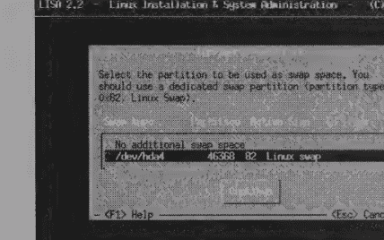

交换分区（Swap partitions）在第 13 页中有描述。仅列出正确类型（82）的分区供您选择。

选择分区后，信息屏幕会告诉您安装正在准备并激活交换分区。
- 4. 选择用于安装的源。

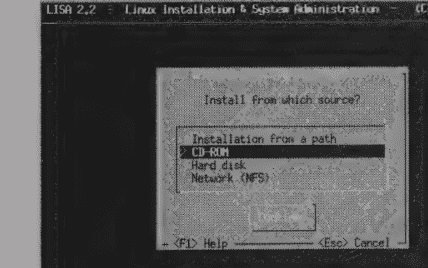

在大多数情况下，源将是 CD-ROM。

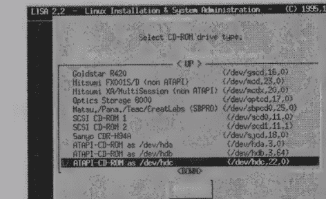

在系统上检测到的 CDROM 设备是 CDROM 设备列表中选中的设备。您应该只需在上面的屏幕上按 Enter 即可继续安装。

如果您已将 CD-ROM 的内容加载到系统的硬盘上，则可以从硬盘安装。您将指定一个分区和根目录，它们必须与 CD-ROM 中的 `col` 目录对应。必须包含 CD-ROM 中的 `bin`、`install` 和 `data` 子目录。

您可以通过存放 CD-ROM 或其内容的 NFS 服务器进行安装。要使用 NFS，您必须指定第 27 页表单列出的所有网络信息，并提供适用于您使用的 NFS 服务器的特定信息。NFS 服务器上的目录也必须导出，并向您安装 OpenLinux 的机器授予访问权限。
- 5. 选择在硬盘上安装 Caldera 系统的分区。

要安装的分区必须已经存在，并被标记为类型 83。（使用 `fdisk` 工具完成这些任务。）只有类型为 83 或 DOS 类型的分区是——
- 6. 针对格式化 Linux 分区的警告消息回答“是”。
- 7. 如果您想检查是否存在坏道，请回答“是”。
- 8. 如果您有其他希望在文件系统中自动挂载的额外 Linux 分区，请回答“是”并指定它们。

在大多数情况下，在安装完成后指定额外分区更好。例外包括您希望将初始系统的一部分安装在不同的分区上，例如 `/usr` 目录可以存储在不同的分区上。

## 选择安装内容

在选择源和目标后，您可以指定具体想要安装的内容。系统提供了几个默认选择，或者您可以指定想要安装的精确软件包。下文描述了每个选项。
- 标准（Standard）

这是默认的 OpenLinux 安装。它需要大约 250 MB 的磁盘空间，包含图形桌面、互联网服务器、开发工具等。
- 最小（不含 X Window 系统）（Minimal without X Window System）

这是一个最小的 Linux 系统，没有图形界面。它需要大约 35 MB。
- 最小（包含 X Window 系统）（Minimal with X Window System）

这是一个最小的 Linux 系统，没有开发工具和许多实用，但包含了图形 X Window 系统。它需要大约 59 MB。
- 小型标准型（Small standard）

该系统包含常用的工具以及图形 Windows 系统和桌面界面，但不包含许多开发工具、额外工具或互联网服务。
- 全部（All）

此选项安装 CD-ROM 的所有内容。它需要大约 700 MB。
- 快速且紧凑（Quick and Compact）

此选项允许您指定想要安装的包组。这类似于选择单个软件包，但速度更快，因为相关的软件包（如游戏）可以一起选择。
- 个别（Individual）

此选项让您选择想要安装的每个软件包。软件包像“快速且紧凑”选项一样分组，但由您自行选择每一个。此选项主要针对经验丰富的 Linux 用户。
- 1. 选择您想要的安装选项。

大多数用户推荐使用默认选项。如果您选择了“快速且紧凑”或“个别”选项，请按照屏幕指令选择您需要的软件包。
- 2. 按 `<Enter>` 确认开始安装。

一个信息框会向您显示在硬盘上安装软件包的进度。

在安装期间，您可以通过 `<Alt><F2>` 切换到另一个屏幕，以“help”登录并阅读系统文档，或在软件包安装时玩玩俄罗斯块游戏。

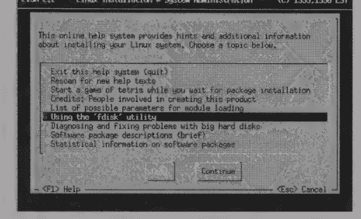

## 最终配置

在选定的软件包安装到硬盘后，再回答几个用于准备系统配置文件的问题。这些配置选项可以使用 `LISA` 工具进行检查和更改。
- 1. 回答关于您正在使用的网络设置的每个问题。

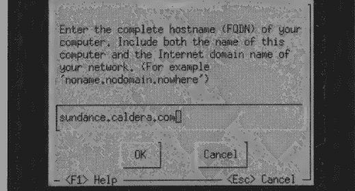

这包括提供使用第 27 页表单收集的 IP 地址和网络域名。

如果您通过 NFS 安装，您仍然必须提供这些信息，因为许多人在 NFS 安装时使用的网络信息与日常工作不同。
- 2. 为您的系统时钟选择本地时间或 GMT 时间。

GMT（通用时间）是 UNIX/Linux 系统的优先级，但如果您的计算机上有另一个操作系统，GMT 可能会引起问题。在这种情况下请使用本地时间。

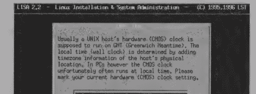
- 3. 指明您的时区。

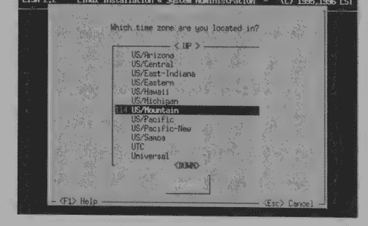

时区按字母顺序排列。时区还包含 GMT+ 标记。
- 4. 选择你正在使用的鼠标品牌。

此信息仅在在 OpenLinux 中运行 DOS 模拟器时使用。当你配置图形系统（X 窗口系统）时，你将再次指定并测试你的鼠标设置。
- 5. 选择鼠标使用的哪一个串口。
- 6. 为你的系统选择打印机驱动程序。

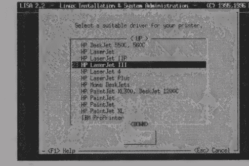
- 7. 选择打印机端口。

在大多数情况下，这将是 LPT1。此时尚未配置网络打印。
- 8. 选择默认打印机分辨率。
- 9. 选择默认纸张尺寸。
- 10. 为 root（超级用户）输入密码。

你必须输入两次密码以确认你输入的内容与你的预期一致。

不要忘记这个密码！
- 11. 为新用户账户输入密码（用户名：`col`）。

你必须输入两次密码以确认你输入的内容与你的预期一致。在不执行系统管理任务时，你应该以用户 `col` 登录。你可以根据需要使用 `adduser` 命令创建其他用户账户。
- 12. 为你的系统选择 CD-ROM 类型。

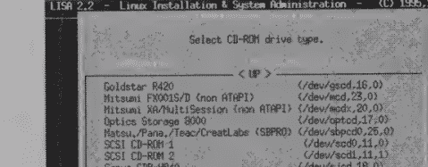

如果你是从 CD-ROM 安装的，则不会出现此屏幕。
- 13. 读取关于你的引导器的启动分析（Boot Analysis）。
- 14. 选择安装 LILO 引导器的位置。

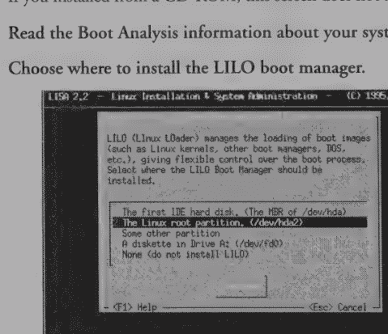


如果你不确定安装 LILO，请选择屏幕出现时默认选中的项。它是根据系统分析选择的。

48

OpenLinux 简介

# 安装 Caldera OpenLinux

- 15. 选择你想要启动的镜像。

这通常是 `vmlinux`，一个标准的 Linux 内核。

- 16. 为你安装的 Caldera 系统输入一个标签。

常用的选择是 `linux`。

- 17. 确认你之前输入的任何启动参数。

这些启动参数与在内核模块管理器中输入的 `insmod` 参数不同。

- 18. 如需，为 LILO 添加额外的条目，例如 DOS 分区。

- 19. 按 `<Enter>` 确认安装 LILO。

在安装 LILO 期间可能会出现几条警告。特别是，如果你选择的硬盘不是第一块硬盘，可能会看到一条警告消息。

LILO 安装完成后，会有一条消息通知你已完成。

- 20. 按 `<Enter>` 继续。

- 21. 选择使用哪一个 X 服务器。

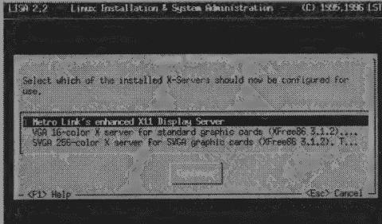

默认选择 `XFree86` 的标准 VGA 服务器。它无法取消。你还应该根据与电脑中显显的匹配情况选择其他 `XFree86` 服务器。`SVGA` 服务器也支持许多不同的显卡。安装完成后，你将使用图形配置工具设置 X 窗口系统。配置 X 的完整说明包含在从 179 页开始的附录中。

- 2. 按 `<Enter>` 启动你新的 Caldera OpenLinux 系统。

安装完成。按 `<Enter>` 在不重启的情况下启动新系统。

当你第一次启动系统时，会有几个自动进程开始索引你的系统并更新新的系统文件。在使用新的 Caldera 系统的前一个小时左右内，你的硬盘将处于活动状态。

- 23. 按照附录中的指令配置 X 窗口系统。

- 24. 转到下一章查看如何开始使用你新的 Caldera OpenLinux 系统。

# 紧急启动

在完成安装后，如果你在重启系统并返回 Caldera 遇到遇到困难，可以尝试以下方法：

- 1. 使用你首次启动安装时制作的安装软盘重启系统。

- 2. 在第一个提示处，不要只按 `<Enter>`，而是输入以下内容，使用你的根分区的设备名（你安装 Caldera 的地方）替换 `/dev/hda2`：

```
boot root=/dev/hda2
```

# 启动和使用 OpenLinux

本章描述了与启动和使用你的新环境相关的一些基本程序。本章中的程序和概念包括：

- 登录并启动图形桌面

- 关闭电脑

- 使用 LISA 工具进行系统管理

- 使用基础 UNIX 命令行工具

- 理解图形环境

- 编辑文本文件

- 添加和删除新的软件包

- 处理用户和用户组的工作

- 搜索系统帮助文件

- 设置初始化文件

## 登录并启动桌面

在安装 OpenLinux 期间，你为 `root` 用户和一个名为 `col` 的普通用户输入了密码。在不执行系统管理任务时，你应该以用户 `col` 或你创建的其他普通用户登录。

要登录并启动桌面，请遵循以下步骤：

- 1. 开启你的电脑。

系统启动后会出现登录提示。

2. 输入用户名 `root` 并按 `<Enter>`。

本节描述的管理任务需要你以 `root` 身份登录。通常情况下，你应该以你的普通用户名登录。

如果你需要完成系统管理任务但尚未以 `root` 登录，可以通过输入命令 `su` 临时切换到 `root` 用户，并在提示时响应 `root` 密码。

3. 输入 `root` 用户账户的密码。

出于安全考虑，输入密码时屏幕上不会显示密码。

会出现系统提示符。这被称为 `shell`（壳）或字符模式终端。从该提示符处，你可以输入任何系统命令，包括启动桌面的命令。

4. 输入此命令启动 XWindow 系统并调出桌面：

`startx`

片刻后，桌面出现了。（如果你没有选择包含桌面的安装选项，则取而代之的是一个小工具栏。

双击 README 图标查看有关此版本 OpenLinux 的最新发布新闻。

你也可以双击 Caldera Info 图标打开在线帮助系统。在使用桌面时，始终可以通过帮助菜单获取帮助。）

- 5. 从桌面选择打开目录。

- 6. 输入目录名，然后选择 OK。

例如，输入 `/etc`。选择后会打开窗口。

- 7. 从桌面的运行菜单选择终端模拟器。

桌面打开一个文本窗口。这就像你登录时看到的 `shell`，但它可以调整大小，并且你可以打开多个。

- 8. 要关闭终端模拟器窗口，输入命令 `exit`

## 使用多个字符模式终端

在桌面上工作时，你可能希望在字符模式终端中执行某些操作，就像登录时看到的那样。OpenLinux 可以让你登录并运行六个独立终端。

# 第 4 章：启动和使用 OpenLinux

你在一个终端启动的程序在切换到另一个终端时会继续执行。

- 每当你在图形环境下，按下 `<Ctrl>+Alt><F1>` 到 `<F6>` 切换到字符模式显示。

- 每当你在字符模式终端中（例如登录后、启动桌面之前），按下 `Alt<F1>` 到 `<F6>` 切换到其他终端。

- 当你启动图形桌面并切换到字符模式终端后，按下 `<Alt>+<F7>` 返回图形显示。

## 关闭电脑

由于 OpenLinux 是一个多任务、多用户操作系统，你不应该直接关闭电源开关。你必须告诉 OpenLinux 你正在关机，以便任何进行中的任务都能完成。

你可以放心每天开启电脑。如果无人看管，屏幕会变黑。你可以关闭显示器以节省电力。

当你确实想关闭电脑时，请遵循此程序。

### 关闭 OpenLinux

- 1. 从文件菜单选择退出桌面来退出桌面。

- 2. 通过按住左鼠标键并选择退出桌面 | 退出桌面来退出 X 窗口系统。

你回到字符模式命令行。

- 3. 通过同时按住 `<Ctrl>` 和 `<Alt>` 键，并按下 `<Del>` 键启动关机过程：

`<Ctrl>+<Alt>+<Del>`

屏幕开始出现消息，指示系统正在关闭。

- 4. 等待屏幕变为空，表示计算机正在重启。

- 5. 关闭电源。

如果你不使用此程序关闭计算机，可能会面临数据丢失或损坏 OpenLinux 配置的风险。下次你启动计算机时，启动过程可能需要几分钟时间来自动修复因突然断电而留下的问题。

## 使用 LISA 工具进行系统管理

Caldera OpenLinux 包含一个基于菜单的系统管理实用程序，你可以使用它来查看或配置系统的大多数方面。该实用工具被称为 LISA，代表“Linux Installation and System Administration”（Linux 安装与系统管理）。在大多数情况下，你都应该使用 LISA 而不是直接编辑系统管理文件。

## 第 4 章：启动与使用 OpenLinux

你可以从文本模式或图形模式下的文本窗口（终端模拟器）启动 LISA 工具。你必须以 `root` 登录才能使用 LISA。

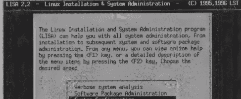

一旦启动了 LISA，即可使用方向键选择选项，按 `<Enter>` 选择高亮选项，并按 `<Esc>` 返回到上一个菜单。使用 LISA 管理你的硬件、网络或安装在系统上的软件包。

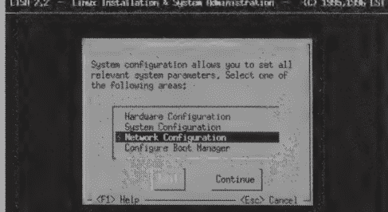

在 LISA LISA 期间，你可以随时按 `<F1>` 来查看当前任务的帮助屏幕。

### 基础命令行实用程序

尽管桌面界面提供了运行程序、管理文件系统和浏览网络资源的理想方式，但你可能仍然想使用命令行实用程序来访问系统的部分功能。这里我们简要描述几个常用的命令。

与你的文件系统和系统管理相关的许多高级概念和任务通常在桌面上完成，并在第 5 章中讨论。这些包括了设置文件权限、创建符号链接以及调整桌面的显示偏好等内容。

下面的命令可以从字符模式的命令行使用，也可以从桌面上的终端模拟器窗口使用。这些命令与任何其他 UNIX 操作系统上的命令相同，并且与你熟悉的许多 DOS 命令相似。然而，请记住，所有命令都是区分大小写的。

表 3 基础命令行实用程序

| 命令 | 用途 |
| --- | --- |
| `ls` | 列出目录内容（类似于 DOS 命令 DIR） |
| `cd` | 切换到新目录 |
| `pwd` | 打印你所在的目录（称为工作目录） |
| `mkdir` | 创建新目录 |
| `rmdir` | 删除目录 |
| `rm` | 擦文件（类似于 DOS 命令 DEL） |
| `cp` | 复制文件 |
| `more` | 在屏幕上显示文本文件内容，每满一屏暂停直到按下按键（类似于在 DOS 中使用 TYPE file | MORE） |
| `<Ctrl+c` | 停止正在使用的任何命令（中断） |

要解有关某个命令，可以通过输入这些命令之一来阅读该命令的手册页或帮助屏幕。

```
man commandname
commandname --help
```

这里是上表列出的命令的一些示例。

下面的命令列出当前目录下的所有文件。`-l` 选项显示每个文件的额外信息，例如大小和所有者。

```
ls -l
```


下面的命令将文本文件 `readme.txt` 的内容打印到屏幕上，每满一屏暂停直到按下按键。如果文本文件很长，你可以随时按 `<Ctrl>`+`c` 取消命令。

```
more readme.txt
```

要了解更多关于你的 Calder 系统上的可用命令以及如何使用它们，请参考在线《Linux 安装与入门指南》。你可以从桌面上的 Calder Info 图标访问此文档。

## 理解图形环境

OpenLinux 使用 X 窗口系统（通常称为“X”）来提供一个强大的分布式图形环境。以下是帮助你开始使用此图形环境的基本概念。

### X 与桌面

X 窗口系统是运行 X 应用程序的图形子系统。你的 Calder 系统提供的桌面界面仅仅是使用 X 窗口系统的一个应用程序。按照 OpenLinux 的配置，当你退出桌面（通过从文件菜单中选择“退出桌面”）时，X 窗口系统仍保持打开。从空白的 X 窗口屏幕，你可以通过按住鼠标左键查看选项菜单。

桌面提供了一种方便的图形方法，用于交互、查看和配置你的文件系统和其他计算机资源。

### 多用户与多任务

X 窗口系统是一个分布式、多用户、多任务的图形环境。它依赖底层的 Linux 操作系统来实现功能；但提供了图形界面来使用 Linux 的能力。

与它本身一样，你可以同时运行许多应用程序。它们都会同时运行。如果你有 X 终端连接到与 OpenLinux 计算机相同的网络，许多用户可以同时使用多个图形应用程序。唯一的限制是你的机器速度快慢，以及你拥有的磁盘空间、交换分区空间和内存大小。

### 使用图形窗口

当你桌面上运行多个图形应用程序时，一次有一个应用程序具有“焦点”。你可以通过将鼠标指针放置在另一个窗口的标题栏上并点击鼠标左键来给该窗口焦点。具有焦点的应用程序标题栏和边框会改变颜色。你的击键将发送到具有焦点的应用程序，即使窗口的部分被遮挡。

- 要将应用程序窗口带到最前面，使没有其他窗口遮挡其部分，请在你想使用的应用程序的标题栏上点击鼠标指针。
- 你可以通过将鼠标指针放置在窗口的任何角或窗口边缘来调整窗口大小。当指针变成箭头时，你可以点击并拖动窗口边界来调整大小。某些窗口不允许调整大小。
- 要将窗口移动到屏幕上的新位置，请点击标题栏。将窗口拖动到新位置并释放鼠标按钮。
- 要关闭窗口，你可以双击左上角的框，或者在该框中点击一次并选择“关闭”。

## 终端模拟器窗口

当你处于 X 环境时，你可能需要输入命令来启动应用程序。你可以打开一个终端模拟器，它是操作系统的命令行界面。从此窗口，你可以启动应用程序或完成管理任务。

你可以随时轻松打开终端模拟器：

- 在桌面的空白区域点击鼠标右键，并从菜单中选择“终端模拟器”。
- 选择图标栏上的终端模拟器图标。
- 从运行菜单选择终端模拟器。

### 窗口管理器

X 使用窗口管理器来创建和显示你看到的窗口。X 有许多窗口管理器可用。不同的窗口管理器窗口外观可能不同。下面的概念描述了 OpenLinux 提供的 `fwm` 窗口管理器。

X 中的每个窗口都有允许你处理应用程序的功能。窗口的部分包括：

- 标题栏 窗口的框架在其顶部包含一个标题栏。标题栏指示应用程序名称，有时正在使用的文档。
- 最小化和最大化按钮 位于窗口右上角，最小化按钮将窗口缩小为屏幕右侧的小图标（图标可能不会立即出现）。该窗口中运行的程序继续运行，但窗口不可见。你可以通过点击窗口图标恢复窗口到之前的大小。

最大化按钮使窗口调整大小以填充屏幕。一旦窗口被最大化，再次选择最大化按钮将窗口恢复到之前的大小。

右键点击未最大化窗口的最大化按钮可以垂直扩展窗口而保持宽度不变。
- 控制菜单 每个窗口的左上角有一个按钮，选中后会显示该窗口的控制菜单。控制菜单允许你调整窗口大小、最小化、最大化或关闭它。

### 桌面

桌面界面是 OpenLinux 默认系统自带的一个 X 应用程序。它可以为你的系统和其他应用程序提供全屏界面。

桌面区域提供了一个空间，你可以在其中放置应用程序、经常访问的文件或其他工具。一旦这些内容位于桌面上，你可以随时选择它们。

## 目录窗口

从桌面，你可以通过打开目录窗口来查看和管理你的文件系统。每个目录窗口包含以下图标：

目录和文件。图标根据每个目录和文件的类型进行分配。

可以同时打开多个目录窗口，你可以智能地在目录窗口之间拖放文件和目录，或者在桌面与窗口之间进行拖放。

通过选择桌面上默认安装的信息图标，可以在线获取有关桌面的完整信息。桌面帮助屏幕包含有关使用对话框和菜单的信息。桌面用户指南则包含更多关于编辑图标、为文件分配图标、布局等技术信息。

## 编辑文本文件

Caldera OpenLinux 包含一个功能强大的文本编辑器，可以使用它来处理所有类型的文本文件。该编辑器是 CRiSP-LiTE，它是来自 Vital Corp 流行的 CRiSP 编辑器的精简版本。此编辑器包含了全键盘和鼠标控制、下拉菜单、在线帮助以及一个包含常用功能的图标工具栏，此外还包含了许多程序员使用的更高级别功能。

CRiSP-LiTE 是桌面的默认文本编辑器。这意味着每当你在桌面或目录窗口中看到文本文件的图标时，都可以双击该文件进行编辑。CRiSP-LiTE 将打开该文件并准备好编辑。

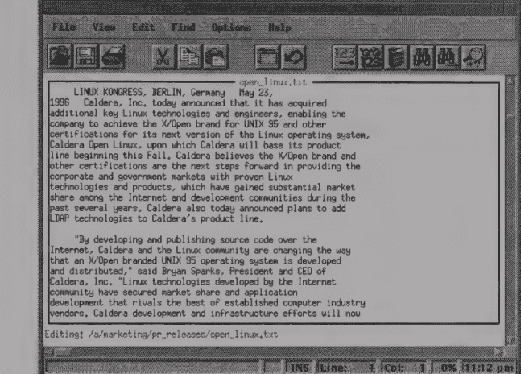

此外，CRiSP-LiTE 图标默认位于桌面上。你可以将任何文本文件拖放到 CRiSP-LiTE 图标上以用其打开文件。如果你双击 CRiSP-LiTE 图标，编辑器将打开该文件。

注意：如果你想将默认文本编辑器更改为 `vi` 或 `emacs`，请参见第126页的“更改偏好”。

OpenLinux 简介

## 添加和删除软件包

软件包的概念让管理 OpenLinux 系统变得简单。安装在系统上的每个软件组件都是软件包的一部分。OpenLinux 包含了软件包管理工具，可以快速地安装来自 Caldera CD-ROM 的新软件。

第190页开始的表格包含了 CD-ROM 上可用软件包的完整列表和简要描述。Caldera CD-ROM 软件包存储在 `rpm` 格式中。每个 `rpm` 文件（扩展名为 `.rpm`）都包含组成软件的文件，以及关于安装位置、所需磁盘空间以及软件提供的任何初始化文件的额外信息。

你必须以 `root` 身份登录才能管理软件包。在使用你的普通用户名和密码登录后，使用 `su` 命令获取超级用户权限后再使用 `rpm` 工具。

系统管理员可能希望使用该工具来管理软件包。该工具是一个位于桌面 Admin 组的图形化软件包管理工具。如果你倾向于使用命令行工具，可以使用 `rpm` 命令。一旦知道软件包的位置，就可以使用单个命令安装它。Caldera CD-ROM 软件包位于 `/packages` 目录。例如，安装 XFree86 视频驱动程序的命令如下（取决于你的 CD-ROM 挂载位置）：

```bash
rpm -i /mnt/cdrom/packages/XFree86-SVGA-3.rpm
```

`-i` 选项表示指定的软件包。如果你发现了一个不再需要的软件包，可以先查询以确认它是否已安装以及大小：

```bash
rpm -qi
```

`-qi` 选项表示这是一个查询，你想获取软件包的基本信息。没有使用路径，因为你指的是一个已经安装的软件包。`rpm` 工具知道去哪里找到它。

如果你决定从系统中删除此软件包，根据查询结果，你可以使用 `-e` 选项卸载软件包：

```bash
rpm -e
```

你可以通过输入以下命令之一查看选项的完整列表并了解更多关于 `rpm` 命令的信息：

```bash
rpm --help
man rpm
```

## 用户和组的操作

由于 OpenLinux 是多用户多任务环境，一台运行 OpenLinux 的计算机可能通过各种网络连接同时连接多个用户。本节程序将指导你完成一些基本的用户和组管理任务。这些任务使用图形化的用户组配置工具 `usercfg` 完成。如果你在启动桌面之前以 `root` 身份登录，这些工具就会出现在桌面供你使用。你无法完成本节中的任务，因为其他用户没有权限更改用户和组的信息文件（`/etc/passwd` 和 `/etc/group`）。

OpenLinux 简介

## 第4章：启动和使用 OpenLinux

这是本节使用的用户配置对话框：

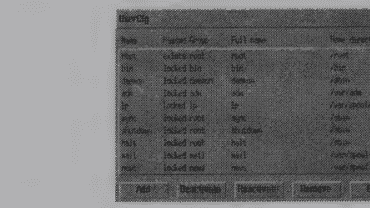

通过此工具，你可以添加和删除用户及组，设置登录 shell、全名、主目录、用户 ID (`uid`)、组 ID (`gid`) 等。

### 添加用户

使用此程序在系统上创建一个新用户账户。

- 1. 通过选择桌面上的图标启动图形化用户配置工具。如果你在桌面上没有用户配置工具的图标，可以在终端窗口（如 `xterm`）中输入以下命令：

```bash
usercfg
```

- 2. 选择主窗口中的 Add 按钮（img/361ba1f1a2f214d776526662a65e3151_85_0.png）。
- 3. 输入用户名。
- 4. 输入用户全。
- 5. 为此账户输入密码。
- 6. 选择 OK 完成密码。
- 7. 使用下拉菜单选择登录 shell。
- 8. 选择 Edit 选项。
- 9. 选择 Add 将此用户添加到系统。


选择 `Yes` 为此用户创建主目录。如果你已经定义了主目录，则此步骤将不再适用。如果你要挂载来自不可用系统的主目录，则应在此步骤选择 `No`。

## 删除用户

1. 通过选择桌面上的图标启动图形化用户配置工具。如果你在桌面上没有用户配置工具的图标，可以在终端窗口（如 `xterm`）中输入以下命令：

```bash
usercfg
```

2. 在主窗口中点击某行来选择用户。
3. 选择 `Remove` 按钮。
4. 确认你想从系统中删除此用户账户。
5. 确认你想删除该用户的主目录和电子邮件信息。
6. 如果你担心已删除的用户可能在系统中仍有文件，在“确认是否希望修改孤立文件的所有者”的提示时回答 `Yes`。

## 禁用用户

1. 通过选择桌面上的图标启动图形化用户配置（User Configuration）工具。
如果您的桌面上没有用户配置工具的图标，可以在图形化终端模拟器窗口（如 `xterm`）中输入以下命令：

```
usercfg
```

2. 在主窗口中点击某行以选择一个用户。
3. 选择“禁用”（Deactivate）按钮。
4. 如果您希望在该用户禁用期间节省空间，请选择“是”（Yes）来压缩用户的家目录。

系统将使用 `gzip` 和 `tar` 命令来压缩用户的家目录。

## 激活用户

1. 通过选择桌面上的图标启动图形化用户配置（User Configuration）工具。
如果您的桌面上没有用户配置工具的图标，可以在图形化终端模拟器窗口（如 `xterm`）中输入以下命令：

```
usercfg
```

2. 在主窗口中点击某行以选择一个已禁用的用户。
3. 选择“激活”（Reactivate）按钮。

如果该用户在禁用时其家目录经过了压缩，该目录将自动解压，恢复到禁用之前的状态。

除了多个用户账户外，OpenLinux 还可以以用户组的形式运行。组是零或多个用户账户的集合。用户组使得为文件系统的区域分配权限变得更加方便。在安装过程中会自动创建几个特殊组。

此处显示了组列表对话框：

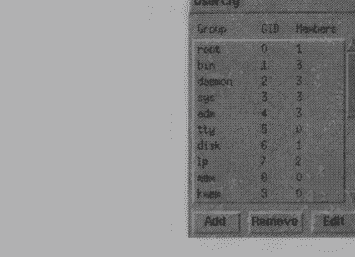

## 创建新组

1. 通过选择桌面上的图标启动图形化用户配置（User Configuration）工具。
如果您的桌面上没有用户配置工具的图标，可以在图形化终端模拟器窗口（如 `xterm`）中输入以下命令：`usercfg`
2. 从 `UserCfg` 菜单中选择“编辑组”（Edit Groups）项。
3. 选择“添加”（Add）按钮。

会弹出一个对话框，您可以在其中输入新组的信息。

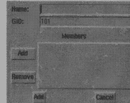

4. 为新组输入名称。
与用户名一样，组名不能包含空格或标点符号。
5. 通过选择对话框左侧的“添加”（Add）按钮将成员添加到此新组中。
6. 从出现的用户名列表中选择用户。
如果您在添加用户时出错，请使用“移除”（Remove）按钮。
7. 选择对话框底部的“添加”（Add）按钮将此新组添加到您的系统中。

对话框将关闭，新组将出现在组列表中。

## 搜索帮助

帮助工具允许您使用正则表达式搜索手册页（man pages）、信息页（info pages）和纯文本文件（或这些文件的任何子集）。搜索结果将列出，您可以双击它们进行查看。该工具非常基础，并将随着时间的推移而改进。此帮助工具对于查找 Linux 系统或相关功能的信息最为有用。关于桌面环境的信息，请选择 README。将打开一个图形化浏览器，您可以通过该连接从中选择感兴趣的话题。

1. 通过选择桌面上的图标启动图形化帮助（Help）工具。
如果您的桌面上没有帮助工具的图标，可以在图形化终端（如 `xterm`）中输入以下命令：

```
helptool
```

2. 输入要搜索的单词。
3. 选择“搜索”（Search）按钮开始搜索。

片刻后，列表框中会出现匹配的主题列表。
4. 双击某个主题以阅读相关内容。

注意：帮助文件未与桌面在线帮助集成。您可以通过桌面上的帮助图标查看桌面的在线帮助。

## 设置初始化

`/etc/rc.d/local` 文件在系统启动时、所有其他初始化之后会被执行。您可以向此文件添加额外的初始化命令。例如，您可能想要启动守护进程（daemons）或初始化某些端口。单个用户可以将启动信息存储在其家目录下的隐藏文件 `.bash_profile` 中。此文件中的命令将在系统级初始化完成后执行。

## 学习使用桌面

桌面是 Linux 操作系统的图形化用户界面。您可以使用桌面来组织您的个人工作空间，以便您经常使用的程序、文件和目录可以随时访问。通过桌面，您可以通过双击程序图标来运行应用程序（如电子表格或文字处理器）。若要在目录之间移动文件，可以使用鼠标将其从一个窗口拖动到另一个窗口。您可以执行诸如创建链接、更改文件所有权访问权限等任务，而无需输入任何命令。桌面界面包含在本书的 CD-ROM 中，仅作为测试版本。OpenLinux 系统的其余部分将继续运行，但本章描述的桌面界面仅在您安装系统后的30天可用。

以下是桌面为您简化的一些任务：

- 运行程序
- 打开文件进行编辑
- 打印文件
- 查看目录内容
- 创建新目录
- 移动和删除目录
- 移动、复制和删除文件
- 在系统中查找目录和文件
- 显示和更改目录及文件的信息

本章描述了如何使用桌面来组织您的工作。它简要描述了桌面的功能以及如何使用它们。关于使用桌面的更完整参考可以在在线的《桌面用户指南》（Desktop User's Guide）中获得，您可以从桌面上的图标访问。

## 启动和使用桌面

当系统首次安装时，桌面被配置为 X Window 系统的默认应用程序。这意味着当您启动图形系统（如下所示）时，桌面会启动。当您退出桌面时，图形系统将退出，返回到字符显示界面。

您可以更改默认配置，使桌面不自动启动。《桌面用户指南》包含了此类操作说明。同样描述了在桌面初始化期间使用启动选项。例如，您可以在桌面启动时自动打开目录、更改默认颜色或关闭声音。

## 桌面概览

桌面允许您按照意愿组织工作空间，将最常用的程序、文件和目录放在触手可及。

当您退出时，桌面会记住您离开工作空间的状态，并在下次启动桌面时恢复该布局（除非您通过布局选项进行指定）。

桌面还允许您命名并保存无限数量的布局，因此可以在不同布局之间轻松切换。

显示显示典型桌面工作空间中的主要窗口：

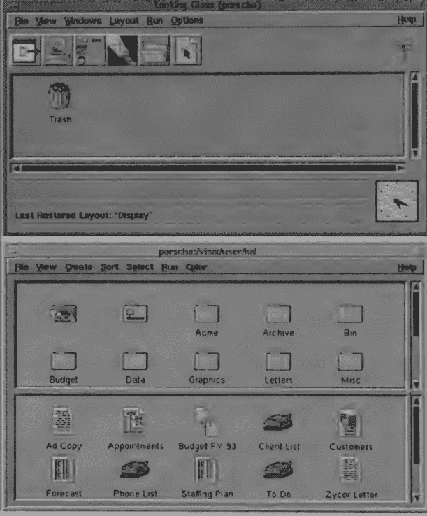

图1：桌面工作空间

## 桌面窗口

桌面窗口是桌面的主窗口——其他窗口的背景。您可以通过桌面窗口访问所有桌面功能。默认情况下，桌面窗口全屏显示并位于所有其他窗口之后（但您可以更改设置；请参见桌面用户指南）。桌面窗口包含一个大区域，您可以在其中放置常用的程序、文件和目录。

尽管您放置在桌面上的对象保留在文件系统中的位置，但它们会出现在桌面上以便于访问。您可以像在目录窗口中一样从桌面上打开或激活任何对象：

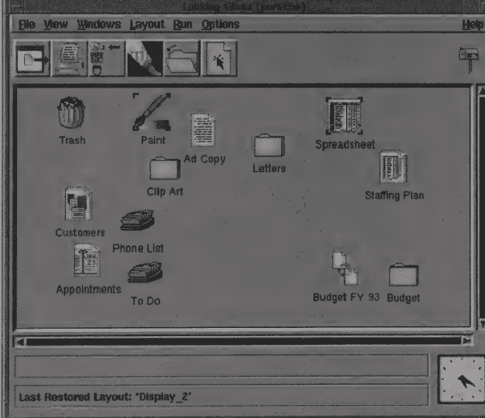

图2：桌面窗口

示例桌面上有一个多个目录和文件图标。你放在桌面上的对象会一直留在那里，直到你将其移除。

你可能只在需要时在桌面上保留目录和文件。例如，当你处理预算时，可能会显示“预算”目录。或者，如果你全年都要使用电子表格应用程序，你可能会一直将其留在桌面上。

你可以在桌面的任何地方放置对象，这允许你按照最方便自己的顺序放置目录和文件。

图标栏位于桌面窗口菜单下方，包含若干个桌面命令和窗口。你可以向图标栏添加其他桌面命令，并创建额外的按钮来执行外部命令。

当你保存工作区布局时，桌面和图标栏的尺寸、位置和内容也会被保存。

## 目录窗口

目录窗口显示目录的内容。以下是一个典型的目录窗口：

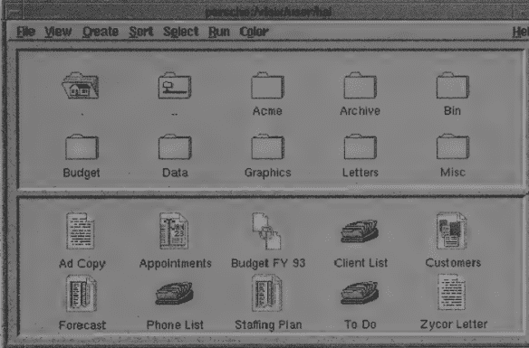

图 3：图标视图下的示例目录窗口

从目录窗口中，你可以：

- 打开和关闭选定的目录和文件
- 启动程序
- 更改目录和文件的视图
- 打印文件
- 移动目录
- 移动和复制文件
- 删除目录和文件

之前的插图显示了一个以图标形式显示对象的目录窗口。你可以通过图标、名称或包含详细信息的宽格式在目录窗口中查看对象。

如果你拥有一台彩色显示器，你还可以为目录窗口中的对象名称分配颜色。

目录窗口用一个名为 `splitter`（分隔器）的水平条将目录与文件隔离开来。顶部部分显示目录中的子目录。底部部分显示目录中的文件。

你可以通过点击分隔器并向上或向下拖动来调整每个部分的大小。你也可以移除分隔器，并将目录和文件放置在目录窗口的任何位置。

你可以显示任意数量的目录窗口，但一次只能在一个窗口中显示一个目录。

## 桌面图标

桌面图标代表你的目录和文件，可能出现在多个位置。系统中的每种类型的目录或文件都有对应的图标。桌面提供了一个用于管理图标的图标编辑器。通过图标编辑器，你可以：

- 查看系统中的桌面图标
- 创建个人图标库
- 创建新图标
- 编辑现有图标


某些特征由桌面提供的多种图标设计表示。具有相同设计的图标组成一个图标族。

右上角有一个折痕的图标代表可以被多个应用程序打开的数据文件。此类文件的一个示例是仅包含文本的文件。

此类文件可以由多个编辑器或文字处理程序编辑。该图标族中的图标通常包含另一个视觉提示，指示哪个应用程序创建了它们，或者它们包含的数据类型。

以下是代表数据文件的图标示例：


图 4：图标示例，多个——带折痕的数据文件。

右上角有两个折痕的图标是数据文件，其包含的数据格式可能只对创建它的应用程序有意义。此类族的文件包括程序创建用于存储你工作的数据文件。以下是代表包含特定程序数据文件的图标示例：


图 5：图标示例，多个——带两个折痕的数据文件

文件夹图标代表一个目录。该族中有不同类型的目录。例如，文件夹上的房子图片代表你的主目录。然而，某些特殊目录的图标看起来不像文件夹；例如，NetWare 容器。当目录在你的工作区域的某处打开时，它的文件夹图标会扇形展开，使其看起来是打开的。以下是代表目录的图标示例：


图 6：图标示例，显示多个——打开、关闭、主目录

当你使用桌面时，你会注意到图标族中共有的其他特征。你甚至可以使用图标编辑器创建一些图标。你可以从桌面上的“运行”菜单访问图标编辑器。在线《桌面用户指南》中提供了使用图标编辑器的说明。

## 与桌面交互

要使用桌面，你必须已经知道如何执行一系列基本操作，包括：

- 使用鼠标或其他指向设备点击来选择桌面和菜单上的项目
- 通过点击选择按钮和复选框
- 拖放

大多数桌面操作都是为基于鼠标的操作设计的，但所有桌面功能也可以通过键盘访问。

## 使用鼠标

下表描述了如何使用双键鼠标。

| 操作 | 按钮 |
|---|---|
| 选择并拖动项目；打开菜单 | 左键 |
| 在选择之间切换 | Ctrl+左 |
| 扩展选择 | Shift+左 |
| 拖动选择 | 双键 |
| 拖动选择复制 | Ctrl+双键 |
| 拖动选择移动 | Shift+双键 |
| 显示弹出菜单 | 右键 |

## 与窗口和对话框交互

窗口和对话框提供若干操作。以下列出了发生的操作：

- “是”并关闭窗口。
- “确定”并关闭窗口。
- “应用”应用更改但不关闭窗口。
- “取消”取消更改。
- “帮助”提供有关对话框的信息。
- “停止”结束当前任务。
- “重置”到初始。

## 使用快捷键

桌面主要通过鼠标控制。但你也可以使用键组合执行操作。在大多数窗口中，按住 `Alt` 键并按下下划线的字母。

快捷键是单键（如 `F1`）或键组合（如 `Ctrl+Y`），分配给命令。使用快捷键的效果与鼠标选择命令相同。

许多命令可以使用快捷键选择。如果是这样，键序列将显示在菜单右侧。例如，当你在菜单看到 `^Y` 时，按住 Control 键并按 Y。

快捷键列表包含在线《桌面用户指南》中。

以下是带有命令和键盘对应的菜单示例：

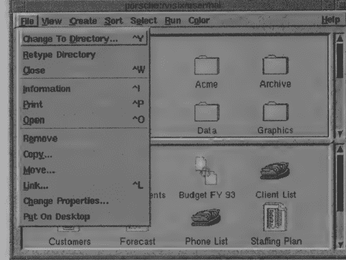

图 7：带有命令和键盘对应的菜单

## 使用目录窗口

你使用目录窗口从桌面管理系统。在目录窗口中，你可以完成这些基本操作：

- 在新的目录窗口中打开目录
- 关闭目录窗口
- 更改当前目录窗口显示的目录
- 将目录窗口移至顶层
- 将目录窗口放在桌面
- 堆叠目录窗口

你还可以自定义显示，包括：

- 设置目录的显示格式
- 按名称、修改时间或文件类型对目录

在使用桌面时，没有单一的当前目录。每个目录窗口的当前目录是该窗口显示的目录。默认情况下，此目录的完整路径出现在每个窗口的标题栏中。

作为显示偏好的一部分，你可以选择想要显示在窗口标题栏中的信息。

在目录窗口的目录部分，当前目录由 `"."`（点）表示。包含当前目录的目录被称为父目录。在目录窗口的目录部分，父目录由 `".."`（点）表示。

以下示例显示了目录窗口中的当前目录和父目录：

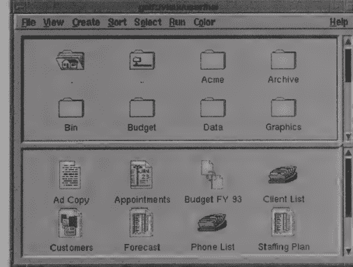

图 8：目录窗口中的当前目录和父目录

当你第一次打开目录窗口时，你的默认显示偏好决定了窗口的外观。你可以使用目录窗口中的“文件”、“视图”、“排序”和“颜色”菜单来设置显示，例如：

- 显示哪个目录
- 目录和文件是以“名称”、“图标”还是“宽列表”视图显示
- 目录窗口是否包含分割器或处于可移动格式
- 目录和文件在拆分窗口中出现的顺序
- “名称”、“图标”或“宽列表”视图中对象的颜色

桌面会记住目录窗口的显示设置以及在工作区上的位置，下次打开该窗口时将会恢复。

### 打开目录窗口

当你第一次启动桌面时，没有打开的目录窗口。有几种方法可以打开目录窗口以开始处理你的文件和目录：

- 使用桌面上的“窗口 | 打开目录”命令。在“打开目录”对话框中中输入目录路径，或从显示的“历史列表”中选择。
- 在目录窗口中选择一个目录，并使用该目录窗口中的“文件 | 打开”命令。
- 在桌面上选择一个目录或文件，点击图标栏上的“在目录窗口中显示”按钮。
- 双击任何你想在目录窗口中打开的目录。
- 点击图标栏上的“打开目录窗口”按钮。

### 打开目录窗口看起来所示：

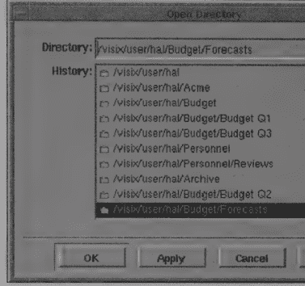

图 9：打开目录窗口

### 关闭目录窗口

可以通过在该目录窗口中选择“文件 | 关闭”来关闭任何目录窗口。

### 移动目录窗口

如果你打开了多个目录窗口，有几种方法可以安排这些窗口：

- 使用桌面窗口中的“窗口”菜单将窗口移到顶层（按名称选择）。
- 你也可以使用“窗口”菜单或图标栏上的“堆叠窗口”按钮将所有目录窗口整齐地堆叠在工作区上。
- 你可以按住 `<Alt>` 键并按 `<Tab>` 键在所有打开的桌面（包括所有目录窗口）之间切换。

## 目录窗口视图

你可以通过从目录窗口的“视图”菜单中选择以下项目之一，以三种视图中的一种查看目录窗口中的目录和文件：

- 名称
- 图标
- 宽列表

### 名称视图

当目录和文件以“名称”视图显示时，每个名称旁边的微型图标表示该对象是目录还是文件。例如，

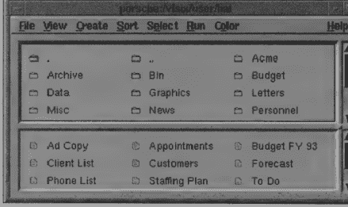

图 10：按名称显示的 Hals 主目录。

### 图标视图

当目录和文件以“图标”视图显示时，每个对象都会显示完整尺寸的图标。图标根据桌面使用的文件类型规则进行选择。名称显示在图标下方。例如，

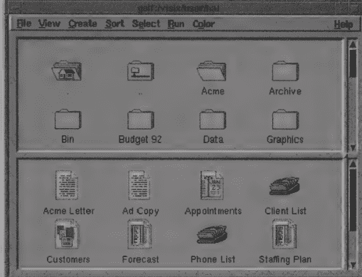

图 11：按图标显示的 Hals 主目录。

### 宽列表视图

当目录和文件以“宽列表”视图显示时，可以按任何顺序显示以下信息：

- 名称
- 访问权限
- 所有者和组
- 链接数
- 大小（字节）
- Inode
- 最后更新的时间和日期
- 文件类型
- 链接内容

每个名称旁边的微型图标表示该对象是目录还是文件。

以下是宽列表视图显示目录和文件的示例：

| 名称 | 组 | 排序 | 选取 | 颜色 | 图标 | 大小 | 日期 | 类型 |
|---|---|---|---|---|---|---|---|---|
| Home | dir | | | | | dir | 19568 | 2012/07/28 10:50 | 目录 |
| Acres | dir | | | | | dir | 65 | 2012/07/27 23:43 | 目录 |
| Archives | dir | | | | | dir | 54236 | 2012/07/25 14:14 | 目录 |
| Backup | dir | | | | | dir | 542 | 2012/07/25 10:10 | 目录 |
| Budget | dir | | | | | dir | 147 | 2012/07/23 16:03 | 目录 |
| Data | dir | | | | | dir | 45132 | 2012/07/22 15:12 | 目录 |
| Audio Layer | file | | | | | file | 4807 | 2012/07/31 05:29 | 文本文件 |
| App Copy | file | | | | | file | 1528 | 2012/07/31 01:32 | 文本文件 |
| Card List | file | | | | | file | 54179 | 2012/07/31 11:37 | 文件 |
| Desktop | dir | | | | | dir | 18441 | 2012/07/25 12:53 | 目录 |


| Forecast | dir | | | | | dir | 18441 | 2012/07/25 12:53 | 目录 |
| This PC | file | | | | | file | 1528 | 2012/07/31 01:32 | 文件 |

下表描述了在宽列表视图中调整列的操作：

| 操作 | 方法 |
|---|---|
| 增加或减小列宽 | 拖动边缘 |
| 移动列的位置 | 拖动向左或向右 |
| 从显示中移除列 | 将列拖出标题行 |
| 消除无用空间 | 双击分类 |
| 按类别排序 | 双击列 |

要更改默认视图，请参见“更改偏好”。

# 第 5 章：学习使用桌面

## 按类别进行排序

- 在目录窗口中，从“排序”菜单选择一个排序类别。目录窗口中的目录和文件将进行排序并重新分布。

要更改排序顺序，在目录中选择“排序 | 升序”或“排序 | 降序”。你的选择将在菜单中被选中，并在命令前出现填充方框。

如果你按颜色排序，升序顺序显示目录窗口的“颜色”菜单中：黑色项目首先，然后是棕色、绿色、蓝色、紫色、粉色、红色和橙色。相同色的项目按字母排序。

- 创建目录和文件
- 为目录和文件创建链接
- 在目录窗口中查找并显示目录和文件
- 在活动目录窗口中选择目录和文件
- 分组选定的目录和文件
- 移动目录
- 移动和复制文件
- 删除目录和文件
- 打印文件

## 创建目录和文件

使用目录窗口中的创建（Create）菜单创建目录、文件、FIFO 和设备。（FIFO 和设备类似于文件，但用于程序之间或与外围设备之间的通信。）

+ 1. 在目录窗口中，选择“创建”菜单，然后选择您想要创建的对象类型。
+ 2. 在选中对象时，为对象输入新名称。

如果您正在创建设备，必须输入主设备号和次要设备号。设备通常由系统管理员创建。在您的 Caldera 系统上通常不需要此操作。

## 修改现有目录或文件的名称

+ 1. 在目录窗口中选择您想要更改的目录或文件的名称。

目录或文件名称周围会出现一个框，且名称会被高亮。
+ 2. 像编辑文本字段一样编辑名称。

您可以更改目录中除 `..`（当前目录）和 `..`（父目录）之外的所有目录和文件的名称。

如果输入错误，请删除整个名称并按回车。旧名称将恢复。

## 创建链接

链接允许您从文件系统或目录层次结构中的多个位置访问目录或文件。

根据您想要引用目录或文件的方式，您使用不同类型的链接。符号链接（Symbolic links）占用的磁盘空间很少——远少于目录或文件的副本。您可以通过链接查看或更改文件或目录。

您可以创建两种类型的链接：

- 硬链接（Hard link）
- 符号链接（Symbolic link）

硬链接是对物理文件的引用；符号链接是对目录或文件名称的引用。

您只能为文件创建硬链接，而不能为目录创建硬链接。链接可以在不同的目录中，但必须在同一个文件系统中。在所有硬链接名称都被删除之前，该文件不会从您的系统中删除。

要查出一个文件有多少个硬链接：

与硬链接不同，符号链接可以跨文件系统创建，并可以引用目录和文件。当您创建符号链接时，会创建一个包含实际目录或文件路径的文件。与硬链接一样，您可以通过符号链接查看或更改文件。

由于符号链接仅指向目录或文件名称，而不是实际的文件系统引用，当您删除原始目录或文件时，其所有的符号链接也会失效。

链接仍然存在，但由于它指向空内容，如果您尝试使用它，链接会导致错误。如果您在相同位置放置一个同名的文件，符号链接将再次可用。

符号链接有两种类型：

- 绝对路径（Absolute）
- 相对路径（Relative）

绝对符号链接是指向原始目录或文件的完整路径。因为由于显式引用了路径中的每个目录，如果您将原始目录或文件保留在目录结构中的相同位置，则创建绝对符号链接。

然而，您可以移动链接引用，因为其位置并不决定引用。如果您删除、移动或更改原始目录或文件的名称，您将无法访问该目录或文件，因为路径是无效的。

相对符号链接是指向原始目录或文件的相对路径。链接引用的位置被用于确定原始目录或文件的位置，因此在不使链接失效的情况下，不能相对于对方相互移动。

相对符号链接允许您在文件系统中移动包含原始目录或文件以及链接引用的目录结构部分。（有关您的系统支持的链接类型的更多信息，请参阅在线 Linux 系统文档。）

## 创建链接

+ 1. 选择您想要创建链接的文件。
+ 2. 在目录窗口中，选择 `文件（File）|链接（Link）`。

“链接文件和目录”窗口出现：

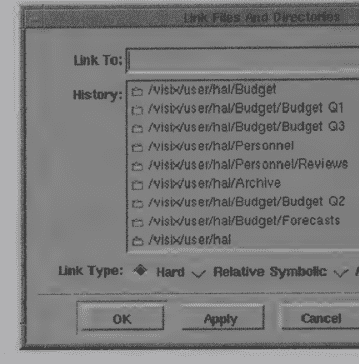

图 13：按了硬链接的链接窗口
+ 3. 通过以下操作之一指定链接引用的出现的位置及其名称：

- 从历史列表中，选择您希望链接引用出现的目录。
- 在“链接到”（Link To）字段中，输入您希望链接出现的目录的完整路径或相对路径，或者输入链接的完整路径或相对路径。
- 清空“链接到”字段并按回车，在您的主目录中创建链接。

“链接到”字段还支持目录名补全。如果您输入唯一的目录部分名称并按下空格键，该目录将在“链接到”字段中被自动补全。

如果您在第 1 步中选择了多个文件，则只能指定目录路径，而不能指定文件名。
+ 4. 选择您想要创建的链接类型。

如果您尝试创建一个与您要放置硬链接的目录中已存在的文件同名的链接，将出现消息询问您是否要覆盖该文件。

（如果在“链接文件和目录”窗口中没有出现“相对符号”和“绝对符号”按钮，说明您正在查看的文件不支持链接。）
+ 5. 选择以下内容之一：

- 点击 `OK` 保存更改并退出“链接文件和目录”窗口。
- 点击 `应用（Apply）`在不关闭窗口的情况下保存更改。

将在您选择的目录创建创建。

如果您一次为多个目录创建链接，将出现状态对话框，允许您取消操作。

您可以为符号链接设置权限，但不能为硬链接设置。（要设置权限，请参见第 104 页。）

## 查找目录和文件

使用查找（Find）命令在文件系统中查找特定的目录或文件。查找命令在桌面两个菜单中可用：

- 编辑（Edit）菜单

在查找窗口中，您指定要让桌面搜索的名称或模式（使用特殊字符）。桌面将列出匹配的目录和文件。以下显示查找窗口：

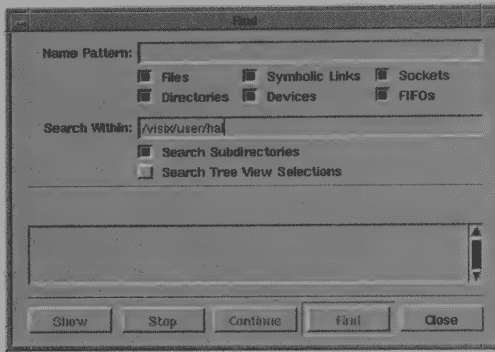

图 14：查找窗口

从匹配的目录和文件列表中，您可以选择目录或文件并点击查找以在目录窗口中显示它。

当您使用查找搜索文件或目录时，会输入一个桌面匹配的模式。下表描述了可以使用的特殊字符。

### 表 6. 模式中使用的特殊字符

| 在模式中包含... | 使用此字符 |
| :--- | :--- |
| 单个变量字符 | `?` |
| 例如，memo? 查找所有以 memo 开头后恰跟一个字符的名称（如 memo1 或 memoX，但不 memo、memo10 或 memoXY）。 |  |

## OpenLinux 简介

| 在模式中包含... | 使用此字符 |
| :--- | :--- |
| 字符集中的一个字符 | `[]` |
| 例如，Wor(dkm) 查找所有以 W 开头或以 d、k 或 m 结尾的名称（Word, Work, Worm）。 |  |
| 零或多个变量字符 | `*` |
| 例如，*.c 查找带有 .c 扩展名的名称（Paper.c, PROG.c, Classworkprog.c）。 |  |

当通过将文件拖动到垃圾桶来删除文件时，它可能会存储在那里，直到你“清空”垃圾桶。如果你决定需要该文件，可以在清空垃圾桶之前从垃圾桶中取回它。

您的删除偏好设置见第 138 页的“更改删除偏好”。如果您不小心删除了某些内容，请咨询您的系统管理员——它可能从备份中恢复。

## 废篓窗口

使用废篓窗口查看垃圾桶的内容，并以“名称”或“图标”视图显示项目。要查看废篓窗口，请双击垃圾桶图标。废篓窗口所示：

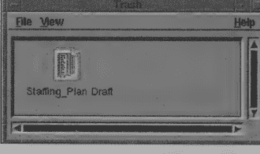

图 15：废篓窗口

在废篓窗口中，您还可以：

- 显示项目的原始路径或完整路径
- 显示项目放入垃圾桶的日期和时间
- 取回项目
- 查看项目的信息窗口

### 显示废篓中项目的原始位置

1. 在废篓窗口中，选择一个或多个项目。
2. 选择“文件 | 显示源位置”以查看项目源的完整路径。

## 源位置窗口出现：

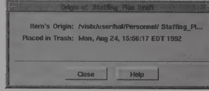

图 16：源位置窗口

3. （可选）要打开项目的信息窗口，请选择“文件 | 信息”。

## 打印文件

您可以通过在桌面或目录窗口中选择文件并选择“文件 | 打印”命令来打印文件。如果您尝试打印一个不可打印的文件，桌面将显示对话框，告知该文件将被打印。

当桌面打印文件时，它会使用两个命令：一个用于格式化文件，另一个用于将其置印到打印机。然而，打印到 NetWare 打印队列的文件使用一套不同的系统。


您可以在执行偏好中指定打印格式化程序和置打印程序命令。（参见第 130 页的“更改执行偏好”）。格式化命令处理文件以供打印。例如，它可能会对文档进行分页或添加页眉。置打印程序接收格式化命令产生的数据并将其发送到打印机。

当您选择“文件 | 打印”时，桌面会检查文件是否可打印。如果是，桌面会检查是否为该类型的文件定义了特殊的格式化命令。如果有，桌面将使用它。如果没有，桌面将使用用户执行偏好中的命令。

格式化步骤的输出随后发送到用户执行偏好中指定的置打印程序命令。

## 查看和更改目录和文件属性

您可以使用目录窗口中的“信息”命令打开一个包含目录或文件信息的窗口，其中包括：

- 名称
- 类型
- 大小（字节）
- 指向目录或文件的链接数
- Inode 节点（操作系统用于识别文件的数字）
- 访问权限（也称为保护模式）
- 所有者和组引用
- 目录或文件创建或修改的日期时间
- 目录或文件状态被更改的日期时间
- 目录或文件最后访问或更改的日期时间
- 链接信息（仅限符号链接）
- 引用保护（仅限符号链接）
- 设备类型（仅限设备）
- 主、次设备号（仅限设备）

您还可以使用信息窗口更改以下内容：

- 名称
- 访问权限
- 所有者和组引用
- 目录或文件最后访问或更改的日期时间
- 链接信息（仅限符号链接）

## 第5章：学习使用桌面

只有作为 `root` 用户，才能更改文件或目录的所有权。只有当你是你要授予所有权的组的成员（或者你是 `root` 用户）时，才能更改文件或目录的组引用。

当你为目录或文件指定组引用时，你是在识别一组用户，你（或该目录或文件的所有者）可以为这些用户指定单独的访问权限。

如果你以 `root` 用户身份登录执行管理任务，可以使用信息（`Information`）命令逐个更改目录或文件的所有权。

### 更改所有权和组引用

1. 在目录窗口中，选择你想要更改所有权或组引用的目录和文件。
2. 选择 `文件 (File) | 信息 (Information)`。目录和文件都会弹出一个信息窗口。
3. 选择 `所有权 (Ownership)`。

### 查看和更改目录和文件

所有权和组引用信息出现在窗口的第三部分。所有者列表是系统中用户的字母顺序列表。组列表是系统中组的字母顺序列表。

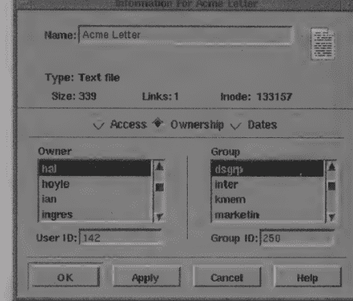

图 18：带有所有权和组引用信息的信息窗口。

4. 通过以下操作之一指定新的所有者或组：
   - 从所有者列表中选择名称，或从组列表中选择组。
   - 在列表下方的文本框输入所有者或组的 ID 号。
5. 点击 `确定 (OK)` 保存更改并关闭信息窗口，或点击 `应用 (Apply)` 在不关闭窗口的情况下保存更改。

如果你选择了多个目录或文件，请重复步骤 3 到 5，直到所有信息窗口都关闭。

### 更改一组目录和文件的信息

使用“信息”命令，要更改 20 个文件或目录组的信息，你必须在 20 个窗口中更改相同的信息。

使用“更改属性”（`Change Properties`）命令，你可以一次性更改一组所选目录和文件的以下信息：

- 所有权和组引用
- 访问权限（也称为保护模式）
- 执行选项
- 目录或文件最后修改或访问的日期和时间

要同时更改一组所选文件的信息，你必须以 `root` 用户身份登录。完成以下操作：

1. 在目录窗口中，选择你想要更改所有权或组引用的目录文件组。
2. 选择 `文件 (File) | 更改属性 (Change Properties)`。

出现“更改属性”窗口：

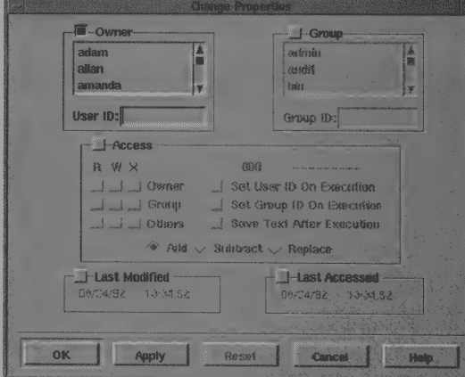

窗口包含几个部分和底部的一行按钮。这些部分显示所有权和组引用信息、访问权限和执行选项信息，以及日期和时间信息。

3. 选择你想要更改信息的按钮。
当你做出选择时，窗口的该部分变为激活状态。
4. 为所选的目录和文件指定新信息。
5. 选择其一：
   - 点击 `确定 (OK)` 保存更改并关闭更改属性窗口。
   - 在不关闭窗口的情况下保存更改，点击 `应用 (Apply)`。
   - 在不关闭窗口的情况下恢复到上次保存的值，点击 `还原 (Revert)`。

### 运行程序

使用桌面，你可以从以下位置运行和终止程序：

- 目录窗口和桌面窗口
- 终端模拟器窗口

在本节中，你还将学习如何

- 查看文件的可可用操作

#### 激活文件

当你激活一个文件时，桌面会判断它的文件类型并运行正确的程序。当桌面运行程序时，程序的图标和进程 ID 将显示在下方的任务（`Jobs`）窗口中。（要打开“任务”窗口，请在桌面窗口中选择 `窗口 (Windows) | 任务 (Jobs)`））

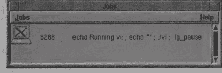

图 19：带有 vi 图标的任务窗口

你通常可以在任务窗口中使用 `任务 (Jobs) | 请求终止任务 (Request Job Termination)`（优先）或 `任务 (Jobs) | 强制终止任务 (Force Job Termination)`（必要时）来终止从桌面启动的程序。

在桌面上中激活文件有三种方法：

- 双击文件图标。

  如果文件关联了操作，则文件会被激活，桌面会在任务窗口中显示与该文件关联的默认程序的图标。如果文件没有关联操作，桌面会通知你。
- 选择文件并选择 `文件 (File) | 打开 (Open)` 命令。

  如果文件关联了操作，则文件会被激活，桌面会在任务窗口显示与该文件关联的默认程序的图标。如果文件没有关联操作，桌面会通知你。
- 将文件拖放到投放接收器（drop receiver）上。

  投放接收器是定义了特殊规则的文件类型，允许在文件拖到其运行时运行程序。投放接收器带有加粗角括号的图标。投放接收器的示例是文字处理器：要运行程序并编辑文档，请将文档图标拖动并释放到文字处理器图标上。

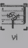

图 20：投放接收器文字处理器

如果文件没有关联操作，桌面会通知你。


图 21：投放接收器


图 22：投放接收器

### 编辑文件操作

1. 在任何对象上使用右键菜单来打开“编辑文件操作”（`Edit File Actions`）窗口。
2. 选择以下规则类型之一：
   - 启动动作 (`Launch Actions`)：编辑文件的启动动作
   - 投放动作 (`Drop Actions`)：编辑投放目标的投放动作
3. 从描述列表中，选择您想要编辑的文件操作。
4. 在“命令类型”（`Command Type`）部分，进行相应的选择。

在自定义规则库中存在或已创建的所有文件操作均可编辑，但“默认文本编辑器”（`Default Text Editor`）和“默认数据编辑器”（`Default Data Editor`）除外。

如果您选择了“默认文本编辑器”或“默认数据编辑器”（已设置为执行偏好），则您无法编辑描述列表中的文件操作。

如果您没有为文件操作列出文本或数据编辑器，选择“默认文本编辑器”或“默认数据编辑器”将使相应的编辑器以“首选”状态进入描述列表。

5. 在“描述”（`Description`）文本框中，对文件操作的描述进行必要的更改。
6. 在“命令行”（`Command Line`）文本框中，对文件操作的命令进行必要的更改。

当选择此操作时，此字段的内容将传递给操作系统。

您的命令可以包含您的操作 shell允许的任何文本或符号，包括环境变量。您还可以嵌入桌面特有的符号（桌面符号列表请参见第 115 页的表格）。

7. 勾选或取消勾选“在新终端器中运行命令”（`Run Command In New Terminal Emulator`）复选框。

该复选框位于“命令行”文本框下方。激活时，它将在新的终端窗口中运行文件操作命令。

8. 在“应用到”（`Apply To`）字段中，选择“当前文件”（`Current File`）或“文件类型”（`File Type`）。

这将文件操作限制为仅选定文件或所有相同类型的文件（如窗口顶部“文件类型”字段所示）。

9. 选择
   - 要更新您的自定义规则库并退出文件操作，点击“确定”（`OK`）。
   - 要在不关闭窗口的情况下保存更改，点击“应用”（`Apply`）。
   - 要丢弃自自定义规则库保存以来的更改，点击“重置”（`Reset`）。
   - 要将您的规则库重置为系统规则库，点击“默认”（`Defaults`）。

如果您删除的规则是适用于特定文件的自定义规则，且该文件类型已存在自定义规则，则按文件的规则将被丢弃，并应用自定义文件类型规则。

### 自定义您的工作空间

本节向您展示如何自定义您的工作空间和工具。您将学习如何：

- 自定义图标栏
- 添加和删除目录及文件


- 按名称或图标查看目录和文件
- 查看目录和文件的完整路径
- 打开目录和文件
- 在目录窗口的桌面显示目录和文件
- 打印文件
- 移动目录和文件
- 清理桌面
- 使用垃圾箱
- 接收邮件通知
- 创建外部命令
- 为外部命令创建图标并将其放在图标栏

# 第 5 章：学习使用桌面

## 图标栏 (Icon Bar)

图标栏是桌面窗口的一个重要功能。它包含了一排图形按钮，这些按钮可以打开各种桌面窗口、启动应用程序或打开命令对话框。

要查看按钮的名称，在鼠标指向按钮时按住鼠标按键。其名称将出现在桌面窗口底部状态区域的第一个文本框中。（首先，选择`查看 | 状态区域`。）点击按钮可执行关联的操作。

通常，桌面提供的按钮提供了可以使用桌面菜单命令执行的操作的快捷方式。然而，您可以在图标栏上添加可以实现桌面菜单中无法实现的功能按钮。

`图标栏`命令让您能够控制图标栏的外观和内容。

当您在桌面窗口中选择`选项 | 图标栏`时，会弹出图标栏窗口：

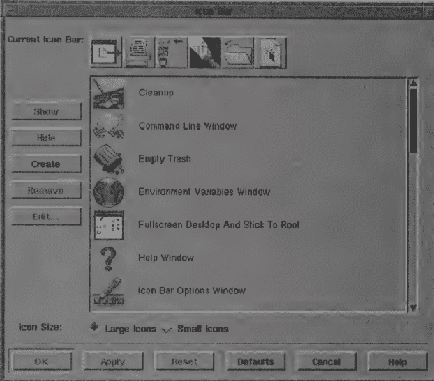

图 24：图标栏窗口

**内部图标栏按钮。**窗口列出了图标栏按钮和您创建的自定义外部按钮。您创建的自定义按钮将首先按创建顺序列出，随后是按字母顺序排列的内部按钮列表。您可以在图标栏上显示内部桌面按钮，但无法从列表中编辑或删除它们。这些按钮是：

- 清理 (Cleanup)：将图标对齐到不可见的网格
- 命令行窗口 (Command Line Window)：打开命令行窗口
- 清空垃圾箱 (Empty Trash)：删除垃圾箱中的文件和目录。
- 环境变量窗口 (Environment Variables Window)：打开环境变量窗口。
- 全屏桌面并固定到根 (Fullscreen Desktop and Stick to Root)：使桌面窗口全屏化。
- 帮助窗口 (Help Window)：打开帮助系统。
- 图标栏窗口 (Icon Bar Window)：打开编辑图标栏的窗口。
- 任务窗口 (Jobs Window)：打开任务窗口，列出从桌面启动的活动系统进程。
- 布局窗口 (Layouts Window)：打开布局窗口以显示和编辑自定义布局。
- 打开当前选择 (Open Current Selection)：启动或打开选中的对象。
- 打开目录窗口 (Open Directory Window)：为选中的对象打开目录窗口。
- 打开查找窗口 (Open Find Window)：打开查找窗口搜索对象。
- 选项窗口 (Preferences Window)：打开选项窗口查看或编辑选项。
- 打印当前选择 (Print Current Selection)：打印选的文件。
- 运行终端模拟器 (Run Terminal Emulator)：打开终端模拟器窗口（如 xterm）。
- 运行图标编辑器 (Run Icon Editor)：启动图标编辑器。
- 显示完整路径 (Show Full Pathname)：在显示文件名和完整路径之间切换。
- 在目录窗口中显示 (Show in Directory Window)：打开目录窗口，其中包含其父目录中的选定对象。
- 堆叠目录窗口 (Stack directory windows)：堆叠所有打开的目录窗口并显示标题栏。
- 取消桌面 (Take Off Desktop)：从桌面移除对象（不影响文件系统）。
- 切换声音开启/关闭 (Toggle Sound On/Off)：开启或关闭。
- 切换固定到根 (Toggle Stick to Root)：在全屏和可调整大小之间切换桌面。

列表左侧的五个按钮执行各种操作。根据所选项目，在第一次打开时，某些按钮可能是禁用状态，位于

## 自定义您的工作空间

- **显示 (Show)**：将按钮添加到图标栏。如果项目已在图标栏上，则名称旁会出现标记，且`显示`功能禁用。
- **隐藏 (Hide)**：从图标栏移除按钮。如果图标不在图标栏上，则`隐藏`功能禁用。
- **创建 (Create)**：创建按钮和外部命令（参见第 121 页`自定义图标栏`）。
- **删除 (Remove)**：丢弃您创建的按钮。
- **编辑 (Edit)**：编辑您创建的按钮。

如果您在图标栏上显示了图标，或者如果您取消固定桌面并调整其大小，可能没有足够的空间显示所有图标。

**通过外部命令自定义图标栏。**在图标栏窗口中，您可以创建外部命令并将其与设计的按钮关联。您可以将按钮显示在图标栏上以便于访问。

您可以在同一过程中定义命令并为命令创建图标，但您可能想分开执行这些步骤。

您还可以定义命令并稍后为按钮指定自定义图标。

要创建新的外部命令，点击`创建`。双击出现的新图标，填写`编辑外部`窗口的字段：

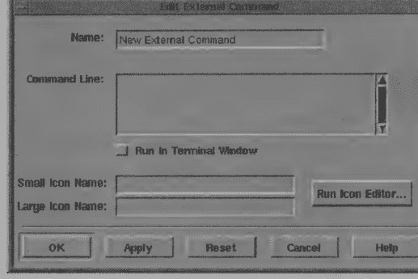

图 25：编辑外部命令

## 桌面上的目录和文件

有两种方法可以将目录窗口中的目录或文件放置到桌面：

- 拖到桌面
- 使用`放置桌面`（Put On Desktop）命令

您可以通过选择要移除的目录或文件并选择`文件 | 取消桌面`（Take Off Desktop）来从桌面移除目录或文件。

当您从桌面移除目录或文件时，该目录或文件将不再出现在桌面上。它仍然存在于文件系统中的原始位置。从桌面移除对象与使用`文件 | 移除`或将其拖到垃圾箱删除对象不同。

## 布局操作

你可以以多种方式安排工作空间，然后将每种安排命名并保存为布局。

布局是工作空间的特定安排，包含了`Desktop`窗口的外观和内容以及任何其他打开的桌面窗口（设置窗口除外）。保存布局可以让你轻松地从一个活动切换到另一个，而无需手动重新排列窗口。

例如，你可以保存一个用于处理预算编制的布局，其中包含你的电子表格程序、正在处理的文档，以及一个代表你存放业务计划目录的目录图标。通常情况下，当桌面启动时，它会将你的工作空间恢复到你退出桌面时完全相同的安排。

这种安排（在`布局`窗口中称为 *Startup*，即启动）并不与特定的布局关联，而是桌面操作系统环境的一项功能。它可以被看作是你上次关机时工作空间的快照。

图标栏的内容作为布局的一部分被保存。一个布局中的某些按钮或外部命令可能仅对某些任务有用，而你可能在其他布局中不需要这些内容。

当你保存布局时，你只能包含由桌面控制的窗口。你不能将终端模拟器窗口或其他外部程序窗口作为布局的一部分保存。

布局窗口以列表形式显示可用布局。预配置的布局在列表末尾加粗显示，名称左侧的微型图标包含一个小锁头，表示它们无法被删除或覆盖。布局列表中的第一项`Current`（当前）被高亮显示。`Current`并不是布局；它标识了你当前工作空间的安排，无论该安排是否也是已保存的布局。

第二项`Startup`（启动）也不是布局；它标识了你启动当前桌面会话时工作空间的安排，包括你如果从命令行启动桌面时所指定的参数。

**保存新布局。** 你可以保存许多不同的布局，并在执行桌面中的不同任务时在布局之间进行切换。你还可以指定其中一个作为每次启动桌面时使用的布局。

1. 在桌面窗口中，按照你想要的方式组织你的工作空间。打开你需要的窗口（包括窗口属性，如视图、`可移动`、`显示完整路径`或`排序键`），在桌面上放置你想要快速访问的项目，如果你想将不同的按钮作为布局的一部分显示，则可以编辑图标栏。
2. 选择 `布局 | 布局`（Layouts）。

显示布局窗口。

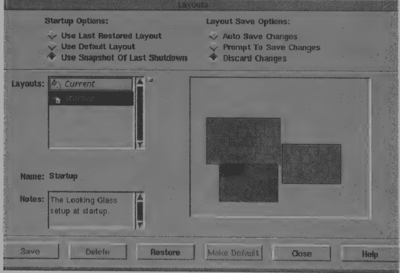

图 26：布局窗口

124 OpenLinux 简介

3. 点击`Current`（当前）（布局列表中的第一项）。

右侧的预览区域显示工作空间的缩略图。黑色矩形表示桌面，中灰色矩形表示目录窗口，浅灰色矩形表示要恢复的桌面窗口。

如果你将光标悬停在缩略图中的项目上并按下鼠标按钮，该窗口的名称将出现在预览区域下方。

某些窗口并没有精确地包含在布局预览中。恢复布局时窗口的层级关系可能与缩略图不匹配。

4. 在`名称`（Name）字段中输入你新布局的名称。

你可以指定的布局名称长度可达 14 个字符。

5. （可选）在`备注`（Notes）字段中，输入你想为此布局输入的注释或笔记。
6. 点击`保存`（Save）保存你的新布局。

新布局被保存，其名称被添加到滚动列表中。布局名称也被添加到桌面窗口的`布局`（Layout）菜单中。

你需要选择新保存的布局来恢复它。

7. 点击`关闭`（Close）关闭布局窗口。

**更改已保存的布局。** 在`布局`窗口中，你只能将当前工作空间的安排保存或更改为布局。在对其进行更改或保存之前，你必须将工作空间恢复到该布局。

**指定布局行为。** 在布局窗口中，你只能将当前工作空间的安排保存或更改为布局。在对其进行更改或保存之前，你必须将工作空间恢复到该布局。

你可以指定桌面启动时的行为，这在桌面的`布局`（Layout）菜单中通过变量显示。

## 使用环境变量

本节将讨论如何使用环境变量。


## 什么是环境变量？

环境变量提供了一种快捷方式，向程序传递数据。

标准环境变量包含关于操作环境的信息。你可以更改或删除以下变量（在变量名称旁会出现锁标记）：
- `HOME`（主目录路径）
- `PATH`（搜索路径）
- `TERM`（终端类型）

要在桌面中使用环境变量，请输入美元符号 (`$`) 和变量名。

## 编辑环境变量

1. 在桌面上，选择 (Options) | 环境变量 (Environment Variables)。打开环境变量窗口。
2. 从列表中选择你想要编辑的变量。

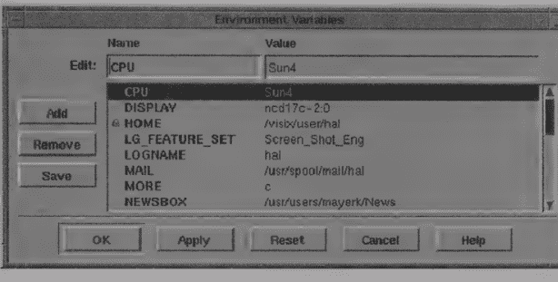

图 27：环境变量窗口
3. （可选）编辑“名称”（Name）字段。
4. 编辑“值”（Value）字段为变量提供值。
5. 点击“保存”（Save）使更改永久生效。
6. 选择：
   - 要应用更改并退出环境变量窗口，点击“确定”（OK）。
   - 在不关闭窗口的情况下应用更改，点击“应用”（Apply）。
   - 放弃自上次保存变量后的更改，点击“重置”（Reset）。

## 添加环境变量

1. 在桌面上，选择 (Options) | 环境变量 (Environment Variables)。打开环境变量窗口。
2. 点击“添加”（Add）。列表中将添加一个名为 `NEW_VAR_N` 的新变量，其值显示为 `UNKNOWN`。
3. 在“名称”（Name）字段中输入变量名称。
4. 在“值”（Value）字段中输入变量的值。
5. 选择：
   - 在后续桌面会话中使用环境变量，点击“保存”（Save）。
   - 要应用更改并退出环境变量窗口，点击“确定”（OK）。
   - 在不关闭窗口的情况下应用更改，点击“应用”（Apply）。

## 更改桌面设置

桌面设置允许你指定希望桌面处理某些事务的方式。有几种设置类别：
- 执行（Execution）：用于指定使用哪个程序显示终端模拟窗口、使用哪些文本和数据编辑器、使用哪个外部 shell、如何格式化和输出要打印的文件，以及使用哪个路径接收邮件。
- 操作（Operation）：用于控制文件大小限制、双击速度、双击目录时桌面执行的操作、图标拖动行为、使用什么鼠标行为以及显示更新的秒数。
- 创建（Creation）：用于定义创建掩码，以指定新目录和文件的默认访问权限。
- 显示（Display）：用于更改新目录窗口的默认特性，包括其 own、显示格式以及目录和文件的排列。
- 移除（Removal）：用于告诉桌面在删除单个或多个目录或文件时何时请求确认，以及删除目录和文件时是否使用桌面垃圾箱。
- 颜色（Color）：用于更改桌面界面元素的颜色。
- 声音（Sound）：用于更改与桌面相关的声音（如果你的系统支持声音）。
- 清理（Cleanup）。用于在目录窗口和桌面上使用“清理”命令时，更改目录和文件对齐的网格。

所有偏好均在“偏好”（Preferences）窗口中配置，您可以通过选择桌面上的“选项 | 偏好”，或使用图标栏上的图标打开该窗口。

您可以使用桌面的“偏好”窗口来访问命令窗口，在窗口中您可以指定要更改的内容。双击偏好窗口中的任何偏好即可打开命令窗口。

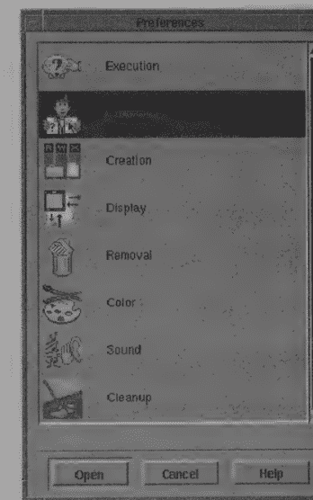

图 28：偏好滚动列表

## 修改执行偏好

执行偏好（Execution Preferences）窗口指定当您请求某些操作时桌面执行的程序（及参数）。您可以更改用于以下操作的命令：
- 模拟终端
- 编辑文本文件
- 编辑非文本（数据）文件
- 由外部 shell 处理的功能
- 格式化和打印文本文件
- 接收邮件

当您选择“偏好 | 执行”时，会执行偏好窗口出现：

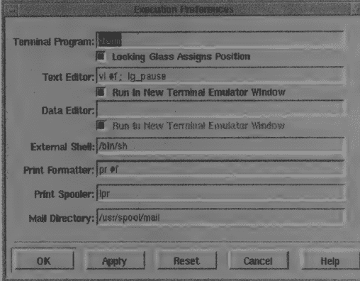

图 29：执行偏好

**终端模拟器（The Terminal Emulator）：** “终端程序”字段允许您在选择“运行 | 终端模拟器”以及使用必须在终端模拟器中运行的命令时，指定桌面要执行的程序路径。

通过勾选“桌面分配位置”复选框（终端程序字段下方），可以让桌面确定终端模拟器窗口在工作区的位置。如果没有勾选复选框，则由窗口管理器决定位置。

您可以在执行偏好中指定终端程序，并包含在从 shell 命令行调用程序时会使用的参数。

**指定文本和数据编辑器。** 执行偏好中的“文本编辑器”和“数据编辑器”字段显示了在激活文本或数据文件时桌面要执行的程序路径和参数。

要更改文本或数据编辑器，您必须知道调用该程序的语法。如果您仅输入编辑器的路径，桌面将假设它接受文件名作为唯一参数。例如，如果在“文本编辑器”字段中输入

```
/usr/bin/emacs #f
```

则当您激活（打开或双击）文本文件时，桌面会执行命令：

```
/usr/bin/emacs filename
```

（filename 是您所选的文件名）。

若要在编辑器窗口消失之前从您的编辑器或其他程序中读取编辑消息，请在调用编辑器的命令后放置 `lg_pause` 命令。`lg_pause` 命令会在退出终端模拟器窗口前提示您按回车键。

当您使用 `lg_pause` 时，请使用桌面选中文件的特殊符号 (`#f`) 来指定文件名在命令行中的位置。例如，要使用编辑器 vi，请选择“在新的终端模拟器窗口中运行”，并在“文本编辑器”字段中输入以下内容：

```
/usr/bin/vi #f; lg_pause
```

注意运行编辑器的命令与 `lg_pause` 之间使用了分号。这会导致 `lg_pause` 在编辑器退出后运行。

**指定外部 shell。** “外部 shell”字段显示了桌面用于任何需要外部 shell 操作的 shell 路径，许多双击操作以及来自“桌面 | 运行”菜单的“终端模拟器”命令。

如果您偏好其他 shell，可以更改它。否则，请使用默认 shell `bash`。

**指定打印命令。** 当桌面打印文件时，会使用两个命令：一个用于格式化文件，另一个用于将其汇打印到打印机。这两个命令显示在执行偏好的“打印格式化器”和“打印汇打印器”字段中。

格式化命令处理用于打印的文件——它可能会对文档进行分页或添加页眉。汇打印命令接收格式化命令产生的数据并将其发送到打印机。

要确定“打印格式化器”和“打印汇打印器”的正确值，请获取您通常用于打印文件的完整命令字符串，并在管道符号 (`|`) 处进行分割。将命令的前半部分放入“打印格式化器”字段中。

桌面假设待打印的文件名插入在打印命令的末尾。如果名称位于末尾以外，请在应放置文件名的位置插入选中文件的特殊符号 (`#f`)。将命令的后半部分放入“打印汇打印器”字段中。

桌面执行时提供管道符号。例如，如果您通过命令行输入以下命令打印文件

```
pr filename | 1p
```

则在“打印格式化器”字段中输入 `pr` 或 `pr #f`，并在“打印汇打印器”字段中输入 `lp`。

## 修改操作偏好

操作偏好（Operation Preferences）窗口允许您控制以下内容：
- 文件大小限制
- 双击速度
- 双击目录时桌面执行的操作
- 拖动期间图标的外
- 鼠标操作
- 显示更新之间的秒数

当您选择“偏好 | 操作”时，操作偏好窗口出现：

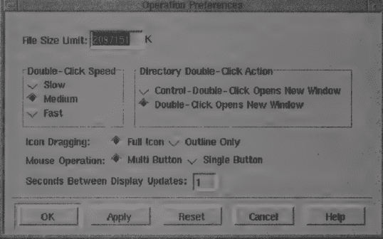

图 30：操作偏好

**指定文件大小限制。** 要更改桌面的文件大小限制，选择“操作 | 文件大小限制”。尺寸必须以 1K (1024 字节) 为增量增加。用户可以缩小大小限制，但只有 root 用户可以增加它。

**指定双击速度。** 桌面允许您设置双击鼠标按钮的快慢，以获得双击操作代替单击操作。选项如下：
- 慢：允许点击之间有较长时间
- 中：允许点击之间有平均时间
- 快：允许点击之间时间极短

**指定目录双击操作。** 默认情况下，双击目录时桌面会打开窗口。但是，如果您 Ctrl-双击目录，桌面会在当前窗口显示该目录的内容。也就是说，双双击目录的内容将替换当前窗口的内容。通过“操作偏好”，您可以指定首选的双击操作。您可以指定是双击还是 Ctrl-双击打开新窗口。

**指定图标拖动偏好。** 对于拖动操作，您可以指定两种行为之一：在拖动期间是显示完整图标还是仅显示轮廓。使用操作偏好中的图标拖动单选按钮指定：
- 完整图标：桌面在拖动期间显示完整图标。
- 仅轮廓：桌面在拖动期间显示图标轮廓。此外，当您将图标拖到接收器上时，只有形状会变化——接收器图标不会。

在某些系统中，拖动轮廓而非完整图标可以显著提高性能，因为拖动期间的重绘量大大减少了。

## 修改创建偏好

使用创建偏好（Creation Preferences）为桌面中创建的新目录和文件定义创建码和默认访问权限（保护模式）。创建码阻止新目录和文件的权限。创建码对于维护安全至关重要。

如果您使用桌面设置访问权限，您知道勾选选择框是为了允许权限。创建码的工作方式相反：您勾选选择框是为了排除权限。


例如，在定义创建码时，如果选择了组的 `W`（写入）框，则组的其他成员将无法获得对您创建文件的写入权限。

在定义创建码时，您必须告诉桌面在启动时使用哪种创建码：是该环境定义的码还是您想要定义的码。请使用“`存储掩码`”或“`继承掩码`”按钮执行此操作。

## 第5章：学习使用桌面

当你选择“`偏好设置 | 创建`”时，会弹出“`创建偏好设置`”窗口：

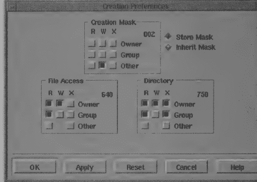

图 31：创建偏好

### 更改显示设置

你可以更改以下默认显示选项：

- 目录窗口标题的显示方式
- 新目录窗口的大小
- 目录窗口中是否显示隐藏文件
- 新目录窗口中拆分器的位置
- 新目录窗口的显示格式
- 使用“`清理`”命令时，目录窗口中目录和文件的排列方式

当你选择“`偏好设置 | 显示`”时，会弹出“`显示偏好`”窗口：

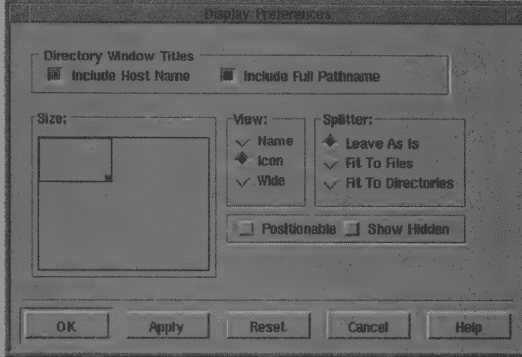

图 32：显示偏好

**指定目录窗口标题的显示方式。** 在“`显示偏好`”中，在“目录窗口标题”部分，你可以选择：

- **包含主机名**：在每个目录窗口的标题栏中显示你当前登录系统的主机名。
- **包含完整路径**：在每个目录窗口的标题栏中显示目录的完整路径。

**指定新目录窗口的大小。** 要相对于你的显示器按比例指定新（或之前未打开过的）目录窗口的默认大小，请使用“`显示偏好 | 大小`”。当目录窗口打开时，它将以你指定的大小出现。

窗口左侧的矩形代表目录窗口的大小。较大的外部矩形代表你屏幕的大小。

### 指定目录和文件的显示格式。

目录和文件可以以名称、图标或宽泛的格式在目录窗口中显示。请选择以下项之一：

- **名称**：如果你希望目录和文件按名称的字母顺序显示。
- **图标**：如果你想通过图标查看目录和文件。
- **宽格式**：如果你想以宽且详细的格式查看目录和文件。

**指定目录和文件是否可以移动。** 当目录窗口处于不可移动的格式时，它包含一个拆分器。拆分器是一个将窗口分为两个区域的水平条。顶部部分包含子目录；底部部分包含文件。

使用“`显示偏好`”更改默认设置，使目录窗口打开时不带拆分器，并让目录和文件显示在一起。然后它们可以在窗口的任何位置进行定位。

**指定目录窗口中是否显示隐藏文件。**

隐藏文件是以 "." 开头的名称目录和文件（当前目录和父目录除外）。这些目录和文件默认不显示，因为 "." 前缀通常用于命名系统配置文件或数据文件，而用户很少需要查看这些文件。

你可以使用“`显示偏好`”来更改默认设置，以便在目录窗口打开时显示隐藏文件。

### 更改删除设置

“`删除偏好`”设置告诉桌面如何处理垃圾桶删除，以及在删除目录和文件之前何时向你请求确认。删除选项分为三组，每组对应以下一项：

- 垃圾桶
- 文件
- 目录

当你选择“`偏好设置 | 删除`”时，会弹出“`删除偏好`”窗口：

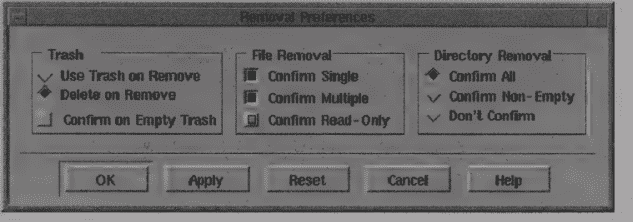

图 33：删除偏好

**设置删除偏好。** 当你使用“`文件 | 删除`”删除选中对象时，该对象可以被永久删除，也可以放入垃圾桶。垃圾桶中的项目在清空之前是可以恢复的，这在删除文件时更安全。你可以在以下之间选择：

- **删除时使用垃圾桶**：如果你希望将每个文件或目录放入垃圾桶。（你可以在垃圾桶清空前取回其中的项目。）
- **删除时删除**：如果你希望在删除时直接删除。

在“文件”组中，选择：

- **删除时确认**：如果你希望在删除单个文件时询问你。
- **多个删除时确认**：如果你希望在删除多个文件时询问你。
- **删除时不确认**：如果你希望在删除任何文件时都不询问你。

在“目录”组中，选择：

- **删除时确认**：如果你希望在删除单个目录时询问你。
- **多个删除时确认**：如果你希望在删除多个目录时询问你。
- **删除时不确认**：如果你希望在删除任何目录时都不询问你。

### 更改颜色设置

如果你有彩色显示器，可以通过“`偏好设置 | 颜色`”更改颜色设置。（如果你没有彩色显示器，这些设置将不可用）。你可以更改以下元素的颜色：

- **背景**：绘制在画布上的颜色，例如工作区背景。
- **前景色**：绘制在画布上的颜色，例如文本、图标、复选框。
- **顶部投影**：出现在对象顶部边缘的阴影。
- **底部投影**：出现在对象底部边缘的阴影。

以下段落给出了设置颜色的指南。如果你使用二维外观，请确保前景颜色与背景颜色对比鲜。例如，如果你将背景设置为蓝色，顶部投影应该是更浅的蓝色；底部投影应该是与背景相似但更深的颜色。你可以在四种模型中指定颜色：

- 色相、亮度和饱和度 (HLS) 模型
- 红、绿、蓝 (RGB) 模型
- 青、品红、黄 (CMY) 模型
- 灰度模型

**访问颜色偏好窗口。** 通过选择“`偏好设置 | 颜色`”设置颜色偏好。当你打开“`颜色偏好`”时，桌面用户界面元素使用的颜色为：

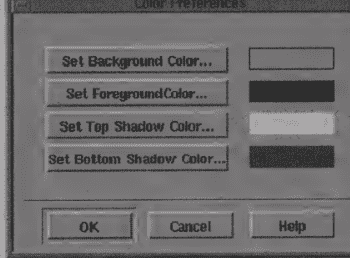

图 35：颜色偏好窗口

要调整颜色，选择这些按钮之一，然后通过点击“选择颜色”窗口顶部的按钮来选择模型，如下所示。（除了图中显示的 HLS 外，RGB、CMY 和灰度也可用）。

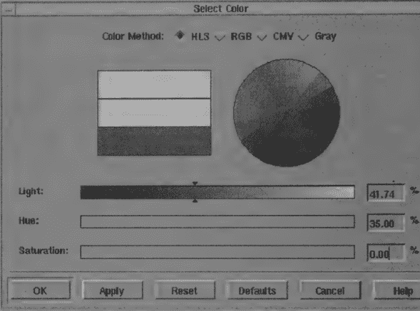

图 36：HLS 屏幕

### 更改桌面颜色

1. 在“`颜色偏好`”中，选择要设置的系统颜色（例如前景颜色）。打开“选择颜色”窗口。
2. 在窗口顶部，选择你偏好的颜色模型（HLS、RGB、CMY 或灰度）。
3. 通过拖动滑块、在色轮上点击或在字段中输入数值来选择合适的值。“新建”部分将显示你创建的颜色。
4. 要保存更改并退出“颜色偏好”，点击“确定”；要保存更改但不关闭窗口，点击“应用”；要恢复系统标准颜色偏好，点击“默认值”。

### 更改清理偏好

`清理`偏好允许您在在目录窗口中使用“`清理`”命令时，控制目录和图标对齐的网格。

当选择“`偏好 | 清理`”时，会弹出“`清理偏好`”窗口：

图 37：清理偏好

#### 设置清理偏好

1. 选择以下项之一：
   * **名称**：用于更改清理时在“名称”视图下显示目录和文件的方式。
   * **图标**：用于更改清理时在“图标”视图下显示目录和文件的方式。

预览区域包含“名称”视图的小图标和“图标”视图的大图标。第二列中的前两个图标命名为“倾斜”（Skew）和“间隔”（Space）。当您点击这些对象之一时，光标将变成箭头，显示您可以移动该对象的方向。

2. 拖动以下项：
   - 拖动“倾斜”向上或向下移动对象列，使得每隔一列错错排列。
   - 拖动“间隔”让对象靠近或远离。
3. 如要保存更改并退出“清理偏好”，点击“确定”；要在不关闭窗口保存更改，点击“应用”；要把预览区域的网格恢复到原始布局而不关闭窗口，点击“重置”。

### 桌面上的文件类型

本节介绍了文件类型的工作原理以及文件类型语言的通用功能。当您使用桌面时，会自动进行文件类型识别。扩展文件类型功能是高级用户的任务；此处仅包含文件类型功能的概述。关于文件类型的更详尽信息，以及可用文件类型命令和示例的完整参考，请参阅在线《桌面用户指南》。

#### 文件类型的工作原理

桌面的文件类型机制由三个基本组件组成：

- 文件类型语言 (`FTL`)，用于定义识别文件类型的规则。
- 文件类型编译器 (`FTC`)，用于编译使用 `FTL` 编写的文件类型规则。
- 文件系统服务器 (`FSS`)，用于管理文件系统信息并允许快速访问目录。

文件类型定义使用 `FTL` 写在文本文件中。它们包含了描述文件的语句（例如文件名的特定格式）、必须位于文件中特定位置的字符字符串，或者目录或文件必须所在的文件系统位置。

除了确定文件类型的规则外，文件类型定义还指定了每个目录或文件要显示的图标以及与该类型文件相关的操作。

这些定义由 `FTC` 编译以创建一个名为 `LG.rulebase` 的二进制文件，`LG.rulebase` 存储在桌面数据目录（安装时指定），并在启动时读入内存。

当桌面显示目录内容时，`FSS` 会寻找 `.lgdb` 文件。如果未找到该文件，则会计算目录中每个文件的文件类型信息。如果用户对目录具有写入权限，则会创建一个 `.lgdb` 文件，供下次桌面打开目录时使用。

如果存在 `.lgdb` 文件，`FSS` 会比较目录内容，以确定自上次修改 `.lgdb` 文件以来，目录中是否添加了目录或文件。

如果是这样，新添加的项将根据当前的规则库进行类型识别。如果当前用户对 `.lgdb` 文件具有写入权限（通常情况），则会对其进行更新。

#### 添加新的文件类型规则

虽然本章未提供可用命令和功能的完整描述，但您可以通过模仿现有文件类型来尝试添加简单的文件类型。请使用以下步骤，并在需要时参考更深入的在线说明。

- 检查系统规则库文件，查找与您想要添加到规则库的内容相似的内容。


## 规则库文件操作

- 规则库文件存储在 `/usr/visix/lg/default/lg_ftc` 目录。程序的规则在 `prog.ftc` 中；其他文件的规则在 `data.ftc` 中。您应该将新规则存储在对应的文件中，即 `prog.loc.ftc` 和 `data.loc.ftc`。

- 2. 从相应的规则库文件（`prog.ftc` 或 `data.ftc`）复制一个与您需求类似的规则到相应的规则库文件（`prog.loc.ftc` 或 `data.loc.ftc`）。

- 3. 修改新规则以符合您的需求。

- 4. 保存并退出规则库文件。

- 5. 在 `lg_ftc` 目录下通过输入这两个命令来编译并安装新的规则库文件：

```
make
make install
```

- 6. 退出桌面并重启以使您的新规则生效。

## 使用互联网和局域网服务

Caldera OpenLinux 非常适合作为内网或互联网服务器为您的组织提供信息服务。虽然设置和管理这些信息服务的完整信息超出了本章的范围，但以下章节简要解释了如何配置和使用 Open-Linux：

- IP 配置

- 基础路由和名称服务

- 为局域网提供服务

- 在互联网上提供服务

- 网络信息服务

- 客户端访问网络信息服务

成为一个拥有 Web 服务器、客户端电子邮件访问和 FTP 站点等功能的全功能互联网服务器并非易事。在您读完本章学习基础知识后，您可以通过以下资源获取更多帮助。

- Caldera CD-ROM 中包含的在线文档。特别是，请查阅 Linux Documentation Project HOWTO 文档以及针对描述服务的 man 页面（例如，输入 `man` 页面）。

- Caldera CD-ROM 中包含的在线文档。特别是，请查阅 Linux Documentation Project HOWTO 文档以及针对描述服务的 man 页面（例如，输入 `man` 页面）。

- Caldera CD-ROM 中包含的在线文档。特别是，请查阅 Linux Documentation Project HOWTO 文档以及针对描述服务的 man 页面（例如，输入 `man` 页面）。

### IP 配置

互联网协议 `IP` 是所有网络的基础。

- 接口：可以添加、删除、配置、禁用网络设备。支持以太网、环回、PPP 和 SLIP 设备。如果您使用 SLIP 配置，应编辑脚本。

- DNS 服务器：您可以在此对话框中添加服务器。

- Host：您可以在列表中添加特定的计算机。列表中的名称包含 IP 地址，并在无服务器不可时用于解析域名。

- 主机名：您可以更改系统的名称。如果其他系统通过名称引用您的系统（例如作为 Web 或 FTP 服务器），更改主机名可能会导致问题。

#### 编辑网络参数

- 1. 通过在桌面上选择图形网络配置工具。

如果您的桌面上没有网络配置工具的图标，您可以在图形终端窗口（如 `xterm`）中输入以下命令：

```
netcfg
```

- 2. 选择您想要编辑的参数，如上述所示。

    a. 如果要添加参数，选择相应的“添加”按钮时将打开添加对话框。

    b. 如果要删除参数，在选择“删除”按钮之前在列表中选择该参数。

    c. 如果要编辑主机名，从菜单中选择“编辑主机名”。

- 3. 点击“保存”按钮使您的更改永久化。

- 4. 点击“完成”按钮退出工具。

### 基础路由和名称服务

为了通过使用 IP 地址与其他计算机通信，一台计算机必须有一种发现另一台计算机 IP 地址的方法。这是通过 IP 路由实现的。路由涉及一台计算机跟踪定位其他计算机的方法并在并在请求时传递这些信息。

#### 路由

路由适用于许多协议。本节指的是 IP 数据包路由，这是互联网和本章描述的信息服务所使用的。

在网络上路由数据包的计算机传统与人们进行日常工作的计算机是分开的。路由器位于储物间内，只负责接收 IP 数据包并根据各种路由协议发送这些包。在繁忙的网络中，拥有一个专用的路由器来管理大量的待路由数据包仍然是有帮助的。

在较小的网络中，特别是那些没有连接到互联网的网络（可能仅在内部提供互联网类型的信息服务），不需要专用的路由器。OpenLinux 的路由功能可以满足这一需求，而无需专门划分出一台计算机作为路由器。

在默认安装的情况下，OpenLinux 执行了许多路由功能。为了作为组织内计算机到互联网的网关，或者从通过拨号连接你服务器的外部计算机（通过 PPP）的网关，你必须开启 IP 转发。IP 转发是 OpenLinux 包含的一项路由功能，但在初始安装后并不会被开启。

要激活 IP 转发，你必须进入目录 `/usr/src/linux` 并输入命令 `make config`。该命令启动的过程非常复杂。如果你不熟悉路由或使用 UNIX 工具，我们建议联系你的互联网服务提供商（ISP）或 Caldera 合作伙伴以获取信息。

#### 名称服务

除了计算机的 IP 地址外，我们经常通过主机名和域名来指代计算机。这些名称虽然对我们有用，但其他计算机并不理解。它们必须被转换为 IP 地址。执行这种转换的程序提供了*名称服务*（Name Services）。

就像路由器向其他计算机提供 IP 地址信息一样，名称服务器为那些拥有主机名或域名并想要 IP 地址的计算机提供转换。名称服务器维护着如何转换许多名称的表格，以及当它没有相应的转换记录时将请求发送到哪里。

名称服务最简单的形式是你 Caldera 系统上的 `/etc/hosts` 文件。该文件可以列出主机和域名及其对应的 IP 地址。然而，该文件通常条目很少，因为你通常不知道你想要联系的互联网上所有计算机的 IP 号。

OpenLinux 包含了域名系统服务（DNS）和网络信息服务（NIS）的完整功能。设置这些服务超出了本书的范围。不过，多了解以下命令可以帮助你入门。对每个命令都使用 `man` 命令来学习更多信息（例如，输入命令 `named`）。此外，查看 `/etc/named/` 目录下的文件。

- `ifconfig`

- `route`

- `named`

- `bind`

- `dig`

- `nslookup`

- `whois`

### 为内网提供服务

如果你已经设置了网络（带有 IP 转发的路由和 DNS 名称服务器），所有的网络信息服务对于你网络上使用 IP 网络的任何人都是可用的。

提供信息服务，请查看本章的各个章节，学习如何设置你希望在系统上提供的服务，然后告诉组织内的人这些服务以及如何使用它们。

例如，Web 服务器是默认设置的，你可以开始给所有人运行 Web 服务器的计算机的名称，他们就可以开始检索文档。

### 在互联网上提供服务

向互联网提供信息服务与向你的本地组织提供服务并没有区别。唯一的额外关注点是你网络上信息的安全性，以及将你的网络连接扩展到包含互联网。

#### 连接

各种互联网相关硬件的供应商已开始为他们的设备提供 Linux 驱动程序。这些驱动程序使 OpenLinux 能够为互联网提供性价比最高的高速连接。对帧中继（Frame Relay）卡、ISDN 卡、多端口串口卡及相关系统的支持，允许集成商在 Caldera OpenLinux 上提供完整的互联网解决方案，而无需昂贵的外部硬件组件或软件插件。关于这些硬件产品的信息包含在 Caldera 网页上。

#### 专用互联网连接

如果你希望创建一个预见会有高流量的互联网站点，你应该通过高速、专用的通信线路连接到互联网。OpenLinux 可以通过扩展板轻松地连接到此类线路（不需要额外的软件）。有关如何创建此类互联网连接的信息，请联系 Caldera 合作伙伴或你的互联网服务提供商。

# 第 6 章：使用互联网和内网服务

### SLIP 和 PPP

#### 允许访问服务

此配置允许所有来自 `mycompany.com` 和 `*.mycompany.com` 机器的连接。它还允许服务 `talk`、`finger` 和 `ftp` 接受所有机器的请求。

`tcpd` 程序允许许多更复杂的访问控制，它结合了 `/etc/hosts.allow` 和 `/etc/hosts.deny` 文件使用。请阅读 `tcpd(8)` 和 `hosts_access(5)` 手页以获取完整细节。

#### 调制解调器池

OpenLinux 非常适合那些希望为用户提供调制解调器以便通过标准电话线连接网络的人。每个调制解调器使用一个串口。多个制造商提供带有多个串口的卡，可以通过你 PC 上的单个扩展槽提供 4 到 256 个串口。

#### 网络信息服务

人们想要连接到互联网是因为它所提供的服务。在本节中，我们描述了你可能想在互联网服务器上提供的最流行的服务。OpenLinux 在下面描述的所有服务中（以及许多不那么流行的服务中）都包含了完整的功能。

- 电子邮件（Email）

电子邮件用于从一个人发送消息给另一个人或几个人，直接从机器传输到机器。它不是实时传输，但优点是可以通过几台中间机器到达收件者。OpenLinux 和互联网上的电子邮件使用 SMTP 协议。

- FTP


文件传输协议（`FTP`）用于将文件从中央存储库传输到网络上的客户端。在实践中，`FTP`服务器（存储库）遍布全球，每个服务器提供其所有希望公开的文件。`FTP`设计用于直接实时访问，但无法与传输的信息进行交互。该协议实际上被称为`FTP`。

- 全球维网（Worldwide Web）

# 第 6 章：使用互联网和内网服务

`Web`使用`HTTP`协议通过与网络上另一台计算机的直接连接访问文档。它与`FTP`的用途类似，但`HTTP`设计用于让接收文件的人能够立即与文件进行交互。与`HTTP`和`Web`结合，传输的文档格式定义为：`HTML`。这种格式适用于交互式图形文档。

- `NFS`

网络文件系统（`NFS`）协议用于访问远程文件系统的一部分，就像它是本地文件系统的一部分一样。由于安全和速度问题，`NFS`通常不跨互联网使用，需要可以使用。

- 新闻

`Usenet`新闻类似于巨大的公共电子邮件系统，按主题划分。用户可以阅读他人提交的消息，并提交自己的消息，所有人都可以阅读。使用`NNTP`协议，新闻组消息在服务器之间进行复制（镜像），以便用户可以快速访问。

## 电子邮件

`OpenLinux`非常适合作为组织邮件服务器和网关。下面的总结信息描述了作为`sendmail`程序的`OpenLinux`网关。如果你需要更多关于电子邮件或`sendmail`的参考，我们推荐 Bryan Costales 著、O'Reilly Associates 出版的书籍 *sendmail*，以及由`sendmail`作者编写的文档。

### sendmail 配置

默认的`sendmail.cf`配置文件在安装期间放置在`/etc`中。默认配置适用于大多数仅限`SMTP`的站点。它对`UUCP`站点无效；如果你需要使用`UUCP`邮件传输，你必须生成新的`sendmail.cf`。

要生成`sendmail.cf`，请从 Caldera CD-ROM 安装以下软件包：

- `m4`
- `sendmail`源码

请阅读`/usr/src/mail/sendmail-8.6.9/cf`下的`README`，以获取有关创建`sendmail`配置文件的更多详细信息。

一种常见的`sendmail`配置是让单台机器作为网络上所有机器的邮件网关。例如，组织的主要 Internet 网关`company.com`处理所有的邮件账户。我们可以将组织内其他机器的主机添加到`/etc/sendmail.cw`文件中，以便发送到这些机器的邮件被主邮件服务器`company.com`捕获。例如，我们可能会向`sendmail.cw`中添加以下行：

```
## sendmail.cw - 包含你
机器的所有别名。
torgo.company.com
poodle.company.com
devel.company.com
```

然后，在其他机器（`torgo`、`poodle`和`devel`）上，我们将编辑`/etc/sendmail.cf`文件，以便在发送邮件时“伪装”成`company.com`，并将任何本地邮件处理转发到`company.com`。要做到这一点，请在`/etc/sendmail.cf`中找到`DH`和`DM`行并进行编辑：

```
# 谁接收所有本地电子邮件流量（对于未命名的名称，$R 具有
 优先级）
DHcompany.com
## 我伪装成谁（null 表示不进行伪装）
DMcompany.com
```

通过这种类型的配置，所有发送的邮件看起来就像是从`company.com`发送的，任何发送到`torgo.company.com`或其他主机的邮件将投递到`company.com`。

## 使用互联网和局域网服务

### 设置 FTP 服务器

`FTP`服务器作为标准`OpenLinux`安装的一部分被自动设置。该服务器也可用于匿名`FTP`。有关配置您的`FTP`服务器的信息，请使用命令`man ftpd`。

### 设置万维网服务器

`OpenLinux`在启动时会自动启动一个万维网服务器以提供在线帮助和文档。如果您想使用此 Web 服务器向其他人提供文档，您只需要将文档放在正确的目录中。这些文档文件的默认目录是`/home/httpd/html`。用户必须连接到互联网才能访问您的计算机。

您的`OpenLinux Lite` CD-ROM 包含了`Apache` Web 服务器软件，它可以用于多个域名。例如，您可以同时宣传`CompanyA.com`和`CompanyB.com`两个 Web 地址，同时在同一台`OpenLinux`计算机上托管站点。

Web 服务器的配置文件已经设置好，以便所有用户都能看到您的 Web 服务器。然而，他们只能看到 Web 服务器文档目录中的文件。您可以根据需要更改 Web 服务器的配置文件。它们位于`/etc/httpd/conf`。

要通过万维网向其他用户提供信息，只需只需检查以下几点：

- 将 Web 文档（`HTML`格式）放在默认文档目录`/home/httpd/html`中。
- 与想要访问您的 Web 服务器的用户建立网络连接（这通常是 Internet 连接）。

### 设置 NFS 服务

所有所需的`NFS`守护进程默认在启动机时启动。然而，控制对`NFS`服务访问的`portmapper`使用`/etc/hosts.allow`和`/etc/hosts.deny`文件进行访问控制。要允许其他机器通过`NFS`从您的系统挂载目录，您必须为每个想要连接到`portmapper`的机器或网域在`/etc/hosts.allow`中添加行。

为了避免死锁，`portmap`程序不会尝试查找远程主机名或用户名，也不会尝试匹配`NIS`网络组。因此，只有网络模式（IP 地址）适用于`portmap`访问控制。例如，要允许`madison.com`网域中的所有主机（网络地址为`194.143.24.0`），您需要在`/etc/hosts.allow`中添加以下行：

```
portmap: 194.143.24.0/255.255.255.0
```

请查看`hosts_access(5)`和`rpc.portmap(8)`手页以获取完整的访问控制细节。

要通过`NFS`导出文件系统以便其他系统挂载它，请将文件系统在系统上的挂载目录包含`/etc/exports`目录。例如，要允许匹配`*.madison.com`的主机挂载`/mnt/rhcsd`和`/mnt/cdrom`为只读文件系统，首先在`/etc/exports`文件中添加这些行：

- `/mnt/rhcsd *.madison.com(ro)`
- `/mnt/cdrom *.madison.com(ro)`

然后杀死并重启`rpc.nfsd`和`rpc.mountd`守护进程，以便它们加载新配置。请查看`exports(5)`、`rpc.nfsd(8)`和`rpc.mountd(8)`手页以获取完整细节。

### 设置新闻服务器

`OpenLinux`非常适合作为您组织的新闻组服务器。CD-ROM 包含了将`OpenLinux`设置为基于`NNTP`的新闻服务器所需的所有软件组件，允许用户阅读新闻并在数以千计的 Internet 新闻组中发布。

您只需要一个 Internet 连接以及设置新闻服务器的专业知识。设置新闻服务器是一项复杂的操作，超出了本文的范围。

### 客户端访问网络服务

如果您有 Internet 连接，可以立即开始访问资源。`OpenLinux`自带的浏览器提供了对许多服务的访问，包括：

- 万维网
- `FTP`
- `gopher`

如果您不喜欢在图形界面环境中工作，可以使用以下命令访问信息：

- `elm`用于读取电子邮件
- `trm`用于阅读新闻组
- `ftp`用于访问站点

## 硬件参数

安装程序的自动检测功能应该确定您拥有的硬件。然而，有时自动检测功能需要一些“帮助”才能正确使用硬件。您可以在启动安装时通过输入启动参数提供这种帮助。

例如，在启动管理器提示符处，您通常可能会输入：

```
LILO: linux
```

如果您在安装过程中确定需要启动参数，您可能会输入类似的内容：

```
LILO: linux cdu31=0x340,13 eth0=11,0x260,0,0,eth0
```

此示例指示了 CD 驱动和以太卡的地址信息。等号（`=`）分参数和值。空格分隔多个参数。

如果需要，您可以使用启动参数关闭自动检测功能。例如，如果自动检测功能检查某些类型的 CD 驱动，可能会干扰某些网卡的配置。您可以通过提供 CD 驱动的信息并关闭自动检测来克服这个问题，从而维持您的网卡配置。

以下是一些推荐的启动和`insmod`参数，帮助您访问和配置可能对自动检测响应良好的硬件。要使用参数，您可能需要了解硬件使用的`IRQ`中断和内存地址等信息。参考计算机上已配置的`dos`，您可能会通过查看`CONFIG.SYS`文件发现一些相关的硬件信息。


语法图中方括号 `[]` 内的项目在您输入参数时是可选的。语法描述中的斜体项目是您必须提供值的变量。一个设备通常只有一个启动参数，该参数可以有多个值对。内核模块可以有多个适用于同一设备的不同参数。在您在启动管理器提示符处输入其中一个参数后，观察内核消息以查看设备是否被正确识别。消息通常会显示“失败”（failed）或显示带有正确端口、IRQ 等设备。

在设备特定列表之后，还有一些额外的设置，您可以使用这些设置在启动期间控制内核和设备模块的运行行为。

## CD-ROM 参数

### ISP16/MAD16/Mozart 软配置 CD-ROM

- type: `cdrom` (1)
- 内核模块: `isp16`
- 启动参数: `isp16=IO{,IRQ,[DMA]][,TYPE]`
- 可能的 insmod 参数:
  - `isp16_cdrom_base={0x340},0x320,0x330,0x360}`
  - `isp16_cdrom_irq={0},3,5,7,9,10,11}`
  - `isp16_cdrom_dma={0},3,5,6,7}`
  - `isp16_cdrom_type={noisp16,Sanyo,Panasonic,Sony,Mitsumi}` (`noisp16` 禁用驱动程序)

### Sony CDU31A/CDU33A

- type: `cdrom` (2)
- 内核模块: `cdu31a`
- 启动参数: `cdu31a=iobase,[irq,[is_pas_card]]`
  - `iobase=0x320,0x330,0x340,0x360,0x634,0x654,0x1f88`
  - `irq=-1,[0],3,4,5,6}`
  - `-1` 表示扫描
  - `0` 表示无 irq
  - `is_pas_card={0,1}` 用于 Pro Audio Spectrum Card（专业音频频谱板接卡）
- 可能的 insmod 参数:
  - `dcu31a_port={0x320,0x330,0x340,0x360,0x634,0x654,0x1f88}`
  - `dcu31a_irq={1,[0],3,4,5,6}`
  - `sony_pas_init={0,1}`

### Mitsumi FX001S/D (非 IDE/ATAPI)

- type: `cdrom` (3)
- 内核模块: `mcd`
- 启动参数: `mcd=IO,IRQ,FLAG`
  - `IO=[0x300],...0x3FC]` (以 0x04 间隔)
  - `IRQ={3,5,9,[10],11}`
  - `FLAG={[0],1}`
- 可能的 insmod 参数:
  - `mcd_port={0x300],...0x3FC]` (以 0x04 间隔)
  - `mcd_irq={3,5,9,[10],11}`
  - `mitsumi_bug_93_wait=`

### Mitsumi XA/MultiSession (非 IDE/ATAPI)

- type: `cdrom` (4)
- 内核模块: `mcdx`
- 启动参数: `mcdx=IO`
- 可能的 insmod 参数:
  - `mcdx=IO`

### Matsushita/Panasonic/Teac/CreativeLabs 用于 SBPRO (非 IDE/ATAPI)

- type: `cdrom` (5)
- 内核模块: `sbpcd`
- 启动参数: `sbpcd=IO,TYPE`
  - `IO={0x...}` 默认: `0x340`
  - `TYPE={LaserMate,SoundBlaster,SoundScope,Teac16bit}`
- 可能的 insmod 参数:
  - `IO={0x...}`
  - `TYPE={0,1,2,3}`
  - 对于 `TYPE`，`0=LaserMate`, `1=SoundBlaster`, `2=SoundScape`, `3=Teac16bit`

### Aztech/Orchid/Okano/Wearnes/Conrad/TXC/CyDROM (非 IDE)

- type: `cdrom` (6)
- 内核模块: `aztcd`
- 启动参数: `aztcd=iobase,[magic_number]`
  - `iobase={[0x320]}`
  - `magic_number=0x79`
- 可能的 insmod 参数:
  - `aztcd=iobase,[magic_number]`

### Sony CDU535

- type: `cdrom` (7)
- 内核模块: `sonycd535`
- 启动参数: `"sonycd535=IO,[IRQ]`
  - `IO={noprobe,0x340,?}`
  - `noprobe` 禁用驱动程序
  - `IRQ={...}`
- 可能的 insmod 参数:
  - `sycd535=ADR`
  - `(sonycd535_cd_base_io={0x340,?}`
  - `(sonycd535_irq_used={...})`

### GoldStar R420

- type: `cdrom` (8)
- 内核模块: `gscd`
- 启动参数: `gscd=IO`
- 可能的 insmod 参数:
  - `gscd={0x300,0x310,0x320,0x330,[0x340],0x350,0x360,0x370,0x380,0x390,0x3A0,0x3B0,0x3C0,0x3D0,0x3E0,0x3F0}`

# 附录 A：硬件参数

### 用于 CM260 的 Philips/LMS CM206/226

- type: `cdrom` (9)
- 内核模块: `cm206`
- 启动参数: `cm206=IO,IRQ`
  - `IO={0x300],...0x340}`
  - `IRQ={3..11}`
- 可能的 insmod 参数:
  - `cm206=IO`
  - `cm206=auto`

### Optics Storage DOLPHIN 8000

- type: `cdrom` (10)
- 内核模块: `optcd`
- 启动参数: `optcd=IO`
  - `IO={0x340,}`
- 可能的 insmod 参数:
  - `optcd=IO`

### Sanyo CDR-H94A

- type: `cdrom` (11)
- 内核模块: `cd`
- 启动参数: `sjcd=IO,[DMA]`
  - `IO={0x340},`
  - `DMA={...}`
- 可能的 insmod 参数:
  - `sjcd_base=IO`

## SCSI 参数

### AdvanSys ABPxxx

- type: `scsi` (1)
- 内核模块: `advans`
- 启动参数: `advans=IO,IO2,IO3`
  - `IO=0x...` 第 1 个适配器
  - `IO2=0x...` 第 2 个适配器
  - `IO3=0x...` 第 3 个适配器
  - `IO4=0x...` 第 4 个适配器
  - `DEBUGLEVEL=0x...`
- 可能的 insmod 参数:
  - `advans_ioport={IO,IO2,IO3,IO4}`
  - `advans_devel=DEBUGLEVEL`
  - `advans_ioport=(0,1)` 启用扫描
  - `advans_ioport={0x110,0x130,0x150,0x190,0x210,0x230,0x250,0x330}`
  - `advans_devel={0..N}`; `1=High-level`, `2=Verbose`

### BusLogic

- type: `scsi` (2)
- 内核模块: `BusLogic`
- 启动参数: `BusLogic=IO,TAGGED_QUEUE,LOCAL_OPT,GLOBAL_OPT`
- 可能的 insmod 参数:
  - `IO_Address={0x330,0x334,0x230,0x234,0x130,0x34}`
  - `TaggedQueueDepth=BusSettleTime=LocalOptions=BusLogic_GlobalOptions assignment=[Default,Enable,Disable]`
  - `ER:[Default,HardReset,BusDeviceReset,None,NoProbe,NoISA,NoPCI`

### Ultrastor 14f (ISA), 24f (EISA), 34f (VLB)

- type: `scsi` (3)
- 内核模块: `u1434f`
- 启动参数: `none`
- insmod 参数: `none`

### UltraStore (4)

- type: `scsi` (4)
- 内核模块: `ultrastor`
- 启动参数:
- 可能的 insmod 参数:
  - `io_ports={0x330,0x340,0x310,0x230,0x240,0x210,0x130,0x140}`
  - `dma_list={5,6,7,0}`
  - `irq_list={10,11,14,15}`

### Adaptec AHA152X

- type: `scsi` (5)
- 内核模块: `aha152x`
- 启动参数: `aha152x=IO,IRQ,SCSI_ID,RECONNECT,PARITY,DELAY,EXT_TRANS`


`IO={0x140,[0x340]}`

`IRQ={9,10,[11],12}`

`SCSI_ID={0..7]}`

`RECONNECT={0,1}`

`PARITY={0,1}}`

`SYNC={0],1}`

`DELAY={...,100],...}`

`EXT_TRANS={0],1`

可能的 `insmod` 参数:

`aha152x=IO,IRQ,SCSI_ID,RECONNECT,PARITY,DELAY,EXT_TRANS`

`aha152x1=IO,IRQ,SCSI_ID,RECONNECT,PARITY,DELAY,EXT_TRANS`

(`insmod` 参数中项的含义和值在该设备的启动参数下给出。)

- 支持的设备: Adaptec 152x, 151x, 1505, 282x, Sound Blaster 16 SCSI, SCSI Pro, Gigabyte 以及其他基于 AIC 6260/6360 的产品 (标准)

### Adaptec 154x, AMI FastDisk VLB, DTC 329x (标准)

- type: scsi (6)

- 内核模块: `aha1542`

- 启动参数: `aha1542=IO,[BUSON,BUSOFF,DMASPEED]`

`IO=(0x130,0x134,0x230,0x234,[0x330],0x334,0x340)`

`BUSON=[2,...7],...15`

`BUSOFF=[1,...5],...64`

`DMASPEED=[5],6,7,8,0`

### Adaptec AHA1740

- type: scsi (7)

- 内核模块: `aha1740`

- 启动参数: none

- 可能的 `insmod` 参数:

`port_base=IO,IRQ`

### Adaptec AHA274X/284X/294X

- type: scsi (8)

- 内核模块: `aic7`

- 启动参数: `aic7=IO,IRQ`

`IO={0x300,...0x340}`

`IRQ={3..11}`

- 可能的 `insmod` 参数:

`aic7_port={0x300,...0x340}`

`aic7_base={0x340,?}`

(`sonycd535_cd_base_io={0x340,?}`

(`sonycd535_irq_used={...}`)

### 专业频谱板接卡

- type: scsi (9)

- 内核模块: `aic7`

- 启动参数: `aic7=IO,IRQ`

`IO={0x300,...0x340}`

`IRQ={3..11}`

- 可能的 `insmod` 参数:

`aic7_port={0x300,...0x340}`

(此处重复，按原文翻译)

### Quantum 2000

- type: scsi (10)

- 内核模块: `in2000`

- 启动参数: `in2000=IO,IRQ`

`IO={0x340,}`

- 可能的 `insmod` 参数:

`in2000=IO,IRQ`

### 通用 NCR5380/53c0

- type: scsi (11)

- 内核模块: `sjcd`

- 启动参数: `sjcd=IO,[DMA]`

`IO={0x340},`

`DMA={...}`

- 可能的 `insmod` 参数:

`sjcd_base=IO`

### NCR53c406

- type: scsi (12)

- 内核模块: `n53c406`

- 启动参数: `n53c406=IO,IRQ`

`IO={0x300,...0x340}`

`IRQ={3..11}`

- 可能的 `insmod` 参数:

`n53c406_port={0x300,...0x340}`

`n53c406_irq={3,5,9,[10],11}`

### 通用 NCR5380/53c0

- type: scsi (13)

- 内核模块: `n53c40`

- 启动参数: `n53c40=IO,IRQ`

`IO={0x300,...0x340}`

`IRQ={3..11}`

- 可能的 `insmod` 参数:

`n53c40_port={0x300,...0x340}`

`n53c40_irq={3,5,9,[10],11}`

### SCSI 参数

- 内核模块: `pas16`

- 启动参数: `pas16=IO,IRQ`

- 可能的 `insmod` 参数:

- `io_port=[0x388,0x384,0x38c,0x288]`

- `irq={3,5,7,10,12,14,15,255}` 255=无 irq

- `noauto?`

### Seagate ST0x/Future Domain TMC-8xx/TMC-9xx

- 类型: scsi (16)

- 内核模块: `seagate`

- 启动参数: `st0x=ADR,IRQ` `tmc8xx=ADR,IRQ`

- 可能的 `insmod` 参数:

- `controller_type={1,2}` 1=SEAGATE, 2=FD

- `base_address={0x8000,0xca00,0xcc00,0xce00,0xdc00,0xde00}`

### Trantor T128/T128F/T228

- 类型: scsi (17)

- 内核模块: `t128`

- 启动参数: `t128=ADR,IRQ`

`ADR={0xcc00,0x8000,0xdc00,0xd8000}`

`irq={3,5,7,10,12,14,15}` 1=无 irq, 2=自动探测

### DTC 3180/3280

- 类型: scsi (18)

- 内核模块: `dtc`

- 启动参数: `dtc=ADR,IRQ`

- 可能的 `insmod` 参数: 否

OpenLinux 简介

### NCR 53c7,8xx

- 类型: scsi (19)

- 内核模块: `53c7,8xx`

- 启动参数: `ncr53c700,ncr53c710,ncr53c720=mem,io,dma,ncr53c810,ncr53c820,ncr53c825=mem,io,pci,bus,function`

- 可能的 `insmod` 参数:

- `base=ADR`

- `io_port=IO`

- `irq=IRQ`

- `dma=DMA`

- `options=以下标志的位掩码`

- `OPTION_SYNCHRONOUS` `0x400`

- `OPTION_IO` `0x1000`

- `OPTION_DEBUG_TEST` `0x10000`

- `OPTION_ALWAYS_SYNCHRONOUS` `0x2000000`

- `normal` `0x11400`

- `sync` `0x801400`

- `sync` `0x201400`

### NCR 53c810, 53c815, 53c820, 53c825

- 类型: scsi (20)

- 内核模块: `ncr53cxx`

- 启动参数: 否

- 可能的 `insmod` 参数: 否

### NCR 53c810, 53c815, 53c820, 53c825 EATA-DMA (DPT, NEC, AT&T, Olivetti, Alphatron)

- 类型: scsi (21)

- 内核模块: `eata_dm`

- 启动参数: 否

- 可能的 `insmod` 参数:

- `io_ports:0x1F0,0x170,0x330,0x230` (ISA) `0x188` (EISA)

- 支持的设备:

- 基于 ISA 的 EATA-DMA 板，如 PM2011, PM2021, PM2041, PM3021

- 基于 EISA 的 EATA-DMA 板，如 PM2012, PM2022, PM2122, PM2322, PM2042, PM3122, PM3222, PM3332

- 基于 PCI 的 EATA-DMA 板，如 PM2024, PM2124, PM2044, PM2144, PM3224, PM3334

### EATA-PIO (旧 DPT PM2001, PM2012A)

- 类型: scsi (22)

- 内核模块: `eata_pio`

- 启动参数: 否

- 可能的 `insmod` 参数:

- `io_ports:0x1F0,0x170,0x330,0x230`

### 西数据数据 WD 7000 (FASST/ASC/XX)

- 类型: scsi (23)

- 内核模块: `wd7000`

- 启动参数: `wd7000=IRQ,DMA`

- 可能的 `insmod` 参数:

- `wd7000_setupIRQ=IRQ`

- `wd7000_setupDMA=DMA`


`io_ports`: `0x300`,`0x308`,`0x310`,`0x318`,`0x320`,`0x328`,`0x330`,`0x338`,`0x340`,`0x348`,`0x350`,`0x358`,`0x360`,`0x368`,`0x370`,`0x378`,`0x380`,`0x388`,`0x390`,`0x398`,`0x3a0`,`0x3a8`,`0x3b0`,`0x3b8`,`0x3c0`,`0x3c8`,`0x3d0`,`0x3d8`,`0x3e0`,`0x3e8`,`0x3f0`

### EATA/EISA (DPT PM2011/22/32)

- 类型: `scsi` (24)
- 内核模块: `eata`
- 启动参数: 否
- 可能的 `insmod` 参数: 否
- 支持的设备:
  - DPT SmartCache, SmartCache Plus, SmartCache III, SmartCache IV 和 SmartRAID (标准)

### AM53C974

- 类型: `scsi` (25)
- 内核模块: -
- 启动参数: `AM53C974=HOST_SCSI_ID,TARGET_SCSI_ID,MAX_RATE,MAX_OFFSET`
  - `HOST_SCSI_ID`: 总线控制器的 ID
  - `TARGET_SCSI_ID`: 目标 ID
  - `MAX_RATE`: 传输速率
  - `MAX_OFFSET`: 偏移量 (异步)
- 可能的 `insmod` 参数: 否
- 支持的设备: PCI SCSI

### ppa

- 类型: `scsi` (26)
- 内核模块: `ppa`
- 启动参数: `ppa=IO,SPEED_HIGH,SPEED_LOW,NYBLE`
- 可能的参数:
  - `ppa_base=IO0x78` PPA 的并行端口地址
  - `ppa_speed_high=MS` 用于数据传输
  - `ppa_speed_low=MS` 用于其他操作
  - `ppa_nyble=1` 强制驱动程序使用4位模式
- 支持的设备: 并行端口

## 网络参数

大多数网卡接受以下启动参数:
- `ether=IRQ,MEM_START,MEM_END,DEV_NAME`

大多数网卡接受以下 `insmod` 参数:
- `io=IO`
- `irq=IRQ`

## 其他参数

许多其他非特定厂商的参数如上。关于这些参数的信息包含在 HOWTO 文档中——Boot HOWTO 和 Modules HOWTO。你可以从桌面的 Linux 引用或 Linux 网站查看这些文档。

# 附录 B：配置窗口系统

安装 Caldera Linux 后，你可以配置窗口系统。提供了两个不同的服务器供选择：X 和 XFree6。本章介绍了如何执行这些任务：
- 启动窗口系统
- 切换屏幕分辨率。

## 配置 XFree6

- 配置鼠标
- 配置键盘
- 配置显卡
- 配置显示器
- 配置其他设置
- 调整显示设置

要使用 XFree6，必须为硬件安装正确的服务器。如果未找到正确的服务器，配置程序将提示。本节介绍了如何执行这些任务：
- 启动配置

### 开始配置

1. 以 root 身份登录。
2. 输入命令：`/usr/X11/bin/XFree6Setup`。将在硬盘的此位置创建一个配置文件：`/etc/XFree6Config`，然后会被提示进入图形模式。
3. 选择“Yes”，然后按 ENTER 进入图形模式。

### 配置鼠标

注意：在配置鼠标之前请勿使用鼠标；否则可能会出现问题。

1. 选择鼠标按钮（或按 ALT+M）。
2. 按 ENTER 继续。出现鼠标配置界面。
3. 完成这些设置：
   - 要设置鼠标双击速度，使用 ↓（向下键）和 ↑（方向键）。
   - 要设置超时，使用 ↓（向下键）和 ↑（向上键）。
   - 选择鼠标品牌。
   - 选择设备路径或输入
   - 选择鼠标按钮数量
   - 选择鼠标波特率
   - 选择鼠标协议：
4. 点击 Apply 按钮。现在可以使用鼠标配置系统的其余部分。
5. 如果已完成 XFree 配置，请下表；否则继续下一个任务。

| 当完成 XFree 配置时 |
| :--- |
| a. 点击 Done 按钮。系统询问你是否已完成 X 服务器的配置。 |
| b. 点击 Okay 按钮。片刻后，提示运行 tune 以保存配置。 |
| c. 如需调整显示设置，请参见下一个任务；否则，点击“保存配置并退出”。 |

### 配置键盘

1. 选择键盘按钮。出现键盘配置界面。
2. 完成这些设置：
   - 如果必要，选择这些系统行为中的任意。
   - 如果必要，选择这些控制键位置中的任意。
   - 选择键盘型号（通常为通用 Generic）。
   - 选择键盘语言。
   - 如果选择非美国键盘，请选择变体。
3. 点击 Apply 按钮立即应用设置。
4. 如果已完成 XFree 配置，请使用下表；否则继续下一个任务：

| 当完成 XFree 配置时 |
| :--- |
| a. 点击 Done 按钮。系统询问你是否已完成 X 服务器的配置。 |
| b. 点击 Okay 按钮。片刻后，提示运行 tune 以保存配置。 |
| c. 如需调整显示设置，请参见下一个任务；否则，点击“保存配置并退出”。 |

### 配置显卡

1. 选择 Card（卡）按钮。
2. 从列表中选择你系统的显卡：

| 你选择的显卡： | 名称 | 板载 | 显卡 | 其他 |
| :--- | :--- | :--- | :--- | :--- |
| 选中的显卡：无 | | | | |
| Matrox SE Trident | | | | |
| GeForce | | | | |
| Rage | | | | |
| MX2 PCI-AGP | | | | |
| Matrox Video Pro PCI V64 | | | | |
| MX3 Video Pro PCI V64 | | | | |
| NVIDIA R300 | | | | |
| 64MB RAM | | | | |
| ATI Graphics Pro Turbo 1600 | | | | |
| Graphics In-Pro | | | | |
| ATI Graphics Revelation with 16MB RAM | | | | |
| ATI Graphics Revelation with R300 Core | | | | |
| ATI Graphics Revelation with 32MB RAM | | | | |
| 读取 ARAM 文件。 | | | | |
| 从列表中选择你的卡。如果你的显卡未勾选，请点击详细设置（Detailed Setup）按钮。 | | | | |

注意：如果列表中没有您的系统显卡，请选择“详细设置”（Detailed Setup）按钮，然后填写相应的字段。

3. 如果您已完成 XFree 的配置，请使用此表；否则，请继续下一个任务：

| 当您完成 XFree 配置时 |
| :--- |
| a. 点击“完成”（Done）按钮。系统会询问您是否已完成 X 服务器配置。 |
| b. 点击“确定”（Okay）按钮。片刻后，系统将提示您运行 xvidtune 并保存配置。 |
| c. 如需调整显示设置，请查看下一个任务；否则，点击“保存配置并退出”（Save the configuration and exit）。 |

表 11. 退出 X 配置

### 配置显示器

警告：在选择显示器频率（Hz）之前，请检查您的硬件文档。如果您的显示器不支持您选择的高频率频率，您的显示器可能会损坏。

1. 选择“显示器”（Monitor）按钮。
2. 执行以下操作之一：

### 配置 XFree86

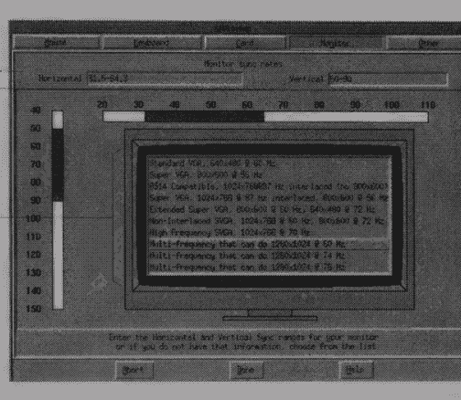

图 4. 配置显示器

3. 如果您已完成 XFree 的配置，请使用此表；否则，请继续下一个任务：

表 12. 退出 X 配置

### 配置其他设置

如果您想用其他设置配置系统，请执行此任务（例如，您可以设置视频模式切换）。

1. 如必要，选择“其他”（Other）按钮。
2. 选择以下任意选项：

OpenLinux 简介

# 附录 B：配置 X Window 系统

- 允许使用热键退出图形模式
- 允许在不同图形模式之间切换
- 允许干净地退出服务器
- 允许从其他工作站更改视频模式
- 允许从其他工作站更改键盘和鼠标设置

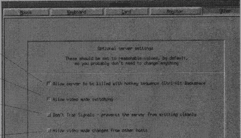

图 5. 其他系统设置

3. 如果您已完成 XFree 的配置，请使用此表：

| 当您完成 XFree 配置时 |
| :--- |
| a. 点击“完成”（Done）按钮。系统会询问您是否已完成 X 服务器配置。 |
| b. 点击“确定”（Okay）按钮。片刻后，系统将提示您运行 xvidtune 或保存配置。 |


| c. 如需调整显示设置，请查看下一个任务；否则，点击“保存配置并退出”（`Save the configuration and exit`）。 |

表 13. 退出 X 配置

## 调整显示设置

在配置 XFree 后，您可以调整显示区域的设置。例如，您可以更改显示区域的宽度和高度，或将显示区域向左或向右移动。

如果提示调整显示设置，请点击“运行 xvidtune”按钮。会出现一条警告消息。如果您熟悉 `xvidtune`，请点击“取消”（`Cancel`）结束此任务。

注意：您可以随时通过命令行输入 `xvidtune` 来调整显示设置。

点击“确定”按钮继续。

配置显示：

| 显示 (Display): 1280 | 垂直显示 (Vdisplay): 1024 |
| :--- | :--- |
| 水平同步起始 (HsyncStart): 1204 | 垂直同步起始 (VsyncStart): 1033 |
| 水平同步结束 (HsyncEnd): 1500 | 垂直同步结束 (VsyncEnd): 1045 |
| 水平场 (Hfield): 1898 | 垂直场 (Vfield): 1117 |
| 左 右 窄 | 上下 短 高 |
| 标志 (Flags) (十六进制): 000 | 像素时钟 (MHz): 60.00 |
| 退出 (Quit) 帮助 (Help) 自动测试 (Auto Test) 恢复 (Restore) | 水平同步 (Hz): 59.75 |
| 垂直同步 (Hz): 59.08 | |
| 获取 (Fetch) 显示 (Show) 下一个 (Next) 上一个 (Prev) | | | | | | |
| 反转VCLK 早期GC 块延迟 1 - 0 | | 块延迟 2 - 0 | |

点击这些按钮将显示区域向左或向右移动。

点击这些按钮使显示区域变宽或变窄。

点击这些按钮将显示区域向上或向下移动。

点击这些按钮使显示区域变短或变高。

当完成必要的调整后，点击“应用”（`Apply`）按钮。您的更改将显示。重复步骤 3 直到设置正确。

要保存更改，请点击“退出”（`Quit`）按钮；否则，点击“恢复”（`Restore`）按钮，然后点击“退出”按钮。

点击“确定”按钮完成配置。现在可以开始使用 X Window 系统了。

## 启动 X Window 系统

配置好 X Window 系统后，就可以可以使用了。当您启动 X Window 系统时，Caldera 图形桌面也会出现。要启动 X 和图形系统，请输入 `startx`。

## 切换屏幕分辨率

一旦配置好 X Window 系统，您就可以在选择的分辨率之间切换。

- 1. 如果尚未登录，请登录并输入 `startx` 以启动图形系统。
- 2. 执行以下操作选择您所需的屏幕分辨率：
  - 按 `CTRL+ALT++`（小键盘上的加号）切换到下一个屏幕分辨率。
  - 按 `CTRL+ALT+-`（小键盘上的减号）切换到上一个屏幕分辨率。

# 附录 B：软件包

X Window 系统由多个软件包组成。本附录列出了 OpenLinux 发行版中包含的软件包。

X Window 系统是一个强大且灵活的工具，一旦理解了它，它将非常有用。本指南将帮助您完成配置。

软件包软件包。本附录列出了 OpenLinux 发行版中包含的软件包。

X Window 系统由多个组件组成，包括 X 服务器、X 客户端和窗口管理器。X 服务器管理硬件并提供服务。X 客户端使用这些服务创建窗口。窗口管理器控制窗口的外观和行为。

这些组件协作提供一个图形界面。例如，X 服务器处理键盘和鼠标输入，而 X 客户端在屏幕上显示信息。窗口管理器组织屏幕上的窗口。

在本书中，您将学习如何配置这些 X Window 系统组件。您还将学习如何根据您的需求使用和自定义 X Window 系统。

X Window 系统是一个强大且灵活的工具，一旦理解了它，它将非常有用。本指南将帮助您完成配置。

## 附录 B：软件包索引

X Window 系统由多个软件包组成。本附录列出了 OpenLinux 发行版中包含的软件包。

| 软件包 | 描述 |
| :--- | :--- |
| X11 | 核心库 |
| X11-base | 基础 X 库 |
| X11-fonts | X 系统字体 |
| X11-apps | X 客户端应用程序 |
| X11-utils | X 系统工具 |
| X11-extensions | X 系统扩展 |
| Xorg | 开源 X 服务器 |
| windowwm | 默认窗口管理器 |
| fluxbox | fluxbox 窗口管理器 |
| i3 | i3 平铺式窗口管理器 |
| gnome | gnome 窗口管理器 |
| kde | kde 窗口管理器 |
| matchbox | matchbox 窗口管理器 |
| unity | unity 窗口管理器 |
| mate | mate 窗口管理器 |
| xfce | xfce 窗口管理器 |
| openbox | openbox 窗口管理器 |
| afterbox | afterbox 窗口管理器 |
| twm | twm 窗口管理器 |
| kwm | kwm 窗口管理器 |
| afterwm | afterwm 窗口管理器 |
| otherwm | otherwm 窗口管理器 |

（注：此列表并不完整，并可能根据 OpenLinux 的版本而异。）

## 表 14. Caldera OpenLinux Lite CD-ROM 上的软件包

| 软件包 | 描述 |
| --- | --- |
| XFree86-fontscyrillic | X11R6 西里尔字母字体 - 仅服务器端需要。 |
| XFree86-fontserver | X11R6 字体服务器 - 仅服务器端需要。 |
| XFree86-fontsextra | X11R6 希伯来和亚洲字体 - 仅服务器端需要。 |
| XFree86-fontscale | X11R6 可缩字体 - 仅服务器端需要。 |
| XFree86-image | X11R6 'imake' 编程工具。 |
| XFree86-misc | X11R6 杂项程序及其 man 手页。 |
| XFree86-programs | 来自 'contrib tapes' 的 X11R6 额外程序。 |
| XFree86-server | XFree86 窗口系统服务器基础内容。 |
| XFree86-server-devel | 用于 dga, mice, vidmode 的 XFree86 开发内容。 |
| XFree86-server-modules | 用于 pex, xie, dga 的 XFree86 可加载服务器模块。 |
| XFree86-setup | XFree86 安装程序 'XF86Setup'。 |
| XFree86-twwm | 用于 X 的标签窗口管理器。 |
| XFree86-xdm | 显示管理器，允许用户在 X 下登录或注销系统。 |
| XFree86-ssm | X 会话管理器。 |
| Xaw3d | 3D Athena 部件库版本，可以替换普通的 Athena 部件库。 |
| Xaw3d-devel | 用于开发使用 Xaw3d 程序的头文件和静态库库。 |
| Xconfigurator | X 配置工具。 |
| abuse | Abuse - 一个非常酷炫的 X/SVGA 游戏。 |
| acm | 基于 X 的飞行战斗游戏。 |
| adduser | 用户管理程序。 |
| adjtimex | adjtimex 系统调用的用户级前端。 |

## 表 14. Caldera OpenLinux Lite CD-ROM 上的软件包

| 软件包 | 描述 |
| --- | --- |
| amd | 自动挂载允许按需挂载文件系统。 |
| anonftp | 启用匿名 ftp 访问。 |
| gout-libs | 与旧 a.out 应用程序兼容的库。 |
| apache-docs | Apache HTTP 服务器的文档。 |
| apache-httpd | 提供 WWW 服务的 Apache HTTP 服务器。 |
| archie | 信息检索系统，用于查询包含网络各种 FTP 站点条目的特殊存档数据库。 |
| arena | 免费提供的、支持 HTML-3 的 WWW 浏览器。 |
| ash | 来自伯克利的小型 Bourne shell（仅 40k）。 |
| at | 'at' 命令允许在预定的时间启动进程。 |
| aumix | 基于 Curses 的音频混合器。 |
| autoconf | 可扩展的 GNU m4 宏包，用于创建 shell 脚本以自动配置源包包。此包需要 GNU 'm4' 软件包。 |
| background | X 桌面面的额外背景图片。 |


| `bash` | GNU Bourne Shell，功能上与 `tcsh` 相当，是 Linux 下的标准 shell。 |

| `bc` | 带有自带计算器语言的 GNU 二进制计算器。 |

| `bdfflush` | 内核守护进程 `bdflush` 用于定期将缓存中所有修改的数据块写入硬盘。这取代了旧的更新守护进程。 |

# OpenLinux 简介

193

## 表 14. Caldera OpenLinux Lite CD-ROM 上的软件包

| 软件包 | 描述 |
|---|---|

| `bin86` | 来自 H.J. 的汇编器 `as86`、链接器 `ld86` 和 GCC 前端 `bce`。 |
| `bind` | 用于网络服务的 DNS。 |
| `bind-lib` | DNS 解析器库。 |
| `bind-utils` | DNS 工具，例如 `host`, `dig`, `nslookup`。 |
| `binutils` | GNU 二进制工具。 |
| `bison` | 比 `yacc` 更强大的解析器生成。 |
| `blt` | BLT 组件。 |
| `blt-devel` | BLT 部件开发库。 |
| `bm2font` | 将位图转换为 LaTeX 字体。 |
| `bootp` | 用于网络信息的 DHCP 服务器。 |
| `bootpc` | 获取 `bootpd` 信息的客户端。 |
| `bsd-games` | 经典游戏集，如 `backgammon`, `cabbage`, `fortune`, `hangman` 和 `worms`。 |
| `buffer` | 加速写入带机的工具。 |
| `byacc` | 公有领域 `yacc` 生成器。 |
| `cdp` | 用于音频的全屏程序。 |
| `cdwrite` | 写入音频或数据光盘。 |
| `cmu-snmp` | SNMP 代理。 |
| `cmu-snmp-devel` | SNMP 开发头文件。 |
| `cmu-snmp-utils` | SNMP 协议工具。 |
| `color-ls` | 带颜色的 `ls` 命令。 |
| `control` | 系统控制程序。 |
| `cio` | GNU `cio` 存档程序。 |
| `cron` | 用于调度的 `cron` 守护进程。 |
| `crontab` | `crontab` 管理工具。 |
| `cv` | 用于拷贝的 `cp` 命令。 |
| `db` | 数据库系统。 |
| `db-devel` | 数据库开发库和头文件。 |
| `ddd-doc` | `ddd` 的文档。 |
| `ddd-sem` | `ddd` 的语义版本。 |
| `ddd-static` | `ddd` 的静态链接版本。 |
| `ddd-test` | `ddd` 的测试套件。 |
| `diff` | 用于比较文件的 `diff`。 |
| `diffutils` | GNU `diff` 工具。 |

## 附录 B：软件包索引

| 表 14. Caldera OpenLinux Lite CD-ROM 上的软件包 |
| 软件包 | 描述 |
|---|---|

| `fwwm-modules` | `fwwm` 窗口管理器的额外模块。 |
| `fwhois` | 一种 `finger` 风格的身份查询工具。 |
| `g77` | GNU Fortran 编译器 `g77`。 |
| `g77_lib` | GNU Fortran `g77` 库 |
| `gawk` | 用于处理文本文件中模式的 GNU `awk` 实用程序。 |
| `gcal` | 带有亮、节假日等功能的扩展日历工具。 |
| `gcc` | GNU `gcc` 编译器。 |
| `gcc-c++` | 为 `gcc` 提供的 C++ 支持。 |
| `gcc-objc` | 为 `gcc` 提供的 Objective C 支持。 |
| `gdb` | GNU `gdb`，用于 C 及其他语言的符号调试器。 |
| `gdbm` | 用于 C 的 GNU 数据库库。 |
| `gdbm-devel` | GNU 数据库库的开发库和头文件。 |
| `gdbm-static` | 用于静态链接的 `gdbm` 库。 |
| `gencat` | `gencat` 消息目录程序（来自 NetBSD）。 |
| `german-docs-L-Kurs` | L-Kurs - 德语 Linux 简介。 |
| `german-docs-intro` | 德语 Linux 文档。 |
| `gettext` | 用于支持本地语言（NLS）编程的实用程序和库。 |
| `getty_ps` | 用于登录的 Getty 和 ugetys。 |
| `ghostscript` | PostScript 解释器和渲染器。 |
| `ghostscript-fonts` | GhostScript 字体。 |
| `ghostview` | `ghostscript` 的 Ghostview 用户界面。 |
| `gifview` | 转换和处理 GIFs。 |
| `gimp-static` | 通用图像处理程序，一个带有许多插件的 Photoshop 工具。 |
| `git` | GIT - GNU 交互工具。 |
| `glint` | 图形化 Linux 安装工具 |
| `gn` | Gopher 服务器。 |
| `gnat` | GNU Ada 编译器。 |
| `gnuchess` | 带有 `xboard` 的 `chess`，GNU Chess 是一个具有挑战性的 ASCII 象棋程序，XBoard 是它的 X 界面。 |
| `gnuplot` | `gnuplot`，一个显示值和函数的交互式工具。 |
| `gpm` | Linux 的通用鼠标支持。 |
| `gpm-devel` | 用于编写鼠标驱动程序的开发库和头文件。 |
| `grep` | GNU `grep` 实用程序。 |
| `groff` | GNU `groff` 文本格式化实用程序。 |
| `groff-dvi` | 用于 DVI 的 GNU `groff` 格式化。 |
| `groff-lj4` | 用于 HP Laserjet 4 打印机的 GNU `groff` 格式化。 |
| `groff-misc` | GNU `groff` 杂项工具。 |
| `groff-ps` | 用于 Postscript 的 GNU `groff` 格式化。 |
| `gzip` | GNU `zip` 压缩实用程序版本 1.2.4。 |
| `hdparm` | 用于读取和设置 (E)IDE 性能参数的硬盘工具 |
| `helptool` | 简单的帮助文件搜索工具。 |
| `hman` | X 下基于 Motif 的手册浏览器。 |
| `howto-ascii` | `ascii` 格式的 Linux HOWTO 文档。 |
| `howto-dvi` | `dvi` 格式的 Linux HOWTO 文档。 |
| `howto-html` | `html` 格式的 Linux HOWTO 文档。 |
| `howto-ps` | `postscript` 格式的 Linux HOWTO 文档。 |
| `howto-sgml` | `sgml` 格式的 Linux HOWTO 文档。 |
| `html` | `html` 格式的超文本标记语言 3.0 文档。 |
| `iBCS` | Intel 二兼容标准 (iBCS-2) 模块。 |
| `ical` | 基于 Td/Tk 的日历应用程序。 |
| `illustrated-audio` | X 图音结合播放器。 |
| `imap` | 提供 IMAP 和 POP 网络邮件协议的支持。 |
| `indent` | 用于格式化 C 源代码的 GNU C 缩进程序。 |
| `inn` | “互联网”新闻传输。 |
| `timid` | 用于时钟同步的时间服务器。 |
| `ipfwadm` | IP 防火墙管理工具。 |
| `ipx` | IPX（网络数据包交换 - Novell 数据报协议）的实用程序、初始化脚本、手册页和配置文件。 |
| `ipxripd` | 用于在 IPX 网络上发现/广告 IPX 路由信息 (RIP) 和服务的 IPX RIP/SAP 守护进程。 |
| `cii` | 流行的 Unix 网络聊天客户端。 |
| `cii-help` | `cii` 的帮助文件和文档。 |
| `isdn4k-utils` | 内内核 ISDN 子系统的实用程序及某些贡献。 |
| `ispell` | GNU `ispell` - 交互式拼写检查器。 |


| 软件包 | 描述 |
| --- | --- |
| `jed` | 具有多种键绑定、类 C 扩展语言、颜色和许多其他功能的编辑器。 |
| `jed-xjed` | 用于 X 的 Jed 编辑器。 |
| `joe` | Joe，易于使用的编辑器。 |
| `kbd` | 可加载的键盘驱动 `kbd`。加载备用键盘布局需要。 |
| `koules` | 一个编写良好的 SVAGlib 游戏。 |
| `kterm` | 支持日字（日语）的 Xterm。 |
| `krtset` | 在启动时设置内核时区。 |
| `ld.so` | `ld.so` 动态链接器。 |
| `ldp-dvi` | dvi 格式的 Linux 项目文档。 |
| `ldp-ps` | postscript 格式的 Linux 项目文档。 |
| `ldp-txt` | ascii 格式的 Linux 项目文档。 |
| `less` | 文本 分页器。 |
| `lg` | Caldera 桌面。 |
| `lg-doc` | Caldera 桌面指南。 |
| `lg-rules` | Caldera 桌面布局。 |
| `lha` | 创建并扩展 lha 包。 |
| `libc` | C 标准库 |
| `libc-debug` | libc 调试信息。 |
| `libc-static` | 用于静态链接的 libc。 |
| `libc-profile` | 用于分析 libc。 |
| `libelf` | 处理 ELF 的库。 |
| `libgnat` | Ada 运行时。 |
| `lib++-devel` | C++ 开发库。 |
| `libpam` | PAM 认证模块。 |
| `libpwdb` | 密码数据库 |
| `libtermcap` | 用于 termcap 的库。 |
| `libtermcap-devel` | termcap 开发库。 |
| `libtiff-devel` | tiff 开发库。 |
| `lilo` | LILO，启动程序。 |
| `macutils` | 处理 Macintosh 格式的工具。 |
| `mailcap` | 红帽 Mailcap 包。 |
| `mailx` | BSD 邮件程序。 |
| `metamail` | 多媒体邮件工具和程序。 |
| `mgetty` | 用于数据和传真机的智能 getty。 |
| `mh` | `mh` 邮件系统，支持 pop，供 `xmh` 使用。 |
| `linux-kernel-binary` | 内核镜像。 |
| `linux-kernel-doc` | 内核文档。 |
| `linux-kernel-include` | 内核包含文件。 |
| `linux-source-alpha` | alpha 架构的内核源码。 |
| `linux-source-common` | 通用内核源码。 |
| `linux-source-i386` | i386 架构的内核源码。 |
| `linux-source-m68k` | m68k 架构的内核源码。 |
| `linux-source-mips` | mips 架构的内核源码。 |
| `linux-source-ppc` | power pc 架构的内核源码。 |
| `linux-source-sparc` | sparc 架构的内核源码。 |
| `lisa` | 安装工具。 |
| `logrotate` | 日志轮转。 |
| `losetup` | 用于设置和挂载回环设备的程序。 |
| `lout` | `lout` 文本格式化系统。 |
| `lout-doc` | `lout` 文本格式化系统的完整文档。 |
| `lrzsz` | 作为 `rz`, `sz` 等 Zmodem 程序。 |
| `lynx` | 基于 ascii 的 HTML 浏览器。 |
| `lyx` | LaTeX 的 WYWYG 前端。 |
| `m4` | GNU `m4` 宏处理器。 |
| `man_db` | 手册页读取器。 |
| `maplay` | 以 16 位立体声播放 MPEG-2 音频文件。 |
| `mawk` | Mike 的新/Posix AWK 解释器。 |
| `mc` | Midnight Commander 可视化 Shell。 |
| `modemtool` | 用于 `/dev/mem` 的配置工具。 |
| `modules` | 由 Bjorn Ekwall 和 Jaques Gelinas 编写的可加载 Linux内核模块实用程序。 |
| `moonclock` | 带有月相修改的传统时。 |
| `mount` | 用于挂载和卸载系统的程序。 |
| `moxfm` | Moxfm 是一个完整的文件和应用程序管理器。 |
| `mpage` | 将多个文本页放在单个 postscript 页面上打印。 |
| `mpeg_play` | 用于 mpeg 文件的 X 播放器，包括 Red's Nightmare 演示。 |

### 表 14. Caldera OpenLinux Lite CD-ROM 上的软件包

| 软件包 | 描述 |
|---|---|
| `mt-st` | `mt` 工具允许访问磁带驱动器。 |
| `mtools` | `mtools` 允许访问 DOS 文件系统。 |
| `multimedia` | 用于 X 的 CD 播放器和音频混合器。 |
| `mush` | 舒适的电子邮件界面。 |
| `mxp` | X 窗口 Mandelbrot 集合生成器和探索器。 |
| `ncftp` | 具有良好界面的 FTP 客户端。 |
| `ncompress` | 由 Peter Jannesen 编写的极速 LZW 压缩器。 |
| `ncsa` | 提供 WWW 服务的 NCSA HTTP 服务器守护进程。 |
| `ncurses` | `ncurses` 终端控制库。 |
| `ncurses-devel` | `ncurses` 的开发库。 |
| `nenscript` | 将纯 ascii 转换为 PostScript。 |
| `net-tools` | 基础网络工具，例如 `ifconfig`, `route`, ... |
| `netcfg` | 网络配置工具。 |
| `netpbm` | 许多图像转换和处理工具（由于极其严格的再发行条款，缺少 hpcd 支持）。 |
| `nfs-server` | NFS 服务器守护进程。 |
| `nfs-server-clients` | 用于远程 NFS 服务器的客户端应用程序。 |
| `nis-client` | 网络信息服务客户端（曾称为 yp）。 |
| `nis-server` | 网络信息服务服务器（曾称为 yp）。 |
| `nls` | 用于 Motif、Netscape 等的原生语言支持 (NLS) 文件。 |
| `nvi` | 新伯克利 vi 编辑器（实验性）。 |
| `open` | 用于创建和切换虚拟控制台工具。 |
| `optprep` | 用于安装第三方 rpm 软件包，如 Caldera 的互联网办公套件。 |
| `p2c` | 使用 `p2c` Pascal 转 C 转换器构建的程序的共享库。 |
| `p2c-basic` | 使用 `p2c` 包的基于 Pascal 的 BASIC 解释器。 |
| `p2c-devel` | Pascal 转 C 翻译程序和头文件。 |
| `pam-apps` | 用于 Linux 的可插身份模块 (PAM)。 |
| `paradise` | 带有声音和颜色的增强型 `netrek` 客户端。 |
| `patch` | GNU patch 工具。 |
| `pcmcia-cs` | PCMCIA 卡服务。支持 PCMCIA 卡“热插拔”的工具。 |
| `pdksh` | 公有领域内核 shell。 |
| `perf-rstatd` | 使用 rstat 服务的系统监控器（已包含）。 |
| `perl` | PERL，实用提取和报告语言，Larry Wall 的解释脚本语言。 |
| `perl-add` | 实用提取和报告语言扩展。 |
| `perl-eg` | 实用提取和报告语言示例。 |
| `perl-man` | 实用提取和报告语言帮助页。 |
| `perl-pod` | 实用提取和报告语言文档。 |
| `perl4` | 实用提取和报告语言（旧版本）。 |
| `pidentd` | 互联网守护进程授权、用户身份识别。 |
| `pine` | 符合 MIME 标准的邮件阅读器，同时也支持新闻组。 |
| `pixmap` | 基于 X 的舒适 pixmap 编辑器。 |
| `plan` | 基于 Motif 的调度器/计划器。 |
| `playmidi` | 在 FM、GUS 和 MIDI 设备上播放 MIDI 文件。 |
| `prmake` | 伯克利的并行 make。 |
| `pmirror` | `mirror`一个用于镜像 FTP 站点的 perl 脚本。 |
| `popclient` | POP - 使用邮局协议从邮件服务器检索邮件。 |
| `portmap` | RPC portmapper 守护进程。 |
| `ppp` | `PPP`点对点协议。 |
| `printtool` | X 下的打印机配置工具（基于 Tcl/Tk）。 |


## 软件包列表

| 软件包 | 描述 |
|---|---|
| `procinfo` | `/proc` 文件系统信息。 |
| `procmail` | `procmail` 一个用于过滤和处理电子邮件的程序。 |
| `procsps` | 一组评估系统 `/proc` 结构的程序（`free`, `top`, `uptime` ...）。 |
| `procs-X11` | 基于 X 的进程监控工具。 |
| `project-map` | 进行中的 Linux 项目地图。 |
| `psmisc` | 针对 `/proc` 文件系统的更多 `ps` 类型工具。 |
| `psutils` | PostScript 工具。 |
| `python` | 带有 X 接口的高级脚本语言。 |
| `pythonlib` | 各种 Red Hat 程序使用的 python 代码库。 |
| `rcs` | GNU `rcs` - 版本控制系统。 |
| `rdate` | 从网络参考设置系统时钟。精度约为 1 秒。 |
| `rdist` | 远程文件发布客户端，允许在多台计算机上管理相同的文件副本。 |
| `readline` | 用于从终端读取行的库。 |
| `readline-devel` | 开发使用 `readline` 库的程序的库和头文件。 |
| `recode` | 根据 RFC 1345 转换不同字体文本文件的实用。 |
| `rpm` | Red Hat 包管理器。 |
| `rpm-devel` | 操作 rpm 软件包程序的头文件和库。 |
| `rxvt` | X 窗口中的终端模拟器 `rxvt`。 |
| `samba` | Samba 基于 Unix 的 SMB 文件服务器。它允许 Linux 宿主机成为 WFW、OS/2、NT 或 Windows 95 的文件和打印服务器。它还包含一个 SMB 客户端和一个 NetBIOS 名称服务器。 |
| `sc` | 支持日期的文本电子表格表格（需要 `ncurses-devel` 和 `bison`）。 |
| `screen` | 带有 VT100/ANSI 仿真的屏幕管理器，可以作为终端复用器使用，从单个真实终端控制多个虚拟终端。 |
| `sed` | GNU `sed` 流编辑器。 |
| `sendmail` | 邮件传输代理。 |
| `sendmail-cf` | sendmail 配置文件和 m4 宏。 |
| `sendmail-doc` | sendmail 文档。 |
| `setup` | 设置文件 |
| `seyon` | `seyon` 是一个基于 X 的调制解调包。 |
| `sh-utils` | shell 程序工具集合，如 `basename`, `date`, `dirname`, `expr`, `nohup`, `nice` 和 `stry`。 |
| `sharutils` | GNU shar 工具，如 `shar`, `unshar`, `uencode` 和 `ude`。 |
| `slang` | C S-Lang 语言的共享库。 |
| `slang-devel` | C S-Lang 语言的静态库和头文件。 |
| `sliogin` | 源 服务器，适用于 shadow 系统和 mgetty。 |
| `slrn` | 小型 NNTP 新报。 |
| `slsc` | 基于 `sc` 的电子表格，带有许多增强。 |
| `sox` | 通用音频文件转换工具。 |
| `spice` | SPICE 电路模拟器。 |
| `spider` | 游戏的 X 实现。 |
| `stat` | 文件信息报告器。 |
| `statnet` | 终端网络流量监控。 |
| `statserial` | 显示串口状态。 |
| `strace` | 运行进程的系统调用跟踪。 |
| `svgalib` | 全屏 (S)VGA 图形库。 |
| `svgalib-devel` | (S)VGA 图形的开发库和包含文件。 |
| `swatch` | 系统日志和报警器。 |
| `symlinks` | 符号链接健康检查。 |
| `syslog` | Linux 系统和内核日志。 |
| `taper` | 磁带备份系统（测试版）。 |
| `tar` | GNU 磁带归档工具 `tar`。 |
| `tb` | Treebrowser 是一个实用的 OPEN LOOK (xview) 文件系统浏览器和管理器。 |
| `tcl` | 命令语言 tcl。 |
| `tcl-devel` | 命令语言 tcl，带有帮助页。 |
| `tclx` | 用于 POSIX 系统的 `tcl` 和 `tk` 扩展。 |
| `tclx-devel` | `tcl` 和 `tk` 扩展，带有帮助页。 |
| `tcp_wrappers` | tcp 守护进程的安全封装 - 最大值设置。 |
| `tcpdump` | `tcpdump` 允许读取和记录单个 TCP/IP 包。 |
| `tcsh` | `tcsh` 带有手册页的扩展 C shell。 |
| `termcap` | GNU libertcap 的终端能力集。 |
| `tetex` | TeTeX (TeX) 排版系统和 MetaFont 格式化。 |
| `texinfo` | `texinfo` 格式化和 info 阅读器。 |
| `texinfo-info` | 基于文本的独立 `info` 阅读器。 |
| `textutils` | GNU 工具，如 `cat`, `cksum`, `head`, `join`, `pr`, `sort`, `split` 和 `uniq`。 |
| `tgif` | 具有特殊空间模式的对象面向绘制和构造程序。 |
| `time` | GNU time 工具，用于确定给定程序执行的资源使用情况，如 CPU 时间和内存。 |

## 表 14. Caldera OpenLinux Lite CD-ROM 上的软件包

| 软件包 | 描述 |
|---|---|
| `timodel` | RedHat 图形化时间和日期设置工具。 |
| `tin` | `tin`, 一个支持 NNTP 的新闻阅读器。 |
| `tix` | 为 `tk` 许多 metwidgets 集合，如记事本。 |
| `tix-devel` | tk 的 metwidgets，带有管理器的开发部分。 |
| `tk` | 用于 `Tcl` 的 Tk X 界面工具包。 |
| `tk-devel` | 用于 `Tcl` 的 `Tk` 工具包，带有管理器的开发部分。 |
| `tkinfo` | 基于 Tk/tcl 的 GNU Info 查看器。 |
| `tkman` | 带 Tk 前端的帮助页浏览器。 |
| `tksysv` | 基于 X/Tk 的 System-V `runlevel` 编辑器。 |
| `traceroute` | 追踪数据包在 TCP/IP 网络中的路径。 |
| `tracker` | 播放 Amiga MOD 音文件。 |
| `transfig` | 将 `.fig` 文件（如来自 xfig 的文件）转换为其他图形格式。 |
| `trn` | 一个支持 NNTP 的多线程新闻阅读器。 |
| `trojka` | 一种类似于 xwels 或俄罗斯方块的终端落块游戏。 |
| `tunelp` | 配置内核并行端口驱动。 |
| `typhoon` | 用于关系型数据库的库和工具。 |
| `uemacs` | MicroEmacs 全屏编辑器，Emacs 的小型紧凑版本。 |
| `umb-scheme` | 来自马萨诸塞大学士士分区的 Scheme 解释器。 |
| `umsdos__progs` | 用于 umsdos 文件系统的程序，允许在 DOS 分区内安装 Linux 系统。 |
| `unjar` | 用于 DOS 下广泛使用的 `.arj` 格式存档解压缩器。 |
| `units` | 单位转换程序。 |
| `unzip` | `unzip` 解压如 DOS 下由 pkzip 创建的 `.zip` 文件。 |
| `usercfg` | 用户和组配置工具。 |
| `util-linux` | 由 Rik Faith 维护的各种 Linux 工具。 |
| `uucp` | Unix 到 Unix 复制 (UUCP)，用于通过调制解器连接进行邮件和新闻。支持 HDB 以及 Taylor 配置文件。包含详细文档和来自 Bodo Bauer 的 `uopoll` 脚本。 |
| `vga_cardgames` | Linux 文本控制台纸牌游戏 `klondike`, `oh hell`, `solitaire` 和 `spi-der`。 |
| `vga_gamespack` | Linux 文本控制台 `otthello`, `扫鼠` 和 `connect-4`。 |
| `vga_tetris` | 基于 SVGLib 的网球游戏。 |
| `vim` | `vim` (改进版 vi)，支持欧洲字符的扩展 vi。 |
| `vim-X11` | 支持 X 的 `vi` 编辑器 (改进版 vi)。 |
| `vixie-cron` | `cron` 守护允许在规定的时间启动进程。 |
| `vlock` | `clock` 锁定一个或多个虚拟终端。 |
| `vslick` | MicroEdge 的 Visual Slick Edit 演示。 |


# 附录 B：软件包索引

| `wdiff` | GNU 文字差异查找器。 |
| `which` | 根据你的 PATH 变量确定将运行哪个执行文件。 |
| `words` | 用于 `ispell` 的英语字典。 |
| `workman` | 用于播放音频光盘的图形化 (OPEN LOOK) 工具，包括单个光盘的标题管理。 |
| `woven-docs-LST` | 织织品文档 - LST |
| `woven-docs-RedHat` | 织织品文档 - RedHat |
| `woven-docs-dlhp` | 织织品文档 - dlhp |
| `woven-docs-faq` | 织织品文档 - FAQ。 |
| `woven-docs-fsstnd` | 织织品文档 - 文件系统标准 |
| `woven-docs-howto` | 织织品文档 - HOWTO。 |
| `woven-docs-isdn` | 织织品文档 - ISDN |
| `woven-docs-ldp` | 织织品文档 - LDP。 |
| `woven-docs-llhp` | 织织品文档 - llhp |
| `woven-docs-main` | 织织品文档 - 主体 |
| `woven-docs-usenet` | 织织品文档 - UseNet。 |
| `woven-docs-wwwhelp` | 织织品文档 - WWW 帮助。 |
| `wu-fptpd` | 华顿大学 FTP 守护进程。 |
| `x3270` | 基于 X 的 3270 模拟器；允许在 X 窗口内 telnet 连接 IBM 主机。使用特殊字体。 |
| `xanim` | '`xanim`' 是 X 的动画查看器，支持许多图形格式。 |
| `xarchie` | 基于 X 的 '`archie`' 浏览器界面，用于查询全球 `archie` 数据库。 |

## 表 14. Caldera OpenLinux CD-ROM 上的软件包

| 软件包 | 描述 |
|---|---|
| `xbill` | 杀死账单。 |
| `xbl` | 3D 俄罗斯方块游戏。 |
| `xbmbrowser` | 用于位图和地图的非常有用的 X 浏览器。 |
| `xboing` | 破冰风格的视频游戏。 |
| `xcept-demo` | 用于 X 的商业视频文本解码器 (BTX/Dx-J) (演示版)。 |
| `xchomp` | X 的吃豆人游戏。 |
| `xcolorsel` | 显示或从 RGB 数据库中选择颜色的工具。 |
| `xdalidock` | 基于 X 的 '`dali`' 钟。 |
| `xdemineur` | 另一个扫鼠游戏。 |
| `xearth` | 以地球作为 X 的 背景。 |
| `xemacs-base` | XEmacs 基础包。XEmacs 是一个强大的可扩展的编辑器，需要 X 库，但现在也能在普通终端上运行。 |
| `xemacs-emul` | XEmacs 的其他编辑器仿真（主要是 vi）。 |
| `xemacs-energize` | XEmacs 的 '`energize`' 软件包。 |
| `xemacs-hyperbole` | XEmacs 的 '`hyperbole`' 软件包。 |
| `xemacs-liss` | XEmacs 的 Lisp 编程环境。 |
| `xemacs-mailnews` | XEmacs 的邮件和新闻阅读器。 |
| `xemacs-modes` | XEmacs 的各种特殊模式。 |
| `xemacs-oo-browse` | XEmacs 的对象浏览器。 |
| `xemacs-packages` | XEmacs 的各种软件包。 |
| `xemacs-www` | XEmacs 的 WWW 浏览器和编辑器。 |
| `xevil` | X 的快速动作暴力游戏。 |

# 表 14. Caldera OpenLinux CD-ROM 上的软件包

| 软件包 | 描述 |
|---|---|
| `xf-control-panel` | 带有管理工具的图标面板。 |
| `xf-panel` | 基于 XForms 的具有组分级的图标面板。 |
| `xfig` | 用于绘制和操作对象的菜单驱动图形应用程序。它能够以各种图形格式保存对象。 |
| `xfishtank` | 将 X 根背景变为水族馆。 |
| `xfm` | 用于 X 的综合性文件和应用程序管理器。 |
| `xmail` | 一个时尚的邮件阅读器和编辑器。 |
| `xractint` | 针对许多不同类型分形的生成程序。 |
| `xgalaga` | X 的 Galaga 克隆版。 |
| `xgammon` | 一个或两个玩家的双跳棋游戏。 |
| `xopher` | 基于 X 的 gopher 客户端。 |
| `xjewel` | X 的俄罗斯方块风格游戏。 |
| `xlander` | 月球着陆模拟。 |
| `xlispstat` | 用于统计计算和动态图形的可扩展系统。 |
| `xloadimage` | 基于 X 的图像查看器，支持许多常见图形格式。图像可以显示或加载到背景中。 |
| `xlockmore` | X 终端锁定程序，包含许多屏幕保护程序。 |
| `xmailbox` | 基于 X 的邮件通知工具。 |
| `xmbase-grok` | 带有图形 X 前端的简单数据库。 |
| `xmgr` | 基于 Motif 的绘图工具。 |
| `xmine` | X 的扫鼠。 |

## 表 14. Caldera OpenLinux Lite CD-ROM 上的软件包

| 软件包 | 描述 |
| --- | --- |
| `xmorph` | 带有 X 界面的变形程序 |
| `xmplay` | 一个 MPEG 视频查看器 |
| `xntp` | '`ntp`' 利用网络和/或无线接收器进行精确的时间同步。需要内核 TCP/IP、初始化的环回设备以及正确的时区（另见 Duke 的 `crtszet`）。 |
| `xsview` | 用于查看系统资源使用的 X 工具。例如主内存或 CPU 负载。 |
| `xpaint` | '`paint`' 是一个用于编辑和创建位图和点图的用户友好程序。 |
| `xpat2` | X Patience - 各种纸牌游戏。 |
| `xpdf` | X 的便携文档格式 (PDF) 查看器。 |
| `xpilot` | 街机风格飞行游戏 |
| `xpm` | 显示位图的 Xpm 库。 |
| `xpm-devel` | 处理位图的开发库和头文件。 |
| `xpostit` | 用于日期和重要想法的电子贴板。 |
| `xpuzzles` | 各种几何谜题，包括魔方。 |
| `xrn` | 基于 X 的新闻阅读器 |
| `xscreensaver` | X 屏幕保护程序。 |
| `xselection` | 用于获取或设置 X 选择或缓冲区属性值的工具。 |
| `xsnow` | Xsnow，为那些希望一年 12 个月都是圣诞的人准备。 |
| `xsysinfo` | X 的性能表。 |
| `xtar` | 基于 Motif 的 '`tar`' 工具。 |

## 表 14. Caldera OpenLinux Lite CD-ROM 上的软件包

| 软件包 | 描述 |
| --- | --- |
| `xtedy` | 用于 X 系统的可爱泰迪熊 - 每个人的必备品！ |
| `xterm-color` | '`xterm`' 终端模拟器的 ANSI（彩色）版本。 |
| `xtetris` | X 版本的俄罗斯块。 |
| `xtoolwait` | 延迟 X 启动器。 |
| `xtrojka` | 一种类似于 sjwels 或俄罗斯块的 X 系统下落块游戏。 |
| `xv` | 大多数图形格式的优秀查看器/浏览器（共享软件）。 |
| `xview` | 用于 X 的 XView 和 OpenLook 接口。 |
| `xview-devel` | XView 应用开发的头文件和静态库。 |
| `xwatch` | 日志文件的守护程序。 |
| `xwpe` | 集成 X-Window 编程环境。 |
| `xwpick` | '`xwpick`' 是一个屏幕捕取工具，以各种格式保存 X 窗口和背景。 |
| `xxgdb` | '`xxgdb`' 是 GNU 调试器 '`gdb`' 的图形化用户界面。 |
| `ytalk` | 使用网络对话协议创建多用户聊天会话。 |
| `zapem` | 一种类似星际入侵者的游戏。 |
| `zgv` | 许多图形格式的控制台查看器。 |
| `zip` | '`zip`'，压缩程序。 |
| `zlib` | 解压缩库 `zlib`。 |
| `zlib-devel` | `zlib` 的静态版本和头文件。 |
| `zoneinfo` | 时区工具和数据。 |

OpenLinux 简介

217

## 表 14. Caldera OpenLinux Lite CD-ROM 上的软件包

| 软件包 | 描述 |
| --- | --- |
| `zsh` | `zsh` shell。 |
| `zz_3dlook` | 所有 X 应用程序的 3D 查看。 |

# 附录 B

打印使用 HOWTO


由 Mark Komarinski <markk@auratek.com> 编写 Linux 打印使用 HOWTO v1.2.1，1997年3月24日

# 1. 引言

本文档描述了如何使用 Linux 操作系统提供的行打印机打印打印系统。本 HOWTO 是 Linux 打印设置 HOWTO 的补充文档，后者讨论了 Linux 打印系统的安装和设置。本 HOWTO 中介绍的材料对于 Linux 操作系统外，对所有 BSD 操作系统的变体也同样适用。

## 1.1. Linux 打印 HOWTO 历史

来自 Mark Komarinski <markk@auratek.com> 的备注：

我想感谢 Matt Foster 在重写此 HOWTO 时所做的大量工作。我保留了他的风格，并在必要时添加内容以保持所有内容的更新。

### 附录 B：打印 HOWTO

来自 Matt Foster <mwf@engr.uark.edu> 的备注：

此版本的 Linux 打印 HOWTO 是对 Grant Taylor <grant@god.tufts.edu> 和 Brian McCauley <B.A.McCauley@bham.ac.uk> 最初编写版本的完全重写；我试图保持 Grant 和 Brian 的 HOWTO 中呈现的材料范围，但我大幅修改了演示风格和涵盖材料的深度。我觉得这使得 HOWTO 更加完整且易读。我只希望你能够同意这一观点。

## 1.2. 版本历史

- v1.2.1: 更新，针对 Dr. Linux 出版的某些更改
- v1.2: Windows 打印机，更改打印文件的最大大小
- v1.11: 新维护者！添加了 `lpc` 信息，添加了一些故障排除信息，开始打印图形文件！
- v1.1: 修订了部分措辞，开发了 PostScript 打印章节，尝试澄清了一些示例 8-) 充实了基础 Linux 打印工具的讨论
- v1.0: 打印使用 HOWTO 的初始公开发布

## 1.3. 版权与商标

本 HOWTO 中提到的某些名称被声明为某些人员和/或公司的权利/或商标。这些名称在 1995 年以全大写或首字母大写出现。Matt Foster

如果你有疑问，请联系 Linux HOWTO 协调员 Greg Hanks，邮箱为 <gegh@sunsite.unc.edu>。你可以 `finger` 该地址获取电话号码和额外的联系信息。

(mwf@engr.uark.edu) (c) 1996-1997 Matt F. Komarinski (markk@auratek.com)

## 1.4. 下载 Linux HOWTOs

我建议如果你想打印此 HOWTO 的副本，请下载 PostScript 版本。它的格式具有美学吸引力且更易阅读。你可以从许多 Linux 发行版站点之一（如 SunSite "" 获取 PostScript 版本。

所有包含任何 Linux HOWTO 文档的翻译、派生作品或汇总作品必须受此版权声明保护。

## 1.5. 反馈

这意味着，你不能从 HOWTO 生成派生作品并对其发行施加额外的限制。在某些条件下可能会授予这些规则的例外；请通过下方地址联系 Linux HOWTO 协调员。

对本 HOWTO 的问题、意见或修正可以发送至 <markk@auratek.com>。

## 1.6. 致谢

简而言之，我们希望尽可能通过各种渠道传播这些信息。

# 2. 在 Linux 下打印

本文档描述了如何使用 Linux 操作系统提供的行打印机打印系统。本 HOWTO 是 Linux 打印设置 HOWTO 的补充文档，后者讨论了 Linux 打印系统的安装和设置。本 HOWTO 中介绍的材料对于 Linux 操作系统外，对所有 BSD 操作系统的变体也同样适用。

当 `lpr` 执行时，它首先将指定的文件复制到某个目录（打印池目录），文件将留在那里，直到 `lpd` 将其打印。`lpd` 被通知有文件要打印，它将派生自身的副本（即我们程序员所说的 forking）。这个副本将进行打印，而原始进程则等待更多请求。

## 附录 B：使用指南

### lprm

任何打印系统的另一个有用功能是取消之前已入队的任务。要执行此操作，请使用 `lprm`。

```
$ lprm -
```

上述命令将取消执行该命令的用户拥有的所有打印作业可以通过先通过 `lpq` 获取任务编号，然后将该数字传递给 `lprm` 来取消单个打印作业。例如：

```
$ lprm 31
```

这将取消默认打印机上的第 31 号任务 (thesis.txt)。

### 2.5. 使用 lpc 控制 lpd 程序

`lpc(8)` 程序用于控制 `lpd` 服务的打印机，你可以启用或禁用打印机或其队列，重新排列队列中的条目，并获取打印机及其队列的状态报告。`lpc` 主要用于有一一台机器连接了多台打印机的设置环境。

```
$ lpc
```

上述命令将启动 `lpc` 程序。默认情况下，这会进入交互模式，你可以开始输入命令。另一种选项是在命令行上执行 `lpc` 命令。

```
$ lpc status all
```

可用命令列表在 `lpd` 手页中，但这里有几个你可能想要了解的常用命令。任何标记有选项的命令可以是打印机名称（`lp`, `print` 等）或关键词 `all`（意味着所有打印机）。

- disable 选项 - 防止任何新打印作业进入
- down 选项 - 禁用打印机上的所有打印


- `enable` 选项 - 允许新作业进入打印队列
- `quit` (或 `exit`) - 退出 `lpc`
- `restart` 选项 - 重启该打印机的 `lpd`

# OpenLinux 简介

## 3. 打印文件

- `status` 选项 - 打印打印机状态
- `up` 选项 - 启用所有功能并启动新的 `lpd`

## 2.6. RedHat printtool

在这里对 RedHat 极其出的 `printtool` 程序进行一个简要说明。它似乎可以完成 `magfilter` 能做的所有工作。RedHat 已经安装了许多用于过滤的程序。以下是我如何在 RH 4.0 下使用连接到并行端口的 HP LJ 4L 设置我的打印机。

## 3. 打印文件

本节涵盖了在 Linux 环境中会遇到的各类文件的打印。

### 3.1. 打印图形文件

1. 成为 root 用户并启动 `printtool`（如果你使用了它，记得设置 `SETENV DISPLAY :0.0` 和 `xhost +` 吧？）
2. 点击“Add”，并对本地打印机点击“OK”。
3. 填写打印机设备（对我来说是 `/dev/lp1`）
4. 填写输入过滤器 - 选择打印机类型、分辨率和纸张尺寸（lj4, 300x300 和 letter）
5. 一直点击“OK”返回并重启 `lpd`。

通过打印机打印图形文件通常取决于你正在转换的图形种类以及你想要发送到的打印机类型。由于点阵打印处理图形的方式不同，点阵打印并不常见。在这种情况下，最好的办法是查看你的打印机是否与 Epson 或 IBM ProPrinter 兼容，将图形转换为 PostScript，然后使用 Ghostscript（见下节）打印图形。

如果你有一台激光打印机，情况会简单一些，因为许多打印机都兼容 PCL。这现在为你提供了几个选项。某些程序可能直接输出 PCL。如果不是，像 NetPBM 这样的程序可以转换为 PCL。最后一个选项是使用 ghostscript（见下节）。

就像手动轮询 `/etc/printcap` 文件一样，你可以为每个物理打印机设置多个打印机定义。一个用于

## 附录 B：打印使用指南

你最好的选择是安装如 NetP Ghostscript 这样的包，然后安装魔法过滤器（magic filter）来自动处理图形文件。

### 3.2. PostScript 文件

在具有 PostScript 能力的打印机上打印 PostScript 文件非常简单；只需使用 `lpr`。对于没有 PostScript 的打印机，我们必须依靠其他方法。幸运的是，有程序可以格式化并转换为打印机能理解的语言。其中最著名的程序是 Ghostscript。

要使用 Ghostscript 打印 PostScript 文件，你可以这样做：

```
$ gs -dSAFER -qPAUSE -sDEVICE=deskjet -sOutput=file
```

在上面的示例中，我们通过 `lpr` 管道传递 Ghostscript 的输出。`Ghostview` 是一个界面，允许你在打印前预览 PostScript 文件。

### 3.3. PDF 文件

Adobe 发布了适用于 Linux 的 Acrobat 阅读器，其前身 `xpdf` 同样可用。两者都可以打印到设备。

### 3.4. TeX 文件

打印 TeX 文件最简单的方法之一是将它们转换为 PostScript 然后使用 Ghostscript 打印。要实现这一点，你首先将它们转换为 DVI（DVI 代表设备无关）。然后你可以使用 `dvips` 转换：

```
$ dvips thesis.dvi
```

### 3.5. 打印 troff 文件

### 3.6. 打印 man 页

## 4. 杂杂

### 4.1. 打印前的格式化

由于 ASCII 文件没有格式化，在打印之前对其进行格式化是有用的。这包括在每页放置标题和页码、设置页边距、双倍行距或多列打印。一种常用方法是使用 `pr`。

```
$ pr +4 -d -h"Ph.D. Thesis, 2 Draft"-160 thesis.txt | lpr
```

在示例中，`pr` 将 thesis.txt 跳过前三页 (`+4`)，长度为六十行 (`-160`)，双倍行距 (`-d`)，并在每页顶部添加 "Ph.D. Thesis, 2 Draft" 字样 (`-h`)。`lpr` 将处理

### 4.2. PRINTER 环境变量

打印系统的所有命令都接受 `-P` 选项。这允许用户指定用于输出的打印机。如果用户没有指定打印机，则假定默认打印机输出设备。

与其每次打印时都指定打印机，你可以将 `PRINTER` 环境变量设置为你想使用的打印机名称。在不同的 shell 中实现方法不同。对于 bash，你可以这样做：

```
$ PRINTER="printer_name"; export PRINTER
```

csh 则可以这样做：

```
$ setenv PRINTER "printer_name"
```

这些命令可以放在登录脚本中（bash 使用 `.profile`，csh 使用 `.cshrc`），或在命令行上执行。（有关环境变量的更多信息，请参考 `bash(1)` 和 `csh(1)`）

# 5. 常见问题解答

## Q2. 什么是过滤器（filter）？

A2. 过滤器是一个从标准输入 (`stdin`) 读取、对该输入执行某些操作并写入标准输出 (`stdout`) 的程序。过滤器用于许多领域，包括文本处理。

- GhostScript
- TeX
- NetPBM
- jpeg 工具包
- gzip

## Q3. 什么是魔法过滤器（magic filter）？

A3. 魔法过滤器根据文件类型执行操作的过滤器。例如，如果文件是纯文本文件，它将直接使用普通方法打印该文件。如果文件是 PostScript 文件或其他任何格式，它将使用另一种方法 (`ghostscript`) 进行打印。这两个例子是 magic-filter 和 APSfilter。这些过滤器的一个注意点是，在安装过滤器之前，必须先安装相应的程序。

## Q4. Windows 打印系统如何？Linux 能兼容它吗？

A4. 可能可以。只接受 WPS 命令的打印机无法在 Linux 下工作。接受 WPS 和其他命令的打印机（如佳能 BJC 610）设置为 WPS 格式以外的其他格式。其他打印机，例如某些 HP DeskJet 820Cxi/Cse，*无法*与 Linux 工作。尽管如此，Linux 可以作为 Win95 机器的打印服务器（参见 Samba），因为 Win95 拥有这些打印机的驱动程序。

其原因是当过滤器安装时，它会查询你的系统中的特定程序（如 ghostscript - 如果找到，它就知道可以处理 PostScript 数据），然后根据找到的内容构建自身。为了处理所有打印机文件，你可能至少需要以下内容：

## Q5. 这也太离谱了！我打印不了超过 6 页的内容，就会收到“文件太大”的错误。

A5. `/etc/printcap` 文件中的选项之一与打印文件的最大尺寸有关。默认值是 1000 个磁盘块（约 500k？）。对于 PostScript 文件之类的文件，这可能只能给你提供 6-8 页带图形的内容。请确保在打印机定义中添加以下行：

```
mc=0
```

这样做的主要比为了防止溢存分区（spool partition）被填满。还有另一种方法，让 lpr 从溢存目录到你的打印文件创建一个软链接。但你必须记得每次给 lpr 添加 `-s` 选项。

# 6. 故障排除

本节涵盖了你的打印系统中可能出现的一些常见问题。

如果你的打印机无法工作：

- 其他打印任务正常正常吗？（应用程序问题？）
- `lpd` 是否正在运行？（使用 `lpc` 检查它）（打印控制器？）
- root 用户可以直接向打印机发送内容 吗？（打印服务？）
- 你能从 DOS 打印吗？（线缆/打印机问题）？

回答这些问题有助于找到解决方案。

将对本章节的其他建议发送至 <markk@auratek.com>。

# 7. 参考文献

这是关于 Linux 打印系统的参考文献部分。我尝试让本 HOWTO 的参考文献部分尽可能集中。如果你觉得我遗漏了重要的参考著作，请随时与我联系。

在向 USENET 群组发布问题之前，请考虑以下因素：

- 打印机是否接受任务？（使用 `lpc(8)` 进行验证。）
- 你的问题的答案是否在本 HOWTO 或 Grant Taylor 的打印 HOWTO 中涵盖？
- `ghostview(1)` 使用 Ghostscript 查看 PostScript 文档
- `groff(1)` groff 格式系统的前端
- `gs(1)` Ghostscript 解释器/查看器
- `lpc(8)` 行打印控制程序
- `lpd(8)` 行打印溢存守护进程
- `lpq(1)` 溢存队列检查程序
- `lpr(1)` 离线打印机
- `lprm(1)` 从行打印溢存队列中删除任务
- `pr(1)` 转换文本文件用于打印
- `tex(1)` 文本格式排版
- USENET 新闻组
- comp.os.linux.* 关于 Linux 的海量信息


`comp.unix.*` 与 UNIX 操作系统相关的讨论

如果上述任何情况为真，在发布问题之前你可能再考虑一下。而且，当你最终发布到新闻组时，请尝试包含相关信息。尽量不要只说类似“我的 `lpr` 遇到问题了，请帮忙”之的话。这类帖子会被很多人忽略。还请尝试包含你正在运行的内核版本、错误发生的情况，以及系统返回的任何特定错误信息。在线帮助手册页

- `cat(1)` 合并并打印文件
- `dvips(1)` 将 TeX DVI 文件转换为 PostScript

# 附录 B 许可声明

本附录包含你的 `OpenLinux™ Lite CD-ROM` 中组件的许可信息。

包含在 `Caldera OpenLinux™ Lite CD-ROM` 中的许多软件软件包是根据 `GNU` 通用公共许可证 (`Gnu GPL`) 分发的，该许可证在下文重印，或其他允许代码分发的许可。请查阅本附录、源代码或文档中的相应许可声明，以获取有关你想要分发的任何组件的详细信息。

（注：原文此处存在大量重复的文本段落，已按要求进行核心逻辑翻译与整理）

## 录 B：许可声明

文档中描述的功能。只有在您在相应的保修期内向 `Caldera` 通知您对软件存在的问题，并提供您获取软件日期的证明，`Caldera` 才有义务履行此保修。`Caldera` 在收到通知后的 30 天内，将尽合理的商业努力根据上述保修进行修理、更换、建议或退款。

这是一个有限保修，是 `CALDERA` 提供的唯一保证。`CALDERA` 不提供其他明示保证，也不对不侵犯第三方权利提供任何保证或条件。暗示保证的持续时间（包括但不限于对适销性和特定用途的适用性的保证）仅限于上述有限保修期；某些州不允许限制暗示保证的持续时间，因此这些限制可能不适用于您。`Caldera` 经销商或员工均有授权对本保修进行任何修改、扩展或补充。如果您在保修期内对软件进行了任何修改；如果存储介质遭受了意外、滥用或不当使用；或者您违反了本协议的条款，则本保修将立即终止。如果软件用于与文档中所述的设计用途不符的未修改硬件和软件之外或与之结合的硬件和软件，则本保修不适用。

本保修赋予您特定的法律权利，您可能还拥有因州或司法管辖区而不同的其他法律权利。

责任限制。在任何法律理论（侵权、合同或其他）框架下，`Caldera` 或其供应商或转销商均不对您或任何他人的任何性质的间接、特殊、附带或后果性损害承担责任，包括但不限于对商誉损失、停工、计算机故障或故障的损害，或对任何及所有其他商业损害或损失，或任何超过 `Caldera` 软件和文档许可标价价格的损害，即使 `Caldera` 已告知此类损害发生的可能性，或由于任何第三方的任何索赔。在适用法律禁止此类限制范围内，本责任限制不适用于死亡或人身伤害责任。此外，某些州不允许排除或限制附带或后果性损害，因此此限制和排除可能不适用于您。

终止。如果您未能遵守上述限制，本许可将自动终止。终止时，您必须销毁所有软件和文档的副本。

出口控制。任何软件或底层信息或技术均不得下载或以其他方式出口或再出口：(i) 向古巴、利比亚、伊拉克、南属斯拉夫、朝鲜、伊朗、叙利亚或任何美国实施贸易禁运的国家或居民；或 (ii) 向美国财政部“指定国民名单”上的任何人或美国商务部“拒绝许可清单”上的任何人。使用本软件即表示您同意上述规定，且您代表并保证您不在任何此类国家、受其控制或是此类国家的居民，或不在任何名单上。

此外，如果许可的软件被识别为非出口产品（例如，在包装盒、介质或安装过程中），则适用以下规定：除向加拿大出口供加拿大公民入境使用外，软件和任何底层技术均不得出口到美国境外，或出口给美国政府法规定义的任何外国实体或“外国人士”（包括但不限于任何非美国公民、国民或合法永久居民的人员）。使用本软件即表示您同意上述规定，且您保证您不是“外国人士”或不受“外国人士”控制。

杂项。本协议代表了双方之间关于本许可的完整协议，并取代了他们之前的协议和陈述。本协议只能通过双方签署的书面文件进行修订。如果本协议的任何条款因任何原因被认为不可执行，则该条款应仅在使其可执行的必要范围内进行重正。本协议受犹他州法律管辖并根据该法律解释，该法律适用于犹他州居民在犹他州签署并履行的协议，但联邦法律管辖除外。明确排除《联合国国际货物销售合同公约》的应用。

除复制、分发和修改之外的活动均不受本许可限制；它们在本许可的范畴之外。运行程序的行为不受限制，程序的输出仅在其内容构成基于该程序的作品时（无论是否通过运行程序产生）才受本许可涵盖。这是否真实取决于程序的功能。

### 1.
您可以以任何媒介按照您收到的原样复制并分发程序源代码的逐字副本，前提是您在每份副本上都有意识且恰当地地发布适当的版权声明和免责声明；完整保留所有引用本许可以及关于不提供任何保证的声明；并向程序的任何其他接收者提供本许可的副本连同程序一起提供。

您可以对传输副本的物理行为收取费用，并根据您的意愿收取费用提供保修保护。

### 2.
您可以对程序或程序的任何部分进行您的副本进行修改，形成基于该程序的作品，并根据上述第 1 节的条款复制并分发此类修改或作品，前提是您满足以下所有条件：

- a. 您必须使修改后的文件带有显著的通知，说明您更改了文件以及更改的日期。
- b. 您必须使您分发或发布的任何全部或部分包含或源自程序或其任何部分的作品，都根据本许可的条款作为一个整体向所有第三方免费许可。
- c. 如果修改后的程序在运行时通常以交互式方式读取命令，则您必须使此类交互式使用以最普通的方式启动运行，打印或显示一份公告，其中包含适当的版权声明和关于不提供保证的通知（或者说明您提供保修），并告知用户可以在这些条件下重新分发该程序，并告诉用户如何查看本许可的副本。（例外：如果程序本身是交互式的，但通常不打印此类公告，则您基于该程序的作品不需要打印公告。）

这些要求适用于修改后作品的整体。如果该作品中可识别的部分并非源自程序，并且可以被合理地视为本身且独立的作品，那么当您将这些部分作为独立作品分发时，本许可及其条款不适用于这些部分。但当您将相同部分作为基于该程序的作品的整体的一部分进行分发时，整体的分发必须遵守本许可的条款，本许可对其他被许可者的许可延伸到整个作品，以及每一个部分，无论由谁编写。

因此，本节的意图并非主张完全由您编写的作品的权利或争议权利；其意图是行使控制基于程序的衍生作品或集体作品分发的权利。

此外，在存储卷或发行介质上将非基于程序的作品与程序（或基于程序的作品）简单聚合，并不使该作品进入本许可的范畴。

### 3.
您可以根据第 1 节和第 2 节的条款以目标代码或可执行形式复制并分发程序（或根据第 2 节基于它的作品），

a. 附带完整的对应的机器可读源代码，且必须在通常用于软件交换的介质上根据上述第 1 节和第 2 节的条款分发；或者；
b. 附带有效期至少三年的书面报价，向任何第三方收取不超过超过物理执行源码分发成本的费用，提供完整的机器可读源代码副本，并在通常用于软件交换的介质上根据上述第 1 节和第 2 节的条款分发；或者；
c. 附带您收到的作为分发相应源代码提议的信息。（这种替代方案仅适用于非商业分发，且仅当您根据上述 b 小节以目标代码或可执行形式带有此类提议接收程序时才允许。）

作品的源代码是指对其进行修改的首选形式。对于可执行作品，完整的源代码意味着其所包含的所有模块的所有源代码，加上任何相关的接口定义文件，加上用于控制编译和安装可执行文件的脚本。然而，作为一个特殊例外，分发的源代码不需要包含通常与运行该可执行文件的操作系统的主要组件（编译器、内核等）一起分发的任何内容（无论是源码形式还是二进制形式），除非该组件随可执行文件一同提供。

如果通过提供从指定位置复制的访问来分发可执行代码或目标代码，则从相同位置提供复制源代码的等效访问被视为源代码的分发，即使第三方未被强制与目标代码一起复制源代码。

### 4.
除非本许可另有明确规定，否则您不得复制、修改、分许可或分发程序。任何其他尝试复制、修改、分许可或分发此的尝试均为无效，并将自动终止您根据本许可享有的权利。

然而，从您处获得副本或权利的方，只要这些方保持完全符合规定，其许可将不会终止。

### 5.
您不需要接受本许可，因为您没有签署它。没有其他任何内容授权您修改或分发程序或其衍生作品。根据法律，如果您不接受本许可。因此，通过修改或分发程序（或任何基于程序的作品），您表示您接受本许可，以及本许可中所有关于复制、分发或修改程序或基于它的作品的条款和条件。

### 6.
每当重新分发程序（或任何基于程序的作品）时，接收者将自动获得来自原始许可者的许可，允许根据这些条款和条件进行复制、分发或修改。您不得对接收者行使本许可授予的权利施加任何进一步限制。

### 7.
如果程序的分发和或使用由于专利或版权接口在某些国家受到限制，将程序放在许可下的原始版权持有者可以增加一个明确的地理区域以排除这些国家，从而仅允许在未排除的国家或国家之间进行分发。在这种情况下，本许可将该限制写入本许可正文。

### 9.
自由软件基金可能会随时发布修订的或新版本的通用公共许可。这些新版本在精神上与当前版本相似，但在细节上可能有所不同，以增加新问题或关注。

每个版本都有一个不同的版本号。如果程序指定了适用于它的本许可版本号以及“任何后续版本”，则您可以选择遵循该版本或自由软件基金发布的任何后续版本的条款和条件。

# GNU 通用公共许可证


软件基金会。如果程序未指定本许可证的版本号，您可以选择自由软件基金会发布的任何版本。

10. 如果您希望将程序的某些整合到分发条件不同的自由程序中，请写信向作者寻求许可。对于由自由软件基金会版权的软件；我们有时会对此提供例外。我们的决定将受到两个目标的指导：即维护我们所有自由软件的派生品的自由状态，以及促进软件的的共享和重用。

# 不提供任何保证

11. 由于本程序是免费许可的，在适用法律允许范围内，本程序不提供任何保证。除另有书面说明外，版权所有者和或其他方按“原样”提供程序，不提供任何形式的保证，无论是明示还是暗示的，包括但不限于对销销性和特定用途适用性的暗示性保证。程序质量和性能的风险由您承担。如果程序被证明有缺陷，您将承担所有必要的维修、修理或修正的费用。

12. 在任何情况下，除非适用法律要求或经书面同意，任何版权所有者或根据上述许可修改和/或重新分发程序的其他方，均不对您的损害承担责任，包括因使用或无法使用本程序而产生的任何一般、特殊、偶然或后果性损害（包括但不限于数据丢失、数据变得不准确、您或第三方遭受的损失，或程序无法与任何其他程序运行），即使该等所有者或其他方已被告知发生此类损害的可能性。

OpenLinux 简介

245

# 附录 B：许可证声明

# 条款与条件结束

# 加州大学版权所有（伯克利）

OpenLinux 的某些组件受以下版权声明保护：

Copyright © 1989 Regents of the University of California. All rights reserved. 允许源代码和二进制形式进行重新分发和使用，前提是在所有此类形式中均复制上述版权声明和本段，并且任何与分发和使用相关的文档、广告材料和其他材料均应确认该软件是由加州大学伯克利分校开发的。未经事先特定的书面许可，可能得使用大学的名称来背书或推广源自本软件的产品。本软件按“原样”提供，不提供任何明示或暗示的保证，包括但不限于对销销性和特定用途适用性的暗示性保证。

# 索引

# A

- a.out 二进制格式 10
- 加速键，在桌面上使用 83
- 访问权限，定义 105
- 访问权限，设置默认 135
- 访问，允许来自来自网 160
- 激活程序 111
- Adaptatec AHA152X 168
- Adaptatec AHA1740 169
- Adaptatec AHA274X/284X/294X 170
- 添加新组 70
- 添加用户 66
- 添加图标 121
- 地址，网络，定义 18
- 调整
- XFree86 显示设置 186
- 管理，使用 LISA 55
- AdvanSys ABPXXX 167
- Always IN2000 171
- AM53C974 176
- AMI FastDisk VLB 169
- 应用程序，切换 59
- 文件和目录的属性，更改 102
- Aztech CD-ROM 165

# B

- 伯克利许可证 xi
- 二进制文件，运行 111
- 启动参数，使用 161
- 可启动 CD-ROM 4, 36
- 从软盘启动 50
- 浏览器 12
- BusLogic 167
- 按钮栏，定义 118

# C

- Caldera FTP 服务器 xiv, 24
- Caldera 邮件列表 xiii, 23
- Caldera Web 服务器 xiii, 24
- Caldera 网站 xiii, 24
- Caldera, 电子邮件地址 xiii
- Caldera 专有软件 189
- CD-ROM 参数 163
- CD-ROM，可启动 36
- CD-ROM，内容 189
- 字符模式，使用 53
- 清理偏好，设置 143
- 点击速度，设置 133
- 客户端访问访问 160
- 关闭图形系统 54
- 颜色偏好，设置 140
- 命令行工具，使用 57
- 命令行窗口 60
- IP 配置 148
- 配置
- Metro-X 179–??
- XFree86 中的显示器 184
- XFree86 中的显卡 183
- X Window 系统 179–188
- XFree86 179–187
- XFree86 键盘 182
- XFree86 设置 185
- 配置桌面 128
- 连接到互联网 153
- Conrad CD-ROM 165
- CD-ROM 内容 189
- 控制菜单，描述 61
- 复制文件和目录 99
- 版权 xi
- 创建新组 70
- 创建目录和文件 93
- 创建链接 94
- 创建掩码，135
- 创建偏好，设置 135
- CreativeLabs CD-ROM 164
- CRISP 编辑器 11, 62
- Ctrl-Alt-Del，用于关机 55
- Cycle-ROM 驱动器 165

# D

- 禁用用户帐户 69
- 磁盘碎片程序，使用 33
- 删除帐户 66
- 删除偏好，设置 138
- 删除文件和目录 99
- 桌面配置 128
- 桌面操作，设置 113
- 桌面布局 123
- 桌面和 X 58
- 桌面，定义 61
- 桌面，启动 74
- 桌面，使用鼠标 82
- 详细设置，XFree86 显卡 184
- 设备，创建 93
- 拨号连接 SLIP 或 PPP 20
- 目录，创建 93
- 目录，定位 97
- 目录，移动和复制 99
- 目录，删除 99
- 目录，重命名 93
- 目录窗口，定义 61, 79
- 目录窗口，打开 86
- 目录窗口，选择视图 88
- 磁盘驱动器，准备 31
- 显示颜色，设置 140
- 显示偏好，设置 136
- XFree86 显示设置 186
- 发行版升级 29

OpenLinux 简介

DNS 151
- 文档，搜索 71
- 域名服务器 151
- 域名，定义 17
- 下载您的系统 54
- DTC 3180/3280 173
- 文件，编辑 62
- 隐藏文件，设置显示 98
- 文件，定位 97
- 文件，移动和复制 99
- 文件，删除 99
- 文件，重命名 93
- find 命令，在桌面上 97

# E

- ISA/IDEA 176
- E-DMA SCSI 格式 175
- E-PIO 175
- 编辑文本文件 62
- CRISP 编辑器 11, 62
- 编辑器，选择默认 130
- ELF 二进制格式 10
- 电子邮件地址 xiii, 23
- Caldera 电子邮件地址 xiii
- 托管主机配置 156
- 紧急性提升 50
- 用户许可协议 234
- 环境变量，定义 126
- 执行偏好，设置 130
- 退出图形系统 54
- 导出文件系统 158
- FIPS 程序，使用 33
- IP 转发 150
- 自由软件基金会 239
- Caldera FTP 服务器 xiv, 24
- FTP 服务器，设置 158
- Future Domain 16xx 170
- Future Domain TMC-8xx/TMC-9xx 173
- GNU 通用公共许可证 xi, 233
- GoldStar R420 165
- fdisk 工具，使用 31
- FIFO，创建 93
- 文件操作，设置 113
- 文件属性，更改 102
- 文件所有权，更改 107
- 文件权限，定义 105
- 文件大小限制，设置 133
- 文件间距，设置 143
- 文件系统，导出 158
- 文件类型，定义 144
- 文件类型目录 92
- 文件，创建 93

# G

- 图形应用程序，切换 59
- 图形环境，解释 58
- 组引用，设置 107
- 组，添加新组 70
- 组和用户，65

# H

- 停止您的系统 54
- 磁盘空间要求 26
- 硬盘，准备 31
- 大硬盘 3
- 硬链接，创建 94
- 硬件启动参数，使用 161
- 硬件兼容性 xi, 22
- 硬件识别列表 38
- 帮助，搜索 71
- 隐藏文件，设置显示 138

# 索引

- 主机名，使用 netcfg 配置 149
- 主机名，定义 17
- 访问配置主机 155
- 主机，使用 netcfg 配置 149
- http，设置服务器 158
- 桌面布局，定义 123
- LDP 22
- 从 LILO 恢复 50
- 链接，创建 94
- Linux 文档项目 22
- Linux 日志 22
- Linux 用户组 xii, 23
- Linux 用户组 22
- Linux，从其他发行版升级 29
- LISA 工具，使用 55
- LISA，用于 IP 配置 148
- 识别硬件列表 38
- 定位文件和目录 97
- 登录 OpenLinux 52

# I

- IBM Token Ring 适配器 28
- 图标栏，定义 118
- 图标间距，设置 143
- 图标视图，选择 88
- 图标，添加 121


- 互联网信息服务 155
- 信息，搜索 71
- 初始化文件，设置 72
- `insmod` 参数，使用 161
- 安装，快速上手
- 安装工作表 2
- 安装，快速上手 1
- 互联网访问，客户端 160
- 互联网配置 148
- 互联网信息服务 155
- 互联网安全 160
- 互联网，连接到 153
- 互联网，提供服务 153
- 内部网，提供服务 152
- IP 地址，定义 148
- IP 配置 148
- IP 配置，使用 `LISA` 148
- IP 路由 150

# M

- 邮件，配置 156
- 邮件列表 xiii, 23
- `man` 页面，搜索 71
- 松下/CD-ROM 164
- 虚拟内存 12
- Metro-X 179–??
- Mitsumi FX001S/D 164
- Mitsumi XA/MultiSession 164
- 模块管理器，使用期间
- 安装 39
- 显示器
- `XFree86` 中的显示器 184
- 显示器频率 (Hz)，选择 184

# K

- 内核模块管理器，使用 39
- 键盘
- `XFree86` 中的键盘 182
- 桌面键盘控制 83
- 键盘，选择一个 19

# Mouse

- 配置 `XFree86` 鼠标 180
- 鼠标速度，设置 133
- 鼠标，在桌面上使用 82
- 移动文件和目录 99

## 目录

- Mozart 软配置光盘 163
- 多任务处理 59
- 多用户 59
- 使用 161 个参数，其他 178 个分区，创建 31 个飞利浦/LMS CM206/226 166
- POSIX 10
- 名称服务 151
- 命名视图，选择 88 个名称服务器，使用 `netcfg` 配置 149
- NCR 53C810, 53C815, 53C820, 53C825 NCR5380/53c400 SCSI 171
- NCR53c[7,8]xx 174
- NCR53c406a 172
- Netscape Navigator 浏览器 12
- 网络地址，定义 18
- 网卡参数 177
- 网络配置，IP 148
- 网络设备，定义 149
- 网络文件系统，设置 158
- 新组，创建 70
- 新用户，添加 66
- `NFS`，设置 158
- 关机，程序 55
- `ppa` SCSI 177
- `PPP` 连接 154
- `PPP`，使用 220
- 偏好，清理，设置 143
- 偏好，颜色，设置 140
- 偏好，创建，设置 135
- 偏好，显示，设置 136
- 偏好，执行，设置 130
- 偏好，操作，设置 133
- 偏好，打印，设置 132
- 偏好，移除，设置 138
- 偏好，设置 128
- 打印命令，设置 132
- 从桌面打印文件 101
- Pro 专业音频 Spektrum Studio 162
- 支持的处理器，支持的微处理器 26
- 关闭，你的电脑 54
- Okan 光盘 165
- 启动 OpenLinux 52
- 操作偏好，设置 133
- 光学存储 DOLPHIN 80000AT 166
- Orchid 光盘 165
- 所有者，文件，设置 107
- QLogic ISP1020 智能 SCSI 处理器驱动程序 172
- Qlogicfacas SCSI 172
- 快速启动安装 x，1
- `rc.local` 文件 72
- 从硬盘或 `LILO` 错误恢复 50
- 移除偏好，设置 136
- 删除用户账户 67
- 删除文件和目录 99
- 软件包索引 189
- 宝下光盘 164
- 参数，启动和 `insmod`，
- 重命名文件和目录 93
- 分辨率，在之间切换 188
- 重打目录 92
- `root` 用户，定义 19
- 路由，IP 150
- `rpm` 工具，与其他发行版配合使用 29
- 运行程序 111
- 支持，技术 22
- 交换空间 12
- 符号链接，创建 94
- 系统管理，使用 `LISA` 55
- 系统颜色，设置 140
- 系统要求 25
- 系统变量，定义 126
- 三洋 CDR-H94A 166
- SCO UNIX 11
- 屏幕分辨率切换 188
- SCSI 参数 167
- 希捷 ST0x 173
- 查找文档 71
- 安全，Internet 160
- `sendmail`，配置 156
- 串口连接 154
- 服务器，FTP，设置 158
- 服务器，设置一个 WWW 158
- 关闭你的系统 54
- `SLIP` 连接 154
- `SLIP`，配置 149
- `SLIP`，使用 20
- 软件包 189
- 索尼 CDU31A/CDU33A 163
- 索尼 CDU535 165
- 在目录窗口中排序 91
- 启动 X Windows 系统 187
- 启动 OpenLinux 52
- 启动桌面 74
- 启动文件，设置 72
- `startx` 187
- 超用户，定义 19
- 支持 22
- `tcpd` 程序，配置 155
- Teac 光盘 164
- 技术支持 22
- 终端模拟器，定义 60
- 终端，使用 53
- 文本编辑器 62
- 文本编辑器，`CRISP` 11
- 文本编辑器，选择默认 130
- 文本文件，编辑 62
- 文本模式，使用 53
- 纯文本模式，前往 54
- 在屏幕分辨率之间切换 188
- 环环适配器，带 28
- 工具栏，定义 118
- Trantor T128/T128F/T228 173
- 垃圾箱设置 138
- 垃圾箱窗口，定义 100
- TXC 光盘 165
- Ultrastor SCSI 设备 168
- UltraStore 168
- UNIX 工具，使用 57
- 从其他 Linux 发行版升级 29
- 用户账户，添加 66
- 用户组，Linux
- 用户，激活 69
- 用户，删除 67
- 用户组，使用 66
- 工具，学习 57
- 全球，设置一个服务器 158
- 全球，Linux 12
- X Windows 系统，配置 179
- X Windows 系统，配置 179
- 启动 187
- 变量，定义 126
- 显卡配置 183
- 视图，在之间 88
- 窗口管理器，定义 60
- 虚拟内存 12
- X Windows 系统，和桌面 58
- X Windows 系统，解释 58
- Setup 180
- 偏好，配置 186
- 配置 179
- 配置键盘 182
- 配置其他设置 185
- 配置显卡 180
- 启动 180
- 显卡 183
- 终端 60
- 视频 187
- 索尼光盘 165
- 全球网站，24
- 全球网站，24
- 西部数据 7000 175
- 宽，选择 88

# OpenLinux Lite

扩展你的系统

Caldera 的 Linux Lite

1997 Caldera, Inc.

保留所有权利

## 启动 OpenLinux 所需的所有内容

没有人比 Caldera 更懂 Linux。`OpenLinux` 是 Caldera 的专业版 Linux。本书是使用和运行 `OpenLinux` 的指南。只需遵循书中的菜单和指令，您就可以 30 分钟内运行。

**这些页面包含了：**

- 分步安装和配置指南
- 设置网络和 Internet 连接的易操作指南
- 设置打印的指南

除了完整的 Caldera `OpenLinux` 和数百个免费软件包，此光盘还包含：

- 完整的 `CRISP` 版本
- `Apache` Web 服务器
- 对 Looking Glass 的评估

> “一个强大、稳定、友好且快速的 Linux 发行版。结论是：卓越。”——Nicholas Petreley, InfoWorld, 3/97

`Linux` 是全球自由开发者的产品。这也是它卓越的原因之一。但也意味着一直没有你可以寻求的公司——直到有了 Caldera。

Caldera 是致力于推进 Linux 并帮助您充分利用它的行业领导者。我们与 Novell、Sun、Netscape 等其他领先公司的合作关系确保了您可以使用最先进的技术。当 Linux 创新推出时，您可以我们可以为您实施。

系统要求：Intel 80386、80486 或 DX (80486) 或 Pentium；大约 33MHz 硬盘空间（默认安装 40MB，推荐 60MB，所有软件包 120MB）；内存（至少 8MB RAM，在 Caldera 和其他应用程序共享；推荐 16MB RAM）；安装需要 3.2 英硬盘。

Windows NT 系统至少需要 80386 处理器、4MB RAM 和 20MB 硬盘空间。请参阅《进入 Windows NT》或访问 www.caldera.com 了解更多信息。

支持各种网卡、SCSI 设备、路由器、打印机和终端。


请联系 Caldera 或您的经销商获取更多信息。

分类：操作系统、Internet、Unix

$25.95 美元 / 41.95 加元

访问我们的网站：`http://www.caldera.com/`
