# Unix 和 Linux 命令无废话入门指南

“UNIX 基本上是一个简单的操作系统，但你必须是个天才才能理解它的简单之处。”

– Dennis Ritchie

C 编程语言之父，UNIX 的共同创造者

# 引言

命令行可能是一个令人望而生畏且毫无宽容之地的环境。与在图形环境中工作不同，在终端中必须执行哪些命令才能完成特定任务并不完全清晰。加上事实是，命令行不会阻止你执行可能导致系统不可修复损坏的操作，这就很清楚地解释了为什么很多人从未花时间学习如何使用它。

尽管新用户（在科技行业中被戏称为“菜鸟”）面临隐藏的危险和不确定性，你也不应恐惧命令行。凭借本书提供的信息，你将获得在命令行环境中变得更加熟练所需的技能。你会发现，大多数 Unix、Linux 和 BSD 系统共享相同的核心架构，只有细微的差别。在学习了 Unix、Linux 和 BSD 系统的基本架构和命令后，你将能够轻松地在不同平台之间进行转换。

为了辅助学习过程，我建议你下载以下列出的一个或多个免费操作系统，以练习本指南中的命令。

| 操作系统 | 类型 | 网站 |
| :--- | :--- | :--- |
| Ubuntu | Linux | www.ubuntu.com |
| Fedora | Linux | www.fedoraproject.org |
| CentOS | Linux | www.centos.org |
| openSUSE | Linux | www.opensuse.org |
| OpenSolaris | Unix | www.opensolaris.org |
| FreeBSD | BSD | www.freebsd.org |

尝试多种 Unix、Linux 和 BSD 发行版以获取更广泛的平台知识是值得的体验。这将有助于扩展你对各种 Unix 类操作系统的了解，并赋予你在任何命令行环境中工作所需的技能。

Linux 是推荐给初学者的起点。它支持所有最新硬件，并提供用户友好的安装过程。OpenSolaris Unix 平台也是一个很好的起点，因为它是基于 Unix 的系统中最适合新手之一。安装 BSD 具有挑战性一些，需要高级技术知识或之前使用 Unix 和 Linux 系统的经验。

**提示**

- 我强烈推荐 Ubuntu 服务器版。它提供易于安装的体验和优秀的命令行学习环境。访问 www.ubuntu.com 了解有关 Ubuntu 服务器 Linux 发行版的更多信息。

如果你是 Microsoft Windows 用户，你可能已经拥有一些命令行经验。如果你曾打开 DOS 提示符并执行诸如 `ping`、`nslookup` 或 `ipconfig` 等命令，那么你知道这些命令极其有用。Unix、Linux 和 BSD 系统提供类似的命令。例如，`ping` 和 `nslookup` 命令在 Unix/Linux 上的工作原理与在 DOS 中相同。然而，你应注意的是，DOS 中 `ipconfig` 命令在 Unix/Linux/BSD 世界中的对应命令是 `ifconfig`。如果你不是 DOS 老手，不要担心 - 我们将在本指南中涵盖所有这些主题。

你正在运行 Mac OS X 吗？如果是，那么你已经在使用一个基于 Unix 的操作系统了。在 Mac OS X 光鲜的图形用户界面背后是一个稳固的 Unix 核心。要访问 Mac OS X 中的命令行，只需启动“终端”应用程序（位于 **应用程序 > 实用工具 > 终端**）。在那里，你将能够访问本指南中讨论的所有标准 Unix 命令行实用工具。

# Unix、Linux 和 BSD 的简要历史

Unix 于 1969 年在贝尔实验室（Bell Laboratories）创建，该实验室当时是 AT&T 的研究和开发部门。自那时起，Unix 已分支出许多不同的商业和开源实现，其中大多数基于原始的 AT&T 标准。现代基于 Unix 的系统通常被分为以下几组：

| 类型 | 描述 |
| :--- | :--- |
| Unix | 源自原始 AT&T 代码库的商业实现 |
| BSD | 源自原始 Unix 代码库的开源操作系统 |
| Linux | 从头开始编写的开源 Unix 兼容克隆版 |

在 20 世纪 70 年代，加利福尼亚大学伯克利分校的研究人员开始开发 BSD（Berkeley Software Distribution 的缩写）。BSD 最初基于 AT&T Unix 代码库，但随着时间的推移已被重写，以从系统中移除 AT&T 的版权代码。这使得 BSD 可以最小限制地进行分发。自那时以来，BSD 代码库已分裂并形成若干

包括 FreeBSD、OpenBSD 和 NetBSD 等流行的操作系统。BSD 代码还可以找到由 Microsoft、Apple 和 Sun Microsystems 开发的专有操作系统中。

商用 Unix 系统开始在 1980 年代早期出现。这些系统将不同比例的 Unix 和 BSD 代码与厂商特定的增强功能相结合，从而创建了如 AIX、HP-UX 和 Sun Solaris 等新平台。如今，商用 Unix 系统可存在于许多大型公司的数据中心中，运行着关键任务应用程序。

1991 年，芬兰赫尔辛基大学的一名计算机科学系学生、名为 Linus Torvalds 的人创建了 Linux 操作系统。虽然 Linux 与 Unix 共享许多核心概念，但它不包含任何 Unix 代码。这意味着它可以像 BSD 一样自由分发（尽管采用不同的许可证）。首批商用 Linux 发行版于 1990 年代中期进入市场。自那以后，已开发出数百种 Linux 变体。Linux 操作系统的开源性质促成了其成功，并帮助使其成为当今使用最广泛的服务器操作系统之一。

Unix 平台早在图形用户界面被发明之前就已经存在。Unix 系统在现代计算中仍然是一支强大力量，这证明了该平台的工业设计。随着 Unix、Linux 和 BSD 的流行度达到历史新高，现在是探索这些平台并加入这一运动的完美时机。

## 本书使用的惯例

`/path/to/file`

文件和目录路径以等宽字体显示

`command`

命令以粗体等宽字体显示

`[FILE], [DIRECTORY], [ETC]`

用方括号括起来的项目代表需要由用户指定的变量参数（例如文件或目录）

`$ ping 192.168.1.1`

使用 `$` shell 提示符的示例使用非特权用户账户执行

`# ping 192.168.1.1`

使用 `#` shell 提示符的示例以 root 用户执行

`...`

截断的额外命令输出（以节省空间）

`$ who<TAB>`

用尖括号括起来的项目表示动作键，例如 `<TAB>`、`<ESC>`、`<SPACE>` 等。

# 第 1 章：Unix、Linux 和 BSD 架构概览

## 内核

每个 Unix、Linux 和 BSD 系统的心脏都是内核。内核在计算机硬件和用户应用程序之间提供一个层。当应用程序需要向屏幕显示输出或将文件写入磁盘时，内核促成这些操作。可以将内核想象成交响乐团的指挥；它指挥着操作系统的所有操作。

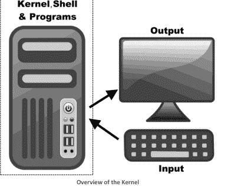

当你在键盘上输入命令时，计算机硬件接收信号并将其传输到内核。内核识别按键输入并将其绘制在显示屏上。一旦输入的命令被执行，该程序将利用内核请求处理器、内存和其他资源，以执行所需的任务。

## Unix、Linux 和 BSD 的流行版本

有许多不同的 Unix、Linux 和 BSD 发行版。下表列出了当今使用最广泛的系统。

### BSD 系统

| 操作系统 | 描述 |
| :--- | :--- |
| **Darwin** | Mac OS X 操作系统基于 BSD 的核心 |
| **FreeBSD** | 用户友好的基于 BSD 的操作系统 |
| **OpenBSD** | 注重安全的基于 BSD 的操作系统 |
| **NetBSD** | 高度可移植的基于 BSD 的操作系统 |

### Linux 系统

| 操作系统 | 描述 |
| :--- | :--- |
| **Red Hat Enterprise Linux** | 由 Red Hat, Inc. 创建的流行商用 Linux 发行版 |
| **Fedora** | 免费社区支持的发行版，作为新技术的测试平台，这些技术最终反馈到 Red Hat Enterprise Linux |
| **CentOS** | Red Hat Enterprise Linux 的免费二进制兼容克隆 |
| **Debian** | 流行的非商用 Linux 发行版 |
| **Ubuntu** | 基于 Debian 的用户友好的 Linux 发行版 |
| **SuSE Enterprise Linux** | 由 Novell, Inc. 创建的商用 Linux 发行版 |
| **openSUSE** | 基于 SUSE Enterprise Linux 的免费社区支持的发行版 |

### Unix 系统

| 操作系统 | 描述 |
| :--- | :--- |


| `AIX` | IBM 的专有 Unix 平台 |
| `HP-UX` | Hewlett Packard 的专有 Unix 平台 |
| `Solaris` | Sun Microsystems 的专有 Unix 平台 |
| `OpenSolaris` | Solaris 操作系统的开源版本 |

> **注意** *其他值得注意的 Unix 平台包括 SGI IRIX、Compaq Tru64 和 SCO UnixWare/OpenServer；然而，这些系统不再被广泛使用或提供支持。*

## Unix、Linux 和 BSD 目录结构

大多数 Unix、Linux 和 BSD 系统共享类似的目录结构。下表列出了所有平台通用的主要目录。

| 目录 | 用途 |
| --- | --- |
| `/` | 根（顶级）目录 |
| `/boot` | Linux 内核和引导加载程序文件 |
| `/stand` | Unix 内核目录 |
| `/unix` |  |
| `/vmunix` |  |
| `/kernel` |  |
| `/bin` | 普通用户的核心二进制程序 |
| `/usr` |  |
| `/usr/bin` |  |
| `/sbin` | 主要由 root 用户使用的管理程序 |
| `/usr/sbin` |  |
| `/opt` | 可选的附加/第三方软件 |
| `/etc` | 系统配置文件 |
| `/home` | 用户主目录 |
| `/root` | root 用户的主目录 |
| `/lib` | 各种程序使用的共享库 |
| `/media` | 挂载的本地和远程文件系统 |
| `/mnt` |  |
| `/var` | 经常变化的可变数据（如系统日志） |
| `/tmp` | 各种程序使用的临时文件 |
| `/dev` | 设备文件 |
| `/sys` | 内核使用的虚拟设备驱动程序文件 |
| `/proc` | 内核使用的虚拟参数和信息文件 |
| `/lost+found` | 已恢复的文件（系统故障后） |

这些目录以一种易于管理文件结构的方式组织，将操作系统的各个组件分离。`/home` 目录是用户花费大部分时间的地方。在此目录之外的文件通常受到保护，只有 root 用户才能编辑或删除它们。这保护了关键程序和配置文件，防止用户意外损坏核心操作系统。它还通过防止恶意程序能够破坏关键文件和设置来帮助保护系统安全。

## 重要文件

除了共享类似的目录结构外，大多数系统还具有下表中列出的重要文件。

| 文件 | 用途 |
| --- | --- |
| `/etc/passwd` | 用户账户设置 |
| `/etc/shadow` | 用户账户的加密密码 |
| `/etc/group` | 组设置 |
| `/etc/fstab` | 本地文件系统设置 |
| `/etc/mtab` | 已挂载的文件系统 |
| `/etc/inittab` | 系统启动设置 |
| `/etc/exports` | NFS 共享设置 |
| `/etc/hosts` | 静态名称解析文件 |
| `/etc/hostname` | 系统主机名设置 |
| `/etc/hosts.allow` | 允许连接到系统的网络主机 |
| `/etc/resolv.conf` | DNS 设置 |
| `/etc/hosts.deny` | 不允许连接到系统的网络主机 |
| `/etc/issue` | shell 登录时显示的消息 |
| `/etc/issue.net` | 远程登录消息 |
| `/etc/motd` | 登录后显示的消息 |
| `/etc/profile` | Shell 环境设置 |
| `/etc/shells` | 允许登录的有效 shell |
| `/etc/sudoers` | 允许使用 `su` 命令的用户（在第 91 页讨论） |
| `/var/log/messages` | 内核消息日志文件 |
| `/var/log/wtmp` | 当前用户登录日志文件 |
| `/var/log/lastlog` | 用户登录历史日志文件 |
| `/var/log/kern.log` | 内核日志文件 |
| `/var/log/syslog` | Syslog 消息日志文件 |


这只是大多数平台共享的最常用文件的简要列表。一般来说，配置文件位于 `/etc` 目录中，系统日志存储在 `/var/log` 中。当你熟悉 Unix、Linux 和 BSD 系统时，你将开始使用这些文件来管理系统配置和排查问题。

## 常见的 Unix、Linux 和 BSD 文件系统

Unix、Linux 和 BSD 共享对多种类型文件系统的支持。下表提供了最常见文件系统及其支持平台的矩阵。

| | `AIX` | `HP-UX` | `Solaris` | `BSD` | `Linux` |
|---|---|---|---|---|---|
| EXT2-4 | 部分支持 | 否 | 部分支持 | 部分支持 | 是 |
| JFS (IBM) | 是 | 否 | 否 | 否 | 是 |
| HFS+ | 否 | 否 | 否 | 否 | 部分支持 |
| UFS | 否 | 是 | 是 | 是 | 部分支持 |
| VxFS | 是 | 是 | 是 | 否 | 是 |
| ZFS | 否 | 否 | 是 | 是 | 是 |

**EXT** 第 2 至 4 版是 Linux 操作系统使用的文件系统。目前，ext3 是 Linux 发行版中应用最广泛的文件系统。最近发布的 ext4 文件系统比 ext3 拥有许多新特性和性能优势。在未来几年内，它将成为大多数 Linux 系统的默认文件系统。ext3 之前的版本被认为已过时，很少被使用。

**JFS** 是 IBM 的记录式文件系统，主要用于 AIX 操作系统。

**HFS+** 是 Apple 的文件系统，用于其基于 Unix 的 Mac OS X 操作系统。HFS+ 不被其他操作系统广泛支持，但可以在 Linux 系统上以只读方式挂载。

**UFS** 是一种 Unix 文件系统，主要由 BSD 发行版使用。

**VxFS** 是由 Veritas 软件公司（现为 Symantec）开发并用于 HP-UX 系统的文件系统。尽管在 HP-UX 之外很少使用，但它也受若干其他 Unix 和 Linux 系统的支持。

**ZFS** 是由 Sun Microsystems 开发的一种新型且高度健壮的文件系统。它主要用于 Solaris 操作系统，但也有限地支持某些 Linux 和 BSD 系统。

## 设备

每个 Unix、Linux 和 BSD 系统都有一个被称为 `/dev` 的目录。该目录包含代表系统上安装硬件的设备文件（有时也称为特殊文件），例如 `/dev/mouse` 和 `/dev/cdrom`。

```bash
# ls -l /dev/
crw-rw---- 1 root audio  14,  12 2010-04-22 16:30 adsp
crw------- 1 root video  10,  175 2010-04-22 11:30 aspi
...
crw-rw---- 1 root audio  14,  4 2010-04-22 16:30 audio
crw-rw---- 1 root root   10,  59 2010-04-22 11:30 binder
drwxr-xr-x 2 root root  700 2010-04-22 16:30 block
drwxr-xr-x 3 root root  60 2010-04-22 11:30 bus
lrwxrwxrwx 1 root root   3 2010-04-22 16:30 cdrom -> sr0
lrwxrwxrwx 1 root root   3 2010-04-22 16:30 cdrom -> sr0
drwxr-xr-x 2 root root 3220 2010-04-22 16:30 char
crw------- 1 root root   5,   1 2010-04-22 07:36 console
lrwxrwxrwx 1 root root  11 2010-04-22 16:30 core -> /proc/kcore
crw-rw--- 1 root root   10,  58 2010-04-22 11:30 cpu_dma_latency
drwxr-xr-x 6 root root  120 2010-04-22 11:30 disk
drwxr-xr-x 2 root root   80 2010-04-22 11:30 dri
crw-rw---- 1 root audio  14,   3 2010-04-22 16:30 dsp
lrwxrwxrwx 1 root root   3 2010-04-22 16:30 dvd -> sr0
...
```

`/dev` 目录中设备列表的示例


在`/dev`目录中可能有几百个文件。其中大多数文件在日常活动中没什么用处。作为 Unix 或 Linux 系统的系统管理员，你主要将与代表磁盘驱动器的设备文件打交道。在处理与文件系统相关的命令时，知道硬盘驱动器的路径很重要。本指南第 10 节将更详细地介绍此主题。

> **注意**
>
> `/dev`中使用的*设备命名约定*因各发行版而异。

在`/dev`中还有一些有用的伪设备。伪设备不代表实际的硬件，仅存在于执行特定任务。下表描述了最常用的伪设备。

| 文件 | 用途 |
| :--- | :--- |
| `/dev/zero` | 产生连续 0 字节字符流的文件 |
| `/dev/random` | 随机数生成器 |
| `/dev/null` | 丢弃写入其任何数据的特殊文件 |

## Shell（外壳）

命令行解释器，也称为 shell（外壳），是一个接受用户输入（通常是某种命令）并执行所请求任务的程序。一旦任务完成，该程序将终止并将用户返回到 shell。

Shell 的提示符标识了正在使用的 shell 类型。有两种基本的 shell 提示符类型：
- 普通用户 shell（在某些系统中也可能是 % 或 >）
- 根用户 shell

以下是 `whoami` 命令的输出（第 94 页有讨论），它强调了命令行上普通用户 shell 提示符和根用户 shell 提示符之间的区别。


普通用户通常对系统的访问权限有限，而根用户拥有不受限制的可访问权限。第 5 节将更详细地介绍此主题。

> **警告**
>
> 在 Unix、Linux 和 BSD 系统上，根用户可以*做任何事情*。知道*你正在以* root 身份工作*很重要，以防止对系统造成意外损坏。

许多系统向 shell 提示符添加自定义信息。这些信息可以是当前用户登录名、系统主机名和当前目录等事物的有用指示符，如下一个示例所示。


下表描述了在之前示例中显示的自定义 shell 提示符中显示的信息。

| nick | @ | mylaptop | : | /var/log | $ |
| :---: | :---: | :---: | :---: | :---: | :---: |
| 用户名 | 间隔符 | 计算机名 | 间隔符 | 当前目录 | Shell 提示符 |

## Shell 的类型

Unix、Linux 和 BSD 系统有几种不同类型的 shell。每个 shell 都有自己的一套特性和使用语法。下表描述了当前可用的最流行的 shell。

| Shell | 提示符 | 名称 | 备注 |
|---|---|---|---|
| sh | $ | Bourne Shell | 某些 Unix 系统的默认 shell |
| bash | $ | Bourne | Bourne shell 的增强替代版本 |
| zsh | $ | ZSH | Z Shell | 大多数 Linux 和 Mac OS X 系统的默认 shell |
| csh | % | C Shell | 许多 BSD 系统的默认 shell |
| tcsh | > | T C Shell | C shell 的增强替代版本 |
| ksh | $ | Korn shell | AIX 系统的默认 shell |

`bash` shell 是当今最流行的 shell。它是所有 Linux 系统的默认 shell，也可以在大多数 Unix 和 BSD 系统上使用。像 `csh`、`tcsh` 和 `ksh` 等其他 shell 通常被默认用于非 Linux 系统。

## 访问 Shell

当你第一次启动系统时，你会看到一个类似于下面示例图片的登录提示符。

```text
Ubuntu Linux 9.04 
Login: nick 
Password: ****** 
$ 
```

输入你的用户名和密码后，系统将通过 `/etc/passwd` 文件验证你的登录凭据。如果登录信息正确，系统将启动你的 shell（这也是在 `/etc/passwd` 中指定的）。`$` shell 提示符表示你已登录并且“准备就绪”。

*欢迎来到命令行世界……让我们开始吧！*

### 第 2 节：命令行基础

**概述**

本节涵盖每个用户都应知道的最基本命令。这些基本命令涵盖了诸如获取帮助、导航目录和列出文件等主题。在开始之前，你需要了解关于命令行的三条重要规则：
- 1. Unix、Linux 和 BSD 系统对大小写（和空格）敏感。这意味着名为 MyFile 的文件与 myFile 并不相同，这与 DOS 或 Windows 系统上的情况不同。
- 2. 在命令行环境中工作时没有“回收站”或“垃圾箱”。在命令行上删除的文件会立即永久消失。
- 3. 你应该始终在测试系统上练习新命令，而不是在生产环境中使用的系统上。这可以最小化可能导致重要系统故障的事故几率。

了解这些之后，我们现在可以开始使用基本的 Unix、Linux 和 BSD 命令。

> 本书中列出的示例是在各种 Unix、Linux 和 BSD 系统上创建的。许多命令、选项和特性在其他平台上是相同的；然而，可能会存在一些细微差异。你应始终查阅你特定平台的手册以确保与提供的示例兼容。有关如何访问在线手册的更多信息，请参见第 20 页。

#### 本节涵盖的命令：

| 命令 | 用途 |
| :--- | :--- |
| `man` | 命令行程序的在线手册。 |
| `whatis` | 显示指定命令的描述。 |
| `ls` | 列出目录的内容。 |
| `pwd` | 显示当前/工作目录。 |
| `cd` | 更改（导航）目录。 |
| `tree` | 以树形层级格式显示目录的内容。 |
| `find` | 搜索文件和目录。 |
| `locate` | 在 locate 数据库中搜索文件和目录。 |
| `whereis` | 显示指定命令的二进制文件、手册页和源代码的位置。 |
| `file` | 显示指定文件的文件类型。 |
| `stat` | 显示有关文件系统、文件或目录的扩展信息。 |
| `date` | 显示或设置系统时钟。 |
| `cal` | 在命令行上显示日历。 |
| `history` | 显示最近执行过的命令。 |
| `clear` | 清除当前屏幕的内容。 |
| `logout` | 注销系统。 |
| `exit` | 退出当前 shell。 |

### 本部分使用的术语表：

- **参数 (Argument)**：由命令行程序使用的一个或多个可变输入项。
- **二进制文件 (Binary)**：编译后的程序或数据文件。
- **标志 (Flag)**：*选项 (Option)* 的同义词。
- **手册页 (Man Page)**：shell 命令的在线手册。
- **选项 (Option)**：一种修饰符，用于改变命令的默认操作。
- **参数 (Parameter)**：*参数 (Argument)* 的同义词。
- **递归地 (Recursively)**：在执行命令时包含所有子目录。
- **Shell 脚本 (Shell Script)**：在纯文本可执行文件中组合的一组命令。
- **源代码 (Source Code)**：程序的未编译代码。
- **开关 (Switch)**：*选项 (Option)* 的同义词。
- **工作目录 (Working Directory)**：你在目录树中的当前位置。

### man

**用途**：命令行程序的在线手册。

**用法语法**：`man [OPTIONS] [COMMAND/FILE]`

```
$ man ls
LS(1)                          User Commands                          LS(1)

NAME
   ls - list directory contents

SYNOPSIS
   ls [OPTION]... [FILE]...

DESCRIPTION
   List information about the FILEs (the current directory by
   default).  Sort entries alphabetically if none of -cftuvSUX nor
   --sort.

   -a, --all
          do not ignore entries starting with .
   ...

Viewing the manual page for the ls command
```


`man` 命令显示指定命令的手册（通常称为 *man 页面*）。每个手册页提供了关于命令选项和用法的详细信息。在上面的示例中，执行 `man ls` 会显示 `ls` 命令的手册。

下表描述了可用于导航手册程序的按键。

| 按键 | 功能 | 按键 | 功能 |
| :--- | :--- | :--- | :--- |
| **上箭头** | 向上导航一行 | **下箭头** | 向下导航一行 |
| **Page Up** | 向上导航一页 | **Page Down** | 向下导航一页 |
| **Q** | 退出 `man` 程序 | **/[字符串]** | 搜索一段文本 |

`man` 命令是你获取命令行帮助的最宝贵资源。如果你不确定某个命令的正确用法语法，请始终查阅手册页。

**常见用法示例：**

| | |
| :--- | :--- |
| `man [COMMAND]` | 显示指定命令的手册 |
| `man -k [KEYWORD]` | 搜索包含指定关键字的手册页 |

### whatis

**用途**：显示指定命令的描述。

**用法语法**：`whatis [OPTIONS] [COMMAND]`


`whatis` 显示指定命令的简要描述。上述示例使用 `whatis` 显示了 `ls` 命令的描述。这可以用作提醒命令用途的辅助工具，而无需查阅 `man` 命令。

可以在一个 `whatis` 查询中使用多个命令，以显示每个单独命令的描述。例如，输入 `whatis ls who rm` 将一次性显示所有三个命令的描述，如下一个示例所示。


> 某些 Unix 系统可能使用 `apropos` 命令代替 `whatis`。

**常见用法示例：**

| | |
| :--- | :--- |
| `whatis [COMMAND]` | 显示指定命令的描述 |
| `whatis -w [WILDCARD]` | 使用通配符搜索命令 |

### ls

**用途：** 列出目录的内容。

**用法语法：** `ls [OPTIONS] [DIRECTORY/FILE]`

```
$ ls
Notes.txt  ShoppingList.txt  ToDoList.txt
```

*ls 命令的典型输出*

执行 `ls` 命令会显示当前目录中文件的简单列表，如上面的示例所示。要查看目录中文件的更多信息，你可以使用命令行选项来激活附加功能，如下一个示例所示。

```
$ ls -l
-rw-r--r--  1 nick sales 35068 2009-05-19 08:41 Notes.txt
-rw-r--r--  1 nick sales    23 2009-05-19 08:43 ShoppingList.txt
-rw-r--r--  1 nick sales    37 2009-05-19 08:43 ToDoList.txt
```

*在 ls 命令中使用 -l 选项*

在这个示例中，使用 `-l` 选项生成详细的文件列表，包括权限、所有者、组和修改日期/时间。下表描述了 `ls -l` 命令的输出。

| 权限 | 链接数 | 所有者 & 组 | 大小 | 修改日期 | 文件或目录 |
|---|---|---|---|---|---|
| -rw-r--r-- | 1 | nick sales | 35068 | 2009-05-19 08:41 | Notes.txt |

*使用 ls -l 命令显示的字段描述*

大多数命令行程序都有许多可用的选项。`ls` 命令也不例外。通过组合这些选项，你可以同时激活多个功能。例如，将 `-a` 选项与 `-l` 结合使用，会产生包含隐藏文件（以点开头的文件）的详细文件列表。

```
$ ls -l -a
drwxr-xr-x  2 nick sales  4096 2009-05-19 21:14 .
drwxr-xr-x 92 nick sales  4096 2009-05-19 20:46 ..
-rw-r--r--  1 nick sales   168 2009-05-19 21:14 .MyHiddenFile
-rw-r--r--  1 nick sales 35068 2009-05-19 08:41 Notes.txt
-rw-r--r--  1 nick sales    23 2009-05-19 08:43 ShoppingList.txt
-rw-r--r--  1 nick sales    37 2009-05-19 08:43 ToDoList.txt
```

*在 ls 命令中使用多个选项*

**提示**：大多数命令行选项可以使用简写形式组合。例如，`ls -l -a` 可以缩短为 `ls -la`。

**注意**：命令行选项不是通用的。每个命令都有其特定于该程序的选项集。此外，在不同平台上同一命令的每个实现可能使用不同的选项。请参阅 `man` 页面以获取系统支持的完整命令行选项列表。

#### 常见用法示例：

| | |
| :--- | :--- |
| `ls` | 显示当前目录中文件的基本列表 |
| `ls [DIRECTORY]` | 显示指定目录中文件的基本列表 |
| `ls -l` | 列出带有详细信息的文件 |
| `ls -la` | 列出隐藏文件 |
| `ls -lh` | 以“人类可读格式”（KB、MB 等）列出文件大小 |
| `ls -R` | 递归列出所有子目录 |
| `ls -d [DIRECTORY]` | 仅列出指定目录（不列出其内容） |

### pwd

**用途：** 显示当前/工作目录。

**用法语法：** `pwd`

```bash
$ pwd
/home/nick
```

> 使用 `pwd` 命令显示当前目录

`pwd` 命令（**Print Working Directory** 的缩写）显示你在文件系统中的当前位置。在上面的示例中，执行 `pwd` 显示 `/home/nick` 为当前工作目录。

| 注意 |
| :--- |
| Unix、Linux 和 BSD 系统使用正斜杠（即 `/home/nick`）来分隔目录名称，而 MS-DOS 和 Windows 系统使用反斜杠（即 `C:\Windows\system32`）。 |

**常见用法示例：**

| | |
| :--- | :--- |
| `pwd` | 显示当前工作目录。 |

### cd

**用途：** 更改（导航）目录。

**用法语法：** `cd [DIRECTORY]`

```
$ cd /etc
$ pwd
/etc
```

使用 `cd` 命令导航到 `/etc` 目录

`cd` 命令（Change Directories 的缩写）将你在文件系统中的位置更改为指定路径。在上面的示例中，执行 `cd /etc` 使 `/etc` 成为新的工作目录。

除非你手动指定完整路径（如第一个示例中使用的 `cd /etc`），否则 `cd` 命令会根据你当前的位置解释目录路径。下一个示例演示了如何使用 `cd` 相对于当前位置更改目录。

```
$ pwd
/home/nick
$ cd documents
$ pwd
/home/nick/documents
```

使用 `cd` 命令导航到相对于当前位置的目录

在这个示例中，起始目录是 `/home/nick`。输入 `cd documents` 会使 `/home/nick/documents` 成为新的工作目录。如果你从其他位置开始，你必须输入完整路径（即 `cd /home/nick/documents`）才能达到相同的结果。由于之前的位置是 `/home/nick`，因此无需输入完整路径。

> 执行不带选项的 `cd` 命令，无论当前位置如何，都会将你返回到你的 home 目录。

#### 常见用法示例：

| | |
| :--- | :--- |
| `cd [DIRECTORY]` | 导航到指定目录 |
| `cd` | 导航到用户的主目录 |
| `cd -` | 返回上一个工作目录 |
| `cd ..` | 在目录树中向上导航一级 |

### tree

**用途：** 以树状层级格式显示目录内容。

**语法：** `tree [OPTIONS] [DIRECTORY]`


```bash
$ cd /
$ tree -d -L 2
.
|-- bin
|-- boot
|   `-- grub
|   |-- cdrom -> media/cdrom
|-- dev
|   |-- block
|   |-- bus
|   |-- char
|   `-- disk
|   |-- fd -> /proc/self/fd
|   `-- input
|..
... 
|`-- etc
|   |-- ConsoleKit
|   |-- NetworkManager
|   |-- PolicyKit
|   `-- X11
|   |-- acpi
|   `-- alsa
|   `-- alternatives
...
```

目录结构的树状列表

`tree`命令以树状形式显示目录列表。这对于可视化目录结构的布局非常有用。在上例中，执行 `tree -d -L 2` 会以树状形式显示2级目录（相对于当前所在位置）。

常见用法示例：

| 命令 | 描述 |
| :--- | :--- |
| `tree` | 以树状形式显示当前目录的内容 |
| `tree [DIR]` | 以树状形式显示指定目录的内容 |
| `tree -a` | 在树状列表中包含隐藏文件 |
| `tree -d` | 仅列出目录 |
| `tree -L [NUM]` | 列出指定层级的深度 |

### find

**用途：** 搜索文件和目录。

**语法：** `find [PATH] [OPTIONS] [CRITERIA]`

```bash
# find / -name hosts
/etc/avahi/hosts
/etc/hosts
/usr/share/hosts
```

使用 `find` 命令定位文件名中包含 "`hosts`" 的文件

`find` 命令在文件系统中执行原始搜索，以定位指定项。您可以使用多种特征来搜索文件——最常见的是文件名、所有者、大小或修改时间。上述示例显示了搜索文件名中包含 "`hosts`" 的文件的搜索结果。

下一个示例显示了搜索 `/var` 目录内由指定用户拥有的文件的搜索结果。

```bash
# find /var -user nick
/var/mail/nick
```

在 `/var` 目录内定位由特定用户拥有的文件

> **注意：** 由于 `find` 命令在文件系统中执行原始搜索，结果有时会较慢。建议将搜索范围缩小到特定位置，而不是整个文件系统。这样能产生更快的搜索结果，并避免在搜索期间拖慢系统速度。

常见用法示例：

| 命令 | 描述 |
| --- | --- |
| `find [PATH] -name [NAME]` | 查找具有指定名称的文件 |
| `find [PATH] -user [USERNAME]` | 查找由指定用户拥有的文件 |
| `find [PATH] -size [FILESIZE]` | 查找大于指定大小的文件 |
| `find [PATH] -mtime 0` | 查找在过去24小时内被修改的文件 |

### locate

**用途：** 在 `locate` 数据库中搜索文件和目录。

**语法：** `locate [OPTIONS] [DIRECTORY/FILE]`

```bash
$ locate hosts
/etc/avahi/hosts
/etc/hosts
/usr/share/hosts
```

在 `locate` 数据库中搜索文件名中包含 "`hosts`" 的文件

`locate` 命令显示与指定名称匹配的文件位置。虽然与 `find` 命令类似，但 `locate` 速度快得多，因为它搜索的是索引文件名数据库，而不是对整个文件系统执行原始搜索。`locate` 命令的一个缺点是它缺乏搜索高级特征的能力，例如文件所有者、大小和修改时间。

大多数 Linux 和 BSD 系统都实现了 `locate`，以便提供一种快速方法，通过名称定位文件而不影响系统性能。

> **注意：** `locate` 数据库通过自动调度的 `cron` 任务（在第121页讨论）每天更新一次，该任务会索引所有本地文件系统。默认情况下，这通常每天发生一次。这意味着结果不会实时更新，新创建或删除的文件可能在下一次计划更新时才会反映在结果中。

常见用法示例：

| 命令 | 描述 |
| :--- | :--- |
| `locate [FILE]` | 定位指定文件 |
| `locate -i [FILE]` | 搜索时忽略大小写 |

### whereis

**用途：** 显示指定命令的二进制文件、手册页和源代码的位置。

**语法：** `whereis [OPTIONS] [COMMAND/FILE]`

```bash
$ whereis ls
ls: /bin/ls /usr/share/man/man1/ls.1.gz
```

使用 `whereis` 显示 `ls` 程序的文件位置

`whereis` 显示指定命令的文件位置。在上例中，`whereis` 显示 `ls` 命令的二进制文件和手册页位置。

如果源代码可用，`whereis` 还将显示指定命令的源文件位置。大多数系统默认不安装源代码。

`which` 命令与 `whereis` 类似，但它仅显示二进制命令的结果。当您只想查看指定命令的二进制文件路径时，这非常有用。例如，输入 `which ls` 将显示 `ls` 命令的二进制文件位置。有关更多信息，请参阅 `man which`。

常见用法示例：

| 命令 | 描述 |
| :--- | :--- |
| `whereis [COMMAND]` | 显示指定命令的位置 |
| `whereis -b [COMMAND]` | 仅显示二进制程序 |
| `whereis -m [COMMAND]` | 仅显示手册页 |
| `whereis -s [COMMAND]` | 仅显示源代码（如果可用） |

### file

**用途：** 显示指定文件的类型。

**语法：** `file [OPTIONS] [FILE]`

```bash
$ file /bin/bash
/bin/bash: ELF 64-bit LSB executable, x86-64, version 1 (SYSV),
dynamically linked (uses shared libs), for GNU/Linux 2.6.15, stripped
$ file /etc/hosts
/etc/hosts: ASCII English text
$ file /home/nick/backup.tgz
backup.tgz: gzip compressed data, from Unix, last modified: Tue May 19 22:29:29 2009
$ file /dev/cdrom
/dev/cdrom: symbolic link to `sr0`
$ file /dev/sr0
/dev/sr0: block special
```

使用 `file` 命令识别几种不同类型的文件

`file` 命令显示关于指定文件内容的信息。Microsoft Windows 系统通常使用文件扩展名（如 `.txt`、`.exe`、`.zip` 等）来识别文件中包含的数据类型。Unix、Linux 和 BSD 文件很少包含扩展名，这使得识别其文件类型变得具有挑战性。`file` 命令就是为了解决这个问题而提供的。

上述示例显示了在 Unix、Linux 和 BSD 系统上常见的几种文件类型的结果。下表提供了关于这些文件类型的更多信息。

| 类型 | 描述 |
| :--- | :--- |
| Ascii 文本文件 | 纯文本文件 |
| 二进制文件 | 可执行程序，例如位于 `/bin` 和 `/usr/bin` 目录中的程序 |
| 压缩文件 | 通过 `compress` 或 `gzip` 程序压缩的文件 |
| 设备文件 | 表示设备的特殊虚拟文件 |
| 链接 | 指向其他文件或目录的链接（即快捷方式） |

> **注意：** 在 Unix、Linux 和 BSD 系统上发现的基本文件类型

常见用法示例：

| 命令 | 描述 |
| :--- | :--- |
| `file [FILE]` | 显示指定文件的文件类型 |

### stat

**用途：** 显示关于文件系统、文件或目录的扩展信息。

**语法：** `stat [OPTIONS] [FILE/DIRECTORY]`


```bash
$ stat /etc/hosts
 File: `/etc/hosts'     Blocks: 8           IO Block: 4096 regular file
 Size: 2667            Blocks: 8           IO Block: 4096 regular file
 Device: 805h/2053d    Inode: 788         Links: 1
 Access: (0644/-rw-r--r--)  Uid: (    0/    root)   Gid: (    0/    root)
 Access: 2009-05-25 20:47:14.916626707 -0500
 Modify: 2009-05-25 20:46:57.516293325 -0500
 Change: 2009-05-25 20:46:57.516293325 -0500
```

使用 `stat` 命令显示 `/etc/hosts` 文件的信息

`stat` 命令显示关于文件的扩展信息。它包含使用 `ls` 命令时无法获取的有用信息，例如文件的最后访问时间以及关于文件在文件系统中位置的技术信息。上述示例显示了 `/etc/hosts` 文件的 `stat` 输出。下一个示例显示了 `/etc` 目录本身的 `stat` 输出。

```bash
$ stat /etc
 File: `/etc'
 Size: 4096            Blocks: 8           IO Block: 4096 directory
 Device: 801h/2049d    Inode: 316993      Links: 75
 Access: (0755/drwxr-xr-x)  Uid: (    0/    root)   Gid: (    0/    root)
 Access: 2010-04-01 12:17:44.000000000 -0500
 Modify: 2010-03-28 12:47:21.000000000 -0500
 Change: 2010-03-28 12:47:21.000000000 -0500
```

显示目录的 `stat` 输出

`-f` 选项可用于 `stat` 以显示整个文件系统的相关信息，如下一个示例所示。

```bash
$ stat -f /
 File: "/"
 Id: e70b9c097a45b919   Namelen: 255     Type: ext2/ext3
 Block size: 4096       Fundamental block size: 4096
 Blocks: Total: 9965379  Free: 9723316    Available: 9221085
 Inodes: Total: 2514944  Free: 2476388
```

使用 `-f` 选项与 `stat` 显示关于文件系统的信息

常见用法示例：

| 命令 | 描述 |
| :--- | :--- |
| `stat [FILE/DIR]` | 显示指定文件/目录的信息 |
| `stat -f [FILESYSTEM]` | 显示指定文件系统的相关信息 |

### date

**用途：** 显示或设置系统时钟。

**用法语法：** `date [OPTIONS] [TIME/DATE]`

```bash
$ date
Wed Jun 10 20:33:27 CDT 2009
```


`date` 命令显示本地系统的当前时间和日期，如上图示例所示。

> **注意**：Unix、Linux 和 BSD 系统以 24 小时制追踪时间。

可以使用 `-s` 选项来设置系统的时间/日期，如下一示例所示。

```bash
$ date -s "07/10/2009 11:30"
Fri Jul 10 11:30:00 CDT 2009
```


当同时设置时间和日期时，必须使用 `"MM/DD/YYYY HH:MM"` 格式。若仅设置时间，只需使用 `date -s HH:MM`。

> **注意**：必须登录为 `root` 或使用 `sudo` 命令（见第 91 页讨论内容）才能设置系统时钟。

**常用用法示例：**

| 命令 | 描述 |
| :--- | :--- |
| `date` | 显示时间和日期 |
| `date -s [HH:MM]` | 设置时间 |
| `date -s ["MM/DD/YYYY HH:MM"]` | 设置时间和日期 |

### cal

**用途：** 在命令行上显示日历。

**用法语法：** `cal [OPTIONS] [MONTH] [YEAR]`

```bash
$ cal
      May 2009
Su Mo Tu We Th Fr Sa
                  1
 2          3          4          5          6          7          8
 9         10         11         12         13         14         15
16         17         18         19         20         21         22
23         24         25         26         27         28         29
30
31
```


`cal` 命令在命令行上显示一个简单的日历。不带参数执行 `cal` 将显示当前月份的日历，如上图示例所示。添加月份和年份作为参数将显示指定月份和年份的日历，如下一示例所示。

```bash
$ cal 8 2009
      August 2009
Su Mo Tu We Th Fr Sa
                  1
 2          3          4          5          6          7          8
 9         10         11         12         13         14
15
16         17         18         19         20         21
22
23         24         25         26         27         28         29
30
```


**常用用法示例：**

| 命令 | 描述 |
| :--- | :--- |
| `cal` | 显示当前月份的日历 |
| `cal -m` | 显示周一为一周的第一天 |
| `cal [MONTH] [YEAR]` | 显示指定月份和年份的日历 |
| `cal [YEAR]` | 显示指定年份的日历 |
| `cal -y` | 显示当前年份的日历 |

### history

**用途：** 显示最近执行的命令。

**用法语法：** `history [OPTIONS]`

```bash
$ history 10
 686  man uptime
 687  cat /etc/hosts
 688  ls -l
 689  uptime
 690  dmesg
 691  iostat
 692  vmstat
 693  ping google.com
 694  tracepath google.com
 695  history 10
```


`history` 命令显示用户的命令行历史记录。不带参数执行 `history` 命令将显示当前用户的完整命令行历史记录。若需较短的列表，可以指定一个数字作为参数。例如，输入 `history 10` 将显示当前用户最近执行的 10 条命令，如上图示例所示。

> **提示**：您可以使用 `! [NUM]` 来执行之前的命令，其中 `NUM` 是您在历史记录中想要调用的行号。例如，执行 `!687` 将重新运行上例中第 687 行列出的命令。

在 Linux 中，每个用户的主目录中都有一个名为 `.bash_history` 的文件，其中包含其命令行历史记录。Unix 系统通常将历史记录存储在名为 `.sh_history` 或 `.history` 的文件中。


> **注意**：历史文件可能包含有关您最近执行的命令的敏感信息。大多数系统会在一定时间后自动覆盖命令行历史记录。要在主目录中手动清除历史文件，请在命令行输入 `>$HOME/. *history`。

**常用用法示例：**

| 命令 | 描述 |
| :--- | :--- |
| `history` | 显示完整的命令行历史记录 |
| `history [NUM]` | 显示指定数量的历史记录项 |
| `history \| grep [PATTERN]` | 在历史记录中搜索指定模式 |

### clear

**用途：** 清除当前屏幕的内容。

**用法语法：** `clear`

```bash
$ ls -la
drwxr-xr-x  2 nick nick  4096 2009-05-19 21:14 .
drwxr-xr-x 92 nick nick  4096 2009-05-19 20:46 ..
-rw-r--r--  1 nick nick  35068 2009-05-19 08:41 Notes.txt
-rw-r--r--  1 nick nick   168 2009-05-19 21:14 .MyHiddenFile
-rw-r--r--  1 nick nick    23 2009-05-19 08:43 ShoppingList.txt
-rw-r--r--  1 nick nick    37 2009-05-19 08:43 ToDoList.txt
$ clear
```


```bash
$
```


`clear` 命令清除终端屏幕的内容。在您执行了多个命令并准备进行下一项任务时，这有助于整理显示内容。上述示例展示了 `clear` 命令执行前后的效果。虽然清除屏幕后的每个命令并非必要，但这确实使屏幕上的信息更易读。

> CTRL + L 是在 Bash shell 中清除屏幕的键盘快捷键。有关 Bash 快捷键的更多信息，请参阅附录 A。

**常用用法示例：**

| 命令 | 描述 |
| :--- | :--- |
| `clear` | 清除屏幕内容 |

### logout

**用途：** 注销系统。

**用法语法：** `logout`

```bash
$ logout
Ubuntu 9.04
login:
```

*logout 命令的结果*

`logout` 命令将您的帐户从系统中注销。这将结束您的终端会话并返回到登录屏幕。

某些系统可能在每个用户的主目录中包含一个名为 `.logout` 或 `.bash_logout` 的文件。该文件包含在注销过程中运行的命令。它用于在执行结束用户会话之前执行清理操作并清除屏幕。

> `logout` 命令是退出 shell 的推荐方式。出于安全目的，拥有管理员权限的用户在离开办公桌时应始终注销所有打开的终端会话。

**常用用法示例：**

| 命令 | 描述 |
| :--- | :--- |
| `logout` | 注销系统 |

### exit

**用途：** 退出当前 shell。

**用法语法：** `exit [CODE]`

```bash
$ exit
login:
```

*exit 命令的输出示例*

`exit` 命令与 `logout` 命令相似，区别在于它不会运行位于用户主目录中的注销脚本。上述示例显示了退出 shell 并返回到登录提示符的结果。

Shell 脚本通常使用 `exit` 命令来正确终止，而用户使用 `logout` 命令来正确注销系统。这一规则的例外情况是当从本地系统的图形化环境中打开终端应用程序时。在此情况下无法使用 `logout` 命令，因为终端会话作为图形化环境下的子 shell 启动。大多数系统在这种情况下会显示错误，如下一示例所示。

```bash
$ logout
bash: logout: not login shell; use "exit"
```

*Logout 错误消息*

> **提示**：CTRL + D 是退出 shell 的键盘快捷键。有关快捷键的更多信息，请参阅附录 A。

**常用用法示例：**

| 命令 | 描述 |
| :--- | :--- |
| `exit` | 退出当前 shell |
| `exit [CODE]` | 退出 shell 并报告退出代码（在 shell 脚本中很有用） |

### 第 3 节：高级 Shell 功能和命令

#### 概述

本章讨论 Unix、Linux 和 BSD 系统的高级命令。高级命令可用于执行如复制、移动、重命名和删除文件等任务。本章还将涵盖高级 shell 功能，如自动补全、通配符、管道和重定向。

**本节涵盖的命令：**

| 命令 | 用途 |
| :--- | :--- |
| `mv` | 移动或重命名文件和目录。 |
| `cp` | 复制文件和目录。 |
| `rm` | 删除文件。 |
| `mkdir` | 创建/删除目录。 |
| `rmdir` | 创建/删除目录。 |
| `touch` | 更新文件的时间戳。 |
| `lsof` | 列出打开的文件。 |
| `fuser` | 显示有关打开文件的信息。 |
| `cksum` | 显示文件的校验和。 |
| `md5sum` | 显示文件的 MD5 哈希值。 |
| `ln` | 创建指向文件或目录的链接（快捷方式）。 |
| `alias` | 创建命令行别名。 |
| `gzip` | 压缩/解压缩文件。 |
| `gunzip` | 压缩/解压缩文件。 |
| `split` | 将大文件分割为多个部分。 |
| `shred` | 安全擦除文件。 |
| `watch` | 定期执行指定命令。 |
| `env` | 显示环境变量。 |

### 本节术语表：

| 术语 | 定义 |
| :--- | :--- |
| **别名** | 命令的快捷方式。 |
| **追加** | 将数据添加到文件末尾，而不是覆盖其内容。 |
| **校验和** | 一种数据完整性验证算法。 |
| **压缩** | 用于减小文件大小的过程。 |
| **交互式** | 在执行任务前显示确认提示。 |
| **链接** | 指向文件或目录的快捷方式。 |
| **MD5 校验和** | 一种增强的数据完整性验证算法。 |
| **父目录** | 包含当前目录的更高一级目录。 |
| **管道** | 一种命令行机制，用于将一个命令的输出连接到另一个命令的输入。 |
| **重定向** | 用于重定向命令输入或输出的命令行机制。 |
| **变量** | 存储在内存中可调整的程序/环境设置。 |
| **详细** | 命令的扩展输出。 |
| **通配符** | 用于匹配文本模式的符号。 |

### 自动补全

大多数 shell 都支持命令行补全。命令行补全用于让 shell 自动补全命令或文件路径。在大多数系统中，使用 `Tab` 键可以激活命令行补全，如下例所示。

```
$ whe<TAB>
$ whereis
```

使用命令行补全

在上述示例中，输入 `whe` 并按下 `Tab` 键会自动补全命令 `whereis`，而无需输入整个命令。

自动补全也适用于文件路径。输入 `ls -1 /etc/en` 并按下 `Tab` 键会自动补全为文件 `/etc/environment`，如下例所示。

```
$ ls -1 /etc/en<TAB>
$ ls -1 /etc/environment
```

使用文件名补全

当找到多个匹配项时，shell 会显示所有匹配结果。在下一个示例中，输入 `ls -1 /etc/host` 并按下 `Tab` 会显示 `/etc` 目录中所有匹配的文件。

```
$ ls -1 /etc/host<TAB>
host.conf   hostname    hosts      hosts.allow   hosts.deny
```

使用文件名补全显示多个匹配项

**提示** 除了命令行补全外，一些 shell 还提供了一种功能，允许使用键盘上的 **向上箭头** 键调取之前执行过的命令。

### 通配符

通配符用于将一个字符与一个或多个文本元素进行模式匹配。它们在命令行上执行批量任务（如列出或删除一组文件）时非常有用。下表列出了命令行中可以使用的不同类型的通配符。

| 通配符 | 功能 |
|---|---|
| `*` | 匹配 0 个或多个字符 |
| `?` | 匹配 1 个字符 |
| `[abc]` | 匹配列出的字符之一 |
| `[a-c]` | 匹配范围内任一字符 |
| `[^abc]` | 匹配未列出的任何字符 |
| `[^a-c]` | 匹配未列出的范围内任何字符 |
| `{tacos,nachos}` | 匹配列表中的一个单词 |


星号（`*`）是最简单且最有用的通配符。下面的示例演示了使用星号通配符来显示所有匹配文件名的文件。

```
$ ls -1 /etc/host* 
-rw-r--r-- 1 root root 92 2008-12-23 12:53 /etc/host.conf
-rw-r--r-- 1 root root 6 2009-04-23 15:50 /etc/hostname
-rw-r--r-- 1 root root 251 2009-05-22 14:55 /etc/hosts
-rw-r--r-- 1 root root 579 2009-04-20 09:14 /etc/hosts.allow
-rw-r--r-- 1 root root 878 2009-04-20 09:14 /etc/hosts.deny
```

输入 `ls -1 /etc/host*` 会列出 `/etc` 目录中所有以单词 `host` 开头的文件。其他通配符的示例如下所示。

```
$ ls -1 /etc/hosts.{allow,deny}
-rw-r--r-- 1 root root 579 2009-04-20 09:14 /etc/hosts.allow
-rw-r--r-- 1 root root 878 2009-04-20 09:14 /etc/hosts.deny
$ ls -1 /etc/hosts.[a]*
-rw-r--r-- 1 root root 878 2009-04-20 09:14 /etc/hosts.deny
$ ls -1 /etc/host?
-rw-r--r-- 1 root root 251 2009-05-22 14:55 /etc/hosts
```

在此示例中，第一个命令使用 `{allow,deny}` 显示所有以单词 `allow` 或 `deny` 结尾的匹配项。第二个命令使用 `[a]*` 显示以字母 `a` 开头（在点号之后）的匹配项。第三个示例使用 `?` 通配符来匹配单个字符。

### 管道

管道（也称为管线）可用于将一个命令的输出定向到另一个命令的输入。使用键盘上的 `|` 键（通常位于反斜杠键上方）来执行管道。

```
$ ls -l /etc | more
total 968
-rw-r--r- 1 root root    2975 2008-08-18 13:30 adduser.conf
-rw-r--r- 1 root root      44 2010-04-06 16:59 adtime
-rw-r--r 1 root root       53 2008-08-18 13:49 aliases
-rw-r--r- 1 root root   12288 2009-08-28 13:39 aliases.db
drwxr-x-x 2 root root     4096 2010-04-05 10:59 alternatives
drwxr-x-x 7 root root     4096 2010-04-05 10:59 apache2
drwxr-x-x 3 root root     4096 2010-08-18 13:48 apm
drwxr-x-x 2 root root     4096 2009-08-28 13:39 apparmor
drwxr-x-x 6 root root     4096 2008-08-18 13:47 apparmor.d
drwxr-x-x 4 root root     4096 2010-01-25 13:44 apt
-rw-r---- 1 root daemon     144 2009-02-20 07:41 at.deny
-rw-r--r- 1 root root     1733 2008-05-12 13:33 bash.bashrc
-rw-r--r- 1 root root   216529 2008-04-14 20:45 bash_completion
drwxr-x-x 2 root root     4096 2010-04-05 10:59 bash_completion.d
:
```

在命令行上使用管道

如果在 `/etc` 目录上使用 `ls -l`，通常目录内容会快速滚动在屏幕上。将 `ls -l` 的输出通过管道传递给 `more` 命令（在第 71 页讨论）会逐页显示 `/etc` 目录的内容。

与管道常用的另一个命令是 `grep`（在第 76 页讨论）。`grep` 实用程序可用于过滤命令或文件的输出并显示匹配结果。下一个示例演示了将 `ls` 命令的输出通过管道传递给 `grep` 以过滤结果并显示包含单词 `hosts` 的匹配项。

```
$ ls -l /etc | grep host
-rw-r-r- 1 root root      92 2007-10-20 06:51 host.conf
-rw-f--r- 1 root root      9 2008-08-19 15:29 hostname
-rw-f--r- 1 root root     300 2009-12-07 09:19 hosts
-rw-f--r- 1 root root     579 2008-08-18 13:30 hosts.allow
-rw-f--r- 1 root root     878 2008-08-18 13:30 hosts.deny
```

使用管道和 grep 命令过滤命令的输出

注意 管道在命令行工作时极其有用。从这里开始，它们将频繁出现在示例中。

### 重定向

命令的输出可以重定向到其他位置，例如文本文件。使用键盘上的 `>` 字符来启动重定向。

```
$ date > date.txt
$ ls -l date.txt
-rw-r--r-- 1 nick nick 29 2009-06-10 11:37 date.txt
```

将 date 命令的输出重定向到文件

在上述示例中，`date` 命令的输出被重定向到名为 `date.txt` 的文件，而不是显示在屏幕上。如果指定的文件不存在，它将被自动创建。如果它存在，它将被覆盖。为了防止覆盖文件，可以使用 `>>` 将内容追加到文件，如下例所示。

```
$ date >> date.txt
```

将命令的输出追加到文件

有两种不同类型的输出：

- 标准输出 (STDOUT)

- 错误输出 (STDERR)

可以选择性地将 STDOUT 和 STDERR 定向到特定的文件。这在尝试捕获错误消息时非常有用，如下所示。

```
$ ls -l /NonExistantFile 1>ls.txt 2>lserror.txt
$ ls -l ls*
-rw-f--r-- 1 nick nick 61 2009-06-10 11:46 lserror.txt
-rw-f--r-- 1 nick nick 0 2009-06-10 11:46 ls.txt
```

选择性重定向 STDOUT 和 STDERR

在此示例中，`1>` 代表 `STDOUT`，而 `2>` 用于 `STDERR`。由于请求的文件不存在，错误消息被记录在 `lserror.txt` 文件中。所有非错误输出都保存在 `ls.txt` 文件中。

除了 `STDOUT` 和 `STDERR`，你还可以将输入从另一个位置（例如文件）重定向到命令。这被称为标准输入或 `STDIN`。下一个示例演示了使用 `STDIN` 将文件内容输入到 `mail` 命令（在第 163 页讨论）。

```
$ mail grepnick@gmail.com < ShoppingList.txt
```

将输入从文件重定向到命令

### `mv`

用途：移动或重命名文件和目录。

语法用法：`mv [OPTIONS] [SOURCE] [DESTINATION]`

```
$ ls -l
-rw-r--r--  1 nick nick    55  2009-05-20 15:32 MyFile
$ mv MyFile MyFile.old
$ ls -l
-rw-f--r--  1 nick nick    55  2009-05-20 15:32 MyFile.old

使用 mv 命令重命名文件
```

`mv` 命令用于移动或重命名文件。在上面的示例中，使用 `mv` 命令将 `MyFile` 文件重命名为 `MyFile.old`。在下一个示例中，将 `MyFile.old` 移动到 `/tmp` 目录。

```
$ mv MyFile.old /tmp/
$ ls -l /tmp/
-rw-f--r--  1 nick nick    55  2009-05-20 15:32 MyFile.old

将文件移动到另一个目录
```

`mv` 命令也可用于移动或重命名目录。在下面的示例中，`NewFiles` 目录被重命名为 `OldFiles`。


```
$ ls -ld NewFiles/
drwxr-x  2 nick nick 4096  2009-06-28 13:23 NewFiles/
$ mv NewFiles/ OldFiles/
$ ls -ld OldFiles/
drwxr-x  2 nick nick 4096  2009-06-28 13:23 OldFiles/
```

移动整个目录

> **警告** `mv` 命令的默认行为是覆盖任何已存在的文件。`-i` 选项可以覆盖此行为，并在覆盖目标文件之前提示用户确认。

**常见用法示例：**

- `mv [SOURCE] [DEST]` 将文件或目录移动到指定位置
- `mv -i [SOURCE] [DEST]` 在覆盖目标文件之前进行提示
- `mv -f [SOURCE] [DEST]` 如果目标文件存在，则强制覆盖

### `cp`

**用途：** 复制文件和目录。

**语法用法：** `cp [OPTIONS] [SOURCE] [DESTINATION]`

```
$ cp MyFile MyFile.copy
$ ls -l
-rw-f--r-- 1 nick nick 55 2009-05-20 15:32 MyFile
-rw-f--r-- 1 nick nick 55 2009-05-20 15:32 MyFile.copy
```

创建文件的副本

`cp` 命令用于复制文件和目录。在上面的示例中，`MyFile` 被复制以创建 `MyFile.copy` 文件。

下一个示例演示了使用 `cp -r` 递归复制目录内容的用法。

```
$ ls -l
drwxr-xr-x 2 root root 4096 Jul 1 14:06 MyDocuments
$ cp -r MyDocuments/ MyDocuments2/
$ ls -l
drwxr-xr-x 2 root root 4096 Jul 1 14:06 MyDocuments
drwxr-xr-x 2 root root 4096 Jul 1 14:06 MyDocuments2
```

使用 `cp` 的 `-r` 选项递归复制目录

执行 `cp -r` 命令后，将创建指定目录的完全副本。

> **警告**
>
> `cp` 命令的默认行为是覆盖任何已存在的文件。`-i` 选项可以覆盖此行为，并在覆盖目标文件之前提示用户确认。

**常见用法示例：**

- `cp [SOURCE] [DEST]` 创建指定文件的副本
- `cp -r [SOURCE] [DEST]` 递归复制目录
- `cp -i [SOURCE] [DEST]` 在覆盖目标文件之前进行提示
- `cp -f [SOURCE] [DEST]` 如果目标文件存在，则强制覆盖
- `cp -v [SOURCE] [DEST]` 在复制时显示详细信息

### `rm`

**用途**：删除文件。

**语法用法**：`rm [OPTIONS] [FILE]`

```
$ rm MyFile
$ ls -l MyFile
ls: cannot access MyFile: No such file or directory
```


`rm` 命令用于删除文件。在上面的示例中，使用 `rm` 命令删除了 `MyFile`。执行 `rm` 命令后，`MyFile` 从磁盘上被删除，且无法再访问。

请注意，删除文件时不会发出任何警告。这是大多数系统上 `rm` 的默认行为。要更改此行为，请如下一个示例所示使用 `-i` 选项。这将指示系统提示您确认是否要删除该文件。

```
$ rm -i MyFile
rm: remove regular file 'MyFile'? y
```


> 您可以使用 `alias` 命令（见第 54 页）将 `rm -i` 设为默认的删除操作。这强烈建议这样做，因为它有助于防止删除文件时发生意外的灾难性错误。

**常见用法示例：**

| 用法 | 描述 |
| :--- | :--- |
| `rm [FILE]` | 删除指定文件 |
| `rm -r [DIRECTORY]` | 递归删除指定目录中的所有项目 |
| `rm -i [FILE]` | 提示确认删除指定文件 |

### `mkdir` / `rmdir`

**用途：** 创建/删除目录。

**语法用法：** `mkdir [OPTIONS] [DIRECTORY]`

```
# mkdir test
# ls -ld test/
drwxr-xr-x 2 root root 4096 Jun 4 09:00 test
```


`mkdir` 命令用于创建目录。上面的示例演示了创建一个名为 `test` 的目录。请注意，`ls` 输出的权限部分包含一个 `d` 前缀。这表明该项是一个目录。

> **提示：** 使用 `mkdir "my directory"` 或 `mkdir my\ directory` 来创建名称中包含空格的目录。

`rmdir` 命令用于删除目录。在下一个示例中，使用 `rmdir` 命令删除之前创建的 `test` 目录。

**语法用法：** `rmdir [DIRECTORY]`

```
$ rmdir test/
$ ls -ld test/
ls: cannot access test/: No such file or directory
```


> **注意：** `rmdir` 只能删除空目录。要删除非空目录，请使用 `rm -r [DIRECTORY]` 代替 `rmdir` 命令。

**常见用法示例：**

- `mkdir [DIRECTORY]` 创建指定目录
- `mkdir -p [PATH/DIRECTORY]` 如有必要创建父目录
- `rmdir [DIRECTORY]` 删除指定目录

### `touch`

**用途：** 更新文件的时间戳。

**语法用法：** `touch [OPTIONS] [FILE]`

```
$ ls -l testfile
-rw-f--r-- 1 root root 251 2009-04-21 15:50 testfile
$ touch testfile
$ ls -l testfile
-rw-f--r-- 1 root root 251 2009-05-23 14:54 testfile
$ date
Sat May 23 14:54:35 CDT 2009
使用 touch 命令更新文件的时间戳
```

`touch` 命令更新指定文件的时间戳。请注意，在执行 `touch` 命令后，上面示例中文件的时间戳已更新为当前的日期和时间。

如果文件不存在，`touch` 命令将创建一个具有指定文件名的空文件，如下一个示例所示。

```
$ ls -l MyFile
ls: cannot access MyFile: No such file or directory
$ touch MyFile
$ ls -l MyFile
-rw-f--r-- 1 nick nick 0 2009-05-23 14:54 MyFile
使用 touch 命令创建一个新的空文件
```

**常见用法示例：**

| 命令 | 描述 |
| :--- | :--- |
| `touch [FILE]` | 更新指定文件的时间戳 |
| `touch -a [FILE]` | 更新指定文件的访问时间戳 |
| `touch -m [FILE]` | 更新指定文件的修改时间戳 |

### `lsof`

**用途：** 列出打开的文件。

**语法用法：** `lsof [OPTIONS] [NAME]`

```
# lsof /etc/hosts
COMMAND  PID   USER  FD   TYPE  DEVICE  SIZE     NODE  NAME
tail    12793  nick  3r   REG   8,1     256     1777676 /etc/hosts

使用 lsof 命令显示关于打开文件的信息
```

`lsof` 命令显示有关打开文件的信息。不带参数执行 `lsof` 命令将显示系统上的所有打开文件。指定打开文件的名称将显示谁在使用该文件的信息。在上面的示例中，`lsof` 显示哪个用户正在使用 `/etc/hosts` 文件，以及其他有用的信息，如命令名称和 PID 编号。

`-u` 选项允许您查看指定用户打开的所有文件，如下一个示例所示。


```
# lsof -u nick
COMMAND  PID   USER  FD   TYPE  DEVICE  SIZE     NODE  NAME
sshd     17899  nick  cwd  DIR   8,1     4096        2  /
sshd     17899  nick  rtd  DIR   8,1     4096        2  /
tail     12793  nick  3r   REG   8,1     256     1777676 /etc/hosts
sshd     17899  nick  0u   CHR   1,3               5818 /dev/null
sshd     17899  nick  1u   CHR   1,3               5818 /dev/null
sshd     17899  nick  2u   CHR   1,3               5818 /dev/null
...
```

使用 `lsof` 命令显示特定用户打开的文件

**常见用法示例：**

- `lsof` 列出所有打开的文件
- `lsof [FILE]` 列出特定文件的信息
- `lsof -u [USERNAME]` 列出指定用户打开的文件
- `lsof -P [PID]` 列出指定 PID 编号打开的文件
- `lsof -c [PROCESSNAME]` 列出具有指定进程名称的打开文件
- `lsof -i` 列出打开的网络端口和套接字

### fuser

用途：显示有关打开文件的信息。

使用语法：`fuser [OPTIONS] [DIRECTORY/FILE]`

```bash
$ fuser -v /home/nick/ShoppingList.txt
ShoppingList.txt:  nick     14044 ..c..   tail
```

使用 `fuser` 显示打开文件的信息

`fuser` 是一个用于识别正在使用文件的用户或程序的实用工具。在上面的示例中，`fuser` 命令显示了当前正在使用 `ShoppingList.txt` 文件的用户、进程 ID 和命令。

`-ki` 选项可与 `fuser` 命令配合使用，用于终止当前正在使用指定文件的进程，如下例所示。

```bash
$ fuser -ki /home/nick/ShoppingList.txt
/home/nick/ShoppingList.txt:            14044
Kill process 14044 ? (y/N) y
```

使用 `-ki` 选项与 `fuser` 配合以终止使用文件的进程

**注意：** 本指南的第 6 节将更详细地介绍进程。

常用用法示例：

```bash
fuser [FILE]          显示使用指定文件的进程
fuser -v [FILE]       显示有关正在使用文件的详细信息
fuser -ki [FILE]      终止使用指定文件的所有进程
```

### cksum

**用途：** 显示文件的校验和。

**使用语法：** `cksum [OPTIONS] [FILE]`

```bash
$ cksum ubuntu.iso
3212199805 730554368 ubuntu.iso
```


`cksum` 命令显示指定文件的校验和。它通常用于验证通过网络连接传输的文件完整性。在上述示例中，显示了下载的 Ubuntu Linux CD 镜像的校验和。可以将生成的校验和与原始文件的校验和进行比较，以确保其无错误地到达。

下表描述了 `cksum` 命令的输出字段。

| 校验和 | 文件大小 | 文件名 |
| :---: | :---: | :---: |
| 3212199805 | 730554368 | ubuntu.iso |

`cksum` 命令的输出字段

**提示：** 使用以下语法可以一次分析多个文件：`cksum [FILE1] [FILE2] [FILE3] [ETC].`

**常用用法示例：**

`cksum [FILE]` 显示指定文件的校验和

### md5sum

用途：显示文件的 MD5 哈希值。

使用语法：`md5sum [OPTIONS] [FILE]`

```bash
$ md5sum ubuntu.iso
caac6ea9dde8dc158174e345aabe3fae  ubuntu.iso
```

使用 `md5sum` 命令显示大文件的 md5 哈希值

`md5sum` 命令计算指定文件的 MD5 和（有时也被称为 *哈希*）。它与之前讨论的 `cksum` 命令类似，但计算更为密集。MD5 哈希值相当于数字指纹，不像 `cksum` 哈希值在某些罕见情况下那样容易被重复或填充。

上述示例显示了从互联网下载的 Ubuntu Linux CD 镜像的 MD5 哈希值。可以将生成的 MD5 哈希值与下载网站的哈希值进行比较，以确保其无错误地到达。

> **注意：** 在 BSD 系统上，使用 `md` 命令代替 `md5sum`。

常用用法示例：

| 命令 | 描述 |
|---|---|
| `md5sum [FILE]` | 计算指定文件的 MD5 和 |
| `md5sum -c [FILE]` | 比较指定文件中的 MD5 和 |

### ln

用途：创建指向文件或目录的链接（快捷方式）。

使用语法：`ln [OPTIONS] [TARGET] [LINK]`

```bash
$ ln -s TheSourceFile ThisIsTheLink
$ ls -l
-rw-r--r-- 1 nick nick 14 2009-05-23 10:16 TheSourceFile
lrwxrwxwx 1 nick nick 13 2009-05-23 10:18 ThisIsTheLink -> TheSourceFile
```

使用 `ln` 命令创建指向文件的链接

`ln` 命令创建指向文件或目录的链接。链接是快捷方式的命令行等价物。在上述示例中，创建了一个指向名为 `TheSourceFile` 文件的链接。请注意，上述示例中的链接在权限部分有一个 `l` 前缀。这表明该文件是一个链接。

在大多数系统上，`ln` 命令的默认操作创建的是所谓的硬链接。硬链接有两个主要限制：

1. 硬链接不能指向目录
2. 硬链接不能跨越多个文件系统/磁盘

如今，符号链接更常用于克服硬链接的缺点。使用 `ln` 命令的 `-s` 选项时创建符号链接。这是创建链接的推荐方式，因为它不会受到硬链接相同限制的影响。


常用用法示例：

- `ln [SOURCE] [TARGET]` 创建指向指定目标的硬链接
- `ln -s [SOURCE] [TARGET]` 创建指向指定目标的符号链接

### alias

用途：创建命令行别名。

使用语法：`alias [OPTIONS] [COMMAND]`

```bash
$ alias rm='rm -i'
$ rm TestFile
rm: remove regular empty file ‘TestFile’? y
```

创建命令别名

`alias` 命令创建命令行别名。这允许你将长的命令字符串简化为简单命令。在上面的示例中，`rm` 命令被别名为 `rm -i`，因此每次执行 `rm` 命令时都会自动包含 `-i` 选项（无需手动输入）。

不带参数执行 `alias` 将显示当前定义的所有别名，如下例所示。

```bash
$ alias
alias cp='cp -i'
alias l='ls -l'
alias rm='rm -i'
```

显示所有定义的别名

> **提示：** 注销时别名会丢失。可以使用 `unalias` 命令在不注销的情况下删除别名。若要使别名永久生效，必须将其添加到 `/etc/profile` 或用户主目录中的 `.*profile` 文件中。

常用用法示例：

- `alias` 显示定义的别名
- `alias [NAME]=[COMMAND]` 为指定命令创建别名

### gzip / gunzip

**用途：** 压缩/解压缩文件。

**使用语法：** `gzip [OPTIONS] [FILE]`

```bash
# ls -lh BigFile
-rw-r--r-- 1 root root 3.0M 2010-05-20 14:02 BigFile
# gzip BigFile
# ls -lh BigFile.gz
-rw-r--r-- 1 root root 433K 2010-05-20 14:02 BigFile.gz
```

使用 `gzip` 压缩文件


`gzip` 是大多数 Linux 和 BSD 系统上提供的一个简单压缩实用工具。在上面的示例中，`gzip` 通过将 `BigFile` 文件压缩为 `.gz` 归档来减小其大小。

`gunzip`（或 `gzip -d`）命令解压缩 `gzip` 归档，如下例所示。

**使用语法：** `gunzip [OPTIONS] [FILE]`

```bash
$ gunzip BigFile.gz
# ls -lh BigFile
-rw-r-- 1 root root 3.0M 2010-05-20 14:02 BigFile
```

使用 `gunzip` 解压缩文件

> 在较旧的 Unix 系统上，使用 `compress` 和 `uncompress` 命令代替 `gzip` 和 `gunzip`。这些系统上的压缩文件通常具有 `.Z` 文件扩展名，而不是 `.gz`。

常用用法示例：

- `gzip [FILE]` 压缩指定文件
- `gzip --fast [FILE]` 使用最快方法压缩指定文件
- `gzip --best [FILE]` 使用最高压缩级别压缩文件
- `gzip -tv [ARCHIVE]` 测试指定归档是否有错误
- `gzip -l [ARCHIVE]` 显示指定归档文件的信息
- `gunzip [ARCHIVE]` 解压缩指定归档
- `gzip -d [ARCHIVE]` 解压缩指定归档

### split

**用途：** 将大文件拆分为多个部分。

**使用语法：** `split [OPTIONS] [FILE] [OUTPUT]`

```bash
$ ls -l ubuntu.iso
-rw-r--r-- 1 nick nick 671686656 2009-10-27 12:07 ubuntu-9.10.iso
$ split -d -b 100M ubuntu.iso ubuntu.iso.
$ ls -lh ubuntu*
-rw-r--r-- 1 nick nick 641M 2009-10-27 12:07 ubuntu-9.10.iso
-rw-r--r-- 1 nick nick 100M 2010-04-11 11:44 ubuntu.iso.00
-rw-r--r-- 1 nick nick 100M 2010-04-11 11:44 ubuntu.iso.01
-rw-r--r-- 1 nick nick 100M 2010-04-11 11:44 ubuntu.iso.02
-rw-r--r-- 1 nick nick 100M 2010-04-11 11:44 ubuntu.iso.03
-rw-r--r-- 1 nick nick 100M 2010-04-11 11:44 ubuntu.iso.04
-rw-r--r-- 1 nick nick 100M 2010-04-11 11:44 ubuntu.iso.05
-rw-r--r-- 1 nick nick 41M 2010-04-11 11:44 ubuntu.iso.06
```

使用 `split` 命令将大文件拆分为多个部分

`split` 命令将大文件拆分为多个部分。上述示例展示了将大的 `ubuntu.iso` 文件拆分为多个 100MB 的部分（由 `-b 100M` 参数指定）。在此示例中，`split` 命令将创建所需数量的 100MB 文件，并带有递增的扩展名。

> 创建拆分文件时，原始文件保留在原处。

`cat` 命令（在第 68 页讨论）可用于重新连接拆分后的文件，如下例所示。

```bash
$ cat ubuntu.iso.* > ubuntu-joined.iso
$ ls -lh *.iso
-rw-r--r-- 1 nick nick 641M 2009-10-27 12:07 ubuntu-9.10.iso
-rw-r--r-- 1 nick nick 641M 2010-04-11 11:47 ubuntu-joined.iso
```

使用 `cat` 命令合并拆分文件

> 可以使用 `cksum` 或 `md5sum` 命令验证合并后的文件是否与原始文件相同。

**常用用法示例：**

1. `split -b [SIZE] [FILE] [OUTPUT]` — 将文件拆分为多个部分
2. `split -d -b [SIZE] [FILE] [OUTPUT]` — 使用数字后缀

### shred

**用途**：安全擦除文件。

**语法**：`shred [OPTIONS] [DIRECTORY/FILE]`

```
$ shred -u SecretPlans.txt
$ ls -l SecretPlans.txt
ls: cannot access SecretPlans.txt: No such file or directory
```

`shred` 命令会安全地覆盖（并可选择删除）文件。在上例中，执行 `shred -u` 会安全地覆盖并从磁盘删除 `SecretPlans.txt` 文件。

`shred` 命令的默认操作是使用 3 次随机数据传递来覆盖指定文件。可以使用 `-n` 选项来指定自定义的覆盖迭代次数，如下一个示例所示。

```
$ shred -n 10 -v SecretPlans.txt
shred: SecretPlans.txt: pass 1/10 (random)...
shred: SecretPlans.txt: pass 2/10 (ffffff)...
shred: SecretPlans.txt: pass 3/10 (000000)...
shred: SecretPlans.txt: pass 4/10 (333333)...
shred: SecretPlans.txt: pass 5/10 (555555)...
shred: SecretPlans.txt: pass 6/10 (random)...
shred: SecretPlans.txt: pass 7/10 (aaaaaa)...
shred: SecretPlans.txt: pass 8/10 (924924)...
shred: SecretPlans.txt: pass 9/10 (492492)...
shred: SecretPlans.txt: pass 10/10 (random)...
```

**注意** 在上一个示例中应用了 `-v` 选项，用于详细显示 `shred` 命令的进度。

常用示例：

| 命令 | 描述 |
| :--- | :--- |
| `shred [FILE]` | 粉碎指定文件 |
| `shred -u [FILE]` | 粉碎并删除指定文件 |
| `shred -zu [FILE]` | 尝试隐藏文件粉碎的证据 |
| `shred -v [FILE]` | 显示每个传递的进度 |
| `shred -n [NUM] [FILE]` | 执行指定次数的覆盖传递 |

### watch

用途：定期执行指定命令。

语法：`watch [OPTIONS] [COMMAND]`

```
$ watch -n 10 who
Every 10.0s: who                 Sat May 23 11:00:19 2009
steve     tty1                  2009-05-21 10:24
root      tty2                  2009-05-21 10:44
nick      tty3                  2009-05-23 12:20
```

使用 `watch` 每 10 秒执行一次 `who` 命令

`watch` 定期运行指定的命令。它是一个有用的程序，用于在一段时间内监控命令的输出。在上一个示例中，使用 `watch -n 10` 每 10 秒执行一次 `who` 命令（在第 94 页中有讨论）。

如果省略 `-n` 选项，`watch` 将以两秒的间隔执行指定的命令。

> 按键盘上的 CTRL + C 键以结束监控并退出 `watch` 程序。

常用示例：

- `watch [COMMAND]` | 每 2 秒运行指定命令
- `watch -n [NUM] [COMMAND]` | 以指定间隔运行命令
- `watch -b [COMMAND]` | 如果命令以错误退出则发出蜂鸣声
- `watch -d [COMMAND]` | 突出显示更新之间的差异

### env

**用途**：显示环境变量。

**语法**：`env` [OPTIONS]

```
$ env
TERM=xterm
SHELL=/bin/bash
USER=nick
PATH=/usr/local/sbin:/usr/local/bin:/usr/sbin:/usr/bin:/sbin:/bin:
LANG=en_US.UTF-8
HOME=/home/nick
...
```

`env` 命令的输出


`env` 命令显示你定义的环境变量。这些变量保存了常见账户设置的信息，例如用户主目录的位置以及默认使用的 shell 类型。

下表描述了 Unix、Linux 和 BSD 系统中最常用的环境变量。

| 变量 | 功能 |
| :--- | :--- |
| `EDITOR` | 指定用户首选的文本编辑器 |
| `HISTFILE` | 用户命令行历史文件的位置 |
| `HISTFILESIZE` | 指定保存在 `HISTFILE` 中的命令数量 |
| `HOME` | 用户主目录的路径 |
| `LANG` | 指定用户的语言区域设置 |
| `MAIL` | 用户邮件文件的路径 |
| `PATH` | 搜索二进制程序的路径 |
| `PS1` | 自定义 shell 提示符设置 |
| `SHELL` | 用户 shell 的位置 |
| `TERM` | 指定正在使用的终端类型 |
| `USER` | 用户名 |

常用示例：

- `env` 显示所有已定义的环境变量

# 第 4 节：文本编辑与提取

## 概述

文本的提取和编辑是在命令行上工作的重要组成部分。文本编辑器和实用程序常用于管理目的，例如更改配置文件中的设置或查看系统日志文件。本章提供了 Unix、Linux 和 BSD 系统中文本编辑和提取程序使用的基本概述。

**本节涉及的命令：**

| 命令 | 用途 |
| :--- | :--- |
| `nano` | 简单的文本编辑器。 |
| `vi/vim` | 功能齐全的文本编辑器。 |
| `emacs` | 健壮且可扩展的文本编辑器。 |
| `sed` | 复杂的流编辑器。 |
| `awk` | 文本处理和模式匹配程序。 |
| `strings` | 从二进制文件中提取可读字符。 |
| `cat` | 连接文件并显示其内容。 |
| `tac` | 按相反顺序连接文件。 |
| `wc` | 统计文件中的行数、单词数和字符数。 |
| `more` | 一次显示一页命令或文本文件的输出。 |
| `less` | 一次显示一页（或一行）命令或文本文件的输出。 |
| `head` | 显示文件的开头部分。 |
| `tail` | 显示文件的末尾部分。 |
| `tee` | 显示命令的输出并将输出写入文件。 |
| `grep` | 匹配模式并过滤数据。 |
| `sort` | 对输入流或文件的内容进行排序。 |
| `zcat` | 读取压缩文件的内容。 |
| `diff` | 比较文件。 |
| `dostonix` | 在 Windows/DOS 和 Unix/Linux 系统之间转换文本文件格式。 |
| `unixtodos` |  |

### 本节使用的术语表：

| 术语 | 定义 |
| :--- | :--- |
| `编辑器` | 用于创建/编辑文本文档的程序。 |
| `连接` | 用于连接文件的过程。 |
| `正则表达式` | 一种复杂的模式匹配语言。 |
| `流` | 与其他程序或文件之间数据进出的通道。 |

## nano

用途：简单的文本编辑器。

语法：`nano [OPTIONS] [FILE]`

```
$ nano ShoppingList.txt
GNU nano 2.0.9 File: /home/nick/ShoppingList.txt
Milk
Eggs
Cheese
Tacos
^G Get Help ^O WriteOut ^R Read File ^Y Prev Page ^K Cut Text ^C Cur Pos
^X Exit ^J Justify ^W Where Is ^V Next Page ^U UnCut Text ^T To Spell
```

使用 `nano` 编辑文本文件

`nano` 是一个简单的编辑器，存在于大多数 Linux 和 BSD 系统中。它是推荐给新用户的编辑器。`Nano` 的功能，如搜索、保存和关闭文件，是通过功能键控制的。基本功能列在 `nano` 屏幕的底部。例如，按 `CTRL + O` 保存对文件的更改，按 `CTRL + X` 退出 `nano` 编辑器。其他功能在下表中描述。

| 按键 | 功能 | 按键 | 功能 |
| :--- | :--- | :--- | :--- |
| `CTRL + O` | 保存 | `CTRL + X` | 退出 |
| `CTRL + G` | 帮助 | `ESC + X` | 切换菜单显示 |
| `Page Up` | 上一页 | `Page Down` | 下一页 |
| `ESC + U` | 显示字数统计 | `CTRL + C` | 显示当前位置 |
| `CTRL + K` | 剪切当前行 | `ESC + 6` | 复制当前行 |
| `CTRL + U` | 粘贴 | `CTRL + \` | 查找并替换 |
| `CTRL + W` | 搜索 | `CTRL + -` | 跳转到指定行 |
| `CTRL + A` | 转到行首 | `CTRL + E` | 转到行尾 |
| `ESC + \` | 转到文件的第一行 | `ESC + /` | 转到文件的最后一行 |

`nano` 编辑器的功能键

> **注意** 在某些系统中，可以使用 `pico` 编辑器代替 `nano`。

常用示例：

- `nano [FILE]` 打开指定文件进行编辑
- `nano -v [FILE]` 以只读模式打开指定文件

## vi / vim

用途：功能齐全的文本编辑器。

语法：`vi/vim [OPTIONS] [FILE]`

```
$ vim ShoppingList.txt
Milk
Eggs
Cheese
Tacos
~
~
~
~
~
~
"/home/nick/ShoppingList.txt" 4 lines, 19 characters
```

使用 `vi` 编辑文本文件

`vi` 编辑器（也称为 `vim`）是 Unix、Linux 和 BSD 系统中复杂且功能齐全的文本编辑器。传统的 Unix 系统通常将 `vi` 用作默认文本编辑器。现代 Linux 和 BSD 系统使用 `vim`，它是 `vi` 的增强版本。

`vi` 和 `vim` 编辑器有两种基本操作模式：命令模式和编辑模式。在键盘上按 `Esc` 键可激活命令模式。在命令模式下，可以使用命令键来激活特定的编辑功能。下表列出了 `vi` 和 `vim` 最常用的命令。

| 按键 | 功能 | 按键 | 功能 |
| :--- | :--- | :--- | :--- |
| `:w` | 保存 | `A` | 在光标后附加文本 |
| `:x` | 保存并退出 | `r` | 替换光标前的文本 |
| `:q` | 退出 | `R` | 替换光标后的文本 |
| `i` | 在光标前插入文本 | `yy` | 复制当前行 |
| `I` | 在行首插入文本 | `P` | 粘贴复制的文本 |
| `a` | 在光标后附加文本 | `/ [TEXT]` | 搜索指定文本 |

`vi` 和 `vim` 的命令键

常用示例：

- `vi [FILE]` 使用 `vi` 打开指定文件进行编辑
- `vim [FILE]` 使用 `vim` 打开指定文件进行编辑
- `view [FILE]` 以只读模式打开指定文件

## emacs

用途：一款强大且可扩展的文本编辑器。

使用语法：`emacs [OPTIONS] [FILE]`

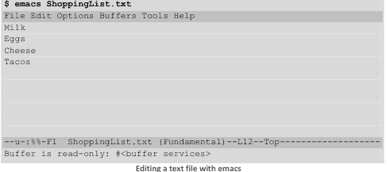

`emacs` 是 Unix、Linux 和 BSD 系统中至今仍在使用最古老的文本编辑器之一。其可自定义的宏和代码语法高亮功能使其成为软件开发人员和 Web 程序员的首选。上面的截图展示了 `emacs` 编辑器的用户界面。

> **注意** `emacs` 是一款面向高级用户、软件开发人员和出版商功能极其强大的编辑器。新用户建议在尝试掌握 `emacs` 之前，先学习 `nano` 和 `vi` 编辑器。

常见用法示例：

- `emacs [FILE]` | 打开指定文件进行编辑。

## sed

用途：复杂的流编辑器。

使用语法：`sed [OPTIONS] [FILE]`

```
$ cat ShoppingList.txt
Milk
Eggs
Cheese
Tacos
$ sed s/\$acos/Nachos/ ShoppingList.txt > NewShoppingList.txt
$ cat NewShoppingList.txt
Milk
Eggs
Cheese
Nachos
```


`sed` 是一款复杂的流编辑器。它使用正则表达式来修改流式传输到它的数据。正则表达式是一种在 Unix、Linux 和 BSD 系统中都支持的图案匹配语言。


在上一个示例中，`sed` 命令读取了 `ShoppingList.txt` 文件的内容，并使用正则表达式将所有 `Tacos` 实例替换为 `Nachos`。结果输出到一个名为 `NewShoppingList.txt` 的新文件中。

> **注意**
>
> 正则表达式很复杂，无法在本书中完全涵盖。请访问 `www.DontFearTheCommandLine.com` 寻找学习正则表达式语法的资源。

常见用法示例：

```
sed [OPTIONS] [EXPRESSION] [FILE] | 使用 sed 编辑文件
```

### awk

**用途**：文本处理和模式匹配程序。

**使用语法**：`awk [EXPRESSION]`

```
$ ls -l ShoppingList.*
-rw-r-r-- 1 nick nick 24 2010-04-12 23:10 ShoppingList.old
-rw-r-r-- 1 nick nick 23 2010-04-12 19:33 ShoppingList.txt
$ ls -l ShoppingList.* | awk -F" '{ print $1 " $8 }'"
-rw-r-r-- ShoppingList.old
-rw-r-r-- ShoppingList.txt
```

使用 `awk` 命令修改 `ls` 命令的输出

`awk` 是一款模式匹配和文本处理实用程序。它将输入的每一行视为一系列字段。每行中的字段被分组到一个数组中，并分配一个与其位置相关的变量。在上面的示例中，`awk` 被用于从 `ls` 命令的输出中提取并打印第一和第八（`$1` 和 `$8`）个字段。

`awk` 命令还可以用于执行批量处理功能，例如在下一个示例中演示的重命名多个文件。

```
$ ls
File1 File3 File5 File7 File9
File2 File4 File6 File8
$ ls | awk '{print "mv "$1" $1.txt"} ' | sh
$ ls
File1.txt File3.txt File5.txt File7.txt File9.txt
File2.txt File4.txt File6.txt File8.txt
```

使用 `awk` 命令批量重命名文件

在这个示例中，`awk` 命令被用于通过在列出的文件后添加 `.txt` 扩展名来重命名它们。

> **注意**
>
> `awk` 是一款功能强大且复杂的实用程序，无法在本书中完全涵盖。请访问 `www.DontFearTheCommandLine.com` 寻找学习 `awk` 使用语法的资源。

**常见用法示例：**

```
[INPUT] | awk [EXPRESSION] | 使用 awk 命令处理输入
```

### strings

**用途：** 从二进制文件中提取可读字符。

**使用语法：** `strings [OPTIONS] [FILE]`

```
$ strings unknown.mp3
...
T'AG Girl You Know It's True
Milli Vanilli
Girl You Know It's True
1989
...
```

使用 `strings` 命令从二进制文件中提取文本

`strings` 命令从二进制文件中提取文本。二进制文件包含无法使用标准文本处理程序读取的数据。二进制文件的例子包括 `MP3`、`JPEG` 和 `MPEG` 等。

在上面的示例中，从 `unknown.mp3` 文件中提取了可读文本。这些信息可用于识别二进制文件的内容。

> **注意** `strings` 命令默认显示结果的最小字符数为 4。你可以使用 `-n` 选项来覆盖默认的最低字符数限制。

常见用法示例：

- `strings [FILE]` - 显示二进制文件中的可读文本字符
- `strings -n [NUM] [FILE]` - 设置最小字符数

### cat

**用途：** 连接文件并显示其内容。

**使用语法：** `cat [OPTIONS] [FILE]`

```
$ cat ShoppingList.txt
Milk
Eggs
Cheese
Tacos
```


`cat` 命令用于连接和显示文件。在 `ShoppingList.txt` 文件上执行 `cat` 会显示其内容，如上述示例所示。

要连接两个或更多文件，只需以空格分隔待连接的文件名，如下一个示例所示。

```
$ cat ShoppingList.txt NachoIngredients.txt
Milk
Eggs
Cheese
Tacos
2 cloves garlic, crushed
6 green onions, sliced, white parts and tops separated
1 cup salsa
1/2 (12 ounce) package tortilla chips
1 (8 ounce) package shredded Cheddar/Monterey Jack cheese blend
1/2 large tomato, diced
```


常见用法示例：

- `cat [FILE]` | 显示指定文件的内容
- `cat [FILE1] [FILE2] [ETC]` | 连接指定文件
- `cat -n [FILE]` | 为每一行显示编号输出
- `cat -s [FILE]` | 抑制空行

### tac

**用途：** 以相反顺序连接文件。

**使用语法：** `tac [FILE]`

```
$ cat ShoppingList.txt
Milk
Eggs
Cheese
Tacos
$ tac ShoppingList.txt
Tacos
Cheese
Eggs
Milk
```


`tac` 命令类似于之前讨论的 `cat` 命令，不同之处在于它以相反的顺序显示文件内容。在上面的示例中，通过比较 `cat` 命令和 `tac` 命令的输出，演示了这两个命令生成的输出之间的区别。

> **提示**
>
> 在 Unix、Linux、BSD 系统上查看日志文件的内容时，`tac` 极其有用。日志文件中的最新条目总是追加到文件末尾。`tac` 允许你按相反顺序读取这些文件，从而首先显示最近的条目。

**常见用法示例：**

- `tac [FILE]` | 以相反顺序显示指定文件的内容

### wc

**用途：** 计算文件中的行数、单词数和字符数。

**使用语法：** `wc [OPTIONS] [FILE]`

```
$ wc /etc/hosts
10 28 251 /etc/hosts
```

`wc` 命令的输出

`wc` 命令（全称 `Word Count`）显示指定文件中总行数、总单词数和总字符数。上述示例显示了 `/etc/hosts` 文件的总计数值。下表解释了 `wc` 命令生成的输出字段。

| 行数 | 单词数 | 字符数 | 文件 |
|---|---|---|---|
| 10 | 28 | 251 | /etc/hosts |

`wc` 命令的输出字段

常见用法示例：

- `wc [FILE]` | 显示文件中的行数、单词数和字符数
- `wc -w [FILE]` | 显示文件中的单词数
- `wc -l [FILE]` | 显示文件中的行数
- `wc -c [FILE]` | 显示文件中的字符数

### more

**用途**：逐页显示命令或文本文件的输出。

**使用语法**：`more [OPTIONS] [FILE]`


```
$ more /var/log/syslog
May 20 11:49:15 e6400 NetworkManager:  SCPlugin-Ifupdown: {19599648}
...	get_connections {Managed=false}: return empty list.
May 20 11:49:15 e6400 modem-manager: Loaded plugin Longcheer
May 20 11:49:15 e6400 modem-manager: Loaded plugin Option
May 20 11:49:15 e6400 modem-manager: Loaded plugin MotocG
May 20 11:49:15 e6400 modem-manager: Loaded plugin ZTE
May 20 11:49:15 e6400 modem-manager: Loaded plugin Gobi
May 20 11:49:15 e6400 modem-manager: Loaded plugin Novatel
May 20 11:49:15 e6400 modem-manager: Loaded plugin Nokia
May 20 11:49:15 e6400 modem-manager: Loaded plugin AnyData
May 20 11:49:15 e6400 modem-manager: Loaded plugin Huawei
May 20 11:49:15 e6400 modem-manager: Loaded plugin Sierra
May 20 11:49:15 e6400 modem-manager: Loaded plugin Ericsson NEM
--More-- (14%)
```

### 使用 `more` 命令查看文本文件

`more` 命令逐页显示命令或文本文件的输出。这对于大文件或产生大量输出行的命令非常有用。上述示例演示了如何使用 `more` 命令逐页读取大型文本文件。

> 空格键用于使用 `more` 滚动输出。Q 键可以在未滚动到末尾的情况下关闭文件。

常见用法示例：

- `more [FILE]` | 逐页显示指定文件
- `more +[NUM] [FILE]` | 从指定的行号开始读取文件
- `[COMMAND] | more` | 逐页显示命令的输出

#### less

**用途：** 一次显示一条命令或文本文件的输出的一页（或一行）。

**语法：** `less [OPTIONS] [FILE]`

```bash
$ less /var/log/syslog
May 20 11:49:15 e6400 NetworkManager: SCPlugin-Iifupdown: (19599648)
... get_connections (Managed=False): return empty list.
May 20 11:49:15 e6400 modem-manager: Loaded plugin Longcheer
May 20 11:49:15 e6400 modem-manager: Loaded plugin Option
May 20 11:49:15 e6400 modem-manager: Loaded plugin MotoC
May 20 11:49:15 e6400 modem-manager: Loaded plugin QcrtHigh-Speed
May 20 11:49:15 e6400 modem-manager: Loaded plugin Gobi
May 20 11:49:15 e6400 modem-manager: Loaded plugin Generic
May 20 11:49:15 e6400 modem-manager: Loaded plugin Novatel
May 20 11:49:15 e6400 modem-manager: Loaded plugin Nokia
May 20 11:49:15 e6400 modem-manager: Loaded plugin AnyData
May 20 11:49:15 e6400 modem-manager: Loaded plugin Huawei
May 20 11:49:15 e6400 modem-manager: Loaded plugin ZTE
May 20 11:49:15 e6400 modem-manager: Loaded plugin Sierra
May 20 11:49:15 e6400 modem-manager: Loaded plugin Ericsson MBM
:
```


`less` 命令与前面讨论过的 `more` 命令类似，不同之处在于它支持双向滚动（向上和向下），而 `more` 只能向下滚动。

> 使用 `less` 时，可以使用方向键和 Page Up/Down 键来滚动输出。按 Q 键可关闭文件，无需滚动到末尾。

**常见用法示例：**

- `less [FILE]` 一次一页显示指定文件
- `less +[NUM] [FILE]` 从指定行号开始读取文件
- `[COMMAND] | less` 一次一页显示命令的输出

#### head

**用途：** 显示文件的开头部分。

**语法：** `head [OPTIONS] [FILE]`

```bash
$ head -n 2 ShoppingList.txt
Milk
Eggs
```


`head` 命令显示指定文件的前几行（被称为 *head*）。在上面的示例中，`-n 2` 选项用于只显示指定文件的前两行。如果执行 `head` 命令时没有提供选项，它将默认显示文件中的前 10 行。

**常见用法示例：**

| 命令 | 描述 |
| :--- | :--- |
| `head [FILE]` | 显示指定文件的前 10 行 |
| `head -n [NUM] [FILE]` | 显示指定数量的行 |

#### tail

**用途：** 显示文件的末尾部分。

**语法：** `tail [OPTIONS] [FILE]`

```bash
$ tail -n 2 ShoppingList.txt
Cheese
Tacos
```

使用 `tail` 显示文件末尾的两行

`tail` 命令显示指定文件的最后几行（被称为 *tail*）。在上面的示例中，`-n 2` 选项用于只显示指定文件的最后两行。如果执行 `tail` 命令时没有提供选项，它将默认显示文件中的最后 10 行。

`tail` 命令的另一个实用功能是 `-f` 选项，它用于在文件增长时“跟踪”该文件。这指示 `tail` 命令打开指定文件，并在新行写入时显示它们。下一个示例演示了如何使用 `tail -f` 命令实时监控 `/var/log/syslog` 文件中的新日志条目。

```bash
$ tail -f /var/log/syslog
May 22 13:41:50 e6400 NetworkManager: <info>  (wlan0): supplicant
connection state:  completed -> group handshake
May 22 13:41:50 e6400 NetworkManager: <info>  (wlan0): supplicant
connection state:  group handshake -> completed
May 22 13:41:51 e6400 wpa_supplicant[848]: WPA: EAPOL-Key Replay
Counter did not increase - dropping packet
May 22 13:41:51 e6400 wpa_supplicant[848]: WPA: Invalid EAPOL-Key MIC -
dropping packet
May 22 13:42:15 e6400 wpa_supplicant[848]: last message repeated 6
times
May 22 13:45:13 e6400 anacron[1290]: Job 'cron.daily' started
May 22 13:45:13 e6400 anacron[2167]: Updated timestamp for job
'cron.daily' to 2010-05-22
...
```

使用 `tail` 命令实时监控不断增长的日志文件

**常见用法示例：**

| 命令 | 描述 |
| :--- | :--- |
| `tail [FILE]` | 显示指定文件的最后 10 行 |
| `tail -n [NUM] [FILE]` | 显示指定数量的行 |


| `tail -f [FILE]` | 跟踪文件的增长 |

### tee

**用途：** 显示命令的输出并将输出写入文件。

**语法：** `tee [OPTIONS] [FILE]`

```bash
$ ls -l /etc/ | tee etc.txt
-rw-r--r--   1 root root      2975 2009-02-04 11:12 adduser.conf
-rw-r--r--   1 root root        46 2010-06-27 16:53 adjtime
-rw-r--r--   1 root root       532 2009-11-30 14:33 aliases
-rw-r--r--   1 root root      12288 2010-07-01 12:23 aliases.db
drwxr-xr-x   2 root root      4096 2010-05-04 13:24 alternatives
drwxr-xr-x   4 root root      4096 2009-03-12 14:08 amavis
drwxr-xr-x   3 root root      4096 2009-02-04 12:49 apm
drwxr-xr-x   2 root root      4096 2009-08-28 14:45 apparmor
drwxr-xr-x   6 root root      4096 2010-06-27 16:53 apparmor.d
...
```


`tee` 命令显示命令的输出，同时也将输出保存到文件中。在上面的示例中，`tee` 命令显示了 `ls -l /etc` 命令的输出，同时将这些结果保存到一个名为 `etc.txt` 的文件中。查看 `etc.txt` 文件可以看到，其内容与在命令行上显示的输出相同，如下一个示例所示。

```bash
$ more etc.txt
-rw-r--r--   1 root root      2975 2009-02-04 11:12 adduser.conf
-rw-r--r--   1 root root        46 2010-06-27 16:53 adjtime
-rw-r--r--   1 root root       532 2009-11-30 14:33 aliases
-rw-r--r--   1 root root      12288 2010-07-01 12:23 aliases.db
drwxr-xr-x   2 root root      4096 2010-05-04 13:24 alternatives
drwxr-xr-x   4 root root      4096 2009-03-12 14:08 amavis
drwxr-xr-x   3 root root      4096 2009-02-04 12:49 apm
drwxr-xr-x   2 root root      4096 2009-08-28 14:45 apparmor
drwxr-xr-x   6 root root      4096 2010-06-27 16:53 apparmor.d
...
```


**常见用法示例：**

| 命令 | 描述 |
| :--- | :--- |
| `[COMMAND] | tee [FILE]` | 将命令的输出保存到文件 |
| `[COMMAND] | tee -a [FILE]` | 将输出追加到指定文件 |

### grep

**用途：** 匹配模式并过滤数据。

**语法：** `grep [OPTIONS] [FILE]`

```bash
$ grep -i failed /var/log/syslog
Apr  4 07:52:44 kernel: [0.000000] Fast TSC calibration failed
Apr  4 07:52:44 kernel: [1.587770] PM: Resume from disk failed.
Apr  4 07:52:44 kernel: [6.252517] PM: Resume from disk failed.
Apr 11 12:11:28 init: Unable to connect to the system bus: Failed to
connect to socket /var/run/dbus/system_bus_socket: Connection refused
```


`grep` 命令用于从文件或命令中过滤数据。在上面的示例中，`grep` 用于过滤 `/var/log/syslog` 文件并显示包含 `failed` 一词的匹配项。

> **提示**
> Unix、Linux 和 BSD 系统是区分大小写的。在上面的示例中，使用 `-i` 选项来克服这一点并执行不区分大小写的搜索。

`grep` 命令还可以用于过滤命令的输出。在下一个示例中，`dmesg` 命令的输出被管道传输到 `grep` 命令，以仅显示包含 `error` 一词的结果。

```bash
$ dmesg | grep -i error
[16074.400692] PM: Device 2-3 failed to resume: error -19
[20792.424537] npviewer.bin[20044]: segfault at ff9bea2c ip
00000000eff9bea2c sp 00000000f7eca507c error 14
[21301.607998] npviewer.bin[24229]: segfault at ff9bea2c ip
00000000eff9bea2c sp 00000000f0f83a40c error 14
```


**常见用法示例：**

| 命令 | 描述 |
| :--- | :--- |
| `grep [STRING] [FILE]` | 显示文件中匹配的行 |
| `grep -c [STRING] [FILE]` | 统计文件中匹配项的数量 |
| `grep -i [STRING] [FILE]` | 匹配时忽略大小写 |
| `[COMMAND] | grep [STRING]` | 过滤命令输出以匹配字符串 |

### sort

**用途：** 对输入流或文件的内容进行排序。

**语法用法：** `sort [选项] [文件]`


`sort` 命令用于对某个命令输出或文件的内容进行排序。在上面的示例中，`sort` 命令用于对 `ShoppingList.txt` 文件进行字母顺序排序并显示结果。

`sort` 也可以与管道一起使用，以对命令的输出进行排序，如下一个示例所示。

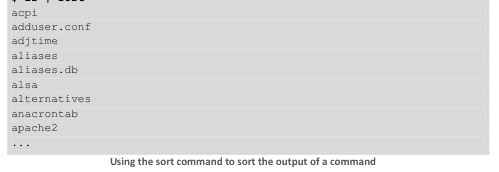

**常见用法示例：**

| 用法 | 描述 |
| :--- | :--- |
| `sort [文件]` | 对指定文件进行排序并显示 |
| `sort -r [文件]` | 逆序排序指定文件 |
| `[命令] | sort` | 对指定命令的输出进行排序 |

### zcat

**用途：** 读取压缩文件的内容。

**语法用法：** `zcat [选项] [文件]`

```
$ file ShoppingList.txt.gz
ShoppingList.txt.gz: gzip compressed data, was "ShoppingList.txt", from
Unix, last modified: Mon Apr 12 19:33:38 2010
$ zcat ShoppingList.txt.gz
Milk
Eggs
Cheese
Tacos
```


`zcat` 命令允许你读取压缩文本文件的内容，而无需先手动解压。在上面的示例中，`ShoppingList.txt.gz` 文件是一个压缩的 `gzip` 存档。使用传统的 `cat` 命令在这种情况下会产生无法阅读的输出。然而，`zcat` 命令允许你查看文件的内容，而无需先解压它。

**常见用法示例：**

| 用法 | 描述 |
| :--- | :--- |
| `zcat [文件]` | 读取压缩文件的内容 |

### diff

**用途：** 比较文件。


### 语法用法
`diff [选项] [文件]`

```
$ diff ShoppingList.txt ShoppingList.old
4c4
< Tacos
---
> Nachos
```


`diff` 命令允许你逐行比较两个文本文件并显示它们之间的差异。`diff` 命令提供两种类型的输出：
1. 单列输出（默认）
2. 双列并排比较（通过 `-y` 选项激活）

在上面的示例中，`diff` 命令显示了默认的单列输出，该输出仅显示两个文件之间的差异。使用指示符来标记不同的行：
- `<` 表示第一个文件中的文本
- `>` 表示第二个文件中的文本

可以使用 `-y` 选项来显示双列并排输出。下一个示例演示了使用该选项生成的输出。

```
$ diff -y ShoppingList.txt ShoppingList.old
Milk            Milk
Eggs            Eggs
Cheese          Cheese
Tacos           | Nachos
```


**常见用法示例：**

| 用法 | 描述 |
| :--- | :--- |
| `diff [文件1] [文件2]` | 比较文件并显示差异 |
| `diff -y [文件1] [文件2]` | 并排比较文件 |
| `diff -i [文件1] [文件2]` | 比较文件时忽略大小写 |

### dos2unix / unix2dos

**用途：** 在 Windows/MS-DOS 和 Unix/Linux 系统之间转换文件格式。

**语法用法：** `dos2unix` / `unix2dos` `[选项] [文件]`

```
$ cat ShoppingList.txt
Milk^M
Eggs^M
Cheese^M
Tacos
$ dos2unix ShoppingList.txt
$ cat ShoppingList.txt
Milk
Eggs
Cheese
Tacos
```


在 Windows 和 MS-DOS 中创建的文本文件使用的是与 Unix/Linux 系统不兼容的回车换行符格式。`dos2unix` 命令重新格式化指定文件，以便其在 Unix/Linux 系统上正确显示。在上面的示例中，`ShoppingList.txt` 文件中的回车换行符被转换，以便在基于 Unix 的系统上正确显示。

与 `dos2unix` 命令类似，`unix2dos` 格式化在 Unix/Linux 系统上创建的文本文件，以便它们在传输到 Windows 系统时能正确显示。


> 转换直接作用于指定文件。使用 `-b` 选项可在转换前创建文件备份。

**常见用法示例：**
- `dos2unix [文件]`: 将 Windows 文本文件转换为 Unix 格式文件
- `dos2unix -b [文件]`: 在转换前创建备份
- `unix2dos [文件]`: 将 Unix 文本文件转换为 Windows 格式文件
- `unix2dos -b [文件]`: 在转换文件前创建备份

### 第 5 章：用户、组和安全

**概述**

本章涵盖与用户、组和安全相关的最常用命令。它还将讨论诸如账户创建/删除、文件和目录权限以及其他用户/安全相关命令等主题。

**本节涉及的命令：**

| 命令 | 用途 |
| :--- | :--- |
| `chmod` | 更改文件和目录权限。 |
| `chown` | 更改文件或目录的所有者。 |
| `chgrp` | 更改文件和目录所属的组。 |
| `umask` | 显示/设置用户的默认文件创建掩码。 |
| `su` | 切换用户账户。 |
| `sudo` | 以不同用户身份运行单个命令。 |
| `id` | 显示关于用户身份的信息。 |
| `groups` | 显示用户属于哪些组。 |
| `who` | 显示谁登录了系统。 |
| `whoami` | 显示当前用户的身份 |
| `w` | 显示登录到系统的用户的详细信息。 |
| `last` / `lastb` | 显示最后一次成功/失败的用户登录。 |
| `lastlog` | 显示最近的用户登录信息。 |
| `finger` | 显示关于用户账户的信息。 |
| `passwd` | 更改密码。 |
| `useradd` / `userdel` | 创建/删除用户账户。 |
| `adduser` / `deluser` | 在 Linux 系统上创建/删除用户账户。 |
| `groupadd` / `groupdel` | 添加/移除组。 |
| `usermod` | 修改用户和组账户设置。 |
| `groupmod` |  |
| `wall` | 向系统中所有用户广播消息。 |
| `ulimit` | 显示/设置系统资源限制。 |

#### 本节使用的术语表：

**GID**
（组标识符）分配给 `/etc/group` 文件中组的数值。

**Group**
用户账户的分组，用于简化和访问控制。

**Mode**
文件和目录权限的指示器。

**Octal Notation**
用于向文件和目录应用权限的数值表示法。

**Permissions**
用于控制文件或目录访问的设置。

**Profile**
分配给用户的设置集合。

**Symbolic Notation**
一种用户友好的方式，用于显示或向文件和目录应用权限。

**UID**
（用户标识符）分配给 `/etc/passwd` 文件中用户账户的数值。

**User Account**
分配给每个拥有本地系统登录权限的人的账户。

### 账户类型

Unix、Linux 和 BSD 系统使用几种类型的用户账户。下图说明了大多数系统使用的用户安全模型。


默认情况下，普通用户及其执行的程序在系统上获得最少的权限。系统账户具有略微提升的权限，用于运行系统服务（如 Web 服务器或 FTP 服务器）。root 账户对整个系统拥有无限制的管理访问权限。

### 组

组用于简化系统安全的管理。用户可以是一个或多个组的成员。默认情况下，所有用户至少属于一个组；这个组被称为用户的主组。

### 文件和目录权限

文件和目录权限通过一组九个“标志”进行管理。以下示例描述了典型文件上的权限。

|  | r | w | x | r | - | x | r | - | x |
| :--- | :--- | :--- | :--- | :--- | :--- | :--- | :--- | :--- | :--- |
| **编号** | 1 | 2 | 3 | 4 | 5 | 6 | 7 | 8 | 9 |
| **角色** | 文件类型 | 用户（所有者） |  | 组 |  | 其他（所有人） |  |  |  |

*注意：原始表格结构较为复杂。基于标准 Unix 权限表示，映射通常如下：*

| 位置 | 1 | 2 | 3 | 4 | 5 | 6 | 7 | 8 | 9 |
| :--- | :--- | :--- | :--- | :--- | :--- | :--- | :--- | :--- | :--- |
| 标志 | 文件类型 | r | w | x | r | - | x | r | - | x |
| 类别 |  | 用户（所有者） |  |  | 组 |  |  | 其他（所有人） |  |  |

在这九个标志中，指定了三组权限：
- 用户（又称所有者）权限
- 组权限
- 其他（即其他人）

有四种类型的权限可用于控制文件或目录的访问。下表描述了每种权限。

| 符号 | 含义 |
| :--- | :--- |
| r | 读取 |
| w | 写入 |
| x | 执行 |
| - | 无访问权限 |

**目录权限示例**

在大多数情况下，文件的所有者始终对该文件拥有完整的读/写访问权限。执行权限是一个特殊标志，用于程序、脚本和目录，以指示它们可执行。

下面的示例显示了基本的文件权限。

```
$ ls -l ShoppingList.txt
-rw-r-- 1 nick users 254 2009-06-01 15:35 ShoppingList.txt
```

*`ls -l` 命令的输出，显示文件权限*

|  | 用户 | 组 | 其他 |
| :--- | :--- | :--- | :--- |
| 符号 | rw- | r-- | r-- |


| 含义 | 读 & 写 | 只读 | 只读 |

## 文件权限示例

下一个示例演示了目录权限。目录权限的工作方式与文件权限相同，只是它们用于控制对目录的访问。

```
$ ls -ld finance/
drwxr-x-- 2 root finance 4096 2009-06-12 09:48 finance/
```

`ls -ld` 命令的输出，显示目录权限

|  | 用户 | 组 | 其他 |
| :--- | :--- | :--- | :--- |
| 符号 | rwx | r-x | --- |
| 含义 | 读、写 & 执行 | 只读 & 执行 | 无访问权限 |

## 目录权限示例

每个文件和目录都有自己的一组权限。权限不会从父目录继承。此外，如图所示，目录需要执行权限才能被访问。

### chmod

**用途：** 更改文件和目录的权限。

**语法：** `chmod [OPTIONS] [MODE] [DIRECTORY/FILE]`

```bash
# chmod 664 ShoppingList.txt
# ls -l ShoppingList.txt
-rw-rw-r-- 1 root root 23 2009-05-27 22:31 ShoppingList.txt
```


`chmod` 命令用于设置文件和目录的权限。默认情况下，权限以数值（八进制）格式指定，如上述示例中的 664。在八进制形式中，使用三位数字分别代表所有者、组和其他用户的权限。第一个数字代表所有者的权限，第二个数字是组的权限，第三个数字是其他用户的权限。

下表提供了符号权限和八进制权限的对照参考。

| **权限** | **符号** | **八进制** |
| :---: | :---: | :---: |
| **读取** | `r` | **4** |
| **写入** | `w` | **2** |
| **执行** | `x` | **1** |
| **无** | – | **0** |


八进制权限的总和即为所谓的 *模式*（mode）。有效的模式在下表中描述。

| **模式** | **八进制** | **符号** | **有效权限** |
| :---: | :---: | :---: | :--- |
| **7** | 4+2+1 | `rwx` | 读/写/执行 |
| **6** | 4+2 | `rw-` | 读/写 |
| **5** | 4+1 | `r-x` | 读/执行 |
| **4** | 4 | `r--` | 读 |
| **0** | 0 | `---` | 无 |


3 个模式的组合决定了文件的权限。模式 664 将创建 `rw-rw-r--` 权限，赋予用户和组读/写访问权限，并仅授予其他用户只读权限。

在 Unix、Linux 和 BSD 系统中，权限的概念起初可能难以理解。下面提供了几个额外的示例，以帮助澄清这一主题。

**示例 1**：模式 660 将为所有者和组提供读/写访问权限，其他用户无访问权限。

```bash
# chmod 660 MyFile
# ls -l MyFile
-rw-rw---- 1 root sales 23 2009-05-27 22:31 MyFile
```

*660 模式的结果*

**示例 2**：模式 755 将为所有者提供完全访问权限，并为组和其他用户提供商/执行访问权限。

```bash
# chmod 755 MyProgram.sh
# ls -l MyProgram.sh
-rwxr-xr-x 1 root sales 23 2009-05-27 22:31 MyProgram.sh
```

*755 模式的结果*

**示例 3**：模式 600 将为所有者提供读/写访问权限，其他用户无访问权限。

```bash
# chmod 600 MyFile
# ls -l MyFile
-rw------- 1 root sales 23 2009-05-27 22:31 MyFile
```

*600 模式的结果*

**示例 4**：应用于目录的模式 775 将为所有者和组提供读/写/执行访问权限，并仅授予其他用户只读访问权限。

```bash
$ chmod 775 MyDirectory
$ ls -ld MyDirectory
drwxrwxr-x 2 root sales 4096 2009-05-27 16:04 MyDirectory
```

*应用于目录的 775 模式的结果*

**常见用法示例：**

- `chmod [MODE] [FILE]`

  - 更改指定文件的权限

- `chmod [MODE] -R [DIR]`

  - 递归更改所有文件的权限

### chown

**用途：** 更改文件或目录的所有者。

**语法：** `chown [OPTIONS] [USER:GROUP] [DIRECTORY/FILE]`

```bash
# ls -l ShoppingList.txt
-rw-r--1 nick nick 23 2009-05-27 22:31 ShoppingList.txt
# chown root ShoppingList.txt
# ls -l ShoppingList.txt
-rw-r--1 root nick 23 2009-05-27 22:31 ShoppingList.txt
```

`chown` 命令用于更改文件或目录的所有者。在上面的示例中，`ShoppingList.txt` 文件的所有者从 *nick* 更改为 `root`。

下一个示例演示了如何使用 `chown` 命令同时更改文件的所有者和组。

```bash
# ls -l ShoppingList.txt
-rw-r--1 root nick 23 2009-05-27 22:31 ShoppingList.txt
# chown nick:sales ShoppingList.txt
# ls -l ShoppingList.txt
-rw-r--1 nick sales 23 2009-05-27 22:31 ShoppingList.txt
```

执行 `chown nick:sales ShoppingList.txt` 命令后，`ShoppingList.txt` 文件的所有者更新为 *nick*，组更新为 *sales*。

> **提示**
>
> 如果你只需要更改文件的组，可以使用 `chgrp` 命令（详见第 88 页）。

**常见用法示例：**

| 命令 | 描述 |
| :--- | :--- |
| `chown [USER] [FILE]` | 更改文件的所有者 |
| `chown [USER]:[GROUP] [FILE]` | 更改文件的所有者和组 |
| `chown -R [USER] [DIR]` | 递归更改指定目录中所有文件的所有者 |

### chgrp

**用途：** 更改文件和目录的组。

**语法：** `chgrp [OPTIONS] [GROUP] [DIRECTORY/FILE]`

```bash
# ls -l ShoppingList.txt
-rw-r--r-- 1 root root  23 2009-05-27 22:31 ShoppingList.txt
# chgrp sales ShoppingList.txt
# ls -l ShoppingList.txt
-rw-r--r-- 1 root sales 23 2009-05-27 22:31 ShoppingList.txt
```

*使用 chgrp 命令更改文件的组*

`chgrp` 命令用于更改文件或目录的组。在上面的示例中，使用 `chgrp` 命令将 `ShoppingList.txt` 文件的组从 `root` 更改为 `sales`。

**常见用法示例：**

| 命令 | 描述 |
| :--- | :--- |
| `chgrp [GROUP] [FILE]` | 将文件的组更改为指定组 |
| `chgrp -R [DIR]` | 递归更改所有文件的组 |

### umask

**用途：** 显示/设置用户的默认文件创建掩码。

**语法：** `umask [OPTIONS] [MODE]`

```bash
$ umask
022
```

*显示当前用户的 umask*

`umask` 控制用户的默认文件创建掩码。这决定了将分配给新创建的文件和目录的权限。要确定文件/目录创建模式，umask 值将从目录的 777 和文件的 666 中减去。例如，umask 为 022 将为文件创建有效权限 644 (`rw-r-x--`)，为目录创建有效权限 755 (`rwxr-xr-x`)。


在某些系统中，可以使用 `-S` 选项以更易读的符号形式显示 `umask` 值，如下一个示例所示。

```bash
$ umask -S
u=rwx, g=rx, o=rx
```

*以符号表示法显示 umask*

`umask` 命令还可以用于更改 `umask` 值，如下一个示例所示。

```bash
$ umask 077
```

*设置 umask 值*

在此示例中，`umask` 值为 `077` 将为文件创建有效权限 `600` (`rw------`)，为目录创建有效权限 `700` (`rwx-----`)。

> **注意**
>
> 在命令行中指定的 `umask` 值会在你注销时重置。若要使 `umask` 永久生效，必须将其添加到用户主目录中的 `.profile` 文件或 `/etc/profile`（针对所有用户）。

**常见用法示例：**

- `umask`
  - 以八进制格式显示 `umask`
- `umask -S`
  - 以符号格式显示 `umask`
- `umask [MODE]`
  - 将 `umask` 设置为指定值

### su

**用途：** 切换用户账户。

**语法：** `su [OPTIONS] [USER]`

```bash
$ whoami
nick
$ su
Password: ******
# whoami
root
```

`su` 命令（`Switch User` 的缩写）允许你先不注销系统就登录为另一个用户。在上面的示例中，普通用户使用 `su` 切换到 `root` 用户账户。请注意，当你成为 `root` 用户时，你的 shell 提示符会从 `$` 变为 `#`。作为 `root` 用户，你现在可以运行需要提升特权的命令。

> **提示**
>
> 你应始终限制以 `root` 用户身份登录的时间。这是一个良好的实践，有助于减少意外事故。

默认情况下，不带参数执行 `su` 会切换到 `root` 用户账户。可以使用 `su` 指定用户名以切换为其他用户，如下一个示例所示。

```bash
$ whoami
nick
$ su steve
Password: ******
$ whoami
steve
```

**常见用法示例：**

- `su`
  - 切换到 `root` 用户账户
- `su -`
  - 切换到 `root` 用户账户并加载 `root` 的配置
- `su [USERNAME]`
  - 切换到指定的用户名

### sudo

用途：以不同用户的身份运行单个命令。

用法语法：`sudo [OPTIONS] [COMMAND]`

```bash
$ whoami
nick
$ sudo whoami
[sudo] password for nick: ******
root
$ whoami
nick
```

使用 `sudo` 以 `root` 用户身份运行命令

`sudo` 命令允许你以另一个用户的身份运行单个命令。它最常用于执行需要 `root` 权限的命令。在此示例中，通过 `sudo` 命令以 `root` 身份执行了 `whoami`。

使用 `sudo` 命令是运行需要提升权限的命令的推荐方式，因为它限制了使用 `root` 权限的时间。这极大地有助于防止意外删除重要系统文件等灾难。

> **注意**：用户（或组）账户必须列在 `/etc/sudoers` 文件中，才能使用 `sudo` 以 `root` 身份执行命令。

常见用法示例：

- `sudo [COMMAND]`：以 `root` 身份运行指定的命令
- `sudo -u [USER] [COMMAND]`：以指定的用户身份运行命令
- `sudo !!`：以 `root` 身份运行上一条命令

### id

**用途**：显示用户身份的信息。

**用法语法**：`id [OPTIONS] [USER]`

```bash
### id
uid=0 (root) gid=0 (root) groups=0 (root)
```

显示当前用户的用户和组信息

`id` 命令显示指定用户的用户和组信息。不带选项执行 `id` 会显示当前用户的信息，如上述示例所示。下一个示例演示了使用 `id` 命令显示特定用户的信息。

```bash
# id nick
uid=1000 (nick) gid=1000 (nick) groups=4 (adm), 20 (dialout), 24 (cdrom), 46 (plugdev), 106 (lpadmin), 121 (admin), 122 (sambashare), 1000 (nick)
```

显示特定用户的用户和组信息

> **注意**
>
> **Unix、Linux 和 BSD** 系统为系统中的每个用户和组分配一个数字 `UID`（**用户 ID**）和 `GID`（**组 ID**）。还会为每个 `UID` 和 `GID` 分配一个用户友好的名称，该名称显示在每个 ID 号码旁边的括号中。用户的此信息存储在 `/etc/passwd` 中，组的信息存储在 `/etc/group` 中。

常见用法示例：

| 命令 | 描述 |
| :--- | :--- |
| `id` | 显示当前用户的 ID 信息 |
| `id [USER]` | 显示指定用户的用户和组信息 |

### groups

**用途**：显示用户所属的组。

**用法语法**：`groups [OPTIONS] [USER]`

```bash
### groups
root
```

显示当前用户的组信息

`groups` 命令显示用户的组成员资格。不带选项执行 `groups` 会显示当前用户的组，如上述示例所示。可以使用用户名配合 `groups` 命令来显示指定用户的组成员资格，如下一个示例所示。

```bash
# groups nick
nick adm dialout cdrom plugdev lpadmin admin sambashare
```

显示指定用户的组信息

**常见用法示例**：

| 命令 | 描述 |
| :--- | :--- |
| `groups` | 显示当前用户的组成员资格 |
| `groups [USER]` | 显示指定用户的组成员资格 |

### who / whoami

**用途**：显示谁登录到系统中。

**用法语法**：`who [OPTIONS]`

```bash
$ who
root  tty2  2010-05-17 11:32
nick  tty1  2010-05-17 11:31
nick  pts/0 2010-05-17 08:40 (10.10.1.251)
dave  pts/1 2010-05-17 12:32 (10.10.1.188)
mike  pts/2 2010-05-17 14:28 (10.10.1.167)
lisa  pts/3 2010-05-17 14:50 (10.10.1.204)
nick  pts/4 2010-05-17 15:33 (10.10.1.251)
```

`who` 命令的输出

`who` 命令显示当前登录到系统的用户信息。`who` 命令的默认输出显示用户名、终端 ID 以及用户登录的日期/时间，如上述示例所示。

> **注意**：通过 `telnet` 或 `SSH` 会话登录的用户也会显示远程客户端的 IP 地址，位于括号内。

`whoami` 命令显示当前用户的用户名。这在切换不同账户时验证当前可用的用户环境和安全权限时很有用。

**用法语法**：`whoami`

```bash
$ whoami
nick
```

使用 `whoami` 显示当前用户的名称

常见用法示例：

- `who`：显示当前登录到系统的用户
- `who -b`：显示最后一次系统启动时间
- `who -r`：显示当前运行级别
- `whoami`：显示当前用户的名称

### w

用途：显示登录到系统的用户的详细信息。

**用法语法**：`w [OPTIONS] [USER]`

```bash
$ w  
15:39:12 up 4 days, 6:09, 5 users, load average: 0.06, 0.05, 0.01
```

| USER | TTY | FROM | LOGIN | IDLE | JCPU | PCPU | WHAT |
| :--- | :--- | :--- | :--- | :--- | :--- | :--- | :--- |
| nick | pts/0 | 10.10.1.251 | 08:40 | 1:10 | 0.18s | 0.15s | -bash |
| dave | pts/1 | 10.10.1.188 | 12:32 | 0.00s | 0.14s | 0.14s | vim |


| mike | pts/2 | 10.10.1.167 | 14:28 | 0.00s | 0.12s | 0.12s | tail |
| lisa | pts/3 | 10.10.1.204 | 14:50 | 9.00s | 0.14s | 0.14s | -bash |
| nick | pts/4 | 10.10.1.251 | 15:33 | 0.00s | 0.15s | 0.01s | w |

`w` 命令的输出

`w` 命令显示登录到系统的用户的详细信息。它与之前讨论的 `who` 命令类似，但提供了额外的信息，如用户最后登录时间、空闲时长以及当前正在运行的程序。

`w` 命令还显示一行系统摘要，显示主机正常运行时间、连接用户数以及过去 1、5 和 15 分钟的系统负载平均值样本。

> 第一行显示的信息与 `uptime` 命令生成的输出相同。有关系统正常运行时间和负载平均值的更多信息，请参见第 215 页。

**常见用法示例**：
- `w`：显示当前登录到系统的用户的详细信息

### last / lastb

用途：显示上次成功/失败的用户登录记录。

**用法语法**：`last [OPTIONS] [USER]`

```bash
$ last
nick    pts/1      192.168.1.50   Sat May 22 13:42   still logged in
nick    pts/0      192.168.1.50   Sat May 22 13:42   still logged in
nick    tty7        :0            Sat May 22 13:40   still logged in
reboot  system boot  2.6.32-21-ge  Sat May 22 13:40 -  14:02  (00:21)
nick    pts/0      :0.0          Thu May 20 21:33 -  21:56  (00:03)
nick    pts/0      :0.0          Thu May 20 21:30 -  21:33  (00:02)
root    pts/0      :0.0          Thu May 20 21:27 -  21:30  (00:03)
nick    tty7        :0          Thu May 20 21:25 - crash (1+16:14)
...
```

`last` 命令的输出

`last` 命令显示系统中每个用户的登录和注销时间。它还显示有关系统关闭和重启的信息，如上述示例所示。

`lastb` 命令显示失败的登录尝试，如下一个示例所示。

**用法语法**：`lastb [OPTIONS] [USER]`

```bash
$ lastb
nick    tty1       Sat May 22 13:59 -  13:59  (00:00)
nick    tty1       Thu May 20 21:27 -  21:27  (00:00)
root    tty1       Thu May 20 15:27 -  15:27  (00:00)

btmp begins Sat May 20 13:59:28 2010
```

`lastb` 命令的输出

> **注意**：用户登录/注销活动存储在 `/var/log/wtmp` 文件中。失败的登录尝试记录在 `/var/log/btmp` 中。

常见用法示例：
- `last`：显示最后一次用户登录信息
- `last -[NUMBER]`：显示指定数量的登录记录
- `last [USER]`：显示指定用户的最后登录记录
- `lastb`：显示失败的登录尝试
- `lastb -[NUMBER]`：显示指定数量的失败登录尝试
- `lastb [USER]`：显示指定用户的失败登录尝试

### lastlog

用途：显示最近的用户登录信息。

用法语法：`lastlog [OPTIONS]`

```bash
$ lastlog | more
Username Port From Latest
root tty2 Sat May 30 11:32:33 -0500 2009
dave tty3 Sat May 30 10:22:51 -0500 2009
nick pts/0 10.10.1.251 Sat May 30 11:31:51 -0500 2009
steve **Never logged in**
bin **Never logged in**
sync **Never logged in**
lp **Never logged in**
...
```


`lastlog` 命令显示系统中每个用户的最近一次用户登录时间和日期。不带选项执行 `lastlog` 会显示所有用户的最后登录信息，如上述示例所示。此输出类似于 `last` 命令，但 `lastlog` 仅显示最新的登录活动，而 `last` 显示所有可用的登录事件。

可以使用 `-u` 选项来显示特定用户的最后登录，如下一个示例所示。

```bash
$ lastlog -u nick
Username Port From Latest
nick pts/0 10.10.1.251 Sat May 30 11:31:51 -0500 2009
```


常见用法示例：
- `lastlog`：显示所有用户的最后登录信息
- `lastlog -u [USER]`：显示指定用户的最后登录信息

### finger

**用途：** 显示用户账户信息。

**用法语法：** `finger [OPTIONS] [USER]`

```bash
$ finger nick
Login: nick                                  Name: Nick Marsh
Directory: /home/nick                        Shell: /bin/bash
On since Sat May 30 11:32 (CDT) on tty2       10 minutes 32 seconds idle
New mail received Mon May 17 16:08 2010 (CDT)
Unread since Tue Apr 13 08:43 2010 (CDT)
No Plan.
```

使用 `finger` 命令显示用户账户信息

`finger` 命令用于显示用户账户的信息。它展示了用户的 Shell、主目录以及其他有用的详细信息。上述示例展示了使用 `finger` 命令时通常显示的用户信息。

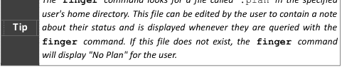

常见用法示例：

| 命令 | 描述 |
| :--- | :--- |
| `finger [USER]` | 显示指定用户的信息 |

### passwd

**用途**：修改密码。

**用法语法**：`passwd [OPTIONS] [USER]`

```bash
$ passwd
Enter new UNIX password: ******
Retype new UNIX password: ******
passwd: password updated successfully
```

修改当前用户的密码

`passwd` 命令用于修改用户密码。如上图示例所示，不带参数执行 `passwd` 将修改当前用户的密码。

`root` 用户可以通过指定用户名来修改其他用户的密码，如下例所示。

```bash
# passwd nick
Enter new UNIX password: ******
Retype new UNIX password: ******
passwd: password updated successfully
```

修改特定用户的密码

常见用法示例：
- `passwd` 设置当前用户的密码
- `passwd [USER]` 设置指定用户的密码
- `passwd -e [USER]` 强制用户在下次登录时更改密码
- `passwd -l [USER]` 锁定指定的用户账户
- `passwd -u [USER]` 解锁指定的用户账户
- `passwd -S [USER]` 显示指定用户账户的状态

### useradd / userdel

**用途：** 创建/删除用户账户。

**用法语法：** `useradd [OPTIONS] [USER]`


```bash
# useradd -m steve
# passwd steve
Enter new UNIX password: ******
Retype new UNIX password: ******
passwd: password updated successfully
```

向系统中添加用户账户（并设置其密码）

`useradd` 命令用于创建新的用户账户。在上述示例中，执行 `useradd -m steve` 为用户创建了一个基本的登录账户。`-m` 选项用于自动为指定用户创建主目录（推荐）。然后使用之前讨论过的 `passwd` 命令为新用户设置密码。

> **注意：** 在新用户能够登录之前，必须使用 `passwd` 命令为其设置密码。

`userdel` 命令用于从系统中删除用户账户。下一个示例演示了如何使用 `userdel` 删除账户。可选的 `-r` 选项用于在删除用户账户后自动删除该用户的主目录。

**用法语法：** `userdel [OPTIONS] [USER]`

```bash
# userdel -r steve
```

删除用户账户

> **注意：** 在某些 Unix 和 BSD 系统上，可以使用 `rmuser` 命令替代 `userdel`。

常见用法示例：

| 命令 | 描述 |
| :--- | :--- |
| `useradd [USER]` | 创建指定的用户账户 |
| `useradd -m [USER]` | 自动为用户创建主目录 |
| `userdel [USER]` | 删除指定的用户账户 |
| `userdel -r [USER]` | 删除用户账户及其主目录 |

### adduser / deluser

**用途：** 在 Linux 系统上创建/删除用户账户。

**用法语法：** `adduser [OPTIONS] [USER]`

```bash
# adduser mike
Adding user 'mike' ...
Adding new group 'mike' (1002) ...
Adding new user 'mike' (1002) with group 'mike' ...
Creating home directory '/home/mike' ...
Copying files from '/etc/skel' ...
Enter new UNIX password: ******
Retype new UNIX password: ******
passwd: password updated successfully
Changing the user information for mike
Enter the new value, or press ENTER for the default
    Full Name [:] : Mike Smith
    Room Number [:] : Computer Room
    Work Phone [:] : 555-1212
    Home Phone [:] :
Is the information correct? [y/N] y
```

使用 `adduser` 命令创建用户

`adduser` 命令是之前讨论的 `useradd` 命令的用户友好型前端。通过提示输入创建账户时所需的信息（而不是指定多个命令行选项），它简化了 Linux 系统上用户账户的创建过程。上述示例展示了 `adduser` 命令的典型用法。

`deluser` 命令用于删除用户账户，如下例所示。

**用法语法：** `deluser [OPTIONS] [USER]`

```bash
# deluser mike
Removing user 'mike' ...
Warning: Removing group 'mike', since no other user is part of it.
Done.
```

使用 `deluser` 命令删除用户

> **注意** `adduser` 和 `deluser` 命令的默认设置存储在 `/etc/adduser.conf` 和 `/etc/deluser.conf` 中。

常见用法示例：
- `adduser [USER]` 创建用户账户
- `deluser [USER]` 删除用户账户

### groupadd / groupdel

**用途：** 添加/删除组。

**用法语法：** `groupadd [GROUP]`

```bash
# groupadd accounting
```

使用 `groupadd` 创建新组

`groupadd` 命令用于创建新的组账户。组在管理多用户环境中文件和目录的访问权限方面非常有用。在上述示例中，创建了一个名为 `accounting` 的新组。生成的组条目显示在 `/etc/group` 文件中如下所示。

```bash
# grep accounting /etc/group
accounting:x:1002:
```

显示 `/etc/group` 文件中的组条目

`groupdel` 命令用于从系统中删除组。下一个示例演示了如何使用 `groupdel` 命令从系统中删除之前创建的 `accounting` 组。

**用法语法：** `groupdel [GROUP]`

```bash
# groupdel accounting
```

使用 `groupdel` 删除组

常见用法示例：
- `groupadd [GROUP]` 创建新组
- `groupdel [GROUP]` 删除组

### usermod / groupmod

**用途：** 修改用户和组账户设置。

**用法语法：** `usermod [OPTIONS] [USER]`

```bash
# usermod -aG sales nick
```

使用 `usermod` 命令更改用户的组成员身份

`usermod` 命令用于修改用户账户设置。在上述示例中，`-aG` 选项用于将用户 `nick` 添加到 `sales` 组。你还可以使用 `usermod` 命令通过 `-d` 选项更改用户的主目录位置，或通过 `-s` 选项更改默认 Shell。

`groupmod` 命令用于修改组。其主要用途是重命名组。在下一个示例中，使用 `groupmod -n` 将 `accounting` 组重命名为 `finance`。

**用法语法：** `groupmod [OPTIONS] [GROUP]`

```bash
# groupmod accounting -n finance
# grep finance /etc/group
finance:x:1002:
```

使用 `groupmod` 命令重命名组

常见用法示例：

| 命令 | 描述 |
| :--- | :--- |
| `usermod -s [SHELL] [USER]` | 更改用户的默认 Shell |
| `usermod -d [DIR] [USER]` | 更改用户的主目录位置 |
| `usermod -aG [GROUP] [USER]` | 将用户添加到指定的组 |
| `groupmod [OLD] -n [NEW]` | 重命名指定的组 |

### wall

**用途：** 向系统上的所有用户广播消息。

**用法语法：** `wall [FILE]`

```bash
### wall
Anyone want some tacos?
<CTRL + D>
```

使用 `wall` 命令向登录到系统的所有用户发送消息

`wall` 命令向当前登录到系统的所有用户发送消息。在上述示例中输入的文本将显示在所有本地终端和当前登录到系统的远程会话中。

> **注意** 按下 `CTRL + D` 结束消息编辑器并发送消息。

下一个示例展示了系统上其他用户看到的 `wall` 消息输出样本。

```text
$
Broadcast Message from root@e6400 (/dev/pts/0) at 11:56 ...
Anyone want some tacos?
```

`wall` 消息在所有终端上的输出

除了手动输入消息外，还可以使用包含预写消息的文本文件与 `wall` 命令一起使用，如下例所示。

```bash
# wall /home/nick/message.txt
```

使用文本文件通过 `wall` 命令发送消息

常见用法示例：
- `wall` 向所有用户发送消息
- `wall [FILE]` 向所有用户发送指定文件中的消息

### ulimit

**用途：** 显示/设置系统资源限制。

**用法语法：** `ulimit [OPTIONS] [LIMIT]`

| 命令 | 描述 |
| :--- | :--- |
| `$ ulimit -a` | 使用 `ulimit` 命令显示已定义的资源限制 |
| core file size | core 文件大小 (blocks, -c) 0 |


| data seg size | 数据段大小 (kbytes, -d) 无限制 |
| scheduling priority | 调度优先级 (-e) 20 |
| file size | 文件大小 (blocks, -f) 无限制 |
| pending signals | 待处理信号 (-i) 16382 |
| max locked memory | 最大锁定内存 (kbytes, -l) 64 |
| max memory size | 最大内存大小 (kbytes, -m) 无限制 |
| open files | 打开文件数 (-n) 1024 |
| pipe size | 管道大小 (512 bytes, -p) 8 |
| POSIX message queues | POSIX 消息队列 (bytes, -q) 819200 |
| real-time priority | 实时优先级 (-r) 0 |
| stack size | 栈大小 (kbytes, -s) 8192 |
| cpu time | CPU 时间 (seconds, -t) 无限制 |
| max user processes | 最大用户进程数 (-u) 无限制 |
| virtual memory | 虚拟内存 (kbytes, -v) 无限制 |
| file locks | 文件锁 (-x) 无限制 |

`ulimit` 命令用于显示和设置系统资源限制。这些限制控制了可供程序使用的系统资源量。它可以用于控制每个由用户启动的程序可用的最大内存、CPU 时间和文件大小。

> **提示**
>
> *在大多数系统上，Ulimit 配置通常存储在 `/etc/limits.conf` 或 `/etc/security/limits.conf` 中。*

常见用法示例：

| 命令 | 描述 |
| :--- | :--- |
| `ulimit -a` | 显示所有已定义的资源限制 |
| `ulimit [OPTION] [LIMIT]` | 设置 ulimit 值 |

# 第 6 节：进程控制与调度

## 概述

在 Unix、Linux 和 BSD 系统上运行的每个程序都被视为一个进程。进程被分配一个唯一标识符，用于监控和控制该进程。可以使用本节中讨论的命令行实用工具，通过该进程标识符 `PID` 来控制进程。

本节涵盖的命令：

| 命令 | 用途 |
| :--- | :--- |
| `ps` | 显示正在运行的进程。 |
| `pgrep` | 按名称查找进程。 |
| `pstree` | 以树状视图显示所有正在运行的进程。 |
| `kill` | 终止进程。 |
| `killall` | 终止所有具有指定名称的进程。 |
| `nice` | 在指定的 CPU 优先级级别执行程序。 |
| `renice` | 更改正在运行的进程的优先级。 |
| `&` | 在后台启动进程。 |
| `bg fg` | 将进程移动到后台/前台。 |
| `jobs` | 显示后台和挂起的任务。 |
| `nohup` | 运行免受挂断信号影响的进程。 |
| `batch` | 调度程序在 CPU 负载较低时运行。 |
| `at` | 调度程序在指定时间运行。 |
| `atq` | 显示队列中的 at 任务。 |
| `atrm` | 从队列中移除已调度的 at 任务。 |
| `crontab` | 调度程序在指定时间运行。 |

## 本节使用的术语表：

| 术语 | 定义 |
| :--- | :--- |
| Cron | 一种用于在特定时间间隔执行程序的计划系统。 |
| Job | 使用 `at` 或 `batch` 调度程序进行计划、挂起或当前正在运行的程序。 |
| Nice Value | 分配给进程的一个数值指标，用于指示和控制其 CPU 调度优先级。 |
| PID | (Process **I**Dentifier) 分配给系统上执行的每个进程的唯一数值。 |
| PPID | (Parent Process **I**Dentifier) 启动子进程的父进程的 PID。 |
| Priority | *Nice Value* 的同义词。 |
| Process | 任何已执行的程序。 |

### ps

**用途：** 显示正在运行的进程。

**用法语法：** `ps [OPTIONS]`

```
$ ps
  PID TTY          TIME CMD
 4958 pts/0    00:00:00 bash
 9596 pts/0    00:00:00 ps
```


`ps` 命令显示系统上正在运行的进程。不带选项执行 `ps` 命令将显示当前用户拥有的所有进程，如上述示例所示。要获取完整的进程列表，请像下一个示例中那样使用 `-e` 选项。

```
$ ps -e
  PID TTY          TIME CMD
    1 ?        00:00:01 init
    2 ?        00:00:00 kthreadd
    3 ?        00:00:00 migration/0
    4 ?        00:00:00 ksoftirqd/0
    5 ?        00:00:00 watchdog/0
...  
```


可以使用 `-ef` 选项来显示系统中所有进程的详细信息。这包括用户 ID、进程 ID、父进程 ID 以及其他有用信息，如下一个示例所示。

```
$ ps -ef
UID          PID    PPID C STIME TTY          TIME CMD
root            1     0  0 Jun24 ?        00:00:02 /sbin/init
root            2     0  0 Jun24 ?        00:00:00 [kthreadd]
root            3     2  0 Jun24 ?        00:00:00 [migration/0]
root            4     2  0 Jun24 ?        00:00:00 [ksoftirqd/0]
root            5     2  0 Jun24 ?        00:00:00 [watchdog/0]
...  
```


**常见用法示例：**

- `ps` | 显示当前用户的进程
- `ps -e` | 显示系统中正在运行的所有进程
- `ps -ef` | 显示正在运行的进程的详细信息
- `ps -u [USER]` | 显示由指定用户拥有的进程

### pgrep

**用途：** 按名称查找进程。

**用法语法：** `pgrep [OPTIONS] [NAME]`

```
$ pgrep apache
3952
4075
4076
4077
4078
4079
```


`pgrep` 命令显示所有匹配指定名称的进程。在上述示例中，显示了 apache 网页服务器的 PID。这相当于输入 `ps -el | grep apache`，并且作为产生相同结果的快捷方式提供。

可以与 `pgrep` 一起使用 `-l` 选项来显示每个 PID 的完整进程名称，如下一个示例所示。

```
$ pgrep -l apache
3952 apache2
4075 apache2
4076 apache2
4077 apache2
4078 apache2
4079 apache2
```


**注意** 某些系统可能使用 `pidof` 命令来替代 `pgrep` 命令。

常见用法示例：

- `pgrep [NAME]`：显示匹配指定名称的 PID
- `pgrep -l [NAME]`：除 PID 外还显示进程名称
- `pgrep -P [PPID]`：显示指定 PPID 的所有子进程
- `pgrep -c [NAME]`：显示匹配进程的总数

### pstree

用途：以树状视图显示所有正在运行的进程。

用法语法：`pstree [OPTIONS]`

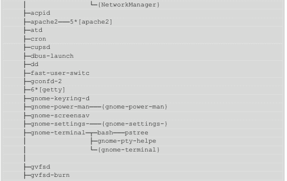

`pstree` 命令为系统上当前运行的所有进程绘制进程树，如上述示例所示。`pstree` 的输出使得父进程和子进程之间的关系一目了然。

常见用法示例：

| 命令 | 描述 |
| :--- | :--- |


| `pstree` | 显示基本的进程树列表 |
| `pstree -p` | 在树状列表中包括 PID 编号 |
| `pstree -a` | 包括每个进程的命令行选项 |
| `pstree [USER]` | 显示由指定用户拥有的进程 |
| `pstree [PID]` | 显示指定 PID 的子进程 |

### kill

**用途：** 终止进程。

**用法语法：** `kill [OPTIONS] [PID]`

```
# pgrep -l mysqld
5540 mysqld
# kill 5540
```

使用 `kill` 命令终止进程

`kill` 命令终止指定的 PID。在上述示例中，使用 `kill` 终止 PID 为 5540 的 `mysqld` 进程。

`kill` 命令的默认行为是请求进程正常退出。如果进程未能正确终止，可以发送可选的 kill 信号以强制进程结束。在这种情况下，最常用的 kill 信号是 `-9`，它会强制终止指定的 PID，如下一个示例所示。

```
# pgrep -l mysqld
5545 mysqld
# kill -9 5545
```

使用 `-9` 选项杀死挂起的进程

> 建议仅在极少数挂起进程拒绝正常退出的情况下使用 `kill -9` 命令。`-9` 信号仅在这些极端情况下使用，因为它可能导致不期望的结果，如系统不稳定和“僵尸”子进程。

常见用法示例：

| 命令 | 描述 |
| :--- | :--- |
| `kill [PID]` | 终止指定进程 |
| `kill -9 [PID]` | 强制无响应的进程终止 |

### killall

**用途：** 终止所有指定名称的进程。

**用法语法：** `killall [OPTIONS] [NAME]`

```bash
# pgrep -l apache2
3952 apache2
4075 apache2
4076 apache2
4077 apache2
4078 apache2
4079 apache2
# killall apache2
```

使用 `killall` 命令按名称终止进程

`killall` 命令会终止所有与指定名称匹配的进程。如果您需要终止多个同名进程，这非常有帮助。在上面的示例中，使用 `killall` 终止了与 `apache2` 服务相关的多个进程。

> **提示**
>
> 可以将 `-i` 参数与 `killall` 一起使用，在终止每个进程之前提示确认。推荐这样做，因为它有助于防止因打字错误而终止错误的进程。

**常见用法示例：**

- `killall [NAME]` 终止所有指定名称的进程
- `killall -i [NAME]` 在终止进程之前提示确认

### nice

**用途：** 以指定的 CPU 优先级级别执行程序。

**用法语法：** `nice [OPTIONS] [COMMAND]`

```bash
# nice -n 19 LowPriority.sh
# nice -n -20 HighPriority.sh
```

`nice` 命令允许以低于或高于常规调度优先级执行程序。这使得您可以控制在内核在运行中的程序之间分配处理器时间时应该偏向哪些进程。`nice` 值最低的进程以最高优先级执行，反之亦然。上述示例展示了如何使用 `nice` 以修改后的调度优先级启动程序。

在大多数系统上，`普通用户` 的优先级范围从 0 到 19，其中 0 是最高优先级，19 是最低优先级。`root` 用户可以创建优先级范围从 -20（最高）到 19（最低）的进程。

大多数程序默认以 nice 级别 0 启动。关键系统服务通常具有负的 nice 级别，以便它们始终优先于用户程序。

> **注意**
>
> 某些 Unix 系统可能使用 0 到 39 的范围，其中 0 是最高优先级，39 是最低优先级。更多详细信息请参阅本地系统中的 `man nice` 手册页。

**常见用法示例：**

- `nice -n [NUM] [COMMAND]` 以指定优先级启动程序

### renice

**用途：** 更改运行中进程的优先级。

**用法语法：** `renice [OPTIONS] [PID]`

```bash
# renice +5 -p 7279
7279: old priority 0, new priority 5
```

`renice` 命令调整运行中进程的优先级。在上面的示例中，PID 7279 被调整为 +5 的优先级。由于之前的优先级是 0，这实际上降低了该进程的优先级。

**常见用法示例：**

- `renice +/-[NUM] -p [PID]` 更改指定 PID 的优先级

### &

**用途：** 在后台启动进程。

**用法语法：** `[COMMAND] &`

```bash
$ ./SomeProgram.sh &
[1] 10717
$ ps

      PID TTY          TIME CMD
    10696 pts/0    00:00:00 bash
    10717 pts/0    00:00:03 SomeProgram.sh
    10721 pts/0    00:00:00 ps
```

使用 `&` 命令行运算符在后台执行程序

`&` 是一个命令行运算符，指示 shell 在后台启动指定的程序。这允许您同时运行多个程序，而无需启动多个终端会话。在上面的示例中，名为 `SomeProgram.sh` 的 shell 脚本作为后台进程启动。执行 `ps` 命令显示该程序现在正在后台运行。

> **注意**
>
> 后台程序的输出仍会在 shell 中显示。您可以使用以下语法将输出重定向到文件：`SomeProgram.sh > output.log &`。这会将后台程序的所有输出重定向到当前目录中名为 `output.log` 的文件。

**常见用法示例：**

- `[COMMAND] &` 在后台执行指定命令
- `[COMMAND] > [FILE] &` 将后台命令的输出重定向到文件

### bg / fg

**用途：** 将进程移至后台/前台。

**用法语法：** `bg [JOBID]`

```bash
$ ./SomeProgram.sh
<CTRL + Z>
[1]+ Stopped      SomeProgram.sh
$ bg 1
$ jobs
[1]- Running      SomeProgram.sh
```

挂起正在运行的程序，然后在后台恢复它

`bg` 命令将进程发送到后台。这允许您在单个终端会话中多任务处理多个程序。在上面的示例中，shell 脚本 `SomeProgram.sh` 被挂起（通过在键盘上按下 `CTRL + Z`），然后使用 `bg` 作为后台进程恢复。

> **注意**
>
> 可以使用 `jobs` 命令（见第 117 页）来验证程序现在是否在后台运行。

`fg` 命令将后台进程移至前台。在下一个示例中，使用 `fg` 命令将指定的作业 ID 移至前台。

**用法语法：** `fg [JOBID]`

```bash
$ jobs
[1]- Running      SomeProgram.sh
$ fg 1
SomeProgram.sh
...
```

将后台作业移至前台

**常见用法示例：**

| 命令 | 描述 |
| :--- | :--- |
| `bg [JOBID]` | 将指定作业发送到后台 |
| `fg [JOBID]` | 将指定作业移至前台 |

### jobs

**用途：** 显示后台和挂起的作业。

**用法语法：** `jobs [OPTIONS]`

`jobs` 命令显示后台程序和挂起进程的状态。在上面的示例中，显示了三个后台作业。之前提到的 `fg` 和 `bg` 命令可以分别用于将进程移至前台和后台。

下表描述了 `jobs` 命令的输出字段。

| 作业 ID | 状态 | 程序 |
| :--- | :--- | :--- |
| `[1]-` | Running | `SomeProgram.sh` |
| `[2]+` | Stopped | `AnotherProgram.sh` |
| `[3]` | Stopped | `Test.sh` |

`jobs` 命令的输出字段

> **注意**
>
> 加号用于指示被视为默认作业的项（用于与 `bg` 和 `fg` 命令配合使用）。减号指示如果当前默认作业终止，将变为默认的下一个作业。在任何给定时间，只能有一个 `+` 和一个 `-`。所有其他作业将没有任何指示符。

**常见用法示例：**


- `jobs` 显示所有作业

- `jobs -1` 显示所有作业及其 PID

### nohup

**用途：** 运行对挂起信号免疫的进程。

**用法语法：** `nohup [COMMAND] &`

```bash
$ nohup SomeProgram.sh &
nohup: ignoring input and appending output to 'nohup.out'
$ exit
```

使用 `nohup` 命令启动后台程序

`nohup` 命令使进程对挂起信号免疫。挂起信号用于通知 shell 的子进程父进程正在终止。这通常会导致所有子进程终止。使用 `nohup` 可以允许程序在您注销后继续运行，如上述示例所示。

> **提示**
>
> 程序的输出将存储在名为 `nohup.out` 的文件中，该文件位于执行 `nohup` 命令的目录中。

**常见用法示例：**

- `nohup [COMMAND] &` 执行对挂起信号免疫的程序

### at / atq / atrm

**用途：** 调度程序在指定时间运行。

**用法语法：** `at [OPTIONS] [TIME|DATE]`

```bash
$ at 1am
at> MyProgram.sh
at> <CTRL + D>
job 1 at Sat May 30 01:00:00 2009
```

使用 `at` 命令调度进程

`at` 命令调度程序在指定时间运行。在上面的示例中，使用 `at` 命令启动名为 `MyProgram.sh` 的 shell 脚本。在此示例中，命令行指定的启动时间为凌晨 1 点。您还可以使用更传统的 Unix 时间指定方式，例如 01:00 或任何其他 HH:MM 组合。

> **提示**
>
> `at` 命令有一个名为 `now` 的特殊命令行参数。
>
> 这可以用作快捷方式，在调度作业时节省时间。例如，输入 `at now + 15 minutes` 将调度作业在当前时间 15 分钟后启动。

`atq` 命令显示队列中 `at` 作业的信息，如下一个示例所示。

**用法语法：** `atq`

```bash
$ atq
1 Sat May 30 01:00:00 2009 MyProgram.sh nick
```

使用 `atq` 命令显示作业队列

`atrm` 命令删除已调度的作业，如下一个示例所示。

**用法语法：** `atrm [JOBID]`

```bash
$ atrm 1
```

使用 `atrm` 命令移除已调度的作业

**常见用法示例：**

| 命令 | 描述 |
| :--- | :--- |
| `at [TIME]` | 调度程序在指定时间运行 |
| `atq` | 显示 `at` 作业队列 |
| `atrm [JOBID]` | 从 `at` 队列中移除已调度的作业 |

### batch

**用途：** 在 CPU 负载较低时安排程序运行。

**使用语法：** `batch [OPTIONS]`

```
$ batch 
tag> BigProgram.sh
tag> <CTRL + D>
job 1 at Fri May 29 20:01:00 200
```


`batch` 命令用于安排程序在系统 CPU 负载较低时运行。这对于运行那些通常会影响系统性能的资源密集型程序非常有用。

在此示例中，使用 `batch` 程序来安排 `BigProgram.sh` 脚本在系统 CPU 负载较低时运行。

> **注意** 每个平台对“低负载”的定义各不相同。有关系统中 `batch` 命令用法的更多信息，请参阅 `man batch`。

**常见用法示例：**

- `batch` | 启动批量调度 shell

### crontab

**用途**：在指定时间安排程序运行。

**使用语法**：`crontab [OPTIONS]`

```bash
# crontab -l
30 12 * * 1-5 /root/SomeProgram.sh
```

显示已配置的 cron 任务

`crontab` 命令用于管理用户的计划 cron 任务。`Cron` 是大多数 Unix、Linux 和 BSD 系统上存在的一个子系统，用于按特定间隔安排程序运行。它与前面讨论的 `at` 命令不同，因为 `cron` 任务以重复的间隔运行（而 `at` 任务只运行一次）。

> 注意 `Cron` 这个名字源自希腊语单词 "chronos"，意思是“时间”。

在上述示例中，`-l` 选项用于显示当前用户的 `crontab`。下表描述了 `crontab` 文件中包含的字段。

| 分钟 | 小时 | 月中的日期 | 月份 | 星期几 | 程序 |
| :---: | :---: | :---: | :---: | :---: | :---: |
| 30 | 12 | * | * | 1-5 | /root/SomeProgram.sh |

`Crontab` 字段

在此示例中，`SomeProgram.sh` 将在每周一至周五下午 12:30 运行。星期几用数字表示，0=周日，1=周一，2=周二，等等。星号 (*) 是一个通配符，代表所有有效值。

`crontab -e` 用于编辑当前用户的 `crontab`，如下一个示例所示。

```bash
# crontab -e
30 12 * * 1-5 /root/SomeProgram.sh
```

编辑 `crontab`

**常见用法示例**：

- `crontab -l` | 列出当前用户的 `crontab`

- `crontab -e` | 编辑当前用户的 `crontab`

- `crontab -r` | 删除当前用户的 `crontab`

### 第 7 节：启动和关机

#### 概述

本章介绍了用于启动和关机 Unix、Linux 和 BSD 系统的命令。它还概述了流行平台的特定平台服务控制命令。

#### 本节涵盖的命令：

| 命令 | 用途 |
| --- | --- |
| shutdown | 关闭系统。 |
| poweroff | 关闭系统电源。 |
| reboot | 重启系统。 |
| halt | 停止系统。 |
| telinit | 更改运行级别。 |
| runlevel | 显示前一个和当前的运行级别。 |
| service | 管理 Linux 系统上的服务。 |
| sysv-rc-conf | 显示和编辑 Linux 运行级别配置。 |
| chkconfig | 显示和编辑基于 Red Hat Linux 系统上的运行级别配置。 |
| rc-update | 显示和编辑 Gentoo Linux 系统上的运行级别配置。 |
| rc-status | 显示 Gentoo Linux 系统上服务的状态。 |
| stopsrc, startsrc | 停止/启动 AIX 系统上的服务。 |
| lssrc | 显示 AIX 系统上服务的状态。 |
| svcs | 显示 Solaris 系统上服务的状态。 |
| svcadm | 启动/停止 Solaris 系统上的服务。 |

#### 本节使用的术语表：

**Init** (INITialization) 一个控制 Unix、Linux 和 BSD 系统启动（也称为初始化）的程序。

**运行级别 (Runlevel)** 一组由 `init` 程序使用的配置文件，定义了系统启动期间（或由 `telinit` 命令调用时）要加载的程序和服务。

**服务 (Service)** 提供服务的系统程序，如 Web 服务器、DNS 服务器、邮件服务器等。服务有时也被称为守护进程或服务守护进程。

### shutdown

**用途：** 关闭系统。

**使用语法：** `shutdown [OPTIONS] [TIME] [MESSAGE]`

```
# shutdown now
BROADCAST MESSAGE FROM ROOT:
The system is going down for shutdown now!
* Stopping services                       [  OK  ]
* Terminating processes                   [  OK  ]
...
The system will now halt.
```

`shutdown` 命令的示例输出

`shutdown` 命令用于关闭本地系统。可以执行几种不同类型的关机：`halt`（停止）、`poweroff`（断电）和 `reboot`（重启）。

> **注意**
>
> `shutdown` 命令的用法在不同的 Unix、Linux 和 BSD 平台之间有所差异。本页面上的示例适用于 Linux 系统。要获取特定于您环境的用法示例，请在本地系统上键入 `man shutdown`。

当执行 `shutdown` 命令时，会向登录到本地系统的所有用户广播警告。可以在时间参数后面指定一条可选消息，如下一个示例所示。


```
# shutdown 2 Save your work and log off ASAP!
BROADCAST MESSAGE FROM ROOT:
The system is going down for shutdown in 2 minutes!
Save your work and log off ASAP!
```

`shutdown` 命令广播消息的示例输出

| 常见用法示例： |
|------------------|
| `shutdown now` | 立即关闭系统 |
| `shutdown [MIN]` | 等待指定的分钟数后再关机 |
| `shutdown [HH:MM]` | 在指定时间关机（24小时制） |
| `shutdown -r now` | 重启系统 |
| `shutdown -H now` | 停止系统 |
| `shutdown -P now` | 关闭系统电源 |

### poweroff

**用途：** 关闭系统电源。

**使用语法：** `poweroff`

```
### poweroff

BROADCAST MESSAGE FROM ROOT:
The system is going down for power off now!

* Stopping services [ OK ]

* Terminating processes [ OK ]

...

The system will now power off.
```

`poweroff` 命令将立即关闭并切断系统电源。它基本上是 `shutdown -P now` 的快捷方式。`poweroff` 命令存在于所有 Linux 发行版以及某些 BSD 和 Unix 系统中。

> **注意** 要检查您的系统是否支持 `poweroff` 命令，请键入 `whereis poweroff`。

> **警告** `poweroff` 命令不提供宽限期，执行时会立即停止系统。

**常见用法示例：**

- `poweroff` | 关闭并切断系统电源

### reboot

**用途：** 重启系统。

**使用语法：** `reboot`

```
### reboot
BROADCAST MESSAGE FROM ROOT: The system is going down for reboot now!
* Stopping services                   [ OK ]
* Terminating processes                [ OK ]
...
The system will now reboot.
```

`reboot` 命令的示例输出

`reboot` 命令用于优雅地重启系统。它基本上是 `shutdown -r now` 的快捷方式。在命令行上执行 `reboot` 将立即重启系统，如上例所示。

> **警告**
>
> `reboot` 命令不提供宽限期，执行时会立即重启系统。

**常见用法示例：**

- `reboot` | 优雅地重启系统

### halt

**用途：** 停止系统。

**使用语法：** `halt`

```
### halt
BROADCAST MESSAGE FROM ROOT: The system is going down for halt now!
* Stopping services                                  [ OK ]
* Terminating processes                                [ OK ]
...
The system will now halt.
```

`halt` 命令的示例输出

`halt` 命令将停止在线系统。停止（halt）是一种特殊的关机类型，它优雅地关闭操作系统，但不会切断系统电源。

> **注意**
>
> 某些商业 Unix 系统在停止时会进入维护模式。这可用于访问预启动配置/诊断环境。

**常见用法示例：**

- `halt` | 停止系统

### telinit

**用途：** 更改运行级别。

**使用语法：** `telinit [RUNLEVEL]`

```
# telinit 1
*** Switching to run level 1 ***
### runlevel
3 1
```


`telinit` 告知系统的 `init` 进程停止并启动为指定运行级别配置的必要服务。在上述示例中，使用 `telinit` 命令将系统更改为运行级别 1。然后执行 `runlevel` 命令（见第 129 页）以显示当前和之前的运行级别。

每个系统的运行级别配置取决于所使用的发行版，并且可以根据您的需要进行自定义。大多数 Unix、Linux 和 BSD 系统将拥有与下表描述的类似的运行级别配置。

| 运行级别 | 用途 |
| :---: | :--- |
| 0 | 关机或特殊管理模式 |
| 1 | 单用户模式 |
| 2 | 多用户模式 |
| 3 | 多用户模式 |
| 4 | 多用户模式 |
| 5 | 特定于发行版 |
| 6 | 重启 |


**常见用法示例：**

- `telinit [RUNLEVEL]` | 告知 `init` 进程加载指定的运行级别

### runlevel

用途：显示上一个和当前的运行级别。

使用语法：`runlevel`

```
$ `runlevel`
3 1
```

`runlevel` 命令的输出

`runlevel` 命令显示当前和上一个运行级别。运行级别是由 `init` 进程调用的初始化序列，定义了系统启动和关闭的程序。在上面的示例中，`runlevel` 用于显示当前运行级别信息。显示的第一个数字是上一个运行级别，第二个数字是当前运行级别。

> 注意
>
> 如果没有上一个运行级别，系统将在第一个字段中显示 N。

常用用法示例：

- `runlevel`：显示上一个和当前的运行级别

### service

**用途：** 管理 Linux 系统上的服务。

**使用语法：** `service [OPTIONS] [SERVICE] [ACTION]`

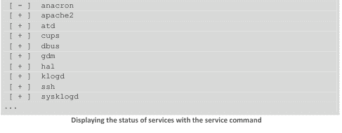

`service` 命令用于管理 Linux 系统上的服务。在上面的示例中，`--status-all` 选项显示系统中所有服务的状态。`+` 符号表示正在运行的服务，`-` 符号表示已停止的服务。

`start`、`stop`、`restart` 和 `status` 选项可用于控制单个服务，如下一个示例所示。

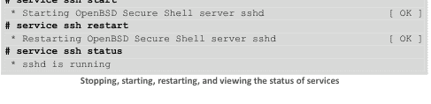

常用用法示例：

| 命令 | 描述 |
| :--- | :--- |
| `service [SERVICE] stop` | 停止指定的服务 |
| `service [SERVICE] start` | 启动指定的服务 |
| `service [SERVICE] restart` | 重启指定的服务 |
| `service [SERVICE] status` | 显示指定服务的状态 |
| `service --status-all` | 显示所有服务的状态 |

### sysv-rc-conf

**用途：显示和编辑 Linux 运行级别配置。**

**使用语法：** `sysv-rc-conf [OPTIONS] [SERVICE] [ON|OFF]`

```
### sysv-rc-conf
SysV Runlevel Config -- stop service w/+: start service h: help q: quit

 Service  1  2  3  4  5  0  6  S
acpid   [ ]  [X] [X] [X] [X] [X] [ ]  [ ]  [ ]
anacron [ ]  [X] [X] [X] [X] [ ]  [ ]  [ ]
apache  [ ]  [X] [X] [X] [X] [X] [ ]  [ ]  [ ]
apparmor[ ]  [ ] [ ] [ ] [ ] [ ]  [ ]  [X]
apport  [ ]  [X] [X] [X] [X] [ ]  [ ]  [ ]
atd     [ ]  [X] [X] [X] [X] [ ]  [ ]  [ ]
bind9   [ ]  [X] [X] [X] [X] [ ]  [ ]  [ ]

Use the arrow keys or mouse to move around. ^n: next pg ^p: prev pg
Space: toggle service on / off
```


`sysv-rc-conf` 命令的示例输出

`sysv-rc-conf` 命令管理 Linux 系统上的 `service/runlevel` 配置。在上面的示例中，执行 `sysv-rc-conf` 会启动一个配置实用程序，允许用户选择在各个运行级别上启动哪些服务。

还可以使用 `--list` 和 `--level` 选项通过命令行显示和修改服务，如下一个示例所示。

```
# sysv-rc-conf --level 2345 apache off
# sysv-rc-conf --list apache2
apache2    2:off  3:off  4:off  5:off
# sysv-rc-conf --level 2345 apache2 on
# sysv-rc-conf --list apache2
apache2    2:on   3:on   4:on   5:on
```

使用 `sysv-rc-conf` 命令在命令行上管理服务

常用用法示例：

- `sysv-rc-conf`：显示运行级别配置实用程序
- `sysv-rc-conf --list`：列出所有服务的运行级别配置
- `sysv-rc-conf --level [LEVEL] [SERVICE] on`：在指定级别上启用服务
- `sysv-rc-conf --level [LEVEL] [SERVICE] off`：在指定级别上禁用服务

### chkconfig

用途：在基于 Red Hat Linux 的系统上显示和编辑运行级别配置。

使用语法：`chkconfig [OPTIONS] [SERVICE] [ON|OFF] [LEVEL]`

```
# chkconfig -1
```

| 服务 | 0 | 1 | 2 | 3 | 4 | 5 | 6 |
| :--- | :--- | :--- | :--- | :--- | :--- | :--- | :--- |
| acpi-support | off | off | on | on | on | on | off |
| acpid | off | off | on | on | on | on | off |
| alsa-utils | off | off | off | off | off | off | off |
| anacron | off | off | on | on | on | on | off |
| apache2 | off | off | off | off | off | off | off |
| apport | off | off | on | on | on | on | off |
| ... | | | | | | | |

使用 `chkconfig` 命令列出服务配置

`chkconfig` 命令管理 Red Hat Linux 系统上的服务。`-1` 参数列出当前的运行级别配置，如上面的示例所示。如果没有指定服务，将显示所有服务。指定服务名将显示该服务的运行级别配置，如下一个示例所示。

```
# chkconfig -1 apache2
```

| 服务 | 0 | 1 | 2 | 3 | 4 | 5 | 6 |
| :--- | :--- | :--- | :--- | :--- | :--- | :--- | :--- |
| apache2 | off | off | on | on | on | on | off |

使用 `chkconfig` 命令列出特定服务

`-s` 选项用于在指定的运行级别上启用或禁用服务，如下一个示例所示。

```
# chkconfig -s apache2 off 2345
# chkconfig -1 apache2
```

| 服务 | 0 | 1 | 2 | 3 | 4 | 5 | 6 |
| :--- | :--- | :--- | :--- | :--- | :--- | :--- | :--- |
| apache2 | off | off | off | off | off | off | off |

```
# chkconfig -s apache2 on 2345
# chkconfig -1 apache2
```

| 服务 | 0 | 1 | 2 | 3 | 4 | 5 | 6 |
| :--- | :--- | :--- | :--- | :--- | :--- | :--- | :--- |
| apache2 | off | off | on | on | on | on | off |

使用 `chkconfig` 命令管理服务

常用用法示例：

- `chkconfig -1`：列出所有服务的运行级别配置
- `chkconfig -1 [SERVICE]`：列出服务的当前配置
- `chkconfig -s [SERVICE] on [LEVEL]`：在指定级别上启用服务
- `chkconfig -s [SERVICE] off [LEVEL]`：在指定级别上禁用服务

### rc-status

用途：显示 Gentoo Linux 系统上服务的状态。

使用语法：`rc-status [OPTIONS]`

```
### rc-status
Runlevel: default
amavisd
                [ started ]
apache2
                [ started ]
clamd
                [ started ]
courier-authlib
                [ started ]
courier-imapd
                [ started ]
courier-imapd-ssl
                [ started ]
courier-pop3d
                [ started ]
hostname
                [ started ]
keymaps
                [ started ]
...
```


`rc-status` 显示 Gentoo Linux 系统上服务的状态。在上面的示例中，列出了当前级别的所有服务及其当前状态。

> 注意：Gentoo Linux 使用一种非传统的 init 结构，与大多数 Linux 系统不同。您可以在 www.gentoo.org/doc/en/handbook/ 上在线阅读更多关于 Gentoo init 系统的信息。

常用用法示例：

- `rc-status`：列出当前运行级别的服务
- `rc-status -a`：列出所有服务
- `rc-status -l`：列出所有已定义的运行级别

### rc-update

用途：显示和编辑 Gentoo Linux 系统上的运行级别配置。

使用语法：`rc-update [OPTIONS] [SERVICE] [LEVEL]`

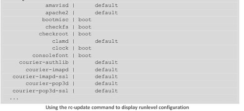

`rc-update` 命令管理基于 Gentoo Linux 的系统上的服务。在上面的示例中，使用 `show` 选项显示当前的运行级别配置。

`add` 和 `del` 选项用于将服务添加或删除到指定的运行级别，如下一个示例所示。

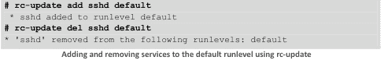

常用用法示例：

| 命令 | 描述 |
| :--- | :--- |
| `rc-update show` | 列出所有服务的运行级别配置 |
| `rc-update add [SERVICE] default` | 将指定服务添加到默认运行级别 |
| `rc-update del [SERVICE] default` | 从默认运行级别中移除指定服务 |

### lssrc

用途：显示 AIX 系统上服务的状态。

使用语法：`lssrc [OPTIONS] [SERVICE/GROUP]`


```
# lssrc -a
Subsystem    Group      PID      Status
syslog       ras        147590   active
sendmail     mail       188508   active
portmap      portmap    126930   active
snmpd/bd     tcpip      151728   active
inetd        tcpip      163958   active
snmpd        tcpip      180316   active
hostmibd     tcpip      159852   active
aixmibd      tcpip      168024   active
bi\od        nfs        196706   active
rpc.statd    nfs        209038   active
rpc.lockd    nfs        204984   active
qdaemon      spooler    217200   active
writesrv     spooler    233588   active
ctmco        ract       241870   active
pconsole     pconsole   270470   active
cmags        229504     active
IBM.ServiceRM  ract_rm  311470   active
IBM.C$MAGentRM ract_rm  291004   active
lpid         spooler    inoperative
...
```

列出所有服务的状态

`lssrc` 命令显示 AIX 系统上服务的状态。上面的示例演示了如何使用 `-a` 选项显示所有服务的状态。下一个示例演示了如何使用 `-s` 选项列出特定服务。

```
# lssrc -s nfsd
Subsystem    Group      PID      Status
nfsd         nfs        inoperative
```

列出特定服务

常用用法示例：

| 命令 | 描述 |
| :--- | :--- |
| `lssrc -a` | 显示所有服务的状态 |
| `lssrc -s [SERVICE]` | 显示指定服务的状态 |
| `lssrc -g [GROUP]` | 显示指定服务组的状 |

### stopsrc / startsrc

**用途**：在 AIX 系统上启动/停止服务。

**用法语法**：`startsrc [OPTIONS] [SERVICE/GROUP]`

```bash
# startsrc -s nfsd
0513-059 The nfsd Subsystem has been started. Subsystem PID is 221400.
```

使用 `startsrc` 在 AIX 上启动服务

`startsrc` 命令用于在 AIX 系统上启动服务（称为 SRC 或系统资源控制器）。上述示例展示了使用 `startsrc` 命令启动 NFS 服务。

`stopsrc` 命令用于在 AIX 系统上停止服务。下一个示例展示了使用 `stopsrc` 停止 NFS 服务。

**用法语法**：`stopsrc [OPTIONS] [SERVICE/GROUP]`

```bash
# stopsrc -s nfsd
0513-044 The nfsd Subsystem was requested to stop.
```

使用 `stopsrc` 在 AIX 上停止服务

**常用用法示例：**

- `startsrc -s [SERVICE]` 启动指定的服务
- `stopsrc -s [SERVICE]` 停止指定的服务
- `startsrc -g [GROUP]` 启动指定的服务组
- `stopsrc -g [GROUP]` 停止指定的服务组
- `stopsrc -a` 停止所有正在运行的服务

### svcs

**用途**：显示 Solaris 系统上服务的状态。

**用法语法**：`svcs [OPTIONS] [SERVICE]`

```bash
### svcs
STATE     STIME   FMRI
legacy_run 19:41:19 lrc:/etc/rc3_d/550sk98xso1
legacy_run 19:42:11 lrc:/etc/rc2_d/5501u
legacy_run 19:42:11 lrc:/etc/rc2_d/5520syssetup
legacy_run 19:42:11 lrc:/etc/rc2_d/554011c2
legacy_run 19:42:12 lrc:/etc/rc2_d/542ncnakmod
legacy_run 19:42:13 lrc:/etc/rc2_d/547pppd
legacy_run 19:42:13 lrc:/etc/rc2_d/570oucP
legacy_run 19:42:13 lrc:/etc/rc2_d/572autoinstall
legacy_run 19:42:13 lrc:/etc/rc2_d/573cachefs_daemon
legacy_run 19:42:14 lrc:/etc/rc2_d/581dodadn_adapt
legacy_run 19:42:14 lrc:/etc/rc2_d/589PRESERVE
legacy_run 19:42:14 lrc:/etc/rc2_d/594ncalogd
legacy_run 19:42:15 lrc:/etc/rc2_d/598ddallocate
legacy_run 19:42:16 lrc:/etc/rc3_d/518boot_server
legacy_run 19:42:17 lrc:/etc/rc3_d/550apache
...
```

使用 `svcs` 命令列出 Solaris 系统上的服务

`svcs` 命令显示 Solaris 系统上服务的状态。不添加任何选项执行 `svcs` 将列出所有活动服务，如上述示例所示。

要查看单个服务的状态，可以指定服务名称，如下一个示例所示。

```bash
# svcs apache
STATE     STIME   FMRI
legacy_run 19:42:17 lrc:/etc/rc3_d/550apache
```

使用 `svcs` 命令列出单个服务的状态

**常用用法示例：**

- `svcs` 显示所有活动服务
- `svcs -a` 显示所有服务
- `svcs [SERVICE]` 显示指定的服务
- `svcs -d [SERVICE]` 显示指定服务的依赖项
- `svcs -D [SERVICE]` 显示依赖于指定服务的服务
- `svcs -l [SERVICE]` 显示关于指定服务的详细信息

### svcadm

**用途**：在 Solaris 系统上启动/停止服务。

**用法语法**：`svcadm [OPTIONS] [SERVICE]`

```bash
# svcadm enable sendmail
# svcs sendmail
STATE  STIME   FMRI
online  14:26:14  svc:/network/smtp:sendmail
```

使用 `svcadm` 命令启动服务

`svcadm` 命令用于控制 Solaris 系统上的服务。它可以用于启动、停止和重启服务。在上述示例中，使用 `enable` 参数启动 `sendmail` 服务。下一个示例展示了使用 `disable` 参数停止 `sendmail` 服务。

```bash
# svcadm disable sendmail
# svcs sendmail
STATE  STIME   FMRI
disabled 14:27:51  svc:/network/smtp:sendmail
```

使用 `svcadm` 命令停止服务

要重启服务，请按照下一个示例所示使用 `restart` 参数。

```bash
# svcadm restart sendmail
```

使用 `svcadm` 命令重启服务

**常用用法示例：**

| 命令 | 描述 |
| :--- | :--- |
| `svcadm enable [SERVICE]` | 启动指定的服务 |
| `svcadm disable [SERVICE]` | 停止指定的服务 |
| `svcadm restart [SERVICE]` | 重启指定的服务 |

### 第 8 节：网络命令

#### 概述

本节涵盖了大多数平台上常见的基本网络实用程序和配置命令。它还概述了对基于网络的服务（如 SSH、NFS 和 FTP）的远程访问。

本节涵盖的命令：

| 命令 | 用途 |
| :--- | :--- |


| `hostname` | 显示系统的主机名。 |
| `ifconfig` | 显示网络接口。 |
| `ifup` | 启用网络接口。 |
| `ifdown` | 禁用网络接口。 |
| `iwconfig` | 显示无线网卡设置。 |
| `ethtool` | 显示和编辑以太网卡设置。 |
| `arp` | 显示 ARP 缓存。 |
| `ping` | 向网络主机发送 ICMP 回显请求。 |
| `traceroute` | 显示 TCP/IP 路由信息。 |
| `tracepath` | 在 Linux 系统上显示 TCP/IP 路由信息。 |
| `nslookup` | 在 Unix 系统上执行 DNS 查找。 |
| `dig` | 在 BSD 和 Linux 系统上执行 DNS 查找。 |
| `host` | 简单的 DNS 查找实用程序。 |
| `whois` | 在 whois 数据库中查找域名注册信息。 |
| `netstat` | 显示网络连接、统计信息和路由信息。 |
| `route` | 显示和配置 TCP/IP 路由。 |
| `ifstat` | 显示网络接口统计信息。 |
| `tcpdump` | 显示网络接口上的原始流量。 |
| `dhclient` | Linux 和 BSD 系统的 DHCP 客户端。 |
| `nmap` | 扫描网络系统上的 TCP/IP 端口。 |
| `telnet` | 通过 telnet 协议连接远程服务器的客户端。 |
| `ssh` | 通过 SSH 协议连接远程服务器的客户端。 |
| `minicom` | 串行通信应用程序。 |
| `mail` | 向本地和远程用户发送电子邮件。 |
| `ftp` | 使用 FTP（文件传输协议）传输文件。 |
| `wget` | Linux 系统的文件下载实用程序。 |
| `showmount` | 显示 NFS 挂载和导出信息。 |

#### 本节使用的术语表：

| 术语 | 定义 |
| :--- | :--- |
| ARP | `地址解析协议`：用于解析 MAC 地址的协议。 |
| DHCP | `动态主机配置协议`：用于自动分配 IP 地址的协议。 |
| DNS | `域名系统`：将主机名解析为 IP 地址的系统。 |
| FTP | `文件传输协议`：用于在远程系统之间传输文件的协议。 |
| 主机名 | 分配给计算机系统的名称。 |
| ICMP | `互联网控制报文协议`：用于向网络系统传递错误消息的协议。 |
| 回环 | 在 Unix、Linux 和 BSD 系统上发现的虚拟网络接口，用于与本机上的网络服务通信。 |
| MAC 地址 | `媒体访问控制地址`：分配给网络接口的唯一标识符。 |
| NFS | `网络文件系统`：用于在 Unix、Linux 和 BSD 系统上通过网络共享存储的协议。 |
| 数据包 | 网络系统之间传输的数据单元。 |
| 路由 | 数据包穿越网络到达目的地的路径。 |
| 串行 | 一种用于连接设备的传统通信形式。 |
| Telnet | 一种用于连接远程系统的传统协议。 |
| SSH | `安全外壳`：一种用于连接远程系统的安全协议。 |

### hostname

**用途**：显示系统的主机名。

**用法语法**：`hostname [OPTIONS]`

```bash
### hostname
mylaptop
```

显示系统的主机名

`hostname` 命令显示分配给本地系统的名称。上述示例展示了 `hostname` 命令的典型输出。

`hostname` 也可以用于显示系统的域名，如下一个示例所示。

```bash
# hostname -d
mydomain.com
```

显示系统的域名

使用 `-f` 选项，可以看到系统的 FQDN（完全限定域名），如下例所示。

```bash
# hostname -f
mylaptop.mydomain.com
```

显示系统的 FQDN

> **注意**
>
> 主机名配置存储在大多数系统的 `/etc/hostname` 中。

**常用用法示例：**

- `hostname`：显示系统的主机名
- `hostname -d`：显示系统的域名
- `hostname -f`：显示系统的完全限定域名

### ifconfig

**用途：** 显示网络接口。

**用法语法：** `ifconfig [OPTIONS] [INTERFACE]`

```bash
$ ifconfig -a
eth0
 Link encap:Ethernet HWaddr 00:21:70:ac:f7:e7
 inet addr:10.10.1.100 Bcast:10.10.1.255 Mask:255.255.255.0
 inet6 addr: fe80::221:70ff:feac:f7e7/64 Scope:Link
 UP BROADCAST RUNNING MULTICAST MTU:1500 Metric:1
 RX packets:2937 errors:0 dropped:0 overruns:0 frame:0
 TX packets:2088 errors:0 dropped:0 overruns:0 carrier:0
 collisions:0 txqueuelen:1000
 RX bytes:2199807 (2.1 MB) TX bytes:548839 (548.8 KB)
 Memory:ffe00000-f7000000

lo
 Link encap:Local Loopback
 inet addr:127.0.0.1 Mask:255.0.0.0
 inet6 addr: ::1/128 Scope:Host
 UP LOOPBACK RUNNING MTU:16436 Metric:1
 RX packets:316 errors:0 dropped:0 overruns:0 frame:0
 TX packets:316 errors:0 dropped:0 overruns:0 carrier:0
 collisions:0 txqueuelen:0
 RX bytes:26552 (26.5 KB) TX bytes:26552 (26.5 KB)
```


`ifconfig` 命令用于显示系统的网络接口配置。`ifconfig` 的输出会显示诸如 IP 地址、MAC 地址以及接口统计计数器等信息，如上例所示。

最常见的网络接口类型是标准的以太网网卡。该接口通常被指定为 `eth0` 或 `en0`。具有多块网卡的系统将包含 `eth0`、`eth1`、`eth2` 等。

> **注意**
>
> *回环接口 (`lo`) 存在于所有 Unix、Linux 和 BSD 系统中。它对系统的正常运行至关重要，不应禁用或修改。该接口的 IP 地址始终为 127.0.0.1。*

**命令用法示例：**

| 命令 | 描述 |
|:---|:---|
| `ifconfig` | 显示已启用的网络接口 |
| `ifconfig -a` | 显示所有网络接口 |
| `ifconfig [INTERFACE]` | 显示指定的网络接口 |

### ifup / ifdown

**用途：** 启用/禁用网络接口。

**用法语法：** `ifup [OPTIONS] [INTERFACE]`

```bash
# ifup eth0
```

使用 `ifup` 命令启用网络接口

`ifup` 用于启用网络接口。在上例中，接口 `eth0` 被启用。执行 `ifup` 命令后，`eth0` 接口被激活并可供使用。

`ifdown` 用于禁用网络接口。这将使指定接口离线并不可用。下一个示例演示了如何使用 `ifdown` 关闭 `eth0` 接口。

**用法语法：** `ifdown [OPTIONS] [INTERFACE]`

```bash
# ifdown eth0
```

使用 `ifdown` 命令禁用网络接口

> **注意**
>
> *某些系统可能会将以太网接口指定为 `en0` 而不是 `eth0`。*

**常见用法示例：**

- `ifup [INTERFACE]` 启用指定的网络接口
- `ifup -a` 启用所有网络接口
- `ifdown [INTERFACE]` 禁用指定的网络接口
- `ifdown -a` 禁用所有网络接口

### iwconfig

**用途：** 显示无线网络接口。

**用法语法：** `iwconfig [INTERFACE] [OPTIONS]`


```bash
$ iwconfig
wlan0 IEEE 802.11abgn ESSID:"my-wlan"
  Mode:Managed Frequency:2.437 GHz Access Point:00:14:BF:E4:1B:E2
  Bit Rate=54 Mb/s Tx-Power=15 dBm
  Retry min limit:7 RTS thr:off Fragment thr=2352 B
  Power Management:off
  Link Quality=97/100 Signal level:-52 dBm Noise level:-91 dBm
  Rx invalid nwid:0 Rx invalid crypt:0 Rx invalid frag:0
  Tx excessive retries:0 Invalid misc:0 Missed beacon:0
```

使用 `iwconfig` 命令显示无线网络接口

`iwconfig` 用于在 Linux 系统上显示无线网络接口。它与之前讨论的 `ifconfig` 命令类似，区别在于它显示特定于无线网络的信息。

在上例中，显示了 `wlan0` 接口的信息。它显示了所连接无线网络的信号级别、噪声级别和传输速率等信息。

**常见用法示例：**

| 命令 | 描述 |
|:---|:---|
| `iwconfig` | 显示所有无线网络接口 |
| `iwconfig [INTERFACE]` | 显示指定的无线网络接口 |

### ethtool

**用途：** 显示以太网网卡设置。

```bash
# ethtool eth0
Settings for eth0:
    Supported ports: [ TP ]
    Supported link modes:   10baseT/Half 10baseT/Full
                            100baseT/Half 100baseT/Full
                            1000baseT/Full
    Supports auto-negotiation: Yes
    Advertised link modes:    10baseT/Half 10baseT/Full
                            100baseT/Half 100baseT/Full
                            1000baseT/Full
    Advertised pause frame use: No
    Advertised auto-negotiation: Yes
    Link partner advertised link modes:  Not reported
    Link partner advertised pause frame use: No
    Link partner advertised auto-negotiation: No
    Speed: 100Mb/s
```

`ethtool` 命令的典型输出

`ethtool` 是一个用于显示网络接口信息的 Linux 工具。其默认输出会显示高级网络接口设置，如上例所示。它还可以使用 `-S` 参数来显示网络统计信息，如下一个示例所示。

```bash
# ethtool -S eth0
NIC statistics:
     rx_packets: 125
     tx_packets: 114
     rx_bytes: 14459
     tx_bytes: 17596
     rx_broadcast: 9
     tx_broadcast: 3
     rx_multicast: 14
     tx_multicast: 19
     rx_errors: 0
```

使用 `-S` 参数显示接口统计信息

| 命令 | 描述 |
|:---|:---|
| `ethtool [INTERFACE]` | 显示网络接口设置 |
| `ethtool -S [INTERFACE]` | 显示网络接口统计信息 |

### arp

**用途：** 显示 ARP 缓存。

**用法语法：** `arp [OPTIONS]`

```bash
$ arp
Address       HWtype   HWaddress           Flags Mask            Iface
10.10.2.1     ether    00:06:B1:12:0D:16   C                     eth1
10.10.2.5     ether    00:14:22:0E:35:5C   C                     eth1
10.10.2.6     ether    00:0C:29:1B:10:70   C                     eth1
10.10.2.7     ether    00:0C:29:C1:C2:0C   C                     eth1
10.10.2.10    ether    00:0C:29:38:00:F6   C                     eth1
```


`arp` 命令用于显示 ARP 缓存。本地网络使用 ARP 与邻近系统进行通信。ARP 协议将 IP 地址解析为目标系统的 MAC 地址。已解析的地址存储在一个缓存中，可以使用 `arp` 命令进行显示，如上例所示。

**常见用法示例：**

- `arp` 显示地址解析协议缓存

### ping

**用途：** 向网络主机发送 ICMP 回显请求。

**用法语法：** `ping [OPTIONS] [HOST]`

```bash
$ ping -c 5 10.10.1.1
PING 10.10.1.1 (10.10.1.1) 56(84) bytes of data.
64 bytes from 10.10.1.1: icmp_seq=1 ttl=64 time=0.286 ms
64 bytes from 10.10.1.1: icmp_seq=2 ttl=64 time=0.235 ms
64 bytes from 10.10.1.1: icmp_seq=3 ttl=64 time=0.232 ms
64 bytes from 10.10.1.1: icmp_seq=4 ttl=64 time=0.212 ms
64 bytes from 10.10.1.1: icmp_seq=5 ttl=64 time=0.216 ms
--- 10.10.1.1 ping statistics ---
5 packets transmitted, 5 received, 0% packet loss, time 4002ms
```

使用 `ping` 命令向网络主机发送 ping

`ping` 命令向网络主机发送 ICMP 回显请求。这在排查网络连接问题时非常有用。在上例中，执行 `ping -c 5` 会向 IP 地址为 10.10.1.1 的主机发送五个 ping 数据包。

> **注意** *如果省略 `-c` 参数，`ping` 命令将持续执行直到被中断（按 CTRL + C）。*

> **提示** *`ping6` 命令用于向 IP 版本 6 的主机发送 ping。*

**常见用法示例：**

- `ping [HOST]` — 向指定主机发送 ping
- `ping -c [NUM] [HOST]` — 发送指定数量的 ICMP 数据包
- `ping -f [HOST]` — 执行快速（洪泛）ping

### traceroute

**用途：** 显示 TCP/IP 路由信息。

**用法语法：** `traceroute [OPTIONS] [HOST]`


```bash
$ traceroute -n www.google.com
traceroute to www.google.com (74.125.95.103), 30 hops max, 60 byte packets
1  192.168.1.254  3.634 ms  3.758 ms  4.511 ms
2  99.60.32.2  25.398 ms  27.472 ms  28.040 ms
3  76.196.172.4  28.261 ms  29.739 ms  28.926 ms
4  151.164.94.52  29.057 ms  29.583 ms  29.824 ms
5  69.220.8.57  39.645 ms *  40.455 ms
6  72.14.197.113  41.461 ms  39.534 ms  39.995 ms
7  72.14.233.67  39.437 ms  72.14.233.65  31.567 ms  36.633 ms
8  216.239.47.121  42.631 ms  43.298 ms  216.239.47.131 44.649 ms
...
```

使用 `traceroute` 显示 TCP/IP 数据包的路由

` traceroute` 命令用于追踪数据包在 TCP/IP 网络中经过的路径。上述示例演示了如何使用 `traceroute` 命令显示到 www.google.com 的网络路由。沿网络路径的路由器（又称跳数）会被识别，并附带响应时间（以毫秒为单位）。

> **提示** `traceroute6` 命令用于追踪 IP 版本 6 的主机。

**常见用法示例：**

| 命令 | 描述 |
|:---|:---|
| `traceroute [HOST]` | 追踪到指定主机的路由 |
| `traceroute -n [HOST]` | 追踪时不查找 DNS 名称 |

### tracepath

**用途：**在 Linux 系统上显示 TCP/IP 路由信息。

**语法：**`tracepath [OPTIONS] [HOST]`

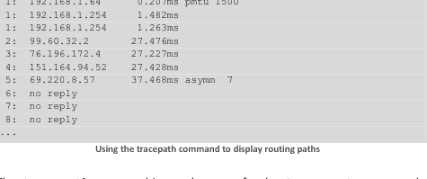

`tracepath` 命令是 Linux 系统上 `traceroute` 命令的替代程序。你可以在 Linux 上使用这两个程序中的任意一个，但许多发行版默认只包含 `tracepath`。上述示例演示了如何使用 `tracepath` 显示到 www.google.com 的路由。

> **提示** `tracepath6` 命令用于跟踪 IP 版本 6 主机。

常见用法示例：

- `tracepath [HOST]`

  跟踪到指定主机的路径

- `tracepath -n [HOST]`

  在跟踪时不查找 DNS 名称

### nslookup

**用途：**在 Unix 系统上执行 DNS 查找。

**语法：**`nslookup [OPTIONS] [HOST]`

```bash
$ nslookup www.dontfeartheCommandLine.com
Server:        68.105.28.14
Address:       68.105.28.14#53

Non-authoritative answer:
Name:          dontfeartheCommandLine.com
Address:       64.202.189.170
Using the nslookup command to resolve a domain name
```

`nslookup` 命令执行 DNS 查找查询。它将 DNS 名称解析为 IP 地址，对于排查网络名称解析问题很有帮助。在上例中，解析并显示了指定主机的 IP 地址。

> **注意** `nslookup` 被视为一个遗留程序，在许多系统中已被更现代的命令（如 `dig`（见第 151 页）和 `host`（见第 152 页））所取代。

**常见用法示例：**

- `nslookup [HOST]`

  解析指定的主机名

### dig

**用途：**在 BSD 和 Linux 系统上执行 DNS 查找。

**语法：**`dig [OPTIONS] [HOST]`

```bash
$ dig dontfeartheCommandLine.com
; <<>> DiG 9.5.1-P2 <<>> dontfeartheCommandLine.com
; global options: printcmd
; Got answer:
; ->>HEADER<<- opcode: QUERY, status: NOERROR, id: 20739
; flags: qr rd ra; QUERY: 1, ANSWER: 1, AUTHORITY: 0, ADDITIONAL: 0

; QUESTION SECTION:
;dontfeartheCommandLine.com. IN A

; ANSWER SECTION:
dontfeartheCommandLine.com. 2681 IN A 64.202.189.170

; Query time: 4 msec
; SERVER: 10.10.1.4#53(10.10.1.44)
; WHEN: Mon Jun 1 05:38:40 2009
; MSG SIZE rcvd: 60
```


`dig` 命令在 Linux 和 BSD 系统上执行 DNS 查询。它是 `nslookup` 命令的现代替代工具。上述示例演示了 `dig` 命令的典型用法。

常见用法示例：

- `dig [HOST]`

  显示指定主机的 DNS 信息

- `dig -t MX [HOST]`

  显示指定主机的邮件服务器

- `dig -t NS [HOST]`

  显示指定主机的名称服务器

### host

**用途：**简单的 DNS 查找工具。

**语法：**`host [OPTIONS] [HOST]`

```bash
$ host dontfeartheCommandLine.com

dontfeartheCommandLine.com has address 64.202.189.170

dontfeartheCommandLine.com mail is handled by 0 smtp.secureserver.net.

dontfeartheCommandLine.com mail is handled by 10
mailstore1.secureserver.net.

    Resolving a name using the host command
```

`host` 命令是 Unix 和 Linux 系统的简单 DNS 查找工具。它与 `nslookup` 和 `dig` 工具类似，但其输出更对用户友好，易于阅读和理解。上述示例展示了 `host` 命令产生的输出样本。

`host` 命令可以使用 `-t` 选项来查找有关域名的其他信息，如下例所示的邮件服务器（`-t MX`）和名称服务器（`-t NS`）。

```bash
$ host -t MX dontfeartheCommandLine.com

dontfeartheCommandLine.com mail is handled by 10
mailstore1.secureserver.net.

dontfeartheCommandLine.com mail is handled by 0 smtp.secureserver.net.

$ host -t NS dontfeartheCommandLine.com

dontfeartheCommandLine.com name server ns36.domaincontrol.com.

dontfeartheCommandLine.com name server ns35.domaincontrol.com.

    Resolving MX and NS records using the host command
```

常见用法示例：

| 命令 | 描述 |
| :--- | :--- |
| `host [HOST]` | 显示指定主机的 DNS 信息 |
| `host -t MX [HOST]` | 显示指定主机的邮件服务器 |
| `host -t NS [HOST]` | 显示指定主机的名称服务器 |
| `host -a [HOST]` | 显示指定主机的详细信息 |

### whois

**用途：**在 WHOIS 数据库中查找域名注册信息。

**语法：**`whois [OPTIONS] [DOMAIN]`


```bash
$ whois google.com
Registrar:
    Dns Admin
    Google Inc.
    Please contact contact-admin@google.com
    1600 Amphitheatre Parkway
    Mountain View CA 94043
    dns-admin@google.com +1.650**** Fax: +1.650****
    Domain Name: google.com
    Registrar Name: Markmonitor.com
    Registrar Whois: whois.markmonitor.com
    Registrar Homepage: http://www.markmonitor.com
    Created on.............: 1997-09-15.
    Expires on.............: 2011-09-13.
    Record last updated on..: 2008-06-08.
    Domain servers in listed order:
    ns1.google.com ns2.google.com
...
```

使用 `whois` 命令查询域名信息

`whois` 命令用于查询互联网注册局并显示域名注册人的信息。在上例中，`whois` 命令显示了 `google.com` 的信息。

> 你还可以通过执行 `whois [IP ADDRESS]` 来使用 `whois` 命令查找有关 IP 地址的信息。

常见用法示例：

- `whois [DOMAIN]`

  显示域名注册人的信息

- `whois [IP ADDRESS]`

  显示 IP 地址所有者的信息

### netstat

**用途：**显示网络连接、统计信息和路由信息。

**语法：**`netstat [OPTIONS]`

```bash
### netstat

Active Internet connections (w/o servers)
Proto Recv-Q Send-Q Local Address Foreign Address State
tcp 0 463 10.10.2.4:1110 12.185.92.178:50598 ESTABLISHED
tcp 0 0 10.10.2.4:1110 66.103.123.134:1402 TIME_WAIT
tcp 0 0 127.0.0.1:10030 127.0.0.1:53041 ESTABLISHED
tcp 0 0 127.0.0.1:10025 127.0.0.1:38740 TIME_WAIT
tcp 0 72 10.10.2.4:22 10.10.1.251:50082 ESTABLISHED
...
```

`netstat` 命令的默认输出

`netstat` 是一个显示网络状态信息的实用工具。不带选项执行 `netstat` 将显示本地系统上的所有活动网络连接，如上例所示。还可以使用 `-s` 选项显示详细的网络统计信息，如下例所示。

```bash
# netstat -s
Ip:
200104378 total packets received
0 forwarded
0 incoming packets discarded
200104318 incoming packets delivered
258439688 requests sent out
...
```

使用 `-s` 选项通过 `netstat` 显示网络统计信息

`-rn` 选项是另一个有用的功能，用于显示 TCP/IP 路由表。

```bash
$ netstat -r
Kernel IP routing table
Destination Gateway Genmask Flags MSS Window irtx Iface
10.10.2.0 0.0.0.0 255.255.255.0 U 0 0 0 eth0
0.0.0.0 10.10.2.1 0.0.0.0 UG 0 0 0 eth0
```

使用 `netstat` 显示路由表

**常见用法示例：**

| 命令 | 描述 |
| :--- | :--- |
| `netstat` | 显示活动网络连接 |
| `netstat -s` | 显示网络统计信息 |
| `netstat -r` | 显示路由信息 |

### route

**用途：**显示和配置 TCP/IP 路由。

**语法：**`route [OPTIONS]`

```bash
$ route -n

Kernel IP routing table
Destination    Gateway    Genmask    Flags Metric Ref Use Iface
192.168.101.0    0.0.0.0    255.255.255.0 U    0      0     0 wlan0
10.10.1.0        0.0.0.0    255.255.255.0 U    0      0     0 eth0
0.0.0.0          10.10.1.1  0.0.0.0      UG   0      0     0 eth0
0.0.0.0          192.168.101.1 0.0.0.0    UG   0      0     0 wlan0

Displaying routing tables
```

`route` 命令显示和配置网络路由。在上例中，执行 `route -n` 显示了本地系统的路由表。

`add` 和 `del` 选项可用于添加或删除静态路由，如下例所示。

```bash
# route add -net 10.10.2.0/24 gw 10.10.1.1 eth0
# route del -net 10.10.2.0/24

Adding and removing static TCP/IP routes
```

**常见用法示例：**

- `route -n`

  显示路由表

- `route add [ROUTE]`

  添加指定的静态路由

- `route del [ROUTE]`

  删除指定的静态路由

### iostat

**用途：** 显示网络接口统计信息。

**用法语法：** `iostat` `[DELAY]` `[COUNT]`

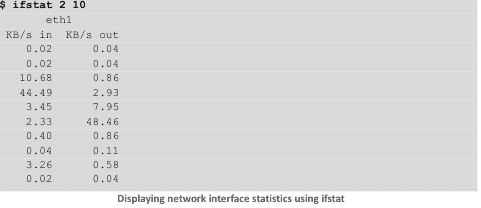

`iostat` 用于显示网络接口的统计信息。它可以用于监测一段时间内网络接口的活动状态。在上面的示例中，执行 `iostat 2 10` 命令将每两秒显示一次接口统计信息，共重复十次。

**注意**

如果未指定任何参数，`iostat` 将持续显示网络利用率，直到用户中断该操作（通过按 `CTRL + C`）。

**常用用法示例：**

| 命令 | 说明 |
| :--- | :--- |
| `iostat` | 持续显示网络利用率 |
| `iostat` `[DELAY]` | 按指定间隔更新结果 |
| `iostat` `[DELAY]` `[COUNT]` | 达到指定次数后停止 |

### tcpdump

**用途：** 显示网络接口上的原始流量。

**用法语法：** `tcpdump [OPTIONS]`

```
### tcpdump
listening on eth0, link-type EN10MB (Ethernet), capture size 96 bytes
05:59:05.027107 arp who-has 10.10.1.242 tell lt--cad12-
01.dontfearthecommandline.com
05:59:05.028261 IP dt-office-27.dontfearthecommandline.com.50999 >
exchange-01.dontfearthecommandline.com.domain: 9454+ PTR?
242.1.10.10.in-addr.arpa. (42)
05:59:05.028459 arp who-has dt-office-27.dontfearthecommandline.com
tell exchange-01.dontfearthecommandline.com
05:59:05.028475 arp reply dt-office-27.dontfearthecommandline.com is-at
00:21:70:ac:ff:1e (oui Unknown)
...
18 packets captured
303 packets received by filter
0 packets dropped by kernel

Using the tcpdump command to capture network traffic
```


### tcpdump

`tcpdump` 用于显示本地系统发送和接收的网络数据包。它在监控网络状况或排查连接故障时非常有用。

在上面的示例中，`tcpdump` 捕获了 `eth0` 接口上的网络流量。随后，每个数据包的信息会显示在屏幕上。捕获过程将持续进行，直到用户中断该操作（通过按 `CTRL + C`）。

> 提示
>
> `tcpdump` 的输出可能难以解读。有一款名为 `Wireshark` 的免费工具，可用于导入 `tcpdump` 捕获的数据包以便轻松查看。`Wireshark` 支持 Linux、Mac OS X 和 Windows 系统。请访问 www.wireshark.com 获取更多信息。

| 命令 | 说明 |
| :--- | :--- |
| `tcpdump` | 在屏幕上显示网络流量 |
| `tcpdump > [FILE]` | 将数据包捕获结果保存为文件 |
| `tcpdump -i [INTERFACE]` | 捕获指定接口上的流量 |
| `tcpdump -vv` | 显示详细的数据包信息 |
| `tcpdump -c [COUNT]` | 接收指定数量的数据包后停止 |

### dhclient

**用途：** Linux 和 BSD 系统的 DHCP 客户端。

**用法语法：** `dhclient [OPTIONS] [INTERFACE]`

```
# dhclient eth0
Listening on LFF/eth0/00:21:70:ac:f7:e7
Sending on LPP/eth0/00:21:70:ac:f7:e7
Sending on Sccekt/fallback
DHCPREQUEST of 10.10.1.100 on eth0 to 255.255.255.255 port 67
DHCPACK of 10.10.1.100 from 10.10.1.45
bound to 10.10.1.100 -- renewal in 37193 seconds,
Using dhclient to request a DHCP address
```

`dhclient` 是用于向 DHCP 服务器请求 IP 地址的客户端。上述示例演示了如何使用 `dhclient` 命令为 `eth0` 接口请求 IP 地址。

> 提示
>
> 若要释放 DHCP 地址，请在命令行中执行 `dhclient -r`。

| 命令 | 说明 |
| :--- | :--- |
| `dhclient [INTERFACE]` | 向 DHCP 服务器请求 IP 地址 |
| `dhclient -r [INTERFACE]` | 释放已分配的 IP 地址 |

### nmap

**用途：** 扫描网络系统上的 TCP/IP 端口。

**用法语法：** `nmap [OPTIONS] [HOST]`

```
# nmap -o 10.10.1.70

Starting Nmap 5.00 ( http://nmap.org ) at 2010-05-06 11:55 CDT
Interesting ports on 10.10.1.70:
Not shown: 995 closed ports
PORT      STATE  SERVICE
135/tcp   open     msrpc
139/tcp   open     netbios-ssn
445/tcp   open     microsoft-ds
5800/tcp  open     vnc-http
5900/tcp  open     vnc
MAC Address: 00:1A:A0:05:6B:19 (Dell)
Device type: general purpose
Running: Microsoft Windows XP
OS details: Microsoft Windows XP SP2 or SP3, or Windows Server 2003
Network Distance: 1 hop

OS detection performed. Please report any incorrect results at
http://nmap.org/submit/
Nmap done: 1 IP address (1 host up) scanned in 2.94 seconds
```


`nmap` 是一款网络扫描工具。它可用于评估安全性以及排查网络连接问题。在上面的示例中，使用 `nmap` 命令来识别指定目标主机上的操作系统和开放端口。

> 提示
>
> 为获得最佳效果，请以 root 用户身份或通过 `sudo` 命令运行 `nmap`。这允许 `nmap` 在执行网络扫描时拥有对系统资源的无限制访问权限。

| 命令 | 说明 |
| :--- | :--- |
| `nmap [HOST]` | 显示指定主机上的开放端口 |
| `nmap -PN [HOST]` | 扫描前不对目标进行 ping |
| `nmap -O [HOST]` | 显示目标系统的操作系统 |
| `nmap -A [HOST]` | 执行深度扫描 |

### telnet

**用途：** 通过 Telnet 协议连接远程服务器的客户端。

**用法语法：** `telnet [OPTIONS] [HOST]`

```
$ telnet myserver
login: nick
password: ******
$
```


`telnet` 命令用于通过 Telnet 协议连接远程系统。上述示例演示了如何使用 `telnet` 连接远程系统。一旦连接到远程系统，你就可以像在本地登录系统一样执行命令。

> 注意
>
> Telnet 是一种不安全的遗留协议，由于安全原因，它已 largely 被 SSH 取代。通过 Telnet 传输的用户名、密码及其他敏感信息均以明文发送，极易被黑客截获。尽可能避免使用 Telnet，尤其是在互联网等不可信网络上通信时。

| 命令 | 说明 |
| :--- | :--- |
| `telnet [HOST]` | 启动到远程系统的 Telnet 会话 |

### ssh

**用途：** 通过 SSH 协议连接远程服务器的客户端。

**用法语法：** `ssh [OPTIONS] [HOST]`

```
$ ssh myserver
nick@myserver's password: ******
$
```


`ssh` 命令用于通过 SSH 协议连接远程系统。SSH 在两个系统之间建立加密连接，并提供安全的通信通道。这有助于防止“中间人”攻击者截获敏感信息（如用户名和密码）。

> 提示
>
> PuTTY 是一款适用于 Windows 的免费 SSH 和 Telnet 客户端，可在此处下载：www.chiark.greenend.org.uk/~sgtatham/putty/。它允许你直接从 Windows 系统连接远程 Unix、Linux 和 BSD 服务器。

| 命令 | 说明 |
| :--- | :--- |
| `ssh [HOST]` | 启动到远程系统的 SSH 会话 |
| `ssh -l [USER] [HOST]` | 以指定用户身份登录目标系统 |
| `ssh -C [HOST]` | 启用压缩（适用于慢速连接） |

### minicom

**用途：** 串行通信应用程序。

**用法语法：** `minicom [OPTIONS]`

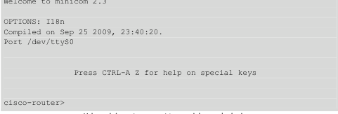

`minicom` 是 BSD 和 Linux 系统的串行通信工具。它可以用于通过命令行连接串行设备（如路由器和交换机）。上述示例演示了如何使用 `minicom` 连接通过串行接口连接的 Cisco 路由器。


### mail

**用途：** 向本地和远程用户发送邮件。

**用法语法：** `mail [OPTIONS] [ADDRESS]`

```
$ mail grepnick@gmail.com
Subject: Hello
Want to go get some tacos?
<CTRL + D>
```


mail 命令用于发送邮件。在上面的示例中，创建了一封新邮件并指定了收件人。按回车键后，邮件客户端会提示输入邮件主题。再次按回车键开始输入邮件正文。按 `CTRL + D` 退出邮件客户端并发送该邮件。

> 提示
>
> 按两次 `CTRL + C` 可取消编辑并丢弃该邮件消息（而不发送）。

可以使用文本文件替代邮件正文。在下一个示例中，`message.txt` 文件中的文本将作为邮件正文发送。

```
$ mail -s "Hello" grepnick@gmail.com < message.txt
```


| 命令 | 说明 |
| :--- | :--- |
| `mail` | 检查新邮件 |
| `mail [ADDRESS]` | 开始撰写发往指定地址的新消息 |
| `mail [ADDRESS] < [FILE]` | 使用指定文件作为消息正文 |
| `mail -s "[SUBJECT]" [ADDRESS]` | 在命令行中指定消息主题 |

### ftp

**用途**：使用 FTP（文件传输协议）传输文件。

**用法语法：** `ftp [OPTIONS] [HOST]`

```
# ftp 10.10.1.48

Connected to 10.10.1.48.
Name (10.10.1.45): nick
Password: ********
230 Login successful.
Remote system type is UNIX.
Using binary mode to transfer files.
ftp>
```


`ftp` 命令使用 FTP 协议传输文件。上述示例演示了如何使用 `ftp` 命令连接到远程 FTP 服务器。连接到远程系统后，您可以执行下表列出的 FTP shell 命令之一。

**FTP 命令**

| 命令 | 功能 |
| :--- | :--- |
| `ascii` | 以 ASCII 格式传输文件 |
| `binary` | 以二进制格式传输文件 |
| `status` | 显示连接状态 |
| `pwd` | 打印当前工作目录 |
| `ls` | 列出远程目录内容 |
| `get [FILE]` | 下载指定的远程文件 |
| `put [FILE]` | 上传指定的本地文件 |
| `cd [PATH]` | 在远程系统上更改目录 |
| `lcd [PATH]` | 在本地系统上更改目录 |
| `mkdir [DIR]` | 创建目录 |
| `rmdir [DIR]` | 删除目录 |
| `delete [FILE]` | 删除文件 |
| `rename [FILE]` | 重命名文件 |
| `bye` | 终止 FTP 连接 |

**常见用法示例：**

| 示例 | 描述 |
| :--- | :--- |
| `ftp [HOST]` | 与指定的主机启动 FTP 会话 |
| `ftp -p [HOST]` | 使用被动模式进行数据传输 |

### wget

**用途：** Linux 系统的文件下载工具。

**用法语法：** `wget [OPTIONS] [SOURCE]`

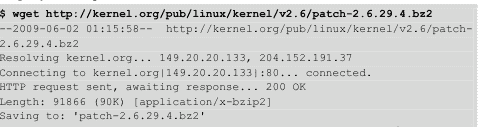

`wget` 是一个用于命令行的文件下载工具。它可以用于通过 HTTP 和 FTP 协议下载文件。在上述示例中，从远程 HTTP 系统下载了一个文件并将其保存在当前目录中。

> 使用 `--user=[USERNAME]` 和 `--password=[PASSWORD]` 选项来指定连接远程系统时使用的用户名和密码。

**常见用法示例：**

- `wget http://[HOST/FILE]`
  - 通过 HTTP 下载指定文件
- `wget ftp://[HOST/FILE]`
  - 通过 FTP 下载指定文件

### showmount

**用途：** 显示 NFS 挂载和导出信息。

**用法语法：** `showmount [OPTIONS]`

```
### showmount
Hosts on noc-01:
10.10.1.48
```


`showmount` 命令显示运行在本地系统上的 NFS 服务器的信息。上述示例演示了如何使用 `showmount` 显示当前连接到 NFS 服务器的客户端列表。

下一个示例演示了如何使用 `-e` 选项显示 NFS 服务器的导出列表。

```
# showmount -e
Export list for noc-01:
/home 10.10.1.0/255.255.255.0
```


`-d` 选项用于显示当前正在使用的已导出目录列表，如下一个示例所示。

```
# showmount -d
Directories on noc-01:
/home
```


**常见用法示例：**

| 命令 | 描述 |
| :--- | :--- |
| `showmount` | 显示当前连接到服务器的 NFS 客户端 |
| `showmount -e` | 显示 NFS 服务器导出的目录 |
| `showmount -d` | 列出当前正在使用的已导出目录 |
| `showmount -a` | 显示 NFS 客户端及其挂载的目录 |

### 第 9 节：硬件管理命令

**概述**

本节中的命令涵盖了基本的 Unix、Linux 和 BSD 硬件管理实用程序。这些命令可用于识别、配置和排除系统设备的故障。

**本节涵盖的命令：**

| 命令 | 用途 |
| :--- | :--- |
| `lshw` | 列出 Linux 系统上的硬件。 |
| `ioscan` | 列出 HP-UX 系统上的硬件。 |
| `lsdev` | 列出 AIX 系统上的硬件。 |
| `lspci` | 列出 Linux 系统上的 PCI 设备。 |
| `pciconf` | 列出 BSD 系统上的 PCI 设备。 |
| `lsusb` | 列出 Linux 系统上的 USB 设备。 |
| `dmidecode` | 显示系统中设备的详细信息。 |
| `hdparm` | 在 Linux 系统上显示/设置硬盘参数。 |
| `eject` | 卸载可移动介质。 |

**本节使用的术语表：**

- `IDE` | (集成驱动电子) 用于将磁盘驱动器连接到计算机的旧接口。
- `PCI` | (外围组件互连) 用于将内部设备连接到计算机的接口。
- `SATA` | (串行高级技术附件) 用于将磁盘驱动器连接到计算机的现代接口。
- `USB` | (通用串行总线) 用于将外部设备连接到计算机的接口。

### lshw

**用途**：列出 Linux 系统上的硬件。

**用法语法：** `lshw [OPTIONS]`

```
# lshw -short
H/W path  Device    Class      Description
==========================================
        /     system     OptiPlex GX520
        /0   bus        0WG233
        /0/0   memory   64KiB BIOS
        /0/00    processor Intel(R) Pentium(R) 4 CPU 3.00GHz
        /0/000/700    memory    16KiB L1 cache
        /0/000/701    memory    2MiB L2 cache
        /0/000/0.1    processor  Logical CPU
        /0/000/0.2    processor  Logical CPU
        /0/1000   memory    2GiB System Memory
        /0/1000/0   memory  1GiB DIMM DDR Synchronous 533 MHz
        ...
```

使用 `-short` 选项的 `lshw` 命令输出


### lshw

```
nc@-01
        description: Mini Tower Computer
        product: OptiPlex GX520
        vendor: Dell Inc.
        serial: ******
        width: 32 bits
        capabilities: smbios-2.3 dmi-2.3 smp-1.4 smp
        configuration: administrator_password=enabled boot=normal
        chassis=mini-tower cpus=1
*->core
        description: Motherboard
        product: 0WG233
        vendor: Dell Inc.
        ...
```

`lshw` 命令的默认输出

**常见用法示例：**

- `lshw`
  - 显示详细的硬件列表
- `lshw -short`
  - 显示简化的硬件列表

### ioscan

**用途：** 列出 HP-UX 系统上的硬件。

**用法语法：** `ioscan [OPTIONS]`

```
H/W Path  Class         Description
=======    ===         ==========
      0
            bc           I/O Adapter
8/0        ext_bus      GSC add-on Fast/Wide SCSI Interface
8/0.5      target
8/0.5.0    disk         SEAGATE  ST34371W
8/0.7      target
8/0.7.0    cti          Initiator
8/0.8      target
8/0.8.0    disk         SEAGATE  ST318436LC
8/4        ba           PCI Bus Bridge - GSCtoPCI
8/4/1/0    lan          HP  J3515A  HSC 10/100Base-TX D-Class
1 port     Core I/O Adapter
8/16       ba           Initiator
8/16/0     ext_bus      Built-in Parallel Interface
8/16/4     tty          Built-in RS-232C
8/16/5     ext_bus      Built-in SCSI
8/16/5.0   target
8/16/5.0.0 tape         HP  C1537A
8/16/5.2   target
8/16/5.2.0 disk         SONY   CD-ROM CDU-76S
8/16/5.7   target
8/16/5.7.0 cti          Initiator
8/16/6     lan          Built-in LAN
8/16/7     ps2          Built-in Keyboard/Mouse
8/20       ba           Core I/O Adapter
8/20/2     tty          Built-in RS-232C
...
```

在 HP-UX 上使用 `ioscan` 列出设备

`ioscan` 显示安装在 HP-UX 系统上的硬件信息。上述示例显示了这个命令的典型输出，其中包含关于系统硬件配置的信息。

**常见用法示例：**

- `ioscan`
  - 显示简化的硬件列表
- `ioscan -f`
  - 显示详细的硬件列表

### lsdev

**用途：** 列出 AIX 系统上的硬件。

**用法语法：** `lsdev [OPTIONS]`

```
L2cache0      Available     L2 Cache
cd0           Available     L5-00       IDE DVD-ROM Drive
en0           Available     1L-08       Standard Ethernet Network Interface
en1           Defined       1J-08       Standard Ethernet Network Interface
ent0          Available     1L-08       10/100 Mpbs Ethernet PCI Adapter II
ent1          Available     1L-08       10/100/1000 Base-TX PCI-X Adapter
et0           Defined       1L-08       IEEE 802.3 Ethernet Network Interface
et1           Defined       1J-08       IEEE 802.3 Ethernet Network Interface
fd0           Available     01-D1-00-00 Diskette Drive
fda0          Available     01-D1       Standard I/O Diskette Adapter
hd1           Defined                   Logical volume
hd2           Defined                   Logical volume
hd3           Defined                   Logical volume
hd4           Defined                   Logical volume
hd5           Defined                   Logical volume
hd6           Defined                   Logical volume
hd8           Defined                   Logical volume
hd10opt       Defined                   Logical volume
hd11admin     Defined                   Logical volume
hd9var        Defined                   Logical volume
hdisk0        Available     1S-08-00-5,0 16 Bit LVD SCSI Disk Drive
hdisk1        Defined       1S-08-00-8,0 Other SCSI Disk Drive
hdisk2        Available     1S-08-00-8,0 16 Bit LVD SCSI Disk Drive
ide0          Available     L5-19       ATA/IDE Controller Device
...
```

在 AIX 上使用 `lsdev` 列出设备

`lsdev` 显示安装在 AIX 系统上的硬件信息。上述示例显示了这个命令的典型输出，其中包含关于本地系统上安装的硬件的信息。

**常见用法示例：**

- `lsdev`
  - 显示简化的硬件列表

### lspci

**用途：** 在 Linux 系统上列出 PCI 设备。

**用法语法：** `lspci [OPTIONS]`


### lspci

```bash
00:00.0 Host bridge: Intel Corporation 82945G/GZ/P/PL Memory Controller
Hub (rev 02)
00:01.0 PCI bridge: Intel Corporation 82945G/GZ/P/PL PCI Express Root
Port (rev 02)
00:02.0 VGA compatible controller: Intel Corporation 82945G/GZ
Integrated Graphics Controller (rev 02)
00:02.1 Display controller: Intel Corporation 82945G/GZ Integrated
Graphics Controller (rev 02)
00:1c.0 PCI bridge: Intel Corporation 82801G (ICH7 Family) PCI Express
Port 1 (rev 01)
00:1c.1 PCI bridge: Intel Corporation 82801G (ICH7 Family) PCI Express
Port 2 (rev 01)
...
```


`lspci` 在 Linux 系统上列出 PCI 设备。在上面的示例中，显示了一个基本的 PCI 设备列表。使用 `--v` 选项可以生成更详细的列表，如下一个示例所示。

```bash
# lspci --v
00:00.0 Host bridge: Intel Corporation 82945G/GZ/P/PL Memory Controller
Hub (rev 02)
    Subsystem: Dell Device 01ad
    Flags: bus master, fast devsel, latency 0
    Capabilities: [e0] Vendor Specific Information <?>
    Kernel driver in use: agpgart-intel
    Kernel modules: intel-agg

00:01.0 PCI bridge: Intel Corporation 82945G/GZ/P/PL PCI Express Root
Port (rev 02)
    Flags: bus master, fast devsel, latency 0
    Bus: primary=00, secondary=01, subordinate=01, sec-latency=0
    Memory behind bridge: fe900000-fe9fffff
    Capabilities: [88] Subsystem: Intel Corporation Device 0000
    Capabilities: [80] Power Management version 2
...
```


**常见用法示例：**

- `lspci`：显示简单的 PCI 设备列表
- `lspci --v`：显示详细的 PCI 设备列表

### pciconf

**用途：** 在 BSD 系统上列出 PCI 设备。

**用法语法：** `pciconf [OPTIONS]`

```bash
# pciconf -lv | less
hostb0@pci0:0:0:0:		class=0x060000 card=0x00000000 chip=0x12370886
rev=0x02 hdr=0x00
  vendor	= 'Intel Corporation'
  device	= '82440/1FX 440FX (Natoma) System Controller'
  class	= bridge
  subclass	= HOST-PCI
isa0@pci0:0:1:0:		class=0x060100 card=0x00000000 chip=0x70000886
rev=0x00 hdr=0x00
  vendor	= 'Intel Corporation'
  device	= 'PIIX3 PCI-to-ISA Bridge (Triton II) (82371SB)'
  class	= bridge
  subclass	= PCI-ISA
atapci0@pci0:0:1:1:		class=0x01018a card=0x00000000 chip=0x71110886
rev=0x01 hdr=0x00
  vendor	= 'Intel Corporation'
  device	= 'PIIX4/4E/4M IDE Controller (82371AB/EB/MB)'
  class	= mass storage
  subclass	= ATA
vgapci0@pci0:0:2:0:		class=0x030000 card=0x00000000 chip=0xbeef80ee
...
```


`pciconf` 命令在 BSD 系统上显示 PCI 设备。上述示例演示了如何在 BSD 系统上列出 PCI 设备。

> **注意**
>
> *在某些 BSD 系统上，可以使用 `pcidump` 或 `devinfo` 命令代替 `pciconf` 命令。*

**常见用法示例：**

- `pciconf -lv`：显示完整的 PCI 设备列表

### lsusb

**用途**：在 Linux 系统上列出 USB 设备。

**用法语法：** `lsusb [OPTIONS]`

```bash
### lsusb
Bus 003 Device 001: ID 1d6b:0001 Linux Foundation 1.1 root hub
Bus 004 Device 001: ID 1d6b:0001 Linux Foundation 1.1 root hub
Bus 001 Device 004: ID 0930:6544 Kingston DataTraveler 2.0 Stick (2GB)
Bus 001 Device 001: ID 1d6b:0002 Linux Foundation 2.0 root hub
Bus 005 Device 001: ID 1d6b:0001 Linux Foundation 1.1 root hub
Bus 002 Device 003: ID 0461:4d15 Dell Optical Mouse
Bus 002 Device 002: ID 413c:2105 Dell Model L100 Keyboard
Bus 002 Device 001: ID 1d6b:0001 Linux Foundation 1.1 root hub

使用 lsusb 显示 USB 设备列表
```

`lsusb` 在 Linux 系统上列出 USB 设备。不带任何选项执行 `lsusb` 将显示本地系统上所有 USB 设备的简单列表，如上述示例所示。

`-v` 选项可与 `lsusb` 一起使用，以显示 USB 设备的详细列表，如下一个示例所示。

```bash
# lsusb -v | less

Bus 003 Device 001: ID 1d6b:0001 Linux Foundation 1.1 root hub
Device Descriptor:
bLength                  18
bDescriptorType           1
bcdUSB                  1.10
bDeviceClass               9 Hub
bDeviceSubClass             0 Unused
bDeviceProtocol             0 Full speed (or root) hub
bMaxPacketSize0             64
idVendor  0x1d6b Linux Foundation
idProduct   0x0001 1.1 root hub
bcdDevice               2.06
...

显示详细的 USB 设备列表
```

**常见用法示例：**

- `lsusb`：显示 USB 设备
- `lsusb -v`：显示 USB 设备的详细列表
- `lsusb -t`：以树状模式显示 USB 设备

### dmidecode

**用途：** 显示系统中设备的详细信息。

**用法语法：** `dmidecode [OPTIONS]`


```bash
### dmidecode
SMBIOS 2.31 present.
45 structures occupying 1654 bytes.
Table at 0x000E0010.

Handle 0x0000, DMI type 0, 20 bytes
BIOS Information
    Vendor: Phoenix Technologies LTD
    Version: 6.00
    Release Date: 04/17/2006
    Address: 0xE7C70
    Runtime Size: 99216 bytes
    ROM Size: 64 KB
    Characteristics:
        ISA is supported
        PCI is supported
        PC Card (PCMCIA) is supported
        PNP is supported
        APM is supported
        BIOS is upgradable
        BIOS shadowing is allowed
        ESCD support is available
        USB legacy is supported
        Smart battery is supported
        BIOS boot specification is supported

Handle 0x0001, DMI type 1, 25 bytes
System Information
    Manufacturer: VMware, Inc.
    Product Name: VMware Virtual Platform
    Version: None
...
```


`dmidecode`显示系统中设备的详细列表。上述示例演示了该命令的典型输出，其中包含关于系统硬件的详细信息。

> **提示**
>
> *`dmidecode`命令的输出可能相当长。输入 `dmidecode|more` 将逐页显示输出。*

**常见用法示例：**
- `dmidecode`：显示系统中设备的详细信息

### hdparm

**用途：** 在 Linux 系统上显示/设置硬盘参数。

**用法语法：** `hdparm [OPTIONS] [DEVICE]`

```bash
# hdparm /dev/sda
/dev/sda:
	10_support		= 0 (default)
	readonly		= 0 (off)
	readahead	= 6144 (on)
	geometry		= 19457/255/63, sectors = 312581808, start = 0

					hdparm 命令的典型输出
```

`hdparm`命令用于显示和编辑硬盘设置。上述示例显示了指定驱动器的设置。显示的字段将因所用驱动器的类型而异。

> **注意**
>
> *`hdparm`命令有数十个选项，可用于修改磁盘驱动器设置。可用选项取决于所使用的驱动器类型（IDE、SATA 等）。有关每个选项的更多信息和警告，请参阅 `hdparm` 手册页。*

`hdparm`命令还可以使用 `--Tt` 选项作为磁盘驱动器的性能基准测试，如下一个示例所示。

```bash
# hdparm -Tt /dev/sda

/dev/sda:
Timing cached reads: 11832 MB in 1.99 seconds = 5932.95 MB/sec
Timing buffered disk reads: 582 MB in 4.30 seconds = 135.30 MB/sec

					使用 -Tt 选项显示磁盘性能基准测试
```

**常见用法示例：**
- `hdparm [DISK]`：显示指定磁盘的设置
- `hdparm -Tt [DISK]`：显示指定磁盘的性能信息

### eject

**用途：** 弹出可移动介质。

**用法语法：** `eject [OPTIONS] [DEVICE]`

```bash
### eject
使用 eject 命令移除 CD 或 DVD
```

`eject`命令用于弹出可移动介质设备。它主要用于卸载和弹出 CD 或 DVD。在大多数系统上，只需输入 `eject` 命令即可卸载并弹出光盘驱动器的托盘。

> **注意**
>
> 某些系统可能需要您指定要弹出的设备，例如 `eject /dev/cdrom`。

`eject`命令可以使用 `-v` 选项来显示弹出可移动介质时的详细消息，如下一个示例所示。

```bash
# eject -v /dev/cdrom
eject: device name is '/dev/cdrom'
eject: expanded name is '/dev/cdrom'
eject: '/dev/cdrom' is a link to '/dev/sr0'
eject: '/dev/sr0' is mounted at '/media/FOTC_S2_DISC1'
eject: unmounting device '/dev/sr0' from '/media/FOTC_S2_DISC1'
eject: '/dev/sr0' is not a multipartition device
eject: trying to eject '/dev/sr0' using CD-ROM eject command
eject: CD-ROM eject command succeeded

使用 eject -v 命令显示详细消息
```

**常见用法示例：**

| 命令 | 描述 |
| :--- | :--- |
| `eject` | 弹出默认的可移动设备 |
| `eject [DEVICE]` | 弹出指定设备 |
| `eject -c [SLOT] [DEVICE]` | 弹出 CD changer 设备上的特定插槽 |
| `eject -v` | 显示详细消息 |

### 第 10 节：文件系统

**概述**

本节介绍基本文件系统管理命令的使用方法。同时，还介绍了适用于 Unix、Linux 和 BSD 系统的流行分区编辑器，例如 `fdisk` 和 `parted`。这些命令可用于创建、修改和删除文件系统。

> **警告**
>
> *如果误用以下命令，可能会对系统造成不可修复的损坏。请务必在测试环境中试用新命令。*

**本节涵盖的命令：**

| **命令** | **用途** |
| :--- | :--- |
| `fdisk` | 显示和编辑硬盘分区。 |
| `parted` | 在 Linux 系统上显示和编辑分区。 |
| `mkfs` | 创建文件系统。 |
| `fsck` | 检查和修复文件系统。 |
| `badblocks` | 检查磁盘驱动器是否有坏块。 |
| `tune2fs` | 调整 Linux 文件系统参数。 |
| `mount`、`umount` | 挂载/卸载本地和远程文件系统。 |
| `mkswap` | 创建交换空间存储。 |
| `swapon`、`swapoff` | 启用/禁用交换空间。 |
| `swaponfo`、`swaptinfo` | 显示交换空间信息。 |
| `sync` | 刷新文件系统缓冲区。 |

#### 本节使用的术语表：

| 术语 | 定义 |
| :--- | :--- |
| 块（Blocks） | 磁盘驱动器上的物理存储单位。 |
| 文件系统（File System） | 在磁盘驱动器上存储数据的方法和格式。 |
| 格式化（Format） | 为特定文件系统准备磁盘驱动器的过程。 |
| 挂载（Mount） | 将存储设备附加到本地系统的过程。 |
| 分区（Partition） | 磁盘驱动器的一个划分部分。 |
| 交换空间（Swap） | 充当 RAM 二级存储的文件或分区。 |

#### fdisk

**用途：** 显示和编辑硬盘分区。

**用法语法：** `fdisk [OPTIONS] [DEVICE]`


```
# fdisk -l /dev/sda
Disk /dev/sda: 160.0 GB, 16004189*696 bytes
255 heads, 63 sectors/track, 19457 cylinders
Units = cylinders of 16065 * 512 = 8225280 bytes
Disk identifier: 0x96000000

| Device | Boot | Start | End | Blocks | Id | System |
| :------- | :---- | :------ | :----- | :---------- | :---- | :----------------------|
| /dev/sda1 | * | 1 | 12 | 96358+ | de | Dell Utility |
| /dev/sda2 | | 13 | 19457 | 156191962+ | 5 | Extended |
| /dev/sda5 | | 13 | 504 | 3951958+ | 82 | Linux swap / Solaris |
| /dev/sda6 | | 505 | 19457 | 152239941 | 83 | Linux |
```


`fdisk`是用于 Unix、Linux 和 BSD 系统的磁盘分区编辑器。在上面的示例中，使用`-l`选项来显示指定硬盘的分区信息。

不带选项执行`fdisk`将打开指定磁盘以进行编辑，如下一个示例所示。

```
# fdisk /dev/sda
Command (m for help): p

Disk /dev/sda: 160.0 GB, 160041885696 bytes
255 heads, 63 sectors/track, 19457 cylinders
Units = cylinders of 16065 * 512 = 8225280 bytes
Disk identifier: 0x96000000

| Device | Boot | Start | End | Blocks | Id | System |
| :------- | :---- | :------ | :----- | :---------- | :---- | :----------------------|
| /dev/sda1 | * | 1 | 12 | 96358+ | de | Dell Utility |
| /dev/sda2 | | 13 | 19457 | 156191962+ | 5 | Extended |
| /dev/sda5 | | 13 | 504 | 3951958+ | 82 | Linux swap / Solaris |
| /dev/sda6 | | 505 | 19457 | 152239941 | 83 | Linux |
```


在此示例中，`fdisk`实用程序启动了一个交互式 shell，可用于显示和修改磁盘分区。在该 shell 中，使用命令键来执行特定任务。下表描述了`fdisk`实用程序中可用的基本命令。

| 命令 | 功能 |
| :--- | :--- |
| `m` | 显示帮助菜单 |
| `p` | 显示分区表 |
| `n` | 创建新分区 |
| `a` | 使分区可启动 |
| `d` | 删除分区 |
| `l` | 列出分区类型 |
| `q` | 退出而不保存更改 |
| `w` | 保存更改并退出 |

> **警告**
>
> *误用 `fdisk` 实用程序可能导致数据丢失或使系统无法启动。编辑磁盘分区时请务必小心，并确保已备份重要数据。*

常见用法示例：

- `fdisk -l` 列出所有设备的分区表
- `fdisk -l [DEVICE]` 列出指定设备上的分区表
- `fdisk [DEVICE]` 打开指定设备以进行编辑

### parted

**用途：** 在 Linux 系统上显示和编辑分区。

**用法语法：** `parted [OPTIONS] [DEVICE]`

```shell
# parted -1 /dev/sda
Model: ATA SAMSUNG HD080HJ/ (scsi)
Disk /dev/sda: 80.0GB
Sector size (logical/physical): 512B/512B
Partition Table: msdos

Number Start End Size Type File system Flags
1 1049kB 106MB 105MB primary ntfs boot
2 106MB 47.2GB 47.1GB primary ntfs
3 47.2GB 80.0GB 32.8GB extended
5 47.2GB 78.6GB 31.4GB logical ext4
6 78.6GB 80.0GB 1398MB logical linux-swap (v1)
Displaying the partition layout of a disk using the parted utility
```

`parted`是用于 Linux 系统的磁盘分区管理器。它与`fdisk`实用程序（Linux 系统也提供该工具）类似，但提供了更友好的用户界面。在上面的示例中，使用`-1`选项来显示指定硬盘的分区信息。

不带选项执行`parted`将打开指定磁盘以进行编辑，如下一个示例所示。

```shell
# parted /dev/sda
GNU Parted 1.8.8.1.159-1e0e
Using /dev/sda
Welcome to GNU Parted! Type 'help' to view a list of commands.
(parted) print
Model: ATA SAMSUNG HD080HJ/ (scsi)
Disk /dev/sda: 80.0GB
Sector size (logical/physical): 512B/512B
Partition Table: msdos

Number Start End Size Type File system Flags
1 1049kB 106MB 105MB primary ntfs boot
2 106MB 47.2GB 47.1GB primary ntfs
3 47.2GB 80.0GB 32.8GB extended
5 47.2GB 78.6GB 31.4GB logical ext4
6 78.6GB 80.0GB 1398MB logical linux-swap (v1)
Editing a disk's partition using the parted utility
```

下表概述了基本的`parted`分区编辑命令。

| 命令 | 功能 |
| :--- | :--- |
| `print` | 显示分区表 |
| `help` | 显示帮助菜单 |
| `mkpart` | 创建新分区 |
| `rm` | 删除分区 |
| `quit` | 退出程序 |

常见用法示例：

- `parted -l` 列出所有设备的分区表
- `parted -l [DEVICE]` 列出指定设备上的分区表
- `parted [DEVICE]` 打开指定设备以进行编辑

### mkfs

**用途：** 创建文件系统。

**用法语法：** `mkfs [OPTIONS] [DEVICE]`


``` 
# mkfs -t ext4 /dev/sdb1
mke2fs 1.41.9 (22-Aug-2009)
Filesystem label=
OS type: Linux
Block size=4096 (log=2)
Fragment size=4096 (log=2)
122400 inodes, 489131 blocks
24456 blocks (5.00%) reserved for the super user
First data block=0
Maximum file system blocks=503316480
15 block groups
32768 blocks per group, 32768 fragments per group
8160 inodes per group
Superblock backups stored on blocks:
	32768, 98304, 163840, 229376, 294912

Writing inode tables: done
Creating journal (8192 blocks): done
Writing superblocks and file system accounting information: done

This file system will be automatically checked every 21 mounts or
180 days, whichever comes first.  Use tune2fs -c or -i to override.

Creating an ext4 formatted file system using the mkfs command
```

`mkfs` 命令在磁盘驱动器上创建（又称格式化）文件系统。在上面的示例中，`mkfs` 命令用于在 Linux 系统上格式化 `/dev/sdb` 磁盘驱动器的第一个分区。

> **警告** `mkfs` 命令将销毁目标设备上的所有数据。

> **注意** `mkfs` 的用法语法和支持选项因不同的 Unix、Linux 和 BSD 平台而异。上述示例是在 Linux 系统上创建的。请参阅 `man mkfs` 以查找适用于您系统的正确用法语法。

常见用法示例：

- `mkfs -t [FSTYPE] [DEVICE]` : 在指定驱动器上创建文件系统

- `mkfs -ct [FSTYPE] [DEVICE]` : 在格式化之前检查坏块

### fsck

**用途：** 检查和修复文件系统。

**用法语法：** `fsck [选项] [文件系统]`

```text
# fsck -n /
fsck 1.40.8 (13-Mar-2008)
e2fsck 1.40.8 (13-Mar-2008)
/dev/sda1 contains a file system with errors, check forced.
Pass 1: Checking inodes, blocks, and sizes
Pass 2: Checking directory structure
Pass 3: Checking directory connectivity
Pass 4: Checking reference counts
Pass 5: Checking group summary information
...
```


`fsck` 检查指定文件系统中的错误，并在必要时进行修复。在上述示例中，检查了 `/` 文件系统是否存在错误。使用 `-n` 选项指示 `fsck` 仅检查而不修复指定的文件系统。这是必要的，因为在此情况下，`/` 文件系统是一个正在运行（已挂载）的文件系统，除非先将其卸载，否则无法进行修复。

> **警告**
>
> *切勿使用 `fsck` 命令来修复已挂载的文件系统，因为这会导致数据损坏。在 Linux 中，你可以在下次重启时通过输入 `sudo touch /forcefsck` 来安全地运行 `fsck`。其他系统可能需要启动恢复介质才能使用 `fsck`。有关在你的系统上使用方法的更多信息，请参阅 `man fsck`。*

**常用用法示例：**

| 命令 | 描述 |
| :--- | :--- |
| `fsck [文件系统]` | 检查并修复指定的文件系统 |
| `fsck -n [文件系统]` | 检查指定的文件系统但不进行修复 |

### badblocks

**用途：** 检查磁盘驱动器是否存在坏块。

**用法语法：** `badblocks [选项] [设备]`

```text
# badblocks -v /dev/sda
Checking blocks 0 to 8388607
Checking for bad blocks (read-only test): done
Pass completed, 0 bad blocks found.
```


`badblocks` 命令是一个用于搜索磁盘驱动器中坏块的 Linux 实用工具。在上述示例中，`badblocks` 命令用于检查 `/dev/sda` 是否存在坏块。包含 `-v` 选项以在扫描过程中显示详细状态信息。

健康的磁盘驱动器不应存在坏块。如果发现坏块，应立即更换该驱动器，以避免数据丢失。

> **警告**
>
> 默认的 `badblocks` 测试是只读的，通常可安全地用于正在运行的文件系统。指定 `-w` 选项将执行读写测试，并会销毁指定磁盘上的所有数据。它应仅用于测试不包含重要数据的磁盘，因为它将被完全覆盖。

**常用用法示例：**

- `badblocks [设备]`：检查指定设备是否存在坏块

- `badblocks -v [设备]`：在检查时显示详细消息

- `badblocks -w [设备]`：对磁盘执行读写测试

### tune2fs

**用途：** 调整 Linux 文件系统参数。

**用法语法：** `tune2fs [选项] [设备]`

```text
# tune2fs -l /dev/sda5
tune2fs 1.41.9 (22-Aug-2009)
Filesystem volume name:   <none>
Last mounted on:  / 
Filesystem UUID:  68df1b51-492b-489a-80d8-0623900de3ba
Filesystem magic number:    0xEF53
Filesystem revision:        1 (dynamic)
Filesystem features:        has_journal ext_attr resize_inode dir_index filetype needs_recovery extent flex bg_sparse_super large_file 
Filesystem flags:       signed_directory_hash
Default mount options:
	(none)
Filesystem state:	  clean
...
Displaying a file system’s parameters using the tune2fs command
```

`tune2fs` 命令用于显示和编辑 Linux 系统上的文件系统设置。它支持 ext2、ext3 和 ext4 文件系统。在上述示例中，使用 `-l` 参数来显示指定文件系统的详细信息。

`tune2fs` 最常见的用途是调整文件系统的 `fsck` 间隔。这是系统将自动对该文件系统运行 `fsck` 的时间间隔。下一个示例显示了控制此行为的变量。

```text
# tune2fs -l /dev/sda5 | grep -Ei 'check|max'
Maximum mount count:    	32
Last checked:		Wed Mar 24 14:14:20 2010
Check interval:		15552000 (6 months)
Next check after:		Mon Sep 20 14:14:20 2010
Displaying a file system’s fsck parameters
```

**常用用法示例：**

- `tune2fs -l [设备]`：显示指定文件系统的信息

- `tune2fs -c [次数] [设备]`：强制 `fsck` 命令在指定挂载次数后检查文件系统

- `tune2fs -i [间隔] [设备]`：强制 `fsck` 命令在指定的天数、周数或月数间隔内检查文件系统

### mount / umount

**用途：** 挂载本地和远程文件系统。

**用法语法：** `mount [选项] [源] [目标]`


```text
# mount /dev/sdb1 /mnt/Seagate
Mounting a local file system
```

`mount` 命令用于挂载文件系统。在上述示例中，设备 `/dev/sdb1` 被挂载到 `/mnt/Seagate` 目录下。这是一个挂载本地文件系统的示例。

> 可以使用 `/etc/fstab` 文件配置本地文件系统，使其在启动时自动挂载。

`mount` 也可以用于通过 NFS 挂载远程文件系统，如下一个示例所示。

```text
# mount 10.10.1.48:/home/nick /mnt/nick
Mounting an NFS file system
```

在此示例中，远程机器（10.10.1.48）上的 `/home/nick` 通过 NFS 共享并挂载到本地的 `/mnt/nick`。

> 为了使此操作正常工作，必须在远程系统上正确配置 NFS。NFS 设置通过 `/etc/exports` 文件进行管理。

`umount` 命令用于卸载文件系统，如下一个示例所示。

**用法语法：** `umount [选项] [目录]`

```text
# umount /mnt/Seagate
Unmounting a file system
```

**常用用法示例：**
- `mount`：显示所有已挂载的文件系统
- `mount [设备] [目录]`：挂载指定设备
- `mount [IP]:[远程路径] [本地路径]`：挂载指定的 NFS 共享
- `umount [路径]`：卸载文件系统

### mkswap
**用途：** 创建交换空间存储。
**用法语法：** `mkswap [选项] [设备]`

```text
# mkswap /dev/sdb1
Setting up swap space version 1, size = 522076 KiB
no label, UUID=cc35b16c-985f-4723-a5c4-e4dd2377aad
Creating swap storage using the mkswap command
```

`mkswap` 命令在 Linux 系统上创建交换空间。交换存储用于存储内存中极少访问的数据。这为活跃程序释放了 RAM。在上述示例中，`mkswap` 命令用于在 `/dev/sdb1` 分区上创建交换存储。

> **提示**
> *交换空间的使用率对系统性能有重大影响。如果系统大量使用交换空间，应升级额外的内存以提高性能。此外，在其专用磁盘上创建交换存储是防止性能下降的良好实践。*

`mkswap` 是一个 Linux 命令。其他平台上存在类似的命令，并在以下交叉引用表中详细说明。

| AIX | BSD | HP-UX | Linux | Solaris |
| :--- | :--- | :--- | :--- | :--- |
| mkps | swaptcl | lvcreate | mkswap | swap |

*交换命令交叉参考*

**常用用法示例：**
- `mkswap [设备]`：在指定设备上创建交换空间
- `mkswap -c [设备]`：在格式化前检查设备是否存在坏块

### swapon / swapoff
**用途：** 激活/停用交换空间。
**用法语法：** `swapon [选项] [设备]`

```text
# swapon /dev/sdb1
Activating swap storage
```

`swapon` 命令激活交换存储。上述示例演示了如何使用 `swapon` 激活新创建的交换空间。

> **注意**
> 新创建的交换空间在使用 `swapon` 命令激活之前无法被系统使用。大多数系统默认在启动时至少有一个已激活的交换空间。安装后创建的其他交换设备必须添加到 `/etc/fstab` 文件中，以便在启动时自动激活。

`swapoff` 命令停用交换存储。下一个示例演示了如何使用 `swapoff` 停用 `/dev/sdb1` 交换设备。

**用法语法：** `swapoff [选项] [设备]`

```text
# swapoff /dev/sdb1
Deactivating swap storage
```

在更改或删除交换存储之前，必须使用 `swapoff` 命令将其停用。

> **注意**
> Solaris 系统使用 `swap` 命令代替 `swapon` 和 `swapoff`。

**常用用法示例：**
- `swapon -a`：启用所有交换空间
- `swapon [设备]`：启用指定的交换空间
- `swapon -s`：显示各设备的交换使用情况
- `swapoff -a`：禁用所有已激活的交换空间
- `swapoff [设备]`：禁用指定的交换空间

### swapinfo
**用途**：显示交换空间信息。
**用法语法：** `swapinfo [OPTIONS]`

```bash
### swapinfo

             Kb              Kb              Kb
          TYPE     AVL    USED     FREE PCT START/ RESERVE PRI NAME
          dev      524288 0 524288 0% 0 - /dev/vg00/lvo12
          reserve -111696 ~111696
          memory 389816 143784 246032 37%
```


`swapinfo` 显示有关活动交换存储的详细信息。上述示例显示了在 HP-UX 系统上执行 `swapinfo` 命令的输出结果。其中包含了有关交换存储大小和位置的信息，以及内存和交换利用情况。

`swapinfo` 在 BSD 和 HP-UX 系统中可用。其他平台使用下方交叉引用表中列出的命令来显示有关交换利用率的信息。

| AIX | BSD | HP-UX | Linux | Solaris |
| --- | --- | --- | --- | --- |
| lsys | swapinfo | swapinfo | free | swap |

交换命令交叉参考

**常见用法示例：**
- `swapinfo` 在 BSD 和 HP-UX 系统上显示交换空间使用情况

### sync
**用途：** 刷新文件系统缓冲区。
**用法语法：** `sync`

```bash
### sync
```


`sync` 命令用于刷新文件系统缓冲区。Unix、Linux 和 BSD 系统会对磁盘活动进行池化处理以提高性能。在这种情况下，待处理的写操作会被缓冲在内存中，并会在适当的时候进行处理。`sync` 命令强制刷新缓冲区，从而完成所有待处理的写操作。

尽管 `sync` 命令很少使用，但在系统必须以异常方式重启的情况下（例如拔掉电源插头或按下复位按钮）它非常有用。以这种方式关机前执行 `sync` 可以通过确保所有磁盘缓冲区完全刷出来帮助防止文件系统损坏。

> **提示**
> *执行两次 `sync` 命令是一种常见做法，以确保所有文件系统缓冲区已刷新。可以通过在命令行上执行 `sync;sync` 一条命令来完成。*

**常见用法示例：**
- `sync` : 刷新文件系统缓冲区
- `sync ; sync` : 真正刷新文件系统缓冲区

### 第 11 章：备份和恢复命令

#### 概述
本章涵盖了用于备份和恢复文件的实用工具。创建一个良好的备份对于从系统故障或自然灾害中恢复非常重要。大多数系统都内置了一些备份程序。这些程序可以创建完整、部分和增量备份，并且应将其纳入您的灾难恢复计划中。

**本章涵盖的命令：**

| 命令 | 用途 |
|---|---|
| `tar` | 创建/提取归档文件。 |
| `dump` | 创建增量备份。 |
| `restore` | 从 dump 归档恢复文件。 |
| `dd` | 创建数据设备的原始副本。 |
| `cpio` | 创建/提取 cpio 归档。 |
| `mt` | 控制磁带设备。 |
| `mksysb` | 创建 AIX 系统的备份镜像。 |

**本章使用的术语表：**
- **完整备份**：包含本地系统上所有文件的备份。
- **增量备份**：仅包含自上次完整备份以来已更改文件的备份。

### tar
**用途：** 创建/提取归档文件。
**用法语法：** `tar [OPTIONS] [OUTPUT] [INPUT]`


```bash
# tar -cvf backup.tar /etc/*
/etc/acpi/
/etc/acpi/stoptbtn.sh
/etc/acpi/videobtn.sh
/etc/acpi/ibm-wireless.sh
/etc/acpi/hibernate.sh
/etc/acpi/resume.d/
 /etc/acpi/resume.d/15-video-post.sh
 /etc/acpi/resume.d/62-ifup.sh
 /etc/acpi/resume.d/10-thinkpad-standby-led.sh
...
```

使用 `tar` 命令创建 `/etc` 目录的备份归档

`tar` 命令用于创建和提取 tar 归档。它是 Unix、Linux 和 BSD 系统上最常用的创建备份的实用工具。在上一个示例中，`-cvf` 选项用于创建一个名为 `backup.tar` 的 `/etc` 目录的备份归档。

在下一个示例中，`-xvf` 选项用于从第一个示例中创建的归档中提取 `/etc/hosts` 文件。

```bash
# tar -xvf backup.tar etc/hosts
etc/hosts
```

从 tar 归档中提取文件

> **注意**
>
> `tar` 命令的默认操作会去除文件路径中的前导 `/`。这意味着从 tar 归档恢复的文件将被放置在与当前目录相关的位置。可以指定 `-p` 选项来覆盖此行为。

**常见用法示例：**

- `tar -cvf [FILE] [ITEM]` 备份指定项
- `tar -czvf [FILE] [ITEM]` 压缩归档以节省空间
- `tar -xvf [FILE] [ITEM]` 恢复指定项
- `tar -tf [FILE]` 列出指定归档中的所有文件

### dump

**用途：** 创建增量备份。

**用法语法：** `dump [OPTIONS] [OUTPUT] [INPUT]`

```bash
# dump -0 -uf backup.dump /
```

`dump` 是一个创建增量备份的归档实用工具。在上述示例中，`-0` 选项表示将 `/` 文件系统进行完整备份到名为 `backup.dump` 的文件中。

后续的增量备份指定为 `-1`、`-2`、`-3` 等。后续备份将仅归档自上次完整备份以来已更改的文件。这可以在创建备份时节省时间和存储空间，但恢复时需要更长的时间，因为增量备份必须分层恢复。

> **注意** *有关已备份文件的信息存储在一个名为 `dumpdates` 的文件中。在 Unix 系统中，此文件通常位于 `/etc/dumpdates`。Linux 系统将此信息存储在 `/var/lib/dumpdates` 中。*

**常见用法示例：**

- `dump -0 -uf [OUTPUT] [INPUT]` 创建完整备份
- `dump -[NUM] -uf [OUTPUT] [INPUT]` 创建增量备份

### restore

**用途：** 从 dump 归档恢复文件。

**用法语法：** `restore [OPTIONS] [FILE]`

```bash
# restore -if backup.dump
restore > pwd
/
restore > cd etc
restore > add hosts
restore > extract
...
```

**`restore`** 命令用于从使用 **`dump`** 命令创建的归档中恢复文件。上述示例演示了如何启动交互式 **`restore`** shell 以从 **`dump`** 归档中提取文件。

下表描述了基本的 **`restore`** shell 命令。

| **命令** | **功能** |
| :--- | :--- |
| `ls [PATH]` | 列出当前或指定目录的内容 |
| `cd [PATH]` | 在 dump 归档中导航 |
| `pwd` | 显示当前工作目录 |
| `add [PATH]` | 将当前目录（或指定项）添加到恢复列表 |
| `delete [PATH]` | 从恢复列表中删除当前目录（或指定项） |
| `extract` | 提取恢复列表中的所有文件 |
| `help` | 显示帮助菜单 |
| `quit` | 退出 restore shell |

**常见用法示例：**

- `restore -if [FILE]` 在 restore shell 中打开指定的归档
- `restore -rf [FILE]` 从 dump 归档恢复整个文件系统
- `restore -tf [FILE]` 列出指定 dump 归档中的所有项

### dd

**用途：** 创建数据设备的原始副本。

**用法语法：** `dd if=[SOURCE] of=[TARGET] [OPTIONS]`

```bash
# dd if=/dev/sdb of=/dev/sdc
```

使用 `dd` 命令创建磁盘的副本

`dd` 命令执行数据设备的原始（逐位）复制。`if` 参数指定要读取的输入文件或设备。`of` 参数指定输出位置。在上述示例中，整个硬盘 `/dev/sdb` 被复制到 `/dev/sdc`。

`dd` 也可用于创建磁盘镜像文件。下一个示例演示了如何使用 `dd` 从 CD-ROM 创建 ISO 镜像文件。

```bash
# dd if=/dev/cdrom of=/tmp/image.iso
```

使用 `dd` 命令将 CD-ROM 转换为 ISO 文件

> **警告** `dd` 命令常被称为“数据毁灭者”，因为如果误用，其破坏性可能非常强。在试验 `dd` 时务必谨慎。

**常见用法示例：**

- `dd if=[SOURCE] of=[TARGET]` 创建指定设备的原始副本

#### cpio

**用途**：创建或提取 cpio 归档。

**用法语法**：`[ 输入 ] | cpio [ 选项 ] > [ 输出]`

```bash
# cd /etc
# ls | cpio -ov > /tmp/backup.cpio
adduser.conf
adjtime
aliases
alternatives
...
```

`cpio` 实用程序用于创建简单的备份。在上述示例中，`-ov` 选项创建了 `/etc` 目录的 `cpio` 备份。

下一个示例演示了如何使用 `-idv` 选项从 `backup.cpio` 归档中恢复文件。

```bash
# cd /etc
# cpio -idv < /tmp/backup.cpio
adduser.conf
adjtime
aliases
alternatives
...
```

> **注意**：`cpio` 是一个遗留程序，在现代系统中很少用于备份。请使用 `tar` 和 `dump` 代替 `cpio`，因为它们提供了更完整且更用户友好的备份解决方案。

**常用示例：**

- `ls | cpio -ov > backup.cpio`：备份指定项目
- `cpio -idv < backup.cpio`：恢复指定项目
- `cpio --list < backup.cpio`：列出指定归档中的所有项目

#### mt

**用途**：控制磁带设备。

**用法语法**：`mt -f [设备] [操作]`

```bash
# mt -f /dev/rmt0 rewind
Rewinding a tape using the mt command
```

`mt` 命令用于控制可移动磁带设备。它可以用于显示驱动器状态并管理其可移动介质。上述示例演示了如何使用 `mt` 命令卷回 `/dev/rmt0` 驱动器中的磁带。

下表列出了与 `mt` 实用程序配合使用的最常见操作。

| 操作 | 功能 |
| :--- | :--- |
| `rewind` | 卷回磁带设备 |
| `retension` | 重新张紧磁带 |
| `erase` | 擦除磁带 |
| `status` | 显示磁带设备状态 |
| `offline` | 卷回并弹出磁带 |

**常用示例：**

- `mt -f [设备] [操作]`：在磁带驱动器上执行指定操作

#### mksysb

**用途：** 创建 AIX 系统的备份映像。

**用法语法：** `mksysb [选项] [设备/文件]`


```bash
# mksysb -i /dev/rmt0
Creating information file (/image.data) for rootvg.
Creating list of files to back up.
Backing up 64981 files....................................... 51767 of 64981 files (79%)..
64981 of 64981 files (100%) 0512-038 mksysb: Backup Completed Successfully.
Creating a mksysb backup on AIX
```

`mksysb` 命令创建 AIX 系统的备份映像。在系统故障的情况下，可以使用此映像恢复基础操作系统。

在上面的示例中，`mksysb` 系统映像被写入 `/dev/rmt0` 磁带设备。

> **注意**：`mksysb` 不是传统备份的替代品，因为它不包含基础操作系统之外的文件。数据库、第三方软件等都不会在 `mksysb` 映像中备份。这些文件应使用另一种方法（例如 `tar` 命令）单独备份。

**常用示例：**

- `mksysb -i [设备/文件]`：创建系统映像备份

## 第 12 节：监控与故障排除

### 概述

本节涵盖用于监控和故障排除 Unix、Linux 和 BSD 系统的命令。这些命令可用于诊断问题或解决性能问题。

### 本节涵盖的命令：

| 命令 | 用途 |
| :--- | :--- |
| `top` | 监控系统性能和运行进程。 |
| `htop` | Linux 的高级系统监视器。 |
| `topas` | AIX 系统的性能监视器。 |
| `iotop` | 监控磁盘输入和输出操作。 |
| `mpstat` | 显示处理器利用率信息。 |
| `vmstat` | 显示虚拟内存使用信息。 |
| `iostat` | 显示 I/O 利用率统计信息。 |
| `dstat` | 监控 CPU、磁盘、网络和交换分区利用率。 |
| `nfsstat` | 显示 NFS 统计信息。 |
| `free` | 显示系统内存和交换空间使用信息。 |
| `df` | 显示文件系统使用信息。 |
| `du` | 显示磁盘使用情况。 |
| `uname` | 显示有关操作系统信息。 |
| `uptime` | 显示系统已在线多长时间。 |
| `dmesg` | 显示内核日志消息。 |
| `errpt` | 在 AIX 系统上显示系统错误消息。 |
| `strace` | 跟踪系统调用和信号。 |
| `ltrace` | 跟踪库调用。 |
| `lsmod` | 显示 Linux 内核模块信息。 |
| `insmod` | 安装内核模块。 |
| `rmmod` | 移除内核模块。 |
| `modinfo` | 显示有关 Linux 内核模块的信息。 |
| `sysctl` | 在 Linux 和 BSD 系统上显示和编辑内核参数。 |

### 本节使用的术语表：

- **I/O**（输入/输出）：向磁盘驱动器读取或写入的过程。
- **内核模块**：内核的扩展，提供驱动程序、功能或服务。
- **库**：应用程序使用的子例程集合。
- **负载平均值**：在一段时间内系统负载的平均值。
- **系统调用**：程序请求访问系统资源（如内核设施或系统硬件）的过程。
- **跟踪**：监控程序内部功能（如系统调用和库调用）的过程。
- **虚拟内存**：物理内存和交换存储的逻辑组合。

#### top

**用途**：监控系统性能和运行进程。

**用法语法**：`top [选项]`

```bash
$ top
top - 18:56:55 up 21 min,  2 users,  load average: 0.22, 0.35, 0.31
Tasks: 140 total,   2 running, 138 sleeping,   0 stopped,   0 zombie
Cpu(s): 9.0%us,  2.0%sy,  0.1%ni, 85.1%id,  3.5%wa,  0.1%hi, 0.2%si, 0.0%st
Mem: 3988516k total, 1089196k used,  2899320k free,    35832k buffers
Swap: 3951948k total,     0k used,  3951948k free,    66468k cached
```

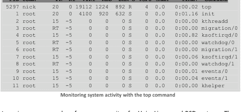

`top` 是 Unix、Linux 和 BSD 系统的进程和性能监视器。`top` 输出的前几行显示关于处理器、内存和交换分区利用率的信息。屏幕的剩余部分用于显示有关运行进程的信息。进程列表每隔几秒更新一次，以显示资源密集型最高的进程。

> **提示**：有几个交互命令可用于控制 `top` 命令的输出。在 `top` 中按 `?` 键可查看这些命令的完整列表。

**常用示例：**

| 命令 | 描述 |
| :--- | :--- |
| `top` | 监控系统性能和进程 |
| `top -u [用户]` | 仅显示由指定用户拥有的进程 |
| `top -d [秒]` | 以指定间隔（以秒为单位）更新 |
| `top -i` | 不显示空闲进程 |

#### htop

**用途**：Linux 的高级系统监视器。

**用法语法**：`htop`

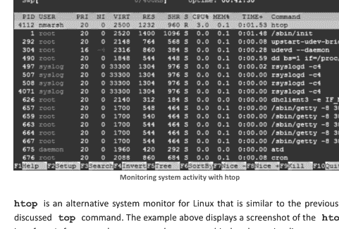

`htop` 是 Linux 的一种替代系统监视器，类似于前面讨论的 `top` 命令。上面的示例显示了 `htop` 界面的屏幕截图。它具有彩色输出，并使用图形比例尺来可视化处理器、内存和交换分区利用率。

> **提示**：与 `top` 类似，`htop` 支持交互命令。在 `htop` 中按 `F1` 键可查看交互选项的完整列表。

**常用示例：**

- `htop`：以默认设置运行 top 监视器
- `htop -u [用户]`：仅显示来自指定用户的进程

#### topas

**用途**：AIX 系统的性能监视器。

**用法语法**：`topas [选项]`

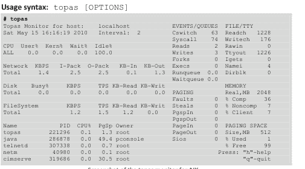

`topas` 是 AIX 系统的性能监视器。不带任何选项运行 `topas` 会显示所有系统利用率区域的概述，如上面的示例所示。

`topas` 还有几个选项用于监视系统的特定方面。例如，`-D` 选项显示系统中每个磁盘的磁盘利用率信息，如下一个示例所示。

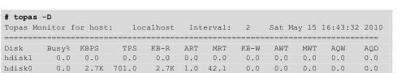

**常用示例：**

- `topas`：显示 topas 监视器
- `topas -D`：监控磁盘活动
- `topas -P`：监控进程
- `topas -V`：监控卷组活动
- `topas -F`：监控文件系统活动
- `topas -E`：监控以太网活动

### iotop

**用途：** 监控磁盘输入/输出操作。

**使用语法：** `iotop [选项]`


```
$ iotop
Total DISK READ: 52.68 M/s | Total DISK WRITE: 0.00 B/s
TID  PRIO USER  DISK READ DISK WRITE  SWAPIN     IO>  COMMAND
4310 be/4 root  9.33 M/s  0.00 B/s  0.00 %   0.00 %  hdparm -Tt
4311 be/4 root  4.84 M/s  0.00 B/s  0.00 %   0.00 %  hdparm -Tt
4312 be/4 root  9.46 M/s  0.00 B/s  0.00 %   0.00 %  hdparm -Tt
4313 be/4 root  13.68 M/s 0.00 B/s  0.00 %   0.00 %  hdparm
1 be/4 root    0.00 B/s  0.00 B/s  0.00 %   0.00 %  init
2 be/3 root    0.00 B/s  0.00 B/s  0.00 %   0.00 %  [kthread]
3 rt/3 root    0.00 B/s  0.00 B/s  0.00 %   0.00 %  [migration/0]
4 be/3 root    0.00 B/s  0.00 B/s  0.00 %   0.00 %  [ksoftirqd/0]
5 rt/3 root    0.00 B/s  0.00 B/s  0.00 %   0.00 %  [watchdog/0]
6 be/3 root    0.00 B/s  0.00 B/s  0.00 %   0.00 %  [events/0]
7 be/3 root    0.00 B/s  0.00 B/s  0.00 %   0.00 %  [cpuset]
8 be/3 root    0.00 B/s  0.00 B/s  0.00 %   0.00 %  [khelper]
9 be/3 root    0.00 B/s  0.00 B/s  0.00 %   0.00 %  [netns]
10 be/3 root   0.00 B/s  0.00 B/s  0.00 %   0.00 %  [async/mgr]
11 be/3 root   0.00 B/s  0.00 B/s  0.00 %   0.00 %  [blkcg_mgd/0]
12 be/3 root   0.00 B/s  0.00 B/s  0.00 %   0.00 %  [kblockd/0]
13 be/3 root   0.00 B/s  0.00 B/s  0.00 %   0.00 %  [kapci]
14 be/3 root   0.00 B/s  0.00 B/s  0.00 %   0.00 %  [kacpi_notify]
15 be/3 root   0.00 B/s  0.00 B/s  0.00 %   0.00 %  [kacpi_hotplug]
16 be/3 root   0.00 B/s  0.00 B/s  0.00 %   0.00 %  [ata/0]
17 be/3 root   0.00 B/s  0.00 B/s  0.00 %   0.00 %  [ata_aux]
```


`iotop` 是一个用于监控 Linux 系统磁盘 I/O 操作的实用工具。它对于监控磁盘性能和追踪资源密集型应用程序非常有用。上述示例显示了 `iotop` 的默认界面。

> **提示** 按 Q 键退出 `iotop` 工具。

**常见用法示例：**

- `iotop`: 监控系统 I/O 统计信息
- `iotop -o`: 仅显示正在执行 I/O 操作的进程
- `iotop -u [用户]`: 仅显示指定用户的 I/O 活动
- `iotop -d [秒数]`: 以指定间隔（秒）更新

### mpstat

**用途：** 显示处理器利用率信息。

**使用语法：** `mpstat [选项] [延迟] [次数]`

```
$ mpstat 2 10
Linux 2.6.24-19-server (vmware-02)    05/03/2010

10:46:53 AM  CPU  %user  %nice  %sys  %iowait  %irq  %soft  %idle  intr/s
10:46:55 AM  all  0.00   0.00    2.22  0.00      0.00  0.00   0.00  97.78  82.50
10:46:57 AM  all  0.62   0.00    2.49  0.00      0.00  0.00   0.00  96.89  126.50
10:46:59 AM  all  0.12   0.00    2.21  0.00      0.00  0.12   0.00  97.54  84.00
10:47:01 AM  all  0.25   0.00    5.29  0.00      0.00  0.12   0.00  93.73  403.00
10:47:03 AM  all  0.00   0.00    2.55  0.00      0.00  0.00   0.00  97.45  106.50
10:47:05 AM  all  0.25   0.00    2.84  0.00      0.00  0.00   0.00  96.91  101.50
10:47:07 AM  all  0.00   0.00    3.28  0.00      0.00  0.00   0.00  96.72  118.00
10:47:09 AM  all  0.24   0.00    3.40  0.00      0.00  0.00   0.00  96.36  126.00
10:47:11 AM  all  0.00   0.00    3.91  0.00      0.00  0.00   0.00  96.09  97.50
10:47:13 AM  all  0.00   0.00    3.27  0.00      0.00  0.00   0.00  96.61  107.00
Average:      all  0.15   0.00    3.15  0.06      0.02  0.01   0.00  96.61  135.25

          mpstat 命令的输出
```

`mpstat` 显示 Linux 系统的处理器利用率信息。在上述示例中，执行 `mpstat 2 10` 指示程序以两秒为间隔显示结果，并在显示 10 行后退出。如果省略延迟和次数选项，`mpstat` 将显示一行结果然后终止。

**常见用法示例：**

- `mpstat`: 显示一次处理器利用率并退出
- `mpstat [延迟]`: 以指定间隔更新显示
- `mpstat [延迟] [次数]`: 达到指定次数后结束监控

### vmstat

**用途：** 显示虚拟内存使用信息。

**使用语法：** `vmstat [选项] [延迟] [次数]`


```
# vmstat 2 10
    r b swpd     free    buff       cache  si so bi bo   in cs us sy id wa
    0 0  88  79260  149184     7400704  0  0  0 93    1  4  0  97  0
    0 1  88  78996  149184     7400704  0  0  0 2  119 2933  0  90  6
    2 0  88  78996  149184     7400704  0  0  0 12  115 3083  0  94  3
    0 0  88  78872  149184     7400704  0  0  0 1828  259 3275  0  97  0
    0 0  88  78872  149184     7400704  0  0  0 62  145 3031  0  96  0
    0 0  88  78748  149184     7400704  0  0  0 0  114 2965  0  98  0
    0 0  88  78452  149184     7400704  0  0  0 438  150 3170  0  97  0
    0 0  88  78004  149184     7400704  0  0  0 0  114 3073  0  97  0
    0 0  88  77762  149184     7400704  0  0  0 130  306 4469  0  95  0
    0 0  88  77260  149184     7400708  0  0  0 52  130 2864  0  97  0
```

`vmstat` 命令显示虚拟内存统计信息。在上述示例中，执行 `vmstat 2 10` 指示程序以两秒为间隔显示结果，并在显示 10 行后退出。如果省略延迟和次数参数，`vmstat` 将显示一行结果然后终止。

> **提示** 在某些系统上，可以使用 `-Sm` 选项配合 `vmstat` 命令，以兆字节（MB）而不是千字节（KB）显示内存总量。

**常见用法示例：**

- `vmstat`: 显示一次内存利用率并退出
- `vmstat [延迟]`: 以指定间隔更新结果
- `vmstat [延迟] [次数]`: 达到指定次数后结束
- `vmstat -s`: 显示内存统计表
- `vmstat -Sm`: 以兆字节显示利用率

### iostat

**用途：** 显示 I/O 利用率统计信息。

**使用语法：** `iostat [选项] [延迟] [次数]`

```
# iostat -d 2 5
Linux 2.6.24-19-server (vmware-02) 05/03/2010
Device: tps Blk_read/s Blk_wtrn/s Blk_read Blk_wtrn
sda 56.65 3.44 756.95 9462264 2080033488
Device: tps Blk_read/s Blk_wtrn/s Blk_read Blk_wtrn
sda 3.50 0.00 64.00 0 128
Device: tps Blk_read/s Blk_wtrn/s Blk_read Blk_wtrn
sda 6.97 0.00 59.70 0 120
Device: tps Blk_read/s Blk_wtrn/s Blk_read Blk_wtrn
sda 0.00 0.00 0.00 0 0
Device: tps Blk_read/s Blk_wtrn/s Blk_read Blk_wtrn
sda 61.50 0.00 524.00 0 1048
使用 iostat 命令显示 I/O 利用率
```

`iostat` 命令显示磁盘驱动器和网络文件系统的 I/O 利用率统计信息。由于磁盘驱动器可能是系统性能的重大瓶颈，因此在监控磁盘驱动器时很有帮助。在上述示例中，显示了五行 I/O 统计信息。第一行显示自系统上次启动以来的统计信息。后续各行显示自上一行打印以来的累计值。

**常见用法示例：**

- `iostat`: 显示一次 I/O 利用率并退出
- `iostat [延迟]`: 以指定间隔更新 I/O 利用率
- `iostat [延迟] [次数]`: 达到指定次数后结束
- `iostat -k`: 以千字节/秒显示统计信息
- `iostat -m`: 以兆字节/秒显示统计信息
- `iostat -d`: 仅显示 I/O 设备
- `iostat -P`: 单独显示每个分区
- `iostat -n`: 显示 NFS I/O 利用率

### dstat

**用途：** 监控 CPU、磁盘、网络和交换分区（Swap）利用率。

**使用语法：** `dstat [选项] [延迟] [次数]`

```
$ dstat 2 10

---total--- -cpu-usage---- -disk/total- -net/total- ---paging-- ---system---
usr sys idle wai hiq sirq read writx rcv send in out int csw
0 2 97 0 0 0 |1763B 379k| 0 0 | 0 | 131 2611
0 9 91 0 0 0 | 0 0 |346k 99k| 0 0 | 482 4748
0 3 97 0 0 0 | 0 410k| 141k 16k| 0 0 | 125 3189
0 3 97 0 0 0 | 0 0 | 55k 9090B| 0 0 | 114 3054
0 3 96 0 0 0 | 0 0 | 55k 9.9k| 0 0 | 100 2723
0 4 96 0 0 0 | 0 376k| 63k 11k| 0 0 | 115 2904
0 3 96 0 0 0 | 0 0 | 55k 9.8k| 0 0 | 127 3221
0 2 98 0 0 0 | 0 182k| 64k 13k| 0 0 | 135 3067
0 2 97 0 0 0 | 0 0 | 55k 10k| 0 0 | 115 2925
0 4 96 0 0 0 | 0 0 | 54k 9832B| 0 0 | 118 3129
0 13 87 0 0 0 | 0 94k| 37k 11k| 0 0 | 548 4950
```

`dstat` 是 Linux 系统的一体式性能监控实用工具。上述示例展示了 `dstat` 的默认输出，它在一个易于阅读的视图中显示 CPU、磁盘、网络和交换分区利用率。

> **提示** 可以使用许多命令行选项将 `dstat` 的输出自定义为符合您的需求。更多信息请参阅 `man dstat`。

**常见用法示例：**

- `dstat`: 监控系统利用率
- `dstat [延迟]`: 以指定间隔更新结果
- `dstat [延迟] [次数]`: 达到指定次数后结束监控

### nfsstat

**用途：** 显示 NFS 统计信息。

**用法语法：** `nfsstat [OPTIONS]`

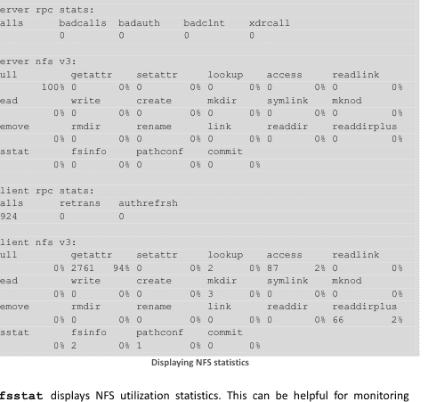

`nfsstat` 显示 NFS 利用率统计信息。这对于监控 NFS 服务的性能非常有用。上述示例展示了在本地系统上运行的 NFS 客户端和服务器的各种利用率指标。


### free

**用途：** 显示系统内存和交换空间的使用情况信息。

**用法语法：** `free [OPTIONS]`

```
$ free
             total       used       free     shared    buffers     cached
Mem:       8186412     8136752      49660          0     181960     7352700
-/+ buffers/cache:      602092     7584320
Swap:      23695832          0    23695744
```

使用 `free` 命令显示内存和交换空间的使用情况

`free` 显示 Linux 系统上的内存和交换空间使用情况。`free` 命令的默认输出以千字节为单位显示总量，如上述示例所示。下一个示例演示了使用 `-m` 选项，该选项以更“人性化”的格式（以兆字节为单位）输出结果。


```
$ free -m
             total       used       free     shared    buffers     cached
Mem:           7994        7944         48          0        177        7180
-/+ buffers/cache:         588        7406
Swap:         23140          0       23140
```

以“人性化”格式显示内存和交换空间的使用情况

常见用法示例：

- `free`：以千字节为单位显示内存使用情况
- `free -m`：以兆字节为单位显示内存使用情况
- `free -g`：以吉字节为单位显示内存使用情况

### df

**用途：** 显示文件系统使用情况信息。

**用法语法：** `df [OPTIONS]`

```
$ df -h

Filesystem      Size  Used Avail Use% Mounted on
/dev/sda6       143G   9.1G  127G   7% /
/dev/sdb1       466G   426G   41G  92% /media/Seagate
tmpfs           2.0G      0  2.0G   0% /lib/init/rw
varrun          2.0G   104K  2.0G   1% /var/run
varlock         2.0G      0  2.0G   0% /var/lock
udev            2.0G   172K  2.0G   1% /dev
tmpfs           2.0G   508K  2.0G   1% /dev/shm
lrm             2.0G   2.7M  1.9G   1% /lib/modules/2.6.28-11
```

`df` 命令的典型输出

`df` 命令在 Unix、Linux 和 BSD 系统上显示文件系统使用情况信息。输出结果显示了每个文件系统的大小、已用空间和可用空间。

在某些系统上，`df` 还会显示关于伪文件系统的信息。这些文件系统通常不包含实际文件，仅存在于内存中，用于提供对内核设施的访问。在上述示例中，前两行是实际文件系统，其余条目是伪文件系统。

> **提示**
>
> 某些系统可能支持使用 `-h` 参数，如上述示例所示。该选项以千字节、兆字节和吉字节显示“人类可读”的输出，而不是默认度量单位（通常是 1k 或 512k 块）。请参考 `man df` 以验证本地系统默认使用的度量单位。

**常见用法示例：**

- `df`：显示文件系统使用情况信息
- `df -h`：以人类可读格式（即兆字节和吉字节）显示大小

### du

**用途：** 显示磁盘使用情况。

**用法语法：** `du [OPTIONS] [DIRECTORY/FILE]`

```
$ du -hs /usr
523M	/usr
```

使用 `du` 命令显示目录的大小

`du` 命令显示关于磁盘使用情况的信息。它可以显示特定目录或一组文件的大小。上述示例演示了使用 `du` 命令显示 `/usr` 目录的大小。`-hs` 选项指示 `du` 以“人类可读”形式显示汇总结果。如果省略 `-s` 选项，则会递归显示 `/usr` 下每个文件的大小，如下所示。

```
$ du -h /usr/
4.0K	/usr/local/etc
1.4M	/usr/local/bin
4.0K	/usr/local/games
4.0K	/usr/local/src
4.0K	/usr/local/sbin
224K	/usr/local/share/man/man1
228K	/usr/local/share/man
```

使用 `du` 命令显示文件的大小

某些系统可能不支持 `-h` 参数。在这种情况下，`du` 命令将以块为单位显示文件大小，而不是“人类可读”的度量单位，如下例所示。

```
$ du -s /usr
534884	/usr
```

旧版 Unix 系统上 `du` 命令的输出

**常见用法示例：**

- `du -hs`：显示当前目录的大小
- `du -hs [DIRECTORY]`：显示指定目录的大小
- `du -h [DIRECTORY]`：显示指定目录中每个文件的大小

### uname

**用途：** 显示有关操作系统的信息。

**用法语法：** `uname [OPTIONS]`

```
$ uname -a
Linux mylaptop 2.6.28-11-generic x86_64 GNU/Linux
```

Linux 系统上 `uname` 命令的输出

`uname` 显示有关系统上安装的硬件和软件版本的信息。这包括处理器类型、内核版本和本地系统的硬件平台等信息。

上述示例显示了 Linux 系统上的 `uname` 输出。下一个示例显示了 HP-UX 系统上的输出。

```
$ uname -a
HP-UX server1 B.10.20 C 9000/861 32-user license
```

HP-UX 系统上 `uname` 命令的输出

`uname` 的输出因平台而异。下表描述了执行 `uname -a` 时显示的典型信息。

| 平台 | 主机名 | 版本 | 硬件 | 其他 |
| :--- | :--- | :--- | :--- | :--- |
| Linux | mylaptop | 2.6.28-11-generic | x86_64 | GNU/Linux |
| HP-UX | server1 | B.10.20 C | 9000/861 | 32-user license |

**常见用法示例：**

- `uname -a`：显示所有信息
- `uname -r`：显示内核版本号

### uptime

**用途：** 显示系统在线运行的时长。

**用法语法：** `uptime`

```
$ uptime
19:15:55 up 2 days 40 min, 2 users, load average: 0.13, 1.15, 1.24
```

`uptime` 命令的输出

`uptime` 命令显示系统自上次关机或重启以来已在线运行的时长。它还显示当前登录到系统的用户数量以及 CPU 负载平均值。

负载平均值信息显示三个数字字段。这些代表过去 1、5 和 15 分钟内的三个系统负载样本。数字越低，系统负载越低。例如，在单 CPU 系统上，0.13 的负载平均值对应于 13% 的负载。1.15 的负载平均值意味着 115% 的负载，表示系统过载了 15%，因为进程需要等待 15% 的时间来获取系统资源（如 CPU 和磁盘 I/O）。

> **注意**
>
> 负载平均值仅用于信息展示。它不打算作为准确的性能衡量指标，因为它可能会受到各种因素的影响。

常见用法示例：

- `uptime`：显示系统在线运行时长和负载平均值信息

### dmesg

**用途：** 显示内核日志消息。

**用法语法：** `dmesg [OPTIONS]`

```
# dmesg | less
[ 0.000000] Initializing cgroup subsys cpuset
[ 0.000000] Initializing cgroup subsys cpu
[ 0.000000] Linux version 2.6.24-27-server (buildd@palmer) (gcc version 4.2.4 (Ubuntu 4.2.4-1ubuntu3)) #1 SMP Fri Mar 12 01:45:06 UTC 2010 (Ubuntu 2.6.24-27.68-server)
[ 0.000000] BIOS-provided physical RAM map:
[ 0.000000] BIOS-e820: 0000000000000000 - 00000000009f8000 (usable)
[ 0.000000] BIOS-e820: 00000000009f8000 - 0000000000a00000 (reserved)
[ 0.000000] BIOS-e820: 00000000c0ca0000 - 000000000dc00000 (reserved)
[ 0.000000] BIOS-e820: 00000000dc0000 - 0000000001000000 (reserved)
...
```

使用 `dmesg` 显示内核消息

`dmesg` 命令显示内核消息日志。这是排查问题时应该首先检查的地方。执行 `dmesg` 会显示内核日志缓冲区中的所有消息，如上述示例所示。

`dmesg` 的输出可能非常冗长。结合使用 `grep` 和 `dmesg` 命令有助于搜索特定消息。下一个示例演示了如何使用 `grep` 过滤 `dmesg` 以搜索单词 *fail*。


```
$ dmesg | grep fail
[39176.231722] usb-storage: probe of 2-2:1.0 failed with error -5
[41421.627352] PM: Device 2-2 failed to resume: error -19
[41429.152942] usb-storage: probe of 2-3:1.0 failed with error -5
[46938.994016] usb-storage: probe of 2-3:1.0 failed with error -5
[49869.891317] usb-storage: probe of 2-3:1.0 failed with error -5
[57103.036672] PM: Device 2-3 failed to resume: error -19
...
```

在 `dmesg` 输出中搜索错误消息

**提示** 内核消息通常存储在 `/var/log/dmesg` 文件中。

**常见用法示例：**

| 命令 | 描述 |
| :--- | :--- |
| `dmesg` | 显示内核日志 |
| `dmesg -c` | 清除所有内核日志消息 |

### errpt

**用途：** 在 AIX 系统上显示系统错误消息。

**用法语法：** `errpt` [OPTIONS]

```text
### errpt
IDENTIFIER TIMESTAMP  T C RESOURCE_NAME  DESCRIPTION
A6FD45AA  0515143110 I O  RMCdaemon      The daemon is started.
2EFA76F6  0515142910 T S  SYSPROC        SYSTEM SHUTDOWN BY USER
9D8CFD2E  0515143010 T O  errdemon       ERROR LOGGING TURNED ON
67145A39  0510232410 U S  SYSDUMP        SYSTEM DUMP
BE0A03E5  0510232410 P H  syssplanar0    ENVIRONMENTAL PROBLEM
F48137AC  0510232410 U O  minidump       COMPRESSED MINIMAL DUMP
BFE4C025  0510231210 P H  syssplanar0    UNDETERMINED ERROR
...
```

> `errpt` 命令的示例输出

`errpt` 显示 IBM AIX 系统上的错误日志。在排查系统硬件和软件问题时，它可能很有帮助。执行 `errpt` 命令会显示已记录错误的简短列表，如上述示例所示。可以与 `errpt` 一起使用 `-a` 选项来显示每个错误的详细信息，如下一个示例所示。

```text
# errpt -a
---------------------------------
LABEL:      EPcw_SUS_CHRP
IDENTIFIER: BE0A03E5

Date/Time:    Sat May 15 14:29:54 CDT 2010
Sequence Number: 47
Machine Id:  0008A41D4C00
Node Id:    localhost
Class:      H
Type:       PERM
WEAR:       Global
Resource Name: syssplanar0
...
```

> `errpt -a` 命令的输出

**提示**

*要清除 AIX 错误日志，请以 root 用户身份执行 `errclear 0`。*

**常见用法示例：**

- `errpt`：显示系统错误摘要
- `errpt -a`：显示所有错误的详细信息
- `errpt -aj [IDENTIFIER]`：显示特定错误的详细信息

### strace

**用途：** 跟踪系统调用和信号。

**用法语法：** `strace` [OPTIONS] [PROGRAM]

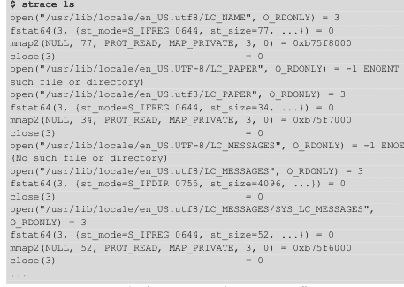

`strace` 是一个调试工具，用于跟踪系统调用和信号。这些信息可用于排查命令或程序的问题。上述示例显示了 `strace` 命令的典型输出。此输出可能难以解读；然而，它在开发人员报告程序 bug 时极其有用。

> **注意** 某些系统可能使用 `truss` 命令代替 `strace`。

**常见用法示例：**

- `strace [PROGRAM]` 跟踪指定程序
- `strace -o [FILE] [PROGRAM]` 将跟踪输出保存到指定文件

### ltrace

**用途：** 跟踪库调用。

**用法语法：** `ltrace` [OPTIONS] [PROGRAM]

```bash
$ ltrace ls
__libc_start_main(0x804e8d0, 1, 0x8fb04944, 0x8059e70, 0x8059e60)
<unfinished ...>
setlocale(6, "")                            = "en_US.UTF-8"
__bindtextdomain("coreutils", "/usr/share/locale")  = "/usr/share/locale"
__ttextdomain("coreutils")                   = "coreutils"
__cxa_atexit(0x8051b10, 0, 0, 0xb76dff4, 0x8fb048a8) = 0
isatty(1)                                   = 0
getenv("CQTING_STYLE")                      = NULL
getenv("LS_BLOCK_SIZE")                      = NULL
getenv("BLOCK_SIZE")                         = NULL
getenv("BLOCKSIZE")                          = NULL
getenv("POSIXLY_CORRECT")                    = NULL
getenv("BLOcK_SIZE")                         = NULL
getenv("COLUMNS")                             = -1
ioctl(1, 21529, 0xbfb0487c)                 = -1
getenv("TABSIZE")                            = NULL
getopt_long(1, 0xbfb04944, "abcd...xyz", NULL, 0x805ca00, 0xbfb04890) = -1
_errno_location()                            = 0xb757369c
malloc(36)                                   = 0x8065170
...
```


类似之前讨论的 `strace` 命令，`ltrace` 是一个用于 Linux 系统的调试工具，用于跟踪库调用。上述示例展示了 `ltrace` 命令的典型输出。

**常见用法示例：**

- `ltrace [PROGRAM]` 跟踪指定程序
- `ltrace -o [FILE] [PROGRAM]` 将跟踪输出保存到指定文件

### lsmod

**用途：** 显示 Linux 内核模块信息。

**用法语法：** `lsmod`


```bash
$ lsmod
Module                  Size  Used by
af_packet               23684    0
nfsd                   228720   13
auth_rpcgss             43424    1 nfsd
exportfs                 6016    1 nfsd
nfs                    262156    0
lockd                   67720    3 nfsd,nfs
nfs_acl                  4608    2 nfsd,nfs
sunrpc                  185500   11 nfsd,auth_rpcgss,nfs,lockd,nfs_acl
ip4table_filter           3840    0
ip_tables                14820    1 ip4table_filter
x_tables                16132    1 ip_tables
lp                      12324    0
loop                    19076    0
ipv6                    273188   18
parport_pc               36644    1
...
```

`lsmod` 命令的输出

`lsmod` 显示已安装内核模块的信息。内核模块是内核本身的扩展。每个模块通常服务于单一目的，例如添加对特定技术或硬件类型的支持。上述示例显示了 Linux 系统上已安装的内核模块。

`lsmod` 是一个 Linux 命令。其他平台上存在类似命令，详情见以下交叉引用表。

| AIX | BSD | HP-UX | Linux | Solaris |
| --- | --- | --- | --- | --- |
| `kext` | `kldstat` | `kmdmn` | `lsmod` | `modinfo` |

内核模块命令交叉引用

**常见用法示例：**

- `lsmod` 列出已安装的内核模块

### insmod / rmmod

**用途：** 安装/移除内核模块。

**用法语法：** `insmod [MODULE]`

```bash
# insmod /lib/modules/2.6.24-7-server/kernel/drivers/block/floppy.ko
# lsmod | grep floppy
floppy 59332 0
```

将模块加载到内核中

`insmod` 命令用于在 Linux 系统上安装内核模块。上述示例展示了使用 `insmod` 安装 `floppy.ko` 模块的过程，该模块为系统添加了对软盘驱动器的支持。

`rmmod` 命令从内核中卸载模块。下一个示例展示了如何使用 `rmmod` 命令移除之前加载的 `floppy.ko` 模块。

**用法语法：** `rmmod [MODULE]`

```bash
# rmmod floppy
```

移除内核模块

`insmod` 和 `rmmod` 是 Linux 命令。其他平台上存在类似命令，详情见以下交叉引用表。

内核模块命令交叉引用

**常见用法示例：**

- `insmod [MODULE]` 将指定模块加载到内核中
- `rmmod [MODULE]` 卸载指定模块

### modinfo

**用途：** 显示 Linux 内核模块信息。

**用法语法：** `modinfo [OPTIONS] [MODULE]`

```bash
$ modinfo nfs
filename: /lib/modules/2.6.28-l1-generic/kernel/fs/nfs/nfs.ko
license: GPL
author: Olaf Kirch <okir@monad.swb.de>
srcversion: A400A4357849F5E18225B6F
depends: sunrpc,lockd,nfs_acl
vermagic: 2.6.28-l1-generic SMP mod_unload modversions
parm: enable_ino64:bool
```

使用 `modinfo` 命令显示 NFS 模块的信息

`modinfo` 显示 Linux 内核模块的信息。它包含模块的文件位置、许可证、版本和依赖关系等有用信息。上述示例展示了使用 `modinfo` 显示 NFS 内核模块信息的过程。

> **注意**
>
> *Linux 内核模块通常存储在 `/var/lib/modules` 目录中。*

**常见用法示例：**

- `modinfo [MODULE]` 显示指定模块的信息

### sysctl

**用途：** 在 Linux 和 BSD 系统上显示和编辑内核参数。

**用法语法：** `sysctl [OPTIONS]`

```bash
$ sysctl -a
kernel.sched_shares_ratelimit = 500000
kernel.sched_shares_thresh = 4
kernel.sched_child_runs_first = 1
kernel.sched_features = 24191
kernel.sched_migration_cost = 500000
kernel.sched_nr_migrate = 32
kernel.sched_rt_period_us = 1000000
kernel.sched_rt_runtime_us = 950000
kernel.sched_compat_yield = 0
kernel.panic = 0
kernel.core_uses_pid = 0
kernel.core_pattern = core
...
```

显示内核参数

`sysctl` 命令用于显示和编辑可调整的内核参数。这允许你对操作系统的各个方面进行微调。

> **警告** 除非你完全理解所设置参数带来的影响，否则不应更改这些值。

内核参数通常存储在 `/etc/sysctl.conf` 文件中。通过 `sysctl` 在命令行上更改的设置，除非添加到 `sysctl.conf` 文件中，否则在重启时会丢失。

> **注意** HP-UX 和 Solaris 使用 `sysdef` 命令代替 `sysctl`。AIX 系统使用 `tunchange` 命令。

**常见用法示例：**

- `sysctl -a` 显示所有内核参数
- `sysctl -w [SETTING]=[VALUE]` 设置指定的内核参数

### 第 13 节：打印命令

#### 概述

本节中的命令涵盖了 Unix、Linux 和 BSD 系统上打印机管理的基础知识。Unix 打印子系统被称为 **LPD**（**Line Printer Daemon**，行式打印机守护进程）。Linux 使用一种名为 **CUPS**（**Common Unix Printing System**，通用 Unix 打印系统）的较新的打印系统。尽管这两种打印服务在核心架构上存在很大差异，但它们拥有大多数可互换的命令。

**本节涵盖的命令：**

| 命令 | 用途 |
| :--- | :--- |
| `lp` | 打印文件。 |
| `lptest` | 显示打印机和打印任务状态信息。（注：原文此处对应 lpstat 的功能描述，但命令列为 lptest，翻译保持忠实原文） |
| `lpq` | 显示打印队列状态。 |
| `cancel` | 取消并删除排队中的打印任务。 |
| `enable` / `disable` | 启用/禁用打印机。 |
| `lpadmin` | 管理打印机。 |

**本节术语表：**

- **CUPS**（**Common Unix Printing System**，通用 Unix 打印系统）：适用于 Unix、Linux 和 BSD 系统的现代打印系统。
- **Print Job**（打印任务）：已提交以进行打印的文件。
- **LPD**（**Line Printer Daemon**，行式打印机守护进程）：主要应用于 Unix 和 BSD 系统的打印系统。
- **Queue**（队列）：用于等待打印的打印任务的暂存系统。

#### lp

**用途：** 打印文件。

**用法语法：** `lp [OPTIONS] [FILE]`

```bash
$ lp -d HP-4350 /etc/hosts
request id is HP-4350-4 (1 file(s))
```

*使用 `lp` 命令打印文件*


`lp` 命令将文件提交以进行打印。在上述示例中，`/etc/hosts` 文件将在指定的目标打印机上打印。执行命令后，系统会显示任务摘要。任务摘要中包含打印任务的 ID 号。在大多数系统中，ID 号由打印机名称加上指定打印机的任务 ID 组成（在本例中为 4）。

> **注意**
>
> 如果未指定目标，文件将在默认系统打印机上打印。

常见用法示例：

| 命令 | 描述 |
| :--- | :--- |
| `lp [FILE]` | 将文件打印到默认打印机 |
| `lp -d [PRINTER] [FILE]` | 打印到指定的打印机 |
| `lp -n [NUM] -d [PRINTER] [FILE]` | 打印指定数量的副本 |

### lpstat

**用途**：显示打印机和打印任务状态信息。

**用法语法**：`lpstat [OPTIONS]`

```bash
$ lpstat
HP-4350-5     nick  1024  Tue 02 Jun 2009 12:56:50 PM CDT
HP-4350-6     nick  1024  Tue 02 Jun 2009 12:56:51 PM CDT
HP-4350-7     nick  1024  Tue 02 Jun 2009 12:56:52 PM CDT
HP-4350-8     nick  1024  Tue 02 Jun 2009 12:56:52 PM CDT
```


`lpstat` 命令显示关于打印机和排队中的打印任务的信息。在上述示例中，不带选项执行 `lpstat` 将显示所有排队中的打印任务的状态。

`lpstat` 命令的输出定义在以下表中。

| 字段 1 | 字段 2 | 字段 3 | 字段 4 |
| :--- | :--- | :--- | :--- |
| 打印机名称-任务ID | 任务所有者 | 任务大小 | 提交时间和日期 |

`-a` 选项如下一示例所示，显示本地系统上所有打印机的状态。

```bash
$ lpstat -a
HP-4350 accepting requests since Tue 02 Jun 2009 12:51:08 PM CDT
HP-5100 accepting requests since Tue 02 Jun 2009 12:51:08 PM CDT
```


常见用法示例：

| 命令 | 描述 |
| :--- | :--- |
| `lpstat` | 显示打印队列的状态 |
| `lpstat -a` | 显示所有打印机的当前状态 |
| `lpstat -P` | 显示所有打印机的打印状态 |
| `lpstat -s` | 显示状态摘要 |
| `lpstat -t` | 显示所有状态信息 |

### lpq

**用途**：显示打印队列状态。

**用法语法**：`lpq [OPTIONS]`

```bash
$ lpq -a

Rank  Owner Job File(s) Total Size
1st nick 2 hosts 1024 bytes
2nd nick 3 hosts 1024 bytes
3rd nick 4 hosts 1024 bytes
4th nick 5 hosts 1024 bytes
5th nick 6 hosts 1024 bytes
6th nick 7 hosts 1024 bytes
7th nick 8 hosts 1024 bytes
8th nick 9 hosts 1024 bytes
9th nick 10 hosts 1024 bytes
```

*使用 `lpq` 命令显示排队中打印任务的状态*

`lpq` 命令显示排队中打印任务的状态。它与 `lpstat` 命令类似，但提供更具用户友好性的输出。与 `lpstat` 命令不同，`lpq` 命令仅支持有限的命令行选项。

在上述示例中，执行 `lpq -a` 会显示所有排队的打印任务。下一个示例演示了如何使用 `-P` 选项显示特定打印机的状态。

```bash
$ lpq -P HP-4350
HP-4350 is not ready

Rank  Owner Job File(s) Total Size
1st nick 2 hosts 1024 bytes
2nd nick 3 hosts 1024 bytes
3rd nick 4 hosts 1024 bytes
4th nick 5 hosts 1024 bytes
```

*使用 `lpq` 命令显示特定打印机的状态*

**常见用法示例：**

- `lpq -a` ：显示所有排队中打印任务的状态
- `lpq -P [PRINTER]` ：显示指定打印机的状态

### cancel

**用途：** 取消并删除排队中的打印任务。

**用法语法：** `cancel [OPTIONS] [JOBID]`

```bash
$ lpq -P HP-4350
HP-4350 is not ready
Rank Owner Job File(s) Total Size
1st nick 6 hosts 1024 bytes
2nd nick 7 hosts 1024 bytes
3rd nick 8 hosts 1024 bytes
4th nick 9 hosts 1024 bytes
5th nick 10 hosts 1024 bytes
$ cancel 10
```

*使用 `cancel` 命令取消单个打印任务*

`cancel` 命令删除排队中的打印任务。在上述示例中，`cancel 10` 用于通过指定任务的 ID 号来移除单个任务。下一个示例演示了如何使用 `-a` 参数从指定的打印机中移除所有排队中的打印任务。

```bash
$ lpq -P HP-4350
HP-4350 is not ready
Rank Owner Job File(s) Total Size
1st nick 6 hosts 1024 bytes
2nd nick 7 hosts 1024 bytes
3rd nick 8 hosts 1024 bytes
4th nick 9 hosts 1024 bytes
$ cancel -a HP-4350
$ lpq -P HP-4350
HP-4350 is not ready
no entries
```

*使用 `cancel` 命令取消打印机上所有排队中的打印任务*

> **注意** 某些 UNIX 系统可能使用 `lp rm` 命令来替代 `cancel`。

**常见用法示例：**

- `cancel [JOB]` 取消指定的打印任务
- `cancel -a` 取消所有打印机上的所有打印任务
- `cancel -a [PRINTER]` 取消指定打印机上的所有任务

### enable / disable

**用途**：启用/禁用打印机。

**用法语法**：`enable [OPTIONS] [PRINTER]`

```bash
# enable HP-4350
#### lpq
HP-4350 is ready
```


`enable` 命令启用打印机，使其可用于打印。在上述示例中，执行 `enable` 命令后，指定的打印机被启用并可供打印使用。

`disable` 命令使打印机离线并禁止其打印，如下一个示例所示。

**用法语法**：`disable [OPTIONS] [PRINTER]`

```bash
# disable HP-4350
#### lpq
HP-4350 is not ready
```


当打印机被禁用时，大多数系统仍会继续接受打印请求。这些任务将保留在队列中，直到打印机被重新启用。

> **注意** 使用 CUPS（Common Unix Printing System，通用 Unix 打印系统）的系统将使用 `cupseable` 和 `cupsdisable` 命令来替代 `enable` 和 `disable`。（注：原文中 `cupseable` 疑似拼写错误，但根据翻译原则保留原文内容，仅翻译文字部分，若需修正可改为 cupsenable）

**常见用法示例：**

- `enable [PRINTER]` 启用指定的打印机
- `disable [PRINTER]` 禁用指定的打印机
- `disable -c [PRINTER]` 禁用打印机并取消所有排队中的任务

### lpadmin

**用途：** 管理打印机。

**用法语法：** `lpadmin [OPTIONS] [PRINTER]`


```bash
$ lpadmin -p HP-5200 -E -v socket://10.10.1.32
$ lpstat -a
HP-5200 accepting requests since Fri 16 Apr 2010 12:41:01 PM CDT
```


`lpadmin`命令管理 Unix、Linux 和 BSD 系统上的打印机。在上述示例中，使用`lpadmin`命令将 IP 地址为`10.10.1.32`的网络打印机添加到系统中。

下一个示例演示了如何使用`lpadmin -x`移除在上一个示例中创建的打印机。

```bash
$ lpadmin -x HP-5200
$ lpstat -a
```


> **注意** `lpadmin`工具在不同平台上的命令行选项有所不同。请参阅`man lpadmin`获取与您系统相关的具体信息。

**常见用法示例：**

| 命令 | 描述 |
| :--- | :--- |
| `lpadmin -p [NAME] -v [DEVICE]` | 向系统添加打印机 |
| `lpadmin -x [PRINTER]` | 从系统移除打印机 |

### 第 14 节：软件安装

#### 概述

软件安装是在不同的 Unix、Linux 和 BSD 系统中差异最大的领域。每个发行版都有其独特的软件管理工具集。本节概述了各个平台上的这些软件管理命令。

本节涉及的命令：

| 命令 | 用途 |
| :--- | :--- |
| `dpkg` | 安装/移除 Debian Linux 软件包。 |
| `aptitude` | 基于 Debian Linux 系统的自动化包管理器。 |
| `rpm` | 安装/移除 Red Hat Linux 软件包。 |
| `yum` | 基于 Red Hat Linux 系统的自动化包管理器。 |
| `emerge` | 安装/移除 Gentoo Linux 软件包。 |
| `pkg_add`<br>`pkg_delete` | 安装/移除 BSD 软件包。 |
| `pkg_info` | 显示 BSD 软件包的信息。 |
| `installp` | 在 AIX 系统上安装软件包。 |
| `lslpp` | 列出 AIX 系统上已安装的软件。 |
| `pkgsdd`<br>`pkgm` | 安装/移除 Solaris 软件包。 |
| `pkginfo` | 列出 Sun Solaris 系统上已安装的软件包。 |
| `make` | 从源代码编译并安装软件。 |

#### 本节使用的术语表：

- **APT** | **（高级打包工具，Advanced Packaging Tool）** 用于基于 Debian Linux 系统的包管理器。
- **Compile** | 将源代码转换为二进制/可执行文件的过程。
- **Dependency** | 使另一个程序能够正常运行的所需程序或库。
- **Makefile** | 在软件编译过程中使用的文件。
- **Package** | 用于软件安装的自包含文件。
- **Portage** | 用于基于 Gentoo Linux 系统的包管理器。
- **Repository** | 包管理程序使用的软件包源。
- **RPM** | **（Red Hat 包管理器，Red Hat Package Manager）** 由 Red Hat, Inc. 创建的一种软件包格式。

#### `dpkg`

**用途：** 安装/移除 Debian Linux 软件包。

**用法语法：** `dpkg [OPTIONS] [FILE]`

```
# dpkg -i apache2_amd64.deb
Preparing to install apache2 (using apache2_amd64.deb).
Unpacking apache2.
Setting up apache2.
Processing triggers for man-db ...
Processing triggers for ufw ...
...
```


`dpkg`是基于 Debian Linux 系统的传统包管理器。它可以在 Debian 和 Ubuntu 以及众多其他基于 Debian 核心的 Linux 发行版中找到。

使用`dpkg`，你可以安装或移除专门为基于 Debian 的系统创建的程序。这些软件包通常具有`.deb`文件扩展名。上述示例展示了使用`dpkg`命令安装 Debian 软件包的方法。

> **注意** 大多数基于 Debian 的系统现在使用名为`aptitude`的程序来执行软件安装任务。由于`aptitude`会自动下载并安装所需的软件包及其所有必需的依赖项，因此很少直接使用`dpkg`来安装软件包。更多信息请参见第 234 页。

**常见用法示例：**

- `dpkg -i [PACKAGE]` — 安装指定的软件包
- `dpkg -r [PACKAGE]` — 移除指定的软件包
- `dpkg -p [PACKAGE]` — 移除指定的软件包及相关配置文件
- `dpkg -l` — 列出所有已安装的软件包

#### `aptitude`

**用途：** 基于 Debian Linux 系统的自动化包管理器。

**用法语法：** `aptitude [OPTIONS] [ACTION] [PACKAGE]`

```
# aptitude install apache2
Reading package lists... Done
Building dependency tree
Reading state information... Done
The following extra packages will be installed:
  apache2-doc apache2-mpm-worker apache2-utils apache2.2-common libapr1 libaprutil1
  libpq5
Suggested packages:
  apache2-doc apache2-suexec apache2-suexec-custom
The following NEW packages will be installed:
  apache2 apache2-mpm-worker apache2-utils apache2.2-common libapr1
  libaprutil1 libpq5
0 upgraded, 7 newly installed, 0 to remove and 13 not upgraded.
After this operation, 6382kB of additional disk space will be used.
Do you want to continue [Y/n]? Y
...
Installing The Apache web server with aptitude
```

`aptitude`是 Debian `dpkg`包管理器的前端。它通过自动下载并安装软件包及其所需的依赖项来简化软件安装。在此示例中，`aptitude`程序将自动下载并安装运行 Apache Web 服务器应用程序所需的软件包。

> **注意**
>
> 列于`/etc/apt/sources.list`中的软件仓库用于查询包数据库中可用的程序及其下载位置。

**常见用法示例：**

- `aptitude update`: 更新软件包数据库
- `aptitude upgrade`: 安装所有软件包的最新版本
- `aptitude dist-upgrade`: 升级整个发行版
- `aptitude install [PACKAGE]`: 安装指定的软件包
- `aptitude remove [PACKAGE]`: 移除指定的软件包
- `aptitude search [NAME]`: 按名称在仓库中搜索软件包
- `aptitude show [PACKAGE]`: 显示有关软件包的信息
- `aptitude clean`: 清理软件包缓存
- `aptitude --purge-unused`: 移除未使用的软件包

#### `rpm`

**用途：** 安装/移除 Red Hat Linux 软件包。

**用法语法：** `rpm [OPTIONS] [FILE]`

```
# rpm -iv nmap-4.85BETA9-1.i386.rpm
Preparing packages for installation...   
nmap-4.85BETA9-1
...
```


## rpm

`rpm` 是基于 Red Hat Linux 系统的传统包管理器。它可以在 Red Hat Enterprise Linux 和 Fedora 以及众多其他基于 Red Hat/Fedora 核心的 Linux 发行版中找到。

使用 `rpm`，你可以安装或移除专门为基于 Red Hat 和 Fedora 的系统创建的程序。这些软件包通常具有 `.rpm` 文件扩展名。上述示例展示了使用 `rpm` 命令安装 RPM 软件包的方法。

> **注意**
>
> *大多数基于 Red Hat 的系统现在使用名为 `yum` 的程序来执行软件安装任务。由于 `yum` 会自动下载并安装所需的软件包及其所有必需的依赖项，因此很少直接使用 `rpm` 来安装软件包。更多信息请参见第 236 页。*

**常见用法示例：**

| 代码 | 描述 |
|---|---|
| `rpm -i [PACKAGE]` | 安装指定的软件包 |
| `rpm -U [PACKAGE]` | 升级指定的软件包 |
| `rpm -e [PACKAGE]` | 移除指定的软件包 |
| `rpm -qa` | 列出所有已安装的软件包 |

### `yum`

**用途：** 基于 Red Hat Linux 系统的自动化包管理器。

**用法语法：** `yum [OPTIONS] [PACKAGE]`

```
# yum install nmap
Loaded plugins: refresh-packagekit
Setting up Install Process
Resolving Dependencies
--> Running transaction check
---> Package nmap.i586 2:4.76-4.fc11 set to be updated
--> Finished Dependency Resolution
...
```


`yum` 是 Red Hat Linux `rpm` 包管理器的前端。它通过自动下载并安装软件包及其所需的依赖项来简化软件安装。在此示例中，`yum` 命令将自动下载并安装运行 `nmap` 实用程序所需的软件包。

> **注意** *列于* `/etc/yum.conf` *中的软件仓库用于查询包数据库中可用的软件包及其下载位置。*

| 命令 | 描述 |
|---|---|
| `yum install [PACKAGE]` | 安装指定的软件包 |
| `yum remove [PACKAGE]` | 移除指定的软件包 |
| `yum update` | 安装所有软件包的最新版本 |
| `yum upgrade` | 将发行版升级到最新版本 |
| `yum list` | 列出可用和已安装的软件包 |
| `yum search [NAME]` | 按名称搜索指定的软件包 |

### emerge

**用途：** 安装/移除 Gentoo Linux 软件包。

**用法语法：** `emerge [OPTIONS] [PACKAGE]`

```bash
# emerge uptime
Calculating dependencies... done!
>>> Verifying ebuild Manifests...
>>> Emerging (1 of 1) app-vim/uptime-1.3 to /
>>> Downloading 'http://distfiles.gentoo.org/distfiles/uptime-1.3.tar.bz2'
...
```


`emerge` 是 Gentoo Portage 软件包管理器的前端。它提供自动软件编译、安装和依赖项满足功能，类似于前文讨论过的 aptitude 和 `yum` 命令。

Portage 的独特之处在于它从源代码编译软件。这与大多数其他使用预编译二进制文件进行软件安装的 Linux 系统不同。从源代码编译软件可以创建针对特定平台优化的安装环境，研究表明与预编译软件包相比，其性能更优。然而，Portage 的缺点是从源代码安装软件所需的时间要长得多。


> *欲了解有关 Portage 软件包管理器的更多信息，请参见 www.gentoo.org/doc/ 上的 Gentoo 官方文档。*

**常见用法示例：**

- `emerge [PACKAGE]` 安装指定软件包
- `emerge -u world` 安装所有软件包的最新版本
- `emerge -C [PACKAGE]` 移除指定软件包
- `emerge -s [PACKAGE]` 搜索指定软件包
- `emerge --sync` 更新 portage 数据库

### pkg_add / pkg_delete

**用途：** 安装/移除 BSD 软件包。

**用法语法：** `pkg_add [OPTIONS] [PACKAGE]`

```bash
# pkg_add -r perl
Fetching ftp://ftp.freebsd.org/pub/FreeBSD/ports/i386/packages-7.2-release/Latest/All/perl.tbz...
Creating various symlinks in /usr/bin...
Symlinking /usr/local/bin/perl5.8.9 to /usr/bin/perl
...
```

使用 `pkg_add` 命令安装软件包

`pkg_add` 命令用于在 BSD 系统上安装软件包。在上面的示例中，`pkg_add` 用于安装一个名为 Perl 的软件包。`-r` 选项指示 `pkg_add` 自动从 BSD 软件仓库获取指定软件包。

> **提示**：`pkg_add` 命令使用位于 `ftp.freebsd.org` 的默认 FTP 服务器。为了获得更快的下载速度，可以使用 `PACKAGEROOT` 环境变量指定 FTP 镜像。例如，输入 `export PACKAGEROOT=ftp.ca.freebsd.org` 将指示 `pkg_add` 命令使用位于加拿大的指定镜像。完整的 FTP 镜像站点列表可在 http://mirrordlist.freebsd.org/FBSSites.php 在线找到。

`pkg_delete` 命令用于在 BSD 系统上卸载软件包。在接下来的示例中，使用 `pkg_delete` 命令移除了之前安装的 Perl 软件包。

**用法语法：** `pkg_delete [PACKAGE]`

```bash
# pkg_delete perl-5.8.9_2
Removing stale symlinks from /usr/bin...
Removing /usr/bin/perl... Done.
...
```

使用 `pkg_delete` 命令移除软件包

**常见用法示例：**

- `pkg_add -r [PACKAGE]`：下载并安装指定软件包
- `pkg_delete [PACKAGE]`：卸载指定软件包

### pkg_info

**用途：** 显示 BSD 软件包信息。

**用法语法：** `pkg_info [OPTIONS]`


```bash
### pkg_info
bash-4.0.33        The GNU Project's Bourne Again SHell
en-freebsd-doc-20090913 Documentation from the FreeBSD Documentation Project
gettext-0.17.1     GNU gettext package
libiconv-1.13.1    A character set conversion library
lua-5.1.4          Small, compatible scripting language providing easy access
nano-2.0.9_1       Nano's ANOTHER editor, an enhanced free Pico clone
nmap-5.00          Port scanning utility for large networks
pcre-7.9           Perl Compatible Regular Expressions library
perl-5.8.9_3       Practical Extraction and Report Language
pkg-config-0.23.1  A utility to retrieve information about installed libraries
```


`pkg_info` 命令用于显示 BSD 系统上已安装软件包的信息。在上面的示例中，不带选项执行 `pkg_info` 会生成一个简单的已安装程序列表。

使用 `-a` 选项执行 `pkg_info` 命令会显示关于已安装软件包的详细信息，如下一个示例所示。

```bash
# pkg_info nmap-5.00 | less
Information for nmap-5.00:

Comment: Port scanning utility for large networks

Description: Nmap is a utility for network exploration and security auditing.
...
```


**常见用法示例：**

| 命令 | 描述 |
|---|---|
| `pkg_info` | 显示已安装软件包的简单列表 |
| `pkg_info -a` | 显示已安装软件包的详细列表 |
| `pkg_info [PACKAGE]` | 显示指定软件包的信息 |

### installp

**用途：** 在 AIX 系统上安装软件包。

**用法语法：** `installp [OPTIONS] [PACKAGE]`

```bash
# installp -Yd /mnt/cdrom httpd.base
...
Installation Summary
-------------------
Name          Level        Part      Event     Result
-------------------------------------------------------
httpd.base    2.2.6.0      USR       APPLY     SUCCESS
```

在 AIX 上安装 Apache http 服务器

`installp` 命令用于在 AIX 系统上安装软件包。上述示例展示了如何安装位于挂载在 `/mnt/cdrom` 中的安装介质上的 Apache Web 服务器软件包。

> **注意**：`-Y` 选项在安装期间接受任何所需的许可协议。

要移除软件包，请使用下一个示例中所示的 `-u` 选项。

```bash
# installp -u httpd.base
...
Installation Summary
-------------------
Name          Level        Part      Event       Result
-------------------------------------------------------
httpd.base    2.2.6.0      USR       DEINSTALL   SUCCESS
```

在 AIX 上移除软件包

**常见用法示例：**

| 命令 | 描述 |
|---|---|
| `installp -ld [MEDIA]` | 列出指定介质上的软件包 |
| `installp -Yd [PATH] [PACKAGE]` | 安装指定软件包 |
| `installp -u [PACKAGE]` | 卸载指定软件包 |

### lslpp

**用途：** 列出 AIX 系统上已安装的软件。

**用法语法：** `lslpp [OPTIONS] [PACKAGE]`

```bash
# lslpp -L httpd.base
   Fileset      Level  State  Type  Description (Uninstaller)
-------------------------------------------------------------
  httpd.base        2.2.6.0   C      F      Apache Http Server

State codes:
  A -- Applied.
  B -- Broken.
  C -- Committed.
  E -- EFIX Locked.
  O -- Obsolete.  (partially migrated to newer version)
  ? -- Inconsistent State...Run lppchk -v.

Type codes:
  F -- Installp Fileset
  P -- Product
  C -- Component
  T -- Feature
  R -- RPM Package
  E -- Interim Fix
```

在 AIX 上列出已安装软件包

`lslpp` 命令用于列出 AIX 系统上已安装的软件。上述示例展示了使用 `lslpp` 列出 `httpd.base` 软件包的安装状态。

> **注意**：省略软件包名将列出系统上所有已安装的软件。

**常见用法示例：**

| 命令 | 描述 |
|---|---|
| `lslpp -L` | 列出所有已安装软件包 |
| `lslpp -L [PACKAGE]` | 列出指定的安装软件包 |

### pkadd / pkgrem

**用途：** 安装/移除 Solaris 软件包。

**用法语法：** `pkadd [OPTIONS] [PATH]`

```bash
# pkadd -d /cdrom/sol_10_1009_x86/Solaris_10/Product/
The following packages are available:
...
91  SUNWapch2d      Apache Web Server V2 Documentation
(i386) 11.10.0,REV=2005.01.08.01.09
92  SUNWapch2r      Apache Web Server V2 (root)
(i386) 11.10.0,REV=2005.01.08.01.09
93  SUNWapch2u      Apache Web Server V2 (usr)
(i386) 11.10.0,REV=2005.01.08.01.09
94  SUNWapchS       Source for the Apache httpd server
(i386) 11.10.0,REV=2005.01.08.01.09
...
Select package(s) you wish to process (or 'all' to process
all packages).  (default: all) [?,??,q]: 92
...
Installation of <SUNWapch2r> was successful.
```

在 Solaris 上安装软件包

`pkadd` 命令用于在 Solaris 系统上安装软件包。上述示例展示了使用 `pkadd` 从 Solaris 安装介质安装软件包。

`pkgrem` 命令用于在 Solaris 系统上移除软件包。下一个示例展示了使用 `pkgrem` 移除软件包。

**用法语法：** `pkgrem [OPTIONS] [PACKAGE]`


```bash
# pkgrem SUNWapch2r
The following package is currently installed:
SUNWapch2r Apache Web Server V2 (root)
(i386) 11.10.0,REV=2005.01.08.01.09
Do you want to remove this package? [y,n,?,q]
...
Removal of <SUNWapch2r> was successful.
```

# 在 Solaris 上移除软件包

**常见用法示例：**

| 命令 | 描述 |
|---|---|
| `pkadd -d [PATH]` | 从指定位置安装软件包 |
| `pkgrem [PACKAGE]` | 移除指定软件包 |

## pkginfo

用途：列出 Sun Solaris 系统上已安装的软件包。

用法语法：`pkginfo [OPTIONS] [PACKAGE]`

```
# pkginfo | more
system        BRCMbnx     Broadcom NetXtreme II Gigabit Ethernet
system        CAdP160     Adaptec Ultra60 SCSI Host Adapter Driver
system        HFPC        Agilent Fibre Channel HBA Driver
system        NCRor86r    NCR Platform Support, OS Functionality
system        NVDGraphics NVIDIA Graphics System Software
system        NVDGraphicsr NVIDIA Graphics System Device Driver
system        SK98sol     SysKonnect SK-NET Gigabit Ethernet Adapter
system        Skfp        SysKonnect PCI-FDDI Host Adapter
system        SUNW1251f   Russian 1251 fonts
system        SUNW1394    Sun IEEE1394 Framework
system        SUNW1394h   Sun IEEE1394 Framework Header Files
system        SUNWGl1b    GLIB - Library of useful routines for C
system        SUNWGtk     GTK - The GIMP Toolkit (Root)
system        SUNWGtiku   GTK - The GIMP Toolkit (Usr)
GNOME2        SUNWPython  The Python interpreter, libraries and
...      
```

列出 Solaris 系统上已安装的软件包

`pkginfo` 命令用于列出 Solaris 系统上已安装的软件包。不带任何选项执行 `pkginfo` 会列出所有已安装的软件包，如上例所示。指定软件包名称将显示该软件包的信息，如下例所示。

```
# pkginfo SUNWapch2r
system        SUNWapch2r Apache Web Server V2 (root)   
```

使用 `pkginfo` 显示特定软件包

常见用法示例：

- `pkginfo` | 列出所有已安装软件包
- `pkginfo [PACKAGE]` | 列出指定的软件包

## make

用途：从源代码编译并安装软件。

用法语法：`make [OPTIONS] [FILE]`

```
# ls -l Makefile
-rw-r-- 1 nick nick 1636 2007-08-10 13:48 Makefile
# make 66 make install

*** Stopping make sense ***
make[1]: Entering directory '/home/nick/Desctop/chkrootkit-0.48'
gcc -DHAVE_LASTLOG_H -o chklastlog chklastlog.c
chklastlog.c: In function 'main':
chklastlog.c:167: warning: format '%ld' expects type 'long int', but
option 3 has type 'int'
chklastlog.c:167: warning: format '%ld' expects type 'long int', but
option 4 has type 'uid_t'
gcc -DHAVE_LASTLOG_H -o chkxtmp chkxtmp.c
...
```


`make` 命令用于从源代码编译和安装程序。与 `make` 命令兼容的源代码通常随一个名为 `Makefile` 的文件一起分发。`Makefile` 是一个脚本，用于使用 `make` 命令构建和安装源代码。

在上述示例中，将 `make` 和 `make install` 命令结合使用，以构建程序的源代码并将其安装。

> 大多数用户无需从源代码编译软件，因为主要发行版为几乎所有可用程序提供了预构建的软件包。此外，Linux 工具如 `yum`、`apt` 和 `eme` 极大地简化了软件安装和依赖项满足。

常见用法示例：

- `make` 编译源代码
- `make install` 安装编译后的源代码

# 第 15 节：系统管理实用工具

## 概述

本节介绍两个对商用 Unix 系统非常实用的系统管理工具：

- `SMIT`：AIX 的系统管理界面工具
- `SAM`：HP-UX 的系统管理管理器

`SMIT` 和 `SAM` 是菜单驱动的应用程序，可用于简化复杂的任务，如管理硬件、软件、用户/组等。虽然可以在命令行上执行 `SMIT` 或 `SAM` 中的每项任务，但在这些实用工具中执行相同任务通常要容易和快捷得多。它们还通过确保请求的任务以正确的参数执行，从而提供了一层额外的防错保护。

## 本节涵盖的命令：

| 命令 | 用途 |
|---|---|
| `sam` | HP-UX 系统管理管理器 |
| `smit` | AIX 系统管理界面工具 |

## sam

用途：HP-UX 系统的菜单驱动系统管理实用工具。

用法语法：`sam`

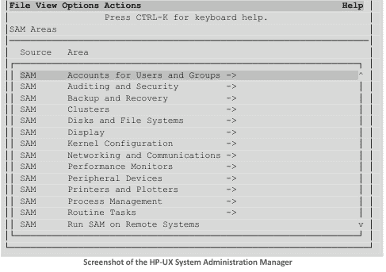

`sam` 是 HP-UX 系统的菜单驱动管理实用工具。它可用于管理 HP-UX 系统的各个方面。

上述示例显示了 `sam` 主菜单的屏幕截图。在 `sam` 中，使用方向键导航菜单，使用 Enter 键选择项目。按下 Tab 键可激活屏幕顶部的菜单栏，从而访问更多功能。

常见用法示例：

`sam` 启动 HP-UX 系统管理管理器

## smit

用途：IBM AIX 系统的菜单驱动系统管理实用工具。

用法语法：`smit`

```
### smit

                      System Management.
Move cursor to desired item and press Enter.
[TOP]
Software Installation and Maintenance
Software License Management
Devices
System Storage Management (Physical & Logical Storage)
Security & Users
Communications Applications and Services
Workload Partition Administration
Print Spooling
Advanced Accounting
Problem Determination
Performance & Resource Scheduling
System Environments
Processes & Subsystems
Applications
Installation Assistant
[MORE...3]
F1=Help
F2=Refresh
F3=Cancel
F8=Image
F9=Shell
F10=Exit
Enter=Do
Screenshot of the IBM AIX System Management Interface Tool
```

`smit` 是 IBM AIX 系统的菜单驱动管理实用工具。它可用于管理 AIX 系统的各个方面。


上述示例显示了 `smit` 主菜单的屏幕截图。在 `smit` 中，使用方向键导航菜单，使用 `Enter` 键选择项目。功能键（即 `F1`、`F2` 等）在 `smit` 中提供额外选项，并定义在每个屏幕的底部。

常见用法示例：

- `smit` | 启动 AIX 系统管理界面工具

### 附录 A：

Bash 快捷键

在 www.dontfearthecommandline.com 下载并打印此列表

| 按键 | 功能 |
| :--- | :--- |
| CTRL + C | 终止当前程序 |
| CTRL + Z | 暂停当前程序 |
| CTRL + D | 退出当前 shell |
| Tab | 命令/文件自动补全 |
| Home | 移动到命令行开头 |
| End | 移动到命令行末尾 |
| CTRL + L | 清屏 |
| Backspace | 删除光标后的文本 |
| ALT + Backspace | 删除光标后的整个单词 |
| Delete | 删除光标前的文本 |
| CTRL + R | 搜索命令历史 |
| Up Arrow | 向后循环浏览命令历史 |
| Down Arrow | 向前循环浏览命令历史 |
| Left Arrow | 光标向左移动一个字符 |
| Right Arrow | 光标向右移动一个字符 |
| ALT + B | 光标向后移动一个单词 |
| ALT + F | 光标向前移动一个单词 |
| CTRL + U | 剪切光标前的所有文本 |
| CTRL + K | 剪切光标后的所有文本 |
| ALT + D | 剪切当前选定的单词 |
| CTRL + Y | 粘贴之前剪切的文本 |
| CTRL + _ (下划线) | 撤销在命令行上输入更改 |
| CTRL + T | 交换命令行上前两个字符 |
| ALT + T | 交换命令行上前两个单词 |
| ALT + L | 将单词转换为小写 |
| ALT + U | 将单词转换为大写 |
