# Unix and Linux 入门实验手册（学生版）

出版者

Brandon A. Nordin

副总裁兼副主编

Scott Rogers

收购编辑

Chris Johnson

执行项目编辑

Janet Walden

收购协调

Athena Honore

技术编辑

Walter Merchant

项目经理

Laurie Stewart, Happenstance Type-O-Rama

文字编辑

Lunaea Weatherstone

排字员

Jeffrey Wilson, Happenstance Type-O-Rama

校对员

Sachi Guzman

索引员

Jack Lewis

系列设计

Maureen Forys, Happenstance Type-O-Rama

封面系列设计

Greg Scott

致 Dean——感谢你无尽的耐心与支持。

—Catherine Creary

这本书送给 Christopher，我们的“小大汉”。你出现在我生命中的短暂时光是一份祝福。

—Lee M. Cottrell

## 关于作者

**Catherine Creary**是一位独立的技术培训师、企业家和作家。她目前拥有教育学学位、MCT、MCSE、MCSA 和 MDCBA 证书。Catherine 在教育领域拥有超过12 年的经验。她是《Network+ All-in-One Lab Manual》（McGraw-Hill/Osborne, 2002）、《MCSE Windows XP Professional Lab Manual, Student Edition》（McGraw-Hill/Osborne, 2002）、众多培训课程（Digital Think）、Exchange 2000 专栏作家（www.OutlookExchange.com）以及多篇关于 IT 人员跨境工作的文章。她在计算机培训方面拥有丰富经验，包括成人教育计算机课程开发和课程设计。

**Lee M. Cottrell** 在匹兹堡的布拉福学校教授网络、硬件和计算机编程八年。除了教学外，Lee 还为学生提供，维护学校的网络和计算机设备，并为十所布拉福学校编写课程。他是《Windows 2000 Directory Services Administration Lab Manual》、《MCSE Windows 2000 Server Lab Manual》以及多本教师手册的作者。

Lee 以优等荣誉（magna cum laude）毕业于匹兹堡大学，获得纯数学理学学位。随后，他进入了匹兹堡大学研究生教育学院，获得了专业证书以及在宾夕法尼亚州高中教授数学的资格。最近，他在匹兹堡大学获得了信息科学硕士学位。您可以通过 `lee_cottrell@hotmail.com` 与他联系。

## 致谢

首先感谢 Chris Johnson、Athena Honore 以及 McGraw-Hill/Osborne 的所有同事，他们为本书的编写付出了巨大努力。感谢 Studio B Productions 的 Neil Salkind（www.studiob.com）、Jessica Richards 以及 Studio B 的全体员工。感谢 Walt Merchant 宝贵的编辑。

感谢 Jon Hirsch、Letham Burns 和 Mitch Tulloch（www.mtit.com），我认识的最优秀的计算机极客。

——Catherine Creary

我想感谢以下人员为本书提供的帮助：

- Chris Johnson、Athena Honore 以及 Osborne Media Group 的所有人，鼓励我成为更好的作家。
- Lunaea Weatherstone 和 Laurie Stewart 将我的文字转换为易读的英语。
- Walt Merchant 提供出色的建议。
- 布拉福学校的学生、员工和教职工在此期间忍受我的情绪。

——Lee M. Cottrell

# 引言

欢迎阅读《UNIX 和 Linux 实验手册》（xiv, 2002），本实验手册按章节组织，与学习指南相对应。每个章节可能包含多个实验。

每个章节包含章节引言、材料清单和每个实验的设置说明，以及实验本身、实践活动以及管理和故障排除问题。这些实验将为你在 UNIX/Linux 中可能遇到的真实场景做好准备。

每个章节还包含五个实验分析问题和一个关键术语测试，让你能够展示对章节涵盖内容的掌握。最后，章节以对要点的简要总结结束。实验的逐步解决方案位于每个章节的末尾。

## 本实验手册

本实验手册提供了掌握 UNIX 或 Linux 所需的接触和培训。涵盖主题包括：

- 使用 UNIX/Linux 实用程序
- 使用 Visual Editor 创建文件
- 获取 UNIX/Linux 帮助
- 编写 脚本
- 管理文件和目录
- 设置文件权限
- 使用 X Window
- 使用 UNIX/Linux 的多任务功能
- 管理 UNIX/Linux 用户

完成本实验手册后，你对 UNIX/Linux 架构会有更好的理解，并能够管理日常运行。

## 实验

理解网络背后的理论和 UNIX/Linux 原理对于网络管理员来说是重要的。问题在于，你能将这些知识转化到系统环境中吗？

# 引言

每项实验练习都允许你在现实场景中应用和练习特定的概念或技能。

# 案例研究

每个目标都以案例研究的形式呈现。它们为你提供了一个概念性的机会，以应用你新学的知识。

### 学习目标

与学习指南配合使用，第一个目标是帮助你理解 UNIX/Linux。第二个目标是培养你的批判性思维。在网络中，并不是所有的安装、重新安装或网络系统问题每次都会以相同的方式出现。为此，你需要能够分析、考虑你的各种选项以及每个选项的结果，并选择并实施该选项。如果奏效，那太好了；如果不奏效，你就要重新开始。

### 实验材料与设置

为了完全完成每个实验，必须满足以下硬件和软件要求。如果无法实现，请通读这些步骤，并尽可能熟悉这些操作流程。

书中的步骤和指导对应 Red Hat Linux 7.3。所有练习都可以在安装了 Red Hat 的工作站上进行。很可能其他 UNIX/Linux 版本也适用于所提供的步骤。通常，版本之间的差异是细微的。

你的计算机必须兼容 Red Hat 或其他版本的 Linux。你的计算机很可能是兼容的。有关 Red Hat 的验证，请访问 `www.redhat.com` 查看完整的硬件兼容性列表。以下列出了 Red Hat Linux 7.3 的最低支持规格。更多的内存和更快的处理器将带来更好的 Linux 系统。

- 32MB 内存
- 80386 处理器或更高版本
- VGA 显示器或更高级
- 鼠标或其他指针设备
- 4x 或更快的 CD-ROM
- 一个或多个具有至少 4GB 空闲磁盘的硬盘
- 网卡（可选）
- 拨号或通过局域网连接互联网

# 进入正题

每个实验的动手部分是循序渐进的，而不是逐个点击的。步骤提供了说明和指示，引导你完成每项任务。

## 实验分析测试

这些问题用于快速评估你对学习指南以及本章每个实验所学内容的理解。答案应该用你自己的话来表达。这表明你整合了这些信息，并对核心概念有了全面的理解。

### 关键术语测验

这些是你应该识别的技术词汇，并且你应该知道它们的定义和用途。这将对你的工作有所帮助。

## 解决方案

每个章节都提供了实验练习的解决方案。这些解决方案用于将你的实验步骤与正确的实验步骤进行比较。如果你熟悉 UNIX/Linux，你会发现实验练习的某些部分有多种方法可以完成该步骤。最终结果以及理解达到该结果的过程——是主要目标。

# 第 1 章

登录系统

## 实验练习

- I.01 登录 Linux 系统
- I.02 探索 UNIX 和 Linux
- 实验分析测试
- 关键术语测验
- 实验总结
- 解决方案

# 第 1 章：登录系统

UNIX/Linux 计算机可以同时为多个用户服务。每个用户必须有一个在系统中唯一标识其身份的账户。管理员必须为每个用户创建一个唯一账户，以便授予对系统的安全访问权限。然后用户可以输入与其账户关联的唯一登录名称以及与该登录账户匹配的密码。如果正确的信息输入系统，用户将获得访问权限。如果在输入登录名称或密码时出现错误，用户将被拒绝访问计算机。

本章研究了登录 Linux 系统的过程。你将成功登录系统并查看 Linux 提供的终端窗口和图形窗口环境。你将通过错误输入登录信息来测试登录过程，并观察 Linux 如何响应登录错误。你将在互联网上寻找需要 UNIX/Linux 系统知识的职业，以及 UNIX/Linux 的版本。

20 分钟

## 实验 1.01 登录 Linux 系统

Matthew 最近在他的笔记本上安装了 Red Hat Linux。他从未用过 Linux 系统，但他对 Windows 系统非常熟悉。他需要熟悉登录过程，以便能够登录系统。

### 学习目标

在本实验中，你将登录 Red Hat Linux 7.3。在实验结束时，你将能够：

- 登录系统
- 查看图形窗口环境
- 启动终端窗口
- 注销系统
- 测试登录错误

### 实验材料与设置

完成此实验所需的材料有：

- 安装了 Red Hat Linux 7.3 的计算机及图形窗口环境
- 纸和笔
- `root` 账户密码

# 进入正题

这些步骤引导你探索当今社会中 UNIX 和 Linux 的用途。登录系统。

**步骤 1** 在 Linux 计算机的登录提示处输入 `root` 账户和密码。显示了密码吗？

# 第 1 章：登录系统

> **警告** 除非为了特定任务，否则使用管理员 `root` 账户是不明智的。对于本实验而言，你只是学习登录和注销过程。

**步骤 2** 输入你在安装操作系统时设置的 `root` 账户密码。你成功登录系统了吗？

> **提示** 你会在屏幕上收到一条关于使用 `root` 账户的警告信息。

**步骤 3** 在 Linux 桌面面上观察可用图标、菜单和程序。启动终端窗口。终端窗口显示了什么文本？

**步骤 4** 退出终端窗口。注销 Linux 计算机。

**步骤 5** 使用登录名 `Matthew` 和密码 `wrk` 在图形环境下登录 Linux 计算机。你成功了吗？为什么？记录出现的任何错误信息。

## 实验 1.02 探索 UNIX 和 Linux

60 分钟

Ann 第一次使用 Linux 计算机。她来自 Windows 背景，不确定学习 Linux 如何帮助她的求职。她不知道 UNIX/Linux 的用途以及在她城市全球范围内使用的各个版本。她请求你帮助她在互联网上搜索这些领域的知识。

### 学习目标

在练习中，你通过浏览互联网探索 UNIX/Linux 系统的用途。完成本实验后，你将能够：

- 识别需要 UNIX/Linux 的职业
- 识别 UNIX/Linux 系统的用途
- 识别不同的 UNIX 版本
- 区分 UNIX、Linux 和 DOS 命令

### 实验材料与设置

对于此练习，你需要：

- 安装了 Red Hat Linux 7.3 的计算机
- 带有浏览器的互联网访问
- 纸和笔

# 进入正题

以下步骤引导你探索当今社会中 UNIX 和 Linux 的用途。

**步骤 1** 使用 `root` 账户和密码登录 Linux 计算机。

**步骤 2** 打开浏览器并在互联网上搜索需要 UNIX 或 Linux 系统知识的职业。在提供的空间内列出你的结果。

## 实验分析测试

- 1. 在输入登录名或密码时，哪些常见错误会导致登录失败？请列出五个常见错误。
- 2. 在当今商业世界中，UNIX/Linux 服务器提供哪些功能？
- 3. 通过哪些步骤可以从图形桌面环境启动并激活终端窗口？
- 4. 使用 `root` 登录账户的优缺点是什么？
- 5. 在登录提示处，输入正确的登录名与输入错误的登录名的结果有什么区别？

## 术语测验

使用以下词汇完成下列句子。并非所有术语都会被用到。

- `exit` (退出)
- `graphical window` (图形窗口)
- `login banner` (登录横幅)
- `login name` (登录名)
- `password` (密码)
- `root` (根)
- `Teletype device` (电字机设备)
- `terminal` (终端)

1. 登录名为 `root` 的账户是用于管理系统的账户，它对系统事件和操作具有权限。
2. 只有当用户提供了 `password` 与系统上已建立的用户匹配的密码时，才允许进入 UNIX/Linux 系统。
3. 启动 UNIX/Linux 计算机后，通常会在终端或图形窗口中看到一个 `login banner` 欢迎。
4. 以大写字母输入登录名或密码会导致电脑将你的终端视为一个 `Teletype device`。
5. `exit` 命令是一个 UNIX/Linux 消息，结果会导致终端窗口关闭。

## 实验总结

Linux 计算机的主要功能之一是多个用户可以同时登录系统。现在你已经完成了此实验，你应该已经成功登录了 Linux 计算机，并且熟悉了可以使用 Linux 配置的各种桌面环境。你还应该通过在输入登录名和密码时故意出错来测试 Linux 系统的安全性。由于这些错误，Linux 安全机制应该已经了对系统的访问。

## 答案

在本节，你将找到实验练习的答案。

### 实验解答 1.01

帮助 Matthew 熟悉登录过程以及图形和终端窗口应涉及以下步骤：

- 步骤 1 在登录提示处输入 `root` 登录账户后，会出现第二个提示，要求你输入该登录账户的关联密码。
- 步骤 2 `root` 登录账户的关联密码随每个系统而异。此密码应该在安装 Linux 操作系统时建立。在终端窗口中输入此密码时，密码不会显示在屏幕上；然而，图形窗口中会出现一系列星号，代表你输入的密码。在成功输入正确的关联密码后，Linux 将允许你登录系统并显示桌面环境。
- 步骤 3 你应该通过选择并点击面板上的显示器图标来启动终端窗口。终端窗口应该出现，你应该通过点击终端窗口内的任何地方鼠标来激活终端。你应该会看到终端窗口中的提示符，其中包含你的登录账户。
- 步骤 4 你应该通过在提示符处输入 `exit` 来退出终端窗口。终端窗口应该关闭，留下图形窗口环境。你应该从菜单中选择“log off”（注销）选项并成功注销系统。
- 步骤 5 由于系统中不存在 `Matthew` 账户及关联密码，你理应该被拒绝访问。你应该收到一条“Authentication Failed”（身份验证失败）的消息，并且登录字段应该重新出现。

### 实验解答 1.02

以下步骤将引导你探索 UNIX 和 Linux 操作系统：

- 步骤 1 你应该已经使用 `root` 账户和密码成功登录 Linux 计算机。
- 步骤 2 你应该已经打开浏览器，并发现某些需要 UNIX 或 Linux 操作系统知识的职业包括 UNIX/Linux 管理员、程序员、开发者、脚本编写者、分析师、工程师、培训师、导师等。

### 答案 11

**步骤 3** 你应该在互联网上研究全球 UNIX 和 Linux 系统的常见用途，并发现政府基础设施将 UNIX/Linux 用于不同的目的。你可以在 `http://www.linuxworld.com/linuxworld/lw-2001-01/lw-01-government.html` 阅读关于美国政府使用 Linux 的文章。学术机构使用 UNIX/Linux 服务器托管学术记录并创建广域网。企业网络将 UNIX/Linux 用于 Web 服务器、应用程序服务器等。金融机构和市场也使用 UNIX 来托管其关键数据。

**步骤 4** 你应该在互联网上搜索以获取不同版本的 UNIX 名称。这些包括 Digital UNIX、Hewlett-Packard HP-UX、IBM AIX、SCO UnixWare、SGI IRIX 和 Sun Solaris。可以在 `http://www.unix-systems.org/what_is_unix/flavors_of_unix.html` 找到 UNIX 的变体。

# 第 2 章

## 系统漫览

实验练习

- 2.01 与 Shell 协作
- 2.02 探索文件系统
- 2.03 使用工具管理文件
- 2.04 使用 `man` 学习开关功能
- 2.05 使用 `man` 通过关键词查找页面
- 2.06 使用 `info` 工具查找命令的详细说明
- 2.07 在线查找 UNIX/Linux问题的答案

实验分析测试

术语测验

实验总结

答案

# 第 2 章：系统漫览

在 UNIX/Linux 计算机上工作通常涉及创建和保存对你的业务重要的文件。为了成功地组织这些文件，你必须理解系统如何响应命令。本章将研究通过执行实用程序命令在 Linux 中与 shell 交互的过程。在本章结束时，你将通过使用各种工具和直接与 shell 交互成功探索并管理文件系统。在本章的下半部分，你将提高你的帮助技能。LaTrina 请求你帮助她学习 UNIX。她理解你在她的网站之外也有生活。她请求你教她如何使用帮助系统以便她尝试回答自己的问题。你回答说帮助系统是由几个部分组成的。`man` 页面提供命令的技术细节，文字较少。`info` 工具访问提供清晰说明的大型文档。30 分钟

## 实验练习 2.01 与 Shell 协作

Joel 不确定他的助手是否为他的餐厅创建了月历。该月历用于为餐厅员工创建工作计划。如果他在当前目录下没有找到该文件，他想创建一个 2002 年 11 月月历的文件。

### 学习目标

在实验中，将在 Linux 计算机的 shell 中发布命令和参数。实验结束后，你将能够：

- 创建用户账户
- 列出当前目录下的文件
- 发布带参数的命令
- 将工具输出重定向到文件
- 验证文件的创建和内容

### 实验材料与设置

此实验所需的材料有：

- 安装了 Red Hat Linux 7.3 的计算机
- 笔和纸

# 开始正

以下步骤引导你创建一个用于本及后续实验的新用户账户。

> 系统通常有一个在线手册，可以通过它列出选项并了解更多关于工具的信息。你随时可以通过执行 `man` 命令后跟工具名称来查阅手册。


你的计算机可能会进入文本模式。如果是这种情况，执行命令 `startx` 进入 Gnome。

第 1 步使用 root 账户和密码登录 Linux 计算机。

第 2 步从“程序 | 系统”菜单中选择“用户管理器”`User Manager`程序。打开 Red Hat 用户管理器控制台。

第 3 步点击“新建用户”`New User`按钮，根据提供的属性为你创建一个新用户账户：

- 用户名：`[First Name]`
- 全名：`[First Name Last Name]`
- 密码：`16IIFF`

第 4 步图 2-1 显示了多个用户账户。点击确定并关闭用户管理器控制台。注销计算机。

第 5 步使用为你创建的新用户账户和密码登录计算机。

第 6 步打开终端窗口，验证提示符显示的是你的用户登录账户。在提示符处，列出当前主目录下的文件。是否有列出的文件？

第 7 步在提示符处输入一个命令和参数，创建一个名为 `november_work_schedule` 的文件，该文件包含 2002 年 11 月的日历。请在提供的空格记录命令。

```
Cal 2002 = shows calendar
Cal 2002 > november_work_schedule = creates the file
```

第 8 步通过查看当前目录下的文件列表，验证 `november_work_schedule` 文件是否已创建。新创建的文件是否在列表中？

```
LS = allows you to view the file LS -L = shows the details
More command pauses every full screen frame
Cat november_work_schedule does the same
```

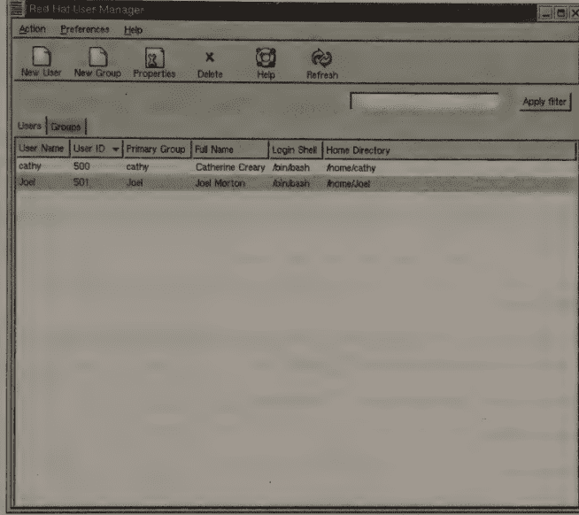

图 2-1 使用用户管理器创建的示例用户账户

**第 9 步**验证 `november_work_schedule` 文件的内容为 2002 年 11 月的日历。文件内容是否正确？注销计算机。

## 实验 2.02：探索文件系统

Dean 需要在接下来的三个月内创建几个新的销售文件。为了更好地组织这些新文件，他希望将它们保存在名为 Sales 的新目录中。他请求你帮助确定他目前保存文件的默认目录。他想学习如何创建新目录，以及如何在该目录下保存、追加和访问文件。

### 学习目标

在本次练习中，你将通过检查 Linux 目录结构来探索文件系统。完成此实验后，你将能够：

- 识别你在文件系统中的当前位置
- 创建新目录
- 切换目录
- 在子目录中创建并追加文件

### 实验材料与设置

本次实验所需的材料有：

- 安装了 Red Hat Linux 7.3 的计算机
- 铅笔和纸

### 开始正题

以下步骤将指导你在新子目录中创建并保存文件。你还需要应用在 John Muster 编写的《UNIX 和 Linux 入门》`Introduction to UNIX and Linux`，McGraw-Hill/Osborne, 2002 书中中学的关于 shell 操作的知识。

第 1 步使用你的用户名和密码登录 Linux 计算机。打开终端窗口。

## 实验 2.02：探索文件系统

第 2 步在提示符处输入提供你当前在文件系统中的位置的命令。在提供的空格处记录目录名称。

```
pwd Print Working Directory - shows the directory tree
```

`cd -` takes you back to your home directory

- 提示：当前位置也称为工作目录。

第 3 步在提示符处输入命令，在你当前目录下创建一个名为 Sales 的子目录。确认该子目录已创建。

第 4 步输入命令，将你在文件系统中的当前位置更改到 Sales 子目录。确认你现在位于新的 Sales 子目录中。

第 5 步创建一个新文件。验证 Sales 子目录中是否存在该日期。将带有 2002 年日历的日期工具追加到文件中以创建一个子目录。

第 6 步将位置切回主目录。验证更改已发生。记录输出内容。

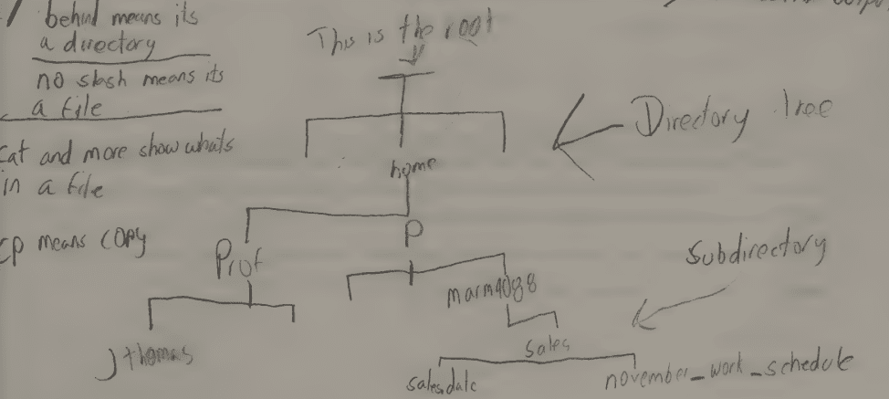

# 实验 2.03：使用实用管理文件

Keogh 保险公司聘请 Lisa 为行政助理。她的第一项任务是在她的主目录中创建并保存几个文件供将来使用。她请求你教她如何使用 Linux 工具来复制、打印和通常管理这些文件。你选择通过你创建的各种示例文件来演示这些工具。

### 学习目标

在实验中，你将创建几个文件并使用 Linux 工具管理它们。完成此实验后，你将能够：

- 在子目录中创建并追加文件
- 将文件复制到你的主目录
- 删除文件
- 重命名、打印文件

### 实验材料与设置

对于本次实验，你需要：

- 安装了 Red Hat Linux 7.3 的计算机
- 铅笔和纸
- Sales 子目录

### 开始正题

以下步骤将指导你创建几个文件。你还需要应用在 John Muster 编写的《UNIX 入门》`Introduction to UNIX`，McGraw-Hill/Osborne, 2002 书中中学到的关于使用工具管理文件的知识。

第 1 步使用你的用户名和密码登录 Linux 计算机。打开终端窗口。

第 2 步在提示符处输入以下文件：

| 文件名 | 内容 |
|---|---|
| Car_insurance | All users |
| Travel_insurance | September 2001 |
| House_insurance | Current date |
| Life_insurance | List of files |
| Health_insurance | All account |

## 实验 2.03：使用工具管理文件

| 文件名 | 内容 |
|---|---|
| Car_insurance | All users |
| Travel_insurance | September 2001 |
| House_insurance | Current date |
| Life_insurance | List of files |
| Health_insurance | All account |

- 提示：当前位置也称为工作目录。

第 3 步验证所有文件都已创建。显示 Travel_insurance 的内容。按月份和年份追加内容。

第 4 步将 Car_insurance 文件复制到你创建的 Sales 子目录中。将 House_insurance 重命名为 House。

第 5 步带确认地删除 Health_insurance 文件。使用什么参数进行提示确认？

```
ls > Health_insurance
```

第 6 步尝试将 Life_insurance 文件打印到指定的打印机。

### 警告

确保实验中没有打印机。

你收到了错误消息？注销计算机。

## 实验 2.04：使用 man 学习开关的功能

帮助之旅的第一站是 `man`，它是整个程序员手册的在线副本。`man` 工具非常适合提供命令的快速技术细节。它提供了每个命令的技术细节。你将访问几个命令的 `man` 页并编写其开关的功能。

### 学习目标

完成此实验后，你将能够使用 `man` 获取命令的技术信息。

### 实验材料与设置

完成本次实验需要：

- 一个 UNIX/Linux 计算机账户
- 一支笔或铅笔

### 开始正题

使用 `man` 页定义开关。用你自己的语言在描述列中写下 `man` 页面提供的描述。

| 命令 | 开关 | 描述 |
| --- | --- | --- |
| bash | -r | bash or shows the |
| chmod | -v | shows the shell |
| cp | -1 | copy the file |
| grep | -c | gets the info |
| ls | -d | list the files and dates |

## 实验 2.04：使用 man 学习开关的功能

| 命令 | 开关 | 描述 |
| --- | --- | --- |
| man | -k | Shows a list of commands with -k |
| mkdir | -m | Makes a directory |
| ps | -r | List the current processes |
| sort | -r | Sort the contents in order |
| wc | -L | Word count of |

## 第 2 章：系统之旅

10 分钟

## 实验练习 2.05：使用 man 根据关键词查找页面

LaTrina 对 `man` 命令并不完全感冒。她说，问题在于你必须在获取帮助之前就知道命令的名称。这只对 UNIX 高手有帮助，而对普通人来说并非如此。她该如何在 man 页面中搜索关键词呢？例如，她该如何找到所有设置权限的命令？

你知道 `man` 有一个搜索选项 `-k`，允许你通过字符串搜索 man 页面。这应该会让 LaTrina 印象深刻。

> 警告
> 在某些版本的 UNIX 中，`catman -k` 命令会设置 UNIX 索引，以便用户可以使用关键词搜索 man 页面。

### 学习目标

完成本实验后，你将能够根据关键词搜索 man 页面。

### 实验材料与准备

完成本实验你将需要以下物品：

- 一个 UNIX/Linux 计算机的账户
- 一支笔或铅笔

### 开始正题

你将使用 `man` 的 `-k` 选项来查找处理以下关键词的命令数量。请在“命令数量”列中填写与每个关键词相关的命令数量。

> 提示
> 你可以使用 `apropos` 工具代替 `man -k`。

### 提示

记住将输出重定向到 `wc`。这将让 UNIX 为你计数！

| 关键词 | 命令数量 |
| --- | --- |
| images | \ |
| modem | \ |
| permissions | \ |
| XII | |

## 实验练习 2.06：使用 info 实用查找命令的详细描述

LaTrina 仍然不完全满意。她对在页面中搜索关键词的能力留下了印象。然而，她仍然认为 `man` 不是一个足够好的帮助系统。她想要获得更多关于命令的信息：用通俗英语编写的信息，而不是 UNIX 极客为其他 UNIX 极客编写的信息。你决定向她介绍 `info` 工具。

### 学习目标

完成本实验后，你将能够：

- 查找实用程序的 info 数据库
- 浏览 info 数据库

### 实验材料与准备

完成本实验你将需要以下物品：

- 一个可以访问互联网的 UNIX/Linux 电脑的账户
- 一支笔或铅笔

### 开始正题

> 提示 你将运行 `info` 工具。这将打开一个类似菜单的界面。你可以使用箭头键、空格键、PAGE DOWN、PAGE UP 和 ENTER 键在系统中移动。箭头键和翻页键的功能符合预期。ENTER 键可以打开所需的主题。空格键的作用等于 PAGE DOWN。

运行 `info` 命令并针对每个命令回答以下问题。请在提供的空间内写下你的答案。

## 实验练习 2.06：使用 info 实用查找命令的详细描述

- 1. `ls` 的默认排序顺序是什么？
________________
- 2. `chmod` 如何处理符号链接？
________________
- 3. 你需要运行什么命令来创建自己的 info 文件？
________________
- 4. 哪种 `touch` 调用方式会将内存中的任何数据写入磁盘？
________________
- 5. `dir` 命令等同于哪一组 `ls` 选项？
________________

## 实验练习 2.07：在线查找 UNIX/Linux问题的答案

LaTrina 确信 UNIX/Linux 的帮助是值得的。她已经足够熟悉使用它，可以停止骚扰你了。不幸的是，其他朋友开始向你提关于 UNIX/Linux 的问题。许多问题非常有技术性，需要特定的答案。找到这些答案的唯一地方是网络。

一个胜任的计算机用户总是被问题包围。你回答得越好，问题来得越频繁。这是一把双刃剑。你获得了同伴和同事的尊重和佩慕，同时也失去了生产力。

### 学习目标

完成本实验后，你将能够利用互联网作为信息来源和方向查找 UNIX/Linux 问题的答案。

### 实验材料与准备

完成本实验你将需要以下物品：

- 一个可以访问互联网的 UNIX/Linux PC 账户
- 一支笔或铅笔

### 开始正题

你知道一个很好的起点是提供软件的公司的主页。因此，如果你被问到一个问题，你应该从 `www.redhat.com` 开始。以下是常用网站列表：

| Linux 厂商 | 网站 |
| --- | --- |
| FreeBSD | www.freebsd.com |
| Mandrake | www.mandrake.com |

## 实验练习 2.07：在线查找 UNIX/Linux问题的答案

| 厂商 | 网站 |
| --- | --- |
| Red Hat | www.redhat.com |
| Slack Ware | www.slackware.com |
| SuSE | www.suse.com |
| Sun Solaris | www.sun.com 或 docs.sun.com |

如果厂商网站没有帮助，请尝试 `www.google.com` 或其他搜索引擎。将问题中的关键术输入搜索框，并检查结果。

找到一个回答以下问题的网页。在提供的空间内写下 URL。

- 1. 如何在我的 Red Hat 7.3 Linux 安装中配置打印机？
- 2. 我的 Mandrake 7.0 安装支持哪些调制解调器？
- 3. 我需要联系 FreeBSD 关于软件中发现的安全漏洞。我应该联系谁？
- 4. KDE 的当前版本是什么？
- 5. 哪一个好的 UNIX“新手”网站？

Unix 概述

## 实验分析测试

用短句或段落回答每个问题。可能有多个答案。

- 1. 使用哪些实用程序来管理文件和目录？
`mv saturday week`
- 2. 哪些 UNIX 命令可以发送打印机？
`mv one answer`
- 3. 哪些实用程序可以显示内容？
`mv expected`
- 4. 在执行命令时如何使用重定向管道？
`mv pipes`
- 5. 执行 `ls` 命令会显示哪些系统目录？
`mv result of`
- 6. 如果你请求 `info`，会显示什么？
`mv node`
- 7. `man` 页面的目的是什么？
`mv request`
- 8. `help` 工具与 `info` 工具之间的区别是什么？
`mv want to`
- 9. `man` 用于搜索关键词的选项是什么？
`mv help`
- 10. `chown` 命令的作用是什么？
`mv do`

## 关键术汇测试

使用以下词汇术语完成下面的句子。并非所有术语都会用到。

- apropos argument
- b cat
- d cd
- info command
- -k lp
- keyword lpr
- 1 option
- man rm -i
- n shell
- p utility
- u

- 1. _________会让用户确认删除。
- 2. _________ 是允许你向系统提供指令的程序。
- 3. 当你输入 date 命令并按下 ENTER 时，你是在指示 shell 执行 _________.
- 4. _________ 是为实用程序提供特定指令的选项或标记。
- 5. 只需 _________ 命令即可切换到主目录。
- 6. _________ 提供命令的手手册。
- 7. _________ 工具提供了关于实用程序的深入描述。
- 8. man 的 _________ 选项可以搜索 man 页面。
- 9. 在 info 中，你使用 _________ 键显示上一个节点。
- 10. Apropos 通过 _________ 搜索 man 页面。

## 实验总结

计算机的主要功能之一是多个用户可以同时登录系统，但每个用户都有一个独立的默认目录来保存文件，这样就不会产生冲突。到目前，你应该已经成功地探索并使用了文件系统来创建和管理文件。你还应该熟悉用于打印、复制、移动、删除和查看文件及文件结构的实用程序。

恭喜！你学会了如何使用 UNIX/Linux 的帮助系统。`man` 命令提供了 UNIX/Linux 中所有命令的技术描述。它提供了所有开关、所有参数以及每个命令的简要描述。`info` 工具为每个命令提供了更好的描述。它提供了命令的英语描述，以及易于导航的界面。

在下一个实验中，你将学习如何使用 UNIX/Linux 的多任务功能。你将学习运行多个命令、确定你的朋友正在运行哪些命令，以及停止停止响应的任务。帮助将非常有用。

## 解决方案

在本节中，你将找到实验练习的解决方案。

### 实验解答 2.01

帮助 Jo 熟悉 shell（命令行界面）并创建一个新文件应该涉及以下步骤：

- **步骤 1** 你应该使用 `root` 管理员登录账户和密码登录到 Linux 计算机。此账户赋予你创建额外用户账户的权限。
- **步骤 2** 你应该通过从 Linux 计算机的 `System`（系统）菜单中选择打开 `User Manager`（用户管理器）控制台。
- **步骤 4** 为了保存为你自己创建的用户账户，你应该点击 `OK`（确定）按钮，然后关闭 `User Manager` 控制台并注销计算机。这将为你通过使用新用户名和密码重新登录计算机来测试你创建的用户账户做好准备。


- **步骤 5** 你应该已经使用你为自己创建的新用户账户和密码成功登录计算机。如果登录失败，请确保你在每个提示处输入了正确的信息。如果仍然失败，你可以使用管理员 `root` 账户重新登录，并重新创建或编辑用户账户以纠正任何错误。

- **步骤 6** 终端窗口提示符应该显示你的用户登录账户。这将帮助你在搜索文件时识别出你正在搜索正确的家目录（home directory）。在执行 `ls` 命令后，你应该发现当前目录下没有存在的文件。

- **步骤 7** 在提示符处执行的创建名为 `work_schedule` 的包含 2002 年 11 月日历文件的正确命令应该是：

```
cal 2002 > november_work_schedule
```

`calendar`（日历）工具用于创建 2002 年第一个月（11月）的结果。该结果被重定向到名为 `november_work_schedule` 的文件中。

- **步骤 8** 你应该执行 `ls` 命令以确保 `november_work_schedule` 文件已创建。文件名应该列在提示符处。

# 第 2 章：浏览系统

**步骤 9** 为了验证 `november_work_schedule` 文件的内容是否为 2002 年 11 月的日历，你应该执行 `more` `november_work_schedule` 命令。11 月的日历应该正确显示在提示符处。`more` 命令显示文件的内容。

你应该已经成功完成实验并注销计算机，为下一次实验做好准备。

## 实验解答 2.02

以下步骤应该帮助 Dean 探索其 Linux 计算机的文件结构：

**步骤 1** 你应该已经使用你的用户名和密码成功登录到 Linux 计算机，并从面板打开一个终端窗口。

**步骤 2** 你应该输入了 `pwd` 命令，它为你提供在文件系统中的当前位置（当前工作目录）。

**步骤 3** 你应该输入了 `mkdir` 命令，创建一个名为 Sales 的子目录。它将是你的个人家目录下的子目录。

**步骤 4** 你应该输入了 `cd` `Sales` 命令，将从文件系统中的当前位置切换到 Sales 子目录。你应该已经成功切换到新的子目录。

**步骤 5** 你应该通过执行以下命令将 `date` 工具的输出重定向到文件，在 Sales 子目录中创建一个新文件 Sales.date：

```
date > Sales.date
```

你应该使用 `cal 2002 >> Sales.date` 命令向 Sales.date 文件追加内容。如图 2-2 所示，执行 `dir` 命令将验证 Sales.date 文件已在子目录中创建。

- **步骤 6** 你应该输入 `cd` 或 `cd /` 命令，从 Sales 子目录的当前位置切回你的家目录。`cd` 命令将带你回到家目录，而 `cd /` 命令将带你进入根目录（root directory）。你应该已经通过执行 `pwd` 命令验证了位置的变化。

你已经成功完成实验并注销计算机。

## 实验解答 2.03

以下步骤应该帮助 Dean 在其 Linux 计算机上使用工具来管理文件：

- **步骤 1** 你应该已经使用你的用户名和密码成功登录到 Linux 计算机，并打开一个终端窗口。

- **步骤 2** 你应该已经在家目录通过输入以下命令创建了文件：

| 文件名 | 命令 |
| --- | --- |
| Car_insurance | who |
| Travel_insurance | date |
| House_insurance | cal |
| Life_insurance | ls |
| Health_insurance | ps |

- **步骤 3** 你应该已经通过执行 `ls` 命令验证了所有文件。要显示 Travel_insurance 文件的内容，你应该使用 `more` 命令。

- **步骤 4** 你应该通过 `cp xx Sales` 将 Car_insurance 文件复制到 Sales 子目录，其中 xx 是月份，xxxx 是当前年份。

- **步骤 5** 你应该输入 `rm -i` 命令来删除 Health_insurance 文件，这会请求确认。

- **步骤 6** 你应该通过 `mv` 命令将 House_insurance 文件重命名为 House。

## 第 2 章：系统之旅

| 命令 | 选项 | 描述 |
| --- | --- | --- |
| grep | -c | 抑制标准输出；而是为每个输入文件打印匹配行的行数。使用 -v 反向匹配选项，可以统计不匹配的行数。 |
| ls | -d | 列出目录本身而非内容。 |
| man | -k | 根据给定的系统指定另一组用于搜索的 man 手页。 |
| mkdir | -m | 设置权限模式（类似于 chmod），-rwxrwxrwx -umask。 |
| ps | -r | 将输出限制为运行中的进程。 |
| sort | -r | 反转比较结果。 |
| wc | -L | 打印最长行的长度。 |

## 实验解答 2.05

要解决此实验，你将需要使用 `man` 工具和 `-k` 选项。为了简化计数，你可以将输出重定向到 `wc -l`。这将统计行数。因此，对于 `images` 关键字，插入命令应为 `man -k images | wc -l`。

| 关键字 | 命令数量 |
| --- | --- |
| images | 46 |
| modem | 12 |
| permissions | 15 |
| XII | 18 |

## 实验解答 2.06

要解决每个问题，你必须使用 `info` 命令。你需要阅读这些页面以找到答案。文本基于 Red Linux 7.3，但在其他版本的 Linux 上也应该是相似的。图 2-5 显示了 `info` 的典型输出。

- 1. 运行命令 `info ls`。答案（ASCII）位于 `sort` 选项下。

- 2. 运行命令 `info chmod`。答案（它永远不会更改符号链接的权限）可以在第一页找到。

## 实验解答 2.07

后续页面将提供实验练习 2.07 中问题的答案。这些页面绝不是满足要求的唯一页面。

- 1. www.redhat.com/docs/manuals/linux/RHL-7.3-Manual/custom-guide/ch-printing.html

- 2. www.linux-mandrake.com/en/en/fhard70.php3#modems

- 3. www.freebsd.org/security/index.html

- 4. www.kde.com

- 5. www.unixgeeks.org/security/newbie/unix/

- 3. 运行命令 `info info`。答案（makeinfo）可以在 `Create a info file` 选项下找到。

- 4. 运行命令 `info touch`。答案（sync）可以在 `sync invocation` 选项下找到，这是 info 数据库的最后一页。

- 5. 运行命令 `info dir`。答案应该在第一页可见。`dir` 等于 `ls -C -b`。

图 2-5 典型的 info 输出

```
Linux Virtual PC
PC Edit CD Floppy Help
File: bashref.info, Mode: Top, Next: Introduction, Prev: (dir), Up: (dir)
Bash Features
=================
本文本是对 t Bash 壳中存在的特性的简要描述。
这是 2.5a 版本，最后更新于 2001 年 11 月 13 日；适用于“Bash’ 版本 2.5a”的《GNU Bash 参考手册》。
版权 (C) 1991, 1993, 1996 Free Software Foundation, Inc.
Bash 包含了其他流行壳层中出现的特性，以及某些仅在 Bash 中出现的特性。Bash 借用了一些来自 Bourne Shell ('sh')、Korn Shell (ksh) 以及 C-shell 及其继任者 tcsh 的概念。
以下菜单根据这些其他壳层中哪一个启发了未来将特性分为几类。
本手册旨在对 Bash 中找到的特性进行简要介绍。Bash 手页应作为行为的确定性参考。
- info-bash.info.gz.Top, 60 lines -Top
欢迎使用 info 版本 4.1。输入 C-h 获取帮助，输入 m 进入菜单项。
? ?
```

# 第 3 章：工具、壳指令和进程之旅

**实验练习**

- 3.01 使用强大的工具

- 3.02 管理工具的输入和输出

- 3.03 使用特殊字符

- 3.04 修改用户环境

- 3.05 创建 Shell 脚本

- 实验分析测试

- 关键术语测试

- 实验总结

- 解决方案

在前面的章节中，你学习了 UNIX/Linux 计算机如何使用多种工具来定位系统和用户数据及文件。一旦定位这些文件，你就使用工具来处理数据。对这些文件的处理可以通过额外的强大工具进行扩展。

本章研究从文件中读取输入、更改其读取的数据并将更改后的数据发送到屏幕、文件或另一个工具的工具。在接后的实验中，你将指示 shell 连接输入和输出，在命令行中使用特殊字符，并通过自定义程序来修改用户环境。你还将更改密码，创建并执行 shell 脚本以学习基础编程。

30 分钟

## 实验练习 3.01：使用强大的工具

Sam 正在写小说，想整理他写的前三个章节，以确保它们符合合同中规定的规范。他想获取中间章节文件的行数、字数和字符数。还需要合并几个章节文件，以确保小说的情节在章节之间流畅地过渡。为了帮助他快速搜索，Sam 如果能够定位文件中特定的行将受益匪浅，但他不知道如何操作。他请求你帮助他学习几个 Linux 工具的功能。

### 学习目标

在本实验中，你通过使用强大的工具在 Linux 计算机上组织多个文件。完成实验后，你将能够：

- 创建文本文件

- 统计文件的元素数量

- 排序并定位文件的行

- 合并多个文件

### 实验材料和设置

此实验所需的材料有：

- 安装了 Red Hat Linux 7.3 的计算机

- 铅笔和纸

### 开始正题

以下步骤将指导你使用强大的工具来组织 Linux 计算机上的大量文件。你还必须应用在 John Muster 编写的《Introduction to UNIX and Linux》（McGraw-Hill/Osborne, 2002）一书中中学的知识，使用工具创建文件。

步骤 1 使用你的用户名和密码登录 Linux 计算机。打开终端窗口。

步骤 2 使用 `cat` 工具在你的主目录下创建以下文件：

| 章节标题 | 文本 |
| --- | --- |
| Chapter_1 | 这是一个黑暗且风雨交加的夜晚。Christina 失败地试图屏蔽掉声音。 |
| Chapter_2 | Christina 看着她的手表。他迟到了。 |
| Chapter_3 | 太阳正在落下，但 Jake 并不在乎。 |

步骤 3 验证主目录下是否创建了所有文件。对于每个章节，验证行数、字数和字符数。记录你的结果。

步骤 4 在你的主目录下创建一个名为 `ChapterList` 的文件，列出三个章节的名字。反序对文件进行排序。

步骤 5 在终端屏幕上使用正确的工具在相应的章节中定位单词 `thunderstorm`。结果不同吗？请给出你的理由。

步骤 6 为了回顾 Sam 小说的章节是如何衔接的，创建一个名为 `Novel` 的文件，它是三个章节的合并。显示 `Novel` 文件的内容以确保它包含三个章节的文本。注销计算机。

## 实验练习 3.02：管理工具的输入和输出

Sam 为小说增加了第四章。他不确定在添加的文本中是否拼错了任何单词。他想检查第四章的拼写。他还想在从键盘输入标题时，对他考虑的小说标题列表进行排序。

### 学习目标

在练习中，你管理工具的输入和输出。完成实验后，你将能够：

- 指定一个文件作为输入

- 列出文件中拼写错误的单词

- 排序几行输入

### 实验材料和设置

此实验所需的材料有：

- 安装了 Red Hat Linux 7.3 的计算机

- 铅笔和纸

### 开始正题

以下步骤将指导你管理工具的输入和输出。

步骤 1 使用你的用户名和密码登录 Linux 计算机。打开终端窗口。

步骤 2 创建名为 `Chapter_4` 的文件，包含以下文本：

他知道 Christina 正在国家的另一侧等他，但他觉得没有必要急着去见她。

# 第 3 章：实用工具、Shell 指令与进程

> 提示

> 请确保在 Chapter_4 文件中包含该拼写错误。

步骤 3 检查 Chapter_4 文件是否存在任何拼写错误。系统是否返回了任何错误？

步骤 4 输入并对 Sam 小说的潜在标题列表进行排序：

- Bad Attitudes（坏态度）

- Love in Disguise（伪装的爱）

- Never Enough（永远不够）

- No Surprises（没有惊喜）

- All or Nothing（全或无）

- 排序的结果是什么？

步骤 5 命令 `sort < Chapter_4` 与命令 `sort Chapter_4` 有何不同？注销电脑。

## 实验练习 3.03：处理特殊字符

20 分钟

## 实验练习 3.03：处理特殊字符

Sam 希望能够轻松搜索他的章节列表，而无需必输入每个想要搜索的章节的完整名称。他想利用特殊字符来节省时间。他还希望确保在每个章节中经常提到角色名字，以便读者能够轻松跟踪剧情。然而，在某些情况下，Sam 需要 shell 不要解释特殊字符，而是将它们视为普通字符。他不确定如何实现这些目标，并请求你的帮助。

### 学习目标

在本次练习中，你将处理特殊字符。完成实验后，你将能够：

- 使用通配符替换字符

- 识别 shell 变量和环境变量

- 防止 shell 解释特殊字符

### 实验材料与设置

对于本次实验练习，你需要：

一台 安装了 Red Hat Linux 7.3 的电脑

- 铅笔和纸

- 成功完成之前所有的实验

### 开始正题

以下步骤将指导你处理特殊字符。你将需要应用 John Muster 所著《UNIX 和 Linux 入门》（McGraw-Hill/Osborne, 2002）书中中学的知识，在命令行中使用特殊字符。

**步骤 I** 使用你的用户名和密码登录 Linux 电脑。打开终端窗口。

# 第 3 章：实用工具、Shell 指令与进程

**步骤 2** 在提示符处输入命令 `echo $HOME`。命令的结果是什么？命令中使用什么类型的变量？

**步骤 3** 从当前目录开始，列出所有以字母 C 开头的文件。请在提供的空间内记录你执行的命令。

**步骤 4** 为了帮助 Sam 在所有章节中搜索角色名字，执行一个使用特殊字符并搜索当前目录下所有文件的命令。请在下方提供的空间内记录正确的命令。

**步骤 5** 为了防止 shell 解释某些特殊字符，Sam 应该向 shell 发出什么指令？

**步骤 6** 执行一个命令，指示 shell 显示以下句子，但不解释文本中的通配符字符：

Christina 看了墙上的标牌。上面写着 **BEWARE**（小心）。

在提供的空间内标出正确的命令。注销电脑。

## 实验练习 3.04：修改用户环境

20 分钟

Sam 的小说已经写到了一个阶段，他对他的 Novel 文件很满意，不想不小心覆盖它。他希望实用工具的输出不会覆盖他的文件。此外，出于安全考虑，他想帮助更新与登录账户关联密码。

### 学习目标

在本次练习中，你将防止覆盖文件并更新密码。完成实验后，你将能够：

- 指令 shell 不要覆盖文件

- 验证变量的状态

- 你的登录密码

### 实验材料与设置

对于本次实验练习，你需要：

一台 安装了 Red Hat Linux 7.3 的电脑

- 铅笔和纸

- 成功完成之前所有的实验

### 开始正题

以下步骤将指导你修改用户环境。你还需要应用 John Muster 所著《UNIX 和 Linux 入门》（McGraw-Hill/Osborne, 2002）书中中学的知识，防止实用工具覆盖文件并更改登录密码。

**步骤 I** 使用你的用户名和密码登录 Linux 电脑。打开终端窗口。

# 第 3 章：实用工具、Shell 指令与进程

**步骤 2** 显示 Novel 文件的内容。通过更新文件以包含每个章节文件，确保 Novel 文件包含 Sam 小说的全部四个章节文本。

**步骤 3** 输入命令防止实用工具覆盖你主目录中的文件。验证你已激活该变量，并在提供的空间内记录两条命令。

**步骤 4** 尝试通过执行命令 `date` Novel 更新 Novel 文件的内容，以确保你无法对文件进行任何更改。禁用该变量以为未来的实验做准备。

**步骤 5** 输入适当的命令，允许你更改密码并将新密码设置为 `MdfGW2002`。

**步骤 6** 注销电脑。尝试用你的用户名和新密码重新登录。成功了吗？注销电脑。

## 实验练习 3.05：创建 Shell 脚本

15 分钟

## 实验练习 3.05：创建 Shell 脚本

Sam 想创建一个名为 Workday 的脚本来跟踪目录中的文件。他希望在为小说添加新章节时每天都能执行此脚本。他还想跟踪当前日期。他并请求在脚本中添加十一月份的日历，以便他参考以确保按截止日期完成。

### 学习目标

在本次练习中，你将创建一个 shell 脚本。完成实验后，你将能够：

- 创建新脚本

- 在脚本中添加实用工具

- 修改文件权限

- 保存并执行脚本

### 实验材料与设置

对于本次实验练习，你需要：

一台 安装了 Red Hat Linux 7.3 的电脑

- 铅笔和纸

### 开始正题


以下步骤将指导你创建 shell 脚本。你将需要应用 John Muster 所著《UNIX 和 Linux 入门》`McGraw-Hill/Osborne, 2002`中的知识来创建脚本。

### 步骤 1
使用你的用户名和密码登录 Linux 电脑。打开终端窗口。

> 提示
> 记住你在上一个实验中将密码更改为 `2002`。

### 步骤 2
在提示符处输入以下命令创建一个文件：`cat > Workday`

### 步骤 3
创建并保存一个包含主目录文件列表、当前日期和十一月日历的脚本。

### 步骤 4
在运行脚本之前，确保 `Workday` 文件具有执行权限。

### 步骤 5
通过输入 `./Workday` 执行脚本。在提供的空间内记录脚本的结果。

> 提示
> 如果命令 `./Workday` 没有导致脚本执行，请确保 `Workday` 文件的权限可执行。

## 实验分析测试

- 1. 在 Red Hat Linux 7.3 上将密码改为 `password` 的结果是什么？
- 2. `noclobber` 变量是否防止用户向文件添加文本时覆盖文件？给出你的理由。
- 3. 密码文件中哪七个字段？简列列并定义每个字段。
- 4. 如何创建一个合并 `Chapter_1`、`Chapter_2` 和 `Chapter_3` 文件的顺序的文件？
- 5. 执行 `CTRL-D` 和 `CTRL-C` 命令的输出有什么区别？

### 关键术语测验

使用以下词汇完成这些句子。并非所有术语都会被使用。

```
awk
chmod
env
grep
$HOME
noclobber
sort
$USER
variable
wildcard
```

1. ________ 代表你的工作目录位置的变量。
2. ________ 可以代表命令中的一个字符字符串。
3. ________ 命令用于更改文件的权限/模式。
4. 名为 ________ 的变量可以防止实用工具的输出覆盖文件。
5. ________ 显示你的 shell 设置的一些环境变量的输出。

## 实验总结

你现在应该已经熟悉如何指示 shell 连接输入和输出的路径、在命令行中使用特殊字符，以及修改用户环境。你还应该知道如何更改密码以及创建和执行脚本。

## 解决方案

在本节，你将找到实验练习的解决方案。

### 实验解决方案 3.01

以下步骤将帮助 Sam 整理他小说的章节文件：

- **第一步** 你应该已经使用用户名和密码成功登录到 Linux 计算机并打开了终端。
- **第二步** 可以 `cat` 工具在你的主目录下创建 Sam 的章节文件。对于 `Chapter_1`，你应该输入以下内容：

```
cat > Chapter_1
It was a dark and stormy night.
ENTER
Christina unsuccessfully tried to block out the sounds of the thunderstorm.
CTRL-D
```

要创建 `Chapter_2`，你应该输入以下内容：

```
cat > Chapter_2
Christina looked at her watch.
ENTER
He was late.
CTRL-D
```

要创建 `Chapter_3`，你应该输入以下内容：

```
cat > Chapter_3
The sun was setting but Jake didn't care.
CTRL-D
```

- **第三步** 你应该已经使用 `ls` 命令验证主目录下是否已创建所有文件。要检索某个章节的行数、单词和字符数，命令为 `wc filename`。这将产生以下结果：

| 18 | 107 | Chapter_1 |
| 8 | 44 | Chapter_2 |
| 1 | 42 | Chapter_3 |

每一行都表示相应文件的行数、单词数和字符数。

- **第四步** 为了在你的主目录下创建一个名为 `ChapterList` 的组合文件并列出前三个章节的名称，你应该使用 `ls` 工具。正确的命令是 `ls > ChapterList`。结果显示在图 3-1 中。

### 解决方案 59

```
catherine@localhost~
File Edit Settings Help
[catherine@localhost catherine]$ ls > ChapterList
[catherine@localhost catherine]$ more ChapterList
Chapter_1
Chapter_2
Chapter_3
ChapterList
[catherine@localhost catherine]$ 
```

**图 3-1** `ChapterList` 文件内容这将创建一个文件，将目录中所有文件的列表输出合并到一个文件中。内容的顺序将与列出的文件名顺序一致。要按反序对文件排序，你应该执行带有反转参数的 `sort` 工具：`sort -r ChapterList` | `more`。

**第五步** `grep` 工具可用于定位文件中包含**单词**或字符字符串的行。要定位 `Chapter_1` 文件中的单词 `thunderstorm`：

```
grep thunderstorm Chapter_1
```

命令的结果应该列出以下文本：

Christina unsuccessfully tried to block out the sounds of the thunderstorm.

要定位 `Chapter_1` 文件中的单词 `storm`：

```
grep storm Chapter_1
```

命令的结果应该列出以下文本：

It was a dark and stormy night. Christina unsuccessfully tried to block out the sounds of the thunderstorm.

`grep` 工具列出每一行包含字符串 `storm` 的行，因此同时显示了包含单词 `storm` 的句子和包含单词 `thunderstorm` 的句子。

# 第 3 章：工具之旅、Shell 指令与进程

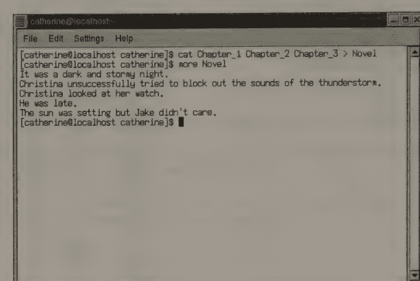

```
### 图 3-2 小说文件中合并的章节
```

File Edit Settings Help

[catherine@localhost catherine]$ cat Chapter_1_Chapter_2_Chapter_3 > Novel

[catherine@localhost catherine]$ more Novel

It was a dark stormy night,

Christina unsuccessfully, she tried to block out the sounds of the thunderstorms.

Christina looked at her watch.

He was late.

The sun was setting but Jake didn't care.

[catherine@localhost catherine]$ 

```

**第六步** 为了创建一个名为 `Novel` 的文件，该文件是三个章节文件的合并，你应该输入：`cat Chapter_1_Chapter_2_Chapter_3 > Novel`。`ls` 命令将把 `Novel` 文件的内容显示在你的屏幕上，如图 3-2 所示。你应该已经成功注销了计算机登录。

## 实验解决方案 3.02

以下文本将帮助 Sam 管理来自工具的输入和输出：

**第一步** 你应该已经使用用户名和密码成功登录到 Linux 计算机并打开了终端窗口。

**第二步** 要创建名为 `Chapter_4` 的文件，你应该执行命令：`cat > Chapter_4` 并输入文本：

He knew that Christina was waiting for him on the other side of the country, yet he didn't feel the need to rush to meet her.

**第三步** 为了检查 `Chapter_4` 的拼写错误，你执行命令 `spell < Chapter_4`。系统应该返回拼写错误的单词 `waiting`。`spell` 命令没有对该单词提供修改建议。

**第四步** 为了输入并对 Sam 小说的潜在标题列表排序，你应该执行命令：

```
sort
Bad Attitudes
Love in Disguise
Never Enough
No Surprises
All or Nothing
CTRL-D
```

排序顺序将按字母顺序直接在原始列表下方列出潜在标题。

**第五步** 两个命令的结果均如图 3-3 所示。你应该已经成功完成了实验并注销了计算机登录。

## 实验解决方案 3.03

以下步骤将帮助 Sam 处理特殊字符：

**第一步** 你应该已经使用用户名和密码成功登录到 Linux 计算机并打开了终端。

**第二步** 通过在提示符处输入 `$HOME`，结果可能类似于：

```
/home/username
```

`HOME` 变量是一个 Shell 变量。当你登录时 Shell 获取了它。


**图 3-3** 不同命令的结果

# 第 3 章：工具之旅、Shell 指令与进程

**第三步** 在命令提示符处执行 `echo C`。结果是以字母 `C` 开头的文件列表。

**第四步** 为了帮助 Sam 在所有章节中搜索名字，你应该执行 `grep Christina` 以查找 `Christina` 的结果，并执行 `grep Jake` 以查找 `Jake` 的结果。结果应该列出引用这些人物的章节。

**第五步** Sam 应在任何字符前加上反斜杠 `\` 以防止 Shell 解释它。例如：`echo \` 将呈现输出。

**第六步** 你应该执行命令：

```
echo Christina read the sign on the wall. It said \*BEWARE*.
```

此命令指示 Shell 输出句子但不解释字符，结果为：

Christina read the sign on the wall. It said **BEWARE**。

你应该已经成功完成了实验并注销了计算机登录。

## 实验解决方案 3.04

以下步骤将引导你防止文件被覆盖并更新密码：

**第一步** 你应该已经使用用户名和密码成功登录到 Linux 计算机并打开了终端。

**第二步** 为了显示 `Novel` 文件的内容，你应该执行 `more Novel` 命令。`Novel` 文件应该只包含 Sam 小说的前三个章节的文本。你可以通过执行 `cat Novel Chapter_4` 命令来更新 `Novel` 文件以包含 `Chapter_4` 的内容。

**第三步** 为了防止覆盖主目录中的文件，你需要执行 `set -o noclobber` 命令。为了验证你已激活该变量，你应该执行 `set -o noclobber` 命令。这将返回变量列表及其当前状态。`noclobber` 变量应设置为 `On`。

**第四步** 你无法使用图 3-4 所示的 `date` 工具对 `Novel` 文件进行任何更改。你应该通过执行 `set +o noclobber` 命令将 `noclobber` 变量恢复为 `Off` 设置。

**步骤 5** 要更改密码，你只需简单地执行 `passwd` 命令即可。系统会提示你输入当前密码，你应该通过输入密码来响应。随后，系统会提示你输入新密码。此时你应该输入新密码 `mfgw2002`。程序要求你再次输入新密码。如果操作正确，你将不会收到错误，密码将被更改。

**步骤 6** 你应该已经使用你的用户名和新密码成功登录计算机，以确认你确实已经更改了与登录账户关联的密码。完成此操作后，你将成功完成实验，因此可以注销系统。

## 实验解决方案 3.05

以下步骤将指导你创建一个 脚本：

- **第 1 步** 你应该已经使用用户名和密码成功登录 Linux 计算机，并打开了终端窗口。
- **第 2 步** 在提示符处输入命令 `cat > Workday` 创建新文件。
- **第 3 步** 一个满足 Sam 示例脚本如下：

```bash
echo My files to date are
ls
echo Today is
```

# 第 3 章：浏览工具、Shell 指令与进程

```
date
echo My deadlines are the 6th 13th and 24th
cal
CTRL-D
```

**步骤 4** 为了在尝试运行脚本之前确保 `Workday` 文件的权限为可执行，你可以使用 `ls -1 Workday` 命令查看文件权限，如图 3-5 所示。由于文件是刚创建的，它不应该是可执行的，因此你应该通过输入 `chmod +x Workday` 命令更改脚本的权限以允许其执行。

**步骤 5** 通过输入命令 `./Workday` 执行脚本后，你应该已经收到 `ls`、`date` 和 `cal` 命令的输出，并与你输入的文本整合。你应该已经成功完成了实验并注销了计算机。

图 3-5 `Workday` 文件的文件权限

# 第 4 章

## 使用可视化编辑器进行编辑

## 实验练习

- 4.01 在现有文件中工作
- 4.02 在文本文件中导航
- 4.03 创建并追加文本文件
- 4.04 向 Shell 和可视化编辑器下发指令
- 4.05 修改文本

实验分析测试

关键术语测验

实验总结

解决方案

# 第 4 章：使用可视化编辑器进行编辑

现在你应该已经熟悉使用工具创建文本文件。你已经操作过从文件读取输入、更改所读数据并将更改后的数据发送到屏幕、其他文件或工具的工具。本章比使用工具修改文件更进一步一步，引入了被称为 UNIX/Linux 可视化编辑器或 `vi` 的文本编辑器。

强大的 `vi` 编辑器允许用户通过组合按键组合提供所有指令来创建文本。可视化编辑器允许用户访问文件、在文本行之间移动、编辑文件中的内容并读取其他文件。以下实验旨在让你熟悉 `vi` 编辑器、它的命令模式和插入模式以及它提供的所有特性和功能。

20 分钟

## 实验练习 4.01：在现有文件中工作

Sam 想要探索使用可视化编辑器编辑他的小说的可能性。`Novel` 文本文件包含了 Sam 迄今编写的小说的所有章节。他想探索 `vi` 编辑器的命令模式，并在 `Novel` 文件中导航，搜索可能因文件长度过长而需要删除的文本。

### 学习目标

在实验中，你将通过在现有文件中工作来探索可视化编辑器。在本结束时，你将能够：

- 激活可视化编辑器
- 在命令模式下操作

## 实验练习 4.01：在现有文件中工作

- 在文本文件中移动
- 删除文本并撤销文本更改
- 退出可视化编辑器

### 实验材料与设置

你本次实验所需的材料有：

- 安装了 Red Hat Linux 7.3 的计算机
- 铅笔和纸
- 成功完成之前所有的实验

### 开始开始

以下步骤将指导你通过在现有文件中工作来探索可视化编辑器的功能。你将应用在 John Master 编写的《UNIX 和 Linux 入导》`McGraw-Hill/Osborne, 2002` 书中中学的知识使用可视化编辑器进行编辑。

**步骤 1** 使用你的用户名和密码登录 Linux 计算机。打开终端窗口。

> 提示：记住你在上一个实验中应该已经将密码更改为 `MbfGW2002`。

**步骤 2** 通过列出目录内容，确保你的家目录下有 `Novel` 文件。指示 Shell 打开 `Novel` 文件以便你可以查看内容。

**步骤 3** 一旦你通过 Shell 查看了文件内容，就用可视化编辑器打开 `Novel` 文件。文件内容看起来和打开时的一样吗？

**步骤 4** 使用逐行移动的按键导航。哪些键可以逐行向下移动？

**步骤 5** 使用所有可用的方向键进行导航。列出这些键及其对应的方向。

**步骤 6** 输入指令让可视化编辑器在 `Novel` 文件中搜索并将光标移动到 `the`。找到 `the` 第一个出现处后，找到随后的每一个位置。

**步骤 7** 输入指令让可视化编辑器在 `Novel` 文件中搜索并将光标移动到 `rush`。指示 `vi` 删除句子中的 words `rush to`。

**步骤 8** 导航到 `Novel` 文件中的第一行。指示编辑器删除整行。指示 `vi` 撤销对行的更改。

**步骤 9** 将你的更改保存到 `Novel` 文件并退出可视化编辑器。通过向 Shell 执行 `dir` 命令确认你已退出可视化编辑器。更改保存了吗？注销计算机。

## 实验练习 4.02：在文本文件中导航

30 分钟

Sam 发现使用可视化编辑器滚动他的 `Novel` 文本文件需要很长时间。到目前为止，他一直是按行和字符在文件中移动。他想加快在文本文件中导航的过程，并请求你帮助使用增强方向键、行号和目标搜索来实现。

### 学习目标

在练习中，你通过可视化编辑器在文本文件中导航。完成实验后，你将能够：

- 按行和字符在文本文件中导航
- 探索增强方向命令
- 使用行号
- 搜索文本文件

### 实验材料与设置

你本次实验所需的材料有：

- 安装了 Red Hat Linux 7.3 的计算机
- 铅笔和纸

### 开始开始

以下步骤将指导你通过插入模式探索可视化编辑器的功能。你将应用在 John Master 编写的《UNIX 和 Linux 入导》`McGraw-Hill/Osborne, 2002` 书中学的知识使用可视化编辑器在文本文件中进行导航。

**步骤 1** 使用你的用户名和密码登录 Linux 计算机。打开终端窗口。

**步骤 2** 用可视化编辑器打开 `Novel` 文本文件。使用增强方向键在文本文件中导航，遵循以下指令：

- a) 向下 4 行。
- b) 向右移动 6 个空格。
- c) 向上移动 2 行。
- d) 向左移动 4 个空格。

你在文本中的最终位置在哪里？请指示到达每个指令位置时使用的增强方向键或命令。


第 3 步显示 Novel 文件中每行的文本行号。在提供的空间内，指示你将用于同时显示和关闭行号的命令。

第 4 步指示视觉编辑器跳转到 Novel 文件中的以下特定行：

- a) 文件的第四行
- b) 文件的最后一行
- c) 第 2 行

指出你用于上述每个位置的使用的命令，并指示任何可以产生相同结果的替代命令。

第 5 步按照以下指令搜索 Novel 文件：

- a) 从当前位置向下移动两行。
- b) 搜索字母 e。
- c) 反向搜索文件查找字母 e 的上一次出现。
- d) 将光标向前移动三个单词。
- e) 将光标移动到当前行尾。
- f) 将光标置于屏幕上最高的行。
- g) 将光标移动到文件的最后一行。

在提供的空间内，指示每个搜索的正确命令。注销计算机。

# 实验练习 4.03：创建和追加文本文件

Joel 想为他的英语学生创建一份测验。Joel 希望在以后能够添加和删除某些行文本。他还希望根据自己的需要调整屏幕的文本显示。Joel 请你帮助他熟悉视觉编辑器的追加模式（append mode）。

## 学习目标

在本次练习中，你使用视觉编辑器创建并追加一个文本文件。完成本次实验后，你将能够：

- 使用视觉编辑器创建文本文件
- 在追加模式下添加和编辑文本
- 调整屏幕的文本显示

## 实验材料和设置

对于本次实验练习，你需要：

- 安装了 Red Hat Linux 7.3 的计算机
- 铅笔和纸

## 开始正题

以下步骤将指导你使用视觉编辑器的追加模式创建文本文件。你必须应用在 John Master 编写的《UNIX 和 Linux 简介》（McGraw-Hill/Osborne, 2002）一书中获得的知识来追加文本文件。

**第 1 步** 使用你的用户名和密码登录 Linux 计算机。打开终端窗口。

**第 2 步** 使用视觉编辑器创建一个名为 `Quiz` 的新文件。指示编辑器移动到追加模式。

**第 3 步** 向 `Quiz` 文件中添加以下文本：

Quiz

用适当的答案填空空格。

1. I think ________ the best student in the class!

a) you're

b) your

2. ________ is this?

a) Who's

b) Whose

3. ________ boyfriend is handsome.

a) Your

b) You're

4. I like ice cream ________

a) two

b) too

5. The ________ is rainy and cold today.

a) whether

b) weather

**第 4 步** 通知视觉编辑器你想返回命令模式。保存 `Quiz` 文件并退出视觉编辑器。在 shell 中使用 `more` `Quiz` 打开 `Quiz` 文件，以验证你的输入已正确保存。

**第 5 步** 使用视觉编辑器重新打开 `Quiz` 文件。指示视觉编辑器移动到追加模式。

**第 6 步** 在 `Quiz` 文件的末尾添加以下文本：

6. Sasha the dog knows ________ name.

a) its

b) it's

哪两个命令指示编辑器器追加模式下向光标处添加文本？简要描述并比较每个命令。

**第 7 步** 指示视觉编辑器切换到命令模式并将并将光标移动到屏幕中间附近的一行。在光标所在上方打开新行并插入以下文本：

（以下问题每个值 5 分。）

**第 8 步** 通过执行向下滚动一屏文本的命令来调整屏幕的文本显示。保存并退出带有更改的 `Quiz` 文件。

# 实验练习 4.04：向 shell 和编辑器发布指令

Joel 想使用视觉编辑器创建一个脚本，但他不确定如何实现。他熟悉通过编辑器的追加模式添加和删除文本，但请求你帮助他理解如何通过视觉编辑器联合发布命令以创建一个脚本。

## 学习目标

在本次练习中，你将创建一个脚本并向 shell 和视觉编辑器发布指令。完成本次实验后，你将能够：

- 区分发给 shell 和编辑器的指令
- 使用视觉编辑器创建脚本
- 执行脚本

## 实验材料和设置

对于本次实验练习，你需要：

- 安装了 Red Hat Linux 7.3 的计算机
- 铅笔和纸

## 开始正题

以下步骤将指导你使用视觉编辑器创建脚本。你必须应用在 John Master 编写的《UNIX 和 Linux 简介》（McGraw-Hill/Osborne, 2002）一书中获得的知识来向 shell 和视觉编辑器发布指令。

**第 1 步** 使用你的用户名和密码登录 Linux 计算机。打开终端窗口。

**第 2 步** 开始通过视觉编辑器创建一个名为 `Users` 的新脚本的过程。指示编辑器移动到追加模式并添加以下行文本：

```
echo The date is
```

```
echo The following users
```

指示编辑器你想停止添加文本，保存脚本并退出视觉编辑器。

**第 3 步** 在 shell 提示符下执行 `date` 和 `who` 命令。执行结果与在视觉编辑器中的命令有何不同？

**第 4 步** 通过执行 `chmod +x Users` 命令使 `Users` 脚本变为可执行。执行脚本。执行结果与 `date` 和 `who` 命令有何区别？注销计算机。

# 实验练习 4.05：修改文本

Joel 想编辑他创建的脚本以添加文本。他希望在不同的文件中保存多个版本的文本。他希望尽可能快速地完成修改，使用视觉编辑器的高级修改命令。

## 学习目标

在本次练习中，你通过视觉编辑器进行文本修改。完成本次实验后，你将能够：

- 复制和粘贴文本
- 搜索并替换文本
- 替换字符和单词

## 实验材料和设置

对于本次实验练习，你需要：

- 安装了 Red Hat Linux 7.3 的计算机
- 铅笔和纸

## 开始正题

以下步骤将指导你使用视觉编辑器修改文本文件。你必须应用在 John Master 编写的《UNIX 和 Linux 简介》（McGraw-Hill/Osborne, 2002）一书中获得的知识来删除、复制、移动和替换文本。

**第 1 步** 使用你的用户名和密码登录 Linux 计算机。打开终端窗口。

**第 2 步** 以追加模式使用视觉编辑器打开 `Users` 脚本。在脚本末尾添加以下文本：

```
echo A. UNIVERSITY POLICY
```

> IMPORTANT

1. All courses and instructors are to be evaluated by students each semester.

2. Results of the evaluations are to be communicated quarterly to faculty members.

3. Student evaluations are to be taken into account the annual departmental evaluations of the faculty, and in consideration of cases for promotion and tenure.

**第 3 步** 使用正向搜索命令切换到命令模式并将移动到单词 `quarterly`。将 `quarterly` 替换为 `monthly`。可以使用什么命令完成替换？

**第 4 步** 在当前文本行上将 `faculty members.` 替换为 `department heads`。

**第 5 步** 将 `A. IMPORTANT` 从其当前位置复制并粘贴到脚本行尾。执行哪些命令可以完成此任务？

**第 6 步** 搜索 `annual` 的首次出现处，并在当前文本中替换为 `yearly`。

**第 7 步** 将此修改版本的 `Users` 脚本保存为文件 `Users2`。在不保存新更改的情况下退出原始 `Users` 脚本。

**第 8 步** 打开 `Users2` 脚本并验证你所做的更改已保存。使用 `write` 命令将 `Users2` 脚本的最后三行写入新文件 `Users3`。

**第 9 步** 退出视觉编辑器并返回 shell。打开 `Users3` 文件并验证其已成功创建。退出 shell 并注销计算机。

# 实验分析测试

- 1. 为什么视觉编辑器是如此关键的工具？请给出三个原因。
- 2. 在视觉编辑器的命令模式（command mode）下，用户可以使用哪些功能？
- 3. 光标定位命令和显示调整命令之间有什么区别？
- 4. 什么样的命令以冒号开头并需要回车（ENTER）才能在视觉编辑器中启动？
- 5. 替换命令（substitute）的正确语法是什么？它在视觉编辑器中的功能是什么？

# 术语测验

使用以下词汇完成下列句子。并非所有的词都会被用到。

- append mode（插入模式）
- augmented direction commands（增强方向命令）
- b
- command mode（命令模式）
- cw
- dd
- dw
- :set nonumber
- :set number
- u
- :q
- w
- :wq
- x
- yy

1. ________ 命令删除当前单词并将其放入内存缓冲区。
2. 你可以使用 ________ 命令指示视觉编辑器显示行号。
3. ________ 命令将当前行复制或剪切到内存缓冲区。
4. 在视觉编辑器中将句子中的一个单词改为另一个单词，你可以使用 ________ 命令。
5. 若要在不保存更改的情况下退出文件，可以执行 ________ 命令。

# 实验总结

你现在应该已经熟悉在命令模式和插入模式下使用视觉编辑器。正如你所看到的，视觉编辑器允许你通过组合键输入所有指令来创建文本，同时也允许你直接向文件输入文本。视觉编辑器还允许你访问文件、浏览文本以及编辑文件内容。你应该已经成功创建了文件和脚本，并熟悉了几个实用的编辑命令。

# 答案

在本部分，你将找到实验练习的答案。

## 实验答案4.01

以下步骤将帮助 Sam 使用命令模式下的视觉编辑器编辑他的 Novel 文件：

- 步骤 1 你应该已经使用用户名和密码登录 Linux 计算机并打开了终端窗口。
- 步骤 2 为了确保你的主目录下有 Novel 文件，你应该通过向 shell 输入 `ls` 命令来列出目录内容。`more` 命令指示 shell 打开 Novel 文件以便你可以查看内容。
- 步骤 3 一旦你通过 shell 查看了文件内容，你应该通过输入 `vi Novel` 命令使用视觉编辑器打开 Novel 文件。文件内容应该看起来与通过 shell 打开时完全一样，如图 4-1 所示。
- 步骤 4 你应该使用 `j` 或 `↓` 方向来浏览 Novel 文件。这两个键中的每一个键都会让光标一次向下移动一行。

```
Cathy@localhost File Edit Settings Help
It was a dark and stormy night.
Christina unsuccessfully tried to block out the sounds of the thunderstorms.
Christina looked at her watch.
She was late.
The sun was setting but Jake didn't care.
He knew that Christina was waiting for him on the other side of the country, yet
he didn't feel the need to rush to meet her.

"Novel" 6L, 320C 1,1 All
```

图 4-1 在视觉编辑器中查看 Novel 文件

### 答案 83

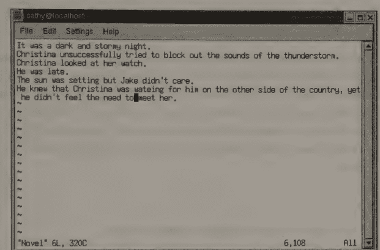

图 4-2 在视觉编辑器中显示的编辑后的文本

**步骤 5** 为了在文件的每个方向上导航，你可以使用以下方向键：**h**（左）、**j**（下）、**k**（上）、**l**（右）以及 **←**、**→**、**↓**。

**步骤 6** `/the/` 命令指示视觉编辑器搜索 Novel 文件并定位并将光标移动到该单词。一旦你定位了该单词的第一次出现处，你应该使用 **n** 命令表示你想定位下一个以及随后的每一个出现处。通过反复执行该命令，单词的每个实例都将被找到。

**步骤 7** 你应该使用了 `/rush/` 命令，它指示视觉编辑器搜索 Novel 文件并将光标移动到单词 rush 上。要让 **vi** 编辑器删除 "rush" 这些单词，你应该将光标移动到每个字母（和空格）上并按下 **x** 键来删除字符。你应该剩下以下句子，如图 4-2 所示：

He knew that Christina was waing for him on the other side of the country, yet he didn't feel the need to meet her

**步骤 8** 你应该使用箭头键或方向键导航到 Novel 文件中的第一行文本。你应该通过将光标移动到行中间并发出 `dd`（drop dead）命令来指示编辑器删除整行文本。整行文本应该被删除。为了撤销文本的删除，

你应该执行了 `u` 命令，它告诉 vi 编辑器返回并撤销上一次更改。

**步骤 9** 你应该将你的编辑保存到 Novel 文件并退出视觉编辑器。`:wq` 命令将文件写回驱动器并退出程序。在 shell 中查看 Novel 文件应该验证你的编辑已保存。

## 答案 4.02

以下步骤帮助 Sam 编辑他的 Novel 文件：

**步骤 1** 你应该已经使用用户名和密码登录 Linux 计算机并打开了终端窗口。

**步骤 2** 为了确保你的主目录下有 Novel 文件，你应该通过向 shell 输入 `ls` 命令来列出目录内容。`more` 命令指示 shell 打开 Novel 文件以便你可以查看内容。

**步骤 3** 一旦你通过 shell 查看了文件内容，你应该通过输入 `vi Novel` 命令使用视觉编辑器打开 Novel 文件。文件内容应该看起来与通过 shell 打开时完全一样，如图 4-1 所示。

**步骤 4** 你应该使用 `j` 或 `↓` 方向来浏览 Novel 文件。这两个键中的每一个键都会让光标一次向下移动一行。

**步骤 5** 为了在文件的每个方向上导航，你可以使用以下方向键：**h**（左）、**j**（下）、**k**（上）、**l**（右）以及 **←**、**→**、**↓**。

**步骤 6** `/the/` 命令指示视觉编辑器搜索 Novel 文件并将光标移动到该单词。一旦你定位了该单词的第一次出现处，你应该使用 **n** 命令表示你想定位下一个以及随后的每一个出现处。通过反复执行该命令，单词的每个实例都将被找到。

**步骤 7** 你应该使用了 `/rush/` 命令，它指示视觉编辑器搜索 Novel 文件并将光标移动到单词 rush 上。要让 **vi** 编辑器删除 "rush" 这些单词，你应该将光标移动到每个字母（和空格）上并按下 **x** 键来删除字符。你应该剩下以下句子，如图 4-2 所示：

He knew that Christina was waing for him on the other side of the country, yet he didn't feel the need to meet her

**步骤 8** 你应该使用箭头键或方向键导航到 Novel 文件中的第一行文本。你应该通过将光标移动到行中间并发出 `dd`（drop dead）命令来指示编辑器删除整行文本。整行文本应该被删除。为了撤销文本的删除，

你应该执行了 `u` 命令，它告诉 vi 编辑器返回并撤销上一次更改。

**步骤 9** 你应该将你的编辑保存到 Novel 文件并退出视觉编辑器。`:wq` 命令将文件写回驱动器并退出程序。在 shell 中查看 Novel 文件应该验证你的编辑已保存。

## 答案 4.03

以下步骤将帮助 Joel 创建并追加一个文本文件：

**步骤 1** 你应该已经使用用户名和密码登录 Linux 计算机并打开了终端窗口。

**步骤 2** 为了使用视觉编辑器创建一个名为 `Quiz` 的新文件，你应该执行 `vi` 命令并输入 `a` 指示编辑器进入插入模式。

**步骤 3** 你应该直接在 `Quiz` 文件中输入你想要的文本，插入模式允许你使用视觉编辑器输入你希望显示的文本。

**步骤 4** 为了告知视觉编辑器你想返回命令模式，你应该按下 `ESCAPE` 键。为了保存 `Quiz` 文件并退出视觉编辑器，应该使用了 `:wq` 命令。在 shell 中查看 `Quiz` 文件应该验证你的输入已保存。

## 解决方案

**步骤 7** 你应该已经使用 `ESCAPE` 键指示视觉编辑器切换到命令模式，并使用 `M` 命令将光标移动到屏幕中间附近的行。为了在光标所在位置打开一个新行，应该已经使用了 `O` 命令。此时，你应该已经插入了文本（以下问题每题值 5 分）。

**步骤 8** 为了调整屏幕的文本显示，你应该发布了 `CTRL-D` 命令来使文件向下滚动一屏文本。你应该已经一次使用 `:wq` 命令保存并退出 `Quiz` 文件，然后注销电脑登录。

### 实验解答 4.04

以下步骤将指导你如何向 shell 和视觉编辑器发布指令：

**步骤 1** 你应该已经使用你的用户名成功登录到 Linux 计算机，并打开了一个终端窗口。

**步骤 2** 要开始通过视觉编辑器创建一个名为 `Users` 的新脚本，你应该已经执行了 `vi Users` 命令，并通过命令指示编辑器移动到插入模式。然后你应该添加了指定的文本行。指示编辑器停止添加文本需要使用 `CTRL-D` 命令。你应该已经使用 `:wq` 命令保存脚本并退出视觉编辑器。


**步骤 3** 在执行 `date` 和 `who` 命令后，每个命令的输出显示了当前日期和当前登录的用户。在视觉编辑器的插入模式下输入 `date` 和 `who` 命令不会导致每个工具的输出。它们仅仅是脚本文件中的两个输入的单词。只有在执行脚本后，才会产生每个命令的输出。

**步骤 4** 你应该通过执行 `chmod +x` `Users` 命令使 `Users` 脚本具有可执行权限，并通过输入 `./Users` 执行该脚本。执行脚本的结果应该与在 shell 中执行 `date` 和 `who` 命令的结果相似。shell 运行这两个命令并将工具的输出显示在屏幕上，如图 4-5 所示。输出将与脚本回显的文本一起出现。你应该已经完成了实验并注销了电脑。

## 第 4 章：使用视觉编辑器进行编辑

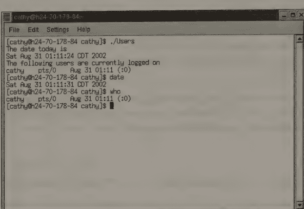

图 4-5 `Users` 脚本输出了执行的命令

## 实验解答 4.05

以下步骤将指导你进行文本更改：

**步骤 1** 你应该已经使用你的用户名和密码成功登录到 Linux 计算机，并打开了一个终端窗口。

**步骤 2** 要以插入模式通过视觉编辑器打开脚本，你应该输入 `vi Users` 然后发布 `a` 命令移动到插入模式。要向 `Users` 脚本的末尾添加文本，你应该滚动到文本末尾，并直接按照写的内容输入文本。

**步骤 3** 为了切换到命令模式，并搜索并将光标移动到单词 `quarterly`，你应该执行了命令 `/quarterly`。要将单词 `quarterly` 替换为单词 `monthly`，你应该发布了 `cw` 命令并输入单词 `monthly`。

**步骤 4** 要将文本 `faculty members` 替换为 `department heads.`，你应该滚动到文本前的空格，确保你处于命令模式，并输入命令 `C` 来更改文本并输入新文本 `heads.`。

**步骤 5** 要将文本 `A. IMPORTANT` 从当前位置复制并粘贴到脚本最后一行的末尾，你应该滚动到文本本身，并在命令模式下执行命令 `yy`，这会将整行文本复制到缓冲区中。然后你应该滚动到最后一行末尾的新位置，并执行 `p` 命令，这会将缓冲区中的文本粘贴到文件中。

**步骤 6** 为了搜索单词 `annual` 的第一次出现，你应该执行了 `/annual` 命令。要将当前文本替换为单词 `yearly`，你应该输入命令 `:s/annual/yearly/`.

**步骤 7** 你应该已经执行命令将此修改过的 `Users` 脚本保存到名为 `Users2` 的文件中。

**步骤 8** 为了打开原始脚本并验证更改已完成，你应该执行了 `vi` 命令。为了显示新文件的行数，你应该使用了 `wc` 命令。

**步骤 9** 你应该已经使用 `:wq` 命令退出视觉编辑器并注销了电脑。

## 实验 5.01：统计文件中的元素

**步骤 7** 统计 `Canada` 文件的行数，并将输出保存到主目录下的名为 `LineCount` 的文件中。查看 `LineCount` 文件的内容以验证其已成功创建。

**步骤 8** 创建一个名为 `CanadaInfo` 的文件，将 `Canada` 文件和 `LineCount` 文件的输出合并在一起。打开并查看 `CanadaInfo` 文件，并在合并文件的每一行显示行号。`CanadaInfo` 文件是否显示了合并后的 `Canada` 和 `LineCount` 文件的结果？

**步骤 9** 在视觉化编辑器中打开 `CanadaInfo` 文件，从 `CanadaInfo` 文件的开头复制六行文本并粘贴到文件末尾。重复此过程额外三次。保存并退出文件。

**步骤 10** 使用 `more` 实用查看 `CanadaInfo` 文件的内容。使用 `ENTER`（回车键）和 `SPACEBAR`（空格键）滚动文件。在滚动文件时，使用每个按键的结果有何不同？退出终端并注销电脑。

## 实验 5.02：使用搜索工具

`Katherine` 想要在她的 `Canada` 文本文件中搜索特定的字符字符串。她不想通过查看文件中的每一个单词来寻找她要找。她请求你帮助在文件中搜索所有包含这些字符的单词。她还对排除任何包含 `Canada` 单词的行感兴趣。她希望对 `Canada` 文件以及其他文件完成几次额外的搜索，并请求你提供指导。

### 学习目标

在本次实验中，你将使用 `grep` 实用工具在文件中搜索目标字符字符串。完成此实验后，你将能够：

- 搜索目标字符字符串
- 搜索多个文件
- 搜索包含多个单词的目标

### 实验材料与设置

对于本次实验，你将需要：

- 安装了 Red Hat 7.3 的电脑
- 铅笔和纸
- 成功完成实验 5.01

### 开始正题

以下步骤将指导你如何使用 `grep` 实用工具搜索文件。你将需要应用 John Muster 编写的《UNIX 和 Linux 入门》（McGraw-Hill/Osborne, 2002）一书中学的知识，来在多个文件中搜索包含多个单词的目标。

步骤 1 使用你的用户名和密码登录 Linux 电脑。打开一个终端窗口。

在 `Canada` 文件中搜索以下目标字符串：

- a 所有包含字符串 `can` 的行。
- b 所有不包含字符串 `Canada` 的行。
- c 所有包含字符串 `can` 的行，忽略大小写。
- d 所有包含字符串 `can you` 的行。
- e 所有包含以字母 `c` 开头并以字母 `n` 结尾的三字母单词的的行。
- f 所有以字母 `s` 开头的行。
- g 所有以字母 `t` 结尾的行。

在提供的空间内记录你获取结果而执行的命令。

步骤 3 搜索字符串 `can` 与搜索字符串 `c.n` 有何不同？结果不同吗？为什么相同或何不同？

步骤 4 创建一个名为 `America` 的文件，内容如图 5-2 所示。

步骤 5 分别在 `Canada` 和 `America` 文件中搜索目标字符串 `bor`。在提供的空间内记录你的结果。

# 第 5 章：使用基础 Linux 和 UNIX 实用工具

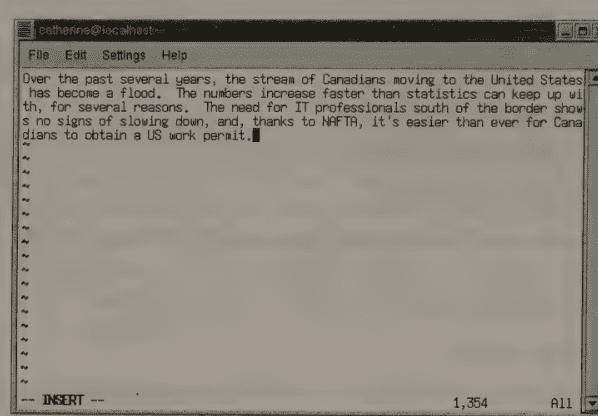

图 5-2 `America` 文件内容

**步骤 6** 在你的主目录下的所有文件中搜索目标字符串 `th`，并仅列出包含该字符串的文件。在提供的空间内记录你的结果。

**步骤 7** 在 `Canada` 和 `America` 文件中搜索包含字符 `ou` 的单词，并在输出中列出每个目标匹配的行号。在提供的空间内记录你的结果。注销电脑。

## 实验 5.03：执行数学计算

15 分钟

`Natalie` 想要计算她的收入，看看她是否有足够的钱去夏威夷度假。她不确定如何使用 Linux 中的计算器，并请求你帮助她执行基础数学计算。她为你提供了一份她的收入和支出列表，以及前往夏威夷的旅行费用。

### 学习目标

在本次练习中，你将使用 `bc` 实用工具执行基础数学计算。完成此实验后，你将能够：

- 执行基础数学计算
- 使用浮点运算
- 识别运算顺序

### 实验材料与设置

对于本次实验，你将需要：

- 安装了 Red Hat Linux 7.3 的电脑
- 铅笔和纸

### 开始正题

以下步骤将指导你执行几项数学计算。你将需要应用 John Muster 编写的《UNIX 和 Linux 入门》（McGraw-Hill/Osborne, 2002）一书中学的关于使用 `bc` 实用工具和 `scale` 命令的知识。

**步骤 1** 使用你的用户名和密码登录 Linux 电脑。打开一个终端窗口。

**步骤 2** 在终端窗口调用计算器实用工具。根据下一页提供的信息完成以下计算。

# 第 5 章：使用基础 Linux 和 UNIX 实用工具

| 收入 | 支出 | 旅行费用 |
| --- | --- | --- |
| 每月 $3000，持续 6 个月 | 住房：每月 $2200，持续 6 个月 | 机票：$850.48 |
| 书籍交易预付 $4000 | 公用事业：每月 $65，持续 6 个月 | 酒店：$1306 |
| $2200.58 版税 | 娱乐：每月 $1000，持续 6 个月 | |
| | 杂费：每月 $100，持续 6 个月 | |
| | 杂费：每月 $200，持续 6 个月 | |

- a) Natalie 总收入
- b) Natalie 总支出
- c) 总旅行费用
- d) 总净支出

确保你的结果精确到两位小数。在提供的空间内记录结果。

步骤 3 Natalie 是否有足够的钱去夏威夷？在计算她的总收入和支出时，去夏威夷的计算顺序是什么？注销电脑。

## 实验 5.04：文件排序

`Christy` 在车辆管理局工作，负责跟进牌照记录。她想知道如何轻松地对文件进行排序，以组织她输入到 Linux 电脑中的唯一（unique）的牌照数据。她还想识别唯一行。

### 学习目标

在本次练习中，你使用 `sort` 实用工具对文件行进行排序。完成此实验后，你将能够：

- 按字典顺序排序文件
- 按数值排序
- 比较并识别唯一数据

### 实验材料与设置

对于本次实验，你将需要：

- 安装了 Red Hat Linux 7.3 的电脑
- 铅笔和纸

### 开始正题

以下步骤将指导你对文件进行排序。你将需要应用 John Muster 编写的《UNIX 和 Linux 入门》（McGraw-Hill/Osborne, 2002）一书中学的知识，根据多种标准对文件元素进行排序。

步骤 1 使用用户名和密码登录 Linux。打开一个终端窗口。

步骤 2 使用图 5-3 所示的数据创建一个名为 `Plates` 的文件。

# 第 5 章：使用基础 Linux 和 UNIX 实用工具

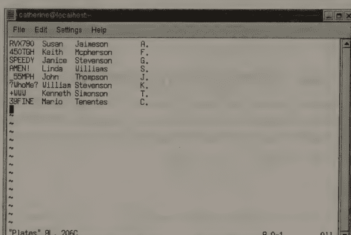

图 5-3 `Plates` 内容

步骤 3 按以下标准对 `Plates` 文件排序：

- a) 忽略大小写的字典顺序
- b) 数值顺序
- c) 姓

在提供的空间内记录你排序文件的命令。

步骤 4 将步骤 3c 的排序输出重定向到名为 `SecondSort` 的文件。

步骤 5 创建一个名为 `Records` 的文件，内容如下：

| 州 | 城市 | 记录 |
| --- | --- | --- |
| AL | 伯明翰 | 5001 |
| DE | 威尔士敏顿 | 5007 |
| AK | 安克奇 | 5000 |

## 实验 5.04：文件排序

| 州 | 城市 | 记录 |
| --- | --- | --- |
| AL | 伯明翰 | 5001 |
| AZ | 斯科茨代 | 5002 |
| GA | 萨凡亚 | 5009 |
| AR | 阿肯霍泽 | 5003 |
| CO | 科罗拉多 | 5005 |
| CO | 科罗拉多 | 5005 |
| FL | 坦帕湾 | 5008 |
| CA | 洛杉矶 | 5004 |
| DE | 威尔士敏顿 | 5007 |
| HI | 檀檀 | 5010 |

步骤 6 排序 `Records` 文件，删除文件中所有重复行并仅在输出中显示唯一行。将排序的输出重定向到名为 `States` 的文件。查看 `States` 文件以验证其已成功创建。

步骤 7 识别 `Records` 和 `States` 文件的共同行和唯一行，并将输出重定向到新文件 `StateRecords`。查看 `StateRecords` 文件并识别唯一数据行。注销电脑。

## 实验 5.05：修改与处理数据

`Krystin` 正在尝试记录她意大利食品店的商品清单和价格。她想学习如何使用多种工具快速修改和处理 `Groceries` 文件中的数据。她请求你帮助她完成几个简单的任务。

### 学习目标

在练习中，你将通过使用 `cut`、`paste`、`sed` 和 `awk` 工具来修改和处理数据。完成本实验后，你将能够：

- 在文件中剪切粘贴数据
- 使用 `sed` 工具修改数据
- 使用 `awk` 工具处理数据

### 实验材料与准备

对于本次实验，你需要：

- 一台安装了 Red Hat Linux 7.3 的计算机
- 铅笔和纸

### 开始正题

以下步骤将指导你使用 `sed` 工具进行流编辑，并使用 `cut`、`paste` 和 `awk` 工具处理数据。你必须将从 John Muster 写的《UNIX 和 Linux 入门》（McGraw-Hill/Osborne, 2002）一书中中学的选取和替换数据的知识应用于所有工具中。

**第 1 步** 使用你的用户名和密码登录 Linux 计算机。打开一个终端窗口。

**第 2 步** 创建名为 `Groceries` 的文件，内容如图 5-4 所示。

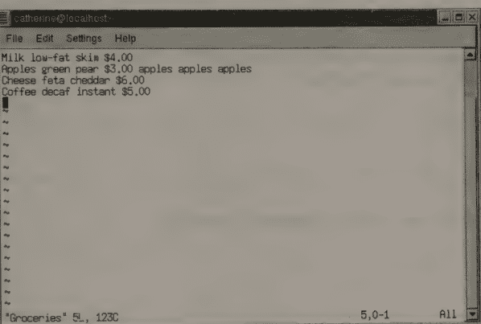

**图 5-4** `Groceries` 文件内容

**第 3 步** 在 `Groceries` 文件中，尝试使用流编辑器将所有的单词 `apples` 替换为 `oranges`。编辑器是否成功替换了所有的 `apples` 单词？为什么成功或不成功？

**第 4 步** 使用流编辑器删除整行 `coffee` 内容。

**第 5 步** 指令 `awk` 工具将 `cheese` 行的第四字段打印到屏幕上。输出是什么？

**第 6 步** 通过剪切文件每行的第一个字段来编辑 `Groceries` 文件。输出是什么？

**第 7 步** 使用 `paste` 工具将 `Groceries` 文件的行合并在一起。确保输出中使用空格字符作为分隔符。退出计算机。

## 实验分析测试

1. 如何使用 `grep` 工具搜索文件但拒绝所有匹配行，并只输出不匹配的行？
2. 命令 `sort +2 -3 +1 -2 filename` 实现了什么？
3. `tee` 工具的作用是什么？
4. 在编辑文件时，使用 `sed` 工具相比于 `vi` 工具有什么优势？
5. `awk` 工具的主要功能是什么？

### 关键词汇测验

使用以下词汇术语完成下列句子。并非所有的术语都会被使用。

- `awk`
- `bc`
- `column`
- `comm.`
- `grep`
- `sed`
- `sort`
- `tee`
- `touch`
- `tr`
- `uniq`
- `wc`

1. 一种读取单行并处理数据流的编辑器被称为 ________。
2. ________ 工具设计用于定位数据库中的记录和字段，对其进行修改、执行计算，然后输出数据的选部分。
3. 你可以使用 ________ 工具来识别多个文件中的哪一个包含特定的字符字符串。
4. ________ 工具可以用于逐行比较文件。
5. 你可以使用 ________ 工具搜索文件中的每个字符并删除特定字符。

## 实验总结

你现在应该熟悉各种 UNIX 工具了。你应该已经成功地使用了多种工具及其相关选项。通过这些工具，你对数据进行了搜索、排序、修改、合并、计算和比较并输出了结果。

# 解

在本部分，你将找到实验的答案。

### 实验答案 5.01

以下步骤将指导你统计 Katherine 文件和目录中的元素数量：

**第 1 步** 你应该已经成功使用用户名和密码登录 Linux 计算机并打开了终端窗口。

**第 2 步** 在主目录下，你应该执行了 `wc *` 命令，该命令会统计当前目录下每个文件的行数、单词数和字符数，并显示每个类别的总量。单词计数的结果可能取决于你当前拥有的文件。

**第 3 步** 你应该已经打开了可视化编辑器 `pico` 编辑器，或者执行了 `cat Canada` 命令在主目录下创建一个名为 `Canada` 的文件，并包含指定的内容。

**第 4 步** 你应该已经执行了 `wc *` 命令来统计当前目录下每个文件的单词数。结果应该显示更新后的单词数，包含了来自 `Canada` 文件的单词数。能够成功统计 `Canada` 文本文件中单词和字符数的命令是 `wc -wc`。该命令将参数 `-w`（单词）和 `-c`（字符）作为一个组合选项。结果应该是 113 个单词和 65 个字符。

**第 5 步** 另一个与第 4 步执行的 `wc -wc Canada` 命令产生相同输出（单词数和字符数）的命令是 `wc -cw Canada`。命令中参数的顺序并不重要。

**第 6 步** 通过剪切文件每行的第一个字段来编辑 `Groceries` 文件。输出是什么？

**第 7 步** 使用 `paste` 工具将 `Groceries` 文件的行合并在一起。确保输出中使用空格字符作为分隔符。退出计算机。

### 实验答案 5.02

以下步骤将指导你统计 Katherine 文件和目录中的元素数量：

**第 1 步** 你应该已经成功使用用户名和密码登录 Linux 计算机并打开了终端窗口。

**第 2 步** 在主目录下，你应该执行了 `wc *` 命令，该命令会统计当前目录下每个文件的行数、单词数和字符数，并显示每个类别的总量。单词计数的结果可能取决于你当前拥有的文件。

... (其余文本遵循基于 OCR 的类似逻辑)

## 实验解答 5.03

以下步骤将指导你计算 Natalie 的收入和支出：

**步骤 1** 你应该已经成功使用你的用户名登录到 Linux 计算机并打开了终端窗口。

**步骤 2** 在终端窗口中，你应该已经通过执行命令 `bc` 调用了计算器程序。在根据提供的信息完成计算后，你应该得到以下结果：

- Natalie 的收入：`(3000*6)+4000+2200.58 = 24,200.58`
- Natalie 的总支出：`(2200*6)+(65*6)+(1000*6)+(100*6) = 20,190.00`
- 总旅行费用：`850.48+1306.10+1500+200=3856.58`
- 可用净收入：`24,200.58-20,190.00=4010.58`

为了显示所有两位小数的数字，在计算方程之前，你可能需要或不需要使用 `scale=2` 命令。


**步骤 3** 你应该已经确定 Natalie 有足够的钱支付她的夏威夷假期，因为她的可用净收入计算为 $4010.58，而度假的总费用仅需 $3856.58。计算器确定你包含在括号中的数字（任何需要相乘的项目）将首先计算，然后将它们的结果输入到方程的其他部分。你应该已经成功完成实验并注销计算机。

## 实验解答 5.04

以下步骤将指导你对几个文件进行排序：

**步骤 1** 你应该已经成功使用你的用户名登录到 Linux 计算机并打开了终端窗口。

**步骤 2** 为了创建一个带有指定数据的 `Plates` 文件，你应该执行了命令 `vi Plates` 并按下 TAB 键将字段分隔为列。

**步骤 3** 你应该已经执行了以下命令来根据标准对 `Plates` 文件进行排序：

- 字典顺序，忽略大小写：`sort -df Plates`
- 数字顺序：`sort -n Plates`
- 姓氏：`sort -k 3 Plates`

**步骤 4** 为了将姓氏排序的输出重定向到名为 `SecondSort` 的文件，你应该执行了命令 `sort -k 3 Plates -> SecondSort`。

**步骤 5** 为了创建一个带有指定内容的名为 `Records` 数据文件，你应该执行了 `vi Records` 并使用 TAB 键插入数据，将字段分隔为列。

**步骤 6** 为了对 `Records` 文件进行排序并将输出重定向到名为 `States` 的文件，删除文件中所有重复行并仅在输出中显示唯一行，你应该执行了 `uniq -u Records -> States`。

**步骤 7** 为了识别 `Records` 和 `States` 文件中的共同数据和唯一数据，你应该执行了命令 `comm -> StateRecords`。

## 实验解答 5.05

以下步骤指导你修改和操作数据：

步骤 1 你应该已经成功使用你的用户名登录到 Linux 计算机并打开了终端窗口。

步骤 2 为了创建一个名为 `Groceries` 且包含指定内容的文件，你应该执行了 `vi Groceries` 然后插入文本并保存文件。

步骤 3 为了使用流编辑器将 `Groceries` 文件中的每个 `apples` 替换为 `oranges`，你应该输入了命令 `sed 's/apples/oranges/g' Groceries`。编辑器应该已经成功替换了每个 `apples`，因为你指定了 `g` 选项，它告诉 `sed` 工具全局影响影响文件的每一行。

步骤 4 为了使用流编辑器删除整个 `coffee` 行，你应该执行了命令 `sed '/coffee/d' Groceries`。

步骤 5 为了指示 `awk` 工具将 `cheese` 行的第四字段打印到屏幕，你应该执行了命令 `awk '/cheese/{print $4}' Groceries`。输出应该是第四字段，即 $6.00。

步骤 6 为了通过剪切文件每行的第一个字段来编辑 `Groceries` 文件，你应该执行了命令 `cut -f1 Groceries`。输出应该是：

```
milk
apples
cheese
coffee
```

**步骤 7** 为了使用 `paste` 工具将 `Groceries` 文件的行合并，你应该执行了命令 `paste -s -d' ' Groceries`。你应该已经成功完成实验并注销了计算机。

# 第 6 章

在脚本中使用多个工具

## 实验练习

- 6.01 利用工具获取信息
- 6.02 探索目录和文件
- 6.03 创建复杂的单词分析脚本

实验分析测试

关键术语测验

实验总结

解答

# 第 6 章：在脚本中使用多个工具

到目前为止，本章探讨了如何创建使用多个工具来处理和检索数据的脚本。你也将有机会机会创建一个复杂的单词分析脚本，该脚本可以用于检测错误并分析你在脚本中编写的代码。你将移除标点符号、将字符转换为小写，并更改输出文本的显示。

此外，你将探索创建、修改和查看信息文件以及目录。这将让你能够组织文件并收集有关每个文件的重要信息。

15 分钟

## 实验练习 6.01：利用工具获取信息

Dean 需要一份关于他的 Linux 系统状态的每日书面报告。他希望获取有关用户和进程的特定信息，这些只能通过执行工具命令来获取。他不希望每天执行这些命令，因此请你帮助编写一个使用这些工具来获取信息的脚本。他还希望将脚本执行的结果保存到文件中。

### 学习目标

在实验中，你创建一个使用多个工具获取信息的脚本。在实验结束时，你将能够：

- 识别获取信息的工具
- 在脚本中使用工具
- 将脚本输出重定向到文件

## 实验练习 6.01：利用工具获取信息

### 实验材料与设置

本实验所需的材料有：

- 安装了 Red Hat Linux 7.3 的计算机
- 笔和纸

### 开始操作

以下步骤指导你利用工具获取信息。你将需要应用《Introduction to UNIX and Linux》（John Muster 著, McGraw-Hill/Osborne, 2002）中的知识来创建脚本。

**步骤 1** 使用你的用户名和密码登录 Linux 计算机。打开终端窗口。

**步骤 2** 打开可视化编辑器并准备创建一个名为 `Information` 的脚本。添加下表的内容：

| 标题 | 工具 |
|---|---|
| 今天的日期是： | date |
| 当前登录系统的用户有： | who grep $USER |
| 我当前的目录是： | pwd |
| 今天的身份信息是： | id |
| 系统上运行的进程有： | ps |

在脚本中回显这些标题以便识别工具的结果。

**步骤 3** 保存脚本并退出 Shell。赋予脚本可执行权限并继续运行 `Information` 脚本。你是否成功创建并运行了脚本？

**步骤 4** 将 `Information` 脚本的输出重定向到名为 `DailyInfo` 的文件中，供 Dean 每日访问。注销计算机。

## 实验 6.02：探索目录和文件

步骤 3 创建一个名为 `Novfiles` 的新目录。确认该新目录存在于当前目录下。

步骤 4 通过输入 `mv filename Novfiles` 处理目录下你想移动的每个文件，将所有与 Sam 的小说相关的文件移动到 `Novfiles` 目录。

步骤 5 将当前目录更改到 `Novfiles` 目录，并确认你所在的位置。验证你是否已成功移动所有文件。返回主目录。

步骤 6 创建一个名为 `Metadata` 的文件，列出 `Novfiles` 目录列出的所有文件信息。

步骤 7 列出你的主目录内容以确认你已成功创建该文件。查看 `Metadata` 文件的内容。你能查看每个文件的权限吗？在提供的空间内，列出每个文件显示的信息类型。

步骤 8 移动到你的 `Novfiles` 目录。更改新目录下 `Chapter_1` 文件的权限以删除读取权限。返回主目录。

步骤 9 创建一个名为 `Metadata2` 的新文件，其中包含 `Novfiles` 目录中所有文件的信息。使用 `comm` 工具比较 `Metadata` 和 `Metadata2` 文件之间的差异。在提供的空间内列出这些差异。注销计算机。

# 实验 6.03：创建一个复杂的单词分析脚本

Rolf 想要创建一个脚本来分析他关于汽油价格的最新报文章。他想对文本进行排序，统计文章中有多少重复单词，并删除重复单词。他希望将这些分析结果保存到一个单独的文件以便以后查看。

### 学习目标

在练习中，你将创建一个复杂的单词分析脚本。完成此实验后，你将能够：

- 创建一个长文本文件
- 移除标点符号并将字符转换为小写
- 修改行的显示

### 实验材料和设置

对于本次实验，你需要：

- 安装了 Red Hat Linux 7.3 的计算机
- 铅笔和纸

### 开始正题

以下步骤将指导你创建一个复杂的单词分析脚本。你必须应用在 John Muster 编写的《Introduction to UNIX and Linux》（McGraw-Hill/Osborne, 2002）一书中中学的知识，来移除标点符号、将所有字符转换为小写，以及排序和删除文本行。

**步骤 1** 使用你的用户名和密码登录 Linux 计算机。打开终端窗口。

**步骤 2** 创建并保存一个名为 `Gasoline` 的新文本文件，内容如下：

过去两周，汽油价格每加仑仅上涨了半美分，继续了20周的价格平稳趋势。

根据周日发布的一项针对 8000 家加油站的调查，全国平均汽油价格（包括所有等级和税费）周五约为每加仑 $1.46。这比8月9日以来每加仑上涨了 .5 美分。自4月初初以来价格变化不大，那时加仑汽油的价格也约为 $1.46。

步骤 3 创建一个名为 `TestScript` 的分析脚本，为 `Gasoline` 文件完成以下任务：

- a) 移除标点符号
- b) 将所有字符转换为小写
- c) 将每个单词放在单独一行
- d) 删除空行
- e) 排序文本，使包含相同单词的行彼此相邻
- f) 删除文本中的重复单词
- g) 先列出文件中使用最多的单词
- h) 将此脚本的输出发送到名为 `ScriptResult` 的文件中

步骤 4 验证脚本已成功创建。使 `TestScript` 变为可执行。运行脚本。

步骤 5 打开 `ScriptResult` 文件，并验证内容是否符合 `TestScript` 脚本中的要求。注销计算机。

## 实验分析测试

- 1. UNIX 中列出文件中使用的唯一单词的工具名称是什么？
- 2. 创建单词分析脚本的目的是什么？
- 3. 为了正确删除重复单词，必须满足哪些条件？
- 4. 当与 `ls` 工具结合使用时，`-F` 参数用于什么作用？
- 5. `tr` 工具的功能是什么？

### 关键术语测验

使用以下词汇来完成下面的句子。并非所有术语都会被使用。

- awk
- column
- comm
- sed
- sort
- tee
- uniq
- wc

1. 该工具定位目标字符并将其替换为其他字符。
2. 使用 __________ 工具可以识别两个独立快照文件之间的差异。
3. __________ 工具仅在当某行与另一行完全相同的行相邻时才删除该行。
4. __________ 工具是一个流编辑器，它接收输入流中的文本，进行指定的更改，并将修改后的文本发送到输出流。
5. __________ 允许你获取命令的输出并将其重定向到文件以及发送到另一个命令。

## 实验总结

你现在应该熟悉创建使用多个工具来操作和检索数据的脚本。你应该已经成功创建了一个复杂的单词分析脚本，并分析了你在脚本中编写的代码。此外，你还探索了创建、修改和查看文件及目录。你现在应该熟悉如何组织文件、收集每个文件的信息以及创建和分析有效的脚本。

## 答案

在此部分，你将找到实验的解答。

### 实验解答 6.01

以下步骤将指导你利用工具获取信息：

- **步骤 1** 你应该已经使用用户名和密码登录 Linux 计算机并打开了终端窗口。
- **步骤 2** 打开可视化编辑器并创建一个名为 `Information` 的脚本，你应该执行 `vi Information` 命令，然后通过输入 `a` 从命令模式切换到插入模式。将表格内容添加到脚本时，结果如下：

```
echo 今天日期是
date
echo 当前登录系统的用户有
who | grep $USER
echo 我当前的启动目录是
pwd
echo 我的身份身份信息是
id
echo 我的系统上运行的进程有
ps
CTRL-D
```

- **步骤 3** 要保存脚本并返回 shell，你应该执行 `:wq` 命令。要使脚本变为可执行，应执行 `chmod +x` `Information` 命令，然后如图 6-1 所示通过输入 `./Information` 运行脚本。你应该已成功创建并运行了脚本。
- **步骤 4** 为了将 `Information` 脚本的输出重定向到名为 `DailyInfo` 的文件，你应该输入命令 `./Information > DailyInfo`。你应该已成功完成实验并注销了计算机。

### 解决方案 127

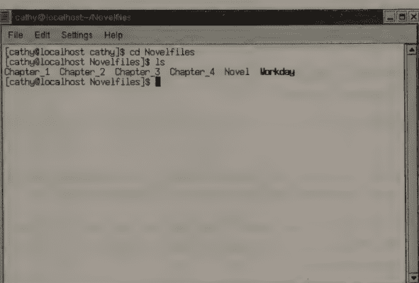

**图 6-2** `Novfiles` 目录下的相关文件列表

**步骤 6** 为了在名为 `Metadata` 的目录中创建一个文件并列出 `Novfiles` 目录列出的所有文件信息，你应该输入了命令 `ls -1 Novfiles | sort > Metadata`。这将创建一个名为 `Metadata` 的新文件，并对 `Novfiles` 目录中所有文件的详细列表进行排序。

**步骤 7** 为了列出 `Novfiles` 目录的内容并确认你已成功创建该文件，你应该输入了 `ls` 命令。要查看 `Metadata` 文件的内容，你应该输入了 `more Metadata`。你应该能够查看每个文件的权限、日期和修改时间。你应该通过 `cd Novfiles` 命令返回了 `Novfiles` 目录。

**步骤 8** 为了移除新目录中 `Chapter_1` 文件的权限，你应该执行了命令 `chmod -r Chapter_1`。你应该通过 `cd` 命令返回了主目录。

**步骤 9** 为了创建一个名为 `Metadata2` 的新文件并包含 `Novfiles` 目录中所有文件的信息，你应该执行了命令 `ls -1 Novfiles | sort > Metadata2`。通过执行命令 `comm Metadata Metadata2` 可以比较 `Metadata` 和 `Metadata2` 文件之间的差异。这两个快照之间的唯一区别应该是你之前对 `Chapter_1` 文件所做的权限更改。你应该已成功完成实验并注销了计算机。

# 实验解决方案 6.03

以下步骤将指导你创建一个复杂的单词分析脚本：

**步骤 1** 你应该已经使用你的用户名和密码成功登录到 Linux 计算机，并打开了终端窗口。

**步骤 2** 你应该已经使用可视化编辑器将按要求要求的文本内容写入 `Gasoline` 文件。

**步骤 3** 为了创建一个名为 `TestScript` 的分析脚本以完成 `Gasoline` 文件的指定任务，你应该按照图 6-3 所示完全输入了脚本代码。

**步骤 4** 为了让 `TestScript` 变为可执行文件，你应该执行了命令 `chmod +x` `TestScript`。要运行该脚本，你应该输入了命令 `./TestScript`。运行脚本的结果如图 6-4 所示。

**步骤 5** 为了打开 `ScriptResult` 文件并验证其内容与 `TestScript` 中的要求一致，你应该输入了 `more ScriptResult`。你应该已成功完成实验并注销了计算机。

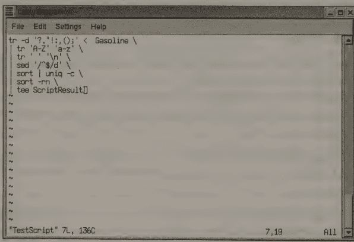

**图 6-3** 用于分析 `Gasoline` 文本文件的 `TestScript` 代码

### 解决方案 129

```bash
cathy@localhost~$ ./TestScript
3 a
3 prices
3 of
3 gas
3 gallon
2 was
2 the
2 about
2 $146
1 when
1 weeks
1 up
1 unusual
1 two
1 trend
1 to
1 that
1 taxes
1 survey
1 sunday
1 steady
1 stations
1 since
```

图 6-4 `TestScript` 脚本的输出

# 第 7 章

## 创建和更改目录

实验练习

- 7.01 创建目录
- 7.02 管理文件和目录
- 7.03 访问目录中的文件
- 7.04 操作目录的文件链接

实验分析测试

关键术语测验

实验总结

解决方案

# 第 7 章：创建和更改目录

本章通过导航、管理和创建新目录来探索分级文件系统和目录结构。到目前为止，你一直在创建文件并将它们保存在主目录中。在 UNIX/Linux 计算机上，根据系统和用户存储在不同的目录。

你将创建目录和子目录，并探索从一个目录切换远程目录或子目录的过程。你还将访问每个目录中的文件，并学习如何高效处理目录的文件链接。

15 分钟

## 实验练习 7.01：创建目录

Green Interiors 设计公司最近聘用了 Cathy 作为室内设计师。Cathy 想在她的 Linux 计算机上创建一个目录，存放她正在从事的室内设计项目的所有文件。她刚刚开始该项目，并在这个新目录中保存一个名为 `LivingRoom` 的文件，以将其与其他文件分开。她希望能够成功导航她的 Linux 计算机的文件结构，同时从任何目录位置访问每个目录中有关文件的任何信息。

### 学习目标

在本实验中，你将导航文件系统并创建新目录。在实验结束时，你将能够：

- 导航目录结构
- 创建子目录
- 更改目录
- 在子目录中创建文件

### 实验材料和设置

此实验所需的材料有：

- 安装了 Red Hat Linux 7.3 的计算机
- 铅笔和纸

### 开始正题

以下步骤将指导你创建子目录。你将不得不在《UNIX 和 Linux 导论》中学到的知识。

**步骤 1** 使用你的用户名和密码登录 Linux 计算机。打开终端窗口。

**步骤 2** 列出你的主目录内容。创建一个名为 `Design` 的子目录。验证该子目录已创建。

**步骤 3** 切换到 `Design` 子目录。使用 `pwd` 命令确认你的位置。在 `Design` 子目录中创建一个名为 `LivingRoom` 的文件，内容为：The living room goes from bland to inviting.

**步骤 4** 返回主目录。列出主目录内容以验证文件不在那里。

**步骤 5** 进入 `Design` 子目录。列出内容以验证 `LivingRoom` 文件。

**步骤 6** 返回主目录。注销计算机。

## 实验练习 7.02：管理文件和目录

30 分钟

Cathy 想继续将所有设计文件放在 `Design` 子目录。她还想学习如何在不断切换目录的情况下管理文件和目录。她还想在 `Design` 目录下创建一个 `Blueprints` 子目录。

### 学习目标


在练习中，你将管理文件和目录。完成实验后，你能够：

- 将文件移动到子目录
- 在移动时更改文件名
- 使用路径访问文件

### 实验材料和设置

此实验所需的材料有：

- 安装了 Red Hat Linux 7.3 的计算机
- 铅笔和纸
- 访问互联网

### 开始正题

以下步骤指导你管理文件和目录。你将不得不在《UNIX 和 Linux 导论》中学到的知识。

**步骤 1** 使用你的用户名和密码登录 Linux 计算机。打开终端窗口。

**步骤 2** 从主目录创建并保存下表所示的设计文件：

| 文件名 | 内容 |
| --- | --- |
| DiningRoom | This room is rather small in size. Measurements need to be taken. |
| MasterBedroom | This room is extremely large with high ceilings. See architect for additional information. |
| MasterBathroom | This room will have a new shower added. |

**步骤 3** 将你创建的 `DiningRoom` 和 `MasterBedroom` 设计文件移动到 `Design` 子目录。

**步骤 4** 在不离开主目录的情况下，验证 `Design` 目录中目前列出了 `DiningRoom` 和 `MasterBedroom` 设计文件。尝试访问 `DiningRoom` 文件。成功了吗？将 `MasterBathroom` 文件从主目录复制到 `Design` 目录。

**步骤 5** 将 `MasterBathroom` 文件移动到 `Design` 目录，同时将其文件名更改为 `MBathroom`。列出 `Design` 子目录的内容以验证该文件以更改后的文件名出现。

**步骤 6** 仍在主目录时，执行一个删除 `Design` 目录中 `MasterBathroom` 文件副本的命令。在提供的空间记下正确的命令。

第 7 步切换到你的 `Design` 目录并创建一个名为 `Blueprints` 的子目录。返回你的主目录。

第 8 步从你的主目录，通过指定路径列出新创建的 `Blueprints` 目录的内容。`Blueprints` 目录应该是空的，因为它刚刚被创建。

第 9 步从你的主目录，通过执行使用路径的命令切换到 `Blueprints` 目录。

第 10 步从你的 `Blueprints` 目录，执行列出你主目录内容的命令。注销计算机。

## 实验练习 7.03：访问目录中的文件

20 分钟

## 实验练习 7.03：访问目录中的文件

Cathy 想学习在目录中访问文件的所有可用方法，无论她是尝试访问当前目录还是远程目录中的文件。她理解使用路径名来访问文件，但她想学习任何可用的额外方法。她还想将从架构师那里收到的名为 `LRBlueprint` 的文件存储在 `Blueprints` 子目录中。

### 学习目标

在本实验中，你将使用几种不同的方法访问多个目录。完成此实验后，你将能够：

- 使用父目录名称
- 访问远程目录中的文件
- 返回上一个目录

### 实验材料和设置

对于此实验练习，你需要：

- 安装了 Red Hat Linux 7.3 的计算机
- 铅笔和纸

# 开始进入正题

以下步骤将指导你访问目录中的文件。你将应用在 John Master 编写的《Introduction to UNIX and Linux》(McGraw-Hill/Osborne, 2002) 中中学的关于指定路径和使用父目录名称的知识。

**第 1 步** 使用你的用户名和密码登录 Linux 计算机。打开终端窗口。

**第 2 步** 从你的主目录，切换到 `Design` 子目录。执行相应的命令获取该目录中的文件列表。`Design` 目录中的文件名之前出现点吗？给出你的答案理由。

# 第 7 章：创建和更改目录

**第 3 步** `Design` 目录中指示的 `..`（双点）文件是什么类型的文件？

**第 4 步** 切换到 `.`（点）目录。获取该目录中的文件列表。显示了哪些文件？

**第 5 步** 切换到 `Blueprints` 目录并创建一个名为 `LRBlueprint` 的文件。

**第 6 步** 切换到 `Design` 目录。从 `Design` 目录，获取你的 `Blueprints` 目录中的文件列表，以验证 `LRBlueprint` 文件已成功创建。

**第 7 步** 从 `Design` 目录，执行一个你可以使用的命令来编辑你在 `Blueprints` 子目录中创建的 `LRBlueprint` 文件。

**第 8 步** 切换目录到 `Blueprints` 目录。识别你当前目录的绝对路径。注销计算机。

# 实验练习 7.04：处理到目录的文件链接

30 分钟

# 实验练习 7.04：处理指向目录的文件链接

Cathy 想组织她在 `Design` 和 `Blueprints` 目录中存在的文件，以便她方便地访问。她请求你帮助理解文件和目录链接的过程，并想知道这个过程是否有助于让她的文件更易访问。

### 学习目标

在本实验中，你将处理文件链接。完成此实验后，你将能够：

- 将文件链接到目录
- 链接目录
- 移除链接的文件和符号链接
- 重命名目录

### 实验材料和设置

对于此实验练习，你需要：

- 安装了 Red Hat Linux 7.3 的计算机
- 铅笔和纸

# 开始进入正题

以下步骤将指导你处理指向目录的文件链接。你将应用在 John Muster 编写的《Introduction to UNIX and Linux》教科（McGraw-Hill/Osborne, 2002）中学的关于列出目录中文件的知识。

**第 1 步** 使用你的用户名和密码登录 Linux 计算机。打开终端窗口。

**第 2 步** 从你的主目录，切换到 `Design` 目录。用相同的文件名将 `DiningRoom` 文件链接到 `Blueprints` 目录。

# 第 7 章：创建和更改目录

**第 3 步** 使用 `ls` 工具检查原始和链接的 `DiningRoom` 文件。你能通过输出文件识别出哪个是原始文件，哪个是链接文件吗？

**第 4 步** 使用原始文件名将 `MasterBedroom` 和 `MBathroom` 文件链接到 `Blueprints` 目录。

**第 5 步** 通过符号链接将 `LivingRoom` 文件链接到 `Blueprints` 目录。硬链接和符号（软）链接之间有什么区别？

**第 6 步** 将 `Blueprints` 目录链接到 `Design` 目录。列出 `Blueprints` 目录的内容。你如何识别符号链接？

**第 7 步** 移除从 `LivingRoom` 到 `Blueprints` 的符号链接。

**第 8 步** 尝试通过执行命令 `rmdir Blueprints` 从 `Design` 目录中删除 `Blueprints` 子目录。你成功了吗？为什么成功或失败？

**第 9 步** 执行删除 `Blueprints` 目录及其内部所有文件的命令。请在提供的空间内注明正确的命令。

**第 10 步** 将 `Design` 目录重命名为 `DesignBlueprints`。注销计算机。

## 实验分析测试

- 1. 执行 `pwd` 命令的结果是什么？
- 2. 如何在不更改目录的情况下显式列出你主目录中的文件？
- 3. 如何通过新文件名将文件链接到目录？
- 4. 使用 `rm -r` 命令时应该考虑哪些问题？
- 5. 执行 `ls -` 命令的结果是什么？

### 词汇测试

使用以下词汇术语完成句子。并不是所有术语都会被用到。

```
cd pathname
ln
ln -s
ls -a
ls -F
ls -i
ls -ld
mkdir
rmdir
rm -r
```

- 1. ________ 命令显示当前目录的文件，包括以点开头的文件。
- 2. ________ 命令列出当前目录的文件及其对应的索引节点。
- 3. ________ 命令显示当前目录的文件名并在目录名称后加上 /。可执行文件显示为 *。
- 4. ________ 命令删除目录，但前提是不包含文件。
- 5. ________ 命令用于创建符号链接。

## 实验总结

在本章中，你浏览了文件系统，创建了目录，复制并移动了文件，并使用路径名访问了文件。你列出了多个目录的文件并删除了文件系统中的目录。你还处理了指向目录的硬链接和软链接，并更改了目录名称。你现在熟悉……

# 解答

在本部分，你将找到实验练习的答案。

### 实验解答 7.01

以下步骤将指导你创建目录：

- **第 1 步** 你应该已使用用户名和密码登录 Linux 计算机并打开了终端窗口。
- **第 2 步** 要列出你主目录中的文件，你应该执行了 `ls | more` 命令或简单的 `ls` 命令。要在你的主目录下创建一个名为 `Design` 的子目录，你应该执行了 `mkdir Design` 命令。通过列出主目录的内容来验证子目录已成功创建可以使用 `ls | more` 命令。
- **第 3 步** 要切换到 `Design` 子目录，你应该执行了 `cd Design` 命令。使用 `pwd` 命令确认位置会在屏幕上显示你的当前位置。要在子目录中创建并保存如图 7-1 所示所示内容的 `LivingRoom` 文件，你应该通过输入 `vi LivingRoom` 打开 `vi` 编辑器并输入内容。然后你应该执行 `::wq` 命令保存文件。

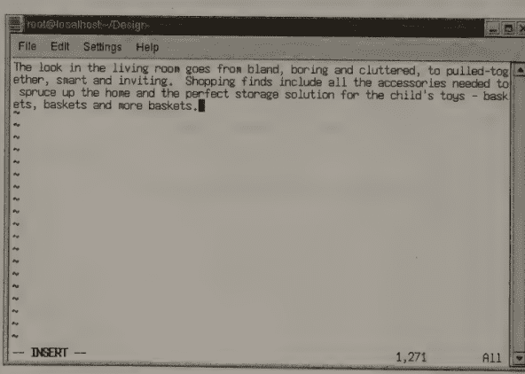

**图 7-1** `LivingRoom` 文件内容

### 解决方案 145

**第 4 步** 要列出 `Design` 子目录的内容（包括 inode 节点），您应该执行带有 `-I` 选项的 `list` 命令，或者使用 `ls -i`。通过输入 `cd` 命令可以返回主目录。

**第 5 步** 通过执行命令 `ls -F | more` 可以查看您的主目录内容并区分所有的目录和文件。`-F` 选项会在任何目录的末尾添加一个斜杠。为了在不导航（切换）到该目录的情况下，获取 `Design` 子目录内容的详细列表，您应该执行了命令 `ls -l Design`。这不会更改当前目录，只会显示位于子目录中的文件详细列表。

**第 6 步** 要同时列出当前主目录和 `Design` 子目录的内容，您应该输入命令 `ls -R -C | more`。您应该已经完成了实验并注销了计算机。

### 实验解决方案 7.02

以下步骤将指导您如何管理目录中的文件：

**第 i 步** 您应该已经使用您的用户名成功登录到 Linux 计算机并打开了终端窗口。

**第 2 步** 从主目录开始，您应该使用 `vi` 编辑器创建并保存了 `DiningRoom, MasterBedroom, MasterBathroom` 设计文件，其内容如图 7-2、7-3 和 7-4 所示。

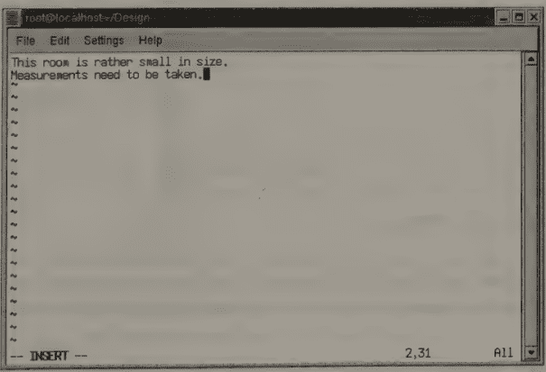

**图 7-2** `DiningRoom` 文件内容

```
root@localhost:~/Design-
File Edit Settings Help
这个房间非常大，天花板很高。
咨询建筑师获取更多信息。
```

**图 7-3** `MasterBedroom` 文件内容

```
root@localhost:~/Design-
File Edit Settings Help
这个房间将新增一个淋浴间。
```

**图 7-4** `MasterBathroom` 文件内容

**第 3 步** 要将您刚刚创建的 `DiningRoom` 和 `MasterBedroom` 设计文件移动到 `Design` 子目录，您应该执行了命令 `mv DiningRoom MasterBedroom Design`。

**第 4 步** 在不离开主目录的情况下，您应该通过执行命令 `ls Design` 验证 `DiningRoom` 和 `MasterBedroom` 设计文件已列在 `Design` 目录中。您应该成功通过执行命令 `Design/DiningRoom` 访问 `DiningRoom` 文件。要将 `MasterBathroom` 文件从主目录复制到 `Design` 目录，您应该执行了命令 `cp MasterBathroom Design/`。

**第 5 步** 将 `MasterBathroom` 文件移动到 `Design` 目录并在此将其重命名为 `MBathroom` 可以通过执行命令 `mv MasterBathroom Design/MBathroom` 实现。为了验证该文件是否以更改后的文件名出现在 `Design` 子目录中，您应该执行了命令 `ls Design`。

**第 6 步** 从主目录开始，您应该执行了命令 `rm Design/MasterBathroom` 以删除 `Design` 目录中的 `MasterBathroom` 副本，并在提示符处输入 `yes` 确认删除。

**第 7 步** 要切换到 `Design` 目录并创建一个名为 `Blueprints` 的子目录，您应该执行命令 `cd Design` 和 `mkdir Blueprints`。要返回主目录，您应该执行了命令 `cd`。

**第 8 步** 从主目录开始，您应该通过执行路径 `ls Design/Blueprints` 列出新创建的 `Blueprints` 目录的内容。`Blueprints` 目录应该是空的，因为它才刚刚创建。

**第 9 步** 从主目录开始，您应该通过执行命令 `cd Design/Blueprints` 切换到 `Blueprints` 目录。

**第 10 步** 在 `Blueprints` 目录中，您应该执行了命令 `ls ~` 来列出您的主目录内容。您应该已经完成了实验并注销了计算机。

### 实验解决方案 7.03

以下步骤将指导您访问目录中的文件：

**第 1 步** 您应该已经使用用户名和密码成功登录到 Linux 计算机并打开了终端。

**第 2 步** 要从主目录切换到 `Design` 子目录，您应该执行了命令 `cd Design`。在执行 `ls -a` 命令获取目录文件列表后，您应该获得了如图 7-5 所示的结果。`Design` 目录中的文件名前应该会出现点。单点表示本地目录，而双点表示主目录。

**第 3 步** `Design` 目录中指示的 `..` 文件是一个目录文件。

# 第 7 章：创建和更改目录

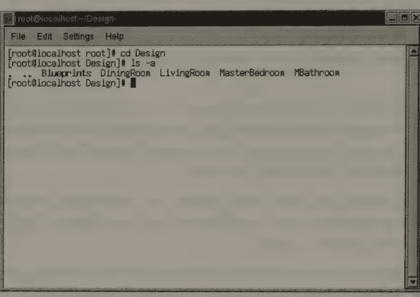

图 7-5 `Design` 命令中的文件列表，使用 `..` 切换到 `..` (点) 目录

**第 4 步** 您应该执行了命令 `cd ..` 来切换到 `..` 目录。为了获取该目录的文件列表，您应该执行了命令 `ls`。主目录中的所有文件和目录都会显示。

**第 5 步** 要切换到 `Blueprints` 目录，您应该执行了命令 `cd Design/Blueprints`。要在该目录下创建一个名为 `LRBlueprint` 的文件，您应该执行了命令 `vi LRBlueprint`。

**第 7 步** 您应该执行了命令 `cd ..` 切换到 `Design` 目录。为了获取 `Blueprints` 目录的文件列表，您应该执行了命令 `ls Blueprints`。

**第 8 步** 从 `Design` 目录，您应该执行了命令 `vi Blueprints/LRBlueprint` 来编辑在 `Blueprints` 目录中创建的 `LRBlueprint`。

**第 9 步** 要切换到 `Blueprints` 目录，您应该执行了命令 `cd Blueprints`。您应该执行了 `pwd` 命令来识别当前的绝对路径。您应该已经完成了实验并注销了计算机。

### 实验解决方案 7.04

以下步骤将指导您处理链接：

**第 1 步** 您应该已经使用用户名和密码成功登录 Linux 计算机并打开了终端窗口。

**第 2 步** 要从主目录切换到 `Design` 目录，您应该执行了命令 `cd Design`。为了使用相同文件名将 `DiningRoom` 文件链接到 `Blueprints` 目录，您应该执行了命令 `ln DiningRoom Blueprints`。

**第 3 步** 使用 `ls -li` 工具可以比较原始和链接 `DiningRoom` 文件。您应该能够通过输出识别哪个是原始文件，哪个是链接文件。它们显示关联相同的 inode 节点号。

**第 4 步** 要使用文件名将 `MasterBedroom` 和 `MBath` 文件链接到 `Blueprints` 目录，您应该执行了命令 `ln MasterBedroom MBath`。

**第 5 步** 要通过使用符号链接将 `LivingRoom` 文件链接到 `Blueprints` 目录，您应该切换回主目录并执行了命令 `ln -s LivingRoom Blueprints`。硬链接和符号（软）链接的区别在于，符号是当前目录中的一个小文件，包含了定位链接文件所需的信息。硬链接是目录中的列表文件。

**第 6 步** 要将 `Blueprints` 目录链接到 `Design` 目录，您应该执行了命令 `ln -s ~/Design`。为了列出 `Blueprints` 目录的内容，您应该执行 `cd Design` 进入 `Design` 目录然后执行了 `ls -F`。该命令在目录后显示 @ 符号，表示这是一个符号链接。结果如图 7-6 所示。

**第 7 步** 要删除从 `LivingRoom` 文件到 `Blueprints` 的符号链接，您应该通过执行命令 `cd Blueprints` 切换到 `Blueprints` 目录，然后执行了命令 `rm LivingRoom`。

**第 8 步** 您尝试通过执行命令 `cd ..` 进入 `Design` 目录并执行 `rmdir Blueprints` 从 `Design` 目录中删除 `Blueprints` 子目录。该命令应该失败，因为 `Blueprints` 目录不是空的。您应该收到此此错误消息。

**第 9 步** 您应该执行了命令 `rm -rf Blueprints` 以删除 `Blueprints` 目录及其所有文件。


**第 10 步** 要将 `Design` 目录重命名为 `DesignBlueprints`，您应该执行命令 `cd` 回到主目录，然后执行了命令 `mv Design DesignBlueprints`。您应该已经完成了实验并注销了计算机。

## 第 7 章：创建和更改目录

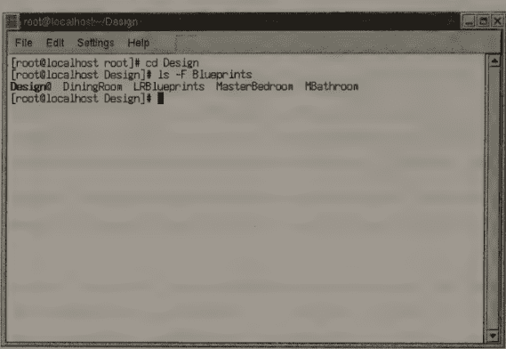

图 7-6 指向 `Design` 目录的符号链接

## 第 8 章：向 Shell 指定指令

## 实验

- 8.01 识别命令行各个部分
- 8.02 在系统中查找实用程序
- 8.03 使用命令替换编写简单脚本
- 8.04 编写通配符表达式
- 8.05 重定向错误
- 8.06 收集错误代码
- 8.07 修改 bash 环境
- 实验分析测试
- 关键术语测验
- 实验总结
- 答案

在之前的章节中，你输入了几个命令。在本章中，你将扩展对命令行的知识。你将使用通配符和命令替换来创建强大的命令。你还将将命令产生的错误重定向到日志文件中。这些技能每在学术和企业环境中都非常有用。

15 分钟

### 实验 8.01：识别命令行各个部分

你的朋友 LaTrina 即将从大学毕业了。在她的学校，她可以访问 UNIX 系统。她创建并发布了一个非常棒的网页和服务 Go4U。Go4U 是一个可以向任何人递送任何内容的系统。注册用户只需列出他们想要交付的内容和地点。Go4U 的交付人员会提取包裹并准时送达。

由于 LaTrina 要毕业了，她将失去她的网络空间。她注册了新域名并希望将网页迁移到她的托管公司。她的托管公司使用的 UNIX 版本与她的学校不同。LaTrina 虽然是一位优秀的开发者，但只学了足够发布她页面的 UNIX 知识。她预感到转换过程中会出现一些问题，并请你帮助她迁移。你作为 UNIX 专家，同意教她一些基础知识，并修复任何 UNIX 错误。

在教 LaTrina 任何高级命令之前，你想确保她理解 UNIX 命令是如何构建的。你将让她拆解并构建几个复杂的 UNIX 命令。这将让她理解她稍后输入的命令。

### 学习目标

在本次实验中，你将识别命令行的各个部分。完成此实验后，你将能够：

- 识别实用程序、参数和开关
- 构建 UNIX 命令

### 实验材料和设置

你进行实验所需的材料有：

- 铅笔和纸

### 开始正题

以下步骤将帮助你识别命令行的不同部分。你必须应用在 John Muster 编写的《UNIX 和 Linux 入导》（McGraw-Hill/Osborne, 2002）一书中中学的知识来操作命令行。

**步骤 1** 识别下列命令中的实用程序、开关和参数。对于下表列表中的每个命令行，请写出实用程序、参数和开关。

| 命令行 | 参数 | 开关 |
| --- | --- | --- |
| `cp /etc/printcap;less printcap` | | |
| `man ls -d` | | |
| `mkdir -m755 scripts;cd scripts` | | |

**步骤 2**，在所提供的空间内，填入可能存在的命令行部分。

- a) `________________`
- b) `________________`
- c) `________________; ; ________________`

**步骤 3** 对于上述每个命令行，创建三个可以填充每个空格的有效命令。例如，对于 b，一个有效命令是 `cp /etc/printcap ~printcap`。

- a) `__________________`
- b) `___________________`
- c) `_____________________`

### 实验 8.02：在系统中查找实用程序

LaTrina 的网站大部分是使用 Perl 编程语言构建的。Perl 对 Web 开发者来说是一种非常好的语言。它容易学习且运行速度较快。它在多个网站上都可以免费下载。为了让 Perl 脚本运行，脚本必须知道哪个目录持有着工作版本的 Perl。

LaTrina 的网站目前无法运行，因为她指向 Perl 的路径错误。为了让 Perl 脚本运行，第一行必须包含 perl 命令的实际路径。LaTrina 的脚本仍设置为她大学的 Perl 目录。该行错误地读取为 `#usr/sbin/perl`。她请你帮助找到正确的位置。

### 学习目标

在本次练习中，你将在系统中查找几个命令。完成实验后，你将能够：

- 使用 `whereis` 找到实用程序的所有出现处
- 使用 `find` 找到持有实用程序的目录
- 使用 `which` 确定哪个出现处是当前的系统默认

### 实验材料和设置

你进行实验所需的材料有：

- 安装了 Red Hat Linux 7.3 的计算机
- 铅笔和纸

### 开始正题

> **提示**
> 三个实用程序可以帮助这种情况。`whereis` 实用程序将找到该实用程序的所有版本。`find` 实用程序将提供目录，但不是持有当前默认版本的路径。`which` 实用程序将确定哪一个出现处是系统默认。

### 实验 8.02：在系统中查找实用程序 15

以下步骤将帮助你在系统中查找几个命令。你将使用三种不同的工具来查找。你必须应用在 John Muster 编写的《UNIX 和 Linux 入导》（McGraw-Hill/Osborne, 2002）一书中学到的知识来搜索 UNIX 安装。

查找以下实用程序：`find`、`whereis` 和 `which`。将结果填入表中。如果结果太长，可以缩写。

| 实用程序 | `find` | `whereis` | `which` |
| --- | --- | --- | --- |
| `perl` | | | |
| `ls` | | | |
| `man` | | | |
| `startx` | | | |

### 实验 8.03：使用命令替换编写简单脚本

LaTrina 的托管提供商不允许她编写脚本。然而，她需要自动化一些任务。在本次实验中，你将使用命令替换来编写简单脚本。这将帮助 LaTrina 自动化她的网站任务。命令替换是一种让 Shell 使用一个命令的输出作为另一个命令的参数的功能。

### 学习目标

在本次实验中，你将识别命令行的各个部分。完成此实验后，你将能够：

- 识别实用程序、参数和开关
- 构建 UNIX 命令

### 实验材料和设置

你进行实验所需的材料有：

- 安装了 Red Hat Linux 7.3 的计算机
- 铅笔和纸

### 开始正题

以下步骤将帮助你练习命令替换的使用。命令替换是一种让 Shell 使用一个命令的输出作为另一个命令的参数的功能。这通常通过反引号 `` `` 或 `$()` 语法来实现。

**步骤 1** 创建一个使用 `date` 命令命名的文件。

**步骤 2** 创建一个使用 `who` 命令将当前用户记录到文件中。

### 实验 8.04：编写通配符表达式

以下步骤将帮助你识别命令行的不同部分。你将使用三种不同的工具来查找。你必须应用在 John Muster 编写的《UNIX 和 Linux 入导》（McGraw-Hill/Osborne, 2002）一书中学到的知识来操作命令行。

查找以下实用程序：`find`、`whereis` 和 `which`。将结果填入表中。如果结果太长，可以缩写。

| 实用程序 | `find` | `whereis` | `which` |
| --- | --- | --- | --- |
| `perl` | | | |
| `ls` | | | |
| `man` | | | |
| `startx` | | | |

# 实验练习 8.04：编写通配符表达式 159

| 命令 | 通配符描述 | 示例文件 |
|---|---|---|
| `ls ???.jpg` | | |
| `ls a?.jpg` | | |
| `ls m[aeiou]d` | | |
| `ls [d-g]o[gt]` | | |

编写一个能够满足该要求的通配符表达式。

| 需求 | 通配符 |
|---|---|
| 所有以 ga 开头的文件 | `ga*` |
| 所有以 g 开头并以 .doc 结尾的文件 | |
| 所有以任何元音开头且元音后恰好有两个字母的文件 | |
| 所有长度为三个的文件，最后一个字母是 g 到 k 之间的字母 | |

# 实验练习 8.05：重定向错误

LaTrina 是一位非常有才华的程序员。她的网站目前通过向日志 web 节点写入内容来响应用户或站点错误。这是网站的默认操作。LaTrina 希望处理她自己的错误。她理解相关的编程代码，但不理解 UNIX 方面的操作。她请求你提供帮助。

她有一个名为 `regist.exe` 的程序，可以在她的网站上运行。`register` 允许客户创建账户。`register` 运行得很好，但偶尔会出现 Bug。LaTrina 希望将错误信息重定向到 `errors.txt` 文件中。

### 学习目标

在本次实验中，你将把命令的错误信息重定向到文件中。完成本次实验后，你将能够：

- 将程序的错误信息重定向到用户定义的日志中
- 在后台运行程序

### 实验材料与设置

你本次实验所需的材料有：

- 安装了 Red Hat Linux 7.3 的计算机
- （可选）一个名为 `regist.exe` 的程序

### 开始正题

以下步骤将帮助你掌握将错误输出重定向到文件中。你需要一个可以写入错误输出的有效程序。你必须应用在 John Muster 编写的《UNIX 和 Linux 入导》（McGraw-Hill/Osborne, 2002）一书中中学的知识来重定向错误。

# 实验练习 8.05：重定向错误

### 提示

UNIX 允许你将程序的错误重定向到文本文件。重定向运算符是 `2>`。`2` 表示这是错误重定向。`>` 和 `>>` 的作用与之前的章节相同；`>` 覆盖文件，`>>` 则向文件追加内容。

### 可选

如果你想验证重定向是否有效，需要一个简单的程序。使用 `pico` 或 `vi` 创建一个名为 `regist.cpp` 的以下 C++ 程序：

```cpp
#include <iostream.h>
void main()
{
    cout << "This is on the screen\n";
    cerr << "This is in the error log\n";
}
```

在运行之前，你需要编译程序。编译命令是 `g++ regist.cpp -o regist.exe`。如果没有出现任何消息，可以通过输入 `regist.exe` 来运行程序。如果发生任何错误，请检查你输入和命名的程序是否正确。

### 提示

可以在 `www.Osborne.com` 找到 `regist.exe` 的编译版本。输入此书的 ISBN 并在点击“Downloads For This Book”（下载此书）链接。

- 步骤 1 编写或获取程序。如果没有 `regist.exe`，你可以用 bash 代替。为了测试，可以编辑 bash 命令，如 `lr` 或 `wc -z`。
- 步骤 2 使用 `2>>` 和 `&` 运算符，编写在后台运行 `regist.exe` 并将错误重定向到错误日志的命令。
- 步骤 3 运行你的命令三次。如果你一切都做对了，你的错误信息应该在文件中出现三次。

# 实验练习 8.06：收集错误代码

通过错误重定向，LaTrina 现在可以实现所有的错误检查，并检查她自己的日志文件中的消息。这将允许她自定义程序以捕获用户生成的每一个错误。随着时间的推移，她的 `register.exe` 将是不会崩溃的。

她询问如何获取常用 UNIX 错误的错误代码。她知道自己遇到了哪些错误，但如果没有错误代码，她无法针对这些错误编写程序。你告诉她 `$?` 变量，它保存上一个错误的错误代码。

### 学习目标

在本次实验中，你将记录常用命令的错误代码。完成本次实验后，你将能够：

- 确定任何 UNIX 错误的错误代码

### 实验材料与设置

你本次实验所需的材料有：

- 安装了 Red Hat Linux 7.3 的计算机
- 铅笔和纸

### 开始正题

下表包含几个命令。运行命令并使用 `$?` 变量获取错误代码。将错误代码记录在提供的空间内。记住，你需要通过 `echo` 该变量来获取其内容。你必须应用在 John Muster 编写的《UNIX 和 Linux 入导》（McGraw-Hill/Osborne, 2002）一书中学到的知识来 echo 变量内容。

> 警告
> 不要以 root 身份登录运行此练习！

# 第 8 章：向 Shell 指定指令

30 分钟

# 实验练习 8.07：修改 bash 环境

LaTrina 将在她的新网站上花费大量时间。你决定修改她的环境来让她的工作更轻松。你知道你可以为常用命令创建别名（aliases），设置 `noclobber` 变量，并设置脚本使用的变量对所有子进程可用。这些修改是在 `.bash_profile` 文件中完成的。

你将修改 LaTrina 的 `.bash_profile` 文件。该文件控制环境。你将修改 LaTrina 的 `.bash_profile` 文件。该文件控制环境。`bash` 是 UNIX 系统上非常常用的 shell。你将修改 LaTrina 的 `.bash_profile` 文件。该文件控制环境。`bash` 是 UNIX 系统上非常常用的 shell。你将设置 `noclobber` 变量，创建 LaTrina 使用的变量，创建 `cp`、`mv` 和 `rm` 工具的交互模式。通过设置路径目录创建一个指向实验练习 8.03 中命令的别名。

> 警告
> 在修改 `.bash_profile` 之前请确保获得批准。在某些学校，这种行为可能导致被开除。

### 学习目标

在本次实验中，你将修改你的 profile。完成本次实验后，你将能够：

- 设置 `noclobber` 变量
- 创建并导出变量
- 创建别名
- 修改路径

### 实验材料与设置

你本次实验所需的材料有：

- 安装了 Red Hat Linux 7.3 的计算机
- 修改 profile 的权限

### 开始正题

以下步骤将允许你修改 UNIX/Linux 上的 `.bash_profile` 文件。你必须应用在 John Muster 编写的《UNIX 和 Linux 入导》（McGraw-Hill/Osborne, 2002）一书中学的知识来创建别名。

> 警告
> 确保备份 `.bash_profile` 的原始版本。这将允许你从任何错误中恢复。

**步骤 1** 创建名为 `commands` 的目录。

**步骤 2** 为你的 `.bash_profile` 文件制作备份副本。该文件位于你的家目录。将其复制到 `orig_profile` 所在的目录。

**步骤 3** 使用文本编辑器编辑你的 `.bash_profile` 以包含以下内容：

- 为 `cp` 设置别名为 `cp -i`
- 为 `mv` 设置别名为 `mv -i`
- 为 `rm` 设置别名为 `rm -i`
- 创建别名 `countem`，指向实验练习 8.3 中的命令
- 将 `commands` 目录添加到路径
- 创建并导出一个名为 `SITE` 的变量，存储地址 `www.go4u.com`
- 设置 `noclobber`

**步骤 4** 注销并重新登录。验证没有错误。检查你的别名、变量和路径设置。运行 `.countem` 别名。

如果需要，你可以将 `.bash_profile` 替换为 `orig_profile`。在文件中保留更改也没有关系。

## 实验分析测试

- 1. 使用以下通配符可以组合多少不同的单词？`[agtz][enk][alp]`
- 2. 为什么在修改 `.bash_profile` 文件之前备份它是很重要？
- 3. `which` 和 `whereis` 的主要区别是什么？
- 4. `noclobber` 变量防止什么？
- 5. 命令 "`ls /usr/games/f*`" 的结果是什么？

### 关键术语测试

使用以下词汇术语完成下列句子。并非所有的术语都会被用到。

- `$ find`
- `noclobber`
- `.bash_profile parameters`
- `PATH`
- `redirection`（重定向）
- `2> set`
- `2>> switches`（开关）
- `alias tokens`
- `command substitution`（命令替换）
- `whereis`
- `error number`（错误代码）
- `which`
- `export`（导出）

1. 要开启 `noclobber` 变量，你使用 `set -o noclobber` 命令。
2. `which` 命令返回命令所在的子目录，而不是命令的整个文件。
3. `$?` 生成上一个命令的错误代码。
4. 在命令 `*ls /etc*` 中，`/etc` 是一个参数。
5. 在给变量赋值后，你必须 `export` 它们，以便它们对子进程可用。
6. `PATH` 变量提供了 UNIX 搜索命令的目录。
7. 命令行的各个部分被称为令牌（tokens）。
8. `*` 通用配符将匹配任意数量的字符。
9. 在 UNIX 中，开关（switches）前面有一个 `-`。
10. 要在 UNIX 命令上使用命令替换，你将所需的命令括在 `` `` 中。

## 实验总结

你修改了网站环境，以简化所有者的 UNIX 体验。你还将将 `regist.exe` 程序的输出重定向到自定义日志文件中。你生成了一个别名，利用 UNIX 的命令替换功能创建了一个名为 `countem` 的命令，用于统计该站日志的数量。最后，你练习了使用通用配符和生成错误。理解命令行是如何工作的将让你能够更容易地学习新的、复杂的命令。

## 答案

在本节，你将找到实验练习的答案。

### 实验解答 8.01

以下步骤允许你识别命令行的不同部分：

第 1 步

| 命令行 | 工具 | 参数 | 开关 |
| --- | --- | --- | --- |


| `cp /etc/printcap ;;less printcap` | `cp`, `less` | `/etc/printcap`, | |

| `ls -d` | `man` | `ls` | `-d` |

| `mkdir -m755 scripts;cd scripts` | `mkdir`, `cd` | `755`, `scripts` | `-m` |

第 2 步

- a) 工具

- b) 工具开关或参数开关或参数

- c) 工具；工具开关或参数

第 3 步

- a) `ls`, `pwd`, `cal`

- b) `ls -l /etc`, `man -D man`, `mv first second`

- c) `who;date -u`, `ls; ls *.cpp`, `pwd;cd ..`

### 实验解答 8.02

下表为每个搜索提供了正确的命令。每个工具（`find`, `whereas`, 和 `which`）都需要一个参数：即要查找的工具。因此，`which perl` 将找到你系统上当前的 Perl 版本。请参下表获取相应的命令：

| 工具 | `find` | `whereas` | `which` |
| --- | --- | --- | --- |
| `perl` | `find perl` | `whereas perl` | `which perl` |
| `ls` | `find ls` | `sedangkan ls` | `which ls` |

## 第 8 章：向 Shell 指定指令

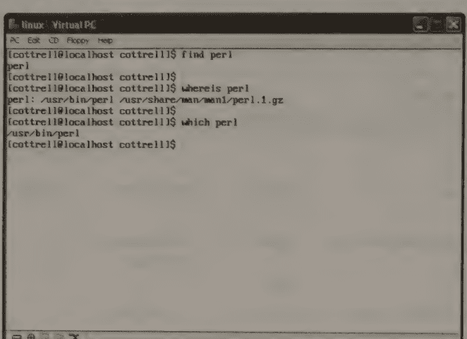

图 8-1 perl 搜索结果

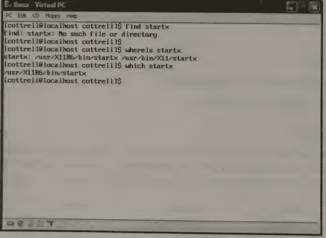

图 8-2 startx 搜索结果

### 实验解答 8.03

以下步骤将指导你如何使用 UNIX 的命令替换功能：

**第 1 步** 你应该使用 `pico` 或你喜欢的文本编辑器创建了五个文件。然后你应该在每个文件中输入几行内容，并记录每个文件的长度。


**第 2 步** 再次使用 `pico`，你应该创建一个名为 `logs` 的文件，其中包含 `requests.txt`、`deliveries.txt`、`errors.txt`、`users.txt` 和 `links.txt`。每个文件都应该单独占一行。下面的列表提供了 `logs` 文件的示例：

```
requests.txt
deliveries.txt
errors.txt
users.txt
links.txt
```

**第 3 步** 使用 `wc`、`-l` 开关和 `cat` 命令，你应该统计了每个文件。下面的列表提供了适用于 `bash` shell 的命令：

```
wc -l `cat logs`
```

图 8-3 提供了命令示例运行的输出。

## 第 8 章：向 Shell 指定指令

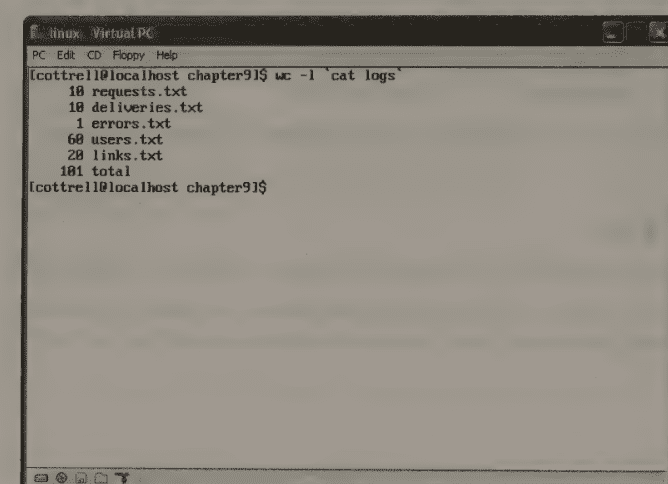

图 8-3 命令的示例输出

### 实验解答 8.04

在本次实验中，你使用了 UNIX 中的三种通用配符。字符 `*` 可以替换任何字符或任意数量的字符。例如，`a*` 会列出 a、ab、abc、abcd 等文件。`?` 匹配任意一个字符。例如，`???` 将找到任何三个字母的文件名。它不会找到两个或四个字符的文件名；只返回三个字符的文件。`[]` 表示可以使用使用的字符列表或字符范围。`[a-f]` 是从 a 到 f 的所有字母；`[aeiou]` 仅包含字母 a, e, i, o, u。

| 命令 | 通用配符描述 | 示例文件 |
|---|---|---|
| `ls a*` | 所有以 a 开头的的文件 | apple, Andrew, a.out |
| `ls duke*.` | 所有以 duke 开头并以 .doc 结尾的文件 | dukeCity.doc, dukeWayne.doc, duke.doc |
| `ls *.jpg` | 所有以 .jpg 结尾的文件 | lee.jpg, lizzie.jpg, Christopher.jpg |
| `ls ???.jpg` | 所有以 .jpg 结尾的三个字母文件 | lee.jpg, dad.jpg, mom.jpg |

## 答案 173

| 命令 | 通用配符描述 | 示例文件 |
|---|---|---|
| `ls?.jpg` | 所有以 a 开头的两个字母 .jpg | al.jpg, am.jpg |
| `ls m[aeiou]d` | 以 m 开头、中间为元音、以 d 结尾的三字母单词 | mad, med, mid, mod, mud |
| `ls [d-g][gt]` | 以 d, e, f, g 开头、中间字母为 o、以 g 或 t 结尾的三字母单词 | dog, dot, eog, eot, fog, fot, gog, got |
| 要求 | 通用配符 |
| --- | --- |
| 所有以 ga 开头的的文件 | `ga*` |
| 所有以 g 开头并以 .doc 结尾的文件 | `g*.doc` |
| 所有以任何元音开头且元音后恰好有两个字母的文件 | `[aeiou]??` |
| 所有三个字母的文件，最后一个字母是 g 到 k 之间的字母 | `??[g-k]` |

### 实验解答 8.05

以下步骤将允许你将错误输出重定向到文件：

- **第 1 步** 你应该已经将错误输出重定向到文件。

- **第 2 步** 你应该已经执行了 `errors.txt`。

- **第 3 步** 你应该已经执行了命令。

### 实验解答 8.06

下表提供了几种错误的错误代码。获取错误代码的命令是 `echo`。

| 命令 | 错误代码 |
| --- | --- |
| `ls` | O |
| `ls -e` | I |
| `sleep(8)` | 258 |
| `ls >>etc/termcap` | I |
| `gg` | 127 |

### 实验解答 8.07

以下步骤将修改你的 `.bashprofile`：

- **第 1 步** 你应该已经切换到主目录 `~`。然后你创建了 `commands` 目录。

- **第 2 步** 你应该已经为 `.bashprofile` 做了备份拷贝 `orig_profile`。

- **第 3 步** 你应该使用你的文本编辑器编辑了 `profile`。然后你已经在末尾添加了以下行：

```
SITE=www.go4.com
set -o noclobber
alias countem='wc -l logs'
alias cp='cp -i'
alias rm='rm -i'
alias mv='mv -i'

PATH=$PATH:$HOME/commands

export SITE
```

- **第 4 步** 你应该通过运行 `alias` 和 `env` 测试了你的更改。你的别名和新变量应该列出。

## 第 9 章文件目录权限

### 练习

- 9.01 根据数字定义权限

- 9.02 创建归档脚本

- 9.03 设置文件和目录权限

- 9.04 设置 `umask`

实验分析测试

关键术语测试

实验总结

第 9 章：文件目录权限

你已经掌握了使用命令行和输入命令。在这个过程中你学习了如何编写 shell 脚本。在本章中，你将学习如何设置文件和目录的权限。你将编写一个归档文件的脚本并设置全局权限掩码，即 `umask`。

15 分钟

实验练习 9.01：根据数字定义权限

LaTrina 有问题。她的某些 Web 服务和页面无法运行。她在 Internet Explorer 中遇到了权限错误。她不知道为什么这些程序无法运行；它们在旧站点。你立即怀疑是权限问题。你同意帮助她，并在过程中教她基础的 UNIX 权限。

修复 LaTrina 大多数问题的命令是 `chmod`，它更改文件的模式（文件权限）。真正的 UNIX 用户使用数字参数而不是字母等效参数。在练习中，你将练习读取和设置权限。

学习目标

在实验中，你将识别文件的权限。在实验结束时，你能够：

- 将数字权限转换为字母权限

- 根据需要创建数字权限

实验材料和设置

完成此实验所需的材料有：

- 铅笔和纸

## 实验 9.01：根据数字定义权限

### 正式开始

接下来的实验要求你描述一组文件的权限。你将需要应用 John Muster 编写的《UNIX 和 Linux 导论》（McGraw-Hill/Osborne, 2002）一书中中学的关于数字权限操作的知识。

步骤 1：根据下所示数字，描述并输入列表中所有者、组和其他和其他用户的权限。

| 权限 (Permission) | 所有者 (Owner) | 组 (Group) | 其他 (Other) |
|---|---|---|---|
| 777 | 读、写、执行 | 读、写、执行 | 读、写、执行 |
| 644 | | | |
| 640 | | | |
| 751 | | | |
| 711 | | | |
| 700 | | | |

步骤 2：根据下述描述的需求，在下列表中创建并输入权限数字。

| 需求 | 数字等效值 |
|---|---|
| 所有者可以读和写，组可以读和写，其他什么都不能做 | |
| 所有者可以读、写和执行；组和其他可以执行 | |
| 所有者可以读和写，组和其它可以读和写 | |
| 所有者可以读和写，组和其它可以读 | |

#### 实验 9.02：创建备份脚本

LaTrina 维护的 Go4U 网站产生大量的文本文件。这些文件对于网站的持续维护非常重要。LaTrina 定期会将文件复制到一个单独的目录。目前她是手动处理这些操作，但希望有一个脚本来方便操作。她已经获得了主机公司的许可，可以在她的网站上编写并运行 shell 脚本。

你将编写一个脚本，将你目录中所有的 `.txt`、`.dat`、`.html` 和 `.cgi` 文件复制到归档目录。通过将脚本存放在命令目录中，LaTrina 可以在她网站的任何地方运行该脚本。

### 学习目标

在本实验中，你将编写一个备份脚本。完成本实验后，你将能够：

- 编写脚本

- 使脚本变得可执行

### 实验材料与设置

你本实验所需的材料有：

- 安装了 Red Hat Linux 7.3 的计算机

- `PATH` 环境变量中的命令目录

> 提示：你可能需要创建几个文件和文件夹。你可以使用 `touch` 命令创建文件。语法为 `touch filename`，其中 `filename` 是你将创建的文件名。一次可以创建多个文件。因此，你可以一次创建几个空白的 `.txt`、`.dat`、`.html` 和 `.cgi` 文件进行练习。

## 实验 9.02：创建备份脚本

### 正式开始

以下步骤将帮助你创建一个名为 `archive` 的脚本，用于备份你账户下的文件。你将需要应用 John Muster 编写的《UNIX 和 Linux 导论》（McGraw-Hill/Osborne, 2002）一书中中学的关于编写脚本、复制文件和创建目录的知识。

**步骤 1**：如果你还没有名为 `html`、`users`、`cgi-bin` 和 `archive` 的目录，请现在使用 `mkdir` 创建它们。你需要在每个目录中放置几个文件。在 `html` 目录中，创建几个以 `.html` 结尾的文件。在 `users` 目录中，创建几个以 `.dat` 和 `.txt` 结尾的文件。最后，在 `cgi-bin` 目录中创建几个 `cgi` 文件。

你应该确定将文件复制到 `archive` 目录所需的命令。该命令必须将各自目录中的所有 `.txt`、`.dat`、`.html` 和 `.cgi` 文件复制到相应的目录。在复制文件之前，使用 `cd` 切换到实际目录是有帮助的。使用绝对路径是一个好主。（注：此处 OCR 文本似乎破碎，已根据逻辑流重构）。

> **警告**：请确保你使用的是 `cp` 命令而不是 `mv` 命令。

- **步骤 2**：进入命令目录。

- **步骤 3**：使用你喜爱的文本编辑器创建一个名为 `archive` 的新脚本。

- **步骤 4**：在脚本中编写你确定的命令。

- **步骤 5**：使用 `chmod` 命令使此脚本变为可执行。

- **步骤 6**：运行脚本。切换到 `archive` 目录并验证所有文件都已复制。

> 提示：测试脚本的小部分是一个好主意。在尝试处理 `.dat` 文件之前，先验证你能够复制 `.txt` 文件。分段编写脚本有助于减少与脚本相关的挫败感，并保证脚本可以运行。

## 实验 9.03：设置文件和文件夹的权限

### 正式开始

在你处理 LaTrina 的网站工作时，你发现她的许多文件权限是错误的。你建议 LaTrina 修改她几个文件的权限。`html` 和 `cgi-bin` 目录中的所有文件都应该是可读可执行的。`archive` 目录应该只允许文件所有者读取或修改。`users` 目录需要所有者和其他人读写。这是通过使用 `chmod` 命令完成的。

> **警告**：将文件设置为 666 有点危险。这意味着如果有人知道路径，任何人都可以修改该文件。因此，将 `.html` 文件设置为 666 是一个坏主意。`users` 目录中的 `.txt` 和 `.dat` 文件设置为 664（已修正）是安全的。黑客必须知道确切路径才能造成任何破坏。你设置 644 是因为大多数网络服务器默认处理脚本的方式。因此，为了让你的脚本能够修改。

### 学习目标

在本实验中，你将设置文件和文件夹的权限。完成本实验后，你将能够：

- 设置文件的权限

- 设置目录的权限

- 递归设置

### 实验材料与设置

你本实验所需的材料有：

- 实验 9.02 创建的目录和文件

- 安装了 Red Hat Linux 7.3 的计算机

### 正式开始

以下步骤将帮助你设置文件和目录的权限。你将需要应用 John Muster 编写的《UNIX 和 Linux 导论》（McGraw-Hill/Osborne, 2002）一书中中学的关于设置权限的知识。

> **警告**：避免错误设置文件权限。通常你需要 root 账户权限来解决这个问题。

**步骤 1**：进入 `users` 目录。使用 `chmod` 命令设置所有 `.txt` 和 `.dat` 文件的权限。权限应该允许所有者和其他读写，组没有访问权限。

**步骤 2**：进入 `users` 的父目录。设置 `users` 的权限。`users` 目录应允许所有者和其他读写，组没有访问权限。

**步骤 3**：留在 `users` 的父目录。使用 `chmod -R` 命令设置 `html` 和 `archive` 目录的权限。`html` 目录将拥有用户所有权，其他人可读执行。`archive` 目录将拥有所有者所有权，其他人没有访问权限。

**步骤 4**：进入每个目录并执行长格式列表。验证权限已更改。

## 实验分析测试

1. 如果你将一个目录模式设置为 644，并将该目录下的一个文件设置为 666，当你的用户组成员尝试写入该文件时，会发生什么？

2. 描述 `umask` 的工作原理。

3. 你收到一封来自本地管理员的电子邮件。他建议为了让你的网页能够正常运行，你需要将页面权限设置为 777。你如何立即判断出这封邮件不是由你的管理员发送的？

4. 你更倾向于使用数字还是字母参数来设置权限？为什么？

5. 你该如何删除一个你拥有所有权但没有写权限的文件？

### 关键术语测验

使用以下词汇完成下句句子。并非所有的术语都会被使用。

- I

- 2

- 4

- `chmod`

- `directory`

- `execute`

- `file`

- `permission`

- r

- -R

- `read`

- `umask`

- w

- `write`

- x

1. 设置文件权限的命令是 ________。

2. 设置账户默认权限的命令是 ________。

3. 写入权限的数字等效值是 ________，字母参数是 ________。

4. 当你设置 r 权限时，你是在允许用户 ________ 文件。

5. ________ 切换位将设置所有文件和子文件夹的模式。

## 实验总结

你已经设置了文件权限，使得网站能够在运行的同时保护这些文件。你使用 `chmod` 为多个文件和目录设置了权限。`umask` 命令确保了用户生成的新的 `.txt` 和 `.dat` 文件将获得适当权限。

## 解决方案

在本节中，你将找到实验练习的解决方案。

### 实验解决方案 9.01

以下步骤允许你在数字权限与权限描述之间进行相互转换：

步骤 1

| 权限 | 所有者 | 组 | 其他 |
| --- | --- | --- | --- |
| 777 | 读、写、执行 | 读、写、执行 | 读 |
| 644 | 读、写 | 读 | 读 |
| 640 | 读、写 | 读 | 无 |
| 751 | 读、写、执行 | 读、执行 | 执行 |
| 711 | 读、写、执行 | 执行 | 执行 |
| 700 | 读、写、执行 | 无 | 无 |

步骤 2

| 需要 | 数字等效值 |
| --- | --- |
| 所有者可以读和写，组可以读和写，其他什么都不能做 | 660 |
| 所有者可以读、写和执行；组和其他可以执行 | 711 |
| 所有者可以读、写，组可以读，其他可以读和写 | 645 |
| 所有者可以读和写，组和其它可以读 | 644 |

## 实验解决方案 9.02

以下步骤将创建存档脚本：

步骤 1 在继续解决方案之前，你应该已经创建了必要的文件和目录。你应该执行了命令 `mkdir html cgi-bin users` 来创建目录。通过 `touch a.html b.html c.html`，你应该创建了几个 HTML 文件。

### 解决方案 187

应该运行相同的命令来创建 `.txt`、`.dat` 和 `.cgi` 文件。确保你在正确的目录中创建了文件。HTML 文件应该创建在 `html` 目录中。`cgi-bin` 目录应该存放所有的 `.cgi` 文件；用户应该使用 `.txt` 和 `.dat` 文件。

- **步骤 2** 你应该使用命令 `cd ~/commands` 更改目录。

- **步骤 3** 你应该使用 **pico** 存档命令创建了文本文件。


- **步骤 4** 你应该输入以下代码，然后保存并退出文件。

```
clear
echo "Copying html files now..."
cd ~/html
cp *.html ~/archive
echo "Copying cgi files now..."
cd ~/cgi-bin
cp *.cgi ~/archive
echo "Copying txt files now..."
cd ~/users
cp *.txt ~/archive
echo "Copying dat files now..."
cp *.txt ~/archive
echo "All files copied, have a nice day!"
```

- **步骤 5** 你应该使用命令 `chmod 755 archive` 将文件设为可执行。`755` 意味着所有者可以读、写和执行，而世界其他部分读和执行。

- **步骤 6** 你应该多次测试了你的命令。

### 实验解决方案 9.03

以下步骤将为你的目录设置所需的权限：

- **步骤 I** 你应该使用 `cd` `users` 命令切换到 `users` 目录。然后你应该使用命令 `chmod 606 *.txt` 设置 `.txt` 文件的权限，让所有者和其他人都可以读写。`dat` 文件也应该具有相同的权限。

## 第 9 章：设置文件和目录权限

步骤 2 你应该通过 `cd ..` 切换到 `users` 的父目录。然后你应该通过 `chmod 606 users` 为 `users` 目录设置 `606` 权限

步骤 3 对于 `html` 和 `cgi-bin` 目录，你应该执行了命令 `chmod -R 755 html cgi-bin`。对于 `archive` 目录，你应该执行了 `chmod -R 600 archive`。

步骤 4 你应该使用了 `cd ...`

### 实验解决方案 9.04

以下步骤将设置 `umask`：

步骤 1 所需权限是 `606`。

步骤 2 你应该使用了 `umask 777`。

步骤 3 你应该使用了 `umask 711`。

# 第 10 章：进程控制

## 实验练习

- 10.01 列出进程
- 10.02 终止进程
- 10.03 挂起和恢复进程
- 10.04 终止其他用户的进程
- 10.05 退出后运行

实验分析测试

关键术语测验

实验总结

解决方案

# 第 10 章：进程控制

在之前的章节中，你创建了几个任务。在本章中，你将学习如何管理它们。你将学习列出你自己以及所有用户的任务。此外学习杀死、挂起和恢复任务。最后，你学习学习如何在退出时保持任务运行。

## 实验 10.01：列出进程

Jeff 需要学习如何观察员工在做什么。他还需要终止不需要的任务。最后，他有一个程序需要一直运行。你的任务是帮助他使用 UNIX 解决这些问题。

你向 Jeff 展示如何掌握多任务功能。这些功能允许用户处理多个命令。与 Windows 相比，该功能有点笨拙，但一旦熟悉了快捷键就会非常好用。

在教了 Jeff 基础知识后，你开始处理他的第一个问题：列出系统中的任务。`ps` 工具相当复杂，具有多个开关，其中一些在手册（`man`）中并未列出。你从教 Jeff 列出他的进程开始，逐渐过渡列出单个用户的进程。

提示

实验在具有多个用户的系统中效果最好。如果你在独立系统上工作，请创建几个用户并进行切换。切换用户时，先登录一个用户，在完成实验前多次执行此操作。

### 学习目标

在本实验中，你将列出系统中的进程。实验结束后，你将能够：

- 列出你的进程
- 列出系统中所有用户的进程
- 列出特定用户的进程

### 实验材料与设置

你进行实验所需的材料有：

- 安装了 Red Hat Linux 7.3 的计算机

## 开始

以下步骤将引导你列出在使用 `ps` 工具和运行 `ps` 命令执行所需操作时的各种开关。你将应用在 John Muster 写的《Introduction to UNIX and Linux》书中中学的知识。

步骤 1 你需要确定执行以下任务所需的开关。请将它们写在提供的空间内。

| 预期输出 | 所需 ps开关 |
| --- | --- |
| 所有进程 |  |
| 关于进程的用户详细信息 |  |
| 特定用户的进程 |  |
| 所有用户的进程 |  |
| 仅限运行中的命令 |  |

步骤 2 列出你所有的进程。

步骤 3：列出你账户的所有进程和用户详情。

步骤 4：列出所有用户的进程。

步骤 5：列出所有用户的进程和用户详情。

步骤 6：列出单个用户的所有进程及其详情。

步骤 7：列出所有用户运行的所有进程。

## 实验 10.02：终止作业

Jeff 在处理程序崩溃或不稳定的方面拥有某些经验。他需要知道如何终止这些进程。终止进程的命令是 `kill`。正如你现在所知的，`kill` 命令配合适当的开关会向进程发送信号，告诉它终止。默认情况下，`kill` 命令发送一个软件终止信号，告诉程序停止运行。在配合 `-9` 开关使用 `kill` 命令时，`-9` 开关有权强制杀掉任何命令。请谨慎使用 `-9`；它会停止所有进程，且不会让进程进行清理工作或优雅地关闭。因此，如果一个进程打开了一个文件并被用 `-9` 杀死，该文件可能无法正常关闭，且文件中更改的数据将永久丢失。

在本次实验中，你将练习使用 `kill` 命令停止你已经启动的其他命令。为了准备实验，你将启动几个命令并将它们置于后台。一旦命令进入后台，你将终止该进程。你需要尝试不同的 `kill` 开关，直到找到一个可以终止命令的开关。运行 `ps` 获取要杀死的进程 ID `PID` 并验证该实用程序已终止。

### 学习目标

在本次实验中，你将把作业置于后台并终止作业。实验结束，你将能够：

- 杀死自己的进程
- 将作业置于后台

### 实验材料和设置

你进行实验所需的材料有：

- 安装了 Red Hat Linux 7.3 的计算机

### 开始正题

以下步骤将引导你启动几个命令以练习杀死命令。你将不得不应用在 John Muster 编写的《UNIX Linux 入门》`McGraw-Hill/Osborne, 2002` 教科书中中学到的终止命令的知识。

步骤 1：为了练习 `kill` 命令，你内存中需要几个命令。你将启动三个命令并将它们置于后台。执行以下命令：

```
man ls &
pico &
sleep 60000 &
```

> ### 提示
在命令后加上一个 `&` 将使作业在后台运行。

- 步骤 2：杀死 `sleep` 命令。
- 步骤 3：杀死 `pico` 命令。
- 步骤 4：杀死 `man` 命令。
- 步骤 5：在执行每个 `kill` 命令后，运行 `ps` 以验证该命令已终止。

## 实验 10.03：暂停与激活作业

10 分钟

## 实验 10.03：暂停与激活作业

Jeff 了解如何列出他的进程并终止作业。然而，他想学习如何临时停止作业。通常，他在 `vi` 中工作时，需要从另一个目录复制文件。目前，他保存工作，退出 `vi`，复制文件，然后重新启动 `vi`。他希望更快地完成这些操作。你将向 Jeff 展示如何在后台练习处理当前作业。

你将启动一个 `vi` 会话，然后将其发送到后台。在操作编辑器工作期间，你将通过临时挂起作业并运行 shell 命令，来练习 UNIX/Linux 下下的多任务处理能力。

### 学习目标

在本次实验中，你将启动一个 `vi` 会话并将其置于后台，以便你复制文件。实验结束，你将能够：

- 将当前作业置于后台
- 将后台进程带回前台

### 实验材料和设置

你进行实验所需的材料有：

- 安装了 Red Hat Linux 7.3 的计算机

### 开始正题

步骤 1：启动一个 `vi` 会话。
步骤 2：将作业置于后台。
步骤 3：哪个按键将作业发送到了后台？
步骤 4：验证命令是否仍在运行。它的状态是什么？
步骤 5：将 `/etc` 目录下的 `passwd` 文件复制到你的家目录中。
步骤 6：将会话带回前台。

# 实验 10.04：终止其他用户的作业

15 分钟

# 实验 10.04：终止其他用户的作业

Jeff 注意到他的的一名员工在工作时间玩游戏。Jeff 想要在每次发现游戏在运行时都结束该游戏。他知道 `kill` 可以解决问题，但他似乎无法杀死该用户的进程。

你告诉他 `kill` 是正确的命令。然而，他需要以 `root` 权限登录 UNIX 服务器。一旦以 `root` 身份登录，他就可以随所欲地杀死用户进程。你需要创建几个正在运行的进程。完成后，你以 `root` 身份登录并杀死这些作业。

### 提示

上述场景在一个有一个 UNIX/Linux 服务器控制其他 UNIX/Linux 工作站的组织中是典型的。该实验设计在你拥有 `root` 权限的工作站上运行。

### 学习目标

在本次实验中，你将杀死其他用户的进程。实验结束，你将能够：

- 杀死其他用户的作业
- 以 `root` 身份登录

### 实验材料和设置

你进行实验所需的材料有：

- 安装了 Red Hat Linux 7.3 的计算机
- `root` 密码

# 第10 章：控制进程

### 开始正题

以下步骤将引导你终止其他用户的进程。你将不得不应用 John Muster 编写的《UNIX Linux 入门》`McGraw-Hill/Osborne, 2002` 教科书中中学到的列出和杀死知识。

> ### 提示
如果你在独立计算机上，可以使用 `su` 命令切换用户。

- 步骤 1：登录系统。
- 步骤 2：将作业置于后台。
- 步骤 3：切换用户到另一个账户。
- 步骤 4：在后台创建另一个进程。

> ### 提示
记住 `su` 命令允许你在不退出的情况下切换。

- 步骤 5：使用 `su` 命令以 `root` 身份登录。
- 步骤 6：获取要杀死的进程的 PID。
- 步骤 7：杀死 PID。
- 步骤 8：运行 `ps` 以验证命令不再运行。

10.05：使用 `nohup` 在退出后运行进程

20 分钟

# 实验 10.05：使用 nohup 在退出后运行进程

LaTrina 有另一个问题。她需要网站上的一个程序一直运行。目前，她知道的保持程序运行的唯一方法是登录。她知道普通（非 `root`）账户可以指定命令在用户注销后后台运行。解决这个问题的命令是 `nohup` 命令。`nohup` 会在你注销后保持程序运行。`nohup` 是“不挂起”的缩写。

> > Tip `nohup` 命令起源于用户需要通过调制解调器连接 UNIX 计算机时代。为了节省费用，`nohup` 允许用户拨号启动进程、断开连接，并在几小时后进程完成后重新连接。尽管对拨号账户的依赖减少了，`nohup` 依然保留了下来。

### 学习目标

在本次实验中，你将使用 `nohup` 在注销后保持命令运行。实验结束，你将能够：

- 编译 C++ 程序
- 使用 `nohup` 命令 `&`

### 实验材料和设置

你进行实验所需的材料有：

- 安装了 Red Hat Linux 7.3 的计算机
- C++ 编译器，或 `runforever.exe` 的编译版本。

# 正式开始工作

以下步骤将指导你如何使用 `nohup` 命令运行程序。你将需要应用 John Master 编写的《Introduction to UNIX and Linux》`McGraw-Hill/Osborne, 2002` 一书中中学关于使用 `nohup` 的知识。

如果你没有 `runforever.exe` 的编译版本，则需要手动创建它。创建一个包含以下代码的文本文件 `runforever.cpp`。运行命令 `c++ -o runforever.exe runforever.cpp`。当你正确输入代码后，`runforever.exe` 将执行。屏幕上不会出现任何内容。

```cpp
#include <iostream.h>
void main()
{
int x = 7;
while(x <= 7);
}
```

- 步骤 1 创建或获取程序 `runforever.exe`。
- 步骤 2 使用 `nohup` 和 `&` 执行 `runforever.exe`。
- 步骤 3 注销并以另一个用户身份登录。列出所有用户进程。`runforever.exe` 应该正在运行。如果需要，通过登录创建该进程的用户并使用 `kill` 命令杀死该任务。

> 如果你正在使用共享的 UNIX 实现，你应该在完成后杀死该任务。大多数系统管理员认为在内存中留下无用的程序是非常不礼貌的。

## 实验分析测试

1. 一旦你确定了进程的 PID，你如何终止它？
2. 你如何确定用户 `jsmith` 的 PID？
3. 假设你有三个命令在后台运行。你如何将将第二个命令带到前台，同时让另外两个留在后台？
4. 为什么应该将 `-9` 选项作为最后的手段？
5. 老板如何使用 `ps` 来确定谁工作最刻力？

### 关键术语测验

使用以下词汇完成下方的句子。并非所有的术语都会用到。

- `%`
- `&`
- `-I`
- `-15`
- `-2`
- `-9`
- `C++`
- `CTRL-Z`
- `fg`
- `kill`
- `nohup`
- `ps`

1. `________` 实用会在用户注销后仍保持程序运行。
2. `________` 信号是 `kill` 的默认信号。
3. 要将命令放在后台，你可以在启动命令时使用 `________` 或在命令执行期间使用 `________`。
4. 要获取任务的 PID，请使用 `________` 命令。
5. 要将任务带到前台，请使用 `________` 实用程序。

## 实验总结

Linux 的多任务功能虽然易用，但与 Windows 相比相形见绌。你学习了如何使用 `ps` 获取你的任务以及整个系统任务的信息。然后，你使用 `kill` 消除了一个正在运行的实用程序。最后，你使用 `nohup` 命令将命令放入内存中并永久运行。

## 答案

在本节，你将找到实验练习的答案。

### 实验解答 10.01

以下步骤允许你创建杀死进程的操作：`ps` 的正确开关显示在表中所示。

| 预期输出 | ps 开关 |
| :--- | :--- |
| 所有进程和用户 | `-A`, `-e`, 或 `aux` |
| 用户详情 | `-u` |
| 所有用户进程 | `au` |
| 仅运行中 | `-r` |

要解决这些问题，你需要使用 `ps` 和各种开关。图 10-1 到 10-3 显示了典型输出。

步骤 2 你应该执行了 `ps` 来列出你的进程。

步骤 3 你应该执行了 `ps` 来列出你进程的详情。

步骤 4 你应该执行了 `ps -A` 来列出所有用户进程。

步骤 5 你应该执行了 `ps -A` 来列出所有进程的详情。

步骤 6 你应该执行了 `ps -u bob`，以查看与 `bob` 相关的任何任务的进程。你的输出应该与图 10-3 类似。

步骤 7 你应该执行了 `ps -r` 来查看所有用户的运行进程。

> 提示 有几个未说明的开关。开关 `l`、`s` 和 `t` 提供不同的输出，可能没有列在你的帮助手册（`man pages`）中。尝试它们并发现它们的作用。

### 答案 205

```
Linux Virtual PC
cd Floppy Help
[cottrell@localhost]$ ps
PID TTY              TIME CMD
18660 tty         00:00:00 bash
18790 tty         00:00:00 ps
[cottrell@localhost]$ ps
[cottrell@localhost]$ ps
USER PID CPU VSZ RSS STAT TIME COMMAND
cottrell 18660 0.0 1 2436 1324 tty S 04:06 0:00 -bash
cottrell 18791 0.0 5 2508 668 tty N 05:08 0:00 ps
[cottrell@localhost]$ _
```

图 10-1 `ps` 和 `ps` 的输出

```
Linux Virtual PC
cd Floppy Help
[cottrell@localhost]$ ps -a -l
PID TTY              TIME CMD
1               00:00:07 init
2               00:00:08 event
3               00:00:01 asd
4               00:00:00 CPU
5               00:00:08 mapd
6               00:00:00 flush
7               00:00:00 updated
8               00:00:00 recovery
12              00:00:09 journald
133             00:00:00 journald
404             00:00:12 logd
489             00:00:30 iogd
589             00:00:00 portam
537             00:00:00 statd
649             00:00:00 apmd
716             00:00:00 xinetd
748             00:00:00 sys
767             00:00:15 sendmail
788             00:00:02 gpm
806             00:00:00 crond
896             00:00:00 atd
```

图 10-2 `ps -A | more`

# 第 10 章 控制用户进程

图 10-3 `ps -au bob` 的输出

### 实验解答 10.02

以下步骤允许你生成多个命令并随后终止：

- 步骤 1 你应该执行了 `man ls &`、`pico &` 和 `sleep 60000 &` 将三个进程放在后台。
- 步骤 2 你应该执行了 `ps` 获取 `sleep` 的 PID，然后输入 `kill PID`。


- 步骤 3 和 4 你应该执行了 `ps` 获取 PID，然后输入 `kill -9 PID`。

### 实验解答 10.03

以下步骤允许你练习将任务放在后台：

- 步骤 1 你应该执行了 `vi hello`。
- 步骤 2 和 3 你应该按下 `CTRL-Z` 将 vi 会话放入后台。
- 步骤 4 你应该运行 `ps u` 查看命令。如图 10-4 所示，vi 会话应该列出状态为 T。

### 答案 207

图 10-4 一个停止的任务

步骤 5 你应该执行了 `cp /etc/passwd`。
步骤 6 你应该运行 `fg` 将 vi 会话带回前台。

在上一章中，你学习了权限和脚本。在本章中，你将学习如何操作文件在系统中的存储方式。你将压缩文件以节省空间。你将处理软磁盘并拆分文件以适应软磁盘。你将使用 root 权限来阻止不需要的用户权限。最后，你将使用 `pr` 命令对文档进行格式化，以便进行少量打印。

20 分钟

## 实验练习 11.01：压缩文件

Jeff 在文件和磁盘空间方面遇到了一些问题。他希望你帮助他管理系统上的文件。他需要学习如何使用更少的空间并将文件发送到磁盘存储。此外，他在打印文档时也遇到了困难。你了解几种可以帮助 Jeff 解决问题的工具。你首先教 Jeff 如何压缩文件，然后转向如何访问软磁盘。

Jeff 提到他的 de-UNIX 系统磁盘空间快用完了。你确定他有几个大文件，他说这些文件很重要但很少使用。你将使用 `gzip` 和 `tar` 命令帮助 Jeff 压缩这些稀少使用的文件。`gzip` 类似于 PC 的 `pkzip` 格式，它在压缩文件方面表现非常好。`tar` 允许你将多个文件放入一个文件中进行传输和存储。它可以被视为装有多个文件的盒子。

### 学习目标

在本次实验中，你将使用 UNIX 压缩工具。在实验结束时，你将能够：

- 使用 `gzip` 和 `compress` 压缩文件
- 使用 `unzip` 和 `uncompress` 解压缩文件
- 使用 `tar` 固化文件
- 使用 `tar` 压缩文件

## 实验练习 11.01：压缩文件

### 实验材料与设置

你本次实验所需的材料有：

- 安装了 Red Hat Linux 7.3 的计算机

### 开始正题

以下步骤允许你使用 `gzip`、`gunzip` 和 `tar` 压缩文件。你必须应用在 John Muster 写的《Introduction to UNIX and Linux》（McGraw-Hill/Osborne, 2002）书中中学的知识来压缩文件。

**步骤 I** 创建名为 `chapter11` 的目录。从 `/etc` 目录复制所有 `.conf` 文件。如果该目录无效或受保护，你的教师可能会提供一组不同的文件进行操作。

### 压缩

**步骤 I** `pine.conf` 文件的大小有多大？

**步骤 2** 使用 `compress` 工具压缩此文件。它现在的大小是多少？

**步骤 3** 使用 `uncompress` 工具解压缩此文件。

**步骤 4** 使用 `gzip` 工具压缩此文件。它现在的大小是多少？

**步骤 5** 使用 `gunzip` 工具解压缩此文件。

# 第 11 章：大文件的管理、打印和归档

### TAR 归档

Step 1 1 列出所有以 s 开头并以 `.conf` 结尾的文件。计算它们的总大小。总大小是多少？你列出了多少文件？

步骤 2 创建一个名为 `conf.tar` 的新 tar 文件。添加你在步骤 1 中找到的文件。

步骤 3 `conf.tar` 文件的大小有多大？为什么它变大了？

步骤 4 删除此归档。使用 `tar` 的 `gzip` 选项重新构建归档。

步骤 5 `conf.tar` 文件的大小有多大？

## 实验练习 11.02：将文件保存到磁盘

20 分钟

Jeff 和大多数业务经理一样，会在家里做一些工作。目前，他无法在家里和公司之间移动文件。他转而打印文件，在输出上手写更改，并在第二天编写这些更改。这极其低效，而且成本高昂。Jeff 希望能够将文件带回家并在家里电脑上工作。有一个限制：他更倾向于在 Windows 计算机上工作，而不是 Linux 计算机。他想知道文件如何从 UNIX 传输到 Windows。

> 提示：DOS 磁盘在 Windows 系统中是可以读取的。

你知道大多数 Linux 和 UNIX 系统允许在 DOS 磁盘之间复制文件。UNIX 提供了一套名为 `mtools` 的工具，用于 DOS 磁盘的格式化和访问。

### 学习目标

- 在本次实验中，你将使用 Linux 的 `mtools` 工具包。在实验结束时，你将能够：
- 为 UNIX 和 Windows 同时格式化软磁盘
- 列出磁盘上的文件
- 将文件复制到磁盘
- 删除磁盘上的文件

### 实验材料与设置

你本次实验所需的材料有：

- 安装了 Red Hat Linux 7.3 的计算机
- 在实验练习 11.01 中创建的 `chapter11` 目录
- 一张可以擦写的软磁盘
- 对 UNIX/Linux 计算机上软驱动器的物理访问权限
- 对安装了记事本的 Windows PC 的物理访问权限

> 提示：PC 上的任何文本编辑器都可以用。此外，Macintosh 计算机也可以读写 DOS 磁盘。

### 开始正题

以下步骤将允许你在 DOS 磁盘之间相互复制文件。你必须应用在 John Muster 写的《Introduction to UNIX and Linux》（McGraw-Hill/Osborne, 2002）书中中学的知识来操作 **tools** 工具。

**步骤 1** 格式化软磁盘。使用 `-f` 参数和相应的尺寸。

**步骤 2** 将 `chapter11` 目录中所有以 k、l 或 m 开头的文件复制到软驱动器。

**步骤 3** 列出软驱动器上的文件并验证所有文件都已复制。

**步骤 4** 删除软驱动器上以 m 开头的文件。验证文件已删除。

**步骤 5** 将磁盘带到 Windows 计算机。在记事本中打开几个文件。对其中一个文件进行更改。确保文件名没有 `.txt` 扩展名。

**步骤 6** 回到 UNIX 计算机并将修改的文件复制到 `chapter11` 目录。验证文件是否仍可以读取以及更改是否生效。

## 实验练习 11.03：拆分大文件

10 分钟

Jeff 需要将一个文件传到家里电脑。然而，该文件很大，软磁盘放不下。他需要将文件拆分成碎片。你将使用 `split` 命令将文件拆分成碎片。为了让 Jeff 编辑文件，你限制大小。

### 学习目标

在本次实验中，你会将一个大文件拆分成多个文件。在实验结束时，你将能够：

- 拆分并合并文件

### 实验材料与设置

- 安装了 Red Hat Linux 7.3 的计算机
- 在实验练习 11.01 中创建的 `chapter11 11` 目录
- 至少三个可以擦写的软磁盘
- 对 UNIX 计算机上软驱动器的物理访问

### 开始正题

以下步骤将帮助你拆分大文件。你必须应用在 John Muster 写的《Introduction to UNIX and Linux》（McGraw-Hill/Osborne, 2002）书中中学的知识来操作 `split` 工具。

步骤 1 进入 `chapter11` 目录。通过重复使用命令 `cat *.conf >> big.file` 创建一个大文本文件。继续追加内容直到其达到约 300 万字节。

**步骤 2** `big.file` 的长度是多少？

**步骤 3** 将文件拆分为若干部分，每个部分不超过 1,200,000 字节。使用 `big` 作为基础（前缀）。

**步骤 4** 列出创建的文件。累加它们的大小并验证总和与 `big.file` 的大小相同。

步骤 5 将每个文件复制到软磁盘。

步骤 6 删除 `big.file`。

步骤 7 对其中一个文件进行更改（首选第一个文件）。

步骤 8 将软磁盘上的三个文件都复制回 `chapter11` 目录。

**步骤 9** 重新构建文件。验证其大小是否正确。

## 实验练习 11.04：按所有者删除文件

Jeff 不得不解雇名为 Bob 的员工。Bob 对被解雇并不愉快，所以在离开之前在 UNIX/Linux 系统上做了一些花招。他在其他用户的目录下留下了几个文件，其中包含粗俗和不适当的图片和文字。Jeff 想要删除这些文件。由于他正在考虑法律行动，他需要为律师保存这些文件，同时为了用户删除这些文件。一个大问题是权限。Bob 将文件的权限设置为 755，允许所有人读取和执行权限，但拒绝了用户删除文件的权限。

Jeff 知道 root 可以删除文件，但他不想在每个用户的目录下寻找名为“bob”的文件。他询问是否有方法可以通过用户名搜索整个磁盘结构。为了帮助 Jeff 解决问题，你教了他 `find` 命令的精要之处。

### 学习目标

在本次实验中，你将在伙伴的家目录下放置几个文件。然后你的伙伴将找到这些文件并删除它们。在实验结束时，你将能够：

- 使用 `find` 命令按用户名定位文件
- 按用户名删除文件

### 实验材料与设置

此实验所需的材料有：

- 安装了 Red Hat Linux 7.3 的计算机
- root 账户访问权限
- 两个普通用户账户

> 提示
> 这是一个适合与伙伴一起运行的实验。伙伴 A 可以将其目录权限设置为 rwx，允许伙伴 B 在其目录下放置文件。然后伙伴 A 可以以 root 身份搜索文件，并删除他看到的文件。如果无法找到伙伴，请创建一个替代伙伴 B 的账户。

### 开始正题

以下步骤将帮助你在用户账户中放置几个文件，然后用 `find` 命令找到它们。你将需要应用 John Muster 编写的《Introduction to UNIX and Linux》（McGraw-Hill/Osborne, 2002）书中关于使用 `find` 工具的知识。

- 步骤 1 以伙伴 A 登录。进入家目录的父目录。记录当前的权限设置。将你的目录设置为 rwx 权限。
- 步骤 2 伙伴 B 现在创建几个文件并将它们保存在伙伴 A 的目录中。
- 步骤 3 以 root 登录。
- 步骤 4 运行 `find` 命令查找所有属于伙伴 A 的文件。使用家目录的父目录作为起点。
- 步骤 5 使用 `exec` 选项将文件 `cat` 到名为 `bobfiles` 的文件中。输出中包含目录。
- 步骤 6 使用 `find` 的 `ok` 选项删除伙伴 A 的文件。`ok` 与 `exec` 类似，不同之处是在执行操作前会提示你批准。
- 步骤 7 验证伙伴 B 创建的所有文件已从伙伴 A 的目录中删除。伙伴 A 现在应该将权限恢复到原始状态。

## 实验练习 11.05：为打印格式化文档

20 分钟

Jeff 维护着一份员工电话列表。随着内容的变化，他会为员工打印出来。他更倾向于双列输出并跨列排序，而不是按列排序。他希望有一个显示为 *September Phone List* 的标题并包含页码。他询问如何在 UNIX/Linux 中实现这一点。

此操作在 Word 中很容易，但在 UNIX/Linux 中稍微复杂一些。你需要使用 **sort** 命令，将其重定向到 **pr** 命令，然后重定向到 **lp** 命令。真正棘手的部分是 **pr** 命令。在这里你需要几个选项来生成正确的输出。

你将花费大部分时间学习如何使用 `pr`。一旦 `pr` 正确，你会将 `sort` 重定向到 `pr`。最后，当输出正确时，你将其重定向到你选择的打印机。

> ✔ 提示
> 参考 `pr` 的 man pages 以确定合适的选项。

### 学习目标

在本次实验中，你将打印格式化文档。在实验结束时，你将能够：

- 使用 `pr` 格式化输出
- 使用 `lp` 打印到打印机
- 链式输出

### 实验材料与设置

此实验所需的材料有：

- 安装了 Red Hat Linux 7.3 的计算机
- 一个包含姓名和电话的文件
- （可选）打印机访问权限

### 开始正题

以下步骤将引导你使用 `pr` 格式化文件。你将需要应用 John Muster 编写的《Introduction to UNIX and Linux》（McGraw-Hill/Osborne, 2002）书中关于使用 `pr` 的知识。

- 默认情况下，你的 UNIX/Linux 计算机将打印到几台打印机之一。可能会使用 `/etc/printcap` 中的第一项。如果你需要更改打印机，将需要使用 `lp` 的 `-P` 选项。例如，如果你想打印到 LaserJet4 打印机，将使用 `lp LaserJet4` 命令。
- 如果你没有打印机，只需使用命令代替 `lp` 命令即可。

步骤 1 使用以下数据创建一个名为 `phonelist` 的文件：

| bob 999-5555 | debbi III-III |
| carole 999-6666 | laurie 222-2222 |
| adam 777-8888 | heather 333-3333 |
| joyce 999-9999 | lise 444-4444 |
| bev 999-0000 | steve 555-5555 |
| bob 999-1111 | joanne 666-6666 |
| tom 999-2222 | linda 777-7777 |
| art 999-3333 | barb 888-8888 |
| rose 999-4444 | amy 999-9999 |
| robert 999-7777 | |

步骤 2 使用 `pr` 格式化文件。

步骤 3 设置输出为双列。需要哪些选项？

步骤 4 将标题改为 List。哪部分头部？

步骤 5 将日期改为 September。需要哪些选项？

步骤 6 让输出双倍行。需要哪些选项？

步骤 7 排序并重定向到 `pr` 命令。

步骤 8 使用 `pr` 命令跨列排序。需要哪些选项？

步骤 9 将整个命令重定向到 `lp` 命令。

## 第11章：管理、打印和归档大文件

## 实验分析

- 1. `gzip` 或 `compress` 的压缩效果更好？
- 2. 如果对压缩的文件使用 `gzip`，文件大小会发生什么变化？为了确定这一点，重命名文件去掉 `.Z`，然后使用 `gzip`。
- 3. Jeff 的账户下有几个 `tar` 文件。其中一个是 `feather.tar`。Jeff 如何查看 `feather.tar` 的内容？
- 4. 为什么 Linux 开发者提供了读取 Windows 格式磁盘的能力，而微软没有提供读取 Linux 磁盘工具？
- 5. 你使用 `find` 确定了安装应用程序更改的文件。这种行为如何被认为是不道德的？

## 术语测试

使用以下词汇完成下面的句子。并非所有术语都会被使用。

- `cat`
- `compress`
- `find`
- `gunzip`
- `gzip`
- `lp`
- `pr`
- `sort`
- `split`
- `tar`
- `uncompress`

- 1. _________ 工具创建一个包含多个文件的文件。
- 2. 为了打印准备文档（包括页码和头部），可以使用 \_ 工具。
- 3. 将大文件拆分为若干个小文件，_ 工具很有用。
- 4. \_ 工具产生一个具有 `.Z` 扩展的新文件。
- 5. 在计算机上搜索文件可以使用 \_ 命令。

## 实验总结

你对账户的文件进行了压缩以节省空间，并学习了如何通过磁盘带带回家。这些文件在 Windows 计算机上是可以修改的。无法放入磁盘带的大文件通过 **split** 命令拆分成合适大小的块。重新组合它们只需要使用 **cat** 命令。你帮助 Jeff 删除了不满员工留下的痕迹。最后，你帮助他从 UNIX 计算机创建了漂亮的输出。

## 解决方案

在本节中，你将找到实验练习的解答。

## 实验解答 11.01

以下步骤允许你练习在 UNIX/Linux 系统上使用压缩工具：

- **步骤 1** 你应该已经 `mkdir chapter11` 创建了目录，然后使用命令 `cd chapter11` 切换该目录。你应该使用命令 `cp /etc/*.conf .. ..` 复制所需的文件。然后你应该列出文件以验证文件是否已复制。
- **步骤 1** 要确定 `pine.conf` 的大小，你应该输入 `ls -l pine.conf`。例如，在测试系统上，其大小为 14,566 字节。
- **步骤 2** 你应该使用 `compress pine.conf` 压缩文件。压缩后，在上述测试系统上的大小为 7,512 字节。
- **步骤 3** 你应该使用命令 `uncompress pine.conf` 解压缩该文件。
- **步骤 4** 若要用 `gzip` 压缩，你应该运行 `gzip pine.conf`。
- **步骤 5** 文件使用 `gzip` 压缩后，测试系统上的大小为 5,010 字节。
- **步骤 6** `gunzip` 将解压此文件。你应该使用的命令是 `gunzip pine.conf`。
- **步骤 1** 要列出文件，你应该输入 `ls -l *.conf`。图 11-1 显示了测试系统上的三个文件。它们的总大小为 1,303 字节。
- **步骤 2** 要创建归档，你应该输入命令 `tar -c -f conf.tar *.conf`。`-f` 选项创建一个新归档。`-f conf.tar *.conf` 是要包含的文件列表。或者，你可以直接列出三个文件，而不是使用通配符命令。
- **步骤 3** `.tar` 归档的大小为 10,240 字节。它之所以更大是因为 `tar` 命令向文件中添加了目录和文件列表的信息。
- **步骤 4** 你应该使用 `rm sconf.tar` 删除归档。你应该使用 `man tar` 获取在 `tar` 归档中使用 `gzip` 的开关。该开关可能是 `-z`。要进行 `tar` 且**压缩**，你应该执行命令 `tar -c -f sconf.tar -z s*.conf`。
- **步骤 5** 对文件使用 `tar` 和 `compress` 应该创建一个大小为 858 字节的归档。

# 第 11 章：管理、打印和归档大文件


图 11-1 以 s 开头的文件

## 实验解答 11.02

以下步骤允许你使用 UNIX 的 `mtools` 工具：

- **步骤 1** 你应该获取一张 3.5 英制软盘，可以向其复制文件并确定磁盘类型。如果顶部有两个孔，它就是高密度 (HD) 磁盘。只有一个孔的磁盘是双密度 (DD) 磁盘。你可能有一张 HD 磁盘。要格式化 HD 磁盘，你应该输入命令 `mformat -f 1440 a`。要格式化 DD 磁盘，你应该输入命令 `mformat -f 720 a`。

- **步骤 2** 你应该使用命令 `mcopy [klm]*.conf a` 的变体复制文件。

## Linux 虚拟机

```
PC Edit CD CD Floppy Help
[cottrell1@localhost1337] mdir a:
Volume in A has no label
Volume Serial Number is 7824-545A
Directory for A:
DRB1* CON        2281 08-29-2002 16:32 krb.conf
KRBS5* CON        648 08-29-2002 16:32 kb5.conf
LSQ1* CON        9180 08-29-2002 16:32 ldso.conf
LDAP1* CON        6138 08-29-2002 16:32 ldap.conf
LIBUSR1* CON      2295 08-29-2002 16:32 libuser.conf
LOGRTR1* CON       1085 08-29-2002 16:32 lograte.conf
LPTRACE1* CON      5083 08-29-2002 16:32 ltrace.conf
MODULE1* CON        51 08-29-2002 16:32 modules.conf
MTOOLS1* CON      1913 08-29-2002 16:32 mtools.conf
        10 files         3080 bytes
               1416 192 bytes free
[cottrell1@localhost1337]
```

图 11-2 `mdir` 的输出

- **步骤 3** 要验证已复制的文件，你应该输入 `ls -l *.conf`。图 11-1 显示了测试系统上的三个文件。它们的总大小为 1,303 字节。

- **步骤 4** 你应该使用 `rm sconf.tar` 删除归档。你应该使用 `man tar` 获取在 `tar` 归档中使用 `gzip` 的开关。该开关可能是 `-z`。要进行 `tar` 且压缩，你应该执行命令 `tar -c -f sconf.tar -z s*.conf`。

- **步骤 5** 对文件使用 `tar` 和 `compress` 应该创建一个大小为 858 字节的归档。

(注：由于提供的 OCR 文本存在大量重复，已根据文档逻辑进行了去重处理。)

## 解决方案 231

```
Linux Virtual PC
cottrell@localhost]$ find /home -user bob -ok rm () \
< rm /home/cottrell/acked.file > ? y
rm remove-protected file '/home/cottrell/acked.file' ? y
< rm ... /home/bob/* ? n
< rm ... /home/bob/.bash_logout > ? n
< rm ... /home/bob/.bashrc > ? n
< rm ... /home/bob/.profile > ? n
< rm ... /home/bob/.emacs > ? n
< rm ... /home/bob/.bash_history > ? n
< rm ... /home/bob/.acked.file > ? n
< rm ... /home/bob/.Xauthority > ? n
cottrell@localhost cottrell$_
```

图 11-6 `find` 命令的输出

**步骤 7** 你应该以 cottrell 的身份登录并列出目录中的文件，以确定 `acked.file` 已经消失。

> **警告** 在配合 `find` 命令使用 `rm` 时要小心。由于你是以 `root` 身份登录的，你可以删除 Bob 的所有文件。如果 Bob 的目录中有多个文件，你可以修改 `find` 命令，使其从 `/home/cottrell` 目录开始搜索。

## 实验解决方案 11.05

**步骤 1** 使用 `vi`、`pico` 或任何其他文本编辑器，你应该创建一个名为 `phonelist` 的文件，列表中应至少包含 10 个名称和数字。

**步骤 2** 你应该使用 `pr` 工具为打印准备文档。输入 `pr phonelist` 应该创建一个单列且带有默认标题的文档。

# 第 11 章：管理、打印和归档大文件

步骤 3 你应该使用 `-2` 切换以强制两列。

步骤 4 你应该使用 `-h 'Phone List'` 更改页眉。

步骤 5 你应该使用 `-D'September'` 切换更改日期。

步骤 6 为了让输出双倍行间距，你应该使用 `-d` 切换。

步骤 7 强制输出横向排序而不是纵向排序，应该通过 `-a` 完成。

步骤 8 整个 `pr` 命令为 `sort phonelist | pr -a -2'Sept' -d -h 'Phone List'`。

步骤 9 你应该将 `pr` 命令重定向到 `lp` 工具。整个命令如下。命令的输出见图 11-7。

```
sort phonelist | pr -a -2'September' -d -h 'Phone List' | lp
```

图 11-7 `pr` 命令的输出

# 第 12 章

访问和游览图形化桌面

## 实验练习

- 12.01 执行文件管理任务

- 12.02 自定义桌面

- 12.03 使用内置的 Gnome

- 12.04 配置网络设置

实验分析测试

关键术语测验

实验总结

解决方案

在之前的章节中，你使用了命令行。你学习了传统的 UNIX/Linux 接口。在本章中，你将学习 UNIX 的 GUI 功能。UNIX/Linux 版本的 X 窗口系统 (X11) 程序变体为用户提供 GUI 功能。

你将使用 Gnome 版本的 X 窗口系统。Gnome 在你的 Linux 安装中是默认安装的。在本章中，你将执行基础的文件管理任务。你将学习自定义你的桌面设置。这包括背景图像和链接。最后，你将配置你的计算机连接互联网。

20 分钟

## 实验 12.01：执行文件管理任务

Jeff 喜欢 UNIX 提供的稳定操作系统，但他不喜欢命令行界面。他想使用带有图形用户界面 (GUI) 的 UNIX，就像 Windows 一样。他觉得如果 Linux 有一个可行的 GUI，他就可以将其作为公司的主操作系统，并为公司节省数百万的软件成本。

你决定教 Jeff 如何使用他电脑上的 X 窗口系统实现。你将向他展示如何操作文件、更改桌面设置、运行一些内置应用程序以及创建独立的桌面。

你将通过一些文件管理技术开始 Jeff 对 X 窗口界面的探索。你将向他展示如何重命名文件、复制文件和目录、删除文件以及利用垃圾桶。这些技能与 Windows 界面使用的技能相似，所以 Jeff 应该很快学会。

## 实验 12.01：执行文件管理任务

### 学习目标

在实验中，你将使用 X 窗口系统管理文件。在实验结束时，你将能够：

- 在你的 UNIX 系统上启动 X 窗口系统界面

- 启动 Nautilus 或另一个文件管理器

- 复制、重命名和删除文件及目录

### 实验材料和设置

你进行实验所需的材料是：

- 安装了 Red Hat Linux 7.3 的计算机

- 你的电脑上安装了版本的 X 窗口系统

### 正式开始

以下步骤将帮助你在 Gnome 中执行基础文件管理技术。你将不得不应用在《Introduction to UNIX and Linux》（John Muster 著，McGraw-Hill/Osborne，2002）书中获得的知识来使用 Gnome。

**步骤 1** 创建一个名为 `xname` 的文件。

**步骤 2** 启动 X 窗口系统界面。

**步骤 3** 启动文件管理。

**步骤 4** 将目录重命名为 `xname`。

**步骤 5** 将文件复制到 `xname`。

**步骤 6** 删除文件 `x1`、`x2` 和 `x3`。

**步骤 7** 更改所有者和其他人的权限。

**步骤 8** 将图像移动到。

## 实验 12.02：自定义桌面

Jeff 喜欢 Gnome。然而，他觉得桌面很无味。他还想在桌面添加链接，就像 Windows 一样。你向他保证可以修改桌面 面板相当于 Windows 的开始按钮。面板看起来像。

### 学习目标

在实验中，你将自定义你的桌面。在实验结束时，你将能够：

- 更改壁纸

- 在桌面添加图标

- 配置屏幕保护程序

### 实验材料和设置

实验所需的材料是：

- 安装了 Red Hat Linux 7.3 的计算机

- 用作桌面的图像

- 任何文本文件或程序

### 正式开始

以下步骤将帮助你自定义桌面。

**步骤 1** 右键点击桌面更改背景图像。

**步骤 2** 从面板上的设置中选择屏幕保护程序。

**步骤 3** 向面板添加指向主目录文件的链接。

**步骤 4** 在你的桌面上添加指向主目录文件的链接。

## 实验 12.03：使用内置的 Gnome 应用

Linux 作为主操作系统看起来开始可行。Jeff 想知道 Linux 是否可以取代员工执行的最流行的三个功能：文字处理、表格分析和图形处理。你告诉 Jeff Linux 有一个名为 AbiWord 的文字处理器，一个名为 Gnumeric 的表格程序以及 GIMP（GNU 图像处理程序）。你将向 Jeff 展示如何使用这些工具创建信件并修改图像。

> 提示

StarOffice 是从 www.sun.com 提供的免费办公套件。它具有与 Microsoft Office 的功能。

### 学习目标

在实验中，你将执行常见的任务。在实验结束时，你将能够：

- 从面板启动程序

- 使用 AbiWord 创建简单的信件

- 使用 Gnumeric 创建简单的预算表格

- 使用 GIMP 修改图片

### 实验材料和设置

实验所需的材料是：

- 安装了 Red Hat Linux 7.3 的计算机

- 在实验 12.01 中复制的图像

- 安装了 AbiWord、Gnumeric 和 GIMP 程序

- （可选）你的计算机上安装了打印机

## 实验 12.03：使用内置 Gnome 应用程序 239

- 提示

  - 默认安装带有 Gnome 的 Red Hat 7.3 包含这些软件包。如果你的安装没有包含任何应用程序，你将需要插入 Red Hat 光盘重新安装。

## 开始正正题

以下步骤将帮助你使用 AbiWord 创建一封简单的信，使用 Gnumeric 建立预算表，并对你的图像应用过滤器。你将需要你在 John Muster 编写的《UNIX 和 Linux 导》（McGraw-Hill/Osborne, 2002）书中中学的知识来使用 Gnome 应用。

### 使用 AbiWord

- **步骤 1** 从面板启动 AbiWord。它位于“程序（Programs） | 应用程序（Applications）”面板下。

- **步骤 2** 为工作申请创建一封求职信。请遵循学校推荐的正确信函标准。

- **步骤 3** 打印你的信。

### 使用 Gnumeric

- **步骤 1** 从面板启动 Gnumeric。它位于“程序（Programs） | 应用程序（Applications）”面板下。

- **步骤 2** 为你目前的收入和支出创建一个预算表。你应该列出所有收入并计算总和。然后你应该列出所有支出并计算总和。最后，通过从总收入减去总支出计算剩余资金。

- **步骤 3** 打印你的预算。

### 使用 GIMP

- **步骤 1** 从面板启动 GIMP。它位于“程序（Programs） | 图形（Graphics）”面板下。

- **步骤 2** 对图像应用过滤器。选择一个应用后效果非常明显的过滤器。

- **步骤 3** 在图像中放置你的名字。

- **步骤 4** 打印你的图像。

## 实验 12.04：配置 Internet 设置

Jeff 坚信 Linux 可以作为主操作系统。他决定在切换系统之前，先在自己的电脑上测试 Linux。他顺畅地安装了 Linux，一切都很正常，直到他尝试连接互联网。什么都没有发生。你知道 Linux 尽管安装简单，但开箱即用并没有配置好互联网。你需要配置 Linux 以进行连接。

> 提示

查阅《UNIX 和 Linux 导》书籍以获取有关安装 Red Hat Linux 7.3 的说明。

### 学习目标

在本实验中，你将把电脑连接到互联网。在实验结束时，你将能够：

- 启动互联网连接工具

- 配置 Linux 使用代理服务器访问互联网

> 提示

代理服务器允许其他计算机连接到互联网的计算机。代理服务器允许组织同时控制互联网访问并保护其用户计算机。

### 实验材料与设置

此实验所需的材料有：

- 安装了 Red Hat Linux 7.3 的电脑

- 访问权限

- 你学校代理服务器的 IP 地址

- 电脑的 `root` 密码

> 提示

如果你不知道代理或没有代理，你仍然可以完成此实验。遗憾的是，你无法连接到互联网。

### 开始正题

以下步骤将帮助你使用代理服务器将电脑连接到互联网。你将需要应用 John Muster 编写的《UNIX 和 Linux 导》（McGraw-Hill/Osborne, 2002）书中学到的知识来操作 Gnome。

> 提示

你需要获取代理服务器的地址以及它提供的端口。你的导师或系统管理员应该知道这些数字。如果你没有地址，请使用 `127.0.0.1` 作为代理，`80` 作为端口。这是回环地址。使用此数字将不会让你连接到互联网，但不会干扰你学校的网络。

**步骤 1** 启动互联网配置向导。

**步骤 2** 在提示时输入 `root` 密码。

**步骤 3** 创建一个新的以太网连接。除非导师另有说明，否则请使用 DHCP。

**步骤 4** 启动 Netscape Communicator。设置代理服务器的连接偏好以指向你学校的代理服务器。代理设置在“高级选项（Advanced Preferences）”下。

## 实验分析测试

- 1. 你已经使用 X Window 系统和命令行界面管理文件。你更倾向于使用哪一个？为什么？

- 2. 如果你想从 `/etc` 目录复制文件到你的家目录，哪种方式更快：在命令行界面中复制文件，还是在 GUI 中复制文件？为什么？

- 3. 你在 X Window 系统与你熟悉的 Windows 版本之间看到了哪些区别？

- 4. Linux 如何既能降低拥有成本，又能让用户在安装后立即投入高效工作？

- 5. 为什么 X Window 系统将面板和桌面上的项目称为“链接（links）”而不是“快捷方式（shortcuts）”？

## 术语测验

使用以下词汇完成下句。并非所有术语都会用到。

- AbiWord

- desktop

- DHCP

- favorites

- GIMP

- Gnome

- Gnumeric

- links

- panel

- port

- proxy

1. _________ 等同于 Windows 开始按钮。

2. 要创建或更改图片，你可以使用 _________ 软件。

3. _________ 共享互联网连接。

4. _________ 菜单是面板上你可以添加链接的唯一。

5. _________ 等同于 MS。

## 实验总结

你已经完成了对 X Window 系统的浏览。你学习了如何自定义桌面和面板。你在 AbiWord 中写了一封信，在 Gnumeric 中创建了预算，并对你的图像应用了过滤器。你还配置了 Linux 使用代理服务器。

## 答案

在本部分，你将找到实验的答案。

- 提示

以下说明适用于 Gnome。

## 实验解答 12.01

**步骤 1** 你应该使用 `mkdir` 创建 `xpractice` 目录，然后使用 `cd` 进入该目录。你应该使用 `touch` 创建 `x1`、`x2` 和 `x3`。

**步骤 2** 你应该使用命令启动 `gnome`。稍等片，Gnome 桌面就会显示出来。

**步骤 3** 你应该通过右击图标启动文件管理器。Nautilus 壳将出现，如图 12-1 所示。

**步骤 4** 要重命名 `xpractice` 目录，你应该右键点击目录并选择重命名。然后你应该输入新名称并按回车。你应该双击打开。

**步骤 5** 要浏览不同的目录，你应该在地址栏输入路径或使用箭头按钮移动。对于长路径，输入路径要简单得多。你应该在地址栏输入 `/etc`，然后使用 `find` 找到 `l` 文件。你应该右键点击 `lpd.conf` 并选择复制文件。跳转到文件的快速方法是点击文件区域并输入第一个字母，在本例中是 `l`。你应该回到地址栏中的 `~/xname`。然后你应该右键点击屏幕上的任何空白区域并选择粘贴文件。文件已成功复制。

**步骤 6** 要删除文件，你应该将它们发送到垃圾桶。你应该选择每个想要删除的文件。要选择多个文件，你可以像 Windows 一样按 CTRL 点击。你应该点击 `x1` 文件，点击其他要删除的文件。你应该通过右键点击任何选中的文件并移动到“垃圾桶”。你的垃圾桶图标现在应该有纸张溢出，如图 12-2 所示。要清空垃圾桶，请选择 Nautilus 中的“文件”菜单，并选择“清空垃圾桶”。点击“清空”从你的系统中永久删除文件。


**步骤 7** 要更改 `lpd.conf` 文件的权限，你应该右键点击文件并从菜单中选择属性。在属性窗口中，你应该选择“权限”选项卡。然后你应该将权限设置为 `755`，或 `-rwx-xr-x`。如图 12-3 所示，你应该勾选所需的复选框。

## 答案 247

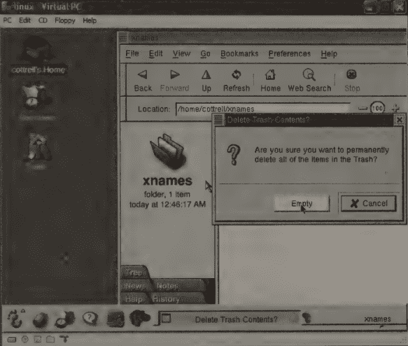

图 12-2 清空垃圾箱

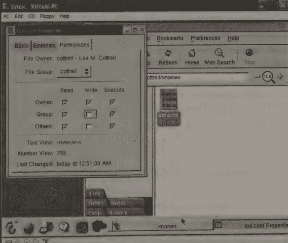

图 12-3 更改文件权限

# 第 12 章：访问和浏览图形桌面

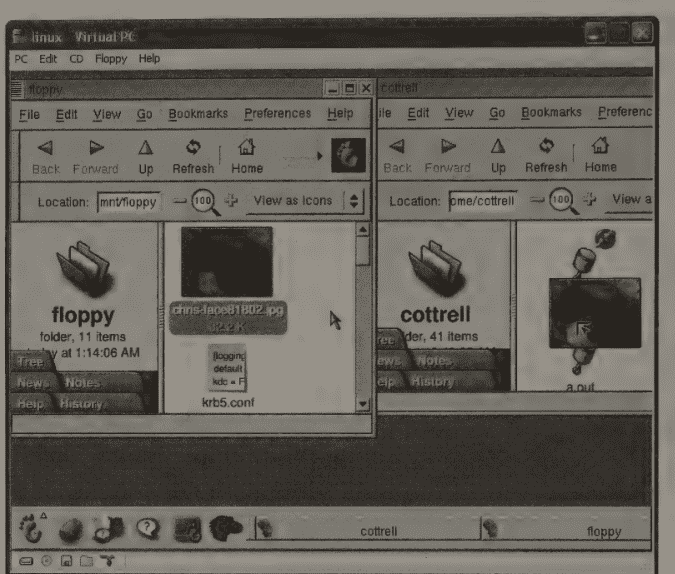

**图 12-4** 从软盘移动文件

**步骤 8** 你需要访问电脑中的软盘驱动器。你的第一步应该是为桌桌面上的软盘驱动器提供一个图标。你应该右键点击桌面并选择“磁盘 | 软盘”。稍等片刻，应该出现软盘的图标。你应该右键点击此图标并选择“打开”。你应该安排屏幕上的窗口，以便同时看到软盘目录和主目录。如图 12-4 所示，你应该将文件从软盘拖动到你的主目录。

# 实验题答案 12.02

以下步骤允许你自定义桌面：

**步骤 1** 若要更改背景，你应该右键点击桌面并选择“更改桌面背景”。你应该点击“浏览”按钮并浏览到你的主目录。在标准的红帽安装中，你的主目录将位于 `/home/username`。从你的主目录，你应该选择一张你喜欢的图像作为背景。然后你应该

## 答案 249

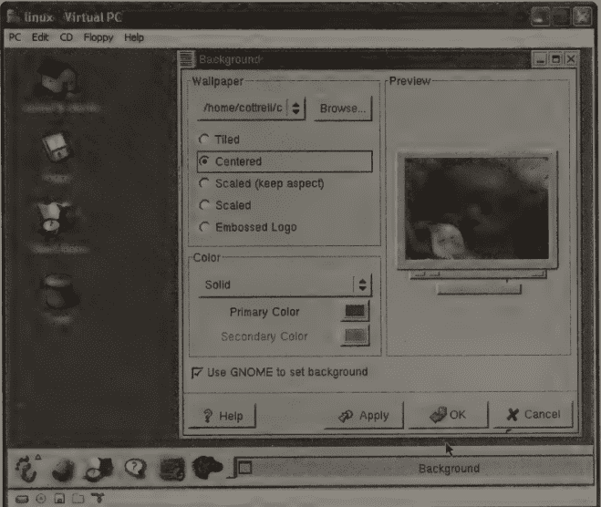

图 12-5 设置背景图片

桌面。“平铺”选项用重复的图像覆盖桌面。“居中”选项将图像放置在桌面的中心，图像周围显示桌面的颜色。“缩放”选项尝试拉伸图片以适应你的屏幕。图 12-5 显示了带有居中图片的背景。你应该点击“确定”完成配置。

**步骤 2** 若要更改屏幕保护程序，你需要访问面板。你应该选择“面板（底脚按钮） | 程序 | 设置 | 桌面 | 屏幕保护程序”。然后你应该从列表中选择所需的屏幕保护程序。系统会显示屏幕保护程序的演示。你应该配置屏幕保护程序的延迟，并根据需要为屏幕保护程序设置密码。此设置要求用户在恢复会话之前输入密码。只有当你是 UNIX 电脑的唯一用户时才使用此设置。完成后，你应该点击“确定”。

**步骤 3** 若要修改你的面板，你应该向“收藏”目录添加图标。你应该右键点击底脚按钮并选择“编辑菜单”。Gnome 菜单编辑器将会出现。你应该选择屏幕左边缘的“收藏”菜单，点击“新建项目”来创建一个新的快捷方式。然后你应该为你的快捷方式命名并为该快捷方式输入描述。描述在鼠标悬停在其上方时将作为工具tip出现。你应该输入要运行的命令。然后你应该选择链接类型，应用程序链接是最常见的。最后，如果需要，应该为你的快捷方式选择一个图标。图 12-6 描绘了输出快捷方式。你应该点击“保存”按钮，然后退出并完成图标的创建。

**步骤 4** 若要在桌面上创建快捷方式，你应该通过右键点击主图标并选择“打开”来打开 Nautilus。你应该浏览到你想从桌面创建快捷方式的文件或应用程序。你右键点击并将图标拖动到桌面。如果你操作正确，图 12-7 所示的菜单应该出现。你应该选择“在此处创建链接”来建立快捷方式。出现了一个右上角带有箭头的新图标。这是指向程序的链接。

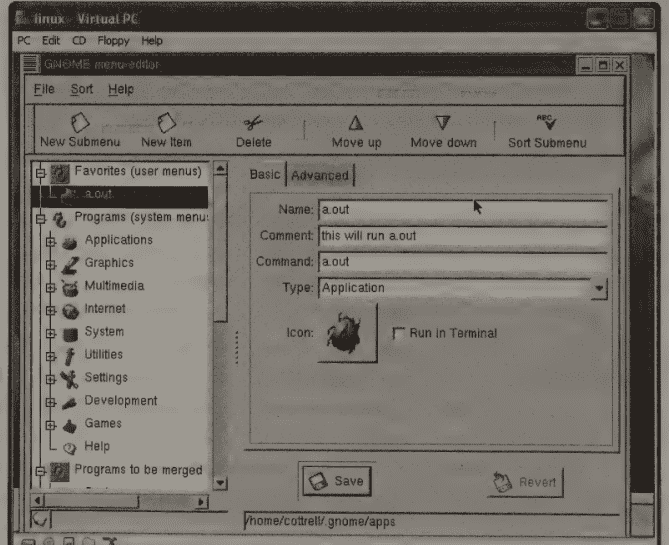

图 12-6 在面板上创建快捷方式

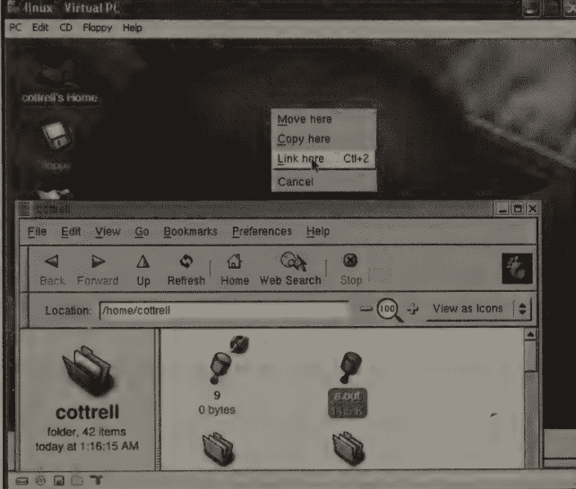

**图 12-7** 在桌面上创建快捷方式

# 实验题答案 12.03

以下步骤允许你使用 AbiWord、Gnumeric 和 GIMP：

**步骤 1** 你应该通过选择“面板 | 程序 | 应用程序 | AbiWord”来启动 AbiWord。你应该在文档中输入你的信，然后点击磁盘按钮将文档保存为 `coverletter`。你应该使用拼写检查按钮（该按钮显示 ABC 和绿色勾钩）对文档进行拼写检查。你应该通过“文件 | 打印”打印文档。

**步骤 2** 你应该通过选择“面板 | 程序 | 应用程序 | Gnumeric”来启动 Gnumeric。在 A1 单元中，你应该输入你的名字，然后继续填写预算项目。使用下表作为指南。

| | B |

|---|---|

| 1 Lee M. Cottrell | |

| 2 月收入 | 4500 |

# 第 12 章：访问和浏览图形桌面

| A | B |

|---|---|

| 3 租收入 | 1500 |

| 4 总收入 | =B2 + B3 |

| 5 | |

| 6 支出 | |

| 7 房贷 | 1300 |

| 8 燃气 | 160 |

| 9 食物 | 450 |

| 10 电费 | 95 |

| 11 娱乐 | 450 |

| 12 有线电视 | 70 |

| 13 学学贷款 | 350 |

| 14 车贷 | 500 |

| 15 总支出 | =sum(B7:B14) |

| 16 | |

| 17 剩余 | =B4 - B15 |

**步骤 3** 你应该通过选择“面板 | 程序 | 应用程序 | Gnumeric”来启动 Gnumeric。在 A1 单元中，你应该输入你的名字，然后继续填写预算项目。使用下表作为指南。

| | B |

|---|---|

| 1 Lee M. Cottrell | |

| 2 月收入 | 4500 |

| A | B |

|---|---|

| 3 租收入 | 1500 |

| 4 总收入 | =B2 + B3 |

| 5 | |

| 6 支出 | |

| 7 房贷 | 1300 |

| 8 燃气 | 160 |

| 9 食物 | 450 |

| 10 电费 | 95 |

| 11 娱乐 | 450 |

| 12 有线电视 | 70 |

| 13 学学贷款 | 350 |

| 14 车贷 | 500 |

| 15 总支出 | =sum(B7:B14) |

| 16 | |

| 17 剩余 | =B4 - B15 |

## 直入正题

以下步骤将帮助你关闭服务器。你必须应用在 John Muster 编写的《UNIX 和 Linux 导》（McGraw-Hill/Osborne, 2002）一书中习得的知识来关闭服务器。

> 提示

> 你将多次重启服务器。关机服务器的命令是 `shutdown`。

- 步骤 1：使用 `shutdown` 命令关闭服务器停机。

- 步骤 2：正常启动服务器。

- 步骤 3：关闭服务器以重启。

- 步骤 4：启动到用户维护模式。

> 提示

> 参阅 [redhat.com](www.redhat.com) 了解更多信息。搜索“single user mode”，并选择第一项以启动单用户模式。

步骤 5：正常重启服务器。

## 实验练习 13.02：管理用户账户

Zach 和 Artie 被 Jeff 的公司聘佣处理一些 UNIX/Linux 编程。Jeff 希望你为他们创建账户。此外，Zach 和 Artie 将一起工作，应该处于同一个组中。

> 提示

> 在本次练习中，`adduser` 的帮助手册将非常有帮助。

### 学习目标

在实验中，你将创建两个新用户。在实验结束时，你将能够：

- 创建用户

- 修改用户密码

- 更改用户的组成员关系

### 实验材料与设置

本次实验所需的材料有：

- 安装了 Red Hat Linux 7.3 的计算机

- root 账户的访问权限

## 直入正题

以下步骤将帮助你使用 `adduser`、`passwd` 和 `groupadd` 命令创建账户。你必须应用在 John Muster 编写的《UNIX 和 Linux 导》（McGraw-Hill/Osborne, 2002）一书中习得的知识来管理用户。

## 实验练习 13.02：管理用户账户 259

✔ 提示

> `useradd` 命令与 `adduser` 命令是同义。

**步骤 1** 创建一个名为 `unixprog` 的组。

**步骤 2** 创建账户 `zach` 和 `artie`。使用 `-g` 选项让他们成为 `unixprog` 组的成员。

**步骤 3** 修改 `zach` 和 `artie` 的密码。

**步骤 4** 分别以每个用户登录并验证他们的主目录和组属性。

第 13 章：管理 Linux PC 系统

20 分钟

## 实验练习 13.03：解决用户问题

新开发者之一的 Zach 正在编写一个向 `.bash_profile` 文件添加条目的程序。不幸的是，该程序有误，导致他的 `.bash_profile` 被删除了。Zach 询问你是否能找回它。

Artie 需要你的帮助：他不小心打印了一个非常大的二进制文件，并将主目录的权限更改为了 `ooo`。我们希望你修复这些问题。

你将解决三个常见问题。你将使用 `cp` 命令解决 Zach 的问题。Artie 的两个问题需要使用 `lpq` 查看打印队列内容，使用 `lprm` 从队列中删除，以及使用 `chmod` 重置文件权限。

### 学习目标

在实验中，你将解决常见用户错误。在实验结束时，你将能够：

- 恢复用户的 `.bash_profile` 文件

- 管理打印队列

### 实验材料与设置

本次实验所需的材料有：

- 安装了 Red Hat Linux 7.3 的计算机

- root 账户的访问权限

- 在实验练习 13.02 中创建的用户 `artie` 和 `zach`

- 暂停打印机的能力

## 直入正题

以下步骤将指导你解决常见用户错误。你必须应用在 John Muster 编写的《UNIX 和 Linux 导》（McGraw-Hill/Osborne, 2002）一书中习得的知识来更改权限和管理打印队列。

## 实验练习 13.03：解决用户问题

**步骤 1** 你需要设置计算机使其出现一些问题。这些步骤仅仅是为了让你练习解决问题。通过将其离离状态或关闭电源来暂停打印机。通过输入命令 `lpr /etc/hosts` 验证打印机已关闭。以 `artie` 身份登录。执行打印命令 `lpr /bin/rpm/` 向打印机发送一个大型二进制文件。输入 `cd ..` 进入主目录的父目录。输入命令 `chmod ooo artie`。执行长列表显示以验证你对 `artie` 目录没有权限。

**步骤 2** 以 `root` 身份登录。

**步骤 3** 从 `artie` 账户将 `.bash_profile` 文件复制到 `zach` 账户。使用 `chown` 将 `.bash_profile` 的所有权更改为 `zach`。

**步骤 4** 检查打印队列。删除 artie 的任何作业。

**步骤 5** 切换到 `/home` 目录。更改 Artie 目录的权限。

## 实验练习 13.04：制作 Linux 启动盘

将服务器移动到你的办公室后，你无法找到安装服务器时制作的启动盘。如果硬盘的启动分区损坏，启动盘允许你启动服务器。你决定创建一个启动盘。

### 学习目标

在实验中，你将创建一个启动盘。在实验结束时，你将能够：

- 制作 Linux 启动盘

### 实验材料与设置

本次实验所需的材料有：

- 安装了 Red Hat Linux 7.3 的计算机

- 一张空软盘

- root 账户的访问权限

- UNIX 版本

## 直入正题

> 提示

> 不要在 GUI 中执行此命令。

**步骤 1** 列出目录。软盘已挂载。

**步骤 2** 在提示时运行 `mkbootdisk`。

**步骤 3** 运行 `mdir` 命令。软盘已卸载。

## 实验练习 13.05：安装 Apache 服务器

Zach 和 Artie 正在编写一些网页，他们希望有一个 Web 服务器进行测试。他们请求你安装随 Red Hat 提供的 Apache 服务器。

你将从 CD 安装 Apache。你需要挂载驱动，然后运行 `rpm` 开始安装。

### 学习目标

在实验中，你将安装 Apache 服务器。在实验结束时，你将能够：

- 挂载 CD

- 从 CD 安装 Apache

### 实验材料与设置

本次实验所需的材料有：

- 安装了 Red Hat Linux 7.3 的计算机

- 服务器 root 账户

- Red Hat 7.3 安装 CD

## 直入正题

以下步骤将帮助你安装 Apache 服务器。你必须应用在 John Muster 编写的《UNIX 和 Linux 导》（McGraw-Hill/Osborne, 2002）一书中习得的知识来操作命令行。

**步骤 1** 插入 CD 并挂载驱动。

**步骤 2** 进入 CD 上的 `RedHat/RPMS` 目录。

**步骤 3** 安装与 Apache 相关的所有应用程序。

**步骤 4** 将另一台计算机上的浏览器指向你计算机的 IP 地址。它应该返回一个显示已运行的网页。

## 实验分析测试

1. 为什么作为超级用户执行日常任务是一个坏主意？

2. 为什么在安装应用程序之前需要挂载 CD？

3. 你给了 zach 和 artie 密码 secret。很可能，你的 UNIX 安装响应了坏密码消息。为什么这是一个坏密码？

4. 如果输入命令 `lprm all all` 会发生什么？

5. `su` 和 `su -` 有什么区别？

### 关键术语测验

使用以下词汇术语完成句子。并非所有术语都会使用。

- addUser

- chmod

- chown

- groupadd

- lpq

- lprm

- mkbootdisk

- mount

- passwd

- queue

- rpm

- su

1. 更改文件所有权的命令是 ________。

2. UNIX/Linux 上的打印作业存储在 ________ 中。

3. ________ 工具从 CD 安装新的 Red Hat 软件包。

4. ________ 允许你登录另一个用户。

5. 查看等待打印的打印作业，请使用 ________ 实用。

## 实验总结

你成功地管理了一台 UNIX 计算机。你学习了如何关闭系统和重启系统。你通过修改 GRUB 界面将系统引导到单用户模式。向系统中添加了两个新用户。你解决了两个关于用户账户的常见问题：`.bash_profile` 文件的修复以及错误打印作业的删除。最后，你为你的 Red Hat 安装了一个新软件包。

完成这篇教程，，向你表示祝贺。你工作非常努力，并学习了许多关于使用 UNIX 的知识。你应该为自己的成就感到自豪。你也应该觉得自己有能力解决任何 UNIX 任务。

## 解决方案

在本节中，你将找到实验练习的答案。

## 实验解决方案 13.01

以下步骤允许你以各种模式启动和重启服务器：

**第 1 步** 要关闭服务器，你应该使用 `shutdown` 命令。如果没有人登录服务器，你可以立即关闭。如果有其他人在系统上，你应该在发出至少 30 秒的警告后关闭。你应该使用 `who` 命令确定是否有人登录。如果 `root` 是唯一登录的用户，你应该执行 `shutdown -h now`。如果有其他人登录，你应该执行 `shutdown -h 30`。

**第 2 步** 要重启服务器，你应该按下电源按钮。如果你使用 GRUB 安装了 Linux，然后你应该从列表中选择所需的操作系统并继续。图 13-1 提供了一个典型的 GRUB 界面。如果你安装了 LILO，你应该在提示符处输入 `Linux`。

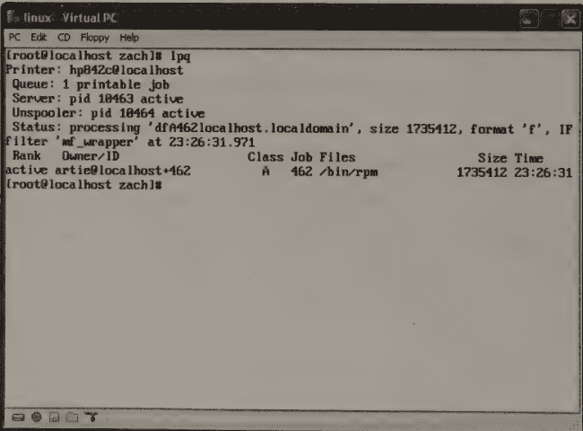

**图 13-1** 在 GRUB 界面中选择操作系统

**第 3 步** 重启服务器使用带有 `-r` 选项的 `shutdown` 命令。你应该输入 `shutdown -r` 来重启你的电脑。

**第 4 步** 在 GRUB 中引导到单用户模式有点棘手。在图 13-1 所示的界面上，你应该输入 `e` 来编辑你的启动选项。你应该至少看到三个选项；你应该选择以 `kernel` 开头的那行（可能是第二行）。你应该输入 `e` 编辑此行，并在行末添加单词 `single`。图 13-2 显示了该行应该后的样子。除了在行末添加 `single` 之外，你不应该更改任何内容。你应该按下 `ENTER` 保存此更改，然后输入 `b` 引导到单用户模式。

如果你使用 LILO 作为你的引导程序，引导到单用户模式要简单得多。在这种情况下，你应该在 LILO 提示符处输入 `linux single` 以引导到单用户模式。

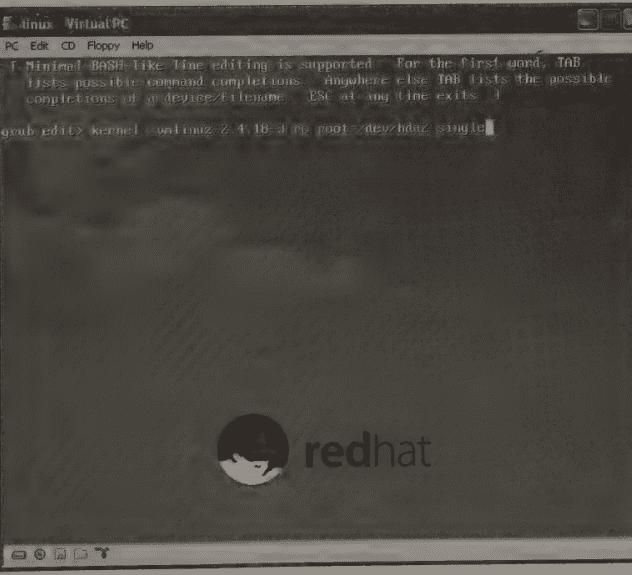

**图 13-2** 编辑启动行

## 第 13 章：管理 Linux PC 系统

**第 5 步** 你应该使用 `shutdown -r now` 重启服务器，然后让服务器正常启动。

## 实验解决方案 13.02

以下步骤允许你在 uniprog 组中创建组：

**第 1 步** 你应该以 `root` 身份登录系统。然后你应该执行命令 `groupadd` `uniprog`。这创建了 uniprog 组。

**第 2 步** 你应该使用 `-g` 选项构建账户。命令 `adduser artie -g` `uniprog` 将创建该用户并使其成为 uniprog 组的成员。你应该在创建 Artie 账户后创建 Zach 的账户。

**第 3 步** 最后，你应该使用 `passwd` 命令更改他们的密码。你应该执行 `passwd artie` 来更改 Artie 的密码。该密码密钥目前是良好的。你应该指示用户在登录后更改密码。


**第 4 步** 为了验证账户是否已正确创建，你应该分别登录每一个账户。你应该输入 `pwd` 命令来检查主目录路径。它应该是 `/home/artie` 或 `/home/zach`。最后，你应该输入 `groups` 命令来确认其在 `uniprog` 组的成员身份。

## 实验解决方案 13.03

以下步骤允许你修复系统上的问题：

**第 1 步** 不需要额外的命令。

**第 2 步** 你应该使用 `su` - 命令或传统的登录以 `root` 身份登录。你应该使用命令 `cd /home/zach` 切换到 Zach 的账户。你应该执行 `cp ../artie/.bash_profile` 将文件从 Artie 的目录复制到 Zach 的目录。你应该执行 `ls -a` 来验证文件已复制。然后你应该使用命令 `chown zach .bash_profile` 让 Zach 成为文件的所有者。

**第 3 步** 为了修复 Artie 的打印机问题，你应该以 `root` 身份登录并运行工具 `lpq` 查看打印队列的内容。Artie 的作业应该如图 13-3 所示。你应该通过输入 `rm 462` 来删除作业，其中 462 是要删除的作业编号。然后你应该重新运行 `lpq` 以验证。

```
root@localhost# lpq
printer: localhost
spooler: active
size: 1354
time: 23:26
job 462  artie
```

**图 13-3** `lpq` 的输出

**第 4 步** 为了修复权限问题，你应该使用 `chmod 755 /home/artie`。

```
root@localhost# ls -ld /home/artie
drwxr-xr-x 2 root root 4096 Oct 12 10:00 /home/artie
```

## 实验总结

你成功地管理了一台 UNIX 计算机。你学习了如何关闭系统和重启系统。你通过修改 GRUB 界面将系统引导到单用户模式。向系统中添加了两个新用户。你解决了两个关于用户账户的常见问题：`.bash_profile` 文件的修复以及错误打印作业的删除。最后，你为你的 Red Hat 安装了一个新软件包。

完成这篇教程，向你表示祝贺。你工作非常努力，并学习了许多关于使用 UNIX 的知识。你应该为自己的成就感到自豪。你也应该觉得自己有能力解决任何 UNIX 任务。

## 解决方案

在本节，你将找到实验练习的答案。

## 实验解决方案 13.01

以下步骤允许你以各种模式启动和重启服务器：

**第 1 步** 要关闭服务器，你应该使用 `shutdown` 命令。如果没有人登录服务器，你可以立即关闭。如果有其他人在系统上，你应该在发出至少 30 秒的警告后关闭。你应该使用 `who` 命令确定是否有人登录。如果 `root` 是唯一登录的用户，你应该执行 `shutdown -h now`。如果有其他人登录，你应该执行 `shutdown -h 30`。

**第 2 步** 要重启服务器，你应该按下电源按钮。如果你使用 GRUB 安装了 Linux，然后你应该从列表中选择所需的操作系统并继续。图 13-1 提供了一个典型的 GRUB 界面。如果你安装了 LILO，你应该在提示符处输入 `Linux`。


**图 13-1** 在 GRUB 界面中选择操作系统

**第 3 步** 重启服务器使用带有 `-r` 选项的 `shutdown` 命令。你应该输入 `shutdown -r` 来重启你的电脑。

**第 4 步** 在 GRUB 中引导到单用户模式有点棘手。在图 13-1 所示的界面上，你应该输入 `e` 来编辑你的启动选项。你应该至少看到三个选项；你应该选择以 `kernel` 开头的那行。 你应该输入 `e` 编辑此行，并在行末添加单词 `single`。图 13-2 显示了该行应该后的样子。除了在行末添加 `single` 之外，你不应该更改任何内容。你应该按下 `ENTER` 保存此更改，然后输入 `b` 引导到单用户模式。

如果你使用 LILO 作为你的引导程序，引导到单用户模式要简单得多。在这种情况下，你应该在 LILO 提示符处输入 `linux single` 以引导到单用户模式。


**图 13-2** 编辑启动行

## 第 13 章：管理 Linux PC 系统

**第 5 步** 你应该使用 `shutdown -r now` 重启服务器，然后让服务器正常启动。

## 实验解决方案 13.02

以下步骤允许你在 `uniprog` 组中创建组：

**第 1 步** 你应该以 `root` 身份登录系统。然后你应该执行命令 `groupadd` `uniprog`。这创建了 `uniprog` 组。

**第 2 步** 你应该使用 `-g` 选项构建账户。命令 `adduser artie -g` `uniprog` 将创建该用户并使其成为 `uniprog` 组的成员。你应该在创建 Artie 账户后创建 Zach 的账户。

**第 3 步** 最后，你应该使用 `passwd` 命令更改他们的密码。你应该执行 `passwd artie` 来更改 Artie 的密码。该密码密钥目前是良好的。你应该指示用户在登录后更改密码。

**第 4 步** 为了验证账户是否已正确创建，你应该分别登录每一个账户。你应该输入 `pwd` 命令来检查主目录路径。它应该是 `/home/artie` 或 `/home/zach`。最后，你应该输入 `groups` 命令来确认其在 `uniprog` 组的成员身份。

## 实验解决方案 13.03

以下步骤允许你修复系统上的问题：

**第 1 步** 不需要额外的命令。

**第 2 步** 你应该使用 `su` - 命令或传统的登录以 `root` 身份登录。你应该使用命令 `cd /home/zach` 切换到 Zach 的账户。你应该执行 `cp ../artie/.bash_profile` 将文件从 Artie 的目录复制到 Zach 的目录。你应该执行 `ls -a` 来验证文件已复制。然后你应该使用命令 `chown zach .bash_profile` 让 Zach 成为文件的所有者。

**第 3 步** 为了修复 Artie 的打印机问题，你应该以 `root` 身份登录并运行工具 `lpq` 查看打印队列的内容。Artie 的作业应该如图 13-3 所示。你应该通过输入 `rm 462` 来删除作业，其中 462 是要删除的作业编号。然后你应该重新运行 `lpq` 以验证。

```
root@localhost# lpq
printer: localhost
spooler: active
size: 1354
time: 23:26
job 462  artie
```

**图 13-3** `lpq` 的输出

**第 4 步** 为了修复权限问题，你应该使用 `chmod 755 /home/artie`。

## 276 索引

- `awk` 实用切换目录, 144–145, 147
- 数据处理, 104–105, 113
- 目录导航和, 36
- 功能, 106
- 字符计数, 58, 93, 109
- 字符字符串，搜索, 96–98

## B

- 反斜杠 (`\`)
- 桌面, 62
- `chmod` 实用, 39, 271
- 桌面背景, 248–249
- `+x` 选项, 76, 87
- `bash` 选项, `man` 工具, 39
- 数字参数, 176
- 权限, 180, 181
- `bash` 工具 `-v` 选项, 22
- `chown` 实用, 32, 270
- 环境修改, 164–166, 174
- `-r` 选项, 22, 39
- `bc` 实用, 99–100, 112
- 启动台, 262–263, 271–272
- 进入维护模式启动, 257
- 括号 (`[ ]`) 运算符, 158–159, 173
- 错误代码, 162–163, 173–174

## C

- `C` 命令, `vi` 编辑, 88
- 计算器。参见 `bc` 实用
- 日历 实用, 35, 38
- `cat` 实用
- 合并文件, 60, 171
- 统计归文件数量和, 109
- 在主目录下创建文件, 45, 50
- `-n` 选项, 110
- `catman -k`, 搜索, 24
- `cd` 实用, 126, 149, 179
- `~` 选项, 174, 187
- `cp` 实用, 22, 38, 39
- 光标定位命令, `vi` 编辑, 79
- `cut` 实用, 104–105, 113
- `cw` 命令, `vi` 编辑, 83

## D

- 数据处理工具, 104–106, 116
- `date` 实用, 19, 37
- `dd` 命令, 83
- 小数位数，使用命令设置, 112
- 定制化, 236–237, 248–251
- 字典序, 102, 112
- `dir` 实用, 27
- 目录
  - 在其中访问文件, 137–138
  - 探索, 118–119, 126–127
  - 探索结构, 18–19
  - 磁盘格式, 222
- 显示调整命令, `vi` 编辑, 79
- 点 (`..`) 目录, 137–138, 148

## E

- `echo` 实用
- `$HOME`, 50, 61
- `env` 命令, 174
- 错误, 162–163, 173–174
- 修复, 260–261, 270–271
- 错误消息, 4
- 以太网连接, 241, 253
- `ESCAPE` 键, 86
- 终端窗口退出, 10

## F

- 文件链接, 139–141, 148–150
- 文件权限, 64, 127
- 文件系统, 14–41
- 在目录中访问文件, 137–138
- 统计其中的元素数量, 92–95
- 创建, 20–21
- 显示内容, 31
- 探索, 118–119, 126–127
- 基于 GUI 的管理, 234–235, 245–248
- 管理, 134
- 覆盖, 51–52
- 权限, 247
- 由所有者删除, 217–218, 230–231
- 保存到磁盘, 213–214, 226–228
- 排序, 101–103
- 分割大文件, 215–216, 229–230
- 金融机构，UNIX/Linux 使用, 11
- 查找和替换功能, `sed` 实用, 113
- `find` 实用
- 过的文件, 222
- 查找工具, 154–155, 169–171
- 按用户名定位/删除文件, 215–216, 230–231
- 输出, 231
- 软盘，格式化, 213–214
- 文档格式化, 219–221, 231–232
- 软盘格式化, 213–214
- 前向搜索命令, 78
- 正斜杠 (`/`), 83
- FreeBSD, 28–29

## G

- GIMP (GNU 图像处理程序), 238–239, 251–252
- 全局权限掩码。使用 `amass` 实用
- Gnome
  - 应用程序, 238–239, 251–252
  - 文件管理, 234–235, 245–248
- GNU 图像处理程序 (GIMP), 238–239, 251–252
- Google, UNIX/Linux 帮助, 29
- 图形用户界面。参见 GUI (interface)
- 图形窗口, 3–4

## 主目录

- 在其中创建文件, 45, 50
- 在其中列出文件, 126, 144–145, 176
- `grep` 实用, 40
- `-c` 选项, 22
- 输出不匹配行, 106
- 搜索字符, 62
- 搜索字符串, 59, 96–98, 110–111

## I

- AIX, 11
- 账户管理, 258–259
- 文件系统, 26–27
- 功能, 34
- `groupadd` 命令, 258
- `groups` 命令, 270
- GRUB, 268–269
- 桌面定制, 236–237, 248–252
- 文件管理任务, 234–235, 245–248
- Gnome 应用程序, 238–239, 251–252
- 基于 GUI 配置, 240–243, 252
- Linux 帮助, 28–30
- 信息, 5–6
- `gunzip` 实用, 211, 225
- `gzip` 实用
- 连接向导, 241, 252
- 与 `pkzip` 比较, 210
- 使用 `gzip` 压缩文件, 211, 225
- UNIX 和 Linux 入门 (Master), 3

## H

- Hewlett-Packard HP-UX, 11
- `h` 键
- `help` 工具, 32
- 在线帮助, 29

## 列表

- 目录文件名, 62
- 主目录中的文件, 126, 144–145, 147
- 运行的任务, 190–192, 204–206
- 排序, 48
- 工具和开关, 22–23

## K

- 内核, 269
- 文本文件, 46

## kill 命令

- 终止任务, 193–194
- 终止其他任务, 197–198

## L

- LILO 启动屏幕, 273
- 行数, 58, 109
- 行号，显示/关闭, 84
- 统计行, 93, 95, 109
- 链接, 139–141, 148–150
- Linux。参见 UNIX
- 学术用途, ii
- 企业的用途, ii
- 探索, 5–6
- 金融机构用途, ii

## M

- 维护模式，进入, 257
- `man` 工具


## 索引

- 访问 UNIX 程序员手册, 22
- user, 258
- bash 选项, 39
- 功能, 34
- -k 选项, 23–25, 40
- 关键字搜索, 32, 40
- 概述, 22
- 目的, 32
- 运行的任务, 190–191
- 开关, 22–23
- 数学工具, 99–100
- 数学计算, 112
- `mcopy`, 226–227
- `mdel`, 227
- `mformat`, 226
- `mkbootisk` 实用, 262–263, 271
- `mkdir` 目录, 179, 186, 227
  - 创建新目录, 126
  - 创建子目录, 36, 144, 147
  - -m 选项, 23, 40
- 调制调器, 29
- 监控图标, 10
- `more` 实用, 36, 37, 62, 84
- 挂载 CD-ROM, 264, 272
- `mtools`, 213, 226
- `mv` 实用, 31, 38, 149

### N

- n 命令, 搜索中的下一个出现, 83
- Nautilus 文件管理器, 245–246
- 导航文件, 69–71
- Netscape Communicator, 241, 253
- 新手的网站, 30
- `noclobber` 变量, 55
  - 防止覆盖文件, 62
  - 设置, 164
- `ohup` 命令, 199–200, 208
- 数字权限, 176–177, 186
- 数字顺序，按排序, 102, 112

### O

- 在线帮助, 28–30
- 操作系统，选择, 268
- 所有者
  - 权限, 177, 186
  - 由所有者删除文件, 217–218, 230–231

### P

- p 命令, vi 编辑, 89
- 面板按钮, Gnome, 236

282 索引

参数，命令行, 153, 169

`passwd` 实用, 63, 258, 270

密码
- -r 选项, 23, 40
开关, 204–206

`pwd` 实用, 36, 126, 133, 144
+ 更改, 63

密码文件中的字段, 55
登录过程和, 3, 10
更新, 51–52

`paste` 实用, 104–105, 114

### Q

`:command`, vi 编辑器, 89
问号 (?) 运算符, 158–159, 172–173

### R

+ Perl
搜索, 170
Web 开发, 154
权限, 175–187
使用 `umask` 命令的默认值, 182–183, 188
根据数字定义, 176–177, 186
目录, 180–181, 187–188
文件, 127
rwx 权限, 217–218
设置, 180–181, 187–188
+ 读权限, 127
错误重定向, 160–161, 173
管道重定向, 31
`regist.exe`, 160–161
`rm` 实用
i 参数, 38
从目录中删除文件, 147, 149
`dmdir` 实用, 140, 149
root 登录账户, 3–4, 10
root 权限, 210
`rpm`, 264
`runforever.exe`, 199–200, 208
rwx 权限, 217–238
+ `pico` 编辑器, 109, 111, 171
`pr` 命令, 219–221, 231–232
打印机/打印
配置, 29
文档格式化用于, 219–221, 231–232
暂停, 261
队列管理, 260
发送文件到, 31
用于...的实用程序, 38

### S

+ 代理服务器, 240–241, 253
`ps` 实用
列出运行中的作业, 190–191
s/ 命令, vi 编辑器, 89
`scale` 命令
数学计算计算, 99–100
设置小数位数, 112
SCO UnixWare, II
屏幕保护程序, 237, 249
`shell` 脚本, 53–54, 63–64, 156
脚本
`shell` 变量, 61
添加内容, 125
`shutdown` 命令, 257, 268–270
存档脚本, 178–199
单用户模式, 257, 269
创建, 53–54, 75–76, 87
软链接, 140
执行, 76
排序顺序, `ls` 实用, 27
探索目录和文件, 118–119
`sort` 实用
使其可执行, 125
文件排序标准, 101–103
使用...处理和检索数据, 116
数据处理实用程序, 106
使用...获取信息, 116–117
姓氏排序, 102
重定向输出, 125
-r 选项, 23, 40, 46, 59
保存, 125
重定向输出, 113
单词分析, 120–121
删除重复, 103
搜索实用程序, 96–98
按标准排序, 112–113
搜索
排序列表, 48
for 字符字符串, 96–98, 110–111
特殊字符, 49–50, 62
关键字, 40, 46
`spell` 实用, 48, 60
vi 编辑器, 85–86
`split` 命令, 215–216, 229
`sed` 实用
StarOffice, 238
编辑优势, 106
`startx` 实用
查找替换功能, 113
进入 Gnome, 15
修改数据, 104–105
搜索, 170
`set number/no number` 命令, 84, 89
`strings`, 查找, 59, 96–98, 110–111
SGI RIX, 11
`su` 命令, 198, 270
`shell`
子目录
交互, 14
创建, 36, 133
向...发布指令, 75–76
目录结构和, 19
处理, 14–17
`substitute` 命令, 79
`shell` 提示符, 76
Sun Solaris, 11
`shell`
开关
`uncompress` 实用, 210–211, 225
命令行, 153, 169
`uniq` 命令, 删除重复, 113
符号链接, 140
系统目录, 261
探索用法, 5–6
`tar` 文件, 222
`tar` 实用, 210–211, 225–226
`tee` 实用, 106
终端窗口
启动/退出, 4, 10
`unzip` 命令, 210
更新密码, 51–52
文本文件
追加, 72–74
创建, 45, 58, 72–74
编辑, 77–78
导航, 69–71
保存文件并退出 vi 编辑器, 144
文本更改, 77–78
`write` 命令, 89
处理现有文件, 66–68
可视化编辑器。详见 vi 编辑器

### T

学术用途, II
企业用途, II
财务用途, II
在线手册 (man), 15
...的版本, II
U.S. 政府, 用
访问, 35
添加命令, 35
创建， 29
查找, 17
登录过程和, 35
登录账户, 35
定位文件, 16
使用 `umask` 命令的默认值, 182–183, 188
..., II

### X

X Window, 234
见 GUI (图形界面)

### W

`:w` 命令, 89
`wc` 实用
-c 命令, 109

### Y

`yy` 命令, vi 编辑器, 88

## INTERNATIONAL CONTACT

### AUSTRALIA

McGraw-Hill Book Australia Australia. Ltd.

TEL +61-2-9900

FAX +61-2-9878

http://www.mcraw-hill.com

gh_sydney@mcraw-hill.com

### SOUTH AFRICA

McGraw-Hill South Africa

TEL +27-11-622

FAX +27-11-6545

robyn_swanepoel@mcraw-hill.com

### CANADA

McGraw-Hill Ryerson

TEL +905-430-5000

FAX +905-430-5020

http://www.mcraw-hill.ca

### MEXICO

McGraw-Hill Interamericana S.A. de V.

TEL +525-117-1583

FAX +525-117-1589

http://www.mcraw-hill.com.mx

fernando_castillanos@mcraw-hill.com

### SPAIN

McGraw-Hill Interamericana, S.U.

TEL +34-91-180-3000

FAX +34-91-372-8513

http://www.mcraw-hill.es

computing_europe@mcraw-hill.com

### GREECE, MIDDLE EAST, & AFRICA

McGraw-Hill Hellas

TEL +30-1-656-0990

FAX +30-1-654-5525

### UNITED KINGDOM, NORTHERN, EASTERN, & CENTRAL EUROPE

McGraw-Hill Education

TEL +44-1-628-5025

FAX +44-1-628-7702

http://www.mcraw-hill.co.uk

om_europe@mcraw-hill.com

### ALL OTHER INQUIES Contact:

Osborne/McGraw-Hill

TEL +1-510-549-6600

FAX +1-510-883-7600

http://www.osborne.com

omg_international@mcraw-hill.com

### SINGAPORE (Serving Asia)

McGraw-Hill Book Company

TEL +65-863-1580

FAX +65-862-3354

http://www.mcraw-hill.com.sg

ghasasia@mcraw-hill.com
