# Unix 和 Linux 入门指南


## 关于作者

学生们一致认为 John Muster 显然热爱教学。帮助学生学习是他工作的核心——无论是在课堂上、教师教育研讨会上，还是在他开发的书籍和媒体以及他支持的项目中。他的科学研究始于天文学，随后转向教育心理学。他专注于人们如何学习复杂的技能或内容，以及如何开发能够支持学生成长和成功的材料、练习、问题和引导方式。

在过去的二十年里，他通过由美国财政部、安达信咨询公司（Accenture）、Sun Microsystems 和 Apple Computing 资助的几个重大项目，探索如何促进 UNIX 和 Linux 的学习。这些项目构成了本书的基础。除了研究和咨询，John Muster 还在硅谷的教育中心——加州大学扩展分校（University of California's Extension Division）从事教学和教育开发工作，并在此获得了“荣誉教师奖”。他的本科和研究生教育分别在奥特宾学院（Otterbein College）、俄亥俄州立大学（Ohio State University）和加州大学伯克利分校（University of California, Berkeley）完成。

本书是为您精心开发和编写的。我们希望您能够享受成功自学 UNIX/Linux 的乐趣。

John Muster
加州伯克利，2002年

## 致谢

在过去的 20 多年里，我非常享受写作、教授 UNIX/Linux、听取学生的提问和建议、解决问题、咨询、修订章节、教学、修订……这些练习的演进之所以成为可能，是因为我有幸能够与加州大学以及全球企业教育设施中那些敬业的学生们在一起。感谢你们提出的挑战、评论和想法。

此外，如果没有 Lubrizol 基金会、财政部、埃森哲、 Sun Microsystems 和 Apple Computing 的慷慨支持，关于学生如何掌握此类内容的根本性研究是不可能实现的。

Nate Hinerman 是一位极其能干的项目总监，他使得本书的完稿成为可能。他在关注全局的同时兼顾细节，通过提供相互支持来促进团队合作，保持沟通渠道的畅通与活跃，并且效率惊人。

Isaac Chellin 在插图和相关网页的开发中带来了卓越的艺术天赋、顶尖的技术能力以及协作的设计方法。Marcelo Carvalho 在材料的测试、评估和检查方面不遗余力。Thomas Brightbill 的编程、网页设计和沟通能力促成了目前支持本书的互联网网站的开发。

我要感谢审阅本书并提供反馈，使本书变得更好的才华横溢的学者群体：Walt Merchant（ECPI 技术学院）、Eric van Reneslaar（新英格兰技术学院）、Doug Horton（海格斯敦社区学院）、Dennis Rice（德弗里大学）和 Michael Riha（托马斯·尼尔森社区学院）。

从我最早的教学日子起，我就很喜欢看着人们在理解他们所学习的内容时眼神中闪烁的光芒。在多年物理学和计算机科学教育的过程中，我一直很享受与那些敬业的同事们互动，他们

分享了同样的喜悦——并影响了本书的编写方式。感谢 Phil Barnhart, Lelia Braucher, Orin Braucher, Catherine Cavette, Marjorie Conrad, John Coulter, Gene Eakins, Lillian Frank, Harold Hall, Nate Hinerman, Peter Kindfield, John Laubach, Albert Levy, Mel Mayfield, Marguerite McKinney, James Miller, Walter Mitchell, Catherine M. Muster, John T. Muster, Bob Place, Siggy Selquist, Lyle Strand 以及 David Waas。

归根结底，最重要的是人际关系。Catherine, Cassy, 整个大家庭以及亲爱的朋友们：感谢你们永无止境的支持、鼓励和关爱。

## 导论

### 关于本书

如果你想了解关于珠穆朗玛峰的一般事实，请找一本优秀的参考书或百科全书。如果你想真正体验珠穆朗玛峰，请找一位优秀的向导，一名经验丰富的夏尔巴人，带领你走过通往顶峰的所有正确步骤。

本书就像一名夏尔巴人，而不是参考文本。虽然书中包含了命令摘要和表格，但本书从根本上来说是一本指南，旨在帮助你真正学习在 UNIX/Linux 环境中生存所需的技能。通过精心设计的、与 UNIX/Linux 系统的实际交互，你将被引导进行一场宏大且充满激励的旅程——从最基础的系统特性，到熟练掌握专家所使用的细节。

如果你在寻找一本快速参考书，请将本书放回书架。市面上有很多优秀的参考书。而本书独树一帜，它是一本学习指南，一个夏尔巴人。

### 如何最大化利用本书

学习 UNIX 可以相当简单——只要你用学习骑自行车的同样方式来对待它。你的父母不会在客厅里架起投影仪，连续向你展示 50 分钟的幻灯片，讲解人体驱动自行车的微观复杂机制。你也不是通过阅读说明书学会骑车的。

你直接骑上了车。有人帮你在车上稳住身体，并在最需要的时刻，为你提供具体且适当的信息，支持你掌握所需技能：“把车把往这边转”；“想停车就往后蹬”；“身体向弯道倾斜；避开那块石头”……

掌握 UNIX/Linux 技能也是如此。

进入一个 UNIX 或 Linux 系统。打开本书的第一章，开始“蹬车”吧。关键在于在真实的 UNIX/Linux 系统上实际执行每个练习，这样你就能看到系统的响应以及为了获得结果必须执行的具体操作。在阅读本书各章节时，你将输入命令，阅读正在发生的情况，然后输入更多命令。章节中的指令将引导你从最谨慎的初步尝试，到探索核心特性，最终掌握基础和高级的用户及编程技能。

每一步都有明确规定；在你研究每项特性时，书中会讨论其深层含义。

当你攀登并自学 UNIX 时，本书可以成为你的 UNIX 导师——你的夏尔巴人。

如果你是一名经验丰富的用户，请从开头开始，如果你之前已经多次操作过某个主题，可以快速跳过。请务必按照指示创建所有文件，因为它们在后续练习中会用到。逐渐深入，直到你进入足够深可以游泳的水域，然后仔细完成每个练习。大多数人，除非经验极其丰富，否则即使在第一章中也能发现新技能。

在掌握基础技能后，你将探索基于这些基础的更复杂特性。你将谨慎地构建自己的 UNIX 知识体系，在合适的时候添加每一个知识点。

当你被要求输入命令时，第一步之前会有一个像 [arrow icon] 的图标。如果有多个步骤，则会进行编号。

解释通常紧随键盘练习之后。如果结果令人困惑，请继续阅读。

UNIX 是一组强大的程序集合，是现代操作系统的基石，是对用户最不友好的界面，是成年人的 Tinkertoy 积木，一个迷人且令人愉悦的编程环境……

登录系统，让我们在引导你享受乐趣的同时掌握 UNIX/Linux。

## 教师资源

教师是我们的英雄，我们向他们致以谢意，并为他们创建了一套强大的、可节省时间的教学工具集，提供于 CD-ROM 中，包括：

- 与教科书组织结构相对应的《教师手册》
- ExamView® Pro 测试库软件，可生成各种纸质或基于网络的测试，并具有自动评分功能
- 由经验丰富的 IT 讲师编写的数百道题目
- 各种题目类型和难度级别，允许教师自定义每场测试以最大化学生的进步
- 关于讲座主题的吸引人的 PowerPoint® 幻灯片

## 登录系统

### 1

**技能检查**

- 在开始本章之前，你应该：
    - 能够访问一个可运行的 UNIX/Linux 系统
    - 拥有普通用户账户的登录名和密码，而非 `root` 账户

**目标**

- 完成本章后，你将能够：
    - 讨论为什么 UNIX/Linux 在当今的技术世界中如此重要
    - 登录 UNIX/Linux 系统以开展工作
    - 注销并结束会话
    - 从图形界面启动终端窗口

## 1.1 为什么要学习 UNIX/Linux？

无论你是 UNIX/Linux 世界的完全新手，还是已经使用过一些命令和程序，欢迎你对该系统的特性和程序进行深入探讨。第一章将探讨在当今技术世界中掌握 UNIX/Linux 为什么很重要，并引导你完成进入和离开系统的操作。在简要总结 Linux 和 UNIX 在我们世界中的角色之后，你将开始在系统的显示器和键盘上输入信息和命令。

在这个瞬息万变的技术世界中，你为什么要费心学习 UNIX / Linux？毕竟，它是一个在“古代”（20 世纪 70 年代和 80 年代）开发而成的计算机系统。

为什么有人要花时间学习 UNIX/Linux？
不仅仅是因为它*存在*，而是因为它*无处不在*。

如果明天早上所有的 UNIX/Linux 计算机系统都停止运行，我们将生活在一个截然不同的世界中。没有 UNIX 或 Linux，将会出现：

- **没有互联网**：大多数互联网服务器以及几乎所有基础计算结构都运行在 UNIX 或 Linux 计算机上。
- **没有现代电影**：大多数特效是在 UNIX/Linux 系统上生成的。
- **没有股票和债券交易**：几乎所有交易都由 UNIX/Linux 系统处理。
- **没有 ATM 或银行服务**：许多实际的 ATM 机和大多数通信网络运行在 UNIX/Linux 系统上。
- **没有电子游戏**：许多电子游戏的开发发生在 UNIX/Linux 环境中。
- **没有军队**：通信、程序、智能设备和关键数据的通用基础设施在 UNIX/Linux 系统上管理。
- **没有运转的政府**：税务留置权、记录、通信等都存储在 UNIX/Linux 机器上。
- **没有运行的大学**：记录、研究、通信、开发、出版等都依赖于 UNIX/Linux 系统提供的应用程序。
- **没有大型企业**：数据、研究、桌面文件服务、电子邮件以及很大一部分出版业务运行在 UNIX/Linux 环境中。

还剩下什么？如果我们还有电来运行计算机，我们仍然可以使用现有的桌面计算机系统进行文字处理并运行其他本地应用程序——但这将很困难，因为电力生产和输电网在很大程度上是通过 UNIX/Linux 系统管理的。

UNIX/Linux 已成为我们现代计算世界的根本基石，而且它不仅仅运行在巨型机器上。我们可以在个人电脑上探索和利用 UNIX/Linux，然后将这些技能应用于工业、政府、大学和小企业环境。因此，任务就是成为一名熟练的用户。但首先，我们要登录到一个运行 Linux 或 UNIX 的系统。

## 1.2 登录系统

第一章探讨如何进入和离开一个运行中的系统。在你掌握登录系统之后，我们将在第 2 章开始探索 UNIX/Linux 的标准特性。第 2 章和第 3 章将引导你游览系统特性，随后的章节将深入探讨该系统。

UNIX 计算环境的主要特性之一是它可以同时服务于许多用户。单个系统通常可以处理数十到数千个独立用户，这是一种具有成本效益的解决方案。当系统管理员向系统添加新用户时，会创建一个与*登录*名相关联的唯一*账户*。*登录*名（通常称为*用户名*）对每个用户都是唯一的。出于安全原因，只有当用户提供与系统中已建立用户匹配的*登录*名及其相关*密码*时，才被允许进入 UNIX/Linux 系统。

### 获取所需资源

根据你的实际情况，以下三种情况之一成立。

- 你有一台系统，但尚未安装 Linux，或者

- 你可以使用一个正在运行的 Linux 系统，其中包含用户登录名 `root`，并且你拥有 `root` 账户的密码，或者
- 你在 Linux 或 UNIX 上有一个账户，你使用的用户名是常规用户名和密码，而不是 `root`。

根据上述哪种情况属实，你需要完成不同的任务。

- 如果你有一台计算机但未安装 Linux，你必须首先在计算机上安装 Linux 并创建用户账户。请参阅附录 A，其中提供了所需步骤的指导。安装 Linux 并创建常规用户账户后，你应该回到这里探索登录和登出。如果你获得的是使用名为 `root` 的账户登录的信息，在继续之前你需要创建一个常规用户账户。名为 `root` 的用户被授予了管理系统所需的广泛权限。由于该账户对系统事件和操作拥有实质性的权威，通过发布错误的命令，你可能会损坏或破坏系统。使用 `root` 账户登录是很危险的。你应当仅在完成特定任务时才这样做，并且必须非常小心。请按照第 13 章的说明将自己添加为用户，然后返回到以下步骤探索登录和登出。
- 如果你拥有系统中常规用户的登录名和密码，你就可以准备开始了。

## 登录

由于许多系统管理员会根据本地需求修改登录过程，因此以下练习中列出的一些步骤可能不适用于你的具体情况。如果你注意到某些步骤不符合你的情况且无法确定如何操作，请找一位资深用户引导你如何进入系统。一旦你登录成功，你应该会发现本文中描述的步骤与该系统是兼容的。

1. 确保显示器和计算机都已打开。

此时，屏幕会在类似以下的纯文本终端中显示一个 *login:* 横幅：

```
Red Hat Linux release 7.2 (Enigma)
Kernel 2.4.7-10 on an i686
login: _
```

如果你的屏幕显示如上所示，则系统与显示器的交互方式就像它是一个基于字符的终端，而不是图形终端。*login:* 横幅的另一种显示方式是在一个类似于以下的图形窗口中：

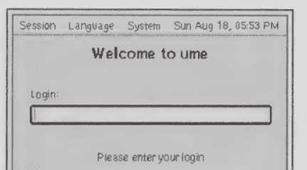

如果你的系统显示的是图形登录横幅，则它正在使用显示器的图形功能。

此时，系统正在等待任何一名合法用户输入其用户名和密码。

2. 响应登录提示，输入你的账户名称，即你的 *登录名* 或 *用户名* 来确认身份。
由于 UNIX 和 Linux 都是区分大小写的，你必须完全按照设置时的样子输入登录数据。在大多数系统中，登录名（通常包括密码）使用小写字母。

3. 输入准确的账户名称信息后，按下 ENTER 键。
无论你是否正确输入了登录名，系统都会通过以下提示要求你输入密码：

Password:

4. 完全按照你创建时的样子，或按照提供给你的样子输入密码。仔细注意大小写以及容易混淆的字符，例如 1（数字一）和 l（字母 L）。

出于安全原因，当你输入密码时，屏幕上不会显示。通常没有任何确认迹象表明你正在输入内容，尽管有时屏幕会显示 * 或 # 以让你知道系统记录了按键。

5. 输入密码后，按下 ENTER 键。

如果你正确输入了用户名和密码，你就成功登录了。

登录后，屏幕会清空。如果没有图标，而显示内容仅由以下一两行文本组成，那么你正处于一个基于字符的终端窗口中：

```
Red Hat Linux release 7.2 (Enigma)
Kernel 2.4.7-10 on an i686
login: nate
Password:
Last login: Mon Aug 19 17:18:07
bash-2.05$
```

```
$
$
login@SystemName $
```

登录后，如果你面对的是一个完整的图形环境——可能顶部有菜单栏，屏幕上有一些图标，底部有**任务栏**——那么你正处于一个图形窗口中。


虽然来自 Red Hat、SuSe 和 Sun 的各种图形窗口看起来略有不同，但它们提供的功能是相同的。

## 修正登录错误

如果你提供了一组有效的相应登录名和密码，你将进入下一步。然而，如果你提供的登录名或密码其中任何一个不正确，就会出现错误消息，例如：

```
Login incorrect
```

以下是在输入登录名或密码时导致登录失败的一些常见错误：

- 用户混淆了数字 1 和字母 l (el)，或混淆了数字 0 (zero) 和字母 O (oh)。
- 用户出现了简单的输入错误。
- 用户使用 BACKSPACE（退格键）来修正错误。（虽然许多现代系统允许修正，但许多其他系统则不允许。）
- 用户输入了大写字母。
- 信息本身就是错误的。

## 终端窗口：与系统交互

终端窗口显示的最后一行是提示符，类似于：

```
$
%
Login@SystemName$
```

如果登录结果是一个终端窗口，你就可以开始向 UNIX 或 Linux 发布命令了。

- 通过输入以下命令确认一切正常：
`date` 
然后按下 ENTER 键。

屏幕将显示 `date` 程序的输出，即当前的日期和时间。

## 从终端环境登出

如果你处于终端环境而非图形环境，退出终端即表示从系统登出。

1. 要从终端环境登出，请输入：
`exit`

会话结束，并显示一个新的登录横幅。

2. 此时，浏览下一节以熟悉图形窗口，阅读结论，并开始第二章，该章节将探索使用终端的 UNIX/Linux。

## 图形窗口：启动终端窗口

本书后续章节中的其余练习将探索如何通过在基于字符的终端中，或者在提供图形环境时的终端窗口中发布命令来操作系统。

如果你在图形世界中，终端窗口可能会作为默认桌面设置的一部分出现在屏幕上。通常情况下不会直接显示终端窗口，因此我们需要启动一个。

1. 查看屏幕底部的**任务栏**。其中可能包含一个看起来像显示器或终端的图标。
2. 使用鼠标点击该终端图标。

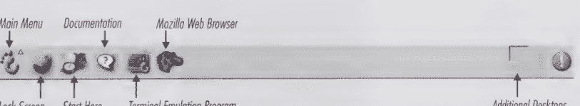

屏幕上将显示一个终端窗口。
如果终端窗口在登录时就已经显示，或者你刚刚启动了它，你需要将其设为活动窗口才能发布命令。

3. 在终端窗口的任意位置点击鼠标。
4. 一旦终端激活，输入：
`date`
并按下 ENTER 键。

屏幕将显示当前的日期和时间。此终端窗口将用于本文随后的练习。

## 从图形窗口登出

当我们处于图形环境时，通过菜单栏完成系统登出。

1. 点击最左侧的图标，可能是以下之一：


显示一个菜单：

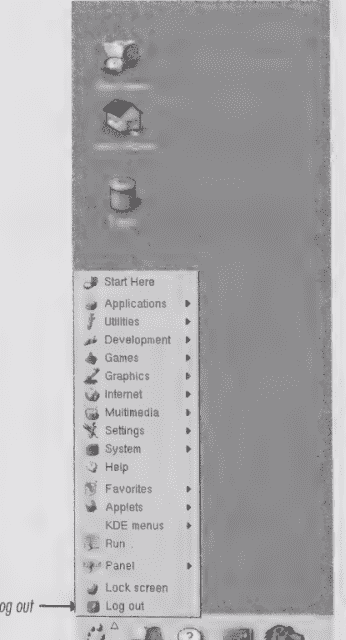

2. 要结束此会话，点击 *Log out*（登出）选项。

## 本章回顾

使用本节回顾本章内容并测试你对相关概念的掌握情况。

### 本章总结

- 能够输入被认可的用户名和密码的人员被授予系统访问权限。
- 如果你使用的是基于字符的终端，登录后，该终端可用于输入命令。
- 在图形环境中，我们必须通过点击菜单栏中的相应图标来启动终端窗口。
- 在基于字符的终端中，退出终端即退出会话。
- 在图形环境中，我们必须从 *应用程序菜单* 中选择 *Log out* 以退出会话。

### 习题

1. 描述广泛使用 UNIX/Linux 的环境以及较少使用它的环境。
2. 为什么用户应该以常规用户身份登录，而不是以 *root* 用户身份登录？
3. 尝试登录，但在你的登录名中间输入一个空格。会出现什么错误消息？何时显示？
4. 尝试在密码中输入一个空格进行登录。会出现什么错误消息？
5. 如何退出终端窗口或基于字符的终端？


## 巡览基础程序

## 技能检查
在开始本章之前，你应该能够：

- 登录到一个可运行的 UNIX/Linux 系统
- 如果登录时显示图形桌面，能够启动终端窗口

### 

## 目标
完成本章后，你将能够：

- 运行程序以获取系统和用户信息
- 正确地向系统的命令解释器传递指令
- 在文件系统中导航至其他目录
- 使用标准程序创建、检查和管理文件
- 访问描述特定命令和文件的在线帮助手册页（manual pages）
- 通过关键字或正则表达式搜索在线帮助手册页
- 识别并访问有用的互联网站点

第一次访问一座大城市的一种有效方式是先前往其中一座最高建筑的顶端。从那个高处，我们可以轻松地识别出主要地标并观察街道的布局。接下来，我们可以利用交通系统简要地参观城市的主要景点。这样一次快速的亮点巡览将展示主要系统是如何运行的，并为访问者随后对城市最有趣的部分进行更深入的调查打下基础。

同样地，本章及下一章将带你进行一次由引导的、实操性的 UNIX/Linux 系统“旋风之旅”。你将掌握基础技能，使你能够在该系统中灵活操作，使用基础工具，识别主要特性，并利用系统的底层设计结构。每个特性都将通过与运行中系统的直接实操交互来探索。在你完成这次引导巡览后，本书的其余章节将引导你对各项特性进行进一步的深入探索。

掌握本书中所包含的大量技能的秘诀在于：输入命令，阅读相关解释，并完成练习。成千上万的人通过仔细遵循本书规划的路径，成为了 UNIX 系统及其主要特性的熟练用户。

## 2.1 概览 UNIX 和 Linux 的发展

UNIX 最初由贝尔实验室的一群富有创造力的年轻科学家在 20 世纪 70 年代开发。他们创建了一个由以下几部分组成的操作系统：

- 一个用于控制中央处理器 (CPU) 和所有其他硬件的主程序。这个底层程序被称为 *内核* (*kernel*)。
- 一组用户和系统程序，通常被称为 *实用程序* (*utilities*)。
- 一种在硬盘文件中保存和定位数据的结构，称为 *文件系统* (*filesystem*)。

在初步开发之后不久，该操作系统的代码被许可给加州大学伯克利分校，那里的研究生和教职员工完成了大量额外的开发，增加了许多程序并重写了操作系统，以允许系统在网络环境中进行通信。

几家计算机制造商开始制造 UNIX 计算机和工作站。他们增加了新特性并修改了系统的某些方面以满足其特定需求。因此，运行在 Sun、HP、IBM 等设备上的 UNIX 版本略有不同。

近年来，林纳斯·托瓦兹 (Linus Torvalds) 和一批互联网协作伙伴编写了 Linux，这是一种类 UNIX 操作系统，其基本形式可免费下载，或通过几家发行商低价获取。如今，UNIX/Linux 操作系统运行在几乎所有计算机制造商生产的、本质上任何尺寸的设备上。

在 Linux 中，基础程序采用相同的代码，但不同的发行版（包括 Red Hat、SuSe、Mandrake 和 Lindows）增加了特殊特性和安装程序。因此，UNIX/Linux 不仅仅是一个“单一”的操作系统。相反，UNIX 这个术语涵盖了同一通用操作系统的许多略有不同的“风味” (flavors)。从用户的角度来看，各种风味在本质上是相同的，因为在最近的版本中，几乎所有的用户命令运行方式都一样。

## 2.2 发布命令以执行实用程序

在 UNIX/Linux 中，操作系统包含一套不断扩充的独立程序实用工具，用户可以运行或执行这些工具。一个程序负责解释你的请求并执行所需的程序。本节将探讨如何与命令解释器交互以执行程序。

1. 以普通用户身份（而非 `root` 身份）登录到你的 UNIX 或 Linux 系统。
2. 如果你处于图形环境中，请启动一个 `terminal window`（终端窗口）。

### 认识 Shell

成功登录后，你可能会收到一些信息提示，屏幕可能会被清空，可能会显示一个或多个窗口，鼠标可能处于激活或非激活状态。

此时，你使用的是基于字符的终端或图形终端窗口。光标左侧会显示一个提示符。提示符可以根据你的站点进行自定义，也可以是默认提示符之一，例如：

```
$
%
login@hostname
```

其中 *login* 是你的用户名，*hostname* 是你的机器名称。

提示符是由一个名为 *shell* 的程序显示在屏幕上的，它读取你的指令（*commands*，命令）并将其解释给系统的其余部分。

### 向 Shell 发布命令

成功登录后，shell 在屏幕上显示其提示符，这是 shell 命令解释器询问你接下来想做什么的方式。光标位于 shell 提示符处。用户和程序员就在此处给出指令，以启动和管理 UNIX 和 Linux 系统中丰富的程序。虽然可以使用图形界面来完成许多任务，但最根本且最完整地进行交互的方式是通过在提示符处发布的命令。

1. 输入以下小写命令：
   `whoami` 
   然后按下 ENTER 键。
   当你按下 ENTER 时，你输入的命令行会被发送到 shell，shell 解释你的指令并执行你指定的任何程序。
   在这种情况下，**whoami** 程序运行。它的输出（即你的登录名或用户名）将显示在屏幕上。

2. 输入以下内容：
   `WHOAMI` 
   然后按下 ENTER 键。

屏幕将显示一条表示找不到该命令的错误信息。UNIX 和 Linux 是区分大小写的。基本上所有命令都使用小写字母。

### 获取日期和系统信息

所有 UNIX 和 Linux 系统都会跟踪当前的日期和时间，用户和程序可根据需要调用。

1. 输入：
   `date` 
   然后按下 ENTER 键。
   `date` 程序的输出将显示在屏幕上，即当前的日期和时间。

2. 要查看你所在的系统，请输入：
   `hostname` 
   然后按下 ENTER 键。
   系统名称将被显示。

### 清除屏幕

另一个有用的命令是指示 shell 清除屏幕上的所有文本。

- 在 shell 提示符处输入：
  `clear` 

屏幕上的数据将被清除，提示符将显示在屏幕或窗口的顶部。

### 在输入命令行时进行修正

打字是一门不精确的科学。我们的手指经常不能精准地落在预定位置。在这个练习中，你将在输入命令时故意制造一个错误，然后对其进行修正。

1. 输入以下四个字母，但不要按下 ENTER：
   `dzte` 

2. 尝试使用 BACKSPACE（退格）键将光标后移。
   在某些系统中，按下 BACKSPACE 不会移动光标，而是在行中输入控制字符。如果你的系统是这种情况，请直接跳到第 5 步。

3. 正确输入命令：
   `date`
   按下 ENTER 键。

4. 无论第 2 步中的 BACKSPACE 是否奏效，再次输入：
   `dzte`

5. 尝试通过后退并重新输入来修正错误，分别尝试使用以下按键：
   DELETE
   CTRL-H（按住 CTRL 并按下一次 H。）

其中至少有一个按键可以实现光标后移并擦除你输入的内容。

### 确定谁在系统中

在 shell 提示符处，我们可以请求执行程序。在多用户环境中，了解同事是否已登录通常很重要。

- 在 shell 提示符处，输入以下小写命令：
  `who`
  然后按下 ENTER 键。

系统将显示当前登录用户的列表。
你刚刚输入的命令行指示 shell 执行一个名为 **who** 的程序或实用程序。**who** 实用程序确定当前谁在登录，并格式化显示有关这些登录用户的信息。在这种情况下，这些数据（即 **who** 程序的 *输出*）被发送到你的屏幕。如果你是唯一的用户，则只显示一行数据。如果你在多用户系统上，则会显示多条登录记录。


**who** 生成的输出形式如下。你的输出数据包含有关当前登录到系统的用户的信息，例如：

```
anna	tty4	Apr 24 17:58
kyle	tty6	Apr 24 14:11
marty	pts1	Apr 23 21:13	(purdy.muster.com)
cassy	pts2	Apr 23 14:31	(thamzin.muster.com)
```

#### 识别 who 输出中的字段

**who** 输出的每一行都包含一个当前已登录用户的数据。每行由一个或多个空格分隔的几个**字段**（fields）组成。例如，**cassy** 条目的组成部分如下。

每个终端或监视器通过一根连接到*端口*（port）的电缆连接到计算机，端口是计算机背面的一个物理位置。每个端口都有一个标识，通常以字母 *tty* 和一个数字开头。通过网络连接的终端使用名为 *pts* 的电子端口或伪终端端口。当你执行 `who` 命令时，shell 会运行 **who** 工具，该工具搜索特定的系统文件以确定每个用户的登录名、端口和登录时间。然后，**who** 工具会对信息进行格式化并输出。在这种情况下，输出显示在你的屏幕上。日期和时间是最后两个字段。

在 **who** 完成工作后，它会退出并告知 shell 一切顺利。随后 shell 会显示一个新的提示符，表明它已准备好接收你的下一个指令。

#### 使用 Shell 执行程序

你刚才输入 `who` 命令所遵循的步骤就是我们在 UNIX/Linux 环境中的工作方式：

- A. 在我们登录或启动终端窗口后，一个名为*shell*的程序会被启动。shell 显示一个提示符，表明它已准备好接收指令。
- B. 我们输入命令并按下 ENTER 键。
- C. shell 理解我们的请求（如果无法理解则会报错）。
- D. 然后 shell 运行或执行我们请求的任何工具，例如 `date`、`cal` 或 `ls`。
- E. 执行该工具的代码，产生其创建的任何输出。
- F. 当运行到代码末尾时，shell 被告知程序已结束，随后程序终止。
- G. 在收到上一个程序已终止的信息后，shell 显示另一个提示符并等待你的下一个指令。

交互周期如图 2-1 所示。

**图 2-1** shell 的工作原理

#### 向工具传递信息

大多数 UNIX 和 Linux 发行版都包含一个可以输出 12 个月日历的程序。在这个练习中，你将显示一个日历，并研究如何使用 shell 命令向程序传递信息以请求特定的年份。

- 1. 在提示符处，输入以下命令：`cal` 然后按 ENTER。shell 运行 `cal` 程序，该程序输出当前月份的日历。
- 2. 现在通过输入 `cal99` 然后按 ENTER 来请求特定年份的日历。

shell 报告未找到命令 `cal99`。从之前的命令经验我们知道 `cal` 是一个合法的工具，但显然 `cal99` 不是。

问题在于 shell 的编程方式与人类沟通非常相似。例如，*Thissentenceishardtoparsebecausetherearenospaces!* 在显示为 *This sentence is hard to parse because there are no spaces!* 时更容易理解。

在人类沟通中，空格用于识别组成单词的每个字符字符串。同样，对于 shell，我们需要提供空格来识别命令行上的每个单词或标记（token）。

- 3. 在 `cal` 工具与我们要传递给 `cal` 的信息（称为其*参数* argument）之间加上一个空格：

```bash
cal 99
```

然后按 ENTER。

在这个日历中，12 月 31 日不是星期五。如果你没有庆祝得太疯狂，你可能记得 1999 年 12 月 31 日举行的大派对是在周一晚上。屏幕上显示的输出不可能是 1999 年的。当你给 `cal` 提供参数 `99` 时，`cal` 将其解释为输出公元 99 年（1900 多年前）日历的指令。当我们要求 `99` 时，我们就得到了 99。

- 4. 获取 1999 年的日历：

```bash
cal 1999
```

然后按 ENTER。

当我们向工具传递参数时，必须使用该工具的“语言”。`cal` 要求年份为四位数。我们必须遵守。

在到目前为止使用的命令中，我们仅输入要执行的工具名称，按下 ENTER，shell 就会运行它。当我们输入一个命令并跟随其他信息（如 `cal 99`）时，我们是在告诉 shell (1) 运行该工具，并且 (2) 将命令之后传递给工具的特定信息（在本例中是我们想要显示的年份数字）传递给该工具。传递给工具的信息称为参数。参数为工具提供指令。

- 5. 运行 `cal` 工具，为其提供正确的*参数*，使其输出当前年份的日历。

#### 向 `cal` 传递多个参数

几乎所有 UNIX/Linux 程序都接受被解释为工具指令的参数。

- 1. 通过输入以下命令查看 1752 年的日历：`cal 1752` 然后按 ENTER。此命令指示 shell 运行 `cal` 工具并将参数 `1752` 传递给 `cal`，`cal` 将其解释为要显示的年份。
- 2. 查看 1752 年的 9 月。缺失了 12 天。是日历坏了吗？不，是因为旧日历与地球绕太阳运行的实际情况不同步，所以对日历进行了调整。

##### 调整日历

旧的儒略历定义一年为 365.25 天。由于地球在 365 天内不能完全绕太阳旋转一圈，我们的祖先每四年增加一个闰日，以保持日历与绕日运行同步。不幸的是，太阳年实际上略少于 365.25 天（365.2422 天），因此每四年增加一个闰日每次都增加得太多了。到了 16 世纪，人们开始注意到一年中最短的一天已经移到了 1 月，而不是 12 月 21 日。1582 年，格里高利历通过规定只有能被 400 整除的世纪年才是闰年，从而减少了闰日的数量。格里高利历还删除了 10 天，将冬至重新移回 12 月 21 日。1752 年，英国终于采用了格里高利历。由于在中间的 170 年里，日历变得更加不同步，英国人不得不删除 12 天以协调日历和太阳年。

> `cal` 工具与许多其他工具一样，可以解释多个参数。

- 3. 通过输入 `cal 9 1752` 仅获取一个月。此时仅显示 1752 年 9 月的日历。当给出两个参数时，`cal` 将第一个解释为月份，第二个解释为年份。
- 4. 作为另一个示例，为 `cal` 提供正确的两个参数，查看你出生的那个月份。
- 5. 输入以下内容以检查世纪闰日：
  `cal 2 1700`
  `cal 2 1800`
  `cal 2 1900`
  `cal 2 2000`
  `cal 2 2300`
  `cal 2 2400`
  `cal 2 2800`

结果显示，1752 年之后，只有能被 400 整除的世纪年才是闰年。然而，对你目前的学习更重要的一点是，你已经练习了多次向 shell 输入命令，包括在工具与其第一个参数之间以及后续参数之间添加空格。

#### 向 Spelling 工具传递参数

许多工具都接受参数。UNIX 和 Linux 包含一个用户可以访问的拼写检查工具（spelling utility）。

- 输入：`look psycho`

此命令指示 shell 运行 **look** 并向其传递参数 *psycho*。**look** 工具将参数 *psycho* 解释为一个单词的开头部分，在字典文件中定位所有以 *psycho* 开头的单词，然后输出匹配的单词。

#### 识别 Shell 命令的组成部分

到目前为止发出的命令由一个工具（放在命令行的首位）以及随后的零个或多个参数组成，格式如下：

`utility`
`utility` `argument`
`utility` `argument` `argument`

第一个标记（token）是工具。其余标记是传递给该工具的参数。


#### 探讨 Shell 如何 Shell 执行程序

当人们第一次使用 UNIX 或 Linux 时，有时会产生一种印象，认为是由 shell 弄清楚谁登录了、日期是多少或者日历的内容，而他们唯一需要做的就是向 shell 请求这些信息。实际上，shell 对这些事情一无所知。当你输入 `date` 命令并按下 ENTER 键时，你是在指令 shell 运行 `date` 程序，这类程序通常被称为*实用工具（utility）*。

当你登录时，你的 shell 程序在一个环境中启动，该环境包括读取代码的代码、工作空间以及接收中央处理器 (CPU) 注意力的方式。在一个环境中运行的程序实例被称为一个*进程（process）*。

shell 进程在屏幕上显示一个提示符。我们通过输入要运行的程序名称（可能带有参数）来告诉它我们想要执行的操作，然后按下 ENTER 键。shell 会为执行我们请求的任何实用工具的代码启动一个新的独立环境。这个新环境被称为*子进程（child process）*，它在执行我们输入命令时请求的任何程序。

#### 列出进程

UNIX 是一个多任务系统，这意味着它在运行时能同时管理许多程序。当你输入命令执行实用工具时，系统会分配内存、定位所需代码并提供 CPU 注意力——一个新*进程*由此开始。进程是某些运行中的程序代码的实例。每当你要求执行一个实用工具时，你实际上是在请求启动一个子进程来执行该实用工具的代码。进程是任何计算环境的核心。

- 1. 输入以下命令以获取当前进程列表：
`ps`

输出结果是一个与你当前登录关联的进程列表，以及每个进程的一些信息。例如，TT 或 TTY 字段是进程所附加的 *tty* 编号或端口。PID 是进程的 ID 编号。列表中列出的每个进程都是你在系统上运行的程序。你可能至少有两个进程在运行：作为命令解释器的 shell，以及 `ps` 实用工具本身。如果你处于图形环境下，可能还有其他几个进程。有些系统不会在当前进程中列出 `ps` 进程，但大多数系统会。在 `ps` 完成确定哪些进程正在运行的工作后，它会显示输出并终止。

| 进程标识号 | 用户登录端口 | 进程占用 CPU 时间 | 进程运行的实用工具（代码） |
|---|---|---|---|
| PID | TTY | TIME | CMD |
| 15937 | pts/3 | 00:00:00 | bash |
| 18436 | pts/3 | 00:00:00 | ps |

**表 2-1 ps 的输出详解**

当你运行一个程序时，一个新的进程被执行。

- 2. 输入以下内容：
`ps`

如果运行 **ps** 的进程列在你的进程中，你会发现每次运行该程序时，进程标识号都不同。

在你按下 ENTER 键表示要执行的命令行结束之后，shell 会启动一个新进程。shell 会将命令行中实用工具名称之后的任何参数传递给新进程。例如，如果你输入 **date**，shell 会定位该实用工具的代码，并最终让进程执行它。子进程遵循 **date** 中的代码。子进程检查系统时钟并格式化显示输出。实用工具将结果通过其输出“门”发送出去。最初，实用工具的输出门连接到你的显示屏幕，除非（正如你将看到的）你要求 shell 将其连接到文件甚至另一个实用工具。

#### 列出全系统进程

你在前一个练习中输入的 **ps** 命令提供了*你*的进程状态。你还可以显示整个系统上运行的进程，包括所有当前登录用户以及系统进程。

- 分别输入以下命令：
`ps -aux`
`ps -ef`

其中一个或两个命令应该会产生一个很长的进程列表，可能会超出屏幕范围。你很快就会看到如何驯服这个列表。**-aux** 和 **-ef** 是命令选项或标志，它们为实用工具提供具体指令。

#### 自测 1

回答以下问题，然后根据本章提供的信息检查你的答案。

- 1. 哪个实用工具可以产生当前登录系统的用户列表？
- 2. 当你输入命令 `cal 2004` 时，你是在要求 shell 做什么，结果是什么？
- 3. 哪个命令可以列出你当前运行的进程？
- 4. 单词或令牌在命令行上的位置告诉了 shell 关于该令牌的信息。如果我们向 shell 输入如下形式的命令行，shell 如何解释每个令牌（作为实用工具还是作为参数）？
- 5. 以下命令会起作用吗？
`ps -ef`
- 6. 在 shell 启动一个子进程来执行用户请求的实用工具之后，shell 是终止还是等待子进程完成执行？

以减号开头的参数是选项。大多数实用工具被设计为将以减号开头的参数解释为改变实用工具行为的选项。

这个 `ps` 的输出包含了当前在整个系统上运行的每个进程的进程状态列表，以及关于每个进程的大量信息。其中许多是保持所有服务（如打印和网络）运行的系统进程。这些信息对于系统管理员和其他监督 UNIX 环境的人员非常有用，尤其是当他们在排除系统问题时。而对于我们其他人，它展示了“引擎盖”下发生了什么。

shell 在屏幕上显示一个提示符，询问我们想要做什么。我们输入一条命令行，由 shell 解释。shell 启动子进程来执行我们请求的任何程序。然后，在子进程完成任务并终止后，shell 显示另一个提示符，我们再次循环。

## 2.3 向 Shell 传递指令

shell 可以启动新进程；可以定位像 `cal`、`who` 和 `date` 这样实用工具的代码；并且可以让新进程执行这些指令。程序生成的结果显示在屏幕上。信息是从哪里来的？为什么它显示在屏幕上？为什么没有被放置在文件中或邻居的屏幕上？

到目前为止，你已经输入了程序名称并包含了一些参数。新进程已被启动，程序已被执行。shell 的工作是执行你的请求。然而，如果我们说“请”，shell 能做的事情远不止启动进程、传递参数和执行程序。当我们身在法国时，我们需要说法语来点午餐。而在 UNIX 中，我们需要说“shell 语”才能被理解并完成工作。接下来的部分将探讨如何指令 shell 将运行实用工具的进程输出连接到文件甚至另一个实用工具。

### 列出文件名

取决于你的账户如何设置以及你之前是否使用过，你的主目录中可能有文件，也可能没有。我们可以列出其内容。

- 输入以下命令：
`ls`
然后按下 ENTER。

`ls` 实用工具列出当前目录标准文件的内容。如果你有一些文件，它们的名字将被显示。你可能还没有任何文件；这很快就会改变。

### 将实用工具的输出重定向到文件

当我们告诉 shell 执行 `who` 实用工具时，`who` 的代码运行并输出当前用户的列表。运行 `who` 实用工具的进程定位所需信息并格式化报告。运行 `who` 实用工具的格式化结果的默认输出目的地是用户的屏幕。输出被*定向到屏幕*，除非我们将它重定向到其他地方。

我们可以指令 shell 将实用工具的输出从屏幕*重定向*到一个文件中。一旦数据进入文件，它就被保存了，可以被修改、打印和邮寄。

#### 显示主目录中列出的文件名称

系统上的每个用户都被提供了一个工作和保存文件的地方。这个地方被称为用户的*主目录（home directory）*。这个目录（或文件夹）包含由用户创建并由用户拥有的文件和子目录的名称。

- 1. 查看当前目录内容：
`ls`
`ls` 实用工具列出在当前目录中创建的文件和子目录的名称。

- 2. 输入以下包含 `>` 符号的 shell 命令行：
`who > users_on`
除了下一个 shell 提示符外，屏幕上没有任何显示。没有任何确认或告知你的命令执行成功。在 UNIX/Linux 中，沉默通常意味着成功。
你刚刚告诉 shell 创建一个新文件，并将其连接到运行 `who` 实用工具的进程的输出。

- 3. 通过输入以下命令确认文件存在：
`ls`
将显示主目录当前内容的列表。

你之前输入的 `who` 命令行包含三个组件。shell 解释每个组件或令牌。

| 命令 | 描述 |
| :--- | :--- |
| who | 指令 shell 启动一个新进程来运行 **who** 实用工具的代码。 |
| > | 指令 shell 创建一个新文件并将进程的输出重定向到该文件。 |
| users_on | 指定 shell 分配给接收 **who** 输出的新文件的文件名。 |


在 shell 创建新文件并将其附加到进程的输出之后，进程运行 **who** 工具，并将其输出写入到此时已连接到新文件 *users_on* 的输出流中。这种操作被称为将输出从屏幕*重定向*到新文件。

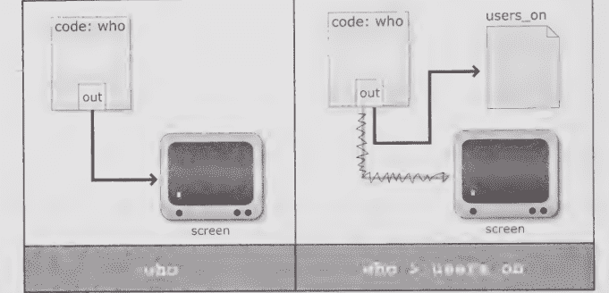

- 4. 在你的账户中创建一个包含 1752 年日历的文件。输入：
  `cal 1752 > lost-days`

一个子进程被启动，它被赋予参数 *1752*，且其输出被连接到新文件 *lost-days*。一旦这种“管道连接”完成，shell 就会告诉子进程运行 `cal` 工具代码。对于 `cal` 来说，参数 1752 是一个年份。当 `cal` 完成时，它将结果写入输出，在这种情况下，输出连接到了 *lost-days* 文件。

- 5. 创建一个名为 *today* 的新文件，内容为 **date** 的输出：
  `date > today`

该命令指示 shell 启动一个子进程，创建一个名为 *today* 的新文件，将进程的输出定向到该文件，然后让进程运行 `date` 的代码。

- 6. 创建一个名为 *birth* 的文件，内容为你的出生月份。

- 7. 通过输入以下命令确认文件是否存在：
  `ls`

你的输出应至少包含 *users_on*、*lost-days*、*today* 和 *birth* 这几个文件。如果缺少任何文件，请返回到相应的上一步并创建文件。

#### 查看文件内容

如果我们将数据存储在文件中，我们就需要能够检查文件的内容。UNIX 系统包含几个用于在屏幕上描述或显示文件内容的工具。每个工具处理任务的方式不同。

##### 每次显示一屏文件内容

查看文件内容的一种方法是显示一整屏，然后在准备好时请求下一页。

- 1. 输入以下命令：
  `more lost-days`
  屏幕上可能仅显示了文件 *lost-days* 的第一部分。

- 2. 你可以指示 `more` 显示更多文本。按下：
  空格键 (SPACEBAR)
  文件的下一页将被显示。虽然标准键盘包含 PAGE DOWN 键，但它在 `more` 中不起作用。

- 3. 继续按下空格键，直到看到整个文件并返回到 shell。
  当 `more` 到达文件末尾时，它会自动退出，shell 将再次显示提示符。大多数系统都有一个包含终端行为信息的长文件。虽然其内容此时并不重要，但该文件可用于探索 `more` 如何处理长文件。

- 4. 输入：
  `more /etc/termcap`
  `more` 工具显示名为 *termcap* 文件的开头部分。

- 5. 通过按下以下按键浏览文件：
  空格键 (SPACEBAR)
  空格键 (SPACEBAR)

- 6. 按下以下按键退出 `more`：
  `q`
  `more` 工具退出，显示 shell 提示符。

##### 使用选项统计文件中的元素

在任何工作环境中，我们经常需要知道文件中有多少条记录，或者出版物中有多少个字符。在 UNIX 中，有一个工具可以统计文件中的行数、单词数或字符数。

- 1. 输入以下命令：
  `wc lost-days`
  该命令行指示 shell 运行 `wc` 工具并传递一个参数：`lost-days`。`wc` 工具将该参数解释为要读取和检查的文件。在统计 `lost-days` 文件中的行数、单词数和字符数后，`word count`（字数统计）工具将以类似于以下形式输出结果：
  `15 452 1989 lost-days`
  该输出由文件中的*行数* (35)、*单词数* (452) 和*字符数* (1,989) 组成，后面跟着 `wc` 读取的文件名。

- 2. 尝试另一个文件：
  `wc birth`

##### 仅统计行数

与大多数 UNIX 工具一样，`wc` 工具提供了选项，用于指示 `wc` 以不同的方式运行。

- 1. 例如，输入带有选项参数的 `wc` 命令：
  `wc -l lost-days`（小写字母 l）
  shell 将此命令解释为启动一个进程并传递两个参数 `-l` 和 `lost-days` 的指令。
  `wc` 工具将参数 `-l` 解释为统计 `lost-days` 中*行数*的*选项*。该参数前面有一个连字符或减号。工具将以短横线开头的参数解释为以*可选*方式运行的指令。输出仅包含行数。文件中字符总数和单词数的统计结果不会被输出。我们通过输入一个选项参数（例如你刚才使用的 `-l`）来指定我们想要的命令可选形式。

- 2. 输入：
  `wc -l users_on`
  `wc -l today`

在每一个命令行中，两个参数被传递给 `wc`：`-l` 选项和一个被程序解释为文件名的字符串。`-l` 选项指示 `wc` 仅输出它从文件中读取的行数。参数中的减号告诉 `wc`，`l` 是一个选项，而不是要作为数据读取的文件。

- 3. 使用 `wc` 统计其他一些文件的元素：
  `wc /etc/passwd`
  `wc -l /etc/passwd`
  `wc /etc/termcap`
  `wc -l /etc/termcap`

#### 在当前目录中创建和列出文件

在之前的练习中，你创建了新文件。你拥有这些文件并有权访问它们。这些文件列在你的当前目录或主目录中。

- 1. 要列出当前（主）目录中的文件名，输入命令：
  `ls`
  然后按回车键 (ENTER)
  通过这个命令行，你是在要求 shell 定位并运行 `ls` 工具。当 `ls` 运行时，它获取当前目录中列出的文件名，并输出这些文件名的格式化显示。因为你没有要求 shell 将 `ls` 的输出重定向到其他地方，所以它显示在你的屏幕上。在 `ls` 工具完成工作后，程序退出并通知 shell。然后 shell 提供另一个提示符，以查看你接下来想做什么。本质上，任何工具的输出都可以被重定向到文件。

- 2. 例如，输入：
  `ls > myfile1`
  `more myfile1`
  `ls`
  文件 `myfile1` 被创建，其中包含 `ls` 的输出，即当前目录中的文件名。

- 3. 另一个例子，输入：
  `cal 2003 > 2003`
  `ls`
  `wc 2003`
  `more 2003`
  文件 `2003` 被创建，内容为 `cal` 的输出。

- 4. 通过输入以下内容退出 `more`：
  `q`

- 5. 输入：
  `ps > myprocesses`
  `ls`
  `more myprocesses`

当工具产生输出时，它会显示在屏幕上，除非你告诉 shell 将输出重定向到其他地方。该命令的一般形式是 `utility > filename`，这是将工具的输出重定向到文件的指令。

#### 将输出追加到文件末尾

在之前的练习中，你告诉 shell 将工具的输出连接到新文件。我们也可以告诉 shell 将数据追加到现有文件的末尾。

- 1. 尝试以下操作：
  `date > thismonth`
  `more thismonth`
  `>` 重定向特殊字符指示 shell 将命令行中前一个工具的输出连接到一个文件。

- 2. 通过输入以下内容指示 shell 将工具的输出添加到文件末尾：
  `cal >> thismonth`
  `more thismonth`
  `date >> thismonth`
  `more thismonth`
  在每行使用双重重定向的命令行之后检查文件，可以看到工具的输出被添加到文件末尾。双重重定向 `>>` 是将前一个工具的输出*追加*到现有文件末尾的指令。

- 3. 另一个例子，向之前创建的 *lost-days* 文件中添加更多文本：
  `cal 2002 >> lost-days`
  `more lost-days`

#### 将输出重定向到另一个工具

当你运行工具而不重定向输出时，其输出显示在你的屏幕上。正如你刚才演示的，我们可以使用 `>` 重定向特殊字符将工具的输出重定向到文件。我们也可以将工具的输出重定向到另一个工具，而无需先将其保存到文件中。

- 1. 输入以下内容：
  `ls`
  `ls > ls.out`
  `more ls.out`
  如果我们不重定向，`ls` 的输出会显示在屏幕上。`ls > ls.out` 命令是指示 shell 将 `ls` 的输出重定向到名为 *ls.out* 的文件的指令。

- 2. 统计文件中的元素：
  `wc ls.out`
  通过 `wc`，我们可以统计新文件 *ls.out* 中的行数、单词数和字符数。

这种统计 `ls` 元素的方法需要多个步骤并创建一个文件。我们也可以直接将 `ls` 的输出重定向到 `wc` 而不创建文件。

- 3. 输入：
  `ls | wc`

**注意：** `|` 键被称为*管道 (pipe)*，通常在 ENTER 键附近。它可能是一个实线或断开的垂直线。

`wc` 的输出显示在屏幕上。该命令行指示 shell 启动两个进程，将第一个进程的输出连接到第二个进程的输入，然后在第一个进程中运行 `ls`，在第二个进程中运行 `wc`。


`ls` 的输出没有显示在屏幕上，也没有被重定向到文件中。它被重定向到了第二个进程的输入端，该进程正在运行 `wc` 工具。然后 `wc` 读取其输入（来自 `ls` 的输出）并统计它所发现的行数、单词数和字符数。最后，`wc` 将结果输出到你的屏幕上。


- 4. 输入以下内容来统计 `cal` 输出中的元素数量：
  `cal 1752 | wc`
  `cal` 的输出被重定向到 `wc`，由 `wc` 进行计数。`|` 是给 shell 的指令，用于将左侧任何工具的输出连接到右侧工具的输入。

- 5. 通过将输出重定向到 `more` 来处理超过一屏长度的输出，输入：

```
ps -ef | more
```
或
```
ps -aux | more
```

`ps` 的输出被重定向到了 `more` 的输入。

- 6. 检查进程列表，然后使用以下指令退出 `more`：
  `q`
  `ps -ef` 或 `ps -aux` 的输出是一个包含所有进程信息的长列表，其长度远超屏幕显示。通过将 `ps` 的输出重定向到 `more`，我们可以控制显示。

- 7. 最后一个示例，输入：
  `who | wc`
  第一个工具的输出被重定向到第二个工具的输入。

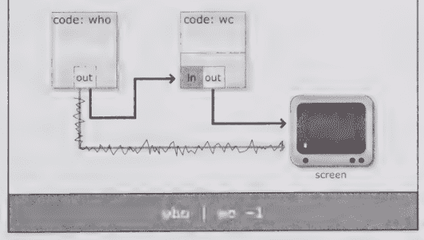

#### 确定命令行中标记（Tokens）的角色

shell 具有非常明确的语法规则，我们在输入命令时必须遵守。一个重要的规则是我们如何在命令行上放置信息。考虑你在输入的命令行中工具的放置位置，例如：

```
who
date
who > users_on
cal 9 1752
```

在所有这些命令行中，工具都是命令行上的第一个单词。命令行上的每个单词或对象也被称为一个 *标记（token）*。

shell 的程序设计使其将初始标记读取为要运行的工具程序或要执行的某种操作。

你输入过如下命令：

```
who | wc
ps -ef | more
```

工具也可以位于命令行中重定向管道之后。shell 将管道后的标记解释为工具的名称。shell 将前一个工具的输出连接到紧跟在管道之后的工具的输入。

shell 将 `>` 重定向符号后的标记解释为文件名。所有其他剩余的标记都作为参数传递。

考虑以下内容。每个标记必须分别是什么？

```
___ | ___ | ___ > ___
```

命令行上的位置决定了 shell 如何解释每个标记。第一个标记必须是一个工具，管道后的标记也必须是工具。重定向后的标记必须是接收最后一个工具输出的文件。

所有其他标记（剩余的部分）必须是参数。每个参数都传递给它之前的工具。因此，shell 将这些元素解释为：

```
utility argument argument | utility argument | utility > file
```

第一个工具被赋予两个参数。第一个工具的输出连接到第二个工具的输入。第二个工具被赋予一个参数；它的输出传递给第三个工具的输入。第三个工具的输出被重定向到一个文件。

#### 启动子 Shell

当你登录时，你的登录 shell 就启动了，并且从那时起它一直在解释你的命令。所有系统都包含多个 shell 的代码。你当前的 shell 可能是以下之一：

| SHELL | 默认提示符 | 名称 |
|---|---|---|
| sh | $ | Bourne Shell (原始版本) |
| bash | $ | Bourne Again Shell |
| ksh | $ | Korn Shell |
| csh | % | C Shell |
| tcsh | % | T C Shell |

各种 shell 分为两个家族。前三个 **sh**、**bash** 和 **ksh** 属于 **sh** 家族，后两个 **csh** 和 **tcsh** 属于 **csh** 家族。

- 1. 输入以下内容启动一个子 shell：
  ```sh
  sh
  ```
- 2. 输入以下内容列出当前进程：
  ```sh
  ps
  ```
  子 **sh** 和登录 shell 都在运行。当你启动子 shell 时，你的登录 shell 并没有终止，而是在等待子 shell 退出。
- 3. 运行另一个命令，例如：
  ```sh
  date
  ```
- 4. 输入以下内容退出子 shell：
  ```sh
  exit
  ```
- 5. 再次检查进程：
  ```sh
  ps
  ```

子 **sh** 已终止，仅剩下登录 shell。人们经常犯的错误是启动一个子 shell，然后又启动另一个，而不是退出第一个。根据你使用的 UNIX 或 Linux 版本，某些（但可能并非全部）shell 是可用的。Linux 通常拥有 **bash** shell，但除非你安装它，否则不包含 **ksh**。其他系统使用 **ksh** 且没有 **bash**。通常 **csh** 和 **tcsh** shell 中有一个或两个可用。

如果你尝试其他 shell，请务必在启动新 shell 之前退出每一个。

#### 重新执行命令

除了原始的 **sh** 之外，所有 shell 都允许我们重复之前输入的命令。请求重新执行特定命令的方法取决于你使用的是哪个 shell。

##### 重新执行最后输入的命令

- 1. 输入命令：
  `date`

- 2. 尝试通过输入以下内容重新执行此命令：
  `!!` 
  如果 `date` 再次运行，那么你使用的是 **csh** shell、**tcsh** shell 或 **bash** shell。

- 3. 如果 `!!` 没有起作用，请输入：
  `date` 
  `r` 
  如果 `date` 工具在响应 `r` 命令时第二次执行，那么你使用的是 Korn shell，即 **ksh**。
  如果 `!!` 和 `r` 都不起作用，你可能处于 **sh** shell 中。你通常可以通过输入 **csh**、**tcsh**、**ksh** 或 **bash** 来启动一个更现代的 shell。

- 4. 输入：
  `cal 2004` 
  显示 2004 年的日历。

- 5. 通过输入以下内容重复显示日历：
  `!!` 
  或 
  `r`

##### 在 Linux 中使用方向键重复命令

`!!` 和 `r` 命令告诉相应的 shell 重新执行你的最后一行命令行。在某些系统上，我们还可以通过显示之前的命令并选择其中一个再次运行来重新执行命令。

- 1. 按 上方向键 (UP ARROW)
  显示上一个命令。

- 2. 按 回车键 (ENTER)
  执行显示的命令。

- 3. 多次按 上方向键 以返回之前的命令。

- 4. 按 回车键 重新执行该命令。

##### 通过编号和名称再次运行命令

shell 会跟踪我们发出的命令，允许我们通过多种方式访问它们。

- 1. 输入以下内容列出之前输入的命令：
  `history`
  显示一个你执行过的命令列表，每个命令旁边都有一个编号。

> **注意：** 如果你没有看到历史列表且处于 **tcsh** 或 **csh** 中，请输入 `set history = 100` 让 shell 跟踪你发出的命令，然后再次执行 **history** 命令。

我们可以指令 shell 根据编号或名称重新运行之前的命令。

- 2. 输入以下内容：
  在 **csh**、**tcsh** 或 **bash** 中输入（! 后面没有空格）：
  `!d`
  或在 **ksh** 中输入（r 后面有空格）：
  `r d`
  执行最后一个以字母 **d** 开头的命令。

- 3. 另一个例子，输入：
  `!ca`
  或
  `r ca`
  最后一个以 *ca* 开头的命令（可能是 **cal**）将再次执行。

- 4. 重新执行显示 **history** 列表的命令：
  `!h`
  或
  `r h`

- 5. 在 **history** 列表中识别一个命令，并在以下命令的 ## 处使用其编号（例如，如果 **date** 命令的编号是 27，那么在 **tcsh** 和 **bash** 中要发出的命令是 `!27`，在 **ksh** 中是 `r 27`）：
  `!##`
  或
  `r ##`
  重新执行编号为 ## 的命令。

我们可以通过三种方式重新执行之前的命令：

| 重复上一个命令 | !! | r | 上方向键 |
| :--- | :--- | :--- | :--- |
| 重复最后一个以 xxx 开头的命令 | !xxx | r xxx | |
| 重复编号为 ## 的命令 | !## | r ## | |

##### 为命令使用昵称（别名）

除了 **sh** 之外，所有 shell 都允许你为命令分配替代名称或别名（aliases）。用户为那些难以记住或难以输入命令使用别名。

- 1. 在 **csh** 和 **tcsh** shell 中，输入：
  ```
  alias DIR ls
  alias now date
  alias h history
  ```

- 2. 在 **bash** 和 **ksh** shell 中，输入：
  ```
  alias DIR=ls
  alias now=date
  alias h=history
  ```

- 3. 现在，尝试每个新别名：
  `DIR`
  `now`
  `h`
  因为你输入了它们的别名，所以 **ls**、**date** 和 **history** 命令被执行。初始命令 **ls**、**date** 和 **history** 仍然有效。我们只是告诉 shell 一些我们打算与命令名称产生相同效果的昵称。它们的作用是一样的。

  我们可以指令 shell 列出所有当前的别名。

- 4. 输入：
  `alias`

  当你不再需要定义某个别名时，也可以告诉 shell 删除该别名。


- 5. 输入：
  `unalias DIR` `DIR`

- 6. 输入以下输入命令确认别名已删除：
  `alias`

`DIR` 别名不再出现在列表中。它已被删除。
当你注销时，shell 退出并随之清除内存中的别名。

#### 自测 2

回答以下问题，然后对照本章提供的信息检查你的答案。

- 1. 哪个命令告诉 shell 重复执行上一个命令？

- 2. 哪个命令告诉 shell 创建一个名为 *myfile* 的新文件，其中包含当前目录下所有文件的名称列表？

- 3. 哪个命令告诉 shell 运行仅输出当前目录下文件数量的实用程序？

- 4. 哪个命令告诉 shell 创建一个名为 *friend-bday* 的新文件，其中包含朋友出生的月份和年份？

- 5. 哪个命令告诉 shell 将今天的日期和时间添加到 *friend-bday* 文件的末尾？

- 6. 哪个命令告诉 **csh** 或 **tcsh** shell，当我们输入 *cl* 时，希望 shell 运行 `clear` 命令？

- 7. 如何告诉 **bash** 或 **ksh** shell，当我们输入 *cl* 时，希望 shell 运行 `clear` 命令？

- 8. 令牌（token）在命令行中的位置能告诉 shell 关于该令牌的大量信息（是实用程序、文件、参数还是重定向）。shell 如何解释命令行中的以下每个令牌？
  `_______ | _______ > _______`

- 9. 以下每个命令分别实现了什么功能？
  A. `alias`
  B. `more file1 file2`
  C. `wc -l file1 file2`
  D. `!w`
  E. `r 12`

- 10. shell 如何解释以下命令，结果是什么？
  `look psy | wc -w > psy-words`

## 2.4 导航文件系统

UNIX/Linux 系统中的数据、信件、程序和所有其他存储信息都包含在文件中。文件被组合在目录中。通过完成之前的练习，你现在的主目录（home directory）中已经列出了几个文件。你是通过运行实用程序并将输出重定向到新文件来创建它们的。系统数据和程序也保存在文件中。所有文件都列在目录中。你的主目录被列在某个目录中，而该目录又被列在另一个目录中，以此类推，直到最顶层的目录。所有文件和目录的整体集合就是*文件系统*。

### 确定你在文件系统中的位置

由于 UNIX 可以同时服务于多个用户，因此每个用户都被分配了一个独立的工作空间或*主目录*来开展工作。当用户登录时，每个人都可以访问自己不同的主目录中的文件，这样其他用户就不会干扰彼此的文件。

- 1. 要查看你的主目录所在位置的列表，输入命令：
  `pwd`
  输出类似于：
  `/home/cassy`
  或
  `/export/home/cassy`
  该信息是从文件系统顶层到当前目录（在本例中是你的主目录）的路径。最顶层的目录称为**根目录**（用 / 表示）。`pwd` 实用程序的输出是从**根目录**到你**当前工作**目录的路径。
  例如，`/home/cassy` 的输出表示**根目录**有一个名为 **home** 的子目录，而在 **home** 目录中列出了你的主目录（在本例中为 **cassy**）。**pwd** 输出中的最后一个目录就是你的当前目录。

- 2. 使用常用命令获取当前（主）目录中的文件名列表：
  `ls`
  输出是你创建的文件列表。它们的名字列在你的主目录中，因此你可以访问它们。

### 从顶层查看文件系统

UNIX 文件系统的顶层通常被称为**根目录**（root），有时也称为*斜杠*（slash），因为它由正斜杠字符表示。

- 1. 使用以下命令获取*根*目录中的文件和目录列表：
  `ls /`
  此命令告诉 shell 运行 `ls` 实用程序并向其传递 `/` 参数。`ls` 实用程序读取 `/` 目录中的文件名并将其列表显示在屏幕上。输出是某些系统目录的列表，包括 `dev`、`tmp`、`bin`、`usr` 以及可能的 `home`。

- 2. 输入以下命令检查你当前的工作目录：
  `pwd`

尽管你生成了 `root` 目录内容的列表，但你的当前目录并未改变。当前目录仍然是你的主目录。`ls` 实用程序允许你在不实际切换到这些目录的情况下获取其他目录的列表。

`pwd` 的输出与你刚刚输入的 `ls /` 命令的输出之间存在某种关系。`pwd` 的输出列出了从 `root` 到当前目录的目录。斜杠后的第一个目录可能名为 `home`。它是一个列出用户主目录的系统目录。当你使用 `ls /` 命令获取内容列表时，同一个目录也必须出现在 `root` 目录中。

### 探索系统目录

虽然你的当前目录是主目录，但你可以像在前一节检查 `root` 目录内容那样检查其他目录的内容。

- 1. 输入：
  `ls /etc | more`

输出是 `etc` 目录中列出的文件和子目录的列表，而 `etc` 目录列在 `root` 或 `/` 目录中。这些是控制访问和系统运行方式的系统文件。

- 2. 按以下按键告诉 `more` 显示更多 `ls` 的输出：
  空格键（SPACEBAR）
  列出的文件中有一个 `passwd`，其中包含所有用户的信息。

- 3. 退出 `more` 并返回 shell：
  `q`

- 4. 通过输入以下命令检查另一个系统目录：
  `ls /bin`

该目录包含系统中许多可用的可执行程序（实用程序），例如 `ls`、`date`、`cat` 和 `more`。

当我们提供一个目录的路径作为 `ls` 的参数时，该命令会列出该目录的内容。

### 创建目录

用户需要创建新目录来存储文件并通常保持文件井然有序。

- 1. 通过输入以下命令在你的主目录中创建一个名为 `Private` 的子目录（在本例中，请使用大写字母 P）：
  `mkdir Private`
  `make directory`（创建目录）命令将其参数解释为要赋予新目录的名称。

- 2. 通过输入以下命令确认新目录已存在：
  `ls`
  在你的文件中会看到新目录 `Private` 的条目。大多数系统会将其排在前面，这不是因为它是一个目录，而是因为它的名称以大写字母开头。

- 3. 使用小写名称创建另一个目录：
  `mkdir kitchen`
  `ls`
  这次该目录没有被排在前面。

- 4. 然而，我们可以通过输入以下命令告诉 `ls` 识别目录：
  `ls -F`

在带有 `-F` 选项的 `ls` 输出中，目录的名称后面会列出一个 /。`ls` 的 `-F` 选项是要求在所有目录名后加上斜杠，并识别其他类型的文件。如果在大多数系统上对目录使用大写字母，它们会列在 `ls` 输出的顶部。不过，使用 `ls -F` 也能让目录显而易见。

### 切换到子目录

虽然你现在创建了一个新目录，但你的当前目录仍然是主目录。你可以将 `Private` 设置为你的当前目录。

- 1. 通过输入以下命令切换到 `Private` 目录：
  `cd Private`
  因为 `Private` 是主目录的子目录，其名称列在你的当前目录中。因此，你可以通过使用带有一个参数 `Private` 的 `cd` 命令从主目录切换到 `Private`。

- 2. 通过输入以下命令确认你的位置：
  `pwd`

- 3. 通过输入以下命令请求文件列表：
  `ls`
  你的新 `Private` 目录中没有常规文件。你之前创建的文件列在主目录中，而不是在这个子目录中。

- 4. 通过输入以下命令在 `Private` 目录中创建一个新文件：
  `date > secrets`

- 5. 通过输入以下命令列出当前目录 (`Private`) 的内容：
  `ls`

`secrets` 文件列在当前目录 `Private` 中。

### 返回主目录

此时，你的当前目录是 `Private`，它是主目录的一个子目录。

- 1. 使用以下命令返回主目录：
  `cd`


无论你当前处于系统的哪个位置，在不带参数的情况下执行 `cd` 命令都会将你带回主目录。

- 2. 要验证你是否在主目录中，请输入：
    `pwd`
    `ls`
    列出的文件和 `pwd` 的输出将确认你已回到主目录。

- 3. 在主目录中，通过输入以下命令列出 *Private* 目录的内容：
    `ls Private`

你可以在 UNIX/Linux 中创建目录来组织你的文件。除非另有说明，目前请将与本书相关的所有文件都创建在你的主目录中。在第 8 章中，我们将详细探讨文件系统的导航。

## 2.5 检查与管理文件

在 UNIX/Linux 中，我们使用特定的实用程序来列出、复制、重命名、移动和删除文件。本节将探讨如何使用这些对于文件管理至关重要的实用程序。

### 使用 more 高效地浏览文件

文件包含数据。用户通常希望查看文件的全部或部分内容，或者以屏幕大小的分块仔细检查大文件。你之前在练习中简要接触过的 `more` 实用程序，它是检查文件内容的有效工具。

- 1. 通过输入以下命令，让 `more` 显示非常长的 *termcap* 文件的第一部分：
    `more /etc/termcap`
    文件的顶部将显示在屏幕上。

- 2. 通过按下以下键将文件向下滚动几个屏幕：
    空格键 (SPACEBAR)
    空格键 (SPACEBAR)
    回车键 (ENTER)
    回车键 (ENTER)
    空格键告诉 `more` 向前推进一个屏幕；回车键告诉 `more` 向前推进一行。

### 在文件中查找匹配文本

我们可以在 `more` 内部搜索文件中的特定目标字符串。

- 1. 当 `more` 正在显示文件的屏幕时，输入：
   `/sun` 
   `more` 实用程序将显示文件中包含字符串 `sun` 的第一个页面。当我们给 `more` 一个目标字符串时，`more` 会跳转到文件中包含该目标字符串的第一个页面并显示该页。

- 2. 通过按下以下键告诉 `more` 前进到目标的下一个实例：
   `n` 
   包含目标的下一个页面将被显示。

- 3. 通过输入以下内容继续浏览包含目标的更多页面：
   `n` 
   `n`

- 4. 通过输入以下内容指示 `more` 实用程序每次向后移动一个屏幕：
   `b` 
   `b` 
   每个 `b` 命令都是一条指示，要求在文件中每次向后移动一个屏幕。

- 5. 通过按下以下键告诉 `more` 退出：
   `q`

- 6. 通过输入以下内容让 `more` 显示多个文件的内容：
   `more users_on birth lost-days today`

- 7. 使用空格键检查所有文件。

`more` 实用程序将所有参数解释为要打开的文件名，并一次显示一个屏幕。

### 显示文件的少量行

有时用户可以通过查看文件的部分内容来回答问题。大多数实用程序会显示文件的全部内容，某个实用程序仅输出前几行，而另一个仅输出最后几行。

- 1. 通过输入以下内容检查 `lost-days`：
   `head lost-days`

**head** 实用程序读取作为参数命名的文件（在本例中为文件 *lost-days*）的前 10 行。
我们还可以向 **head** 实用程序传递一个数字作为参数，以指定要读取和输出的行数。

- 2. 输入以下内容：
   `head -6 /etc/passwd lost-days` 
   每个文件的前六行将被显示。（*lost-days* 中有几行是空行。）
   在许多系统中，你还可以查看文件或输入的最后几行。

- 3. 输入：
   `tail lost-days` 
   `tail -6 /etc/passwd` 
   `history | tail -1` （数字 1，而不是小写字母 l。）
   **tail** 实用程序输出 *lost-days* 的最后 10 行、*passwd* 文件的最后 6 行以及 **history** 输出的 1 行。
   我们还可以将 **head** 和 **tail** 的输出重定向到文件中。

- 4. 通过输入以下内容创建一个文件：
   `tail -6 /etc/passwd > end-passwd` 
   `more end-passwd` 

在这个 **tail** 命令中，你指示 shell 将 **tail** 的输出重定向到一个名为 *end-passwd* 的新文件中，而不是输出到屏幕上。

### 显示文件的全部内容

由于 **more** 实用程序一次显示一个屏幕，因此我们在需要检查长文件时使用它。另一个实用程序可以不间断地显示文件，适用于短文件。

- 1. 输入以下内容：
   `cat lost-days` 
   整个 *lost-days* 文件将被显示，文件的初始部分会从屏幕顶部滚动出去。

- 2. 尝试以下操作：
   `cat today` 

当文件较短时，**cat** 实用程序是显示文件内容的快速方法。

### 复制文件

到目前为止，你已经通过指示 shell 将 **who**、**date** 和 **cal** 等实用程序的输出重定向到新文件，从而创建了几个文件。你创建的文件列在你的主目录中。
我们也可以通过复制现有文件来创建新文件。

- 1. 列出当前目录中的文件：
   `ls`

- 2. 要复制一个文件，请输入：
   `cp users_on users_on_2`
   文件 *users_on* 被复制，副本被命名为 *users_on_2*。

- 3. 通过输入以下内容获取当前目录的文件列表：
   `ls`
   新文件 *users_on_2* 与你的其他文件一起列出。

- 4. 通过输入以下内容检查 *users_on_2* 的内容：
   `more users_on_2`
   **cp** 实用程序将其第一个参数解释为现有文件的名称，将第二个参数解释为给副本的名称。文件 *users_on_2* 是 *users_on* 的精确副本。每个文件都是一个独立的实体；任何一个都可以被修改或删除而不会影响另一个。

- 5. 通过输入以下内容创建 *thismonth* 的副本并将其命名为 *junk*：
   `cp thismonth junk`

- 6. 作为另一个示例，通过输入以下内容创建三个其他文件的副本：
   `cp junk junk2`
   `ls`
   `cp lost-days lost-2`
   `ls`
   `cp lost-days lost-3`

- 7. 通过输入以下内容确认新文件已创建：
   `ls`

### 将文件复制到子目录

此时，你处于主目录中。从这个位置，你可以检查当前目录和子目录的内容。

- 1. 列出你的文件并将其中一个复制到 *Private* 目录，输入：
   `ls`
   `cp users_on Private`

- 2. 通过输入以下内容确认副本已在 *Private* 目录中：
   `ls Private`
   如果 `cp` 的最后一个参数是一个目录，则 `cp` 将其他参数中列出的文件复制到该目录。因为你没有指定新名称，所以副本保留原名。

- 3. 通过输入以下内容将多个文件复制到 *Private*：
   `cp today lost-days junk Private`
   `ls Private`

在这种情况下，你正在指示 shell 将四个参数传递给 `cp` 实用程序。`cp` 将最后一个参数解释为目标目录，将之前的所有参数解释为要复制的文件。`ls` 的输出确认所有三个文件都被复制并以原名保存在子目录 *Private* 中。完成这些练习后，你在文件系统中的部分布局如图 2-2 所示。

**图 2-2** 复制文件

### 删除文件

当我们决定不再需要某个文件时，可以将其删除或 `rm`ove（移除）。

- 1. 输入以下命令删除 `users_on_2` 文件：

```bash
ls
rm users_on_2
```

> **注意：** 如果 `rm` 询问你是否真的要删除该文件，说明 `rm` 实用程序被设置为了其询问形式的别名。请进入并删除该别名。输入 `unalias rm` 然后重复步骤 1。

- 2. 确认文件已被删除：

```bash
ls
```

`rm filename` 命令指示 shell 运行 `rm` 实用程序并传递 `rm` 参数，`rm` 将这些参数解释为要删除的文件。

### 带确认的删除文件

UNIX/Linux 系统有一种“沉默”的特性，这经常让人们感到不安。例如，当你指示 `rm` 删除文件时，你得到的唯一响应就是 shell 提示符。`rm` 实用程序不会发出哔哔声、震动，甚至不会发送确认消息。它静默地执行请求并退出。然后 shell 提示你输入下一个指令。
如果你希望在 `rm` 真正销毁文件之前有机会确认删除请求，你必须告诉 `rm` 提示你。
在之前的练习中，你创建了一个名为 `junk` 的文件。

- 1. 使用以下命令请求删除 `junk`：

```bash
rm -i junk
```

`rm` 命令首先显示一条消息，询问你是否真的要删除 `junk`。

- 2. 通过按下以下键告诉 `rm` 不要删除文件：

```bash
n
```

然后按回车键 (ENTER)。

- 3. 通过输入以下内容确认你仍然有太多的 `junk`：

```bash
ls
```


当你输入命令 `rm -i junk` 时，你是在指示 shell 运行 `rm` 工具，并向 `rm` 传递两个参数：`-i` 和 `junk`。`-i` 是 `rm` 将其解释为选项的参数。`-i` 选项告诉 `rm` 在删除列为其他参数的任何文件名之前请求确认。通过 `-i` 选项，`rm` 会询问你是否真的要删除 `junk` 文件。

- 4. 再次通过输入以下命令请求删除 `junk` 文件：
  `rm -i junk`

- 5. 这一次，通过按下以下按键回答询问，指示 `rm` 继续并丢弃 `junk`：
  `y` 然后按下 `ENTER`

- 6. 通过输入以下命令确认 `junk` 已被删除：
  `ls`

#### 一次删除多个文件

`rm` 命令接受多个文件名作为参数。

- 1. 使用 `cp` 创建一个名为 `uson2` 的新文件：
  `cp users_on uson2`

- 2. 通过输入以下命令再创建两个文件：
  `date > today3`
  `ls > file-list`

- 3. 通过检查目录内容确认文件已创建：
  `ls`

- 4. 通过输入以下命令一次性删除所有三个文件：
  `rm uson2 today3 file-list`

- 5. 通过输入以下命令确认文件已被删除：
  `ls`

该 `rm` 命令行是向 shell 发出的指令，要求运行 `rm` 工具并向其传递三个参数（即三个文件名）。`rm` 工具将所有（非选项的）参数解释为要删除的文件。

- 6. 尝试删除一个不存在的文件以查看错误消息，输入：
  `rm xyz`

由于无法定位文件，`rm` 会发送一条错误信息并显示在你的终端上。

#### 重命名文件

当我们创建文件时，会给它起一个名字。每个文件的名称都列在它的目录中，我们使用该名称来识别和访问文件。文件名不是永久的，我们可以更改它们。

- 1. 通过输入以下命令查看名为 *lost-3* 的文件内容：
  `more lost-3`

- 2. 使用以下命令更改文件 *lost-3* 的名称：
  `mv lost-3 phon`

- 3. 列出当前目录中的文件：
  `ls` 
  `ls` 的输出中没有名为 *lost-3* 的文件，但 *phon* 存在。

- 4. 使用 `more` 显示新文件 *phon* 的内容：
  `more phon`

这就是同一个文件，只是有了新名字。`mv` 命令意味着文件被“移动”（moved）；然而，它实际上只是被重命名了。

### 将文件移动到子目录

通常我们在一个目录中创建文件，然后想将其移动到另一个目录。

- 1. 通过输入以下命令确认你处于家目录中：
  `pwd`

- 2. 创建两个新文件：
  `date > wade` 
  `cal > blank`

- 3. 通过输入以下命令将这两个文件都移动到 *Private* 目录：
  `mv wade blank Private` 
  `ls Private` 
  此命令向 `move` 工具传递了三个参数，该工具将最后一个参数解释为目标目录，所有其他参数解释为文件名。该工具将文件“移动”到目标目录。

- 4. 通过输入以下命令确认文件不再当前目录中：
  `ls`

当我们使用 `mv` 工具更改文件名时，我们输入 `mv` 以及两个参数：目标文件的当前名称和我们想要分配给文件的新名称。虽然工具名称暗示它在移动文件，但在这种情况下，它只是更改了当前目录中文件的名称。如果最后一个参数是一个目录（例如 `mv file file Dir`），那么 `mv` 会将文件移动到该目标目录。

#### 解读工具错误消息

当 shell 或工具无法解释我们输入命令的一部分时，它会将错误消息发送到屏幕上。

- 1. 输入以下命令，该命令告诉 shell 运行一个不可用的工具：
  `Copy` （是的，首字母 C 大写）

shell 查找但找不到 `Copy` 工具。在这种情况下，它会发送错误消息：
`command not found`

- 2. 输入：
  `cat xyZ`

`cat` 工具被启动并接收到参数 `xyZ`。因为 `cat` 将 `xyZ` 解释为要读取的文件，它会寻找该文件，但无法定位。`cat` 向你的屏幕发送一条错误消息，告诉你该文件不存在。shell 不会检查文件是否存在，因为 shell 不将 `xyZ` 解释为文件名，而仅仅将其视为传递给工具的参数。一旦 `cat` 无法找到文件，`cat` 就会发出抱怨（报错）。

- 3. 指示 shell 运行 `cp` 并向其传递三个文件名参数：
  `cp users_on phon total`

`cp` 工具会告知你它的用法，即只有在最后一个参数是目录时，它才能复制多个文件。`cp` 工具发现了三个参数，判定最后一个不是目录，于是提出了反对。

- 4. 尝试输入：
  `mv abc def ghi`

`mv` 工具的运作方式相同。

- 5. 输入：
  `cat users_on xyZ > junk3`
  `more junk3`

`cat` 工具将其参数解释为要读取的文件。由于找不到名为 `xyZ` 的文件，`cat` 发出报错。因为它可以定位并读取 `users_on` 文件，所以 `cat` 读取了 `users_on` 并将其内容写入输出，而输出被重定向到了文件 `junk3`。

执行此命令行的结果证明了：工具的输出和工具的错误消息是两回事，可以被独立处理。`cat` 的输出被重定向到文件 `junk3`，执行时输出被发送到了文件。然而，`cat` 同时还产生了一条关于找不到文件 `xyZ` 的错误消息。该错误消息显示在屏幕上，而没有随输出一起发送到文件中。每个进程都有一个写入输出的“输出门”和一个写入任何错误消息的“错误门”。最初，这两个门都连接到终端屏幕，直到我们将其中一个或两个重定向到文件或另一个工具。

### 打印文件

在本章的这个阶段，你已经创建了几个文件并在屏幕上查看了它们。一个核心功能是将文件打印在纸上。

在 UNIX 中将文件发送到打印机进行打印的命令取决于具体系统。要打印文件，请尝试以下每个命令。

- 1. 输入：
  `lp lost-days`
  或者
  `lpr lost-days`

如果没有反应或出现确认的打印作业编号，则文件已发送到行打印机。

系统可能会对其中一个命令以“未找到命令”的错误消息做出响应。因为这是一个本地配置问题，这两个命令可能其中一个或两个是激活状态。在这些练习中，使用任何一个起作用的即可。

你可能会收到关于缺少目标打印机的错误消息。如果发生这种情况，你需要询问同事或系统管理员可供你使用的打印机名称。

如果你需要使用打印机名称，请输入以下命令之一。参数中的 `dest` 部分指的是你选择用于打印文件的目标打印机名称。

- 2. 输入你从系统管理员那里获得的打印机名称。选项和目标打印机名称之间没有空格：
  `lp -ddest lost-days`
  或者
  `lpr -Pdest lost-days`

如果你可以使用多台打印机，`lpr` 的 `-P` 选项和 `lp` 的 `-d` 选项允许你指定使用哪台打印机。

**注意：** 在这些章节中，我们将使用命令的默认形式 `lpr`。如果你需要指定打印机或使用 `lp`，请在正确的命令中包含相应的 `-P` 或 `-d` 选项。为了方便起见，可以创建别名，以便当你输入 `lpr` 时，执行的是正确的命令。

- 3. 尝试从你的账户打印几个文件，将 *f1*、*f2* 和 *f3* 替换为你自己的三个文件名：
  `lpr f1 f2 f3`

`lp` 和 `lpr` 工具管理打印机。它们接受多个文件名作为命令行参数，并打印所有命名的文件。

## 2.6 访问程序员手册

精通 Linux/UNIX 是一个终身学习的过程。实际上有数以千计的程序提供了巨大的功能。虽然操作系统很稳定，用户命令很少被修改，但整个软件包规模庞大且每天都在增长。一个人如何掌握这一切，又如何保持领先？在线帮助工具、出版物和互联网是专业人士终身学习辅助手段的重要组成部分。UNIX 和 Linux 系统包含大量强大的实用程序、系统功能、应用语言和支持库。这些多样且复杂的功能过多且特性丰富，无法详细记住。在工作时，我们经常需要使用某个特定选项的准确语法或工具的命令格式。所需信息可以通过 *UNIX 程序员手册*（通常称为 *UNIX 参考手册*）获取，该手册可在网上查阅。本节将探讨如何访问手册中的信息。

参考手册是功能完备的系统不可或缺的一部分。它包含关于所有标准实用程序、许多应用程序和库的用途及功能的详细文档，以及关于 UNIX 系统文件和系统编程库的信息。参考手册还包含每个条目相关特殊文件和命令的补充信息。此外，通常还会提供示例和错误情况。

### 显示手册条目

从 shell 中，我们可以请求将单个手册条目写入工作站屏幕。

- 1. 通过输入以下命令查看 `cat` 工具的在线手册条目：
  ```bash
  man cat
  ```

每个手册条目都遵循相同的基本组织结构。输出的第一行包括工具的名称，随后是括号中的一个数字，该数字是指向条目所在手册章节的引用。左边距全部大写的单词（如 “NAME” 和 “SYNOPSIS”）引导该条目的各个章节。NAME 部分是对该工具的简要描述。


- 2. 浏览 `cat` 工具的手册页：
  `SPACEBAR`

- 3. 退出 `man` 工具：
  `q`

- 4. 查看 `sort` 的手册条目：
  `man sort`

由于 `more` 工具被用于显示 `man` 页面，因此 `more` 的所有常规文本显示命令均适用。输入：

SPACEBAR
SPACEBAR
ENTER
`b`
`b`

按下 SPACEBAR 每次前进一个屏幕的文本，按下 ENTER 每次前进一行文本，按下 `b` 则向后滚动一个屏幕的文本。

#### 在手册条目中搜索

通常，手册条目非常长，很难直接找到包含所需内容的章节。我们可以搜索特定的词汇。

- 1. 在显示第一部分时，通过输入以下内容搜索单词 `field`：
  `/field`
- 2. 按下 ENTER，显示界面将跳转到包含单词 `field` 的第一个页面。
- 3. 按下 `n` 跳转到单词 `field` 的下一个出现实例。
  手册中的条目往往遵循报纸故事的结构：通常最关键的信息排在最前面。通过阅读前几个章节，你就可以了解该工具最重要的特性。
- 4. 要退出 `man` 工具，请输入 `q`。
- 5. 查看一些你已经使用过的命令的手册条目，例如 `date`、`wc`、`more` 和 `mv`。特别注意每个工具提供的可用选项。

#### 使用关键词搜索手册条目

在大多数系统中，我们可以让 `man` 工具在在线手册数据库中搜索所有包含特定关键词的条目。在每个工具手册条目的 NAME 部分，包含了该工具的名称及其功能的简要描述。我们可以让 `man` 在手册页的描述中搜索关键词。通常，描述行被保存在一个单独的数据库中以便快速访问。

- 1. 对单词 `edit` 进行关键词搜索，看看哪些条目与文本编辑器相关。
  `man -k edit | more`
  或者
  `apropos edit | more`
- 2. 在列出的众多条目中，你会发现标准的视觉编辑器和流编辑器：`vi`、`vim`、`sed` 和 `ed`。
- 3. 通过输入以下内容在手册目录中搜索单词 `copy`：
  `man -k copy | more`
  输出中的每一行都包含字符串 `copy`，无论是在标题中还是随后的简要描述中。关键词可以是字母的任意组合。

`man -k` 输出中的某些条目并不包含 *copy* 作为一个独立的单词；相反，*copy* 是另一个单词的一部分。在进行关键词搜索时，`man -k` 会搜索所有与你提供的目标字符串匹配的实例。

- 4. 使用关键词 *move, print, help,* 和 *file* 进行类似的搜索。

## 2.8 访问互联网资源

互联网是一个流动的集合，其中包含的信息量之大，是我们几个轮回都无法完全吸收的。成功的关键在于通过缩小搜索范围来获取你想要的内容。不幸的是，搜索引擎在带出“麦子”（有用信息）的同时也会带来很多“糠秕”（无用信息）。为了节省你的麻烦并帮你入门，我们在自己的网站上维护了一份我们认为有用的其他网站列表。随着时间的推移，新站点会被开发出来，而有些站点则会走向“比特天堂”（失效）。因此，当你访问以下列表中的某些站点时，它们可能已经不可用或不再有用。要获取我们最新的推荐站点列表，请参阅列表后的说明。

### 查看有用的互联网站点

以下站点提供了可用信息宝库的样本。

- 关于 Linux 世界的最新动态：
  http://www.linux.org/
  http://linux.com/
- 关于我们站点的推荐站点列表、一些交互式 Web 教程以及为使用本书的学生和教师提供的资源：
  http://www.muster.com
- 关于 Linux 代码文档：
  http://www.linuxdoc.org/
  http://www.tldp.com
- 关于最新的软件更新以及如何配置图形用户界面 GNOME 的信息：
  http://gnome.org/

#### 自测 3

回答以下问题，然后根据本章提供的信息检查你的答案。

- 1. 输入什么命令可以将 `/etc/passwd` 文件的前五行放入一个名为 `password_info` 的新文件中？
- 2. 哪个命令可以输出你在系统中的当前位置？
- 3. 文件系统最顶层目录的名称是什么？
- 4. 你如何创建名为 `New_dir` 的新目录作为家目录的子目录，以及创建后如何验证它确实存在？
- 5. 你将使用什么命令将文件 `old_file` 复制到当前目录的子目录 `New_dir` 中？
- 6. 以下命令的结果是什么？
  `more /etc/passwd`
- 7. 哪个命令可以结束 `more` 命令并返回到 shell？
- 8. 你将使用什么命令将文件 `junk` 的名称改为 `treasure`？
- 9. 你将使用什么命令将当前目录下的文件 `fA` 和 `fB` 复制到名为 `DirAA` 的子目录中？
- 10. 哪个命令可以显示 `man` 的手册条目？
- 11. 你将输入什么命令在 `man` 目录中搜索所有对单词 `file` 的引用？

## 本章复习

使用本节复习本章内容并测试你对相关概念的掌握情况。

### 本章小结

- Shell 是一个解释我们输入命令行进程。Shell 将命令行上的第一个单词或标记以及管道后的标记解释为要执行的工具。它启动子进程来执行我们请求的工具。
- 除非我们另行通知 shell，否则运行工具的进程输出将连接到用户的屏幕。
- 输出重定向如下：
  - `utility > file` 工具的输出被写入文件。
  - `utility | utility` 第一个工具的输出连接到第二个工具的输入。
  - `utility >> file` 工具的输出被追加到文件末尾。
- 命令行上所有未被解释为工具或文件的标记或单词都被视为参数，并传递给该参数左侧的第一个工具。
- `csh`、`zsh` 和 `bash` shell 将 `!!` 及相关命令解释为重复先前命令行的指令。
- `ksh` 将 `r` 解释为重复命令行的指令。
- 除 `sh` 以外的所有 shell 都包含别名功能，允许用户为命令指定昵称。
- 数据、程序和其他信息保存在文件中。文件名列在目录中。文件和目录的集合即为 `filesystem`（文件系统），它始于 `root`（根目录）或 `/`。根目录下列出了目录，而每个目录又列出了其文件、子目录等。
- `mkdir` 创建目录。带有参数的 `cd` 切换到参数指定的目录，而不带参数的 `cd` 切换到家目录。`pwd` 输出从 `root` 到当前位置的路径。
- 文件使用特定工具管理：`rm` 用于删除，`cp` 用于复制，`mv` 用于重命名或移动到另一个目录。它们都将 `-i` 解释为在删除或覆盖文件前获取确认的指令。
- Shell 识别现有命令的别名。
- 工具用于检查文件内容。`more` 每次显示一屏内容；`head` 输出文件的开头部分；`tail` 输出文件的结尾部分；`cat` 不间断地显示文件的全部内容；`wc` 统计文件中的行数、单词数和字符数并输出结果。
- 通过 `man` 工具访问的在线手册页是对系统工具、文件和功能的详细描述。每个工具条目都包括描述、可用选项列表、功能、可能的限制和示例。
- 互联网包含许多有用站点，提供关于 UNIX 和 Linux 各方面的信息、源代码和教学资源。
- 专业人士在持续掌握众多系统特性和程序的任务中，会同时参考这两种文档/帮助来源。

### 课后作业

单选题

- 1. 在命令 `ls /tmp` 中，`ls` 是 ————。
  A. 参数 (argument)
  B. 选项 (option)
  C. 工具 (utility)
  D. 文件 (file)
  E. 内核 (kernel)
- 2. 在命令 `mv -i fileAA fileBB` 中：
  A. 有三个参数
  B. 有一个选项
  C. 有一个工具
  D. 如果 fileBB 存在，未经确认将不会被覆盖
  E. 以上全部正确
- 3. 要将 `date` 的输出添加到文件 `junk` 的末尾，我们输入：
  A. `junk | date`
  B. `date | junk`
  C. `date > junk`


D. `date >> junk`
E. `junk > date`
F. `junk >> date`

### 哪些命令可以实现以下操作？

- 4. 创建一个名为 `tmpfiles` 的文件，其中包含 `/tmp` 目录内容的名称。
___________________________________________________________________________

- 5. 计算当前正在运行的系统进程数量。
___________________________________________________________________________

- 6. 通知 `bash` shell，当你输入 `see` 时，你希望执行 `more` 工具：
___________________________________________________________________________

- 7. 创建一个名为 `Ballroom` 的新目录。
___________________________________________________________________________

- 8. 列出 `Ballroom` 目录的内容。
___________________________________________________________________________

### 项目

- 创建一个名为 `ch2` 的文件，其中包含你主目录下所有文件名的列表。
- 使用各种历史命令来重复上一个命令、特定编号的命令以及以特定字母开头的命令。然后告知 shell 将历史命令的输出写入当前目录下名为 `ch2-hist` 的文件中。
- 在你的主目录下创建一个名为 `Backups` 的目录，并将以下文件的副本放入 `Backups` 子目录中：`users_on`、`lost-days`、`ch2` 和 `ch2-hist`。
- 列出你在本项目中完成上述三个步骤所采用的命令。
- `/bin` 目录中有多少个文件？什么命令可以产生这个结果？

### 命令汇总

| 命令 | 描述 |
| :--- | :--- |
| **登录与登出** | |
| `exit` | 终止当前 shell。 |
| `logout` | 通知 shell 你想要结束登录会话。 |
| **目录操作** | |
| `cd Dir` | 将工作目录更改为 Dir。 |
| `cd` | 将当前目录更改为用户的主目录。 |
| `ls` | 列出当前目录的内容。 |
| `mkdir Dir` | 创建一个名为 Dir 的目录。 |
| `pwd` | 显示当前目录的完整路径名。 |
| **Shell 命令指令** | |
| `history` | 输出之前输入过的命令行列表。 |
| `!!` | 重新执行最近的一条命令行 (csh, tcsh, 和 bash)。 |
| `!##` | 重新执行编号为 ## 的命令 (csh, tcsh, 和 bash)。 |
| `!xxx` | 重新执行最后一条以 xxx 开头的命令 (csh, tcsh, 和 bash)。 |
| `r` | 重新执行最近的一条命令行 (ksh)。 |
| `r ##` | 重新执行编号为 ## 的命令 (ksh)。 |
| `r xxx` | 重新执行最后一条以 xxx 开头的命令 (ksh)。 |
| `alias newname command` | 告知 shell 将 newname 解析为 command (tcsh 和 csh)。 |
| `alias newname=command` | 告知 shell 将 newname 解析为 command (ksh)。 |
| **文件显示工具** | |
| `SPACEBAR` | 向下滚动一屏。 |
| `ENTER` | 向下滚动一行。 |
| `b` | 向回滚动一屏（向文件顶部）。 |
| `/xxx` | 向前跳转到第一个目标 (xxx) 并显示页面。 |
| `n` | 跳转到下一个目标 (xxx)。 |
| `q` | 退出 **more**。 |
| `cat file1` | 从头到尾输出 file1。适用于小文件。 |
| `head filename` | 显示 filename 的前 10 行。 |
| `tail filename` | 显示 filename 的最后 10 行。 |
| `wc filename` | 计算 filename 中的行数、单词数和字符数。 |
| **文件管理工具** | |
| `cp file1 file2` | 将 file1 复制为 file2。 |
| `mv file1 file2` | 将 file1 重命名为 file2。 |
| `rm filename` | 删除 filename。 |
| `rm -i filename` | 删除 filename，但要求用户确认删除。 |
| **数据生成与检查工具** | |
| `spell filename` | 检查 filename 中的拼写。 |
| `who` | 显示当前已登录的用户列表。 |
| **打印** | |
| `lp filename` | 在行式打印机上打印 filename。 |
| `lpr filename` | 在行式打印机上打印 filename。 |
| **输入与输出重定向** | |
| `utility > filename` | 将工具的输出发送到文件 filename。 |
| `utility >> filename` | 将工具的输出追加到文件 filename 的末尾。 |
| `utility1 \| utility2` | 将 utility1 的输出作为 utility2 的输入。 |
| `man utility` | 显示作为参数列出的工具的手册条目。 |
| `man -k word(s)` | 显示目录中包含 word(s) 中列出的任何单词的所有行。 |

# 第 3 章
工具与系统特性概览

## 技能检查

在开始本章之前，你应该能够：

- 访问系统
- 运行程序以获取系统和用户信息
- 向 shell 正确传递基本指令
- 导航至文件系统中的其他目录
- 使用标准程序创建、检查和管理文件

## 目标

完成本章后，你将能够：

- 使用工具定位包含特定标准的行、统计元素以及对文件的行进行排序
- 管理工具的输入和输出
- 运用 shell 特殊字符来给出指令
- 管理用户进程
- 修改计算环境
- 创建并执行一个基础的 shell 脚本

本章完成了对系统主要特性的概览，包括通过与 shell 交互来执行进程、导航文件系统以及运用权限。在 UNIX/Linux 中完成工作通常涉及要求 shell 以特定（且往往复杂）的方式执行工具。为了完成实际工作，我们需要向 shell 提供关于它应该做什么的准确且详细的指令，以及它应该传递给所需工具的指令。我们可以通过发出命令来量身定制或修改 UNIX 和 Linux 的许多方面，以满足我们的特定需求。一个运行中的系统还包括系统文件、程序目录以及用于安全目的的权限系统。

## 3.1 运用基础工具

在上一章中，你使用了几个程序（或工具）来定位系统信息并将其输出到显示器。你还使用了工具来删除、重命名和操作用户文件。每个工具都是执行一组非常特定任务的工具。本节将探讨几个新工具。有些工具从文件中读取输入，修改读取的数据，然后将输出发送到屏幕、文件或另一个工具。其他工具则提供关于目录内容或关于其他工具的信息。

### 列出目录内容

我们使用 `ls` 来输出当前目录中列出的文件名。我们还可以通过传递选项作为参数，指令 `ls` 提供更多信息。

- 1. 使用以下每种方式列出当前目录中的文件：
  `ls`
  `ls -F`
  `ls` 工具仅列出所有文件名。使用 `-F` 选项时，`ls` 会在每个目录名称的末尾添加一个正斜杠。如果你有任何可执行文件，它们的名称后面会有一个星号 (*)。

- 2. 列出当前目录中的文件，但告知 `ls` 提供长格式列表：
  `ls -l` (minus el)
  输出是文件名和其他信息的列表，每个文件占一行。每行最重要的部分是文件的访问权限和其他关于文件的数据。

| 权限 | 链接数 | 所有者 | 组 | 大小 | 日期 | 时间 | 名称 |
|---|---|---|---|---|---|---|---|
| drwxr-x-- | 3 | cassy | staff | 4096 | Jan 3 | 14:27 | Desk |
| -rw-rw-r-- | 1 | cassy | staff | 62 | Jan 5 | 08:14 | cream-puff |

**表 3-1** `ls -l` 输出中的字段

如果文件名以点（.）开头，`ls` 会将其视为隐藏的“管家”文件，当你请求列出目录文件名时，它不会将其包含在内。

- 3. 我们可以通过包含适当的选项，指令 `ls` 在输出中列出点文件。输入：
  `ls`
  `ls -a`

当我们在 `ls` 中包含 `-a` (all) 选项时，它会在输出中包含当前目录中的所有文件，包括点文件或隐藏文件。像 `.profile`、`.login`、`.cshrc` 等文件是在 shell 和其他程序启动时读取的文件。我们使用它们来向程序传递指令。

- 4. 我们可以组合 `ls` 的选项。输入：
  `ls -alF`

输出是这三个选项共同作用的结果。它包含所有文件，并显示每个文件的长格式信息，且目录被标记为斜杠。

### 统计文件的元素

在第 2 章中，我们使用 `wc` 来统计文件中的行数、单词数和字符数。

- 1. 输入以下命令来检查在第 2 章中创建的文件内容：
  `wc users_on`

`wc` (word count，单词计数，而非水洗厕所) 工具的输出由四个字段组成：

`12 102 users_on`

`wc` 工具输出中每个字段的含义如下所示：

| 行数 | 单词数 | 字符数 | 文件 |
|---|---|---|---|
| 2 | 12 | 102 | users_on |


除了统计文件中的元素外，我们还可以指示 `wc` 统计命令行中先前实用程序输出结果中的单词数、行数和字符数。

- 2. 输入以下内容将输出重定向到 `wc`：

```
date | wc
who | wc
```

`who` 实用程序为每个当前用户输出一行信息。`|` 是将 `who` 的输出连接到 `wc` 输入的指令，由 `wc` 负责统计元素。随后 `wc` 实用程序丢弃来自 `who` 的信息，仅输出其统计总数。

- 3. 我们之前对 `wc` 使用了 `-l` 选项。除此之外还有其他选项。请尝试表 3-2 中列出的 `wc` 的每个选项。

在之前的每个命令中，我们都指示 shell 向 `wc` 传递两个参数。第一个参数包含一个短横线（例如 `-c`），被解释为输出特定结果的选项。第二个参数被解释为要检查的文件名。

| 选项 | 输出 |
| :--- | :--- |
| `wc -l users_on` | 仅行数统计。 |
| `wc -w users_on` | 仅单词数统计。 |
| `wc -c users_on` | 仅字符数统计。 |

**表 3-2** `wc` 命令的选项

#### 在参数中组合实用程序选项

`wc` 实用程序与大多数其他实用程序一样，可以解释多个参数。随之产生几个问题：我们可以发布多个选项吗？如果可以，必须将它们作为单独的参数输入，还是可以组合在一起？参数的顺序会有什么影响？

例如，输入以下命令：

```bash
wc -c -l users_on
wc -lc users_on
wc -cl users_on
```

行数统计和字符数统计选项都被作为参数传递给 `wc`，并显示结果。显然，参数输入的顺序（-lc 或 -cl）没有影响，而且选项是以单独参数输入还是组合在一个参数中（-c, -l 或 -cl）也没有影响。

#### 对文件中的行进行排序

许多文件包含有关用户或个人的数据。我们简要查看了 `/etc/passwd`（密码文件），它为每个用户包含一行信息（一条记录）。每当系统添加一个新用户时，就会添加新的一行（通常在文件底部）。因此，密码文件并不是按排序顺序排列的。在接下来的练习中，你将对密码文件的行进行排序。

为了方便视觉检查，首先创建一个由密码文件前半部分组成的文件。

- 1. 使用 **head** 通过输入以下命令来创建一个包含系统中密码文件前 20 行的文件：
  `head -20 /etc/passwd > mypasswd`

- 2. 输入以下命令检查该文件：
  `cat mypasswd`

- 3. 输入以下命令输出文件的排序版本：
  `sort mypasswd`
  `cat mypasswd`

**sort** 实用程序将文件 *mypasswd* 读入内存并将各行重新排列为排序顺序。输出结果显示在屏幕上。*mypasswd* 文件本身没有被修改；相反，它的数据被读取、排序并写入到你的屏幕上。我们可以将排序后的版本保存到一个新文件中。

- 4. 指示 shell 将 `sort` 的输出连接到一个文件：
  `sort mypasswd > s-mypasswd`
  `more s-mypasswd`

排序后的版本从屏幕重定向到了新文件中。

#### 在实用程序中使用多个文件

我们还可以使用 `sort` 实用程序对多个文件进行排序。

- 1. 输入以下命令查看两个文件的内容：
  `cat mypasswd`
  `cat users_on`

- 2. 使用 `sort` 对刚才检查的两个文件的行进行排序，输入：
  `sort mypasswd users_on | more`
  两个文件的内容被读取并一起排序。最终的输出是 `mypasswd` 和 `users_on` 的行合并在一起后的排序结果。
  检查输出。`sort` 实用程序读取两个文件（`mypasswd` 和 `users_on`），并对其从这两个文件中读取的所有行进行排序。文件并不是分别排序的。原始的 `users_on` 或 `mypasswd` 文件均未改变。

- 3. 输入：
  `wc mypasswd users_on`
  `more mypasswd users_on`

与 `sort` 不同，`wc` 实用程序对文件分别进行操作。它输出每个文件的统计数据，然后产生一个总计。

#### 检查 sort 使用的顺序

虽然 `sort` 的输出是经过排序的，但它并不像字典排序。

- 1. 输入以下命令后检查输出：
  `sort users_on lost-days | more`
  在 `sort` 顺序中，以数字开头的行首先输出，然后是以大写字母开头的行，最后是以小写字母开头的行。这与字符在 ASCII（美国标准信息交换代码）顺序中的排列顺序相同。

- 2. 在大多数系统中，你可以通过输入此命令来检查 ASCII 顺序：
  `man ascii`

当我们按下键盘上的键时，我们不能直接将 *k* 这样的字符通过电线发送给计算机。我们只能传输数字。ASCII 表是一组约定好的数字，代表了我们使用的所有 128 个字符。字母 *k* 是 107。字符在 ASCII 表中列出的顺序被称为 *ASCII 顺序*。

在 ASCII 顺序中，大多数非字母数字字符排在最前，然后是数字，接着是大写字符，然后是更多非字母数字字符，最后是小写字符。除非我们另有指示，否则 `sort` 实用程序在排序行时遵循 ASCII 顺序。

#### 反转排序顺序

要按反向 ASCII 顺序对文件进行排序，我们必须在命令行中为实用程序指定一个选项，指示它以特定的方式工作。

- 输入以下命令：
  `sort users_on mypasswd | more`
  `sort -r users_on mypasswd | more`

比较这两个输出。在第二个命令中，你指示 shell 运行 `sort` 实用程序并向其传递三个参数：`-r` 选项以及两个被 `sort` 解释为文件名的参数。`-r` “反转选项”是 `sort` 实用程序的几个选项之一，用于指示 `sort` 改变其运行方式。我们将在第 5 章中检查其他选项。

#### 小睡一会儿

实用程序执行各种各样的功能。其中一个最专门的实用程序仅仅是计算预定数量的秒数然后退出。

- 1. 尝试以下命令：
  `sleep 2`
  该命令似乎没有响应；然后，两秒钟后，shell 显示一个新的提示符。

- 2. 使用不同的参数：
  `sleep 8`
  `sleep 4`

`sleep` 实用程序将其参数解释为它在退出前应等待的秒数。一旦它退出，shell 就会显示一个新的提示符。这个实用程序对于探索系统如何运行以及在脚本中使用非常有用。

#### 比较实用程序对参数的解释

当我们向实用程序传递参数时，该实用程序的代码决定了参数如何被解释。

- 1. 输入：
  `cal 2004`
  `cal` 实用程序将参数 `2004` 解释为输出 2004 年日历的指令。

- 2. 指示 shell 将 `cal` 的输出重定向到一个文件并确认其生效：
  `cal 2004 > 2004`
  `ls`
  在你的文件中有一个名为 `2004` 的文件。

- 3. 输入：
  `wc 2004`
  `cat 2004`
  `cal 2004`
  `rm 2004`
  `ls`

同一个参数被传递给四个不同的实用程序，产生了四种不同的结果。`wc` 实用程序将参数 `2004` 解释为要读取并统计行数、单词数和字符数的文件名。对于 `cat`，`2004` 是一个要读取并输出的文件。对于 `cal`，`2004` 是一个要计算并显示的日历年份。对于 `rm`，`2004` 是一个要从目录中删除的文件。shell 负责传递参数，而实用程序负责解释参数。

#### 访问 echo 点

有一个实用程序仅仅是读取我们给它的任何参数，并将这些参数写入输出。

- 1. 我们可以给 `echo` 传递相同的参数：
  `echo 2004`
  由字符 `2004` 组成的参数被显示在屏幕上。

对于 **echo**，参数 2004 仅仅是一个它读取然后写入输出的字符字符串，除非我们指示 shell 将其重定向到其他地方，否则输出连接到屏幕。

- 2. 尝试多个参数：
  `echo these are five different arguments`

五个参数被传递给 **echo**，它将每一个参数简单地解释为要读取并输出的字符字符串。因为 **echo** 读取参数并将其写入输出，我们将在命令行中使用该实用程序来查看参数如何被处理，并在 shell 脚本中使用它在用户屏幕上显示文本。

#### 向实用程序传递参数

我们输入的命令行至少由一个实用程序和参数组成。shell 将参数传递给实用程序，由实用程序对其进行解释。

- 1. 输入：
  `echo who date ls cat`
  shell 将该命令行解释为运行 **echo** 并向其传递四个由字符字符串组成的参数，即 *who*、*date*、*ls* 和 *cat*。该命令的形式为：
  `util arg arg arg arg`
  对 shell 来说，由于 *who*、*date*、*ls* 和 *cat* 在命令行中的位置，它们不是要运行的实用程序，而仅仅是传递给 **echo** 的参数，**echo** 将它们解释为简单的字符字符串。**echo** 被编程为读取参数并将其写入输出。

- 2. 通过输入以下内容指示 shell 将 **echo** 的输出重定向到一个文件：
  `echo A B C D > e1`
  `more e1`
  这个命令行告诉 shell：
  a. 启动一个子进程。
  b. 向该进程传递四个参数。


- c. 将进程的输出重定向到一个新文件 *e1*。
- d. 让进程执行 `echo` 工具代码。

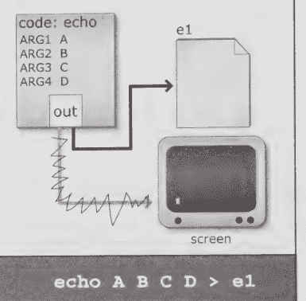

当 `echo` 被执行时，它读取四个参数并简单地将它们写入输出，而 shell 已将该输出重定向到了新文件 *e1*。

#### 创建组合文件

人们经常将相关数据放置在几个不同的文件中，例如一本书的各个章节。有时，需要将分布在多个文件中的数据汇总在一起。

- 1. 输入以下命令来创建新文件：

```bash
date > c1
echo hello this is echo > c2
ls > c3
ls
ls -l c1 c2 c3
```

`ls` 工具将 *c1*、*c2* 和 *c3* 参数解释为文件名。随后会显示每个文件的详细信息列表。

- 2. 给 `cat` 传递相同的三个参数：

```bash
cat c1 c2 c3
```

此命令行指令告知 shell 运行 `cat` 工具并向其传递三个参数。`cat` 工具将每个参数解释为一个要打开、读取并写入输出的文件名。`cat` 工具从第一个文件中读取每一行并将其写入输出（默认情况下是屏幕）。在 `cat` 读取并写入第一个文件的所有行后，它会打开下一个文件，读取其中的所有行，并将其写入输出。这个过程一直持续到 `cat` 达到作为参数列出的最后一个文件的末尾。最终的输出是三个文件被“拼接在一起”或连接起来，这就是该工具命名的由来。

我们还可以告知 shell 将 `cat` 的输出重定向到一个文件。

- 3. 输入以下内容：
  `cat c3 c2 c1 > total`

- 4. 通过输入以下命令检查 *total* 文件：
  `more total`

名为 *total* 的文件由文件 *c3* 的内容、随后是文件 *c2* 的内容，以及 *c1* 的行组成。`cat` 读取的所有行都被写入了新文件 *total*。

当你查看输出结果 *total* 时，无法分辨一个文件的结束位置和另一个文件的开始位置。

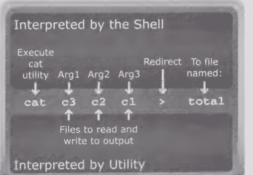

此命令行指令告知 shell 启动一个新进程，向该进程传递三个参数（*c3*、*c2* 和 *c1*），然后将进程的输出重定向到一个新文件 *total*。最后，shell 指令该进程运行 `cat` 工具。一旦启动，`cat` 将所有参数解释为要定位、打开、读取并写入输出的文件名，而输出已连接到文件 *total*。

#### 定位文件中的特定行

我们经常需要定位文件中包含某个单词或字符串的行。

- 1. 重新检查 *total* 文件：
  `cat total`

- 2. 从文件中选择包含目标字符串的行：
  `grep is total`
  文件 *total* 中包含字符字符串 *is* 的每一行都被选中并输出。

- 3. 通过输入以下命令，指令 `grep` 定位文件 `/etc/passwd` 中所有包含字符串 `root` 的行：
  `grep root /etc/passwd`
  此命令行请求 shell 运行 `grep` 工具并向其传递两个参数。许多工具（包括 `sort` 和 `rm`）将所有参数都解释为要操作的文件。它们会对所有这些文件进行排序或删除。但 `grep` 不同。对于 `grep` 工具，第一个参数是*目标字符串*，而*所有其他*参数是要打开并搜索的文件。在这种情况下，`grep` 搜索文件 `/etc/passwd` 中包含目标字符串 `root` 的行，并选中匹配的行。它仅输出匹配的行。原文件不受影响。

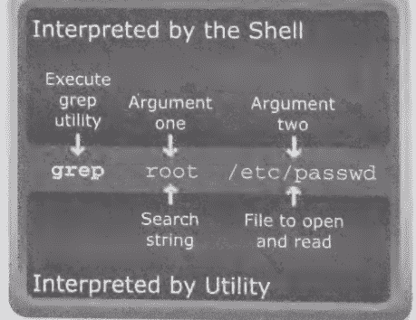

- 4. 在几个文件中查找包含字符串 *is* 的行：

```bash
grep is c1 c2 c3 total
```

`grep` 将字符串 *is* 解释为目标搜索字符串，并将所有其他参数解释为要打开并搜索的文件。文件名和匹配的行将被输出。

## 3.2 启动额外的 Linux 终端会话

在 UNIX 和 Linux 环境中，我们可以同时拥有多个活动会话。例如，在 UNIX 中，我们可以从连接到同一个系统的多个终端登录。这些不同的会话都属于同一个用户，但彼此独立。在 Linux 中，一个显示器和键盘可用于多个登录会话。

一旦你登录到 UNIX 或 Linux 机器（无论是图形模式还是终端模式），你就可以访问其他虚拟终端。

- 1. 按下：
  `CTRL-ALT-F2`
  （在按住 CTRL 键和 ALT 键的同时，按下 F2 键。）
  会出现一个新的登录屏幕。
- 2. 在此提示符下再次登录。
  你将获得一个新的 shell 提示符。
- 3. 输入以下内容：
  `who`
  然后按 ENTER。
  `who` 程序会列出当前用户，你会看到自己被列出了两次。输出的第二列列出了每个用户正在使用的终端端口。你通过初始终端登录了一次，又通过一个虚拟终端（即你通过 F2 访问的那个）登录了一次。
- 4. 按下：
  `CTRL-ALT-F3`
  再次出现一个新的登录提示符。
- 5. 再次登录。

### 退出虚拟终端

要离开第二个终端，我们需要终止 shell。

- 1. 输入：
  `exit`
- 2. **exit** 命令结束此虚拟终端中的登录会话；它不会让你从其他会话中注销。

在 Linux 环境中，我们可以按下 CTRL-ALT-F2, CTRL-ALT-F3, CTRL-ALT-F4 直至 CTRL-ALT-F7（有时还包括 CTRL-ALT-F8），从而在同一台计算机上使用同一个显示器创建七个（有时是八个）独立的会话。当你登录时，如果是一个终端窗口，它可能是终端 F1。如果你登录并进入图形环境，它使用的是虚拟终端 F7 或 F8。

### 定位图形虚拟终端

你可以使用 CTRL-ALT-F# 命令在活动会话之间来回切换，其中 # 为 1 到 7 或 8。

- 1. 按下：
  `CTRL-ALT-F7`
  如果你启动了图形桌面，它通常位于这里，不过也可能在 F8。
- 2. 如果你登录到了一个终端，可以通过按下以下键返回，可能是：
  `CTRL-ALT-F1`

通过 F 键提供的多个登录会话允许我们第二次登录以测试多用户功能，同时运行图形化和基于字符的会话，并且正如你将看到的，可以杀死导致终端冻结的进程。

## 3.3 管理输入和输出

每个启动的进程都有三个定义的通信位置或“门”。一个是它的输入，一个是写入输出的地方，第三个用于写入任何错误消息。通常，工具的输出默认定向到你的终端。你已经尝试将输出重定向到文件和其他工具。我们还可以告知 shell 将输入连接到哪里。

### 指定文件作为输入

有两种方法可以让工具打开并读取文件。你已经使用过其中一种，即将文件名作为参数传递给工具。工具只需直接定位该文件并读取它。

- 1. 例如，输入以下命令：
  `sort mypasswd`
  这里指令 shell 运行 `sort` 工具并向其传递一个参数 `mypasswd`。对于 `sort` 工具，参数 `mypasswd` 被解释为一个要打开和读取的文件。`sort` 从 `mypasswd` 中读取各行，对内容进行排序，并将数据输出到其输出端，而输出端默认连接到工作站屏幕。

  因为 `sort` 有参数，它将该参数解释为文件，而不会从其输入“门”读取。只有在没有文件名参数时，`sort` 才会从其输入端读取。

- 2. 输入：
  `who | sort`
  在这种情况下，`sort` 没有参数，因此它从输入端读取，而 shell 已将该输入端连接到 `who` 的输出。

  我们还可以指令 shell 将一个文件连接到工具的输入。

- 3. 输入以下内容：
  `sort < mypasswd`
  结果与 `sort mypasswd` 命令相同。屏幕上会显示文件 `mypasswd` 的排序版本。此命令中的 `<` 是给 shell 的指令，要求其打开文件 `mypasswd` 并将该文件连接到 `sort` 的 `input`（输入）。由于没有给 `sort` 提供参数，`sort` 工具本身不会打开文件。shell 自行打开文件并将其连接到 `sort` 的输入。

- 4. 我们也可以将文件连接到其他工具的输入。例如，输入：
  `cat < mypasswd`
  在这种情况下，我们指令 shell 将文件 `mypasswd` 连接到 `cat` 的 `input`（输入）。由于没有指定输出目的地，输出默认连接到显示器。因此，`cat` 读取文件 `mypasswd` 的内容并将其写入输出，而输出连接到工作站屏幕。


| 命令 | 说明 |
| :--- | :--- |
| `utility > filename` | Shell 将实用程序的输出连接到 `filename`。 |
| `utility >> filename` | Shell 将实用程序的输出连接到文件的末尾（追加）。 |
| `utility < filename` | Shell 将 `filename` 连接到实用程序的输入。 |
| `utility1 \| utility2` | Shell 将 `utility1` 的输出连接到 `utility2` 的输入。 |

**表 3-3** 重定向操作符

输入重定向符号是一个重要的特性，因为正如你即将看到的，许多实用程序在编写时并未设计用于打开文件。我们必须指示 Shell 打开文件并将其连接到实用程序的输入。

到目前为止我们讨论过的重定向操作符已在表 3-3 中描述。

#### 将文件重定向到 `spell` 的输入

许多 UNIX 系统包含一个拼写检查程序，用于检查文件中的拼写错误单词。在某些系统中，`spell` 程序仅从输入读取，它不能打开文件。我们必须指示 Shell 打开文件，并将其连接到运行 `spell` 进程的输入。

- 1. 使用以下命令检查 `users_on` 中的拼写错误单词：
  `spell < users_on`
- 2. 如果提示未找到命令，请输入：
  `ispell -l < users_on`

文件中所有 `spell` 在联机字典文件中找不到的字符串都被视为拼写错误单词，并显示在屏幕上。在这种情况下，Shell 打开文件 `users_on` 并将其连接到 `spell` 的输入。由于你没有重定向输出，因此它显示在屏幕上。

#### 确定实用程序从哪里读取输入

在这些练习中，你经常指定文件名作为参数。

- 输入以下代表性命令：
  `sort total`

字符字符串 `total` 被作为参数传递给 `sort`。`sort` 程序将 `total` 解释为要打开、读取并排序的文件。输出是文件 `total` 中各行排序后的版本。

#### 使用默认输入源

之前的练习提出了一个问题：如果没有提供文件名参数，实用程序将从其输入“门”读取。如果我们没有告诉 Shell 将文件或另一个实用程序的输出连接到输入，那么实用程序在从其输入读取时会发现什么？

- 1. 输入以下命令。没有给出文件名作为读取参数，也没有将任何实用程序的输出重定向到该进程。
  `sort`
  光标移动到新的一行。没有显示 Shell 提示符。

- 2. 输入以下行：
  ```
  hello
  DDD
  2
  Hello
  110
  good-bye
  ```

- 3. 按 ENTER 键将光标移动到新行，然后再次按 ENTER 键。

- 4. 在独立的一行中，按下：
  `CTRL-D`（按住 CTRL 键并按一次 D 键。）
  你刚才输入的各行排序后的版本将显示在屏幕上。

当一个新进程首次启动时，默认输入是终端键盘。输出和错误消息最初连接到终端屏幕。

由于在前面的命令中没有指定文件名参数，`sort` 实用程序从其输入读取，而其输入连接到默认输入源——你的键盘。你输入文本行，然后输入文件结束命令 CTRL-D。这个组合键向实用程序表明没有更多输入，实用程序可以执行其操作然后退出。`sort` 实用程序读取你输入的行，对其进行排序，然后写入其输出。由于 `sort` 的输出没有被重定向，因此它被写入你的屏幕。

- 5. 启动另一个实用程序，不指定输入或输出目的地：
  `cat`

- 6. 输入几行内容。
  当你输入一行时，它会显示在屏幕上。当你按下 ENTER 时，该行被传递给 `cat`，`cat` 读取该行并将其写入输出（屏幕）。该行在下方出现，作为你输入行的重复。

- 7. 输入几行后，换到新行并按下：
  `CTRL-D`
  在 `cat` 终止后，Shell 显示一个新的提示符。

- 8. 我们可以结合默认输入源指定输出重定向。输入以下内容：
  `sort > sort-test`

- 9. 输入几行文本。

- 10. 完成后，按 ENTER 键使光标处于独立的一行。然后按下：
  `CTRL-D`

- 11. 检查新文件的内容：
  `more sort-test`

你指示 Shell 将 `sort` 的输出连接到新文件 `sort-test`，但你没有为 `sort` 指定任何输入。默认情况下，如果输入没有被重定向到另一个源，它将连接到键盘。`sort` 实用程序将你输入的内容作为输入读取并写入其输出。因为你指示 Shell 将 `sort` 的输出连接到新文件 `sort-test`，所以当 `sort` 写入输出时，它进入了该新文件。

#### 使用 cat 创建文本文件

你通常会使用编辑器（如第 4 章讨论的视觉编辑器 `vi`）来创建文本文件。然而，在精通编辑器之前，你可以通过使用其他几个实用程序快速创建小型文本文件。

- 1. 输入以下内容：
  `cat > first_file`
  然后按 ENTER。
  光标返回到下一行的开头。Shell 不显示新的提示符。此命令行指示 Shell 启动 `cat` 实用程序并将其输出连接到新文件 `first_file`。没有要求重定向输入，因此输入仍连接到默认源——你的键盘。你不再与 Shell 通信；你现在输入的内容由 `cat` 实用程序读取，它只需将从输入读取的所有内容写入输出。

- 2. 输入以下行：
  `This is a line of text in the first_file.`

- 3. 按 ENTER 然后输入：
  `This is another.`
  `cat` 实用程序读取你的输入并将其写入输出，而 Shell 已将输出连接到名为 `first_file` 的新文件。

- 4. 要告知 `cat` 实用程序你已完成添加文本，请按 ENTER 键前进到新行，然后按下：
  `CTRL-D`
  这个 CTRL-D（文件结束，或 EOF 字符）告诉 `cat` 没有进一步的输入。`cat` 实用程序终止，Shell 显示另一个提示符。

- 5. 在 Shell 中，使用以下命令获取文件列表：
  `ls`
  列出了名为 `first_file` 的文件。

- 6. 通过输入以下内容检查 `first_file` 的内容：
  `more first_file`
  `first_file` 文件仅由你输入的文本组成。系统没有向文件中添加关于文件的额外数据（如文件名或你的姓名）。文件仅包含你输入的文本。文件名保存在目录中。关于文件的信息存储在与你的文件相关联的系统存储单元中。

- 7. 使用另一个 `cat` 命令创建另一个文本文件：
  `cat > second_file`

- 8. 添加一些文本，然后按 CTRL-D 返回 Shell。

- 9. 使用以下命令获取当前目录中的文件列表：
  `ls`

- 10. 使用以下命令检查 `second_file` 的内容：
    `more second_file`

该文件由你作为 `cat` 输入而 entered 的行组成。默认情况下，键盘连接到 `cat` 的输入。你输入的任何内容都由 `cat` 从键盘读取并写入输出，而输出连接到文件。`cat` 实用程序并不复杂；它只是简单地读取输入并写入输出，不进行任何修改。命令 `cat > filename` 指示 Shell 将 `cat` 的输出连接到文件 *filename* 并执行 `cat` 实用程序。

#### 使用重定向管理输入和输出

文件输入和输出重定向符号的作用和效果总结在表 3-4 中。

- 1. 使用以下命令创建一个名为 *file2* 的新文件：
  `head -12 /etc/passwd > file2`

- 2. 尝试表 3-4 中的每个命令并确认表中的数据。

#### 自测 1

回答以下问题，然后使用本章中的信息检查你的答案。

- 1. 以下每个命令的效果是什么？
  A. `sort file1 file2`
  B. `wc file1 file2`
  C. `grep file1 file2`
  D. `who | sort > abc`
  E. `cat file1 file2 file3`


- 2. 什么命令可以对 `/etc/passwd` 文件中所有包含数字 0 的行进行反向排序？

- 3. 以下每项操作执行后，文件 *file1* 中的内容会是什么？
    A. `echo file1 >> file1`
    B. `cat > file1`
- 4. 如何访问虚拟终端 3？
- 5. 什么命令会读取其参数并将其写入输出？

| 命令 | 输入 | 输出 | 效果 |
| :--- | :--- | :--- | :--- |
| `sort` | 键盘 | 显示屏幕 | **sort** 工具没有接收到参数，因此不打开任何文件。相反，**sort** 从输入端读取，默认情况下输入端连接到键盘。 |
| `sort > file1` | 键盘 | *file1* | 键盘输入被排序，且输出连接到 *file1*。 |
| `sort >> file1` | 键盘 | *file1* | 键盘输入被排序，其输出被追加到 *file1* 的末尾。 |
| `sort < file2` | *file2* | 显示屏幕 | *file2* 由 shell 打开并连接到 **sort** 的输入端。输出未被重定向，而是显示在屏幕上。 |
| `sort file1` | *file1* | 显示屏幕 | *file1* 作为参数传递给 **sort**，**sort** 打开该文件并读取其内容。输出连接到屏幕。 |
| `sort < file1 > file3` | *file1* | *file3* | Shell 将 *file1* 连接到输入端，将 *file3* 连接到 **sort** 的输出端。当 **sort** 运行时，它从输入端读取，对行进行排序，并写入输出端。文件 *file1* 中的行被排序，输出被放置在 *file3* 中。 |

**表 3-4** 传递参数和打开文件

| 命令 | 输入 | 输出 | 效果 |
| :--- | :--- | :--- | :--- |
| `sort file1 > file4` | `file1` | `file4` | Shell 将 `file1` 作为参数传递给 `sort`，并将 `sort` 的输出连接到文件 `file4`。`sort` 工具打开 `file1` 并对行进行排序；输出发送到 `file4`。 |

**表 3-4** 传递参数和打开文件 *(续)*

## 3.4 在命令行中使用特殊字符

当我们与 shell 交互时，唯一的工具就是键盘。键盘上可用的字符以及通过组合这些字符创建的词或令牌（token），构成了我们与 shell 交流所能使用的全部语言。许多字符对 shell 具有特殊含义，例如重定向符号 `>`。Shell 将 `>` 解释为将前一个工具的输出连接到紧跟在重定向符号之后的文件的指令。同样，`|` 指令用于将一个工具的输出连接到另一个工具的输入。

本节将介绍 shell 解释的其他特殊字符。

### 使用通配符替换文件名

对 shell 而言，一个特殊的字符是我们在指定文件名时可以使用的 *通配符*（wildcard）字符。

- 1. 如果你在命令行上在 `wc` 工具之后列出几个文件名，`wc` 工具会检查所有这些文件。输入此命令：
  `wc total lost-days`
  每个文件中的元素数量将被计数并输出，同时显示所有文件的总计。

- 2. 要让 `wc` 检查所有以字母 `u` 开头的文件名，请输入：
  `wc u*`
  Shell 将 `u*` 解释为一条指令，将命令行上的字符串 `u*` 替换为当前目录下所有以字母 `u` 开头且其后跟零个或多个字符的文件名。然后 Shell 运行 `wc` 工具，将它生成的全部参数（即目录中所有匹配的文件名）传递给该工具。

```bash
echo u*
```

Shell 将字符串 `u*` 替换为当前目录下以字母 *u* 开头的文件名。这些名称被作为参数传递给 **echo**，而 **echo** 会将这些参数写入输出。

- 4. 你还可以通过输入以下命令，让 shell 将当前目录下的`所有`文件作为参数传递给某个命令：

```bash
echo *
```

Shell 将星号替换为目录中所有文件的名称，然后执行 **echo**，将生成的全部文件名作为参数传递。**echo** 工具读取其参数（文件名）并将其写入输出，在这种情况下，输出就是你的屏幕。

- 5. 通过输入以下命令，对目录中所有文件的所有元素进行词数统计：

```bash
wc *
```

Shell 将 `*` 替换为当前目录下所有文件的名称，并将所有名称作为参数传递给 **wc**。**wc** 工具检查所有列为参数的文件，并显示如下输出：

```
 8  39 190 junk
 9  29 175 mypasswd
 8  39 190 phon
 1   5  22 today
12  59 310 total
14  80 220 users_on
52 251 1107 total
```

**wc** 的输出是一个关于所有输入文件的信息列表，随后是这些计数的总计。

> **注意：** 如果你创建了一个名为 *total* 的文件，它会按照字母顺序与其他文件一起列出。**wc** 输出末尾的 *total* 是该工具检查的所有文件的统计总和。

你还可以让 shell 将所有文件名作为参数传递给 **grep** 工具。**grep** 工具会在目录中的所有文件中搜索目标字符串。

- 6. 输入以下内容：
  `grep is *`

这条命令行告诉 shell 将星号替换为当前目录下列出的所有文件名。传递给 `grep` 的第一个参数是一个字符串，`grep` 将其解释为 *目标*。`grep` 将剩余的参数解释为 *文件名*。随后，`grep` 工具在所有列为参数的文件中搜索每一行是否包含目标字符串，并输出匹配的行。

### 访问 Shell 变量

我们在生活中一直使用变量。我们会填写这样的表格：

*姓（Last name）：* ____________________
*名（First name）：* ____________________

除了 Cher 以外，我们所有人的记忆中都有对应于“姓”和“名”这两个变量的值。

我们可以使用特定的字符来指示句子中的哪些令牌是变量。例如，考虑：

> I am `$fname` `$lname`. I live in `$city`. I was born in `$birthplace`.

当我阅读上一行时，我读到的是：

> I am John Muster. I live in Berkeley. I was born in Canton, Ohio.

对我来说，变量 `fname` 的值是 *John*。

每个人对这一行的解读都不同，因为每个人对于用美元符号标识的变量都有不同的 *值*。在这种情况下，我们将 `$` 解释为：“查找具有以下名称的变量的值，并用该变量的值替换美元符号和变量名。”

- 1. 通过输入以下内容，要求 shell 计算一个变量的值并将其传递给 `echo`：
  `echo $USER`

- 2. 如果没有 `USER` 变量，请尝试：
  `echo $LOGNAME`

`$` 字符对 shell 具有相同的特殊含义。它告诉 shell “定位接下来的变量名，并用该变量的值替换此字符串”。在你刚刚输入的命令中，`USER` 是 shell 计算的变量，因为它前面有一个 $。在用其值（即你的实际登录名）替换变量和 $ 之后，shell 将你的名字作为参数传递给 **echo**。然后 **echo** 读取该参数并将其写入你的屏幕。这里关键的区别在于，shell 传递给 **echo** 的是你的登录名，而不是 `$USER`。Shell 解释变量并传递其值，而不是传递其名称。

让 shell 计算 `$USER` 并用其值替换变量会非常有用。

- 3. 输入：
  `who | grep $USER` 

  Shell 用你的登录 ID 替换 `$USER`，然后将该值作为第一个参数传递给 **grep**。对于 **grep** 来说，第一个参数就是它的搜索字符串。**grep** 会从 **who** 的输出行中筛选出包含你登录 ID 的行并输出到你的屏幕上。

- 4. 通过输入以下内容，让 shell 计算其他一些变量：
  `echo my shell is $SHELL and my home is $HOME` 

  屏幕上的输出是所有参数，其中变量已被替换为其值。

  在这种情况下，shell 计算了两个变量。结果值作为参数传递给 **echo**。**echo** 工具读取所有参数并将其写入输出。默认情况下，输出连接到你的显示器。第一个变量 `SHELL` 的值是在登录时为你启动的 shell；另一个变量 `HOME` 是你的主目录在系统中的位置。你的 shell 在你登录时获取了这些变量及其值。你的同事们有他们自己的变量值。shell 以及你运行的所有其他程序都会被赋予这些变量和值。我们可以在同一条命令行上同时使用变量和文件名扩展。

- 5. 输入：
  `grep $USER *` 

  Shell 将变量 `USER` 替换为其值（登录名），这成为了第一个参数。Shell 将 * 替换为当前目录下所有文件的名称，这些成为了第二个、第三个等参数。**grep** 将你的名字解释为搜索字符串，并在所有文件中查找包含你登录名的行。

- 6. 变量可以用来统计你登录的次数：
  `who | grep $USER | wc -l`


#### 列出环境变量

当你登录时，解释命令的 shell 程序将作为一个进程启动。为了使你的计算环境适应你的需求，系统会向你的特定 shell 提供若干变量的值。我们可以获取这些环境变量的列表。

在 shell 中，输入以下内容：

```
env | more
```

```

或者

```
printenv | more
```

输出结果是当前为你的 shell 设置的部分变量列表。在显示的许多行中，你应该能找到类似以下的内容。

对于 C shell 用户：

```
USER    forbes
SHELL   /bin/csh
HOME    /users1/programmers/forbes
PATH    /usr/ucb:/bin:/usr/bin:/usr/local:/lurnix/bin:/usr/new:.
```

对于 **bash** 和 Korn shell 用户：

```
HOME=/usr/home/nate
LOGNAME=nate
PATH=/usr/ucb:/bin:/usr/bin:/usr/local:/lurnix/bin:/usr/new:.
SHELL=/bin/ksh or (/bin/bash)
```

这些变量及其值对于 shell 的正常运行至关重要。你的输出将包含如下变量，但其值将与你的账户相匹配。

- `user` 或 `USER` 或 `LOGNAME` 变量是你登录时输入的账户名称。
- `shell` 或 `SHELL` 行指明了在登录时启动哪一个 shell 程序来解释你输入的命令：`csh` 是 C shell，`sh` 是 Bourne shell，`ksh` 是 Korn shell，`bash` 是 `bash` shell，`tcsh` 是 `tcsh` shell。它们处理基本命令的方式基本相同，目前运行哪一个几乎没有区别。
- `home` 或 `HOME` 变量是你工作区或主目录的位置。
- `path` 或 `PATH` 变量列出了 shell 查找你所请求的 UNIX 实用程序的目录。

本地变量和环境变量的主题将在第 9 章中详细探讨。

#### 指示 Shell 不要解释特殊字符

字符 `*`、`?`、`!`、`[`、`>` 和 `$` 对 shell 具有特殊含义。有时我们需要指示 shell 不要解释特殊字符，而是将它们视为普通字符。有几种方法可以告诉 shell 关闭对特殊字符的解释。

1. 例如，输入以下内容：

`echo we can output a \* uninterpreted`

输出结果包含一个字面量 `*` 字符。

响应此命令时，shell 不会将星号展开以匹配文件名，而是将其作为一个单字符参数传递给 **echo**。它未被解释。**echo** 实用程序将星号读取为一个单字符参数并将其输出（在本例中输出到你的屏幕上）。当特殊字符前面有反斜杠 (`\`) 时，shell 将该字符解释为普通字符（不具有任何特殊含义）。换句话说，shell 将反斜杠字符解释为一条指令，要求将随后的任何字符视为没有特殊含义的普通字符。一旦 `*` 被传递给 **echo**，它就只是一个被输出的星号。

2. 输入以下内容：

`echo \$HOME`

输出结果是字面字符串 `$HOME`（不含反斜杠）。由于前面有反斜杠，`$` *没有* 被解释为计算 `HOME` 变量的指令。shell 将 `$` 解释为一个普通的美元符号，并将字符串 `$HOME` 作为参数传递给 **echo** 实用程序。

在之前的命令中，shell 在解释了 `\*` 和 `\$` 后传递给 **echo** 的参数并不包含反斜杠。当 shell 解释 `\*` 时，它将 `\` 读取为一条具体指令：不要给紧随其后的字符赋予特殊含义。唯一被传递的字符是 `\` 之后的那个字符。反斜杠本身没有被传递给 **echo**，因为 shell 将其解释为了“不要解释后续字符”的指令。

3. 尝试以下内容：
`echo \$USER \* $USER`
输出结果是 `$USER *` 和你的登录名。最后一个 `$USER` 被解释了，因为 `$` 前面没有反斜杠告诉 shell 不要解释它。
同样地，我们可以使用 `echo` 将被解释和未被解释的变量放入文件中。

4. 输入：
`echo var1 $USER > test-interp`
`echo var2 \$USER >> test-interp`
`more test-interp`
shell 解释了 `var1` 行中 `$USER` 里的 `$`，但没有解释 `var2` 行中的 `$`。注意 `test-interp` 中的第二行是：

`var2 $USER`

shell 没有将反斜杠传递给 `echo`。

5. 使用 `grep` 在 `test-interp` 文件中查找字符串：
`grep $USER test-interp`
shell 解释了变量 `$USER`，并将你的登录名值作为第一个参数传递给 `grep`。然后 `grep` 将第一个参数（你的登录名）解释为搜索字符串。包含你登录名的行被选中并输出：

`grep \$USER test-interp`

这一次，shell 将反斜杠解释为 *不要* 解释下一个字符（即 `$`）的指令，因此字符串 `$USER` 被作为第一个参数传递给 `grep`。`grep` 实用程序在文件中搜索实际的字符串 `$USER`。文件名扩展通配符 `*` 字符的情况也是如此。

6. 输入：
`echo u*`
`echo u\*`
`wc u*`
`wc u\*`

shell 将 `u*` 解释为将字符 `u*` 替换为当前目录下所有以字母 `u` 开头的文件名的指令。然后 shell 将这些名称作为参数传递。`echo` 读取这些参数并将其写入输出。`wc` 将参数解释为文件名，并计算每个命名文件的元素数量。

shell 将 `u\*` 解释为一个 `u` 和一个未被解释的 `*`。传递给 **echo** 的参数是 `u*`，它将其显示出来。对于 **wc** 来说，`u*` 是一个文件名，但它无法定位该文件。

#### 不解释 ENTER 键

当你在命令行末尾按下 ENTER 键时，你是在发出命令结束的信号。shell 将 ENTER 解释为一个特殊字符，它指示要执行的命令已结束，并开始处理。当我们输入很长的命令行时，通常希望将其一部分放在第二行。然而，一旦我们按下 ENTER，命令就会被执行。我们需要能够告诉 shell 不要解释 ENTER。

1. 输入以下命令：
```
who >\
```
然后按下 ENTER。
反斜杠指示 shell 不要解释紧随其后的字符。因此，ENTER 没有被解释。命令尚未结束。此时，shell 还没有被告知处理命令行，因为没有收到真正的 ENTER。它在等待更多输入。事实上，你目前输入的内容还不是一个完整的命令。shell 需要将 **who** 的输出重定向到一个文件，但还没有包含文件名。

2. 输入文件名：
```
users2
```
再次按下 ENTER。
这一次，ENTER 前面没有反斜杠。shell 将其解释为一个真正的 ENTER，标志着命令行的结束，而此时该命令行恰好跨越了两行输入。它被执行了。

3. 通过输入以下内容确认新文件已创建：
```
ls
more users2
```

4. 检查历史列表以查看之前的命令：
```
history
```
`who > users2` 是一个命令，尽管它是分两行输入的。

当你希望命令行跨越多个输入行时，在第一行的 ENTER 之前加上一个反斜杠字符，以指示 shell 不要解释 ENTER 的特殊含义。

#### 不解释字符串中的多个字符

反斜杠仅关闭一个字符的解释，即紧随其后的那个单字符。
我们可以关闭多个字符的解释。

1. 使用单引号输入以下内容：
`echo '$USER * $USER'`
`echo '$HOME $USER'`
输出结果是输入的字面字符字符串。在单引号内部，`*` 和 `$` 仅被视为字符，因此 shell 不会展开 `*` 来匹配文件名。`$HOME` 和 `$USER` 不会被计算为变量值。传递给 `echo` 的参数仅是未被解释的字符字符串。
我们可以指示 shell 解释一行的一部分而不解释其他部分。

2. 输入以下内容，请仔细注意单引号：
`echo $USER '$HOME $USER' $USER`
命令行中单引号内部的部分不被解释，而是原样作为参数传递给 `echo`。不在引号中的部分被解释，并且 `$USER` 变量被替换为变量值。
当 shell 遇到第一个单引号时，它会关闭所有特殊字符的解释。第二个单引号将重新开启解释。单引号内的任何特殊字符都不会被解释。

#### 创建多标记参数

因为我们可以告诉 shell 不要解释单引号内的特殊字符，所以我们可以告诉 shell 不要解释空格。

1. 向 `echo` 传递几个参数，并在它们之间加入多个空格：
`echo AA    BB    CC    DD`
输出结果不包含多个空格：
`AA BB CC DD`
shell 将一个或多个空格解释为命令行上标记（tokens）的分隔符。shell 将 `echo` 解释为实用程序，并向其传递四个不同的参数。它不会传递包含单词和空格的完整行。


当 **echo** 读取其参数列表时，它会输出第一个参数，然后是一个空格，接着是下一个参数，再是一个空格，以此类推。

- 2. 使用引号告诉 shell 不要解释特殊字符（包括空格）：
  `echo 'AA  BB  CC  DD'`
  一个单一参数被传递给 **echo**。该参数由输入时的整行内容组成，包括空格，即：
  `AA    BB    CC    DD`
  shell 不将空格解释为分隔不同参数的标志，因此它被视为一个整体参数。**echo** 输出这个单一参数，包括其中的所有空格。

#### 传递复杂参数

现代计算机最实用的功能之一就是数据库管理。UNIX 操作系统提供了几个用于处理数据库信息的实用程序。其中最灵活的一个是 **awk**。

- 1. 输入以下命令：
  `ps -ef`
  `ps -ef | awk '{print $1}' | more`
  **awk** 实用程序从 **ps** 输出的每一行中提取第一个字段。**awk** 的输出结果显示在屏幕上。

- 2. 修改命令行以指示 **awk** 选择第二个字段。输入：
  `ps -ef | awk '{print $2}'`
  下表描述了该命令行的各个组成部分：

| 命令 | 解释 |
| :--- | :--- |
| `ps -ef` | 指示 shell 运行 **ps** 实用程序并传递参数 **-ef**，**ps** 将其解释为列出所有进程的指令。 |
| `\|` | 指示 shell 将 **ps** 的输出连接到下一个实用程序 **awk** 的输入。 |
| `awk` | 指示 shell 运行 **awk** 实用程序。 |
| `'`, `'` | 指示 shell 不要解释单引号之间的任何特殊字符，而是将包含的字符原样作为参数传递给 **awk**。 |
| `{print $2}` | 这是传递给 **awk** 的引号字符串的内容。**awk** 实用程序将此指令解释为：“对于每一行输入，仅打印第二个字段。” |

- 3. 通过输入以下内容让 `awk` 选择多个字段：
  `ps -ef | awk '{print $2, $1, $4}'` 
  `awk '{print $2, $1}' lost-days`

输出结果是文件 `lost-days` 中所有记录（行）的第二个字段、一个空格，然后是第一个字段。这之所以有效，是因为 shell 没有解释像 `$2` 这样的特殊字符；相反，它将整个 `{print $2, $1}` 原样传递给 `awk`，由 `awk` 将其解释为指令。

`awk` 实用程序可用于选择和打印特定字段、进行计算以及根据特定字段的值定位记录。您将在第 5 章中更广泛地使用它。

#### 与进程通信

我们指示 shell 启动进程。通常进程在完成任务后会直接退出。我们还可以使用控制字符向进程发送重要信号。

#### 信号文件结束

我们已经使用控制字符 CTRL-D 来结束输入。

- 1. 例如，输入：
  `wc` 

- 2. 输入几个单词，然后按 ENTER。

- 3. 在新行上，按下：
  `CTRL-D`

CTRL-D 是文件结束（EOF）标志。当我们从键盘向实用程序的输入端输入文本时，通过按下 CTRL-D 来发出输入结束的信号。`wc` 实用程序会计算我们输入的所有文本中的行数、单词数和字符数，直到我们按下 CTRL-D。随后 `wc` 实用程序显示结果并退出。每个文件的末尾都有一个 CTRL-D (EOF) 字符，用以指示停止读取的位置。

#### 告知进程退出

还有其他重要的控制字符。

- 1. 再次启动 `wc`，不带输入或参数：
  `wc` 

- 2. 输入一些文本。

- 3. 不要使用通常的文件结束字符，而是按下：
  `CTRL-C`

`wc` 程序停止运行，并显示 shell 提示符。但是，没有显示 `wc` 的任何输出。CTRL-C 是中断信号，它会杀死该进程。文件结束符 CTRL-D 的意思是：“输入结束，对输入内容执行相应操作然后退出”，而 CTRL-C 的意思是：“停止，收拾东西，不再处理任何内容，立即离开。” 因此没有输出显示。

我们使用哪个控制字符取决于实用程序的工作方式。

- 4. 例如，输入：
  `sleep 40`
  没有显示 shell 提示符。`sleep` 实用程序正在计时 40 秒。

- 5. 尝试使用以下字符结束 `sleep` 进程：
  `CTRL-D`
  因为 sleep 没有在“读取”输入，所以 CTRL-D (EOF) 没有意义。

- 6. 通过按下以下字符杀死进程：
  `CTRL-C`
  中断信号到达进程，进程随即终止。

#### 将进程发送到后台

系统上运行的许多进程并不与特定用户相关联，而是操作系统的重要组成部分。这些进程在*后台（in the background）*运行，对大多数用户是不可见的。本节探讨用户如何运行后台进程。

- 1. 输入以下命令：
  `sleep 6`
  shell 运行 `sleep` 并将数字 6 作为参数传递给它。在 `sleep` 计时到 6 期间，shell 会等待。直到 `sleep` 完成之前，不会出现新的提示符。

- 2. 输入：
  `sleep 60 &`
  此命令行告诉 shell 在后台运行 `sleep` 命令。末尾的 & 符号告诉 shell 执行整条命令行，但 shell 不会等待 `sleep` 完成，而是立即返回一个新的 shell 提示符，以便您可以继续工作。

- 3. 通过输入以下命令获取当前程序的列表：
  `ps`

**sleep** 进程仍在运行。执行此命令时会显示一个数字。这是 **ps** 实用程序在执行时的进程 ID 编号。当进程结束时，屏幕上会发送一条消息。

这一特性允许我们在后台运行耗时较长的程序，同时在前台继续处理其他任务。显然，对于运行速度很快的命令进程，将其放入后台意义不大，但在某些时候——例如运行长时间搜索、数据库查询等——它可以节省时间和精力。

#### 使用实用程序进行编程

到目前为止，在这些示例中，与 shell 的通信都是交互式的。我们输入一行命令行，然后 shell 读取并处理我们从键盘输入的所有内容。shell 也可以读取放在文件中的指令。

#### 创建命令文件

在下一章研究可视化编辑器之前，我们可以使用 `cat` 来读取我们输入的内容并将其写入文件。

- 1. 输入：
  `cat > commands-file`

- 2. 输入以下行，每行后按下 ENTER：
  `echo Hi $USER`
  `date`
  `cal`
  `sleep 2`
  `ps`
  `echo Bye $USER`

- 3. 按下以下键结束输入：
  `ENTER`
  然后在新行按下：
  `CTRL-D`

- 4. 确保文件内容如前所述：
  `more commands-file`

如果有错误，使用 `rm commands-file` 删除文件并重新创建。在学习使用编辑器之前，没有简单的方法来修改文件。

#### 指示 shell 读取文件

我们可以告诉当前的 shell 读取一个文件并执行文件中的每一行。

- 1. 如果您使用的是 **csh** 或 **tcsh** shell，请输入：
  `source commands-file` 

- 2. 如果您使用的是 **ksh**、**bash** 或 **sh** shell，请使用“点”命令输入：
  `. commands-file` 
  文件内容中的命令将依次执行。

**source** 和点 (.) 命令都指示当前 shell 读取作为参数指定的文件，并将文件中的每一行像我们刚刚从键盘输入一样执行。在这种情况下，我们将其称为“source（源化）”文件。

#### 自测 2

回答以下问题，然后利用本章中的信息检查您的答案。

- 1. 如果独立执行以下各项，*file1* 的内容将是什么？
  A. `grep file1 * > file1` 
  B. `echo $USER $HOME > file1` 

- 2. 以下每个命令是如何工作的？结果是什么？
  A. `spell file1` 
  B. `spell < file1` 
  C. `cat file1 | spell` 
  D. `grep 'Joan Heller' faculty` 
  E. `grep \$USER file1`


- 3. 什么命令可以指示 `awk` 仅输出每个用户登录的时间？
- 4. 命令 `echo $PATH` 的输出是什么？

## 3.5 修改用户环境

UNIX 操作系统的强大之处之一在于其灵活性。系统允许我们自定义各种程序以满足个人需求。我们可以量身定制 shell 的行为方式，并指示编辑器包含某些功能。我们可以使用包含自定义颜色、图标和启动程序的图形桌面。每个用户都可以量身定制或修改所有这些环境特性。本节将探讨定制功能的一小部分。

### 指示 Shell 不要覆盖文件

到目前为止，我们一直使用 `>` 符号来指示 shell 将实用程序的输出连接到一个新文件。当我们将输出重定向到一个现有文件时会发生什么，取决于你使用的 shell 以及名为 `noclobber` 的变量的值。作为用户，我们可以决定 shell 应该覆盖现有文件还是不覆盖。

- 1. 为了确保 shell 在本次演示中处于“文件覆盖（file clobbering）”模式，请输入以下命令。
  如果你使用的是 `csh` 或 `tcsh` shell，请输入：
  `unset noclobber`
  如果你使用的是 `ksh` 或 `bash` shell，请输入：
  `set +o noclobber`
  sh shell 在我们将输出重定向到现有文件时总是会覆盖文件。我们无法改变这一行为。

- 2. 创建一个新文件并查看其内容，输入：
  `ls > test-list`
  `cat test-list`

- 3. 指示 shell 将 `date` 的输出放入同一个文件中并检查该文件：
  ```bash
  date > test-list
  cat test-list
  ```

文件的原始内容已被 `date` 的输出*替换*或*覆盖*。

当我们告诉 shell 将实用程序的输出重定向到文件时，*如果文件不存在*，shell 会创建该文件。如果已经存在同名文件，则当前内容将被删除，以为新输出腾出空间。

- 4. 指示 shell 在重定向输出时不覆盖文件：
  在 `csh` 或 `tcsh` shell 中，输入：
  ```bash
  set noclobber
  ```
  在 `ksh` 或 `bash` shell 中，输入：
  ```bash
  set -o noclobber
  ```

- 5. 尝试将另一个实用程序的输出重定向到该文件：
  ```bash
  ls > test-list
  ```
  屏幕将显示一条错误消息。

- 6. 要查看 `noclobber` 等 shell 变量是开启还是关闭，请尝试以下操作：
  在 `csh` 或 `tcsh` shell 中，输入：
  ```bash
  set
  ```
  将显示当前设置的变量列表。
  在 `ksh` 或 `bash` shell 中，输入：
  ```bash
  set -o
  ```

将显示 shell 操作变量列表。
在 `csh` 或 `tcsh` shell 中，我们使用 `set` 开启 *noclobber*，使用 `unset` 关闭。在 `ksh` 和 `bash` shell 中，我们使用 `set -o` 开启 *noclobber*，使用 `set +o` 命令关闭，如下所示：

| SHELL | 开启 noclobber | 关闭 noclobber |
|---|---|---|
| csh, tcsh | `set noclobber` | `unset noclobber` |
| ksh, bash | `set -o noclobber` | `set +o noclobber` |

### 避免意外登出

如果你不小心在登录 shell 中输入了 CTRL-D，你可能会被登出。文件结束符（EOF）意味着“没有更多输入；退出”，因此 shell 会退出。

- 1. 通过输入以下命令启动一个子 shell 进程：
  `csh`

- 2. 列出你的进程：
  `ps`
  子 `csh` 将出现在进程列表中。

- 3. 通过按下以下键向 shell 发送文件结束信号：
  `CTRL-D`

- 4. 再次列出进程：
  `ps`
  `csh` shell 已经消失。按下 CTRL-D 指示它退出。

- 5. 通过输入以下命令之一启动另一个子 shell：
  `bash`
  或
  `ksh`

- 6. 使用以下命令识别当前进程：
  `ps`
  子 shell 在列表中。

- 7. 通过向子 shell 发送文件结束信号来指示其终止：
  `CTRL-D`
  `ps`
  子 shell 不再运行。

- 8. 我们可以告诉 shell 忽略文件结束符。输入以下命令之一。
  在 `csh` 或 `tcsh` shell 中：
  `set ignoreeof`
  在 `ksh` 和 `bash` shell 中：
  `set -o ignoreeof`

- 9. 现在按下 CTRL-D

你会收到一条消息，告诉你请使用 **exit** 或 **logout**，而不是 CTRL-D。

很快你就会自定义你的账户，使 `ignoreeof` 和 `noclobber` 始终处于设置状态。目前，请在登录后输入每一项，以防止意外覆盖和意外登出。

### 修改提示符

在本书中，我们一直在讨论 shell 提示符。有一些标准的 shell 提示符，如下表所示。你的 shell 显示的提示符（就像你的许多用户环境一样）是可以修改的。

| 提示符 | SHELL |
| :--- | :--- |
| $ | Bourne 和 Korn shell (**sh**, **bash**, 和 **ksh**) |
| % | C shell (**csh** 和 **tcsh**) |
| # | 以 **root** 身份运行的任何 shell |

- 1. 查看当前变量：
  `set | more` 
  如果列表中包含名为 `prompt` 的变量，那么你正在与 **csh** 或 **tcsh** shell 交互。如果 `set` 的输出包含 `PS1` 变量，则你在 **ksh** 或 **bash** shell 中。

- 2. 如果你使用的是 **csh** 或 **tcsh** shell，请输入以下命令：
  `set prompt='myname '` （不要省略空格）
  其中 `myname` 是你希望提示符呈现的任何内容。

- 3. 如果你使用的是 **sh**, **bash**, 或 **ksh** shell，请输入：
  `PS1='myname '` （不要省略空格）

你的提示符现在已重置。这个“个性化”的提示符将一直有效直到你登出。稍后你将学习更多关于设置计算机环境的知识，并且你将有机会永久自定义工作空间的各个方面，例如 shell 提示符和 shell 的行为。

## 3.6 调查运行系统的组成元素

我们一直在检查系统实用程序、进程、shell 交互以及文件系统的一部分。本节将揭开盖子，探讨诸如：实用程序在系统的哪个位置？为什么我登录时会进入我的家目录？为什么我可以读取某些文件而不能读取其他文件？我们如何将命令放入文件并通过读取该文件来运行它们？

### 检查包含实用程序的工具箱

在本章中，你一直在执行要求 shell 运行实用程序的命令，但我们还没有检查这些程序实际位于何处。

- 1. 输入以下拼写错误的命令：
  `dzatte`

- 2. 屏幕上显示的错误消息类似于：
  `Command Not Found`

shell 在报告“Command Not Found”之前在何处查找？我让我五岁的女儿上楼去拿一本书，书要么在书桌上，要么在床头柜上。她离开并带着书回来了。书一定是在书桌上或床头柜上。如果书在床上，而且上面有巨大的红色箭头指向它，她可能会带着错误消息回来：
```
Book Not Found
```
就像那个五岁孩子一样，shell 只在它被告知查找的地方查找。

- 3. 要求 shell 显示 `PATH` 变量的值：
  `echo $PATH`

变量 `PATH` 的值类似于：
`/bin:/usr/bin:/usr/local/bin:/usr/bin/x11:/usr/hosts`

该变量由一系列由冒号分隔的目录组成：冒号就是 shell 在你请求执行某个实用程序时检查的“书桌”或“床头柜”位置。shell 首先检查左侧列出的目录，然后是下一个，依此类推。

`/bin` 目录包含以二进制文件形式存在的一些系统可用实用程序。

- 4. 获取 `/bin` 中实用程序的列表。（注意：/ 很重要，请勿省略。）
  `ls /bin | more`

`ls` 实用程序输出 `/bin` 目录中的文件列表。你可能会认出其中的一些文件——它们是你已经使用过的实用程序，包括 `cat`, `rm` 和 `ls`。这些就是你在输入命令时访问的可执行程序。正如你在检查 `PATH` 时所看到的，`/bin` 并不是唯一包含可执行代码的目录。你的 shell 检查的目录列表 (`PATH`) 可以被修改以包含其他目录。


#### 确定实用程序的位置

Shell 在 `PATH` 变量定义的目录中查找实用程序并报告其位置。

输入：

```
which who
which xterm
which ls
which set
```

如果你查询一个已知存在的实用程序（例如 `set`）的位置，但 Shell 报告找不到它，那么该程序（就像 `set` 一样）是内置在 Shell 中的。Shell 无法在路径中找到它，因为其代码不在一个独立的实用程序文件中，而是在 Shell 本身之中。

搜索路径是使 UNIX 和 Linux 如此灵活的特性之一。当我们想要添加一个新的应用程序或程序时，可以将其添加到路径中的一个目录中，从而立即让所有人都能访问它。或者，我们可以创建一个新目录，将应用程序放入其中，并为应该拥有该新应用程序访问权限的用户修改路径变量。

#### 检查密码文件的元素

实用程序在执行工作时会咨询许多系统文件。当你登录时，一个名为 `login` 的程序会要求你输入密码并启动你的 Shell。你的 Shell 会获取 `USER` 和 `HOME` 等信息，以便访问有关你账户的所需信息。

你的用户 ID 号、可能的密码以及关于你的其他信息存储在一个名为 `/etc/passwd` 的文件中。在独立系统中，驻留在机器上的 `/etc/passwd` 文件包含所有用户的信息。如果系统是一个网络的一部分，允许用户使用相同的密码和登录信息从多台机器中的任何一台登录，那么网络中的其中一台机器包含完整的密码文件信息，并根据需要为其他机器提供服务。这种网络信息服务被称为 NIS。每当你或任何其他用户登录时，系统都会查询本地或 NIS 网络 `passwd` 文件中的相应条目。

- 1. 输入以下命令检查本地密码文件（注意 `passwd` 的拼写）：
  ```
  more /etc/passwd
  ```
- 2. 如果文件非常长，请多次按下空格键（SPACEBAR）翻页。
- 3. 找到你账户的条目。
- 4. 按 **q** 停止并返回 Shell。如果输出中没有你的登录名，你可能处于一个提供密码的网络环境中。
- 5. 要查看来自网络服务器的 *passwd* 信息，请输入：`ypcat passwd | more`
- 6. 找到你账户的条目。
- 7. 按 **q** 停止并返回 Shell。我们可以使用 **grep** 从 *passwd* 数据中筛选出一条记录。
- 8. 根据你使用的是本地还是网络服务密码文件，输入以下命令之一：
  `grep $USER /etc/passwd`
  或
  `ypcat passwd | grep $USER`

在这些版本中，你是在要求 Shell 计算变量 `USER` 的值，并将该值作为搜索目标传递给 `grep`。随后 `grep` 实用程序会选出包含你登录名的那一行。

> **注意：** 如果在你输入 `grep /etc/passwd` 时输出了你的登录名记录，则你处于一个本地服务系统中，在本文后续内容中应使用 `/etc/passwd` 文件进行密码查询。如果 `ypcat` 命令输出了你的登录名记录，则你的系统正在使用 NIS，你应该使用 `ypcat passwd` 形式的命令来访问密码信息。

`/etc/passwd` 文件中的记录由七个由冒号分隔的字段组成。通用格式如下：

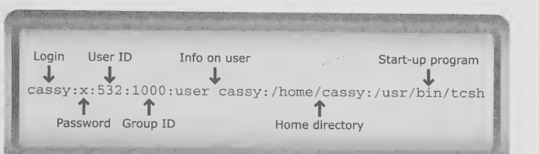

密码文件的字段在下表中描述：

| 字段 | 信息 |
|---|---|
| login | 你的账户登录名。 |
| password | 你的加密密码。（如果密码存储在安全的 **/etc/shadow** 文件中，此处可能为 x。也可能是 *。） |
| uid | 你的用户 ID，分配给你的唯一数字。 |
| gid | 你的组 ID。每个用户必须至少是一个组成员。在此字段中拥有与你相同数字的每个用户都属于你的组。你可以使用权限与组成员共享文件。 |
| misc | 关于用户的信息，如用户的全名。杂项字段通常为空。 |
| home | 你的主目录。这是你首次登录时的当前目录。 |
| Startup program | 登录时启动的程序——通常是 Shell，例如 Bash shell (**/usr/bin/bash**) 或 **tcsh (/bin/tcsh**) 或 Korn shell (**/bin/ksh**)，但它不一定是 Shell。它可以是任何内容，包括数据录入程序或银行账户访问菜单。 |

##### 修改你的密码

保护账户数据最重要的方法之一是选择一个安全且易于记忆的密码。这不仅是为了方便，而且对于维护计算机上每个人的数据安全至关重要。

在开始修改密码之前，请决定一个合适的新密码。选择密码时，应避免使用一些容易被猜到的词汇。使用以下任何内容都是不安全的：

- 你的登录名
- 任何姓氏或名字
- 你的地址
- 任何语言字典中列出的词汇
- 粗俗之语
- 流行文化词汇

最好同时包含大写和小写字母，以及至少一个数字和至少一个特殊字符（除常规字母字符外）。考虑到所有这些因素，创建一个既能记住又安全的密码可能会很困难。一种制定易记且难以破解的密码的方法是使用一个有意义的句子中每个单词的首字母。例如，如果你喜欢某位特定作者的作品，你的密码可能是：

```
MfaimT!60
```

这看起来很难记住。它*确实*极难破解——但对我来说很容易回忆起来，因为它是下面这句话中每个单词的首字母，后面跟着我女儿 Cassy 出生的年份。Cassy 出生在 `91` 年。

> My favorite author is Mark Twain! and Cassy was born in 91.

或者

```
{Owais19}
```

它代表：

> {Our wedding anniversary is September 19}

当你决定好新密码并准备修改当前密码时，请执行以下步骤：

- 1. 确定你的系统是否运行网络信息服务 (NIS)。一旦决定好新密码，请输入以下合适的命令。
- 2. 如果你的系统运行 NIS，请输入：`yppasswd`
- 3. 否则，输入：`passwd`
- 4. 系统会提示你输入*当前*密码。为了保护你，除非你通过正确提供当前密码来证明身份，否则程序不会继续。
- 5. 输入你的*当前*密码并按回车键（ENTER）。此时系统会提示你输入*新*密码。
- 6. 输入新密码并按回车键。程序会要求你重复输入新密码，以确保你能够正确输入并记住它。
- 7. 再次输入新密码并按回车键。当 Shell 提示符返回且没有错误消息时，你的密码已修改。它甚至可能会确认一切顺利。

`passwd` 实用程序完成了你无法完成的任务。它实际上修改了一个你不被允许更改的系统文件。因为在运行 `passwd` 实用程序时你拥有该权力，所以它会 extensively 地审问你，以确保你是合法用户且能记住新密码。

##### 忘记密码

这种情况有时会发生。系统管理员 (`root`) 无法找到你的当前密码。它在系统中仅以加密形式存在。然而，`root` 用户就像一只“六百磅的大猩猩”，可以随意坐到任何她想坐的地方，因此 `root` 用户可以在不知道原密码的情况下将你的密码`change`（修改）为一个新密码。请参阅第 13 章。

#### 修改文件权限

作为文件的所有者，你决定谁有权读取文件内容或更改文件内容。如果是命令文件，你可以指定谁可以执行它。我们只能修改我们所拥有的文件的权限。

- 使用 `long` 选项列出当前目录下的文件：
  `ls -l`

`-l` 选项被 `ls` 解释为提供关于文件的`long`（详细）信息列表的指令。输出中的第一个字段由 10 个字符位组成，显示了当前为该文件设置的权限。在第 9 章中，你将更深入地探讨如何设置文件权限。不过现在，请观察权限字段。第一个字符如果是短横线则表示...

文件显示为 `-`，而目录显示为 *d*。其余九个字符由连字符以及 *r*、*w* 和 *x* 字符组成，用于显示当前授予的权限。

#### 对文件拒绝和添加读取权限

所有文件都有一组权限，决定了谁可以对该文件执行什么操作。

- 1. 要查看 `users_on` 文件的权限，请输入以下命令：
`ls -l users_on`

- 2. 输出结果类似于以下内容：

```
-rw-rw-r--r-- 1 cassy 453 Jul 18 11:17 users_on
```

在这个示例中，第一组 **rw-** 表示*您*（文件的所有者）拥有读写该文件的权限。第二组 **rw-** 表示被分配到您组中的其他用户拥有该文件的读写权限。最后三个字符表示授予所有不在您组中的其他用户的权限；在这种情况下，他们仅获得读取权限。

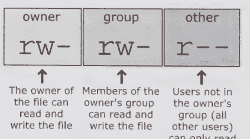

如果您是所有者，您可以更改文件的权限，使所有用户（包括您自己）都无法访问该文件。因为您拥有该文件，所以您随时可以再次更改其权限。如果您不授予读取权限，任何用户都无法读取或复制您的文件。

- 3. 输入以下命令从 `users_on` 文件中删除读取权限：
`chmod -r users_on`

- 4. 通过输入以下命令检查 `users_on` 的权限字段：
`ls -l`

请注意，虽然之前的权限为您和您的组提供了读写权限，但新权限仅包含 `w`。通过在 `chmod` 命令的 `r` 前面加上减号，您删除了读取权限。`chmod` 命令用于更改文件的模式（mode）。

- 5. 尝试使用以下命令显示该文件，以验证文件权限的状态：
`cat users_on`

您会立即收到一条错误消息，提示您没有读取该文件的权限。即使您拥有该文件，如果您拒绝了自己的读取权限，您也无法读取该文件。不过，您仍然拥有该文件，因此您可以再次更改权限。

- 6. 使用以下命令恢复文件的读取权限：
`chmod +r users_on` 
`ls -l users_on`

通过在 `r` 前加上 `+`，您添加了读取权限。

在第 10 章中，我们将研究每种权限（`r`、`w` 和 `x`）分别控制文件和目录的哪些操作，以及如何专门为所有者、组和其他用户设置权限。

#### 创建 Shell 脚本

您可以使用 UNIX 以多种格式和语言进行编程。UNIX 操作系统为程序员提供了一系列编程工具，这些工具要么随系统打包，要么可以额外添加。

最基础且最实用的程序工具之一就是 shell 本身。您一直将 shell 作为交互式命令解释器使用，但它同时也是一个强大的编程环境。

- 1. 输入以下命令创建新文件：
`cat > new_script`

- 2. 输入以下行：
```bash
echo Your files are
ls
echo today is
date
echo Current processes are:
ps
```

- 3. 按回车键（ENTER）将光标移至新行。

- 4. 按 CTRL-D
此时，`new_script` 文件包含了一系列 shell 命令。

- 5. 检查文件以确保其正确无误：
`cat new_script`
如果存在错误，请删除 `new_script` 文件并返回步骤 1 重新创建。

- 6. 尝试通过输入脚本名称来运行它：
`new_script`
输入名称后它并没有运行。您可以像之前那样使用 source 命令，让当前 shell 读取文件并执行其内容。然而，我们的目标是通过输入文件名来使其执行。

- 7. 通过输入以下命令显示文件的权限：
`ls -l new_script`
权限显示该文件不可执行。要通过简单地调用其名称来运行脚本，您必须授予自己执行权限。

- 8. 输入以下命令使 `new_script` 变为可执行：
`chmod +x new_script`

- 9. 要查看新权限，请输入：
`ls -l`
您现在拥有该文件的执行权限，以及读取和写入权限。

- 10. 通过输入脚本名称执行新脚本：
`new_script`

- 11. 如果您收到类似如下的错误消息：
`Command not found`
请输入：
`./new_script`
这条命令行告诉 shell 正好在当前目录（即“dot”）中寻找名为 `new_script` 的 shell 脚本。

您输入到文件中的所有命令都将被执行，其输出将发送到屏幕上。

`ps` 的输出表明启动了一个运行该脚本的新进程。您的 shell 执行了这个子进程来运行脚本内部的命令。

创建和使用 shell 脚本的步骤是：

- 1. 创建一个包含 shell 命令的文件。
- 2. 使用 `chmod` 使文件可执行。
- 3. 通过输入脚本名称执行文件。

当我们执行脚本时，读取脚本的 shell 会遵循这些指令。它执行脚本的每一行，就好像您在键盘上输入了该行一样。脚本中的所有实用程序都会被执行。

在之前的练习中，您使用 `source` 命令告诉当前 shell 读取脚本并执行文件内容。而在这种情况下，您输入的是脚本名称，当前 shell 将其解释为启动一个子进程来读取脚本的指令。当您 source 一个脚本时，读取权限就足够了；但如果您启动一个子 shell 来执行其内容，则需要执行权限。您将在后面的章节中创建许多脚本。

#### 自测 3

回答以下问题，然后在本章末尾检查您的答案。

- 1. 当您输入以下命令时，会发生什么以及为什么？
`cat > dog`

- 2. 以下命令的结果分别是什么？
  - A. `who | grep $USER`
  - B. `grep \$HOME file1`
  - C. `echo u* >> file1`
  - D. `echo 'u*' >> file1`
  - E. `ps`
  - F. `. fileA`
  - G. `set noclobber`
  - H. `set -o`
  - I. `chmod +x file2`

- 3. 在两类 shell（C shell 和 Korn shell）中，如何将提示符更改为 `Next`?

- 4. `passwd` 文件中的每个字段包含什么数据？

- 5. 哪个命令可以指示 shell 不要将 CTRL-D 视为注销信号？

## 本章回顾

使用本节回顾本章内容，并测试您对相关概念的掌握情况。

### 本章总结

UNIX 是一个多用户、多任务操作系统。它包含大量实用程序，可以通过链接在一起以提高效率。UNIX 是一个复杂、强大且偶尔有些奇特的操作系统。在本章中，您研究了基础命令和概念：

- 实用程序（Utilities）是在 Linux/UNIX 中完成工作的基本工具。
- `sort` 实用程序对来自输入或文件名参数的行进行排序。默认按 ASCII 顺序排序，如果给定 `-r` 选项，则按反向顺序排序。
- `wc` 实用程序默认统计行数、单词数和字符数。如果给定 `-l` 选项，则仅输出行数；给定 `-w` 则输出单词数；给定 `-c` 则仅输出字符数。可以组合选项以输出多种统计结果。
- `grep` 实用程序将其第一个参数解释为目标搜索字符串，所有其他参数解释为要检查的文件。`grep` 在所有输入行中搜索目标字符串。如果字符串在行中，则输出该行；否则将其忽略。
- shell 为运行实用程序的进程重定向输入和输出：

| 符号 | 描述 |
| :--- | :--- |
| `\|` | 将前一个实用程序的输出连接到下一个实用程序的输入。 |
| `>` | 将前一个实用程序的输出连接到一个文件。文件名紧跟在重定向字符之后。 |
| `>>` | 将前一个实用程序的输出连接到随后指定文件的末尾；因此，输出被追加到文件末尾。 |
| `<` | 将随后指定的文件连接到前一个实用程序的输入。 |

- shell 将 `$` 解释为指定变量（如 `$USER` 和 `$HOME`）。shell 会将 `$` 和 *变量名* 替换为其对应的值。
- `*` 字符对 shell 来说是一个特殊字符，它将其解释为用于匹配当前目录下文件名的“通配符”。这是一个通配符，例如 `w*` 被解释为所有以 *w* 开头且后跟任意数量任意字符的文件名。shell 将命令行上包含 `*` 的字符串替换为所有匹配的文件名。
- shell 将 `\` 解释为关闭对其后任何字符特殊含义解释的指令。
- 如果特殊字符位于单引号之间，shell 将不会解释其特殊含义。
- CTRL-D 是文件结束符（EOF），CTRL-C 是中断信号。当进程收到文件结束信号时，它会完成其程序设定的输入数据处理然后退出。而遇到中断时，进程直接终止。
- 当我们使用 `>` 重定向时，可以通过设置 `noclobber` 来告诉 shell 保护现有文件且不覆盖它们：
    - C shell 系列：`set noclobber`
    - Bash, Korn shell 系列：`set -o noclobber`


- 我们可以使用 `passwd` 或 `yppasswd` 命令来更改密码。
- 权限决定了谁拥有对文件的读取、写入和执行访问权限。`chmod` 命令接受诸如 `-r` 之类的参数，作为删除读取权限的指令。
- 当我们创建一个包含 shell 命令的文件时，可以通过输入以下命令让*当前* shell 执行其内容：
    - C shell 系列：`source file`
    - Bash, Korn shell 系列：`. file`
- 我们可以让子 shell 运行脚本内容，方法是首先将脚本文件的权限更改为包含执行和读取权限，然后在命令行中将文件名作为实用程序输入。

### 课后习题

哪些命令可以完成以下操作？

- 1. `ls` 的哪些选项可以完成以下操作？
    A. 列出所有文件，包括点文件（隐藏文件）。 ________________________________
    B. 提供关于文件的详细信息列表。 ________________________________
    C. 用 / 标识目录 ________________________________
- 2. 什么命令行可以输出一个数字，该数字是当前目录下列出的文件总数（包括点文件）？ ________________________________
- 3. 什么命令可以获取关于 `ps` 实用程序的信息？ ________________________________
- 4. 什么命令可以对当前目录下所有以字母 *f* 开头的文件内容进行排序？ ________________________________
- 5. 在以下命令中，每个实用程序如何解释每个参数：
    A. `echo dogfish` ________________________________
    B. `rm dogfish` ________________________________
    C. `grep dogfish` ________________________________
- 6. 什么命令可以创建一个名为 *all* 的新文件，其内容由 *file1, file2, 和 file3* 文件中的行组成？ ________________________________

7. 解释以下命令行完成了什么操作：

    A. `grep 'Linux is fun' *`
    B. `sort > file4`
    C. `grep $USER /etc/passwd`
    D. `echo \$PATH $PATH`
    E. `grep '1 2 3' f`
    F. `set -o EOF`

#### 填空题

8. CTRL-D 和 CTRL-C 之间有什么区别？

9. 假设一个文件的内容是以下一系列 shell 命令：

    `date`
    `ps -ef`

    A. 如果你想 source 该文件，需要什么权限？

    B. 如果你希望直接通过调用其名称来执行脚本，需要什么权限？

    C. 当你 source 一个脚本时，哪个进程执行其内容？

    D. 当你通过调用名称执行脚本时，哪个进程执行其内容？

### 项目

- 1. 编写一个命令行，输出 `ps -ef` 输出结果的第一、第二、第三和第八个字段。
- 2. 创建一个名为 `allproc` 的脚本，输出 `ps -ef` 输出结果的第一、第二、第三和第八个字段。你将如何使其可执行？你将如何运行它？

### 命令汇总

| 命令 | 描述 |
| :--- | :--- |
| `passwd` | 更改用户密码。 |
| `ls` | 列出当前目录的内容。 |
| `ls -l` | 以长列表形式输出当前目录的内容，每行一个文件或目录。 |
| **文件显示实用程序** | |
| `cat file1 file2` | 连接 *file1* 和 *file2*。（先输出 *file1*，然后输出 *file2*。） |
| `grep word filename` | 在 *filename* 中搜索包含特定 *word*（或模式）的行。 |
| `wc filename` | 统计 *filename* 中的行数、单词数和字符数。 |
| **数据库实用程序** | |
| `awk '{print $#}' file` | 打印 *file* 的第 # 个字段。 |
| **数据生产与检查实用程序** | |
| `grep word filename` | 在 *filename* 中搜索包含特定 *word*（或模式）的行。 |
| `sort filename` | 按排序顺序显示 *filename* 中的行。 |
| `spell filename` | 检查 *filename* 中的拼写。 |
| **输入输出重定向** | |
| `utility < filename` | 将 *filename* 作为 **utility** 的输入。 |
| `utility > filename` | 将 **utility** 的输出发送到 *filename*。 |
| `utility1 \| utility2` | 将 **utility1** 的输出作为 **utility2** 的输入。 |
| **文件权限** | |
| `chmod -r filename` | 删除读取 *filename* 的权限。 |
| `chmod +r filename` | 授予读取 *filename* 的权限。 |
| `chmod +x filename` | 授予文件的执行权限。 |
| `chmod -x filename` | 删除文件的执行权限。 |
| **Shell 编程** | |
| `set` | 列出为你的 shell 设置的变量及其值。在 C shell 中，列出局部变量。在 Korn shell 中，列出局部变量和环境变量。 |
| `env` | 列出环境变量。 |
| `printenv` | 列出环境变量。 |
| `$var` | 求变量 *var* 的值。 |
| `*` | 展开以匹配文件名。 |
| `\` | 将下一个字符解释为普通字符，不具有特殊含义。 |
| `' '` | 关闭单引号之间所有字符的解释。它们被视为普通字符。 |
| `scriptname` | 执行文件 `scriptname` 中的命令。 |

#### 输入输出重定向

（注：以下表格提供了额外的环境和实用程序设置）

#### 设置用户环境

| 命令 | 描述 |
| :--- | :--- |
| `set prompt = ' string '` | 在 C 和 **tsch** shell 中，将 *string* 设置为新提示符。 |
| `PS1=' string '` | 在 Bourne, **bash** 或 Korn shell 中，将 *string* 设置为新提示符。 |

#### 进程监控

| 命令 | 描述 |
| :--- | :--- |
| `ps` | 显示本次登录会话的当前进程。 |

#### 其他实用程序

| 命令 | 描述 |
| :--- | :--- |
| `clear` | 清除终端屏幕。 |
| `echo` | 读取参数并将其写入输出。 |
| `which utility-name` | 报告 *utility-name* 的位置。 |
| `ypcat` | 以 **cat** 读取本地文件的方式读取网络数据库文件。 |

## 精通可视化编辑器

### 4

**技能检查**

在开始本章之前，你应该能够：

- 进入并退出系统
- 执行基本 shell 命令
- 将实用程序的输出重定向到文件
- 使用 `cat` 实用程序创建文件
- 切换目录并返回家目录

**目标**

完成本章后，你将能够使用 **vi** 来：

- 创建和访问文件
- 在文件中有效地移动
- 向文件中添加行、单词和字符
- 删除字符、行和文本块
- 修改字符、行和文本块
- 剪切和粘贴文本行
- 撤销更改
- 在两种编辑器模式之间来回切换
- 进行全局更改

在 Linux 中，UNIX 信息和程序由文件中的字符行组成。在大多数方面，计算环境是文件和进程的集合。在编写文本或计算机程序时，我们会创建新文件并修改旧文件。我们会插入新行、重新排列行、更改文本并进行其他必要的修改。计算机文本编辑器的开发就是为了完成这些任务。UNIX/Linux 可视化编辑器 `vi`（通常读作 `vee-eye`）是一个功能强大、快速且由命令驱动的屏幕编辑器。我们通过输入组合按键向编辑器发出所有指令。`vi` 可视化编辑器在所有系统中都可用，是一个必不可少的工具。通过使用 `vi` 编辑器，我们可以创建文本，并对文本进行精确的特定更改和全局更改——而且经过练习，操作会非常便捷。

在本章中，你将使用可视化编辑器访问文件，在文本中移动到各个位置，并在文件内进行内容编辑更改，例如替换或删除文本、读入其他文件以及重新排列文件部分内容。处于不同开发阶段的文档副本可以保存到文件中以供审查并最终打印。

## 4.1 可视化编辑器简介

在 20 世纪 70 年代，人们在 UNIX 上使用行编辑器通过发布繁琐的命令来编辑文件。当时无法将光标移动到特定单词处进行修正。相反，要修正第 14 行的一个单词拼写，你必须执行类似 `14s/mistake/mistakel` 的命令。加州大学伯克利分校的一名研究生比尔·乔伊（Bill Joy）编写了可视化编辑器 `vi`，允许将光标移动到文件中的特定位置进行编辑。`vi` 是一个古老的编辑程序，而不是文字处理器。它不支持当今文字处理软件中的许多功能。我们必须记住命令，因为没有鼠标，没有下拉菜单，也没有页面格式化。然而，`vi` 编辑器存在于每个 UNIX 环境中，占用计算资源极少，包含许多提高编辑效率的工具，而且一旦你学会了它的命令，速度实际上是非常快的。

目前广泛可用两个主要版本的编辑器。标准 UNIX 发行版包含 `vi`，而 Linux 提供了 `vim`，它包含了一些改进。在 Linux 中，同样的命令 `vi` 通常会调用 `vim`。


要跟踪 `vi` 的两种模式——*命令模式*（command mode）*和*追加/插入模式（append/insert mode）*，以及记住从键盘输入的大量命令并不容易。然而，一旦掌握，`vi` 将成为 UNIX 中一个不可或缺的工具，原因有三：

- 它作为所有标准 UNIX 版本的组成部分提供，因此随处可用。
- 一旦你能使用基本命令，`vi` 就是一个快速且高效的编辑器。
- 尽管 `vi` 占用的计算资源很少，但它拥有其他编辑器不具备的高级功能。对于大多数高级用户和程序员来说，可视化编辑器（visual editor）实际上是首选编辑器。

在第一节中，练习将引导你快速了解 `vi` 功能的入门之旅。通过完成终端上的操作步骤，你将学习使用基本编辑命令并探索 `vi` 的结构。在随后的章节中，你将采用精确的方法来移动、删除、添加、更改和操作特定文本。为了从本章中获得最大收益，我们建议你：

1. 完成第一节“入门之旅”中的每个步骤。然后开始使用这组有限的命令来创建和编辑文件。
2. 完成本章剩余部分的示例和练习。
3. 起初不要试图记住所有命令。先掌握一个合理的集合，然后随着时间的推移扩大你的知识库。
4. 回到本章末尾的“命令摘要”并经常阅读。每次复习时，选择额外的命令应用到你的编辑中。
5. 当你想强化这些命令时，重新做一遍本章。第二次练习所花的时间要少得多，而重新练习将大大提高你的技能。

## 4.2 使用 vi 操作现有文件

文件是 UNIX 计算环境的核心。商业信函、大学论文、程序代码、程序输出、数据、电子邮件和数据记录都存储为文件。可视化编辑器用于创建新文件和编辑现有文件。即使你使用 `who` 或 `cat` 等其他实用程序创建文件，可视化编辑器仍然可以通过文件名识别该文件、访问它并对其进行编辑。

然而，可视化编辑器的工作方式与大多数其他编辑环境不同。当你用打字机或 PC 文字处理器开始写信时，你能立即做的一件事就是向文件中输入或添加文本。但 `vi` 并非如此。当我们使用 `vi` 开始编辑文件时，唯一不能做的事就是添加文本。我们可以在文件中移动，删除单词、行和字符。我们可以复制和粘贴文本，还可以修改编辑环境。但是，如果不先发出“我想添加文本”的命令，我们就无法向文件中添加文本。因此，从一个现有文件开始学习使用 `vi` 是最简单的。

首先创建一个新的练习文件，以便你在本章中可以一直编辑它。

1. 登录你的用户账户（不要以 `root` 身份登录）。
   在 UNIX 中创建文件的多种方法之一是使用 `cat` 实用程序。
2. 输入以下内容开始创建新文件的过程：
   `cat > practice`
3. 按 ENTER 键
4. 输入以下行。当你出错时，不要试图修正，直接继续即可。在随后的练习中，你可以使用 `vi` 来纠正这些错误。请务必包含空白行。
   
   This practice file will be used
   several times in this course.

   Although I am creating this file with the cat command,
   later I will be editing it with the visual editor.

   a b c d
   2 3 4 5
   2 3 4 5
   2 3 4 5
   A B C D
   E F G H

   The visual editor permits global changes,
   reading in files, cutting and pasting,
   and tailoring the environment to meet individual needs.
   There is no mouse, everything is done through commands.

5. 按以下键将光标移至新行：
   ENTER
6. 按以下键告诉 `cat` 没有更多输入了：
   CTRL-D
   `cat` 程序结束并显示 shell 提示符。
7. 输入以下命令行向文件中添加更多文本。请务必使用双重重定向符号将文本添加到文件中。

```
head /etc/passwd >> practice
cal 1752 >> practice
wc practice
more practice
```

8. 如果你还没有到达文件末尾，请输入以下内容退出 `more`：
   `q`

## 4.3 可视化编辑器导览

第一节将带你快速了解编辑器的核心功能。你将掌握基础命令并检查编辑器的结构。在这次导览之后，你将深入探索许多具体命令。

你刚刚使用了 `cat > filename` 命令来创建一个新文件。你为文件分配的 `filename`（例如 `practice`）成为了 UNIX 在你想对其进行操作时用于定位文件的标识标签。

1. 要使用可视化编辑器开始编辑你的新 `practice` 文件，请输入命令：
   `vi practice`
2. 按 ENTER 键

这个命令行指示 shell 启动 `vi` 程序，并给它一个 `vi` 必须解析的参数 `practice`。

一旦编辑器运行，它会将参数 `practice` 解析为文件名。`vi` 定位该文件，打开它，并在你的屏幕上显示内容。光标出现在文件第一行的开头。你不再是在与 shell 对话，而是在与 `vi` 通信。

当你第一次使用 `vi` 访问文件时，你可以：

- 四处移动
- 删除文本
- 复制和粘贴文本
- 修改编辑环境
- 退出编辑器返回 shell

此时你不能做的是向文件中输入文本。

### 在文件中移动

在编辑文件时，我们经常需要移动到文件的不同位置以纠正单词拼写、删除特定文本行或插入额外代码。为了完成编辑，我们必须告诉 `vi` 我们具体想在何处添加文本，或者我们想更改哪个特定的字符、单词或行。鼠标在 `vi` 中不起作用。为了与 `vi` 通信，我们将屏幕光标移动到文本中想要执行编辑操作的适当位置。

> **注意：** 在这些初步练习中，你将进行移动和删除文本的操作。如果你突然发现自己在向文件添加字符，那么你一定按到了某个将你切换到追加模式的键。要返回命令模式并继续练习，请按 `esc` 键。

#### 每次移动一个字符或一行

在文件中移动光标的一种基本方式是使用 *方向键*。

1. 按一次小写字母 `j`。文件中不会添加字母 *j*；相反，光标会向下移动一行。
2. 如果光标没有移动，请按 ESC 然后再次尝试。
3. 尝试以下小写按键：
   `l` (el)
   `j` 
   `h` 
   `k` 

`vi` 将这些按键分别解析为以下方式移动光标的命令：

- `h` 将光标向 *左* 移动一个字符。
- `l` 将光标向 *右* 移动一个字符。
- `k` 将光标向 *上* 移动一行，保持在同一列。
- `j` 将光标向 *下* 移动一行，保持在同一列。

4. 使用 **h**、**j**、**k** 和 **l** 方向键在文本中向左、下、上、右移动光标。

此时，`vi` 将你的键盘输入解析为命令，而非输入文本。你处于可视化编辑器的 *命令模式*。在探索更多命令模式下的可用命令后，我们将进入 *追加模式*，在那里你输入的所有内容都将被放置在文件中。

大多数工作站包含方向键，也可以指示编辑器在屏幕上移动光标。

5. 按一次向下方向键：
   $\downarrow$
   如果光标向下移动一行，说明你的系统中 `vi` 支持方向键。当你 Telnet 到某个位置或从 Microsoft 环境访问 UNIX 时，方向键可能不起作用。在这种情况下，请使用 **h**、**j**、**k** 和 **l** 方向键。

6. 使用四个方向键在文件中四处移动。

7. 将光标移动到空白处，无论该空格是在单词之间，还是意外放置在行尾的空格。
   空格也是字符。

8. 尝试使用方向键将光标移出文本范围——向右和向左，第一行之上，以及最后一行之下。

当你试图超出现有文本范围时，光标不会移动，工作站会闪烁或发出蜂鸣声。文件仅指文本本身，而不是显示该文件的整个屏幕。


#### 高效地移动到特定目标

到目前为止，您一直是在文件中逐个字符、逐行地移动。还有几种更快速且更明确的方法可以将光标移动到文件中的特定位置。一种高效地将光标移动到文本中特定单词的方法是使用前向搜索命令。

- 1. 要将光标前移到某个文本目标，请输入：
  `/be` 
  然后按 ENTER
  光标将在文件中前移，直到出现字符字符串 *be* 的第一个实例。如果没有发生这种情况，请按 ESC 重新尝试。如果您的文件中没有 *be*，请尝试输入 `/p`。当您输入斜杠字符 / 以及目标 *be* 的每个字母时，它们会出现在屏幕的左下角。这些字符*不会*被输入到您的文件中。编辑器只是在您输入时显示您的前向搜索命令。

- 2. 尝试以下操作：
  `/me` 
  ENTER
  `/sep` 
  ENTER
  `/7` 
  ENTER

- 3. 使用前向搜索命令来定位另一个单词，例如 *text*。

输入搜索命令后，按下 ENTER 以告知编辑器您已输入全部目标。光标将移动到目标文本，且您仍处于命令模式。

#### 查找目标的其他实例

如果一个字符字符串在您的文件中出现多次，前向搜索命令会将光标移动到光标位置之后文件中目标字符串的第一个实例。您可以继续查找目标的其他实例。

- 1. 在您的 *practice* 文件中搜索单词 *the*：
  `/the`

- 2. 定位到单词的第一个出现位置后，通过输入以下内容定位下一个出现位置：
  `n`

- 3. 继续输入 `next` 命令：
  `n`
  `n`
  当编辑器到达文件末尾时，它会循环回到文件开头并继续搜索。

- 4. 通过输入以下内容将光标移动到下一个冒号：
  `/` 
  然后按 ENTER

- 5. 要移动到其他实例，请按下系列 `next` 命令：
  `n`

我们必须处于命令模式才能搜索文本字符。当我们输入 `/targetstring` 并按 ENTER 时，光标会向前穿过文本，直到找到 `targetstring` 的下一个出现位置。如果编辑器到达文件末尾，它会返回到开头并向前搜索，直到找到目标或返回到您之前的位置。要跳转到下一个出现位置，请使用 `n` 命令而无需按 ENTER。

#### 退出编辑器

此时，您正在使用 `vi` 编辑文件 `practice`。一个简单的命令即可指示编辑器将文件写回硬盘并退出编辑器程序。

- 1. 输入：
  `:wq` 
  这指示编辑器`write`（写入）文件并`quit`（退出）编辑器。随后将显示 shell 提示符。

- 2. 确认您再次与 shell 通信：
  `date` 
  `ls` 

- 3. 通过输入以下内容返回编辑文件：
  `vi practice`

#### 理解命令模式下的可视化编辑器

本章包含的概念图旨在帮助您学习和复习 `vi` 命令。图 4-1 是 `vi` 命令模式的概念图。

- 1. 在图 4-1 中，找到标记为 “Shell” 且带有 `$` 提示符的方框。注意从 shell 中的 `who` 指向描述 `who` 命令作用的方框的箭头。当 `who` 完成任务后，您将返回到 shell。

- 2. 找到从 shell 命令 `vi filename` 向下延伸的箭头。在早些时候使用 `vi` 命令时，您输入了 `practice` 作为文件名。

- 3. 该概念图描述了每个人使用 `vi` 的体验。当我们在 shell 中输入命令 `vi filename` 时，我们是在指示 shell 启动 `vi` 并为其提供一个参数。

- 4. `vi` 首先要做的就是将该参数解释为文件名。然后 `vi` 打开文件并将我们置于命令模式，在该模式下我们可以移动并检查文件。

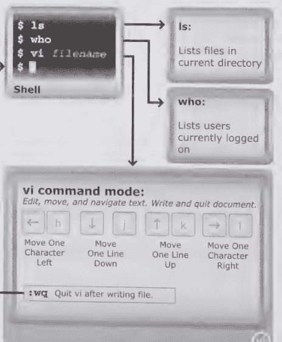
图 4-1 vi 的命令模式

- 5. 此时，因为我们处于 `vi` 的命令模式，shell 不再解释我们输入的命令——而是由可视化编辑器来解释。当我们按下方向键时，编辑器移动光标，然后等待下一个命令。我们可以连续输入光标移动命令而无需离开命令模式。

- 6. 在图 4-1 中找到箭头和方向键命令。这些命令不会将编辑器切换到另一种模式，也不要求我们按下 `ENTER`。当我们发出这些命令时，它们会立即生效，在文件中移动光标。

#### 在命令模式下删除文本

到目前为止，您一直处于可视化编辑器的命令模式中，通过发出命令在文件中移动。另一类重要的编辑操作（仅在命令模式下可用）是从文件中删除文本。使用 `vi`，您可以删除一行或多行、单词或字符，以及行的部分内容或整个文本段落。

##### 删除整行

您可以使用编辑器轻松地删除文件中的一行或多行。

- 1. 使用方向键将光标移动到任意行中间附近的某个字符上。

- 2. 输入“删除一行”命令：
  `dd`
  您不需要按 ENTER。一旦您输入“删除一行”命令的第二个 `d`，`vi` 就会执行您的请求，`dd` 将删除该行。

- 3. 移动到另一行并将其删除。
  当我们输入 `dd` 时，编辑器会删除光标所在行的所有内容，无论光标恰好位于该行的哪个位置。我们可以使用 `dd` 命令删除空行以及包含文本的行。

- 4. 将光标移动到空行并将其删除。
  `dd` 命令告诉编辑器删除当前行。删除后，我们仍然处于命令模式。

##### 删除单个字符

编辑器还可以从文件中删除单个字符。

- 1. 将光标移动到任何字符上，例如单词 `Hello` 中的 `H`。

- 2. 通过输入一个小写字母删除一个字符：
  `x`
  `x` (x-out) 命令仅删除光标下的单个字符。它是“一次删除一个字符”的命令。

- 3. 移动到文件中的不同位置并删除单个字符。

- 4. 使用 `x` 从文件中删除一个空格。

行中单词之间的空格与字母或数字一样也是字符。仔细回顾图 4-2，其中总结了导航和删除操作。

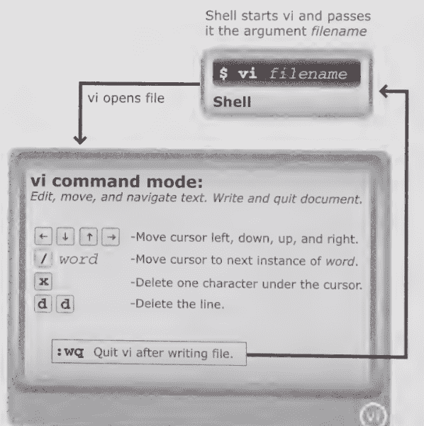
图 4-2 vi 中的导航与删除

#### 撤销文本更改

- 1. 通过输入以下内容删除一整行文本：
  `dd`

- 2. 要恢复刚刚删除的行，请输入：
  `u`
  `undo`（撤销）命令会回退到上一次更改。

- 3. 使用 `x` 删除一个字符。

- 4. 通过以下内容将其恢复：
  `u`

在对文件进行修改后，您可以撤销该更改。撤销功能非常强大，我们将在完成这次 **vi** 导览后再次讨论它。

#### 向文件添加文本

到目前为止，您一直在文件中移动并删除文本。这些任务是在 **vi** 的命令模式下完成的。您还没有添加过文本。有多种添加文本的方法，包括在光标两侧添加新文本、在光标下方开启新行、在光标上方开启新行、在行首或行尾添加文本，以及执行大量文本替换操作。

然而，在这次导览中，我们将仅探讨两种操作：如何在光标后添加文本以及如何在光标下方的一行中添加文本。

##### 在光标右侧追加文本

您一直在通过在命令模式下发出特定命令来指示编辑器在文件中移动光标。在键盘上按下 `dd` 不会将 `dd` 作为文本添加到文件中。要添加文本，我们必须告诉编辑器离开命令模式并进入*追加*（append）或*插入*（insert）模式。

您目前处于命令模式，在此模式下，按键用于发出位置变更和删除命令，而不是用于输入文本。

- 1. 将光标移动到屏幕上的任意行，并通过输入以下内容删除该行：
  `dd`
  当您处于 **vi** 命令模式时，`dd` 告诉编辑器*删除一行*。

- 2. 输入命令模式请求以撤销删除：
  `u`

使用方向键或箭头将光标移动到文件第一行文件的末尾。

- 3. 在命令模式下，输入一次以下命令：
    `a`
字母 `a` 不会显示在屏幕上；看起来没有任何反应。

- 4. 现在再次输入：
    `dd`
字母 `dd` 出现在屏幕上并被添加到文件中；该行没有被删除。`a` 命令告诉 `vi` 开始将你输入的所有内容添加到文件中。它将新文本放置在文件中当前光标位置的右侧。

此时，`vi` 不再将你输入的内容解释为命令，而是将其视为要添加到文件中的文本（追加或插入）。你已经离开了命令模式，现在处于编辑器的 *追加模式（append mode）* 或 *插入模式（insert mode）*。在追加模式下输入的内容被视为文本，而非命令。

- 5. 现在你处于追加模式，按下：
    ENTER
光标移动到新行的开头，你可以在这里添加文本。

- 6. 在文件中输入以下内容：
```
I am now adding more text.
Therefore, I must be in append mode.
The a command moves me into append mode.
Whatever I type is added to the file.
```

- 7. 查看图 4-3 中的概念图。请注意，`a` 命令将你带出命令模式并进入追加或插入模式。`vi` 不再将你输入的内容解释为删除或移动光标的命令；相反，`vi` 读取你输入的内容，并从光标右侧开始将其录入文件。

#### 离开追加模式并返回命令模式

在之前的练习中，你处于命令模式并发出特定命令以在文件中移动光标。在命令模式下，我们使用键盘输入编辑命令，例如 `h`、`j`、`k`、`l` 和 `dd`。这些按键不是要添加的文本，而是给编辑器的命令。其中一个命令 `a` 告诉编辑器离开 `vi` 的命令模式并进入追加模式。一旦进入追加模式，编辑器会将我们输入的任何内容解释为要在光标位置添加到文件的文本。

只要我们处于追加模式，输入的每个按键都会继续被追加到文本中。直到我们明确指令，否则不会返回命令模式。

当你完成文本输入时，你需要一种方法来指示 `vi` 编辑器退出追加模式并返回命令模式。

- 1. 查看图 4-3。找到将你从追加模式带回命令模式的箭头。该命令就标注在箭头上。
- 2. 输入相应的按键：
    ESC
屏幕上似乎没有任何变化。

**图 4-3** 在 vi 中添加文本

- 3. 输入：
    `dd`
    `u`
一行被删除了；**dd** 现在是一个命令，而不是要添加的文本。你再次回到了命令模式。**vi** 现在将你输入的任何按键解释为在文件中移动、删除文本等命令。每当你想要停止添加文本并返回命令模式时，请按下 ESC。

- 4. 为了确认你处于命令模式，请第二次按下 ESC。
如果听到蜂鸣声或屏幕闪烁，vi 是在告诉你它无法进入命令模式，因为你已经在其中了。

- 5. 通过输入以下内容，将光标移动到屏幕上任何单词的末尾：
    `l`
    或者
    $\rightarrow$ (右箭头)

- 6. 通过输入以下内容告诉 **vi** 你想在单词后输入文本：
    `a`

- 7. 向文件中添加几个单词的文本。

- 8. 完成文本添加后，按下：
    ESC
你回到了命令模式。

- 9. 移动到文件中的另一个位置，再次循环执行：
    A. 发出命令从命令模式切换到追加模式。
    B. 添加一些文本。
    C. 返回命令模式。

#### 在光标下方打开一行

我们还可以使用编辑器在某一行之后添加文本。

- 1. 确保你处于命令模式，然后将光标移动到屏幕中间附近的一行。

- 2. 输入小写 “oh” 命令：
    `o`
**o** 命令告诉编辑器在光标所在行与文件下一行之间**o**pen（打开）一个新的空行。

- 3. 添加如下文本：
There is more than one way to move from command mode to append!
Each one starts adding text in a different place with respect to the cursor.

- 4. 通过按下以下按键返回命令模式：
    `ESC`

**注意：** `ESC` 是视觉编辑器的一个核心组件。每当你怀疑自己处于 **vi** 的哪个模式（命令模式还是追加模式）时，请按下 `ESC`。在追加模式下，`ESC` 将你带到命令模式。在命令模式下，`ESC` 通常会发出蜂鸣声或闪烁，表明你已经处于命令模式。无论哪种情况，在按下 `ESC` 后，你一定处于命令模式。从这时起，你可以决定想要执行的操作。

#### 结束编辑会话

当我们准备停止编辑文件时，需要做两件事：保存对文件所做的更改，以及退出编辑器程序。

##### 保存文件并退出编辑器

要发出保存修改后的文件并退出编辑器的命令，我们必须首先处于命令模式。请先按下以下按键确保处于该模式：

- 1. `ESC`

你一直在编辑 *practice* 文件的副本，这被称为 *缓冲区副本（buffer copy）*。原文件在磁盘上。这个缓冲区副本在内存中，你在其中进行更改。

- 2. 要将更改写回原文件并退出编辑器，请输入：
    `:wq`
    然后按下 ENTER。
文件的 *缓冲区副本* 被 **written**（写入/保存），替换了原始版本，且编辑器 **quits**（退出）。你回到了与 shell 的交互界面。参见图 4-4。

- 3. 发出一个 shell 命令，例如：
    `date`

**图 4-4** 保存文件并退出编辑器
`:wq` — `w` 指示编辑器将缓冲区版本写入磁盘，更新原文件；`q` 退出视觉编辑器。

##### 不保存而退出

在这个练习中，你将对文件进行更改，然后不保存更改直接退出编辑器。

- 1. 通过输入以下内容开始编辑 *practice* 文件：
    `vi practice`
- 2. 在命令模式下，删除一行文本：
    `dd`
- 3. 通过输入以下内容打开一行并进入追加或插入模式：
    `o`
- 4. 添加以下行：
    `this line added to practice xxxx`
- 5. 返回命令模式：
    `ESC`
- 6. 这次，尝试通过输入以下内容在不保存文件的情况下退出编辑器：
    `:q`
编辑器会告知你，你还没有决定对文件所做更改的去向：
    `No write since last change.`

- 7. 告诉编辑器你想在不写入的情况下退出：
    `:q!`
`quit` 命令后的 `!` 告诉编辑器你知道自己做了更改，但无论如何你都真的想要退出。

- 8. 检查文件：
    `head practice`
你删除的那一行并没有消失，而你在编辑文件时添加的那一行也不在其中。文件与你上次编辑前完全一样。`:q!` 命令指示编辑器即便自更改以来没有写入也强制 `quit`（退出），从而保留文件在开始编辑时的状态。参见图 4-5。

**图 4-5** 不保存更改退出编辑器
`:q!` — 退出编辑器而不写入磁盘，原文件不被更新，缓冲区被清除。

#### 使用视觉编辑器创建新文件

本节作为 `vi` 导览的最后一部分，将引导你使用刚刚探索的技巧来创建新文件并添加文本。

- 1. 通过输入以下内容开始编辑过程：
    `vi review`
编辑器启动，并打开一个新文件进行编辑。

- 2. 指示编辑器你想直接进入追加模式以添加文本：
    `a`

- 3. 添加一些文本，例如你对这个问题地回答：“视觉编辑器的两种模式是什么，每种模式能完成什么？”

- 4. 对所有你能记得的 `vi` 命令写一个非常简短的描述。
- 5. 通知 `vi` 你想离开追加模式并返回命令模式：
    `ESC`
- 6. 写入文件并退出编辑器：
    `:wq`
- 7. 使用以下命令检查新文件：
    `more review`

这就是我们创建文本、命令、程序或任何其他类型新文件的方法。

- 我们指示 shell 启动 `vi` 并传递一个参数，即我们想要给新文件起的名字。
- 当编辑器启动时，我们处于命令模式。
- 使用 `a` 命令，我们告诉编辑器我们想要追加文本。
- 然后，在追加模式下，我们添加文本。
- 完成后，按下 ESC 返回命令模式。
- 然后输入 `:wq` 写入文件，退出编辑器并返回 shell。

### 向文件添加内容

你刚刚创建了一个名为 *review* 的新文件并添加了文本。你还可以向该文件添加更多文本。

- 1. 执行使用 `vi` 开始编辑 *review* 所需的步骤，然后将光标移动到文件的最后一行并添加另一行文本。
- 2. 返回命令模式，写入文件并退出编辑器。

#### 将文件读取到编辑器中

通常我们在编辑文件时，会发现某段代码或解释已经存在于另一个文件中。我们如何才能直接将另一个文件读取到当前编辑的文件中？在本章中，你一直在编辑 *practice* 文件。

- 1. 通过输入以下内容再次打开 *practice*：
    `vi practice`
- 2. 使用下方向键，移动到文件中间的某一行。

在最后一个练习中，你创建了一个名为 *review* 的新文件，它列在当前目录中。


- 3. 输入以下命令将 *review* 文件读取到当前练习文件中：
  `:r review`

`:r` 或 `:read` 命令用于定位文件并将其内容读取到当前文件中，起始位置就在光标行的下方。

#### 自测 1

查看图 4-1 中的概念图，然后回答以下问题。

- 1. 哪个命令允许你将光标向左移动一个字符？
- 2. 哪个命令允许你将光标向上移动一行？
- 3. 你必须在什么模式下才能在文件中移动？
- 4. 你必须在什么模式下才能执行 `dd` 命令？
- 5. 哪个命令能将光标向前移动到单词 *Admin*？
- 6. 哪个命令能将光标向前移动到单词 *Admin* 的下一个出现位置？
- 7. 哪个命令可以删除当前行文本？
- 8. 哪个命令可以删除光标下的单个字符？
- 9. 要删除一行文本，你必须将光标置于何处？
- 10. 哪个命令可以撤销你所做的更改？
- 11. 输入哪个命令可以在光标右侧添加文本？
- 12. 哪个命令可以在光标下方打开一行？
- 13. 你必须在什么模式下才能向文件中输入文本？
- 14. 哪个命令告诉编辑器让你从追加模式返回到命令模式？
- 15. 输入哪个命令可以在不保存更改的情况下退出 `vi`？
- 16. 哪个命令指示 `vi` 保存更改并返回到 shell？
- 17. 你必须在什么模式下才能将所做的更改保存到文件中并退出编辑器？

## 4.4 在文件中快速移动

在刚刚完成的 `vi` 导览中，你仅使用了几个命令就在文件中移动、删除文本和添加文本。你已经掌握了足够的编辑器技巧以维持基本操作。现在的目标是变得精通。本章的后续章节将详细探讨编辑的所有组成部分。在练习中，你将学习在文件中移动、删除、添加和更改文本，以及修改编辑环境。

虽然你可以使用目前介绍的有限命令集来编辑文件，但一旦掌握本章剩余部分的命令，将大大提高你的速度和效率。

### 增强方向键

此前你一直是每次移动一个字符或一行。你可以移动得更快。位于键盘顶部或右侧数字键盘上的数字键（1 到 9）可以用作方向键命令的一部分。尝试以下操作：

- 1. 输入以下命令再次开始编辑 *practice* 文件：
  `vi practice`
- 2. 要使光标向下移动四行，请输入：
  `4`
  然后立即按下 $\downarrow$ 或 `j`，不要按 ENTER。

通过在向下方向键或下箭头前加上 `4`，你指示 `vi` 将光标向下移动四行。

- 3. 使用如下增强方向命令在屏幕上移动：
  `2 ↑`
  `6 →`
  `3 ←`
  `4 ↓`
  `3 j`
  `2 h`
  `3 k`
  `3 l`

方向键以及 `h`、`j`、`k`、`l` 方向键（无论是单独使用还是与数字键结合使用）使得将光标移动到文件中的任何字符成为可能。正如你将看到的，还有更高效的方式来进行长距离的光标移动。

#### 使用行号跳转到指定行

编辑器通过对文件中的行进行编号（从第 1 行开始）来跟踪行位置。

- 1. 输入以下命令要求编辑器在屏幕上显示行号：
  `:set number`
  然后按 ENTER。
  冒号和 ENTER 是必不可少的。
  现在文本行的左侧显示了行号。它们只是显示的一部分，实际上并没有被添加到文件中。
- 2. 输入以下命令指示编辑器关闭行号：
  `:set nonumber`
- 3. 接下来的几个练习在有行号的情况下最容易完成。请重新开启它们：
  `:set number`
- 4. 输入以下命令告诉编辑器跳转到文件中的特定行：
  `5G`
  `G`
  `1G`
  `:8 ENTER`
  `:15 ENTER`
  `:$ ENTER`

编辑器将 `5G` 这样的命令解释为将光标移动到第五行的指令。同样，`:8` 是将光标移动到第 8 行的指令。`G` 和 `:$` 命令则是跳转到文件最后一行的指令。

你一直在输入一些以冒号开头的命令（如 `:8`）和一些不以冒号开头的命令（如 `G`）。有些命令立即生效，而有些则需要等待我们按下 ENTER 键。

> **注意：** 任何以冒号开头的 `vi` 命令在按下 ENTER 键之前都不会生效。其他不以冒号开头的 `vi` 命令通常立即生效，无需按下 ENTER。

#### 在文件中查找目标字符

你已经看到了前向搜索命令如何查找你指定的目标。

- 1. 例如，输入：
  `/it`
  文件中任何类似于以下内容的单词都会被定位：*with*、*editing*、*it*、*editor* 和 *quitting*。如果目标是一个单词或包含在另一个单词中，它都会被定位。搜索命令定位的是*字符目标字符串*。
  我们还可以利用前向搜索命令的功能来定位由多个单词组成的字符串。
- 2. 查看屏幕上显示的文件，定位一行中包含两个单词的内容，例如 *several times*。
- 3. 尝试使用类似于以下命令来搜索你选定的这两个单词：
  `/several times`

空格也是一个字符，可以包含在搜索字符串中。

#### 双向搜索

我们可以指示编辑器在文本中向前和向后搜索，以定位目标单词或字符字符串的实例。我们甚至可以在搜索运行期间更改搜索方向。

- 1. 使用如下命令将光标置于文件中间：
  `15 ↓`
  或
  `15 j`
- 2. 通过输入以下内容在前向搜索文件中的字母 *e*：
  `/e`
  `n`
  `n`
- 3. 通过输入以下内容向后搜索文件：
  `?e`
  光标将跳转到前一个 *e*。
- 4. 通过依次按下以下键继续搜索：
  `n`
  `n`
  `N`
  `n`
  `n`
  `N`
  `n`

小写字母 **n** 将你带到当前方向上的下一个目标实例。大写字母 **N** 则反转搜索方向。

斜杠 (/) 用于指示编辑器向前搜索目标字符串；问号 (?) 用于向后搜索。无论搜索方向如何，你都可以使用 **n** 命令在同一方向上移动到单词的下一个出现位置，并使用大写 **N** 反转搜索方向。

#### 搜索时忽略大小写

`vi` 中的搜索机制是区分大小写的。如果我们要求查找 *movies*，它不会定位到任何 *Movies* 的实例。幸运的是，我们可以指示编辑器忽略大小写。

- 1. 在编辑器的命令模式下，输入：
  `:set ignorecase`
  表面上似乎没有任何反应。然而，你刚刚指示编辑器修改了它的行为。
- 2. 查找一个既有大写又有小写的单词：
  `/the`
  这次搜索能同时定位到句子中全小写的目标以及句子开头首字母大写的目标。
- 3. 进行一次大小写混用的搜索：
  `/SeVeRAI`
  搜索将忽略大小写。
- 4. 要查看当前设置的环境特性，请输入：
  `:set`
- 5. 查看完毕后，按 ENTER 继续。

#### 以单词为单位移动光标

到目前为止，你一直使用 `h`、`j`、`k` 和 `l` 键或方向键来逐个字符或逐行移动光标。你还可以一次移动一个单词地在文本中向前或向后移动光标。

##### 逐词向前和向后移动

- 1. 在 *practice* 文件中，使用 `/` 命令将光标定位在前几行文本的任何单词上。
- 2. 输入以下小写命令：
  `w`
  光标将前进到下一个单词的开头。当我们处于命令模式时，`w` 简单地指示编辑器向前移动一个单词。


- 3. 多次输入 `w` 命令。
  每输入一次 `w`，光标就会向前移动到下一个单词的*开头*。可视化编辑器还可以将光标移动到单词末尾，或向后移动到之前的单词。

- 4. 分别输入以下每个命令：
  `w`
`w`
`e`
`e`
`b`
`b`

（这难道就是万维网 World Wide Web 的由来吗？）这三个命令指示编辑器分别移动到下一个 `w`ord（单词）、单词的 `e`nd（末尾）以及 `b`ack（后退）一个单词。我们无需按下 ENTER 键，命令会立即生效。

#### 移动多个单词

你可以增强所有这些光标移动命令，以一次移动多个单词。

- 分别尝试以下操作：
  - `3b`
  - `2e`
  - `3w`
  - `4b`

图 4-6 总结了这些命令。

#### 指定当前行的位置

我们可以将光标移动到当前行的特定位置，包括末尾、开头，或行上的任何字符或位置。

##### 移动到行的末尾或开头

- 1. 将光标移动到一行包含大量文本的行首。

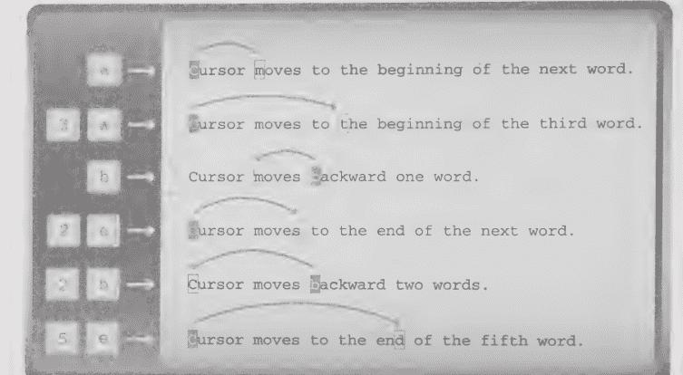
**图 4-6 在 vi 中移动光标**

- 2. 分别输入以下内容且不要按下 ENTER：
  - `$`
  - `^`
  - `$`
  - `0`（零）

美元符号 (`$`) 指示编辑器将光标移动到当前行的末尾。脱字符 (`^`) 和零 (`0`) 都会将光标移动到行首。`:$` 被解释为文件的最后一行。不带冒号的 `$` 则是当前行的末尾。

##### 移动到特定的文本字符或编号位置

我们还可以将光标移动到行上的任何字符，无论它在什么位置。

- 1. 将光标移动到某一行开头，例如以 Each 开头的行：`/Each`

- 2. 在该行选择一个字符，例如 `text` 中的 `x`，并将你选择的字符用作以下命令中的 `x`：
`fx` 

光标将移动到该行第一个 `x` 处。

- 3. 按下 ENTER 或使用方向键，直到你处于另一行包含大量文本的行上。

- 4. 通过输入以下内容将光标移动一个单词：
`w`

- 5. 视觉检查该行，并选择一个位于当前行光标右侧的字符。将以下命令中的 `y` 替换为你选择的字符：
`fy` 

光标将移动到该行所选的字符处。
编辑器将 `f` 命令紧随其后的字符解释为目标字符。它会将光标移动到当前行光标右侧第一个与目标匹配的字符处。
我们可以在行中的任何位置使用 `f` 命令。

- 6. 将光标移回行首：
`^` 

通过 `f` 命令，我们通过识别行上的特定字符来指定目标。我们还可以通过从开头起计算指定数量的字符来指定当前行的位置。

- 7. 告知编辑器转到行上的特定字符位置：
`5|` 

光标将移动到该行的第五个字符处。

- 8. 将光标移动到该行的第 15 个字符处：
`15|`

- 9. 将光标向左移动：
`7|`

管道符 `|` 是转到特定字符位置的指令，该位置可以在当前位置的左侧或右侧。图 4-7 总结了这些命令。

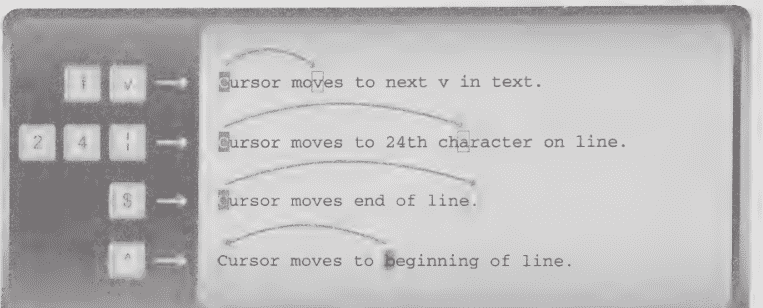
**图 4-7 在 `vi` 中移动光标**

#### 移动到当前屏幕显示的位置

在之前的练习中，你使用 *ltarget* 根据内容指定行，或使用 `30G` 等命令移动到文件中的特定行号。接下来的练习将指示编辑器将光标移动到恰好位于显示屏特定位置的行，例如屏幕的最顶行。

- 1. 输入（大写字母）：
  M
  L
  H

- 2. 移动到文件末尾：
  G

- 3. 再次尝试屏幕位置命令：
  L
  M
  H

- 4. 光标将移动到当前位于显示屏特定位置的任何行。图 4-8 显示了光标如何移动，表 4-1 描述了光标移动命令。

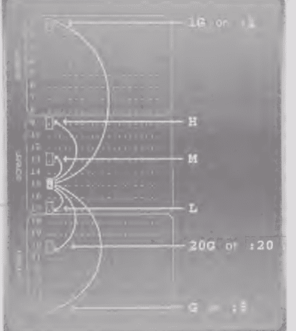
**图 4-8 通过行地址和显示位置移动光标**

#### 返回到上一个光标位置

在编辑过程中，我们经常需要移动到文件中的一个远处位置来检查某些特定问题或执行编辑任务，一旦任务完成，我们需要返回到初始位置并继续编辑。

- 1. 在移动光标之前，在心中记住光标当前所在的行号。

| 命令 | 移动 |
|---|---|
| L | 将光标定位在屏幕显示的最低行。 |
| M | 将光标定位在屏幕中间附近的行。 |
| H | 将光标定位在屏幕的最高行。 |

**表 4-1 vi 光标移动命令**

- 2. 将光标重新定位到你可能想要查看的某个远处行。例如，输入以下命令将光标移动到文件的最后一行：
`G`

- 3. 在此位置，添加一行文本：
`o`

- 4. 返回命令模式：
`ESC`

- 5. 在命令模式下，输入两个*单*引号（不是双引号）：
`''`

你刚刚进入了秘密通道。这两个单引号指示编辑器返回到文件中的前一个位置，无论该位置在哪里，即使你在新位置对文件进行了更改。

#### 每次移动一屏地浏览文件

像 `/word` 或 `17G` 这样的光标移动命令将光标重新定位到文件中的一个新字符、单词或行，如果该位置当前未显示，屏幕显示将随之滚动。这些命令是以行和文本为导向的，而不是以显示为导向的。屏幕必须显示当前的光标位置。当我们移动光标时，显示内容随之移动。我们也可以在文件中向前或向后移动显示内容，强制光标随之移动。

- 1. 从命令模式下，按下：
`CTRL-F`

这一次屏幕向前移动到下一半屏文本，光标随之移动。下表中所述的命令用于调整工作站的屏幕显示，并向前或向后移动到不同的文本块或段落，无论其上下文如何。每个方向有两个命令。

- 2. 阅读这些显示调整命令。

| 显示调整命令 | 功能 |
| :--- | :--- |
| CTRL-D | 在文件中向下滚动半屏文本。 |
| CTRL-U | 在文件中向上滚动半屏文本。 |
| CTRL-F | 显示文件中的下一屏文本。 |
| CTRL-B | 显示文件中的前一屏文本。 |

- 3. 分别尝试这些命令多次。

以下插图中心的方块（位于 *certain* 的字母 *c* 上）是光标。要将光标移动到左上角（*This* 的 *T*），请输入大写命令 **H**。在接下来的插图中，连接光标与各个目的地的箭头旁边印有相应的命令键。

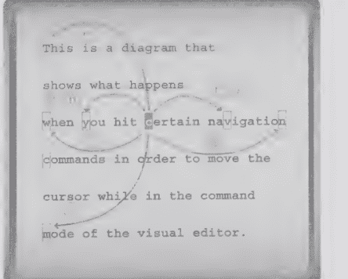

本节中的命令研究了两类“在文件中移动”的功能：

- *光标定位命令* 将光标移动到文件中特定的指定位置。当光标移动时，屏幕显示必须做出相应补偿。

- *显示调整命令* 相对于光标的当前位置在文件中向前或向后移动屏幕显示，并显示一段新文本。光标必须随之移动。

- 4. 查看图 4-9 中的表格。多次练习每个命令，确保注意在执行每个命令之前和之后光标的位置。

| 光标定位命令 | 功能 |
| :--- | :--- |
| 0 (零) | 将光标移动到当前行的开头。 |
| ^ | 将光标移动到当前行的开头。 |
| $ | 将光标移动到行末。 |
| nnG | 将光标移动到第 nn 行，其中 nn 是行号。 |
| G | 将光标移动到文件最后一行的开头。 |
| - | 将光标移动到前一行的开头。 |
| + | 将光标定位在下一行的开头。 |
| nn\| | 将光标定位在当前行的第 nn 列，其中 nn 是列号。 |
| /abc | 将光标移动到文本中字符串 abc 的下一个出现位置。 |
| L | 将光标定位在屏幕显示的最低行。 |
| M | 将光标定位在屏幕中间附近的行。 |
| H | 将光标定位在屏幕的最高行。 |
| fx | 在行内向前移动光标到下一个 x，其中 x 是指定字符。 |
| n | 移动到之前发出的 `/word` 或 `?word` 中识别出的下一个模式。 |
| `` | 将光标返回到光标上次所在的行。 |
| b | 将光标移动到前一个单词的开头。 |
| w | 将光标移动到下一个单词的开头。 |
| e | 将光标移动到当前单词的末尾。 |
| h | 将光标向左移动一个字符。 |
| j | 将光标向下移动一个字符。 |
| k | 将光标向上移动一个字符。 |
| l | 将光标向右移动一个字符。 |

**图 4-9 光标定位命令。**


## 4.5 向文件添加文本

当我们告诉编辑器我们要开始添加文本时，我们输入的具体命令决定了文本相对于光标在文件中的添加位置。

### 在光标之前和之后插入文本

在 vi 导览中，您使用了 `a` 命令在光标右侧添加文本。另一个命令用于在光标左侧插入文本。

- 1. 在同一模式下，将光标移动到屏幕上某个单词的开头。
- 2. 输入 `insert`（插入）命令：
    `i`
- 3. 输入以下文本，请注意，在您输入时，现有的文本会向右移动：
    `The difference between the`
    `i and a commands does not seem to be very`
    `obvious.`
    `insert` 命令开始在光标左侧添加文本。
- 4. 通过按下以下键返回命令模式：
    `ESC`

### 比较 `a` 和 `i` 命令

`a` 和 `i` 命令都指示编辑器在光标位置添加文本。接下来的练习将明确演示这两个命令之间的区别。

- 1. 使用方向键，将光标置于一行已有文本的开头。
- 2. 现在输入 `append`（追加）命令：
    `a`
- 3. 按四次空格键以添加四个空格。
    行中的第一个字符（即您输入 `a` 命令时光标所在的位置）仍然留在行首。添加的空格被追加到光标位置的右侧，即该行第一个字符之后。`a` 是 *在光标右侧追加* 的命令。
- 4. 按 ESC 返回命令模式。
- 5. 按 ENTER 将光标移动到文件中下一个有文本的行首。
- 6. 输入 `insert` 命令：
    `i`
- 7. 再次按四次空格键。
    文本被插入到行首。`i` 是 *在光标左侧插入* 的命令。
- 8. 通过按下以下键返回命令模式：
    `ESC`
- 9. 将光标移动到两个单词之间的空格处，尝试使用 `a` 和 `i` 命令。

`a` 和 `i` 命令将您从命令模式切换到追加模式。在 `i` 命令之后输入的每个字符都作为文本添加到文件中，从光标左侧开始。使用 `a` 命令时，文本被添加到光标位置的右侧。

### 在光标上方打开一行

除了使用小写 `o` 在光标下方打开新行外，您还可以在光标上方打开新行。

- 1. 将光标移动到文本行的任意位置。
- 2. 输入以下（大写 *Oh*）命令：
    `O`
    `O` 命令的指令是在光标所在的行上方打开一行，并切换到追加/插入模式。
- 3. 添加一些文本，例如：
    `It is essential to be able to place text above the current line, especially when I want to enter text before the first line in a file.`
- 4. 通过按下以下键告诉编辑器返回命令模式：
    `ESC`
- 5. 通过输入以下内容移动到文件的第一行：
    `1G`
- 6. 输入适当的命令在第一行上方添加文本：
    `O`
- 7. 添加一些文本。

与将您置于追加/插入模式的其他命令一样，您可以根据需要继续输入任意多行。您不限于仅输入那一行。

- 8. 通过按下以下键告诉 `vi` 返回命令模式：
    `ESC`
- 9. 将文件按当前状态保存并返回 shell，输入：
    `:wq`

### 在行首插入文本

当我们需要在行首或行尾添加文本时，光标可能位于行中间的某个单词处。与其过度使用方向键，我们可以发布特定的文本添加命令，将光标直接移动到行的任一末端并开始添加文本。

- 1. 通过输入以下内容返回编辑 *practice* 文件：
    `vi practice`
- 2. 将光标移动到文件中任意文本行的中间：
    `5w`
- 3. 输入大写命令：
    `I`
    光标移动到行首。您现在处于追加/插入模式，您输入的任何内容都会被插入到原行第一个字符之前。
- 4. 添加一些文本，例如：
    `I was in the middle of a line,`
    `now I am adding text to the beginning.`
- 5. 通过按下以下键离开追加/插入模式并返回命令模式：
    `ESC`

**I** 命令指示编辑器将光标移动到行首并切换到追加模式。您输入的每个字符都会作为附加文本插入，直到您按下 ESC。

### 在行尾追加文本

无论光标最初位于一行的什么位置，您都可以指示编辑器开始在行尾添加文本。

- 1. 在命令模式下，将光标移动到包含文本的行，然后输入大写命令：
    `A`
    光标移动到行尾，编辑器现在处于追加模式。
- 2. 添加一些文本，例如：
    `Adding text to the end of a line is easy with the A command.`
- 3. 使用 ESC 返回命令模式。

所有追加命令都会将您带入追加模式，直到按下 ESC。各种追加命令的唯一区别在于文本相对于光标添加到文件中的位置。下图标识了每个命令在行中添加文本的位置。


## 4.6 避免在向 Shell 和 vi 输入命令时产生光标混淆

到目前为止，您已经向三个不同的命令解释器发出过命令：shell、可视化编辑器命令模式和追加模式。每个命令解释器处理命令的方式都不同。

### 向 Shell 发出指令

要向 shell 发出指令：

- 1. 通过输入以下内容退出编辑会话：
    `:wq`
    您现在回到了与 shell 的通信状态。
- 2. 在 shell 中输入：
    `who`
    屏幕上会出现当前登录用户的列表。对于 shell 来说，三个字符 `w`、`h` 和 `o` 被解释为“定位并执行名为 **who** 的实用程序”。**who** 实用程序确定谁已登录并格式化一份报告输出，在本例中是输出到您的屏幕上。
- 3. 离开 shell，通过输入以下内容调用编辑器来处理您在本章中一直使用的 *practice* 文件：
    `vi practice`
    您现在处于可视化编辑器的命令模式中，正在编辑一个文件。

### 向命令模式发出相同的指令

要向命令模式发出相同的指令：

- 将光标置于文本中某个单词的开头，然后输入以下三个字符：
    `w`
    `h`
    `o`

如您所见，字符 **w**、**h** 和 **o** 在可视化编辑器命令模式中具有完全不同的含义：

- `w` 表示向右移动一个单词。
- `h` 表示将光标向左移动一个空格。
- `o` 表示在当前行下方打开一行并进入追加模式。

您现在处于编辑器的追加模式中。

### 为追加模式提供相同的指令

- 1. 为了完成对比，再次输入相同的三个字符。
    这一次，在追加模式下，输入 **w, h,** 和 **o** 的效果是在文件中添加了三个字母。
- 2. 返回命令模式：
    `ESC`

### 比较命令解释器

`vi` 编辑器内部两种模式之间的区别至关重要。每当我们告诉 shell 启动 `vi` 编辑器时，它会打开文件，并且我们 *总是* 处于命令模式。在这种模式下，`vi` 将我们输入的任何内容理解并执行为一组特定的命令。击键会导致移动光标、删除文本、切换到追加模式，或者终止 `vi` 并因此返回 shell。

在我们输入进入追加模式的命令（如 **a** 或 **o**）之后，编辑器开始将您输入的每个字符视为文件的输入。一旦进入追加模式，编辑器几乎会将我们输入的每个字符作为文本放入文件并在屏幕上显示。在按下 ESC 之前，我们一直处于追加模式。如果我们是在 UNIX 系统上且处于 `vi` 的追加模式，当我们按下方向键时，方向键的控制字符将被添加到文件中。在 Linux 的 `vi` 编辑器（`vim`）的追加模式中，我们可以使用方向键移动光标，控制字符不会被添加到文件中。

无论我们之前使用哪个命令进入追加模式，按下 ESC 是返回命令模式的唯一方法。ESC 永远是返回命令模式的途径。

## 4.7 从文件中删除文本

在编辑器导览中，您使用 **dd** 删除了整行，使用 **x** 删除了单个字符。基本上，您可以使用本节探讨的命令指定并删除文件的任何部分。

### 删除多个对象

与方向键类似，各种删除命令前可以加上一个数字，以同时删除多个对象。


#### 删除多行

- 1. 移至文件的顶部并输入命令：
  `2dd`
  当前光标所在的行以及其后的一行将被删除。
- 2. 撤销删除操作：
  `u`
- 3. 移至另一个位置并输入：
  `4dd`
  `u`
- 4. 前往文件的最后一行：
  `G`
- 5. 尝试使用以下命令删除文本：
  `3dd`

在这种情况下，没有任何内容被删除，因为你请求 `vi` 删除的行数超过了实际可用的行数。

#### 删除多个字符

在 `vi` 的入门介绍中，你使用了 `x` 命令来删除单个字符。

- 移至包含文本的一行开头并输入：
  `x`
  `5x`

`x` 命令是删除一个字符的指令。当我们在 `x` 前面加上数字时，编辑器将删除相应数量的字符。

#### 删除多个单词

我们还可以指令编辑器移动一个或几个单词，以及删除一个或几个单词。

- 输入：
  `w`w`
  `3w`
  `d3w`

我们可以告诉编辑器删除多行、多个单词或多个字符。

#### 删除行的剩余部分

可视化编辑器并不局限于删除整行；我们还可以删除一行中剩余的部分。

- 1. 将光标移至 *practice* 文件中一长行的中间，然后输入以下大写命令：
  `D`
  这个大写字母 `D` 是 **D**elete（删除）行的剩余部分的指令，从光标所在的字符开始删除。
- 2. 移至另一行的中间，通过输入以下命令删除剩余部分：
  `D`

#### 删除一行中直到特定字符的所有文本

之前，你通过输入 `f?` 将光标移动到行中选定的字符上，其中 `?` 是你想让光标定位的行内字符。

- 1. 在文件中选择一行文本，并将光标置于行首。
- 2. 识别光标右侧行中的一个字符，例如单词 *the* 中的 `e`。
- 3. 输入：
  `fe`
  其中 `e` 是你选择的目标字符。一旦按下目标字符，光标将移动到该行中该字符第一次出现的位置。
- 4. 通过输入以下命令将光标移回行首：
  `^`
- 5. 现在输入：
  `dfe`
  同样地，将 `e` 替换为你在该行上选择的目标字符。从光标到选定字符之间的文本将被删除。
- 6. 使用 *撤销* 将文本恢复：
  `u`
- 7. 前往文本中的另一条长行。
- 8. 通过输入以下命令向右移动一个单词：
  `w`
- 9. 选择当前行中光标右侧的一个字符，并用它替换下面命令中的 x：
  `dfx`

从光标到目标字符的文本将被删除。下表总结了这些命令：

| 命令 | 动作 |
| :--- | :--- |
| `fx` | 将光标移动到当前行光标右侧的第一个字符 x 上。 |
| `dfx` | 删除从光标到当前行光标右侧第一个字符 x 之间的文本。 |

到目前为止使用的命令汇总在图 4-10 中。在查看此图时，请特别注意模式、在每个模式中执行哪些命令，以及如何从一个模式切换到另一个模式。

#### 使用行号地址删除行

在编辑器工具中，你将光标移至特定行。你也可以输入 `6G` 或 `51G` 或 `G` 等命令来移动到第 6 行、第 51 行或文件末尾。在关于在文件中移动的章节中，你使用了 `:6`、`:51` 或 `:$` 等编辑器行命令将光标移至特定行，这些命令分别告知编辑器将光标移动到第 6 行、51 行或文件末尾。

一旦指定了行，我们就可以执行其他操作。

- 1. 输入：
  `:5d`
  第 5 行被识别并删除。
- 2. 通过输入以下命令撤销删除：
  `u`
- 3. 使用行地址和删除命令删除另一行，然后撤销删除：
  `:15d`
  `u`

在文件中删除文本块有多种方法。

Shell 启动 vi 并传递参数 `filename`

（图 4-10）

##### vi 命令模式：
编辑、移动和导航文本。写入并退出文档。

- `:w name` - 写入到指定文件。
- `:set number` - 显示行号。
- `h, j, k, l` - 将光标向左、下、上、右移动。
- `fx` - 将光标移动到行内下一个 x 实例。
- `/word` - 将光标前移到下一个 word 实例。
- `w` - 将光标移动到下一个单词的开头。
- `x` - 删除光标下的一个字符。
- `dd` - 删除该行。
- `dw` - 删除从光标开始的单词。
- `D` - 从光标处删除行的剩余部分。
- `dfx` - 删除到行内下一个 x 实例。
- `u` - 撤销上一个命令。
- `:q!` - 不保存文件退出 vi。
- `:wq` - 保存文件后退出 vi。

`C cc w cw cfx a A i I o O rs` - 切换到追加模式。

##### vi 追加模式：
向文档添加文本。

- `r` - 用一个字符替换一个字符。
- `s` - 用文本替换一个字符。
- `O` - 在光标上方打开新行。
- `o` - 在光标下方打开新行。
- `I` - 在行首插入。
- `i` - 在光标前插入。
- `A` - 在行尾追加。
- `a` - 在光标后追加。
- `C` - 从光标处更改行。
- `cc` - 更改整行。
- `cw` - 更改从光标开始的单词。
- `cfx` - 更改文本直到下一个 x 索引。

**图 4-10 命令总结**

- 4. 删除文件的前八行，然后撤销删除：
  `1G`
  `8dd`
  `u`
- 5. 或者，无论光标所在位置，你都可以输入：
  `:1,8d`
  `u`

此命令指示编辑器查找第 1 行到第 8 行并将其删除。逗号用于指示行的范围，从逗号左侧的行号开始，到（包括）右侧的行号结束。请参阅图 4-11 中使用冒号删除文本的图形说明。

（图 4-11）

**图 4-11 使用数字删除文本**

- 6. 因为编辑器将 `:$` 解析为文件末尾的行，因此你可以清空文件：
  `:1,$d`
- 7. 快速 `撤销` 所有行的删除操作：
  `u`

使用行地址的命令（如 `:4` 和 `9d`）以冒号开头，且需要按下 ENTER 键才能启动。命令模式指令（如 `u` 或 `4dd`）前面没有冒号，无需按下 ENTER 键即可自动执行。图 4-12 总结了你刚刚使用的导航和删除命令：

（图 4-12）

**图 4-12 在 vi 中导航和删除文本**

## 4.8 撤销编辑命令

错误在所难免。单词拼写错误；行被意外删除；添加了不再重要的文本。对于人类来说，一个必不可少的工具就是 `undo`（撤销）命令，它可以撤销（废除）最近的一次文本更改命令。我们在 `vi` 入门中介绍了 `u`，并一直使用它来撤销删除。撤销命令还提供了一些额外功能。

### 撤销最后一次编辑更改

在进行编辑时，我们会进行添加、删除和替换。任何更改都可以被撤销。

- 1. 输入以下内容：
  `dw`
  `u`
- 2. 添加一些文本并撤销它：
  `a`
  `This is new text`
  `ESC`
  `u`

当我们做出编辑更改时，可以使用 `u` 命令将其 `撤销`。

### 撤销一行上的所有编辑更改

如果你使用的是 Linux 或另一个使用 `vim`（来自自由软件基金会的开源 `vi`）的系统，你可以一次撤销一个，连续进行多次 `undo` 更改。

- 1. 进行多次删除：
  `dw`
  `3dw`
  `2dd`
  `x`
- 2. 逐个撤销删除操作：
  `u`
  `u`
  `u`
  `u`

你删除了行、单词和一个字符。当你输入第一个 `u` 时，它撤销最后一次编辑更改。下一个 `u` 撤销之前的更改，以此类推。任何更改或文本添加都可以被撤销。撤销多次更改是 Linux 可视化编辑器的一个特性。在 UNIX `vi` 中，我们可以用 `u` 撤销最后一次更改（例如一次删除），行会恢复。按下第二个 `u` 则会撤销这次撤销，再次删除该行。

还有一个第二个 `Undo` 命令，如果你还没有离开当前行，它可以撤销你在光标所在的当前行上所做的任意数量的更改。

- 1. 选择一行文本，并从中删除一个单词：
  `dw`
- 2. 在不离开该行的情况下，将光标移至另一个单词，并通过输入以下内容删除一些字符：
  `x`
- 3. 移至行尾并添加一个单词：
  `$`
  `a`
- 4. 按 ESC 返回命令模式。
- 5. 前往行首并删除一个单词：
  `dw`
- 6. 在不将光标移离该行的情况下，输入小写命令：
  `u`
  一次更改被撤销。
- 7. 仍在当前行时，输入：
  `U`
  该行恢复到原始状态。所有更改都被反转。该行回到了你在进行任何更改之前的状态。
- 8. 重复步骤 1 和 2。
- 9. 在进行更改后，将光标移至另一行。
- 10. 在新位置输入：
  `U`
  `U` 命令失效。因为你在输入 `U` 之前更改了另一行。


撤销命令的摘要如下表所示：

| 撤销命令 | 操作 |
| :--- | :--- |
| `u` (小写) | 撤销上一个文本修改命令的效果，即使您已经离开了该行。 |
| `U` (大写) | 撤销对当前行所做的所有更改，前提是您尚未在另一行进行更改。 |

- 11. 保存更改并退出编辑器：
  `:wq`

## 4.9 使用可视化编辑器创建新文件

到目前为止，您一直在现有文件中移动光标、删除文本和添加文本。可视化编辑器也可用于创建新文件。

### 调用编辑器并添加文本

开始编辑一个新文件与编辑旧文件非常相似，不同之处在于传递给 `vi` 的参数是新文件的名称，而不是一个已存在的文件。

- 1. 通过输入以下命令开始创建新文件的过程：
  `vi scrp1`
  屏幕会被清空，一列波浪号 (~) 在屏幕左侧排列，您将处于 `vi` 的命令模式。此时没有文本；一张白纸正等待着您的智慧。但您还不能添加文本，因为无论何时启动编辑器，您都处于命令模式。
- 2. 输入以下命令进入追加模式：
  `a`
- 3. 添加以下行文本：
  ```
  echo Hello $USER
  cal
  date
  ```
- 4. 告知编辑器您想停止添加文本并返回命令模式：
  `ESC`

### 向行中添加内容

您刚刚添加了文本并返回了命令模式。现在您可以地在文件中移动并对其进行更改。

- 1. 在命令模式下，使用方向键将光标移动到包含以下文本的行首：
  `cal`
- 2. 指令编辑器在行尾添加文本：
  `A`
- 3. 添加一个空格和用四位数字表示的当前年份。
- 4. 按 ESC
- 5. 使用常用命令写入文件、离开编辑器并返回 shell：
  `:wq`
- 6. 通过输入以下命令获取目录中的文件列表：
  `ls`

新文件被列在当前目录的内容中。无论您是在创建新文件还是编辑旧文件，编辑器的行为都是相同的。创建新文件的命令与您输入编辑现有文件的命令完全相同：`vi filename`。在这两种情况下，您都需要提供文件名。当您输入 `vi filename` 命令时，会发生以下两种情况之一：

- 如果您输入的 `filename` 已经存在，`vi` 会为您创建该文件的缓冲区副本以便编辑。
- 如果您提供的 `filename` 不存在，编辑器将使用新的 `filename` 开始编辑一个内存缓冲区。
  当您输入 `:wq` 时，缓冲区被写入磁盘并以 `filename` 命名。

#### 执行脚本

您刚刚创建了一个包含若干命令行文件的文件。您可以使该文件可执行，然后执行其内容。

- 1. 通过输入以下命令使您刚刚创建的文件可执行：
  `chmod +x scrp1`
- 2. 通过输入以下命令执行脚本：
  `scrp1`
  或
  `/scrp1`

脚本中的所有命令都将被执行，输出结果将显示在屏幕上。在第 3 章中，您使用了 `cat` 创建了一个脚本，从键盘读取并将其指令放入文件中。使用 `cat` 时，我们只能输入文本，无法进行修改。而使用编辑器，我们可以向脚本添加命令、进行修改以及删除文本。

#### 自测 2

- 1. 哪个命令使光标向下移动三行？
- 2. 哪个命令使光标向右移动七个字符？
- 3. 哪个命令可以定位单词 *wonderful heroes*？
- 4. 哪个命令在文件中向后搜索字符串 *time*？
- 5. 哪个命令将光标移动到下一个单词的开头？
- 6. 哪个命令将光标移动到当前行的开头？
- 7. 哪个命令将光标移动到当前行的末尾？
- 8. 哪个命令将光标向前移动到当前行中字符 $l$ 第一次出现的位置？
- 9. 无论当前光标位置如何，哪个命令将光标移动到第八个字符位置？
- 10. 哪个命令请求 `vi` 编辑器在每行开头显示行号？
- 11. 哪个命令将光标移至文件第 15 行的开头？
- 12. 哪个命令将光标移至文件最后一行的开头？
- 13. 您输入什么命令可以在不保存文件更改的情况下离开 `vi`？
- 14. 哪个命令将光标定位在屏幕显示的最低行？
- 15. 假设您在某行文本上，输入 `/target`。随后光标移动到包含字符串 `target` 的行。您如何告知编辑器返回到原来的行？
- 16. 哪个命令将文件中的文本向下滚动一个屏幕？
- 17. 哪个命令删除当前行及随后的七行？
- 18. 当您处于命令模式并输入 `2j3dw` 时会发生什么？
- 19. 哪个命令删除从光标所在字符开始直到行尾的剩余部分？
- 20. 哪个命令删除从光标所在字符开始直到该行第一个字符 $H$ 的所有字符？
- 21. 您输入什么命令在光标左侧添加文本？
- 22. 您输入什么命令在光标右侧添加文本？
- 23. 哪个命令在光标上方打开一行？
- 24. 当您在命令模式下输入单词 `open` 时会发生什么？
- 25. 您输入什么命令在当前行末尾添加文本？

## 4.10 进行文本更改

到目前为止，您已经学习了添加和删除文本。为了有效地进行编辑，您还必须能够进行字符、单词和行的替换。

### 用一个字符替换另一个字符

您可以删除一个字符并用另一个单个字符替换它。

- 1. 再次使用以下命令开始编辑 *practice*：
  `vi practice`
- 2. 在命令模式下，使用前向搜索命令将光标移动到您想要的任何单词上：
  `/word`
- 3. 通过输入以下命令替换该单词的首字母：
  `r`
- 4. 在 `r` 命令之后输入任何*字符*，例如：
  `M`
  在 `r` 之后输入的字符将用于替换光标下的任何字符。
- 5. 举另一个例子，将光标置于单词 *too* 的第一个 *o* 上。
  输入 `r` 命令，然后输入字母 *w*。
  *too* 中的第一个 *o* 被替换为 *w*，因此单词 *too* 变成了 *two*。

命令 `r` 指示编辑器将光标下的字符替换为您输入的下一个字符。字符被替换后，您将立即返回命令模式。

#### 分割长行

替换字符命令的一个重要用途是将一行长文本分割为两行。当一行过长时，我们需要在中间某处按下 ENTER 键将其分成两行。

- 1. 将光标移动到长行中间两个单词之间的空格处。
- 2. 输入替换命令 (`r`) 然后按下 ENTER。

在这个操作中，我们通过按下 ENTER 键将两个单词之间的空格字符替换为换行符。结果是，长行的第二部分被移至新行。之所以有效，是因为当我们按下 ENTER 时，一个表示新行的特殊字符被添加到文件中。

#### 合并两行文本

在编辑过程中，有时我们需要将两行合并在一起。

- 1. 在文件中选择两行相邻的短行，并将光标置于第一行的任意位置。
- 2. 输入大写命令：
  `J`
- 3. 这两行现在已合并。
- 4. 移动到另一行并将其与随后的行合并。

#### 逐字符覆盖文本

`r` 命令指示编辑器将光标下的单个字符替换为接下来输入的任何单个字符。有时，逐字符替换整个文本字符串会很方便。如果为此使用 `r` 命令会相当繁琐。

- 1. 确保您处于命令模式，然后输入大写命令：
  `R`
- 2. 开始输入。
  您现在处于“覆盖输入”模式。您输入的每个字母都会替换掉光标下随之向后移动的单个字母。


- 3. 在您使用覆盖输入命令 `R` 替换部分文本后，按下以下键返回命令模式：

`ESC`

#### 用多个字符替换单个字母

您已经使用了 `r` 命令将单个字符替换为另一个字符。通常，作者或程序员需要删除一个字符，然后用几个字符甚至几页内容来替换这个被删除的单个字符。

- 1. 将光标置于文件中的任意字符上，输入小写命令：

`s`

字符上可能会出现美元符号 ($)，或者该字符直接消失。

- 2. 添加如下文本：

```
Is it true that I am now in append mode?
I must be, text that I am entering
is going onto the screen,
and, I expect, into the file.
```

- 3. 按 ESC 返回命令模式。

- 4. 在文本中选择另一个字符，并使用 `r` 命令将其替换为不同的字符。

- 5. 在文件中选择另一个字符，使用 `s` 命令将其删除并用整个句子来替换。

`r` 和 `s` 命令都是通过替换文件中的单个字符来添加文本。由于使用 `s` 命令时输入的文本长度不一，我们必须按下 ESC 来告知编辑器我们已完成文本输入。而 `r` 命令则不同，因为其替换范围是固定的——一个字符。

`r` 命令将一个字符替换为一个新的单个字符，然后自动将您返回到命令模式。您不会停留在追加模式中，也不需要按下 ESC。相比之下，`s` 命令会将光标下的字符替换为您输入的所有文本，直到您按下 ESC 为止。`s` 命令允许您用任意数量的字符来替换被删除的一个字符。您从命令模式切换到追加模式，并一直停留在那，直到按下 ESC 返回命令模式。同样，在您输入 `R` 命令后，编辑器会将光标经过的每个字符替换为仅一个字符，但您必须按下 ESC 才能停止替换文本。

#### 用文本替换一个单词

您还可以将文本中的一个单词更改为另一个单词或多个其他单词。

- 1. 使用 `/` 命令，将光标置于文件中间的一个单词上。
- 2. 输入“更改单词”命令：
   `cw`
   根据您编辑器版本的不同，单词末尾可能会出现美元符号 ($)，表示被替换文本的末尾，或者该单词被直接删除。
- 3. 添加如下文本：
   `XXX This is text entered after a cw command XXX`
- 4. 完成后，按下以下键退出追加模式：
   `ESC`

输入 `cw` 命令会告知编辑器删除一个单词并将您置于追加模式。您输入的所有内容都会进入文件，直到您按下 ESC。

#### 替换行

`s` 和 `cw` 命令分别允许您用文本替换单个字符和特定单词。您还可以替换文件中的整行内容。

- 1. 将光标置于行的任意位置。
- 2. 要用新文本替换该行，请输入以下小写命令：
   `cc`
   该行文本被删除，光标位于行首。此时您处于追加模式。
- 3. 添加如下文本：
   `And this is a new line of text!`
   `Well, actually two, taking the place of one.`

使用更改行命令 `cc`，无论您输入什么内容都会替代当前行进入文件。您对该行的替换并不限于一行，此时您可以追加任意数量的行。`cc` 命令会删除当前行的文本，并将您从命令模式切换到追加模式。您将保持在追加模式中继续添加文本。

- 4. 通过输入以下键返回命令模式：

`ESC`

#### 更改行的剩余部分

您可以更改从光标位置到当前行末尾的文本，将其替换为新文本。

- 1. 将光标移动到一行文本的中间。
- 2. 输入大写命令：
   `C` 
   行末会出现美元符号，表示为新文本腾出空间而删除的最后一个字符，或者该行剩余部分被删除。无论哪种情况，您都处于追加模式。
- 3. 添加几行文本。
- 4. 返回命令模式：
   `ESC`

`C` 命令将您置于追加模式，并允许您更改从光标位置到行末的部分。从左边距到光标（不包括光标）的字符保持不变。在您按下 ESC 之前输入的所有文本都将替换该行的剩余部分。

#### 将一行中所有文本更改至特定字符

在之前的章节中，您通过输入 `fe` 命令将光标移动到特定字符（如 *e*）上。同样，您可以使用 `dfe` 命令删除直到特定字符的内容。

- 1. 将光标移动到一长行的开头。
- 2. 选择该行上的一个字符，例如 *e*。
- 3. 输入：
   `cfe` 
   其中 `e` 是您在该行上选择的字符。
- 4. 输入一些文本。从光标到所选字符的文本被删除，您处于追加模式并输入替换文本。
- 5. 通过输入以下键退出追加模式并返回命令模式：
   `ESC`

删除和替换命令汇总在下表中：

| 操作 | 字符 | 单词 | 行 | 行剩余部分 | 行内至字符 Y 的文本 |
| :--- | :--- | :--- | :--- | :--- | :--- |
| 删除 | x | dw | dd | D | dfy |
| 替换 | s | cw | cc | C | cfy |

#### 进行全局文本更改

之前的练习探讨了如何进行个体更改。我们经常希望对整个文件中目标的所有实例进行更改。

##### 搜索单词的首次出现

替换命令（一种冒号命令）用于在文件中将一个正则表达式交换为另一个正则表达式。

- 1. 将光标移动到包含单词 `creating` 的一行。（如果文件中没有出现 `creating`，请将其添加到行末，并将光标保持在该行。）
- 2. 通过输入以下命令将单词 `creating` 更改为 `producing`：
   `:s/creating/producing/`

第一个出现的单词 `creating` 被更改为 `producing`。

替换命令需要两个由斜杠分隔的单词。`s` 命令执行的操作是检查行中是否存在左侧的模式（*目标模式*），如果找到，则用右侧的表达式（*替换模式*）替换目标模式。之前的命令告诉 `vi` 在当前行查找单词 `creating` 并将其替换为单词 `producing`。如果 `vi` 找不到您指定的目标模式，则会显示错误消息。

##### 搜索所有行中字符串的所有出现

`s` 冒号命令的一种扩展可指示编辑器作用于文件中的 *所有* 行。

- 1. 向您的文件中添加以下行：
   ```
   jo 2001 2003 2002
   alan 2003 2004
   jo 2002 2002 2002
   bob 2002 2003
   margot 2002 2003 2003
   ```

- 2. 退出追加模式：
   `ESC`

- 3. 要执行更改，请输入命令：
   `:1,$ s/2002/1776/g`

此命令指示编辑器检查从指定的起始行到最后一行的所有行。行由两个用逗号分隔的行号标识。逗号是指示查找从第一行到最后一行的范围内所有行的指令。此命令告诉 `vi` 检查所有行以查找字符串 `2002`，并在找到该字符串的地方将其替换为模式字符串 `1776`。`g` 是指示如果在同一行中出现多次 `2002` 则全部更改的指令。该命令对编辑器的指令如下表所示：

| 命令 | 解释 |
| :--- | :--- |
| `1,$` | 从第 1 行到文件中的最后一行 (`$`) |
| `s` | 执行 `s`ubstitutions (替换) |
| `2002` | 替换字符串 2002... |
| `1776` | 为字符串 1776... |
| `/g` | 在文件中全局替换。 |

`substitute` 命令末尾的 `g` 被称为 *标志 (flag)*。`g` 标志（*global*，全局）指示 `substitute` 命令替换指定行内所有出现的目标模式。


#### 选择要修改的行

您可以将替换范围限制在包含特定内容的行中。例如，如果您想更改年份，但仅限于包含字符串 jo 的行，则需要指定受影响的行。

输入：
`:1,$ /jo/s/2002/1776/g`

`vi` 仅更改包含字符串 *jo* 的行。如果没有 *jo*，则不执行替换。
该命令对编辑器的指令如下表所示：

| 命令 | 解释 |
| :--- | :--- |
| `1,$` | 从第 1 行到文件的最后一行 ($)。 |
| `/jo/` | 行目标。查找包含字符串 *jo* 的行。仅在至少包含一个目标实例的行上执行操作。 |
| `s` | 执行替换。 |
| `/2002/1776/` | 将字符串 2002 替换为字符串 1776。 |
| `/g` | 全局（globally），更改每行中的所有实例。 |

## 4.11 移动和复制文本

在查看工作成果时，您经常会发现任务是将行、单词或整个文本块从一个地方移动或复制到另一个地方。

### 复制和粘贴文本

使用 `vi` 编辑器，您可以移动或复制文本块。

- 1. 如果您尚未编辑 *practice* 文件，请先输入：
  `vi practice`
- 2. 将光标移动到屏幕中间的某一行。
- 3. 输入小写命令：
  `yy`
- 4. 虽然看起来什么都没有发生，但 `vi` 编辑器已经“yyanked”（抽取出）并创建了该行的副本，并将副本保存在内存中。被复制的行不会被删除，也不会受到 `yyank` 命令的其他影响。
- 5. 将光标移动到文本中的另一个位置，例如向下移动几行。
- 6. 输入小写命令：
  `p`
- 7. 刚才抽取的行现在被放置（put）或粘贴为光标行下方的一行新行。
- 8. 抽取功能在复制文本块时最有用。例如，要抽取从光标行开始的七行文本，请输入：
  `7yy`
- 9. 将光标移动到您想放置抽取行的行，例如文件的末尾：
  `G`
- 10. 现在将抽取的七行放在光标之后：
  `p`
- 11. 抽取的七行文本副本现在出现在当前光标位置下方的七个新行中。
  有时我们需要用 `p` 将行放在光标上方。
- 12. 将光标移动到文件的第一行：
  `1G`
- 13. 当光标在文件的第一行时，输入大写字母命令：
  `P`
  内存中的行将被放置在当前行的*上方*。
- 14. 将另一行抽取到内存中，并分别使用 `p` 和 `P` 命令将该行的副本放入文件中。

### 删除和放置行

`yy` 抽取命令创建了一个用于放置在其他位置的副本。抽取（yank）和粘贴（paste）命令是现代复制和粘贴命令的前身。您还可以将任何删除命令与 `p` 放置命令结合使用，以实现剪切和粘贴。

- 1. 选择一行，将其移动到文件的其他位置。
- 2. 将光标定位在要移动行的任意字符上，然后输入：
  `dd`
  该行被删除，但同时也被放入内存中。
- 3. 将光标移动到文件末尾。
- 4. 放置该行：
  `p` 
- 5. 该行被“剪切”并“粘贴”到了文件末尾。

图 4-13 展示了删除文本、将文本保存在缓冲区以及放置文本的过程。

### 复制和移动单词与字符

我们可以使用抽取命令来抽取一个或多个单词，而不是整行。

- 1. 将光标移动到文件中的一个单词的开头。

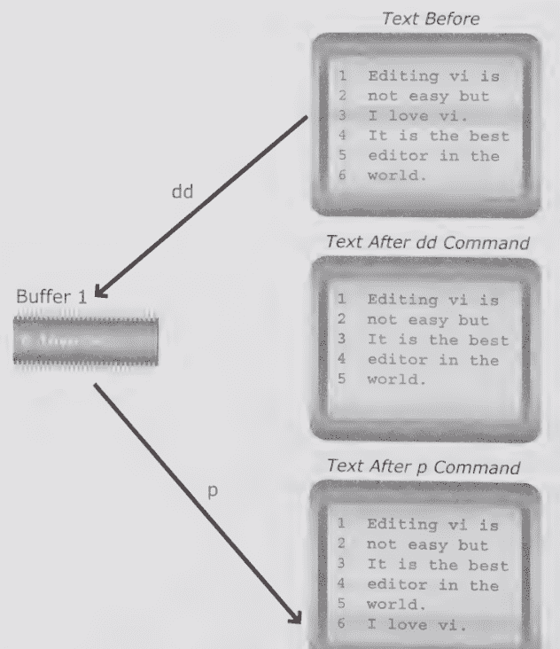
**图 4-13** 使用缓冲区删除和放置文本

- 2. 在命令模式下，输入：
  `yw`
- 3. 移动到文件中另外两个单词之间的空格处。
- 4. 输入：
  `p`
  抽取的单词被放置在新的位置。
- 5. 这一次通过输入以下命令删除一个单词：
  `dw`
- 6. 再次移动到两个单词之间的空格处并输入：
  `p`
  被删除的单词被放置在新位置。您可以将小写 `p`ut 命令与 `x` 命令结合使用，快速转置文本中的字符。
- 7. 将光标移动到文本中任意单词的第一个字母上，然后输入：
  `x`
- 8. 现在输入：
  `p`

请注意，这两个字符已经互换了位置。
当我们删除部分文本时，该文本的副本会被放入内存中。我们可以使用 `p` 或 `P` 命令将其放置在文件的任何位置。

### 复制和移动部分行

就像 `dfx` 从光标删除到当前行的 `x`，以及 `cfx` 将文本更改为 `x` 一样，我们可以指示编辑器抽取行的某一部分。

- 1. 在当前行光标右侧选择任意字符 (x) 并输入：
  `yfx`
  其中 x 是您选择的字符。
- 2. 将光标移动到行末并 `p`ut（放置）抽取的文本：
  `P`
- 3. 移回行首：
  `^`
- 4. 从光标删除到该行上的任意字符 (x)：
  `dfx`
- 5. 移动到第 1 行末尾并 `p`ut（放置）删除的文本：
  `1G`
  `$`
  `p`
- 6. 将光标移动到一行文本的中间并输入：
  `d$`
  `u`
  `d^`

我们还可以对“行尾”和“行首”这些对象进行操作。

#### 检查对象和操作符

您已经执行了多种命令，如 `dd`、`dw`、`yy`、`cw`、`cc`、`cw` 等。请查看下表，该表重点介绍了这些命令之间的关系：

| 对象 | 操作 |
| :--- | :--- |
| 整行 | 删除 `dd`, 更改 `cc`, 抽取 `yy` |
| 行的剩余部分 | `D` 或 `d$`, `C` 或 `c$`, `y$` |
| 到行上的字符 x | `dfx`, `cfx`, `yfx` |
| 单词 | `dw`, `cw`, `yw` |
| 字符 | `x` 或 `dl`, `s` 或 `cl`, `yl` |

`delete`（删除）的操作符是 `d`，`change`（更改）的操作符是 `c`，`yank`（抽取）的操作符是 `y`。当我们想对整行进行操作时，需输入两次操作符：`dd`、`cc` 和 `yy`。我们可以使用 `$` 指定行尾，从而删除、更改或抽取行的剩余部分。如果受影响的对象是光标与字符 `x` 之间的文本，我们将*操作符*放在 *fx* 之前，如 `dfx`、`cfx` 和 `yfx` 命令。单词对象 (*w*) 受删除 (`dw`)、更改 (`cw`) 和抽取 (`yw`) 操作符的影响。我们可以使用 *l* (*el*) 命令向右移动一个字符来标识该对象。

- 1. 现在，请再次尝试表中的每个命令，并牢记“操作符/对象”模型。
- 2. 将光标放在文件的第 1 行，输入以下操作符-对象命令：
  `d3G`
  `u`
  `d10l`
  `u`
  `d3w`
  `u`
  `d8h`
  `u`

本章中的许多命令都可以这样概括。图 4-14 在第一列列出了三种操作符 (`d`、`c` 和 `y`)，第二列列出了许多对象，第三列是它们的含义。

- 3. 尝试将这些对象与每个操作符结合使用。

#### 在文件中标记位置

在可视化编辑器中，可以将文件中的某个位置标记起来，以便稍后返回该位置或对其进行操作。您可以使用标记来指定要删除、移动、写入或复制的文本。

在一个文件中，如果某行代码或文本与其文件开头之间增加了或删除了行，那么分配给该特定行的行号将会改变。在编辑过程中，我们经常需要返回到特定的文本行；但如果行号已经改变，就很难找到我们想要的位置。

通过可视化编辑器的标记命令，可以标记文件中的多个位置。一旦文本行被标记，我们就可以返回到该行。

- 1. 确保 *practice* 文件显示了行号。（如果没有显示，请输入 `:set nu` 并按下回车键。）

| 操作符 | + | 对象 | 含义 |
| :--- | :---: | :--- | :--- |
| d (删除)<br>c (更改)<br>y (抽取) | + | w | 删除、更改或抽取当前单词的剩余部分。 |
| | | 3w | 删除、更改或抽取光标右侧的三个单词。 |
| | | 3e | 删除、更改或抽取从光标右侧到第三个单词末尾的内容。 |
| | | G | 删除、更改或抽取从当前行到文件末尾的所有行。 |
| | | ^ | 删除、更改或抽取从光标到行首的所有字符。 |
| | | $ | 删除、更改或抽取从光标到行尾的所有字符。 |
| | | 5G | 删除、更改或抽取从光标到第 5 行（或任何指定行）的所有行。 |
| | | fx | 删除、更改或抽取行上从光标向后到 x 的所有字符。 |
| | | Fx | 删除、更改或抽取行上从光标向前到 x 的所有字符。 |
| | | 12\| (竖线) | 删除、更改或抽取行上从光标到该行第 12 个字符的所有字符。 |
| | | 3h | 删除、更改或抽取光标左侧的三个字符。 |
| | | 3l | 删除、更改或抽取光标下的字符及其右侧的两个字符。 |
| | | 3k | 删除、更改或抽取光标下的行及其上方的两行。 |
| **例如：** | | c5G<br>y12\|<br>d8h | 更改从当前行到第 5 行的所有行。<br>抽取从光标到行上第 12 个字符的所有字符。<br>删除从光标到左侧 8 个字符的所有字符。 |

**图 4-14** 删除、更改和抽取命令

- 2. 转到文件中间的一行，并记录其行号。将光标移至该行，输入以下命令：

  `mb` 

此命令将标记该行并为其分配标签 *b*。您可以将 *b* 替换为 *a* 到 *z* 之间的任何字母。


- 3. 将光标移动到文件开头附近的另一个位置。
- 4. 在这个新位置删除几行文本。
- 5. 要返回到你在步骤 2 中标记的文本行，请输入以下内容：
    `'b`
    （一个单引号，后面跟着在 `mark` 命令中使用的字母，在本例中是字符 *b*。）

即使由于我们之前在文件中添加或删除了文本而导致行号明显不同，光标仍会移动到原始标记位置。标记仅在当前的编辑会话中有效。

#### 从当前位置删除到标记点

一旦某一行被标记，我们就可以操作从光标位置到该标记的所有文本。本练习将探讨如何删除从当前行到标记行的所有文本。

- 1. 将光标置于任何一行文本上，并标记该行：
    `ma`
    其中 *a* 是 *a* 到 *z* 之间的任意字母。
- 2. 现在将光标移动到刚才标记行的上方或下方几行，然后输入以下内容：
    `d'a`
    从当前位置到标记行（包括标记行在内）的所有文本将被删除。在这种情况下，操作符是 `d`，对象是到标记处的文本。
- 3. 通过输入以下内容撤销删除：
    `u`

#### 从当前位置修改和复制到标记行

在之前的练习中，您通过在 `'a` 标记行规范前加上 `d`d` 操作符来删除到标记行。我们可以对标记对象使用所有三种操作符。

- 1. 将从光标到标记行的所有行复制（Yank）到内存中：
    `y'a`
- 2. 移动到文件末尾并将复制的行粘贴在那里：
    `G`
    `p`
    从光标到标记被复制到内存中的行被放置在文件末尾。
- 3. 使用两个单引号返回到之前的位置：
    ` `` `
    标记行仍然可用。这次对标记行对象使用修改操作符。
- 4. 输入：
    `c'a`
    从光标到标记行的所有行将被删除，且编辑器进入追加/插入模式。
- 5. 添加一些文本并返回命令模式。

#### 删除、移动或复制标记块

您可以使用 `mark` 命令通过标记块的两端来简化删除、移动和复制大块文本的任务。

- 1. 将光标移动到您想要删除的文本的第一行。通过输入以下内容标记该行：
    `ma`
- 2. 接下来，将光标移动到要删除的文本的最后一行。通过输入以下内容标记该行：
    `mb`
- 3. 现在使用此命令删除从 *a* 到 *b* 的标记文本：
    `'a,'b d`
    标记 *a* 和 *b* 之间的（包括这两行）所有文本将被删除。您刚刚输入的命令与“删除行号”命令（例如 `:16,32 d`）的作用相同。这两个命令都识别行并调用操作。
- 4. 撤销之前的命令，使删除的文本重新出现。
    我们可以使用标记行来为所有冒号命令指定行：`copy`、`move`、`delete` 和 `write`。文件中的行可以通过行号或标记来识别，所有冒号命令或行命令都可以与通过任一元素识别的行一起使用。
- 5. 在继续下一节之前，练习使用标记来移动、删除和写入文本块。

#### 移动和复制文本块

标记文本是识别要删除、移动或复制行的强大方式。我们也可以使用行号。在之前的练习中，您使用类似 `:5,10 d` 的命令删除了一定范围的行，这删除了从第 5 行到第 10 行范围内的行。

- 1. 使用以下命令移动文本块：
   `:1,5 move $` 
   第 1 到 5 行被移动到文件末尾。
- 2. 回到文件顶部并复制一个块：
   `1G` 
   `:1,4 copy 5` 
   第 1 到 4 行被复制并放置在第 5 行之后。
   当我们开启行号且文本块较小时，使用行号移动是最有效的。对于较大的块，使用标记行更容易。

## 4.12 写入文件并退出编辑器

到目前为止，您已经使用 `:wq` 将编辑的文件副本写入磁盘并退出编辑器。我们还可以写入到不同的文件、放弃对当前文件的更改，以及在现有文件的末尾添加内容。

### 不保存更改退出 vi

现在，您的练习文件已经变得混乱了。在继续之前，您可以退出本次编辑会话，返回 shell，并使练习文件保持在您在本节开始时首次调用文件时的状态。

- 1. 在可视化编辑器的命令模式下，输入：
   `:q` 
   因为您在本次编辑会话中对文件进行了更改，vi 会提出异议。编辑器不知道是保存还是丢弃这些更改。
- 2. 输入：
   `:q!`

`!` 告诉编辑器：“是的，我知道我做了更改，但我确实想退出。”此命令不包含 `write`（保存），只有 `quit`（退出）。它表示：“退出编辑器程序，但不要写入我一直在做的更改。”
您现在回到了 shell。

### 保存原始副本和修改版本

有时在编辑时，我们意识到我们想保留编辑之前的原文件，同时也想将修改后的版本保存在一个新文件中。（这类似于文字处理器中的“另存为”菜单选项。）保留这两个版本需要执行以下步骤。

#### 保存新版本

要同时保存原文件及其新的修改版本，我们必须将当前的缓冲区副本保存为一个新文件，然后退出编辑器而不覆盖原文件。

- 1. 使用 `vi` 编辑文件 `practice`，并对其进行一些更改：
   `vi practice`
- 2. 要保存 `practice` 修改版本的副本，请在 `vi` 命令模式下输入以下内容：
   `:w newpractice`

其中 `newpractice` 是您想要的任何名称。
一条类似以下的消息会出现在文件底部的屏幕上：

`"newpractice" [New file] 18 lines, 150 characters`

您已指示编辑器打开一个新文件 `newpractice`，并将您一直在处理的文件副本写入该新文件。图 4-15 对比了写入文件和将缓冲区写入新文件的区别。

#### 保护原始版本

接下来的任务是保护原始版本不被覆盖。如果您输入常规的 (`:wq`) 命令，编辑器会将新版本覆盖在原文件之上。这样您就会有两个新编辑版本的副本，而没有原文件。目标是在不保存对原文件更改的情况下退出 `vi` 编辑器。

**图 4-15 保存新版本**
`:w file-B` —— 将缓冲区写入一个新文件 file-B。

- 1. 输入：
   `:q` 
   或 
   `:q!`
   `:q` 是可以接受的，因为您刚刚写入了文件，尽管您是写入了一个新文件名。`:q!` 同样有效。
- 2. 输入 `ls` 命令查看文件的最新列表。

您的目录现在包含一份原文件 *practice* 的副本，以及一份以您选择的新文件名列出的修改副本。

### 将文本块写入文件

将您正在编辑的文件的一部分提取出来并创建新文件通常很有用。要将当前文件中的一个文本块写入新文件，您需要两个信息：

- 您想要写入新文件的文本的第一行和最后一行的行号
- 要写入内容的名称

- 1. 再次开始编辑 *practice*：
    `vi practice`
- 2. 在 `vi` 命令模式下，输入此命令：
    `:1,7 write practice-2`
    或
    `:1,7 w practice-2`
    其中 *practice-2* 是所选文本的新文件名。全写 **write** 和简写 **w** 的解释方式相同。

由行地址 (1,7) 指定的行被写入 *practice-2*。第 1 到 7 行的文本现在存在于两个地方：您当前编辑的文件 (*practice*) 中，以及 *practice-2* 中。参见图 4-16 的类似示例。

- 3. 离开编辑器并返回 shell。
- 4. 检查新文件 *practice-2*：
    `more practice-2`
    行已被添加。
- 5. 通过输入以下内容再次开始编辑 *practice*：
    `vi practice`


**图 4-16** 将现有文件的部分内容写入新文件

### 覆盖现有文件

您可以使用 `write` 命令来覆盖或替换一个现有文件。

- 1. 输入：
  `:1,7 write practice-2`
  或
  `:1,7 w practice-2`

- 2. 此命令是对覆盖一个已存在的名为 *practice-2* 的文件的指令。见图 4-17。无论 *practice-2* 是否存在，以下命令都将生效：
  `:1,7 w! practice-2`

### 向文件添加内容

另一种类型的 `write` 命令可以将文本追加到文件末尾。

- 1. 输入命令将第 5 到第 8 行写入到文件 *practice-2* 的末尾：
  `:5,8 w >> practice-2`

- 2. 第 5 到第 8 行将被添加到 *practice-2* 的末尾。

`:w! file-B` — 用缓冲区副本覆盖 file-B。

**图 4-17** 覆盖现有文件

#### 自测 3

- 1. 光标位于单词 *Hat* 的 *a* 上。您处于命令模式。当您输入 `rob` 时会发生什么？
- 2. 什么命令可以将下一行与当前行合并？
- 3. 光标位于单词 *quit* 的第一个字符上。当您在命令模式下输入 `Red` 时会发生什么？
- 4. 使用什么命令将一个字符替换为您在按下 ESC 之前输入的所有字符？
- 5. 输入什么命令来删除一个单词并添加新文本？
- 6. 使用什么命令将整个当前行替换为您输入的任何文本？
- 7. 什么命令可以删除从光标到当前行末尾的文本并使您进入追加模式？
- 8. 什么命令可以删除从光标到指定字符 $H$ 第一次出现位置的文本，并使您进入追加模式以添加新文本？
- 9. 什么命令指令 `vi` 查找文件中每一个匹配模式 $bill$ 的实例，并将其在所有行中替换为模式 $tom$？
- 10. 什么命令可以将从光标行开始的七行放入内存？
- 11. 什么命令可以粘贴之前 yank（抓取）的内容？
- 12. 什么命令可以抓取当前行从光标到字符 $H$ 第一次出现位置的字符？
- 13. 什么命令可以将当前文件的副本保存为名为 $practice1$ 的文件？
- 14. 什么命令可以将当前文件的第 5 到第 30 行保存到名为 $practice2$ 的文件中？
- 15. 什么命令将第 5 到第 30 行写入现有文件 $drill$ 中并覆盖当前内容？
- 16. 完成以下表格：

| 对象 | 操作 (删除) | 操作 (抓取) | 操作 (修改) |
| :--- | :--- | :--- | :--- |
| 行 | dd | | |
| | | yw | |
| 到行末 | | | C$ |
| 到行上的第 12 个字符 | | y8G | |

- 17. 您输入什么命令可以在编辑的文件行旁边显示行号？
- 18. 您输入什么命令可以移除当前编辑会话中行旁边显示的行号？

## 本章回顾

使用本节回顾本章内容，并测试您对相关概念的掌握情况。

### 本章小结

- 可视化编辑器使用标准键盘来完成两项任务：第一，传达用户希望对文件执行的操作（移动、删除、复制/粘贴）；第二，向文件中添加文本。
- 为了实现键盘的这两种用途，采用了两种模式。编辑器启动时，用户处于命令模式，此时所有按键都被解释为给编辑器的命令。一组命令指令编辑器切换到追加或插入模式，此时键盘仅作为文本输入设备。在追加模式下，所有按键都仅被视为字符，有两个例外：首先，ESC 被视为返回命令模式的指令；其次，在 `vim` 中，方向键允许用户在追加模式下在文件中移动。
- 在命令模式下，用户可以使用特定命令指定相对于光标地点的文本添加位置：左侧 (i)、右侧 (a)、上方 (O)、下方 (o)、行首 (I) 或行末 (A)。
- 文本一旦进入文件，就被视为对象，例如一个字符、一行的一部分、一行或一系列行。在命令模式下，光标可以使用“命令汇总”中列出的特定命令移动到任何对象。
- 您可以使用三种操作符之一对任何对象进行操作：修改 (c)、删除 (d) 或抓取 (y)。例如，`G` 将光标从当前位置移动到文件的最后一行；`dG` 删除从当前行到文件最后一行的文本；`cG` 修改从光标位置到最后一行的所有文本，允许用户添加替换文本；`yG` 将从光标位置到文件最后一行的文本抓取到内存中。
- 编辑器支持全局修改，用户可以指定替换目标和替换文本。
- 当用户完成编辑后，可以将文件覆盖写回原文件，写入新文件，或者在保留原文件的情况下舍弃更改。

### 课后作业

- 1. 假设您刚刚输入 `vi old-filename` 且编辑器开始编辑您的 `old-file`。在不离开当前模式的情况下，您可以执行以下哪些操作？
    A. 删除行
    B. 跳转到第 32 行
    C. 将第 3 到第 8 行抓取到内存中
    D. 将内存中的行放置在文件中的某个位置
    E. 输入新文本
    F. 删除一个单词

- 2. 以下各项分别对应什么命令？
    将光标移动到文件末尾？ ______
    删除当前行及接下来的三行，并使您进入追加模式？ ______
    将当前行的剩余部分抓取到内存中？ ______
    从光标删除到当前行的第 23 个字符？ ______
    修改从光标到右侧第一个 H 的内容？ ______
    写入文件并保存更改？ ______
    将光标移动到行末？ ______
    将光标移动到文件中的下一个 H？ ______
    从光标删除到文件中的下一个 H？ ______
    将整个显示界面在文件中向前滚动？ ______
    将光标移动到当前显示的顶行？ ______

- 3. 这是一个简短的项目，旨在引导您创建并修改一个小脚本。

    A. 使用可视化编辑器创建一个名为 `scrp4a` 的文件，包含以下文本：
    ```bash
    echo today is
    date
    echo this month is
    cal
    ```

    B. 保存文件并使其具有可执行权限。

    C. 运行该脚本并将输出放入名为 `assign-4` 的文件中。

    D. 将 `scr4a` 复制为 `scr4b` 并修改 `scr4b`，使其最后两行为：
    ```bash
    echo an interesting month is
    cal 9 1752
    ```

    E. 添加以下行：
    ```bash
    echo the number of files in the current directory is
    ls | wc -w
    ```

    F. 运行该脚本并将其输出添加到 `assign-4` 文件中。

### 命令汇总

| 从 Shell 启动可视化编辑器 | |
| :--- | :--- |
| `vi filename` | 指令 Shell 启动 **vi** 并传递一个参数 *filename*。如果 *filename* 存在于当前目录下，**vi** 将其解释为要打开的文件；如果不存在，则创建它。 |
| **光标移动命令** | |
| `h j k l` | 分别将光标向左、下、上、右移动一个空格或一行。 |
| `0` (零) | 将光标移动到当前行的开头。 |
| `^` (脱字符) | 与零类似，将光标移动到当前行的开头。 |
| `$` | 将光标移动到行末。 |
| `nG` | 将光标移动到 **G** 前指定的行号。例如，**42G** 将光标移动到文件的第 42 行。 |
| `G` | 将光标移动到文件的最后一行。 |
| `w` | 将光标向前移动到下一个单词的首字母。 |
| `e` | 将光标向前移动到单词的 *下一个末尾*。（如果光标在单词内，*下一个末尾* 是当前单词的末尾；如果光标在单词末尾，*下一个末尾* 是下一个单词的末尾。） |
| `b` | 将光标向后移动到单词的 *上一个开头*。如果光标在单词内，*上一个开头* 是当前单词的开头。 |
| `12|` | 将光标定位在当前行的第 12 列。 |
| `L` | 将光标定位在屏幕显示的最低行。 |
| `M` | 将光标定位在屏幕显示的中间位置。 |
| `H` | 将光标定位在屏幕显示的最高行。 |
| `''` | 两个单引号。将光标移动到其在文件中的上一个位置。 |


#### 光标定位命令
（上下文相关）

- **fb**: 将光标在当前行向前移动到下一个 *b*（或任何其他指定字符）。
- **/word**: 在文本中向前移动光标，直到找到下一个 *word* 实例。
- **?word**: 在文本中向后移动光标，直到找到上一个 *word* 实例。
- **n**: 移动到之前执行的 */word* 或 *?word* 所识别模式的下一个实例。

#### 显示调整命令

- **CTRL-D**: 将光标向下滚动一个文本块。
- **CTRL-U**: 将光标向上滚动一个文本块。
- **CTRL-F**: 显示文件中的下一屏文本。
- **CTRL-B**: 显示文件中的前一屏文本。

#### 设置显示选项

- **:set number**: 指示编辑器在屏幕显示中包含行号，但行号不作为文件本身的一部分。缩写形式 `:set nu` 同样有效。
- **:set nonumber**: 从屏幕中移除行号。你也可以使用 `:set nonu`。
- **:set ignorecase**: 指示编辑器在搜索目标时忽略字符的大小写。
- **:set**: 显示所有你已设置的选项。
- **:set all**: 显示所有可用的设置选项。

#### 文本删除命令

- **dd**: 删除光标所在的文本行。
- **#dd**: 删除 # 行文本。
- **dw**: 从文本中删除一个单词。
- **#dw**: 从文本中删除 # 个单词。
- **x**: 删除光标下的一个字符。

| 命令 | 说明 |
| :--- | :--- |
| `#x` | 从文本中删除 # 个字符。 |
| `D` | 删除该行剩余部分（从光标位置起）。 |
| `:#,#d` | 例如，`:12,37d` 删除从 12 到 37 的所有行（包含两端）。 |
| **撤销命令** | |
| `u` | 撤销。撤销上一次文本更改操作，即使你已经移动到了文件的远程部分。在 Linux 中，额外的撤销命令可以撤销之前的更改。在 UNIX 的标准 **vi** 中，第二次撤销会撤销原始的撤销，从而恢复原始的更改。 |
| `:redo` | 在 Linux 中，取消撤销并重新执行文本更改。在标准 UNIX 中，第二次按 **u** 会撤销第一次撤销，从而实现“重做”。 |
| **向文件添加文本** | |
| `a` | 小写。从光标右侧的空格开始插入文本。 |
| `A` | 大写。在行末开始添加文本。 |
| `i` | 小写。在光标左侧开始添加文本。 |
| `I` | 大写。在行首插入文本。 |
| `o` | 小写。在光标下方打开或插入一行。 |
| `O` | 大写。在光标上方打开一行。 |
| `:#r filename` | 读取指定文件，并将其放置在当前文件的指定行号之后。例如，`:8r report.old` 读取名为 *report.old* 的文件并将其放置在当前文件第 8 行之后。 |
| `ESC` | 无论使用哪个命令进入追加/插入模式，要退出追加模式并返回 **vi** 命令模式，都需要按 ESC。 |
| **更改文件中的文本** | |
| `cw` | 仅更改光标下的一个单词。（删除该单词，然后让你进入追加模式，在原单词位置添加文本。） |
| `s` | 小写。替换单个字符。 |
| `S` | 大写。替换整行。 |
| `cc` | 替换整行（与 `S` 相同）。 |
| `r` | 用随后输入的字符替换光标下的一个字符。自动返回命令模式。 |
| `R` | 使编辑器进入覆盖模式。用输入的内容替换光标下的字符。 |
| `C` | 大写。更改该行剩余部分（从光标位置向前）。 |
| `cf#` | 更改当前行的文本，包括目标字符。例如，`cfM` 删除当前行直到第一个 `M`（含）的所有文本，并让你进入追加模式以在删除文本的位置添加文本。 |

#### 复制（Yanking）与粘贴（Putting）行和单词

| 命令 | 说明 |
| :--- | :--- |
| `yy` | 将当前行复制或提取（yank）到内存缓冲区中。`20yy` 将当前行和接下来的 19 行（共 20 行）复制到内存。目标行仍保留在文件中，内存中的副本可通过 `p` 放置在文件中。 |
| `dd` | 删除当前行，并将其放入 `yy` 使用的同一个内存缓冲区中。目标行从文件中移除。`p` 命令可将删除的行放置在文件的任何位置。 |
| `yw` | 将当前单词复制或提取到内存缓冲区中。`6yw` 或 `6ym` 将当前单词和接下来的五个单词（共六个单词）复制到内存。 |
| `dw` | 删除当前单词，并将其放入 `yw` 使用的同一个内存缓冲区中。使用 `p` 将单词放置在文件的其他位置。 |
| `yf#` | 提取至并包含某个字符。例如，`yf:` 从光标开始复制文本到内存，直到并包含第一个冒号字符。 |
| `p` | 将内存中的所有行放置在光标行下方。将内存中的所有单词放置在光标右侧。 |
| `P` | 大写。将提取或删除的行放置在光标行正上方。将提取或删除的单词放置在光标左侧。 |

#### 文本移动命令

- **J**: 将下一行与当前行合并。
- **:#, #move #**: 将指定行移动到目标位置。`:12,35 move 58` 将第 12 到 35 行移动到第 58 行之后。可以缩写为 `mo`。
- **:1,26 co 82**: 复制第 1 到 26 行并将其放置在第 82 行之后。（由你选择行号。）

#### 全局编辑命令

- **:s /target/replacement/**: 在当前行定位目标字符字符串的第一次出现，将其移除并替换为替换字符串。仅修改该行中目标的第一个实例。
- **:g /target/s//replacement/**: 在所有行中定位目标字符字符串的第一次出现，将其逐一移除并替换为替换字符串。修改所有行中目标的第一个实例。
- **:#, #s /target/replacement/**: 在选定行中进行替换。例如，`:7,37 s /march/walk/` 检查第 7 到 37 行，将每行中第一次出现的字符串 march 替换为字符串 walk。修改所有选定行中目标的第一个实例。
- **:#, #s /target/replacement/g**: 在选定行中进行全局替换。`:1,$ s /fun/joyful/g` 在第 1 行到文件末尾的所有行中定位目标字符串 fun 的所有出现，将其逐一移除并替换为字符串 joyful。修改所有选定行中目标的所有实例。
- **:s /target/replacement/**: 定位目标字符字符串的下一次出现，将其移除并替换为替换字符串。仅修改目标的第一个实例。

| 命令 | 说明 |
| :--- | :--- |
| `:g /target/s/replacement/` | 在所有行中定位目标字符字符串的第一次出现，将其逐一移除并替换为替换字符串。修改所有行中目标的第一个实例。 |
| `: #, # /target/s/replacement/` | 在选定行中进行替换。`:7,37 /march/ s/walk/` 在第 7 到 37 行中定位目标字符串 `march` 的第一次出现，将其逐一移除并替换为字符串 `walk`。修改所有选定行中目标的第一个实例。 |
| `: #, # /target/s/replacement/g` | 在选定行中进行全局替换。`:1, $ /fun/s/joyful/g` 在第 1 行到文件末尾的所有行中定位目标字符串 fun 的所有出现，将其逐一移除并替换为字符串 `joyful`。修改所有选定行中目标的所有实例。 |

#### 读取、写入与退出编辑器

| 命令 | 说明 |
| :--- | :--- |
| `:wq` | 将当前编辑会话中对文件所做的任何更改写入磁盘，退出文件编辑并返回 shell。 |
| `:q` | 如果没有进行任何更改或添加，则退出文件编辑。 |
| `:q!` | 退出文件编辑并返回 shell 模式，但不写入编辑会话期间所做的更改。 |
| `:w filename` | 将文件的缓冲区（已编辑）版本写入一个新文件。 |
| `: #, # w newfile` | 创建一个新文件，并将当前文件的指定行复制到新文件中。例如，`:1,6 w newtext` 创建一个名为 `newtext` 的新文件，并将当前文件的第 1 到 6 行复制到 `newtext` 中。 |
| `:1,6 w >> oldfile` | 将第 1 到 6 行的副本追加到名为 `oldfile` 的现有文件末尾。 |
| `:1,6 w! oldfile` | 用第 1 到 6 行的内容覆盖（替换）`oldfile`。 |


# 第 5 章
探索实用工具

## 技能检查
在开始本章之前，你应该能够：

- 登录 UNIX 系统并执行基本命令
- 使用编辑器创建和修改文件
- 移动、复制和删除文件
- 识别命令行中令牌（tokens）的作用

## 目标
完成本章后，你将能够：- 统计文件中的单词数、行数和字符数
- 对文件的内容进行排序
- 识别并删除文件中的重复行
- 通过识别两个文件的公共行来比较两个文件
- 翻译或删除文件中的字符
- 在文件中搜索字符串
- 选择文件中每行的某一部分
- 连接文件并将行拼接在一起
- 执行数学计算

UNIX 系统格局中最显著的特点之一就是其强大的实用工具程序。特定的实用工具可为用户定位系统信息、排序行、选择特定字段、修改信息以及管理文件。虽然每个基础实用工具旨在完成一项简单的任务，但它们可以很容易地结合起来，产生任何单个实用工具都无法独立产生的结果。这个实用工具工具箱，连同那些方便同时使用多个实用工具的 UNIX 特性，为我们提供了一套解决计算问题的强大方案。

在工作中，我们经常需要收集、修改和存储关于用户、结果、网络活动、财务等方面的数据。我们不能直接进入机器内部提取与某个用户相关的行、更改字段分隔符并将其写入一个安全文件中。我们需要使用实用工具来完成此类任务。本章将分别探讨几个实用工具及其基本组合。我们将对文件数据进行操纵和比较，并探索构成核心用户工具的鲁棒实用工具的基本形式。

在学习本章时，请务必完全按照要求创建所有文件，因为它们将在随后的练习中使用。仔细阅读每个章节并完成活动。阅读每篇总结，回答复习问题，并查看本章末尾的命令摘要。

## 5.1 检查文件内容

在第 1 章和第 2 章中简要介绍了统计文件元素、连接文件和查看文件。在本节中，你将创建所需的示例文件，然后使用实用工具进一步探索这些文件。

### 为本章创建测试文件

你即将创建的文件至关重要。创建之后，你将在本章的多次练习中使用它们。

1. 使用编辑器创建一个名为 `test-file1` 的文件，内容如下：

```
abc 10
def 20
ghi 30
jkl 40
```

2. 创建 `test-file2`，内容如下：

```
AAA 1A A
BBB 2B B
CCC 2C C
```

### 使用 `wc` 统计文件元素

作者和项目经理通常想知道文件中包含多少行或多少个单词。用户和管理员需要确定目录中有多少个文件，或者有多少用户已登录。

1. 输入以下命令：
   `wc test-file1` 
   `wc test-file1 practice` 
   `wc` 实用工具报告文件中内容的行数、单词数和字符数。如果向 `wc` 提供多个文件名作为参数，`wc` 将报告每个文件中每个元素的数量，以及所有文件合计的*总*行数、总单词数和总字符数。

2. 统计当前目录下所有文件的元素：
   `wc * | more` 
   Shell 将命令行中的 `*` 替换为当前目录下所有文件的名称。然后，Shell 将所有文件名解释为传递给 `wc` 的参数。接着，`wc` 实用工具将每个参数解释为要打开的文件。`wc` 统计所有文件中所有元素的数量，然后输出每个文件的总计，最后输出所有文件的总计。
   `wc` 的选项也允许进行选择性统计。

3. 输入：
   `wc -l test-file1`
   `wc -w test-file1`
   `wc -c test-file1`
   `wc -l -w test-file1`
   `wc -wl test-file1`

从刚才输入命令的输出结果中，我们可以得出以下结论：

> **总结：** `wc` 使用选项来仅统计行数 (`-l`)、仅统计单词数 (`-w`) 和仅统计字符数 (`-c`)。这些选项可以作为多个参数使用 (`-w -c`)，也可以组合成一个参数 (`-wc`)，且顺序无关紧要；参数 `-cw` 和 `-wc` 都会产生相同的输出。

### 统计前一个实用工具输出中的元素

将 `wc` 与其他实用工具结合使用可以提供有用的信息。

- 输入以下命令：
   `who | wc`
   `who | wc -l`
   `ls | wc`

在每一个这样的命令行中，Shell 启动两个进程，将第一个进程的输出连接到第二个进程的输入。这种输出管道仅在第一个进程中运行的实用工具产生数据时才起作用。该实用工具将其写入输出，而输出被重定向到第二个进程的输入。由于 `wc` 在第二个进程中运行，它会统计第一个实用工具产生的任何数据中的元素。

### 使用 cat 合并文件

之前你使用 `cat` 来显示文件，尤其是当文件较短时。

1. 当我们为 `cat` 提供两个参数时，两个文件都会被读取：
   `cat test-file1 test-file2`

`cat` 实用工具将其所有参数解释为要打开并读取的文件。第一个文件的每一行被读取并写入输出。当 `cat` 读取到 `test-file1` 中的文件结束 (EOF) 字符时，它会关闭该文件，然后开始读取 `test-file2` 并将其写入输出。两个文件之间没有放置标记。我们在屏幕上看到这两个文件被连接在一起。

2. 要将两个文件的副本合并到一个名为 `test-file3` 的新第三个文件中，请输入：
   `cat test-file1 test-file2 > test-file3`

3. 检查 `test-file3` 的内容：
   `cat test-file3`

这个新文件由第一个文件的内容紧跟第二个文件的内容组成。

在此命令中，我们指示 Shell 创建一个新文件 `test-file3` 并将 `cat` 的输出重定向到该新文件中。`cat` 实用工具被给定两个参数，它将其解释为两个文件名。然后 `cat` 读取每一个文件并写入输出（Shell 将其连接到了 `test-file3`）。两个文件被顺序读取并写入。两个输入文件被连接到输出文件中。

### 对输出行进行编号

程序员或数据管理人员经常希望在文件的打印输出或屏幕显示中包含行号，但并不希望通过添加数字来实际修改文件。

- 输入以下请求让 `cat` 读取文件：
   `cat -n test-file1`
   `cat -n practice`
   `cat practice`

显示中的每行输出都被编号；原始文件不受影响。如果你的 `cat` 版本不包含 `-n` 选项，你可以使用 `pr` 实用工具对输出行进行编号。

### 使用 `more` 检查文件

`more` 实用工具在终端上一次显示一页长文件。大多数最新版本的 `more` 实用工具支持搜索字符串、在文件中向前和向后移动，以及轻松切换到可视化编辑器。

- 通过输入以下命令之一访问一个大文件：
  `more /etc/termcap`
  或
  `more /etc/terminfo`

你的系统中应该存在其中一个文件。目前这些文件的内容不是主要问题——它们的规模才是。它们足够大，可以用 `more` 来探索。
（这些文件包含关于几乎所有制造商终端如何工作的指令，因此与终端交互的程序可以进行合理的通信。）

### 使用 `more` 向前和向后移动

1. 尝试以下每个按键：
   空格键 (SPACEBAR)
   回车键 (ENTER)
   空格键指示 `more` 显示下一页输出；回车键则是指示在显示中增加下一单行。

2. 在 `more` 内部，通过输入以下内容搜索字符串：
   `/vt100`
   然后按回车键 (ENTER)
   与 `vi` 类似，`more` 实用工具将斜杠后跟一个*目标字符串*解释为在文档中搜索该目标字符串下一个实例的指令。目标字符串通常被称为*正则表达式*，因为它可以是对目标的复杂描述（表达式）。
   包含目标的页面将被显示。

3. 输入以下内容：
   `b`
   `b`
   每个 `b` 都是向后 (back) 移动一个文本屏幕的指令。在使用 `more` 时，使用空格键在文件中向前移动，使用 `b` 向后移动。


#### 在 `more` 中执行 Shell 命令行

有时我们在使用 `more` 检查文件时，需要运行某个实用程序来查看当前日期、确认好友是否登录 shell 等。我们可以退出 `more`，在 shell 中运行命令，然后再次启动 `more`。或者，我们可以让运行 `more` 的进程启动一个子进程来运行该命令。

- 1. 在 `more` 中输入：
  `!cal`
  `cal` 的输出将显示在屏幕上。`more` 实用程序将感叹号 (!) 解释为运行该行剩余部分作为命令的指令，并启动一个新进程来完成该目标。
- 2. 按以下键退出 `more`：
  `q`

#### 从 `more` 切换到可视化编辑器

我们可以先用 `more` 检查文件，然后直接切换到可视化编辑器。

- 1. 使用 `more` 检查你的 *practice* 文件：
  `more practice`
- 2. 告诉 `more` 显示第二页：
  `SPACEBAR`（空格键）
  一旦你开始用 `more` 显示文件，就可以轻松切换到 `vi`。
- 3. 在 `more` 中输入：
  `v`
  然后按 ENTER（回车键）
  可视化编辑器被执行，你将从 `more` 中当前所在的位置开始编辑文件。
- 4. 通过复制三行来对文件进行更改：
  `3yy`
  `p`
- 5. 退出可视化编辑器：
  `:wq`
  当你离开 `vi` 时，你不会被返回到 shell；相反，你会退出 `vi` 并返回到你离开时的 `more` 界面。然而，你在 `more` 启动后对文件进行了更改，因此你现在检查的文件状态是你在使用 `vi` 进行更改之前的状态。
- 6. 使用以下键退出 `more`：
  `q`
- 7. 再次检查文件：
  `more practice`

你使用编辑器所做的更改现在已呈现在文件中。

#### 获取帮助

此外，`more` 还有更多功能。

- 1. 输入以下内容寻求帮助：
  `h`

以下是 `more` 呈现的帮助界面。它描述了之前检查过的命令以及一些额外的可能性：

| 命令 | 描述 |
|---|---|
| SPACEBAR | 显示下一屏文本。 |
| z | 显示下一屏文本。 |
| RETURN | 显示下一行文本。 |
| q 或 Q | 退出 `more`。 |
| b 或 CTRL-B | 向后跳回一屏文本。 |
| / | 跳转到上一次搜索开始的位置。 |
| = | 显示当前行号。 |
| /正则表达式 | 在文件中搜索下一个 *正则表达式*。 |
| :!cmd 或 :lcmd | 在子 shell 中执行 `cmd`。 |
| v | 启动 `/usr/bin/vi`，从当前行开始编辑原文件。 |
| CTRL-L | 重绘屏幕。 |

`more` 实用程序是一个强大的文件检查工具，可以实现快速且准确地查看和编辑文件。

- 2. 使用以下键退出 `more`：
  `q`

`more` 实用程序在 UNIX 和 Linux 系统中是标准配置，通常用于显示手册页（man page）条目。系统通常还拥有 `less` 实用程序，一些用户更倾向于使用它。如果你的系统支持该实用程序，应该可以查阅 `less` 的 `man` 手册页。

## 5.2 使用 `cut` 选择文件的部分内容

我们经常将数据存储在行（或称为 *记录*）中，每条记录由若干列或字段组成。诸如 `grep` 之类的实用程序输出整行记录。而像 `cut` 这样的实用程序则从文件中提取列。

### 创建示例数据库文件

因为接下来的几个练习将探讨 `cut` 实用程序如何处理使用 TAB 字符作为字段分隔符的数据，因此在创建以下两个示例文件时，请使用 TAB 而非空格来分隔字段：

- 1. 使用编辑器创建名为 `names.tmp` 的新文件，包含以下数据，字段之间使用 TAB 字符：
  （参考图像：d441445f720c067e8792994bc2b4af84_234_0.png）
- 2. 按照如下方式创建第二个名为 `numbers.tmp` 的文件，同样使用 TAB 字符分隔字段：
  （参考图像：d441445f720c067e8792994bc2b4af84_234_1.png）

### 从文件中选择一个字段

`cut` 实用程序最简单的用法是从文件中提取一个字段（列）。

- 1. 在 shell 中输入以下命令行：
  `cut -f2 names.tmp`

`cut` 实用程序将输出 `names.tmp` 文件的第二个字段：

```
Nate
John
Cassy
Mary
Isaac
```

- 2. 要从 `numbers.tmp` 文件中选择第一个字段，请输入：
  `cut -f1 numbers.tmp`

该命令的组成元素如下：

| 命令 / 参数 | 解释 |
| :--- | :--- |
| `cut` | 指示 shell 执行 `cut` 实用程序。 |
| `-f` | 指定 `cut` 提取字段。 |
| `1` | `-f` 选项的此参数指示提取哪个字段。`1` 表示请求第一个字段。 |
| `numbers.tmp` | 告知 `cut` 读取哪个文件作为输入。 |

### 使用 cut 的选项

`cut` 实用程序将几个选项解释为以不同方式处理数据的指令，包括指定字段分隔符、识别字段范围以及选择字符范围。

#### 更改字段分隔符

虽然 TAB 字符经常被用来分隔数据记录中的字段，但其他字符也被使用，例如 `/etc/passwd` 文件使用冒号。

我们可以指示 `cut` 使用冒号作为字段分隔符。

- 1. 输入以下内容：
  `cut -d : -f4 /etc/passwd | more`

此时将显示 `/etc/passwd` 文件的第四个字段，即用户的组 ID。在 `/etc/passwd` 文件中，字段由冒号分隔。`-d :` 指示 `cut` 在读取输入时将冒号解释为字段分隔符。

- 2. 使用以下键退出 `more`：
  `q`

另一个例子是，在之前创建的 *test-file2* 等文件中，数据字段通常由空格字符分隔。我们也可以指示 `cut` 使用空格字符作为字段分隔符。

- 3. 输入以下内容（单引号之间有一个空格）：
  `cut -d ' ' -f1 test-file2`

这将输出 *test-file2* 所有行中的第一个字段。

- 4. 作为另一个示例，输入：
  `cut -d ' ' -f2 practice`

输出将是文件中每行的第二个单词，因为空格决定了字段。shell 将命令行上的空格解释为实用程序、参数等之间的分隔符。因为 `-d` 后面的空格在单引号中，所以 shell 不会对其进行解释，而是将空格作为 `-d` 参数的一部分传递，以便 `cut` 将其用作字段分隔符。

### 选择多个字段

我们可以使用 `cut` 输出精确的字段或字段范围。

- 1. 要选择两个特定字段，请输入：
  `cut -d: -f1,4 /etc/passwd | more`
  提取并输出第 1 和第 4 个字段。
- 2. 输入以下内容以选择一个包含五个字段的范围：
  `cut -d: -f1-5 /etc/passwd | more`
  选择并输出第 1, 2, 3, 4 和 5 个字段。
- 3. 使用以下键退出 `more`：
  `q`

### 选择字符范围

我们可以使用 `cut` 实用程序根据文本字符位置而非字段来选择行的部分内容。

- 输入：
  `cut -c4-15 /etc/passwd | more`
  `cut -c1-3 numbers.tmp`
  `cut -c1 test-file1`

在第一个示例中，输出位置 4 到 15 的字符。`cut` 从行的左边缘开始，根据编号位置或范围选择并输出特定字符。

**总结：** `cut` 实用程序用于读取文件并从所有行中提取字段、字段范围、字符以及字符范围。要按字段提取，必须用字段分隔符分隔每个字段；若要使用 `TAB` 以外的字符，必须指定字段分隔符字符。选择可以基于字段或字符的列表，或者这些元素的范围。选项包括：
- `-flist` 显示列表指定的字段。由 `1,4` 组成的列表告知 `cut` 显示记录的第一个和第四个字段，而 `1-4` 则请求全部四个字段。
- `-dchar` 指定除 `TAB` 以外的字段分隔字符。仅在配合 `-f` 选项请求字段时使用。
- `-clist` 显示记录中列表指定位置的字符（例如，位置 `3` 的字符，或位置范围 `5-10` 的字符）。

## 5.3 使用 paste 将行组合在一起

`cut` 实用程序从文件或输入中读取，选择或切出指定的列或字符。而 `paste` 实用程序自然是将数据组合在一起。在合并来自不同文件的行时，此实用程序非常有用。

- 1. 通过输入以下内容，指示 `paste` 对两个不同文件的行进行操作：
  `paste test-file1 test-file2`

输出结果如下：

```
abc 10 Tab AAA 1A A
def 20 Tab BBB 2B B
ghi 30 Tab CCC 2C C
jkl 40 Tab
```


`paste`实用程序将第一个文件的第一行读入内存，添加一个 TAB 字符，读入第二个文件的第一行，最后输出该行。结果就是 `paste` 将两个文件中对应的行合并并输出合并后的行。第一个文件的第二行与第二个文件的第二行合并，以此类推，直到 `paste` 到达两个文件的末尾。

- 1. 将 `paste` 的输出重定向到一个新文件中，使用原始文本文件作为数据：
  `paste test-file1 test-file2 > test-fileout`

- 2. 编辑输出文件：
  `vi test-fileout`

- 3. 在 `vi 的命令模式下，指示编辑器显示特殊字符：
  `:set list`

在粘贴的行之间，显示内容包含一个 `^I`，这是 TAB 字符的符号。`paste` 实用程序从第一个文件读入一行，添加一个 TAB，然后添加来自第二个文件的一行。默认的输出分隔符是 TAB 字符，但您很快将指定其他分隔符。

- 4. 退出编辑器并返回 shell。
  我们已经看到 `cat` 将一个文件的行在另一个文件之后输出。而 `paste` 命令则将每个文件的行并排摆放，并包含一个分隔字符。

- 5. 为了关注其区别，输入以下命令并检查其输出：
  `cat test-file1`
  `cat test-file2`
  `cat test-file1 test-file2`
  `paste test-file1 test-file2`

### 合并多个文件

`paste` 实用程序不限于两个文件。

- 输入：
  `paste test-file1 test-file2 numbers.tmp`
  `paste test-file1 test-file2 test-file1`

第一个文件的第一行被读取并放入内存。行尾添加一个 TAB。接着添加第二个文件的第一行，然后一个 TAB，再添加第三个文件的第一行。输出粘贴后的行，接着粘贴每个文件的第二行，以此类推。

### 更改输出字段分隔符

使用 `paste`，我们可以指定输出中用作定界符的字符。

- 1. 通过输入以下内容，让 `paste` 使用 + 字符作为输出分隔符：
  `paste -d+ test-file1 test-file2 test-file1`
  输出由两个文件粘贴在一起的行组成，中间用 + 字符分隔。
  本质上，任何字符都可以用作输出定界符。但是，如果该字符对 shell 具有特殊含义，例如 * $ ^ & ~ ; " ' 或空格，则该字符必须由单引号包围或在前面加上反斜杠。

- 2. 例如，输入：
  `paste -d'$' test-file1 test-file2 names.tmp`
  输出中粘贴的行之间会放置一个美元符号。
  此外，`paste` 还采用其他分隔字符。

- 3. 尝试以下操作：
  `paste -d'\t' test-file1 test-file2`
  `paste -d'\n' test-file1 test-file2`
  `paste -d'\\\' test-file1 test-file2 names.tmp`
  `paste -d'\0' test-file1 test-file2 names.tmp`

`paste` 和其他实用程序将 `\t` 理解为 TAB 字符，`\n` 理解为换行符，`\\` 理解为反斜杠，`\0` 理解为空（无分隔字符，通常称为 NULL）。

### 将同一个文件的行粘贴在一起

当给定多个文件名参数时，`paste` 实用程序会合并两个或多个文件的行。您也可以指示 `paste` 将一个文件的多行合并到单行输出中。

- 1. 输入以下内容：
  `paste -s test-file1`
  `paste` 的输出由 *test-file1* 中的所有行组成，它们使用 TAB 字符作为分隔符被拼接成一行。

- 2. 通过输入以下内容，指示 `paste` 在输出中使用空格作为分隔符：
  `paste -s -d ' ' test-file1`
  在此命令行中，空格必须放在引号中，以告知 shell 不要解析该空格，而是将其作为参数传递给 `paste`。

**总结**：`paste` 实用程序按数字顺序连接文件中的行。`paste` 实用程序还可以配合选项使用：
- `-dchar` 将输出分隔符更改为 *char*。
- `-s` 将单个文件的行粘贴在一起。

## 5.4 使用 Column 实用程序格式化输出

数据经常以单列形式输出，导致屏幕大部分区域为空白。在 Linux 上，我们可以通过两种方式将数据格式化为多列。我们可以将数据放入第一列，填满后开始放入第二列，依此类推；或者我们可以先填满第一行（横向），然后是第二行，依此类推。

### 格式化多列，先填行

`column` 实用程序（在许多系统中可用）将其输入格式化为多列输出。

- 1. 执行以下命令行：
  `ls /usr/bin > commands`

- 2. 检查 *commands* 文件的内容：
  `more commands`
  `more` 实用程序显示的文件内容每行只有一个单词。数据处于单列状态。

- 3. 指示 `column` 实用程序读取文件并将内容格式化为列：
  `column commands | more`

`column` 实用程序读取其输入，通过先填充第一列，然后是第二列，依此类推，将数据以多列形式输出。

### 先填行，后填列

我们可以告诉 `column` 以相反的方式工作。

- 执行以下命令行：
  `column -x commands | more`

注意有无 `-x` 选项输出之间的区别。`-x` 选项指示 `column` 在填充第二行之前先横向填充第一行。在两种情况下，列数都由显示屏能容纳的数量决定。

## 5.5 使用 grep 搜索包含目标字符串的行

在工作中，我们经常需要定位文件中包含某些单词或特定字符序列（称为*字符串*或*模式*）的行。我们可以使用 `grep` 实用程序在一个或多个文件中搜索包含字符串的行。`grep` 的常见用途包括快速定位文件中包含某人名字的行，或识别多个文件中的哪一个包含特定的字符字符串。

### 搜索目标并输出行

本节探讨如何在一个文件中搜索特定目标。为了使示例正常运行，您需要仔细创建示例文件。

- 1. 使用编辑器创建一个名为 `test-g` 的文件，包含图 5-1 中的行。在第 3 章中，我们探索了如下 `grep` 命令：

**图 5-1** test-g 文件的内容

- 2. 输入以下基础 **grep** 命令行：
  `grep ab test-g`
  文件中所有包含模式或目标字符串 *ab* 的行都被输出到屏幕上。**grep** 将其接收到的第一个参数解释为要搜索的目标。包含单词 *about* 的行被显示，包含 *7ab* 字符串的行也被显示。因为基础形式的 **grep** 是区分大小写的，所以 *About* 和 *aBc* 不被显示。

- 3. 输入：
  `grep he test-g practice | more`
  **grep** 的第一个参数是目标；其余所有参数是要搜索的文件。所有包含字符串 *he* 的行都被输出。
  包含单词 *the* 的行也被选中，因为 **grep** 搜索的是字符串。当我们看到字符串 *he* 时，我们会想到单词 *he*。但当 **grep** 看到这个目标字符串时，它将其读取为*“字母 h 后面跟着字母 e”*。因为 **grep** 将两个字符视为目标，它们可能是独立的，也可能是 *the*、*they* 和 *mother* 等任何单词的一部分。

### 排除包含目标的行

`grep` 实用程序还可以被告知输出*不*包含目标字符串的行。

- 输入：
  `grep -v ab test-g`

在这种情况下，`grep` 识别出包含目标的行，将其排除，然后输出 `test-g` 中所有*不*包含 `ab` 字符串的行。
`-v` 选项告诉 `grep` 反转搜索方向，排除所有匹配目标的行，并输出所有其他行。

### 搜索实用程序输出的数据

如果没有将文件列为参数，`grep` 将从输入中读取。

- 1. 输入：
  ```bash
  sort test-g | grep at
  who | grep $USER
  paste test-file1 test-file2 | grep 2
  ```
  两个文件的行被粘贴在一起并输出给 `grep`，`grep` 定位包含目标字符 2 的行并输出选中的行。

- 2. 输入：
  `grep the`
  只给 `grep` 提供了一个参数，它将该参数解释为搜索目标。由于没有要打开的文件，`grep` 再次从输入中读取，而输入连接到键盘。

- 3. 输入：
  ```
  the
  input
  mother
  ```
  当您输入每行的每个字符时，它会显示在屏幕上。当您按下 ENTER 时，该行被作为输入传递给 `grep`。`grep` 检查该行。如果在行的任何地方发现目标，`grep` 就会将该行写入输出（在这种情况下是您的屏幕），从而产生该行的第二个副本。如果该行不包含目标，`grep` 则不输出该行，使您输入在屏幕上的原行保持独立。

- 4. 要告诉 `grep` 退出，请通过按下以下键将光标移到新行：
  `ENTER`


然后按下：
CTRL-D

#### 在多个文件中搜索

`grep` 在多个文件中搜索目标模式的能力非常强大，当我们确定创建了一个包含某些已知内容的文件，但想不起具体是哪几个文件包含目标行时，这一功能尤为有用。

- 1. 输入：
  `grep at test-g names.tmp | more`
  所有包含至少一个目标字符串 *at* 的行都将被输出。

- 2. 选择一个你认为在某个或多个文件中输入过的字符串。然后输入以下命令行，将 `string` 替换为你选择的单词，将 `file1` 和 `file2` 替换为你选择的文件名：
  `grep string file1 file2`

- 3. 通过输入以下命令，在当前目录的所有文件中搜索单词 `the`：
  `grep the * | more`

Shell 会将该命令行中的 `*` 替换为当前目录下列出的所有文件名。传递给 `grep` 的第一个参数是字符串 `the`，`grep` 将其解释为目标。随后 `grep` 将其余参数解释为要打开并搜索的文件名。

因此，`grep` 在当前目录的所有文件中查找字符串 `the`。基本的 `grep` 命令行格式为 `grep pattern filename(s)`，其中 `pattern` 是目标字符字符串，`filename(s)` 是一个或多个要打开并搜索的文件名。

#### 搜索多单词目标

通常的目标是定位一个人的姓名或另一个包含一个或多个空格的目标字符串。文件 `test-g` 中包含文本字符串 *Lyle Strand*。

- 1. 要定位文件中的该行，请输入：
  `grep 'Lyle Strand' test-g`

引号告知 Shell 不要解释字符串 *Lyle Strand* 中的任何特殊字符。如果由 Shell 解释，*Lyle* 和 *Strand* 之间的空格将被解释为分隔两个独立参数的标志。相反，Shell 将字符串 *Lyle(空格)Strand* 作为一个参数传递给 **grep**。

- 2. 尝试在不使用引号的情况下执行该命令：
  `grep Lyle Strand test-g | more`

如果不使用引号，Shell 将 *Lyle* 和 *Strand* 作为独立的参数传递给 **grep**：

| 参数 | grep 的解释 |
|---|---|
| Lyle | 目标搜索字符串。 |
| Strand | 要搜索的文件。 |
| test-g | 要搜索的文件。 |

随后 **grep** 工具将第一个参数 *Lyle* 解释为搜索字符串。对于 **grep** 而言，搜索字符串之后的所有参数都被解释为要搜索的文件。**grep** 尝试搜索 *Strand* 和 *test-g*。由于无法定位 *Strand* 文件，**grep** 会显示一条错误消息，然后输出文件 *test-g* 中所有包含 *Lyle* 的行。

要向 **grep** 传递多单词目标，请将目标包含在单引号中，这样 Shell 就会将其作为一个参数传递。

- 3. 另一个例子，输入：
  `grep 'are at' test-g`

由于目标字符串中的任何 Shell 特殊字符都可能被 Shell 解释，许多用户习惯于始终给目标加上引号。

#### 搜索时忽略大小写

如前所述，当你指定搜索目标字符串时，**grep** 工具是区分大小写的。

- 1. 尝试：
  `grep lyle test-g`
  没有返回匹配行。
  你可以指示 `grep` 忽略大小写并匹配目标字符串，而不管字母的大小写。

- 2. 输入以下命令行：
  `grep -i lyle test-g`
  `grep -i He test-g`
  `test-g` 中包含 *Lyle* 和 *he* 的行被选中，因为 `grep` 将 `-i` 选项解释为 `ignore case`（忽略大小写）的指令。

#### 搜索时仅输出文件名

在本章目前执行的 `grep` 命令中，`grep` 的输出由文件中包含目标字符串的实际行组成，或者在使用了 `-v` 时由不包含该字符串的行组成。你可以指示 `grep` 仅列出匹配的文件名而不显示具体行。

- 输入以下 `grep` 的可选形式，使用 `-l` (minus el) 选项：
  `grep -l '04' names.tmp numbers.tmp test*`
  `grep` 工具将 `-l` 选项解释为 `仅列出包含搜索字符串的文件名，而不列出匹配行本身`。

#### 标识每个匹配项的行号

- 若要请求 `grep` 告知你目标字符串在文件中的每个匹配位置，请输入：
  `grep -n 'ab' test-g`
  使用 `-n` 选项后，`grep` 的输出将包含每个匹配项的行 `number`（行号）和行内容。

#### 在 grep 中使用特殊字符

某些字符不会被字面解释，而是对 `grep` 具有特殊含义。

- 例如，输入以下内容，使用单引号指示 Shell 不要解释搜索字符串参数，而是将其原样传递给 `grep`：
  `grep 't.t' test-g`

  所有包含一个 `t` 紧跟*任意单个字符*再紧跟一个 `t` 的行都将被选中。点号 (.) 是 `grep` 的“任意单个字符通配符”特殊字符。

##### 标识行首

点号是 `grep` 解释为具有特殊含义而非字面字符的众多字符之一。

- 1. 另一个例子，输入：
  `grep '^a' test-g`
  每行以字符 `a` 开头的行都会被选中。`test-g` 中由 `^a` 组成的行不会被选中，因为 `a` 不是该行的第一个字符。`^` (caret) 是行首特殊字符。

- 2. 通过输入以下命令，告诉 `grep` 不要解释特殊字符 `^`：
  `grep '\^a' test-g`

  包含目标 `^a` 的行被选中。`\` 字符在单引号内，它不会被 Shell 解释，而是作为 `\^a` 参数的一部分传递给 `grep`。`grep` 将 `\` 解释为不对其后任何字符赋予特殊能力的指令。由于 `^` 紧跟在 `\` 之后，因此 `grep` 不将 caret 解释为具有特殊含义。因此，`^` 仅仅是一个 `^` 字符，而不是被解释为行首的特殊字符。

##### 选择行尾包含特定模式的行

行尾也可以用特殊字符指定。

- 输入：
  `grep 't$' test-g`

所有包含 *t* 且紧随其后是行尾（由 $ 指定）的行都将被选中。

这类特殊字符被用于 **grep** 的目标字符串中。采用特殊字符的目标被称为*正则表达式 (regular expression)*，它被许多工具使用，包括 **awk**、**sed** 和 **grep**。**grep** 工具的名字就源自 global *regular expressions* printer（全局正则表达式打印机）。

#### 定位特定长度的行

我们可以结合使用多个特殊字符来创建正则表达式，以识别特定长度的行。

- 1. 输入：
  `grep -n '^...$' test-g`
  在行首和行尾之间恰好包含三个字符（任意三个）的行将被选中，并输出行号。

- 2. 输入：
  `grep -n '^$' test-g`
  所有空行及其行号将被输出。

**-n** 选项指示 **grep** 输出行号。正则表达式 **^$** 告诉 **grep** 寻找一个紧接着行首就是行尾的行。

一本只有封面紧接着就是封底的书阅读起来很快。包含特殊字符 **^$** 的正则表达式允许我们精确指定想要选中的行。

**总结：** **grep** 工具用于在一个或多个文件中搜索包含目标字符字符串的行。对于单个文件，它输出选中的行。对于多个文件，它输出文件名和定位到的行。选项如下：

- **grep** 不带选项：查找模式并输出每一行包含该模式的内容。
- **-i**: 忽略大小写进行匹配。
- **-l**: 仅输出包含特定模式的文件名列表。
- **-v**: 输出所有未找到该模式的行。
- **-n**: 为每个匹配项输出行 **number**（行号）和行内容。


## 5.6 执行数学计算

在大多数 UNIX 和 Linux 系统中，提供了一个强大的计算实用程序用于计算基础算术运算。在 shell 的命令行中，调用计算器：

- 1. 输入：
  `bc`
  屏幕清空，系统会警告你不要使用 `bc`（**基础计算器**）来计算税款，光标位于新的一行。没有提示符。该实用程序正在等待输入。

- 2. 输入：
  `6 + 9`
  然后按下 ENTER 键
  显示结果之和为 `15`。你指令 shell 执行 `bc` 实用程序。由于未指定重定向，因此输入连接到键盘，输出连接到屏幕。

- 3. 输入以下内容：
  `1234 + 5678`
  `12 * 12`
  `144 / 3`
  `122 - 4`
  可以使用标准的加 (+)、减 (-)、乘 (*) 和除 (/) 运算。

- 4. 尝试：
  `2 ^ 6`
  该实用程序计算 2 的 6 次方，即 $2 * 2 * 2 * 2 * 2 * 2$。因此，2 的 $6^{th}$ 次方是 64。

### 退出基础计算器

此时，`bc` 实用程序将我们输入的任何内容都视为进行计算的指令。要退出，我们必须发出文件结束符。

- 1. 要退出 `bc`，请输入：
  `CTRL-D`

- 2. 再次启动 `bc`：
  `bc`

### 使用浮点运算

当我们使用 `bc` 除整数时，结果是整数除法。

- 1. 输入：
  `25 / 7`
  答案是 3，因为当我们用 25 除以 7 时，25 中包含三个完整的 7（总计 21），余数为 4。25 中 7 的最大倍数是 3。默认情况下，不报告余数和小数，仅报告整数答案。不过，我们可以指令 `bc` 报告小数值。

- 2. 要包含小数，请输入：
  `scale=2`
  `25 / 7`
  现在输出（3.57）具有两位小数的精度，而不再仅仅是整数。

- 3. 修改精度并再次尝试：
  `scale=4`
  `25 / 7`
  输出 `3.5714` 包含小数点右侧的四位数字。

- 4. 通过输入以下内容来改变精度：
  `50 / 6`
  `scale=3`
  `50 / 6`
  `scale=6`
  `26 / 17`

在 `bc` 中，输出结果中小数点右侧的位数由分配给 `scale` 的数值决定。

### 确定运算顺序

- 1. 向 `bc` 输入以下内容：
  `8 + 2 * 5`
  结果是 *18*，因为在 `bc` 中，乘法运算 `(2 * 5)` 先于加法运算 `(8 + 10)` 执行。

- 2. 输入：
  `(8 + 2) * 5`
  这次结果是 *50*，因为括号强制在乘法之前完成加法 `(8 + 2)`。要指定运算顺序，请使用括号。

- 3. 输入：
  `(2 + 3) * 4 * (6 - 3)`
  加法 `(2 + 3)` 和减法 `(6 - 3)` 最先执行，因为它们在最内层括号中。结果为 `5 * 4 * 3`，即 *60*。

- 4. 退出 `bc`：
  `CTRL-D`

#### 自测 1

- 1. 如果你正在使用 `more` 查看文件，并决定想回看前一页，你应该输入什么？
- 2. 在 `more` 中，如何快速地用 `vi` 开始编辑当前文件？
- 3. 什么命令可以告诉 `cut` 输出文件 `practice` 每行前五个字符？
- 4. 什么命令可以告诉 `grep` 在文件 `filename` 中查找所有仅由字母 `Z` 后跟任意四个字符组成的行？
- 5. 什么命令可以指令 `grep` 在当前目录的所有文件中查找包含字符串 `Pat Lloyd` 的行，并且仅输出包含匹配项的文件名？
- 6. 如何得到以下计算结果并保留小数点后四位：将 424 与 79 相加，将该和除以 161，然后将该结果进行 15 次方运算。
- 7. 什么命令可以告诉实用程序在当前目录的每个文件中搜索名称 *Catherine Thamzin*？
- 8. 什么命令可以列出文件 *practice* 和 *users_on* 中的单词数和行数？
- 9. 什么命令可以创建一个新文件 *chapter*，其内容由文件 *section1*、*section2*、*section3* 和 *section4* 的内容组成，并且所有行都带有编号？
- 10. 一个名为 *empnames* 的文件包含许多员工姓名，每行恰好一个姓名。什么命令可以将文件中的姓名分多列输出，且先填充列后填充行？

## 5.7 使用 `sort` 对文件行进行排序

`sort` 实用程序对其从文件或输入中读取的行进行排序。它根据特定标准对行进行排序，然后输出排序后的结果。

### 按默认顺序排序行

- 1. 使用编辑器创建文件 `test-sor`，内容如 Figure 5-2 所示。

- 2. 输入以下命令，使 `sort` 读取文件中的行，对其排序，并将结果输出到终端屏幕上：
  ```bash
  sort test-sor | more
  ```
  结果材料的排序如 Figure 5-3 所示。`sort` 使用的默认排序顺序在不同系统之间有所不同。有两种方案。在某些系统中，*Mary* 行和 *mary* 行相邻。大写字母和小写字母被统一排序。在其他系统中，所有以大写字母开头的行先统一排序，随后是以后小写字母开头的行。如果你的系统采用这种方法，输出将如 Figure 5-3 所示，*Mary* 和 *ZZ* 相邻。

- 3. 仔细检查你的输出并将其与 Figure 5-3 进行比较。
  如果所有以大写字母开头的行在一起，且以小写字母开头的行在输出的后面，那么一切正常，请继续步骤 4。

**图 5-2** 文件 `test-sor` 的未排序内容

如果你的输出中所有以相同字母开头（无论大小写）的行都在一起（例如 *Mary* 和 *mary*），请完成以下注释中的步骤。

> **注意：** 环境变量 `LC_ALL` 的值决定了排序的默认顺序。如果你的输出将相同字母的大写和小写放在一起，你需要重置该变量。
>
> 在 **bash** 或 **ksh** shell 中输入：
> `export LC_ALL="POSIX"`
>
> 在 **csh** 和 **tcsh** shell 中输入：
> `setenv LC_ALL "POSIX"`

在基本形式下，`sort` 通过比较每行的第一个字符（以及在需要时比较后续字符）来按排序顺序排列文件的行。`sort` 用来对行进行排序的标准是 ASCII 字符集的顺序。

**图 5-3** **test-sor** 的排序版本

- 4. 输入此命令检查 ASCII 字符集：
  `man ascii`

因为计算机在内存中只存储数字，所以无法将字符 A 直接作为 A 存储在内存中。相反，每个字符在内存中都存储为一个特定的数字，范围从 0 到 127。ASCII（美国标准信息交换代码）定义了我们使用的所有字符为 0 到 127 之间的其中一个数字。

Figure 5-4 列出了所有 ASCII 字符以及分配给每个字符的数字。共有 128 个字符，编号从 0 到 127。

要确定特定字符的数字，请参考 Figure 5-4。你必须先在表格主体中找到该字符，然后读取该字符所在行左侧的数字以及该列顶部的数字。例如，字母 *F* 位于第 7 行第 0 列；因此它的 ASCII 值是 70。同样，空格 (sp) 位于第 3 行第 2 列；因此它的 ASCII 值是 32。+ 是 43，z 是 122，依此类推。

ASCII 字符集的开头由 *newline* 等特殊字符组成，然后是一些标点字符，接着是数字、更多特殊字符、大写字母、六个标点字符、小写字母以及五个编程字符。除非你向 `sort` 提供特定选项，否则这就是 `sort` 用来对文件行进行排序的顺序。

**图 5-4** 字符的 ASCII 数字

### 按字典顺序排序

`sort` 实用程序支持多种排序选项。其中一个选项告诉 `sort` 忽略标点和其他特殊字符，在排序中仅使用字母、数字和空格。

- 1. 输入：
  `sort -d test-sor | more`
- 2. `dictionary-sorted`（字典排序）的输出如 Figure 5-5 所示。

在排序输出中，*Mary* 行不再位于带有下划线的大写行之后。它是根据 *M* 在方案中的位置进行排序的，而不是根据脱字号（caret）。当你使用 `-d` 选项时，除字母、数字和空格以外的所有字符在排序中都会被忽略。排序仅基于字母、数字和空格字符。


**图 5-5** 使用 `-d` 选项的 `sort` 输出结果

### 忽略大小写排序

可以告知 `sort` 程序在排序时忽略输入字符的大小写（大写或小写）——也就是说，将不同大小写的相同字母排在一起输出。

- 例如，输入：
`sort -f test-sor | more`

输出将按照 ASCII 顺序显示各行，但相同字母的大写和小写会被合并在一起，如图 5-6 所示。

### 基于数值排序

当 `sort` 对行进行排序时，由数字组成的行是按 ASCII 顺序排序的，而不是按数值大小。

1. 输入：
   `sort test-sor | more`

**图 5-6** 使用 `-f` 选项的 `sort` 输出结果

2. 查看由数字组成的行：
   1234
   38
   75
   9

这些行并非按数值升序排列；相反，它们是按 ASCII 顺序排序的。每行开头的字符决定了排序顺序，而非数值。1 在 3 之前，3 在 7 之前，7 在 9 之前。

3. 输入：
   `sort -n test-sor | more`

`-n` 选项指示 `sort` 根据数值而非 ASCII 顺序对数字做出排序决策。输出将包含文件中的所有行，排序后的数字将放在输出末尾，位于以字母字符开头的行之后。

### 反转 `sort` 的输出顺序

我们可以指示 `sort` 将排序后的行按与正常排序顺序相反的方向排列。

- 输入：
  `sort -r test-sor | more`

以字母表末尾字母开头的行首先输出。以较大数字开头的行排在较小数字之前。显示结果为 *反向* ASCII 顺序，如图 5-7 所示。

### 组合选项

`sort` 的每个选项都被解释为修改 `sort` 排序行方式的指令。我们可以一次使用多个选项。

- 输入：
  `sort -rfn test-sor | more`

**图 5-7** 使用 `-r` 选项的 `sort` 输出结果

#### 按字段排序

`sort` 工具通常基于每行的 *第一个字符* 对行进行排序。如果两行的第一个字符相同，则检查每行的第二个字符，然后是第三个，依此类推。还有另一种选择：你可以根据特定字段的内容对行进行排序。许多文件由数据行组成，这些数据行由不同字段构成，字段之间由冒号、空格或 TAB 等字符分隔。

##### 创建数据文件

如果要探索按特定字段排序行，必须有一个包含行（记录）的数据文件，且每行由字段分隔符标识的字段组成。

- 创建一个名为 `respected` 的文件，包含以下文本。每个人的每一行包含五个由空格分隔的字段。每个字段包含关于该个人的不同信息。请确保将数字作为第一个字段。

文件中的每一行提供关于某个特定人的信息。每一行被称为一个 *记录 (record)*，分为五个与该人相关的信息字段。以下将第一条记录的数据与相应的字段名称联系起来：

| 记录编号 | 名字 | 中间名首字母 | 姓氏 | 描述 |
|---|---|---|---|---|
| 000 | Dyllis | B. | Harvey | nurturer |

> 字段被定义为一系列字符（一个单词、一个数字、一串字母），每个字段通过某个指定或默认字符与下一个字段分隔。这个字符通常被称为字段定界符 (field delimiter) 或字段分隔符 (field separator)。`sort` 的默认字段定界符是空白字符，即空格或 TAB 字符。

##### 按字段对数据文件排序

到目前为止，你一直是在根据行开头的初始字符进行排序。我们也可以根据特定字段中的数据进行排序。

1. 通过输入以下命令，根据姓氏（第四个字段）对 *respected* 文件进行排序：
   `sort +3 respected` 
   `+3` 告知 `sort` 计算三个字段分隔符，然后开始排序。因此，排序从第四个字段开始。

2. 实现相同结果的另一种方法是使用 `-k` 选项。输入：
   `sort -k 4 respected` 

在这两种情况下，输出都从第四个字段开始排序。

##### 从某个字段开始排序

在之前的示例中，记录是根据第四个字段（包含个人的姓氏）的值进行排序的。因为没有两个记录具有相同的姓氏，所以排序没有复杂情况。然而，由于该数据中的几个人在第三个字段中具有相同的中间名首字母，这给了我们机会去探索如何让 `sort` 处理平局（相同值）的情况。

- 查看当多个记录在排序字段中具有相同值时，`sort` 如何按字段排序。输入：
`sort +2 respected`

有两条记录的中间名首字母是 C。`sort` 工具找到了这两个 C，并通过比较下一个字段中紧跟在 C 之后的字符来决定排序顺序。在 ASCII 顺序中，*Braucher* 在 *Strand* 之前，因此记录 004 在记录 001 之前输出。同样，中间名首字母为 M 的三条记录是根据随后的文本内容（即姓氏）排列的：B，然后是 C，最后是 K。

##### 限制排序范围

可以指示 `sort` 在给定字段停止排序。

- 通过输入以下命令，告知 `sort` 按中间名首字母排序：
`sort +2 -3 respected`

以下显示突出显示了在做出排序决策中至关重要的字符：

在之前的命令中，指令 ( `+2 -3` ) 是计算两个字段分隔符 (`+2`)，开始排序，然后在第三个分隔符处停止排序 (`-3`)。最终效果是对第 3 个字段（中间名首字母）进行排序。在排序字段（中间名首字母）中具有相同值的记录，其排列顺序由默认的第一个字段的值决定。*Kindfield* 记录在 *Boercker* 之前输出，因为它的第一个字段数字较小。因此，第三个字段为 *M* 的记录是根据默认第一个字段的顺序排列的。

如果我们告知 `sort` 根据记录的某一部分对行进行排序，除非我们告知它执行其他操作，否则它会从行首开始打破平局。

##### 包含次要排序字段

当排序字段中出现重复项时，我们不必默认返回记录开头，而是可以指定另一个字段作为次要排序字段，仅在主排序字段出现平局时才检查。

- 通过输入以下命令，请求第三个字段为主排序字段，第二个字段为次要排序字段：
  `sort +2 -3 +1 -2 respected`

输出结果为：

在这个版本中，主字段（中间名首字母）具有相同值的记录根据次要字段（名字）的值进行排序。对于主字段为 C 的两条记录，*Lyle* 在 *Orin* 之前输出，因为 *L* 在 *O* 之前。有三条记录的中间名首字母为 *M*，因此参考名字（字段 2）：*Marge* 在 *Marjorie* 之前，*Marjorie* 在 *Peter* 之前。

#### 检查代码

考虑你刚刚输入的命令行：

```bash
sort +2 -3 +1 -2 respected
```

这是向 `sort` 传递五个参数的指令：

| 参数 | 描述 |
|---|---|
| +2 | 计算两个字段分隔符并开始对每条记录进行排序。 |
| -3 | 在第三个字段分隔符处停止对每条记录的排序。因此，对第三个字段进行排序。 |
| +1 -2 | 如果第三个字段的数据导致两条或多条记录具有相同的数据，则通过检查这些记录的第二个字段 (+1 -2) 来打破平局。 |

##### 反转次要字段

在大多数系统中，每个排序字段都可以被不同地处理。

- 通过输入以下命令，反转次要排序字段的方向，同时保持主字段不变：
`sort +2 -3 +1r -2 respected`

图 5-8 显示了输出结果。由于次要排序被反转，Peter 被显示为中间名首字母为 M 的第一条记录。

利用 `sort` 工具，我们可以根据行或字段指定复杂的排序，并且可以指示 `sort` 使用另一个字段作为次要排序标准。此外，我们可以指定所有排序都基于某个选项（如 `-r`、`-d` 或 `-f`），或者通过在字段定义中包含选项（如 `+3n -4`）来指定仅对一个字段根据该选项进行排序。

##### 使用不同的字段定界符配合 sort

`/etc/passwd` 文件包含关于用户的系统信息。

1. 通过输入以下命令查看该文件：
`head /etc/passwd`

**图 5-8** 反转次要排序


每一行是一系列由冒号分隔的字段：
`cassy:RstAk9?sMZ4pQb:1991:423:child:/home/cassy:/bin/ksh`
在某些系统中，`passwd` 文件相当大；而在其他系统中，它则相当小。

- 2. 输入：
  `wc /etc/passwd`

- 3. 通过输入以下命令在当前目录下创建一个短文件：
  `head -15 /etc/passwd > short-pass`
  该命令指示 shell 启动一个子进程；将该进程的输出连接到一个名为 `short-pass` 的新文件中，给子进程传递两个参数 `-15` 和 `/etc/passwd`；并告诉进程执行 `head` 工具。`head` 工具从 `passwd` 文件中最多读取 15 行并将其写入输出，而输出已连接到您目录中的一个新文件 `short-pass`。

- 4. 通过输入以下命令确认：
  `wc short-pass`
  `cat short-pass`

- 5. 通过输入以下命令，让 `sort` 对 `short-pass` 文件中的行进行排序：
  `sort short-pass`
  在您前几节使用的 *respected* 文件中，字段是由空格分隔的。在 `/etc/passwd` 和 `short-pass` 文件中，分隔符是冒号。
  密码文件中每条记录的第三个字段是用户的唯一标识号。

- 6. 为了查看当文件不使用空格作为字段分隔符时，`sort` 如何处理按特定字段排序的请求，请输入：
  `sort +2 short-pass`
  结果并没有按照我们认为的第三个字段进行排序，因为 `sort` 是基于空格而非冒号来定义字段的。

- 7. 要请求在字段由冒号分隔的情况下按第三个字段排序，请输入：
  `sort -t: +2 short-pass`
  现在记录根据第三个字段（用户 ID）进行了排序。

`-t` 选项指示 `sort` 使用不同的字符作为字段分隔符。指定的字符（冒号）紧跟在 `-t` 选项之后，中间没有空格。前一个命令中的排序是按 ASCII 值而非数值进行的。在 ASCII 排序中，数字 110 排在 20 之前，因为排序从行上的最左侧字符开始。在 ASCII 字符集中，字符 1 在 2 之前。

- 8. 要按数值顺序排序，请包含 `-n` 选项：

```bash
sort -t: -n +2 short-pass
```

记录根据第 3 字段中的数值进行了排序。

#### 将 `sort` 的输出重定向到文件

在目前为止输入的示例中，`sort` 的输出连接到您的工作站。通常情况下，您可以将工具的输出重定向到文件。

- 1. 输入：

```bash
sort test-sor > sorted-test-sor
```

`sort` 工具对名为 `test-sor` 的文件中的行进行排序，且 `sort` 的输出被放置在名为 `sorted-test-sor` 的文件中。这个新文件可以使用其他工具进行编辑、操作或检查。

- 2. 使用 `more` 或 `cat` 检查 `sorted-test-sor`。

#### 排序文件并覆盖

您可能会尝试对一个文件进行排序，并将其输出放回该文件中。

- 1. 输入以下内容：

```bash
cp short-pass sp2
cat sp2
sort sp2 > sp2
```

会发生两种情况之一。要么您被告知文件已存在（如果设置了 `noclobber`），要么没有任何异议，shell 按照指令执行，而文件 `sp2` 现在变为空。

- 2. 输入：

```bash
cat sp2
```

当我们告诉 shell 将输出重定向到现有文件时，shell 在执行工具之前会清空指定的文件（除非设置了 `noclobber`）。shell 在 `sort` 打开它进行排序之前就将其清空了。因此没有行可供排序。为了解决这个问题，我们可以给 `sort` 提供一个选项。

- 3. 输入：
  `cp short-pass sp3`
  `sort sp3 -o sortedsp3`

此命令行中没有 shell 重定向。shell 没有将 `sort` 的输出连接到 `sortedsp3`。相反，三个参数被传递给了 `sort`。

| 参数 | 解释 |
|---|---|
| `sp3` | 指定要读取并排序的文件。 |
| `-o` | 将输出放入作为下一个参数列出的文件中。 |
| `sortedsp3` | `-o` 选项的此参数被解释为 `sort` 写入输出的文件名。 |

因为 `sort` 先读取输入后写入输出，所以我们可以告诉它读取和写入同一个文件而没有问题。

- 4. 输入：
  `sort sp3 -o sp3`
  `cat sp3`

文件现在已排序，因为 `sort` 读取了文件，对行进行了排序，并在排序后用排序后的输出覆盖了未排序的文件。

虽然 `sort` 是一个强大且灵活的工具，但它只能对行进行排序。一旦它读取并排序这些行，它会输出整行，而不仅仅是选定的部分。可以使用 `cut` 和 `awk` 工具来克服这一限制。

**总结：** `sort` 工具将其接收到的所有输入行根据以下选项重新排列成各种顺序：
- `sort` (无选项)：按照 ASCII 顺序排序。
- `-r`: 反转排序顺序。
- `-d`: 仅基于字母、数字和空格字符输出。
- `-f`: 将同一字母的大写和小写排序在一起（折叠）；如果出现平局，大写在前。
- `+n`: 按特定字段排序，其中 *n* 是 `sort` 在开始排序前要计数的字段分隔符数量。
- `-n` (位置)：在第 *n* 个字段分隔符处停止排序，其中 *n* 是一个数字。
- `-k n`: 根据第 *n* 个字段的值对行进行排序。
- `-n` (数值)：按数值而非 ASCII 顺序排序。
- `-tx`: 使用字符 x 作为字段分隔符，x 可以是任何字符。
- `-o arg`: 将输出放入名为 *arg* 的文件中。

#### 查看 `sort` 的 `man` 手册页

既然您已经探索了 `sort` 工具及其几个选项，请查看您的系统中可用这些以及其他 `sort` 选项的手册页。

- 1. 输入：
  `man sort`
- 2. 准备好后，通过输入以下内容退出 `man`：
  `q`

正如您在几次浏览手册页中所见，关于每个工具都有丰富的信息。我们建议您在完成本章的练习后，在 man 手册页中查阅每个工具。

## 5.8 识别并删除重复行

通常，当我们对包含索引或单词列表等信息的文件进行排序时，生成的输出包含具有重复数据的行。`uniq` 工具读取输入并将每一行与其前一行进行比较。如果两行完全相同，则采取行动。

- 1. 创建一个名为 `test-u` 的测试文件，内容如下：
  [图片: test-u 内容]

- 2. 要检查 `uniq` 的工作方式，请输入以下命令行：
  `uniq test-u`

检查输出：
  [图片: uniq 输出]

`uniq` 工具读取一行，然后读取第二行。如果第二行与第一行完全一样，`uniq` 就会丢弃该行。所有 *非* 相邻的重复行仍然保留。位于相邻行的重复项将被减少为仅剩的一份拷贝。

### 删除所有重复行

因为 `uniq` 工具仅比较 *相邻* 行，所以如果我们希望 `uniq` 删除重复项，重复行在输入中必须相邻。确保所有重复项都相邻的一种方法是先对文件进行排序。

- 1. 检查 `test-u`，创建一个排序版本并检查它：

```bash
cat test-u
sort test-u > sor-test-u
cat sor-test-u
```

- 2. 现在对排序后的文件运行 `uniq`：

```bash
uniq sor-test-u
```

`uniq` 工具从文件中读取每一行，删除相邻的重复行，并显示结果。排序后的文件将所有重复行分组在一起。`uniq` 工具将每组重复项中除一个以外的所有项全部删除。排序和使用 `uniq` 可以在一个步骤中完成。

- 3. 输入以下内容：

```bash
sort test-u | uniq
```

输出所有行的一个副本。排序后的文件中实际上有两种行。一些行是唯一的，一些行具有相邻的重复行。不带选项的 `uniq` 工具会输出唯一行以及具有重复项行的一个副本。

在这种情况下，在 `test-u` 的行被排序后，`sort` 的输出直接连接到 `uniq` 的输入，`uniq` 删除除一个副本外的所有重复行，并将输出发送到您的屏幕。

### 识别没有重复项的行

在 `test-u` 中，有一些唯一行和一些带有重复项的行。重复项并不全部相邻。

- 1. 对文件进行排序：

```bash
sort test-u -o test-u
cat test-u
```

文件已被排序并用排序版本覆盖。


- 2. 使用 `uniq`:
   `uniq test-u`
   我们将获得每行的一个副本，即使原始文件中存在多行重复。文件中的唯一行（没有重复项）也可以被选中。

- 3. 输入命令：
   `uniq -u test-u`

使用 `-u` 选项时，`uniq` 会检查文件的内容并仅输出没有相邻重复项的行。如果行是重复的，则全部被舍弃。只有在输入中真正`unique`（唯一）的行会被选中。

### 识别重复行

可以使用 `uniq` 选中并输出那些确实存在重复的行。

- 1. 输入命令：
   `uniq -d test-u`
   使用 `-d` 选项时，`uniq` 会忽略所有唯一的行，如果某行有重复，则输出该行的一个副本。带有 `-d` 选项的 `uniq` 工具会对每个重复行输出单个副本，无论该行在已排序文件中重复出现多少次。

- 2. 指示 `uniq` 统计输入中每行出现的次数：
   `uniq -c test-u`

每行输出时，其左侧会显示该行的计数，表示该行在排序文件中出现了多少次。

> **总结：** 除非指定了选项，否则 `uniq` 工具会比较输入中的相邻行，如果某行是前一行的重复，则将其舍弃。如果输入已排序，则结果输出由所有唯一行的一个副本和所有重复行的一个副本组成。选项如下：
- `-u` 仅输出唯一行，舍弃所有重复行。
- `-d` 仅输出重复行的一个副本；舍弃重复项的所有副本以及所有唯一行。
- `-c` 输出每行的一个副本，其左侧带有数字，表示该行在输入中出现的次数。

## 5.9 使用 `comm` 比较文件内容

任何两个文件中的每一行都可以分为以下三个类别之一：
- 仅在第一个文件中存在的行
- 仅在第二个文件中存在的行
- 同时在两个文件中都存在的行

`comm`comm` 工具逐行比较两个文件，并识别每行属于这三个类别中的哪一个。它是仅在第一个文件中找到的行，仅在第二个文件中找到的行，还是在两个文件中都存在的行？

### 创建示例文件

为了检查 `comm` 工具如何比较数据，你需要创建两个具有特定内容的文件。在美国，一些州位于海洋沿岸，另一些则不是。一些州位于美国的西部，另一些则不是。有些州既在西部又在沿岸。

- 1. 使用 `vi` 可视化编辑器创建一个名为 `west` 的文件，内容如下：
    California
    Washington
    Oregon
    Nevada
    Utah

- 2. 在编辑 `west` 文件时，确保处于命令模式并输入：
    `:set list`
    这是向 `vi` 发出的指令，用于显示特殊字符，包括行尾字符。每个行的末尾会出现一个美元符号。

- 3. 如果行尾存在任何空格，或者任何州名拼写不正确或大小写错误，请予以修正。

- 4. 保存文件并退出编辑器。

- 5. 创建第二个名为 `coast` 的文件，内容如下：
    Florida
    Washington
    Maine
    Oregon
    California
    Georgia

- 6. 使用以下命令检查数据是否正确：
   `:set list`

- 7. 保存并退出编辑器。

- 8. 为了使 `comm` 正常工作，文件需要经过排序。输入以下命令：
   `sort west > sor-west`
   `sort coast > sor-coast`

#### 对唯一行和公共行进行分组

参考以下插图，它表示了两个排序文件中的行。请注意，有些行（州）在每个文件中是唯一的，而有些行在两个文件中都存在。

行分为三组：
- 在 `sor-west` 中找到但不在 `sor-coast` 中的行（不在沿海的西部州）
- 在 `sor-coast` 中找到但不在 `sor-west` 中的行（不在西部的沿海州）
- 在两个文件中都找到的行（既在西部又在沿海的州）


#### 识别唯一行和公共行

我们可以查看数据并确定哪些州仅在每个文件中地存在，哪些在两者中都存在。`comm` 工具可以实现同样的功能。

- 1. 要识别两个排序文件中的公共行和唯一行，请输入：
   `comm sor-west sor-coast > west-coast`
   此命令指示 `comm` 比较作为参数列出的两个文件。`comm` 的输出被重定向到一个新文件 `west-coast` 中。

- 2. 使用编辑器打开 `west-coast` 文件：
   `vi west-coast`
   `comm` 的输出是三列数据：


这三列分别如下：
- 第一列包含仅在 *第一个* 文件中存在的行：*Nevada* 和 *Utah*。
- 第二列包含仅在 *第二个* 文件中存在的行：*Florida*、*Georgia* 和 *Maine*。
- 第三列包含在 *两个* 文件中都存在的行：*California*、*Oregon* 和 *Washington*。

在编辑此输出文件时，再次要求编辑器显示特殊字符。

- 3. 在命令模式下输入：
   `:set list`
   显示的内容中标识出了特殊字符。接下来的插图包含了一些输出行：

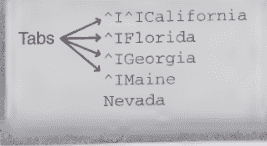

特殊字符 `^I` 是编辑器显示 TAB 字符的方式。当 `comm` 将 *California* 读取为第一个文件的第一行，随后在第二个文件中也找到它时，`comm` 会输出两个 TAB 键，然后是行 *California*。这两个 TAB 键将该行置于输出的第三列。*Florida* 仅在第二个文件中找到，因此 `comm` 在其前面仅放置一个 TAB 键，将其置于输出的第二列。*Nevada* 仅在第一个文件中，因此 `comm` 在该行前不输出 TAB 键。所有仅在第一个文件中的行（第 1 组）都靠左边缘对齐。所有仅在第二个文件中的行（第 2 组）位于中间，因为每行前面输出了一个 TAB 键。所有公共行（第 3 组）位于右侧，因为在两个文件中都找到的每行前面都输出了两个 TAB 键。

- 4. 退出编辑器并返回 shell。

#### 选择唯一行或公共行

三列输出与三种类型的行相关联：

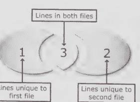

第 1 列（第 1 组）包含来自第一个文件的唯一行；第 2 列（第 2 组）包含仅在第二个文件中的行；第 3 列（第 3 组）包含两个文件共有的行。通过选项，我们可以选择两个文件共有的行，或者仅选择其中一个文件特有的唯一行。

- 1. 输入：
```bash
comm -3 sor-west sor-coast
```
此命令指示 `comm` 舍弃第 3 组（两个文件共有的行）。输出结果是第 1 组（第一个文件特有的行）和第 2 组（第二个文件特有的行）。在两个文件中都找到的行（第 3 组）被抑制（不显示）。

如果要仅列出两个文件共有的行——也就是说选择第 3 组——我们必须排除第 1 组和第 2 组。

- 2. 输入此命令：
   `comm -12 sor-west sor-coast`

使用 `-12` 标志时，`comm` 会抑制打印第 1 组和第 2 组（每个文件特有的唯一行）。此时仅列出既在西部又在沿海的州——即两个文件中都存在的行。

- 3. 同样，可以通过输入以下命令来获取不在沿海的西部州列表：
   `comm -23 sor-west sor-coast`

此标志是抑制第 2 组（第二个文件特有的行）和第 3 组（两个文件共有的行）的指令。它仅输出第 1 组，即仅在第一个文件中存在的行。

- 4. 为了查看 `comm` 的工作原理，让 `comm` 比较原始的未排序文件 `west` 和 `coast`：
   `comm west coast`

输出是不正确的。几个共有的州在输出中被列为在两个文件中各自唯一。这在实际中是不可能的。这是怎么发生的？`comm` 工具逐行比较文件。当 `comm` 在第一个（未排序）文件中读取到 `California` 行，随后在第二个文件中将 `Florida` 作为第一行找到时，`comm` 判定第二个文件中不可能存在 `California`。其逻辑是：`comm` 假设既然 `Florida` 在第二个文件的第一行，那么该文件中不可能有其他以 `F` 之前字母开头的行。`comm` 的输入文件必须先排序，因为 `comm` 工具就是基于这个假设编写的。

> **总结：** `comm` 工具逐行比较两个文件的内容。它报告一个表格，指明每个文件特有的行以及两者共有的行。因为 `comm` 一次只能处理一行，所以输入必须经过排序。选项如下：
- **-1** 抑制输出仅在第一个文件中存在的行。
- **-2** 抑制输出仅在第二个文件中存在的行。
- **-3** 抑制输出两个文件共有的行。
- **-12** 选项可以组合。此组合是指令抑制每个文件特有的行，从而仅输出两者共有的行。


## 5.10 检查文件之间的差异

`diff` 工具用于指示两个文件之间有何不同。它会报告不相同的行、这些行在各自文件中的位置，以及为了将一个文件转换为另一个文件，你需要添加、更改或删除哪些行。

- 1. 创建一个名为 `alpha1` 的文件，包含以下内容：
```
Mary
Robert
Pat
Nancy
```

- 2. 创建第二个文件 `alpha2`，包含以下内容：
```
Mary
Robert P
Pat L
Nancy
Ivan
```

- 3. 通过输入以下命令查找 `alpha1` 和 `alpha2` 之间的差异：
`diff alpha1 alpha2`

显示以下输出：

```
2, 3c2, 3 -> 第一个文件的第 2 和第 3 行被更改为第二个文件的第 2 和第 3 行
< Robert } 第一个文件的第 2 和第 3 行
< Pat }
> Robert P } 第二个文件的第 2 和第 3 行
> Pat L }
4a5 -> 在第一个文件的第 4 行之后添加了一行，即第二个文件的第 5 行
> Ivan -> 添加到第一个文件中的行
```

此输出包含两种行。像 `Robert` 这样的行表示 `Robert` 这一行存在于第一个文件中，但不在第二个文件中。同样，`Robert P` 存在于第二个文件中，而不在第一个文件中。包含数字和字母的行（`2, 3c2, 2, 3`）指示了差异行在各自文件中的位置，以及为了将第一个文件转换为第二个文件需要执行的操作。

与 `diff` 相对，`comm` 工具仅列出每个文件特有的行以及两者共有的行。

有关 `diff` 的更多信息，请参阅 `man` 的输出。

> **总结**：`diff` 工具比较两个文件，并指示必须对第一个文件进行什么操作才能使其与第二个文件匹配。每个文件特有的行会被标记，共有的行则被忽略。

## 5.11 使用 `tr` 翻译字符

`tr` 工具读取输入，并删除目标字符，或将每个目标字符翻译为指定的替换字符。输出是输入的翻译版本。

### 将指定字符翻译为其他字符

`tr` 工具接受两个且仅两个参数。

- 1. 例如，输入：
`who` 
`who | tr t Z` 

第二个命令行产生的输出中不包含 *t* 字符。它们被翻译成了 Z。`who` 工具的输出被连接到 `tr` 的输入。`tr` 工具搜索输入中的每个字符，寻找指定的目标字符 (*t*)，然后将每个 *t* 替换为 Z。

`tr` 的输出仍然连接到屏幕。给 `tr` 提供了两个参数。`tr` 工具将第一个参数解释为要定位的目标字符。第二个参数是用于替换目标的字符。因此，`tr` 在输入中找到的每个 *t* 都会被替换为 Z。见图 5-9。

- 2. 若要对 `test-sor` 文件的内容进行翻译，请输入以下命令：
`tr a Z < test-sor`

此命令行包含重定向符号，它告诉 shell 打开 `test-sor` 文件并将其连接到 `tr` 的输入。`tr` 工具本身没有编写打开文件的程序。在此命令行中，`tr` 被赋予两个参数：字母 *a*（目标）和字母 Z（替换）。`tr` 工具定位每个字母 *a* 的实例并将其替换为 Z。`tr` 的输出显示在屏幕上。原文件不会被修改。见图 5-10。`tr` 工具还可以同时翻译多个目标字符。

- 3. 尝试此命令：
`tr 'Ma7' '&s' < test-sor`

这两个参数被包含在单引号中，以指示 shell 将每个参数传递给 `tr` 而不解释任何特殊字符。`<` 指示 shell 将 `test-sor` 文件连接到 `tr` 的输入。`tr` 工具从输入读取并进行翻译。文件的翻译版本被输出（在本例中输出到屏幕）。参数被 `tr` 解释为目标字符和替换字符。所有字母 `M` 的实例都被替换为管道符 (`|`)。每个 `a` 被替换为 `&`，每个 `7` 字符变为小写 `s`。

`Ma7` 字符构成了目标字符或 *数组*，而 `|&s` 是替换数组的元素：

| 目标 | 变为 | 替换 |
|---|---|---|
| M | 变为 | \| |
| a | 变为 | & |
| 7 | 变为 | s |

### 翻译一组字符

使用 `tr` 工具，你还可以翻译一组字符，例如 `0-5` 或 `A-M`。

- 例如，输入命令：
`tr 'a-z' 'A-Z' < test-sor`

旧系统要求范围周围必须有方括号，因此我们必须输入：
`tr '[a-z]' '[A-Z]' < test-sor`

默认发送到终端屏幕的输出是大写的。此命令指示 `tr` 工具从 *test-sor* 读取，并将所有小写字母 *a* 到 *z* 翻译为大写 *A* 到 *Z*。

### 删除指定字符

除了进行翻译外，`tr` 还可以删除识别出的字符。

- 要从 *test-sor* 中删除特定字符，请输入：
`tr -d 'cbmZ4o' < test-sor`

运行 `tr` 的进程被赋予两个参数：`-d` 和 *cbmZ4o*。文件 *test-sor* 连接到 `tr` 的输入。文件中每个与第二个参数中的字符匹配的字符实例都将被删除。

### 利用 `tr` 工具更改大小写

`tr` 工具是管理数据的有用工具。

- 1. 输入以下内容：
`ls | tr 'a-z' 'A-Z'`

屏幕上显示的 `tr` 输出是 `ls` 输出的全大写列表，这让我们这些用过大型机或 DOS 的人感到非常亲切。

- 2. 通过输入以下内容让 `tr` 更改文件的大小写：
```bash
tr 'a-z' 'A-Z' < practice
tr 'A-Z' 'a-z' < practice
```

有许多程序要求所有输入数据均为大写，以免产生大小写混淆。这时可以用 `tr` 来解决。

#### 更改字段分隔符

有时我们希望文件中的数据以不同的字段分隔符呈现。

- 1. 输入：
```bash
head -20 /etc/passwd | tr ':' ' '
```
`tr` 工具将每个冒号 (:) 替换为空格，并输出文件的修改版本。我们可以使用 `tr` 将每个空格替换为另一个字符。

- 2. 输入：
```bash
tr ' ' '+' < practice
```
传递给 `tr` 两个参数：一个空格和一个加号。读取你的 `practice` 文件，每个空格都被替换为加号，并将修改后的版本输出到屏幕上。

### 将一个单词输出到一行

文件通常每行有许多个单词。由于许多工具是对整行操作的（如 `sort`、`uniq`），除非输入数据是每行一个单词，否则它们无法产生有意义的结果。

- 1. 编辑 practice：
```bash
vi practice
```
使用方向键将光标置于第一个和第二个单词之间的空格处。

- 2. 通过输入以下内容将空格替换为新行：
```
r
ENTER
```
第一个单词保留在原行。其余文本移至下一行。

- 3. 将下一个空格替换为 ENTER。

你可以继续将空格替换为新行，直到文件每行只有一个单词。一定有更简单的方法。

- 4. 退出 `vi` 且不保存文件：
`:q!`

- 5. 输入：
`tr ' ' '\n' < practice`

`tr` 工具将 `\n` 解释为换行符。在这种情况下，我们告诉 `tr` 将文件中的每个空格替换为新行，因此每个单词都被单独输出在一行上。

> **总结**：`tr` 工具将特定字符翻译为其他特定字符，并将一组字符翻译为另一组字符。它还可以删除列出的字符。如果给定两个参数，第一个参数中的字符将通过一对一映射翻译为第二个参数中列出的字符。讨论了一个 `tr` 选项：
- `d argument`：指示 `tr` 删除随后参数中指定的每个字符的所有实例。

#### 自测 2

- 1. 什么命令可以告诉 `sort` 对文件 `junk1` 进行排序，并将排序后的版本放入 `junk1` 中，替换未排序的版本？

- 2. 一个名为 `employees` 的文件包含员工信息。每一行是一个员工的记录，由 `%` 字符分隔的几个字段组成：姓（lastname）、名（firstname）、部门（department）和员工 ID（employeeID），顺序依次排列，例如：
`Kirby%Mike%Management%2176`
`McKinney%Charles%Administration%3265`

什么命令可以告诉 `sort` 输出数据，使得每个部门的所有人都排列在一起，并按姓氏字母顺序排序？因为有些员工有相同的姓氏，请使用名字作为决胜项（tiebreaker）。


3. 使用 `man` 页，确定实现以下功能的选项：

- **A.** 告诉 `sort` 检查文件是否已经排序，如果是，则不进行排序。
- **B.** 告诉 `bc` 调用数学库，以便你可以计算正弦、余弦等。
- **C.** 告诉 `grep` 仅输出文件中匹配行的数量，而不是实际的匹配行。

4. 什么命令可以指示 `tr` 从文件 `practice` 中删除所有 `! , . ? " & $ ; * .` 和 `( )` 字符？

5. 什么命令行可以指示 `tr` 将 `who` 的结果进行排序并全部转换为大写输出？

6. 一个名为 `awards` 的文件包含仅由员工 ID 号和员工姓氏组成的行。每当员工获得客户的表扬信时，文件中就会增加一条记录。什么命令可以输出员工姓名、ID 号以及表扬信的数量？

7. 什么命令可以对文件 `people` 进行排序，且忽略大小写并忽略行首的标点符号？

8. 什么命令可以使用第四列（组 ID）作为主排序键，第三列（用户 ID）作为次排序键来对文件 `/etc/passwd` 进行排序？

9. 考虑两个文件。第一个文件 `students` 是学校所有在读学生姓名的排序列表。第二个文件 `paid` 是已缴纳学费的学生姓名的排序列表。什么命令可以列出第一个文件中那些`尚未`缴纳学费的学生？

10. 什么命令可以将 `who` 的输出全部以大写字母显示？

## 5.12 列出文件和目录名称

`ls` 工具会输出父目录下列出的文件和目录名称。你已经多次使用它来确定目录的内容。

- 1. 输入以下命令：
    `ls`
    `ls -a`
    `ls -l`（不是数字“1”，而是字母“el”）
    `ls -F`

在没有任何选项的情况下，`ls` 会输出当前目录下列出的文件和目录名称，除非它们的名称以点开头（点文件）。

要查看包括点文件在内的所有文件，请使用 `-a` 选项。这些*隐藏*或*点*文件是 shell 和其他程序在首次执行时读取的文件。它们包含用户或系统管理员为了定制系统工作方式而放置的指令。除非你确定自己在做什么，并且已经创建了文件的备份副本，否则请勿修改点文件。

`-l` 选项是定位每个文件的所有信息并将其包含在输出中的指令。`-F` 选项是在显示任何目录名称后添加一个斜杠的指令。

`ls` 工具的输出可以是单列，也可以是多列。

- 2. 输入：
    `ls -C`
    `ls -1`（数字 *one*）
    `ls -Ca`

`-C` 选项是指示在名称长度允许的情况下尽可能多地分列输出名称（文件名越长，列数越少）。`-1` 选项是指示每行输出一个文件名，所有名称都在第一列。

当你运行 `ls` 并将其输出发送到屏幕时，多列输出可能是默认设置。考虑当 `ls` 的输出被重定向到另一个工具时会发生什么。

- 3. 输入：
   `ls | more`
   `ls -1 | more`（数字 *one*）
   `ls -C | more`

当 `ls` 连接到 `more` 时，默认输出设置是每列输出一个文件名。当我们使用 `-1` 选项指示 `ls` 在单列中输出文件名时，结果相同。然而，如果我们坚持使用 `-C` 选项进行多列输出，`ls` 也会照做。

将 `ls` 的输出重定向到 `wc`。

- 4. 输入：
   `ls | wc`

行数和单词数相等。当 `ls` 连接到 `wc` 时，其输出必须是每行一个单词。

- 5. 通过输入以下内容进行确认：
   `ls -C | wc`
   `ls -1 | wc`

当 `ls` 输出到屏幕时，它被编程为以多列格式输出。当它的输出连接到另一个工具时，`ls` 会创建每行一个文件名的显示。我们可以使用 `-C` 和 `-1` 选项指示 `ls` 以任何我们想要的方式输出。

- 6. 快速查看手册可以发现 `ls` 具有许多选项：
   `man ls`

`ls` 工具是一个强大且有用的工具，为我们提供了许多列出文件和目录信息的特性和选项。

## 5.13 使用流编辑器在命令行进行编辑

当你使用可视化编辑器开始编辑文件时，文件被读取到内存中的一个*编辑或缓冲区空间*。整个文件都被读入内存，然后你可以在文件的任何想要工作的地方进行修改。可用内存决定了你使用 `vi` 编辑文件时的最大尺寸限制。

另一种编辑文件的方法是仅读取一行，进行修改，写入该行，然后读取下一行。通过这种方法，我们可以编辑非常大的文件，因为每次只有一行在工作内存中。这种逐行读取的编辑器运行在数据的*流*上，被称为*流编辑器* `sed`。

### 创建示例文件

为了研究流编辑，我们需要一个具有特定内容的文件。

- 使用可视化编辑器创建一个名为 `caffeine` 的文件，内容如下：
（参考图像/文档内容）

### 更改目标词

假设你对咖啡因的成瘾口味发生了变化，你想在文件 `caffeine` 的副本中，将所有出现 `coffee` 的地方替换为 `chocolate`。无需调用 `vi`，你就可以创建一个带有替换内容的版本。

- 输入以下命令：
`sed 's/coffee/chocolate/' caffeine`

最常见的错误是漏掉最后一个引号之前的最后一个 `/`。三个斜杠都是必需的。
输出显示在屏幕上；文件本身没有被改变。结果显示每行中第一个出现的 `coffee` 被更改为 `chocolate`。执行了一次`替换`。`sed` 工具读取并修改了每一行包含 `coffee` 的行，但没有修改每行中的所有实例。

#### 分析代码

以下插图和表格描述了该 `sed` 命令的组成部分。

| 命令 | 解释 |
| :--- | :--- |
| `s` | 指示 `sed` 进行替换。 |
| `/coffee/` | 将字符串 `coffee` 标识为每行要搜索的目标。它是要被替换的目标字符串。 |
| `/chocolate/` | 指定替换字符串。在每行中出现多个目标词的情况下，仅第一个受影响。 |

总之，文件 `caffeine` 没有被改变。文件的每一行都被读取到内存中，由 `sed` 修改并输出。输出中并非每个 `coffee` 实例都被替换。

### 更改目标的所有实例

之前的 `sed` 命令仅修改其读取的每行输入中目标词的第一个实例。你可以指示 `sed` 更改每行中出现的所有目标实例。

- 1. 输入以下包含 `global`（全局）请求的 `sed` 命令：
   `sed 's/coffee/chocolate/g' caffeine` 
   文件 `caffeine` 的每一行都被读取，且目标字符串的每个实例都被替换。结果行显示在屏幕上。替换字符串后的 `g` 指示 `sed` 全局影响每行；对行中遇到的所有目标实例进行替换，而不仅仅是第一个。

- 2. 输入：
   `sed 's/root/ROOT/g' short-pass | more` 
   目标字符串 `root` 的每个实例都被更改为 `ROOT`。

### 选择行然后进行替换

之前的命令指示 `sed` 修改输入的任何行上的文本。你也可以请求 `sed` 仅对符合指定标准的行执行操作。

- 输入以下内容：
  `sed '/2003/s/coffee/chocolate/g' caffeine`

替换规范前面的 `/2003/` 是行目标。它指示 `sed` 仅在行中某个地方包含字符串 2003 时才选择该行。如果某一行匹配并被选中，则查找替换目标 `coffee`。如果在该行中找到了 `coffee`，`sed` 将用 `chocolate` 替换 `coffee`。仅当行目标字符串匹配时，行才会被选中处理；仅当替换目标匹配时，该行才会进行替换。包含 `2000` 的行不匹配 `2003`，因此字符串 `coffee` 没有被替换。虽然最后一行与其 `2003` 匹配，但没有 `coffee` 可以替换。此命令在图 5-11 中有详细说明。

**图 5-11 `sed` 替换命令的组成部分**


#### 为行搜索目标创建替代方案

在前面的示例中，首先指定了一个用于定位行的目标，然后为文本替换提供了一个不同的目标。行目标同样可以用作替换目标。

- 1. 输入以下内容，其中未指定替换目标：
`sed '/2003/s//2010/g' caffeine`
如果行中存在行目标字符串 *2003*，则该行被选中。行目标字符串 *2003* 被替换为字符串 *2010*。在此命令中，未指定替换目标；`s` 之后的两个斜杠之间没有目标。当未指定替换目标时，将使用行选择目标进行替换。如果行包含行搜索目标字符串，则该行被选中，随后该字符串被替换。

- 2. 输入：
`sed '/Decaf/s//DECAF/' caffeine`
包含字符串 *decaf* 的行被选中，然后行中第一个出现的 *decaf* 实例被替换为 *DECAF*。

#### 删除行

`sed` 编辑器的功能远不止进行替换。

- 输入：
`sed '/dec/d' caffeine`
在这种情况下，任何在行中包含 *dec* 的行都会被删除。

#### 在 `sed` 中使用正则表达式

使用 `grep` 研究过的正则表达式在 `sed` 中具有相同的含义。

- 1. 输入：
`sed '/^2/s/coffee/chocolate/g' caffeine`
所有以 2 开头的行都被选中进行操作。如果选中的行包含字符串 *coffee*，它将被全局替换为 *chocolate*。

- 2. 输入：
`sed '/^c/d' caffeine`
所有以 c 开头的行都被目标化并删除。

- 3. 输入：
`sed '/^$/d' test-sor`
`cat test-sor`

目标规范是，“行首紧跟行尾”。若要使一行被选中，行首和行尾之间不能有任何文本。因此，所有空行都被选中并删除。

> **总结：** `sed` 工具接收输入行，根据请求进行任何编辑更改，然后输出该行。它是一个使用编辑命令和正则表达式的*流编辑器*。

## 5.14 使用 awk 操作数据

`who` 的输出为每个登录系统的用户提供一行。每一行被称为一个*记录（record）*，包含若干关于该用户的信息字段。同样，数据通常存储在文件中，每行（记录）包含多个字段。`awk` 工具旨在定位数据库中的特定记录和字段，对其进行修改，执行计算，然后输出选定的部分数据。`awk` 工具在信息检索、数据操纵和报告编写方面特别有用。

`awk` 工具的名称源自编写它以及 UNIX 许多其他部分的贝尔实验室程序员的姓氏：Aho、Weinberger 和 Kernighan。

- 对于本节内容，创建一个名为 `food` 的文件并输入以下文本：

```
milk    dairy  2.00
hamburger meat  3.75
cheese  dairy  1.50
```

`food` 文件包含三个记录。每个记录包含三个字段：产品名称、产品种类和价格。在记录中，每个数据字段由空格与下一个字段分隔，这是 `awk` 的默认字段分隔符。

### 选择行并打印字段

`awk` 工具通过根据指定模式的存在来选择记录，然后在选定记录上执行预定操作来完成工作。

- 1. 输入命令：

```bash
awk '/dairy/ {print $3}' food
```

输出仅包含第一条和第三条记录的第三个字段（*价格*）。该命令行指令 `awk` 选择 `food` 文件中包含字符字符串 *dairy* 的每个记录，然后执行打印每个选定记录的第三个字段（*价格*）的操作。在本例中，用于选择行的模式不在输出的字段 (3) 中。你可以使用一个字段进行选择，然后输出完全不同的字段。

命令行的组成部分如下：

| 命令/参数 | 解释 |
| :--- | :--- |
| `awk` | 指示 shell 执行 **awk** 工具。 |
| `' '` | 指示 shell 不要解释引号字符串内部的特殊字符，而是将包含的字符作为参数传递给 **awk** 工具。 |
| `/dairy/` | 指示 **awk** 选择行中任何位置包含字符串 *dairy* 的行。包含此模式的行将被选中，以执行 `{ }` 部分中指定的任何操作。 |
| `{print $3}` | 指示 **awk** 对选定行采取行动——即输出（或 **print**）第三个字段 **$3**。由大括号标识的操作将作用于所有包含 *dairy* 的行。**print** 语句是 **awk** 许多可能操作之一。 |
| `food` | 此参数告诉 **awk** 读取哪个文件作为输入。 |

可以输出多个字段。

- 2. 输入：
`awk '/dairy/{print $3, $1}' food`

对于包含目标字符串 *dairy* 的行，将输出第三个字段（一个空格）然后是第一个字段。

#### 更改字段分隔符

在 `food` 文件中，每条记录的字段由空格分隔。数据文件经常使用其他字符作为字段分隔符。例如，登录信息保存在 `/etc/passwd` 文件中，其中的字段用冒号分隔。

- 1. 通过输入以下内容让系统显示你的密码记录：
`grep $USER /etc/passwd`
如果你使用的是独立系统，密码文件就在你的系统中；否则，它在网络服务器上。如果你没有得到一行由冒号分隔的多个字段的输出，你可能在网络服务器上。你需要执行如下命令。

- 2. 通过输入以下内容请求从网络服务器显示：
`ypcat passwd | grep $USER`
`passwd` 中包含你的登录 ID 的行被选中并输出。我们可以指令 `awk` 使用冒号作为字段分隔符。

- 3. 输入以下内容：
`awk -F: '{print $1, $3, $4, $5}' /etc/passwd | more`

- 4. 在检查完一屏数据后，通过输入以下内容退出 `more`：
`q`

输出仅包含密码文件中所有记录的第一、三、四、五个字段。

输入中的字段由冒号分隔；由于命令行包含了参数 `-F` 及其后的冒号，因此 `awk` 被指令使用冒号作为字段分隔符。然而，`awk` 使用其默认的输出字段分隔符（单个空格）来显示输出。

#### 根据字段中的值选择记录

当特定字段的值匹配目标时，`awk` 工具也会选择记录。

- 输入：
`awk -F: '$1 == "root" {print $1, $3}' /etc/passwd`

`awk` 检查 `/etc/passwd` 文件，选择第一个字段值为 `root` 的记录，然后 `awk` 输出选定记录的第一和第三个字段。

**图 5-12** 使用 `awk` 工具

> **总结：** `awk` 工具定位存储在文件（数据库）中行和列（记录和字段）形式的记录。它修改记录，执行计算并输出选定字段。考察了一个选项：
- `-Fchar` 将字段分隔符更改为 `char`。

## 5.15 将输出发送到文件和另一个工具

当你构建命令行时，工具的输出只能发送到三个地方之一：默认终端、文件或另一个工具。当我们使用重定向时，工具的输出被重定向到仅一个地方。它不能同时发送到另一个工具和文件。有时我们希望将工具的输出发送到文件以便稍后检查，同时又将输出重定向到另一个工具或屏幕。由于 shell 不能将输出发送到两个地方，因此创建了另一个工具来实现这一目标。


- 1. 输入以下命令来统计家目录中的文件数：
   `ls | wc -l`
   屏幕将输出当前目录中的文件数量。在此命令行中，`ls` 的输出被传递给 `wc`，由 `wc` 统计词数。`wc` 的结果随后显示在屏幕上。

- 2. 输入以下内容：
   `ls | tee current-files | wc -w`
   `wc` 的输出（即当前目录中的文件数量）将显示在屏幕上。

- 3. 输入以下命令来检查新文件 *current-files* 的内容：
   `more current-files`
   文件 *current-files* 包含了 `ls` 工具的输出。
   `tee` 工具从输入（`ls` 的输出）读取，然后将每一行写入输出（连接到 `wc`）。此外，`tee` 将每一行的副本写入内存。在到达输入末尾后，`tee` 将所有行的缓冲副本写入一个新文件。随后，`tee` 将其参数（*current-files*）解释为包含所有处理行副本的新文件名。在这种情况下，`tee` 从输入读取的所有行的副本也被写入了文件 *current-files* 中。

- 4. 我们可以将屏幕作为 `tee` 的输出：
   `cal 2003 | tee yr2003`
   `cal` 工具接收 2003 作为参数，`tee` 工具接收 *yr2003* 作为参数。对于 `cal` 来说，2003 是一个年份，因此 `cal` 输出 2003 年的日历。
   `tee` 工具从输入（`cal` 的输出）读取并写入其输出（连接到屏幕），同时将每一行写入内存（缓冲区）。对于 `tee` 来说，*yr2003* 参数是指示其将读取的所有行的缓冲副本写入名为 *yr2003* 的新文件。参见图 5-13。

**总结：** 就像水管工使用的三通接头能将水分流至两个方向一样，**tee** 工具将其从输入读取的内容发送到两个方向：一个是以参数命名的文件，另一个是标准输出。标准输出默认连接到工作站屏幕，也可以被重定向到另一个工具，甚至另一个文件。**tee** 工具不会以任何方式修改数据。

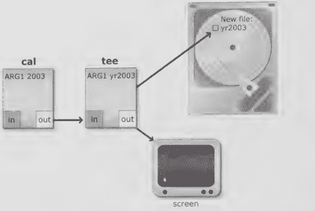
**图 5-13 使用 tee 检查重定向**

## 5.16 使用 file 确定文件类型

在 UNIX 系统中，有许多不同种类的文件：文本文件、可执行二进制文件、数据库文件、电子邮件消息、图形文件、存档文件、目录、字体文件等等。
我们可以检查 /etc/passwd 是什么类型的文件。

- 1. 输入：
   `file /etc/passwd` 
   输出报告 /etc/passwd 是一个 ASCII 文本文件。
   `/etc/passwd: ASCII text` 
   它仅仅是一个包含文本的文件。

- 2. 现在请求其他一些文件的信息：
   `file /usr/bin/passwd` 
   `file /bin/ls` 
   ls 和 passwd 程序是二进制的。它们是在我们在命令行输入 ls 或 passwd 时运行的可执行文件。
   `/bin/ls: ELF 32-bit LSB executable, . . . . .` 
   file 工具会对作为参数列出的一个或多个文件进行报告。

- 3. 输入：
   `file new_script /tmp Private /dev/fd0`

输出列出了所有四个对象以及它们各自的文件类型：一个脚本、一个目录、另一个目录，以及软盘（这是一个以块而非单个字符接收输入的设备）。当不确定某个对象是什么时，请使用 `file` 来确定其类型。

## 5.17 修改文件的时间戳

每当创建文件时，系统都会记录创建时间。每当文件被修改时，该时间也会被记录。这些*时间戳（timestamps）*允许我们确定哪个副本（例如某个程序）是最新的。复杂项目的管理人员使用文件时间戳来协调项目的组件。此外，我们可以创建空文件，利用时间戳进行记录保存。

- 1. 使用详细列表显示当前文件的信息：
   `ls -l` 
   输出类似于：
   `-rw-r--r-- 1 sk users 260 Aug 15 16:20 lost-days` 
   第六到第八个字段是文件创建时的日期和时间。与每个文件关联的这种日期/时间信息构成了文件修改时间戳。可能有几个文件已经好几天没被触动过了。

- 2. 使用 `vi` 编辑一个旧文件，例如：
   `vi lost-days`

- 3. 进行修改，然后保存或退出文件。

- 4. 检查你修改的文件的时间戳：
   `ls -l lost-days`

时间戳已更改，以反映你修改文件的时间。

### 创建空文件以获取时间戳

当我们修改文件时，我们会改变其时间戳。当我们创建文件时，它会获得初始时间戳。我们可以快速创建空文件来获取时间戳。

- 1. 输入以下命令：
   `touch newfile1A newfile2B2`

- 2. 获取这些文件的详细列表：
   `ls -l new*`

`touch` 工具创建了具有当前时间戳且大小为零的新文件。某些程序在每次执行时都会使用 `touch` 创建空的时间戳文件。通过这种方式，我们可以追踪程序的执行时间。

### 更新文件的修改时间

检查文件的详细列表。

- 1. 输入：
   `ls -l users_on` 
   你可以在不实际更改文件内容的情况下更改修改时间。

- 2. 输入：
   `touch users_on` 

- 3. 再次获取 `users_on` 的详细列表：
   `ls -l users_on`

输出列出了一个新的修改时间，即你执行 `touch` 操作的时间。请注意，只有修改时间被更新了。管理员经常让程序在每次执行时 `touch` 一个文件以更新时间戳，从而报告该程序最后一次执行的时间。

## 5.18 运用多个工具实现更广泛的目标

每个 UNIX/Linux 工具只完成一项任务，而且通常是很简单的任务。`sort` 工具只负责对行进行排序。如果我们想对文件中的单词进行排序，必须先修改该文件的副本，使每行只有一个单词。这样当 `sort` 对行排序时，实际上就是在对单词排序。`ls` 工具显示目录中列出的文件名，而不是文件的数量。要统计目录中的文件数，我们必须运行 `ls` 然后将输出重定向到 `wc`。为了实现更复杂的目标，我们必须调用一个工具执行其功能以完成部分任务，然后将输出传递给其他工具，由它们处理第一个工具的输出，最终完成目标。

### 统计目录数量

没有哪个工具能直接输出目录中所列子目录的数量。`ls` 工具可以识别目录，但不能提供计数。

- 1. 确保你在第 3 章创建过子目录的家目录中，并列出其内容：
   ```bash
   cd
   ls -F | more
   ```
   `-F` 选项指示 `ls` 在输出的每个目录名后面加上一个斜杠。当 `ls` 将输出发送给 `more` 或 `grep` 等其他工具时，`ls` 会将每个文件名放在输出的一行中。
   我们可以将 `ls` 的输出传递给 `grep`，并告诉 `grep` 查找包含特定目标的行。

- 2. 输入：
   ```bash
   ls -F | grep /
   ```
   `ls` 的输出被重定向到 `grep`，`grep` 会查找行中包含斜杠的行。匹配的行（即目录）将被输出。

- 3. 统计目录数量：
   ```bash
   ls -F | grep / | wc -l
   ```
   屏幕将输出当前目录下所列的子目录数量。

- 4. 创建一个别名。在 `ksh` 或 `bash` shell 中：
   ```bash
   alias numdir='ls -F | grep / | wc -l'
   ```
   在 `csh` 或 `tcsh` shell 中：
   ```bash
   alias numdir 'ls -F | grep / | wc -l'
   ```

- 5. 尝试使用该别名：
   ```bash
   numdir
   ```
   `numdir` 被设置为完整的 `ls grep wc` 命令行别名。当我们发出 `numdir` 命令时，其别名将被执行，并输出当前目录中的目录数量。

- 6. 切换到 / 目录并尝试，然后返回家目录：
   ```bash
   cd /
   numdir
   cd
   ```


#### 列出文件中使用的所有单词

一个文本文件每行包含若干单词，相同的单词可能出现在不同行中，有时是大写的，有时是小写的。在练习中，你创建了一个名为 practice 的文件，其中包含许多单词。

- 1. 将文件 *practice* 以全小写字母显示：

`tr 'A-Z' 'a-z' < practice | more` 

Shell 将文件 *practice* 连接到 `tr` 的输入端，并向 `tr` 传递两个参数 A-Z 和 a-z，`tr` 将其解释为定位所有大写字母并将其替换为相应小写字母的指令。

- 2. 将空格替换为换行符：

`tr 'A-Z' 'a-z' < practice | tr ' ' '\n' | more` 

在此命令行中，运行 `tr` 的一个进程的输出被重定向到第二个同样运行 `tr` 代码的进程。第二个 `tr` 接收到空格和 `\n` 两个参数，`tr` 将其解释为在文件中定位每个空格并将其替换为换行符的指令。一行中的单词由空格分隔。当空格被删除并插入换行符作为替代时，下一个单词将被移至新行。现在，每个单词都独占一行。

- 3. 对输出进行排序：

`tr 'A-Z' 'a-z' < practice | tr ' ' '\n' | sort | more` 

`sort` 的输出是文件 *practice* 中所有单词按字母顺序排列的列表。标点符号仍然包含在内，空行会被输出，重复的单词也会被列出。在下一章中，将创建一个脚本来更彻底地完成此任务。

#### 自测 3

- 1. 你如何使用 awk 仅输出 /etc/passwd 的前两个字段？

- 2. 哪个 sed 命令可以输出名为 ohio 文件的所有行，并在包含 “Otterbein College” 的行处停止？

- 3. 哪个命令行指令可以让 sed 在文件 alma_mater 中，将所有以 “UCB” 开头的行中的所有 “UCB” 字符串替换为 “University of California” 字符串？

- 4. 哪个命令指示 `awk` 输出 `passwd` 文件中前 20 个用户的主目录、用户登录名和用户 ID？

- 5. 哪一条单行命令可以实现以下功能？`who` 的输出被传递给一个实用程序，该程序既将其输出连接到 `sort`，同时将其输入的一份副本写入名为 `who.out` 的新文件中。`sort` 的输出被传递给另一个实用程序，该程序既将其输出连接到运行 `wc` 的进程输入端，又将其写入一个新文件 `sort.out`。最后，`wc` 实用程序将排序后的 `who` 结果中的行数、单词数和字符数输出到屏幕上。

- 6. 假设你在某个目录中发现了一个名为 `README` 的文件，并尝试使用文本编辑器读取，但编辑器无法正确显示内容，而是显示了一堆奇怪的字符。为了正确查看文件内容，你需要找出它是什么类型的文件。哪个命令可以告诉你 `README` 是什么类型的文件？

## 章节回顾

使用本节回顾本章内容，并测试你对相关概念的掌握情况。

### 章节总结

- Linux/UNIX 中的实用程序形成了一组强大的数据操作和挖掘工具的核心组，对于系统管理、项目记录保存以及系统/网络编程至关重要。
- `wc` 实用程序统计其输入或文件中的行数、单词数和字符数，并输出其中一个或多个计数结果 (-l -w -c)。如果给定多个文件名参数，`wc` 将输出每个文件的总计以及所有读取文件的各元素总和。
- `cat` 从输入或文件读取并写入输出。它将所有参数解释为要打开并读取的文件，除非该参数是以 - 字符开头的选项。使用 `-n` 选项，`cat` 会在每行开头输出行号。
- `more` 实用程序在屏幕上分页显示文件或之前实用程序的输出。用户可以搜索目标文本，在文件中向前或向后翻页，并从 `more` 跳转到可视化编辑器。
- 使用 `cut`，我们可以从输入或文件中提取一行中的一个或多个字段 (-f) 或字符 (-c)。默认的字段分隔符是 TAB，但我们可以使用 `-d` 将分隔符声明为任何字符。
- `column` 实用程序接收每行一个单词的输入，并将数据以每行若干列的形式输出。它可以填充第一行（跨列填充），或者如果你指定了 `-x` 选项，它可以先填充第一列，然后是第二列，依此类推。
- `paste` 实用程序读取两个或多个文件中的对应行，并将它们输出为一行，在不同文件贡献的部分之间放置默认的 TAB 字符。如果一个文件由许多行组成且每行一个单词，`paste` 将把所有行拼接在一起（如果你指定了 `-s` 选项），形成一行而非多行。
- 在输入或文件中搜索包含目标字符串的行的实用程序是 `grep`，它是系统中最常用的程序之一。`grep` 可以定位包含特定字符目标的行，或者选择所有不包含目标字符串的行。此外，`grep` 可以忽略大小写 (-i)、列出包含目标的文件名 (-l) 并输出所选行的行号 (-n)。可以使用正则表达式来描述目标，例如包含若干个字符、位于行末端字符等。
- `bc` 实用程序是一个执行数学计算的基础计算器。我们从键盘输入问题，该实用程序随后求解并输出结果。
- 我们可以对文件或输入的行进行 `sort`（排序），默认按 ASCII 顺序，除非我们指定字典顺序 (-d)、反向顺序 (-r) 或数值顺序 (-n)，或者指定 `sort` 忽略大小写 (-f)。`sort` 还可以根据指定字段的值进行排序，支持主排序和次要排序。字段默认由空白字符分隔，但如果使用 `-t` 选项，我们可以指定任何字符作为字段分隔符。
- 标准操作下的 `uniq` 实用程序读取文件和输入，删除所有重复的相邻行。它还可以输出输入中相同相邻行的计数 (-c)，或者仅输出有重复的行 (-d) 或在输入中唯一的行 (-u)。
- 使用 `comm` 比较文件，它输出三列内容：文件 1 特有的行、文件 2 特有的行以及两个文件共有的行。此外，`comm` 可以仅输出文件 1 特有的行 (-23)、文件 2 特有的行 (-13) 或仅输出共有行 (-12)。
- `diff` 实用程序检查两个文件，并报告它们的差异以及必须如何修改一个文件使其与另一个文件相同。
- `tr` 实用程序读取输入并进行逐字符翻译。它接收两个参数：目标字符列表和替换字符列表。此外，配合 `-d` 参数，`tr` 会删除第二个参数中列出的所有字符。
- `ls` 输出当前目录或作为参数提供的任何目录中列出的文件和目录名称。它可以输出所有文件包括隐藏文件 (-a)、文件的详细信息列表 (-l)、单列格式 (-1) 或多列格式 (-C)，并识别文件是否为可执行文件或目录等 (-F)。
- 流编辑器 `sed` 从输入读取行，并根据上下文信息、行中的第一个实例或所有实例 (g) 进行更改。`sed` 执行替换和删除，并采用正则表达式。
- `awk` 实用程序是一个强大的行/列数据操作工具。它将根据字段中的值选择指定数据，并仅输出所选记录的部分内容。
- 通过 `file`，我们可以确定文件和目录的性质。
- `touch` 实用程序创建空文件并修改现有文件的时间戳。
- 每个实用程序执行的功能集有限，但能将其职责完成得非常好。当我们在命令行中将多个实用程序结合使用，通过管道将一个实用程序的结果传递给另一个实用程序时，我们可以操作数据以实现比单一实用程序复杂得多的目标。

### 练习题

- 1. 比较以下命令的输出：
  `wc fileAA`
  `wc -c -w -l fileAA`
  `wc -wlc fileAA`

- 2. 哪个命令告诉 `more` 显示下一屏文本？

- 3. 以下命令的作用是什么？
  `cut -d: -f1,4,6 /etc/passwd`

```bash
paste -d'\\' names.tmp numbers.tmp
grep -i bill *
grep '^j...k$' datafile
sort -f +2 -3 datafile
man man
uniq -c datafile
ls -Fal
sed '/operations/s/UNIX/Linux/g' history-file
```

### 项目

完成以下每一项。请在每项任务的打印输出中写出所使用的命令。

- **A.** 创建一个名为 `log-home` 的文件，其中仅包含所有在系统中拥有账户的用户登录名和主目录，并按登录名排序。
- **B.** 制作一份 `log-home` 文件的副本，命名为 `cap-log-home`，且所有字母均转换为大写。
- **C.** 使用 `file` 工具创建一个名为 `contents-etc` 的文件，其中包含 `/etc` 目录下所有对象的列表，并包含关于每个文件或目录类型的信息。
- **D.** 使用 `sed` 创建一个名为 `me-passwd` 的文件，该文件是 `/etc/passwd` 文件的副本，但将你的登录名更改为你的真实姓名。
- **E.** 你的主目录下所有文件中的文本总行数是多少？
- **F.** 打印一份 `caffeine` 文件的副本，并使用 `sed` 进行如下修改：如果行中任何位置出现 `decaf`，则将 2003 更改为 2010。

### 命令汇总

| 命令 | 描述 |
| :--- | :--- |
| `awk pattern {action} filename` | 对 `filename` 中所有包含 `pattern` 的记录执行相应操作。 |
| `cat file1 file2 > file3` | 将 `file1` 和 `file2` 的内容创建为一个新文件 `file3`。 |
| `comm file1 file2` | 比较 `file1` 和 `file2`，显示两个文件中的共同行和各自独有的行。 |
| `cut option filename` | 从 `filename` 中输出选定的字段。 |
| `diff file1 file2` | 显示两个文件中不同的行，以及如何修改第一个文件以匹配第二个文件。 |
| `grep regular-expression filename` | 输出 `filename` 中所有包含`正则表达式`的行。 |
| `paste file1 file2` | 将 `file1` 的第 1 行与 `file2` 的第 1 行结合，依此类推。 |
| `sed command filename` | 在 `filename` 上执行指定的 `sed` 编辑命令。 |
| `sort filename` | 对文件 `filename` 的内容进行排序。 |
| `tee filename` | 从输入读取，然后同时写入输出和文件 `filename`。 |
| `tr string1 string2 < filename` | 读取输入并将每个 `string1` 字符翻译为 `string2` 字符。 |
| `uniq filename` | 从 `filename` 中删除相邻的重复行。 |
| `wc filename` | 统计 `filename` 中的单词数、行数和字符数。 |

## 使用实用工具完成复杂任务

## 技能检查
在开始本章之前，你应该能够：

- 使用 `vi` 编辑文件并创建基本的 shell 脚本
- 创建、复制、删除、重命名、显示和打印文件
- 使用 `grep` 选择包含目标字符串的行
- 使用 `cut` 输出字段或字符
- 使用 `tr` 翻译字符
- 对输入行进行排序
- 使用 `head` 输出文件的开头部分
- 使用 `tail` 输出文件的末尾部分
- 使用 `uniq` 识别文件中的唯一行和重复行
- 使用 `date` 和 `cal` 获取系统数据
- 使用 `sed` 编辑数据并使用 `awk` 操作数据
- 使用 `paste` 合并记录并连接文件
- 在管道中使用 `tee` 从输入读取数据，写入文件并写入输出
- 识别两个文件中哪些行是各自独有的，哪些是共同的

## 目标
完成本章后，你将能够：

- 组合基础实用工具来完成复杂任务
- 创建 shell 脚本，利用实用工具从多个文件中输出格式化的关系数据
- 创建一个过滤并修改数据的脚本
- 增量地构建脚本
- 识别脚本中的错误并进行修复

每天，全球的用户都在使用强大的 UNIX/Linux 实用工具来完成复杂任务。在 shell 提示符下，我们输入结合了一个或多个实用工具的命令，以读取数据、识别要输出的特定部分，以及更改、排序或删除信息。本章将探讨如何创建几个强大的 shell 脚本，利用多种实用工具来完成复杂的数据操纵和检索任务。将实用工具组合在脚本中以实现特定目标是一组基础、实用且极其重要的能力。系统管理员、程序员和用户使用短脚本来完成需要复杂命令行操作的任务。通过这样做，他们提高了效率，节省了时间，并消除了输入错误。

## 6.1 创建并执行一个列出用户信息 的脚本

通常当我们需要收集基本信息时，会输入一系列命令。通过将这些命令放在一个脚本文件中，我们只需输入脚本名称即可重复执行这一系列操作，从而避免错误并节省时间。

#### 创建脚本

第一个练习将引导你创建一个脚本，以获取关于登录会话的特定信息。

1. 使用可视化编辑器创建一个名为 `mydata` 的文件：
   `vi mydata`

2. 在文件中添加以下内容：

```bash
echo 'id output:'
id
echo
echo 'my entry in output from who is:'
who | grep $USER
echo
echo 'the present directory is:'
pwd
echo
echo 'current system name is:'
hostname
echo
echo 'my current processes are:'
ps
echo 'the shell search path is:'
echo $PATH
```

3. 要写入文件并返回 shell，请输入：
   ESC
   `:wq`

#### 执行脚本

该文件包含一系列 shell 命令。我们有两种方法来执行文件中的命令。我们可以指示当前 shell 读取（`source`）该文件并执行所有命令，或者我们可以将脚本文件设为可执行，输入其名称，并启动一个子 shell 来读取脚本文件并执行命令。

1. 在 shell 中，将 `mydata` 设为可执行并运行它：

   ```bash
   chmod +x mydata
   mydata | more
   ```

   脚本中所有命令行产生的输出将显示在屏幕上。

> **注意：** 当你输入 `mydata` 时，脚本中的命令应该被执行。但是，如果你收到类似 "mydata not found" 的错误消息，说明 shell 没有在当前目录中查找 `mydata`。你可以通过输入 `./mydata` 来告知 shell `mydata` 就在当前目录下且你想执行它。你也可以通过输入以下命令之一，将当前目录添加到 shell 搜索的目录列表中：在 **bash** 或 **ksh** shell 中，通过输入 `PATH=.:$PATH` 在 `PATH` 中添加冒号和点。在 **tcsh** 或 **csh** shell 中：`set path=(. $path)`

2. 告诉 shell 将 `mydata` 的输出重定向到文件：

   `mydata > me_A`
   或
   `./mydata > me_A`

3. 查看该文件：
   `more me_A`

文件内容由 `mydata` 中的程序生成的数据组成，即关于你当前登录会话的信息。每次运行脚本时，shell 都会依次执行脚本中的每个命令。除非你将其重定向到文件或实用工具，否则脚本的输出将显示在屏幕上。

## 6.2 分别列出目录和文件

`ls` 实用工具按字母顺序输出当前目录下列出的文件和目录的名称。到目前为止，你创建的几乎每个文件都列在你登录时所在的目录中，即你的主目录。

`ls` 的输出并不会将所有目录名列在一起，然后再将所有文件名列在一起。相反，输出的文件名和目录名是混合在一起的，并按名称、日期或大小排序。我们可以编写一个脚本，先按字母顺序列出所有目录名，然后按顺序列出所有文件名。

### 识别目录

在创建独立显示目录和文件的脚本之前，你需要按照以下步骤创建特定目录。

1. 确保你在主目录下，然后创建三个新目录：
   `cd`
   `mkdir Resumes Papers Recommendations`
   由于 `mkdir` 将所有参数都解释为分配给新目录的名称，因此 `mkdir` 可以一次创建多个目录。

2. 确认当前目录下存在这些新目录：
   `ls -F | more`
   因为你在 `ls` 中使用了 `-F` 选项，所以当前目录下列出的目录在名称末尾会显示一个斜杠。由于 `ls` 的输出被传递给实用工具 `more`，所以 `ls` 的输出结果是每行一个文件名。


`ls` 工具被传递了一个参数 `-F`，`ls` 将其解释为一项指令，用于识别目录中对象的性质，特别是通过在输出的目录名后附加一个 /（斜杠）字符来识别目录。

#### 仅选择目录或文件

通过将 `ls` 的输出传递给其他工具，我们可以筛选出目录并决定它们在输出中如何列出。

- 1. 从 `ls` 的输出中仅选择包含目录名的行：
  `ls -F | grep /` 
  传递给 `grep` 的 `ls` 输出每行包含一个文件名。`grep` 工具被给定一个参数 `/`，`grep` 将其解释为目标搜索字符串。只有包含斜杠的行才匹配目标并由 `grep` 输出，即目录名。文件名末尾没有 `/`，因此不会被选中。

- 2. 如果你在 Linux 系统上，可以通过输入以下命令请求将输出分为多列：
  `ls -F | grep / | column` 
  许多系统包含 `column` 工具，它可以将输出格式化为多列。然而，有些系统没有。如果你无法使用 `column`，只需使用步骤 1 中的命令行，去掉步骤 2 中添加的 `| column` 部分即可。

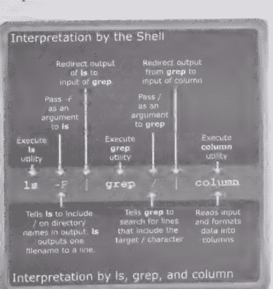
ls、grep 和 column 的解析过程

`grep` 工具输出包含目录名的行。`grep` 的输出被重定向到 `column` 工具，后者将数据格式化为尽可能多的实用列数以便显示。

Shell 启动三个子进程来执行该命令行。运行 `ls` 的第一个进程的输出 (o) 被重定向到运行 `grep` 的第二个进程的输入 (i)。第二个进程的输出被重定向到运行 `column` 的第三个进程的输入。第三个进程的输出未被重定向，因此它仍然连接到屏幕。

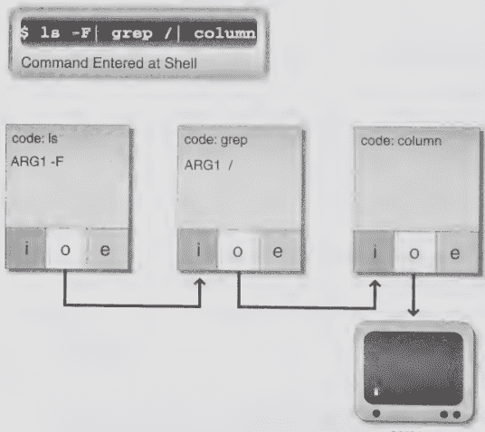

我们可以反转 `grep` 的工作方式。

- 3. 通过输入以下命令告知 `grep` 排除目录，仅选择文件：
  `ls -F | grep -v / | column`

在此命令行中，`grep` 被赋予了两个参数。斜杠被 `grep` 解释为目标字符串。`grep` 识别出符合搜索标准（行中某处有斜杠）的行，即目录名。`-v` 选项是排除这些匹配行的指令，并输出所有不匹配的行。由于文件名缺乏斜杠，因此它们成为了 `grep` 的输出。

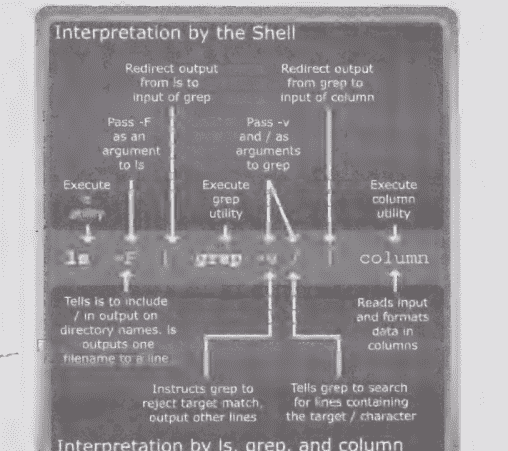

#### 创建脚本

像你刚刚输入的那样长命令可以包含在一个脚本文件中并轻松调用。

- 1. 使用编辑器创建一个名为 `lsdf` (`list directories and files`) 的脚本，然后输入以下内容：

```bash
echo
echo
date
echo
echo 'Directories are:'
ls -F | grep / | column
echo
echo 'Files are:'
ls -F | grep -v / | column
echo
```

- 2. 使文件可执行并运行它：

```bash
chmod +x lsdf
lsdf | more
```

目录名首先被列出，然后是文件。它们没有像 `ls` 操作那样混合在一个按字母顺序排列的列表中。

该脚本使用 `echo` 来输出空行以及 “Directories are” 或 “Files are” 信息。实际的工作是由 `ls`、`grep` 和 `column` 在输出仅目录或仅文件的两行中完成的。

有了这个脚本，你可以轻松地获取当前目录下列出的目录和文件的清单。

#### 为脚本添加注释

直到完成文档工作，项目才算真正完成。脚本可以运行了，所以现在是为其编写文档的时候了。

- 1. 将以下内容添加到 `lsdf` 脚本的顶部：

```bash
# This script outputs the names of directories and files
# listed in the current directory.
```

- 2. 再次运行脚本。
脚本的行为没有发生任何变化，因为 Shell 将 #（井号）解释为忽略该行其余部分的指令。我们经常简单地使用 # 来为脚本添加注释。使用 # 来标识注释可能会有一些技巧。例如，我们不能在一条长命令行内部使用它们。最好将注释放在脚本的开头或末尾。

- 3. 添加你的姓名和日期，然后完成关于脚本如何工作的简短说明。确保每行开头都有一个井号 (#)。

```bash
# Name Date
# The script uses ls to . . .
```

## 6.3 识别目录中文件所做的更改

当我们从事项目或需要保证数据安全时，确定目录中列出的文件和子目录发生了哪些更改是非常有帮助的。是否有新文件被添加？权限是否有所更改？文件是否被重命名？

### 创建示例目录的内容

在之前的练习中，你创建了一个名为 `Resumes` 的目录。本节的练习将使用该目录来研究如何监控目录中的更改。

首先，你将在 `Resumes` 目录中创建一系列文件，然后创建一个包含目标目录中文件信息“快照”的文件。创建快照文件后，你将对目录内容进行更改，然后再次创建快照文件。接着，你将使用各种工具来识别两个快照文件之间信息的差异。

- 1. 将 `Resumes` 设置为你的当前目录并确认你的位置：
  ```bash
  cd Resumes
  pwd
  ```

- 2. 在 `Resumes` 目录中，通过输入以下命令创建几个文件：
  ```bash
  date > today
  cal > month
  who > logged.on
  id > mylogin
  head -5 /etc/passwd > short-passA
  cp month month.bak
  ```

- 3. 使用以下命令确认你创建了所有六个文件：
  ```bash
  ls -l
  ```
  `Resumes` 是你的当前目录。

- 4. 返回你的家目录并确认你的位置：
  ```bash
  cd
  pwd
  ```

### 收集目录中文件的信息

下一步是在你的家目录中创建一个文件（或快照），其中包含 `Resumes` 子目录中列出的所有文件的信息。

- 1. 在家目录中输入：
  ```bash
  ls -l Resumes
  ```
  屏幕将显示 `Resumes` 目录中列出文件的详细信息列表。当 `ls` 被给定一个目录名作为参数时，它会报告该目录中列出的文件。

- 2. 将 `ls` 的输出重定向到一个快照文件：
  `ls -l Resumes | sort > file.info1`

- 3. 使用以下命令检查 `file.info1` 的内容：
  `more file.info1`

`file.info1` 文件包含一个排序后的行列表，其中包含 `Resumes` 目录中列出的每个文件的信息。其中包含每个文件的权限、修改日期、所有者等。它是 `Resumes` 目录中所有文件当前状态的一个快照。

### 修改目录内容

接下来的任务是对 `Resumes` 目录中列出的文件进行更改，以便稍后我们可以识别这些更改。

- 1. 切换回 `Resumes` 目录：
  `cd Resumes`
  `pwd`
  `ls`

- 2. 通过输入以下命令修改文件的某些方面：
  `chmod -w today`
  `mv month month2`
  `date > new.date`
  `who >> month.bak`
  `ls -l`

现在，该目录增加了一个文件，一个文件有了新名称，一个文件的权限被更改，还有一个文件增加了内容。

- 3. 返回你的家目录并确认你的位置：
  `cd`
  `pwd`

### 将当前文件信息与原始信息进行比较

`Resumes` 目录的内容已被修改。

- 1. 创建第二个包含 `Resumes` 中列出文件信息的文件：
  `ls -l Resumes | sort > file.info2`

`file.info1` 和 `file.info2` 是你家目录中的两个文件，它们分别是 `Resumes` 内容在修改前后的快照。它们包含了你在做出更改前和之后 `Resumes` 目录中列出的每个文件的信息。

- 2. 使用 `comm` 识别两个快照文件之间的差异：
  `comm file.info1 file.info2`

`comm` 的输出是一系列分为三列的行。有些行紧贴屏幕左边缘开始。有些行在一次 TAB 缩进后开始，其余的在两次 TAB 缩进后开始。这两个快照文件包含了 `Resumes` 目录在两个不同时间点的内容信息。`comm` 输出三列结果：仅在第一个文件中出现的行，仅在第二个文件中出现的行，以及共同拥有的行。

| 类别 | 文件内容 |
| :--- | :--- |
| 仅在 `file1` 中的行 | `-rw-rw-r-- 1 user 29 Sep 15 01:09 today` |
| | `-rw-rw-r-- 1 user 130 Sep 15 01:09 month` |
| 仅在 `file2` 中的行 | `-r--r--r-- 1 user 29 Sep 15 01:09 today` |
| | `-rw-rw-r-- 1 user 29 Sep 15 01:12 new.date` |
| | `-rw-rw-r-- 1 user 130 Sep 15 01:09 month2` |
| 在两个 `files` 中都存在的行 | `-rw-rw-r-- 1 user 103 Sep 15 01:09 mylogin` |
| | `-rw-rw-r-- 1 user 156 Sep 15 01:09 short-passA` |

输出表明哪些行没有改变（第三个项目），以及如果文件被某种方式修改或删除，它最初的样子是什么（第一个项目）。输出还描述了每个新文件（第二个项目）。

- 3. 使用 `diff` 识别快照中的差异：
  `diff file.info1 file.info2`

虽然 `diff` 的输出不包含两个文件中相同的行，但如下所示的行首“箭头”清晰地显示了文件之间的不同之处：

```
< -rw-rw-r--  1 user  user  29 Sep 15 01:09 today
---
> -r--r--r--  1 user  user  29 Sep 15 01:09 today
```


用户同时使用 `comm` 和 `diff` 工具来确定文件之间的共同点以及数据发生了哪些变化——在本例中，是指目录的内容。

快照文件创建在您的主目录中，而不是在 *Resumes* 中，因此快照的内容不会出现在 `comm` 或 `diff` 的输出中。

## 6.4 创建一个复杂的单词分析脚本

通过在脚本中使用管道（*pipeline*）将多个工具连接在一起，我们可以完成比任何单个工具所能完成的复杂得多的任务。

UNIX 的这种管道特性非常有用，也是利用 UNIX 工具高效处理数据的核心。正如 Peter 在运行 Pickled Pepper 工具时所说：“当正确地使用管道时，原始程序将证明其具有强大的力量。”Shell 脚本的复杂度各不相同，从简单的命令管道到涉及决策代码、运行循环以及以复杂方式操作数据的极其复杂结构。

无论一个程序在完成后规模有多大，成熟的用户和程序员都会从编写一个完成有限任务的简单基础脚本开始。在脚本的初始版本运行成功后，程序员会加入额外的代码以增强其功能。这样做的一个优点是，如果出现问题，那一定与新代码有关。然后，继续添加更多功能，并对脚本进行测试和调试。这个循环一直持续到所有功能都添加完毕。通过先让一个小程序运行起来，然后逐步增加功能，程序员可以更轻松地控制脚本的开发并更快速地检测错误。试图一次性写完整个程序然后再定位错误是一种新手做法，这会导致挫败感和失败。

本章的最后一部分将引导您逐步开发一个复杂的脚本。这个脚本虽然有用，但更重要的是探索如何有效地编写脚本。

### 规划如何确定文件中的唯一单词数量

在检查我们的写作时，了解我们在文件中使用了哪些不同的单词有时是非常有启发性的。本练习将引导您创建一个复杂的脚本，该脚本读取一个文件并输出文件中包含的唯一单词列表、每个单词使用次数以及所使用的唯一单词总数。

`uniq` 工具会删除其输入中重复的*相邻*行。它会输出唯一行以及任何重复且相邻行的单个副本。如果两个相邻行中的单词顺序不同，`uniq` 将不会删除其中一行，因为这两行并不相同。`uniq` 工具仅在某一行与另一行完全相同且相邻时才会删除该行。

如果每行仅包含一个单词，则必须对行进行排序，以便 `uniq` 能够删除重复的相邻行（单词）。在文本文件中，标点符号通常附在某些单词上。因为 *friend* 与 *friend?*（带有问号）不同，因此必须删除所有标点符号。该脚本的目标是准备来自文件的数据，以便 `uniq` 能正常工作：必须删除标点符号和空白行；必须统一*同一个单词*的大小写差异；并且单词必须按排序顺序每行一个。

### 创建一个长文本文件

第一部分引导您创建一个中等长度的文件，其中包含稍后脚本将要分析的文本。

- 1. 通过输入以下命令创建一定长度的文件：
  `cat practice west-coast.names practice > manywords`
- 2. 编辑 `manywords` 文件，添加一个包含实际单词的 10 行任意文本段落：
  `vi manywords`
- 3. 保存并退出 `manywords` 文件：
  `:wq`

### 删除标点符号

处理文件内容的第一步是创建一个删除标点符号的版本。

- 1. 使用编辑器创建一个名为 `wordsUsed1` 的新脚本文件：
  `vi wordsUsed1`
- 2. 在 `wordsUsed1` 文件中输入以下行：
  `tr -d '?.'!;:(),)' < manywords`
- 3. 保存文件并退出编辑器：
  `:wq`
- 4. 使脚本可执行并运行脚本：
  `chmod +x wordsUsed1` 
  `wordsUsed1 | more`

`wordsUsed1` 的输出是删除了标准标点符号的 `manywords` 内容。像 $ 和 % 这样的其他字符不会被删除。在 `-d` 之后的参数中列出的特定字符是 `tr` 删除的字符。参见图 6-1。

#### 分析代码

`tr` 命令行组成部分如下：

| 组件 | 描述 |
|---|---|
| `tr` | 指示 shell 执行 `tr` 工具。 |
| `-d ' '` | 向 `tr` 传递两个参数：`-d` 和单引号内的字符。`tr` 工具将 `-d` 解释为删除第二个参数中列出的所有字符的指令。单引号告诉 shell 将标点符号未经解释地作为第二个参数传递给 `tr`。 |
| `?.':,();` | 指定第二个参数的内容。因此，`tr` 在输入中搜索字面上的 `?.':,();` 字符并删除这些字符。 |
| `< manywords` | 指示 shell 打开 `manywords` 文件并将其连接到 `tr` 的输入。`tr` 工具仅从其输入中读取。它不将参数解释为文件名。我们必须让 shell 将文件连接到 `tr` 的输入。 |

### 将所有字符转换为小写

一旦从数据中删除了标点符号，还剩下大写字母的问题。有些单词首字母大写，有些则没有。此时，*the* 和 *The* 被视为两个不同的单词。为了正确删除重复项，我们必须确保同一个单词的每个实例以及字符的大小写一致。一个简单的解决方案就是将整个文件转换为小写或大写。

- 1. 创建一个名为 `wordsUsed2` 的 `wordsUsed1` 副本：
  `cp wordsUsed1 wordsUsed2`
- 2. 使用 `vi` 编辑 `wordsUsed2` 文件，并在第一行末尾添加一个反斜杠：
  `tr -d '?.:,();' < manywords \`
- 3. 然后在脚本中添加第二行：
  `| tr 'A-Z' 'a-z'`
- 4. 运行脚本并检查其输出：
  `wordsUsed2 | more`

输出是 `manywords` 文件数据的副本，其中所有字符均为小写。参见图 6-2。

如果您的脚本运行并产生了正确的输出，说明您输入代码正确。如果之前的版本运行正确，但这次产生了错误，那么问题出在您刚刚输入的内容中。仔细检查并修复它，然后再次运行脚本。确保反斜杠是第一行的最后一个字符。

#### 分析代码

新增文本的组成部分如下：

| 组件 | 解释 |
| :--- | :--- |
| `\` | 指示 shell 不要解释下一个字符的特殊含义，即换行符。如果没有换行符，shell 就不会被告知处理一个完整的行。因此，shell 将继续读取文件中的下一行，就好像这两行实际上是一行一样。shell 将多行视为一行输入。 |
| `|` | 指示 shell 将前一个进程（正在运行 `tr`）的输出连接到后一个进程（同样运行 `tr`）的输入。 |
| `tr` | 执行第二个 `tr` 工具。 |
| `' '` | 指示 shell 不要将包含的字符解释为对 shell 具有重要意义的内容。引号之间的文本将原样作为参数传递给 `tr`。 |
| `A-Z` | A-Z 是传递给 `tr` 的第一个引号参数的内容。`tr` 工具将 A-Z 解释为搜索所有大写字母 A 到 Z 作为替换目标的指令。 |
| `a-z` | 此 a-z 是传递给 `tr` 的第二个参数的内容。该工具将此参数解释为*替换*字符的范围。所有大写字母都将被替换为对应的匹配小写字母。 |

### 将每个单词放在单行上

脚本的输出中，每行有许多个单词。我们想要删除的是重复的单词，而不是重复的行，但 `uniq` 仅对行起作用。为了使用 `uniq` 删除重复单词，我们必须修改数据，使每个单词单独占一行。为了完成这个任务，我们需要使用 ASCII 字符集中的换行符代码。

- 1. 通过输入以下命令查看 ASCII 字符及其相关代码：
  ```
  man ascii
  ```
  旁边标有 `012` 的字符就是换行符。这个字符分隔文件中的行，以便终端和打印机能够显示单独的行。换行符的另一种常用名称是 `\n`。

- 2. 将 `wordsUsed2` 复制为 `wordsUsed3`：
  ```
  cp wordsUsed2 wordsUsed3
  ```
  推荐此步骤。创建基础脚本，复制它，进行添加和更改，运行，复制，更改，运行……直到完成。如果某一行相对于前一版本有所修改，更改将描述在脚本末尾的 `#` 之后。不要包含 # 或注释内容。

- 3. 使用编辑器修改脚本 `wordsUsed3` 以包含以下行：
  ```
  tr -d '?,!:();' < manywords \
  | tr 'A-Z' 'a-z' \
  | tr ' ' '\n'
  # A backslash is added at the end of the second line in this script.
  # The last line is new, a space is the first quoted argument.
  ```

空格既用于分隔参数，也作为第一个引号参数的内容。必须仔细输入。


- 4. 完成更改后，运行脚本 `wordsUsed3`：
  `wordsUsed3 | more`

输出结果为每行一个单词，因为每个空格都被转换为了一个新行。

#### 分析代码

对脚本的添加内容如下：

| 命令 | 解释 |
| :--- | :--- |
| `\` | 指示 shell 不要解释脚本中第二行末尾的换行符。 |
| `|` | 告知 shell 将前一个运行 `tr` 的进程的输出连接到下一个运行 `tr` 的进程的输入。 |
| `tr` | 指示 shell 执行 `tr` 工具，该工具用于定位目标字符并将其替换为其他替换字符。 |
| `' ' '` | 指示 shell 向 `tr` 传递第一个参数，该参数由一个空格组成。`tr` 工具将此第一个参数解释为要定位并用第二个参数中列出的字符替换的目标字符。 |
| `\n` | 指示 shell 向 `tr` 传递第二个参数 `\n`。`tr` 工具将此第二个参数解释为替换字符。`\n` 是换行的 ASCII 字符。`tr` 工具定位文件中的每个目标字符（空格），并将其全部替换为换行符。`tr` 的最终输出结果是输入文件中的每个单词各占一行。ASCII 规范 `\012` 与 `\n` 等效，也可以使用。 |
| `#` | 指示 shell 不要解释该行剩余的部分。 |

每个单词单独输出在一行。如果文件中存在两个连续空格的地方，两者都会被转换为换行符。因此，输出中可能也会出现空行。

#### 定位错误

如果你至少犯了一个错误并且不得不对其进行修复，那么你就领先了一步。故意引入一个错误来观察 shell 或工具如何响应是非常有用的。

- 1. 回到脚本中，在你刚刚添加的行中制造一个错误（删除一个空格、删除反斜杠等）。
- 2. 再次运行脚本。

因为你知道错误在哪里，所以很容易修复。请继续按照这套指令逐步扩展脚本。当你犯错时，调试会变得容易得多。

#### 将制表符替换为换行符

文件的前一版本 `wordsUsed3` 将所有空格更改为换行符，导致大部分文本以每行一个单词的形式输出。但是，如果文件中包含任何 TAB（制表符）字符，它们将被保留。
我们也可以将 TAB 字符替换为换行符。

- 1. 将 `wordsUsed3` 复制为 `wordsUsed4`。
- 2. 修改 `wordsUsed4` 的最后一行，通过在第一个参数中添加 TAB，在第二个参数中添加另一个新行，来同时搜索空格和制表符：
  `tr ' \t' '\n\n'`
- 3. 再次运行脚本并检查结果：
  `wordsUsed4 | more`

脚本的最后一行指示 `tr` 定位空格并将其替换为换行符，同时定位 TAB 字符 (`\t`) 并将其也替换为换行符。

#### 删除空行

`wordsUsed4` 的输出包括输入文件中的所有空行，以及双空格变为两个换行符时增加的空行。我们可以删除这些空行。

- 1. 将 `wordsUsed4` 复制为 `wordsUsed5`。
- 2. 使用 `vi`，通过将脚本修改为如下内容，在 `wordsUsed5` 中引入 `sed` 工具：

```bash
tr -d '?.!,():;"' < manywords \
| tr 'A-Z' 'a-z' \
| tr ' ' '\t' '\n' '\n' \
| sed '/^$/d'
# 第 3 行末尾添加了反斜杠
# 添加了第四行
```

- 3. 再次运行脚本：

```bash
wordsUsed5 | more
```

- 4. 输出数据中的空行被删除了。

#### 分析代码

`wordsUsed5` 中添加了一行包含以下内容的内容：

| 命令 / 参数 | 解释 |
| :--- | :--- |
| `\` | `\` 放置在之前三行的每行末尾。每个反斜杠指示 shell 不要解释随后的换行符。因此，shell 将文件的所有四行解释为一个命令行。 |
| `|` | 将 `tr` 的输出连接到 `sed`。 |
| `sed` | 执行 `sed` 工具。 |
| `' '` | 指示 shell 将包含的字符串作为参数传递给 `sed`，而不解释任何特殊字符。 |
| `/^$/d` | 传递给 `sed` 的参数，`sed` 将其解释为“定位由开头 `^` 和结尾 `$` 组成且中间没有文本的行（空行），然后删除 (d) 这些行”。 |

**图 6-3** shell 视图

#### 对行进行排序

此时，`wordsUsed5` 的输出由文件中所有单词组成，保持原顺序，全部为小写，没有标点符号，且没有空行。单词 *the* 在文件中多次出现。
为了让 **uniq** 删除重复行，这些行必须相邻。现在是时候排序了。

- 1. 将 `wordsUsed5` 复制为 `wordsUsed6`。
- 2. 按如下方式修改 `wordsUsed6` 脚本：

```bash
tr -d '?.!,();' < manywords \
| tr 'A-Z' 'a-z' \
| tr '\t' '\n\n' \
| sed '/^$/d' \
| sort
# 第 4 行末尾添加了反斜杠
# 第 5 行是新增的
```

- 3. 运行脚本以确认排序效果：
  `wordsUsed6 | more`

因为输出经过了排序，所有包含相同单词的行都位于相邻行。

#### 分析代码

添加的命令如下：

| 命令 | 描述 |
| :--- | :--- |
| `\` | 指示 shell 不要解释随后的换行符。 |
| `|` | 将 **sed** 的输出连接到下一个工具 **sort** 的输入。 |
| `sort` | 运行 **sort** 工具，该工具对从 **sed** 接收到的所有行进行排序。因为每个单词都单独占一行，输出结果是文件中单词的已排序列表，每行一个单词。如果文件包含 10 个单词 **the**，它们将列在连续的行中。 |

### 删除重复项

最后，数据已经准备好让 **uniq** 剔除重复项了。

- 1. 将脚本文件 `wordsUsed6` 复制为 `wordsUsed7`。
- 2. 按如下方式修改 `wordsUsed7` 脚本：
  ```bash
  tr -d '?:;()<' < manywords \
  | tr 'A-Z' 'a-z' \
  | tr '\t' '\n\n' \
  | sed '/^$/d' \
  | sort | uniq -c    # 此行已被修改
  ```

- 3. 写入文件并退出编辑器后，输入以下命令运行脚本：
  `wordsUsed7 | more`

输出中所有重复行都被删除了。

#### 分析代码

对脚本的添加内容是：

| 命令 | 解释 |
|---|---|
| `|` | 将 `sort` 的输出连接到 `uniq` 的输入。 |
| `uniq -c` | 运行 `uniq` 工具并传递 `-c` 选项。`uniq` 输出所有唯一行，重复相邻行仅保留一份拷贝，并显示其遇到的每行重复次数。包含相同单词的多行被缩减为仅一行，该行包含该单词以及该行在输入中出现的次数。输出结果是文件中所有单词及其出现次数的列表。 |

#### 将最常用单词排在最前面

`uniq` 的输出由 `manywords` 文件中所有单词的列表及其在文件中出现的次数组成，例如：

```
12 a
2 about
4 at
2 bill
1 box
6 can
2 charlie
```

根据词频输出单词（最常用的单词排在最前面）可能会更有用。

- 1. 将 `wordsUsed7` 复制为 `wordsUsed8`。
- 2. 修改 `wordsUsed8` 以包含最后的 `sort`：
  ```bash
  tr -d '?:!,();' < manywords \
  | tr 'A-Z' 'a-z' \
  | tr ' \t ' '\n\n' \
  | sed '/^$/d' \
  | sort | uniq -c \
  | sort -rn
  ```
  # 第 5 行末尾添加了反斜杠，第 6 行是新增的
- 3. 运行 `wordsUsed8`：
  `wordsUsed8 | more`

脚本现在将出现次数最多的单词输出在列表顶部。这一次，`uniq` 的输出被管道传输到另一个 `sort`，它根据每行开头的数字对行进行排序。为了进行数值排序而非 ASCII 排序，我们加入了 `-n` 参数。`sort` 通常先输出最小的数字。为了在列表顶部看到最常用的单词，我们使用 `-r` 选项反转排序顺序。

#### 同时写入文件和下一个工具

最终的唯一行（单词）显示在屏幕上。`wordsUsed` 脚本的最后一次添加将 `uniq` 的输出发送到一个文件，同时也发送给 `wc` 以计算所使用的总行数（唯一单词数）。

- 1. 将 `wordsUsed8` 复制为 `wordsUsed`。
- 2. 修改文件，使其看起来像这样：

    ```bash
    tr -d '?",!;():>' < manywords \
    | tr 'A-Z' 'a-z' \
    | tr ' ' '\n' \
    | sed '/^$/d' \
    | sort | uniq -c \
    | sort -rn \
    | tee words.out | wc -l
    # 第 6 行末尾添加了反斜杠，第 7 行是新增的。
    ```
- 3. 运行脚本：
    `wordsUsed` 
    屏幕上显示 `sort` 输出的总行数，即文件中不同单词的数量。
- 4. 检查当前目录下新文件 `words.out` 的内容：
    `more words.out`

文件 `words.out` 包含所有唯一单词的列表以及每个单词在 `manywords` 文件中出现的次数。

#### 分析代码

对脚本的添加内容是：

| 命令 | 解释 |
| :--- | :--- |
| `\` | 不要解释换行符。 |
| `|` | 将 **uniq** 的输出连接到下一个实用程序 **tee** 的输入。 |
| `tee` | 运行 **tee** 实用程序，它从输入读取，然后写入输出并并在内存中保存一份副本，在读取所有输入后将其写入文件。 |
| `words.out` | 传递给 **tee** 的参数，**tee** 将其用作创建文件的名称。**tee** 接收的所有输入副本都会写入此文件以及输出。 |
| `|` | 将上一个实用程序 **tee** 的输出连接到下一个实用程序 **wc** 的输入。 |
| `wc` | 运行 **wc** 实用程序。 |
| `-l` | 指示 **wc** 仅计数并显示行数，忽略单词数和字符数。因为输入中的每个单词都单独占一行，所以 **wc** 的输出就是文件中使用的不同单词的数量。 |

#### 审查完成的脚本

UNIX 中没有能够直接列出文件中唯一单词的实用程序。通过将多个实用程序通过管道连接在一起，我们可以列出唯一单词、每个单词的使用次数以及单词总数。

总之，该程序完成了以下操作：

| 命令 | 解释 |
| :--- | :--- |
| `tr -d '?.:();' < manywords \` | 删除标点符号。 |
| `| tr 'A-Z' 'a-z' \` | 将所有字符转换为小写。 |
| `| tr ' \t' '\n\n' \` | 将空格替换为换行符，将制表符（TAB）替换为换行符。 |
| `| sed '/^$/d' \` | 删除空行。 |
| `| sort | uniq -c \` | 对数据进行排序并删除重复行，输出输入中每行出现的次数。 |
| `| sort -rm \` | 根据每个单词在文件中出现的次数进行排序。 |
| `| tee words.out | wc -l` | **tee** 从输入读取并写入输出以及 `words.out` 文件。**tee** 实用程序的输出传递给 **wc**，由其计算行数（在这种情况下即为单词数）。 |

图 6-4 的图表标识了数据是如何被脚本的实用程序传递和转换的。传递给每个实用程序的参数被标记为 ARGS。

你刚刚完成的这个过程非常重要。你编写了一个简短的脚本，使其运行起来，添加更多代码以增强功能，调试它，再次添加代码，再次调试，并不断重复此过程，直到所有功能都成功添加。这种方法产生的错误较少，并且使修复错误变得更加容易，因为你知道问题一定与刚刚添加的内容相关。

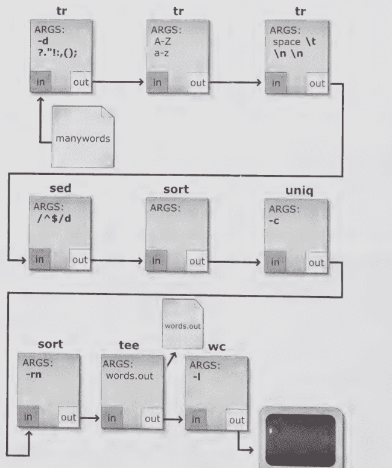

**图 6-4** 实用程序和参数的流程

#### 自测 1

回答以下问题。利用本章中的信息检查你的答案。

- 1. 检查以下脚本 *n-on*：

```bash
who | sort \
| awk '{print $1}' \
| uniq | wc -l
```

*n-on* 的输出结果将是什么？

- 2. *n-on* 脚本的输出将发送到哪里？

- 3. Shell 如何解释 *n-on* 中的以下各项？
    - A. who
    - B. \
    - C. '{print $1}'
    - D. | uniq
    - E. wc
    - F. -l

- 4. 当 shell 读取 *n-on* 脚本时，它发现了多少行命令？

## 本章复习

使用本节复习本章内容，并测试你对概念的掌握情况。

### 本章总结

- 我们可以将复杂的命令行放入脚本中，使其可执行，然后在需要时执行这些脚本。
- 当我们将脚本名称输入到 shell 时，shell 会在其 *PATH* 或 *path* 变量列出的目录中搜索该实用程序。如果当前目录 (.) 不在路径中，我们必须使用 `./scriptname` 指定本地目录，或者通过更改路径值来包含当前目录。
- 单个实用程序能很好地完成特定任务。通过将数据从一个实用程序通过管道传递到另一个实用程序，我们可以完成更复杂的任务。
- 编写脚本的最佳方法是先创建一个功能有限的简短脚本，然后一次增加一个功能。程序员在创建代码时会仔细规划增加功能或复杂性的顺序，以确保每次修改的规模和复杂程度合理，从而能够快速定位错误。

### 练习题

填空。

- 1. 哪个选项指示 `ls` 在输出的每个目录名后输出一个斜杠？
- 2. 什么命令指示 shell 为 `p.scri` 文件添加执行权限？
- 3. 解释以下命令的结果，以及命令行中每个部分实现了什么功能。
    - A. `ls -F / | grep -v / | column`
    - B. `tr ' ' '\n' < textfile`
- 4. 脚本中很多行末尾有 `\` 字符的原因是什么？

### 项目

- 1. 复制 `wordsUsed` 脚本并命名为 `w-Used-p`，然后对其进行修改，使其满足：
    - A. 运行脚本时，检查你的 `practice` 文件。
    - B. 单词以大写形式输出。
    - C. 当数据为每行一个单词、已排序但尚未去重时，将一份副本保存到名为 `sor.out` 的文件中。
- 2. 
    - A. 使用 `man` 手册查找 `ls` 的选项，使其在你所有设为可执行的文件后输出星号 (*)，以及哪个选项按创建日期顺序排列文件。
    - B. 创建一个名为 `myfilesA` 的文件，其中包含你主目录下所有文件的详细列表，按日期排序，并由 `ls` 标识目录和可执行文件。
    - C. 创建另一个名为 `myscripts` 的文件，仅按创建顺序输出你的脚本名称。
    - D. 编写一个脚本，输出 `/etc/passwd` 文件中有条目的用户数量。

### 命令汇总

| 脚本编写命令 | 解释 |
| :--- | :--- |
| # | 指示 shell 不要解释当前行的其余部分。该命令用于在脚本中添加注释。它不能在管道内部使用。 |
| \ | 指示 shell 不要解释紧随其后的任何字符的特殊含义。如果将其放在一行的最后一个字符，它会告诉 shell 不要解释 ENTER 键，从而使下一行输入被解释为第一行命令行的延续。 |

# 第 7 章

## 创建和更改目录

**技能检查**

在开始本章之前，你应该能够：

- 访问和退出系统
- 创建、显示和打印文件
- 执行基本 shell 命令
- 将实用程序的输出重定向到另一个实用程序或文件
- 命名、复制和删除文件
- 使用编辑器访问和修改文件

**目标**

完成本章后，你将能够：

- 创建目录
- 切换到某个目录
- 使用文件的完整路径名
- 识别管理文件时 inode、数据块和目录的作用
- 指定相对于用户主目录的文件路径
- 在路径规范中使用父目录和当前目录
- 在多个目录中列出同一个文件
- 移动整个目录及其内容
- 删除目录

在本章中，我们将探讨创建和使用名为 *子目录* 的新目录，这些子目录列在你的主目录中。文件可以在这些子目录中创建和访问。你的主目录是复杂目录结构或 *文件系统* 中的许多目录之一，该系统存储属于所有用户、系统管理员以及系统本身的文件。由于文件根据系统和用户的不同而存储在不同的目录中，一名优秀的计算机专业人员必须能够快速地从一个目录切换到另一个目录，即使目标目录位于文件系统的某个远程部分。本章将研究 UNIX/Linux 工程师内置到文件系统中的底层结构，以及我们如何利用它们高效地访问其他目录及其文件。

文件系统允许我们以层级结构创建文件和目录。例如，2004 年 7 月 2 日给一名叫 Greg Forbes 的客户的信，可以是一个名为 `g.forbes7.2.2004` 的文件，列在名为 *Clients* 的目录中。*Clients* 目录可以列在另一个名为 *Correspondence* 的目录中，而后者列在你的主目录中。这种安排对于在系统中快速定位信息至关重要。如果你是一名经验丰富的 DOS/Windows 用户，本章研究的目录结构将让你感到熟悉，因为 DOS 文件系统在开发时就是为了与 UNIX 文件系统相似。工作站屏幕就像一个小孔，我们通过它查看文件集合。当一个精心设计的层级文件系统就绪时，我们可以使用本章研究的命令，以最小的努力访问所需的信息。

## 7.1 利用目录创建秩序

在目录中管理文件需要一套重要且基础的技能，因为系统上的几乎所有内容都是文件，且所有文件都通过目录访问。在第 2 章的 UNIX/Linux 系统导览中，你创建并使用了新目录。本章将更详细地探讨这些技能，并研究文件系统究竟是如何工作的。

存储在系统硬盘上的电子信息集合称为 *文件*。存储在文件中的数据可以被访问、修改、复制和删除。同样地，图书馆的书架上包含存储在……上的信息书籍。

纸张。这些书籍可以被访问、复制、删除，甚至修改。在图书馆中，卡片索引中的卡片或在线目录中的记录为用户提供关于书籍及其在书库中位置的信息。同样，在 UNIX/Linux 中，有一个“索引卡”或 *inode*，其中包含有关每个文件的所有可用信息，包括文件在磁盘上的实际位置。

文件实际上并不“在”目录中。文件存储在硬盘的 *数据块（data blocks）* 中。目录中唯一包含的是每个文件的名称及其 inode 编号（索引卡）。

### 重新审视主目录

到目前为止，你创建的几乎所有内容都列在你在登录时访问的那个目录中：即你的 *主目录（home directory）*。

- 1. 现在登录你的账户。正如你之前经历过的那样，你会被自动置于你的主目录中。

- 2. 输入：
  `pwd`
  屏幕将显示从 *根目录（root）* 到你主目录的路径。
  每次登录时，你都被分配在同一个工作位置，因为该目录的路径位于 `/etc/passwd` 文件中你账户记录的第六个字段。

- 3. 输入：
  `grep $USER /etc/passwd`
  或者
  `ypcat passwd | grep $USER`
  第六个字段就是通往你主目录的路径。在登录时，`/etc/passwd` 文件中第六个字段的内容无论是什么，在登录后都会成为你的当前目录。

- 4. 列出你的当前文件：
  `ls`
  你在之前练习中创建的文件可能就列在你的主目录中。

- 5. 通过输入以下命令创建一个新文件：
  `who > f-name`
  新文件 *f-name* 包含了当前登录系统的用户的登录名和其他相关信息。你不需要指定新文件的存放位置。默认情况下，文件会被创建并列在你的当前目录中，而此时当前目录就是你的主目录。

- 6. 请求列出当前目录中的文件名。输入：
  `ls`
  你创建的文件名将出现在屏幕上。如果你只有少量文件，这个列表会很简短。然而，如果你有大量文件，这个列表会填满整个屏幕且难以阅读。通过使用精心设计的目录结构，你可以将相关文件一起存储在不同的目录中，从而使每个目录下的列表更短。

除非另有指定，否则你在命令中包含的所有文件名都指向列在当前目录中的文件。下面的插图显示了你的主目录与可能列在主目录中的某些文件之间的关系。

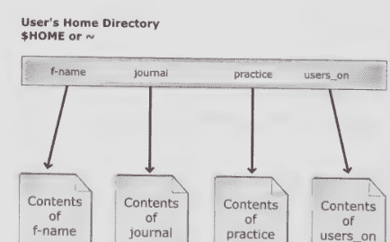

由于本章随后的练习需要特定的文件，请执行以下操作：

- 7. 如果你的主目录中没有名为 *practice*、*users_on*、*respected* 和 *f-name* 的文件，请现在使用你最喜欢的编辑器创建它们。在每个文件中添加几行任意内容。

- 8. 通过输入以下内容创建一个名为 *journal* 的文件：
  `date > journal`

### 检查文件如何在目录中列出

人们经常将 UNIX 目录想象成存放文件的容器，就像物理文件柜存放文件夹一样。虽然这种“文件夹”比喻被广泛使用，但遗憾的是，它是不准确且具有误导性的。目录实际上并不包含文件。`ls` 命令读取当前目录中列出的文件名，然后输出这些名称。目录的全部内容也可以被显示。

- 1. 要查看当前目录的实际内容，请输入：
  `ls -i`

输出类似于以下内容：

| Inode | Filename |
| :--- | :--- |
| 21188 | f-name |
| 51234 | journal |
| 44333 | names.tmp |
| 66554 | numbers.tmp |
| 67666 | ordered_1 |
| 42233 | phon |
| 33773 | practice |
| 55666 | prtest |
| 77665 | test_file |
| 91919 | users_on |

你的输出中，文件名的左侧会有截然不同的数字。然而，你的目录内容结构是相同的：只有文件名和与每个文件相关联的一个数字。

对于其包含的每个文件，目录中仅包含该文件的名称以及一个指向该文件 *inode* 的数字。inode 包含了关于该文件的所有信息，并拥有该文件在硬盘上实际存储位置的数据块地址。`ls` 的 `-i` 选项就是指令，要求在输出中包含 inode。

inode 是硬盘在格式化时创建的小块内存。每个 inode 仅存储关于文件的信息（所有者、权限、创建日期、修改日期、大小等）。inode 还包含一个磁盘块地址列表，这些块正是构成文件的实际数据所在地。一个目录对于其中的每个文件和子目录，仅包含一个文件名及其索引号（inode 编号）——除此之外没有其他内容。

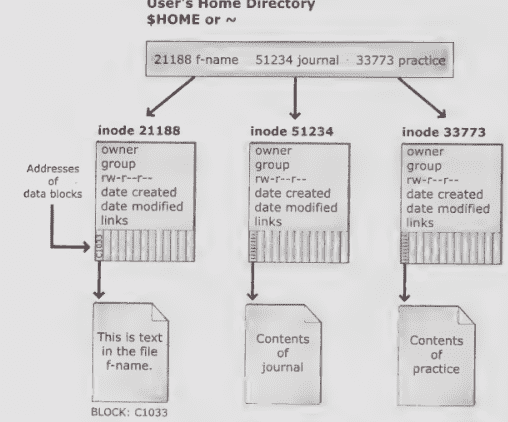

每个用户的主目录其实就是一个文件，包含了用户在该目录下创建的每个文件的名称和 inode 编号。inode 则包含关于文件的其余信息以及定位数据所需的地址。

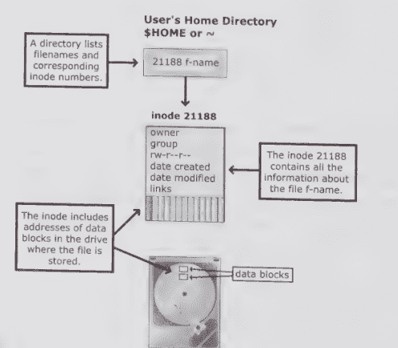

文件的 inode 包含所有关于文件的信息，并有空间存放多达 13 个硬盘数据块的地址。从 inode 直接寻址的前 10 个数据块包含实际的文件数据。如果文件太大无法放入这 10 个块中，则会分配额外的块。但是，这些额外块的地址不直接放在 inode 中，而是放在一个数据块中，而该数据块的地址则放在 inode 的第 11 个槽位中。对于大文件，驱动器上持有数据的块地址要么在 inode 中，要么在 inode 可以访问的数据块中。

本章不仅研究如何在文件系统中移动，还研究 inode 如何作为使目录列出文件成为可能的关键组件。在过去 20 年的 UNIX 和 Linux 教育中，我们发现那些在思考文件系统时将目录、inode 和数据块的作用考虑在内的人，能更好地解决问题并构思更高级的主题，如权限、链接等。因此，我们将本章设计为对整个目录结构的仔细探讨。

- 2. 添加另一个文件，看看目录中增加了什么：
  `who > users_test`

- 3. 检查当前目录的内容：
  `ls -i | more`
  新的文件名 `users_test` 及其索引（inode）编号已添加到当前目录中。

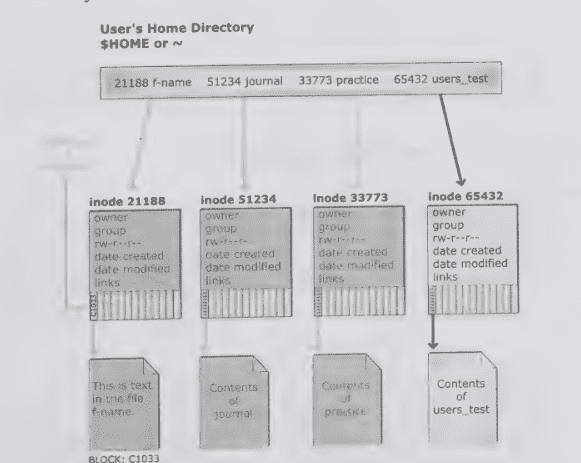

每当创建一个文件时，它的名称和 inode 编号都会被录入到目录的内容中。

### 创建目录

通常当我们创建或制作目录时，它们会被列在当前目录中。

- 1. 通过输入以下命令创建一个新的 *Projects* 目录：
  `mkdir Projects`
  `mkdir` 命令只完成一项任务：创建目录。新目录会列在我们在创建它时所在的那个目录中。我们创建的每个新目录（通常称为 *子目录*）都可以列出更多的文件和其他目录。

- 2. 通过输入以下命令获取当前目录内容的列表：
  `ls | more`
  如果你在创建时使用了大写字母 *P*，那么新目录 *Projects* 可能出现在列表的前面。如果你给目录起以大写字母开头的名字，而给文件起小写字母的名字，那么在运行 `ls` 时，目录会首先被列出。

> **注意：** 在本书中，用户创建的目录通常使用首字母大写的名称，以便它们被 `ls` 首先列出。然而，UNIX 和 Linux 并不要求目录名必须使用大写字母。

### 获取关于目录及其内容的信息

我们经常运行 `ls` 来确定当前目录的内容。如果我们运行 `cd` 切换到新目录，然后运行 `ls`，我们就能看到新目录的内容列表。我们也可以在不离开当前目录的情况下列出子目录的内容。

- 1. 输入：
  `ls Projects`
  系统会读取 *Projects* 目录，由于其中没有列出任何文件名，因此屏幕上不会显示任何内容。要列出子目录的内容...

在不离开父目录的情况下，输入 `ls` 命令，并将子目录的名称作为参数。

- 2. 获取 *Projects* 内容的详细列表：
`ls -l Projects` 
显示 *Projects* 中列出文件的文件、权限、所有者等信息。

- 3. 通过输入以下命令获取当前目录内容的信息：
`ls -l` 
这将显示当前目录中所有文件（包括 *Projects*）的权限等信息。

- 4. 通过输入以下命令获取当前目录内容的完整列表，包括 inode 编号：
`ls -i` 
*Projects* 拥有一个唯一的 inode。关于 *Projects* 目录的所有信息——包括目录的权限、所有者等——都保存在该 inode 中。

下图描绘了您的主目录。主目录的图形由粗线边框包围。新创建的 *Projects* 子目录的边框并非粗线，以表明虽然您创建了一个新目录，但您的主目录仍然是您的当前目录（即您正在工作的目录）。

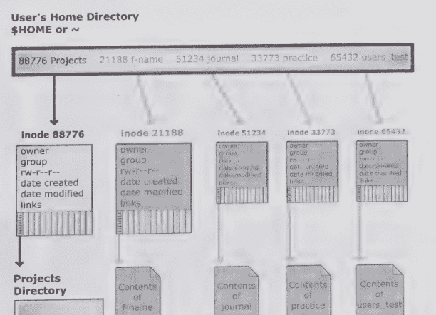

- 5. 输入：
`pwd` 
您仍然处于主目录中。

### 切换目录

当我们想要切换到不同的目录（即将其设为当前目录）时，需要通知 shell。

- 通过输入以下命令将当前目录更改为新创建的 `Projects` 目录：
`cd Projects`

`cd`（或 `change directory`）命令指示 shell 定位列为参数的目录（`Projects`）并将其设为当前目录。下图显示您的当前目录不再是主目录。子目录 `Projects` 现在是您的当前目录，并以粗线边框显示。

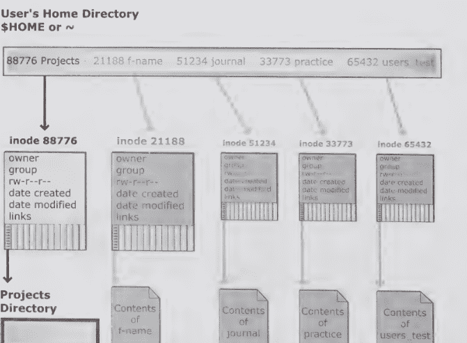

### 查看当前目录的路径

无论您在文件系统的哪个位置，您始终可以识别您的当前目录。

- 您现在处于 `Projects` 中。通过输入以下命令确认您的位置：
`pwd`

输出结果是从文件系统顶层（*根目录* 或 `/`）到当前目录的绝对 *路径*。它类似于：

```
/home/cassy/Projects
```

最顶层的目录被称为 **root** 或 **根目录**，在路径名中由第一个正斜杠 (`/`) 表示。从 **root** 到当前目录的所有其他目录都由斜杠分隔。*路径* 是由 `/`（斜杠）字符分隔的目录名称列表。在这个例子中，**pwd** 输出的最后一个目录是 *Projects*。它左侧的是 *Projects* 的父目录，在本例中即您的主目录。主目录的左侧是它的父目录，依此类推直到 **root**。**pwd** 命令输出从 **root** 开始必须访问的目录名称，以从 **root** 到达您的当前目录。它是您的当前目录或工作目录的全路径名（绝对路径名）。

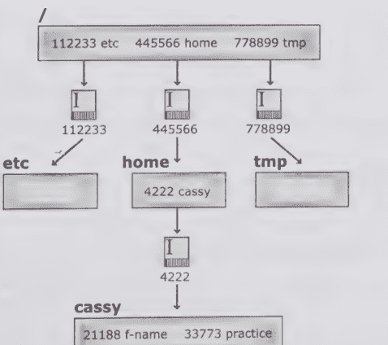

### 列出当前目录的内容

在好几次操作中，您都已经获得了当时当前目录下所列文件的名称显示。

- 使用常用命令列出当前目录（*Projects*）的内容：
`ls`

没有任何内容被列出。在新创建的 *Projects* 目录中没有普通文件。您上次输入 `ls` 时出现的文件仍然存在，但它们不在这个目录中。`ls` 命令仅显示您 *当前* 目录中列出的文件名。您通过输入 `cd Projects` 命令离开了主目录，将当前目录更改为了 *Projects*。

### 在子目录中创建文件

当前目录是 *Projects*，创建时它不包含任何常规文件。我们可以在目录中创建新文件。

- 1. 以 *Projects* 作为当前目录，创建一个名为 *testing* 的新文件。输入：
`vi testing` 
- 2. 在新文件中添加几行文本。
- 3. 写入文件并返回 shell：
`:wq` 
- 4. 使用 `vi` 创建另一个名为 *practice* 的新文件，并添加以下内容：
*This is a file practice located in the Projects directory.*
- 5. 创建这两个新文件后，通过输入以下命令列出 *Projects* 目录中的文件名：
`ls` 
列出了 *practice* 和 *testing* 文件。
- 6. 像往常一样，目录的内容包括文件名和 inode 编号：
`ls -i` 

下图显示了您的主目录及其文件之间的关系。其中包含您刚才在 *Projects* 子目录中创建的文件。

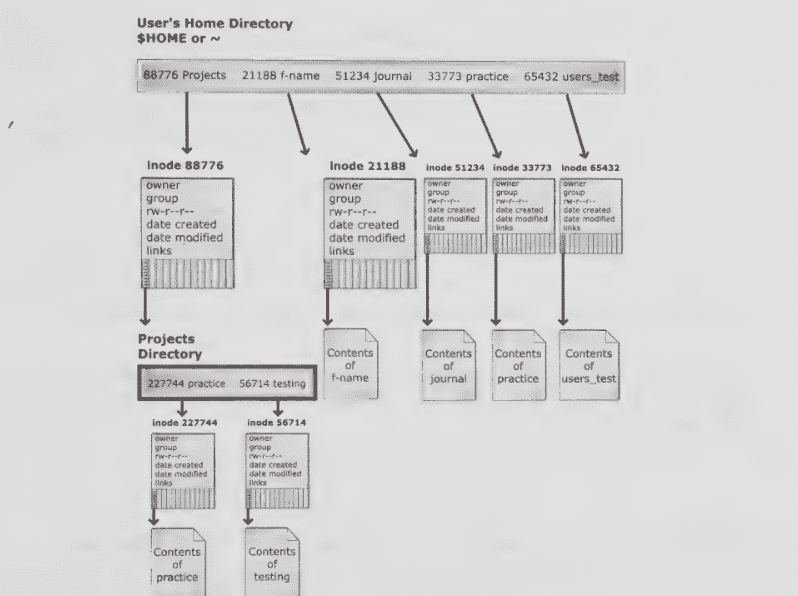

### 返回主目录

您使用了 `cd subdirectory` 命令（在本例中为 `cd Projects`）将当前目录从主目录更改为 *Projects* 目录。

- 1. 要再次将主目录设为当前目录，请输入：
`cd`
- 2. 通过输入以下命令确认您现在已回到主目录：
`pwd`
`pwd` 的输出与 *Projects* 是当前目录时相同，不同之处在于现在主目录是列出的最后一个目录，而 *Projects* 完全没有被列出。
- 3. 通过输入以下命令列出当前目录中的文件名来确认您的位置：
`ls`
*Projects* 目录出现了，以及您的其他文件，包括一个名为 *practice* 的文件。您的主目录再次成为了当前目录。

无论我们当前在文件系统的哪个位置工作，不带任何目录参数的 `cd` 命令都能将我们安全地带回主目录。在《绿野仙踪》中，多萝西可以在任何时间、任何地点通过击打脚后跟并说三次“There’s no place like home”来回家。`cd` 命令（就像“多萝西”命令一样）将我们带回 Linux 和 UNIX 中的主目录。

- 4. 使用以下命令检查 *practice* 文件的内容：
`cat practice`

这个 *practice* 文件不是您在 *Projects* 目录中创建的那个，而是在之前章节中于主目录中创建的那个。

> **注意：** 只有当文件被列在不同的目录中时，文件才能具有相同的名称。

### 区分文件和目录

在本书中，目录名称的首字母大写，以将其与普通文件名区分开来。`ls` 工具提供了另一种识别目录的方法。

- 1. 在 shell 中输入命令：
`ls -F | more`
检查带有 `-F` 选项的 `ls` 输出。目录名称的末尾会显示一个斜杠，例如 *Projects/*。斜杠字符不是文件名扩展名，而只是 `ls` 添加到输出中的一个字符，用于指示该 `F`ile（文件）的性质。
末尾显示星号 (*) 的文件名是 `可执行` 文件，例如您在之前章节中创建的脚本。`ls` 命令将 `-F` 选项解释为显示所有 `F`iles（包括目录名称）的指令，用斜杠标识目录，用星号标识可执行文件，依此类推。
由于 `ls` 的输出被重定向到另一个工具，除非我们指示它在一行中放置多个名称，否则它会将一个 `文件名` 放在一行。

- 2. 输入：
`ls -C -F | more`
`ls` 的 `-C` 选项指示 `ls` 在输出中创建多个 `C`olumns（列）而不是一列。

### 获取目录或其内容的信息

我们经常需要目录内容的列表。在其他时候，我们需要关于目录本身的信息。

- 1. 获取 *Projects* 内容的详细列表：
`ls -l Projects` 
显示 *Projects* 中列出文件的文件、权限、所有者等信息。

- 2. 通过输入以下命令获取关于 *Projects* 目录本身（而非其内容）的信息：
`ls -id Projects` 
这次显示的是 *Projects* 目录本身的权限等信息，而不是 *Projects* 中列出文件的信息。

如果没有 `-d` 选项，`ls` 命令会返回目标目录内容的详细列表。当传递 `-d` 选项时，`ls` 将提供关于目录本身的信息。

### 递归列出目录内容

`ls` 工具列出当前目录中的文件。我们还可以同时列出当前目录的文件和子目录的内容。

- 输入：
`ls -R -C | more` 

输出当前目录中列出的所有文件。当前目录中列出的目录名称也会显示，每个子目录中列出的文件同样如此。`ls` 的 `-R` 选项是指示它深入遍历目录树中的每个子目录，列出所有目录的信息。因为这是一种 *Recursive*（递归）检查，所以使用了 `-R` 选项。

## 7.2 管理目录中的文件

为了给杂乱无章的主目录带来秩序，我们创建子目录并将文件列在其中。


### 将文件移动到子目录

当我们把一个文件从一个目录移动到另一个目录时，究竟发生了什么？

- 1. 列出当前目录下所有以 $f$ 开头的文件及其 inode：
  `ls -i f*` 
  输出结果中包含 `f-name` 文件的列表。列出了文件名和 inode。

- 2. 记录 `f-name` 的 inode。

- 3. 使用以下命令将文件移动到 `Projects` 目录：
  `mv f-name Projects/`

- 4. 列出家目录中的文件：
  `ls` 
  文件 `f-name` 不再出现在列表中。

- 5. 列出 `Projects` 目录的内容：
  `ls -i Projects`

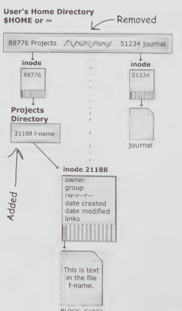

你的文件 `practice`、`testing` 和 `f-name` 被列出来了。文件 `f-name` 的条目（包括其 inode 号）被移动到了 `Projects` 目录。在 `Projects` 中列出的 `f-name` 的 inode 与其在移动前在家目录中列出的 inode 是同一个。

当你执行 `mv file directory` 命令时，系统并不能将电子文件本身移动到子目录中，因为目录并不包含文件。相反，文件名和 inode 号（提供包括数据块地址在内的文件信息）被从当前目录中删除，并写入子目录中。新目录现在列出了该文件名和相同的 inode 号。当我们使用 `mv` 将文件的条目从一个目录移动到另一个目录时，我们就是在移动该文件。

### 将文件复制到子目录

将文件复制并把副本放入子目录的操作与移动文件有些相似。

- 1. 在当前（家）目录中创建一个新文件：
    ```bash
    cd
    cal > month
    ls -i
    ```

- 2. 将 `month` 复制到 `Projects` 目录并输入以下命令检查：
    ```bash
    cp month Projects/
    ls -i Projects
    cd Projects
    cat month
    cd
    ```

复制后的文件*没有*与原文件相同的 inode 号。当我们复制一个文件时，会创建第二个电子版本。副本拥有自己的 inode、权限和包含新文件实际内容的数据块。现在每个文件都有了独立的存在。

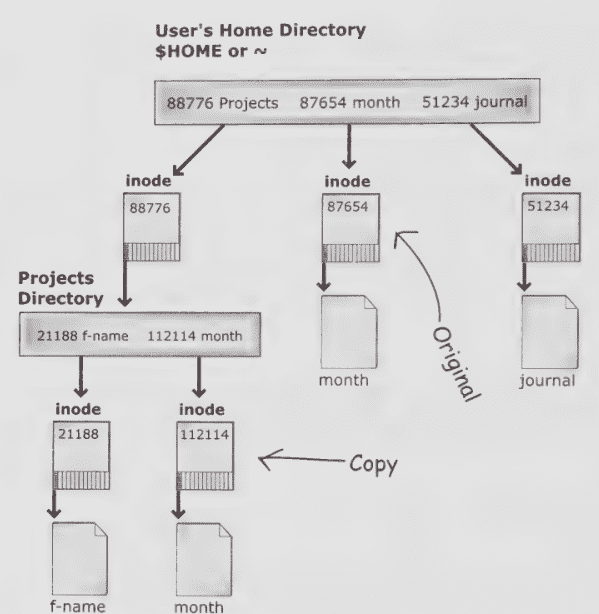

你刚刚使用的将文件从当前目录移动或复制到子目录的命令语法如下：
`mv filename subdirectoryname` （条目被移动，但 inode 保持不变。）
`cp filename subdirectoryname` （创建第二个文件，并赋予一个新的唯一 inode。）

> **总结** 如果 `cp` 或 `mv` 命令在接收到一个或多个文件名参数后，最后一个参数是目录，那么这些文件将被移动或复制到该目录中，并保留其原始名称。实际上，移动的是文件的条目。如果创建副本，则在目标目录中写入新条目。如果文件被移动，它保留其 inode 号。如果文件被复制，副本将被赋予一个全新的、唯一的 inode。

### 访问子目录中的文件

你现在处于家目录中。该家目录中列有一个子目录 *Projects*。你已将 *month* 的条目从家目录移动到了 *Projects*。

- 1. 无需离开家目录，你就可以访问 *month*：
  `more Projects/month`
  `pwd`
  列在 *Projects* 中的文件 *month* 被显示出来了。你没有切换目录，而是直接进入子目录并访问了该文件。

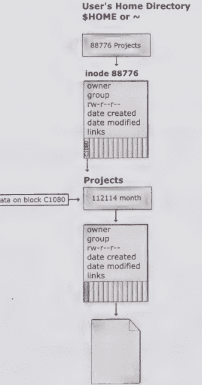

这个命令实际上是一组非常重要的指令：

- A) 在当前目录中寻找名为 *Projects* 的子目录并识别其 inode 号。
- B) 定位到具有该正确编号的 inode。
- C) 检查权限。
- D) 如果被允许访问该目录，则从 inode 中获取目录的地址。
- E) 打开 *Projects* 目录。
- F) 在 *Projects* 中寻找名为 *month* 的文件。
- G) 识别与 *month* 关联的 inode。
- H) 从 *month* 的 inode 中检查权限，如果被允许读取文件，则从 inode 中获取持有该文件数据的数据块地址。
- I) 从数据块中读取文件。

当你输入像 `more /etc/passwd` 这样的命令时，你一直在遵循这种模式。

### 避免将文件移动到目录时出错

当你将文件移动到子目录时，如果拼错了目录名称会发生什么？

- 1. 在当前（家）目录中，创建一个新文件 *trouble*：

    ```bash
    date > trouble
    more trouble
    ls -i t*
    ```
- 2. 记录 *trouble* 的 inode。
- 3. 在接下来的命令中，你尝试将 *trouble* 移动到 *Projects* 目录，但误将 *Projects* 拼写成了 *ProjectZ*。

    ```bash
    mv trouble ProjectZ
    ```
- 4. 列出 *Projects* 目录中的文件：

    ```bash
    ls Projects
    ```
    文件 *trouble* 不在那里。
- 5. 列出当前目录中的文件：

    ```bash
    ls -F
    ```
    文件 *trouble* 消失了；它被移动了，但移到哪里去了？当前目录中出现了一个名为 *ProjectZ* 的新条目。它不是一个目录。

- 6. 检查文件 `ProjectZ`：
   ```bash
   more ProjectZ
   ls -i ProjectZ
   ```

当你执行 `mv trouble ProjectZ` 命令时，不存在名为 `ProjectZ` 的目录，因此文件 `trouble` 被重命名为了 `ProjectZ`。它是同一个具有相同 inode 的文件，但我们更改了在目录中列出的名称。如果 `mv` 工具被给出两个参数，它会将现有文件（参数一）的名称更改为新名称（参数二），除非第二个参数是一个目录。如果第二个参数是目录，则文件的名称和 inode 号条目（参数一）会被移动到该目录中。在本例中，没有名为 `ProjectZ` 的目录。`mv` 工具简单地将 `trouble` 的名称更改为了一个新文件名 `ProjectZ`。

- 7. 将文件名改回 `trouble`：
   ```bash
   mv ProjectZ trouble
   ```

- 8. 为避免此问题，在输入 `mv` 命令时，在目录名后面加上斜杠：
   ```bash
   mv trouble ProjectZ/
   ```

这个斜杠告知 `mv` 你希望将文件 `trouble` 的条目移动到名为 `ProjectZ` 的目录中。这一次，shell 找不到名为 `ProjectZ` 的目录，因此在大多数系统上它会显示错误消息。由于最后一个参数末尾有 `/`，`mv` 将该参数解释为目录名。当它找不到该名称的目录时，它会报错。如果 `ProjectZ` 末尾没有 `/`，则不强制要求 `ProjectZ` 必须是目录。该参数不匹配任何目录名，因此在重命名请求中被简单地视为文件的名称。

### 移动文件时更改文件名

在本章到目前为止使用的命令中，文件在新的目录列表中保留了原始名称。你也可以在移动文件的同时更改其名称。

- 1. 创建一个文件并将其条目移入子目录，同时赋予新文件名，输入以下内容：
   ```bash
   touch junkness
   ls -i j*
   ```

- 2. 记录文件 `junkness` 的 inode 号 ____________________

```bash
mv junkness Projects/treasure
ls -i Projects
ls junkness
```

当前目录中的文件 `junkness` 不再出现在当前目录的列表中，而是以新名称 `treasure` 出现在 `Projects` 目录中。它保留了相同的 inode。它就是同一个文件。一个目录的垃圾是另一个目录的宝贝。

将文件条目从当前目录移动到新目录并同时更改其文件名的命令语法是 `mv filename subdirectory/newfilename`。

`mv` 命令确实意味着 `move`（移动），但它移动的是文件或目录的*条目*到另一个目录。它并不移动文件的内容。文件或目录仍然留在驱动器中原本所在的数据块中。文件没有移动；它的条目从一个目录移动到了另一个目录。

### 从子目录中删除文件

你刚刚使用了 `mv` 命令在不切换目录的情况下将文件的条目从当前目录移动到子目录中。你也可以用基本上相同的方法从子目录中删除（delete）文件。

- 1. 尝试以下系列命令，从 `Projects` 目录中删除文件 `treasure` 和 `month`：
   ```bash
   ls Projects
   rm Projects/treasure
   ls Projects
   ```
- 2. 文件 `treasure` 被删除了。
   ```bash
   cd Projects
   ls
   ```

事实上，系统会查询 inode 以识别该文件使用的数据块；然后，该文件的条目从 `Projects` 目录中被删除。随后，inode 中列出的该文件所使用的数据块被释放，以便其他人可以使用。


### 在子目录中创建子目录

在本章的前面部分，您创建了 `Projects` 目录作为主目录的子目录。您还可以创建一个子目录，使其列在 `Projects` 目录中。

- 1. 输入以下命令检查 `Projects` 目录是否仍是您的当前目录：
  `pwd`

- 2. 创建一个新子目录，使其列在 `Projects` 中：
  `mkdir Code`
  `ls -i`
  新目录已创建，并带有自己的 inode 列在当前目录中。

- 3. 离开 `Projects` 目录，切换到新的 `Code` 目录：
  `cd Code`

- 4. 使用以下命令确保 `Code` 目录是您的当前目录：
  `pwd`
  这次 `pwd` 的输出由指向您主目录的路径组成，后面跟着 `/Projects/Code`。新子目录 `Code` 列在 `Projects` 目录中。`Projects`Projects` 目录列在您的主目录中，而您的主目录又列在其他某个目录中，依此类推，直到最顶层目录 `/ (root)`。

- 5. 使用编辑器在当前目录 (`Code`) 中创建一个名为 `report3` 的文件，内容如下：
  *This is report 3 created in the Code directory.*

- 6. 写入文件并退出编辑器：
  `:wq`

- 7. 输入以下命令列出当前目录中的文件：
  `ls`
  `pwd`
  现在您有一个名为 `report3` 的文件列在 `Code` 目录中，`Code` 目录列在 `Projects` 目录中，而 `Projects` 目录则列在您的主目录中。

此时，您的目录结构应如下图所示：

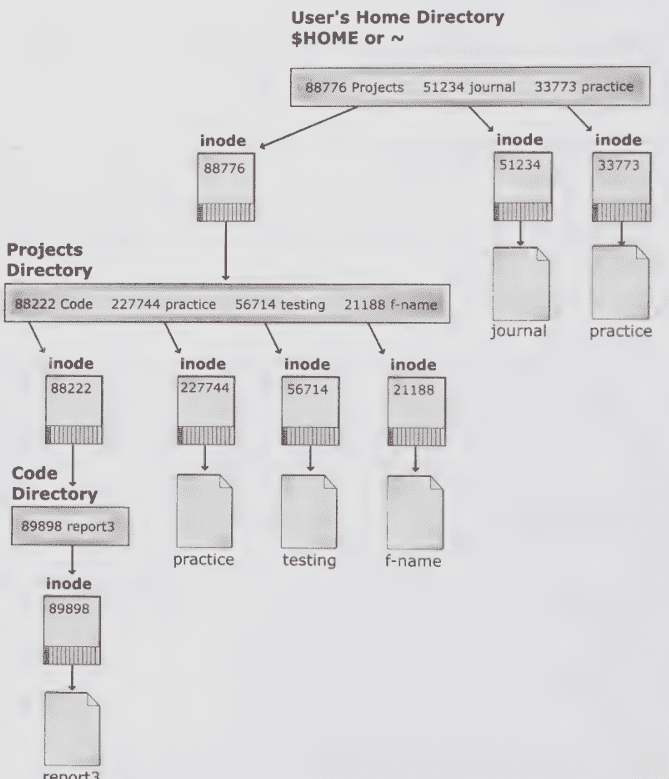

### 在文件系统中移动

您当前处于 `Code` 目录中。

- 1. 使用以下命令将当前目录切换回主目录：

```
pwd
cd
pwd
```

- 2. 使用以下命令列出主目录中的文件和目录：
  `ls -F`

屏幕将显示主目录中所有文件和目录的完整列表。

- 3. 输入以下命令在路径中移动到 *Code* 目录并查看 *report3* 文件：

```
pwd
cd Projects
ls
pwd
cd Code
pwd
ls
cat report3
```

在每一步中，您都确认了自己的位置，列出了文件并切换到了子目录。

在下一节中，我们将探讨如何更高效地访问文件和目录。

#### 自测 1

- 1. 创建名为 *Proposals* 目录的命令是什么？
- 2. 将当前目录更改为 *Proposals* 目录的命令是什么？
- 3. 将当前目录更改回主目录的命令是什么？
- 4. 您可以输入哪个 shell 命令来识别当前目录？
- 5. `ls` 命令的哪个选项可以告诉 `ls` 在输出中区分文件和目录？
- 6. 您的主目录是当前目录，您输入命令 `cd Projects`。然后您创建了一个名为 `confused` 的文件。哪个目录会列出 `confused` 文件？
- 7. 您的账户中如何可能出现两个文件名相同的文件？
- 8. 假设您的主目录是当前目录。什么命令可以将名为 `florence` 的文件移动到名为 `Proposals` 的目录中（`Proposals` 是主目录的子目录）？
- 9. 假设您想将文件 `ideas` 从当前目录移动到名为 `Work` 的子目录中，您输入了以下命令：
  `mv ideas work` 
  当您检查 `Work` 目录时，该文件并未列在其中。它在哪里？
- 10. 在当前目录中，什么命令可以列出名为 `Cows` 的子目录的文件并区分文件和目录？

## 7.3 使用路径名管理目录中的文件

在上一节中，您通过输入一系列 `cd` 命令（如 `cd Projects` 然后 `cd Code`）在目录系统中移动。每个 `cd` 命令更改一个目录。本节介绍一种使用单个复杂参数直接到达远程目录的显式方法。

### 访问子目录

- 1. 将主目录设为当前目录：
  `cd`

- 2. 通过输入以下命令，一步将当前目录从主目录更改为 `Code` 目录。（一个常见的错误是在目录名称和 `/` 字符之间输入空格。完整路径是一个参数，不能有空格。）

```bash
cd Projects/Code
```

- 3. 输入以下命令检查当前目录的路径：
  `pwd`

您的当前目录现在是 `Code`。

`cd Projects/Code` 命令是指令，要求将当前目录更改为一个子目录 (`Projects`)，然后继续移动到该子目录的子目录 (`Code`)。

`Projects/Code` 参数是一个目录列表，描述了目录或文件所在的位置。`Projects/Code` 是一个路径名。在这种情况下，`Projects` 列在当前目录中，而 `Code` 列在 `Projects` 中。此路径指令告诉 shell 在当前目录中查找 `Projects` 的条目，然后在 `Projects` 中查找 `Code` 的条目，最后将 `Code` 设为当前目录。

Shell 会跟踪您的当前目录。命令行中的文件名或目录名是指列在当前目录中的文件或目录。*路径名 (Pathnames)* 是用于告诉 shell 遵循何种路径以访问 *未* 列在当前目录中的文件或目录的机制。

#### 在实用程序中使用路径名

路径名也可以用作实用程序的参数。在之前的练习之后，您的 `Code` 目录现在是当前目录。

- 1. 输入：
  `ls`
  在之前的章节中，您在 `Code` 目录中创建了一个名为 `report3` 的文件。

- 2. 输入以下命令将目录更改为主目录：
  `cd`
  `pwd`
  要获取列在 `Code` 目录中的所需 `report3` 文件，您可以将目录更改为 `Code` 目录然后编辑文件。或者，您可以使用更高效的路径名。

- 3. 使用 `vi` 编辑列在 `Code` 目录中的 `report3` 文件，而无需将当前目录从主目录更改。输入：
  `vi Projects/Code/report3`
  传递给 `vi` 的参数是从当前目录到文件 `report3` 的路径名。该文件是 `report3`，列在 `Code` 中，`Code` 列在 `Projects` 中，而 `Projects` 列在当前目录中。这是一个 *相对路径名 (relative pathname)*，因为它显示了相对于当前位置的文件路径。

- 4. 使用编辑器对 `report3` 进行一些更改或添加：
  `vi report3`

- 5. 退出文件，返回 shell 并确认当前位置：
  `:wq`
  `pwd`

虽然您访问了相对路径末尾的文件，但您并没有更改目录。您仍停留在开始的地方。

#### 分析相对路径是如何被采用的

下图分析了当我们使用参数 `Projects/Code/report3` 时，目录、inode 和文件是如何关联的：

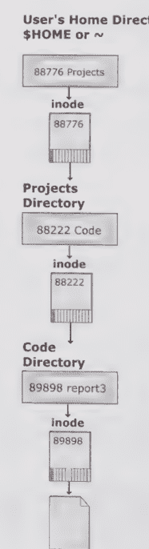

当采用参数 `Projects/Code/report3` 时，会完成以下步骤：

- **A)** 在当前目录中查找 `Projects` 条目。
- **B)** 识别与 `Projects` 关联的 inode 编号。
- **C)** 在硬盘上定位相应的 inode。
- **D)** 打开 `Projects` 的 inode，检查权限，如果允许，获取持有 `Projects` 目录内容的数据块地址。
- **E)** 打开持有 `Projects` 内容的数据块。
- **F)** 在 `Projects` 中定位目录 `Code` 的条目。
- **G)** 识别列在 `Projects` 中的 `Code` 目录所关联的 inode 编号。
- **H)** 在硬盘上定位 `Code` 目录的 inode。
- **I)** 打开 inode 并确定硬盘上哪个块持有 `Code` 目录的数据。
- **J)** 打开 `Code` 目录的数据块。
- **K)** 在 `Code` 中查找 `report3` 的条目。
- **L)** 识别 `report3` 的 inode 编号。
- **M)** 在硬盘上定位 `report3` 的 inode。
- **N)** 打开 `report3` 的 inode，检查权限，并识别硬盘上存放文件内容的块地址。
- **O)** 最后，打开正确的数据块，并将文件读入缓冲区供 `vi` 编辑。

#### 相对路径与默认路径的比较

当我们通过指定相对路径访问文件时，我们仍留在当前目录中。本练习探讨如果我们编辑一个远程位置的文件并将内容写入一个新文件时会发生什么。

- 1. 确认您当前的位置：

`pwd` 

您的当前目录仍然是主目录。尽管您处理的是列在不同目录中的文件，但您并没有将当前目录从主目录更改到该目录。当您使用 `:wq` 命令写入文件时，它是被写回原目录，而不是写到

你当前的目录。然而，当你从 `vi` 写入一个新文件时会发生什么？

- 2. 再次使用 `vi` 访问 `report3`：
  `vi Projects/Code/report3`

- 3. 对文件进行另一处修改。

- 4. 在 `vi` 的命令模式下，将文件写入为一个新文件，然后退出编辑器：
  `:w report3-new`
  `:q`

- 5. 列出当前目录以及 `Code` 目录中以字母 `r` 开头的文件：
  `ls r*`
  `ls Project/Code/r*`
  在 `vi` 中，除非你指定其他目录的路径，否则新文件将被写入到`当前`目录。

- 6. 再次编辑 `report3`：
  `vi Projects/Code/report3`

- 7. 这一次，使用路径名指定写入副本的位置。输入：
  `:w Projects/r3`

- 8. 退出 `vi`：
  `:q`

- 9. 列出 `Projects` 中的文件：
  `ls Projects`

你在编辑器内部创建的文件 `r3` 列在 `Projects` 中，而 `report3-new` 则列在当前目录中。

> **注意：** 文件的*相对*路径名结合了指向该文件所在目录的目录路径和文件名，所有部分由斜杠分隔。从**根(root)**开始的文件路径是*绝对*路径。通过使用文件的路径名，我们可以使用任何 UNIX 工具处理任何文件，无论其位于何处。

#### 使用路径将文件复制到其他目录

路径名在 `cp` 和 `mv` 命令中特别有用。你可以将文件从一个目录复制或移动到另一个目录。在本练习中，你将把文件 `journal` 复制到 `Code` 目录并为其赋予一个新名称。

- 1. 确保你的主目录是当前目录：
  `cd`

- 2. 输入以下命令（名称与 `/` 字符之间不要留空格）：
  `cp journal Projects/Code/journal2`

上一个命令中目录、文件和 inode 之间的关系总结在以下插图中：

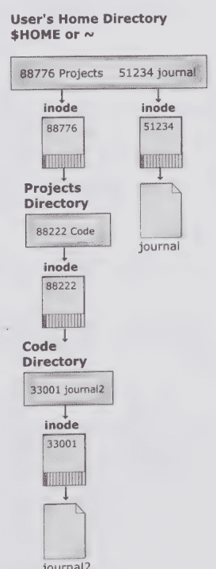

通过 `cp journal Projects/Code/journal2` 命令，你向 `cp` 提供了两个参数，告知 `cp` 工具使用相应的 inode 来：

- a) 定位列在当前目录中的文件 *journal*。
- b) 打开 *Projects* 目录以获取 *Code* 目录位置的信息。
- c) 打开 *Code* 目录。
- d) 制作一份 *journal*（来自当前目录）的副本，并将该副本列在 *Code* 目录中，给这个新副本命名为 *journal2*。

- 3. 使用以下命令列出 journal 文件及相关的 inode：
  `ls -i journal`

- 4. 输入以下命令从主目录切换到 *Code* 目录：
  `cd Projects/Code`

- 5. 确认 *journal* 已正确复制并作为 *journal2* 列在其新目录中：
  `ls -i`

因为 *journal2* 是作为另一个文件的副本创建的，所以生成了一个重复的电子副本。新的目录列表包含一个新 inode 号，其中包含定位此新副本所需的信息。原件和副本都可以独立编辑。

- 6. 使用以下命令检查文件：
  `cat journal2`
  它的文件内容相同。

- 7. 最后，返回主目录并创建另一个名为 *Docum* 的目录：
  `cd`
  `mkdir Docum`

- 8. 在不切换到 *Docum* 目录的情况下，创建一个新文件：
  `touch Docum/readme`
  `ls Docum`

任何将文件名或目录名作为参数的命令都可以像这样提供一个明确的路径名参数。

文件系统现在看起来像下面的插图所示：

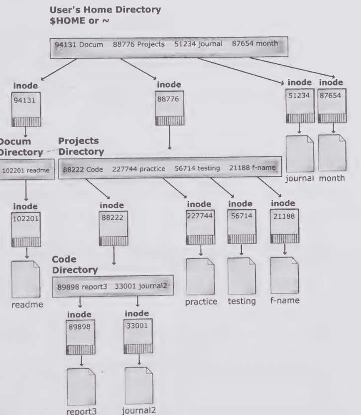

**总结** 之前使用的 `cp` 命令的一般形式如下：
`cp filename Directory1/Directory2/newfilename`
其中 *filename* 是当前目录中的一个文件；*Directory1* 列在当前目录中；*Directory2* 列在 *Directory1* 中；*newfilename* 是 *filename* 的副本在被列入其新家 *Directory2* 时被赋予的新名称。你不需要在命令中包含 *newfilename*。省略 *newfilename* 会导致复制的文件与原文件同名。重复的名称是可以接受的，因为第二个文件位于不同的目录中。

#### 使用路径名创建子目录

到目前为止，你只创建了子目录，并将它们列在当时的当前目录中。你也可以为远程目录创建子目录。

- 1. 输入以下命令确保你在主目录中：
  `cd`

- 2. 在不离开主目录的情况下，输入以下命令再创建一个目录：
  `mkdir Projects/Corresp`

- 3. 输入以下命令查找列在子目录 *Projects* 中的文件和目录的名称：
  `ls -F Projects`
  你在主目录中创建的新目录 *Corresp* 现在被列在 *Projects* 目录中。

- 4. 切换到新目录 *Corresp* 并通过输入以下命令确认你的位置：
  `cd Projects/Code`
  `pwd`

- 5. 在 *Corresp* 目录中创建一个名为 *replies* 的文件，并在文件中添加几行文本：
  `vi replies`

- 6. 保存文件并返回 shell。

- 7. 使用以下命令离开 *Corresp* 目录并返回主目录：
  `cd`

你的目录层级现在与以下插图所示的结构相匹配：

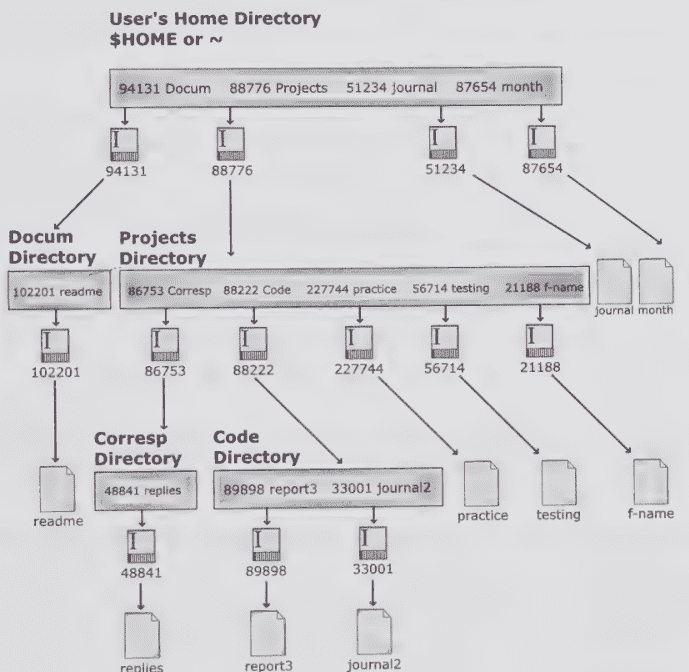

- 8. 输入以下命令确保你在主目录中：
  `pwd`

你可以切换到位于当前目录之下的子目录，也可以从子目录切换回主目录。然而，你还没有尝试从一个子目录切换到位于目录树不同分支上的另一个子目录（例如，从 `Code` 切换到 `Docum`）。下一节中介绍的特殊字符允许进行此类切换。

#### 使用父目录名称

在文件系统中移动有非常高效的方法。当你不确定自己在目录层级中的位置，或者想要实现更复杂的目标时，本节中的技巧非常有用。

- 1. 输入以下命令切换到子目录 `Code`：
  `cd Projects/Code`

- 2. 通过在列表命令中包含 `-a` 选项，获取当前目录下所有文件的列表，如下所示：
  `ls -a` 
  你的列表看起来像这样：
  `. .. journal2 report3` 
  你在 `Code` 目录中，之前出现过的文件 `journal2` 和 `report3` 也在其中。点 (`.`) 和点-点 (`..`) 也被列出了。

- 3. 使用以下命令弄清楚点文件是什么类型的文件：
  `file .` 
  在这种情况下，`file` 工具检查你给它的任何参数，并报告它是什么类型的对象。你将收到一条信息表明：
  `. : is a directory`

- 4. 现在输入以下命令检查点-点 (`..`) 文件：
  `file ..` 
  输出告诉你 `..` 文件同样是一个目录。

- 5. 确认你的当前目录是 `Code` 目录：
  `pwd`

- 6. 显示当前目录下所有列出文件和目录的 inode：
  `ls -ai`

- 7. 输入以下命令切换到点 (`.`) 目录：
  `cd .`

- 8. 输入以下命令确定点目录的路径：
  `pwd`

`pwd` 的输出是从 `root` 到当前目录的路径。它显示你的当前目录再次是 `Code`。但在你输入 `cd .` 命令之前，`Code` 也是你的当前目录。

- 9. 获取点目录内容的列表：
  `ls .` 
  显示当前目录下列出的文件。
  单个点是列表中用于表示你当前目录的“名称”。点是你当前目录访问自身的方式。每个目录都将自身称为 . 目录。这是它在 Cyberville 的人称代词。

- 10. 输入以下命令确定当前目录的路径：
    `pwd`

- 11. 输入以下命令将当前目录切换到点-点目录：
    `cd ..`

- 12. 使用以下命令确认你现在的位置：
    `pwd`

你现在位于 *Projects* 目录中。*Projects* 是你之前所在的 *Code* 目录的父目录。`cd ..` 命令将你的当前目录从 *Code* 切换到了 *Code* 的父目录 *Projects*。

#### 检查当前目录和父目录的 Inode

在一个目录中，`..`（点-点）是其父目录的条目。父目录是位于当前目录上一级目录，也是列出当前目录名称和 inode 的目录。

- 1. 检查列在 *Projects* 目录中的文件和目录的 inode：
  `ls -aiF` 
  输出列出了 *Projects*（. 目录）、子目录 *Code* 以及各种文件的 inode。

- 2. 将结果与列在 *Code* 目录中的 inode 进行比较：
  `ls -ai Code`


Code 目录是通过其 inode 访问的。

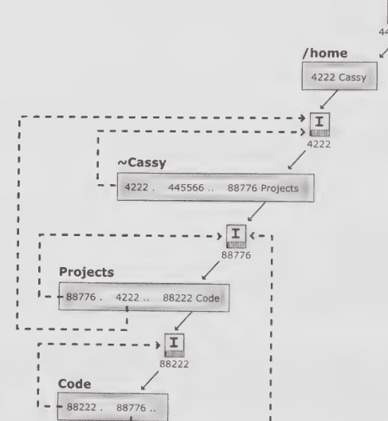

在 `Code` 中，点目录（dot directory）的 inode 号与父目录 `Projects` 在列出其子目录 `Code` 时显示的 inode 号相同。在 `Projects` 目录中，`Code` 目录具有与 `Code` 中点目录相同的 inode。
我的女儿称呼自己为“我” (.)，而我称呼她为“Cassy”。我们指的都是同一个人。

- 3. 现在使用以下命令向上移动两个目录：
   ```
   pwd
   cd ../..
   pwd
   ```
   在任何目录级别，当你输入 `cd ..` 时，你会切换到（父）目录；因此，输入 `../..` 会移动到祖父目录。

- 4. 切换到你的主目录：
   ```
   cd
   ```

- 5. 确认你的位置：
   ```
   pwd
   ```

- 6. 移动到主目录的父目录并确认：
   ```
   cd ..
   pwd
   ```
   你可能处于一个名为 home 的目录或其子目录中。home 目录本身不是任何人的主目录，但它列出了许多用户的主目录。（它是不是应该被叫做 city 或 homes？）

- 7. 前往 home 的父目录：
   ```
   cd ..
   pwd
   ```
   当我们创建目录时，除非另有指定，否则它会被列在当前目录中。返回你的主目录并创建一个新目录。

- 8. 输入：
   ```
   cd
   mkdir Skye
   ```

- 9. 通过输入以下命令列出当前目录的内容：
   ```
   ls -iF
   ```
   目录 Skye 及其 inode 将被列出。

此时一个合理的问题是，询问新目录在创建后的瞬间包含什么内容。

- 10. 为了回答这个问题，请输入：
   ```
   ls -ai Skye
   ```
   当一个目录被创建时，它会获得两个条目：它本身（. 目录）和它的父目录（.. 目录）。当我们创建目录时，它们成为了文件系统的一部分，因为父目录知道新创建的子目录的 inode，而子目录知道其父目录的 inode。它们可以相互定位。

**总结** 在文件系统中可以双向切换目录。命令 `cd subdirectory` 从一个目录切换到 `subdirectory`（子目录）。必须指定目录名称，因为一个父目录中可能列有多个目录。`cd ..` 命令从子目录切换到其唯一的一个父目录。可以使用点-点（..）是因为每个目录只有一个父目录。点 (.) 指定当前目录。路径开头放置的 / 是从**根目录（root）**开始路径的指令。

#### 将多个文件复制到子目录

到目前为止，你已经以多种方式使用了 `cp` 和 `mv` 工具。你更改了文件名，并复制了同一目录内的文件。你还使用这些工具将单个文件移动或复制到子目录中，例如使用 `mv practice Projects/` 命令。本节将探讨如何使用 `mv` 和 `cp` 将多个文件移动和复制到其他目录中。

到目前为止，`move` 和 `copy` 命令都使用了两个参数，例如 `cp file1 newfile1` 或 `mv file1 DIR1/file1A`。

- 1. 确保你在主目录中，尝试输入一个带有这三个文件名作为参数的 `cp` 命令：
    ```
    cd
    cp practice journal f-name
    ```
    `cp` 工具会显示一条用法错误消息，告诉你除非最后一个参数是目录，否则仅接受两个参数。

    带有两个以上文件名参数的命令（如 `cp file1 file2 file3`）是具有歧义的。新的 `file3` 应该包含另外两个文件吗？还是 `file1` 被复制并赋予了两个名称？由于没有明确的含义，因此会显示错误消息。

- 2. 然而，如下所示的命令*是有意义的*。请输入：
    ```
    cp practice journal Docum1
    ls Docum
    ```
    虽然给 `cp` 提供了三个参数，但最后一个参数是一个目录，而不是文件。其含义很明确：将两个文件（列为前两个参数）全部复制到目标子目录（列为最后一个参数）中。

    只要最后一个参数是目标目录，`cp` 和 `mv` 工具都接受两个以上的参数。

- 3. 通过输入以下命令创建一个名为 `Archives` 的新目录：
    ```
    mkdir Archives
    ```

- 4. 通过输入以下命令将你的几个文件复制到 `Archive` 目录中：
    ```
    cp users_on practice journal l* Archives/
    ls Archives
    ```
    Shell 将命令行中的 `l*` 替换为当前目录中所有以 `l` 开头的文件名。然后 Shell 将所有文件名参数和最后一个参数 `Archives` 传递给 `cp`。对于 `cp` 来说，意图很明确。它将所有列为参数的文件复制到 `Archives` 目录中。

#### 移动多个文件

同样地，你可以使用 `mv` 将多个文件移动到一个目录中。只要最后一个参数是目录，`mv` 和 `cp` 都可以影响多个文件。

- 1. 在主目录中，通过输入以下命令创建几个新文件：
   ```bash
   touch cassy dimitri owen danny monika
   ls -i
   ```

- 2. 通过输入以下命令将所有五个文件移动到你的 `Docum` 目录：
   ```bash
   mv cassy dimitri owen danny monika Docum/
   ls -i
   ```
   因为 `Docum` 是一个已存在的目录，且它是命令行中的最后一个参数，所以所有参数文件名和 inode 条目都被移动到了该目录中。它们不再列在当前目录中。

- 3. 确认条目已被移动。输入：
   ```bash
   ls -i Docum/
   ```

#### 将文件移动到父目录

我们已经将文件从当前目录移动到子目录以及更远的目录。我们也可以将它们移动到父目录。

- 1. 通过输入以下命令切换到 `Code` 目录（它是 `Projects` 的子目录，而 `Projects` 又是你主目录的子目录）：
   ```bash
   cd
   cd Projects/Code
   ```

- 2. 确认你的当前目录：
   ```bash
   pwd
   ```

- 3. 查看 `report3` 的条目：
   ```bash
   ls -ai report3
   ```

- 4. 记录 `report3` 的 inode 号：

- 5. 通过输入以下命令，将该文件的条目从 `Code` 目录移动到其父目录 `Projects` 目录中：
   ```bash
   mv report3 ..
   ```
   最后一个参数是一个目录（即父目录），因此这是可以接受的。

`mv` 工具将文件 `report3` 的条目从当前目录移动到父 (`..`) 目录。因为 `Projects` 目录是 `Code` 的父目录，你刚刚将文件 `report3` 的名称和 inode 号从 `Code` 移动到了 `Projects` 中。

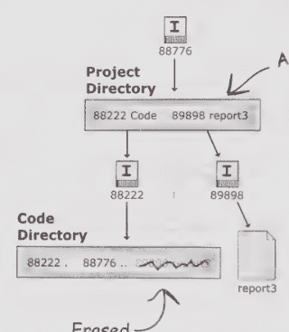

- 6. 返回 `Projects` 目录：
   ```
   cd ..
   pwd
   ```

- 7. 确认 `report3` 的条目已被移动到 `Projects` 中：
   ```
   ls -i
   ```

`report3` 的条目现在位于 `Projects` 中。它是同一个文件；它具有相同的 inode。当我们移动文件时，文件本身不受影响。我们所做的只是将文件的条目从一个目录更改为另一个目录。

- 8. 将 `report3` 移回 `Code`：
   ```
   mv report3 Code
   ```

- 9. 创建三个文件，然后将它们移动到你的父目录：
   ```
   touch megan daniel betty
   ls -i
   mv megan daniel betty ..
   ls -i
   ```

目录 `..` 列在当前目录中。因为命令行中的最后一个参数是一个目录（即 `..` 父目录），所以所有三个文件都被移动到了指定的目录中。

- 10. 切换到你的父目录，并使用以下命令确认条目已被移动：
    ```bash
    cd ..
    ls
    ls -i
    ```
    名称和 inode 的文件条目已从当前目录移动到其父目录。

#### 检查从根目录到目录和文件的全路径

到目前为止，我们主要探索了使用当前目录与对象之间的相对路径来访问目录。我们也可以使用从文件系统顶部开始的全路径来指定目录的位置。

- 1. 从你的主目录出发，识别从*根目录* (/) 到当前目录的路径：
    ```bash
    cd
    pwd
    ```
    全路径从**根目录**（/ 目录）开始，然后列出到达当前目录的所有目录。类似于：
    `/home/cassy`
    或者
    `/user/class/fall/student01`
    
    当前目录中的文件很容易被列出或访问。

- 2. 输入：
    ```bash
    ls
    cat practice
    ```
    我们可以使用全路径和名称访问同一个文件。
    在接下来的命令中，请将 `/home/cassy` 替换为之前 **pwd** 命令显示的你的主目录路径：
    ```bash
    cat /home/cassy/practice
    ```
    这条指令的意思是：从**根目录** (/) 开始，找到 home，在 home 中找到 *cassy*，在 *cassy* 中找到 *practice*。其中一个目录是你的当前目录这一事实并不影响结果。


- 3. 前往 `/tmp` 并使用您的登录名创建一个目录：
  `cd /tmp`
  `mkdir $USER`

- 4. 切换到您的新目录：
  `cd $USER`

- 5. 在当前目录下创建一个子目录，将该子目录设为当前目录，然后确认您的位置：
  `mkdir Mydir`
  `cd Mydir`
  `pwd`
  如果一切正常，您现在处于 `/tmp/yourlogin/Mydir`。

- 6. 在 `Mydir` 目录中，创建一个文件：
  `date > myfile`
  `ls`
  `cat myfile`
  `pwd`

- 7. 现在返回主目录：
  `cd`

- 8. 从您的主目录开始，使用显式的完整路径访问您刚刚创建的文件：
  `more /tmp/$USER/Mydir/myfile`
  （使用 `$USER` 或您的实际登录名。）
  从 `root` 开始的完整路径可以明确地标识任何文件。
  因为同一个目录中不能有两个同名对象，所以从 `root` 开始的路径可以唯一地标识所有文件。如果两个对象名称相同，它们必须位于不同的目录中，因此它们的完整路径名必须不同。由于每个文件的路径名都能唯一且绝对地描述一个特定文件，因此文件的完整路径名被称为其 *绝对路径名*。

##### 显式调用您的主目录

在 `sh` 以外的 shell 中，我们可以在相对路径名中使用主目录。

- 1. 切换目录到 `/tmp` 并确认：

- 2. 您当前的工作目录是 `/tmp`。

- 3. 在不切换目录的情况下，通过输入以下命令获取主目录中的文件列表：

  `ls ~`

  主目录中列出的文件名将作为 `ls` 的输出显示。这是因为 C shell 及其之后开发的所有 shell 都将波浪号 (~) 定义为用户主目录的路径。

- 4. 查看您当前的目录路径：

  `pwd`

  您的当前目录仍然是 `/tmp`。Shell 将 `~` 解释为用户主目录的路径。因此，您在留在其他地方的同时，获得了主目录的文件列表。

- 5. 使用波浪号访问主目录中的文件而无需切换目录。输入：

  `more ~/practice`

  这是一个指令，要求检查您的主目录，在其中寻找名为 `practice` 的文件并将其显示。

- 6. 通过输入以下内容直接进入 `Code` 目录：

  ```bash
  cd ~/Projects/Code
  pwd
  ```

  参数 `~/Projects/Code` 是一个指令，要求在您的主目录中寻找名为 `Projects` 的目录，通过 inode 进入 `Projects` 目录，在 `Projects` 中寻找名为 `Code` 的目录，并将 `Code` 设为您的当前目录。

- 7. 要查看 shell 如何解释波浪号，请输入：

  `echo ~`

  Shell 将波浪号替换为其值：您主目录的路径。

- 8. 尝试：

  `echo ~/Projects`

  Shell 将 `~` 替换为您主目录的绝对路径，然后在该路径后加上 `/Projects`。结果是 `Projects` 目录的绝对路径。

- 9. 输入以下内容：

  ```bash
  echo ~/
  echo ~/Projects/Code
  echo ~/ABCDE
  echo my home is ~
  ```

  Shell 将任何命令行中的波浪号替换为其值，即从根目录到用户主目录的绝对路径。

#### 在目录路径中包含其他用户的登录名

在之前的练习中，您使用了波浪号 (~) 来表示您的主目录。它也可以用来指定 *任何用户* 的主目录。在 UNIX/Linux 系统中，系统管理员或 *超级用户* 是用户 *root*，并且 *root* 拥有一个主目录，该目录在 `/etc/passwd` 文件中定义。

- 1. 通过输入以下命令查看密码文件中的 `root` 条目：

  ```bash
  grep root /etc/passwd
  ```

- 2. 您将看到类似以下内容的显示：

  ```bash
  root:wABLLbMfI·+XBI:0:1:Operator::/root:/bin/ksh
  ```

  这一行的各个字段由冒号分隔。第六个字段是 `root` 的主目录，在 Linux 上通常是 `/root`，在 UNIX 上是 `/`。

- 3. 通过输入以下命令请求显示 `root` 主目录的路径。请不要在 `~` 和用户 ID `root` 之间放置斜杠或空格。

  ```bash
  echo ~root
  ```

  将显示用户 `root` 主目录的路径。

- 4. 通过输入以下命令获取系统中另一个用户主目录的内容列表，其中 *otherlogin* 是您系统中某个用户的登录 ID：

  ```bash
  echo ~otherlogin
  ls ~otherlogin
  ```

  如果您具有相应的权限，将显示您指定的用户的主目录内容。如果您没有权限访问另一个用户的账户，可以在自己的账户上使用同样的方法。

- 5. 在以下命令行中，将 `mylogin` 替换为您的登录名：
  `ls ~mylogin`

- 6. 返回您的主目录并确认位置：
  `cd` 
  `pwd` 
  `ls`

> **总结** 现代 shell 将单独使用的波浪号解释为您主目录的路径。用户主目录中列出的文件路径可以以波浪号开始指定。附在任何实际用户登录名上的波浪号被解释为 *该* 用户主目录的路径。

为了使波浪号生效，shell 必须确定您的同事 *otherlogin* 的主目录位于何处。

- 7. 请求显示您为 *otherlogin* 使用的登录名的 `/etc/passwd` 记录。输入：
  `grep otherlogin /etc/passwd` 
  或
  `ypcat passwd | grep otherlogin`

  当您使用波浪号时，shell 会查询 `/etc/passwd` 文件数据以定位用户主目录的路径。`/etc/passwd` 中的倒数第二个字段是 *otherlogin* 的主目录。关键在于 shell 将波浪号解释为一个具有特定含义的特殊字符。输入：
  `echo ~` 
  `echo ~root`

  将显示来自 *passwd* 文件的主目录信息。
  Shell 将单独使用的波浪号解释为用户的主目录；将附在用户登录名上的波浪号解释为该用户主目录的路径。
  人们经常尝试使用波浪号切换到一个普通目录（而非用户主目录）。

- 8. 例如，尝试使用以下命令进入 `/tmp` 目录：
  `cd ~tmp`

  错误消息表明系统中没有名为 *tmp* 的用户。虽然存在 *tmp* 目录，但没有 *tmp* 用户；因此，没有用户 *tmp* 的 *主* 目录。

- 9. 确认您仍在主目录：
  ```bash
  pwd
  ```

#### 返回之前的目录

许多 shell 允许我们切换目录，然后返回之前的所在位置，无论该位置在哪里。**bash** 和 **ksh** shell 将之前的目录路径作为变量的值进行维护。**tcsh** shell 则将之前访问的目录维护在一个可以访问的列表中。

##### 使用 *bash* 和 *ksh* 返回上一个当前目录

这些 shell 将当前目录和前一个目录的路径保存在变量中：

- 1. 如果您没有使用 Bash 或 Korn shell，请为本次练习启动一个：
  ```bash
  bash
  ```
  或
  ```bash
  ksh
  ```

- 2. 确保您当前的位置是您的主目录：
  ```bash
  pwd
  echo $PWD
  ```

- 3. 切换目录并确认新位置：
  ```bash
  cd /tmp/$USER
  echo $PWD
  pwd
  ```

- 4. 输入以下内容：
  ```bash
  echo $OLDPWD
  cd $OLDPWD
  echo $PWD
  pwd
  ```

  变量 `PWD` 的值是当前目录的路径，变量 `OLDPWD` 是上一个当前目录的路径。`OLDPWD` 变量可以用作 `cd` 的参数以返回之前的目录。

- 5. 在许多 bash 和 ksh shell 中，指定之前目录的另一种方法是使用连字符参数：

  ```bash
  cd /tmp
  pwd
  cd -
  pwd
  ```

- 6. 如果您启动了子 bash 或 ksh，请使用以下命令返回您的登录 shell：

  `exit`

##### 使用 tcsh 返回之前的目录

tcsh shell 不使用变量，而是使用一个之前访问过的目录列表。作为用户，我们必须指示 shell 将目录添加到列表中。

- 1. 如果您当前没有使用 tcsh，且您的系统上可用，请现在启动一个：

  `tcsh`

- 2. 确保您处于主目录：

  `cd`

- 3. 输入：

  ```bash
  pushd /tmp
  pwd
  pushd /etc
  pwd
  ```

  您切换到了 `/tmp` 目录，并将该目录添加到了目录列表中。然后您切换到了 `/etc` 目录，并将该目录添加到了列表中。我们可以按照最近访问优先的顺序返回列表中的目录。

- 4. 输入：

  ```bash
  popd
  pwd
  ```

  您现在处于 `/etc` 目录，它是列表顶部的目录。

- 5. 输入：

  ```bash
  popd
  pwd
  ```

  每执行一次 `popd`，您就会进入当前位于您添加的目录列表顶部的目录。


#### 目录文件访问方法总结

在之前的章节中，您研究了几种指定文件位置的方法。以下列表回顾了可用的方法，并包含了一系列用于输入和对比的综合命令。

- 1. 输入以下命令，确保您处于主目录（home directory）中：
  `cd`
  我们可以通过四种基本方式指定要访问的文件：
  - **当前目录**：通过文件名定位当前目录中的文件。

- 2. 例如输入：
  `wc practice`
  如果文件名列在当前目录中，这些信息足以唯一地标识一个文件。如果我们有一个 shell 脚本位于当前目录中，且 shell 在定位实用程序的搜索 **PATH** 中不包含当前目录，我们需要输入像 `./scrA` 这样的命令，其中用一个点（dot）来指定当前目录。
  - **从当前目录开始的相对路径**：指定从当前目录中列出的某个目录名称开始的文件路径。

- 3. 通过两个目录层级访问文件：
  `wc Projects/CodeReport3`
  这是一条指令，要求在当前目录中查找名为 *Projects* 的条目；打开 *Projects* 目录，然后定位请求的子目录，打开它，依此类推。从当前目录开始的文件路径称为 *相对路径*；它会根据您当前所在的位置而有所不同。
  在当前目录列出的目录中，包含父目录或 `..` 目录。以父目录开始的路径实际上是从当前目录开始的，因为父目录在这里被列为 `..` 目录。

- 4. 例如输入：
  `ls ..`
  `../` 会在当前目录中查找父目录，打开它，查找其父目录，然后打开并列出其内容。
  - **从根目录开始**：指定从 **root** 到文件的绝对路径。无论您当前在哪个目录，文件的绝对路径都是相同的。

- 5. 在远程目录中创建新文件：
  `touch /tmp/$USER/newname`
  `ls -l /tmp/$USER/newname`
  这是一条指令，要求在 **root** 目录中查找请求的子目录 *tmp*，打开它，依此类推。每个文件都有一个唯一的绝对路径名。

- **从主目录开始**：指定从您的主目录或任何其他用户的主目录开始的路径。从主目录开始的文件路径无论您当前在哪个目录都是相同的。

- 6. 例如输入：
  `wc ~/practice`
  如果您从主目录开始路径，那么当前目录是哪个目录都没有影响。

- 7. 同样地，当您从另一个用户的主目录开始路径时，您位于何处也没有影响。输入：
  `wc ~otherlogin/practice`
  其中 *otherlogin* 是另一个用户。该参数的指令是在 `/etc/passwd` 文件中查找用户 *otherlogin* 的主目录，然后在命令中使用该主目录的路径，再加上指定的任何附加路径。

## 7.4 使用所有方法访问远程目录中的文件

因为 `cd` 命令允许您在 UNIX 文件系统中移动，所以在任何时刻，您的当前目录可以是系统上任何您有权限访问的目录。同样地，无论您身在何处，都可以到达任何其他目录以访问文件。当您想访问不在当前目录中的文件时，必须指定该文件的路径：可以是来自 **root** 的绝对路径，或者是来自当前目录的相对路径，或者是来自用户主目录的相对路径。

以下练习通过更多综合各种路径提供方式的示例进行探索。

### 指定从当前目录开始的路径

我们指定文件或目录最常用的方式是简单地在命令中将其名称作为参数使用。不包含相对路径的文件名默认指向当前目录。路径 `.` 是默认值。

- 1. 要访问列在当前目录中的文件或目录，我们一直通过指定其名称来实现。输入：
  ```bash
  cd
  wc -l practice users_on
  ```

- 2. 当然，当我们指定当前目录时，会得到相同的结果：
  ```bash
  wc -l ./practice users_on
  ```
  要访问列在当前目录之下的某个目录中的文件或目录，我们指定该目录，然后接一个斜杠，最后接目标文件或目录。

- 3. 确保您在主目录中，然后通过输入以下命令在 *Projects* 目录中创建一个名为 *actions* 的新文件：
  ```bash
  cd
  ls Projects
  vi Projects/actions
  ```
  添加一段关于如何访问远程文件的简短描述文本。

- 4. 写入文件并退出编辑器：
  ```bash
  :wq
  ```

- 5. 使用以下命令获取当前目录的文件列表：
  ```bash
  ls
  ```
  文件 *actions* 没有列在当前目录中。

- 6. 列出 *Projects* 目录的内容：
  ```bash
  ls Projects
  ```
  新文件被列在 *Projects* 中。

因为子目录是列在当前目录中的目录，所以我们可以通过指定其名称来访问子目录。

一个常见的错误是在目录或文件名前使用斜杠。例如，如果我们想进入子目录 *Projects* 而输入了 `cd /Projects`，该斜杠是指令要求从 *root* 开始并在那里查找 *Projects* 目录。在 *root* 中找不到请求的目录，从而显示错误消息。另一个常见的错误是由于某种“未知”原因使用反斜杠而不是斜杠。

- 7. 切换到 `Projects` 目录：
  `cd Projects`

- 8. 获取列在父目录中的 `users_on` 文件的字数统计。输入：
  `wc ../users_on`
  因为 `..` 目录列在当前的 `Projects` 目录中，因此它可以作为通往其某个子目录中文件的路径起点。

- 9. 输入：
  `pwd`
  输出表明您仍然在 `Projects` 目录中。

- 10. 访问位于父目录 `Docum` 中的 `readme` 文件：
  `wc ../Docum/readme`
  该命令的指令是在当前目录中查找点-点（..）目录（您的父目录），然后在 `..` 中查找 `Docum` 目录，最后在 `Docum` 中查找名为 `readme` 的文件。

- 11. 输入 `cd` 返回主目录。

- 12. 同样的步骤可用于指定当前目录中列出的目录的子目录，例如：
  `ls Projects/Code`
  `wc Projects/Code/journal2`

- 13. 返回主目录：
  `cd`

### 指定目录的绝对路径

在任何目录下，所有文件和/或目录必须具有唯一的名称。除了 `/` (`root`) 之外，所有文件和目录必须列在另一个（父）目录中。这两个条件的共同结果是，系统上的每个文件从 `/` (`root`) 开始都有一个唯一的路径名。

- 1. 确定当前目录的绝对路径：
  `pwd`

- 2. `pwd` 的输出类似于：
  `/home/cassy`

- 3. 切换到 `Code` 目录：
  `cd Projects/Code`

- 4. 获取绝对路径：
  `pwd`

- 5. 通过输入以下命令，请求显示当前目录下的文件 `journal2`：
  `cat path-to-this-directory/journal2`

- 6. 使用之前的 `cassy` 示例，您将输入：
  `cat /home/cassy/Projects/Code/journal2`

- 7. 切换目录到 `/tmp`，确认您的位置，并重新执行之前的 `cat` 命令行：
  `cd /tmp`
  `pwd`
  在 `tcsh`、`tsh`、`bash` 或 `csh` shell 中，输入：
  `!cat`
  在 `ksh` shell 中输入：
  `r cat`

尽管您处于一个完全不同的目录中，但文件的绝对路径依然能标识正确的文件。

每个文件都有一个唯一的绝对路径名。它总是从 *root* (`/`) 开始，并包含相应的子目录。例如，位于 `etc` 目录中的文件 `passwd` 的绝对路径名是 `/etc/passwd`。

### 指定从主目录开始的路径

路径规范可以从任何用户的主目录开始并由此展开。

- 1. 通过输入以下命令切换到 `/tmp` 目录：
  `cd /tmp`
  `pwd`

- 2. 在不切换目录的情况下，通过输入以下命令获取 `Code` 目录中的文件列表：
  `ls ~/Projects/Code`
  `echo ~/Projects/Code`
  该命令行的指令是：
  A) 访问用户的主目录。
  B) 定位 `Projects` 的条目。


- C) 使用 inode 访问 *Projects*。
- D) 在 *Projects* 中定位 *Code* 的列表项。
- E) 读取 *Code* 以确定其中列出的所有文件名。

起点是执行命令的用户主目录的路径。

#### 使用所有方法访问目录

本节中的活动将以更复杂的方式利用您在本章中探索的各种路径指定方法。建议您在阅读随后的解决方案之前，先仔细研究每条指令并尝试完成目标。

- 1. 确保您处于主目录中，然后获取列在 *root* 下的 *tmp* 目录中的文件名称列表：

```bash
cd
ls /tmp
```

- 2. 列出 *tmp* 目录下以您的登录名为名称的目录中的文件：

```bash
ls /tmp/$USER
```

- 3. 确认您仍处于主目录中：

```bash
pwd
```

- 4. 将您的文件 *practice* 复制到 `/tmp/$USER/` 目录，并给该文件起一个新名称 *practice2*：

```bash
cp practice /tmp/$USER/practice2
```

- 5. 在不切换目录的情况下，获取 `/tmp/$USER` 中的文件列表：

```bash
ls /tmp/$USER
```

- 6. 切换目录到 `/tmp/$USER`，确认您的位置，并获取文件列表：

```bash
cd /tmp/$USER
pwd
ls
```

- 7. 将文件 *practice2*（您刚才在此创建的）复制回 *Code* 目录（该目录位于主目录的 *Projects* 中），并获取 *Code* 中的文件列表：

```bash
cp practice2 ~/Projects/Code
ls ~/Projects/Code
```

- 8. 切换目录到 `root` 并确认您的位置：
   ```bash
   cd /
   pwd
   ```

- 9. 在不切换目录的情况下，将文件 `report3`（列在主目录的 `Projects` 下的 `Code` 中）复制到 `Docum` 目录（同样列在您的主目录中）：
   ```bash
   cp ~/Projects/Code/report3 ~/Docum
   ```
   这条指令的操作是：从您的主目录开始，定位到 `Projects` 然后是 `Code`，接着找到 `report3`。最后，将 `report3` 复制到同样列在您主目录中的 `Docum`。

- 10. 将 `Projects` 设置为当前目录，并创建一个名为 `greeting` 且包含单词 `hello` 的文件，但将其列在 `Projects` 的父目录中。确认结果。
    ```bash
    cd ~/Projects
    echo hello > ..greeting
    ls ..
    ```

- 11. 将文件从父目录复制回当前目录：
    ```bash
    cp ../greeting .
    ```
    父目录用 `..`（双点）指定，目标目录是当前目录，即点（.）。

- 12. 将父目录中列出的所有文件复制到 `Docum` 目录中：
    ```bash
    cp ../* ~/Docum/
    ls ~/Docum/
    ```
    如果没有相反的参数，`cp` 工具仅复制文件。因此，它会发出错误消息，提示存在目录且未被复制。

- 13. 对列在您主目录中的文件 `users_on` 运行 `wc` 命令，并将输出放入列在您 `/tmp` 目录下名为 `num_users_on` 的文件中：
    ```bash
    wc ~/users_on > /tmp/$USER/num_users_on
    ```

- 14. 在您的 `Projects` 目录中创建一个名为 `friend-listing` 的文件，其中包含一个朋友的 `ls` 目录中列出的文件名：
    ```bash
    ls ~login-of-friend > ~/Projects/friend-listing
    ```

- 15. 将 `Projects` 设置为当前目录，并确认文件已创建：
    ```bash
    cd ~/Projects
    pwd
    ls
    more friend-listing
    ```

#### 自测 2

- 1. 如果您使用的是 `bash` 或 `ksh` shell，什么命令可以带您回到之前的目录？ __________
   如果使用 `tcsh` shell 呢？ __________

- 2. 用户在什么目录下可以使用带有如下参数的命令来访问文件：
   A. `more /etc/passwd`
   B. `more ~/Study/diary`
   C. `more ../DeskJournal`
   D. `more DeskJournal`

- 3. 到目前为止，我们使用了多种指令来指定目录。在下表中，左侧是一个 `cd` 命令及其参数。请在右侧填写输入该 `cd` 命令后的结果。

| 命令 | 结果 |
| :--- | :--- |
| `cd ..` | 切换到父目录。 |
| `cd ../bill` | |
| `cd ~` | |
| `cd` | |
| `cd ~/bill` | |
| `cd -bill` | |
| `cd -bill/bill` | |
| `cd /bill` | |
| `cd bill` | |

> **建议：** 为了解决以下问题，请先绘制出所呈现的目录树草图。

- 4. 假设当前目录未知。什么命令可以将您的当前目录更改为名为 *Education* 的目录（该目录列在名为 *Proposals* 的目录中，而 *Proposals* 列在您的主目录中）？
__________

- 5. 从您的主目录开始，输入什么命令来编辑列在 `Proposals` 目录中的文件 `mikekirby`？

- 6. 从任何目录开始，如何创建一个名为 `Rejected` 的目录，且该目录列在您主目录的 `Proposals` 目录中？

- 7. 无论您当前在哪个目录，如何将一个文件 `selquist` 从您的主目录复制到 `Education` 中（`Education` 是您主目录中 `Proposals` 目录的子目录）？

- 8. 什么命令可以切换到父目录？

- 9. 什么命令可以切换到列在您主目录中的 `Marilyn` 目录？

- 10. 假设 `Programs` 和 `Letters` 目录具有相同的父目录，且您目前在 `Programs` 目录中。您如何将当前目录从 `Programs` 更改为 `Letters`？

- 11. 您如何将当前目录中的文件 `report7` 移动到父目录？

- 12. 如何将当前目录的所有文件复制到父目录？

- 13. 假设您位于主目录中，创建一个名为 `junkyard` 的目录（位于主目录下的 `Location` 子目录中）有哪三种不同的方法？

- 14. 您在主目录中，使用 `vi` 编辑器编辑位于 `Proposals/Contracts/` 下的名为 `client-list` 的文件。您结束了会话。您现在处于哪个目录？

- 15. 您要发出什么命令，才能使用 `vi` 编辑器编辑名为 `Chris` 的用户主目录中的文件 `cats`？

- 16. 什么命令会将名为 `rhino` 的文件复制到子目录 `Africa` 并将其重命名为 `elephant`？

- 17. 什么命令会将名为 `pjaddessi` 的用户主目录中 `Transportation` 子目录下的文件 `vans` 移动到 `/tmp` 目录，并将其重命名为 `cars`？

## 7.5 管理多个目录中的文件

每当您创建文件时，文件名和 inode 编号都会列在一个目录中，即其父目录。目录中文件的一个列表项就是指向该文件的*链接*。在这些练习中，您要么通过指定文件名，要么通过在文件路径名中包含父目录，从而从父目录访问每个文件。如果目录仅仅是将我们链接到文件，那么我们能否将一个文件列出或链接到多个目录？例如，我们能否将一个文件的名称和 inode 编号放在几个目录中，从而允许我们从其中任何一个目录访问该文件？当然可以。

每当我们需要查看文件的当前权限和其他信息时，我们会输入带有 `-l` 选项的 `ls` 命令。

- 通过输入以下内容获取主目录文件的详细列表：
  `cd` 
  `ls -l | more`

`ls -long` 列表包含以下组件：

```
total 13
drwxrwxrwx 4 cassy staff 4096 Nov 13 17:04 Projects
-rw-rw-rw- 1 cassy staff 1452 Sep 7 11:58 journal
-rw------- 1 cassy staff 1064 Sep 2 21:14 practice
-rw-rw-rw- 1 cassy staff 6100 Oct 12 11:32 users_on
```

这里看到的第一条信息（`total 13`）表示当前目录中所有内容使用的总数据块数。在这种情况下，使用了 13 个块。接下来的每一行都包含一个文件或目录的信息字段。

在一个详细列表条目（或称为*记录*）中，每个文件或目录的信息被分为七个字段。在刚才讨论的示例中，第一个记录的字段如下。


| 权限字段 | drwxrwxrwx |
| :--- | :--- |
| 链接数 | 4 |
| 文件所有者 | cassy |
| 文件组 | staff |
| 字节大小 | 544 |
| 最后修改日期 | Nov 13 17:04 |
| 目录或文件名 | Projects |

虽然大多数字段都相当直观，但第二个字段“链接数”中的数字则没那么明显。

每条记录的第二个字段是一个数字，表示该对象被列出的目录数量。你在当前目录下创建了 `Projects` 目录。可能共有四个目录包含指向 `Projects` 目录的条目：`Projects` 的父目录列出了 `Projects`；`Projects` 目录将自身列为 `.` 目录；以及 `Projects` 的两个子目录 each 都有一个指向其父目录 `Projects` 的 `..` 目录条目。

文件在此字段中通常为 1，表示它们仅被列在当前目录中。如果一个文件被列在两个目录中，它就链接到了这两个目录，该字段则显示为 2，依此类推。

### 在第二个目录中列出文件

当我们创建一个文件时，它会被列在所在的目录中。我们也可以将其列在其他目录中，从而允许我们从那里访问它。
请确保你处于家目录中。

- 1. 输入：
  `cd`
- 2. 使用 `visual` 编辑器创建一个名为 `testing-links` 的文件：
  `vi testing-links`
- 3. 添加以下文本：
  *This file is listed in my home directory.*
- 4. 保存并退出编辑器：
  `:wq`
- 5. 通过输入以下命令，确认 `testing-links` 的名称和 inode 已列在当前目录（你的家目录）中：

```bash
pwd
ls -i testing-links
```

- 6. 记录 `testing-links` 的 inode 号：________________________

- 7. 切换到 `Archives` 子目录，并列出其中的文件：

```bash
cd Archives
ls
```

此时，`testing-links` 文件没有列在 `Archives` 中。

- 8. 列出父目录中的文件：

```bash
ls ..
```

输出表明 `testing-links` 列在父目录（你的家目录）中。

- 9. 指示 shell 将 `testing-links` 文件也列在当前目录中，但使用名称 `testing2`：

```bash
ln ../testing-links testing2
```

该文件现在被列在或链接到第二个目录中。`ln` 命令有两个参数：目标文件和该文件在当前目录新列表中的名称。在这个例子中，文件在第二个目录中被赋予了一个不同的名称。如果你愿意，也可以使用相同的名称。

- 10. 显示现在列在当前目录中的文件：

```bash
ls -i
```

列在主目录中的 `testing-links` 文件现在也列在这个目录中，名称为 `testing2`。文件 `testing2` 列出的 inode 号与父目录中 `testing-links` 关联的 inode 号相同。它们是同一个文件，只是列在两个不同的目录中，虽然名称不同，但连接到同一个 inode。

- 11. 访问文件 `testing2`：

```bash
vi testing2
```

- 12. 添加以下行：

*And now listed in Archives, too.*

- 13. 写入文件并退出编辑器：

```bash
:wq
```

- 14. 返回家目录：

```bash
cd
```

- 15. 在家目录中检查 `testing-links` 文件：

```bash
more testing-links
```

你在访问 *Archives* 目录中的文件时添加的那一行已经出现在文件中。这就是同一个文件被列出或链接到了两个目录。下面的插图描述了该链接文件：

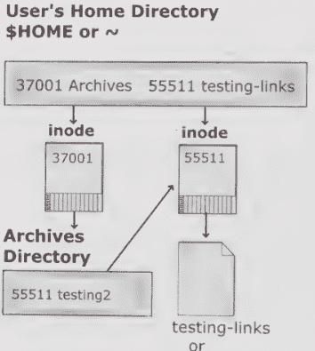

- 16. 使用 `ls` 检查原始文件和链接文件：

```bash
ls -li testing-links
ls -li Archives/testing2
```

它们的列出结果是等价的。两者访问同一个 inode，且在长格式列出输出的链接列中都显示 2，表明该文件链接到了两个目录。

- 17. 使用 `file` 工具探索这些文件：

```bash
file testing-links
file Archives/testing2
```

没有任何迹象表明一个是原始文件，而另一个是后来链接的。

`testing-links` 和 `testing2` 这两个条目都与同一个 inode 号相关联——它们是同一个文件。只有一个文件对应一个 inode；然而，它被列出或链接到了两个目录，并且可以通过其中任何一个访问。

### 删除链接文件

每个文件的“索引卡”（即 inode）都会跟踪列出该文件的目录数量。文件在目录中列出的每个实例就是一个链接。

- 1. 使用以下命令获取当前目录下文件的详细列表：
  `ls -l testing-links`
  在列表中，权限右侧的字段是链接数（`link-count`）。文件 `testing-links` 有两个链接：当前目录和 `Archives` 目录。

- 2. 通过输入以下命令从当前目录删除文件 `testing-links`：
  `rm testing-links`
  `ls`
  虽然它最初是在这个目录中创建的，但该文件现在已被删除，不再列在此目录中。

- 3. 这是否意味着它也从 `Archives` 目录中被删除了？输入：
  `ls -l Archives`

- 4. 链接数回到了 1。该文件现在仅列在 `Archives` 中。
  `more Archives/testing2`

当你删除一个文件时，你删除的是它在指定目录中的条目。如果删除后剩余的链接数仍为 1 或更多，该文件将保留在硬盘的数据块中。只有当它不再被列在任何目录中（即链接数变为零）时，文件才会被真正删除（也就是说，数据块的地址将被释放以供新用途）。

### 使用原始名称将文件链接到目录

你不需要通过给新链接起新名字来链接文件。

- 使用以下命令链接另一个文件：
  `ln users_on Archives`
  `ls -i users_on`
  `ls -i Archives/users_on`
  `ls -l users_on`

如果 `ln` 的目标（第二个）参数是一个目录，则该文件将使用原始条目的相同名称被列在目标目录中。`ls -l` 输出中的链接数反映了该文件被列在两个目录中。

### 链接多个文件

`ln` 工具可以一次链接多个文件。

- 1. 切换到家目录并执行：
  `ln megan daniel betty Archives`
- 2. 列出当前文件及其链接数和 inode：
  `ls -il megan daniel betty`
- 3. 列出 `Archive` 目录中的文件：
  `ls -il Archives`

所有作为 `ln` 参数且位于目标目录（`Archives`）之前的文件，现在都同时列在 `Archives` 目录和当前目录中。它们在两个目录的列表中具有相同的 inode。

**总结** 我们可以使用 `ln` 命令将一个文件链接到多个目录。第一个参数是当前文件名；最后一个参数是文件将被列入的新目录。可以使用 `rm` 命令从任何链接目录中删除文件。当它从最后一个列出它的目录中被删除时，文件才会被真正删除。只有文件可以这样进行硬链接。

### 使用符号链接链接文件

你在之前的练习中创建的链接在两个目录中列出了文件的实际 inode。这样创建的链接被称为 *硬链接*（hard links），因为 inode 被硬编码在列出该文件的各个目录中。正如稍后将探讨的，硬链接不适用于某些文件，并且只有超级用户（`root`）才能为目录创建硬链接。

另一种将现有文件链接到另一个目录的方法是在第二个目录中不列出被链接文件的 inode。

- 1. 确保你在 *Projects* 目录中：
  `cd ~/Projects` 
  `pwd`

- 2. 通过输入以下命令，从 *Projects* 创建一个指向 *journal* 文件的链接：
  `ln -s ~/journal`

- 3. 检查这两个文件的 inode：
  `ls -i journal` 
  `ls -i ~/journal` 
  它们没有相同的 inode 号。

- 4. 通过以下命令确认两个链接实际上访问的是同一个文件：
  `echo 'In Projects File' >> journal` 
  `cat ~/journal` 
  当你向 *Projects* 中列出的文件添加文本，然后读取家目录中列出的同一个文件时，添加的文本会出现，因为你是在对同一个文件进行写入和读取。
  当我们使用 `-s` 选项时，`ln` 会在当前目录创建一个小文件，其中包含定位被链接文件（无论它实际列在何处）所需的信息。这种类型的链接被称为 *符号链接*（symbolic link）。

- 5. 使用以下命令检查符号链接的详细列表：
  `ls -l journal`

- 6. 输出如下所示：
  `lrwxrwxrwx 1 cassy users 6 Oct 24 16:47 journal -> /home/cassy/journal` 
  首字符不是表示目录的 **d**，也不是表示文件的 **-**，而是表示符号 *链接* 的 **l**。接下来的插图中的箭头表明，当前目录中的文件名 *journal* 是一个指向 *cassy* 家目录（位于 *home*，*home* 又位于 /）中 *journal* 文件的链接。这显然是一个不同的机制。


链接是一个位于当前目录中的小文件，它包含一个指向真实文件 inode 的指针，无论该真实文件位于何处。

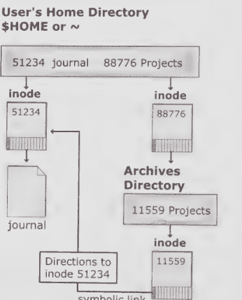

- 7. 请求查看当前目录中列出的 *journal* 的描述：
  `file journal`
- 8. `file` 的输出结果为：
  `journal: symbolic link to /home/cassy/journal`

这两个命令都报告 *journal* 不是像硬链接那样的一个常规文件。相反，*journal* 是当前目录中的一个符号链接，它拥有自己的 inode。

### 删除符号链接

删除链接就像删除文件一样。

- 1. 输入：
  `rm journal`
- 2. 确认 *journal* 列表已被删除。
  `ls`
  *journal*（符号链接）的条目已从当前目录中删除。

### 删除具有符号链接的文件

在之前的练习中，你删除了指向文件的链接。如果你删除一个被符号链接指向的文件，会发生什么？

- 1. 输入：
```bash
date > ~/realfile
ln -s ~/realfile rf
ls -l rf
cat rf
```
当前目录中的条目 `rf` 是一个指向主目录中名为 `realfile` 的真实文件的符号链接。

- 2. 从主目录中删除原始文件 `realfile`：
```bash
rm ~/realfile
```

- 3. 检查当前目录中符号（软）链接的影响：
```bash
ls -l rf
cat rf
```
真实文件已被删除，因此指针（符号链接）指向空。这是一个断开的链接。符号链接并不等同于它所链接的文件。

### 链接目录

在某些系统中，超级用户 `root` 可以使用 `ln` 工具的 `-d` 选项，在其他目录中创建指向目录的硬链接。普通用户不能创建目录硬链接。不过，普通用户可以创建指向目录的符号链接。

- 1. 你当前处于 `Projects` 目录中：
```bash
pwd
```
主目录中列出的目录之一是 `Docum` 目录。

- 2. 使用以下命令将 `Docum` 目录链接到当前目录：
```bash
ln -s ~/Docum
```

- 3. 列出当前目录的内容：
```bash
ls -F
```
`Docum` 目录被列为当前目录的子目录；但请注意，它后面跟着一个 @ 而不是 /，这表示它是一个符号链接（或软链接）。

- 4. 列出 *Docum* 的内容：
  `ls Docum`
  显示 *Docum* 中列出的文件名。

- 5. 切换到 *Docum* 目录并确认你的位置：
  `cd Docum`
  `pwd`

- 6. 创建一个文件：
  `touch filefromProjects`

- 7. 切换到主目录并列出其文件：
  `cd`
  `ls`
  *Docum* 目录被列在你的主目录中。

- 8. 列出 *Docum* 目录的内容：
  `ls Docum`
  列出了你在从 *Projects* 访问 *Docum* 目录时创建的文件。

- 9. 列出 *Projects* 的内容：
  `ls Projects`
  *Archives* 目录也列在 *Projects* 中。

- 10. 确认两个 *Docum* 目录列表的内容相同：
    `ls -i Docum`
    `ls -i Projects/Docum`
    你现在可以从主目录或从 *Projects* 访问 *Docum* 目录。

#### 评估系统目录

用户经常链接系统目录以便快速访问。

- 1. 将 `/tmp` 目录链接到你的主目录：
  `cd`
  `ln -s /tmp tmp`

- 2. 列出当前目录的内容：
  `ls -l | more`
  `tmp` 目录现在列在你的主目录中。

- 3. 列出你的 `tmp` 和 `/tmp` 的内容：
```bash
ls ~/tmp
ls /tmp
```
现在你的主目录中有一个名为 tmp 的 /tmp 目录。

> **总结** 硬链接用于从两个或更多目录创建指向同一个文件的等效链接。如果原始文件被删除，第二个目录中的列表仍然可以访问该文件。符号链接（或软链接）用于将目录或文件链接到另一个目录。符号链接是另一个目录中一个小文件里的指针，指向原始文件的 inode。原始文件和符号链接拥有各自唯一的 inode。当原始文件或目录被删除或移动到不同位置时，符号链接将指向空并失效。

#### 探讨符号链接的原因

在为安装系统而格式化硬盘时，管理员可以选择将驱动器分为较小的部分，称为*分区*。通常会创建几个独立的区域或分区。每个分区持有 UNIX/Linux 目录树的一部分。

- 1. 要查看你的系统使用了哪些分区，请输入：
  `mount`

- 2. 列出硬盘分区及其挂载点。
  显示的信息类似于：

| 设备 | 挂载点 |
| :--- | :--- |
| /dev/hda2 | / |
| /dev/hda3 | /home |
| /dev/hda5 | /tmp |
| /dev/hda6 | /usr/bin |

一个分区被标记为 /，持有分层目录树的核心。有些系统只有 / 文件系统，而不是多个分区。

如果存在额外分区，它们会被附加或挂载到 / 文件系统上，从而为用户提供一个完整的目录树。通常，/、/home、/usr/bin 和 /tmp 位于不同的分区，并在系统启动时“连接到主文件系统”或挂载。

硬盘上每个分区的大部分都被格式化为称为数据块的小内存块，大小通常为 1,024 字节。数据块持有我们称之为文件的实际数据。除了驱动器分区中的数据块之外，每个分区还预留了空间用于存储管理该分区内文件的 inode。每个持有单一文件系统的分区都有一组该分区*唯一*的 inode 编号。而这就是问题所在。如果一个系统将 `/home` 作为一个单独的分区，将 `/tmp` 作为另一个，那么每个分区中可能都有一个具有相同 inode 的文件。Inode 仅在单个分区文件系统内是唯一的，但在另一个分区中可能会重复。因为 inode 12345 在 `/tmp` 文件系统分区中指的是一个文件，而在 `/home` 中指的是另一个文件，所以在 `/home` 中为具有 inode 12345 的文件创建硬链接，并不会将其链接到 `/tmp` 中的文件，而是链接到 `/home` 文件系统中该编号的文件。

符号链接是某个文件系统分区目录中的一个小文件，它指向正确的文件系统，然后指向被链接文件的正确 inode。我们只能在同一个文件系统内的文件之间使用硬链接。符号链接则用于链接相同或不同文件系统中的目录和文件。

最后，inode 是掌握 UNIX/Linux 文件系统的关键。什么是文件？它仅仅是数据，还是说“文件”还包括它的特性、权限、所有者、创建日期、组、大小等等？如果我们认为文件体现了它的所有特性，而不仅仅是数据块中的数据，那么*inode 就是文件*。inode 包含文件的全部信息，包括其描述性特性以及文件数据所在块的地址。网络就是计算机；inode 就是文件。

## 7.6 移动和删除目录及其内容

你已经使用 `mv` 命令将文件移动到目录中，并重命名目录内的文件。正如我们所见，目录只是一个包含其他目录和文件名称及其相关 inode 编号的文件。许多文件管理操作是通过修改目录内容来完成的。例如，更改文件名就是更改它在父目录中的条目。

创建新目录就是在一个目录中创建一个条目，其中包含新目录名称及其 inode 编号，以便 shell 可以切换目录或访问该新目录。因为目录本身就是文件，所以我们可以像移动和重命名其他文件一样，更改目录的名称并移动它，这看起来是合理的。确实如此。请继续阅读，麦克杜夫（Macduff）。

### 更改目录名称

目录在创建时最初由所有者命名。名称是可以更改的。

- 1. 确保你在主目录中，且 *Projects* 目录在列表中：
  `cd`
  `ls -F`

- 2. 识别 *Projects* 目录的 inode：
  `ls -id Projects`

- 3. 记录 *Projects* 的 inode 编号：________________________

- 4. 通过输入以下命令更改 *Projects* 目录的名称：
  `mv Projects Old-projects`

- 5. 获取当前目录内容的列表：
  `ls -F`
  你的主目录中不再列出 *Projects* 目录。然而，*Old-projects* 已被列出。

- 6. 检查 *Old-projects* 的内容：
  `ls -F Old-projects` 
  内容没有改变；只有目录名称不同。目录名称仅在一个地方被命名：即你主目录中的条目。该条目已被修改为读取 *Old-projects* 而不是 *Projects*。

- 7. 检查 *Old-projects* 的 inode 编号：
  `ls -id Old-projects`


您更改了当前目录中 *Projects* 目录的名称，但新名称仍链接到同一个 inode 编号。该条目指向同一个目录，只是使用了新名称。

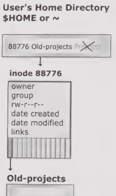

- 8. 将 *Old-projects* 的名称改回 *Projects*：
  `mv Old-projects Projects`
  `ls -id Projects`
  这两个目录使用同一个 inode。

#### 移动目录

每个用户目录都列在某个父目录中。您可以将目录移动到分层文件结构中的不同位置，也就是说，将其列在另一个父目录中。

- 1. 列出当前（主）目录中的文件和目录：
  `cd`
  `ls -F`
  *Projects* 和 *Archives* 目录都被列出。
- 2. 注意 *Projects* 和 *Archives* 引用的是哪些 inode：
  `ls -id Projects`
  `ls -id Archives`
- 3. 输入 *Projects* 的 inode：__________
  输入 *Archives* 的 inode：__________
- 4. 将 *Projects* 目录的条目从当前目录移动到 *Archives* 目录：

```bash
mv Projects Archives
ls
ls Archives
```

*Projects* 不再列在当前目录中，而是列在 *Archives* 目录中。下图描绘了移动前后的目录结构。

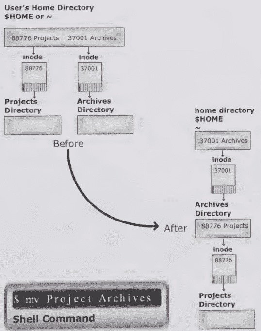

您的当前目录（其子目录的父目录）包含子目录的名称和 inode 编号。您可以更改目录被列出的位置。如果您更改了列出位置，就相当于“移动”了该目录。每个目录的 inode 保持不变。

- 5. 检查现在列在 `Archives` 中的 `Projects` 的内容：
  `ls Archives/Projects`
  当目录被移动时，其内容不受影响。移动目录仅仅是将该目录的条目从一个父目录移动到另一个父目录。它不会影响被移动目录的“子”内容。受影响的是两个父目录：一个目录失去了被移动目录的条目，另一个目录则获得了一个条目。被移动的目录在其列出信息中拥有一个新的父目录。移动目录不会影响被移动目录的子目录。

- 6. 重新检查 inode：
  `ls -ai Archives`
  `ls -ai Archives/Projects`
  `Archives` 中的 `Projects` 目录具有与 `Projects` 中 `.` 相同的 inode 编号。是的，`Projects` 将其自身视为与父目录（`Archives`）所见的 `Projects` 相同的 inode。即使目录被移动，它仍保留其 inode 编号。
  在 `Projects` 中，`..` 目录具有与 `Archives` 中 `.` 条目相同的 inode 编号。`Projects` 将 `Archives` 视为其父目录。

- 7. 通过输入以下命令将 `Archives` 目录移回您的主目录：
  `mv Archives/Projects ~`
  `ls -ai Archives`
  `ls -ai Projects`
  `Projects` 的条目从 `Archives` 移动到了您的主目录。现在两者都将您的主目录视为其父目录。

#### 删除空目录

在 UNIX/Linux 中，我们使用特定的命令来删除目录，就像删除文件一样。

> **注意：** 请务必非常谨慎地使用删除命令，因为丢失的项目通常很难甚至无法恢复。在执行这些操作时，请确保您处于正确的目录中。

有两个命令可用于删除目录。第一个命令用于删除空目录——即其中没有列出任何文件的目录。

- 1. 使用以下命令确保您处于主目录中：
  `cd` 
  `pwd` 
- 2. 使用以下命令列出主目录中的文件和目录：
  `ls -F` 
- 3. 通过输入以下命令创建新目录：
  `mkdir Dirempty` 
  `ls -F` 
  `ls -id Dirempty` 
- 4. 通过输入以下命令检查 *Dirempty* 目录中是否有任何文件：
  `ls Dirempty` 
- 5. 通过输入以下命令删除空目录 *Dirempty*：
  `rmdir Dirempty` 
- 6. 通过输入以下命令确认 *Dirempty* 目录已消失：
  `ls -F` 
- 7. 尝试删除包含文件的 *Archives* 目录：
  `rmdir Archives` 

错误信息表明 *Archives* 目录不是空的，且 `rmdir` 不会删除列有其他文件或目录的目录。请保持原样。

#### 删除目录及其文件

您已经看到 `rmdir` 命令仅删除空目录。通过另一个替代命令，您可以删除空目录或包含文件列表的目录。接下来我们将尝试删除一个有内容的目录。

- 1. 切换到 *Projects* 目录：
  `cd ~/Projects` 
- 2. 再次确认您处于正确的目录且 *Code* 已列出：
  `pwd ; ls` 
- 3. 尝试删除 *Code* 目录。输入：
  `rmdir Code`
- 4. 由于该目录包含文件，因此无法使用 `rmdir` 删除。您会收到一条错误信息：
  `rmdir: Code: Directory not empty`
- 5. 要删除 `Code` 目录及其文件，请输入：
  `rm -r Code` 
  该命令的 `-r` 选项指示 `rm` 递归地删除文件。该工具首先删除目录中的文件，然后进入子目录并删除其文件，接着删除该空子目录，依此类推，递归地向下处理目标目录的子目录。
- 6. 通过输入以下命令确认 `Code` 已被删除：
  `ls -F` 
  不仅 `Code` 目录被删除了，而且该目录中列出的所有文件以及您可能在 `Code` 中创建的任何子目录也被删除了。

> **注意：** `rm -r` 命令具有重大影响，应非常谨慎地使用。请仔细检查您要删除的目录中是否包含您可能需要的任何子目录。在使用 `rm -r` 命令之前，请将任何想要保留的内容移动到另一个目录。

- 7. 为了演示 `rm -r` 的威力，请仔细输入以下命令以创建一系列目录：
  `mkdir DIR10` 
  `touch DIR10/skye` 
  `mkdir DIR10/DIR20` 
  `mkdir DIR10/DIR21` 
  `mkdir DIR10/DIR20/DIR30` 
  `date > DIR10/DIR20/today` 
  `cp * DIR10/DIR20/DIR30` 
  刚刚创建的结构如以下图所示：

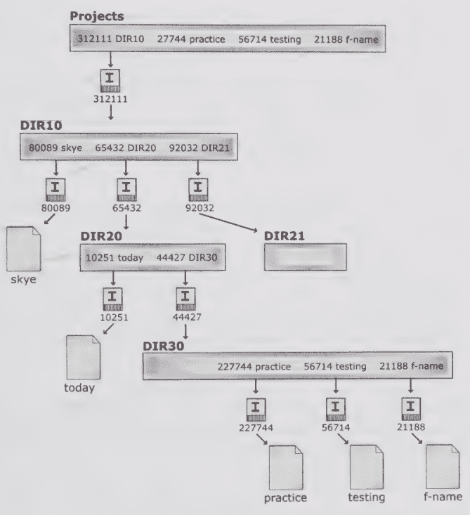

- 8. 使用以下命令检查：
    - `ls`
    - `ls DIR10`
    - `ls DIR10/DIR20`
    - `ls DIR10/DIR20/DIR30`
    - `ls -R DIR10`
    - `pwd`
- 9. 现在尝试使用以下命令删除目录树：
    - `rmdir DIR10`
    - `ls`
    - `rm DIR10`

```bash
ls
rm -r DIR10
ls
```

`rm -r` 目录命令会从目标目录开始，递归地下降到所有子目录，删除所有文件和目录。

#### 自测 3

- 1. 您将输入什么命令来移动当前目录中的文件 `eakins`，使其被列在您的主目录中？
- 2. `rmdir` 和 `rm -r` 命令之间有什么区别？
- 3. 假设您在 `Projects` 目录中，该目录下有子目录 `Old-projects` 和 `New-projects`。将 `Bookproject` 目录从 `New-projects` 移动到 `Old-projects` 的命令是什么？
- 4. 您处于主目录中，其中有一个名为 `users_on` 的文件。什么命令可以让该文件同时列在您的主目录和子目录 `Projects` 中？

## 章节复习

使用本节复习本章内容，并测试您对相关概念的掌握情况。

### 章节总结

- 硬盘被格式化为许多给定大小的块（例如 1,024 字节），用于存储数据。
- 文件驻留在硬盘上的一个或多个数据块中。
- 每个文件都有且只有一个 inode，它是硬盘上的一小块内存，包含关于该文件的所有信息。此类信息包括所有者、权限、创建和修改日期、链接数、组、大小以及包含文件的数据块地址（对于极大型文件，则是包含其余文件数据块地址的数据块）。
- 目录是一种特殊的文件，具有非常具体的内容，即文件名和目录名，每个名称都关联一个 inode 编号。
- 目录仅由文件名及其 inode 编号组成。inode 包含关于文件的所有信息，而驱动器上的数据块包含文件本身。
- 当我们登录时，我们的当前目录是 `passwd` 文件中指定的主目录。
- 我们可以使用 `mkdir dirname` 命令在当前目录中创建目录。
- 我们使用 `cd targetdir` 命令将当前目录更改为另一个目录，其中：
    - 不含特殊字符的字符串名称是列在当前目录中的目录。
    - 以 / 开头的目录是列在文件系统顶层的 / 或 `root` 目录中的目录。
    - 波浪号 (~) 被解释为用户的主目录。
    - `~loginname` 被解释为用户 `loginname` 的主目录。
    - 名称 `..` (点点) 被解释为父目录。
    - 我们可以混合使用这些指定方式，例如：
        `cd ~/..` （进入我的主目录，然后进入其父目录。）
        `cd ~bkoettel/Study1` （进入 bkoettel 的主目录，然后进入名为 Study1 的子目录。）
- 使用 `mv name newname` 命令将文件或目录及其文件从一个目录移动到另一个目录。
- 使用 `rmdir dirname` 命令删除空目录。
- 使用 `rm -r dirname` 命令删除目录及其内容（包括文件和子目录）。


### 课后作业

- 1. 哪个 `ls` 命令可以列出当前目录的内容，包括所有以点开头的隐藏文件，以及每个文件的权限等信息？
    A. ls -a
    B. ls -l
    C. ls -ai
    D. ls -al
    E. ls -il
    F. ls -rl
    G. 以上都不是

- 2. 哪个命令可以删除目录 XXX 及其所有内容，包括其子目录及其内容？

- 3. 以下哪个操作可以创建新目录？
    A. touch Dir-A
    B. mkdir ~/jobs
    C. mkdir ~/jobs /
    D. mv Dir-A Dir-B
    E. mkdir addessi
    F. cat DIR-C > DIR-D

- 4. 以下各项分别实现了什么功能？
    A. cd ~/Work
    B. cp /tmp/manywords .
    C. cd ~/..
    D. grep bash /etc/passwd > ~/bash.pw
    E. mv ~/Stuff ~/Old (两个目录均存在)
    F. cp Dir-A/* Dir-B/ (两个目录均存在)

- 5. 为了使以下命令执行成功，`cp` 的四个参数分别必须是什么？
    `cp one two three four`
    one_______ two_______ three_______ four_______

- A. 创建一个名为 `BACKUPS` 的目录，并将至少 10 个最重要的文件复制到该目录中。

- B. 创建一个名为 `mywork` 的文件，其中包含你的主目录及其所有子目录中的所有文件列表。要求 `ls` 识别目录和可执行文件，并列出每个文件的 inode 编号。

- C. 在 `mywork` 文件的打印输出中，利用 inode 编号识别你的主目录与至少三个子目录之间的父/子关系。

- D. 创建一个名为 `Assignments` 的目录，并将你为作业创建的文件链接到该目录。打印出 `Assignments` 目录内容的详细列表（long listing）。

- E. 将几个文件链接到 `/tmp/$USER` 目录（该目录可能位于不同的文件系统中）。打印出你在 `/tmp` 中该目录内容的详细列表。

### 命令汇总

| 命令 | 描述 |
| :--- | :--- |
| `cd pathname` | 切换到由 pathname 指定的目录。 |
| `pwd` | 显示当前目录的完整路径名。 |
| `mv filename path/newfilename` | 将名为 filename 的文件条目移动到 path 指定的目录中，如果指定了 newfilename 则重命名该文件。 |
| `mv directoryname path/new_directoryname` | 将名为 directoryname 的目录条目移动到 path 指定的目录中，如果指定了 new_directoryname 则重命名移动后的目录。 |
| `cp filename path/newfilename` | 将 filename 的副本放入 path 指定的目录中，如果指定了 newfilename 则将副本命名为 newfilename。 |
| `ls -a` | 显示当前目录中的文件和子目录列表，包括以点（.）开头的文件。 |
| `ls -F` | 显示当前目录中的文件名，并在目录名后加上 /。可执行文件显示为带有星号 (*)。 |
| `ls -ld` | 输出关于目录本身的详细信息，而不是其内容。 |
| `ls -l` | 列出当前目录中的文件名及其关联的 inode。 |
| `ln file directory` | 在另一个目录中创建文件的条目。不带参数的 `ln` 创建硬链接；两个位置的 inode 相同。它是同一个文件被列在两个目录中。不同文件系统中的文件不能创建硬链接。 |
| `ln -s file directory` | 创建软链接，即在第二个目录中创建文件或目录的条目。软链接可以在第二个目录中列出不同文件系统中的目录和文件。 |
| `mkdir directory` | 创建一个名为 directory 的新目录。 |
| `rmdir directory` | 删除目录，但仅在目录不包含任何文件或子目录时才有效。 |
| `rm -r directory` | 删除目录及其包含的所有内容。 |

## 向 Shell 指定指令

### 8

## 技能检查
在开始本章之前，你应该能够：

- 创建、编辑、移动、复制、查看和删除文件
- 创建目录并在文件系统中进行切换
- 使用基本实用程序管理文件和操作数据
- 将实用程序的输出重定向到文件或其他实用程序
- 发出基本的 shell 命令及相应的参数
- 识别用户进程

## 目标
完成本章后，你将能够：

- 识别命令行上所有标记（token）的作用
- 确定实用程序从哪里读取输入、写入输出以及写入错误信息
- 使用命令行传递复杂参数
- 使用文件名扩展字符
- 识别复杂命令行的功能
- 使用局部变量和环境变量
- 修改搜索路径（search path）
- 指令 shell 不要解释特殊字符
- 重定向输出和错误消息
- 使用启动文件来定制 shell 的运行方式
- 指令 shell 在命令行上执行命令替换

各种 shell 通过解释我们的命令来完成我们指定的任务。当 shell 在终端屏幕上产生提示符时，它是在询问我们接下来想做什么。我们输入响应，请求某些程序完成一项任务。如果我们的请求完全符合 shell 的语法规则，shell 就会按照要求启动我们请求的任何程序。在程序完成工作后，shell 会重新出现并询问接下来的操作。

如果我们想被理解，在发出命令时必须“说 shell 语言”。Shell 以非常特定的方式解释命令行的语法（*syntax*）；当然，它执行的是我们*说*的，而不是我们*意图*的。当我们正确地发出请求并准确地传达意图时，shell 就会按照我们的意图行事，从而完成工作。

本章将探讨我们如何请求并获得我们想要的精确结果。为了理顺与 shell 的通信，我们将仔细研究 shell 如何解释我们发出的命令和特殊字符。

但我们的目标不仅仅是掌握语法。在任何计算环境中，程序的执行都是一个复杂的事件。幸运的是，在 Linux 和 UNIX 中，我们可以探索 shell 如何解释命令、子进程如何启动、正确的代码如何执行以及如何排除错误。如果我们了解 shell 的运行机制，就能更有效地发出请求。

UNIX 或 Linux 计算系统的基本组成部分是硬件、文件和进程。硬件——由中央处理器 (CPU)、存储设备、工作内存、连接总线、键盘、终端和电缆组成——可以用于运行多种计算系统中的任何一种。当硬件运行 UNIX/Linux 时，被称为*内核（kernel）*的核心程序负责调度 CPU 在队列中的进程工作，分配主内存，并处理终端、磁盘驱动器和其他外设的输入/输出。内核程序在虚拟层面定义了 UNIX 和 Linux。（这个复杂且庞大的程序消耗了巨大的编程时间。不过，关于那些花时间消除内核粗糙边缘的程序员被叫做 Kernel Sanders 的传闻并非事实。）

本章的练习从详细检查 shell 如何解释命令行开始，以确定启动多少个进程；如何重定向输入、输出和错误消息；如何传递参数；以及如何执行代码。第二节探讨 shell 如何通过解释文件名通配符、变量和其他特殊字符来扩展命令行的一部分。最后一节检查 shell 和子进程在执行复杂命令行时是如何交互的。

## 8.1 检查 Shell 命令行执行

当你登录 UNIX 时，你并不是直接与内核通信。相反，你告诉 shell 你的需求，shell 将你的请求翻译成适当的*内核调用（kernel calls）*，从而指令内核执行工作。当你请求 shell 运行一个实用程序时，shell 会请求内核启动一个新进程，重定向输入和输出，将参数传递给该进程，并在硬盘的文件系统中定位编译后的实用程序程序代码文件。然后，shell 指令该进程运行相应的代码。

登录 shell 只是另一个实用程序，它在登录时启动，在注销时退出。我们经常根据需要启动其他 shell 并退出它们。shell 的工作是解释我们的指令。shell 是我们、其他实用程序、文件系统和内核之间的接口。每个 shell 进程执行的代码都驻留在系统目录的一个文件中。shell 进程获取 CPU 时间，遵循代码文件中的指令，将输出和错误消息发送到你的终端，其行为通常与任何其他实用程序一样。

shell 的主要功能之一是读取你发出的每一行命令行，检查命令行的组成部分，根据其语法规则解释这些片段，然后执行你的请求。

### 与 Shell 交互

显然，我们与 shell 通信的基本方式是从键盘输入请求执行实用程序的命令行。当我们仔细观察这些事件时，即使是一个简单的命令，也会将大量信息从我们的脑海传递给 shell，并最终传递给内核。这是一个持续的循环。

- 1. 在 shell 提示符处，输入：
   ```
   echo HELLO
   $
   ```
   首先，你输入了单个字符 `e c h o H E L L O` 然后按下了 ENTER。shell 执行了一个新进程，将字符字符串 `HELLO` 作为参数传递给它，并告诉该新进程执行

**echo** 的代码。在运行 **echo** 的进程完成工作之前，shell 不会向你的屏幕发送新的提示符。然后在新提示符处，你输入了一个 `l`，接着是一个 `s`，然后再次按下 ENTER。shell 执行了运行 **ls** 所需的步骤，**ls** 的输出出现在屏幕上。

每当我们请求运行一个实用程序时，我们实际上是在指示 shell 启动一个子进程来执行该实用程序的代码。

- 2. 比较以下 **ps** 实用程序的 PID：
  `ps`
  `ps`
  输出应包括你的 shell 和 **ps** 及其进程标识号。每次我们运行一个新的 `ps`，它就是一个新进程。

> **注意：** 如果 **ps** 的输出不包括 **ps** 本身，请输入以下命令来确定你当前的端口：
`tty`
输出中 `/dev/` 之后的最后一部分（例如 **pts06** 或 **console**）就是你的终端号。使用你的终端号并输入类似以下命令之一：
`ps -t console`
或
`ps -t tty03`
或
`ps -t pts06`
现在输出中应该包含 **ps** 了。

- 3. 当我们输入命令时，并不总是能成功。输入：
  `wc -z users_on`
  同样的一系列事件会发生，但当 **wc** 启动时，它不识别 `-z` 选项，在向你的屏幕发送错误消息后，它便终止运行。随后出现一个新的 shell 提示符。

#### 审视与 Shell 的交互

在输入命令行到实用程序执行之间发生了许多事情。shell 必须解释命令行的每个方面。如果我们仔细观察发生的情况，会出现许多问题。本节首先提出一些关于 shell 如何工作的问题。这些问题以及其他问题将在接下来的几个章节中进行探讨。

- 1. 输入命令：
  `ls`
  shell 将这两个字符解释为执行 **ls** 实用程序的请求。为什么不将该命令解释为读取名为 **ls** 的文件内容的指令？或者解释为将光标移动到下方区域？或者解释为评估一个名为 **ls** 的变量？

  shell 将 **ls** 解释为要执行的实用程序。为此，shell 必须首先定位代码。合理的问题是：实用程序代码位于何处？shell 如何找到它？

  **ls** 实用程序定位当前目录下文件的名称，然后将列表格式化为输出。输出显示在你的屏幕上。更合理的问题是：为什么输出到我的屏幕而不是文件？为什么输出不会出现在其他人的显示器上？

- 2. 输入命令：
  `ls -l`
  输出是当前目录下文件的详细列表。我们可以询问 **ls -l** 是否是一个与 **ls** 不同的实用程序，或者它是同一段代码以某种可选方式运行。

- 3. 故意犯个错，在输入以下命令行时省略实用程序及其选项之间的空格：
  `sort-r users_on`
  我们会收到一条错误消息，指出找不到 **sort-r** 命令。但我们知道 **sort** 命令确实存在。为什么会报错？

- 4. 输入：
  `sleep 5`
  这个命令引发了诸如以下的问题：为什么 shell 要等到 **sleep** 结束后才显示新提示符？它如何知道 **sleep** 已经完成了工作？

为了探索这组问题及其相关议题的影响，我们将仔细检查一系列熟悉的命令。

#### 解析基础命令行

在我们发出命令后，shell 会执行一系列特定步骤。当 shell 从用户或文件接收到一行输入时，shell 首先决定用户意图将该输入行视为一个独立命令，还是多行命令的一部分。shell 确定要启动的进程数量，启动子进程，传递参数，重定向输入和输出，最后告诉子进程要执行哪个实用程序代码。

#### 识别完整命令

当我们输入命令行并按下 ENTER 时，控制终端的程序会将光标移至下一行，并将我们输入的行传递给 shell 进行解释。

- 1. 在两行输入中分别输入以下内容：
  ```
  who
  | sort
  ```
  如果我们尝试将一个命令分在两行输入，shell 会将第一行解释为一个完整命令并（如果可能的话）执行它，然后尝试将第二行解释为一个单独的命令。在这种情况下，shell 会剧烈地抱怨第二行没有以实用程序开头。shell 的程序设定是将 ENTER 解释为信号，表明一个它应该开始解释的完整命令已经结束。

仔细观察 shell 对以下操作的反应。为了明确何时按下 ENTER，我们在本练习中明确指定。

- 2. 输入以下命令，并注意 ENTER 前面的反斜杠：
  ```
  ls \ENTER
  -l ENTER
  history ENTER
  ```
  屏幕上显示了一个详细列表，就好像你在同一行输入了 **ls -l** 命令一样。历史记录输出显示，尽管 **ls -l** 命令是在两行输入中输入的，但 shell 将它们解释为一个带有单个编号的命令行。shell 将 `\` 解释为一项指令，即 *不要* 解释紧随其后的单个字符的特殊含义。你在反斜杠后立即按下了 ENTER，因此 shell 没有解释这个 ENTER。由于 shell 没有发现指示完整命令的 ENTER，shell 会显示一个次级提示符，告诉我们 shell 期待更多输入。我们在下一行提供额外输入。当 shell 在 `-l` 之后遇到一个可以解释的 ENTER 时，shell 将这两行输入处理为一个命令行。

- 3. 作为一个更复杂的例子，输入以下内容并在每行末尾按下 ENTER，除最后一次外，每行前面都要加一个 `\`：
  `who \` 
  `| tr \` 
  `| -d \` 
  `12345 \` 
  `| sed 5q` 
  shell 将这五行输入解释为一个命令行，因为我们告诉它不要解释前四个行尾（ENTER）字符。shell 仅将第五个解释为“终于到了命令的末尾”。

- 4. 检查历史记录：
  `history` 
  尽管我们有许多输入行，但它们都是一个命令行的部分。当 shell 接收到一行缺少所需行尾字符的内容时，它会显示次级提示符并等待进一步输入。

#### 识别命令行令牌 (Tokens)

当我们输入诸如 `ls -l` 之类的命令时，我们通常会在命令行中包含几个单词或 *令牌 (tokens)*。shell 将某些令牌解释为实用程序，某些解释为参数，某些解释为文件名。shell 最初是如何将一个字符串识别为令牌的？如果命令行只由一个单词或令牌组成，那就很简单。ENTER 标识了命令的结束，因此肯定也标识了该单个令牌的结束。

shell 使用空格来识别命令行的单词或令牌。

- 1. 输入：
  `grepthepractice` 
  出现的错误消息很有启发性。对于 shell 来说，这是一个单令牌行，而第一个令牌永远是要运行的程序。因此，shell 抱怨找不到 `grepthepractice` 实用程序命令。

- 2. 输入：
  `grep the practice` 
  空格告诉 shell 如何将该行划分为令牌。

- 3. 输入以下内容，包括令牌之间的多个空格：
  `ls -l` 
  `who | grep $USER` 
  `history`
  这两条命令行运行起来就像我们在令牌之间只包含一个空格一样。shell 将 *一个或多个空格* 解释为分隔命令行上的令牌。“一个空格，两个空格，红色空格，蓝色空格”，都没有区别。一个或多个空格指示一个令牌结束而另一个开始的位置。

当我们想要指定多个令牌时，并不局限于使用空格。

- 4. 在没有空格的情况下输入以下内容：
  `who|wc>filewho`
  尽管在 `|` 和 `>` 重定向字符周围没有空格，shell 仍然将 `who`、`wc` 和 `filewho` 识别为命令行上的独立令牌。shell 将 `>`, `x` (此处原词可能为误写，应指重定向符), `<`, 和 `|` 解释为控制相邻实用程序和文件输入输出的特殊字符。shell 将它们识别为指令，而不是文件名的一部分，因此不需要空格。我们通常在命令行的每个令牌或重定向周围包含空格，以便于人类阅读代码。

- 5. 输入：
  `echo $USER$USER$USER`
  shell 将 `$` 识别为新变量的开始，即使没有空格分隔它们。

在我们输入命令行后，shell 必须识别我们输入的令牌。

#### 在输出被重定向时识别要执行的实用程序

shell 在解释命令行时必须完成的第一步之一就是确定要启动多少个子进程。为了确定进程数量，shell 必须首先识别命令行中哪些令牌是要执行的实用程序，因为每个实用程序都在一个子进程中执行。

#### 解释命令行上的首个单词

我们在行首提供的任何字符串都被 shell 解释为指令或要执行的实用程序。


- 1. 在提示符处输入以下内容：

`abcde fghij`

Shell 会响应提示找不到实用程序 `abcde`。字符串 `abcde` 是命令行上的第一个令牌（token），因此从 Shell 的角度来看，它必须是一个指令或一个实用程序。当 Shell 无法在搜索实用程序的系统目录中定位到 `abcde` 时，Shell 会报告“cannot find（找不到）”错误消息。

- 2. 尝试：

`users_on sort`

虽然我们显然打算对 `users_on` 文件进行排序，但 Shell 并不会得出这样的结论。第一个令牌必须是一个程序或指令。由于 C shell 家族变量的设置语法与 Bourne 家族 shell（`sh`、`bash` 或 `ksh`）不同，因此以下操作仅在 Bourne 家族 shell 中有效。

- 3. 如果您使用的是 C shell，请启动以下 `sh` 家族 shell 中的一个：

`bash`
或
`ksh`
或
`sh`

- 4. 在 `sh` 家族 shell 中，通过输入以下内容创建变量：

`a=date`
`echo $a`

这看起来几乎像是在违反“第一个令牌是程序或指令”的规则。

尝试以下操作，在等号周围加上空格：

`b = hello`

错误消息显示找不到命令 `b`。Shell 将第一个令牌解释为指令。`b` 之后的空格使其成为了第一个令牌。

- 5. 删除等号周围的空格：

`b=hello`
`echo $b`

没有空格时，第一个令牌包含等号；因此，Shell 将第一个令牌解释为创建变量的指令。有空格时，第一个令牌中没有 `=`。因此，在 **sh** 家族的 shell 中，创建变量时等号周围不能有空格。

- 6. 计算变量的值：

`echo $a`

当 `$a` 作为 `echo` 的参数被输入时，屏幕上会显示值 `date`。

- 7. 输入：

`$a`

对仅由变量组成的命令进行解释，将显示当前日期和时间。您刚刚输入了两行包含变量 `$a` 的命令行。在第一个命令 `echo $a` 中，Shell 解析 `$a` 变量，并将命令行上的 `$a` 替换为其对应的值。该值 `date` 是第二个令牌，并作为参数传递给 `echo`，`echo` 读取它并将其输出到屏幕上。

在仅由 `$a` 组成的第二个命令行中，变量 `$a` 被其值 `date` 替换，而 `date` 成为了该行的第一个令牌。Shell 将 `date` 解释为要执行的实用程序。

除非它是像创建变量这样的 Shell 内置指令，否则第一个令牌将被视为要执行的实用程序。

#### 解释管道重定向符号后的令牌

行上的初始令牌是第一个实用程序。很多时候，您会将一个实用程序的输出重定向（管道传输）到另一个实用程序。

- 1. 输入以下命令行：

`who | wc`
`who > wc`
`ls -l wc`
`more wc`

在第一行命令行中，`wc` 位于管道之后。Shell 将 `wc` 解释为要执行的实用程序，并将 `who` 的输出连接到 `wc` 的输入。第二行命令行在 `>` 重定向之后包含 `wc`。在这种情况下，Shell 不将 `wc` 解释为实用程序；相反，它被视为给新文件起的名字。当 `wc` 紧跟在重定向符号之后时，`who` 的输出被写入新文件 `wc`。新文件被创建。当 `wc` 是第一个令牌时，它被视为一个实用程序。并不是 `wc` 这个名字告诉 Shell 执行实用程序，而是 `wc` 在命令行上的位置决定了结果。房地产的第一条法则适用：*位置，位置，还是位置*。

- 2. 作为一个进一步的例子，输入：

`ls | abcde`

Shell 尝试执行管道后的实用程序：`abcde`。Shell 再次抱怨该实用程序不存在。

紧跟在管道之后或位于命令行开头的单词或令牌被 Shell 解释为要执行的实用程序。还有其他位置也表明一个令牌是实用程序。

#### 识别管道线中的实用程序

到目前为止发出的每个命令行要么由一个实用程序（`ls`）组成，如果有一个以上的实用程序，则第一个的输出连接到第二个的输入，依此类推（`who | wc`）。每组独立处理数据的实用程序都被称为一个 *pipeline*（管道线），因为数据从一个实用程序流向输出，并可能流向另一个实用程序。通常每行命令行只有一个管道线，但正如您很快将看到的，也可以有多个。

#### 解释分号后的令牌

我们可以让 Shell 在单行命令行上独立地运行一个接一个的管道线，而无需将一个的输出重定向到另一个。

- 1. 输入以下内容：

`ls; cd /tmp; ls; cd; history`

Shell 运行 `ls` 实用程序，然后在 `ls` 完成后，执行将目录更改为 `/tmp` 的命令。更改目录到 `/tmp` 后，再次运行 `ls`。在 `ls` 产生当前目录 `/tmp` 中的文件列表后，最后的 `cd` 将您带回主目录。检查历史记录显示没有输出重定向。由分号分隔的每个段都是一个独立的管道线。每个管道线都可以单独在命令行上运行。它们一个接一个地运行，就像您在提示符处依次输入它们一样。

- 2. 输入以下内容：

`cal 1752 > yr1752 ; ls ; sleep 3 ; ls | wc -l ; wc yr1752`

分号将构成该输入行的四个管道线分开。当第一个完成时，执行第二个，依此类推。这一个命令行由几个独立执行的管道线组成。

- 3. 输入：

`listz ; date`
`sleep 2 ; date`
`zzzz ; sleep 2 ; listz ; date ; ls l wc ; sleep 3`

一旦分号左侧的管道线执行完毕，无论第一个是否成功，右侧的管道线都会开始执行。Shell 将分号解释为不对前一个命令或管道线的成功或失败做任何限制。

当我们有多个管道线要运行的时候，我们用分号将它们分开。

- 4. 输入：

`pwd ; cd .. ; pwd ; cd .. pwd ; cd .. ; cd ; cd ; pwd`

屏幕上的输出是您在绝对路径中向 `root` 移动到父目录时 `pwd` 的输出。屏幕仅显示 `pwd` 的输出，而不是命令。通过在开始时在单行命令行中一次性输入所有管道线，我们确保它们按顺序执行。

分号后的第一个令牌开始一个新的管道线，因此它必须是一个实用程序。

#### 解释逻辑与（AND）条件执行后的令牌

虽然将命令串联起来很有用，但能够执行一个命令或管道线，然后在成功时运行另一个则更有用。同样，只有在第一个失败时，才执行另一个实用程序或管道线。

我们可以告诉 Shell 根据前一个管道线的成功或失败来决定是否运行某个管道线。

- 1. 让 Shell 运行以下内容：

`daxx && echo HI`

显示错误消息提示找不到命令 `daxx`。紧随 `&&` 之后的 `echo HI` 不被执行。

- 2. 输入：

`wc -z practice && echo HI`

在此命令行中，Shell 运行 `&&` 左侧的管道线（即 `wc -z practice`）。实用程序 `wc` 抱怨道：

`wc: invalid option -- z`

Shell 不执行双和符号之后的管道线（`echo HI`）。

- 3. 探索以下替代方案：

`wc -l practice && echo hello`
`date && xxxxx`

`&&` 左侧的 `wc` 运行成功，因此 Shell 执行随后的 `echo hello` 命令。在最后一行命令行中，第一个管道线 `date` 成功了。存在 `date` 实用程序，一旦它运行，Shell 尝试运行 `xxxxx` 命令并抱怨：

`xxxxx: command not found`

Shell 将 `&&` 解释为仅在前面的管道线执行成功时才运行后续管道线的指令。当我们想要运行一个实用程序，并在其成功运行之后再运行另一个时，这种条件执行非常方便。

- 4. 输入：

`ls -R ~ > ~/allmyfiles && wc ~/allmyfiles && more ~/allmyfiles`

只有在 `ls` 成功创建 `allmyfiles` 文件之后，才会执行 `wc` 实用程序。在 `wc` 成功之后，`more` 检查该文件。

紧跟在 `&&` 之后的令牌被解释为实用程序。

#### 解释逻辑或（OR）条件执行后的令牌

我们还可以要求根据前一个管道线的失败来进行条件执行。

- 输入：

`xxxx || echo HI`
`date || echo HI`

传递了一个错误消息称找不到 `xxxx`，但这次 `echo` 命令被执行了。`date` 实用程序运行成功，但 `echo` 没有被执行。如果双竖线左侧的命令行部分成功，则 `||` 之后的命令不执行。Shell 将 `||` 解释为仅在命令行上的前一个管道线失败时才执行 `||` 之后管道线的指令。如果命令

如果双竖线左侧的执行成功，则右侧的管道不会被执行。
`||` 之后的令牌必须是一个实用程序。

#### 条件执行总结

以下是执行情况的汇总列表。

- **使用 && 的条件执行**：** 如果之前的管道执行成功，则执行随后的管道。同样，如果之前的命令执行不成功，则不执行随后的命令。
- **使用 || 的条件执行：** 如果之前的命令执行不成功，则执行随后的命令。同样，如果之前的命令执行成功，则不执行随后的命令。
- **使用 ; 的条件执行：** 当之前的命令完成时，无论成功与否，均执行随后的命令。

这些条件执行特殊字符的影响在于，在 `||` 或 `&&` 或 `;` 之后的第一个令牌将开始一个新的命令或管道；因此，它必须是一个实用程序。

#### 解析命令替换中的令牌

我们通过在变量名字符串前放置一个 `$` 来告诉 shell 一个令牌或字符字符串是一个 `variable`。

- 1. 输入：
  `echo I am $USER with a home directory at $HOME`
  因为变量被清晰地标识，所以它们可以放置在命令行的任何位置。实用程序则放置在命令行的开头、管道之后，或者在条件执行符号之后。通常，在命令行的其他位置执行实用程序是非常有用的。

- 2. 输入以下命令并比较结果（引号是 `反引号`，通常是键盘左上角波浪号 (~) 同一键的 Shift 组合键）：
  `echo today is date` 
  `echo today is `date``

第二个命令行的输出结果包含 `date` 实用程序的输出，而不是单词 `date`。如果在执行这两个命令后，你的输出是 *today is date*，那么你可能使用的是普通引号而不是反引号。

Shell 首先执行 `date` 实用程序，然后将命令行上的 `` `date` `` 替换为 `date` 的输出。`echo` 实用程序接收到了七个参数：*today is Fri 23 April 23 14:31 2004*。`echo` 将所有七个参数发送到输出，而输出连接到终端。这是一个 shell *命令替换* 的示例。Shell 将反引号字符解释为指令，要求先执行反引号内的任何管道。然后，Shell 将反引号及其包含的管道替换为它们生成的输出。

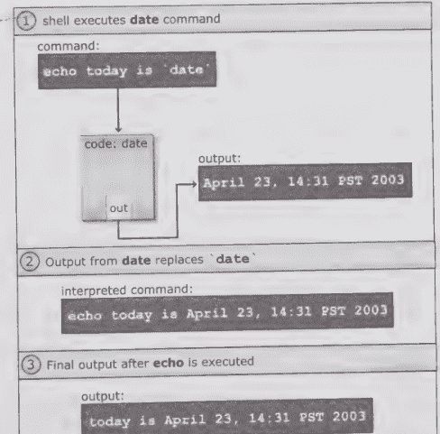

除了反引号，还有另一种语法可以指示某些 shell 进行命令替换。

- 3. 输入：
  `echo today is $(date)`

Shell 首先执行 `$( )` 内部的命令行，然后从命令行中删除 `$( )` 及其包含的命令，并用输出结果替换它们。

- 4. 创建以下文件：
  `touch names`

- 5. 列出当前目录中的文件：
  `ls`

- 6. 创建一个名为 `some-files` 的文件，并在其中包含一行文本，列出当前目录中四个文件的名称。例如，你的 `some-files` 文件可能包含这一行：
  `first-file names lost-days west`

- 7. 创建 `some-files` 后，输入：
  `ls -l `cat some-files``
  `ls -l $(cat some-files)`

Shell 首先执行 `cat some-files` 命令，然后从命令行中删除 `cat some-files` 命令。Shell 在该位置放入该命令生成的输出。这种命令替换创建了一个可执行的命令行：

`ls -l first-file names lost-days west`

四个文件名和 `-l` 被作为参数传递给 `ls`，后者创建关于这四个文件的详细信息列表：

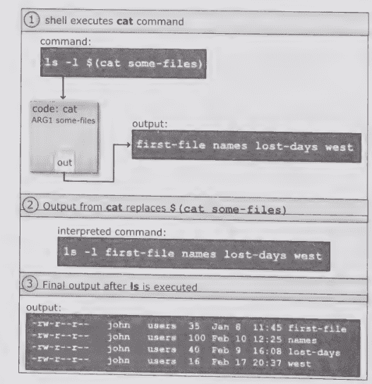

- 8. 通过输入以下内容让 shell 使用命令替换：
  `wc `cat some-files``
  `wc $(cat some-files)`

  这将计算文件中列出的所有四个文件的行数、单词数和字符数。Shell 将反引号解释为执行其中包含的命令并用其输出替换命令行中反引号字符串的指令。

- 9. 尝试以下命令：
  `echo My current directory is `pwd``
  `echo My current directory is $(pwd)`
  `echo there are `who | wc -l` users on`
  `echo there are $(who | wc -l) users on`

  内部命令或管道首先被执行。Shell 获取生成的输出，删除反引号和包含的命令，用输出替换该命令。

- 10. 在命令替换中包含一个不存在的实用程序：
  `echo today is `aabbzz``
  `echo today is $(aabbzz)`

  Shell 会提示 *aabbzz* 不存在。

现代 shell 的命令替换功能允许我们将命令的输出包含在命令行的任何位置。我们不再局限于第一个令牌、管道之后等位置。
在命令行中，反引号或 `$(` 之后的第一个令牌必须是一个实用程序，因为它启动了被替换的命令或管道。

#### 启动一个更具沟通能力的 Shell

命令替换和变量是 shell 在解析我们输入的命令行时执行的许多操作中的两种。我们可以启动一个在执行过程中会告诉我们它正在做什么的 shell，这使得观察其内部机制变得更容易。

- 1. 输入以下命令之一：
  `bash -x` 
  或
  `tcsh -x` 
  或
  `ksh -x`

将显示一个新的 shell 提示符。

- 2. 通过输入以下命令要求 shell 解析变量：
  `echo I am $USER at $HOME` 
  输出类似于：
  `+ echo I am noahkindfield at /home/noahkindfield`
  `I am noahkindfield at /home/noahkindfield`

Shell 接收到命令行。它解析了变量，并将其替换为相应的值。然后 Shell 输出一个加号，后面跟着变量已被替换为值的命令行。Shell 显示这个以 + 字符开头的首行。它告诉我们 Shell 完成了什么样的命令行解析。最后一行是运行解析后的命令行所产生的输出。`-x` 选项告诉 shell 在执行命令行之前，先解释它是如何解析该命令行的。

- 3. 观察 shell 如何进行命令替换：
  `echo Today is `date``
  `echo Today is $(date)`

第一个加号行仅为 + `date`。Shell 运行 `date`，然后获取输出并将其放入命令行中，删除 `date` 或 `$(date)`，并将其显示为第二个加号输出行。然后执行完全解析后的 `echo` 命令行，将 `date` 的输出作为其参数的一部分。

- 4. 在 -x shell 运行状态下，尝试：
  `echo My current directory is `pwd``
  `echo My current directory is $(pwd)`
  `echo there are `who | wc -l` users on`
  `echo there are $(who | wc -l) users on`

Shell 执行命令行的每一步都用 + 行显示，最终输出则不带 + 号显示。

- 5. 每当你想要退出解释模式的 shell 时，只需输入：
  `exit`

#### 识别命令行上的实用程序

查看以下命令行的示意图。每个空白行代表一个令牌。每一个分别是什么（实用程序、文件、参数）？


如果一个令牌位于命令行的首位，它是什么？在管道之后呢？在分号之后呢？在双与符号之后呢？在双竖线之后呢？

在这个例子中，每个令牌都必须是一个实用程序：
`utility | utility && utility ; utility | utility | utility || utility`

总结来说，实用程序是：

- 命令行中的第一个命令或令牌。
- 紧跟在管道之后的令牌（接收输入的实用程序）。
- 紧跟在 `&&` 之后的令牌（如果之前的管道执行成功则运行的实用程序）。
- 紧跟在分号之后的令牌（在分号左侧的管道完成后运行的实用程序）。
- 紧跟在 `||` 之后的令牌（如果之前的管道*不*成功则运行的实用程序）。
- 紧跟在反引号（`` ` ``）之后的令牌，它是命令替换管道中运行的第一个实用程序。其输出替换命令行的反引号部分。
- 紧跟在 `$(` 之后的令牌，这是命令替换语法的另一种形式。

#### 启动进程以运行实用程序

到目前为止，在这次探索中，我们研究了 shell 如何接收由一个或多个管道组成的命令行；如何使用空格、重定向和其他特殊字符来识别令牌；以及如何识别哪些令牌是实用程序。然后，shell 会启动子进程，这些子进程最终将运行所有实用程序。如果命令管道包含三个实用程序，shell 必须启动三个子进程。

通过输入以下命令查看当前进程：
`ps | sort | uniq`
输出包括 shell(s)，可能是 `ps`，以及运行其他实用程序 `sort` 和 `uniq` 的进程。Shell 为其解析的管道中的每个实用程序启动一个子进程。

你正在使用的 shell 是一个活动进程，运行在前台。内核为其分配了一个进程标识号 (PID)，因此在轮到它时，它可以获得 CPU 的关注。Shell 在内存中维护变量及其值；运行代码已被定位并正在执行。Shell 进程的输入连接到你的键盘。来自

shell 出现了你的屏幕上。分配给运行中进程的资源被称为*进程空间*（process space）或*进程镜像*（process image）。下图描绘了你的 shell 进程：

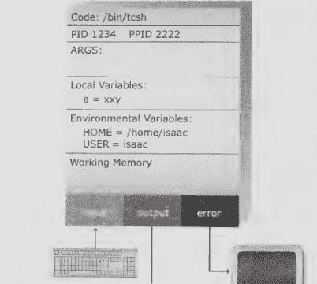

当你发出命令运行一个实用程序（例如 **ls**）时，shell 会解析命令行，然后启动一个子进程，该子进程最终将执行实用程序 **ls**，这并非一项简单的任务。

shell 首先做的是请求内核创建其自身进程空间的一个*几乎*完全相同的副本。该进程空间的副本包括环境变量，例如你的用户 ID、搜索路径和主目录。环境变量从父进程传递给子进程。每次 shell 启动子进程时，它都会发出一个启动子进程的*内核调用*（称为 *fork*）。

#### 初始输入、输出和错误连接

新的（子）进程空间是 shell 的一个*副本*。因此，输入、输出和错误都连接到你的键盘和屏幕，就像你的*shell 进程*一样。

- 1. 输入一行不需要重定向的命令行：
  ```
  wc
  ```
- 2. 输入几行文本，例如：
  ```
  1 2 3 4
  second line
  third
  ```
- 3. 通过按下以下键，告知 `wc` 你已通过文件结束符完成输入：
  `CTRL-D`

shell 确定需要一个子进程。当子进程启动时，它从 shell 继承用于输入的键盘以及用于输出和错误的屏幕。这里没有重定向，也没有需要传递的参数。shell 告诉该进程执行 `wc` 的代码。该进程执行 `wc` 代码，代码告知其从输入端读取，而输入端仍连接到键盘。你输入的任何文本行都会被读取并计算元素数量。在你按下 CTRL-D（文件结束标记）后，`wc` 进程将其结果写入输出端，由于我们没有请求重定向，输出端仍连接到你的屏幕。

因为子进程继承了 shell 的输入、输出和错误目标，所以当进程随后运行时，你会收到它的输出，而不是你的邻居收到，也不是写入文件，除非你选择重定向输出。无论你在登录后启动多少个进程，它们都是你登录 shell 的子进程。它们将你列为用户，并将你的终端作为输出，因为你的 shell 拥有这些信息。当子进程创建时，它们从父进程继承变量信息和输入/输出错误连接。

此时，该进程仍然只是一个进程，尚未运行实用程序的代码。直到所有重定向和参数传递的“管线”工作完成后，子进程才会收到要执行的新代码指令。


#### 重定向输入和输出

到此为止，我们已经研究了 shell 如何识别标记、统计实用程序数量，并启动正确数量的子进程，以便稍后每个进程执行其中一个实用程序。子进程一旦初步启动，shell 就会根据命令行的指示对每个进程进行修改。输入和输出被重定向，参数被传递，在所有这些管线工作完成后，进程会被告知要执行哪个实用程序代码。在之前的练习中，我们已经多次重定向了实用程序的输出。本节将探讨 shell 在解析重定向时实际发生了什么。

##### 将输出重定向到文件

以下练习研究 shell 如何识别文件。

- 1. 输入：
  `ls`
  shell 识别标记并确定有一个实用程序；因此，启动一个继承 shell 输入/输出连接的子进程：输入到键盘，输出到屏幕，错误到屏幕。命令行未指定重定向。该进程运行 `ls` 代码并将文件名写入其输出，而输出连接到终端。

- 2. 告诉 shell 重定向输出：
  `ls > ls-files`


shell 的工作是解析命令行。在这种情况下，存在重定向指令：重定向符号及其随后的标记，即 `ls-files`。shell 将 `>` 解析为将新进程的输出从工作站屏幕重定向并附加到 `>` 之后名为 `ls-files` 的文件的指令。管线工作完成后，进程被告知运行 `ls` 实用程序。当进程完成任务时，它像往常一样将其列表写入输出；然而，由于 shell 此前将进程的输出连接到了文件，结果因此被写入文件中。

##### 将输出重定向到现有文件

当我们将实用程序的输出重定向到 `filename` 时，shell 会创建该新文件。当我们指定的文件已经存在时会发生什么，取决于你使用的 shell 以及 `noclobber` 变量的设置方式。

- 1. 确保 `noclobber` 为关闭状态，这样 shell 在重定向输出时会覆盖（clobber）现有文件。

- 2. 在 C 系列 shell 中，输入：
  ```bash
  unset noclobber
  ```
  在 `ksh` 或 `bash` shell 中，输入：
  ```bash
  set +o noclobber
  ```

当你将实用程序的输出重定向到现有文件时，Bourne shell (`sh`) 将你的命令解析为覆盖现有文件的指令，你无法告诉 `sh` shell 采取其他操作。如果 shell 选项 `noclobber` 关闭，`ksh`、`bash`、`csh` 和 `tcsh` shell 将覆盖现有文件。

- 3. 输入以下内容：
  ```bash
  head -10 /etc/passwd > testing
  more testing
  cal > testing
  more testing
  ```

在每种情况下，shell 启动一个子进程，按照指定重定向输出，然后稍后告诉进程执行实用程序的代码。如果 shell 在重定向输出时文件已存在，shell 将删除文件的内容并将空文件附加到实用程序的输出端。

当你输入诸如 `sort file` 之类的命令时，`sort` 实用程序读取 `file` 的内容并输出一个排序后的版本。原始文件本身并未被排序。

通常，我们需要对文件进行排序，并且希望文件本身被排序，而不仅仅是一个副本。人们往往倾向于将输出重定向回原始文件。本练习将演示为什么这种方法行不通。

- 4. 为你的旧文件 *practice* 创建一个副本，然后使用重定向对副本进行排序，如下所示：
  `cp practice pract-2`
  `more pract-2`
  `sort pract-2 > pract-2`

- 5. 现在检查 *pract-2* 的内容：
  `more pract-2`

shell 首先完成对命令行的解析，执行所有输出重定向，*然后*才执行实用程序。在你刚刚输入的 `sort` 命令中，`> pract-2` 是将 `sort` 的输出重定向到现有文件的指令。shell 在将进程的输出附加到文件之前，会先清空现有文件。进程被赋予参数 *pract-2*。管线工作完成后，进程被告知运行 `sort` 代码。该进程（我们现在可以称之为 `sort`）将参数 *pract-2* 解析为要读取的文件。当 `sort` 打开文件时，发现它是空的，因此排序变得非常简单。请小心。许多重要文件曾因意外被输出覆盖而丢失。

##### 保护现有文件

当我们将 `noclobber` 变量设置为开启时，我们是在指示 shell 不要通过重定向实用程序的输出而覆盖文件。

- 1. 通过输入以下命令之一将 `noclobber` 变量设置为 *开启*：
  在 C 系列 shell 中：
  `set noclobber`
  在 `ksh` 或 `bash` shell 中：
  `set -o noclobber`
  此时，shell 被告知不要使用重定向来覆盖。当我们稍后指示 shell 重定向到文件时，它还有什么选择？

- 2. 输入：
  `who > testing`
  shell 会提示文件已存在，并且不再继续处理。

##### 在 Shell 中绕过 noclobber

有时，即使你设置了 `noclobber` 变量为 *开启*，你可能确实希望 shell 覆盖某个文件。你可以专门指示 shell 覆盖文件，即使你设置了 `noclobber`。


- 1. 指示 shell 使用实用程序的输出进行覆盖。
    C shell 系列：
    `date >! testing`
    `ksh` 或 `bash` shell：
    `date >| testing`

- 2. 确认文件已被覆盖：
    `more testing`

通过在命令的输出重定向符号 (>) 之后放置感叹号 (!)，你指示 C shell 在文件存在时对其进行覆盖。在 `bash` 和 `ksh` shell 中，重定向后的管道符号是覆盖指令，即使设置了 `noclobber` 也是如此。

#### 向现有文件添加内容

在设置了 `noclobber` 的情况下，你不能将实用程序的输出重定向到现有文件，但你仍然可以将输出*追加*（append）到现有文件的末尾。

- 输入：
`cal >> testing`
`more testing`

`cal` 的输出被添加到 `testing` 文件的末尾。双重定向指令告诉 shell 打开文件，而不是删除内容，而是将其设置为使前一个实用程序的输出连接到当前文件的*末尾*。

#### 使用其他实用程序避免意外删除文件

`noclobber` 功能是对 shell 的指令，而不是对其他实用程序的指令。

- 1. 确保没有为 `cp` 设置别名，并将一个文件复制到 `testing`：
    `unalias cp`
    `cp practice testing`

- 2. 现在检查 `testing` 的内容：
    `more testing`

即使开启了 `noclobber`，你仍然可能通过使用像 `cp` 或 `mv` 这样会创建文件的实用程序而意外破坏文件。如果你复制或移动一个现有文件，并使用另一个现有文件的名称作为第二个参数，该实用程序将覆盖该文件。因为 shell 没有在进行输出重定向，所以 `noclobber` 没有效果。

- 3. 输入：
   `cp -i practice testing` 
   系统会提示你确认是否重命名（从而覆盖）`testing`。不要覆盖 `testing` 文件。输入：
   `n` 

为了防止使用 `cp` 和 `mv` 实用程序意外删除文件，请在实用程序中使用`询问`选项 (-i)。人们通常会为这些命令建立别名。

#### 使用默认输入

如果一个实用程序需要输入来进行排序或计数，我们通常提供文件名参数，或者将某些内容重定向到进程的输入。当我们没有指定输入时，实际上发生了什么？

- 1. 输入：
   `wc > junk-wc` 
   shell 启动一个进程，将输出连接到一个名为 `junk-wc` 的新文件，然后告诉进程执行 `wc` 代码。没有文件被列为参数，因此 `wc` 不打开文件获取数据。由于没有可读的文件，`wc` 被编程为从输入读取。在此命令行中，我们没有请求将前一个实用程序或文件的输出重定向到输入，因此当 `wc` 从输入读取时，它发现的是从 shell 继承而来的键盘。你输入的所有内容就是输入。

- 2. 添加一些文本，然后提供文件结束符 CTRL-D。

- 3. 输入：
   `grep the` 
   光标被放置在新的一行。

- 4. 输入以下内容：
   ```
   hello
   Is grep looking for the target string?
   Yes
   the is the target
   ```

- 5. 按 CTRL-D 结束。

在命令行中，只有一个参数传递给 **grep**。因为 **grep** 总是将其第一个参数解释为目标搜索字符串，所以 **grep** 知道要寻找什么：*the*。
然而，没有提供额外的文件作为搜索参数，因此 **grep** 从输入读取，由于没有被重定向到其他地方，输入仍然连接到键盘。

#### 将输出重定向到另一个实用程序

在之前的练习中，你也告诉 shell 将一个实用程序的输出重定向到另一个实用程序的输入。

- 输入：
   `who | grep yourlogin | wc -l > n-on` 
   这条命令行告诉 shell 启动三个子进程，并将第一个子进程的输出连接到第二个子进程的输入。

然后 shell 将第二个进程的输出连接到第三个进程的输入，并将第三个进程的输出连接到文件 *n-on*。

在参数传递给进程之后，shell 最终告诉每个进程要执行哪个实用程序代码。**who** 实用程序创建登录用户列表并写入其输出。第一个进程的输出连接到运行 **grep** 的第二个进程的输入。这个 **grep** 进程从输入中筛选出所有包含你的登录名的行，并将它们写入输出，而该输出连接到运行 **wc** 的第三个进程的输入。在 **wc** 计算从其输入（**grep** 的输出）中读取的行数后，**wc** 将结果写入其输出，该输出被重定向到文件 *n-on*。

这一切之所以成为可能，是因为 shell 启动的子进程是其自身进程空间或资源的副本，然后重定向默认的输出和输入。在 shell 启动子进程并完成用户请求的所有“管道搭建”之后，shell 最终告诉进程执行相应的代码。

#### 重定向错误消息

当 shell 或实用程序无法执行命令时，会发出一条错误消息。除非你将其重定向，否则错误输出将显示在你的工作站屏幕上。

- 输入：
  `ls xxxxA practice`
  `wc xxxxA practice`

shell 启动子进程，传递参数，然后指示进程执行正确的代码。当子进程找不到名为 *xxxxA* 的文件时，子进程会通过其错误出口（*标准错误*）发送一条错误消息，该出口连接到显示器屏幕。
这些错误消息可以从你的屏幕重定向到一个文件中。不同的 shell 在这方面的运作方式不同，如下所示。

##### 在 bash、Korn 和 Bourne Shell 中重定向错误

在 `sh` 系列 shell 中，我们可以将子进程的标准错误从屏幕重定向到一个新文件。

- 1. 确保你使用的是 `sh` 系列 shell。

- 2. 运行一个会产生错误的命令：

```bash
ls -l practice xxxxA
```

文件 `xxxxA` 不存在。

- 3. 通过输入以下命令将错误消息重定向到名为 `myerrors` 的文件：

```bash
ls -l practice xxxxA 2> myerrors
```

由于在命令行中添加了 `2> myerrors`，即使你没有 `xxxxA` 文件且运行 `ls` 的进程产生了错误，也不会显示错误消息。

- 4. 检查名为 `myerrors` 的文件内容：

```bash
more myerrors
```

错误消息已被重定向到该文件。

- 5. 将输出和错误消息重定向到不同的位置：

```bash
ls -l practice xxxxA > lsoutput 2> lserror
more lsoutput
more lserror
```

对于 `bash`、`ksh` 和 `sh` shell，`1>` 或 `>` 是将输出重定向到文件的指令，而 `2>` 被解释为进程错误消息的重定向指令。

如果我们真的想摆脱错误消息，可以将进程的错误重定向到一个静默消耗所有重定向到那里的内容的系统文件。

- 6. 输入：

```bash
ls -l practice xxxxA > lsoutput 2> /dev/null
cat /dev/null
```

虽然你将 `ls` 的错误重定向到了 `/dev/null`，但该文件中没有任何内容。`/dev/null` 接受我们重定向到那里的任何内容，但不会记录。信息在被重定向到 `/dev/null` 后便无法再获取。

##### 将错误和输出一起重定向

在 `sh` 系列 shell 中，你可以将标准错误和标准输出重定向到同一个文件中。

- 1. 要将标准错误*和*标准输出*都*重定向到同一个文件，请输入以下命令：
   `ls -l practice xxxxA > outerr 2>&1`

- 2. 通过输入以下命令检查结果：
   `more outerr`

该文件既包含 *practice* 文件的详细列表，也包含未找到 xxxxA 的错误消息。`2>&1` 是将错误 (2) 连接到输出 (1) 所连接的同一位置的指令。

##### 在 C Shell 系列中重定向错误

C shell 不支持独立于输出地重定向错误。我们只能将错误和输出一起从终端重定向走。

- 1. 在 **csh** 或 **tcsh** 中，输入：
   `ls -l practice xxxxA` 
   `ls -l practice xxxxA >& outerr2` 
   在 C shell 中，重定向符号后的 `&` 告诉 shell 将错误与输出一起路由到指定文件。

- 2. 我们还可以将错误与输出一起路由到下一个实用程序：
   `ls -l practice xxxxA | wc` 
   `ls -l practice xxxxA !& wc`

#### 向进程传递参数

shell 在解释你的命令时执行的另一项任务是将参数传递给正在运行的实用程序。在之前的练习中，你输入了 `ls -l` 并收到一条提示该命令未找到的消息。


请检查以下命令行：

```
`ls -l practice`
```

当你输入此命令（包括 `ls` 和 `-l` 之间的空格）时，输出的是文件 `practice` 的详细列表。正如你所体验到的，shell 将空格作为识别命令行各组成部分的方式之一。`ls` 是命令行上的第一个令牌（token），因此在 shell 看来，它必须是一个实用程序。`-l` 是第二个令牌。字符字符串 `practice` 是第三个。这两个随后的令牌是两个参数——即对 shell 没有特殊含义的字符字符串。它们不是第一个令牌，且不紧跟在重定向符号之后，因此它们不可能是实用程序。由于它们不跟在 `>` 之后，shell 也不将它们视为用于重定向的文件。shell 的程序设计是将所有剩余的字符串作为参数传递给前一个实用程序，由该实用程序进行解释。对于 `ls` 来说，`-l` 参数具有特殊含义；它是产生详细列表的指令。

`ls` 实用程序将任何不以减号开头的参数（例如 `practice`）解释为文件名。因此，该命令的结果是产生并输出关于文件 `practice` 信息的详细列表。

当 shell 完成解释后，命令行上剩余的任何令牌都将作为参数传递给相关的实用程序。每个实用程序以自己的方式解释其参数。

#### 将选项作为参数使用

shell 同样将命令选项解释为参数。我们经常在单条命令行上为实用程序指定多个选项，每个选项前都有一个减号，且每个选项都被视为一个单独的参数。

- 1. 输入以下多参数命令行：
  `ls -a -l` 
  shell 向实用程序传递两个参数。每个参数都是一个选项，告诉 `ls` 实用程序修改其输出：提供当前目录下所有文件的详细列表。

- 2. 我们也可以在命令行上将两个或多个选项标志指定为一个参数：
  `ls -alF` 
  只有一个参数 `-alF` 被传递给实用程序；然而，实用程序将这一个参数解释为包含三个选项：`-a`、`-l` 和 `-F`。

- 3. 另一个例子，输入：
  `sort -rd practice`
  两个选项被作为一个参数传递。

#### 比较 Shell 与实用程序对选项的看法

选项对实用程序有意义；但在 shell 看来，选项仅仅是要传递给实用程序的参数。

- 检查以下实用程序及其参数。如果你愿意，可以输入它们：
  `ls -l`
  `wc -l`
  `pr -l 15 practice`

在这三个实例中，shell 传递了相同的参数，但三个实用程序对它的解释截然不同。对于 `ls`，`-l` 意味着产生详细列表。对于 `wc`，`-l` 是仅输出输入内容中行数的指令。对于 `pr`，`-l` 是将页长设置为随后的参数值的指令。

#### 扩展命令行令牌

当 shell 解释命令行时，有几个特殊字符会指示它扩展命令行。例如，通配符 `*` 告诉 shell 在命令行该位置包含所有文件名。变量会被解释。shell 完成扩展并根据需要修改命令行。

- 1. 如果你当前没有在 -x 模式下与 shell 通信，请现在启动一个：
  `ksh -x`
  或
  `bash -x`
  或其他 shell。

- 2. 输入以下内容：
  `ls -l u*`
  `who | grep $USER`
  shell 首先将 `u*` 扩展为所有匹配的文件名，然后将这些名称放在命令行上。随后，每个名称都被解释为一个参数并传递给 `ls`。

shell 解释 `$USER` 变量，并将变量名替换为其值。你的登录名随后成为传递给 `grep` 的一个参数。`grep` 实用程序将它读取到的第一个参数字符串解释为搜索字符串。所有匹配你登录名的行将被输出。

- 5. 输入：
  `who | awk '{print $1}'`
  shell 不会解释此命令行中的 `$1`，而是将其作为参数的一部分传递给 `awk`。第一个单引号指示 shell 关闭对所有特殊字符的解释，因此字符串 `{print $1}` 不被解释；相反，它被作为一个字面量参数传递给 `awk`。

在完成对命令行解释的概述之后，下一节将详细讨论扩展。

#### 定位要执行的代码

在你输入请求运行一个或多个实用程序运行的命令后，shell 启动进程，解释重定向并完成参数解析。在完成这些准备工作后，shell 必须定位所请求实用程序的代码。C shell 变量 `path` 和 `sh` shell 系列变量 `PATH` 包含了一个目录列表，相应的 shell 将在这些目录中搜索以定位每个请求实用程序的代码。

- 1. 通过输入以下内容列出你的搜索 `path` 变量的值：
  在 C shell 中：
  `echo $path`
  在 `sh` 系列中：
  `echo $PATH`
  显示的目录列表显示了 shell 在任何命令行中查找实用程序的位置。请注意，你的路径中有一个目录是 `/bin`。

- 2. 列出 `/bin` 的内容：
  `ls -F /bin`
  该目录下充满了我们熟悉且喜爱的可执行文件。

- 3. 获取 `ls` 实用程序代码文件的详细列表。输入：
  `ls -l /bin/ls`

输出类似于以下内容：
```
-rwxr-xr-x 1 root 65536 Jun 23 2003 /bin/ls
```

此文件包含可执行程序 `ls`。它是程序的编译版本，包含许多机器可读的控制字符，如果你尝试使用普通的文件读取实用程序显示该文件，将会严重干扰工作站。

- 4. 通过输入以下内容检查文件中的字符字符串：
  `strings /bin/ls`
  将显示一个不连续的词组和短语列表。`strings` 实用程序忽略所有机器码，仅输出它找到的 ASCII 字符字符串。`strings` 显示的输出由 `ls` 二进制文件中包含的错误消息和其他字符字符串组成。

#### 指定包含代码的文件

要运行一个实用程序，你可以向 shell 提供实用程序代码文件的路径，而不是让 shell 检查路径来查找代码。

- 1. 输入：
  `/bin/ls -l`
  当你提供实用程序的绝对路径时，shell 不需要使用搜索路径来定位该实用程序。

- 2. 定位几个程序：
  `which ls`
  `which xterm`
  `which date`

#### 启动代码执行

shell 通过搜索路径定位程序后，它会将要执行的实用程序的绝对路径交给进程，并告诉进程执行代码。在执行过程中，shell 会等待进程完成才呈现新的提示符，除非我们在后台执行该命令行。

#### 检查实用程序执行后的退出代码

在进程退出之前，它会告诉其父进程执行情况如何。

- 1. 输入：
```bash
date
echo $?
wc -zz users_on
echo $?
```

**date** 实用程序运行成功；它报告退出代码为 0。shell 将变量 `?` 解释为最后一个进程的退出代码。`wc` 没有名为 `-z` 的选项，因此 `wc` 退出并告诉 shell 情况不顺利。非零的退出代码是错误代码。

- 2. 尝试：
```bash
grep xxxx /etc/passwd
echo $?
```

**grep** 没有输出，也没有错误消息。但 **grep** 在退出时向 shell 报告了一个错误退出代码 (1)。

- 3. 相比之下，尝试：
```bash
grep aa /etc/xxxx
echo $?
```

`/etc` 目录中没有名为 `xxxx` 的文件。然而，退出错误代码不同 (2)，传达了不同的消息。如果 **grep** 找到了相应的文件但没有找到任何匹配行，它会发出退出代码 **1**。退出代码 **2** 则传达了无法找到文件的消息。

每当进程完成执行并退出时，它都会告知其父进程：成功则退出代码为 `0`，不成功则退出代码为非零值。除了退出代码外，没有其他信息传递给父进程。就像父母询问约会回家的年轻人晚上过得怎么样时，回答只有“很好”或“糟糕”。不要期待更多。

#### 识别命令行令牌的功能

shell 的程序设计是*根据其在命令行中的位置*来赋予每个命令行令牌或单词其角色。

考虑以下命令行的示意图。每条下划线代表一个令牌。每个令牌必须承担什么角色？

`________ | ________ ; ________ , ________ , ________`

各种令牌具有特定的角色：

- 命令行上的第一个令牌必须是要执行的实用程序。


- 紧跟在管道符、分号或反引号之后的 token <code>token</code> 必须是另一个实用程序（utility）。
- 剩余的所有 token 必须是前一个实用程序的参数。

因此，在本例中，每个 token 的角色必须是：
`utility argument | utility ; utility argument `utility argument`

这个模式代表了如下的命令行：
`ls -l | wc -l; grep alec `cat somefiles``

是的，`cat` 必须是一个 `utility`，而 `somefiles` 是其参数。反引号包含的命令行 `cat somefiles` 首先被执行，其输出将替换掉命令行中的反引号部分。随后，命令行看起来像这样：

```
`ls -l | wc -l; grep alec first-file names lost-days west`
```

命令替换输出中的每个 token 都是传递给 `grep` 的参数。

这里有另一个例子。在以下命令行中，每个 token 扮演特定的角色：
`________ | ________ $____ > ________ ; ________ > ________` 

紧跟在 `>` 之后的 token 必须是文件，且变量会被求值。求值后，变量的值将作为参数传递给前一个实用程序。

#### 使用该模型来解析命令行

我们向 shell 发出命令，希望完成某项工作。通过思考 shell 如何解析命令，我们可以更有效地制定请求并理解复杂的结构。

#### 在执行前完成“管道铺设”（Plumbing）

关键在于，shell 在通知子进程执行代码之前，会先完成重定向和参数传递（即“管道铺设”）。

- 1. 确保 `noclobber` 已关闭：
  在 bash 或 ksh 中：
  `set +o noclobber` 
  在 tcsh 或 csh 中：
  `unset noclobber` 
- 2. 输入：
  `ls j*`

列出当前目录下以 j 开头的文件。

- 3. 输入以下命令（包含错误）：

```bash
wc -z users_on > junk-wc1
ls j*
```

实用程序会报错称选项 **-z** 不是有效选项并退出。然而，新文件 `junk-wc1` 已被创建，但内容为空。shell 启动了一个子进程，传递了参数并处理了重定向。它创建了文件并将该新文件连接到子进程的输出端。在“管道铺设”完成后，shell 告诉进程执行 **wc** 的代码，而 **wc** 随后对 **-z** 选项报错并退出。shell 在告诉进程执行代码之前就已经创建了文件。

- 4. 输入：

```bash
daxxx > junk-wc2
ls j*
```

首先完成“管道铺设”。文件被创建并连接到子进程的输出端。然后，在尝试执行代码时，shell 找不到实用程序 **daxxx**，子进程随之结束。

- 5. 将 **noclobber** 重新开启：

  在 **bash** 或 **ksh** 中：
  `set -o noclobber` 
  在 **tcsh** 或 **csh** 中：
  `set noclobber`

- 6. 输入：

```bash
daxxx > junk-wc2
```

shell 开始处理输出重定向，确定文件 `junk-wc2` 已存在且 **noclobber** 已设置，因此发出错误消息。shell 完全没有提到找不到实用程序 **daxxx** 的事实，因为它在处理该行时还没有走到那一步。shell 启动了一个子进程，然后在尝试完成“管道铺设”时遇到了问题。由于文件已经存在，shell 报错并退出，甚至没有尝试去定位 **daxxx** 实用程序。

- 7. 尝试：

```bash
daxxx >> junk-wc2
```

重定向铺设成功，因为即使设置了 **noclobber**，我们也可以向现有文件追加内容。在完成铺设后，shell 无法定位实用程序并退出，发出相应的错误消息。

- 8. 最后尝试：
  `daxxxx > junk-wc3`
  shell 创建了一个新文件，铺设成功。由于找不到命令，因此显示错误消息。

- 9. 通过输入以下内容修正实用程序名称使其合法：
  `date > junk-wc3`
  现在 shell 报错称文件已存在。该文件是在上一步 shell 找不到实用程序时创建的。

#### 指示实用程序读取输入

我们告诉 shell 为进程重定向输入和输出，但我们应该问：子进程是否仅仅因为输入在那儿就会读取它？

- 1. 仅输出文件的前五行：
  `head -4 coast`

- 2. 排序文件中的所有行：
  `sort coast`
  子进程被给定了一个参数。对于 `sort` 来说，这个参数是要读取并排序的文件。

- 3. 读取两个文件并排序各行：
  `sort west coast`
  两个参数，两个文件。

- 4. 不向 `sort` 提供参数，它将从输入中读取：
  `head -5 west | sort`
  运行 `head` 的进程输出被连接到运行 `sort` 的进程输入。因为 `sort` 没有要打开的文件名，所以它从输入（即 `head` 的输出）中读取。

- 5. 将一个实用程序的输出连接到 `sort` 的输入，同时向其传递一个参数：
  `head -5 west | sort coast`
  输出结果是 `coast` 文件的排序版本（且每行仅出现一次）。`head` 的输出没有被读取，因此 `west` 的行既没有被排序也没有被包含在输入中。因为 `sort` 有一个参数，它会打开该文件并对其排序，而不会从输入中读取。shell 将 `head` 的输出连接到 `sort` 的事实被忽略了，因为 `sort` 在有参数文件名时不会读取输入。

当然，我们可以告诉 `sort` 既从输入读取，又从文件参数读取。

- 6. 输入以下内容，其中包含 `sort` 的第二个参数：

`head -5 west | sort - coast`

> 输出包含两个文件的所有行。当 `sort` 等实用程序接收到一个 *短横线（dash）* 作为独立参数时，它们将该短横线解释为 *从输入读取* 的指令。在本例中，`sort` 既从输入（`head` 的输出）读取，也读取该文件。

#### 提供歧义的重定向

这个例子最好在 `tcsh` 或 `csh` shell 中观察。

- 1. 如果你没有使用 `csh` 或 `tcsh`，请为此示例启动一个。
- 2. 在按下回车键之前，考虑以下命令：

`who > who-junk1 | sort -r`

我们告诉 shell 启动两个子进程，并将第一个进程的输出连接到一个新文件 *who-junk1*。同时，我们还要求将第一个进程的输出连接到第二个进程的输入。输出怎么能被重定向到两个地方呢？
- 3. 按下回车键，看看 shell 如何响应。

`csh` 系列 shell 同意该命令具有歧义并退出。
- 4. 在 `ksh` 或 `bash` shell 中再次尝试该命令。

这些 shell 会忽略第二个重定向请求，简单地将 `who` 的输出连接到文件。它并没有真正按照我们的意愿执行，但也没有报错。

#### 改变 shell 执行命令的方式

在到目前为止的命令行解析分析中，shell 在呈现新提示符之前会等待子进程完成执行。以这种方式执行子进程被称为 *前台（foreground）* 执行。我们还可以让 shell 启动一个进程，立即显示新提示符，然后执行另一个命令行，而第一个进程在 *后台（background）* 继续运行。我们还可以通过将进程“挂起（on hold）”来暂时中断执行。

#### 在后台运行命令行

当我们输入命令行时，shell 对其进行解析，执行所需的实用程序，并 *等待* 直到这些实用程序完成工作。我们可以要求 shell 解析、执行但 *不等待*，而是立即呈现新提示符以进行持续交互。

- 1. 输入以下命令：
  `sleep 5` 
  **sleep** 计数到 5，然后退出。shell 的等待结束，因此呈现新提示符。

- 2. 通过输入以下内容将 **sleep** 放入后台：
  `sleep 200 &` 
  当你输入带有 & 的 **sleep** 命令行时，shell 立即呈现新提示符。你可以输入新的请求。由实用程序、参数和重定向组成并由回车键终止的命令被称为一个 *作业（job）*。带有 & 时，整个 *作业* 被置于 *后台*。CPU 仍在处理该作业。shell 不等待 **sleep** 完成，而是立即显示提示符。

- 3. 列出当前进程：
  `ps` 
  运行 **sleep** 的子进程就在进程列表中。它将继续运行直到计数到 *200* 并退出（大约三分钟后）。这很像在 VCR 上看电影，在它运行的同时，我们切换频道去看新闻。VCR 在后台继续运行，直到播放完毕并倒带。

### 挂起作业

**csh**、**tcsh**、**bash** 和 **ksh** shell 允许我们在中途 *挂起（suspend）* 一个作业，稍后再返回。

- 1. 开始编辑文件：
  `vi practice`

- 2. 在 *practice* 文件中添加一行文本。

- 3. 通过按下以下键返回 **vi** 的命令模式：
  `ESC` 
  然后按下：
  `CTRL-Z` 
  shell 呈现一个提示符，**vi** 的界面不再处于活动状态。

- 4. 输入：
  `ps` 
  **vi** 作业仍在进程列表中。它被挂起了，而不是被杀掉了。


输出显示 `vi` 仍在你进程列表中；然而，它并未处于活动状态。它没有获得 CPU 的关注，但也没有被销毁。

> **注意：** 如果在你的 shell 中按下 CTRL-Z 无法暂停作业，请输入 `stty -a` 并在输出中找到 `susp= (value)`。在本练习中，应使用列出的该值来替代 CTRL-Z。

- 5. 输入以下命令将作业带回前台：
  `fg`

- 6. 保存文件并退出编辑器：
  `:wq`

我们可以通过按下 CTRL-Z 来暂停前台作业的处理，并暂时返回 shell。要将作业带回前台，我们输入 `fg`。这就像我们在 VCR 上播放一段视频，在某个时间点，我们按下停止按钮并切换频道。我们没有倒带、弹出或将磁带放回架子上，而只是标记了位置并停止处理。稍后我们回来并按下播放按钮继续进行。

#### 在单个管道中识别多个进程

能够暂停作业使我们能够检查 shell 工作方式的各个方面。进程是 shell 对命令行解释的一部分而启动的。

- 1. 输入以下内容：
  `sleep 100 &`
  `ps -l`
  `sleep` 作业被列为一个当前存活的进程。它在后台运行。

- 2. 输入以下内容：
  `sort | grep aaa | tee bb | wc`
  启动了四个进程。因为这个命令行没有为 `sort` 指定输入源，所以它会将你在键盘上输入的任何内容作为输入数据。

- 3. 输入以下文本：
  `baaa`
  `abab`
  `aaaahhh`

作业处于前台。我们是在给 `sort` 提供输入，而不是给 shell。

- 4. 通过按下以下键暂停 `sort grep tee wc` 作业：
  `CTRL-Z`
  整个作业被暂停，并显示另一个 shell 提示符。

- 5. 使用以下命令请求当前运行的进程列表：
  `ps -l`
  你在上一个命令中请求的所有四个进程——`sort`、`grep`、`tee` 和 `wc`——仍在运行。它们没有被告知退出。作业被暂停了，进程没有获得 CPU 的关注，但它们没有被终止，依然存在。`ps` 的输出显示，命令行中包含的每个实用程序都是一个子进程，且它们具有相同的父进程，即你的 shell。它们在 `PPID` 字段中的数字与你的 shell 在 `PID` 字段中的数字相同。`ps` 的输出将暂停作业的状态列为 *T*，代表 *Traced*（被追踪）。暂停的作业 (`sort grep tee wc`) 仍然存在，但未在运行。

- 6. 输入以下命令将作业带回前台：
  `fg`

- 7. 在作业处于前台时，输入另一行：
  *This is all.*

- 8. 通过按下以下键告知 `sort` 你已完成：
  `CTRL-D`
  该作业的输出由作业暂停前后输入的行组成。

当我们要求执行一个实用程序时，shell 会启动一个子进程来运行代码。如果我们没有另行说明，它将在前台执行。shell 会等待子进程退出后才与我们交互。我们也可以将作业放入后台，在那里它继续执行，而与此同时我们在前台与 shell 交互以执行其他任务。如果作业在前台，我们可以通过按下 `CTRL-Z` 来暂停它，然后 shell 会显示另一个提示符。如果作业被暂停，构成该作业的进程将不执行任何工作，但作业也不会被销毁。它就那样静止，直到我们使用 `fg` 要求它返回前台。

#### 自测 1

- 1. 什么是 token（令牌）？shell 如何决定一个 token 在哪里结束，另一个在哪里开始？

- 2. 文件 `list` 包含了你主目录下列出的几个文件的名称。运行以下命令的结果是什么？
  `wc `cat list``

- 3. 如果用户在 `noclobber` 设置为关闭的情况下输入以下内容，错误消息是什么？假设文件 `junk1` 存在且实用程序 `datxxx` 不存在。执行此命令会产生什么影响？
  `datxxx junk1 > junk1`

- 4. 如果 C shell 中设置了 `noclobber`，你如何覆盖一个文件？Korn shell 中又是如何操作的？

- 5. shell 如何解释以下每个 token？
  `___ < ___ || ___ > ___ ; ___ | ___`

- 6. 当用户发出以下不同的命令时，会发生什么以及为什么？假设 `noclobber` 未设置且所有文件均存在。
  A. `CTRL-Z`
  B. `PATH=$PATH:~/mybin`
  C. `echo $?`
  D. `wc filexx > filexx`
  E. `cp -i fileCC fileDD`

- 7. 如果 `noclobber` 设置为开启，两个文件都存在，并且执行以下命令，会发生什么？
  `mv fileAA fileBB`

- 8. 当用户执行以下命令时，shell 会启动多少个进程？
  `grep 'Helen Chellin' phone friends | tr 'a-z' 'A-Z' > ghc`

## 8.2 Shell 命令行扩展

前一节探讨了 shell 如何逐步解释我们发出的命令行。简单命令按照描述的方式工作。当我们发出更复杂的命令行时，shell 必须将 token 扩展为它们的含义。在之前的章节中，你探索了 shell 如何解释命令行、匹配文件名以及执行进程来运行所请求的实用程序。命令行的几个方面是以某种简写形式交给 shell 的。在之前的练习中，我们通过在提示符下输入 `wc *` 来请求当前目录下所有文件的行数、单词数和字符数。shell 将通配符 `*` 扩展以匹配所有文件名。变量、命令替换、文件名和特殊字符扩展都是 shell 功能的一部分。

### 使用 Shell 字符扩展文件名

你可以创建包含通用基名且带有数字或字母扩展名的文件名。然后，通过输入包含特殊字符的 shell 命令，你可以成组地匹配和选择文件名。当 shell 检查你输入的每个命令行时，它会寻找这些特殊字符。某些字符被解释为通配符，用于匹配文件名的不确定字符。其他字符用于选择一个字符范围以与文件名匹配。此功能通常被称为 *文件名扩展* (filename expansion) 或 *文件名匹配* (filename matching)，因为你只需输入一个嵌入特殊字符的名字，就可以选择许多文件名。

#### 使用通配符匹配文件名

我们经常使用一种能够创建文件之间关系的方案来命名文件。使用通配符，我们可以列出具有相似特征的文件名组。

- 1. 创建一个新目录并将其设为当前目录：
  `mkdir NewBook`
  `cd NewBook`

- 2. 使用以下命令创建一系列空文件：
  `touch chap chapter2 chapter5 summaries`
  `touch chapter chapter3 chapter5A chapter57 chapter62`
  `touch chapter1 chapter4 index chapterA chapterR chapter2-5`
  `ls`

**touch** 命令创建空文件。
这是另一个使用 `-x` 选项与 shell 交互非常有用场景。

- 3. 如果你没有在详细模式 (verbose) 的 shell 中交互，请输入：
  `ksh -x`
  或
  `bash -x`
  或任何你想要的带有 `-x` 选项的 shell。

- 4. 获取所选文件的详细列表：
  `ls -l chap*`
  此命令包含星号 (*) 通配符，它可以匹配任意数量的任意字符。第一行显示 shell 将字符串 *chap** 与当前目录中的文件名进行匹配。它将命令行上的 *chap** 替换为所有以字符 *chap* 开头，后跟零个或多个任意字符的文件名。因此，名为 *chap*、*chap62* 等的文件被选中。匹配的文件名字符串作为参数传递给 `ls`。然后 `ls` 实用程序生成这些作为参数列出的文件的详细列表。
  shell 执行文件名扩展和替换是因为存在 *。这与涉及的实用程序无关。

- 5. 例如，输入：
  `echo chap files are: chap*`
  shell 解释 *chap** 并将其替换为以 *chap* 开头的文件名列表。这些名称被传递给 **echo**，**echo** 读取这些参数并将其写入输出。这就像你在键盘上输入了包含所有文件名参数的命令行一样。
  shell 将 * 与任意数量的任意字符匹配。我们也可以告诉 shell 仅匹配一个字符。

- 6. 输入以下命令：
  `ls chapter?`
  这一次，*chapter* 和 *chapter5A* 都未被选中，因为 ? 字符匹配任意一个字符。必须有且仅有一个字符，但可以是任何字符。
  * 和 ? 是 shell 解释的两个特殊字符。
  当 shell 解释命令行时，它并不打开文件。它只是将文件名与你输入的常规字符和特殊字符组成的字符串进行匹配。

输入，然后将此匹配文件名列表作为参数传递给命令行中位于参数之前的任何实用程序。

- 7. 要探索 shell 如何解析命令行，请输入：
  `wc chap*`
  Shell 解析文件名扩展符 `*` 并将 `chap*` 替换为所有匹配的文件名。这些名称作为参数传递给 `wc`，因此 `wc` 输出每个文件中元素的计数，在本例中为零，因为文件是空的。

- 8. 尝试：
  `wc *`
  统计当前目录下所有文件的元素。

#### 选择范围内的文件名

我们还可以让 shell 匹配包含落在指定范围内的字母或数字的文件名。

- 1. 输入：
  `ls chapter[2-7]`
  方括号告诉 shell 匹配任何具有 `chapter` 字母且后面紧跟一个（且仅一个）在 2-7 范围内的数字的文件名。在这种情况下，选择了文件 `chapter2`、`chapter3`、`chapter4` 和 `chapter5`，但输出中不包含 `chapter1` 或 `chapter5A`。数字 `1` 不在指定范围内，而文件名 `chapter5A` 在数字之后有一个字符，这不在请求的范围内。文件 `chapter2-5` 不匹配，因为 shell 将命令行上的 `[2-5]` 解析为匹配 `2` 到 `5` 范围内一个字符的指令，而不是三个字符的字符串 2-5。

- 2. 要将 `chapter5A` 纳入匹配，请将命令更改为：
  `ls chapter[2-7]*`
  此命令告诉 shell 将文件名 `chapter` 扩展为包含数字列表 `2, 3, 4, 5, 6, 7` 中的一个字符，然后是零个或多个任何其他字符。

您可以选择包含多个指定字符范围的文件名。

- 3. 尝试此命令：
  `ls chapter[0-9][0-9]`
  选定的文件名现在包括 *chapter57* 和 *chapter62*，因为它们是仅有的以 *chapter* 开头，随后是一个数字，然后再跟一个数字的文件名。

方括号中列出的字符不需要是一个范围。一个可接受值的列表同样有效。

- 4. 输入：
  `echo chapter[R3A1]`
  输出为 *chapter1*、*chapter3*、*chapterA* 和 *chapterR*。

#### 使用花括号扩展字符指定文件名

花括号字符 `{` 和 `}` 也被 **bash** shell 和现代 **ksh** shell 用于从一个模式匹配和创建多个文件名。

- 1. 输入以下内容：
  `echo chapter{1,3,5A}`
  输出名为 *chapter1*、*chapter3* 和 *chapter5A* 的文件。当用于匹配现有文件名时，花括号匹配内部用逗号分隔的所有字符串。

- 2. 使用花括号尝试选择范围内的所有文件：
  `echo chapter{1-7}`
  如果每个匹配项都在花括号中指定，则花括号会匹配现有文件名，但它不会扩展范围。

  然而，花括号可以用于扩展一个范围以 *创建文件或目录*。

- 3. 通过输入以下内容创建五个新文件：
  `touch ABC{1,2,3,4,16}`
  `ls AB*`
  Shell 创建以 *ABC* 为基本名称的新文件，然后添加花括号中由逗号分隔的每个字符串。因此，创建了名为 *ABC1, ABC2, ABC3, ABC4* 和 *ABC16* 的新文件。

  您可能希望创建多个以相同名称开头目录。

- 4. 输入：
  `mkdir Newprojects{one,two,three}`

- 5. 现在检查结果：
  `ls`
  Shell 创建了三个具有相同基准的新目录：*Newprojects-one*、*Newprojects-two* 和 *Newprojects-three*。
  在您刚刚输入的命令中，围绕字符串 *one*、*two* 和 *three* 的花括号告诉 shell 使用每个部分来创建一个新文件或目录名称。

### 创建和使用局部变量

在之前的章节中，我们一直在使用变量来保存信息。我们创建了变量，更改了它们的值并对其进行了求值。

本节将仔细研究两种不同类型的变量。如果 shell 将变量私有化且不将信息传递给子进程，那么它就是一个 *局部* (local) 变量。如果 shell 将变量及其值传递给其子进程，则该变量是一个 *环境变量* (environmental variable)。

#### 考察两大家族 Shell 的工作方式

对于以下练习，我们建议您首先在 C 家族的 shell 中完成任务，然后在 `sh` 家族的 shell 中完成，可以通过选择以下方法之一：

- 在图形界面上使用两个窗口，一个运行 `csh` 或 `tcsh` shell，另一个运行 `bash` 或 `ksh` shell。
- 或者，使用通过 F 键访问的虚拟终端，一个终端运行 `csh` 或 `tcsh` shell，另一个终端运行 `bash` 或 `ksh` shell。
- 或者，在一个 shell 中操作，启动一个另一种类型的子 shell 并探索其工作方式。完成后，退出子 shell 并返回原始 shell。

#### 对现有变量求值

当 shell 启动时，它被赋予了许多变量的名称和值。您一直在这些命令中使用它们：

```
echo $HOME
echo $USER (or echo $LOGNAME)
who | grep $USER
```

通过输入以下内容来请求列出许多当前变量及其值：

```
set | more
and
env | more
```

显示的变量对您可用，因为它们存在于 shell 的内存中。

#### 创建和更改变量

两大家族 shell 分别使用自己的语法来创建变量。

- 1. 根据您当前的 shell，输入以下命令之一：
  在 **csh** 或 **tcsh** 中：
  `set AA=200`
  在 **ksh**、**bash** 或 **sh** 中：
  `AA=200`
  这些命令指示相应的 shell 在内存中放置名为 *AA* 的变量，当前值为 *200*。

- 2. 通过输入以下内容，要求 shell 在命令行中对变量求值：
  `echo $AA`
  变量 *AA* 的值被输出到屏幕上。
  Shell 将 `$` 字符解析为在 shell 内存中查找一个变量的指令，该变量的名称是 `$` 后面跟随的字符字符串，即 *AA*。一旦找到变量和值，shell 就会将 *$变量名*（在本例中为 `$AA`）替换为该变量的值。变量求值完成后，命令行变为 `echo 200`。在执行 **echo** 时，shell 传递一个参数 *200*，即求值后的变量值。**echo** 实用程序读取其参数并将其写入标准输出，在本例中，标准输出连接到您的屏幕。
  变量的值并不是固定不变的。

- 3. 输入以下命令之一：
  在 **tcsh** 或 **csh** shell 中：
  `set AA=wonderful`
  在 **bash**、**ksh** 或 **sh** shell 中：
  `AA=wonderful`

- 4. 再次输入以下内容对 *AA* 变量求值：
  `echo $AA`
  报告分配给变量的新值。

- 5. 列出您的当前变量：
  `set | more`
  新变量 *AA* 被列为 shell 内存中的变量之一。

#### 将变量值设置为包含空格

为了编程目的和用户方便，我们经常需要将变量的值设置为包含对 shell 来说是特殊字符的内容，例如空格。在之前的章节中，您创建了一系列文件，这些文件的名称将用于下一个练习。

- 1. 列出您的文件：
  `ls` 
  如果下一个命令中使用的文件不在当前目录下，请使用当前目录中的文件名。

- 2. 输入以下内容之一：
  在 `ksh`、`bash` 或 `sh` 中：
  `files='practice west coast respected'`
  在 `tcsh` 或 `csh` 中：
  `set files='practice west coast respected'`

- 3. 设置变量后，要求 shell 对其求值并列出当前变量：
  `echo $files`
  `set | more` 
  变量 `files` 由几个由空格分隔的令牌或单词组成。这类变量在与 shell 交互时非常有用。

- 4. 输入：
  `wc $files`


- 5. 尝试另外两个命令：
   `ls -l $files` 
   `head -3 $files`

在每种情况下，shell 都会将变量替换为其对应的值。因此，执行的命令为：

```
ls -l practice west coast respected
head -3 practice west coast respected
```

shell 的工作是在命令行上将变量替换为其值。

- 6. 尝试：
   `$files` 
   shell 将美元符号和变量名替换为该值： 
   `practice west coast respected` 
   由于标记 `practice` 是该行上的第一个，因此 shell 将其解释为要执行的实用程序。当 shell 无法定位名为 “practice” 的实用程序时，它会显示错误消息 “Command not found”。

#### 将环境变量传递给子进程

像我们刚刚创建 `AA` 那样创建的变量存储在 shell 的内存中，只要该 shell 存在，它们就可用。它们是 *局部变量*；它们不会被传递给子进程。shell 还允许我们将用户创建的变量传递给子进程，但 shell 采用的机制有所不同。

#### 创建 C Shell 系列环境变量

在 **csh** 和 **tcsh** shell 中，局部变量和环境变量是各自独立、拥有各自生命周期的实体。

- 1. 确保你处于 C shell 之中。
- 2. 创建或修改局部变量 `AA`：
   `set AA=hello` 
- 3. 通过输入以下命令指示 C shell 创建一个新的环境变量 `BB`：
   `setenv BB 6060M` 
   设置环境变量的 C shell 语法为：
   `setenv variable-name variable-value` 
   `setenv` 接收两个参数；不使用等号。
- 4. 通过输入以下命令要求 C shell 列出其所有环境变量：
   `printenv | more` 
   或 
   `env | more` 
   变量 $BB=6060M$ 已包含在列表中。局部变量 $AA$ 未出现在 `env` 的输出中。
- 5. 启动一个子 C shell 并评估变量。输入：
   ```bash
   csh
   echo $AA
   echo $BB
   printenv | more
   ```
   或
   ```bash
   env | more
   ```
   输出包含 $BB$ 的值，但不包含 $AA$ 的值。当子 shell 启动时，它被赋予了环境变量 $BB$ 及其值，但没有被赋予局部变量 $AA$。当子进程（可以是任何子进程）被创建时，环境变量及其值会被传递给该子进程。局部变量不会传递给子进程。
- 6. 启动一个“孙子”进程：
   ```bash
   sh
   ps
   echo $AA
   echo $BB
   ```
   请注意我们进入 shell 的深度。子 shell 不必是相同类型才能继承环境变量。在 C shell 中使用 `setenv` 创建的环境变量被传递给了它的子进程的子进程——一个 Bourne shell (`sh`)。
- 7. 退出当前 shell 和子 C shell，返回到你创建 $AA$ 和 $BB$ 的 shell (`tcsh` 或 `csh`)：
   ```bash
   exit
   ps
   exit
   ps
   echo $AA
   ```
   原始 shell 保留了变量 $AA$ 的值。

#### 在 csh 和 tcsh Shell 中列出变量

我们可以指示 C 系列 shell 分别列出局部变量或环境变量。

- 1. 在当前的 C 系列 shell 中，列出局部变量：
   ```
   set | more
   ```
   值为 `hello` 的局部变量 `AA` 包含在 `set` 的输出中。环境变量未被列出。
- 2. 列出环境变量：
   ```
   env | more
   ```
   或
   ```
   printenv | more
   ```
   输出值为 `6060M` 的环境变量 `BB`。局部变量未被输出。当你输入 `set` 命令时，C shell 列出局部变量。在某些系统上向 C shell 输入 `env`，在其他系统上输入 `printenv`，则列出环境变量。

#### 在 C Shell 中删除变量

此时，你有一个名为 `AA` 的局部变量。

- 1. 删除局部变量 AA：
   ```
   echo $AA
   unset AA
   ```
- 2. 列出当前的局部变量：
   ```
   set
   ```
   `AA` 不在其中。
- 3. 要求 shell 评估变量 `BB`，然后列出当前的环境变量：
   ```
   echo $BB
   printenv
   ```
   或
   ```
   env
   ```
   显示结果表明 `BB` 的值为 `6060M`，这是你在创建环境变量时赋予 `BB` 的值。
- 4. 通过输入以下命令指示 shell 删除 *BB* 环境变量：
   `unsetenv BB`
- 5. 通过以下命令确认环境变量已删除：
   `echo $BB` 
   `printenv` 
   或 
   `env`

要在 C shell 中删除局部变量，请输入 `unset local-variable`。要在 C shell 中删除环境变量，请输入 `unsetenv environment-variable`。

#### 将变量从 sh, ksh 或 bash Shell 传递给子进程

在 *sh* 系列 shell 中，只有一种创建变量的机制。不过，一旦创建了局部变量，我们可以使其对子进程可见。

- 1. 进入 **ksh**、**bash** 或 **sh** shell。
- 2. 通过输入以下命令创建两个新变量：
   `Var2=hello` 
   `LL=Fun` 
   `export LL`
- 3. 创建任何类型的子 shell。输入相应的 shell 命令：
   `csh` 或 `ksh` 或 `sh` 或 `bash`
- 4. 评估变量：
   `echo $Var2` 
   `echo $LL`

导出的变量 *LL* 对子进程可用；局部变量则不可用。使用 `export variable_name` 可将变量变为环境变量。

#### 修改环境变量

我们在该 shell 的父 shell 中创建了 *LL* 变量。接下来的步骤将修改该值，然后检查启动新子 shell 时会发生什么。

- 1. 修改 *LL* 变量的值：
```
LL=evenmorefun
echo $LL
```
新值存储在 shell 的内存中。

- 2. 启动一个“子进程的子进程”并评估 `LL` 变量：
   ```sh
   sh
   echo $LL
   ```
   变量随其新值一起传递。一旦你指示 **sh** 系列 shell 导出变量，该变量将被传递给所有子进程以及它们的所有子进程，依此类推。所有后代子进程都会接收该变量及其当前的任何值。
- 3. 从这两个子 shell 中退出，返回到你创建 `LL` 的 shell：
   ```sh
   exit
   exit
   ```
- 4. 评估我们一直追踪的变量：
   ```sh
   echo $LL
   ```

变量的值是 *Fun*，与你在该 shell 中创建它时一致。子进程不会将其变量值传递给父进程。虽然我们在子 shell 中更改了 `LL` 的值，但它没有将更改报告给父进程。父进程保留其原始值。

#### 使用单个命令创建并导出

我们可以同时创建并导出变量。

- 1. 在 **sh** 系列 shell 中，输入：
   ```sh
   export newvar=enoughalready
   ```
- 2. 列出环境变量：
   ```sh
   env | more
   ```
   创建和导出在一条命令行中完成。

#### 在 ksh, bash 和 sh Shell 中列出变量

对于 **ksh**、**bash** 和 **sh** shell，`set` 命令会为你列出 *所有* 变量。

- 1. `set | more` 
   导出变量和局部变量都包含在 `set` 的输出中。
- 2. 要在 **sh** shell 中仅列出导出的变量，请尝试以下每项：
    `env | more`
    或
    `export | more`

`set` 命令指示 **sh** 系列 shell 列出所有变量（包括局部变量和环境变量）。`env` 命令仅列出环境变量。

#### 删除 ksh, bash 和 sh 变量

**sh** 系列 shell 使用相同的 `unset` 命令删除变量：

- 1. 要在 Korn shell 中删除环境变量 `LL`，请输入：
    `unset LL`
- 2. 输入：
    `set`
    `env`
    `LL` 已消失。
- 3. 一旦 `LL` 被删除，它就不能被导出。它在局部 shell 或任何子 shell 中都不可用。

#### 通过退出 Shell 删除变量

- 1. 创建任何类型的子 shell，例如 C shell。
- 2. 设置新变量的值：
    ```bash
    csh
    set college='A great experience'
    echo $college
    ```
    变量 `college` 的值存储在子 shell 的内存中。
- 3. 退出子 shell 并返回其父 shell，然后在父 shell 中使用以下命令评估变量 `college`：
    ```bash
    exit
    echo $college
    ```
    当子 shell 退出时，它会带走内存中所有变量的记录。父进程不会收到关于在子进程中设置变量的通知。


| Shell | ksh, bash, sh | tcsh, csh |
| :--- | :--- | :--- |
| 创建本地变量 | a=xxx | set a=xxx 或 set a==xxx |
| 创建环境变量 | b=yyy<br>export b<br>或<br>export b=yyy | setenv b yyy |
| 删除本地变量（C shell 系列） | - | unset a |
| 删除环境变量（C shell 系列） | - | unsetenv b |
| 无论本地还是环境变量均删除（sh 系列） | unset a<br>unset b | - |
| 列出所有变量（sh 系列） | set | - |
| 列出环境变量 | env | env |
| 列出本地变量（C shell 系列） | - | set |
| 将本地变量变为环境变量 | export | - |

#### 确定变量在命令行中的角色

到目前为止，在这些示例中，变量被作为 **echo** 等实用程序的参数放在命令行上。使用 **echo** 的参数是让 shell 对变量进行求值并显示结果的一种好方法。变量在命令行其他标记（tokens）中的位置决定了该变量的值在命令执行中的最终角色。

- 1. 将一个新变量的值设置为某个实用程序的名称。输入以下命令之一：
  在 C 系列 shell 中：
  `set L=ls` 
  在 **sh** 系列 shell 中：
  `L=ls`

- 2. 通过输入以下命令，指示 shell 将该变量作为参数进行求值：
  `echo $L`

- 3. 让 shell 在变量处于命令行第一个标记时对其进行求值。输入：
  `$L`
  当前目录中的文件名将被显示。当你输入 `$L` 并按下回车键时，命令行 `$L` 被传递给 shell 进行解释。它将 `$` 解释为对变量 `L` 进行求值的请求。shell 查询其内存并确定 `L` 的值是字符串 `ls`，然后将其放置在命令行上，替换 `$L` 标记。`$L` 原本是命令行的第一个标记。当 `ls` 在命令行上替换掉变量后，它变成了第一个标记。因为第一个标记必须是一个实用程序，所以 `ls` 被解释为 `ls` 实用程序。shell 执行 `ls`，列出当前目录中的文件名。

- 4. 切换目录并重复步骤 3 的命令。输入这些命令：
  `cd /tmp`
  `$L`
  `/tmp` 目录中的文件名将被显示。由于 `ls` 在命令行上的位置，该变量再次被求值为 `ls` 且 `ls` 实用程序被运行。shell 将变量名和值保存在其内存中，而不是文件中。因此，无论你处于哪个当前目录，shell 变量都是可用的。

- 5. 返回原目录。
  `$L` 变量会导致 `ls` 实用程序被执行，因为 shell 在执行之前会完成所有的管道/准备工作（plumbing）。如果 shell 在对变量求值之前就寻找实用程序，shell 会抱怨找不到名为 `$L` 的实用程序。

- 6. 在 shell 提示符处，设置两个变量，每个变量都由包含空格的字符串组成。

  在 C 系列 shell 中，输入：
  `set CC='-l -i'`
  `set DD='practice coast'`

  在 sh 系列 shell 中，输入：
  `CC='-l -i'`
  `DD='practice coast'`

- 7. 通过输入以下命令确认其值：
  `echo $CC`
  `echo $DD`
  现在每个变量的值都由两个由空格分隔的字符串组成。

- 8. 在以下命令行中使用这些变量：
  `ls $CC`
  当 shell 对变量 `CC` 求值时，其值为 `-l -i`。因此，在变量值被替换后，结果为 `ls -l -i`。shell 执行 `ls` 并传递这两个参数。输出是包含每个文件 inode 编号 (-i) 的详细列表 (-l)。

- 9. 使用以下命令扩展变量的用法：
  `echo $CC`
  `echo $DD`
  `ls $CC $DD`
  输出包含文件 *practice* 和 *coast* inode 的详细列表。shell 对所有变量进行求值，创建命令行 `ls -l -i practice coast`。

- 10. 变量解释可以通过以下命令发挥到极致：
  `$L $CC $CC $DD > $L`
  作为该命令行的结果，shell 将 `$L` 变量（在几步前创建）解释为 `ls`，将 `$CC` 解释为 `-l -i`，将 `$DD` 解释为 *practice coast*。展开后，最终的命令行是：
  `ls -l -i practice coast > ls`
  shell 替换命令行上的变量，然后将结果值解释为适用于该行相应位置的任何内容。

## 8.3 自定义 Shell 的运行方式

Shell 包含多种可自定义的功能，你可以根据需要选择使用与否。本节将探讨作为 shell 用户，你如何修改 shell 在执行命令时搜索目录的路径、指定 shell 提示符的内容，以及在启动文件中包含指令以定制 shell 的行为。

### 使用和修改搜索路径

当我们发出命令时，shell 必须定位要执行的代码。当我们发出命令时，shell 会在 `path` 和 `PATH` 变量定义的目录中搜索所选的可执行文件。

- 输入：
  `echo $PATH`

#### 在 C Shell 中检查搜索路径元素

- 1. 确保你处于 **csh** 或 **tcsh** shell 中。
- 2. 要检查当前路径，输入：
  `echo $path`
  输出是一系列目录，例如：
  `(/usr/local/bin /usr/X11R6/bin /bin /usr/bin .)`
  待搜索的目录由空格分隔。`.` 代表当前目录，无论你处于文件系统的哪个位置。

`path` 变量是一个本地变量。通常，你在其中一个*启动*文件中为其赋值，以便你创建的每个 shell 都能使用该值。

除了 `path`，C Shell 还维护环境变量 `PATH`，但并不使用它来定位命令。此变量包含与 `path` 相同的信息，但格式为其他 shell（如 **ksh**、**bash** 和 **sh**）可接受的格式。因为 `PATH` 是环境变量，当你请求一个 **sh** 系列的子 shell 时，它会被传递。在 C shell 中，这两个变量是相互关联的，即每当你更改其中一个的值时，另一个会自动更新以反映该更改。

每当我们向系统添加新的命令目录或加载新应用程序时，路径管理员要么将新命令放在当前用户路径中的目录里，要么更改用户的路径以包含新命令所在的目录。我们将修改路径以包含一个本地目录。

#### 将当前目录添加到路径

如果当前目录未列在路径目录中，你可以将其添加进去。

- 输入：
  `set path=($path .)`

首先，对变量 `path` 的当前值进行求值，然后添加空格和点，最后将这个新值赋给变量 `path`。

#### 在 ksh, bash 和 sh Shell 中修改路径

与 C shell 不同，`sh` 系列 shell 仅维护一个路径变量 `PATH`。

- 1. 如果你不在 `ksh`、`sh` 或 `bash` shell 中，请进入其中一个以执行以下操作。
- 2. 在 `sh` 系列 shell 中，输入：
  `echo $PATH`
  shell `PATH` 变量的格式与 C shell 的 `PATH` 变量相同。路径中的目录由冒号分隔。
- 3. 通过输入以下内容将新目录添加到现有的 Korn shell 路径列表中：
  `PATH=$PATH:~/sh-bin`
  在这种情况下，你正在将 `~/sh-bin` 添加到路径目录字符串的末尾。
- 4. 在你的 `~/sh-bin` 目录中创建一个新脚本并使其可执行。
- 5. 切换目录到 `/tmp` 并运行该脚本。

因为 Korn shell 实际上是检查 `PATH` 变量中列出的目录，而不是引用哈希表，所以当我们修改路径时，shell 可以立即定位该脚本。

#### 在 sh 系列 Shell 的路径中包含当前目录

路径字符串开头或结尾的冒号 ( : ) 被 `sh` 系列 shell 解释为搜索当前目录的指令。你也可以使用两个冒号 ( :: ) 放置一个空字段，或者在路径中的任何位置使用点来显式请求当前目录。出于安全原因，如果你的当前目录要包含在 `PATH` 变量中，最好将其列在最后，例如：

`PATH=/bin:/usr/bin:/usr/local:.`

如果你的当前 `PATH` 不包含当前目录，你可以将其添加。

- 输入：
  `PATH=$PATH:.` 
  旧的 `PATH` 被求值。添加冒号和点，然后将结果赋值给变量 `PATH`。


### 创建个性化 Shell 壳层提示符（Shell Prompts）

Shell 显示其提示符，我们做出响应，Shell 通过执行我们的请求来给予回报，然后 Shell 再次显示提示符，我们再次响应。巴甫洛夫（Pavlov）一定会为此感到自豪。早期的提示符是单字符消息：`sh` shell 中是 `$`，`csh` shell 中是 `%`。现代 shell 允许我们对其进行广泛的自定义。例如，您可能希望在提示符中显示当前目录的完整路径名。不幸的是，如果您将提示符直接设置为包含当前目录，那么当您更改目录时，提示符将显示您仍处于之前的目录中。接下来的章节将描述如何在各种 shell 中定制您的提示符。

#### 在 tcsh Shell 中修改提示符

`tcsh` shell 提供了相当精细的提示符定制功能。

- 1. 输入：
  ```bash
  set prompt='%! %c %% '
  ```
  此时提示符包含当前命令历史编号、当前目录名称，以及一个百分号和一个空格。

- 2. 将目录更改为 `/tmp`：
  提示符会同时反映新的历史编号和新的当前目录。


Shell 变量 `prompt` 在每次显示提示符时都会被计算，届时所有内部的 % 变量都会被解析。当您更改目录时，提示符会被重新计算，并将新目录包含在显示内容中。

`tcsh` 的 `man` 和 `info` 页面描述了在构建提示符时可以使用的一系列变量。

#### 在 ksh Shell 中修改提示符

- 1. 输入以下内容：
  `echo $PWD`
  变量 `PWD` 的值即为当前目录。

- 2. 在 `ksh` 中，输入以下内容：
  `PS1='! $PWD $ '`
  `cd /tmp`
  `cd`

`ksh` shell 使用变量 `PS1` 中的值作为其提示符。每当需要将提示符显示在屏幕上时，shell 首先会计算提示符变量内容中的任何变量，然后显示结果。`PWD` 的值等于当前目录的路径。每次您更改目录时，`PWD` 都会被重置。因为变量 `PWD` 在每次显示提示符时都被计算，所以提示符中包含了当前目录。本质上，任何变量都可以包含在 `ksh` 提示符中。


新 ksh 提示符 $\longrightarrow$ `137 /a $`

#### 在 bash Shell 中修改提示符

`bash` shell 与 `tcsh` 一样，提供了丰富的定制可能性。

- 1. 输入：
  `PS1='\! \W $ '`
  提示符包含当前历史事件编号 (`\!`)、当前目录 (`\W`)、美元符号，然后是一个空格。

- 2. 为了展示 **bash** 特性的强大之处，请输入：
  `PS1='\h \t \d \W \n \! bash$ '`
  提示符的第一行包含主机名、当前时间、日期和当前目录，第二行包含历史事件编号和 `bash$`。


- 3. 更改目录并返回主目录：
  `cd /etc`
  `cd`

- 4. 刚才用到的提示符变量是：
  - `\h` 主机名称
  - `\t` 当前时间，格式为 *hh:mm:ss*
  - `\d` 星期、月份和日期
  - `\W` 当前目录
  - `\n` 换行
  - `\!` 历史事件编号

关于 **bash** 的 **man** 和 **info** 页面在名为 `PROMPTING` 的章节中描述了完整的提示符变量集。

#### 在 csh Shell 中修改提示符

`csh` 提供的提示符定制选项要有限得多。

- 输入：
  `set prompt='! csh% '`
  提示符包含历史事件编号、字符串 `csh %` 和一个空格。

## 8.4 使用高级用户特性

Shell 中内置了几个能够提高命令执行效率的特性。此前，我们使用了历史记录、命令行编辑、别名和用户创建的变量来更有效地发出命令行指令。Shell 还提供了内置的 shell 变量、文件名补全以及为文件定位创建目录路径的方法。这些功能共同在 shell 使用过程中提供了强有力的辅助。

### 同时使用两个家族的 Shell

对于接下来的练习，我们建议您首先使用 C 家族的 shell 完成任务，然后再使用 `sh` 家族的 shell 完成一次。请选择以下方法之一：

- 如果您使用图形界面，请启动两个窗口。在一个窗口中执行 `csh` 或 `tcsh` shell，在另一个窗口中启动 `bash` 或 `ksh` shell。在两个窗口中完成练习时，您可以对比它们的行为差异。
- 如果您在没有图形界面的 Linux 环境中使用，可以使用通过 F 键访问的虚拟终端。在一个虚拟终端中启动 `tcsh` shell，在另一个终端中启动 `bash` 或 `ksh` shell。
- 如果您不在 Linux 环境中且使用终端，则一次只能使用一个 shell。我们建议您在一个 shell 中操作并完成练习；然后启动另一个类型的子 shell 并再次检查练习。

### 请求 Shell 完成文件名（文件名补全）

由于绝对精确地输入命令行很困难，一个非常有用的特性允许我们仅提供文件或目录名称的一部分，然后请求 shell 将其补全。此功能的运行方式在不同 shell 之间有所不同。**tcsh** shell、许多版本的 **csh** shell 以及 **ksh** shell 都提供了此特性，但略有差异。

- 为了进行这些练习，请输入以下内容创建三个文件：
  `touch zadigAAA zadigBBB`
  `ls > zzzzCCC`
  `ls -l z*`
  三个文件将被列出。

接下来的几个章节将探讨在各 shell 中使用文件补全的情况。

#### 指示 tcsh Shell 完成文件名

本节探讨使用 **tcsh** shell 进行的文件补全。如果您无法访问该 shell，请跳到后续章节，学习如何使用其他 shell 完成这些练习。

- 1. 确保您正在与 **tcsh** shell 通信。
- 2. 通过输入以下内容告知 **tcsh** shell 您希望开启 `filename-completion` 特性：
  `set filec`
  当变量 `filec` 存在于 **tcsh** shell 的环境中时，shell 将搜索匹配的文件名。
- 3. 输入以下内容 *但不要按下* ENTER 键：
  `ls -l zz`
- 4. 不要按下 ENTER，而是按下 TAB 键。
  屏幕上的命令行将变为：
  `ls -l zzzzCCC`
  修改后的命令就停在那里，shell 尚未执行它。
- 5. 按下 ENTER 键执行命令行。
  当您输入文件名的一部分并按下 TAB 时，shell 会检查当前目录中的文件名，补全名称并将其显示。您可以向该行添加更多内容，或者直接按下 ENTER 执行。
- 6. 输入：
  `tr 'a-z' 'A-Z' zz`
  然后按下 TAB 键。
  shell 将 zz 文件名补全为 zzzzCCC。
- 7. 文件名补全后，在该行添加 `| more`，使其变为：
  `tr 'a-z' 'A-Z' < zzzzCCC | more`
- 8. 按下 ENTER 键执行命令。

#### 补全开头相同的文件名

当我们提供的文件名足以唯一标识它时，shell 简单地补全该名称。如果多个名称符合部分名称标准，会发生什么？

- 1. 输入：
  `ls -l za`
  然后按下 TAB 键。
  shell 尝试通过检查当前目录中的文件名来补全。然而，shell 无法区分两个以 za 开头的现有文件名，即 zadigAAA 和 zadigBBB。此时，某些 shell 会显示与这两个文件都匹配的部分名称；某些 shell 仅发出蜂鸣声或闪烁；还有一些 shell 会列出匹配的文件，然后显示不完整的命令行并等待进一步信息。

- 2. 再次按下 TAB 键。
  如果存在多个以 za 开头的命令，连续按下两次 TAB 通常会列出所有选项。
  您需要向 shell 提供更多字符——足以唯一标识该文件名的字符。

- 3. 输入：
  `A`
  然后按下 TAB 键。
  命令行变为使用完整的文件名：
  `ls -l zadigAAA`

- 4. 按下 ENTER 键运行命令。

- 5. 尝试展开一个不存在的文件名：
  `ls Zx5`
  然后按下 TAB 键。


如果当前目录下没有与您输入字符匹配的文件名，shell 会发出蜂鸣声或闪烁。

#### 完成实用程序名称

我们可以对文件、目录和可执行文件使用文件名补全。

- 1. 输入：
    `wh`
    然后按下 TAB 键
    将显示一个名称以 `wh` 开头的实用程序列表。
- 2. 添加：
    `oa`
    再次按下 TAB 键
    `whoami` 实用程序被执行。在发行命令时，文件名补全同样有效。

#### Korn Shell 中的文件名补全

一旦您开启了 `ksh` shell 的文件名补全功能，其运作方式与 C shell 相同。

- 1. 在另一个窗口中启动 `ksh`，或者将其作为子 shell 启动。
- 2. 通过输入以下内容在 Korn shell 中设置文件名补全变量：
    `set -o vi`
    `set -o vi-tabcomplete`
- 3. 回到之前的练习，在 Korn shell 中运行与您在 C shell 中相同的文件名补全练习。

#### `bash` Shell 中的文件名补全

`bash` shell 可能默认包含文件名补全功能。

- 1. 尝试输入：
    `ls /t`
    然后按下 TAB 键
- 2. 如果文件补全不起作用，请尝试：
    `set -o vi`
    `set +o posix`
- 3. 使用 `bash` shell 完成为 `tcsh` shell 列出的练习。

文件补全是在命令行环境中提高效率的一种实用方法。

#### csh Shell 中的文件名补全

许多 C shell 包含文件名补全，但使用 ESC 键来触发文件名的补全。

- 回到 `tcsh` 列出的练习，但使用 ESC 键代替每个练习中指定的 TAB 键。

### 评估 Shell 变量

除了包含在所有 shell 中研究过的变量外，`bash` 和 `ksh` shell 还具有在与 shell 交互时非常有用的内置变量。

我们使用 `ps` 命令来识别当前进程及其父进程。这些 shell 还会将父进程的 `PID` 保存在一个变量中。

- 1. 在 Korn 或 `bash` shell 中，输入：
    ```bash
    echo $$
    echo $PPID
    echo $PID
    ps -l
    ```
- 2. Shell 会记录它们“存活”的时间长度：
    ```bash
    echo $SECONDS
    date
    echo $SECONDS
    ```
    Shell 维护一个名为 `SECONDS` 的变量，其值为自 shell 启动以来的秒数。
    执行一个子 shell 并检查它的运行时间。
- 3. 在 `bash` shell 中，另一个变量允许您在显示提示符之前执行任何命令：
    ```bash
    PROMPT_COMMAND=cal
    ```
    每当您输入命令时，shell 将在显示新提示符之前运行 `cal`。
- 4. 输入几个命令。
- 5. 要关闭提示符命令功能，请输入：
    ```bash
    PROMPT_COMMAND=
    ```

### 自定义 Shell 启动文件

您需要文件补全吗？特定的提示符？一系列别名？UNIX/Linux 的设计者拒绝为您做这些决定。相反，他们提供了允许您根据需要自定义 shell 的工具。每当 shell 启动时，它会读取启动文件以了解您希望它如何运行。

- 列出主目录中的所有文件：
  `ls -a` 
  输出中包含一组以点开头的文件，即 *点文件 (dot files)*。每个点文件都是特定实用程序或 shell 的运行控制文件。我们可以向这些文件添加指令以修改 `PATH`、设置变量、添加别名等等。不同的 shell 读取不同的文件。

#### 定制 csh Shell

当您启动 `csh` shell 时，它会读取 `/etc` 目录中的系统文件和主目录中的 `.cshrc` 文件。如果您在 `.cshrc` 文件的末尾进行添加，就可以自定义 `csh` 的行为。

- 1. 使用编辑器向 `.cshrc` 文件添加内容，例如：
   ```bash
   set prompt!='! % ' 
   alias cp 'cp -i'
   set history=200
   set noclobber
   set ignoreeof
   ```
   每当您启动一个新的 `csh` shell 时，它都会读取 `.cshrc` 文件。
- 2. 启动一个子 `csh` 并检查其变量。

#### 定制 tcsh Shell

如果 `.tcshrc` 文件存在，`tcsh` shell 会读取它。否则，它会读取 `.cshrc` 文件。您可以将如下行添加到 `.tcshrc` 文件的末尾，或者在没有 `.tcshrc` 文件的情况下将它们添加到 `.cshrc` 文件中。

- 使用编辑器访问 `.tcshrc` 文件，并在文件末尾添加刚才为 `.cshrc` 列出的所有行以及以下内容：
  ```bash
  set prompt!=' %c %%% ' 
  set filec
  ```

建议在 `.cshrc` 文件中设置的其他变量、别名和历史记录设置也可以包含在这里。

下次启动 `tcsh` shell 时，这些自定义设置应该会生效。

#### 定制 bash Shell

`bash` shell 在启动时每次都会读取 `.bashrc` 文件。

- 使用编辑器创建或向 `.bashrc` 文件添加内容：

```bash
set -o vi
set -o ignoreeof
set -o noclobber
PS1='\! \t \W \! bash$ '
PS2='-2- $\$ '
```

下次启动 `bash` shell 时，这些设置应该会生效。

#### 定制 ksh Shell

通常，系统的设置是让 `ksh` 在启动时读取 `.kshrc`。

- 1. 使用编辑器修改或创建 `.kshrc` 文件，并添加类似于之前为 `.bashrc` 文件列出的行。
   在 Linux `ksh` 中，添加：
   `set -o vi-tabcomplete` 
   较旧的 Korn shell 没有这个功能。
- 2. 启动一个新的 `ksh` shell 并检查设置：
   `set -o` 
   您在 `.kshrc` 文件中列出的设置应该已经生效。如果 `ksh` shell 没有读取 `.kshrc` 文件，说明环境变量未设置。请执行以下操作：
- 3. 将以下行添加到主目录中 `.login` 文件的末尾：
   `setenv ENV ~/.kshrc` 
- 4. 将下一行添加到 `.profile` 文件中：
   `export ENV=~/.kshrc` 
- 5. 注销，当您重新登录时，Korn shell 应该能正常运行。

`ksh` shell 被编程为在启动时读取 `ENV` 变量值所指向的文件。您刚刚添加的行确保了所有 shell 都携带环境变量 `ENV` 且其值等于 `~/.kshrc`，因此每当您启动 `ksh` 时，它都会继承所需的变量和值。

#### 自测 2

- 1. 以下命令告诉 shell 做什么？
   `wc -l file[237ACks]`
- 2. 在 C shell 中如何创建名为 *tuesday* 且值为 *8-5* 的局部变量？在 Korn shell 中如何创建？
- 3. 在 C shell 中如何创建名为 *OCT* 且值为 *NOT PAID* 的环境变量？在 Korn shell 中如何创建？
- 4. 您在 Korn shell 中有一个值为 *one* 的全局变量 *LEVEL*，然后您启动了一个子 Korn shell。在子 shell 中，您输入命令 *LEVEL=two*。现在您又启动了另一个子（孙）shell。此时 *LEVEL* 的值是多少？
- 5. 如何在 Korn shell 中启用文件名补全？
- 6. 您想在某些文件中查找所有包含字符串 *friend* 的记录。您知道文件名以 *monica* 开头，后面跟着某个字符，接着是一个数字（0, 1, 2 或 3），然后是另一个数字（3, 4, 5, 6, 7 或 8），最后是更多字符。查找这些记录的最短命令是什么？
- 7. 以下操作实现了什么目的：
   `set prompt='! %c %% '`
- 8. 我们如何告诉 *bash* 和 *ksh* shell 设置主提示符？
- 9. 以下各项实现了什么目的？
   A. `unset AA`
   B. `env`
   C. `export`
   D. `echo $PATH`

## 本章回顾

使用本节回顾本章内容，并测试您对概念的掌握情况。

### 本章小结

- 各种 shell 都完成了解释我们发出的命令这一主要任务。每种 shell 说的“方言”略有不同，并且可能包含其他 shell 不提供或部分提供的功能。
- Shell 会显示一个提示符。在我们输入命令行后，shell 必须首先确定该行是否以 ENTER 键结束，从而表明它是一个完整的命令行。如果该行完整，则对其进行处理；否则，shell 会发出次级提示符并等待进一步输入。
- 识别命令行中必须是实用程序的令牌。启动相应数量的子进程，每个子进程继承 shell 的输入、输出和错误目的地，以及环境变量。
- 将输入和输出从默认（工作站）目的地重定向到文件和其他实用程序是 shell 的功能之一。输入、输出和错误最初连接到您的工作站，除非您指示 shell 将其中一个或多个重定向到另一个实用程序或文件，否则将保持不变。
- 命令行中列出的参数被传递给相应的进程。
- 在完成所有管道连接后，shell 通过检查搜索路径中的目录来定位每个实用程序的代码，然后指示每个进程执行相应的代码。一旦子进程开始执行正确的代码，shell 将进入等待状态，直到所有子进程终止；然后它会显示另一个提示符。
- Shell 通过几种方式扩展命令行：
    - `$` 表示后面跟着变量名。Shell 将美元符号和变量名替换为该变量的值。
    - Shell 将字符串与文件名进行匹配。Shell 将 `*` 解释为匹配文件名的指令，`*` 匹配零个或多个任意字符，`?` 匹配任意一个字符。
    - 反引号内的命令行被解释并作为完整的命令行执行，其输出用于替换原始命令行中的反引号命令。


- 方括号 `[ ]` 内的字符是匹配文件名时，在单个字符位置可接受的备选字符列表。
- 我们可以在 shell 中创建、使用和删除局部变量。局部变量不会传递给子进程，而环境变量会传递给子进程。
- 我们既可以通过命令行，也可以通过在 shell 启动文件中包含指令，来修改提示符和路径、设置变量、定义别名以及定制 shell 的运行方式。
- 最新的 shell 包含文件补全功能，允许我们输入文件、目录或实用程序名称的一部分；然后，当我们按下 TAB 或 ESC 键时，shell 会匹配并补全该名称。
- 每个 shell 在初次执行时都会读取一个控制文件。我们可以在启动文件中放置指令，以定制 shell 的运行方式。

### 练习题

1. 什么命令可以指示 shell 将所有类似于 `assign1`、`assignment2`、`assign17` 等文件名作为参数传递给 `lpr` 实用程序以将它们全部打印？
2. 以下命令行中的每个标记（token）分别是什么？
   ` < ___ &&& _ | ___ ` ___ ` ___ > ___ ; ___` 
3. 如果设置了 `noclobber` 且用户输入以下命令，错误消息会是什么？为什么是这个消息而不是关于命令本身的错误？假设文件 `users_on` 存在，而实用程序 `datxxx` 不存在。
   `datxxx -a users_on > users_on` 
4. 在启动子 shell 时，我们需要包含哪个选项来指示 shell 在解析之后、执行之前输出命令行，以便我们可以看到它是如何解析我们的指令的？
5. 假设设置了 `noclobber` 且文件 `users_on` 和 `junk1` 均存在。如果我们执行以下命令，`junk1` 是否会被覆盖？为什么？
   `cp users_on junk1`
6. 以下操作的作用分别是什么：
    A. `CTRL-Z`
    B. `fg`
    C. `wc *[0-9]`
    D. `grep 'spencer brucker' staff`
    E. `export AAA='Dick McKinney'`
    F. `grep linux * > glmatch 2> glerr`
7. 假设一个人输入以下命令：
    `wc -z *`
    错误消息提示 `wc` 没有 `-z` 选项。随后用户执行命令：
    `echo $?`
    （在较旧的 C shell 中为：`echo $status`。）
    结果是什么，为什么？
8. 变量 `PATH` 和 `path` 的内容是什么，shell 如何使用这些信息？
9. 如何更改 shell 的提示符，以便每次启动此类 shell 时都显示你指定的提示符？

### 项目

A. 阅读你最常用的 shell 的 `man` 手册页。找出至少两个本章未讨论的功能，尝试运行它们并解释其工作原理。
B. 执行以下命令行：
    `sort | tr -d 1234 | sed s/os/Linux/ | cut -f1`
C. 输入几行文本，其中某处包含字符串 `os`。
D. 挂起该进程。
E. 创建一个由 `ps -l` 和 `jobs` 输出内容组成的文件。
F. 解释为什么 `sort` 命令行关联了多个进程但只有一个作业，并解释为什么这四个进程的 `PPID` 相同。
G. 将作业带回前台并终止它。
H. 在文件 `proj-shell` 中添加一个你在本项目中执行的命令列表以及每个命令的作用。
I. 打印文件 `proj-shell` 并绘制一张图表，显示 shell 启动了多少个子进程，以及 shell 为 `sort-tr-sed-cut` 命令行完成了怎样的管道连接（参数传递、输出重定向）。

### 命令总结

| 输入、输出和错误重定向字符 | 描述 |
| :--- | :--- |
| `|` | 将前一个实用程序的输出重定向到下一个实用程序。 |
| `<` | 打开符号右侧的文件，并将其连接到左侧实用程序的输入。 |
| `>` | 将左侧实用程序的输出重定向到右侧命名文件中。 |
| `>>` | 将左侧实用程序的输出追加到右侧文件中。 |
| `>!` | 将左侧实用程序的输出重定向到右侧文件中；覆盖 `noclobber` 功能（C shell）。 |
| `>|` | 将左侧实用程序的输出重定向到右侧文件中；覆盖 `noclobber` 功能（Korn shell）。 |
| `>&` | 将前一个实用程序的输出和错误组合重定向到右侧文件（C shell）。 |
| `2>` | 将前一个实用程序的错误重定向到右侧文件（Korn shell）。 |
| `2>&1` | 将前一个实用程序的输出和错误组合重定向到右侧文件（Korn shell）。 |
| **命令行控制字符** | |
| `;` | 命令分隔符。即使管道在同一命令行上，也会将由 `;` 分隔的每个管道作为单独的命令执行。 |
| `&` | 使命令在后台运行。 |
| `&&` | 当左侧管道成功执行时，执行右侧管道。 |
| `||` | 当左侧管道执行不成功时，执行右侧管道。 |
| **语法** | **描述** |
| `` `command` `` 或 `$(command)` | 表示要运行的命令的开始和结束，该命令在命令行上其他元素执行之前被其结果替换。 |
| **解释控制字符** | |
| `" "` | 关闭（及开启）shell 对大多数特殊字符的解释。 |
| `\` | 关闭下一个单个字符的解释。 |
| `' '` | 关闭及开启对几乎所有特殊字符的解释。 |
| **文件名匹配字符** | |
| `*` | 扩展以匹配任意数量的任意字符（文件名第一个字符除外）。 |
| `?` | 扩展以匹配任意一个字符。 |
| `[ ]` | 定义一个字符列表，从中选择一个用于匹配。 |
| **C SHELL 变量命令** | |
| `set variable=value` | 将局部变量的值初始化或更改为 *value*。 |
| `setenv variable value` | 将环境变量的值初始化或更改为 *value*。 |
| `set` | 显示所有局部变量及其值。 |
| `printenv variable` | 显示环境变量及其值。 |
| `printenv` | 显示所有环境变量及其值。 |
| `env` | 显示所有环境变量及其值。 |
| `unset variable` | 删除一个局部变量。 |
| `unsetenv variable` | 删除一个环境变量。 |

#### 在 BOURNE 和 KORN SHELLS 中

| 命令 | 描述 |
| :--- | :--- |
| `variable=value` | 初始化或更改 *variable* 的值。 |
| `export variable` | 将 *variable* 设为环境变量。 |
| `set` | 显示所有局部变量及其值。 |
| `printenv` | 显示所有环境变量及其值。 |
| `env` | 显示所有环境变量及其值。 |
| `unset variable` | 删除 *variable*，无论它是局部变量还是环境变量。 |

#### 初始化 Shell 运行变量

| 命令 | 描述 |
| :--- | :--- |
| `set filec` | 开启文件名补全（C shell）。 |
| `set -o vi-tabcomplete` | 指示 **ksh** shell 在用户按下 TAB 时补全文件名。 |
| `set noclobber` | 防止通过重定向覆盖文件（C shell）。 |
| `set -o noclobber` | 防止通过重定向覆盖文件（Korn 和 **bash** shells）。 |
| `set -o` | 指示 shell 列出 shell 运行变量的当前值。 |

#### 作业控制命令

| 命令 | 描述 |
| :--- | :--- |
| `CTRL-Z` | 挂起当前运行的前台作业。 |
| `fg` | 将最后一个被挂起或置于后台的作业带回前台。 |
| `bg` | 将挂起的作业置于后台（并在此恢复运行）。 |
| `ps` | 列出当前进程。 |

# 设置与使用权限

## 技能自测

在开始本章之前，你应该能够：

- 创建和显示文件
- 命名、复制和删除文件
- 执行基本的 shell 命令
- 重定向输入和输出
- 使用编辑器访问和修改文件
- 使用 UNIX 目录文件系统
- 创建基本的 shell 脚本

## 目标

完成本章后，你将能够：

- 确定授予各种类型用户的文件权限
- 使用数字和字母规格更改文件和目录的权限
- 说明权限如何限制对文件的访问
- 说明权限如何限制对目录的访问
- 更改系统为新文件和目录分配默认权限的方式
- 修改整个目录树的权限
- 适当分配权限以实现安全目标


现代 UNIX/Linux 系统管理的文件其重要程度差异巨大——从国家机密到随手记录的笔记。为了维持适当的安全性，每个系统上的文件都被赋予了不同级别的保护。例如，如果一个文件包含新产品的计划，那么只有少数用户应该拥有读取该文件的权限，其可用性必须受到限制。相反，一份面向所有人的备忘录必须允许所有员工访问。

UNIX/Linux 系统常规地将信息存储在文件中。它们运行存储在文件中的程序。系统程序的行为通常在控制文件中规定。用户是否具有访问文件的权限由该文件的*一组权限（set of permissions）*决定。即使是工作站终端显示器和其他硬件也被当作文件一样管理并拥有权限。通过更改文件的权限，文件的所有者可以决定哪些用户可以读取、修改、删除或执行该文件。针对用户和系统的基础 UNIX 安全性，是通过精心规定哪些用户可以访问每个文件和目录而实现的。访问权限由分配的权限以及每个权限设置随后的效果决定。本章将研究如何修改文件权限，并探讨这些权限设置如何允许或拒绝访问。

## 9.1 描述文件权限

在 UNIX 或 Linux 系统上工作的人员会发出命令、输入数据、编写程序、更改目录以及获取信息。所有这些活动都是通过访问文件来完成的，文件的利用方式分为三种：

- 当我们使用 `more`、`cat` 和 `vi` 等实用程序检查文件内容时，我们是在*读取（read）*文件的内容。文件没有被改变，仅被读取。当我们使用 `ls` 列出目录的内容时，我们是在读取该目录。
- 当我们使用 `vi` 完成文件编辑并输入 `:w` 时，我们是在*写入（write）*文件，从而做出更改。当我们输入 `who >> file` 时，我们将 `who` 的输出添加到文件中；即向其写入。当我们向目录添加文件或更改文件名时，我们是在向目录写入。
- 当我们输入 shell 脚本的名称时，我们会启动或*执行（execute）*一个新的子进程，该进程读取命令文件（shell 脚本）然后运行其中的任何命令。正如你很快将证明的那样，我们需要对目录具有执行权限才能切换（cd）到该目录。

读、写、执行这三种权限决定了我们可以对文件和目录执行的操作。如果用户拥有一个文件，该用户可以允许或拒绝这三种权限中的任何一种：读、写或执行。所有者可以为三类用户修改文件的权限：所有者或*用户（user）*、所有者*组（group）*的其他成员，以及所有*其他（other）*用户（不在你组中的人）。

本章的第一部分将研究使用字母（助记符）来修改三类用户的权限。然后我们将深入探讨使用数字来指定权限。接下来的章节将研究文件和目录权限对用户活动的影响。随后我们将探讨文件和目录如何被分配初始权限。最后一部分将引导你完成对整个目录树中所有文件权限的修改。

### 检查权限字段

权限字段中包含大量信息。

1. 通过输入以下命令，重新检查你主目录中所有常规文件的权限：
   `ls -l ~` 

   在权限字段中，每个文件有 10 个槽位。例如：
   `-rwxr-x---x` 

   每个槽位都被一个破折号或一个字母占据。如果第一个槽位是 `-`，则该对象是一个文件。如果是 `d`，则该对象是一个目录。在接下来的九个槽位中，减号表示该特定权限被拒绝。如果槽位中出现字母，则表示该权限被允许。你看到的字母通常是 `r`、`w` 或 `x`，对于某些文件，你可能还会看到 `b`、`c`、`l`、`p`、`s`、`t` 或 `T`。

2. 例如，输入：
   `ls -ld /tmp` 

   结果通常是：
   `-rwxrwxrwt /tmp` 

   `/tmp` 目录权限中的 `t` 是一种称为*粘滞位（sticky bit）*的特殊权限，它要求一个人必须拥有某个文件才能被允许将其删除。如何使用 `r w x` 以外的权限超出了本书的范围，可在系统管理相关书籍中查阅。

### 目录权限

第一个槽位指示该列表是一个目录、一个普通文件还是一个特殊的 UNIX 文件。

1. 再次显示你主目录中列出文件的权限：
   `ls -l ~`

   文件 `users_on` 权限字段中的第一个字符是减号，表明 `users_on` 是一个常规文件。文件 `Projects` 是一个目录，由第一个字符位置的 `d` 表示。
   除了 `d` 之外，对于某些系统文件，该位置还可能包含 `b`、`c`、`p` 或 `l`。这些字符指示了文件的特殊性质。

2. 例如，输入：
   `ls -l /dev | more`

   注意许多权限字段的开头有一个 `c` 或 `b`，这表示该设备是以单个字符单位还是以整个数据块单位处理数据的。

### 文件权限

权限字段的其余部分被分为三组，每组三个槽位。根据你的账户设置，练习时的权限可能如下所示：

`-rw-r--r--`

在第一个破折号之后，有三组权限（每组三个）。第一组 `rw-` 决定了作为文件所有者（用户）的你可以对该文件执行的操作。中间三个位置 `r--` 决定了与所有者属于同一组的用户在读、写和执行方面的权限。这样做的目的是为了让从事同一个项目的人能够访问相同的文件和资源。最后一组三个权限槽位决定了不在所有者组中的用户（通常称为 else 或 others）的权限。

- 在这个例子中，这三个槽位（通常称为权限位）中的第一个包含一个 `r`，表明所有者具有读取权限，可以查看文件的内容。如果这里是一个减号，则表示读取权限被拒绝。
- 第二个槽位（位）包含一个 `w`，表明所有者具有写入权限，可以修改文件的内容。
- 同理，第三个槽位指示是否可以启动子 shell 来执行文件中的命令。如果有 `x`，则意味着所有者具有执行权限。破折号则表示所有者不具备该权限。
- 在本例中，所有者组的成员以及所有其他用户仅被授予读取权限。

### 组和其他用户的文件权限

当你创建任何类型的文件时，你就是该文件的所有者。作为所有者，你有权为三类用户设置权限：你自己（用户或所有者）、与你同组的其他用户，以及任何可以访问系统的其他用户（即不在你组中的用户）。

再次输入以下命令，显示当前目录下文件的权限：

```bash
ls -l
```

在出现的详细列表输出中，所有者名称和组名称分别是第三和第四个字段。（如果未显示组名，请尝试 `ls -lg`。）例如，考虑以下权限字段：

`-rwxr-xr--`

第一个槽位包含一个破折号，因此该对象是一个常规文件。前三个权限位填充为 **rwx**，因此用户（所有者）对该文件具有**读取**、**写入**和**执行**权限。

| 用户 (User) | 组 (Group) | 其他 (Other) |
| :--- | :--- | :--- |
| rwx | r-x | r-- |
| 文件的所有者 | 与所有者同组的用户（组内其余成员） | 与所有者不同组的用户 (else) |

与所有者同组的其他成员具有读取和执行权限，但没有写入权限。他们可以执行子进程来运行文件中的命令。虽然他们可以看到文件的内容，但不能对其进行修改。

所有其他用户只有读取权限，没有写入或执行权限。每个文件都有一个与之关联的权限字段，分别对应系统中的用户、组和所有其他用户。


请思考以下权限，然后填写缺失的信息。

| 权限字段 | 类型 (TYPE) | 用户 (USER) | 组 (GROUP) | 其他 (OTHER) |
| :--- | :--- | :--- | :--- | :--- |
| drwxr-x--- | directory | rwx | r-x | --- |
| -rw-rw-r-- |  |  |  |  |
| -r-xf------ |  |  |  |  |

总而言之，这三个权限字段具有以下含义：

- *Type*（类型）第一个槽位或位描述文件是目录、普通文件等。
- *User*（用户）第 2、3、4 位决定所有者可以对该文件执行什么操作。
- *Group*（组）第 5、6、7 位决定处于所有者组中的用户可以对该文件执行什么操作。
- *Other*（其他）第 8、9、10 位决定既不是所有者也不在所有者组中的用户（其他用户）可以对该文件执行什么操作。

#### 运用读写权限

1. 通过输入以下命令检查一个旧文件（例如 *practice*）的权限：
   `ls -l practice` 
   该文件显示的权限可能是：
   `-rw-rw-rw-` 
   或 
   `-rw-r--r--` 
   第一个 **rw-** 表示当前附加到 *practice* 文件的权限允许你作为所有者拥有读写权限，但没有执行权限。

2. 使用可视化编辑器开始编辑该文件：
   `vi practice` practice
   你可以读取该文件。其内容将显示在屏幕上。

3. 通过另起一行并添加文本来对文件进行更改，例如：
   *These are two new lines*
   *I am adding to the file practice in this permissions chapter.*

4. 使用 `:wq` 命令保存文件并退出编辑器。

由于你拥有 `write`（写）权限，因此能够对文件进行更改。要访问文件的内容，你必须拥有该文件的 `read`（读）权限。要对文件进行更改或修改，你需要该文件的 `write permission`（写权限）。

#### 将文件的权限更改为只读

正如你之前在浏览系统时所看到的，你可以限制对文件的访问。例如，你（作为所有者）可能希望允许自己读取一封信，但不能以任何方式更改它。为了禁止更改，你需要删除该文件的 `write` 权限。

1. 通过输入以下命令更改权限，删除文件 `practice` 的写权限：
   `chmod -w practice` 

2. 使用以下命令获取新权限的列表：
   `ls -l practice` 

该命令行向 shell 发出的指令如下：

| 命令/选项 | 描述 |
| :--- | :--- |
| `chmod` | 执行`更改`模式（mode）或权限的实用程序 |
| `-w` | 移除`写`权限（minus write） |
| `practice` | 针对文件 `practice` |

因为你没有指定是要修改用户、组还是其他用户，所以这三者的写权限都被移除了。`chmod -w` 命令在以下插图中有所描述。


3. 再次使用 `vi` 调用 `practice` 文件。你可以用 `vi` 访问文件，因为你拥有读权限。

4. 删除一行。

5. 尝试使用常规的 `:wq` 命令写入文件。产生的错误消息类似于：

`File is read only`
或
`Permission denied`

你无法将修改后的文件缓冲区副本写回原文件，因为你没有写权限。你仍然拥有读权限，所以能够读取文件；但没有写权限，你就无法更改文件内容。

要返回 shell，你可以不写入直接退出编辑器，或者将更改后的缓冲区副本写入一个新文件。在许多系统中，`:w!` 会强制写入。因为你是文件的所有者，你可以更改文件的权限以允许写入，因此系统允许你通过 `:w!` 命令坚持写入。

6. 通过输入编辑器命令，在不尝试写入的情况下退出：

`:q!`

#### 将文件的权限更改为仅写

通过一条命令，你可以将 `practice` 文件的权限更改为增加写权限并拒绝读权限。

1. 通过输入以下命令修改 `practice` 的权限：

`chmod -r+w practice`

2. 检查 `practice` 的权限：

`ls -l practice`

参数 `-r` 移除了所有用户的`读`权限。`+w` 为你的权限增加了`写`权限，并且取决于系统的设置方式，可能也会为组或其他用户增加此权限。正如你在本章末尾将看到的，创建文件时设定的权限限制也会影响我们使用 `+w` 和类似指令时授予的权限。


3. 尝试读取该文件：
   `cat practice` 
   shell 会返回一条错误消息：

```
`practice: Permission denied`
```

这条错误消息表明你没有该文件的读权限；因此，你无法读取其内容。
然而，你仍然拥有该文件的写权限。即使无法读取文件，写入文件也是可能的。在处理敏感数据时，组织通常拥有包含建议箱或现场报告等数据的文件。用户应该能够添加信息，但不能读取其他人的条目。通常由一个脚本收集信息并写入文件。除了所有者之外，任何人都不被允许读取它。

4. 你可以指令 shell 将实用程序的输出连接到现有文件的末尾。输入：
   `date >> practice` 
   该命令指定将 `date` 的输出追加到 `practice` 文件中。因为你拥有该文件的写权限，所以可以添加文本。

5. 尝试确定是否已向文件中添加内容。输入：
   `more practice` 
   你不被允许检查该文件，因为你没有该文件的读权限。你可以向其中添加内容，但你无法看到你做了什么。

#### 为文件添加读权限

在之前的练习中，你将 `practice` 文件的权限限制为仅写。

1. 重置 `practice` 的权限以允许读取。输入：
   `chmod +r practice` 
   `ls -l practice` 

2. 使用 `more` 确认你能够读取该文件。
   `date` 的输出是最后一行。它是在你仅拥有文件写权限时添加的。

## 9.2 在文件中使用执行权限

正如你在第 3 章和第 6 章中所看到的，shell 命令可以被放置在一个文件中并一次性运行。这种创建命令文件（或称为 *shell 脚本*）的技术可以使工作更高效并减少错误。

### 创建 Shell 命令文件

Shell 脚本的创建方式与任何其他文件一样，通常使用编辑器。

1. 确保你在家目录下：

    ```bash
    cd
    ```

2. 通过输入以下命令创建一个名为 `inform` 的新文件：

    ```bash
    vi inform
    ```

3. 在 `inform` 文件中放入以下行：

    ```bash
    date
    pwd
    echo You have the following processes
    ps
    echo the process reading this script has a PID of $$
    ```

4. 写入文件并返回 shell：

    ```bash
    :wq
    ```

### 告诉 Shell 读取脚本

当我们在 shell 提示符处输入命令时，shell 会解释我们输入的行，执行它，然后给我们另一个提示符。接着我们输入另一个命令。此时，`inform` 文件中包含多个命令。我们可以指令 shell 读取该文件并执行其中包含的每个命令。

1. 在 (C shell) 中输入：

    ```bash
    source inform
    ```
    或 (Korn 和 Bourne shell 使用点号作为 source 命令)：

    ```bash
    . inform
    ```

2. 结果是当前 shell 运行文件中的每个命令，就像你刚刚输入它们一样。

3. 在 shell 提示符处，请求当前 shell 告知其进程 ID (PID)：

    ```bash
    echo $$
    ```

你当前 shell 的 **PID** 与执行 *inform* 脚本时 `$$` 行报告的 **PID** 相同。当你 `source` 脚本时，你的当前 shell 执行了 *inform* 脚本中的命令。

#### 通过输入名称运行脚本

要像运行任何其他 UNIX 命令一样运行 shell 脚本，我们输入其名称并按 ENTER 键。

1. 从 shell 中输入：
   `inform`

> **注意：** 如果你收到一条错误消息说：
> `command not found`
> 这意味着你的路径（path）不包括在当前目录中搜索程序。请将当前目录添加到路径中（见第 8 章），或输入以下命令告知 shell 脚本在当前目录下：
> `./inform`

2. 无论哪种方式，当你输入 *inform* 或 *./inform* 时，你会收到如下错误消息：
   `inform: execute permission denied.`
   虽然该文件包含有效的 shell 命令，但 shell 并不执行它们，因为你没有该文件的执行权限。

3. 通过输入以下命令检查 *inform* 的权限：
   `ls -l inform`

你仅拥有读写权限；显然，这还不够。一旦我们写了一个充满命令的文件，除非我们拥有该文件的执行权限，否则不能通过调用其名称来执行它。但如果我们只有读权限，可以通过使用 **source** 命令来执行脚本的内容。接下来的几个练习将探讨 *execute*（执行）的真正含义。

#### 更改权限以使文件可执行

你在前一个练习中收到的错误消息让你知道，shell 尝试创建一个子 shell 来运行 *inform* 文件中的命令。当 shell 发现你没有执行权限时，它显示了错误消息。这目前只是一个普通的、不可执行的文件。你需要

更改 `inform` 的权限以包含执行权限，以便能够通过调用其名称来运行该脚本。

- 1. 要使 `inform` 可执行，请输入：
  `chmod +x inform`
  `+x` 选项指示 `chmod` 为该文件授予执行权限。

- 2. 现在检查权限：
  `ls -l inform`
  用户权限字段中有一个 `x`，表明你可以执行它。同样，组用户和其他用户也被授予了执行权限。

- 3. 输入以下内容执行 `inform` shell 脚本：
  `inform`
  或
  `./inform`
  你将看到当前日期和时间、当前目录的路径、当前进程以及执行该脚本的 shell 的 PID。你在 `inform` 文件中编写的所有 shell 命令都被运行了。这次运行脚本的 shell 的 PID 与你当前 shell 的 PID 不同。它有一个不同的 PID。

- 4. 查看脚本运行时 `ps` 的输出。其中包含一个额外的 shell（可能是 `sh` 或 `bash`），其 PID 与运行脚本的 PID 相匹配。当我们通过输入名称来运行脚本时，当前 shell 会启动一个子 shell，子 shell 读取脚本文件并运行其中列出的命令。相比之下，当我们 `source` 一个脚本时，当前 shell 会读取脚本文件并执行其中的所有命令。当我们 source 一个脚本时，当前 shell 必须具有读取文件的权限。当我们通过输入名称来运行脚本时，我们需要执行权限，并且会启动一个子 shell。这就是执行权限对文件的控制作用：我们是否可以启动一个子 shell。在 source 脚本时，读取权限就足够了，因为当前 shell 需要读取它。由于没有启动子 shell，因此不需要 x 权限。要启动一个子 shell 来运行脚本，用户必须具有执行权限。

然而，当你刚刚通过输入名称执行脚本时，你作为所有者的权限是 `rwx`。我们还没有确定仅有执行权限是否足够。

- 5. 输入以下内容，删除除执行权限以外的所有权限：
```bash
chmod -rw inform
ls -l inform
```

- 6. 尝试执行脚本：
  `inform`
  或
  `./inform`

权限被拒绝。尽管你拥有该文件的执行权限，但这还不够。你无法通过输入名称来运行脚本。输入脚本名称相当于请求一个子 shell。虽然在拥有执行权限时我们可以启动一个子 shell，但子 shell 必须读取文件才能获取我们的指令；因此，我们必须同时拥有读取权限和执行权限。为了能够在子进程中运行脚本，用户必须同时拥有执行和读取权限——执行权限用于启动子进程，读取权限则用于让子 shell 读取文件中包含的指令。

#### 确定谁可以修改权限

在这些章节中，你更改了 *practice* 和其他文件的权限。出于系统安全原因，你只能影响你拥有的文件。

- 1. 输入以下命令确定你是谁：
```bash
whoami
```
或
`who am i`
或
`id`
输出结果包含你的登录名。

> **注意：** 如果你是 **root**，请退出并以普通用户身份重新登录，然后继续。以 **root** 身份进行以下练习可能会损坏你的系统。

- 2. 输入以下内容确定位于 `/bin` 目录下的 `date` 文件的当前权限：
  `ls -l /bin/date`
  输出显示，虽然每个人都可以执行 `date` 工具，但你不是 `/bin/date` 文件的所有者；`root` 才是所有者。

- 3. 尝试通过输入以下内容来修改系统文件的权限：
  `chmod +w /bin/date`
  一条错误消息提示你不是该文件的所有者。

- 4. 输入：
  `ls -l /bin/date`
  权限没有改变。

只有文件或目录的所有者才能修改与其关联的权限。当我们拥有一个文件时，我们可以修改决定我们能对该文件做什么、我们组内的其他成员能做什么以及其他所有人被允许对它做什么的权限。如果我们拒绝了自己某个特定的权限，也不是万策尽失。我们可以更改它。

## 9.3 使用助记符更改文件权限

有两种使用 `chmod` 命令更改文件模式或权限的方法。一种方法采用字母参数表示权限，如 `-w`、`+x` 和 `-r` 来添加或删除权限。你已经多次使用了这种方法。例如，`chmod +r practice` 向现有权限中添加读取权限，而 `chmod -r +w practice` 则在删除读取权限的同时为文件添加写入权限。

助记符赋值法允许我们通过多种方式为每类用户设置权限。另一种使用数字参数的方法将在下一节中探讨。

### 分配特定权限

- 1. 使用以下命令创建测试文件：
  `date > permtest`

- 2. 使用以下命令检查当前权限：
  `ls -l permtest`

#### 为所有用户分配权限

- 1. 为所有三类用户分配文件的全部权限：
  `chmod a=rwx permtest`

- 2. 使用以下命令检查新权限：
  `ls -l permtest`
  该命令被解释为为所有 (`all`) 三组权限集（用户、组和其他）分配权限，并使它们等于 `rwx`。`=` 被用作设置运算符，因此分配的权限等于等号右侧的所有内容。

- 3. 再次使用以下命令修改所有权限：
  `chmod a=r permtest` 
  `ls -l permtest`

使用 `a` 指定所有三类用户权限都仅设置为 `read`（读取）。

#### 为一类用户分配权限

这种方法还允许为每个类别分配权限：`user`（用户）、`group`（组）或 `other`（其他）。

- 1. 尝试以下操作：
  `chmod ug=rw,o=r permtest` 
  `ls -l permtest` 
  `user` 和 `group` 类被分配了等于 `read` 和 `write` 的权限，而 `other` 用户被分配了仅读取权限。逗号分隔各项指令，且不能包含空格，因为它必须是一个参数。

- 2. 使用以下命令指定每个赋值：
  `chmod u=rwx,g=rx,o=r permtest` 
  `ls -l permtest`

- 3. 分配以下权限：
  `chmod a=rwx permtest` 
  `ls -l`

#### 拒绝所有权限

有两种方法指示 `chmod` 不向某类用户分配任何权限。

- 1. 输入：
  `chmod u=rwx,go= permtest` 
  `ls -l permtest` 
  当某类用户的权限被设置为空时（例如 `go=`），则不授予任何权限；在这种情况下，`group` 和 `other` 都没有被分配任何权限，这由权限字段中的 `---` 表示。

- 2. 使用以下命令分配全部权限：
  `chmod a=rwx permtest` 
  `ls -l permtest`

- 3. 现在使用第二种方法为 `group` 分配读取权限，并拒绝 `other` 用户所有权限：
  `chmod g=r,o= permtest` 
  `ls -l` 
  组用户被赋予读取权限，其他用户的所有权限被删除。用户没有被赋予任何新赋值，因此它保留在 `chmod` 命令之前所拥有的任何权限。我们可以通过在等号后不填写任何内容或使用短横线来不分配任何权限。

- 4. 进一步探索：
  `chmod ug=rwx,o=r permtest` 
  `ls -l permtest`

`user` 和 `group` 权限被分配为 `rwx`，而 `other` 被分配为 `read`。

- 5. 现在尝试：
```bash
chmod g=0 permtest
ls -l permtest
```
`group` 权限被分配为当前授予 `other` 的权限。一类用户的权限可以被分配给另一类用户。

- 6. 输入：
```bash
chmod u=r,o= permtest
ls -l permtest
```
用户被分配 `read`，所有从 `other` 中删除的权限。`group` 没有被赋予新赋值，因此它保留当前的权限。

#### 添加和删除权限

在之前的练习中，你为 `permtest` 文件分配了特定的新权限，无论当前权限如何，这些新权限都会生效。你也可以在不影响其余当前权限的情况下添加或减去某个权限。

- 1. 输入这些命令：
```bash
chmod a=rwx permtest
ls -l permtest
chmod -x permtest
ls -l permtest
```

- 2. `x` 权限从所有三个权限集中被删除。减号运算符是删除其右侧所列所有权限的指令。

- 3. 仅修改一类权限：
```bash
chmod g-w permtest
ls -l permtest
```
`write` 权限从 `group` 中被删除。

- 4. 输入：
```bash
chmod u-w,o-r permtest
ls -l permtest
```
在这个例子中，`u-w,o-r` 是指示 `chmod` 从 `user` 中删除 `w` 并从 `other` 中删除 `r`。

- 5. 输入：
```bash
chmod u+wx permtest
ls -l permtest
```


参数 `u+wx` 是向 `user` 添加 `w` 和 `x` 权限的指令。

- 6. 输入：
   ```bash
   chmod u-x,o+r permtest
   ls -l permtest
   ```
   `u-x,o+r` 告诉 `chmod` 从 `user` 中移除 `x` 权限，并向 `other` 用户添加 `r` 权限。

权限可以分配给 `user`（用户）、`group`（组）和 `other`（其他），或者可以在当前权限的基础上添加或减去特定权限。

> **摘要：** 总之，用户类型包括：
- `u` 用户 (User)
- `g` 组 (Group)
- `o` 其他 (Other)
- `a` 全部 (All)

可以设置的权限是常见的：
- `r` 读取 (Read)
- `w` 写入 (Write)
- `x` 执行 (Execute)
- `-` 无 (None)

可以使用操作符为：
- `=` 分配权限
- `-` 移除权限
- `+` 添加权限

使用逗号分隔分配单元，不要包含空格。

## 9.4 通过数字更改文件权限

为了为所有三类用户指定权限，另一种必不可少的方法是使用传达权限信息的数字。一旦你掌握了基础知识，这将是一个更易于使用的替代方案，并且对于更高级的主题至关重要。

- 1. 通过输入以下命令检查 `inform 文件的权限：
   ```bash
   ls -l inform
   ```
- 2. 输入以下内容：
   ```bash
   chmod 700 inform
   ```
- 3. 通过显示文件的详细列表来检查现在授予的权限：
   `ls -l inform` 
   输出显示的权限为：
   `-rwx------` 

   这组权限表示用户对该文件具有完整的 `read`（读取）、`write`（写入）和 `execute`（执行）权限。组用户和其他用户没有任何访问权限。

### 检查读取、写入和执行的数字权限

我们看到 `700` 为文件的所有者指定了 `rwx`。其他数字则指定权限的所有其他组合。

- 1. 输入以下内容：
   `chmod 400 inform` 
   `ls -l inform` 
   所有者的权限字段中仅存在 `r`。`400` 仅向所有者授予 `read` 权限。
- 2. 再次更改权限并输入以下命令查看结果：
   `chmod 200 inform` 
   `ls -l inform` 
   当 `chmod` 的参数为 `200` 时，仅向所有者授予写入权限。
- 3. 现在通过输入以下命令仅分配执行权限：
   `chmod 100 inform` 
   `ls -l inform` 
- 4. 通过输入以下命令拒绝所有权限：
   `chmod 000 inform` 
   `ls -l inform` 

你刚刚使用的基础数字权限如下：

| 数字 | 权限 |
| :---: | :---: |
| 4 | 读取 (read) |
| 2 | 写入 (write) |
| 1 | 执行 (execute) |
| 0 | 拒绝所有 (deny all) |

使用数字方法（如 `chmod 700`）修改文件权限，使我们能够以数字方式精确指定要授予的权限，而无需考虑当前权限。数字 `700` 无论之前的权限如何，都会向所有者授予 `rwx`，而组和其他用户则没有任何权限。

#### 分配组合权限

用户很少只向文件授予三种权限中的一种。通常指定的是组合，例如读取和写入。

- 1. 通过输入以下命令更改 *inform* 的权限：
   `chmod 600 inform`
- 2. 检查结果权限：
   `ls -l inform`
   所有者拥有读取和写入权限。

组合权限是通过特定权限值的总和来指定的。

| 权限 | | 数字 |
| :--- | :---: | :---: |
| 读取 | = | 4 |
| 写入 | = | 2 |
| 读取和写入 | = | 6，即 (4 + 2) |

- 3. 尝试以下操作：
   `chmod 754 inform`
   结果是：
   `rwxr-xr--`

数字 `7` 将所有者的权限设置为 `rwx`。数字 `5` 将组的权限设置为 `r-x`。数字 `4` 将其他人的权限设置为 `r--`。

这个结果证实了我们之前的发现。查看用户和组字段。`7` 产生了 `rwx`，而 `5` 产生了 `r-x`。`7` 和 `5` 之间的数字差是 `2`。而 `7` 和 `5` 产生的权限差异是“写入”，我们知道其值就是 `2`。

查看其他人的权限。显然，`4` 是读取。组（`5`, `r-x`）和其他人（`4`, `r--`）之间的差值是 `1`，这一定是缺失的权限——执行。

数字 **0**、**1**、**2** 和 **4** 分配的权限值如下：

| 数字 | 权限 |
| :--- | :--- |
| 0 | 不分配任何权限 |
| 1 | 允许 `execute` 权限 |
| 2 | 允许 `write` 权限 |
| 4 | 允许 `read` 权限 |

#### 识别所有可能的权限组合

在下面的列表中，数字 **1**、**2** 和 **4** 被组合使用，相加产生 **3**、**5**、**6** 和 **7**。这三个数字 **1**、**2** 和 **4** 的每种组合相加都会产生一个没有其他组合能产生的结果。从 **0** 到 **7** 的所有可能数字都被唯一地指定了。

这组唯一数字被 `chmod` 用于建立文件和目录的权限。

原语（**0**、**1**、**2** 和 **4**）可以相加以授予任何权限组合。文件的基本权限如下：

| 数字 | 权限 |
| :--- | :--- |
| 0 | 不授予任何权限 |
| 1 | 仅授予执行权限 |
| 2 | 仅授予写入权限 |
| 3 | 授予写入和执行权限 (2+1) |
| 4 | 仅授予读取权限 |
| 5 | 授予读取和执行权限 (4+1) |
| 6 | 授予读取和写入权限 (4+2) |
| 7 | 授予读取、写入和执行权限 (4+2+1) |

因此，数字 **1**、**2** 和 **4** 的组合可以用来表示执行、写入和读取权限的八种可能组合。每个数字 **0** 到 **7** 都会转换为一组唯一的权限。

- 尝试以下每项：
  `chmod 700 inform`
  `ls -l inform`
  `chmod 600 inform`
  `ls -l inform`
  `chmod 500 inform`
  `ls -l inform`
  `chmod 300 inform`
  `ls -l inform`
  `chmod 400 inform`
  `ls -l inform`
  `chmod 700 inform`
  `ls -l inform`

| 4r | 2w | 1x | chmod 值 | 结果权限 |
|---|---|---|---|---|
| - | - | - | 0 | --- |
| - | - | 1 | 1 | --x |
| - | 2 | - | 2 | -w- |
| - | 2 | 1 | 3 | -wx |
| 4 | - | - | 4 | r-- |
| 4 | - | 1 | 5 | r-x |
| 4 | 2 | - | 6 | rw- |
| 4 | 2 | 1 | 7 | rwx |

#### 开关的开启与关闭

权限位要么是开启（on）的，要么是关闭（off）的。这是标准的计算机操作。计算机科学的最基础就是开/关开关。如果只有一个开关，只有两种可能的值：开和关。我们可以将“开”视为值 1，“关”视为 0。

如果我们有两个开关，则有更多可能的值。如果我们认为第一个开关在开启时代表值 1，第二个开关在开启时代表值 2，那么会出现以下情况：

| 开关 2 | 开关 1 | 值 |
|---|---|---|
| 关 | 关 | 0 |
| 关 | 开 | 1 |
| 开 | 关 | 2 |

如果两者都开启，则 $2 + 1 = 3$。

| 开关 2 | 开关 1 | 值 |
|---|---|---|
| 开 | 开 | 3 |

同样，如果有三个开关，则可能出现 0 到 7 的值：我们为每个开关分配一项权限。因为我们将 4 分配给读取，2 分配给写入，1 分配给执行，所以表格如下所示：

| 4 读取 | 2 写入 | 1 执行 | chmod 值 | 结果权限 |
| :--- | :--- | :--- | :--- | :--- |
| 关 | 关 | 关 | 0 | --- |
| 关 | 关 | 开 | 1 | --x |
| 关 | 开 | 关 | 2 | -w- |
| 关 | 开 | 开 | 3 | -wx |
| 开 | 关 | 关 | 4 | r-- |
| 开 | 关 | 开 | 5 | r-x |
| 开 | 开 | 关 | 6 | rw- |
| 开 | 开 | 开 | 7 | rwx |

## 9.5 更改组和其他用户的权限

用于设置文件权限的数字值可以用于指定权限字段中任何一组（用户、组和其他人）的权限。

- 1. 输入以下命令仅为你的组添加全部权限：
   `chmod 070 inform`
- 2. 检查 `inform` 的权限。输入：
   `ls -l inform` 
   组权限包括组的读取、写入和执行权限 (7)。用户和其他人被拒绝所有访问 (0)。
- 3. 输入以下命令，向所有人授予全部权限：
   `chmod 777 inform` 
   `ls -l inform` 
   权限现在显示用户、组和所有其他用户都具有读取、写入和执行权限。
- 4. 输入接下来的第一个 `chmod` 命令来修改 `inform` 文件的权限。更改后，使用 `ls -l inform` 命令检查结果。然后继续通过其他 `chmod` 命令进行修改并检查结果。
   `chmod 640 inform` 
   `chmod 750 inform`

```
chmod 744 inform
chmod 732 inform
```

通过三个 0 到 7 之间的数值（例如 750），您可以指定三类用户（用户、组和其他人）分别被授予三种权限（r、w 和 x）中的哪些。

### 确定适用哪些权限

通常，权限对“其他人”最严格，对“组”次之，对文件的“所有者”最宽松。如果情况并非如此——例如，组被授予的权限实际上比所有者还多——这会引发一些有趣的问题。

- 1. 将 `inform` 的权限更改为：其他人 **rwx**，组 **r-x**，而您自己（所有者）不授予任何权限。

   `chmod 057 inform`
   `ls -l inform`

   显示的权限为：

   `---r-xrwx`

   您作为所有者，似乎没有被授予任何权限。但您也属于您的组。您会被授予您组的权限吗？

- 2. 尝试执行并读取该脚本：

   `inform`
   `cat inform`

   您无法访问该文件。

确定文件或目录权限影响的过程始于确认您是否为所有者。如果答案是肯定的，您将被授予前三位权限位所确定的所有者权限。至于您属于哪个组——以及组权限是什么——这个问题永远不会被提及；您通过了所有者测试，并被赋予所有者权限——仅此而已。对于您的组成员来说情况相同。他们未通过所有者测试，但通过了组测试，因此获得组权限。如果其他用户尝试访问此文件，他们既不是所有者，也不在组内，因此被分配“其他”权限。

- 3. 将权限改回以便您可以执行该脚本：
   `chmod 754 inform`

- 4. 再次运行：
   `inform`


#### 自测 1

- 1. 哪个命令可以输出当前目录下文件名的详细列表，包括每个文件附带的权限？

- 2. 对于具有以下权限的文件，每类用户被授予了什么权限？
   `r-x------`

- 3. 文件 *practice* 完全没有任何权限。应该给该文件分配什么权限，以便您（所有者）可以在文件末尾添加文本？

- 4. 考虑一个具有以下权限的文件：
   `rwxr-xr-- scriptfile`
   谁可以运行以下各项操作？（是请用 **y**，否请用 **n**。）

| | 用户 (USER) | 组 (GROUP) | 其他 (OTHER) |
|---|---|---|---|
| `source scriptfile` | | | |
| `scriptfile` | | | |
| `echo date >> scriptfile` | | | |

- 5. 考虑以下条件：
    - 您（所有者）可以使用 **vi** 访问该文件并写入更改。
    - 该文件包含一系列 shell 命令，如 **ls** 和 **who**。当您在命令行输入文件名时，文件中列出的命令会运行。
    - 您的组成员不能对文件进行更改，但当他们向 shell 发出文件名时，文件中的命令会运行。其他用户可以使用 **cat** 或 **more** 查看该文件，但当他们向 shell 发出文件名时，文件中的命令不会运行。
    该文件必须具有什么权限？

- 6. 您应该*拒绝*授予组和他人什么权限，以便他们无法执行或 *source* 一个脚本？

- 7. 如何在不给文件 `x` 权限的情况下执行文件 `hi` 中的命令？

- 8. 在 `ls` 的详细列表输出中，您如何识别哪些对象是目录？

- 9. 您与 Sam、Tom、Bill 等人处于同一个组。您拥有的一名为 `answer` 的文件的权限字段为 `----r-----`。谁可以读取该文件？

- 10. 脚本 `inform` 中有几个命令。要通过输入其名称来运行这些命令，该脚本需要的最少权限是什么？

- 11. 哪些命令可以删除文件 `inform` 的 `r` 权限并添加 `x` 权限？

- 12. 假设用户 `unx01`、`unx02` 和 `unx03` 在一个组中，而 `ora01` 和 `ora02` 在另一个组中。假设 `unx02` 有一个名为 `inform` 的脚本文件，包含命令且权限为 `765`。请回答以下问题：

    - A. 谁可以读取文件 `inform`？
    - B. 谁可以通过 sourcing 文件来执行文件 `inform` 中的命令？
    - C. 谁可以通过输入 `inform` 来执行？
    - D. 谁可以更改文件 `inform` 的内容？

- 13. 如果执行以下命令，结果权限将是什么？
`chmod u=rx,g=x,o= inform`

- 14. 文件 `simple` 的权限字段为 `-rwxr--r--`。哪个命令可以移除用户的 `w` 权限并为组和其他人添加 `x` 权限？

- 15. 在下表中，插入适当的 `chmod` 值或 resulting 权限。

| chmod 值 | 结果权限 |
| :--- | :--- |
| 700 | rwx --- --- |
| | |
| 200 | r-- --- --- |
| | |
| | rw- --- --- |
| | --x --- --- |
| 000 | |
| 500 | |

## 9.6 探索授予不同权限的效果

在这个练习中，您将把 `inform` 文件的权限更改为所有可能的组合，并检查您对该文件能执行的操作如何随权限的更改而变化。

- 1. 将 `inform` 的权限更改为您（所有者）的 `rwx`：
   `chmod 700 inform`

- 2. 现在尝试读取该脚本：
   `more inform`

- 3. 尝试在脚本文件底部添加一个新单词：
   `echo date >> inform`

- 4. 执行该脚本：
   `inform`

- 5. 让您当前的 shell 读取并执行脚本中的命令。Bourne 和 Korn shell 用户使用点命令；C shell 用户使用 `source`：
   `. inform`
   或
   `source inform`

`date` 命令是最后一个运行的命令，这是在上一步将单词 `date` 追加到文件末尾的结果。

- 6. 列出 `inform` 的权限：
`ls -l inform`
在 **rwx** 权限下，所有这些命令都成功了。在下表的 700 权限列中，与每个命令相关的方框中填入 **y**。

- 7. 使用以下命令将 `inform` 的权限更改为 600：
`chmod 600 inform`

- 8. 执行下表中的命令，以确定您是否可以显示、修改和列出该文件。在这种情况下，如果成功则输入 **y**，否则输入 **n**。

- 9. 继续将 `inform` 的权限更改为 500，运行命令并在表的每个方块中输入 **y** 或 **n**。

- 10. 继续尝试 **400, 300** 等权限。

| | 700 rwx | 600 rw- | 500 r-x | 400 r-- | 300 -wx | 200 -w- | 100 --x | 000 --- |
| :--- | :---: | :---: | :---: | :---: | :---: | :---: | :---: | :---: |
| `chmod 700 inform` | | | | | | | | |
| `more inform` | | | | | | | | |
| `echo date >> inform` | | | | | | | | |
| `inform` | | | | | | | | |
| `inform (source inform)` | | | | | | | | |
| `ls -l inform` | | | | | | | | |

- 11. 检查结果并思考以下问题：
    - 通过输入名称来执行脚本，哪些权限是必不可少的？
    - source 一个文件需要什么权限？
    - 向文件添加文本需要什么权限？
    - `ls` 列出文件需要什么权限？

### 检查结果

从之前的练习中，我们可以得出结论：

- 要访问文件的内容，我们需要读取 (read) 权限。
- 要向文件添加内容，我们需要写入 (write) 权限。
- 通过输入名称来运行脚本需要读取和执行权限。我们需要执行 (execute) 权限来启动子 shell，然后，如果子 shell 要读取脚本以查看要执行的操作，我们需要读取权限。
- 当我们要求当前 shell 读取文件并执行其内容时（使用 C shell 的 `source` 命令或 Bourne/Korn 的点命令），我们只需要读取权限。此时不会启动子 shell，而是使用当前 shell。不需要执行权限。当前 shell 就像我们刚刚输入了这些命令一样直接读取文件。
- 无论文件的权限如何，我们都可以使用 `ls` 来列出文件名及其当前权限。

以下图表研究了当前目录、列在当前目录中的 `inform` 文件、同样列在当前目录中的其 inode，以及保存 `inform` 文件数据的数据块之间的关系。

```
输入:
`ls -i inform`
```

`ls` 工具并不访问文件本身来产生文件名和权限的列表。这些信息不在文件中；相反，文件名与文件的 inode 编号一起列在当前目录中。文件的权限等信息存储在文件的索引节点或 *inode* 中。读取的是 inode 而不是文件。更改文件的权限决定了我们能对该文件做什么。它不会影响当前目录，也不会影响 inode。文件的权限记录在 inode 中。


### 删除文件

删除文件需要什么样的文件权限？

- 1. 通过输入以下命令创建一个垃圾目录：
  `mkdir Junkperms`

- 2. 将 `Junkperms` 设为当前目录：
  `cd Junkperms`

- 3. 通过输入以下命令创建一系列文件：
  `touch old7 old6 old5 old4 old3 old2 old1 old0`

- 4. 按如下方式修改权限：
  `chmod 700 old7`
  `chmod 600 old6`
  `chmod 500 old5`
  `chmod 400 old4`
  `chmod 300 old3`
  `chmod 200 old2`
  `chmod 100 old1`
  `chmod 000 old0`

- 5. 确认所有权限均如指定所示：
  `ls -l old*`

- 6. 现在尝试通过输入以下命令删除文件 `old7`：
  `rm old7`

- 7. 列出文件：
  `ls -l old*`
  `old7` 文件已消失。

- 8. 继续尝试单独删除每个文件：
  `rm old6`
  `ls -l old*`
  `rm old5`
  以此类推。
  你可能会收到询问：
  `rm: remove write-protected file 'old5'?`

- 9. 输入 `n` 回答。

用户是否能删除文件，取决于该用户对该文件是否具有写权限。如果你授予其他用户对某个文件的写权限，他们也可以删除该文件。如果没有写权限，通常无法删除文件。一种特殊情况是：用户请求删除由其所有但未授予自身写权限的文件。所有者可以通过添加写权限然后删除文件。`rm` 工具通过一种本质上的提示简化了这一步骤：“你没有写权限，如果不将权限更改为包含写权限，则无法删除该文件；但因为你是所有者且可以更改权限，只要你同意，我就将其删除。”

- 10. 列出当前文件：
  `ls -l` 
  所有最初具有写权限的文件都被删除了。

- 11. 使用以下命令返回父目录：
  `cd ..`

## 9.7 修改目录权限

当你输入 `ls -l` 时，输出显示目录具有与普通文件相同的权限字段，唯一的区别是其最左侧位置有一个 `d`。目录的所有者有权更改权限，而这反过来会影响对目录的访问，其方式与权限影响文件访问非常相似。所有者决定哪些用户对该目录具有读、写和执行权限。为目录分配权限时，使用的字母和数字与为文件分配权限时相同。

目录是特殊的文件，其中包含其列出的每个文件或目录的两项内容：每个文件（或目录）的名称，以及与之相关联的 inode 编号，该编号引导我们找到该文件的 inode。目录的权限决定了你可以和不能对目录本身执行哪些操作。例如，你认为在某个目录上需要什么样的权限才能允许你更改该目录中列出的某个文件的名称？在目录上需要什么权限才能运行 `ls` 来输出该目录中列出的文件名？在本节中，我们将探讨如何修改目录权限，以及每种权限授予和拒绝了哪些权力。

### 使用权限控制目录访问

目录的所有者负责设置目录访问权限并拥有相关权力。目录权限与文件权限一样，包括读、写和执行。

- 1. 通过输入以下命令在你的家目录中创建新子目录 *Mybin*：
  ```bash
  cd
  mkdir Mybin
  ```

- 2. 检查 *Mybin* 的具体权限。
  ```bash
  ls -ld Mybin
  ```
  `d` 选项指示 `ls` 提供关于目录本身的列表信息，而不是其内容。早些时候，你检查了一个目录的全部内容，发现每个文件都有两项内容：文件名和 inode 编号。

- 3. 现在使用以下命令显示当前目录的内容：
  ```bash
  ls -i
  ```
  显示的是当前目录的文件名及其相关 inode 的列表。这就是目录的全部内容——文件名及其关联的 inode。目录包含文件名和相关的 inode 编号。inode 包含有关文件的所有信息，包括权限、所有者、创建日期、链接以及文件内容所在的硬盘数据块地址。文件的数据块中除了文件内容之外没有任何东西——甚至没有文件名。我们访问文件的方式是：首先从目录中获取其 inode 编号，然后检查该 inode 的权限和数据块地址，最后前往驱动器上的正确数据块以访问文件本身。

- 4. 通过输入以下命令将 *inform* 文件复制到新的 *Mybin* 子目录中：
  ```bash
  cp inform Mybin
  ```

- 5. 进入 *Mybin* 目录并通过输入以下命令创建八个空测试文件：
  ```bash
  cd Mybin
  touch old0 old1 old2 old3 old4 old5 old6 old7
  ```

- 6. 确保 *inform* 可执行并运行它：
  ```bash
  chmod 700 inform
  inform
  ```

- 7. 返回父目录：
  `cd ..`

#### 列出目录中的文件

此时，你的当前工作目录是 *Mybin* 的父目录。

- 1. 通过输入以下命令获取 *Mybin* 中的文件列表：
  `ls Mybin`

屏幕上的输出不是你当前目录中列出的文件，而是 *Mybin* 中列出的文件。你可以读取在 *Mybin* 中列出的文件名。当前目录列出了它自己（以下图示为 1234）、它的父目录，以及子目录 *Mybin*（inode 为 8555）。要访问 *Mybin* 的内容，首先访问的是 inode 8555，其中包含关于目录 *Mybin* 的信息，包括权限和数据块地址。*Mybin* 的数据块包含在 *Mybin* 中列出的文件的文件名和 inode 编号。要查找像 *inform* 这样文件的权限，我们需要打开并读取与 *Mybin* 目录中列出的文件 *inform* 相关联的 inode。


总之，目录 `Mybin` 的权限位于当前目录中 `Mybin` 旁边列出的那个 inode 中。而在 `Mybin` 目录中列出的文件的权限，则位于 `Mybin` 中文件名旁边列出的 inode 中。

- 2. 使用以下命令将 `Mybin` 目录的权限更改为仅写和执行：
  `chmod 300 Mybin`

```
$ chmod 300 Mybin
Shell
```


- 3. 通过输入以下命令，指示 `ls` 列出目录 `Mybin` 的权限，而不是其内容的权限：
  `ls -ld Mybin`
  权限保存在 `Mybin` 的 inode 中，该 inode 从你的当前目录访问。输出表明你对该目录没有读权限，只有写和执行权限：`(d-wx------)`。

- 4. 尝试获取 `Mybin` 中的文件列表：
  `ls Mybin`
  由于没有对目录 `Mybin` 的读权限，你无法读取目录的内容；因此，你无法获得其文件的列表。

#### 拒绝目录的写权限

对于文件，必须授予写权限后，用户才能修改文件内容。目录也是如此。

- 1. 修改 `Mybin` 的权限以排除写权限，并检查结果：
  `chmod 500 Mybin`
  `ls -ld Mybin`

该目录对所有者仅具有读和执行权限；写权限被拒绝。

- 2. 获取 `Mybin` 中的文件列表。
  `ls Mybin`
  你可以列出目录的内容，因为文件名保存在目录中，而且你仍然拥有对该目录的读权限。你正在读取目录本身以获取其文件的名称列表。

- 3. 尝试通过输入以下命令更改文件 `old5` 的名称：
  `mv Mybin/old5 Mybin/old5.bak`
  没有写权限，你无法修改目录的内容。你不能更改列出文件的名称，不能删除文件，也不能添加新文件。要进行这些更改中的任何一项，至少需要修改目录的内容（即写入）。

#### 探讨执行权限的必要性

目录的读和写权限与普通文件上的相同权限类似。然而，执行权限对目录的影响与对文件的影响截然不同。

- 1. 将 `Mybin` 的模式更改为仅读和写：
  `chmod 600 Mybin`
  `ls -ld Mybin`
  仅允许读和写。执行权限被拒绝。

- 2. 尝试切换目录到 `Mybin`。
  `cd Mybin`
  Shell 会返回类似以下的错误消息：
  `Mybin: Permission denied`
  目录的执行权限决定了你是否能将该目录设为你的当前目录。

- 3. 确认你仍然在 `Mybin` 的父目录中：
  `pwd`
  `ls -ld Mybin`

- 4. 尝试读取位于 `Mybin` 中的脚本 `inform`：
  `cat Mybin/inform`
  `Mybin: Permission denied`


如果没有执行权限，你无法 `cd` 进入一个目录，也无法在路径中使用该目录来访问其中列出的文件或子目录。你无法读取 `inform`，因为你无法通过 `Mybin` 目录到达该文件。虽然你仍然对 `inform` 文件本身拥有读取权限，但由于缺乏对目录的执行权限，你无法通过父目录访问该文件。你无法到达该文件。

> **总结：** 要 `cd` 进入一个目录，或者在路径名中使用该目录，你必须拥有该目录的执行权限。

### 考察目录权限的影响

在本节中，你将考察为 `Mybin` 目录分配各种权限的效果，并将结果记录在下表中。从你的家目录开始，你将为 `Mybin` 分配表中顶部列出的第一个权限，然后尝试执行左列中列出的每个命令。在表格的相应列中，写下该命令是否无错执行并产生了请求的信息。

| | 700 RWX | 600 RW- | 500 R-X | 400 R-- | 300 -WX | 200 -W- | 100 --X | 000 --- |
|---|---|---|---|---|---|---|---|---|
| `chmod 700 Mybin` | | | | | | | | |
| `ls -ld Mybin` | | | | | | | | |
| `ls Mybin` | | | | | | | | |
| `ls -l Mybin` | | | | | | | | |
| `cat Mybin/inform` | | | | | | | | |
| `echo date >> Mybin/inform` | | | | | | | | |
| `Mybin/inform` | | | | | | | | |
| `who > Mybin/new7` | | | | | | | | |
| `rm Mybin/old7` | | | | | | | | |
| `cd Mybin` | | | | | | | | |
| 如果 `cd Mybin` 成功，则执行... `pwd` | | | | | | | | |
| | `ls` | | | | | | | |
| | `inform` | | | | | | | |
| | `more inform` | | | | | | | |
| | `cd ..` | | | | | | | |

- 1. 通过输入以下命令将模式更改为所需权限：
  `chmod 700 Mybin`
  在表中输入 y，表示你可以更改权限。

- 2. 通过输入以下命令确认 *Mybin* 目录的权限：
  `ls -ld Mybin`
  在表中输入 y。

- 3. 通过输入以下命令获取 *Mybin* 文件的列表：
  `ls Mybin`
  在表中输入 y。

- 4. 从父目录读取位于 *Mybin* 中的 *inform* 文件：
  `cat Mybin/inform`

- 5. 将单词 *date* 添加到现有文件 *inform* 中（注意双重重定向）：
  `echo date >> inform`

- 6. 请求运行 *inform* 脚本：
  `Mybin/inform`

- 7. 通过输入以下命令在 *Mybin* 中创建一个名为 *new7* 的新文件：
  `who > Mybin/new7`

- 8. 通过输入以下命令删除一个旧文件：
  `rm Mybin/old7`

- 9. 切换目录到 *Mybin*：
  `cd Mybin`
  `pwd`
  如果 `cd` 到 *Mybin* 成功且你处于 *Mybin* 中，请执行以下步骤。否则，跳过步骤 10 到 13。

- 10. 列出当前目录 *Mybin* 中的文件：
  `ls`

- 11. 运行脚本：
  `inform`

- 12. 读取 *inform*：
  `more inform`

- 13. 返回父目录：
  `cd ..`

### 继续探索 600 到 000 权限的目录

在本节中，我们将考察其他可能的目录权限（从 `600`、`500` 一直到 `000`）如何影响我们在权限为 `700` 时执行的操作能力。

- 1. 将 `Mybin` 的权限更改为 `600`。
  `chmod 600 Mybin`

- 2. 重复之前的探索步骤，在适当的情况下，步骤 8 使用 `new6`，步骤 9 使用 `old6`。将结果写在 `600` 这一列下。只有在步骤 9 成功时，才执行步骤 10-13。

- 3. 继续尝试每个随后的权限（并使用相应的文件，即参数为 `500` 时使用 `newfile5` 和 `oldfile5`），直到完成表格。

- 4. 在完成 `Mybin` 为 `000` 权限的练习后，将目录恢复为合理的权限，以便日后访问：
  `chmod 755 Mybin`

### 检查你的探索结果

随着各种权限的影响被记录在表中，我们可以检查结果。这些数据告诉了我们关于权限对目录访问影响的大量信息。在审查结果时，请参考图表。每个由你输入的命令标识的部分，都在探讨权限如何影响该命令的运行。

#### ls -ld Mybin

此命令是请求列出目录本身的权限。这些权限保存在 `Mybin` 目录的 inode 中。名称 `Mybin` 及其 inode 号列在当前目录中。我们是否能够处于当前目录以访问其文件的 inode 或穿过当前目录，是由当前目录的权限决定的。由于我们处于当前目录中，因此我们必须拥有 x 权限，从而可以访问其 inode。无论 `Mybin` 的权限如何，我们都可以询问其权限是什么，因为 `Mybin` 目录的权限是在当前目录列出的一个 inode 中，而不是在 *Mybin* 中，而且在这些练习中我们没有更改当前目录的权限。

```bash
cat Mybin/inform
```

只要我们对 *Mybin* 拥有执行权限，我们就可以穿过 *Mybin* 到达 *inform*。虽然我们对 *Mybin* 目录仅拥有 `x` 权限，但我们仍然可以读取 *inform* 文件，因为我们对 *inform* 拥有 `r` 权限。*Mybin* 上的 `x` 允许我们到达 *inform*。我们能对 *inform* 做什么是由该文件的权限决定的，而不是由其目录的权限决定。

```bash
echo date >> Mybin/inform
```

我们对目录拥有 `x` 权限，因此可以通过 *Mybin* 到达 *inform* 文件。因为我们对该文件拥有 `w` 权限，所以我们可以向其写入。

每个文件的详细列表信息都列在其 inode 中。

```bash
rm Mybin/old7
```

要从目录中添加或删除文件，我们需要 **w** 权限来修改目录内容，以及 **x** 权限来触达 inode 以获取数据块地址，从而在删除文件时释放它们。

```bash
date > Mybin/new7
```

我们需要 **w** 权限在目录中写入新文件的名称，并且需要 **x** 权限穿过目录到达 inode，以便在其中写入关于新文件信息 的地址。

> **总结：** 这些练习揭示了以下几点：
- 要使用 **ls** 列出目录的内容，我们需要读取权限。
- 要在目录中创建文件或从中删除文件（因此需要写入目录文件并触达描述文件的 inode），我们需要同时拥有写入和执行权限。
- 要使用 **cd** 将一个目录设为工作目录，或者将其作为搜索路径的一部分通过其中，我们需要该目录的执行权限。

### 限制路径中的执行权限

执行权限对目录具有重要影响。

- 1. 为 `Mybin` 目录的所有者设置 `rwx` 权限，然后添加一个名为 `Testing` 的新目录：

```bash
chmod 700 Mybin
ls -ld Mybin
mkdir Mybin/Testing
```

- 2. 切换目录到 `Testing`，在该处添加一个文件，检查你的位置，然后返回当前目录：

```bash
cd Mybin/Testing
date > today
pwd
cd ../..
pwd
ls Mybin/Testing
```

你能够通过 `Mybin` 切换目录到 `Testing`。

- 3. 将 `Mybin` 的权限更改为拒绝执行：

```bash
chmod 600 Mybin
ls -ld Mybin
```

尝试切换到 `Testing` 目录：

```bash
cd Mybin/Testing
```

因为你没有 `Mybin` 目录的执行权限，所以你不能在路径中使用它来触达其子目录 `Testing`。如果父目录没有执行权限，那么 `Testing` 及其文件是不可达的。尽管 `Testing` 目录本身的权限是完全开放的，但如果没有其父目录的 x 权限，你无法到达它。

### 仅授予执行权限

你已经看到，如果没有执行权限，你无法进入或穿过一个目录。那么，仅有执行权限足够吗？

- 1. 将 `Mybin` 目录的权限更改为仅 x：

```bash
chmod 100 Mybin
ls -ld Mybin
```

- 2. 尝试切换目录到 `Mybin`，获取其文件列表，然后切换目录到 `Testing` 并获取那里的列表：

```bash
cd Mybin
pwd
ls
cd Testing
pwd
ls
cd ..
```

如果对一个目录仅拥有执行权限，你可以 `cd` 进入该目录，但无法列出其中的文件。你也可以从该目录切换到其子目录。一旦进入子目录，该子目录的权限将生效。

当我 13 岁时，母亲曾问是否可以从我房间里的一个家庭壁橱中取出一些她的东西。我回答说现在是假期，我正在卧室里制作礼物，不想让任何人在这里四处看。妈妈说她想进入的是壁橱，而不是我的房间。我说：“但是妈妈，你必须*经过*我的房间才能到达壁橱。”她回答说：“我会蒙着眼睛经过你的房间。”一旦她进入了家庭壁橱，她就可以打开灯，摘掉眼罩，拿走她需要的东西。我赋予了她进入我房间的执行权限，但没有赋予*读取*或*写入*权限。一旦她穿过我的房间进入壁橱（在那里她拥有完整的 *rwx* 权限），她就可以随心所欲地操作了。

### 为组和其他用户建立目录权限

目录权限是为用户（user）、组（group）和其他用户（other）分别指定的，其位置与文件权限在长格式列表（long listing）中的字段相同。

- 1. 通过输入以下命令，恢复所有者 *Mybin* 的全部权限：
   ```bash
   chmod 700 Mybin
   ls -ld Mybin
   ls -l Mybin
   ```

在目前的权限设置下，除了目录所有者外，没有任何普通用户可以使用 `ls` 获取 *Mybin* 中的文件列表。（当然，超级用户 *root* 无论权限如何都可以访问任何目录。）组成员和其他用户不能 `cd` 到 *Mybin*，也不能在路径中使用该目录来访问其内部或其下方任何文件——无论这些单个文件被授予了什么权限。

- 2. 允许你组内的所有用户对你的目录 *Mybin* 拥有执行权限。输入：
   `chmod 710 Mybin`
   `ls -ld Mybin`
   该命令修改权限，允许所有者完全访问该目录。组成员不能运行 **ls** 或在目录中创建文件。但是，他们可以 **cd** 进入该目录。不在你组内的其他用户则被拒绝所有访问。

- 3. 如果你拥有 *root* 权限且知道如何添加用户，请添加另一个用户，然后以该用户身份登录并尝试访问该目录。

- 4. 如果你以不同用户登录，请注销并以自己的身份重新登录。

- 5. 允许你的组和其他用户切换到 *Mybin* 目录并获取文件列表。输入以下内容：
   `chmod 755 Mybin`
   `ls -l Mybin`
   `ls -ld Mybin`

`chmod` 程序修改文件和目录权限的方式完全相同。在像 *754* 这样的数字参数中，第一个数字 (7) 分配所有者/用户的权限，第二个数字 (5) 分配给同一组内用户的组权限，最后一个数字 (4) 分配给其他用户的权限。

## 9.8 修改所有子目录中文件的权限

到目前为止，你修改的是单个文件的权限。`chmod` 工具可用于修改目录中*所有*文件、甚至是其所有子目录的权限。

- 1. 执行以下命令切换到你的家目录，然后创建一个包含多个文件、另一个子目录以及额外文件的子目录：
   `cd`
   `mkdir DIR-A`
   `ls -ld DIR-A`
   `cd DIR-A`

```bash
touch A AA AAA monica
ls -l *
mkdir DIR-B
ls -ld DIR-B
cd DIR-B
touch B BB BBB olenka
ls -l *
cd
ls -l -R DIR-A
```

结果产生的文件和目录如以下图所示。新目录 DIR-B 包含一系列权限受限的文件。DIR-B 列在 DIR-A 目录中，而 DIR-A 列在你的家目录中。


- 2. 通过执行一条命令，修改*两个*目录中*所有*文件的权限：
   `chmod -R 777 DIR-A`

- 3. 检查目录和文件的权限：
   `ls -ld DIR-A`
   `ls -l DIR-A`
   `ls -ld DIR-A/DIR-B`
   `ls -l DIR-A/DIR-B`

`chmod` 工具的 `-R` 选项是指令，要求从指定的目录开始，递归地（Recursively）向下遍历目录树，以修改其遇到的所有文件和目录的权限。

#### 自测 2

- 1. 允许用户读取且让当前 shell 执行文件内命令的最低权限是什么？

- 2. 若要通过输入文件名作为命令来执行文件中的命令，你需要什么样的最低数字权限？

- 3. 文件 `inform` 的数字权限为 754。思考以下问题：
    A. 谁拥有什么权限？
       用户：__________________________________________________
       组：_________________________________________________
       其他：__________________________________________________
    B. 谁可以修改文件的权限？
    C. 谁可以修改文件的内容？

- 4. 穿过一个子目录以访问其其中一个文件所需的最低权限是什么？

- 5. 目录中保存了哪些信息？

- 6. 要列出子目录的内容，你需要该子目录具备什么样的最低权限？

- 7. 要进入当前目录并列出其内容，你需要什么样的最低权限？

- 8. 要在子目录中创建文件，你需要该子目录具备什么样的最低权限？

- 9. 要成功执行以下操作，文件或目录需要什么样的最低权限？
    A. `cat Mybin/inform`
       Mybin:_____________________________________________________________
       inform:_____________________________________________________________
    B. `date > Mybin/newfile`
       Mybin:_____________________________________________________________
    C. `echo date >> Mybin/today` （today 已经存在）
       Mybin:_____________________________________________________________
       today:_____________________________________________________________
    D. `touch Mybin/hello` （`touch` 创建一个新文件 hello）
       Mybin:_____________________________________________________________
    E. `rm Mybin/hello`
       Mybin:_____________________________________________________________
       hello:_____________________________________________________________
    F. `ls -l Mybin`
       Mybin:_____________________________________________________________
    G. `ls -ld Mybin`
       Mybin:_____________________________________________________________

- 10. 填写下表中缺失的数据：

| chmod 参数 | 结果权限 |
| :--- | :--- |
| | 777 |
| | r-xr-xr-- |
| 640 | |
| 400 | |
| | rwxr-xr-- |

## 9.9 识别其他系统权限

在浏览文件系统时，你有时会看到文件的权限是 s 和 t，而不是 r、w 或 x。s 和 t 权限只能由超级用户设置，不能由普通用户设置。本节将介绍这两个剩余的权限。有关这些超级用户权限的详细说明，请参考 **man** 手册中第 2 节关于 **chmod** 的部分，或查阅优秀的系统管理教材。

### 以 Root 身份运行程序

可执行文件 `passwd` 是用户用来修改密码的程序。该二进制文件位于 `/usr/sbin/passwd` 或 `/bin/passwd`。加密后的密码保存在密码文件 `/etc/passwd` 或 `/etc/shadow` 中，具体取决于你的系统。普通用户对这些密码文件没有写入权限。

- 1. 输入以下命令：
   `ls -l /etc/shadow` （你的系统中可能没有这个文件，它用于安全性更高的安装环境。）
   `ls -l /etc/passwd`
   超级用户 **root** 是所有者并拥有写入权限。普通用户没有写入权限。尽管你缺乏对密码文件的写入权限，但你可能运行过 `passwd` 程序来修改密码，从而改变了其中一个文件的内容。

- 2. 检查修改密码程序文件的权限：
   `ls -l /usr/bin/passwd`
   在网络系统中，检查 `/usr/bin/yppasswd` 的权限。输出中包含一个或多个不寻常的权限：

```
-r-s--x--x 3 root 94208 Jun 29 1995 /usr/bin/passwd
```

该输出表明文件的所有者是 **root**。所有者拥有读取权限，并且在执行字段中是一个 **s** 而不是 **x**。组和其他用户 each 拥有执行权限，但没有读取权限。所有者字段中的 **s** 表明，当任何有权执行该程序的人执行它时，程序运行起来就像是 **root** 在运行一样——也就是说，是以 **root** 的身份，而不是以实际请求运行该程序的那个人的身份运行。当普通用户运行 `passwd` 时，**s** 告诉系统，在运行 `passwd` 程序期间，该用户拥有 **root** 的身份。因为 `passwd` 修改程序以 **root** 身份运行，且 **root** 确实拥有对 `password` 数据文件的写入权限，因此任何运行 `passwd` 的用户都有权在受保护的文件中修改用户的密码。这被称为 *设置用户 ID* (set user ID)。

### 设置组 ID

系统上的程序通常需要对指定组的任何成员可用。该组的一名成员拥有这些程序，但其他组成员

拥有执行权限。如果管理员希望不属于指定组的其他用户也能运行某个特定程序，则为该程序开启秘密组 ID（secret group ID）。如果一个可执行程序的 `group` 执行权限位包含一个 `s`，那么其他拥有该程序执行权限的用户在运行该程序时，就如同他们是该组成员一样运行，尽管他们显然不是。通常，系统管理员会限制某些程序仅能由 `root` 和 `root` 组执行。在 Linux 中，许多游戏和其他程序（如 `gattax`、`kdesud`、`gnibbles` 和 `slocate`）都设置了组 ID。当普通用户拥有执行这些程序的其他权限时，他们运行这些程序时就如同是 `root` 组的成员一样。

#### 要求拥有所有权才能删除文件

目录可以拥有特殊权限。
假设一个目录的权限是 `rwxrwxrwx`。如果另一个用户在该目录中创建了一个文件，你可以删除该文件，因为你在该目录中拥有写和执行权限。`/tmp` 目录对所有用户都是开放的。我们都可以在 `/tmp` 中写入、创建和删除文件。

- 检查 `/tmp` 目录的权限：
  `ls -ld /tmp`
  在这种情况下，输出结果为：

```
drwxrwxrwt    10    root    root    6096    Jun 23    07:31    /tmp
```

最后一个权限位是 `t`，它改变了规则。目录最后一个权限位中的 `t` 限制了谁可以删除文件。即使一个用户对该目录拥有写权限，除非该用户是文件的所有者，否则不能删除文件或更改文件名。这被称为 *设置粘滞位（sticky bit set）*。当目录设置了粘滞位时，只有文件的所有者才能删除或更改该目录中文件的名称。我们不能删除彼此的文件。

## 9.10 文件和目录创建时的权限设置

在 UNIX 中，我们有三种方式创建文件：我们将现有文件复制成一个新文件；我们使用编辑器或 `tee` 等实用工具创建文件；或者我们使用 shell 命令中的重定向，指定将实用工具的输出发送到一个新文件。当我们创建新文件后运行 `ls -l` 时，新文件已经设置好了权限，而我们从未指定过它们。系统没有事先询问我们；初始权限被自动分配给了新文件和目录。

### 检查默认权限

在本章到目前为止，你已经研究了如何将文件和目录的现有权限更改为新权限。本节将探讨初始设置是如何确立的。

在本章早些时候，你创建了命令文件 `inform`。操作系统最初为你（所有者）设置的权限是读和写。在那时，你无法执行该文件。在创建时，权限设置还包括了你的组成员（其他用户）以及所有其他用户。这些默认权限设置是由 `umask` 值决定的。正如你将看到的，`umask` 之所以如此命名，是因为它的值决定了哪些权限被 *掩码（masked）* 掉而无法被设置。

- 1. 为确保你能访问以下练习中使用的文件，请检查确认你处于主目录中：
  `cd` 
- 2. 通过输入以下命令获取 `umask` 的当前设置：
  `umask` 
  将显示一个像 `22` 或 `022` 这样的数字。

这个 `umask` 设置决定了新文件在创建时的权限值。更改 `umask` 对现有文件没有影响。`umask` 设置最初由系统默认决定，但可以通过 shell 命令行或通过用户启动文件中的条目进行修改。由于某种奇怪的原因，尤其是在十月下旬，人们经常输入 `unmask`，但正确的命令是 `umask`。（没错，这种情况确实发生过。）

### 使用 umask 指定目录的默认权限

为了探讨目录权限如何受 `umask` 影响，以下练习将引导你更改 `umask` 值并创建新目录以观察效果。

- 1. 为接下来的练习创建一个新的空目录，并将其设为当前目录：
  `mkdir DIRS`
  `cd DIRS`
  `pwd`
  `ls`

- 2. 确定当前的 `umask` 值：
  `umask`

- 3. 你即将更改 `umask` 的值。首先，记录下当前的值，以便以后可以改回来。
  原始 `umask` 值：__________________________

- 4. 通过输入以下命令将 `umask` 重置为 `000`：
  `umask 000`

- 5. 为了确认你已经更改了 `umask`，请输入：
  `umask`

现在 `umask` 被设置为 `000`，可能会显示为 `0`。（支票账户余额是 $0. 还是 $0000 并没有太大区别。）

- 6. 在 `umask` 为 `000` 的情况下，创建一个新目录并确定其权限：
  `mkdir DIR000`
  `ls -ld DIR*`

输出结果为：
`drwxrwxrwx DIR000`

该目录的权限是完全开放的——每个人都可以读取、写入和执行。

当 `umask` 设置为 `000` 时，没有任何权限被掩盖，所有新目录都被授予全部权限。

接下来的插图描述了 `umask` 为 `000` 时的情况。没有门被关闭。因为没有权限被掩盖，所有九项权限都被授予了新目录。


#### 创建写权限被掩盖的目录

在 `umask` 为 `000` 时创建的目录对用户、组和其他用户拥有全部权限。

- 1. 将 `umask` 更改为 `022` 并请求确认：
  `umask 022`
  `umask`

- 2. 在 `umask` 为 `022` 的情况下，创建一个新目录并检查其权限：
  `mkdir DIR022`
  `ls -ld DIR*`

这个在 `umask` 为 `022` 时创建的新目录，其权限为：
`drwxr-xr-x`

所有者拥有 `rwx`，组拥有 `r-x`，其他人拥有 `r-x`。哪些权限缺失或被掩盖了？所有者的权限没有被掩盖，即 `0`。组缺失写权限（`2`），其他人也缺失写权限（`2`）。缺失或被掩盖的权限是 `022`。

目录 `DIR000` 保留了其全部权限。它是在 `umask` 为 `000` 时创建的，不受 `umask` 更改的影响。`umask` 决定的是文件和目录**创建时**的权限，而不是创建之后。一旦创建完成，我们使用 `chmod` 来更改权限。

下图总结了当 `umask` 为 `022` 时新目录权限是如何确定的。两扇门（组的 `w` 和其他人的 `w`）被关闭了。


当 `umask` 设置为 `022` 时，被掩盖的权限如下：

- 0 *所有者* 的权限没有任何被掩盖。
- 2 *组* 的写权限被掩盖。
- 2 *其他人* 也缺失写权限。

| umask | 所有者 | 组 | 其他人 | 注释 |
| :--- | :--- | :--- | :--- | :--- |
| 000 | rwx 421 | rwx 421 | rwx 421 | 如果没有权限被掩盖，则授予目录权限。 |
| 022 | 0 --- | 2 -w- | 2 -w- | 当前设置下被 umask 掩盖的权限。 |

#### 为组和其他用户掩盖不同的权限

在上一个练习中，当创建新目录时，组和其他用户的写权限被掩盖了，因为 `umask` 的第二个和第三个字段中是 2。

- 1. 通过输入以下命令更改 `umask`：
  `umask 037`
- 2. 创建另一个目录：
  `mkdir DIR037`
- 3. 检查该目录的权限：
  `ls -ld DIR*`

这一次，目录的权限是：
`drwxr-x--- DIR037`

*所有者* 拥有完整的 **rwx**，*组* 仅拥有读权限，*其他人* 则被授予零权限。该目录的权限是 **740**：所有者可读、写和执行，组可读。当 **umask** 设置为 **037** 时，所有者的权限没有被掩盖，组的写和执行权限 (2+1=3) 被拒绝，其他用户的所有 (4+2+1=7) 权限都被拒绝。

下图总结了当 **umask** 为 **037** 时，新目录权限是如何确定的。虽然目录的所有权限都是可能的，但 0、2 + 1、4 + 2 + 1 的掩码门被关闭了。


- 4. 将 **umask** 更改为以下每个值。在每个 **umask** 值下，创建一个目录，然后检查该目录的权限。

| umask 值 |  resulting 目录权限 |
| :--- | :--- |
| 023 | d |
| 066 | d |
| 027 | d |

因为用户（所有者）没有任何权限被掩盖，且在没有权限被掩盖的情况下创建的目录具有全部权限，所以用户获得 **rwx**。组的掩码为 *2*，因此 **w** 被掩盖，所以组获得读和执行权限。其他人的掩码为 *3*，这掩盖了 *2* (**w**) 和 *1* (**x**)，因此唯一被授予的权限是读，*4*。


在下面的插图中，所有权限都已“启动”，但 umask 门（owner 为 0，group 为 2，other 为 2 和 1）是关闭的。最终得到的权限是 `rwxr-xr--`。


**总结：** 如果 `umask` 设置为 `000`，则没有任何权限被掩码，创建的任何目录对于所有用户都具有完整的 `rwx` 权限。`umask` 任何字段中的非零值指定了*被拒绝*的权限（取决于哪个字段非零），这些权限将分别针对所有者（owner）、组成员（group）和其他用户（others）。在下面的插图中，三个字段的 `umask` 值及其对应的最终权限如下：

| Umask 值 | 结果 |
| :--- | :--- |
| 0 | 不拒绝任何权限，因此授予所有三种权限 `rwx`。 |
| 1 | 仅限制 `execute`（执行）权限，授予 `r` 和 `w`。 |
| 2 | 仅限制 `write`（写入）权限，授予 `r` 和 `x`。 |
| 3 | 仅限制 `write` 和 `execute` 权限，授予 `r`。 |
| 4 | 仅限制 `read`（读取）权限，授予 `w` 和 `x`。 |
| 5 | 限制 `read` 和 `execute` 权限 (4 + 1)，授予 `w`。 |
| 6 | 限制 `read` 和 `write` 权限 (4 + 2)，授予 `x`。 |
| 7 | 限制 `read`、`write` 和 `execute` (1 + 2 + 4)，不授予任何权限。 |

### 识别无掩码的文件权限

特定的 `umask` 设置对文件产生的权限结果与对目录产生的结果不同。

- 1. 要检查无掩码时的最终*文件*权限，请通过输入以下命令将 `umask` 值更改为 *0*：
  `umask 000`
- 2. 创建一个名为 file000 的文件：
  `date >file000`
- 3. 检查 file000 的模式：
  `ls -l`

此时，该文件可被任何人读取和写入。

当 `umask` 设置为 `000`（无掩码）时，新文件的默认权限为 `666`（所有者、组和其他用户均可读写）。即便 `umask` 设置为 `000` 且无掩码，在创建文件时，它们也不会获得执行权限。除非使用 `chmod` 命令专门添加，否则没有任何人（包括所有者）会被授予文件的执行权限。

### 拒绝新文件的写入权限

`umask` 用于掩盖新文件权限的方式与掩盖目录权限的方式相同。

- 1. 通过输入以下命令将 `umask` 设置为 `022`：
  `umask 022`
- 2. 创建另一个名为 *file022* 的文件并检查其权限：
  `touch file022`
  `ls -l`

其权限为：所有者可读写，组和其他用户仅可读 (`644`)。

当 `umask` 设置为 `000` 且你创建文件时，文件的初始权限在不授予执行权限的情况下尽可能开放 (`666`)。当你将 `umask` 重置为 `022` 并创建新文件时，新文件的权限为 `644`。组和其他用户的写入 (2) 权限被掩盖或拒绝。

下面的插图总结了当 `umask` 为 `022` 时，文件如何被授予初始权限。只有读取和写入是可能的，且通过关闭 `umask` 门来进行限制。


#### 执行权限被掩盖时的文件权限

在文件创建时，永远不会授予执行权限。如果 `umask` 同时*掩盖了执行权限*，那么创建文件的结果是什么？

- 1. 通过输入以下命令将 `umask` 设置为 `023`：
  `umask 023`
- 2. 创建另一个名为 *file023* 的文件并检查其权限：
  `touch file023`
  `ls -l`

在 `umask` 为 `023` 时创建的新文件权限为：
`-rw-r--r--`

这个结果与 `umask` 设置为 `022` 时完全相同。两者之间唯一的区别是 `023` 要求掩盖其他用户的执行权限。因为文件在创建时从未被授予执行权限，所以 `umask` 是否掩盖文件的执行权限都没有影响。

下表和插图总结了当 **umask** 掩盖执行权限时，新*文件*如何被授予权限。在文件创建时，不授予执行权限；因此，没有权限可供掩盖。掩盖文件的执行权限是无关紧要的。

| umask | 所有者 | 组 | 其他 | 描述 |
| :--- | :--- | :--- | :--- | :--- |
| 000 | rw- | rw- | rw- | 无掩码时授予的文件权限。 |
| 023 | --- | -w- | -wx | 当前设置下被 **umask** 掩盖的权限 |
| | rw- | r-- | r-- | 最终的文件权限 |


### 预测文件权限

在这个练习中，你将更改 **umask**，计算文件的权限，然后检查实际权限。

- 1. 将 **umask** 设置为 *037*：
  `umask 037` 
- 2. 创建另一个名为 *file037* 的文件：
  `touch file037`
- 3. 在下表中写下你预期 *file037* 在创建时被授予的权限：

| umask | 所有者 | 组 | 其他 | 描述 |
| :--- | :--- | :--- | :--- | :--- |
| 000 | rw- | rw- | rw- | 无掩码时授予的文件权限 |
| 037 | | | | 当前设置下被 **umask** 掩盖的权限 |
| | | | | 最终的文件权限 |

- 4. 将新文件的实际权限与你在表中写的内容进行对比。输入：
  `ls -l file037`
  `ls -l`

- 5. 该文件的权限为所有者可读写，组可读 (**640**)。**umask** 的运行符合预期：组用户不可写且不可执行；其他用户不可读、不可写且不可执行。

> **总结：** 如果 **umask** 为 **000**，新文件将为用户、组和其他用户创建读写权限。文件创建时不会授予执行权限。当 **umask** 不为 **0** 时，新文件的权限会被掩盖。虽然 **2** 掩盖写入且 **4** 掩盖读取，但执行权限的 **1** 没有影响，因为文件创建时就不授予执行权限，没有什么可以掩盖的。

### 预测文件和目录的权限

由于相同 **umask** 对文件和目录权限的影响不同，因此比较其结果很有用。在接下来的练习中，你将使用下表指定的 **umask** 值来预测并比较文件和目录的权限。

- 1. 预测 **umask** 为 `022` 时文件和目录的权限。
- 2. 修改 **umask** 并创建目录以验证你的预测。
- 3. 预测每个 `umask` 的效果；通过更改 `umask` 并创建目录和文件来验证。

| 最终目录权限 | umask | 最终文件权限 |
| :--- | :--- | :--- |
| drwxrwxrwx | 000 | rw-rw-rw- |
| | 022 | |
| | 023 | |
| | 033 | |
| | 037 | |
| | 077 | |
| | 777 | |

## 9.11 检查 `umask` 对其他操作的影响

`umask` 的值决定了创建文件和目录时的初始权限。它还影响复制文件时的权限，以及使用 `chmod` 的助记参数进行全局权限更改时的权限。

### 文件复制时的权限继承

显然，`umask` 在创建新文件时会影响权限，但它是否影响所有新文件？`cp` 命令在复制文件时是否保留原权限，取决于你使用的 UNIX 版本。

- 1. 将你的 `umask` 设置为 `077`，返回主目录，并创建两个文件：
  ```bash
  umask 077
  cd
  touch newfile077
  who > who-file077
  ls -l "*077*"
  ```
  注意，此时创建的新文件没有授予组或其他用户的任何权限。
- 2. 在本章前面，你在主目录中创建了一个包含几个 shell 命令的新文件 `inform`。你使其可执行并运行了它。更改 `inform` 文件的权限：
  ```bash
  chmod 755 inform
  ls -l inform
  ```
- 3. 通过复制 `inform` 文件来创建一个新文件：
  ```bash
  cp inform inform1
  ls -l inform1
  ```

因为你对 `inform` 具有读取权限，所以你可以将其复制为 `inform1`。然而，`inform1` 具有以下权限之一：
`rwx------`
或
`rwxr-xr-x`

如果你的 `cp` 命令版本在复制文件时简单地复制权限，那么结果权限将是 `rwxr-xr-x`。在这种情况下，不会参考 `umask`，权限在 `cp` 复制文件时被直接复制。

如果 `inform1` 的结果权限是 `rwx------`，那么当 `cp` 复制文件时，它从原文件权限开始，然后将其复制到 `umask` 允许的范围之内。

- 4. 尝试以下操作：
  ```bash
  umask 013
  chmod 777 inform
  ls -l inf*
  cp inform inform3
  ls -l inform3
  ```
  `inform` 的权限是 `rwxrwxrwx`，`umask` 是 `013`。当 `cp` 复制文件时，权限也被复制，但 `umask` 限制了组的 `x` 权限和其他用户的 `wx` 权限 (`013`)，导致文件的最终权限为 `rwxr-r--`。

- 5. 我们可以指示 `cp` 在复制文件时复制权限，输入：
  ```bash
  cp -p inform inform4
  ```
  在某些系统中，`-p` 选项告诉 `cp` “复制”权限，在复制文件时忽略 `umask`。在其他系统中，默认的 `cp` 就会复制精确的权限。

  如果你希望在创建副本文件时，无论原始权限如何，`umask` 都能生效，你应该使用 `cat`。

- 6. 例如，使用 `cat` 工具将文件 `inform` 复制到名为 `inform5` 的新文件中。输入：
  ```bash
  cat inform > inform5
  ```
- 7. 检查权限：
  ```bash
  ls -l inform5
  ```


新文件的权限由 `umask` 决定。在这个例子中，你指示 shell 将 `cat` 的输出重定向到一个新文件中。shell 在创建文件时会遵循 `umask` 的指令。

#### 使用 `chmod` 限制授予的权限

当我们使用助记参数更改文件的权限时，我们可以对所有用户进行赋值更改。

- 1. 输入以下命令：
  ```bash
  umask 000
  chmod a=rwx permtest
  ls -l permtest
  ```
  所有三种类型的用户都被授予了所有三种权限。

- 2. 使用以下命令移除所有用户的写权限：
  ```bash
  chmod -wx permtest
  ls -l permtest
  ```
  结果显示的 `r--r--r--` 权限反映了写和执行权限已从所有用户（全局）中移除。全局添加权限会受到 `umask` 的影响。

- 3. 输入：
  ```bash
  umask 077
  umask
  chmod +wx permtest
  ls -l permtest
  ```
  结果权限为：`rwx------`

  尽管你指示 `chmod` 全局添加写和执行权限（针对所有三种类型的用户），但这些权限仅被添加到所有者身上。当前的 `umask` 值 (077) 屏蔽了组用户和其他用户的权限。只有所有者可以获得全局添加的权限。

- 4. 输入：
  ```bash
  chmod a=rwx permtest
  ls -l permtest
  ```
  当我们进行具体赋值时，仍然可以添加超出 `umask` 限制的权限。当我们使用 `chmod` 的助记参数进行全局添加时，权限的添加上限由 `umask` 设置。

#### 自测 3

5. 在继续接下来的自测部分之前，请回到之前的“无掩码识别文件权限”部分，找到你记录的原始 `umask` 值。将 `umask` 重置为该值。或者，直接注销并重新登录。

- 1. 什么命令可以设置 `umask` 权限字段，使得除了所有者以外没有人能向文件写入，但所有人都能读取该文件？

- 2. 什么命令可以设置 `umask` 权限字段，使得所有者可以读取、写入并 `cd` 进入目录，而其他所有人只能 `cd` 进入其中？

- 3. 如果 `umask` 为 `022`，且名为 `scriptA` 的文件权限为 `rwxr-x----`，当你输入以下命令时，生成的文件或目录的权限分别是什么？
  A. `touch abc`
  B. `mkdir def`
  C. `who >> ghi`
  D. `cp -p scriptA scriptB`
  E. `wc scriptA >> wcA`

- 4. 如果 `umask` 设置为 `000`，新创建的文件和目录分别由谁拥有什么权限？

| | 用户 (USER) | 组 (GROUP) | 其他 (OTHER) |
| :--- | :--- | :--- | :--- |
| 文件 | | | |
| 目录 | | | |

- 5. `umask` 设置为 `067`。现在你通过输入以下内容创建了一个目录 `Club` 以及该目录下的一个文件 `members`：
  `mkdir Club`
  `who > Club/members`

  *Club* 和 *members* 的最终权限分别是什么？

- 6. 当所有者将 `umask` 更改为 `077` 时，文件 *oldstuff* 的权限为 `rwxrwxrwx`。`umask` 更改后，*oldstuff* 的权限是什么？
  *Club:* ____________________________________________________________________
  *members:* __________________________________________________________________

- 7. 考虑以下场景：
  ```bash
  umask 022
  date > today_date
  cat today_date
  umask 777
  cat today_date
  ```
  第二个 `cat` 命令会执行成功吗？为什么？

## 本章复习

使用本节复习本章内容，并测试你对相关概念的掌握情况。

### 本章总结

- 对于文件，需要读取权限才能使用实用程序访问文件内容，需要写入权限才能对文件进行修改，需要执行权限才能启动子 shell 来运行文件中的命令。
- 目录的内容必须由 `ls` 读取才能列出文件名；因此，需要读取权限。
- 要在目录中添加文件、删除文件或更改文件名，用户必须在目录中拥有写入和执行权限——写入权限用于修改目录内容，执行权限用于访问 inode 以修改有关文件的信息。
- 要 `cd` 进入目录或将目录包含在路径中，用户必须拥有执行权限。
- 更改文件和目录权限有两种方法：使用字母（`chmod +x filename`）和数字（`chmod 700 filename`）。

### 练习题

- 1. 填写以下缺失的数据：

| chmod 参数 | 结果权限 |
| :--- | :--- |
| a=rw | rw rwx r-- |
| 750 | |
| 644 | r-xr-xf- - |
| u=rw,g=u,o= | |

- 2. 我们可以列出目录的内容，也可以 `cd` 进入该目录，但不能向其中添加任何文件。我们既不是所有者，也不在所有者的组中。根据这些数据，我们能知道该目录的什么权限？

- 3. 如果文件的所有者可以读取它并输入其名称，shell 将其作为程序运行，但所有者不能对文件进行修改，且其他用户完全无法访问该文件，那么该文件的权限是什么？

- 4. 当创建新文件和新目录时，`umask` 设置为 `027`。它们分别具有什么权限？

- 5. `umask` 设置为 `027`，且 `file-jessica` 具有 `rw-rw-rw` 权限。执行 `cp jessica mckinney` 进行复制时，新文件被授予了什么权限？

- 6. 如果你希望目录的权限为 `rwxr-x---`，你应该输入什么样的数字参数和助记参数给 `chmod` 才能获得所需结果？

- 7. 如果你希望能够运行名为 *scr-proj* 的脚本，但不希望其他人能够运行，你可以使用以下哪个选项及其原因？
  A. `chmod 744 scr-proj`
  B. `chmod 710 scr-proj`
  C. `chmod 007 scr-proj`
  D. `chmod 544 scr-proj`
  E. `chmod 500 scr-proj`
  F. `chmod 700 scr-proj`
  G. `chmod 711 scr-proj`
  H. `chmod u=a,g=,o= scr-proj`

- 8. 如何将目录 *Mybin* 中所有文件的权限更改为 `rw-r-----`？
  为什么问题 7 列出的所有命令都使用 `chmod` 而不是 `umask`？

- 9. 项目
  A. 将 `umask` 设置为 `000`。
  B. 创建三个新文件，分别命名为 *s1*、*s2* 和 *s3*。
  C. 将 `umask` 设置为 `027`。
  D. 创建一个名为 *GroupStuff* 的新目录。
  E. 将当前目录下所有以字母 *s* 开头的文件复制到 *GroupStuff*。
  F. 解释为什么 *GroupStuff* 目录中的权限被设置为那样。
  G. 创建一个名为 *VeryPrivate* 的新目录。
  H. 设置权限，使得除你之外没有人能访问该目录。
  I. 将你的一些脚本复制到 *VeryPrivate* 目录中。
  J. 创建一个文件，包含 *GroupStuff* 和 *VeryPrivate* 目录的长格式列表以及它们各自包含的所有文件。尽管 *VeryPrivate* 中的文件权限允许组用户和其他用户访问，为什么他们仍然无法访问？

### “组和其他用户的文件权限”表格答案

| 权限字段 | 类型 | 用户 | 组 | 其他 |
| :--- | :--- | :--- | :--- | :--- |
| drwxr-x--- | 目录 | rwx | r-x | --- |
| -rw-rw-r-- | 文件 | rw- | rw- | r-- |
| -r-xf----- | 文件 | r-x | r-- | --- |

### 命令汇总

| 命令 | 描述 |
| :--- | :--- |
| `source filename` | 在 C shell 中运行脚本。 |
| `. filename` | 在 korn 或 bash shell 中运行脚本。 |
| `whoami` | 显示关于你是谁以及当前登录名称的信息。 |
| `chmod mode filename` | 将 *filename* 的权限更改为 *mode* 所代表的权限。 |
| `chmod -w filename` | 移除所有类用户的写入权限。 |
| `chmod +x filename` | 为所有类用户添加执行权限。 |
| `chmod a=rwx filename` | 将所有类用户的所有权限更改为读、写和执行。 |
| `chmod u=rwx,g=rx,o=r filename` | 将权限更改为：用户读、写、执行；组读、执行；其他用户只读。 |
| `chmod u=rwx,go= filename` | 将权限更改为：用户读、写、执行，并移除组和其他用户的所有权限。 |
| `umask mode` | 更改新创建的文件和目录的默认权限。初始权限值对于目录是 **777** 被 *mode* 掩码，对于普通文件是 **666** 被 *mode* 掩码。 |
| `u` | 用户 (User) |
| `g` | 组 (Group) |
| `o` | 其他 (Other) |
| `a` | 所有 (All) |
| `r` | 读取 (Read) |
| `w` | 写入 (Write) |
| `x` | 执行 (Execute) |
| `.` | 无 (None) |
| `=` | 分配权限 |
| `-` | 移除权限 |
| `+` | 添加权限 |
| **模式汇总** | |
| `4` | 允许指定用户的读取权限。 |
| `2` | 允许指定用户的写入权限。 |
| `1` | 允许指定用户的执行权限。 |


## 第 10 章节
## 控制用户进程

## 技能检查
在开始本章之前，你应该能够：

- 在 UNIX 文件系统中移动文件和更改目录
- 向 shell 发出复杂命令
- 列出当前的进程

## 目标
完成本章后，你将能够：

- 显示关于进程的信息
- 识别父进程和子进程
- 终止进程
- 暂停和激活进程
- 列出后台、前台和暂停的任务（jobs）
- 管理任务

在任何时刻，可能有从一个到数百个用户登录到同一个 Linux 或 UNIX 系统中，每个人都在完成不同的任务。一名用户可能在一个窗口中编辑文件，在另一个窗口中搜索网页。与此同时，其他用户正在执行系统管理任务、更新不同的数据库应用程序、发送邮件、创建网页、编写新游戏，或者为下一部电影制作特效。即使在单用户系统中，一个人也可以在后台、前台以及可能在不同的窗口或登录终端中运行程序。除了所有用户活动之外，系统本身也在运行任务，处理中央处理器调度、读写磁盘、发送邮件、打印任务以及完成其他系统功能。在设计 UNIX 时，像这样的多任务处理是一个主要目标。其目的是允许在本质上同一时间内完成多个任务。UNIX 和 Linux 的这种多任务特性是其成功与复杂性的核心所在。让系统本质上同时执行多件事是高效的，尽管理清所有活动可能是一场噩梦。

本章研究硬件和软件如何执行实用程序，以及如何监控和控制独立的任务。这些技能不仅对于系统管理员，对于用户和程序员来说也至关重要。

## 10.1 处理进程

由于 UNIX 和 Linux 为众多用户提供了同时运行许多不同程序的机会，因此管理这些任务至关重要。每个运行中的程序都是一个独立的实体，称为 *进程（process）*。当我们请求 shell 执行实用程序 `date` 时，就会启动一个进程，该进程遵循文件 `/bin/date`（即实用程序 `date` 的代码）中的指令。每个进程都在读取指令、访问计算机内存、可能从输入端读取、评估参数、执行计算并写入输出。一个 *进程* 由协同工作的多个组件组成，包括代码、数据、CPU 活动、内存、输入、输出和错误处理。系统中的每个进程都有其唯一的进程 ID 号。它的内存中还记录了启动它的进程 ID，即其父进程。指令和数据可用并存储在内存中。有些进程仅需很短时间即可完成；有些则持续运行。然而，所有进程都会经历一个生命周期，从启动开始，到退出结束。

当任何用户登录系统时，会启动一个 shell 进程。我们将命令输入到 shell 中。shell 解析我们输入的命令，执行请求的实用程序，等待，然后在实用程序结束后，询问我们接下来想做什么。

### 获取系统进程的详细信息

许多维护系统功能（打印、接受登录、提供网页服务）的进程在系统启动时启动，并一直保持活动状态，直到我们关闭系统。在之前的章节中，你使用了 `ps` 来显示关于你所属进程的信息。你可以使用 `ps` 来检查系统中运行的所有进程，无论它们属于谁。

1. 输入以下命令：
   `ps -aux | more` 
   `ps -ef | more` 

这两个命令行中的一个或两个可能会产生一个包含当前系统中运行的所有进程的长列表。输出是一系列如下所示的行：

| USER | PID | WCPU | WMEM | VSZ | RSS | TTY | STAT | START | TIME | COMMAND |
| :--- | :--- | :--- | :--- | :--- | :--- | :--- | :--- | :--- | :--- | :--- |
| root | 1 | 0.0 | 0.0 | 1412 | 0 | ? | S | Apr23 | 0:04 | init |
| root | 2 | 0.0 | 0.0 | 0 | 0 | ? | SW | Apr23 | 0:00 | [kventd] |
| root | 3 | 0.0 | 0.0 | 0 | 0 | ? | SW | Apr23 | 0:00 | [kapm-idled] |
| root | 4 | 0.0 | 0.0 | 0 | 0 | ? | SWN | Apr23 | 0:00 | [kssoftirqd_CPU0] |
| root | 5 | 0.0 | 0.0 | 0 | 0 | ? | SW | Apr23 | 0:04 | [kswapd] |
| root | 6 | 0.0 | 0.0 | 0 | 0 | ? | SW | Apr23 | 0:00 | [kreclaimd] |
| root | 7 | 0.0 | 0.0 | 0 | 0 | ? | SW | Apr23 | 0:00 | [bdflush] |
| root | 8 | 0.0 | 0.0 | 0 | 0 | ? | SW | Apr23 | 0:00 | [kupdated] |
| root | 9 | 0.0 | 0.0 | 0 | 0 | ? | SW< | Apr23 | 0:00 | [ksoftirqvd] |
| root | 13 | 0.0 | 0.0 | 0 | 0 | ? | SW | Apr23 | 0:03 | [kjournald] |
| root | 88 | 0.0 | 0.0 | 0 | 0 | ? | SW | Apr23 | 0:00 | [khubd] |
| root | 555 | 0.0 | 0.0 | 0 | 0 | ? | SW | Apr23 | 0:00 | [eth0] |
| root | 632 | 0.0 | 0.1 | 1472 | 155 | S | Apr23 | 0:02 | syslogd -m 0 |
| root | 637 | 0.0 | 0.1 | 1984 | 164 | S | Apr23 | 0:00 | klogd -2 |

输出列出了每个进程的 ID、运行的代码、所有者以及其他数据。

我们可以要求 `ps` 仅列出属于特定用户的进程。

2. 列出所有属于你的进程：
   `ps -u $USER` 

   这个 `-u` 选项指示 `ps` 列出所有由其后紧跟的 `user` 参数所拥有的进程。输出将包含在该用户拥有的任何终端中运行的进程信息。

3. 再次列出系统范围内的进程并仔细检查它们：
   `ps -aux | more` 
   `ps -ef | more` 
   其中几个进程属于 `root`。因为系统管理员 `root` 是系统脚本和文件的所有者，所以用户 `root` 拥有系统启动时生成的系统进程。

4. 输入：
   `ps -u root | more` 
   这将描述系统启动时启动且由用户 `root` 拥有的丰富进程。

### 识别连接到终端的进程

如果你使用的是图形环境，你所拥有的进程被用于管理各种图形组件。如果你在终端上或通过终端窗口进行交互，可以通过此终端启动的所有当前进程都可以被识别。大多数用户进程需要从键盘读取输入并将输出写入终端显示屏。因此，大多数用户进程必须被告知它们所附加的 `tty` 或端口。这些数据存储在每个进程中，并作为 `ps` 命令输出的一部分显示。

1. 启动一个进程，并通过输入以下内容让它在后台执行：
   `sleep 1000 &`

2. 在 shell 提示符下，确定你正在使用的终端端口：
   `tty` 
   输出类似于 `/dev/console` 或 `/dev/tty09` 或 `/dev/pts/04`。

3. 在以下命令中，使用 `tty` 输出中 `/dev/` 之后的部分作为你的 `port`：
   `ps -t port` （其中 `port` 类似于 `console`、`tty/09` 或 `pts/04`） 
   输出可能会显示正在运行的进程：你的 shell、一个运行 `sleep` 的进程，以及一个运行 `ps` 实用程序的进程。如果你运行的是图形界面或登录了多次，可能会有更多进程。输出可能类似于以下内容：

| PID | TTY | TIME | CMD |
|---|---|---|---|
| 8464 | pts/04 | 00.00 | bash |
| 9312 | pts/04 | 00.00 | sleep |
| 9627 | pts/04 | 00.00 | ps |

4. 使用 `ps` 命令在终端上显示的输出，为你自己的 shell、运行 `sleep` 的进程以及运行 `ps` 实用程序的进程填写以下表格：

| PID | TTY | TIME | CMD |
|---|---|---|---|
| | | | sleep |
| | | | ps |

在本次练习中，你记录了每个进程的三项信息：

- `PID` 或 *进程标识（Process IDentification）* 号。每个进程在创建时都会被分配一个唯一的 `PID`，在系统启动时从 0 开始。如果 1,207 是你的 `ps` 进程的 `PID`，它可能是（也可能不是）自上次系统重启以来系统中启动的第 1,208 个进程。`PID` 号不会简单地无限增加。每个系统都有一个最大进程标识号。当达到这个数字时，编号将从大于 1 的第一个可用数字重新开始。因此，具有较低 PID 的进程可能在具有较高 `PID` 的进程之后启动。
- 进程到目前为止消耗的 `CPU` 时间。由于系统速度非常快，这通常为零。
- 进程正在执行的 `CMD` 或命令代码列在第四列。这些是你运行的每个进程相关联的实用程序名称。

在大多数系统中，当你运行 `ps` 时，列出的进程之一就是 `ps`。当 `ps` 实用程序运行时，它会列出当时运行的所有进程。因此，它也会列出自己。

5. 再次使用你的端口数据运行 `ps` 实用程序，以列出附加到你终端的进程，并根据这个新输出填写以下表格：
   `ps -t port` （其中 `port` 类似于 `console` 或 `tty09` 或 `pts/04`）

| PID | CMD |
|---|---|
| | |


- 6. 比较本表与前表中 shell 进程的 *PID*。

它们是同一个 *PID*，因此是同一个 shell 进程。你并没有退出 shell；它一直在等待你的指令。

比较两表中 `ps` 进程的 *PID*。它们是不同的，因为当第一个 `ps` 第一次完成工作时，它输出了结果并退出了。第二次执行 `ps` 工具是一个全新的进程；因此，它有一个新的 *PID*。

当用户在 shell 提示符处输入工具名称时，会创建一个进程来执行该工具代码中包含的指令。该进程完成任务，写入输出，然后死亡。如果用户随后再次输入相同的命令名称（正如你刚才对 `ps` 命令所做的那样），则会创建一个具有新 *PID* 的新进程。

当我们在 shell 提示符处输入命令行并按下 ENTER 键时，shell 会启动一个新的子进程，完成输入和输出的重定向，传递参数，最后指示该进程执行命令行中指定程序的相应代码。我们一直在启动子进程：例如 `vi`、`cat` 和 `who` 都是在子进程中运行的工具。当我们通过输入 `tcsh` 或 `bash` 启动一个子 shell 时，会启动一个运行 shell 代码的子进程。shell 仅仅是另一个程序或工具。当 `vi` 等工具被多个用户执行（或被同一用户执行多次）时，程序的每次执行都是一个独立的进程。

#### 启动一个新的 Shell 进程

大多数进程在执行工具时有着短暂而快乐的一生。它们执行其功能然后死亡。

- 1. 注销然后重新登录。
- 2. 重新登录后，识别你当前的端口：
  `tty`
- 3. 再次登录后，获取你正在运行的进程列表：
  `ps -t port` (*其中 port 类似于* **console**、**tty09** *或* **pts/04**)

你当前 shell 的 *PID* 与你在前几表中记录的之前登录 shell 的 *PID* 不同。

这是一个新的 shell 进程。它有一个新的 *PID*。当你注销时，你退出了旧的进程。你现在使用的 shell 进程是在你登录时创建的。

- 4. 启动一个子 shell，确定其端口，并检查当前运行的进程：
    - `sh`
    - `tty`
    - `ps -t port` (其中 *port* 类似于 `console`、`tty09` 或 `pts/04`)
- 5. 询问当前 shell 它的 *PID*：
    - `echo $$`
    每个 shell 都会维护一个包含其 *PID* 的变量。该变量的值就是 `$$`。
    父 shell 仍然存活，子 shell 也是如此。你正在与子 shell 进行通信。
- 6. 退出子 shell：
    - `exit`

当你输入 `exit` 命令或按下 CTRL-D 时，shell 进程最终会执行所有进程在到达文件末尾或收到 `exit` 命令时都会执行的操作：它退出（终止或死亡）。

#### 获取用户进程的详细数据

`ps` 工具提供了大量关于进程状态及其关系的信息。

- 要生成当前进程的长列表，请输入：
  `ps -l` (minus *el*)

输出是关于所有当前进程信息的详细列表，看起来像这样：

| F | S | UID | PID | PPID | C | PRI | NI | ADDR | SZ | WCHAN | TTY | TIME | CMD |
|---|---|---|---|---|---|---|---|---|---|---|---|---|---|
| 100 | S | 1004 | 7719 | 1320 | 0 | 69 | 0 | - | 629 | wait4 | tty3 | 00:00:00 | bash |
| 000 | S | 1004 | 7746 | 7719 | 0 | 72 | 0 | - | 639 | wait4 | tty3 | 00:00:00 | sh |
| 000 | R | 1004 | 7758 | 7746 | 0 | 76 | 0 | - | 816 | - | tty3 | 00:00:00 | ps |

以下是对该显示中某些字段的描述。**man** 手册页提供了关于你系统中 `ps` 的信息，是一项重要的资源。

- **标志 (F)** 此字段包含一个数字，指示为该进程设置了哪些 *标志* 或选项。就此目的而言，唯一有意义的数字是指示该进程在内存中的数字。你的哪些进程在内存中？`ps` 肯定在——它在运行时必须在内存中，并且在执行其功能时必须运行。运行中的 shell（`bash`、`tcsh`、`csh` 或 `ksh`）可能也在内存中。
- **状态 (S)** 状态字段包含一个大写字母，指示进程的状态。最常见状态是睡眠 (S) 和运行 (R)。其他状态包括空闲 (I) 和用于挂起进程的追踪 (T)。
- **大小 (SZ)** `Size` 字段包含一个数字，指示进程在内存中的大小。取决于你使用的系统，进程大小可能以 KB、块 (blocks) 或页 (pages) 为单位。
- **命令 (CMD)** 此标签是指由进程实际运行的命令。

#### 识别进程的世系

一个进程远不止是一系列供 CPU 遵循的指令。每个进程都关联着重要的数据，包括它所连接的工作站 (`tty`)、它可以写入的打开文件列表以及其他相关信息。当你创建一个进程时，它会从其父进程继承大部分此类信息。

- 1. 输入以下命令以探索进程如何跟踪其父进程：
  `ps -l`
  `sh`
  `ps -l`
- 2. 使用 `ps -l` 命令显示的字段新子集，填写以下图表：

| PID | PPID | TTY | CMD |
|---|---|---|---|
| | | | |
| | | | sh (shell) |
| | | | ps |

本质上，每个进程都是由一个先前存在的进程——即它的父进程创建（或产生，spawned）的。每个进程都知道自己的 `PID` 和其父进程的 `PID`。具体来说，在你刚刚创建的表中，与 `sh` 进程关联的 `PPID` (父进程 PID) 与 sh 的父进程关联的 `PID` 相同——也就是说，无论你在启动 **sh** 时处于哪个 shell 进程 (**csh**, **bash** 或 **ksh**) 中。该 shell 进程执行了 **sh**，因此是 **sh** 进程的父进程。当我们询问孩子其父母的名字时，我们得到的答案与询问父母自己的名字时相同。

进程从其父进程继承数据。当你登录系统时，登录程序会启动你的第一个进程，通常是 shell 进程。从那时起，你输入的每个工具或可执行文件名都由一个进程执行，该进程是你的 shell 进程的子进程（或第 n 代孙进程）。因为每个创建的新进程都是一个子进程，因此它从父进程继承数据（如 `tty`、用户 ID 和当前目录）。被导出的变量会被传递给子 shell。

#### 结束前台进程

通常，一旦进程开始运行，它就会一直运行直到结束，除非你发出键盘中断、注销或指示进程死亡。

#### 识别中断设置

终端的一个重要设置是 *中断 (interrupt)*，它告诉进程退出。通常，中断被设置为 CTRL-C，但它也可以被设置为另一个键序列。

显示你系统的设置：
`stty -a`

输出是你 `teletype` 输入设备的详细设置列表。在 20 世纪 70 年代，它是一个电传打字机，而今天它是一个终端和键盘。终端和系统用于通信的信号显示在如下行中。

```
intr = ^C; quit = ^\; erase = ^h; kill = ^U; eof = ^D; eol = M-^?; eol2 = M-^?;
```

其中一个设置可能是：

```
intr = ^C
```

这表明每当你的终端发送 CTRL-C 信号时，UNIX/Linux 都会将其解释为 *中断* 信号。如果你为 `intr` 设置了其他值，请在接下来的练习中使用该值代替 CTRL-C。

#### 从键盘中断进程

我们可以通过发送信号来结束运行中的进程。

- 1. 通过输入以下命令启动一个进程：
  `sleep 100`
  该程序在前台运行；你不会看到新的提示符。此时，你可以等待将近两分钟 (100 秒)，或者你可以告诉 shell 向该进程发送中断信号。
- 2. 按下：
  `CTRL-C`
  `sleep` 进程死亡，shell 询问接下来的操作。
- 3. 查询运行 `sleep` 的进程在退出时发送给 shell 的退出状态：
  对于 `sh` 系列 shell 和较新的 `csh` 系列 shell：
  `echo $?`
  对于较旧的 `csh` 系列 shell：
  `echo $status`

shell 将变量 `?` 或 `status` 解释为最后一个进程的退出码值。报告的状态可能是 `130` 或 `1`，表明该进程并非成功结束，而是被终止了。

#### 比较文件结束信号与中断信号

中断信号和文件结束信号都能使许多工具停止运行。然而，它们并不相同。

- 1. 启动一个以键盘作为输入的工具：
  `wc`
- 2. 输入几行内容。
- 3. 然后，在新的一行中，通过按下文件结束字符来指示你已完成数据输入：
  `CTRL-D`
  `wc` 的输出被显示，报告你输入的数据行数、单词数和字符数。
- 4. 再次运行 `wc`，但不要发送文件结束字符；相反，按下如下中断信号：

```
wc
A few lines of text
CTRL-C
```

在收到中断信号 CTRL-C 后，进程退出，shell 提示符显示，但 `wc` 没有产生任何输出。当我们发送 CTRL-D 时，我们是在说：“文件结束，没有更多输入，请进行计数并报告。” 相比之下，CTRL-C 中断信号告诉进程停止所有操作，死亡并消失。不会产生任何输出；进程直接崩溃。

#### 告知进程退出

用户可以用来停止前台进程的另一个键盘信号是 `quit`。

- 1. 启动一个前台进程：
  `sleep 300`
  `sleep` 进程正在前台运行。没有显示新的提示符。
- 2. 使用 CTRL-反斜杠指示进程 `quit`：
  `CTRL-\`
  `sleep` 进程退出；显示一个新的 shell 提示符。`quit` 信号会销毁进程，有时会在进程匆忙退出时创建一份与该进程相关的 CPU 内存副本。该副本被称为 `core` 文件。
- 3. 列出文件，如果存在 `core` 文件则将其删除：
  `ls`
  `rm core`

用户可以使用 `interrupt` (CTRL-C) 及其更强力的兄弟 `quit` (CTRL-\) 来强制在前台运行的进程退出。

#### 结束后台进程

当进程在前台运行时，我们可以通过键盘发送中断（interrupt）和退出（quit）信号。如果进程在后台运行，中断和退出信号会有什么影响？

##### 中断与退出

启动另一个进程。

- 1. 输入：
  `sleep 500 &`

命令行末尾附加的 `&` 告诉 shell，该命令不应作为当前作业运行，而应在后台执行，此时 shell 可以处理我们请求的其他任务。

- 2. 在 `sleep` 进程后台运行的情况下，输入：
  `ps`

- 3. 尝试发送 *interrupt* 和 *quit* 信号：
  `CTRL-C` 
  `CTRL-\` 
  `ps`

来自键盘的 *interrupt* 和 *quit* 信号对该进程没有影响。除非进程在前台运行，否则我们无法向其发送键盘信号。

##### 杀死后台进程

我们可以终止在后台运行的进程。

- 1. 检查上一次 `ps` 的输出并识别 `sleep` 进程的 *PID*。

- 2. 使用其 *PID* 作为第二个参数杀死 `sleep` 进程：
  `kill -2 PID`

shell 响应：
`[1] Interrupt sleep 500`
这表明该进程由于中断而结束。

`kill` 命令会发送几种 *信号*（signals）之一，这些信号就像发给进程的坏消息电报。本质上，我们可以通过输入键盘中断字符 CTRL-C 来杀死许多在前台运行的进程。通过向进程发送 *信号 2* (`kill -2 PID`)，我们可以达到同样的结果。事实上，键盘中断字符 CTRL-C 只是向连接到终端的前台进程发送 *信号 2*。当你按下 CTRL-C 且前台没有进程时，shell 进程本身会收到 *interrupt*。明智的是，shell 被编程为 *捕获*（catch）中断信号并且不对其执行任何特殊操作。在收到信号后，进程可以通过捕获信号来防止自身的消亡，或者它可以遵循信号的指令并退出。并非所有实用程序都能捕获信号。

`kill` 的 `-2` 选项指示其向与参数 *PID* 相关联的任何进程发出 *interrupt* 信号。我们还可以输入 `kill` 指令，向进程发送与我们在键盘上通过 CTRL-\ 发送的相同的 *quit* 信号。

- 3. 启动另一个进程，识别 *PID*，并使用 `quit` 信号作为 **kill** 的参数将其杀死：

  `sleep 600 &` 
  `ps` 
  `kill -3 PID`（sleep 进程的 *PID*）

shell 确认该进程以 `quit` 方式结束。
键盘上的 `CTRL-\` 向当前前台进程发送的 `quit` 信号，与 **kill -3** 向任何通过 *PID* 识别的进程发送的信号相同。

#### 列出所有信号

虽然用户只需要少数几个信号，但系统采用了多种多样的信号。我们主要使用的信号是：

| 信号 | 描述 |
| :--- | :--- |
| 信号 **1** | Hangup（挂断）；关闭进程通信链路。 |
| 信号 **2** | Interrupt（中断）；告知进程退出。 |
| 信号 **3** | Quit（退出）；强制进程退出。 |
| 信号 **6** | Abort（中止）；中止进程。 |
| 信号 **9** | Kill（杀死）；杀死进程；无法被捕获。 |
| 信号 **15** | Software terminate（软件终止，**kill** 的默认信号）；告知进程其运行的应用程序必须退出。 |

当你需要杀死一个进程时，先尝试使用不带参数的 **kill**（这等同于 **-15**），然后逐步增加力度，使用 **-2**，接着是 **-3** 和 **-6**。如果其他方法都无效，请输入带有 **-9** 参数的 **kill**。信号 9 是特殊的；进程无法捕获它。因此，除非涉及另一个进程，否则该进程必定结束。但是，你应该始终先尝试其他一个或多个信号，因为进程在退出前需要执行一些清理程序。发送信号 9 会阻止进程执行清理操作。

我们可以列出当前系统所有可用的 **kill** 信号。

```
输入:
`kill -l` (minus `l` 表示 list signals)
```

#### 终止无响应的进程

有时进程会挂起，无法响应，且不受中断和退出信号的影响。这时人们倾向于使用“三指礼”。

CTRL-ALT-DELETE。不要这样做。在 UNIX 和 Linux 系统中，是进程挂起了，而不是系统。

- 1. 在前台启动一个长时间运行的进程：
  `sleep 1000`

在本练习中，我们假设该进程不对通常的中断和退出信号做出响应。由于它在前台运行，我们无法运行 `ps` 来确定 `PID`。即使我们知道 `PID`，我们也无法运行 `kill`。目标是获取一个 shell，用它来确定失控的 `sleep` 进程的 `PID`，然后 `kill` 掉该进程。有三种选择。

- 2. 通过执行以下适当的操作来启动一个新终端：
  - 如果你在图形环境下，点击 shell 图标。
  - 如果你在一个连接了多个终端的 UNIX 服务器系统上，登录到另一个终端。
  - 如果你在 Linux 系统上，可以使用虚拟终端。按下 CTRL-F3 并重新登录。

- 3. 在新登录的终端中识别你当前的终端端口：
  `tty`

- 4. 列出你的进程：
  `ps -u $USER | more`

- 5. 识别失控 `sleep` 进程的 `PID` 并使用 `kill` 将其终止。

这种通过建立新 shell 来确定错误进程的 `PID` 然后处理它们的方法，可以保护系统免受按下 CTRL-ALT-DEL 导致的剧烈关机的影响。

## 10.2 作业管理

一条指示 shell 启动多个进程（第一个进程的输出连接到第二个，以此类推）的命令行通常被称为一个 *job*（作业）。所有现代 shell 都允许我们启动、挂起、激活以及杀死与一个作业相关的所有进程。

高效进程管理的一部分是能够在不同任务之间切换的能力。假设你需要打印一个文件，但你正用编辑器写一封长信。当你运行一个程序时，除非你在图形环境下或使用虚拟终端，否则在不终止第一个程序的情况下无法启动新程序。你可以 **kill** 掉编辑会话，或者在打印文件前完成信件，或者打开一个新窗口或虚拟终端。在大多数环境中，你可以挂起一个程序而不结束它，从而启动另一个程序。

### 挂起作业

首先，我们需要检查你的 shell 将哪个 CTRL 键解释为挂起进程的指令。

- 1. 输入：
  `stty -a`

  显示的是之前检查过的列表，描述了终端和 shell 用于通信的 CTRL 键设置。输出行中包含以下内容：

  `intr = "^C"; quit = "^\"; erase = "^H"; kill = "^U"; eof = "^D"; eol = "^M-?"; eol2 = "^M-?";`
  `start = "^Q"; stop = "^S"; susp = "^Z"; rprnt = "^R"; werase = "^W"; lnext = "^V";`

  特别地，你在其中一行可能看到了：

  `susp = ^Z;`

  在我们接下来的步骤中提供指令之前，请不要尝试使用这个 CTRL 键。但是，如果你的系统对 `susp` 使用不同的 CTRL 序列，请在接下来的练习中使用列出的序列。

  首先，启动一个进程来编辑一个新文件。

- 2. 输入：
  `vi joy`

- 3. 输入一行如下内容：
  *Bill joy has made enormous contributions to our field.*

- 4. 通过按下以下键返回编辑器的命令模式：
  `ESC`

- 5. 在命令模式下，按下：
  `CTRL-Z`

  shell 响应消息：
  `[1] Stopped`
  或
  `[1] Suspended`

该输出包含 `[1]`，这是 shell 为你刚刚通过按下 CTRL-Z 挂起的作业分配的编号。随后，shell 会显示一个新的提示符，表明它已准备好接收新指令。

- 6. 列出当前进程：
  `ps -l`

`vi 进程仍然存在，尽管你此刻实际上并没有在编辑文件。运行 `vi` 的进程现在处于 `suspended`（挂起）状态（技术术语为 `Traced [T]`，在输出中显示为状态码 T）。

#### 将挂起的作业带回前台

你正坐在书桌前看书。电话响了。你在书里夹了一个书签，把它放下，然后接电话。你没有把书放回图书馆书架或还给所有者从而丢失阅读进度。有了书签，当你准备继续阅读时，可以回到离开的确切位置。通过保留书籍并使用书签，你实际上是在挂起“读书”这项作业。重新拿起书并开始阅读，就是将阅读进程带回前台，使其变为活跃状态。

同样地，我们可以请求将一个挂起的 UNIX/Linux 作业重新变为活跃状态。

- 1. 输入：
  `fg`
  编辑文件 `joy` 的 `vi` 进程变为活跃状态，正好回到你挂起该进程之前的位置。不带参数的 `fg` 命令会将最后一个挂起的作业带回`foreground`（前台）。
  添加一些更多文本。

- 2. 返回命令模式，然后再次挂起 `vi` 进程：
  `ESC`
  `CTRL-Z`
  `ps`

#### 识别正在运行或挂起的作业

你刚刚在前台启动了 vi，然后将其挂起。现在在后台启动以下作业。

- 1. 输入：
  `sleep 1500 &`
  显示类似于以下的消息：
  `[2] 11407`
  然后 shell 提示符再次出现。

- 2. 输入：
  `sleep 60 &`
  出现类似于以下的消息：
  `[3] 11422`
  方括号中的数字 [2] 和 [3] 是每个后台作业的 *job numbers*（作业号）。紧随作业号之后的是该进程的 *PID*。

- 3. 在前台启动一个进程，并使用以下操作将其挂起：
  `sleep 20`
  `CTRL-Z`

- 4. 现在列出当前进程：
  `ps -u $USER`
  **ps** 工具显示关于每个独立进程的信息。另一个工具可以列出正在运行或挂起的作业。

- 5. 输入：
  `jobs`
  **vi** 作业被列为作业 [1]，状态为 “Stopped” 或 “Suspended”。**sleep** 作业 [2] 和 [3] 正在运行，尽管它们在后台。不到一分钟，**sleep 60** 作业 [3] 将运行结束并退出。最后一个被挂起（或停止）的 **sleep** 并没有在运行，但也没有被杀死。系统记录了程序停止执行的位置（书签），稍后可以在同一位置重启。进程在挂起期间不消耗计算机时间。

- 6. 启动另一个作业，将其挂起，并检查作业列表：
  `vi newfile`
  `CTRL-Z`
  `jobs`
  **jobs** 程序列出所有后台和挂起的作业及其状态。

#### 比较作业（Jobs）和进程（Processes）

`jobs` 程序列出当前 shell 中所有处于挂起状态或在后台运行的作业。

- 1. 在 shell 提示符处输入：
  `grep the | tr '-a-z' 'A-Z' | uniq | sort`
  因为只向 **grep** 传递了一个参数，它被解释为目标搜索字符串。由于没有提供文件名参数，**grep** 从连接到键盘的输入中读取。你输入的任何内容都会被 **grep** 搜索，传递给 **tr**，然后传递给 **uniq**，最后传递给 **sort**，后者将输出显示在屏幕上。

- 2. 输入以下文本，确保包含所有的 *the* 字符串。
  ```
  what is this?
  the cat
  FATHER
  THE cat
  the dog
  father
  The dogs
  ```

- 3. 按下以下键指示 shell 挂起整个作业：
  `CTRL-Z`
  shell 会在一行或多行中响应挂起信息：
  `[3] Stopped grep the | tr '-a-z' 'A-Z' | uniq | sort`
  此时，你拥有（无论运行或挂起）两个 **vi**，一个长时间的 **sleep**，一个挂起的 **sleep**（除非你速度极快，否则 **sleep 60** 肯定已经退出了），以及最近挂起的 **grep** 作业中的进程。

- 4. 通过列出作业来确认：
  `jobs`
  出现一个作业列表，类似于以下内容：
  ```
  [1] - Stopped vi joy
  [2] - Running sleep 1500
  [3] - Stopped sleep 20
  [4] - Stopped vi newfile
  [5] + grep the | tr '-a-z' 'A-Z' | uniq | sort
  ```

输出显示整个 `grep` 命令行可能是作业 `[5]`。`jobs` 命令是一个 shell 内置命令。它列出所有在后台运行或已被挂起的作业。`jobs` 的输出分为四列：作业号、顺序（+ 标记领先作业，- 标记第二个作业）、状态（后台运行或停止）以及正在执行的命令。

- 5. 使用 `long` 列表检查当前的 `jobs` 和进程，以获取 `PIDs` 和 `PPIDs`：
  `jobs`
  `ps -l`
  以 `grep` 开始的单个作业 `[5]` 被视为一个作业，而这个作业由许多不同的进程组成。每个作业可以包含一个到多个进程。如果作业包含多个进程，则由管道将它们连接。注意，与 `grep` 作业相关的所有进程具有相同的父 `PID`——即你当前的 shell。

#### 将挂起的作业带回前台

当我们启动一个作业时，它要么在后台，要么在前台。我们可以挂起一个前台作业。我们也可以将一个挂起的作业变为前台作业，或者将其更改为后台作业。

当你的作业被挂起时，你可以向 shell 发送任何你想要的指令。你可以编辑文件，运行其他实用程序，甚至编辑其他文件。

- 1. 通过输入以下内容检查日期和时间：
  `date`

- 2. 通过输入以下内容再次重启你的 `grep` 作业：
  `fg`
  系统响应：
  `grep the | tr 'a-z' 'A-Z' | uniq | sort`
  你回到了同一个位置，输入数据由 `grep` 读取。该作业回到了`foreground`（前台）。

- 3. 为 `grep` 输入另一行，例如：
  *When will the output be displayed?*

- 4. 在新的一行，使用文件结束标记结束输入：
  `CTRL-D`

输出的是包含字符串 the 的、唯一的、大写的、经过排序的行列表。整个进程集被挂起并带回前台。

- 5. 使用以下命令将下一个挂起的作业带回前台：
  `fg`

- 6. 如果是 `vi` 则使用 `:q!` 处理该作业，如果是 `sleep` 进程则使用 CTRL-C。

- 7. 继续将每个挂起的 `sleep` 作业带回前台：
  `fg`

- 8. 适当结束每个作业。

`fg` 命令将最近的（领先）作业带回前台。

#### 特别调用最近的作业

到目前为止，你只操作了领先作业（即最近发起的那个）。我们可以在不连续杀死领先作业的情况下访问其他作业。

- 1. 通过输入以下内容确保有多个待处理作业：
  ```bash
  sleep 200 &
  sort | grep 'a-z'
  CTRL-Z
  sleep 150
  CTRL-Z
  vi practice
  CTRL-Z
  jobs
  ```
  `vi practice` 作业是最近挂起的作业，标记有加号。`sleep 150` 作业是其次最近挂起的，标记有减号。

- 2. 之前，你通过输入 `fg` 将领先作业带回前台。这一次，通过输入以下内容特地将领先作业带回前台：
  `fg %+`
  命令行中 `fg` 的 `%+` 参数指定了领先作业。因为 `vi practice` 是领先作业，它被带回前台并成为当前的作业。

- 3. 添加几行文本。

- 4. 切换到命令模式并再次挂起 `vi` 进程，输入：
  `CTRL-Z`

- 5. 检查作业状态：
  `jobs`
  领先作业 `vi practice` 再次被标记为加号，之前的作业被标记为减号。

- 6. 通过输入以下内容将之前的领先作业移至前台：
  `fg %-`
  `%-` 是在领先作业之前启动的作业的符号。在示例中，挂起的 `sleep 150` 作业列在领先作业之上（之前）。此命令告知 shell 将其带回前台。

- 7. 通过按下以下键再次挂起当前作业：
  `CTRL-Z`

- 8. 输入：
  `jobs`
  注意，之前是第二个领先作业的 `sleep` 现在成为了领先作业（标记为 +）。这是因为它最后被挂起。

#### 从作业列表中调用作业

我们可以指定作业列表中的任何作业并将其带回前台。

- 1. 让 shell 显示当前作业列表。输入：
  `jobs`
  输出是你所有停止或后台作业的列表。

- 2. 通过输入以下内容将作业号为 2 的作业置于前台：
  `fg %2`
  `%2` 指定了作业号为 2 的作业，该作业被带回前台。

- 3. 通过按下以下键再次挂起该作业：
  `CTRL-Z`

- 4. 同样地，将第四个作业带回前台。输入：
  `fg %4`
  作业号 4 被带回前台。


- 5. 按以下键再次将其挂起：
    `CTRL-Z` 
    将作业带回前台的另一种方法是使用作业名称而不是其编号。
- 6. 输入：
    `fg %sort` 
- 7. 按以下键重新挂起该作业：
    `CTRL-Z` 
    你甚至可以使用作业名称的首字母。
- 8. 输入：
    `fg %v` 
    被挂起的 `vi` 作业现在被带到了前台。如果你有多个以相同字母开头的作业，请添加一个或多个字符以区分你想要带回前台的作业。
- 9. 按以下键重新挂起此作业：
    `CTRL-Z` 

#### 杀死特定作业

此前，我们使用 `CTRL-C`（中断信号）杀死了当前的前台作业，并使用 `PID` 作为 `kill` 命令的参数杀死了特定进程。在本节中，我们将探讨如何终止或杀死已停止的作业以及在后台运行的作业。

- 1. 通过输入以下命令查看有哪些待处理的作业：
    `jobs` 
- 2. 通过输入以下命令杀死作业列表中的最近一个作业：
    `kill %+` 
- 3. 再次检查作业列表：
    `jobs` 
    该作业可能已经退出；如果没有，请使用 `-1` 或 `-2` 等增加 `kill` 信号的强度。
    另一种杀死作业的方法是使用作业编号。
- 4. 要杀死 `2` 号作业，请输入：
    `kill %2` 
    屏幕将显示一条消息，指示该作业已被杀死。

为了避免杀死错误的作业，请先使用 `jobs` 命令检查当前运行的作业，然后使用 `kill` 终止相应的作业。

- 5. 现在尝试一下。输入：
   `jobs`
- 6. 使用作业编号替换以下命令中的 # 来杀死其他作业之一：
   `kill -1 %#`

你还可以通过输入以下命令，使用被挂起作业命令行行的起始部分来杀死它：
`kill %sort`

> **注意：** 通常，要杀死一个特定作业，你使用命令 `kill %job_number` 或 `kill %command`。如果你不够小心，可能会杀死错误的作业。如果你运行 `jobs` 来确定要杀死的作业的排名或作业编号，而 `+` 作业正在后台运行，那么该作业可能会在你输入 `kill` 命令之前就结束。如果发生这种情况，你可能会杀死错误的作业。

## 10.3 在作业被停止时退出

作业控制是管理进程的一种非常有效的方法。由于后台作业和停止的作业在它们向终端写入内容或结束之前对你是不可见的，你可能会忘记除当前进程外还有其他进程在运行。UNIX 作业控制提供了一种方法，当你尝试 `logout` 或 `exit` 进程时，提醒你存在已停止或在后台运行的作业。

- 1. 输入 `jobs` 命令以确保有作业在后台运行或已停止。
- 2. 如果你没有任何停止的作业，请添加：
   `vi testfile &`
- 3. 发出退出 shell 的命令：
   `exit`

shell 将响应一条错误消息：
`There are suspended jobs.`
或
`There are stopped jobs.`

除了停止的作业仍留在队列中的问题外，你还没有退出 shell。系统假设你忘记了这些停止的作业，因此通知你存在停止的作业，并且当前的 shell 保持活动状态。

> **注意：** 这给了你一个机会来决定是否杀死任何未解决的作业。文本编辑器和数据库程序是不希望被杀死的程序的典型例子。然而，如果你能够在不解决这些程序的情况下注销，它们将继续运行。当你再次登录时，你将无法从新的 shell 访问该进程。届时你必须杀死该进程，并丢失所有已完成的工作。

- 4. 现在通过输入以下命令检查你的作业：
   `jobs`
- 5. 如果你不关心作业是否继续运行，你可以忽略它们并再次输入 `exit` 强制退出：
   `exit`

当你发出第二次请求时，即使有停止的作业，shell 也会退出。

#### 自测

- 1. 用户输入 `who`，`who` 的输出显示在屏幕上。哪个进程是 `who` 的父进程？
- 2. 用户输入以下命令：
   `grep class /etc/passwd | sort | tr 'a-z' 'A-Z'`
   A. 启动了多少个进程？ ______________________
   B. 启动了多少个作业？ ______________________
- 3. 假设你启动了一个前台进程，发现它耗时太长。你决定终止该进程。你应该输入什么来杀死该运行中的进程？
- 4. 如果尝试向进程发送中断或退出信号都没有响应，且终端似乎被锁死，你如何确定该异常进程的 *PID*？
- 5. 一旦确定了前一题中进程的 *PID*，你如何杀死它？
- 6. 假设你在 shell 中输入以下命令序列：

```bash
who > /dev/null &
sleep 100 &
vi practice
CTRL-Z
jobs
```

`jobs` 的输出是什么，为什么？

## 本章回顾

使用本节回顾本章内容，并测试你对相关概念的掌握情况。

### 本章小结

- 系统中运行的任何程序都由一个进程执行，该进程读取相应的代码并完成任务。
- 所有进程都有其唯一的进程标识号 (*PID*)、其父进程的 *PID* (*PPID*)、所有者、组、内存、代码、输入、输出、错误，以及如果连接到终端，其 *tty* 端口。
- 一个进程按照其指令代码执行直到结束，然后退出或终止，除非它收到提前退出的信号。
- 由一个进程或由管道连接的一系列进程组成的输入命令行是一个*作业*，并且可以作为一个实体进行管理。
- 如果作业在前台运行，我们可以通过发出中断信号 (CTRL-C) 或退出信号 (CTRL-\) 来终止它。
- 当 `&` 放在命令行末尾时，作业在后台执行。后台作业继续运行但不接受键盘输入。键盘中断和退出信号无法到达后台作业。我们必须使用 `kill` 命令（以进程 ID 或 `%job_number` 作为参数）来终止它们，或者将它们带回前台，使中断和退出信号生效。
- 作业可以被挂起，使其保持原状，但不再进行处理。它被简单地标记，直到被带回前台继续执行。
- 我们可以通过发送各种含义的信号来杀死或终止作业和进程。`kill` 命令通过进程 ID 或作业编号来终止进程。

### 练习

填空。

- 1. 什么样的命令序列可以启动一个子 `csh` shell，确定当前端口，然后检查当前在该端口上运行的进程？
- 2. 
    A. 哪个信号使进程退出？ 
    B. 哪个信号中断进程？ 
    C. 两者之间有什么区别？ 
    D. 什么时候应该使用 `kill -9`？

对于接下来的三个问题，请参考以下列表：

```
[2] _ Stopped sort /etc/passwd
[3] _ Stopped vi .cshrc
[4] + Stopped more .login
[5] _ Running find / -name foo
```

- 3. 你会使用什么命令将 vi 编辑器带到前台？
- 4. 你会使用什么命令来杀死 `more` 进程？
- 5. 你会使用什么命令来获得这个列表？
- 6. 考虑以下场景：你在 `tty23` 上登录系统。系统为你启动了一个 PID 为 `1056` 的 `csh`。然后你启动了一个 shell 脚本（该脚本由一个 PID 为 `1080` 的 `sh` 执行），该脚本进而执行 `who`（PID 为 `2020`）。
    A. `who` 进程的 PPID 是多少？
    B. 执行脚本的进程的 PPID 是多少？
    C. 根据提供的信息，你能确定 `who` 进程关联的是哪个 `tty` 吗？

### 项目

- A. 创建一个名为 `root-proc` 的文件，包含由 root 拥有且按进程 ID 排序的进程列表。
- B. 创建一个名为 `my-proc` 的文件，包含所有当前进程且按进程 ID 排序的列表。
- C. 注销，然后重新登录。
- D. 创建一个名为 `root-proc2` 的文件，包含由 root 拥有且按进程 ID 排序的进程列表。
- E. 创建一个名为 `my-proc2` 的新文件，包含所有当前进程且按进程 ID 排序的列表。
- F. 比较 `my-proc` 和 `my-proc2`。你发现了什么不同？为什么？
- G. 比较 `root-proc` 和 `root-proc2`。你发现了什么不同？为什么？


### 命令汇总

| 命令 | 描述 |
| :--- | :--- |
| `ps` | 列出您拥有的进程。 |
| `ps -l` | 生成进程的长格式列表。 |
| `ps -f` | 输出您拥有的进程的完整列表。 |
| `ps -u login` | 列出由登录 ID 为 login 的用户拥有的进程。 |
| `ps -t tty` | 列出与工作站 tty 关联的进程。 |
| `ps -ef` | 打印所有进程的信息。 |
| `ps -aux` | 打印所有进程的信息。 |
| `kill PID` | 通过发送软件终止（Software Terminate）信号来终止进程。 |
| `kill -1 PID` | 中断与进程的通信链路。 |
| `kill -2 PID` | 通过发送进程中断（Process Interrupt）信号来结束进程。 |
| `kill -3 PID` | 通过发出进程退出（Process Quit）信号使进程结束。 |
| `kill -6 PID` | 通过发出中止进程（Abort Process）信号指示进程结束。 |
| `kill -15 PID` | 通过发出软件终止（Software Terminate）信号指示进程结束（默认）。 |
| `kill -9 PID` | 杀死进程。这通常是最后尝试的 kill 形式。它通常无法被忽略，但可能不允许实用程序进行清理。 |
| `CTRL-C` | 通过发送中断信号杀死当前前台进程。 |
| `CTRL-\` | 通过发送退出信号杀死当前前台进程。 |
| `CTRL-Z` | 暂停当前作业。 |
| `fg` | 将最近停止的作业带到前台。 |
| `fg %+` | 将最近停止的作业带到前台。 |
| `fg %-` | 将最近停止作业之前的那个停止作业带到前台。 |
| `fg %job_num` | 将编号为 job_num 的作业带到前台。 |
| `fg %command` | 将名为 command 的作业带到前台。 |
| `jobs` | 打印当前 shell 控制的所有停止和后台作业的列表。 |
| `kill %job_num` | 杀死作业编号为 job_num 的作业。如果不带参数，kill 将终止最近停止的作业。 |

# 第 11 章
定位、打印和归档用户文件

## 技能检查
在开始本章之前，您应该能够：

- 创建、复制、移动和删除文件
- 向 shell 发出复杂命令
- 使用可视化编辑器访问和修改文件
- 使用作业控制在后台运行进程
- 使用进程标识号（PID）杀死进程

## 目标
在完成本章后，您将能够：

- 将一个大文件拆分为几个小片段并重新组装该文件
- 通过文件名或其他文件系统特征定位文件
- 将文件复制到软盘并检索它们
- 将文件发送到特定打印机并将其从队列中删除
- 创建和管理目录及其文件的归档

当我们使用 Linux 和 UNIX 系统完成工作时，经常会创建需要管理的大文件。我们需要将文件拆分为较小的片段，将单个文件或整个目录树复制到备份介质或归档中，以及定位或恢复丢失的文件。本章将探讨如何完成这些任务。

## 11.1 创建长文件

为了完成本章的练习，您需要一个至少 200 行短行的文本文件。内容不重要，长度才重要。

- 1. 创建一个包含您主目录中文件名称列表的新文件：
`ls -R ~ > longfile` 
为了使文件更长，下一个命令将从 *practice* 文件的每行中提取前 25 个字符，并将它们添加到 *longfile* 的末尾。

- 2. 输入以下内容，它使用双重重定向来向文件添加内容：
`cut -c 1-25 ~/practice >> longfile` 
`more longfile` 
读取您主目录中 *practice* 文件每行前 25 个字符，并将其添加到 *longfile* 的末尾。

- 3. 通过输入以下内容添加 /bin 中列出的文件名：
`ls /bin >> longfile`

- 4. 检查文件，确定行数，并继续添加 /bin 中列出的文件名，直到 longfile 至少有 200 行：
`more longfile` 
`wc -l longfile` 
`ls /bin >> longfile` 
`wc -l longfile` 
`ls /bin >> longfile`

- 5. 指示 cat 在文件副本的所有行左侧添加行号：
`cat -n longfile > nlongfile` 
`more nlongfile`

**注意：** 如果您使用的 UNIX 系统中 `cat` 不包含 `-n` 选项，请删除 *nlongfile* 并输入：`pr -n longfile > nlongfile`

现在该文件已经足够长，并且文件的每行开头都有一个数字。

## 11.2 拆分长文件

有时文件太长，无法放入软盘或无法由某个实用程序处理。我们可以使用 `sed` 将文件拆分成片段，然后为这些部分设计一套命名方案，以便快速重新组装。或者我们可以使用 `split`。让我们使用 `split`。

### 创建用于拆分的目录

当前目录包含许多文件。通过创建一个新目录并将长文件的副本放在那里，我们可以清楚地看到生成的碎片文件。

- 1. 创建一个新目录，以便我们可以更方便地尝试 `split`：
`mkdir SplitDIR`
- 2. 将您刚刚创建的长文件复制到新目录中：
`cp nlongfile SplitDIR`
- 3. 将 `SplitDIR` 设置为当前目录：
`cd SplitDIR`
- 4. 统计文件的元素：
`wc nlongfile`

文件中的总行数、单词数和字符数将被计算并输出到屏幕上。

### 将长文件拆分为片段

任何长文件的内容都可以被读取并分解为一系列小文件。

- 1. 我们可以采用 `split` 来读取 `nlongfile` 并分解其内容。输入：
`split -20 nlongfile lf+`
- 2. 使用以下命令检查当前目录的内容：
`ls`
`ls lf*`

目录现在包含一系列文件，文件名如 `lf+aa`、`lf+ab`、`lf+ac` 等。文件被**拆分**成了每份 20 行的文件，每份文件的名称由 `lf+` 加上两个字母组成。

- 3. 检查这些片段：
`more lf+aa` 
`wc lf*`

除了最后一个文件外，每个文件都包含 20 行。*longfile* 的前 20 行在文件 `lf+aa` 中，接下来的 20 行在 `lf+ab` 中，依此类推。原始文件保持不变。其内容被读取并写入到多个文件中。

现在我们拥有了一个被拆分为指定大小片段的文件副本。每个片段的扩展名从 `aa` 开始，并根据容纳整个文件副本的需求按字母顺序排列。

### 重新组装片段

原始文件的副本现在驻留在系列短文件中。我们可以使用 `cat` 读取所有小文件并输出与原始文件相匹配的数据。

- 1. 输入：
`cat lf+* | more`

输出是原始文件的内容，且行顺序正确。**split** 添加的文件名最后一部分（如 `aa` 和 `ab`）是按 ASCII 顺序排列的，这与 shell 在命令行中替换 `*` 时使用文件名的顺序一致。

- 2. 删除这些片段，然后将文件拆分为更小的单元：

```bash
rm lf+*
split -5 nlongfile slong
ls slong*
wc slong*
```

`nlongfile` 文件被分为每个五行的小文件，每个文件的名称以 `slong` 开头，以 `aa` 到 `az` 结尾，然后是 `ba` 到 `bz`，以此类推。

- 3. 输入：

```bash
cat slong* | more
```

文件的片段被读取并按正确顺序组装。极长的文件可以被拆分，放置在文件大小容量有限的介质中，传输到其他地方，然后在目标环境中重新组装。

## 11.3 使用 `find` 定位文件

随着您创建的目录结构越来越复杂，文件就越容易丢失。幸运的是，UNIX 提供了一个实用程序，可以根据文件名、所有者、大小、时长或分配的权限等多种标准在目录树中搜索缺失的文件。

### 按名称定位文件

名为 `practice` 的文件分布在您的多个目录中。所有名为 `practice` 的文件都可以使用搜索实用程序来定位。

- 通过输入以下命令，要求 `find` 定位每个名为 `practice` 的文件：

```bash
find ~ -name practice -print
```

`find` 实用程序可能需要一些时间才能完成工作。当 `find` 检查目录时，它会将输出结果以及任何相应的错误信息报告到您的工作站屏幕上。您可能会看到名为 `practice` 的文件的路径名，以及关于由于分配的权限而无法检查哪些目录的信息。


前面的命令行解析如下：

| 命令 / 参数 | 解析 |
| :--- | :--- |
| `find` | 指示 shell 执行 **find** 工具，该工具用于搜索目标目录及其所有子目录。 |
| `~` | 第一个参数指定目标起始点目录——在本例中，是您的主目录。在搜索完目标目录后，**find** 会搜索您主目录中列出的所有子目录。这种递归检查将一直持续，直到目标目录下的所有文件和目录都被检查完毕。 |
| `-name practice` | 指示 **find** 定位所有名称为 *practice* 的指定文件。 |
| `-print` | 指定将匹配选择标准的每个文件的完整路径名输出到您的屏幕上，除非您将其重定向到其他地方。在这种情况下，*print* 仅表示输出，而不是实际在打印机上打印。 |

#### 按所有者定位文件

`find` 工具用于根据各种标准定位文件。我们刚刚找到了具有目标名称的文件。我们还可以指示 `find` 选择由指定用户拥有的所有文件。

#### 创建目录和文件以供定位

本节将引导您在 `tmp` 目录的一个目录中创建几个文件，以便我们可以根据所有权搜索文件。

- 1. 确定您在 `/tmp` 中是否有一个与您的用户登录名同名的目录：
  `ls -ld /tmp/$USER`
- 2. 如果显示了您在 `/tmp` 中目录的详细列表，请确保您对该目录具有完整权限（`rwx`）。
- 3. 如果您在 `/tmp` 中没有以登录名命名的目录，请创建一个：
  `mkdir /tmp/$USER`
- 4. 确保您处于主目录中：
  `cd`
- 5. 将您的三个文件复制到您在 `/tmp` 中创建的目录中：
  `cp practice names.tmp users_on /tmp/$USER`
- 6. 在您 `/tmp` 中的目录下创建一个子目录：
  `mkdir /tmp/$USER/Hall`
- 7. 向新目录添加两个文件：
  `ls > /tmp/$USER/Hall/candlestick`
  `date > /tmp/$USER/Hall/colmustard`

您现在在 `/tmp` 的子目录中拥有几个文件。

#### 定位用户的文件

通过输入以下命令，指示 `find` 识别由您拥有的文件：

```
find /tmp -user $USER -print
```

目标 `/tmp` 目录及其所有子目录中您拥有的所有文件的路径将被显示。除了您刚刚放入 `/tmp` 的文件外，可能还有其他由您或您的进程创建的文件。显然，那两个文件和目录就在那里：显而易见，`colmustard` 和 `candlestick` 都在 `Hall` 里面。通常，此命令指示 `find` 显示位于以 `/tmp` 为顶层的目录树中属于指定用户的所有文件。

前面的命令行元素解析如下：

| 命令 / 参数 | 解析 |
| :--- | :--- |
| find | 指示 shell 运行 **find** 工具。 |
| /tmp | 传递给 **find** 的第一个参数，指示 **find** 在 /tmp 目录中开始搜索，并搜索其下所有目录。 |
| -user | 此选项指示 **find** 根据与文件相关的所有者（用户）来搜索文件，而不是根据名称或任何其他标准。 |
| $USER | shell 将 **$USER** 替换为您的登录名，并将该名称作为参数传递给 **find**。此参数直接紧跟在 **user** 参数之后，被 **find** 解析为需要定位文件的用户。位于以 /tmp 为起始的目录树中属于该用户的所有文件将被定位。 |
| -print | 一旦文件被定位，就会执行此操作。选定文件的路径将被输出。 |

#### 将 find 的输出放入文件

在之前的练习中，`find` 工具完成了对 `/tmp` 下目录树的搜索并将输出显示在屏幕上。通常我们需要获取一名员工（或前员工）拥有的所有文件列表并保存该列表。因为 `find` 是一个工具，我们可以将其输出重定向到文件或另一个工具（如打印机）。

- 1. 指示 shell 将 `find` 的输出重定向到一个新文件：
  `find /tmp -user $USER -print > my-tmp-files`
- 2. 在 `find` 完成搜索后，检查输出文件：
  `more my-tmp-files`

`my-tmp-files` 包含了您在 `/tmp` 或其任何子目录中拥有的文件的路径名列表。我们重定向的是标准输出而非错误输出，因此任何错误消息都会发送到您的屏幕而非输出文件。

#### 在 `find` 中使用错误重定向

当我们使用 `find` 搜索文件时，屏幕经常被许多错误消息填满，妨碍我们进一步工作。我们可以重定向所有在后台运行作业的错误输出。

- 在 `sh` 系列 shell 中，输入：
  `find .. -name temp -print 2> /dev/null 1> mytemp &`

`find` 工具在从您的父目录开始的所有目录中寻找所有名为 `temp` 的文件。如果找到了 `temp` 文件，其完整路径名将被放入 `mytemp` 文件中。

在这种情况下，称为 `1` 的输出被重定向到 `mytemp`，而称为 `2` 的错误被发送到“天空中的位桶” `/dev/null`。所有系统都有一个 `/dev/null`，它接受我们给它的任何输入，但永远不会将其写入任何地方。当我们希望输出既不保存也不在屏幕上显示时，我们就将其重定向到 `/dev/null`。

#### 按所有者定位文件并执行操作

除了将文件名写入输出外，您还可以指示 `find` 删除定位的文件、更改文件权限，或使用几乎任何 shell 文件操作命令。

- 1. 输入：
  `find /tmp -user $USER -exec head -2 {} \; -print`

执行此命令的结果是打印出位于以 `/tmp` 为顶层的目录树中，属于选定所有者的所有文件的前两行。

前面的命令行解析如下：

| 命令 / 参数 / 选项 | 解析 |
| :--- | :--- |
| `find` | 指示 shell 运行 **find** 工具。 |
| `/tmp` | 指示 **find** 在 **/tmp** 目录中开始搜索，并搜索其下所有目录。 |
| `-user $USER` | 指示 **find** 按所有者搜索文件。shell 解析 **$USER**，将其替换为其值（您的登录名），并将登录名作为参数传递给 **find**。此参数直接紧跟在 **-user** 参数之后，被 **find** 解析为需要定位文件的用户名。位于以 **/tmp** 为起始的目录树中属于该用户的所有文件将被定位。 |
| `-exec` | 指示 shell 对所有定位到的文件执行随后的命令。 |
| `head -2 {}` | 指示 shell 运行带有 **-2** 选项的 **head** 工具。`{}` 是定位到的文件名的占位符。**find** 将每个符合选择标准的文件名代入到 **exec** 之后该位置的命令中。因此，每个定位到的文件都成为 **head** 的参数，并显示该文件的前两行。 |
| \; | 告知 **find** **exec** 命令在哪里结束。分号 (;) 始终是必需的，用于标识 **find** 命令中 **-exec** 部分的结束。分号前的反斜杠是必需的，用于告知 shell 不要解析分号。如果没有反斜杠，shell 会将分号解释为命令分隔符，并将分号之前的所有内容作为一个命令运行。 |
| -print | 指示 **find** 输出所有符合搜索条件的文件路径。 |

**find** 工具配合 **-exec** 选项，可用于执行任何利用所选文件名的命令。

- 2. 作为另一个示例，输入：
  `find /tmp -user $USER -exec ls -lFi {} \; -print 2> /dev/null`

定位以 `/tmp` 为起始的目录树中您拥有的所有文件，并显示每个文件的详细列表信息。错误消息被重定向，不再显示在屏幕上，而是发送到 `/dev/null`。

#### 定位其他选项

**find** 工具可用于创建用户拥有的所有文件的备份副本，定位大型、陈旧、未使用的文件等等。像往常一样，**man** 和 **info** 页面详细介绍了该工具的这些及其他选项和功能。

查阅 **man** 页面以了解如何使用以下选项的详细信息：

| 选项 | 描述 |
| :--- | :--- |
| atime 4 | 定位创建时间早于指定天数的文件。 |
| perm 644 | 定位具有特定权限的文件。 |
| size +50 | 定位大于指定块数的文件。 |
| type f | 定位给定类型的文件。 |

#### 对目录树中的所有文件执行操作

虽然 **find** 通常用于定位符合某些标准的文件，但它也可以作为代理，递归地遍历目录树并对所有文件执行另一个工具。


输入以下命令，该命令整合了本节前面探讨的几个概念：
`find . -type f -exec wc {} \; 2> /dev/null | more`
输出结果包含 `wc` 检查当前目录及其所有子目录下所有文件内容的所有结果。

| 命令 | 描述 |
| :--- | :--- |
| `find` | 指示 shell 执行 `find` 工具。 |
| `.` | shell 将点号作为第一个参数传递给 `find`，`find` 将其解释为从当前目录开始搜索，并递归地检查整个树中的所有子目录及其子目录的指令。 |
| `-type` | 指示 `find` 仅定位下一个参数所列类型的文件。 |
| `f` | 指示 `find` 定位类型为 `files`（文件）而非目录的文件。 |
| `-exec` | 指示 `find` 对所有符合搜索条件的文件（在本例中为所有常规文件）执行随后的命令。 |
| `wc` | 指定在每个选定文件上执行的命令。 |
| `{}` | 命令行中的占位符，`find` 将在此处放入每个符合搜索条件的文件绝对路径。每个文件都作为参数传递给 `wc`。 |
| `\;` | 分号标志着要执行的命令结束。反斜杠指示 shell 不要解释分号，而是将其不间断地传递给 `find`。 |
| `2>` | 指示 shell 将运行 `find` 进程产生的错误（2）重定向到下一个参数所列的任何文件中。 |
| `/dev/null` | 指定接收 `find` 进程错误的设备文件。 |
| `|` | 指示 shell 将 `find` 的输出重定向到下一个工具。 |
| `more` | 指定接收 `find` 输出的工具。 |

`find` 工具是一个强大的搜索工具。它允许我们根据各种标准在指定的目录树中进行搜索，然后对定位到的文件执行操作。

## 11.4 尽情打印

早期 UNIX 系统连接的首批设备之一就是打印机。无论我们的时代变得多么电子化，打印机仍然至关重要。本节将探讨多种可用选项，以定制文件的打印以及管道中先前工具的输出。

### 打印文件

在之前的练习中，您一直使用 `lp` 或 `lpr` 命令将文件发送到打印机。以下命令中的 `-dprinter` 和 `-Pprinter` 部分请求特定的打印机。如果您可以使用一台已命名的打印机，请输入以下命令之一（用您的打印机名称替换 `printer`）。

```
lp -dprinter practice
```
或者
```
lpr -Pprinter practice
```

在接下来的练习中，我们将仅指定 `lp` 或 `lpr`。如果您需要指定打印机，请添加 `-d` 或 `-P` 选项。

### 打印管道的输出

与大多数其他 UNIX 工具一样，您可以使用管道将另一个工具的输出连接到打印工具的输入。这里有两个示例。

我们可以直接打印当前目录的内容而无需先创建文件。让 shell 将 `ls` 的输出直接连接到 `lp` 或 `lpr` 的输入。

- 1. 根据运行的是 `lp` 还是 `lpr`，输入以下命令之一：
  `ls | lp` 
  `ls | lpr`

`ls` 工具的输出被直接发送到 `lp` 或 `lpr` 工具，后者将数据发送到打印机，就像该输出已存储在文件中一样。如果您的系统有在线 UNIX 手册，您可以获取描述任何工具的手册页硬拷贝。

- 2. 输入以下命令之一：
  `man wc | col -bx | lp` 
  `man wc | colcrt | lpr`

`col -bx` 和 `colcrt` 工具会移除对终端有价值但会使打印版本难以阅读的控制字符。

### 打印多份副本

假设您需要为几位同事提供 `numbers.tmp` 文件的副本。您可以为每份需要的副本将文件发送到打印机一次，但更高效的方法是发出一条请求多份副本的单行命令。

例如，通过输入以下命令行之一请求五份文件副本：
`lp -n5 west`
选项 `-n5` 告诉 `lp` 打印五份文件副本。
或者输入：
`lpr -#5 west`
选项 `-#5` 指示 `lpr` 打印五份文件副本。

### 为封面页添加标题行

您刚刚打印的每个任务之前可能都有一页 *封面页*（banner page），也称为 *分隔页*（burst page），其中包含关于打印机和发出打印请求用户的信息。如果您愿意，可以在此封面页上添加标题行。

添加您的标题并再次打印 *numbers.tmp* 文件。输入以下命令之一：
`lp -t'numbers file' numbers.tmp`
*或者*
`lpr -Pprinter -J'numbers file' numbers.tmp`

这两个打印命令的格式如下：
`lp -dprinter -ttitle filename`
*或者*
`lpr -Pprinter -J'title' filename`

如果 *title*（标题）包含 shell 会解释的任何特殊字符，请像前面的示例中那样包含单引号。请注意，`-t` 或 `-J` 与 *title* 之间没有空格。当使用包含空格的标题时，请务必用单引号将 *title* 括起来。

### 检查打印任务状态

在某些系统中，发送打印任务的速度快于打印机产生输出的速度。每个新任务都会被添加到待办任务列表（*队列*）中。UNIX 允许我们检查打印队列中的特定打印任务，或所有用户的所有任务。

*后台打印程序*（spooler）是管理打印请求的程序。该程序接收来自多个用户的打印请求，并一次将一个任务发送到打印机。后台打印程序使系统能够处理来自多个用户的同步打印任务请求。

当您输入打印命令，随后指定打印机和文件名时，后台打印程序会处理您的请求，为提交的任务分配一个请求编号，并将该任务放入队列等待在指定目的地打印。如果您指定的打印机空闲，打印请求将被传递给打印机，文件开始打印。否则，任务必须等待打印机可用。
您可以搜索打印队列以查看发送的任何任务的状态（已打印、打印中或等待中）。

- 1. 使用适合您系统的打印命令将文件 `practice` 发送到打印机。您的文件 `practice` 现在已进入打印队列，等待轮到打印。
- 2. 通过输入以下命令之一来检查队列：
  `lpstat`
  或者
  `lpq -Pprinter username`
  其中 `username` 是您当前账户的登录名，`printer` 是选定的打印机。

如果打印的人很少，您的打印任务将在请求后立即打印。在 `lpstat` 或 `lpq` 的输出中将找不到它的痕迹。

### 取消打印请求

就像您可以向打印机发送请求一样，您也可以取消该请求。

- 1. 在命令行中，输入以下命令之一：
  `lpstat -t`
  或者
  `lpq -Pprinter`
- 2. 输入以下命令从队列中删除任务：
  `cancel`
  或者
  `lprm`

如果您使用的是 Linux 系统，所有由您拥有的打印任务都将从队列中删除。如果您在 UNIX 系统上，您需要包含 `-u` 选项以指示任务由您（`user`）所有。

管理打印队列的程序是 *打印后台程序* `lp` 和 `lpr`。我们使用 `lp` 和 `lpr` 命令将打印任务添加到队列、显示队列的状态信息以及从队列中删除打印任务。

### 查看后台打印程序的帮助页

`lp` 和 `lpr` 这两个工具包含许多有用选项，这些选项在 `man` 页面中都有描述。
查看 `man` 文档并找到关闭封面页和页眉打印的选项。试用一下。
在众多可用选项中找到另一个有趣的选项。

## 11.5 归档文件

当我们使用 Linux 或 UNIX 系统进行更重要的工作时，将副本放入可移动介质的需求随之增加。我们经常希望将文件放入软盘以带到会议上，备份重要工作以确保安全，出于历史目的创建存档，或将数据传输到新环境。这里探讨两种归档方法。

### 在软盘上归档文件

大多数 Linux 系统提供或可以访问一组名为 `mtools` 的程序，这些程序方便将文件复制到软盘驱动器，而无需经过挂载驱动器的过程（这一主题在第 13 章“管理和维护独立系统”中探讨）。这些练习将探讨 `mtools`。

- 1. 找一个 DOS 格式化的软盘。
- 2. 将软盘放入 Linux 系统的软盘驱动器中。
- 3. 通过输入以下命令确保您在主目录中：
  `cd`
- 4. 通过输入以下命令请求列出软盘上的文件：
  `mdir`

如果显示了磁盘内容的简短列表，说明您可以使用 `mtools`。请继续。如果您看到 `mtools` 未找到的错误消息，请跳过本节。


如果你使用的是 Linux，请寻找能帮你安装 `mtools` 的人。请参阅 `www.muster.com` 网站。

#### 将文件复制到软盘及从软盘复制文件

- 1. 输入：
  `mcopy practice a`
  该命令指示 shell 运行 `mcopy` 并传递两个参数：一个来自当前目录的文件名，以及 `a`（这是软盘的约定名称）。

- 2. 列出软盘的内容：
  `mdir`
  列表中显示文件 `practice` 文件的副本已存在于磁盘上。

- 3. 切换到另一个目录，例如：
  `cd ~/SplitDIR`
  `ls`

- 4. 使用以下命令将 `practice` 文件从软盘复制到当前目录：
  `mcopy a:/practice .`
  `ls`
  文件 `practice` 已从 `a:` 驱动器复制到当前目录。

#### 复制所有文件

我们可以选择一个目录中的所有文件并将它们复制到软盘。

- 输入：
  `cd`
  `mcopy * a:`
  `mdir`
  尽可能多地将当前目录中的文件复制到软盘（直到软盘存满）。

#### 从软盘删除文件

- 1. 列出软盘上的文件：
  `mdir`

- 2. 选择几个要删除的文件，并在以下命令中使用它们的文件名：
  `mdel file1 file2`

- 3. 要删除软盘上的所有文件，请输入：
  `mdel \*`
  `mdir`

- 4. 要从软盘删除目录，请输入：
  `mdeltree directoryname`

#### 格式化软盘

此外，我们可以使用 `mformat` 命令将软盘格式化为 DOS 格式，该命令用于格式化 *a:* 驱动器。

使用 `mcopy` 放置在软盘上的副本仅仅是文件的副本。权限等属性不包含在副本中。当你从软盘复制文件时，新复制文件的权限可能与原权限不匹配。相反，当我们使用 `mcopy` 时，我们是在系统上创建了一个新文件，因此适用默认权限规则。

### 使用 tar 创建归档

`tar` 是一个主力归档实用程序，最初是一个磁带归档程序（tape archiving program）。它非常可靠，因此在大多数系统中被广泛用于创建归档文件。`tar` 归档相对于软盘复制的优势在于，`tar` 归档能够保留权限等文件属性。

#### 创建归档

文件被列在目录中，并具有权限、所有权和其他特性。我们可以使用 `tar` 创建一个名为“归档”的单个文件，其中包含目录树中的所有文件以及关于每个文件的所有信息。

- 1. 确保你在家目录中：
  `cd`

- 2. 通过输入以下命令创建家目录文件的 `tar` 归档：
  `tar -cvf archfile.tar .`
  此命令指示 `tar` 以详细模式（verbose mode）创建归档（它会显示所有被归档的文件名），然后使用一个文件来保存归档。`archfile.tar` 是文件名。
  点 (.) 是源目录，在本例中是你的当前目录，所有文件将从中被归档。
  归档文件（通常称为 tarball）不需要 `.tar` 扩展名，但使用该扩展名是一个好习惯，这样你可以轻松识别你的 `tar` 文件。

- 3. 使用以下命令列出 `tar` 归档的内容：
  `tar -tf archfile.tar`
  显示该文件的目录列表。

#### 从归档中提取文件

一旦创建了 `tarball`，就可以对其进行移动、邮寄或将其放置在便携式介质上，随后可以提取其内容。

- 1. 创建一个新目录并将其设为当前目录：
  `mkdir Backups`
  `cd Backups`

- 2. 将归档文件移动到当前目录：
  `mv ~/archfile.tar .`

- 3. 从归档中提取目录树：
  `tar -xvf archfile.tar .`
  此命令指示以`详细模式`从`文件`中提取结构。

- 4. 列出文件：
  `ls -l`
  家目录中列出的所有文件现在都已复制到此目录。`tar` 的归档和检索过程保留了文件的权限、目录、所有权等。

- 5. 返回家目录：
  `cd`
  我们经常使用 `tar` 来创建项目目录树、用户的 `home` 树或整个文件系统的归档。归档可以存储在永久介质上，发送到远程机器，或者仅用于将结构从系统中的一个位置移动到另一个位置。

#### 自测

- 1. 哪个命令可以打印文件 `nlongfile`？

- 2. 哪个命令指示 `find` 在你的家目录及其子目录中的任何位置查找所有名为 `core` 的文件，然后删除这些文件？

- 3. 哪个命令可以将 `ps -aux` 的输出进行排序，并将其分成一系列名为 `ps-aa` 等的小文件，每个文件包含 10 行或更少？

- 4. 使用 `mcopy` 将目录中的所有文件复制到软盘，与创建目录中所有文件的 `tar` 镜像并将其放入软盘之间有什么区别？

## 本章回顾

使用本节回顾本章内容，并测试你对相关概念的掌握情况。

### 本章总结

- **split** 工具读取任何 ASCII 文件的内容，将其分为指定行数的单位，然后创建一系列小文件来存放这些片段。创建的文件具有相同的根名称，但根据需要以 *aa*、*bb*、*cc* 等递进方式结尾。
- **lp** 和 **lpr** 工具管理发送到打印机的文件。它们维护一个打印队列，接受所有用户的打印作业，然后将作业逐个发送到打印机。我们可以选择打印机，要求在文件的横幅页上打印标题，从队列中删除作业，并打印多个副本。
- 在 UNIX 和 Linux 中，**find** 工具根据特定标准在目录树中搜索所有文件，然后对每个识别出的文件采取行动。选择标准包括文件名、所有者用户、权限、大小以及与文件相关的各种日期。一旦找到文件，可能的操作包括输出定位文件的路径，或通过使用 `-exec` 选项对文件执行任何系统实用程序操作。
- **mtools** 工具方便地使用 DOS 格式的软盘将文件复制进出软盘驱动器。我们可以使用 **mdir** 列出软盘的内容，并使用 **mcopy** 命令进行双向复制。我们还可以使用 **mformat** 格式化磁盘。
- 使用 **tar** 工具可以创建目录树的归档或包含文件所有信息（权限、所有者等）的文件。我们可以创建归档、列出其内容并从归档中提取文件。

### 练习

填空。

- 1. 哪个命令将文件 `july_birthday` 分割成包含 13 行或更少且基本名称为 `na` 的较小文件？
- 2. 哪个命令可以打印两份删除所有控制字符的 `wc` 手册页？
- 3. 你如何识别系统中所有由用户 `w-blank` 拥有的文件，并将列表写入家目录中名为 `wade-blank` 的文件中？
- 4. 你如何将文件 `july_birthday` 从当前目录复制到软盘？
- 5. 你刚刚向打印机发送了一个长文件，然后发现这是一个错误。你该如何取消该作业？
- 6. 解释打印作业 (print job)、打印缓冲 (print spooler) 和队列 (queue) 之间的关系。

### 项目

- A. 从你的家目录开始，为所有文件创建 `tar` 归档。
- B. 找一张软盘并对其进行格式化。
- C. 将 `tar` 归档复制到软盘。
- D. 在 `/tmp` 目录下，在你以自己名字命名的目录中，创建一个名为 `Backups` 的目录。
- E. 将 `tarball` 从软盘复制到 `Backups` 目录。
- F. 将文件从 `tarball` 提取到 `Backups` 目录。
- G. 让 `ls` 对 `/tmp` 中你的目录进行递归列出，并将 `ls` 的输出重定向到一个文件。
- H. 打印该文件。

### 命令总结

| 命令 | 描述 |
| :--- | :--- |
| `lp -dprintername filename` | 请求将文件 *filename* 打印在目标打印机 *printer* 上。 |
| `lp -dprintername -nnumber filename` | 指定要打印的副本数量，其中 *number* 为所需的副本数。 |
| `lp -dprintername -ttitle filename` | 指定在横幅页上打印 *title*。 |
| `lpstat` | 生成关于所有打印请求状态的报告。 |
| `cancel -P printername jobnumber` | 取消指定的打印请求（无论是否正在打印），其中 *printername* 是打印机，*jobnumber* 是请求作业的 ID。 |
| `cancel printername` | 删除用户在 *printername* 上正在打印的所有作业（在 UNIX 中需要 `-u` 选项）。 |
| `lprm printer` | 删除用户在 *printer* 上正在打印的所有作业。 |
| `lpr -Pprinter filename` | 请求将文件 *filename* 打印在目标打印机 *printer* 上。 |
| `lpr -Pprinter -#number filename` | 指定要打印的副本数量，其中 *number* 为所需的副本数。 |
| `lpr -Pprinter -Jtitle filename` | 指定要在横幅页上打印的标题。 |
| `lprm -Pprinter jobnumber` | 如果尚未开始打印，则取消该打印请求。 |
| **`split` 命令总结** | |
| `split -# targetfile outname` | 指示 **split** 读取 *targetfile* 并将内容分为 # 行的文件，命名为 *outnameaa, outnameab* 等。 |
| **`find` 命令总结** | |
| `-print` | 输出所有匹配文件的路径。 |
| `-exec` | 对每个匹配的文件运行命令行中 **-exec** 之后跟随的任何命令。 |


| 选项 | 描述 |
| :--- | :--- |
| `-user username` | 查找属于用户 *username* 的文件。 |
| `-atime #` | 查找比指定天数更旧的文件。 |
| `-perm 755` | 查找具有特定权限的文件。 |
| `-size +#` | 查找大于指定大小（# 个块）的文件。 |
| `-type d` | 查找指定类型的文件。 |

**mtools 命令摘要**

| 命令 | 描述 |
| :--- | :--- |
| `mdir` | 列出驱动器 **a:** 中软盘的内容。 |
| `mcopy` | 将文件复制到或从驱动器 (**a:**) 以及目录之间。 |
| `mformat` | 将驱动器格式化为 DOS 格式。 |
| `mdel` | 从软盘中删除文件。 |

**tar 命令摘要**

| 选项 | 描述 |
| :--- | :--- |
| `c` | 创建归档文件。 |
| `v` | 指示 **tar** 进入详细模式，并在读取或写入每个对象时显示其名称。 |
| `f` | 指示 **tar** 从 `file` 读取或写入到 `file`。 |
| `x` | 从归档文件中提取数据。 |
| `t` | 报告归档文件的目录列表（内容）。 |

# 第 12 章：访问与探索图形桌面

## 技能检查
在开始本章之前，你应该能够：
- 登录和注销 UNIX 或 Linux 系统
- 向 shell 发出基本命令

## 目标
完成本章后，你将能够：
- 使用 X Window 系统启动图形用户界面 (GUI) 桌面
- 识别并使用默认的图形桌面图标
- 通过任务栏选择程序并管理图形桌面操作
- 自定义图形桌面的工作方式
- 从图形桌面访问互联网

UNIX 和 Linux 均支持图形终端和基于字符的终端。虽然通过输入命令与系统交互是传达我们意图的一种有效手段，但某些应用程序通过图形环境管理会更加便捷。目前有几种不同风格的完整图形桌面，它们利用鼠标、菜单、图标以及所有常规功能。其中最流行的是 GNOME (GNU Network Object Model Environment) 和 KDE (K Desktop Environment)。几乎每个 Linux 版本中至少包含这两个图形桌面之一。它们也可以从 www.gnome.org 和 www.kde.org 免费下载。

所有桌面的底层代码和结构都是相同的，但它们呈现的功能、外观感觉以及默认包含的程序各不相同。X Window 系统是一组文件和程序的集合，它使 GNOME 和 KDE 等特定的桌面窗口管理器能够运行。本章将探讨如何访问、使用和自定义最流行的图形桌面环境。

## 12.1 从终端启动 X Window 系统

如果你登录系统后显示的是图形环境，请跳过本节，直接开始 12.2 节“探索图形桌面环境”。

当你登录时，如果启动的是没有图形环境的基于字符的终端，你可能可以通过该终端启动图形环境。如果你使用的是 Linux 系统，请遵循第一组说明。如果你连接到 UNIX 计算机，请遵循第二组说明。

> **注意：** 如果以下指令未能启动图形桌面环境，那么你的计算机可能没有安装 **X** Window 系统。很遗憾，本章只有在安装了图形环境的情况下才有效。幸运的是，本书的其余部分是通过向终端或终端窗口发出命令来探索系统，而不是使用图形桌面的实用工具。

### 从 Linux 启动 X Window 系统

在连接到 Linux 系统的显示器终端屏幕命令提示符处，输入以下内容：
`startx`

`startx` 命令将 *启动* 基础图形程序 **X** Window 系统，然后启动你账户的默认窗口管理器。随后将启动一个如图 12-1 所示的桌面，其中包含图标、菜单栏和激活的鼠标。


**图 12-1** 一个典型的 GNOME 桌面

如果你现在正在与类似图 12-1 的图形桌面交互，请继续阅读 12.2 节。如果 shell 报告找不到 `startx` 工具，则可能未安装 X Windows。

### 从 UNIX 启动 X Window 系统

如果你使用的是图形显示器，但在 UNIX 中它仅作为基于字符的终端运行，你可能能够启动图形程序。

1. 在 UNIX 环境中，输入：
`xinit &`

`xinit` 命令启动基础图形程序 **X** Window 系统，该系统可以运行几种窗口管理器和图形桌面应用程序中的任何一个。它可能会读取配置文件并启动其他程序，或者允许你指定想要运行的程序。

如果 `xinit` 不起作用，你可能没有访问图形环境的权限，只能满足于使用基于字符的终端。如果你收到如下错误消息：
`Fatal Server Error: Server is already active for system`
这意味着 **X** Window 系统已经启动且当前正在运行。在使用 `xinit` 命令启动 **X** Window 会话后，你可能会看到一个带有图标和菜单栏的完整图形桌面环境，或者看到一个只有终端窗口（通常位于左上角）的简单图形屏幕。如果你拥有图标和完整的图形环境，请继续阅读下一节 12.2。

如果显示的是一个带有小型终端窗口的非常简单的图形屏幕，你需要选择想要执行的桌面。通常有多个可用选项。

2. 将鼠标移动到小型终端窗口中并点击它，使该窗口处于激活状态。

3. 在终端窗口的提示符处，输入：
`gnome &`

你可能会收到一条错误消息，指出该特定的图形界面不可用。如果是这样，请输入：
`kde &`

该命令告诉 **X** Window 系统运行 **K** Desktop Environment (KDE)。

如果它不可用，请输入：
`mwm &`
这将启动 Motif Window Manager。

或者输入：
`blackbox &`
**blackbox** 是一个非常高效且相对较小的桌面程序。

如果其中一个桌面正在运行，请继续阅读下一节。

## 12.2 探索图形桌面环境

本节的练习将介绍 GNOME 和 KDE 的主要功能。由于各种版本的图形用户界面之间存在许多差异，我们无法提供在每种情况下都有效的精确步骤序列。对主要桌面环境的这次探索描述了其核心功能。你可能需要稍微探索一下才能找到所述的一些功能或应用程序。

如图 12-1 所示，GUI 界面通常由三个或四个主要部分组成：
- 桌面：即空白屏幕。桌面承载其他部分并具有某些能力。
- 分布在桌面区域的各种图标。这些图标用于访问程序。
- 屏幕底部的任务栏（Task Bar）或仪表盘（Dashboard）。此栏包含特定功能的图标。
- 屏幕顶部可能有一个菜单栏。该菜单栏包含应用程序的下拉菜单。

### 导航任务栏

*任务栏*看起来有点像车辆的仪表盘，默认情况下通常出现在桌面的底部。

1. 将鼠标指针悬停在 *任务栏* 的每个图标上。不要点击，只需停留在每个图标上。每个图标的标题将被显示。

在 GNOME 界面中，各种图标允许我们访问**主菜单**、*终端模拟器*、*文档（帮助）*和 Web 浏览器。见图 12-2。

*KDE* 界面包含许多相同的功能按钮或图标：*终端模拟器*、*帮助*和 Web 浏览器，以及一些名称不同但功能与 GNOME 类似按钮，例如 *启动应用程序*。在任何 GUI 环境中，任务栏都包含各种可配置的设置和功能。

> **注意：** 当你的桌面首次出现时，可能会有一个名为“从这里开始 (Start Here)”的窗口已经打开。该窗口包含许多包含常用菜单和目录的图标，以及文件管理器和 Web 浏览器。见图 12-3。

2. 如果你有一个“从这里开始”窗口，请点击窗口右上角的 *X* 将其关闭。

### 启动终端模拟器

任务栏通常包含一种启动终端窗口的方法。

1. 在任务栏上找到如下图所示的看起来像终端的按钮：


2. 点击 *终端模拟器* 或 *控制台* 图标。
桌面上将启动一个新的终端窗口。如果终端窗口中间启动了一个 *提示 (Tip)* 窗口，请点击右上角的 *X* 将其关闭。


**图 12-2** 任务栏


- 3. 要将新终端窗口设为活动窗口，请点击其主区域内的空白处。
- 4. 输入如下命令：
  `date`
  并按下 ENTER 键
  Shell 正在运行，并正在解释命令。
- 5. 要结束此终端会话，请输入以下内容：
  `exit`

#### 增大终端窗口的字体大小

使用桌面环境时，我们可以在屏幕上创建多个终端窗口，以便同时在两个或更多环境中工作。如果文字显示太小，我们可以启动一个字体较大的终端窗口。

- 1. 点击*任务栏*（Task Bar）上的*终端*（Terminal）图标来启动默认终端窗口。
- 2. 在 Shell 提示符处，输入以下内容：
  `xterm -fn r16 &`
  此时将启动第二个字体大小较大的终端窗口。
- 3. 退出新终端：
  `exit`
- 4. 进一步增大字体大小：
  `xterm -fn r24 &`

当我们启动终端窗口时，除非使用 `-fn` 来指定`font`（字体）名称，否则将使用默认字体。`r16` 和 `r24` 字体通常可用且大小适中。

#### 使用虚拟桌面（Alternate Desktops）

*任务栏*通常包含四个聚集在一起的正方形按钮，通常标记为 *1*、*2*、*3* 和 *4*，有时仅为四个正方形。参见图 12-2。四个按钮中左上角的按钮可能是高亮显示的，表示当前处于活动状态。

- 1. 点击另外三个未高亮按钮中的一个。
  将显示一个备用桌面。
- 2. 在第二个桌面中，点击*任务栏*中的*终端*图标来启动默认终端。
- 3. 通过输入以下命令确定当前登录到系统的人员：
  `who`
  您的原始登录和每个图形终端都被视为具有各自端口的独立登录。
- 4. 在*任务栏*中，点击四个按钮的左上角以返回原始桌面。
  大字体终端位于一个桌面中，默认终端位于另一个桌面中。四个桌面为您提供了四个工作区域，且全部处于同一个登录会话中。我们可以使用这些桌面处理不同的项目，而无需关闭应用程序。我们可以在一个桌面中启动终端，在第二个桌面中运行其他应用程序，依此类推。
- 5. 通过点击*任务栏*中的各个方块在桌面之间切换。

#### 通过主菜单访问应用程序

像 GNOME 和 KDE 这样的桌面环境，其核心功能是相同的。然而，根据您使用的桌面环境，*任务栏*的外观、特定按钮的名称以及可配置设置的存储位置可能与此处讨论的不同。

通常在*任务栏*的左端有一个可以唤起应用程序主菜单的图标。

- 1. 在*任务栏*上找到以下各项之一：
  如果您使用的是 GNOME，它是最左侧的足迹图标：*主菜单*（Main Menu）
  如果您使用的是 KDE，它是左端带字母 K 的齿轮图标：*启动应用程序*（Start Application）
- 2. 点击一次菜单图标。

这些按钮中的每一个都会产生一个弹出菜单，提供对各种程序、实用工具、设置、小程序和其他系统菜单的访问。

#### 启动计算器

功能齐全的按钮计算器是图形环境的一项基本功能。

- 1. 在以下菜单选择中找到计算器：
  *主菜单* | *程序* | *实用工具* | *简单计算器*
  （在*主菜单*中有一个名为*程序*的另一个菜单，其中包含*实用工具*，依此类推。）
  或者
  *主菜单* | *办公* | *计算*
  *主菜单* | *系统菜单* | *办公* | *计算*
  *主菜单* | *实用工具* | *Kcalc*

  探索各种菜单直到找到计算器。
- 2. 找到计算器后，点击一次菜单选项以启动计算器。
  它现在已出现在桌面上。
- 3. 通过点击计算器的按键进行计算。

#### 使用电子表格

许多应用程序可以通过这组菜单启动或执行。电子表格程序就是其中一个得力工具。

- 1. 在*任务栏*中，通过点击其他方块打开另外三个桌面之一。
- 2. 在以下一个或多个路径中找到电子表格程序：
  `Main Menu | Programs | Applications | Gnumeric`
  `Main Menu | Applications | Gnumeric`
  `Main Menu | Office | KSpread`
- 3. 进行一次计算，然后关闭电子表格。

#### 使用日历

我们都需要的标准程序是用于维护预约的日历。

- 1. 查看日历程序：
  `Main Menu | Program | Applications | ical`
  `Main Menu | Office | ical`
  `Main Menu | Office | Korganizer`
- 2. 完成探索后，关闭应用程序或将其最小化。

#### 维护地址簿

有几个程序可用于使我们的地址簿信息有序且可用。

`Main Menu | Utilities | KAddressbook`
`Main Menu | KDEMenus | Utilities | KAddressbook`
`Main Menu | Programs | Applications | XimianEvolution`

#### 时间跟踪

大多数图形环境都包含一个工具，用户可以通过它跟踪在项目和其他已完成工作上花费的时间。

- 1. 在以下位置启动该工具：
  `Main Menu | Programs | Applications | Time Tracking Tool`
  `Main Menu | Applications | Time Tracking Tool`
  `Main Menu | Utilities | Karm`
- 2. 输入一条关于今天时间计费的条目，然后退出。

#### 文字处理

图形桌面提供了感觉熟悉的鼠标驱动、菜单驱动的文字处理程序。

- 1. 找到以下各项之一：
  - *Main Menu | Programs | Applications | AbiWord*
  - *Main Menu | Programs | Applications | gedit*
  - *Main Menu | Office | Kword*
  - *Main Menu | Programs | Applications | gedit*
- 2. 创建一个短文档，然后保存并退出编辑器。

#### 在游戏室放松

如果没有游戏，任何系统都不能自称是图形化的。除非未安装，否则有几个非常耗时的游戏可用。

- 探索以下内容：
  - *Main Menu | Programs | Games*
  - *Main Menu | Games*

“主菜单”或“启动应用程序”选项将您机器上的许多应用程序和关键系统功能组织在一组菜单中。用户可以轻松访问可用应用程序。但是，您必须以超级用户 **root** 身份登录才能配置管理功能。

#### 移动、调整大小和图标化窗口

窗口管理器以通常的方式解释鼠标点击和拖动。例如，我们可以将窗口移动到桌面的不同位置。

- 1. 将鼠标指针移动到位于桌面上的窗口框架顶部。
- 2. 左键点击并按住鼠标按钮，然后将窗口拖到桌面的另一个位置。
  我们可以将窗口移动到桌面的任何位置。此外，我们可以重新调整窗口的大小。
- 3. 找到窗口侧边和角落的控制柄。
- 4. 当鼠标指针位于控制柄上时，左键点击并按住鼠标按钮，然后移动鼠标。
  窗口大小将被调整。窗口也可以被最小化。
- 5. 点击窗口右上角的最小化按钮（看起来像一个下划线）。

窗口的图标将被放置在*任务栏*的中心。

#### 获取帮助

*帮助*（Help）或*文档*（Documentation）浏览器是访问计算机及互联网上各种形式文档的接口。

- 1. 将鼠标悬停在*任务栏*的图标上，找到标记为 *帮助* 或 *文档* 的图标。
- 2. 点击该图标。
- 3. 浏览提供的信息，熟悉可用的帮助资源。您的窗口外观类似于图 12-4。
- 4. 查看一些帮助资源。
- 5. 完成浏览这些帮助描述后，点击帮助窗口右上角的 X 关闭窗口。

#### 连接到 Web 浏览器

*任务栏*上通常包含一个 Web 浏览器。有时它以图标形式出现在桌面上，有时两者都有。通常可以使用 `netscape`、`galeon` 或 `mozilla`。

- 1. 在*任务栏*或*主菜单*中找到浏览器并点击其按钮。参见图 12-5。
  我们可以使用*菜单栏*上的 *文件*（File）、*编辑*（Edit）、*视图*（View）和 *搜索*（Search）下拉列表来自定义各种可调的浏览器设置。使用窗口控制柄，我们还可以重新调整窗口形状或将其最小化以停留在*任务栏*上。
- 2. 在 URL 窗口中输入以下地址以探索我们的网站：
  `www.muster.com`


**图 12-4** 文档（帮助）窗口

- 3. 要关闭浏览器窗口，请点击浏览器窗口右上角的 `X`。

#### 使用图标启动程序

在桌面（默认情况下）上可能会看到各种图标。所有图标都可以自定义或全部删除。一些经典图标包括回收站图标、Web 浏览器，以及可能的家目录图标。

- 1. 通过点击每个桌面图标来探索其功能，验证其作用。
- 2. 点击 *Trash*（回收站）图标。

*Trash* 内部存放着等待删除的项目。它们出现在 *Trash* 中表明将它们放入回收站并不是一个不可撤销的决定。您可以通过将特定项目拖回桌面来将其还原。

**图 12-5** 探索 Web 浏览器

- 3. 要从系统中永久删除文件，请打开 **Trash** 并选择：
  **File | Empty Trash**（文件 | 清空回收站）

**Trash** 已被清空，之前在 **Trash** 中的所有项目现在都真正消失了。

##### 使用菜单栏

屏幕顶部可能有一个菜单栏。并非所有的图形界面都包含菜单栏，因为有些功能已经在其他地方提供。相反，菜单栏就像一个快速引用位置，用于存放常用应用程序、配置，甚至是您喜爱的网站。

- 1. 如果您有菜单栏，请在菜单栏上找到并点击 *Programs*（程序）。
  下拉菜单中会出现 *Applications, Utilities, Development, Games, Graphics, Internet, Multimedia* 等一系列主题。这些主题与**Task Bar**（任务栏）中“主菜单”下列出的主题完全相同。
- 2. 尝试找到 CD 播放器的设置。通常，这列在 *Multimedia*（多媒体）菜单主题下。
- 3. 在菜单栏上找到并点击 *Favorites*（收藏夹）。

如果您在浏览器中将任何页面保存为收藏夹，它们将出现以便快速引用。

#### 自定义桌面环境

桌面是图形环境的美学中心。在这里，图标在远离工作的自由怀抱中慵懒地躺着，而应用程序窗口在运行时占据着空间。

##### 修改桌面外观

我们可以轻松更改图形桌面的颜色和主题。

- 1. 将鼠标移动到桌面上没有窗口或图标的区域。
- 2. 右键点击桌面。
  出现一个菜单。
- 3. 从弹出菜单中选择 *Change Desktop Background*（更改桌面背景）或 *Configure Desktop*（配置桌面）（或者可能是 *Configure Background*（配置背景））。
  通过此菜单，您可以选择桌面主题、颜色和壁纸。
- 4. 探索 *Main Menu*（主菜单）的其余选项。通过这些菜单选项，我们可以选择默认项，例如文字处理编辑器。我们可以控制系统操作，选择屏幕保护程序，并启动数百个程序。
- 5. 完成菜单选项审查后，点击右上角的 X 关闭窗口。

##### 在桌面添加快捷方式

您还可以在桌面上为常用程序创建快捷方式。

- 1. 从主菜单进入：
  `Programs | Utilities | Simple Calculator`
- 2. 当鼠标直接位于弹出菜单的 *Simple Calculator* 之上时，左键点击鼠标并将光标向右拖动到桌面。参见图 12-6 中的描述。

计算器的快捷方式现在驻留在桌面上。

**图 12-6** 在桌面创建快捷方式

#### 从桌面退出会话

您可以通过多种方式退出桌面会话。

- 1. 在 **Task Bar**（任务栏）上找到并点击以下按钮之一：
  如果您使用的是 GNOME：**Main Menu**（主菜单）
  如果您使用的是 KDE：**Start Application**（启动应用程序）
  您也可以简单地选择 *Lock Screen*（锁定屏幕），这会保持您当前的会话，但任何想要使用这台计算机的人必须首先提供当前用户的密码才能“解锁”屏幕。
- 2. 要退出会话，请从弹出菜单中选择 *Logout*（注销）。
- 3. 您也可以尝试使用菜单栏注销系统，或者右键点击桌面，然后从弹出菜单中选择 *Logout*。

#### 自测 1

回答以下问题，然后利用本章中的信息核对答案。

- 1. Linux 中启动图形环境的命令是什么？
  __________________________________________________________________
- 2. 如何访问帮助？
  __________________________________________________________________
- 3. 如何最小化窗口？如何将其重新带回桌面？
  __________________________________________________________________
- 4. 控制面板上四个方块按钮的作用是什么？
  __________________________________________________________________

## 本章复习

使用本节回顾本章内容，并测试您对相关概念的掌握情况。

### 本章小结

- 在 UNIX 和 Linux 中，X Window 系统为用户提供了完整的图形环境。
- 可以使用各种各异的桌面，每种桌面都有自己的外观和感觉。最流行的是 KDE 和 GNOME。
- 登录账户可以配置为在图形模式或终端模式下启动。如果在登录后我们是在显示器上的字符屏幕上进行通信，我们大概可以启动一个 X Window 会话，随后启动一个桌面。如果我们处于图形环境中，可以启动一个基于字符的终端窗口。
- 在图形桌面中，控制面板或 Task Bar（任务栏）提供了一系列菜单和图标，以便快速访问程序。
- 活跃的桌面允许我们移动、调整大小和图标化窗口，以及访问桌面菜单以自定义环境。

### 练习

填空。

- 1. 哪个命令允许您在不结束当前会话的情况下打开一个新的终端窗口会话？
- 2. 在图形会话期间打开浏览器窗口的三种方法是什么？
- 3. 退出图形会话的两种方法是什么？
- 4. 如何在桌面上为计算器功能创建快捷方式？
- 5. 使用帮助浏览器，确定如何将选定的桌面环境设置为默认值。

### 命令总结

| 命令 | 描述 |
| :--- | :--- |
| startx | 在 Linux 中启动 X Window 会话。 |
| xinit | 在 UNIX 中启动 X Window 会话。 |
| gnome | 一个流行且常见的图形用户界面，通常由一只脚代表。 |
| kde | 另一种经常可用且常用的图形用户界面。 |

# 第 13 章：Linux 系统的维护与管理

## 技能检查
在开始本章之前，您应该能够：

- 登录和注销 UNIX/Linux 机器
- 向 shell 发出包含变量、参数和重定向的命令
- 使用 `vi` 编辑器检查和修改文件
- 运用基本的文件管理实用程序来创建、复制、移动和删除文件
- 在文件系统中导航
- 正确输入 `root` 密码

## 目标
完成本章后，您将能够：

- 识别系统管理员的主要职责
- 启动和关闭系统，以及更改系统状态
- 添加用户账户并更改用户密码
- 存档和备份数据
- 安装应用程序包

Linux PC 系统的管理员负责系统的安装、运行、维护、修复和安全。当我们未能完成必要任务或在执行某些职责时犯错，就可能会出现问题。在本章中，我们首先研究系统管理员的重大权限，然后探讨用户管理、文件系统、启动与关闭、进程以及数据存档。

本章是 Linux/UNIX 系统管理的入门介绍。简要介绍相关主题，审查基本命令并探讨基础操作。目标是为您提供运行 Linux PC 基础操作所需的技能。若要深入研究此处探讨的基础知识之外的内容，请参考系统管理教科书或课程。

## 13.1 超级用户权限介绍

超级用户拥有巨大的权力，既能增强也能破坏 UNIX 或 Linux 系统的完整性。当一个人是超级用户（root）时，他或她基本上可以读取、更改或删除任何文件，启动或停止任何进程，并管理所有设备。由于管理员以超级用户身份发出了不明智的请求，且不幸的是系统执行了这些请求，许多系统遭受了严重损坏。许多管理员认为自己在用户的家目录中，在尝试删除用户文件时，发出了删除当前目录及其所有子目录的命令。不幸的是，因为他们实际上处于文件系统的顶层（root），他们删除了整个系统。

### 以超级用户登录

超级用户的用户名或登录名是 root。

- 1. 在登录屏幕上，输入用户名 root 进行登录。
- 2. 提供您在安装时分配的超级用户或 root 密码。登录后，您的提示符可能是一个井号 (#)，这是传统的超级用户或 root 提示符。


- 3. 检查你的身份：
  `id`
  因为你是超级用户，你的用户 ID *uid 为 0。

- 4. 确定超级用户的主目录：
  `pwd`
  超级用户的主目录是以下之一：
  在 UNIX 系统上：
  `/`
  在 Linux 系统上：
  `/root`
  在 UNIX 中，文件系统中的顶级目录（即 / 目录）同时也是 root 的主目录。在 Linux 中，root 的主目录是一个名为 root 的目录，它被列为 / 目录的一个子目录。

- 5. 列出 / 目录的内容：
  `ls /`
  在 Linux 上，/ 中会列出一个名为 root 的目录，而在 UNIX 上可能没有。

- 6. 输入以下命令，询问当前 shell 变量 USER 的值：
  `echo $USER`
  用户名是 root。

- 7. 登出系统：
  `exit`

#### 以普通用户登录后变为超级用户

任何用户只要能提供正确的 root 密码，也可以启动超级用户 shell 进程。

- 1. 以普通用户（而非超级用户 root）身份登录你的账户。

- 2. 输入以下命令检查你当前的用户身份：
  `id`
  屏幕将显示用户 ID 号和名称，这些信息与你的用户账户相匹配。

- 3. 作为普通用户，使用以下命令检查系统文件的权限并尝试读取它：
  `ls -l /etc/shadow` 
  `more /etc/shadow` 
  在大多数系统中，`shadow` 文件包含了系统中所有用户的登录名和加密密码。该文件仅对所有者 `root` 以及 `root` 组的成员开放。出于密码安全性考虑，我们这些凡人甚至无法读取该文件。

- 4. 确定当前目录：
  `pwd` 
  你正处于自己的主目录中。

- 5. 获取 `USER` 变量的值：
  `echo $USER` 

  shell 的 `USER` 变量值为你的用户名。

#### 启动具有完整环境的超级用户 Shell

有两种方式可以启动具有超级用户权限的 shell：一种是接管 `root` 的权限和环境（变量和主目录），另一种是仅接管权限而不接管环境。

- 1. 输入以下命令变为超级用户，该命令包含一个参数，即短横线：
  `su -` 

- 2. 根据密码请求输入 `root` 的密码。

- 3. 输入以下命令检查你的身份：
  `id` 
  你的 `uid` 为 `0`。你现在是超级用户。如果我们输入了正确的 `root` 密码，`substitute user`（切换用户）命令将启动一个由 `root` 拥有的子进程。作为超级用户，我们还可以通过将其他用户的登录名作为 `su` 的参数来切换到`任何`其他用户。因为我们是超级用户，所以不需要提供该用户的密码。（作为`普通`用户，我们也可以使用 `su` 命令切换到任何其他用户；但此时我们必须提供另一个用户的密码。）

- 4. 确认你的位置和 `USER` 值：
  `pwd` 
  `echo $USER`

  使用短横线参数启动的超级用户 shell 拥有 `root` 的身份和完整环境，包括主目录和 `USER` 变量的值。通过 (`su -`)，我们拥有了与以 `root` 身份登录时相同的权限和环境。

- 5. 尝试利用 `root` 的权限查看 `shadow` 文件：
  `ls -l /etc/shadow`
  `more /etc/shadow`

  作为 `root`，我们可以检查该文件，因为我们现在是文件的所有者。

- 6. 输入以下命令退出超级用户 shell 并返回到你的登录 shell：
  `exit`

- 7. 确认你的身份：
  `id`

#### 在保留原环境的同时变为超级用户

我们也可以启动一个拥有 `root` 权限但没有其环境的超级用户 shell。

- 1. 输入以下命令（没有参数）：
  `su`

- 2. 输入以下命令检查你的身份：
  `id`
  你的 `uid` 为 `0`。你再次成为了超级用户。

- 3. 检查环境：
  `pwd`
  `echo $USER`

  在没有短横线参数的情况下启动的超级用户 shell 确实拥有 `root` 的身份以及随之而来的 `root` 权限，但它保留了`原`用户的完整环境，包括当前目录、主目录和 `USER` 变量的值。

- 4. 再次尝试检查 `shadow` 文件：
  `more /etc/shadow`

  你可以看到文件的内容，因为你拥有超级用户身份的权限，即使你没有它的环境。

#### 识别超级用户权限

无论我们是直接以 `root` 登录，还是使用 `su -` 命令接管 `root` 的身份和完整环境，或者仅使用 `su` 命令在没有超级用户环境的情况下变为超级用户，我们的权限都非常广泛。作为超级用户，我们可以：

- 读取任何文件
- 写入任何文件
- 删除任何文件
- 执行任何为任何类型用户设置了至少一个 x 权限的文件
- 更改任何文件的权限
- 更改任何文件的组所有权
- 更改文件的所有者
- 添加或删除用户
- 重新分配用户的主目录
- 备份文件
- 更改任何用户的密码
- 移动任何文件或目录

`root` 用户就是定义中的“600 磅重的猩猩”，可以随心所欲地坐在任何地方。

由于与超级用户账户相关联的权限，普通用户使用的命令在由超级用户发出时会产生大得多的影响。表 13-1 总结了几项常用的超级用户命令及其效果。请谨慎操作。

**表 13-1：警惕超级用户的权力**

| 命令 | 效果 |
| :--- | :--- |
| `su otheruser` | 采用任何指定的 `otheruser` 的身份，但你仍留在当前目录并保留当前用户环境。作为超级用户，当你用一个用户替换另一个用户时，不需要另一个用户的密码。 |
| `su - otheruser` | 将子 shell 作为用户 `otheruser` 启动，并接管 `otheruser` 的完整环境。如果你是超级用户，则无需提供 `otheruser` 的密码。 |
| `su` | 使你成为超级用户，同时保留你的原始环境。 |
| `su -` | 将子 shell 作为超级用户启动，接管 `root` 的身份和环境。 |
| `exit` | 退出当前 shell，返回到父 shell。 |
| `id` | 显示当前用户的 ID。 |
| `passwd user1` | 允许超级用户更改 `user1` 的密码。只有超级用户可以更改另一个用户的密码。 |
| `./file1` | 启动一个子 shell 来执行 `file1` 中的命令。因为超级用户的路径中通常不包含当前目录，所以超级用户必须通过指定位置（在本例中为当前目录）来执行不在路径中的脚本。超级用户可以执行任何对任何人可执行的文件。 |
| `rm file1` | 删除文件 `file1`。超级用户可以删除任何文件，无论其关联的权限如何。 |
| `cat file1` | 显示 `file1`。超级用户可以显示任何文件，无论其权限如何。 |
| `more file1` | 显示 `file1`。超级用户可以显示任何文件，无论其权限如何。 |
| `cat abc >! file1` | 将文件 `abc` 写入文件 `file1`。超级用户可以写入任何文件，无论其权限如何。 |
| `cat xyz >> file2` | 将文件 `xyz` 追加到文件 `file2`。超级用户可以向任何文件追加内容，无论其权限如何。 |
| `touch file3` | 如果 `file3` 不存在则创建它。超级用户可以创建文件，无论其所在目录的权限如何。 |

对超级用户的需求源于安全考虑。例如，当用户忘记其账户密码时会发生什么？需要有人拥有修改密码文件的权限。然而，并非每个人都应该能够修改控制所有用户访问的文件。

- 退出超级用户 shell：
  `exit`

每当你完成超级用户职责后，都应该退出超级用户身份，以免不小心更改重要的系统组件。


> **注意：** 很多人很容易产生一种诱惑，即直接成为超级用户并以该用户身份执行所有工作。因为超级用户拥有所有权限，可以执行任何操作。请不要这样做。相反，请以普通用户身份登录，并尽可能以普通用户身份完成所有工作。当你需要超级用户权限时，启动一个 **su** 或 **su -** shell 来完成任务，然后立即退出超级用户 shell，继续以普通用户身份工作，直到你再次需要超级权限。超人不会一直穿着那件滑稽的紧身衣走在街上。作为克拉克·肯特，他穿着一套商务西装。当需要停止火车头时，他只需走进一个电话亭换上衣服。然后，当他不再需要超级能力时，他会迅速换回克拉克·肯特。我们应该效仿他的榜样。

## 13.2 探索系统文件、进程和特性

一个运行中的系统由许多运行中的进程组成，这些进程通常使用位于系统文件和目录中的数据。特定的进程集合决定了系统的行为。本节将探讨系统进程、系统文件以及由此产生的系统特性。

### 检查系统进程

一个运行中的 Linux 或 UNIX 系统不仅包含用户启动的进程，还包含许多在系统启动时就开始运行的进程。启动时会运行一个管理打印队列的进程，另一个在终端端口提供登录提示，另一个记录系统日志，还有一个确保应该运行的进程在退出后能被替换。任何用户都可以列出当前运行的进程。

- 1. 以普通用户身份，查看当前运行的所有系统进程：
  `ps aux | more` 
  或
  `ps -aux | more` 

`aux` 选项指示 `ps` 列出`all`（所有）进程，包括那些不是从终端运行的进程（`x`），并包含拥有这些进程的`u`ser（用户）名称。

在 TT（控制 tty）列下显示为 ? 的进程不是由终端用户启动的。它们由 root 拥有，并由系统启动脚本启动。

- 2. 查找名为 **mingetty** 或 **getty** 的进程。这些进程将终端 *tty* 作为参数。每个 **getty** 程序会在一个 *tty* 的屏幕上显示“login”字样，并等待用户响应。

其中一个系统程序名为 **init**，其 *PID* 为 *1*。该程序读取一个包含所有应运行系统进程列表的文件，如果其中一个进程退出，**init** 会启动一个新进程来替代它。

如果系统作为网页服务器运行，则会运行如 **apache** 之类的进程。这些持续运行的程序通常被称为*daemons*（守护进程），因为在神话中有两种较小的神：邪恶的 *demons*（恶魔）和有帮助的守护神 *daemons*。这些守护进程程序在系统启动时启动，执行广泛的管家、服务、编程和有用的管理功能。

### 列出包含父进程 PID 的进程

**ps** 工具包含多种选项。

- 1. 在手册中快速浏览可能的 **ps** 选项：
  ```bash
  man ps
  ```

选项包括：

| 选项 | 描述 |
| :--- | :--- |
| **l** | 详细信息列表，包括父进程 ID。 |
| **a** | 所有进程的列表。 |
| **x** | 包含由启动脚本而非终端启动的进程列表。 |

- 2. 继续以普通用户身份，通过输入以下命令列出所有系统进程，包括它们的父进程 ID：
  ```bash
  ps -lax | more
  ```

所有列为用户 *0* 拥有的进程都由 **root** 拥有。如果一个程序的 *PPID* 为 *1*，则它是在系统启动时由 **init** 启动的。

### 检查系统目录

许多包含系统数据和程序的文件位于 `root` 目录（根目录）中。

- 1. 以普通用户身份，将 `root` 目录设为当前目录并列出其内容：
  ```bash
  cd /
  ls -Fl
  ```
  `root` 目录中的每个目录都由超级用户拥有，并在维持系统运行中发挥作用。

- 2. 使用以下命令检查 `bin` 目录：
  ```bash
  ls -C bin | more
  ```
  许多可执行文件（实用程序）位于 `/bin` 目录中。

- 3. 列出 `boot` 目录的内容：
  ```bash
  ls -l boot
  file boot/*
  ```
  模块、驱动程序和内核位于 `/boot` 目录中。

- 4. 列出 `dev` 目录的内容：
  ```bash
  ls -C dev | more
  ```
  所有可以挂载的设备都作为文件列在 `/dev` 目录中。设备 `fd0` 是软驱。

- 5. 使用以下命令检查 `etc` 目录的内容：
  ```bash
  ls -C etc | more
  ```
  `/etc` 目录列出了一系列系统控制文件。

- 6. 使用 `more` 检查以下每个文件：

| 文件 | 描述 |
| :--- | :--- |
| `/etc/crontab` | 系统参考此文件并自动运行指定的作业。 |
| `/etc/group` | 此文件包含当前系统上定义的组列表。 |
| `/etc/hosts` | 列出网络上所有当前定义的主机系统名称。至少包含本地主机。 |
| `/etc/motd` | 此文件中的任何文本在登录完成后作为`每日消息`（message of the day）显示。在该文件中放置公告是一种与所有用户沟通的方式。 |
| `/etc/passwd` | 这是用户的控制文件。每个用户都有一行条目，定义了`用户名`、`uid`、`gid`、`主目录`和`启动程序`。 |
| `/etc/rc` | 系统启动时读取的脚本，用于启动系统的初始设置，并在系统状态更改时控制进程（参见下一节关于启动文件的内容）。 |
| `/etc/redhat-release` | 此文件包含已安装 Red Hat 版本的名称和发行版本号。 |
| `/etc/shadow` | 此文件包含所有用户的登录名和加密密码。只有超级用户可以读取此文件。 |

- 7. 列出 *lib*（库）目录的内容：
  `ls lib` 
  系统编程库存放在 /lib 目录中。

- 8. 在 Linux 中，输入：
  `ls -l proc` 
  此目录包含关于当前运行进程的实时信息。每个进程 ID 都会被列出，并且是一个包含该进程信息的目录。

- 9. 检查 / 目录下名为 *root* 的目录：
  `ls root` 
  用户 *root* 在 Linux 上有一个主目录，即 *root* 目录。

- 10. 列出 *sbin* 目录的内容：
  `ls -C sbin | more` 
  系统管理实用程序列在 /sbin 中，以便它可以包含在超级用户的路径中，但不包含在普通用户的路径中。

- 11. 最后访问的地方，检查 *var* 目录：
  `ls var` 
  /var 目录包含各种程序用于维护或记录信息的文件。系统日志文件就在这里，需要定期监控。

- 12. 使用以下命令检查日志文件：
  `du /var/log` 
  系统将报告目录和文件的当前大小。

/ 目录包含对系统运行至关重要的系统目录和文件。最好以普通用户而非超级用户身份探索此目录，以免意外损坏系统。

### 查看挂载的文件系统

设置系统的一种方法是将整个文件系统放在一个磁盘分区上。另一种方法将其分为不同的分区，以便独立管理。在 UNIX/Linux 系统中，所有磁盘存储通过将不同的分区甚至驱动器*挂载*（mounting）到主分区或 *root* 分区，而被整合到一个单一的目录层级结构中。

- 以普通用户身份，通过输入以下命令列出磁盘和磁盘分区，以及它们在目录层级结构中的挂载位置：
  `mount`
  该命令会生成一个类似于下面的 *mount* 表：

```
/dev/sd0a on / type 4.2 (rw)
/dev/sd0g on /usr type 4.2 (rw)
/dev/sd0h on /home type 4.2 (rw)
```

`mount` 实用程序在不带任何参数运行的情况下，仅显示挂载的文件系统及其挂载点列表。文件系统由其硬件设备名称引用，挂载点由目录名称引用。在前面的示例中，`/dev/sd0g` 是一个硬盘分区，挂载在 `/usr` 上，而 `/dev/sd0h` 分区挂载在 `/home` 上。系统启动时，带有适当参数的 `mount` 命令被包含在启动脚本中，以便挂载所需的文件系统以创建一个运行中的系统。

## 13.3 管理系统启动和关机

我们经常关闭系统以进行维护、添加新设备、应对紧急情况，或者在系统长时间不使用时单纯为了节能。启动和关闭 UNIX/Linux 系统的过程是自动化的，但需要一些管理干预。我们需要发出正确的命令并按下正确的按钮。

### 系统关机与启动

关闭 Linux 系统需要一些特别的注意。例如，当你想要关闭 Linux 系统时，直接拨掉电源开关绝不是一个好主意。Linux 保持着各种系统文件和进程运行，例如

就像磁盘内存缓冲区一样。如果你突然重置系统或关闭系统，文件可能会损坏。在受控关机期间，Linux 会小心地将所有“玩具”收拾好，然后唱首晚安歌。大多数现代系统能将突然停机造成的损坏降至最低，并在启动时运行清理程序，但在断电之前，我们应始终使用受控关机。

有许多命令可用于关闭 Linux 系统。以下是最安全、最推荐的方法。

- 1. 通过输入以下命令成为具有完整环境的超级用户：
  `su -` 
  并提供密码。

- 2. 确保软盘驱动器和 CD 驱动器都为空。

- 3. 以超级用户身份输入：
  `shutdown -h +30` 
  该命令指示 **shutdown** 等待 30 秒，然后停止系统。**shutdown** 工具会执行多项任务。任何其他登录的用户都会收到即将关机的通知并被要求注销。像 **vi** 这样的用户程序会被指示保存文件并退出。不允许其他用户登录。然后，在暂停 30 秒后，系统进程将以有序、受控的方式终止。最后，系统关闭或停止。

- 4. 在系统完全停止后，按下“开启”按钮再次启动。
  系统通过执行所有必要的启动系统程序启动，然后显示登录横幅。

- 5. 以 `root` 身份重新登录。

- 6. 这次要求系统无需暂停直接关闭，然后重启而非停止：
  `shutdown -r now` 
  `-r` 是重启指令，而 `now` 意味着在关机开始前没有时间延迟。

- 7. 系统关闭然后立即开始重启。
  大多数 Linux 发行版还支持一个执行关机的 CTRL 键命令。“三指礼赞”（three-finger salute）的定义在系统文件中。

- 8. 输入：
  `grep -i del /etc/inittab` 
  大多数 Linux 系统包含以下条目：
  `#What to do when CTRL-ALT-DEL is pressed` 
  `ca::ctrlaltdel:/sbin/shutdown -r -t 4 now` 
  这个 `inittab` 条目有一个名为 `ca` 的名称，它将按下 CTRL-ALT-DELETE 定义为输入 `shutdown` 命令。

- 9. 如果此条目在你的 `/etc/inittab` 文件中，那么请输入：
  `CTRL-ALT-DELETE` 
  系统将重启。

### 使用启动盘救援

硬盘故障偶尔会发生。当系统无法自行启动时，救援启动盘通常可以让你的系统重启。几乎所有 Linux 发行版在安装期间都会提示你创建紧急启动软盘。在附录 A 中，我们在安装系统时创建了一个启动盘。

- 1. 找到你的启动盘。
- 2. 关闭系统。
- 3. 将 Linux 启动软盘插入软盘驱动器并启动计算机。

启动软盘仅包含 Linux 内核，这足以让系统重新启动。一旦 Linux 系统启动，你将需要使用发行版光盘（例如本书背后的 CD-ROM）来修复任何损坏。

### 在超级用户密码未知时恢复

如果你忘记了 root 密码且安装时采用了最低安全设置，启动软盘也是救援系统的一种方式。

- 1. 再次关闭系统。
- 2. 将启动盘放入驱动器。
- 3. 开启电源。

几秒钟后出现提示：

`boot :`

- 4. 在启动提示符处输入：
  `linux single` 
  系统启动，你将以 **root** 身份登录而无需提供必要的密码。此时，系统处于一种称为 *单用户模式* (single user mode) 的状态。只有超级用户登录，其他人无法登录，且仅可用基本功能。

在这种单用户模式下，如有必要，你可以更改 `root` 的密码。你是 **root**，系统中只有你一个人。你可以执行任何其他需要的系统维护功能或进行系统修改。

- 5. 从驱动器中取出软盘。
- 6. 使用 **shutdown** 重启系统。

当系统正常重启时，它将处于你所习惯的完整多用户状态。

因为安装是基于课堂最低安全考虑完成的，所以这种方法有效。在生产环境中，我们会为刚才使用的单用户模式入口设置密码保护。

#### 更改启动状态

在任何时候，Linux 都处于几个 *状态* (states) 之一，即：

| 状态 | 描述 |
|---|---|
| 0 | 停止。在状态 **0** 下，系统关闭。进入状态 **0** 即执行有序关机。 |
| 1 | 单用户模式。只有 **root** 可以登录。仅提供最少资源。这是用于系统维护的状态。 |
| 2 | 多用户模式。其他用户可以登录，网络功能可用，但系统不提供也不接受网络文件系统 (NFS)。 |
| 3 | 带 NFS 的多用户模式。 |
| 4 | 未定义。本地管理员可以创建并使用此状态以满足本地需求。 |
| 5 | 与状态 **3** 相同，但登录界面是图形窗口，用户登录后进入图形环境。 |
| 6 | 重启。切换到状态 **6** 即重启系统。 |

系统启动时，会自动进入状态 2 到 5 之一。当你使用启动盘并在启动提示符输入 `linux single` 命令登录时，系统进入状态 **1**（单用户模式）。

作为系统管理员，你不仅可以更改当前状态（参见关于 `init` 的 `man` 手册页），还可以更改系统启动时到达的默认状态。各种状态的定义位于 `/etc` 下的一个系统文件中。

- 1. 使用以下命令检查 `inittab` 文件：
  `more /etc/inittab`
  在该文件的中间部分是状态及其定义列表，从 *0* 到 *6*。在状态定义正下方是这一行：
  `id:3:initdefault:`
  这一行控制系统启动时进入哪个 init 状态。
- 2. 退出 `more`。
- 3. 成为超级用户。
- 4. 使用超级用户权限，备份 `inittab` 文件：
  `cp /etc/inittab /etc/inittab.BAK`
  在进行修改前备份系统文件是明智的。
- 5. 编辑 `/etc/inittab` 文件：
  `vi /etc/inittab`
- 6. 如果你的系统可以使用图形窗口系统，请修改 `initdefault` 行，使其如下所示：
  `id:5:initdefault:`
- 7. 保存文件，然后退出编辑器。
- 8. 重启系统。
  当你的系统启动时，将显示图形登录窗口。它正启动到状态 5。
- 9. 重新登录并将 `initdefault` 值重置为原始状态。

## 13.4 用户管理

管理中最具挑战性的方面之一就是用户管理。我们需要添加用户、在用户忘记密码时提供密码、修改环境以及删除用户。

### 添加用户

核心的用户控制访问控制文件是密码文件。

- 1. 通过输入以下命令检查当前的密码文件：
  `more /etc/passwd` 
  每个有权访问系统的用户在本地系统的 `/etc/passwd` 文件中都有一行条目（如果激活了网络信息服务，则在服务器上）。要添加用户，我们必须完成几项任务：在密码文件中创建新条目，创建主目录，授予主目录和启动文件的适当所有权，然后通常提供一个密码。

- 2. 获取你的超级权限：
  `su -` 
  Linux 提供的一个脚本可以完成添加用户所需的步骤。

- 3. 输入以下内容，其中 `newuser` 是你想创建的新用户的登录名：
  `useradd newuser` 
  或
  `adduser newuser` 
  创建新用户后，程序退出。

- 4. 现在为你的 `newuser` 账户分配密码：
  `passwd newuser`

- 5. 根据提示输入新密码。然后，根据提示再次输入密码以确认。

> **注意：** 在分配密码之前，你必须先创建用户。

- 6. 检查修改后的密码文件：
  `more /etc/passwd` 
  `newuser` 登录名和账户数据已被添加到 `/etc/passwd` 文件中。

- 7. 列出主目录：
  `ls /home`

新用户现在有了活动空间。


### 添加用户时包含启动文件

恭喜你，你刚刚创建了一个新用户。快发雪茄庆祝吧，然后完成以下练习，以研究如何为新用户配置启动文件。

- 1. 切换到你刚刚创建的用户的家目录：
  `cd ~newuser`
- 2. 列出当前家目录中的所有文件：
  `ls -a`
  当我们创建新用户时，默认的启动文件会被包含在内。当然，我们可以修改这些默认文件。
- 3. 进入默认文件的所在位置并列出其内容，输入：
  `cd /etc/skel`
  `ls -a`
  所有当前定义的默认文件都列在这个 `skeleton`（骨架）目录中。
- 4. 使用 `more` 查看其中一些文件：
  `more .bash_profile`
  此时，你可以对现有文件进行修改，添加新文件，甚至从该目录中删除文件。
- 5. 在 `skel` 目录中创建一个名为 `Welcome` 的新文件，并在文件中写入一段欢迎词。
  `/etc/skel` 目录中的内容（点文件、普通文件和目录）会被复制到任何使用 `useradd` 或 `adduser` 创建的新用户的家目录中。
- 6. 向你的系统中添加另一个用户，并检查该新用户家目录的内容。

### 添加和更改密码

作为超级用户，我们可以为新用户创建新密码，并修改现有用户的密码。其过程完全相同。假设 `newuser` 忘记了他的或她的密码。由于系统中 `/etc/shadow` 文件中仅存储加密版本，且没有“解密”工具，因此你无法告诉 `newuser` 旧密码是什么。

因为我们无法向用户提供旧密码，唯一的选择就是使用超级用户权限为用户分配一个新密码。

- 1. 要修改现有用户的密码，请输入：
  `passwd newuser`
  系统会提示：
  `New password:`
- 2. 输入新密码并按下回车键。
  随后系统提示：
  `Re-type new password:`
- 3. 按照提示重新输入新密码。
  密码现在已更改。作为超级用户，我们可以更改用户的密码，因为 **passwd** 程序不会要求超级用户提供用户的旧密码，只需要新密码即可。权力大真是好事情（It's nice to be 600 pounds）。
- 4. 退出超级用户 shell。

## 13.5 备份用户数据

将文件和目录的副本存储在如磁盘或磁带等存储介质上是系统管理员的一项基本职责。有时我们需要清理旧的系统文件。先将它们归档（存储）在存储介质上是一个好主意，以便在以后需要时能够恢复。

### 压缩和解压缩单个文件

在通过电子邮件作为附件发送或存储在介质上之前，我们通常需要压缩大文件。我们可以使用几种工具来压缩单个大文件。

- 1. 以普通用户（而非 **root**）身份返回你的家目录：
  `cd`
- 2. 寻找一个大文件：
  `ls -Ss`
  **ls** 将选项 **S** 解释为按文件大小排序的指令，而 **s** 选项则是要求在输出中包含大小。
- 3. 输入以下命令，其中 `bigfile` 是当前目录下某个大文件的名称：
  `gzip bigfile`
  用于压缩或 zipping 文件的 GNU 工具是 `gzip`。
- 4. 验证 `bigfile` 的新大小：
  `ls -l`
  文件名已更改为 `bigfile.gz`，且文件显著变小。
- 5. 将压缩后的文件复制到你的某个子目录中，例如：
  `cp bigfile.gz Projects/`
- 6. 切换到 `Projects` 目录并列出其内容：
  `cd Projects`
  `ls -l`
- 7. 解压缩 `bigfile.gz`：
  `gunzip bigfile.gz`
  GNU 的 `unzip` 工具（注：此处指 gunzip）会解压缩该文件。
- 8. 验证解压缩后文件的大小：
  `ls -l`

文件扩展名 `.gz` 被移除，文件恢复到原始大小。`gzip` 和 `gunzip` 工具用于压缩和扩展单个文件。

#### 创建和使用 `tar` 归档

维护文件系统的一个重要部分是将目录及其文件（包括权限和其他文件数据）归档到可移动的磁性介质上。本练习将探讨将文件归档到普通磁盘上。

- 1. 通过输入以下命令，为你的普通用户家目录树创建归档：
  `id`
  `cd`
  `tar cvf home.tar.image .`

  `tar` 这个名字源自 tape archive（磁带归档）。该命令将一个目录及其所有子目录和文件的内容打包成一个单一文件，并保留权限等文件信息。`tar` 工具在其选项前不需要短横线。本命令中使用的 `tar` 选项是 `cvf`，用于创建 (create) 一个详细的 (verbose) 归档（显示每个受影响的文件名），并将归档存入文件 (file) 中。
- 2. 使用以下命令检查归档文件的目录项：
  `ls -l home.tar.image`
- 3. 通过输入以下命令列出归档中的文件和目录内容：
  `tar tvf home.tar.image`
  详细地从文件中输出目录表。

此时，你可以将该文件压缩并发送到另一个系统，将其放入软盘并加载到另一台计算机上，或者将其存档。接下来的练习将把你的整个家目录树和文件的副本放入一个新目录中。

- 4. 创建一个目录来存放你的家目录树副本：
  `mkdir Home-copy`
- 5. 通过输入以下命令将 tar 归档文件移动到新目录：
  `mv home.tar.image Home-copy`
- 6. 通过输入以下命令切换到 Home-copy 目录：
  `cd Home-copy`
- 7. 通过输入以下命令从归档中提取文件：
  `tar xvf home.tar.image`
  `ls`

你的家目录树副本被放置在当前目录中。归档文件被读取且数据被提取。提取后，该归档文件仍然保留在目录中。

- 8. 返回你的家目录：
  `cd`

#### 压缩归档文件

我们可以使用 gzip 来压缩 tar 镜像。我们也可以使用 tar 在一个步骤中压缩大文件或目录。

- 1. 通过输入以下命令创建你家目录的压缩归档镜像：
  `tar czvf home.tar.image.smaller .`

  通过 z 选项，tar 工具可以在一个步骤中创建归档并对其进行压缩。同样，在提取命令中包含 z 选项可以从压缩归档中提取文件。
- 2. 验证文件大小是否变小：
  `ls -l home.tar.image*`
- 3. 通过输入以下命令删除归档文件：
  `rm home.tar.image*`
  `home.tar.image*` 文件已被删除。

## 13.6 从 CD 安装应用程序包

Linux 包含一个强大的包管理器，用于在系统上构建、安装、查询、卸载、更新和验证单个软件安装包。该软件由 Red Hat 开发，被称为 `rpm`（*redhat package manager*），在大多数 Linux 系统上均可用。

一个 RPM 包由一个文件归档以及包括名称、版本和描述在内的包信息组成。RPM 提供的功能非常多，使得软件维护比使用 `tar`/`zip` 包更加便捷。

### 挂载 CD

安装软件包是 RPM 最常用的操作。软件可以通过网络或 CD 安装。本练习将从本书末尾提供的 Red Hat CD 中安装一个包。

- 1. 成为超级用户：
  `su -`
- 2. 列出当前系统上挂载的设备：
  `mount`
  除非你在 CD 驱动器中插入了光盘，否则 CD 不会出现在屏幕显示的挂载设备表中。
- 3. 插入 Red Hat Linux 7.3 安装 CD 的第 2 张盘。
- 4. 再次检查挂载的文件系统：
  `mount`
  当你将 CD 放入驱动器并关闭时，系统会自动将 CD 挂载（使其可用）到 `/mnt` 目录。
- 5. 切换到 `/mnt` 目录并列出其内容：
  ```bash
  cd /mnt
  ls -F
  ```
  `/mnt` 目录中列出了一个名为 `cdrom` 的目录。
- 6. 切换到 `cdrom` 目录：
  ```bash
  cd cdrom
  ls -F
  ```
  CD 被挂载在 `cdrom` 目录上，该目录位于 `mnt` 中。当我们列出 `/mnt/cdrom` 目录的内容时，我们看到的是 CD 本身顶层目录的内容。在我们将驱动器挂载到根文件系统的一个目录后，我们可以通过切换到该挂载目录来访问该驱动器。在 `cdrom` 目录列出的目录中，有一个名为 `RedHat` 的目录。
- 7. 切换到 `RedHat` 目录并列出其内容：
  ```bash
  cd RedHat
  ls -F
  ```
  `RPMS` 目录包含了这些安装包。
- 8. 切换到 `RPMS` 目录，并列出其内容：
  ```bash
  cd RPMS
  ls
  pwd
  ```
- 9. 计算该目录中的安装包数量：
  ```bash
  ls | wc -l
  ```

发行版中包含数百个安装包。其中就包括 Linux 版本的 `ksh`，但它的名称有所不同。

### 安装 Korn Shell 软件包

- 1. 通过输入以下命令列出名称以 `pd` 开头的软件包：
  ```bash
  ls pd*
  ```
  名称和数字类似于 `pdksh-5.2.14-16.i386.rpm` 的包就是 `public` domain `ksh` 软件包。它位于 CD 的 `RPMS` 目录中。现在的任务是从 CD 中读取它并将其安装到硬盘上。代码，`man`

页面，甚至系统文件中的正确条目，全部可以通过一个实用程序在单条单行命令中完成安装。

- 2. 输入以下命令安装 Korn shell RPM 软件包：
  `rpm -ivh pdk*`
  Redhat 软件包 `manager` 将 Korn shell 从 CD 安装到您的硬盘中。

- 3. 安装完成后，退出超级用户 shell：
  `exit`

- 4. 试用新 shell：
  `ksh`
  `ps`
  `echo $$`
  当前 shell 是 `ksh`。

- 5. 查看 `man` 页面：
  `man ksh`

- 6. 完成对新 `ksh` 的尝试后，退出。

## 13.7 安装打印机

打印机可以连接到本地系统，也可以连接到网络上的不同系统并通过网络访问。本组指令将引导您完成本地打印机的安装。

如今有许多不同类型的打印机，每种的行为方式各异。在 UNIX 和 Linux 中，驱动程序将标准信号（如磅值、字体、缩进等）转换为每台特定打印机相应的信号。除了安装正确的驱动程序外，打印机安装还需要创建一个队列来管理打印顺序，并在用户开始发起打印请求时启动一个进程来处理该队列。

- 1. 开始打印机安装前，请安全关闭系统：
  `shutdown -r now`
- 2. 将打印机物理连接到计算机。
- 3. 重启系统。
- 4. 以普通用户身份登录。
- 5. 输入以下命令启动打印机配置工具：
  `printconf-tui`
  由于您是以普通用户登录的，系统会礼貌地告知您，要运行 `printconf-tui` 实用程序，您必须是超级用户。随后系统会要求您输入正确的密码。
- 6. 根据提示，输入超级用户密码。
  终端用户界面打印机配置工具会确定连接了哪台打印机、需要哪些接口程序以及打印机具备哪些功能。
  Linux 打印数据库将被初始化，并显示 *Printer Configuration*（打印机配置）窗口。

> **注意：** 在这些窗口中，请使用 `TAB` 键和方向箭头在文本框和按钮之间进行导航。

- 7. 按 `TAB` 键直到 *New*（新建）按钮被高亮，然后按 `ENTER`。显示 *Create a New Print Queue*（创建新打印队列）窗口。

### 创建打印队列

- 1. 如果每个用户都能在同一时间向打印机输入端发送信息，打印机将打印出乱码。相反，系统会启动一个名为 *spooler*（后台打印程序）的打印机守护进程，它接收来自用户的任务并将其放入队列中。打印队列是一个由不同用户提交的等待打印的任务列表。spooler 一次将一个任务发送到打印机，以便它们按顺序处理，而不是同时进行。使用方向键选择 *Local Printer Device*（本地打印机设备）。
- 2. 使用 `TAB` 键导航到 *Queue Name*（队列名称）文本框。
- 3. 为您创建的打印队列分配一个名称，例如：
  `myqueue`

> **注意：** 如果您使用的是网络打印机，请使用 Unix Print Queue 并输入 UNIX 网络打印机服务器名称或 IP 地址及其所需的队列。

- 4. 使用 `TAB` 键选择 `Next`（下一步）按钮并按 `ENTER`。
  显示 *Setting Up a Local Printer Device*（设置本地打印机设备）窗口。
  系统应能自动检测到您的打印机设备。
- 5. 在正确的打印机被高亮时，按 `TAB` 键选择 `Next` 按钮，然后按 `ENTER`。
  显示 *Queue Driver*（队列驱动程序）窗口。
  程序会检查打印机数据库并自动定位哪个队列适合您的打印机型号。
- 6. 使用 `TAB` 键选择 `Next` 按钮并按 `ENTER`。
  显示 *Create a New Queue Window: Name and Type*（创建新队列窗口：名称和类型）窗口。
- 7. 验证您的打印机型号的设备和驱动程序信息是否准确。
- 8. 使用 `TAB` 键选择 `Finish`（完成）按钮并按 `ENTER`。
  显示一个为您的系统配置的可用打印机和打印队列的菜单列表。除非您处于大型网络中，否则可能只会列出一台打印机。（但是，如果列出了多台，请选择 `Default` 使您的新打印机设置成为默认队列。）
- 9. 使用 `TAB` 键选择 `Exit`（退出）按钮并按 `ENTER`。
  可能会弹出一个窗口，要求您确认打印配置文件已发生更改或添加。
- 10. 如果出现此窗口，请使用 `TAB` 键选择 `Yes` 按钮然后按 `ENTER`。
- 11. 打印一个测试页以验证打印机安装是否成功：
  `lpr any-small-file`

> **注意：** 如果您想从图形桌面进入打印机工具，请选择任务栏上的脚印菜单按钮，然后选择 **Programs | System | Printer Configuration**。您也可以打开一个终端窗口并运行 `printconf-gui`。

## 13.8 维护安全系统

UNIX/Linux 系统中存储着宝贵的数据。程序、资源、通信、文本和其他数据必须可供适当用户使用且未被损坏，同时必须对不适当的用户不可见。在银行中，我们知道东西被偷了，因为它不见了。在计算机世界中，如果有人复制了重要数据，数据就被偷了，但它并没有丢失。作为管理员，我们的任务是防止数据被未经授权的用户读取或复制。同样，未能维持适当的安全性会导致不可访问的问题：授权用户尝试访问数据，但数据可能已丢失、被篡改或不可用。我们的工作是保护数据免受损害，并确保那些拥有访问权限的人能够使用它。

### 保持物理系统安全：采用基础防护

必须保护物理组件。电源线必须放置在人们不会踩到或拉到它们的地方。磁性介质（磁盘等）必须安全，并防止暴露在破坏性的磁场、液体溢出以及过度的阳光直射中。用户在登录终端后离开而未将其锁定，可能会导致数据的未经授权披露、损坏，或被删除以及创建未经授权的访问后门。

物理安全意味着保护硬件：终端、打印机、CPU、磁性介质等等。显然，数据安全依赖于硬件的安全性。获得硬盘或磁带的人随后可以访问其中存储的数据。如果计算机瘫痪，则无法访问其数据。尽管数据安全的主要目的是保护对信息的访问，但我们也必须考虑硬件的安全性。对服务器的访问应通过锁门、可能的视频监控和房间日志来控制。备份应保存在异地的防火保险箱中。网络电缆应定期检查。

### 软件安全

不幸的是，许多系统管理员无法利用目录和文件权限来充分保障数据安全。虽然文件权限至关重要，但采用目录权限来禁止除必要用户之外的所有人访问目录树是最强有力的防御手段。仔细组织授予的权限、`umask` 设置、系统文件的所有权、组员身份以及对系统资源的访问权限。

从历史上看，最大的安全问题是用户密码。在本文中，我们介绍了通过有意义句子中每个单词的首字母来创建密码的方法。生成的密码看起来像随机生成的密码，但用户很容易记住。避免颁发过于复杂的密码，因为人们会忘记它们并将其写下来。

#### 自测 1

- 1. 哪个命令可以列出所有系统进程？
- 2. 作为超级用户，以下各项分别实现什么功能？
    - A. `passwd richard_dorothy`
    - B. `su -`
    - C. `adduser dougbennett`
    - D. `shutdown -k now`
    - E. `tar cvf etc-archive /etc`
    - F. `printconf-tui`
- 3. `/etc/skel` 目录的内容是什么？
- 4. 以下 `init` 状态分别代表什么？
    - 0 \_\_\_\_\_\_\_\_\_\_\_\_\_\_\_\_\_\_\_\_
    - 3 \_\_\_\_\_\_\_\_\_\_\_\_\_\_\_\_\_\_\_\_
    - 5 \_\_\_\_\_\_\_\_\_\_\_\_\_\_\_\_\_\_\_\_
    - 6 \_\_\_\_\_\_\_\_\_\_\_\_\_\_\_\_\_\_\_\_

## 本章复习

使用本节回顾本章内容，并测试您对相关概念的掌握情况。

### 本章总结

- 系统管理员负责系统的硬件、数据、应用程序、用户和安全性。
- `root` 账户拥有超级用户权限，允许广泛访问系统、数据和资源。超级用户可以修改或删除任何用户拥有的任何权限的任何文件，可以执行任何可执行程序；添加、删除或修改任何目录、程序或外设；修改系统文件和脚本；更改系统状态以及将其关闭。
- 超级用户可以使用脚本或在所需文件中创建相应条目来添加用户。


- 任何用户只要能提供超级用户密码，就可以成为超级用户。
- 系统启动时会启动许多进程，通常由 **init** 进程启动，如果进程退出，**init** 将会收到通知。在这种情况下，**init** 会启动另一个执行相同代码的进程。
- 系统可以处于六种状态之一，包括：停止（halted）、单用户（single user）、多用户（multiuser）、本地定义状态（locally defined state）、图形登录（graphical login）和重启（reboot）。
- 许多系统控制文件位于 `/etc` 目录中。它们为系统、进程和用户程序提供启动信息。因此，`/etc` 中的文件定制了系统的运行方式。
- 超级用户可以修改 `/etc/skel` 目录，从而修改放置在任何新用户主目录中的启动文件。
- 硬盘上的分区可以挂载到系统的 **root** 分区上，以便通过文件系统访问驱动器（或其他驱动器）的各个部分。
- 系统提供可用于压缩和解压缩文件，以及创建和提取目录树存档的实用工具。
- Red Hat 软件包管理器方便地在系统中安装、更新和删除应用程序包。
- 打印机等外设可以通过系统提供的管理工具进行安装。
- 系统安全性至关重要。系统安全由几个组件组成：我们必须通过采用文件和目录的权限控制、审慎的密码以及维护系统的物理安全，来保护系统免受蓄意或意外的损坏。我们必须跟踪系统的运行情况，以确保磁盘不会满，有足够的内存可用，且应用程序运行正常。

### 练习

填空/问答

- 1. 列举并描述以 *root* 身份管理系统时的三项重要职责。
- 2. 为什么以超级用户身份操作系统时必须极其谨慎？
- 3. 什么样的命令序列可以创建 `root` 目录的存档，对其进行压缩并将其保存到软盘中？
- 4. 比较并对比两种正确关闭系统的方法。分别在什么情况下使用？
- 5. 哪个命令与启动盘配合使用，允许你启动到资源占用极少的单用户模式？
- 6. 以下哪个选项会产生相同的超级用户权限？
    A. 以普通用户登录，输入 `su` 并提供正确的超级用户密码。
    B. 以普通用户登录，输入 `su -` 并提供正确的超级用户密码。
    C. 以普通用户登录，然后输入命令 `cd /`。
    D. 以用户 `root` 登录。
- 7. 假设你系统上的一个用户忘记了他的/她的密码。该密码的加密版本在系统中的什么位置？你会采取哪些步骤让该用户能够访问账户？

### 项目

- A. 编写一个名为 `sps` 的脚本，运行该脚本时，以父进程 ID 作为主排序字段，进程 PID 作为次排序字段，对系统中所有进程进行排序并列出。
- B. 在对脚本进行彻底测试后，将脚本放入系统名为 `/usr/local/bin` 的目录中。
- C. 以普通用户身份在多个不同目录中尝试运行该脚本。
- D. 打印出 `/usr/local/bin` 的内容和脚本的内容。解释该脚本的工作原理。
- E. 在 `/etc/skel` 目录中进行以下修改：
    - 在 `.vimrc` 文件中添加以下行（如果文件不存在则创建）。
      `map g 1G`
      `set number`
    - 修改 `.bashrc` 文件以包含两个有趣且有用的别名（aliases）。
    - 修改 `.bash_logout` 文件，以便在登出时显示友好的告别信息。
- F. 创建一个新用户，并确认所有 skel 文件都被复制。
- G. 在 `/etc/motd` 文件中添加描述系统及其用途的文本。
- H. 打印出新用户的 `.bashrc`、`.vimrc`、`.bash_profile` 文件以及系统的 `/etc/motd` 文件内容。

### 命令汇总

| 类别/命令 | 描述 |
| :--- | :--- |
| **超级用户 Shell** |  |
| `su -` | 启动一个具有完整 root 环境的子超级用户 shell。 |
| `su` | 启动一个维持用户环境（而非超级用户环境）的子超级用户 shell。 |
| **进程** |  |
| `ps -aux` | 列出所有进程，包括用户名。 |
| `ps -lax` | 列出所有进程，包括 **PID**、**UID** 和 **PPID**。 |
| **关闭系统** |  |
| `shutdown -h now` | 立即关闭系统并停止运行。 |
| `shutdown -r +20` | 在 20 秒延迟后关闭系统，然后重启。 |
| **添加用户** |  |
| `adduser username` | 创建一个名为 username 的新用户，并从 `/etc/skel` 复制所有默认文件。 |
| **文件系统管理** |  |
| `mount` | 列出当前挂载在系统上的所有分区。 |
| `gzip filename` | 创建文件的压缩版本，文件名为 filename，扩展名为 `.gz`。 |
| `gunzip filename` | 解压缩 `filename.gz` 文件。 |
| `tar cvf filename directory` | 创建一个以 directory 为起始树的文件夹和文件的存档，并命名为 filename。 |
| `tar xvf filename` | 从存档 filename 中提取所有文件和目录。 |
| `rpm -ivh packagename` | 从 rpm 存档 packagename 中提取所有文件和目录，并将其安装在系统中。 |
| **打印机管理** |  |
| `printconf-tui` | 在基于字符的终端用户界面中启动打印机管理工具。 |
| `printconf-gui` | 在图形用户界面中启动打印机管理工具。 |

# 安装 Red Hat Linux 7.3

Linux 可以通过网络或通过发行商提供的 CD 获得。本书附带了 Red Hat 版本。本附录将引导你在 PC 上进行 Red Hat 7.3 的初始安装。

## 准备安装 Red Hat Linux

7.3 版本包含在本书末尾的 Red Hat Linux CD-ROM 中。Red Hat 是一个功能齐全的操作系统，实现了 UNIX 的所有特性，并增加了许多应用程序和管理程序。书末提供的两张 CD 包含了 Red Hat 为 X86 等效系统创建的 Linux 发行版。所有 Linux 系统的底层代码都是相同的。每个发行商通过创建安装程序和包含系统管理工具来增加价值。本章将引导你安装服务器系统所需的基础程序。在你完成本章概述的安装后，你应该拥有一个功能齐全的系统，可用于完成本书中的所有练习。

**注意：** 现在先不要将 CD 放入系统。第一部分将确定成功安装所需的信息，判断你是否拥有合适的硬件，并概述安装过程。

### 确定系统硬件是否充足

目前有数以千计的组件可用于构建 X86 PC 系统。某些硬件（尤其是旧系统上的）可能与 Linux 不兼容。Red Hat Linux 7.3 应该与过去两年内出厂的大多数系统硬件兼容。然而，硬件规格几乎每天都在变化，因此很难保证你的硬件能够 100% 兼容。

我们建议你获取系统所有组件的列表，包括制造商、型号以及像板载内存这样的变量。你可以从制造商的文档中获取这些数据，或者打开机箱查看组件。我们建议你将此列表贴在机箱外部以便随时参考。

值得花点时间将组件列表与最新的支持硬件列表进行核对。Red Hat 在此处维护该列表：
http://hardware.redhat.com/hcl/

### 描述硬盘内容

通常 PC 硬盘被分为几个大的区域或*分区*。在某些系统上，一个或多个分区保存一个操作系统（如 Windows）的所有程序和数据，而其他分区则保存另一个操作系统（如 Linux）的程序和数据。这种设置被称为*双启动（dual boot）*，因为它可以在两种系统之间启动。如果启动并访问 Windows 分区，它就是一台 Windows 机器。如果访问 Linux 分区，它则作为 Linux 系统运行。硬盘由许多特定大小的空间块组成，通常为 1,024 字节。这些数据块存储数据。在格式化驱动器并安装操作系统时，数以千计的数据块及相关结构会被格式化。

### 创建纯 Linux 系统

可以在双启动环境中安装 Linux，使 Linux 与 Microsoft Windows 等其他操作系统共存于磁盘上。在双启动设置中，用户开启系统后会被询问是启动 Linux 还是另一个操作系统。Linux 使用的磁盘空间必须与系统中安装的任何其他操作系统（如 Windows、OS/2 甚至不同版本的 Linux）所使用的磁盘空间分开。每个操作系统都安装在硬盘的一个或多个分区上。

本附录提供引导你设置纯 Linux 系统的指令。当驱动器被格式化时，计算机硬盘上所有现有的程序和数据都将丢失。如果你最终想要一个双启动系统，你应该首先备份用户文件并找到另一个操作系统的安装介质。在你成功安装 Linux 后，可以回头以双启动模式安装备选操作系统。我们建议你添加第二块硬盘并将 Linux 安装在该空间中。你也可以使用一块硬盘，采用类似 Partition Magic 的工具将备选操作系统限制在共享驱动的一部分中，然后在驱动器的其余部分安装 Linux。

在本次安装中，将创建至少两个分区并专门用于 Red Hat Linux。我们必须创建一个名为 `/` 的分区和另一个名为 `swap` 的分区。在开始安装过程之前，必须满足以下条件之一：你的计算机必须有足够的*未分区*磁盘空间用于

安装 Red Hat Linux，或者您必须拥有一个或多个可以删除的分区，从而释放足够的磁盘空间来安装 Red Hat Linux。

在安装过程中，您必须决定是否执行以下操作：

- 使用 Linux 覆盖整个硬盘（所有预先安装的内容）（本指南中使用的是此选项）。
- 假设您采用了双启动配置（例如 Windows 和 Linux），仅使用此版本的 Linux 覆盖之前指定的 Linux 分区。
- 不覆盖当前存在的任何分区，而是在另一个驱动器上或在当前驱动器的可用空闲磁盘空间上安装 Red Hat Linux 7.3。

本指南将引导您删除磁盘上的所有数据和程序，并在当前驱动器上仅安装 Linux。

#### 确定所需的硬盘空间

本章的安装将建立服务器配置。服务器安装包括用户以及提供文件、网页等服务所需的所有程序。服务器安装不需要对系统配置进行大规模的自定义。

以下是仅安装一种语言（如英语）的服务器安装建议的最低磁盘空间要求：

- 服务器（最低配置，无图形界面）：1.3 GB。
- 服务器（选择全部，无图形界面）：1.4 GB。
- 服务器（选择全部，包括 GNOME 和 KDE）：2.1 GB（指南将引导您完成选择此选项的步骤）。
- 如果您计划选择所有组包以及额外的单个软件包，建议预留 4 GB 的磁盘空间。

#### 获取额外帮助

您可以在以下地址找到 HTML 和 PDF 格式的在线帮助和 Red Hat Linux 文档：

`http://www.redhat.com/docs`

有关下载和安装 Red Hat Linux 的更多信息，请参阅：

`http://www.redhat.com/download/howto_download.html`

#### 在开始安装前准备所需信息

在开始安装之前，必须获取以下项目和信息：

- 本书末尾附带的 CD
- 一个空白的、IBM 格式的软盘，用于创建紧急启动盘
- 一个强有力的 `root` 密码
- 您在系统账户上的用户名和密码
- 如果您将系统连接到网络，则需要具体的网络信息

#### 获取 DHCP 连接信息

如果您将系统连接到由 DHCP 服务器分配 IP 地址的网络，您需要从系统管理员、教师或服务提供商处获取以下信息：

- 主机名 (Hostname)：____________________________________
- 网关 (Gateway)：_____________________________________
- 首选 DNS (Primary DNS)：_________________________________
- 备用 DNS (Secondary DNS)：_______________________________
- 第三 DNS (Tertiary DNS)：__________________________________

如果您的网络使用静态 IP 地址，您将需要：

- 本系统的 IP 地址：____________________
- 子网掩码 (Netmask)：_____________________________________
- 网络 (Network)：______________________________________
- 广播地址 (Broadcast)：____________________________________
- 主机名 (Hostname)：_____________________________________
- 网关 (Gateway)：______________________________________
- 首选 DNS (Primary DNS)：__________________________________
- 备用 DNS (Secondary DNS)：________________________________
- 第三 DNS (Tertiary DNS)：__________________________________

当初步信息收集完毕后，您就可以准备开始了。

## 在 PC 上安装 Linux

本章使用本书末尾的 CD-ROM 来执行 Linux 的本地 CD-ROM 安装。

### 开始安装

首先，系统必须处于关机状态。如果系统处于开启状态，您可以执行受控的关机程序，以避免损坏任何打开的文件或文件系统。但是，如果您无论如何都要替换磁盘上的所有内容，那么直接关闭电源也是可以的。

1. 首先确保电源已关闭，并准备好将第一张 CD 插入 CD 驱动器。
2. 确保显示器已开启，键盘和鼠标已插入。
3. 开启电源并立即插入第一张 CD-ROM。

机器应该启动进入一个基于文本的安装界面。

> **注意：** 在您最终决定安装 Linux 之前，您可以随时关闭系统并重新开始。例如，如果系统启动进入了 Windows，请将其关闭并重新开始。如果仍然启动进入 Windows，请检查 BIOS 中的启动顺序，确保在读取硬盘之前先读取 CD。

### 选择安装方法

在基于文本的欢迎界面中，您将看到关于安装呈现方式的几个选项。

默认的启动方法使用图形用户界面引导您完成剩余步骤，该选项已被高亮显示，是默认选择。

1. 按 ENTER 键接受默认的图形化选择。或者，在经过一分钟的超时后，将自动执行默认启动。随后显示 *Red Hat Linux* 窗口。
2. 在 *Red Hat Linux 窗口* 中，找到右下角的方框并点击 *Next*。

如果您之前使用过图形用户界面 (GUI)，那么您已经熟悉使用鼠标浏览屏幕、点击按钮或输入文本字段。您也可以使用 TAB 和 ENTER 键在安装过程中进行导航。

> **警告：** 除非对话框在等待您的输入，否则在安装过程中请勿按下任何按键。否则可能会导致不可预测的行为。

> **提示：** 一旦安装程序加载到内存中，您可以通过按下 F1 到 F6 键来获取有关安装过程的信息并详细考虑各种选项。例如，按 F2 可查看有关在线帮助屏幕的常规信息。

#### 选择语言

显示 *Language Selection*（语言选择）窗口。默认情况下应高亮显示 English。

- 确认 English 已高亮显示，然后点击 *Next*。随后显示 *Keyboard Configuration*（键盘配置）窗口。

#### 选择键盘

安装程序默认应能识别您的键盘。

- 确认后点击 *Next* 继续。随后显示 *Mouse Configuration*（鼠标配置）窗口。

#### 识别鼠标

如果您的鼠标连接头是圆形的，它是 PS/2 或总线鼠标；如果是矩形的，它是串口或 USB 鼠标。请务必检查。

- 选择合适的鼠标选项并点击 *Next*。随后显示 *Install Option*（安装选项）窗口。

#### 选择安装配置

系统中可以安装几种不同的配置，包括工作站配置、服务器配置等。

- 点击 *Server*（服务器）图标旁边的单选按钮，然后点击 *Next*。随后显示 *Choosing Your Partitioning Strategy*（选择分区策略）窗口。

#### 硬盘分区

此时，您可以决定每个分区的适当大小，或者可以让安装程序创建分区方案。除非您经验丰富且有特别理由需要定制配置，否则请允许程序分配分区值。

1. 点击 *Have the Installer Automatically Partition for You*（让安装程序自动为您分区）旁边的单选按钮。然后点击 *Next*。随后显示 *Automatic Partitioning*（自动分区）窗口。
2. 点击 *Remove all partitions on this System*（删除此系统上的所有分区）旁边的单选按钮，然后点击 *Next*。如果您之前在机器上安装了操作系统，会出现一个弹出警告窗口，询问您是否确定要删除所有之前的分区并用新安装覆盖。计算机上之前的所有数据都将丢失！
3. 点击 *Yes* 继续安装。随后显示 *Partitions*（分区）窗口。
4. 点击 *Next* 接受默认的分区设置。

#### 检查服务器配置

服务器配置以特定的方式设置您的系统。创建分区、安装程序并修改启动脚本，使系统按您的要求运行。定义了以下分区：

- 创建一个交换分区 (swap partition)。交换分区的大小由您系统的 RAM 容量和硬盘可用空间决定。例如，如果您有 128 MB 的 RAM，那么根据可用磁盘空间的大小，创建的交换分区可能是 128–256 MB（RAM 的两倍）。
- 创建一个 384 MB 的根分区，命名为 /。
- 为 /usr 创建一个分区（该分区的确切大小取决于您的可用磁盘空间）。


- 为 `/home` 创建一个分区（该分区的具体大小取决于您的可用磁盘空间）。
- 为 `/var` 创建一个 256 MB 的分区。
- `/boot` 是一个 50 MB 的分区，用于存放 Linux 内核及相关模块。

这种磁盘分区方案为大多数服务器任务提供了一个相当灵活的系统配置。
此时，将显示 **Boot Loader Installation（引导加载程序安装）窗口**。

#### 决定如何启动

稍后在安装双启动系统时，将采用 **GRUB** 或 **LILO**，以便在启动时为您提供操作系统选择。尽管本次首次安装是仅包含 Linux 的系统，但仍需要一个加载程序。

- 选择 *Use GRUB as the Boot Loader（使用 GRUB 作为引导加载程序）* 并点击 *Next（下一步）*。
  此时将显示 **GRUB Password（GRUB 密码）窗口**。

#### GRUB 密码

由于您希望能够向内核传递选项，因此请不要为 **GRUB** 引导加载程序设置密码保护。

- 直接点击 *Next（下一步）* 进入下一个窗口。
  此时将显示 **Network Configurations（网络配置）窗口**。

#### 配置网络

如果您不将系统连接到网络，请将网络配置窗口中的信息留空，并直接进入下一节。

- 1. 如果您的网络使用 DHCP 服务器分配 IP 地址，请在 eth0 选项卡中输入以下信息：

```
Hostname:
Gateway:
Primary DNS:
Secondary DNS:
Tertiary DNS:
```

如果您的网络使用静态 IP 地址，请在 eth0 选项卡中提供以下信息：

```
IP Address:
Netmask:
Network:
Broadcast:
Hostname:
Gateway:
Primary DNS:
Secondary DNS:
Tertiary DNS:
```

- 2. 点击 *Next（下一步）*。

此时将显示 Firewall Configuration（防火墙配置）窗口。

#### 选择防火墙保护

除非您的指导教师另有要求，否则请保持系统相对开放，以便您可以连接到其他教室系统。

- 选择 *No Firewall（无防火墙）* 单选按钮，然后点击 *Next（下一步）*。

此时将显示 *Language Support Selection（语言支持选择）* 窗口。

#### 选择支持的语言

- 确认已选择 *English（英语）*，然后点击 *Next（下一步）*。

此时将显示 *Time Zone Selection（时区选择）* 窗口。

#### 选择正确的时区

界面将显示一张带有城市标记的世界地图。

- 1. 点击全球地图上靠近您居住的地方，以调出您的时区。
- 2. 点击您所在的时区，然后点击 *Next（下一步）*。

此时将显示 *Account Configuration（账户配置）* 窗口。

#### 为 root 和用户账户添加密码

*Account Configuration* 窗口首先要求输入用户 *root* 的密码。尽管这是一个练习系统，但也请创建一个强密码。请确保同时使用大小写字母以及一些非 0–9 或 a–Z 的字符。使用句子中单词的首字母可以创建强密码。例如，密码 `$Li\$50@mls$` 是一个坚固且相当容易记住的密码，因为它的来源是 "$Linux$ is $@ 50 @ my$ local store."

- 1. 输入 **root** 密码，然后确认（重新输入）密码。
  此窗口还允许您添加用户账户。
- 2. 点击 *Add User（添加用户）*。
- 3. 为您自己添加一个单词（无空格）的用户名，使用您的姓名。例如，Dave Liebman 可以输入：
  `User Name: dliebman`
- 4. 为该用户添加全名：
  `Full Name: David Liebman`
- 5. 为新用户分配密码：
  `Password: ********`
- 6. 重新输入密码以确认：
  `Confirm: ********`
- 7. 完成后，点击 *OK（确定）*。
  新用户现已创建。
- 8. 重复步骤 2 至 7，创建一个名为 *guest1* 且具有合理密码的用户。
- 9. 完成用户创建后，点击 *Next（下一步）*。
  此时将显示 Selecting Package Groups（选择软件包组）窗口。

#### 选择图形界面和应用程序包

有几种基于 X Window 系统的图形桌面可用。

- 1. 选择 *GNOME*、*KDE* 和 *Classic X Window System*。
  如果您有大量磁盘空间，可能想要选择 SQL 或 Web 服务器的软件包。只要硬盘空间足够，您可以选择任意数量的软件包。
- 2. 选择完成后，点击 *Next（下一步）*。
  此时将显示 *Video Configuration（视频配置）* 窗口。

#### 配置视频系统

您的系统视频硬件应该会被自动检测到。

- 1. 验证无误后，点击 *Next（下一步）*。
  此时将显示 *About to Install（即将安装）* 窗口。

#### 正式安装代码

> **注意：** 这是您在不修改当前系统的情况下可以中止安装过程的最后一个环节。一旦您确认要继续该过程，安装程序将开始覆盖任何预先存在的分区和数据。

- 1. 如果您想使用刚刚提供的数据安装系统，请点击 *Next（下一步）*。随后将进行一系列格式化文件系统和安装软件包的步骤。剩余的安装过程大约需要 20 分钟到数小时不等，具体取决于您系统的处理器速度和可用内存量。期间，请观察屏幕上显示的正在安装的软件包。想象一个有很多礼物的特殊节日，而你只有七岁。在安装完成一半后，系统会提示您插入光盘 2。
- 2. 取出第一张光盘，安装第二张，然后按 *OK（确定）*。

请享受其中的趣味问答。

#### 创建启动盘

在紧急情况下，包含启动镜像的软盘可以让我们救援系统。您将有机会创建启动盘。

- 1. 在 Boot Disc Creation（创建启动盘）窗口中，将一张空白且已格式化的软盘插入软盘驱动器。
- 2. 点击 *Next（下一步）*。

驱动器开始运转，启动盘创建完成。
此时将显示 Monitor Configuration（显示器配置）窗口。

#### 配置显示器

安装过程应该会自动检测您的显示器类型和规格。

- 验证情况是否如此，然后点击 *Next（下一步）*。

此时将显示 Custom X Configuration（自定义 X 配置）窗口。

#### 选择图形桌面

界面将呈现各种桌面选项。

- 1. 选择 *GNOME* 作为您的默认桌面环境（您以后可以更改此设置）。
- 2. 选择 *Text（文本）* 或 *Terminal Window（终端窗口）* 作为您的登录类型，然后点击 *Next（下一步）*。

#### 重启

- 1. 取出启动软盘。
- 2. 从 CD 驱动器中取出 CD。
- 3. 按 ENTER 键重启您的系统。

重启后，您将看到一个文本登录窗口。恭喜。

#### 测试系统

- 1. 在登录提示符处，使用您创建账户时所用的用户名登录。
- 2. 使用以下命令启动图形环境：

```
startx &
```

此时应显示图形桌面。

## 总结

- 使用本书附带的 CD 安装 Linux 包括提供关于网络、本地时区和所需安装类型的信息，并确认程序检测到的硬件。
- 该流程由填写数据和做出选择组成。然后，在提供所有信息后，开始执行安装。
- 安装结果将使一台 PC 能够作为 Linux 工作站运行，包括一个图形桌面。

# 索引

## 符号

- `{{curly braces}}`（花括号），shell 的解释，451–452
- `!!` 命令，执行，40
- `!` 命令，41, 196
    - 结合 more 工具执行，217
    - 在 vi (Visual Editor) 中执行，145
- `!cat` 命令，执行，376
- `#` (井号)
    - 输入密码时的显示，6
    - 作为超级用户提示符，624
    - 在脚本中使用注释，300, 322
    - 与实用程序一起使用 311
- `#` 提示符，shell，109
- `$` (美元符号) 导航器
    - 在 vi (Visual Editor) 中使用，154, 160, 172, 190
- 在访问 shell 变量中的作用，74–75
- shell 对其的解释，419–423
    - 使用 grep 工具，223–233
- `$` 提示符，shell，109
- `$$` 变量，shell，用于进程，559
- `$USER` 变量，shell，提示，366
- `%` 提示符，shell，109
- `&` (和号) 符号在命令行中
- `&` (和号) 符号，用于后台进程和后台，103, 136
- `&&` (双和号) 字符，shell 的解释，416–418, 423
- `'` (单引号)
    - 在 vi (Visual Editor) 中返回光标位置，158, 160, 194
    - 结合 cut 工具使用，221
    - 结合 grep 工具使用，230, 232
    - 结合 tr 工具使用，308, 310
- `"` (双引号)
    - 在 vi (Visual Editor) 中返回光标位置，192–193
- 在传递复杂参数中的作用，101
- `*` (星号)
    - 文件之后，72
    - 输入密码时的显示，6
    - 文件名中的显示，336
- `*` (星号) 通配符
    - 使用其匹配 shell 文件名，449–450
- 目的，92–93
    - 使用 cut 计算文件元素，220
    - 结合 grep 工具使用，229
    - 在 vi (Visual Editor) 中使用，229
- `*` (乘法) 运算符，结合 bc 工具使用，234, 236
- `+` (加法) 运算符，结合 bc 工具使用，234
- `+` (加号)
    - 在 vi (Visual Editor) 中导航，163
    - 结合 paste 工具使用，224
    - 结合 sort 工具使用，253
- `-` (短横线参数)，结合 bash 和 ksh shell 使用，371
- `-` (减号)
    - 在参数前的显示，27
    - 在 vi (Visual Editor) 中导航，166
    - 结合 shell 权限使用，502
- `-` (减法) 运算符，结合 bc 工具使用，234
- `.` (点) 命令
    - 在创建 shell 脚本中的作用，118
    - 在指示 shell 读取文件中的作用，105
    - 结合 grep 工具使用，232–233
- 更改目录至，358
    - 列出其内容，358
- `.` (点) 导航器
    - 检查，386
    - 除法运算符，结合 bc 工具使用，234
- `/` (斜杠) 字符
    - 追加到目录名，336
    - 使用其描述目录内容，333
    - 使用其在 vi (Visual Editor) 文件中查找字符，150
    - 斜杠 / 键，45
    - 在 vi (Visual Editor) 中移动光标，134–135
    - 在 vi (Visual Editor) 中导航，163
    - 结合 mv 命令使用，343
    - 结合分区使用，391
- 结合 sed 工具使用，272
- `/` (斜杠) 目录，其内容，633
- `:` (冒号)
    - 在 shell 路径字符串中的目的，465
- 在使用 vi (Visual Editor) 删除文本中的作用，171–172
    - 结合 awk 工具使用，279
    - 结合 cut 工具使用，220
    - 结合 sort 工具使用，230
    - 结合 vi (Visual Editor) 命令使用，150
- `5` 命令，在 vi (Visual Editor) 中导航，156
- `;` (分号)，shell 的解释，415–416, 418
- `>` (重定向) 符号，结合 tr 工具使用，264
- `>` (重定向) 字符，35
    - 目的，34
    - 结合 cat 工具使用，30
    - 结合 date 工具使用，30
    - 结合 mydata 工具使用，295–296
    - 结合 shell 使用，414, 426–427
    - 结合 who 工具使用，427
- `>>` (双重定向) 字符
    - 使用其向文件添加文本，130–131
    - 目的，34
    - 结合长文件使用，582
- `?` (问号) 字符
    - 使用其匹配 shell 文件名，449
    - 在 vi (Visual Editor) 中向后搜索，151
- `@` (符号)，目录后的显示，389
- `[` 方括号 `]`
    - 环绕作业，569
    - shell 的解释，450–451
- `\` (反斜杠)，124
    - 在指示 shell 不解释特殊字符中的作用，97–98
    - 在不解释 ENTER 中的作用，99
    - 结合 grep 工具使用，232
    - 在脚本中使用，322
    - 结合 tr 工具使用，308, 310
- `\n` (换行) 字符
    - 将 `\t` (制表符) 字符替换为，311–312
    - 结合 tr 工具使用，309, 311, 314
- `\t` (制表符) 字符，替换为 `\n` (换行) 字符，311–312


## A

- `^` (脱字符/caret)
    - 使用其在 vi (Visual Editor) 中导航, 154–155, 160, 189
    - 与 bc 工具配合使用, 234
    - 与 grep 工具配合使用, 232
- `$^` (脱字符和符号) 表达式, 与 grep 工具配合使用, 233
- `"` (符号含义), 223, 260
- `(` (反引号), 与 shell 配合使用, 419, 421, 423, 424
- `)` (双括号), shell 的解释, 417–418, 423
- `|` (管道) 字符
    - 使用 shell 控制, 416–417
    - 使用其在 vi (Visual Editor) 中导航, 155
    - printf 的输出, 592
    - 用途, 35–36
    - 作为 shell 中的重定向符号, 414–415
    - 配合其运行 shell, 415–416
    - 与 sed 和 sort 工具配合使用, 314
    - 与 tr 工具配合使用, 308, 310
    - 与 who 和 whoami 工具配合使用, 74, 75
- `~` (波浪号) 字符
    - 在 vi (Visual Editor) 中的出现, 175
    - 相关建议, 369
    - 与 echo 工具配合使用, 367
    - 与 shell 配合使用, 367
- 绝对路径
    - 解释, 351
    - 指定方式, 375–376
- 账户, 用途, 3
- `add` (+) 运算符, 与 bc 工具配合使用, 234, 236
- 地址簿, 在 GUI 中维护, 613
- `all` (-all) 选项, 与 ls 工具配合使用, 73
- alias 工具, 使用, 42
- 数组变量, shell, 为与 diff 工具配合使用而创建, 262
- 和符号 (&), 在将进程发送到后台中的作用, 103
- vi (Visual Editor) 中的追加模式访问, 165, 175
    - 给出指令, 165–166
    - 含义, 175
    - 相关命令总结, 170
    - 切换到命令模式, 14
    - 从该模式切换到命令模式, 14
    - 配合其运行 shell, 358
- apropos 工具, 搜索, 368
    - 配合程序员手册 (Programmer's Manual) 使用, 62
- 档案 Ser. tar 档案
    - 归档
        - 创建, 362
    - 将项目档案的长目录移动至, 395–396
- 参数 (argument)
    - 解释, 22
    - 对输出的影响, 75
    - 解释方式, 78
    - 传递和打开文件, 91–92
    - 传递复杂类型, 101–102
    - 传递给 call 工具, 23–24
    - 传递给 dictionary 工具, 24
    - 传递给 process 工具, 239, 434–436
    - 使用模式 (patterns) 来传递, 78–90
    - 使用其他选项作为参数, 435–436
- 方向键
    - 使用其在 vi (Visual Editor) 中导航, 133
    - 在 Linux 中重复命令, 40
- ASCII 字符集
    - 图表, 305
    - 在对文件排序时检查, 238
    - 与 man 工具配合使用, 309
- ASCII 排序, 顺序, 76
- ASCII 排序, 顺序检查, 76–77
- 星号 (*)
    - 文件之后, 72
    - 输入密码时的显示, 6
    - 在文件名中的出现, 336
- 星号 (*) 通配符
    - 与 shell 文件名匹配, 425
    - 用途, 92–93
    - 使用 wc 工具统计文件元素, 213
    - 与 grep 工具配合使用, 229
    - 在 vi (Visual Editor) 中使用, 229
- at 符号 (@), 解释期间的出现, 283
- `-aux` 标志, 与 ps 工具配合使用, 26, 37
- `-aux` 选项, 与 ps 工具配合使用, 630
- awk 工具
    - 使用其更改字段分隔符, 279
    - 使用其操纵数据, 277–280
    - 在处理复杂参数中的作用, 101–102
    - 使用其选择行并打印字段, 280
    - 使用其基于字段值选择记录, 279–280
    - 总结, 280
- 命令 (a command)
    - 相关建议, 150
    - 使用 (Visual Editor) 执行, 140, 142, 143
    - vi (Visual Editor) 中的反向 (插入) 命令, 161–162
- `a` 选项, 与 sed 工具配合使用, 270
- A (append) 命令, 与 vi (Visual Editor) 配合使用, 164, 176
- `$a` 变量, 使用 shell 解释, 414
- A–Z 参数, 传递给 tr 工具, 307, 309
- a–z 参数, 传递给 tr 工具, 309, 309
- AA 变量
    - 使用 shell 创建, 453
    - 从 shell 中移除, 457

## B

- b 选项
    - 使用其向后翻页, 50, 61, 216
    - 使用其在 vi (Visual Editor) 屏幕中向后移动, 160
- 反引号 (\`), 与 shell 配合使用, 419, 421, 423, 424
- 后台进程
    - 终止, 105
    - 发送, 103–104
- 备份用户数据, 641–642
- 反斜杠 (\), 出现
    - 在解释 shell 不解析特殊字符中的作用, 97–98
    - 在解释 ENTER 键中的作用, 97–98
    - 与 grep 工具配合使用, 232
    - 在脚本中使用, 232
    - 与 tr 工具配合使用, 308, 310
- 横幅页 (banner pages), 添加标题行, 593
- bash shell
    - 全称, 39
    - 使用其补全文件名, 472–473
    - 在其中自定义启动配置文件, 475
    - 使用其评估变量, 473
    - 使用其返回到上一个当前目录, 170–371
    - 指令读取到文件中, 105
    - 列出环境变量, 90
    - 列出其中的变量, 459–460
    - 在其中修改模式, 465
    - 在其中修改变量, 467–468
    - 在其中重定向错误, 433
    - 从中移除变量, 460
    - 使用其抑制作业 (jobs), 444–445
    - 配合其使用 curl, 451
- BB 环境变量
    - 使用 shell 创建, 453
    - 使用 C shell 家族进行评估, 457
- bc (basic calculator) 工具, 使用, 234–236
    - bigint 文件, 创建, 642
- 数字
    - -1 到 3 选项, 与 common 工具配合使用, 161
    - 0 (零), 使用其在 vi (Visual Editor) 中导航, 154, 160
    - 0–65, 解释, 637–638
    - 100–255 解释
        - 示例, 515
        - 记录, 513, 521
    - 1–159 解释, 信号, 565
- 检查, 632
- 列出内容, 437
- 获取工具列表, 110
- blackbox, `C` 命令, 发出, 607
- 空格字符, 在 vi (Visual Editor) 搜索字符串中包含, 150
- 空行, 从脚本中移除, 312, 313
- boot 目录, 列出内容, 632
- 引导磁盘, 使用其救援硬盘, 636
- 使用单条命令在 Linux 中启动, 637
- 浏览器, 连接到图形桌面环境, 615-616
- 缓冲区 (Visual Editor 中), 含义, 143
- 缓冲区 (Visual Editor 中) 文本, 188

## C

- `C` 命令, 应用于 vi (Visual Editor) 中的行, 183
- `c` 命令, 与 vi (Visual Editor) 配合使用, 190, 194
- `C` 命令, 与 `ls` 工具配合使用, 270-271, 336
- `c` 选项, 与 `ls` 工具配合使用, 256; 与 `wc` 工具配合使用, 74, 214
- C shell 家族
    - 使用其控制环境变量, 453-456
    - 在其中评估表达式, 446
    - 在其中检查搜索路径元素, 464
    - 使用其列出环境变量, 456
    - 在本地文件中列出变量, 457
    - 在其中减少错误, 434
    - 从中移除变量, 457-458
    - 在设置中使用 erase 和 unset, 427
- caffeine, 免费用于流媒体设置工具, 227
- cal 工具
    - 发出, 34
    - 传递参数, 23-24
    - 使用, 7-11, 22
    - 与 `more` 工具配合使用, 217
    - 与 `shell` 工具配合使用, 426
- 日历
    - 在 GUI 中更改设置, 611-612
    - 获取日历信息, 17
    - 在 GUI 中使用日历, 611-612
- 脱字符 (`^`)
    - 使用其在 (Visual Editor) 中导航, 154-155, 160, 189
    - 与 `bc` 工具配合使用, 234
    - 与 `grep` 工具配合使用, 232
- 脱字符美元符号 (`$`) 表达式, 与 `grep` 工具配合使用, 233
- 大小写 (case):
    - 使用 `tr` 工具更改, 266-267
    - 在 grep 搜索中忽略, 230-231
    - 在 vi (Visual Editor) 搜索中忽略, 152
- cat `myBin/inform` 命令, 对权限有用, 524
- cal 工具 (注: 原文此处可能重复或指代 cat)
    - 创建用于 vi 的文件, 130
    - 使用其创建长文本文件, 305
    - 使用其创建文本文件, 88-90
    - 显示完整文件, 51
    - 检查文件内容, 336
    - 合并文件, 214-215
    - 与 `sed` 的反向处理一起，在创建组合文件中的作用, 38
    - 在创建组合文件中的作用, 104
    - 在创建 shell 脚本中的作用, 117-118
    - 在拒绝和添加文件读取权限中的作用, 117
    - 在指定默认输入源中的作用, 88
    - 在指示 shell 不要覆盖文件中的作用, 106
    - 在指定行文件中的作用, 52
    - 在文件行排序中的作用, 75
    - 在多个文件排序中的作用, 76
    - 在指定根文件作为输入中的作用, 85
    - shell 对其的解释, 420
    - 与 sort 工具配合使用, 225
    - 与 `tr` 工具配合使用, 250
    - 与 `sort` 工具配合使用, 251
- cc 命令, 在 vi (Visual Editor) 中发出, 188
- `$CC` 变量, 使用 shell 评估, 463
- cd 命令
    - 使用其更改目录, 332, 345
    - 使用其返回主目录, 48-49, 347, 348, 349
    - 总结, 361
    - 配合点号 (`.`, `..`) 使用, 360
    - 与权限配合使用, 521
- CD (光盘)
    - 从中安装应用程序包, 638
    - 挂载, 644-645
- cdrom 目录, 定位, 645
- cf 命令, 在 vi (Visual Editor) 中发出, 188
- 字符范围, 使用 cut 工具选择, 221-222
- 字符
    - 使用 vi (Visual Editor) 复制和移动, 188-189
    - 计数, 214
    - 在 vi (Visual Editor) 命令模式下删除, 137-138
    - 使用 `tr` 工具删除, 266
    - 使用 vi (Visual Editor) 删除, 167
    - 确定 ASCII 编号, 239-240
    - 在 vi (Visual Editor) 文件中查找, 150
    - 转换为小写, 306-307
    - 使用 vi (Visual Editor) 导航至, 154-156
    - 使用 vi (Visual Editor) 替换, 179-180
    - 翻译为其他字符, 263-268
- 字符串中的字符, 避免被解释, 100
- 子进程
    - 解释, 25
    - 使用 shell 将环境变量传递至, 455-461
    - 与 shell 配合使用, 425
- 子 shell
    - 在避免意外登出中的作用, 108
    - 启动, 38-42
    - 为 shell 进程启动, 359
- chmod 工具
    - 使用其添加和删除权限, 501-502
    - 分配权限组合, 504
    - 为用户分配权限, 498-500
    - 使用数值方式更改文件权限, 502
    - 更改模式或权限, 491
    - 为组和其他用户更改权限, 507-508
    - 拒绝权限, 500-501
    - 拒绝目录的写权限, 519-520
    - 确定权限的适用性, 508-509
    - 检查数值权限, 503
    - 使用 (Visual Editor) 执行, 177
    - 生成错误消息, 498
    - 识别所有可能的权限组合, 505
    - 限制授予的权限, 546-547
    - 在创建 shell 脚本中的作用, 118
    - 在拒绝和添加文件读取权限中的作用, 116-117
    - 配合 `sh` (Electronic) 选项使用, 530
    - 与可执行 shell 文件配合使用, 496-497
    - 与权限配合使用, 507-508
    - 与只读权限配合使用, 491


使用读取权限，493
仅使用写入权限，492
权限的 chmod 值表，597
clear 工具，使用其清屏，17
CMD 命令控制台，进程记录，557
ps 工具中的 CMD (Command) 字段，解释，560
CNTRL 按键，执行系统关机，635
coast 工具，与 comm 工具配合使用，257–258

### Code 目录
- 访问，360, 367
- 删除，259, 268

代码，在排序中定位以执行，437–438
Code 子目录，切换至，358
列 (column)，405
在 shell 路径字符串中的用途，465
在 vi (Visual Editor) 删除文本中的作用，171–172
与 awk 工具配合使用，279
与 sort 工具配合使用，220
与 sort 工具配合使用，250
与 vi (Visual Editor) 命令配合使用，180

### column 工具
- 格式化输出，225–226
- 使用其仅选择目录或文件，297–298

column 工具中的列行，解释，259, 268
组合工具，创建，80–81。另见 files, linked files, long files
comm 工具，
使用其比较文件内容，257–261
摘要，261
使用 Resources 目录进行测试，303–306
与 Resources 目录配合使用，260
命令执行，通过 shell 更改，443–446
命令解释器，比较，166
命令 shell，
使用流编辑器进行编辑，271–274
在其中使用特殊字符，92
由 shell 解释命令行上的首个单词，412–414
由 shell 解释，420–443
进行替换，17–18
由 shell 解析，409–410
在 shell 中后台运行，443–444
命令行令牌 (tokens)。另见 tokens
识别其功能，439–440
由 shell 识别，411–412
vi (Visual Editor) 的命令模式访问，165

概念化，136–137
确认，142
删除其中的字符，137–138
删除其中的文本，137–138
含义，135, 135, 135
返回至，163, 175
介绍中的命令摘要，10
从追加模式切换到插入模式，140–141
命令替换，在 shell 中的作用，419–422

### 命令摘要 (Command Summaries)
- 向文件添加文本，207
- aliases 命令，69
- 添加用户，65
- 面积计算，69
- 更改文件中的文本，205–208
- 控制 shell 进程，580
- 创建和更改目录，404
- 光标移动命令，205, 206
- 数据库工具，125
- 目录，67
- 显示内容，206
- 文件显示工具，69–70, 125
- 文件系统管理，64
- find 工具，601
- 通配符 (globbing) 命令，209
- 图形桌面环境，622
- shell 的输入、输出和错误重定向字符，481–483
- 注销和登录，697
- mtools，602
- passwd 及相关工具，125
- 打印机管理，654
- 打印文件，17
- 进程监控，126
- 进程，654
- 读取、写入和退出编辑器，171
- 输入和输出重定向，125–126
- script 工具，绘制地址，322
- 设置权限，555
- 使用权限，552
- shell 环境工具，126
- shell 命令指令，69
- 从 shell 启动 vi (Visual Editor)，205
- 超级用户 shell，654
- tar，60
- 文本删除命令，206–207
- 文本移动命令，209
- 撤销命令，207
- 工具 (utilities)，126, 291
- 复制 (yank) 和粘贴行/词，208

### 命令 (commands)
在进入 shell 和 vi 时避免混淆，164–166
创建命令文件，104–105
确定命令行上令牌的作用，37–38
通过命令执行工具，15–27

发出指令，165
由 shell 识别，410–411
向 shell 发出指令，16
重新执行，42
重新执行已输入的 shell 行，40
重新发出，39–42
在 Linux 中使用方向键重复，40
通过数字重新编号 41 (Visual Editor)，166
使用 vi (Visual Editor) 发出指令的结果，166
为命令使用昵称 (别名)，42–43
注释，添加到脚本中，300
副本
打印，592–593
使用 vi (Visual Editor) 保存，196–198
更正，从命令行进行，17–18
创建 Corresp 目录，356

### cp 命令
- 使用其复制文件，52–53, 55
- 执行命令，353–354
- 摘要，356
- 语法，356
- 与 sort 工具配合使用，251–252

CPU 时间，进程记录，557
csf 工具，
全名，39
使用其补全文件名，473
为 vi 定制输入字符串，474
指令：不覆盖文件，106–107
指令：读取文件，105
列出 art 中的变量，457
修改 art 中的提示符，469
提供重定向，443
在其中重定向错误，434
使用其挂起作业，444–445
CTRL- \ 按键，在杀死后台进程中的作用，564–565
CTRL-ALT-F2 按键，显示新屏幕登录，83
CTRL-B 按键，在 vi (Visual Editor) 中导航，159
CTRL-C 按键
中断进程，103
CTRL-D 按键
关于其的建议，107–108
作为 EOF (文件结束) 字符，89, 103
使用 bc 工具退出，234
在 vi (Visual Editor) 中导航，161
在创建 shell 脚本中的作用，118
使用其对行进行排序，87–88
与 cat 和 vi 配合使用，130
CTRL-F 按键
在 vi (Visual Editor) 中导航，158–159
CTRL-f 按键，使用虚拟终端，566
CTRL-U 按键，在 vi (Visual Editor) 中导航，159
CTRL-Z 按键
停止前台作业，567
在 shell 中挂起作业，446
挂起进程
前台作业，445
花括号 ({})，由 shell 解释，451
当前目录。另见 directories, parent directory names, system directories
在其中向 shell 添加路径，464
在 pb 中向 shell 添加路径，489
列出其内容，390
指定从此处开始的路径，374
在 WD 文档中移动光标，152
移动 vi (Visual Editor)，152
移动 vi，132, 142, 149, 150, 154, 156
使用 vi (Visual Editor) 导航到左侧字符，155
光标移动 vi (Visual Editor)，155
示例，156
光标位置
使用 vi (Visual Editor) 返回至，158
vi (Visual Editor) 的相关命令，160

### cut 工具
- 使用其选择字符范围，221
- 使用其选择文件的部分内容，222
- 使用 cut，222
- 摘要，222

cvw (change word) 命令，在 vi (Visual Editor) 中执行，182

### date 工具
- 使用其创建日志文件，326
- 由 shell 工具解释，418, 419
- 执行命令，34
- 在子 shell 中执行，39
- 重新执行，40
- 在创建组合文件中的作用，80
- 在指令 shell 不要覆盖文件中的作用，106
- 覆盖文件，106
- 使用 date，17
- 与 ash 配合使用，241

dd (块写) 命令，在 vi (Visual Editor) 中执行，137, 138, 139, 142, 144, 187, 190
默认路径，与相对路径比较，370
撤销 shell 入口路径删除，使用 vi (Visual Editor)，173, 175
编辑器。另见 graphical editor developments
使用替代方案，610, 611
解释，607
date 工具，与 lp 工具配合使用，59
dev 目录，列出其内容，63
dd 命令，在 vi (Visual Editor) 中执行，168, 169, 189

### DHCP 配置
- 安装 Red Hat Linux 实例时的信息，638
- Red Hat Linux 安装期间的 DHCP 配置，663, 664

### dictionary 工具
- 传递参数，24
- 对输出进行排序，240, 241

diff 工具，使用，262, 263, 303
创建 DIR 目录，535
创建 DINR309 目录，537
列出其内容
使用 vi (Visual Editor) 扩充，148, 149
与 vi (Visual Editor) 配合使用，132, 133

### 目录 (directories)
另见 current directory, parent directory names, system directories
列出其内容
- 访问其中的文件，372
- 使用所有方法访问，377, 378
- 关于将文件移动至其中的建议，342, 343
- 更改，332
- 切换到子目录，48
- 收集其中文件的数据，301, 302
- 确认其存在，47
- 使用路径复制文件，353, 355, 356
- 计数，285
- 创建，47, 49, 330
- 在其中创建和列出文件，33, 34
- 为其创建内容，301
- 创建以分割长文件，583
- 使用 make wrist 创建，836, 537
- 拒绝写入权限，519, 520
- 与文件区分，336
- 检查其索引，359, 361
- 识别，296, 297
- 识别其中文件所做的更改，300
- 链接，389, 391
- 使用原始名称链接文件，385, 386
- 列出条目，279, 281
- 递归列出内容，337
- 列出内容，72, 73, 334, 361, 389, 390
- 使用 ls 列出内容，525
- 使用 ls 列出内容，327
- 列出其中的文件，327, 330, 382, 383, 518, 519
- 与文件分开列出，296, 299
- 修改内容，302
- 移动，394, 396
- 导航，360
- 获取相关信息，330, 332, 337
- 预测权限，543, 544
- 删除内容，392, 393
- 删除整个目录，396, 397
- 重命名，393, 394
- 返回之前的目录，370, 373
- 指定绝对路径，375, 376
- 指定默认权限，534, 538
- 使用路径名管理其中的文件，448, 449

删除目录和文件，397, 400
目录访问，通过权限控制，517, 518
目录内容，确认删除，388, 389
目录层次结构图，357
目录路径
检查，333
在其中使用其他用户的登录名，368, 370
目录权限
授予权限的影响，521, 523
为组和其他用户建立权限，527, 528
修改，516
概述，488
目录树，对其中所有文件执行操作，590, 591
创建 Dirempty 目录，397
除法 (/) 运算符，与 bc 工具配合使用，224
Docum 目录
将文件从父目录复制到此处，378
创建，354

D (Delete) 命令，在 vi (Visual Editor) 中执行，168
d (delete) 命令，在 vi (Visual Editor) 中执行，190, 193
-D 选项
与 cut 工具配合使用，221
与 lp 工具配合使用，59
与 paste 工具配合使用，224
与 sort 工具配合使用，240, 253
与 uniq 工具配合使用，265, 268
与 uniq 工具配合使用，256
破折号 (-) 参数，与 bash 和 ksh shell 配合使用，17
打印数据，641, 642
数据块，大小，392
`date > Mybin/new7` 命令，与权限配合使用，525

链接到当前目录的链接，389
列出其内容，390
将文件移入其中，363

美元符号 ($) 字符
- 使用其在 vi (Visual Editor) 中导航，160, 164, 169
- 在访问 shell 变量中的作用，94–95
- shell 对其的解释，419
- 与 grep 工具配合使用，232–233

点 (.) 命令
- 在创建 shell 脚本中的作用，188
- 在重定向 shell 读取文件中的作用，105
- 与 grep 工具配合使用，232

点 (.) 目录
- 更改目录，358
- 列出其内容，358
- 检查，358
- 使用其在目录间导航，360

双和号 (&&) 字符
- shell 对其的解释，416–417, 423
- 在 shell 解释 if ( ) 条件句中的作用，417–418, 423

双重定向 (>>) 字符
- 使用其向文件添加文本，130–131
- 清空文件，34
- 与长文件配合使用，582
- 定向输出，使用日志文件，633

重复行。另见行被省略的原因以及删除，253–256
删除，314

dw 命令，删除单词
- 使用 vi (Visual Editor)，173–174, 189

## E

e 命令，在 vi (Visual Editor) 文档中将文本移动到下一个单词，移动至行尾

numin 命令，使用权限，524–525

echo 工具
- 在 shell 提示符下输入，407–408
- 使用其读取和写入参数
- 终止，438
- 在访问 shell 变量中的作用，94–95
- 在创建多个标记参数中的作用，100–101
- 在指令 shell 不解释特殊字符中的作用，97–98
- 在不解释字符串中字符中的作用，98–99
- 在将参数传递给工具中的作用，79–80
- 在用文件名替换通配符字符中的作用，92–93
- shell 对其的解释，419, 421
- 与 more 工具配合使用，79
- 与 C shell 系列中的 $path 变量配合使用，464
- 与 shell 中的 $PATH 变量配合使用，464–465
- 与 ( ~ 波浪号 ) 字符配合使用，367–368
- 与 ldfg (列出目录和文件) 脚本配合使用，299–300
- 与 vi shell 配合使用，451, 453

编辑命令，使用 vi (Visual Editor)，173–175
-ef 标志，与 sp 配合使用，26, 37, 101
空目录，删除，396–397

文件结束符，使用其解释
- 中断信号，502–563
文件末尾，将输出附加至，342–343

ENTER 键
- 避免对其进行解释，99
- 使用 vi 将光标移动到新行，160–164
- 与 more 工具配合使用，49

env 命令
- 列出环境变量
- 与 C shell 系列配合使用，457
- 与 shell 配合使用，452

环境变量。另见局部变量，95
- 列出，96–97
- 使用 C shell 系列列出，456
- 使用 shell 列出，459
- 使用 shell 修改，458–459
- 在 shell 中传递给子进程，455–461
- 在 shell 中的作用，451

EOF (文件结束) 信号，102
错误消息，如何解决，432–433
减少错误，使用工具，588

错误
- 在脚本中定位，311
- 在 C shell 系列中重定向，434

ESC 键，使用 vi (Visual Editor)，143, 144, 146

/etc 文件
- 使用工具查找名称，63

/etc/passwd 文件
- 其内容，111–113
- 确定其文件类型，282
- 为了与 sort 工具配合使用而检查，249–250
- 使用 find 工具配合 shell 的 exec 选项，590

执行权限被拒绝错误消息，生成，495

执行 (x) 权限，示例显示，487。另见读取权限，写入权限
- 应用，525
- 检查需求，520–521
- 数值检查，503–504
- 排序，526–527
- 在路径中限制，526
- 概述，486–487
- 对文件使用，494–498

ext 工具
- 使用其退出虚拟终端，84
- 使用其离开子 shell，39

在 shell 中解释 (x)，422

export 命令
- 在文件排序中的作用，238
- 与 shell 变量配合使用，459

## F

f 命令，移动到第一个字符
- 使用 vi (Visual Editor)，155, 160, 168–169

ps 输出中的 F (标志) 字段，解释，559–560
f 选项，与 sort 工具配合使用，241–242, 253
f-name 文件，创建，325

-F 选项
- 与 awk 工具配合使用，280
- 与 ls 工具配合使用，48, 72, 270, 285, 296–299, 337, 342, 347

fg 工具
- 将前台作业带回前台，572–574
- 在 shell 中启动 grep，571–572
- 与 shell 配合使用以暂停作业，448–454

字段分隔符
- 使用 awk 工具更改，279
- 与 sort 工具配合使用，249–251
- 分隔符，使用 tr 工具更改，276–280

字段值，基于其选择记录
- 字节，272–280
- 字段。另见次要排序字段，232
- 示例，19
- 使用 awk 工具打印，277–286
- 从中选择行，220–221
- 按其排序，244–246
- 与 sort 工具配合使用，245

文件元素，73–75
- 计数，33
- 使用 vi 选项进行计数，233

文件信息，比较，302–314
文件信息，通用作用，409
命令错误，创建，104–105
文件覆盖，指令 shell 禁止覆盖，106–107

文件权限，486–487。另见单个权限条目
- 分配给所有用户，499
- 分配给一类用户，499–500
- 数值更改，502–503
- 更改为只读，491–492
- 更改为只写，492–493
- 使用助记符更改，498–501
- 拒绝，500–501
- 为 shell 脚本显示，118
- 识别执行权限何时可维持，542
- 在无掩码情况下识别，540–541
- 概述，488–489
- 为组和其他用户设置，489–490

文件类型，使用 file 工具确定，282–283
file 工具，使用，282–283, 358, 384, 388
文件版本，使用 vi (Visual Editor) 保存，196–198
文件版本，使用 date 工具保存，540
file02，使用 touch 工具创建，541
file03，使用 touch 工具创建，541

文件 (文件名补全) 功能，开启 touch 工具，540
术语，使用 touch 工具创建，390
file.info 文件名，文件内容，302

filename 命令，在 vi (Visual Editor) 中执行的结果，176–177

文件名
- 移动文件时更改，345–346
- 在 shell 中补全相同开头的文件名，471–472
- 使用 touch (shell) 补全，470–471
- 使用 vi (Visual Editor) 输入，136
- 使用 shell 字符扩展，448–451
- 列出，28–270
- 在目录中列出，326
- 在搜索中输出，231
- 用其替换通配符字符，92–94
- 在 shell 中选择范围，450–451
- 在 shell 中使用花括号 ({}) 指定，451–453

文件。另见组合文件，文件末尾，访问链接文件，长文件
- 在目录中访问，372
- 在子目录中访问，341–342, 373
- 使用工具访问更多，216
- 使用 vi (Visual Editor) 定址，194
- 关于移入目录的建议，342–343
- 归档，280–281
- 避免意外删除，429–430
- 使用 paste 工具合并，223–224
- 比较内容，257–261
- 压缩和解压缩，641–642
- 删除前确认，54–55
- 复制，52, 596
- 使用路径复制到其他目录，353–356
- 复制到子目录，339–340
- 从软盘、磁盘复制到/从其复制，396
- 复制到子目录，52–53, 362
- 创建，325
- 在当前目录中创建文件，33–34
- 使用 vi (Visual Editor) 创建，145–146, 175
- 使用 touch 工具创建，540–541
- 拒绝并添加读取权限，116–117
- 显示全部内容，51
- 显示其中的目录行，50–51
- 每次显示一屏，31
- 分析搜索结果，336
- 使用 vi 编辑，131
- 检查和管理，49
- 检查内容，31
- 检查在两者之间找到的文件，262–263
- 扩展路径，365–366
- 从 tar 中提取字符串，598
- 在中查找匹配文本，50
- 给 shell 读取文件的指令，50
- 识别所做的更改，300
- 将目录链接到原始名称，305–306
- 使用符号链接链接，386–388
- 列出，325
- 列出其中使用的所有单词，286
- 在当前目录中列出，345
- 在目录中列出，327–330, 513
- 在第二个目录中列出，382–385
- 与目录分开列出，296–297
- 按名称定位，588–589
- 在中定位特定行
- 使用 find 工具定位，585–591
- 设为可执行，495–497
- 维护符号目录，381
- 使用 vi (Visual Editor) 在中做标记，194
- 使用 cat 工具合并，214–215
- 修改时间戳，283–284
- 移入父目录，363–365
- 移入子目录，338–339
- 移动多个文件，361
- 使用 more 工具浏览，49–50
- 移至子目录，56–57
- 导航建议，336
- 使用 vi (Visual Editor) 每次导航一屏，158–160
- 打开并传递参数，91–92
- 将行粘贴在一起，224–225
- 将 find 工具的输出放入，587–588
- 预测权限，542–544
- 打印，58–59, 592
- 使用 shell 保护，428
- 使用 vi (Visual Editor) 不保存退出，144–145
- 读入 vi (Visual Editor)，146–147
- 将排序后的输出重定向至，251
- 重定向至 shell 的输入，86
- 输出重定向工具，28–30
- 删除，54–55
- 从软盘删除，596–597
- 从子目录删除，344
- 重命名，56
- 移动时重命名，343–344
- 删除时需要所有权，533
- 使用 vi (Visual Editor) 保存，143–144
- 搜索，229
- 从中选择字段，220–221
- 使用 cut 工具选择部分内容，219–222
- 将输出发送至，280–282
- 排序，76
- 排序和覆盖设置，251–253
- 排序兴趣，75–77
- 指定为输入，85–86
- 更新修改时间，284
- 使用 vi (Visual Editor)，518, 528–533

文件和目录，删除，397–400
按所有者分类的文件，锁定并操作，588–589
目录中的文件，收集相关数据，301–302
目录树弧线中的文件，输出，599–599
带有符号链接的文件，删除，389

文件系统。另见已挂载的文件系统
- 定义，14
- 确定在其中的位置，44–45
- 图解，355
- 导航，44, 346–347
- 从顶层查看，45–46


- find 工具
    - 使用其定位文件，585–591
    - 将输出放入文件，587–588
    - 示例语法，589–590, 591
    - 在其上使用错误重定向，588
- 浮点运算，使用 `bc` 执行，235

- 软盘
    - 在其上存档文件，595–597
    - 格式化，597
    - 从中删除文件，596–597
- 字体大小，使用 `vi` 增加终端字体，597–598, 610
- food 文件，为 `awk` 工具创建，277
- 前台作业，使用 shell 工具挂起，277
- 前台作业，恢复
    - 将挂起的作业带回前台，568–572
    - 结束，561–563
    - 启动，563
- friend-filling 文件，创建，378
- 完整权限，分配，500–502
    - 另见各项具体权限条目

## G

- G 命令，使用其在 `vi`（Visual Editor）中导航，150, 160, 187, 194
- g (global)，在 `vi`（Visual Editor）中使用，185
- G 屏幕位置，成像，156–158
- 游戏，使用 `vi`（Visual Editor），156–158
- 游戏，在 GUI 中扫描，634
- getty 进程，目的，631
- 密码文件中的 gid 字段，解释，113
- 全局偏移量，使用 gnu 工具设置，273
- gnome & 命令，执行，606
- GNOME
    - 配置网站，63
    - 在其中导航任务栏，607–611
    - 在其中获取帮助，615
    - 概述，607
    - 为其启动终端模拟器，608–609
    - 在其中跟踪时间，613
    - 在其中使用日历，613
    - 在其中使用菜单栏，617–618
- 图形终端，定位 84
- 图形窗口
    - 从中注销，10
    - 概述，9–10
- 图形程序，启动，605
- grep 作业，启动，591
- grep 工具
    - 使用其显示家目录路径，230
    - 使用特殊字符，232–233
    - 退出，228–229
    - 使用其识别行首，232
    - 使用正则识别目标，227
    - 在搜索中忽略大小写，230–232
    - 列出行，507–571
    - 使用其定位特定长度的行，231
    - 使用其定位文件名，230
    - 在搜索中输出文件名，231
    - 在检查密码文件元素中的作用，112
    - 在指示 shell 不解释特殊字符中的作用，98
    - 在指定文件中行限制中的作用，82–92
    - 在将通配符替换为文件名中的作用，93–94
    - 使用正则搜索字符串，226–228
    - 使用正则搜索包含目标字符串的行，226–228
    - 将 `more` 与该工具结合使用，220, 229
    - 使用其拒绝包含目标的行，228
    - 使用其选择行尾具有特定模式的行，230–233
    - 使用其仅选择目录或文件，297–299
    - 与 `awk` 工具结合使用，279
    - 与 `ls` 工具结合使用，285
- 组 ID，更改，432, 439
- 组
    - 为其分配文件权限，499–501, 527–528
    - 更改其权限，507–508
    - 对其权限进行掩码处理，537–539
    - 组 ID，设置，532–533
- GRUB 密码，在 Red Hat Linux 安装期间管理，663
- GUI（图形用户界面），组成部分，607–608
- gzip 工具，使用其压缩文件，642

## H

- `vi`（Visual Editor）中的 h 命令
    - 执行，165
    - 移动，132–133
    - 移动到下一个单词，160
    - 使用其导航，149
- H 屏幕位置，成像，155
    - 使用 `vi`（Visual Editor）编辑，156–157, 159, 160
- 硬盘空间，确定 18
- 硬盘控制器，在 Red Hat Linux 安装时搜索，657
- 硬盘安装，657
- 硬盘，在 Red Hat Linux 安装期间进行分区，662
- 硬盘分区，列出，391
- 硬盘，救援启动盘，636
- 硬链接
    - 解释，386
    - 使用，391
- head 工具
    - 使用其读取文件中的行，50–51
    - 在通过重定向管理输入输出中的作用，90
    - 在文件排序角色中的使用，75
    - 在对文件排序时使用，249–250
    - 与 `cat` 结合使用，433, 455
    - 与 `tr` 工具结合使用，267
- HELLO 参数，在 shell 提示符处输入，407
- 帮助
    - 获取 `more` 工具的帮助，218–219
    - 获取 Red Hat Linux 安装帮助，658
    - 在图形桌面环境中获取帮助，615
- history 工具
    - 使用 shell 检查，411
    - 列出之前输入的命令，41
    - 在不解释 ENTER 键中的作用，99
- Home-copy 目录，创建，640
- 家目录
    - 全面调用，366–368
    - 确认在该目录中，335, 357
    - 显示其中列出的文件名，29–30
    - 获取内容的详细列表，381
    - 返回，48-49, 335-336
    - 指定路径，376-377
- 密码文件中的 home 字段，解释，113

## I

- Red Hat Linux 的安装
    - GRUB 密码方面，663
    - 安装代码，666
    - 安装期间对硬盘分区，662
    - 准备工作，656-659
    - 为其重启，662
    - 选择正确的时区，664
    - 选择防火墙保护，664
    - 选择图形和应用程序包，665
    - 选择图形桌面，667
    - 为其选择安装配置，662
    - 选择安装方法，660-661
    - 开始，660
    - 测试，667
- kde & 命令，执行，606
- KDE (K Desktop Environment)
    - 中的按钮和图标，608
    - 运行，606
- 内核
    - 定义，14
    - 功能，406
- 键盘
    - 为 Red Hat Linux 安装选择键盘，661
- 关键字
    - 使用关键字搜索 Programmer's Manual 条目，62-63
- kill 工具
    - 相关建议，575-576
    - 与作业结合使用，574-575
    - 与后台进程结合使用，564-565
- Korn shell。见 ksh shell
- ksh shell
    - 全称，39
    - 使用其补全文件名，472
    - 在其中自定义启动文件，475
    - 使用其评估变量，473
    - 返回上一个当前目录，376-377
    - 参考安装，460
    - 指示其读取文件，105
    - 列出环境变量，160
    - 列出其中的变量，459-460
    - 在其中修改提示符，465, 467
    - 将错误重定向至，463
    - 从中删除变量，460
    - 使用其挂起变量，444-445
    - 使用大括号 ({})，451
- 互联网资源，访问，63-64
- 中断设置，识别，561
- 安装，661
- 文件结束信号，562
- ispell 命令，执行，86
- i 命令，在（Visual Editor）文档中移动到下一个单词，160
- `vi`（Visual Editor）中的 j 方向键
    - 使用其导航，149
- J 命令，在 `vi`（Visual Editor）中执行，160
- 作业编号，识别 569
- 作业状态，检查，573
- 作业
    - 退出 shell，481
    - 错误消息，575-576
    - 获取 PID 和 PPID，571
    - 识别为正在运行或已挂起，568-569
    - kill 工具，574-576
    - 列出，570
    - 管理，566-567
    - 回调，573-574
    - 挂起，567-568
- 作业与进程，比较，570-571
- 作业列表，使用其回调，573-574
- 作业，使用 shell 挂起，444-445
- junction free，创建，343
- l 命令，在 `vi`（Visual Editor）文档中移动到下一个单词，160
- `vi`（Visual Editor）中的 l 方向键
    - 使用其导航，149
    - 目的，152-153
- i 命令，在 `vi`（Visual Editor）中执行，160-162
- I 命令，在 `vi`（Visual Editor）中执行，160
- `-i` 选项
    - 使用其避免误删文件，430
    - 与 `grep` 工具结合使用，231, 233
    - 与 `ls` 工具结合使用，327, 330
    - 与 `rm` 工具结合使用，55
- 图标，使用其启动程序，616-617
- id (identity)，以超级用户登录时检查，625-667
- 在指令中忽略大小写，为 `grep` 工具执行，231
- ignorecase 命令，在 `vi`（Visual Editor）搜索中使用，152
- inform shell 脚本
    - 检查其权限，495, 502
    - 使其可执行，496
- inform 工具，参考工具，21-24
- initfile 检查
- inode
    - 容量，329
    - 目录间比较，359
    - 检查当前目录和父目录，359-361
    - 检查 . 和 .. 对象目录，393
    - 在文件中检查，387-328
    - 设置用户标识符，392
- 输入和输出，管理，84-90
- 输入定义，在 shell 中使用，430-431
- 输入源，使用默认源，87-88
- 输入指定，作为文件 85-86
- 在 `vi`（Visual Editor）中向内移动，切换至，140
- 创建，326
- 创建指向其的链接，387
- 请求其描述，388
- journal2 文件，显示，376
- junkfiles free，创建，343
- 在拒绝和添加文件权限中的作用，116-117
- 与 `grep` 工具结合使用，231, 233
- 与 `ls` 工具结合使用，72-73, 270, 337, 381
- 使用 `ls` 工具修改文件权限，115
- 与 `wc` 工具结合使用，32-33, 214, 374
- ls 屏幕位置命令
    - 在 `vi`（Visual Editor）中使用，156-157, 160
- `$1` 变量，使用 shell 评估，463
- 语言，为 Red Hat Linux 安装选择，661
- LC_ALL 环境变量，在文件排序中的作用，238
- k 命令，在 `vi`（Visual Editor）文档中移动到下一个单词，160
- `vi`（Visual Editor）中的 k 方向键
    - 含义，132-133
    - 使用其导航，149
- `-k` 选项
    - 与 `man` 工具结合使用，62-63
    - 与 `sort` 工具结合使用，253


闰年天数，使用 `cal` 工具计算，24
字母，使用 `vi` (Visual Editor) 替换字符，181–182
li+ 记法，相关解释，584–585
`ls` 目录，列出其内容，633
行号
- 使用 `grep` 搜索识别，231
- 使用 `vi` (Visual Editor) 导航，149–150
行模式，使用 `grep` 工具选择，232–233
行模式，使用 `sed` 工具替换，275
行，另见重复行
- 使用 `vi` (Visual Editor) 添加文本，176–177
- 使用 `vi` (Visual Editor) 分行，180
- 使用 `vi` (Visual Editor) 修改剩余部分，183
- 使用 `vi` (Visual Editor) 复制和移动，189–190
- 使用 `wc` 工具计数，214
- 使用 `vi` (Visual Editor) 删除剩余部分，168
- 在 `vi` (Visual Editor) 中使用行号地址删除行，169–172
- 使用 `sed` (行编辑器) 删除，275
- 使用 `sed` (行编辑器) 删除，167
- 从文件中删除，50–51, 250–258
- 对条目进行分组并识别唯一和共同类型，258–260
- 使用 `grep` 识别开头行识别，232
- 使用 `vi` (Visual Editor) 合并，180
- 在文件中定位
    - 使用 `grep` 定位，230
    - 使用 `vi` (Visual Editor) 移动位置，153–156
    - 在 `vi` (Visual Editor) 中打开新缓冲光标，156
    - 在 `vi` (Visual Editor) 中打开新缓冲光标，142–143
    - 粘贴缓冲内容，224–225
    - 放置单词，309–311
    - 在 `vi` (Visual Editor) 命令模式下删除，137
    - 使用 `sed` 工具选择并替换文本，274
    - 使用 `vi` (Visual Editor) 选择进行修改，186
    - 选择唯一或共同类型，260–261
    - 使用 `awk` 工具选择，277–278
    - 排序，313–314
    - 在 `vi` (Visual Editor) 中替换，182–183
    - 与常用工具相关的三种类型，260–261
- 使用 `vi` (Visual Editor) 撤销编辑更改，173–174
输出行，编号，215
特定长度的行，使用 `grep` 工具定位，229
包含目标字符串的行，使用 `grep` 工具搜索，226–233
无重复的行，识别，259–260
行，删除重复项，385
链接文件，删除，385
另见组合文件，合并行，合并文件，387
有趣资源页面的链接，45
Internet 地址，63

Linux
- 优势，2–3
- 区分大小写，5
- 在 PC 上安装，660–667
- 从中启动 X Window 系统，605–609
- 起源，14–15
- 软件更新网站，63
- Linux 代码文档网站，63
- Linux 库，示例，3–4
- Linux 新闻网站，63
- 仅限 Linux 的系统，提取，657–658
- Linux 系统，启动标志，4–7
- Linux 终端，屏幕，启动，83–84
- Linux 新闻网站，列表，63

LL 变量
- 使用 shell 导出，458
- 利用，458–459
- 从内核中删除，460

`ln` 命令
- 执行，383–386
- 使用其列出目录，389

局部变量，另见环境变量，445
- 使用 shell 创建和使用，452–457
- 使用 shell C 家族列出，457

日志文件，检查，633
登录用户，确定，18–20
登录用户，避免，107–108
登录横幅，显示，15
登录因素，修正，8
文件中的登录密码，相关解释，113
登录名，目的，3
登录名，使用目录路径中的用户，360–378
登录屏幕，显示，83
另见组合文件，合并行，合并文件，387
- 创建，582–583
- 重新组装拆分的碎片，584–585
- 拆分成碎片，583–584
`look` 工具，执行，24

小写字符，转换为，306–307
`lp` 命令，打印，592–593
`lp` 工具，打印，58
`lp` 工具，命令，检查打印队列，594
`lpr` 命令，打印行，592–593
`lpr` 工具，打印行，59
`lspat` 命令，检查打印队列，59

`ls -d` 命令
- 使用其确定相同目录和用户登录名，586
`ls -id Mydyn` 命令，与权限配合使用，523–524

`ls` 工具
- 使用 shell 访问，409
- 使用其确认目录是否存在，47
- 在列出主目录文件时执行，33
- 在将文件移动到子目录时执行，56
- 在删除文件时执行，56
- 使用其列出目录内容，334
- 使用其列出带有内容的目录，55
- 使用其列出目录内容，28, 72–73
- 使用其列出文件名和目录，270
- 使用其列出主目录中的文件名，45
- 使用其列出文件名，48
- 使用其列出当前目录中的文件，345
- 使用其列出文件，325
- 使用其列出主目录中的文件名，29
- 将输出重定向到快照文件，302
- 在创建组合文件中的作用，80
- 在拒绝和添加文件读取权限中的作用，116–117
- 在检查默认输入源中的作用，116
- 在检查包含工具的工具箱中的作用，110
- 在指示 shell 不要覆盖文件中的作用，106
- 在修改文件权限中的作用，115
- 在解析 `ENTER` 工具中的作用，99
- 使用 `-a` (all) 选项，358
- 使用 `-F` (options) 文件，338
- 使用 `-F` 选项，285, 296–297, 347
- 使用 `-F` 开关，342
- 使用 `-i` 选项，327, 329, 331, 334, 338
- 使用 `-l` (long) 选项，337, 381
- 使用 `>` (重定向) 字符，336
- 使用 `~` (波浪号) 字符，367
- 配合 `grep` 工具使用，285, 328
- 配合 `more` 工具使用，330
- 配合 `sort` 使用，214
- 与 shell 配合使用，432, 435, 451, 455
- 使用 shell 将输出重定向到文件，426
- 使用 shell 重定向，286
- 与 `touch` 工具配合使用，354
- 与 `wc` 工具配合使用，271
- 与 `xargs` 及文件/目录和脚本文件配合使用，创建，299

使用其创建 `Code` 目录，345
使用其创建 `DIR07` 目录，537
使用其创建 `DIRS` 目录，535
使用其创建 `Home-copy` 目录，648
使用其创建 `MyDir` 目录，366
使用其创建 `NewBook` 目录，448
使用其创建 `two-projects-one_two_three` 目录，451
使用其创建 `Private` 子目录，47
使用其创建 `Projects` 目录，330
使用其创建 `projects` 目录，452
跳过目录，361
跳过 `FileDIR01`，538
助记符，使用其更改文件权限，541

`/mnt` 目录，切换至，644-645
`mnt` 目录，切换至，
- 访问，341
- 创建，331
- 从 `Directory projects data` 中删除，344

`more` 工具，76
- 版本命令工具，225-226
- 使用其检查 `/etc` 文件，632
- 使用其检查文件，216-219
- 在 `more` 工具内部执行 shell 命令，330
- 在文件中匹配并查找文本时执行，50
- 在列出当前目录文件时执行，34
- 使用 `more` 在文件中前后移动，49-50
- 获取帮助，218-219
- 使用引号，217-218, 221
- 在创建编译文件中的作用，81
- 在创建命令文件中的作用，104
- 在某些报告中使用默认输入文件的作用，88, 90
- 在删除本地密码文件中的作用，111
- 在指示 shell 不要解析特殊字符中的作用，98
- 在中断 `ENTERING` 中的作用，98
- 在内部搜索字符串，76
- 从 `more` 内部切换到 `vi` (Visual Editor)，33-34
- 与 `ls` 配合使用，33
- 与 `>` (重定向) 字符配合使用，33-36
- 与引号配合使用，31
- 与 `pwd` 选项配合使用，341-342
- 与重命名文件配合使用，56
- 与 `echo` 工具配合使用，79
- 与 `print` 工具配合使用，230
- 与 `ls` 工具配合使用，330
- 与 `sed` (stream Editor) 工具配合使用，273
- 与 shell 配合使用，429, 434
- 与 `sort` 工具配合使用，76
- 与 `vi` (Visual Editor) 配合使用，198-199

Motif 窗口管理器程序，启动，607
`mount` 工具
- 使用其显示分区，391
- 与 `cd` 配合使用，644-645
已挂载的文件系统，查看，634。另见文件系统
鼠标，在 Red Hat Linux 安装中识别，661
`move` 命令，使用 `vi` (Visual Editor) 执行，195
多词目标，搜索，230。另见目标，单词
乘法 ( * ) 运算符，与 `bc` 工具配合使用，234

`mv` 命令
- 相关建议，344
- 使用其更改目录名称，393
- 执行，343-364
- 在将文件重命名到子目录时执行，56-57
- 在重命名文件时执行，56
- 使用其将文件移动到子目录，358-359
- 语法，340

`mbwm &` 命令，执行，607
`MyBin` 子目录
- 将模式更改为仅读写，520
- 更改权限，519
- 为其创建权限列表，517
- 列出其中的文件，518, 520
`mydata` 脚本
- 创建，294
- 执行，295
- 将输出重定向到文件，295
`MyDir` 目录，创建，366
`myfile` 文件，创建，366

## M

`m` (mark) 命令，使用 `vi` (Visual Editor) 执行，193-194, 195
`More-location` 命令，使用 `vi` (Visual Editor) 执行，156-157, 160
主菜单，通过其访问 GUI 应用程序，611-614
`main` 工具
- 使用其显示程序员手册中的条目，60
- 使用其显示关于 `find` 工具的信息，590
- 使用其显示关于 `ps` 的信息，559-560
- 检查错误 spooler 信息，595
- 引号，61-62, 23
- 为 `sort` 工具使用，203
man 页面，
- 创建，305
- 将其中的所有字符变为小写，430
标记块，使用 `vi` (Visual Editor) 操作，194-195
数学计算，
- 确定顺序，235-236
- 执行，234-236
菜单栏，在图形桌面环境中使用，617-618
- 最小化目的，617-618
减号 ( - )
- 出现在参数之前，27
- 使用其在 `vi` (Visual Editor) 中导航，160-161
- 与权限配合使用，502
密码文件中的 `misc` 字段，相关解释，112
`mkdir` 命令
- 使用其创建 `$USER` 目录，366
- 使用其创建 `Archives` 目录，362

## N

`n` 命令，使用其在 `vi` (Visual Editor) 中搜索文本，135
`-n` 选项
- 与 `cat` 工具配合使用，215
- 与 `grep` 搜索配合使用，233
- 与 `grep` 搜索行号配合使用，231
- 与 `sort` 工具配合使用，242, 251, 253
- 使用其翻页，50
- 使用其确认文件删除，54-55
- 使用其在 `vi` (Visual Editor) 中导航，160
`names.tmp` 文件，创建，219
网络服务器，请求显示，279


- 新书目录，创建，448
- 换行符 (`\n`)
    - 用其替换 `\t`（制表符），311-312
    - 使用 `tr` 工具在 unix 中处理，309, 311, 314
- newpractise 文件，创建方法
    - (Visual Editor)，196
- newuser 账户，创建，639
- 用于命令的 `pickcomm` 命令，42-43
- NIS (网络信息系统)，146
- 在其中更改当前密码，114
- noclobber 变量，可跳过的
    - 使用 `esh`，428-429
- 在指示 shell 不要执行以下操作中的作用
    - 覆盖文件，427-428
- noclobber 变量，在指示 shell 不要覆盖文件中的作用，106-107
- 数字，添加到给定文件的左侧，582
- numbers imp 文件，创建，219
- 数值优先级，检查，503-504
- 数值，按其排序，241-242
- 分区
    - 显示，391-392
    - 解释，391-392
- passwd 文件，解释，532
- 从网络服务器显示密码信息，112
- passwd 文件中的密码字段，解释，113
- passwd 密码，进程
    - 检查，639
- 检查其中的元素，111-113
- 密码
    - 添加和更改，640-641
    - 更改，113-115
    - 选择，113-114
- paste 文件，重定向输出，223
    - paste 密码
        - 与 `cut` 工具对比，223
        - 使用其更改输出字段分隔符，224-225
        - 使用其合并文件，223-224
        - 使用其将文件中的行粘贴在一起，224-225
        - 将行组合在一起，222-225
    - 摘要，225
- C shell 变量 path，示例，437
- C shell 变量 PATH，示例，437
- PATH 变量，显示其值，110
- C shell 系列中的 spath 变量，结合 `echo` 工具使用，464
- SPATH 变量，结合 `echo` 工具显示，464-465
- 路径名，另见默认路径
    - 使用其创建子目录，156-157
    - 使用其管理目录中的文件，348-349
    - 结合工具使用，349-352
- 路径
    - 将文件复制到其他目录，353-356
    - 检查根目录中的文件及文件，365-366
    - 限制其中的执行权限，526
    - 在 shell 中修改，465
    - 从主目录开始指定，376-377
    - 从当前目录开始指定，374-375
    - 在将当前目录添加到路径中，464-465
    - 目录路径
        - 检查，333
        - 路径名，相对路径结构，350
- PC，安装 Linux，660-667
- 权限位，解释，48-48
- 权限默认值
    - 检查，534
    - 使用 unmask 值为目录指定，534-538
- “Permission denied” 错误消息，生成，492-493
- 权限矩阵，表格，505
- 权限。另见执行 (x) 权限，读取权限，写入权限
    - 添加和删除，501-502
    - 分配组合权限，504-505
    - 授权修改，497-498
    - 更改所有子目录中文件的权限，528-530
    - 更改组和其他用户的权限，507-508
    - 更改以使文件可执行，495-497
    - 检查 permiste 文件，486
    - 通过其控制目录访问，537-538
    - 确定适用性，508-509
    - 显示当前目录中文件的权限，489
    - 在主目录中显示，487
    - 授予权限的效果，512-516
    - 检查系统文件的权限，626
    - 识别
        - 组合权限，505-506
    - 文件复制时的权限继承，544-547
    - 使用 `chmod` 工具授予时进行限制，546-547
    - 列出，491
    - 为组和其他用户设置掩码，537-539
    - 修改，115-117
    - 概览，486-487
    - 预测文件的权限，542-543
    - 预测文件和目录的权限，543-544
    - 移除文件的权限，515-516
    - 在创建文件和目录时设置，533-534
    - 开启和关闭开关，506-507
- 权限字段，内容，487-490
- permtest 文件，为权限使用而创建，498
- PID (进程 ID)
    - 解释，25
    - 获取作业的 PID，571
    - 获取当前 shell 的 PID，559
    - 记录，557-558
- 管道 (`|`)
    - 使用 shell 控制，416-417
    - 在 vi (Visual Editor) 中使用其导航，155
    - 打印输出，592
    - 用途，35-36

## O

- `o` 命令，在 vi (Visual Editor) 中执行，142, 144, 165
- `O` 命令，在 vi 中执行，162-163
- 使用 `sort` 时的选项，233
- Old-projects 目录，命名，393
- 选项，在 shell 中作为参数传递，435-436
- 其他 (other)
    - 分配文件权限给其他用户，499-501
    - 更改其他用户的权限，507-508
    - 为其他用户设置权限掩码，537-539
    - 显示其他权限，527-528
- 输出字段分隔符，使用 `paste` 工具更改，224
- 输出，重定向到其他工具，431-432
- 输出，发送到文件和其他工具，280-282

## P

- `lpr` 选项，结合 `lpr` 工具使用，59
- `p` 命令，在 vi (Visual Editor) 中发出，187, 189, 190-194
- `P` 命令，在 vi (Visual Editor) 中发出，187
- 父目录
    - 检查其模式，359-361
    - 将文件移动至其中，363-365
- 父目录名称，使用，358-361
    *另见当前目录，目录，系统目录。*
- 管道 (`|`)
    - 作为 shell 中的重定向符号，414-416
    - 在 shell 中运行，415–416
    - 结合 `sed` 和 `sort` 工具使用，314
    - 结合 `bc` 工具使用，308, 310
    - 结合 `sed` 和 `wc` 工具使用，74
- shell 中的管道连接 (plumbing)，解释和示例，440–442
- 加号 (`+`)
    - 在 (Visual Editor) 中使用其导航，163
    - 在 shell 中使用，224
- `popd` 命令，在 `tesh` shell 中发送，371
- 端口，解释，20
- 井号 (`#`)
    - 作为超级用户提示符，624
    - 在脚本注释中使用，结合 shell，300
    - 结合 `bc` 工具使用，311
- `pr` 工具，对输出行进行编号，215
- shell 练习，示例，238
- 练习文件
    - 结合 (Visual Editor) 增强方向键，148–149
    - 复制和粘贴文本，186–188
    - 创建，334
    - 为 (Visual Editor) 使用而创建，131
    - 删除其中的行内字符，138, 144
    - 为 `tr` 工具使用而编辑，267
    - 检查文件内容，336
    - 使用 `more` 工具检查，217
    - 打开以读取另一个文件至其中，146
    - 使用 (Visual Editor) 替换其中的字符，139
    - 返回符号 (`\`)，返回至，179–180
    - 保存版本，196
    - 将文本块写入，189–199
- 打印作业，检查状态，593–594
- 打印队列，创建，644–647
- 打印队列，删除，594–595
- `printconf` 工具，调优，647
- `printenv` 命令，列出值
    - 环境变量，结合 96
- 屏幕截图，从图形桌面环境截取，648
- 打印机，安装，646–649
- 打印
    - 文件，58–59, 592
    - 多份副本，592–593
    - 管道的输出，592
- Private 子目录，创建，47
- 进程，另见系统进程，全系统进程
    - 与其通信，102–103
    - 解释，25
    - 识别其谱系，560–561
    - 在一个 shell 管道中识别，445–447
    - 从键盘中断，562
    - 杀死进程，564–565
    - 列出，25–26, 558
    - 列出系统 PID，631
    - ID 概览，554–555
    - 使用 shell 传递参数，434–436
    - 退出，563
    - 发送到后台，103–104
    - 告知何时执行，102–103
    - 在无响应时终止，565–566
    - 比较大小，计算，570–571
- 与终端连接的进程，识别，558–559
- 运行工具的进程，启动，300–301
- 程序员手册 (Programmer’s Manual)
    - 访问，60–63
    - 显示其中的条目，60–61
    - 搜索其中的条目，62
    - 搜索关键词，62–63
- 程序
    - 使用 shell 执行，20–21, 25
    - 以 root 身份运行，532
    - 通过图标启动，616–617
- 通过雇主访问 Projects / Core/ Redtop 存档，解释，351
- Projects / Core/ Redtop 存档，创建，356
- 项目 (Projects)
    - 创建，330
    - 检查其索引，359
    - 列出其中的文件名，334
    - 获取其内容的详细列表，331
- Project–z 文件，创建和检查，342–343
- prompt 命令特性，结合 shell 使用，423
- prompt shell 变量，求值，466
- bash shell 中使用的 prompt 变量，解释，468
- 提示符，更改，109
- `ps` 工具
    - 比较 PID，408
    - 使用其检查当前进程，423
    - 使用其生成当前进程列表，559
    - 列出当前进程，25–26, 39, 83
    - 使用其获取系统进程的详细信息，555, 557
    - 选项，631
    - 在避免意外注销中的作用，108
    - 在传递复杂参数中的作用，101
    - 在将进程发送到后台中的作用，104
    - 使用 `ax` 选项，630
    - 结合 shell 使用，444
- pts 端口，解释，20
- 标点符号，从 `wordsell(1)` 文件中移除，305–306
- `pushd` 命令，在 `tesh` shell 中使用，371
- `pwd` 工具
    - 使用其显示主目录路径，325
    - 在将文件移动到子目录时执行，56
    - 使用其列出主目录位置，341
    - 结合 `more` 工具使用，341–342
    - 使用其验证当前目录，345, 349, 351

## q

- `q` 命令，使用 (Visual Editor) 写入，144–145, 198, 199
- `q` 工具
    - 在检查进程后发出，37
    - 发出以退出 `more` 工具，50
    - 在检查 `more` 时使用，112
    - 结合 `more` 工具使用，217–218
- 问号 (`?`) 字符
    - 使用其匹配 shell 文件名，449
    - 在 vi (Visual Editor) 中使用其向后搜索，151

## R

- `r` 命令
    - 在 vi (Visual Editor) 中执行，179–180
    - 在 vi (Visual Editor) 中与 `s` 命令对比，181
- `r` 命令，在 vi (Visual Editor) 中执行，147
- `R` 命令，使用 vi (Visual Editor) 覆盖文本，180–182
- `-r` 选项
    - 结合 `chmod` 工具使用，以拒绝和添加文件的读取权限，116
    - 结合 `rm` 命令使用，98
    - 结合 `shutdown` 命令使用，635
    - 结合 `sort` 工具使用，243, 253
- `r` 选项
    - 结合 `tr` 工具使用，267
- `r` (读取) 权限，示例显示，487
- `-R` 选项，结合 `chmod` 工具和权限使用，530
- `r` 工具，重新执行命令，40


读写权限，使用，480–491
只读权限，更改为，491–492
读权限，或执行 (x) 权限，写权限
- 添加到文件，493
- 在文件上拒绝和禁用，493, 111–112
- 数字枚举，503–504
- 文件概览，486–487

relfile movie，删除，487
重启，637
- recboot，637

为 sort 工具创建文件，244
基于字段值进行选择，添加，279–280

恢复，在超级用户密码未知时执行，6336–637

### Red Hat 安装
- 为用户和其他账户添加 root 密码，664–665
- 选择支持的语言，664
- 配置显示器，666
- 配置网络，663–664
- 配置视频系统，665
- 退出启动盘，666
- 决定如何启动，663
- 检查服务器配置，662–663
- CRU 地下水方面 663
- 识别模式，661
- 安装代码模式，666
- 安装期间对硬盘进行分区，662
- 准备磁盘 656–659
- 重启，667

#### 需求
- 选择正确时区，664
- 选择首选语言，664
- 选择图形应用程序和软件包，665
- 选择图形桌面，665
- 选择安装配置，662
- 选择方法 660–661
- 开始安装，660
- 测试，667

### 重定向
- 使用重定向管理输入和输出，90
- 使用 shell 提示，443
- 重定向 (<) 符号，与 tr 工具配合使用，264
- 重定向 (>) 字符，35
- 目的，34
- 与 cat 工具配合使用，30
- 与 date 工具配合使用，30
- 与 mydata 脚本配合使用，295–296
- 与 shell 配合使用，434–427
- 与 who 工具配合使用，29

重定向操作符，在指定输入文件中的作用，86

重定向管道，使用 shell 处理，441

### 正则表达式
- 与 sed 工具配合使用，278–276
- 与 grep 工具配合使用，233
- 与 more 工具配合使用，216

相对路径，与默认路径比较，351–352。另见 目录路径，路径名

远程目录，访问其中的文件，573 尊重文件，为 sort 工具创建，244

### 资源目录
- 创建，296
- 创建内容，301
- 创建包含目录信息的文件，302
- 修改 review 文件，为 Vi (Visual Editor) 创建，145
- rm -r 目录，相关建议，398

### rm 命令
- 使用 rm 删除文件，54–55
- 使用 rm 删除符号链接，388
- 使用 rm 工具，388

rm Mydir/ Oldcmd，配合权限使用命令，525
- rdme 相关建议，396
- 执行，397–400
- 收到相关错误消息，398

### root 目录
- 关于作为 root 修改权限的建议，497
- 以 root 身份登录，634
- 以 root 身份重新排列程序，332

### root 目录
- 检查从 root 开始的路径，365–366
- 识别，333
- 列出文件，632
- 列出文件和目录，45–46 行，在填充列之前跟随，226
- RPMs 软件包，定位，645
- (n) 使用 root 权限（确定），116
- –rw-r--r– 权限，解释，488–491
- –rw-r--r– 权限字段，解释，490
- –rw-rw-r-- 权限字段，解释，490
- –rxr-xr-- 权限字段，解释，489

s 选项，与 ls 工具配合使用，641

ps 工具中的 S (State) 字段，解释，560

sbin 目录，列出其内容，633

屏幕显示，使用 vi (Visual Editor) 移动到当前位置，156–157

## 屏幕
- 清屏，17
- 使用 vi (Visual Editor) 导航，158–160

## 脚本
- 添加注释，300
- 创建，299–300
- 为词频分析创建，304
- 使用 vi (Visual Editor) 执行，177
- 列出已编辑文件，298
- 分开处理，296–297
- 在脚本中首先列出最常用的词，315–316
- 使用脚本列出词汇信息，294–296
- 定位脚本中的错误，311
- 使用 shell 读取，494–495
- 使用 sed 和 next 工具写入，316–317
- 次要排序字段。另见 字段索引，247–249
- 反转排序，313

shell 中的 SECONDS 变量，目的，473

安全系统，维护，648–649

### ld (loan editor) 工具
- 使用 ld 删除行，275
- 从命令行使用 ld 编辑，271–276
- 使用 ld 选择行并进行替换，274
- 使用 ld 替换行搜索目标，276
- 摘要，276
- 使用 RPMs 配合 ld，273
- 使用正则表达式配合 ld，278–279

sed 替换命令，组成部分，274

分号 ( ; )，shell 的解释，415–416, 418
- 会话，创建，84

### set 命令
- 使用 set 忽略 vi (Visual Editor) 搜索框的副本，152
- 使用 set 导航 vi (Visual Editor) 行号，149
- 与 paste 工具配合使用，223

### set 命令
- 在避免意外登出中的作用，108
- 在更改提示符中的作用，109
- 在指示 shell 不要覆盖文件中的作用，107
- s 命令，在 vi (Visual Editor) 中执行，184
- s 命令，在 vi (Visual Editor) 中执行，181
- S 选项，与 ls 工具配合使用，641
- 与 shell 配合使用，452–453, 460
- 与 shells 配合使用，461

set env 命令，在文件排序中的作用，238

### set 工具
- 在比较文件内容中的作用，257–258
- 与 common 工具配合使用，259

### set 工具
- 与 C 家族 shell 配合使用，427
- 与 C shell 家族配合使用，457

setenv 命令，使用 shell 设置环境变量，453

### sh shell
- 全称 39
- 创建变量 103
- 指示列表读取文件，105
- 列出其中的变量，459–460
- 修改变量 105
- 将错误重定向至 43
- 从中删除变量 460
- 启动子 shell 39

shadow 文件，以超级用户身份检查，124

### shell
- 从 shell 访问 ls 工具，409
- 通过 shell 添加到现有文件 429
- shell 的能力 28
- 更改命令执行方式 434–446
- 命令行执行 407
- 向 shell 传递指令 28
- 与 shell 通信，408–412
- 编译开头相同的文件名，471–472
- 完成命令名称 472
- 条件执行总结 418
- 使用 shell 控制管道 (1)，416–417
- 使用 shell 创建和更改变量，453
- 使用 shell 创建和使用局部变量，452–455
- 定制 shell 的功能，463–464
- 确定 shell 所需的子进程，425
- 确定变量在命令行中的角色，461–463
- 将工具输出定向到文件末尾，493
- 使用 shell 采用默认输入，430–431
- 使用 shell 计算变量，452–453, 462
- 使用 shell 在工具执行后检查退出代码，438–439
- 使用 shell 执行程序，20–21, 25
- 在 shell 命令行上扩展标记，436–437
- shell 家族，39
- shell 的功能，21
- 向 shell 发出指令，164–165
- 使用 shell 处理输出重定向，441
- 使用 shell 识别命令行标记，411–412
- 使用 shell 识别完整命令，410–411
- 识别命令行标记在 shell 中的功能，439–440
- 识别单个管道中的多个进程，416–417, 446
- 使用 shell 识别重定向输出，412–415
- 在 shell 命令行上识别工具，422–423
- 使用 shell 忽略特殊字符，97–99
- 指示 set 不要覆盖文件，108–109
- 指示读取文件，105
- 指示工具使用 shell 读取输入，407–443
- 交互，407–408
- 对 && (双和符号) 字符的解释，417–418
- 对双管道 (1) 的解释，417–418
- 对管道 (1) 重定向符号后标记的解释，414–415
- 对分号 (;) 后标记的解释，414–415
- 对逻辑 AND 条件执行后标记的解释，417–418
- 对逻辑 OR 条件后标记的解释，417–418
- 对命令替换中标记的解释，418–421
- 使用 shell 解释 date 工具，418–419
- 在 shell 命令行中解释 date 工具，412–414
- 解释逻辑 AND 条件执行后的标记，417–418
- 解释变量 422
- 发出命令 16
- 列出其中的变量，459–460
- 定位要执行的代码，437–438
- 使用 shell 修改环境变量，458–459
- 使用 shell 解析命令行，409–411
- 使用 shell 将参数传递给进程，434–436
- 将环境变量传递给子进程，455–461
- 从 shell 传递变量，458
- 使用 shell 保护现有文件，428
- 提供模糊重定向，443
- 目的，16
- 使用 shell 读取脚本，494–495
- 将错误和输出共同重定向，433–434
- 重定向错误消息，432–434
- 将输出重定向到现有文件，427–428
- 将输出重定向到文件，426–427
- 将输出从 shell 重定向到其他工具，431–432
- 请求完成文件名，469–472
- 基于前一个管道要求条件执行，417–418
- 运行管道 (1)，415–416
- 选择范围内的文件名，450–451
- 设置包含空格的变量值，454–455
- 开始执行代码，438
- 启动交互式版本，421–422
- 启动进程以运行工具，423–425
- 启动进程以运行工具，423–425
- 挂起作业，444–445
- 从 vi (Visual Editor) 切换到 shell，135
- shell 对空格的处理，412, 413–414
- 在 shell 中使用和修改搜索路径，464–465
- 同时使用两个家族，469
- 使用模型解释命令行，440–443
- 在 shell 中将选项作为参数使用，435–436
- 使用排序工具 427
- 使用方括号 ([ ])，458–461
- 使用的空白字符，411

shell 字符，使用其扩展文件名，448–452

### shell 命令行
- 在 more 工具内部执行，217
- 在命令行上扩展标记，436–437

shell 命令，创建其文件 494

### sh(1) 进程
- 示意图，424
- 初始输入、输出和错误连接，424–425
- 启动，426–459

### shell 提示符
- 内容，468
- 个性化设置，466–469


- shell 脚本
    - 创建，117–119
    - 通过枚举参数名称运行，495–497
- shell 启动文件，自定义，474–475
- shell 工具，识别其组件，24
- shell 变量
    - 访问，94–95
    - 求值，47
- shell 对选项的视图，与工具对选项的视图之比较，436
    - 短传递文件，为 sort 工具创建以使用，250
- 快捷方式，添加到图形桌面环境，618–619
    - shutdown 命令，执行，635
    - 信号，列表，565
- 单引号 (')
    - vi (Visual Editor) 中的返回/光标位置，通过传递列参数中的位置返回，101
    - 在 vi (Visual Editor) 中返回光标位置，158, 160, 194
    - 与 cat 工具配合使用，221
    - 与 grep 工具配合使用，230, 232
    - 与 tr 工具配合使用，308, 310
- Skye 目录，创建，361
- 斜杠 (/) 目录
    - 追加到目录名，336
    - 用于指定根目录的符号，353
    - 在 vi (Visual Editor 文件) 中查找字符，150
    - 含义，45
    - 在 vi (Visual Editor) 中移动光标，134–135
    - 在 vi (Visual Editor) 中导航，163
    - 与 mv 命令配合使用，343
    - 与分区配合使用，391
    - 与 sed 工具配合使用，272
- 斜杠 (/) 目录，内容，633
- sleep 工具，77
- 进程中的排序
    - 执行，77
    - 在将记录传递到后台中的作用，103–104
    - 在告知进程退出中的作用，103
    - 使用其启动进程，556, 557
    - 与 shell 配合使用，444, 555
    - 使用 shell 重定向 ls 工具的输出，302
- 软链接，解释，389, 391
    - sort 命令，执行，75–77
    - 排序决策，依据，246–247
- 排序顺序
    - 确定，237–238
    - 检查，76–77
    - 反转，243
- sort 工具
    - 应用，91–92
    - 结合使用的选项，243–245
    - 局限性，252
    - 使用其对数值行进行排序，237–240
    - 在使用默认输入源中的作用，87
    - 在指定输入为文件中的作用，85
    - 在给定位置停止，247–248
    - 摘要，253
    - 使用，31
    - 与 uniq 工具配合使用，255
    - 与 cat 工具配合使用，255
    - 与 comm 工具配合使用，258
    - 与 cut 工具配合使用，258
    - 字段分隔符，249–251
    - 与 grep 工具配合使用，228
    - 与 sed 工具配合使用，427–428
    - 与 tr 工具配合使用， 250
    - 排序输入，重定向到文件，251
    - 排序顺序，反转，77
- 排序
    - 按字典顺序，240–241
    - 按字段，244–246
    - 忽略文件中的行，75–77
    - 多个字段，76
    - 按数值顺序，251
    - 按数值大小，241–242
    - 安排被覆盖的文件，251–252
- source 工具
    - 在指示 shell 读取文件中的作用，105
    - 与 C shell 配合使用，444
- 空格键 (SPACEBAR)
    - 在 vi 中检查本地密码文件时使用，112
    - 与 more 工具配合使用，49, 216, 217
- 空格
    - 在 shell 中包含在变量值中，494–495
    - shell 对空格的处理，413–414
- 特殊字符
    - 在命令行中使用，12
    - 与 grep 工具配合使用，232–233
    - 在 shell 中忽略，97–99
    - spell 的输入，将文件重定向至，86
    - 用于识别的工具，98
    - splitDIR 文件，sed，683
    - 打印队列信息，使用 man 工具检查，589
    - 空格，在 GUI 中使用，613
- 方括号 ([ ])
    - shell 的解释，450–451
    - 围绕页面，569
    - GUI 中启动文件窗口的目的，608–609
    - 启动，在启动时更改状态，637–638
- 启动文件，在添加用户时包含，640
- 密码文件中的启动程序字段，解释，113
- start 命令，使用其启动图形程序，605
    - 状态，在启动时更改，637–638
- 静态 IP 地址，在 Red Hat Linux 安装期间配置，664
- 字符串
    - 在 vi 中避免字符被解释，14
    - 在 vi (Visual Editor) 中搜索出现次数，185
    - 使用 more 工具搜索，216
    - sift 命令，解释标识符设置，561, 567
    - 与 summan 配合使用，执行，625, 636
    - su 命令，执行，627
- 子目录
    - 访问，348–349
    - 访问其中的文件，341–342
    - 切换目录至，48
    - 更改其中的内容，528–530
    - 将文件复制到，339–340
    - 将文件复制至，52–53
    - 将多个文件复制至，362
    - 在其中创建文件，334–335
    - 使用路径名创建，356–357
    - 在子目录内创建，345–347
    - 将文件移动到，335–357
    - 从中删除文件，344
- 减号 (-) 运算符，与 bc 工具配合使用，254
- 超级用户
    - 相关建议，628–630
    - 以用户登录后成为超级用户，625–629
    - 在保留原始环境的同时成为超级用户，627
    - 登录，624–625
    - 概述，624
    - 超级用户权限，检查，628–630
- 超级用户 shell
    - 确认其位置和 USER 值，626
    - 退出，629
    - 以完整环境启动，626–628
- 挂起任务 (另见 jobs)
    - 在之前将其移至后台，158
    - 将其移至前台，571–572
    - 通过权限开启或关闭切换，586–587
- 符号链接
    - 检查其长格式列表，387
    - 使用其链接文件，386–388
    - 目的，391–392
    - 与分区的关系，392
    - 删除，388
    - 使用其删除文件，389
    - 用法，391
- 系统，确定登录的用户，18–20
- 系统目录 (另见 current directory, directories, parent directory)
    - 名称
        - 访问，390–391
        - 检查，632–633
        - 探索，46–47
- 系统文件
    - 检查，630–631
    - 检查其权限，626
- 系统安装
    - 要求，656–657
- 系统信息，获取详细信息
- 系统权限，识别，531–535 (另见 individual permission settings)
- 系统进程，获取详细信息，555–556 (另见 processes, systemwide process)
- 计划，创建与检查，634–638
- 全系统进程，列出，26–27 (另见 processes, system processes)
- ps 工具中的 SZ (size) 字段，解释，560

- 指示不要覆盖文件，106–107
- 指示读取文件，105
- 列出其中的变量名，457
- 在其中修改提示符，466–467
- 使用其提供模糊重定向，164
- 返回之前的目录，371
- 挂起任务，444–445
- tee 工具，使用其发送输出，281–282
- 终端模拟器，为图形桌面环境启动，608–609
- 终端环境，注销，9
- 终端端口，确定，556, 558
- 终端会话，启动，83–84
    - 终止现有会话，610
    - 增加字体大小，609–610
    - 概述，8–9
- 终端
    - 识别连接到终端的进程，556–558
    - 启动，566
    - xwindow 从终端启动窗口系统，604
- 文本文件，创建并检查内容，215
- 文本文件，为 grep 工具创建以使用，226–227
- text-sor 文件
    - 创建，237
    - 转换其内容，264
- text-u 文件
    - 创建，254
    - 检查，255
    - 测试，255
- 在 (Visual Editor) 中编辑文本文件，382
    - 创建，334
    - 检查内容，429–430
    - 从家目录检查，384
    - 从当前目录检查，383
    - 从当前目录删除，385
- text2file 工具，访问，383
- text2file 工具 (Visual Editor)
    - 使用其添加文件，139–143
    - 使用其更改全局文本，184–186
    - 在 vi 中更改行上的特定字符，183–184
    - 使用 vi 复制和粘贴，186–187
    - 在 vi 中删除
        - 命令模式，137–138
        - 删除行上的特定字符，168–169
    - 使用 vi 在行首插入，163
    - 使用 vi 在行尾插入，164
    - 在 vi 中光标前后插入，161–162
    - 在文件中匹配，50
    - 在 vi 中移动和复制块，195
    - 在 vi 中替换词，182
    - 使用 vi 覆盖输入，180–181
    - 文本块，使用 vi 写入文件，198–199
    - 文本更改，使用 vi 撤销，138
- 文本文件，使用 cat 工具创建，88–90, 305
- 波浪号 (~)
    - 在 vi (Visual Editor) 中的出现，175
    - 相关建议，369
    - 与 echo 工具配合使用，367
    - 与 ls 工具配合使用，367
- 定时，GUI 中的真实执行，313
- 时间戳，修改文件上的，283–284
- 标题行，添加到横幅页面，593
- /tmp 目录
    - 链接到家目录，390
    - 列出其中的文件，377
- Token 参数，创建，100–101 (另见 command-line instructions)
    - 在 shell 命令行中展开，436–437
    - 在 shell 中跟随逻辑与 (AND) 条件执行，416–417
    - 在 shell 中跟随分号 (;)，415–416
    - shell 在当前替换中的解释，418–421
    - 在 shell 中跟随逻辑或 (OR) 条件执行后的解释，417–418
    - 在命令行中使用，37–38
- 管道 (|) 重定向符号后的 token，shell 的解释，414–415
- 工具箱，检查其中的工具，110
- touch 工具
    - 使用其创建空文件，448–449
    - 使用其创建 file023，541
    - 使用其创建 file037，542
    - 使用其创建 filefromProjects 文件，390
    - 在移动文件更改文件名中的作用，343
    - 与 ls 工具配合使用，354, 363
    - 与 shell 配合使用，451
    - 与时间戳配合使用，283–284
- -t 选项，与 sort 工具配合使用，250–251, 253
- -t 权限位，目的，533
- -t (粘滞) 位，权限，示例显示，487
- 制表符 (\t)，替换为换行符 (\n)，311–312
- tail 工具，使用其读取文件行，51
- tail 工具
    - 压缩，643–644
    - 创建与使用，642–643
    - 使用 tail 工具创建，597–598
    - 从中提取文件，597–598
    - 使用其创建存档，597–598
- 目标 (另见 multiple-word targets, words)
    - 使用 sed 工具更改，272–273
    - 使用 grep 工具识别，227
- 任务栏 (Task Bar)
    - 识别其中的图标，9
    - 位置，6–7
- 任务栏，在图形桌面环境中导航，607–611
- tsh shell
    - 完整名称，39
    - 使用其补全文件名，470–471
    - 在其中自定义启动文件，474–475


- tr (translate) 工具，263–268, 310
    - 使用其更改大小写，266–267
    - 使用其更改字段分隔符，267
    - 使用其删除字符，266
    - 使用其列出文件中使用的所有单词，286
    - 使用单词将其输出为每行一个词，267–268
    - 汇总，268
    - 与 tr 工具配合使用，308
    - 与 wordsUsedInFile 工具配合使用，306

Trash（垃圾桶），清空，617

true 命令，320
    - 定位，344
    - 从 Projects 目录中删除，344
    - 减少填充，342

TTY 或 TTY 设备，用途，用途，25

tty 工具，使用其确定终端端口，556, 558
    - 设置为 037，542
    - 设置为 077，544
    - 使用其指定目录的默认权限，534–538
    - 汇总，539

unset 命令
    - 使用其从 C shell 中删除局部变量，458
    - unset 命令在 shell 中防止覆盖文件的作用，106
    - 与 C 系列 shell 配合使用，427
    - unset 命令，在 C shell 系列中导出，427

用户添加，包括启动文件，640

用户数据，备份，61–64.1

用户环境，修改，106–109

用户进程，获取详细数据，559–560

UNSET，结合用于用户 shell 高级使用，626

useradd 命令，执行，639

usersname，用途，3

users，
    - 添加，639
    - 分配文件权限，409–410
    - 权限类型，501
    - 用户的文件，使用 find 工具定位，587
    - 确定已登录用户，18–20
    - 创建 users 文本文件，329
    - 将 users 工具与其他工具参数结合使用，79

utilities（实用工具），
    - 结合使用，284–286
    - 定义，14
    - 确定位置，111
    - 确定读取位置，86
    - 检查用户列表，18–20
    - 通过命令执行，15–27
    - 传递参数，19–20
    - 传递信息，21–24
    - 使用其进行编程，15–18
    - 将输出重定向至，35
    - 将输出发送至，280–282
    - 通过 shell 启动，423–425
    - 通过 shell 测试，340–352
    - utility 命令，与 shell 配合使用，440
    - 解读工具错误消息，57–58
    - 通过 shell 完成工具名称，472
    - 将工具输出重定向到文件，28–30

variables（变量），另见环境变量，局部变量
    - 通过 shell 创建和更改，453
    - 通过 sh shell 创建和求值，453–454
    - 通过一条 shell 命令创建并导出，459
    - 通过 shell 创建，459
    - 确定在 shell 中的命令行角色，461–463
    - 通过 shell 求值，452–453, 462
    - 通过 shell 导出，453–454
    - 通过 shell 解析，422
    - 在 shell 中列出，459–460
    - 列出其值，452
    - 从 shell 传递给子进程，458
    - 从 C shell 中删除，460
    - 从 C shell 系列中删除，457–458
    - 从 sh shell 中删除，460
    - 在 shell 中设置包含空格的值，454–455
    - vi filename 命令的使用结果，176–177

vi (Visual Editor)
    - 使用其向文件添加文本，139–143, 146, 161–164
    - 使用其向行添加文本，176–177
    - 使用其在行尾追加文本，164
    - 随行追加文本，194
    - 搜索空白字符，150
    - 使用其分行，180
    - 从当前位置更改并标记至标记行，193–195
    - 更改行中的剩余部分，183
    - 在其中全局更改文本，184–186
    - 将行中的文本更改为特定字符，182
    - 常用汇总，170
    - 命令模式下的概念化，136–137
    - 在其中复制和移动行的一部分，189–190
    - 在其中复制和移动单词或字符，187–189
    - 使用其创建新文件，145–146, 175
    - 中的光标定位命令，159
    - 中的删除和替换命令汇总，184
    - 删除、更改和 yank 命令指令，192
    - 使用其删除行中至特定字符的所有文本，168–169
    - 在其中删除并放置行，187–188
    - 在其中删除字符，137–138
    - 使用其删除从当前位置到标记点的行，193
    - 使用行号地址删除行，169–172
    - 在其中删除、移动或复制标记块，194–195
    - 使用其删除多个字符，167
    - 使用其删除多行，167
    - 使用其删除多个单词，167
    - 删除行剩余部分，168
    - 使用其从文件中删除文本，166–172
    - 中的显示调整命令，160
    - 显示调整命令，160
    - 使用其编辑文件，131
    - 结束编辑会话，143–145
    - 执行脚本，177
    - 在中查找目标字符，150
    - 在搜索时忽略大小写，152
    - 在行首插入文本，165
    - 将两行文本合并，180
    - 局限性，130
    - 使用其进行文本更改，179
    - 在文件中标记位置，191–192
    - 在中移动和复制文本块，195
    - 在中移动和复制文本，186–188
    - 在文件中移动，132–135
    - 每次移动一个字符或一行，132–133
    - 每次滚动一屏查看文件，158–160
    - 在当前屏幕显示中移动位置，156–157
    - 移动到特定目标，134
    - 导航和删除文本，138, 172
    - 快速导航，148
    - 导航至行号，149–150
    - 中的对象和操作符，190
    - 概览，128–129
    - 在中覆盖现有文件，199–200
    - 退出，135
    - 使用其不保存退出文件，144–145
    - 不保存更改退出，195–197
    - 将文件读入，146–147
    - 在中替换字符，179–180
    - 在中用字符替换单个字母，181–182
    - 设置结果，160
    - 返回上一个光标位置，157–158
    - 保存文件，143–144
    - 在中保存原始副本和修改版本，196–198
    - 双向搜索，151
    - 在中搜索行中出现的字符串，185
    - 搜索文本，134–135
    - 选择要修改的行，186
    - 从其转移到更多的移动操作，217–218
    - 指定当前行上的位置，153–156
    - 在中替换行，182–183
    - 在中用文本替换单词，182
    - 从 sed 切换到 vi，135
    - vi 导览，84
    - 逐字符覆盖文本输入，180–181
    - 撤销编辑命令，173–175
    - 撤销文本更改，138
    - 使用 vi 与 shell 配合挂起作业，444–445
    - 在现有文件中工作，129–131
    - 将文本块写入文件，198–199
    - 写入文件并退出，195–198

u 命令，在 vi (Visual Editor) 中执行，138, 139, 142, 169, 172, 179–183

U 命令，在 vi (Visual Editor) 中执行，174–175

-u 选项
    - 与 ps 工具配合使用，555
    - 与 unique 工具配合使用，256

password 文件中的 uid 字段，解释，113

unalias 工具，使用，42–49

unique 工具
    - 比较相邻行，254–256
    - 功能，305
    - 汇总，256
    - 与工具配合使用，255

文件中的唯一单词，确定数量，304–305

UNIX
    - 优点，2–3
    - 大小写敏感性，5
    - 从其启动 X Window 系统，6
    - 起源，14–15

UNIX 参考手册，见程序员手册 (Programmer's Manual)

UNIX 系统，登录，4–7

unmask 值
    - 更改，537–538
    - 更改为 0，540
    - 检查对其他操作的影响，544–547
    - 获取当前设置，534–535
    - 设置为 000 的结果，540
    - 设置为 000，543
    - 设置为 020，540
    - 设置为 023，541

v 命令，与 more 工具配合使用，207–214

-v 选项，与 grep 工具配合使用，228, 233

var 目录，列出其内容，633

w 命令，在 vi (Visual Editor) 文档中移动文本至 notice，152–153, 155, 160, 165, 169

w 命令，在 vi (Visual Editor) 中覆盖文件，199–200

-y 选项，与 vi 配合使用，214

(w write) 参数，示例显示，487

wc
    - 统计文件元素，213–214
    - 统计行数，32–33
    - 统计单词数，73–74
    - 减少输出，74
    - 在指示 shell 不要解析特殊字符中的作用，98
    - 在文件中替换通配符的角色，92–93
    - 在 SOE 中对 sogname 文件进行排序的作用，102
    - 在文件中对行进行排序的作用，76
    - 在处理文本以进行输出中的作用，102–103
    - 汇总，214
    - 使用 -l 选项，374
    - 与 > (重定向) 字符配合使用，35–36

在对文件进行排序时使用，250

与 ls 工具配合使用，271

与 shell 配合使用，430, 432, 454

web 浏览器，连接到图形桌面环境，615–616

web 站点
    - GNOME 配置，63
    - 交互式 web 教程，63
    - Linux 代码文档，63
    - Linux 新闻，63
    - 推荐的 Linux 站点，63
    - Red Hat 硬件安装要求，657
    - Red Linux 安装，658
    - 软件更新，63
    - web 教程网站，63

west-comm 设施，与 comm 工具配合使用，259

west 文件，为与 comm 工具配合使用而创建，257

which 命令，在确定工具位置中的作用，111

whitespace（空白符），与 shell 配合使用，411

who 工具
    - 通过 shell 访问，410
    - 创建文件，325
    - 识别输出中的字段，19–20
    - 在中执行，18, 165
    - 在不中断 ENTER 中的作用，99
    - 在启动额外 Linux 终端会话中的作用，83
    - 与 vi (Visual Editor) 配合使用，136
    - 与该工具配合使用 wc，214, 281
    - 与 grep 工具配合使用，228
    - 与 shell 配合使用，431–432
    - 与 tr 工具配合使用，263

whoami 工具
    - 完成工具名称，472
    - 显示用户名和登录名，16

wildcard characters（通配符）
    - 匹配 shell 文件名，484–485
    - 替换为文件名，92–94

windows（窗口），移动、调整大小和图标化，614–616

word analysis script（单词分析脚本），创建，304

Word 文档，在其中移动光标，152–153

word processors（文字处理器），在 GUI 中访问，614

words（单词）。另见–多级单词目标，字符
    - 使用 vi (Visual Editor) 复制和移动，188–189
    - 计数，214
    - 使用 vi (Visual Editor) 删除，167
    - 在文件中列出，286
    - 优先列出最常用的单词，315–316
    - 使用 tr 工具输出到行，267–268


- 放置在行上，309–311
- 在 vi (Visual Editor) 中搜索首次出现的内容，184–185
- 使用 vi (Visual Editor) 替换文本，185
- wordsUsed 脚本，回顾，317–318
- wordsUsed1 文件，创建，305
- qw 命令，使用其退出 vi (Visual Editor)，135, 141, 163, 183, 190, 176
- 只写，更改权限为，492–493
- 写权限。另见执行 (x) 权限、读权限应用，525
    - 目录的拒绝访问，519–520
    - 新文件的拒绝访问，540–541
    - 数值检查，503–504
    - 概述，486–487

- x (执行) 权限，示例显示，487
- x (explain) shell，退出，422
- x-mode，在其中与 shell 通信，431
- x-option 使用，配合 column 工具，226
- x 权限，授予，526–527
- X Window 系统
    - 从 Linux 启动，605–606
    - 从 UNIX 启动，606–607
    - 从终端启动，604
- xinit & xmind 命令，启动图形程序，608
- xterm 命令，在图形桌面环境中发行，610
- ypcat 工具
    - 使用其显示来自网络服务器的 passwd 信息，112
    - 使用其显示主目录路径，113
- yw 命令，在 vi (Visual Editor) 中发行，189
- yy (yank) 命令，在 vi (Visual Editor) 中发行，190
- yy (yank) 命令，在 vi (Visual Editor) 中发行，186–187

## X
- x 命令，在 vi (Visual Editor) 中发行，167, 189

## Y
- y 选项，配合 rm 工具使用，55
- y (yank) 命令，在 vi (Visual Editor) 中发行，193–194
- yf 命令，在 vi (Visual Editor) 中发行，189

## Z
- zero (0)，使用其在 vi (Visual Editor) 中导航，154, 160

## 国际联系信息

**澳大利亚**
McGraw-Hill Book Company Australia Pty. Ltd.
电话 +61-2-1900-1800
传真 +61-2-9878-8881
http://www.mcgraw-hill.com.au
books-it_sydney@mcgraw-hill.com

**加拿大**
McGraw-Hill Ryerson Ltd.
电话 +905-430-5000
传真 +905-430-5020
http://www.mcgraw-hill.ca

**希腊、中东及非洲（不包括南非）**
McGraw-Hill Hellas
电话 +30-210-6560-990
电话 +30-210-6560-993
电话 +30-210-6560-994
传真 +30-210-6545-525

**墨西哥（同时服务于拉丁美洲）**
McGraw-Hill Interamericana Editores S.A. de C.V.
电话 +525-117-1583
传真 +525-117-1589
http://www.mcgraw-hill.com.mx
fernando_castellanos@mcgraw-hill.com

**新加坡（服务于亚洲）**
McGraw-Hill Book Company
电话 +65-6863-1580
传真 +65-6862-3354
http://www.mcgraw-hill.com.sg
mghasia@mcgraw-hill.com

**南非**
McGraw-Hill South Africa
电话 +27-11-622-7512
传真 +27-11-622-9045
robyn_swanepoel@mcgraw-hill.com

**西班牙**
McGraw-Hill/Interamericana de España, S.A.U.
电话 +34-91-180-3000
传真 +34-91-372-8513
http://www.mcgraw-hill.es
professional@mcgraw-hill.es

**英国、北欧、东欧及中欧**
McGraw-Hill Education Europe
电话 +44-1-628-502500
传真 +44-1-628-770224
http://www.mcgraw-hill.co.uk
computing_europe@mcgraw-hill.com

**所有其他咨询请联系：**
McGraw-Hill/Osborne
电话 +1-510-420-7700
传真 +1-510-420-7703
http://www.osborne.com
omg_international@mcgraw-hill.com

## 警告：在打开这些光盘包之前，请仔细阅读以下版权声明和有限 CD-ROM 保修的条款和条件。

### 版权声明
本软件受美国版权法和国际版权条约条款的共同保护。除 CD-ROM 内容中另有说明外，您必须像对待书籍一样对待本软件。但是，您可以将其复制到计算机中供您使用，并且您可以出于备份软件和保护投资免受损失的唯一目的制作软件的存档副本。所谓“就像对待书籍一样”，McGraw-Hill Companies, Inc. (“McGraw-Hill/Osborne”) 指的是，例如，本软件可由任意数量的人员使用，并可在不同计算机位置之间自由移动，只要不存在在某一位置或一台计算机上使用时，同时在另一位置或另一台计算机上使用的可能性。正如一本书不能在同一时间被两个不同地点的两个人阅读一样，本软件也不能在同一时间被两个不同地点的两个人使用。

### 有限保修
McGraw-Hill/Osborne 保证此处附带的物理紧凑光盘自购买之日起六十日内不存在材料和工艺缺陷。如果您书中的 CD 存在材料或工艺缺陷，请在东部标准时间上午 9 点至下午 5 点拨打 McGraw-Hill 电话 1-800-217-0059，McGraw-Hill 将更换有缺陷的光盘。

有限保修项下的全部且排他的补救措施应仅限于更换有缺陷的光盘，且不应包括或延伸至任何其他损害赔偿的请求或权利，包括但不限于利润损失、数据丢失或软件使用损失，或特殊的偶然性或间接损害或其他类似请求，即使 McGraw-Hill/Osborne 已被明确告知发生此类损害的可能性。在任何情况下，McGraw-Hill/Osborne 对您或任何其他人的任何损害赔偿责任均不应超过建议零售价或购买软件使用许可实际支付价格中的较低者，无论索赔形式如何。

OSBORNE/MCGRAW-HILL 明确否认所有其他明示或暗示的保证，包括但不限于任何关于适销性或特定用途适用性的暗示保证。具体而言，McGraw-Hill/Osborne 不对软件是否适用于任何特定目的做出任何陈述或保证，且任何关于适销性的暗示保证仅限于涵盖物理光盘（而非软件）的六十天有限保修期，并在其他方面被明确且具体地否认。

本有限保修赋予您特定的法律权利；您可能还拥有其他可能因州而异的权利。某些州不允许排除偶然或间接损害，或限制暗示保证的有效期，因此上述部分内容可能不适用于您。

本协议构成双方之间关于使用本产品的完整协议。任何采购订单的条款均不对本协议的条款产生影响。Osborne/McGraw-Hill 在任何时候未能协助您严格遵守本协议，不应构成对本协议项下任何权利的放弃。本协议应根据纽约州法律解释并受其管辖。如果本协议的任何条款被认定为违反法律，该条款将在法律允许的最大范围内执行，其余条款将继续有效。

## 这些 CD-ROM 不提供技术支持。

本书包含一份由 Red Hat Software, Inc. 提供的 Red Hat Linux 出版商版本副本，您可以根据 GNU 通用公共许可证使用。您可以从 Red Hat Software 购买的官方 Red Hat Linux 包含完整的官方 Red Hat Linux 发行版、Red Hat Software 的文档以及 90 天的关于安装官方 Red Hat Linux 的免费电子邮件技术支持。您还可以从 Red Hat Software 购买安装以外问题的技术支持。您可以通过公司的网站 (www.redhat.com) 或其免费电话 1 (888) REDHAT1 购买官方 Red Hat Linux 和技术支持。

# UNIX 和 Linux 入门
包含 CD-ROM 上的 Red Hat Linux 学生版

## 职场成功的核心 IT 技能
加州大学伯克利分校扩展中心的领先 UNIX 和 Linux 课程开发人员兼讲师 John Muster 将通过清晰的概念阐述、动手教程和练习、插图、章节回顾等，教您如何使用 UNIX 和 Linux。这一经过课堂验证的资源涵盖了 UNIX 和 Linux 的所有核心功能，让您能够在将技能应用于实际场景的过程中进行学习。

## 在本书中，您将学习：
- 登录 UNIX/Linux 系统
- 运行程序以获取系统和用户信息
- 创建并执行 shell 脚本
- 使用可视化编辑器 (vi)
- 在脚本中使用多个实用工具
- 创建和更改目录
- 向 shell 指定指令
- 为文件和目录设置并使用权限
- 控制用户进程
- 管理、打印和存档大文件
- 访问并游览图形桌面
- 管理 Linux PC 系统

## 在每一章中，您将发现：
- 学习目标
- 技能检查部分
- 动手教程
- 基础技能构建练习
- 插图和图表
- 章节自测
- 章节末总结、测验和项目

亦可从 McGraw-Hill/Osborne Education & Training 获得

作者：Catherine Corey 和 Lee M. Cottrell
ISBN: 0-07-222894-3

The McGraw-Hill Companies

ISBN 978-0-07-222796-3
MHID 0-07-222796-3
属于
ISBN 978-0-07-222895-9
MHID 0-07-222895-1

OSBORNE EDUCATION & Training
www.osborne.com
