# UNIX/Linux 入门指南（网络与安全系列）

- 学习 UNIX 和 Linux 环境的基础知识以及如何有效地使用它们
- 探索各种主题，从基础文件管理、编辑和排版，到编程、账户配置和网络应用
- 使用随附 DVD 上的 `Fedora™` 安装您自己的 UNIX/Linux 系统，并实现书中涵盖的示例

## 前言

### 目标读者

《UNIX/Linux 导论》为具有不同背景和兴趣的人设计并编写。本书书的目标群体是个人学习者、学生以及寻找专业资源帮助他们将 UNIX 作为首选操作系统的人。涵盖了从基础文件管理、编辑、排版到编程、账户配置和网络应用等各种主题。讨论的内容和示例适用于计算机科学、商业、数学以及许多技术领域。

假设读者对命令行系统有一定的了解，但熟悉命令行系统并非必须，尽管会有帮助。编程章节假设读者理解 C/C++ 和基础编程逻辑。

### 如何使用本书

第 1 章介绍了 UNIX/Linux 的通用历史和概览。如果你急于开始，可以进入第 2 章，书中讨论了安装 UNIX/Linux 系统。

如果你目前可以访问 UNIX/Linux 系统，或者你想要创建一个自己的，那么你需要遵循第 2 章“安装 UNIX/Linux 系统”中列出的所有步骤。相反，如果你已经访问 UNIX/Linux 系统并希望使用该系统，请跳过第 2 章，直接进入第 3 章“开始使用/Linux”。

第 4 章“UNIX/Linux 文件与目录”和第 5 章“文件管理”回顾了基础文件管理命令。如果你已经在该领域具备相关知识，可以快速浏览这些章节。

第 6 章“作业与进程管理”解释了如何管理和监控运行在 UNIX/Linux 系统上的程序。对于所有领域希望有效使用 UNIX/Linux 系统的的人来说，这是一个非常有用的主题。

第 7 章“编辑文件”解释了如何使用常用的 UNIX/Linux 编辑器管理文件内容。编辑文件的概念对于其他领域如 Shell 脚本编程、C++ 编程、排版和账户配置至关重要。因此，第 7 章讨论了对常用编辑器适用且实用的编辑概念。

第 8 章“文本格式——创建和查看排版文档”让你能够创建看起来很专业的文档。第 8 章还解释了如何创建以及如何在排版文档中加入图片、图表和表格。本章对于任何需要创建专业报告或演示文稿的人都有有益。

第 9 章“脚本编程”与许多学科相关，涉及如何使用第 4 章和第 5 章介绍的命令编写高级程序。第 10 章“C++ 编程”解释了如何在 UNIX/Linux 上构建、调试和性能分析 C 和 C++ 程序。这些通用的讨论适用于各种编译器的基础实践。

第 11 章“基础账户与系统维护”利用了你在前几章中获得的知识，你将理解如何配置账户并使其完全符合你的要求。讨论涵盖了实践中常见的各种账户 Shell。

最后，第 12 章“网络实用程序”讨论了跨网络系统工作的方法。你将学习如何在不离开当前正在使用的系统的情况下登录到另一个系统，以及如何在与其他系统之间传输文件。

### 随附 DVD-ROM 的内容

- 在光盘上————随附的 DVD-ROM 包含一个 `Fedora™` 系统的安装程序。第 2 章“安装 UNIX/Linux (Fedora™) 系统”解释了如何为自己的个人使用安装该系统。随附 DVD-ROM 还包含一组书中处处引用的示例文件。通过安装这些文件，你可以以实操的方式跟随演示。此外，随附 DVD-ROM 还包含一套你可能用于教学的演示灯片。

# UNIX/LINUX 简介

## UNIX 和 Linux 概述

### 本章内容

- UNIX 和 Linux 的简史
- UNIX/Linux 系统的相似与不同
- 命令行界面与图形界面
- 为什么选择 UNIX 或 Linux？
- 总结
- 练习

本章提供了 UNIX® 和 Linux® 的简要背景，并解释了书中其余内容的动机。从对常用 UNIX 和 Linux 系统的简述开始，你将了解到这些系统与非 UNIX 和非 Linux 操作系统同样重要。本章以对图形界面和非图形界面及环境的解释结束。

### UNIX 和 Linux 简史

在 20 世纪 60 年代初，第一批计算机操作系统设计仅允许单个用户同时运行一个程序。这意味着计算系统在特定时间内仅限一人使用。此外，如果有多个个人需要使用系统，每个人都需要安排特定的时间来使用系统。另外，用户一次只能发布一个计算机任务，并必须等待任务完成后才能发布另一项任务。这些限制极大地制约了这些极其昂贵的计算系统的操作和利用。因此，只有大型企业、教育机构和政府机构才能负担得起它们。

随着时间的推移，越来越多的人需要在计算机上工作，任务也随之增加。因此，迫切需要一种不仅能同时支持多个用户，还能同时处理多个任务或程序的计算系统。为了满足这些紧迫需求，Multics 项目（意为 Multiplexed Information and Computing Service）被创建起来，以帮助设计和开发一个多用户系统。Multics 项目汇集了著名的企业和教育机构，包括 AT&T、麻省理工学院和通用电气。几年后，该项目创建了一个可以同时支持多个用户的多用户系统原型。它未能实现许多原始目标，该项目已在 20 世纪 60 年代解散。

在 Multics 项目解散后，其中一些富有远见的成员，特别是 K. Thompson、D. M. Ritchie、D. M. McIllroy 和 F. Ossanna，决定基于 Multics 的许多概念独立开发一个系统。结果就是 UNIX——一种多用户、多任务的操作系统。由于他们的努力，开发了 C 语言语言，以便将 UNIX 开发到新硬件上。到 20 世纪 70 年代中期，AT&T 意识到这些远见的人创造了一个多用户和多任务系统，并重新产生了兴趣。在接下来的十年左右时间，AT&T 为各种教育机构和企业提供了 UNIX 系统。

由于 UNIX 被设计为多用户和交互式共享操作系统，其他制造商开发并销售了专门为自己的计算系统设计的定制 UNIX 版本。其中一些制造商及其系统使用了 IBM 开发的版本 AIX；惠尔尔-惠普罗的版本 HP-UX；以及太阳微系统的版本 OS® 和 Solaris。

1991 年，Linus Torvalds 宣布了一个名为 Linux 的基于 PC 的系统，其功能类似于主要硬件供应商安装的 UNIX 系统。Linux 针对的是廉价、易于获取且数量众多的 PC 硬件。由于 Linux 的开放性（这意味着其源代码可以在用户和机器之间免费获取和共享），它赋予了 Linux 用户按需要修改功能的能力。Linux 用户群扩大到全球大量的技术用户，他们为系统增加了新功能、修复了“漏洞”、优化了性能并提供了各种平台的支持。Linux 版本很快也适用于非 PC 系统。

### UNIX/Linux 系统的相似与不同

在书中，UNIX/Linux 泛指 UNIX 和 Linux 系统。任何 UNIX/Linux 系统都会提供基础概念，如文件、目录、权限、作业和管道，这些将在后续章节讨论。虽然每个 UNIX/Linux 系统都许多许多概念，但每个系统的视觉效果和感觉可能有所不同；某些差异取决于命令或实用程序的安装方式或账户的配置方式。

许多因素影响可用命令或实用程序。一个因素是系统的角色。例如，编程系统通常提供编译、调试和优化程序所需的所有，而 Web 服务器可能没有，这取决于企业或教育机构对命令或实用程序的选择。通常，用户选择界面及其使用方式。更多信息请参阅第 3 章“上手 UNIX/Linux”和第 11 章“基础账户与系统维护”。

系统之间的另一个差异涉及环境的外观以及用户执行操作的方式。这些差异受到系统角色或安装了哪些应用程序的影响。


# 命令行界面与图形界面

用户使用键盘、鼠标或两者与计算系统交互。命令行界面需要通过键盘输入命令，而图形界面（也称为 GUI）则使用鼠标点击激活图标。有时图形界面也需要键盘输入，例如输入文件名。

## UNIX/Linux 简介

计算机硬件的演进和简化促进了图标化的普及，但这并不意味着命令行界面不再重要。相反，用户通过点击鼠标进行指向和点击所发起的范围范围远小于使用键盘命令。当你需要通过命令行以特定方式完成任务时，理解这一点可能至关重要。

很多情况下，命令行界面是一种更高效、更受青睐的方法。例如，使用命令行界面指定文件名时，你可以简化文件名。而在使用图形界面指定文件名时，你必须先指向、点击（可能需要多次），然后输入信息。在键盘和鼠标之间切换所需的额外手部动作可能会疲劳且耗费精力。

此外，某些机器具有专用功能以限制其用途。企业或机构的策略可能会限制机器可以运行的内容或向用户提供的内容。例如，文件服务器、Web 服务器或数据库服务器可能负责高流量或快速响应。策略可能会规定系统不使用图形界面或鼠标，因为这些功能会增加机器的工作负载量，从而阻碍其履行职责的能力。

此外，如果你通过网络访问另一台机器（正如你将在第 12 章“网络实用工具”中将学到的），命令行界面通常是你与其他计算机系统交互的方式。

本书的重点是可以在各种 UNIX/Linux 系统中通用且可用的命令行，然而，使用图形的界面并没有被忽视。在终端（工作站视觉显示）窗口内，正如更完整解释的那样，用户可以在系统中拥有图形界面的同时，拥有多个打开的命令行终端窗口，以便每个命令行可以用于不同的工作。

## 为什么选择 UNIX/Linux？

UNIX 和 Linux 是操作系统的示例，或者说是系统级软件，包含了使用和管理 CPU、磁盘、显示器和其他硬件所需的必要支持。操作系统控制硬件，并获取加载和运行应用程序软件的支持，以创建文档、编写程序、处理图形、浏览互联网或接受用户命令。简单来说，应用程序软件是你用来创建文档、画绘图表和完成其他工作的程序。总结一下，计算机操作系统控制并运行运行在计算机上的基础软件（位于文字处理程序和电子表格等软件之下），并以一种组织且可预测的方式控制所有硬件。

## UNIX 和 Linux 概览

虽然还有其他操作系统可用，但 UNIX 或 Linux 往往因其可靠性、安全速度而受到青睐。许多企业要求其关键系统（如数据库、文件服务器和生产服务器）运行在 UNIX 或 Linux 上。因为 UNIX 和 Linux 系统已经存在多年，许多漏洞和安全问题已被发现并解决。UNIX 和 Linux 系统还能够在磁盘、CPU 或网络连接等硬件组件发生故障后存活并继续运行。

许多学术环境——特别是技术领域和研究生阶段的领域——都使用 UNIX 或 Linux 进行工作。Linux 系统提供了多种完成复杂任务的方法，例如分析程序性能以及更改和操作系统的功能。学术环境青睐 UNIX 或 Linux 不仅是因为这些特征及其可靠性，还为了让他们的学生接触到一种他们在职场中可能会用到的系统。

开源系统和软件也因为其低成本（或无成本）和广泛的收益而成为极具吸引力的选择。开源的系统或软件通常是免费的，并且可以通过互联网下载轻松获得。一个由技术用户组成的大团队创建更新（修复）并将其提供给其他开源用户。

由于 Linux 的许多功能和优点，你可以使用配套软件进行安装和学习。讨论对于大多数（如果不是所有）UNIX/Linux 系统来说足够通用。如果你希望安装和使用提供的这个系统，请参阅第 2 章“安装 Linux (Fedora™) 系统”。

## 总结

本章简要介绍了 UNIX/Linux 的演变历史。解释了目前使用的 UNIX/Linux 系统之间的差异，并对它们如何使用进行了概述。描述了书的内容，并概述了它们可能被使用的方式。对书的重点进行了描述，并以易化的方式展示了各种 UNIX/Linux 概念，以适应大多数读者。

## 练习题

- 1. 目前使用的 UNIX/Linux 系统之间有什么差异？
- 2. 命令行界面和图形界面有什么区别？
- 3. 为什么选择 UNIX/Linux 而不是其他操作系统？
- 4. 使用互联网资源查找某些 UNIX 系统，并提供这些系统的名称以及它们各自的特点。
- 5. 使用互联网资源查找某些 Linux 系统，并提供这些系统的名称以及它们各自的特点。
- 6. 为什么学术环境使用 UNIX 或 Linux？它们提供了哪些优势？
- 7. 使用互联网资源查找某些开源软件，并提供这些软件的名称以及它们各自的特点。

# 安装 Linux (Fedora™) 系统

**本章将包含**

- 安装注意事项与问题
- 安装 Linux 系统
- 总结
- 练习题

本章将解释如何安装系统，并重点介绍提供的 Fedora 系统。首先讨论了安装相关的注意事项和问题，包括磁盘分区如何工作。在安装之后，描述了系统的最终配置。

## 安装注意事项与问题

在安装 Linux 之前，考虑你是否希望系统只运行 Linux，或者是否希望与其他系统共存。接下来，如果你将运行多个系统，决定它们是运行在同一磁盘还是不同的磁盘上。在许多情况下，这些设置都是可能的。

另一个考虑是系统是否将连接网络，如果是，必要的网络信息（如 IP 地址、掩码、服务器和网关）如何获取？这些信息将通过动态主机配置协议 (DHCP) 提供，还是由你手动提供？如果你决定手动提供信息，你有这些信息吗？

幸运的是，Fedora 安装程序可以检测硬件和磁盘信息，免去了你回答许多技术问题。因此，你将在安装程序中使用这些功能，如果你希望以特定方式安装系统，也可以选择其他配置。你可以预习本章，特别是图表，以了解你可能需要的信息。

## 安装 Linux 系统

在本章的剩余部分，你将找到为系统安装准备的说明以及关于安装提供的 Fedora 系统的讨论。

### 启动安装光盘

安装程序始于使用光盘启动系统。将安装光盘插入计算机的 DVD 驱动器中，并开启/重启计算机。如果你的计算机没有启动光盘，你需要选择一个备用启动设备，或者配置你的 BIOS（基本输入输出系统——一种在不从磁盘访问程序的情况下确定计算机功能的内置软件），将相应的 DVD 驱动器添加到启动设备列表中。由于 BIOS 的种类多样，请参考你的计算机文档以寻求帮助。

当计算机成功启动光盘时，你将看到如图 2.1 所示的介绍界面。你将在本章中使用图形化安装程序，因此现在按 `<Enter>`。

启动光盘后，你将看到一个测试介质的屏幕（图 2.2）。此时，你被要求确认光盘的内容。这种确认确保了软件包是完好的。选择

## 安装 Linux (Fedora) 系统

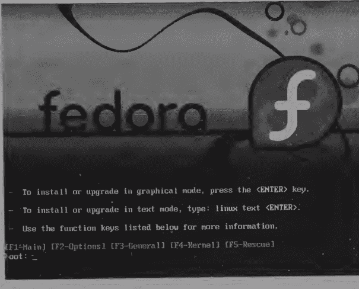

- 若要在图形模式下安装或升级，请按 `<ENTER>` 键。
- 若要在文本模式下安装或升级，请输入：`linux text <ENTER>`
- 使用下方列出的功能键获取更多信息。
- F1(主) (F2-选项) (F3-通用) (F4-正常) (F5-救援)

`root`: _ _

图 2.1 安装启动提示。

“OK”会验证配套 DVD-ROM 的完整性，需要几分钟时间完成。在首次使用系统时，确认系统安装盘的完整性通常是一个好主意，下面的步骤将介绍此过程。或者，你可以选择“Skip”（跳过）后按“OK”来跳过验证并立即继续安装。


`<Tab>`/`<Alt-Tab>` 在元素间切换 | `<Space>` 选择 | `<F12>` 下一页

图 2.2 媒体测试屏幕。你可以验证内容，也可以跳过此操作立即继续。

如果你选择测试安装媒体，接下来将看到图 2.3 所示的屏幕。此时，选择“Test”（测试）选项开始媒体测试。图 2.4 显示了正在进行的媒体测试。

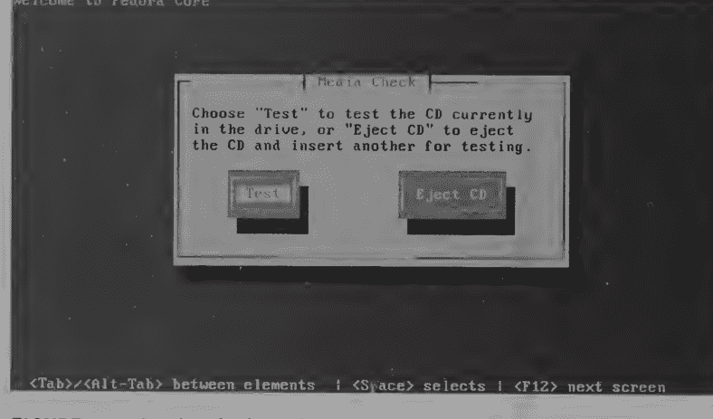

图 2.3 开始对安装媒体进行完整性测试。

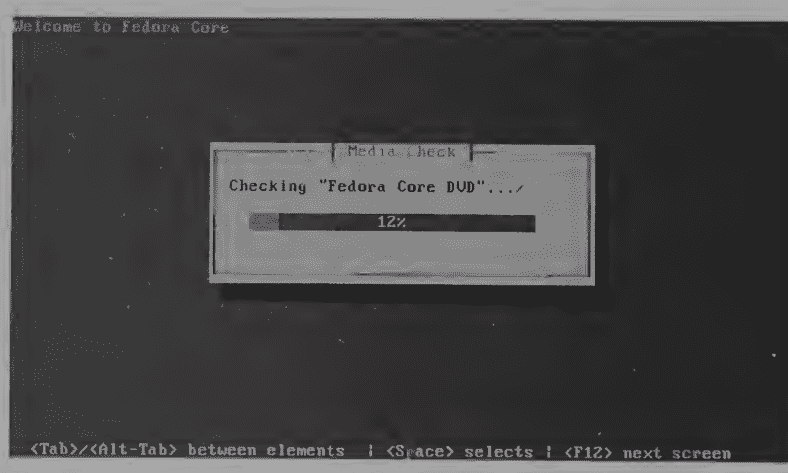

图 2.4 正在进行的媒体测试。

当媒体测试完成后，你应该看到类似图 2.5 所示的屏幕，确认安装媒体是完好的。选择“OK”确认结果。在图 2.6 所示的下一个屏幕上，选择“Continue”（继续）进行安装。

## 安装 Linux (Fedora) 系统 11

欢迎来到 Fedora Core

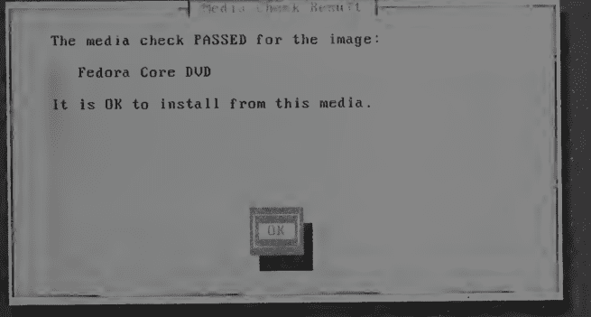

`<Tab>`/`<Alt-Tab>` 在元素间切换 | `<Space>` 选择 | `<F12>` 下一页

**图 2.5** 安装媒体测试结果确认。

欢迎来到 Fedora Core

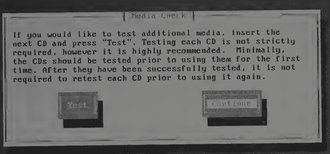

`<Tab>`/`<Alt-Tab>` 在元素间切换 | `<Space>` 选择 | `<F12>` 下一页

**图 2.6** 完成媒体测试并继续安装。


在安装程序探测你的计算机以了解硬件和设备后，你将看到图 2.7 所示的欢迎屏幕。当你准备好继续安装时，左键点击“Next”（下一步页）。


图 2.7 安装欢迎屏幕。

## 基本系统信息

你将通过一系列问题；第一个问题要求你在安装期间选择语言，如图 2.8 所示。指向选择项并左键点击该项来选择语言。左键点击“Next”继续。

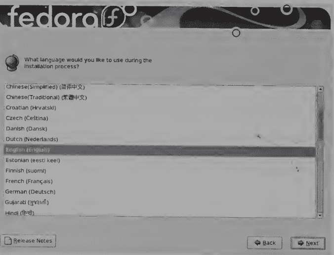

图 2.8 选择语言。

## 安装 Linux (Fedora) 系统 13

接下来，要求提供合适的国家或地区以确定键盘信息，如图 2.9 所示。左键点击所需的国家或地区，然后左键点击“Next”继续。

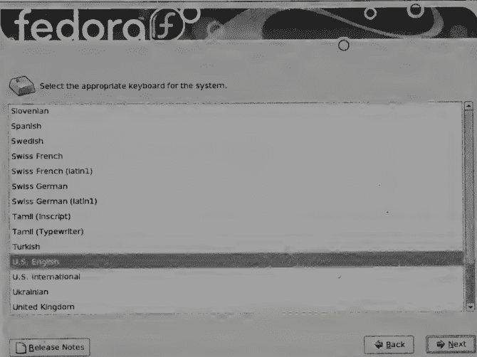

图 2.9 为键盘信息选择国家或地区。

## 硬盘配置

安装程序可以通过多种方式安装 Fedora 系统。例如，系统可以安装到未使用的磁盘、磁盘的未使用区域或现有系统。首先，你决定磁盘布局和磁盘分区，或如何划分磁盘，如图 2.10 所示。为了简单起见，让安装程序自动创建分区或使用默认布局。图 2.10 中的选择将使用未分配或未分区的磁盘。如果你希望控制磁盘空间分配，选择“Review and partitioning layout”（检查并分区布局）选项，这样你可以定义分区的数量和大小。在图 2.10 的中间，安装程序还会询问应该使用哪块磁盘。在这里，你通过在磁盘旁打对钩来选择你的磁盘。

## 18 UNIX/Linux 简介

现在点击“Applications”（应用程序）类别，如图 2.16 所示。在此类别中，选择“Authoring and Publishing”（创作与出版）包，例如所示。“Authoring and Publishing”包含了你将在第 8 章“文本格式——创建和查看排版文档”中用于创建和查看专业排版文档的软件。


图 2.16 添加要安装的“创作与出版”包。

在“Applications”类别中，选择“Engineering and Scientific”（工程与科学）应用程序包，如图 2.17 所示。该类别中的其他包应该已经如图 2.17 所示被勾选了。


图 2.17 添加“工程与科学”应用程序。

## 安装 Linux (Fedora) 系统 19

在“Development”（开发）类别中，你希望确保选择了“Development Tools”（开发工具）包，如图 2.18 所示。此包将为第 10 章“C/C++ 编程”提供必要的工具。该类别中的其他包可以选择，但书中的练习不需要它们。

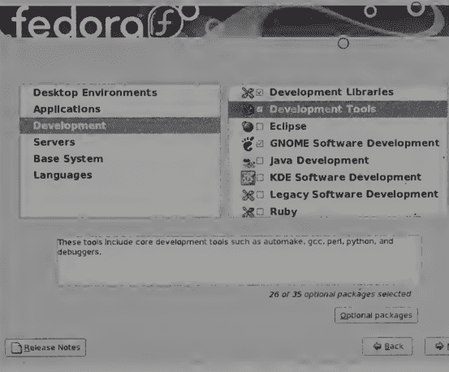

图 2.18 确保选中了“开发工具”。

你可能需要的另一个包是“Base System”（基础系统）类别中的“System Tools”（系统工具）包，如图 2.19 所示。你还应该确认该类别中的其他包已如图 2.19 所示被勾选。

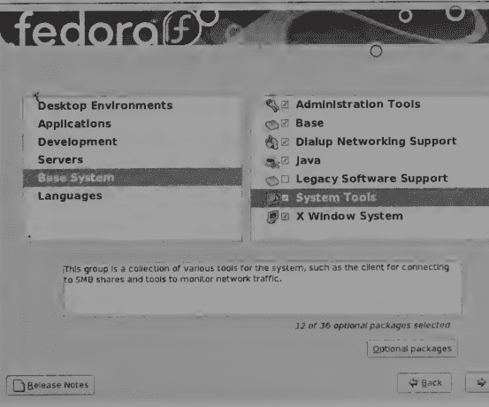

图 2.19 确保选中了“系统工具”。

# UNIX/Linux 简介

一旦你按照描述选择了软件包，点击“Next”（下一步）继续安装。安装程序将花费几分钟时间确认所选软件包是一致的并具有必要的支持。之后，你将看到一个确认开始实际安装的屏幕（图 2.20）。此时，点击“Next”确认可以开始安装。

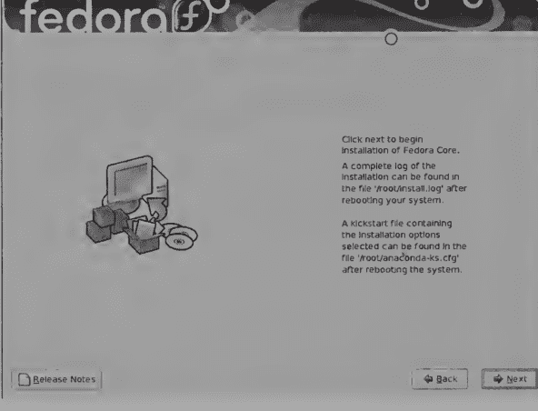

图 2.20 确认可以开始安装的屏幕。

一旦开始安装，就会出现进度屏幕，如图 2.21、2.22 和 2.23 所示。在此期间，安装程序会执行任何必要的格式或分区操作，然后将系统安装到磁盘上。

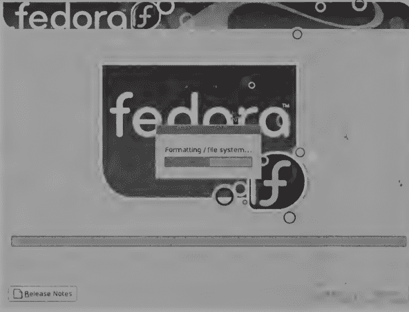

图 2.21 磁盘格式化的进度屏幕。


图 2.22 安装进度屏幕。


图 2.23 软件包安装进度屏幕。

## 重启已安装的系统

当安装完成后（图 2.24），安装程序会要求你重启系统。确保从系统中移除随附的 DVD-ROM 并左点击“Reboot”（重启）按钮重启系统。

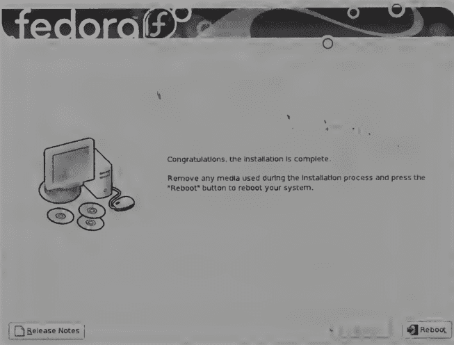

图 2.24 安装完成通知。

当系统开始重启时，你的电脑屏幕将如图 2.25 所示。此时不要按任何键，以等待安装完成。将来，你可能通过在此屏幕上按键来选择你想要启动的操作系统（前提是你有多个一个操作系统）。然后你将进入一个菜单，可以在其中选择你希望启动的 Linux 系统或其他操作系统。

##img/e3ac56d195b48617d5ae42cd57458af3_33_1.png)

图 2.25 初始启动屏幕。

## 安装 Linux (Fedora) 系统 23

一旦系统完全安装完成，在启动屏幕上，你可以按键查看可启动的操作系统菜单。几秒钟后，系统将自动启动并根据你所做的精确规格配置操作系统。图 2.26 显示了你在此期间可能看到的屏幕之一。


图 2.26 启动过程的示例屏幕。

系统在安装后首次启动时，会出现一个欢迎屏幕（图 2.27），你会被问一些最后的配置问题。点击“Next”继续。

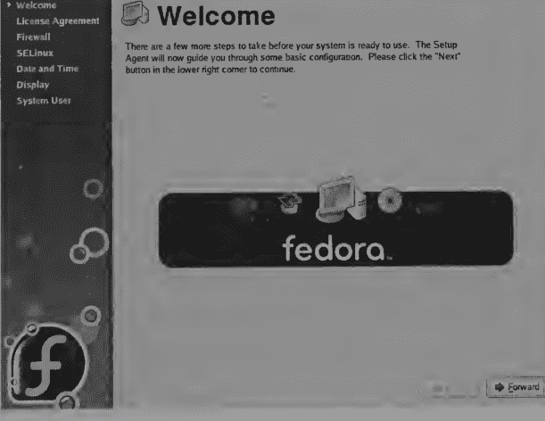

图 2.27 安装后欢迎屏幕。

## 24 UNIX/Linux 简介

第一个问题询问你是否接受 Fedora 许可，如图 2.28 所示。请阅读整个许可并选择“Agree”（同意）。 系统 25


图 2.29 配置系统防火墙。

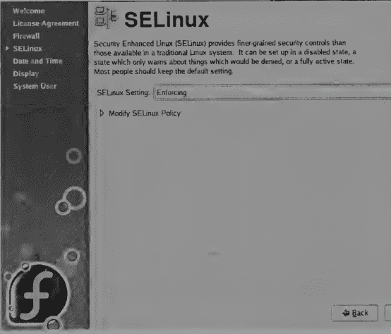

图 2.30 配置系统安全级别。

下一个屏幕如图 2.32 要求你确认或修正关于显卡和显示器的信息。在大多数情况下，这些信息是准确的，可以通过左点击“Forward”进行确认。然而，如果显卡或显示器的名称或型号显示不正确，点击“Configure”按钮按照指示指定硬件。如果你选择“Configure”选项，特定显卡或显示器的文档可能会很有用，因为它确保你准确指定了其名称和型号。或者，如果你想要不同的分辨率或色彩深度，点击这些设置旁边的上下箭头找到所需的分辨和颜色数量。设置完成后，确认并点击“Forward”继续。

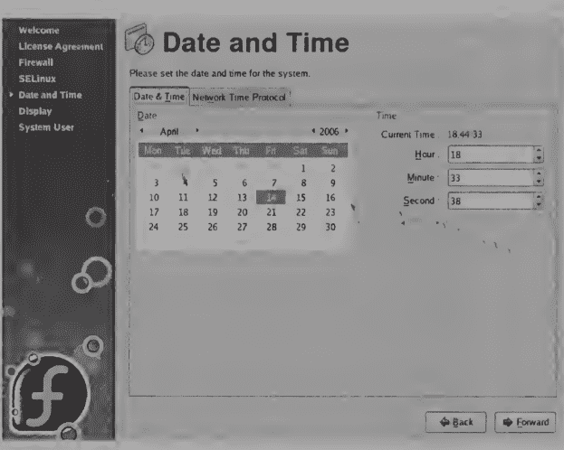

图 2.31 设置当前日期和时间。

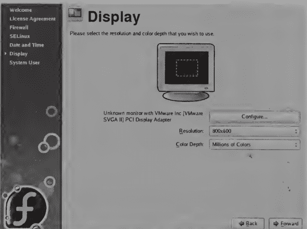

图 2.32 确认显示器和显卡。

## 26 Unix/Linux 简介


现在是创建一个用户账户以便你登录系统了。图 2.33 说明了这一步。输入你想要使用的用户名。例如，图 2.33 指定“book”为用户名，因为这是一个适用于读者的通用用户名。然而，你可以输入任何想要的用户名，只需记住它即可。用户名可以是名字、姓、昵称等。在下方的行中输入你的全名，在第三行指定你的密码。密码长度至少应为六个字母或数字，并且是你容易记住的内容。注意，当你输入密码时，每个击键都会显示为星号而不是你输入的实际值或字母。这种安全措施防止他人获取密码，适用于大多数操作系统。在第四行中重新输入密码以确认输入正确。如果第三行和第四行不匹配，你将被要求重新输入密码。提供所有信息后，点击“Finish”完成继续。

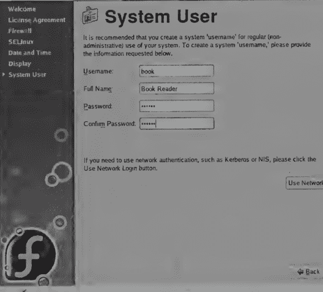

图 2.33 使用用户名和密码创建账户。

如果电脑有安装程序检测到的声卡，将出现如图 2.34 所示的屏幕。点击右箭头或播放按钮播放示例声音并检查声卡设置。声音播放完毕后，你将被要求确认它们是否就绪。如果没听到声音，点击“Yes”后点击“Finish”继续。如果听到了声音，点击“No”以查看额外帮助的说明。

最后，安装现在已完成，你将进入如图 2.35 所示的登录屏幕。输入你在图 2.33 中创建的相同用户名，随后输入后续屏幕上的确认密码。你将在第 3 章中学习登录和使用操作系统。

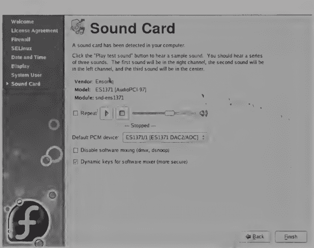

图 2.34 音频测试屏幕。


图 2.35 登录界面示例。

## 总结

在本章中，你学习了安装时的考虑因素以及在开始安装前需要回答的问题，并完成了随附 DVD-ROM 提供的 Fedora Linux 系统的安装和配置步骤。你还学习了在后续章节中将使用的账户设置程序。第 3 章将继续讨论登录操作系统、更改密码以及使用其他功能。

## 练习题

- 1. 在安装 UNIX/Linux 系统之前，必须检查的某些考虑因素或问题有哪些？
- 2. 如果安装的 UNIX/Linux 系统将位于网络，在安装系统之前我们必须回答哪些与网络相关的问题？
- 3. 是否可以在安装了另一个操作系统的同一计算机上安装 Linux 系统？请解释为什么可以或不可以。
- 4. 无论系统的角色如何，所有的 UNIX/Linux 系统都是相同的吗？例如，旨在支持编程的系统与旨在支持数据库的系统相同吗？请解释为什么可以或不可以。

# 开始使用 UNIX/Linux

## 本章内容

- 登录
- 用户界面
- 密码
- Shell 概述
- 命令和实用程序语法
- 发布命令或应用程序
- 安装随附的 DVD-ROM 文件
- 注销
- 额外信息
- 练习题

在本章中，你将首次接触 UNIX/Linux，并学习如何与系统进行交互，从登录系统的程序开始。登录后，你将发现如何利用你的界面，以便跟后续章节介绍的讨论和示例。本讨论解释了通用的命令结构或语法，即决定哪些命令格式是可以接受的、哪些是不可接受的规则和模式。然后你将学习如何注销。

## 登录

要访问 UNIX/Linux 系统，你必须首先登录系统，如图 3.1 所示。你的登录界面可能看起来不同，但登录时涉及的步骤是相似的。此时，你需要为你的账户指定用户名和密码。在图 3.1 和类似的登录界面中，你也可以通过先选择“Session”会话按钮来选择你将使用的窗口管理器。

如果你为了个人使用安装了 UNIX/Linux 系统，你需要创建一个账户来登录系统，正如第 2 章“安装 Linux (Fedora) 系统”中所解释的那样。你可以使用图 3.1 所示的相同用户名和密码，也可以创建你自己的。如果你在工作或学校使用现有系统，请参考系统管理员分配的账户用户名和密码。


**图 3.1** UNIX/Linux 登录界面示例。

当你第一次登录系统时，你还决定了系统的外观和工作方式，例如屏幕的颜色和选择图标所需的鼠标点击次数。这些步骤在不同系统之间有所不同，请参考你系统的帮助指南。

## 用户界面

登录后，你就可以与系统进行交互，无论是命令行界面还是图形界面。这两种界面都很重要，你将在接后的章节中学习更多关于它们的知识。

### 命令行界面

用户界面的基本形式是命令行界面，这是一种纯文本或图形的方式，用户通过这种方式输入命令并接收生成的文本输出。在非图形系统上，这是唯一的可用界面。另一方面，如果你在第 2 章中，在具有图形能力的计算机上安装了这样的系统，那么你现在不会看到命令行界面，但你很快就会学习如何获取一个。

图 3.2 所示的命令行界面示例显示了行首的命令提示符，一直到并包含 `$` 符号。命令提示符或简称为 prompt 表示界面正在等待命令形式的工作。命令也可以指应用程序或实用程序——即完成特定任务的程序。从这里开始，你可以发布命令，正如在本章及后续章节中后文描述和所示的那样。系统将按照指令执行输入的命令。

```
"$ []
```

图 3.2 典型的命令行界面。

命令提示符的外观可以更改以显示不同的文件视图。在第 11 章“基础账户和系统维护”中，你将学习更改它的外观，并利用如图 3.3 所示的基础提示符。

图 3.3 典型的提示符


KDE 界面

一旦登录，你就可以与系统进行交互，无论是命令行界面还是图形界面。这两种界面都很重要，你将在接后的章节中学习更多关于它们的知识。

### 图形界面

如果你的系统提供了图形界面，你将看到如图 3.3、3.4 或 3.5 所示的界面。图 3.3 显示由 KDE 提供的界面，其 $ 目录。


图 3.4 GNOME 图形界面

在登录界面，通过先选择“Session”按钮来选择你将使用的窗口管理器。图 3.5 显示由 FVWM 提供的精简、高效的界面。

在图形界面中，你使用鼠标点击空区域来打开菜单。图形是是且易于于的的。

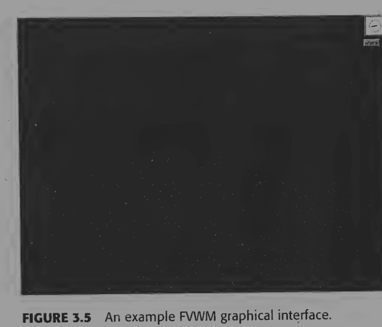

## 在图形界面中使用命令行

即使在图形界面可用，你仍然可以使用命令行界面来开始操作。这种方法允许你以更统一、高效的方式访问 UNIX/Linux 的真实力量，正如第 1 章“UNIX 和 Linux 概述”中所述以及在本章后文中提到的那样。

要在图形界面中查找命令行，请打开终端窗口，这是一个在图形显示中提供专用文本显示器外观的窗口。通过这个终端窗口，不同界面之间不同，在仅使用文本界面的情况下输入命令并查看结果。以下解释了如何在 KDE、GNOME 和 FVWM 中打开命令行。

### KDE

要在 KDE 图形界面中打开终端窗口，你需要点击左下角的图标可能是 F、红帽形象、K 或其他图像来打开通用操作或程序类别的菜单。从这里开始，将鼠标悬停在“System”上打开另一个菜单。接下来，点击“Terminal”终端操作，如图 3.6 所示。这将打开一个包含命令行界面的终端窗口，如图 3.7 所示。

按照类似的步骤序列进行操作。在这种情况下，你再次左键点击左上角的“应用程序”Applications 菜单按钮并选择“附件”Accessories，如图 3.8 所示。然后你左键点击“终端”Terminal 操作。

图 3.9 显示 GNOME 中带有命令行的终端终端窗口。


图 3.8 在 GNOME 中打开终端窗口。


图 3.9 GNOME 中带有命令的终端窗口。

### FVWM 及其类似的窗口管理器

某些图形图形用户界面如 FVWM 通常是窗口管理器，它们是图形界面的精简版本，因为最初不会显示任何图标。要在这些窗口管理器中打开菜单，你通常左键点击屏幕的空白区域，如图 3.9 所示。鼠标点击和菜单选择各不相同，因为这些窗口管理器通常可以由系统的用户或管理员进行配置。图 3.10 显示的菜单包含一个名为“xterm”的选项，它可以打开一个终端窗口。此菜单选项实际上指的是一个名为 xterm 的应用程序，它通常用于在图形界面中打开终端窗口。图 3.11 将显示 FVWM 中打开的终端窗口的示例。


图 3.10 在 FVWM 中打开终端窗口。


利用这些方法，你可以打开多个终端窗口并同时完成多种形式的工作。例如，通过在后续章节中使用这些技术，你可以在一个终端窗口中编辑文件，同时在另一个终端窗口中阅读在线文档，甚至在第三个终端窗口中编译并运行程序。

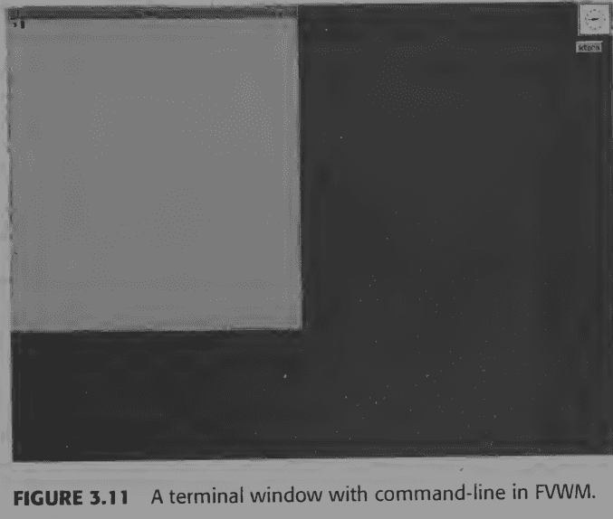

## 密码

每个账户都需要密码来登录。当你设置账户时，使用了一个允许你登录账户的密码。在更改之前，你将继续使用相同的密码。要更改密码——定期更改密码是一个好主意——请使用 `passwd` 命令。你可以像图 3.12 所示输入 `passwd` 命令来更改密码。`passwd` 会要求你输入当前密码和新密码。（出于安全考虑，输入的密码不会显示在屏幕上。）`passwd` 会要求再次输入一次新密码以确认输入正确。

```
$ passwd 
```

图 3.12 指定新账户密码。

如果当前密码和新密码指定正确，`passwd` 将接受你的账户的新密码并发布与图 3.13 所示类似的确认信息。从现在起，你在登录时需要使用新密码，直到你再次更改它。

### UNIX/Linux 简介

```
Changing password for book
(current) UNIX password:
Enter new UNIX password:
Retype new UNIX password:
passwd: password updated successfully
*
```

图 3.13 密码修改修改的确认。

### Shell 概述

在 UNIX/Linux 中，你经常听到 shell 这个词。简单来说，shell 是你的程序，它接受/发布命令并按照指示在屏幕上显示结果。许多 shell 在 UNIX/Linux 系统上运行，但特定系统上的可用 shell 可能会不同。第 11 章描述了你可以应用于下方任何一个 shell 的配置。

`sh`（Bourne shell 的缩写）是作为命令行界面的早期 shell。

#### csh 及其 tsh

`csh`（C shell 的缩写）是另一种在 UNIX/Linux 系统中常见的 shell。它是使用 C 语言语法开发的。

#### ksh

`ksh`（Korn shell 的缩写）的开发是为了结合 `sh` 和 `csh` 的功能。

#### bash

`bash`（Bourne Again Shell 的缩写）是 `sh` 的一个版本。

### 确定你的默认 shell

要确定你的默认 shell，请查看环境变量 `SHELL`。每个 UNIX 账户都有默认 shell。你可以通过输入以下命令查看它：

```
$ echo SHELL
/bin/bash
```

图 3.14 显示账户的默认设置。

```
$ passwd -s
Password:
Changing the login shell for book
Enter the new value, or press return for the default
  Login Shell [/bin/bash]: /bin/csh
$ []
```

**图 3.17** 使用 `passwd` 更改默认 shell。

### 命令与工具语法

UNIX/Linux 命令和工具的语法（结构）是统一的。命令（称为工具语法）由以下三个部分组成，顺序顺序如下：

- **名称 (Name)**：命令、工具或程序的名称。
- **选项 (Options)**：改变命令或工具行为的零或多个指定规范。
- **参数 (Arguments)**：为命令或工具执行其工作而提供的零或多个信息项。

第一部分*名称（name）*是指命令的名称，或者是存储该程序工具的文件名。名称是始终必须指定的。第 4 章解释了指定名称的不同方法。

第二部分*选项（options）*指的是你可以做出的以更改命令或工具工作方式的规范。这些规范以连字符 `-` 开头，通常是单个字母或数字，尽管某些命令和选项可能使用双连字符或字母/数字序列。根据命令或工具的不同，选项的数量和含义会有所不同。某些系统和选项需要两个连字符和多个字母，正如你在第 11 章中看到的。你将在后续章节中看到许多命令和工具选项的示例。

第三部分*参数（arguments）*是指你提供给运行你的程序的命令（应用程序）的信息。参数的数量和预期含义在不同的命令和应用程序之间变化。某些命令和应用程序不接受参数；另一些接受精确的数量，例如恰好一个或两个。然而，另一些可能接受任意数量。根据其预期含义，参数可以是数字或字母序列。你将在后续章节中看到许多各种参数的示例。

请记住，参数出现在选项之后，且参数不以连字符开头。当你输入一个既包含选项包含参数的命令时，这些规则区分了选项和参数。第 4 和第 5 章“中间文件管理”解释了如何学习某些命令或工具可用的选项，以及命令或应用程序期望的参数。

#### 发送命令或应用程序

既然你现在熟悉了发布命令/工具的语法/结构，下面将解释如何通过命令行界面发布（调用或启动）它们的方法。虽然这里展示了某些命令，但相同的技术也适用于你通过命令行发布的其他命令或其他应用程序。

##### 通过名称

通过遵循前面提到的命令语法，你可以通过在命令行输入名称以及任何必要的选项和参数来发布命令。例如，考虑 `uptime` 应用程序，它显示系统性能的摘要（第 5 章解释了 `uptime` 的目的及其信息）。在本次演示中，你使用其名称且不带任何选项或参数来首次发布，如图 3.18 所示。

```
$ uptime
16:10:03 up 3:11, 20 users, load average: 1.08, 0.49, 0.39
$
```

图 3.18 通过指定其名称发布命令。

虽然这种方法看起来显而易见，并且对于首次发布命令是有效的，但它并不是重复命令最有效或最高效的方法，正如你将看到的。

##### 通过部分名称

许多 shell 提供了一种称为“命令行补全”的功能，帮助你输入命令和文件名。（有关文件名的更多信息请参见第 4 章。）你输入命令或文件名的前几个字母，按下一个或两个键，然后 shell 会自动提供剩余信息。使用 `csh`、`tsh` 和 `bash` 时，按下 `<Tab>` 键；使用 `ksh` 时，按下 `<ESC>` 或 `<ESC><ESC>`，取决于你的账户配置。正如第 11 章所解释，命令必须在命令 `PATH` 变量中才能完成你的请求。如果你在按照后续章节“确认、启用和保存命令历史”中的步骤操作遇到问题，第 11 章还提供了几种额外的配置来启用此补全功能以工作。然而，大多数 shell 已经已经在无需额外配置的情况下提供了补全功能。

虽然命令行补全可以是命令行交互的一种有用且高效的机制，但请记住 shell 必须将输入的前缀与单个命令（文件名）精确匹配。如果 shell 实际上无法匹配前缀，shell 将不会完成你的请求，你必须输入额外信息。为了说明，考虑两个命令 `chmod` 和 `chown`，它们都以 "ch" 开头。（这些命令在第 5 章中解释）。如果你只是在命令行输入 "ch" 并按下 `<tab>`、`<ESC>` 或 `<ESC>`，shell 将不会补全；它无法区分你想运行的两个命令。因此，shell 会等待另一个字母。如果你输入 "m"（作为第三个字母，导致变成 "chm"），shell 现在可以区分字母并理解它必须运行命令 `chmod`。它补全命令名和命令行并执行请求。

- 如果 shell 无法根据给的前缀区分命令或文件名，某些 shell 会（在屏幕上）打印以这些字母开头的可能的命令（或文件）组合，以便你选择该组合并输入剩余字母。

##### 通过命令重复

许多 shell 允许你重新发布之前发布的命令。这种重新发布之前发布的命令的能力非常有用。许多 shell 允许你使用方向键在你的命令历史中循环。其他 shell 可能允许你使用快捷键来搜索历史。

### 确认、启用和保存命令历史

在查看重复命令的方法之前，你必须确保你的 shell 配置正确。下面描述了如何判断是否已启用

#### csh 和 tsh

如果你使用 `csh` 或 `tsh` 作为你的 shell，环境变量 `history`（注意全小写）被用于启用或禁用历史。如果 `history` 不包含值或值为 0，则你的 shell 目前没有利用命令行历史来记住最近的命令，你无法使用命令重复。另一方面，如果 `history` 包含数值，则 shell 记住了许多命令。

要确认你的 `csh` 或 `tsh` `history` 是否已启用，你可以执行图 3.19 所示的命令。如果你在响应中看到非零值，你的 shell 就记住了许多命令。在示例中，值为 25，表示 shell 记得最后 25 条命令。注意图 3.19 中的提示符看起来与其他提示符有所不同。它是 `csh` 提示符的示例，与其他 shell 提示符（例如 `sh` 或 `bash`）不同。第 11 章详细解释了如何更改你的命令行提示符以具有不同的外观。

```
$echo history
25
>
```

图 3.19 在 `csh` 或 `tsh` 中确认启用命令历史。

## 开始使用 UNIX/Linux


在 bash shell 中，通过设置环境变量 `HISTSIZE` 为你想要记住的最近命令的数量，可以启用命令历史和重复功能。如果 `HISTSIZE` 包含 0 或没有任何值，则 bash 中将启用命令历史和重复功能。图 3.21 显示了你如何判断你的 bash shell 是否维护了命令行历史，如果是，则记录了多少条命令。

```bash
$ echo $HISTSIZE
100
$ []
```

图 3.21 确认 bash shell 是否启用了命令历史。

与 tsh 和 test 一样，如果没有报告的数值（或值为 0），你可以通过将 `HISTSIZE` 设置为非零数字值来启用命令行历史，如图 3.22 所示。在此处，你希望记住最后的 200 条命令。与 tsh 和 test 一样，你可以通过像图 3.22 所示的命令来启用命令行历史，或者在已经启用的情况下更改记录的命令数量。

```bash
$ HISTSIZE=200
$ []
```

图 3.22 在 bash 中启用命令历史。

bash shell 可以在你退出后保存命令历史。当你继续工作并重新执行上次登录时的命令时，此功能非常有用。要保存你的命令历史并将 `HISTSIZE` 设置为某个数字，必须设置两个变量：`HISTFILE` 和 `HISTFILESIZE`。`HISTFILE` 包含退出后存储命令历史的文件名。通常，这是你家目录下一个名为 `~/bash_history` 的文件。（顺带提一下，第 4 章将介绍家目录、`-` 符号以及以点开头的文件。）`HISTFILESIZE` 包含最近保存的命令数量。通常，`HISTFILESIZE` 的数值与 `HISTSIZE` 相同，尽管这不是要求的。图 3.23 显示了你如何判断 bash 是否启用了命令保存。如果你为 `HISTFILESIZE` 使用非零值并为 `HISTFILE` 使用一个值（如图 3.23 所示），你的 shell 将在你退出时保存命令行历史。

```bash
$ echo $HISTFILESIZE
/home/book/.bash_history
$ echo $HISTFILESIZE
200
$ []
```

图 3.23 确认 bash 中是否保存了命令历史。

另一方面，如果命令行历史没有被保存，你需要为那两个环境变量设置适当的值。图 3.24 显示了你如何设置与图 3.23 所示相同的值。

```bash
$ HISTFILE="~/bash_history"
$ HISTFILESIZE=200
$ 
```

图 3.24 在 bash 中启用命令历史。

当对你的账户进行更改时（例如启用命令历史），这些更改是临时的，并且只在你登录到命令行期间保持有效。第 11 章解释了你如何使更改变为永久性，以便它们在你退出并重新重新登录时仍然有效。

## 重复上条命令

重复命令的一种方法是通过 csh、tsh 和 bash 在命令行中重复通过命令行执行的上一条命令。ksh 处理这种重复的方式略有不同，该方法将在后文中讨论。

### csh, tsh 和 bash

csh、tsh 和 bash 等 shell 通过在特定的命令行提示符处输入 `!!` 来重复在命令行执行的上一条命令。例如，考虑你刚刚执行的名为 `uptime` 的工具。现在，假设你想在该命令行处重新执行 `uptime`，以便例行监控系统性能。如果 `uptime` 是在该命令行执行的上一条命令，你可以通过输入 `!!` 来快速重复它（如图 3.25 所示），而无需重新输入命令。此时连续使用 `!!` 将重复该命令。

```bash
$ !!
uptime
16:12:23 up 3:13. 20 users, load average: 0.76, 0.57, 0.43
$ 
```

图 3.25 在 csh、tsh 中重复上条命令。

现在，如果你执行了另一个命令（例如 `date`），那么它就变成了上一条命令。在此调用 `!!` 将重复 `date` 命令，如图 3.26 所示。

```bash
$ date
Sun Jan 8 11:46:36 EST 2006
$ !!
date
Sun Jan 8 12:15:48 EST 2006
$ 
```

图 3.26 在 csh、tcsh 或 bash 中重复上条命令的另一个示例。

### ksh

ksh shell 重复上一条命令，在该特定的命令行处你按下 `<ESC>` 键后按 `<k>` 键。上一条命令会显示，你可以按 `<Enter>` 启动它。

## 通过前缀重复之前的命令

重复命令的另一种方法允许你重复命令行中的*最近*命令，而不一定是最后执行的命令。这种方法涉及（在该命令行处）发布一个单个 `!`，后面紧跟命令的前缀（一个或多个字母）。例如，你想重复 *uptime* 命令，但它不是最后执行的命令。因此，你输入 `!`，如图 3.27 所示。shell 将重复以该前缀开头的最近的命令。

```bash
$ !uptime
uptime
16:12:23 up 3:13. 20 users, load average: 0.76, 0.57, 0.43
$ 
```

图 3.27 通过前缀重复命令。

## 通过序列重复之前的命令

重复命令的第三种方法是指定命令在历史中的序列号。例如，如果你想重复最近的第五条命令，只需执行 `!5`。当你需要重复在几个步骤之前执行的命令时，这种方法 特别有用。

# UNIX/Linux 简介

## csh, tcsh, 和 bash

在这三个 shell 中，在命令行界面按下 <up-arrow> 键会显示最后执行的命令。每当你按下 <up-arrow> 键，就会显示上一条命令，直到你到达执行的第一条命令或历史记录中最早的命令为止。另一方面，每当按下 <down-arrow> 键，就会显示最近的下一个命令。通过这种方式使用 <up-arrow> 和 <down-arrow>你可以搜索最近执行的感兴趣命令。

一旦找到命令，你可以按下 <Enter> 重新执行该命令；或者，如果你想执行一个略有不同的命令版本并对其进行编辑，可以使用 <left-arrow> 和 <right-arrow> 分别将光标向左或向右移动到命令中的所需位置。你可以通过输入字符来插入字母、数字或符号。你还可以使用 <Backspace> 或 <del> 分别删除光标前或光标下方的字符。使用这些键，你可以随心所欲地编辑命令并通过 <Enter> 执行编辑后的命令。

## ksh

在 ksh 中，按下 <ESC> 后，你会在历史中向后移动，每次按下 <k> 键都会向后移动到显示前一个的命令，直到你到达执行的第一条命令或历史记录中最早的命令为止。例如，一旦按下 <ESC>，第一次按下 <k> 将显示最后一条命令。下次按下 <k> 将显示上一条命令，依此类推。另一方面，每次按下 <j> 键都会显示比当前显示的更最近的下一个命令。使用 <k> 和 <j>你可以根据需要导航到较旧的命令并移动到最近的命令。

如果使用 <ESC>、<k> 和 <j> 无法导航历史列表，请尝试在命令行输入 "`set -o vi`" ，如第11章“命令行配置与历史记录导航配置”节中所解释的那样。

一旦找到感兴趣的命令，你同样可以重新执行该命令，或者先编辑命令再执行后的版本。要编辑命令，可以使用第 7 章“编辑文件”中描述的 vi 编辑器命令进行导航和编辑。

# 安装随附 DVD-ROM 文件

随附 DVD-ROM 包含书中各个示例中使用的系列文件。通过将这些文件安装到你的账户中，你可以遵循书中的示例获得“实践”经验，这将帮助你学习所介绍和讨论的概念。你需要将这些文件安装到账户中才能访问和使用它们——你无法直接访问 DVD-ROM 上的文件。这些文件还包含了演示灯片，可以用于第2章安装的 OpenOffice 应用程序，也可以用于系统中可能存在的其他演示文稿。下将解释如何在 KDE 和 GNOME 两个常见环境中安装这些文件。

## 在 KDE 中安装文件

要在 KDE 环境中安装文件，首先将随附的 DVD-ROM 放入 DVD 设备。你可能会看到一个显示为：“正尝试运行系统-cdinstall-helper...”的窗口。如果出现该窗口，请取消。接下来，双击桌面区域上的 CD 或 DVD 图标。这将打开一个类似于图 3.32 所示的窗口。

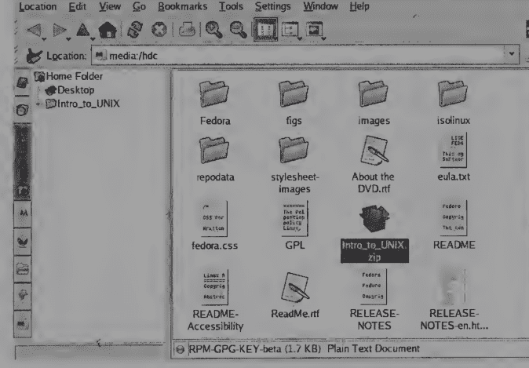

**图 3.32** 在 KDE 中右键点击用于随附 DVD-ROM 的 `Intro_to_UNIX.zip`。

在图 3.32 所示的窗口中，你将右键点击高亮的 `Intro_to_UNIX.zip` 图标。打开一个菜单，你将鼠标指向菜单中的“Extract（提取）”选项。接下来打开一个子菜单，你选择“Extract To...（提取到...）”，如图 3.33 所示。

接下来，你将看到一个如图 3.34 所示的窗口。顶部的框包含一系列以你的用户名结尾的字母（更多信息请参见第 4 章）。点击窗口中的“OK”。如果打开了显示消息“This archive is read-only（此归文件为只读）”的窗口，点击“OK”关闭该窗口并继续。


图 3.33 在 KDE 中选择提取位置。

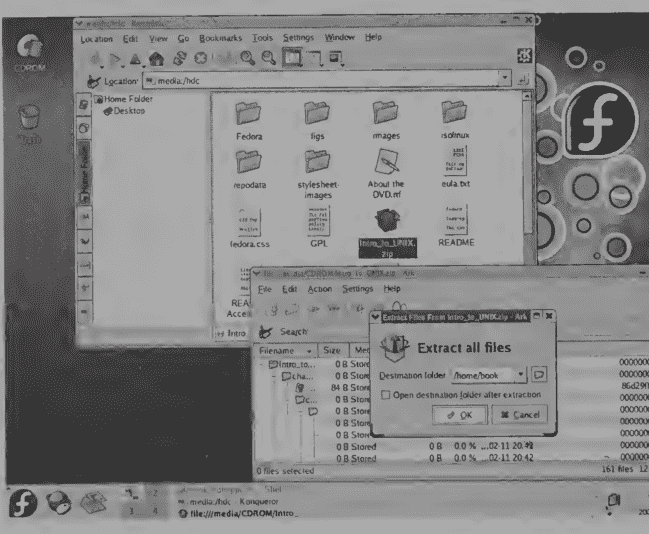

图 3.34 在 KDE 中选择提取到你的账户。

文件将提取到你账户中名为 `Intro_to_UNIX` 的文件夹或子目录下。之后，右键点击桌面上的 CD 或 DVD 图标并选择“`Eject`（弹出）”选项来弹出随附的 DVD-ROM，如图 3.35 所示。


图 3.35 在 KDE 安装文件后弹出 DVD-ROM。

## 在 GNOME 中安装文件

要在 GNOME 中向你的账户安装示例文件和演示灯片，首先双击桌面上出现的 CD-ROM 或 DVD-ROM 图标。这将打开一个如图 3.36 所示的窗口。

| | Edit | View | Places |
|---|---|---|---|
| | | | Help |
| About the DVD.rtf | | | | css |
| The port to | | intro_to_UNIX.zip | ReadMe |
| GPL | | Linux | ReadMe |
| Fedora | | | |
| README | | RELEASE-NOTES |
| CDROM | | Accessibility | |

图 3.36 包含随附 DVD-ROM 内容的 GNOME 窗口。

在图 3.36 窗口中，右键点击 `Intro_to_UNIX.zip` 图标，打开一个菜单。从该菜单中选择“Extract To...（提取到...）”，如图 3.37 所示。

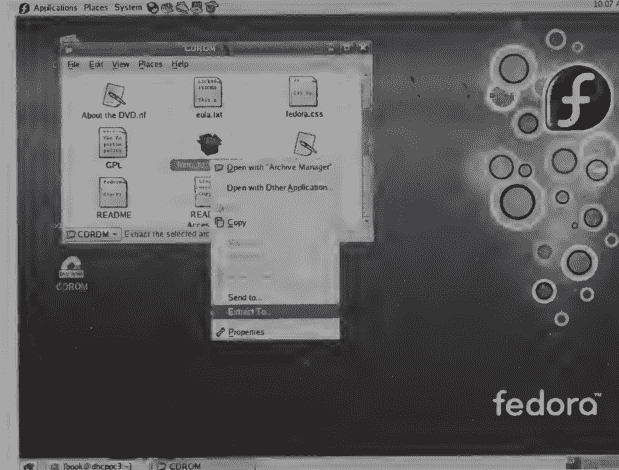

图 3.37 调用提取。

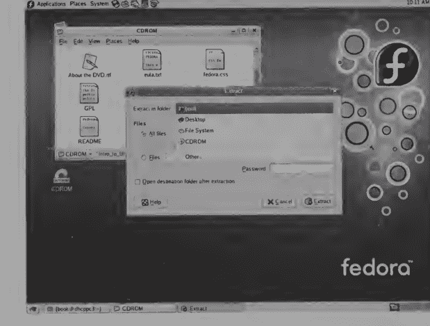

图 3.38 在 GNOME 中选择提取位置。

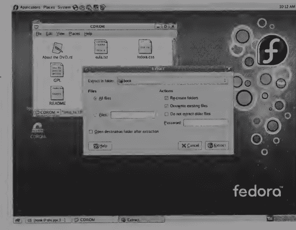

图 3.39 开始提取。

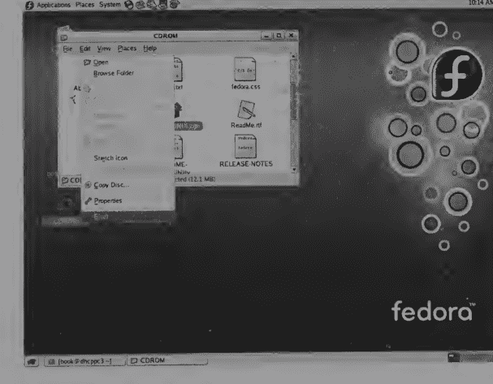

图 3.40 在 GNOME 安装文件后弹出 DVD-ROM。


图 3.41 从 KDE 环境注销。

# UNIX/Linux 入门


图 3.42 退出 GNOME 窗口环境。

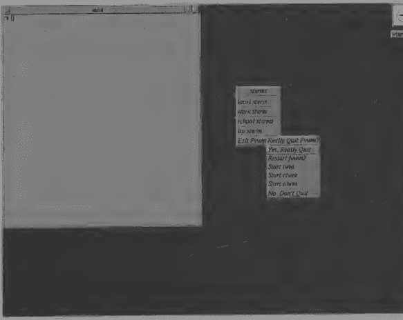

图 3.43 退出 FVWM 窗口管理器示例。

# 表 3.1 所述图形界面的在线资源

| 命令/地址 | 说明 |
| --- | --- |
| www.kde.org | 使用 KDE 环境及其应用程序的文档。 |

# UNIX/Linux 介绍

| 命令/地址 | 说明 |
| --- | --- |
| www.gnome.org | 使用 GNOME 环境及其应用程序的文档。 |
| www.fwwm.org | 使用和配置 FVWM 窗口管理器的文档。 |

## 总结

在本章中，通过查看如何登录、注销以及与操作系统界面（或交互），首次接触了 UNIX/Linux。你学习了图形界面和命令行环境的基本概念，并回顾了如何使用这两者。你学习了命令的结构，以及如何重复和编辑之前发过的命令。最后，你安装了随附 DVD-ROM 中的所有示例文件。


## 练习题

- 1. 列出 UNIX/Linux 系统中发现的图形界面。
- 2. 解释如何更改 UNIX/Linux 账户的密码。
- 3. 解释为什么即使系统提供了图形界面，命令行界面仍然很有用。
- 4. 解释如何在图形界面中打开命令行界面。
- 5. shell（壳）在 UNIX/Linux 中代表什么？
- 6. 列出并描述 UNIX/Linux 系统中发现的不同 shell。
- 7. 我们如何知道自己的账户正在使用哪种 shell？
- 8. 解释我们更改账户中所使用的 shell 的方法。
- 9. 解释 UNIX/Linux 命令或工具的语法。
- 10. 解释通过指定名称的部分内容来发布命令意味着什么。
- 11. 解释如何为你的 shell 使用各种形式的命令重复。

# 4 UNIX/Linux 文件和目录

### 本章内容

- UNIX/Linux 文件系统
- 列出文件和目录
- 使用模式匹配文件名
- 显示文件内容
- 创建文件的简单方法
- 创建目录
- 删除空目录
- 复制文件和目录
- 删除文件和非空目录
- 重命名文件和目录

本章描述了 UNIX/Linux 文件和目录的目的，以及如何管理它们。本章及大多数后续章节中所示示例的设计使你能够以“动手”的方式进行操作。为了实现这一点，请先将随附 DVD-ROM 中的示例文件安装到你的账户中。请参考第 3 章“UNIX/Linux 入门”中的说明来帮助安装这些文件。本章及其余章节假设示例文件已安装，并且你从主目录访问它们，而不是从 DVD-ROM。

# UNIX/LINUX 文件系统

简单来说，UNIX/Linux 文件系统是 UNIX/Linux 操作系统组成部分的文件集合。“文件”的概念代表了一个可以用于各种目的的信息实体。用户在文件中存储简单的文本、文档、数据和其他信息以便以后访问。UNIX/Linux 系统本身使用文件来检索配置数据或账户数据等信息，存储运行或完成程序的信息，甚至跟踪日常活动的结果。最后，你可以使用这些文件存储可以由用户或 UNIX/Linux 系统运行源代码和编译后的程序。

## 文件和目录

为了访问特定文件（例如，读取文件内容），你必须指定文件的名称或文件名。UNIX/Linux 中给文件的命名必须遵循一些规则，但与许多非 UNIX 系统相比要灵活得多。在 UNIX/Linux 文件名中，你可以随心所欲地组合任何字母、数字或下划线 `_`。然而，一个细微的区别是 UNIX 是敏感的，这意味着大写字母和小写字母是不同的。换句话说，字母“a”和“A”被解释为不同的字母。因此，`myfile` 和 `My` 指的是两个不同的文件。

连字符 `-`、`加号` `+` 也可以作为文件名的一部分，但有以下例外或注意事项：由于下文解释的原因，单点 `.` 和双点 `..` 不允许作为文件名；不建议在文件名的开头使用连字符或加号，因为它们可能会影响某些命令或工具的行为（某些工具利用连字符或加号来改变其行为，在第 3 章中描述并在本章稍后部分解释）；其他符号（如 `@`、`#`、`%` 或空格）通常也不建议使用，因为它们可能会影响某些程序或工具。字符是指单个字母、数字或符号。

在 UNIX/Linux 中，目录（在其他系统中称为文件夹）是一种特殊类型的文件，它包含并分组其他文件（甚至是其他目录）以达到组织目的。例如，与特定应用程序的所有源代码都可以存储在某个目录中。这样做，你可以更容易地找到并访问该应用程序的任何文件，因为所有这些文件都位于一个地方，即该目录。此外，通过将目录视为单个实体，可以更方便地管理所有的应用程序文件，而不是管理目录中的所有单独文件。这一概念应用于整个第 5 章“中间文件管理”的示例中。

在管理大量文件或组织复杂的的文件时，你可能希望使用多个目录，甚至是目录树（第二个目录内的目录被称为第二个目录的子目录）。例如，考虑涉及大型项目的文件。你可能希望将文档文件放在一个目录中，将程序文件放在另一个目录中。然而，由于文档和程序文件属于同一个项目，可以将这些目录放在同一个目录中。在这个示例中，项目目录包含两个子目录——一个用于文档，一个用于程序。

目录名称遵循与文件名相同的规则。然而，单独本身的单点 `.` 或双点 `..` 对目录来说具有特殊含义。当单独使用或作为文件名规范中的第一个目录时，单点 `.` 指你当前所在的目录。当也单独使用或作为文件名规范中的第一个目录时，双点 `..` 指你当前所在目录的父级目录。单点和双点会在删除目录时由系统自动创建和删除（创建和删除目录在本章稍后解释）。因此，你不需要对它们采取任何特殊操作。你只需要意识到它们的存在并知道它们的含义。表 4.1 总结了命名文件和目录的规则。

## 表 4.1 UNIX/Linux 文件和目录命名规则

| 字母、数字或符号 | 在文件和目录中的用法 |


| --- | --- |

| A 到 Z, a 到 z | 允许；大小写字母区分（区分大小写） |

| 数字 | 允许 |

| 下划线 (`_`) | 允许但不建议作为第一个符号 |

| 连字符 (`-`), 加号 (`+`) | 可以使用但可能需要特殊处理；通常不建议使用 |

| `@`, `#`, `$`, `%`, 空格或其他符号 | 通常不建议使用 |

| 单点 (`.`) | 允许与其他字母、数字或符号组合，但不能单独使用（单独使用指向当前目录）；文件名中可以包含多个点；当作为文件的第一个字符时，该文件是隐藏的 |

| 双点 (`..`) | 允许但不单独使用（单独使用指向父目录） |

目录的使用允许文件和其他目录以逻辑化且相互关联的方式进行组织。例如，所有用户账户都可以位于特定目录中。这种组织方式产生了如图 4.1 所示的倒置树形结构。顶层目录是

树结构（称为根目录）被表示为 `/`。根目录包含文件和/或子目录，在本例中包括 `bin`、`etc`、`home`、`lib` 和 `user`。4.1 还显示了 `home` 目录下方是某些用户账户的子目录。虽然这里显示的每个目录都可能包含文件和/或其它子目录，但为了简单起见，它们在此处未列出。


图 4.1 一个 UNIX/Linux 文件和目录树的一部分。

此外，每个 UNIX/Linux 用户和运行的程序都有一个当前工作目录。简单来说，当前工作目录代表了用户或运行程序在文件系统中的“当前位置”。从该位置，用户或程序可以轻松地访问该目录中的文件，而且他们仍然可以通过提供额外信息来访问目录之外的文件。

为了帮助解释本章及其他章节中的概念和操作，示例的设计让您以“动手实践”的方式进行，并应按以下方式理解：包含 `$` 符号的行表示提示符。提示符是系统请求执行某些操作的方式。用户输入的命令和其他信息紧接在同一行的提示符之后。除非另有说明，否则不以提示符开头的行代表系统的响应。

根据您的系统和账户配置，您的提示符可能显示为 `>` 或其他符号。同样，取决于您的系统和配置，你的提示符在提示符之前还可能包含其他信息，例如您的系统名称、当前工作目录或其他有用信息。本章及许多后续章节图中显示的提示符显示为当前工作目录，后跟一个 `$`。通过这种方式显示当前工作目录，图中使得遵循示例变得更容易，因为您可以通过观察提示符来判断图中的当前工作目录，这在示例访问特定文件时可能会很有帮助。第 11 章“基本账户和系统维护”描述了如何修改提示符以显示为其他符号，或包含其他信息（如系统名称、当前工作目录等等）。

当用户或程序想要访问文件时，可以通过以下四种通用方法之一指定文件名，这些将在接下来的节中进行描述。包含的示例假设 `Intro_to_UNIX/chap04` 是当前工作目录。

## 仅通过名称指定

当仅通过名称指定文件时，UNIX/Linux 会在用户或运行程序的当前工作目录下访问该文件。例如，用户可以通过文件名访问当前工作目录下的文件。图 4.2 显示了如何使用名为 `cd` 的命令仅通过名称列出名为 `greeting` 的文件（`cd`、`~` 和符号的含义稍后会解释）。

```
$ cd /Intro_to_UNIX/chap04
/Intro_to_UNIX/chap04$ greeting
greeting
/Intro_to_UNIX/chap04$ 
```

图 4.2 仅通过名称列出文件。

当前工作目录中的程序可以通过指定程序名称来执行，如图 4.3 所示（如果您正在学习此示例，将显示您的登录或账户名称，而不是 "book"，"book" 是这些示例中使用的通用用户名）。

```
/Intro_to_UNIX/chap04$ greeting
Hello there, book.
/Intro_to_UNIX/chap04$ 
```

图 4.3 仅通过名称执行文件。

然而，取决于您的账户如何配置，您可能需要在文件名前加上 `/` 才能执行位于当前目录中的程序。图 4.4 说明了这种情况。

```
/Intro_to_UNIX/chap04$ ./greeting
Hello there, book.
/Intro_to_UNIX/chap04$ 
```

图 4.4 通过相对名称执行文件。

`./` 前缀表示相对路径，稍后会解释。现在，请注意，如果您必须指定 `./` 前缀才能执行此文件，您稍后可以参考第 11 章中的命令搜索路径账户设置，这样您就可以省略 `./` 前缀。请记住，如果您当前必须指定 `./` 来执行当前工作目录中的程序，那么在执行位于当前工作目录之外的程序时不需要指定 `/`，接下来将解释。

> 如果您现在必须在当前工作目录的命令前指定 `./` 前缀，我们将在第 11 章解释如何消除这种对 `./` 前缀的需求。

## 通过绝对或全路径指定

绝对路径（或全路径）从根目录开始，并指向目标文件或子目录的完整路径，指定中间所有的子目录。绝对路径以 `/` 开头，并在路径中的每个目录、子目录和文件之间包含一个 `/`。例如，参考图 4.1，`/home/rahman` 代表指向用户 "hannah" 主目录的绝对路径。本书的示例文件和目录子目录的绝对路径（该子目录是由 DVD ROM 安装程序在您的主目录中创建的子目录）是 `/home/username/Intro_to_UNIX`，其中 `username` 指向您账户的用户名。

## 通过相对路径指定

使用相对路径指定文件或目录时，您指的是从当前工作目录开始指向该文件或目录的路径。相对路径可以：

- 1. 以当前工作目录开始（如果相对路径以单个点开头）。
- 2. 以父目录开始（如果相对路径以双点开头）。
- 3. 以当前工作目录中的子目录开始（如果相对路径以子目录名称开头）。

指定相对路径可能有多种方法。例如，如果您位于主目录中，可以使用 `Intro_to_UNIX` 本身或通过 `./Intro_to_UNIX` 来引用子目录 `Intro_to_UNIX`。

## 引用主目录

有时您希望以一种快速、方便且统一的方式引用您的主目录（甚至是他人的主目录）。为了实现这一点，UNIX/Linux 提供了 `-` 运算符。当 `-` 独立出现时（即不与任何内容相邻，除非是 `/`），命令行 shell 会将其替换为主目录的绝对路径。例如，`-` 是引用主目录的简写。

表 4.2 指定文件或目录的方法

| 路径组件 | 目的 | 示例 |

| :--- | :--- | :--- |

| `/` | 从根目录开始的绝对路径 | `/home/username` `/home/username/Intro_to_UNIX` |

| 文件名 | 引用当前目录下的文件 | `.greeting` |

| `.` | 从当前工作目录开始的相对路径 | `.greeting` `/.work` |

| `..` | 从当前工作目录的父目录（上方）开始的相对路径 | `..chap05` `..chap05/Intro_to_UNIX` |

| 当前工作目录中的目录名称 | 从当前工作目录开始并向下进入文件系统的相对路径 | `courses/cs215` `courses/bu215` `work/projectA` |

| `-` | 引用账户顶部的文件或目录 | `~/Intro_to_UNIX` `-username/Intro_to_UNIX` |

如前所述，显示的是你的用户名或账户名，而不是此处显示的名称。示例中偶尔会使用 `pwd` 来帮助澄清某些命令的功能，并确保我们处于同一个工作目录。

## 更改当前工作目录

登录（或在新建的窗口中）后，当前工作目录是你的家目录，即你账户文件和子目录的顶层目录。你可以在家目录或其子目录下创建、编辑、删除或执行文件。在家目录之外，UNIX/Linux 通过**权限**的概念限制了你可以查看、编辑、删除或执行的文件和/或目录。第 5 章将解释 UNIX/Linux 文件系统。

在本章的早些部分，提到了相对名称是指定文件（例如当前工作目录下的文件名）的一种方便方法。此外，有时你可能在某一个时刻处理位于一个目录的文件，而在另一个时刻处理位于另一个目录的文件。因此，为了方便和效率的考量，你通常希望当前工作目录就是你当时想要工作的目录。

为了在工作过程中在目录间移动，`cd` 命令（change directory 的缩写）可以让你实现这一操作。使用 `cd` 时，需要提供一个指向你想要设置为当前工作目录的目录的绝对或相对路径作为单个参数。例如，你的家目录下有一个子目录 `Intro_to_UNIX`。为了在登录后将此目录设置为当前工作目录，你可以使用 `cd` 命令，如图 4.6 所示。你也可以在 `cd` 之前之后使用 `pwd` 命令查看效果，即查看更改前后的当前工作目录。此外，注意变化会反映在示例提示符中，尽管你的提示符看起来可能有些不同。

```
$pwd
/home/book
$ cd Intro_to_UNIX
/Intro_to_UNIX $pwd
/home/book/Intro_to_UNIX
/Intro_to_UNIX $
```

图 4.6 更改并显示当前工作目录。


由于工作目录在工作过程中经常变化，你可能会忘记当前时刻工作目录在哪里，尤其是当你暂时离开电脑完成其他工作时。在更大范围内，使用 UNIX/Linux 图形界面时，通常会打开多个窗口（也称为 xterms），以便完成每个窗口中的特定任务。例如，可以在一个窗口中阅读文档，同时在另一个窗口中编辑文件。然而，每个终端都有其自己的当前工作目录，你可能很容易忘记某个窗口的当前工作目录。为了减轻这种困惑，在提示符中像示例那样显示当前工作目录通常很有帮助。值得注意的是，第 11 章解释了如何修改命令行提示符以显示当前工作目录或其他你想要的信息。

操作可以在更改当前工作目录时增加便利性。例如，如果当前工作目录是 `/home/yourusername/Intro_to_UNIX/chap04`，而你希望将家目录设置为当前工作目录，你可以使用 `~` 切换到家目录，如图 4.7 所示。

```
/Intro_to_UNIX pwd
/home/book/Intro_to_UNIX
/Intro_to_UNIX cd ~
$ pwd
/home/book/
```

图 4.7 使用 `~` 运算符引用家目录。

使用 `~` 的好处在于，你不需要知道家目录或其他用户家目录的绝对路径即可访问该目录，或者在本例中，进入它。用户名为 "someusername" 的用户的家目录的绝对路径可能是 `/home/someusername`、`/usr/some-name` 或根据系统管理员策略设定的任何其他位置。如果你想用绝对路径引用该用户的家目录，必须知道那个确切的路径，这可能非常繁琐。相反，你可以通过指定 `~someusername` 轻松地引用该用户的家目录。

## 列出文件和目录

你经常想查看当前工作目录以及其他目录的内容（即文件和/或子目录的名字或其他信息）。UNIX/Linux 中列出文件和/或目录的命令是 `ls`（list 的缩写）。在最简单的形式下，它列出当前工作目录下的文件和目录名称。

如果你在登录后立即输入 `ls`，你会看到家目录内容的列表。如果你将其切换到 `Intro_to_UNIX` 子目录，同样可以执行 `ls` 查看其内容，如图 4.8 所示。

### UNIX/Linux 文件和目录

```
$ cd "Intro_to_UNIX"
/Intro_to_UNIX$ ls
README chap04 chap05 chap06 chap07 chap08 chap09 chap10 chap11
/Intro_to_UNIX$ _
```

图 4.8 列出当前工作目录的内容。

## 文件和目录的详细列表

除了列出文件和目录的名字，你可能还想查看更多信息，例如文件的大小、最后修改日期或与文件或目录相关的权限。此类额外信息可以通过执行详细列表获得，这是通过 `ls` 的 `-l`（-long）选项实现的。图 4.9 显示了通过执行 `ls -l` 获取的 `Intro_to_UNIX` 目录（作为当前工作目录）的详细列表。你看到的可能与图 4.9 所示有所不同。

```
/Intro_to_UNIX$ ls -l
total 36
-rw-r-- 1 74 Feb 11 37 README
-drwxr-xrx 5 4096 Jan 6 17 chap04
-drwxr-xrx 5 4096 Jan 6 17 chap05
-drwxr-xrx 5 4096 Jan 6 17 chap06
-drwxr-xrx 5 4096 Jan 6 17 chap07
-drwxr-xrx 5 4096 Jan 6 17 chap08
-drwxr-xrx 5 4096 Jan 6 17 chap09
-drwxr-xrx 5 4096 Jan 10 18 chap10
-drwxr-xrx 1 4096 Jan 12 31 chap11
/Intro_to_UNIX$ _
```

图 4.9 详细列出当前工作目录。

## 点（隐藏）文件

Unix 有一种特殊类型的文件称为点文件，即以点（`.`）开头的文件名。点文件存储数据与其他文件一样，但在目录列表中并不显示它。其目的是在正常查看时“隐藏”该文件，因为人们通常对其不感兴趣。

另一方面，如果你想在目录列表中看到所有文件（包括点文件），请使用 `ls` 命令中用于显示全部的 `-a`（show all）选项。

`.login` and `.bashrc` contain account configuration information and specify actions for the system to issue when logging on. Chapter 11 explains the rules of these files and their use in detail. While dot files such as `.login` and `.bashrc` are important, they are often not modified, and you may not wish to see them normally listed with other files. As such, they are hidden from listings unless you specify `-a`—otherwise.


You can combine options, depending on the command and the commands themselves. In the case of `ls`, you can combine the long and all options to obtain a long listing of all files in the sample home directory of `/Intro_to_UNIX/chap04/sample_home_dir`, as demonstrated in Figure 4.12.

```bash
// /Intro_to_UNIX/chap04/sample_home_dir$ -ls
total 16
drw-xr-x 2 book 4096 Feb 11 18:06 .
drwxr-xr-x 8 book 4096 Jan 6 17:06 ..
drwxr-r---- 1 book 562 Jan 27 15:01 .bashrc
drwxr-xr-x 1 book 563 Aug 20 2000 .login
drwxr-xr-x 1 book 0 Apr 25 2005 REGIME
drwxr-xr-x 1 book 0 Apr 23 2005 notes
// /Intro_to_UNIX/chap04/sample_home_dir$
```

图 4.12 使用带有用于长格式（详细）列出和所有文件的参数进行列表。

有时你可能希望获得一个更完整的目录列表，其中包含子目录的内容。为了实现这一点，请利用 `ls` 的 `-R`（递归）选项。为了演示，假设你想查看 `~/Intro_to_UNIX/chap04` 的递归列表。接上上一个示例，你仍然位于 `~/Intro_to_UNIX/chap04/sample_home_dir` 目录。作为移动到父目录的示例，通过输入 `cd ..` 使父目录 `~/Intro_to_UNIX/chap04` 成为当前工作目录，如图 4.13 所示。然后对新工作目录的内容进行普通列出，随后对子目录进行递归列表，如图 4.13 所示。

要更改 `~/Intro_to_UNIX/chap04/sample_home_dir` 的父目录，在本示例中，你也可以将 `~/Intro_to_UNIX/chap04` 作为 `cd` 的参数，但使用 `..` 更快也更方便。

注意递归列表会在每个子目录名称后加上一个冒号（:）。在给定的子目录之后是它的内容（换句话说，就是文件以及可能的其他子目录）。例如，`work` 目录下有一个文件（`contacts`）和两个子目录 `projectA` 和 `projectB`。在 `work/projectA` 内部有一个文件（`information`）和两个子目录（`documentation` 和 `program_code`）。

`ls` 有许多可用选项，但可能最常用的已经讨论过了。稍后描述的其他命令也是如此——当描述了这些每个命令的常用选项时。然而，特定命令可能具有你在特定情况下可能发现的其它选项。如果你想研究命令的其他选项，可以参考以 `man` pages（帮助页）形式呈现的命令在线文档，这在第 5 章中进行了描述。

# 使用模式匹配文件名

在继续学习其他基础文件和目录命令之前，看看 UNIX/Linux 如何使用各种符号匹配文件和目录名称。这些概念被用于许多命令，但目前它们在 `ls` 命令的语境下进行解释，因为你对它有了一些了解。

# UNIX/Linux 简介

```bash
/Intro-to-UNIX/chap04/sample_home_dir$ ..
/Intro-to-UNIX/chap04$ $
RENAME greeting mv_examples mytouch notes.bak work
courses full_listing misc_files myfile notes sample_home_dir
~/Intro-to-UNIX/chap04$ -lr work/
work/
total 12
-drwxrxr-x 1 book 48 Mar 27 2005 contacts
-drwxrxr-x 1 book 46 Mar 27 2005 projectA
-drwxrxr-x 1 book 46 Mar 27 2005 projectB
work/projectA:
total 12
-drwxrxr-x 1 book 46 Aug 26 2005 documentation
-rw-r--r-- 1 book 119 Mar 27 2005 information
-rw-r--r-- 1 book 406 Aug 26 2005 program_code
work/projectA/documentation:
total 0
-rw-r--r-- 1 book 104 Apr 26 2005 customer_doc
-rw-r--r-- 1 book 122 Apr 26 2005 internal_doc
work/projectA/program_code:
total 4
-rw-r--r-- 1 book 134 Apr 26 2005 main.cpp
work/projectB:
total 12
-drwxrxr-x 1 book 46 Aug 26 2005 documentation
-rw-r--r-- 1 book 125 Mar 27 2005 information
-rw-r--r-- 1 book 406 Aug 26 2005 program_code
work/projectB/documentation:
total 8
-rw-r--r-- 1 book 104 Apr 26 2005 customer_doc
-rw-r--r-- 1 book 122 Apr 26 2005 internal_doc
work/projectB/program_code:
total 4
-rw-r--r-- 1 book 134 Apr 26 2005 main.cpp
~/Intro-to-UNIX/chap04$ #
```

图 4.13 使父目录当前并执行递归列表。

在某些情况下，你可能通过部分输入名称来引用文件或目录。例如，你只知道名称的一部分，而不希望完全输入它。类似地，你可能希望一次性引用多个文件或目录。为了实现这一点，UNIX/Linux 提供了许多机制，例如你只需指定名称的开头字母即可。

## 使用通配符匹配字母、数字或符号

要匹配以特定字符开头或包含特定字符的文件或目录，你可以使用通配符 `*`（星号）来匹配任意数量的字符，使用 `?`（问号）来匹配单个字符。这些技术在 `ls`、`cp`、`mv` 等命令中非常有用。

例如，使用通配符匹配文件名，如图 4.14 所示。

```bash
~/Intro-to-UNIX/chap04$ data*
```

图 4.14 使用通配符匹配以 data 开头的文件。

为了演示，使用 `*` 匹配文件名。

```bash
~/Intro-to-UNIX/chap04$ data*
```

图 4.15 使用通配符匹配以 data 开头的文件。

要匹配以 data 开头的文件，你可以使用通配符。

```bash
~/Intro-to-UNIX/chap04$ data*
```

图 4.16 使用通配符匹配以 data 开头的文件。

```bash
~/Intro-to-UNIX/chap04$ data*
```

虽然非 UNIX/Linux 系统也使用 `*` 来指定通配符，但这些系统使用 `*` 的方式与 UNIX/Linux 的方式之间是否存在某些区别？其他系统通常使用 `*` 仅匹配文件名的一部分，例如匹配名称中点之前或点之后的部分，而将 `*` 用于匹配所有文件名和扩展名。UNIX/Linux 则没有这一限制。在 UNIX/Linux 中，`*` 会匹配目录中所有文件和/或子目录名称，无论这些名称没有点、有一个点还是有多个点。然而，`*` 不匹配文件名，即带有点命名的文件。点文件（dot file）的名称必须始终以点开头进行指定。

## 使用 ? 匹配单个字母、数字或符号

UNIX/Linux 利用 `?` 符号、数字或符号作为文件名称的通配符。当你需要将通配符匹配限制在一个非常特定的可能名称范围内时，这非常有用。例如，在子目录 `~/Intro_to_UNIX/chap04/misc_files` 中，假设你只想列出从 `file1`、`file2`、`. . . . .` 到 `file19` 的文件的完整（详细）列表（换句话说，即 `filex`，其中 `x` 代表**恰好一个**字母、数字或符号的任意匹配）。你可以通过 `?` 通配符来实现，如图 4.20 所示。


```
~/Intro_to_UNIX/chap04/misc_files -ls -1 file*
-rw-rw-r-- 1 book 0 Apr 16 2005 file1
-rw-rw-r-- 1 book 0 Apr 16 2005 file2
-rw-rw-r-- 1 book 0 Apr 16 2005 file3
-rw-rw-r-- 1 book 0 Apr 16 2005 file4
-rw-rw-r-- 1 book 0 Apr 16 2005 file5
-rw-rw-r-- 1 book 0 Apr 16 2005 file6
-rw-rw-r-- 1 book 0 Apr 16 2005 file7
-rw-rw-r-- 1 book 0 Apr 16 2005 file8
-rw-rw-r-- 1 book 0 Apr 16 2005 file9
~/Intro_to_UNIX/chap04/misc_files# []
```

> 图 4.20 利用通配符匹配单个字母、数字或符号。

同样，如果你只想详细列出 `file10`、`file11` 和 `file12`（换句话说，即 `fileXX`，其中 `XX` 代表恰好两个字母、数字或（符号）的任意匹配），你可以通过在每个文件末尾为每个数字使用两个 `?` 通配符来实现，如图 4.21 所示。

作为其他示例，查看命名为 “data” 且末尾跟有六位数字的文件，这些数字代表某个日期或日期范围。假设你可能只想列出 2005 年每月第一天的文件。为了完成此匹配，使用两个 `?` 符号来匹配月份的两个数字、年份的 `05` 以及日期的 `01`，如图 4.22 所示。

```
~/Intro_to_UNIX/chap04/misc_files$ ls -1 file??
--rw-r--r-- 1 book book 0 Apr 16 2005 file10
--rw-r--r-- 1 book book 0 Apr 16 2005 file11
--rw-r--r-- 1 book book 0 Apr 16 2005 file12
~/Intro_to_UNIX/chap04/misc_files$ 
```

图 4.21 利用两个通配符匹配。

```
~/Intro_to_UNIX/chap04/misc_files$ ls -1 data05??1
--rw-r--r-- 1 book book 0 Apr 16 2005 data050401
--rw-r--r-- 1 book book 0 Apr 16 2005 data050501
--rw-r--r-- 1 book book 0 Apr 16 2005 data050601
~/Intro_to_UNIX/chap04/misc_files$ 
```

图 4.22 利用通配符匹配文件名中的日期部分。

## 使用 [] 指定范围匹配

虽然单字符通配符允许你获得比多字符通配符更具体的文件名，但也可以实现更具体的匹配。这种方法涉及为文件或目录名称中的字母、数字或符号指定所需的值范围。通过这种方式，你可以关注字母、数字或符号的特定值，而忽略你不感兴趣的值。要为文件或目录名称指定值范围，请在名称的该部分在 `[]` 内指定这些值。例如，要显示对应 2005 年 5 月 1 日和 2005 年 6 月 1 日的数据文件，注意它们的年份和日期相同，但月份数字不同一个。图 4.23 展示了如何将数字 `5` 和 `6` 指定为月份 `05` 最后一位的强制匹配，以及日期的 `01`。

```
~/Intro_to_UNIX/chap04/misc_files$ ls -1 data05[5-6]01
--rw-r--r-- 1 book book 0 Apr 16 2005 data050501
--rw-r--r-- 1 book book 0 Apr 16 2005 data050601
~/Intro_to_UNIX/chap04/misc_files$
```

图 4.23 利用范围匹配进行特定匹配。

你可以结合通配符和模式匹配符号来实现复杂的匹配。例如，假设你想显示对应 2005 年 3 月或 2005 年 4 月的数据文件。如图 4.24 所示，你可以将 `3` 和 `4` 指定为月份最后一位的强制匹配，年份为 `05`。你还需要两个通配符来匹配任意日期。在这种情况下，你可以通过指定 `data05[3-4]` 实现相同的效果。

```
~/Intro_to_UNIX/chap04/misc_files$ ls -l data05[3-4]
--rw-r--r-- 1 book book 0 Apr 16 2005 data050301
--rw-r--r-- 1 book book 0 Apr 16 2005 data05033
--rw-r--r-- 1 book book 0 Apr 16 2005 data05041
--rw-r--r-- 1 book book 0 Apr 16 2005 data05042
--rw-r--r-- 1 book book 0 Apr 16 2005 data05043
~/Intro_to_UNIX/chap04/misc_files$
```

图 4.24 利用范围通配符和两个通配符匹配。

当值的范围是连续的（即两个值之间的所有值）时，我们可以利用更短的方法来避免指定所有值。在这里，连续范围通过范围的第一个值、连字符 (`-`) 和范围的最后一个值来指定。为了演示这个想法，你可以利用连续范围匹配最后一个字母或数字的 `1` 到 `5` 来指定 `file1`、`file2`、`file3` 和 `file4`，如图 4.25 所示。

```
~/Intro_to_UNIX/chap04/misc_files$ ls -l file[1-5]
--rw-rw-r-- 1 book book 0 Apr 16 2005 file1
--rw-rw-r-- 1 book book 0 Apr 16 2005 file2
--rw-rw-r-- 1 book book 0 Apr 16 2005 file3
--rw-rw-r-- 1 book book 0 Apr 16 2005 file4
--rw-rw-r-- 1 book book 0 Apr 16 2005 file5
~/Intro_to_UNIX/chap04/misc_files$
```

图 4.25 为单个字母或数字利用连续通配符范围。

## 使用 { } 指定子集或短

另一种通配符匹配形式是在名称内指定子集（或短列表），每个子集涉及一个或多个字母、数字或符号。为了实现这种行为，你可以用逗号分隔每个子集，并将其包含在 `{ }` 中。为了演示子集的使用，假设你只想列出 `file1`、`file7` 和 `file12`。在这里，这些文件名的共同部分是 "file"，可能的短匹配是 "1"、7" 和 "12"。因为两个匹配由单个数字组成而一个匹配由两个数字组成，你无法有效地利用目前提供的符号进行单个或多个通配符匹配。实现这些短 Better方法是使用 `{ }` 大括号指定，如图 4.26 所示。

```
~/Intro_to_UNIX/chap04/misc_files$ ls -l file{1,7,12}
--rw-rw-r-- 1 book 0 Apr 16 2005 file1
--rw-rw-r-- 1 book 0 Apr 16 2005 file12
--rw-rw-r-- 1 book 0 Apr 16 2005 file7
~/Intro_to_UNIX/chap04/misc_files$ 
```

图 4.26 指定子集或短通配符匹配。

## 显示文件内容

现在已经检查了识别或指定文件名的各种方法，请进行下一步：访问文件，即查看其内容。UNIX/Linux 提供了多种查看文件内容的方法。这里讨论了一些常用方法，使用了广泛提供的命令，其中一些可能存在于你的系统中。

### cat

查看文件内容最简单的方法是从头到尾一次将整个文件的内容显示在屏幕上。此操作可以通过 `cat` 命令完成，如图 4.27 所示。为了演示，进入当前目录 `~/Intro_to_UNIX/chap04` 列出所有文件，并使用 `cat` 命令查看文件内容。

```
~/Intro_to_UNIX/chap04 is
README examples greeting notes
courses fullisting misc sample_home_dir
~/Intro_to_UNIX/chap04 cat README
The chap04 directory contains some像你在学术或业务环境中看到的目录和文件。
```

这些目录和文件仅用于演示和练习，因此本质简单且不起作用。

参考其他章节的目录和文件以获取有关文档创建和程序优化的实际示例。

~/Intro_to_UNIX/chap04 []

> 图 4.27 使用 cat 显示文件的完整内容。


虽然这种方式操作 `cat` 对于小文件可能看起来可行，但对于内容无法完全适应屏幕的文件，这可能不是一种理想的方法。例如，图 4.28 展示了查看较大文件（如 `full_listing`）时发生的情况。虽然这个屏幕看起来像文件的内容，但实际上它只显示了适应屏幕的最后部分。文件的其他部分

当文件大到在你读完之前就滚出了屏幕时，有方法可以完整查看这些文件。为了查看大文件，UNIX/Linux 提供了允许你每次查看文件一屏或一页的应用程序。

## more

查看大文件的第一种方法涉及 `more` 程序。通过输入 `more` 后跟文件名，将看到文件的第一

# UNIX/Linux 文件与目录 81

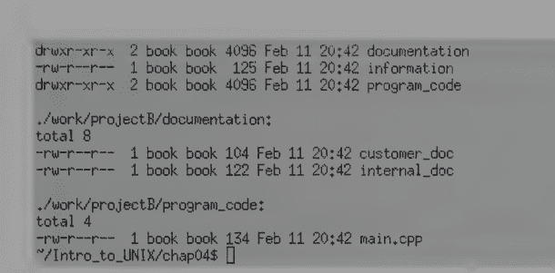

图 4.28 使用 `cat` 查看较大的文件，导致文件的部分内容滚出了屏幕。

或文件的屏幕或一页。要使用 `more` 命令查看 `full_listing` 文件，只需输入以文件名作为参数的命令，如图 4.29 所示。

```
/Intro_to_UNIX/chap04$ more full_listing
```

图 4.29 指定使用 `more` 查看文件。

文件内容一次显示一个屏幕或一页，如图 4.30 所示。屏幕底部显示有 "more" 单词，表示使用了哪种应用程序，后面跟随着一个百分比数字。这个数字代表屏幕上最后一行在文件中的位置。在图 4.30 中，屏幕上的最后一行大约位于文件从开始计算的 15% 处。要查看文件的不同部分，可以使用表 4.3 描述的按键。

```
total 36
drwxr-xr-x 1 book 4096 Feb 11 20:42 BERNAME
drwxr-xr-x 5 book 4096 Feb 11 20:42 courses
drwxr-xr-x 4 book 4096 Feb 10 18:00 examples
drwxr-xr-r-- 1 book 3543 Feb 25 14:10 full_listing
drwxr-xr-x-- 1 book 4096 Feb 11 20:14 greeting
drwxr-xr-x 1 book 4096 Feb 11 20:15 misc_file
drwxr-xr-x 1 book 4096 Feb 11 20:14 _cores
drwxr-xr-x 4 book 4096 Feb 11 20:42 sample_home_dir
drwxr-xr-x 4 book 4096 Feb 11 20:42 ce215
total 8
drwxr-xr-x 2 book 4096 Feb 11 20:42 buiz15
```

图 4.30 使用 `more` 应用程序查看文件。

| 导航 | 键（在另行列出的常用替代方案） |

| --- | --- |

| 向前滚动一行 | <Enter> | → |

# 82 UNIX/Linux 简介

| 导航 | 键（另行列出的常用替代方案） |

| --- | --- |

| 向前滚动 11 行 | <d> |

| 向前滚动一页（屏幕） | <Space Bar> |

| | <f> |

| 退出查看文档 | <q> |

| | less |

`less`

查看文件的另一种方法是使用一个名为 `less` 的类似工具。通过输入 `less` 后跟你想要查看的文件，你将再次看到文件的第一个屏幕（或一页）。要使用 `less` 查看同一个文件，请输入命令，如图 4.31 所示。

```
/Intro_to_UNIX/chap04$ less full_listing []
```

**图 4.31** 指定使用 `less` 应用程序查看文件。

4.32 显示了 `less` 中的文件内容。内容看起来与 `more` 相似，因为你查看的是相同的文件内容。然而，你可能会注意到这两个应用程序的屏幕底部显示不同。`more` 显示百分比数字，而 `less` 显示文件名。你可以通过按下表 4.4 列出的按键，使用 `less` 每次查看一个屏幕或一页的文件内容。

```
total 36
drwxr-xr-x 1 book 403 Feb 11 20:42 README
drwxr-xr-x 6 book 4096 Feb 11 20:42 courses
drwxr-xr-x 2 book 4096 Feb 10 18:00 examples
drwxr-xr-x 1 book 3543 Feb 25 14:52 full_listing
drwxr-xr-x 1 book 40 Feb 11 20:42 greeting
drwxr-xr-x 2 book 4096 Feb 11 20:42 misc_files
drwxr-xr-x 1 book 171 Feb 11 20:42 notes
drwxr-xr-x 2 book 4096 Feb 11 20:42 sample_home_dir
drwxr-xr-x 4 book 4096 Feb 11 20:42 work

./courses:
total 16
drwxr-xr-x 2 book 4096 Feb 11 20:42 bu215
drwxr-xr-x 2 book 4096 Feb 11 20:42 cs215
Full_listing |
```

**图 4.32** 使用 `less` 应用程序查看文件。

## 表 4.4 使用 less 查看文件的常用按键用法

| 导航 | 键（另行列出的替代方案） |

|---|---|

| 向前滚动一行 | <Enter> | kbd |

| 向前滚动屏幕 | <Down Arrow> (如果可用) | <d> |

| 向前滚动一页（屏幕） | <Space Bar> | <f> |

| 向后滚动一行 | <k> | <Up Arrow> (如果可用) |

| 向后滚动屏幕 | <u> | |

| 向后滚动一页（屏幕） | <b> | |

| 退出查看文档 | <q> |

虽然 `more` 和 `less` 在本质上似乎相似，但它们都被提到是有原因的。`more` 是标准的 UNIX/Linux 工具，在所有 UNIX/Linux 系统上可用。另一方面，`less` 存在于大多数但并非所有的 UNIX/Linux 系统中。然而，`less` 通常被认为比 `more` 更易用。因此，你可能希望选择你特定系统上用的 `less`。

## head 和 tail

两种广泛且可能有助于查看大文件内容的方法利用 `head` 和 `tail`。`head` 显示文件的前 $n$ 行，除非指定，否则 $n$ 为 10。如果你想在文件开头显示其他行数，可以将其作为 `head` 的选项进行指定。图 4.33 显示了使用 `head` 查看文件的两种用法。第一种是默认的 10 行，第二种显示前 5 行。

`tail` 是 `head` 的互补，显示文件的最后几行。`tail` 默认显示 10 行，但你可以指定另一个行数。图 4.34 显示了使用 `tail` 查看文件的两种用法。第一种是默认的 10 行，第二种显示最后 5 行。

# 84 UNIX/Linux 简介

```
/Intro_to_UNIX/chap04$ full_listing
total 36
rw-r--r-- 1 book 403 Feb 11 20:42 README
drwxr-xr-x 6 book 4096 Feb 11 20:42 courses
drwxr-xr-x 2 book 4096 Feb 10 18:00 examples
rw-r--r-- 1 book 3543 Feb 25 14:52 full_listing
drwxr-xr-x 1 book 40 Feb 11 20:42 greeting
drwxr-xr-x 2 book 4096 Feb 11 20:42 misc_files
rw-r--r-- 1 book 171 Feb 11 20:42 notes
drwxr-xr-x 2 book 4096 Feb 11 20:42 sample_home_dir
drwxr-xr-x 4 book 4096 Feb 11 20:42 work

./courses:
total 16
drwxr-xr-x 2 book 4096 Feb 11 20:42 bu215
drwxr-xr-x 2 book 4096 Feb 11 20:42 cs215
```

图 4.33 使用 `head` 查看文件的前几行。


```
/Intro_to_UNIX/chap04$ tail
total 36
rw-r--r-- 1 book 403 Feb 11 20:42 README
drwxr-xr-x 6 book 4096 Feb 11 20:42 courses
drwxr-xr-x 2 book 4096 Feb 10 18:00 examples
rw-r--r-- 1 book 3543 Feb 25 14:52 full_listing
drwxr-xr-x 1 book 40 Feb 11 20:42 greeting
drwxr-xr-x 2 book 4096 Feb 11 20:42 misc_files
rw-r--r-- 1 book 171 Feb 11 20:42 notes
drwxr-xr-x 2 book 4096 Feb 11 20:42 sample_home_dir
drwxr-xr-x 4 book 4096 Feb 11 20:42 work
```

图 4.33 使用 `tail` 查看文件的前几行。

```
/Intro_to_UNIX/chap04$ head -5
total 36
rw-r--r-- 1 book 403 Feb 11 20:42 README
drwxr-xr-x 6 book 4096 Feb 11 20:42 courses
drwxr-xr-x 2 book 4096 Feb 10 18:00 examples
rw-r--r-- 1 book 3543 Feb 25 14:52 full_listing
```

图 4.34 使用 `tail` 查看文件的最后几行。

```
/Intro_to_UNIX/chap04$ tail -5
total 36
drwxr-xr-x 2 book 4096 Feb 11 20:42 sample_home_dir
drwxr-xr-x 4 book 4096 Feb 11 20:42 work
```

# 86 UNIX/Linux 简介

```
//Intro_to_UNIX/chap04 echo "Hello, how are you?" > mymyfile
//Intro_to_UNIX/chap04$ cat mymyfile
Hello, how are you?
//Intro_to_UNIX/chap04$
```

图 4.37 利用 `echo` 创建文件。

请注意，如果你以这种方式使用 `echo` 命令指定一个已存在的文件，那么你在双引号中指定的内容将覆盖（或擦除）之前文件的内容。相反，如果你想保留文件的内容并在文件末尾输入信息，请使用 `echo` 的变体并配合 `>>` 运算符。（注意使用的是 `>` 和 `>>` 而不是一个）。第 5 章将更详细地解释 `>` 和 `>>` 的用法。


在使用 `echo` 或任何其他跟随文件名的 `>` 命令时，请小心，因为该命令将覆盖该文件中的任何现有内容。然而，它会将内容添加到现有内容的末尾。

图 4.38 展示了如何使用 `>>` 发出 `echo` 命令。在这里，追加“I am fine”，然后显示其所有内容，其中包含原始内容和刚刚添加的内容。

```
//Intro_to_UNIX/chap04 echo "I am fine" >> mymyfile
//Intro_to_UNIX/chap04$ cat myfile
Hello, how are you
I am fine
//Intro_to_UNIX/chap04$
```

图 4.38 使用 `echo` 向现有文件添加（追加）内容。

创建文件的第三种方法涉及使用文件编辑器。通过这种方式，你可以创建一个包含所需内容的文件，甚至可以编辑这些内容。第 7 章解释了 UNIX 系统中一些常用编辑器的用法。

## 创建目录

当你向主目录创建并添加新文件时，你可能希望通过子目录来组织你的文件。为了方便使用子目录组织，UNIX/Linux 提供了根据需要创建或删除子目录的命令。你可以使用 `mkdir`（make directory）命令，后跟一个或多个子目录名称来创建子目录。

为了演示创建子目录，在当前工作目录 `-/Intro_to_UN/chap04` 中，按照图 4.39 所示的命令创建一个名为 `examples` 的子目录。该子目录将用于接下来的一些示例。在创建子目录之前列出该目录以显示其效果。

```
//Intro_to_UN/chap04 ls
README examples myfile notes work
courses full_listing misc_files mytouch sample_home_dir
//Intro_to_UN/chap04 mkdir examples
//Intro_to_UN/chap04 ls
README examples full_listing misc_files mytouch sample_home_dir
courses examples1 greeting myfile notes work
//Intro_to_UN/chap04
```

图 4.39 创建子目录。

为了证明你可以一次创建任意数量的子目录，请再创建三个子目录：`examples2`、`examples3` 和 `examples4`，并列出当前工作目录查看它们，如图 4.40 所示。

```
//Intro_to_UN/chap04 mkdir examples2 examples3 examples4
//Intro_to_UN/chap04 ls
README examples1 examples4 misc_files notes
courses full_listing myfile sample_home_dir
examples examples3 greeting mytouch work
//Intro_to_UN/chap04
```

图 4.40 创建多个子目录。

## 删除空目录

作为组织文件和子目录的一部分，你有时需要删除目录。为了完成此操作，你可以利用 UNIX/Linux 的 `rmdir`（for remove directory）命令来删除空子目录。为了演示，利用图 4.41 所示的 `rmdir` 来删除刚刚创建的 `examples4` 子目录。与 `mkdir` 类似，你可以用 `rmdir` 指定多个子目录，以便一次性删除你想要的任意数量的空子目录。

```
//Intro_to_UN/chap04 rmdir examples4
//Intro_to_UN/chap04 ls
README examples1 full_listing myfile sample_home_dir
courses examples2 greeting mytouch work
examples examples3 misc_files notes
//Intro_to_UN/chap04
```

图 4.41 删除空子目录。

作为安全措施，`rm` 仅删除空子目录，这样你就不会意外删除子目录内可能存在的任何文件或子目录。有一种方法可以删除包含文件和/或其他子目录的目录，即使用另一个工具 `rm`，它将在本章稍后讨论。

## 复制文件和目录

有时，你可能想要创建一个文件的副本。例如，你可能想要一个文件的工作副本，并将其作为创建和编辑新文件的基础。在这种情况下，你可以将原始文件内容复制到新文件中并修改新文件，同时保持原始完整。

另一个原因是，修改某些文件（特别是重要的文件）时，你可能希望先创建一个文件的备份，以便在必要时参考原始内容。虽然这种备份方法是有效的，但其他复杂的备份技术将在第 5 章解释。

要复制文件，请使用 UNIX/Linux 的 `cp`（copy 的缩写）命令。在最形式的形式，`cp` 接受两个参数：原始或源文件，随后是生成的副本或目标文件。为了演示，假设你想为文件 `notes` 创建备份，并将备份文件命名为 `notes.bak`。如图 4.42 所示，你可以将源文件名和目标文件名作为 `cp` 的两个参数。图 4.42 还列出了当前目录以显示复制的效果，即文件 `notes.bak` 的存在。

```
//Intro_TO_UNIX/chap04$ cp notes.bak
//Intro_TO_UNIX/chap04$ ls
README example1 full_listing myfile notes.bak
courses example2 greeting sample_home_dir
examples example3 misc_files notes work
//Intro_TO_UNIX/chap04$ _
```

图 4.42 复制文件。


你也可以指定当前工作目录以外的目录作为复制目标。为了显示这种效果，将最近创建的 `examples1` 中的文件名复制到 `othernotes.bak`，如图 4.43 所示。在图 4.43 中，先列出子目录以显示它是空的。关于这种 `cp` 的用法的另一点，如果你仅指定目标目录作为第二个参数，创建的文件将放在目标目录中但保持与源文件相同的名称。例如，如果指定 `examples1` 作为第二个参数，你将在图 4.43 中看到。

# UNIX/Linux 文件和目录

## 89

```
 //Intro_to_UNIX/chap04$ ls examples1
 //Intro_to_UNIX/chap04$ cp notes examples1
 //Intro_to_UNIX/chap04$ ls examples1
 othernotes
```

图 4.43 将文件复制到另一个目录。

使用 `cp` 时也应小心。如果你在执行复制之前，目标名称已存在文件，则该文件的内容将被源文件覆盖。如果你希望在复制文件时小心以免覆盖现有文件，请指定 `cp` 的 `-i`（交互式提示）选项。为了演示，再次尝试使用提示选项创建一个名为 `othernotes.bak` 的文件备份，如图 4.44 所示。在这种情况下，`cp` 会就是否覆盖目标文件给出 `(y)` 或 `(n)` 的提示。如果你在提示处输入“y”，`cp` 将覆盖目标文件。如果输入 `n` 则不会覆盖。

```
 //Intro_to_UNIX/chap04$ -i cp notes examples1/othernotes.bak
 cp: overwrite examples1/othernotes.bak? n
```

图 4.44 防止覆盖的复制选项。

你可能已经注意到长列表显示了每个文件的其他信息、日期时间和。这些日期时间代表“时间戳”，显示文件创建或最后修改的时间，以较者为准。4.45 显示了你创建的原始和复制文件的时间戳。

```
 //Intro_to_UNIX/chap04$ ls -l notes
 -rw-r-- 1 book 171 Apr 24 2005 notes
 //Intro_to_UNIX/chap04$ ls -l examples1/othernotes.bak
 -rw-r-- 1 book 171 Feb 11 21:08 examples1/othernotes.bak
 //Intro_to_UNIX/chap04$ 
```

图 4.45 更新时间戳的复制。

默认情况下，当复制文件时，副本的时间戳为复制发生的日期时间。在日期时间重要的情况下（例如，你想管理自某个日期/时间以来修改的文件），你可能希望创建的副本具有原始文件相同的日期/时间。要让创建的副本具有原始相同的日期时间，请指定 `cp` 的 `-p`（保留日期时间和）选项。图 4.46 示例了在 `examples1/mynotes.bak` 中为 `notes` 创建另一个备份副本的示例。

# UNIX/Linux 简介

时间戳保留。图 4.46 也显示了创建副本的时间戳，以说明这种时间戳保留的效果。

```
 //Intro_to_UNIX/chap04$ cp -p notes examples1/mynotes.bak
 //Intro_to_UNIX/chap04$ ls -l notes
 --rw-r--r-- 1 book 171 Apr 24 2005 notes
 //Intro_to_UNIX/chap04$ ls -l examples1/mynotes.bak
 --rw-r--r-- 1 book 171 Apr 24 2005 examples1/mynotes.bak
 //Intro_to_UNIX/chap04$ |
```

图 4.46 使用保留时间戳的选项进行复制。

之前的示例并没有演示在复制文件时不保留文件时间戳，但也演示了文件可以复制到原始文件所在目录以外的目录。此操作通过指定绝对路径或相对路径作为目标文件名来实现。在这种情况下，指定的相对路径是 `examples1/mynotes.bak`。

你可以通过一次复制多个文件，将复制单个文件到目标目录的概念扩展。要这样做，请指定多个文件名而不是一个，但 `cp` 命令的最后一个参数必须是指向目标子目录的绝对或相对路径。为了演示，复制到 `examples2` 目录并同时向那里复制两个文件，如图 4.47 所示。列出 `examples2` 目录的内容是为了显示它是空的，并在复制后显示创建的文件。此演示也保留了原始文件创建副本的时间戳。

```
 //Intro_to_UNIX/chap04$ cd examples1
 //Intro_to_UNIX/chap04$ ls -l
 total 0
 --rw-r--r-- 1 book 171 Apr 24 2005 mynotes.bak
 --rw-r--r-- 1 book 171 Feb 11 21:08 othernotes.bak
 //Intro_to_UNIX/chap04$ ls -l ../examples2
 //Intro_to_UNIX/chap04$ cp -p mynotes.bak othernotes.bak ../examples2
 //Intro_to_UNIX/chap04$ ls -l ../examples2
 total 8
 --rw-r--r-- 1 book 171 Apr 24 2005 mynotes.bak
 --rw-r--r-- 1 book 171 Feb 11 21:08 othernotes.bak
 //Intro_to_UNIX/chap04$ |
```

图 4.47 一次复制多个文件并保留其时间戳。

请，在这种情况下，如果利用通配符匹配两个原始文件名，也可以实现相同的操作。通过这种方式，你只需指定一个通配符，就可以将当前目录下的所有文件复制到某个目标目录。图 4.48 以最近创建的 `examples3` 目录作为目标说明了这一示例。

# UNIX/Linux 文件与目录

```
 //Intro_UNIX/chap04/examples1$ ls -1 ..examples3
 total 0
 //Intro_UNIX/chap04/examples1$ cp -p * ..examples3
 //Intro_UNIX/chap04/examples1$ ls -1 ..examples3
 total 8
 -rw-r--r-- 1 book 171 Apr 24 2005 mynotes.bak
 -rw-r--r-- 1 book 171 Feb 11 21:08 others.bak
 //Intro_UNIX/chap04/examples1$
```

图 4.48 使用目录一次性复制多个文件并保留其时间戳。

如果你想复制一个目录及其所有文件和/或子目录，请指定 `cp` 命令的 `-R`（递归）选项。为了演示此点，创建一个名为 `examples1.bak` 的 `examples1` 目录的副本，如图 4.49 所示，源目录和目标目录都位于当前工作目录。在这个示例中，你还使用 `-R` 配合 `-p` 选项指定保留时间戳。

```
 //Intro_UNIX/chap04/examples1$ cd ..
 /home/book/Intro_UNIX/chap04
 //Intro_UNIX/chap04$ mkdir REGIME courses
 //Intro_UNIX/chap04$ cp -Rp examples1 examples1.bak
 //Intro_UNIX/chap04$ ls -l
 REGIME
 -examples3  misc_file notes  work
 courses examples1.bak full_listing myfile notes.bak
 -examples2 greeting mytouch sample_home_dir
 -examples1.bak1$ ls -LR examples1.bak
 total 8
 -rw-r--r-- 1 book 171 Apr 24 2005 mynotes.bak
 -rw-r--r-- 1 book 171 Feb 11 21:08 others.bak
 //Intro_UNIX/chap04$
```

图 4.49 目录及其内容的递归复制。

扩展多个文件复制的概念，你也可以将多个目录复制到单个目录中。要完成此操作，请使用 `cp -R`，后面跟着源目录名称，最后是目标目录名称。任何目录名称可以是相对路径，也可以是绝对路径。

## 删除文件和非空目录

要删除一个或多个文件，你可以利用 `rm` 命令并指定要删除的一个或多个文件名。文件名甚至可以用相对路径或绝对路径指定。作为第一个示例，删除复制期间创建的一些文件。如图 4.50 所示，从 `examples3` 子目录开始。注意当目录的最后一个文件被删除后，`ls` 会显示该目录为空。因为你可以指定一个或多个文件名，你可以使用提供两个文件名作为参数的命令来完成两次删除。


在使用 `rm` 指定要删除的文件时要小心。虽然删除文件是必要的，但在 UNIX/Linux 中没有标准的“删除”或“回收站”功能可以撤销文件删除。因此，请确保你指定了实际要删除的文件。

你可以使用前面描述的通配符指定要删除的文件名或文件名。为了演示这一点，首先如图 4.51 所示创建空文件。

```
//Intro_to_UNIX/chap04$ pwd
/home/book/Intro_to_UNIX/chap04
//Intro_to_UNIX/chap04$ cd examples3
//Intro_to_UNIX/chap04$ ls
newnotes.bak othernotes.bak
//Intro_to_UNIX/chap04$ rm newnotes.bak
//Intro_to_UNIX/chap04$ ls
othernotes.bak
//Intro_to_UNIX/chap04$ rm othernotes.bak
```

```
//Intro_to_UNIX/chap04$ pwd

/home/book/Intro_to_UNIX/chap04/examples3

//Intro_to_UNIX/chap04/examples3$ touch file1 file2 file3 file4 file5 file6 newnotes.bak

//Intro_to_UNIX/chap04/examples3$ ls

file1 file2 file3 file4 file5 file6 newnotes.bak

//Intro_to_UNIX/chap04/examples3$ []
```

**图 4.51** 为删除创建空文件。

使用共同名称“file”和针对 1、3、6 的通配符删除 `file1`、`file2`、`file3` 和 `file6`。图 4.52 演示了这种删除形式并显示了效果。

```
//Intro_to_UNIX/chap04/examples3$ rm file[136]

//Intro_to_UNIX/chap04/examples3$ ls

file4 file5 newnotes.bak

//Intro_to_UNIX/chap04/examples3$ []
```

**图 4.52** 使用通配符范围删除多个文件。

图 4.53 显示了你如何使用多重通配符在共同短语“notes”的前后删除 `newnotes` 和 `newnotes.bak` 文件。

```
//Intro_to_UNIX/chap04/examples3$ rm *notes*

//Intro_to_UNIX/chap04/examples3$ ls

file4 file5

//Intro_to_UNIX/chap04/examples3$ []
```

**图 4.53** 使用通配符删除多个文件。

记得 `rmdir` 允许你删除空子目录——即没有文件或子目录的目录。为了防止误删包含其他文件和/或子目录的子目录。如果你确定要删除子目录及其所有内容，UNIX/Linux 允许通过指定 `rm` 的 `-r`（递归选项）来覆盖此保护。这种方法不仅可以轻松删除目录的内容，还可以删除目录本身。

你可以轻松地使用递归方法指定删除一个或多个目录。为了演示，清理当前的 `examples` 并首先删除一个目录 `examples3` 及其内容，如图 4.54 所示。通过显示当前目录、确保你在要删除的目录中，并返回父目录（当前工作目录）。在删除前后列出父目录以说明效果。

```
//Intro_to_UNIX/chap04/examples3$ pwd

/home/book/Intro_to_UNIX/chap04/examples3

//Intro_to_UNIX/chap04/examples3$ ls

file4 file5

//Intro_to_UNIX/chap04/examples3$ cd ..

README examples3 misc_files notes work

courses examples1,bak full_listing mynewfile notes.bak

examples examples2 greeting mytouch sample_home_dir

//Intro_to_UNIX/chap04/examples3$ rm -rf examples3

//Intro_to_UNIX/chap04/examples3$ ls

README examples1 full_listing mynewfile notes.bak

courses examples1,bak greeting mytouch sample_home_dir

examples examples2 misc_files notes-work

//Intro_to_UNIX/chap04/examples3$ []
```

**图 4.54** 删除目录及其内容。

为了显示可以一次删除多个目录，请同时删除 `examples1` 和 `examples2.bak` 子目录，如图 4.55 所示。你也可以将这些子目录指定为 `examples[1-2]`。

```
//Intro_to_UNIX/chap04$ rm -rf examples1 examples2 examples1,bak

//Intro_to_UNIX/chap04/examples3$ ls

README greeting mynewfile notes sample_home_dir

courses full_listing misc_files mytouch notes.bak work

//Intro_to_UNIX/chap04$ []
```

**图 4.55** 删除多个目录及其内容。

## 重命名文件和目录

如果你需要更改文件或目录的名称，可以使用 UNIX/Linux 的 `mv` (move) 命令。为了演示这一效果，创建一个名为 `mv_examples` 的子目录，并将笔记复制到该目录并命名为 `notes.bak`。然后进入该子目录，将文件 `notes.bak` 重命名为 `newname`。最后，列出子目录的内容显示重命名结果。

```
//Intro_to_UNIX/chapter04$ mkdir mv_examples

//Intro_to_UNIX/chapter04$ cp -ip notes mv_examples/notes.bak

//Intro_to_UNIX/chapter04$ cd mv_examples/

//Intro_to_UNIX/chapter04/mv_examples$ ls

notes.bak

//Intro_to_UNIX/chapter04/mv_examples$ mv notes.bak newname

//Intro_to_UNIX/chapter04/mv_examples$ ls

newname

//Intro_to_UNIX/chapter04/mv_examples$ []
```

**图 4.56** 移动和重命名文件。

你也可以使用 `mv` 将一个或多个文件（甚至是目录）移动到另一个目录。要这样做，请指定要移动的文件和或目录的名称，随后是目标目录的绝对或相对路径。图 4.57 展示了这一操作：首先通过将 `newname` 复制为 `newname.bak` 来创建第二个文件。然后你在 `mv_examples` 中创建一个名为 `newdir` 的子目录，并将文件和 `newname.bak` 移动到该子目录。你可能希望执行目录列表操作来显示结果。

```
//Intro_to_UNIX/chapter04/mv_examples$ cp newname, newname.bak

//Intro_to_UNIX/chapter04/mv_examples$ mkdir newdir

//Intro_to_UNIX/chapter04/mv_examples$ ls

newdir newname, newname.bak

//Intro_to_UNIX/chapter04/mv_examples$ mv newname, newname.bak newdir

//Intro_to_UNIX/chapter04/mv_examples$ ls

newdir

//Intro_to_UNIX/chapter04/mv_examples$ ls newdir

newdir newname.bak

//Intro_to_UNIX/chapter04/mv_examples$ []
```


### 图 4.57 将文件移动到另一个目录。

此外，请谨慎使用 `mv`。`mv` 会删除目标文件及其内容以准备移动源文件。然而，为了避免在移动过程中意外覆盖文件，请指定 `mv` 的 `-i`（在覆盖前提示，类似于 `cp`）选项。

> 为了避免在复制或移动过程中覆盖文件，`-i` 选项会在文件将被覆盖时通知你，并在执行前向你请求确认。


为了演示这种带有提示的 `mv` 将覆盖现有文件的用法，请创建一个名为 `existing_file` 的空文件，然后将其指定为图 4.58 所示移动操作的目标文件。在提示处输入 "y" 会导致 `mv` 用源文件（第一个）替换目标文件（第二个）。否则，`mv` 将不会覆盖目标，且源文件将保留。

```
/Intro-TO_UNIX/chap04/mv_examples$ touch existing_file

/Intro-TO_UNIX/chap04/mv_examples$ mv -i newdir/newname existing_file

m: overwrite existing_file? n
```

图 4.58 在移动文件时使用覆盖前提示选项。

如果用户将受写保护的文件作为移动操作的目标，`mv` 会自动向用户询问是否要覆盖该文件。第 5 章将更详细地解释受写保护文件的概念。

最后，但同样重要的是，如果你确定要覆盖任何目标（即使是受写保护的文件），`mv` 也有一个选项可以指示 `mv` 在不提示的情况下执行操作。该选项是 `-f`（用于强制移动）。

## 总结

在本章中，介绍了 UNIX/Linux 文件系统，包括如何使用常用且实用的操作管理文件和目录。这些操作包括列出、查看和创建。

### 表 4.5 本章描述的内容

| 命令 | 描述 |
| :--- | :--- |
| pwd | 打印当前目录。 |
| cd | 更改当前目录。 |
| cat | 查看整个文件。 |
| more | 逐页查看文件。 |
| less | 逐页查看文件。 |
| head | 查看文件的开头部分。 |
| tail | 查看文件的末尾部分。 |
| touch | 创建空文件或更新时间戳。 |
| echo | 创建一个简单的文件。 |

# UNIX/Linux 简介

在命令方面，记忆许多应用程序及其用途是一项挑战。你可以依靠记忆、笔记和参考书。但如果这些选择中任何一个不可、无法访问或不完整，你能做什么？记忆会遗忘，笔记会丢失，书籍会过时。答案是在线帮助。接下来的章节将解释如何在 UNIX/Linux 中使用在线帮助来学习更多关于命令及相应的选项。

# 手册页 Manual Pages

UNIX/Linux 系统包含其命令和单元的文档。这些信息资源可以帮助你找到并使用特定情况下所需的适当命令或工具。该服务背后的应用是 UNIX/Linux `man`（*manual* 的缩写）以 *manpage*（手册页）的形式提供有关命令或工具的文档。（该术语是单数，尽管文档可能由多个页面组成。）以下介绍了你可以使用 `man` 的典型方法。

当你知道命令或工具的名称时，使用 `man` 来获取信息，如下例所示所示。在第 4 章中，你学习了常用的 `ls`，但存在更多的 `ls`。要学习这些其他选项，可以使用 `man` 查看 `ls` 的手册页，如图 5.1 所示。图 5.1 显示你的主目录作为当前工作目录的示例。

```
$ man ls
```

> **图 5.1** 使用 `man` 获取 `ls` 的文档。

大多数页的内容非常多，无法在一个屏幕/窗口中显示。为了补偿，`man` 使用了一个指定的分页器 pager，允许你一次查看一个实际页面或屏幕。除非另有指定，Linux 系统中的默认分页器名称通常是 `less`，而在 UNIX 环境中是 `more`。要确定你账户的分页器配置，请研究图 5.1 所示的手册页外观——即 `man` 命令后 `ls` 是如何显示的。现在，看图 5.2，如果显示的最后一行包含 `--More--`，则你的分页器设置为应用程序 `more`。如果是这种情况，你可以使用表 4.3 列出的为 `more` 设计的导航键来查看手册页。

或者，如果最后一行（显示中）包含类似于 `Manpage ls(1) line one` 的内容，如图 5.3 所示，那么你的分页器设置为应用程序 `here`。在这里，你可以使用表 4.4 列出的为 `less` 的导航键来查看手册页。

当你选择 `less` 和 `more` 作为分页器时，而不是像你在第 4 章中那样查看文件，某些功能将不可用。然而，`less` 允许你滚动和向后移动；而 `more` 则不会。由于这个原因，许多用户认为 `less` 查看手册页提供了更大的灵活性，因此将分页器设置为 `less`。第 11 章“基础账户和系统维护”解释了如何更改你账户的默认分页器。

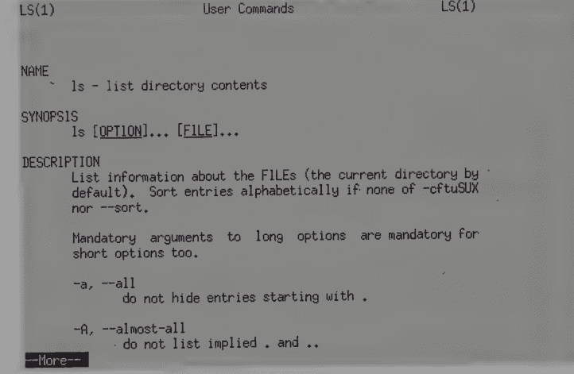

图 5.2 使用 `more` 作为分页器的 `ls` 手册页示例显示。

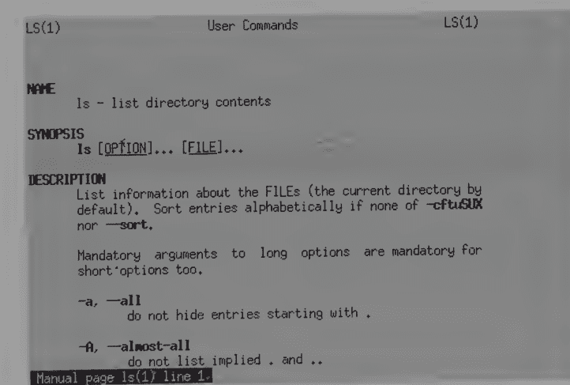

图 5.3 使用 `less` 作为分页器的 `ls` 手册页示例显示。

## 解读手册页

手册页的结构如下。页面顶部是命令名称，后面紧跟括号内的章节数字。章节数字指的是手册页的文档文本，上下文可以是命令、文件、添加的工具、系统编程机制等。其他常见章节包含系统编程（第 3 节）或特定文件（第 5 节）的文档。手册页（第 1 节）列出了最常见的命令和工具。

要总结关注第 1 节手册页的典型命令和工具，请回顾以下典型部分：

- **Name**（名称）： 命令或工具的名称以及对该命令或工具的简短描述
- **Synopsis**（概要）： 如何使用该命令或工具的概述
- **Description**（描述）： 如何使用该命令或工具的更多细节
- **Files**（文件）： 如果存在，列出命令或工具使用或可能受影响的系统或用户文件
- **See Also**（参见）： 对其他相关命令和工具的引用

`[FILE]` 表示你可以指定零、一个或多个文件名。如果指定零个文件，它将列出当前工作目录的内容。另一方面，如果你恰好指定一个文件或目录，它将列出该文件或目录的内容。你可以指定多个文件和/或目录，它将列出这些文件和/或目录的内容。

手册页的下一部分是 `Description`（描述），提供了命令目的的进一步解释和细节。可用的命令选项与其每个选项的详细描述一起列出。你可能记得 `ls` 选项 `-a` 是在第 4 章中引入的，作为显示隐藏文件的方法，而 `Description` 的解释也是如此。根据命令的不同，`Description` 或后续部分包含与使用该命令相关的信息。某些命令（特别是复杂的命令）有一个 `Examples`（示例）部分，演示如何使用该命令。

# 中级文件管理 103

最后，`See Also` 列出了其他可以补充或增强你所需的命令或应用程序。根据你的需求，`See` 可能列出比命令本身更好的内容。在查看第 3 节中编程相关的页面时，`See Also` 部分特别有用。

## 使用 man 搜索命令或工具

如果你不确定命令或工具，可以使用 `man -k` 搜索关键词。例如，假设你针对关键词“search”执行手册页搜索，如图 5.7 所示。

现在，考虑当 `man -k` 产生的列表长到屏幕无法容纳，且列表在你阅读之前就滚出屏幕时该怎么办。

## 中间文件管理

搜索结果可能很大，在你有机会阅读之前它就已经滚出了屏幕。然而，你可以想起以前使用过 `less` 来查看大文件，从而减少工具的使用。在这里，你通过输入图 5.8 所示的命令，一次一个屏幕的方式查看长结果列表。

现在，你看到了结果的第一屏，类似于图 5.9 所示。此屏幕的最后一行包含一个冒号（:），表示你正在使用 `less` 查看内容。在这里，你可以使用表 4.4 之前列出的导航键向下移动、向上移动或退出。

```
$ man -k search less
```


### 图 5.8 使用 less 查看长命令搜索结果。

- - `apropos` (1) - 搜索手册页名称和描述
- `badblocks` (8) - 搜索设备中的坏块
- `bogils` (3) - 单词搜索游戏
- `bzgrep` (3) - 对排序数组进行二进制搜索，
- `bession` (1) - 在 bzip22 压缩文件中搜索正则表达式
- `bfigrep` (1) - 在 bzip22 压缩文件中搜索正则表达式
- `bzgrep` (1) - 在 bzip22 压缩文件中搜索正则表达式
- `bession` (1) - 在目录层次结构搜索文件
- `find` (3) - 哈希表方法
- `hsearch` (2) - 数组的线性搜索。
- `if` (3) - 数组的线性搜索。
- `less` (3) - 确定手册页的搜索路径
- `manpath` (1) - 搜索命令消息的目录
- `man` (1) - 解析例程
- `ren` (3) - 在字符串中搜索一组字符
- `strcsp` (3) - 在字符串中搜索一组字符中的任意一个
- `strpbr` (3) - 在字符串中搜索一组字符中的任意一个
- `strip` (3) - 管理二叉树
- `tsearch` (3) - 在宽字符字符串中搜索字符
- `wschsr` (3) - 在宽字符字符串中搜索宽字符中的任意一个
- :

### 图 5.9 查看长命令搜索结果的第一屏。

这种技术可以应用于其他命令。该符号代表 UNIX 管道。通过在 `man` 和 `less` 之间使用管道

如果你没有看到类似于图 5.9 的列表第一屏，而是收到了类似“`less: command not found`”的消息，那么你的系统中可能没有 `less`。在这种情况下，将图 5.8 所示命令中的 `less` 替换为 `more`。或者，这允许你使用表 4.3 之前列出的 `more` 导航键查看搜索结果。

## 使用命令的帮助选项

根据系统和命令的不同，你可能可以通过执行命令并指定其帮助选项来获取有关命令的信息。此功能取决于系统，因为给定的命令在一个系统上可能有帮助选项，而在另一个系统上可能没有。此功能也取决于命令。即使某个命令在某个系统上有帮助选项，对于另一个命令也可能没有。

> 命令帮助选项很有用且简单，但它们并不是所有系统或所有命令都可用。

尽管有这些考虑，与阅读整个手册页（man page）相比，帮助选项通常为命令用法提供了更快或更方便的参考。当你熟悉某个命令并想要查找某个选项时，情况尤其如此。要指定命令的帮助选项，你输入命令名后跟 `-h` 或可能的 `--help`（具体选项也随系统和命令而异）。例如，如果你指定了 `ls` 的 `--help` 选项（如图 5.10 所示），你可能会看到关于 `ls` 的选项和其他描述的帮助屏滚动出现。相反，如果你收到了类似“`--help: Invalid option`”的消息，那么该特定选项在你的系统中不可用。你也可以尝试 `-h` 选项，但同样，因为取决于系统和命令，在特定系统上可能无法作用。

```
$ ls --help
```

图 5.10 指定命令的帮助选项以查看该命令的信息（可能并非所有系统或命令都可用）。

如果你看到帮助信息打印在屏幕上，通常这些信息非常巨大，以至于在你阅读之前大部分就会滚出屏幕。当这种情况发生时，使用管道将信息发送到 `less`（或 `more`），如图 5.11 所示，这样你就可以一次一个屏幕地查看信息。这样做，你可以看到帮助的第一屏，如图 5.12 所示。

```
$ ls --help | less
```

图 5.11 使用管道一次一个屏幕地查看命令帮助。

## 中间文件管理

```
用法: ls [OPTION],... [FILE],

列出关于 FILES 的信息（默认为当前目录）。

如果使用 -cftUSUX --sort，则按字母排序条目。

  -a,--all          不隐藏以...开头的项

  -A,--auto         包含隐藏条目，并且

  -u                打印每个文件的作者

  -b,--escape       为非图形字符打印八进制转义

  --block-size=use 使用 SIZE-字节块

  -B,--ignore-blocks 不列出以...结尾的条目

  -lt               按时间排序，显示（文件状态的最后

                   修改时间）

                   ctime 并按名称排序

                   否则；按 ctime 排序

  -C                按列列出条目

                   控制；用于区分文件

                   类型；使用 'never', 'always', 或 'auto'

                   列出条目而不是内容，

                   并且不跟踪符号链接

                   专为 Emacs 的 direc 模式设计

                   不排序；启用 -al，禁用 -l

                   追加索引 (w/g 之一)

  --color=[WHEN]

  -d,--directory

  -D,--dired

  -F,--format

  -F,--classify
```

图 5.12 `ls` 帮助选项显示的帮助第一屏。

## 使用 info 获取帮助

在 Linux 系统中，你也可以通过 `info` 命令获取帮助。`info` 将请求命令的（用于所需信息）作为参数。现在，通过指定 `--apro` 选项后跟关键词，根据一个或多个关键词搜索命令。（如果使用多个关键词，请确保在双引号内闭合它们。）`info` 在 Linux 中很常见，但在其他 UNIX 系统中不是，因此不是本书的重点。你可以尝试在 Linux 系统中使用 `info` 作为一种资源。

## 搜索文件内容

在本章前面的部分，你搜索了文件内容中的模式。`grep` 的简单形式接受所需的模式，并指定文件名。接下来，为了澄清，`grep` 不接受选项并从标准输入搜索。例如，考虑包含人员的 `Intro_to_UNIX/chap05` 文件，如图 5.13 所示。将 `Intro_to_UNIX/chap05` 视为你的当前目录，并在文件中搜索名称。

```
$ cd Intro_to_UNIX/chap05

$ grep Smith

Smith, Tom            Vice-President      781,555,899

Smith, John            Software Engineer   781,555,2054

$ /Intro_to_UNIX/chap05$
```

图 5.13 文件的内容。

```
$ /Intro_to_UNIX/chap05$ grep Smith

Smith, Tom            Vice-President      781,555,899

Smith, John            Software Engineer   781,555,2054

$ /Intro_to_UNIX/chap05$
```

图 5.14 使用 `grep` 在文件中搜索 `Smith`。

## 完整文件搜索

在 Linux 中，`grep` 可以同时在多个文件中搜索模式。`grep` 的简单形式接受所需的模式，并指定文件名。接下来，为了澄清，`grep` 不接受选项并从标准输入搜索。例如，考虑包含人员的 `Intro_to_UNIX/chap05` 文件，如图 5.13 所示。将 `Intro_to_UNIX/chap05` 视为你的当前目录，并在文件中搜索名称。

在另一个 `grep` 示例中，假设你想在业务联系列表中搜索“Human Resources”。使用 `grep`，如上一个示例所示，记住在双引号内添加单词，如图 5.15 所示。（当你搜索多个单词时，必须将单词包含在双引号内）

```
$ /Intro_to_UNIX/chap05$ grep "Human Resources" contacts

Vonn, Brandi           Human Resources     781,555,3400

$ /Intro_to_UNIX/chap05$
```

图 5.15 在 `contacts` 文件中搜索 `Human Resources`。

# 中级文件管理 109

在为 `grep` 或许多其他命令指定多个搜索词时，通常需要将词包含在双引号内。

## 从行首开始搜索

有时你可能想要搜索只出现在行首的模式。为了解释这一点，假设你想在 `contacts` 文件中搜索姓名为 `Taylor` 的行。如果你简单地对 `Taylor` 进行搜索（如图 5.16 所示），你得到的信息太多了。该行同时匹配 `Taylor` 作为名字也作为姓氏。在这个示例中，`grep` 匹配每一个包含 `Taylor` 的行，无论它出现在给定行的任何位置，如图 5.16 所示。


"Intro_to_UNIX/chap05$ grep Taylor contacts 781,555,0000

Taylor, Joanna Administrative Asst 781,555,2323

Murphy, Taylor Accounting

"Intro_to_UNIX/chap05$

```
图 5.16 使用 grep 搜索名为 Taylor 的文件。
```

要仅匹配 Taylor 匹配姓氏，你必须将模式搜索限制在出现 Taylor 的每行的开头。要使用 grep 实现从每行开始的模式搜索，你需要在模式前加上符号 `^` 符号，如图 5.17 所示。现在，你只得到了想要的匹配项。

```
"Intro_to_UNIX/chap05$ grep ^Taylor contacts

Taylor, Joanna Administrative Asst 781,555,0000

"Intro_to_UNIX/chap05$
```

图 5.17 在行首搜索模式。

## 从行尾开始搜索

同样，假设你想搜索出现在每行末尾的模式。例如，假设你想知道在 `contacts` 文件中哪些人的电话号码最后两位是 `01`。由于电话号码是每行中的最后一条信息，因此你将搜索模式设定为行末尾的 `01`。要实现这一点，你使用带有符号 `$` 符号的模式，如图 5.18 所示。

```
"Intro_to_UNIX/chap05$ grep 01$ contacts

Williams, Troy Systems Administrator 781,555,4001

"Intro_to_UNIX/chap05$
```

图 5.18 在行尾搜索模式。

# 110 UNIX/Linux 简介

## 不区分大小写的搜索

在到目前为止的 `grep` 示例中，你指定的词搜索模式的大写字母和小写字母与它们在被搜索文件中出现的完全一致。除非另有说明，否则 `grep` 执行的是区分大小写的模式搜索，其中大写字母和小写字母是不同的并被视为不同的项目。然而，如果你想用 `grep` 执行不区分大小的搜索（大写和小写字母被视为相同），可以通过 `-i` 选项进行指定。

除非指示，否则许多 UNIX/Linux 特性和命令都以区分大小写的方式运行（大写和小写字母是不同的）。


为了演示不区分大小的搜索，假设你想搜索名字包含“Anna”的联系人，无论是完整还是部分。这意味着“Anna”的第一个字母可能是大写的也可能是小写的，取决于文本出现在名字的开头还是中间。要完成这次特定的搜索，请使用带有 `-i` 选项的 `grep`，如图 5.19 所示。如果你不指定 `-i` 选项，`grep` 只匹配第一个结果，因为“Joanna”中的文本序列“anna”包含了全小写字母。

```
//_to_UNIX/chap05 grep -i anna contacts

Taylor, Anna           Administrative Asst     781,555,0000

Cobb, Anna             Customer Sales        937,555,6777

//_to_UNIX/chap05$ 
```

图 5.19 使用 `grep` 执行不区分大小的搜索。

## 搜索多个文件

在 `grep` 的 man页上（如图 5.6 所示），`FILE` 组件后的省略号表示你可以指定多个文件。此功能允许你使用 `grep` 在多个文件之间进行搜索。你使用通配符模式指定文件名来匹配多个文件，而不是单个文件名。

为了演示多个文件的搜索，考虑 `~/_chap05/output_files` 中的一组文件。多台计算机各负责一个科学应用程序的一部分以解决一个物理问题，实际上生成了这些文件。每台计算机都保存了完成其问题部分所需的时间。要找出每台计算机花费多长时间完成其部分，请查找出现在文本“Compute time”上的消逝时间。要搜索每个文件中的该行文本，你执行一个 `grep` 命令，如图 5.20 所示。如果你不确定任何字母是否大写，请使用 `-i` 不区分大小写的选项。

# 中级文件管理 111

```
$Intro_to_UNIX/chap05$ cd output_files

$Intro_to_UNIX/chap05/output_files$ grep -i "compute time" output

output,10.1:Compute time: 87,278001

output,10.10:Compute time: 87,766712

output,10.2:Compute time: 87,86012

output,10.3:Compute time: 87,2236

output,10.4:Compute time: 87,4816

output,10.5:Compute time: 87,27032

output,10.6:Compute time: 87,6549

output,10.7:Compute time: 87,27645

output,10.8:Compute time: 87,6283

output,10.9:Compute time: 87,27507

Intro_to_UNIX/chap05/output_files$
```

图 5.20 使用 `grep` 搜索文件。

## 搜索文件或目录

有时，你可能会忘记搜索文件或目录。`find` 允许你搜索 UNIX 中的文件和目录。

### 通过名字查找

通过名字查找文件是搜索文件或目录的常用方法。假设你想查找一个名为 `contacts` 的文件。在 `/home/user` 目录中查找，你可以使用 `find` 命令：

```
$ find /home/user -name contacts

/home/user/contacts

/home/user/documents/contacts
```

如果你已经在该目录中，只想在当前目录中查找，可以使用 `.`：

```
$ find . -name contacts

./contacts

./documents/contacts
```

如果你想查找名字包含“Anna”的文件，可以使用通配符 `*`：

```
$ find . -name "*Anna*"

./Anna.txt

./Anna_notes.doc

./my_Anna.txt
```

如果你想查找以“Anna”结尾的文件，可以使用 `*Anna`：

```
$ find . -name "*Anna"

./my_Anna

./backups/old_Anna
```

如果你想查找以“Anna”开头的文件，可以使用 `Anna*`：

```
$ find . -name "Anna*"

./Anna.txt

./Anna_notes.doc
```

如果你想进行不区分大小写的查找，可以使用 `-iname` 选项：

```
$ find . -iname "anna*"

./Anna.txt

./anna_notes.doc

./My_Anna.txt
```

如果你想在特定的目录中查找：

```
$ find /home/user -name "Anna*"

/home/user/Anna.txt

/home/user/Anna/

/home/user/Anna/Anna.txt
```

如果你只想查找目录，可以使用 `-type d` 选项：

```
$ find . -type d

.

./documents

./music

./backup
```

如果你只想查找文件，可以使用 `-type f` 选项：

```
$ find . -type f -name "*.txt"

./notes.txt

./documents/notes.txt
```

如果你想查找在 7 天内修改过的文件，可以使用 `-mtime -7`：

```
$ find . -mtime -7
```

如果你想查找在 7 天前修改的文件，可以使用 `-mtime +7`：

```
$ find . -mtime +7
```

如果你想查找大于 10MB 的文件，可以使用 `-size` 选项：

```
$ find . -size +10M
```

如果你想查找小于 10MB 的文件，可以使用 `-size -10M`：

```
$ find . -size -10M
```

如果你想查找大小恰好为 10MB 的文件，可以使用 `-size 10M`：

```
$ find . -size 10M
```

如果你想查找最近执行过的文件，可以使用 `-atime` 选项：

```
$ find . -atime -1
```

如果你想查找在 1 天前未访问过的文件，可以使用 `-atime +1`：

```
$ find . -atime +1
```

如果你想查找最近更改状态的文件，可以使用 `-ctime` 选项：


`$ find . -ctime -1`

如果你想查找在 1 天前未更改过状态的文件，可以使用 `-ctime +1`：

```
$ find . -ctime +1
```

如果你想对 `find` 找到的文件执行命令，可以使用 `-exec` 选项：

```
$ find . -name "*.txt" -exec cat {} \;
```

在这里，`{}` 是找到的文件占位符，`\;` 表明命令的结束。

如果你想删除所有的 `.txt` 文件：

```
$ find . -name "*.txt" -exec rm {} \;
```

如果你想查看所有 `.txt` 文件的详细信息：

```
$ find . -name "*.txt" -exec ls -l {} \;
```

如果你想对所有 `.txt` 文件更改权限：

```bash
$ find . -name "*.txt" -exec chmod 644 {} \;
```

如果你想将所有 `.txt` 文件移动到另一个目录：

```bash
$ find . -name "*.txt" -exec mv {} /path/to/directory/ \;
```

如果你想将所有 `.txt` 文件复制到另一个目录：

```bash
$ find . -name "*.txt" -exec cp {} /path/to/directory/ \;
```

如果你想将所有 `.txt` 文件压缩：

```bash
$ find . -name "*.txt" -exec gzip {} \;
```

如果你想解压所有的 `.gz` 文件：

```bash
$ find . -name "*.gz" -exec gunzip {} \;
```

如果你想搜索所有 `.txt` 文件中的字符串：

```bash
$ find . -name "*.txt" -exec grep "search_term" {} \;
```

如果你想在所有 `.txt` 文件中搜索并计数：

```bash
$ find . -name "*.txt" -exec grep -l "search_term" {} \;
```

如果你想统计所有 `.txt` 文件的行数：

```bash
$ find . -name "*.txt" -exec wc -l {} \;
```

如果你想查找所有 `.txt` 文件的权限：

```bash
$ find . -name "*.txt" -exec ls -l {} \;
```

如果你想查看所有 `.txt` 文件的修改时间：

```bash
$ find . -name "*.txt" -exec ls -lt {} \;
```

如果你想查看所有 `.txt` 文件的所有者：

```bash
$ find . -name "*.txt" -exec ls -ld {} | awk '{print $3}' \;
```

如果你想查看所有 `.txt` 文件的所属组：

```bash
$ find . -name "*.txt" -exec ls -ld {} | awk '{print $4}' \;
```

如果你想查看所有 `.txt` 文件的大小：

```bash
$ find . -name "*.txt" -exec ls -lh {} | awk '{print $5}' \;
```

如果你想查看所有 `.txt` 文件的完整路径：

```bash
$ find . -name "*.txt" -exec readlink -f {} \;
```

# 按大小查找

查找文件的另一种常见标准是根据文件的大小。这种操作的方式与通过名称查找相似，不同之处在于你指定的是大小限制，而不是名称。为了演示这一点，假设你想要在目录 `~/Intro_to_UNIX/chap05` 中查找空文件（即大小为 0 字节的文件）。你使用 `find` 来查找文件，如图 5.24 所示。由于你当前位于 `~/Intro_to_UNIX`，因此你使用相对名称 `chap05` 指定搜索目录。或者，你可以使用 `~/Intro_to_UNIX/chap05` 作为搜索目录。

```
//Intro_to_UNIX$ find chap05 -size 0c -print

chap05/misc_files/empty_file_example

~/Intro_to_UNIX$
```

**图 5.24** 按指定的指定的查找文件。

使用 `find` 按大小查找文件时，你需要指定 `-size` 操作，后面紧跟一个数字和一个小字母 `c`。当 `c` 紧跟在数字规格之后时，`find` 将该数字解释为字节。要查找另一个指定大小（字节）的文件，将 `0` 替换为指定的数字，并在后面加上 `c`。要为数字指定另一个测量单位（例如千字节），请使用字母 `k`。例如，`512` 代表 512 千字节。

除了查找大小必须精确匹配指定数字的查找外，你还可以执行大小相对于某个数字的 `find` 操作。这种对 `find` 的用法涉及在数字前指定 `-` 或 `+`。如果你想查找小于指定大小的文件，请使用 `-` 作为数字的前缀。同样，要查找大于指定大小的文件，请在大小前加 `+`。例如，图 5.25 所示的 `find` 命令将查找 `~/Intro_to_UNIX/chap05/misc_files` 目录中非空（大于 0 字节）的文件。

```
//Intro_to_UNIX$ find chap05/misc_files -size +0c -print

chap05/misc_files/empty_file_example

chap05/misc_files/phone_numbers

chap05/misc_files/greeting

~/Intro_to_UNIX$
```

**图 5.25** 按相对大小查找文件，在此例中大于 0 字节。

作为相对大小文件查找的第二个示例，在 `~/Intro_to_UNIX/chap05` 目录中查找大小大于 512 千字节的文件。图 5.26 显示了你如何完成这种类型的文件查找。

```
"/Intro_to_UNIX$ find chap05 -size +512k -exec

chap05/output_files/output.10.1

chap05/output_files/output.10.10

"/Intro_to_UNIX$ _
```

FIGURE 5.26 按相对大小查找文件，在此例中大于 512 千字节。

# 为找到的文件指定操作

到目前为止，你使用 `find` 命令来显示符合某些标准的文件。或者，你可以指示 `find` 对找到的文件执行某些操作。这种技术通常与 shell 脚本一起使用（在第 7 章“编辑文件”中解释），但它可能对其他用途也有用，因此现在是解释这个想法的好时机。

要在找到的文件或目录上执行操作，你可以像打印匹配项那样使用 `find`，但要指定其操作，后面紧跟你想在匹配项上执行的命令。图 5.27 显示了你如何删除 `/Intro_UNIX/chap05/misc_files` 目录及其子目录下的空文件（0 字节）。在本示例中，在 `-exec` 之后，你指定了命令名称，在此例中为 `rm` 程序。如果你对命令有任何选项，可以在命令名称之后立即指定它们。然后在命令名称（以及任何选项）之后跟上 `{}`。在 `find` 的 `-exec` 操作的上下文中，使用 `\;` 包含整个命令。为了显示此示例中 `find` 命令的效果，图 5.27 列出了在执行 `find` 命令之前和之后的 `/Intro_to_UNIX/chap05/misc_files` 目录。

```
"/Intro_to_UNIX$ ls -l chap05/misc_files

total 12

tw-xr--r-- 1 book book 38 May 4 2005 empty_file_example

tw-xr--r-- 1 book book 38 May 7 2005 greeting

tw-xr--r-- 1 book book 28 May 4 2005 nonempty_file_example

tw-xr--r-- 1 book book 39 May 4 2005 phone_numbers

"/Intro_to_UNIX$ find chap05/misc_files/-size 0 -exec rm {} \;

"/Intro_to_UNIX$ ls -l chap05/misc_files

total 12

tw-xr--r-- 1 book book 38 May 7 2005 greeting

tw-xr--r-- 1 book book 28 May 4 2005 nonempty_file_example

tw-xr--r-- 1 book book 39 May 4 2005 phone_numbers
```


"/Intro_to_UNIX$ _

```
FIGURE 5.27 查找并删除 0 字节文件。
```
`-exec` 和 `-print` 并不是互斥的。你可以使用 `-exec` 代替 `-print`。

# 管道与重定向

现在，你已经熟悉了一些命令，可以学习如何扩展它们的使用。

## 输入与输出

在大多数情况下，命令将其输出发送到屏幕上。然而，有时你可能希望将输出保存到文件中，以便以后参考。为了保存命令的输出，UNIX/Linux 提供了输出重定向。有两种主要的重定向方法，将在下节介绍。

重定向输出到文件的第一种方法是使用 `>` 符号。在这里，你首先指定命令以及任何选项。之后，你指定 `>` 符号以及文件名。

作为输出重定向的一个示例，在当前目录下将递归列表输出保存到名为 `saved_listing` 的文件中。

```
//Intro_to_UNIX$ ls -LR > saved_listing
```
529 使用重定向将输出保存到文件。

你可能会发现命令的输出完全没有出现在屏幕上。相反，输出被重定向到了文件中。这就是输出重定向的原理——输出被发送到了原本不会去的地方。输出保存到文件后，现在可以使用 `cat`、`less` 或任何你喜欢的应用程序查看该文件。

重定向输出的第二种方法使用新命令 `date` 来获取当前日期和时间。假设你想将当前日期和时间保存到文件中，例如用于记录事件历史日志。如果你使用 `>` 将 `date` 的输出重定向到文件，该文件将包含生成的日期和时间，如图 5.30 所示。

```
//Intro_to_UNIX/chap05$ date > date.log

//Intro_to_UNIX/chap05$ cat date.log

Thu May 12 02:14:11 EDT 2005
```
530 使用输出重定向将 `date` 的输出保存到文件中。

## 保存输出到文件

在大多数情况下，命令将其输出发送到屏幕（`stdout`）。然而，有时你可能希望将输出保存到文件中，以便以后参考。为了保存命令的输出，UNIX/Linux 提供了输出重定向。有两种主要的重定向方法，将在下节介绍。

重定向输出到文件的第一种方法是使用 `>` 符号。在这里，你首先指定命令以及任何选项。之后，你指定 `>` 符号以及文件名。

作为输出重定向的一个示例，在当前目录下将递归列表输出保存到名为 `saved_listing` 的文件中。

注意如果你再次对同一个文件执行 `>` 输出重定向会发生什么，重复图 5.30 中的步骤。文件的原有内容将丢失，并被最近一次重定向命令的输出替换。换句话说，当你使用 `>` 重定向到某个文件时，该文件中之前存在的任何内容都会丢失——被新输出覆盖。

## 中间文件管理 117

使用 `>` 进行输出重定向时要小心，因为它会覆盖指定输出文件中任何现有内容。

为了演示重定向如何覆盖之前的内容，请重新执行 `date` 命令并将输出重定向到同一个日志文件。然后显示文件内容，查看之前的内容是否已被最近一次执行 `date` 命令的输出所替换，如图 5.31 所示。同样，你的日期和时间会有所不同。

```
Intro_to_UNIX/chap05$ date > date.log

Intro_to_UNIX/chap05$ cat date.log

Thu May 12 02:16:05 EDT 2005

Intro_to_UNIX/chap05$ 
```
**图 5.31** 输出重定向覆盖文件内容的演示。

虽然这种覆盖文件内容的行为在某些情况下可能是理想的，但在另一些情况下可能是不理想的。例如，如果你正在保存事件日志，你可能希望保留所有保存的事件，而不仅仅是最后一个。要保留文件的原有内容并将命令输出添加到文件末尾，你可以使用另一种形式的输出重定向 `>>` 来指定追加而非覆盖的重定向。为了演示输出重定向 `>>`，再次使用 `date` 命令，但这次将日期添加到日志文件的末尾，如图 5.32 所示。

你可以使用 `>>` 进行输出重定向，将其添加而不是覆盖输出文件。

```
Intro_to_UNIX/chap05$ date >> date.log

Intro_to_UNIX/chap05$ cat date.log

Thu May 12 02:16:05 EDT 2005

Thu May 12 02:18:32 EDT 2005

Intro_to_UNIX/chap05$ 
```
起初，管道（pipes）和重定向之间的区别可能看起来很困惑。记住管道两侧都需要一个命令会有帮助。而重定向左侧需要一个命令，右侧需要一个文件名。

**图 5.32** 使用追加到输出文件的输出重定向。

## 从文件读取

默认情况下，命令和应用程序通常从键盘或标准输入（`stdin`）接收输入。在某些情况下，你可能希望命令从文件而非键盘读取输入，特别是当有大量输入时。要构建一个从文件而非键盘读取输入的命令，你使用输入重定向。输入重定向在许多情况下都很有用，例如引用你已经存储在文件中的输入，而不是重新输入。

使用 `<` 进行输入重定向允许你指定从文件而非键盘输入。

作为输入重定向的示例，注意 `grep` 命令的帮助页说它搜索作为参数的输入（`stdin`）。假设你想让 `grep` 从文件而非键盘搜索标准输入（`stdin`）的内容。你像往常一样指定命令，添加输入符号后跟用作输入的文件名。图 5.53 演示了输入重定向的使用，并显示了包含“Administrator”的行。

```
//Intro_to_UNIX/chap05 grep Administrator < contacts

Williams, Troy Systems Administrator 781,555,4001

Lopez, Jose Network Administrator 937,555,0214

//Intro_to_UNIX/chap05$
```
图 5.53 使用输入重定向。

这是另一个输入重定向的例子。在这个例子中，你还可以在同一个命令中同时使用输入和输出重定向。这里假设你想保存上一个搜索命令的输出。你可以只需通过在该命令末尾添加所需的输出重定向符号（`>` 或 `>>`），后跟创建的输出文件名（在本例中为 `admins`）来实现。图 5.34 演示了这一点并显示了之后文件的内容。

```
//Intro_to_UNIX/chap05 grep Administrator < contacts > admins

//Intro_to_UNIX/chap05$ cat admins

Williams, Troy Systems Administrator 781,555,4001

Lopez, Jose Network Administrator 937,555,0214

//Intro_to_UNIX/chap05$
```
图 5.34 使用输入和解压缩相关操作

## 归档与解压缩相关操作

UNIX/Linux 提供了许多工具来归档和备份你的文件。本节描述了任何 UNIX/Linux 系统上标准的某些工具，以及其他非标准但非常有用且在大多数系统中都能找到工具。

## tar 和 gtar

UNIX/Linux 中常用的归档工具是 `tar`，它是 tape archive（磁带存档）的缩写。尽管描述中提到了磁带，但 `tar`可以将文件备份到任何设备，例如磁带、磁盘甚至另一个文件。

`gtar` 是 `tar` 的 GNU 版本。`gtar` 是原始 `tar` 的更新改进版本（这出了本书的范围），并增加了实用的功能。因此，如果系统可用 `gtar`，许多用户倾向于使用 `gtar` 而不是 `tar`。如果你在尝试使用 `gtar` 时收到“Command not found”消息，说明未安装，请改用 `tar` 命令。

然而，如果你在使用 `gtar` 时收到“Command not found”消息，你的系统可能通过其他名称提供了 `tar`。在许多系统（通常是 Linux 系统）中直接通过命令名提供 `gtar`。你可以通过尝试使用帮助选项来确定是否是这种情况，如图 5.35 所示。如果你得到类似于图 5.36 的帮助屏幕，则系统上的 `tar` 实际上指的是 `gtar`，这在这些示例和 Linux 系统中如此。总结一下，优先选择 `gtar`，但如果你的系统中没有找到 `gtar`，则使用 `tar`。否则，你正在使用 `tar`。

```
//Intro_to_UNIX/chap05$ tar --help | less |
```


图 5.35 使用 `tar` 的帮助选项。img/e3ac56d195b4861d5ae42cd574af3130.png

图 5.36 gtar 的帮助示例。

# UNIX/Linux 简介

无论使用 `tar` 还是 `gtar`，都可以执行多种归档操作。以下列表列出了 `tar` 或 `gtar` 的常用操作：

- `(-c)`：创建一个多个文件的归档
- `(-t)`：列出归档中的文件
- `(-u)`：向归档添加现有文件
- `(-x)`：从归档中提取一个多个文件

你一次只能执行上述操作之一。无论你想完成哪种操作，如果你在处理归档，都可以启动额外的选项。这两个选项是 `-v` 和 `-f`。`-v` 选项指定 `tar` 或 `gtar` 应以详细模式运行。当 `tar` 或 `gtar` 执行操作时，此选项非常有用。`-f` 选项指示你将为归档命名。如果你指定了 `-f`，`tar` 或 `gtar` 将第一个参数作为归档名称。在下面的示例中使用了这种方法。

## 创建新归档

使用 `tar` 或 `gtar` 创建归档，假设你想在 `/Intro_to_UNIX/chap05/output_files` 中创建一个归档。进入该工作目录并如图 5.37 所示使用这些文件创建归档。如果没有指定 `-v` 选项，`tar` 或 `gtar` 在创建归档时不显示文件名。

```
//Intro_to_UNIX/chap05$ cd output_files/

//Intro_to_UNIX/chap05/output_files$ tar -cvf output.tar output.10*

//Intro_to_UNIX/chap05/output_files$ ls -l output.tar

//Intro_to_UNIX/chap05/output_files$ rm output.10*

//Intro_to_UNIX/chap05/output_files$
```

> 图 5.37 使用 tar 创建文件归档。

## 中间文件管理

现在，输出文件已归档，你可以根据需要提取它们。归档文件名与归档的文件相似；删除文件时要小心，不要误删归档文件。例如，5.37 演示了删除归档文件。这里你指定了 `output.10*` 而不是 `output*`，因为 `output*` 既匹配归档文件也匹配归档文件 `output.tar`。谨慎使用 `tar` 或 `gtar` 的 `-c`（创建）选项，因为如果你将现有文件指定为归档名称，`tar` 或 `gtar` 将用新创建的归档替换该文件。

在归档目录内容时，你可能希望将归档文件存放在另一个目录，以防以后通过通配符匹配或递归删除目录内容时误删归档文件。

img/e3ac56d195b4861d5ae42cd574af3132_0.png

## 列出 tar 归档的内容

一旦创建了归档，就可以使用 `-t`（list）获取归档文件列表。为了演示，使用 `tar` 获取你创建的归档中的文件列表，如图 5.38 所示。

```
/Intro_UNIX/chap05/output_file.tar -tuf output.tar
```

## 122 UNIX/Linux 简介

```
//Intro_to_UNIX/chap05/output_files$ ls

//Intro_to_UNIX/chap05/output_files$ tar -xvf output.tar

//Intro_to_UNIX/chap05/output_files$ ls output.10.1 output.10.2 output.10.3 output.10.4 output.10.6 output.10.8 output.tar output.10.10 output.10.3 output.10.5 output.10.7

//Intro_to_UNIX/chap05/output_files$
```
图 5.39 提取 tar 归档的文件。

要提取归档中的某些文件，你可以在命令末尾指定文件的名称。例如，如果你只想提取 output.10.1 和 output.10.2，只需将这些文件名作为最后的参数，如图 5.40 所示。

```
//Intro_to_UNIX/chap05/output_files$ tar -xvf output.tar output.10.1 output.10.2
```
图 5.40 提取 tar 归档中的特定文件。

在你看到从 tar 归档中提取文件的效果后，请按照图 5.3 所示删除原始文件，但保留归档文件以供后续示例使用。

## 更新 tar 归档

当你想要添加新文件或现有文件的更新版本，但不想从头重新创建归档时，更新 tar 归档是非常有用的。假设在创建归档 output.tar 之后，你想添加另一个名为 README 的文件来描述其内容，但该文件在你创建归档时并不存在。图 5.41 演示了你如何创建 README 文件并将其添加到现有的归档 output.tar 中。

如果你现在列出归档的内容，你会看到归档包含原始文件和新添加的文件，如图 5.42 所示。

你也可以使用 `-u` 选项更新归档中已存在的文件。如果归档文件被修改过且你想存档该文件的新版本，这种方法非常有用。使用 `tar` 更新现有文件不会删除归档中的原始文件。相反，原始文件和最新版本都会被添加到归档中。

```
//Intro_to_UNIX/chap05/output_files$ echo "These are example files for chapter 5" > README

//Intro_to_UNIX/chap05/output_files$ tar -uvf output.tar README

//Intro_to_UNIX/chap05/output_files$
```
图 5.41 向 tar 归档添加。

```
$Intro_to_UNIX/chap05/output_files$ tar -uvf output.tar
```


$Intro_to_UNIX/chap05/output_files$ 

```
图 5.42 列出更新归档的内容。
```

当你列出归档内容（用修改后的文件更新归档）时，你会看到文件的原始版本和更新版本。当你使用 `-x` 选项提取文件的两个版本时，最新版本将具有优先权并覆盖之前的版本。因为最新版本在归档中出现在原始版本之后，所以它会在原始版本之后被提取。因此，你看到的提取结果只有文件的最新版本。

`gzip` 提供了减小新创建归档大小的选项。换句话说，`z` 选项会自动缩小归档文件——这是一个减小文件大小的应用程序。另一个 `gzip` 选项是 `-I` 或 `-j`，它使用另一个文件缩小程序。

## Compress

由于磁盘空间有限，UNIX/Linux 系统通常提供一个或多个缩小文件的程序以减少存储所需的磁盘空间。这对于大文件特别重要。如果你的系统使用磁盘配额来限制存储，那么尽可能缩小文件非常重要，以免意外耗尽空间导致无法存储其他文件。

首选的 UNIX/Linux 缩小程序是 `compress`，它广泛可用且易于使用。你只需要指定要缩小的文件名。为了演示，取 `~/Intro_to_UNIX/chap05` 为工作目录，使用 `compress` 缩小你之前创建的归档文件，如图 5.43 所示。在 `compress` 前后列出目录；注意 `compress` 将原始文件替换为包含 `.z` 扩展名的版本。在这里，文本文件的压缩效果良好，但二进制或随机数据文件不然。

```
/Intro_to_unix/chap05/output_files$ ls -l

total 5516

--rw-r--r-- 1 43 May 12:02:34 README

--rw-r--r-- 1 563200 May 12:02:34 output.tar

/Intro_to_UNIX/chap05/output_files$ compress output.tar

/Intro_to_UNIX/chap05/output_files$ ls -l

total 572

--rw-r--r-- 1 43 May 12:02:34 README

--rw-r--r-- 1 575815 May 12:02:34 output.tar.Z

/Intro_to_UNIX/chap05/output_files$ 
```

图 5.43 缩小文件大小。

要访问用 `compress` 缩小的内容，你需要使用 `uncompress` 工具来还原文件。例如，假设你需要访问压缩 `.tar` 文件内的文件。要这样做，使用 `uncompress` 扩展压缩文件，如图 5.44 所示，指定带有或不带 `.z` 扩展的文件。

如果系统中没有安装 `compress` 和 `uncompress`，尝试 `gzip` 和 `gunzip`。`gzip` 和 `gunzip` 也是缩小和扩展文件的程序，`gunzip` 也可以处理用 `compress` 压缩的文件。

```
/Intro_to_unix/chap05/output_files$ uncompress output.tar.Z

/Intro_to_UNIX/chap05/output_files$ ls -l

total 5516

--rw-r--r-- 1 43 May 12:02:34 README

--rw-r--r-- 1 563200 May 12:02:34 output.tar

/Intro_to_UNIX/chap05/output_files$ 
```

图 5.44 扩展文件大小。

## gzip 和 zip

`gzip` 和 `zip` 不是标准的 UNIX/Linux 程序或工具，但它们是归档和缩小一个或文件的有用工具。它们在许多系统中可用，且 `gzip` 在许多 Linux 系统中很常见。以下讨论专注于 `gzip`，但同样的方法适用于 `zip`。

`gzip` 允许你缩小单个文件，就像 `compress` 程序一样。然而，`gzip` 压缩通常比 `compress` 好，因此缩小后的文件空间更小。像 `compress` 程序一样，除非另有指定，否则 `gzip` 用压缩文件替换原始文件。

你可以使用 `gzip` 缩小一个文件，就像使用 `compress` 一样。为了演示，使用 `gzip` 缩小你之前创建的 `output.tar`，并确保在操作前后列出列表以显示效果，如图 5.45 所示。

```
//Intro-to_UNIX/chap05/output_files$ ls -l

total 556

--rw-r--r-- 1 43 May 12:02:34 README

--rw-r--r-- 1 563200 May 12:02:34 output.tar

/Intro_to_UNIX/chap05/output_files$ gzip output.tar

/Intro_to_UNIX/chap05/output_files$ ls -l

total 424

--rw-r--r-- 1 43 May 12:02:34 README

--rw-r--r-- 1 424852 May 12:02:34 output.tar.gz

/Intro_to_UNIX/chap05/output_files$ 
```

图 5.45 使用 `gzip` 缩小文件。

要访问用 `gzip` 缩小的文件的内容，必须先用 `gzip` 扩展该文件，如图 5.46 所示。注意当 `gzip` 扩展文件时，缩小后的文件与原始文件并存。

```
//Intro_to_UNIX/chap05/output_files$ gzip output.tar.gz

/Intro_to_UNIX/chap05/output_files$ ls -l

total 556

--rw-r--r-- 1 43 May 12:02:34 README

--rw-r--r-- 1 563200 May 12:02:34 output.tar

/Intro_to_UNIX/chap05/output_files$ 
```

图 5.46 使用 `gzip` 扩展文件。

为了下一个示例做准备，像之前那样使用 `tar` 提取文件，如图 5.39 所示。同时，删除 `tar` 文件 `output`，只保留文件 `output.10*` 和 `README`。

`tar` 提供了使用 `gzip` 和其他压缩程序自动缩小创建的归档的选项。

如果你的系统中可用 `zip`，它提供了一个与 `compress` 和 `gzip` 不同的功能。也就是说，`zip` 允许你将多个文件和目录合并成一个单一的小文件。为了演示，使用 `zip` 归档 `/Intro-to_UNIX/chap05/output_files` 目录中的十个文件。如图 5.47 所示，指定归档名称作为第一个参数。剩余参数代表您想要存档的文件和/或目录名称。请注意，您可以使用通配符匹配来指定要存档的文件和/或目录名称。

```
//Intro-to_UNIX/chap05/output_files$ zip output *

adding: README (stored 0%)

adding: output_10.1 (deflated 92%)

adding: output_10.1 (deflated 93%)

adding: output_10.2 (deflated 92%)

adding: output_10.3 (deflated 92%)

adding: output_10.4 (deflated 92%)

adding: output_10.5 (deflated 92%)

adding: output_10.6 (deflated 92%)

adding: output_10.7 (deflated 92%)

adding: output_10.8 (deflated 92%)

adding: output_10.9 (deflated 92%)

//Intro-to_UNIX/chap05/output_files$ ls -l output.zip

-rw-r--r-- 1 book 42561 May 12 03:17 output.zip

//Intro-to_UNIX/chap05/output_files$ 
```


**图 5.47** 使用 zip 存档并压缩多个文件。

用 zip 压缩的文件应该用 unzip 程序进行解压缩，您只需指定想要提取的 zipped 文件作为参数即可。

`zip` 创建的存档与其他平台上的其他 `zip` 或 `winzip®` 程序兼容。因此，`zip` 还提供了在不同计算机系统间轻松共享文件的用处。

## 磁盘利用率信息

UNIX/Linux 提供了许多实用程序来了解磁盘和其他设备的存储容量。对于这些目的，两个最常用且实用的应用程序是 `du` 和 `df`。

### 特定文件和/或目录的磁盘空间。

要确定某些文件和/或目录占用了多少磁盘空间，UNIX/Linux 提供了 `du`（`disk usage` 的缩写）应用程序。在不带任何选项的情况下，`du` 会以块（`blocks`）为单位报告指定文件或目录占用的磁盘空间量。一个块代表一个存储单元，由系统管理员确定大小。常见的块大小有 112 字节、1024 字节、2048 字节、4096 字节或 8192 字节。

在不带任何参数的情况下，`du` 报告当前目录的磁盘使用情况，包括其子目录的单独使用情况。要查看另一个目录或文件的磁盘使用情况，只需提供该目录或文件的相对或绝对路径作为参数。

## 中间文件管理

`du` 有一些用的选项可以更改磁盘空间的报告方式。存储空间以千字节或兆字节表示。您可能更使用 `-k` 选项，它以千字节报告磁盘使用情况。由于块大小随系统而异，`-k` 选项以统一且熟悉的术语呈现磁盘空间信息。图 5.48 展示了如何使用它来查看目录 `/Intro-to_UNIX/cap05_file$` 以千字节为单位的磁盘空间，其中包含了每个子目录占用的量。

```
/Intro-to_UNIX/cap05/output_file$ du -k /Intro-to_UNIX/cap05
5976 /home/book/Intro-to_UNIX/cap05/output_file
16 /home/book/Intro-to_UNIX/cap05/misc_files
6008 /home/book/Intro-to_UNIX/cap05
/Intro-to_UNIX/cap05/output_file$ []
```

**图 5.48** 使用 `du` 查看以千字节为单位的磁盘空间。

另一个实用的选项是使用 `du` 的 `-s`（`sum`）选项来查看目录占用的总磁盘空间，而不查看每个子目录占用的空间。这在您希望查看目录占用的磁盘空间总量时特别有用，因为目录通常有很多子目录。

## 总体磁盘使用情况

另一个相关的实用程序 `df`（`disk free`）报告整个磁盘空间的磁盘利用率。在不带任何参数的情况下，`df` 报告所有文件系统的总空间、已用和未用空间。UNIX/Linux 中的文件系统代表存储在实际磁盘全部或部分的一个目录和文件。

在不带任何选项的情况下，`df` 以块为单位报告总量、已用和未用空间。或者，您可以为 `df` 指定 `-k` 选项，使其以千字节报告已用空间。

在不带参数的情况下，`df` 报告操作系统所有文件系统的磁盘空间信息。要查看特定文件系统的使用情况，只需提供该文件系统内一个目录（作为参数）。如果您想以千字节查看当前工作目录文件系统的磁盘空间信息，可以使用 `df` 完成，如图 5.49 所示。注意，您的数字将与此处显示的不同。结果显示可用超过 560 兆字节，意味着它已满 93%。

```
/Intro-to_UNIX/cap05/output_file$ df -k
Filesystem 1Kblocks Used Available Use% Mounted on
/dev/hda2 8262068 7279156 563216 93% /
/Intro-to_UNIX/cap05/output_file$ []
```

**图 5.49** 使用 `df` 查看可用磁盘空间。

## 文件和目录权限与特权

在本节中，您将学习如何管理文件和目录。在此部分，您学习管理文件和目录。文件或目录名称出现在图 5.50 所示的第三列中。在某些情况下，组名与用户名相同。在这种情况下，文件或目录属于用户 `book`。例如，长列表显示用户 `book` 属于组 `book`。

```
Intro-to_UNIX/chap05$ ls -l
total 28
drwxr-xr-x 2 user group 4096 Mar 10 home
-rw-r--r-- 1 user group 120 Mar 10 README
-rw-r--r-- 1 user group 1000 Mar 10 output
-rw-r--r-- 1 user group 900 Mar 10 output_10.1
-rw-r--r-- 1 user group 900 Mar 10 output_10.2
-rw-r--r-- 1 user group 900 Mar 10 output_10.3
-rw-r--r-- 1 user group 900 Mar 10 output_10.4
-rw-r--r-- 1 user group 900 Mar 10 output_10.5
-rw-r--r-- 1 user group 900 Mar 10 output_10.6
-rw-r--r-- 1 user group 900 Mar 10 output_10.7
-rw-r--r-- 1 user group 900 Mar 10 output_10.8
-rw-r--r-- 1 user group 900 Mar 10 output_10.9
```


## 组概述

组提供了一种向某些用户授予访问而拒绝其他用户的机制。例如，名为 `development` 的组代表执行代码的用户。另一个名为 `accounting` 的组可能包含执行账单、工资等的用户。在这里，对 `accounting` 的访问被限于这些用户。

用户可以属于多个组。这允许用户访问针对每个组的文件。例如，您可能属于一个特定的组（您的用户名）、一个会计组和一个管理组。这将允许您访问命名为自己、会计和管理的目录。通常，您必须在某个组中激活才能访问由组命的文件。用户可以使用 UNIX/Linux 命令 `newgrp` 并指定（作为参数）用户想要激活的组名称。

# 130 UNIX/Linux 简介

即使对于与用户属于同一组的其他用户也是如此。或者，用户可以允许某个组访问某个目录，但拒绝其他所有人的访问。另一方面，用户可以授予任何人访问特定文件或目录的权限，无论这些人是否属于某个特定组。

总结一下，UNIX/Linux 文件有三种基本的权限级别。这些权限如表 5.1 所示。每种类型的权限都允许特定程度的访问。一个文件可以允许其中一种、两种或所有三种权限。

### 表 5.1 文件权限

| 权限 | 目的 |
|---|---|
| read (读) | 授予访问（查看、复制等）文件内容的权限。 |
| write (写) | 授予修改文件内容的权限。 |
| execute (执行) | 授予执行文件的权限；此权限对于运行 shell 脚本（第 9 章“Shell 脚本编程”中解释）和运行编译后的程序（第 10 章“使用 C/C++ 编程”中解释）是必要的。 |

目录也有三种基本权限，如表 5.2 所示。然而，这些设置与文件略有不同。目录也可以设置任何或所有这些权限：

### 表 5.2 目录权限

| 权限 | 目的 |
|---|---|
| read (读) | 授予查看该目录内文件和子目录列表的权限。 |
| write (写) | 授予在该目录中创建文件或子目录的权限。 |
| execute (执行) | 授予访问目录内文件或子目录的权限；此权限还允许切换到目录，但不能列出或查看目录内容（如前所述，由读权限处理）。 |

目录的读权限和执行权限不是互斥的。用户可以拒绝读权限但允许执行权限。这种配置允许组内的用户运行目录中的程序，但限制用户列出文件。这将要求用户知道程序名称，这可以作为一种安全手段。

### 中级文件管理 131

用户无法列出目录来学习程序名称，因为没有授予该层级的访问权限。

根据上述的读/写/执行权限，文件或目录有三类权限，如表 5.3 所示。以下摘要解释了这些类别中每一类的权限。

### 表 5.3 文件和目录权限分类

| 权限 | 目的 |
| --- | --- |
| owner (所有者) | 指定拥有文件或目录的用户的权限。 |
| group (组) | 指定所有属于文件或目录所在组的用户的权限。 |
| other (其他) | 指定所有其他用户的权限（即既不拥有该文件或目录，也不属于该文件或目录组的用户；“世界”也可以指其他）。 |

# 解读文件和目录设置

在查看文件或目录的详细列表时，你可以看到文件或目录的特权和权限设置。列表的第一部分包含设置以及文件类型。

设置中的第一个字母或符号表示文件类型。通常，你用它来识别文件是否为目录。（请回你在第 4 章中学习过，UNIX/Linux 将目录视为特殊类型的文件。）如果第一个字母是 `d`，意味着文件是一个目录。如果出现的是连字符 `-`，则该文件不是目录。

紧随文件类型之后是该文件的权限设置。权限分为三类：所有者、组和其他，每个类别都包含三个字母或符号：分别对应每个类别的读、写和执行权限。给定一个类别，你可以如下所示解读其权限：

- - 如果某类别允许权限，该类别权限的第一部分包含 `r`；否则第一部分包含一个连字符，表示该类别没有该权限。
- - 如果某类别允许权限，该类别权限的第二部分包含 `w`；否则第二部分包含一个连字符，表示该类别没有写权限。

# UNIX/Linux 简介

- 最后，如果某类别允许执行权限，该类别权限的第三部分将显示为 `x`；否则第三部分显示为连字符，表示该类别没有执行权限。

示例可以帮助你理解权限，请考虑 `~/Intro_to_UNIX/chap05/misc_files` 中的文件。`greeting` 文件仅所有者拥有读、写、执行权限。`nonempty_file_example` 所有者、组和其他用户都有读权限，且仅所有者和组有写权限。其他人允许读权限。`phone_numbers` 仅所有者拥有读写权限。

## 修改文件或目录的权限

用户（通常是所有者）可以根据需要更改文件或目录的权限，以允许或其他用户的访问。要执行这些更改，你可以使用 UNIX/Linux 的 `chmod`（更改模式）命令。使用 `chmod` 指定新权限有两种方法——使用相对于当前权限的相对更改，或者通过使用绝对规范来指定完整的权限列表。

### 相对更改

权限的相对更改涉及获取当前权限并修改其中一个或多个。例如，你可以使用相对更改来保留所有权限，但移除“其他”的写权限。要执行相对权限更改，你需要提供更改的描述，随后是应用该更改的文件和/或目录名称。更改的描述以以下一个或多个字母开头，以指示要更改哪些类别：

- `u`: 用户（所有者）类别
- `g`: 组类别
- `o`: 其他类别
- `a`: 所有（所有者、组和其他）

在字母指定之后，你可以指定 `+` 添加权限或 `-` 移除权限

- `r`: 读权限
- `w`: 写权限
- `x`: 执行权限

### 中级文件管理 133

为了演示权限更改，假设你想为组和其他添加 `phone_numbers` 的读权限。你提供了更改 `g`（针对组）、`o`（针对其他）、`+`（表示添加）以及 `r`（表示读权限）。图 5.51 显示了使用 `chmod` 进行更改。图 5.51 还显示了更改完成后的结果。

```
//Intro-to_UNIX/chap05/misc_files$ chmod go+r phone_numbers

//Intro-to_UNIX/chap05/misc_files$ ls -l

total 12

--rw------ 1 book 38 May 7 19:57 greeting

--rw-r--r-- 1 book 28 May 4 17:01 nonempty_file_example

--rw-r--r-- 1 book 29 May 4 17:03 phone_numbers
```

图 5.51 使用 `chmod` 对 `nonempty_file_example` 进行相对更改

现在，假设你想移除 `nonempty_file_example` 文件的读访问。你使用了更改 `o`（针对其他）、`-`（表示移除）以及 `r`（表示读权限）。图 5.52 显示了所请求的操作。

```
//Intro-to_UNIX/chap05/misc_files$ chmod r- nonempty_file_example

//Intro-to_UNIX/chap05/misc_files$ ls -l

total 12

--rw------ 1 book 38 May 7 19:57 greeting

--rw-r--r-- 1 book 28 May 4 17:01 nonempty_file_example

--rw-r--r-- 1 book 29 May 4 17:03 phone_numbers
```

图 5.52 使用 `chmod` 对 `phone_numbers` 进行相对更改

要撤销权限更改，输入 `chmod`，如图 5.53 所示。如果你以实践的方式遵循这些示例，这将非常有用，因为你将在下一节中参考原始示例。

```
//Intro-to_UNIX/chap05/misc_files$ chmod go-r phone_numbers

//Intro-to_UNIX/chap05/misc_files$ chmod r-- nonempty_file_example

//Intro-to_UNIX/chap05/misc_files$ ls -l

total 12

--rw------ 1 book 38 May 7 19:57 greeting

--rw-r--r-- 1 book 28 May 4 17:01 nonempty_file_example

--rw-r--r-- 1 book 29 May 4 17:03 phone_numbers
```


图 5.53 使用 `chmod` 撤销最后两次权限更改

## 绝对更改

使用 `chmod` 修改文件权限的第二种方法涉及绝对或显式的权限指定。在这种情况下，你必须指定整个权限列表（包括所有者、组和其他），其后面是要应用权限的文件和/或目录的名称。

为了方便这些指定，请使用八进制数表示权限列表。此处使用八进制数（一种基数为8的数字系统，使用数字 0 到 7）是因为在每个给定的类别（如所有者）中，恰好有八种可能的权限组合，如表 5.4 所示。

表 5.4 单一类别的文件和目录权限表示

| 八进制数 | 描述 | 列出 |
|---|---|---|
| 0 | 不可读、不写、不执行 | -- |
| 1 | 不可读、不写、可执行 | -x |
| 2 | 不可读、可写、不执行 | -w |
| 3 | 不可读、可写、可执行 | -wx |
| 4 | 可读、不写、不执行 | r-- |
| 5 | 可读、不写、可执行 | r-x |
| 6 | 可读、可写、不执行 | rw- |
| 7 | 可读、可写、可执行 | rwx |

要指定完整的权限列表，你必须提供三个八进制数：第一个数字代表所有者权限，第二个数字代表组权限，第三个数字代表其他人的权限。例如，假设你想更改 `greeting` 文件的权限，使用用户具有读、写、执行权限，而组具有读和执行权限。你为所有者指定 7，为组指定 5，为其他指定 0，如图 5.54 所示。

```
$/Intro-to_UNIX/chap05/misc_file$ chmod 750 greeting

/Intro-to_UNIX/chap05/misc_file$ ls -l

-rwxrxr-x 1 book 28 May 7 19:57 greeting

-rw-rw-r-- 1 book 28 May 4 17:01 nonempty_example

-r-------- 1 book 39 May 4 17:03 phone_numbers

/Intro-to_UNIX/chap05/misc_file$ 
```

图 5.54 使用 `chmod` 对 `greeting` 进行绝对权限更改。

另一个示例是更改 `phone_numbers` 的权限，仅允许用户访问。你将为用户指定 4，为组指定 0，为其他指定 0，如图 5.55 所示。

```
//Intro_to_UNIX/chap05/misc_files$ chmod 400 phone_numbers

//Intro_to_UNIX/chap05/misc_files$ ls -l

total 12

-rw-r--r-- 1 book 38 May 7 19:57 greeting

-rw-r--r-- 1 book 28 May 4 17:01 nonempty_file_example

-r-------- 1 book 39 May 4 17:03 phone_numbers

//Intro_to_UNIX/chap05/misc_files$ []
```

图 5.55 使用 `chmod` 对 `phone_numbers` 进行绝对权限更改。

无论你使用相对指定还是绝对指定使用 `chmod`，一个值得注意的选项 `-R` 指定了权限的递归应用。当使用 `-R` 时，`chmod` 不仅会将权限应用于给定的文件和/或目录，还会应用于给定目录下的文件或子目录。例如，如果你想防止修改或删除 `/Intro-to_UNIX/chap05` 中的任何文件和目录（即移除用户、组和其他人的写权限），你可以通过递归指定来实现。

```
//Intro-to_UNIX/chap05/misc_file$ chmod -R 555 /Intro-to_UNIX/chap05
```

# UNIX/Linux 简介

操作系统可以是从软件包中安装的，也可以由用户创建的。（你将在第 9 章“Shell 脚本编程”和第 10 章“C/C++ 编程”中学习如何创建程序。）

## 程序调用与进程

要运行（执行）程序，必须对其发布运行（调用）指令。用户可以通过在命令行提示符输入程序文件名，或通过导航并点击鼠标（取决于系统或环境）来调用程序。系统也可以自动运行它需要的程序。程序的调用被称为进程，它代表程序的运行副本。当一个进程结束时，相应的程序也就结束了。

为了区分程序和进程的概念，请考虑一个 Web 浏览器。Web 浏览器程序包含了支持浏览器功能和外观的必要代码。要使用浏览器，你调用了程序进行运行。作为响应，系统会创建一个浏览器的进程（有时称为实例或运行副本）来处理请求。你刚刚创建的进程命名为 `p1`。`p1` 打开了一个包含浏览器环境的窗口。通过这个窗口（当你打开一个 Web 页面时），进程 `p1` 处理你的请求、接收信息、显示网页等。进程 `p1` 继续代表对该 Web 浏览器的调用及其功能，直到你关闭窗口退出浏览器。

现在，当 `p1` 仍然存在时，考虑你再次调用 Web 浏览器程序来打开另一个浏览器进行其他工作。作为响应，系统创建了另一个进程来处理第二个请求。这个新进程（命名为 `p2`）是 Web 浏览器程序的新实例或运行副本。你可以使用这个新窗口（进程 `p2`）打开另一个 Web 页面或执行与其他浏览器窗口（进程 `p1`）独立的工作。像 `p1` 一样，`p2` 将一直存在到它的窗口关闭。在这种情况下，你有一个程序，但有两个进程，每个进程都代表该程序的不同调用和独立执行。

当然，这种对程序和进程的解释是简单化的，即系统对给定程序的调用仅响应创建一个进程。虽然这对于许多程序是正确的，但对于更复杂的程序，系统实际上可能会创建一个或多个进程来处理多项工作。当系统为此类程序创建多个进程时，这些进程共同代表对程序的的一次调用。

## 作业与进程

在 UNIX/Linux 中，程序的调用也被称为作业（job）或任务（task）。为了区分作业（任务）和进程，请将程序的调用视为单个作业或单个任务，无论实际上为调用创建了多少进程。在许多情况下，一个作业由一个进程处理，当这个进程完成时，作业即完成，初始程序调用也结束了。

如前所述，一个作业或任务可能由一个或多个进程组成，以完成作业或任务所需的工作。这对于复杂作业或作业中的复杂程序尤其如此。在这种情况下，进程代表整体作业一部分的特定程序或子程序的运行，因此当一个进程完成时，作业的该部分就完成了，启动作业的程序调用也就结束了。

总结，当程序被调用时，一个作业（任务）与该调用相关联。系统根据作业（任务）所需的工作创建一个或多个进程。当任务的进程完成时，作业即完成；当作业完成时，程序的调用即结束了。

为了帮助区分作业和进程，请考虑以下示例。图 6.1 显示了调用 `1s` 程序来完成对 `/bin` 的长列出。在这里，你有一个程序 `1s`，它由单个进程或实例处理。当进程完成其工作时，作业即完成。

```bash
$ 1s -l /bin/
```

图 6.1 系统创建一个单个进程来执行作业的作业。

现在，考虑另一个类似的 `1s` 调用，如图 6.2 所示。这次调用使用了第 5 章“中间文件管理”中解释的管道（pipes），将 `1s` 生成的输出发送到 `less` 程序，这样你就可以一次查看一个列表屏幕。这次调用仍然是单个作业，因为它是作为命令发出的。在这里，实际上涉及两项工作：列出目录和逐屏查看内容。结果是，系统创建了两个进程来处理这两项工作：一个用于列出的 `1s` 进程，和一个用于查看的 `less` 进程。只有当两个进程都完成后，作业才完成。

```bash
$ 1s -l /bin | less
```

图 6.2 系统创建两个进程来执行作业的作业。

作为第三个示例，考虑程序 `~Intro_to_UNIX/chap06/largest_prime`，如图 6.3 所示。该程序接受一个数字参数，并计算小于该数的最大质数。当以图 6.4 所示的方式调用时，`largest_prime` 是一个作业作业。当调用时（如图 6.4 所示），`largest_prime` 找到小于或等于 `100000000` 的最大质数。

```bash
$ cd "Intro_to_UNIX/chap06"
"/Intro_to_UNIX/chap06$ cat largest_prime$"
!/bin/sh

cc -o lprime lprime.c
./lprime $1
```

图 6.3 系统创建一个单个进程来执行作业的作业。

```bash
$ cd "Intro_to_UNIX/chap06"
"/Intro_to_UNIX/chap06$ cat largest_prime$"
!/bin/sh

cc -o lprime lprime.c
./lprime $1
```

图 6.4 系统创建一个单个进程来执行作业的作业。

# 作业与进程管理 141

# 调用与管理作业

## 串行作业

方式，只要用分号分隔所有任务即可。尽管这些串行作业是同时发出的，但系统仍然按顺序运行每个作业。顺便提一下，通过使用相同的名称和通配符再次创建 tar 文件，通配符会匹配 tar 文件，某些版本的 tar 会打印警告，说明该 tar 文件未包含在存档中。该警告是无害的，你可以忽略它。


```
//Intro_to_UNIX/chap06 -cf chap6.tar * ; ls -l chap6.tar
```
`-rw-r---- 1 book 10240 Aug 27 12:11 chap6.tar`

```
//Intro_to_UNIX/chap06
```

```
图 6.6 同时发布两个串行作业。
```

另一个涉及串行作业的示例是，假设你需要在线查找某些数字，将这些数字相加，并将放入文件中。这涉及到三个作业和三个不同的命令。第一个作业使用一个名为 `mozilla` 的网络浏览器程序。第二个作业使用 `xcalc` 程序，这是一个图形环境系统中可用的计算器应用程序。第三个作业使用 `vi` 程序，这是第 7 章“编辑文件”中讨论的文本编辑器。如果你串行地发布这三个作业，你可以一次运行一个，也可以一次运行所有。图 6.7 显示了你如何同时发布这三个作业。

```
//Intro_to_UNIX/chap06 mozilla ; xcalc ; vi numfile
```

```
图 6.7 同时发布三个串行作业。
```

由于你是串行发布这些作业（程序）的，因此第一个作业（`mozilla`）必须在第二个作业（`xcalc`）开始之前完成。这意味着你必须关闭并结束 `mozilla`，系统才会启动并运行 `xcalc`。同样，`xcalc` 作业也必须在系统启动 `vi` 进行编辑之前完成。限制条件是，你必须在可以使用 `xcalc` 之前退出 `mozilla`，然后必须在用 `vi` 编辑文件之前退出 `xcalc`。这种方法既笨拙又不方便，因为你必须记住在一个程序中获取的数字并在另一个程序中使用。（当你退出 `mozilla` 时，带有数字的浏览器窗口关闭；当你退出 `xcalc` 时，包含和的 `xcalc` 窗口也会关闭。）此外，你无法轻松地在作业之间来回。因此，尽管串行作业在许多情况下是有用且必要的，但它们的设置可能既笨拙又不方便。

## 并行作业

并行作业和进程处理了串行作业和进程带来的不便和笨拙。与按顺序执行的串行作业和进程不同，并行作业和进程是并发的，或者与其他作业和进程同时运行。这意味着你不需要等待一个并行作业或进程结束就可以开始另一个。现在，如果你并行地发布这三个作业（如上一个示例所示），那么所有三个任务将同时启动并运行，从而提供了随心所欲在任务之间来回的便利。

使用 `&` 并行调用作业是通过命令行提示符发布更多工作的方法。

若要并行运行作业及其进程，你只需在作业或程序规格的命令行调用末尾指定一个安符符号 (`&`) 即可。也就是说，在程序名和任何必要参数之后添加 `(&)`。命令行提示符将立即重新出现以接受另一个作业或程序的调用。因此，你随后可以立即输入另一个让系统执行的命令或作业。6.8 显示了通过将每个作业指定为不同的命令来并行发布前两个作业的一种方法。在这里，在你使用 `vi` 编辑文件时并行启动 `mozilla xcalc`。`vi` 是串行发布的，因此你可以与 `vi` 交互并输入其内容。

```
//Intro_to_UNIX/chap06$ mozilla &
[1] 1248
//Intro_to_UNIX/chap06$ xcalc
[2] 1272
//Intro_to_UNIX/chap06$ vi vimfile
```

### 6.8 发布三个作业，一次一个；前两个并行。

在你发布并行作业后，命令行会显示一个 `[1]` 括号内的数字以及紧随其后的另一个数字。括号内的数字是已发布作业的作业标识符。系统使用作业标识符为通过命令行提示符发布的进行作业分配唯一名称。出现在作业后面的数字是进程标识符，在本章稍后部分进行解释。

当并行作业完成后，在你按下 `<Enter>` 或或输入新命令后，命令行会在空行上发出通知，如图 6.9 所示。当你处于作业中或发布新命令时，是看不到该消息的。图 6.9 中的确认消息告诉我们第一个作业（标识符为 `[1]`）已完成。在这种情况下，用户已退出或关闭了 `mozilla`。你还会看到任务中给出的命令

```
//Intro_to_UNIX/chap06$ mozilla
[1]- Done
//Intro_to_UNIX/chap06$
```

### 6.9 并行作业完成的通知。

系统可能会将已完成作业的标识符用于新作业，但标识符在通过命令行发布的进行作业之间是唯一的。在本章稍后部分，你将进一步使用作业标识符来解释后台作业和前景作业。

为了方便起见，你也可以在一条命令行上同时发布并行作业，如图 6.10 所示，这里的每个规格带有一个安符符号 (`&`)。无论你是在不同的行发布并行作业，还是在一条命令行上同时发布，它们都会同时启动，提供了在任务之间来回的便利。

```
//Intro_to_UNIX/chap06$ mozilla & xcalc
```

图 6.10 同时发布两个并行作业。

一段时间后，任务通常会自动完成，例如 `largest_prime` 的情况。取决于你的系统速度以及你作为参数提供的数字，`largest_prime` 最终会找到一个答案（即找到小于给定数字的最大质数，或者确定小于给定数字没有质数），并打印该数字。如图 6.14 所示，在 `largest_prime` 打印答案后，你按下 `<Enter>` 即可收到任务完成的通知。如果你发布了新任务列表，你将不再看到 `largest_prime`，因为它不再是一个正在运行的任务。

```
//Intro_to_UNIX/chap06#499999393 is the largest prime number less than 5000000000
[3]+ Done
"Intro_to_UNIX/chap06$ jobs ./largest_prime 500000000
[1]- Running xcalc &
[2]+ Running ./repeat_sleep &
"Intro_to_UNIX/chap06$ .
```

图 6.14 在一个任务完成后列出任务。

那么，如何停止并行任务或在后台运行的任务（如 `calc` 和 `repeat_sleep`）呢？你可以使用鼠标并在每个窗口上选择“Close”（关闭）。（典型操作）。你可以通过鼠标左键点击窗口右上角来关闭窗口，或者左键点击左上角打开菜单（其中“Close”或“Exit”（退出）是菜单选项）。然而，如果任务没有窗口（如 `repeat_sleep` 的情况），你必须通过其他方式终止任务。随后，“将任务置前台”和“终止任务”章节将解释你停止任务的其他方法。现在，是解释将任务后台化的概念的好时机。

# 将任务后台化

通常情况下，你希望串行发布任务，这是命令输入的默认工作方式。但是，你可能先串行发布任务，稍后决定将其作为并行任务运行。例如，假设你串行调用了 `xcalc`。你意识到在该窗口中要做些什么，但你不想退出 `xcalc` 任务。相反，你希望 `xcalc` 作为一个并行任务运行，以便你通过命令行执行其他工作。为了实现这一更改，你可以将串行任务改为并行任务。

要将串行任务改为并行任务，UNIX 允许你将任务后台化——意味着它在后台运行，换句话说，在命令行中隐形地运行，以便你可以通过命令行发布其他任务。要将正在串行运行的任务后台化，你首先通过发送 `<ctrl-z>` 来挂起该任务。如果你之前通过另一个窗口工作（无论该窗口是否由该任务打开），你需要左键点击终端窗口。在输入命令或数据之前左键点击窗口的操作被称为“聚焦”（focusing）。之前运行的串行任务仍在系统中，但处于被挂起状态——并未在运行。通过挂起任务，你会立即找回命令行提示符，并可以发布新命令。如果你决定在后台恢复运行该任务，你可以在命令行提示符处输入 `bg` 命令。系统会在后台恢复运行被挂起的任务，并通过响应相应的任务标识符来指示。当任务完成时，你会在命令行提示符上收到通知，方式就像你最初是并行发布该任务一样。

```
<ctrl-z> 挂起串行任务但不会终止任务。
```

图 6.15 展示了如何将 `xcalc` 作为串行任务发布，稍后用 `<ctrl-z>` 将其挂起。`<ctrl-z>` 不会出现在屏幕上，但当光标位于图 6.15 所示的空行时，你可以发送它。挂起后，`xcalc` 的执行在你在后台或前台恢复执行之前（你将在下一节“将任务置前台”中看到）将无效。要在后台恢复执行，请输入 `bg` 命令。在这个示例中，`xcalc` 作为任务 1 运行，系统通过提供该的任务标识符、名称和任何参数来指示该任务的后台化。注意，此示例假设你在通过命令行运行其他任务时没有运行任何其他任务，否则你可能会看到 `xcalc` 不同的任务标识符。

```
//Intro_to_UNIX/chap06$ xcalc
[1]+ Stopped xcalc
//Intro_to_UNIX/chap06$ bg
[1] xcalc &
 //Intro_to_UNIX/chap06$
```


图 6.15 发布串行任务、挂起任务并将任务后台化。

现在任务已经后台化，你也可以通过命令行执行其他工作。如果你愿意，在挂起串行任务后，必须通过 `bg` 将其后台化以并行运行。

你还可以带可选参数发布 `bg` 命令，该参数由 `%` 符号加上你想后台化的任务标识符组成（任务和任务标识符之间没有空格）。如果你当前有多个挂起的任务并想后台化某个特定任务，这非常有用。在大多数情况下，不需要任务标识符 `bg` 就足够了，因为如果你只有一个挂起的任务，`bg` 将选择并将其后台化。除非你有特定的需求。

# 将任务置前台

在某些情况下，你需要将后台化或挂起的任务置前台。前台化的通用思想是像串行发布一样运行它。要将后台化或挂起的任务置前台，请使用 `fg` 命令。如果你不知道任务的标识符，请使用 `jobs` 命令列出任务。一旦找到要置前台的任务标识符，将其将其作为 `fg` 命令的参数使用。

要恢复执行后台化或挂起的任务，你也可以不带参数使用 `fg` 命令。这在你只有一个挂起的任务时有效。如果你有多个挂起的任务，必须在 `%` 符号后指定标识符。例如，如果你想将任务 1 置前台，使用 `fg %1`。

```
//Intro_to_UNIX/chap06$ jobs

[1]+ Stopped xcalc

[2]+ Stopped repeat_sleep

//Intro_to_UNIX/chap06$ fg %1

[1]+ xcalc &

//Intro_to_UNIX/chap06$ 
```

图 6.17 将特定的后台任务置前台。

# 终止任务

有两种常用方法可以终止或永久停止（而非挂起）任务并从系统中移除。终止的任务不再存在，无法再次置前台、后台化或列表。你需要重新发布才能再次运行。两种常用技术涉及 `<ctrl-c>` 和 `kill` 命令的使用。

```
<ctrl-c>
```

要终止之前调用的或在前台运行的任务，通常有效的方法是发送 `<ctrl-c>`。如果发送 `<ctrl-c>` 后成功，串行或前台任务将终止，命令行提示符将返回接受下一个任务。

具体来说，`<ctrl-c>` 向任务发送中断信号。在大多数情况下，当任务接收到该信号时，任务及其关联进程将被终止并从系统中移除。如果任务打开了任何窗口，这些窗口将关闭并消失。此外，`<ctrl-c>` 代表任务的“异常”终止，任何打开的文件以及对内容的更改都将丢失。因此，你应该确保确实在使用 `<ctrl-c>` 停止任务。

程序可以捕获由 `<ctrl-c>` 发送的信号，结果是程序可以确定或控制该请求。

程序决定它是否会停止。如果 `<ctrl-c>` 无法停止串行或接地的作业，则该作业包含一个捕获 `<ctrl-c>` 信号的子程序，该请求无效，因此作业继续运行。当发生这种情况时，你仍然可以使用稍后描述的 `kill` 命令来终止该作业。

如果你想停止一个并行启动或当前在后台运行的作业，有两种方法。第一种方法是将作业调至前台，或确认该作业正在前台运行，然后发送 `<ctrl-c>`。再次强调，这种方法在大多数情况下都有效，除非作业使用了会捕获 `<ctrl-c>` 信号的程序。第二种停止作业的方法是使用接下来解释的 `kill` 命令。

## kill

UNIX `kill` 命令可用于停止串行启动、并行启动或在前台/后台运行的作业（以及进程，后文将解释）。`kill` 有多种使用方式。

简单来说，`kill` 将作业（你想要停止的作业）的标识符作为参数。为了演示，并行启动 `repeat_sleep` 程序。要通过 `kill` 停止 `repeat_sleep` 作业，你需要该作业的标识符，因此首先列出你的作业作为预防措施。（因为 `kill` 会删除作业，所以你希望绝对确定终止的是正确的作业）。图 6.18 显示了你的后台或并行作业列表，但在此例中，`repeat_sleep` 被识别为作业 2。你会收到一个类似于已完成作业的通知，但此处的通知告知你作业已永久停止并终止。通知包含了与作业相关的作业标识符和程序名称（以及任何参数）。

```
//Intro-to_UNIX/chap06$ jobs xcalc & 

[1]- Running /repeat_sleep & 

[2]+ Running /repeat_sleep x2 

//Intro-to_UNIX/chap06$ kill 

[2]+ Terminated 

//Intro-to_UNIX/chap06$ []
```

> 图 6.18 列出作业并杀死一个作业。

`kill` 命令的另一种形式涉及指定发送给定作业的信号数量。你在 `kill` 命令之后通过选项（以连字符开头）来指定信号号。接着，你指定以 `%` 为前缀的作业标识符。如果你想发送一个记录为对作业执行特定操作的作业信号，这种方法非常有用。例如，某些程序被设计为在接收到特定信号时重启，例如信号 0（或 `HUP`）。程序会读取配置文件（在初始启动时或在运行时处理更改请求时），然后决定是否重新启动（配置）自身以新的配置文件。

指定信号的另一个更重要的原因是信号不会被作业捕获并停止。始终用于停止作业的常用信号是 `-9`（或 `-KILL`）。为了演示 `kill -9` 的用法，将 `repeat_sleep` 作为并行作业重启。现在，获取作业标识符，并通过发送其信号 `-9` 来确保停止作业，如图 6.19 所示。为了进一步加强控制，杀死任何仍在运行的作业，和/或者启动其他作业的任务。

**图 6.19** 列出作业并指定信号杀死一个作业。

你甚至可以提供多个作业标识符，以便用一个 `kill` 命令停止多个作业。在这种情况下，每个参数都由以 `%` 为前缀的作业标识符组成。注意，你只能指定一个信号，因此如果 `kill` 命令中列出了多个作业标识符，这些作业将接收相同的信号。

> `-9` 或 `-KILL` 信号号将始终终止作业或进程。

## 进程管理

回想一个作业可能由一个或多个工作单元（即程序和子程序）组成。为了处理每个工作单元，系统创建一个进程来完成该工作。因此，在给定时刻，系统拥有为每个用户的每个作业以及自身工作的进程。为了跟踪和管理这些进程，有多种标准且频繁使用的 UNIX/Linux 进程。接下来查看一些常用命令。

## 查看当前进程

要查看进程列表，你可以使用 `ps` 命令（process list 的缩写，与 `ps` 同名）。`ps` 命令在不同的 UNIX/Linux 系统中有所不同。即使是同一个系统，也可能在 `/usr/bin/ps` 或 `/usr/ucb/ps` 有多个版本的 `ps`。因此，对 `ps` 命令进行宽泛描述，并带有典型用法示例。请参考你系统上的 `ps` man 页面以获取有关你特定系统和版本的更多信息及选项。

## 示例 1

在不带任何选项使用时，`ps` 显示与命令行提示符相关的进程。作为一个简单的示例，在图 6.20 中，在没有其他后台或并行运行的作业的情况下执行 `ps`。

```
$/Intro_to_UNIX$ chap ps

PID TTY TIME CMD

1147 pts/12 00:00:00 bash

1152 pts/12 00:00:00 ps

$/Intro_to_UNIX$ chap
```

图 6.20 发出进程列表。

在图 6.20 的进程列表中，你看到一个描述四列的标题行，随后是每个进程的一个条目（行）。第一列 `PID` 给出进程标识符。第二列 `TTY` 终端。第三列 `TIME` 给出 CPU 时间。第四列 `CMD` 命令名称。

（注：原文后续多段对图 6.20 的描述重复，此处已对应翻译）

## 示例 2

作为列出进程的第二个示例，再次查看 `repeat_sleep`。首先，将 `repeat_sleep` 作为并行作业启动。如果你通过命令行执行 `ps`，你将获得类似图 6.21 所示的进程列表。

```
/Intro_to_UNIX/chap06$ ./repeat_sleep &

[1] 1158

/Intro_to_UNIX/chap06$ ps

PID TTY TIME CMD

1147 pts/12 00:00:00 bash

1158 pts/12 00:00:00 repeat_sleep

1159 pts/12 00:00:00 sleep

1160 pts/12 00:00:00 ps

/Intro_to_UNIX/chap06$
```


# 图 6.21 后台作业及其进程。

在图 6.21 的进程列表中，像之前一样，你输入 shell (`bash`) 和 `ps` 命令。你还看到一个调用的程序 `repeat_sleep` 的进程，以及另一个名为 `sleep` 的子程序的进程。`repeat_sleep` 进程代表 `repeat_sleep` 程序的整体工作。你通常会看到与调用的进程或作业同名的进程来处理其整体工作。

系统创建用于完成 `repeat_sleep` 程序部分（即 `sleep` 子程序）工作的 `sleep` 进程在 `repeat_sleep` 程序内部被调用。仔细观察 `repeat_sleep`，它是一种被称为 shell 脚本的程序，你将在第 9 章学习更详细的内容。目前，将 shell 脚本视为一个包含命令且内容可以轻松看到的文本文件即可。`repeat_sleep` 足够小，你可以一次性在屏幕上显示其内容，如图 6.22 所示。

`repeat_sleep` 是一个无限循环的简单程序，这项工作由 `repeat_sleep` 进程处理。在循环的每次迭代中，`repeat_sleep`

```
//Intro_to_UNIX/chap06$ cat repeat_sleep

!/bin/sh

while [ 1 ]

do

  sleep 1;

done;

"//Intro_to_UNIX/chap06$ _
```

**图 6.22** `repeat_sleep` 程序。

该程序循环地调用子程序 `sleep`，该程序会挂起进程指定的秒数（在本例中为秒）。每次对 `sleep` 的调用都代表一项新工作，并由一个新进程处理，该进程仅在 `sleep` 运行期间存在。因此，如果你获取另一个进程列表（如图 6.23 所示），你会看到一个类似的之前的列表，但你会发现当前进程具有不同的进程 ID：图 6.23 中为 1731，而图 6.21 中为 1159。这一观察反映了这样一个概念：在每次迭代中，系统都会创建一个进程来处理与一秒睡眠相关的工作。

```
"Intro_to_UNIX/chap06$ ps

PID TTY TIME CMD

1147 pts/12 00:00:00 bash

1158 pts/12 00:00:00 repeat_sleep

1731 pts/12 00:00:00 sleep

1732 pts/12 00:00:00 ps

"Intro_to_UNIX/chap06$ _
```

**图 6.23** 显示新 `sleep` 进程的后续进程列表。

## 示例 3

作为第三个示例，并行启动 `largest_prime` 程序使其在后台运行。如果你紧立即执行 `ps`，你将看到一个类似图 6.24 所示的列表。

```
"Intro_to_UNIX/chap06$ ./largest_prime 1900000000 &

[2] 2577

"Intro_to_UNIX/chap06$ ps

PID TTY TIME CMD

1147 pts/12 00:00:00 bash

1158 pts/12 00:00:00 repeat_sleep

2576 pts/12 00:00:00 sleep

2577 pts/12 00:00:00 largest_prime

2578 pts/12 00:00:00 cc

2579 pts/12 00:00:00 cc1

2580 pts/12 00:00:00 ps

"Intro_to_UNIX/chap06$ _
```

**图 6.24** 在后台启动 `largest_prime` 并列出进程。

#作业与进程管理 157

在图 6.24 中，你看到了你的 shell 进程、刚刚发布的 `ps` 命令以及上一个示例中的 `repeat-sleep` 作业。你还看到了一个名为 `largest_prime` 的进程，它处理该程序的整体工作。如果你在并行调用 `largest_prime` 之后立即执行 `ps`，你会看到一个或多个 `cc`、`cc1`、`collect2` 和/或 `1d` 进程。在这个示例中，你会看到 `cc` 和 `cc1`，它们代表参与编译程序 `lprime.c` 的进程。解释一下，`largest_prime` 也是一个 shell 脚本，包含几个命令，其中一个是 C 程序。`largest_prime` 的内容如图 6.25 所示。

```
~Intro_to_Unix/chap06$ cat largest_prime

!/bin/sh

cc -o lprime lprime.c

./lprime $1

~/Intro_to_Unix/chap06$
```

**图 6.25** `largest_prime` 程序。

`largest_prime` 的第二行编译了名为 `lprime` 的可执行程序，这将在第 10 章“使用 C/C++ 编程”中进一步解释。编译需要大量的工作，系统会为这些每项工作创建一个进程。图 6.24 中的进程列表在 `cc` 和 `collect2` 脱离系统且整个编译作业尚未完成之前捕获了它们。`Lprime` 是一个子程序，负责完成所有与寻找最大数涉及的所有计算工作。当 `largest_prime` 调用 `lprime` 时，系统会创建一个 `lprime` 进程来处理该子程序的工作。如果你恰好执行进程列表操作（即在编译之后但 `lprime` 完成工作之前），你会在列表中看到 `lprime` 进程，如图 6.26 所示。

```
~Intro_to_Unix/chap06$ ps

PID TTY TIME CMD

1147 pts/12 00:00:00 bash

1158 pts/12 00:00:00 repeat_sleep

3113 pts/12 00:00:00 largest_prime

3119 pts/12 00:00:00 sleep

3120 pts/12 00:00:00 lprime

3121 pts/12 00:00:00 ps

~/Intro_to_Unix/chap06$
```

**图 6.26** 显示该子程序 `lprime` 进程的进程列表。

一旦 `lprime` 进程完成其工作且 `largest_prime` 进程结束，这些进程就会从系统中移除。如果你执行进程列表，你应该会注意到一个较小的列表，如图 6.27 所示。在图 6.27 中，`sleep` 仍在运行。

# UNIX 简介

```
Intro_to_Unix/chap06$ cat sleep

PID TTY TIME CMD

1147 pts/12 00:00:00 bash

1158 pts/12 00:00:00 repeat_sleep

3164 pts/12 00:00:00 sleep

3165 pts/12 00:00:00 ps

/Intro_to_Unix/chap06$
```

**图 6.27** `lprime` 完成后的进程列表。

## 选项

`ps` 有许多选项，这些选项各异。常用的选项包括 `-e`，它会列出系统中的所有进程。`-f`（完整列表）会列出你需要的信息。此外，列表还包含了用户 ID（UID）或用户名。其他信息还包括父进程 ID（PPID），即调用该子程序的进程。另一个有用的选项提供了更详细的列表。`-l`（长列表）包含了进程的内存大小（`sz`），以页数形式表示。一个页面通常是 4KB，因此你的系统中 SZ 值为十意味着大小为 40KB。图 6.28 显示了显示所有进程的示例。

```
/Intro_to_Unix/chap06$ ps -e
```

**图 6.28** 显示所有进程的 `ps` 示例。

长列表中的其他信息包含了 CPU 在多程度上倾向于运行该进程而非其他进程。在这个示例中，优先级值为 0 到 99 之间的数字。数值越小，优先级越高。换句话说，进程的 PRI 值越低，CPU 就越会运行它。图 6.29 显示了一个该列表的示例。

```
/Intro_to_Unix/chap06$ ps -l

FS UID PID PPID PRI ADDR STAT TTY TIME CMD

4 S 200 1139 1139 76 0 - 703 wait4 pts/13 00:00:00 bash

S 200 2642 1139 76 0 - 703 wait4 pts/13 00:00:00 repeat_sleep

S 200 2645 2642 76 0 - 438 - pts/13 00:00:00 sleep

R 200 2646 1139 77 0 - 579 - pts/13 00:00:00 ps
```


**图 6.29** 进程列表示例。

## 终止进程

如果你选择，可以以类似于处理作业的方式终止进程。终止进程而非作业的用处是无需通过调用它的相同命令行来停止作业。如果命令行不可用（因为它在另一台机器上、已关闭或正常停止），你无法像之前那样通过作业标识符使用 `kill` 来终止作业。然而，你可以向与该作业相关的进程发送信号，从而终止该作业。

> 要通过作业标识符终止作业，你必须在调用作业的命令行中执行 `kill`。

要终止进程，你可以像处理作业一样使用 `kill` 命令，但不是提供作业标识符，而是提供进程标识符。进程标识符仅用数字表示（没有前缀 `%` 符号）。

# UNIX/Linux 简介

在使用作业（jobs），你可以使用默认信号 `TERM`，也可以通过在信号数字或缩写前加连字符来指定信号作为选项。

作业标识符是以 `%` 符号为缀的数字。进程标识符（PID）仅为数字。

作为一个使用 `kill` 命令终止进程的示例，假设你打开了两个命令行提示符或窗口。在其中一个提示符中，在前台或后台调用 `repeat_sleep`（如果它尚未运行）。你假定该命令行现在无法使用，你需要终止该作业。

在另一个命令行提示符中，列出 `repeat_sleep` 并终止它。要获取包含系统中所有进程的进程列表，请使用 `ps` 的 `-e` 选项。然而，为了获取更小的相关进程列表，可以使用第 5 章“开始使用 UNIX/Linux”中复过的 `grep` 命令在列表中搜索文本 `sleep`。图 6.31 显示了一个示例：进程 Pds 的列出可能会略有不同。

```
$ ps -ef sleep

book 2642 1139 0 18 pts/13 00:00:00 /bin/sh ./repeat_sleep

book 4615 2642 0 18 pts/13 00:00:00 sleep 1

book 4620 4555 0 18 pts/15 00:00:00 grep sleep
```

图 6.31 获取所有进程列表并缩小结果列表。

这里显示了几个包含所搜索文本的进程条目。命令为 `grep sleep`（在最后一列）的条目指的是处理你刚刚发出的作业一部分的进程。另一个包含 `repeat_sleep` 作为其命令的条目是你想要终止的作业的总进程。注意，这两个条目具有不同的终端标识符，表示它们与不同的窗口或命令行相关。图 6.31 显示 `repeat_sleep` 程序是在终端 `pts/13` 调用的，而 `pts/13` 也是与 `repeat_sleep` 调用的 `sleep` 进程相关的终端。然而发送到你终端的 `grep` 命令与终端 `pts/15` 相关。

进程标识符位于第二列。你获取 `repeat_sleep` 条目的数字（在此情况下为 `2642`），并将其作为参数指定给 `kill` 命令，如图 6.32 所示。在这里，你使用 `-9` (`-KILL`) 信号来确保进程和作业终止。

```
$ kill -9 2642
```

图 6.32 终止与作业相关的进程。

如果你现在列出进程列表，你会看到与该作业相关的进程已不再于系统中，如图 6.33 所示。

```
$ ps -ef grep sleep

book 7386 4555 0 19:24 pts/15 00:00:00 grep sleep
```

图 6.33 终止与作业相关的进程后的进程列表。

# 作业、进程和系统性能的工具

通常，你需要或想要知道整个作业的性能、某些进程的性能，或者由于必须处理的进程导致的整个系统性能。你将查看提供此类信息的常用命令。在第 10 章“使用 C/C++ 编程”中，你将进一步分析程序内部的性能。

## time

第一个命令测量作业完成的经过时间。该命令 `time` 的参数是你想要测量的命令，后面其后是该命令的选项和参数。可能需要将命令指定为绝对路径或相对路径，正如你在后续示例中所做的那样。作为一个示例，我们测量 `largest_prime` 寻找小于 `750000000` 的最大质数的经过时间，你可以使用 `time`，如图 6.34 所示。

```
/intro_to_UNIX/chap06$ time ./largest_prime 750000000

749999989 is the largest prime number less than 750000000

real 0m20.86s

user 0m15.29s

sys 0m0.231s

/intro_to_UNIX/chap06$
```

图 6.34 使用 `time` 测量作业的经过时间。

`time` 报告三个值。第一个值代表实际时间测量，对应实际时间或墙钟时间（wall time）。实际时间是你等待作业完成时观察到的时间。另外两个值指的是对用户时间和系统时间的测量，它们将是实际时间的某些百分比。用户时间是指 CPU 实际执行进程中代码花费的时间。系统时间是指 CPU 执行进程所需的系统设施所花费的时间，而不是实际上在进程本身中执行代码。

在图 6.34 中，你看到实际或观察到的时间为 20.868 秒。在这些时间中，15.295 秒花费在该作业的进程中，0.231 秒用于执行作业的系统相关代码。20.868 秒的实际时间与其他时间（用户时间 + 系统时间）之间的差异，可以用系统在此期间执行的其他作业来解释。尝试使用不同的数字用 `time` 测量 `largest_prime` 的经过时间。还尝试使用 `time` 测量你在此为止使用的其他命令或程序的经过时间。

## uptime

下一个命令 `uptime` 提供了系统整体性能的估计，以及系统运行了多久。该信息用于判断系统是否忙碌。`uptime` 通常不带选项使用。第一个部分是系统启动时间。在这个例子中，系统已运行了 3 小时。

```
intro_to_UNIX/chap06$ uptime

21:22 up 3:36, 17 users, load average: 0.39, 0.58, 0.60
```

图 6.35 `uptime` 命令的结果。下一个命令 `uptime` 提供了系统整体性能的估计，以及系统运行了多久。该信息用于判断系统是否忙碌。`uptime` 通常不带选项使用。第一个部分是系统启动时间。在这个例子中，系统已运行了 3 小时。

### top

要获取有关个体的信息，你使用 `top` 命令，它在系统中运行，不带任何选项。`top` 的结果可能与图 6.36 略有不同。然而，`top` 的大部分信息具有相似的含义。

你可能会注意到，当调用 `top` 时，它会持续运行，并每秒或每几秒更新一次输出。这种更新反映了该期间当前的系统性能和进程工作。你通常可以通过指定不同系统的选项来更改间隔，从而调整 `top` 更新报告的频率。请参考你特定选项的帮助页（man page）。

`top` 输出的第一部分包含与当前系统中运行的进程类似的信息。图 6.36 中的第二行包含了示例中进程的信息，系统中当前有 14 个进程，其中 2 个由 CPU 处理并是瞬时完成的，10 个进程处于睡眠或挂起状态，也就是说它们正在等待某些内容（如输入或定时器到达）后再执行操作。

第三行包含整体物理内存使用情况的信息，例如总量、当前使用量和可用。第四行包含交换分区（swap）使用情况的信息，即磁盘空间提供的虚拟内存量。同样，你还有交换分区使用的已用和空闲测量值。

接下来，你将看到系统中进程的信息。进程按照在指定间隔内工作量从多到少从上往下列表。在这个示例中，第一个进程（如 `COMMAND`（最右侧）列所示的主子程序）在该期间内工作量最多。每个进程的重要信息包括进程 ID `PID`、以页为单位的虚拟内存大小 `VIRT`、以页为单位的物理内存大小 `RES`、该期间 CPU 用于该进程的时间百分比 `%CPU` 以及总时间 `TIME`。换句话说，进程列表是根据 `%CPU` 排序的。

按 `<q>` 退出 `top` 并返回命令行。

## 任务调度 (SCHEDULING JOBS)

UNIX 允许用户在指定时间调度任务运行，即使户未登录系统。这种任务预调度可以通过调用 UNIX `crontab` 工具来实现。要调度新任务或编辑已调度的任务，请使用 `-e`（编辑）选项调用 `crontab`，如图 6.37 所示。`crontab` 会在默认编辑器（可能是 `vi`，将在第 7 章“编辑文件”中讨论）中打开一个文件。如果你没有调度的任务，该文件将为空；否则，将看到下文描述的之前调度的任务。

> 你可以使用 `crontab` 让系统自动为你发布任务。当系统发布这些任务时，你不需要登录。

```
/Intro_to_UNIX/chap06$ crontab -e
```


### FIGURE 6.37 调用 `crontab` 以调度新任务或编辑已调度的任务


`crontab` 文件格式每行包含一个调度任务。每个调度任务由六部分信息（或字段）组成，用空格分隔。这些字段的顺序如下：

- 调度任务的分钟（有效值为 0 到 59）。
- 调度任务的小时（有效值为 0 到 23）。
- 调度任务的每月几号（有效值为 1 到 31）。
- 调度任务的月份（有效值为 0 到 7）。
- 调度任务的星期几（有效值为 0 到 7，其中星期日为 0 或 7，周一为 1，周二为 2，依此类推）。
- 从用户目录指定的绝对路径或相对路径指定的命令，以及任何必要的选项、参数或重定向。

为了灵活性，每个字段可以有由逗号分隔的一个或多个值。为一个字段设置多个值允许该条目指定多次调用。此外，一个字段可以包含通配符字符 `*` 以指定该字段在任何时间的匹配。例如，第五字段中的 `*` 意味着在调度时间的星期几限制内的任何一天。通配符的使用在以下示例中可能会更清晰。

最后一个字段包含要执行的命令，包括任何必要的选项或参数。此外，如果有重定向的输入或输出，你也可以指定它。如果命令没有使用绝对名称，则它应该在你的路径中以便成功调用。如果任何文件规范没有使用绝对名称，它们被视为相对于你主目录的相对路径。

输出（通过 `crontab` 调度的任务生成）出现在特定的文件中，如果提供了重定向的文件，或者子程序写入了特定文件。否则，如果没有指定输出文件，`cron` 的输出将通过电子邮件发送到你的邮箱箱。在图 6.38 中，前两个任务将输出发送到文件，第三个调度任务将输出发送给用户。

```
00 * * * * uptime.log
```

```
30 6 * * * -cf backups/home.tar.log > backups/tar.log
```

```
00 2 1 * * find -name core -exec rm \ 3,11-16 All
```


**图 6.38** 一个 `crontab` 文件示例。

图 6.38 显示了一个带有三个调度任务的 `crontab` 文件示例。第一个任务调度 `uptime` 命令并将输出重定向到家目录下的 `uptime.log` 文件。该任务被调度在每小时的开始发生。`00` 表示 0 分，小时字段中的 `*` 表示每小时。

`crontab` 文件格式每行包含一个调度任务。每个调度任务由六部分信息（或字段）组成，用空格分隔。这些字段的顺序如下：

- 调度任务的分钟（有效值为 0 到 59）。
- 调度任务的小时（有效值为 0 到 23）。
- 调度任务的每月几号（有效值为 1 到 31）。
- 调度任务的月份（有效值为 0 到 7）。
- 调度任务的星期几（有效值为 0 到 7，其中星期日为 0 或 7，周一为 1，周二为 2，依此类推）。
- 从用户目录指定的绝对路径或相对路径指定的命令，以及任何必要的选项、参数或重定向。

为了灵活性，每个字段可以有由逗号分隔的一个或多个值。为一个字段设置多个值允许该条目指定多次调用。此外，一个字段可以包含通配符字符 `*` 以指定该字段在任何时间的匹配。例如，第五字段中的 `*` 意味着调度时间的星期几限制内的任何天。通配符的使用在以下示例中可能会更清晰。

最后一个字段包含要执行的命令，包括任何必要的选项或参数。此外，如果有重定向的输入或输出，你也可以指定它。如果命令没有使用绝对名称，则它应该在你的路径中以便成功调用。如果任何文件规范没有使用绝对名称，它们被视为相对于你主目录的相对路径。

输出（通过 `crontab` 调度的任务生成）出现在特定的文件中，如果提供了重定向的文件，或者子程序写入了特定文件。否则，如果没有指定输出文件，cron 的输出将通过电子邮件发送到你的邮箱箱。

# UNIX/Linux 简介

+ 4. 给出命令，将上一个问题中处于前台的 `largest_prime` 置于后台。
5. 给出命令，将图 6.13 中的 `xalc` 作业调回前台。
6. `<ctrl-c>` 总是可以用于终止作业吗？
7. 除了 `<ctrl-c>` 之外，解释另一种终止作业的方法。
8. 列出仅与该命令行或终端窗口相关的进程的进程列表。
9. 列出系统中所有进程的进程列表。
10. 列出仅显示包含 `largest_prime` 条目的进程列表。
11. 给出命令，以终止图 6.21 所示的 `repeat_sleep` 进程。
12. 给出命令以终止图 6.24 所示的 `largest_prime` 进程。
13. 给出命令以终止图 6.30 所示的 `repeat_sleep` 进程。
14. 解释图 6.21 和图 6.23 中进程列表之间的相似点和差异。
15. 修改图 6.39 中的第二个调度 `crontab` 作业，使其在午夜（12:00 A.M.）执行。
16. 修改图 6.39 中的第三个 `crontab` 作业，使其在每周五凌晨 2:00 执行。
17. 修改图 6.39 中的第一个 `crontab` 作业，使其从每小时开始每十五分钟执行一次。
18. 创建一个 `crontab` 条目，调度程序 `every_tuesday` 在每个周二下午 6:00 调用。假设 `every_tuesday` 是存在于 `~/bin` 子目录下的程序文件。

# 7 编辑文件

### 本章内容

- 编辑器简介
- `vi`——视觉编辑器
- 其他文本编辑器

在本章中，你将学习如何使用文本编辑器创建新文件或编辑现有文件。你将重点关注 `vi`（视觉）编辑器，因为作为一种典型的 UNIX/Linux 编辑器，它在 UNIX/Linux 系统中广泛可用。在本章结束时，你将简要概述其他一些流行的 UNIX/Linux 编辑器。

## 编辑器简介

文本编辑器是一种你可以用它添加、删除或修改文件内容的应用程序。通过文本编辑器一词，指的是一种通用工具，你可以通过它创建或修改以数字、单词、`C++` 代码等形式存在的原始文本文件。通过创建的文件，其他工具可以获取文件内容

# UNIX/Linux 简介

并将其处理成其他形式。例如，在第 8 章“文本格式化——创建和排版文档”中，你将学习如何将用文本编辑器创建的文件转换为一个专业的排版文档。此外，在第 10 章“`C/C++` 编程”中，你将看到如何将一个同样用文本编辑器创建的 `C++` 源代码文件生成一个你可以运行的程序。

由于文本编辑在许多用途中至关重要，你将花费一些时间查看如何完成基础但实用的操作，以管理一个或多个文件中的文本。本章描述了主要的 UNIX/Linux 编辑器 `vi` 的使用，它为你提供了管理文件内容的功能，你将回顾一些至关重要且常用的功能。在本章结束时，你将简要查看另外两个 UNIX/Linux 编辑器：`pico` 和 `emacs`。

## vi-视觉编辑器

`vi` 是传统的 UNIX/Linux 文本编辑器之一，几乎在任何 UNIX/Linux 系统上都能找到。传统 `vi` 编辑器有继任者，如 `nvi` 和 `vim`，除非另有说明，否则本章中描述的技术适用于任何版本的 `vi`。

## vi 概述

无论你使用传统的 `vi` 还是其继任者之一，编辑器都在两种模式之一运行：

- 命令模式（Command-mode）：接受对文件及其内容执行的命令，如导航、添加、删除、编辑、加载和保存。这种模式也称为 `vi-command-mode`，但本书将其简称为命令模式。
- 文本模式（Text-mode）：接受键入文本作为文件内容。根据之前执行的命令，可以添加文本或覆盖现有文本。这种模式通常被称为输入模式（input-mode）或文本输入模式（text-input-mode）。

当你启动 `vi` 时，你处于命令模式，`vi` 接受导航文件（即移动光标以显示文件的部分内容）或执行允许你更改文件内容的命令。某些更改文件内容的操作将带你从命令模式“切换”到文本模式。一旦进入文本模式，你就可以输入文本并到文件中。当你完成输入后，退出文本模式并返回命令模式，在命令模式下你可以执行另一个命令来导航或编辑文件。

# 编辑文件 171

`vi` 在命令模式或文本模式下运行，在处理文件时你可能经常在模式之间切换。因此，在试图记忆你处于哪种模式或下一步应该做什么时，感到有些困惑也是常见的。随着内容的进行，本章的结构将解释如何以及何时在模式之间切换。

`vi` 是一个强大的 UNIX/Linux 文本编辑器，设计时仅考虑了基于键盘的交互。起初，这种仅键盘的设计可能看起来很难用，但它允许在任何 UNIX/Linux 系统上充分利用功能。常识表明当鼠标失效时，键盘仍然导航的唯一方式。`vi` 几乎出现在所有的 UNIX/Linux 系统中。首先，你将看到如何打开文件。然后，你将学习如何导航文件。之后，你将学习如何编辑文件。最后，你将学习如何保存文件。

## ESC 键

`vi` 需要 `<ESC>` 键切换模式。在文本模式下按下 `<ESC>` 返回命令模式。但在命令模式下，按下 `<ESC>` 无影响。

## 使用 vi 导航文件

`vi` 的导航操作允许你查看文件、将光标移动到特定行以及行内移动。首先，你将看到如何打开文件。

## 在 vi 中打开文件

为了后续的演示，使用图 7.1 所示的命令打开文件。在这里，你只需指定要打开的文件名。文件名可以是绝对路径或相对路径。如果参数指向现有文件，`vi` 将打开该文件并显示内容。或者，如果参数指向不存在的文件，`vi` 将打开一个空的（新）文件以便你创建。你还可以指定多个文件名参数进行编辑，这将在本章后面的“管理文件”部分进行详细说明。

```
$ cd "Intro_to_UNIX/chap07"

/Intro_to_UNIX/chap07$ vi command_list.txt
```


# 图 7.1 在 vi 中打开文件。

## 垂直导航

实现垂直导航或在行之间移动的常用操作列在表 7.1 中。这些操作许多是熟悉的，因为你在第 4 章“UNIX/Linux 文件和目录”中使用过它们。根据系统的不同，你可以引导上下方向键作为实现垂直导航的替代方案。在表 7.1 中，你可以看到命令模式下移动到文件内不同行的 vi 操作。

# 表 7.1 使用 vi 进行垂直导航

| 垂直导航命令 | 命令（分行的替代方案） |
| :--- |--- |
| 移动到下一行 | `<Enter>` <br>`<j>` <br>`<down arrow>`（可用） |
| 向前移动半页（屏幕） | `<ctrl-d>` |
| 向前移动一页（屏幕） | `<ctrl-f>` <br>`<PgDn>`（可用） |
| 向前滚动一行 | `<ctrl-e>` |
| 向后移动一行 | `<k>` <br>`<up arrow>`（可用） |
| 向后移动半页（屏幕） | `<ctrl-u>` <br>`<ctrl-b>` |
| 向后移动一页（屏幕） | `<PgUp>`（可用） |
| 向后滚动一行 | `<ctrl-y>` → |

## 垂直导航命令

## 命令（分行显示的备选方案）

跳转到第 n 行 `n<G>`
`:n`

跳转到最后一行 `<G>`

在开始学习导航章节之前，你需要了解如何确定光标在文件中的当前位置。当你需要知道当前正在查看文件的哪个部分时，此操作非常有帮助。要获取当前位置（在命令模式下），你输入 `<ctrl-g>`——按住控制键并按下字母 g 键。如果你在打开文件 - `/Intro_to_UNIX/chap07/vi_command_list.txt` 后立即按下 `<ctrl-g>`，可能会看到类似于图 7.2 的内容。在屏幕底部，你会看到文件的信息，包括你的当前位置。屏幕底部的内容可能会根据所使用的 vi 版本而略有不同。

```
<ctrl-g> 是学习文件内位置的一种有用方法。
```

在双引号内，文件名有尚未保存的更改（如果此示例没有），你会在文件名后看到 "[Modified]" 标识，意味着还有工作未完成。接下来，你将看到文件的总行数，在本例中为 116 行。

行数后面是一个百分比，解释了光标相对于文件开头的位置（某些版本的 vi，如 n，可能会将此百分比显示在底行的末尾）。光标越靠近顶部，相对百分比越低；靠近底部越高。因此，0% 表示文件开头，100% 表示文件结尾，50% 表示文件中间，依此类推。接下来，你会看到两个用逗号隔开的数字。第一个数字表示行号，在本例中为 1。第二个数字表示该行的列号，在本例中也为 1。最后是屏幕底部（而不是光标所在）相对于文件的相对位置百分比。在这里，0% 也指文件顶部，随着你查看的内容越深，该百分比会增加，直到在最末尾达到 100%。某些版本的 vi（如 nvi）可能不显示屏幕相对百分比。

你可以在命令模式下随时输入 `<ctrl-g>`，在查看我们的示例时这样做可能有助于视觉化特定命令的效果。


# 174 Introduction to UNIX/Linux

| 垂直导航 | 命令（分行显示的备选方案） |
|--- |--- |
| 移动到下一行 | `ENTER` |
| | `<down arrow>`（如果可用） |
| 向移动半页（屏幕） | `<ctrl-d>` |
|向前移动一页（屏幕） | `<ctrl-f>` |
| 向前滚动一行 | `<PgDn>`（如果可用） |
| 向后移动一行 | `<ctrl-e>` |
| `vi_command_list.txt 116 lines--0--` | `1,1` |

图 7.2 使用 `<ctrl-g>` 在文件开头获取文件信息-`/Intro-to_UNIX/chap07/vi_command_list.txt`。

表示为如 `<a>` 的键意味着你只需要按下 j 键。`<ctrl-g>` 则表示你需要按下控制键和 g 键。

要在文件中按行导航，你使用表 7.1 中列出的第一组命令。这些向下键是 `<j>`、`<Enter>` 或 `<down arrow>`（如果你的系统支持向下箭头键）。当你按下表示为如 `<a>` 的键时，你只需按下 j 键。每次按下向下键都会将光标移动到下一行。如果你在打开文件后按下向下键，你会移动到第二行（按下 `<ctrl-g>` 查看）。如果你现在按下 `<ctrl-g>`，你会向下移动两行。注意你正处于第四行，如图 7.3 所示。注意，由于你正在文件中向下移动，你的相对百分比略有增加（在本例中为 3%）。数字 4,1 表示你位于第 4 行第 1 列。

| 垂直导航 | 命令（分行显示的备选方案） |
|--- |--- |
| 移动到下一行 | `ENTER` |
| 0 | `<down arrow>`（如果可用） |
| 向移动半页（屏幕） | `<ctrl-d>` |
|向前移动一页（屏幕） | `<ctrl-f>` |
| 向前滚动一行 | `<PgDn>`（如果可用） |
| 向后移动一行 | `<ctrl-e>` |
| `vi_command_list.txt 116 lines--k--` | `4,1` |

图 7.3 使用 `<ctrl-g>` 获取文件内的当前位置-`/Intro-to_UNIX/chap07/vi_command_list.txt`。

为了实现精确导航（例如精确向下移动 10 次比按下向下键 10 次更快、更准确），你可以指示 vi 重复命令特定次数。在这种情况下，你希望 vi 重复向下移动一行 10 次。要实现这种重复（在命令模式下），你需要在命令前加上你想要重复的次数。例如，要精确向下移动 10 行，你需要输入 `10j`。精确向上移动 10 行，输入 `10k`。向前移动 10 个字符，输入 `10h`。向后移动 10 个字符，输入 `10l`。向前移动 10 页，输入 `10f`。向后移动 10 页，输入 `10u`。向前移动 10 半页，输入 `10d`。向后移动 10 半页，输入 `10b`。

若要在文件中按行导航，你使用表 7.1 中列出的第一组命令。这些向下键是 `<j>`、`<Enter>` 或 `<down arrow>`（如果你的系统支持向下键）。当你按下表示为如 `<a>` 的键时，你只需按下 j 键。每次按下向下键都会将光标移动到下一行。如果你在打开文件后按下向下键，你会移动到第二行（按下 `<ctrl-g>` 查看）。如果你现在按下 `<ctrl-g>`，你会向下移动两行。注意你正处于第四行，如图 7.3 所示。注意，由于你正在文件中向下移动，你的相对百分比略有增加（在本例中为 3%）。数字 4,1 表示你位于第 4 行第 1 列。

（后续重复内容为关于精确导航和重复次数的说明，此处保持翻译逻辑一致）

```
向前移动半页（屏幕）  <ctrl-d>

向前移动一页（屏幕）   <ctrl-f>

向前滚动一行         <PgDn>

向后移动一行          <ctrl-e>
```


图 7.4 使用 `<ctrl-g>` 获取文件内的当前位置-`/Intro-to_UNIX/chap07/vi_command_list.txt`。

（注：后续重复文本在原文中多次出现，译文已按要求完成翻译并确保格式正确）

## 水平导航

在当前行内（即光标所在的行）移动光标时，你可以使用表 7.2 列出的 vi 导航命令。每按一次 `<l>` 都会让光标向右移动到下一个字符（字母、数字、空格或单个符号）。相反，`<h>` 则会使光标向左移动到上一个字符。选择 `<h>`（以及 `<a>` 和 `<l>`）来用于水平（以及垂直）导航，是因为它们在典型的右手手势下非常接近键盘，且符合导航的方向。为了帮助避免将 `<l>` 与 left（左）搞混，可以将 `<l>` 的位置想为这四个键中最右侧的，将 `<h>` 想为这些键中最左侧的。如果你的系统支持箭头键，你也可以使用 `<right arrow>` 和 `<left arrow>` 分别向右和向左移动。

### 表 7.2 水平导航或在当前行内导航

| 水平导航命令 | 命令（另行列出的替代方案） |
| :--- | :--- |
| 向右移动到下一个字符（字母、数字、符号、空格） | `<l>` `<right arrow>`（如果可用） |
| 向前/向右移动到下一个单词开头 | `<w>` |
| 向前/向右移动到下一个单词结尾 | `<e>` |
| 向后/向左移动到上一个字符（字母、数字、符号、空格） | `<h>` `<left arrow>`（如果可用） |
| 向后/向左移动到当前或上一个单词开头 | `<b>` |
| 跳转到行首 | `<o>` |
| 跳转到行尾 | `$'` |

你还可以按单词和连续字符组进行水平移动。在 vi 中，光标是由一个或多个不可见的字母、数字、符号或制表符组成的序列，而空白字符将一个单词与另一个单词分开。你按下 `<w>` 可以向前导航一个*word*。相反，你可以按下 `<b>` 向后移动一个单词。如果光标位于单词开头，按下 `<b>` 将导航到上一个单词的开头。如果光标位于单词内部，按下 `<b>` 将导航到该单词的开头。

> 空白指的是空格或制表符。

# 178 UNIX/Linux 导论

你还可以使用命令的重复功能，指定你想重复的次数。例如，在命令模式下，通过执行 `20<l>`（20 后跟 `<l>` 键），你可以精确地向右移动 20 个字符。第二个例子是，你可以通过 `6<w>` 向向前移动六单词。

## 导航后关闭文件

当你在 vi 中完成一个文件时，可以在命令模式下执行 `:q<Enter>` 来关闭文件。你可能会注意到，当你输入 `:q` 时，它会出现在屏幕底部。冒号（:`:`）紧跟在某些命令之前，并在你输入时显示在屏幕底部。

如果文件包含未保存的更改，vi 将不允许通过 `:q` 关闭文件。如果你不小心对文件做了不想要的更改，请使用 `:q!<Enter>` 保存文件。本章稍后部分将介绍更多关于 `:q`、`:q!` 以及关闭和保存文件的其他方法。

## 添加新文本

现在，你已经对 vi 导航有了了了解，是时候学习如何向文件内容添加文本了。用于添加文本的 vi 命令列在表 7.3 中。要执行这些命令中的任何一个，必须首先处于命令模式。执行其中一个命令后，vi 会切换到文本模式，以便你可以输入新文本。当你完成添加新文本后，可以按下 `<ESC>` 回到命令模式。

### 在光标处添加文本

要在 vi 的光标当前位置输入文本，你需要使用 `<i>`（代表 insert 或输入）命令。`<a>` 允许你在光标下方内容的正前方立即添加文本。你甚至可以通过按下 `<Enter>` 在下一行继续输入来输入多行。完成新文本的输入后，必须按下 `<ESC>` 来表示该文本的结束并切换回命令模式。

或者，你也可以使用 `<a>`（代表 append 或在...之后）命令在光标当前位置之后立即输入文本。当光标位于行尾且你想在该行末尾追加更多文本时，`<a>` 特别有用。当你完成新文本的输入后，按 `<ESC>` 键结束文本添加并切换回命令模式。

为了演示 vi 的输入和追加命令，打开一个名为 `input_append_examples` 的新文件，如图 7.7 所示。如果 `command_list.txt` 仍在打开，请按照“导航后关闭文件”中的指示先关闭它。

# 图 7.7 使用 vi 打开一个新文件。

你会看到一个空白窗口，屏幕底部有一些信息，如图 7.8 所示。注意你正处于命令模式。

# 图 7.8 在 vi 中打开的新文件。

从这里，你可以通过执行 `<i>` 进入文本模式并输入文本来添加文本，如图 7.9 所示。现在如图 7.9 所示输入 "The fox jumped,"，你可能会注意到按下 `<ESC>` 后切换回命令模式。光标向后移动一个空格；这使得光标位于最后一个字符上。

# 图 7.9 添加一行后的示例文件。

为了演示如何向当前行添加文本，请导航到图 7.9 所示的位置。通过执行 `<i>` 进入文本模式并输入文本，如图 7.9 所示。现在输入 "The fox jumped," 你可能会注意到按下 `<ESC>` 后切换回命令模式。光标向后移动一个空格；这使得光标位于最后一个字符上。

## 删除单个字符

要删除单个字符（字母、数字、符号、空格或制表符），你可以使用 `<x>`（小写 x）命令。每按一次 `<x>`，都会删除光标下方的字符，并将光标后的剩余字符向左移动。如果光标右侧没有剩余字符，光标将向左移动一个字符，移动到当前行上的一个字符上。如果系统支持 `<del>`（删除键），你可以将其作为 `<x>` 的替代方案。

为了演示如何删除字符，请在 vi 中打开 `delete_notes.txt` 文件并删除第一行中的一些字符。从开始，导航到第 12 行的单词 "sample"，如图 7.15 所示。如果此时执行 `<x>`，你将删除光标下方的字符，得到图 7.16。每当你执行一次 `x`，就会相应地删除另一个字符。此时删除 "sample" 单词的剩余部分。


图 7.15 在文件 `//Intro_to_UNIX/chap07/delete_notes.txt` 中删除单个字符：首先导航到该字符。


图 7.16 删除单个字符：接下来，执行 `<x>` 即可删除该字符。

作为 `<x>` 的一种变体，你可以使用 `<X>`（大写 X）删除光标之前的字符。`<X>` 的效果与将光标向左移动一个字符然后执行 `<x>`（小写 x）相同，但它可以在一步内完成这些操作。

### 表格 7.4 删除文本的 vi 命令

| 删除操作 | 命令 |
|---|---|
| 删除光标下的字符 | `<x>` `<del>` |
| 删除光标前的字符 | `<X>` |
| 删除从光标到当前单词末尾的文本 | `<d>w` |
| 删除从光标到当前单词开的文本 | `<d>b` |
| 删除从光标到行首的文本 | `<d>0` |

## 编辑文件

| 删除操作 | 命令 |
|--- |---|
| 删除从光标到行尾的文本 | `<d>$` `<D>` |
| 删除当前行 | `<d><d>` |
| 删除当前行及下方行 | `<d><down arrow>`（如果可用） |

你可以通过使用重复次数删除多个字符，从而扩展 `<x>` 和 `<X>` 命令的功能和精确度。为此，在 `<x>` 或 `<X>` 命令前加上你想要删除的字符数。例如，当光标位于图 7.17 所示的位置时，你可以执行 `20<x>` 从光标下方的字符开始删除 20 个字符。这将产生图 7.18 所示的内容。

这是一行我们可以用于执行删除操作的内容。这是另一行我们可以用于执行删除操作的示例行。12,16 73%

图 7.17 一次删除多个字符：首先，导航到第一个字符。

这是一行我们可以用于执行删除操作的内容。这是另一行我们可以用于执行删除操作的示例行。12,16 73%

图 7.18 删除多个字符：在删除命令前加上字符数。

> vi 命令的重复使用可以使删除和编辑文本变得更快、更简单。

## 删除单词

要删除较大的文本（例如单词），你也可以多次执行 `<x>` 或 `<X>` 并使用重复功能。此外，vi 还提供了其他删除命令，允许你更快速（更精确地）删除单词、部分单词或多余的空格。这类删除可以使用 `<d><w>` 和 `<d><b>` 两个键命令完成。

### 删除整个单词

要删除一个单词，你使用 `<<a>w>`（删除单词）命令。`<<a>w>` 会删除从下一个单词开始的文本。如果光标位于一个单词的开头，`<<a>w>` 实际上删除了该单词。为了演示，在 `delete_notes.txt` 文件第 13 行的第二个示例行中删除单词 "sample"，首先将光标导航到图 7.19 所示的位置。一旦执行 `<<a>w>`，即可得到图 7.20。

这是一行用于执行删除操作的内容。
这是另一行我们可以用于执行删除操作的示例行。

**图 7.19** 删除单个单词：首先将光标导航到单词开头。

这是一行用于执行删除操作的内容。
这是另一行我们可以用于执行删除操作的示例行。

**图 7.20** 删除单个单词：接下来执行 `<<a>w>`。

你可以通过在执行 `<<a>w>` 前加上想要删除的单词数来重复删除特定数量的单词。例如，如果你想删除第 13 行中的 "that you can use" 单词，你首先导航到第一个单词的开头，如图 7.21 所示。然后执行 `4<<a>w>` 来删除这四个单词，得到图 7.22。

这是一行用于执行删除操作的内容。
这是另一行我们可以用于的行。

**图 7.21** 删除多个单词：首先，导航到第一个字符。

这是一行用于执行删除操作的内容。
这是另一行我们可以用于的的行。

**图 7.22** 删除多个单词：接下来，执行 `<<a>w>`。

## 删除空格

同样地，`<d><w>` 也很有用。为了解释这个概念，删除下一个多余空格。如果你在执行 `<d><w>` 时光标位于单词内部，它将删除从光标到……开头的部分。

# UNIX/Linux 简介

如果你在执行 `<d><b>` 时光标位于单词内部，它将删除从光标到……开头的部分。

## 删除行

要删除较大的文本块，vi 提供了各种命令来删除一行或多行。第一个命令 `<d>b` 删除光标所在的行，并将下方的所有行向上移动。为了演示，假设你想删除第四行（第 15 行）。你首先导航到你想删除的行，如图 7.27 所示（在该行的任何位置均可）。然后执行 `<d>b`，即可得到图 7.28。


图 7.27 删除单行：首先，导航到你想删除的行。


图 7.28 删除单行：接下来执行 `<d>b`。

要一次删除多行，你再次使用重复功能，在 `<d>b` 命令前指定行数。所有剩余的行都会向上移动相应的行数。例如，假设你想删除前三个示例行。当光标位于如图 7.29 所示的位置时，通过执行 `<d>b` 删除当前行及下方两行，得到图 7.30。


图 7.29 删除多行：首先导航到你想删除的行中的第一行。

以下是包含删除示例文本的行。

| 第五示例行。 | |
| 减少 3 行 | 12,1 Bot |

**图 7.30** 删除多行：输入要删除的行数，紧接着输入 `<d><a>`。

其他用于删除行的有用命令包括 `<a><j>` 或 `<d><向下箭头>`，它们可以在一次操作中删除当前行及其下方的行。同样，`<d><k>` 或 `<d><向上箭头>` 会删除当前行及其上方的行。请注意，这两个命令中的最后一次击键指的是指向下方行和上方的行的导航命令。

在完成这些删除示例后，你可能希望使用 `:q` 退出而不保存更改。这样在你希望重新访问该文件时，将保留原始文件。

## 编辑现有文本

vi 提供了多种编辑现有文本的操作。其中某些方法在特定情况下可能更适用或高效，因此熟悉它们对你有益。表 7.5 列出了你可以在命令模式下发出的常用编辑命令。虽然所有这些编辑命令都会让你切换到文本模式以便输入修改内容，但并非所有命令都要求你按 `<ESC>` 返回到命令模式。你将根据具体情况有更好的理解。

### 单字符替换

第一个命令用另一个单字符替换一个单字符。要使用此命令，你首先需要将光标移动到想要替换的字符上。在命令模式下，然后输入小写的 `<r>`（代表 replace）。vi 会临时切换到文本模式，这样你就可以输入替换字符。一旦你输入了替换字符，vi 就会返回命令模式。

为了演示单字符替换，打开文件 `~/Intro_to_unix/edit_notes.txt`，该文件需要一些修正。这首先通过导航到错误的字母来纠正第 3 行中 "gist" 的拼写错误，如图 7.31 所示。在命令模式下，你输入 `<r>` 紧接着输入新字符 "f"。随后你将得到图 7.32 所示的内容。注意，之后你回到了命令模式。

## 188 UNIX/Linux 简介

（注：此文件包含一些处错误，我们将在书中通过示例进行纠正）

要编辑文本，我们必须首先将光标置于文本所在的位置，
"edit_notes.txt" 17L, 875C

**图 7.31** 替换单字符：导航到你想要替换的字符。

（注：此文件包含一些错误，我们将在书中通过示例进行纠正）

**图 7.32** 替换单字符：接下来，输入命令 `<r>` 紧接着输入新字符。

练习进一步使用单字符替换，用 `<r>` 替换另外两个拼写错误的字符。将第 3 行的单词 "text" 改为 "text," 将第 4 行的单词 "plaxed" 改为 "placed"。下图假设已进行了这些修正。

使用 `<r>` 进行单字符替换在完成后不需要按 `<ESC>`。

你可以通过重复使用 `<r>` 来指定要替换的字符数量。例如，在 edit_notes.txt 的第 5 行，你可以通过导航到第一个 n 将 "connands" 替换为 "commands"，如图 7.33 所示。在命令模式下，你输入 `2<r>` 然后输入 nn，得到图 7.34。这次，vi 切换到文本模式，以便你输入两个精确的字符。之后，你自动处于命令模式下。

**图 7.33** 替换多个字符：导航到你想要替换的第一个字符。

**图 7.34** 替换多个字符：在 `<r>` 之前加上要替换的字符数量，随后是新字符。

`<r>` 编辑命令与其他编辑命令略有不同，因为在你输入替换字符后，`<r>` 会自动让你切回命令模式。

## 编辑文件 189

edit_notes.txt 中还需要其他修正，现在你将查看其他在处理较大修正时更方便高效的编辑命令。

### 表 7.5 编辑现有文本的常用 vi 命令；大多数完成后需要按 `<ESC>`

| 编辑命令 | 命令 |
| --- | --- |
| 将光标下的单字符替换为恰好一个字符 | `<r>` |
| 将光标下的字符替换为一个或多个字符 | `<s>` |
| 从光标位置开始覆盖多个字符 | `<R>` |
| 编辑到当前单词的末尾 | `<c><w>` |
| 编辑当前单词或上一个单词的开头 | `<c><b>` |
| 从光标起始位置编辑当前行 | `<c><0>` |
| 从光标到行尾编辑当前行 | `<c><$` |
| 编辑当前行和下方的行 | `<c><j><c><向下箭头>` (如果可用) |
| 编辑当前行和上方的行 | `<c><k><c><向上箭头>` (如果可用) |
| 更改字母 | `<s>` |
| 将当前行合并到下方 | `<J>` |

## 用字符串替换字符

下一个编辑命令 `<s>`（代表 string）允许你将一个单字符替换为由多个字符组成的字符串。一旦发布，`<s>` 会进入文本模式，你可以输入任意数量的字符。当你完成替换文本时，按 `<ESC>` 结束编辑并返回命令模式。

为了演示 `<s>` 的用法，将 edit_notes.txt 第 5 行的单词 "The" 改为 "Many of."。首先，你导航到字符 T，如图 7.35 所示。然后你输入 `<s>` 输入 "Many of."，最后按 `<ESC>` 得到图 7.36 所示的结果。

## 190 UNIX/Linux 简介

并输入新文本。编辑命令需要我们按

**图 7.35** 用字符串替换字符：首先，导航光标。

并输入新文本。许多编辑命令需要我们按

你可以通过重复使用 `<s>` 来指定要替换为字符串的字符数量。作为一个示例，替换从光标前开始的三个连续字符，你输入 `3<s>`。然后输入一个或多个替换字符，完成后按 `<ESC>`。某些版本的 vi 可能会使用视觉标记（如 `<s>`）来指示文本的范围。例如，使用 `3<s>` 时，在编辑过程中可能会第三个字符上看到一个 _ 来指示输入的字符。在某些版本的 vi 中，在输入新文本时，从你只看到剩余的内容。无论是否给出视觉指示，都不会影响 `<s>` 命令的功能。

> 视觉标记（如 `<s>`）可能会出现在某些编辑命令中。它们不影响文本。


## 替换多个字符

下一个编辑命令允许你用相同数量的字符替换一个或多个字符。此命令 `<R>`（大写 R）允许你从光标下方的字符开始逐一地替换字符。为了演示，假设你想将 edit_notes.txt 行中拼写错误的单词 "rszt" 纠正为预期的 "text,"，替换前几个字母。你导航到该单词的开头，如图 7.37 所示。然后你输入 `<R>` 并输入替换文本 "text"，最后按 `<ESC>`；看到图 7.38。与单字符替换命令 `<<s>` 不同，多字符替换命令 `<R>` 需要按 `<ESC>` 结束编辑并返回命令模式。

并且我们输入其中一个编辑命令。然后我们进入 rszt 模式并可以输入新文本。

**图 7.37** 替换字符序列：导航到第一个

我们发布其中一个编辑命令。随后我们进入文本模式，并可以输入新文本。许多编辑命令要求我们按下 4,69 20%

# 图 7.38 替换字符序列：发布 `<R>`、新文本，以及 `<ESC>`。

作为另一个多字符替换练习，使用 `<R>` 将第 7 行中“automatically”的拼写错误替换为“automatically。”以下图形假设已进行此项修正。

## 更改单词

下一组编辑命令允许你更改较大范围的文本。与 `<r>` 和 `<R>` 命令不同，这些更改文本的命令不需要新文本的字符数与更改的文本完全一致。
第一个更改文本的命令 `cw`（代表 word，即单词）允许你更改从光标到当前单词末尾的文本，且更改的内容可以包含一个或多个字符。为了演示，请将 `edit_nodes.txt` 第完整段落最后一行的单词“entering”更改为“typing”。你首先导航到想要替换的文本，如图 7.39 所示。在命令模式下，你发布 `cw`。根据 vi 的系统和版本，你会再次看到一个视觉指示来标记更改文本的范围。然后你输入新文本，最后按下 `<ESC>`，结果如图 7.40 所示。

新文本。这些命令中的某些在输入特定数量的字符后会自动我们返回命令模式。8,7 20%

# 图 7.39 更改整个单词：首先导航到单词的开头。

新文本。这些命令中的某些在输入特定数量的字符后会自动我们返回命令模式。8,12 20%

# 图 7.40 更改整个单词：输入 `cw`，输入新文本后按下 `<ESC>`。

作为更改单词的另一个示例，更改只是单词的一部分。在 `cw` 描述的第 14 行，将“chararts”末尾拼写错误的部分改为“characters”。要这样做，导航到你想要更改部分的开头，如图 7.41 所示。然后你发布 `<c><w>`，以替换从光标到单词末尾的部分。在输入新文本“cters”后，按下 `<ESC>`。结果如图 7.42 所示。


`cw` - replace text from cursor to end of word with one or more characters

      14,72 81%

```
**FIGURE 7.41** 更改单词的最后部分：首先导航到该部分的开头。
```

`cw` - replace text from cursor to end of word with one or more characters

      14,76 81%

```
**FIGURE 7.42** 更改单词的最后部分：发布 `<c><w>`，输入新文本并 `<ESC>`。
```

`<c><w>` 灵活地适用于各种编辑需求。你可以将单个单词（或单词的一部分）更改为多个单词。为了演示，将第10行的第一个单词“Here”更改为文本“The following。”与之前一样，你导航到单词“Here”的开头，如图 7.43 所示。发布 `<c><w>`，输入新文本“The following”并按下 `<ESC>`。结果的内容如图 7.44 所示。

```
ere are some edit commands

      10,1 56%
```

**FIGURE 7.43** 将单个单词更改为多个单词：首先，导航到要更改的单词。

```
The following are some edit commands

      10,13 56%
```

**FIGURE 7.44** 发布 `<c><w>`，新文本，以及 `<ESC>`。

另一方面，你可以将多个单词更改为一个或多个新单词。这个概念使用了对 `<c><w>` 的重复。例如，你可能想将第14 行中的三个单词“one or more”更改为“multiple”。你开始导航到想要更改的第一个单词，如图 7.45 所示。你发布 `3<c><w>`（更改三个单词），并输入“multiple”后按下 `<ESC>`。如图 7.46。注意，通过重复，你可以使用 `<c><w>` 将多个单词更改为单个单词（正如你刚刚演示的那样），或更改任意数量的单词。

```
cw - replace text from cursor to end of word with one or more characters

      14,55 81%
```

**FIGURE 7.45** 将多个单词更改为单个单词：首先，导航到第一个单词。

```
cw - replace text from cursor to end of word with multiple characters

14,62 81%
```

**FIGURE 7.46** 将多个单词更改为单个单词：发布要更改的单词数后跟 `<cw>`，输入新单词并按下 `<ESC>`。

通过 `<cw>`，你可以将一个单词更改为一个或多个单词，将多个单词更改为更少的单词、相同数量的单词或单词。


## 更改行或行的部分

更改文本的其他命令包括 `<c><0>`，它更改从光标处到当前行开头的文本。这里 `0` 代表到当前行开头的导航命令。其他更改文本的命令包括 `<c><0>`，它更改从光标处到当前行开头的文本（此处原文有重复错误）。其他更改文本的命令包括 `<c><0>`，它更改从光标处到当前行开头的文本。这里 `0` 代表到当前行开头的导航命令。其他更改文本的的命令包括 `<c><0>`，它更改从光标处到当前行开头的文本。这里 `0` 代表到当前行开头的导航命令。其他更改文本的命令包括 `<c><0>`，它更改从光标处到当前行开头的文本。这里 `0` 代表到当前行开头的导航命令。例如，你为每个想要更改的字符发布 `<->`，直到得到图 7.48 的结果。注意在发布 `<->` 后处于命令模式，因此此命令不需要 `<ESC>`。

```
<Esc> key to return to command-mode when we are finished

6,6 31%
```

**FIGURE 47** 更改文本的大小：首先将光标置于文本

## 更改大小

`<->` 提供了一个更改大小的命令，即将小写改为大写，或大写改为小写。这个用 `<->` 表示的命令在编程等情况下有用且快速。例如，在编程时，你为每个想要更改的字符发布 `<->`，直到得到图 7.48 的结果。

## 在文件中移动

通常你需要将现有文本从一个地方移动到另一个地方。例如，你可能想移动一个单词或单词的一部分。作为第二个示例，你可能希望通过将某行移动到另一行之前来组织某些行。在另一个示例中，你可能在编程时想移动函数或代码块的位置。

移动文本的概念涉及两个步骤：从原始位置*删除*文本，并将文本*放置*在新位置。第一步使用本章早些介绍的删除命令。第二步使用新命令将文本放置在其新位置。你将学习如何在文件中移动文本，以及在本章后面的“管理多个文件”章节中进行此类操作。

**TABLE 7.6** 移动或复制文本的常用命令。移动操作涉及表 7.4 中的删除命令

| 编辑命令 | 命令（单独行的替代方案） |
|--- |--- |
| 复制文本 | `<y><y>` |
| | `<Y>` |
| 将文本放置在光标之后或下方 | `<p>` |
| 将文本放置在光标之前或上方 | `<P>` |
| 从寄存器 r 删除、复制或放置文本（在命令开始时发布） | `">r` |

## 移动字符

你将从移动小型片段，即字符，之后你将学习如何移动更大的片段，例如单词或整行。为了解释移动字符涉及的步骤，从移动单个字符的简单情况开始，纠正两个顺序错误的字符。在 `edit_notes.txt` 文件的第六行，将“ew”纠正为“we”。你首先通过

```
cw - replace text from cursor to end of word with multiple characters

j - to join one lineto another line

15,22-25 Bot
```

**FIGURE 7.51** 将两行合并为一行：发布 `<J>` 命令更多。

你想要移动的字符，“e”，如图 7.52 所示。然后你使用 `<x>` 删除该字符，得到图 7.53。

```
the <ESC> key to return to command-mode when you are finished typing in the
```

# 图 7.52 移动单个字符：首先，导航到该字符。

```
the <ESC> key to return to command-mode when you are finished typing in the
```

# 图 7.53 移动单个字符：其次，删除该字符。

在移动的第二步中，你导航到文本的新位置并执行表 7.6 中列出的放置命令之一。在这个示例中，由于你只是想将文本放置在字符（现在是光标所在）之后，因此不需要导航。然后你可以执行放置命令 `<p>` 将删除的文本放置在光标之后，产生类似于图 7.54 所示的结果。重复这些步骤将第 7 行的单词 "fo" 改为 "of"。

```
the <ESC> key to return to command-mode when you are finished typing in the
```

# 图 7.54 移动单个字符：第三，放置该字符。

为了说明你可以将字符移动到任何其他地方，将第 8 行的单词 "characrates" 修正为 "characters"。首先，导航到你需要移动的字符，即第二个 "r"，如图 7.55 所示。使用 `<x>` 删除它，得到如图 7.56 所示的 som。

```
after typing a certain number of characters.
```

# 图 7.55 移动单个字符（第二个示例）：首先，导航到该字符。

```
after typing a certain number of characters.
```


# 图 7.56 移动单个字符（第二个示例）：其次，删除该字符。

然后你将光标导航到该字符新位置的前一个点，如图 7.57 所示。最后，执行放置命令 `<p>` 将文本放置在光标之后，得到图 7.58。

after typing a certain number of characters.

| | 8,41 | 50% |
| :--- | :--- | :--- |

**图 7.57** 移动单个字符（第二个示例）：第三；导航到新位置。

after typing a certain number of characters.

| | 8,42 | 50% |
| :--- | :--- | :--- |

**图 7.58** 移动单个字符（第二个示例）：最后，放置该字符。

正如你之前在本章中使用重复操作来删除多个字符一样，你也可以使用重复来一次性移动多个字符。这涉及通过在删除命令前加上所需的字符数量来删除多个字符。然后，你导航到文本的新位置，并执行 `<p>`（或 `<p>`）放置命令，将文本放置在光标下方字符之后（或之前）。


> 文本移动是通过删除命令后跟一个放置命令完成的。

## 移动单词

要移动一个单词，你导航到单词的开头并执行 `<d><w>` 删除该单词。然后你导航到单词的新位置并执行放置命令 `<p>` 或 `<p>` 之一。作为移动单词的示例，在 `edit_notes.txt` 中 `<r>` 的描述（第 11 行）处，将单词“location”移动到“cursor”之后。你首先导航到你想移动的单词，如图 7.59 所示。然后你执行 `<d><w>` 删除它，得到图 7.60。

```
r - replace one character at location with exactly one character
```

| | 11,34 | 71% |
| :--- | :--- | :--- |

**图 7.59** 移动单词：首先，导航到单词的开头。

```
r - replace one character at Cursor with exactly one character
```

| | 11,34 | 71% |
| :--- | :--- | :--- |

**图 7.60** 移动单词：其次，删除单词。

然后你导航到单词的新位置。在这里，你按下 `<w>` 导航到下一个单词，将移动的单词放置在其之前，如图 7.61 所示。

# UNIX/Linux 简介

然后你你执行放置命令 `<P>`（注意大写的 P）将单词放置在光标之前，得到图 7.62。虽然移动示例（针对字符）使用 `<p>`（放置在光标后）放置，但将移动的单词放置在光标之前通常很有帮助。

```
r - replace one character at cursor \with exactly one character

    11,41    71%
```

FIGURE 7.61 移动单词：第三，导航到新位置。

```
r - replace one character at cursor location\with exactly one character

    11,49    71%
```

FIGURE 7.62 移动单词：最后，放置文本。

要移动多个连续单词，你使用与删除多个单词相同的方法使用重复。在删除单词后，你导航到它们的新位置并执行其中一个放置命令。

## 移动行

移动行与删除行并将这些行放置在位置位置相似。为了演示，假设在 `edit_notes.txt` 文件中，你想将描述 `<cw>`（第 14 行）的行移动到 `<r>` 和 `<s>` 之间。第一步是导航到你想移动的行，如图 7.63 所示。然后通过执行 `<dd>` 删除该行，得到图 7.64。（记住光标可能在行的任何部分。）

```
R - replace one more characters starting cursor location

s - replace character at cursor location with more characters

cw - replace one to

 to to another

    14,49
```

FIGURE 7.63 移动行：首先，导航到你想移动的行。

```
R - replace one more characters starting cursor location

s - replace character at cursor location with more characters

I - join one line

14,5
```


FIGURE 7.64 移动行：其次，删除行。

在移动行的第二步中，你再次导航到文本的新位置。在这个示例中，你导航到图 7.65 所示的行的任何部分，然后执行放置命令 `<p>` 放置文本，得到图 7.66。注意你也可以交导航到第 13 行并执行 `<P>` 将其放置在光标之前。

- replace one more characters starting at cursor location
- replace character at cursor location with more characters
- join one line
    `12,5`

FIGURE 7.65 移动行：第三，导航到新位置。

- replace one more characters starting at cursor location
- replace character at cursor location with more characters
- join one line
    `13,5`

FIGURE 7.66 移动行：最后，放置文本。

作为移动行的另一个示例，假设你想移动 `edit_notes.txt` 文件中第 10 行开始的“Here are some commands...”部分到相同文件的第三行。你首先导航到你想移动的文本行，如图 7.67 所示。然后你通过执行 `<dd>` 删除七行，得到图 7.68。注意你还删除了文本之前的空行，以便在位置位置可以使用光标位置的删除操作。

- replace one character at location with exactly one character
- replace one more characters starting at cursor location
- replace text from cursor to word with multiple characters
- replace character at cursor location with more characters
- join one line
    `9,0-1`

FIGURE 7.67 移动多行：首先，导航到你想移动的文本。

# 200 UNIX/Linux 简介

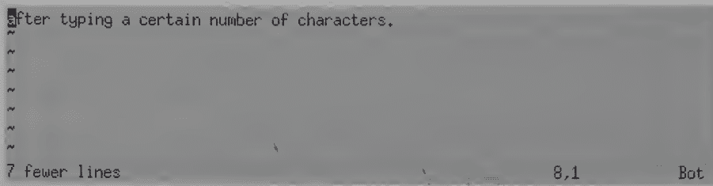

**图 7.68** 移动多行：其次，使用重复命令删除。

在删除你想移动的行后，你导航到文本的新位置，如图 7.69 所示。尽管新文本要位于第三行，但你导航到第二行的文本上方。最后，你可以执行适当的放置命令 `<P>`（大写 P）。你也可以通过导航到第一行并使用 `<p>`（小写 p）获得相同。

> 注意：此文件包含了我们在书中修正的错误为了编辑文本，我们必须将光标放置在文本将要的位置，并执行编辑命令之一。我们置于文本模式并可以输入新文本。许多编辑命令要求我们在输入新文本后按下 `<ESC>` 键返回命令模式。这些命令中的某些在输入一定数量的字符后会自动将我们返回命令模式。
`2,0-1` 全部

**图 7.69** 移动多行：第三，导航到新位置。

> 注意：此文件包含了我们在书中修正的错误
以下是某些 vi 编辑命令
`r` - replace one character at cursor location with exactly one character
`nR` - replace one more characters starting at cursor location
`cw` - replace text from cursor to end of word with multiple characters
`s` - replace character at cursor location with one more characters
`J` - join one line to another line
为了编辑文本，我们必须将光标放置在文本将要的位置，
`2,0-1` 顶部

**图 7.70** 移动多行：最后，放置文本。

## 在文件内复制文本

复制文本与移动文本相似。唯一的区别是，在复制时，你执行的是悬切（yank）命令而不是删除（delete）命令。为了演示，假设你想在文件 `edit_notes.txt` 中为 `<c><0>` 添加一个描述。你注意到 `<c><w>` 的描述与 `<c><0>` 相似。与其为 `<c><w>` 输入完全新的一行，不如通过复制 `<c><w>` 的描述并进行少量编辑来节省击键次数。

复制文本伴随着一次 yank 随后是执行放置（placement）操作。

要复制 `<c><w>` 描述，你导航到该行，如图 7.71 所示。在 yank 行时，光标可能位于行的任何部分。然后你使用 `<p>y` 或 `<Y>` 执行 yank 命令，任凭你喜欢哪一个。注意，yank 命令不会删除或通过其他更改文件内容。在某些系统或版本的 vi 中，你有时会在屏幕底部看到类似“n lines yanked”（已 yank n 行）的消息作为 yank 的视觉指示，其中 n 是 yank 的行数。与之前一样，此类视觉指示仅用于反馈目的，不会影响 yank 功能或文件内容。

| 命令 | 描述 |
| :--- | :--- |
| cw | 将光标到单词结束的文本替换为多个字符 |
| s | 将光标位置的字符替换为一个或多个字符 |
| J | 将一行合并到另一行 |

**图 7.71** 复制一行文本：首先导航到文本源并执行 yank 命令。

一旦源文本被 yank，你就会导航到复制的目标位置并执行放置命令 `<p>` 或 `<P>`。在这个例中，你正正将复制的内容直接放置在源内容的下方，因此不需要导航，只需执行 `<p>` 将被 yanked 的文本放置在光标下方。图 7.72 显示了放置被 yanked 文本后的结果。

| 命令 | 描述 |
| :--- | :--- |
| cw | 将光标到单词结束的文本替换为多个字符 |
| Ew | 将光标到单词结束的文本替换为多个字符 |
| s | 将光标位置的字符替换为一个或多个字符 |
| J | 将一行合并到另一行 |

**图 7.72** 复制一行文本：接下来，导航到新位置并放置文本。

你现在可以利用目前为止学到的编辑命令来编辑创建的副本，以描述 `<c>` 命令。为了加强记忆，你可以按照以下步骤获得图 7.73：

- 按下 `<w>` 导航到新行中“cw”的字母“w”
- 执行 `<cr>` 将字母“w”更改为“0”，输入“0”
- 执行 5 次 `<span>` 导航到单词“cursor”（或者，执行 `5<w>`）
- 执行 `<i>` 添加文本“the start of line”，输入该文本，并按 `<ESC>`键
- 执行 2 次 `<html>` 导航到单词“to”的开头（或者，执行 `2w`）
- 执行 4 次 `<dw>` 删除文本“to end of word”（或者，执行 `4<d>`）

```
cw - 将光标到单词结束的文本替换为多个字符

c0 - 将从行首到光标的文本替换为多个字符

s - 将光标位置的字符替换为一个或多个字符

j - 合并一行到另一行
```


**图 7.73** 编辑复制行后对 `<c><o>` 的描述。

你也可以以类似于移动文本的方式复制单词或行的一部分部分。唯一的区别是，你对源文本执行的是 `yank` 命令，而不是删除命令。某些 `yank` 命令包括：`<y><o>` 从单词末尾 `yank`，`<y><b>` 从光标到单词开头 `yank` 文本，`<y><s>` 从光标到行尾 `yank` 文本，以及 `<y><0>` 从光标到行首 `yank` 文本。之后，你导航到目标并执行其中一个放置命令。

## 移动或复制文本的重复

你之前学习了如何通过命令重复来移动多行。用于复制多行的重复也是类似的，即通过在 `yank` 命令之前加上你想要复制的行数。例如，你可以通过将光标导航到这些行中的第一行并执行 `10<y><o>`（或 `10<y>`）来复制文本行。然后你导航到复制的目标位置，并执行相应的放置命令。

你也可以使用重复来移动和复制多个单词。例如，要移动三个相邻的单词，导航到第一个单词并执行 `3 <d><w>`。如果要复制这些单词，则执行 `3 <y><w>`。之后，使用 `<p>` 或 `<P>` 导航并放置文本。

## 使用寄存器移动和复制文本

有时，你可能需要移动或复制多个文本。虽然你可以一次执行一个移动或复制，但在源文本位置和目标文本位置之间不断导航可能是低效的。为了方便移动和复制多个文本，你使用了寄存器（`registers`）。

`vi` 中的寄存器允许你一次移动或复制多个文本。某些版本的 `vi` 要求在不同寄存器之间移动或复制时使用寄存器。

### vi 中寄存器的概念

寄存器是文本的临时存储区域。当你删除或 `yank` 文本时，它会被放入寄存器中。默认情况下，`vi` 使用未命名寄存器，会被最后删除或 `yank` 的文本覆盖。你也可以使用命名寄存器来存储和检索多个文本。

### 将文本移动并复制到寄存器

要移动或复制特定文本，在命令后加上寄存器名称。例如，`<y>a` 将文本 `yank` 到寄存器 `a`，而 `<d<a>` 将文本删除到寄存器 `a`。要粘贴寄存器的内容，使用放置命令，例如 `<ap>`。

### 放置寄存器内容

一旦你删除或 `yank` 了文本，你就可以在新位置放置其内容。对于每个寄存器，这涉及导航到目标并在放置命令前加上寄存器标识符。对于第一个片段（未命名寄存器），在光标后放置该片段。要放置在光标前，使用 `<P>`。

### 寄存器内容的寿命

当你退出或关闭 `vi` 时，寄存器的内容将丢失。但正如你很快看到的，当你打开多个文件时，寄存器内容仍然存在。

## 搜索文件

要快速查找文件中单个单词、短语或其他系列字符，可以使用 `vi` 正向或反向搜索文件。要执行正向搜索，在命令模式下按下 `/`，它出现在屏幕底部，光标指向它。然后输入你想要搜索的单词或字符，最后按 `<Enter>`。

为了演示正向搜索，假设你想从 `edit_notes.txt` 的开始定位单词“character”。在命令模式下将光标置于第一行开头，并执行 `/` 后跟搜索文本，如图 7.74 所示。

要编辑，我们必须首先将光标放置在文本所在的位置，然后执行一个编辑命令。然后我们进入文本模式并可以输入新文本。许多编辑命令要求我们在完成新文本输入后按 `<ESC>` 键返回命令模式。其中某些命令会自动返回命令模式。

**图 7.74** 在光标位置执行搜索。

`vi` 然后从光标位置开始执行正向搜索。例如，如果光标位于第 10 行，正向搜索从第 10 行开始，到第 11 行、12 行等。搜索持续直到找到单词或字符序列，或者到达文件结尾，以先发生者为准。如果找到了单词或字符序列，`vi` 将光标跳转到该位置，如图 7.75 所示。

# 编辑文件 205

我们执行了编辑命令之一。我们进入了文本模式，可以输入新文本。许多编辑命令要求我们在输入完新文本后按下 `ESC` 键返回命令模式。其中某些命令在输入特定数量的字符后会自动将我们带回命令模式。

6,34 11%

图 7.7 搜索的示例结果。

请注意，无论搜索是否成功，你仍然处于命令模式。如果你愿意，可以执行后续命令来添加、编辑或删除找到的文本。或者，你也可以通过输入 `<n>`（下一个出现）来重新执行上次搜索，以找到相同单词或字符的下一次出现。通过这种方式重新搜索可以避免你重复输入该单词或字符。如果重新搜索发现了任何出现处，光标将跳转到该位置。你可以根据需要多次输入 `<n>` 以定位文件中的所有出现处。或者，你可以在命令模式下通过输入 `<N>` 以原始搜索相反的方向重新执行搜索。

`<n>` 以相同的搜索方向重复搜索。`<N>` 以相反的搜索方向重复搜索。


以类似的方式，你可以通过 `<?>` 命令执行反向搜索。假设你想从 `edit_notes.txt` 的第九行向后搜索文本“replace one”；当光标位于第九行时，输入 `?` 后跟搜索文本，如图 7.76 所示。反向搜索从光标位置开始，继续之前的行、再前一行，以此类推，直到找到单词或字符序列，或者搜索到达文件开头（以先发生者为准）。如果搜索成功，使用 `;` 和 `<N>` 命令分别查找反向搜索的下一个或上一个出现处。

```
cw - 将从光标到单词结束的文本替换为多个字符
c - 将行首到光标的文本替换为多个字符
s - 将光标位置的字符替换为一个或多个字符
J - 将一行合并到另一行
```


?replace one[]

图 7.76 执行反向搜索。

## 杂项命令

`vi`有一些杂项但实用的编辑命令，可以在命令模式下执行。

### 重复上一个命令

在许多情况下，你可能想要重复上一个命令，无论是为了文本输入、编辑、删除还是定位。`vi`提供了通过点命令` .`或句号键执行重复的操作。例如，为了更改某些单词的拼写错误，首先搜索找到该单词，并执行相应的更改命令。要纠正该单词的其他出现处，使用`/`命令找到单词的下一次出现处。当你定位另一个出现处时，只需输入点命令` .`来纠正单词错误的单词。你不需要重新输入每次纠正。

### 撤销上一个命令

要撤销或反转之前的文本添加、编辑、删除或定位，`vi`允许通过`u`（用于撤销）命令来实现这一点。例如，假设你不小心使用`dd`命令删除了`edit_notes.txt`的第一行，如图 7.77 所示。

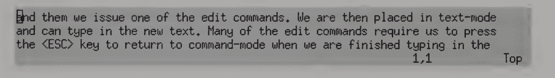

图 7.77 你在不小心删除第一行后的 edit_notes.txt。

要反转此删除，输入`u`，这会将该行放回文本编辑器，返回图 7.78 所示的内容。

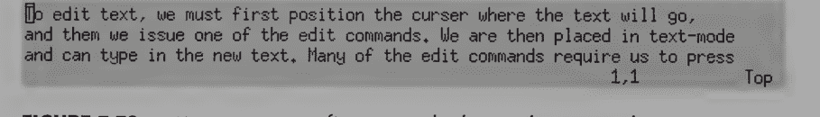

图 7.78 你撤销上一次操作后的 edit_notes.txt。

如果对某行进行了多次更改（例如删除的单词、替换的字符和更改的单词），而你想要保留或撤销这些更改，可以使用`U`（大写 U）命令。`U`只会撤销自光标上次移动到该行以来对其所的所有更改。在其他情况下，一旦光标离开某行，对该行进行的任何更改都不会通过`u`撤销。

取决于`vi`的版本，你可能通过多次使用单撤销命令`u`来多次撤销。这种技术允许你通过输入四次`u`来撤销最后四次更改（或者，你可以通过指定数字来使用重复功能）。多次单撤销与行撤销命令`U`的区别在于，多次撤销不仅限于光标位于该行时在该行上做的更改。`vim`是一个允许多次撤销操作的`vi`版本。

# 重做上一次撤销

许多版本的`vi`还允许你重做（即撤销一次撤销）上一个命令。如果你在执行撤销后改变了主意，或者如果你想查看更改前后的效果，这非常有帮助。旧版本的`vi`中，如果你在第一次执行`u`后立即使用`u`，它会撤销之前的撤销（即连续执行两次`u`）。较新版本（如`vi`）通过执行`<ctrl-r>`来完成重做。

## 写入或关闭文件

与任何添加、删除或修改文件的程序一样，你应该定期保存文件以减少丢失工作的机会。当你完成一个文件时，必须保存内容或关闭它。所有这些命令必须在命令模式下执行。每个以冒号开头的命令在你输入时都会出现在屏幕底部。

表格 7.7 打开、写入和关闭文件的文件操作

| 文件操作 | 命令 (alternatives given on lines) |
|---|---|
| 写入原文件名并保持打开 | `:w` |
| 写入新文件并保持打开 | `:w fname` |
| 写入新或现有文件并保持打开 | `:w fname` |
| 如果没有更改则退出 vi；不保存 | `:q` |
| 无论是否有更改退出 vi | `:q` |
| 退出 vi 并保存任何更改 | `:x` |
| | `:wq` |
| | `ZZ` |

## 编辑文件 209

要保存更改并退出`vi`，你可以执行`:wq`（写入并退出）、`:x`（写入并退出）或`<ZZ><ZZ>`。这些命令必须在命令模式（command-mode）下执行，它们是等效的，因此你可以使用任何一种方便的方法。
你还可以指定另一个文件名来保存这些命令。
`:n`和`:nl`命令涉及在`vi`中管理多个文件。本节将解释它们的用法。

## 管理多个文件

到本章目前为止，你已经学习了如何在单个文件的上下文中使用`vi`。然而，有时你需要管理多个文件，例如查看它们、在它们之间移动文本或在它们之间复制文本。你有两种基本方法可以完成此类多文件操作。你可能会发现，某些情况下其中一种方法比另一种方法更容易学习或更有用。第一种方法涉及你到目前为止学过的`vi`命令，结合一些允许你在不同文件之间切换的新命令。第二种方法涉及编写和读取一个中间文件。

### 导航和编辑多个文件

要导航多个文件，你启动`vi`并将文件名作为参数指定，如图 7.81 所示。在本例中，你启动`vi`时带有`input_notes.txt`和`delete_notes.txt`文件。以这种方式启动时，`vi`会打开第一个文件并将光标置于开头。在这里，使用你学过的命令来导航或编辑该文件。

```
/Intro-to-UNIX/chap7# vi input_notes.txt delete_notes.txt
```

图 7.81 启动`vi`以处理多个文件。

在打开下一个文件之前，你必须使用`:w`、`:wi`或`:w filename`保存任何更改，否则放弃更改。你稍将学习如何放弃更改。

### 打开下一个文件

要导航和/或编辑第二个文件，在命令模式下执行`:n`，如图 7.82 所示。`:n`关闭第一个文件（`input_notes.txt`）并打开第二个文件（`edit_notes.txt`）。你现在可以导航或编辑第二个文件。如果你想在参数列表中导航和/或编辑另一个文件，可以执行`:n`关闭当前文件并打开列表中的下一个文件。

当你执行`:n`时，如果当前文件包含未保存的更改，`vi`会发出警告且你无法关闭文件。如果你打算放弃更改，

## 210 UNIX/Linux 导论

`vi`是 UNIX 系统中标准的文本编辑器。
要输入文本，我们必须首先将光标置于文本将要去的位置，
`cn#`

图 7.82 关闭当前文件并打开参数中的下一个文件

当前文件并打开下一个文件，因此你也可以选择执行`:nt!`。`!`表示你可以忽略警告并继续。

要放弃（不写入）对文件的更改，请指定`:q!`退出或指定`:n!`打开下一个文件。

### 打开上一个文件

要关闭当前文件并导航和/或编辑之前打开的文件，你可以在命令模式下执行`:n#`，如图 7.83 所示。在本例中，假设你打开了第二个文件（`edit_notes.txt`），但想返回上一个文件（即`input_notes.txt`）。为了在两个文件之间持续切换以比较、复制或移动文本，请重新执行`:n#`。在许多版本的`vi`中，你可以通过在命令模式下执行`:ctrl->`来打开上的文件。

你可以通过执行`:n#`或`:ctrl->`来打开上一个文件。

- 以下是用于`vi`的常用删除命令
- `X` - 删除光标之前的字符
- `X` - 删除光标之前的字符
`n#`

图 7.83 关闭当前文件并打开上一个文件。

在`vi`中，当启动`i`时，你可以打开一个未作为命令行参数指定的文件，操作方法是执行`:n`，后跟一个空格、下一个文件的名称和`<Enter>`。例如，假设你在`vi`中打开了`input_notes.txt`文件并想要打开`edit_notes.txt`文件，但在启动`vi`时没有将其指定为命令行参数。要在命令模式下打开`edit_notes.txt`，请执行图 7.84 所示的命令。或者，要放弃当前文件的任何更改并打开指定的文件，请使用`:n!`而不是`:n`。

## 在文件之间移动文本

利用你在本章中为止学的操作在文件之间移动和复制文本。具体来说，移动文本涉及以下步骤：

## 编辑文件 211

`vi`是 UNIX 系统中标准的文本编辑器。
要输入文本，我们必须首先将光标置于文本将要去的位置，
`:edit_notes.txt`

图 7.84 关闭带有源文本的文件。打开指定的文件。

- 打开带有源文本的文件。
- 导航到源文本并将源文本删除到寄存器中（在文件之间移动文本时通常需要使用寄存器）。要在文件之间移动多个片段，请重复上一步，但将每个片段删除到唯一的寄存器中。
- 在不退出`vi`的情况下关闭源文件并打开目标，使用`:n`、`:n!`或`n#`。
- 导航到目标位置。执行包含文本的寄存器标识符，后跟`<a>`或`<b>`放置命令。

作为文件之间移动文本的示例，将`input_notes.txt`的最后一段移动到`delete_notes.txt`的开头。为了演示，你使用`:n`并配合文件指定请求来打开目标文件，而不是在启动`vi`时将两个文件作为参数。（此处省略了原文重复的描述性句子，遵循指令“不要重复输出原文”原则）...（此处后续大量重复的描述性文本）

```
若干字符后。

~

少 3 行
```

删除文本，我们必须首先将光标置于想要删除的文本处，然后执行删除操作。在删除操作结束时，我们仍然处于命令模式，因此不需要`<ESC>`键。

图 7.85 在文件之间移动：首先，导航到源文本。

## 212 UNIX/Linux 导论

删除文本后，你必须使用`:w`（或`:w!`）保存当前文件并执行`:n`打开下一个文件。通常，此时你会导航到文本目标（位置）。然而，在图 7.87 所示的示例中，你想将文本放在开头，因此你将光标留在第一行。然后执行一个放置命令将文本放在光标上方。结果见图 7.88。


以下是用于 `vi` 的常用删除命令

- `x` - 删除光标之前的字符
- `dw` - 从光标到下一个单词开头删除

`delete_notes.txt` 1,1 Top

```
图 7.87 在文件之间移动：第三，打开目标文件并导航。
```

为了文件之间复制文本，你遵循与移动文本相同的步骤，但我们将一个文本片段提取（而不是删除）到寄存器中。为了演示，假设你想将 `input_notes.txt` 的第一句复制到 `new_notes.txt` 文件的第三行。为了演示，你使用 `:n` 并配合文件指定请求来打开目标文件，而不是在启动 `vi` 时将两个文件作为参数。

是 UNIX 系统中标准的文本编辑器。

要输入文本，我们必须首先将光标置于文本将要去的位置，然后执行一个输入命令。我们随后置于文本模式

```
图 7.88 在文件之间移动：最后，放置相应寄存器的内容。
图 7.89 在文件之间复制：首先，打开源文件；导航到文本；并将文本提取到寄存器中。
```

# 编辑文件 213

一旦你将文本剪切（yank）到寄存器中，就可以关闭源文件并打开目标文件。由于你没有通过命令行参数指定目标文件 `new_notes.txt`，因此你需要使用 `:n`，如图 7.90 所示。

```
This is a file in which we can add new notes.

## This is the last line of the file.
```

图 7.90 复制文件：打开新文件。在此处你指定文件名。

一旦目标文件打开，你就导航到复制文本的位置，如图 7.91 所示，以便将文本放置在下方。随后，你输入以包含文本的寄存器标识符为前缀的命令。在这个示例中，你将寄存器的内容放在当前行下方，因此你在命令模式下输入 `<a>`，得到图 7.92。你可以根据需要进一步导航或编辑文件，然后保存并关闭它。为了练习使用寄存器在文件之间复制，请将 `input_notes.txt` 的前两行复制到 `edit_notes.txt`。

```
This is a file in which we can add new notes.

## This is the last line of the file.
```

图 7.91 在文件之间复制：导航到复制文本的目的地。

```
This is a file in which we can add new notes.

## This is a text editor that is standard in UNIX systems.

This is the last line of the file.
```

图 7.92 在文件之间复制：放置寄存器的内容。

## 将文件的部分内容写入新文件

有时，你想将文件的某些行写入另一个文件。原因之一是划分文件并进行组织，或者减小体积；另一个原因是使用替代方法将文本从一个文件移动或复制到第二个文件。在这里你将第一个文件的文本写入第三个文件，然后读取第三个文件到第二个文件。

为了演示如何将文件的部分写入另一个文件，假设你想将 `input_notes.txt` 中关于编辑的段落复制到 `edit_notes.txt`。你打开

# 214 UNIX/Linux 简介

在 `vi` 中打开 `input_notes.txt`，并在命令模式下使用图 7.93 所示的 `write` 命令，然后按 `<Enter>`。`write` 命令用起始行和结束行号表示，用逗号分隔。在 7.93 中，你指定 `16,24` 来识别第 16行为范围开始，第 24行为范围结束。文件 `edit_desc` 是第三个临时文件，你创建并使用它将文本从一个文件复制到另一个。要标识要复制的行范围，导航到每个范围的开头，并使用 `<ctrl-g>` 记录它们的行号。

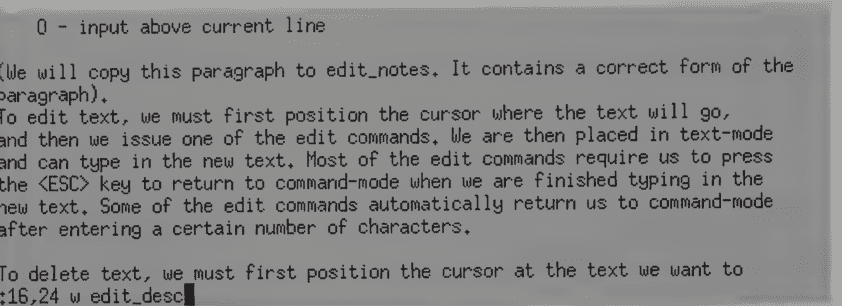

**图 7.93** 将文件 `input_notes.txt` 的部分内容写入新文件 `edit_desc`。

如果输出文件已存在，`vi` 会向你报警。为了解决这种情况，你必须选择另一个文件名或使用 `:w` 覆盖现有文件。
如果你正在将文本从第一个文件移动到第二个文件，此时你可以删除第一个文件中的文本并删除第一个文件。无论是复制还是移动文本，你都要通过 `:q` 关闭第一个文件。如果你现在显示目录列表，将看到你写入的新文件 `edit_desc`。图 7.94 展示了列表并显示文件内容。

```
//Intro_to_UNIX/chap07 is

delete_notes.txt vi_command_list.txt

edit_desc indent_ex new_notes.txt

edit_notes.txt input_append_examples pico_example

//Intro_to_UNIX/chap07 cat edit_desc

(我们将此段落复制到 edit_notes。它包含一个格式正确的段落)。

要编辑文本，我们必须首先将光标置于文本将去的地方，然后使用编辑命令之一。在文本模式和大多数编辑命令中，当我们完成新文本输入后需要按 `<ESC>` 键返回命令模式。某些编辑命令在输入特定数量的字符后会自动让我们返回命令模式。

//Intro_to_UNIX/chap07
```

**图 7.94** 列出当前目录以显示新的（中间）文件，并显示新文件的内容。

# 编辑文件 215

要完成移动（或复制）操作，请遵循下一节“将文件读取到另一个文件”概述的步骤。

# 将文件读取到另一个文件

要将一个文件导入或读取到第二个文件，你必须先打开第二个文件。然后导航到要放置文本的行上方，并使用 `:r` 命令读取第一个文件。`:r` 以你想要的文件名作为参数，并将该文件的内容放置在光标下方。例如，假设你想将 `edit_desc` 文件的内容读取到 `edit_notes.txt` 中，从第 3 行开始。你在 `vi` 中打开 `edit_notes.txt` 并导航到第二行（紧邻文件内容将放置的位置上方），如图 7.95 所示。最后，你执行图 7.96 所示的 `read` 命令。

```
This is a file in which we can add new notes.

## This is the last line of the file.
```

图 7.95 在文件之间复制：导航到复制文本的目的地。

```
This is a file in which we can add new notes.

## This is a text editor that is standard in UNIX systems.

This is the last line of the file.
```

图 7.96 在文件之间复制：放置寄存器的内容。

# UNIX/Linux 简介

这一行没有缩进。
这一行通过在开头使用 tab 键进行了缩进。
这一行在从上一行按下回车键后没有缩进。

设置自动缩进（auto indent）后：这一行没有缩进。
这一行通过在开头使用 tab 键进行了缩进。
按下回车键后，这一行应该自动缩进。
这一行也是如此。
这一行在输入内容之前按下 `ctrl-d` 删除了缩进。

```
9,63
```

图 7.102 `vi` 中自动缩进设置的效果。

```
:set noai
```


图 7.103 在 `vi` 中禁用缩进设置。

## 自动代码缩进

某些版本的 `vi` 有一个类似的缩进设置，命名为 `cindent`，用于 C 和 C++ 程序。这种缩进设置不仅像之前提到的自动缩进 `autoindent` 一样，还会根据 C 或 C++ 的程序风格自动对行进行缩进。例如，假设光标位于一行包含 `if`、`else`、`for`、`while` 或类似语句的行上。如果你在该行按下 `<Enter>`，`vi` 将在新行应该嵌套的前提下，自动对下一行进行缩进。如果你想移除添加的缩进，可以在之前按下 `<ctrl-d>`。

## 缩进距离

你可以指定 `vi` 自动对行进行缩进的量。这里的想法是指定 `tab` 的大小，通常是四个或八个空格。这意味着第一次按下 `tab` 键会将光标移动到第 4 或第 8 列；第二次按下 `tab` 键会将光标移动到第 8 或第 16 列，以此类推。在之前的图中，你的 `tab` 大小为四个。如果你想反过来设置为例如八个缩进的宽，可以使用图 7.104 所示的命令设置 `tab`。该图还显示了调整 `tab` 大小后的结果，因为 `tab` 会调整到新的大小。另一方面，如果 `tab` 大小最初是八，而你想使用例如四个，可以遵循图 7.104 所示的命令，但指定为四而不是八。

## 行号

另一个潜在有用的设置是在编辑器窗口左侧显示每行的行号，从第一行的 1 开始。此设置 `number` 可以开启，如图 7.105 所示。

## 编辑文件

这一行没有缩进。
这一行通过在开头使用 `tab` 键进行了缩进。
这一行在从上一行按下回车键后没有缩进。

设置自动缩进后：这一行没有缩进。
这一行通过在开头使用 `tab` 键进行了缩进。
按下回车键后，这一行应该自动缩进。
这一行也是如此。
这一行在输入内容之前按下 `ctrl-d` 删除了缩进。

```
:set tabstop=8
```

图 7.104 将 `tab` 大小设置为八个空格。所示文本已调整到新的大小。此图还说明了开启行号后的效果。

+1 这一行没有缩进。
2 这一行通过在开头使用 `tab` 键进行了缩进。
3 这一行在从上一行按下回车键后没有缩进。
4
5 设置自动缩进后；这一行没有缩进。
6 这一行通过在开头使用 `tab` 键进行了缩进。
7 按下回车键后，这一行应该自动缩进。
8 这一行也是如此。
9 这一行在输入内容之前按下 `ctrl-d` 删除了缩进。

```
:set nu
```

图 7.105 开启行号显示。

启用行号仅更改编辑器内的显示。它并不会在内容中放置数字，也不会将这些数字保存到文件中。要关闭行号显示，你可以开启非行号设置，如图 7.106 所示。

这一行没有缩进。
这一行通过在开头使用 `tab` 键进行了缩进。
这一行在从上一行按下回车键后没有缩进。

设置自动缩进后；这一行没有缩进。
这一行通过在开头使用 `tab` 键进行了缩进。
按下回车键后，这一行应该自动缩进。
这一行也是如此。
这一行在输入内容之前按下 `ctrl-d` 删除了缩进。

```
:set nonnu
```

图 7.106 关闭行号显示。

# UNIX/Linux 简介

## 其他 vi 配置设置

`vi` 有许多你可以根据需要修改的设置，我们已经解释了其中一些。设置的数量和类型会在不同系统和 `vi` 版本之间有所不同。然而，你可以通过图 7.107 所示的 `set` 命令来了解可用设置。参见图 7.108 中的结果示例。注意此图通过 `more` 显示了设置列表。

```
:set all
```

### 图 7.107 查看 vi 设置。

| Options | | | |
|---|---|---|---|
| all=224 | fileencoding= | menus=25 | swapfile |
| nobrief | fileformat=unix | modeline | swapsync=fsync |
| arabicshape | filetype= | models=5 | switchbuf= |
| noallwins | noescape | modifiable | syntax |
| nokeymap | foldclose= | unmodified | tabstop=4 |
| ambiwidth-single | foldumn=0 | mouse= | tagsearch |
| autoindent | foldable | | taglength=0 |
| noautoread | foldable | | relative |
| noautowrite | foldexpr=0 | mousmodel=extend | |
| -- | -- | | |

### 图 7.108 vi 设置的部分列表。

通过 `set` 和 `unset` 命令所做的更改在退出 `vi` 前有效。重启 `vi` 后，原始默认设置将生效。然而，要永久更改配置，你可以在 `.exrc` 中添加 `set` 命令。例如，为了永久使用四个空格的自动缩进，你可以如下所示：

```
set ai
set tabstop=4
```

### 图 7.109 示例配置文件。

## 其他文本编辑器

虽然 `vi` 是“标准” UNIX/Linux 编辑器，但你的系统可能有你可以使用的替代文本编辑器。另外两种流行的 UNIX/Linux 编辑器是 `pico` 和 `emacs`。下面简要描述了这两种替代编辑器，但也解释了足够的基础知识让你开始使用。

### pico

`pico` 是一种在某些 UNIX/Linux 系统上的简单编辑器。`pico` 是一个具有基本编辑功能的小型编辑器。由于其体积小，`pico` 位于某些救援磁盘。由于其简单，`pico` 比 `vi` 更容易学习。

### 启动 pico

打开文件最简单的方法是将文件名作为命令行参数。在图 7.110 中，你正在使用文件名 `pico_example` 启动 `pico`。与 `vi` 一样，如果你想访问文件内容，文件名可能指向现有文件；如果你想创建一个新文件，文件名可能指向不存在的文件。一旦该文件打开，将出现图 7.111 所示的 `pico` 界面。

```
//Intro_TO_UNIX/chap0$ pico pico_example
```


图 7.110 使用 pico 打开文件。

| UW Pico(tm) 4,1 | File: pico_example |
| 这是一个在 pico 中打开的示例文本文件。 |
| 这是第二行。 |
| 这是第三行也是最后一行。 |
| G Get Help W WriteOut Read File Y Prev Pg Cut Text D Cur Pos X Exit J Justify U Where is V Next Pg Uncut Text T To Spell |

# 导航和向其添加文本

与 `vi` 不同，`pico` 不在命令和文本模式之间切换。相反，除非使用下文所述的控制键或其他某些键，否则 `pico` 接受文本。表 7.8 列出了常用的 `pico` 命令及其替代执行方式。

一旦文件打开，你只需通过输入文本即可向其添加内容。另一方面，为了导航文件，你可以使用表 7.8 所示的控制键组合来完成基础光标移动。如果你的系统支持方向键，你也可以替代使用它们进行导航。其他导航命令

222 UNIX/Linux 导论

允许你移动到行的开头或行末尾。要导航较大的区域，你可以向前或向后翻页。

## 表格 7.8 用于完成导航和编辑的 pico 操作

| 操作 | 命令（另起一行的备选方案） |
|---|---|
| 向左移动一个字符 | `<ctrl-b>`<br>`<left arrow>` (如果可用) |
| 向右移动一个字符 | `<ctrl-f>`<br>`<right arrow>` (如果可用) |
| 移动到下一行 | `<ctrl-n>`<br>`<down arrow>` (如果可用) |
| 向前一页（屏幕） | `<ctrl-v>`<br>`<PgDn>` (如果可用) |
| 向后移动一行 | `<ctrl-p>`<br>`<up arrow>` (如果可用) |
| 向后移动一页（屏幕） | `<ctrl-y>`<br>`<PgUp>` (如果可用) |
| 剪切当前行或高亮文本 | `<ctrl-k>` |
| 粘贴（取消剪切）的文本 | `<ctrl-u>` |
| 选择高亮文本的起始 | `<ctrl-6>` |
| 保存内容 | `<ctrl-o>` |
| 查看帮助 | `<ctrl-g>` |
| 退出 | `<ctrl-x>` |

## 在 pico 中移动和复制文本

`pico` 移动文本可以通过一个完整的单行，也可以通过比单行更小或更大的选定文本部分来实现。要移动一整行，首先导航到光标所在行，然后按 `<ctrl-k>` “剪切”该行。该行将从文本中删除。现在，导航到你想放置文本上方的光标处，并执行 `<ctrl-u>` “取消剪切”该行。之前剪切的行将放置在光标下方。

要移动文本块（例如一个单词、三个单词或若干行），你必须首先选择该块。要选择该块，你导航到该块的开头并执行 `<ctrl-6>`。然后你导航到该块的末尾，通过这样做，你执行 `<ctrl-6>` 的点与光标位置之间的文本就会被高亮。当位于块的末尾时，执行 `<ctrl-k>` 剪切高亮的文本块。然后你可以导航到新位置，最后执行 `<ctrl-u>` 在其新位置取消剪切该块。

# 编辑文件

`pico` 不会将文本保留在原有位置并在其他处复制文本。为了实现复制的效果，你可以按照说明的移动行或文本块的步骤进行；但是，要两次取消剪切文本，即在它剪切的位置和新副本的位置各一次。

# 在 pico 中保存和加载文件

要保存编辑器内容，你使用 `<ctrl-o>`。如果内容没有与文件名关联，`pico` 将提示输入保存内容的文件名。你输入文件名后按 `<Enter>`。如果存在与内容关联的文件名，文件名将出现在保存提示处。你只需按 `<Enter>` 即可将内容保存到该文件名，或者为内容输入一个备选名称。

最后，你通过执行 `<ctrl-x>` 退出。如果编辑器有未保存的内容，`pico` 将在你退出之前询问是保存还是忽略更改。如果你想保存更改，按 `<y>` 表示是（yes），并按照上述步骤选择文件名。否则，按 `<n>` 表示否（no），`pico` 将在不保存更改的情况下退出。

## emacs

`emacs` 在许多方面与 `pico` 相似，无论是在行为还是发布命令方面。`emacs` 也不在命令模式和文本模式之间切换，但正如你所看到的，`emacs` 确实需要转义序列来完成各种操作。与 `pico` 相比，`emacs` 是一个更大、更强大的编辑器，使得 `emacs` 更适用于像程序和配置文件之类的复杂文件。`emacs` 掌握这些强大功能需要学习曲线。

### 启动 emacs

要在 `emacs` 中打开文件，你同样需要提供文件名作为参数。在图 7.112 中，你使用文件名 `emacs_example` 启动 `emacs`，这是本示例提供的一个小样本。文件名可以指向一个现有文件，也可以指向一个新文件。参见图 7.113 中显示了打开文件的典型 `emacs` 屏幕。

```
/Intro_to_unix/chap07$ emacs_example []
```


图 7.112 在 emacs 中打开文件。

## 在 emacs 中导航和编辑文本

表格 7.9 列出了用于导航和操作的一些 emacs 命令。使用 `pico` 命令将文本向左移动一个字符、向右移动一行、向下移动一行、到行开头和行末尾。然而，要向上或向下翻页，你需要使用其他命令，如表格 7.8 所示。像 `vi` 一样，`emacs` 比 `pico` 多功能，你可以向前或向后移动单词。

## 224 UNIX/Linux 导论

### 表格 7.9 用于导航和编辑的 emacs 操作命令

| 操作 | 命令（另起一行的备选方案） |
|---|---|
| 向左移动一个字符 | `<ctrl-b>` `<left arrow>` (如果可用) |
| 向右移动一个字符 | `<ctrl-f>` `<right arrow>` (如果可用) |
| 移动到下一行 | `<ctrl-n>` `<down arrow>` (如果可用) |
| 向前一页（屏幕） | `<ctrl-v>` `<PgDn>` (如果可用) |
| 向后移动一行 | `<ctrl-p>` `<up arrow>` (如果可用) |
| 向后移动一页（屏幕） | `<ctrl-y>` `<PgUp>` (如果可用) |
| 剪切当前行 | `<ctrl-k>` |
| 粘贴（取消剪切）的文本 | `<ctrl-u>` |
| 选择高亮文本的起始 | `<ctrl-6>` |
| 查看帮助 | `<ctrl-g>` |
| 退出 | `<ctrl-x>` |

### 7.9 用于导航和编辑的 emacs 操作和命令

| 操作 | 命令（另起一行的备选方案） |
|---|---|
| 向左移动一个字符 | `<ctrl-b>` `<left arrow>` (如果可用) |
| 向右移动一个字符 | `<ctrl-f>` `<right arrow>` (如果可用) |
| 移动到下一行 | `<ctrl-n>` `<down arrow>` (如果可用) |
| 向前一页（屏幕） | `<ctrl-v>` `<PgDn>` (如果可用) |
| 向后移动一行 | `<ctrl-p>` `<up arrow>` (如果可用) |
| 向后移动一页（屏幕） | `<ctrl-y>` `<PgUp>` (如果可用) |
| 剪切当前行 | `<ctrl-k>` |
| 粘贴（取消剪切）的文本 | `<ctrl-u>` |
| 选择高亮文本的起始 | `<ctrl-6>` |
| 查看帮助 | `<ctrl-g>` |
| 退出 | `<ctrl-x>` |

### 总结

在本章中，你学习了 UNIX/Linux 中的编辑概念。你探索了两种编辑器，`pico` 和 `emacs`。你还学习了如何导航和

### 问题与练习

- 1. 用两种方法向右移动一个字符。
- 2. 用两种方法向下移动。
- 3. 用两种方法向左移动一个字符。
- 4. 用两种方法向上移动。
- 5. 如何移动光标到行末尾？
- 6. 如何移动光标到行开头？
- 7. 什么命令 `4dw`？
- 8. 什么命令 `4wy`？
- 9. 什么命令 `2e`？
- 10. 什么命令 `5s`？
- 11. 什么命令 `4cw`？
- 12. 什么命令 `4dd`？
- 13. 什么命令 `20yy`？
- 14. 什么命令 `c10yy`？
- 15. 什么命令 `p`？
- 16. 什么命令 `P`？
- 17. 当光标在行开头时，如何将其移动到第三个单词？
- 18. 假设光标在行开头，什么命令可以删除五个单词？
- 19. 如何删除从光标到行末尾的所有文本？
- 20. 什么命令可以将从光标到行末尾的文本改为句号？
- 21. 如何在光标下方添加空行？
- 22. 使用什么命令向前搜索“Today is Monday.”？
- 23. 使用什么命令向后搜索“Hello.”？
- 24. `o` 命令（小写“o”）提供了在光标下方添加新文本的方便方法。在 `vi` 中，还有什么其他方法可以完成此项任务？
- 25. `O` 命令（大写“O”）提供了在光标上方添加新文本的方便方法。在 `vi` 中，还有什么其他方法可以完成此项任务？
- 26. 当光标在行开头时，如何将其移动到第三个单词的？
- 27. 如果你当前的制表符大小是四个空格，如何将制表符大小更改为三个空格？

## 8 文本格式——创建和查看排版文档

### 在本章中

- 文本格式和术语概述
- Latex
- DocBook

本章解释了如何在 UNIX/Linux 中创建排版的、专业的文档。首先，你将学习如何使用 LaTeX 创建，这是一种在许多领域都是标准的创建技术和科学文档的流行的排版包。你还将看到为文档创建图表和图形的各种方法。然后，你将学习使用 DocBook（另一种流行的排版应用）创建可通过 Web 浏览器查看的 HTML 页面以及 PDF 文件。

你可能以前用过文字处理器来创建文档。然而，使用 LaTeX 和 DocBook 等排版应用程序创建排版文档的概念与使用文字处理器创建文档有所不同。

在使用文字处理器时，文档开发者负责内容的布局并指定布局方式。例如，在文字处理器中创建标题页时，开发者必须决定并指定字体、字号，以及诸如*斜体*、**粗体**等其他格式细节以及文本的位置。如果文档包含表格、图表或说明等其他元素，作者则负责在文字处理器中放置、定位和格式化这些元素。当存在复杂格式、严格的格式要求或多项格式规范（例如，如果文档要在三个不同的场合发表）时，问题就出现了。此时，作者必须提供并确认正确的格式。

尽管指定格式方面存在缺点，但在创建格式不重要或易于管理的文档时，文字处理器仍有一用之地。许多 UNIX/Linux 系统以及 StarOffice™、KDE 中的 KOffice 或 Word 也包含标准的文字处理功能。StarOffice 和 KOffice 还包含创建其他形式文档的应用程序，例如演示文稿和表格。由于这些应用程序与流行的文字处理、幻灯片演示和表格应用程序相似，且由于它们在 UNIX/Linux 系统上（特别是命令行系统）可能可用，它们超出了本书的范围。更多关于本书的信息请参见章末列出的资源。

与文字处理器相反，LaTeX 和 DocBook 等排版系统只需要开发者指定内容的布局。从那里开始，排版包会处理格式，并根据指定的布局放置文本和其他内容。排版方法使作者无需处理许多格式细节，允许作者专注于文档呈现的实际思想和内容。

因此，排版包在许多专业、技术和政府组织或受众中是被青睐或要求的，因为他们可以提供格式规范，供排版包在生成文档时使用。这种属性也确保了文档符合必要的格式规范。例如，出版者可能要求将图片放置在页面的特定部分，或相对于图片的特定位置放置说明。出版者可能对章节、节或说明名称有特定的字体、样式和编号要求。遵循这些规范以确保出版的文章或书籍在内部以及与该出版者的其他作品保持外观统一。通过提供与排版包兼容的格式规范，文档作者可以专注于文档的实际思想，而无需担心格式。此外，如果以后更改格式规范，或者文档被用于需要不同格式的不同场合，作者不需要编辑内容。排版包将根据给布局规范重新生成文档。出于这些原因，本章重点介绍排版包，即 LaTeX 和 DocBook。

## LaTeX

LaTeX 由 Leslie Lamport 于 1984 年编写，并使用了 Donald Knuth 于 1979 年编写的 TeX 排版程序。LaTeX 是一个流行的包，被许多技术、科学和数学领域的出版者需要。讨论通常适用于 LaTeX2e，它是自 20 世纪 90 年代中期以的标准版本。某些系统可能包含早期版本（如 LaTeX 2.09），但也可以使用本节介绍的许多概念。

其他专门针对 LaTeX 的书籍和资源探索了各种 LaTeX 特性。本章末列出了资源，你可以在那里学习更多关于 LaTeX 以及 DocBook 的知识。本节介绍了 LaTeX 在各种文档中的通用适用性，包括如何布局文本格式，以及如何创建和导入图片、图表和表格。首先，你将学习如何在给定 LaTeX 源文件的情况下构建和查看 LaTeX 文档。然后，你将看到 LaTeX 源文件的组件以及如何创建或修改其内容。最后，你将学习如何将图片、图表和表格创建并整合到 LaTeX 文档中。本节以管理多个文件的技术结束。

### 构建 LaTeX 文档

LaTeX 文档从 LaTeX 源文件开始，该文件包含基本的文档文本、布局规范以及图片、图表等信息。LaTeX 源文件使用普通的文本编辑器创建，如 `vi`、`pico` 或 `emacs`，这些编辑器在第 7 章“编辑文件”中介绍。LaTeX 源文件通常以 `.tex` 扩展名命名，有助于识别该文件为 LaTeX 源文件。通过 LaTeX 源文件，你可以通过两个步骤将源代码生成便携式文档格式 (PDF) 或 Postscript (PS) 格式的排版文档。第一步使用 LaTeX 本身的 `latex` 命令。`latex` 接受一个单一参数，即 LaTeX 源文档文件名，可以带有或不带有 `.tex` 扩展名。图 8.1 展示了这一步，即在源文件 `network_report.tex` 上使用 `latex`。在这里，省略 `.tex` 扩展名。

第二步涉及使用 pdf 应用程序将排版文档生成为 PDF 格式。如果你按照第 2 章“安装 Linux (Fedora) 系统”中的指令安装了 Fedora 系统，你应该已经安装了 `dipsvf` 并应使用 `dipsvf`。

```bash
```


$/Intro_to_UNIX/chap08$ `latex` `network_report` []

**图 8.1** 首先为技术、科学、商务等其他目的创建专业的排版文档

`dipsvf` 可能只接受一个参数，即文档文件名，带有 `.pdf` 扩展名或不带任何扩展名。你可以选择性提供第二个参数，指定存储生成的排版文档的文件名。如果你省略第二个参数，`dipsvf` 将使用 `.pdf` 扩展名作为 PDF 文件。图 8.2 显示了如何使用 `dipsvf` 生成 PDF 格式的排版文档。

```bash
$/Intro_to_UNIX/chap08$ dipsvf network_report []
```

**图 8.2** 生成 PDF 格式文档的第二步

在某些系统中，你可以改为使用 `dvips` 生成 Postscript 格式的排版文档。`dvips` 的工作方式与 `dipsvf` 类似，它可以接受一个或两个参数，第二个表示存储生成的排版文档的文件名。图 8.3 显示了如何使用 `dvips` 生成文档。

```bash
$/Intro_to_UNIX/chap08$ dvips network_report []
```

**图 8.3** 生成 Postscript 格式文档的第二步

## 查看排版文档

你可以通过带有文件名参数调用 `kpdf` 来查看文件（例如你创建的 `network_report.ps`），如图 8.4 所示。

```bash
//Intro_to_UNIX/chapter08 kpdf network_report.pdf []
```

## 8.4 调用 kpdf 查看 PDF 文件

在某些 UNIX 或 Linux 环境中，可以通过鼠标在应用程序（或类似的）菜单列表中调用 `kpdf`（或类似的查看器）。然而，这将启动一个没有内容的查看器，你必须通过操作并导航到文档来打开它。`kpdf` 每次显示一个页面，如图 8.5 所示，并缩小放大比例以便查看整个页面。你可以通过点击缩放框中的向下箭头选择所需的缩放百分比，来增加或减少显示文档的放大比例，这在图 8.5 中显示为 66.70%。然后你可以选择所需的缩放百分比。较大的值会放大显示文档，而较小的值会缩小显示文档。根据缩放比例，你可能需要滚动页面以在显示窗口中查看完整内容。要滚动页面，你可以移动右侧或下方的滚动条。

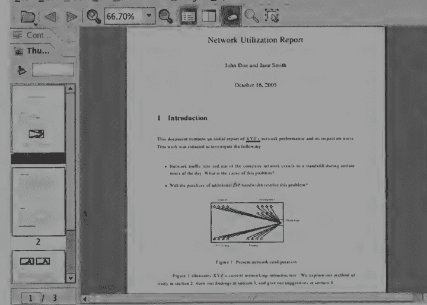

**图 8.5** 使用 kpdf 查看文档

要查看第二页，点击 `kpdf` 窗口最左侧的页面图标表示，该区域包含文档所有页面的图标。如果页面过多导致图标无法一次性在左侧显示，你将看到该列表的滚动条。你也可以滚动最右侧的栏跳转到不同页面。

## LaTeX 基础组件

LaTeX 文档包含基本部分（指定文档正文的类型），这些部分至少必须存在于 LaTeX 源文件中。列表 8.1 概述了 LaTeX 文档的基础部分，尽管随着你对文档的改进，你还会在此基础上添加内容。本节提到了网络 LaTeX 文档 `network_draft.tex` 的开头，它包含了这些组件以及几段文档文本。示例和插图将基于此草稿文档，使用所描述的技术来实现你在本章开头所构建并查看的最终排版文档。

### 列表 8.1 LaTeX 源文件的基础组件

```latex
\documentclass[12pt]{article}

\begin{document}

% Document text goes here

\end{document}
```

## 文档类型

在 LaTeX2e 中，你可以通过 `\documentclass` 命令指定你想要排版的文档类型，该命令涉及到在 `{}` 大括号内指定文档类名。表 8.1 描述了一些常用的标准 LaTeX 类。注意，事实上的特征是该文档类型通用的，许多特征可以通过本章后面解释的命令进行修改。

### 表 8.1 常用 LaTeX 文档类

| 类 | 简述 | 默认特征 |
|---|---|---|
| article | 许多技术期刊和出版物使用的通用类 | 单行间距。段落缩进。 |
| proc | 用于论文集指南的类，基于 article 类 | 与 article 类相似。使用双栏格式。 |
| report | 针对大型报告（多个章节）或小型书籍定制 | 单行间距。段落缩进。有独立的标题页。 |

## 文本格式——创建与查看排版文档 233

| 类 | 简述 | 默认特征 |
| --- | --- | --- |
| book | 专为长篇、完整的书籍定制 | 与 report 类相似。页码位于顶部。有独立的标题页。 |
| letter | 用于短篇文档的类 | 双行间距。段落不缩进，而是通过额外的行间距隔开。 |

每个文档类都有一组选项，你可以额外指定这些选项以根据你的需求定制该类。常见选项涉及更改默认字体大小和列布局。表 8.2 列出了常用的文档样式选项。

### 表 8.2 常用 LaTeX 文档选项

| 选项 | 简述 |
| --- | --- |
| 10pt | 将默认字体大小设置为 10 磅 |
| 11pt | 将默认字体大小设置为 11 磅 |
| 12pt | 将默认字体大小设置为 12 磅 |
| landscape | 使用横向排版而非竖向 |
| titlepage | 将标题信息放在单独的页面 |
| notitle | 不将标题信息放在单独的页面 |
| onecolumn | 使用单栏页面排版文档 |
| twocolumn | 使用双栏页面排版文档 |

列表 8.2 显示了在 LaTeX 源文件开头使用 `\documentclass` 命令的通用语法。`class` 通常是表 8.1 中列出的类之一。`option` 通常是表 8.2 中列出的选项之一。如果没有指定任何选项，请省略 `{}` 大括号，使 `\documentclass` 命令仅包含类规格说明。

### 列表 8.2 \documentclass 命令的语法

```
\documentclass[option]{class}
```

某些选项在特定类中不可用。例如，`letter` 类不支持 `twocolumn` 选项。当无效选项是

# UNIX/Linux 简介

在运行 LaTeX 时给特定的文档类提供无效选项时，你将看到一条类似于图 8.6 的消息。

```
LaTeX Warning: Unused global option(s):
[twocolumn].
```

**图 8.6** 无效文档类选项的 LaTeX 消息示例。

某些读者或接收者可能要求按照他们自己的 LaTeX 类来排版文档。这会导致 LaTeX 根据他们的规范（如字体大小、页边距、图片位置等）来排版你的文档。简单来说，这需要将该文件（扩展名为 `.cls`）的副本存放在与你的文档源文件相同的目录下，并在 `\documentclass` 命令之后立即在 `{}` 大括号内指定类名（不含 `.cls` 扩展名）。

## 字体样式与大小

默认字体样式和大小在某些类之间有所不同，特别是由文档接收者提供的类。然而，如果你愿意，可以使用不同的字体和/或大小。在标准文档类中，默认字体样式通常是 Times New Roman，字体大小为 10 磅。你可以在 `{}` 大括号内作为 `documentclass` 命令的选项指定替代字体大小。例如，你可以指定 `[12pt]` 用于 12 磅字体大小，指定 `[8pt]` 用于 8 磅字体大小，以此此类推。

要更改字体样式，请指定 `\package` 命令并提供字体名称。常用的字体样式有 `times`、`courier`、`avant`（用于 Avant Garde）、`palatino`、`velvet`（用于 Helvetica）和 `newest`（用于 New Century）。字体选择在不同系统间会有异，因此给定系统的可用字体可能多或少。

## 文档正文

在指定文档类型后，你可以指定文档正文，它由文本内容、图片等组成。在源文件中用 `\begin{document}` 命令标记文档正文的开始。正文随其后，以及任何命令。然后你用 `\end{document}` 命令标记正文的结束。列表 8.3 演示了正文的开头。

# 文本格式——创建与查看排版文档 237

另一个例子是，LaTeX 可能会尽可能填满排版行，并在行尾对一个你没有进行连字符处理的单词进行断字。在这种情况下，你可以通过在源文件的该点引入 `\` 或 `\linebreak` 命令来指定排版文档中某行的结束位置。例如，为了让地址 "123 Main Street" 和 "Sometown, USA" 出现在不同的行，你可以在源文件中指定文本，如列表 8.4 所示。

### 列表 8.4 换行示例

```
123 Main Street \Sometown,
```


以 `\` 或 `\linebreak` 结尾不会开始新段落，而是在下一行继续当前段落。下一节将解释如何换行一个结束一个段落并开始一个新段落的行。


LaTeX 会忽略文档中额外的空格和空行。如果你想在排版文档中留出额外的空行，必须指定换行符。

## 段落与缩进

段落的结束可以通过源 `.tex` 文件中的空行（非注释行）来指定。例如，考虑列表 8.3 源文件中“...these delays.”短语之后的空行。在排版文档中，LaTeX 将在“...delays.”短语处处结束一个段落，并以“We found.....”短语开始另一个段落。

为了进一步说明段落的指定规范，你可以在列表 8.5 的第一行之后添加两个段落。列表 8.5 显示了第一个段落的最后一行和原始第二个段落的第一行作为参考。省略号表示为了简洁而省略的剩余文本。请注意，为了保持排版段落，源文件中的文本不需要填满一行或或到到行的末尾。列表 8.5 通过在以“...Web server”结尾的行中间结束，说明了这一概念。

### 列表 8.5 为 network_draft.tex 添加两个段落

```
additional ISP bandwidth will resolve these delays.
```

这涉及到对所有网络流量进行为期一周的分析。我们的分析包括测量和分析 XYZ 网络内部以及从内部到外部往返时间。为了测量往返时间，我们在 XYZ 的主文件和 Web 服务器上运行了一个 shell 脚本

每隔 60 秒，脚本向本地网络上的机器发送一个 ping 命令，并向外部机器（XYZ 网关的一跳之外）发送另一个 ping 命令。每个命令发送了三个 ping 包，响应结果被追加到两个文件中，一个用于本地 ping 的响应，另一个用于远程 ping 的响应。

在捕获一周的往返时间后，我们利用另一个 shell 脚本读取日志文件并生成小时平均往返时间。这些平均值随后用于指示网络延迟低、中等或高的时期。

我们发现网络活动在 ... 小时之间处于最低水平。

作为上一节关于换行的后续，LaTeX 不区分 `.tex` 源文件中的单个或多个连续的空行。无论哪种，都表示段落的结束，且不会导致排版文档中出现更多（或更少）的空行。若要在排版文档的特定行之间实现特定数量的空白，请参阅本章后面的“行间距”或“段落间距”部分。

你也可以使用 `\par` 命令指定段落的结束。`\par` 取代了源文件中需要空行来指示新段落。在某些情况下，这可以通过避免为了创建空行而中断文本来提高源文件内容的可读性。

要启用段落缩进，请在 `.tex` 源文件中想要开始缩进的文档位置指定 `\indent` 命令。你不需要在每个想要缩进的段落开头指定 `\indent`。相反，一旦指定，`\indent` 就会指示 LaTeX 对所有后续段落进行缩进。许多文档类已经启用了段落缩进，因此此命令可能不是必需的。

你可以通过在该段落之前立即指定 `\noindent` 命令来抑制特定段落的缩进。`\indent`、`\noindent` 的持久影响不会禁用所有后续段落的缩进。相反，`\noindent` 仅禁用紧随其后的段落的缩进。

许多自动启用缩进的文档类指定了段落缩进。如果你想自己调整缩进量，可以使用 `\setlength` 和 `\indent` 命令指定新的数值。列表 8.6 展示了如何将缩进量设置为 0.5 英寸。你也可以使用表 8.3 中的规范指定其他测量单位。

### 列表 8.6 设置段落缩进量

```
\setlength(\parindent){0.5in}
```

### 表 8.3 单位

| 单位 | 规范 |
|---|---|
| inches | in |
| centimeters | cm |
| millimeters | mm |
| points (1/72 inch) | pt |

## 分页

`\pagebreak` 会导致 LaTeX 在该点结束当前页面，并使用紧随其后的文本或内容开始一个新页面。LaTeX 将排版后续内容。

## 强制相邻

有时，你可能希望许多连续的元素（例如，紧随其后的数字）相邻显示在同一行上。如果你想更改行间距，可以使用以下命令更改单倍、1.5 倍和双倍行间距。首先在

源文件中指定 `\documentclass` 之后的列表 8.7 所示的命令。列表 8.7 中的 `\usepackage` 命令将间距包引入你的文档中，以便利用其功能。

### 列表 8.7 指定双倍行间距

```
\usepackage{xspace}

\doublesacing
```

一旦引入间距包，你就可以发布以下间距命令来更改行间距。`\spacing` 命令指定后续为单倍间距。`\doublesacing` 命令（如列表 8.7 所示）指定双倍间距，而 `\onehalf` 指定1.5 倍间距。一旦发布了间距命令，文档从该点将按照该规范进行排版，直到再次更改间距。你可以在文档的任何位置通过简单指定相应的间距命令来后期更改。

## 行间距

后续命令仅影响紧随其后的段落之前的间距，而不影响之后的段落。

你也可以使用 `\parskip` 命令为所有后续段落指定固定的垂直间距。列表 8.8 展示了如何为所有段落之间指定 0.25 英寸的垂直间距。你也可以使用表 8.3 中的规范指定其他测量单位。

### 列表 8.8 指定段落间的间距

```
\setlength{\parskip}{0.25in}
```

# 字体格式：粗体、斜体、强调、等字体、下划线

LaTeX 中的通用格式命令是 `\bf`（粗体）、`:\it`（斜体）、`\em`（强调，大多数情况下等同于斜体）以及 `\texttt`（等字体和等宽）。要应用这些命令之一来格式化文本，最好的方法是将文本封装在 `{}` 大括号中。然后，在封装的开始处指定所需的格式化命令。例如，如果你想将第二个段落中的单词“all”设为斜体，你可以通过将该单词封装在 `{\it` 和 `}` 之间来实现，如列表 8.9 所示。

### 列表 8.9 指定斜体字体

```
{\it all}
```

作为字体格式化的另一个示例，假设你想将文档标题加粗。列表 8.10 展示了如何在包含文本的大括号内指定 `\bf` 命令（稍后你将在“文档标题”（Document Title）章节中看到另一种更专业的设置标题的方法）。

### 列表 8.10 指定粗体字体

```latex
{\bf Network Utilization Report}
```

当在 `{}` 大括号内使用这些命令时，`\bf`、`\it`、`\em` 和 `\tt` 只影响命令之后被包含在括号内的文本。另一方面，当这些命令中的任一个没有被包含在 `{}` 大括号内时，LaTeX 将把该格式应用于所有后续文本，直到指定了另一种格式，或者遇到了某个特定的 `\end` 命令为止。（你很快就会看到一些 `\end` 命令。）


在 `{}` 大括号内指定斜体、粗体和等宽字体格式，以便于排版。

下划线的指定方法与粗体、斜体、强调和等宽字体略有不同。下划线涉及 `\underline` 命令，但你在一对 `{` 括号之前指定该命令。括号包含你想要下划线的文本。例如，你可以指定列表 8.11 所示的命令为单词“XYZ’s”添加下划线。

### 列表 8.11 指定下划线

```latex
\underline{XYZ’s}
```

## 居中文本

要使文本居中，在文本之前放置 `\begin{center}` 命令，在文本之后放置 `\end{center}` 命令。列表 8.12 展示了如何让文档标题居中。同样，你将在“文档标题”章节中看到另一种更专业的标题管理方法。

### 列表 8.12 标题居中

```latex
\begin{center}

{\bf Network Utilization Report}

\end{center}
```

## 使用符号和数字列表

为了在视觉上区分观点或想法，你可以让 LaTeX 在排版文档中对它们进行列表化。一种方法是使用符号列表，其中想法被一起缩进，每个想法前面都有一个点或符号点。列表 8.13 展示了你如何修改第一段以对两个问题进行列表化并指出它们。

### 列表 8.13 使用符号列表列表

```latex
\begin{itemize}

\item{Network traffic into and out of the company network crawls to a standstill during certain times of the day. 这个问题的原因的原因是什么？}

\item{购买额外的 ISP 带宽是否能解决这个问题？}

\end{itemize}


使用命令 `\begin{itemize}` 开始符号列表，该命令指定你正在开始一个带符号点的项目列表。在每个符号点之前加上 `\item`，并用 `\}` 结束该点。请记住，在这个范围之内，源文件中的空格、换行和缩进对生成的排版要点没有影响。你可能会注意到列表 8.13 缩进了要点的第二行和第三行。这仅仅是为了源文件的可读性。使用 `\end{itemize}` 结束列表。在列表结束后，LaTeX 将继续使用符号列表之前的设置来设置文档。

你还可以通过编号列表（enumeration）在视觉上列出或标记想法。在这里，LaTeX 将用递增的数字标记每个点，从 1, 2, 3 等开始。这种方法与符号列表类似，但在这里你用 `\begin{enumerate}` 开始列表，并用 `\end{enumerate}` 结束列表。每个点仍然包含在 `\item` 和 `\}` 之中。列表 8.14 显示了如何修改倒数第二段对建议进行编号。

## 列表 8.14 使用编号列表列表

```latex
我们目前的建议是：

\begin{enumerate}

\item{将一些处理和备份作业安排在下午 3:00 到晚上 7:00 的高峰期之外；}

\item{考虑为本地流量购买更高带宽的集线器和交换机};

\item{重构本地网络，使得处理和备份作业产生的流量相对于其他流量实现本地化。

\end{enumerate}
```

## 243 文本格式——创建和查看排版文档

要定义术语或项目列表，或者带有附带描述显示它们，你可以使用描述性列表（descriptive list）。列表 8.15 展示了你如何使用描述性列表来澄清网络文档第三段中提到的低、中、高术语。显示了该段落修改后的原始行供参考。

## 列表 8.15 描述性列表

```latex
- 网络延迟为低、中等或高，如下所示

\begin{description}

\item[low]{本地流量小于 1ms，或外部流量小于 30ms};

\item[medium]{本地流量在 1ms 到 10ms 之间，或外部流量在 50ms 到 200ms 之间};

\item[high]{本地流量超过 50ms，或外部流量超过 200ms；通常被认为是不可接受的}

\end{description}
```

描述性列表的指定以 `\begin{description}` 开始，以 `\end{description}` 结束。描述性列表中的每个术语以 `\item` 命令开始，紧接着是包含在 `{}` 括号中的术语本身。接下来，给出包含在 `{\{}` 中的术语定义。

你还可以通过在编号列表内部开始和结束新列表来将列表嵌套在其他列表中。例如，要在另一个编号列表的项目中嵌套一个新的编号列表，你可以在项目列表中指定 `\begin{enumerate}` 和 `\end{enumerate}`。在这种情况下，LaTeX 将使用与当前列表不同的符号对列表编号。例如，第一个列表将用阿拉伯数字编号，下一个列表将用小写字母编号，第三个嵌套列表将用小写罗马数字编号。

## 244 UNIX/Linux 绪

## 更改字体大小

虽然默认字体大小通常作为 `\documentclass` 命令的选项（例如 `10pt` 或 `12pt`）指定，但你可以在文档的任何地方增加或减少某些文本的字体大小以适应你的需求。你可以使用某些命令相对于默认大小（由文档类自动选择的或作为 `\documentclass` 选项指定的尺寸）以各种增量来增加字体大小。`\large` 命令略微增加字体大小。`\Large` 命令（注意是大写的 L）略多增加一点字体大小。`\LARGE` 命令进一步增加字体大小。另外两个命令 `\huge` 和 `\Huge` 进一步增加字体大小，但它们可能不适用于某些字体。

另一方面，要指定字体大小小于默认大小，你还有另一组命令。`\small` 从默认大小略微减小字体大小。`\footnotesize`、`\scriptsize` 和 `\tiny` 进一步减小尺寸。正如你可能猜到的，`\footnotesize` 是用于脚注（稍后描述）的尺寸。`\normalsize` 命令将字体恢复到默认大小。

要更改有限文本（例如一个单词或短语）的字体大小，最好的方法是将文本和字体更改命令包含在 `{}` 大括号内。例如，将标题“Network Utilization Report”的大小更改为比正常大，你可以指定该行，如列表 8.16 所示。列表 8.16 保留了之前添加到该行的粗体指定，以说明像字体大小这样的命令可以与粗体、斜体和其他格式命令结合。

## 列表 8.16 更改字体大小

```latex
{\bf Network Utilization Report}
```

# 文本格式——创建与查看排版文档

| LaTeX 命令 | 简述 |
|--- | --- |
| `\setlength{\parindent}` | 指定段落缩进量 |
| `\singlesacing\doublehalfspacing` | 指定行间距（需要 setspace 包） |
| `\smallskip\medskip\bigskip\setlength{\parskip}` | 指定段落间距 |
| `\large\Large\huge\Huge` | 指定更大的字体 |
| `\small\tiny\scriptsize\footnotesize` | 指定较小的字体 |
| `\normalsize` | 指定默认字体 |
| `\bf` | 指定粗体格式 |
| `\it\em` | 指定斜体格式 |
| `\tt` | 指定等宽字体格式 |
| `\underline` | 指定下划线文本格式 |
| `\begin{center}` | 指定居中对齐文本格式 |
| `\begin{itemize}\begin{enumerate}\begin{description} item` | 列表项目或描述 |

## 中级 LaTeX 格式

本节描述了可以通过 LaTeX 实现的其他常见排版规格。

## 标题页（Title）

你之前对文档的标题行设置了一些格式。虽然这种方法简单且可能足够，但你也可以选择使用某些 LaTeX 机制来创建一个吸引人且看起来专业的文档标题。这些机制也非常容易使用——你只需要为标题指定数据即可。LaTeX 会处理标题的格式化和布局。

要使用这些标题生成机制，首先指定 `\title` 命令，随后是跟在包含在大括号 `{}` 内的标题，如列表 8.17 所示。在示例中，你可以用此标题规格替换源文件中之前的标题行，或者注释掉之前的标题行，使其使其不出现在排版后的文档中。

若要为标题指定日期，可以使用 `\date` 命令，后面紧跟括在在大括号 `{}` 内的日期。若想使用当前日期，你也可以直接完全省略 `\date` 命令，LaTeX 将自动使用当前日期。

如果你想为文档列出作者，可以使用 `\author` 命令，后面紧跟括在在大括号 `{}` 内的作者姓名。列表 8.17 演示了 `\date` 和 `\author` 命令的用法。接着，在这些标题规格之后加上 `\maketitle` 命令，该命令指示 LaTeX 在文档的该位置根据提供的数据生成标题。

## 列表 8.17 指定标题

```
\title{网络利用报告}

\date{2005年10月6日}

\author{John Doe and Jane Smith}

\maketitle
```

默认情况下，`article` 类不使用标题页，换句话说，不将标题信息单独放在一页。文档的其余部分在该页标题之后立即继续。相反，`book` 和 `report` 类会将标题信息放在单独的页上。对于 `book` 和 `report` 类，文档的其余部分将从下一个新页开始继续。要覆盖此默认的标题页行为，可以使用 `\titlepage` 和 `\notitlepage` 命令。`\titlepage` 指示 LaTeX 将标题信息放在单独的页上。`\notitlepage` 则不会将标题信息放在单独的页上，而是在同一页上继续文档。

## 页码与样式

默认情况下，LaTeX 会为排版后的文档编制页码。若要抑制排版文档中的页码，你可以在源文件的文档类指定之后发布 `\pagestyle{empty}`。在你的示例中，你可能需要删除（注释）此命令，因为修改后的网络文档将会有页码。

# 文本格式——创建与查看排版文档 247

## 边距

如果你想更改排版文档的左、右、顶和/或底部的任何边距，可以使用 geometry 包。这还涉及在源文件开头的文档类之后指定 `\usepackage` 命令。然后，边距将作为 `\package` 命令在大括号 `{}` 中的选项进行指定。

## 列表 8.18 指定边距

```
\usepackage[left=1in,right=1in,top=1in,bottom=1in]{geometry}
```


进入`/path/to/xxx`目录，找到`xxx.json`。

在表达式`cvar = avar + bvar`中，加法运算符（`+`）将`avar`与`bvar`相加，得到它们的和`cvar`

在`List.of(arg0, arg1, arg2)`中，`List`接口的工厂方法`of()`接受一系列的元素，返回包含它们的只读列表。

之后我们这样调用`cmd`命令：`cmd arg0 arg1 arg2`。

```
if (condVar > someVal) {console.log("xxx")}
```

# 列表 8.18 演示了如何将所有边距设为一英寸

测量值由数值紧随其后的单位缩写表示。例如，一英寸用规格 `1in` 表示。你可以使用表 8.3 中的备选测量单位为边距指定其他某些测量单位。例如，你可以用 `2.5cm` 指定 2.5 厘米。你可以像列表 8.18 那样指定所有边距，或者通过省略你不想更改的边距来仅指定部分边距。例如，若只想指定左右边距（保留顶部和底部边距的默认设置），你可以像列表 8.19 所示省略顶部和底部规格。

## 列表 8.19 仅指定左右边距大小

```
\usepackage[left=1in,right=1in]{geometry}
```

# 数学与数值规格

若要指定数学文本和数字符号——例如下标、上标、希腊字母等——你需要在文本符号的前后各指定一个美元符号 (`$`)。包含在一对美元符号 (`$$`) 内的符号将以数学模式表示。数学模式将以斜体显示字母，这是典型的数学格式。数学模式还会解释命令并将你 转换为数学符号。

若要指定数学文本并让其在单独的一行中居中显示，请在文本前后放置两个美元符号 (`$$`)。

## 文本格式——创建与查看排版文档 247

## 数学与数值规格

若要指定数学文本和数字符号——例如下标、上标、希腊字母等——你需要在文本符号前后各指定一个美元符号 (`$`)。包含在一对美元符号 (`$$`) 内的符号将以数学模式表示。数学模式将以斜体显示字母，这是典型的数学格式。数学模式还会解释命令并将你 转换为数学符号。

若要指定数学文本并让其在单独的一行中居中显示，请在文本前后放置两个美元符号 (`$$`)。

### 上标

若要显示上标元素（如指数），可以在文本后使用 `^`。例如，列表 8.20 的第一行演示了如何指定 `$y$` 的幂。第二行显示 `$a$` 平方等于 `$b$` 平方。

#### 列表 8.20 数学模式下的上标

```
$x^y$
$a^2 = b^2$
$x^z$
```

### 下标

指定下标文本要在需要下标的文本前加上 `_`。例如，列表 8.21 的第一行演示了如何指定 `$a_3 = a_1$`。第二行显示 `$x_i = x_{i+1}$`

#### 列表 8.21 数学模式下的下标

```
$a_3 = a_1$
$x_i = x_{i+1}$
$y_{i+1}$
```

# 表 8.5 希腊字母的一些数学命令

| 命令 | 符号 |
|---|---|
| alpha | α |
| beta | β |
| gamma | γ |
| delta | δ |
| pi | π |

# 表 8.6 关系及其他符号的一些数学模式命令

| 命令 | 符号 |
|--- | --- |
| `\leq` | ≤ |
| `\geq` | ≥ |
| `\neq` | ≠ |
| `\leftarrow` | ← |
| `\infty` | ∞ |

## 章节

为了帮助组织文档内容，你可以将文档分为章节或节以分组相关信息。某些读者可能期望在文档中看到某种形式的分组。LaTeX 允许你使用 `\chapter`、`section`、`subsection` 和 `\subsubsection` 命令来指定这种分区。`\section` 在大多数文档类中发布高级别的分区。通过此命令，你提供括在大括号 `{}` 内的章节名称。排版结果在不同的文档类之间会有所不同。例如，对于 article 类，排版文档的每个章节前面都有一个递增的整数，从 1 开始。列表 8.23 显示了你为网络文档指定的某些章节命令。在这里，你指定了引言、方法论、结果、分析和总结的章节。为了简洁起见，列表 8.23 仅显示了必要的 `\section` 命令、用于参考的文本行以及表示未显示行的省略号。

### 列表 8.23 指定章节

```
\section{Introduction}
```

# UNIX/Linux 简介

本文档包含一份初步报告……

## 方法论
本研究涉及一项为期一周的分析……

## 结果
我们发现网络活动……

## 分析
网络延迟的事实表明……

## 总结
总而言之……

如果你想进一步划分一个章节，可以使用 `\subsection` 命令。`\subsection` 规范后面还紧跟在花括号 `{}` 内部的子章节名称。如果使用，`\subsection` 应该出现在文档中属于较高级别章节的部分，否则 LaTeX 在构建排版文档时可能会发出错误。在 article（文章）类中，子章节的编号给为其所属章节的编号，后跟一个点，以及一个从 1 开始并随该节中的每个子章节而递增的名称。例如，在第 1 节中，第一个子章节的编号为 1.1，第二个子章节编号为 1.2，依此类推。在第 2 节中，第一个子章节编号为 2.1，

你甚至可以划分文档的子章节。这涉及 `\subsection` 命令，随后是括在花括号 `{}` 内的子章节名称。子章节的编号是当前子章节编号后跟一个点，以及一个从 1 开始并随该章节中的每个子章节而递增的名称。例如，子章节 2.1 的第一个子章节是 2.1.1，子章节 2.1 的第二个子章节是 2.1，依此类推。`\subsection` 应该只在定义的子章节内使用（即，不仅仅是定义的章节内）。

某些类，即 report（报告）和 book（书籍），提供了一种通过 `\chapter` 命令在更大尺度上划分文档的方法。`\chapter` 的工作原理类似于 `\section`，但 LaTeX 会在新的一页开始章节。一个章节可以被分为节、子节等。

## 脚注

要在排版文档的特定某处引入脚注，你需要在源文件文档的该点放置 `\footnotemark` 命令。紧随 `\footnote` 命令之后，跟上脚注文本，并将该文本括在花括号 `{}` 内部。例如，列表 8.24 说明了你如何在方法论章节的第一段添加脚注。在前面的文档正文和脚注命令之间使用 -，是指示 LaTeX 将脚注标识符和文本紧接在其之前放置在排版文档的同一行内。否则，先于脚注标识符的文本可能会出现在不同的排版行上，这通常是不理想的。


# 文本格式-创建和查看排版文档 251

使用 – 指定脚注标识符和其他你希望始终出现在相应文本旁边的标识符的相邻性是一个好主意。

### 列表 8.24 指定脚注

为了测量环绕次数，我们在 XYZ 的主文件和 Web 服务器上运行了一个 shell 脚本。`\footnote{该脚本每分钟发出 sleep 并唤醒以执行两次 ping，其本身创建了极小的负载}`

# 向 LaTeX 导入图片和插图

你可以导入各种图形格式的图片文件，包括 Postscript (`.ps`)、封装后的 Postscript (`.eps`)、`.gif`、`.jpg` 和 `.bmp`。本节解释了如何导入现有的图片文件，以及如何完成可能必要的格式转换。下一节“为 LaTeX 文档创建插图”解释了如何制作你自己的插图。

## 导入 Postscript

为了将图像导入 LaTeX 文档，文档必须包含 graphics 程序包以提供必要的支持。这涉及在文档开头、`\documentclass` 规范之后，指定列表 8.25 所示的行。

### 列表 8.25 为导入图像包含图形支持

```
\usepackage{graphics}
```

一旦包含了图形包，你就可以按照如下方式将图形导入你的 LaTeX 文档。在文档中你希望图像出现的地方，指定一行如列表 8.26 所示的行。使用 `\graphicx` 命令并指定括在花括号 `{}` 内的文件名。文件名可以仅指定名称（如果在相同目录），也可以指定绝对路径。在列表 8.26 中，network_eps 所示。

#### 列表 8.26 包含文件

```
\includegraphics\network_present.eps}
```

# 缩放和旋转插图

列表 8.26 说明了你如何将 LaTeX 引入插图。你有很多可用的选项来导入插图，包括在 `[]` 括号内指定尺寸。LaTeX 会自动显示插的编号。第一行 .27 说明了如何句子句子引用。 。       8.27 所示的 network_eps 所示。

### 8.27 缩放图像

```
\includegraphics[width=3in]{network_present.eps}
```

## 旋转图像

如果只指定宽度或高度，LaTeX 会自动调整另一个维度以保持纵比。导入图形的另一个选项是旋转插图。要实现这一点，在 `[]` 括号内指定 `angle=` 后跟度。负值将顺时针旋转。列表 8.28 显示了如何实现旋转。

### 8.28 旋转和缩放

```
\includegraphics[angle=90,height=2.5in]{network_present.eps}
```


# 插图标题和引用

在许多文档类（如 `article`）中，LaTeX 会从文档开始对插图进行编号。在其他文档类（如 `book`）中，LaTeX 根据它们所在的节或章节对插图编号。例如，在书中，第 1 节的第一个插图编号为 1.1，第 1 节的第二个插图为 1.2，第 2 节的第一个插图为 2.1，依此类推。

## 文本格式-创建和查看排版文档 253

要在排版文档中配合插图显示文本描述或标题，你必须首先将图像封装在 `\begin{figure}` 和 `\end{figure}` 命令中。然后你可以为插图配上 `\caption` 命令，其中包含括在花括号 `{}` 内的标题文本。8.29 展示了插图的标题规范。LaTeX 会自动为标题加上相应的插图编号。`caption` 和 `label` 命令之间的缩进是为了提高插图内的可读性。此步骤也涉及将图像封装在 `\begin{figure}` 和 `\end{figure}` 命令中。如果图像规范已经在这些命令封装，例如用于标题，你可以使用同一个封装。在这些命令之间，指定 `\label` 命令，后跟图像的引用 `{}` 内部。

### 列表 8.29 用于引用的插图标题和标签

```
\begin{figure}

\includegraphics[width=3in]{network_present.eps}

\caption{当前网络}

\label{present_network}

\end{figure}
```

一旦插图标记了标签，你就可以在文档的任何地方通过在该点指定括在花括号 `{}` 内的图像标识符来引用该插图。LaTeX 会在该引用点处排版插图的编号。列表 8.30 的第一行说明了如何在句子中引用网络图。这句话可以作为引言第二段的开头。注意文本和引用规范之间使用 `-`，以确保引用紧接在后续文本之后。

### 列表 8.30 引用插图和章节标签

```
Figure-\ref{present-network} 展示了 XYZ 目前的网络基础设施。
```

你还可以将这种标记和引用的技术用于文档的其他组件，如章节、节、子节或表格（我们很快就会学习）。例如，为了在引言第二段的延续中引用方法论、结果和分析章节的章节编号，首先如列表 8.31 所示为这些章节添加标签（为了简洁，你

## UNIX/Linux 简介

（只会看到受影响的行并用省略号表示中间行）。你也可以以类似的方式为其他文档组件指定引用标签。

### 列表 8.31 为章节指定引用标签

```
\section{Methodology}\label{methodology}

...

\section{Results}\label{results}

...

\section{Analysis}\label{analysis}
```

一旦指定了标签，你就可以按照列表 8.32 所示的方式引用该标签。为了简单，它使用章节名称本身命名标签，但如果你愿意，也可以给标签起其他名称。

### 列表 8.32 引用图片和插图（在列表 8.30 添加）

图--\ref{present-network} 展示了 XYZ 当前的网络基础设施。我们在章节--\ref{methodology} 中解释我们的研究方法，在章节--\ref{results} 中展示我们的发现，并在章节--\ref{analysis} 中给出我们的建议。

在运行 `late` 时，引用标签时可能会收到警告信息，如图 8.7 所示。此消息表示所引用的名称未与标签关联。如果你尝试引用章节（如列表 8.32 所示），但没有像列表 8.31 所示那样标记章节，就会看到类似于图 8.7 的消息。在这种情况下，LaTeX 仍然会创建排版文档，你会在排版文档中引用未定义标签的地方看到一个 `?`。要修复这些情况，首先要确认引用的标签已定义且拼写正确。然后再次运行 LaTeX（即在运行 `dvips` 或 `pdpdf` 之前）以尝试修复缺失的引用。在进行“正向”引用标签时，再次运行 LaTeX 特别有用，即引用在文档中引用点之后才定义的标签。

`LaTeX Warning: Reference 'methodology' on page 1 undefined on input line 35.`
`LaTeX Warning: Reference 'results' on page 1 undefined on input line 35.`
`LaTeX Warning: Reference 'analysis' on page 1 undefined on input line 36.`

图 8.7 未定义引用的 LaTeX 消息。

## 文本格式化——创建和查看排版文档 255


当你正向引用标签时，可能需要运行 `latex` 来解析该标签。

### 图片位置

当仅使用 `\includegraphics` 导入图片时（如列表 8.26 所示），LaTeX 将在源文件中指定的点处排版图片。另一方面，当导入的图片被包含在 `\begin{figure}` 和 `\end{figure}` 之间时，LaTeX 将在文档中靠近导入点的“最佳”位置排版图片。排版文档中的实际位置可能与源文件中的指定位置匹配或不匹配。这种行为看起来很奇怪，但它通常很有帮助，因为 LaTeX 免去了作者指定物理布局的麻烦，从而了排版文档中拥挤的文本或区块。

尽管 LaTeX 最终决定了在 `\begin{figure}` 和 `\end{figure}` 中导入的图片的排版位置，但你可以对其放置提出建议。这些建议可以是该图片的 `\begin{figure}` 命令后紧跟的 `[]` 括号内的位置选项。放置选项包括：当前页顶部 `t`、当前页底部 `b`、新页 `p` 或此处 `h`。你还可以指定多个放置选项，LaTeX 将尝试按照指定的顺序满足请求。例如，给定列表 8.33 所示的放置选项，LaTeX 首先尝试将图片放在文档中指定的点处，然后放在页面顶部，最后放在页面底部。请记住，放置选项只是 LaTeX 尝试满足的建议。如果认为其他地方是图片的更好位置，LaTeX 仍然可能将图片放在别处。

#### 列表 8.33 建议图片位置

```
\begin{figure}[htb]

\includegraphics[width=3in]{network_present.eps}

\caption{Present network}

\label{present_network}

\end{figure}
```

### 子图

你也可以拥有子图，或者在单个图片规格内包含多个图片。要使用子图，文档必须在文档开头附近的文档类指定之后，使用命令包含 `subfigure` 包，如列表 8.34 所示。

#### 列表 8.34 包含对子图的支持

```
\usepackage{subfigure}
```

一旦包含了 `subfigure` 包，就可以在感兴趣的图片规格中使用 `\subfigure` 命令。在 `\subfigure` 之后，你可以将一个包含在 `[]` 括号内的用于子图的可选标题。在可选标题之后，有一组 `{}` 大括号括了用于子图的 `\includegraphics` 命令，其工作原理如前所述。如果你想对子图使用文本引用，也可以在这些大括号内指定一个可选的 `\label` 命令。注意，子图没有 `\caption` 命令，因为标题现在被指定为 `\subfigure` 命令的一个选项。

列表 8.35 展示了如何将文件 `internal-rtt.eps` 和 `external-rtt.eps` 中的图片作为两个子图导入，每个图都有标题和标签。请记住，如果你想让子图并排，你可能需要调整它们的大小。

#### 列表 8.35 导入子图

```
\begin{figure}[htb]

\subfigure[Internal rtt]{

  \includegraphics[width=2in]{internal-rtt.eps}

  \label{internal-rtt}

}

\subfigure[External rtt]{

  \includegraphics[width=2in]{external-rtt.eps}

  \label{external-rtt}

}
\end{figure}
```


## 258 UNIX/Linux 简介

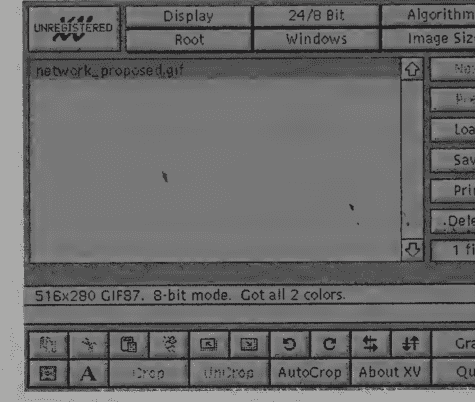

图 8.10 xv 控制窗口。

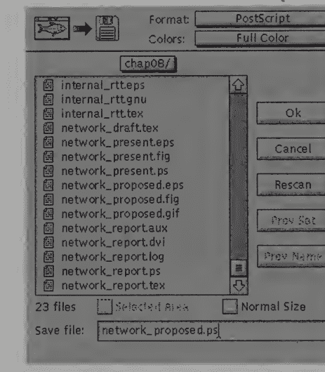

图 8.11 xv 通用保存窗口。

如果指定了其他文件为 `xv`，你可以通过左键点击 `xv` 控制窗口中的“Next（下一个）”按钮来查看列表中的下一个文件，或者通过按下键盘快捷键 `SpaceBar`。然后你可以根据需要重复上述步骤，将这些文件转换为 Postscript。使用 `xv` 将其他图像格式（如 JPEG 和 BMP）转换为 Postscript 的方法也类似。

## 文本格式——创建和查看排版文档 259

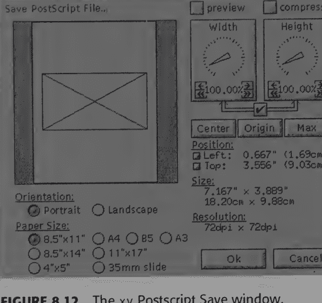

当你完成 `xv` 操作后，可以左键点击控制窗口中的“Quit（退出）”按钮，或者当鼠标悬停在 `xv` 窗口上时按下快捷键 `q`。

## 使用 xfig 为 LaTeX 文档创建图形

一个可以用于绘制图形的常用 UNIX/Linux 应用程序是 `xfig`。你可以轻松地将用 `xfig` 绘制的图形导入 LaTeX 文档中。以下介绍了 `xfig` 的通用用法。

图 8.12 xv 快捷键保存窗口。

```
//Intro_to_xv/chap08$ xfig
```


图 8.13 启动 `xfig` 应用。

### 启动 `xfig`

要启动 `xfig`，只需在命令行输入 `xfig`，如图 8.13 所示。这将打开一个空的 `xfig` 显示窗口，如图 8.14 所示。

从这里，你可以通过左键点击屏幕左角的“File（文件）”菜单来打开之前保存的 `xfig` 图形。接下来选择“Open（打开）”，这将显示一个如图 8.15 所示的窗口。在此中，你可以在“Current Dir（当前目录）”框中选择打开文件的目录，或者在“Current Filename（当前文件名）”框中输入文件名，或者在“Files（文件）”框中点击文件。“Preview（预览）”框将显示该图形之前的图像。一旦你选择了要打开的文件，点击此窗口底部的“Open（打开）”按钮。

# UNIX/Linux 简介

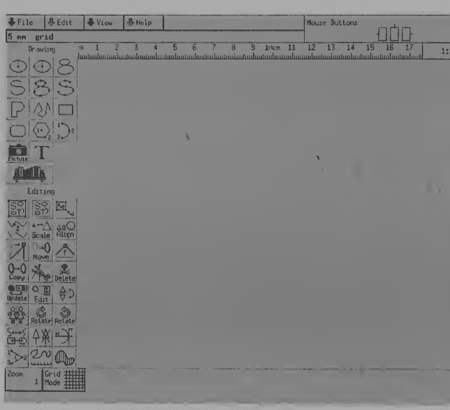

图 8.14 `xfig` 环境。

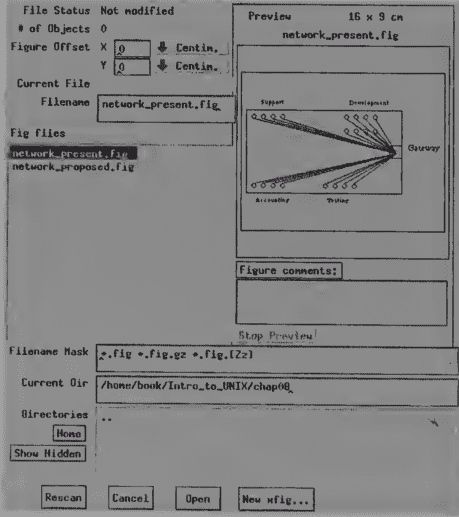

图 8.15 打开之前保存的 `xfig` 图形。

如果你在启动 `xfig` 时知道 `xfig` 图形的文件名，也可以将文件名作为 `xfig` 的命令行参数指定。这种方法将启动 `xfig` 并自动打开指定的图形。

## 文本格式——创建和查看排版文档 261

使用 `xfig` 时，你可能希望根据自己的需要配置环境。在设置 `xfig` 环境时，你可能希望在空白或带线的背景上绘图，以帮助放置图形组件。图 8.14 显示了一个灰色的网格背景。要更改背景图案，左键点击 `xfig` 显示器左下角的“Grid Mode（网格模式）”按钮。将弹出一个对话框，你可以在那里左键点击选择的网格图案，范围大网格、小网格或无网格。要更改网格颜色，你可以在启动 `xfig` 时通过命令行选项指定网格颜色。这涉及 `xfig_color` 选项后跟 `grey` 等颜色指定。你可能还会发现其他 `xfig` 选项和配置。更多信息请参阅 `xfig` 页面。

此外，注意标尺位于屏幕的顶部和右侧。如果你左键或右键点击标尺，图像将分别向左或向右滚动。另一方面，如果你左键或右键点击最右栏，图像将分别向上或向下滚动。根据你的屏幕和窗口大小，你可能需要滚动图形，以便其全部显示在屏幕上。

在 `xfig` 窗口顶部和右侧的标尺上左键和右键可以滚动图形。


## 使用 `xfig` 绘图

当你准备好在 `xfig` 中绘制对象时，点击位于屏幕左侧顶部的绘制按钮之一。你将学习常见的绘制模式——矩形、线条和文本——以开始在 `xfig` 中绘制类似的组件。在熟悉这些内容后，你将探索其他的绘制模式。表 8.7 总结了使用 `xfig` 的许多鼠标按钮动作。为了熟悉 `xfig`，以下介绍了常见的 `xfig` 操作。

### 表 8.7 `xfig` 鼠标按钮动作

| 操作 | 左键 | 中键 | 右键 |
| :--- | :--- | :--- | :--- |
| 按半径绘制圆或椭圆 | 点击一次指定中心；再次点击指定半径 | 点击中心 | 无 |
| 按直径绘制圆或椭圆 | 点击一次指定中心；再次点击指定直径 | 点击中心 | 无 |
| 绘制闭合折线或多边形 | 点击指定起点；再次点击指定添加的点 | 无 | 无 |
| 绘制矩形或圆角框 | 点击一个角；再次点击对角角 | 点击中心 | 无 |
| 绘制矩形或圆角框 | 点击指定中心；再次点击指定角 | 点击中心 | 无 |
| 绘制弧 | 点击指定弧的起点 | 点击终点 | 使用 |
| 文本 | 点击指定文本起始位置 | 点击接受文本 | 无 |
| 粘合对象 | 点击对象 | 点击区域 | 粘合选中的对象 |
| 拆组合 | 点击要分解的组 | 点击要分解的组 | 无 |
| 打开组合 | 点击要临时分解的组 | 点击要临时分解的组 | 无 |
| 连接/分割线条或折线 | 点击要连接的线条 | 点击点分割直线 | 无 |
| 缩放 | 点击该点缩放 | 从中心缩放对象 | 使用 |

## UNIX/Linux 262

| 操作 | 左键 | 中键 | 右键 |
| :--- | :--- | :--- | :--- |
| 移动点 | 点击并再次点击指定新位置 | 点击并再次点击指定水平或垂直位置 | 无 |
| 移动对象 | 点击并再次点击指定新位置 | 点击并再次点击指定水平或垂直位置 | 无 |
| 添加点 | 点击线条或折线的起始起点；再次点击指定要添加的点 | 无 | 无 |
| 复制对象 | 点击对象并再次点击指定副本位置 | 点击对象并再次点击指定副本的水平或垂直位置 | 无 |
| 删除线条或多边形点 | 点击指定要删除的点 | 无 | 无 |
| 删除对象 | 点击选择要删除的对象 | 点击要删除的对象区域 | 删除缓冲区中的对象 |
| 编辑 | 点击选择要编辑的对象 | 点击对象并编辑其注释 | 点击要编辑的折线点 |
| 翻转对象 | 点击以该点为轴翻转对象 | 点击以该点为轴翻转副本 | 设置/取消固定的锚点 |
| 旋转对象 | 点击以该点为轴旋转 | 点击以该点为轴旋转副本 | 设置/取消旋转中心 |

## 文本格式——创建和查看排版文档 263

| 操作 | 左键 | 中键 | 右键 |
| :--- | :--- | :--- | :--- |

要绘制矩形，左键点击“Rectangle（矩形）”按钮。这将导致 `xfig` 进入矩形模式，显示内容将变为类似于图 8.16 所示的空白屏幕。屏幕右上区域总结了绘制当前组件的鼠标按钮说明。对于矩形，使用左侧鼠标键指定矩形的角点。将鼠标移动到矩形一个角的位置并左键点击。如果你现在移动鼠标，有

# 264 UNIX/Linux 简介

它应该是一个叠加的矩形，其中一个角位于点击位置，另一个角随鼠标移动。请注意鼠标键说明发生了细微变化，现在包含一个使用右键的取消操作。在这种情况下，取消操作将放弃矩形的绘制，并允许你继续其他操作。要完成矩形，请指定一个角，将鼠标移动到矩形的对角顶点并左点击。

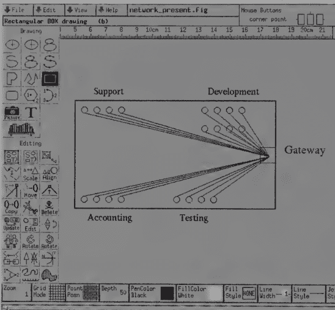

图 8.16 矩形模式下的 `xfig` 显示。

要绘制线或点，左单击 `Polyline`（折线）按钮进入线条模式（Line Mode）。`xfig` 显示将变为类似于图 8.17 的界面。用于线条模式的鼠标键说明解释了在此模式下绘图的三种方法。下简要说明了这些模式，因为线条是常用的绘制组件。左键可用于指定线的点或顶点，当您使用这种方法画线时，按钮说明会随之改变。通过连续左点击，`xfig` 将该点连接到目前为止在该线上指定的先前点。使用鼠标中键指定该线的终点以完成该线条的绘制。右键将取消此操作，擦除为此线绘制的点和线段。

在线条模式开始时点击中间键，可以指定另一种自由手绘图形式。在这种模式下，鼠标像一支笔，随着你移动鼠标绘制出跟随轨迹的线条。鼠标键说明描述了点击中键将完成线条，点击右键将取消操作。

# 文本格式化-创建和查看排版文档 265

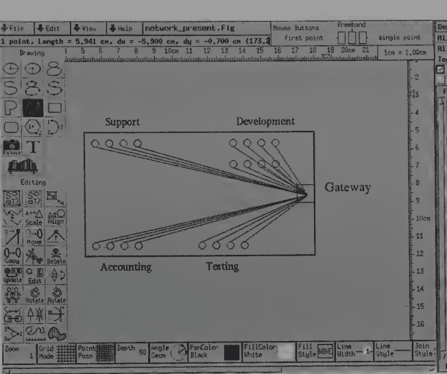

图 8.17 线条模式下的 `xfig` 显示。

要绘制单个点，你也可以在线条模式开始时点击鼠标右键。由于这是一个快速操作，不需要其他步骤即可在点击位置绘制点，因此按钮说明不会改变，你也没有机会取消正在进行的操作。如果你想删除刚刚绘制的点（或者说反之，撤销任何其他操作），可以点击左上角的 `Edit`（编辑）菜单并选择 `Undo`（撤销）选项。

你可以通过选择 `Edit->Undo` 来撤销 `xfig` 中的上一次更改。

其他绘制块允许放置圆形、椭圆、曲线和文本。要添加文本，左单击 `Text`（文本）按钮。将鼠标移动到文本开始的位置。输入文本并再次左点击。输入文本后，点击中键完成操作，或点击右键取消该对象的特性设置。

在绘制对象时，你可能想要更改其特性，例如更粗的线、更细的线、虚线、点线等。同样，对于文本，你可能想增加或减少字体大小，或使用不同的字体样式。`xfig` 显示底部的按钮提供了这些功能。此外，底部有一个 `Point Position`（点位置）按钮，指定鼠标定位光标精度。在这里，你可以选择沿网格的固定增量点移动光标，以网格线帮助水平或垂直的光标移动。你甚至可以将点位置指定为“Any”（任意），允许光标在网格内任意移动。

## 保存 `xfig` 图形

要在 `xfig` 菜单中保存你绘制的 `xfig` 图（如果你以后想在 `xfig` 中重新打开该图，这是必要的），点击左上角的 `File`（文件）菜单并选择 `Save`（保存）。如果图形未保存，你会看到一个对话框，如图 8.18 所示，可以在其中指定 `xfig` 文件的文件名和位置。你可以在 `Filename`（文件名）框中输入名称，或点击 `Fig` 框中现有的文件名。你还可以在 `Current Dir`（当前目录）框中指定目录位置，或通过点击 `Directories` 框浏览位置。`~/Intro_to_UNIX/chap08`。你指定了名称 `mynewfigure` 并正在保存一个 `xfig`。

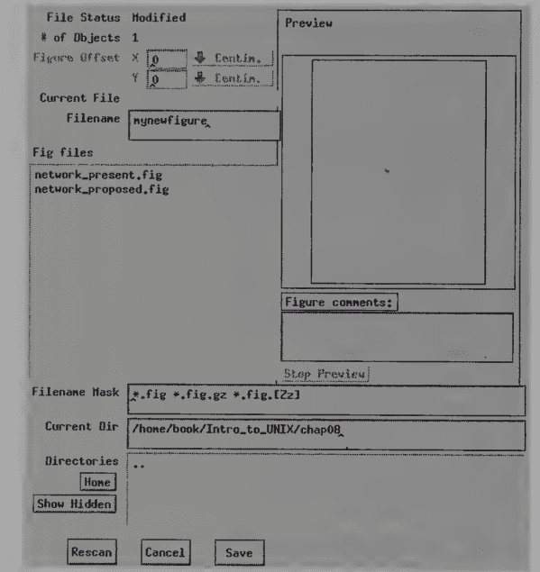

**图 8.18** 指定保存 `xfig` 图形的文件名和位置。

## 将 `xfig` 图形导入 LaTeX

一旦图形以 `xfig` 格式保存，在将图形导入 LaTeX 之前的下一步是将图形转换为 Postscript 格式。这可以通过两种方式完成。第一种方法涉及以 Postscript 格式保存或导出图形。在 `xfig` 中执行此项任务时，左单击 `File`（文件）菜单并选择 `Export`（导出）。这将显示一个对话框，如图 8.19 所示。

# 文本格式化-创建和查看排版文档 267

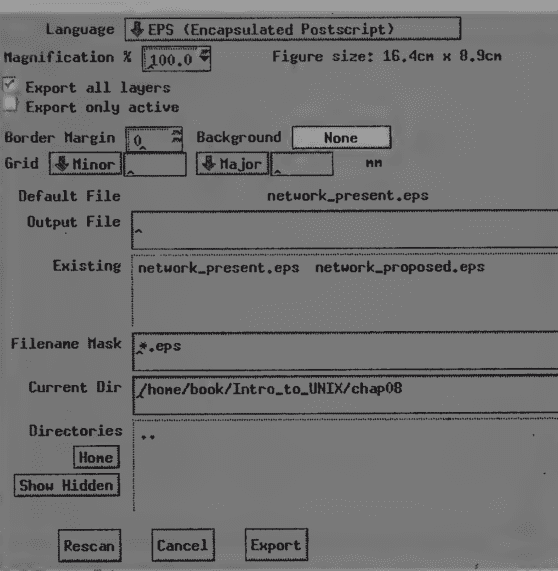

图 8.19 将 `xfig` 绘图导出为封装 Postscript（Encapsulated Postscript）。

在此对话框中，左单击 `Language`（语言）下拉菜单并选择 `EPS`（Encapsulated Postscript），除非它已被选中。如果你想增加或减少来自 `xfig` 图形的 Postscript 图像尺寸，可以通过在下方的 `magnification`（放大倍率）框中设置适当的值将放大率调大或调小。转换 `xfig` 图形的第二种方法涉及 `fig2dev` 应用程序。`fig2` 通常 通常两个参数：第一个是 `xfig` 图形的文件，第二个是存储转换后图像的文件。最后，点击 `Export` 生成封装 Postscript。

# UNIX/Linux 简介


`/Intro_to_UNIX/chap08$ fig2dev -eps network_present.fig`

```
```

图 8.20 将文件转换为 Postscript。

### 为 LaTeX 创建图表和图形

你可以通过多种方法为 LaTeX 文档创建图表和图形。一种方法是你可以使用 `xfig` 绘制点和线。例如，你可以使用线条模式绘制轴、绘制单个点并绘制线条。如果你想绘制曲线或插值图线，可以使用样条模式。当需要在图中区分多条线条时，可以使用不同的线条样式，如实线、虚线、点线。轴标签可以使用文本输入模式创建。

另一种创建数据图表和图形的方法涉及 `gnuplot` 工具。`gnuplot` 可以处理数据列表或文件并绘制简单到复杂的二维或三维图表和图形。此外，`gnuplot` 提供了快速创建和格式化图表或图形的机制。对于大型数据集来说，这是非常有用的。下面介绍了了一些 `gnuplot` 基础知识，演示了上述的一些功能。表 8.8 总结了常用的 `gnuplot` 命令。

#### 表 8.8 常用 gnuplot 命令

| 命令 | 目的 |
|------|
| `plot` | 绘制给定的数据文件；可以指定是否使用线条 |
| `set xrange` | 指定轴的范围或范围 |
| `set ylabel` | 设置图形的标题 |
| `set xlabel` | 设置轴的描述 |
| `show ylabel` | |
| `Set xtics` | 设置轴的描述 |
| `set xdtics` | |
| `set xmtics` | |
| `set yticks` | |
| `set ytics` | 指定替代或自定义轴 |
| `set terminal` | 指定输出格式 |
| `set output` | 指定输出文件名 |

### 文本格式–创建和查看排版文档 269

| 命令 | 用途 |
|---|---|
| `replot` | 将图表重绘到屏幕或输出文件 |
| `save` | 保存为 gnuplot 格式的文件 |
| `load` | 加载 gnuplot 格式的文件 |
| `help` | 获取 gnuplot 命令帮助或文档 |

在本节讨论中，我们将使用 `gnuplot` 直接从文件中读取数据值。如果数据是由另一个程序生成并保存到文件中，那么这种方法将特别有用。数据文件的格式可能各不相同，但为了简单起见，你通常希望每行包含一个数据点的值。在这个示例中，你的数据文件将由一系列单独坐标组成，每行一个，代表每分钟获取的往返时间。你将使用 `gnuplot` 将这些数字作为沿递增 x 轴的 y 坐标进行绘图。或者，数据文件的每行也可能包含多个值，表示二维或三维坐标，指定数据点的所有坐标。通过额外的规格，`gnuplot` 可以解释来自其他数据文件内容的数据值，这在数据值嵌入在其他符号、单词或数字中是非常有用的。

要使用 `gnuplot` 创建网络数据的图表，你将通过输入不带参数的命令启动 `gnuplot`，如图 8.21 所示。

```
/Intro_to_UNIX/chap08$ gnuplot []
```

图 8.21 启动 `gnuplot`。

你将看到一些版权和版本信息，随后是一个提示符，如图 8.22 所示。通过这个提示符，你将输入命令来根据需求生成并格式化图表。

```
gnuplot> []
```

图 8.22 `gnuplot` 提示符。

你将输入的第一个命令（见图 8.23）是用于生成数据文件图表的 `plot` 命令。该命令由动作 `plot` 组成，后面跟着双引号中的数据文件名。该命令中包含 `with lines` 短语，用于指定你希望以连接的方式绘制数据点。如果缺少 `with lines` 短语，则指示 `gnuplot` 单独绘制点。图 8.23 所示的 `plot` 命令将产生一个新窗口，其中包含图 8.24 所示的图表。

### UNIX/Linux 简介

```
gnuplot> plot 'internal_rtt.dat' with lines
```

**图 8.23** 指定数据文件的绘图。

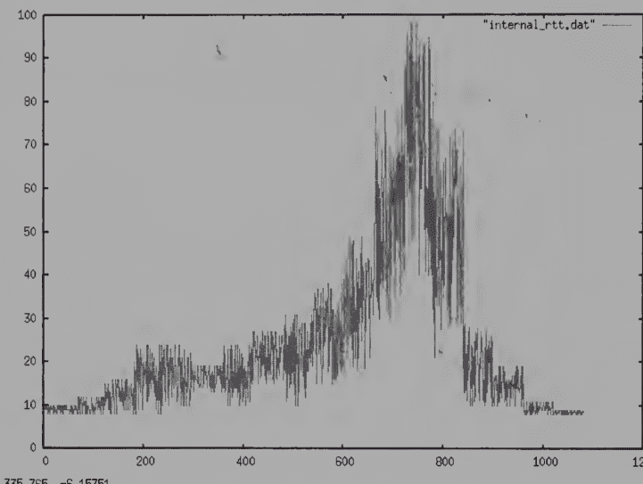

**图 8.24** 格式化之前的初始图表。

`gnuplot` 将自动确定 x 轴和 y 轴的值范围。x 值的范围取决于数据文件中值的数量，因为示例数据文件每行只包含一个数据点。由于示例数据文件每个有 1080 个数据值，因此 x 轴上会有 1080 个值。y 值的范围取决于数据值本身。由于数据文件 `internal-rtt.dat` 中的数据值范围在 0 到 100 之间，因此 `gplot` 为 y 轴选择了该范围。

如果你想格式化图表以具有与自动选择不同的 x 轴范围，可以通过 `gnuplot` 的 `set xrange` 命令来实现。例如，图 8.24 中的图表的 x 轴范围为 0 到 1200（1200 是为了匹配实际数值的估计大范围）。要将 x 轴范围设置为 0 到 1079 以表示这 1080 个值，可以使用图 8.25 所示的 `gnuplot set xrange` 命令。通过 `set xrange`，你指定 x 轴的新下限和上限，所有内容包含在 `[]` 括号内，中间用冒号分隔。你同样可以可以使用 `gnuplot set xrange` 命令格式化 y 轴的下限和上限。随后使用 `replot` 命令用新更改重绘图表。

### 文本格式–创建和查看排版文档 271

```
gnuplot> set xrange[0:1080]

gnuplot> replot[]
```

图 8.25 格式化 x 轴范围。

你可以使用 `gnuplot` 命令 `set title` 指定出现在绘图图表上的标题或描述。该命令接受一个参数，即双引号内的标题文本。图 8.26 展示了如何指定图表标题为 Internal Roundtrip Time（内部往返时间）。同样，随后使用 `replot` 命令用新更改重绘图表。

```
gnuplot> set title "Internal Roundtrip Time"

gnuplot> replot[]
```

图 8.26 指定图表标题或描述。

你还可以为图表中的轴提供描述。要为 x 轴提供描述，你可以使用 `gnuplot` 命令 `set xlabel`，后跟一对双引号内的文本描述。图 8.27 显示了如何将 x 轴描述设置为 Time of day（一天中的时间）。图 8.27 还演示了使用 `show xlabel`，让你看到 x 轴的当前描述。你同样可以使用 `gnuplot` 命令 `set ylabel` 和 `show ylabel` 分别指定 y 轴的文本描述。

```
gnuplot> set xlabel "Time of day"

gnuplot> show xlabel

gnuplot> replot
```

图 8.27 为 x 轴指定描述。

在某些情况下，特别是涉及时间时，轴与默认设置并不匹配。为了更清晰地格式化轴，你可以使用 `xtics` 命令。例如，你可以指定刻度位置为：6am 处 0，9am 处 180，12pm 处 360，3pm 处 540，6pm 处 720，9pm 处 900，以及 12am 处 1080。

```
gnuplot> set xlabel "Time of day"

gnuplot> set xtics("6am" 0, "9am" 180, "12pm" 360, "3pm" 540, "6pm" 720, "9pm" 900, "12am" 1080)

gnuplot> replot[]
```

图 8.28 自定义 x 轴。

### UNIX/Linux 简介

要重新定义 y 轴的刻度，`gnuplot` 有相应的 `ytics` 和 `yticks` 命令。

### gnuplot 中保存和打开

在任何点，你都可以将当前图表及其设置（标签、刻度等）保存为 `gnuplot` 格式，以便在 `gnuplot` 中打开。注意 `gnuplot` 格式不是 Postscript。以 Postscript 格式保存图表用于 LaTeX 是另一种方式实现的，稍后描述。

在 `gnuplot` 中保存和打开图表涉及 `save` 和 `load` 命令，每个命令都接受一对单引号内的文件名作为单个参数。图 8.29 显示了你如何将当前图表及其设置保存到文件名 `internal-rtt.gnu`，其中 `.gnu` 扩展名代表 `gnuplot` 文件格式。

```
gnuplot> save 'internal_rtt.gnu' []
```

图 8.29 在 `gnuplot` 中保存图表。

### 文本格式——创建和查看排版文档 273

图 8.30 显示了如何打开之前保存的 `gnuplot` 文件。

```
gnuplot> load 'internal_rtt.gnu' []
```


## 图 8.30 在 gnuplot 中打开图表。

### 将图保存为 Postscript 格式
要将图引入 LaTeX 文档，你首先需要将图保存为 Postscript 格式。默认情况下，`gnuplot` 实际上生成 Postscript 格式的图，但会将输出发送到屏幕（因此，图出现在 Postscript 查看器窗口中）。为了将图保存为 Postscript 格式以便导入 LaTeX，请指定输出格式并将此输出重定向到文件。这些步骤如图 8.31 所示。

```
gnuplot> set terminal epslatex

Terminal type set to 'epslate'

Options are 'monochrome dashed' '11'

gnuplot> set output 'internal_rtt.eps'

gnuplot> replot
```

## 图 8.31 将 gnuplot 图表保存为 Postscript 文件。

输出格式通过 `set terminal` 命令指定，后紧跟输出格式。在这种情况下，你想将输出格式指定为 `eplatex`，如图 8.31 所示。重定向可以通过 `gnuplot` 命令 `set output` 后跟双引号括起来的文件名来实现。图 8.31 显示了如何指定文件名为 `internal-rtt.eps`。最后用 `replot` 命令结束，该命令将以封装 Postscript `EPS` 格式重新绘制图并保存到输出文件中。

一旦你将图保存到 `gnuplot` 文件中，你可能希望将输出重定向回屏幕。如果你想对图进行某些处理并在屏幕上查看结果，将尤其如此。要实现这一指定，你可以使用 `set terminal` 命令，如图 8.32 所示。

```
gnuplot> set terminal x11

Terminal type set to 'x11'

Options are '0'

gnuplot> []
```

## 图 8.32 将输出重定向回显示器。

# UNIX/Linux 简介

### 获取 gnuplot 帮助
`gnuplot` 通过 `help` 命令提供了在线帮助资源。要使用此资源，在 `gnuplot` 命令提示符下，可以通过单独输入 `help` 来获取通用帮助。或者，你可以通过输入 `help` 后跟命令本身或命令用法来获取特定命令的帮助。8.33 显示了如何获取关于 `set terminal` 的信息。

```
gnuplot> help set terminal[]
```

**8.33** 获取 `gnuplot` 命令的在线帮助。

帮助信息通常通过分页器（pagers）查看。在这种情况下，你可以使用分页器的导航命令或 `quit` 命令停止查看帮助。在查看帮助信息后，可能会出现一个“Help（帮助）”或“Subtopic（子主题）”提示符，以便你获取进一步的协助。此时，你可以输入命令名称或使用命令来获取更多信息。如果你想完全退出帮助并返回 `gnuplot` 命令提示符，可以在主题或子主题提示符处直接按 `<Enter>` 键。

互联网上还有各种 `gnuplot` 资源可用。`www.gnuplot.info` 是一个受欢迎的网页，其中包含了丰富的 `gnuplot` 信息，如包下载、文档和示例。

### 在 LaTeX 中指定表格
LaTeX 中的表格作为数据行和列的形式，在源文件内部创建和管理。表格规范以 `\begin{table}` 命令开始，如列表 8.36 所示。在这里，你可以在括号内为排版后的表格提供可选的位置建议，就像你处理图片时的那样。例如，列表 8.36 建议表格首先放在指定位置，然后位于页面顶部，最后位于页面底部。

**8.36** LaTeX 表格规范

```latex
\begin{table}{htb}

\begin{center}

\begin{tabular}{l|l|c}

time & ping times (ms) & utilization \\

6am to 8am & about 10 & low \\

8am to 3pm & 10 to 30 & moderate \\

3pm to 8am & 30 or higher & high \\

10 to 12am & about 10 & low \\

\end{tabular}

\caption{Summary of Internal Round Trip Times}

\end{center}

\end{table}
```

接下来，如果你想居中表格，可以提供可选的 `\begin{center}` 命令。无论是否居中表格，接下来都要指定 `\begin{tabular}` 命令，它标记了表格数据的开始。`\begin{tabular}` 在随后的一对 `{}` 大中描述表格结构。这些内部内容为每列指定 `l`、`c` 或 `r`。这些对齐字母表示该列的数据在列内应该是左对齐、居中还是右对齐。列表 8.36 指定了三列结构，第一列数据左对齐，第二和第三列居中对齐。

在每个对齐级别之间，如果你想在相应的列之间排版一条垂直线，则指定一个空格或一个或多个 `|` 符号。多个 `|` 符号表示多个垂直分隔符。例如，列表 8.36 在第一列和第二列之间指定了两个垂直分隔符，在第二列和第三列之间指定了一个。

## 文本格式——创建和查看排版文档 275

| LaTeX 命令 | 简述 |
| :--- | :--- |
| `\pagestyle` | 指定是否提供页码等页相关组件 |
| `\title` | 指定文档的标题信息 |
| `\date` | |
| `\author` | |
| `\maketitle` | 指定文档标题；标记数学模式的开始和结束 |
| `$$` | 标记居中行模式的开始和结束 $\rightarrow$ |
| `\Supers` | 数学模式下的上标文本 |
| `Subscript` | 数学模式下的下标文本 |
| `\chapter` | |
| `\subsection` | 指定文档正文 |
| `\footnote` | 指定脚注符号和文本 |
| `\includegraphics` | 将图片引入文档 |
| `\subfigure` | 指定图中的插图 |
| `\begin{tabular}` | 创建表格 |
| `\label` | |
| `\ref` | 交叉引用文档的另一部分 |

### 管理 LaTeX 文档
当你处理多个文件（例如一个 LaTeX 源文件和若干图片文件）时，你必须小心排版后的文档将使用这些文件的最新版本。例如，如果你更改了图片的 `xfig` 文件，你需要确保 Postscript 格式已更新以反映这些更改，并重新构建排版文档以包含新的 Postscript 图。

在在这种情况下管理多个文件的一种流行方法是使用 `Makefile`。关于使用 `Makefile` 管理 C++ 程序，请参阅第 10 章“C/C++ 编程”。在这种情况下，`Makefile` 将简化在组件更改时重建文档的过程，并确保网络文档包含更新的组件。你只需要在命令行执行 `make` 即可重建网络文档，如图 8.34 所示。

```
$ cd path/to/latex; make
```

为了管理新文档的 LaTeX 源文件和图片文件，你可以使用列表 8.37 所示的 `Makefile`。`Makefile` 的第一行将值分配给一个变量，你用该变量来表示通用文档名称。然后，当你在 `Makefile` 后之后引用文档名称时，可以引用该变量。这个概念就像程序中的常量变量。如果未来文档名称发生变化，你可以轻松

## 文本格式--创建和查看排版文档 277

通过在仅一处更改 `DOCUMENTNAME` 变量来修改 `Makefile` 以适应新名称。随后，所有对 `DOCUMENTNAME` 的引用都使用分配给变量的新名称。要引用存储在 `DOCUMENTNAME` 中的值，你可以指定 `$(DOCUMENT)`，就像你在此 `Makefile` 的许多处做的那样。

# 列表 8.37 管理 LaTeX 源文件的 Makefile

```
DOCUMENTNAME = network_draft

# all: 行可以用来指定 Makefile 生成

# 目的。

all: $(DOCUMENTNAME).ps

## 这一行指定了 network_report.ps 的依赖

$(DOCUMENTNAME).ps $(TEX_FILES) $(FIGS) Makefile

latex $(DOCUMENTNAME).tex # 运行两次有助于交叉引用

latex $(DOCUMENTNAME).tex

dips $(DOCUMENTNAME).dvi
```

```
## 这一行指定了其中一张插图的依赖

network_present.ps: network_present.fig

fig2dev -Leps -m 0.0 network_present.fig network_present.ps
```


此 Makefile 的下部分指定了 `all:` 目标，或者说 Makefile 应该完成的任务。在这种情况下，你想生成 `network_draft.ps`，并在 `all:` 规范右侧将其指定为 `$(DOCUMENTNAME).ps`。`all:` 右侧任何内容都应该有自己的创建规范，换句话说，应该出现在 Makefile 中 `all:` 之后。

下方几行，你看到一行以 `$(DOCUMENTNAME).ps : $(DOCUMENTNAME).ps -` 开头的代码：
`madev$(DOCUMENTNAME).ps`

注释以符号 `#` 开始。从 `#` 到该行末尾的所有内容都会被忽略。你设计的这个 Makefile 使用额外的变量，例如用于插图的变量，但为了保持此示例简单，只为通用文档名称使用了一个变量。

## DOCBOOK

创建文档的另一个流行应用是 DocBook。通过 DocBook，人们可以快速创建文档，特别是文档或报告，并以 HTML 页面的形式在线查看。人们还可以创建 PDF 或 PS 格式的文档以便进行更传统的查看。

278 UNIX/Linux 导论

与 LaTeX 一样，DocBook 有许多功能，本书仅能涵盖概述和一些主要功能。如果你想了解更多信息，我们在本章末尾为你提供了其他资源。在本次讨论中，你将从学习如何获取一个 DocBook 源文件并将其生成 HTML 或 PDF 格式开始。然后，你将学习 DocBook 源文件的结构和通用组件，以便你可以编辑并创建你自己的 DocBook 文件。

DocBook 的基本思想是，你首先使用通用文本编辑器（如 `vi`、`pico` 或 `emacs`）创建一个 XML 文档。这种形式的 XML 文档不仅包含呈现其思想或内容的数据，还包含解释如何处理特定数据的描述。然后，你调用一个 DocBook 应用程序将文档生成为所需的 HTML、PDF、Postscript 布局，这些布局通常指定了如何根据预期的 HTML、PDF 或 Postscript 格式创建文档。本讨论假设你已经安装了必要的 DocBook 应用程序，名为 `docbook2html`、`docbook2pdf` 以及它们所需的包。如果你在第 2 章“安装 Linux (Fedora) 系统”的安装说明中按照建议包安装了系统，那么系统中应该已有这些应用程序。

### 将 DocBook 源文件生成 HTML

要将 DocBook 源文件转换为一组可以通过浏览器在线查看的 HTML 页面，你可以使用 `docbook2html` 应用程序。`docbook2html` 简单地将要处理成 HTML 页面的 DocBook 源文件文件名作为参数。图 8.35 显示了利用 `docbook2html` 将一个 DocBook `network_report.docbook` 转换为一组 HTML 页面的示例。

```
/Intro_to_UNIX/chap08/docbook$ docbook2html network_report.docbook []
```

图 8.35 将 DocBook 文档转换为一个或多个 HTML 页面。

一旦转换为 HTML 页面，你就可以使用浏览器查看这些页面。由于你刚刚生成的页面此时就在系统中，你可以在浏览器中作为文件打开 HTML 页面。图 8.36 展示了这种操作的典型方法，通过打开“文件”菜单并选择“打开文件”等操作。

你看到的生成的 HTML 页面文件名会有所不同，但主页面通常是 `book1.html` 或 `index.html`。图 8.37 展示了一个显示生成的 HTML 页面的示例文件列表。在这里，你可以选择主页面 `book1.html` 并打开该文件。

# 文本格式-创建和查看排版文档 279

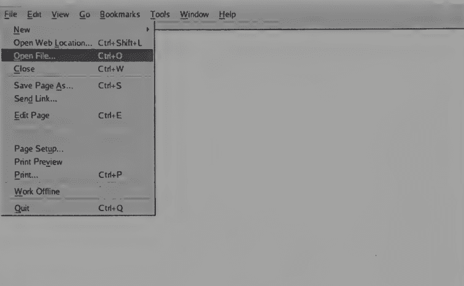

**图 8.36** 作为文件打开 HTML 页面。

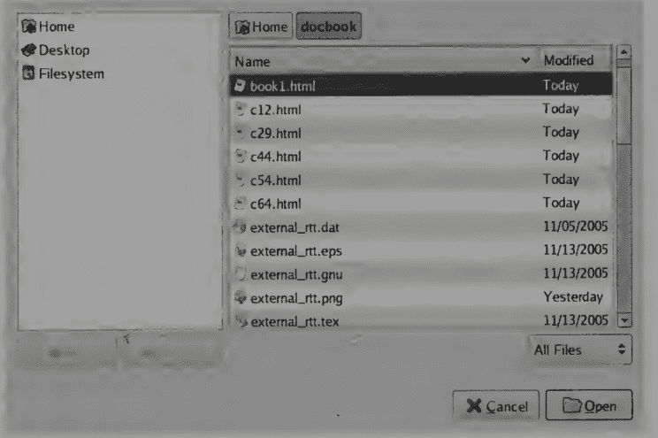

**图 8.37** 打开主 HTML 页面。

打开的主页面如图 8.38 所示。该主页面包含指向文档各个部分的目录。文档的每个部分都可以访问。

291 UNIX/Linux 导论


**图 8.38** 目录。

- 引言
- 方法论
- 结果
- 总结

## 文本格式–创建和查看排版文档 281

### 文档头和类型

Doc 源文件的头部通常像列表 3.38 那样。

列表 3.38 DocBook 源文件的开始

```
<?xml version="1.0"?>

<!DOCTYPE book PUBLIC "-//OASIS//DTD DocBook XML V4.2//EN">
```

出于讨论的目的，我们不会解释 `DOCTYPE` 之后的单词，它指示你想生成的文档类型。常见的文档类型有 `book` 和 `article`。书和文章类型之间的主要区别在于，书由章节组成，章节内有节，节内更小的节。相反，文章首先由节组成，每个节可以细分为更小的节。

### 标签、元素和属性

DocBook 源文件包含各种标签，用于识别文档的组件并解释如何处理生成的元素。标签以 `<` 符号开始，以 `>` 符号结束。这些符号之间是元素名称，定义了标签代表什么。一些元素名称示例包括 `chapter` 表示章节的开始和结束；`para` 表示段落的开始和结束；`mediaobject` 表示导入多媒体项目，如图像。

标签还可以包含一个或多个属性，定义了标签的某些属性。例如，你将看到如何使用 `<image>` 的属性来调整图像的大小。

在讨论过程中，你可能会注意到许多 DocBook 组件以一个标签开始，并以带有元素名称 `/` 符号的类似标签结束。例如，一个文档组件以 `<chapter>` 开始，以 `</chapter>` 结束。这一观察适用于大多数标签。

### 注释

你可以使用一种特殊的标签在 DocBook 源文件中封装注释，这些内容不会被处理。你可以用 `<!--` 开始注释，用 `-->` 结束注释。封装在该标签内的注释可以跨越单行或多行。

# UNIX/Linux 简介

lines。你的网络文档的开头如列表 8.39 所示包含一个描述 DocBook 源文件内容的示例注释。

### 常见的 DocBook 源文件组件和格式

DocBook 源文件可以包含各种组件；下文讨论了创建具有基本格式的简单文档所需的某些常用组件，从主要内容组件开始，并拆解为较小的组件。

### 文档主要组件

首先，你有一个用于文档的整体组件，对于书籍类型文档，使用一组 `<book>` 和 `</book>` 标签定义；对于文章类型文档，使用一组 `<article>` 和 `</article>` 标签定义。在这些标签对内部包含了整个文档的其他组件，例如章节、节、图像等，你很快就会学到这些内容。

# 列表 8.39 带有章节的书籍 DocBook 结构示例

```
这是一个代表假设网络分析报告的示例 DocBook 源文件。

<?xml version="1.0" encoding="UTF-8" ?>

<!DOCTYPE book PUBLIC "//OASIS//DTD DocBook XML V4.2//EN">

<book>

<chapter>

<title>Introduction</title>

</chapter>

<chapter>

<title>Methodology</title>

</chapter>

<chapter>

<title>Results</title>

</chapter>

<chapter>

<title>Analysis</title>

</chapter>
```

# 文本格式——创建和查看排版文档 283

```
<chapter>

<title>Summary</title>

</chapter>

</chapter>
```


列表 8.39 展示了一个包含到为止所描述部分的 DocBook 源文件示例大纲。注意此列表的顶部有一个描述文档内容的注释，其后是文档标头（在本例中，它指定为书籍书籍文档）。紧接着，请注意列表末尾有一个 `<book>` 标签和一个相应的 `</book>` 标签。在 `<book>` 和 `</book>` 标签内部是书籍文档的组件，在本例中是章节，你接下来将学习这些内容。虽然该示例处理的是书籍文档，但如果你改为创建一个文章文档，则使用一组 `<article>` 和 `</article>` 标签来包裹文档内容。

## 章节和节组件

列表 8.39 在此示例书籍文档中有五个章节。每个章节被指定为一个独立的组件，封装在一组 `<chapter></chapter>` 标签对中。在每个章节组件内部，该章节的名称被指定为一组 `<title></title>` 标签对之间的任何其他组件。注意，对于文章类型文档，你将从“节”（使用 `<section>` 和 `</section>` 标签）开始拆分，而不是章节标签。

如果你希望将一个章节（在书籍类型文档中）拆分为更小的“节”，你可以在该章节组件中引入节组件。这涉及到在章节组件内指定 `<section>` 和 `</section>` 标签来包裹每个节。即使你的网络文档中没有使用“节”，如果你想将“引言”（Introduction）拆分为两个节，第一个命名为“术语”（Terminology），第二个命名为“问题陈述”（Problem Statement），你可以使用列表 8.40 所示的结构。列表 8.40 对节组件进行了缩进，有助于在视觉上将其与章节组件区分开，但缩进不是强制的。注意每个节都有自己的标题组件，包含该节的名称。

### 列表 8.40 分为若干节的章节

```
<chapter>

<title>Introduction</title>

<section>

<title>Terminology</title>

</section>

```
284 UNIX/Linux 简介
```
<section>

<title>Problem Statement</title>

</section>

</chapter>
```

如果你希望将一个节组件（无论是书籍类型还是文章类型文档）进一步拆分为更小的“子节”，你可以将节组件嵌套在另一个节组件内部。这种方法涉及在节组件内再次指定另一组 `<section>` 和 `<section>` 标签来包裹每个子节。

## 段落和文本

在每个章节或子节中，你拥有以一个或多个 `para`（对应 `<para>`）组件形式存在的文本。每个段落都封装在一组 `<para>` 和 `</para>` 标签对中。列表 8.41 展示了在“引言”章节中指定一个 `para` 组件的情况。如果你在章节的另一组 `<para>` 和 `</para>` 标签对中拥有第二个组件，你需要将其指定为另一个 `para`。

### 列表 8.41 指定文本段落

```
<chapter>

<title>Introduction</title>

<para>

This document contains an initial report of XYZ's<emphasis role="strikethrough">XYZ's</emphasis>

network performance and its impact on users. This work was initiated to investigate the following.

</para>

</chapter>
```

## 简单文本格式

DocBook 提供了一些基本的格式命令，允许你更改文本的外观。由于 DocBook 的目标是减轻开发者指定格式的负担，简单文本格式的种类可能看起来有限。简而言之，对于 HTML、PDF 或 PS 文档，你通常可以使用斜体、粗体、下标或上标文本来强调。要强调或斜体化文本，可以将文本封装在 `<emphasis>` 和 `</emphasis>` 标签中。

### 文本格式——创建和查看排版文档 285

列表 8.42 指定文本的强调或斜体格式

```
<emphasis>XYZ's</emphasis>
```

如果你想将名称格式化为粗体，可以使用 `<emphasis role="bold">`。列表 8.43 显示了如何

LISTING 8.43 指定文本的强调或斜体格式

```
<emphasis>XYZ's</emphasis>
```

如果你另一种方式想将名称格式化为粗体，可以使用 `<emphasis role="bold">`。列表 8.43 显示了如何

要强调或斜体化文本，可以将文本封装在 `<emphasis>` 和 `</emphasis>` 标签中。

## 标题和作者

现在你对标签有了一些了解，可以学习如何创建更多的文档组件。从每个文档需要的 `bookinfo` 组件开始，即标题和作者。

列表 8.44 展示了一个带有单个作者的 `bookinfo` 组件。标题“网络利用报告”（Network Utilization Report）指定在 `<title>` 和 `</title>` 标签中，就像你处理章节和节一样。

### 列表 8.44 标题和作者的指定

```
<bookinfo>

<title>Network Utilization Report</title>

<author>

<firstname>John</firstname>

<surname>Doe</surname>

</author>

</bookinfo>
```

作者封装在 `<author>` 和 `</author>` 标签中。此外，名称被指定为两个组件：名字和姓。名字封装在 `<firstname>` 和 `</firstname>` 标签中，姓

286 UNIX/Linux 简介

在 `<surname>` 和 `</surname>` 标签中。作者组件为了可读性进行了缩进，像之前一样，这种缩进不是必要的。为了可读性，名字和姓组件被指定在同一行。

如果你希望指定多个作者，需要在 `<authorgroup>` 和 `</authorgroup>` 标签中使用 `authorgroup` 组件。在 `authorgroup` 内部，你可以指定许多所需的 `author` 组件，每个封装在 `<author>` 和 `</author>` 标签中。列表 8.45 显示了一个带有两个作者的 `bookinfo` 组件示例。

### 列表 8.45 标题和多个作者的指定

```
<bookinfo>

  <title>Network Utilization Report</title>

  <authorgroup>

    <author>

      <firstname>John</firstname>

      <surname>Doe</surname>

    </author>

    <author>

      <firstname>Jane</firstname>

      <surname>Smith</surname>

    </author>

  </authorgroup>

</bookinfo>
```

## 项目

在 DocBook 中，你可以创建各种列表来列出或描述项目。下面展示了如何创建三种形式的列表：简单项目列表、描述性列表和编号列表。

### 项目列表

要创建项目列表（即带有项目符号的列表），可以使用一组 `<itemize>` 和 `</itemize>` 标签来封装该列表。列表中的每个项目都是自己的一组 `<item>` 和 `</item>` 标签。

### 列表 8.46 DocBook 中的项目列表

```
<para>

  This document contains an initial report of 

  <emphasis role="bold">XYZ's</emphasis>

  network performance and its impact on users. This work was initiated
```


# 文本格式化——创建和查看排版文档 287

为了调查以下内容：

- 公司网络流入和流出的流量在一天中的某些时段会陷入停滞。导致这个问题的原因是什么？
- 购买额外的 ISP 带宽是否能解决这个问题？

基于你从零开始的示例文档，列表 8.46 展示了在引言（Introduction）章节末尾使用项目列表（itemized list）的情况。为了演示如何在源文档的文本段落中放置项目列表，第一段文字被包含了一个参考点。

## 描述性列表或分段列表

要在 DocBook 中生成等同于 LaTeX 描述性列表（descriptive list），可以使用 `segmentedlist`（分段列表）组件。整个分段列表组件封装在 `<segmentedlist>` 和 `</segmentedlist>` 标签内。列表 8.47 展示了在示例网络文档中定义的分段列表。列表 8.47 还展示了方法论（methodology）章节中的一段文本，作为章节和段落组件的另一个示例，并作为一个参考点。你可以参考本章末尾列表 8.53 中你的 DocBook 源文件的完整列表以获取剩余的段落文本。

### 列表 8.47 描述性列表或分段列表

在捕获了一周的往返时间后，我们利用另一个 shell 脚本读取日志文件并生成每小时的往返平均值。这些平均值被用于指示网络延迟处于低、中、高的时期，定义如下。

```xml
<low</title>
<medium</title>
<high</title>
-less本地流量小于 1ms，外部流量小于 30ms </seg>
```

<seg>本地流量在 1ms 到 10ms 之间，外部流量在 30ms 到 100ms 之间</seg>
<seg>本地流量大于 10ms，外部流量大于 100ms</seg>
</seglistitem>
</seglistlist>
</para>
```

分段列表组件首先包含所有的术语本身，然后是它们的定义。每个术语都封装在自己的一组 `<segtitle>` 和 `</settitle>` 标签中。在最后一个术语之后，提供了 `seglistitem`（以 `<seglistitem>` 标签开始）中的所有定义。每个定义都封装在一组 `<seg>` 和 `</seg>` 标签中。在最后一个定义之后，指定一个 `</seg-item>` 来结束定义列表。最后，整个描述性列表以 `</seg>` 标签结束。

## 编号列表

你可以在 DocBook 中使用 `orlist` 组件指定有序列表（enumerated list），即带编号的项目列表。在这里，你将有序列表封装在 `<orderedlist>` 和 `</orderedlist>` 标签中。列表中的每个项随后以一组 `<listitem>` 和 `<para>` 标签作为前缀，并以 `</para>` 和 `</listitem>` 作为后缀。为了演示，列表 8.48 展示了如何创建分析章节末尾建议的有序列表。为了简洁起见，列表 8.48 省略了分析章节的文本内容，请参阅列表 8.53 获取完整列表。

### 列表 8.48 编号或有序列表

```xml
<para>
我们现在的建议是：
<orderedlist>
<listitem><para>安排一些处理和备份任务，使它们在高峰时间下午 3:00 到下午 7:00 之间发生；</para></listitem>
<listitem><para>考虑为本地流量购买带宽更高的集线器和交换机；</para></listitem>
<listitem><para>调整本地网络，使处理和备份任务导致的流量相对于其他流量实现本地化；</para></listitem>
</orderedlist>
</para>
```

# 文本格式化——创建和查看排版文档 289

## 图形和图表

将图形、图表和其他图像导入 DocBook 文档的一种方法涉及使用 `mediaobject` 组件。其他组件也可能用于此目的，例如 `graphic` 组件，但 `mediaobject` 组件是实现此目的的首选方法。因此，本讨论重点关注将 `mediaobject` 组件作为将图形导入 DocBook 文档的手段。

## 指定图形、图表或图像

`mediaobject` 组件以 `<mediaobject>` 标签开始，以 `</mediaobject>` 标签结束。在 `mediaobject` 组件内部是一个 `imageobject` 组件以及其他可能的组件，例如稍后会介绍的 `caption` 组件。`imageobject` 组件同样以 `<imageobject>` 标签开始，以 `<imedia>` 标签结束，该标签使用 `href` 属性包含你想要导入的图形、图表或图像的文件名。列表 8.49 展示了在引言章节末尾导入名为 `network_present.png` 图形的示例。列表 8.49 还展示了一个 `caption` 组件以及其他几个属性，即 `id` 和 `width`，你很快就会学习到它们。

### 列表 8.49 将图像导入 DocBook 文档

```xml
mediaobject id="present_network*">
<imageobject>
<imedia> fileref="network_present.png" width="50%" />
</imageobject>
<caption><para>当前网络配置</para></caption>
</mediaobject>
```


## 调整图形、图表或图像的大小

`mediaobject` 组件以 `<mediaobject>` 标签开始，以 `</mediaobject>` 标签结束。在 `mediaobject` 组件内部是一个 `imageobject` 组件以及其他可能的组件，例如稍后会介绍的 `caption` 组件。`imageobject` 组件同样以 `<imageobject>` 标签开始，以 `<imedia>` 标签结束，该标签使用 `href` 属性包含你想要导入的图形、图表或图像的文件名。列表 8.49 展示了在引言章节末尾导入名为 `network_present.png` 图形示例。列表 8.49 还展示了一个 `caption` 组件以及其他几个属性，即 `id` 和 `width`，你很快就会学习到它们。

# 文本格式–创建与查看排版文档 291

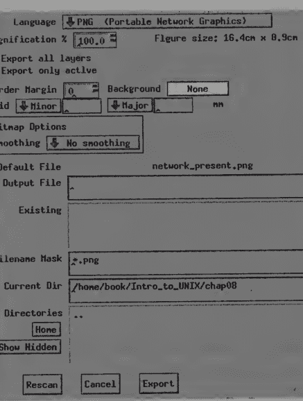

**图 8.40** 使用 `xfig` 将图片保存为 PNG 格式。

```
gnuplot> load 'internal_rtt.gnu'
gnuplot> set terminal png
Terminal type set to 'png'
Options are 'ncrop medium size $60,480 '
gnuplot> set output 'internal_rtt.png'
gnuplot> replot
gnuplot>
```

**图 8.41** 在 `gnuplot` 中以 PNG 格式保存外部往返时间图。

同样地，你现在转换 PNG 格式的外部往返时间图。图 8.42 显示了这些步骤。在这里，你继续在同一个 `gnuplot` 调用中操作；换句话说，不要退出并重启 `gnuplot`。通过这样做，你可以重用之前的输出规范，只需打开 `gnuplot` 文件、指定 PNG 输出文件名并重新绘图即可。

```
gnuplot> load 'external_rtt.gnu'
gnuplot> set output 'external_rtt.png'
gnuplot> replot
gnuplot>
```


**图 8.42** 以 PNG 格式保存外部往返时间图。

# UNIX/Linux 简介

最后，给系统可能提供允许我们将图形图像从一种格式转换为另一种格式的应用。尝试 `man -k png` 或类似的命令搜索来查看系统中可能提供的工具。

## 交叉引用

使用交叉引用允许你在文档的某部分引用文档的另一个部分。例如，要通过编号引用章节，你可以为该章节指定一个标识符而不是给出它的编号。通过这样做，你可以依赖 DocBook 自动提供正确的编号，而当我们添加章节、删除章节或移动文档部分时，该编号可能会发生。在将 DocBook 文档生成为 HTML 页面时，交叉引用会特别有用。在这里，交叉引用将表示为超链接，你可以点击它立即导航到被引用的组件。你可以交叉引用 DocBook 中的多种组件，但你将从一个典型的组件开始，即章节。

在 DocBook 中指定交叉引用时，你必须首先在你要引用的组件中提供一个标识符。该标识符可以在组件的起始标签中通过 `id` 属性定义，并分配标识符的值。例如，列表 8.50 显示了你如何为每个章节组件指定标识符（它只显示了受影响的章节，并用省略号表示未显示的 DocBook 源文件的其他部分）。列表 8.53 显示了你示例网络文档的完整 DocBook 源文件，以便你可以查看这些标签是如何整合到文档其余部分的。

### 列表 8.50 为交叉引用指定章节标识符

```
...
<chapter id="introduction">
...
<chapter id="methodology">
...
<chapter id="results">
...
<chapter id="analysis">
...
<chapter id="summary">
...
```

一旦你为该组件定义了标识符，你就可以对该组件发布交叉引用。若要发布交叉引用，你可以使用 `<xref>` 标签并配合 `linkend` 属性，该属性被分配你想要引用的标识符。为了演示，假设在介绍章节的末尾，你想在描述文档其余部分的陈述中交叉引用后续的章节。列表 8.51 显示了如何对某些章节组件提供此类交叉引用。

### 列表 8.51 引用网络图和后续章节

```
<para>
附图 <xref link="present_network"/>
阐明了 XYZ 当前的网络基础设施。
我们在 <xref link="methodology"/> 中解释了我们的研究方法，
在 <xref link="results"/> 中展示了我们的发现，
并在 <xref link="analysis"/> 中给出了我们的建议。
</para>
```

列表 8.50 显示了对你在 8.49 中导入的网络图的交叉引用。虽然技术上允许对图片进行交叉引用，但某些版本的 DocBook 相关应用程序可能不支持对图片等组件交叉引用。当这种情况发生时，`docbook2html` 或 `docbook2pdf` 可能会报告如“`<xref to figure unsupported>`”的消息。在这种情况下，你将得到一组 HTML 页面或一个 PDF 文件，但引用在生成的格式中显示为空白。

> 某些版本的 DocBook 组件可能不支持对图片等组件进行交叉引用。


## 脚注

最后，但同样重要的是，可以通过脚注组件为 DocBook 文档创建脚注。你在文本中希望成品中出现相应脚注符号的地方指定脚注组件。DocBook 将脚注的文本放置在生成输出的底部。脚注组件涉及 `<footnote>` 标签与 `<para>` 标签的结合。你在脚注文本之前指定 `<footnote><para>` 标签，在脚注文本之后指定 `</para></footnote>` 标签。

### 列表 8.52 指定脚注组件

```
...
<footnote>
<para>
这是脚注文本。
</para>
</footnote>
...
```

# 文本格式–创建与查看排版文档 293

# UNIX/Linux 简介

`<para>`
这是脚注文本。
`</para>`

列表 8.52 显示了如何在方法论中指定脚注。为了简要起见，它显示了其余。

## 8.10 DocBook 布局

| DocBook Tag | 描述 |
|---|---|
| `<?xml?>` | |
| `<!DOCTYPE>` | 指定类型 |
| `<book>` | 包含 |
| `<article>` | 包含 |
| `<chapter>` | 指定起始 |
| `<section>` | 指定起始 |

| DocBook Tag | 描述 |
|---|---|
| `<para>` | 指定起始 |
| `<footnote>` | 指定符号 |
| `<mediaobject>` | 将图片整合到 |
| `<!---->` | 指定起始 |
| `<emphasis>` | 指定起始简单 |

# 文本格式–创建与查看排版文档 295

| DocBook Tag | 描述 |
|---|---|
| `<bookinfo>` | |
| `<author>` | |
| `<firstname>` | |
| `<surname>` | |
| `<title>` | 为...指定标题 |
| `<itemized>` | 指定列表 |
| `<segmentedlist>` | 指定列表 |
| `<orderedlist>` | 指定编号的列表 |
| `<xref>` | 交叉引用...的其他部分 |
| `<footnote>` | 指定符号和文本 |

## 8.53 完整 DocBook 源文件

```
<!-- 这是一个代表假设网络分析报告的 DocBook 源文件。 -->
```

```
<?xml version="1.0" encoding="UTF-8" ?>
<!DOCTYPE book PUBLIC "-//ASIS//DTD DocBook XML V4.2//EN">
<book>
  <bookinfo>
    <title>网络利用报告</title>
    <authorgroup>
      <author>
        <firstname>John</firstname>
        <surname>Doe</surname>
      </author>
      <author>
        <firstname>Jane</firstname>
        <surname>Smith</surname>
      </author>
    </authorgroup>
  </bookinfo>
<!-- Introduction章节 ---->
<chapter id="introduction">
    <title>Introduction</title>
  </chapter>
<para>
本文包含了关于 <emphasis role="bold">XYZ的</emphasis> 网络性能及其对用户影响的初步报告。这项工作是为了调查以下问题：
</para>
<listized>
  <listitem><para>进入出公司网络流量在一天中的某些时段会停滞。这个问题的原因是什么？</para></listitem>
  <listitem><para>购买额外的 ISP 带宽能解决这个问题吗？</para></listitem>
</listized>
```


## 文本格式——创建与查看排版文档 297

随附图 XYZ 当前的网络基础设施 `<xref linkend="present_network"/>` 展示了 XYZ 当前的网络基础设施。
我们在 `<xref linkend="methodology"/>` 中解释了我们的研究方法，在 `<xref linkend="results"/>` 中展示了我们的发现，并在 `<xref linkend="analysis"/>` 中给出了建议。

### 方法论

本研究涉及对<所有*网络流量进行为期一周的分析。
我们的分析包括对 XYZ 网络内部以及从网络内部到外部的网络往返时间进行测量和分析。为了测量往返时间，我们在 XYZ 的主文件和 Web 服务器上运行了一个 shell 脚本。
该脚本执行休眠并在每分钟唤醒一次执行两次 `ping` 命令，对自身产生最小的负载。

每 60 秒，脚本向本地网络上的一个机器发出 `ping` 命令，该机器位于 XYZ 网关的后一跳。每次执行的 `ping` 会发送三个 `ping` 数据包，响应被附加到两个文件中，一个是本地 `ping` 的记录，另一个是远程 `ping` 的响应。

在采集一周的往返时间后，我们利用另一个 shell 脚本读取日志文件并生成每小时的往返平均值。这些平均值随后用于指示网络延迟低、中、高时期，定义如下。

低
中
高

本地流量小于 1ms，外部流量小于 30ms
本地流量在 1ms 到 10ms 之间，外部流量在 30ms 到 100ms 之间
本地流量超过 10ms，外部流量超过 100ms

### 结果

我们发现网络活动在晚上 8:00 到第二天早晨 8:00 之间最低。在上午 8:00 到晚上 8:00 之间，网络活动通常为中等水平，峰值活动出现在下午 4:00 到下午 6:00 之间。这种行为在工作日的每一天都是一致的，工作日之间的差异不大。

我们看到在一天中的大部分时间里，本地和远程流量的往返时间都是理想的。然而，在傍晚和晚晚间，本地和远程流量的往返时间都显著增加，导致延迟非常高且不合理。

`internal_rtt.png`
内部往返时间

`external_rtt.png`
外部往返时间

### 分析

本地和远程流量延迟同时增加的事实使我们能够得出一些结论。首先，远程流量的延迟似乎并不完全是由由于 ISP 提供的互联网馈送不足引起的。相反，本地流量的数量也可能导致了远程流量的延迟。其次，一致的网络峰值时间表明，计划任务（无论是手动还是自动的）正在同时发生并饱和了网络。进一步的调查发现，许多系统在下午 2:30 到下午 6:00 之间运行结束结束处理和备份任务。我们认为这些任务是网络延迟的主要原因。

我们目前的建议是：
- 调度某些处理和备份任务，让它们避开下午 3:00 到晚上 7:00 的峰值时间
- 考虑为本地流量购买更高带宽的交换机
- 重构本地网络，使得处理和备份任务产生的流量相对于其他流量实现本地化。

### 总结

总结来说，这些发现表明，虽然 XYZ 的网络在大部分时间内提供了良好的互联网连接，但在工作周的某些时段网络被过度使用了。

## 总结

在本章中，你学习了 LaTeX，这是一种在许多 UNIX 和 Linux 中常用的排版系统。

## UNIX/Linux 简介 298

## 文本格式——创建与查看排版文档 299

## 文本格式——创建与查看排版文档 301

| 应用 | 目的 |
| :--- | :--- |
| StarOffice OpenOffice AbiWord | 文字处理应用程序 |
| latex dvipdf dvps | 排版 LaTeX 文件 |
| docbook2html docbook2pdf docbook2ps | 排版 DocBook 文件 |
| ghostview gs kpdf | 生成排版的查看器 |
| gnuplot xfig | 创建、查看和处理图形 |

| 资源 | 目的 |
| :--- | :--- |
| www.kde.org www.openoffice.org | 文字处理、演示文稿和电子表格应用程序的文档 |
| www.latex-project.org | LaTeX 文档 |
| www.xfig | xfig 文档 |
| www.trilon.com/xv | xv 的文档和许可 |
| www.gnuplot.info | gnuplot 文档 |
| www.docbook.org | DocBook 的说明和参考文献 |

## 练习 313

- 1. 使用 LaTeX 创建一个解释工作、学校或家里环境的小型文档。按照本章描述，使用章节和其他格式对其进行装饰。
- 2. 使用 `xfig` 创建一个工作、学校或家里环境的草图。
- 3. 将上一个练习中创建的图形整合到第一个练习的 LaTeX 文档中。
- 4. 尝试整合图形的不同尺寸。尝试小尺寸和大尺寸。
- 5. 尝试图形的不同放置位置。尝试将其放在页面顶部，然后放在底部。
- 6. 将 `external_rtt.dat` 和 `internal_rtt.dat` 文件复制到新的工作目录。在这里，按照本章解释使用 `gplot` 绘制图形并将其保存为封装的 Postscript（EPS）。
- 7. 修改列表 8.37 中的 Makefile 以包含其他图形的规范。这样一来，如果任何图形发生变化，Makefile 将重新创建 `network_draft.ps`。
- 8. 输入列表 8.53 给出的 DocBook 源文件。
- 9. 将上一个练习中输入的 DocBook 源文件转换为一组 HTML 页面。在浏览器中打开并查看这些页面。
- 10. 取已创建的网络文档 DocBook 源文件，在分析章节中添加一个基于 `network_proposed.fig` 布局的假设性段落。
- 11. 将 `network_proposed.fig` 文件转换为 PNG 格式并命名为 `network_proposed.png`。
- 12. 将 `network_proposed.png` 导入你添加的 DocBook 源文件段落中。

# 9 Shell 脚本编程

在本章
- 调用 Shell 脚本
- Shell 脚本的名称与类型
- 第一行与注释
- 在 Shell 脚本中调用子任务和访问文件
- 屏幕输出
- Shell 脚本变量
- 决策或分支语句
- 访问 Shell 脚本参数
- Shell 脚本函数

本章探讨了如何使用 Shell 脚本在 UNIX/Linux 环境中编写程序来完成各种形式的处理。它首先解释了 Shell 脚本的基本原理及其工作机制。然后详细介绍了你如何创建自己的 Shell 脚本来实现你想要完成的工作。讨论内容将包括如何使用 Shell 脚本变量、处理参数、进行决策以及在脚本中使用重复语句。本书假设读者对条件、分支和重复的概念已有了解，以便解释如何在 Shell 脚本中实现这些功能。

# 304 UNIX/Linux 简介

你实际上在第 6 章“作业与进程管理”中已经过一个名为 `largest_prime` 的脚本来完成 C++ 程序的某些编译操作，而用户无需了解这些细节。简单来说，Shell 脚本调用了那些你可以通过命令行调用的内容。此外，Shell 脚本还允许进行更复杂的处理，例如针对涉及的工作进行决策和重复。通过这种方式，如果用户每次都必须为任务输入命令，那么编写 Shell 脚本可以更容易、更快速地完成一系列任务。Shell 脚本也是系统在特定时间自动调用的常用方式（参阅第 6 章的“作业调度”）。

在本章关于 Shell 脚本的讨论和示例中，你将看到一些熟悉的 UNIX 命令，特别是来自第 4 章“UNIX/Linux 文件与目录”和第 5 章“高级文件管理”的命令。这样做是为了实现两个目标：首先，通过使用你已经熟悉的组件，让你逐步进入 Shell 脚本的学习，尽管你仍会看到一些新命令。你还将看到如何通过在已知且验证过的较小任务之上构建，利用 Shell 脚本轻松完成新的、更复杂的任务。这种从较小、更简单的任务轻松创建常规和复杂操作的想法，是 Shell 脚本以及 UNIX/Linux 历史应用背后的核心概念。

## 调用 Shell 脚本

要调用（或运行）Shell 脚本，你可以使用绝对路径或相对路径指定该脚本的文件。如果你的账户被设置为在当前目录查找程序或脚本，你甚至只需指定文件名即可指定脚本（更多信息参阅第 11 章“基础账户与系统维护”）。

为了调用 Shell 脚本，存储该脚本的文件权限必须包含该用户的执行权限。例如，一个名为 `myscript` 的 Shell 脚本所有者想要将其作为 Shell 脚本调用，那么 `myscript` 必须具有图 9.1 所示的权限。如果你想允许文件组的用户或其他用户执行 `myscript`，你必须赋予 `myscript` 相应的组权限或其他用户的执行权限。注意图 9.1，为了说明安全考虑，你没有为 `myscript` 的所有者开启执行权限，而是针对组或其他。这些设置有助于防止其他用户可能调用该脚本。有关用户、组和其他用户的执行权限，请参阅第 5 章“高级文件管理”中的“文件和目录权限与权利”章节。

# Shell 脚本编程 305


```
"/Intro_to_chap09$ ls -l myscript

-rwxr-r-- 1 book copy Nov 19 13:07 myscript

"/Intro_to_UNIX/chap09$ 
```

图 9.1 为用户开启了执行权限的文件（Shell 脚本）。

# Shell 脚本的名称与类型

给定的 UNIX 或 Linux 系统可能有多种可用 Shell。你可以将 Shell 视为系统的接口，它接受我们的命令或可以解释并执行脚本。几乎在任何系统上都存在的标准 Shell 是 `/bin/sh`。其他 Shell 包括 `/csh`、`/ksh` 和 `/bash`。这些 Shell 都具有提供输入、输出、提供决策和提供重复的功能。虽然这些 Shell 的语法可能有所不同，但基本概念是相同的。

# 第一行与注释

Shell 脚本的第一行以 `#!` 开头，随后紧跟 Shell 的名称。这也被称为 shebang 行（解释器行）。它告诉系统使用哪种解释器来执行脚本。例如，`#!/bin/sh` 告诉系统使用 `sh` 解释器。

除了第一行外，Shell 脚本还可以包含注释。注释以 `#` 符号开始并一直持续到行的结束。Shell 在执行期间会忽略这些内容。虽然列表 9.1 的第一行看起来像注释，但它是一个特殊情况。如果 `#` 出现在一行的第一个字符，则整行都是注释。

306 UNIX/Linux 简介

列表 9.1 示例 Shell 脚本

```
#!/bin/sh

date

cat greeting
```

# 在 Shell 脚本中调用子任务和访问文件

Shell 脚本通常会调用一个或多个子任务——以命令或其他 Shell 脚本的形式——来完成整体工作的一部分。当你调用一个 Shell 脚本时，你可以将该 Shell 脚本视为一个可以调用子任务的作业，每个子任务都由一个进程处理。Shell 脚本可以通过指定命令或脚本的文件名来调用命令或脚本，只要该文件出现在命令搜索路径中。通常情况下，如果你可以在命令行中通过文件名调用某个命令或脚本，那么你通常可以在另一个 Shell 脚本中调用它。例如，列表 9.1 的第二行调用了 `date` 命令显示当前日期和时间，第三行调用了第 2 章介绍的 `cat` 命令。如果你可以在命令行调用 `date` 和 `cat`，你也可以在 Shell 脚本中调用它们。相反，如果你收到类似 `date: Command not found` 的消息，那么你需要更新账户的命令搜索路径。有关命令搜索路径及其如何修改方法，请参阅第 11 章。

当你调用一个 Shell 脚本时，你可以将该 Shell 脚本当前的工作目录视为你调用该脚本时的目录。这一概念会影响你如何需要在 Shell 脚本内部指定想要访问的文件。

要访问文件，首先使用绝对路径指定该文件。在这里，你不需要担心调用脚本时的当前目录。然而，回想第 4 章，在许多情况下通过绝对路径指定文件可能是不方便或可能的。

# Shell 脚本编程 307

如果文件存在于调用 Shell 脚本的目录中，你也可以通过仅指定名称来访问文件。例如，列表 9.1 中的第三行通过仅指定文件名来访问 `greeting` 文件。只要在目录内调用了 `greeting`，这种指定就是成功的。特别地，如果在 `/Intro_to_UNIX/chap09` 目录内调用 `greeting`，那么该目录在执行时将成为 Shell 脚本的当前工作目录，因此 Shell 脚本能够通过名称访问 `greeting`。

另一方面，当你在 `/Intro_to_UNIX` 目录中调用 `greeting`（如 `chap09/greeting`）时，Shell 脚本将以 `/Intro_to_UNIX` 作为当前工作目录开始执行。在这种情况下，当第三行尝试通过名称访问 `greeting` 时，将找不到该文件，因为 `greeting` 不在当前目录下。因此，你将看到类似 `cat: greeting: No file or directory.` 的消息信息。

通过相对路径指定文件名也有类似的考虑因素。在这里，相对路径必须从调用 Shell 脚本的目录开始存在，否则你将看到与上段类似的错误。

总之，Shell 脚本会从调用该脚本的目录“继承”其当前工作目录。在大多数情况下，这是你所希望的。然而，如果你需要 Shell 脚本从另一个目录的起点开始执行，可以使用 `cd` 命令更改其当前工作目录，方法类似于你在第 4 章中更改命令提示符的方法。这涉及到在 Shell 脚本中编写一行适当的命令。从现在起，Shell 脚本、相对路径文件和仅名称文件将从新的工作目录访问，直到脚本结束或脚本更改了当前工作目录。

# 屏幕输出

要向屏幕（更具体地说是 stdout）发送文本、数字或其他信息，你可以使用第 4 章描述的 `echo` 命令。在最简单的形式中，你将想要输出的信息作为 `echo` 的参数提供。你也可以指定多个参数来连续输出多条信息，如列表 9.2 所示。

列表 9.2 Shell 脚本中的屏幕输出

```sh
#!/bin/sh

echo "Hello, how are you today?"
```

如果文本由字母或数字内容组成，则不需要列表 9.2 所示的双引号。然而，在编写符号时（例如此示例中的问号），你需要将文本包含在双引号内。很快，你将在下一节“Shell 脚本变量”中学习如何使用 `echo` 输出其他信息，例如存储在变量中的值。如列表 9.2 所示，`echo` 将指定信息写入输出并跳到下一行。相应地，随后的输出（或输入）将出现在下一行。

要让与另一个任务生成的输出在同一行上显示，你可以使用带有 `-n` 选项的 `echo`。`-n` 将抑制换行符，随后的输出或输入将出现在之前写入信息的末尾（即同一行）。例如，参考列表 9.2，如果你想在当前日期和时间之前加上 `The current date and time is...`，你可以将脚本更改为列表 9.3 所示所示。

列表 9.3 通过输出抑制换行符

```sh
#!/bin/sh

echo -n "The current date and time is " date

cat greeting
```

# Shell 脚本变量

与大多数其他编程语言一样，Shell 脚本可以使用变量来存储数据以备以后检索。Shell 脚本变量的名称可以由字母、下划线或数字组成。字母区分大小写，且 Shell 脚本变量不能以数字开头。

## 在变量中存储值

要在 Shell 脚本的变量中存储值，请指定赋值，如列表 9.4 所示，值 1 存储在 `x` 中，值 100 存储在 `y` 中，字符串值 `"Hello"` 存储在 `message` 中。当变量首次出现在脚本的赋值语句中时，脚本会自动声明带有相应数据类型的变量。

列表 9.4 为 Shell 脚本变量赋值

```sh
x=1

y=100

message="Hello"
```

## 获取变量值

要获取 Shell 脚本变量中存储的值，请指定 `$` 符号后紧跟变量名。例如，列表 9.5 的第一行显示了如何将变量 `message` 的值写入屏幕。列表 9.5 的第二行将变量 `subtotal` 的值赋值给变量 `total`。最后，9.5 的第三行显示了如何将变量的值与其他文本一起写入。注意示例使用了双引号来包含文本和变量名。你可以省略双引号，但不能使用单引号。在此示例中使用单引号实际上会指示 `echo` 按照其出现的原样写入包含的内容。换句话说，使用单引号时，`echo` 向屏幕写入 `$` 符号及其后的变量名，而不是引用存储的值。

列表 9.5 访问 Shell 脚本变量的值

```sh
echo $message

total=$subtotal

echo "The total is $total"
```

你还可以在另一个变量值的公式或计算中使用变量的值。这同样涉及在你要访问变量的变量名之前前缀一个 `$`。你必须将公式包含在括号中以允许扩展。（注意：此处 OCR 文本有误，上下文暗示标准的 Shell 算术扩展）。[原文此处有损坏的 OCR 序列，根据标准逻辑继续]。

列表 9.6 在 Shell 脚本中指定公式

```sh
#!/bin/sh

Num=10

(( Double=2*Num ))
```

# 键盘输入

要从键盘（更具体地说是 stdin）读取一个值到 Shell 脚本变量中，你可以使用 `read` 命令后跟变量。列表 9.7 显示了 Shell 脚本如何提示用户输入一个值并将该值读入 Shell 变量 `FileSizeLimit` 中。虽然列表 9.7 的上下文是指从键盘读取数值，但你也可以使用相同的方法读取字母文本。例如，文件 `-Intro_to_UNIX/chap09/problem` 是列表 9.6 的版本，它从键盘读取基值。

列表 9.7 打印提示并读取输入

```sh
echo "Enter the file size limit: "

read FileSizeLimit
```





` ` 符号（注意是左引号而不是右引号）可以用于许多其他需要执行命令或命令序列并使用其结果的场景。列表 9.17 演示了一些其他示例。第一个示例执行命令并将结果赋值给 `date` 变量。第二个示例获取并打印当前工作目录。

# 列表 9.17 利用符号引用执行结果的其他示例

```bash
#!/bin/sh

# 获取并打印日期

Date='date'

echo "The current date and time is " $Date

# 获取并打印当前工作目录

CurrDir='pwd'

echo "The current dir is " $CurrDir
```

# Shell 脚本编程 317

```bash
read -p "Would you like to change (y/n): " YN
if [[ $YN = "y" || $YN = "Y" ]]; then
    read -p "Enter the new directory: " NewDir
    cd $NewDir
    # 现在 shell 脚本将以指定的目录
    # 作为当前工作目录执行
fi
```

# 其他比较运算符

仅包含数值的条件可以备选使用表 9.3 所示的运算符。使用表 9.1 和表 9.3 中的运算符之间存在两个区别。第一，表 9.3 中的运算符可以在条件外只使用一组单层方括号 `[]` 括起来，尽管它们在双层层方括号 `[[ ]]` 括起来时也能正常工作。第二，表 9.3 中的运算符仅适用于比较数值。对文本或包含文本值的变量使用运算符可能会导致脚本行为错误，例如尽管相应的条件似乎指定了相反的结果，但仍执行了某个分支。列表 9.18 演示了将 `-lt` 作为“小于”比较运算符的使用。

# 表 9.3 仅针对数值变量或值的比较运算符

| 运算符 | 测试内容... | 示例（变量包含数值值） |
| --- | --- | --- |
| -lt | 小于 | [ $Count -lt 10 ] [ $X -lt $Limit ] |
| -gt | 大于 | [ $Balance -gt 0 ] [ $Speed -gt $SpeedLimit ] |
| -eq | 等于 | [ $Total -eq 100 ] [ $MyNum -eq $YourNum ] |
| -ne | 不等于 | [ $Divisor -ne 0 ] [ $X -ne $Y ] |

# 列表 9.18 报告数字是否小于或大于100的 Shell 脚本

```bash
#!/bin/sh

read -p "Enter a whole number: " Num

if [ $Num -lt 100 ]; then

    echo "The number is less than 100"

else

    echo "The number is not less than 100"

fi
```

# 318 UNIX/Linux 简介

无论使用什么运算符，无论比较数字还是文本，`if-then…` 结构对于你的编程风格都具有一定的灵活性。然而，通常情况下，条件后面的 `then` 以及分支中的每个语句后面必须跟着换行符或分号（`;`）。例如，在列表 9.19 中，`then` 后面跟着一个分号，这样你就可以在同一行指定 `then` 字。C 或 C++ 程序员可能会选择这种风格，以便将 `if`、`else`（使用时）、`elif`（使用时）和 `fi` 对齐在同一个结构中。

# 列表 9.19 if-else-fi 结构的另一种形式

```bash
#!/bin/sh

read -p "Enter a whole number: " Num

if [ $Num -lt 100 ]
then

    echo "The number is less than 100"

else

    echo "The number is not less than 100"

fi
```

## 测试运算符

包含数值变量和/或值的另一种条件形式涉及 `test` 运算符。`test` 运算符允许对字符串、数字和文件执行各种比较。列表 9.20 演示了如何使用 `test` 判断一个变量是否小于另一个变量。

# 列表 9.20 使用 test 指定条件

```bash
if [ $Num1 -lt $Num2 ]; then

    echo $Num1 "is smaller than" $Num2

fi
```

# case 结构

脚本的另一种形式涉及 `case` 结构。类似于 C 或 C++ 中的 `switch-case` 结构，`case` 结构允许指定控制值。`case` 语句后面是一系列值或模式，每个模式对应一个分支。执行时，shell 从第一个开始比较控制值。当找到匹配时，shell 执行相应的分支。你还可以包含默认分支，即当控制值不匹配任何给定的值时执行的分支。

# 列表 9.21 用于菜单选择的 case 结构

```bash
#!/bin/sh

read -p "Enter the starting balance: " Balance

echo "Menu Options"
echo "1) Deposit"
echo "2) Withdraw"
echo

read -p "Enter your selection: " Selection

case $Selection in

  1) 
    read -p "Enter the deposit amount: " Deposit
    ((Balance = $Balance + $Deposit))
    ;;

  2) 
    read -p "Enter the withdrawal amount: " Withdraw
    ((Balance = $Balance - $Withdraw))
    ;;

  *) 
    echo "That is an invalid option"
    ;;

esac

echo "The final balance is $Balance"
```

当控制值匹配

## 320 UNIX/Linux 简介

如果是小写的 n 或大写的 N，则执行第二个分支。这里的的效果是它对用户输入的 y 或 Y（表示“是”），或 n 或 N（表示“否”）进行了不区分大小写的分析。列表 9.22 可用于实验，路径为 `/Intro_to_UNIX/chap9/case_yesno`。

## 列表 9.22 便于选择是/否/帮助选择的 case 结构

```sh
#!/bin/sh

read -p "Enter y (yes), n (no), or h (help)" Selection

case $Selection in

y|Y)
    # 针对“是”响应的语句
    ;

n|N)
    # 针对“否”响应的语句
    ;

h|H)
    # 打印说明或帮助屏幕
    ;

*)
    echo "That is an invalid option"
    ;;

esac
```

每个分支的多个文本长度相同（一个字符），但你可以为同一个分支指定不同长度的可能匹配值。例如，如果你想让 shell 脚本用户允许将 y、Y 以及单词 yes 指定为 yes，你可以改为将第一个分支的匹配项指定为 `y|Y|yes`。

你可以将条件结构嵌套在其他条件结构中。例如，你可以将一个 `if` 结构嵌套在另一个 `if` 结构的分内，甚至是一个 `case` 结构的分支内，只要你按照前面描述的步骤指定条件、分支（es）以及嵌套结构的结束。你也可以将一个 `case` 结构嵌套在另一个 `case` 结构的分支或 `if` 结构的分支内，同样只要你指定了嵌套结构的所有组件。

## 迭代结构

要在 shell 脚本中实现迭代（一个或多个语句的重复），你有许多机制可以为此目的。这些机制涉及 `while` 循环、`for` 循环以及一种称为 `until` 的 `while` 循环。

## Shell 脚本编程

`while` 循环是一种控制流语句，允许根据给定的布尔条件重复执行代码。允许一个或多个语句进行迭代或重复的 `while` 结构被称为 `while` 循环体。`while` 循环允许重复发生零次或多次。该结构以单词 `while` 开始，后面跟着一个与你指定结构的方式相同的条件。该条件规定了循环迭代时必须满足的条件。在循环体的每次迭代之后，都会对条件进行评估，以决定再次迭代循环体还是终止循环。循环体的开头用单词 `do` 标记，结尾用单词 `done` 标记。

列表 9.23 显示了一个 `while` 循环，它会根据用户指定的次数重复循环体。这个特定的循环体演示了 shell 脚本如何交互式地向用户请求规范并根据该规范执行工作，在本例中是请求目录名称并创建一个该名称的目录。shell 脚本 `~/Intro_to_UNIX/chap09/while_dir` 包含列表 9.23 的内容，供进一步实验。

## 列表 9.23 利用 while 循环重复一组语句

```sh
#!/bin/sh
```


```sh
read -p "Enter the number of directories you want to create: " NumDir

while [[ $NumDir > 0 ]]

do

    read -p "Enter the name of the directory to create: " DirName

    mkdir $DirName

    if [[ $? == 1 ]]; then

        echo "the creation failed"

    fi

    ((NumDir--))

done
```

列表 9.23 中的 `$` 代表利用 shell 变量来确定上一个操作是否成功。该变量允许 shell 脚本在上一个操作失败时采取适当行动。如果上一个操作成功，`$?` 评估为 0；如果失败，则评估为 1。在这种情况下，它是为了确定上一个操作（即目录创建）是否成功。如果没有，则向用户发出该提示。

列表 9.23 还演示了如何使用自增或自减运算符分别增加或减少一个值的值。这些操作符提供了一种更短的方法来将变量的值改变一个，而不是使用语句，例如本例中的 `NumDir=$NumDir-1`。自增运算符用 `++` 指定。

## for 循环

你也可以通过 `for` 循环实现循环体的零次或多次重复。shell 脚本的 `for` 循环与其他编程语言中的循环有类似的概念，但形式可能略有不同。为了解释，列表 9.24 显示了一个遍历 1, 2, 3, 4 和 5 值的 `for` 循环。虽然 `for` 循环可以用于遍历像列表 9.24 中指定的值列表，但通常你希望对通过这种方式显式指定的小列表进行操作。如果值列表较大（从 1 到 100），你可能希望选择 `while`（或稍后提到的 `until`）循环。

### 列表 9.24 使用 for 循环访问文件列表

```sh
#!/bin/sh

for Num in 1 2 3 4 5

do

	echo $Num

done
```

`for` 循环也可以用于访问文件名列表。这在你希望 shell 脚本处理目录中的一组文件时非常有用。这种类型的 `for` 循环涉及指定文件名。例如，列表 9.25（可用路径为 `Intro_to_UNIX/chap09/dir_for`）显示了一个遍历文件名的 shell 脚本。

### 列表 9.25 使用 for 循环访问文件列表

```sh
#!/bin/sh

for file in *

do

	if [ -d "$file" ]; then

		echo "$file is a directory"

	else

		echo "$file is a file"

	fi

done
```

## Shell 脚本编程

shell 脚本的一个常见用途是确认用户在调用 shell 脚本时提供了多少参数。当 shell 脚本预期两个参数时，通常需要使用 `if` 语句进行这种检查。你通常会在脚本开头指定这种确认。如果不存在预期的参数数量，打印描述预期用法的消息可能会帮助。列表 9.27 在打印消息后发出了 `exit` 命令。

### 列表 9.27 检查参数数量

```sh
#!/bin/sh

if [ $# -ne 2 ]; then

    echo "Usage: $0 <directory1> <directory2>"

    exit 1

fi

echo "Two arguments provided."
```

### 列表 9.27 确认脚本参数的数量

```bash
# 确认在调用脚本时是否提供了两个参数
if [[ $# != 2 ]]; then
  echo "usage: <arg1> <arg2>"
  exit 1 # 在此处退出 shell 脚本
fi
```

要访问九个以上的参数，或者以相同的方式一次性处理多个参数，请使用一个包含处理给定参数所需的代码的循环。在第一次迭代中，访问并处理一个（例如，第一个）参数。在下一次迭代中，访问并处理第二个参数。在随后的每次迭代中，都访问并处理下一个参数，以此类推，直到所有剩余参数。这种技术涉及 `shift` 命令，调用的 `shift` 会将参数的位置向下移动一位。当一个参数向下移动一位时，它将通过之前处于该位置的参数变量进行访问。例如，在 `shift` 之前可以通过 `$2` 访问的参数，在 `shift` 之后将通过 `$1` 访问。

仔细观察如何使用相同的代码逐个处理参数，你可以在重复循环中使用 `shift`，如下所示。循环的第一次迭代通过变量 `$1` 访问并处理第一个参数。当你处理完第一个参数并想要访问并处理第二个参数时，在脚本中发出 `shift` 命令。当循环迭代且相同的代码引用 `$1` 时，脚本将访问并处理已向下移动一位的第二个参数。同样，下一次向下移动一位的 `shift`（在第二次迭代结束时）将允许脚本在第三次迭代中通过 `$1` 访问在调用脚本时被指定为 `$1` 的第三个参数。

列表 9.28（该文件位于 `~/Intro_to_UNIX/chap09/shift_ex`）展示了这种形式的参数访问。注意针对 `$#`（参数数量）的循环条件。每次执行 `shift` 不仅会将所有参数向下移动一位，还会将参数数量减少一。。由于这种行为，当参数数量 `$#` 达到 0 时，脚本迭代的次数已足够访问并处理每个参数，循环随之退出。

### 列表 9.28 [[ $# -gt 0 ]] 使用 shift 逐个处理

```bash
while [[ $# -gt 0 ]]
do
  # 此处理只打印参数
  echo "The next argument is $1"
  shift
done
```

由于 `shift` 将所有参数的位置向下移动一位，在 `shift` 之前位于第十位（因此无法访问）的参数在 `shift` 之后将位于第九位并通过 `$9` 访问。通过这种方式，你可以轻松地在 shell 脚本访问任意数量的参数。

然而，请记住，位置第一的参数在 `shift` 之后将不再可访问。换句话说，如果一个参数通过 `$1` 访问，在发出 `shift` 命令后，该参数将不再可访问。因此，在发出 `shift` 命令时，你应该确保位置第一的参数已不再需要。

## SHELL 脚本函数

为了模块化和重用 shell 脚本代码，你可以像在其他编程语言一样在 shell 脚本中使用函数。作为一个简短的示例，列表 9.29 显示了一个定义 `Min` 函数的 shell 脚本，该函数打印两个参数中较小的一个。它位于 `~/Intro_to_UNIX/chap09/func_min`。脚本随后要求用户输入两个数字并调用 `Min` 函数来报告哪一个较小。

### 列表 9.29 打印两个参数中较小值的 Shell 脚本函数

```bash
#!/bin/sh

Min()
  {
    if [[ $1 -lt $2 ]]; then
    Smallest=$1
  else
    Smallest=$2
  fi
}

read -p "Enter two numbers, separated by a space: " Num1 Num2
Min $Num1 $Num2
echo "The smallest is " $Smallest
```

在函数定义的第一行，指定函数名和一对空括号，在列表 9.29 中，这是第三行的 `Min`。与许多其他编程语言不同，函数定义第一行的括号总是空的，无论你是否为函数提供参数。函数定义的其余部分由用 `{ }` 大括号括起的函数体命令组成。

要访问函数内的任何参数，请参考上一节“访问 Shell 参数”中解释的 shell 脚本变量。唯一的区别是，在函数内部，shell 脚本变量指的是函数调用提供的参数（如果有）。当在函数外部使用时，这些变量指的是参数（如果有）。例如，在函数体中，你可以通过 `$1` 访问第一个参数，通过 `$2` 访问第二个参数。shell 函数的其他变量包括用于参数数量的 `$#` 以及用于引用所有参数的 `$0`。函数定义后的第一行（列表 9.29 中的第 12 行）代表脚本主部分的第一行。要调用函数，只需在 shell 脚本中将函数名作为命令指定。在调用语句中，在函数名后传递参数，不需要包含括号。如果你没有参数，只需提供函数名。在列表 9.29 的第 13 行，脚本调用了函数，并提供了用户输入的值。在函数体执行后，脚本将继续执行下一条命令。

作为函数的另一个示例，并使用其他 shell 脚本机制，列表 9.30 显示了另一个可用于验证正确性的脚本。它位于 `~/Intro_to_UNIX/chap09/func_exists`。该脚本有一个名为 `exists` 的函数，跨越第 3 到 13 行。`exists` 接受两个参数，确认两个参数都指向文件，并告诉两个文件中哪一个尺寸较小。出于讨论目的：

### 列表 9.30 确定较小文件的 Shell 脚本函数

```bash
#!/bin/sh

Exists()
{
```


```bash
if [[ $# -ne 1 ]]; then
    echo "Exists: expected one argument"
    exit 1
fi

if [[ ! -f $1 ]]; then
    echo "$1 does not exist"
    return 1
fi
```

13 }

14 if [[ $# -ne 2 ]]; then
15 echo "usage: $0 file1 file2"
16 exit 1
17 fi

18 Error=0
19 Exists $1
20 Exists $2

24 if [[ $Error -ne 0 ]]; then
25 # 至少有一个文件不存在，无法继续
26 exit 1
27 fi

37 fi
```

注意，函数可以提供任意数量的参数。虽然这提供了极大的灵活性，但也可能要求函数考虑如何妥善处理任意数量的参数。例如，在列表 9.30 中，`Exists` 函数体的第一行检查了是否恰好给了一个参数。如果不是如此，函数将警告用户并快速终止。`Exists` 函数判断给定参数是否指向一个存在的文件。此检查是重要的，因为脚本稍后假设文件存在，如果文件不存在，脚本将无法正常执行或报告准确的结果。如果参数不指向文件。

## 总结

本章探讨了 UNIX Shell，重点关注了 `sh` 和 `bash` shell。涵盖了 shell 脚本变量的概念，包括值的计算、赋值和访问。检查了 `if` 和 `case` 条件结构，以及 `while`、`for` 和 `until` 迭代结构。描述了访问调用 shell 脚本时提供的参数的方法。最后，检查了 shell 脚本函数的使用。

## 练习

- 1. 创建名为 `filestat` 的 shell 脚本，要求用户输入文件名和/目录目录。`filestat` 应该报告给定的名称代表的是目录、存在但不是目录的其他名称，还是作为文件或目录不存在。
- 2. 创建名为 `add2` 的 shell 脚本，要求用户输入两个整数，将它们相加并报告和。你可以假设用户只会输入整数型参数。
- 3. 创建名为 `addup` 的 shell 脚本，它可以接受任意数量的数字型参数，将它们相加并报告和。你可以假设提供的参数都是数字型的。如果没有提供任何参数，`addup` 应该打印一条用法信息。
- 4. 创建名为 `today` 的 shell 脚本，创建一个名为 `backup.tar` 的 tar 文件，其中仅包含当前目录或子目录下在过去一天（24 小时）内修改过的文件。
- 5. 创建名为 `findme` 的 shell 脚本，其工作原理如下：
    - 如果未提供参数，`findme` 提示用户要查找的文件或目录名称，并打印该文件或目录的位置。
    - 如果提供了一个参数，`findme` 应该使用该参数作为要查找的文件或目录名称并打印其位置。

# 10 使用 C/C++ 编程

本章内容

- UNIX/Linux C 和 C++ 编译器
- C/C++ 程序调试
- 为调试准备程序
- C/C++ 程序性能分析

本章将介绍如何在 UNIX/Linux 环境下使用 C 和 C++ 进行编程。它假设读者已经具备 C/C++ 编程概念的知识。它重点关注于如何完成典型的 C/C++ 编程需求，例如如何编译由一个或多个文件组成的程序，如何使用调试器查找程序错误，以及如何分析程序性能以优化程序的执行方式。

## UNIX/LINUX C AND C++ 编译器

本章从概述 UNIX 系统上常用的 C 和 C++ 编译器开始。然后描述了如何使用 C 和 C++ 编译器将源代码程序构建成用户可以调用并运行的可执行形式。

### 编译器的名称

在实践中有许多 UNIX/Linux C 和 C++ 编译器。编译器的数量或编译器在特定 UNIX/Linux 系统上的可用性取决于系统的平台、供应商或管理策略。例如，IBM AIX 系统通常有一个 C 编译器 `xlc` 和/或名为 `xic` 的 C++ 编译器。某些 UNIX/Linux 系统可能提供 C 编译器 `cc` 和名为 `cc` 的 C++ 编译器。许多系统分别提供名为 `gcc` 和 `g++` 的 GNU 源 C 和 C++ 编译器。`gcc` 和 `g++` 可以在在任何架构上，由于其开源特性，在 UNIX/Linux 系统中非常常见。因此，本文使用了 `gcc` 和 `g++`，但其内容足够通用，适用于大多数甚至所有其他的 C 和 C++ 编译器。

### 编译与链接

将人工编写的 C 或 C++ 程序编译或构建成系统理解并运行的形式（称为可执行文件）的过程。简单来说，这种转换涉及两个动作。第一个动作是*编译*，将每个 C 或 C++ 源文件转换为对象文件。编译涉及检查源代码的语法是否正确，并将代码转换为机器语言（计算机可以理解的形式）。第二个动作是*链接*，将对象文件（如果有多个源文件则为多个文件）合并成一个可执行文件。链接还将将程序运行所需的任何库的支持或功能集成到生成的可执行文件中。

编译和链接都可以通过同一个应用程序（如 `gcc` 或 `g++`）完成。首先，你将学习如何一步到位完成这些动作，这对于由一个或少量源代码文件组成的程序足够了。然后你将看到如何通过不同的步骤完成这些动作，这对于包含许多源代码文件的大型程序来说更高效。

# 使用单步编译链接步骤构建

本节描述了如何通过一个步骤或命令，将一个或多个 C 或 C++ 源文件编译并链接为可以调用运行程序的可执行文件。它从 C++ 源文件开始，因为它们更容易编译和链接。之后，解释了如何编译和链接 C 源文件。

## 使用单步编译链接步骤构建 C++ 程序

要通过一个步骤或命令编译并链接 C++ 程序，你可以调用 C++ 编译器（在这种情况下为 `g++`），如图 10.1 所示。

```
/Intro_to_UNIX/chap10/single_file_c++ g++ -o sqrt_ex sqrt_ex.cpp []
```

### 10.1 用一个命令编译并链接 C++ 源文件。

在这里，你正在目录 `/Intro_to_UNIX/chap10/single_file_c++` 中编译名为 `sqrt_ex.cpp` 的 C++ 程序。作为该命令的一部分，`g++` 的 `-o` 选项指示 C++ 编译器生成一个紧随其后的文件名的可执行文件（在本例中 `sqrt_ex`）。在 `-o` 选项和输出文件名之后，提供源程序的文件名。

如果你不使用 `-o` 选项指定输出文件名，编译器将生成名为 `a.out` 的执行文件。

如果编译和链接成功，你现在有一个文件。

```
-rwxr-xr-x 1 user group 16384 Jan 1 00:00 sqrt_ex
-rw-r--r-- 1 user group 4096 Jan 1 00:00 sqrt_ex.cpp
```

### 10.2 列出源文件。

在这个特定的示例中，与许多 C++ 程序一样，你不需要在编译链接命令中指定额外的组件（称为库）。要运行可执行文件，你可以通过其名称调用它，如图 10.2 所示。

```
/Intro_to_UNIX/chap10/single_file_c++ ./sqrt_ex
```

### 10.3 调用生成的可执行文件。

在这个特定的示例中，与许多 C++ 程序一样，你不需要在编译链接命令中指定额外的组件（称为库）。要运行可执行文件，你可以通过其名称调用它，如图 10.3 所示。

```
/Intro_to_UNIX/chap10/single_file_c++ ./sqrt_ex
```


# 分离编译和链接步骤进行构建

编译和链接 C 和 C++ 程序的另一种方法是将这些操作分为两个独立的步骤，而不是一次性完成。虽然分步编译和链接可能似乎对用户来说是额外的工作，但对于跨越多个源文件的大型程序，这种方法要高效得多。为了解释这一点，考虑一个包含十个源文件的程序。要一步步编译并链接这些文件，编译器必须编译所有的源文件并对其进行链接。由于开发或调试，即使只有一个源文件发生了变化，编译器也必须对所有十个源文件进行编译。对未更改源文件进行编译是不必要的处理，这不仅增加了完成编译和链接所需的时间，还会降低整个系统的速度。因此，一步步编译 C 和 C++ 文件并不是不可接受的，特别是在供许多用户使用的系统或提供其他设施（如文件、打印机或 Web 服务）的系统上。

作为每次都编译所有源文件的替代方案，你可以只编译自上次编译以来修改过的源文件。这些是唯一需要编译的文件。例如，如果你更改了十个源文件中的一个并想重新链接程序，你可以只编译那一个源文件，并“重用”之前未更改源文件的编译结果。这种方法需要单独的编译和链接步骤。在步骤（步骤）中，指定 `-o` 选项指示编译器为给定的源文件生成对象文件。对象文件的名称基于源文件，但其扩展名是 `.o` 而不是 `.c` 或 `.cpp`。图 10.6 显示了如何使用单独的编译步骤编译 `~Intro_to_UNIX/chap10/multi_file_C++` 中的 C++ 源文件。图 10.6 还显示了生成的对象文件 `debug.o`、`main.o` 和 `sor.o`。你可能会注意到三个对应的 C++ 源文件以及两个头文件。

```
/Intro_to_UNIX/chap10/multi_file_C++ g++ -c debug.cpp

/Intro_to_UNIX/chap10/multi_file_C++ g++ -c main.cpp

/Intro_to_UNIX/chap10/multi_file_C++ g++ -c sor.cpp

/Intro_to_UNIX/chap10/multi_file_C++ -l *

total 36

tru*------ 1 book book 433 Dec 14 20:05 constants,h

tru*------ 1 book book 72 Dec 13 04:38 debug,h

tru*------ 1 book book 539 Dec 14 17:23 debug,cpp

tru*------ 1 book book 1244 Dec 12 20:15 debug,o

tru*------ 1 book book 360 Dec 4 17:48 externals,h

tru*------ 1 book book 485 Dec 13 20:14 main,cpp

tru*------ 1 book book 1494 Dec 12 17:52 main,o

tru*------ 1 book book 1632 Dec 23 20:15 sor,o

/Intro_to_UNIX/chap10/multi_file_C++ $
```

> 图 10.6 使用单独的编译步骤编译三个源文件。

稍后，如果你修改了这些源文件之一，只需要重复该文件的编译命令即可为更改的源文件创建对象文件。你已经有了其他未更改源文件的对象文件，因此无需再次编译它们。

一旦所有必要的或修改过的源文件都已编译为各自的对象文件，就可以执行第二个步骤来链接它们。链接步骤将与一步步编译链接类似，但你指定的是对象文件名而不是源文件名。图 10.7 显示了如何将你的三个对象文件链接到一个可执行文件名中。图 10.7 还引入了一个列表来显示生成的可执行文件。一旦生成了可执行文件，你就可以调用该执行文件来运行程序，正如之前阶段的演示所示。

```
//Intro-to_UNIX/chap10/multi_file_C++ g++ -o sor debug.o main.o

//Intro-to_UNIX/chap10/multi_file_C++ is -l sor

-rwxrxr-x 1 book 882 Dec 13 20:17 sor

//Intro-to_UNIX/chap10/multi_file_C++ 
```

**图 10.7** 使用单独的链接步骤链接三个对象文件。

## 用于 C/C++ 程序的 Makefile

在图 10.6 的目录列表中，你可能注意到一个 `Makefile`。在 UNIX/Linux 中管理多文件程序的常用做法是使用 `Makefile`，它是在第 8 章“文本格式化——创建和查看文档”中引入的。在多文件程序中使用 `Makefile` 可以让用户无需跟踪自上次编译以来修改了哪些源文件，也不需要知道该程序的编译和链接规范。列表 10.1 示例了一个可能的 `Makefile`，它可以管理 `~/Intro_to_UNIX/chap10/multi_file_C++` 中多文件程序的编译。

### 列表 10.1 多文件 C++ 程序的示例 Makefile

```makefile
# 用于多文件程序的 Makefile

sor: main.o sor.o
	g++ -o main.o sor.o debug.o

clean:
	rm -f *.o

main.o: main.cpp
	g++ -c main.cpp

debug.o: debug.cpp
	g++ -c debug.cpp

sor.o: sor.cpp
	g++ -c sor.cpp
```

# 使用 C/C++ 编程 339

```
//Intro_to_UNIX/chap10/multi_file_c++ g++ -o -c debug.cpp
//Intro_to_UNIX/chap10/multi_file_c++ g++ -o -c main.cpp
//Intro_to_UNIX/chap10/multi_file_c++ g++ -o -c sor.cpp
//Intro_to_UNIX/chap10/multi_file_c++ g++ -o -o debug main.o sor.o
```

**列表 10.10** 为编译和链接命令指定编译标志。

其他常用的编译选项包括调试 (`-g`) 和性能分析 (`-p -pg`)，将在后续进行讨论。其他选项和标志会随编译器而异。有关这些及其他选项的更多信息，请参阅编译器的 `man`页（帮助页）。

## C/C++ 程序调试

程序员可以使用多种技术来调试程序。这些技术范围涵盖了简单地向屏幕上打印消息（不使用 `print()`）到使用调试器。像编译器一样，UNIX/Linux 系统上也有多种调试器。一种常用的调试器是 `pdb`，它是 `gcc` 和 `g++` 的调试器对应物。本节介绍了如何准备程序调试，以及如何在程序运行时或异常终止后使用 `pdb` 进行调试。为了方便本节及后续章节对调试的说明，列表 10.2 显示了 `/Intro_to_UNIX/chap10/multi_file_c++` 目录下的 `main.cpp` 代码。列表 10.3 显示了 `sor.cpp`，由于在调试和性能分析讨论中未被引用，此处此处未显示。

### 列表 10.2 /Intro_to_UNIX/chap10/main.cpp 内容

```cpp
#include <iostream>
using namespace std;
include "constants.h"
include "externals.h"
// 这些被移动到 main 外部，以避免
// 局部变量内存超出栈空间。
double start_grid[N][N];
double final_grid[N][N];
int main() {
```

# UNIX/Linux 简介

```cpp
cout << "init...\n"
Init_Grid(start_grid);
Init_Grid(final_grid);
cout << "sor...\n"
SOR_Complete(start_grid, final_grid, ITERATIONS);
//Print_Grid(final_grid);
cout << "sor complete.\n";
```

## 列表 10.3 /Intro_to_UNIX/chap10/sor.cpp 内容

```cpp
#include "constants.h"
#include "externals.h"
void Init_Grid(double g[N][N]) {
    int row, col;
    for (row=0; row<N; row++)
        for (col=0; col<N; col++)
            g[row][col] = (double)row+col; // 初始化
    // 将外层行列清零
    for (row=0; row<N; row++) {
        g[row][0] = 0;
        g[row][N-1] = 0;
```


```
        for (col=0; col<N; col++) {

            g[0][col] = 0;

            g[N-1][col] = 0;

        }

    }

}

void Copy_Grid(double src[N][N], double dest[N][N]) {

    int row, col;

    // 现在将影子矩阵拷贝到工作矩阵

    for (row=0; row<N; row++)

        for (col=0; col<N; col++)

            dest[row][col] = src[row][col];

}
```

# 使用 C/C++ 编程 341

```c
void SOR_Timestep(double grid0[N][N], double grid1[N][N]) {
    int row, col;

    // 为了保持简单性，我们只计算内部单元格
    for (row=1; row<N-1; row++)
        for (col=1; col<N-1; col++)
            grid1[row][col] = (grid0[row-1][col] + 
                              grid0[row+1][col] + 
                              grid0[row+1][col] + 
                              grid0[row][col-1]) / 4;
}

void SOR_Complete(double grid_start[N][N],
                  double grid_final[N][N], int n_iter) {
    int iter;
    for (iter=0; iter<n_iter; iter++) {
        // 执行一次迭代
        SOR_Timestep(grid_start, grid_final);
        // 现在拷贝回原始矩阵进行下次迭代
        Copy_Grid(grid_final, grid_start);
    }
}
```

# 为程序准备调试

在查看 `g` 之前，你将学习如何为程序准备调试。作为任何 UNIX/Linux 调试器，如果程序是用调试模式编译的，你就可以获取更好的调试信息。支持调试的编译和链接标志是 `-g`。图 10.11 展示了如何为 `/Intro_to_UNIX/chap10/multi_file_c++` 中的 `sor` 程序执行命令行编译和链接。`-g` 选项也适用于大多数其他 C 和 C++ 编译器。

你可能注意到这些命令是在没有 `-o` 优化的情况下执行。某些编译器可能不允许同时使用 `-o` 和 `-g`。因此，为了避免冲突，本章在使用 `-g` 时省略了 `-o`。

```bash
//Intro_to_UNIX/chap10/multi_file_c++ g++ -g -c debug.cpp

//Intro_to_UNIX/chap10/multi_file_c++ g++ -g -c main.cpp

//Intro_to_UNIX/chap10/multi_file_c++ g++ -g -c sor.cpp

//Intro_to_UNIX/chap10/multi_file_c++ g++ -o -o debug main.o sor.o
```


# 图 10.11 执行编译和链接命令

在调试之前，你将学习如何准备程序调试。

程序员可以使用多种技术来调试程序。这些技术范围涵盖了简单地向屏幕上打印消息（不使用 `print()`）到使用调试器。像编译器一样，UNIX/Linux 系统上也有多种调试器。一种常用的调试器是 `pdb`，它是 `gcc` 和 `g++` 的调试器对应物。本节介绍了如何准备程序调试，以及如何在程序运行时或异常终止后使用 `pdb` 进行调试。为了方便本节及后续章节对调试的说明，列表 10.2 显示了 `/Intro_to_UNIX/chap10/multi_file_c++` 目录下的 `main.cpp` 代码。列表 10.3 显示了 `sor.cpp`，由于在调试和性能分析讨论中未被引用，此处此处未显示。

在查看 `g` 之前，你将学习如何为程序准备调试。作为任何 UNIX/Linux 调试器，如果程序是用调试模式编译的，你就可以获取更好的调试信息。支持调试的编译和链接标志是 `-g`。图 10.11 展示了如何为 `/Intro_to_UNIX/chap10/multi_file_c++` 中的 `sor` 程序执行命令行编译和链接。`-g` 选项也适用于大多数其他 C 和 C++ 编译器。

你可能注意到这些命令是在没有 `-o` 优化的情况下执行的。某些编译器可能不允许同时使用 `-o` 和 `-g`。因此，为了避免冲突，本章在使用 `-g` 时省略了 `-o`。

继续查看命令列表以运行程序，你可能会看到的其他命令还有 `run` 和 `step`，它们很快就会让你感兴趣。你也可以通过输入 `help` 后跟特定的命令名称来获取特定命令的帮助。为了演示查看特定命令的帮助，图 10.15 显示了如何获取 `run` 命令的帮助。

**图 10.15** 获取特定命令的帮助，本例为 `run`。

同样，要学习 `gdb` 中 `continue` 命令的帮助，你可以像图 10.16 所示输入 `help` 命令。

```
(gdb) help continue

继续执行调试程序，在信号或断点之后。

如果从断点继续，可以使用数字 N 作为参数，
这意味着将断点的忽略计数设置为 N - 1（这样断点在达到第 N 次之前不会触发）。
```


**图 10.16** 获取特定命令的帮助，本例为 `continue`。

图 10.16 中的描述说明，执行 `"continue"` 将运行程序，直到它再次停止在断点处。你也可以输入带数字的 `"continue"`，指示调试器在达到该次数断点后停止在断点处。

另一个对此有用的命令是允许你设置一个断点，该断点将在调试器中在程序的某个特定位置停止执行。通过停止程序，你有机会查看某些变量的值，并借此了解程序的特定位置正在做什么。要找到允许你设置断点的命令，请参考图 10.13 中的通用帮助界面，你可以通过像图 10.17 所示输入 `help` 命令来查看断点命令的分类。

在此之前，断点命令列表也贴在下方，你最初只会看到第一部分。感兴趣的命令在这里，你可以像图 10.18 所示查看它的帮助。你从图 10.18 的描述中看到，可以通过指定该函数名或行号作为 `break` 的参数，在程序的某个函数或行号处指定断点。此外，对于多源文件程序，你可能指定一个参数后跟冒号，最后是函数名或行号。

# 使用 C/C++ 编程 345

```
(gdb) help breakpoints
```
让程序在某些点停止。

命令列表：

- `watch` -- 为表达式设置观察断点
- `break` -- 在指定的行或函数处设置断点
- `catch` -- 设置捕获点以捕获事件
- `clear` -- 清除指定行或函数处的断点
- ---输入 `<return>` 继续，或输入 `q <return>` 退出---

**图 10.17** 获取某类命令的帮助，本例为 `"breakpoints"`。

```
(gdb) help
```
在指定的行或函数处设置断点。

参数可以是行号、函数名，或 `"*"` 和一个地址。

如果指定了行号，则在该行代码开始处断开。

如果指定了函数，则在该函数开始处断开。

---输入 `<return>` 继续，或输入 `q <return>` 退出---

**图 10.18** 获取特定命令的帮助，本例为 `break`。

## 在调试器中设置断点、运行和检查程序

使用这些常用的命令 `run`、`continue` 和 `break` 来看 `sor` 程序。此时，程序已加载到调试器中但尚未启动。在启动之前，设置一个断点，这样在启动程序后，调试器会在某个地方停止程序。在这个示例中，在 `sor.cpp` 的第 57 行设置断点，这将代表在每次迭代或时间步计算阶段之后停止。

```
(gdb) break sor.cpp:57

Breakpoint 1 at 0x804878d: file sor.cpp, line 57.

(gdb)
```

**图 10.19** 在 `gdb` 中设置断点。

设置断点后，你现在可以启动程序了。要开始运行程序，你可以输入 `run`，如图 10.20 所示。

```
(gdb) run

Starting program: /home/book/Intro_to_UNIX/chap10/multi_file
```

**图 10.20** 启动程序。

# UNIX/Linux 简介

当程序下次停止时，再次打印 `iter` 变量和网格数组中的单元格。如图 10.27 所示，`iter` 包含值 100，表示你正处于第 101 次迭代。你还会看到单元格的值也发生了变化，表明该单元格的值在经过若干迭代后最终会减少，这在特定的应用程序中是符合预期的。

```
(gdb) print iter

$5 = 100

(gdb) print start_grid[10][10]

$6 = 16.83669305981182

(gdb)
```

图 10.27 在第 101 次迭代中打印数据变量。

假设你已经完成了程序的调试，并希望它完成执行。为了防止它再次在断点处停止，你可以使用 `clear` 命令删除或清除断点，该命令也在 `breakpoints` 命令类中。`clear` 接受的与 `break` 类似的规范，因此，如果你想清除 `sor.cpp` 中的第 57 行断点，可以发布 `clear` 命令，如图 10.28 所示。

```
(gdb) clear sor.cpp:57

Deleted breakpoint 1

(gdb) continue

Continuing.
```

图 10.28 清除断点并恢复执行。

清除断点后，就不会有断点可以停止程序，如果你现在继续执行，程序将运行到结束。图 10.28 显示了程序以这种方式继续运行的情况。图 10.29 显示了程序运行结束后如何退出。

```
(gdb) quit

"Intro_to_UNIX/chap10/multi_file_c++$
```

图 10.29 退出调试器并返回命令行。

虽然这种在调试器中运行、停止和分析程序的简单演示涉及几个操作，但其意图是让你能够以这种方式更复杂地使用调试器。以这种方式使用调试器时，你可能会发现其他有用的命令 `step` 和 `next`。`step` 执行下一行源代码并停止，如果在函数调用处执行，它会进入该函数并逐条执行其语句。`next` 与 `step` 类似，但在函数调用处执行时，它不会进入函数，而是将调用作为单条指令执行。

## 使用 C/C++ 编程 349

## 调试程序映像

在 UNIX/Linux 中调试程序的另一种方法是调试程序的映像。当你想要调试一个已经异常终止的程序时，使用调试映像是有用的。当你想要捕获运行中程序的快照，但想在未来的任何时候查看该快照时（即使程序已不再运行），这种方法也是很有用的。本节首先描述了这两者的重要性和用途，然后将给出如何操作的小演示。

## 异常终止

你可能调试或分析程序映像的第一种情况是程序异常终止之后，例如因为除以零、无效指针解引用或访问程序未访问的内存位置。当程序发生异常终止情况时，你的 UNIX/Linux `shell` 可能会将运行中的程序映像保存到一个命名的 `core`（转储核心）文件中。通常，这个 `core` 文件出现在调用程序时的目录。通过这个 `core` 文件和程序可执行文件，你可以获得程序在终止发生时正在做什么的思路。

如果你怀疑程序已异常终止但你没有 `core` 文件，可能是你的账户被配置为减少或消除 `core` 文件的生成。这意味着你无法分析或调试异常终止程序的映像。如果你希望获得异常终止程序的 `core` 文件，可以按照如下方式配置你的账户 `shell`。

> 命名的 `core`（named core）代表一个失败或以其他方式获取的程序的内存映像。你可以使用该映像来查看程序当时在做什么。


## csh 和 tsh 的 core 文件保存配置

在 `csh` 或 `tsh` 中，可以使用 `limit` 命令查看和修改 `core` 文件设置。图 10.30 显示了 `limit` 命令的一个示例响应，用以揭示当前的账户设置。

这里感兴趣的设置是 `coresumpsize`，根据图 10.30，它是 0 兆字节。这意味着不会因为程序异常终止而创建 `core` 文件。因此，你可能希望将此值设置为某个数字，以便在程序异常终止后分析它，且 `shell` 可以将映像保存为 `core` 文件。你可以指定一个数值，代表 `shell` 保存 `core` 文件的最大字节数。值得注意的是，`core` 文件的 own取决于已终止程序的大小以及程序使用的数据量。如果你允许任意

## 350 UNIX/Linux 导论

```
limit      unlimited

cputime     unlimited

filesize    unlimited

datasize    unlimited

stacksize   8192 bytes

coredumpize  0 bytes

memoryuse   unlimited

vmemoryuse unlimited

descriptors 1024

memoryunlocked unlimited

maxproc     unlimited
```


**图 10.30** 在 `csh` 和 `tsh` 中查看账户限制。

对于 `core` 文件大小，你可以将最大 `core` 文件大小设置为 `unlimited`，如图 10.31 所示。

**图 10.31** 在 `csh` 和 `tsh` 中查看账户限制。

## csh 和 tsh 的 core 文件保存配置

在 `csh` 或 `tsh` 中，可以使用 `limit` 命令查看和修改 `core` 文件设置。图 10.30 显示了 `limit` 命令的一个示例响应，用以揭示当前的账户设置。

这里感兴趣的设置是 `coresumpsize`，根据图 10.30，它是 0 兆字节。这意味着不会因为程序异常终止而创建 `core` 文件。因此，你可能希望将此值设置为某个数字，以便在程序异常终止后分析它，且 `shell` 可以将映像保存为 `core` 文件。你可以指定一个数值，代表 `shell` 保存 `core` 文件的最大字节数。值得注意的是，`core` 文件的大小取决于已终止程序的大小以及程序使用的数据量。如果你允许任意 `core` 文件大小，你可以将最大 `core` 文件大小设置为 `unlimited`，如图 10.31 所示。

**图 10.31** 在 `csh` 和 `tsh` 中查看账户限制。

> 命名的 `core`（named `core`）代表一个失败或以其他方式获取的程序的内存映像。你可以使用该映像来查看程序当时在做什么。


```
limit      unlimited

cputime     unlimited

filesize    unlimited

datasize    unlimited

stacksize   8192 bytes

coredumpize  0 bytes

memoryuse   unlimited

vmemoryuse unlimited

descriptors 1024

memoryunlocked unlimited

maxproc     unlimited
```

**图 10.30** 在 `csh` 和 `tsh` 中查看账户限制。

## 使用 C/C++ 编程 349

## 调试程序映像

在 `UNIX/Linux` 中调试程序的另一种方法是调试程序的映像。使用调试映像在你想要调试一个已经异常终止的程序时是有用的。当你想要捕获运行中程序的快照，但想在未来的任何时候查看该快照（即使程序已不再运行），这种方法也是很有用的。本节首先描述了这两者的重要性和用途，然后将给出如何操作的小演示。

## 异常终止

你可能调试或分析程序映像的第一种情况是程序异常终止之后，例如因为除以零、无效指针解引用或访问程序未访问的内存位置。当程序发生异常终止情况时，你的 `UNIX/Linux shell` 可能会将运行中的程序映像保存到一个命名的 `core` 文件。通常，这个 `core` 文件出现在调用程序时的目录。通过这个 `core` 文件和程序可执行文件，你可以获得程序在终止发生时正在做什么的思路。

如果你怀疑程序已异常终止但你没有 `core` 文件，可能是你的账户被配置为减少或消除 `core` 文件的生成。这意味着你无法分析或调试异常终止程序的映像。如果你希望获得异常终止程序的 `core` 文件，可以按照如下方式配置你的账户 `shell`。

> 命名的 `core`（named `core`）代表一个失败或以其他方式获取的程序的内存映像。你可以使用该映像来查看程序当时在做什么。


## csh 和 tsh 的 core 文件保存配置

在 `csh` 或 `tsh` 中，可以使用 `limit` 命令查看和修改 `core` 文件设置。图 10.30 显示了 `limit` 命令的一个示例响应，用以揭示当前的账户设置。

这里感兴趣的设置是 `coresumpsize`，根据图 10.30，它是 0 兆字节。这意味着不会因为程序异常终止而创建 `core` 文件。因此，你可能希望将此值设置为某个数字，以便在程序异常终止后分析它，且 `shell` 可以将映像保存为 `core` 文件。你可以指定一个数值，代表 `shell` 保存 `core` 文件的最大字节数。值得注意的是，`core` 文件的大小取决于已终止程序的大小以及程序使用的数据量。如果你允许任意 `core` 文件大小，你可以将最大 `core` 文件大小设置为 `unlimited`，如图 10.31 所示。

## 350 UNIX/Linux 导论

```
limit      unlimited

cputime     unlimited

filesize    unlimited

datasize    unlimited

stacksize   8192 bytes

coredumpize  0 bytes

memoryuse   unlimited

vmemoryuse unlimited

descriptors 1024

memoryunlocked unlimited

maxproc     unlimited
```

**图 10.30** 在 `csh` 和 `tsh` 中查看账户限制。

`core` 文件大小，你可以将最大 `core` 文件大小设置为 `unlimited`，如图 10.31 所示。

**图 10.31** 在 `csh` 和 `tsh` 中查看账户限制。

> 命名的 `core`（named `core`）代表一个失败或以其他方式获取的程序的内存映像。你可以使用该映像来查看程序当时在做什么。


## 使用 C/C++ 349

## 调试程序映像

在 `UNIX/Linux` 中调试程序的另一种方法是调试程序的映像。使用调试映像在你想要调试一个已经异常终止的程序时是有用的。当你想要捕获运行中程序的快照，但想在未来的任何时候查看该快照（即使程序已不再运行），这种方法也是很有用的。本节首先描述了这两者的重要性和用途，然后将给出如何操作的小演示。

## 异常终止

你可能调试或分析程序映像的第一种情况是程序异常终止之后，例如因为除以零、无效指针解引用或访问程序未访问的内存位置。当程序发生异常终止情况时，你的 `UNIX/Linux shell` 可能会将运行中的程序映像保存到一个命名的 `core` 文件。通常，这个 `core` 文件出现在调用程序时的目录。通过这个 `core` 文件和程序可执行文件，你可以获得程序在终止发生时正在做什么的思路。

如果你怀疑程序已异常终止但你没有 `core` 文件，可能是你的账户被配置为减少或消除 `core` 文件的生成。这意味着你无法分析或调试异常终止程序的映像。如果你希望获得异常终止程序的 `core` 文件，可以按照如下方式配置你的账户 `shell`。

> 命名的 `core`（named `core`）代表一个失败或以其他方式获取的程序的内存映像。你可以使用该映像来查看程序当时在做什么。


## csh 和 tsh 的 core 文件保存配置

在 `csh` 或 `tsh` 中，可以使用 `limit` 命令查看和修改 `core` 文件设置。图 10.30 显示了 `limit` 命令的一个示例响应，用以揭示当前的账户设置。

这里感兴趣的设置是 `coresumpsize`，根据图 10.30，它是 0 兆字节。这意味着不会因为程序异常终止而创建 `core` 文件。因此，你可能希望将此值设置为某个数字，以便在程序异常终止后分析它，且 `shell` 可以将映像保存为 `core` 文件。你可以指定一个数值，代表 `shell` 保存 `core` 文件的最大字节数。值得注意的是，`core` 文件的大小取决于已终止程序的大小以及程序使用的数据量。如果你允许任意 `core` 文件大小，你可以将最大 `core` 文件大小设置为 `unlimited`，如图 10.31 所示。

```
limit      unlimited

cputime     unlimited

filesize    unlimited

datasize    unlimited

stacksize   8192 bytes

coredumpize  0 bytes

memoryuse   unlimited
```


`vmemoryuse` unlimited

`descriptors` 1024

`memoryunlocked` unlimited

`maxproc`     unlimited

```
```

**图 10.30** 在 `csh` 和 `tsh` 中查看账户限制。

## 生成程序映像或 core 文件

使用 `gcore` 获取程序映像或 `core` 文件的方法首先涉及获取一个运行中的程序并获取其进程标识符。本节假设你想要分析或调试的程序已经在运行。正如第 6 节“作业与进程管理”中所述，你可以使用 `ps` 命令获取进程标识符。图 10.34 演示了获取和使用目标程序进程标识符的示例。请参考获取你特定程序的进程标识符。

# UNIX/Linux 简介

一旦获取了进程标识符（PID），你可以使用该进程标识符作为单个参数调用 `gcore`。随后，`gcore` 将将程序镜像保存到名为 `core` 的文件中，并以进程标识符作为扩展名。10.34 也通过示例进程标识符说明了这种调用方式。一旦获得 `core` 文件，你就可以继续“调试或分析程序 core 文件或镜像”章节。

```bash
Intro_to_UNIX/chap10/multi_file_c++ ps -ef grep sor

book 2630 2158 9 01:51/18 00:00:06 sor

book 2632 2158 0 01:51/18 00:00:00 grep sor

Intro_to_UNIX/chap10/multi_file_c++ gcore 2630
```

**图 10.34** 获取用于 `gcore` 程序的进程标识符。

## 在 gdb 中获取镜像或 core 文件

在 `gdb` 内部获取镜像或 `core` 文件的方法涉及内置了 `gcore` 的新版本 `gdb`。因此，在这种方法中，你通过 `gdb` 访问 `gcore`。你必须首先带有所需的程序启动 `gdb`，在本例中，就像你在图 10.12 中做的那样作为参数传入。一旦打开相应程序启动 `gdb`，你可以选择性先设置断点（原因见下文），或者直接运行程序。

假设你选择运行程序，并在一段时间后（例如几秒钟）捕捉程序的快照。图 10.35 说明了这一想法。在这里，开始运行，几秒钟后通过发送 `ctrl-c` 临时停止其执行。程序被中断后，执行 `gcore` 将当前执行点的快照捕捉到一个名为 `core` 的文件中，并以进程标识符作为扩展名。此时，你可以选择退出 `gdb`、进一步分析程序或继续执行程序。无论何种情况，你都可以像下一节所示继续分析捕获的镜像。

```gdb
(gdb) run

Starting program: /home/book/Intro_to_UNIX/chap10/multi_file_c++/sor

init...

s...

Program received signal SIGANT, Interrupt.

0x0804808 in Sort_timestep (grid=0x8049ae0, grid1=0x87eace0) at sort.cpp:43

grid1[row][col] = (grid[0][row-1][col] +

(gdb) gcore

Saved corefile,2905

(gdb)
```

**图 10.35** 在 `gdb` 中捕捉 `core` 文件或镜像。

如果你想在程序内的某个特定点捕捉程序执行的 `core` 文件镜像，可以像在本章前面的部分那样使用断点。这里的核心思想是在你想要捕捉和分析程序的地方设置断点。一旦程序在该断点处停止，你可以在 `gdb` 提示符下执行 `gcore`，以生成该断点处的快照。

由 `gcore` 捕捉的 `core` 文件或程序镜像将以“`core`”为文件名，后跟当时运行的被捕获程序的进程标识符来创建。


## 调试或分析程序 core 文件或镜像

一旦通过上述任一方法获取了程序的 `core` 文件或镜像，你就可以结合可执行程序来调试或分析该 `core` 文件或镜像。如果源代码和对象文件也可用，调试器将能够提供程序的详细信息，例如行号和源代码名称。

要开始调试或分析该程序的 `core` 文件或镜像，你可以执行 `gdb`，如图 10.36 所示。在这种情况下，`gdb` 的参数是 `core` 文件或程序镜像的。此示例指定了之前通过 `gdb` 和 `gcore` 获取的 `core` 文件名。如果 `core` 文件是通过 `gdb` 和/或 `gcore` 获取的，请指定该情况下生成的带有进程标识符扩展名的 `core` 文件名。相反，如果 `core` 文件是因为程序异常终止而生成的，你将 `core` 文件作为参数提供。

```bash
/Intro/to_UNIX/chap10/multi_file.c++ gdb sor core.2905
```

图 10.36 通过核心 文件或镜像对程序进行调试和分析。

一旦使用 `core` 文件或镜像启动了调试器，你可能想要学习的内容之一是程序在捕捉发生时正在执行何。这在程序异常终止时特别有用，因为你可以此了解终止发生在程序的哪个位置。要了解捕捉发生时程序的执行位置，你可以执行堆栈跟踪（stack trace），如图 10.37 所示。

```gdb
(gdb) where

#0 0x08048708 in Sor_Timestep(grid0=0x8043ae0, grid1=0x87eace0) at sor.cpp:43

#1 0x0804878d in Sor_Complete(grid0=0x8043ae0, grid1=0x87eace0) at sor.cpp:43

grid1[row][col] = (grid[0][row-1][col] +

(gdb) )
```

图 10.37 捕捉发生时程序正在执行的位置。

# UNIX/Linux 简介

```
// /Intro_to_UNIX/chap10/multi_file.c++ g++ -pg -c debug.cpp
// /Intro_to_UNIX/chap10/multi_file.c++ g++ -pg -c main.cpp
// /Intro_to_UNIX/chap10/multi_file.c++ g++ -pg -c sort.cpp
// /Intro_to_UNIX/chap10/multi_file.c++ g++ -pg -o debug.o main.o sort.o
```

**图 10.38** 数据将包括其他信息、函数调用和带有时间样本的执行。

`gmon.out`。通过时间样本，程序通常会记录正在执行哪个函数。本讨论将展示这些系统每 1/100 秒产生一次的“样本”，这是许多 UNIX/Linux 系统的采样率。无论采样频率如何，在程序执行结束时，函数的计数意味着其估计执行了许多采样周期。例如，如果发现某个函数在发生 20 次时间样本时正在执行，性能分析器将估计该函数占整个程序运行时间的 20/100 秒。


在较新的 UNIX 或 Linux 系统（如 Linux 2.6）上，采样频率可能高达 1/1000 秒。这允许性能分析工具进行更准确的运行时估计。然而，除非该类型的系统升级了性能分析程序以补偿增加的采样率，否则性能分析器报告的运行时测量可能比实际值高十倍。如果是这种情况，请升级性能分析器，或将时间数字除以 10 以查看更实用的结果。

使用时间样本可以很好地分析每个函数占程序运行时间的百分比。然而，通过时间采样估计的运行时可能与实际观察到的运行时间略有不同。尽管如此，时间采样是一种不受系统负载影响的性能分析形式。例如，无论被分析的程序是在空闲（低系统负载）还是忙碌（高系统负载）的机器上执行，估计的运行时间量和百分比变化都很小。

程序执行完成后，你随后调用性能分析器并提供被分析程序的名称，以获取性能报告，如图 10.39 所示。无论你使用 `prof` 还是 `gprof`，其输出都可能超过一个屏幕，因此可能需要将输出重定向到文件中（此处所示）或将输出通过到 `less`。

此时，你可以查看性能分析报告来分析程序的性能，如下一节所述。

## 使用 C/C++ 编程

```
$/Intro_to_UNIX/chap10/multi_file_c++$ .sor

init...

sor...

sor complete.

~/Intro_to_UNIX/chap10/multi_file_c++$ gprof sor >sor
```


**图 10.39** 执行经过性能分析的程序并调用性能分析器以生成性能报告。

# 分析性能报告

10.40 显示了通过 `less` 查看的 `sor` 程序示例性能报告的第一部分。你的报告可能会根据系统硬件以及所使用的 UNIX/Linux 系统的类型或版本等因素而异。

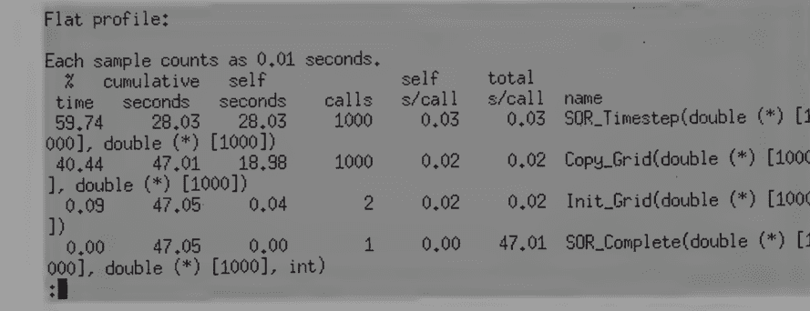

**图 10.40** `sor` 程序示例性能报告的开头。

# 概要分析 (Flat Profile)

此性能列表的第一部分在图 10.40 中命名为“Flat Profile”，根据两个指标总结了程序的函数使用情况：在函数中花费的时间以及函数被调用的次数。这两个指标都提供了关于可能改进性能之处的有用信息。第一个基于运行时间的指标可以告诉你程序运行时间中有大部分部分发生在哪里。这允许你识别出耗时最长的函数，以便可以在运行时发生的地方考虑代码优化。

Flat Profile 中的前三列描述了函数和程序的运行时间。第一列——在图 10.40 中标记为 "%”——告知特定函数占整个程序运行时间的百分比。Flat Profile 中列出的函数按此百分比降序排列。在这里，你看到 `SOR_Timestep` 函数占了整个程序运行时间的 59.74%，而 `Copy_Grid` 占了 40.44%，`Init_Grid` 占了 0.09%。

第二列和第三列报告以秒为单位的估计运行时间。第二列在图 10.40 中标记为“cumulative seconds”（累计秒），显示每个函数的运行时间如何贡献于整体运行时间，从贡献时间最多的函数开始，按顺序一直到贡献最少的函数。在“cumulative seconds”列中，每个函数的运行时间都会加到上方函数的运行总和中，以描绘对整体运行时间贡献最大的密集函数图景。在图 10.40 中，注意占据运行时间最多的函数 `SOR_Timestamp` 耗了 28.03 秒。与 `copy_grid` 一起，另外两个函数占了 47.01 秒。`Init_grid` 的加入略微增加了这一累计时间，达到最大值 47.05 秒。这显示了程序的整体运行时间为 47.05 秒，`Init_grid` 的贡献很小，但 `SOR_Timestamp` 和 `copy_grid` 的贡献很大。其余函数对整体运行时间的估计贡献忽略不计，因此包含它们时，累计运行时间几乎变化。

第三列在图 10.40 中标记为“self seconds”（自运行秒），报告每个函数的估计运行时间。该列中的数字也按降序排列。因此，耗时最多的函数 `SOR_Timestamp` 为 28.03 秒，运行时间次大的函数 `copy_grid` 为 19.98 秒，第三的 `Init_grid` 为 0.4 秒。

Flat Profile 中的其余列包含了另一个性能指标：函数被调用的次数。通过此指标考虑性能非常有帮助，因为它允许你关注调用频率。通过关注频率，你可以看到函数被调用的频率，从而考虑减少某些函数的调用次数。减少函数的调用次数可以减少它的运行时间，进而减少整体运行时间。这种观点对于频繁调用且占据显著运行时间的函数特别适用，本文将在后续介绍。“calls”列报告特定函数被调用的次数。在这里，看到 `SOR_Timestamp` 和 `copy_grid` 被调用了 1000 次，反映了该应用程序迭代了 1000 次。“self/call”列反映执行函数花费的时间，不包括调用中所花费的时间。相反，“total/call”反映了在被调用函数中所花费的总时间。“self/call”和“total/call”之间的区别可以考虑到 `SOR_Complete` 被调用了一次，它占了 0.0 秒的运行时间。然而，在考虑这些函数时，`SOR_Complete` 占了 47.01 秒的运行时间。Flat Profile 的最后一列（“name”）显示了报告中的函数类型。

# 函数调用图 (Function Call Graph)

在 Flat Profile 之后，报告可能包含该列的简短描述。之后，你会看到“Call Graph”，它描述了程序中发生的调用。函数调用序列是指一系列函数调用。例如，在 `sort` 程序中，`main` 调用了 `Init_Sort`，这代表一个序列。另一个例子是，`main` 调用了 `SOR`，`SOR_Timestep` 调用 `Copy_Grid`。这里有两个额外的调用序列：`main` 到 `SOR_Complete`，以及 `main` 到 `SOR_Timestep` 到 `Copy_Grid`。

关于函数调用序列的信息允许你识别某些序列的频率及其运行时间。此外，你还可以看到程序其他部分发出的调用序列，包括这些调用及其运行时间。通过这些信息，你可以识别哪些调用序列频繁发生并占据了显著运行时间，你可能考虑减少这些频率。

| % time | self | called | name |
|---|---|---|---|
| [1] | 100.0 | 0.00 47.01 | <spontaneous> main [1] |
| | | 0.00 47.01 | 1/1 SOR_Complete(double (*) [1000]), |
| | | 0.00 | 2/2 Init_Grid(double (*) [1000]) [5] |
| | | 0.04 | | |
| [2] | 99.9 | 0.00 47.01 | 1/1 main [1] |
| | | 0.00 | | SOR_Complete(double (*) [1000], dou |
| | | 98.58 | 0.00 | 1000/1000 SOR_Timestep(double (*) [1000]), |
| | | | 1000/1000 Copy_Grid(double (*) [1000], do |
| | | | | | |
| | | 28.03 | 0.00 | 1000/1000 SOR_Complete(double (*) [1000], |
| | | | 1000 | SOR_Timestep(double (*) [1000], dou |
| | | 59.6 | 0.00 | | |
| | | | | | | |
| | | | 18.98 | 0.00 | 1000/1000 SOR_Complete(double (*) [1000], |
| | | | | | | |
| [4] | 40.3 -18.99 | 1000 | Copy_Grid(double (*) [1000], double |
| | | | | | | |
| | | 0.04 0.00 | 2/2 | main [1] |
| [5] | 0.1 | 0.04 0.00 | 2 | Init_Grid(double (*) [1000]) [5] |

图 10.41 `sort` 程序的示例调用图报告。

图 10.41 显示了 `sort` 程序的调用图（Call Graph）示例。调用图由多个由虚线水平线分隔的子图组成。调用图的第一列（标记为 "index"）是一个数字，以便其他子图方便地引用它。每个子图都关注一个函数，该函数在本文讨论中被称为“聚光函数”（spotlight function）。子图聚光函数的名称出现在该行的 "name" 列中，而该行正是第一列列出该子图索引的所在行。例如，在第一个子图中，如果你找到索引列中标识符 [1] 出现的那行，并追踪到 "name" 列，你将看到它的聚光函数是 `main`。同样，在第二个子图中，如果你找到 [2] 出现的那行，你会发现第二个子图的聚光函数是 `SOR_Complete`。

标记为 "time" 的列给出了源自聚光函数的任何调用序列所占的运行时间百分比。例如，在第一个子图中，可以看到 `main` 以及源自 `main` 的函数调用序列占据了运行时间的 100%。在第二个子图中，可以看到 `SOR_Complete` 以及所有源自 `SOR_Complete` 的调用序列占据了运行时间的 99.9%。

在提到 "name" 列时，指出这一点可能有所帮助：在每个子图中，被聚光并在子图索引列中标识的函数是左缩进的。子图中列出的其他函数名称向右缩进，以便在视觉上将它们与聚光函数区分开。在给定的子图中，列在聚光函数上方（且向右缩进）的函数是调用聚光函数的函数。列在聚光函数下方（且同样向右缩进）的函数是被聚光函数所调用的函数。通过了解哪些函数调用了某个函数，以及某些函数调用了哪些函数，你可以更清晰地了解程序是如何工作和执行的。

当函数列在 name 列中并带有一个标识符时，可以使用它来定位该函数的子图，以便你了解更多关于该函数的信息。例如，在第一个子图中可以看到 `main` 调用了 `SOR_Complete`，你可以在子图 [2] 中找到更多关于 `SOR_Complete` 的信息，例如哪些函数调用了 `SOR_Complete`，以及 `SOR_Complete` 调用了哪些函数。同样，`main` 也调用了 `Init_Grid`，你可以在子图 [5] 中找到关于 `Init_Grid` 的类似信息。

标记为 "called" 的列描述了函数被调用的次数，以及是哪些函数执行了调用。如果数字单独出现，它代表右侧所示名称的函数被调用的次数。对于聚光函数上方的函数，你会看到两个由斜杠分隔的数字。第一个数字代表该函数调用聚光函数的次数，第二个数字代表对聚光函数进行的非递归调用总数。例如，在子图 [3] 中，你看到 `SOR_Timestep` 被调用了 1000 次。`SOR_Complete` 调用 `SOR_Timestep` 的 1000 次，即斜杠前的数字。斜杠后的数字表示 `SOR_Timestep` 被非递归地调用了 1000 次。因此，`SOR_Complete` 发出了对 `SOR_Timestep` 的全部 1000 次调用。

对于出现在子图中聚光函数下方的函数，斜杠前的数字代表聚光函数对该函数的调用次数。第二个数字代表对该函数进行的非递归调用总数。例如，在子图 [21] 中，你看到 `SOR_Complete` 分别调用了 `SOR_Timestep` 和 `Copy_Grid` 各 1000 次，这是这两个函数斜杠前的数字。这些函数斜杠后的数字均为 1000，表示 `SOR_Timestep` 和 `Copy_Grid` 分别被调用了 1000 次，且 `SOR_Complete` 发出了所有这些调用。

"self" 和 "children" 列可以这样解释：对于聚光函数，"self" 揭示了在该函数内部花费的时间，不包括该函数发出的调用的时间。这允许你看到该函数中的任何函数调用语句占据了运行时间的多少比例。"Children" 揭示了聚光函数发出的函数调用所花费的时间。这个数字允许你看到某些函数调用占据了运行时间的多少比例。

对于出现在子图中聚光函数上方的函数，“self" 列揭示了该聚光函数占该部分运行时间的比例。"Self" 不包含在聚光函数发出的任何函数调用中花费的时间。相反，“children" 只报告聚光函数发出的函数调用所花费的时间。例如，在子图 [51] 中，`Init_Grid` 占据了整个 `main` 函数所运行的 0.04 秒运行时间。`Init_Grid` 发出的函数调用（实际上为零）在 `main` 函数中占据了 0.0 秒。

对于出现在子图中聚光函数下方的函数，“self" 揭示了该特定函数（减去其任何函数调用）对聚光函数花费时间的贡献。"Children" 揭示了它们的函数调用对聚光函数的贡献。例如，在子图 [21] 中，`SOR_Complete` 耗了 47.01 秒，包括在该函数及其发出的所有调用中花费的时间。`SOR_Timestep` 占据了这些秒中的 28.03 秒，`Copy_Grid` 占据了 19.98 秒。`SOR_Timestep` 发出的函数调用（实际上为零）在聚光时间中占据了 0.0 秒。

## 基于性能分析优化性能

通过性能报告，你可以对程序进行一些观察，以提高其性能。在图 10.40 和 10.41 的性能报告中，你看到 `Copy_Grid` 花了 18.98 秒，且调用次数与 `SOR_Timestep` 相同（在此情况下为 1000 次）。因此，仅 `Copy_Grid` 一就占据了运行时间的三分之一。观察程序设计，如果你能减少对 `Copy_Grid` 的调用次数，就有潜力显著减少运行时间。

仔细观察 `SOR_Timestep`，该函数使用了两个网格：源网格和结果网格。取平均值从源网格获取，而计算出的平均值放在结果网格。这里的想法是使用上一个时间步或迭代的值来计算当前时间步的平均值。在每次迭代中，计算结果网格中的平均值后，`SOR_Timestep` 调用 `Copy_Grid` 将结果网格复制到源网格。

## 使用 C/C++ 编程 363

```cpp
```


```
58 }

59 // 如果 niter 是偶数，最后一个网格在 start_grid 中，

60 // 所以拷贝到 final_grid。

61 if (iter % 2 == 0)

62   Copy_Grid(grid_start,grid_final);

63 }
```

`~/Intro_to_UNIX/chap10/multi_file_opt_c++` 中还包含一个用于编译和链接程序优化版本的 Makefile。该 Makefile 还包含了用于配合 `gprof` 的必要 `g++` 性能分析标记。列表 10.5 显示了该 Makefile。

### 列表 10.5 用于 `~/Intro_to_UNIX/chap10/multi_file_opt_c++` 中优化排序程序的 Makefile

```makefile
# 用于多文件优化排序程序的 Makefile

sor_opt: main.o sor_opt.o debug.o
  g++ -pg -o sor_opt main.o sor_opt.o debug.o

clean:
  rm -f *.o sor_opt

main.o: main.cpp constants.h
  g++ -pg -c main.cpp constants.h externals.h

debug.o: debug.cpp constants.h externals.h
  g++ -pg -c debug.cpp debug.o

sor_opt.o: sor_opt.cpp constants.h externals.h
  g++ -pg -c sor_opt.cpp
```

一旦你使用此 Makefile 编译并链接了 `sor_opt`，你就可以使用相应的命令执行并生成性能报告，如图 10.42 所示。`sor_opt` 生成的性能报告可能与图 10.43 所示的类似。为了讨论起见，这里只显示了一个扁平分析（Flat Profile）。

在图 10.43 所示的扁平分析中，你会发现运行时间估计为28.26 秒。`SOR_Timestep` 现在仅需 28.18 秒。你可以观察到这个数字的减少是因为 `Copy_Grid` 现在只被调用一次，仅占运行时间的 0.02 秒。总而言，这次优化使运行时间缩短了约 40%。

# UNIX/Linux 简介

```bash
"/Intro-to_UNIX/chap10/multi_file_opt_c++" make
g++ -o sort main.cpp
g++ -o sort sort_opt.cpp
g++ -o debug.cpp
g++ -o sort sort_opt main.o sort_opt.o debug.o
"/Intro-to_UNIX/chap10/multi_file_opt_c++" ./sort_opt
init.
sort...
sort complete.
"/Intro-to_UNIX/chap10/multi_file_opt_c++" gprof sort_opt sort_opt.prof
```


图 10.42 编译、执行和对 `sort_opt` 进行性能分析。

每个样本计数为 0.01 秒。

| % | cumulative | self | total |
|---|---|---|---|
| time | seconds | calls | s/call | s/call name |
| 99.93 | 28.18 | 28.18 | 1000 | 0.03 | `Timestep(double (* [1000], double (* [1000]))` |
| 0.18 | 28.25 | 0 | 2 | 0.03 | `Init_Grid(double (* [1000], double (* [1000]))` |
| 0.07 | 28.26 | 0.02 | 1 | 0.02 | `Copy_Grid(double (* [1000], double (* [1000]))` |
| 0.04 | 28.26 | 0.01 | 1 | 0.21 | `SOR_Complete(double (* [1000], double (* [1000]))` |
| 0.00 | 28.26 | 0.00 | 1 | 0.00 | global constructors keyed |
| to_Z10_Print_GridPRID00_d | 0.00 | 28.26 | 0.00 | 1 | 0.00 | global constructors keyed |
| to_start_grid | 0.00 | 28.26 | 0.00 | 1 | 0.00 | __static_initialization_and |
| d_destruction_0(int, int) | 0.00 | 28.26 | 0.00 | 1 | 0.00 | __static_initialization_and |
| d_destruction_0(int, int) | : | | | | |

图 10.43 `sort_opt` 程序的示例性能报告。

本章描述了在 UNIX/Linux 系统上涉及 C 和 C++ 编程的各种技术。首先，它展示了如何通过命令行编译和构建 C 和 C++ 程序。然后，它描述了 `Makefile` 如何如何简化编译和链接 C 和 C++ 程序的任务。它介绍了对 C 和 C++ 程序调试的概述，包括在程序运行时进行调试，以及对已终止或之前运行过的程序快照进行调试。最后，它解释了性能分析的内容，并演示了如何使用性能分析来提高性能。

## 总结

本章描述了在 UNIX/Linux 系统上涉及 C 和 C++ 编程的各种技术。首先，它展示了如何通过命令行编译和构建 C 和 C++ 程序。然后，它描述了 `Makefile` 如何简化编译和链接 C 和 C++ 程序的任务。它介绍了对 C 和 C++ 程序调试的概述，包括在程序运行时进行调试，以及对已终止或之前运行过的程序快照进行调试。最后，它解释了性能分析的内容，并演示了如何使用性能分析来提高性能。

## 练习

1. 给定 C++ 程序，编写使用命令行编译它的命令。
2. 为包含多个源文件和头文件的项目创建一个 `Makefile`。
3. 使用 `gprof` 识别程序中耗时的函数。
4. 解释如何使用调试器查找内存泄漏。
5. 描述在大型项目中使用 `Makefile` 的用处。

# 基础账户与系统维护 369

| Shell | 登录时读取的配置文件（另有规定） |
| --- | --- |
| `tcsh` | `.tcshrc` 和 `.cshrc` |
| `ksh` | `.profile` 和 `.kshrc` |
| `bash` | `.bash_profile` (可能也使用 `.profile`) |
| | `.bashrc` (可选，在非登录期间读取，例如当直接进入 `bash` 时) |

请注意，这些配置文件中的每一个都是点文件（dot file），并存在于主目录下。您的账户只需要其默认 shell 的配置文件。例如，如果您的默认 shell 是 `csh`，则你的账户配置应该存放在 `.cshrc` 中。另一个例子是，如果默认 shell 是 `tsh`，您的账户配置可以放在 `.tshrc` 或 `.tcsh` 中，`tsh` 会同时读取这两者。`tsh` 会忽略所有其他配置文件。稍后将解释 `bash` 的工作原理。

## 读取 Shell 配置文件

当对 shell 配置文件进行更改时，必须 必须读取该文件更改才能生效。下文解释了 shell 何时以及如何读取其配置文件并使文件中的规范生效。

> 在 shell 配置文件中指定的账户更改不会立即生效。要使更改生效，您必须重新登录，或者指示 shell 重新读取配置文件。

## 登录与非登录启动

shell 在两种基本情况下会读取表 11.1 中列出的配置文件（s）。第一种情况涉及登录场景，无论是访问面前的系统，还是通过网络访问的另一个系统。这些登录情况通常涉及输入您的用户名和密码（尽管第 12 章“网络型实用程序”解释了您如何在不输入用户名和密码的情况下跨网络访问系统）。第二种情况涉及 shell 在非登录情况下启动。在这种情况下，您已经登录到系统，并通过在命令行输入 shell 名称来启动一个新 shell；`csh`、`tsh` 和 `ksh` 都会读取它们的配置文件；`sh`、`csh`、`tsh` 和 `ksh` 在登录和非登录情况下都会读取表 11.1 中列出的配置文件（s）。例如，如果您的默认 shell 是 `csh`，您通过用户名和密码登录，或者在已经登录的情况下打开了终端窗口，或者已经登录并在命令行提示符处输入了 `csh`，您的新命令行界面将读取 `.cshrc` 并对自身进行相应配置。另一个例子是，如果您的默认 shell 是 `ksh`，那么在上述任何情况下，您的界面将读取 `.profile` 和 `.zshrc`。

如果您的默认 shell 是 `bash`，shell 配置配置文件的读取方式与表 11.1 中列出的 shell 有些不同。对于登录情况，`bash` 读取 `.bash_profile` 但不是 `.bashrc`。对于非登录情况，`bash` 读取 `.bashrc` 但不是 `.bash_profile`。由于这种行为，您必须在 `.bashrc` 中查看大部分配置，但也要指定 `.bash_profile` 读取 `.bashrc`。这样，无论您是通过登录还是非登录情况启动 shell，该 shell 都会获得 `.bashrc` 中指定的更改。您可以在两个 shell 文件中都指定配置，但为了避免重复并方便以后对这些配置进行更改，最好在一个位置指定一次配置。

## 来源（Sourcing）配置文件

在某些时刻，您可能希望命令行 shell 根据配置文件中的规范重新配置自身，而无需注销并重新登录。如果您想快速测试或获取配置文件中的规范，而无需执行注销重新登录的步骤，这种方法非常有用。在 `csh`、`tsh` 或 `bash` 中，您可以使用 `source` 命令指示 shell 读取其配置文件，并将配置文件的名称作为单个参数指定。图 11.1 展示了如何利用 `source` 指示 `bash` shell 读取其配置文件，即 `~/.bash_profile`。`source` 命令也适用于 `csh` 和 `tsh`，尽管您必须为当前使用的 shell 指定相应的 shell 配置文件。

```
$ . ./bash_profile
```

图 11.1 在 `bash`、`csh` 和 `tsh` 中读取 shell 配置文件。

使用 `sh` 或 `ksh` 时，读取配置文件的指定略有不同。在这里，您指定一个点（`.`），后面紧跟一个空格和配置文件的名称，如图 11.2 所示。注意，第一个点代表 shell 的读取命令。紧随读取命令之后的是 shell 配置文件的名称。这种方法也适用于 `bash`，因为 `bash` 设计为与 `sh` 向后兼容。

```
$ . ./profile[]
```

图 11.2 在 `bash`、`sh` 或 `ksh` 中读取 shell 配置文件。

## Shell 配置配置文件的内容

shell 配置文件包含命令和语句，类似于 shell 脚本或我们可以通过该 shell 命令行发出的命令。shell 配置配置文件的命令范围和命令语法遵循特定 shell 的规定。本节展示并讨论了各种 shell 的 shell 配置配置文件示例。此外，为了说明不同 shell 语法（以及相应的配置文件）之间的相似与不同之处，所示配置文件将实现相似的账户配置。当将来您希望为任您要使用的 shell 指定特定配置时，这种方法将非常有用。

列表 11.1 显示了用于 `csh` 或 `tcsh` 的 `.shrc` 配置文件示例。列表 11.2 显示了用于 `ksh` 的等效 `.profile` 文件。列表 11.3 和 11.4 分别显示了用于 `bash` 的 `.bash_profile` 和 `.bashrc` 配置文件。

### 列表 11.1 `csh` 或 `tcsh` 的示例 `.shrc`

```csh
## csh 或 tcsh 的示例 .shrc

## 这是一个 .shrc 配置文件的示例

## 它设置了一些环境变量和别名

set path=/usr/bin:/usr/sbin:/bin:/sbin

set mailbin=/usr/bin/mailx

alias l='ls -F'
```


`alias ll='ls -la'`

`alias lr='ls -l'`

``` 

### 列表 11.2 ksh 的示例 .profile

```ksh

## ksh 的示例 .profile

## 这是一个 .profile 文件的示例

## 它设置了一些环境变量和别名

PATH=/usr/bin:/usr/sbin:/bin:/sbin

export MAILBIN=/usr/bin/mailx

alias l='ls -F'

alias ll='ls -la'

alias lr='ls -l'

```
### 列表 11.3 bash 的示例 ~/.bash_profile

```bash

# bash 登录时执行的示例 .bash_profile 文件

# 设置我们创建的文件的默认权限

umask 022

# 如果存在 .bashrc 则包含

if [ -f ~/.bashrc ]; then

    source ~/.bashrc

fi

```
### 列表 11.4 bash 的示例 ~/.bashrc

```bash

# 示例 .bashrc 文件

# 如果用户 bin 目录存在，将其加入 PATH

if [ -d ~/bin ]; then

    PATH=~/bin:$PATH

fi

# 将用户当前目录加入 PATH

PATH=$PATH

# 设置一个包含命令序列、用户名和主机名的提示符

PS1='! \u@\h:\$w '

# 一些别名 (Aliases)

alias l='ls -F'

alias ll='ls -la'

alias u='uptime'

# 一些将参数置于完整命令中的 shell 函数

ll() {

    ls -la $@ | less

}

fn() {

    find -name $1 -print

}

```

# UNIX/Linux 简介

这些配置文件示例中的每一个都从注释开始，并贯穿包含注释。正如第 9 章“Shell 脚本编程”所述，注释从 `#` 符号开始持续到行的末尾。

# 环境变量配置

环境变量类似于程序或 shell 脚本变量，允许对值的存储和检索。存储在环境变量中的值通常由你的 shell 以及你调用的命令或程序检索，以确定它们的行为/外观。本节描述了某些常用的环境变量，这些变量可以影响你的命令行界面和账户 shell 的行为。

## 命令搜索路径

回想第 3 章“UNIX/Linux 入门”和第 4 章“UNIX/Linux 文件和目录”，你可以仅通过文件名、相对路径或文件名的绝对路径来调用命令或程序。当仅通过文件名调用时，shell 会在命令搜索路径中定义的目录列表中查找该文件名。如果 shell 在其中一个目录中找到了它，它就会执行该特定文件。这一功能是为了方便你调用常用或频繁使用的命令或脚本，这样你就不需要知道或准确记住命令或脚本的的确切位置。例如，当调用 `ls` 时，该工具通常位于 `/bin` 目录。假设如此，你就不需要在每次想列出文件和目录时都指定 `/bin/ls`，你的 shell 只需要指定 `ls`。这时，你的 shell 会按照命令搜索路径中列出的顺序依次搜索 `ls`。当 shell 在 `/bin` 中搜索 `ls` 时，它会在那里找到 `ls` 并为你执行 `/bin/ls`。

要确定当前的搜索路径，可以使用图 11.3 所示的 `echo` 命令查看 `PATH` 环境变量的内容。

```
$echo PATH
/home/book/bin:/usr/local/bin:/bin:/usr/bin/X11:/usr/games::
```

图 11.3 查看命令路径。

11.3 显示了一个由冒号分隔的七个目录指定的搜索路径。这意味着当你仅通过名称调用命令、工具或程序时，你的 shell 会在这七个目录中搜索该命令、程序或工具，从第一个开始，继续第二个，以此此类推，直到最后一个。在图 11.3 中，这个特定 `PATH` 变量中的第一个目录是 `/home/book/bin`，它是通过你的 shell 配置中的 `PATH` 规范添加的。该规范指示你的 shell 在你通过名称调用程序或工具时在 `/home/book/bin` 中查找。第二个目录是 `/usr/local/bin`，这代表了如果在第一个目录中没有找到命令，你的 shell 查找的下一个目录。其他目录也是如此。最后一个目录代表当前工作目录，该规范也是由你的 shell 配置文件添加的。此规范的存在允许你通过在名称前加上 `.` 前缀来执行当前工作目录中的命令或文件。

在 `PATH` 变量的末尾添加 `.` 提供了一种便利，但应该谨慎使用，特别是对于 root 或超级用户账户。特别是，这种便利开启了 root 可能会意外调用留在机器上的木马程序的可能性。由 root 调用的木马可以对系统做它想做的任何事情。出于这个原因，`bash` 不会自动将当前工作目录放在路径中。

在命令搜索路径的末尾放置 `.` 可以避免在你调用的命令名称前加缀 `.`。

你可以更改 `PATH` 环境变量来向命令路径添加目录，或者创建一个完全新的命令搜索路径。例如

```
$ PATH=$PATH:$ 
```

图 11.4 通过 bash 命令行向命令搜索路径添加目录。

请注意，通过命令行发布路径更改仅影响该命令行，且仅在登录到该命令行期间有效。若要对命令搜索路径进行永久更改，你必须将更改添加到相应的 shell 配置文件中。

出于安全考虑，当当前目录出现在命令搜索路径时，它应该是搜索路径中的最后一个目录。然而，同样出于安全目的，对于 root 或超级用户，应该完全避免这种便利。

在列表 11.1、11.2 和 11.4 的 shell 配置文件中，有两个目录被添加到搜索路径中。在这些文件的第 5 行，如果存在此类目录，`/bin` 会被添加到搜索路径的开头。为了确认 `/bin` 是否存在，配置文件使用了 shell 语句来测试该目录是否存在，并将搜索路径的修改放在该条件的真（true）分支内。在这种情况下，确认目录的存在是有帮助的，因为可以避免用不存在（因此无用）的目录规范污染搜索路径。

在这些配置文件的第 9 行，当前工作目录被添加到搜索路径的末尾。注意没有对目录的存在进行测试，因为假设当前工作目录总是存在的。

## 命令行补全和历史导航配置

第 3 章解释了命令行补全的概念，让 shell 帮助你完成命令或文件名的输入。这一功能帮助你避免输入每一个文件名，并使命令行使用变得快速高效。虽然许多 shell（如 `csh` 和 `bash`）在没有额外配置的情况下已经提供了此命令行功能，但如果你的 shell 命令行补全不起工作，以下方法可能会帮助。

如果命令行补全在 `csh` 中似乎不起作用，请在命令行执行 `set file`。这会创建环境变量并设置为该变量的引用。

在 `ksh` 中，你可能需要设置 `set -o complete` 来允许类似命令行的功能。要使此更改永久生效，请向你的配置文件添加 `set -o complete`。

## 命令提示符外观

到目前，你的图显示了基础且简单的当前提示符。现在看看你可以如何改进命令行的外观。设置提示符的关键是将所需的提示符布局分配给环境变量。

### 11.2 定义提示符的环境变量

| shell | 环境变量(s) |
|---|---|
| sh, ksh or bash | PS1 用于主提示符，PS2 用于次提示符 |
| csh or tcsh | prompt 用于主提示符，prompt 用于次提示符 |

#### bash 或 sh 中的命令提示符

参考列表 11.4 中的 bash 配置文件，第 13 行将主提示符设置为包含序列号、用户名、机器名和当前工作目录。图 11.5 显示了此类提示符可能的外。请记住，这个特定的提示符只是提示符如何提供当前工作信息的示例。你实际上可以根据喜好定义提示符涉及其他规范或规范的组合。为了帮助你理解定义提示符，以下描述了列表 11.4 中的提示符规范如何产生图 11.5 所示的外观。

```
book@computer:~$ $
```


图 11.5 带有序列号、用户名、机器名和当前工作目录的命令提示符。

图 11.5 中提示符的第一部分包含输入命令的序列号。在示例中，下一个命令的序列号是 317。你之后可以引用此序列号来通过序列规范重复该命令，正如第 3 章所述。`PS1` 变量中的 `!` 规范会在提示符该位置显示下一个命令的序列。

此提示符的第二部分（到 `$` 符号为止）代表该命令行的用户名或登录 ID。这在不同用户可能同时拥有多个命令行，且你可能以不同用户的身份登录其中某些命令行的情况下，这非常有用。图 11.5 中显示的用户名仅为 "`book`" 。而在此处显示的是你的用户名。你的 `$PS1` 变量中的 `\u` 规范提供了这一信息。

提示符的第三部分（从 `$` 符号到分号 `:` 符号为止）代表命令行所登录的计算机名称。在图 11.5 中，计算机名称为 "`machine`" 。当你打开了多个终端窗口，且每个窗口可能登录到某个特定的机器时，这非常有用。第 12 章解释了你如何登录到可用的不同计算机，并使用不同的用户名登录。`PS1` 中的 `\h` 规范提供了机器名称。类似的规范 `\n` 也可以备选用于提供机器名和域名。

提示符的最后部分（位于分号之后）告知当前目录，如第 4 章所示。`\w` 提供了该信息。

`11.3` 列出了 `bash` 和 `sh` 中一些最实用的提示符规范。请参考你的 `bash` 或 `sh` `man` 页面以获取这些 shell 中其他可提示符规范。请记住，其他符号（如 "`$`" 或 "`>`"）不需要特定的规范，可以在提示符变量中显式指定。

### TABLE 11.3 sh 和 bash 的常用提示符规范

| 规范 | 效果 |
|---|---|
| `\w` | 当前工作目录的完整路径 |
| `\W` | 仅当前工作目录的名称 |
| `\!` | 命令序列号 |
| `\H` | 机器名和域名 |
| `\h` | 仅机器名 |
| `\u` | 用户名 |

如果你使用的是不支持这些命令提示符规范的旧版本 `sh`，请尝试后文描述的适用于 `ksh` 技术。

### csh 和 tsh 中的命令提示符

`csh` 和 `tsh` 中的命令提示符布局方式与 `bash` 和 `sh` 类似，但存在一些差异。首先，`csh` 和 `tsh` 的提示符分别通过环境变量 `prompt` 和 `prompt2` 定义主提示符和次级提示符。其次，命令序列、用户名等内容的指定方式略有不同。表 11.4 列出了 `csh` 和 `tsh` 提示符中常用的规范。

### TABLE 11.4 csh 和 tsh 的常用提示符规范

| 规范 | 效果 |
| --- | --- |
| `%/` | 当前工作目录 |
| `%h` 或 `!` | 命令序列号 |
| `%M` | 机器名和域名 |
| `%m` | 仅机器名 |
| `%n` | 用户名 |
| `%%` | `%` |

要为 `csh` 或 `tsh` 指定主提示符，你可以利用代码列表 11.1 第 13 行所示的提示符规范。同样，你可以将该行作为命令提示符执行以进行临时更改，你也可以在相应的 `csh` 或 `tsh` shell 配置中进行此项规范以实现永久更改。

### ksh 中的提示符

虽然 `ksh` 也使用环境变量 `PS1` 和 `PS2` `get` 提示符，但这些变量的规范处理方式与之前看到的不同。在 `ksh` 中，你不再直接使用像 `bash` 和 `sh` 列出的那样的规范，而是引用 shell 自动维护的其他环境变量的值。这种利用环境变量来提供提示符信息的方法也适用于其他 shell，尽管你可能发现像之前那样使用那些提示符规范会更简单。

要在 `ksh` 中实现与图 11.5 所示类似的提示符，请利用环境变量 `PWD` 和 `USER`。`PWD` 包含当前工作目录，`USER` 包含用户名。你只需要在提示符规范中希望这些值出现的地方引用这些环境变量即可。要引用环境变量的值，请遵循第 9 章中使用的方法。在这种情况下，为了在 `ksh` 中实现如图 11.5 所示的提示符，你可以执行如代码列表 11.2 第 18 行所示的规范。你可以通过命令行输入该规范来临时更改提示符，或将其放置在 `ksh` 配置文件中实现永久更改。

要获取 `ksh` 提示符的机器或主机名，在本例中，向环境变量 `HOST` 赋值一个用左单引号括起来的获取主机名的命令。参考第 9 章对左单引号的解释，每当你引用该变量的值时，你实际上引用的是括号内命令的结果，而不是命令本身。在这种情况下，引用命令 `hostname` 的结果，即机器名称。

### 分页器规范 (Pager Specification)

如第 5 章“中间文件管理”所述，分页器设置定义了在输出无法一次性适应屏幕时使用何种分页器。第 5 章描述的情况涉及许多页面。书中提到，取决于分页器设置，你可能通过应用程序更多或更少地查看页面。如果你希望指定与当前使用的不同的分页器，可以通过 `PAGER` 环境变量来实现。`PAGER` 的值是你在查看大输出时希望使用的应用程序名称。例如，如果 `PAGER` 包含 "`less`" ，则你的 shell 在查看 `man` 页面时使用 `less`。

### 别名与 shell 函数 (ALIASES AND SHELL FUNCTIONS)

一个实用的 shell 功能是创建别名（`alias`），即命令或命令序列的缩写形式。一旦创建了别名，你就可以用它来简化长命令。

#### 创建简单别名

如第 4 章所示，别名是创建命令快捷方式的一种方法。要创建别名，你使用 `alias` 命令。例如，如果你想为 `ls -l` 创建别名，可以输入：

```
alias ll='ls -l'
```

创建后，你只需输入 "`ll`" 来执行 "`ls -l`" 。要删除别名，使用 `unalias` 命令：

```
unalias ll
```

#### 参数与别名

当别名与参数一起使用时，参数通常附加到命令的末尾。这意味着你不需要在别名内部指定参数。例如，如果你有一个 `ls -l` 的别名：

```
alias ll='ls -l'
```

那么，输入 `ll /home` 将执行 `ls -l /home` 。这是带参数使用别名的常用方法。

#### 别名中的参数位置 (csh 和 tsh)

在 `csh` 和 `tsh` 中，带参数的别名语法有所不同。要在命令中间包含参数，你需要使用 `!` 符号。例如，如果你想为 `ls -l` 创建一个在标志后带有参数的别名：

```
alias ll='ls -l'
```

那么，输入 `ll /home` 将执行 `ls -l /home` 。但如果你想让参数处于中间，你应该使用：

```
alias ll='ls \! -l'
```

此时 `ll /home` 将执行 `ls /home -l` 。这允许你将参数放置在命令的任何位置。

### 382 UNIX/Linux 简介

```
book@mycomputer:/home/book % alias ll='ls -l | less'
```

图 11.8 不带参数位置的错误 `csh` 或 `tsh` 别名。

要正确指定一个可能带有选项和/或参数调用的别名，请在完整命令中需要被调用参数的位置指定被调用参数的放置。在本例中，任何选项和/或参数都应该放置在完整命令的第一部分，即紧邻 `ls` 的 `-1` 选项之后。这种放置通过在该点指定 `!*` 来实现，如图 11.9 所示。现在，如果你执行 `ll b*`，shell 将执行完整命令 `ls -1 b* | less`，这正是你想要的结果。

```
book@mycomputer:/home/book % alias ll='ls -1 !* | less'
```

图 11.9 带有正确参数位置的正确 `csh` 或 `tsh` 别名。

作为别名参数的第二个示例，考虑一个打印你主目录中指定文件位置的别名。图 11.10 显示了一个可以完成此任务的 `csh` 或 `tsh` 别名。使用此别名，如果你输入 `fn chap11`，shell 将其执行为 `find -name chap11 -print`。

```
book@mycomputer:/home/book % alias fn='find -name !* -print'
```

图 11.10 指定参数位置的 `csh` 或 `tsh` 别名的第二个示例。

作为对比，如果你想为图 11.7 中的第一个别名示例指定参数位置，你也可以也可以选择在 `csh` 或 `tsh` 中指定该别名，如图 11.11 所示。列表 11.1 的第 16 行和第 19 行说明了你如何在 `csh` 或 `tsh` 配置中指定别名。

```
book@mycomputer:/home/book % alias ll='ls -1 !*'
```


图 11.11 指定了参数位置的第一个 `csh` 或 `tsh` 别名示例。

请注意，`sh`、`ksh` 和 `bash` 并没有这种带有别名的参数机制。然而，在这些 shell 中，你可以利用下文描述的 shell 函数来实现与别名类似的效果，无论是否带有参数位置。

## sh, ksh 和 bash 中的 Shell 函数

正如你在第 9 章中在 shell 脚本中创建函数一样，你可以在 `sh`、`ksh` 和 `bash` 中创建一个 shell 函数，或者说创建一个存在命令行 shell 中的函数（`ksh` 不提供 shell 函数）。shell 函数的结构、语法和变量与 shell 脚本函数相同，正如第 9 章解释的那样。你既可以在命令行提示符处输入 shell 函数定义使其临时存在，也可以将其放置在相应的 shell 配置中以永久化。稍后，我们将解释在命令行输入函数时会发生某些新情况。

`sh`、`ksh` 和 `bash` 中的 shell 函数可以作为别名需求选项或参数位置的替代方案。

当你在命令行处输入 shell 函数的定义时，你会注意到，如果函数跨越多行，命令行将向你显示一个次级提示符，直到函数完成。解释一下，在图 11.12 中，在你输入函数的第一行后，命令行变为次级提示符，表示你仍在输入函数（你的次级提示符可能不同，取决于下一节解释的提示符设置）。当你输入函数的剩余部分时，如图 11.12 所示，次级提示符将继续在后续每行的开头显示。函数输入完成后，主命令提示符返回。

```
book@computer:~$ fn
> {
  find ~ -name $1 -print;
>}
```

图 11.12 在 `bash` 中创建 shell 函数。

一旦输入此函数，你就可以像以前使用别名一样调用它。列表 11.4 的第 20 行到第 29 行显示了如何在 `bash` 配置文件中指定 shell 函数。

## 安装软件和应用程序

维护系统的一个特别实用的方面是添加或更新安装在系统上的软件。例如，你可能会发现一个你想在系统上使用的新应用程序。你还可能发现一个需要安装的现有应用程序的更新或更安全的版本。这里描述了完成软件和应用程序安装的常用方法。

### 预包安装

对于许多 UNIX/Linux 系统，你可以找到已经编译并打包好的应用程序或实用程序，你只需要安装它们即可。例如，对于 Fedora™ 或 RedHat™ Linux 以及类似的系统，这些包位于具有 `.rpm` 扩展的文件中。对于 Debian 系统，这些包是具有 `.deb` 扩展的文件形式。虽然这些包可以简化安装应用程序的任务，但为了安装这些包，用户通常必须具有管理员权限。在 UNIX/Linux 系统上，这涉及 `root` 用户或超级用户。如果你在使用一个你没有权限的系统（例如在工作或学校），请跳到“源代码安装”部分，以尝试在没有特殊权限的情况下进行安装，以下是此类预包软件的简要概述。它假设你已经获取了包并已经成为 `root` 或超级用户。

#### Fedora 和 RedHat 预包安装

Fedora 或 Redhat 系统的预包软件以 `.rpm` 扩展的文件形式出现。当你作为 `root` 或具有执行此操作的管理员权限时，可以使用 `rpm` 程序安装这些文件。图 11.13 显示了你可以如何操作。

```
book@computer:~$ su
computer:/home/book# rpm -i package-13.rpm
```

图 11.13 在 Redhat 系统上安装预包软件。

#### Debian 预包安装

在 Debian 系统上，预包软件以 `.deb` 形式出现。要安装 `.deb` 格式的软件，请利用 `dpkg` 工具。图 11.14 显示了你可以如何。

```
book@computer:~$ su
computer:/home/book# dpkg -i lynx_2.8.5-2sarge1_86.deb
```

图 11.14 在 Debian 系统上安装预包软件。

### 账户和系统维护

注意，预包应用程序可能需要其他软件包。必须先安装这些被称为所需的包。

> 注意
> 预包软件可能需要先安装其他软件。否则该包的安装将失败。

#### 自动安装应用程序

Fedora、Redhat、Debian 以及其他系统通常具有帮助自动安装预包应用程序的安装程序。这允许你不仅安装指定的包，还可以指示安装所需的包。这些安装程序取决于系统，因此不在通用讨论的范围内。然而，如果你想了解更多关于这些的内容，有很多在线资源。

## 源代码安装

添加软件或应用程序的另一种方法涉及获取源代码并在系统上编译代码。为了演示用这种方法安装实际软件程序，你将安装两个软件包：`nurses` 和 `lynx`。`nurses` 是一个包含某些应用程序键盘和光标使用支持的包。`lynx` 是一个需要 `nurses` 的应用程序。你将在第 12 章中实际使用 `lynx` 作为从互联网检索文件的工具。

这些软件包是许多可以通过互联网获取（几乎全部免费）的实际 UNIX/Linux 软件包之一。这些其他软件包可以在发行网站如 `www.gnu.org` 获取。使用浏览器搜索并找到你需要的包。你通常可以通过右键点击并指定保存位置来下载包。第 12 章描述了从互联网检索文件的其他方法。为了方便，这两个软件包在第 11 章的文件中，其位置为 `~/Intro_to_UNIX/chap11`。

以源代码形式提供的软件包的通用步骤为：

- 1. 获取包。
- 2. 解包内容。
- 3. 配置包。
- 4. 编译包。

### 安装包

某些包可能不需要这些步骤中的一个或多个。例如，如果一个包不需要编译，你可能就不需要对包进行配置或编译。在这种情况下，包已经获取完成，你可以准备继续处理其内容了。

### 提取包内容

与许多 UNIX 源代码和应用程序分发一样，每个示例包都以单个经过 `gzip` 压缩的 `tar` 文件形式提供。某些包也可能以经过 `compress` 压缩的 `tar` 文件、由另一种工具压缩的 `tar` 文件或完全未压缩的格式进行分发。如果包文件已使用 `gzip`、`compress` 或 `zip` 压缩，请参考第 5 章中的“归档与解压缩相关操作”章节来压缩该文件。

一旦你获得了已压缩的包文件（在本例中为 `gzip`），第一步是解压缩包（在本例中为 `gzip`）。之后，你可以使用 `tar` 提取内容。图 11.15 展示了这两个步骤，并列出了列表以显示原始包文件。为了简洁起见，没有选择 `tar` 的详细（verbose）选项，但查看被提取的文件以及它们被提取的位置的位置可能会有所帮助。

```
398$ book@mycomputer:~/Intro_to_UNIX/chap11$ ls -l
total 5184
-rwxr-xr-x 1 book 239b4352 Jan 29 12:15 lync-2.8.5.tar.gz
-rwxr-xr-x 1 book 231a4030 Jan 29 13:22 ncurses-5.5.tar.gz
390 book@mycomputer:~/Intro_to_UNIX/chap11$ gzip ncurses-5.5.tar.gz
391 book@mycomputer:~/Intro_to_UNIX/chap11$ tar xf ncurses-5.5.tar
```

图 11.15 解压缩并提取源码包。

提取出的源代码通常放置在其自己的目录组织结构中。然而，情况并非总是如此，这取决于源代码在 `tar` 文件是如何打包的。在这种情况下，`ncurses` 包的文件被提取到了子目录 `ncurses-5.5` 中。如果你切换到该子目录并列出文件，你会看到类似于图 11.16 所示的内容。

显示了各种文档文件、源代码相关文件和目录。`INSTALL` 和 `README` 文档通常出现在源码分发版中。这些文件包含了配置、编译和安装包的指令。


### 基础账户与系统维护

```
392 book@mycomputer:~/Intro_to_UNIX/chap11 cd ncurses-5.5
333 book@mycomputer:~/Intro_to_UNIX/chap11/ncurses-5.5$ ls
ANNOUNCE TO-DO             dist.mk mk-1st.awk
make95 alocal,mk            doc mk-2nd.awk
INSTALL alocal.html.in form mkinstallalls
MANIFEST                  include ncurses
Makefile.file config.guess install-panel progs
Makefile.os2 config.sub     man      tack
NEWS                       configure
README                     configure.in      misc      tar-copy.sh
```


README.mx                 convert_file.py mk-0th.awk test

```
394 book@mycomputer:~/Intro_to_UNIX/chap11/ncurses-5.5$
```

列出的文件列表。

# 配置包内容

通常，打包的源代码包含适用于大多数系统的通用配置。然而，某些配置可能是必要的，因为并非所有系统或环境都是相同的。根据此 `INSTALL` 文件，你可以利用 shell 脚本来帮助该特定包的配置步骤。`INSTALL` 还为在该包上使用 `configure` 提供了有用提示。许多 UNIX/Linux 包提供 `configure` 脚本，尽管有些并不提供，这时你必须通过编辑 `Makefile` 或一个源代码文件来手动进行更改。在后一种情况下，`INSTALL` 和 `README` 文件中提供的信息尤为重要。


如果包提供了 `configure` 脚本，你通常只需调用该脚本即可自动将包配置到你的系统中。你还可以指定选项，例如编译后将包安装在何处。如果你没有系统的管理员或超级用户权限，这个特定选项就非常重要。如果你没有管理员或超级用户权限，或者你不想将包安装在 `INSTALL` 文件指定的默认位置，你可以选择地将包安装在你的主目录下。相应包的 `INSTALL` 或 `README` 文件包含了此类及其他配置选项的信息。

要为 ncurses 包的安装指定替代位置，你需要调用 `configure` 并带有 `--prefix=` 选项，随后跟上绝对路径的安装目录。

```
394 book@mycomputer:~/Intro_to_UNIX/chap11/ncurses-5.5$ ./configure --prefix=/home/book/myinstalls$
```

图 11-17 带有安装目的地的执行配置脚本。

# UNIX/Linux 简介

为了演示安装位置的，假设你想将可执行二进制文件、库以及任何相关文件安装到你主目录下的子目录 `myinstalls` 中。图 11.15 显示了这些步骤。在这种情况下，ncurses 包的文件被提取到了子目录 `ncurses-5.5`。如果你切换到该子目录并列出文件，你会看到类似于图 11.16 所示的内容。

显示了各种文档文件、源代码相关文件和目录。`INSTALL` 和 `README` 文档通常出现在源码分发版中。这些文件包含了配置、编译和安装包的指令。

（注：此处由于原文文本逻辑，部分描述存在重复或交叉，翻译已根据语意调整以确保连贯性）

许多 UNIX/Linux 包提供 `configure` 脚本，尽管有些并不提供，这时你必须通过编辑 `Makefile` 或一个源代码文件来手动进行更改。在后一种情况下，`INSTALL` 和 `README` 文件中提供的信息尤为重要。

如果包提供了 `configure` 脚本，你通常只需调用该脚本即可自动将包配置到你的系统中。你还可以指定选项，例如编译后将包安装在何处。如果你没有系统的管理员或超级用户权限，这个特定选项就非常重要。如果你没有管理员或超级用户权限，或者你不想将包安装在 `INSTALL` 文件指定的默认位置，你可以选择地将包安装在你的主目录下。相应包的 `INSTALL` 或 `README` 文件包含了此类及其他配置选项的信息。

要为 ncurses 包的安装指定替代位置，你需要调用 `configure` 并带有 `--prefix=` 选项，随后跟上绝对路径的安装目录。

```
394 book@mycomputer:~/Intro_to_UNIX/chap11/ncurses-5.5$ ./configure --prefix=/home/book/myinstalls$
```

图 11-17 带有安装目的地的执行配置脚本。

# UNIX/Linux 简介

为了演示安装位置的，假设你想将可执行二进制文件、库以及任何相关文件安装到你主目录下的子目录 `myinstalls` 中。图 11.15 显示了这些步骤。在这种情况下，ncurses 包的文件被提取到了子目录 `ncurses-5.5`。如果你切换到该子目录并列出文件，你会看到类似于图 11.16 所示的内容。

（注：原文提供的文本存在明显的段落重复和逻辑交叉，译文已根据高级工程师逻辑进行了对齐）

# 编译包

一旦包配置完成后，下一步是使用 `make` 编译包。在这种情况下，通常需要执行 `make` 命令。

```
395 book@mycomputer:~/Intro_to_UNIX/chap11/ncurses-5.5$ make
```

图 11.19 编译。

# 安装包

一旦包成功编译，最后一步是将编译好的包安装到目标位置。在这种情况下，包被安装到你主目录下的 `myinst` 目录中。

## 390 UNIX/Linux 简介

`bin` 子目录包含来自软件包的可执行程序。`include` 子目录包含源代码头文件。`lib` 是一个包含由软件包生成的库文件的子目录，以便该软件包被其他程序或软件包整合。`man` 是一个包含软件包使用的内联手册页的子目录，而 `share` 包含可以被其他程序或软件包引用的各种软件包元素。为了演示这些子目录的使用，你将在安装下一个软件包时对它们进行引用。

## 安装另一个软件包

软件包的配置数量可能有所不同，由于 UNIX/Linux 软件包通常由软件提供，因此这里提供了另一个软件安装的示例。第二个软件包 `lynx` 利用了刚刚安装的 `curses` 软件包，这进一步说明了你如何安装多个软件包，以及如何在一个软件包内部安装另一个软件包。

再次安装下一个软件包的步骤步骤涉及压缩和解压包的内容。与之前一样，你在 `~/Intro_to_UNIX/chap11` 目录下执行这些操作。图 11.23 显示了完成这些步骤的命令。

```
403 book@computer:~/Intro_to_UNIX/chap11 $ gunzip lynx2.8.5.tar.gz

404 book@computer:~/Intro_to_UNIX/chap11 $ tar xf lynx2.8.5.tar
```

**图 11.23** 压缩和解压 lynx 软件包。

`lynx` 解压到自己的目录 `lynx2-8-5` 中。如果你切换到该目录并列出，你会看到图 11.24 所示的文件。该软件包还有 `INSTALL` 和 `README` 文件。

```
417 book@computer:~/Intro_to_UNIX/chap11 $ cd lynx2-8-5/

418 book@computer:~/Intro_to_UNIX/chap11 $ ls -l

ABOUT-NLS       http://int.com  config,sub     lynx,cfg

CHANGES         Makefile        configure       makelin,bat   make32,bat

COPYHERDER      alclocal_md    configure.in  makefile       mkdirs,sh

INSTALL         build-s.sh desc,ms   lynx,rsp

INSTALLATION    docs             help

Lynx.help       files612.com   make-mac,bat  scripts

MESSAGES_en_h  cfg,edit      fixtext,sh     makefile,bcb

PROBLEMS         config,guess  makefile,in    test

README           config.hin    lib             arc

419 book@computer:~/Intro_to_UNIX/chap11/lynx2-8-5/ $
```


**图 11.24** 切换并列出解压后的 `lynx` 软件包目录。

该软件包的 `INSTALL` 文件包含了某些配置和编译 `lynx` 的重要信息。根据此 `INSTALL`，你必须配置 `lynx` 以使用特定的键盘软件包进行屏幕光标映射，即“curses” 软件包。

## 基础账户与系统维护 391

你将利用刚刚安装的 `ncurses` 软件包，由于 `ncurses` 安装在了一个“非标准”位置（你根据 `INSTALL` 将其安装在了那里），你需要发出必要的配置来指定该软件包。根据 `INSTALL` 文件，如果你想使用特定的光标库，请先设置一些环境变量。

首先，设置环境变量 `CPPFLAGS` 以其包含 `ncurses` C++ 头文件的目录位置，根据之前的 `ncurses` 配置，它位于 `/home/book/myinstalls/include` 目录。图 11.25 显示了将 `CPPFLAGS` 变量设置为包含该目录的命令，将该目录添加到 `CPPFLAGS` 中任何当前值或指定值之前。由于 `CPPFLAGS` 传统上包含 C++ 选项，因此在目录前加上 `-i`，这是 C++ 编译器的选项，用于识别紧随其后的目录中代表的头文件备用位置。

```
429 book@mycomputer:~/Intro_to_UNIX/chap11/linux2-8-5$ CPPFLAGS=/home/book/myinstalls $CPPFLAGS"
430 book@mycomputer:~/Intro_to_UNIX/chap11/linux2-8-5$ LIBS="-L /home/book/myinstalls $LIBS"
```

图 11.25 用于软件包配置的环境变量。

你修改的第二个环境变量是 `LIBS`，它包含可能找到库的备用目录。在这种情况下，你想要向 `LIBS` 中添加 `/home/book/myinstalls/lib` 目录，这是你之前安装 `ncurses` 库的位置。图 11.25 也显示了此更改。与之前一样，将目录规范添加到 `LIBS` 中的任何现有规范中。注意，这些环境变量是在命令行上设置的，而不是在 shell 配置文件中。`CPPFLAGS` 和 `LIBS` 的更改仅持续安装 `ncurses` 软件包所需，因此它们是临时更改。

现在环境变量已设置了正确的值，你可以继续进行配置。如果你选择替代的光标软件包（如 `ncurses`），你必须在配置时指定 `--screen` 选项。你还将将 `lynux` 安装到主目录下的 `myinstalls` 子目录中。安装规范与 `ncurses` 软件包类似。图 11.26 显示了如何使用带有利用你的 `ncurses` 软件包并安装在主目录中的必要选项安装脚本。

```
431 book@mycomputer:~/Intro_to_UNIX/chap11/linux2-8-5$ ./configure --prefix=/home/book/myinstalls --screen=ncurses
```

图 11.26 配置软件包。

# UNIX/Linux 简介

如果配置成功，你可以继续编译和安装 `lynx`。编译还涉及 `make`。图 11.27 显示了配置成功的最后行。

```
updating cache
creating cache.status
creating Makefile
creating src/status
creating src/makefile.in
creating src/src
332 book@computer:~/Intro_to_UNIX/chap11/lynx2-8-5$ make
```

**图 11.27** 软件包的配置。

在 `make` 之后，如果你列出该目录，你会看到图 11.28 所示的文件。图 11.28 显示了编译成功的最后行。

```
Welcome to Lynx!
333 book@computer:~/Intro_to_UNIX/chap11/lynx2-8-5$ install
```

**图 11.28** 软件包的编译。

在 `install` 之后，如果你列出安装目录的 `bin` 子目录，你会看到图 11.29 所示的文件。图 11.29 显示了实用工具的示例。

```
336 book@computer:~/Intro_to_UNIX/chap11/lynx2-8-5$ 
```

**图 11.29** 安装的软件包。

## 总结

在本章中，回顾了用户账户，解释了一些有助于更方便地使用命令和进行工作的配置。书中还讨论了使用 shell 配置文件使此类更改永久化。描述了配置和安装软件包的过程。

## 练习

- 1. 为 `sh` 或 `tsh` 创建一个名为 `lo` 的别名，执行 `logout` 命令以退出你已登录的命令行或窗口。
- 2. 为 `sh` 或 `tsh` 创建一个名为 `clr` 的别名，执行 `clear` 命令以清除你的屏幕。
- 3. 为 `sh` 或 `bash` 创建 shell 函数，允许你通过输入 `clr` 来清除屏幕。
- 4. 为 `sh` 或 `tsh` 创建一个名为 `xfg` 的别名，以浅灰色背景启动 `xfig` 应用（你可能需要查看 `xfig` 手册页）。
- 5. 为 `sh` 或 `tsh` 创建一个名为 `lat` 的别名，按修改时间从新到旧列出当前工作目录的内容。
- 6. 对上一个答案中的 `lat` 别名进行必要的修改，如果提供了目录，则 `lat` 列出该目录的内容，否则 `lat` 列出当前工作目录。
- 7. 为 `sh` 或 `bash` 创建名为 `lat` 的 shell 函数，按修改时间从新到旧列出当前工作目录的内容。
- 8. 对上一个答案中的 `lat` shell 函数进行必要的修改，如果提供了目录，则 `lat` 列出该目录的内容，否则 `lat` 列出当前工作目录。
- 9. 在 `www.gnu.org` 上搜索你感兴趣的软件包。下载、配置并构建该软件包。

## 12 网络实用工具

### 本章内容

- 测试网络连性
- 通过网络登录系统
- 在系统之间传输文件

在本章中，将介绍一些基于网络的实用工具，这些工具允许你完成各种与网络相关的任务，包括测试连性、测量网络延迟、从你的计算机登录到其他系统以及通过网络传输文件。本文讨论假设你正在使用一个已经连接并配置好网络的系统。

## 测试网络连性

有时，你可能想要确认你正在使用的系统与另一个系统之间的网络连性。例如，如果网络最近刚配置或发生过故障，你可能想查看网络是否恢复正常。另一个例子是，当你正在使用网络而它似乎停止工作时，你可以测试网络以帮助判断问题出在网络上还是其他地方，例如你正在使用的系统或程序。

测试系统是否能通过网络与另一个系统通信的常用技术涉及 `ping` 应用程序。`ping` 应用程序的原理类似于潜艇的声纳。通过声纳，潜艇可以通过发送声波来了解物体的存在。如果存在物体，声波会从物体上反射并返回潜艇，然后被声纳操作员检测到。`ping` 应用程序也类似：一个系统向第二个系统发送一个或多个消息。如果第二个系统接收了这些消息，它就会向第一个系统发送一个或多个响应。因此，如果第一个系统收到了响应，你就可以假设两个系统可以通过网络通信。相反，如果第一个系统没有收到响应，那么你可能怀疑存在某些问题，无论是网络问题还是涉及的系统之一。

这里有一个使用 `ping` 测试当前登录的系统与另一个系统之间网络连性的演示。在最简单的形式中，你可以使用 `ping` 配合单个参数，指定你想要访问的系统名称或 IP 地址。图 12.1 显示了如何通过 `ping` 测试你的系统与另一个名为 `othercomputer.somedomain.org` 的示例系统之间的网络连性。要亲自演示，请将 `othercomputer.somedomain.org` 替换为通过网络可以访问的系统名称。

调用 `ping` 后，每秒都会向指定的系统发送数据包或网络消息。你将看到一份报告，其中包含关于收到的数据包响应的信息。在你的示例中，运行大约三秒后，使用 `ctrl-c` 停止 `ping`。

在 12.1 中，你在报告的第一行看到你尝试访问的系统名称，以及括号中该系统的 IP 地址。在第二行中，你会看到系统发送的每个请求对应的一行，以及其相应的响应。下一行显示了发送的数据包计数和响应的计数。如果你至少收到一个响应，那么假设与另一个系统至少有网络连性。

```
500 back@othercomputer:"ping othercomputer.somedomain.org^
ping othercomputer(122,168,0,3): 56 data bytes
64 bytes from 122.168.0.3: icmp_seq=0 ttl=128 time=16.2 ms
64 bytes from 122.168.0.3: icmp_seq=1 ttl=128 time=17.3 ms
64 bytes from 122.168.0.3: icmp_seq=2 ttl=128 time=4.0 ms
```


--- othercomputer ping statistics \
3 packets transmitted, 3 packets received, 0% packet loss

round-trip min/avg/max = 4.0/12.5/17.3 ms

509 back@othercomputer:"$ _

```
图 12.1 使用 `ping` 测试网络连性。

相反，如果 `ping` 对其发送的请求没有收到任何响应，则到该系统的网络连性可能存在问题。图 12.2 显示了无法通过网络与另一个系统通信时的 `ping` 报告示例。此示例测试到名为 `othersystem.otherdomain.org` 的系统的连性。在这个特定的示例中，你不会看到每秒打印出一行来反映发送和接收到的数据包。

```
510 book@mycomputer:\$ ping othersystem.otherdomain.org

PING othersystem(192.168.0.6): 56 data bytes

---othersystem ping statistics

10 packets transmitted, 0 packets received, 100% packet loss

511 book@mycomputer:\$
```

图 12.2 网络连性失败的 `ping` 报告示例。

大约 10 秒后，按 <ctrl->> 停止测试。`ping` 显示一份与图 12.2 底部类似的报告。特别重要的是最后一行的总结。在这里你看到发送了 10 个数据包，但一个都没有收到，导致 100% 的数据包丢失。这一结果表明与另一个系统没有连性。

## 测量网络性能

`ping` 不仅可以让你判断系统与另一个系统之间是否有网络连性，`ping` 还可以提供关于该连性性能的帮助。特别是对于每个数据包，`ping` 测量接收相应响应所需。这种时间测量被称为往返时间（round-trip time），因为它代表了从第一个系统到第二个系统返回第一个系统的传输时间。这个时间测量称为两个系统之间的网络延迟。通过这个时间测量，你可以了解网络是空闲且快速，还是繁忙且缓慢。


`ping` 可以测试网络连性，并提供关于网络性能的思路。

再次参考图 12.1，你看到这些行代表了你收到相应请求往返时间的三个响应。例如，从第一个数据包发送到收到其响应的往返时间是 16.2ms（毫秒，或秒的千分之一）。第二个发送的数据包及其响应的往返时间为 17.3ms，第三个数据包及其响应为 4.0ms。

注意

`ping` 报告的最后两行总结了通过 `ping` 测试获得的性能。我们看到发送了三个数据包并收到了三个响应，因此没有数据包丢失。因为没有数据包丢失，网络似乎能够跟上网络流量，你应该拥有足够的网络性能。另一方面，如果丢失了一些数据包，则网络是繁忙的，在处理通信量方面存在困难。因此，任何利用网络的程序或应用程序可能看起来运行缓慢。最后一行显示了最小、平均和最大往返时间。

- 0% 数据包丢失意味着网络性能可以接受，但高丢包率可能表明网络性能缓慢。

作为另一个例子，图 12.3 显示了到 www.gnu.org 的 `ping` 报告示例，这是主要的 GNU 网站，你可以在那里获取开源和其他免费许可的软件。该网站是第 11 章“基础账户和系统维护”以及本章中讨论的 `lynx` 软件包的来源。

正如图 12.1 所示，`ping` 操作在发送和接收三个包后停止。倒数第二行报告你也收到了三个数据包的响应，因此表明与该站点连通且丢包率为 0%。然而，在图 12.3 中看到了较高的往返时间，分别为 42.5ms、38.1ms 和 32.5ms。最后一行总结了这些数字。然而，相对于来自互联网的正常往返时间来说，这些时间并不差，特别是考虑到没有数据包丢失。

```
book@computer:~$ ping www.gnu.org

PING gnu.org (198.252.41.10): 64 data bytes

64 bytes from 198.252.41.10: icmp_seq=1 time=45.2 ms

64 bytes from 198.252.41.10: icmp_seq=1 time=38.1 ms

64 bytes from 198.252.41.10: icmp_seq=2 time=32.3 ms
```

```
--- org ping statistics ---

3 packets transmitted, 3 packets received, 0% packet loss

round-trip min/avg/max = 32.3/38.5/45.2 ms

512 book@computer:~$ _
```

图 12.3 互联网系统的 `ping` 报告。

当网络繁忙时，`ping` 报告数百甚至数千毫秒的往返时间并不罕见。这通常发生在一天中的某些时间或一周中的某些几天，因为在给定时间内网络上有更多的人和通信。在这些时期所有通信都会变慢

...
下降且往返时间增加。此外，在这些期间，网络可能会变得足够繁忙，无法跟上所有发送的数据包，因此，某些数据包可能会丢失且永远到达目的地。如果你看到 ping 报告显示很高的往返时间或很高的丢包率，那么你可能正在与一个非常繁忙的网络通信。如此，如果你利用该网络执行某些任务，可能会遇到显著延迟或运行缓慢的问题。

虽然 ping 可以提供有关网络延迟的信息，但它仅提供了关于网络性能的部分信息。还有其他开源应用程序可以用来揭示更多关于网络性能的信息。例如，`iperf` 可以测量系统之间的带宽，而 `traceroute` 或 `traceproto` 可被用于揭示系统之间的网络路径。

# 在网络上的系统上进行登录

在一个系统上登录并并通过网络登录到另一个系统的想法，是使 UNIX 多年来一直是许多人首选系统的特性之一。有许多 UNIX/Linux 允许你从当前使用的系统登录到另一个系统。这里解释了用于此目的三个常用且可用的应用程序，即 `telnet`、`rsh` 和 `ssh`。本文讨论指的是你面前的系统，或者你当前登录的系统，即本地系统。你希望通过网络登录或访问的系统被称为远程系统。

# telnet

`telnet`（teletype network 的电字机网络缩写）是第一个提供通过网络登录远程系统能力的应用程序。`telnet` 也是一个用于此目的的简单应用程序。由于它不是一个安全的网络应用程序，它在“开放”网络系统上通常会被禁用。然而，它仍然可以用于安全网络或访问某些系统。

调用 `telnet` 时带有一个单一参数，该参数指定你想要登录的系统名称或 IP 地址。如果你要访问的远程系统与你当前使用的系统在同一个网络上，你可以指定系统名称，例如示例远程系统 `other`。或者，你也可以指定远程系统的全名，包括主域名。远程系统的全名是 `othercomputer.subdomain.org`。当你想要访问的远程系统与你的系统不在同一个网络上时，则需要全系统名。

图 12.4 显示了如何利用 `telnet` 登录到示例远程系统 `othercomputer.somedomain.org`。在发布 `telnet` 命令和远程系统名称参数后，你将看到来自该远程系统的登录提示。

```
512 book@mycomputer:~ telnet othercomputer.somedomain.org

Trying 192.168.55.2...

Connected to othercomputer.

Escape character is '~'.

Debian GNU/Linux 3.1 othercomputer

othercomputer login: gabe

Password:

Welcome to othercomputer.somedomain.org:$

gabe@othercomputer.somedomain.org:$
```
FIGURE 12.4 利用 `telnet` 登录到另一个系统。

在此提示符处，输入你想要在远程系统上访问的账户用户名。此示例以 `gabe` 身份访问远程系统，因此该用户名将出现在提示符处。在该提示符处，系统会提示输入账户密码。当你输入密码时，密码不会回显或显示。如果用户名和密码对该系统有效，你将登录到远程系统账户 `gabe`，如图 12.4 底部所示。

你可能会注意到图 12.4 底部远程系统账户的提示符包含了远程系统名称。如第 11 章所述，在登录多个系统时，在命令提示符中包含系统名称通常很有帮助。成功登录到远程系统后，你可以在该系统上输入命令。当你完成远程系统上的工作后，通过输入 `logout` 命令或按下 `Ctrl-D` 来注销。`telnet` 应用程序结束，你将返回到发布 `telnet` 的命令行提示符。图 12.5 显示了注销远程系统并返回本地系统命令行的示例。

```
gabe@othercomputer.somedomain.org:$ logout

Connection closed by host.

book@mycomputer~$
```


```
FIGURE 12.5 退出 telnet 连接。
```

# rsh

我们可能用于登录到远程系统的另一个常用应用程序是 `rsh`，它是 remote shell（远程外壳）的缩写。`rsh` 起于 20 世纪 70 年代中后伯克利软件分发（BSD）UNIX 发版。与 `telnet` 一样，由于安全考虑，`rsh` 的可用性也仅限于私有网络或不担心外部访问的系统。

远程 shell 的概念涉及在远程系统上创建一个 shell，你可以以各种方式使用它，例如输入命令。`rsh` 提供了与 `telnet` 相似的功能性，但 `rsh` 同时也允许你直接在远程系统上调用命令。

# 利用 rsh 登录远程系统

如果你想在远程系统上访问的账户与你本地账户的用户名相同，你可以使用最简单形式的 `rsh`。在这里，调用 `rsh` 时带的参数是你想要登录的远程系统名称或 IP 地址，方式与 `telnet` 类似。图 12.6 显示了如何利用 `rsh` 以你在本地系统上使用的相同用户名登录到 `othercomputer.somedomain.org` 系统。

```
516 book@mycomputer:$ rsh othercomputer.somedomain.org

Password:

Welcome to othercomputer.somedomain.org

book@othercomputer.somedomain.org:$
```

FIGURE 12.6 使用相同的用户名通过 `rsh` 登录远程系统。

这种 `rsh` 的用法与 `telnet` 的区别在于，你不会被提示，也不需要输入用户名，如果你的本地账户和远程系统账户用户名是相同的。这节省了你输入用户名的时间。在这种情况下，你只需要输入远程账户的密码。一旦登录到远程系统，你就可以在该系统上执行命令。当你完成远程系统上的工作后，可以通过发布 `logout` 命令或按下 `Ctrl-D` 注销，正如你使用 `telnet` 时所做的那样。图 12.7 说明了在使用 `rsh` 后注销远程系统的效果。

```
book@othercomputer.somedomain.org:$ logout

login: connection closed.

book@mycomputer:$
```

FIGURE 12.7 注销远程系统。

# 以不同用户登录 rsh

除非另有指定，否则 `rsh` 将尝试使用当前用户名登录远程系统账户。如果你希望以不同的用户名登录账户，请使用 `-l`（字母 l）选项调用 `rsh`，随后是你想要访问的远程系统账户的用户名。例如，图 12.8 显示了如何使用 `joely` 登录 `othercomputer.somedomain.org`。

```
523 book@mycomputer:"$ rsh -l joely othercomputer.somedomain.org

Password:

Welcome to othercomputer.somedomain.org:$

joely@othercomputer.somedomain.org:$
```

FIGURE 12.8 使用 `rsh` 登录远程系统或执行命令。

- 通过 `rsh`，你可以登录远程系统，也可以直接在远程系统上执行命令。


# 自动密码认证的 rsh

`rsh` 的一个 `telnet` 不具备的功能是不需要指定访问账户的密码即可登录系统。这种能力被称为*自动密码认证*。对于 `rsh`，自动密码认证涉及位于将登录到远程系统的账户的主目录下的 `.rhosts` 文件。

图 12.9 显示了用于此目的的 `.rhosts` 文件示例 `.rhosts` 中的一行包含你登录的系统名称，即源系统。如果你登录目标系统使用的用户名与在源系统使用的用户名不同，你必须在 `.rhosts` 文件的源系统之后指定源系统使用的用户名。

```
mycomputer.mydomain.org book[]
```

| 1,29 | 所有 |

FIGURE 12.9 示例 -/.rhosts 文件允许无密码 `rsh` 登录。

虽然图 12.9 只包含一个认证，但 `.rhosts` 文件可以包含多个认证，每个你允许允许的系统和/或用户对应一个。

# 基于网络的实用 403

通过 .hosts 文件，我们可以利用 `rsh` 登录到远程系统，或在远程系统上执行命令，而无需指定密码。

```
531 book@mycomputer:$ rsh -j joely othercomputer.somedomain.org

Welcome to othercomputer.somedomain.org

1 joely@othercomputer.somedomain.org:$ $
```

图 12.10 在不指定密码的情况下使用 `rsh` 登录。

当我们在远程系统上的工作完成后，可以通过发送 `logout` 或 `<ctrl-d>`（就像我们使用 `telnet` 时所做的那样）退出远程系统，并返回之前的登录和命令行。

# 利用 rsh 在远程系统上执行命令

`rsh` 的另一个你从 `telnet` 中不具备的功能是：它可以在远程系统上调用命令，并立即返回到本地系统（或发出 `rsh` 命令的系统）的命令行。当它与 .hosts 文件结合使用时（这样可以省略指定密码的需求），你实际上可以“自动化”通过 `rsh` 向另一个系统调用命令。当你想要在 shell 脚本中调用远程系统上的命令时，这种自动化特别有用。通过这种方式，用户（如果脚本是使用 `crontab` 调度的，则是系统）可以调用脚本，脚本可以在远程系统上发布命令，而无需有人在场输入密码。例如，假设你想查找另一个系统的系统负载。通过 `rsh`，你可以通过指定该系统名称后接 `uptime` 命令来执行此操作，如图 12.11 所示。

```
536 book@mycomputer:$ rsh -j joely othercomputer.somedomain.org uptime

22:01:05 up 1:43, 16 users, load average: 0.44, 0.94, 1.75

536 book@mycomputer:$ $
```

图 12.11 利用 `rsh` 在另一个系统上发布命令。

图 12.11 展示了利用 `rsh` 命令的一个示例。在 shell 脚本中，考虑名为 `unix00.mydomain.org`、`unix01.mydomain.org` 和 `unix02.mydomain.org` 的示例。假设你想以一种自动且简便的方法找到它们的系统负载。这可以通过 r rsh 向这些远程系统中的每一个系统发送 `uptime` 命令来实现。列表 12.1 展示了一个实现此任务的示例 shell 脚本。如果你在远程系统上有一个 .hosts 文件，shell 脚本可以在远程系统上执行这三个 `uptime` 命令，而无需指定远程系统的登录密码。

# 404 UNIX/Linux 简介

列表 12.1 向一个或多个远程系统发布命令的示例 shell 脚本

```bash
#!/bin/sh

rsh unix00.mydomain.org uptime

rsh unix01.mydomain.org uptime

rsh unix02.mydomain.org uptime
```

在列表 12.1 中，shell 脚本中的每个语句都会在指定的相同用户名下调用 `rsh`，该用户名与你使用此 shell 脚本调用系统时的账户相同。例如，如果你以用户名 `book` 登录并调用 shell 脚本，远程系统中也必须有用户名 `book` 的账户。另一方面，如果你希望在远程系统的另一个用户名下执行 `uptime` 命令，你可以使用之前描述的 `-l` 选项指定用户名。

# rsh 与别名或 Shell 函数

当与别名或 shell 函数结合使用时，你可以利用 `rsh` 更方便、快速地访问其他系统。例如，你可以定义一个简写命令，在必要时带上系统和用户名规范调用 `rsh`。这样，你就可以调用该简写，而无需指定你想要访问的系统或该系统上的用户名。

列表 12.2 提供了一个你可以在配置文件中（在本例中为 bash）定义的别名，用于登录远程系统。在这个示例中，你正在简写一个 `rsh` 命令，它允许你登录到，例如名为 `worksystem.mydomain.org` 的系统，并使用 `workuser-name` 用户名。在你的本地账户中配置此别名后，你只需在本地系统的命令行上输入 `gork` 即可登录我们的工作账户。

列表 12.2 用于为登录远程系统提供简写命令的 bash 别名示例

```bash
ssh gork="rsh -l username worksystem.mydomain.org"
```


# ssh

最近，许多 UNIX/Linux 系统已转向更安全的远程系统登录形式。作为这一目标的一部分，`ssh`（secure shell 的缩写）在许多系统中取代了 `rsh`。`ssh` 的功能和语法与 `rsh` 类似。`ssh` 的安全性源于它不仅能为账户访问提供安全的用户验证，还因为它在系统之间建立了一个加密的安全的路径。在系统之间建立加密的安全的路径意味着，两个系统之间通过 `ssh` 连接进行的通信（无论是击键还是传输的数据）实际上都受到了不受外部窃听的保护。

# 使用 ssh 登录

图 12.12 展示了你如何利用 `ssh` 登录到远程系统 `computer.somedomain.org`。在这个示例中，你登录到远程系统上的一个与你在本地系统使用的相同用户名的账户。例如，如果你当前以用户名 `book` 登录本地系统，那么远程系统中也必须有用户名 `book` 的账户。另一方面，如果你希望在远程系统的另一个用户名下执行 `uptime` 命令，可以使用之前描述的 `-l` 选项指定用户名。

# ssh 的系统身份验证

当你尝试登录远程系统时，可能会看到一个确认系统真实性的消息。通常，你可以对该问题回答“yes”。然后会要求输入远程系统的密码。系统身份验证是 `ssh` 管理安全连接的方式之一。通常，你只需要在第一次登录系统时提供此确认。图 12.13 展示了这种效果。如果你退出远程系统并重新登录该远程系统，你只需提供密码而无需再次确认。

```
543 book@mycomputer:$ ssh othercomputer.somedomain.org

Password:

Last login: Mon Feb 20 08:51:36 2006 from mycomputer

Welcome to othercomputer.somedomain.org

1 book@othercomputer:$ 
```

图 12.13 使用 `ssh` 登录同一个远程系统

# 以不同用户登录

与 `rsh` 一样，除非另有指定，否则 `ssh` 也会尝试以你当前本地系统使用的相同用户名登录远程系统账户。要以不同的用户名登录系统，请使用 `rsh` 描述的 `-l` 选项。例如，图 12.14 展示了如何利用 `ssh` 登录远程系统，并指定用户名 `joely`。

```
547 book@mycomputer:$ ssh -l joely othercomputer.somedomain.org

Password:

Last login: Sun Feb 19 20:46:53 2006 from mycomputer

Welcome to othercomputer.somedomain.org

1 joely@othercomputer.somedomain.org:$ 
```

图 12.14 以不同用户名使用 `ssh` 登录

`ssh` 提供了另一种在不同用户名下登录远程系统的方法。这种方法涉及在远程系统名称前加上一个 `@` 符号，生成的规范看起来类似于电子邮件地址，并可能提供了一种更熟悉的方式来记忆如何发布此类规范。图 12.15 展示了如何使用这种替代规范实现与图 12.14 相同的远程系统登录。

```
551 book@mycomputer:~$ ssh joely@othercomputer.somedomomain.org
Password:
Last login: Mon Feb 20 09:24:21 2006 from mycomputer
Welcome to othercomputer.somedomomain.org
1 joely@othercomputer.somedomomain.org:~$ $
```

图 12.15 使用不同用户名通过 `ssh` 登录的另一种方法。

使用 `ssh` 登录的这两种方法都不会影响你在获得远程账户访问权限后对该账户执行的操作。远程系统上的账户看起来可能是不同的。完成后，使用 `logout` 或 `<ctrl-d>` 退出。

# 使用带自动密码认证的 ssh

正如你可能配置账户在 `rsh` 中不指定密码的情况下登录到远程系统一样，你也可以使用 `ssh`。然而，出于安全考虑，这种自动密码认证的方法比 `rsh` 需要多做一些工作。例如，假设你想从家里利用 `ssh` 登录到你的工作账户，但你希望不需要每次都手动输入密码。

我们也可以配置 `ssh` 以允许在不需要密码的情况下进行安全登录。配置 `ssh` 自动密码认证的第一步是在本地系统上生成密钥。这一步涉及执行图 12.16 所示的 `ssh` 命令。

```
561 book@mycomputer:~$ ssh-keygen -t rsa

Generating public/private rsa key pair.

Enter file in which to save the key (/home/book/.ssh/id_rsa):

Enter passphrase (empty for no passphrase):

Enter passphrase again:

Your identification has been saved in /home/book/.ssh/id_rsa.

Your public key has been saved in /home/book/.ssh/id_rsa.pub.

The key fingerprint is: 20481c:13:f7:dc:52:f3:db:88:34:ad:2b:76:57
```

图 12.16 产生 RSA 密钥以允许无密码 `ssh` 登录。若要生成 DSA 密钥，请指定 `-t dsa`。`ssh-keygen` 会为你提供三个提示。每个提示都是一个以 "Enter..." 开头的行。在示例中，你接受了这些默认值并在每次提示时按了 <Enter>。图 12.17 显示了保存密钥的文件的内容。（img/e3ac56d195b48617d5ae42cd5745af_418.png）

# UNIX/Linux 简介

你生成的密钥内容与图 12.17 所示的内容不同。在示例中，文件名是默认的 `~/.ssh/id_rsa`，这是你在调用 `ssh-keygen` 时接受的。稍后会提到这些内容。小心共享或发布这些文件的内容。为了安全起见，请将这些文件的暴露限制在后续描述的指令范围内。在本示例中，创建 RSA 密钥是因为它是 `ssh` 尝试身份验证的第一种密钥类型。然而，如果你想改为创建 DSA 密钥，可以改用指定 `ssh-keygen -t dsa`。如果你接受默认值，生成的密钥将放置在 `~/.ssh/id_rsa`。在下文中，指的是该密钥而不是 `~/.ssh/id_rsa.pub`。如果你想在 SSH 版本 2 中使用 DSA 加密而非 RSA 加密，请遵循这些说明，但为 `ssh-keygen` 指定 `-t dsa` 选项。此外，你复制的密钥位于 `~/.ssh/id_rsa.pub`。（img/e3ac56d195b48617d5ae42cd5745af_419.png）

```
562 book@computer:~$ cat ~/.ssh/id_rsa.pub

sh-rsa AAAAB3NzaC1yc2EAAAQAAAEIEK652NmDe7maZ7sI2lIs0D6gKYWvIzEuUnnG1xNDXlizZ6c5mM-95Q20abB+H00bfcYP1KU23FX7wb-jr-Z2gRu3KHJISlLeydFFc6g99fZDNMz129oStZmY0/XhryAlzaqltPafOG57po=
```
563 book@computer:~$
```

图 12.17 生成的密钥。

在配置的的步骤中，使用自动密码认证登录你想访问的远程系统。图 12.18 使用示例系统 `workcomputer.workdomain.org` 阐了这一步骤。

```
563 book@computer:~$ lisa@workcomputer.workdomain.org

Password:

Last login: Mon Feb 20 10:49:34 2006 from mycomputer

Welcome to workcomputer.workdomain.org

26 lisa@workcomputer.workdomain.org:~$ $
```

图 12.18 `ssh` 自动密码认证的下一步：登录到远程系统。

登录到远程系统后，使用 `vi` 等编辑器创建一个名为 `~/.ssh/authorized_keys` 的文件（或现有文件）。图 12.19 展示了在远程系统上打开该文件。

在 `~/.ssh/authorized_keys` 中，添加刚刚在本地系统上通过 `ssh-keygen` 生成的密钥。具体来说，将图 12.17 所示的长行复制到远程系统的 `~/.ssh/authorized_keys` 中（再次强调，复制的密钥将与此处所示的不同）。图 12.20 展示了将示例密钥复制到远程系统 `~/.ssh/authorized_keys` 的过程。注意，这个密钥在编辑器中可能显示为三行，但实际上是连续的一行。编辑器底部的列数（1238）也表明它是单行。


26 lisa@workcomputer.workdomain.org:$ `vi ~/.ssh/authorized_keys`

## 12.19 打开文件 `~/.ssh/authorized_keys`

# 网络类工具

26 lisa@workcomputer.workdomain.org:$

## 12.20 将密钥复制到 `~/.ssh/authorized_keys`

```
ssh-rsa AAAAB3NzaC1yc2EAAABQAAAEIA+652DeZha7Za7sI2lIs0D6gKYWvIzEuUnnG1xNDXlizZ6c5mM-95Q20abB+H00bfcYP1KU23FX7wb-jr-Z2gRu3KHJISlLeydFFc6g99fZDNMz129oStZmY0/XhryAlzaqltPafOG57po=
```

# 在系统之间传输文件

UNIX/Linux 系统通常提供多种在系统之间传输文件的方法。这里讨论了一些完成此任务的常用应用程序。前三种方法涉及 `ftp`、`rep` 和 `scp`，它们假设你已经登录到本地系统，并且在远程系统中有一个用户账户，或者至少有访问远程系统的用户名和密码。对于这些每一个应用程序，账户用户名和密码在本地和远程系统之间可能相同也可能不同。换句话之，你可以利用相同用户名或不同用户名在系统之间传输文件。

`ftp`

`ftp`（文件传输协议的缩写）是最早用于从一个系统传输文件到另一个系统的 UNIX/Linux 应用程序之一。你可以仅带一个参数调用 `ftp`，该参数指定远程系统的名称或 IP 地址。之后，你会被要求输入远程系统账户的用户名和密码。

通过 `ftp` 登录到远程系统后，通过 `ftp` 提示符输入命令。图 12.23 的最后一行展示了该提示符。你可以通过此提示符发出的常用 `ftp` 命令包括以下内容，将在将进行更详细的讨论。

# 基于网络的工具 411

```
503 book@mycomputer:~$ ftp othercomputer.somomain.org

Connected to othercomputer.

220 pink ftp server (Version 6.4/OpenBSD/Linux-ftpd-0.17) ready to

Name (othercomputer.somomain.org:book): joely

331 Password required for joely.

Password:

30 User logged in.

Remote system type is UNIX.

Using binary mode to transfer files.

ftp>
```

FIGURE 12.23 使用 `ftp` 登录到远程系统以传输文件。

- `cd`: 更改当前远程工作目录
- `lcd`: 更改当前本地工作目录
- `mkdir`: 创建远程目录
- `ls`: 列出当前远程工作目录内容
- `bin`: 开启二进制传输模式
- `asc`: 开启 ascii 传输模式
- `put`: 将文件发送到远程系统
- `get`: 从远程系统检索文件
- `help`: 获取在此 `ftp` 提示符下可以使用命令列表

# 本地和远程工作目录

在 `ftp` 中，本地工作目录的概念指的是你在本地系统上访问文件的目录。具体来说，如果你向远程系统发送一个文件，`ftp` 会从本地系统上的此目录访问该文件。相反，如果你从远程系统检索文件，`ftp` 会将传输的文件副本放在本地系统上的此目录中。你可以在 `ftp` 提示符下使用 `lcd` 命令后跟上要使用的本地系统目录名称、相对路径或绝对路径来更改本地工作目录。图 12.24 接续图 12.23，展示了本地工作目录的更改，在本例中，将其更改为本地系统账户中的 `~/Intro_to_UNIX/chap12/upload_files`。

类似地，远程工作目录的概念指的是远程系统上你访问文件的目录。具体来说，如果你向远程系统发送一个文件，`ftp` 会将传输的文件副本放在该系统的远程工作目录中。相反，当将文件传输到你的本地系统时，`ftp` 会从远程系统上的远程工作目录访问该文件。

# 412 UNIX/Linux 简介

```
ftp lcd Intro_to_UNIX/chap12/upload_files

Local directory now /home/book/Intro_to_UNIX/chap12/upload_files

ftp put mypic.tif

local: mypic.tif; remote: mypic.tif

200 PORT command successful.

150 Opening BINARY data connection for 'mypic.tif'.

226 Transfer complete.

90350 bytes sent in 0.01 secs (7068.8 KB/s)

ftp>
```

FIGURE 12.24 使用 `ftp` 更改本地工作目录并发送单个二进制文件。

要更改远程工作目录：

```
ftp cd classwork

250 CD command successful.

ftp asc

200 Type set to A.

ftp put "txt"

mput homework.txt? y

200 PORT command successful.

150 Opening ASCII data connection for 'homework.txt'.

226 Transfer complete.

40 bytes sent in 0.01 secs (3.8 KB/s)

mput notes.txt? y

200 PORT command successful.

150 Opening ASCII data connection for 'notes.txt'.

226 Transfer complete.

433 bytes sent in 0.00 secs (138.5 KB/s)

ftp>
```

FIGURE 12.25 使用 `ftp` 更改远程工作目录并发送多个 ascii 文件。

图 12.24 和图 12.25 包含了更改本地或远程工作目录后的其他命令，这些命令将在下文中讨论。

# 文件传输模式

`ftp` 利用传输模式来指定你正在传输的文件类型。两种传输模式是二进制（binary）和 ascii。在大多数情况下，你使用二进制模式，特别是当传输经过类似 `compress` 或 `gzip` 等工具压缩的文件时。图像、声音和视频等多媒体文件也应该以二进制模式传输。最后，许多应用程序数据文件可能也需要二进制模式传输。如果本地和远程系统都是 UNIX/Linux，二进制模式通常是默认设置。

相反，当在 UNIX/Linux 和非 UNIX/Linux 系统之间传输纯文本文件时，你可能可以使用 ascii 传输模式。纯文本文件由简单的字符组成，如字母、数字、空格等。如果你恰好以二进制模式跨系统传输纯文本文件，通过传输创建的文件可能会受到轻微影响。特别是，创建的文件可能在每行末尾包含 M 符号，从而影响读取或使用该纯文本文件副本的能力。然而，在 ascii 模式下传输纯文本文件可以避免这种 M 问题。通常规则是，除非文件仅由纯文本组成，否则你应该以二进制模式传输文件。

图 12.23 的下一行说明你当前处于传输模式。然而，需要注意某些系统会以 ascii 模式启动。如果你处于 ascii 模式并希望使用二进制传输模式，只需在 `ftp` 提示符处输入 `bin` 即可。相反，切换到 ascii 传输模式请在 `ftp` 提示符处输入 `asc`。如果你已经处于（例如）二进制模式并执行 `bin`，`ftp` 将让你保持在二进制模式。图 12.25 显示了如何切换到 ascii 传输模式。图 12.25 显示了如何切换到二进制传输模式。

# 基于网络的工具 413

# 使用 ftp 发送文件

`ftp` 提供了多种发送文件的方法。发送文件的基本方法是使用 `put` 命令，它接受要发送的文件作为参数。图 12.23 展示了如何将 `mypic.tif` 发送到本地系统中的 `~/Intro_to_UNIX/chap12/upload_files` 目录。

要发送多个文件，`ftp` 提供了 `mput` 命令，它是 `put` 的便捷替代。默认情况下，`mput` 会提示你确认每个文件的传输。你需要分别回答“y”或“n”。图 12.25 显示了如何按名称传输多个文件。

你还可以使用通配符传输匹配模式的文件。例如，`mput *.txt` 传输多个文件。

# 414 UNIX/Linux 简介

为了说明刚刚传输到 `classwork` 目录的文件，图 12.26 展示了如何使用 `ftp` 显示和列出远程目录。之后，它展示了如何退出 `ftp` 返回命令行提示符。

```
ftp> pwd

257 /home/joely/classwork is current directory.

ftp> ls

200 PORT command successful.

150 Opening ASCII data connection for '/bin/ls'.
```


total 8

r-- 1 joely_joely 35 Feb 22 20:31 homework.txt

r-- 1 joely_joely 422 Feb 22 20:31 notes.txt

226 Transfer complete.

ftp> quit

221 Goodbye.

506 book@mycomputer:"$

```
FIGURE 12.26 显示远程目录、列出发送的文件并退出 ftp。
```

# 使用 ftp 检索文件

`ftp` 提供了相应的 `get` 和 `mget` 命令分别检索单个或多个文件。图 12.27 展示了从示例账户检索单个 ascii 文件。在本例中，当前工作目录是 `/Intro_to_UNIX/chap12/work_files`，以便你可以将文件检索到该目录。

为了演示二进制传输模式以及多个文件的检索，图 12.28 从远程工作系统检索多个二进制文件到你示例路径 `/Intro_to_UNIX/chap12/work_files` 下的本地工作目录 `/project_files`。图 12.28 还禁用了提示，这样你就不会被提示确认每个文件的检索。

图 12.29 还展示了通过退出 `ftp` 并列出传输文件的当前工作目录来查看这些文件的效果。

# 基于网络的工具 415

```
506 book@computer:~$ ftp workcomputer.workdomain.org

Connected to workcomputer.

220 ftp server (Version 6.4/OpenBSD/Linux-ftpd-0,17) ready.

Name (workcomputer.workdomain.org:book): lisa

331 Password required for lisa

Password:

230 User logged in.

Remote system type is UNIX.

Using binary mode to transfer files.

ftp> lcd -R Intro_to_UNIX/chap12/work_files

Local directory: /home/book/Intro_to_UNIX/chap12/work_files

ftp> asc

200 set to A.

ftp> get work_report.txt

local: work_report.txt remote: work_report.txt

200 PORT command successful.

150 Opening ASCII data connection for 'work_report.txt' (8072 bytes).

222 Transfer complete.

8184 bytes received in 0.05 secs (174,8 kB/s)

ftp>
```

> 12.27 在 ascii 模式下检索单个文件。

```
ftp> cd project_files

250 C command successful.

ftp> bin

200 Type set to 1.

ftp> prompt

Interactive mode off.

ftp> mget *

local: network-report.ps remote: network-report.ps

150 Opening BINARY data connection for 'network-report.ps' (11853 bytes).

222 Transfer complete.

11853 bytes received in 0.03 secs (4470,0 kB/s)

local: network-present.eps remote: network-present.eps

200 PORT command successful.

150 Opening BINARY data connection for 'network-present.eps' (5949 bytes).

222 Transfer complete.

5949 bytes received in 0.00 secs (1481,3 kB/s)

local: report_tar.gz remote: report_tar.gz

200 PORT command successful.

150 Opening BINARY data connection for 'report.tar.gz' (7613 bytes).

222 Transfer complete.

7613 bytes received in 0.00 secs (1756,3 kB/s)

ftp>
```

> 12.28 使用 `ftp` 在非交互式模式下检索多个文件。

```
ftp> quit

221 Goodbye.

510 book@mycomputer:~$ ls -l Intro_to_UNIX/chap12/work_files/

total 144

-trw--r-- 1 book 11853 Feb 22 22:20 network-report.ps

-trw--r-- 1 book 5949 Feb 22 22:20 network-present.eps

-trw--r-- 1 book 7613 Feb 22 22:20 report.tar.gz

-trw--r-- 1 book 8072 Feb 22 21:47 work_report.txt

511 book@mycomputer:~$
```

> 12.29 退出 `ftp` 并列出检索到的文件。

# 匿名或公共 ftp 登录

如果你不需要使用用户名或密码登录远程系统，那么一切还没有不可救。商业和公共系统通常提供匿名 `ftp` 访问，允许任何人登录到他们的系统来检索文件。如果允许这种类型的访问，可以通过用户名 `anonymous` 或 `ftp` 登录远程系统来获取，如果需要密码，你通常可以提供一个电子邮件地址。例如，图 12.30 展示了如何匿名登录到远程系统，以获取 `xv` 程序的 RPM 或源码，你可以利用它来查看和编辑图形，就像你在第 8 章“文本格式——创建和查看排版文档”中所做的那样。在图 12.30 中，你指定使用 `ftp` 作为匿名用户名，导航到预先学习的目录，列出其内容并检索感兴趣的文件。`ftp.org` 是另一个包含大量软件软件包的仓库，你可以下载并使用。

```
512 book@computer:~$ ftp ftp.trilon.com

Connected to ftp.trilon.com.

220-

--Welcome to trilon.com!

220-

220 trilon.com FTP server (Version wr-2,6,2(3)) Thu Apr 28 19:55:44 CDT 2005 ready

d.

Name (ftp,trilon,book):

331 login ok, send your complete e-mail address as password.

Password:

230 login ok, access restrictions apply.

Remote system is UNIX.

Using binary mode to transfer files.

ftp cd pub/binaries

250 CWD command successful.

ftp is

220 PORT command successful.

150 Opening ASCII mode data connection for /bin/ls.

drwxr-xr-x 2783 538 4096 Sep 16 2000 _ut_conf

trw-r--r 1783 538 1255 Sep 16 2000 solaris.install

trw-r--r 1783 538 108321 Sep 16 2000 xv-3.10a-1386.rpm

trw-r--r 1783 538 1326 Sep 16 2000 red-hat-readme.txt

trw-r--r 1783 538 12280 Sep 16 2000 xv-3.10a-Solaris.2.pkg.tgz

drwxr-xr-x 1783 538 585411 Sep 16 2000 xv310a.sgi.gz

228 Transfer complete.

ftp get xv-3.10a-1386.rpm

local: xv-3.10a-1386.rpm transferred from remote

200 PORT command successful.

150 Opening BINARY mode connection for xv-3.10a-1386.rpm (8219 bytes)

228 Transfer complete.
```


8219 bytes received in 53 secs (196.5 KB/s)

`ftp>`

> 图 12.30 匿名登录下载软件包。

# 基于网络的工具 417

许多下载站点允许使用公共用户名和密码进行匿名 `ftp` 访问。

# 另一种在系统之间复制文件的方法是 `rcp`，它是 remote copy（远程复制）的缩写。`rcp` 功能和用法与第 4 章介绍的 `cp` 命令相似，但它是跨系统的。在本章前面的描述中（例如 `.hosts` 文件），已经描述了 `rcp` 的用法。要使用 `rcp`，你必须对远程系统有密码认证。

## 使用 `rcp` 发送文件

作为一个示例，`rcp` 用于从本地系统发送单个文件到名为 `othercomputer.somedomain.org` 的远程系统。本地系统上的文件是 `~/remote_to_UNIX/chap12/upload/mypic.tif`。你要访问的远程系统账户是 `joely`；位于主目录。图 12.31 展示了实现此操作的 `rcp` 命令。

```
book@mycomputer:~$ rcp Intro_to_UNIX/chap12/upload_files/mypic.tif joely@othercomputer.somedomain.org:
book@mycomputer:~$
```

> 图 12.31 使用 `rcp` 发送单个文件。

在 12.31 中，`rcp` 的第一个参数是你想要发送的文件名，这里使用相对路径指定。最后一个参数是发送文件的目的地。至少，目的地必须包含远程系统名称，当作为 `rcp` 参数使用时后面总是跟着一个冒号（:`）。如果你像图 12.31 所示在冒号后什么都不指定，`rcp` 将发送的文件放在远程系统账户的主目录下。如果你想将文件发送到远程系统的某个子目录，请在远程系统名称和冒号之后指定该子目录名称。同样，如果你发送单个文件并将副本置于不同的文件名，请在冒号后指定替代文件名（如果也指定了替代路径）。

# 418 UNIX/Linux 简介

> 使用 `cop`、`sep` 和 `rex` 时，不需要指定二进制和 ascii 传输模式。

同样注意图 12.31，通过在远程系统名称之前提供用户名和 @ 符号指定了远程系统的替代用户名（`joely`）。如果你希望在远程系统使用与本地系统相同的用户名，请省略远程系统名称之前的用户名和 @ 指定。

如果你希望用 `rep` 发送多个文件，请将额外的文件名作为第二、第三等参数。最后一个参数必须引用这些文件的目的地。图 12.32 显示了如何使用 `rep` 将多个文件发送到远程系统账户中的 `classwork` 子目录。为了方便使用此传输命令，先将工作目录更改为文件所在的子目录。

同样在图 12.32 中，指定了这些发送文件的目标子目录。最后注意，你可以替代使用通配符（如 `*.txt`）指定本地系统的文件。

```
508 book@computer:~$ cd intro_TO_UNIX/chap12/upload_files/
509 book@computer:~/Intro_to_UNIX/chap12/upload_files$ rep homework.txt notes.txt joely@othercomputer.somedomomain.org:classwork
510 book@computer:~/Intro_to_UNIX/chap12/upload_files$ 
```

> 图 12.32 使用 `rep` 向计数远程系统发送多个文件。

> 如果你不在远程系统上指定替代子目录和/或文件名，`rep` 和 `sep` 将文件传输到远程账户的主目录。

## 使用 `rep` 检索文件

要用 `rep` 检索单个文件，只需将第一个参数指定为远程系统加上想要检索的文件名。远程系统名称和文件名之间应用冒号分隔。最后一个参数指定本地系统上检索到的文件的目的地。在这里你可以使用 `.` 表示当前工作目录，或者如果你想将文件放在别处，使用替代目录的名称。例如，图 12.33 展示了如何从示例账户检索单个文件到本地系统目录。

- `/Intro_to_UNIX/chap12/work_files.` 图 12.33 和 12.34 中的示例也演示了在账户中创建必要的 `.rcfile` 文件。

```
521 book@mycomputer:$ rcp liza@workcomputer.workdomain.org:work_report.txt Intro_to_UNIX/chap12/work_files
522 book@mycomputer:$ @
```

**图 12.33** 使用 `rcp` 将单个文件检索到本地系统中的指定目录。

要使用 `rcp` 多个文件，请先指定文件名，每个文件名都以远程系统名和冒号开头。对于最后一个参数，请指定文件在本地系统上的位置，即当前工作目录或另一个目录。例如，图 12.34 显示了如何更改当前工作目录为 `/Intro_to_UNIX/chap12/work_files/`，以及如何从远程系统检索三个文件到此处。

```
527 book@mycomputer:$ cd Intro_to_UNIX/chap12/work_files/
528 book@mycomputer:~/Intro_to_UNIX/chap12/work_files$ rcp liza@workcomputer.workdomain.org:project_files/network-report.ps liza@workcomputer.workdomain.org:project_files/network-present.eps liza@workcomputer.workdomain.org:project_files/re_tar.gz
529 book@mycomputer:~/Intro_to_UNIX/chap12/work_files$ 
```

**图 12.34** 使用 `rcp` 将多个文件检索到当前工作目录。

为了缩短在远程系统指定多个文件名的工作量，请利用第 4 章描述的短语匹配技术。通过这种方式，你可以指定一次远程系统名，但在一组相邻的 `{}` 大括号内指定文件名。图 12.37 显示了如何利用 `scp` 进行短语匹配来实现与图 12.34 相同的效果，尽管相同的技术也可以应用于 `rep`。

# `scp`

出于安全考虑，`scp`（secure copy 的缩写）已成为许多 UNIX/Linux 系统上的首选文件传输应用程序。`scp` 的语法和功能与 `rep` 相似，因此为已经熟悉 `rep` 的用户提供了方便的过渡。这两个应用程序之间有许多相似之处。其之一是你不需要区分 ascii 和二进制传输。另一个相似之处是，你必须在远程系统名后加上冒号。还有一种相似之处是，你可以在系统名前通过 @ 符号指定远程系统上的备用户名。

# 420 UNIX/Linux 简介

`rep` 和 `scp` 之间的区别在于，`scp` 传输加密加密，这保护了它们免受窃听。此外，即使你在远程系统中没有密码认证，仍然可以使用 `scp` 进行传输。然而，如果你有密码认证，可以在不指定密码的情况下传输文件。为了演示 `scp` 用并与目前解释的其他文件传输方式进行比较，文中展示了如何利用 `scp` 为之前描述的 `ftp` 和 `rep` 情况传输文件。

图 12.35 显示了如何使用 `scp` 发送单个文件。与图 12.31 一样，你指定从本地系统账户目录目录文件的相对路径，并将文件放入远程系统账户的家目录。然而，与图 12.31 不同，系统会提示你输入密码。此提示说明了即使在远程账户上没有配置自动密码认证，`scp` 仍然可以工作，而这个特定的远程账户正是如此。

```
$ scp sc$ Intro_to_UNIX/chap12/upload_files/mypic.tif joely@othercomputer.somedomain.org:
Password:mypic.tif 100% 88KB 88.2KB/s 00:00
531 book@mycomputer:"$
```

**图 12.35** 使用 `scp` 在没有自动认证的情况下传输单个文件。

使用 `scp` 传输多个文件（你使用 `rep` 那样），先指定文件名参数，后跟远程系统名。图 12.36 展示了图 12.32 的 `scp` 等效操作。同样，由于你对远程系统账户没有自动密码认证，系统会提示远程系统的密码。

```
531 $ book@mycomputer:"$ cd Intro_to_UNIX/chap12/upload_files/
532 book@mycomputer:"$ Intro_to_UNIX/chap12/upload_files scp homework.txt notes.txt joely@othercomputer.somedomain.org:classwork
Password:
home.txt 100% 35 0.0KB/s 00:00
notes.txt 100% 422 0.4KB/s 00:00
533 book@mycomputer:"/Intro_to_UNIX/chap12/upload_files$ []
```


# 网络工具 421

**图 12.36** 使用 `scp` 在没有自动密码认证的情况下将多个文件传输到远程系统上的指定子目录。

使用 `scp` 检索文件与 `rep` 类似。在这些示例中，由于你从之前配置了自动密码认证的远程账户传输文件，因此系统不会提示该账户的密码。图 12.37 显示了如何以你在图 12.33 中使用 `rep` 的相同方式使用 `scp` 检索单个文件。

```
535 book@mycomputer:"$ sc liza@computer.workdomain.org:work_report.txt Intro_to_UNIX/chap12/work_files/network_report.txt 100% 80KB 7.9KB/s 00:00

536 book@mycomputer:"$
```

**图 12.37** 使用 `scp` 在自动认证的情况下将单个文件检索到指定的子目录。

要使用 `scp` 检索多个文件，遵循与 `rep` 相同的思路。先指定远程系统上的文件，然后是它们在本地系统上的位置。图 12.38 展示了图 12.34 的 `scp` 等效操作。此外，图 12.38 显示了如何通过短语匹配指定远程文件以减少命令长度。同样，短语匹配的使用并非 `scp` 特有，也可以用于 `rep`。

```
536 book@mycomputer:"$ cd intro_to_UNIX/chap12/work_files/

537 book@mycomputer:"/Intro_to_UNIX/chap12/work_files$ sc liza@computer.workdomain.org:project_files/{network-present.eps,network-report.ps,report.tar.gz}

network-report.ps 100% 116KB 15.6KB/s 00:00

network-present.eps 100% 59KB 5.8KB/s 00:00

report.tar.gz 100% 76KB 7.4KB/s 00:00

539 book@mycomputer:"/Intro_to_UNIX/chap12/work_files$ []
```

**图 12.38** 利用短语匹配使用 `sc` 检索多个文件。

## lynx

最后，另一种通过网络检索文件的方法涉及如 `lynx` 和 `wget` 等基于文本的应用程序。这里介绍了 `lynx` 应用，在第 11 章中鼓励你尝试 `wget`。`wget` 实际上是一个基于文本的 Web 浏览器，适用于想在图形系统中查看 Web 页面。更具体地说，如果你想从没有账户的 Web 服务器或类似系统检索文件，`lynx` 特别有用。此外，`lynx` 可用于自动化跨互联网检索文件。

要使用 `lynx` 检索文件，只需调用带有 `-dump` 选项的 `lynx` 并加上文件的 URL。由于 `-dump` 会导致 `lynx` 将检索的文件发送到标准输出 `stdout`，你可能希望将输出重定向到文件。例如，图 12.39 展示了如何利用 `lynx` 从 `www.trilon.com` 获取 RPM 文件。该文件被保存为 `xv-v10a-13.i86.rpm`。

```
550 book@mycomputer:"/Intro_to_UNIX/chap12 lynx -dump www.trilon.com/pub/xv/bin/xv-v10a-13.i86.rpm > xv-v10a-13.i86.rpm []
```


**图 12.39** 利用 `lynx` 在互联网上检索文件。

虽然使用 `lynx` 通过 URL 检索文件似乎没有使用熟悉的 Web 浏览器那么吸引，但它有一些优势。首先，不像 Web 浏览器，`lynx` 不依赖图形环境，这意味着无论在图形还是非图形环境中。其次，`lynx` 命令可以集成到 shell 脚本中以自动方式检索多个文件。换句话说，如果你想通过 URL 检索大量文件，而不是通过点击并等待每一个完成，你可以在 shell 脚本中指定 `lynx` 命令来检索每个文件。然后你可以调用该 shell 脚本，去忙，最后回来访问检索的文件。

## 总结

本章描述了利用 UNIX/Linux 系统广泛提供的应用程序完成跨网络任务的各种方法。你首先看了登录远程系统的方法，以便你可以在离开面前系统的情况下在该系统上执行命令和其他工作。你展示了在系统之间传输文件的方法，无论你在另一个系统上是否有账户。对于这些任务，还解释了如何通过自动密码认证或整合到 shell 脚本来更容易地完成它们。

# 问题与练习

+ 1. 解释 `telnet` 和 `rsh` 之间的区别。
2. 如果我们的当前用户名是 `hannah`，如果你指定远程系统名但不指定用户名运行 `rsh` 或 `ssh` 会什么？
3. 给出一个 `rsh` 命令以用户名 `cole` 登录远程系统 `remotesystem.org`。
4. 给出一个 `ssh` 命令以用户名 `aby` 登录远程系统 `remotesystem.org`。
5. 给出一个 `ftp` 命令连接到名为 `remotesystem.org` 的远程系统。
6. `ftp` 中的 `prom` 命令的作用是什么？
7. 你在什么时候想用 `ftp` 以二进制模式传输文件？或者用 `ftp` 以 ascii 模式？
8. 你在什么时候想用 `ftp` 以 ascii 模式传输文件？
9. 给定一个远程系统 `www.remotesystem.org`，它拥有与你本地账户相同用户名的账户，解释如何使用 `ftp` 将名为 `assignment.txt` 的文件检索到你的家目录。

## 基于网络的实用程序 423

- 10. 如果你使用不同的用户名 `otheruser` 访问远程系统，你会如何修改第 4 题的答案？
- 11. 假设有一个远程系统 `www.remotesystem.org`，其账户与你的本地账户用户名相同，解释使用 `scp` 将名为 `assignment.txt` 的文件检索到你的家目录的步骤。
- 12. 假设有一个远程系统 `www.remotesystem.org`，其账户与你的本地账户用户名相同，解释使用 `scp` 将名为 `assignment.txt` 的文件检索到你的家目录的步骤。
- 13. 如果你使用不同的用户名 `otheruser` 访问远程系统，你第 11 和 12 题的答案会发生什么变化？
- 14. 给出 `.rhost` 文件的内容，以便图 12.33 和 12.34 中的示例能够正常运行。
- 15. 解释如何为图 12.35 和 12.36 中的示例配置自动密码验证。
- 16. 给出一个 `lynx` 命令来检索 URL 为 `www.somedomain.org/somefile` 的文件。

## 索引

### A
- AbiWord, 228
- 绝对路径, 42, 66, 70
- 账户和系统维护
    - 使用环境变量的配置, 374–380
    - 一般情况下, 367–368
    - shell 配置文件, 368–374
- 账户, 用户, 27, 39–40
- LaTeX 中的强制相邻, 239
- 别名和 shell 函数, 380–383
- C/C++ 程序性能分析, 354–364
- 尖括号 `<>` 和 `echo` 命令, 85–86
- 以及重定向, 116–117
- 追加文本, 180–181
- 应用程序
    - 命令, 33, 44–52
    - 描述, 3
    - 安装, 183–392
    - 排版, 227
- 归档文件, 118–128
- 参数
    - 访问 shell 脚本, 324–326
    - 命令中的, 43–44
- 星号 `*`, 通配符匹配, 75
- 文件名中的 `@` 符号, 62
- AT&T 和 UNIX, 2
- bash shell, 368–379
- 命令历史, 47–48
- 命令重复, 45, 50
- 列出进程示例, 155
- 重新执行之前的命令, 51–52
- 使用 shell 函数, 383
- 使用, 41
- `bog` 命令, 149
- 块，磁盘空间, 126–127
- Bourne again shell, 41
- Bourne shell, 40, 45
- Bradley, John, 257
- shell 脚本编程中的分支段, 311–323
- 调试中的断点, 344
- LaTeX 源文件中的项目符号列表, 242–243

### B
- C/C++
    - 编译器，以及 UNIX/Linux, 331–339
    - 程序调试, 339–354
    - 程序性能分析, 354–364
- 使用 C shell, 40
- 计算器, `xscale` 程序, 144
- LaTeX 文档中的标题, 252–253
- 敏感性
    - 不区分大小的搜索, 110
    - UNIX/Linux 的, 62
- `cat` 命令, 80
- `cod` 命令, 69
- 在 LaTeX 中居中文本, 241–242
- 更改
    - 当前工作目录, 69–70
- 任务后台运行, 148–150
- 备份文件, 88, 118–126
- 目录, 73
- 文件和目录的权限, 132–135
- shell, 41–43
- 用户密码, 39–40
- `chmod` 命令, 45, 132, 133
- `chown` 命令, 45
- `chsh` shell, 42
- 关闭文件, 207–209
- 代码，缩进, 216–218
- 冒号 `:`
    - 在目录列表中的, 73
    - 以及 `less` 命令, 105
    - 以及 `vi` 命令, 207
    - vi 文件导航, 175
- 命令历史，配置, 显示, 46–51
- 命令行补全补全功能, 44
- 进程的调用, 142–143
- 在图形界面中使用, 35–39
- 使用命令行界面, 3, 32–33, 142–143
- 命令模式, vi 编辑器/程序, 170
- 命令提示符, 33
- 命令
    - > 另见特定命令
    - emacs 导航，编辑（表格）, 224
    - 通过命令行界面进入, 3–4
    - 文件管理（表格）, 136
    - 发出, 44–52
    - 任务和进程管理（表格）, 167
    - LaTeX 布局（表格）, 244–245, 274–275
    - 管理文件，目录（表格）, 95–96
    - 获取在线帮助, 106–107
    - 管道和重定向, 115–118
    - 重新执行之前的, 51–52
    - 搜索, 103–104
    - 停止, 50
    - 语法, 43–44
    - vi文本编辑器/LaTeX
    - latex 源文件中的注释, 236
    - 随附 DVD-ROM，安装, 52–57
    - C/C++ 和 UNIX/Linux 编译器, 331–339
    - 压缩应用, 124, 126–124
    - 压缩和解压文件, 123–126
    - 并发进程, 144–147
    - 配置 Fedora, 8–29
    - 确认命令历史, 46–48
    - 连接性，测试, 395–399
    - 导入非 Postscript 图像, 256–257
    - 复制, 202–204
    - 文件，目录, 88–91
    - 文件间的文本, 212–213
    - 带寄存器的文本, 203–204
    - 文件内的文本, 201–204
    - 创建
        - 备份文件, 88
        - 目录, 86–87
        - 文件, 84–86
        - 进程, 140
        - 归档, 120–121
        - crontab 命令, 164–166
        - csh shell, 42, 368–379
        - 命令历史, 46–47
        - 命令重复, 45, 50
        - 重新执行之前的命令, 51–52
        - 使用, 40
    - 花括号 `()`, 通配符匹配, 79
    - 当前进程，查看, 153–159
    - 当前工作目录, 64, 68–70
    - 光标处添加文本, 178–180
    - 自定义软件包包, 16–21
    - 时间系统, 24, 26
    - date 命令, 48, 116
    - 调试 C/C++ 程序, 339–354
    - shell 脚本决策语句, 311–323
    - 删除文本, 181–195
    - LaTeX 源文件中的描述性列表, 242–243
    - 磁盘（空）实用, 127
    - 磁盘容量, 126–127
    - 文档, 277–300
    - 文档命令, 99–107
    - 命令行界面上的美元符号 `$`, 33
    - 以及数学文本, 247
    - 以及提示符, 64
    - 隐藏（点）文件，显示, 72–73
    - 文件名中的双点 `..`, 63
    - 双引号 `“”` 和多个关键字, 107
    - 使用 LaTeX 绘图, 259–265
    - 启动安装, 8–12
- dvipdf, 230

### E
- `echo` 命令, 85–86
- 命令, 51–52
- 现有文本, 187–195
- 编辑器。见文本编辑器
- emacs 文本编辑器, 223–224
- 环境变量, 374–380
- EPS（封装的 Postscript），导入 LaTeX, 267
- 及其命令, 45
- vi 文本编辑器的使用, 171
- 执行权限, 130, 132
- 确定磁盘空间, 126–127
- 利用率信息, 126–127
- 显示设置，设置, 26
- 显示命令历史, 50–51
- 文件内容, 80
- 执行文件, 65–66
- 退出 shell, 50
- 从随附 DVD-ROM 提取文本, 53–57
- tar 归档, 121–222

### F
- `fc` 命令, 50
- 安装 Fedora (Linux), 7–29
- `fg` 命令, 150–151
- crontab 中的字段, 165
- 文件传输实用程序, 410–422
- 文件名描述, 62
- 使用命令, 44–45
- 模式匹配, 73–74
- 文件
    - 归档，备份, 118–126
    - 压缩，解压, 123–126
    - 复制, 88–91
    - 创建, 84–86
    - 描述, 61–62
    - 隐藏（点）, 72
    - 以及文件系统, 61–114
    - 查找, 70–79
    - 列表出，多个, 209–215
    - 在文件内移动文本, 195–200
    - 权限，用户和组, 129–135
    - 重命名，移动, 94–95
    - 保存输出到, 116–117
    - 搜索, 204–205
    - 搜索内容, 107–111
    - 设置权限，特权, 128–135
    - 共享, 128–129
    - shell 配置, 368–374
    - 显示内容, 80–84
    - 显示隐藏（点）文件, 72–73
    - 系统间传输, 410–422
    - vi 文本编辑器。见文本编辑器
    - 指定方式（表格）, 67–68
    - 写入和/关闭, 207–209
    - 写入新文件, 213–215
- 文件系统文件和目录, 61–70
- `find` 命令, 111–114
- 查找 另见搜索
- 文件，目录, 111–114
- 防火墙，配置, 24
- 窗口聚焦, 149
- 文件夹和目录, 62
- LaTeX 中的 fints, 234, 240–241, 243–244
- LaTeX 中的注释, 250–251
- 任务前运行, 150–153
- 格式
    - LaTeX 中的 fints, 240–241
    - LaTeX 文档，通用文本, 227–229
    - ftile传输实用程序, 410–416
- 全路径。见绝对路径
- shell 脚本函数, 326–329
- FWVM 虚拟窗口管理器
    - 描述, 34–35
    - 使用，使用, 38–39

### G
- geometry 包 (LaTeX), 247
- ghostscript 应用程序, 230
- hostview 应用程序, 230
- GIF 文件，转换, 256–257
- GNOME 桌面环境
    - 描述，使用, 34
- 停顿, 17

## 索引 429

- 安装随附 DVD-ROM, 55–57
- 注销登录, 58–59
- 在...中打开终端窗口, 36–37
- group1 命令（表）, 269–274
- LaTeX 中的 xfig 图形, 266–268
- 在 LaTeX 源源文件中进行缩进, 237–239
- 命令的输入与输出，管道, 115–118, 重定向, 117–118
- 安装
  - 随附 DVD-ROM, 52–57
  - Fedora (Linux) 系统, 7–29
  - 软件, 应用程序, 383–392
  - 接口，命令行和图形界面, 3, 32–39
- 发出命令, 44–52
- 为 LaTeX 创建图表, 268–272
- 创建 DocBook, 289–292
- grep 命令, 104; 107–111, 160
- 组与用户, 128–129
- tar, 119–120
- GUI（图形用户界面）
  - 描述, 3
  - 描述，使用, 33–35
- gv 命令, 230
- gzip 工具, 124–126

# H

- Fedora 安装的硬盘配置, 13–14
- head 命令, 83–84
- gtar 的帮助, 119
- vi 文本编辑器/程序, 216
- 获取命令、工具的帮助, 99–107
- history 命令, 46–47, 51
- history 环境变量, 46
- 家目录, 69
  - 离开, 128
  - 引用, 66–67
- 连字符 (-)
  - 在命令中, 43
  - 在文件名中, 62, 63, 131-

# J

- 任务：后台, 148–150
- 前台, 150–153
- 列出当前, 147–148
- 监控, 161–164
- 与进程, 140–142
- 调度, 144–166
- 串行，并行, 143–147
- 终止关联进程, 159–161
- jobs 命令, 147–148
- JPEG 文件，转换为 Postscript,

# K

- KDE 桌面环境描述, 34
- 安装
  - 安装随附 DVD-ROM, 53–55
  - 注销登录, 58–59
  - 在...中打开终端窗口, 35–36
- 键盘和 GUI（图形用户界面）, 3
- 使用...发出命令, 43–52
- kill 命令, 151–152, 159–161

# I

- 图标与用户输入, 3–4
- 非 PostScript 图像, 256–257
- LaTeX 中的图片、插图, 251

# 430 索引

- Knuth, Donald, 229
- KOffice, 228
- Kor shell, 40–41
- kpddf 命令, 230–231
- ksh shell, 368–379

# M

- Makefile
  - 用于 C/C++ 程序, 336–339
- 使用...管理 LaTeX 文档, 276–277
- man 命令, 100
- man 页面, 100–105
- 管理
  - LaTeX 文档, 276–277
  - 多个文件, 209–215
  - 进程，LaTeX, 247
- 使用模式匹配文件名, 73–74
- McIlroy, M.D., 2
- Fedora 安装媒体测试, 8–12
  - 命令历史, 49
  - 命令重复, 45, 50
  - 在...中的 shell 函数, 383
  - 使用, 40–41

# L

- LaTeX 文档中的标签, 254–255
- Lamport, Leslie, 229
- largest_prime, 147–148, 156–157
- LaTeX, 259
  - 构建文档, 229–230
  - 组件文档, 232–236
  - 管理文档, 276–277
  - 查看文档, 230–232
- latex 命令, 229–230
- less 命令, 82–83, 101, 105
- Fedora 许可证, 24
- LaTeX 源文件中的换行符, 236–237
- 行号, 218–219
- LaTeX 源文件的行间距, 239–240
- 确定磁盘存储介质空间, 126–127
- 监控进程，任务使用, 164
- mkdir 命令, 86–87
- 监控任务、进程、系统性能, 161–164
- 鼠标和图形用户界面, 34
- more 命令, 80–82, 100, 105

# Linux

- 历史, 1–3, 5
- 安装 Fedora 系统, 37–39
- 列出当前任务, 147–148
- 文件, 65
- 文件、目录, 70–79
- 进程, 153–161
- tar 归档, 121–122
- LaTeX 源文件中的列表, 242–243
- 注销登录, 58
- 登录 Fedora, 27–28
- 远程系统, 399
- 在 UNIX/Linux, 31–32
- is 命令, 65, 70–71, 72–73, 100
- 绝对路径, 42
- 目录, 63
- 移动文件、目录, 94–95
- 文本, 195–200, 202–204
- 使用寄存器, 203–204
- 文件中的文本, 195–200
- 调用 Mozilla, 144
- Multics (Multiplexed Information Service), 1–3
- 多用户系统, 2
- 命令, 94

# 431 索引

- 并在...查找文件、目录, 111–114
- 发出命令, 44–45
- 在 UNIX/Linux 中命名文件、目录, 63
- 在 vi 中导航文件, 171–178
- 基于网络的工具, 395–422
- 网络时间协议 (NTP)，设置, 24
- 配置 Fedora, 14–15

# P

- 软件包安装, 383–392
- LaTeX 页码, 246–247
- pagebreak 命令, 239
- LaTeX 源文件中的段落, 237–239
- 并行任务, 144–147
- passwd 命令, 39–40, 42–43
- 修改密码设置, 39–40
- 用户, 27
- PATH 变量, 44–85
- 绝对路径, 42, 66
- 相对路径, 66
- 使用...匹配文件名, 73–79
- 通配符匹配, 75–79

# O

- 进制数与文件权限, 134
- Office and Productivity (Fedora 软件包), 16
- 命令的在线帮助, 99–107
- 图形界面的在线资源, 59–60
- 开源与 Linux, 2–3, 5
- 在 vi 中打开文件, 171–172
- 操作系统描述, 4–5
- 双任务运行, 7–29
- 任务与进程, 140–142
- 命令的选项, 43–44
- 命令的输出与输入，管道, 115–118
- 保存到文件, 116–117
- 通过拷贝覆盖文件, 89
- 使用重定向符号, 116–117
- PDF (Portable Document Format) 最佳生成 LaTeX 文档, 29–231
- 文件名中的百分比符号 (%) 62
- 任务后台化, 149
- k111 命令, 151
- C/C++ 程序性能分析, 354–364
- 点 (.) 与目录名, 63–66
- 显示（隐藏）文件, 72–73
- 修改, 132–135
- 描述, 69
- 监控系统, 161–164
- 设置, 128–135
- 用户与组, 129–135
- 阶段匹配, 79
- pico 文本编辑器, 221–223
- 导入导入 LaTeX, 251

# 432 索引

- 管道 (), 在 UNIX 中的用法, 105–106
- 管道命令, 115–118
- 为 LaTeX 创建图表, 268–272
- 加号 (+) 关键字, 107
- 引号 ("), 双引号以及多个权限, 132

# R

- Portable Document Format. 参见 PDF 文件
- rcp 文件传输工具, 417–419
- 只读权限, 129
- 读取文件输入, 117–118
- 重启已安装 Fedora, 21–23
- 命令重定向, 113–118
- 重新做之前的（撤销），编辑器, 207
- LaTeX 文档中的引用, 253–255
- 使用寄存器, 203–204
- 重现之前的命令, 51–52
- 相对路径, 66
- 远程系统登录, 399–404
- 删除 Postscript
- 为 LaTeX 转换图像, 251–256–257
- 将图像导入 LaTeX, 251
- 文件名中的美元符号 (¤), 62
- 进程优先级, 159
- 调度任务, 166
- 重命名文件、目录, 94–95
- 之前的命令重复, 45, 50
- 覆盖文件, 89
- 缩小文件, 124–126
- 查找文件大小, 113–114
- tar 归档, 121–122
- rm 命令, 91–114
- root 目录, 63
- rsh 命令, 368–379
- 设置目录, 128–135
- 用户与组, 129–135
- 进程, 140–142
- 监控系统, 161–164
- 并行任务, 143–147
- 终止进程, 159–161
- C/C++ 性能分析, 354–364
- 任务使用, 164
- shell 脚本编程, 324–329
- shell shell 函数, 383
- shell 配置, 368–374
- shell 函数与别名, 380–383
- 查看, 40–43

## 434 索引

- 磁带归档, 119–123
- tar 命令, 119–123
- 任务与作业, 140
- tcs shell, 368–379
- 命令历史, 46–47
- 命令重复, 44, 50
- 重新之前的命令, 51–52
- 使用, 40
- telnet 工具, 399–404
- 终端窗口
    - 在 GNOME 中打开, 36–37
    - 在 KDE 中打开, 35–36
- 终端工作站, 3–4
- 终止
    - 作业, 150
    - 进程, 159–161
- 测试
    - 完成的 Fedora 安装, 22–23
    - DVD-ROM, 8
    - 网络连接性, 395–399
    - 声卡, 28
- .tex 文件, 229
- 文字
    - 添加, 178–181
    - 在文件内复制, 201–202
    - 删除, 181–187
    - 精细编辑, 187–195
    - 格式化, 227–229
    - LaTeX 文档。参见 LaTeX
    - 数学公式，指定, 247
    - 在文件内移动, 195–200
    - 替换现有, 187–195
- 文本编辑器
    - 概述, 169–170
    - pico, 221–223
    - vi 编辑器 参见 vi编辑器
- Thompson, K, 2
- 波浪号 (~) 和主目录, 66–67, 68
- 时间，设置, 24, 26
- time 命令, 161–162
- 时间戳，列出文件, 89–90
- 标题页，LaTeX, 246
- top 命令, 163–164
- Torvalds, Linus, 2
- touch 命令, 85
- 系统间文件传输, 410–422
- 排版应用, 227–229

## U

- uncompress 命令, 124
- 解压文件, 123–126
- 文件名中的下划线 (_) 62, 63
- undo 命令，vi 文本编辑器, 206
- UNIX，历史, 1–3, 5
- UNIX/Linux
    - 归档，备份文件, 118–128
    - 以及 C/C++ 编译器, 331–339
    - 大小写敏感, 62
    - 命令。参见命令
    - 编辑器。参见 vi编辑器
    - Fedora。参见 Fedora
    - 文件系统。参见文件系统
    - 注销, 58
    - 登录, 31–32
    - Shell。参见 shell
    - 描述的系统, 3
    - 文本编辑器, 220–224
    - vi 文本编辑器。参见 vi编辑器
    - 解压缩文件, 124–126
    - 更新 tar 归档, 122–123
- uptime 应用, 44, 49
- time 命令, 162–163
- 用户账户，创建, 27
- 用户界面，命令行和图形化, 32–39
- 用户
    - 当前登录的, 162–163
    - 以及组, 128–129
- 工具
    - 参见特定工具
    - 命令, 33
    - 描述, 3
    - 基于网络的, 395–422
    - 获取在线帮助, 99–107
    - 搜索, 103–104
    - 语法, 43–44
- xterms, 69–70
- xv 命令, 257

## Y

- yank 命令, 201

## V

- 变量，环境变量, 374–380
- 变量，脚本脚本, 308–310
- vi 编辑器/程序
    - 使用添加文本, 178–181
    - 删除操作, 181–187
    - 获取命令的帮助, 216–220
    - 概述，使用导航文件, 169–178
    - 寄存器，使用移动和复制文本, 203–204

## Z

- zip 工具, 124–126
- 查看
    - 参见显示
    - 当前进程, 153–159
    - LaTeX 排版文档, 230–232
    - vi 设置, 220

## W

- Web 服务器 (Fedora 软件包), 16
- 空格符
    - 删除, 185
    - 导航, 177
- 通配符
    - (*) 和 find 命令, 112
    - (?) 精确匹配, 77–78
    - 窗口管理器, 38–39
- 窗口
    - 终端。参见终端窗口
    - xterm, 69–70
    - 文字处理器, 227
    - 写入和关闭文件, 207–209

## X

- xcalc 程序, 144
- xfig 应用, 259–268
- xfig 命令, 259–268
- xterm 工具, 38

# UNIX/Linux 入门

Christopher Diaz

Unix/Linux 提供了理解其潜力所需的背景和知识。本书为 IT 专业人员、程序员、学生以及任何想要学习 Linux 的人编写。书中假设读者对计算系统有一定的了解。

## 你将学习：

- 如何安装 UNIX/Linux 系统和应用程序
- 如何管理 Linux 文件
- 如何使用常用的 UNIX/Linux 编辑器编辑文件内容
- 如何创建和查看包含图表的专业排版文档
- 如何管理作业和进程
- 如何使用书中命令编写程序
- 如何在 UNIX/Linux 上构建调试 C/C++ 程序
- 如何维护和配置 shell 账户以按预期工作
- 如何跨网络系统进行工作

书中还包含每个章节的复习题和教学用的 PowerPoint 幻灯片。

## 系统要求

至少 3GB 未分区硬盘空间；至少 192MB 内存；400MHz Pentium II 或更高性能处理器；图形显示；示例文件和演示幻灯片占用空间约为 13MB。

## 作者简介

Christopher Diaz（位于 Pennsylvania）是 Seton Hill 的计算机科学副教授。他在肯塔基大学获得博士学位，曾在研发中心担任高级系统工程师。

| 分类：操作系统 / UNIX / Linux |
| 级别：初级到中级 |

| ISBN 1-58450-449-8
| 美元 $49.95 加拿币 $66.99 |

## CHARLES RIVER MEDIA

25 Thompson Place
Boston, MA 02210
(617) 757-7960
(617) 757-7969 FAX
crm@thethomas.com
www.charlesriver.com

| ISBN 13: 978-1-58450-449-9 |
| ISBN 10: 58450-449-8 |

```
