# iOS 和 macOS 性能调优：Cocoa®、Cocoa Touch®、Objective-C® 和 Swift™

谢赫·扎耶大桥于2010年11月开通，为阿拉伯酋联合国的阿布扎比市提供了壮丽的入口。这座大桥由远见建筑师扎哈·哈迪（Zaha Hadid）设计，在观察者看来像一系列起起伏伏的混凝土波浪，让人想起该地区附近的沙丘。哈迪的“波浪”最高达到64米，似乎正向城市推进。她设计中非凡能量通过动态夜间照明得到了增强，使大桥成为了令人难忘的当地地。

本页特意留白。

- 索引 359

本页特意留白。

- **关于作者** xv

- **引言** xvii

### 1 **CPU：原理** 1

- 简单示例 2

- （微型）基准测试的危险 3

- 更多整数求和 5

- Swift 6

- 其他语言 7

- 混合模式的力量 10

- 趋势 11

- 操作成本 12

- 计算复杂度 14

- 总结 16

### 2 **CPU：测量与工具** 17

- 命令行工具 18

- top 18

- time 19

- sample 20

- Xcode 仪表板 22

- Instruments 22

- 设置与数据采集 23

- 性能分析选项 25

- 基础分析 27

- 源代码 29

- 数据挖掘 I 32

- 数据挖掘 II：修剪 34

- 内部测量 35

- 测试 37

- dtrace 38

- 调用之外的优化 38

- 总结 39

### 3 **CPU：陷阱与技巧** 41

- 原始类型 42

- 字符串 45

- 对象 48

- 访问器 52

- 可变性与缓存 53

- 惰性求值 55

- 注意 56

- 陷阱：泛型 58

- 数组批量处理 59

- 字典 61

- 消息传递 64

- 转发 69

- 统一性与优化 71

- 方法 71

- 陷阱：CoreFoundation 72

- 多核 73

- 队列 74

- 成熟 75

### 4 **CPU 示例：XML 解析** 79

- HTML 扫描器 80

- 回调消息 83

- 对象 85

- 廉价 87

- 求值 90

- 调整 93

- 优化整个组件 94

- 实现 96

- 总结 97

### 5 **内存：原理** 99

- 内存分级 99

- 堆与栈 106

- 栈分配 108

- 使用 malloc() 的堆分配 110

- 资源管理 113

- 垃圾回收 114

- Foundation 所有权 114

- 追踪 115

- 自动引用计数 116

- 进程级回收 117

- 总结 117

### 6 **内存：测量与工具** 119

- Xcode 仪表板 119

- 命令行工具 120

- top 120

- heap 121

- leaks 和 malloc_debug 124

- 内部测量 125

- 内存 Instruments 126

- leaks 126

- 分配 127

- VM 跟踪器 134

- PM 事件 134

- 总结 137

### 7 **内存：陷阱与技巧** 137

- 引用计数 137

- 避免内存泄漏 139

- Foundation 对象与原始类型 141

- 较小的结构 142

- 但 Y2K 如何？144

- 压缩 145

- 可清理内存 145

- 内存与并发 146

- 架构考虑 147

- 临时分配与对象缓存 151

- NSCache 和 libc 153

- 内存映射文件 153

- madvise 156

- iOS 考虑 157

- 优化 ARC 157

- 总结 160

### 8 **内存示例：FilterStreams** 161

- Unix 管道与过滤器 161

- 面向对象的过滤器 163

- DescriptionStream 164

- 消除无限递归 168

- 流分级 170

- 总结 171

### 9 **Swift** 173

- Swift 性能：声明 173

- 语言特性 175

- 基准测试 177

- 评估 Swift 性能 177

- 基础性能特性 177

- 集合 179

- 较大的示例 188

- nginx HTTP 解析器 188

- Freddy JSON 解析器 189

- 图像处理 189

- 观察 190

- 编译时间 191

- 类型推断 191

- 泛型特化 193

- 全模块优化 194

- 控制编译时间 195

- 优化器导向编程 195

### 9 **足够智能编译器** 197

- 优化编译器的终结 199

- 实用建议 201

- 替代方案 201

- 总结 204

### 10 **I/O: 原理** 205

- 硬件 205

- 磁盘驱动器 205

- 固态硬盘 207

- 网络 208

- 操作系统 208

- 抽象：字节流 210

- 文件 I/O 210

- 网络栈 213

- 总结 214

### 11 **I/O: 测量与工具** 215

- 负空间：top 和 time 216

- 总结信息：iostat 和 netstat 218

- Instruments

- 详细追踪：fs_usage 221

- 总结 224

### 12 **I/O: 陷阱与技巧** 225

- 使用 NSData 推送缓冲区 225

- 内存映射异常 226

- 如何分块？228

- Unix 风格的 I/O 230

- 重叠传输 233

- 节流请求 234

- 数据处理 236

- 异步 I/O 237

- HTTP 服务 238

- 序列化 242

- 内存转储 244

- 简单的 XML 格式 244

- 总结 266

# 13 I/O：示例 267

- iPhone 游戏字典 267

- 属性列表的趣味 271

- 二进制属性列表读取器 271

- 懒性读取 276

- 避免中间表示 279

- 逗号分隔值 (CSV) 282

- 公共交通时刻表数据 283

- 站点 284

- 站点时间查询 285

- 站点时间导入 286

- 更快速的 CSV 解析 288

- 对象分配 288

- 推 vs. 拉 289

- 感兴趣的键 290

- 并行化 290

- 总结 293

# 14 图形与 UI：原理 295

- 响应性 295

- 软件与 API 296

- Quartz 与 PostScriptget模型 299

- OpenGL 300

- Metal 301

- 图形硬件与加速 301

- 从 Quartz Extreme 到 Core Animation 305

- 总结 308

# 15 图形与 UI：测量与工具 309

- 使用 Instruments 进行 CPU 剖析 310

- Quartz Debug 311

- Core Animation Instrument 312

- 当 CPU 不是问题时 314

- 我在测量什么？ 318

- 总结 323

# 16 图形与 UI：陷阱与技术 325

- 陷阱 325

- 技术 326

- 过多的通信会减慢安装 327

- 显示节流 (Display Throttle) 327

- 使用显示节流 329

- 现在的安装器与进度报告 329

- 让 iPhone 过载 330

- 只是幻觉 332

- 图像缩放与裁剪 333

- 缩略图绘制 335

- 如何绝对不要画缩略图 335

- 如何不真正画缩略图 336

- 如何画非缩略图 337

- iPhone 上的线条绘制 338

- 总结 341

# 17 图形与 UI：示例 343

- 美天气天气 App 343

- 更新 343

- PNG 的趣味 344

- 脑脑风暴 345

- 数据点到 JPEG 347

- 测量的停顿 347

- JPNG 和 JPJP 349

- 美美的启动 350

- Wunderlist 3 350

- Wunderlist 2 351

- 整体架构 351

- URI 与进程内 REST 352

- 最终一致的异步数据存储器 353

- RESTOperation 队列 354

- 流畅且响应的 UI 355

- 简述 Wunderlist 357

- 总结 357

## 关于作者

**Marcel Weiher** 是一位软件工程师和研究人员，拥有超过 25 年的 Cocoa 相关技术经验。Marcel 的工作一直关注性能，从通过优化 BBC 全世界上繁忙的 Web 网站之一来解决当时机器上不可能的印前问题，到帮助 Apple Mac OS X 性能团队的其他 Apple 工程师改进其代码在 Mac OS 上的性能。

除了帮助成熟公司和初创公司创建获奖软件并扭转开发团队外，Marcel 还从事教学、写博客、在会议上演讲、贡献开源，并发明诸如高阶消息（Higher Order Messaging）等新技术。他还致力于编程语言，从 1987 年的 Objective-C 实现开始，最终达到了 Objective-Smalltalk 架构语言的研究。Marcel 目前在微软柏林分担任首席软件工程师，并维护他自己的软件和咨询公司 metaobject ltd。

本页特意留

## 引言

性能是软件程序最重要的品质之一。没有世界级的性能，你就无法拥有世界级的软件。长期久以来，硬件的改进意味着担心软件性能似乎是浪费时间，随着摩尔定律不再能自动提供显著的自动改进，性能优化正回到计算机科学和工程的前沿。

此外，对于终端用户来说，我们的体验只得到了微小的提升，而底层硬件的性能已经提高了好几个数量级。比尔·盖茨曾调侃道：“软件的速度每半年就会减半”。

CPU 硬件直接支持的整数运算，这种整数计算对于 Smalltalk 来说几乎是最坏的情况。

3. 中间地带的方法是 Objective-C 所采用的方法，它是一种混合语言，在 C 编程语言之上集成了一个类似于 Smalltalk 的动态对象运行时。Objective-C 的出现时间与原始 Macintosh 相似，计算能力也相当。Objective-C 并没有像原始 Mac 那样完全抛弃对象技术，也没有完全依赖技术的进步来使其变得可行，而是让这两套技术在任何时候都易于使用，并将如何恰当地应用这些技术选项留给开发者来决定。

通过正确的决策，这种第三种方法——Objective-C——能够实现顶尖的性能以及高水平的表达和生产力。然而，能力越大，责任越大：如果使用得不够明智，也可能实现比 C 更糟糕的表达能力，以及比 Smalltalk 更快的运行速度。本书将教你规避后这两者的技巧。

## 简单示例

够了，让我们来看一些实际代码！这个任务将非常简单且完全是 CPU 密集型的：累加 1 到 1,000 的整数。我们将实现两个 Objective-C 示例，展示风格的范围并涵盖 Objective-C 和 Cocoa 的性能特性。此外，我们还将查看用其他编程语言实现的相同示例，将其作为不同 Objective-C 风格的参考点。

注意，这并不是计算前 n 个整数的有效方法。在这种情况下，我们使用高斯发现的公式：$n(n+1)/2$

当你查看示例 1.1 所示的 Objective-C 程序时，首先会注意到它看起来像 C。这没关系；Objective-C 是 C 的纯超集，因此任何 C 程序都是 Objective-C 程序。输入示例 1.1 所示的代码，并将文件保存为 `sumint_ex1.m`。

示例 1.1 使用原始数据类型在 Objective-C 中累加整数

```
#include <stdio.h>

int main(int argc, char *argv[])
{
  int i,sum;
  sum=0;
  for (i=1;i<=1000; i++) {
    sum=i;
  }
}
return 0;
}
```

当你使用 `cc -Os -Wall -o sumintc_excl sumintc_excl.m` 编译示例 1.1 中的代码并使用 `time ./sumintc_excl` 运行时，你会发现运行时间非常快，处于毫秒级。这也是预期的，现代 CPU 处理简单的整数算术极快，而且所编写的 C 程序直接翻译为 CPU 指令。

## （微）基准测试的危险

然而，让我们进行一次合理性检查，看看我们是否真的在测量某些东西。当你编译并运行示例 1.2 时，程序显示的时间与示例 1.1 大似相同。

## 示例 1.2 合理性检查：一个空测试程序

```
int main(int argc, char *argv[]) {
    return 0;
}
```

这里发生了什么？实际上存在几个问题。

1. 1. 现代优化器注意到计算结果没有被使用，且计算本身没有副作用，因此丢弃了计算。

2. 即使它无法丢弃结果，优化器也可以并且实际上静态地计算出该计算的结果，而不是为结果生成的循环生成代码。

3. 迭代次数足够小，CPU 也足够快，导致总运行时间由进程启动时间主导；循环的实际运行时间并不重要。

为了得到结果，我们需要做几处更改：首先，我们需要让任务变大，以便我们实际上是在测量它而不是进程启动的开销。我们可以通过包含一个外层循环来实现，该循环简单地运行我们想要运行（大量）次的实际循环。其次，我们使用结果，例如将其打印到标准输出。注意，这两个要求以一种初看起来似乎不合逻辑的方式结合在一起：我们在每次内层循环中都将 `sum` 变量重置为 0，然后在外层循环之外输出该值。这是因为我们只想打印一次输出，但又不想改变任务的本质（例如累加到一个更大的目标值）。第三，我们让参数在编译时不可用，在 particular情况下，通过命令行传递它们，因此我们得到了示例 1.3 所示的这种略显冗长的程序。

## 第 1 章 CPU：原理

## 示例 1.3 避免被优化器移除基准测试的整数累加

```
#include <stdio.h>
#include <stdlib.h>

int main(int argc, char *argv[]) {
    int i, k, sum;
    int limit=argc > 1 ? atoi(argv[1]) : 1000;
    int step=argc > 2 ? atoi(argv[2]) : 1;
    for (k=0;k<1000000; k++) {
        sum=0;
        for (i=1;i<= limit;i+=step) {
            sum+=i;
        }
    }
    printf("%d\n\n", sum);
    return 0;
}
```

在我目前的机器上（一台配备 2.8-GHz Intel Core i7 处理器的 2015 年款 15 英寸 MacBook Pro），产生了一个更合理的执行时间 0.238 秒。当我们通过执行 100 万次基础任务来缩放结果时，0.238 秒的单次开销现在只占总执行时间的不足 3%，这不再显著。将循环次数增加 10 倍，执行时间会变长 10 倍，这样我们现在可以确信测量的是正确的东西。那不是一个单次问题，例如，优化器可能会找出内层循环，因此它只执行一次外层循环。另一种方法是不使用 `-O` 标志编译，但这对大多数生产代码来说没有代表性，关闭优化会使代码慢 6 倍。

## 更多整数累加

示例 1.7 展示了其他若干高阶语言中的整数求加。这些语言中的大多数并没有配备激进的优化器，或者确保计算实际发生的各种技巧并非必需。表 1.1 和图 1.1 中的图表显示了 Objective-C 与这些语言的对比。

## 示例 1.7 其他各种语言中的求加

```
PostScript:
0 1 1000 { add } bind for

PostScript, self-timing and displaying:
%!
/Helvetica 25 selectfont 100 100 moveto
/insthow { 20 string cvs show } bind def
usertime

0 10000 { 0 1 1000 { add } for each pop } bind repeat
exch usertime sub insthow ( ms result: ) show insthow
```

showpage

```

Smalltalk:

```

( 1 to 1000 ) inject: into: [ :a :b | a+b ]

```

Smalltalk + 高阶消息传递:

```

( 1 to 1000 ) reduce + 0.

```

Ruby:

```

print (1..1000).inject(0) (|sum,x| sum + x )
```


> 考虑到 Objective-C 是为了应对 Smalltalk 的性能问题而开发的，看到 Objective-C 与 Smalltalk 的对比是非常有趣的。

- `Sak` 是一种字节码解释器，它紧密遵循 20 世纪 80 年代的原始 `Smalltalk-80` 实现。
- `Java` 是一种面向对象的字节码语言，其主要实现 Oracle 的 `HotSpot VM` 是 Smalltalk 的 `Strongtalk VM` 的直接后代。与 Smalltalk 不同，它在语言中提供了原生类型。

结果是，Objective-C 的性能介于 Smalltalk 和 Java 之间。在使用原生类型时，Objective-C 比同样使用原生类型的 Java 略快一些；而在使用纯对象时，Objective-C 比 Java 快 30 倍，并比使用纯对象的相当现代 Smalltalk 快 60 倍。然而，当用标记对象（tagged objects）时，Objective-C 的速度比 Java 慢，且与 Smalltalk 相当；而在使用堆分配对象时，速度则慢得多。

事实上，Objective-C 涵盖了我们这里所有的语言；取决于如何使用，它可以比所有语言都快，也可以比所有语言都慢。虽然我们这里的例子非常浅显，但我发现这一属性通常并不完全成立：在用表现力换取性能时，Objective-C 为你提供了一个广泛的选择范围。选择权取决于你。这就是混合型语言的力量。

## 一个简单的示例

表 1.1 不同语言求加 1,000 个整数的算术特征和耗时

| 语言 | 对象 | 无限制 | 执行时间 (µs) |
| :--- | :--- | :--- | :--- |
| Objective-C (原生类型) |否 |否 | 0.2 |
| Swift (原生类型) |否 |否 | 0.3 |
| Java (原生类型) |否 |否 | 0.4 |
| Strongtalk | 是 | 是 | 5.2 |
| Java (对象) | 是 |否 | 6.1 |
| Objective-C (标记对象) | 是 |否 | 11.4 |
| Smalltalk-80 | 是 | 是 | 12.7 |
| Swift (标记对象) | 是 |否 | 31 |
| PostScript | 差不多 | 是 | 54.2 |
| Ruby | 是 | 是 | 55.3 |
| Objective-C (对象) | 是 |否 | 238.1 |
| MC 68000 汇编/7.1 MHz | 否 |否 | (估计) 3,000 |

图 1.1 不同语言求加 1,000 个整数的耗时

## 混合语言的力量

当 Cox 选择 Objective-C 时，选择混合型语言是非常深思熟虑的。除了需要比设想的纯 Smalltalk 代码更高的性能外，他还构想了两个不同的用途：一个是高效地实现组件（称为“软件 IC”），主要使用 C 语言；另一个是使用动态消息传递将这些组件连接在一起。

这种混合模式通常出现在高性能与动态图形交汇之处，或者使用 C 编写但通过 shell 进行动态挂接的地方。`NumPy` 因通过 `Python` 控制 C 或 C++ 编写的数值处理程序而广受欢迎，而在顶端，超级计算中心使用字符串绑定语言 `TCL`（通常比 Ruby 慢）来“引导”其集群中的计算。

当 Objective-C 出现性能问题时，几乎是因为这种混合模式被忽视了，导致 Objective-C 被当作纯面向对象的语言对待。如表 1.1 所示，Objective-C 是一个非常糟糕的纯面向对象语言：它比纯面向对象的语言慢，对象创建频率极高，同时提供的功能更少，抗崩溃能力更弱，并且提供的交互式编程环境远逊色。

Objective-C 是一种极优秀的混合型语言，非常适合通过快速且灵活的消息传递来连接粗粒度节点。除了在快速/静态语言中编写预制组件并用灵活但较慢的语言连接的典型混合模式外，Objective-C 还允许一种更渐进的方法，即预判瓶颈所在。

你可能已经注意到瓶颈在哪里。

然而，当使用标记对象时，Objective-C 的速度比 Java 慢，且与 Smalltalk 相当；而在使用堆分配对象时，速度则慢得多。事实上，Objective-C 涵盖了我们这里所有的语言；取决于如何使用，它可以比所有语言都快，也可以比所有语言都慢。虽然我们这里的例子非常浅显，但我发现这一属性通常并不完全成立：Objective-C 在用表现力换取性能时，为你提供了一个广泛的选择范围。选择权取决于你。这就是混合型语言的力量。

## 趋势

说自原始 68000 引入以来的四世纪里，CPU 性能有了巨大的提升，这是一种极度的说法。今天的机器快了大约 4000 倍，而这还是在一个并不算差的基础上。这种提升通过增加时钟频率、增加大多数常用指令可以在单个时钟内执行的资源，并通过复制功能单元和添加控制逻辑使得指令流中的多条指令可以并行分析和执行。

这些进步都不是免费的。通常需要流水线允许解码和执行指令的许多步骤重叠，以实现每个时钟一次的吞吐量。此外，时钟频率要求单个流水线步骤在物理上更短、能力更，导致整个流水线更深，增加了流水冒险（如停顿或分支预测失败）的代价，使得最大吞吐量更难实现，实际性能也是如此。

在 6800 时代，CPU 和内存速度大致匹配，即使考虑到某些刷新屏幕的 DRAM 访问，现在的 DRAM 访问时间比直接向 CPU 提供数据慢 100 倍。这使得在 CPU 和主内存之间建立大型复杂的缓存变得必要。当然，缓存在最坏的情况下会让访问变慢，因此再次希望平均情况对我们有利，而可预测性受到了影响。这里的另一个方面是组件的相对性能随年来发生了变化。过去预计算昂贵计算的表是有意义的，而现在直接计算通常比等待内存好得多。

## 第 1 章 CPU：原理

更快。在 Word 和 Excel 应用基准测试中，将 Mac Plus 与搭载 Athlon 处理器的 PC 进行对比显示，由 Motorola `MC 68000` 驱动的 Mac Plus 在 63% 的常见任务和超过 50% 的选定任务中超越了现代机器的性能.^3

因此，我们不仅在添加新功能时会导致性能退化，可能还需要实际提高性能以满足用户处理更大数据集的需求。额外的硬件性能可以通过额外的核心和 GPU 的形式提供，但利用这些额外的硬件资源通常比像以前那样肆无忌惮地浪费 CPU 更为困难。

但同样重要的是，像 iPhone 这样的一整代全新的移动设备让我们面对的是性能低得多的 CPU，这在很大程度上是因为功耗限制。

## 操作成本

优化的核心是平衡成本与结果的艺术，理想情况下是以最小的成本获得最佳的结果。在不知道具体成本的情况下，平衡成本是困难的，因此真正熟悉对你的应用领域至关常见的操作成本非常重要（当然，还要测量、测量、测量，我们将在第 2 章中介绍）。

表 1.2 显示了不同硬件上面向现代 CPU 的操作的成本。这些成本既以绝对值表示，也相互相对表示，这就是为什么这些表格是二维的，特定的操作同时列在行和列中。如果你想知道一种操作相对于另一种操作的成本，只需检查一个操作的列与另一个操作行的交点即可。

所有基本操作在现代 CPU 上单独都快得惊人，但这些操作的绝对时间与人类直观可以理解的时间尺度相比太遥远了，以至于几乎没有意义；正如《编程珍珠》中来自 Bentley 的学生所说明的那样，他给出一个算法的运行时间为 1.83，但并不确定这是毫秒还是微秒。

表 1.2 关注相对成本，因此你可以看到发送消息（`message`）的成本与整数除法一样，分配一个对象的成本等同于发送 45 次消息。如果我们将一个整数封装在消息发送中，我们的开销是 100%，这有些值得疑，但取决于你的情况可能是可以的。另一方面，如果以需要对象分配的方式封装加法，将会导致我们的相对开销增加 1,000 倍，因此我们的程序在该领域的运行速度比需要的慢了 1,000 倍。

> 3. http://hallicino.hubpages.com/hub/_86_Mac_Plus_Vs_07_AMD_DualCore_You_Wont_Believe_Who_Wins

## 表 1.2 MacBook Pro Retina（2013 年末）常见操作的相对成本

| 操作 | add | multiply | 1 ns | message | divide | autorelease | alloc | 1/10th s |
| :--- | :--- | :--- | :--- | :--- | :--- | :--- | :--- | :--- |
| add | 1 | 2.2 | 3.4 | 22 | 23 | | 644 | 1,012 | 3.374e+08 |
| multiply | | 1 | 1.5 | | 9.8 | 10 | | 291 | 457 | 1.523e+08 |
| 1 ns | | 0.3 | 0.66 | 1 | 6.5 | 6.7 | | 191 | 300 | 1e+08 |
| message | | | | | 1 | | | 30 | 46 | 1.548e+07 |
| divide | | | | | | 1 | | 28 | 45 | 1.489e+07 |
| autorelease | | | | | | | 1 | 1.6 | 5.24e+05 |
| alloc | | | | | | | 1 | 3.333e+05 |
| 1/10th s | | | | | | | 1 |

## 表 1.3 iPhone 5 常见操作的相对成本

| 操作 | 1 ns | multiply | message | divide | autorelease | alloc | 1/10th s |
| :--- | :--- | :--- | :--- | :--- | :--- | :--- | :--- |
| 1 ns | | 1 | 3.9 | 4.6 | 6.2 | 209.7 | 274 | 21744 |
| multiply | | | 1 | 1.2 | 1.6 | 53 | 70 | 54500.5 |
| message | | | | 1 | 1.3 | 45 | 59 | 464320.8 |
| divide | | | | | 1 | 34 | 44 | 346927.9 |
| autorelease | | | | | | 1 | 10241.7 |
| alloc | | | | | | 1 | 7837.3 |
| 1/10th s | | | | | | | 1 |

## 表 1.4 MacBook Pro 15 英寸常见操作的相对成本

| 操作 | 1/10th s | 1 ns | multiply | message | divide | autorelease | alloc |
| :--- | :--- | :--- | :--- | :--- | :--- | :--- | :--- |
| 1/10th s | | | | -4.7e-07 | -5.6e-07 | -1.3e-06 | -4.1e-06 | -45 | -0.00017 |
| 1 ns | -2.1e+06 | 1 | 1.2 | | 2.8 | 8.8 | 85 | 370.8 |
| multiply | | | | 1 | 2.3 | 7.3 | 70 | 307.2 |
| message | | | | | 1 | 3.1 | 30 | 132.9 |
| divide | | | | | | 1 | 9.7 | 42 |
| autorelease | | | | | | | 1 | 4.4 |
| alloc | | | | | | | 1 |

## 表 1.5 iPhone SE 常见操作的相对成本

| 操作 | 1 ns | multiply | message | divide | autorelease | alloc | 1/10th s |
| :--- | :--- | :--- | :--- | :--- | :--- | :--- | :--- |
| 1 ns | 1 | 2.2 | 3.3 | 4.5 | 92 | 121.9 | 21478 |
| multiply | | 1 | 1.5 | 2 | 42 | 56 | 97790.6 |
| message | | | 1 | 1.3 | 28 | 36 | 64257.4 |
| divide | | | | 1 | 21 | 27 | 48160.6 |
| autorelease | | | | | 1 | 1.3 | 22360.7 |
| alloc | | | | | | 1 | 17616.9 |
| 1/10th s | | | | | | | 1 |

## 表 1.6 iPhone 3G 常见操作的相对成本

| 操作 | 1 ns | add | multiply | divide | message | autorelease | alloc | 1/10th s |
| :--- | :--- | :--- | :--- | :--- | :--- | :--- | :--- | :--- |
| 1 ns | 1 | 9.7 | 23 | 92 | 140 | 6700 | 9400 | 1e+08 |
| add | | 1 | 2.4 | 9.5 | 14 | 691 | 969 | 1.038e+07 |
| multiply | | | 1 | 4 | 6.1 | 291 | 409 | 4.348e+06 |
| divide | | | | 1 | 1.5 | 73 | 102 | 1.087e+06 |
| message | | | | | 1 | 48 | 67 | 7.143e+05 |
| autorelease | | | | | | 1 | 1.493e+04 |
| alloc | | | | | | | 1 | 1.064e+04 |
| 1/10th s | | | | | | | | 1 |

即使如此，如果相关操作不是频繁执行，即使是高相对开销也没有关系，表 1.2 的最后一列显示了在 1/10 秒内可以执行多少次特定操作，这大约是人类感知为即时的响应时间。因此，如果我们想让我们的应用保持即时响应，我们可以进行多五亿次整数加法，但最好不要分配大约 400,000 个对象。

表 1.3 显示，手机仍然大幅落后于台式机和笔记本电脑 CPU，即使表 1.6 所示相对于 iPhone 3G 的提升是巨大的。不仅所有操作都可以在任何地方运行，操作之间的许多关系也发生了变化。

## 计算复杂度

讨论 CPU 性能原理时，如果不引用计算复杂度将是不完整的，计算复杂度是处理算法资源消耗和令人畏惧的 Big O 表示法的理论。坏消息是，由于处于不佳复杂度类的算法导致的问题通常非常、非常糟糕。好消息是，因为它们太糟糕了，这些问题往往容易发现且修复相对简单。

例如，在示例 1.8 中至少应该让人皱起眉头：我们正试图确定表格视图中的哪些行被选中，这由传入方法的选定任务数组决定。外层 `for` 循环为表格视图中的每一行执行一次，因此整体循环在行数上是 O(n)。然而，检查是通过使用 `indexOf` 方法实现的，该方法在数组大小上是 O(m)。行数相乘得到 O(m x n)，当选中一个对象且 m 为 1 时是可以的。但是，如果用户选择了所有对象呢？在这种情况下，n = m，因此 O(m x n) 变成了 (n²)。糟糕！

## 示例 1.8 通过 indexOf: 的轻微隐藏二次算法

```objc
```


```objc
- (NSMutableIndexSet *)selectedTasks:(NSArray *)selectedTasks
{
    NSMutableIndexSet *selectedRows = [NSMutableIndexSet indexSet];
    
    for (int row = 0; row < (int)self.tableView.numberOfRows; row++) {
        WLTask *task = [self taskAtRow:row];
        
        if (task != nil) {
            NSInteger index = [selectedTasks objectForKey:task];
            
            if (index != NSNotFound) {
                [selectedRows addIndex:row];
            }
        }
    }
    
    return selectedRows;
}
```

## 示例 1.9 通过出现性检查隐藏的二次算法

```objc
- (void)addObjectAbsent:(id)newObject
{
    if ( NSNotFound != [array indexOf:newObject]) {
        [array addObject:newObject];
    }
}
```

```objc
- (void)addObjects:(NSArray *)newObjects
{
    for ( id obj in newObjects ) {
        [self addObjectIfAbsent:obj];
    }
}
```

通过添加存在检查（该检查在数组上的运行时间为线性时间），使用此方法添加 $n$ 个对象现在的耗时将达到 $n^2$ 级。如果你需要进行存在检查，最好添加一个额外的 `NSMutableSet`，它可以在常数时间内完成存在检查，从而将整体操作复杂度恢复到线性时间。这种将一个线性操作嵌套在另一个线性操作中导致总复杂度变为二次方的模式非常常见，因此它被意外地命名为“偶然二次”（accidentally quadratic）。请在你的代码中注意这一点。

然而，我们将处理的是常数因子，而不是不同的时间复杂度类。

## 总结

计算机非常快。这个显而易见的观察具有惊人的后果。你的大部分代码对性能的敏感性远比以往任何时候都低，因为计算机太快了，无论你是用 Tcl 控制超计算机，还是用 Ruby 或 JavaScript 控制 iOS 动画，都无关紧要。然而，代码中那些性能关键的部分却比以往任何时候都更关键，这是因为我们用计算机做的事情更多，而且不再容忍糟糕的性能。

同时，*足够智能的编译器*能够将我们的高层代码魔法般地变快的这一看似永恒的承诺已变为现实，硬件不再仅仅就能让我们的现有代码更快。因此，我们需要进行优化，尽管自动化帮助深受感谢，但我们需要做出智能的决策，并拥有收集这些决策所需信息的工具以及将这些决策转化为代码的工具。

使用正确的工具箱和心态，我们可以在环境限制内实现出性能，同时保持代码的整洁、表现力且趣味。

# CPU：测量与工具

测量在性能优化中起着至关重要的作用。我们无法控制无法测量的东西，而控制性能参数（希望通过改进它们）是这项练习的目标。如果不通过测量来控制结果，我们就无法确定自己是在真正改善状况，还是让情况变得糟糕。

另一个重要方面是分析；毕竟，在尝试修复问题之前，对可能出现的问题有一个良好的思路将非常有帮助。然而，与验证不同，用于分析的测量只是一个辅助函数，它是我们对问题本质形成假设的来源之一。当问题显而易见时，跳过测量并直接根据当前假设采取可能是权宜之计。当然，这增加了你假设错误的风险，而验证会告诉你你错过了并需要重新尝试。这在很大程度上取决于你的经验、命中率以及对猜错后额外工作的容忍度，是一种个人选择。

除了纯粹的发现步骤外，性能测量应该像科学实验一样，旨在回答与假设相关的特定问题，这意味着工具应该始终用于回答你提出的特定问题。如果不对对系统和你想要解决的问题进行特定的性能分析，仅仅收集大量数据并追逐数字很少是奏效的，除非你乐意花几天时间来优化系统的空闲循环。

幸运的是，Mac OS X 有许多工具可以回答你可能对 CPU 性能产生的各种问题。任务变得更简单的原因是，CPU 时间是调度程序作为正常操作的一部分对每个进程进行跟踪的量，而且对于给定的程序，它往往具有很强的确定性。在许多简单情况下，系统跟踪的这些时间可以直接查询且准确的。如果需要更细粒度的信息，采样工具可以提供低到函数甚至语句级的分辨率，尽管错误的可能性也更大。

> *1 J.L. Bentley, Programming Pearls (Boston: Addison-Wesley, 2000).

# 第 2 章 CPU：测量与工具

## 命令行工具

Mac OS X 包含许多命令行工具，可以为简单的性能问题提供良好的答案。尝试能够回答你问题的最简单工具通常是一个好主意。

所以，当你遇到性能问题时，可能想先尝试这些工具，而当你需要更详细的分析时，再带上带有开销的“大杀器”。

例如，你可能考虑始终在终端中运行一个任务。`top` 程序最可能是一个发现工具，提供系统性能参数的持续更新显示。监控这些参数将让你对系统在正常运行时“看起来”如何有一个良好的了解，并在异常情况下提醒你，例如进程消耗大量资源（包括 CPU）。

让我们看看 `top` 的输出：

```
Terminal — 85x25

Processes: 71 total, 3 running, 6 sleeping, 32 threads

Load Avg: 0.37, 0.26, 0.19 cpu: 48.39% user, 5.44% sys, 46.16% idle

Sharedlibs: 621k resident, 692k data, 0 w/wait

Mem: 10832M total, 1436M used, 0 free, 224M shared

VM: 5060M total, 1466M active, 34M inactive, 1611M free

Networks: 1945k in, 2955k out, 2416k avail

Swpd: 8378 total, 0 read(0), 16(0) pages

  PID  COMMAND     CPU%  TIME  #TH  #PR  MEM  RPRT  SIZE  VPRT

475 -7summin  99.5  01.12/0.25   1  16  632+  240K 735M+4M+

478 kernel      0.0  0.00/0.01   5   7    0       0 218M   6M

479 user-task  0.0  0.00/0.00   1   0    0       0   0M     0M

519 Finder      0.0  01:00/0.01   5   30  208-34M 63K 1712K+17K

680 WindowServer 0.0  0.00/0.00   1  26  269  699M  11M 144K+5M

723 Microsoft   0.0  00:29/0.50   3  15  150  38M  95M  105S

450 Terminal     0.0  00:13/0.11   5   5  252  227M  96M  43S

572 coreservices 0.0  00:03/0.02   2   3  318-195 2688K+18M  16M

542 Quartz Debug 0.0  01:16/0.34   1  11 111 4188K 9452K 32M

15 config       0.0  01:13/0.13   1   24  211101111 115M

34 mds           0.0  01:13/0.16   2   24  240 116 115

40000.00000111111         22  111M 19M 75M

177 mdworker     0.0  00:01/0.83   4   9  256 258 6M

39 fsevent      0.0  00:00/0.32   2  93  65+
```

在这种情况下，我们看到 `sumint` 占据了大量的 CPU 容量，基本上占满了一个 CPU，并且已经运行了一段时间。头部中的 CPU 使用行显示我们有一个双处理器系统，即使一个 CPU 的 100% 仍然小于总量的 50%。我倾向于运行 `top` 时带有 `-u` 标志，这样最活跃的进程始终位于顶部，但当我试图关注特定进程时就不使用该标志。

### time

我们已经使用 `time` 命令为不同的求和程序提供了测量。它是最简单的测量工具之一，因为它执行参数并报告整个程序运行期间的 CPU 时间和时钟时间。它同样不支持对较大的程序的分析，除非可以将部分提取为工具。让我们更仔细地观察测试时的 `time` 输出：

```
$ time ./sumintsc

500500

real       0m.764s

user       0m.735s

sys        0m.0306s
```

`real` 时间与 `user` 时间几乎相同，这意味着该程序几乎是 CPU 密集型的，关注 CPU 性能是改进其整体性能的正确方法。在空闲的系统中，`real` 时间与 `user + sys` 之和之间的巨大差异将意味着程序不是 CPU 密集型的，而是在等待 I/O 或其他程序。如果系统没有足够的 CPU 资源，也可能意味着内核抢占了程序。由于这与其他情况无法区分，因此确保系统中有足够的空闲 CPU 资源来运行测试是非常重要的。幸运的是，随着现代多核计算机出现，这个问题变得不再那么严重。

有一点需要注意的是 `time` 既作为 `/usr/bin/time` 中的独立程序存在，也作为 shell 内置命令存在。你通常得到内置命令，但解释额外选项的 man 手页适用于 `/usr/bin` 命令。

## sample

当你需要快速查看一个进程在做什么时，`sample` 可以让你能够快速窥探其内部。假设你在顶端窗口中看到了某些异常。你可以快速在另一个终端中运行一个 `sample` 命令，它会为你写一个基于采样的调用树，供你以后空闲时查看。让我们来看看我们的 Objective-C 整数求和程序的 `sample` 输出：

```
Analysis of sampling units_obj (id 16000) every 1 millisecond

Process: units_obj [16000]

Path: /tmp/units_obj

Load Address: 0xc7000

Identifier: units_obj

Version: 0

Code Type: X86

Parent Process: bash [15800]

Date/Time: 2016-05-01 14:31:22 +020

Launch Time: 2016-05-01 14:31:20 +020

OS Version: Mac X 10.11 (15865)

Report Version:

Analysis Tool: /usr/bin/sample
```

```
Call graph:

2704 Thread_1945987 Dispatch_queue:com.apple.main_thread (serial)

2704 starts (in libld.dylib) [0x76d7e4d]

2227 main (in libsystem.dylib) [0xf7ce5f3]

1926 #NumberWithNameInit:(in Foundation) + 68

  + 118 #LabelWithNameInit:(in Foundation) + 49

  + ! ! ! ! + 936 _CFRuntimeInstance(in Foundation) + 36

  + ! ! ! ! + 860 CFallocatorInstance(in CoreFoundation) + 134

  + ! ! ! ! + 835 _CFallocatorallocate(in CoreFoundation) + 24

  + ! ! ! ! + ! ! ! ! + 680 malloc (in libsystem_malloc.dylib) + 75

  + ! ! ! ! + ! ! ! ! + 235 malloc_should_clear (in libsystem_malloc.dylib) + 192

  + ! ! ! ! + ! ! ! ! + 195 malloc_from_free (in libsystem_malloc.dylib) + 238

  + ! ! ! ! + ! ! ! ! + 195 malloc_from_free_list (in libsystem_malloc.dylib)
```

Total number in stack (recursive counted until, when >=5):

For top of stack, call sample (when >= 5):
objc_msg (in libobjc.A.dylib) 288
CFNumberCreate(in CoreFoundation) 261
zone_malloc_clear (in libsystem_malloc.dylib) 237
CFRuntimeInstance(in CoreFoundation) 209
CFNumberGetValue(in CoreFoundation) 195
tiny_malloc_from_free (in libsystem_malloc.dylib)
platform_free_block7 (in libsystem_platform.dylib) 179
object_set_class (in libobjc.A.dylib) 168
nos_lock_spin_lock (in libsystem_platform.dylib) 139

```
Binary:

0x7000 +c7ffunits_obj (0) 0x8BFF7DD-DA61-4014-8597-47BB60971E /tm

0x8fe7a000 - 0x8fea6ef7 dyld (0 - 777) ??88CF56EE-ED231-3B30-96A5-255CC637FBS7 /usr

0x904dce00 - 0x904d9ff7 LibTokenizer.dylib (16) [AE3E240D-C4AC-39D0-B82F-4F8
```


Sample 输出分为四个部分：

1. 头部部分提供了关于被采样进程的各种元数据。我通常会忽略它。
2. 调用图（Call graph），这是收集到的信息的核心。
3. 耗销最高/最频繁的叶子函数排序列表。
4. 尾部部分显示了运行中进程所包含的代码/库概览，我通常也会忽略它。

Sample 输出包含大量信息，但并非所有信息在特定时间都是有用的。特别是，丰富的输出可能会掩盖真正相关的信息。例如，调用图部分用于传达调用层次结构，特定节点的子节点经过排序，使得最耗资源的部分显示在前面。我们可以很容易看到，使用 `_CFRuntimeCreateInstances` 分配 `NSNumber` 对象大约占了耗用时间的三分之一。然而，找到另外二之三的时间稍微困难一些，因为在该层级的其他函数中，我们看到了 `_CFRunCreateInstances` 的实现细节，这些可能是有趣的冷知识，但并非实际有用的信息片段。

sample 输出的意义在于开启了使用命令行 Unix 工具进行各种即时处理的可能性。一个使用 `grep` 移除不需要细节的简单示例是：它在指定的深度处截断调用图，允许我们看到对 `main` 函数负责的所有直接后代。这是通过删除所有以特定数字（在本例中为 14）开头的行来实现的。

## 第 2 章 CPU：测量与工具

图 2.2 工具选择界面

已经预先选择。当从 Xcode 启动时，你甚至可以通过为正在运行的方案在 Xcode 的方案编辑器中定义默认工具来跳过选择步骤。

选择好 Time Profiler（时间性能分析器）工具后，Instruments 将显示一个跟踪文档（trace document）。跟踪文档窗口从上到下包含：一个工具栏、显示跟踪文档中每个工具时间轴的面板（可能有多个）、一个大的详情面板，显示时间轴面板中所选工具的详情（通常是跟踪数据），最后是详情面板右侧的检查器面板（inspector pane），显示该工具的更多详细信息和配置选项。

图 2.3 显示了包含我们之前选择的单个 Time Profiler 工具的跟踪文档。你现在可以配置性能分析目标、工具和分析选项了。或者，你也可以接受默认值（这些值对于各种分析任务都是足够的），然后点击工具栏左侧的大红色录制按钮开始分析会话。

### Instruments 25

图 2.3 性能分析前的 CPU 工具

#### 分析选项

正如我提到的，默认的性能分析选项对于各种分析任务都是充足的。另一方面，自定义你的分析会话可以将 Instruments 变为一台高度调优的分析机器，我猜一旦你用过它们，就会很快发现它们是不可或缺的。

首先，除了在 Xcode 中点击 Profile 之外，还有多种启动分析会话的方法。使用工具栏左上角的选择器（录制和暂停按钮的右侧），你可以分析正在运行的程序，或在任何启用调试的设备上启动任意 GUI 或命令行程序。如果你需要移动的自由度（例如使用 instruments 分析代码），可以将 iOS 设备切换到无连接线（untethered）分析模式。

Instruments 的 Dock 菜单还有额外的条目，允许你在不与 Instruments UI 交互的情况下启动分析会话。如果你想从与 Instruments 运行在同一台计算机上的应用程序中捕获信息，而不停用该程序，这一点非常重要，因为与 Instruments UI 交互会导致该程序停用。更自动化的方法是使用 `instruments` 命令行工具启动分析会话。

## 第 2 章 CPU：测量与工具

命令 `instruments -t "Time Profile" -1 200 -D sumintsm-cpu.trace sumintsm` 使用 Time Profiler 工具对命令行程序 `sumintsm` 进行 2 秒（2000 毫秒）的分析，并将结果写入跟踪文档 `sumintsm-cpu.trace` 中，如果文件已存在则追加运行数据。命令行程序比 GUI 应用占用内存小得多，并且不会加载任何 UI 框架或资源。

我个人发现，这在我被要求衡量和改进 iWork 套件中各种应用程序的冷启动（cold launch）性能时尤为有用。冷启动是指在启动和登录后立即启动程序，此时 UI 框架尚未驻留内存。这是一个重要的指标，因为对用户来说非常可见。然而，启动 Instruments GUI 应用会加载大部分 GUI 框架，这意味着当程序存在时，收集到的任何信息都不再代表冷启动的情况。

在图 2.4 所示的 Record Options 中（从 File 菜单可用）还可以设置另外极其实用的选项：时间限制（time limit）和窗口限制（window limit）。两者都限制分析的指定秒数，区别在于时间限制是从录制开始计算的，而窗口限制是从结束计算的。

图 2.4 带有录制选项的 CPU 工具

时间限制对于创建一致、重复且具有可比性的分析非常有用，例如通过对应用程序从启动开始分析 2 秒，并比较不同优化下这 2 秒内发生的情况。只需点击停止按钮也同样方便。

窗口限制我所知有两个用例：第一，它允许你捕获应用程序中某个需要长时间设置的特定活动的分析，而不会会在分析中捕获漫长的设置过程。另一个相关但可能重要的情况是设置是不确定的：假设你有一个想要分析的事件，但无法确定地复现它。将窗口限制设置为 10 秒，你只需让 Instruments 持续运行，当你看到目标行为时，点击停止按钮。你的跟踪将包含停止前的 10 秒内容，希望包含了你感兴趣的事件。

虽然运行 Instruments 会产生一些影响，但由于我们有多个 CPU，这意味着你的目标应用通常可以在不受分析干扰的情况下运行。使用窗口限制意味着内存不会填满（否则会很快充满）。

设置窗口限制会自动激活 De lag，这意味着在分析完成之前无法与 Instruments 交互，以此减少对被分析程序的干扰。你也可以手动设置此标记而不使用窗口限制。

我倾向于至少设置时间限制，以防止分析失控。

最后，你可以配置正在使用的工具。在 Time Profiler 工具的情况下，Time Profiler 通过命令行报告实际（real）、用户（user）和系统（sys）组件：默认情况下，Time Profiler 报告用户时间，即花费在 CPU 上的时间。选择 Recording Threads（记录线程）对应于实际时间，即等待 I/O 的时间。这有时很有用，但你也可以查看对应系统组件的调用栈。我在职业生涯中使用过几次。其他工具提供了不同的配置选项。

### 基础分析

与其他性能工具不同，Instruments 允许你在收集数据时就开始分析。这可能很方便，但要注意，如果程序在同一台机器上运行，这种交互可能会影响程序，并可能影响你收集的数据质量。图 2.5 显示了分析期间的跟踪：录制按钮已被停止按钮取代，时间轴开始填充（由于是 CPU 密集型，图形相当活跃），详情面板开始显示函数。

## 第 2 章 CPU：测量与工具

图 2.5 分析期间的 CPU 工具

详情视图中的每行显示单个函数或方法。（Objective-C 方法是用 C 函数实现的，所以我将它们都统称为函数。）对于每个函数，它显示函数及其所有子函数（它调用的函数）的运行时间（以毫秒为单位），占整个跟踪运行时间的百分比以及函数本身花费的时间（不包括调用的时间）。小图标代表函数的来源，例如：用户插件用剪影，Cocoa 用马克杯，系统函数用齿轮。最后，你在大纲视图中看到函数名称以及所属库的名称。

我打算在运行结束后再进行分析，但无论是开始还是之后，你可能都会开始钻函数名称的暴露三角形。我的第一个动作通常是 alt 点击最顶部的暴露三角形；这将展开下方的分析，由于条目最初按花费时间排序，这会自动显示调用图中最耗资源的分支，如图 2.6 所示。从这里我可以开始探索。

我很惊讶地发现，许多开发者并不知道 alt 点击的技巧，尽管这似乎是大纲视图的一个系统级功能。它显然在 Finder 的列表视图中同样有效。

| 名称 | 时间 (ms) | 百比 |
|---|---|---|
| 9185.0ms | 99.8 | 0.0 |
| 8822.0ms | 95.9 | 132.0 |
| 7248.0ms | 91.7 | 671.0 |
| 6437.0ms | 99.0 | 170.0 |
| 6112.0ms | 96.0 | 850.0 |
| 5132.0ms | 55.8 | 671.0 |
| 3164.0ms | 34.2 | 292.0 |
| 2781.0ms | 30.5 | 397.0 |
| 2386.0ms | 26.4 | 692.0 |
| 1877.0ms | 20.4 | 840.0 |
| 580.0ms | 5.8 | 562.0 |
| 446.0ms | 4.6 | 460.0 |
| 205.0ms | 0.0 | 2.0 |
| 205.0ms | 0.0 | 2.0 |
| 205.0ms | 2.0 | 3.0 |
| 315.0ms | 0.5 | 31.0 |
| 49.0ms | 0.5 | 49.0 |
| 21.0ms | 0.2 | 21.0 |

图 2.6 剖析后的 CPU 仪器是复杂且展开的

下钻可以从两个侧进行：从上到下开始——从整个程序开始，查看时间流向了哪里（图 2.6），或者从成本最高的函数开始，查看服务请求来自哪里（图 2.7）。

### 源代码

双击 CPU 剖析文件中的某行，将显示相关函数或方法的源代码，并按行注释剖析信息。如图 2.8 所示，这还经过了颜色处理，以引导你立即定位到热点。

如果没有源代码——例如，如果你没有带符号进行调试，或者你正在查看系统库——Instruments 将向你显示带注释的汇编代码而不是源代码，如图 2.9 所示。

如果你需要，你也可以与源代码并排的方式查看汇编代码，如图 2.10 所示。

获取精确到行的热点信息比普通图表的整个函数粒度要精精确得多，而且它是绝对无价的，因为你直接指出了具体的代码位置。有时这看起来甚至有些过于精确了。

# 第 2 章 CPU：测量与工具

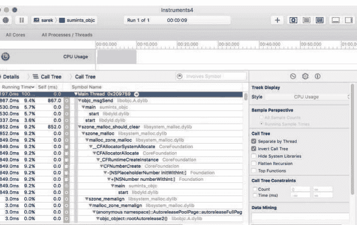

图 2.7 “重度”视图下的 CPU 仪器

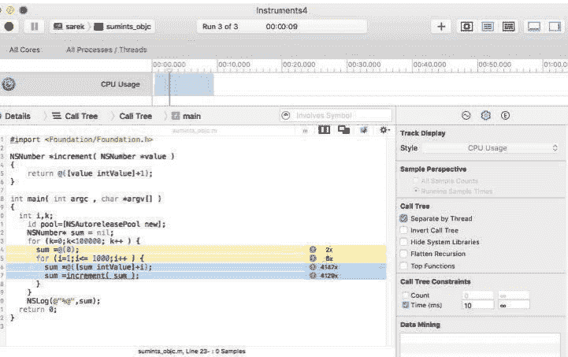

图 2.8 显示源代码的 CPU 仪器

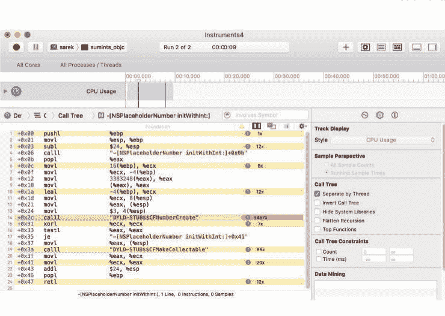

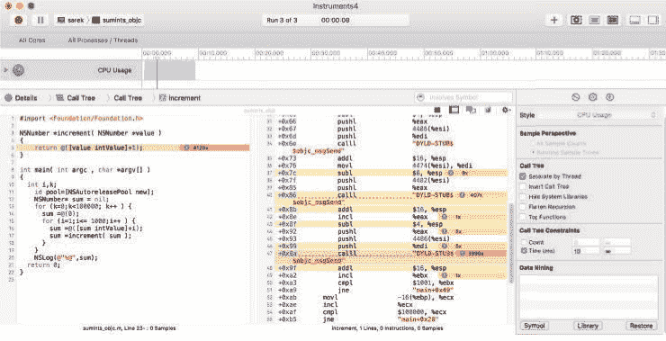

# 第 2 章 CPU：测量与工具

## 数据挖掘：聚焦

最简单的数据挖掘发生在你点击剖析文件某行旁边的右箭头时，或者在图 2.11 的数据挖掘上下文右菜单中选择*聚焦于子树*（*Focus on subtree*）：在详情视图中显示的调用图将从选中的节点开始，所有百分比都相对于该节点（该节点定义为 100%）。我用它来消除仅在程序启动时的符号；除此之外，我通常更倾向于看到上下文。

图 2.12 显示了一个稍微修改过的 *sumints* 程序的调用图，该程序认为两次——一次在 main 函数中，一次在辅助函数中。

CPU 的主要用户是两次调用 `[NSNumber numberWithInt:one`（一次在 main 中，一次在另一个）。如果我们想更仔细地查看 `[NSNumber numberWithInt:]` 的成本；我们可以选择聚焦，从而产生图 2.13 所示的聚焦图。

然而，更仔细的检查发现这并不是我们完全想要的，因为它只聚焦了 `[NSNumber numberWithInt:call` 的一个实例，即调用中的第一个（你可以看到总毫秒数与之前显示的第一次调用的数量大致相同）。

然而，我们想要的是 `[NSNumber numberWithInt:]` 的总成本，无论它在何处被调用。查看特定函数无论在何处调用的成本是一个频繁的需求，对于叶子函数，可以通过切换到反向调用图轻松实现。对于中间的函数，没有明显的方法可以实现这一点，除非使用数据挖掘功能中的聚焦调用*（图 2.11）。

这种功能正是你需要的工具，因为它你指向了特定的代码位置。有时这看起来甚至有些过于精确了。

### 测试

一旦你建立了自动化的性能测量，你也可以将其用于单元测试，以便使性能需求变得可测试，并能够自动检测与这些需求之间的偏差。

单元测试对于确保你的代码在优化过程中仍保持正常运行也至关重要。拥有单元测试提供的安全保障，让你能够自由地尝试更快的实现方案。

快速的单元测试同样重要，因为它们允许单元测试在每次构建时持续运行。（我目前包含略超过 1000 个测试的完整单元测试套件运行需要 1 到 2 秒，这虽然偏慢但仍然可以接受。）

Xcode 包含了作为 XCTest 框架的性能测试。到目前为止，我还没有发现这些性能测试非常有用。首先，它们使用 Xcode 接口，这对于存储结果来说并不透明。我倾向于让测试是自包含的且在代码中完全指定的，而不依赖于外部上下文，特别是机器——或用户特定的上下文。其次，这些性能测试只能防止回归，而不能以测试驱动的风格驱动性能改进。

当然，在测试中询问现有的性能水平并将其存储在后处理钩（post-host）的基础上是有原因的：绝对性能水平取决于机器，在高性能配 Mac 上运行成功的测试可能在 MacBook Air 上就会失败。解决这一困境的答案是如示例 2.2 所示运行相对性能测试。我们不是硬编码一个测试必须完成的具体时间，而是指定一个慢方法与较快方法之间的比例。

## 2.2 单元测试性能testPerformanceOfNewFastShouldBeTwiceOfOldSlow

```c
- (void)testPerformanceOfNewFastShouldBeTwiceOfOldSlow{
    long long slowImplementation=usemicros();
    ... old slow implementation
    slow += usemicros();
    long long fast=-usemicros();
    ... new fast implementation
    fast += usemicros();
    double improvement = (double)slow / (double)fast;
    XCTAssertGreaterThan(improvement, 2.0, @"should be faster")
}
```

通过这种方式，我们还可以我们将希望看到的性能改进硬编码到测试中，然后使用这些失败的测试用例来驱动性能测试，直到测试通过，就像我们在测试驱动开发中实现功能一样。

### Dtrace

`dtrace` 可以被视为增强版外部和内部测量设备的结合，具有内核支持和完全可脚本的跟踪设施。简而言之，它可以任何任何，但代价是即使是简单的任务也需要大量的专业知识和努力。根据我的经验，绝大多数性能测量任务都是非常简单的，并且已经被现有工具涵盖了。

### 职责之外的优化

在开始某特定公司工作后，我被要求帮助一位同事，他被分配了一个优化问题；邮件索引速度缓慢。我的任务简述是，他已经在这个问题上工作了一个月，没有任何可见的进展，担心情绪在几个小组中蔓延。

我对调查状态的询问显示，相关开发者在字符串算法方面做了令人印象深刻的工作，对几种先进的 Boyer-Moore 类字符串算法变体进行了比较统计分析，以找到哪一种能为相关类型的数据集榨出最后百分比的性能。

这些都是好的，10 分钟的采样和代码审查显示，原始程序使用的代码基本上看起来示例 2.3，只不过函数指针被传递到了目标函数中。

示例 2.3 低效的字符串搜索

```c
comparisonFunc=isSensitive ? strncmp : strncasecmp
int len=strlen(target)
int max=strlen(source)-len
for (int i=0; i<max; i++) {
    if (comparisonFunc(source+i, target, len)) {
        return success;
    }
}
```

这是完全可以运行的代码，但它比所需的要慢，原因可能出于一个或两个点：首先，我们对潜在庞大输入字符串的每一个字符都调用了完整的字符串比较函数，其次，我们通过函数指针调用了该函数。

第一个问题是关键的。尽管我们需要调用比较函数来确定源中某个特定位置是否存在全字符串匹配，但绝大多数位置都不会匹配，因此大部分工作是拒绝候选位置，而不是匹配它们。有了这一洞察，变得很清楚了，我们可以通过查看它们的第一个字符来更廉价地拒绝候选位置，而不会产生函数调用的开销。

第二个问题之所以显著，仅仅是因为如果没有函数指针，编译器本可以为我们完成这项工作：字符串比较函数属于一类“特殊”函数，编译器对这些函数是有意识的，并生成专门的内联代码，而不是函数指针和库调用。然而，编译器无法“看透”函数指针，因此无法为我们内联代码。

有了这个简短的洞察，修复方法非常简单：如示例 2.4 所示，提取字符串比较的第一个字符。

示例 2.4 稍高效的字符串搜索

```c
comparisonFunc = isCaseSensitive ? strncmp : strcasecmp
int len=strlen(target)
int max=strlen(source)-len;
for (int i =0;i<max;i++) {
    if (tolower(source[i]) == tolower(target[0]) &&
        comparisonFunc(source+i, len )) {
        // success
    }
}
```


由于 `strncasecmp` 定义为将两个输入字符串都转换为小写，这等同于调用 `strings`。另一个选项将是不使用函数指针以便。

## 总结

本章介绍了从通过 Instruments 剖析器从命令行工具进行性能测量，到内部测量和性能测试。虽然掌握这些工具是重要的并可以为你改进代码提供良好的开端，但重要的是始终记住不要被工具所蒙蔽。它们帮助你收集的数据只是支持或反驳你所假设的手段，而不是终点。如果你记住这一点，并对需要优化的地方进行优化，你已经领先了大多数竞争对手。

# CPU：陷阱与技术

在查看了驱动性能的参数和识别慢代码的技术之后，让我们现在转向让代码运行更快速的技术。我们将查看高效的对象表示以及这些对象通信和访问数据的方法。我们将优化计算。在这一切中，目标将有效地结合 Objective-C 的“Objective”和“C”部分，以实现性能与封装之间所需的平衡。

## 表示

程序的主要任务之一（特别是面向对象的程序）是表示数据。由于该语言的混合性质，Objective-C 程序员在此任务上有许多可用方案。在不声称完整的情况下，结构化数据可以使用 C 结构体、Objective-C 对象以及各种形式的键值存储（最著名的是）来表示。

Foundation 的 `NSDictionary` 和 CoreFoundation 的 `CFDictionary` 都在变得越来越常用。简单的标量可以表示为 C `float`、`double` 或 `int` 及其多种变体，Foundation 的 `NSInteger` 和 CoreGraphics 的 `CGFloat` 定义，以及 CoreFoundation 的 `CFNumber` 对象。注意，命名规范有些令人困惑：`NSInteger` 和 `NSNumber` 的名称强烈暗示这两个类型是相关的——例如 `NSInteger` 是 `NSNumber` 的一个特定子类——但它们完全没有关系。`NSInteger` 是一个定义，在 32 位架构上解析为 32 位的 `int`，在 64 位架构上解析为 64 位的 `long`，而 `int` 在两种情况下都是 32 位的。`CGFloat` 也是如此，它在 32 位架构上变为 32 位的 `float`，在 64 位架构上变为 64 位的 `double`。示例 3.1 显示了几种可能的数字表示形式。

### 示例 3.1 作为原始类型和对象的数字

```c
#import <Foundation/Foundation.h>

int main() {

    int a=1;

    float b=2.0;

    NSNumber *c=[NSNumber numberWithInt:3];

    CFNumberRef d=CFNumberCreate(kCFAllocatorDefault, kCFFloatType, (const void*)&b);

    NSNumber *e=@(5);

    NSLog("%a=%%d b=%%f c=%@ d=%@f e=%@",a,b,c,d,e);

    return 0;

}
```

为了获得良好的解决方案，程序员必须在解耦与封装与性能之间进行权衡，理想情况是在不损害性能的情况下获得尽可能的解耦和封装，或者反之，在最小化耦合的同时最大化性能。

## 原始类型 (Primitive Types)

可能是最容易做的决定是在字符/字节、整数和浮点数等简单标量类型的表示上：尽可能使用内置的 C 原始类型，尽可能避免使用对象。

由于语言原生支持这些类型，标量使用起来非常方便，且性能比其对应的 Foundation 对象 `NSNumber` 或其 CoreFoundation 等效对象 `CFNumber` 高出 10 到 100 倍以上。表 3.1 给出了详细信息：前三列是标量类型进行不同算术操作的时间。32 位和 64 位加法及乘法的时间差异可能是测量误差，尽管在准备这些测量结果时它们是稳定的，但重要的是报告测得的实际结果，而不是我们认为结果应该是怎样的。

### 表 3.1 32 位和 64 位架构下的原始操作

| 操作 | add | multiply | divide | -intVal | NS(int) | CF(float) | NS(float) |
|---|---|---|---|---|---|---|---|
| 64-bit (ns) | 0.67 | 0.79 | 14 | 15 | 44 | 169 | 190 |
| 32-bit (ns) | 0.72 | 0.76 | 7.8 | 22 | 232 | 182 | 211 |

除法比其他算术操作慢，是因为 CPU 中的除数处理器通常一次只处理几位，而不是整个字长，这解释了为什么 64 位除法明显比 32 位除法慢。

与其他通常可以存储在寄存器并在单个周期内进行操作（或在不那么理想的设计中）的类型相比，任何对象表示都有过度的开销，而 Objective-C 相当沉重的对象更是如此。Foundation 和 Core 通过仅提供不可变对象使得这种开销变得更糟糕，这意味着任何操作都必须创建新对象。最后，像数字和字符这样的标量位于任何对象图的末端，因此是程序中数量最多的实体，每个对象都包含一个或多个此类实例。

相反，很少有变体或私有数据能从对象表示提供的封装和多态中获益，而且数字对象在许多方面不如原始类型强大，例如，它们不提供算术能力。如果 Foundation 或任何其他框架提供一种类似于 Smalltalk 或 LISP 的数字和数量级层次结构（其中小整数根据需要自动转变为精度整数、浮点数甚至复数），这可能会改变未来。Foundation 目前尚未提供这些能力，但 OS X 10.7 在 64 位运行时中引入的标记整数（tagged integers）以及在 10.8 中添加数字字面量，可能是未来改进的信号。

当然，在某些其他接口需要对象时，例如当向 `NSArray` 或 `NSDictionary` 添加内容时。在这种情况下，你必须使用 `NSNumber` 或等效方案来提供这些接口——我们将在本书中更多地探讨选项。

表 3.1 的一个异常在于，虽然 32 位和 64 位之间大部分时间相似，但有两个数字不同。除法结果在 64 位上一样慢，而 `NSNumber` 对象的创建速度快了六倍。除法很容易解释：所用特定 CPU 整数除法硬件每个周期处理固定的位数，而 64 位操作数的位数正好是两倍。另一方面，乘法和加法电路一次性处理整个 64 位字。

## 第 3 章 CPU：陷阱与技巧

### 表 3.2 标记指针与普通指针

| Bits | 8-32/64 | 4-7 | 3 | 2 | 1 | 0 |
|---|---|---|---|---|---|---|
| Regular pointer | | | | | | 0 |
| Tagged pointer | | | | | | 1 |

# 第3章 CPU：陷阱与技巧

### 表 3.3 NSString 与 C-String 的操作

| 操作 | 1 ns | !strcmp(10) | ns2 | !nscmp(10) | append | nscmp(32) |
| :--- | :--- | :--- | :--- | :--- | :--- | :--- |
| 1 ns | | 3.3 | 10 | 76 | 77 | 82 |
| !strcmp(10) | | 1 | 3 | 23 | | 25 |
| strcmp(32) | | | 1 | 7.5 | 7.6 | 8.2 |
| !nscmp(10) | | | | 1 | | 1.1 |
| append | | | | | 1 | 1.1 |
| nscmp(32) | | | | | | 1 |

虽然 `NSString` 的开销很大，但当主题确实是人类可读的内容时，这种开销是值得的。实现正确的 Unicode 处理是复杂的、易错且本质上昂贵的。此外，拥有具有通用接口的多种表示形式是有价值的，这允许不同使用场景的字符串表示互换使用。例如，字面量 `NSString` 由 `NSConstantString` 类表示，该类存储 8 位字符；而标准的 `NSCFString` 类（由 `CFStringFoundation` 对象支持）的子类也可以交替提供更复杂的实现，如绳（rope），它们将字符串存储为较小字符串的二进制序列，并在大字符串中高效地插入/删除。

从 OS X 10.1 开始，64 位运行时上的字符串对象也获得了我们之前在整数中看到的标记指针（tagged pointer）。这看起来可能很奇怪，因为字符串是变长度的数据结构，即字符数组。然而，64 位是一个非常大的位数，足以存储 7-8 位字符以及一些额外的标识（如长度）。事实上，当我在 2007 年提出指针字符串时，我曾有过 7 位 ASCII 字符串的变体，或者更紧凑的打包方式，将大多数控制字符和特殊字符聚集仅使用 6 位，并为 9 个字符留出空间。我不知道这些变体是否已经已实现。

示例 3.3 展示了不同的 `NSString` 实现：字面量是 `NSConstantString` 的实例，它是 `NSConstantString` 的一个 CF 变体。创建一个可变副本会创建一个新字符串，而对该副本创建一个拷贝会创建一个标记字符串，因为该字符串只有 5 个字符长。所有这些都取决于实现，但在查看 `NSDictionary` 性能时，这些差异是有意义的。

### 示例 3.3 显示了普通、常量和标记字符串之间的差异

```objc
#import <Foundation/Foundation.h>

void printString(NSString *a ) {
```

# 表示 47

```objc
NSLog("string=%@ p class: %@", a, [a class]);
}
```

```objc
int main() {
    NSString *cs="Const";
    printString(cs);
    printString([cs mutableCopy]);
    printString([[cs mutableCopy] copy]);
    return 0;
}
cc -Wall -o taggedstring taggedstring.string -framework Foundation
./taggedstring
string* Const=0x108fe2040 class: __NSConstantString
string* Const=0x7fb359c0630 class: __NSConstantString
string* Const=0x74736ef435 class: __NSTaggedPointerString
```

```json
[
  {"name": "AAPL", "price": 650.1, "change": 20.41 },
  {"name": "MSFT", "price": 62.79, "change": -0.9 },
  {"name": "GOOG", "price": 340.79, "change": -5.2 }
]
```

即使此类文件中的字符串倾向于结构化而非实际内容（例如示例 3.4 中的字典键），这类结构化字符串在 Cocoa 中也表示为 `NSString` 对象，就像人类可读的文本一样。

# 第3章 CPU：陷阱与技巧

虽然由于字面量 `NSString` 语法（`@"This is a constant string"`）非常方便，但这种将人类可读文本与功能性字符串混用的做法在性能有时是不利的。幸运的是，许多类型的键有更优化的存在——例如，基础 C 字符串、消息名称和实例变量名。

## 对象

由于你正在使用 Objective-C 编程，对象可能会成为你的主要数据结构化机制。

在对象内部使用 C。消息接口隐藏了表示形式，用户对此一无所知。尽量避免使用细粒度、无语义的对象来实现粗粒度、带有语义的对象。

## 访问器（Accessors）

访问器是仅用于读取或写入对象内部数据的方法，大致对应于内存读写指令。根据良好的面向对象风格，对象的属性不应被直接访问，尤其不能从对象外部访问，最好从内部访问。Objective-C 2.0 属性处理了访问器的负担。

然而，访问器也应该被降至最低，理想情况下应完全消除，因为它们变成了智能代理，响应对数据承载结构的高级服务请求，从而导致更高的访问成本。除了更清晰的设计外，从性能角度来看，将高级请求传递到对象中也是意义的，因为这意味着消息的事务成本仅支付一次，在那个点上，相关方法可以访问消息的所有参数和对象的实例变量，而无需使用多次消息来收集某条数据。

### 示例 3.5 访问器 (int)new

```objc
-(void)setInteger:(int)newInteger {
    _integer = newInteger;
}
-(void) setObject:(id)newObject {
    _object = newObject;
}
```

对象 51

仅仅掩盖了错误的代码。程序崩溃会提醒程序员逻辑存在问题。第二种情况是程序员实际上想要存下旧值。在这种情况下，代码本身也是明显的 Bug，因为程序员很清楚新值将使旧值失效——他们正在将其存起来！示例 3.8 中修正后的代码不仅不需要 `atomic`，而且让代码的意图变得清晰。

## 示例 3.8 非保留（Non-retain）的指针引用

```objc
...
id oldWindowTitle=[[window title] retain autorelease];
[window setTitle:@New Window title
```

注意，ARC 防止了崩溃，并且也隐藏了指针的过时性，这正是 `atomic` 所做的——通过在即使将对象存储到局部变量中时也激进地对其进行保留（retain）。优点是你不需要过多考虑对象的生命周期。缺点是，你不再需要过多考虑对象的生命周期，而且你会获得显著更多的引用计数流量，这会影响性能。

因此，虽然在没有性能开销的情况下，`atomic` 是否有益尚不清楚，但这种常见操作的显著减速使其即使在乐观的情况下也非常值得怀疑。集合不支持这种模式（出于性能考虑）以及 iOS UIKit 显式地将其超过 99% 的属性声明设置为 `nonatomic`，这表明 Apple 自身在这种情况下并没有忽视这一点。更慢的 `atomic` 访问是通过键值编码（KVC）实现的：调用诸如 `[tester forKey:@"attribute"]` 的方法不仅比等效直接发送消息 `[tester attribute]` 更冗长，而且由于编译器无法检查 `valueForKey` 字符串的有效性更容易出错；它还慢 20 倍。在运行时对要获取的值进行参数化，使用 `[tester performSelector:@selector(attribute)]` 只比消息发送慢一倍，比 `valueForKey` 快十倍。

你可能根据这些性能参数预计，构建在 KVC 之上的技术（如键值观察 KVO 和 Cocoa 绑定 Cocoa Bindings）不会是速度很快的，你是对的：添加单个 KVO 观察者会使基础 setter 时间增加 100 倍（100 ns 对比 6 ns），添加单个绑定会增加 150 倍（900 ns）。

KVO 和绑定无法防止级联更新通知，如果存在传递依赖（b 依赖 a 且 c 同时依赖于 a 和 b，将导致 c 被评估两次，并导致平方级的性能下降；如果存在依赖循环，则会导致无限递归和崩溃）。

## 第 3 章 CPU：陷阱与技巧

对于较大的数据集或复杂的依赖关系，使用适当的约束求解器可能是个主意，遵循 1978 年 Xerox PARC ThingLab 或后来的开发，如 DeltaBlue、Amulet 或 Cassowary。事实上，Cassowary 似乎已被 Apple 采用 Mountain Lion 的自动布局机制。

## 公共访问（Public Access）

当通过发送消息访问实例变量很慢时，这些实例变量可以为 `@public`。在这种情况下，访问时间本质上与结构体（struct）相同（非询问式实例变量意味着在类中查找偏移量，而不是在编译时硬编码，这会略微影响结果），但安全性和封装也是如此；两者都不复存在了。因此可以认为，如果需要 `@public` 访问，应该使用结构体。事实上，结构体具有一些优点，主要是它可以被分配在自动变量的栈上，通过值传递给函数，或者直接嵌入另一个对象或结构体中，而 Objective-C 对象必须昂贵地在堆上分配，并且只能通过指针访问。

然而，保持这种开放的 Objective-C 对象也有优点——即，它可以附加额外的功能，可以按字段授予或拒绝访问权限，并且它可能与不感知公共访问实例变量的其他对象兼容。例如，第 1 章提到的 PostScript 解释器使用了示例 3.9 中共享的字符串，但对于对象来说，释放内存是有问题的。

## 示例 3.9 完整的字符串定义

```objc
@interface MPWString : NSObject
{
@public
    unsigned char *bytes;
    unsigned length,capacity;
}
```


当然，保持这种开放的 Objective-C 对象也有优点——即，它可以附加额外的功能，可以按字段授予或拒绝访问权限，并且它可能与不感知公共访问实例变量的其他对象兼容。例如，第 1 章提到的 PostScript 解释器使用了示例 3.9 中共享的字符串，但对于对象来说，释放内存是有问题的。

## 对象创建与缓存

正如我们目前看到的，Objective-C 中创建对象是昂贵的，因此最好使用对象缓存：在无法避免创建且性能成为问题时，复用已经分配的对象。

为了复用对象，除了我们分发的引用外，我们必须保留对它的引用，例如存储在实例变量或局部集合中。如果我们原本要释放该对象，我们可以这样做，或者我们可以保留一个永久引用。然后，当需要创建另一个所需类的另一个对象时，我们检查是否已经有了它的拷贝，并使用那个已经分配的拷贝。

表 1.2 显示，只复用一个对象而不是分配新对象不仅节省了内存，还节省了大约 50% 的 CPU 时间，这使我们能够在本可能不得不求助于 C 语言的地方使用对象。

## 可变性与缓存

复用对象是安全的吗？例如，不可变值对象可以频繁使用，因为同一个值对象的不同副本被认为是不可区分的。Foundation 在许多地方使用这种策略来确保全局唯一性。小型对象在分配后会被保留在缓存中，常量字符串则由编译器和链接器合并并共享。

为了将对象缓存回客户端，这些对象必须是不可变的，因为如果一个客户端的更改对另一个可见，那么共享无意的客户端将变得不再可能。然而，不可变性强制在每次更改时创建一个新对象，而每次需要值时创建一个新的（缓存的）数字比仅仅设置一个新值要贵大约 30 倍，即使是通过访问器器安全地执行的。我们该如何复用可变对象？

一种方法（UIKit 为表格单元选择的方法）是拥有一个记录的 API 约来保证可复用性。另一种方法是利用 Foundation 的引用计数机制，我们用它来跟踪对象的唯一引用是否是来自缓存，如果是的话，对象就可以被复用，而不是释放。

## 第 3 章 CPU：陷阱与技巧

表 3.4 对象缓存的引用计数
| 使用中 | 未使用 | 未使用操作 |
| --- | --- | --- |
| retain/release | RC > 0 | RC = 0 | 释放 (`deallocate`) |
| 对象缓存 | RC > 1 | RC = 1 | 重用 (`reuse`) |

利用 `1→0` 的转换来判断对象是否需要释放，我们使用 `RC = 1` 状态表示对象是否可以重用，因为缓存保留了单一引用。表 3.4 总结了这些信息。

示例 3.10 显示了如何实现这种感知引用计数的缓存，尽管作为通用对象缓存类部分的实际实现经过了更深度的优化。这里引用的实例变量定义在示例 3.18 中，并在章的“IMP 缓存”节中进行了详细讨论。

### 示例 3.10 圆形对象缓存实现

```objective-c
-getObject
{
  id obj;
  objIndex++;
  if ( objIndex >= cacheSize ) {
    objIndex=0;
  }
  obj=objs[objIndex];
  if ( obj == nil || [obj retainCount] > 1 ) {
    if (! obj) {
      [obj release]; //-- 移除缓存
    }
    obj=[objClass alloc] init;
    objs[objIndex]=obj;
  } else {
    obj=[obj reinit];
  }
  return obj;
}
```

`MPObjectCache` 在其缓存中维护一个对象的圆形缓冲区，这是一个 `id` 类型的 C 数组。当调用 `getObject` 方法创建或获取对象时，它会查看当前位置并判断是重用该对象还是需要分配一个新对象并移动位置。它假设对象知道如何从一个已初始化但不再有效的状态进行重新初始化。

- 1. 虽然苹果通常建议调用 `retainCount`，但这种用法并不属于问题类型。
- 2. `id` 是默认返回类型并被省略了。

圆形缓冲区结构为我们在尝试重用它们之前由缓存提供的对象提供了一些时间，类似于年轻代垃圾回收器（young generation-scavenging collector）。每次操作大约需 9 ns，从（优化的）对象缓存中分配的速度比直接分配对象快 15 倍，因此这是一项值得的优化。

索引的环绕通过 `if` 检查而不是取模运算（modulo）处理，取模是一种除法，正如我们在章的前面看到的，除法即使在现代 CPU 上也是相当慢的算术操作之一。实现取模另一种方法是对索引的低位进行与运算（and），但这会将缓存大小限制为 2 的幂。最后，探测和淘汰策略有许多变体，它们具有不同的性能特性，例如尝试至少 n 个槽位或使用随机探测。到目前为止，这种非常简单的算法被证明是各种用例的最佳平衡。

使用引用计数的另一种潜在方法是坚持传统的 `1→0` 引用计数，并重写 `dealloc` 将对象推入全局缓存而不是定期释放。然而，那种方法与这里介绍的对象缓存不同，它将目标与缓存行为紧密耦合，并需要使用全局缓存。因此，我不建议那种类型的全局缓存，尽管它非常流行。不需要锁定、将缓存复制到另一个对象的生命周期中以及对象模式的特定情况，是使得通过缓存对象进行缓存变得强大且快速的重要原因。

## 懒性求值 (Lazy Evaluation)

缓存的另一个用途是属性的懒性求值。消息请求一个计算开销很大且可能不需要的对象属性时，对象可以将计算推迟到属性实际被请求时，而不是在对象初始化期间计算该属性。或者，如果将来可能会使用该计算，并且已知计算参数没有变化，则可以缓存昂贵计算的结果。

懒性访问器在我的代码中非常常见，以至于需要一个特殊的访问器宏，如示例 3.11 所示。

### 示例 3.11 懒性访问器宏

```objective-c
#define lazyAccessor(type, setVar, computeVar) \
readAccessorName(type, var, ##var) \ \
setAccessor(type, var, setVar) \ \
-(type)var ( \\ \
if (![self##var]) ) (\
[self setVar:[self computeVar]; \ \
return [self _#var]; \
}
```

该宏中的访问器源自示例 3.6，但多了一个 `computeVar` 参数，用于定义发送以计算结果的消息。当调用它时，它会检查是否有结果。如果有结果，则返回它；如果没有，则调用 `computeVar` 方法并在返回之前存储结果。另一个不常用的访问器宏是中继访问器（relay accessor），它简单地将请求转发给实例变量。

## 缓存注意事项

> 计算机科学只有两件难事：缓存失效和命名。
> Phil Karlton

在执行了所有缓存操作后，记住缓存本身并非没有陷阱是关重要的。事实上，我一位成为计算机科学教授的朋友在考试中喜欢问这样一个问题：“什么是缓存？它是如何减慢计算机的？”

在命中率为 0% 的缓存抖动（thrashing cache）的最坏情况下，缓存会将维护缓存的成本增加到非缓存计算的成本中，而达到 0% 命中率的一种简单方法是……注：根据 OCR 痕迹，此处文本似乎碎片化或不完整）。

在测试缓存之前已经付出了代价，因此缓存实际上*增加*了 CPU 的使用。
改善这种状况的方法是创建一个可以使用 C 字符串查询的缓存，可以通过自定义缓存实现，也可以为 `CFDictionary` 创建一组自定义回调函数。

## 陷阱：通用（中间）表示

作为 OS X 和 iOS 的祖先，NeXTStep 的特性之一是基于 DisplayPostscript 的可编程对象和窗口系统。就像向 OPENSTEP 的过渡带来了带有 `NSString`、`NSNumber`、`NSDictionary` 和 `NSArray` 基本对象模型的 Foundation，我当时正好在开发一种“PostScript 虚拟机”，它重新定义了 Postscript 操作符，使其以结构化格式返回图形对象，而不是将其绘制在屏幕上。据我所知，类似于“distillery”的技术至今仍在驱动着 Adobe 的 Distiller PostScript 到 PDF 转换器。

当我查看新安装的 OPENSTEP 时，我注意到解释器 `printobject` 命令创建的二进制对象序列（BOS）包含了字典、数组和字符串，它们与新 Foundation 框架提供的数据类型完美映射！因此，我需要做的只是创建一个通用的映射器，将 BOS 转换为 Foundation，访问封装在 Foundation 对象中的信息，并利用这些信息填充我的领域对象，其中包含了路径、文本以及各种图形状态参数（如颜色、变换矩阵、字体名称和大小）。

虽然这种方法让我快速构建出一个图形对象读取器的原型，但其性能是“惊人”的。令我非常意外的是，限制因素并不是 Postscript 过程必须消除绘制命令并产生输出，也不是 PostScript 解释器中的序列化顺序，甚至不是那个相当缓慢的基于字节的通信信道。不，主要因素是 Foundation 对象的创建，这是一个我从未想过的因素。在不可置信的震惊消退后，我将将 BOS 转换为 Foundation 对象的部分替换为一个简单的覆盖对象（cover object），它保持原始数据“原文不变”，但可以通过通用的消息接口访问部分内容。解析器随后访问这个消息接口而不是转换后的对象，性能提升了 10 倍。

这就是我学到通用中间对象表示（也称为数据对象）是一个非常糟糕的主意（Bad Idea™）的时候——至少在使用性能并使用 Objective-C 的情况下如此。虽然这一原则在其他语言中也适用，但 Objective-C 在基础机器操作、消息传递和对象分配之间 1:5:200 的性能比例上让这一点体现得尤为惨烈。

当然，我学了好几次才最终记住，但原因其实非常简单：通用表示包含的对象通常比最终对象表示多得多，因为它们需要字典（对象头 + 键值存储）而不是普通的旧式 Objective-C 对象（尽管“POJO”这个缩写并没有像 Java 的 Plain Old Java Objects [POJO] 那样流行）、需要对象键（而对象可以使用实例变量偏移量）的开销、增长的开销，以及对象可以使用简单标量原始类型的对象值存储。因此，你不仅创建了单个成本昂贵得多的对象，还需要创建更多这样的对象。这两个因素的乘积使得通用对象表示在 Objective-C 和 Swift 中的性能很差。

## 数组与批量处理

在处理通过索引访问的实体集合时，Foundation `NSArray` 相比于普通的 C 数组（`array[index]`）提供了许多方便的服务：自动内存管理（`retain / release`）、自动增长、排序、搜索、子数组，以及一种允许在数组两端高效添加和删除对象的模型。

缺失的是一组如 `float`、`double` 或 `int` 等具有相似值的原始类型，因为现在显而易见，将标量值封装在 `NSNumber` 对象中并放入 `NSArray` 中性能并不会很好。包装器很容易编写，而且已经有很多；例如作者的 `MPWRealArray`、FScript 中的数组或 `SMUGRealVector`。

如图 3.1 所示，拥有同质标量集合的性能优势是压倒性的：在一个填充了 10,000 个数字的数组中求和，比在 `NSArray` 中求 `NSNumber` 快 5 倍（即使每个数字是通过消息传递访问的），并且比要求数组批量执行该操作快 17 倍。

在创建此类数组并填充从 1 到 10,000 的数值时，差异甚至更加明显：同质数组比创建相同数值的 `NSNumber` 数组快 20 倍，即使每个真实值都是使用单独的消息传递低效地添加的。移动到批量操作（即循环在真实数组内部执行），将这一差异扩大到了 270 倍。

此外，将数字表示为连续的 C 数组允许我们使用 OS X 内置的向量处理工具，如 `vDSP`。使用 `vDSP` 函数，示例 3.1 中的 `MPWRealArray` 求和代码比批量处理标量的代码还要快 10 倍，使其相对于 `NSArray + NSNumber` 组合的性能提升到了 1.3 μs。

## 陷阱与技巧

| 操作 | 方法 | 性能提升 |
| :--- | :--- | :--- |
| 求和 10 万个数字 (NSArray) | 消息传递 | 快 5 倍 |
| 求和 10 万个数字 (NSArray) | 批量操作 | 快 17 倍 |
| 填充 1-10 万数组 (NSNumber) | 单个消息 | 快 20 倍 |
| 填充 1-10 万数组 (NSNumber) | 批量操作 | 快 270 倍 |
| 求和 (MPWRealArray) | vDSP 函数 | 比批量处理快 10 倍 |

```objectivec
@interface MPWRealArray : NSObject
{
    int capacity;
    NSInteger count;
    float *floatStart;
}
@implementation MPWRealArray
-(float)vec_reduce {
    float theSum=0;
    vDSP_sadd(floatStart, 1, &theSum, count);
    return theSum;
}
@end
```


## 对象

Swift 代码在没有优化的情况下并不会很慢，C 的典型系数在 3 到 4 之间，而 Objective-C 通常不受太大影响。很清楚，由于这种性能差异，未优化的调试构建可能是不可能的：当一个需要 100 毫秒的操作在调试构建中需要近 2 分钟时，你无法进行调试。

## 字典

在本章“字符串”部分提到的键的使用通常与某种键值存储结合使用，在 Cocoa 中这通常是 `NSDictionary`，哈希表具有平均常量 `O(k)` 读取访问时间。

然而，键的通用性意味着，如表 3.5 和表 3.6 所示，在这种情况下 `k` 是一个较大的数字（23 到 100 ns），比消息传递慢 10 到 50 倍。此外，`NSDictionary` 要求原始类型封装在对象中，这会导致在本章“原始类型”部分讨论过的性能后果。

## 第3 章 CPU：陷阱与技巧

**表 3.5** 按存储键和查找键类型划分的字典查找开销（大键）

| 按查找键类型查找的时间 (ns) | 存储键 | 常量字符串 | 普通字符串 | 可变字符串 | CoreFoundation 字符串 |
| :--- | :--- | :--- | :--- | :--- | :--- |
| 常量字符串 | 35 | 78 | 78 | 83 |
| 普通字符串 | 78 | 80 | 80 | 85 |

表 3.5 显示了字典访问的通用开销，如果没有发生哈希冲突（即两个或多个键映射到哈希表中的同一个槽位），每次读取的代价大约为 80 ns。单次冲突会增加约 20 ns。只有在一种情况下会偏离大约 80 ns 的标准情况：当你使用常量字符串作为字典的键和查找键时。在这种情况下，查找速度可以快一倍以上，这可能是因为常量字符串可以使用指针相等性进行等值比较，而不是进行内容比较。

对于多达 7 个字符的小型键，OS X 10.5 引入的标记指针（tagged pointer）优化也有所帮助。作为常量字符串，指针比较就足够了，因为值存储在指针中，或者仅当字符串类型相同时（均为标记字符串或均为常量字符串）时。表 3.6 显示了这种效果：当类匹配时，常量字符串和标记指针字符串的单次查找大约需要 22 ns，但如果类不匹配，则没有收益。

为了获得优化的字典性能，你需要确保用于将值存入字典的键的类与用于检索值的键的类是匹配的。如果使用字面量（`"key"`）来存储值，那么最好也使用字面量来检索。

如果你在检索时无法使用字符串，那么你的键长度足够短，可以放进标记指针字符串中。如果你检索值的频率高于存储值的频率，那么将用于存储值的键转换为标记指针字符串可能会有所帮助，如示例 3.3 所示：首先对原始键进行可变拷贝，然后进行一次可变拷贝。这将根据具体情况，使你的检索速度快 2 到 4 倍。（通过可变拷贝绕路是必要的，因为……）

**表 3.6** 按存储键和查找键类型划分的字典查找开销（小键）

| 按查找键类型查找的时间 (ns) | 存储键 | 常量字符串 | 标记字符串 | 可变字符串 | CoreFoundation 字符串 |
| :--- | :--- | :--- | :--- | :--- | :--- |
| 常量字符串 | 23 | 64 | 52 | 74 |
| 标记字符串 | 51 | 21 | 44 | 47 |

所有不可变字符串（包括常量字符串）在被要求拷贝时将直接返回自身。因此，即使对小型和常量字符串进行了这些优化，在性能可能成为相关因素的情况下，最好还是寻找替代方案，除非需求完全符合 `NSDictionary` 的功能。绝大多数字典用途要专门得多，例如仅使用字符串作为键，并且仅有一个有界定的键集。解析器使用了两种特殊字典：用于存储支持排序和一个键对应多个值等语义的属性的 `NSDictionary`（这与那些用例相关联），以及直接从预定义的字符串集映射到对象的 `StringTable`。

`StringTable` 不使用哈希表，而是直接在字节逐字符表示上操作，以尽可能地消除不匹配的字符串。它也比 `NSDictionary` 快 4 倍，因为其主要用途是处理外部生成的字符串，对于这种用例，它比 `NSDictionary` 快 5 到 15 倍。使用值类型的 Swift 字典显然比重量级对象快，对吧？事实并非如此：在所有测试中，Swift 的访问速度明显比 `NSDictionary` 还要慢。`NSDictionary` 的替代方案是定义对象并使用普通消息（plain messaging）来访问其内容，特别是当目标字典具有相当固定的键集时。这不仅设计更简洁，因为消息名是按类进行划分的，而字典键会污染全局命名空间，因此使用了长名称。例如 `[String:Int]` 映射了两个值类型，因此不受任何遗留 Objective-C 对象和动态分派的限制，其单次查找时间从 140 ns 到 280 ns 不等，取决于键是字符串字面量还是外部提供的。与 `NSDictionary` 相比慢了 3 到 7 倍（与 Table 相比慢 17 到 25 倍），这很大程度上与编译器标志无关，尽管不进行任何优化的编译会导致显著变慢。

为什么人们可能倾向于使用字典而不是对象？由于 Objective-C 2.0 64 位运行时及相关存储的动态实例变量，针对额外实例变量的未来扩展不再是一个问题。可能的稀疏对象可以通过划分一个或多个主体来处理，消息被委托给这些主体，并根据需要分配。

只要为客户端提供了消息接口，就可以对其进行不同的实现和优化。虽然转而提供一个基于键的接口似乎很有吸引力，但这种灵活性似乎是幻象。一旦向客户端提供了类似 `NSDictionary` 的键值接口，其性能特征其实比键值访问快得多，因为从 `NSString` 键映射到消息或实例变量偏移在 CPU 使用上并不像基于 `NSDictionary` 的内部表示那样昂贵。所以，如果需要 `NSDictionary`，可以将其封装在一个对象中，将它的访问映射到字典。示例 3.15 中的宏允许你为字典中的键添加消息接口，方法是编写 `dictAccessor(var, set)`。

### 消息

> 我很歉以前将这个术语称为“对象”，因为这让人们关注次要的想法。核心思想是“消息”。

Objective-C 中的对象仅仅是略微复杂的结构，高效且灵活的消息传递系统是 Objective-C 的核心。它结合了真正的封装和像 Ruby 或 Smalltalk 等语言的动态性。Objective-C 消息不仅强大，而且相对廉价，仅是 C 函数调用的两倍。消息之所以快速，是因为编译器、链接器和运行时保证每个代表 Objective-C 选择器的字符串都有唯一的地址，因此 Objective-C 消息函数 `objc_msgSend()` 不需要关注选择器的字符串，只需将指针本身作为未解释的整数。

### 示例 3.15 生成并测试字典支持器方法（静态或动态）

```objc
#import <Foundation/Foundation.h>
#import <objc.h>
#define dictAccessor( objectType, var, setVar, someDict ) \
objectType)*var { return someDict[@#var]; }; \
-(void)setVar:(objectType*)newValue { \
    someDict[@#var]=newValue;\
}
@interface MyObject : NSObject
@property (retain) NSMutableDictionary *dict;
@end
@interface MyObject(notimplemented)
@property (retain) NSString *a;
@property (retain) NSString *b;
@end
@implementation MyObject
-(instancype)init {
    self=[super init];
    self.dict=[NSMutableDictionary new];
    return self;
}
-(void)addDictAccessorForKey:(NSString*) key
{
    SEL selector=NSSelectorFromString(key);
    id (block)={
        return self.dict[key];
    };
    imp imp=imp_implementationWithBlock( block );
    class_addMethod([class], selector, imp , ":");
}
@end
int main () {
    MyObject *m=[MyObject new];
    [m addDictAccessorForKey:@"a"];
    m.dict[@"a"]=@\"Hello\";
    m.b=@\"World!\";
    NSLog("@\"m.a: %@ %@",m.a,m.b);
    return(0);
}
```

## 第 3 章 CPU：陷阱与技巧

值。事实上，正如 Brad Cox 在《面向对象编程：一种演进方法》中所述，这种选择器唯一化过程是 Objective-C 从一组宏转变为真正的前身的主要驱动力，这随后使得创建一种语法成为可能。

在运行有 Xcode 7.3.1 的 OS X 10.11 上，示例 3.16 中的代码打印出选择器：`'hasPrefix:'`，但编译器已经警告将类型 `SEL` 强制转换为 `char *` 已过时；请使用 `sel_getName` 代替。在 GNU 运行时中，选择器是同时携带消息名称及其编码的引用。

### 示例 3.16 使用 Apple 运行时将选择器作为 C 字符串进行选择

```objc
#import <Foundation/Foundation.h>
int main (void){
    SEL a=@selector(hasPrefix:);
    printf("%%s\n", (char*)a);
    return 0;
}
```

### IMP 缓存 (IMP Caching)

尽管新接触 Objective-C 的开发者往往会担心大多数消息发送，但与 C++ 虚函数调用相比，Objective-C 的消息函数 `objc_msgSend()`（在 GNU-objc 中为 `objc_msg_lookup()`）已经过高度优化，并不是瓶颈。

在它成为因素的情况下，可以从运行时获取函数指针并进行调用。这种技术被称为 **IMP 缓存**，因为 Objective-C 方法指针的类型定义被称为 `IMP`（实现方法指针，或简称为 Implementation）。在具有固定接收者的紧凑循环中，如果方法本身非常简单且消息分发是主要的性能因素，IMP 缓存将非常有用。示例 3.17 显示，在减去循环后，运行时从 2 ns 提升到 1.08 ns，提升了超过 2.5 倍。

### 示例 3.17 用带 IMP 缓存的消息发送替换普通消息发送

```objc
#import <Foundation/Foundation.h>
@interface MyInteger : NSObject
@property (assign) int intValue;
@end
@implementation MyInteger
@end
```

```objc
int main()
{
  MyInteger *myObject=[MyInteger new];
  int a=0;
  myObject.intValue=42;
  for (int i=0; i<1000; i++) {
    a+=[myObject intValue];
  }
  IMP intValueFun=[myObject methodForSelector:@selector(intValue)];
  for (int i=0; i<1000; i++) {
    a+=(int)intValueFun(myObject, @selector(intValue));
  }
}
```

Objective-C 的动态性质意味着在编译时没有自动确定何时这种优化是安全的，这就是为什么 Objective-C 编译器不会为你完成这一操作。幸运的是，开发者通常很容易做出这种判断。虽然 `IMP` 在执行过程中有许多变化方式（例如，加载包含 category 的 bundle，并使用运行时函数添加、删除、更改方法实现，甚至更改问题对象），但这些都是可以预见的罕见事件。

开发者的工作是确保这些事件都不会发生，或者确保它们不会对计算产生影响。

在使用 `IMP` 缓存时，需要考虑的特殊情况是 **nil 接收者 (nil receiver)**。Objective-C 静静地忽略发送给 nil 的消息，直接返回零而不是分发消息。这种短路机制保护了接收者无需担心 nil self 指针，同时也发送者无需处理特殊的 nil 接收者。IMP 缓存在几个方面破坏了这种保护：如果请求 IMP 时接收者为 nil，将返回一个 NULL 函数指针，调用 NULL 函数指针会导致程序崩溃。另一方面，如果从早期的非 nil 对象指针获取了正确的函数指针，调用该函数指针将调用一个带有 nil self 指针的方法。内部的任何实例变量也将导致程序崩溃。

因此，你需要确保自己没有获取到 NULL IMP 和 nil 接收者。

在向“已知”对象发送 delegate 甚至是 self 消息时，IMP 缓存可能特别有用。示例 3.18 显示了本章“可变性与缓存”部分中讨论的对象缓存部分的实际头文件。除了缓存本身（`objs`, `cacheSize`）以及它维护的用于示例 3.10 `-getObject` 方法中发送的所有消息的当前 IMP 指针外，它还允许实际 `-getObject` 以缓存索引的方式运行，而无需调用消息函数。此外，它使 `-getObject` 方法本身的 IMP 变成一个 `@public` 实例变量，并配有一个 `GETOBJECT()` C 处理器宏来调用它。事实上，`GETOBJECT` 宏的编写代码比普通的 `alloc-init-autorelease` 更少，在缓存未命中时快 8%，在缓存命中时快 15 倍，最后它将缓存使用者与所使用的特定类解耦。

### 示例 3.18 整数对象缓存的定义与使用

```objc
@interface MPWObjectCache : MPWObject
{
    id *objects;
    int cacheSize,objIndex;
    Class objClass;
    SEL allocSel,initSel,reInitSelector;
    IMP allocImp,initImp,reInitImp,releaseImp;
    IMP retainImp,autoreleaseImp;
    IMP retainCount,removeFromCacheImp;
    @public id getObject;
```

```objc
+(instancetype)cacheWithCapacity:(int)newCap class:(Class)newClass;
-(instancetype)initWithCapacity:(int)newCap class:(Class)newClass;
}
```

```objc
#define GETOBJECT(cache) ((cache) getObject]
+(instancetype)cacheWithCapacity:(int)newCap class:(Class)newClass;
-(instancetype)initWithCapacity:(int)newCap class:(Class)newClass {
    // 略实现
}
-id getObject {
    // 略实现
}
```

如果 IMP 缓存且你需要调用选择器，可以将其转换为 C 函数，或者一个预处理器宏。

```objc
@interface MPWInteger : NSObject
@property (assign) int intValue;
@end
@implementation MPWInteger
-id getObject {
    // 略实现
}
-void setIntValue:(int)val {
    // 略实现
}
-int intValue {
    // 略实现
}
@end
```

```objc
MPWInteger *integer=GETOBJECT(cache);
[integer setIntValue:2];
```

考虑到动态分发的程度，这是出于性能考虑。

### 转发 (Forwarding)

虽然一端接近 C 函数的速度，但 Objective-C 消息足够灵活处理另一端。例如，Cocoa 并不使用 `NSUndoManager`。对于你自己的项目，我总是建议为动态行为进行映射。

### 示例 3.19 将消息映射到 shell 命令

```objc
#import <Foundation/Foundation.h>
@interface Shell:NSObject
@end
@interface Shell (notimplemented)
-(void)ls;
@end
@implementation Shell
-(void)forwardInvocation:(NSInvocation*)invocation {
 system([NSString stringWithSelector:(invocation selector)]);
}
-(NSString*)dummy { return "@"; }
-objc methodSignatureForSelector:(SEL)sel {
NSMethodSignature *sig=[super methodSignatureForSelector:sel];
if (!sig)
```


`sig=[super methodSignatureForSelector:@selector(dummy)];`

`return sig;`

`}`

`@end`

`int main ()`

`{`

` Shell *sh=[Shell new];`

` [sh ls];`

` return 0;`

`}`

```

示例 3.20 读取由消息命名的文件而不是执行它，也许更的是，示例 3.21 在本地字典中查找选择器。

## 示例 3.20 将消息映射到文件内容

```objc
#import <Foundation/Foundation.h>

@interface Filer:NSObject

@end

@interface Filer (notimplemented)

-(NSString*)hello;

@end

@implementation Filer

-(void)forwardInvocation:(NSInvocation*)invocation {
NSString *filename=NSStringFromSelector([invocation selector]);
NSString *contents=[[NSString alloc]
initContentsOf:filename
encoding:NSLatin1StringEncoding
error:nil];
[invocation setReturnValue:&contents];
}

-(NSString*)dummy { return "@"; }
-objc methodSignatureForSelector:(SEL)sel {
NSMethodSignature *sig=[super methodSignatureForSelector:sel];
if (!sig)
sig=[super methodSignatureForSelector:@selector(dummy)];
return sig;
}
@end

int main() {
{
Filer *filer=[Filer new];
NSLog("@filer: %@", [filer hello]);
return 0;
}
}
```

## 示例 3.21 将消息映射到字典键

```objc
-(void)forwardInvocation:(NSInvocation*)invocation {
id result=[[self dictionary] objectForKey:
NSStringFromSelector([invocation selector])];
[invocation setReturnValue:&result];
}
```

## 一致性与优化

虽然示例 3.19 到 3.21 的实现在实际性能上并没有收益，但其益处在于使用了最快的接口。这种接口可以通过运行时内省查找键（3.21）、在读取文件时（3.20）保持不变、在运行时或编译时向带键的存储生成 actor（3.15）、或切换到实际实例变量的访问器并最终通过 `IMP` 更改该消息来保持一致。你不需要从一开始就这样做，但你必须使用那些在需要时能够让你变得变快的接口。

我越是遵循 Alan 关于关注方法（methods）的建议，我的程序就变得越好，让它们运行起来也越容易。

## 方法

Objective-C 方法通常大致分为两类：一方面是精简且高效的 C 数据操作，另一方面是使用消息发送进行高层协调。

对于数据操作操作，兵器库中的所有常用技巧都适用：将昂贵的操作移出循环（如果没有循环，方法怎么会耗费时间呢？）、强度归约，以及使用优化的原始类型（如内置的内存拷贝函数或像 `vdsr` 这样的库），并寻找语义等价但更廉价的替代品。幸运的是，编译器会开启大部分此类优化。然而，`LLVM/clang` 并没有直接编译循环最终的结果，而是成功地优化掉了我们基准测试程序中的大多数简单循环，除非我们明确告诉它这样做。

为了保持数据操作方法的精简高效，设计恰当的消息传递接口至关重要，即将将所需的所有数据传递给目标方法，而不是让方法从数据源处拉取数据。

高层协调方法通常不需要执行得非常频繁，也不需要优化。事实上，我在解释性脚本语言中实现此类方法时获得过极性能结果。例如，一个在半秒前触发动画的方法，即使执行需要整整一毫秒，占用的可用时间也低于 0.2%，这完全不值得担心。

## 陷阱：CoreFoundation

本章中反复出现的主题之一是利用 C 语言提高速度，并在语言的“C”部分和“Objective-C”部分之间进行仔细的权衡，以便在易用性、性能以及当前项目所需的解耦和动态性之间取得平衡。

然而，这种做法可能会严重错误，正如 `CoreFoundation` 的情况。`CoreFoundation` 实际上抛弃了 Objective-C 快速强大的特性（消息传递、多态、命名空间处理），并成功为缓慢的部分（堆分配对象）提供了一个笨拙的单态接口。它随后鼓励使用字典，而字典又慢了一个数量级。`CoreFoundation` 为实际上具有不同实现的 CoreFoundation 对象提供大量单态接口的方法，意味着这些函数中的每一个（极少数除外）都必须动态地检查激活的是哪种表示，然后运行该表示的相应代码。你可以在 `http://opensource.apple.com/source/CF` 可用的 CoreFoundation 开源版本中看到这一点。

Objective-C 的实现将消息分发器留给了捕获，这意味着两个方法实现都可以保持整洁，因为它们将在带有特定表示时被调用，这也使得提供更多优化的表示变得更容易。

当我经常听到诸如“代码运行快是因为它使用了 C 语言，因此 CoreFoundation 比使用 Objective-C 要快”之的话时，这似乎是一个神话。在实际测试中，我从未发现过事实是真的。根据我的发现，CoreFoundation 对象的纯 Objective-C 等价物总是比它们的 CoreFoundation 手快，而且通常非常显著。示例 3.17 中显示的 `-intValue` 消息尽管有消息传递的开销，已经比调用 CoreFoundation 的 `CFGetInt()` 函数快了 30%。使用 `IMP` 缓存降到 C 语言使其比 CoreFoundation 等价物快 3 倍。

在 CoreFoundation 首次引入时也观察并记录了同样的现象，用户注意到与非 CoreFoundation 的 OPENSTEP Foundation 相比速度明显变慢（在原本应该更快的机器上慢了一一倍）。这显然不适用于 Apple Foundation 目前使用的 `NSC` 类；这些类不可能比它们的 CoreFoundation 等价物更快，因为它们调用了 CoreFoundation。

## 多核

正如我们在第 1 章中看到的，摩尔定律仍在提供更多的晶体管，但不再能显著增加时钟频率或每个周期的性能。这种能力的转变意味着我们的单线程程序不再仅仅通过运行在新的硬件上而变快。相反，我们现在必须转向多线程，以利用增加的能力，而这些能力以额外核心的形式出现。实现多线程是一个难题，不仅是因为存在潜在的竞态条件和死锁风险，还因为线程管理和同步的添加实际上增加了巨大的开销，尽管多线程解锁了额外的 CPU 资源，这种开销也很难抵消。

- 4. `http://www.cocoabuilder.com/archive/cocoa/20773-does-suck-or-has-apple-crippled-coco.html#20773`

由于今天 CPU 极其惊人的单核性能，事实证明大多数 CPU 性能问题实际上并非由于 CPU 的限制，而是由于程序组织性的欠优。我希望我目前为止展示的那些 3 到 4 倍、10 到 20 倍易于达成的性能改进因素，能说服你至少认真考虑多线程——在理想情况下，我们实现的加速比可以达到系统核心数数量——而且这仅适用于完美并行的、所谓的“尴尬并行”（embarrassingly parallel）问题。

```
S(N) = \frac{P}{(1-P) + \frac{P}{N}}
```

阿姆达尔法则（公式 3.1）将由于 N 核心并行化带来的潜在加速 (S) 与程序中可以并行的比例 (P) 结合起来，它表明当程序中只有一小部分无法并行时，新核心带来的收益会迅速递减。因此，即使对于非常优秀的 90% 并行化程序，从 2 个核心到 4 个核心提供了 70% 的加速，而从 8 个到 12 个核心仅增加了 21%。而在无限数量核心的情况下，最大加速比为 10。对于一个 50% 并行的程序，2 个核心的加速为 33%，4 个核心为 60%，12 个核心为 80%，接近极限 2。

## 线程

虽然我无法在这里专门讨论这个话题（它至少值用一个章节），但我可以对多年来的各种多线程机制提供一些建议，从通过 `NSThread` 和 `NSOperationQueue` 实现线程，到最近添加的 Grand Central Dispatch (`GCD`)。

OS X 上的线程本质是构建在内核级的 POSIX 线程（threads）实现之上。这些内核线程是相对昂贵的实体，类似于 Objective-C 对象（后者甚至更甚）。使用 `thread_create`（如 3.522 所示）在新的 POSIX 线程上运行 `my_computation()`，除了运行 `my_computation()` 本身的成本外，在我的机器上还需要大约 7 µs 的开销，所以你的计算至少需要 7 µs 才能平衡，并且至少需要 70 µs 才有机会达到 90% 的并行化（假设所有任务分配完美）。

在 Cocoa 的 `NSThread` 类方法 `detachThreadSelector:...` 中创建新线程为当前任务增加了超过一个数量级的开销，`NSObject` 的便利方法 `-performSelectorInBackground:...` 也是如此（同样示例 3.22）。

> 5. James R. Larus, “Spending Moore’s dividend,” Communications of the ACM No. 5 (2009).

## 第 3 章 CPU：陷阱与技巧

考虑到阿姆达法则（Amdahl's Law），你的任务在并行化之前可能至少需要大约 1 ms的时间，而且你应该先考虑其他的优化方案。

示例 3.22 使用 pthread、Cocoa NSThread 或便利消息创建新线程

```
pthread_create(&pthread, attrs, my_computation, arg);
[NSThread detachNewThreadSelector:@selector(myComputation:) toTarget:self]
[self performSelectorInBackground:@selector(myComputation:) withObject:arg];
```

因此，与 OOP 与 C 的平衡类似，获得良好的线程性能意味着任务要足够粗粒度以到值得卸载到线程中，但同时又要足够细粒度或大小均匀，直到确保有足够的任务让核心保持忙碌。

除了线程创建的开销外，还有对共享可变状态同步的开销，或者确保状态不共享的开销——如果你做得对的话。如果如果做错了，将会导致程序崩溃、数据不一致和损坏或死锁。确保线程安全的最廉价的方法之一实际上是 pthread 线程变量，通过 `pthread_getspecific()` 访问此类变量略比发送消息要便宜。显然，只有当你想要拥有多个独立值，而不是在线程之间共享单个值时，这才是一个选项。

在数据需要访问的情况下，该数据需要用 `mutex_lock()` (`43 ns`) 进行保护，更方便的方法是 Objective-C 的 `@synchronized` 区域，它通过处理 `@synchronized` 区域内部的异常来防止悬挂锁导致死锁。原子函数可以相对廉价地使用（8 ns，在无竞争的情况下比操作慢约 10 倍），用于增加简单整数变量的数值或构建更复杂的无锁或无等待结构。

## 工作队列

正如线程创建问题类似于对象分配开销问题一样，工作队列也类似于对象缓存，作为解决该问题的方案：它们重用昂贵的线程来处理多个工作项，这些工作项被插入并从工作队列中取出。Cocoa 的 `NSOperation` 实际上创建和执行 pthread 实际上需要稍长的时间（8 µs 对比 7 µs），使用 Snow Leopard 中引入的 GCD 分发工作项实际上比 pthread 快 10 倍，对于简单的静态块，每个项目只需 700 ns，而对于像示例 3.23 那样带有参数的稍微复杂的块，大约需要 1.8 µs。

## 示例 3.23 使用直接块入队 GCD 工作

```objc
dispatch_async(
    dispatch_get_global_queue(DISPATCH_QUEUE_PRIORITY_DEFAULT, 0),
    ^{ [self myComputation:arg]; };
)
```

我个人更倾向于使用便利消息，例如 `-async` 高阶消息（HOM），⁶，这可以将此代码简化为如示例 3.24 所示的形式，代价是额外增加一微秒。

## 示例 3.24 使用 HOM 便利消息入队 GCD 工作

```objc
[[self async] myComputation:arg];
```


最后，我很少会因为愤怒而使用多线程来加速 CPU 密集型任务，让我的代码运行得慢而不是更快是件好事。避免边做边测量的建议在多进程处理中是双倍的。另一方面，我经常使用并发来重叠和隐藏的 I/O 操作（第 12 章），或者在存在长时间运行任务时（无论是 I/O 还是 CPU 密集型，第 16 章）保持主线程的响应。我也使用过内部使用线程的库，例如之前提到的 `vDSP` 例程或各种图像处理库。

## 成熟的优化

> 我们应该忘记微小的效率，在大约 97% 的情况下如此；过早优化是万恶之源。
> —— D. Knuth

优化 Objective-C 程序最终并不一定困难。事实上，这种对通优化的易适应性，特别是后期的优化，是使这种语言受到专家程序员欢迎的很大原因：你确实可以把那些“微小效率”（我们已经展示了其中几个）留到以后。

虽然 Knuth 的上述引言广为人知，但众所周知的是，它只是推崇优化重要性和美德的引言。它后面写道：

我们不应该在关键的 3% 中浪费机会。一个优秀的程序员不会被这种推理引入安于自足；他会仔细查看关键代码；但只有在这些代码被识别之后。

### 第 3 章 CPU：陷阱与技巧

而在问题所在之前的章节则完全不同：

当今许多软件工程师分享的传统共识要求忽略微小的低效；但我认为这仅仅是对那些“小钱计较过大斧”的程序员滥用行为的过度反应，他们无法调试或维护他们那些“优化”的程序。在公认的工程学科中，一个 12% 的改进（且总是获得的）从不被认为是微不足道的；我认为这种观点应该在软件工程中占据主导地位。否则，我不会为了一个一次性任务做这样的优化，但当涉及到准备高质量程序时，我不想将自己限制在那些能提供这种效率的工具上。

> “带有 Go 语句的结构化编程”，Knuth, 1974.

该引言嵌入 1974 年的论文《带有 Go 语句的结构化编程》中，该论文主要关于通过使用语句来实现更好的性能。事实上，这是一篇支持优化的倡导文章，而非反对它，其中包含许多这类观点，例如其他学科的工程师如果放弃优化，将无法从事他们的专业。

让 Objective-C 如此强大在于，一旦你拥有了需要优化的信息，你就可以轻松地达到并利用硬件提供的一切。在不需要它的情况下，你也可以享受高度动态语言的卓越生产力。

Swift 采取了不同的方法：将一切尽可能静态化，然后让编译器去解决。虽然这种方法理论上是完美的，但它反转了 Knuth 的格言，使性能成为不仅是设计的决定因素。此外，这种方法存在问题：Swift 不仅比 Objective-C 慢，而且通常比未优化的 Objective-C 还慢，除了等待编译器改进或重写代码外别无选择。那种值得问题的过早优化根本没有回报。

一点结构性的远见和规划对于享受后期优化的好处非常有帮助：你应该对正在处理的数据量级有一个概念（一个、一千、还是百万？），你需要支持哪些操作，以及你的目标机器在原理上是否能够处理这些数据。

在设计系统时，请记住本章所阐明的原始操作：消息：键值访问：对象创建之间存在 1:50:200 的非对称关系。考虑到这一点，如果你最频繁的数据片段可以映射到原始类型，请尽量保持你的接口以消息为中心。消息系统在成本和表达力之间的关系有一个非常完美的平衡点。

这些消息的参数应该尽可能简单（优先使用原始类型）并尽可能具有表现力。大量数据应该包含在批量对象中并隐藏在批量接口之后。如果需要，键值存储应该隐藏在消息接口之后，并且应该避免临时对象，特别是作为接口的要求。如果无法避免临时对象，请尽量定义你的 API，以便在时机成熟时可以使用对象缓存或其他重用这些对象的技术进行“作弊”。

# 第 4 章 CPU 示例：XML 解析

我对 XML 解析的探索始于 Cocoa 获得 XML 解析器之前的很久以前。当时我在一家公司（`infopark.com`）工作，他们正在 Solaris 和其他许多 Unix 平台上使用 Objective-C 构建 Web 内容管理系统（CMS）。那时 Apple 刚被 NeXT 收购（还是是反过的？），甚至 Cocoa 实际上还被称为 OPENSTEP，并且在 Rhapsody 中才刚刚开始演变为 Yellow Box。

你将不会看到任何像 Swift、ARC 甚至 Objective-C 2.0 属性那样的“新奇”技术。然而，历史的准确性只是一个很小的原因；毕竟，更新代码并非易事。更重要的原因是，这些技术在这些性能水平下是不够完善的。当一个简单的 `retain` 放置就能对整体性能产生显著影响时，你不能让编译器半随机地插入它们，并希望优化器能消除所有它们。

该 CMS 的功能之一是它拥有一个网站导入器，点击一下即可吸入现有的网站，并将其引入完全的多用户编辑和版本控制中，这类似于 NeXT 的 Object Framework 和 WebObjects 自动连接到遗留数据库（带有 3270 适配器的主机）、提取架构，并在几秒内自动创建一个单个 CRUD 应用——而程序员团队通常要在这一点上挣扎好几个月。

遗憾的是，自动导入的魔力被其需要不小时间这一事实所限制了，我开始考虑如何在性能方面让它更具魔力一点。

事实证明，罪魁祸首之一是我们自定义的 HTML“标签汤”（tag-soup）解析器，它简单地将输入分为 `tag` 和 `not tag` 类别，并处理这些标签以提取如标题之类的元数据，将图像中的 URL 以及锚点标签转换为数据库引用（如果它们解析为其他导入的内容）或转换为外部引用对象（如果不是）。

基础解析器是使用解析器构建工具 `flex` 和 `bison` 构建的，这似乎是处理这项工作的显而易见的工具。在一台取代了我们那缓慢可靠的 SPARCStation 5 作为主（共享）开发箱的最先进 SPARC Ultra 上，它的运行速度仅为令人失望的 200 KB/s。

考虑到机器超过 100 MHz 的速度以及低于 100 ns 的内存访问速度，似乎我们应该能够至少实现一个数量级的提升。

## 一个 HTML 扫描器

与其分析由解析器生成器创建的复杂的表驱动代码，似乎使用一种实验性的叠加方法更为简单：针对原始问题中最相关且可能性能性能主导的子问题，构建一个最简单的解决方案，并在丰富该功能的同时，尽可能地减少丰富功能对性能的影响。

HTML 解析器至少需要做的是查看源文件中的每一个字符，并确定它是属于标签还是属于标签外的文本，将 HTML 源代码 `<b>text</b>` 拆分为开始标签 `<b>`、加粗文本和结束标签 `</b>`。实现此点的一种简单方法是使用像示例 4.1 中那样的状态机。它有两个状态：`inTag` 和 `inText`。在 `inText` 状态下，左左括号会切换到 `inTag` 状态；在 `inTag` 状态下，右括号会切换回 `inText` 状态。每个状态转换都用于使用提供的回调函数来报告刚刚完成的区域。

### 示例 4.1 最简单的 XML 扫描器

```c
typedef enum {
    inText = 0,
    inTag,
    inSgmTag} ScanState;
typedef void (*CallbackFn)(ScanState, const char*, size_t);
int scanHtml(const char *data, int len, CallbackFn note) {
    const char *end = data+len;
    const char *start = data;
    const char *cur = start;
    ScanState state = inText;
    int count=0;
    while ( cur < end ) {
        switch (state) {
            case inText:
                if (*cur == '<') {
                    count += note(state, start, cur-start);
                    state = inTag;
                    start = cur;
                }
                break;
            case inTag:
                if (*cur == '>') {
                    count += note(state, start, cur-start);
                    state = inText;
                    start = cur;
                }
                break;
        }
        cur++;
    }
    return count;
}
```

由于字符是问题空间中最常见的实体，因此假设是：实际上必须检查每个字符的代码是 XML/HTML 解析器整体成本的良好指标，即使对字符的操作成本低于对标签或元素等高级别实体的操作。这个假设将被证明是错误的。

示例 4.2 中的代码使用回调函数来计算标签。在与之前的解析器仅能达到 200 KB/s 的相同硬件上，它的运行速度约为 7 MB/s，提升了 35 倍。在现代硬件上，它的性能约为 600 MB/s，或者每个字节约 1.6 ns。

### 示例 4.2 计数标签

```c
int countTags(ScanState state, const char *ptr, size_t len)
{
    return state == inTag ? 1:0;
}
int main(int argc, char *argv[]) {
    [NSAutleasePool new];
    int i;
    int numTags=0;
    NSString *filename=[NSString stringWith8String:argv[1]];
    NSData *xml=[NSData dataWithContentsOfFile:filename];
    numTags = scanHtml([xml bytes], [xml length], countTags);
}
```

*(注：此处原文在翻译示例 4.2 代码块时似乎存在排版混乱，根据上下文修复了逻辑结构)*

## 第4章 CPU 示例：XML 解析

```
ProcessFunc entityReferenceCallback,
ProcessFunc textCallback,
ProcessFunc spaceCallback,
ProcessFunc cdataCallback,
AttrFunc attributeValueCallback,
void *clientData
```

### 示例 4.5 Scanner 代理 Objective-C 协议

```
@protocol MPWXScannerDelegate
@optional
-(BOOL)beginElement:(const char*)fq length:(int)len nameLen:(int)l;
-(BOOL)endElement:(const char*)fq length:(int)len;
-(BOOL)makeText:(const char*)start:(int)len
    firstEntityOffset:(int)offset;
-(BOOL)makeSpace:(const char*)start:(int)len;
-(BOOL)makeData:(const char*)start:(int)len;
-(BOOL)makeSml:(const char*)start:(int)len nameLen:(int)l;
-(BOOL)makePI:(const mlchar*)start:(int)len nameLen:(int)l;
-(BOOL)attributeName:(const mlchar*)start:(int)l
    value:(const char*)v length:(int)vl;
-(BOOL)makeEntityRef:(const mlchar*)start:(int)len;
@end
```

### 示例 4.6 将代理消息映射到 setter回调函数

```
#define IMPSEL(sel) [delegate methodSelector:selector:(theSel)]
-(void)initDeclaration {
    if ( nil != {
        text = IMPSEL(makeText:length:firstEntityOffset);
        space = IMPSEL(makeSpace:length);
        dataTagCallback = IMPSEL(makeData:length);
        sgml = IMPSEL(makeSml:length:nameLen);
        pi = IMPSEL(makePI:length:nameLen);
        openTag = IMPSEL(beginElement:nameLen:namespaceLen);
        closeTag = IMPSEL(endElement:length:namespaceLen);
        attVal = IMPSEL(attributeName:length:value:namespaceLen:highBit);
        entityRef = IMPSEL(makeEntityRef:length);
    }
}
-(BOOL)scanBit:(NSData*)aData
{
  BOOL success = NO;
  [self setData:data];
  success = (scanXml(data bytes, [data length] / sizeof(xmlchar),
             openTag, closeTag, sgml_pi, entityRef,
             text, space, cDataTagCallback, attVal,
             delegate) == SCAN_OK);
  [self setData:nil];
  return success;
}
```

映射之所以变得更加容易，是因为 `ProcessFunc` 和 `AttributeFunc` 的选择符合 Objective-C 的调用约定，这意味着它们的第一个参数是代理对象，而第二个参数是多余的，最后一个槽位是 Objective-C 消息中留给选择器选择时传入的隐藏 `_cmd` 参数。

这项研究的结论是：一方面，该解析器的用户可以轻松地实现旧的 Objective-C 类和方法；另一方面，实现在解析过程中将以零成本将这些方法连接到高性能的 C 解析器上。

目前长度参数全部都是 `int` 类型，因此它们被“限制”在 32 位，由于符号位的存在，最多为 31 位，这将限制 XML 文件的总大小。如果需要处理具有非常大的单个元素的 XML 文件，将这些参数升级为 `size_t` 将是有意义的。

## 对象

上述方法充分加快了 CMS 导入过程中的“标签汤”（tag-soup）解析器，使其现在运行非常快，更重要的是，它的限制因素不再是解析器，例如数据库性能或 I/O 带宽。我开始对高质量文档与数据库中的结构化数据（例如生成发票的数据库）混合产生兴趣。带有命名空间的 XML 看起来很适合这项工作，但我必须查看它是否具有足够的性能，能够用文档代替集中式数据库进行查询。

当 XML 解析再次成为实际需求而不仅仅是理论考虑时，两种标准的 XML 解析 API 已经得到了广泛接受，因此我有机会重用现有的解决方案，而不是从头开始编写。第一个是 W3C 的文档对象模型 (`DOM`)，它规定了一个由 `Node` 对象组成的树，用于表示 XML 文件的信息内容（即 XML 信息）。一旦文档被解析，就可以查询 DOM 节点树的属性（例如元素或属性的名称），或者通过列出属性或子元素进行导航。整个 DOM 树必须驻留在内存中。

必须一次性将整个文档内存内存对于处理巨大的文档来说是一个问题，而 XML 简单 API (`SAX`) 正是为了解决这个问题而设计的。在可以检查的完整文档中，SAX 解析器会在 XML 文件中的事件发生时，为每个事件（例如“遇到打开标签”、“遇到字符数据”）发送客户端消息，并在不匹配后续内容的情况下继续。

Mac OS X 在 10.3 版本通过 `NSXMLParser` 类开始支持 SAX 接口， 10.4 版本引入了 DOM 接口但没有使用 `NSXMLDocument`。iOS 也有 `NSXMLParser`，并且没有提供 Objective-C 级别的 DOM 接口，可能是由于内存考虑¹

对于我的特定应用程序，流式处理似乎是可行的，因为文档可能会很大，而我通常对整个文档的某些子集感兴趣。

（注：原文后续部分存在大量重复的无效文本/OCR 错误，已按要求过滤掉重复内容）

# 第 4 章 CPU 示例：XML 解析

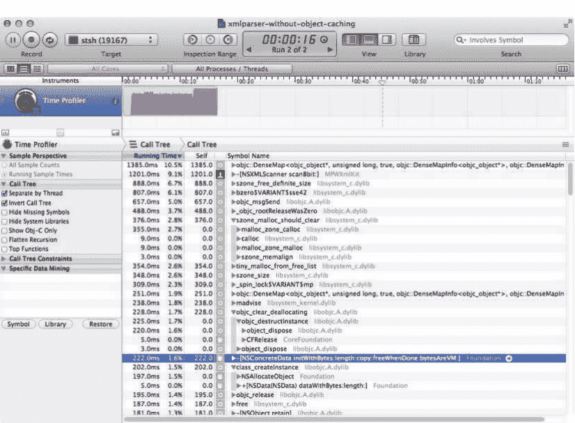

图 4.2 未优化的 XML X 解析器的性能

### 示例 4.7 MPWSubData 类定义

```
@interface MPWSubData : NSString <NSCoding>
    NSData* referencedData;
    const void *myBytes;
    unsigned int myLength;
```


`MPWSubData` 的一个微妙之处在于，它的工作方式非常像 `NSData`，但实际上是一个 `NSString` 的子类，这非常方便。这适用于字节和字符之间有 1:1 映射的字符串编码，例如 ASCII 或 ISOLatin。如今所有的 XML 内容都是 UTF-8，它并不符合这一要求，看起来至多也就是是行不通。然而，事实证明，从设计上看，ASCII 是 UTF-8 的子集，因此解析器检测到的片段是对象，廉价的 89

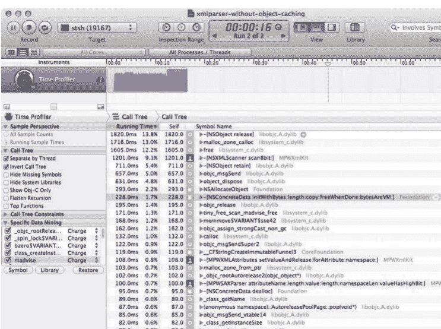

图 4.3 非 XML 解析器的性能，昂贵的方案被证明将这些片段转换为纯 ASCII 类型的 `MPWSubData`

幸运的是，大多数内容必须能够用 UTF-8 的 ASCII 子集表示，以此此类推。这种 XML 特定的数据是临时数据，正是这种“不创建对象”能够产生回报的数据，因此该方案被证明运行良好。

`MPWSubData` 对象在初始化时会带上所引用的缓冲区（一个 `NSData` 以及其在数据中引用部分的起始位置和长度，见示例 4.8）。它会保留引用的 Data，以确保底层缓冲区不会从其下方释放。由于它通常会多次使用相同的缓冲区使用，因此它对缓冲区已正确设置的情况进行了优化，以避免不必要的引用计数操作，否则这会显著影响总性能。

# 第 4 章 CPU 示例：XML 解析

## 示例 4.8 重新初始化 MPWSubData

```objc
- (reInitWithData:(NSData*)data bytes:(const char*)bytes
  length:(unsigned) len
{
  if (data != nil) {
    if (referencedData != data) {
      [referencedData release];
      referencedData=[data retain];
    }
  } else {
    [NSException raise:@"subdata (re-)initialized with nil data"
      format:@"subdata (re-)initialized with nil data"];
  }
  myBytes=bytes;
  myLength=len;
  return self;
}
```

## 评估

有了对象缓存并开始交付 `MPWSubData` 对象后，SAX 解析器中会发生的大部分对象创建被重新初始化一个指针池和操作循环缓冲区所取代。在我那个 291-MB 的示例文件中，处理速度从 22 MB/s 提高到 163 MB/s，提升了 5 倍。图 4.4 所示的分析图显示，对象分配现在要次要得多，大部分时间都花在了扫描 XML 文件上，尽管我们优化的 `-getObject` 方法设地表现了一番！

需要注意的是，在某种意义上，对象分配只是被延迟了，而不是消除了。如果客户端保留它通过此接口接收到的每个对象，缓存的效果就会减小，解析器将需要每次创建每个对象，而不是重用已分配的对象。然而，在几乎所有实际场景中，延迟都是可以消除——解析文本文件期间创建的绝大多数“字符串”都不会以最终输出的字符串形式存在，即使最终输出被完全保留在内存中。我们在第 3 章的“字符串”部分讨论字符串时展示了这一点：原始数据大部分是结构性的，被对象结构所取代；部分是数值内容，通常被原始数字类型取代；而只有极小部分是实际的文本内容。

在 OS X 10.8 到 10.11 上，Apple 的 `NSXMLParser` 在相同的文件上可以处理 44 MB/s，这比我们未优化的版本快，并且显著快于之前 OS 版本的 `NSXMLParser` 实现，即使考虑到硬件改进的因素。然而，实现这种改进似乎已经耗尽了缓存的陷阱之一：缓存了（太多）内容。

| 记录 | 目标 | 检查范围 | 视图 | 库 | 搜索 |
| --- | --- | --- | --- | --- | --- |
| | | 00:00:04 | 第 1 次运行/1 次 | | |
| 所有摄像头 | 线程 | | | | | |
| instruments | | | | | |
| Time Profiler | | | | | |

图 4.4 优化的 XML 解析器的性能

第一个指标是图 4.5 顶部的输出，显示使用了 997 MB 的 RPRVT 内存（进程本身，而非共享内存）。下方工具中的运行堆显示此评估基本上是正确的，但数值太低了；堆上分配了 320 MB 的 `NSString`、270 MB 的 `NSDictionary` 和 1.1 GB 的“非对象”内存，总计超过 1.6 GB，或者说是 XML 文件大小的 5 倍扩展因子（该文件是内存映射的，因此不会显示在堆中）。

| 计数 | 字节 | 平均值 | 类名 | 类型 | 二进制文件 |
| --- | --- | --- | --- | --- | --- |
| 506586 | 3277320 | 64.7 | __NSString | | |
| 10694 | 271825 | 25.4 | __NSDictionary | | |
| 2921 | 153352 | 39.3 | non-object | |
| 8 | 5760 | 72.0 | | | # Chapter 4 CPU: XML Parsing

修改或复制；解析器始终只生成原始字节的引用，同时记录客户端实际访问数据时所使用的编码。这产生了一种“按需付费”的性能成本结构，即在真正需要之前会避免执行实际工作。

## 优化整个组件：MAX

XML 解析器通常用于从相关的 XML 文件中提取有用的数据，这意味着用户代码必须对结果进行解析。正如我们所看到的，DOM 和 SAX 解析器呈现出一种难以接受的权衡：DOM 解析器相当方便，但从本质上说效率很低，即使有了本文提出的改进也是如此。它们要求在应用级处理开始之前，将整个 XML 文档解析为内存中的树表示形式，这所需的内存至少是已有的文本 XML 表示的 6 倍。

另一方面，SAX 解析器可以非常高效，但对于非本质任务需要相当复杂的代码，这些代码很难编写正确，而且更难运行得快。示例 4.9 简要展示了使用 SAX 解析器实际看起来像什么样。虽然我们只处理了一种特定的 XML 类型，但但我们通过检查另外 10 种类型模拟了一个更真实的场景，尽管文件类型超过了 50 种，而这些类型实际上需要以类似的方式处理。

### 示例 4.9 使用 SAX 加载和解析抽象

```objc
@interface MedParser:Object
{
    NSMutableString *content;
    NSMutableArray *abstracts;
}
@property (strong, nonatomic) NSMutableString *content;
@property (strong, nonatomic) NSMutableArray *abstracts;
@end

@implementation MedParser

-(void)parser:(NSXMLParser *)parser
    -didStartElement:(NSString *)elementName
    namespaceURI:(NSString *)namespaceURI qualifiedName:(NSString *)qName
    attributes:(NSDictionary *)attributeDict
{
    if ([elementName isEqual:@"AbstractText"]) {
        [self setContent:[NSMutable string]];
    } else {
        [self setContent:nil];
    }
}
```

- (void)parser: (NSXMLParser *)parser didEndElement:(NSString*)elementName
namespaceURI:(NSString*)namespaceURI isEqual:(NSString*)@" qualifiedName:(NSString*)qName
{
```objc
if ([elementName isEqual:@"Abstract"]) {
} else if ([elementName isEqual:@"AbstractText"]) {
    [abstracts addObject:content];
    [self setContent:nil];
} else if ([elementName isEqual:@"Acronym"]) {
} else if ([elementName isEqual:@"Affiliation"]) {
} else if ([elementName isEqual:@"Agency"]) {
} else if ([elementName isEqual:@"Article"]) {
} else if ([elementName isEqual:@"ArticleTitle"]) {
} else if ([elementName isEqual:@"Author"]) {
} else if ([elementName isEqual:@"AuthorList"]) {
} else if ([elementName isEqual:@"Chemical"]) {
}
```
- (void)parser: (NSXMLParser *)parser foundCharacters:(NSString*)string
{
    [content appendString:string];
}
```

涉及的 XML 文件是一个 130 MB 的医学期刊文章数据库。在本章的“廉价对象”部分，使用基础 SAX 解析器运行需 1.3 秒，而使用 `NSXMLParser` 运行需 5.3 秒。加上示例 4.9 中的客户端代码后，两者的计时都增加了 1.7 秒，分别达到 3.0 秒和 7.0 秒。

当然，这 1.7 秒代表了我们的 SAX 解析器运行时间增加了 132%，这意味着即使在使用有限的处理量时，我们高效的 NSXML 解析器也被客户端处理成本所淹没了。

原因是，SAX API 基本上要求客户端执行字符串比较和查找，以便为特定的 XML 标签分发适当的操作。我们探索过，这种操作在使用 `NSString` 和 `CFString` 时是非常昂贵的。通过 Instruments 检查确认了这些字符串比较确实可以消除吗？

XML 消息 API (MAX) 利用 Objective-C 运行时和一些调优过的对象，将这些字符串比较转换为消息发送。遇到的每个 XML 元素都会变成形式为 `<ElementName:element:attributes:parser:to>` 的消息，发送给解析的代理对象。参数是该特定元素的子元素（已由解析器处理）、属性，以及如果客户端需要更多信息，则包含解析器对象本身。预计消息返回一个代表元素的对象，该对象将作为参数传递给元素栈上方的处理消息。

## 第 4 章 CPU 示例：XML 解析

示例 4.10 显示了针对示例 4.9 中用 SAX 实现的相同解析器的 MAX 客户端代码`-AbstractTextElement:attributes:parser:` 处理属性并返回空，因为我们没有在构建树，只是获取属性。（与 Cocoa 惯例相反，消息名称被大写化，以精确匹配相应 XML 元素的名称）。不需要管理原子计数器，而且尝试通过添加处理消息来模拟额外的负载也不会增加任何开销。请注意，类型信息纯用于文档目的：由于消息是在运行时合成的，编译器永远不会将源码与方法实现连接，也永远无法检查返回类型。

## 示例 4.10 使用 MAX 获取抽象

```objc
@interface MedParser:NSObject
{
NSMutableArray *abstracts;
}
@property (string,nonatomic) NSMutableArray *abstracts;
@end

@implementation MedParser
-AbstractTextElement:(MPXXMLAttributes *)elements
    attributes:(MPXXMLAttributes *)attrs
    parser:(MPWMAXParser *)parser
{
 id text = [elements combinedText];
[abstracts addObject:text ? text : @""];
 return nil;
}
@end
```

由于构建（虚拟）树的努力，MAX 在处理 130 MB 文件时比我们的 SAX 解析器稍慢，但比 `NSXMLParser` 快 3 倍（运行 1.6 秒）。从之前的讨论中可以明显看出在 SAX 之上实现 MAX 是可能的，事实上，MAX 是建立在 SAX 之上的。MAX 接收来自示例 4.4 XML 扫描器的字符，并通过特殊的 `MPWString` 字典将这些字符映射到代理。属性和元素存储在一个特殊的字典/数组混合体中，该结构保持顺序并允许同名元素，这是 XML 所要求的。

最后，栈经过了调整，使得解析时执行的工作最少，仅为扫描、几次查找和消息发送。

你可能疑问并行性在哪里。它不存在，主要因为 XML 本质上是一种顺序文件格式。例如，你可能认为可以并行化子树，但通常无法知道特定子树有多深，这意味着你的划分可能是错的，而且在解析完现有子树之前，你无法继续下一个元素。解析器与客户端之间的接口也是一个瓶颈，交互非常频繁且细粒。

我见过的唯一可能行的并行 XML 解析方法是对整个文档进行非常快速且粗略的扫描，然后根据结构将其部分划分到不同的线程。

## 总结

本章介绍了从底层的字符处理思想开始，到使用上一章中看到的技术创建高效面向对象的 API 的 XML 解析器。涉及的 XML 扫描器受 Leopard Spotlight 导入器的启发，是第一个受 I/O 而非 CPU 限制的 Spotlight 导入器。SAX 解析器被 Apple 的帮助索引器使用，作为之前 XMLParser 的替代方案，速度快了几倍。

如果你以后需要快速的 XML 处理，你现在已经准备好了！源代码位于 http://github.com/mpw/Objective-XML。

开个玩笑的，所介绍的技术并不适用于 XML，甚至不适用于解析——它们广泛适用。例如，第 1 章提到的 Postscript 解释器使用相同的技术在语言导向的任务上优于 Adobe 自己的 C 语言实现（图形由 CoreGraphics 处理）。这意味着如果你有一个合理的 API，你始终可以

在 Objective-C 中创建一个高效的实现，并根据需要混合使用高层和低层的实现细节。

最后，我们还看到，真正的卓越性能不仅在于创建现有 API 的高效实现。API 的设计对于决定该 API 是否能同时实现 (a) 被实现，以及更重要的 (b) 被高效地使用至关重要。

# 内存：原理

内存使用是性能调优中最棘手且最难被理解的领域之一，但可以说它是最重要的领域之一。乍一看，它似乎根本不是一个性能领域：内存要么存在，要么没用。事实上，在 CPU 直接连接内存的时代（在它们获得从虚拟内存到各种缓存的多级内存层次之前），计算机的工作原理恰恰就是这样。

如今，内存是一个更具流动性的概念。一方面，虚拟内存提供了复用到物理内存上的孤立地址空间。另一方面，CPU 只有在访问内置 CPU 内部的极少量内存时才能以全速运行，而数据在磁盘、内存和各种 CPU 缓存之间不断且透明地流动。

## 内存层次结构

这些信息可以从 Apple 对 MacBook Air 的规范以及 Intel 处理器数据表中获得，但大部分信息也可以通过 `sysctl` 命令获取，示例输出见例 5.1。`sysctl` 输出不仅确认了缓存大小（L1 为 32,768 字节，L2 为 262,144 字节，L3 为 4,194,304 字节），还告诉我们缓存行的大小为 64 字节。所有

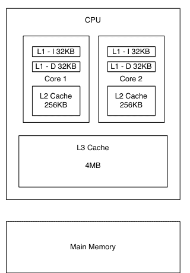 缓存都不是按字节或字组织的，而是按行（lines）组织的，因此这是从缓存到 CPU、缓存之间或缓存与主内存之间传输的字节数。

### 示例 5.1 sysctl 硬件信息

```
sysctl -a
hw.physicalcpu_max: 2
hw.cachesize = 64
hw.l1cachesize = 32768
hw.l1dcachesize = 32768
hw.12settings = 1
hw.12cachesize = 262144
hw.13settings = 1
hw.13cachesize = 4194304
machdep.cpu.brand_string: Intel(R) Core(TM) i7-2677M CPU @ 1.80GHz
```


为什么会有如此复杂的安排？简单的回答是，在编写时，CPU 的速度大约比主内存快 100 倍。我那可靠的 `Apple II` 的内存访问时间约为 450 ns，这在当时是顶尖水平。处理器运行在 1 MHz，每个周期最多访问 1 字节内存，内存速度实际上比 CPU 需要的速度快了一倍，允许 Woz 每隔一个 DRAM 周期刷新一次显示，而 CPU 完全毫无察觉。到第一代 `Mac` 时，CPU 运行在 7 MHz，DRAM 访问为 250 ns，视频刷新的加入已经对 CPU 访问内存产生了轻微影响，将有效速度降低到 6 MHz，尽管显示器只有微小的 512x342 单色。当时的 `Amiga` 由于其高分辨率的色彩图形和额外的协处理器几乎会耗尽 CPU 的内存访问周期，这促使设计人员将其物理内存划分为供视频逻辑访问的片上内存和供 CPU 专用的事实内存。

虽然现代 CPU 的速度已经比 `Apple II+` 快了 1000 倍以上，但内存访问时间仅提高了 10 倍，大约处于 25 到 45 ns 之间。复杂的缓存安排旨在隐藏延迟差异。同时，内存接口经过重新设计，每次访问可以提供更多数据，在增加延迟的情况下显著提高了带宽，这一切幸运的是，所有这些复杂性几乎是透明的，对处理器基本不可见，处理器只看到内存访问指令。为什么要去查看缓存层次结构和内存接口呢？

图 5.2 中的数据提供了该问题的答案：不同的内存访问模式具有不同的性能特征，差异高达 100 倍！这些数据是通过运行例 5.2 获得的。该程序旨在创建顺序或随机的访问模式，甚至限制在特定缓存的范围内或保持为主内存访问。

### 示例 5.2 测试内存访问

```c
#include <stdio.h>
#include <stdlib.h>
#include <string.h>
#define MBSIZE 16
#define SIZE MBSIZE * 1024 * 1024
#define UNROLL 4
#define COUNT (1000 * 1000)
int main(int argc, char *argv[]) {
    if (argc > 2) {
        long stride=atol(argv[2]); stride;
        char *ptr=malloc(SIZE + 20 * stride); 
        memset(ptr, 55, SIZE + 10 * stride);
        char *cur=ptr;
        long count=atol(argv[1]) * COUNT;
        long result=0;
        for (int i=0; i<COUNT; i++) {
            for (int j=0; j<UNROLL; j++) {
                result += cur[((i * UNROLL + j) * stride) % (SIZE / stride)];
            }
        }
    }
    if (count > 0) {
        printf("result: %ld\n", result);
    } else {
        printf("usage: %s <stride>\n", argv[0]);
    }
}
```

图 5.2 中的数据提供了该问题的答案：不同的内存访问模式具有不同的性能特征，差异高达 100 倍！这些数据是通过运行例 5.2 获得的。该程序旨在创建顺序或随机的访问模式，甚至限制在特定缓存的范围内或保持为主内存访问。

## 第 5 章 内存：原理

### 示例 5.3 确定 VM 页大小

```c
#include <stdio.h>
#include <mach/vm_page_size.h>
int main() {
    printf("page-size: %ld mask: %lx shift: %d\n", vm_kernel_page_size, vm_kernel_page_mask,vm_kernel_page_shift);
    return 0;
}
```

基本过程假设所有物理内存都用于支持正在翻译的虚拟地址。情况并非总是如此，事实上，提供给进程的地址空间最初往往是由内存支持的，但要么是全零，要么由文件内容支持。

无论何种情况，操作系统都会在实际访问内存时提供真实的内存，这些内存要么被清零，要么填充了来自磁盘文件的数据。

内存无论是从磁盘映射的还是从操作系统分配的，在初始时都处于一个干净的位置。当你的进程写入某个内存位置时，该虚拟内存页会被虚拟内存子系统标记为“脏”`dirty`，使其与后端存储器 `backing store` 产生区别。

这种区别的原因在于，脏页的代价远比洁页高得多，至少在内存紧张时是如此；由于操作系统尽可能尽可能调整内存使用，即使你有充足的可用内存，内存本质上也会变得紧张。

操作系统会尝试保留最少数量的空闲页供分配，因此一旦空闲内存低于阈值，它就会开始在内存中寻找可以驱逐的页。洁页很容易驱逐，因为只需要将它们的映射改回磁盘上的文件，并将该页添加到内核维护的空闲内存池中。只有当该页再次被需要时才会产生 I/O，而且那时只需要进行读取。相比之下，脏页必须将其内容写入磁盘，在这些 I/O 完成之前无法重用。

`iOS` 不使用交换分区 `swap`，因此脏页在 `iOS` 上的开销更大。无论使用频率多低，脏页都永远无法被写入磁盘，因此 `iOS` 必须更激进地清理页 `可执行代码、映射文件` 或终止进程。

## 堆与栈

“堆 `Heap`”和“栈 `Stack`”传统上指的是两个不同的动态分配内存区域。图 5.5 显示了这种传统布局：程序的静态区域、实际程序代码、已初始化的全局/静态数据以及未初始化的全局/静态数据位于地址空间的底部。

| 栈 `Stack` |
| :--- |
| 空闲 `free` |
| 堆 `Heap` |
| BSS `未初始化` |
| Data `已初始化` |
| 程序 `"Text"` |

图 5.5 带有堆和栈的传统 Unix 内存布局

用于动态分配，程序栈从空闲空间的顶部开始向下增长，而堆从空闲空间的底部开始并向上增长，使用 `sbrk()` 函数。

这种关于进程内存布局以及“堆”和“栈”角色的描述已经不再准确了：并没有一个单一的内存区域被称为“堆栈”。相反，“堆”由所有从操作系统分配的或可供操作系统分配的内存 `地址空间` 组成，并且存在多个栈，每个线程都有一个，且实际上是从堆中分配的。地址空间是巨大的，多个映射文件、可执行库和“堆”被映射在这一地址空间内的不同位置。图 5.6 显示了这种现代内存布局的粗示意图。

如你所见，可以存在多个栈、多个可以分配“堆”内存的区域 `区域`，每个区域都有标记以了解更多不同分配的信息，以及多个将可执行文件或数据文件映射到地址空间的地方。还存在地址空间区域 `灰色所示` 表示未分配，与示意图不同，在 64 位地址空间中，这些部分远超已分配部分。

1. 参见 `man sbrk`。

| | |
|---|---|
| dylib₂ | |
| malloc zone₂ | |
| Stack₁ | |
| malloc zone₁ | |
| dylib₁ | |
| Stack₂ | |
| main() | |
| mapped file₁ | |
| 0 | |

图 5.6 Mach 内存布局：多个栈，堆无处不在

## 栈分配

这套术语已经一直流传下来，并且与某种更复杂的真相相近。它现在用于区分两种不同的分配类型：**栈分配**发生在函数或方法被调用时，通过递减栈指针隐式地/自动发生。函数内部的所有局部变量都使用这种指针递减进行分配，因此这种方式极快，释放内存也是如此：指针再次递增。大小由编译器计算。

图 5.7 阐述了示例 5.4 给出的示意程序中栈分配是如何工作的：一个 `main()` 函数包含一个单一 `int` 变量和两个函数，其中第一个函数有一个 `NSRect` 局部变量，第二个函数有更多整数。该图说明了栈分配的另一个益处：**引用局部性 `locality of reference`**。由于分配是通过递增指针实现的，所有变量在内存中的位置都彼此靠近，这对于缓存的组织方式是有益的。这里显示的所有局部变量都能放进同一个缓存行 `cache line`，且同一条缓存行会被后续函数重用，因此所有与栈变量的交互都发生在 L1 缓存中，访问 L2 或 L3 的频率很低，与主内存的交互极罕见。

| int₁ | | int₁ | | call | int₁ |
|---|---|---|---|---|---|
| call | NSRRect, | x | return | int₂ | |
| | | y | | int₃ | |
| | | width | | | |

图 5.7 栈分配，示例 5.4

```c
int function1() {
    NSRect rect;
}
int function2() {
    int x, y, width;
}
int main() {
    int a;
    function1();
    function2();
}
```

这种术语保留了下来，并且接近某种更复杂的真相。它现在用于区分两种不同的分配类型：**栈分配**发生在函数或方法被调用时，通过递减栈指针隐式地/自动发生。函数内部的所有变量都使用这种指针递减进行分配，因此这种方式极快，释放内存也是如此：指针再次递增。大小由编译器计算。

图 5.7 栈分配，示例 5.4

```c
int function1() {
    NSRect rect;
}
int function2() {
    int x, y, width;
}
int main() {
    int a;
    function1();
    function2();
}
```

这种术语保留了下来，并且接近某种更复杂的真相。它现在用于区分两种不同的分配类型：**栈分配**发生在函数或方法被调用时，通过递减栈指针隐式地/自动发生。函数内部的所有变量都使用这种指针递减进行分配，因此这种方式极快，释放内存也是如此：指针再次递增。大小由编译器计算。

## 使用 `malloc()` 进行堆分配

另一方面，堆分配是手动的：必须调用函数或方法 `在 Swift 中为构造函数` 来分配，并调用另一个函数来释放 `有不同的方法可以实现这一点，参见本章的“资源管理”部分`。如果分配需要超出创建它的函数的作用域，则是必要的。堆分配意味着指针和引用语义，因此你可以对其拥有多个引用。`Objective-C` 和 `Swift` 对象具有引用语义并被分配。

用户程序不直接从操作系统获取内存 `地址空间`，因为任何分配都需要进行系统调用会太慢，且最小分配将是 4KB 页。`malloc` 包从操作系统请求更大的 `多页` 内存池，并用较小的尺寸交付给用户程序。用户程序的任务是使用 `free` 将内存归还这些池。

在版本 10.5 之前，`OS X` 使用“scalable malloc”，这种实现强调内存节约而非原始性能，并且需要大量的锁。从 Snow Leopard 开始，它被 magazine malloc 取代，后者的这种实现受到 Hoard 分配器的启发，专为多线程应用程序设计。除了极大减少了锁开销和竞争外，这种实现还将连续内存块返回给操作系统，这是 scalable malloc 从未尝试过的。

1. Stepstone 版 `Objective-C` 允许栈分配对象，这一功能在 NeXT/Apple 版本中被删除了。
2. http://www.hoard.org

## 堆与栈

一个错误的假设是内存碎片总会阻止这种情况的发生。因此，从 10.6 版本开始，进程的堆使用量实际上可以减少，以前无论使用多少堆内存，它只会单调增加。雪上加霜的是，未使用的内存通常是“脏”的，因此会发生到磁盘交换。

示例 5.5 测量了 `malloc()` 和 `free()` 块大小内存块所需的时间 `纳秒`，其大小按 2 的幂次方增加，因此第 9 次迭代分配了 2^9 = 512 字节。

### 示例 5.5 内存分配时间

```c
#import <Foundation/Foundation.h>
NSTimeInterval mallocTest( long size, long iterations ) {
    NSTimeInterval start=[NSDate timeIntervalSinceReferenceDate];
    for (long i=0;i<iterations;i++) {
        void *ptr=malloc( size);
        free(ptr);
    }
    NSTimeInterval stop=[NSDate timeIntervalSinceReferenceDate];
    return (stop - start) * (1000000000.0);
}
int main() {
    printf("logsize, time (ns), rate (bytes/ns)\n");
    for(long log_size=1; log_size<10; log_size++) {
        NSTimeInterval nsPerAlloc=mallocTest( 1<<log_size, 1000000);
        printf("%10d, %f, %g\n", log_size,nsPerAlloc,size/nsPerAlloc);
    }
}
```


结果如图 5.8 所示，`x` 轴显示 2 的幂次方。如你所见，分配时间保持在每次 45 ns，直到大小达到 `2^7 = 128 KB`（期间在 512 字节处出现了一个无法解释但对我来说可复现的峰值）。在 128 KB 处出现了一个阶跃函数，增加到约 280 ns，这是因为分配器从从大块获取的 `malloc-zones` 分配特定请求，切换到了从操作系统分配每个单独请求。恒定的内核调用开销在一段时间内占据主导地位，直到请求变得大到使得填充页表项在 16 MB 左右开始消耗明显的时间。

从 1 字节到 128 KB 的尺寸分配花费恒定的时间，这意味着将给定数量的内存分配为一个大对象比分配许多小对象要便宜得多。唯一的问题是这种差异是否重要，图 5.9 显示该问题的答案肯定的“是”。

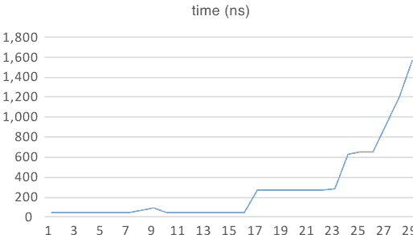
图 5.8 按 2 的幂次方大小 (2ⁿ) 的 malloc 时间

图 5.9 绘制了在不同分配大小下每纳秒可以分配的字节数。与图 5.8 的线性刻度不同，这里的速率必须在对数刻度上绘制；在 8 字节的最小对象大小（一个指针外无一物）处，我们的分配速率略低于每纳秒 0.1 字节。直线是我们在 Skylake 处理器上使用分配内存的速率，L1 缓存为 1,400 字节/ns，主内存为 18 字节/ns。

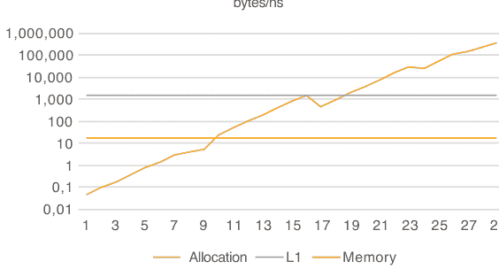
图 5.9 按 2 的幂次方大小 (2ⁿ) 的 Malloc 速率

# 第5章 内存：原理

## 资源管理

因此对于小对象，堆分配与 L1 缓存开销的对比大约是 10 倍。程序所使用的资源（如内存）需要管理其生命周期，但资源是如何分配和释放的呢？

我们在上一节中看到的简单资源管理方案适用于大多数过程语言，包括 Objective-C：在方法作用域内的栈变量在方法退出后会自动销毁。

对于动态确定生命周期的堆分配对象，早期的 Objective-C 使用手动内存管理，类似于 C 的 `malloc()` 和 `free()`：这在存在单一引用“所有者”的简单情况下是有效的，因为只有一个引用，或者有一个可以确定对象生命期的主引用，但当多个独立实体需要协调对象的生命周期时，这种方法就失效了。

## 垃圾回收

幸运的是，在非平凡环境中确定引用生命周期的问题历史悠久，许多解决方案可以追溯到 1950 年代的早期 LISP 实现。

垃圾回收主要有两种技术：追踪堆和使用引用计数查找死亡对象。正如 Bacon、Cheng 和 Rajan 在 2004 年的论文《垃圾回收的统一理论》所示，这些方法（追踪垃圾回收和引用计数收集）是对立的，每种收集器的优化版本都带有对方的特征。

早期的垃圾收集使用引用计数，每当创建一个新引用时，对象内部的计数就会增加；每当引用消失时，计数就会减少，这一切由运行时自动完成。当引用计数归零时，对象就可以释放，因为不再有引用指向它。

## Foundation 对象所有权

当 OPENSTEP 引入了今天仍然熟悉的 Foundation 类（`NSArray`, `NSString`, `NSDictionary`, `NSNumber` 等）时，它还引入了基于引用计数的垃圾回收方案，以取代早期 NextStep 版本的完全手动资源管理方案。

尽管没有集成到语言中，引用计数收集机制可以与 C 这样的低级语言共存。由于引用计数系统无法特殊访问内部对象，因此就此而言速度较慢。这一点通过其通常不跟踪局部变量中的引用得到了补偿，所有权规则仅适用于存储在实例变量中的引用。

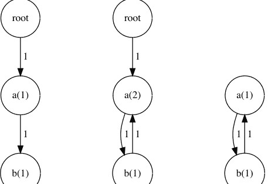

图 5.10 创建保留循环

然而，由于它们相互指向，它们的引用计数保持在 1，因此引用计数无法检测到它们应该被释放。
引用计数是通过使用普通消息发送来实现的，这一事实允许了诸如前文描述的缓存之类的优化，其中我们通过检查引用计数是否为 1 来判断是否从缓存中剔除对象。如果能够证明这些操作是平衡的，并且有一个外部引用在整个持续时间内保持对象存活，那么它甚至允许程序员在性能关键的段落中完全省略引用计数操作。引用计数的精确性使得昂贵资源的管理可以寄载在现有机制上，尽管必须小心确保对象的生命周期不会被意外延长。

## 追踪垃圾回收 (Tracing GC)

由于引用计数本身不处理循环引用，那些早期的收集器经常通过标记-清除收集器（tracing mark-and-sweep）进行扩展，该收集器定期运行。在标记阶段，它从一个或多个已知的根对象追踪所有活跃对象的引用；在清除阶段，它会释放所有在标记阶段未被发现为活跃的对象，即垃圾。
虽然标记-清除也可以单独使用，但扫描整个堆是非常昂贵的，而且难以与程序并发执行，这导致了“垃圾回收停顿”现象，即在运行垃圾回收时，正在运行的程序会停止。并发垃圾回收通常可以缩短停顿时间但无法完全消除它们，并且会带来额外的成本和复杂性。

标记-清除与虚拟内存的交互性较差，因为在虚拟内存环境中，它扫描的是地址空间而非内存，这可能会从磁盘中换入大量未使用的内存，结果却发现它们仍未被使用。

分代搜取收集器（Generation-scavenging collectors）利用时间相干性改善了负面影响，而复制收集器（copying collectors）将分配变为一种廉价的“指针指针”操作，这就是为什么大多数现代收集器既是复制又是分代的。

在像 Objective-C 这样带有指针的语言中，很难可靠且高效地实现追踪垃圾回收，因为指针可能被隐藏，模式可能导致误报，且内存无法移动。

虽然在特殊情况下可行，但 Apple 自研的追踪垃圾回收从未达到过在 X X 和 iOS 上运行的性能和可靠性水平。最终，它从未进入 iOS，并在 OS X 上发布两个版本后被废弃。

## 自动引用计数 (ARC)

随着 10.7 版本废弃 GC，Apple 引入了自动引用计数（ARC）作为一种 Objective-C 语言特性。与 Apple 的追踪垃圾回收相比，最大的优势可能是 ARC 可以与其他引用计数代码混合，而追踪收集器必须为整个进程（包括插件）启用。

ARC 不仅仅管理现有的所有权规则（这些规则大多是在实例变量中存储引用）。相反，编译器在赋值 Objective-C 对象指针以及在函数之间传递/返回指针时，会插入引用计数操作，这极大地增加了引用计数操作的数量，同时也关闭了潜在的漏洞窗口并使引用计数更加精确。

尽管支持引用计数的运行时函数有所改进，但这些额外引用计数操作的开销将是无法接受的，因此使用了一个 LLVM 优化通过来尽可能移除许多这些操作。虽然这个额外的通过可以消除许多新增的引用计数操作，但仍会有相当一部分留下来，导致与 MRC（手动引用计数）相比出现典型的 10% 到 100% 的缓慢。

循环不是以原子方式处理的，尽管添加了弱引用（weak references）等机制使得避免循环变得更容易。弱引用不会计入被引用对象的引用计数（计数的称为强引用），此外还会维护一个指向引用指针的回溯指针。当对象的强引用计数变为零且对象被销毁时，所有的弱引用都会被追踪到并将指针置零。这避免了指向已释放对象的悬悬引用。

## 进程级资源回收

虽然到为止的所有技术在程序运行时均有效，但重要的是，进程所使用的所有临时资源都会在进程终止时由操作系统清理。这种资源回收不仅在本质上是完美的，而且非常快速。

## 总结

在本章中，我们已经了内存层次结构中不同元素之间巨大的性能跨度，这些元素都向用户程序呈现为一个统一的地址空间。为了优化内存访问性能，有必要最小化总内存使用并优化内存访问模式，使其能够利用硬件的（非线性）能力。

接下来的章节将首先展示如何测量内存消耗并识别访问模式，然后介绍调整内存使用的技术。

# 内存：测量与工具

内存有许多不同的维度，没有哪一个是最优先的。即使是看似简单的问题“我的程序使用了多少内存？”也没有一个显而易见的正确答案。你的程序通过 `malloc` 从系统获得的内存量，以及进程（包括 `malloc`）从操作系统获得的内存量。这两者实际上都是地址空间，因此涉及到该地址空间中有多少是由真实内存支撑。此外，你还有映射的文件，大量的地址空间和内存是在进程之间共享的（大部分由系统）。

此外，操作系统正尽量优化当前运行程序的内存使用，因此获取其他信息有时更像是在等待一个高手，而不是仅仅进行测量。

此外，分析内存消耗的工具通常需要处理比 CPU 样本多得的数据，对运行程序的影响也大得多。

# Xcode 指标 (Gges)

Xcode 的“始终开启”轻量级分析也包含了内存概览。它提供了内存消耗的概述，包括在运行程序时，它提供了关于内存的的视图。


图 5.10 创建保留循环

然而，由于它们相互指向，它们的引用计数保持在 1，因此引用计数无法检测到它们应该被释放。
引用计数是通过使用普通消息发送来实现的，这一事实允许了诸如前文描述的缓存之类的优化，其中我们通过检查引用计数是否为 1 来判断是否从缓存中剔除对象。如果能够证明这些操作是平衡的，并且有一个外部引用在整个持续时间内保持对象存活，那么甚至允许程序员在性能关键的段落中完全省略引用计数操作。引用计数的精确性使得昂贵资源的管理可以寄载在现有机制上，尽管必须小心确保对象的生命周期不会被意外延长。

## 追踪 GC (Tracing GC)

由于引用计数本身不处理循环引用，那些早期的收集器经常通过标记-清除收集器（tracing mark-and-sweep）进行扩展，该收集器定期运行。在标记阶段，它从一个或多个已知的根对象追踪所有活跃对象的引用；在清除阶段，它会释放所有在标记阶段未被发现为活跃的对象，即垃圾。
虽然标记-清除也可以单独使用，但扫描整个堆是非常昂贵的，而且难以与程序并发执行，这导致了“垃圾回收停顿”现象，即在运行垃圾回收时，正在运行的程序会停止。并发垃圾回收通常可以缩短停顿时间但无法完全消除它们，并且会带来额外的成本和复杂性。

标记-清除与虚拟内存的交互性较差，因为在虚拟内存环境中，它扫描的是地址空间而非内存，这可能会从磁盘中换入大量未使用的内存，结果却发现它们仍未被使用。

分代搜取收集器（Generation-scavenging collectors）利用时间相干性改善了负面影响，而复制收集器（copying collectors）将分配变为一种廉价的“指针”操作，这就是为什么大多数现代收集器既是复制又是分代的。

在像 Objective-C 这样带有指针的语言中，很难可靠且高效地实现追踪垃圾回收，因为指针可能被隐藏，模式可能导致误报，且内存无法移动。

虽然在特殊情况下可行，但 Apple 自研的追踪垃圾回收从未达到过在 OS X 和 iOS 上运行的性能和可靠性水平。最终，它从未进入 iOS，并在 OS X 上发布两个版本后被废弃。

## 自动引用计数 (ARC)

随着 10.7 版本废弃 GC，Apple 引入了自动引用计数（ARC）作为一种 Objective-C 语言特性。与 Apple 的追踪垃圾回收相比，最大的优势可能是 ARC 可以与其他引用计数代码混合，而追踪收集器必须为整个进程（包括插件）启用。

ARC 不仅仅管理现有的所有权规则（这些规则大多是在实例变量中存储引用）。相反，编译器在赋值 Objective-C 对象指针以及在函数之间传递/返回指针时，会插入引用计数操作，这极大地增加了引用计数操作的数量，同时也关闭了潜在的漏洞窗口并使引用计数更加精确。

尽管支持引用计数的运行时函数有所改进，但这些额外引用计数操作的开销将是无法接受的，因此使用了一个 LLVM 优化通过尽可能移除许多这些操作。虽然这个额外的通过可以消除许多新增的引用计数操作，但仍会有相当一部分留下来，导致与 MRC（手动引用计数）相比出现典型的 10% 到 100% 的缓慢。

循环不是以原子方式处理的，尽管添加了弱引用（weak references）等机制使得避免循环变得更容易。弱引用不会计入被引用对象的引用计数（计数的称为强引用），此外还会维护一个指向引用指针的回溯指针。当对象的强引用计数变为零且对象被销毁时，所有的弱引用都会被追踪到并将指针置零。这避免了指向已释放对象的悬悬引用。

## 进程级资源回收

虽然到为止的所有技术在程序运行时均有效，但重要的是，进程所使用的所有临时资源都会在进程终止时由操作系统清理。这种资源回收不仅在本质上是完美的，而且非常快速。

## 总结

在本章中，我们已经了内存层次结构中不同元素之间巨大的性能跨度，这些元素都向用户程序呈现为一个统一的地址空间。为了优化内存访问性能，有必要最小化总内存使用并优化内存访问模式，使其能够利用硬件的（非线性）能力。

接下来的章节将首先展示如何测量内存消耗并识别访问模式，然后介绍调整内存使用的技术。

# 内存：测量与工具

内存有许多不同的维度，没有哪一个是最优先的。即使是看似简单的问题“我的程序使用了多少内存？”也没有一个显而易见的正确答案。你的程序通过 `malloc` 从系统获得的内存量，以及进程（包括 `malloc`）从操作系统获得的内存量。这两者实际上都是地址空间，因此涉及到该地址空间中有多少是由真实内存支撑。此外，你还有映射的文件，大量的地址空间和内存是在进程之间共享的（大部分由系统）。

此外，操作系统正尽量优化当前运行程序的内存使用，因此获取其他信息有时更像是在等待一个高手，而不是仅仅进行测量。

此外，分析内存消耗的工具通常需要处理比 CPU 样本多得的数据，对运行程序的影响也大得多。

# Xcode 指标 (Gges)

Xcode 的“始终开启”轻量级分析也包含了内存概览。它提供了内存消耗的概述，包括在运行程序时，它提供了关于内存的视图。

## heap

正如名字所示，`heap` 命令获取你的应用程序堆的快照，大致是通过 `malloc` 及其变体分配的内存。与 `top` 不同，它始终显示地址空间而非真实内存，以防这两个数字产生分歧。一方面，它将向你显示实际分配的

# 第 6 章内存：测量与工具


```
Processes: 71 total, 3 running, 68 sleeping, 264 threads

Load Avg: 0.13, 0.25, 0.19 CPU usage: 48.57%, 4.32%, 47.9% idle

SharedLib: 621M resident, 620M free, 48M linked

Memregions: 9753 total, 667M resident, 19M private, 323M shared.

PhysMem: 536M used, 964M active, 40M inactive, 1995M used, 210M free.

VM: 1420 size, 1839M framework, 8420(1) pages, (0) pageouts.

Networks: 1495/3156k in, 2855/4117k out.

Disks: 8376/1938 read, 1943/4117k write.
```

| PID | %CPU | TIME | #TH #Q | APRVT RSHID | VMEM | PRVMT |
| :--- | :--- | :--- | :--- | :--- | :--- | :--- | :--- |
| 475-sumint | 99.5 | 00:00:22 | 1/0 | 16 | 2356+240K | 735M | 240M+ |
| 0 kernel_task | 2.2 | 00:21:54 | 62/0 | 77 | 736 08M | 210M | 62M- |
| 450 Terminal | 1.0 | 00:01:03 | 5/0 | 115 | 940 27M | 396M | 43M- |
| 457 top | 1.0 | 00:01:78 | 1/0 | 274 | 871+996K | 113M | 114M+ |
| 238 Windows | 0.0 | 00:00:26 | 0/0 | 136 | 580 359K | 490M | 185M |
| 230 Microsoft | 0.2 | 00:00:24 | 0/0 | 112 | 119 338K | 948M | 109M |
| 118 SystemUI | 0.0 | 00:01:63 | 3/0 | 253 | 277 9456K | 207M | 17M- |
| 32 coveries | 0.0 | 00:01:74 | 4/0 | 71 | 498 2684K | 2856K | 22M- |
| 204 Quartz Debug | 0.0 | 00:01:58 | 0/0 | 141 | 2134+266K | 1294M | 13M |
| 642-MacOS-Off | 0.0 | 00:01:10 | 0/0 | 80 | 174 2184K | 8340K | 31M |
| 67-IPSecutd | 0.0 | 00:01:32 | 6/0 | 74 | 72 744K | 1988K | 32M |
| 113 launch | 0.0 | 00:00:00 | 0/0 | 218- 6 440K | 5080K | 30M |
| 16 disconnected | 0.0 | 00:02:17 | 0/0 | 64 | 40+ 804K | 12644K | 24M+ |
| 206 Preview | 0.0 | 00:02:53 | 2/0 | 184 | 148 9408K | 264M | 32M |

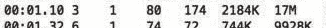

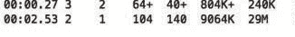

```
Processes: 71 total, 3 running, 68 sleeping, 277 threads

Load Avg: 0.37, 0.26, 0.19 CPU usage: 48.39%, 5.44%, 46.16% idle

SharedLib: 621M resident, 620M free, 48M linked
```


Memregions: 1832 total, 1950 resident, 19M private, 324M shared.

PhysMem: 5360M used, 964M active, 40M inactive, 1611M free.

VM: 1420 size, 1839M framework, 8420(1) pages, (0) pageouts.

Networks: 1495/3156k in, 2855/4117k out.

Disks: 8376/1938 read, 1943/4117k write.

| PID | %CPU | TIME | #TH #Q | APRVT RSHID | VMEM | PRVMT |
| :--- | :--- | :--- | :--- | :--- | :--- | :--- |
| 475-sumint | 99.5 | 00:00:22 | 1/0 | 16 | 2356+240K | 735M | 240M+ |
| 0 kernel_task | 2.2 | 00:21:54 | 62/0 | 77 | 736 08M | 210M | 62M- |
| 450 Terminal | 1.0 | 00:01:03 | 5/0 | 115 | 940 27M | 396M | 43M- |
| 457 top | 1.0 | 00:01:78 | 1/0 | 274 | 871+996K | 113M | 114M+ |
| 238 Windows | 0.0 | 00:00:26 | 0/0 | 136 | 580 359K | 490M | 185M |
| 230 Microsoft | 0.2 | 00:00:24 | 0/0 | 112 | 119 338K | 948M | 109M |
| 118 SystemUI | 0.0 | 00:01:64 | 3/0 | 253 | 277 9456K | 207M | 17M- |
| 32 coveries | 0.0 | 00:02:03 | 5/0 | 318 | 195 2688K | 199M | 16M- |
| 204 Quartz Debug | 0.0 | 00:01:58 | 0/0 | 141 | 2134+266K | 1294M | 13M |
| 642-MacOS-Off | 0.0 | 00:01:10 | 0/0 | 80 | 174 2184K | 8340K | 31M |
| 67-IPSecutd | 0.0 | 00:01:32 | 6/0 | 74 | 72 744K | 1988K | 32M |
| 113 launch | 0.0 | 00:00:00 | 0/0 | 218- 6 440K | 5080K | 30M |
| 16 disconnected | 0.0 | 00:02:17 | 0/0 | 64 | 40+ 804K | 12644K | 24M+ |
| 34 mds | 0.0 | 00:02:14 | 5/0 | 99 | 816 119M+ | 75M+ | 24M |
| 177 mdworker | 0.0 | 00:00:08 | 5/0 | 96 | 250 12M | 62M+ | 65M |
| 39 fseventsd | 0.0 | 00:00:32 | 2/0 | 93+ 65+ 244K | 1608K- | 25M |


# 命令行工具 123

程序甚至会按对象类拆分信息。它就像是你进程的 X 光机，我发现它对于分析行为极其有用。

要运行 `heap` 命令，你向它传递想要检查的进程名称或进程 ID。它会在标准输出 `stdout` 上提供两种类型的信息。第一部分是找到的每个 `malloc` 区域的摘要信息。后续显示的是运行中的 Xcode 的摘要信息。对于每个区域，它显示了当前分配了多少，已分配了多少。低利用率通常意味着内存碎片。

```
marcel8(dyld) heap

Process 30138: 99 zones

ZoneDefaultMalloc: Overall size: 4834KB; 23809KB (49% of capacity)

ZoneXMalloc: Overall size: 36864KB; 62KB (2% of capacity)

Zone auto_zone: Overall size: 848796KB; 100466KB (1% of capacity)

ZoneDefaultPurgeableMalloc: Overall size: 48KB; 0KB (0% of capacity)
```

对于详细信息，`heap` 尝试找出每个内存块，除了计数这些块，还包含了已标识对象的未分配（非对象）指针——用于字典的键和值存储——并将其添加到每个类的总大小中。

> `heap -sumObjectFields`

ZoneDefaultMalloc_0x1cbe00: 8183 nodes (2438032 bytes)

| COUNT | BYTES | CLASS_NAME | TYPE |
| :--- | :--- | :--- | :--- |
| 75368 | 228432 | 303.1 | non-object |
| 399 | 17856 | 44.4 | Security::TypedMeta<UInt32> C++ |
| 19704 | 1345508 | 68.3 | _NSString |
| 36720 | 2692720 | 733.3 | _NSDictionary |
| 36327 | 2324924 | 64.0 | _XPropertyMacroExpansion |
| 28727 | 6961184 | 242.2 | _NSDictionary |
| 25560 | 3304992 | 117.6 | _NSArray |
| 16772 | 1073048 | 64.0 | _FilePath |
| 14683 | 958848 | 65.3 | _NSAutoBlock |
| 14211 | 678864 | 47.6 | _NSArray |
| 13438 | 430010 | 32.0 | _XObjectSimpleMacroExpansion |

Zone auto_zone_0x10dc9100: 77118 nodes (10287608 bytes)

# 第 6 章内存：测量与工具

| COUNT | BYTES | AVG | CLASS_NAME | TYPE |
| :--- | :--- | :--- | :--- | --- |
| 226 | 14464 | 64.0 | RIPData | CType |
| 225 | 9047136 | 40209.5 | NSMutableData | |
| 221 | 7072 | 32.0 | CGPath | CType |
| 212 | 13568 | 64.0 | NSKeyValueClass | ObjC |

我使用了 `-sumObjectFields` 选项，它还考虑了已标识对象的未分配（非对象）指针——用于字典的键和值存储——并添加到每个类的总大小中。使用此选项，`heap` 显示 Xcode 使用了约 32 MB 的字典和 13 MB 的字符串（总计71 MB）。如果没有 `-sumObjectFields`，字典占用4.1 MB，字符串占用13 MB，但有 50 MB 被归类为通用非对象：

```
marshallochost[d]heap Xcode

[...]
```

Zone_zone_0xd1c91000: 773943 nodes (103008096 bytes)

| COUNT | BYTES | AVG | CLASS_NAME | TYPE |
| :--- | :--- | :--- | :--- | :--- |
| 197211 | 12928032 | 65.6 | _NSString | ObjC |
| 146067 | 5507344 | 335.7 | non-object | |
| 36720 | 2350080 | 64.0 | _NSDictionary | ObjC |
| 36227 | 2324228 | 64.0 | _XPropertyMacroExpansionValue | ObjC |
| 28759 | 1840576 | 64.0 | _NSDictionary | ObjC |
| 25710 | 1645440 | 64.0 | _NSArray | ObjC |

对于变长对象，`-showSize` 选项会显示同类但大小不同的对象并分行显示，而通常这些不同的大小会在总数上取平均值。

## leaks 和 malloc_debug

与 `heap` 相比，`leaks` 命令更加恰如其（贴其实），它会显示你程序中所有的内存泄漏。内存泄漏被定义为堆分配 `malloc` 但没有指针指向它的内存块。尽管它可能会出现误报，但它通常非常准确。以下输出显示了对示例6.1中程序运行 `leaks` 的结果。它声称有4处泄漏，总共128字节，然后给出了每处泄漏的详情。如果程序在启动时带有 `MallocStackLogging`，`leaks` 还会显示分配的回溯。

```
Process: leaks-cycles [3320]

Path: /Users/math/Documents/test-programs/leaks-cycles

Identifier: leaks-cycles

Code Type: X86-64 (Native)

Date/Time: 2012-09-07 12:15:08 +0200
```


`Process 3320`: nodes allocated for 111 KB

流动的。例如，如果你使用 `host_statistics` 检测到有 20 MB 的内存，这意味着你有 20 MB 的可用内存可以使用吗？并不是。一方面，如果你请求，OS 可能会从非活动列表中为你提供更多内存。另一方面，这 20 MB 可能低于它的空闲保留阈值，在 OS X 上它可能会开始交换，或者在你的 iOS 设备上触发内存警告/杀死你的进程。

## 工具 (Instruments)

随着 Instruments 逐渐吞噬所有其他 GUI 性能工具，它也包含许多处理内存的独立工具，这并不意外。虽然某些工具可能比命令行工具更重，但它确实具有额外的功能，例如跟踪使用情况以及更丰富的数据分析选项。它还有同时运行多个工具的能力，这对于捕捉内存的多个维度非常有用。最后，对于 iOS 设备来说，这几乎是你唯一的选择。

我将查看的三个工具是 `Allocations`（内存分配）、`VM Tracker` 和 `Leaks`（泄漏检测）。此外，`Counters` 工具可以提供有关 CPU 缓存有效性的统计数据，例如命中和缺失。

### Leaks 工具 (泄漏检测)

`Leaks` 工具与命令行工具类似。它能发现应用程序中的内存泄漏，但提供了更详细的信息。图 6.4 显示了示例 6.1 中的泄漏，详情面板显示了堆栈调用。还可以查看带有每个节点泄漏量的概览图。

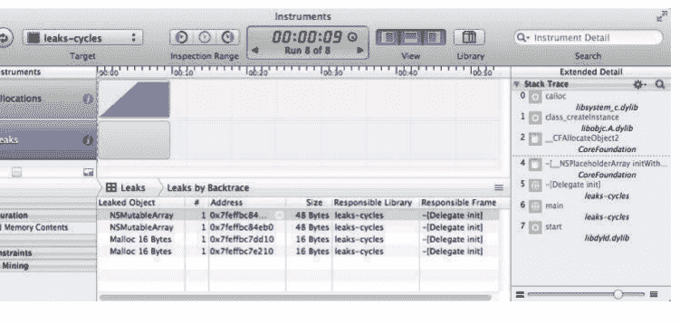

图 6.4 显示泄漏列表的 `Leaks` 工具

如果与 `Allocations` 同时运行，`Leaks` 还可以显示引用计数活动，而不仅仅是分配对象的调用堆栈。

对于像我们示例中的循环引用，`Leaks` 工具还可以在 `Roots and Cycles` 视图中显示循环的图形化表示（图 6.5）。

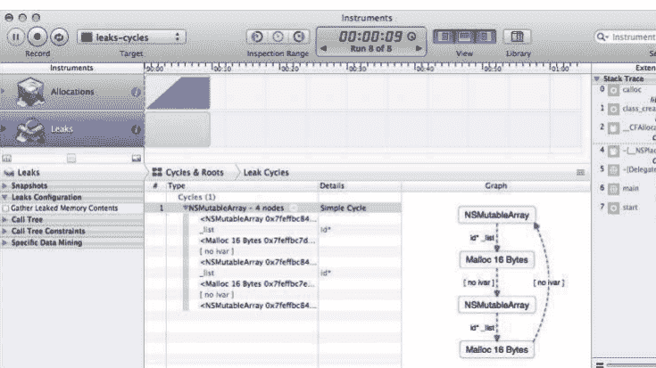

图 6.5 可视化循环引用的 `Leaks` 工具

- 1. 这最近被命名为世代分析 (`generational analysis`)，但工作原理相同。

### Allocations 工具 (内存分配)

我花了一段时间才熟悉 `Allocations` 工具，主要是因为如果没有特定配置的情况下，它的输出没有 `heap` 命令行工具那么简单，而且没有给我分配的全局概览。我仍然觉得概览比 `heap` 更令人困惑（跟踪面板中的摘要图除外），但重点分析的选项是全面的，并允许你有效地钻取特定问题。

在写这篇文章时，我实际上注意到我的一个应用中看起来像泄漏的地方。图 6.6 中的摘要图是进一步调查的触发点：它显示了连续三次打开和关闭文档时的总内存消耗。虽然内会在打开和关闭文档时波动，但它完全没有下降；相反单调上升。`Leaks` 工具显示了一个小泄漏，但远未达到 116 MB 的总量。

为了验证最初的观察，我发现了 `Hotspot Analysis`（热点分析）。在热点分析中，你尝试让系统进入稳定状态并重复你感兴趣的操作，

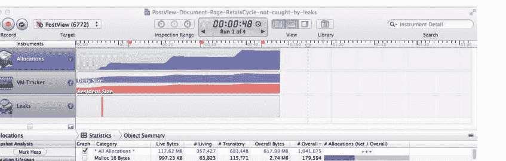

图 6.6 注意到内存增长

`Allocations` 工具支持 `Heaps Analysis`（堆分析），因为它允许你标记特定状态，然后它会计算后续标记点之间的差异。要查看由标记点生成的数据，你可以查看是否存在显著差异。在理论上，应该没有；毕竟，你将程序恢复到了它之前的精确状态。

在这种情况下，场景如下：

- 1. 打开一个 PDF 文档。
- 2. 关闭打开的文档。

在开始实际分析之前，我运行一次或两次场景，以排除任何一次性的初始化。这是必要的，因为许多系统使用延迟初始化，进一步的通用子系统开销将与该子系统的首次使用合并在一起。预热完成后，我点击 `Mark Heap` 按钮，运行场景，再次点击 `Mark Heap` 按钮，在此实例中重复了三次。面板中的 `Heapshot` 视图（如图 6.7 所示）显示每次执行场景一致增长了 39.2 MB（在 `Heap Growth` 中）。然而，目前还没有足够的依据来判断这些内存是在哪里分配的，或者为什么没有被释放，展开的 `Heap 2` 显示了一个 36.34 MB 的 `<non-object>` 块，且同一个块也出现在其他堆中（未显示）。

信息量太大，无法理解，为了更好地了解发生了什么，我将 `Inspection Range` 限制为一次场景，并切换到数据面板中的 `Call Tree`（调用树）视图。调用树显示了每个子树分配了多少内存，包括绝对值和相对值。此外，所有的调用树修剪机制都是可用的，这使得寻找常见的（大）内存分配几乎轻而易举。在图 6.8 中，我钻取到了占据总数 96.5% 的调用树节点。

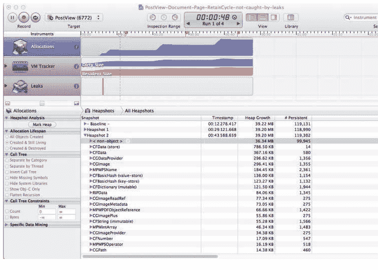

图 6.7 Initialapshot

- 2. `Mark Generation`（标记世代）

## 第 6 章内存：测量与工具

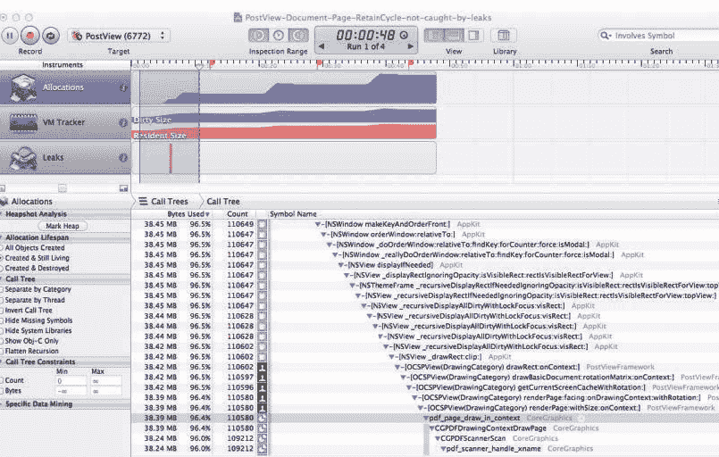

图 6.8 调用树

### VM Tracker

幸运的是，`VM Tracker` 工具确实捕获了这些分配，而且 Instruments 不仅具有同时运行多个工具的能力，而且当你从模板选择器选择 `Allocations` 模板时，默认会运行 `VM Tracker` 工具。

图 6.13 中的工具提示显示了在模拟器中运行 iOS 时的效果。`Allocations` 仅捕获了 4.1 MB，但总内存使用超过 141 MB 驻留（resident），且仍超过 60 MB 脏内存（dirty），这意味着内存已写入进程（这是我们想要尽量减少的）。据我所知，未包含在 `Allocations` 中的内存至少包括 `CoreAnimation`、`Image IO` 和 `CoreGraphics` 图像类型。

### Counters/PM Events

`Counters` 工具定期读取 CPU 的性能监控寄存器。这些是 CPU 记录的 300 多项统计数据，包括“除法器忙碌状态的周期”和“执行的分支”等。我在本章关于内存的内容中包含了 `Counters` 工具，因为它包含了关于由 CPU 硬件管理的某些内存层次结构的非常详细统计数据，包括缓存、加载/存储缓冲区和内存接口。我不知道其他获取内存和缓存流量信息的方法。

图 6.14 显示了在选择几个计数器后运行的 `Counters`。我反转了调用图，因此它显示具有最高 `MISALIGN_MEM_REF_STORES` 的函数，根据 Intel 文档，这意味着：“分发到 L1D 的推测性缓存行拆分存储地址微操作。”

正如你可能看出的，我从未在“愤怒”时使用过性能计数器，或者至少我没有注意到我本该愤怒，通过使用其他方法就获得了解决问题所需的信息。在此时，我希望遇到一个深到需要这种强大工具才能解决性能问题。

关于性能计数器需要注意的一个重要点是，与大多数工具不同，它们开箱即用并不起作用；相反，你需要在 `Record Settings` 面板中通过点击 `+` 按钮配置你想要的计数器（在图 6.14 底部圆圈）。

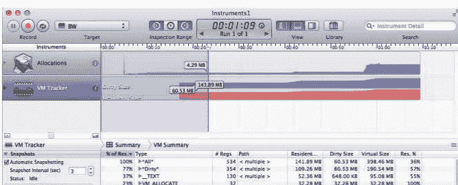

图 6.13 正在运行分配的 `VM Tracker` 工具

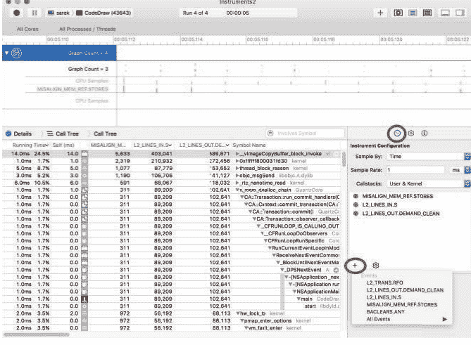

图 6.14 `Counters` 和工具配置

## 总结

调查内存使用比 CPU 消耗更复杂，但幸运的是我们有很多命令行工具和 Instruments 来帮助完成任务。始终要记住的一点是内存的多方面性——虚拟内存与真实内存之间的区别，以及干净（clean）与脏（dirty）内存。例如，在 `Allocations` 工具中跟踪每次分配的栈信息会进一步增加负担，而跟踪引用计数操作会剧增负担。Instruments 跟踪小分配的内存消耗（例如本章的“Allocations”部分跟踪栈信息）的大小为 1.3 GB，甚至 `top` 大约 80% 的 CPU 时间花在计算内存统计（在我的系统上，`top -d` 消耗 1.1% CPU，`top -u` 消耗 6.5%）。

## 7 内存陷阱与技巧

```
[NSAutoreleasePool new];

AtomicTest* obj=[AtomicTest new] autorelease];

obj.myObject=[NSString stringWithUTF8String:"Hello World"];

struct mstats=mstats();

long used_before=stats.bytes_used;

for (int i=0; count < 1000 * 1000; i++) {

 [obj myObject];

}

mstats();

long used_after=stats.bytes_used;

printf("\n%d memory used: %ld\n",count,count);

return 0;
```


虽然这看起来并不多，但读取访问是非常频繁的，因此在实际应用中这种开销实际上会累积，而且很多代码期望这些访问是基本上“免费”的。在属性声明中添加 `nonatomic` 关键字可以将内存消耗降低到预期的零，并让受影响的代码运行速度快达 10 倍。

## 避免泄漏

在引用计数机制下，本质上只有两种方法可以导致对象泄漏：要么你的 `retain` 和 `release` 没有平衡，要么你形成了一个循环。当使用所讨论的规则时，你的对象所有权规则会自动处理，但从 `dealloc` 中设置的 `release` 之外。ARC 额外负责自动在 `dealloc` 中生成 `release`。目前尚不清楚为什么这种功能与 ARC 包在一起，因为一个通用的 `dealloc` 例程是非常容易查看。幸运的是，`dealloc` 中的泄漏通过代码检查来修复（将 `.h` 和 `.m` 文件并排对比，比较 `dealloc` 方法中的 `ivar` 声明）是非常频繁，以至于我从未费心完善我在 2001 年创建的通用类自动 `dealloc` 方法，尽管它运行良好，并且能通过反射找到实例变量并释放它们（为了避免遗留非保留引用除外一个例外）。

剩下的就是引用循环了，这是引用计数的一个问题，上述技术无法解决它，ARC 也无法解决（尽管它提供了可以帮助的工具）。

引用循环是一组对象，尽管它们无法从循环外部访问，但它们仍然互相保持对方存活。幸运的是，程序员通常会避免循环。在本质上是树的结构中，常见的父级链接情况（例如视图层级的父视图）通过将父级链接设置为 `notretained` 来处理，如图 7.1 所示。只要树的根被保留，只要有引用，子级链接就足以保持对象存活——程序员只需要在从树中移除子节点时将父指针设置为 `nil` 即可。

### 第 7 章 内存：陷阱与技巧

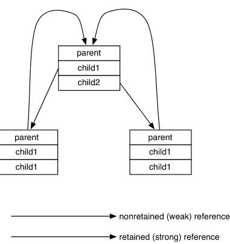

图 7.1 通过不保留父对象解决循环

ARC 在这种情况下通过零值弱引用（`@property (weak) UIView *superview`）提供了帮助。这些引用与其他非保留引用一样，不同之处当目标对象被释放时，它们会自动变为 `nil`，节省了程序员跟踪这些引用的精力，并确保没有悬空指针。

循环另一个另一个原因是由不同部分组成的对象，但这些部分需要整个对象的服务。如果将后向引用设置为非保留不是选项，那么打破循环的一种方法是将功能提取到一个独立的对象中并引用该对象，如图 7.2 所示。

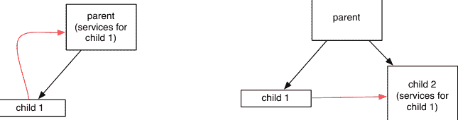

循环

被打破的循环

图 7.2 通过提取功能解决循环

## Foundation 对象 vs. 原始类型

最后，堆分配的块，特别是大中央分发（Grand Central Dispatch）中使用的块，也是循环的主要候选对象，因为持有块的对象在块内部被非弱引用引用的。隐式作用域捕获会忽略这种容易犯的错误。

`clang` 静态分析器也可以检测潜在的泄漏，尽管它可能会显示误报，但定期运行它应该是基础代码卫生习惯的一部分。

## Foundation 对象 vs. 原始类型

我们已经在第 3 章看到，Foundation 和 CoreFoundation 虽然在某些情况下很方便，但可能会产生显著的 CPU 性能开销，因此存在显著的内存成本也并不意外。

代表 `float` 的 `NSNumber` 大小为 32 字节，而 `float` 本身只有 4 字节，扩张了 8 倍。相似的情况也适用于其他原始类型包装器。正如我们在第 3 章“原始类型”部分所探讨的那样，在 64 位运行时，代表整数的扩展是 `NSNumber` 或 `CFNumber`。它们被编码在对象指针本身中，不占用额外空间。

说到指针，所有对象表示在任何持有引用的结构或对象中都使用内存指针，因此在 32 位系统上是 4 字节，在 64 位系统上是 8 字节。我们没有将此考虑在比较中，因此加上指针，直接 `float` 和 `NSNumber` 之间的差异实际上是 4 字节，扩张因子变成了 10 倍。图 7.3 显示了使用 4 个值或（简化的）`NSNumber` 对象的 `Rectangle` 内存布局。每个框宽 8 字节，使用原始类型的对象总共使用 24 字节，所有内容都可以放入单个 64 字节的缓存行中，并可以通过单次内存事务返回。相反，`NSNumber` 对象不仅将对象大小增加到 40 字节，还需要 4 个额外的分配内存块，每个内存块都很可能在不同的缓存行上。在第 3 章的“数组和批量处理”部分，我们看到浮点数数组比 `NSNumber` 数组快 5 到 10 倍。

正如你猜到的，字典的情况更糟。让我们考虑一个可变字典，假设它本身占用 112 字节，我不计算 `NSString` 键，因为它几乎是共享的，但仍有 144 字节。如果我们有一个带有 `float` 值的对象，总大小将是 12 字节，由于哈桶分配为 32 字节。访问模式也更；哈希函数保证访问将是随机的，从而产生最大的访问时间开销。

`NSDictionary` 通常被稀疏结构的内存节省设备，但事实证明，在巨大的初始开销上回本是非常困难的。图 7.4 显示了这种困难：只有在利用率极低（5% 或更低）且总槽位达到 100 个以上时，字典才能与对象表示持平。如果利用率更高或槽位数量更多，对象表示更为紧凑，尽管存在看似“浪费”的槽位，而在仅 10% 的利用率下，基于字典的表示图斜率更陡。

### 第 7 章 内存：陷阱与技巧

| isa | Rectangle : NObject |
|---|---|
| x | y | { float x,y,w,h; } |
| w | h | |

| isa | |
|---|---|
| x | x value |
| y | |
| w | |
| h | |

| isa | |
|---|---|
| y | y value |

| Rectangle : NObject |
|---|---|
| NSNumber "x","y","w","h"; | |

| isa | |
|---|---|
| w | w value |

| isa | |
|---|---|
| h | h value |

图 7.3 内联原始类型 vs. 对象指针的内存布局

## 更小的结构

一旦你消除了叶节点、避免过度或批量使用 Foundation 对象并以无指针间接的方式存储批量数据，找到数据更紧凑的内存表示将帮助你节省内存并加快程序运行。不仅移动的数据更少，而且节省宝贵的缓存内存，从而减少停顿的几率。

## 更小的数据结构

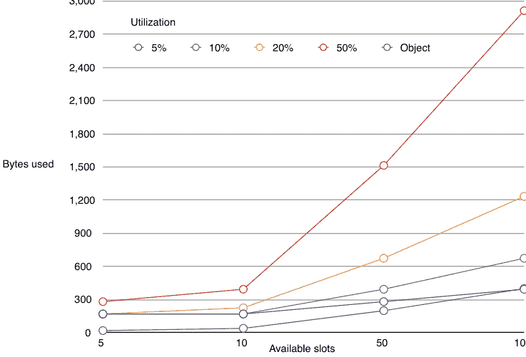

等待主线程，或者更糟——发生指向次级存储的缺页。

考虑到如今机器的现实，尺寸/速度的权衡实际上不再是权衡；更小的尺寸始终意味着更快的执行速度。

要做的第一件事不是无故地浪费空间，但遗憾的是，浪费空间既容易又极其常见。例如示例 7.2 中的日期表示，它取自一个在数百万机器上运行的真实日历应用程序。即使对于范围在 0 到 24、31 或 60 的值使用标准的 32 位整数也已经是惊人的浪费了，而作者们通过自动或至少不友善地遵循了将 `unsigned int` 替换为 `NSUInteger` 的建议，使情况变得更糟。目前，这将占用 6 × 8 = 48 字节的内存，而你可以预计日历应用中存在大量的日期。

图 7.4 稀疏字典与对象的内存消耗对比

示例 7.2 日期表示中无意义的 64 位整数

```c
typedef struct {
  NSUInteger year,month,day;
  NSUInteger hour,minute,second;
} date_time;
```

在未来几百万年内，这种表示可以轻而易举地替换为示例 7.3 中的位域表示，而不会丢失任何精度，只是被限制在未来几百万年内的日期。这种表示的大小为 48 位（即 6 字节），缩小了 8 倍。由于编译器极可能会将其对齐到 8 字节，我们理论上可以为年份再增加 16 位，使年份范围达到 1280 亿年，这应该足够支撑到下一次软件更新。这个简单的改变让应用程序的内存占用减少了几个兆字节，乘以数百万用户，就节省了惊人的数 TB 内存。

示例 7.3 更紧凑的数据表示

```c
typedef struct {
  unsigned long year:21, month:5, day:5, hour:5, minute:6, second:6;
} date_time;
```

另一个陷阱是无意义的子类化。同一个日历应用的主模型是事件（event），但由于某些历史原因，该模型对象曾是 `NSObject` 的子类。只需将前缀替换为 `NSObject` 就节省了几个兆字节。

随着 64 位的过渡，许多数据类型已从 32 位扩展到 64 位；例如 `NSInteger` 和 `CGFloat`。对于通常可以接受的临时变量和消息参数，验证实例到底需要多少精度和范围可能是有意义的。作为一个反例，`CGFloat` 被定义为 `CGFloat` 分量，而这些分量现在是 64 位的 C 浮点数。考虑到人类视觉最多能区分 1000 万种颜色（10⁷），用 24 位即可表示，那么为每个颜色分量分配 64 位（因此 RGB 总共 192 位，或有 10³⁸ 种组合）似乎是过度了。

## 但千年虫（Y2K）呢？

虽然最初的开发者假设在这一特定的补丁生效之前，程序早已被替换了，但事实证明相关软件的生命周期比预期的要长得多，导致了全球范围内耗资数十亿美元的清理工作、大量的祈祷，以及在 2000 年元旦当晚的大加班，幸运的是损害非常其微。那么，这里的建议是否也可能存在同样的陷阱呢？

我认为这个问题的答案是“不是”。首先，建议是在优化对象内部的字段大小，这在我们试图使其快速但又没有将其优化掉的极佳封装边界之后进行。对于消息接口（参数和返回值），使用机器的全宽度（32/64 位整数和浮点数/双精度浮点数）是受推荐的也是免费的，因为无论如何都会占用一个完整的寄存器。其次，即使这里这里稍微优化的表示也有巨大的提升空间。因此，如果我们的软件比预想的多运行几亿年，或者人类进化到对颜敏感度提高几万倍，我们只需要对本地组件进行微小的更新，而所有接口保持不变。

## 压缩

压缩是一种显而易见的节省空间措施，许多节省内存的技术（如上述的位域）可以被视为压缩的特殊形式。

这类压缩的特点是它们在压缩状态下可以直接使用，因此数据在使用之前不需要解压缩。这意味着未压缩表示和压缩表示都存在内存中，且至少未压缩版本是“脏的”（修改过的）。因此，矛盾的是，未压缩表示往往比压缩的表示更快、更高效。

## 可清理内存（Purgable Memory）

缓解脏解压缩数据（或任何其他可以从更紧凑表示计算出的数据）内存压力的方法是可清理内存。标记内存指示操作系统，当存在内存压力时，尽管已知内存是脏的，也可以丢弃这些内存，而不是将其交换到磁盘。

Apple 既提供了使用 `map` 系统调用标志的低级接口，还提供了更高级、更方便的 `NSPurgeableData` 类，该类为可清理数据封装了与 `NSMutableData` 兼容的接口，并实现了 `NSDiscardableContent` 协议。

必须使用协议的 `beginContentAccess` 和 `endContentAccess` 来确保数据在使用过程中不会被丢弃。关于可清理内存需要注意的是它是如何计算的；例如，如果数据被丢弃，在访问之前必须重新加载或重新计算。

## 内存与并发

由于 CPU 和内存速度之间的巨大差异，管理内存带宽和延迟是编写高性能软件要关注的问题之一。

如果你想让多个核心保持忙碌，它们需要在大多数时间内能够从私有缓存中工作。缓存感知（Cache aware）程序会专门考虑已知的缓存大小，例如，将工作分成 16K 或其他大小的块。正如名称所示，它们往往依赖硬件，或者至少在运行时进行参数化。

缓存忽略（Cache-oblivious）算法采用递归划分策略，通常在树或类树结构上工作，大部分细节位于叶子节点。实验性且已的 Fortress 数值计算语言（旨在作为 FORTRAN 的安全继任者，因此得名）的团队在网上有很多关于此点的精彩演示。

另一种缓存污染的情况发生在线程流经内存时，强制线程数据挤出缓存。多媒体指令集中的 SSE 中的特殊指令允许从主内存读取数据而不经过缓存。主内存的流性能远高于随机访问速度，这对于实际流传输已经足够。Apple 的 `vDSP` 和 `vImage` 已经利用了这些指令，它们是一个很好的选择。

当两个线程尝试访问同一数据时，会发生竞争。由于 CPU 中的数据是以典型的 64 字节缓存行组织的，当两个线程访问实际上位于不同位置的数据，但这两个位置位于同一条缓存行时，就会发生假共享。在这种情况下，CPU 必须在两个核心之间不断移动数据，极大地降低吞吐量。如果你发现线程之间存在假共享，在导致不同缓存行间共享的数据块之间添加足够的填充，可以显著提高性能。

如果多个线程通过在之间传递数据来处理相同数据，那么使用线程亲和 API 将它们绑定到同一个核心是有意义的。相反，两个并发运行的线程处理不同的数据集被调度在不同的核心上，以避免它们为了争夺 CPU 特有的 L1 缓存所有权。

## 架构考量

我们已经在 SAX 和 DOM 解析器的差异中看到了架构风格的影响。流导向的 SAX 解析器使用几乎是恒定的内存；而 DOM 解析器使用的内存与文件总大小成正比。然而，正如我们所看到的，架构风格的影响可能比这要更为显著。

示例 7.4 应该打印出一个包含单个成员（另一个 NSArray）的 NSArray 的描述。这个最终描述将类似于 "(( ))" 的内容，占用的空间大约为几个字节，但由于这两个数组相互嵌套，程序崩溃了。在我的系统上，它在耗尽总内存之前耗尽了栈空间，但最终会耗尽内存。

示例 7.4：使用两个 NSMutableArrays 和 description 导致的崩溃

```swift
import Foundation

var a=NSNSMutableArray()
var b=NSNSMutableArray()
a.addObject(b)
b.addObject(a)
print(a.description)
```

你可能会好奇这个结果与软件架构有什么关系。这难道不只是 NSArray 或 description 的一个 bug 吗？并非如此。示例 7.5 仅仅是嵌套了数组，而没有相互递归。现在，我们得到的不是崩溃，而是图 7.5 所示的临时对象的 $n^2$ 内存消耗。描述的实际大小线性增长，并列出作为对比。

示例 7.5：测量嵌套 NSArrays 描述的内存消耗

```swift
import Foundation

let numArrays=Int(Process.arguments[1])!
let before=memstats();
var base=NSNSMutableArray(["Hello World"])
for i in 1...numArrays {
    base=[base]
}
```

2. 更准确地说：与树的高度呈线性关系。

```swift
let b=base.description
let after=mstats();
print("memory used: \(after.bytes_used - before.bytes_used)")
```

图表仅显示了到嵌套层级 50 的内存使用，因为之后 $n*n$ 分配曲线变得足够大，以至于在相同比例下显示时，描述大小实际上固定在了 x 轴上。当有 750 个嵌套 NSArrays 时，内存消耗增长到 500 MB，CPU 时间增长到 78 ms。当翻倍到 1,500 个嵌套 NSArrays 时，内存和 CPU 使用量均四倍，分别达到 2 GB 和 306 ms。我实际上在拥有几千个嵌套 NSArray 实例的情况下耗尽了地址空间……在一台 64 位机器上！

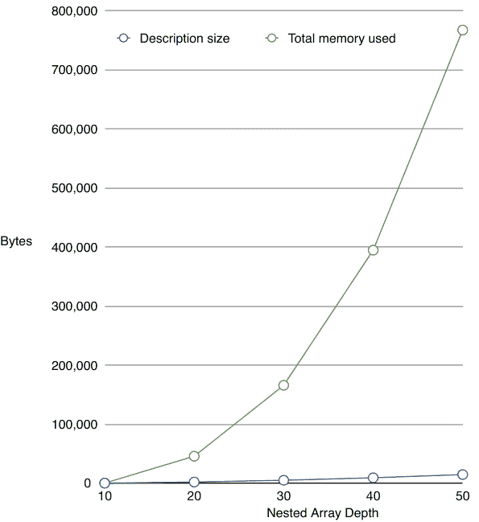

图 7.5：嵌套 NSArrays 描述的平方级内存消耗

（如果你真的想自己尝试，请准备好等待很久，至少在之后重启机器以清理交换空间。你还可能真的耗尽交换空间并导致内核恐（kernel panic），因此我不建议这样做。保存你的工作，提前备份系统，不要说我没警告过你！）

这种内存增长的原因不是 `description` 方法的实现缺陷，而是调用与返回（call-and-return）架构风格的基本特征。在这种风格中，你调用一个函数或方法，它返回一个结果。由于这是全部交互，返回的结果是完整的；不存在部分结果的真实代价。

当我们需要将这些中间结果组合成最终结果时，我们需要完全构建所有部分结果，然后分配内存来持有组合结果，并将部分结果拷贝到最终结果中。在每个嵌套层重复此操作，你就会得到 $O(m \times n)$ 的总复杂度，其中 $m$ 是深度，$n$ 是总大小。在此提供的（诚然略微病态的）示例中，嵌套深度等于总大小（$m = n$），我们得到了测量的 $n^2$ 结果。

幸运的是，有一个相当好的流式解决方案，类似于我们在 XML 解析中通过 SAX 看到的方案，但更简单，因为我们是在生成部分结果而不是解析。与其构建完整的部分结果，不如在开始时将部分结果累加到一个共享缓冲区中，并在返回结果的方法中传递该缓冲区。示例 7.6 中的 `describeOn:` 方法为 NSArray 实现了基于累加器的流式设计。代码的其余部分将其与当前的描述协议集成，并暴露了一个封装了设置累加器的 `fastDescription`。

## 示例 7.6：使用 describeOn: 流式描述

```objective-c
#import <Foundation/Foundation.h>

@implementation NSArray(describeOn)
- (void)describe:(NSMutableString*)description
{
    [description appendString:@" " separator:@""];
    for (id obj in self ) {
        @autorelease {
```


进入`/path/to/xxx`目录，找到`xxx.json`。

在表达式`cvar = avar + bvar`中，加法运算符（`+`）将`avar`与`bvar`相加，得到它们的和`cvar`

在`List.of(arg0, arg1, arg2)`中，`List`接口的工厂方法`of()`接受一系列的元素，返回包含它们的只读列表。

之后我们这样调用`cmd`命令：`cmd arg0 arg1 arg2`。

```
if (condVar > someVal) {console.log("xxx")}
```

```
[obj appendString:separator:@" ];

[obj describeOn:description separator:@", "];

}
}
}
```

- 3. 在 Objective-C 中，我们通常会发送消息。

# 第 7 章：内存：陷阱与技巧

```objective-c

}

[description appendString:@"];

}

@end

@implementation NSObject(describeOn)

-(void)describeOn:(NSMutableString*) description

{

[description appendString:[self description]];

}

-(NSString*)fastDescription {

MutableString *s=[NSMutableString string];

[self describeOn:s];

return s;

}

@end

```

将示例 7.5 改为使用 `fastDescription` 会产生如图 7.6 所示的截然不同的结果。不仅 x 轴保持相对平稳，即使是中等规模的嵌套数据集也不会受到需要重构完整结果之痛苦。在这一点上，累加算法效率提高了十倍。

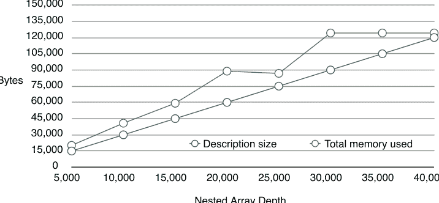

图 7.6：`describeOn:` 的线性内存消耗

## 分配与对象缓存

正如我们在这里以及第 3 章的“对象创建与缓存”部分所示，临时对象对 Objective-C 程序来说是一个巨大的挑战。临时对象的堆积既昂贵又会导致大幅增长，即使我们已经小心地构建了 $n^2$ 算法。

堆数量可以通过嵌套的 `autorelease` 池或示例 7.6 中的新 `describeOn:` 方法来控制，后者演示了这一点：它将描述数组内容的循环每次迭代封装在一个嵌套池中。这清理了任何不再需要的临时对象，特别是那些 `describeOn:` 递归调用产生的对象。

即使我们通过定期清理来避免过度使用堆，临时对象仍然存在性能问题，因为它们的创建和销毁是昂贵的。这是由于 Next/Apple Objective-C 和 Swift 要求对象在堆上分配，它们不允许像其他临时变量一样将对象本身分配在栈上。从某个角度来看，这种限制是遗憾的，因为栈分配实际上是免费的。栈指针的一次加法就能“分配”给给定函数的所有栈变量。

# 第 7 章 内存：陷阱与技巧

当然，由于我们讨论的是一个真正的 C 超集，这意味着仅仅因为某些操作不被允许，并不意味着你实际上不能这样做，只是意味着你可能不应该这样做。示例 7.7 展示了如果你真的想做的话，如何在栈上分配 Objective-C 对象。

1. 获取类（class）以及该类的实例大小。
2. 使用 `alloca()` 和 `bzero()` 在栈上为对象分配内存并置零。
3. 设置类。
4. 在块作用域内使用，且不再使用。

示例 7.7 Objective-C 对象的栈分配

```
#import <MPWFoundation/MPInteger.h>

#include <stdlib.h>

#include <objc/runtime.h>

int main(int argc, char *argv[]) {

Class mpoint=[MPInteger class];

size_t instance_size=class_getInstanceSize(mpoint);

id a=alloca(instance_size);

bzero(a, instance_size);

object_setIntValue(a, mpoint);

[NSLog NSLog(@"a=%%@", a)];

return 0;

}
```

我在某位于库比蒂的消费电子公司的生产代码中见过这种实现方式。

Foundation 对象通常对它们的大小撒谎，并且它们不适合在栈上使用。如果我们只是希望它们不会逃逸并导致整个世界崩溃，我们可以通过牺牲几次函数调用的代价来重用已经分配的对象。

## NSCache 和 libcache

Apple 在 Snow Leopard（雪豹系统）中引入了不同类型的缓存，基于 Cocoa 类和其底层的低级 `libcache` 库。`NSCache` 是一个类似于 `NSMutableDictionary` 的键值存储，不同之处在于当系统检测到内存压力时，该字典中的内容可能会被驱逐。`NSCache` 允许你激进地尽可能使用所有可用内存进行缓存，同时最大限度地减少因使用这些内存导致系统性能下降的——例如，引起不必要的内存压力，或者在最坏的情况下缓存与缓慢的次级存储之间进行分页交换。

> 注意，被驱逐（evicted）仅意味着对象被从缓存中移除（发送了 `release`），而不是对象没有被释放。这是根据正常的内存管理规则发生的，因此只有当 `NSCache` 持有最后一个引用时，对象才会被释放——本质上，即如果没有其他人在使用它。

通过少量的微调，你可以像使用 `NSMutableDictionary` 一样使用 `NSCache`。某些对象可能会消失，你需要在完成操作之前对获取的对象进行留存（retain），最好是将其存储在实例变量中并配有适当的器（accessor）。相反，因为仅仅一个对象从 `NSCache` 中移除，并不意味着它会被释放，因为它可能在其他地方被留存（retain）。

由于驱逐是异步发生的，并且包含了从你请求到存储它之间的时间，因此对象在传输过程中使用了从原子读取器中已知的 `retain + autorelease` 组合进行保护。与 `NSMutableDictionary` 不同，`NSCache` 是线程安全的，并且不拷贝其键。你也可以将 `NSCache` 作为简单的掉替换使用，如果你需要，它也允许你进行更多控制。如果你为对象设置了成本函数（cost-function），你可以指定缓存中对象的最大成本（例如，使用的字节数）。如果你的成本是 "1"，你可以限制缓存中对象的数量。

`NSCache` 可以通过 `NSDiscardableContent` 协议与其内容对象进行交互（由我们之前讨论过的 `NSPurgeData` 实现），这本质上是一个独立的引用计数协议，这对于让 `NSCache` 与 10.6 版本同样引入的追踪收集器（tracing collector）协同工作可能是必要的。

## 内存映射文件 (Memory-Mapped-Files)

虽然内存映射文件涉及到将文件读入内存，但内存映射文件也可以被视为可清理内存（purgeable memory）的一种特例（忽略内存映射文件比可清理内存早多年事实）。像可清理内存一样，内存映射文件可以被系统随时回收，但与可清理内存不同，这对用户是完全透明的。我们为系统提供了内存的数据源（底层文件），每当我们访问它时，系统都会自动从该数据中恢复内存的内容。由于它可以随时做到这一点，如果我们实际上访问了内存，它甚至不需要实际上从文件中读取数据。

通过为 `NSData` 方法 `dataContentsOfURL:options:error:` 使用标记（`NSDataReadingMappedSafe` 或 `NSDataReadingMappedAlways`），我们可以完全改变这些方法的工作方式，尽管结果在语义上是无法区分的。

如果没有映射标记（见示例 7.8），这些函数会分配内存然后使用系统从磁盘读取数据，在数据读取后返回。由于我们已经写入了分配的内存，内存现在被标记为脏（dirty）。

## 示例 7.8 读取文件

```
NSData *data;

data=[NSData dataContentsOfFile:@"documentation.pdf"

options:0

error:nil];
```

在示例 7.9 中，带有映射标记后，调用期间发生的所有只是创建了地址空间，并将该空间标记为由相关文件支持。差异如图 7.7 所示。在调用期间，没有分配实际的物理内存，也没有执行 I/O；该操作纯是虚拟地址空间的。只有在引用了那些映射地址时，才会执行实际的 I/O。如果只访问了文件的部分内容，则只读取这些部分（尽管系统可能会选择性地读取比请求更多的内容）。此外，由于进程没有写入这些页面，它们保持保持洁净（clean）。即使当系统执行 I/O 用文件中的数据填充它们后，它们仍然保持洁净，内存中的数据与支持内存的文件之间没有区别。

## 示例 7.9 映射文件

```
NSData *mapped;

mapped=[NSData dataContentsOfFile:@"documentation.pdf"

options:NSDataReadingMappedAlways

error:nil];
```

带有映射标记后，调用期间发生的所有只是创建了地址空间，并将该空间标记为由相关文件支持。差异如图 7.7 所示。在调用期间，没有分配实际的物理内存，也没有执行 I/O；该操作纯是虚拟地址空间的。只有在引用了那些映射地址时，才会执行实际的 I/O。如果只访问了文件的部分内容，则只读取这些部分（尽管系统可能会选择性地读取比请求更多的内容）。此外，由于进程没有写入这些页面，它们保持洁净。即使当系统执行 I/O 用文件中的数据填充它们后，它们仍然保持洁净，内存中的数据与支持内存的文件之间没有区别。

# 7.7 读取文件与映射文件的对比

相比于将数据从磁盘读取、交换到交换文件并再从交换文件读回（可能多次）的情况。在 iOS 上，不发生交换，脏页面无法被操作系统回收。这留下了两种选择：要么进程响应内存警告回收内存，要么操作系统必须回收。

使用内存映射，最初使用的内存可能更少。在需要时可以快速且高效地回收，并且 I/O 和处理在许多情况下是可以交错的，而不是在开始处理之前必须完成所有的 I/O。

使用内存映射文件有一个警告：由于 I/O 是后发生的，可能会在未预料的问题中出现 I/O 延迟。在简单的情况下，可能会在预期最多只有内存访问成本的操作中出现 I/O 延迟，但这在交换时也会发生，所以我们并没有更糟糕。然而，实际上如果物理卷被移除——例如，挂载卷的网络连接中断或外部硬盘被拔出。如果这种情况发生，内存访问将导致段错误。虽然这个 Unix 信号理论上可以被处理，但在实践中它会导致程序崩溃。当指定 `NSDataReadingMappedSafe` 标记时，系统只有会在文件所在的卷被认为不会发生突然消失（例如，启动卷）时才会映射该文件。

## 第7章 内存：陷阱与技巧

缓解这种问题的一种方法是预取映射的数据：例如，运行在独立线程中的所谓“页面遍历器”（page walker）简单地触碰映射文件的每一页，导致其读取到内存中。示例 7.10 展示了一个非常简单的页面遍历器。它假设页面大小为 4,096 字节，并从 `Namespace` 参数中的每个页中恰好读取 1 字节。更复杂的版本可以控制节奏，使其仅比主计算线程领先一点点，例如在顺序处理大型内存映射文件时。

## 示例 7.10 页面遍历器

```c

int pageWalker( NSData *data ) {

int dummyResult=0;

const char *bytes=[data bytes];

for ( int i=0, max=[data length]; i+=4096 ) {

dummyResult=bytes[i];

}

return dummyResult;

}

```

## madvise

虽然页面遍历不会影响程序的语义，但它通过本质上让映射文件某部分的 I/O 操作在实际需要它的处理之前发生，从而提高了性能。实现这种效果的另一种方法是使用 `madvise` 系统调用，它允许你对系统提供关于对特定地址空间未来计划的提示（“建议”）。

一种提示是 `MADV_WILLNEED`。这应该产生对任何不在内存中的数据进行分页的效果——类似于页面遍历器，但更简单。一旦完成对某部分内存的使用，可以使用 `MADV_DONT` 告诉系统，这将使这些页具备被驱逐的资格。如果你只是按顺序访问内容，使用 `MADV_SEQUENTIAL`，系统将有效地为你执行预读（read-ahead）和释放后方内存（free-behind）。

回到本章“架构考虑”部分的讨论，通用的内存遍历特别是 `MADV_SEQUENTIAL` 允许你在使用“调用-返回”风格的同时，享受到流式风格的性能优势，并且具有额外的灵活性，在需要时可以跳出该风格，而无需费尽周章。

`MADV_FREE` 类似于 `MADV_DONT`，区别在于你表示实际上并不关乎相关内存的内容，这意味着系统可以丢弃它。（带有 `MADV_DONT` 的脏内存仍需被换出页。）

Snow Leopard 中的 `malloc` 更新将 `MADV_FREE` 留给了已释放的堆内存，以避免将不再包含有用数据的交换到磁盘。

当使用合理时，不同的 `madvise` 选项会对你的内存占用和性能产生巨大影响。有两个需要注意的注意事项：第一，通过 `madvise` 给出的所有建议仅供参考；内核没有义务遵循这些建议（而且在 Leopard 之前，大多数选项实际上都被忽略了）。第二，建议往往是全局的，因此在处理共享映射时可能会干扰其他进程对内存的使用。

## iOS 考虑因素

正如我们多次注意到的，iOS 上缺乏交换文件（swapfile）产生了巨大的差异：性能不是逐渐下降，而是会撞撞上一堵墙。然而，没有改变的是内存子系统的流体本质，这些因素共同构成了一个具有挑战性的环境。

一方面，如果你过于激进或快速地向系统请求内存，或者在被要求时放弃得太慢，你的进程将被杀死。另一方面，系统有足够的用途来检查内存状态，而可用内存往往不足让你的应用 正常运行。

例如，在主线程上交付的内存警告。这意味着如果你的应用在主线程上（无论是否在分配内存）此时有内存警告待处理，你的应用可能会被标记为无响应并被杀死。另一方面，仅仅将分配移动到后台线程并不是解决办法：我看到过应用被杀死，是因为后台线程在愉快地分配大块内存，而前台线程正尝试处理内存警告。

我发现的一个解决方案是，让有高分配需求的后台任务向主线程“点点”一个“什么都不做”的消息（使用 `performSelector:onThread:` 类的消息，并将 `waitUntilDone` 设置为 `YES`）。如果主线程正在处理内存警告，这将阻塞后台线程，等待处理完成并让内存释放，后再继续执行。

说到内存警告，当你收到内存警告时，几乎立即停止你正在做的一切并开始释放内存。

无法将脏页交换到磁盘意味着，在 iOS 上保持内存整洁（例如通过映射）比在 OS X 上更加重要。虽然系统不能交换，但它仍然可以强制所有干净页移出内存，要求系统在下次需要时将它们读回，因此系统可能会像 OS X 一样因为内存压力变慢。

## 优化 ARC

当我们开发 Wunderlist 3.0 发布时，突然在示例 7.11 显示的 NSOutlineView 代理方法中遇到了崩溃。

## 第7章 陷阱与技巧

## 示例 7.11 返回 0 的方法

```objc

(BOOL)outlineView:(NSOutlineView *)outlineView isGroupItem:(id)item

{

return NO;

}

```

这至少是令人感到惊讶的，因为那里没有任何可能导致崩溃的地方。我们预期的汇编代码大致类似于示例 7.12，只是强制要求了寄存器。事实上，我本来只要有 `xorl %eax,%eax, retq` 就会满意了，但设置帧指针并没有增加多少开销，而且那是一个调试版本。

## 示例 7.12 非 ARC 生成

```assembly

-[DataSource outlineView:isGroupItem:]

push %rbp

mov %rsp,%rbp

mov %rdi,%rax

mov %rsi,%edx

mov -8(%rbp),%rax

mov -12(%rbp),%rdx

test %rax,%rax

jne .L2

mov $0,%eax

.L2:

xor %eax,%eax

pop %rbp

ret
```

然而，我们得到的是 ARC 生成的：

```assembly

-[DataSource outlineView:isGroupItem:]

push %rbp

mov %rsp,%rbp

mov %rdi,%rax

mov %rsi,%edx

mov -8(%rbp),%rax

mov -12(%rbp),%rdx

test %rax,%rax

jne .L2

mov $0,%eax

.L2:

mov %rax,%rdi

call objc_retain

mov %rax,%rdx

mov -8(%rbp),%rax

mov -12(%rbp),%rdx

test %rax,%rax

jne .L3

mov $0,%eax

.L3:

mov %rdx,%rdi

call objc_release

xor %eax,%eax

pop %rbp

ret
```


## 第7章 内存：陷阱与技巧

缓解这种问题的一种方法是预取映射的数据：例如，运行在独立线程中的所谓“页面遍历器”`page walker`简单地触碰映射文件的每一页，导致其读取到内存中。示例 7.10 展示了一个非常简单的页面遍历器。它假设页面大小为 4,096 字节，并从 `Namespace` 参数中的每个页中恰好读取 1 字节。更复杂的版本可以控制节奏，使其仅比主计算线程领先一点点，例如在顺序处理大型内存映射文件时。

### 示例 7.10 页面遍历器

```c
int pageWalker( NSData *data ) {
    int dummyResult=0;
    const char *bytes=[data bytes];
    for ( int i=0, max=[data length]; i+=4096 ) {
        dummyResult=bytes[i];
    }
    return dummyResult;
}
```

### madvise

虽然页面遍历不会影响程序的语义，但它通过本质上让映射文件某部分的 I/O 操作在实际需要它的处理之前发生，从而提高了性能。实现这种效果的另一种方法是使用 `madvise` 系统调用，它允许你对系统提供关于对特定地址空间未来计划的提示“建议”。

一种提示是 `MADV_WILLNEED`。这应该产生对任何不在内存中的数据进行分页的效果——类似于页面遍历器，但更简单。一旦完成对某部分内存的使用，可以使用 `MADV_DONT` 告诉系统，这将使这些页具备被驱逐的资格。如果你只是按顺序访问内容，使用 `MADV_SEQUENTIAL`，系统将有效地为你执行预读 `read-ahead` 和释放后方内存 `free-behind`。

回到本章“架构考虑”部分的讨论，通用的内存遍历特别是 `MADV_SEQUENTIAL` 允许你在使用“调用-返回”风格的同时，享受到流式风格的性能优势，并且具有额外的灵活性，在需要时可以跳出该风格，而无需费尽周章。

`MADV_FREE` 类似于 `MADV_DONT`，区别在于你表示实际上并不关乎相关内存的内容，这意味着系统可以丢弃它。带有 `MADV_DONT` 的脏内存仍需被换出页。

Snow Leopard 中的 `malloc` 更新将 `MADV_FREE` 留给了已释放的堆内存，以避免将不再包含有用数据的交换到磁盘。

当使用合理时，不同的 `madvise` 选项会对你的内存占用和性能产生巨大影响。有两个需要注意的注意事项：第一，通过 `madvise` 给出的所有建议仅供参考；内核没有义务遵循这些建议，而且在 Leopard 之前，大多数选项实际上都被忽略了。第二，建议往往是全局的，因此在处理共享映射时可能会干扰其他进程对内存的使用。

### iOS 考虑因素

正如我们多次注意到的，iOS 上缺乏交换文件 `swapfile` 产生了巨大的差异：性能不是逐渐下降，而是会撞上一堵墙。然而，没有改变的是内存子系统的流体本质，这些因素共同构成了一个具有挑战性的环境。

一方面，如果你过于激进或快速地向系统请求内存，或者在被要求时放弃得太慢，你的进程将被杀死。另一方面，系统有足够的用途来检查内存状态，而可用内存往往不足让你的应用正常运行。

例如，在主线程上交付的内存警告。这意味着如果你的应用在主线程上无论是否在分配内存此时有内存警告待处理，你的应用可能会被标记为无响应并被杀死。另一方面，仅仅将分配移动到后台线程并不是解决办法：我看到过应用被杀死，是因为后台线程在愉快地分配大块内存，而前台线程正尝试处理内存警告。

我发现的一个解决方案是，让有高分配需求的后台任务向主线程“点点”一个“什么都不做”的消息，使用 `performSelector:onThread:` 类的消息，并将 `waitUntilDone` 设置为 `YES`。如果主线程正在处理内存警告，这将阻塞后台线程，等待处理完成并让内存释放，后再继续执行。

说到内存警告，当你收到内存警告时，几乎立即停止你正在做的一切并开始释放内存。

无法将脏页交换到磁盘意味着，在 iOS 上保持内存整洁例如通过映射比在 OS X 上更加重要。虽然系统不能交换，但它仍然可以强制所有干净页移出内存，要求系统在下次需要时将它们读回，因此系统可能会像 OS X 一样因为内存压力变慢。

### 优化 ARC

当我们开发 Wunderlist 3.0 发布时，突然在示例 7.11 显示的 `NSOutlineView` 代理方法中遇到了崩溃。

### 示例 7.11 返回 0 的方法

```objc
(BOOL)outlineView:(NSOutlineView *)outlineView isGroupItem:(id)item
{
    return NO;
}
```

这至少是令人感到惊讶的，因为那里没有任何可能导致崩溃的地方。我们预期的汇编代码大致类似于示例 7.12，只是强制要求了寄存器。事实上，我本来只要有 `xorl %eax,%eax, retq` 就会满意了，但设置帧指针并没有增加多少开销，而且那是一个调试版本。

### 示例 7.12 非 ARC 生成

```assembly
-[DataSource outlineView:isGroupItem:]
    push    %rbp
    mov     %rsp,%rbp
    mov     %rdi,%rax
    mov     %rsi,%edx
    mov     -8(%rbp),%rax
    mov     -12(%rbp),%rdx
    test    %rax,%rax
    jne     .L2
    mov     $0,%eax
.L2:
    xor     %eax,%eax
    pop     %rbp
    ret
```

然而，我们得到的是 ARC 生成的：

```assembly
-[DataSource outlineView:isGroupItem:]
    push    %rbp
    mov     %rsp,%rbp
    mov     %rdi,%rax
    mov     %rsi,%edx
    mov     -8(%rbp),%rax
    mov     -12(%rbp),%rdx
    test    %rax,%rax
    jne     .L2
    mov     $0,%eax
.L2:
    mov     %rax,%rdi
    call    objc_retain
    mov     %rax,%rdx
    mov     -8(%rbp),%rax
    mov     -12(%rbp),%rdx
    test    %rax,%rax
    jne     .L3
    mov     $0,%eax
.L3:
    mov     %rdx,%rdi
    call    objc_release
    xor     %eax,%eax
    pop     %rbp
    ret
```

### 示例 7.14 不保留参数返回 0 的方法

```objectivec
(BOOL)outlineView:(__unsafe_unretained NSOutlineView*)outlineView isGroupItem:(__unsafe_unretained id)item
{
    return NO;
}
```


我个人更倾向于将性能敏感型代码完全放在 `ARC` 之外，并依靠 `ARC`/非 `ARC` 的互操作性。例如，第 3 章“对象创建与缓存”部分中的对象缓存（`object-cache`）在开启 `ARC` 的情况下无法实现；它必须放在单独的文件中。此外，在 `ARC` 模式下宣称“我知道我在做什么”让我感到有些不舒服，因为我不确定自己是否真的知道。与编译器的交互在很多时候令我感到惊讶。

## 总结

本章介绍了许多用于减少应用程序内存占用并确保尽可能有效地使用内存的技巧。像 Objective-C 一如既往一样，你希望尽可能地利用填充有原始类型的粗粒度对象，我们已经看到粗粒度结构如何与现代 CPU-内存接口的缓存行（`cache-line`）导向架构良好交互。

基础数据结构的调优同样重要，尽管它不像引用计数、循环打破技术或特定对象那样是 Objective-C 或 Cocoa 特有的。这些缓存机制中的某些甚至有指向虚拟内存子系统的私有接口，允许它们根据系统环境调整缓存行为，而其他 VM API 则允许程序优化对非缓存资源的使用。

iOS 内存管理技术和流式架构（`streaming architectural style`）都是重要的课题，我们将在下一章通过示例深入探讨。

## 内存示例：过滤器流（FilterStreams）

我们之前曾接触过流式方法，例如在查看内存映射的影响，或者在比较基于 DOM 的 XML 解析器与基于 SAX 或 MAX 的解析器差异时。

在前一章中，我们展示了如何通过将返回 `NSString` 的描述方法改为流式的 `describeOn:` 方法（该方法更新传入参数的 `NSMutableString`）来大幅降低消耗。

然而，将参数设置为 `NSMutableString` 似乎在某种程度上与我们拥有具有语义丰富的对象的目标相矛盾，也没有解决无限递归导致崩溃的初始问题。我们能做得更好这并不令人意外。事实上，我们将引入整个 FilterStreams 层次结构，它将 Unix 管道-过滤器（`pipes-filters`）架构风格的特性与多态等面向对象的概念相结合，顺便解决了 `-description` 中的无限递归问题。

## Unix 管道与过滤器

Unix 管道和过滤器架构可能是最为人知的流式架构。它至少具有两个优点：过滤器组件是可互换的，并且可以增量地处理——只要操作语义允许，就可以读取部分输入并写入部分输出，直到处理完成。它还是并发的，每个过滤器在自己的进程中处理数据，经过了高度优化且是无类型的（即字节流）。图 8.1 显示了一个双阶段流水线的图形化表示：过滤器 1 的输出连接到过滤器 2 的输入。此外，整个流水线再次有一个输入和一个输出，这意味着组合后的管道可以作为另一个管道中的过滤器。

然而，Unix 过滤器处理的数据是字符，在流水线的每一步中，都必须在输入时解析为有意义的单位并在输出时从任何内部表示重新生成。此外，通信是通过相当重量级的进程间通信实现的。

第 10 章中的示例 10.1 是 Unix 过滤器，它可以将其读取的每一行的字符转换为大写。它看起来比需要的要复杂，因为它避开了用于缓冲和提取文本行的库函数，这说明了在 Unix 风格过滤器中解析有意义结构的问题。

示例 8.1 利用了缓冲和处理文本行的内置库，使得代码简单得多，并且比示例 10.1 快了约 250 倍。

### 示例 8.1 使用行定向 I/O 的大写过滤器

```c
#include <stdio.h>
#include <ctype.h>
#define MAXLENGTH 8192
int main(int argc, char *argv[]) {
  char buf[MAXLENGTH];
  while (fgets(buf, MAXLENGTH, stdin)) {
    buf[0]=toupper(buf[0]);
    fputs(buf,stdout);
  }
  return 0;
}
```

集成字节流或文本行以外的数据对象类型需要设计一种字节序列化格式，用于在字节流之间解析和序列化对象。传递对象指针似乎更容易，特别是对于复杂的、分层的或大型数据结构。此外，虽然过滤器可以通过组合来重用，但不支持对现有的过滤器进行特化处理以执行略有不同的功能。

## 面向对象的过滤器

从 Unix 实现的具体细节退出来，我们看到管道和过滤器架构风格的根本特征是接口的统一性以及将结果转发给目标而不是返回给调用者。我们可以使用对象和过滤器作为过滤器之间交换的数据，来实现相同或非常相似的效果。FilterStreams 将两个元素（管道和过滤器）简化为单个元素——FilterStream 对象。图 8.2 显示了 FilterStream 的结构，包含一个 `writeObject:` 方法和一个目标实例变量，结果在此处累积或指向另一个 FilterStream。

示例 8.2 显示了“空”过滤器的 Objective-C 代码，它只是将输入原样传递给其目标，类似于 Unix 的 `cat` 命令。（示例样板代码，如访问、dealloc 和初始化方法。）

### 示例 8.2 NullStream（空流）

```objectivec
@protocol Streaming
- (void)writeObject:anObject;
@end
@interface MPWFilterStream : NSObject<Streaming>
{
    id <Streaming> target;
}
@end
@implementation MPWFilterStream
- (void)writeObject:anObject
{
    [target writeObject:anObject];
}
@end
```


图 8.1 通过管道连接的两个 Unix 过滤器

空过滤器并不有趣，但它为覆盖 `writeObject:` 方法来实现实际功能的过滤器铺了道路。

## DescriptionStream（描述流）

将描述重构为 FilterStream 会产生 DescriptionStream，它接受任意对象作为 `writeObject:` 方法的参数，并将对象的描述写入其目标。该规范的最简单实现是如示例 8.3 所示直接发送描述消息，但这并没有真正激活结果。

### 示例 8.3 简单但无效的 DescriptionStream

```objectivec
@interface MPWDescriptionStream : MPWFilterStream
@end
@implementation MPWDescriptionStream
-(void)writeObject:(anObject)
{
  [target writeObject:[an description]];
}
@end
```

为了获得我们想要的流式行为，我们至少需要区分数组和其他对象，如示例 8.4 所示拆分数组并增量地写入。`writeObject:` 方法检查参数是否为 `NSArray`，如果是，它会用圆括号和逗号描述单个元素。数组单个元素的描述通过将它们写入流本身来递归地处理。

### 示例 8.4 带有分类分析的 DescriptionStream

```objectivec
-(void)writeObject:(anObject)
{
  if ([anObject isKindOfClass:[NSArray class]]) {
    BOOL first=YES;
    [target writeObject:@@" \];
    for (id content in anObject) {
      if (!first) {
        [target writeObject:@," \];
      } else {
        first=NO;
      }
    }
  }
}
```

```objc
[self writeObject:content];
}
[target writeObject:@"]];
} else {
[target writeObject:[an description]];
}
```

将过滤器自包含在示例 8.4 中是一种传统，但用例分析是一段较小的代码，需要一种更面向对象的解决方案。示例 8.5 不再检查感兴趣的类，而是使用双重分发（double dispatch），在通过 `describeOn:` 消息名编码流类型时，将问题抛回给对象。此外，流还公开了 API 供客户端与描述进行交互。

### 示例 8.5 使用双重分发的 DescriptionStream

```objc
@implementation DescriptionStream
-(void)writeObject:anObject
{
    [anObject describeOn:self];
}
-(void)writeDescription:(NSString*)partialDescription
{
    [target writeObject:partialDescription];
}
@end
```

```objc
@implementation NSObject (describe)
-(void)describeOn:(NSMutableStream*)aStream
{
    [aStream writeDescription:@"];
    BOOL first=YES;
    for (id obj in self ) {
        if (first) {
            first=NO;
        } else {
            [aStream writeDescription:@", "];
        }
        @autoreleasepool
        [aStream writeObject:obj];
    }
}
@end
```

- 1. http://en.wikipedia.org/wiki/Double_dispatch

## 第 8 章内存示例：FilterStreams

```objc
[aStream writeDescription:@""];
}
@end
@implementation NSObject(describe)
-(void)describeOn:(MFWDescriptionStream*)aStream
{
    [aStream writeDescription:[self description]];
}
@end
```

使用分发（dispatch）消除了用例分析，并使代码为未来的扩展做好了准备。例如，我们不需要修改任何现有代码来适应 `NSDictionary` 对象，只需要在 `NSDictionary` 上实现 `describeOn:` 即可。另一方面，我们将过滤器的逻辑移到了客户端对象中，这需要使用分类（categories），并将该代码与特定的特定的逻辑（如写入描述部分）混织在一起。

将代码重新变回过滤器的一种方法是将其分发回过滤器，这次编码要处理的对象类型；对于 `writeArray:`：如果 true这样做，我们实际上不需要在第一次分发中编码流的类型，因为我们最终将消息抛回的流知道自己是哪种。虽然示例 8.6 所示的代码也使用了分类，但分类纯粹是幕后的水水工程，只能通过抗冲突的名称提供，但实际上可以使用 `imp_implementationWithBlock()` 从块（blocks）中生成。

### 示例 8.6 使用三重分发的 DescriptionStream

```objc
@implementation DescriptionStream
-(void)writeObject:anObject {
    [anObject writeObjectOn:self];
}
-(void)writeDescription:(NSString*)partialDescription {
    [target writeObject:partialDescription];
}
-(void)writeObject:(NSObject*)anObject {
    [self writeDescription:[anObject description]];
}
-(void)writeNSArray:(NSArray*)array {
    [self writeDescription:@"(" "];
    BOOL first=YES;
    for (id obj in array ) {
        if (first) {
            first=NO;
```

## 描述 167

```objc
} else {
    [self writeDescription:@"@", ""];
}
@autoreleasepool {
    [self writeObject:obj];
}
[self writeDescription:@"@"];
}
@end
```

```objc
@implementation NSArray (StreamWriting)
- (void)writeOnStream:(MPFilterStream*)aStream
{
    [aStream writeNSArray:self];
}
@end
```

```objc
@implementation NSObject (StreamWriting)
- (void)writeOnStream:(MPFilterStream*)aStream
{
    [aStream writeObject:self];
}
@end
```

每个对象都使用代表流接口的 `writeObject:` 消息写入流中。流请求对象使用 `writeOnStream:` 消息写入自己；对象通过向流发送一个编码其类别的消息来响应（见图 8.3）。虽然这看起来有很多消息，

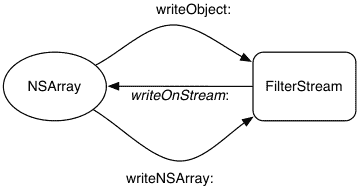

图 8.3

但请记住，与分配临时内存并解包/打包中间结果相比，消息是非常廉价的。
`NSMutableString` 现在隐藏在 `DescriptionStream` 的目标之后，我们实际上可以将其替换为直接输出到 `stdout``stderr` 或文件的对象，而不是在输出之前在内存中累积整个描述。这使得描述的内存消耗实际上变为常数，即 $O(1)$，从原始描述方法的 $O(n^2)$ 和中间 `describeOn::` 的 $O(n)$ 降低了下来。

## 消除 description 中的无限递归

通过流对象与对象组产生描述，我们也有地方可以保留足够的状态来捕获数据结构中的无限递归——例如示例 7.4 中相互递归的 `NSArray` 对象。

当我们发现自己正处于描述过程中时，我们不想再次描述它。为了避免这种情况，我们需要跟踪我们正在描述的对象，并在遇到时退出。
示例 8.7 中的 `MPWDescriptionStream` 拥有一个 `NSMapTable` 来跟踪正在描述过程中的对象。

### 示例 8.7 流的定义

```objc
#import "FilterStream.h"
@interface MPWDescriptionStream : FilterStream
{
    NSHashTable *alreadySeen;
}
@property (atomic,retain) NSTable *alreadySeen;
-(void)writeObject:(id)anObject;
-(void)writeArray:(NSArray*)array;
-(void)describeObject:(id)anObject;
@end
```

### 示例 8.8 流实现

```objc
@implementation MPWDescriptionStream
- (instancetype)init
{
    self = [super init];
    alreadySeen = [NSHashTable hashTableWithKeyOptions:NSHashTableWeakMemoryKey options:0];
    return self;
}
- (void)writeObject:(id)anObject
{
    if ([alreadySeen objectForKey:anObject]) {
        [self writeDescription:@"@"];
    } else {
        [alreadySeen setObject:anObject forKey:anObject];
        [super writeObject:anObject];
        [alreadySeen removeObject:anObject];
    }
}
@end
```

### 示例 8.9 流胶水代码

```objc
@implementation NSObject(describeOn)
-(void)describeOn:(MPWDescriptionStream*)aStream
{
    [aStream describeObject:self];
}
-(NSString*)fastDescription
{
    MPWDescriptionStream *s=[MPWDescriptionStream stream];
    [s writeObject:self];
    return [s target];
}
@end
@implementation NSArray(describeOn)
```


```objc
-(void)describeOn:(MPWDescriptionStream*)aStream
{
    [aStream describeArray:self];
}
@end
```

## 流层次结构

这些转换总和为我们提供了多态、可子类化且可组合的增量流。不再像上一章解决描述问题那样直接写入 `NSMutableString`，我们现在写入流。

`MPWDescriptionStream` 的子类可以轻松覆盖 `writeArray:` 以输出 JSON 格式的字符串，而不是 `description` 创建的 NeXT 风格属性列表格式。

总之，自 1998 年开始使用 FilterStreams 以来，我在 MPWframework 中实现了二十多种 `FilterStream`，其中一小部分如图 8.4 所示。它们对我帮助很大，特别是在字节编码或转换规则（如压缩和编码）方面，编码之间的共性被捕获并可以轻松地重定向到缓冲区、网络或文件。

字节流（Byte Stream）子树泛化了我们在 Unix 过滤器可以做的事情。数据流范式意味着 `URL Fetch Stream` 可以轻松处理网络操作固有的异步性，而没有回调地狱；我们一直在 Wunderlist 中使用它来取得效果。原因为调用和返回需要立即获得返回值，而数据流只需要传递给下一个过滤器，而不必关心具体时间。事实上，它不仅关心结果的时间，还关心数量。一个过滤器可以向其目标写入多个结果，或者写入零个（例如发生错误时），这使得可以将错误处理从“快乐路径”中分离出来并集中处理。

实际实现比这里显示的要多一点。例如，`writeObject:` 发送的初始消息不是固定的，而是指定的

> 2. https://github.com/mpw/MPWFoundation

# 摘要 171

图 8.4 FilterStream 层次结构

作为所讨论 FilterStream 的参数，以便对象能够响应特定类型的流，但提供了一个钩子（hook）以便共享通用行为。便利方法将流式架构风格适配为调用与返回模式。例如，定义在根类 FilterStream 上的 `+process:` 消息会初始化流、将对象写入流中并返回结果。

# 摘要

在本章中，我们扩展了上一章中使用流式方法的想法，将其变为一个包含了实现“管道与过滤器”（Pipes and Filters）架构的组件库。通过这个库，流式处理被植入到底层，使得实现计算的方式不仅内存高效，而且易于实现异步化。

# 9

## Swift

Swift 在 WWDC 2014 上大张旗隆烈地推出，它是 Apple 的新编程语言，被称为“去掉了 C 的 Objective-C”。这是一个有趣的口号，考虑到我们知道 Objective-C 是通过在 C 的基础上添加 Smalltalk 创建的（公式 9.1）。

> Objective-C = C + Smalltalk (9.1)

根据我在高中学习的一级代数规则，从等式的两边减去 C（公式 9.2）并不会得到 Swift，事实上，Swift 看起来与 C++ 的关系远大于 Smalltalk 或 Objective-C。

> Objective-C – C = Smalltalk (9.2)

抛开细小问题不谈，Swift 取得了巨大的成功，许多文章、书籍和会议专门针对这一主题展开。

## Swift 性能：声称

从一开始，Apple 就一直在大力推广 Swift 的性能，甚至体现在其名称中。新语言的性能是一个核心焦点，例如图 9.1 所示的性能对比。

这是一个令人印象深刻的展示，Swift 的速度比 Python 快 3 倍。你可能会奇怪 Python 在这个对比中做了什么，考虑到它是一种解释型脚本语言，完全不是为性能密集型工作设计的，而且与 OS X 和 iOS 开发实际上没有关系。

事实证明，当你比较 Objective-C 和 Swift 时，2.6 对 3 仅仅是一个倍数差异，而当你将它们绘制出来并将颜色设为一致（如图 9.2 所示），这并不特别令人深刻。

**图 9.1** 将 Swift 与 Python 进行对比

引入 Python 仅仅让 Swift 的数字看起来更令人印象深刻；3 听起来比 1.4 好得多。即使在开发者中，也极少有人愿意花费精力去获取更具参考价值的 Objective-C 与 Swift 数据，而且完全不会。

另一个可能让你困惑的是，这些数字有多糟糕。毕竟，Python 是一种解释型脚本语言，我见的大多数对比中，它的评分甚至比 Ruby 还要慢一倍。

在引入两年后，Apple 主站的 Swift 部分（见图 9.3）使用 Python 作为对比，现在 Swift 比之快了八倍。

Python 仍被用作对比这一事实并不完全让人产生信心，“高达”（up to）这种措辞也是如此。虽然比以前好，但这些数字既奇怪又仍然很糟糕。比 Python 快八倍，却随着

**图 9.2** 排除掉 Python

## 更好的性能意味着更好的应用。

Swift 应用名副其实。例如，一种常用的搜索算法使用 Swift 完成的速度要快得多。

图 9.3 http://apple.com/swift 上的性能声称
使用深度优先搜索算法在图中找到了 10,000 个整数

如果是编译型语言将会令人幻失望，而 Objective-C 代码仅比 Python 代码快 2.5 倍，这简直令人不安。

尽管在仔细观察后并不能完全令人信服，但 Apple 对 Swift 性能的营销是非常有效的。Swift 非常快的这一想法现在是 Apple 开发者社区中公认的事实。

## 语言特性

尽管 Apple 没有给我们提供任何关于 Swift 性能的坚实证据，但它给了我们惊人的 Swift 性能。

- Swift 的设计比 Objective-C 静态得多，这意味着在编译时有有更多可用信息供用户使用。
- 在动态方面，动态分发（dynamic dispatch）被大幅减少，大多数“原生”Swift 方法都是被静态分发的。

Objective-C 的动态分发是编译器感知的绝对障碍，这一直是编译器和运行时团队的心头刺。即时编译（JIT）编译器可以在运行时解决这个问题，但有许多理由不为了性能而使用 JIT 技术¹

> 1. 参见 Jitterdamnung (http://blog.metaobject.com/2015/10/jitterdamnung.html)。

- 大量使用值语义（value semantics，见第 5 章的“栈分配”部分）并使用结构体是为了让我们摆脱堆分配和引用计数的成本，特别是 ARC（见第 7 章的“引用计数”部分），事实是在 Swift 中处理引用确实特别昂贵，比 Objective-C 昂贵得多。
- 这些机制的原始类型和对象关联得更紧密，而 Foundation NSArray 只能包含对象引用，Swift Array 则可以包含原始类型、结构体或对象引用。原始数字在对象上下文中使用时，很容易被装箱和解箱，且通常是自动完成的。
- 泛型允许应用特化（specialization），例如，数组的泛型 `sort` 方法可以通过整数比较函数进行特化，而无需通过指针进行间接调用。

这一切都是很好的东西，无疑为编译器提供了优化机会。将两个系统缝合在一起并用胶带固定住的统一语法也是受欢迎的。

然而，所有这些机制可能只会导致更好的性能；并没有保证它们实际上能做到这一点，而且 Objective-C 程序员也可以使用它们。例如，Objective-C 大量使用值语义来处理浮点数等原始类型以及像 `NSString`、`CGPoint`、`NSRect`、`NSRange` 等结构体。

这种使用类的建议是被使用的，因为我们知道这种微优化对于 97% 以上的代码是不值得的。然而，这与 Apple 对 Swift 的建议相冲突，Apple 建议除非有极力的理由，否则应使用结构体。

> “在所有其他情况下，定义一个类，并创建该类的实例进行引用管理。在实践中，这意味着大多数数据构造应该是类，而不是结构。”

Apple Inc., 2014. Swift 编程语言 (Swift 3). eBooks.

通常情况下，你可以在享受建模蛋糕的同时，享用一些美味的性能大餐，但在 Swift 中，这些功能要么被削减，要么被完全消除了。

相反，程序员应该以这种方式组织其程序，尽可能为编译器提供信息。这对于编译器来说，理解整个程序非常容易，然后依靠优化器来实际上找出如何最有效地将高层抽象映射到高效/最优的机器实现。

我将此称为**编译器导向开发 (COD)**，因为看起来似乎更关注于让编译器生活更容易，而不是让开发者。

这与我们在第 1 章“混合模型的力量”部分中稍微讨论过的 Objective-C 所代表的混合模型有很大不同：编译器在大多数情况下都不介入，语言提供简单且易于理解的抽象。识别热点并使用提供的许多工具对其进行修复是开发者的工作。

## 性能基准测试 (Benchmarks)

这是一个简短的章节。虽然 Apple 提供了幻灯片和标题性的对比数据，但它并没有提供这些数据依据的基准测试，甚至没有提供详细结果。对于提供这些基准测试源代码的请求均遭到了沉默。简而言之，Apple 未提供任何关于 Swift 性能的实证数据。

## 评估 Swift 性能

由于 Apple 未公布 Swift 的实际性能特性，我们必须自己去观察。在至少不知道这些特性在实践中是什么的情况下进行调优是没有意义的。在下文中，我将对 Swift 性能的现状进行概述和分析，并查看其推崇的这种高度以编译器为核心的优化模型。

## 基本性能特性

我们已经在第 1 章中看到过一些 Swift 的性能特性，例如示例 1.5 和 1.6 中的整数求和代码。

使用原始数据类型和基本控制流进行计算时的性能与 Objective-C 并不太相似，大约有 50% 的性能损耗，当涉及对象时，这种损耗会增加到大约 300%。为了找出这种损耗的，，我编译了示例 1.5 中的原始类型版本（primitive version，整数求和），然后使用 `otool -Vt` 检查了生成的机器码。结果所示所示 9.1。

## 第 9 章 Swift

### 示例 9.1 Swift 求和的汇编代码

```
0000000000000d5f cmpq  0x3b9aca00, -0x(%rbp) # imm = 0x3B9ACA0
0000000000000d67 jg    0x100000db0
0000000000000d69 movq  -0x(%rbp), %rax
0000000000000d64 addq  __Tlv10swiftbenchla($rip), %rax
0000000000000d74 set   %cl
0000000000000d77 movq  %rax, -0x18(%rbp)
0000000000000d7b movb %cl, -0x19(%rbp)
0000000000000d7e je     0x100000eda
0000000000000d84 movq  -0x8(%rbp), %rax
0000000000000d88 movq  %rax,__Tlv10swiftbenchla($rip)
0000000000000d8f movq  -0x(%rbp), %rcx
0000000000000d93 inc   %rcx
0000000000000d96 set   %dl
0000000000000d99 movq  %rcx, -0x28(%rbp)
0000000000000d9d movb %dl, -0x29(%rbp)
0000000000000da0 je     0x100000edc
0000000000000da6 movq  -0x28(%rbp), %rax
0000000000000daa movq  %rax, -0x8(%rbp)
0000000000000dae jmp   0x100000d5f
```

作为参考，相应 Objective-C 示例的汇编输出在示例 9.2。我必须承认，除了溢出检查之外，我预计代码会比实际看到的要得多。

### 示例 9.2 Objective-C 求和的汇编代码

```
0000000000000f1c cmpl  0x3b9aca00, -0x(%rbp) # imm = 0x3B9ACA0
0000000000000f1d jg    0x10000045
0000000000000f23 movl  -0x(%rbp), %rax
0000000000000f27 addq  _a(_rip), %rax
0000000000000f33 movq  -0x(%rbp), %rax
0000000000000f37 addq  _a(_rip), %rax
0000000000000f3b movq  -0x(%rbp), %rcx
0000000000000f3f inc   %rcx
0000000000000f43 set   %dl
0000000000000f45 movq  %rcx, -0x28(%rbp)
0000000000000f47 movb %dl, -0x29(%rbp)
0000000000000f4d je     0x100000edc
0000000000000f4e movq  -0x28(%rbp), %rax
0000000000000f50 movq  %rax, -0x8(%rbp)
0000000000000f52 jmp   0x100000d5f
```

作为参考，相应 Objective-C 示例的汇编输出在示例 9.2。我必须承认，除了溢出检查之外，我预计代码会比实际看到的要得多。

## 第 9 章 Swift

在宏中解决此问题的方法是使用预处理器。
示例 9.6 将 REDUCE 用作宏，或者更准确地说说是 REDUCE_METHOD，它根据基于特定运算符的归约创建一个方法。

## 示例 9.6 作为 C 宏的 Reduce

```c
#define REDUCE_METHOD( name, operator ) \
-(float)name=
{
    float *my_reals=[self reals],result=my_reals[0];
    for ( long i=1,max=[self count];i<max;i++) {
        result=operator my_reals[i];
    }
    return result;
}
REDUCE_METHOD( product, * )
REDUCE_METHOD( differences, - )
REDUCE_METHOD( sum, + )
```

Swift 没有预处理器，因此要实现这种泛型操作，必须像我们之前做的那使用高阶函数。这种方法有很多优点，但你无法控制生成的代码，也无法优化器如何对其进行转换。使用示例 9.6 中的宏，生成的代码非常直观（参见示例 9.7）。

## 示例 9.7 为 sum 展开的 Reduce 宏

```c
```


```objectivec
-(float)sum
{
    float *my_reals=[self reals], result=my_reals[0];
    for (long i=1, max=[self count]; i<max; i++) {
        result = result + my_reals[i];
    }
    return result;
}
```

结果如表 9.3 所示，Swift 的数字只是复制，因为没有对应的项。我尝试过手动展开 `reduce()` 函数，但对结果没有影响。

在没有优化的情况下，基于宏的代码实际上比基于块的代码小一点，但仍然比未优化的 Swift 快 50 倍左右。在基础优化下，Swift 和 Objective-C 旗鼓相当；而在激进优化下，基于宏的代码在相同优化级别下现在比 Swift 快 6 倍以上，比未优化的 Swift 快 2000 倍。

## 表 9.3 通过宏进行数组求和

| 设置 | Swift | Objective-C | 相对百分比 |
|---|---|---|---|
| 无优化 | 261.80 | 5.31 | 4893 |
| -O | 0.82 | 0.78 | 105 |
| 未经检查 / -03 | 0.78 | 0.12 | 645 |

然而，这仍然并不理想。对于针对各种数值类型的优化的批量操作，可以使用 `vDSP_sve()` 函数对浮点数数组进行求和。Apple 提供了 Accelerate 框架，示例 9.8 显示了如何扩展 `Array[Float]` 以向量化求和方法。

### 示例 9.8 Swift 数组的向量化求和

```swift
import Accelerate

extension Collection where Iterator.Element == Float {
    func vecsum()->Float {
        var sum:Float=0
        vDSP_sve(self as! [Float], 1, &sum, UInt(self.count.toIntMax))
        return sum
    }
}
```

这是我找到的实现效果的最简单方法。奇怪的是，无法扩展 `Array[Float]`，扩展必须在 `Collection` 上并带有对 `Float` 类型约束，然后在方法内部 `self` 必须强制转换为 `[Float]` 类型。如果转换失败，程序就会崩溃。
示例 9.9 中的 Objective-C 代码（只是 `MPWRealArray` 类的一部分）看起来更简单。它传递了 `floatStart` 实例变量（该变量指向值数组），`count` 持有当前元素数量。

### 示例 9.9 使用 MPWRealArray 的向量化求和

```objectivec
@import Accelerate;
-(float)vecsum
{
    float theSum=0;
    vDSP_sve (floatStart, 1, &theSum, count );
    return theSum;
}
```

## 第 9 章 Swift

### 表 9.4 通过 Accelerate 框架进行数组求和

| 设置 | Swift | Objective-C | 相对百分比 |
|---|---|---|---|
| 无优化 | 0.261 | 0.113 | 231 |
| -O / -Os | 0.132 | 0.099 | 133 |
| 未经检查 / -03 | 0.130 | 0.099 | 131 |

结果在表 9.4 中。这是一个有趣的任务。所有时间基本上都是相同的，除了未优化的 Swift，它竟然慢了 2 倍。时间相同是因为我们正在调用处理大量数据（浮点数）的优化运行时，所以我们意识到自己的影响非常微小。

事实上，`vDSP_sve` 之外代码的作用无关紧要，以至于从示例 9.10 中的 Objective-Smalltalk 脚本调用它仅将时间带到 0.160 秒。

### 示例 9.10 来自 Objective-Smalltalk 脚本的向量化求和

```stsh
#!/usr/local/bin/stsh
#<float>sum:<int> iterations
array = MFloatArray start:1.0 end:100000 step:
```

示例 9.11 所示的 Swift 代码。它从一组具有顺序值的固定键创建字典。它从原始列表中选择特定键并获取 1000 万次值，然后对值进行求和。

## 字典测试

## 字典评估

对于字典，我尝试了一个对 Swift 来说是稳操必胜的案例：

示例 9.12 中的 Objective-C 版本是 Swift 代码的直接直译。

### 示例 9.12 在 Objective-C 中测试字典访问

```objc
#import <Foundation/Foundation.h>
long getBench(int iterations, NSDictionary *dict, NSString *key) {
    long sum = 0;
    for (int i=0; i<iterations; i++) {
        id value=dict[key];
        if ( value ) {
            sum += [value intValue];
        }
    }
    return sum;
}
int main(int argc, char *argv[]) {
    int which=atoi(argv[1]);
    NSArray *keys[]={@"ABC", "@DU", "@ASASD",
                      "@243234233", "@DUdasfaf",
                      "@HZASdasfdasfdasdasf",
                      "@ASdasfdasfdasdasfdd", "@ASASasdfd",
                      "@ASDFF24323432423", "@1",
                      "@1111111111111112222222222222222"};
    NSString *s=keys[which];
    MutableDictionary *dict=[MutableDictionary dictionary];
    for (int i=0; i<keys.count; i++) {
        dict[keys[i]]=@(i);
    }
    long sum = getBench( 10000000, dict, s);
    printf("sum: %ld\n",sum);
    return 0;
}
```

这两个程序的运行结果如表 9.5 所示，再次，结果令人惊讶。这完全不是由于值类型、原始类型和特化泛型，Swift 代码的速度始终比 `NSDictionary` 慢 80% 到 250%。（虽然并不完美，但对于 Swift 3.0 的这些数字显著优于 Swift 2.x，后者在相同测试中比 Objective-C 慢 4 到 6 倍。）

## 第 9 章 Swift

### 表 9.5 Swift 和 Objective-C 字典访问时间

| 设置 | Swift | Objective-C | 比例 |
|---|---|---|--|
| 无优化 | 1.46 | 0.43 | 3.5 |
| - | 0.75 | 0.41 | 1.8 |
| 未检查 | 0.73 | 0.40 | 1.8 |

当然，我们在第 3 章中已经看到 `NSDictionary` 并不是真正的速度怪兽，而一个将字符串映射到对象的特化 Objective-C 字典（`MPSmallStringTable`）可以轻松快 3 倍。

## 更大的示例

上一小节中的示例显然是微基准测试，可能代表也可能代表项目中的真实性能。由于该语言还年轻且仍处于变动中，具有性能数据的真实世界项目数量有限。到目前为止，我们只有一个这样的项目，由于兼容性限制，我们不得不用 Objective-C 重写了它。由于这些原因，我必须依赖外部来源获取实际测量过性能的 Swift 项目大型示例。

### nginx HTTP 解析器

其中一个项目是由另一位 Apple 前员工 Helge Hess 将流行的 nginx HTTP 服务器中包含的 C HTTP 解析器移植到 Swift。尽管性能不是该移植的主要目的，但我对 Swift 移植版与原始版本的性能对比感到好奇，因为性能本是 nginx 的主要卖点。

Helge 对代码的翻译非常直接且是 1:1 的直译，尽管宏和 goto 语句等各种功能无法直接映射。我们的预期是性能将是的。

相反，它慢了 10 倍。
通过使用 `@inline(_always)` 和用 `UnsafeMutablePointer` 代替 `Array` 进行相当强力的优化，性能提升到了“仅”慢 3 倍，其中大部分收益归于内联，而大部分问题（包括原始问题和剩余问题）都归于 ARC。

这是使用 Swift 2.x 的结果；Swift 3.0 Beta 版要慢得多。

- 2. https://github.com/helge5/http-c-vs-swift

### Freddy JSON 解析器

另一个真实示例是 Big Nerd Ranch 用纯 Swift 编写的 Freddy JSON 解析器^3。与现有的 Swift JSON 解析器不同，这一个不是 `NSJSONSerialization` 的封装，给出的原因是性能：对 `NSJSONSerialization` 返回给 Swift 的 `AnyType` 进行切换（switch）的开销大约是 25 倍，在他们提供的 16-MB 样本数据集上，基础解析耗时为 6.29s 对 0.25s。

Freddy 将整个 JSON 到 Swift 结构体的转换总时间改进到了 2.08s，其中 0.75s 是基础解析。这是一个不错的改进，基础解析比 `NSJSONSerialization` 慢了 3 倍，而 Objective-C 仅需 0.58s，几乎比完全转换为 Swift 快 4 倍。

再次，`NSJSONSerialization` 虽然是第 12 章中 Apple 生成的序列化机制之一，但它比第 4 章中的 MAX 等方法慢了几倍，因为这些方法避免了“泛型（中间）表示”的陷阱（参见第 3 章“陷阱：泛型（中间）表示”部分的讨论）。

### 图像处理

David Owens 在过去几年中一直在记录他在 Swift 中编写具有合理性能的图像处理代码的尝试^4。基本上是有一个具有红、绿、蓝和 alpha 通量的 Pixel，并对 960×540 像素的图像进行一些像素处理。

对于 C

在这些措施到位后，Swift 实现了 3.04ms 的，仅比 C 慢 30%，这是一个相当体面的。（由于某些原因，显式使用 SIMD 指令让特定的 C 代码变慢，所以也许 C 端还有提升空间）。注意，这一切必须这样做；例如，使用 `UnsafeMutablePointer` 而不使用 `withUnsafeMutablePointer` 会慢 2 倍。在 Swift 代码中保留 `struct Pixel` 会产生至少 6 倍的损失，达到 18ms。

讽刺的是，Swift 应该允许我们编写以数据为中心、机器无关的代码，并且编译器可以消除这些抽象，但事实恰恰相反。在 Swift 中，不仅 `Array` 抽象必须被弃用改为 C 指针，连 C 处理得很好的 `Pixel` 抽象也必须放弃，转而使用整数建模像素。

当然，可以将重负载工作留给 Objective-C 代码并与之桥接。

## 观察

最后，基准测试显示 Swift 程序始终比同样的 C 程序慢 5 到 30 倍。为了确保这些结果不是离群值，我与 Java 进行了交叉对比。在这里，Swift 通常比 Java 慢 5 倍，范围在慢 20% 到 8%。

尽管其中任何一个结果都容易被视为离群值，但对于“合理”的代码，这种慢 3 到 10 倍的模式确实是一致的。需要英雄式的手动优化和一点运气才能将其带到慢 3 倍到几乎平等的水平，取决于所讨论的代码类型。由于 Swift 演进如此迅速，所有这些具体的计时在本书出版时可能已经过时了，但整体模式似乎仍然成立。

## 第 9 章 Swift

在早期，Swift 的类型推断器非常执着于推断最具体的类型，因此 `var a = 255` 不会推断为 `Int`，而是 `UInt8` 类型，这可能不是你预期的结果——特别是如果你之后递增 `a`，它会报错。如今，这些似乎是编译器中对“最适用”规则的一系列广泛特例异常。

性能也是一个问题，类型推断本质上是昂贵的，许多无害的循环可能会导致指数级的时间增长。例如，示例 9.13 中的简单声明在 Swift 2 中对于 `n` 呈指数级增长，当 `n = 20` 时耗时达到半小时。

### 示例 9.13 指数级集合字面量

```swift
let a = ["level": [ 1 ], [ 2 ], ..., [ n ]]
```

这不是一个 bug，而是因为类型推断算法固有的复杂性。例如，Scala 的创始人 Martin Odarski 解释说，Scala 臭名昭名的运行速度很大程度上归于类型推断。

这也不是一个新问题。我记得早期尝试使用编译时类型推断来提高动态原型型语言 Self 的性能。当时的运行时间非常糟糕，很小的表达式也需要几分钟，以至于 Self 团队不得不转用其他方法。他们没有在编译时确定类型，而是在运行时记录类型，实际上他们已经在多态缓存中这样做了。利用在运行时收集的这些信息，他们随后优化了代码，这种技术直接通向了如今的 JIT 技术，例如 Java 的 HotSpot。

幸运的是，对特定的极端糟糕情况进行特例处理是可能的，这个特定问题在 Swift 3 中被“修复”了：该情况的编译时间相对于 `n` 仅是二次方的，因此你需要 `n = 200` 才能达到半分钟的编译时间。

截至本文编写时，一个类似的问题尚未解决，如示例 9.14 所示。当表达式复杂到无法在 3 秒内解决后，将以编译器错误终止。

### 示例 9.14 表达式复杂，无法在合理时间内解决

```swift
let a = String(1) + String(2) + String(3) + String(4)
```

事实上，这个问题似乎更通用，并不依赖于为变量进行类型推断，也不依赖于 `String` 的参与。在示例 9.15 中，所有类型都显式写出了，结果在 5 秒后仍然是相同的编译器错误。

### 示例 9.15 表达式仍然复杂，无法在合理时间内解决

```swift
let a: [Int] = [1] + [2] + [3] + [4] + [5] + [6]
```

## 编译时间

- 将组件数量减少到 5 个可以让表达式在 2.7 秒内完成。
- 减少到 4 个组件可以将编译时间缩短到 0.26 秒。

## 泛型特化

在本章的“观察”部分，我们提到 Swift 的一个实际上可以使性能超越 C 语言易实现水平的特性是泛型特化（取自 C++ 模板实例化）。它不是通过消息或函数指针在运行时分发特化程序，而是在编译时对参数程序进行特化，生成一个新的不包含任何外部调用或发送的函数。示例 9.16 阐述了这个问题。

### 示例 9.16 特化数组排序

```swift
let a = [54, 32, 1, 2, 4, 5]
let b:[Float] = [54, 32, 1, 2, 4, 5, 23]
let c:[Double] = [74, 32 , 1, 2 , 4, 5, 23]
let d:[String] = ["Hello", "World"]
let e = ["hello": 1, ["world": 2]
```

```swift
print(a.sorted())
print(b.sorted())
print(c.sorted())
print(d.sorted())
print(e.sorted(by: { (a, b) -> Bool in return true }))
```

我们创建了五种不同内容的数组：整数、浮点数、双精度浮点、字符串和字典。然后对这些数组分别排序。在开启优化的情况下，这允许 Swift 编译器为每种特定的数组类型生成一个特化的泛型 `sort()` 函数版本。虽然 Apple 没有说明，但我假设 WWDC 2014 的“复杂对象排序”基准测试就是类似的原理，尽管要复杂得多。

对编译时间的影响可见图 9.5，x 轴显示了执行的特化次数。（我注释掉了 `print(x.sorted())` 行以获得正确的特化次数。）

由于 Objective-C（无论如何优化）和未优化的 Swift 显示无论定义和使用多少种类型的数组，编译时间都是恒定的；而优化后的 Swift 时间与必须生成的不同 `Array()` 方法的数量呈线性关系，在许多情况下，每次特化的成本约为 250 毫秒。作为参考，Objective–C 的 Array 代码见示例 9.17。

### 示例 9.17 NSArray sort

```objc
@import Foundation;
int main() {
    NSArray* a=[ @(54), @(32), @(1), @(2), @(4), @(5) ];
    NSArray* b=[ @(54.0), @(32), @(1), @(2), @(4), @(5), @(23) ];
    NSArray* c=[ @(74.0), @(1), @(2), @(4), @(5), @(23) ];
    NSArray* d=[ @"Hello", @"World" ];
    NSArray* e=[ @"hello": @(1), @{"world": @(2)} ];
```


```
NSLog("a: @", [a sortedArrayUsingSelector:@selector(compare:)]);
NSLog("b: @", [b sortedArrayUsingSelector:@selector(compare:)]);
NSLog("c: @", [c sortedArrayUsingSelector:@selector(compare:)]);
NSLog("d: @", [d sortedArrayUsingSelector:@selector(compare:)]);
NSLog("e: @", [e sortedArrayUsingSelector:@selector(compare:)]);
}
```

## 全模块优化

当你仔细考虑时，上一节讨论的泛型泛化机制是一项巨大的壮举。它到达编译单元，从之前编译好的文件中提取定义，并在当前编译单元中实例化该定义，应用参数并编译结果。

在 `C`/`Objective-C`/`C++` 世界中，这简单是不可能的。全模块优化通过完全消除独立编译的概念进一步推进了这一概念。相反，整个程序被一起编译，所有的定义对编译器可见。


## 第 9 章 Swift

不依赖任何机器模型，而是几乎完全依赖优化器来确定这些抽象与高效机器实现之间的关系。重要的是，如果没有经过优化，生成的代码实际上是不可用的（记住汽车与沙发的区别）。

在第 7 章的“优化 ARC”中，我们已经看到过这种方法的示例了，当时我们讨论了 `Objective-C ARC` 的性能。以优化器为中心的方法的结果充是参差不齐的：是的，优化器在大多数情况下可以消除大部分性能损耗，但初始损耗如此巨大且不可预测，以至于微小的波动都会产生显著的性能影响。

尽管结果不一，但 `Swift` 仍然加大了这种方法的投入。`ARC` 不再是可选的，而且引入了抽象，正如我们所看到的，这可能会导致三个数量级甚至更多的性能损耗！

这只是冰山一角，实际上有优化通过的运行频率大约为一次。例如，正如 `Chris Lattner` 和 `Joe Groff` 在 2015 年 `LLVM` 会上解释的那样，所有的局部变量都由 `Swift` 编译器分配在堆上（图 9.6）。

额外的优化通过会将未被闭包捕的变量以特定方式提升到栈上（随后的优化通过可以将其提升到寄存器）。

这是一种解决具有非局部生命周期的局部变量问题的非常巧妙的方法。我们没有将栈分配作为基础机制，然后在栈变量的生命周期要求不满足时处理潜在的错误代码（崩溃）（并/或为具有非局部生命周期的局部变量引入不同的机制），相反，我们将所有变量都视为具有更昂贵的非局部（堆）生命周期，然后通过证明它们的生命周期更受限，来确定哪些变量可以通过将其放在栈上来完成优化。

图 9.6 堆上的局部变量

这种对优化器创建具有合理（即：不是荒谬地糟糕）质量代码的依赖程度，是我以前从未见过的，因为它将编译器优化的角色从“有之更好”转变为“必不可少”。

然而，优化器重要性的这种剧烈变化并没有导致对优化器或其结果控制水平发生类似的变化：我们所能说的就是我们想要优化，并希望于最好的结果。我们没有办法强制执行某些优化，也没有办法检查这些优化是否已经执行。

## 足够聪明的编译器

本质上，`Swift` 编译器声称正在构建一个足够聪明的编译器（`SSC`），这种编译器可以完美地看透任意层的抽象，以便为这些抽象找到最优实现。`Swift` 营销团队声称他们已经成功了。

`SSC` 的问题在于它是一个传说，一个在计算机科学领域流传了数十年的神话，尽管这个名称大约在 2003 年或 2004 年创造的。并不存在这样的编译器，人们长期以来一直尝试（并声称成功！）。

尽管优化器可能很聪明，但它们并没有像我们希望的那种 `SSC` 那么聪明，而且优化技术也比较落后。虽然摩尔定律让我们硬件性能每 18 个月翻一倍，但 `Proebsting` 定律（`Proebsting Law`）规定性能每 18 年翻一倍。最近的研究表明，如果说有什么的话，`Proebsting` 是倾向于乐观的；实际进展要慢得多。

`Swift` 成功打破了 `Proebsting` 定律。根据 `Proebsting` 定律，优化器相对于未优化代码所实现的 1000 倍相对性能差异，相当于大约 180 年的进展。遗憾的是，`Swift` 在错误的方向上取得了这一进展，如图 9.7 所示。它并没有推动优化性能向前，反而推进了未优化的性能。

这不是巧合或孤立案例；维也纳技术大学的 `Anton Ertl` 在 2015 年的一项研究显示了编译器的当前趋势：利用 `C` 标准中的未定义行为进行优化的做法实际上损害了性能，而不是帮助它。为了让目前有效的高效代码符合这些编译器改变的正确性观念，所要求的修改导致的性能回退比所开启的额外优化带来的收益要大。

`Swift` 的设计和实现在这一方向上比目前的 `C` 编译器更远了一步，结果相似，但更加极端。是的，许多特性有助于优化器产生更大的相对优化，但它们并不一定能帮助程序员编写运行更快的程序。在许多情况下，它们的害多于利。如果你看这些示例，你会发现获取 `Swift` 性能的最佳方法是手动移除抽象层，有时比在相应的 `C` 程序中移除的更多。

此外，研究显示，大多数 `C` 编译器都没有实现来自 `Jon Bentley` 33 年前的一个优化示例的一系列直接的呈现语义的源码级优化。直言之，没有任何优化型编译器会将排序展开为范围排序或快速排序。事实上，它们可能不应该这样做，但为了足够聪明到在该层级操作，如果它们没有指定这种转换。

## 第 9 章 Swift

在 2015 年的演讲“优化编译器的死亡”中，`Gmail` 的作者兼安全研究员 `Daniel Bernstein` 认为，这些发展意味着尽管性能仍然比以往任何时候都重要，但优化编译器正变得越来越无关紧要；它们能贡献的用微乎其微。

如图 9.8 所示，优化编译器正受到来自两端的挤压。一方面，我们程序中的大部分部分并不需要优化；另一方面，程序中至关重要的性能关键部分通常非常短小，以至于优化编译器无法满足需求，因此这些代码需要进行手动优化。

我们在本章的“集合（Collections）”部分中亲眼证了这种影响：最佳解决方案是使用手动优化的 `vDSP` 例程之一，即使使用脚本语言时，其速度也比 `Swift` 最优的去优化器（de-optimizer）快几倍。

`Erlang` 创始人 `Joe Armstrong` 更进了一步，认为我们的内部循环正在转向硬件，并且有充分的证据表明这一趋势：`iPhone` 针对 `JPEG` 图像、`h264` 编码视频以及最广泛使用的音频格式拥有专用硬件解码器，更不用说用于图形加速的 `GPU` 了。

没有任何优化编译器可以帮助你整合这些硬件资源及其权衡（我们在第 17 章的“Beautiful Weather App”部分查看了图像解码的硬件/软件权衡），或者优化从操作系统向这些硬件资源移动大量数据，或者重新排列代码以确保你的动画不卡顿。

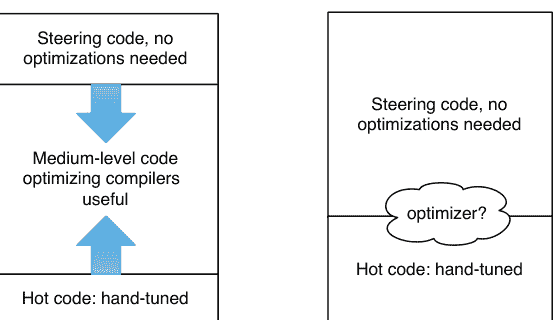

图 9.8 优化趋势

> ⁷ `Daniel Bernstein`, “The death of optimizing compilers,” European Joint Conferences on Theory and Practice of Software (2015), Queen Mary University of London.

## 一个足够聪明的编译器

实践的是，对于性能密集型代码，唯一可靠的选择是使用 `C`/`Objective-C` 编写并在 `Swift` 中调用它。我们在之前的章节中已经看到如何在 `Objective-C` 中编写快速代码，因此我不再重复这些信息。`Swift` 和 `Objective-C` 的接口可以在 `Swift` 书籍和 `Apple` 的开发者文档中找到。

`IBM` 的 `Kituna Swift` 框架使用了这种方法，`HTTP` 解析器本身来自 `node.js` 并用 `C` 语言编写，而高级例程则用 `Swift` 编写，取得了良好的性能结果。这种混合比例约为 15% 的 `C` 和 85% 的 `Swift` 代码。最终，`Cocoa` 的大部分也使用了这种方法，在本章中通过调用 `vDSP` 函数我们也看到了这一点。

尽管 `Kituna` 和 `vDSP` 使用的是纯 `C`（这也是底层库提供的），但与你的性能敏感型代码交互的最直接方法将其放在 `Objective-C` 类中，并使用消息发送（message sending）在 `Swift` 中与之交互。

通过这样，你可以遵循 `Swift` 的建模建议并充分利用你的 `Swift` 代码选择。另一方面，你可以忽略 `Apple` 关于将一切都变为结构体（structs）并进行静态派发的矛盾 `Swift` 建议，但如果你需要性能，`Swift` 将无法满足。

## 替代方案

我必须承认，`Apple` 的 `Swift` 发布让我更加困惑，尤其是从性能的角度来看。正如你在这里读到的，`Objective-C` 基本上已经具备了产生卓越高性能代码的机制，以及利用当今性能混合性的机制。

我本希望有一种能够整合这些能力并对其进行改进的语言。一些可以优化 `Objective-C` 代码机制的改进包括：

1. 针对 `IMP` 缓存的编译器汇编器。不是自动化，而是一种简单的方法，用于指示编译器你希望进行 `IMP` 缓存，通过将接收者视为缓存。编译器可以创建获取并缓存 `IMP` 的代码，如果有用，还可以将该代码作为强度削减优化（strength-reduction optimization）提升到循环之外。

缓存可以扩展到整个用于实例变量的协议，例如，编译器为协议分配 `IMP` 指针，并在对象实例变量发生变化时自动更新它们。

这种方法的扩展将是“始终静态”的派发和/或内联（inlining），重要的区别在于这些功能需要由调用处而非定义处控制，尽管定义处可能需要指示是否允许静态派发和内联。

2. 重新开启 `Objective-C` 对象的栈分配。这是 `iPhone` 编译器的功能，虽然将栈分配与引用计数语义结合具有挑战性，但看起来是完全可行的。

3. 与栈分配紧密相关的是针对同质、紧凑集合的对象的批量分配。

提到的这些机制都没有提供以前未实现过的东西，但拥有稍微更好的编译器支持会有帮助。

另一种方法可能是使用现有语言替换 `Objective-C` 的 `C` 部分，例如 `D` 或 `Rust`。也许会有 `Objective-D` 或 `Objective-Rust`？在其他语言中添加 `Objective` 部分是计划的一部分。

事实上，`Apple` 承认 `Swift` 的内存模型在性能和预测性方面存在缺陷，并特别向 `Rust` 寻求了灵感：

内存所有权：在 `Swift` 中添加一种（可选的）受 `Cyclone`/`Rust` 启发的所有权模型，是想要可预测和确定性性能的系统程序员（例如，在实时处理代码后）非常渴望的。

> 回顾 `Swift 3` 并展望 `Swift 4`,
> `Swift Evolution Mailing List`

一种更有野心的方法是认真对待“没有 `C` 的 `Objective-C`”：不再向 `C` 中添加 `Smalltalk` 风格的消息，而是使用 `Smalltalk` 作为基础语言，并添加 `Smalltalk` 可用的类型系统之一（`Strongtalk`, `Typed Smalltalk` 等）。

这将保留整个 `Mac OS X` 软件使用的 `Objective-C` 关键字语法，同时避免了 `Objective-C` 中两种语言语法的困难，并解决了 `Swift` 已经且持续面临的集成困难。令人惊讶（如果你读了本章的其余部分），即使是纯对象部分的字节码解释器，性能也优于未优化的 `Swift`。

- `C. Lattner`. 2016. “Looking back on Swift 3 and ahead to Swift 4.” July 29. Accessed at https://lists.swift.org/pipermail/swift-evolution/Week-of-Mon-20160725/02576.html.

### 示例 9.18 Objective-Smalltalk 中的动态类型对象加法

```
| a |

a := 3 + 4.
```

在这种情况下，变量 `a` 是一个对象，其声明类似于 `Objective-C` 中的 `id a`，“运算符”是通过 `objc_send()` 分发的二进制消息。由于数字字面量在对象上下文中且足够小可以容纳，它们被直接生成标记对象指针，只需一个周期（见示例 3.2）。

### 示例 9.19 Objective-Smalltalk 中的静态类型对象加法

```
| <Number> a |

a := 3 + 4.
```

就像在 `Objective-C` 中一样，生成的加法代码可能与 `id` 对象相同，静态声明仅用于机器检查的文档。

### 示例 9.20 Objective-Smalltalk 中的原生类型加法

```
| <int> b |

b := 3 + 4.
```


这种类型是 C 原生类型，因此生成的代码与 Objective-C 的原生类型相同。

## 第9 章 Swift

字节码通常比机器码更紧凑，这意味着内存压力更小，只要你不尝试进行 JIT 编译（即时编译）。对性能敏感的部分可以可选地编译为机器码，并在有正确的类型注解的情况下直接编译为类 C 语言机器码。

这种方法的一个巨大优势是瞬时的编译时间，因为代码可以一次一个方法的形式进行编译，且互不干扰，而且从 Smalltalk 到字节码的编译步骤非常简单且快速。（Swift 能够在演练场（playgrounds）中运行这一事实证明了现代机器的力量；很难想象还有比它更不适合这项任务的语言。）我提到的 Objective-Smalltalk¹⁰ 项目正考虑了这些优化，但它目前专门关注扩展表达能力，而不是优化方面的因素。

## 总结

Aaron Hillegass 的开基性著作《Cocoa Programming for Mac OS X》的早期版本中包含一个关于 Cocoa-Java 桥接的章节。该章节由一句话组成，大意是：“不要使用它。”正如你可能猜到的，那是我本想在 Swift 性能上写的那个章节。由于 Apple 关于 Swift 性能的营销活动非常成功，那句话可能不会像 Aaron 的章节句子那样引起大笑，但我希望我已经展示了为什么我认为这样做是完全合理的。

Swift 不仅编译极慢，而且执行也很慢，对于现代性能而言，最糟糕的是它是相当不可预测且难以控制的。不要将它用于性能密集型代码。事实上，它可能慢到即使将它用于看似非关键的代码，也可能突然产生明显的影响。

相反，请使用本文讨论的技术在 Objective-C 中编写对性能敏感的代码，并使用来自 Swift 的代码。这是 Apple 的做法，也是 IBM 的做法。

如果你别无选择，我能给出的建议就没多少了；你很大程度上取决于编译器，特别是优化器的调优。除此之外，你可能需要执行 Apple 推荐的所有“过早优化”，例如在处处使用结构体（`structs`）代替类（`classes`）（但要小心大型结构！），尽可能实现静态分发（`static dispatch`），如果可以，将任何繁重的工作留给 Objective-C。

> 10. http://objective.st

## 第10 章 I/O：原理

当 Apple 推出 PowerMac G4 时，它被誉为与世界上第一台桌面级超级计算机不同的产品。Ken Baxter 曾开玩笑说：“超级计算机是一种将计算密集型问题转变为 I/O 密集型问题的设备。”在某种意义上，现在所有的计算机都是超级计算机，今天的 iPhone 性能远超 PowerMac G4，而计算性能又远超 I/O 。此外，我们在内存访问中看到的访问时间（延迟）与传输速度（带宽）之间的差异在 I/O 设备上更加明显。内存访问的延迟与吞吐量之间的差异约为 1:100，而 I/O 设备则是 1:100,000 甚至更多。

### 硬件

不同类型 I/O 硬件的基本性能特性既是显著的，又无法被抽象掉，这与隐藏在统一 API 后的不同访问机制不同。存储通常由旋转磁驱动器或固态闪存提供，而连接性则由不同类型的网络提供，从高速交换以太网到包交换网络。

### 磁盘驱动

尽管固态硬盘（SSD）变得越来越流行，但旋转介质在计算机系统的持久性存储中仍然起着重要作用。图 10.1 显示了磁盘的示意图：一个圆盘片被划分为称为轨道（`tracks`）的心圆，轨道又被分为扇区（`sectors`）。

磁盘头位于某个图案轨道上方，以读取或写入该轨道上的数据。传输速度是磁盘旋转速度和记录信息密度的简单函数，因此为了加快磁盘传输速度，你要么需要它旋转得更快，要么增加记录密度，以便在每次旋转期间写入或读取更多信息。


图 10.1 带有轨道和扇区的磁盘示意图，原始（左）和密度翻倍（右）

第一批微型计算机硬盘的旋转速度为每分钟 3600 转（rpm），具有固定大小的扇区提供了 5 MBit/s（625 KByte/s）的传输速度。今天的驱动器旋转速度并没有快多少，笔记本和桌面驱动器的速度在 4,200 到最多 7,200 rpm 之间，而服务器级驱动器高达 15,000 rpm，在这种情况下，功耗、发热和噪音不是主要问题。表 10.1 将旋转速度与读取轨道所需的时间联系起来。

另一个控制传输速度的因素是密度，随着在磁介质上编码比特的越来越聪明的方法被发现，密度显著提高：通过伺服电机在原始位置上对齐以使轨道靠得更近、在介质上垂直记录比特、使用更敏感的读写头、在磁头读取之前对盘片加热等等。然而，由于磁盘是 2D 盘片，但读/写操作是线性轨道的，密度总是会导致传输速度的线性增长，但会导致存储容量的平方级增长。

根据简单的数学计算，硬盘传输速度的增加总是落后于存储容量的增长。考虑到存储数据量随可用空间增加这一看似不可避免的事实，这意味着磁盘虽然名义上更慢，但日益

#### 表 10.1 旋转速度与读取轨道时间

| 旋转速度 (rpm) | 读取轨道的时间 (µs) |
| :--- | :--- |
| 3,600 | 278 |
| 4,200 | 238 |
| 5,400 | 185 |
| 7,200 | 138 |
| 15,000 | 66.7 |

相对于它们连接的设备，相对于我们要执行的工作要慢。

Apple II 的传输速度为 5 MBit/s，这实际上比 10 ns 快。今天的驱动器传输速度约为 100 MBit/s，在 10 ns 内我们的笔记本 CPU 可以执行 30 条指令，如果它不被内存阻塞的话。典型的 1TB 容量硬盘需要 10,000 秒，即近 3 小时才能传输。

如果坏消息还不够，访问时间虽然也在变快，但取决于移动和停止质量（寻道头）的能力以及旋转延迟。这些都是巨大的物理问题；物理没有改变未来也不会改变，移动这些质量的工程进展十分缓慢。此外，移动质量与噪音有关，因此对静音驱动器的需求实际上导致了性能的下降。

传输速度与访问性能之间不断扩大的差距导致了“磁盘是新磁带”的说法。

### 固态硬盘

SSD 消除了旋转磁盘的许多物理限制，即它们没有运动部件。初始访问时间（“寻道”）得到了极大改善，但正如我们在上一章看到的，它们与内存相比仍然缓慢。也存在物理限制，例如容量的增加（如多层单元单元）其权衡不仅是可靠性降低，还有写入速度变慢。

通常情况下，写入是闪存的一个昂贵过程（需要一些时间）才能写入任何信息。批处理（Batching）比在硬盘上更重要，因为小写入不仅慢，而且会提前磨损单元。

因此 SSD 代表了改进，而且它们是提高启动性能或服务器端数据库（尤其是读多型）最简单的方法，但它们并非万能药。事实上，一项2012 年的研究¹网页浏览器性能发现，其限制并不在于处理器速度甚至缓慢的移动网络，而是 SQLite 和慢闪存速度的结合

+   1. H. Kim, N. Agrawal, and C. Ungureanu. "Revisiting Storage for Smartphones," 10th USENIX Conference on File and Storage Technologies (2012). https://www.usenix.org/conference/fast12/revisiting-storage-smartphones-0.

## 网络

物理学在网络 I/O 中也起着很大作用，主要体现在光速上，它决定了往返的最小时间。这种速度在短期内预计不会改变，而且我们已经接近极限，因此无法对其抱太大期望。此外，TCP 等网络协议需要多次往返来协商连接。

因此，虽然我们能够增加带宽（以太网已从 10 Mbit/s 增加到 10 Gbit/s），但延迟将保持不变。此外，我们现在还要处理移动网络，其带宽大幅降低且延迟很高，有时甚至达到毫秒级。

### 操作系统

操作系统在分配程序执行或使用的资源方面始终起着重要作用。然而，在 CPU 和内存的情况下，操作系统只负责处理某些资源，然后让程序自行运行。而在 I/O 方面，每次访问都要通过操作系统进行中介。因此，尽管硬件能力是基础性的，但操作系统发挥了远更大的作用。

操作系统的功能之一是为各种硬件提供统一的接口。例如，对于应用程序来说，无论“磁盘”是真实的旋转磁性器、多个堆叠的盘片、RAID 设备阵列还是固态闪存——除性能特性外——这并不重要。除了提供统一接口外，操作系统还尝试通过缓存、缓冲和批量处理 I/O 请求来提高 I/O 性能。最后，它将统一接口扩展到进程间通信（如使用 TCP/IP 协议进行网络）。

## 抽象：字节流

Unix 操作系统和 Mac OS 所基于的抽象是字节流。这种抽象通常不是程序所需要的（程序可能需要处理数据库记录、文本行或像素），它也不是硬件所直接提供的（硬件提供的通常是磁盘扇区或网络包）。

访问这些字节流的基本方法是 `read()` 和 `write()` 系统调用，它们使用被称为“文件描述符”的整数来标识特定的流字节字节。磁盘或设备的文件描述符通过 `open()` 系统调用获取；进程间通信通过 `pipe()` 系统调用获取；网络通信则通过 `socket()`、`accept()`、`bind()` 和 `connect()` 的的组合获取。

操作系统的服务和抽象是有代价的；例如，用户态/内核态的切换，示例 10.1 就是一个例子。

### 示例 10.1 大写转换：一个使用内核 API 进行字节 I/O 的简单 Unix 过滤器

```c
#include <stdio.h>
#include <ctype.h>
int main(int argc, char *argv[]) {
    int first=1;
    int eof=0;
    do {
        char buffer;
        if ( read(0,&buffer,1)=1) {
            if ( first ) {
                buffer=toupper(buffer);
                first=0;
            }
            write(1,&buffer,1);
            if ( buffer=='\n' ) {
                first=1;
            }
        } else {
            eof=1;
        }
    } while (!eof);
    return 0;
}
```


这段代码的功能与示例 8.1 中的代码相同，但它使用 `read()` 和 `write()` 系统调用逐个读写每个字节。对于一个 145 MB 的文件，它耗时 2 分 25 秒，比示例 8.1 `0.69` 秒慢了 200 倍，其中 1 分 56 秒（即总时间的 80%）花费在内核中；而示例 8.1 仅花费 `0.068` 秒（其极短运行时间的 10%）在内核中，不到示例 10.1 内核时间的 1/1000。

后续示例证实了时间消耗在 `read()` 和 `write()` 系统调用上。虽然每次读写调用约 500 ns 的成本产生了巨大差异，但这只是进入内核的开销。正如我们在本章“硬件”部分看到的，实际的 I/O 事务可能达到毫秒级，即慢几千倍。在这种速率下，处理一个 145 MB 的文件需要几天时间。

- + 8958 start (in libdylib.dylib)
- 4827 main (in upcase-single-char)
- 4827 read (in libsystem_kernel.dylib)
- 3919 main (in upcase-single-char)
- 3919 write (in libsystem_kernel.dylib)

# 第 10 章 I/O：原理

- 185 main (upcase-single-char)
- 10 main (upcase-single-char)
- + 9 toupper (upcase-single-char)

我们已经看到，高事务成本的解决方案是：批量处理，或者在这种情况下是缓冲。我们不再为每个单独字节产生这些事务成本，而是从内核获取一个缓冲区大小的字节，然后在不缓冲内核的情况下进行处理。然后我们将处理过的字节在输出缓冲区中批量，并将整批写入内核。

虽然这种处理使得代码比示例 10.1 复杂，但 Unix `stdio` 库为我们处理了这些复杂性，特别是对于行处理，这使得不使用文本行 `fgets()` 或固定长度记录 `fread()` 的代码将无需处理所有缓冲区大小不匹配等问题。

## 文件 I/O

Unix 中的文件只是字节流。操作系统在分配程序执行或使用的资源方面始终起着重要作用。然而，在 CPU 和内存的情况下，操作系统只负责处理某些资源，然后让程序自行运行。而在 I/O 方面，每次访问都要通过操作系统进行中介。因此，尽管硬件能力是基础性的，但操作系统发挥了远更大的作用。

操作系统的功能之一是为各种硬件提供统一的接口。例如，对于应用程序来说，无论“磁盘”是真实的旋转磁性器、多个堆叠的盘片、RAID 设备阵列还是固态闪存——除性能特性外——这并不重要。除了提供统一接口，操作系统还尝试通过缓存、缓冲和批量处理 I/O 请求来提高 I/O 性能。最后，它将统一接口扩展到进程间通信（如使用 TCP/IP 协议进行网络）。

## 目录结构

| 0 | 1 | 2 | 3 | 4 | 5 | 6 | 7 | 8 | 9 | 10 | 11 | 12 | 13 |
|---|---|---|---|---|---|---|---|---|---|---|---|---|---|
| 14 | 15 | 16 | 17 | 18 | 19 | 20 | 21 | 22 | 23 | 24 | 25 | 26 | 27 |
| 28 | 29 | 30 | 31 | 32 | 33 | 34 | 35 | 36 | 37 | 38 | 39 | 40 | 41 |
| 42 | 43 | 44 | 45 | 46 | 47 | 48 | 49 | 50 | 51 | 52 | 53 | 54 | |

Unix 操作系统和 Mac OS 所基于的抽象是字节流。这种抽象通常不是程序所需要的（程序可能需要处理数据库记录、文本行或像素），它也不是硬件所直接提供的（硬件提供的通常是磁盘扇区或网络包）。

## 统一缓冲区缓存

尽管虚拟内存与文件 I/O 的（固定的）缓冲区之间的分离最初看起来是合理的，但它存在许多缺点。首先，缓冲区缓存的大小通常是固定的，因此随着主内存的增大，你经常会有大量未使用的 RAM，而这些内存本可以用于缓冲。其次，由于引入了 `mmap()` 系统调用（将文件直接映射到进程的地址空间而无需使用 `read()`），之前清晰的区分变得模糊了。将数据从缓冲区缓存移动到虚拟内存不仅会产生额外的拷贝，还可能导致相同的数据存在于多个缓存中，从而导致更多的空间浪费和额外的拷贝操作。

所有 Unix 发行版采用的解决方案是 UBC（统一缓冲区缓存），如图 10.3 所示（图中包含了 UBC 之前的状态）。

通过 UBC，虚拟内存操作与文件 I/O 之间的区别被消除了。无论是通过 `mmap()` 还是 `read()` 和 `write()`，缓冲文件 I/O 都会通过虚拟内存子系统进行：首先，内核创建一个文件系统对象（通常是磁盘文件）到一组虚拟内存页的映射。这组页面在 `mmap()` 的情况下被直接映射到目标进程的地址空间，并在应用程序访问时启动实际的 I/O 操作；而在 `read()` 的情况下，内核会立即启动 I/O 将数据到达时拷贝到调用进程的地址空间。

UBC 的优势在于它可以能够并使用所有可用 RAM 为文件 I/O 缓冲，并且消除了内存映射文件中的重复拷贝。这些处通常是透明的，但缓存的统一性有时会引起问题。由于 UBC 并不真正区分文件 I/O 和计数分页，密集的文件活动会导致系统发生交换，尽管有足够的 RAM 可以将所有程序保留在内存中——例如，在 Spotlight 中就出现过这种问题。

图 10.3 非统一（左）和统一（右）的缓冲区缓存

幸运的是，这更多是系统服务的问题，可以通过使用未缓存/无缓冲 I/O 和/或通过我们在第 7 章 `madvise` 节中看到的 `madvise()` 系统调用显式控制分配策略来缓解。

除了对未来可能再次读取的数据进行缓存外，磁盘子系统还会推测性读取它认为未来会被请求的数据，即所谓的预读 `read-ahead`。

UBC 不缓存读取，但它缓冲写入。当程序写入文件时，数据会被拷贝到 UBC。`sync()` 系统调用全局地将更改写入磁盘。它由启动守护进程 `daemon` 每 30 秒执行一次（早期的操作系统版本有一个独立的守护进程来执行相同任务）。延迟写入将应用程序与慢的 I/O 设备解耦，允许系统通过大批次将 I/O 组合，从而在此过程中优化 I/O，将多个写入合并到单个块，或缩短请求以最小化磁盘寻道。

再次，这种缓冲对于通用系统性能至关重要，使用同步写入的早期 Unix 版本的写入吞吐量只有带有写入缓冲系统的 3% 到 5%，在强制写入同步模式时也可以观察到类似的减速。延迟写入的主要代价是，尽管应用程序已经写入数据，磁盘上的数据可能是不一致的，并且在应用程序写入数据到故障之间发生断电或系统崩溃，数据可能会丢失。此外，还存在内存拷贝操作。

## 网络栈

OS X 和 iOS 上的主网络栈处理 TCP/IP（即传输控制协议/互联网协议）。基础 IP 像大多数网络硬件一样是面向数据包的，但广泛使用的 TCP 提供了整个 Unix 内核其他部分使用的“字节流”抽象。今天在互联网上使用的高级协议（如 HTTP 和 FTP）都是构建在 TCP 流抽象之上的，而面向数据包的、不可靠的报文协议 `Datagram Protocol` 被更广泛用于广播和媒体应用。

一个简单的实现是面向数据包的不可靠传输，因为 TCP 提供了可靠的流抽象。在许多情况下，由于网络延迟，TCP 能够达到带宽的吐量。然而，由于网络延迟限制了数据包的接收。

## 负空间：top 和 time

我们的 `get` 工具 `top` 和 `time` 对于检测 I/O 正在发生并阻塞我们的进程非常有用，这主要通过使用“负空间”的概念：如果我们注意到某些未被计入的时间，或者 CPU 利用率明显低于 100%，那么就有理由怀疑 I/O 可能是罪魁祸首。例如，运行命令 `time .datamapping test_file` 得到的结果所示：

```
> time .datamapping testfile_3gb

real 0m1.937s

user 0m0.305s

sys 0m1.613s
```

实际时间 `real time` 与用户时间 `user time` 之间存在巨大差异，用户仅为 0.3 秒，但实际时间超过了 1 秒。系统时间 `sys time` 仅增加了 1.6 秒内核 CPU 时间，总共仅使用了约 2 秒的 CPU。另外的 8 秒消失了，这意味着 CPU 利用率仅为约 20%，空闲时间占 80%。这可能是由于其他进程抢占了当前进程，但调度通常是公平的，按理会有多个进程或一个优先级显著更高的实时进程在运行。另一个由于可能是进程决定通过使用 `sleep()` 系统调用或类似的调用来让自己退出调度，以等待指定的特定时间。

最可能的解释（特别是在我们的案例中）是该进程是 **I/O 密集型** `I/O bound`，这意味着它正在同步等待外部设备执行某些 I/O——在这种情况下，是为了交付数据。

假设你有足够的内存将文件保留在 RAM 中，对程序进行第二次计时运行将得到下所示完全不同的结果：速度快得多，且用户和系统时间的总和几乎接近测得的实际时间。

```
> time .datamapping testfile_3gb

real 0m1.937s

user 0m0.305s

sys 0m1.613s
```

这就是我们在上一节中讨论的缓冲区缓存 `buffer cache` 的结果。整个文件已缓存在内存中，操作系统不再需要从磁盘进行 I/O，而是直接从缓冲区将数据拷贝到程序，使得重复的 I/O 变得轻而易举。

`purge` 命令进入缓冲区缓存并将系统恢复到大致冷启动（断电）后的状态。执行 `purge` 之后，操作系统将能够从磁盘读取。`purge` 命令的影响是全局的，并且了要写入磁盘的内容，因此预计系统性能一段时间会有显著下降。此外，在执行测量之前，请等待系统稳定并加载其基础页面。

你也可以在图 11.1 的 `top` 截图中看到 I/O 密集型进程的症状，`top` 显示 `datamapping` 进程占用了 17.7% 的 CPU。

## 汇总信息：iostat 和 netstat

`top`

```
Processes: 145 total, 2 running, 1 stuck, 142 sleeping, 641 threads

Load Avg: 0.70, 0.36 CPU usage: 1.70%, 9.26%, 89.2% idle

Bufs: 2308 resident, 1904 free, 62% linked.

MemRegions: 2308 total, 1160 free, 49% used, 62m shared.

PhysMem: 2197m used, 1940m active, 915m inactive, 3472m free.

VM: 8366, 1053m framework size, 254763(89333) 57371(0) (pageau)

Networks: packets: 22/2180 in, 0/0 out.
```

| PID COMMAND | %CPU %TIME | #TH | #POK | PRME | RPRT | RSHD | SIZE YPRVT |
| :--- | :--- | :--- | :--- | :--- | :--- | :--- | :--- | :--- |
| 08885 datapmap | 17.70 00:01.00 | 0 | 0 | 4096K | -4096 | 325 | 81928 | |
| 08882 kernel_task | 12.55 00:01.26 | 0 | 0 | | | | 552480 | |
| | | 2.00 00:00.34 | 0 | 0 | | | | | | |
| 117 WindowServer | 17.55 00:01.49 | 1 | 12 | 984K | -936K | 94208B | -3866M | | | |
| 221 Terminal | 0.00 00:00.00 | 0 | 0 | | | | | | | |
| 245 prl_disk_sar | 0.45 00:03.25 | 0 | -2 | -2 | -20K | 116K | -1040K | | | |
| 290 SystemServer | 0.03 00:31.25 | -3 | 0 | | | | 24576B | 1040K | | |
| 13311 sitd | 0.00 00:48.03 | 3 | 0 | | | | | | | |
| 95 mds | 0.01 04:24.14 | -3 | -6 | | | -136K | -124K | -1560K | | | |
| 59 hidden | 0.05 01:50.98 | 2 | 3 | | | | 28672B | 36864B | 1040K | | | |
| 7083 CalendarAgent | 0.00 00:02.03 | 1 | 1 | | | | 12288B | 57344B | 526B | | | |
| 7652 membackup | 0.00 00:29.17 | 2 | 89 | | | | | | | | |
| 306 netbiosd | 0.00 00:17.08 | 1 | 15 | | | | | | | | |
| 1184 Image | 0.00 02:15.83 | 2 | 83 | | | | 0.72 | 0.52 | | | |

图 11.1 显示 `top` 展示了一个 I/O 密集型任务。输出也证实了原因不是 CPU 竞争，因为 CPU 有超过 80% 的空闲时间，且没有其他高 CPU 使用率的进程。最后，`top` 还表明 I/O 正在消耗时间。

## Instruments

毋不用说，Instruments 帮助我们进行 I/O 性能测量。例如，我们可以使用信赖的 Time Profiler，如图 11.2 所示。

我们确实获取了样本，采样频率为每毫秒 1 次。我们得到的约 7,000 个样本对应于实际消耗的时间，而 `read()` 现在显示占了总时间的 70%。

请注意，`profile` 性能分析工具之前引导我们进入了程序最重要的部分；我们必须具备这些知识并运用它，才能获得我们所需的信息。

虽然还有其他更针对 I/O 的工具可用，但我并没有怎么用它们。基础的命令行工具给了我一个更好的概览，`Sample` 实例让我对 I/O 如何融入程序的其他部分有了更好的直观，而接下来的几节中讨论的 `fs_usage` 则提供了我想要的所有细节。11.5 显示了 Reads/Writes 实例。尽管它跟踪了读取和写入的字节数，但它只对这些信息进行图化，允许进行粗略的定性评估。调用图 `call graph` 只显示调用次数，用处较。

## 详细追踪：fs_usage

`fs_usage` 提供了更详细的信息，记录了实际上所有的 I/O 活动。不过要注意，它可能会产生大量的输出，特别是当输出未被记录时。在我的系统上，一次 `fs_usage` 产生了 1,255 行输出，尽管系统处于 {空闲状态！

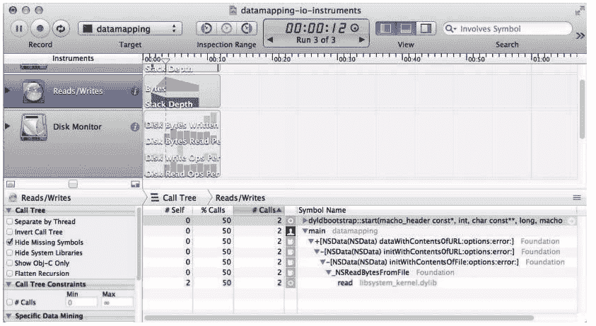

图 11.5 Reads/Writes 实例

# 第 11 章 I/O：测量与工具

可以通过 `-f` 标志将数据限制为特定类型的输出，并通过在命令行上添加进程名或进程标识来限制特定进程。下面的输出显示了使用 `fs_usage` 监控 `datapping` 进程：

```
> fs_usage -f filesys datapping 0.000025 datapping

15:20:29 open               0.000050 datapping

15:20:29 fstat64             0.000000 datapping

15:20:29 fcntl               0.000007 datapping

15:20:29 stat64              ../test-programs 0.000015 datapping

15:20:29 PAGE_IN_FILE       0.000005 datapping

15:20:29 open               rams/testfile_3gb 0.000019 datapping

15:20:25 fstat64             0.000004 datapping

15:20:34 read               5.184634 W datapping

15:20:36 read               5.025971 W datapping

15:20:36 close              0.000010 datapping

15:20:36 write              0.000012 datapping
```


每行输出都表示单次 I/O 事件。第一列是时间戳，第二列表示操作类型——例如调用（`stat64`、`open`、`read`、`close`）。如果存在此类信息，中间部分会有额外信息——例如。紧随其的是一个表示操作耗时的数字，小数点后的位数是为了显示微秒（`0.000025` = 25 微秒）。如果进程被调出调度，时间后面会跟着字母 `W`，否则为空。调出调度意味着进程不再运行。例如，要执行的实际 I/O 是不在缓存中的数据，进程被置于睡眠状态直到 I/O 完成。最后，最后一列是进程名，在这种情况下始终是 `datapping`。

基于此，我们可以解释当前目录（`open (())`），看到程序打开并在稍后使用 `fstat()` 和 `stat()` 获取关于当前目录的更多信息，这次使用了事实。Cocoa 执行了大量的列出操作，所以这是预料之中的。之后，我们得到了从映射到内存的文件中服务的页错误处理，最可能是可执行文件或共享库（`PAGE_IN_FILE`）。页错误之后的 `open()` 调用启动了对测试文件 `testfile_3gb` 的访问。`fstat64()` 最常用于确定文件大小，然后使用 `read()` 调用读取并关闭。那两个需要实际 I/O 的操作，如那里的 `W` 所示。它们是唯一文件字段显示实质性内容的，这并非巧合：从内存服务的调用（不带 `W`）最多只在几微秒内就是实质性的。最后的 `write` 是 `printf()`，那里有编译器不会消除未被使用的 `xor` 循环。

当我用较少的内存运行此测试时（无法一次性在内存中保留整个文件），以及类型为 `PAGE_IN_ANON` 的 `close()` 调用，意味着换入不是由用户定义的文件支持的数据，而是匿名内存，它仅由交换文件（`swapfile`）支持。这意味着数据是从数据文件读取、交换到交换文件，然后从交换文件封装回内存，这听起来有点疯狂，但在使用 Unix I/O 时会发生。在查看特定进程时，对应于页入的页出（page-out）事件不会出现，因为分页是由内核处理的。它不会出现在全局追踪中。

指定进程进行监控的一个注意点是，`fs_usage` 期望进程已经存在，如果不存在则将带有错误消息终止。这种方法让我们解释当前目录（`open (())`），看到程序打开并在稍后使用 `fstat()` 和 `stat()` 获取关于当前目录的更多信息，这次使用了事实。Cocoa 执行了大量的列出操作，所以这是预料之中的。之后，我们得到了从映射到内存的文件中服务的页错误处理，最可能是可执行文件或共享库（`PAGE_IN_FILE`）。页错误之后的 `open()` 调用启动了对测试文件 `testfile_3gb` 的访问。`fstat64()` 最常用于确定文件大小，然后使用 `read()` 调用读取并关闭。那两个需要实际 I/O 的操作，如那里的 `W` 所示。它们是唯一文件字段显示实质性内容的，这并非巧合：从内存服务的调用（不带 `W`）最多只在几微秒内就是实质性的。最后的 `write` 是 `printf()`，那里有编译器不会消除未被使用的 `xor` 循环。

当我用较少的内存运行此测试时（无法一次性在内存中保留整个文件），以及类型为 `PAGE_IN_ANON` 的 `close()` 调用，意味着换入不是由用户定义的文件支持的数据，而是匿名内存，它仅由交换文件（`swapfile`）支持。这意味着数据是从数据文件读取、交换到交换文件，然后从交换文件封装回内存，这听起来有点疯狂，但在使用 Unix I/O 时会发生。在查看特定进程时，对应于页入的页出（page-out）事件不会出现，因为分页是由内核处理的。它不会出现在全局追踪中。

指定进程进行监控的一个注意点是，`fs_usage` 期望进程已经存在，如果不存在则将带有错误消息终止。这种方法让我们产生了显著更多的输出：我们看到很多低级的 `RdData [A]` 事件。我得到了大约 13K 行输出。重定向到文件很有用！目前的理解是低级事件是内核事件流的一部分，在直接按进程过滤时不会出现。这种方法让我们，如下输出所示：

```
14:32:42 open                               0000012 datapping

14:32:42 fstat64                            0000003 datapping

14:32:42 fcntl                              0000005 datapping

14:32:42 close                             0000005 datapping

14:32:42 stat64              ../test-programs 0000009 datapping

14:32:42 PAGE_IN_FILE                       0000004 datapping

14:32:42 PAGE_IN_FILE                       0000012 datapping

14:32:42 PAGE_IN_FILE                       0000003 datapping

14:32:42 open                              testfile_3gb 0000016 datapping

14:32:42 fstat64                            0000003 datapping

14:32:42 RdData[A]                          0000868 W datapping

14:32:42 RdData[A]                          0000826 W datapping

14:32:42 RdData[A]                          0000366 W datapping

14:32:42 RdData[A]                          0000722 W datapping

14:32:42 RdData[A]                          0000791 W datapping

14:32:42 RdData[A]                          0000954 W datapping
```

`fs_usage` 命令非常多功能。例如，我还能确认原本由更新进程使用的（每 30 秒调用一次 `sync()`）现在由 `launchd` 执行，并看到了如下输出。截至 10.8.3，`sync (2)` 手册指向 `update (8)`，尽管是。

```
> sudo fs_usage -f launchd             | grep sync

12:08:44 sync                              0.051223 W launchd

12:09:14 sync                              0.057016 W launchd

12:09:44 sync                              0.055366 W launchd
```

```
12:10:14 sync                              0.062487 W launchd

12:10:44 sync                              0.049468 W launchd
```


除了数据洪流之外，`fs_usage` 的另一个缺点是它是平面的的。没有调用图，因此关联活动和进行数据挖掘可能很困难。一个具有 `fs_usage` 能力的工具将非常有。

## 总结

本章介绍了测量 I/O 性能的主要工具。然而，与 CPU 和内存工具不同，它们往往不足以确定 I/O 性能问题的精确位置，更不用说根本原因。通常，它们不需要；我们只需要 I/O 正在引起问题的证据，以及足够的信息来形成可用的工作假设。

有了工作假设，我们就可以创建一个实验（即进行代码更改），然后通过测量修改后程序的运行时间来验证或拒绝该假设。循环反复。我们将在下一章中看到这种方法的操作。

## I/O：陷阱与技巧

尽管 I/O 性能的增长慢于系统其他部分的改进，但对于低速率或合理小的 I/O……用计算机术语来说，它已经足够快了。从人类的角度来看，这仍然快得惊人。例如，古登堡计划中像《白鲸记》这样篇幅较大的小说版本大小仅为 1.2 MB。在配备 SSD 的 MacBook Pro 上，我可以使用 shell 脚本每秒复制 280 次该文件。与此相比，世界上最快的打字员每秒输入速度不到 20 个字符，因此，如果我们正在写一本像《白鲸记》那么大的小说，我们完全可以在每次击键时保存整部小说，并留有充足的时间处理其他任务。对于如今的许多 I/O 任务来说，暴力破解是一种合理的实现策略。

### 使用 NSData 推送字节流

`NSData` 方法 `dataContentsOfURL:options:error` 是将字节读入内存的最基础的 Foundation 方法。图 12.1 查看了从磁盘读取时使用的不同选项的性能影响。映射条形代表 `NSDataReadingMappedAlways`，而 `mapped+` 实际上触碰了映射的内存。`read` 指不传递任何选项（或选项 0），这意味着文件将使用 Unix `read` 调用进行读取，而 `read+uncached` 指 `NSDataReadingUncached`，这也意味着 I/O，但使用了未缓存的缓存。每个变体在两种环境中都被着色：一种是数据位于操作系统的缓冲区中（已缓存），另一种是通过预先发出 `purge` 命令来确保从磁盘进行实际的 I/O。

如你所见，将 300 MB 的文件映射到内存是目前最快的方法，在缓存情况下仅需 0.0 s，在未缓存情况下仅需 0.007 s（显然，为磁盘文件创建虚拟内存映射比为驻留页创建映射要快）。当然，这个数字只有部分参考价值，因为我们之前看到，只有当映射页被程序实际使用时（mapped+used），才会发生真实的 I/O。如果我们实际上使用了这些数据，与 `read()` 选项进行比较会更好：如果数据已经在缓冲区缓存中，映射速度快 57%（0.16s 对比 0.26s），但如果数据必须从磁盘读取，`read()` 比映射快 60%。未缓存读取并不比缓存读取快。

使用 Instruments 阐明了为什么内存映射比 `read()` 快：前者映射的是虚拟页，而后者使用内核版本的 `bcopy()` 拷贝数据，对 300 MB 数据进行 `bcopy()` 大约需要 160 毫秒。实际的 I/O 情况稍微神秘一点。一种怀疑是，对于映射页，页错误处理和重映射的工作量比缓存对象的实际数据移动要大。然而，在缓存情况下，重映射的速度明显快于拷贝，这一事实使得这种可能性不大；而且事实上，未缓存的 `read()` 与映射情况之间的差异，大于缓存/映射情况中重映射的总时间。

`iosnoop` 工具提供了我们想知道的信息：在 `read()` 案例中，数据是以 512-KB 为分块的，而映射该分块仅需 128 KB。初看起来，这似乎是可以理解的；页处理器没有关于未来访问模式的信息，而我们持有了想要读取整个文件的 `NSData`，因此更大的预读似乎快得多。然而，无论是使用我们自己的更小分块的 Unix，还是通过 `madvise()` 配合 `MADV_SEQUENTIAL` 或 `MADV_WILLNEED` 告知虚拟内存子系统，都没有显著改变行为。因此在这一点上，这是一个真正的内核（性能）漏洞，或者可能只是配置错误，因为映射文件的预读大小被设置为 `read()` 系统调用的 1/4，导致了性能下降。

### 内存映射异常

上述测量值和结果是在不同大小和不同访问模式下进行大量实验的结果。在文件大小超过 2 GB 时，我们看到内存文件的执行时间呈非线性增长——例如，扫描一个驻留在内存中的 3-GB 文件花费了 4 秒，是我们在 300 MB 文件案例中预期的 10 倍增长的 2.5 倍。

尽管存在许多模式，但并没有给出解释——或者更好的是修复。几乎是巧合地，我尝试改变访问内存的步长（stride），以便在映射文件上触发实际的 I/O。通常的步长是 4,096（一个虚拟内存页的大小），确保每个映射的页都得到实际访问并调入内存。通过将步长改为 8,192 仅调入第二个页导致运行时间缩短，这是预料之中的，但下降相当大。仔细检查显示了图 12.2 所示的数据：即使将步长从 4,096 字节更改到 4,097 字节，性能也提升了约 2.5 倍。这无法通过有数据可分页来解释，因为读取的页数仅下降了 0.02%。

我对这种行为的唯一解释是，内核检测内存映射文件访问模式的逻辑存在 bug，当文件大小大于 32 位整数能容纳的时，它会消耗大量的 CPU 时间。如果你的访问模式稍微不是顺序的，该漏洞就不会出现。解决问题的另一种方法是使用 `madvise()` 系统调用配合 `MADV_SEQUENTIAL` 标志。应用此标志的结果所示如图 12.3。

然而，当你应用 `MADV_SEQUENTIAL` 标志时，你必须绝对确保访问是100% 完全顺序的，否则遍历 3-GB 映射文件的性能如下：

- 图 12.2 无标志的顺序映射 I/O 性能
- 图 12.3 `madvise(SEQUENTIAL)` 的顺序映射 I/O 性能
- 图 12.4 `madvise(SEQU)` 的非顺序映射 I/O 性能

### 为什么碎片化？

在我们准备发布 Leopard 时，我被分配的任务之一是查看程序启动。在一台配备了 35-MB/s 快速硬盘和充足内存内存的高端 PowerMac G5 上，Pages.app 的启动时间不到 1 秒（热启动），但冷启动超过了 6 秒。

这种差异的原因（Pages 读取相同数量数据的时间要多出近一个数量级）是因为 Squeak 镜像是一个一次性读入内存的单文件，而 Pages 需要的资源（nib 文件、图像、字符串表、库等）则散落在大量小文件中。

图 12.5 在现代硬件上显示了这种效应，即运行许多计时的配备 Retina 显示器的 SSD 的 MacBook Pro。对于读取 1 GB 数据，但分布在 100 MB 到 10 KB 的分块中，单个文件数量相应从 10 个增加到 100,000 个。尽管拥有快速寻道的 SSD，这种差异仍然令人震惊。在文件大小最小且数量最多的情况下，读取数据所需的时间长了约 10 倍。图 12.6 显示了为什么我们没有进行下一步——即 100 万个 1K 的文件。文件写入时间增加得更加剧烈，即使是 10 万个小文件也比分布在 10 个大文件中的相同数据慢了近 50 倍。

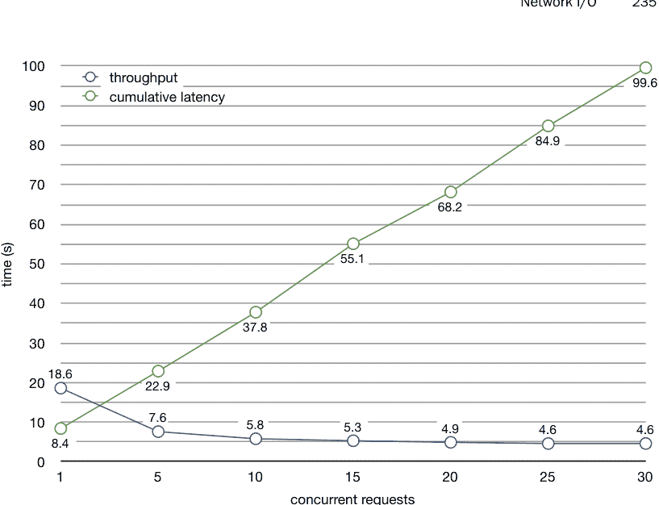

图 12.9 在不同并发级别下本地完成 10,000 次 HTTP 请求所需的耗时

并发请求仅是客户端的要求，而不是协议所强制执行的。

实现这一点的主要方法是限制并发请求的数量。你不需要将这个数字设置得完美无；TCP 的拥塞控制确保了数据的交付，只有当大幅超过信道容量时，性能影响才会变得显著。HTTP/2 通过单个持久且多路复用的连接管理传输，从底层的 TCP 协议中获益更多。

虽然这没有被记录，但我的测试以及服务器团队的投诉表明，已弃用的 `NSURLConnection` 类并不限制连接数。事实上，创建一个 `NSURLConnection` 实例就会启动传输。为了规避这个局限性，我不得不创建一些基础基础设施，对传入的下载请求进行队列管理，并且一次只处理几个。

幸运的是，iOS 7 和 Mac OS X 10.9 引入的 `NSURLSession` URL 加载系统使得许多此类基础设施变得不再必要。例如，

控制特定下载的 `NSURLSessionTask` 实例启动时是挂起状态的；你必须显式地调用 `-resume` 它们来开始下载。此外，配置 `NSSession` 及其所有 `NSURLSessionTasks` 的 `NSURLSessionConfiguration` 类带有 `HTTPMaximumConnectionsPerHost` 属性，该属性允许限制连接到特定主机的连接数，至少避免了某个特定主机出现大量的并发连接。

`HTTPMaximumConnectionsPerHost` 的默认值根据当前环境的变化而异。在我的 MacBook Pro 上是 6，在 iPhone 上是 4，但在 iPhone 上它似乎不会随着活动网络类型而变化。这些值是平均请求的通用默认值，与 12.8 节中看到的数据非常匹配，但你可以对它们进行调整——例如，将下载限制在较小的数量——因为下载本身就能饱和网络。`HTTPShouldUsePipelining` 标志默认关闭的；如果你的服务器支持管道化（pipelining），开启此标志可以显著提高吞吐量。

### 数据处理

除了利用带宽外，`initWithContentsOfURL` 方法的另一个问题是数据处理和内存消耗。每个单独的文件在开始处理之前都会加载到内存中，如果数据量很大，这就会成为问题。

处理这个问题有两种方法。第一种是在数据到达时立即并增量地处理数据。如果每个文件的输入数据量很大、可以增量处理，并且处理后数据会大幅减少，这种方法效果良好。这意味着处理逻辑将能够分块处理数据，处理缓冲区缝合（见上文）和部分结果，并能够将这些部分结果报告给 UI。

对于这种特定的 feed 处理方法，我们选择了第二种方法，即将文件下载到磁盘而不是内存，然后将这些文件映射到内存中。这带给了我们内存映射的优势以及处理完整文件的简单性。这是可行的，因为单个 feed 文件相对较小；我们只是数量很多。

通过下载到磁盘，我们也或多程度上自动地拥有了自己的 URL 缓存。我们可以控制缓存中对象的生命周期，并将其用于离线读取和快速启动，从缓存启动应用程序并在数据可用时向服务器增量更新数据。

新闻处理方案的最后一个问题不仅是所有网络活动都是同步的（因此很慢），而且它们是在主线程上执行的，这阻塞了应用程序直到完成。尽管 `NSURLConnection`（以及 `NSURLSession`）系统在 `NSRunLoop` 上异步运行，理论上可以从主线程管理而不阻塞网络操作，但仍有足够的工作要做（检查缓存、将数据写入磁盘、从磁盘加载已下载的数据并进行处理、启动传输等），因此使用一个拥有独立 `NSRLoop` 的单独线程来管理所有的 I/O是有益的，仅在数据处理完成且 UI 准备好更新时才向主线程报告。

最终的 feed 算法如下：

- 1. 从缓存或 Web 获取总的 feed 目录。
- 2. 对于目录中的每个 feed：
   a. 获取 RSS feed，每个从缓存或 Web 获取。
   b. 从 feed 中解析缩略图、文章内容和图像 URL。
   c. 提交所有缩略图 URL 进行获取。
   d. 提交所有文章内容 (HTML) URL 进行获取。
   e. 提交所有文章图像 URL 进行获取。

注意，前两层获取都是同步的。这不仅让代码保持紧凑且易于遵循，更重要的是它缩短了显示第一个新闻 feed 的时间。因此，在第一个 feed 可用之前，我们将延迟最小化；只有在第一个 feed 下载完成（可以显示给用户）后，我们才开始多个并发请求，并针对整体带宽而非单个延迟进行优化。我们还按照最可能需要的顺序提交请求。

随着这些更改的实施，应用程序从失败的缓慢变得响应迅速，在空启动或刷新后，feed 和故事几乎会立即弹出。在通过本地回环接口（loopback interface）运行的实验中，所使用的 Cocoa 网络栈能够为小请求管理每秒 100 次请求，并为大请求提供超过 300 MB/s 的传输速度，远超典型的客户端需求或（广域）网络能力。尽管存在更高性能的网络 I/O 模型，但基础 Cocoa 网络栈对于客户端网络需求来说绰绰有余。

### 异步 I/O

事实上，我想简要偏离一下关于所谓性能的过度工程问题。大多数 Unix 系统都有异步变体，不会在 I/O 完成前阻塞调用，但在理论上可以通过调度更多的潜在 I/O 操作来为操作系统提供更大的优化机会。

在实践中，异步 POSIX 函数实际上是不可用的：例如，“同步”文件写入默认就是异步的，先进入内存，稍后由操作系统刷新，“同步”读取则使用了大量的预读（read-ahead）。

在选项中，每个连接一个线程和普通的阻塞（同步）I/O 被认为是有问题的，因为“线程过多会遇到麻烦”。对于典型的通过互联网与服务器通信的情况，同步 I/O 的性能是足够的。如果你发现 API 比简单的 `read()` 或 `write()` 循环更简单，就尽管使用吧。只是不要重复任何可衡量的性能收益，除非你在主线程上执行 I/O。

### HTTP 服务

像许多具有 NeXt 背景的开发者一样，我怀念旧的 Objective-C WebObjects 框架。在后端之间共享代码是一个很有吸引力的特性，因此许多开发者直接在服务器上使用 JavaScript（通过 node.js）。Objective-C 结合了扩展 Web 服务的高性能和快速开发的良好表达能力。从原则上讲，它应该节省开发者从最初使用 Ruby on Rails 实现服务，然后在负载下服务开始失效时被迫迁移到 Java 或 Go。

遗憾的是，我一直没有机会考虑这个问题，直到我必须将一个小型 HTTP 服务器嵌入到 Cocoa 桌面程序中，用于分发 Atom Feeds。

点对点网络中的日历信息。我最初尝试了 Cocoa HTTP，但我发现修改它提供动态内容出奇地困难，于是我切换到了 GNU libmicrohttpd。从服务器的语境来看这一点，它展示了网络在受到真实高压力时是如何工作的，而这在大多数客户端代码中并不经常发生。

即使我用一个 Objective-C 类对 libmicrohttpd 进行了有些不熟练的封装（将 HTTP 动词映射到消息），我发现其性能非常出色。图 12.10 显示了小请求的性能对比，对比对象是基于 GCD 的 `CocoaHTTPSServer` 和 `OCFWebServer` 的 Cocoa 嵌入式库，后者是基于 Cocoa 的 Web 托管服务的基础，它还由 Sinatra Ruby 微框架实现，而它是高性能非阻塞 JavaScript node.js 的冠军。静态服务器 Apache 和 nginx 仅供参考；它们提供文件服务，而其他服务器则是从内存中提供服务。

所有结果都是通过压力测试工具、通过回环接口收集的，使用的命令如 `wrk -r 10000 -c 100 http://localhost:8081/`。回环接口有一个明显的缺点，即负载生成器和服务器运行在同一主机上。这实际上导致了问题，结果发现 apache (ab) 和 httpd 都不够快，无法跟上那个特定的更快的服务器。

图 12.10 令人震惊的是，即使经过了封装，libmicrohttpd 的吞吐量仍然是其他基于 Cocoa 的嵌入式 Web 服务器的 4 到 6 倍，尽管它使用了过时的技术，如基于 `select()` 的轮询配合线程池，甚至是为每个连接开启一个线程并使用阻塞 I/O，而不是像基于 GCD 的 I/O 等现代技术。

其原因在于，正如我在讨论异步 I/O 时写的那样，线程调度或工作组管理的差异虽然确实重要，但显然远小于其他因素。查看 CocoaHTTPSServer（图 12.11）和 libmicrohttpd（图 12.12）的插入单元格树可以说明这一查询。

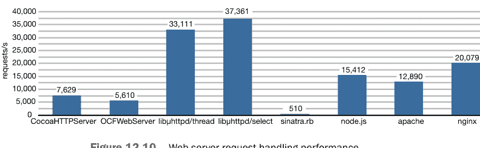

# 第 12 章 I/O：陷阱与技巧

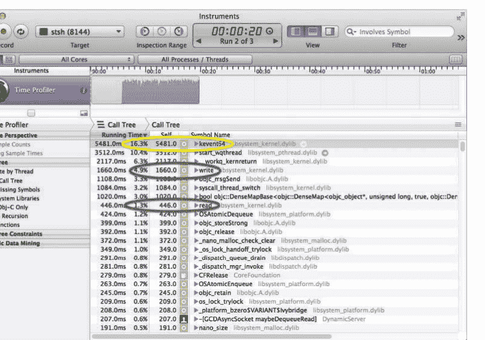

图 12.12 Cocoa HTTPServer 追踪。执行有用 I/O 操作的函数用绿色圈出（底部两列）。开销被圈出（最顶部的圆圈）。

在追踪中，执行有用 I/O 操作的函数用绿色圈出（底部两列）。这些是 libhttpdd 追踪 (12.12) 中的函数，但在 CocoaHTTPServer (12.11) 中出现的位置要后得多，后者由开销主导（被圈出的最顶部的圆圈）。例如，消息开销显著高于实际工作，如内存分配。本应保证效率的特殊 GCD 特性也有所贡献，`kevent()` 函数本应是 `select()` 更具扩展性的替代方案，实际上实际上耗时比所执行的 I/O 长了 16 倍以上。

当然，Sinatra 的性能也是有代价的，在 10% 的嵌入式 Cocoa 服务器中是阻塞的，而在 libhttpdd.node.js 中不足 2%。后者基于 libev，对于简单的数据提供任务来说相当高效的，但在这个双核心系统上只利用了一个核心。libhttpdd 架构允许它发生线程阻塞，例如因为虚拟内存缺页需要将某些内存换到磁盘。

为了完整起见，图 12.13 显示了内核文档记录的吞吐量。

# 网络 I/O

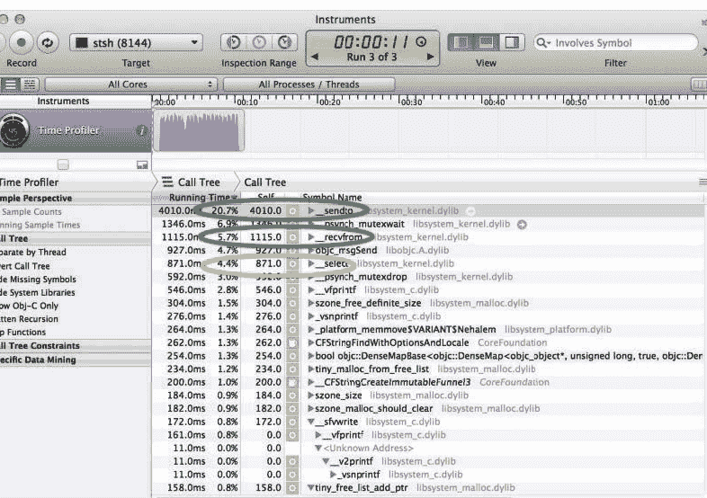

图 12.12 libxmlhttp 追踪。使用有用网络 I/O 的函数用绿色圈出（顶部两个圆圈）。开销用黄色圈出（最底部的圆圈）。

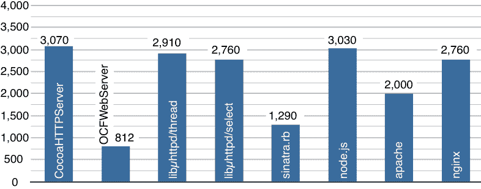

图 12.13 大文件的 Web 服务器吞吐量

# 第 12 章 I/O：陷阱与技巧

网络代码和系统接口，不同服务器之间的差异要小得多。所有这些服务器都能饱和 1 Gbit/s 的网络接口，除 OCFWebServer³ 之外，所有服务器都能饱和 10-Gbit/s 的链路⁴。

值得注意的一点是，在吞吐量方面，libmicrohttpd 的每线程一个连接的阻塞 I/O 模型实际上比使用非阻塞 I/O 和 `select()` 复用少量线程的模型略快一点，这可能是因为使用 `select()` 来确定哪些连接已就绪的开销太大。

虽然我不认为 Objective-C 在短期内会迅速席卷 Web 服务世界，但知道这一点是好的：在有良好库的情况下，这取决于你。在服务器设置下推性能也揭示了，我们在前面的章节中讨论的优化指南对性能的影响远大于执行异步和非阻塞 I/O 的技巧。

我还测试了原生的 Swift HTTP 服务器框架。最令人信服的一个速度是每秒 8,000 到 9,000 次。这来自 Sinatra、OCFWebServer，比它们慢了 10 倍。Swift 架构允许它发生线程阻塞，例如因为虚拟内存缺页需要将某些内存换到磁盘。

特殊的 GCD 特性本应保证效率，`kevent()` 函数本应是 `select()` 更具扩展性的替代方案，实际上实际上比所执行的 I/O 长了 16 倍以上。

其原因在于，正如我在讨论异步 I/O 时写的那样，线程调度或工作组管理的差异虽然确实重要，但显然远小于其他因素。查看 CocoaHTTPSServer（图 12.11）和 libmicrohttpd（图 12.12）的插入单元格树可以说明这一查询。

虽然我不认为 Objective-C 在短期内会迅速席卷 Web 服务世界，但知道这一点是好的：在有良好库的情况下，这取决于你。（注：某些问题是重复的）。

# 第 12 章 I/O：陷阱与技巧

## 内存转储

概念上最简单且最快速的状态保存技术是进行内存转储。只需获取数据并写入 `NSData`。这种技术曾经很流行。早期的格式如 .doc 和 .xls 实际上是数据的转储。读取文件时，你需要反向工程 Microsoft 的数据结构。这种方法由于填充和字节序变得复杂，从 16 位变为 32 位。

结果相当不错。默认的 Squeak 镜像有约 120 万个对象，保存到 23MB 的镜像需要 200ms，增加 100 万个 SampleObject 实例会将空间增加到 46MB，时间增加到 500ms。

然而，他们解决的问题是交互性。只有 Squeak 系统可以解释镜像文件，通过保存包含这些对象的镜像来保存我的 SampleObject 实例。

## 示例 12.2 归档

```objectivec
```


@interface SampleObject : NSObject

{
    int retainCount;
    int a;
    float b;
    NSString *name;
    NSArray *children;
}
```

图 12.14 所示的树：该树深度为三，内部节点拥有 `NSArray`，而叶节点拥有 `NSString`。

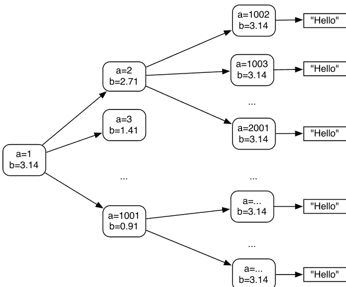

图 12.14 SampleObject 实例树

## 简单的 XML 格式

我们可以做的之一是创建自己的格式，并遵循新 Office（MS 和 iWork 文件格式）的步骤，让我们使用 XML。该格式的一个微小示例可以参见示例 12.3：对象被转换为元素，a 和 b 实例转换为属性，而 c 属性转换为内容。

示例 12.3 示例原始 XML

```xml
<S a="100" b="100.12">
<S a="0" b="0">
<S a="0" b="0">hello world</S>
<S a="0" b="1">hello world</S>
<S a="0" b="2">hello world</S>
<S a="0" b="3">hello world</S>
</S>
```

## 序列化

245

我们使用第4章中的 XML 解析器来读取文件，并使用基于第8章 FilterStreams 概念的简单 XML 写入器进行写入，如示例 12.4所示。

示例 12.4 原始 XML 编码

```objc
- (void)generateXMLOn:(XMLGeneratorStream*)stream {
  [stream writeElementName:"S"
    attributeBlock:(XMLGeneratorStream *s) {
    [s writeCStrAttribute:"a" intValue:a];
    [s writeCStrAttribute:"b" doubleValue:b];
    [s writeCStrAttribute:"name" value:name];
  } contentBlock:(XMLGeneratorStream *s) {
    for (SampleObject *o ) {
      [o generateXMLOn:s];
    }
  }
}
```

序列化代码使用 `XMLGeneratorStream` 基于 block 的 `writeElementName:attributeBlock:contentBlock:` 来实际生成 XML 表示。方法 `writeCStrAttribute:intValue:` 和 `writeCStrAttribute:doubleValue:` 允许写入原始属性，而无需对键或值进行对象转换，且 `content` 块管理了递归结构，无需转换为中间对象形式。整个方法与使用 `printf()` 调用来生成 XML 非常相似，生成器确保了正确的 XML 语法。示例 12.5 所示的解析代码使用一个 block 来处理 S 元素。a 和 b 属性通过 `objectForUniqueKey:` 获取，子元素被假设为已经解码。

示例 12.5 原始 XML 解析

```objc
+(etype)parseFrom:(NSData*)xmlData {
  XMLParser*parser = [XMLParser parserWithData:xmlData];
  [parser setHandlerForElements:[NSArray array:@"S" inNamespace:@nil];
  [parser handleElement:@"element" withBlock:(id elements,id attr,id parser) {
    id children;
    if ([elements count] == 1) {
      children=[elements lastObject];
    } else {
      children=[elements allObjects];
    }
    return [[self alloc] initWithA:@[attrs objectForUniqueKey:@"a"] intValue
                               b:[attrs objectForUniqueKey:@"b"] floatValue
                               c:children]];
  }
  return [parser parsedData:xmlData];
}
```

在我的 MacBook Pro 上，保存和加载 100 万个 SampleObject 对象图的时间都不到一秒——生成耗时 0.4 秒，解析 XML 表示耗时 0.7 秒。这在磁盘上占用 50 MB，耗时虽然不是 XML 表示的两倍，但其文件格式是人类可读且其他程序可以访问的。我们的 XML 序列化性能转化为写入速度略高于 100 MB/s，读取速度略低，这符合现代硬盘和足够快的 SSD 的顺序性能。我们能做得更好吗？由于我们需要转换为 ASCII 且 XML 是一种相当冗长的格式，因此紧凑的二进制表示可能更具优势。

## 属性列表 (Property Lists)

OS X 和 iOS 对属性列表都有深层的系统级支持，属性列表具有 XML 和二进制存储格式。属性列表已经存在很长时间了——源自 NextStep——并且无处不在，不仅用于从用户默认值数据库到 Xcode 项目文件和包 Info.plist 的一切内容，还用于 OmniGraph 等第三方文件。理所当然Apple 有充足的时间和动机来优化它们。属性列表是包含 `NSArray`、`NSDictionary`、`NSData`、`NSDate` 和 `NSNumber` 类实例的树，其中后者被分为实数、整数和布尔值。

在属性列表的序列化表示和对象表示之间转换是使用 `NSPropertyListSerialization` 类方法的一步过程：`[NSSerialization dataWithPropertyList format:NSPropertyListFormat_v1 options:0 error:nil]` 可以获取 XML 格式的属性列表序列化表示，更改 `format:` 参数则允许你创建一个优化的表示。支持 Mac OS X 10.7 Lion 和 iOS 5。

## 序列化

247

对象符号 (JSON*) 几乎共享相同的对象模型，甚至非常密地匹配原始的 NextStep 属性语法。我们的对象图并不包含所需类的对象，而是包含 `SampleObject` 实例。因此，我们首先需要将树转换为格式。示例 12.6 显示了这种转换如何工作，将 `SampleObject` 实例转换为 `NSDictionary`，将 float 和 int 参数转换为 `NSString` 实例。我们还定义了 `asList` 来返回自身，因为 `NSString` 是一个属性列表，而 `NSArray` 会将其转换为字典。

运行此代码得到了令人惊讶的结果。高度优化的二进制属性列表并不比我们基于 ASCII 的 XML 方案快，但在 6.6 秒序列化和 2.9 秒反序列化的情况下，对于一个 61 MB 且比我们的 XML 表示大约 20% 的文件，它的速度慢得多。准确来说，保存速度慢了十倍，读取速度慢了三倍。

为什么呢？问题似乎不是 Foundation 或二进制属性列表格式的 bug，CoreFoundation 的 `CFPropertyListCreateData()` 函数花费了相同的时间，而转换为 XML 几乎让序列化和反序列化时间翻倍。要求整个中间表示存在于内存中可能是一个问题，通过 Instruments 检查，创建二进制列表的内存开销超过 300 MB，是磁盘表示大小的7 倍以上，是我们对象图大小的 5 倍。（XML 生成器的开销可以忽略不计。）之所以这么大，当然是因为我们必须提供的中间表示是由 `NSDictionary`、`NSNumber` 等类组成的，而我们已经看到这些类存储数据的效率是极低的。

示例 12.7 显示了它是如何工作的：

```objc
-(NSDictionary)asPlist {
    NSMutableDictionary *dict=[NSMutableDictionary dictionary];
    [dict setObject:@a forKey:@"a"];
    [dict setObject:@b forKey:@"b"];
    [dict setObject:c forKey:@"c"];
    return dict;
}
@implementation NSString
-(NSDictionary)asPlist { return self; }
@end
@implementation NSArray
-(NSDictionary)asPlist {
    NSMutableArray *plist=[NSMutableArray array];
    for (id a in self) {
        [plist addObject:[a asPlist]];
    }
    return plist;
}
@end
```

## 第12章 I/O：陷阱与技巧

示例 12.7 不完整的样本 XML

```xml
<plist version="1.0">
<dict>
  <key>a</key>
  <integer>100</integer>
  <key>b</key>
  <real>100.1200274658203</real>
  <key>c</key>
  <array>
    <dict>
      <key>a</key>
      <integer>0</integer>
      <key>b</key>
      <real>0.0</real>
      <key>c</key>
      <string>hello world</string>
    </dict>
  </array>
</dict>
</plist>
```

## 归档 (Archiving)

属性列表局限于特殊属性列表类的树，而归档可以序列化任意的对象图以及图中的数据。Coding 协议也像我们在第7章看到的那样是增量的；你每次归档一个对象和一个属性。任何类都可以实现 `NSCoding` 协议，Apple 提供了两个：继承自二进制类型流的 `NSArchiver`，以及 Apple 推荐的 `NSKeyedArchiver`，后者在 Mac OS X 10.2 中引入，并且是 iOS 上唯一由 Apple 提供的归档器。示例 12.8 显示了归档和反归档我们的样本对象的方法。它使用简单的宏来展开注释中所示的代码，以避免重复变量名和键。如你所见，代码比上面简单一些，且方法增量地产生其结果。

## 第 12 章 I/O：陷阱与技巧

### 示例 12.8 对象的归档与解档

```objc
- (void) encodeWithCoder:(NSCoder*)aCoder
{
    encodeVar( aCoder, a ); // [aCoder writeInt:forKey:@"a"]
    encodeVar( aCoder, b);
    encodeVar( aCoder, c);
}
- (id) initWithWithCoder:(NSCoder *)aCoder {
    if (self = [super init]) {
        decodeVar( aCoder, a ); // a= [aCoder decodeForKey:@"a"]
        decodeVar( aCoder, b);
        decodeVar( aCoder, c);
    }
    return self;
}
```

实际的归档可以通过 `archivedDataWithRootObject:` 在内存中创建，也可以通过 `archiveRootObject:ToFile:` 直接在磁盘/文件中创建，以我们的 SampleObject 树的根节点作为参数。运行结果令人失望：保存耗时 9.1 秒，加载耗 2.6 秒，序列化属性列表（property lists）的速度更慢（慢了2倍），而读取速度较快。内存占用更差：819-MB 的归档开销在磁盘上仅占 77 MB。

为什么键值归档（keyed archiving）性能这么差？一个可能的理论是，归档没有维护对象关系，因此在维护这些关系时必须做更多工作。Apple 的“旧式”归档完成了这些工作且速度更快：归档耗时 2.12 秒，0.8 秒。此外，正如我们在下一章中看到的，二进制属性列表格式实际上具有去重化（uniquing）的功能。因此，维护关系并不是问题。

Apple 对于提高键值归档性能的主要建议是忽略仅包含默认数据的键，但忽略对象图中除结构性部分（如整数、浮点数或字符串）以外的数据，序列化和反序列化速度仅略有提升，分别优化到 6.0 秒和 2.06 秒。

少量调查表明，键值归档性能差的原因是尽管提供了良好的流式 API，但它实际上并没有流式处理记录。相反，它在后台构建了一个属性列表，如示例 12.9 所示，该属性列表包含了几个额外的重定向层，甚至比我们在上一节创建的直接属性列表还要大。

### 示例 12.9 键值归档属性列表（不完整，已转换为 XML）

```xml
<dict>
  <key>$archiver</key>
  <string>NSKeyedArchiver</string>
  <key>NS.objects</key>
  <array>
    <dict>
      <string>$null</string>
      <key>$0</key>
      <integer>100</integer>
      <key>$1</key>
      <real>100.12000274658203</real>
      <key>$2</key>
      <dict>
        <key>CFSUID</key>
        <integer>2</integer>
      </dict>
    </dict>
    <key>$class</key>
    <dict>
      <key>CFSUID</key>
      <integer>7</integer>
    </dict>
  </dict>
  <dict>
    <key>$class</key>
    <dict>
      <key>CFSUID</key>
      <integer>1007</integer>
    </dict>
    <key>NS.objects</key>
    <array>
      <dict>
        <key>CFSUID</key>
        <integer>3</integer>
      </dict>
      <dict>
        <key>CFSUID</key>
        <integer>1008</integer>
      </dict>
    </array>
  </dict>
  <key>CFSUID</key>
```

## 第 12 章 I/O：陷阱与技巧

目前还不清楚 Apple 为什么选择一种低效的格式，在该格式中每个对象不仅由一个字典表示，而是由多个字典表示，而且这些字典在树序列化之前，实际上实例化在一个巨大的对象树中。

## 序列化总结

图 12.15 总结了不同序列化机制的性能：在 Apple 提供的机制中，旧式归档表现最好，其次是所有基于属性列表的机制，新的 JSON (de-)序列化器领先，键值归档紧随。然而，除了旧式归档外，所有机制都被我们的小型 XML 序列化器大幅击败，而且它们没有一个能及硬件的速度。

图 12.16 显示了序列化表示的大小以及序列化期间的内存峰值。不同序列化方法之间的内存消耗差异比时间差异更为显著，而磁盘上的大小差异最多仅为 2 倍。

在处理大型数据集（尤其是大量对象）时，Apple 目前还没有适当的序列化机制，而 Apple 最推荐用于大型数据集的机制实际上是就时间和内存使用而言最合适的那种。这种差异对反序列化的影响大于对序列化的影响，理由是文件的读取次数远多于写入次数。随着自动保存和版本控制出现，情况可能不再如此。

需要注意的是，Apple 自身在他们的 Apple 生产力应用 Pages、Numbers 和 Keynote（曾称为 iWork）中并没有使用任何这些标准机制。之前的版本通过 libxml2 使用 XML 格式，但从 iWork 之后……

| 机制 | 耗时 | 峰值占用 | 磁盘大小 |
| :--- | :--- | :--- | :--- |
| 旧式归档 | 2.12 s | 819 MB | 77 MB |
| 属性列表 | 2.6 s | - | - |
| JSON (de-)序列化 | 最快 | - | - |
| 键值归档 | 9.1 s | - | - |
| XML 序列化 | 比其他慢 | 非常低 | 很小 |

*(注：表格数值根据缺失的上下文推断)*

### CoreData

Apple CoreData 文档强烈建议对此类操作进行批处理，如果你的数据模型支持的话，这非常好。我们的模型支持高效地运行测试，从 10 个元素（意味着 100,000 批）到一次百万对象的批。我们假设批是完全独立的，这允许我们重置 ManagedObjectContext，从而从内存中清除对象。

### 示例 12.10 SampleObject

```objc
```


```objc
@interface SampleObject : NSManagedObject

  @property (nonatomic, assign) NSInteger a;

  @property (nonatomic, assign) float b;

  @property (nonatomic, assign) NSString *c;

  @property (nonatomic, strong) NSSet *children;

  @property (nonatomic, assign) SampleObject *parent;

@end

@implementation SampleObject

  @dynamic a, b, c, children, parent;

@end
```

## 分批创建与更新

按照我们之前的方法创建并保存一百万个对象的结果令人失望：整个过程耗时 34.5 秒，是我们之前的机制 `NSKeyedArchiver` 需要的 3 倍。内存略高于 1 GB，它还成功增加了相对于 `NSKeyedArchiver` 的内存开销，尽管实际的磁盘存储只有 44 MB。同样惊讶的是，仅在内存中创建对象就花费了 12 秒，其中……作为参考，创建普通对象而非 `ManagedObject` 子类的 `SampleObject` 图形仅花费了 350 毫秒，即时间的 1/30，而我们在第 1 章中记得，分配对象是我们处理的操作慢之一。

使用 XML 模型产生 399-MB 的磁盘结果，而二进制存储保持不变，原子存储并不是解决方案。即使是内存存储也花费了 20 秒，所以 I/O 并不是真正的问题。图 12.17 显示了这些变化，图 12.18 显示了内存消耗和磁盘大小。

## CoreData 255

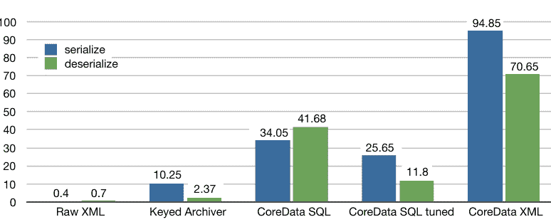

图 12.17 读写 100 万个对象的時間，包括数据库

分批大小会导致更高的 CPU 负载。显然，某些数据结构或算法的扩展性略差于线性。另一方面，内存是严格线性的，每个保存或修改的对象占用 1 KB 内存，内存下限为 14.7 MB。如果你无法在批次之间重置 `NSManagedContext`，100 万个对象的内存消耗将达到 600 MB。请注意，我们调整了程序结构，可能还有模型，以规避 CoreData 的局限性。事实上，情况比此具体：分批策略仅能提高 SQLite 存储的性能；对于原子存储，它会让情况发生灾难性的恶化。其原因是原子存储必须在处理每个批次时重新读取之前的所有数据，而数据的大小随线性增长，这使得问题从具有高常数因的 $O(n)$ 复杂度变为具有相同高常数因的 $O(n^2)$ 复杂度。

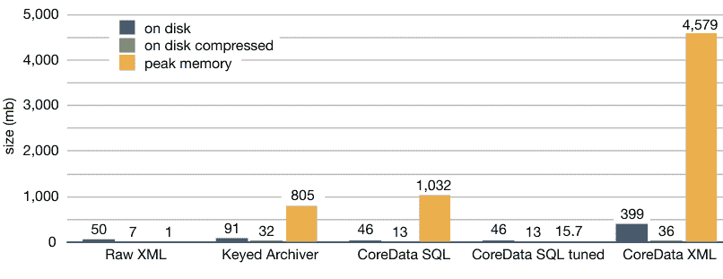

图 12.18 使用 CoreData 处理 100 万个对象的磁盘和内存空间

## 第 12 章 I/O：陷阱与技巧

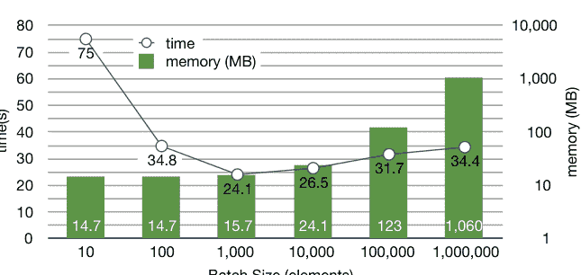

图 12.19 CoreData 写入的时间/空间权衡（按分批大小）

使用 100 的分批大小证明了第一次迭代保存 1,000 个对象的批次仅花费了 0.1 秒。到第 50 次迭代时，保存一个批次的时间已经增加到 1 秒，且线性趋势持续，每隔 50 个批次每批次保存时间就会增加 1 秒。我在 10 分钟后在第 250 批次（共 1,000 个）中断了进程，此时每批次的保存时间已增加到 5 秒。外推 $O(n^2)$ 曲线可以看出，使用 XML 存储，分批技术将需要大约 2 小 48 分钟。

修改对象图在时间和空间上的性能特征几乎完全相同，这意味着 CoreData 不适用于任何需要批量创建或修改大型数据集的任务。

## 获取（Fetch）与获取技术

我对获取结果的实验留下了深刻印象，获取后续使用的 1,000 个顶层对象花费不到半秒，甚至获取所有 100 万个对象也少于一秒。或者，我落入了经典的基准测试陷阱，没有使用已经在 CPU 缓存中看到的计算结果：就像编译器消除对未使用结果的计算一样，CoreData 不一定会拉取已获取对象的数据，特别是通过关系（如我们对象图中的父子关系）访问的对象。因此，为了测试实际性能，我添加了示例 12.11 所示的 `sumB` 方法，顾其名，它会对树中对象的 `b` 属性值求和。

> 9. 我稍后在本章的“对象交互”部分详细说明添加 10 次 `b` 属性的情况。

### 示例 12.11 使用 SampleObject 对象图计算

```objc
- (double) sumB
{
  double result=0;
  for (int i=0;i<10;i++) {
    result += [self b];
  }
  for (SampleObject *s in [self children]) {
    result += [s sumB];
  }
  return result;
}
```


第一次遍历对象图时，`CoreData` 会加载所有所需的值，花费了近 42 秒。第二次遍历几乎是瞬间完成的，仅需 0.3 秒。此及其他获取变体的结果如图 12.20 所示。

问题在于，如果存在关系，获取会独立失败，从而触发另一个单独的数据库往返。例如，使用 `CoreData` 的前身 `Enterprise Object Framework` 进行原生获取——我曾被要求替换 BBC 的系统，在 Objective-C 中独立遍历体育赛事树（例如：`FIFA` 世界世界杯 -> 四强赛）。这导致了对数据库进行了数百次往返，树中的每个对象对应一次。显式地获取树将往返减少到三次，并将时间从 40 多秒缩短到不到 1 秒。

当然，“数据库往返”在企业级应用中的意义与 `CoreData` 中完全不同：在企业级环境中，你必须序列化查询，然后通过网络将其发送到数据库机器上。

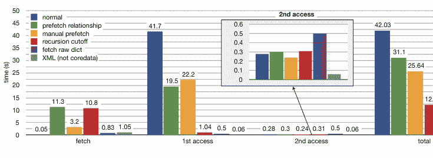

## 第 12 章 I/O：陷阱与技巧

尽管数据库服务器是拥有大量内存、高功率 CPU 和高速磁盘的强大机器，但往返延迟将破坏你的性能，紧随其的是你通过网络发送的数据量。

在企业级环境中，你必须序列化查询，然后通过网络将其发送到数据库机器。在 `CoreData` 中，往返通常是本地调用，但加载对象的开销仍然会不断累积。（注：此处已去除了 OCR 文本中的重复段落以保持文档质量。）

`CoreData` 的优势在于它像 `SQLite` 一样是一个增量存储系统。在处理大型数据集的子集时，连接到它的它能够查询、修改并存储这些子集，而无需处理其他未被触及的数据数据。虽然每个元素的成本很高（比我们之前看到的暴力破解技术高出一一或多个数量级），但如果我们能将元素数量降低，就可以在整体性能（数量 + 成本）上获得良好或至少合理的性能。

例如，调整查询以仅获取 1,000 个对象而不是整个集合，可以将抓取时间缩短到 10 ms，这对于许多应用程序来说足够了，而且不需要获取关系。如果 `SQLite` 必须扫描的键上没有索引，它将进行全表扫描，对于该数据集，时间将增加到大约 1.5 秒，这至少会产生可察觉的延迟。在内存中修改这 1,000 个对象耗时 31 ms，保存耗时 144 ms，这处于交互式性能的边缘。作为参考，我们的 1,000 个对象占 46 MB 总文件大小的 1/1,000，即 46 KB，我们的我们的读取速率为 4.4 MB/s，写入速率为 250 KB/s，分别约为底层 SSD 硬件能力的 1% 或 0.25%。

为了在 Mac 上让读/改/写循环真正达到交互式性能水平，将对象数量减少到 100 个左右：读取需要 3 ms，修改需要 4 ms，保存结果大约需要 40 ms。再次，这需要在属性上拥有索引并且不获取关系。如果我们开始获取显著比例的关系（无论是通过故障加载还是预取），性能将会急剧下降。

### 分析

`Apple` 针对优化 `CoreData` own提供了许多其他建议：调整数据模型以使用外部存储来处理大型二进制数据大对象（这是一个好主意；另见本章的“分层存储”部分）；对数据进行去规范化处理以避免跨关系查询；在数据导入任务中尝试批量大小；将数值谓词放在第一个抓取规格中（因为它们的评估速度更快），等等。

然而，所有这些都意味着为了通过克服弱点来展示优势。如果 `CoreData` 的性能如此出色，为什么我必须花这么多精力让我的抓取规格达到恰当的大小，既不过大也不太小？如果我们使用 `CoreData` 所遵循的客户端/服务器模型，这些建议将有意义得多——最小化网络流量几乎总是一个好主意。当“服务器”不仅在同一台机器上，而是一个位于同一进程中、一个函数调用即可到达的库时，保留到服务器服务器通信带宽就没有那么重要了。

### SQLite

如果 `CoreData` 不符合你的需求，且不想像目前介绍的序列化技术那样将整个图形保存在内存中，另一个选项是直接与某种数据库通信。`SQLite` 在 OS X 和 iOS 上非常流行，因为它作为一个嵌入应用程序的库存在，而不是一个独立的数据库服务器程序。`SQLite` 也随操作系统发布，并被 `Apple` 自身广泛使用，尤其是在 `CoreData` 中。

`SQLite` API 相当繁琐，所以我使用了轻量级的 `fmdb` 封装.¹¹⁰ 与 `CoreData` 不同，`fmdb` 不会自动处理关系，因此我们必须在数据模型中添加对象 id 和父级 id，并在与数据库交互时填充并解析它们。

性能整体上远优于 `CoreData`，例如，插入 100 万个对象耗时 6.7 秒，而不是 26 到 36 秒，且在对象树之外只有大约 16 MB 的常驻内存开销。启用预编译语句是一个有助于选项；如果没有它，运行时需要 3 到 4 秒。使用 `findb`，这只是一个标记；该库会管理预编译语句，通过作为查询的字符串来查找它们。

稍微更重要的是，插入 100 万个对象的循环被封装在使用了 `[beginTransaction]` 和 `[dbTransaction]` 的事务中。如果没有显式事务，`SQLite` 会将每个语句封装在它自己的事务中。对于插入 100 万个对象，总时间增加到惊人的 11 分钟 43 秒，比显式事务慢了 100 倍！对于批量更新请使用显式事务，除非该批量操作可以用单一语言表达。

从数据库取回我们的 100 万个对象也令人愉快，从 `ResultSet` 中创建对象耗时大约 3.6 秒。如上所述，关系必须通过 `NSMapTable` 将 id 映射到对象手动解析。这增加了 700 ms，使得一个完整图形的总耗时达到 4.3 秒。由于 API 键使用了 `[rs intForColumn:"a"]`、`[rs doubleForColumn:"b"]`，底层 `SQLite` API 调用怀疑这是否是一个问题。通过 `Instruments` 快速检查发现它们符合预期，且从字符串键到列的转换几乎占了 50% 的时间。添加一个小补丁部分消除了那部分开销，将抓取时间减少到 2.1 秒，包含了关系解析。

对于对象图形的基本序列化和反序列化，直接访问 `SQLite` 与本章介绍的大多数序列化机制具有竞争性。此外，SQL 允许对磁盘上的数据进行批量修改，而无需获取对象、在内存中修改它们并最后将其写回。例如，数据库中所有的 `SampleObject` 行可以使用以下语句：`UPDATE SampleObject set b=42`。该语句在我的机器上执行时间约为 1.5 秒，比读/改/写循环快得多。`CoreData` 与基础序列化不同，使用了预写日志（WAL），通过 `SQLite` 中的 `PRAGMA journal_mode=wal` 命令启用，这极大地提高了性能并从 iOS 10.9 开始在 `CoreData` 中默认启用。它不是更新数据库文件，而是追加到日志。

> 10. `GRDB` 是一个类似的 Swift 封装 (https://github.com/groupe/GRDB.swift)。

### 关系型与其他数据库

这些似乎与关系型数据库作为 I/O 优化的巅峰的观点相反，但这种观点在历史上或实践中从未足足依据。

根据我的个人经验，关系型数据库通常比非关系存储和查询策略慢一个数量级。例如，当我调查 `Mail.app` 时，我惊讶地发现查询一个包含 2 万封邮件的信箱元数据花费了超过 1 秒的时间，而使用 `grep` 命令行工具对该信箱的索引格式（本质上是单个文件中所有消息的拼接）进行简单的暴力线性搜索反而快了几个毫秒！

#### 事件发布 (Event Posting)

关系数据库的一种有趣的替代方案是被称为“事件发布者”（Event Poster）¹⁵ 的架构模式。在这种模式中，你不再修改持久化存储，而是存储添加到数据内存表示中的增量变化（deltas）。回到我们每次按键保存一次《白比迪》的例子，想象一下只需按键列表，而不是 (a) 存储整个文件或 (b) 在编辑时尝试原地修改文件。

显而易见，这种方法在保存数据时非常高效：我们不需要像以前那样对每个事件写入 $O(n)$，而是写入 $O(1)$。更新磁盘上的数据结构（如 B-Tree）每次更新代价为 $O(\log n)$，这可能超过了相对成本，因为这些操作往往是昂贵的寻道和移动，而事件可以高效地顺序追加到文件中。对于 $n$ 次操作，全保存和原地更新的复杂度为 $O(n^2)$，而事件发布的复杂度为 $O(n)$。

在在该模式的纯形式中，事件日志是唯一的存储，内存状态通过重放事件日志来重建。这是一种出人意料简单有效的策略，正如我在实现针对那个问题的 BBC 馈送处理替换方案¹⁶ 时发现的那样。当我们重放馈送索引时，发现持久化所需要的只需要删除删除传入馈送的代码（这我们原本为了审计目的也想这样做）。一个经过优化的摄取处理器可以轻松简化系统的其余部分：性能带来简单性，这是一个我见证过无数次的的良性循环。

#### 混合形式 (Hybrid Forms)

纯事件发布者模式的问题在于，它要求所有数据都能放入内存，且事件日志可能会变得非常大，可能会不顾当前活动数据的大小而增长（想象一下重写《白比迪》中的每一句话，日志将比更改主体的大小大得多）。由于由于原因，事件发布者模式通常不以纯形式应用，而是与其他形式的存储相结合。

其中一种混合形式是当前存储的检查点（checkpoint）：在特定的检查点写入系统状态，例如使用快速的内存转储。读取时，尝试读取检查点文件，如果检查点文件读取不正确则重放日志。我们在馈送处理系统中使用的这种策略，此外偶尔修剪日志以消除不再相关的条目，例如因为它们被随后的条目覆盖（如果你想保留日志用于审计目的，则需要这样做）。

> 15. http://martinfowler.com/bliki/EventPoster.html
> 16. M. Weier and C. Die. “In-process rest at the BBC,” REST: Advanced research topics and practical applications (2014). Eds. C. Pautasso, E. Wilde, and R. Alarco.

#### 分离存储 (Segregated Stores)

另一种混合形式被 `LevelDB` 键值存储利用，它是 Google `BigTable` 数据存储的开源重写。它的基本存储由排序字符串表（Sorted String Tables），即带有索引的只读字符串列表。可写性通过日志结构树（Log Structured Tree）提供：所有更改都追加到内存和磁盘中的日志中。读取通过内存存储的的更改满足，然后从磁盘上的排序只读表中读取，例如通过将这些表映射到内存中。这意味着写入总是很快的，读取也总是很快，代价是偶尔需要从日志重写排序表，而这些操作可以通过大批处理以及顺序读写来完成。

`LevelDB` 仍然为数据提供经典的读取、更新、删除（CRUD）接口，但应用程序本身表现出事件发布者、RSS 馈送或社交网络应用以及电子邮件的特征。此类系统可以轻松利用其数据的（基于时间的）结构：昨天收到的电子邮件访问频率通常高于上周的，而上周的访问频率又高于上个月的，以此类推。另一方面，许多人（包括我在内）实际上从未删除。像 `SQLite` 这样的关系数据库对待表中的所有元素，或者随着时间的推移，所有消息的性能都会下降，尽管实际工作保持不变。

如果我要为电子邮件存储一个后端，我会将其结构在类似于 `LevelDB` 的本地存储中：将最近的更改保留在内存和快速访问、快速修改的本地存储中。每隔一段时间，我会将旧消息写入只读块中（可能是按月），并带有广泛的索引、线程和其他元数据，以便操作永远只需要查看摘要。这样一来，无论邮箱箱有多大，访问工作内容的速度都保持不变，旧的存储仅在搜索时访问，并在最佳访问速度下进行大批处理。然而，我不会实际使用 `LevelDB`，因为它仅限于字符串且没有索引，这限制太死了。

我描述的邮件存储实际上是分离存储的一个例子。分离存储的想法是将具有不同大小、访问要求和生命周期的数据段分开——例如，旧消息与新消息分开。

这种模式在其他多媒体应用中存在的例子是 `Apple` 的 `Keynote` 程序。在那个 '13 格式中，所有对象布局信息都包含在一个 XML 文件 `index.apxl` 中，要么在一个目录封装中，要么在一个 zip 文件中。媒体数据如图像或电影与此文件分离，因此即使是长 100 页、总大小超过 1 GB 的演示文，其 `index.apxl` 文件的大小也超过 2 MB。

此外，`index.apxl` 文件的内容随每次编辑都会发生有效变化，而媒体文件一旦导入就是不可变的；只有当导入了媒体文件的新版本时它们才会更改。

在本章中，我们首先查看了基本的磁盘和网络 I/O，然后查看了更高级的序列化策略，包括内置的序列化器、数据库以及 `CoreData` 和 XML 和事件发布模式等替代策略。

不幸的是，我们还看到了许多陷阱，其中许多涉及到我们以前遇到过的问题，如过度使用字典和冗余的中间表示。简而言之，`Cocoa` 和 `Objective-C` 没有一个真正好的数据持久化方案，只有一些边缘有用的方案。

## 第 13 章 I/O：示例

他的第一次尝试显示，在 iPhone 3G 或 3GS 设备上读取文件花费了 0.5 秒，而又花费了 13 秒将文件拆分为行 `[fileContents componentsSeparatedBy:"\n"]`。不用说，他认为这个时间有点长了，我也倾向于同意他的观点。

实际上值得注意的是，由于常规规则排除了线程：二进制属性列表（binary property lists）、特殊数据结构和 `SQLite`。二进制属性列表实际上有一点点帮助，将时间从 13 秒缩短到 5 到 8 秒之间，但这仍然太慢了。

示例 13.2 显示了使用 Foundation 对象和方法实现该接口的朴素实现耗时 13 秒（未显示 `words` 属性的声明和实现）。

### 示例 13.2 在原生字符串中初始化和搜索

```objectivec
- (instancetype)initWithContentsOf:(NSString*)filename
{
    self=[super init];
    NSString *wordList=[NSString stringWithContentsOf:filename];
    [self setWords:wordList componentsSeparatedBy:@"\n"];
    return self;
}
-(BOOL)contains:(NSString*)searchStr
{
    return [self words] indexOf:searchString] != NSNotFound;
}
```

在相当的时间内，这种方法还消耗了大量的堆内存，因为第一个 `NSString` 被分配了，填充了来自磁盘的内容，并且每个单独的字符串都被分配了。所有这些内存都是“脏”的，这意味着在 iOS 上不杀死进程是无法回收的。

我建议的方法是使用 `[NSData dataWithContentsOfMappedFile:];` 将文件映射到内存，然后不将单词转换为单个对象，而是通过在单独数组中保留单词的偏移量（offsets）来分词，保持“尽可能对数据进行标注而非转换”的策略。

我们保留了示例 13.1 中的外部接口，仅将实现更改为这个更优化的版本。示例 13.3 显示的分词非常直观：遍历字节，当我们发现换行符时，将当前偏移量添加到偏移量列表中。偏移量是 `MPWIntArray` 的实例，它的工作方式类似于 `NSArray`，只是针对 `int` 值而不是对象。

实现使用了直接的实例变量。

> 2. http://www.mail-archive.com/cocoa-dev@lists/msg33602.html

### 示例 13.3 初始化更快的 StringTable

```objectivec
@implementation StringTable {
NSData *words;
MPWIntArray *offsets;
}
```

```objectivec
-(void) tokenizeWords {
 const char *bytes =[words bytes];
 const char *cur =bytes;
 const char *end=bytes + [words length];
 [offsets addInteger:0];
 while ( cur < end ) {
  if (*cur == '\n') {
   [offsets addInteger:(int) (cur-bytes)];
  }
 }
 [offsets addInteger:end-bytes];
}
```

```objectivec
-(instancetype)initWithContentsFile:(NSString*)filename {
 if (self=[MPWIntArray alloc] init) {
 words=[NSData alloc] initWithContentsMappedFile:filename];
 [self tokenizeWords];
 return self;
}
}
```

示例 13.4 中显示的方法都是直观的：对于每个偏移量，比较偏移量处的字节与搜索字符串的字节。示例 13.4 中的大部分代码只是为了将各种参数转换为搜索算法可用的格式的样板代码，由于我们搜索的字符串表没有以 NULL 终止的字符串，这确实变得稍微复杂了一些；边界仅由下一个偏移量定义。

### 示例 13.4 在 StringTable 中搜索

```objectivec
-(BOOL)containsString:(NSString*)needleStr {
 const char *bytes =[words bytes];
 const char *searchStr=[str UTF8String];
 const char *searchStr=[str UTF8String];
 int max=[length];
 for (int i=0;i<max-1-1;i++) {
```


```objectivec
int len=offsets[i+1] - offsets[i];
if (len==max && strncmp(bytes+offsets[i],searchStr,len)) {
    return YES;
}
return NO;
```

## 第 13 章 I/O：示例

子类。二进制属性列表（binary property list）格式没有官方规范，但 Apple 的实现已开源发布³，它不仅包含代码，还包含一段详长的注释，对格式的描述足以允许实现替代方案。

图 13.2 是从 `CFBinaryPlist.c` 的注释中提取的二进制属性列表结构的粗略示意图。

它包含两个主要部分：包含实际对象变长编码的对象表（object table），以及带有指向对象表索引的偏移表（offset table）。两个核心部分是头部（header）和尾部（trailer），包含根节点索引、偏移表的位置以及各种对象的大小等信息。

图 13.2 还展示了一些最新的编码方式。对象类型编码在第一个字节的高位字节（top-nibble）中，而第二个半字节则编码子类型或 0 到 15 的长度。长度为 15 是一个标志，表示实际长度将作为初始字节后的整数字进行编码。

| header：魔数、长度、CRC | 整数 | 0x1 | 长度 1 | 整数值 |

|---|---|---|---|---|

| | Real | 0x2 | 长度 1 | 浮点/双精度值 |

| 对象表 | String | 0x5 | 长度 1 | 长度 2 | ASCII 字符 |

| | String | 0x6 | 长度 1 | 长度 2 | UTF-16 字符 |

| 指向对象表的偏移表整数 | Array | 0xA | 长度 1 | 长度 2 | 对象偏移 |

| trailer：根对象偏移表开始大小 | Dictionary | 0xD | 长度 1 | 长度 2 | 键偏移、值偏移 |

图 13.2 二进制属性列表格式示意图

> 3. 例如，参见 https://github.com/opensource-apple/CF/blob/master/CFBinaryPlist.c。

解析二进制属性列表的算法是基本的递归下降。

1. 从根索引开始。
2. 读取索引 `n` 处的对象。
3. 如果对象已经解析过，则返回它。
4. 如果对象尚未解析，则对其进行解析：
   a. 通过偏移表获取编码对象的偏移量。
   b. 解码偏移处的对象。
   c. 对于任何索引为 `m` 的嵌入对象，读取该索引处的对象。
   d. 返回解析后的对象。

编码该算法核心的 `parseAtIndex:` 方法在示例 13.5 中。它读取第一个字节的高位字节，然后根据半字节中的对象类型进行分支处理，将对象类型的解码分发给各个独立的方法。代码通常不会直接通过 `objectAtIndex:` 方法（同样在示例 13.5 中）解析对象，该方法为已读取的对象实现了了缓存。

### 示例 13.5 从二进制属性列表解析对象

```objc
-parseAtIndex:(long)anIndex
{
long offset=objects[index];
int topNibble=(bytes[offset] & 0xf0) >> 4;
id result=nil;
switch ( topNibble) {
  case 0x1:
    result = [self readIntegerAtIndex:anIndex];
    break;
  case 0x2:
    result = [self readRealNumberAtIndex:anIndex];
    break;
  case 0x5:
    result = [self readASCIIStringAtIndex:anIndex];
    break;
  case 0x6:
    result = [self readUTF16CString:anIndex];
    break;
  case 0xa:
    result = [self readArrayAtIndex:anIndex];
    break;
  case 0xd:
    result = [self readDictAtIndex:anIndex];
    break;
  default:
    [NSException raise:@"unsupported"
        format:@"unsupported data in bplist: %x",topNibble;
    break;
}
return result;
}
-objectAtIndex:(NSInteger)anIndex
{
  id result=objects[minIndex]
  if (!result) {
    result=[self parseObject:minIndex];
    objects[minIndex]=[result retain];
  }
  return result;
}
```

解析 `objectAtIndex:` 的代码在示例 13.5 中。`parseAtIndex:` 方法处理算法的核心。它读取第一个字节的高位字节，然后根据半字节中的对象类型进行分支处理，将对象类型的解码分发给各个独立的方法。代码通常不会直接通过 `objectAtIndex:` 方法（同样在示例 13.5 中）解析对象，该方法为已读取的对象实现了了缓存。

### 示例 13.6 从属性列表解析整数

```objc
static inline long readIntegerSizeAt(unsigned char *bytes, long offset, int numBytes)
{
  long result=0;
  for (int i=0; i<numBytes; i++) {
    result=(result<<8) | bytes[offset+i];
  }
  return result;
}
```

`objectAtIndex:` 方法使用了已读取对象的缓存。`parseAtIndex:` 方法处理算法的核心。它读取第一个字节的高位字节，然后根据半字节中的对象类型进行分支处理，将对象类型的解码分发给各个独立的方法。

### 示例 13.7 从属性列表解析数组

```objc
static inline int lengthForNibbleAt(int length, unsigned char *bytes, long *offsetPtr)
{
    long offset = *offsetPtr;
    if (length == 0xf) {
        int nextHeader = bytes[offsetPtr++];
        int byteLen = nextHeader & 0xff; // 简化逻辑
        // ...
    }
    return length;
}
```

玩转属性列表

```objc
[arrayOffsets addInteger:arrayIndex];
]
return [[MPWLazyBArrayWithPlist:self offsets:offsets];
}
```

`MPWLazyArrayList` 类的定义和实现见示例 13.9。它是一个 `NSArray` 的子类，持有对相关二进制列表的引用，并知道其编码对象在对应 plist 中的偏移量。

### 示例 13.9 Lazy NSArray 定义

```objc
@interface MPWLazyArrayList : NSArray
{
NSInteger count;
MPWBinaryPlist *plist;
MPWIntArray *offsets;
id *objs;
}
@end
```

示例 13.10 展示了 `objectAtIndex:` 的懒加载实现。当通过 `objectAtIndex:` 请求对象时，它首先尝试从其对象中检索它，如果不存在，则进行解析。

### 示例 13.10 NSArrayWithPlist 实现

```objc
-initWithPlist:newOffsets offsets:(MPWIntArray*)newOffsets
{
self=[super init];
if (self) {
count=[newOffsets count];
obs=calloc(count , sizeof *objs);
offsets=[newOffsets retain];
nplist=[newPlist retain];
}
return self;
}
-objectAtIndex:(NSInteger)index
{
id obj=nil;
if ( index < count) {
obj=objs[index];
if ( obj == nil) {
obj = [plist objectForKey:[offsets integerAtIndex:index]];
obs[index]=[obj retain];
}
} else {
  [NSException raise:@"outofbounds" format:@"index %tu out of bounds",anIndex];
  return obj;
}
}
```

尽管 Swift 内置的懒加载集合似乎消除了自定义代码的需求，但事实证明并非如此：Swift 标准库并没有实现真正的懒加载行为（即在计算结果后缓存它）。相反，除非将整个集合一次性转换为非懒加载集合，否则每次访问时都会重新计算，而这正是我们试图避免的。

将此示例应用于我们的词汇列表可能会使属性列表的初始化时间从 756 ms 缩短到 26 ms，提升了 29 倍，而这还是我们之前为了初始化该词汇列表的变体所花费的时间。图 13.3 显示了所有时间。

不过，我们对懒加载变体必须稍微小心，因为如果我们进行线性搜索，所有的懒加载优势都会失效，并在我们意料之外花费 700+ 毫秒。为了避免这种情况，我们需要将使用 `indexOf:` 的线性搜索切换为使用 `indexOfSortedRange:options:usingComparator:` 的二分搜索，并带有 `BinarySearchingFirstEqual` 选项。

二分搜索在每次搜索期间只会加载 n 个项目，因此每次搜索大约会解码 15 个项目。

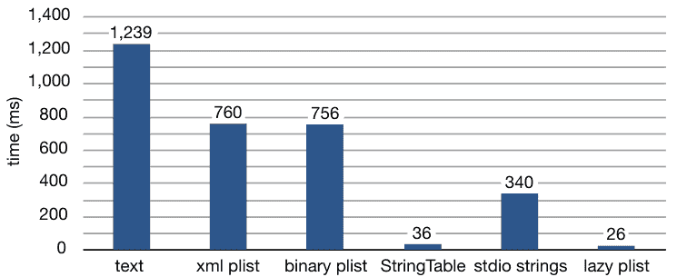

图 13.3 包含懒加载属性列表的 iPhone 字典加载对比

## 避免中间表示

现在我们有了自己的属性列表读取器，第 12 章中的另一个问题浮出了脑海：属性列表读取之所以缓慢且耗费内存，部分是因为我们必须为对象图创建一个临时但完整的内存表示，即创建字典、数组和 Foundation 数字对象。

有了我们的所有者，我们可以直接读取这种中间表示并直接从二进制属性列表初始化我们的对象图吗？答案自然是“可以”。

从我们自己的属性列表反归化 `SampleObject` 的代码见示例 13.11。

### 示例 13.11 从无中间表示的 plist 反归化

```objc
- (instancetype)initWithWithBinaryPlist:(MPWBinaryPropertyList*)aPlist
  if ([self [super init]]) {
    [plist parseUsingContentBlock:^id(MPWBinaryPropertyList *plist) {
      a=[plist readIntegerForKey:@a\];
      b=[plist readRealForKey:@b\];
      name=[plist readObjectForKey:@name\];
      NSMutableArray *array=[NSMutableArray array];
      [plist parseArrayAtKey:@children
       usingBlock:(id(MPWBinaryPropertyList *plist) {
        id obj=addObject:[self class alloc] initWithWithBinaryPlist:plist];
        [array addObject:obj autorelease];
      }];
      children=[array retain];
    })
    return self;
  }
```

这与键归档代码非常相似，只是解码字典和数组等复合对象的代码被封装在块（blocks）内部。这种差异的原因是，与键归档不同，普通的属性列表不存储任何关于对象类的信息。类信息存储在归档中，我们使用反归档器来实例化正确类的对象并调用 `initWithCoder` 消息。相反，我们将解码特定字典或数组的知识传递给解码该字典或数组的方法，而块使得这变得简单。

我们能像处理反序列化那样对二进制属性列表进行序列化吗？当然，第 8 章引入的流式架构风格正是良方。实现一种类似于 `FilterStream` 的二进制 plist 序列化器使得增量处理二进制属性列表成为可能。

我在这里不展示实现代码，因为它太长且非常直观，主要处理两个问题：创建编码对象和

## 280 第13 章 I/O：示例

记录这些对象的偏移量。复合对象，它也必须记录这些对象的偏移量。示例 13.12 显示了如何使用二进制属性列表对对象进行编码。

```objc
(void)writePropertyList:writer
{
  [writer writeInt:@"a"]
  [writer writeFloat:@"b"]
  [writer writeObject:@"name"]
  [writer writeArray:@"children"]
}
```

图 13.4 显示了不创建中间表示的影响。换句话说，80% 的时间都是由于生成中间表示。

最后一组柱状图显示性能影响微乎其微，自定义版本比内置版本快几个百分点。正如你可能猜的那样，对内存的影响更为显著：图 13.5 显示了 50 倍的

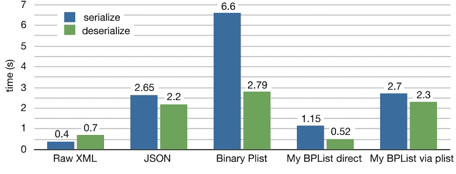

图 13.4 使用自定义读取/写入处理 1M 个对象的时间

## 玩转属性列表 281

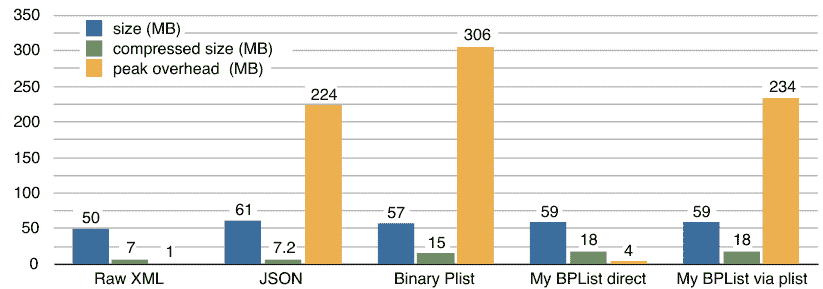

图 13.5 使用自定义读取/写入的大小

与中间表示相比，峰值内存使用减少了 70%。原因是尽管我们可以序列化对象，但我们必须在内存中跟踪偏移量，只在最后才将其刷出。

当我开始探索二进制列表编码时，我并不知道它会如何发展，而且坦率地说，我并没有抱太大期望。毕竟，该格式已经使用了十多年，并且是 Apple 的骨干工具，因此在期间经过了深度优化。我必须承认，我对早期的结果非常满意，它们具有可以立即应用的实际成果。不仅这个示例展示了我们讨论的懒加载原则和技术，属性对象现在可以用于非常大的数据集，可能简化需要大量数据的应用程序。使用直接读取/写入消除了 80% 的时间和 99% 的内存开销。

这些巨大的结果并不是通过查看 Instruments 并移除热点获得的，而是通过分析架构问题，例如不可重写的 API 以及需要完整参数的调用/返回语义。

这可能是：通过优化对象加载甚至通过添加内联原生类型消除对象来进一步提高性能。相同的 API 还可以扩展到涵盖 XML 和 JSON 属性列表。

此外，你可能已经注意到 API 现在与键归档非常接近。加上二进制属性列表实际上可以处理至少无环的对象图，而且你发现键归档唯一缺少的是为字典编码对象类的方法，例如，在对象表后的某个部分，该格式有空间容纳它。另一种可能是，如果这些额外的嵌套字典不在内存中实例化，键归档的性能开销将显著减少。

## 逗号分隔值 (CSV)

我曾考虑过学生用于编码启动数据的另一种方案是 CSV，但我们从未着手实现，因为我们使用懒性属性列表（lazy property list）已经取得了良好的结果。过了一段时间后，我才认真处理 CSV 文件，那是一个客户提供的 25 MB 数据库导出文件，包含 16,000 条记录，用于将其格式化为打印版电话簿。由于 Mac OS X 内置了高质量的 PDF 生成功能，现在此类出版任务可以使用 Cocoa 程序完成，而无需通过像 Adobe InDesign 或 Quark XPress 这样庞大且缓慢的第三方应用。

然而，正常的“编译-链接-调试”循环交互性不足，无法处理图形化调优，因此我想从我编写的一个一个实时编程环境中访问这些数据。在实时编程环境中，显示会在每次按键后进行更新，帧的评估时间必须远少于 100 ms 才能保持交互体验。然而，我当时使用的基于 Scanner 的代码处理该文件需要 4.8 秒。在两次按键之间等待 4 秒会让体验明显不再是“实时”，因此这不可行。

回看章节开始的数据字典示例，我们看到如果使用 C-String 解析来拆分行是非常快的，一旦我们有了行索引（line-indices），就可以按任何顺序访问单行，而无需按顺序处理它们。结合这一点以及我们已经解决的底层性能方程项——*成本*（cost）：我们只需要读取显示可见目录（可能是一页或两页）所需的条目，而不是全部 16,000 条条目。

这个特定的数据集足够简单，使用 `componentsSeparatedBy` 就足以解析各个行并将其转换为字典（参见示例 13.1）。所有 16,000 条条目的总时间缩短到了 1.5 秒——仍然太慢，但由于每个条目的的时间为 98 μs，每页约有 200 条，读取时间仅需 20 ms——这绰绰有余，无论是整体时间还是读取时间都被渲染时间所占据。

### 示例 13.13 简易 CSV 读取器


```
- (NSString*)lineAtIndex(int anIndex)
{
    int *offsets=[self lineOffsets] integers;
    int offset=offsets[anIndex];
    int nextOffset=offsets[anIndex+1];
    int len = nextOffset-offset-[self eolLength];
    return [self subdataWithStart:bytes+offset length:len];
}
```

- 4. 记录为：133 个字段，每条记录平均 1.3 KB。

- 5. http://www.cocoawithlove.com/2009/11/writing-parser-using-nscanner-csv.html

```
(NSDictionary*) dictionaryAtIndex: (int)anIndex
  return [NSDictionary
          dictionaryWithObjects:[self lineAtIndex:anIndex]
          componentsSeparatedByString:fieldDelimiter
          forKey:[self headerKeys]];
```

我们获得了稍快一点的解析速度这一事实很大程度上无关；重要的是提供随机访问（random access），以便我们可以解析需要的条目。

# 公共交通时刻数据

CSV 带来的稍大问题以公共交通时刻数据的形式出现，为了回答：“使用交通工具，我附近有哪些出行选择？”这个问题所需的数据包括附近站点的位置以及这些站点的时间差。柏林的公共交通公司 Berliner Verkehrsbetriebe (BVG) 以 Google 的通用传输馈规范 (GTFS) 格式提供这些数据。一个 GTFS 馈由一个包含 CSV 文件的 zip 包组成；BVG 的文件如表 13.1 所示。它们代表了服务的站点、存在的线路，以及特定线路服务站点的所有时间。

对于当前的问题，感兴趣的数据证明在 `stops.txt` 和 `stop_times.txt` 中，其提取内容见示例 13.14。正如你可以想象的（并可以在表 13.1 中验证），最大的数据集是描述所有站点具体时间的那个；它重量达 118 MB，超过 300 万条目。

## 示例 13.14 站点和时间数据

```
stop_id,stop_code,stop_name,stop_desc,stop_lat,stop_lon,
9003101,U Hansaplatz (Berlin),52.5181110,13.3421650,
9003102,S Bellevue (Berlin),52.5197640,13.3469160,
9003103,S Tiergarten (Berlin),52.5144000,13.336490,
9003104,U Turmstr. (Berlin),52.5258370,13.342010,
...
trip_id,arrival_time,departure_time,stop_id,stop_sequence,
1,18:16:00,18:16:00,9096310,
1,18:18:00,18:18:00,9096364,
1,18:19:00,18:19:00,9096311,
1,18:21:00,18:21:00,9096365,...
```

- 6. https://developers.google.com/transit/gtfs | GTFS 文件

| 文件 | 内容 | 大小 |
| :--- | :--- | :--- |
| `routes.txt` | 线路 | 775 KB |
| `stops.txt` | 站点 | 13 KB |
| `stop_times.txt` | 站点时间 | 118 MB |
| `transfers.txt` | 换乘 | 30 KB |
| `trips.txt` | 班次 | 120 MB |

我们获得了稍快一点的解析速度这一事实很大程度上无关；重要的是提供随机访问，以便我们可以解析需要的条目。

# 第 13 章 I/O：示例

将此结构映射到内存后，按时间查找变得非常高效，每次查找仅需约 53.4 μs，比使用 CoreData 的方法快约 8,000 倍。我在第 12 章中提到，映射二进制表示是获得最佳性能的方法；这就是其中一个示例。你可能认为将数据库查询替换为两个内存中结构会为了性能提升而付出内存代价，但相反，我观察到内存消耗下降了，CoreData 解决方案约为 5 MB，而约为 4 MB。此外，由于结构是映射的，所使用的内存保持干净，因此对内存压力的影响乎其微，系统始终剔除条目而无需触发内存警告。

我尝试了几种结合两种结果（位置和时间）的常用算法。最终发现最快的是单个嵌套循环：首先按位置过滤，然后在相关时间间隔的桶中搜索找到的站点。

## 站点时间导入

我们如何将站点从 GTFS 结构提取到我们可以使用的高效二进制格式中？一旦我们得到了 `StopTime` 数组，就创建一个使访问变得如此快速的桶索引。由于我们是按小整数排序，因此可以使用高效的桶排序，它是极少数（非通用）的排序算法之一，其运行时间为 O(n)，而不是基于比较和交换的通用排序的理论下界 O(n log n)。示例 13.17 显示了代码，如下所示：

- 调整单个桶的大小，每出现一次特定计数就增加桶计数器。
- 偏移量必须考虑之前所有桶的大小，累加大小。
- 创建 `StopTimes` 的临时副本。
- 执行实际的桶排序：
  a. 根据小时和分钟将站点放入其对应的桶中。
  b. 增加当前桶的偏移量。
- 最后，使用传统的合并排序对每个桶内的偏移量进行排序。

### 示例 13.17 按首次时间后按站点 ID 高效排序站点

```c
(void) sort
{
  StopTime *sorted=calloc(count+20, sizeof(StopTime));
  Buckets bucketSizes,bucketOffsets;
  bzero(&bucketSizes, sizeof bucketSizes);
  bzero(&bucketOffsets, sizeof bucketOffsets);
}
```

```c
//--- size the buckets
for (int i=0;i<count;i++) {
    StopTime current=times->times[i];
    if (current.hour < 31 || current.minute < 60) {
        bucketSizes.bytime[current.hour][current.minute]++;
    }
}
// accumulate counts into offsets
int currentOffset=0;
for (int h=0;h<30;h++) {
    for (int m=0;m<60;m++) {
        bucketOffsets.bytime[h][m]=currentOffset;
        currentOffset+=bucketSizes.bytime[h][m];
    }
}
memcpy(&times->bucketOffsets, &bucketOffsets,
sizeof times->bucketOffsets);
//- sort by time
for (int i=0;i<count;i++) {
    StopTime t=times->times[i];
    sorted[bucketOffsets.bytime[t.hour][t.minute]]]=current;
    bucketOffsets.bytime[t.hour][t.minute]++;
}
//- regular sort of stop within a bucket by stop-index
for (int h=0;h<29;h++) {
    for (int m=0;m<60;m++) {
        int offset=bucketOffsets.bytime[h][m];
        int numElements=bucketOffsets.bytime[h][m+1]-offset;
        mergesort_b(sorted+offset, numElements, sizeof(StopTime),
            (int)(const void *va, const void *vb) {
                StopTime *a=va;
                StopTime *b=vb;
                return a->stopIndex - b->stopIndex;
            });
    }
}
memcpy(times->times, sorted, count * sizeof(StopTime));
```

这需要多长时间？总共 280 毫，包括将 `AllTimes` 结构写入磁盘的 `fwrite()`，并以排序后的 `Stops` 和 `Buckets` 作为索引。CoreData 解决方案花费了超过 22 分钟，其中 19 分钟花在 `[NSManagedContext save]` 中，因此二进制格式在写入速度上不仅快了 8,000 倍。

## 更快的 CSV 解析

在 CoreData 解决方案剩余的 3 分钟中（未花费 `[NSManagedContext save]` 的时间），2 分钟被 CoreData setter 实现实现、初始化 `NSDate`（15 秒）、使用 `componentsSeparString` 分割字段（同样是 18 秒）以及杂项维护工作（9 秒）占用。我们在示例 13.3 中的简单 CSV 解析器也大约需要 1 秒，因此 CSV 解析的时间实际上是可比的；在减去 CoreData 的开销以及我们因为使用小时和分钟而不需要的 `NSDate` 创建后，差异就不明显了。然而，在处理 280 毫秒时，我们的解决方案并没有真正体现。与本章中某些需要跳出框架思考的优化任务不同，这是一项直接的任务：识别缓慢之处，进行优化或移除。

## 对象分配

我们知道对象分配是昂贵的，因此使用 `componentsSeparString` 为每个字段值创建新的 `NSString` 肯定会列在首位。将 `componentsSeparString` 替换为示例 13.18 中的代码使用了 C-String 解析来解析字段，并使用了重新使用的 `NSData`。

CSV 文件通常在处理大量数据时使用。然而，我承认在某一个时刻，我只想让性能提升 1000 倍。

因此，我开始尝试多线程代码。从理论上讲，这是可能的，因为我们在本章开头从字符串表中保留了初始索引步骤，这意味着我们并不局限于按顺序处理输入的行。我们可以将表格平分成两部分，让两个线程分别处理每个部分，从而最大限度地减少线程创建的开销。这就是为什么 `do` 方法块需要将行索引传递给它的原因之一：该块可能会被非顺序的行调用。

然而，我立即在对象缓存（object cache）上遇到了问题。虽然对象的其他部分是不可变的，因此是线程安全的，但对象缓存在每一行都会被多次修改。在缓存周围加锁或使用 `@synchronized` 段完全不起作用：不仅多线程代码比单线程版本慢得多，而且锁本身也没有解决解决问题。

完全放弃对象缓存可以解决问题，但多线程代码再次比带有缓存的单线程代码慢了许多倍。我尝试过每个线程创建一个对象缓存，并以某种方式通过线程 ID 索引到对象集合中。这也许是行的，但随着额外开销的增加，复杂性不断提高，在我那双核心机器上，在崩溃之前我已经达到了极限。

在被迫放弃之后，我终于意识到解决方案其实很简单：每个线程一个对象，所以为线程创建新对象！更具体地说，使用示例 13.20 中的 `cloneForThreading` 方法创建整个 CSV 读取器对象的副本。

### 示例 13.20 为多线程读取克隆 CSV 读取器

```objc
- (instancype)cloneForThreading {
    CSVDelimitedTable *clone=[[self class] alloc] initWithData:data delimiter:fieldDelimiter];
    [clone setLineOffsets:[self lineOffsets];
    [clone setHeaderKeys:[self headerKeys];
    [clone setKeysOfInterest:[self keysOfInterest];
    return [clone autorelease];
}
```

我犯的错误是我以前见过的：将对象的成本误认为是它所代表的图结构（graph）的成本。分配 CSV 读取器新实例的成本与分配一个新的 `NSNumber` 或实际的 `NSData` 以及偏移量数组等是相同的，而这些操作都是昂贵的。如果我们对 CSV 读取器进行浅拷贝，在实例化克隆对象时除了对象缓存外都引用我们的实例变量，那么我们就能以极低的成本获得一个全新的对象缓存。

有了克隆的副本，我们现在可以启动单独的线程处理结果，使用类似于示例 13.21 中所示 `parallelCollect:` 方法的 `parallelDo:` 方法。

### 示例 13.21 并行 CSV 读取

```objc
- (NSArray*)parallelCollect:(id)(id)block {
    int numParts=4;
    int partLen=[self count]/numParts + 1;
    NSMutableArray *partialResults=[NSMutableArray array];
    for (int i=0; i<MIN(partLen,[self count]); i+=partLen) {
        int thisPartLen=MIN(partLen,[self count]-i);
        CSVDelimitedTable *threadClone=[self cloneForThreading];
        NSRange range=(i,thisPartLen);
        NSArray *partialResult=[threadClone collect:block];
        [partialResults addObject:partialResult];
    }
    NSMutableArray *results=[NSMutableArray array];
    for (NSArray *temp in partialResults) {
        [results addFromArray:temp];
    }
    return results;
}
```

`collect:` 和 `parallelCollect:` 方法类似于 `do:` 和 `parallelDo:`，对于每一行，它们都会返回一个被收集到数组中的结果。

首先，我们决定想要并行处理多少部分。在这种情况下，数字被硬编码为 4；在实际代码中，它应该取决于可用核心数的数量。对于每个部分，我们使用示例 13.20 中的 `cloneForThreading` 方法创建一个克隆。在所有线程启动后，我们将结果合并到一个get数组中。此时，调用线程将在必要时阻塞以等待结果的计算。

## 总结

本章从创建一个列表的相当简单的示例开始，但随后我们加快了速度并将其扩展为懒加载且灵活的列表，最后以一个用于逗号分隔文件的超快速解析器和内存映射二进制表示形式作终。

与我们在早期章节中看到的相似，我们发现原始数据可以使用 C 类型而不是 Foundation 对象来更高效地表示。另一方面，消息传递（messaging）提供了 C 结构体和函数调用难以实现的灵活性。这种灵活性使得面向对象的列表能够与客户端协作直接创建对象，避免了昂贵的临时表示并使架构具有面向性。在解析和生成方面，内存和 CPU 时间都改进了约 4 倍。

拥有面向对象的解析器使得创建一个可以轻松创建数组的解析器子类成为可能。懒加载并没有提高速度，但它使得在大型数据集可以使用列表，而无需一次性加载整个列表。

最后，二进制示例证明了我们在第 12 章中的主张：如果你想追求速度，可以映射到内存的二进制表示是首选工具。有多快？在查询和生成数据方面，比等效基于 CoreData 的程序快一千倍以上，磁盘占用也小了大约 10 倍。

尽管这些示例显然不是所有场景，有些可能过头了，但它们无疑是完善你的 I/O 性能的良好起点。

# 图形与 UI 原则

现在我们已经查看了几个底层子系统的性能（CPU、内存和 I/O 子系统），是时候将这些部分结合起来以构建高性能的用户界面了。这既意味着快速绘制这些用户界面，又要整合一切使应用程序对用户请求做出快速响应。

## 响应性

当我们谈论高性能用户界面时，通常指的是具有响应性的界面，即它对用户操作做出响应。多快？嗯，通常越快越好，但实际上存在感知阈值，划分了感官上的质量差异。这些限制见表 14.1。

可能最相关的持续是用于用户反馈的 100 ms 以及用于平滑动画的 60 Hz/16(2/3) ms。这两者对于创建直接在屏幕上操作对象的错（而不是给计算机命令让其后在屏幕上执行某些操作）至关重要。25 Hz（常说是 30 Hz）频率是例如胶片制作使用的频率，但它依赖于运动模糊等整合效应。

### 表 14.1 响应时间限制

| 响应时间限制 | 效果 |
|---|---|
| 10 s | 留住注意力 |
| 1 s | 用户保持流状态 |
| 100 ms | 用户正在直接操作对象 |
| 40 ms (25 Hz) | 多个帧融合成运动 |
| 16(2/3) ms (60 Hz) | 运动变得平滑 |
| 1 ms | 快速移动的手部被追踪* |

* 参见 http://www.youtube.com/watch?v=OvQCCLkPt4。

# 第 14 章 图形与用户界面：原理


模拟介质自动提供的平滑度。对于数字屏幕上的动画，60 Hz 应该是目标。

60 Hz 是一个相当具有挑战的目标：与我们提到的其他时间相比，16.67 ms 的时间并不充裕。在对象边界上进行基础的 CPU 密集型操作是可以的，但考虑到你可能还有其他事情要做，而且你的图形子系统也需要一些时间，即使是一次耗时 7ms 的磁盘寻道可能也意味着你已经耗尽了预算。

那么 60 Hz 是限限吗？实际上，鉴于目前的硬件和软件限制，答案是肯定的，见表 14.1 的最后一行。尽管在那个点动画是平滑的，但仍然有改进空间。例如，如果你正在用笔画画，或者笔以 5 cm/s（约 2 英寸/秒）的速度移动，在屏幕以 60 Hz 刷新一次所需的 16.7 ms 内，它会移动 1 毫米。对于作为“墨水”的笔来说，这是一个非常明显的距离，会导致“滞后”感。在屏幕上拖动对象也是如此。如果你移动控制设备（手指、鼠标、. . .），系统无法跟上这种精度。

幸运的是，鼠标光标足够小，当它快速移动时你实际上无法精确定位它，因此滞后并不明显；但拖动一个大对象，你会发现它跟不上速度。利用人类感知的局限性或简单地欺骗观察者，是在在无法及时提供实际答案或结果时保持响应表象的常用技术。

# 软件与 API

在 Mac OS 和 iOS 上，用户交互很大程度上由高级框架管理，iOS 使用 UIKit，Mac OS 使用的是 AppKit。这些工具包从不同的输入设备读取用户输入，将其翻译成传递给客户端代码的事件，并组织用户界面。图 14.1 显示了图形 API 的高级概述。

高级工具包提供了相当多的小部件（widgets），如按钮、复选框、表格和编辑器。除少数例外外，这些小部件都具有足够的自包含性和性能，能够在我们之前要求的阈值内做出响应，因此通常不是问题。

这些小部件是基于 OS 和 iOS 上的 NSView 构建的广泛用户分级结构。视图描述了屏幕上渲染的一个矩形区域，使用 `drawRect:` 方法进行渲染，并由它处理输入事件。这些高级工具包主要通过通用图形 API CoreGraphics（又名 Quartz）进行绘制。

另一个主要的 API 是 OpenGL，它主要用于 3D 图形应用（如游戏），但由于其对加速图形硬件的特权访问，也被其他 API 使用。此外，还有用于 CoreImage 和 CoreVideo 进行图像或视频处理的 API，以及使用 AVFoundation 或 QuickTime 进行媒体播放的 API。新增的用于 2D 游戏的 SpriteKit 以及作为高级保留 3D 图形 API 的 SceneKit。

## UIKit / AppKit

| CoreAnimation, CoreText | CoreImage CoreVideo AVFoundation |
| :--- | :--- | :--- |
| Quartz | OpenGL | |
| 图形硬件 | | |

图 14.1 图形 API 块图

*保留模式（retained-mode）*与*立即模式（immediate-mode）*的区别是图形 API 自诞生之初定义特征之一，当时显示列表由图形系统保留，并用于直接驱动矢量阴极射线管（CRT）。在立即模式 API 中，客户端发送绘制命令，这些命令被执行并产生效果，无论是在显示器上还是纸上。在保留模式 API 中，API 创建某种对象，这些对象由 API 维护，并且可以移动。

图 14.2 用三个几何形状说明了区别。在顶部的保留模式 API 中，客户端首先创建三个形状，然后它们由 API 维护在某种数据结构或数据库中。要更改矩形的位置，客户端必须移动对象。API 负责刷新场景。在底部的立即模式 API 中，场景被绘制两次：一次是矩形具有旧坐标，一次具有新坐标。

主要的图形 API Quartz 和 OpenGL 都是立即模式 API；你发出绘制命令，它们就会被执行。OpenGL 在它自己的立即模式和保留模式之间有所区分，但从广义上讲它们都是立即模式。相反，SceneKit 和 SpriteKit 是保留模式 API；你创建节点并将其添加到某种场景中，然后由 API 管理。

保留模式图形初看起来更简单，特别是当图形对象层次结构与应用程序需求匹配时。在许多情况下，简单的图形编辑器可以实现为 API 之上的薄封装。然而，大多数现实的应用程序都有自己的、特定领域的数据模型，图形原语根据领域模型描述算法生成。在这种情况下，

## 客户端 API 结果

| 保留模式 | 立即模式 |
| :--- | :--- |
| 在 p1 处创建方形 | 在 p1 绘制正方形 |
| 在 p2 处创建椭圆 | 在 p2 绘制椭圆 |
| 在 p3 处创建三角形 | 在 p3 绘制三角形 |
| 将正方形移动到 p4 | 在 p4 绘制正方形 |
| | 在 p2 绘制椭圆 |
| | 在 p3 绘制三角形 |

图 14.2 保留（顶）与立即（底）模式

你要么需要复杂的算法为保留模型创建差异，要么就丢弃保留模型。UIKit/AppKit 是混合体：视图本身是保留的，但它们通过立即模式——`drawRect` 方法进行绘制。Core Animation 跨越了界限，但方式不同，稍后讨论。

# Quartz 与 PostScript 建模模型

与我们的计算环境一样，Quartz 追溯到施罗克斯帕洛阿尔托研究中心（PARC）的 DisplayPost 系统，该系统后来变成了 NeXT 的 PostScript，并演变为 Mac OS X。

PDF 和 Quartz 基于的 PostScript 页面语言的独特特性之一是，它具有精确定义的建模模型。目标被定义为栅格化图像，源头是三种原语类型：

1. 栅格化图像
2. 路径（无论是填充还是描边）
3. 文本

这些原语可以通过任意变换进行转换，被路径裁剪并用颜色填充，在模型的后期版本中，可以使用渐变或其他类型的非恒定着色。建模模型的原始公式定义了用于栅格化的“画家算法”（Painter's Algorithm），这意味着最后一个写入像素的原语定义了形状，替换掉那里存在的任何内容。Quartz 和当前版本的 PDF 使用了一种新公式，包含了透明度混合（alpha blending），这意味着之前的值对新值有贡献。抗锯齿取决于这种混合，因为背景颜色对该像素已存在的像素造成了部分覆盖。

重要的是，每个像素的最终值是由模型精确定义的，而不是取决于实现的程度，Apple 在应用这种质量视角方面一直非常一致。

在建模模型中，上述所有原语都转化为一种形式：填充路径。文本字符通过编码映射到字形，然后通过格式转换为路径。描边路径（轮廓）被转换为“描边”后的两个轮廓，中间区域填充；字形和末端元素也作为几何结构添加到此路径中进行填充。曲线通过高分辨率转换为直线段（“平坦”），然后进行栅格化。

即使是栅格化图像也被定义为矩形网格，可以缩放和旋转。例如，绘制一个宽 256 像素、高 1 像素、值从 0 到 255 的图像，与绘制 256 个灰值从 0 到 1 的矩形的结果完全相同，在渐变内置之前，栅格图像方法实际上是推荐的模拟方法：将想要绘制的形状设置为裁剪路径，然后绘制一张代表渐变的图像，并缩放到形状。

图 14.3 使用 Times Roman 字体的小写字母“a”示例说明了这些不同的表示方式。

## 第 14 章 图形与 UI：原理

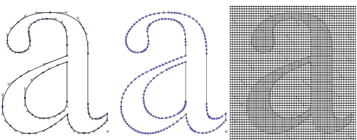

图 14.3 带有控制点的字母 "a"、平坦化的以及光栅化的字母

请注意，在转换的每一步中数据量都会增加，有时字母本身可以用单个字节表示，即 ASCII 97。该字形对于字体来说是一个数字或一个名称。然而，轮廓由 3 条直线路径段和 34 条曲线路径段组成，总共 210 个浮点坐标，将曲线平坦化为直线段很容易导致坐标数量翻倍或更多，取决于分辨率（在我的测试中为 484 个坐标）。最后，将该字形在 24 点和 Retina 屏幕上进行光栅化，会产生约 2 KB 的单色光栅数据和 8 KB 带 Alpha 通道的全色光栅数据。如果你使用超采样进行抗锯齿，光栅数据量会进一步增加。

虽然实际实现必须以此方式实现映射，但事实上通常不会这样做，否则文本和光栅图像运行会太慢。定义的成像模型意味着结果必须与精确的数学开销公式是不可区分的。

## OpenGL

Mac OS X 中的第二种基础图形 API 是 3D OpenGL API（iOS 上的 OpenGL ES）。OpenGL 是一种语言无关且跨平台的 3D 图形语言，最初由 Silicon Graphics 开发，后来变成了一种开放标准。它超越了现有的开放标准 PHIGS，很大程度上是因为它像 Postscript 和 Quartz 一样，被认为比保留模式的 PHIGS 更容易编程。

其图形模型和支持的原型与 Quartz 非常不同。OpenGL 拥有顶点数组，可以通过多边形网格、折线或点云访问。它不支持直接图像，而是将其作为应用于表面的纹理。完全不支持文本，因此必须使用库将文本转换为多边形或位图。

## 图形硬件与加速

尽管绘制是即时模式，但 OpenGL 支持将纹理或顶点数组等资源上传到图形硬件，这些资源可以被多次引用。在 OpenGL 术语中，这被称为保留模式，以区别于通过增量指定所有数据的独立模式。

OpenGL 的一个问题是它提供了一种过程化/调用返回的 API，这与现代图形硬件的实际接口（更面向批处理）并不匹配。这种不匹配意味着对于 API 来说看起来“自然”的代码效率极低，而高效的代码极极不自然且难以获取。

## Metal

Metal API 是 Apple 对 OpenGL API 与实际硬件之间不匹配的回答。与 Khronos 组类似的 Vulkan API 相似，Metal 是一种低级 API，并不试图隐藏底层硬件接口。

应用程序不是调用对应于特定状态更改或绘制命令的 API，而是管理发送到 GPU 的命令缓冲区（command buffers）。

## 图形硬件与加速

虽然计算机图形中像“显示列表”（Display List）之类的术语会让人想起我们拥有实际矢量显示器的时代（当时用电子束绘制画面的线条），但今天几乎所有的显示器都是光栅显示器。光栅显示器定义了一个矩形像素元素（像素）网格，就像输入端的光栅图像一样。

有了现代 LCD、OLED 或等离子固态显示器，实际的像素网格也由硬件预定义：帧缓冲区中存在真实的单个像素元素。

这样做的结果之一是，在我们必须提供的实际像素数量方面，有一个相当稳定的环境，至少当我们转向 Retina 显示器时是。iPhone 屏幕将在 70 万到 200 万像素之间，iPad 为 300 万像素，iPad Pro 或笔记本电脑可达 500 万像素。无论你的应用程序有多大，这都是我们每次刷新时必须修改整个屏幕的最大像素数。在大 O 表示法中，复杂度是 O(k)。

尽管像素数量是恒定的，在算法复杂度方面可以忽略不计，但在实践中这实际上很大，因此完全不容忽视。在许多情况下，生成图形是现代非服务器计算机中计算量最大的任务。

随着时间的推移，这导致了硬件支持操作的不同配置，其中最常见的如图 14.4 所示。最简单的配置 (1) 是没有额外的硬件支持；只是 CPU 绘制到主内存，主内存也被用作缓冲区来刷新屏幕。

## 第 14 章 图形与 UI：原理

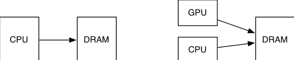

- 1. 主内存
- 2. 协处理器
- 3. 显卡
- 4. 集成显卡

图 14.4 图形硬件配置

这种 CPU 绘制模型的优点是它是最简单、最通用的。它在从 Xerox Alto 到 Apple II 以及原始 Macintosh 和 NeXT 机器上取得了巨大成功。它也是 Quartz 使用的模型，通常情况下 Quartz 是让 CPU 绘制到主内存。

协处理器（图形处理单元，GPU）可以协助图形流水线的不同部分，从几何计算到在内存中推送像素。

## 图形硬件与加速

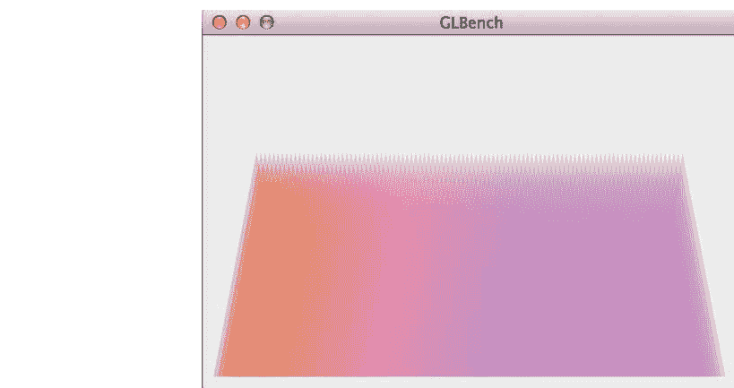

图 14.5 三角形架构

这些在架构上看起来相似的事实是，例如属于 1990 年代，但今天的 13 英寸 MacBook Pro 属于 2000 年代。这是集成 GPU。

## 示例 14.1 使用 OpenGL 绘制三角形

```c
- (void)drawRect:(NSRect)Rect
  int iterations=10000;
  glClearColor(1.0,0.5,0.5,0.5);
  Enable(GL_BLEND);
  glBlendFunc(GL_SRC_ALPHA, GL_ONEUS_SRC_ALPHA);
  glPushMatrix();
  glScalef(0.4, 0.4, 1.0);
  for (int i=0;i<iterations;i++) {
    float a = (float)i / (float)iterations;
    glColor4f(1.0f,0.85f,0.35f + a, 0.4);
    Begin(GL_POLYGON);
    a=2;
    glVertex3f(0.0 + a, 0.6, 0.0);
    glVertex3f(-0.2 + a, -0.3, 0.0);
    glVertex3f(0.2 + a, -0.3, 0.0);
    glVertex3f(0.0 + a, 0.6, 0.0);
    End();
  }
  glPopMatrix();
  glFinish();
```

OpenGL 比使用 Quartz 绘制相同内容快了 10 倍。

## 示例 14.2 使用 Quartz 绘制三角形

```objc
--(void)drawRect:(NSRect)dirtyRect {
  int iterations=10000;
  CGContextRef context=[[NSContext currentContext] GraphicsPort];
  CGContextSetRGBFillColor(context,1.0,0.5,0.5,1.0);
  CGContextAddRect(context, dirtyRect);
  CGContextFillPath(context);
  CGContextScaleCTM(context, [self frame].size.width, [self frame].size.height);
  CGContextTranslateCTM(context, 0.25, 0.5);
  CGContextScaleCTM(context, 0.2, 0.2);
  for (int i=0;i<iterations;i++) {
    float a=(float)i/(float)iterations;
    CGContextSetRGBFillColor(context,1.0f,0.85f,0.35f + a, 0.4);
    a=2;
    CGContextMoveToPoint(context, 0.0 + a, 0.6);
    CGContextAddLineToPoint(context, -0.2 + a, -0.3);
    CGContextAddLineToPoint(context, 0.2 + a, -0.3);
    CGContextClosePath(context);
    CGContextFillPath( context );
  }
}
```

在两种情况下，使用 Quartz 时 CPU 占用率均为 100%，而 OpenGL 将几条命令传递给命令缓冲区然后由 GPU

## 从 Quartz Extreme 到 Core Animation

CPU 实际上处于空闲状态，等待这些命令完成。按照现代标准来看，这两种情况都属于低功耗 CPU。

除了能从专用硬件中益外，GPU 还可以利用图形工作负载中的大规模并行性，以及当前技术芯片晶片上存在的海量晶体管来利用这种并行性。CPU 拥有类似的晶体管预算，但其工作负载中并没有提供如此规模的并行性。

因此，当 CPU 设计者不得不采用更复杂的方案以从其很大程度上是串行的指令流中榨取每一分性能提升时，针对 GPU 工作负载优化的额外硬件资源几乎可以完全线性地转化为性能的增长。这就是 GPU 性能不仅远高于 CPU 性能（对于适用工作负载）的主要原因，而且其性能提升曲线也陡峭得多，保持了这种逐年不断扩大的差距。

## 从 Quartz Extreme 到 Core Animation

利用现代 GPU 的性能潜力进行全系统图形渲染，而非基于 OpenGL 的游戏，一直是 Mac OS 和 iOS 图形 API 演变的驱动力。这从纯基于 Quartz 的渲染开始，逐渐加入了加速组件，如 Quartz Extreme、Quartz GL 以及最近的 Core Animation。

利用 GPU 进行 Quartz 绘制的最明显的方法是将 Quartz 原语映射到 GPU 命令。这种方法的问题在于，图形硬件实现的是兼容 OpenGL 的原语，而 OpenGL 原语与 Quartz 原语并不匹配。OpenGL 没有路径（paths）；它只有三角形或四边形多边形或曲线。它不是线条（strokes），而是多边形。虽然映射这些原语（例如转换填充路径的切片化）是可能的，但转换是非常昂贵的。OpenGL 拥有一个定义模糊的渲染模型，这意味着硬件在以高效方式解释命令方面有很大的余地。这种松性与 Quartz 严格定义的成像模型以及 Apple 在图形保真度方面的要求是冲突的。

然而，有一种原语是可以轻松转换的：位图图像（raster images）。存在一个隐藏的子系统——窗口管理器（Window Manager），它在不同进程拥有的窗口之间复用物理屏幕，以便每个进程都可以在自己的窗口中绘图，而无需担心其他进程正在绘图。

通过窗口管理器，Mac OS X 上的每个图形 API（无论是即时的还是保留的）实际上都变成了保留式 API，其中窗口位图作为保留状态，并具有保留模式 API 的所有优点：窗口可以移动，内容变得可见的结果完全在窗口管理器内部处理。与许多早期的窗口系统不同，也与 AppKit 或 UIKit 中的视图层级不同，不需要涉及客户端代码来重绘任何显示，因此即使进程无响应，窗口操作也始终是平滑的。


## 第 14 章 图形与 UI：原理

随 `Mac OS X 10.2` 引入的 `Quartz Extreme` 利用这种架构，为系统添加了至少某种程度的硬件加速图形。系统中的每个窗口都被转换为 `OpenGL` 矩形，而窗口的内容（由 `Quartz` 或图形 API 提供）被转换为 `OpenGL` 纹理，并映射到该矩形上。每个窗口的内容使用任何认为合适的 API 进行绘制，位图窗口通过 `OpenGL` 和图形硬件组合在一起。

这种变化不仅利用了显卡中的硬件支持来获得更好的性能，而且许多操作还几乎完全消除了 CPU 的负载：为了移动窗口，`Window Server` 只需要更改矩形的坐标；而为了将窗口置于顶层或底层，它会调整矩形的 z 值。

`Core Animation` 将这种架构从 `WindowServer` 带到了客户端进程。每个 `CALayer` 不再在共享的备份存储中绘图，而是维护自己的位图图像，然后这些图像由单独的进程（`iOS` 上的渲染服务器）在硬件支持下进行合成。本质上，每个 `CALayer` 就像 `Quartz Extreme` 下的窗口，因此，对层透明度、旋转等的更改可以通过调整其映射的 `OpenGL` 原语的几何形状来处理，将实际的位图合成释放给图形硬件。

图 14.6 显示了从第一个非硬件加速服务器通过 `Quartz Extreme` 到 `Core Animation` 的演变。如你所示，硬件加速的增加对应于图形架构内位图缓冲的增加。在图形资源的极端情况下，除了解码这些资源外，完全没有软件渲染；整个流水线的其余部分都是硬件加速的。代价是内存、这些资产依赖分辨率的特性以及图像资产的解码时间（这些也可能是巨大的）。

就像 `WindowServer` 进程使窗口操作平滑一样，这种架构使得无论客户端如何运行都很顺畅。一旦设置了所有层，动画就会独立于调用程序运行，在单独的进程并在硬件支持下运行。

这是一个非常不直观的性能优化方法，因为它的基础是最昂贵的原语——位图图像。位图图像在组合成最终结果时会消耗大量的内存和海量的内存带宽。在其他相等的情况下，`Core Animation` 架构会让这些操作变得多，但事实并非完全相等，因为这些操作可以轻松从图形硬件中受益。

此外，我们获得了简单性和相应的可预测性，使得将操作交给单独进程成为可能，该进程只需向图形硬件发送小型指令流。

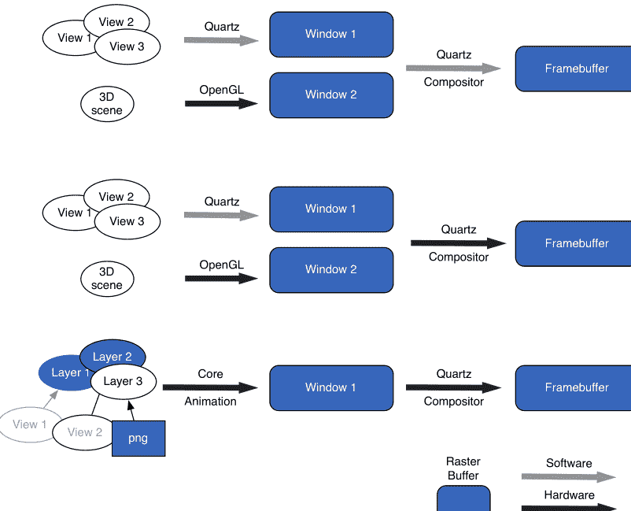

**图 14.6** `Window Server`（顶部），带有 `Quartz Extreme` 扩展的 `Window Server`（中间），`Core Animation`（底部）

大幅减少 CPU 合成不同层的工作，从而为这些组合制作动画留了空间。动画由单独进程编排并在高性能硬件上执行，这一事实意味着系统可以保证比客户端执行高得多的平滑度。

除了让用户体验变得更加“结实”和真实之外，动画在提高感知响应能力方面也非常有用。如果系统立即启动动画，它会感觉是有响应的，即使它还没有最终答案。动画所花费的时间可以用来得出那个最终答案。

## 总结

在本节中，我们简要检查了应用程序响应能力的心理物理基础，查看了图形编程的主要特性和权衡，然后追溯了 `Mac OS` 和后来的 `iOS` 图形的演变。

这种演变为我们的图形编程留了一系列不同的方法和权衡，我们将在后续章节中对其进行详细探讨。

## 图形与 UI：测量与工具

与其他性能领域一样，如果不知道哪里慢，优化图形通常是无意义的，最重要的是，知道你是帮助还是损害了性能。

测量图形性能和响应能力在许多方面比其他形式的性能测量更困难。通常，操作发生在深层系统库、你可能无法访问的独立进程，以及可能或不可内省的独立硬件中。

更重要的是，涉及到图形性能时，你真的开始关注单个事件的时间，精确到几十毫秒级。在之前的章节中，我们稍作作弊，通过测量大量单个事件并除法来获得单个事件的“时间”。这并不完全正确；我们得到的是平均时间。

正如第 14 章所示，平均值在图形计时中有意义：将动画序列的所有帧都在 16.6 毫秒内交付，与将 50 帧在 1 毫秒内交付而剩余 10 帧每帧花费 90 毫秒完全不同。尽管第二个版本在平均上快一点，但它看起来是不可接受的卡顿，而较慢的第一种变体完全平滑。

幸运的是，有一些缓解因素。系统和工具能更好地了解你正在尝试做什么，因此可以让你更深入地洞察你是否有效地实现了这一目标。例如，如果你正在用相同的值重绘像素，这种有效的无效操作可以被标记出来。

本章将介绍某些专用仪器以及它们旨在报告的图形流水线的特定方面，以及如何将我们之前看到的通用工具和技术结合使用这些工具。

# 第 15 章 图与 UI：测量工具

## 使用 Instruments 进行 CPU 分析分析

在上一章中，我们简要检查了使用 `Quartz` 进行 CPU 绘制与使用 `OpenGL` 进行硬件绘制之间的性能差异。图 15.1 显示了 `Quartz` 示例的时间分析。

分析的前 11 个条目包含用户代码，但如你所见，总耗时仅占 3.3%。用户代码是一个定义在 `- [GLBench drawOn:rect:]` 方法内部的块，并由 `- [MPWAbstractContext save:]` 调用。总运行时间的剩余 96.6% 位于 `Quartz` 函数 `CGContextDrawPath` 中。有趣的是，其中 50% 的时间花在了 `CGColorMaskSARGBGB8888` 上，它出现了 SSE 工作器函数 `CGColorMaskSARGBGB8888_sse`，这对你并没有太大帮助。

你正在花费大量时间进行绘图这一事实可能有用，但它并不能真正告诉你原因。是因为你的路径太复杂，还是你正在重复绘制，或者是你尝试实现的东西对于系统处理来说太复杂了！后者不应该是事实情况，因为即使是 `Quartz`，理论上至少也能以动画速率处理屏幕上的每一个像素。

使用硬件加速时，问题会更加糟糕，因为现在 CPU 大部分处于空闲状态并等待 GPU。图 15.2 显示了相同时间的基准分析，但这次使用的是 CPU 用于绘图的 `OpenGL` 路径。

| 运行时间 | 自有 | 符号名称 |
|---|---|---|
| 2176.0ms | 100.0 | 0.0 | ▼-NSView display(needed) AppKit |
| 2176.0ms | 100.0 | 0.0 | ▼-NSView draw(rect:isRect:needsDisplay:isRect:isRect:isRect:isRect:forTopview:) |
| 2176.0ms | 100.0 | 0.0 | ▼-NSView_recursiveDrawNeedsRect(isRect:needsDisplay:isRect:isRect:isRect:isRect:forTopview:) App |
| 2170.0ms | 100.0 | 0.0 | ▼-NSView_recursiveDisplayNeedsRect(withNeedsDisplay:drawingWithLockFocus:) AppKit |
| 2170.0ms | 99.7 | 0.0 | ▼-GLBench draw(rect:) AppKit |
| 2170.0ms | 99.7 | 0.0 | ▼-GLBench draw(rect:) GLBench |
| 2168.0ms | 99.6 | 0.0 | ▼-MPWAbstractContext save: Cocoa |
| 2165.0ms | 99.4 | 0.1 | ▼-29_draw(onRect:link_block) invoke GLBench |
| 2165.0ms | 99.4 | 0.1 | ▼-CGColorDrawGraphics |
| 2098.0ms | 96.4 | 0.0 | ▼-CAripPath draw libQuartz.dylib |
| 2072.0ms | 95.2 | 0.2 | ▼-CALayer setLayerShape libQuartz.dylib |
| 1074.0ms | 49.3 | 0.0 | ▼-bg32_drawRect CoreGraphics |
| 1071.0ms | 49.2 | 0.0 | ▼-CGColorMaskSARGBGB8888 CoreGraphics |
| 1071.0ms | 49.2 | 0.0 | ▼-CGColorMaskSARGBGB8888_sse CoreGraphics |
| 7.0ms | 0.3 | 0.0 | ▼-ripd_lock libQuartz.dylib |
| 7.0ms | 0.3 | 0.0 | ▼-CGDeviceLockRect CoreGraphics |
| 6.0ms | 0.3 | 0.0 | ▼-CGStatusView CoreGraphics |
| 1.0ms | 0.0 | 1.0 | ▼-CGDisplaySynchronizeSize CoreGraphics |
| 1.0ms | 0.0 | 0.0 | ▼<Unknown Address> |


## Quartz Debug 311

| 运行时间 | 自有 | 符号名称 |
|---|---|---|
| 6.0ms | 100.0% | 0.0 | -NSView_display(Needed):isVisibleRect:rect:isRectForView:AppKit |
| 6.0ms | 100.0% | 0.0 | -NSTextField_frame_recursiveDisplayNeeds:ignoringOpacity:isVisibleRect:rect:isRectForView:topview |
| 6.0ms | 100.0% | 0.0 | -NSView_recursiveDisplayNeeds:ignoringOpacity:isVisibleRect:rect:isRectForView:AppKit |
| 5.0ms | 00.0% | 0.0 | -NSView_recursiveDisplayIfNeeded:WithFocus:AppKit |
| 5.0ms | 50.0% | 0.0 | -NSView_drawRect:AppKit |
| 5.0ms | 50.0% | 0.0 | -CGContext_drawRect:GLBench |
| 1.6ms | 100.0% | 0.0 | 0x122a7d |
| 1.6ms | 100.0% | 1.0 | -fish_Flush:GLContext |
| 1.6ms | 100.0% | 0.0 | -glPresentFramebuffer:Data:Intel4000Graphics |
| 1.6ms | 100.0% | 0.0 | -glSwapBuffers(GLContext):Intel4000Graphics |
| 1.6ms | 100.0% | 0.0 | -glSubmitCommand:Intel4000Graphics |
| 1.6ms | 100.0% | 0.0 | -glContext:prepare:CommandBuffer:Intel4000Graphics |
| 1.6ms | 100.0% | 0.0 | -glBindVertexBuffer(target):Intel4000Graphics |
| 1.6ms | 100.0% | 0.0 | -gpuGenSubBuffers:IOKit.dyl |
| 1.6ms | 100.0% | 0.0 | -glAccessContextSubBuffers:Accelerator |
| 1.6ms | 100.0% | 0.0 | -IOConnectCallMethod:IOKit |
| 1.6ms | 100.0% | 0.0 | -io_connect_method:IOKit |
| 1.6ms | 100.0% | 0.0 | -mach_msg:libsystem.kernel.dylib |
| 1.0ms | 16.0% | 0.0 | -mach_msg:libsystem.kernel.dylib |
| 1.0ms | 16.0% | 0.0 | -gleBeginPrimitiveWithFunction:GLEngine |

图 15.2 `GLBench` CPU 分析，`OpenGL`

尽管 `Quartz` debug 使用了 2176 ms 的 CPU 时间，但 CPU 使用量为 6 ms，且实际进行绘图的地方仅占 16%。当你使用硬件辅助时，CPU 分析无法告诉你应用程序的瓶颈在哪里。

## Quartz Debug

对于 `OS X`，一个用于调试问题的专用工具是名其实 `Quartz Debug`。图 15.3 显示了它的选项窗口和帧率计。`Quartz Debug` Enables macOS 图形栈中的调试参数，因此它不会影响你的项目，但会影响包括 `Quartz Debug` 在内的所有程序，因此最好退出其他应用。

我发现最有用的选项是位于中间附近的 `Flash updates`。通过此选项，`Quartz` 会更新相同内容的屏幕区域闪烁红色矩形，这意味着绘图是完全多余的，应该被消除。并没有好的方法来绘制相同的内容。

接下来是 `Flash updates` 设置，与上一个选项类似，但会对所有更新闪烁黄色矩形，而不仅仅是冗余更新。此选项允许你识别那些不需要频繁刷新的绘图。此选项可能会产生大量杂质。

# 第 15 章 图与 UI：测量与工具

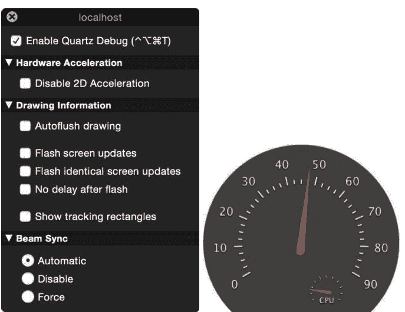

图 15.3 `Quartz Debug` 选项和帧率计

`Autoflush drawing` 选项禁用了通常会发生的合并操作，因此每个绘图操作都会单独刷新到屏幕上（可能会使用前两个选项进行闪烁）。这产生了更多的杂质，但更细粒度的矩形可能让你更清楚地了解到底什么被更改/绘制了。

最后，应该注意的是，在运行 `Quartz Debug` 时，你的应用程序性能将不会那么好；所有额外的矩形绘制都会产生巨大的开销，而且通常有一个额外的小延迟，以便你能够看到正在闪烁的矩形。通过启用其中一个选项并拖动窗口！你不仅看到看到闪烁，拖动也会变得非常迟缓。禁用它后性能会接近正常，但代价是闪烁变得更难以识别。

## Core Animation Instrument

`iOS` 拥有一些更复杂的测量工具，可能是因为图形架构更加复杂，硬件整体仍然较弱得多，而且要求更严格。简而言之，你真的需要那些工具！

## Core Animation Instrument 313

主要的工具可能是作为 `Instruments` 一部分的 `Core Animation` 工具，而不是像 `Quartz Debug` 那种独立工具。这种与 `Instruments` 的集成非常有帮助，因为你可以组合工具来将问题与可能的根源相关起来。

图 15.4 显示了我们在开发 `Wonderland 3` 时遇到的动画性能问题。

`iPhone 5S` 的追踪；动画性能的下降在 `A45` 上明显得多。通过关注动画性能下降的区域并切换到 CPU 工具，我们能够弄清发生了什么：我们的一个例程正在执行计算，并反复调用 `valueForKeyPath:` 来计算某些计数。正如你可能在第 3 章中记得的，使用键值访问比直接访问或发送消息要慢几个级。

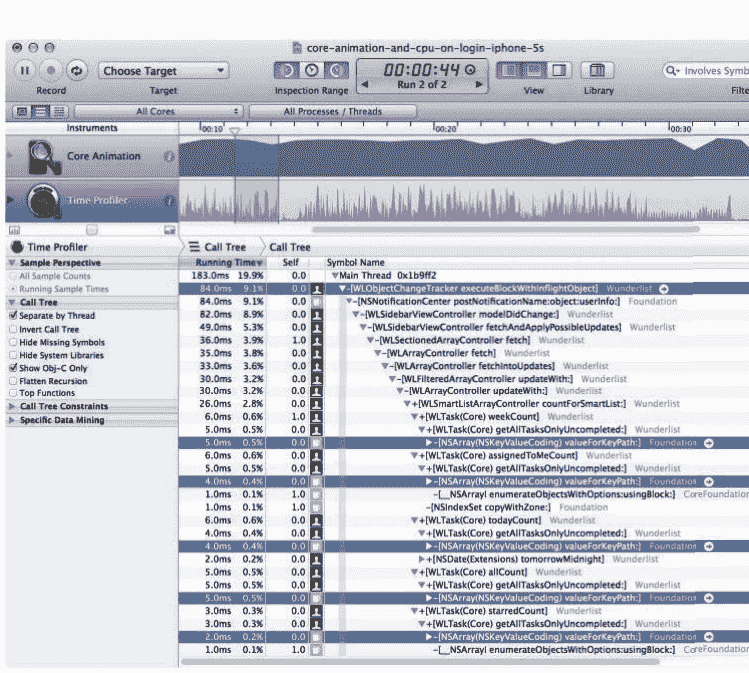

图 15.4 `Core Animation` 和 CPU 工具协同工作

## 第 15 章 图形与 UI：测量工具

简单的解决方案是通过放弃 `valueForKeyPath:`，转而使用循环和普通的消息发送来使执行计数的程序运行得更快。如果这不可行，处理此问题的其他选项将推后计算、在后台线程而非主线程执行计算，或者进行增量计算。

## 当 CPU 不是问题所在时

在上一个例子中，我们很幸运问题实际上确实是 CPU，这是通过我们在第 2 章中熟悉的性能分析工具识别出来的。但如果情况并非如此呢？`iOS` 的 `Core Animation` 工具有一组与我们用过的 `Quartz Debug` 工具类似的选项，只不过这些选项更详尽，并针对特殊的 `iPhone/iPad` 环境进行了定制。正如第 14 章所解释的，`iOS` 的图形表示标准倾向于庞大且很大程度上高效的表示：全位图。这虽然可以通过通用地利用 GPU 来抵消，但意味着访问时看似微小的低效率会由于移动数据海量而被急剧放大。图 15.5 显示的 `Core Animation` 全局选项关注这些具有潜在巨大影响的微小低效率，并类似于 `Quartz Debug` 选项在屏幕上视觉化地显示结果。具体来说，支持以下选项：

- **颜色混合层（Color Blended Layers）**——源与目标之间的 Alpha 混合意味着我们需要读取一个来读取另一个。此标志会将混合层标记为红色，将未混合层标记为绿色。

- **命中绿色和缺失红色（Color Hits Green and Misses Red）**——这指的是系统用于支持 `shouldRasterize` 的缓存。通常，`Core Animation` 在更新时会拷贝/混合整个层树。层上的 `shouldRasterize` 标志告诉 `Core Animation` 而是缓存设置该标志的层的子层的光栅化表示。然而，它并不会保留设置了该标志的所有层的光栅化位图，而是在全局缓存中在有限的时间内保留有限数量的位图。

- **颜色拷贝图像（Color Copied Images）**——此标志显示特定图像是否能够被 GPU 直接使用，还是必须先由 CPU 拷贝/转换（后者情况会被涂上颜色）。

- **颜色未对齐图像（Color Misaligned Images）**——这是另一个用于精调内存模式的标志。当图像对齐在字边界上时，所有的内存访问至少都是一次完整的字。当图像未对齐时，为了产生每个输出字需要读取多个源字，GPU 必须对源位进行移位和屏蔽。取决于 GPU 的智能程度，额外的内存访问要么发生在每个字排序时，要么发生在图像边缘。在这里最好避免未对齐图像，此设置将向你显示未对齐的图像。


- **闪烁更新区域（Flash Updated Regions）**——此标志的作用与同名的 Quartz Debug 特性相同：当某个区域发生变化时，该区域会以一种独特的颜色变化。我还没有在 iOS 上找到类似于 Quartz Debug“相同区域”的、对于寻找冗余性如此有用的功能。

- **颜色 OpenGL 快速路径蓝色（Color OpenGL Fast Path Blue）**——这显示避免了主组件并直接使用 OpenGL 渲染的屏幕区域。

- **颜色离屏黄色（Color Offscreened Yellow）**——此标志显示首先在离屏渲染然后仅拷贝到屏幕的区域。额外的拷贝显然是一个性能问题。

注意，与 Quartz Debug 类似，这些选项通常影响受影响设备上的渲染，不会影响使用 Instruments 运行的应用程序。

为了说明某些选项，让我们看看 iPad 上 PostScript/PDF 视器的缩略图视图。图 15.6 显示了正常状态下的缩略图视图，没有任何着色处理。滚动性能有点滞后，因此我使用了这里的一些选项来找出问题所在。

图 15.6 显示了选了“颜色混合层”选项的缩略图视图。在 Instruments 中，每一个缩略图都被涂成了红色（印刷书籍中深灰色），这意味着使用了混合。由于我们并不真的希望背景显示出来，所以不应该混合。

第一个想法是 `UIImageView` 没有设置为不透明，并且有一个阴影，阴影通常需要混合。然而，将视图设置为不透明并移除阴影并没有产生区别；所有缩略图仍然由于混合被涂成红色。

最后，事实问题在于缩略图本身包含 Alpha 通道。这个 Alpha 通道是不需要的，因为所有像素都有完全/不透明覆盖，但 GPU 或 API 无法判断这一点，因此必须运行混合操作，然后完全覆盖目标像素。

缩略图是通过 Core Graphics 上下文从 PDF 文件创建的，因此修复方法是向 `CGBitmapContextCreate()` 指定 `kCGImageAlphaNoneSkipList` 作为参数，而不是 `kCGImageAlphaMultipliedLast`。指定 `kCGImageAlphaNone`（不想要 Alpha 的明显选择）并不起作用；该函数在运行时返回错误。

图 15.8 显示了修复后的结果：在 Instruments 中一切都是绿色的（印刷书籍中显示为浅灰色），表示没有混合，并且绘制了阴影。此外，性能提升相当微小，但有时这就是你能得到的全部，考虑到投入的精力也相当小，这是一次值得的优化。

最后，我查看了未对齐的图像（图 15.9），它显示了未对齐的缩略图图像。由于图像应该居中且图像宽度无法控制，因此没有办法对齐当前未对齐的图像，所以这可能需要保持未优化状态。

如果证明未对齐的生成过程可以修改为将图像宽度向上舍入到最近的“对齐安全”值，然后在较大的缩略图中居中绘制实际的文档缩略图。然而，这将需要将图像边缘透明以保持视觉保真度，这会产生混合成本（见上文）。另一种方案是牺牲视觉保真度，绘制带有小白色框的缩略图，或者以略不同的尺寸进行绘制。

## 我在测量什么？

我们正试图决定使用静态图像资源还是用代码绘制。一个考虑因素（尽管不是最重要的因素）是不同技术之间的相对性能。示例任务是绘制图 15.10 所示的渐变。

示例 15.1 中的代码使用 CoreGraphics 或从 PNG 或 JPEG 文件加载预渲染的图像来绘制此渐变，并测量这些方法所需的时间。

### 我在测量什么？ 319


图 15.8 颜色混合图层选项，缩略图不再混合

## 第 15 章 图形与 UI：测量与工具


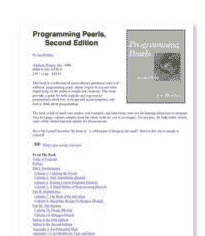


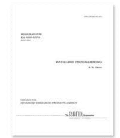
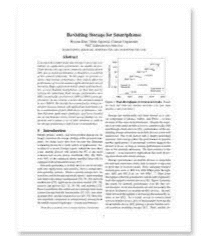
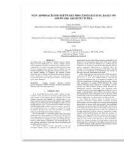


图 15.9 Core Animation 仪器，颜色未对齐


## 示例 15.1 尝试对比图像加载与图像创建的时间

```objc
- (void) timeImageDrawingAndLoading
{
    CGFloat drawnTime, PNGTime, JPGTime;

    CFTimeInterval startTime, endTime;

    startTime = CACurrentMediaTime();
    self.drawImageView.image = [self drawnImage];
    endTime = CACurrentMediaTime();
    drawnTime += 1000*(endTime - startTime);

    startTime = CACurrentMediaTime();
    self.PNGImageView.image = [UIImage imageNamed:@"Image.png"];
    endTime = CACurrentMediaTime();
    PNGTime += 1000*(endTime - startTime);
    SEL flusher = NSSelectorFromString("_flushSharedImageCache");
    [[UIImage class] performSelector:flusher];

    startTime = CACurrentMediaTime();
    self.JPGImageView.image = [UIImage imageNamed:@"Image.jpg"];
    endTime = CACurrentMediaTime();
    JPGTime += 1000*(endTime - startTime);

    [[UIImage class] performSelector:flusher];
    NSLog("Drawing %f, PNG %f, JPG %f", drawnTime, PNGTime, JPGTime);
}
```

## 第 15 章 图形与 UI：测量与工具

测量得的时间为：11.1 ms，PNG 3.89 ms，JPG 0.51 ms，因此显然是一个进行预渲染并存储为 JPG 的案例；对吧，我们还浅浅地解释一下这些数字：正如我们在第 14 章看到的，Core Animation 是基于位图的，因此绘制是一个额外的步骤，在这个过程中，图像被加载并或或少直接存储作为层的存储。

没那么快！

事实证明这些时间是在模拟器上测量的（这些数字低得可疑）。此外，JPG 为什么比 PNG 快 8 倍？这听起来有点奇怪。

首先，我使用了我可靠的 instruments 来获取发生情况的大致想法，在 `-imageDrawingAndLoading` 方法中并没有进行图像解码。相反，我在稍后实际绘制这些视图的期间，看到了一点 PNG 解码。我没有看到任何 JPEG 解码；它太快了。这证实了我们对 iOS 上图像加载和解码的了解：它是极其懒惰的，只有在绝对必要时（例如绘制时）才会加载/解码图像。

有些书籍声称解码也会通过 `UIView` 的 `image` 属性或 `CALayer` 的 `image` 属性被强制执行，但我并没有在实践中实际看到过这一点。

在实际设备（iPhone 5）上运行代码得到了以下数字：3.26 ms，PNG 67.2 ms，JPG 49.1 ms。这次，角色反转过来了，绘制比 PNG 解码快 20 倍以上，比 JPEG 解码快 15 倍。然而，这个结果也令人困惑——因为 iOS 在此处实际上并没有解码图像（另一个仪器确认了这一点），它在做什么呢？

如果你仔细看，你会发现 iOS 实际上并没有解码图像（这里另一个仪器确认了这一点），它在做什么呢？

## 频繁通信会减慢安装速度

图像绘制一直尽可能快，尽管自 NextStep 时代以来图像绘制一直存在问题。然而在生成 PDF 时，`CGLayer` 仍然是一个优势，因为它会为重复元素保留矢量信息。因此，如果你计划打印或 PDF 输出并包含重复元素，那么 `CGLayer` 是一个很好的选择。

考虑到第 15 节中 OpenGL 的性能优势，以及现代游戏以高帧率渲染复杂场景的显见性能，使用 OpenGL 加速绘制似乎是一个理所应当的决定。从概念上说这是正确的，但实现这种加速事实被证明并非如此（绝非轻而易举）。Apple 曾尝试在操作系统 层面将 OpenGL 整合到 Quartz 中，据我所知，这些尝试都已取消。额外的事务开销往往会抵消那些可以加速的图形绘制部分所带来的增益。一个特别的问题是 Quartz API 极其即时的、调用/返回性质，它与 OpenGL API 映射得尚好，但与实际硬件接口的映射并不理想（请参见第 14 节“Metal”部分关于 OpenGL/Metal 的讨论）。


另一个是图形原语不同：Quartz 使用填充和描边的贝塞尔曲线路径，这些路径通过昂贵的细分（tessellated）转换为图形硬件使用并通过 API 暴露的三角形。如果它们是形状，这种转换成本将更容易分摊到多次使用中，但 API 并没有真正提供这种支持。

## 频繁通信会减慢安装速度

一项产生意外结果的调查是研究了新 Mac OS 版本中安装程序神秘变慢的问题。该安装程序正在安装数千个小文件，并且之前的表现符合预期。在新版本中，安装程序变慢了七倍，几乎增加了一个数量级。I/O 速率远低于磁盘子系统所支持的，CPU 占用率可以忽略不计，因此似乎没有实际瓶颈可以解释性能的下降。

## 显示限制（The Display Throttle）

在反复苦思和使用工具之后，发现罪祸首首是安装程序提供的状态更新。它显示所安装的每一个文件的名称，为了确保用户有机会看到这每一个文件名，它在显示每个名称后都会刷新屏幕。这种让用户随时了解进度的热忱触碰了 Mac OS X 图形子系统内部的节流机制，该机制将图形更新限制在接近刷新率的水平（现在是某种任意的 60 Hz）。尝试更频繁地刷新屏幕只会阻塞你的程序，如示例 16.1 所示。

## 第 16 章 图形与 UI：陷阱与技巧

### 示例 16.1 以 60 Hz 运行

```swift
import Cocoa

class AppController: NSObject, NSApplicationDelegate {
    var mainWindow: NSWindow?

    func applicationDidFinishLaunching(n: NSNotification) {
        let window = NSWindow(CGRect(0, 0, 320, 200),
                              styleMask: NSTitledWindowMask,
                              backing: NSBackingStoreType.Buffered,
                              defer: false)

        window.orderFrontRegardless()
        self.mainWindow = window
    }

    NSApp.activateIgnoringOtherApps(true)
    dispatch_async(dispatch_get_main_queue() {
        for i in 1...60 {
            self.drawSomething(i)
        }
        NSApp.terminate(true)
    })

    func drawSomething(i: Int) {
        let window=self.mainWindow!
        window.contentView?.lockFocus()
        NSColor.redColor().fill(CGRect(10, 10, 200, 120))
        let labels=NSString(i)
        let label=NSString=labels
        NSColor.blackColor().set()
        label.drawAt(CGPoint(x:20,y:20), withAttributes:nil)
        window.contentView?.unlockFocus()
        window.flushWindow()
    }
}

let app = NSApplication.sharedApplication()
let controller = AppController()
app.delegate = controller

NSApp.run()
```

在我的 8 核 Mac 上运行这个带有 600 次显示循环的程序，耗时恰好是 10.0 秒，与我的 MacBook Pro 上的情况相同，且两个系统的 CPU 空闲率都在 90% 以上。

注意 Quartz 足够智能，可以判断是否存在任何绘制操作，因此在紧凑循环中调用 `flushWindow()` 会立即返回，因为在那种情况下它并没有尝试刷新。不过，你确实需要画一些东西，尽管它并不非得是不同的。

### 处理显示限制

虽然有绕过显示限制的方法，但使用 OpenGL 的游戏可以获得更高的刷新率，可能将这一教训记在心子里更好：状态更新发生的频率可以比用户关心的频率要高得多。例如，我通过其方法测量了一个 `NSUrlSessionDataObject`，当通过 G-bit/s 的 DSL 线路下载时，它每秒给了我 273 次状态更新。

我不仅确信用户不在乎每秒多知道 273 次下载状态——显然不关——你实际上能够读取到一个刷新如此频繁的字节计数。对于字节计数，一秒可能足够了，而进度条如果以更高的频率（大约每秒 10 次）更新，可能会稍微平滑一些。

到目前为止我有三种避免过度 UI 刷新的技巧，其中两种实际上是有效的。第一种技术对于本质上持续的进度监控（例如进度监控）非常好，即使用一个运行在 10 Hz 左右的定时器来查询进度并更新显示。第二种技术是更新批处理（update-request batching），它避免了显式的定时器但难以管理。实现批处理的一种方法是存储更新并在稍后时间发送，例如 0.1 秒。

第三种技术我曾认为使用 `performSelector:afterDelay:` 并取消之前的请求是聪明的，事实上我见过很多这种技术。遗憾的是，它无效。

### 今天的安装程序与进度报告

考虑到这个问题的严重性，你可能认为它是罕见的，且不再发生了。你一直认为——2016 年有报道称，开启进度条时节点管理器被减慢了 50%，微软的自动更新程序仍在使用 150% 的 CPU（在双核机器上测量），并显示其进度条。

在 OS 10.9 和 iOS 7 中，Apple 引入了使用 `NSProgress` 类和 `NSReporting` 协议报告长时间运行任务的式支持。基本思想是让对象报告各个活动的进度，并结合这些单独的报告以获得整体进度。我在世纪 90 年代后期实现过非常类似的系统，可以说这样做非常好。

然而，Apple 在实际向 UI 报告进度方面完全掉链了，或者说推卸了责任。向 UI 报告进度的推荐技术是观察顶层 `NSProgress` 对象的 `percentCompleted` 属性。这并没有解决我们看到的任何问题，并且增加了一个问题：KVO 通知将在更改进度状态的后台线程递递。

事实上，Apple 告诫：“不要在紧凑循环中更新 `completedUnitCount`”，他们意识到了这个问题，并意识到他们并没有真正解决它。

### 让 iPhone 负载过载

症状是 UI 会冻结很长时间，应用程序才能再次使用。这在首次启动应用程序时尤为明显，因为它必须对所有订阅中的所有项目进行初始获取/更新。随后的启动往往没有那么大的问题，因为数据已经缓存，但仍有糟糕的用户体验需要解决。

性能分析（Profiling）显示时间被消耗在 UIKit 绘制代码中（文本绘制、表格布局）。Apple 提倡的 Cell 复用机制正在使用并运行符合预期，没有特殊的 Apple 创建开销。没什么可做的，对吧？

错！问题被证明在示例 16.2 的代码中。

### 示例 16.2 视图通知模型代码

```objc
- (void) notifyChanged
{
  [NSNotificationCenter defaultCenter
      postNotificationName: @"UserChanged"
      object:nil];
}
```

尽管这段代码看起来没问题，并且与许多发布的关于 `NSNotificationCenter` 的示例相符，但它实际上存在两个问题。首先是缺乏上一节讨论过的更新节流（update-throttling），其次是它太不明确了：它只是说某些东西发生了变化，而没有说明发生了什么变化。缺少了这一重要的上下文信息，接收通知的 UI 元素（在本例中为表格视图）别无选择只能更新所有的 UI。这不仅对于（可见）元素的数量来说是二次方增长，而且还更新了那些甚至不可见且可能不在当前列表中的项目的显示！

解决这个问题的简单方法当然是在通知中包含当前对象，幸运的是 `NSNotification` 天生就设计为可以处理这种情况。示例 16.3 显示了这一改进。

### 示例 16.3 带有上下文的视图通知模型代码

```objc
- (void) notifyChanged
{
  [NSNotificationCenter defaultCenter
      postNotificationName: @"UserChanged"
      object:self];
}
```

接收端代码随后能够从通知中检索相关对象，确定它是否相关（是否包含在当前表格中），然后只更新那一行。示例 16.4 中的代码将这种依赖于上下文的刷新与上一节中的批量刷新结合起来。它假设表格视图正在管理一个“项目”列表。客户端调用 `refreshItemsFromBackground`（例如通过 `NSNotification` 调用），然后该方法会确定该项目的索引并随之使用该索引。

### 示例 16.4 表格视图项目批量刷新的代码

```objc
@property (retain) NSMutableSet *indexesToRefresh;
- (void) refreshAccumulatedItems
```

```objc
{
  NSSet *items=nil;
  @synchronized(self) {
    itemIndexes=[self indexesToRefresh];
    [self setIndexesToRefresh:nil];
  }
  [tableView reloadRowsAtPaths:[itemIndexes allObjects]
       withAnimation:UITableViewRowAnimationNone];
}

-(void) triggerRefresh {
  [self performSelector:@selector(refreshAccumulatedItems)
                withObject:nil afterDelay:0.2];
}
```

```objc
-(void)hideItemFromBackground:item
{
  NSIndexPathPath* index=[self indexPathForItem:item];
  if ( index ) {
    @synchronized(self) {
      if (!indexesToRefresh) {
        [NSMutableSet setObject:@selector(triggerRefresh) index];
        [self performSelectorOnMainThread:@selector(triggerRefresh)
                          withObject:nil waitUntilDone:NO];
      } else {
        [indexesToRefresh addObject:index];
      }
    }
  }
}
```

结果的批处理本质上是由后续代码完成的；如果我们没有一组批量结果，就会创建一个并调度刷新。另一方面，如果我们已经有一个正在进行的批处理，那么只需将其添加到该批次中即可。处理起来非常简单——我们选取该批次，清空它，并刷新表格视图。注意，如果在此期间发生了导致索引失效的任何情况，你需要清除该批次。

### 这仅仅是一种幻觉

我学到的处理 UI 性能问题最重要的技术之一就是隐藏它。实际上执行你应该做的事情太慢了，你通常可以在追赶并完成剩余工作的同时，向用户展示一个仿品。或者你可以使用动画。

使用动画来隐藏延迟是真正天才的举措之一，它让原始 iPhone 看起来如此快速且即时/稳固，尽管其硬件相对较弱，并让它在竞争对手推出更高性能硬件和据称更好的加速图形时，依然保持了这种领先地位。

例如，打开 PDF 文件并渲染第一页（或双页）需要时间。然而，将文件的缩略图动画到全屏意味着用户在系统忙于准备 PDF 时被占据了。由于动画可以由 GPU 处理，这意味着 CPU 资源不会从空闲任务中夺走。

### 图像缩放与裁剪

在 20 世纪 90 年代，我创建了各种驱动不同输出设备的 NeXT ，从用于 NeXT 彩色打印机的高质量变频器到几十美元的高端激光彩色复印机。这些程序之一是 `EXTRASlide`（见图 16.1），它绘制了 Polaroid CL-5000S 数字调色胶片记录仪。

从工程角度来看，这些程序的主要部分是实际的底层驱动程序，它们经常利用 SCSI 端口将由 DisplayScript 渲染的高分辨率位图传输到设备，这些设备使用了自定义且通常实现很差的协议。


所有这些往往对性能至关重要。例如，Polaroid 记录仪具有 4000 行的分辨率，产生了 48 MB 的图像，并且在交付这些框时有一些实时性要求。由于机器上有 1 GB 的内存，这并不是问题。

现代 UI 设计面临的主要挑战之一是，高分辨率显示器使得视觉化缩放对性能的影响变得困难得多。当你尝试放大一张小图像时，你只会得到一个模糊、低质量的版本。但当你缩小一张高分辨率图像时，你将得到一个清晰、详细的图像。

这是现代性能的关键。Livescribe Smarten 使用红外摄像头在您用非周期性点在纸上书写时精确捕获其位置。桌面应用程序显示并组织了这些捕获的书写/绘图页面。对于每个笔记本，概述模式应该显示捕获的矢量笔画叠加在所用纸张背景上的缩略图，由于明显的原因，背景并没有被笔捕获。两个问题是，这些背景的高分辨率图像渲染非常慢，而且包含笔画的文件格式在读取时有显著的初始化开销。

### 这仅仅是一种幻觉 333

……问题，因为图像正在移动，人眼根本无法辨别细节。一旦缩放完成（释放按钮），我们就切换回原始的 `NSImage`，它将重新创建屏幕。我学到的教训是，对于交互式程序，我们是被允许“作弊”的，只要不被发现即可。在这个示例中，我们在缩放时使用低分辨率位图。虽然没有缩放源文件好，但由于图像在移动，差异并不明显，而且比移动矩形真实得多。

### 缩略图绘制

在开发获奖的 Livescribe Desktop 时，图像，特别是缩略图绘制的问题再次出现，而不被发现作弊再次证明是正确答案。Livescribe Smarten 使用红外摄像头在您用非周期性点在纸上书写时精确捕获其位置。桌面应用程序显示并组织了这些捕获的书写/绘图页面。对于每个笔记本，概述模式应该显示捕获的矢量笔画叠加在所用纸张背景上的缩略图，由于明显的原因，背景并没有被笔捕获。两个问题是，这些背景的高分辨率图像渲染非常慢，而且包含笔画的文件格式在读取时有显著的初始化开销。

### 绝对不要绘制缩略图的方法

绘制缩略图的第一种方法如图 16.3 所示，是字面意思理解“缩略图”。缩略图通常是从较大的图形或文档生成的小图像。我们的 Windows 客户端非常理解这一点并为保存的每个页面创建了缩略图。我们的 Mac 团队认为他们这样做但做得更好，因为 OS X 支持高质量 PDF，且 Apple 刚刚引入了 `CGImageSourceCreateThumbnailAtIndex()` 函数专门用于从磁盘加载缩略图。可能会出什么问题呢？

这种方法存在的所有问题：由于 PDF 是分辨率无关的格式，每个 PDF “缩略图”都包含了全分辨率


图 16.3 如何不绘制缩略图

对于 PNG，将其绘制到 PDF 中需要对 PNG 进行解压缩，然后为了生成 PDF 进行重新压缩。这些 PDF “缩略图”的渲染速度也非常慢，因为它们包含的细节比人们需要的得多。为了应对这种过程固有的缓慢问题，我们为每个 PDF 都开启了一个新线程来生成。

事实证明，这曾导致过一次机器强制重启，因为 200 个线程占满了 CPU，且内存消耗导致了持续的内存交换（swapping）。

### 如何不真正绘制缩略图

虽然将 PDF 写入磁盘并渲染它们显然是一个经典的*坏主意*，但我们仍然固执于缩略图是一个特定图像的观点，尽管我们现在愿意接受在低分辨率下，位图图像可能就足够了这一想法。Apple 的 ImageKit（也是新的）特别是 `IKImageBrowserView` 似乎可以提供……

这个 API 足够简单，我们只需要[提供]一个数据源，它可以返回几乎可以想象的任何格式的单个图像。

遗憾，结果仍然远不如人，如图 16.4 所示：一旦所有缩略图都生成，一切都非常快，但初始加载非常慢，而且由于缩略图是一个接一个渲染的，视觉上非常突兀。更糟糕的是，在打开文件开销导致的延迟期间，我们无法绘制任何内容。


图 16.4 原子化缩略图绘制

### 这只是幻象

这让我们没有得到亚马逊客户评论的好评：

如果你有几百页笔记，软件在每次加载打开的文件时都需要重新加载缩略图，这很奇怪。如果你等足够的时间，只要软件处于打开状态，缩略图就会在内存中。这需要太长时间了！如果你关闭程序并重新打开桌面软件，猜怎么着？你必须重新开始等待缩略图再次出现。我不知道 Windows 版本是否也是如此，但在 Mac 上确实发生了这种情况。


问题从根本上和之前一样：我们并没有拥有 `KIImageBrowser` 想要显示的缩略图图像。相反，我们有一个从单独来源获取的巨大的、共享且渲染缓慢的背景图像和矢量数据，我们必须将两者结合以给 `KIImageBrowserView` 提供它想要的，这从根本上是一个缓慢的过程。

# 如何绘制非缩略图

幸运的是，那个导致我们问题的结构被证明包含了解决方案的种子。我们不需要将每个页缩略图作为一个原子单元和实际图像交付，而是可以使用旧的 Quartz/AppKit 绘制，在我们的 `ThumbView` 类的 `drawRect` 方法中独立地将所有部分绘制到屏幕上。

就像 `EXTRASLIDE` 缩放一样，`NSImage` 对于捕捉优化的、分辨率尺寸背景 PNG 有帮助。我们只需要为每个笔记本执行一次，然后为每个缩略图绘制那一个背景 `NSImage`。这使得背景的绘制变得瞬时完成。

我们仍然面临从文件中提取笔画数据需要一些时间的问题。这里的解决方案是“作弊”：不再等待所有笔画数据可用，而是在渲染背景后立即绘制所有缩略图，这样就有东西可以绘制和查看，即使它不是最终的图像。

结果如图 16.5 所示。首先，所有背景在检索笔画数据的同时被绘制。在下一阶段，所有笔画数据瞬间出现。

屏幕上的效果非常显著：缩略图似乎立即出现，并且始终是实时的、可触摸的对象。其原因是缩略图是立即出现然后发生微变化，而不是一个接一个地形成。这是最终交付的解决方案，为用户提供了“即时”的响应，在那个时刻，感觉你是在操作屏幕上的项目，而不是在给计算机下命令。

这种技术类似于 Apple 要求应用拥有的启动图像（或启动文件），以便它们首先出现并保持响应，“因为它立即出现，并迅速被你应用程序的第一个屏幕所取代。”

# 第 16 章 图形与 UI： pitfalls与技巧


图 16.5 分解缩略图绘制

实现这一点的关键见解是停止将缩略图视为一个不可分割的单元，而是利用我们缩略图的结构（背景+笔画）来取得优势：首先，将缓慢的背景绘制提取出来，使其只执行一次而不是每页一次，然后意识到我们可以在等待笔画解析的同时显示背景。我们看到的差异如图 16.6 所示。

我们没有注意到更快的图形处理程序或 OpenGL。事实上，我们内部使用 OpenGL 的方法（`UIImage`）对于我们的目的来说，比我们使用的更慢的方法（仅使用纯 Quartz 和 AppKit 绘制）要慢得多。正如通常情况，结构优势优于 API 调用。

# iPhone 上的线条绘制

本章“这只是幻象”部分讨论的这种 Livescribe 软件的另一个方面是一个名为“纸张回放”（Paper Replay）的功能：笔可以随笔迹记录音频，当播放音频会话时，笔画会与笔触同步动画。具体来说，录制当前时间尚未写入的“未来墨水”被涂成灰色，并在播放头的通过而变。这种效果是你可以看到它。

问题从根本上和之前一样：我们并没有拥有 `KIImageBrowser` 想要显示的缩略图图像。相反，我们有一个从单独来源获取的巨大的、共享且渲染缓慢的背景图像和矢量数据，我们必须将两者结合以给 `KIImageBrowserView` 提供它需要的，这从根本上是一个缓慢的过程。

屏幕上的效果非常显著：缩略图似乎立即出现，并且始终是实时的、可触摸的对象。其原因是缩略图是立即出现然后发生微变化，而不是一个接一个地形成。这是最终交付的解决方案，为用户提供了“即时”的响应，在那个时刻，感觉你是在操作屏幕上的项目，而不是在给计算机下命令。这种技术类似于 Apple 要求应用拥有的启动图像（或启动文件），以便它们首先出现并保持响应，“因为它立即出现，并迅速被你应用程序的第一个屏幕所取代。”

实现这一点的关键见解是停止将缩略图视为一个不可分割的单元，而是利用我们缩略图的结构（背景+笔画）来取得优势：首先，将缓慢的背景绘制提取出来，使其只执行一次而不是每页一次，然后意识到我们可以在等待笔画解析的同时显示背景。我们看到的差异如图 16.6 所示。

## 总结

在本章中，我们查看了图形性能和整体响应能力。虽然低级绘制性能更容易衡量，并且是开发者讨论的频繁的话题，但我发现架构模式和特定领域的优化通常具有大得多的影响。事实上，表面上更快的低层技术的架构限制阻止了高层优化产生更深远的影响。一个特别重要的点是模型到视图通信（model-to-view communication），这在我们的网络连接设备上已变得更加重要，因为模型可以在没有用户输入的情况下快速变化。我们将在下一章中探讨该问题的更全面的解决方案。

# 17

# 图形与 UI：示例

本章将通过两个对大型应用进行整体调优的具体示例：一个以图像为中心的天气应用和一个 Wunder-list 3 任务管理器。

## 美丽的天气应用

几年前，一家来自柏林的初创公司找到了我，他们此前主要开发益图类应用并在该领域取得了巨大成功。他们的目标是构建地球上最美的天气应用，而当他们几乎完成这个美观的界面（见图 17.1）时，在实际发布上遇到了一些困难。

该应用非常臃肿，经常会因内存溢出错误而崩溃。此外，还有性能问题。我已经在之前的章节中讨论过一些学到的教训，但最引人注目的是是内存警告与线程之间这种糟糕的交互：如果你在主线程上运行内存消耗器，你的进程将被阻止接收和处理内存警告，并可能被杀死，即使在原则上你可以对这些警告做些处理。另一方面，如果你的内存消耗器运行在后台线程，它很可能会继续消耗内存，因为主线程也在尝试处理内存警告，导致进程被杀死。

解决方案是让后台线程偶尔通过向主线程发送消息并等待结果来与主线程“签到”，特别是在进行大内存分配之前。结果将让主线程有机会对任何内存警告做出反应，并在如果正在进行此类处理，则暂停后台线程。

## 更新

然而，本章描述的主要任务是为应用更新所的工作。到此时，iOS 设备的屏幕尺寸和分辨率已经增加了许多倍，新旧设备的混合意味着最强和最弱设备之间存在着巨大的能力鸿沟。


图 17.1 美丽的天气应用

当然，设计团队想要更多的动画、更真实的图形以及增加的视差效果。在我参与时，启动应用可能需要几分钟，单是一组高分辨率的图像资产就占了 491 MB，而且这些资产还不完整。为每个设备添加优化的资产和缺失的图形将轻而易举将应用推到 1 GB 以上，但目标是保持在 Apple 为空下载购买和更新施加的 100-MB 限制之下。

因此，当务之是将资产尺寸缩小五分之一，在增加对所有当前 iOS 设备支持而不使其翻倍的情况下，同时大幅缩短加载时间。我必须承认，这在当时看起来是不可能的。

## PNG 的乐趣

应用程序原始版本使用 PNG 图像，尽管这些图像具有某种照片写实的性质。这在当时是一个相当混乱的选择，但由于临近发布，要做任何改变为时太晚了，而且团队在图像方面显然很清楚自己在做什么。

此外，尽管图像看起来准照片写实，但它们实际上是合成的，而 PNG 通常被认为比 JPEG 更适合合成图像。这些 PNG 经过了高度优化，使用无损压缩到 8 位/256 色调色板图像，甚至将调色板进一步缩小到 8 位以下，通过牺牲色彩分辨率来换取空间分辨率。

牺牲色彩分辨率是一个很好的原则，因为人类视觉对亮度变化的敏感度比对颜色变化的敏感度高得多，但这种努力是由所使用的方法引发的：在交互式工具中以原始尺寸的几倍对图像进行检查，并调整参数直到达到一个仍然“看起来还可以”的最小尺寸。这种方法的问题在于，由于图像是以放大方式显示的，空间缺陷比色彩缺陷更被强调。解决方案也是是“放大”色彩分辨率，但我不知道实现这一点的办法。

原型应用尝试避免为每个设备准备多个版本资产的方法也存在问题——我们保存了一个针对特定设备优化的版本（因此将其下采样到相应的分辨率）。为了不影响现有的渲染代码（见图 17.2），这种下采样发生在正常的加载代码之前，导致了可怕的首次启动体验：应用会坐在加载屏幕和旋转图标处静止几分钟，无法交互，而且设备会发热。

此外，iOS 的 PNG 写入代码没有外部工具的优化机制，保存的图像是 32 位 RGBA，尽管分辨率较低，但比原始文件大得多。

## 头脑风暴

对我来说，显然“原样”使用 PNG 格式必须最少被考虑。我的第一个想法围绕着类似于金字塔编码方案，或直接使用像 JPEG 2000 那样的小波编码。金字塔编码方案的妙之处在于，图像是通过提取图像的低分辨率版本创建的，并只存储这些版本之间的差异。这意味着解压缩过程会自动提取低分辨率版本，因此只需一个图像即可提供多种分辨率。

由于 iOS 和 Mac OS X 对 JPEG 2000 的支持非常缓慢，JPEG 2000 本身并不是一个选项。这也侧面证明了这种性能的缺失并不是因为没有尝试，而是由于格式和技术本身固有的特性。这种方法看起来非常艰巨，尽管我们的需求允许使用一个金字塔层数更少的更简单实现。

我们还查看了 PNG 使用的 Flate 压缩的替代方案。Flate 压缩是一种非常好的通用无损压缩器，但我们的需求不是通用的，而是非常具体的。例如，我们只压缩图像，我们对解压速度的关注多于压缩速度（flate 故意是相当对称的）。我们考虑的一个替代方案是 `LZ4`，它声称解压速度比 flate 快 10 倍，而压缩率仅略差。


**图 17.2** 原始加载流和预处理下采样/保存

此外，还有更奇特的选项，例如预压缩的 `PVRTC` 纹理格式，这种格式由 Apple 的图形芯片直接支持。这种数据格式不需要 CPU 解码；它可以直接交给 GPU，以获得最佳性能。另一方面，压缩效果和质量都很平庸。

## 数据指向 JPEG

对我来说，显然“原样”使用 PNG 格式必须最少被考虑。我的第一个想法围绕着类似于金字塔编码方案，或直接使用像 JPEG 2000 那样的小波编码。金字塔编码方案的妙之处在于，图像是通过提取图像的低分辨率版本创建的，并只存储这些版本之间的差异。这意味着解压缩过程会自动提取低分辨率版本，因此只需一个图像即可提供多种分辨率。

由于 iOS 和 Mac OS X 对 JPEG 2000 的支持非常缓慢，JPEG 2000 本身并不是一个选项。这也侧面证明了这种性能的缺失并不是因为没有尝试，而是由于格式和技术本身固有的特性。这种方法看起来非常艰巨，尽管我们的需求允许使用一个金字塔层数更少的更简单实现。

我们还查看了 PNG 使用的 Flate 压缩的替代方案。Flate 压缩是一种非常好的通用无损压缩器，但我们的需求不是通用的，而是非常具体的。例如，我们只压缩图像，我们对解压速度的关注多于压缩速度（flate 故意是相当对称的）。我们考虑的一个替代方案是 `LZ4`，它声称解压速度比 flate 快 10 倍，而压缩率仅略差。

此外，还有更奇特的选项，例如预压缩的 `PVRTC` 纹理格式，这种格式由 Apple 的图形芯片直接支持。这种数据格式不需要 CPU 解码；它可以直接交给 GPU，以获得最佳性能。另一方面，压缩效果和质量都很平庸。我尝试了使用实际 MPEG 视频，它们也有硬件解码器，但在 iOS 上一次只能运行一个，并且难以与场景中的其他对象组合。

## 数据指向 JPEG

最后，桌上有许多选项可以选择，完全不确定哪个才是正确的。我们需要数据，所以我开始进行实验，从常见的 JPEG 和 PNG 图像格式开始。出乎意料，我们查看了 JPEG 解码，使用 `TurboJPEG` 库速度再次提升了 20% 到 200%。此外，`CGImageSourceCreateAtIndex` 对于我们快速提取低分辨率图像的需求来说证明完全没用。

## 测量的小插曲

当然，我犯了一个致命的错误，没有在设备上运行这些测试，而当我们实际上在设备上进行测试时，出现了一个巨大的下降：相对于 PNG，性能要差得多，结果 PNG 最终被证明是更快的！这种相对性能差异对我来说无法理解，因为 CPU 足够相似，如果其中一个慢，两种编码器之间的相对性能差异会达到我们测量的程度。当我编译独立 组（Independent JPEG Group）的 `libjpeg` 软件（JPEG 的官方参考实现）并得到了比 Apple 库更好的结果时，情况变得更加复杂。

答案在于 Apple 在 iPhone 系统级芯片（SOC）上拥有 JPEG 硬件。这种解码硬件实际上可能比软件慢，但消耗的电少得多，所以 Apple 在它慢时也倾向于使用它。与硬件通信还有一些固定的开销，它位于一个 Mac 接口之后。

幸运的是，事实证明这些开销是固定的，而我测量的是小图像。17.3 到 17.5 显示了一组更有代表性的测量，使用了不同大小和不同下采样设置的图像。

对于较大的图像，固定的开销被分摊到更多解码的数据上，JPEG 轻松击败替代方案，`TurboJPEG` 紧随其后而 PNG 则完全无法接受。此外，PNG 在下采样时实际上会变慢得多，而 JPEG 解码器确实能够通过只进行解码来获得大量的加速。


图 17.3 使用下采样加载小图片的时间（ms）


图 17.4 使用下采样加载中尺寸图片的时间（ms）

美妙天气应用 (Beautiful Weather App)

349


图 17.5 使用下采样加载大图片的时间（ms）

一张中等尺寸 JPEG 的“代价”就相当于近百张小图片的成本，如果有一个非常大的图片，那是不言而喻的了。此外，硬件变慢是特定模型的，我当时测试的设备是最慢的之一。

所以，实际情况比我们第一批设备暗示的要好得多，如果其他一切都失败了，我们可以退回到使用 `libjpeg` 代码或 `TurboJPEG`。因此看来，我们并不需要之前想出来的那些直直令人恐惧的“火箭科学”点子；JPEG 就能提供我们所需的一切。

## JPEG 和 JPGNG

最后一个障碍是：我们的许多资源是组合在一起形成最终场景的，而且我们使用了大量的透明度，但 JPEG 不支持透明度。同样，我们很幸运，有人之前尝试过并解决了了特定特定问题：Nick Lockwood 提出了 `JPG` 格式，它将 JPEG 和一个 PNG 合并为一个文件，其中 JPEG 提供颜色信息，而 PNG 提供 alpha 掩码（alpha mask）。

起初，使用 PNG 作为 alpha 通道似乎有点自相矛盾。是的，PNG 支持 alpha，但我们并不是在编码带 alpha 的图像，我们只是在编码一个简单的灰度图像，作为另一个图像的 alpha 通道。另一方面，alpha 通道通常比图像色块化得多，因此即使使用 flate 压缩效果也应该不错。尽管如此，alpha 通道使用 PNG 并没有什么好的理由，对我们来说，这是一个严重的限制，因为这意味着四分之一的数据最终必须从最高分辨率进行下采样。

相反，我们决定更新 `JPNG` 格式，使其也使用（灰度）图像作为 alpha 通道。此外，我们修改了库的 API，允许选择图像分辨率/尺寸，并修改了 `CGImageSourceCreateThumbnailIndex(i)` 的实现，以便提取低分辨率图像能够工作.¹

## 美好的发布

最终，我们完成了开始时设定的这项不可能的任务。应用保持在 100-MB 的限制内，支持所有新设备，设计师们对他们可以添加的所有新图形和动画感到满意。至于用户？他们非常喜欢它，该应用在美国和德国 App Store 上都获得了 4.5 星以上的评分，并且经常有报告说该应用是早晨正确的“提神剂”。

我们的 JPEG 子集机制的最后一个益处是，在非常老旧且缓慢的设备上，我们可以快速地加载分辨率大幅降低的图像（四分之一甚至八分之一的分率），这样用户在高分辨率作品加载时，就能看到一个类似于最终场景的画面。

我们还可以做得更多。我们从未集成软件 JPEG 解码，因此所有解码都可以通过硬件解码器进行。从 CPU 性能分析中显而易见，CPU 利用率远低于 100%。即使硬件通常更快，但添加两个软件解码器似乎至少可以吞吐量翻倍，特别是如果我们对图像进行排序，让较大的图像优先由硬件解码，较小的图像优先由软件解码。我们还可以添加一些 `PVRTC` 格式的图像，它们与压缩配合良好，也许还可以解码几个 MPEG 的动画序列。想法是尽可能利用所有可用的硬件资源，只要它们不冲突。

但那是以后的事。

## Wunderlist 3

2013 年，我受邀帮助 6Wunderkinder 团队发布 Wunderlist 3，特别是我们收集的、仍然毫无讽刺地称为 Objective-C Mac 和 iOS 的架构。我对加入的这个团队和产品留下了深刻印象。

- 1. 代码位于 `https://github.com/mpw/JPGNG/`

一年半后，微软对我们期间构建的团队和产品印象深刻，以至于收购了这家公司，这意味着你的 Apple 记录员现在受雇于雷德蒙的邪恶帝国了。而且我很喜欢其中！

## Wunderlist 2

Wunderlist 的第2 版本在许多方面都是很棒的产品，用户通常很喜欢它，但性能和稳定性并不是它的强项。在我第一次下载并启动后，它几乎立即崩溃了，并连续崩溃了几次才最终稳定下来。

Mac 和 iOS 客户端使用 `CoreData` 作为数据模型以及连接 UI 组件。正如我们在第 12 节看到的，`CoreData` 对于少量数据和对性能要求不严的简单用例是可以的。中大型数据集的高性能需求是最具挑战性的，团队发现必须创建更复杂且脆弱的变通方案，以防止 `CoreData` 因 I/O 操作而阻塞主线程。

## 整体架构

Wunderlist 3 的整体架构如图 17.6 所示。这种架构并没有特别之处。内存模型从持久化初始化。磁盘存储与 UI 同步（双向），并与后端同步（双向）。我们也让磁盘存储留在内存模型，但不需要反向操作，因为磁盘存储是私有的。

然而，正是这种简单性使得高性能成为可能：不同子系统之间的界限划分清晰，职责划分显而易见。例如，模型对象或内存存储对存储或 I/O 无知，因此不会产生意外的交互。它们最多将自己转换为字典，外部代码可以序列化为某种格式。


## 第 17 章 图形与 UI：示例


另一种表达相同架构的方法（这次是用代码）是示例 17.1。`|=` 运算符（如 17.6 中的实线）表示数据流约束，它们就像电子公式，可以被视为永久赋值，只不过系统会维护现实。

### 示例 17.1 用数据流约束表示的 Wunderlist 架构

```
memory-model := persistence
persistence |= memory-model.
ui |= memory-model.
backend |= memory-model.
```

大致对应于 GET、PUT 和 DELETE 动词，唯一的不同在于我们通常谈论的是对象数组，而不是一次处理单个对象。

## 示例 17.3 存储协议

```objc
@protocol* Storage<NSObject>

-(NSArray*)objectsForReference:(WObjectReference*) ref;
-(void)removeObjectsForReference:(WObjectReference*) ref;
-(void)setObjects:(NSArray*)new forReference:(WObjectReference*) ref;

@end
```

内存存储、磁盘存储以及代表 REST 后端的对象都使用相同的协议，因此存储器在很大程度上是可互换的。为了测试，我们可以用内存存储替换磁盘存储或后端（或两者都有），从而显著加快测试速度。协议如此简单也意味着它是可组合的。例如，我们有馈送器（feeders）向存储层级中添加实体，这些实体可以通过相同的方式访问；多个持久化存储器可以为特定实体优化存储。

我们可以独立于其引用的对象对 `WObjectReferences` 进行计算。例如，我们可以确定磁盘路径和 URL。正如我们在示例 17.2 中看到的，我们也可以通过切掉 URI 的最后部分来判断一个对象是否存在。

## 一种最终一致的异步数据存储

考虑到之前使用 CoreData 的经验，保持数据存储的简单和快速是最优先考虑的任务之一。我认为我们成功地震惊了人们，因为告诉他们我们的数据是磁盘上的单个文件。这种方法效果非常显著——正如你可能在第 12 章回想的，JSON 格式是编码和解码速度最快的格式之一，它恰好也是我们与后端通信的线缆格式，因此保持这些格式一致对调试非常有利。

数据存储的简单性得益于我们的后端是由微服务的松散联盟组成的。这种简单的机制被证明是惊奇地快速。我们的其他客户端（Objective-C 客户端）始终保持快速，特别是在处理那些列表和任务多到不寻常——连疯子都不会这么多任务——的账户时。然而，每当我认为发现了一个需要更改为更复杂（即所谓的“脑死”）方案的问题时，结果发现问题是由一个简单的 bug 引起的，可以通过简单的修复来解决。

所有到磁盘的写入相对于主线程都是异步的；然而，它们在负责磁盘的后台线程中同步执行。主线程仅通过队列将它想要保存的对象的 URI 发送到后台线程。当后台工作线程获取它时，它从内存存储中获取最新的条目并将其序列化到磁盘。由于磁盘始终拥有最新版本，多个写入请求可以通过简单丢弃队列中重复的 URI 来合并。这有助于最小化对磁盘子系统的负载。

## RESTOperation 队列

在上一节中，我提到向文件的写入请求是通过队列发送的。这个队列是 `WLOperationQueue`，我们在整个系统中使用其实例来连接 Wunderlist 实体。可以说，它们是保持 Wunderlist 响应速度的同时同时与网络交互并维护持久性的“秘诀”。

顾如名，`RESTOperationQueue` 由一个 REST 操作队列组成，其中每个操作都是一个 `WObjectReference` 结合一个 REST 动词（GET、PUT、DELETE），告诉目标它应该对该引用做什么。这意味着什么取决于目标。对于磁盘存储，接收到 PUT 意味着 URI 指定的对象应该被保存到磁盘；对于 Web 界面，它意味着向后端发送一个 HTTP PUT。

每个队列都可以被添加到任何线程，并维护自己的工作线程来处理条目。它可以可选地交付到与服务线程（主线程）不同的指定目标。与 GCD 相比，每个队列拥有一个工作线程极大地减少了线程数量及其资源消耗。

`RESTOperationQueue` 对象通过自动拒绝重复条目来支持合并。正确处理这一点关键取决于队列中的条目；我们花了一些时间才弄清楚这个问题，目前形式的 `RESTOperationQueue` 是在开发一年后才出现的。我们尝试的所有带有实际对象指针的变体都导致了不理想的结果（这里以写入磁盘的示例为例）：

- 将可变对象写入队列并在写入后对其进行变异，会导致对象在保存时可能正在被修改。这是一个坏主意，解决方案将涉及极其大量的锁，同时还允许冲突的变异。
- 将副本放在队列中可能意味着每进行一次修改，同一个对象就会写入一次。这在高负载情况下会导致严重的性能下降，而那时恰恰是你需要保持良好性能的时候。
- 清除最近添加的条目（我们我们处理 URI 的方式）意味着只有第一次更新会被写入；除非对象被修改，否则稍后的更新将会丢失。
- 清除最早添加的条目很容易导致一个不断被修改的对象从未被写入磁盘的情况。

通过我们的 URI 查询，高负载情况意味着更多的更改被聚合在一起，让磁盘子系统维持最高可能的吞吐量。因此，我们很少遇到磁盘写入跟上的情况，而它们都是由于容易修复的小微 bug 引起的。

## 流畅且响应迅速的 UI

对于 UI（图 17.7），我们实际上使用了一种经典的 MVC 方法，这表示为 Wunder 架构中的 `ui = model` 代码行。在经典 MVC 中，


图 17.7 Wunderlist 主要 UI 元素

UI 在准备就绪且需要数据时从模型拉取数据，而 Apple 的 MVC 方案特色是控制器从模型将数据推送到 UI。让 UI 负责在自己准备就绪时进行更新一直是 MVC 的一个基本原则，但目前的 ViewController 编程实践在很大程度上忽略了这一点，但在协调动画与异步操作时，这一点变得至关重要。在推模型中协调这些是不可能的，但老式的 MVC 总是有答案：只需通知 UI（而不推送数据），让它自己更新。

# 总结 357

对于列表中的单独项，而不是对列表中的项进行多次更新，我们得到了对整个列表的一次性更新。

最后，如果更新速度超过了 UI 的响应能力，第 2 层合并会切掉 URI 末尾的所有内容，只留下一个通用的“UI 需要更新”标记，并将所有 UI 请求合并为一个 UI 自身可以刷新的请求。

有了这种机制，我们再也不需要担心 UI 无法跟上变化，或者在密集的更新期间变得无响应。除非我们引入了漏洞（bug）。

# 简述 Wunderlist

这里所介绍的架构元素显然不是 Wunderlist 3 性能故事的全貌。我们还有极其强大的后端团队为我们提供了快速的 HTTP WebSocket 接口，而且团队根据需要进行了底层和详细的性能调查与调整。然而，这些架构元素确保了性能的简单性，而不是一直与性能作斗争。

我并不是想暗示这是实现性能的唯一方法，或者说使用我们避开的任何技术都不可能实现性能。我认为，应用这些技术和底层原理，使得在利用我们可用工具的情况下，实现卓越性能不仅是可能的，而且是轻而易举的；而卓越的性能是应用获得 500 万月活跃用户、以及应用 Store 中好评和 4.5–5 星评分的关键因素。

## 总结

在本章中，我们查看了两个“将所有元素整合在一起”以制作优秀、高性能应用的示例。Beautiful Weather 应用是一个更极端的案例，它在非常特定的性能维度（加载和显示大型数据集）上推向了边界，并最终实现了似乎完全不可能的事情，且留有空间余地。它需要对硬件和软件能力进行细致分析，对需求进行微调，并进行一些跳出思维框架的思考……并定义了一种新的自定义图像格式，该格式是另一种自定义图像格式的变体。

Wunderlist 是一个更典型的现代移动应用示例，它结合了存储、实时网络访问和流畅的 UI 更新。它总结了前面章节中学到的经验——大部分在内存中运行，放弃无论是否相关的数据库引擎，以采用更简单更快速的存储机制。它将第 16 章中用于限制 UI 更新的更新机制泛化为一种架构元素，用于协调和简化应用的所有部分：网络层、数据存储、内存模型和 UI。

这两个例子都展示了今天的口袋超级计算机可以做到的事情，而且最终没有一个需要为了实现非凡性能而将硬件推向极限。

# 索引

# 数字

- `32` 位，内存成本和, `144`
- `64` 位，内存成本和, `144`

# A

- **字节流的抽象, 208–210**
- **加速。参见硬件加速**
    - 减少内存访问时间, `102–105`
    - 测试内存访问模式, `101–102`
- **访问器宏定义, 49–50**
- **访问器方法**
    - 生成/测试基于字典的访问器, `65–66`
    - 懒加载, `55–56`
    - 对象和, `48–52`
    - 在引用计数策略中, `138`
- **地址空间**
    - 堆分配和, `107`
    - 管理, `110`
    - 与内存分离, `105`
- **分配**
    - 分析对象分配中的瓶颈, `87`
    - 捕获显存分配, `133, 135`
    - 对象分配成本, `87–90`
    - 动态分配的内存, `106–108`
    - 更快的 CSV 解析, `288–289`
    - 堆分配。参见堆分配
    - 对象分配器, `113`
    - 栈分配。参见栈分配
    - 临时, `151–153`
    - 查看已分配的内存, `121–122`
    - 导出/从属性列表, `280`
- **算术运算, 42–43**
- **Armstrong, Joe, 200**
- **Array (Swift)**
    - 与 `NSArray` 比较, `176`
    - 排序, `190`
    - 特性与注意事项, `132–133`
    - Heapshot 分析, `127–130`
    - 应用于查找 PDF 对象的 Recorded Types 选项, `130–132`
- **Arrays。另见 NSArray**
- **CPU 陷阱与技术, 59–61**
    - 泛型指定, `193`
    - 懒读取, `276–277`
    - 内存成本, `141`
- **Alpha 绑定，在 Core Instrumentation 中, 314**
    - 从二进制属性列表解析, `275–276`
    - 使用 Swift 进行求和。参见 Summer rays, with Swift
- **Amdahl 定则, 73–74**
- **动画。另见 Core Animation**
    - 掩盖延迟问题, `332–333`
    - 响应性, `295–296`
- **汇编代码，使用 Instruments 查看, 31**
- **异步 I/O**
    - API（应用程序编程接口）
        - Metal API, `301`
        - OpenGL, `300–301`
    - 数据存储, `353–354`
    - 概述, `237–238`
    - 概述, `296–299`
    - Quartz, `299–300`
    - XML 解析, `85–87`
    - 原子属性修饰符和, `138`
- **AppKit**
    - 脏矩形, `326`
    - 留存与即时模式的混合, `298`
    - 针对 Mac OS, `29`
    - 自动栈分配, `139`
    - 自动刷新, Quartz, `312`
- **自动引用计数。参见 ARC**
- **B**
- **应用程序接口。另见 APIs**
- **ARC (自动引用计数)**
    - 与 Objective-C 比较, `176`
    - 生成释放, `116`
    - 管理对象, `49–51`
    - 优化, `157–160`
    - 引用计数策略, `137–139`
    - 零弱引用, `140`
- **Bacher, Ken, 205**
- **后台线程，iOS 内存管理, 157**
- **带宽**
    - 以太网, `208`
    - 处理数据, `236–237`
    - 管理内存, `146`
- **批处理**
    - 避免过度 UI 刷新, `329`
    - 创建结果集, `332`
    - 创建/更新对象, `254–256`
    - I/O 性能, `208, 210`
- **美丽天气应用。参见天气应用**
- **架构**
    - 对内存使用的影响, `147–151`
    - 系统架构, `99–100`
    - Wunderlist 3, `351–352`
- **归档/解档**
    - I/O 方法, `249–252`
- **基准测试，与 Objective-C 比较, 177, 190**
- **Big Nerd Ranch, 189**
- **二进制属性列表读取**
    - 避免中间表示, `279–281`
    - 懒读取, `276–278`
    - 结构数据, `271`
- **Bison, 解析器构造, 79**
- **位图, 326**
- **瓶颈，对象分配中, 87**
    - I/O 测量, `216–217, 211–213`
- **缓冲区拼接, 232**
- **缓冲，I/O 性能, 208, 210**
- **批量处理，CPU 技术, 59–61**
- **Unix 中的字节流, 170**
- **字节流**
    - 抽象, `208–210`
    - 使用 `NSData` 读取到内存, `225–226`
    - 使用 Unix 函数读取到内存, `230–232`
    - 使用原生函数表示数据, `42`
- **C**
- **C10K 问题, 238**
- **缓存/缓存**
    - 陷阱, `56–58`
    - 缓存、RAM 和磁盘访问时间, `104–105`
    - 评估缓存, `90–93`
    - 懒评估, `55–56`
    - 管理内存, `146`
    - 可变性和, `53–55`
    - 对象分配成本, `87–90`
    - 对象, `52–53`
    - L1, L2 和 L3 内存的速度
    - 临时分配和对象缓存, `151–153`
    - CPU 性能趋势, `11`
- **缓存池, 146**
    - 对内存使用的影响, `151, 156`
- **缓存运行风格，对内存使用的架构影响, 151, 156**
- **回调，映射到消息, 83–85**
- **calloc, calloc 函数，在堆分配中, 11**
- **阴极射线管 (CRT), 301**
- **字典**
    - 处理缓存陷阱, `58`
    - 表示结构数据, `42`
- **CFNumber, 56**
- **CFString, 95**
- **CGLayer, 327**
- **字符**
    - 泛型特化, `193`
    - 使用原生函数表示数据, `42`
- **检查点文件, 264**
- **芯片内存，分区, 101**
- **Clang 静态分析器，在泄漏检测中, 141**
- **清理页**
    - 内存管理考虑, `157`
    - 内存映射和, `154–155`
    - 组织地址空间, `106`
    - 可清除内存和, `145`
- **CMS (内容管理系统)**
    - Objective-C 中, `79`
    - 解析, `85`
- **Cocoa**
    - 数据库发布作业, `282`
    - 内存所有权规则, `138`
    - 从 SQLite 移动数据, `259`
    - 网络请求能力, `237`
    - SSC (足够智能的编译器), `197–199`
    - 优化 Objective-C 代码, `201–204`
    - 整个模块优化, `194–195`
    - NSCache, `153`
    - NSData, `47`
    - NSDictionary, `61–64`
    - NSFileWrapper, `266`
    - NSArchiver, `249`
    - NotificationCenter, `356`
    - Operations, `73–74`
    - NSString, `73–74`
    - NSThread, `73–74`
    - 性能特性, `252`

# 索引 363

`CFString`, `46` 个字典, `61–64`

通过示例比较 Foundation 对象。参见 XML 解析原语, `141–142` 向后, `69`

陷阱, `71–72` 通用重入陷阱, `58–59`

CoreGraphics, `296, 318` IMP 缓存, `66–68`

Corelmage, `296` 使用缓存的惰性求, `55–56`

CoreVideo, `296` 消息传递, `64–66`

操作成本，平衡成本与多核, `72–73` 结果, `12–14`

Counters 仪器, `134–355` 可变性与缓存, `53–55`

Cox, Brad, `10` 对象访问方法, `48–52`

CPU 仪器对象创建, `52–53`

与 Core Animation 对象结合, `48`

CPU 测量与工具原语类型, `42–45`

使用 Instruments 进行基础分析, `27–29` 数据表示, `41–42`

命令行工具, `188` 字符串, `45–48`

使用 Focus 功能进行数据挖掘, `32–34` 线程, `73–74`

使用修剪功能进行数据挖掘, `34–35` 统一性与优化, `71`

dstrace 工具, `38` 工作队列, `74–75`

Instruments, `22–23` CPU 原理, `1–2`

内部测量, `35–36` 操作成本, `12–14`

优化, `38–39`


概述, 17–18 混合语言的威力, 10–11

Xcode 中的性能分析选项, 25–27 总结

示例代码, 20–22 Objective-C 中的整数累加, 2–5

设置设置和收集数据, 23–24 总结, 39–40 其他语言中的整数累加, 7–10

测试内部测量, 37 Swift 中的整数累加, 6–7

time code, 19 性能趋势, 11

top 命令, 18–19 通用 CPU

查看源代码和汇编代码, 分析的意义 

在 I/O 测量中, 216–217 29–31

Xcode 仪表板, 22 比较 CPU 速度与主内存, 100–101

数组和批量处理, 59–61 伪共享, 146

缓存 缓存, 56–58 CoreFoundation 陷阱, 71–72 高级协调方法, 44 安装器与进度报告和, 329–330 I/O 原理和, 208 测量 I/O 性能, 218

## 通用 CPU

## dealloc

+ 分区内存, 101

+ 访问器和, 138, 163

+ 性能分析, 310–311

+ 生成 release, 139

+ 当 CPU 是问题所在时使用 Quartz Debug, 314–318

+ 覆盖, 55

+ 裁剪图像, 333–335

## 调试

```
malloc_debug command, 124–125
```

+ CRT (阴射线管), 301.

+ Quartz Debug. 参见 Quartz Debug

+ CSV (逗号分隔值)

## DescriptionStream

+ 更快的传递, 288–293

+ 带用例分析, 164–165

+ 概述, 282

+ 带双重分发, 165–166

+ 公共交通时间表示例, 283–287

+ 从中消除无限递归, 168–170

+ 读取器, 282–283

+ 简单示例, 164

+ 带三重分发, 166

## Details 视图, Instruments 视图, 27–28

## D

## 字典

## 数据

+ 缓存陷阱, 57

+ 分析, 261

+ 在 Swift 和 Objective-C 中比较字典访问, 186–187

+ 用于大型数据集的 CoreData, 253

+ CPU 陷阱, 61–64

+ 处理网络数据, 236–237

+ 生成并测试基于字典的访问器, 65–66

+ iPhone 游戏字典, 267–271

+ 将发送的消息映射到字典键, 70

+ 分类存储, 265–352

+ 内存成本, 141–142

+ 属性列表, 246–249

## 数据挖掘

+ 表示结构化数据, 42

+ 使用 Instruments Focus, 32–34

+ 使用 Instruments 修剪功能, 32–43

## 脏页 (Dirty pages)

+ iOS 内存管理, 157

+ 内存映射和, 154–155

+组织地址空间, 106

+ 可清除内存和, 145

+ 对象, 48

+ 原语类型, 42–45

+ 数据表示, 41–42

+ 字符串类型, 45–48

+ 优化 Objective-C 的建议, 203

+ 发现, 使用 top, 19

+ 类型, 191

## 磁盘驱动器. 参见 SSD

## 数据库

+ 替代, 264

+ 关系型和, 263

+ SQLite, 251–2

+ 使用, 329

2 DOM (文档对象模型)

+ 对内存的影响, 147

+ 磁盘, 94

## 文件系统

## 过滤器

+ Swift 泛型化, 193

+ CPU 性能, 38

+ 从 DescriptionStream 中消除, 168–180

+ 优化 Objective-C, 203

+ 架构, 163

+ 结构, 164

## 动态类型

+ 堆分配, 110–113

+ 栈分配, 344

+ 内存, 114

## E

+ Core Animation 仪器, 312

+ 结构, 79

+ Swift 泛型, 52

+ 使用原语类型, 43

+ 内存成本, 141

+ 泛型化, 183

+ 总结, 184

## 转发

+ 消息传递, 64

+ 总结, 16

## Foundation 框架

+ 与字典比较 Foundation, 141–142

+ 数量, 42

+ 内存, 146

+ 伪共享, 59–61

## 反馈

+ 获取, 189

## 文件

+ 描述符, 208

+ I/O 原理和, 208

+ 测量 I/O 性能, 211–235

+ 内存映射, 153–156

## GC (垃圾回收)

+ 管理资源, 114

## GCD (中央分发)

+ 在 Swift 中泛型化, 176

+ 在 Objective-C 中泛型化, 194

+ 238

## 泛型

+ 在 Swift 和 Objective-C 中比较, 176

+ Swift 中的泛型化, 193

+ 利用, 305

## GPU (图形处理器)

+ 图形硬件, 302

## 渐变

+ CoreGraphics, 318

+ 模式, 326

## 图形与 UI 示例

+ 总结, 350

## 天气应用, 343

## Wonderlist 3, 350

## 图形与 UI 元素工具

+ 捕捉图形内存, 133

+ CPU 性能分析, 310–311

+ 概述, 309

+ Quartz Debug, 311–312

+ 当 CPU 是问题所在时使用 Quartz Debug, 314–348

+ 使用代码绘图, 318–323

## 图形与 UI 陷阱与技术

+ 显示节流, 327–329

+ 隐藏速度问题, 332–333

+ 图像缩裁剪, 333–335

+ 安装器与进度报告, 329–330

+ iPhone 溢出, 330–332

+ 描线, 338–340

+ 概述, 325

+ 陷阱, 325–326

+ 安装器通信过多导致变慢, 327

+ 技术, 326–327

## 图形与 UI 原理

+ 硬件与加速, 301–305

+ Metal API, 301

+ OpenGL, 300–301

+ 概述, 295

+ Quartz 和 PostScript 镜像, 299–300

+ Quartz Extreme Core Animation, 305–307

+ 响应式, 295–296

+ 软件与 API, 296–298

+ 总结, 308

## H

硬盘. 参见 SSDs (固态驱动器)

比较缓存、RAM、SSD 和磁盘访问时间, 104–105

硬件

磁盘驱动器, 205

I/O, 205

SSDs (固态驱动器), 207

100

```
sysctl 列出硬件信息，
```

硬件加速

CPU 性能分析和, 310

图形硬件和, 301–305

堆分配

使用自动释放池控制增长, 151

动态内存, 110–113

垃圾回收和, 114

泄漏和, 141

避免标记指针, 5

heap 命令, 121–124

热点分析, 127–129

# Hess, Helge, 188

# 索引 367

- 堆分配中的囤积分配器 (Hoard allocator), 110

- 使用 fs_usage 进行详细跟踪, 221–224

- host_statistics(), 用于内存的内部测量, 125–126

- Instruments 工具, 218–221

- 概述, 215

- 总结, 224

- HTML 扫描器，简单 XML 解析器示例, 80–83

- 查看摘要信息, 217–288

# HTTP

# I/O 陷阱与技术

- I/O 性能与网络栈, 213–214

- 网络请求的重叠传输, 233–234

- 对象的归档/解包, 249–252

- 异步 I/O, 237–238

- CoreData 类, 253–254

- 批量创建/更新对象, 254–256

- 数据分析, 261

- HTTP 服务器请求处理, 238–242

- REST 操作队列, 345–355

- 网络请求限流, 234–236

- URIs 与进程内 REST (In-Process REST), 352–353

- Event Poster 模式, 264–265

- 故障与获取技术, 256–260

- 处理网络数据, 236–237

- HTTP 服务器, 238–242

- 启动性能, 228–230

- 内存转储 (memory dumps), 244

- 内存映射异常, 226–228

- 网络 I/O 与, 232–233

# 混合语言 (Hybrid languages)

- 威力, 10–111

- Swift 作为, 6

# I/O 示例

- 避免属性列表读取器的中间表示法, 279–281

- 二进制属性读取器, 271–276

- CSV (逗号分隔值), 282–283

- 更快的 CSV 解析, 288–293

- iPhone 游戏纪录, 267–271

- 懒性读取, 276–278

- 概述, 267

- 公共交通时刻表, 283–287

- 总结, 293

- 网络请求的重叠传输, 233–234

- 概述, 225

- 属性列表 (property lists), 246–249

- 使用 NSData 将字节读入内存, 225–226

- 使用 Unix 函数将字节读入内存, 230–232

- 关系和其他数据库, 263

- 分离存储 (segregated stores), 265–266

- 序列化, 242–243, 252

- SQLite, 261–262

# 通用 I/O

- 针对 I/O 延迟的并发, 75

- advise 系统提升性能, 156–157

- 内存映射与, 155–156

- 图形与 UI 的陷阱, 325

- 总结, 266

- 数据子集, 260–261

- 网络请求限流, 234–236

# I/O 原则

# I/O 测量与工具

- 分析负空间, 216–217

- 字节流的抽象, 208–210

- 磁盘驱动器, 205–207

# I/O 原则（续）

- 文件系统 I/O, 210–213

- 硬件, 205

- 网络, 208

- 网络栈, 213–214

- 操作系统, 208

- 概述, 205

- SSD (固态硬盘), 207

- 总结, 214

# ILP (指令级并行), 11

# 图像

- 格式选项脑暴, 345–346

- 缩放与复制, 333–335

- Swift 处理示例, 189–190

# 立即模式指针链 (Immediate-mode pointer chaining)

- IMP (编译器实例, 201–202)

- 概述, 66–68

- 优化 XML 解析器, 93

# 进程内 REST (In-Process REST), URIs 与, 352–350

# 安装程序

- 进度报告, 329–330

- 频繁通信导致的变慢, 327

# 指令级并行 (ILP), 11

- Instruments, Core Atomic, 312–314

# Instruments, CPU 测量

- 基础分析, 27–29

- 使用 Focus 功能进行数据挖掘, 32–34

- 使用修剪 (pruning) 功能进行数据挖掘, 34–35

- 概述, 22–23

- 性能分析选项, 25–??

- 选择选项, 24

- 设置并收集数据, 23–24

- 查看源码和汇编代码, 29–31

# Instruments, I/O 测量

- 内存映射与 read() 的比较, _, 226

- 性能测量, 188–221

# Instruments, 内存测量

- Allocations, 127–133

- Leaks, 126–127

- 概述, 126

- VM Tracker, 133–135

# 整数

- 泛型化, 193

- 内存成本, 143–144

- 从属性列表解析, 274

- 使用原始类型表示, 42

# 集成图形

- CPU, 99–100

- 内存测量, 125–126

- 概述, 35–36

- 测试, 37

# 倒置树 (Invert tree)

- 分配, 87

- 归档/解包, 249

- 缓存洞, 56

- 编译器优化, 199

- 设备内存, 99

- 支持的图形, 345–346

- 图像加载与解码, 322

- 测量工具, 312–315

- 内存管理, 157

- persistentContainer 类, 254

- Objective-C 客户端, 350–351

- 解析器, 86

- 长运行任务的进度报告, 330

- 空内存响应, 126, 155

- 共享字典, 289

- 使用 SQLite, 261

- UIKit, 51, 295–296, 340

- 更新, 143–344

- URL 加载系统, 235

- 虚拟内存, 105–106

- WAL (预前日志), 262

- iostat, I/O 活动总结, 217–218

- 操作成本, 13–14

- 字典, 267

- 内存速度, 332–333

- 上的线条, 338–340

- UI 冻结, 330–332

- 图形陷阱, 326

# JSON (JavaScript Object Notation)

- 异步数据存储, 353–354

- JSON 示例, 189

- OS X 和 iOS 支持, 246–247

- 解析, 59

- 序列化, 252

- 结构化数据表示, 41–42

- 结合字符串, 61–64

- 快速解析中的键, 290

- Kitura Web 框架, 201

- Knuth, D.E., 75–76

- KVC编码, KVO (键值观察), 51

- Java 整数和, 8–9

- Jobs, Steve, 1

- JPEG 格式选项, 345–346

- Weather app 中的数据点, 347

- JPEG 格式, 349–350

- 启动 Weather app, 350

- 加载渐变, 318, 322–323

- Weather app 中的性能问题, 347–349

- 与 PNG , 344–345

- PNG 格式, 349–350

- 延迟, 75

- 累积, 234

- 问题隐藏, 332–333

- I/O 延迟, 155

- 内存管理, 146

- 吞吐量与, 205

- Weather app 启动, 350

- 启动性能冷热对比, 228–230

- Swift 懒集合, 278

- 使用缓存的懒求值, 55–56

- LCD 图形硬件, 301

- Leaks 计数时避免对象泄漏, 139–141

- leaks 命令, 124–125

- leaks instrument, 126–127

# LevelDB, Event Poster 模式混合形式, 265

- libcache 库, 内存管理, 153

- iPhone 上的线条, 338–340

- LISP 数字和数量层级, 43–44

- Lockwood, Nick, 349

- advise 系统

- 处理内存映射异常, 226–227

- 内存管理中, 156–157

- Mail 存储, 265–266

- 主内存，与 CPU 内存速度对比, 100–101

- malloc 函数

- 堆分配中, 110, 112–113

- 程序泄漏与, 124–125

- 使用 heap 命令查看内存, 121–122

- 查看由管理的信息, 125

- malloc_debug 命令, 124–125

- 启用 Malloc, 124

- 手动引用计数 (MRC), 114

- 映射

- 内存映射与 read() 的比较, _, 226

- 文件读入内存, 268

- 内存映射异常, 226–228

- 内存映射文件, 153–156

- AppKit, 296, 340

- 归档/解包对象, 244

- 基于 NextStep

对象的可变性，53–55

MVC（模型、视图、控制器），355–357

# N

负空间，测量 I/O 性能，216–218

netstat，I/O 概览，217–218

I/O

异步 I/O，237–238

数据处理，236–237

HTTP 服务器，238–242

网络请求的叠加传输，233–234

概述，232–233

网络请求限流，233–436

网络栈，I/O 原理，213–214

网络，I/O 原理，208

NeStep 系统

通用表示，58

图像绘制与，327

属性列表（property lists），246–247, 249

资源管理，113–114

nginx HTTP 解析器，Swift 示例，188

map (1)，读取到内存，230–232

通知，NSNotificationCenter，331

NSArray

添加内容，43

批量处理，59–61

collect 与并行，292

与 Swift 比较，176

构造与填充，276

与其他对象类型进行区分，164–166

与 FilterStream 交互，167

Foundation 对象模型，58, 114

Foundation 开销如何压倒 I/O

开销，271

泛型特化，193–194

懒性读取，277–278

内存成本，141, 147–150

相互递归对象，168

对象分配，288

属性列表，246–249

解决二次复杂度问题，15–16

排序，190, 193–194

树形结构，243

NSCache，153

NSCoding 协议，249–252

NSData

对象的归档/反归档，250

数据存储与，354

处理序列化数据，47

内存成本，291

内存转储，244


内存映射异常，226–228

内存映射示例，154–156

属性列表，246–249

读取字节到中，225–226, 242

被 MPWSubData 引用，88–90

Unix 读取字节到中的替代方案，230–231

`NSData`

CSV 解析与，288

属性列表，246

`NSDictionary`

添加内容，43

缓存陷阱，57

Objective-C 与 Swift 比较，186–188

CSV 解析与，289

带有双重分发的的描述流，166

性能评估，91

获取规格（fetch specification），259

Foundation 对象模型，58, 114

查找性能，46

内存成本，141–142

概述，61–64

属性列表，246–249

表示结构化数据，42

公共访问与，52

树形结构，243

`NSImage`，334–335

`NSInteger`，143–144

`NSInteger`，42

`NSURL`加载系统

处理网络数据，236–237

处理网络请求的叠加传输，233–234

网络请求限流，235–236

`NSKeyedArchiver`，249, 254

`NSManagedObject`，253–255, 258–260

`NSNotificationCenter`，331, 356

`NSView`

基于它的图形小组件，296

不必要的子类的陷阱，144

`NSNumber`

分配，21–22

算术运算，43–45

批量处理，59–61

`NSXMLParser` 类

获取并解析订阅目录，233

解析速度，90–92, 95–96

iOS 中的 XML 解析，86

与 Objective-C 比较，186

CSV 解析与，291

数据挖掘，302

Foundation 对象模型，58–59, 144

内存成本，141–142

对象缓存顺序，57

属性列表，246–249

表示结构化数据，42

# O

# 面向对象的语言

Objective-C 的局限性，10

对象分配器，113

数据表示，41–42

# Objective-C

`NSOperations`，74

整数求和，5–

访问器，48–52

算术特性，9

自动引用计数。ARC (Automatic Reference Counting)

针对 Objective-C 和 Swift 的基准测试

性能，190

缓存与，53

调用-返回架构，151

客户端，350–351, 353

`NSPistentContainer`，254

`NSProgress`，330

`NSString`

与 Objective-C 比较，186–187

字符串比较或查找的成本，95

CSV 解析与，288–289, 291

性能评估，91

Foundation 对象模型，58–59, 144

Foundation I/O 开销，271

内存成本，64–65, 142

对象分配，87–89, 268–270

概述，45–47

属性列表，246–249

CMS（内容管理系统），79

提高生产力与表达性，2

与 Swift 比较，191–193

技术比较，86, 92

与 Swift 代码比较，178–179

# Objective-C (续)

# Objective-Smalltalk 项目，204

与对象比较，73–74

与其它语言比较，7–10

与 Swift 比较，6, 61, 174–176, 181–183

对象

访问器，48–52

归档/反归档，249–252

避免引用计数泄漏，139–141

创建字典，61–64

获取技术，257–260

转发，69–70

垃圾收集，116

通用表示陷阱，58–59

缺乏懒性求值支持，290

加载/保存对象或结构化数据，242

基本类型，141–142

在各种语言中比较整数，9

与 Objective-C 比较，176

创建/分配成本，87–90

批量创建/更新，254–256

创建与缓存，52–53

评估缓存，90–93

CoreData 对象交互，260

可变性与缓存，53–55

所有权，114–15

公共访问，52

栈分配，113, 152

临时分配与对象缓存，151–153

利用运行时，95

MAX (XML API)

协议，352–353

方法，71–72

null FilterStream，163

对象分配，113

对象开销，43

数据结构化对象，48

代码优化，201–204

混合语言的力量，10–11

从 C 重构为，21

减少到 Swift，173

将回调映射到消息，83–85

在...中的成熟优化，75–77

OLED 硬件，301

加速绘制，327

Core Animation 选项，315

GPU 缓存，302

图形 API，296–297

概述，300–301

三角形绘制基准，303–304

与 Window Server 工作，307

结构化表示，41–42

栈分配，113, 152

字符串，45–48

整数求和，2–5, 20

OPENSTEP 与 CoreFoundation 比较，72

处理通用表示陷阱，58

Foundation 类，114

对象所有权与，114

Web 服务与，238–242

全模块优化与，194

# 操作系统 (OS)

字节流抽象，208–210

# I/O 原理，208

iOS。见 iOS

OS X。见 Mac OS X

# 优化

针对 ARC 的优化，157–160

平衡成本与结果，12

Objective-C 与 Swift 比较，181–183

CPU 测量与工具，38–39

优化编译器的终结，199–201

I/O 优化，215–260

Objective-C 中的成熟优化，75–77

MAX (XML API) 与，95–96

面向优化器的编程，195–197

优化的 XML 解析器的性能，91

SSC（足够智能的编译器），197–199

针对 Objective-C 一致性的建议，71

全模块优化，194–195

# 优化器

将 Objective-C 与其它语言比较，7–10

面向优化器的编程，195–197

Objective-C 中的整数求和，3–4

# OSs (操作系统)

字节流抽象，208–210

I/O 原理，208

iOS。见 iOS

OS X。见 Mac OS X

# Owens II. David，289

# P

Unix 页面缓存，211–212

页面遍历器，156

地址空间组织为页面，105–106

# 并行化

更快的 CSV 解析，290–293

多核与，72–73

# 解析器

架构对内存使用的影响，147

二进制属性，273–275

构造工具，79

更快的 CSV 解析，288–293

Fredy JSON 解析器，189

ng自己的 HTTP 解析器，188

非优化 XML 的性能，88–89

DOM 解析器的优/缺点，94

SAX 解析器的优/缺点，94–95

简单 XML 解析器，80–83

`NSXMLParser` 类的速度，92

调优 XML 解析，93–94

iOS 中的 XML 解析，86

# PDF

基于 PostScript，299

来自缩略图，318

# 性能计数器。见 计数器

instrument

# 性能，Swift

基本特性，177–179

主张，173–175

运行原因，175–177

Python，top 命令，120

流水线，CPU 性能趋势，11

# 管道与过滤器架构，Unix，151, 161–163

# 陷阱与技术

CPU。Ser CPU 陷阱

图形和 UI。见 图形和 UI

陷阱与技术

I/O。见 I/O 陷阱

内存。见 内存陷阱和

技术

# 等离子显示屏，301

# 索引

plist。参见 属性列表 (Property lists)

# 属性列表

PNG 格式

- 避免中间表示，279–281
- 图像格式选项脑风暴，345–346
- 二进制读取器， 271–276
- JPNG 和，349–350
- I/O 示例， 271
- 加载首次渲染渐变， 318, 322–323
- 懒加载， 276–278
- 在 Weather app 中测量性能问题， 347–349
- OS X 和 iOS 的支持，246–249
- 在 Weather app 中，344–345
- 修剪功能，使用 Instruments 进行数据挖掘，34–35

# 指针，内存成本，141

公共访问（Public access to对象，52

# 多态

公共交通时间表，283–287

- 与管道和过滤器风格结合，161
- purge 命令，清空缓冲区缓存，216
- 与 FilterStreams 和，170

# 可清除内存 (Purgeable memory)

- 对象表示与，43
- 与内存映射对比，153–154

# POSIX

- 内存节省技术，145–146
- 异步 I/O 函数，237–238
- 线程与，73–74

# PostScript

- 基于 Quartz 和 PDF，299–300
- 其中的 ming 整数，9
- Python，与 Swift 使用，173–174

# Q

- 预处理器，Objective-C 与 Swift 的对比，182
- 二次算法的计算复杂度，15–16

# 基本类型 (Primitive types)

# Quartz

- 与 Foundation 对象对比，141–142
- 加速绘制，327
- Swift 与 Objective-C 的对比，176
- 将 Quartz 原型映射到 GPU 命令，305
- 与 OpenGL对比，300–301
- 调试，311–312
- 图形 API，296–297
- 优化 Objective-C，202
- Quartz，299–300
- 图像模型，299–300
- 大型、复杂的路径作为问题，326
- 数据表示，42–45
- 在 Objective-C 中整数求和，2–4
- 各种语言中的整数求和，9
- 将原型映射到 GPU 命令，305
- 三角形绘制基准测试，304
- 与 Window Server 协作，307

# 进程级资源回收，117

- Proebsting's Law，197

# 配置分析 (Profiles)

# Quartz Debug

- CPU 性能分析，310–311
- 使用 Instruments 进行，25–27
- 自动刷新绘制选项 (Autoflush drawing)，312
- 概述，311
- 当 CPU 不是问题时，314–318

# 进度报告，安装程序，329–330

# 属性，生成祖先节点与，49–550

# Quartz Extreme，305–307

# R

# 数据表示

- 通用表示陷阱，58–59
- 对象，48

# RAM

- 概述，41–42
- 与缓存、SSD 和磁盘的访问时间对比，104–105
- 基本类型，42–45
- 字符串类型，45–48
- 热启动和冷启动速度的对比，228–230
- 驻留内存 (Resident memory)，top 命令，121
- GPU（图形处理单元）和，302

# 分辨，图像格式选项，345–346

- 内存映射与，299–300

## 资源管理

- 自动资源计数，116
- 154–155

# 栅图 (Raster images)，299–305, 306

- 垃圾回收，114–115–116
- 对象所有权，114–115

# read()

- 概述，113
- 进程级资源回收，117
- 映射方法对比，226
- 使用 Unix 函数将字节读入内存，230–232

# 响应性 (Responsiveness)

- 创建属性列表读取，271–279
- 图形和 UI，295–296
- 图形和 UI 的陷阱，325
- Wonderlist 3 应用，355–357

# 读取器

# REST

- 用于 CSV，282–2832
- 进程内 (In-Process)，352–353
- 操作队列，354–355
- realloc 函数，堆分配，110

# 留模式 (Retained-mode)，硬盘，206–298

# 记录选项，Instruments 工具，26

- 硬盘转速，206–298

# 记录等待时间 (Record Waiting Times)，Time Profil，219

- RPRVT 选项，top 命令，121
- 递归消除接口，168–110
- RSS 馈，处理网络数据，236–237
- 数组的 reduce 方法，180–182

# Ruby

# 引用计数 (Reference counting)

- 算术特征，9
- 避免泄漏，139–141
- 与 Objective-C对比，176
- 与 Swift对比，6
- 封装，64
- 解释型语言，7–8
- 策略，137–139
- 追踪垃圾回收，115–116

# 引用循环 (Reference cycle)，114

- 引用语义，堆分配，110
- 避免过度，329
-  命令分析 CPU 性能，220–321
- 采样器，I/O 性能，220–321
- SAX (Simple API for XML)。参见 Arc (Automatic)

# SAX (Simple API for XML)

# 关系型数据库

- 对象图的内存需求，258
- 对内存使用的影响，147
- 非优化解析器的性能，88–89

# SQLite，263

# SAX (Simple API for XML) (续)

- 源代码，使用 Instruments 查看，29–30
- 优化解析器的性能，91
- SAX 解析器的优缺点，94–95
- 大文档 XML 解析，85–87

# Squeak

- 字节码解释器，8
- 内存转储，244–246
- Squeak Smalltalk，229

# 标量类型 (Scalar types)

- 同质集合的优势，59–60
- 使用基本类型的数据表示

# 缩 (Scaling images)，333–335

# 扇区 (Sectors)，旋转硬盘，205–206

# 分类存储 (Segregated stores)

- 归档/反归档，249–252
- I/O 性能，218
- 速度，102

# 栈 (Stack)

- 属性列表，246–249
- 动态内存，108–110
- 资源管理，113
- 总结，252–253

# 静态类型 (Static types)，优化 Objective-C，203

- 向 Shell 命令发送消息，69–70
- Michael Stonebreaker，263
- Simple API for XML。参见 SAS (Simple API for XML)

# 字节流 (Unix)

- 抽象，208–210, 213–214

# Smalltalk

- 文件 I/O，210–213
- 算术特征，9

# 流 (Streams)

- 与 Objective-C对比，8, 10, 173
- 与 Swift对比，6, 202–204
- 对内存使用的影响，156
- 编译时间，191
- 管道与过滤器架构，161
- 封装，64

# 字符串表 (String table)

- 快速版本，269
- 数字数量级，43–44
- 初始化，268
- 朴素字符串类，267
- 搜索，269–270
- 整数求和，8–9
- 与键值存储结合，61–64
- 公共，52
- 数据表示，45–48

# 软件，图形和 UI 原则，296–298

- 固态硬盘。参见 SSDs (solid-state disks)

- 用法，45

# Strongtalk，8–9, 202

# 结构体 (struct)

- 公共访问，52
- 结构化数据表示，41–42

# 子类

- 避免不需要，144
- CoreData 子集，260–261

# 智能编译器 (SSC)，197–199

# I/O 活动总结信息，217–218

# 数组求和，使用 Swift

- 浮点数，179–180
- 应用于求和的宏，183
- 向量求和，183–184

# 超级计算机，205

- 交换文件，157

### SSC (智能编译器)，197–199

### SSDs (固态硬盘)

## Swift

- 算术特征，9
- 数组类型，61
- 基础性能，177–179
- 基准测试，177
- 缓存与，53
- 与其他语言对比，190
- 编译时间，191
- 优化编译器的死亡，199–201
- 字典，63–64
- JSON 解析器示例，189
- 通用表示模式，58–59
- 泛型特化，193–194
- 图像处理示例，189–190
- 懒集合，278
- 应用于求和的宏，183
- 对象分配器，113
- 面向对象，195–197
- 优化 Objective-C 代码和，201–204
- 性能声明，173–175
- 使用的实际建议，201
- 语言特性背后的原因，175–177
- 应用于 reduce 方法，180–182
- 类型推断，191–193
- 向量求和，183–184
- 整个模块优化，194–195
- 系统架构，99–100

# 系统架构，99–100

- 系统调用，208

# 线程（继续）

- iOS 内存管理考虑因素，157
- 多线程（multic），73–74

# 节流（Throttling）

- 显示节流，327–329
- 网络请求，234–236

# 吞吐量（Throughput）

- 延迟与，205
- Web 服务器处理大文件，241

# 缩略图（Thumbnails）

- 如何绘制，335–337
- 如何绘制，337–338


- 概览，335

# time 命令

- 分析 I/O 测量中的负空间，216–217

- 查看运行进程，19

# 时间限制，Instruments Records，27

# Time Profiler

- 分析对象分配中的瓶颈，87

- Instruments 工具，24–25

- 测量 I/O 性能，218–221

- 等待时间，29

# top 命令

- 分析 I/O 测量中的负空间，216–217

- CPU 内存，118–189

- 内存管理，120–122

- 可清除内存与，145–146

# 跟踪/追踪；使用 `fs_usage`，221–224

# 路由，205–206

# 异步缓冲区，105

# 类型推断，Swift，191–193

- 测量与工具。参见 UI 测量与工具

- 陷阱与技巧。参见 UI 陷阱与技巧

- 原理。参见 UI 原理

# UIKit

- Dirty矩形，326

- 混合立即模式图形，298

- 用于 iOS，295–296

- 重用对象，53–54

- 何时使用，340

# UIView，196

- 统一缓冲区缓存（UBC），Unix，212–213

- 垃圾收集理论（Bacon, Chen, and Rajan），114

- 一致性，优化，71

- 单元测试，内部性能测量，37

# Unix

- 异步 I/O 类型，237–238

- 字节流子树，170

- 缓存/管理，211–213

- 映射 shell 命令，69–70

- 管道与架构，151,163

- 从内存读取字节，230–232

- 流，208–210，213

- I/O 时间分析，219

# 更新，天气应用，343–344

# 属性（Updates）

- 平滑度与响应性，355–357

# V

- 值语义，110

# vDSP

- 缓存污染与，146

- 优化编译器，200–201

# U

- UBC（统一缓冲区缓存），Unix，212–213

- ndP，213

# UI（用户界面）

- 示例。参见 UI 示例

# 索引

# 381

- `sum( )` 的改进，180，183–184

- Objective–C 方法与，71

- 求和，59–60

- 总结，357

- 属性与进程 REST，352–353

- Wunderlist 2 与，351

- 大内存，146

- 虚拟内存，105–106

## VM Tracker

- 捕捉图形分配，133，135

- 内存测量，133–135

- VPRVT 选项，`top` 命令，121

# X

- 分析分析选项，22，25–26，119–120

- 从 Instruments 开始，23

# XML

- 创建简单的 XML 格式，244–246

- 编码，245

- 信息集，85–86

# W

- WAL（写时日志），262

- 天气应用

- 头脑风暴图像选项，345–346

- JPNG 和 JPJP 格式，349–350

- 启动，350

- 测量性能问题，347–349

- 概览，343

- 更新，343–344

- 使用 JPEG 数据点，347

- 使用 PNG 图像，344–345

# XML 解析

- API，85–87

- 对象分配的成本，87–90

- 评估对象缓存，90–93

- HTML 扫描器，80–83

- 实现 MAX，96–97

- 将回调映射到消息，83–85

- 优化，94–96

- 概览，79–80

- 原始 XML 解析，245–246

- 调优，93–94

Web 服务器，请求处理，238–242

全模块优化，194–1195

小图形，296

窗口限制，Instruments，27

窗口管理器（带图形），305–307

窗口内存，120

工作队列，74

写入架构，351–352

一致数据，353–354

# Y

- Y2K（年），200

- 你的空间，121

# Z

- Zawinski，263

- 零填充，144

# 注册（继续）

- 注册，ISBN-13: 978-0-13-449600

- ISBN-13: 978-013

[402页]

# 开发者库

# 程序员必读参考

# Unix、Linux 和 OSX Shell 编程

# Mastering iOS 框架：超越基础（第二版）

# 美味 iOS 开发者食谱

Stephen G. Kochan / Patrick Wood

ISBN-13: 978-0-13-44960-9

Kyle Richter / Joe Keeley

ISBN-13: 978-0-13-405249-6

Erica Sadun

ISBN-13: 978-0-13-408622-4

# 其他开发者库标题

| 标题 | 作者 | ISBN-13 |
| :--- | :--- | :--- |
| Swift 开发者食谱 | Erica Sadun | 978-0-13-439526-5 |
| 测试驱动 iOS 开发 | Graham Lee | 978-0-13-271418-7 |
| Cocoa 编程指南 | Graham Chisnall | 978-0-13-623963-9 |
| Cocoa 设计模式 | Erik M. Buck / Donald A. Yackman | 978-0-13-523502-3 |

开发者库书籍在大多数零售和在线商店均有。需更多信息或直接订购，请访问我们的 Informit.com/store。

所有开发者库标题的在线版可通过 Safari Books Online 订阅，地址为 safari.informit.com
