# Agnes-3.0-flash

## 前言

*使用 Linux 学习*（1 至 8 年级）是一套针对小学和中学的计算机科学教材，重点介绍免费开源软件（FOSS）。FOSS 指的是根据 GNU 通用公共许可证宽松授权的软件，赋予用户通过免费获取其源代码来研究、修改和改进其设计的权利。因此，FOSS 用户拥有根本性的控制权和灵活性。

我们接触 FOSS 始于其中一位作者（尼尔拉杰·K·贝德霍蒂亚）在 2004 年参加的一个 IIM (A) 培训课程，该课程热情支持在学校教育中使用 FOSS。此后，我们在我们的学校（Ajmer 的 Mayoor 学校）对此进行了实验，这套教材就是我们过去五年经验的结晶。

寻找合适的开源软件让我们接触到了 Edubuntu 发行版——这是基于 Linux 的 Ubuntu 操作系统的一个用户友好的教育版本。随后，按照《2005 年国家课程框架》的建议，设计了一套全面的课程。本系列教材旨在培养学习者的批判性思维和创造力，每本书中的适龄课程大纲将计算机科学教育与现实生活体验联系起来。计算机科学不被视为一门孤立的学科，相反，计算机被投射为一种工具，允许进行整合学习并强化所有核心学科的概念。

## 主要特色

1. 恰当地使用屏幕截图，以清晰且适合儿童的方式呈现概念。
2. 每章中的 **思考库** 提出基于应用的问题，鼓励对涵盖的概念进行进一步的探索和思考。
3. **活动单** 提供利用所学工具整合不同学科的实践练习。
4. **工作表** 包含用于复习的客观题和描述题。
5. 在相关位置给出的 **教师笔记** 为教师提供有关教学方法的有用建议，以及如何进一步探索主题的指导。

我们邀请您与我们分享您使用 FOSS 和本系列教材的经验。对于改善这些书的内容和覆盖范围的建设性反馈将受到极大欢迎。

- 作者团队
- 本书使用的软件可以从 `http://linux.oxcomputers.com` 免费下载
- 还提供了一张供教师使用的 DVD，其中包含完整的软件需求，包括 Edubuntu 操作系统、课程涵盖的所有开源应用软件、安装指南、用于活动的图像库以及示例演示文稿。应用软件也有 Windows 版本。教师可以联系出版商获取该 DVD。

我们将这本书献给  
“Mayoor 学校的精神”  
它允许我们思考和探索

## 致谢

我们要感谢已故的拉克斯曼·莫汉蒂博士（IIM Ahmedabad 客座教员），他热情地在教育中推广 FOSS；也要感谢戈帕拉·纳加拉朱纳博士（孟何·巴哈科学教育中心研究员，印度自由软件基金会创始人之一），他通过向我们介绍 Edubuntu，为我们提供了解决方案以实施 FOSS。

我们要特别感谢由帕万·亚达夫先生领导的技术团队，他们帮助进行了研究，建立了网络化的 Linux 实验室，并找到了软件解决方案。

我们也感谢 FOSS 社区，他们勤奋地解决了我们所有的技术问题。

也要感谢 Mayoor 学校的 IT 团队，他们努力调整这些书的版式，使其具有吸引力且适合儿童。

我们还要感谢 Vineeta Bedhotiya 女士，她在每一步都给予了建设性的批评和指导。

特别提及我们所有小学部的学生，他们用富有创造力的头脑和天真的疑问激励我们思考并产生新的想法。

我们衷心感谢家长社区提供的建设性反馈，以及在平台变更初期困难阶段对我们的信任。

还要感谢 Ajmer 的 Mayoor 学校出色且支持性的员工，他们总是给我们提供将计算机与其他学科整合的新想法。

最后，我们要感谢 Mayo College 总理事会支持我们将 *使用 Linux 学习* 系列教材与牛津大学出版社合作出版的 endeavors。

我们很庆幸能够通过这些书触达如此多学习者的生活。如果我们能通过使用这些软件在學生中灌输自学精神，我们将认为我们的工作已完成。

- 作者团队

## Edubuntu 简介

### Linux 简介

Linux 是一个免费的类 Unix 操作系统，最初由 Linus Torvalds 在世界各地开发者的协助下创建。

Linux 有一个官方吉祥物，Tux（Linux 企鹅），这是 Linus Torvalds 选择的，用来代表他与该操作系统关联的形象。

### 适合青少年的 Linux

“Ubuntu”是一个古老的非洲词汇，意为“对他人的关怀”。Edubuntu Linux 发行版通过其定制的学校环境，将 Ubuntu 的精神带入学校。

## Edubuntu 简介

Edubuntu 是一个完整的基于 Linux 的操作系统，免费获取并提供基于社区的支持。

Edubuntu 社区建立在 Edubuntu 宣言中所确立的以下理念之上：

- 软件应免费获取。
- 软件工具应可被不同语言背景的人使用，并且无论是否存在残疾都能无障碍使用。
- 人们应有自由以他们认为合适的方式定制和修改其软件。

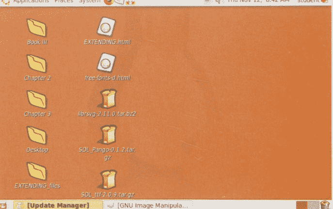

### Edubuntu 桌面

这些自由使得 Edubuntu 与专有软件有着根本的不同：你不仅无需支付费用即可获取所需的工具，你以及全球成千上万的开发者还有权修改并基于你的软件进行构建，直到它以你希望的方式运行。

## Edubuntu 中的教育软件

Edubuntu 提供多种教育程序。其中一些如下：

- **数学乐趣**（Fun with Math）—— TuxMath 是一款以 Linux 吉祥物 Tux 为主角的教育街机游戏！基于经典街机游戏“导弹司令”（Missile Command），Tux 必须通过解决算术问题来防御他的城市。
- **办公套件**（Office Suite）—— OpenOffice.org 是一套类似于 Microsoft Office 套件的完整办公套件。它包含文字处理器，以及电子表格、演示文稿、绘图、数据库和数学公式应用程序。OpenOffice.org 可以打开并转换大多数 Microsoft Office 文档，并支持许多语言。

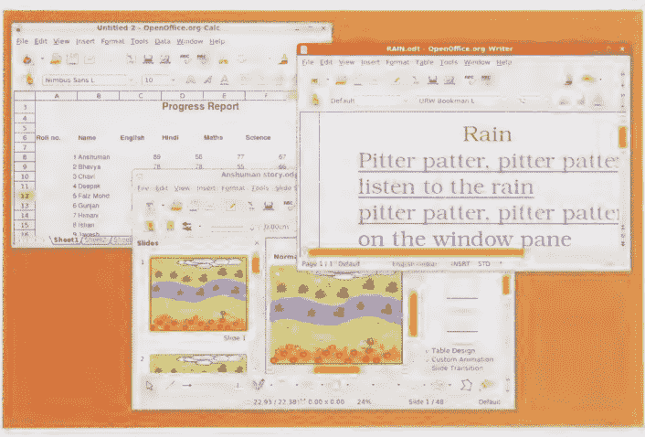

## 数学乐趣 — TuxMath

### Tux 数学指挥官 或 TuxMath

TuxMath 是一款简单的算术教育软件，主角是 Linux 企鹅 Tux。Tux 必须向从天而降的算式发射相位枪。学生必须输入正确的结果并按 `Spacebar/Enter` 键，在算式触及地面之前将其摧毁。涉及的数学运算包括加法、减法、乘法和除法。这是儿童和成人锻炼头脑的好方法。

### TuxMath 的功能

- 可爱的动画图形
- 音效和音乐
- 可选的屏幕输入，适合无法使用键盘的儿童（非常适合触摸屏！）

### TuxMath 的目标

该软件的目标是培养口头和心算技能。在“Tux 数学指挥官”中，Tux 指挥官防御他的城市免受数学方程的袭击。你可以扮演 Tux 指挥官的角色。彗星正向你的城市疾驰而来，你必须通过解方程来摧毁它们。

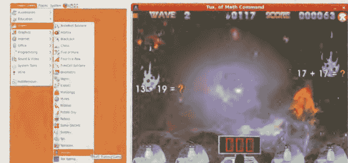

### 游戏玩法概述

Linux 企鹅 Tux 站在激光防御系统的控制台上，准备保护他的同伴企鹅免受坠落的彗星攻击。他的同伴安全地待在冰屋中。防御站两侧各有一个冰屋，Tux 的任务是保护总共四只其他企鹅。

每颗 incoming 彗星都附带一个数学问题。输入正确的解会使激光摧毁彗星。输入错误的结果会导致失误。

这种简单的游戏玩法令人娱乐，当彗星撞击冰屋时会变得更加有趣。第一次彗星撞击会使企鹅的冰屋部分融化。

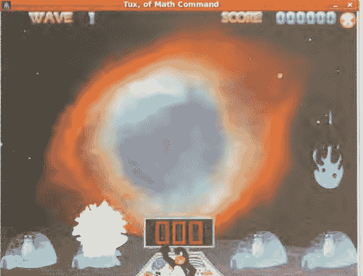

第二次撞击会使冰屋完全融化，迫使企鹅逃跑。企鹅永远不会受到伤害；一旦它们的冰屋消失，它们就会简单离开。

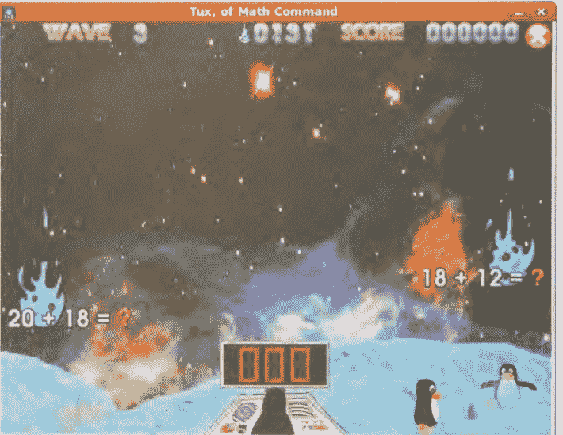

让年轻玩家在企鹅逃跑前有两次尝试机会，有助于防止他们感到沮丧，同时仍提供挑战。

### 程序导航

#### 标题屏幕

在此屏幕上，你可以选择玩游戏、更改游戏选项、查看演职员表或退出。

使用 `Up` 和 `Down` 方向键选择你想执行的操作，然后按 `Enter/Return` 键。否则，使用鼠标点击菜单项。按下 `Escape` 将退出程序。

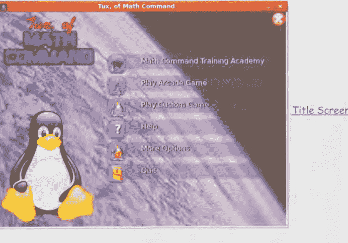

#### 更多选项屏幕

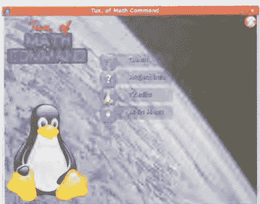

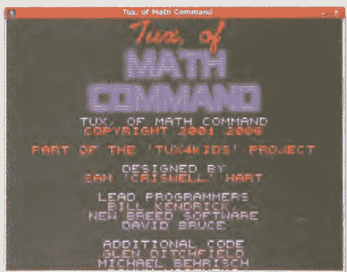

#### 演职员表屏幕

此屏幕显示演职员表。你可以按 `Escape` 返回标题屏幕。

### 如何游玩

#### 摧毁彗星

当彗星向你的城市坠落时，你必须解决它们的方程。

要摧毁彗星，请执行以下操作：

首先，找出方程的答案。

例如，"3 × 4" 的答案是 "12"。

其次，输入答案。当你在键盘上输入数字时，它们会出现在屏幕底部中央的 "LED" 样式显示器上。

最后，按 `[Enter/Return/Spacebar]`。

答案为你所输入数字的彗星将被企鹅 Tux 击落。

注意：

1. 有时多颗彗星会有相同的答案。在这种情况下，离你城市最近的彗星会先被摧毁。
2. 输入 `[Enter/Return]` 后，"LED" 样式显示器会自动重置为 "000"，以便你可以回答下一个方程！

#### 更正你的答案

如果你犯了错误，可以按 `[Backspace/Delete]`，屏幕底部中央的 "LED" 样式显示器将重置为 "000"。

### 失去一座城市

如果你未能正确回答其方程而让彗星撞入你的某座城市，该城市的护盾将被摧毁。如果城市再次被另一颗彗星击中，它将完全被摧毁。

*注意：* 当方程击中地面时，计算的正确答案始终会显示出来。

一旦你失去了所有城市，游戏将结束。

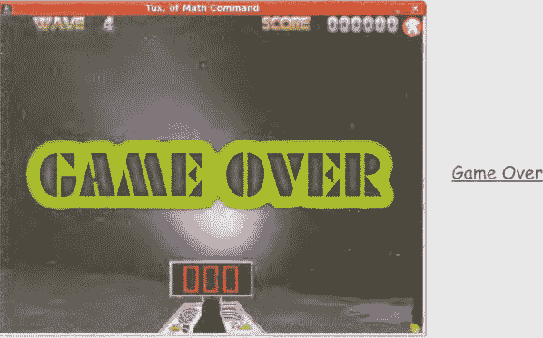

### 教师备注

教师可以在 Edubuntu 的终端应用程序中使用 `--fullscreen` 选项启动该程序。游戏屏幕将以全屏模式显示。

### 活动表 1：设置管理选项

“Tux 数学指挥官”允许家长或教师调整部分游戏选项。点击数学指挥官训练学院。

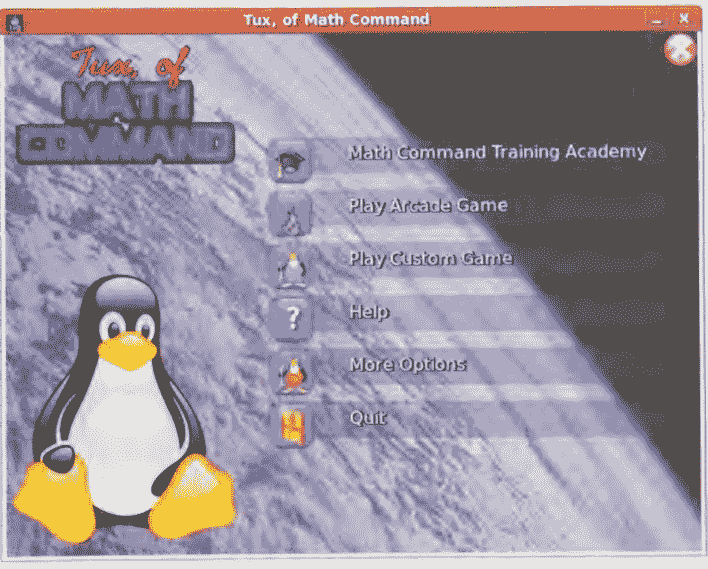

选择数学指挥官训练学院后，将显示以下屏幕。

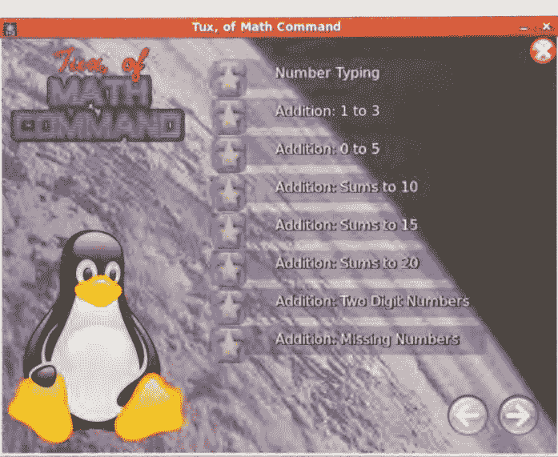

在这里，所有加法选项均可用。你可以根据孩子的年龄和理解程度选择所需的选项。

点击下一个箭头按钮以浏览更多选项。例如，负数加法。

下一个屏幕将向你展示更多选项。

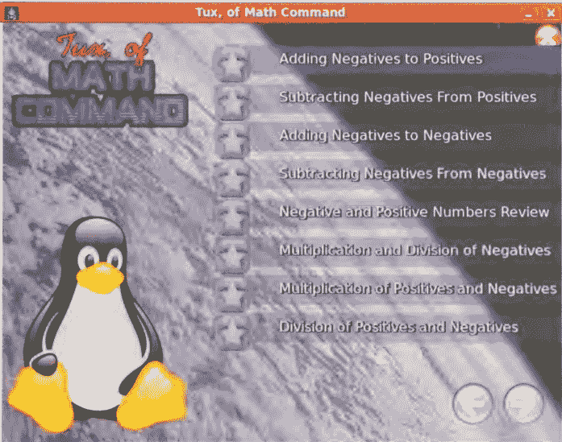

此功能使 TuxMath 对所有年龄段的儿童都很有用。

### 思考库

尝试点击名人堂。

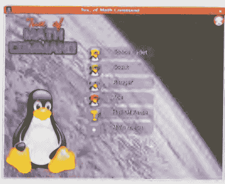

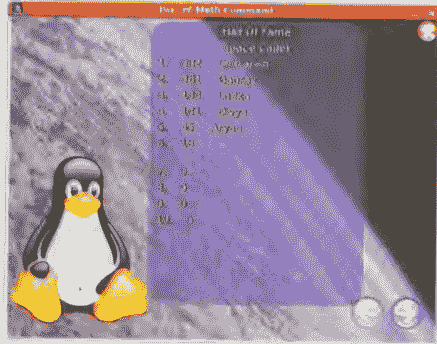

## OpenOffice.org 文字处理器

### 文字处理

文字处理意味着使用计算机创建、编辑和打印文档。要进行文字处理，你需要一个称为文字处理器的特殊程序。

### 文字处理器的优点

- 你可以进行修改或编辑，而无需重新输入整个文档。
- 你可以对文档中的文本应用许多格式样式。
- 你可以在文档中包含图形。
- 你可以保存文档以供将来使用。
- 你可以打印文档。

OpenOffice.org 文字处理器是一款免费且开源的文字处理软件，是 OpenOffice.org 软件包的一个组件。

> **教师备注**
>
> 教师可以介绍诸如文档、编辑、格式化、图形、保存、打开和打印等术语。她可以打开一个之前创建的文件，打印出来并展示给学习者。她可以解释使用文字处理器可以执行的任务，例如制作购物清单、写信、创建图形和表格、检查拼写和语法、执行计算等。

## OpenOffice.org 文字处理软件

### 开始使用文字处理软件

点击`应用程序`→`Office`→`OpenOffice.org 文字处理软件`

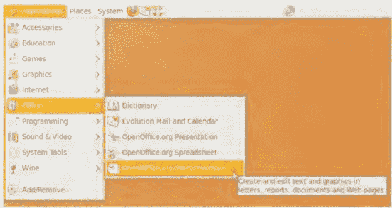

屏幕将显示如下：

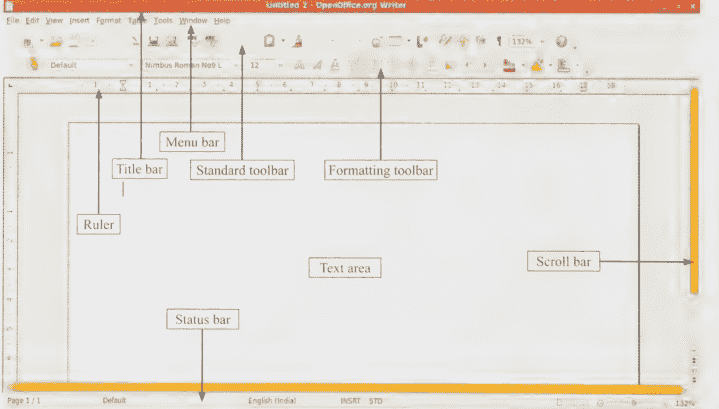

### 键盘

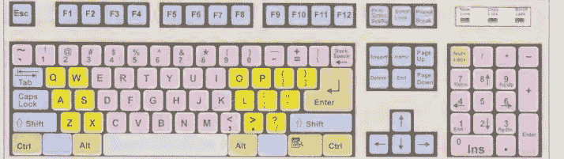

- 1. 键盘上有可以按下的按键，使字符（字母、数字和符号）出现在屏幕上。
- 2. “按”的意思是用力触摸键盘上的一个按键，使字符出现在屏幕上，然后立即松开。
- 3. 现在按下`H`键。（屏幕上出现“h”。）在“h”旁边有一条闪烁的垂直线。这条闪烁的线是光标，它指示当你按下某个按键时，将放置内容在页面上的位置。按下`E`键，然后按`L`键和`P`键。（单词“help”出现在屏幕上。）

### 空格键

`Space Bar` 键是键盘底部中间的长键。按下 `[Space Bar]` 键。（光标向右移动一个空格。）

### Shift 键

同时按下 `[Shift]` 键和一个字母键会使字母以大写形式出现。

请按照以下步骤输入单词“Help”：

- 1. 按住 `[Shift]` 键不放，同时按下`H`键。松开 `[Shift]` 键。（屏幕上出现大写字母“H”。）
- 2. 按下`E`键，然后按`L`，再按`P`。（单词“Help”出现在屏幕上。）

**思考角**

- 1. 你能在键盘上看到 `[Caps Lock]`（大写锁定）键吗？

键盘上的一盏小灯告诉你 `[Caps Lock]` 键是开启还是关闭。这个键有什么用？
- 2. 键盘上有一个 `[Num Lock]`（数字锁定）键。你知道它的用途吗？

- 3. `[Backspace]`（退格）键和 `[Delete]`（删除）键有什么区别？

### 鼠标

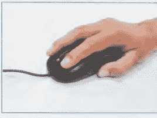

键盘旁边的设备称为鼠标。

- 1. 移动鼠标会使鼠标指针（光标符号）在屏幕上移动。
- 2. 在桌面或鼠标垫上上下移动鼠标。注意指针也会在你的屏幕上上下移动。
- 3. 在桌面或鼠标垫上左右移动鼠标。注意指针也会在你的屏幕上左右移动。
- 4. 移动鼠标，使指针位于你刚才输入的单词“Help”的某处。
- 5. 要进行点击，请将右手放在鼠标上。将食指（你用来指东西的手指）放在左键上，按下该键然后松开。
- 6. 注意光标（闪烁的垂直线）移动到你点击鼠标的位置。按下字母 X。字母 x 出现在看到闪烁光标的位置。

> **思考角**
>
> 你能看到鼠标左右按键之间有一个小滚轮吗？试着旋转滚轮并观察会发生什么。

### 练习单 1

日期：__/__/

a. 判断正误，打 ✓ 或 ✗。

- 1. 键盘是输出设备。
- 2. 键盘上最长的键是 `[Space Bar]` 键。
- 3. 按下 `[Shift]` 键会使字母以大写形式出现。
- 4. 鼠标是输入设备。
- 5. 通过点击鼠标右键进行选择。

b. 给文字处理软件窗口的各部分标注名称。

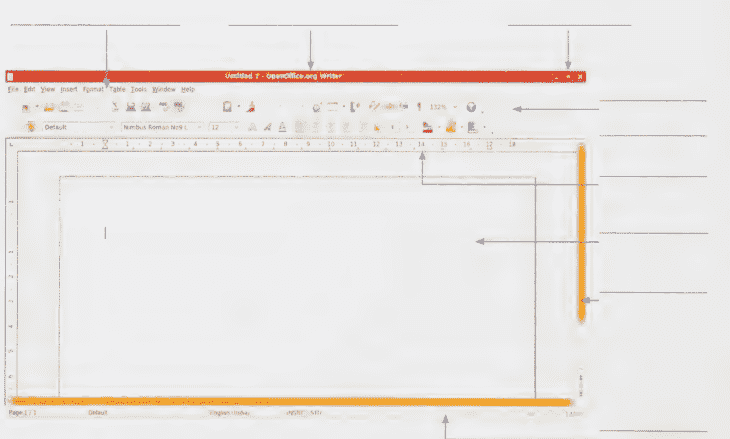

日期：__/__/  
教师签名：_________

### 命令

**打开新文件**

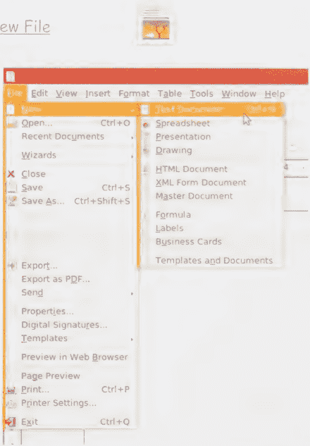

点击`文件`→`新建`→`文本文档`。文本文档 Untitled 1 : OpenOffice.org Writer 会出现在你的屏幕上。屏幕是你看到事件发生的地方，就像电视屏幕一样。

**保存文件**

点击`文件`→`保存`

出现“保存”对话框。

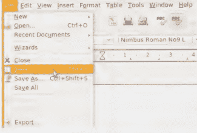

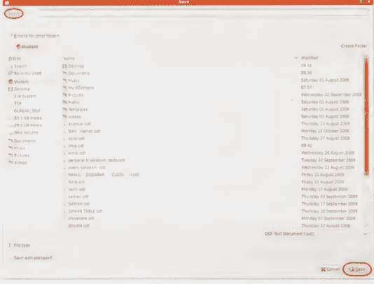

在“名称”文本框中输入你的文件名。

点击“保存”按钮以保存你的文本文档。

**打开现有文件**

“打开”命令用于在文字处理软件中打开已保存的文件。点击`文件`→`打开`。出现“打开”对话框。

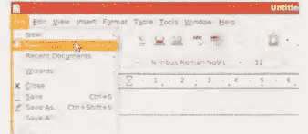

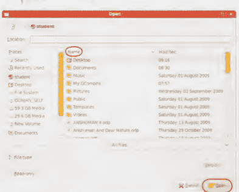

选择要打开的文件名。然后点击“打开”按钮。

## 关闭文件

点击“文件”→“关闭”

## 思考角

你能看到菜单栏上有带下划线的字母吗？为什么它们带下划线？

### 活动表 2

一些建议的活动包括：

- 1. 打开文字处理软件。输入你的名字、你所在的班级及分部、以及你学校的名称。

  例如，

  Ankita Kapoor

  II A

  Mayoor School

- 2. 以“Myself”为文件名将该文件保存在“文档”文件夹中。

- 3. 关闭该文件。

- 4. 打开该文件并添加当前日期和星期几。保存你的工作并退出文字处理软件。

- 5. 打开该文件并添加所有家庭成员的名字。保存文件并退出。

- 6. 创建一个新文件，并输入关于计算机实验室中任何物体的 5 句话。例如，计算机、空调、投影仪等。

- 7. 教师可以拿一个袋子，里面装一些简单的东西，如球、铅笔、橡皮、盒子、小玩具、羽毛、石头、一张纸等。让每个孩子选择一个物体，并在文字处理软件中写下关于它的描述。保存文件。

- 8. 主题写作：一些建议的主题包括地球日、母亲节、我的学校、我自己、自然、我的家庭、我最喜欢的季节、在集市的一天、让我们谈谈我们的朋友。

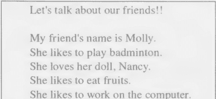

- 9. 看图写话：教师可以向学生展示任何绘画或图片，讨论该图片，鼓励孩子们发言并交流想法，然后使用文字处理软件写几句话描述该图片。保存文件。

例如，

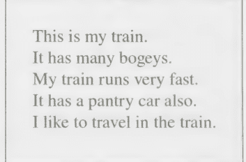

### 练习单 2

日期：__/__/

**a. 填空。**

- 1. 每次按下 `Enter`（回车）键，光标会向下移动 ______ 一行。

- 2. 输入和编辑文本的区域被称为 ___________。

- 3. 用于打开新文件的按钮位于 ____________ 工具栏上。

- 4. 点击 ______ → 保存，以保存文件。

- 5. 当你点击“文件”→“打开”时，_________ 对话框打开。

**b. 配对连线：**

- 1. 新建

- 2. 打开

- 3. 保存

- 4. `Space Bar`（空格键）

- 5. `Shift` 键

日期：__/__/____ 教师签名：_______________

### 文本编辑功能

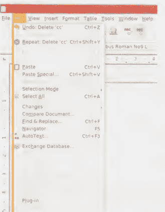

**撤销在文本文档中做的更改**

点击“编辑”->“撤销”

或者，你可以按下 `Ctrl+Z`（撤销的键盘快捷键）。此命令将撤销对该文件所做的最后一次更改。

**重做在文本文档中做的更改**

点击“编辑”->“重做”

或者，你可以按下 `Ctrl+Y`（重做的键盘快捷键）。此命令将撤销“撤销”命令的操作。

## OpenOffice.org 文字处理

### 从文本文档中剪切文本

第一步是选择你想要剪切的文本。文本选择是通过按住鼠标左键并将鼠标指针拖过你想要选择的文本来完成的。一旦选定的文本被高亮显示，释放鼠标左键以完成选择。然后单击“编辑” → “剪切”。

或者，你可以按 `Ctrl+X`（剪切的键盘快捷键）。选定的文本将从屏幕上消失，并被粘贴到系统的临时内存（即剪贴板）中。

### 从文本文档中复制文本

第一步是选择你想要复制的文本。然后单击“编辑” → “复制”。

或者，你可以按 `Ctrl+C`（复制的键盘快捷键）。选定的文本仍将显示在屏幕上，并且也会被粘贴到系统的临时内存（即剪贴板）中。

### 在文本文档中粘贴文本

要粘贴你已剪切或复制的文本，请将光标放置在你想要粘贴文本的位置。然后单击“编辑” → “粘贴”。

或者，你可以按 `Ctrl+V`（粘贴的键盘快捷键）。

### 思考园地

- 试一试：

- 对于文本编辑命令，你可以使用以下任何一项：

  1. 菜单栏

  2. 工具栏

  3. 选择文本并右击以获取上下文敏感菜单

  4. 快捷键

### 文本格式化功能

文字处理器允许许多种格式化样式。

### 格式化文本

第一步是选择要格式化的文本。然后单击“格式” → “字符”。

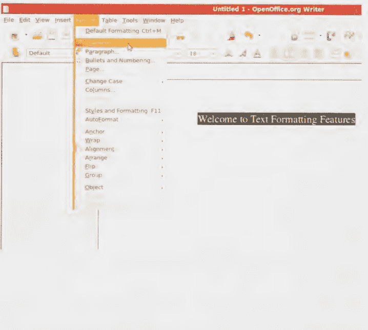

将显示字符对话框。

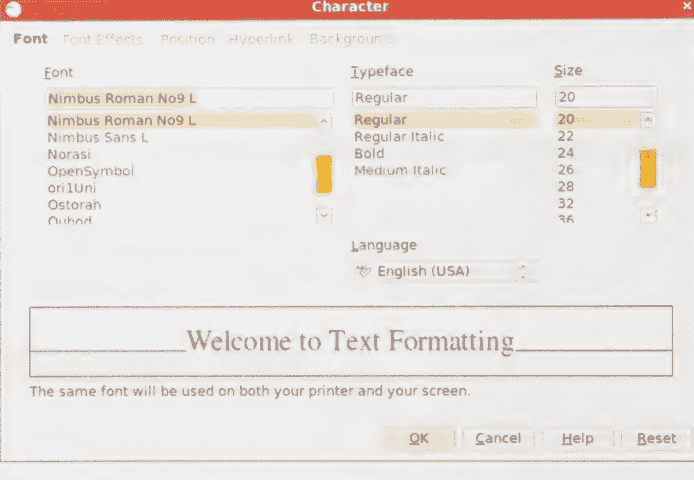

在字符对话框中，单击`字体`选项卡。

要选择字体，请滚动字体列表并停在你想要使用的字体上。字体列表显示了你当前使用的计算机上可用的所有字体。当你滚动字体列表时，预览窗口中会显示所选字体的预览。

要更改字体的字形，请从`字形`列表框中选择所需的字形。可用的字形类型包括：常规、常规斜体、粗体、中等斜体。

要更改字体大小，请从大小滚动框中选择。字体大小通常以点为单位表示。

单击`确定`按钮以将更改应用到所选文本。

### 进一步格式化文本

第一步是选择要格式化的文本。然后单击“格式” → “字符”。

将显示字符对话框。在字符对话框中，单击字体效果选项卡。

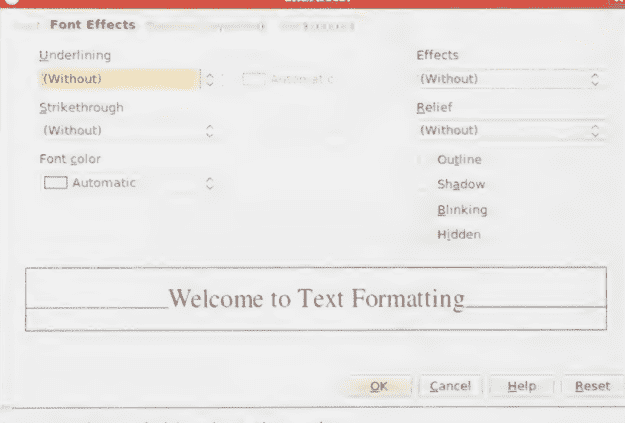

在下划线字段中，选择样式。

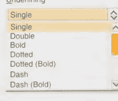

在颜色字段中，选择下划线颜色。

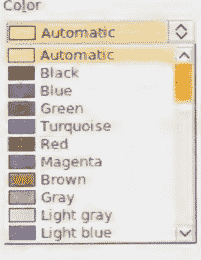

在删除线字段中，选择样式。

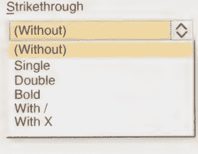

在字体颜色字段中，选择你要应用的颜色。

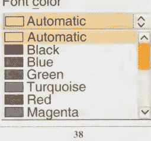

在效果字段中，选择效果样式。

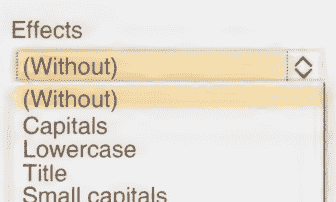

在浮雕字段中，选择纹理样式。

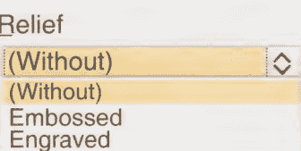

此外，你可以从以下选项中勾选复选框，为所选文本添加额外效果。

- 轮廓

- 阴影

- 闪烁

- 隐藏

### 设置文本定位

选择要格式化的文本。然后单击“格式” → “字符”。将显示字符对话框。

在字符对话框中，单击位置选项卡。

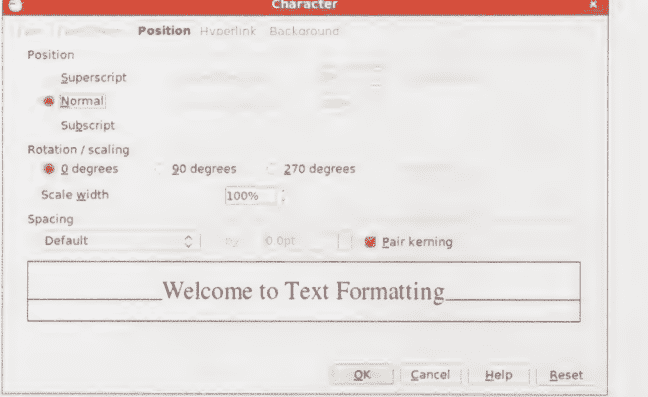

在位置区域，为所选文本设置上标或下标选项。

上标用于减小所选文本的字体大小并将其提升到基线以上。

正常设置可去除上标或下标设置。

下标用于减小所选文本的字体大小并将其降低到基线以下。

例如，

在旋转/缩放区域，你可以设置文本的旋转角度和要缩放的文本百分比。单击确定按钮以应用所需的更改。例如，

### 为文本应用彩色背景

选择要格式化的文本。然后单击`格式` → `字符`。将显示字符对话框。

在字符对话框中，单击背景选项卡。

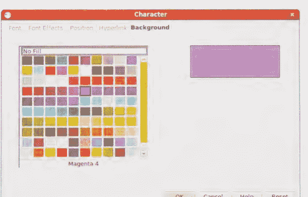

单击你想要作为所选文本背景的颜色，然后单击确定按钮。

### 练习表 3

日期：\_\_\_/\_\_\_/\_\_\_

a. 填空。

1. 重做的键盘快捷键是 \_\_\_\_\_\_\_\_\_\_\_。

2. 在键盘上按 `[Ctrl+X]` \_\_\_\_\_\_\_\_\_\_\_\_\_\_\_ 选定的文本。

3. 粘贴的键盘快捷键是 \_\_\_\_\_\_\_\_\_\_\_。

4. 要为选定的文本应用上标格式，你需要单击字符对话框中的 \_\_\_\_\_\_\_\_\_\_\_\_\_\_\_ 选项卡。

5. 要为选定的文本应用背景，你需要单击 \_\_\_\_\_\_\_\_\_\_\_\_\_\_\_ 对话框中的 `Background` 选项卡。

b. 匹配下列内容：

1. 重做

2. 粘贴

3. 复制

4. 撤销

5. 剪切

日期：\_\_\_/\_\_\_/\_\_\_ 老师签名：\_\_\_\_\_\_\_\_\_\_\_\_

### 文本对齐

#### 使用菜单进行文本对齐

从菜单栏中选择`格式` → `段落`。

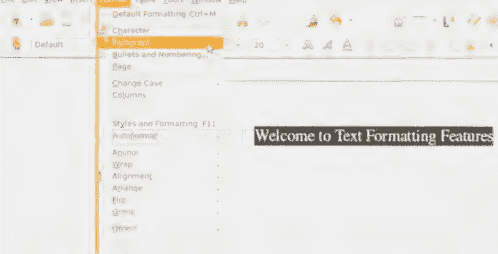

将打开段落对话框。

选择段落对话框的对齐方式选项卡。

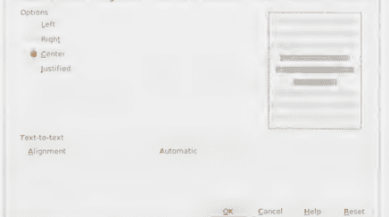

有四种可用的对齐选项。选择所需的对齐方式，然后单击确定按钮。

左对齐

段落的所有行都从左边距开始，右边距间距不均匀。

居中对齐

每行在页面上居中。

右对齐

段落的所有行都在右边距结束，左边距间距不均匀。

两端对齐

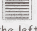

段落的所有行都在左边距开始，并在右边距均匀结束。

显示四种对齐方式的示例：

| `左对齐` | `居中对齐` | `右对齐` | `两端对齐` |
| :--- | :--- | :--- | :--- |
| 这是一个示例段落，用于展示 OpenOffice.org 文字处理器中可用的文本对齐选项。本段落展示`左对齐`。 | | | |
| | 这是一个示例文本，用于展示 OpenOffice.org 文字处理器中可用的文本对齐选项。本文本展示`居中对齐`。 | | |
| 这是一个示例段落，用于展示 OpenOffice.org 文字处理器中可用的文本对齐选项。本段落展示`右对齐`。 | | | |
| 这是一个示例段落，用于展示 OpenOffice.org 文字处理器中可用的文本对齐选项。本段落展示`两端对齐`。 | | | |

### 活动表 3

一些建议的活动如下：

- 打开在活动表 2 中创建的文档，并对它们应用文本格式化功能。更改字体样式、大小，为标题添加下划线，并将标题居中对齐。

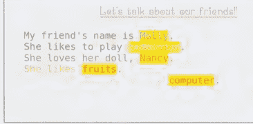

- 给你爱的人写一封信，并应用适当的格式化样式和文本对齐选项。例如，

> 亲爱的妈妈，

> 我非常爱你。你非常美丽。你照顾我和你。你帮助我学习。我很幸运有这样一个好妈妈。

> 你爱的女儿

> 米希卡

> 老师备注

> 老师可以打印这些信件并寄出它们。

- 输入并格式化你最喜爱的作品。

### 4. 在老师的帮助下创作一首诗。使用文字处理器进行输入和排版。

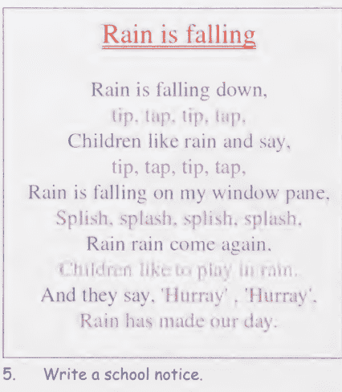

#### 雨落下了

雨落下了，  
滴答、滴答、滴答、滴答，  
孩子们喜欢雨并说，  
滴答、滴答、滴答、滴答，  
雨落在我家窗上，  
哗啦、哗啦、哗啦、哗啦，  
雨啊，再下一场吧。  
孩子们喜欢玩雨。  
他们说：“万岁”、“万岁”。  
雨让这一天变得美好。

#### 春天

*欢迎春天，*  
*百花盛开，*  
*彩蝶翩翩，*  
*四处飞舞，*  
*来吧，来吧朋友们，*  
*我们大家在一起，*  
*享受这美好的*  
*春天季节。*

### 5. 写一则学校通知。

**例如，**

#### 阿杰梅尔梅尤尔学校

#### 第六期夏令营

2009年5月1日

尊敬的家长：

夏令营将于2009年5月9日至5月30日举办。详情请咨询学校办公室并办理报名。

祝您的孩子假期愉快！

协调员

### 6. 想象你是一只鸟。写几句话来表达你的感受。

对文本进行排版并保存文档。

我是一只雀鸟

我是一只雀鸟。  
我筑巢来产卵。  
筑巢是很困难的。  
人们一次又一次地破坏我的巢。  
但我不气馁。  
最终，我筑好了巢。  
我爱我的小宝宝。  
我教它们如何飞翔。

## 思考园

键盘上有一个“Tab”键。你什么时候会使用 `[Tab]` 键？

### 教师备注

教师可以将学习者制作的文档进行彩色打印并展示出来，以鼓励学习者。选定的文档可以上传到学校的网站上。

## 创建无序列表和有序列表

我们可以在文字处理器中创建两种列表：无序列表（Bulleted List）和有序列表（Numbered List）。

项目符号（Bullets）是用于突出列表中条目的符号。它用于没有特定顺序的列表。

有序列表用于按特定顺序显示信息。

您可以通过点击工具栏上相应的按钮来使用默认的项目符号和编号设置。

点击 `格式` → `项目符号和编号`

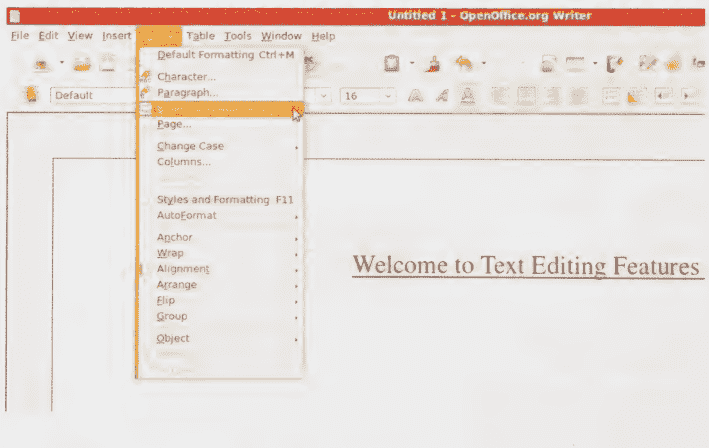

## OpenOffice.org 文字处理器

出现“项目符号和编号”对话框。

从可用选项中选择一个项目符号样式。

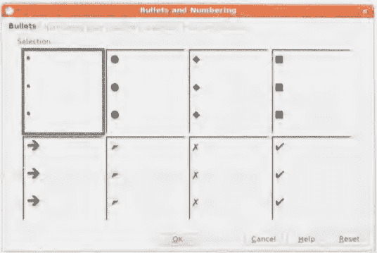

您也可以在 `Graphics` 选项卡中选择彩色项目符号。

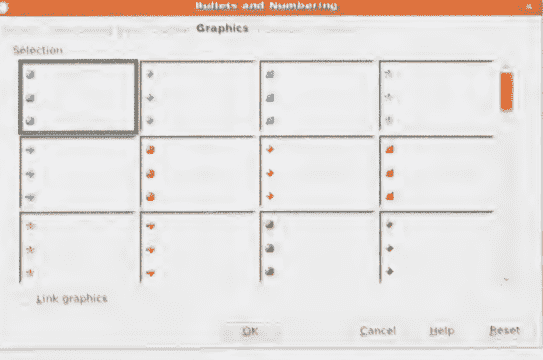

## OpenOffice.org 文字处理器

点击 `Numbering type` 选项卡以创建有序列表。

从可用样式中选择您想要的样式。

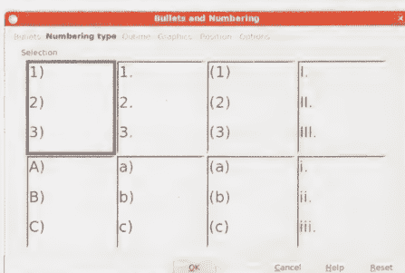

点击 `Outline` 选项卡以创建次级无序列表和次级有序列表。

从可用样式中选择您想要的样式。

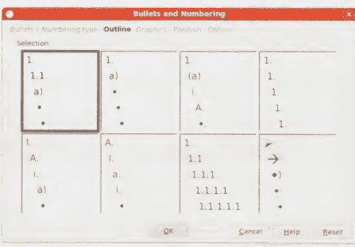

点击 `OK` 按钮以应用更改。

以下是一个无序列表和一个有序列表的示例。

#### 计算机实验室的物品列表

- 电脑
- 投影仪
- 白板
- 空调
- 画作
- 椅子

#### 今天二年级的课程列表

1. 英语
2. 美术与手工
3. 数学
4. 计算机
5. 印地语
6. 体育

## 应用首字下沉

选择段落对话框的 `Drop Caps` 选项卡。

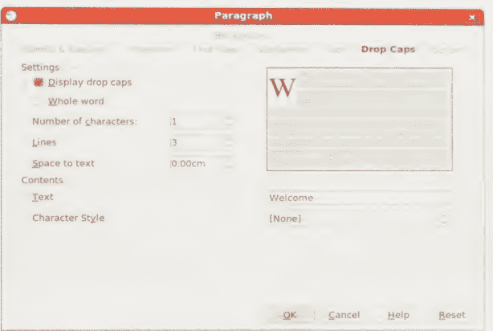

选中 `Display drop caps` 复选框。

此功能通常用于报纸和杂志文章中，以显示首字符，使用较大的字体大小，并跨越多于一行（1）的常见字符。首字下沉的示例如下所示：

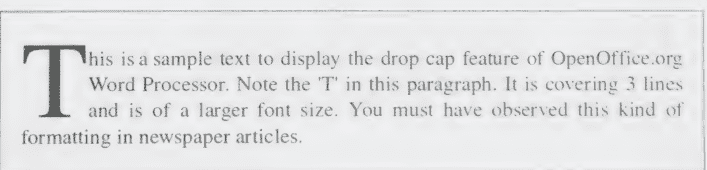

# OpenOffice .org 文字处理器

## 活动表 4

一些建议的活动如下：

1. 创建一个水果无序列表和一个蔬菜列表。
2. 创建一个“今天要做的事情”的有序列表。
3. 创建一个需要购买的杂货项有序列表。教师可以先与学生讨论各种杂货项，然后学生可以创建列表。
4. 创建一个动物、鸟类、水生动物等列表，并为其应用不同种类的编号样式。
5. 创建一个朋友列表，并为其应用不同样式的彩色项目符号。
6. 创建一个职业列表，例如医生、裁缝、律师、老师、工程师、宇航员等。
7. 输入并排版一篇报纸文章。使用首字下沉功能和适当的排版功能。

### 教师备注

可以要求学习者写一篇关于学校组织活动的报纸文章。学习者将输入文章并应用适当的排版功能。然后可以在集会上朗读这篇新闻。

例如，

> 为5-7岁儿童举办的校际绘画比赛在阿杰梅尔梅尤尔学校举行。活动主题设为“保护”。梅尤尔学校二年级A班的 Akshita Mehra 获得了一等奖。她描绘了节约用水、电力和环境的办法。评委对她所做的努力给予了赞扬。

## 思考园

你能使用首字下沉功能来装饰一张贺卡吗？

# OpenOffice.org 文字处理器

## 练习表 4

日期：__/__/__

a. 将下列各项进行匹配：

1. 项目符号图标

2. 右对齐

3. 大纲

4. 首字下沉

5. 图形

6. 项目符号

7. 两端对齐

8. 默认对齐

9. 编号图标

10. 居中对齐

日期：__/__/__

教师签名：_______________

# OpenOffice.org 文字处理器

## 更多文本编辑功能

### 查找和替换

这是文字处理器中一个非常实用的功能。它用于在整个文档中搜索特定的单词，然后用正确的单词替换它。它通常用于纠正文档中反复出现的错误。

点击 `编辑 → 查找和替换`

# OpenOffice.org 文字处理器

将显示“查找和替换”对话框。

在 `Search for` 文本框中输入要查找的单词。在 `Replace with` 文本框中输入用于替换的正确单词。

点击 `Find` 或 `Find All` 按钮。

然后点击 `Replace` 或 `Replace All` 按钮。

> ### 思考园
> 尝试在查找特定单词时选中 `Match case`（匹配大小写）选项。

# OpenOffice.org 文字处理器

## 使用拼写检查和同义词库

### 使用拼写检查

OpenOffice.org 文字处理器内置了一个字典，用于检查文档中的拼写。拼写检查从光标当前位置开始，检查整个文档。

### 运行拼写检查

点击 `工具 → 拼写和语法`

# OpenOffice.org 文字处理器

拼写对话框将显示文档中第一个拼写错误的单词，以及字典中提供的最接近的匹配建议。

1. `Ignore Once`（忽略一次），忽略仅一次出现的拼写。
2. `Ignore All`（全部忽略），忽略整个文档中的拼写。
3. `Change`（更改），接受并更改仅一次出现的拼写。
4. `Change All`（全部更改），接受并更改整个文档中的拼写。

### 使用自动拼写检查

自动拼写检查在您输入文档时轻松识别页面上拼写错误的单词。拼写错误的单词下方可以看到一条红色波浪线。在拼写错误的单词上右键单击，从出现的列表中选择建议的替换词。更正将应用于文档。

# OpenOffice.org 文字处理器

### 使用同义词词典

同义词词典通过提供同义词列表（意思相近的词语）和相关的词语，帮助你改进词汇量。点击 `工具 → 语言 → 同义词词典`，或按 `[Ctrl+F7]`。

同义词词典对话框将显示出来。在“含义”列表中，选择与上下文相符的定义。在“同义词”列表中选择要替换的词语。点击“确定”。

我是一名优秀的`学生`。

### 活动单 5

一些建议的活动如下：

- 写一段关于“我的朋友——计算机”的文字。
- 使用拼写检查和同义词词典检查文档并进行适当的修改。
- 在全文中找到单词‘Friend’并将其替换为‘Dear’。
- 从英语课本中选择难懂的单词。把它们输入到文字处理器中，查找它们的含义。同时查找这些单词的反义词和同义词。

#### 教师提示

通过点击菜单栏中的 `工具 → 语言` 选项，教师可以选择所需的词典。

#### 思考角

尝试在不使用鼠标，仅使用键盘的情况下在文字处理器中工作。

### 处理图形

#### 将图形作为副本插入

1. 点击标准工具栏上的`图库`图标，或通过选择 `工具 → 图库` 来打开`图库`。

2. 选择一个`主题`。
3. 单击选择要使用的`对象`。

4. 将对象拖入文档中，或者右键打开上下文菜单并选择 `插入 → 复制`。

#### 将图形作为背景插入

1. 点击标准工具栏上的`图库`图标，或通过选择`工具 → 图库`来打开图库。
2. 选择一个主题。
3. 单击选择要使用的对象。
4. 打开上下文菜单并选择`插入 → 背景 → 页面或段落`。

#### 在图形周围添加边框

选择图形，然后点击 `格式 \ 图形...`

或者，你可以右键点击图形并选择 `图形...`

图形对话框将打开。选择`边框`标签。

在`线条排列`区域，选择五个按钮中的一个：

- 设置无边框，
- 设置所有四条边框，
- 仅设置左右边框，
- 仅设置上下边框，或
- 仅设置左侧边框。

在**线条**区域，选择一个条目，以确定线条的粗细和颜色。

点击**确定**按钮。

### 绘图工具栏

点击 查看 → 工具栏 → 绘图。绘图工具栏将显示出来。

你可以点击各种形状并绘制精美的图形。你甚至可以使用艺术字图库来美化显示效果。

### 思考角

点击 查看 → 工具栏。你将看到 OpenOffice.org 文字处理器中可用的工具栏列表。这些工具栏的用途是什么？

### 练习单 5

日期：`___`/`___`/`___`

**a. 判断正确打√，错误打×。**

- 要在全文中查找特定单词并替换为正确的单词，你需要点击 格式 → 查找和替换。
- 你无法使用文字处理器为图片添加边框。
- 你无法在文本文档中将图形作为背景插入。
- 文字处理器可以自动识别在输入文档时拼写错误的单词。
- 你可以点击此图标来打开图库。

**b. 填空。**

- 同义词词典的键盘快捷键是 `___________`。
- 图库选项位于 `___________` 菜单项中。
- 你可以使用 `___________` 工具栏创建自己的绘图。
- 艺术字图库的图标位于 `___________` 工具栏中。
- 查找和替换的键盘快捷键是 `___________`。

日期：`___`/`___`/`___`

教师签名：`______________`

### 活动单 6

一些建议的活动如下：

- 为不同的场合制作贺卡，例如生日卡、度假愉快卡或早日康复卡。使用文本格式功能、颜色来美化贺卡。使用艺术字图库和绘图工具栏来绘制图形。例如，

- 使用绘图工具栏以图解方式展示任何主题。例如，排灯节、十胜节、我的家庭、独立日。

#### 排灯节快乐

#### 十胜节

#### 我的家庭

#### 独立日

- 在活动单2创建的文档中添加句子并应用格式功能，使其成为一份完整的文档。例如，

#### 我的家庭

- 我有一个幸福的家庭。
- 我家有四口人——爸爸、妈妈、姐姐和我。
- 我妈妈是世界上最棒的妈妈。她做美味的食物。她照顾家里的每一个人。
- 妈妈给我讲很多故事。她和我下国际象棋和蛇梯棋。
- 我爸爸是印度军队的一名军官。
- 他和我一起踢足球、打板球和打网球。我们一起去骑行。我们一起去散步。
- 我姐姐比我小。我喜欢和我姐姐一起玩耍。
- 我的家庭非常温馨且充满爱。
- 我非常爱我的家庭。

- 为你爱的人写一条短信息。使用合适的文字处理工具输入并排版。

- 制作主题文档

例如，我的三个愿望。

> **教师提示**
>
> 可以提前给班级布置一个主题。主题可以与课程相关，或者与当前的新闻、日常活动、体育等有关。例如，我最喜欢的运动、教师节、我的生日、火车站的景象、邮递员等。老师可以和同学们讨论主题。可以组织一个制作主题文档的活动，让学习者使用所学的所有文字处理工具来创建一份文档。

### OpenOffice.org 文字处理器的功能键

| 快捷键 | 效果 |
|---|---|
| [F3] | 完成自动套用文字 |
| [Ctrl+F3] | 编辑自动套用文字 |
| [F7] | 拼写检查 |
| [Ctrl+F7] | 同义词词典 |
| [F12] | 编号 |
| [Shift+F12] | 项目符号 |
| [Ctrl+Shift+F12] | 关闭编号 / 项目符号 |

### OpenOffice.org 文字处理器的快捷键

| 快捷键 | 效果 |
|---|---|
| [Ctrl+A] | 全选 |
| [Ctrl+J] | 两端对齐 |
| [Ctrl+D] | 双下划线 |
| [Ctrl+E] | 居中对齐 |
| [Ctrl+F] | 查找和替换 |
| [Ctrl+Shift+P] | 上标 |
| [Ctrl+L] | 左对齐 |
| [Ctrl+R] | 右对齐 |
| [Ctrl+Shift+B] | 下标 |
| [Ctrl+Y] | 重做上一个操作 |
| [Ctrl+Enter] | 手动分页符 |
| [Ctrl+Shift+Enter] | 在分栏文本中插入分节符 |

### OpenOffice.org 文字处理器

- 将光标移至左侧
- 将光标连同选区一起移至左侧
- 移动到单词开头
- 逐词向左选择文本
- 将光标移至右侧
- 将光标连同选区一起移至右侧
- 移动到单词末尾
- 逐词向右选择文本
- 将光标向上移动一行
- 向上逐行选择文本
- 将光标移至段落开头
- 选择文本至段落开头
- 将光标向下移动一行
- 向下逐行选择文本
- 将光标移至段落末尾
- 选择文本至段落末尾
- 移动到行首
- 移动并选择文本至行首
- 移动到行尾
- 移动并选择文本至行尾
- 移动到文档开头
- 移动并选择文本至文档开头
- 移动到文档末尾
- 移动并选择文本至文档末尾
- 插入模式开关
- 向上翻屏
- 向下翻屏
- 删除至单词末尾的文本
- 删除至句子末尾的文本
- 删除至句子开头的文本

### 使用 LINUX 学习

“使用 Linux 学习”是面向 1 至 8 年级的计算机科学系列教材，适用于小学和初中，专注于自由与开源软件（FOSS）。本课程的教学大纲设计符合《2005 年国家课程框架》的建议。每本书中都有适合相应年龄段的教材，将计算机科学教育与现实生活体验相结合。该系列教材旨在培养学习者的批判性思维和创造力。该系列基于 Edubuntu 发行版——这是一个用户友好的、基于 Linux 的 Ubuntu 操作系统的教育版本。

#### 主要特点

- 恰当使用截图以清晰且易于儿童理解的方式呈现概念。
- 每章中的“思维库”提出基于应用的问题，鼓励对所学概念进行进一步的探索和思考。
- “活动页”提供实用练习，利用所学工具整合不同学科知识。
- “练习册”包含用于复习的客观题和描述题。
- 在相关位置提供的“教师提示”为教师提供有关教学方法的有用建议，以及如何进一步探索主题的指导。

#### 作者简介

Neeraj K. Bedhotiya 是 Ajmer Mayor 学校的校长，他是将 FOSS 引入学校教育的先驱之一。他拥有超过 20 年的教育经验，其中包括在 Dehra Dun 的 The Doon School 的 11 年经历，以及在英国马尔堡学院（Marlborough College）的一年经历。

Deepak Bhargava 目前担任 Ajmer Mayor 学校的 IT 协调员，拥有近 10 年的高中高级阶段教学经验，并在其学校建立 FOSS 网络中发挥了重要作用。

Gunjan Kotwari 是 Ajmer Mayor 学校计算机科学系的教员，拥有信息技术硕士学位，并成功在她的课堂上实施了向 FOSS 的过渡。

#### 软件说明

本书中使用的软件可从 http://linux.oupcomputers.com 免费下载。还提供了一个供教师使用的 DVD，其中包含完整的软件需求，包括 Edubuntu 操作系统、课程涵盖的所有开源应用程序、安装指南、活动用的图像库以及示例演示文稿。还提供了应用程序的 Windows 版本。教师可与出版社联系以获取该 DVD。

OXFORD UNIVERSITY PRESS

www.oup.co.in

ISBN 0-19-806559-0

9 780198 065593

Rs 114
